# 操作系统：内部原理与设计原则（全球版）


## 目录

- 2.9 Linux 113
- 9.5 关键术语、复习题与练习 455
- 11.8 UNIX S4 I/O 537
- 15.6 安全维护 685
- 参考文献 R-1
- 致谢 CL-1
- 索引 I-1

## 在线章节与附录

> ¹在线章节、附录及其他文档为高级内容，可通过书开头的读写卡访问。

- 编程项目一：开发外壳 (Shell)
- 编程项目二：调度器 (The Dispatch)
- 附录 D：面向对象设计 D-1
- 附录 H：队列系统概念 H-1
- 附录 I：算法复杂性 I-1
- 附录 J：磁盘存储 J-1
- 附录 O：BACI O-1
- 附录 P：程序 P-1
- 附录 Q：术语表 Q-1
- 术语表
- 视频：http://www.pearson.com
- 5.4 互斥的实现 238
- 5.27 优先级问题的解决策略 274

## 前言

### 第九版的更新内容

自从本书第八版出版以来，操作系统领域经历了不断的创新和改进。在这一新版中，我试图捕捉这些变化，同时保持对整个领域的全面覆盖。为了开始修订工作，本书由多位教授该课程的教授以及该领域的人士进行了广泛评审。结果是，在许多地方叙述变得清晰紧凑，插图也得到了改进。

在改进教学和用户友好性的基础上，书的技术内容也根据这一活跃领域进行了更新，并扩展了教师和学生支持。主要变化如下：

- **更新 Linux 内容**：Linux 内容已更新并扩展，反映了自第八版以来 Linux 内核的变化。
- **更新 Android 内容**：Android 内容已更新并扩展，反映了自第八版以来安卓内核的变化。
- **新增虚拟化内容**：关于虚拟机的章节已完全重写，以提供更好的组织结构和最新的处理。此外，还增加了一个关于容器使用的新章节。
- **新增云操作系统**：本版新增了对云操作系统的覆盖，包括云计算概述、云操作系统原理和需求的讨论，以及对 OpenStack（一种流行的开源 OS）的讨论。
- **新增物联网操作系统**：本版新增了对物联网操作系统的覆盖，包括物联网概述、物联网操作系统原理和需求的讨论，以及对 RIOT（一种流行的开源物联网 OS）的讨论。
- **更新并扩展嵌入式操作系统**：该章节经过大幅修订，包括：
  - 嵌入式系统部分得到了扩展，并包含了对微控制器和深度嵌入系统的讨论。
  - 嵌入式 OS 概述得到了扩展和更新。
  - 对嵌入式 Linux 的处理得到了扩展，并增加了对流行的嵌入式 Linux 系统 μClinux 的讨论。
- **并发**：项目手册中添加了新项目，以更好地帮助学生理解并发原理。

## 目标

本书涵盖了操作系统的概念、结构和机制。其目的是尽可能清晰、完整地介绍现代操作系统的本质和特征。

由于以下几个原因，这项任务具有挑战性。首先，设计为操作系统提供服务的计算机系统范围之广、种类之多。这包括嵌入式系统、智能手机、单用户工作站和个人电脑、中型共享系统、大型大型主机和超级计算机，以及作为实时系统的特种机器。这种多样性不仅局限于机器的容量和速度，还体现在应用和系统需求上。其次，计算机系统一直以来的特征是快速变化且从未停止过。操作系统设计中的许多关键领域是近年来产生的，对这些领域及其他新领域的研究仍在进行中。

尽管存在这些多样性和变化速度，某些基本概念在范围内是始终如一的。诚然，这些概念的应用取决于技术的当前水平和实际需求。本书的意图是对操作系统设计的基础原理进行深入讨论，并将其与当代的设计问题以及操作系统发展的当前方向联系起来。

## 示例系统

本文旨在让读者熟悉当代操作系统的设计原则和实现问题。因此，纯粹的概念性或理论性处理是不够的。为了阐明这些概念并将其与必须做的现实设计选择联系起来，选择了四个操作系统作为示例：

- **Windows**：一种用于个人电脑、工作站、服务器和移动设备的多任务操作系统。该操作系统整合了操作系统技术的许多最新进展。此外，Windows 是首批严重依赖对象设计原则的重要商业操作系统之一。本书涵盖了最新版本 Windows（即 Windows 10）中使用的技术。
- **Android**：为嵌入式设备（尤其是手机）定制。针对嵌入式环境独特的需求，书中提供了 Android 内部的细节。
- **UNIX**：一种多用户操作系统，最初为微机设计，但实现在从强大的微机到超级计算机的各种机器上。书中包含了几种 UNIX 变体作为示例。FreeBSD 是一个广泛使用的系统，结合了许多先进特性。Solaris 是一个广泛使用的 UNIX 商业版本。
- **Linux**：一种广泛使用的 UNIX 开源版本。

选择这些系统是因为它们具有相关性和代表性。对示例系统的讨论贯穿全文，而不是汇成单独的章节或附录。因此，在讨论并发时，会阐述每个示例系统的并发机制，并讨论各个设计选择的动机。通过这种方法，在给定章节讨论的设计概念会通过现实案例得到立即强化。为了方便起见，每个示例系统的所有材料也可以作为在线文档提供。

## ACM/IEEE 计算机科学课程 2013 的支持

本书面向学术和专业读者。作为本教材，它旨在为计算机科学、计算机工程和电气工程专业的本科生提供一学期或两个学期的操作系统课程。本版的设计初衷是支持当前（2013年12月）版本的《ACM/IEEE 计算机科学课程 2013（CS2013）》的建议。CS2013 课程建议将操作系统（OS）作为计算机科学知识体系（CSBK）中的知识领域之一。CS2013 将所有课程分为三类：核心层 1 类（所有主题都应包含在课程中）、核心层 2 类（所有或大部分主题应包含在内）以及选修类（理想情况下的）。在操作系统方面，CS2013 包含了两个 Tier 1 主题、四个 Tier 2 主题和六个选修主题，每个主题都包含若干子主题。本文涵盖了 CS2013 在这三个类别中列出的所有主题和课题。

表 P.1 显示了本书对操作系统知识领域的支持。子主题的详细列表见书中。

## 本书的计划

本书分为六部分：

1. 背景
2. 进程
3. 内存
4. 调度
5. 输入/输出
6. 高级主题（包括嵌入式、云和操作系统）

本书的主要目标是使其这一基础性且不断发展的学科成为尽可能有效的教学工具。这一目标体现在书的结构中，并带有以下补充材料辅助教师：

- **答案手册**：课后习题的答案。
- **项目手册**：针对序言中列出的所有项目类别的建议任务。
- **PowerPoint 幻片**：适用于教学的章节幻片。
- **PDF 文件**：书中所有图表的复印件。
- **题库**：按章节划分的问题集。
- **关于并发的视频课程**：教授们认为并发是该领域最难理解的概念。本版带有书中各种并发算法的视频讲解视频。书中每个算法定义旁边都有该图标，表示有视频课程可用。
- **教学大纲示例**：提供了一个学期内方便使用本书的几个教学大纲。这些示例基于教授的实战经验。

所有这些支持材料均可通过本书的教师资源中心（IRC）获取，可以通过网站 `http://www.pearsonglobal.com/stallings` 获取。要获得 IRC 的权限，请联系您的当地 Pearson 代表。

## 项目与其他练习

| CS2013 知识领域 | 本书中的覆盖 |
| :--- | :--- |
| 操作系统概览 (Tier 1) | 第1章 系统概述 |
| 操作系统原理 (Tier 1) | 第2章 操作系统概述 |
| 并发 (Tier 2) | 第3章 互斥<br>第4章 同步 |
| 调度与保护 (Tier 2) | 第5章 死锁<br>第6章 调度 |
| 内存管理 (Tier 2) | 第7章 单处理器调度<br>第8章 多处理器调度<br>第9章 实时处理器调度 |
| 安全与保护 (Tier 2) | 第10章 内存管理 |
| 虚拟机 (选修) | 第11章 安全 |
| 设备管理 (选修) | 第12章 I/O 管理 |
| 文件系统 (选修) | 第13章 文件管理 |
| 实时与嵌入式系统 (选修) | 第14章 虚拟机<br>第15章 操作系统 |
| 容错性 (选修) | 第16章 容错<br>第17章 性能评估 |

对于许多教师来说，操作系统课程的一个重要组成部分是一个或一系列项目，让学生通过实践来强化书中的概念。由于受到了倒性的支持，本书在课程中加入了项目。在书中，定义了两个主要的编程项目。此外，通过渠道提供的教师支持材料不仅包括如何分配和组织各种项目的指导，还包括各种项目类型的用户手册，所有任务专门为本书编写。教师可以分配以下领域的工作：

- **OS/161 项目**：后文详述。
- **仿真项目**：后文详述。
- **信号量项目**：帮助学生理解并发概念，包括竞态条件、饥饿和死锁。
- **内核项目**：IRC 包含了两个不同内核编程项目的完整教师支持，以及一套针对 Android 的内核编程项目。
- **编程项目**：下文详述。
- **研究项目**：一系列研究任务，指示学生在互联网上研究特定主题并撰写报告。
- **阅读/报告任务**：可以分配阅读并撰写报告的论文列表，以及建议的作业措辞。
- **写作任务**：有助于学习材料的写作任务列表。
- **讨论主题**：这些主题可以在课堂、聊天室、消息板环境中使用，以更深入地探索某些领域并促进学生之间的协作。

此外，书中还提供了关于名为 BACI 的软件包的信息，该软件包作为研究并发机制的框架。

这一系列多样化的项目和其他学生练习，使教师能够将本书作为丰富多化学习体验的一个组成部分，并根据教师和学生的特定需求定制课程计划。详情信息，请参阅本书的附录 B。

## OS/161

本版本提供了对基于 OS/161 的主动学习组件的支持。OS/161 是一个教育型操作系统，日益被认为是操作系统内部原理的首选教学平台。它的目标是在让学生获得真实操作系统工作经验与避免让 Linux 等全功能操作系统的复杂性令学生无所措之间取得平衡。与大多数部署的操作系统相比，OS/161 非常小巧（大约有 20,000 行代码和注释），因此更容易对整个代码库建立理解。

IRC 资源包括：

1. 一套封装好的 HTML 文件，教师可以将其上传到课程服务器供学生访问。
2. 一份发给学生的入门手册，帮助他们开始使用 OS/161。
3. 一套使用 OS/161 的练习题，分发给学生。
4. 供教师使用的每个练习的标准答案。
5. 所有内容都将与书中相关章节进行交叉引用，以便学生在阅读完教材材料后，完成相应的 OS/161 项目。

## 仿真

IRC 支持基于一套七个模拟实验来分配项目，这些实验涵盖了操作系统设计的关键领域。学生可以使用一组模拟软件包来分析操作系统的设计特性。模拟器用 Java 编写，可以作为 Java 应用程序本地运行，也可以通过浏览器在线运行。IRC 包含了分配给学生的作业，明确告知他们作业内容以及预期结果。

## 动画

本版本还整合了动画。动画为理解现代操作系统的复杂机制提供了强大的工具。总共有 53 个动画用于说明操作系统设计中的关键功能和算法。这些动画用于第 3、5、6、7、8、9 和 11 章。

## 编程项目

本版本提供了对编程项目的支持。教材的在线部分介绍了两个主要的编程项目：一个是构建 shell 或命令行解释器，另一个是构建进程调度器。IRC 提供了开发这些项目的进一步信息和逐步的练习。

作为替代方案，教师可以分配一系列更广泛的项目，涵盖书中的许多原理。书中为每个项目都提供了详细的说明。此外，还有一套作业题，涉及与每个项目相关的问题供学生回答。

最后，IRC 提供的项目手册包含了一系列编程项目，这些项目涵盖了广泛的主题，可以在任何平台上的使用任何合适的语言实现。

## 学生的在线文档和视频笔记

对于这个新版本，大量的学生原创支持材料已通过两个在线位置发布。书籍的网站 `http://www.ostext.org/os161` 提供了丰富的额外资源。IRC 网站 `http://www.ostext.org/os161/irc` 为教师和学生提供资源，包括项目手册、标准答案和讲义笔记。

该版本还包含了一系列视频笔记，帮助解释一些概念。这些视频笔记可以在书籍网站上获取，旨在帮助那些需要对材料有更直观视觉解释的学生。

## 关于作者

威廉·斯塔林斯（William Stallings）博士已编写了18部著作，包括修订版在内，计算机安全、计算机网络和计算机架构领域超过40本书。他的著作曾出现在许多出版物，包括《IEEE学报》、《ACM计算评论》和《密码学》（Cryptology）。

他曾13次获得文本与学术作者协会（Text and Academic Authors Association）颁发的年度最佳计算机教科书奖。

在该领域的30多年里，他曾担任几家高科技公司的技术贡献者、技术经理和高管。他曾在从微型到主机的各种计算机和操作系统上设计并实现了基于 TCP/IP 和基于 OSI 的协议栈。作为顾问，他曾为政府机构、计算机和软件供应商以及主要用户就网络软件和产品的设计、选择和使用提供咨询建议。

他创建并维护了 Computer拨款.com 计算机科学学生资源网站。该网站为计算机科学学生（及专业人士）感兴趣的各种主题提供了文档和链接。他还是学术期刊《密码学》（Cryptology）的编辑委员会成员，该期刊致力于密码学的各个方面面。

斯塔林斯博士在麻省理工学院（M.I.T.）获得计算机科学博士学位，在圣母堂大学获得电气工程学士学位。

# 第一部分 背景

# 第1章 计算机系统概述

## 1.1 基础元件

## 1.2 微处理器的演变

## 1.3 指令执行

## 1.4 中断

- 中断与指令周期
- 中断处理
- 多中断

## 1.5 存储器层次

## 1.6 缓存存储

- 动机
- 缓存原理
- 缓存设计

## 1.7 直接存储器访问

## 1.8 多处理器和多核结构

- 对称多处理器
- 多核计算机

## 1.9 术语、复习题与问题

### 附录 1A 两级存储的性能特性

- 局部性
  - 二级存储的操作
  - 性能

---

## 第1章 / 计算机系统概述

| 学习目标 |
| :--- |
| 在学习本章后，你应该能够： |
| 描述计算机系统的基本元件及其相互关系。 |
| 解释处理器执行指令所采取的步骤。 |
| 理解中断的概念，处理器如何以及为何使用中断。 |
| 列出并描述典型计算机存储器层次的层级。 |
| 解释多处理器系统和多核计算机的基本特征。 |
| 讨论局部性概念并分析多级存储器层次的性能。 |
| 理解栈的操作及其在支持过程调用和返回的应用。 |

操作系统（OS）利用一个或多个处理器的硬件资源来为用户提供一系列服务。操作系统还代表用户管理次级存储和 I/O（输入/输出）设备。因此，在我们开始研究操作系统之前，对底层计算机系统硬件有一定的了解是非常重要的。

本章提供了计算机硬件的概述。在大多数领域，调查是简要的，因为假设读者对这一主题已经熟悉。然而，某些领域被详细介绍了，因为它们对书中稍后涵盖的主题非常重要。额外的主题见附录 C。欲需更详细的说明，请参 [STAL16a]。

### 1.1 基础元件

在顶层上，计算机由处理器、存储器和 I/O 组件组成，每种类型有一个或多个模块。这些组件以某种方式相互连接，以实现计算机的主要功能，即执行程序。因此，有四个结构元件：

- **处理器**：控制计算机的运行并执行其数据功能。当只有一个处理器时，它通常被称为中央处理单元（CPU）。
- **主内存**：存储数据和程序。这种存储器通常是易失的；也就是说，当计算机关闭时，存储器中的内容将会丢失。相比之下，磁盘内存的内容在计算机关闭时仍保留。主内存也被称为*实际内存*（real memory）或*主存*（primary memory）。

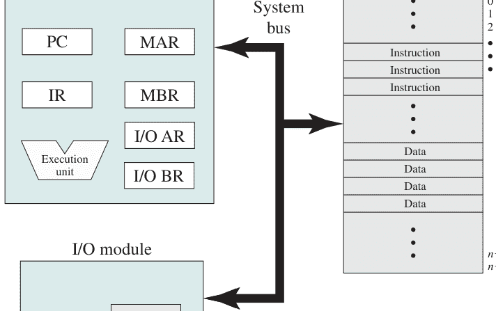

图 1.1 计算机组件：顶层视图

- **I/O 模块**：在计算机与其外部环境之间移动数据。外部环境由各种设备（例如磁盘）、通信设备和终端组成。
- **系统总线**：为处理器、主内存和 I/O 模块之间的通信提供支持。

图 1.1 展示了这些层组件。处理器的功能之一是与内存交换数据。为了此目的，它通常使用两个内部（处理器内部）寄存器：存储器地址寄存器（MAR），它指定内存中下次读取或写入的地址；存储器缓冲寄存器（MBR），它包含要写入内存的数据，或从内存接收数据。同样，I/O 地址寄存器（IOAR）指定特定的 I/O 设备。I/O 缓冲寄存器（IOR）用于 I/O 模块与处理器之间的数据交换。

一个存储器模块由一组位置组成，由顺序编号的地址定义。每个位置包含一个位模式，该模式可以被解释为指令或数据。I/O 模块将数据从外部设备传输到处理器，反之亦然。它包含内部缓冲区，临时存储数据直到可以发送。

### 1.2 微处理器的演变

带来桌面和手持计算的硬件革命是微处理器的发明，它在单个芯片上包含了一个处理器。虽然最初比处理器慢得多，但微处理器不断演进，由于移动信息的物理因素，它们现在在纳秒尺度上要快得多。

不仅微处理器已成为最快的通用处理器，而且每个芯片（称为插槽）包含多个处理器（称为核心），具有多级大型缓存，并且多个处理器共享每个核心的执行单元。截至2010年，笔记本电脑拥有2或4个核心并不罕见，每个核心有2个硬件线程，总共4或8个逻辑处理器。

虽然处理器为大多数形式的计算提供了很好的性能，但对数值的需求日益增长。图形处理器（GPU）利用超级计算机开创的单指令多数据（SIMD）技术对数据数组进行高效计算。GPU 不再仅用于渲染高级图形，还用于游戏物理模拟或大型表格计算。同时，CPU 本身正在获得操作数组的能力——集成到 x86 和 AMD64 家族的处理器处理器。

并不是现代 PC 计算故事的终结。数字处理器（DSP）也用于处理音频或视频等流信号。DSP 嵌入 I/O 设备、调制调器中，但它们现在正成为主要的计算设备，特别是在手持设备中。其他专用设备（固定功能单元）与 CPU 共存，以支持其他计算，例如语音和视频的编码解码（解码），或为加密安全提供支持。


为了满足手持设备的需求，经典的微处理器正在让位于片上系统（`SoC`），在 `SoC` 中，不仅 `CPU` 和缓存在同一芯片上，系统的许多其他组件，如 `DSP`、`GPU`、`I/O` 设备（如无线电和解码器）以及主内存也是。

## 1.3 指令执行

处理器执行的程序由存储在内存中的一组指令组成。在最简单的形式中，指令处理包括两个步骤：处理器每次从内存中读取（取指）指令并执行每条指令。程序执行由重复指令取指的过程以及指令执行组成。

单条指令所需的处理过程被称为指令周期。使用简化的两步描述，图 1.2 描述了指令周期。这两个步骤分别称为取指阶段（`fetch stage`）和执行阶段（`execute stage`）。只有当处理器关闭、发生某种不可恢复的错误，或遇到导致处理器停顿的程序时，程序执行才会停止。

在每个指令周期的开始时，处理器从内存中取一条指令。通常，程序计数器（`PC`）持有下一个要取指指令的地址。除非另有说明，否则处理器会在每个取指阶段递增 `PC`，以便按顺序取下一条指令（即位于下一个更高地址的指令）。例如，考虑一台简化的计算机，其中每条指令占用内存中的一个 16 位字。假设程序计数器设置为位置 300。处理器将取自位置 300 的指令。在后续的周期中，它将从位置 301、302、303 等取指令。这一序列可能会被更改，正如后文解释的。

取出的指令被加载到指令寄存器（`IR`）中。指令包含指定处理器应采取动作的位。处理器解释指令并执行所需的动作。通常，这些动作分为四类：

- **处理器-内存**：数据可以从处理器传输到内存，或从内存传输到处理器。
- **处理器-I/O**：数据可以通过处理器与 `I/O` 模块之间的传输，向外围设备或从外围设备传输。
- **数据处理**：处理器可以对数据执行任何算术或逻辑操作。
- **控制**：指令可以指定改变执行序列。例如，处理器可以从位置 149 取出一条指令，该指令指定下一条指令来自位置 182。处理器将程序计数器设置为 182。因此，在下一个取指阶段，指令将从位置 182 而非 150 取出。

指令的执行可能涉及这些动作的组合。

考虑一个使用假设处理器的简单示例，该处理器包含图 1.3 列出的特性。处理器包含单个数据寄存器，称为累加器（`AC`）。指令和数据均为 16 位，且内存被组织为 16 位字的序列。指令格式为操作码（`opcode`）提供了 4 位，允许多达 $2^4 = 16$ 种不同的操作码（由单个十六进制数字表示）。操作码定义了要执行的操作。使用指令格式剩余的 12 位，可以直接寻址多达 $2^{12} = 4,096 (4K)$ 个内存字（用三个十六进制数字表示）。

### 图 1.3 假设机器的特性

| | | |
| :--- | :--- | :--- |
| 0 | 3 | 15 |
| 操作码 | 地址 | |
| | (a) 指令格式 | |

| | | |
| :--- | :--- | :--- |
| 0 | 1 | 15 |
| S | 幅度 | |
| | (b) 整数格式 | |

| 程序计数器 (`PC`) = 指令地址 |
| 指令寄存器 (`IR`) = 正在执行的指令 |
| 累加器 (`AC`) = 临时存储 |
| (c) `CPU` 内部寄存器 |

| 0001 = 从内存加载到 `AC` |
| 0010 = 将 `AC` 存储到内存 |
| 0101 = 从内存加到 `AC` |
| (d) 操作码部分列表 |

图 1.4 展示了部分程序执行，显示了内存和处理器寄存器的相关部分。程序片段将地址 940 处的内存字的内容加到地址 941 处的内存字的内容，并将结果存储在后一位置。三条指令（可以描述为三个取指和执行周期）是：

1. `PC` 包含 300，这是第一条指令的地址。该指令（十六进制值 `1940`）被加载到 `IR` 中，`PC` 递增。注意，此过程涉及内存地址寄存器（`MAR`）和内存缓冲寄存器（`MBR`）的使用。为了简单起见，未显示这些中间寄存器。
2. `IR` 中的前 4 位（第一个十六进制数字）表示 `AC` 要从内存加载。剩余的 12 位（三个十六进制数字）指定地址，即 940。
3. 下一条指令（`5941`）从位置 301 取出，`PC` 递增。
4. `AC` 的旧内容和 941 的内容相加，结果存储在 `AC` 中。
5. 下一条指令（`2941`）从位置 302 取出，`PC` 递增。
6. `AC` 的内容存储在位置 941。

> ¹ 关于数制（十进制、二进制、十六进制）的基础复习可以在 ComputerStudent.com 计算机科学资源网站找到。

在这个示例中，需要三条指令（每条由一个取指阶段和一个执行阶段组成）将位置 940 的内容加到 941。如果有更复杂的指令集，需要的指令会更少。现代处理器包含包含多个地址的指令。因此，特定指令的执行阶段可能涉及多次内存引用，而不是一次。

### 取指阶段

### 执行阶段

**步骤 1**

| 内存 | CPU 寄存器 | 内存 | CPU 寄存器 |
| :--- | :--- | :--- | :--- |
| 300 | 1940 | 300 | `PC` 300 |
| 301 | 5941 | | `AC` |
| 302 | 2941 | | `IR` |
| | | 940 | 003 |
| 941 | 002 | 941 | 002 |

**步骤 2**

| 内存 | CPU 寄存器 | 内存 | CPU 寄存器 |
| :--- | :--- | :--- | :--- |
| 300 | 1940 | 300 | `PC` 301 |
| 301 | 5941 | | `AC` 003 |
| 302 | 2941 | 5941 | `IR` |
| | | 940 | 003 |
| 941 | 002 | 941 | 002 |

**步骤 3**

| 内存 | CPU 寄存器 | 内存 | CPU 寄存器 |
| :--- | :--- | :--- | :--- |
| 300 | 1940 | 300 | `PC` 302 |
| 301 | 5941 | | `AC` 003 |
| 302 | 2941 | 2941 | `IR` |
| | | 940 | 003 |
| 941 | 002 | 941 | 002 |

**步骤 4**

| 内存 | CPU 寄存器 | 内存 | CPU 寄存器 |
| :--- | :--- | :--- | :--- |
| 300 | 1940 | 300 | `PC` 303 |
| 301 | 5941 | | `AC` 005 |
| 302 | 2941 | 2941 | `IR` |
| | | 940 | 003 |
| 941 | 005 | 941 | 005 |

## 1.4 中断

几乎所有计算机都提供一种机制，其他模块（`I/O`、内存）可以中断处理器的正常顺序。表 1.1 列出了最常见的中断类。

### 表 1.1 中断分类

| 类别 | 描述 |
| :--- | :--- |
| 程序 | 由指令执行导致的某些条件产生，例如算术溢出、除以零、尝试非法指令或引用用户内存空间之外的内容。 |
| 定时器 | 由处理器内的定时器产生。这允许操作系统定期执行某些功能。 |
| I/O | 由 `I/O` 控制器产生，用于信号操作正常完成或信号各种错误情况。 |
| 硬件故障 | 由故障产生；例如电源故障或内存校验位错误。 |

提供中断的主要目的是提高处理器的利用率。例如，大多数 `I/O` 设备远慢于处理器。假设处理器使用图 1.2 中的指令周期向打印机传输数据。在每次写操作后，处理器必须暂停并保持空闲，直到打印机完成。这种暂停长度可能是数千或数百万指令周期。这是对处理器的极大浪费。

为了给具体的例子，考虑一台运行频率为 1 `GHz` 的 `PC`，它每秒允许执行 $10^9$ 条指令。² 典型的磁盘旋转速度为每分钟 7200 转，半道旋转时间为 4 `ms`，这比处理器慢 400 万倍。

图 1.5a 展示了这种情况。用户程序执行了一系列与处理交替的 `WRITE` 调用。实线表示程序中的代码段。代码段 1、2 和 3 指不执行 `I/O` 的指令序列。`WRITE` 调用指向 `I/O` 程序，该程序是系统程序并将执行实际的 `I/O` 操作。`I/O` 程序由三部分组成：

- 一序列指令（图中标记为 4），为实际 `I/O` 操作做准备。这可能包括将输出数据拷贝到特殊缓冲区并为设备命令准备参数。
- `I/O` 命令。在不使用中断的情况下，一旦发布此命令，程序必须等待 `I/O` 设备执行请求的功能（或定期检查状态/轮询 `I/O` 设备）。程序可能通过简单地执行测试操作来判断 `I/O` 操作是否完成以进行等待。
- 一序列指令（图中标记为 5），用于完成操作。这可能包括设置一个指示操作成功或失败的标志。

虚线代表处理器的执行路径；就此，它显示了指令执行的顺序。因此，在第一个 `WRITE` 指令之后，用户程序被中断，执行切换到 `I/O` 程序。在 `I/O` 程序执行完成后，执行立即在用户程序中 `WRITE` 指令之后的位置继续。

由于 `I/O` 操作可能需要较长时间才能完成，`I/O` 程序会挂起等待操作完成；因此，用户程序会在 `WRITE` 调用处停顿相当长的一段时间。

> ² 关于数值前缀（如 giga 和 tera）使用的讨论包含在计算机科学学生资源网站 ComputerScienceStudent.com 的一份支持文档中。

### 中断与指令周期

有了中断后，处理器可以在 `I/O` 操作进行期间执行其他指令。请参考图 1.5b 中的控制流。与之前一样，用户程序到达一个以 `WRITE` 调用形式发出系统调用的点。此时被调用的 `I/O` 程序仅包含准备代码和实际的 `I/O` 指令。在这两条指令执行后，控制权返回给用户程序。与此同时，外部设备正忙于从计算机内存接收数据并进行打印。此 `I/O` 操作与用户程序指令的执行并行进行。

当外部设备准备好被服务时（即它准备好从处理器接收更多数据时），外部设备的 `I/O` 模块向处理器发送中断请求信号。处理器的响应是：暂停当前程序的运行；跳转到处理该特定 `I/O` 设备的程序（称为中断处理程序）；并在服务完成后恢复原始执行。中断发生点在图 1.5b 中用 `X` 表示。注意，中断可以发生在主程序的任何点，而不仅仅是某条特定的指令。

对于用户程序来说，中断会暂停正常的执行序列。当中断处理完成后，执行将恢复（见图 1.6）。因此，用户程序不需要包含任何特殊代码来适应中断；处理器和操作系统负责暂停用户程序，然后在相同点恢复它。

为了适应中断，指令周期中增加了一个中断阶段，如图 1.7 所示（对比图 1.2）。在中断阶段，处理器会检查是否发生了任何中断，通过是否存在中断信号来指示：

如果没有挂起的中断，处理器将进入取指阶段并取当前程序的下一条指令。如果有挂起的中断，处理器将暂停当前程序的执行并执行中断处理程序。中断处理程序通常是操作系统的一部分。通常，该程序会确定中断的性质并执行任何必要的操作。在我们使用的示例中，处理程序会确定是哪一个 `I/O` 模块产生的中断，并可能跳转到一个向 `I/O` 模块写入更多数据的程序。当中断处理程序执行完毕，处理器可以在被中断点处恢复用户程序的执行。

显而易见，这个过程涉及一些开销。必须执行额外的指令（在中断处理程序中）来确定中断的性质并决定适当的操作。尽管如此，由于仅仅等待 `I/O` 操作将浪费大量时间，使用中断可以使处理器的工作效率高得多。

为了理解效率的提升，请考虑图 1.8，该图是基于图 1.5a 和 1.5b 中控制流的时序图。图 1.5b 和 1.8 假设 `I/O` 操作所需的时间较短：小于用户程序中两次 `write` 操作之间执行指令所需的时间。更典型的情况（特别是对于打印机等慢设备）是 `I/O` 操作所需比执行一系列用户指令多得多。图 1.5 显示了这种情况。在这种情况下，用户程序在第一次调用所跨的 `I/O` 操作完成之前到达第二个 `WRITE` 调用。结果是用户程序在该处挂起。当之前的 `I/O` 操作完成后，这个新的 `WRITE` 可能会被处理，并启动一个新的 `I/O` 操作。图 1.9 显示了这种情况下使用中断的情况下的时序。我们可以看到效率仍然得到了提高，因为 `I/O` 操作进行期间的部分时间与用户指令的执行重叠了。

### 中断处理

中断会触发一系列硬件和软件事件。当 `I/O` 操作完成时，会发生以下序列：

1. 设备发出中断。
2. 处理器测试是否存在挂起的中断，确定存在并向设备发送确认。
3. 处理器需要为转移中断做准备。
4. 处理器保存当前程序的状态。
5. 处理器将中断处理程序的入口加载到程序计数器。
6. 此时，程序计数器和 `PSW` 已保存在栈中。
7. 中断处理器现在可以处理被中断程序。
8. 当中断处理完成后，从栈中检索保存的寄存器值并恢复到寄存器中。
9. 最后的动作是从栈中恢复 `PSW` 和程序计数器值。

保存被中断程序的所有状态信息以便以后恢复至关重要。这是因为中断不是从程序调用的例程。相反，中断可以在任何时间发生，因此发生在用户程序执行的任何点。它的发生是不可预测的。

### 多重中断

到目前，我们已经讨论了单个中断的发生。然而，假设在处理一个中断时，可能会发生一个或多个中断。例如，一个程序可能正在从通信线路接收数据，同时在打印结果。打印机每当完成一次操作就会产生一个中断。通信线路控制器每当一个数据单元到达时就会产生一个中断。该单元可以是单个字符，也可以是一个数据块，取决于通信协议的性质。在任何情况下，在处理打印中断时，可能会发生通信中断。

处理多重中断可以有两种方法。第一种是在处理中断时禁用中断。禁用的中断简单意味着处理器忽略任何新的中断请求信号。如果在此期间发生中断，它通常会保持挂起（`pending`）状态，并会在处理器重新启用中断后由处理器进行检查。因此，如果在用户程序执行时发生中断，则会立即禁用中断。在中断处理程序完成后，在恢复用户程序之前重新启用中断，处理器会检查是否发生了额外的中断。这种方法非常简单，因为中断是按照严格的顺序处理的（见图 1.12a）。

上述方法的缺点是它没有考虑到相对优先级或对时间敏感性的需求。例如，当输入从通信线路快速到达时，可能需要被快速吸收以给更多输入留空间。如果第一批输入在第二批到达之前没有被处理，它可能会丢失；`I/O` 设备上的缓冲区可能会填满并溢出。

第二方法是为中断定义优先级，并允许高优先级的中断中断低优先级的中断处理程序（见 1.12b）。作为这种方法的示例，考虑一个具有三个 `I/O` 设备的系统：打印机、磁盘和通信线路，优先级分别为 2、4 和 5。图 1.13 描述了一个可能的序列。用户程序在 $t=0$ 时开始。在 $t=10$ 时，发生了打印中断；用户信息被放在控制栈上，并在打印机中断服务程序 `ISR` 中继续执行。当该程序仍在执行时，在 $t=15$ 发生了通信中断。由于通信线路的优先级高于打印机，该中断请求得到了响应。它的状态被推到栈中，并在通信 `ISR` 中继续执行。虽然该程序的优先级较低，但它只是被挂起，并且通信 `ISR` 完成了（$t=20$）。

当通信 `ISR` 完成（$t=25$）时，恢复之前的处理器状态，即执行打印 `ISR`。然而，甚至在该程序可以执行任何单条指令之前，处理器就响应了高优先级的磁盘中断，并将控制权转移给磁盘 `ISR`。只有当该程序完成（$t=35$）后，打印 `ISR` 才被恢复。当该程序最终完成时，控制返回用户程序。

## 1.5 存储器层次结构

计算机内存的设计限制可以总结为三个问题：多大？多快？多贵？

关于多大的问题在某种程度上是开放的。容量足够，应用程序可能会被开发以使用它。关于多快的问题在某种意义上更容易回答。为了获得最大的性能，内存必须能够跟上处理器的速度。这意味着，当处理器执行指令时，我们不希望浪费时间等待指令。最后一个问题也必须予以考虑。对于实际系统来说，内存的成本相对于组件相比必须是合理的。

正如可能的那样，内存的关键特性之间存在权衡：容量、访问时间和成本。使用了多种技术来实现内存系统，在这些技术谱系中，存在以下关系：

- 访问时间越快，每位成本越高
- 容量越大，每位成本越低
- 容量越大，访问速度越慢

设计者面临的困境是显而易见的。设计者希望使用提供大容量内存的技术，既是因为需要容量，也因为每位成本低。然而，为了满足性能需求，设计者需要使用访问速度快但容量较低且昂贵的内存。


## 1.5 存储器层次结构

计算机内存的设计限制可以总结为三个问题：多大？多快？多贵？

关于多大的问题在某种程度上是开放的。如果容量足够，应用程序可能会被开发以使用它。关于多快的问题在某种意义上更容易回答。为了获得最大的性能，内存必须能够跟上处理器的速度。这意味着，当处理器执行指令时，我们不希望浪费时间等待指令。最后一个问题也必须予以考虑。对于实际系统来说，内存的成本相对于组件相比必须是合理的。

正如可能的那样，内存的关键特性之间存在权衡：容量、访问时间和成本。使用了多种技术来实现内存系统，在这些技术谱系中，存在以下关系：

- 访问时间越快，每位成本越高
- 容量越大，每位成本越低
- 容量越大，访问速度越慢

设计者面临的困境是显而易见的。设计者希望使用提供大容量内存的技术，既是因为需要容量，也因为每位成本低。然而，为了满足性能需求，设计者需要使用访问速度快但容量较低且昂贵的内存。

解决这一困境的方法是不依赖单一的内存组件或技术，而是采用存储器层次结构。典型的层次结构如图 1.14 所示。随着向层次结构向下移动，会发生以下情况：

- 每位成本降低
- 容量增加
- 访问时间增加
- 处理器访问内存的频率降低

因此，更贵、更快的内存被更大、更廉、更慢的内存所补充。这种组织成功的关键在于较低层访问频率的降低。我们将在书的后面讨论内存时更详细地解释这一概念。

## 1.6 缓存内存

外部非易失性存储也被称为次级存储或辅助存储。这些存储用于存储程序和数据文件，而且它们通常以文件和记录的形式对程序员可见，而不是单个字节或字。硬盘也用于提供主内存的扩展，即虚拟内存，这将在第 8 章进行讨论。

在软件中可以有效地向层次结构中添加额外的层次。例如，主内存的一部分被用作缓冲区，临时存放将要读入磁盘的数据。这种技术有时被称为磁盘缓存（将在第 11 章详细检查），它通过两种方式提高性能：

1. 磁盘写入是聚类的。与其进行许多次小规模的数据传输，我们进行几次大容量的数据传输。这改进了磁盘性能并最大限度地减少了处理器的参与。
2. 某些准备写出的数据在下一次转储到磁盘之前可能会被程序引用。在这种情况下，数据将从软件缓存中快速检索，而不是从磁盘中缓慢检索。

附录 1A 探讨了多级存储器结构对性能的影响。

虽然缓存内存对操作系统是不可见的，但它会与其他内存管理硬件交互。此外，虚拟内存方案中使用的许多原理（将在第 8 章讨论）也应用于缓存内存中。

### 动机

在所有的指令周期中，处理器至少访问内存一次以取指指令，通常还会额外访问一次或多次以取操作数和/或进行存储。处理器执行指令的速率明显受到内存周期时间（从一个内存单元读取或写入内存单元所需的时间）的限制。由于处理器和主内存速度之间持续的不匹配，这一限制一直是一个严正的问题。多年来，处理器的速度增长速度一直比内存访问速度快。我们面临着速度、成本和尺寸之间的权衡。理想情况下，主内存应该使用与处理器寄存器相同的技术来构建，使得内存周期时间与处理器周期相当。这一直是一个成本过高的策略。解决方案是利用局部性原理，通过在处理器和主内存之间提供一个较小的、快速的内存，即缓存。

### 缓存原理

缓存内存旨在提供接近现有最快内存的访问时间，同时支持大容量内存，而价格仅相当于较便宜的半导体存储器。该概念在图 1.16a 中所示。有一个较大且速度缓慢的主内存，以及一个较小、更快的缓存内存。缓存包含主内存部分内容的副本。

当处理器尝试读取内存中的字节或字时，会进行检查以确定该字节或字是否在缓存中。如果是，则将该字节或字传递给处理器。如果不是，则由若干固定数量字节组成的主内存块读入缓存，然后将该字传递给处理器。引用局部性现象是指，当一个数据块被读入缓存以满足单次内存引用时，未来附近的许多内存引用可能会是缓存中的其他字节。

图 1.16 展示了多级缓存的使用。`L2` 缓存比 `L1` 缓存慢且通常更大，而 `L3` 缓存比 `L2` 缓存慢且通常更大。

图 1.17 展示了缓存/主内存系统的结构。主内存由 `2^n` 个字组成，每个字都有一个唯一的 `n` 位地址。为了映射，内存被认为由若干个每个 `K` 个字的固定长度块组成。缓存由 `C` 个槽（也称为行）组成，每个槽包含 `K` 个字，槽的数量认为少于主内存块的数量（`C << M`）。主内存块的一个子集位于缓存中。如果内存中的某个字不在缓存中，则将该块传输到缓存的一个槽中。因为块的数量多于槽，所以单个槽不能唯一地分配给特定的块。因此，每个槽都包含一个标签（`tag`），用于标识当前存储的是哪个特定块。标签通常是地址的某些高位，并引用所有以该位序列开头的地址。

> 符号 `<<` 意味着远小于。同样，符号 `>>` 意味着远大于。

| 序号 | 标签 (Tag) | 块 (Block) |
|---|---|---|
| 0 | | |
| 1 | | |
| 2 | | 块 0 (K 字) |
| C-1 | | 块长度 (K 字) |

图 1.17 缓存/主内存结构

作为一个简单的例子，假设我们有一个 6 位地址和一个 2 位标签。标签 `01` 指具有以下地址的地址块：`010000`、`010001`、`010010`、`010011`、`010100`、`010101`、`010110`、`010111`、`011000`、`011001`、`011010`、`011011`、`011100`、`011101`、`011111`。

图 1.18 阐述了操作。处理器生成要读字的地址 `RA`。如果该字包含在缓存中，则将其传递给处理器。否则，包含该字的块被加载到缓存中，然后将该字传递给处理器。

### 缓存设计

对缓存设计的详细讨论超出了本书的范围。这里简要总结了关键要素。我们将看到，在处理虚拟内存设计时，必须解决类似的问题。它们分为以下几类：

- 缓存大小
- 块大小
- 映射函数
- 替换算法
- 缓存层数

我们已经处理了缓存大小的问题。事实证明，较小的缓存对性能有显著影响。另一个问题是块大小：缓存与主内存之间的交换单元。考虑较小的块大小，然后增加尺寸。随着块大小增加，由于局部性原理，命中率会增加。然而，随着块变得更大，命中率将会降低，因为为了为新块在缓存中腾出空间。

当新的数据块读入缓存时，映射函数决定块将占据缓存的位置。有两个因素影响映射函数的设计。映射函数越灵活，搜索缓存所需的电路就越复杂。

替换算法在缓存满时选择（在映射函数的约束内）在缓存中时间最长的块。这种策略被称为最久未使用（`LRU`）算法。需要硬件机制来识别最近未使用的块。

如果缓存中块的内容被更改，那么在替换它之前需要写入。写入策略规定了内存操作何时发生。一种极端是每次更新块时发生写入；另一种极端是仅在替换块时写入。后者策略减少了内存操作，但让内存处于过状态。这会干扰多处理器操作以及 I/O 模块的直接内存访问。

最后，现在拥有多级缓存，标记为 `L1`（离处理器最近）、`L2` 以及许多情况的 `L3`。多级缓存的性能优势讨论超出了我们目前的范围。

## 1.7 存储访问

I/O 操作有三种技术：程序化 I/O、中断驱动 I/O 和直接内存访问（`DMA`）。在讨论 `DMA` 之前，我们将简要定义其他技术；详情请见附录 C。

当处理器执行命令并遇到与 I/O 相关的指令时，它通过向适当的 I/O 模块发出命令来执行指令。在程序化 I/O 情况下，I/O 模块执行操作，然后在 I/O 寄存器中设置相应位，但不采取进一步行动通知处理器。特别地，它不会中断处理器。因此，调用 I/O 指令后，处理器必须采取主动作用来确定 I/O 指令是否完成。为了这一目的，处理器定期检查 I/O 模块的状态，直到操作完成。

对于程序化 I/O，处理器必须等待所关注的 I/O 模块接收或传输更多数据。处理器在等待期间反复检查 I/O 模块的状态。结果是整个系统的性能水平严重降低。

另一种方案，中断驱动 I/O，是让处理器启动 I/O 命令，然后去执行其他有用工作。I/O 模块随后当它准备好与处理器交换数据时，中断处理器以请求服务。处理器像以前一样执行数据传输，并恢复其先前的处理。

中断驱动型 I/O 虽然比简单的程序控制 I/O 更高效，但仍然需要处理器的积极干预在内存和 I/O 模块之间传输数据，且任何数据传输必须经过处理器的路径。I/O 的这两个特征都存在两个固有的缺点：

- I/O 传输率受限于处理器测试和处理设备的速度。
- 处理器被束缚在管理 I/O 传输的任务中；每进行 I/O 传输都必须执行多条指令。

当需要移动大量数据时，需要一种更高效的技术：**直接存储器访问 (`DMA`)**。`DMA` 功能可以由系统总线上的一个独立模块执行，也可以集成到 I/O 模块中。无论在何种情况下，该技术的工作原理如下：当处理器想要读取或写入块数据时，它通过发送以下信息向 `DMA` 模块发出命令：

- 请求是读还是写
- 所涉及的 I/O 设备的地址
- 内存中读取或写入数据的起始位置
- 需要读取或写入的字数

处理器继续其他工作。它已经将此 I/O 操作委托给了 `DMA` 模块，由该模块负责处理。`DMA` 模块每次传输一个字，直接从内存或向内存传输整个块数据，而不经过处理器。当传输完成时，`DMA` 向处理器发送中断信号。因此，处理器仅在传输的开始和结束参与。

`DMA` 模块需要接管总线以便在内存之间传输数据。由于对总线的竞争，可能会出现处理器需要总线且必须等待 `DMA` 模块的情况。这不是中断；处理器不会保存上下文并执行其他操作。相反，处理器会暂停一个总线周期（跨总线传输一个字所需的时间）。整体效果是，在 `DMA` 传输期间，当处理器访问总线时，处理器的执行速度变慢。然而，对于多字 I/O 传输，`DMA` 的效率远比中断驱动或程序控制 I/O 高得多。

## 1.8 多处理器和多核结构

传统上，计算机被视为串行机器。大多数计算机编程语言要求程序员将算法指定为指令序列。处理器通过顺序且逐个执行机器指令来执行程序。每条指令都在一系列操作（取指令、取操作数、执行操作、存储结果）中执行。

这种对计算机的观点从未完全真实。在微操作层面上，多个控制信号是同时产生的。指令流水线技术（至少在取指和执行操作重叠的范围内）已经存在很长时间。这两者都是并行执行功能的示例。

随着计算机技术的演进和计算机硬件成本的下降，设计者寻求更多的并行性机会，通常是为了提高性能，某些情况下是为了提高可靠性。在本书中，我们将研究通过复制处理器提供并行性的三种方法：对称多处理器 (`SMP`)、多核计算机和集群。`SMP` 和多核计算机将在本节讨论；集群将在第 16 章讨论。

### 对称多处理器

定义 `SMP` 可以定义为具有以下特征的独立计算机系统：

1. 有两个或多个能力相当的处理器。
2. 这些处理器共享主内存，I/O 设施通过总线或其他内部连接方案连接，使得每个处理器的内存访问时间大致相同。
3. 所有处理器共享对 I/O 设备的访问，通过相同的通道或提供通往同一设备路径的不同通道来实现。
4. 所有处理器都可以执行相同的功能（因此称为“对称”）。
5. 系统由控制器控制。通过复制处理器提供并行性：对称多处理器 (`SMP`)、多核计算机和集群。`SMP` 和多核计算机将在本节讨论；集群将在第 16 章讨论。

第 1 到 4 点是自言易见的。

第 5 点说明了集成耦合的处理器。

相对于单处理器组织，`SMP` 具有许多潜在优势，包括：

- **性能**：在多处理器系统中，由于处理器可以并行工作，可以比单处理器组织获得更高的性能。
- **可用性**：在多处理器系统中，单个处理器的故障不会导致系统瘫痪。
- **增量增长**：通过增加处理器，硬件系统可以提高性能。
- **扩展性**：供应商可以根据价格提供具有不同范围的处理器产品。

重要的是，这些是潜在的而非保证的收益。操作系统通过提供工具来利用并行性。

`SMP` 的一个特点是，多用户是透明的。多处理器处理任务。

图 1.19 展示了多处理器的通用组织。

在现代计算机中，处理器通常至少有一个私有缓存。如果一个缓存中的字被更改，它可能会使另一个缓存中的字失效。为了防止这种情况，其他处理器必须被通知。这个问题被称为缓存一致性问题，通常在硬件中解决。

### 多核计算机

多核计算机也称为片上系统，在单块硅（芯片）上结合了两个或多个处理器（核心）。通常，每个核心包含处理器的所有组件，如寄存器、`ALU`、流水线硬件和控制单元，以及 `L1` 缓存。除了核心，多核芯片还包括 `L2` 缓存，某些情况下还有 `L3` 缓存。

多核计算机的发展动机可以总结为：几十年来，多处理器系统的性能经历了指数级增长。这部分归功于硬件趋势，例如时钟频率的增加以及由于微型化可以将缓存内存靠近处理器。性能还通过增加处理器设计的复杂性来提高指令执行和内存访问的并行性。多核系统的一个例子是 `Intel Core i7-5960X`，它包含六个 `x86` 处理器，每个都有专用的 `L2` 缓存和共享的 `L3` 缓存（图 1.20a）。`Intel` 使用的一种使其缓存更有效的机制是预取，硬件检查内存访问模式并尝试预测性地填充可能被请求的数据。图 1.20b 显示了 `5960X` 的英寸制物理布局。

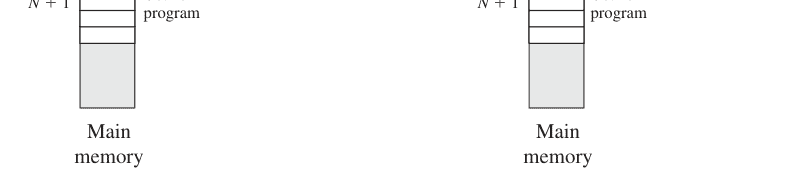

**图 1.11 中断时内存和寄存器的变化**

### 多重中断

到目前，我们已经讨论了单个中断的发生。然而，假设在处理一个中断时，可能会发生一个或多个中断。例如，一个程序可能正在从通信线路接收数据，同时在打印结果。打印机每当完成一次操作就会产生一个中断。通信线路控制器每当一个数据单元到达时就会产生一个中断。该单元可以是单个字符，也可以是一个数据块，取决于通信协议的性质。在任何情况下，在处理打印中断时，可能会发生通信中断。

处理多重中断可以有两种方法。第一种是在处理中断时禁用中断。处理用的中断简单意味着处理器忽略任何新的中断请求信号。如果在此期间发生中断，它通常会保持挂起（`pending`）状态，并会在处理器重新启用中断后由处理器进行检查。因此，如果在用户程序执行时发生中断，则会立即禁用中断。在中断处理程序完成后，在恢复用户程序之前重新启用中断，处理器会检查是否发生了额外的中断。这种方法非常简单，因为中断是按照严格的顺序处理的（见图 1.12a）。

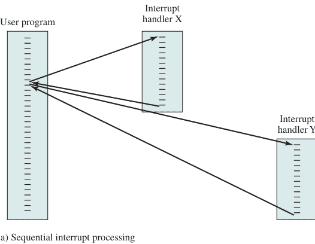

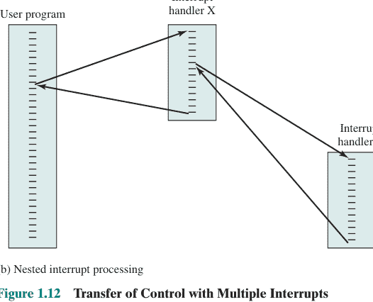

上述方法的缺点是它没有考虑到相对优先级或对时间敏感性的需求。例如，当输入从通信线路快速到达时，可能需要被快速吸收以给更多输入留空间。如果第一批输入在第二批到达之前没有被处理，它可能会丢失；I/O 设备上的缓冲区可能会填并溢出。

第二方法是为中断定义优先级，并允许高优先的中断中断低优先级的中断处理程序（见 1.12b）。作为这种方法的示例，考虑一个具有三个 I/O 设备的系统：打印机、磁盘和通信线路，优先级分别为 2、4 和 5。图 1.13 描述了一个可能的序列。用户程序在 `t=0` 时开始。在 `t=10` 时，发生了打印中断；用户信息被放在控制栈上，并在打印机中断服务程序 `ISR` 中继续执行。当该程序仍在执行时，在 `t=15` 发生了通信中断。由于通信线路的优先级高于打印机，该中断请求得到了响应。它的状态被推到栈中，并在通信 `ISR` 中继续执行。虽然该程序的优先级较低，但它只是被挂起，并且通信 `ISR` 完成了（`t=20`）。因为该程序运行到结束。

当通信 `ISR` 完成（`t=25`）时，恢复之前的处理器状态，即执行打印 `ISR`。然而，甚至在该程序可以执行任何单条指令之前，处理器就响应了高优先级的磁盘中断，并将控制权转移给磁盘 `ISR`。只有当该程序完成（`t=35`）后，打印 `ISR` 才被恢复。当该程序最终返回用户程序。

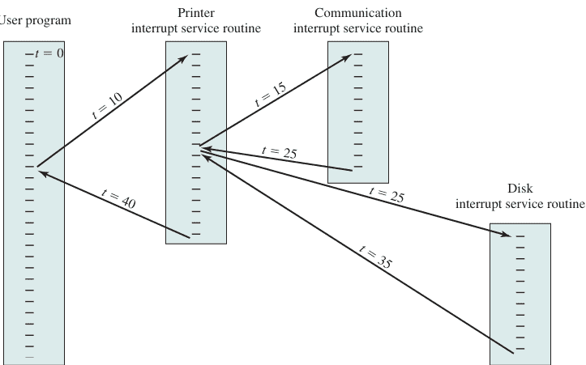

图 1.13 多重中断的示例时间序列


i7-5960 支持与其他芯片进行外部通信的形式。DDR 内存控制器将 DDR（双数据速率）主内存的内存控制器引入芯片。该接口支持四个 8 字节的通道，总位宽为 256 位，聚合数据速率高达 64 GB/s。由于内存控制器位于芯片上，侧边总线被消除。PCI Express 是一种外围总线，允许连接的处理器之间进行高速通信。PCI Express 链路运行速度高达 8 GT/s（每秒传输次数），这加起来达到 40 GB/s。

# 第 1 章 计算机系统概述

| 核心 0 | 核心 1 | 核心 2 | 核心 3 | 核心 4 | 核心 5 | 核心 6 | 核心 7 |
| :--- | :--- | :--- | :--- | :--- | :--- | :--- | :--- |
| 32 kB L1-I | 32 kB L1-D | 32 kB L1-I | 32 kB L1-D | 32 kB L1-I | 32 kB L1-D | 32 kB L1-I | 32 kB L1-D |
| 256 kB L2 缓存 | 256 kB L2 缓存 | | | 256 kB L2 缓存 | 256 kB L2 缓存 | | |
| 20 MB L3 缓存 | | | | | | | |
| DDR4 内存控制器 | | PCI Express | | | | | |
| 4 × 8B @ 2.133 GT/s | | 40 通道 @ 8 GT/s | | | | | |

(a) 框图

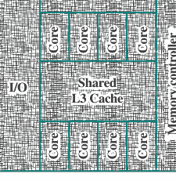

(b) 芯片物理布局

图 1.20 Intel Core i7-5960X 框图

## 1.9 关键术语、复习题与练习

### 关键术语

| 地址寄存器 | 指令周期 | 程序化 I/O |
| :--- | :--- | :--- |
| 辅助内存 | 指令寄存器 | 寄存器 |
| 块 | 中断 | 替换算法 |
| 缓存内存 | 中断驱动 I/O | 二级存储器 |
| 缓存槽 | I/O 模块 | 槽 |
| 中央处理器 | 引用局部性 | 空间局部性 |
| 多处理器系统 | 主内存 | 栈 |
| 数据寄存器 | 存储层次结构 | 栈帧 |
| 直接存储器访问 (DMA) | 缺失 | 栈指针 |
| 命中 | 多核 | 系统总线 |
| 命中率 | 多处理器 | 时间局部性 |
| 输入/输出 | 处理器 | |
| 指令 | 程序计数器 | |

### 复习题

- 1.1. 列出并简要定义计算机的四个主要要素。
- 1.2. 定义处理器寄存器的两个主要大类。
- 1.3. 从通俗来说，机器指令可以指定哪四种不同的操作？
- 1.4. 什么是中断？
- 1.5. 如何通过设置优先级来处理多个中断？
- 1.6. 在向上移动存储层次结构时，可以观察到什么特征？
- 1.7. 决定缓存内存大小的权衡有哪些？
- 1.8. 多处理器系统和多核系统之间的区别是什么？
- 1.9. 空间局部性和时间局部性之间的区别是什么？
- 1.10. 一般来说，利用空间局部性和时间局部性的策略有哪些？

### 练习

- 1.1. 假设图 1.3 中的处理器也具有两个 I/O 指令：

```
0011 = Load AC from I/O
0100 = SUB from AC
```

在这些情况下，12 位地址识别特定的外部设备。请展示以下程序的执行过程（使用图 1.4 的格式）：

1. 从设备 7 加载 AC
2. 从内存位置 881 的内容中减去 AC 内容 (SUB)
3. 将 AC 存储到内存位置 880

假设从设备 7 获取的值为 6，且位置 880 包含的值为 5。

- 1.2. 图 1.4 的程序执行在文中用六个步骤进行了描述。请扩展此描述以显示 `MAR` 和 `MBR` 的使用。
- 1.3. 考虑一个假设的 64 位微处理器，其 64 位的指令由两个字段组成。前 4 位包含操作码，其余部分为立即数操作数或操作数地址。
  - a. 可使用的微处理器地址线最大尺寸是多少？数据线为 64 位、32 位和 16 位时对系统速度会有何影响？
  - b. 如果指令寄存器只包含操作码，它应该包含多少位？如果指令寄存器包含整条指令，它应该包含多少位？
- 1.4. 考虑一个生成 16 位地址（例如，程序计数器和地址寄存器宽度为 16 位）并具有 16 位数据线的假设微处理器。
  - a. 如果连接到“16 位内存”，处理器可以直接访问的最大内存地址空间是多少？
  - b. 如果连接到“8 位内存”，处理器可以直接访问的最大内存地址空间是多少？
  - c. 该微处理器将使用哪些体系结构特征来分离“I/O 空间”？
  - d. 如果输入指令和输出指令可以指定 8 位 I/O 端口号，该微处理器支持多少个 8 位 I/O 端口？多少个 16 位 I/O 端口？解释原因。
- 1.5. 考虑一个 64 位微处理器，具有 32 位的外部数据线，由 16 MHz 输入时钟驱动。假设该微处理器的总线周期最小持续时间等于四个时钟周期。该微处理器能够维持的最大数据传输率是多少字节/秒？为了提高性能，是将外部数据线改为 64 位还是将外部时钟频率翻倍更好？请列出你所做的任何假设。提示：确定每个周期可以传输的字节数。
- 1.6. 考虑一个具有 I/O 模块控制简单键盘/打印机/电打字机的计算机系统。CPU 中包含以下寄存器并连接到系统：
  - `INPR`: 输入寄存器，8 位
  - `OUTR`: 输出寄存器，8 位
  - `FGI`: 输入标志位，1 位
  - `FGO`: 输出标志位，1 位
  - `IEN`: 中断允许，1 位

来自电打字机的按键和到打印机的输出由 I/O 模块控制。电打字机能够将字母数字符号编码为 8 位，并将 8 位字解码为字母数字系统。当 8 位字进入输入寄存器时，设置输入标志。当打印一个字时，设置输出标志。
  - a. 描述 CPU 如何使用本题中列出的前四个寄存器与电打字机实现 I/O。
  - b. 描述如何通过采用 `IEN` 更高效地执行该功能。
- 1.7. 在所有包含 DMA 的系统中，访问主内存的优先级高于处理器对主内存的访问。为什么？
- 1.8. 一个 DMA 模块以每秒 800 位 (bps) 的速率从外部设备传输字符到主内存。处理器以每秒 1 条指令的速度取取。DMA 活动将使处理器减慢多少？
- 1.9. 计算机由一个 CPU 和一个 I/O 设备 D 组成，通过位宽共享总线连接到主内存。CPU 每秒最多可执行 10 条指令。每条指令平均需要五个周期，其中三个周期使用总线。内存读或写操作使用一个处理器周期。假设 CPU 正在持续执行“后台”程序，这些程序需要其执行率的 95%，但不需要任何总线。假设使用 DMA 且 I/O 传输需要：
- 1.10. 考虑以下代码：

```
for (i = 0; i < 20; i++)
  for (j = 0; j < 10; j++)
    a[i] = a[j]
```

  - a. 给代码出一个空间局部性的例子。
  - b. 给代码出一个时间局部性的例子。
- 1.11. 将附录 A 中的 (1.1) 和 (1.2) 扩展到三级存储器。

附录 A 双存储器特性

- 1.12. 考虑一个具有以下参数的缓存系统：
  - `Sc = 32 KB, Cc = 0.1 /字节, Tc = 10 ns`
  - `Sm = 256 MB, Cm = 0.0001 /字节, Tm = 100 ns`
  - a. 添加缓存前的总成本是多少？
  - b. 添加缓存后的总成本是多少？
  - c. 在缓存命中率为 0.85 的情况下，相对于无缓存系统，时间减少的百分比是多少？

## 局部性

两级内存性能优势的依据是局部性原理，该原理在第 1.5 节中提到。该原理指出，内存引用倾向于聚集。在很长一段时间内，所使用的簇会发生变化但在短时间内，处理器主要与固定的内存引用簇一起工作。

从直觉上看，局部性原理是有意义的。考虑以下推理链：

1. 除了分支指令和调用指令（这些指令仅占所有程序指令的一小部分）外，程序的执行是顺序的。因此，在大多数情况下，立即获取的下一条指令紧跟在最后一次获取的指令之后。
2. 很少会有长且不连续的程序调用序列，后跟着相应的返回序列。相反，程序被限制在一个程序调用深度的窄窗口内。因此，在短时间内，对指令的引用将定位在几个程序中。
3. 大多数迭代结构由相对较少的指令重复许多次组成。因此，在迭代期间，计算被限制在程序的一小块连续区域。
4. 在许多程序中，大部分计算涉及处理数据结构，例如数组或记录序列。在许多情况下，对这些数据结构的连续引用将是彼此位置的的项目。

这一推理链已经在许多研究中得到了证实。参考点 (1)，各种研究分析了高级语言程序的行为。表 1.3 包含了来自以下研究的关键结果，衡量了执行期间各种语句类型的出现情况。Knuth [KNUT71] 进行的最早编程语言行为研究检查了一组用于学生练习的 FORTRAN 程序。Tenenbaum [TANE78] 发布了从 OS 程序中使用的 300 多个程序并用支持结构化编程的语言 (SAL) 编写的测量结果。Patterson 和 Sequin [PATT82] 分析了从编译器以及排版、计算机辅助设计 (CAD)、排序和文件程序获取的一系列测量值。研究了 C 和 Pascal 编程语言。Huck [HUCK83] 分析了四个旨在代表通用科学计算混合的程序，包括快速傅里叶变换和微分方程组的积分。这些语言和应用的结果具有良好的一致性，即分支和调用指令仅占程序整个生命周期内执行的语句的一小部分。因此，这些研究证实了上述列表中的断言 (1)。

### 表 1.3 高级操作的相对动态频率

| | [HUCK83] | [KNUT71] | [PATT82] | [TANE78] |
| :--- | :--- | :--- | :--- | :--- |
| 语言负载 | Pascal Scientific | FORTRAN Student | Pascal System / C System | SAL System |
| 赋值 | 74 | 67 | 45 / 38 | 42 |
| 循环 | 4 | 3 | 5 / 3 | 4 |
| 调用 | 1 | 3 | 15 / 12 | 12 |
| IF | 20 | 11 | 29 / 43 | 36 |
| GOTO | 2 | 9 | | 3 |
| 其他 | | 7 | 6 | | 1 | 6 |

关于断言 (2)，[PATT85] 中的研究提供了证实。这在图 1.21 所示，该图显示了调用-返回行为。每个调用由向右下方移动的折线表示，每个返回由向右上方移动的折线表示。在图中，定义了一个深度为 5 的窗口。只有在任一方向上净移动为 6 的调用和返回序列才会导致窗口移动。可见，执行的程序可以在静止窗口内停留很长时间。同一组分析人员对 C 和 Pascal 的研究显示，深度为 8 的窗口仅在少于 1% 的调用或返回时需要移动 [TAM183]。

文献中区分了空间局部性和时间局部性。空间局部性是指执行倾向于涉及若干聚集的内存位置。这反映了处理器顺序访问指令的倾向性。空间局部性也反映了程序顺序访问数据位置的倾向性，例如在处理数据表时。时间局部性是指处理器倾向于访问最近使用过的内存位置。例如，当执行一个迭代循环时，处理器会重复执行同一组指令。

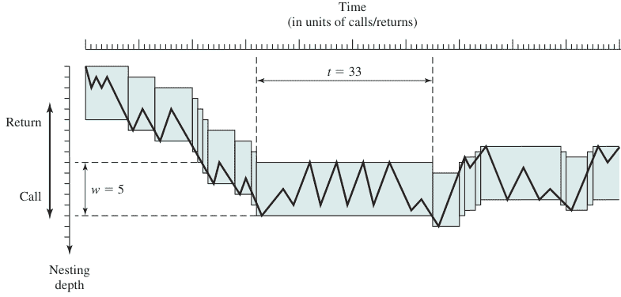

传统上，时间局部性通过将最近使用的指令和数据值保留在缓存内存中，并利用缓存层次结构来实现的。空间局部性通常通过使用更大的缓存块以及将预取机制（获取预期将要使用的项）整合到缓存控制逻辑中来实现。近期，已有关于改进这些技术以获得更佳性能的研究，但基本策略保持不变。

## 两级内存的操作

局部性属性可以被用于形成两级内存。上级内存 (M1) 比下级内存 (M2) 更小、更快，且（每位）成本更昂贵。M1 用作较大 M2 部分的临时存储。当进行内存引用时，会尝试访问 M1 中的项。如果成功，则进行快速访问。如果失败，则访问 M2 中的一个块。

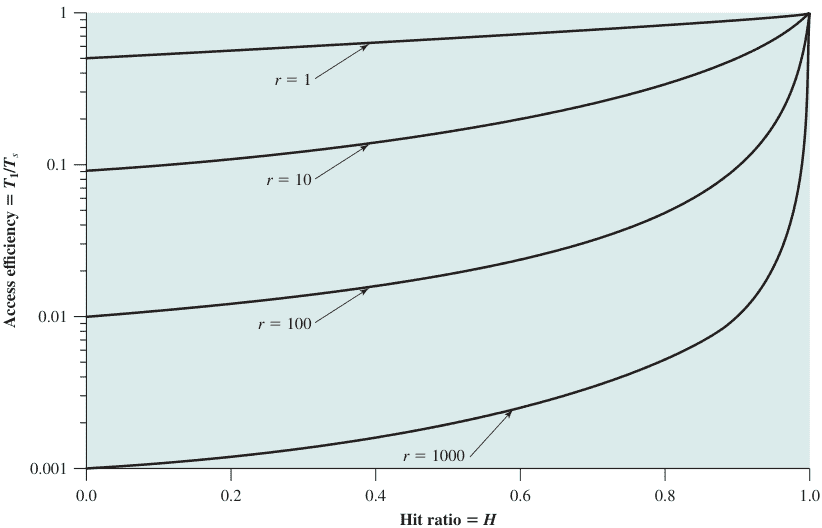

图 1.23 访问效率随命中率变化的函数 (r = T2/T1)

我们现在可以更精确地描述关于相对内存大小的问题了。对于 $S1 \ll S2$ 的情况，命中率达到 0.8 或更高是否合理？这取决于许多因素，包括执行软件的性质以及两级内存设计的细节。当然，决定性因素是局部性程度。图 1.24 显示了局部性对命中率的影响。如果 $M1$ 的大小与 $M2$ 相同，那么命中率将为 1.0。$M2$ 中的所有项也都存储在 $M1$ 中。假设不存在局部性；那么引用是完全随机的。在这种情况下，命中率应该是相对内存大小的严格线性函数。例如，如果 $M1$ 的大小是 $M2$ 的一半，那么在任何时刻，$M2$ 中有一半的项也在 $M1$ 中，命中率将为 0.5。在实践中，引用存在某种程度的局部性。图中指示了中等强局部性的影响。

因此，如果仍然存在局部性，通过较小的上层内存尺寸也可以实现高命中率。例如，许多研究表明，无论主内存的大小，较小的缓存都会产生 0.75 以上的命中率 ([AGAR89],[PRZY88],[STRE83],[SMIT82])。1K 到 128K 范围内的缓存通常是足够的，而主内存现在通常是 级别的。当我们考虑虚拟内存和磁盘缓存时，我们将引用其他证实了相同现象的研究，即由于局部性，较小的 $M1$ 会产生高命中率。

这引出了我们之前列出的最后一个问题：两个内存的相对大小是否满足成本要求？答案显然是肯定的。如果我们只需要较小的上层内存就能获得良好的性能，那么两级内存的每比特平均成本将接近更廉价的下层内存。请注意，在涉及 L2 缓存（甚至 L3 缓存）时，分析要复杂得多。讨论请参阅 [PE99] 和 [HAND98]。

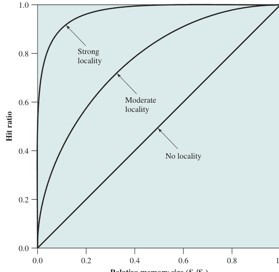

**图 1.24** 命中率随相对内存大小变化的函数

# 第 2 章 操作系统概述

## 2.1 操作系统的目标与功能

- 作为用户/计算机接口的操作系统
- 作为资源管理器的操作系统
- 操作系统的演进易用性

## 2.2 操作系统的演进

- 行处理
- 简单批处理系统
- 多程序批处理系统
- 分时系统

## 2.3 主要成就

- 进程
- 内存管理
- 信息保护与安全
- 调度与资源管理

## 2.4 通向现代操作系统的发展

## 2.5 容错性

- 基本概念
- 操作系统机制

## 2.6 多处理器和多核的操作系统设计考虑

- 对称多处理器操作系统考虑
- 多核操作系统考虑量

## 2.7 Windows 概述

- 背景
- 客户端/服务器模型
- 线程与 Windows 对象

## 2.8 传统 Unix 系统

- 历史
- 描述

## 2.9 现代 Unix 系统

- System V 第 4 版 (SVR4)
- BSD, Solaris

## 2.10 Linux

- 历史
- 模块化结构
- 内核组件

## 2.11 Android

- 软件架构
- 运行时
- 电源管理

## 2.12 术语、思考题与练习

学习本章后，你应该能够：

- 从高层次总结操作系统（OS）的关键功能。
- 讨论操作系统从早期批系统到现代系统的演进。
- 简要解释 2.3 节定义的每项主要成就。
- 讨论对现代操作系统发展起关键领域。
- 定义虚拟机和虚拟化。
- 理解引入多处理器和多处理组织带来的 OS 设计问题。
- 理解 Windows 的基本结构。
- 描述传统 UNIX 系统的要素。
- 解释 Linux 及其与 UNIX 的关系。

我们从简单的历史开始学习操作系统（OS）。这段历史本身非常有趣，同时也起到了提供 OS 原理概述的作用。第一部分考察了操作系统的目标和功能。然后，我们将看看操作系统如何从原始批系统演变为复杂的多用户系统。本章的剩余部分将介绍书中作为示例的操作系统的历史和一般特征。

OS 是一个控制应用程序执行的程序，并充当应用程序与计算机硬件之间的接口。可以被认为具有三个目标：

- 便利性：操作系统让计算机更易于使用。
- 效率：操作系统允许以高效的方式使用计算机系统资源。
- 演进能力：操作系统的构建方式应允许在不干扰的情况下开发、测试和引入新的系统功能，且互不干扰。

让我们逐一考察操作系统的这三个方面。

### 作为用户/计算机接口的操作系统

作为用户/计算机接口的操作系统可以如图 2.1 所示以分层方式显示，用户与应用程序的交互。操作系统通过编程语言提供接口，并允许用户访问系统。在多用户的情况下，操作系统提供一套工具，以帮助程序进行创建。通过这种方式，用户无需关注硬件细节。操作系统为用户屏蔽这些细节，提供统一的接口。操作系统作为中介，允许用户访问系统。操作系统通过提供服务来方便程序使用资源。操作系统在运行期间处理冲突，并允许应用程序访问。操作系统通过提供服务来协助程序。

简而言之，操作系统在以下领域提供服务：

- 程序开发：操作系统提供各种服务，如编辑器和调试器，以帮助创建程序。这些服务通常以库的形式提供。
- 程序执行：为了执行，需要将指令和数据加载到主内存，初始化 I/O 设备和文件，并准备其他资源。操作系统处理调度任务。

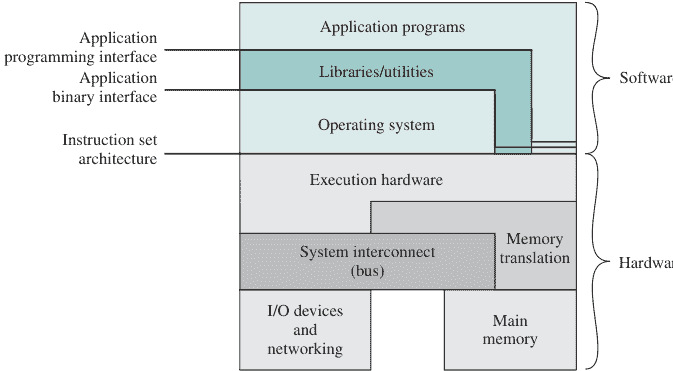

图 2.1 硬件与软件结构

- **I/O 设备访问**：每个 I/O 设备都需要特定的指令或控制信号。操作系统提供简单的接口供程序员访问此类设备。
- **受控的文件访问**：对于文件访问，操作系统必须不仅理解 I/O 设备（磁盘驱动器、带驱动器）的性质，还要理解文件中包含结构。在多用户系统中，操作系统提供保护机制来控制访问。
- **系统访问**：对于共享资源，操作系统对整个系统以及特定的系统资源进行访问控制。访问功能必须防止未经授权的用户访问和数据，并解决资源竞争。


- **错误检测与响应**：计算机系统运行时会出现各种错误。这些包括内部和外部硬件错误（如内存错误、设备故障或失效）以及各种软件错误（如除零、访问禁止内存位置以及无法提供对运行影响最小的响应，例如重试操作或直接向应用程序报告错误）。

- **计数**：良好的操作系统将使用各种资源的统计数据并监控响应时间等性能参数。在任何系统中，这些信息对于预测未来增强和调整系统性能都是有用的。在多用户系统中，这些信息可计费。

图 2.1 指示了三个接口：

- **指令集架构 (ISA)**：ISA 定义了计算机可以遵循的机器语言指令集。该接口是硬件与软件之间的边界。注意应用程序和实用程序都直接访问 ISA。对于程序，指令集的一个子集可用（用户 ISA）。操作系统可以访问管理系统资源的额外机器指令（系统 ISA）。

- **应用二进制接口 (ABI)**：ABI 定义了跨程序的可移植性标准。ABI 定义了操作系统的系统调用接口，以及通过用户 ISA 可用的硬件资源和服务。

- **应用编程接口 (API)**：API 为程序提供了通过用户 ISA 辅助的高级语言（HLL）库调用可用的硬件资源和服务。任何系统调用通常通过库执行。

# 作为资源管理器的操作系统

操作系统（OS）负责控制计算机资源，例如 I/O、主存、外存以及处理器执行时间。但这种控制是以通常的方式进行的。我们将控制机制认为是相对于受控制对象之外的某种东西，或者至少是受控制对象中一个独特且独立的部分。（例如，住宅供暖系统由恒温器控制，恒温器与发热设备和热分配装置是分开的。）但操作系统的情况并非如此，它的控制机制在两个方面是不寻常的：

- 操作系统的运行方式与普通计算机软件相同；也就是说，它是由处理器执行的程序或程序集。
- 操作系统经常放弃控制权，并且必须依赖处理器允许其重新获得控制权。

与其他计算机程序一样，操作系统由处理器执行的指令组成。在执行过程中，操作系统决定了如何分配处理器时间以及哪些计算机资源可供使用。但为了让处理器对这些决策采取行动，它必须停止执行操作系统程序并执行“有用”的工作，然后放弃控制权足够的时间，以准备处理器执行下一项工作。其中涉及的机制将随着章节的进行而变得清晰。

图 2.2 显示了操作系统管理的主要资源。操作系统的一部分位于内存中。这包含了操作系统中最常用的函数，以及在给定时刻当前使用的操作系统其他部分。内存的其余部分包含用户程序、实用程序和数据。正如我们将看到的，操作系统和处理器中的内存管理硬件共同控制着主存的分配。操作系统决定了执行中的程序何时使用 I/O 设备，并控制对文件的访问和使用。处理器本身也是一种资源，操作系统必须确定投入多少处理器时间来执行特定的用户程序。

# 操作系统的演进

由于许多原因，大型操作系统会随着时间的不断演进：

- **硬件升级加新类型硬件**：例如，UNIX 和 Macintosh 操作系统的早期版本没有采用分页机制，因为它们运行在没有分页硬件的处理器上。这些操作系统的后续版本经过了修改，以利用分页能力。此外，使用图形终端和页式模式终端代替行扫描模式也影响了操作系统的设计。例如，图形界面通常允许用户通过屏幕上的“窗口”同时查看多个应用程序。这需要操作系统提供更复杂的支持。

**图 2.2** 作为资源管理器的操作系统

- **新服务**：为了响应用户需求或新服务，操作系统会扩展以提供新服务。例如，如果发现使用现有工具很难为用户维持良好的性能，则可能会向操作系统中添加新的测量和控制工具。

- **修复**：任何操作系统的故障。这些故障随着时间的推移被发现并进行修复。修复可能会引入新的故障。

定期更新操作系统的需求对其设计提出了某些要求。一个显而易见的说法是，系统在构造上应该是模块化的，模块之间应该有清晰定义的接口，并且应该有文档。对于大型程序（如典型的现代操作系统），所谓的“简单模块化”是不够的 [DEN80a]。这意味着，仅仅将程序划分为模块需要完成更多的工作。我们将在本章的后面部分回到这个话题。

## 2.2 操作系统的演进

在尝试理解操作系统的关键需求以及现代操作系统主要特征的意义时，考虑操作系统多年来的演变是很有用的。

### 顺序处理

在最早的计算机中（从 20 世纪 40 年代中期到 50 年代中期），程序直接与计算机硬件交互；那里没有操作系统。这些计算机通过一个控制台运行，控制台由显示灯、拨开关、某种形式的输入设备和打印机组成。机器码程序通过输入设备（例如卡片阅读器）加载。如果发生错误，将通过显示器指示。这些早期系统带来了两个主要问题：

- **调度**：大多数安装使用时间片来预留时间。由于调度，程序在结束之前，处理器时间被浪费了。
- **设置时间**：单用户作业，将高级语言程序（源程序）加载到内存，然后链接（目标程序）。这些步骤可能涉及装载磁带或卡片堆。当程序完成时，它会返回到开始位置。这种运行模式被称为顺序处理，大量时间被花费在设置程序上。

随着时间的推移，开发了各种软件工具来尝试使顺序处理更高效。这些工具包括 I/O 驱动程序。

### 简单批处理系统

早期计算机非常昂贵，因此最大化处理器利用率至关重要。由于调度和设置时间导致的浪费是不可接受的。

为了提高利用率，开发了批处理的概念。似乎第一个操作系统（以及任何类型的操作系统）是 20 世纪 50 年代由通用电气在 IBM 701 上开发的 [WEI281]。该概念随后由一些客户在 IBM 704 上进行了改进和实现。到 20 世纪 60 年代初，许多供应商为他们的计算机系统开发了批处理操作系统。IBM 为 7090/94 计算机开发的 IBS 因其广泛的影响而特别值得关注。

简单批处理方案的核心思想是使用称为监控器的软件。在这种操作系统类型中，用户不再直接访问处理器。相反，用户将作业通过卡片或磁带提交给操作员，操作员将作业打包并将整个批次放在输入设备上供监控器使用。每个程序都设计为在完成后分支回监控器，此时监控器会自动开始加载下一个程序。为了理解这是如何工作的，让我们从两个角度来看：监控器的角度和处理器的角度。

- **监控器角度**：监控器控制事件的序列。为了实现这一点，监控器必须始终位于内存中并供执行（见图 2.3）。该部分被称为*驻留监控器*。其余部分由实用程序和通用函数组成，在任何作业开始时作为子程序加载到用户程序中。监控器从输入设备（通常是卡片阅读器或磁带驱动器）一次读取一个作业。在读取时，当前作业被放置在用户程序区域并将控制权交给该作业。当作业完成后，它会将控制权返回监控器，监控器立即读取下一个作业。

- **处理器角度**：在某个时刻，处理器正在执行主内存中包含监控器的部分的指令。这些指令导致下一个作业读取到内存的另一部分。一旦作业被读取，处理器将遇到监控器中的分支指令，指示处理器从开始继续执行用户程序。处理器将执行用户程序中的指令，直到遇到结束或错误条件。任何一种事件都会导致处理器从监视程序（monitor program）中获取下一条指令。因此，“控制权移交给作业”简单意味着处理器现在正在获取并执行用户程序中的指令，而“控制权返回监视程序”意味着处理器现在正在获取并执行监视程序中的指令。

监视程序执行调度功能：一组作业被排队，并尽可能快地执行作业，中间没有空闲时间。监视程序还改进了作业的设置时间。对于每个作业，指令通过作业控制语言（JCL）的原语进行读取。这是一种特殊的编程语言，用于向监视程序提供指令。一个简单的例子是用 FORTRAN 语言编写的用户程序，以及该程序要使用的数据。所有的 FORTRAN 指令和数据都在单独的打孔卡或磁带上的单独记录上。除了 FORTRAN 和数据行外，作业还包括控制指令，以 `$` 符号开头。作业的整体格式如下：

```
$JOB
$FTN
.
.
.  FORTRAN 指令

$LOAD
$RUN
.
.
  数据

$END
```

为了执行此作业，监视程序读取 `$FTN` 行并从其外部存储（通常是磁带）中加载相应的编译器。编译器将用户的程序翻译成目标代码，目标代码存储在内存或外部存储中。如果存储在内存中，该操作被称为“编译、加载并运行”。如果存储在磁带上，则需要 `$LOAD` 指令。监视程序读取该指令，并在编译完成后重新获得控制权。监视程序调用加载器，加载器将目标程序加载到内存中（代替编译器）并将控制权交给它。通过这种方式，大段主内存可以在不同的子系统之间共享，尽管一次只有一个子系统在执行。

在用户程序执行期间，任何输入指令都会导致读取一行数据。用户程序中的输入指令会调用作为 OS 一部分的输入例程。输入例程会确保程序不会意外读取 JCL 行。如果发生这种情况，就会发生错误并将控制权转移到监视程序。在用户作业完成后，监视程序扫描输入行，直到遇到下一条 JCL 指令。因此，系统防止了由于数据行过多或过少的程序侵害。

### 简单批处理系统的硬件特性

监视程序或批处理 OS 仅仅是一个计算机程序。它依赖于处理器从内存的不同部分获取指令的能力，以交替获取和放弃控制权。其他某些硬件特性也是理想的：

- **内存保护**：当用户程序执行时，它不能修改包含监视程序的内存区域。如果尝试此类操作，处理器硬件将检测到错误并将控制权转移到监视程序。监视程序将终止作业，打印错误信息并加载下一个作业。
- **定时器**：定时器用于防止单个作业垄断系统。定时器在每个作业开始时设置。如果定时器超时，用户程序将停止，控制权返回监视程序。
- **特权指令**：某些机器级指令被指定为特权指令，只能由监视程序执行。如果处理器在执行用户程序时遇到此类指令，将导致控制权转移到监视程序的错误。特权指令中包括 I/O 指令，因此监视程序保留对所有 I/O 设备的控制权。这防止了用户程序意外读取下一个作业的作业控制指令。如果用户程序希望执行 I/O，它必须请求监视程序为其执行操作。
- **中断**：早期计算机模型不具备这种能力。这一特性使得 OS 在向用户程序放弃控制权和重新获取控制权方面更有灵活性。

对内存保护和特权指令的考虑导致了模式的概念。用户程序在**用户模式**下执行，在该模式下，某些内存区域免受用户保护，某些指令可能执行。监视程序在**系统模式**（或后来的内核模式）下执行，在该模式下可以执行特权指令，并可以访问内存区域。

当然，OS 可以使用这些特性构建。但计算机供应商很快发现结果将是混乱的，因此即使是原始的批处理操作系统也提供了这些硬件特性。

对于批处理 OS，处理器在执行完用户程序和监视程序后终止。这里有两个牺牲：现在部分内存被给了监视程序，处理器时间被监视程序消耗。这两者都是开销的形式。尽管有这些开销，简单的批处理系统仍然提高了计算机的利用率。

### 多程序批处理系统

即使有了简单批处理 OS 的自动作业排序，处理器经常处于空闲状态。问题是 I/O 设备相对于处理器太慢。

| | |
|---|---|
| 从文件读取一条记录 | 15 µs |
| 执行 100 条指令 | 1 µs |
| 向文件写入一条记录 | 15 µs |
| 总计 | 31 µs |
| CPU 利用率 = 1/31 = 0.032 = 3.2% |

**图 2.4** 系统利用率示例

图 2.4 详细说明了一个具有代表性的计算。该计算涉及一个处理记录文件的程序，平均每条记录执行 100 条机器指令。在此过程中，计算机花费了 96% 以上的时间等待 I/O 设备完成从文件传输数据。图 2.5a 展示了这种情况，其中只有一个程序，被称为单程序处理。（图 2.5）

**图 2.5** 多程序处理示例

表 2.1 样例执行属性

| JOB1 | JOB2 | JOB3 |
|---|---|---|
| 作业类型 | 计算密集型 | I/O密集型 | I/O密集型 |
| 持续 | 5 分钟 | 15 分钟 | 10 分钟 |
| 需要内存 | 50 M | 100 M | 75 M |
| 需要磁盘？ | 否 | 否 | 是 |
| 需要终端？ | 否 | 是 | 否 |
| 需要打印机？ | 否 | 否 | 是 |

花费一定时间执行，直到遇到输入指令。必须等待 I/O 指令结束才能继续。这种低效率是不必要的。我们知道有足够的内存存放 OS（驻留内存）和一个用户程序。当一个作业需要等待 I/O 时，处理器可以切换到另一个作业，后者可能没有在等待 I/O（见图 2.5b）。此外，我们可能需要内存来存放三个、四个或更多程序并切换（见图 2.5c）。这种方法被称为**多程序处理**、**多任务**。它是现代操作系统的核心主题。

为了说明多程序处理的好处，我们给出一个简单的例子。考虑一台拥有 250 MB 内存（非 OS 使用）、一个磁盘、一个终端和一个打印机的计算机。作业 JOB1、JOB2 和 JOB3 同时提交执行，属性如表 2.1 所示。我们假设 JOB2 和 JOB3 对处理器的需求最小，JOB3 持续使用磁盘和打印机。对于批处理环境，作业将顺序执行。因此，JOB1 在 5 分钟后完成，JOB2 必须等待 5 分钟结束后在 15 分钟后完成。JOB3 在 20 分钟后开始，并在提交 30 分钟后完成。平均资源利用率、吞吐量和响应时间见表 2.2 中的多程序列。按设备划分的利用率显示在要求的 30 分钟内，所有资源都存在严重不足。

现在假设这些作业在多程序 OS 中并发运行。由于作业之间的资源竞争很少，三个作业都可以同时运行。

表 2.2 多程序处理对资源利用率的影响

| | 单程序 | 多程序 |
|---|---|---|
| 处理器利用率 | 20% | 40% |
| 内存利用率 | 33% | 67% |
| 磁盘利用率 | 33% | 67% |
| 打印机利用率 | 33% | 67% |
| 通过时间 | 30 分钟 | 15 分钟 |
| 吞吐量 | 6 个作业/小时 | 12 个作业/小时 |
| 平均响应时间 | 18 分钟 | 10 分钟 |

**图 2.6** 利用率直方图

与计算机中的其他程序共存时，时间几乎接近最少（假设 JOB2 和 JOB3 分配了足够的处理器时间以保持其输入输出操作处于激活状态）。JOB1 仍需 5 分钟完成，但在时间结束时，JOB2 将完成三分之一，JOB3 完成了一半。三个作业将在 15 分钟内完成。通过检查从图 2.6 直方图中得到的表 2.2 多程序数据，这种改进是显而易见的。

作为一个简单的批处理系统，多程序批处理系统必须依赖某些计算机硬件特性。对多程序有用的最显著的额外特性是处理 I/O 中断和 DMA（直接内存访问）的硬件。通过中断驱动的 I/O 或 DMA，处理器可以为一个作业发出 I/O 命令，并在设备控制器执行 I/O 的同时继续执行另一个作业。当 I/O 操作完成时，处理器会被中断，并将控制权交给操作系统中的中断处理程序。在处理中断后，操作系统将把控制权交给另一个作业。

与单程序或单任务系统相比，多程序系统相当复杂。为了运行多个作业，它们必须保存在主内存中，这需要某种形式的**内存管理**。此外，如果有几个作业准备就绪运行，处理器必须决定运行哪一个，这个决策需要一个调度算法。这些概念将在本章稍后的部分讨论。

### 分时系统

通过使用多程序，批处理可以非常高效。然而，对于许多作业来说，提供一种用户直接与计算机交互模式是理想的。事实上，对于某些作业（如事务处理），交互式模式是必不可少的。

今天，对交互式计算设施的需求可以通过专用个人计算机或工作站来满足，而且通常如此。这种选择在 20 世纪 60 年是不存在的，当时大多数计算机都很忙且昂贵。于是开发了分时技术。

正如多程序允许处理器同时处理多个批处理作业一样，多程序也可以用于处理多个交互式作业。在后一种情况下，这种技术被称为分时，因为处理器时间是在多个用户之间共享的。在分时系统中，多个用户通过终端同时访问系统，操作系统在短的脉冲或计算量子内交替执行每个程序。如果同时有 n 个用户请求服务，每个用户平均只能看到 1/n 的有效计算机容量（不计入操作系统的开销）。然而，考虑到人类反应时间相对较慢，在设计良好的系统上，响应时间应该与专用计算机上相似。

批处理和分时都使用多程序。关键区别列在表 2.3 中。

最早开发的分时操作系统之一是兼容分时系统（CTSS）[CORB62]，它是由麻省理工学院的一个名为“项目 MAC”（机器辅助认知，或多路访问计算机）的小组开发的。该系统最初于 1961 年为 IBM 709 开发，后来被移植到 IBM 7094。

与后来的系统相比，CTSS 是原始的。该系统运行在一台拥有 32,000 位字内存的计算机上，其中驻留监控器消耗了其中的 5,000 字。当需要将控制权分配给交互式用户时，用户的程序和数据被加载到剩余的 27,000 字内存中。一个程序监视管理系统。时钟大约每 0.2 秒产生一次中断。在每次时钟中断时，操作系统重新获得控制权并可以将处理器分配给另一个用户。这种技术被称为时间片；在定期间隔内，用户会被抢占并加载另一个用户。为了保留旧用户，用户会被抢占，另一个用户被写入磁盘。

表 2.3 批处理对比分时

| 批处理 | 分时 |
| :--- | :--- |
| 主要目标：最大化处理器利用率 | 最小化响应时间 |
| 操作系统的来源：作业语言 | 终端输入 |

### 2.7 CTSS 操作

为了减少磁盘流量，多程序方法在作业加载时是有效的。这一原理在图中所示。假设有四个用户，其内存需求如下：

- JOB1: 15000
- JOB2: 20000
- JOB3: 5000
- JOB4: 10000

最初，监视器加载 JOB1 并将控制权交给它。由于 JOB2 需要更多内存，JOB1 必须被写出，并加载 JOB2。随后，监视器将控制权交给 JOB3。由于 JOB3 比 JOB2 小，JOB2 可以留在内存中。当 JOB4 被激活时，JOB1 被写出。

CTSS 方法与分时相比是多程序的，但它非常简单。由于作业始终加载到内存的位置，因此不需要重定位技术（后文讨论）。在 7094 上，CTSS 最多支持 32 个用户。

分时和多程序为操作系统带来了一系列新问题。如果多个作业在内存中，它们必须防止相互干扰，例如修改对方的数据。对于多个交互式用户，文件系统必须受到保护，以确保只有授权的用户访问特定文件。对打印机和质存储设备的竞争必须得到处理。这些和其他问题贯穿全文。

## 2.3 成就


操作系统是开发以来最复杂的软件之一。这反映了在满足便利性、效率和演进能力某些竞争目标方面的挑战。[DEN80a] 认为操作系统的发展取得了四个主要的理论进展：

- 进程
- 内存管理
- 信息保护与安全
- 调度与资源管理

每个进展都以为了解决困难实际问题而开发的原则或抽象为特征。总之，这四个领域涵盖了现代操作系统的许多关键设计和实现问题。本节对这四个领域的简要回顾作为大部分内容的概述。

## 进程

操作系统设计的核心是进程的概念。这个术语最早由 20 世纪 60 年代 Multics 的设计者使用 [DALE68]。这是一个比作业更泛化的术语。对进程术语有很多定义，包括：

- 执行中的程序
- 在计算机上运行的程序实例
- 可以分配给处理器并执行的实体
- 以单顺序执行线程、当前状态和相关系统资源为特征的活动单元

随着我们的学习，这个概念将变得更加清晰。

三条计算机系统路线产生了计时和同步问题，这促进了进程概念的发展：多程序批处理、分时和实时事务系统。正如我们所看到的，多程序的设计是为了保持处理器以及 I/O 设备（包括存储设备）同时忙碌，以实现最大效率。其关键机制是：通过响应表示 I/O 事务完成的信号，处理器在主内存中的各种程序之间切换。

第二条发展线索是通用时分系统。在这里，关键设计目标是对单个用户的需求做出响应，同时由于成本考虑，需要能够同时支持许多用户。由于用户的反应时间相对较慢，这些目标是可以兼容的。例如，如果一个典型用户每分钟平均需要 2 秒的处理时间，那么接近 30 个用户就可以共享同一个系统，而不会产生明显的干扰。当然，在进行此类计算时，必须考虑操作系统的开销（`OS overhead`）。

第三条发展线索是实时事务处理系统。在这种情况下，有许多用户正在对数据库输入查询或更新。一个例子是航空公司订务系统。事务处理系统与时分系统的主要区别在于，前者局限于一个或少数几个应用程序，而时分系统的用户可以参与程序开发、作业执行以及各种应用程序的使用。在这两种情况下，系统响应速度都是至关重要的。

系统程序员在开发早期多道程序和多任务交互系统时，使用的主要工具是中断。作业活动可以由于定义事件（如 I/O 完成）的发生而暂停。处理器会保存某种上下文（例如，程序计数器和其他寄存器），并跳转到中断处理例程，该例程确定中断的性质，处理中断，然后恢复用户使用被中断的进程或其他作业。

设计用于创建这些各种活动的系统软件设计是极其困难的。由于一次有许多作业正在进行，且每个作业都涉及按顺序执行的许多步骤，因此分析所有事件序列的可能组合变得是不可能的。在缺乏系统协调和协作方法的情况下，研究人员诉助于他们对操作系统必须控制的环境的理解，采用了基于此的临时方法（`hoc methods`）。这些努力极易受到细微编程错误的影响，这些错误的影响只有在发生罕见的事件序列时才能被观察到。这些错误很难诊断，因为需要将它们与应用程序错误和硬件错误区分开来。即使检测到错误，也很难确定原因，因为错误出现的精确条件非常难以重现。总来说，错误有四个主要原因 [DENN80]：

- **同步不当**：程序正在等待系统中的某个事件。例如，一个启动 I/O 读取的程序必须等待数据在缓冲区中可用后才能继续。在这种情况下，需要来自其他某个用户的信号。信号机制设计不当可能导致接收到的信号丢失或重复。
- **互斥失效**：通常情况下，会有一个或多个用户或程序尝试同时使用同一个共享资源。例如，两个用户可能同时尝试编辑同一个文件。如果这些访问没有得到控制，就会发生错误。必须存在某种互斥机制，允许一次仅有一个运行时可以对文件进行更新。互斥的实现很难在所有可能的事件序列下被验证为正确的。
- **程序运行的不确定性**：特定程序的运行结果应该只依赖于该程序的输入，而不依赖于共享系统中其他程序的活动。当程序共享内存，且它们的执行被处理器交替进行时，它们可能会以不可预测的方式通过重写公共内存区域来相互干扰。因此，各种程序调度的顺序可能会影响任何特定程序的结果。
- **死锁**：两个或多个程序可能互相挂起并等待对方。例如，两个程序可能需要两个 I/O 设备来执行某些操作（例如，从磁盘拷贝到磁带）。其中一个程序拥有其中一个设备的控制权，另一个程序拥有另一个设备的控制权。每个程序都在等待另一个程序释放所需的资源。这种死锁可能取决于资源分配和释放的随机时机。

解决这些问题需要一种系统的方法来监控和控制在处理器上执行的各种程序。进程（`process`）的概念提供了基础。我们可以把进程看作是由三个部分组成体：

1. 一个可执行的程序
2. 程序所需的关联数据（变量、工作空间、缓冲区等）
3. 程序的执行上下文

最后一个元素是至关重要的。执行上下文（或称为进程状态）是操作系统能够监督和控制进程的内部数据。这些内部信息与进程是分离的，因为操作系统没有被允许访问进程内部的信息。上下文包含了操作系统管理进程以及处理器妥善执行进程所需的所有信息。上下文包含了各种寄存器的内容，例如程序计数器和数据寄存器。它还包含了操作系统使用的信息，例如进程的优先级以及进程是否正在等待特定 I/O 事件的完成。

图 2.8 显示了在何处管理进程。两个进程 A 和 B 存在于内存的部分区域。该块内存被分配给每个包含程序、数据和上下文信息的进程。每个进程都记录在由操作系统构建并维护的进程列表中。进程列表包含每个进程的一个条目，其中包含指向包含进程的内存块位置的指针。进程可能还包含部分或全部存储在其他处的上下文，可能与进程一起（如图 2.8 所示），或者频繁存储在内存的独立区域中。进程索引寄存器（`process index register`）包含当前控制处理器的进程在进程列表中的索引。程序计数器（`program counter`）指向该进程下一个要执行的指令。基寄存器（`base register`）和限寄存器（`limit register`）定义了进程占据的区域：基寄存器是区域的起始地址，限寄存器是区域的大小。

协调和协作。新功能可以通过扩展以包含新信息来引入操作系统（例如，优先级）。在本书中，我们将看到许多使用这种结构来解决多道程序问题的示例。

最后一点，我们将简要介绍的是线程（`thread`）的概念。分配资源的单个进程可以被分成多个协作执行的线程。这引入了需要由操作系统管理的并行。

## 内存管理

用户的需求可以通过支持模块化编程和灵活数据的计算环境得到最好的满足。系统管理员需要对存储分配进行有效的控制。操作系统为了满足这些需求有五个管理职责：

- **进程隔离**：操作系统必须防止独立进程相互干扰内存。
- **自动分配和管理**：程序应根据需要跨内存层次动态分配。分配对程序员是透明的。因此，程序员被除了内存限制的担忧，操作系统可以通过根据需要分配内存来实现效率。
- **支持模块化编程**：程序员应该能够定义程序，并动态创建、删除和更改模块的大小。
- **保护和访问控制**：在内存层次的任何级别共享内存都会产生一个程序访问另一个内存空间的可能性。这在特定应用程序共享时是理想的。在其他情况下，它威胁程序甚至操作系统本身的完整性。操作系统必须允许用户以各种方式访问内存。
- **长期存储**：许多应用程序在计算机关闭后长时间仍需要内存信息。

通常，操作系统通过虚拟内存和文件系统满足这些需求。文件系统实现了命名对象文件的长期存储。文件对于程序员来说是一个方便的概念，也是操作系统进行访问控制和保护的有用单位。

**虚拟内存**是一种允许程序从逻辑视图访问内存而不考虑物理内存量的设施。虚拟内存的构想是为了满足多个作业留存在主内存的要求，从而避免在连续执行进程之间由于将一个进程写入次级存储并读取继任进程而产生的间隙。

进入主内存。这里引入了分页系统，它允许进程由若干固定大小的块组成，这些块称为“页”。程序通过虚拟地址引用字，该地址由一个页号和页内的偏移量组成。进程的每个页可以位于主内存中的任何位置。分页系统在程序中使用的虚拟地址与主内存中的实际地址（或物理地址）之间提供了动态映射。

随着动态映射硬件出现，下一个逻辑步骤是消除进程的所有页必须同时驻留在主内存的要求。当进程执行时，其所有的页都维护在磁盘上。如果引用了不在主内存中的页，内存管理硬件会检测到这一点，并配合操作系统安排加载缺失的页。这种方案被称为虚拟内存，并如图 2.9 所示。

| | | | |
|---|---|---|---|
| | A.0 | A.2 | |
| | A.5 | | |
| B.0 | B.1 | B.2 | B.3 |
| | | A.7 | | |
| | A.9 | | |
| | | A.8 | |
| | | B.5 | B.6 |
| 0 | 0 |
|---|---|
| n 1 | 1 |
| 2 | 2 |
| 3 | 3 |
| 4 | 4 |
| 5 | 5 |
| 6 | 6 |
| 7 | |
| 8 | |
| 9 | |
| 10 | |
| 用户程序 B | |
| 用户程序 A | |

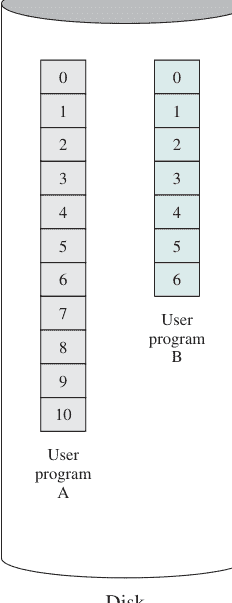

主内存由若干固定长度的帧组成，每个帧的大小等于页的大小。为了让程序执行，其部分或全部页必须在主内存中。

辅助内存（磁盘）可以存放许多固定长度的页。用户程序由若干页组成。所有程序的页以及操作系统都位于磁盘上，文件也是如此。

**图 2.9** 虚拟内存概念

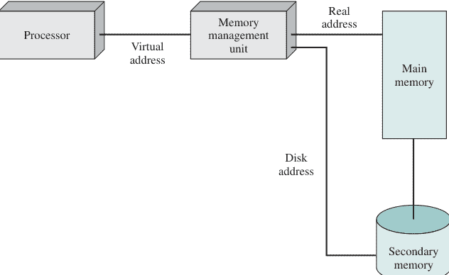

**图 2.10** 虚拟内存寻址

处理器硬件结合操作系统为用户提供了一个可以访问虚拟内存的“虚拟处理器”。这种内存可以是一个线性地址空间，也可以是一个段的集合，段是连续地址的可变长度块。无论何种情况，编程语言指令都可以引用虚拟内存区域中的程序和数据位置。通过为每个进程分配唯一的、不重叠的虚拟内存来实现进程隔离。通过重叠两个虚拟内存空间来实现内存共享。文件维护在长期存储中。文件和文件的部分可以被复制到虚拟内存中供程序处理。

图 2.10 突出了虚拟内存方案中的寻址问题。存储由可直接寻址（通过机器指令）的内存和低速的辅助内存组成，后者通过将块加载到主内存来间接访问。地址转换硬件（内存管理单元）置于处理器和内存之间。程序使用虚拟地址引用位置，这些地址被映射到真实的主内存中。如果引用的是不在真实内存中的虚拟地址，则会将真实内存的内容交换到辅助内存，并将所需的数据块交换进来。在此活动期间，产生地址引用的进程必须挂起。操作系统设计师需要开发一种开销极小的地址转换机制，以及一种能最小化内存级之间流量的存储分配策略。

## 信息保护与安全

分时系统的使用增长以及近期计算机网络的发展，带来了对信息保护关注的增加。一个机构所面临的威胁性质很大程度上取决于具体情况。然而，有一些通用工具可以构建在计算机和操作系统中，支持各种保护和安全机制。总的来说，我们关注的是控制计算机系统及其存储信息的访问控制问题。

与操作系统相关的安全和保护的大部分工作可以大致分为四类：

1. **可用性**：关注保护系统免受中断。
2. **机密性**：确保用户无法读取未经授权即可访问的数据。
3. **数据完整性**：保护数据免受未经的修改。
4. **真实性**：关注对用户身份以及消息或数据的有效性验证。

## 调度与资源管理

操作系统的职责之一是管理其提供的各种资源（主内存、I/O 设备、处理器），并调度活动进程对这些资源的使用。任何资源分配和调度策略必须考虑三个因素：

1. **公平性**：通常，我们希望所有竞争使用特定资源的进程都能获得对该资源近似相等且公平的访问。这对于同类作业尤为重要，因为它们的需求相似。
2. **差异化响应**：另一方面，操作系统可能需要对具有不同服务要求的不同类作业进行区分。操作系统应尝试做出分配和调度决策以满足整体需求。操作系统还应动态地做出这些决策。例如，如果进程正在等待使用 I/O 设备，操作系统应尝试做出分配和调度决策以满足需求。
3. **效率**：操作系统应尝试最大化吞吐量，最小化响应时间，并在分时情况下尽可能容纳更多用户。这些标准之间存在冲突；在特定情况下找到合适的平衡是一个持续存在的问题。


# 调度和资源管理

调度和资源管理本质上是运筹学问题，该领域的结果可以应用。此外，对系统活动进行测量对于调整至关重要。图 2.11 显示了多编程环境中涉及进程调度和资源分配的操作系统元素。操作系统维护着若干队列，每个队列都是等待某种资源的列表。短调度队列由位于主内存（或至少核心部分位于主内存中）且一旦处理器可用即可运行的进程组成。这些进程中的任何一个都可以使用处理器。这取决于短调度器，

## 2.3 主要成就


图 2.11 多编程操作系统的关键元素或调度器，用于选择一个。一种常见的策略是给队列中的每个进程轮流时间；这被称为轮转技术。实际上，轮转技术采用了循环队列。另一种策略是为进程分配优先级，由调度器按优先级顺序选择进程。

长期队列是等待使用处理器的作业列表。操作系统通过将进程从长期队列转移到短期队列来将作业引入系统。此时，必须为进入的进程分配部分主内存。操作系统必须确保不会因引入过多进程而导致内存或处理时间的过度分配。每个 I/O 设备都有一个 I/O 队列。多个进程可能请求同一个 I/O 设备。等待每个设备的进程都排列在该设备的队列中。再次，操作系统必须决定将哪个进程分配给 I/O 设备。

当发生中断时，操作系统通过处理程序获取处理器的控制权。进程可以通过服务调用调用某些操作系统服务（例如 I/O 设备处理器）。在这种情况下，处理程序是进入操作系统的入口。在任何情况下，一旦中断或服务调用处理完毕，就会调用短调度器。

上述是功能性描述；且操作系统的该部分的模块化设计在不同系统中会有不同。操作系统的大量研究和开发工作一直针对该函数的选择算法和数据结构，以提供公平性、差异化响应和效率。

# 92 第 2 章 / 操作系统概览

## 2.4 通向现代操作系统的发展

多年来，操作系统的结构和功能经历了逐渐的演进。然而，近年来，新的操作系统以及现有操作系统的新版本中都引入了许多新的设计元素，导致了操作系统本质的重大变化。这些现代操作系统是为了应对硬件的新发展、新应用以及新威胁。关键硬件驱动因素包括多处理器系统、提高的处理器速度、高速网络连接，以及不断增大且种类日益多样化的内存存储设备。在应用领域，多媒体应用、互联网和 Web 访问、客户端/服务器计算影响了操作系统的设计。在安全方面，计算机接入互联网极大地增加了潜在威胁，而日益复杂的攻击（如病毒、蠕虫和黑客技术）对操作系统的设计产生了深远影响。

操作系统需求的变化速度不仅要求对现有架构进行修改，还需要组织操作系统的新方法。实验性操作系统商业性操作系统都尝试了多种不同的方法和设计元素，但大部分工作都属于以下几类：

- 微内核架构
- 多线程
- 对称多处理
- 分布式操作系统
- 面向对象的设计

直到最近，大多数操作系统仍具有大型单体内核。人们认为操作系统的功能大部分都在这些大型内核中提供，包括调度、文件系统、网络、设备驱动程序、内存管理等。通常，单体内核被实现为一个单一进程，所有元素共享相同的地址空间。微内核架构仅为内核分配了少数功能，包括地址空间管理、进程间通信 (`IPC`) 和基础调度。其他服务由称为“服务器”的进程提供，这些进程运行在用户模式下，并被微内核视为像任何其他应用程序一样的存在。这种方法解耦了内核与服务器的开发。服务器可以根据特定的应用或环境需求进行定制。微内核方法简化了实现，提供了灵活性，并非常适合分布式环境。本质上，微内核以相同的方式与本地和远程服务器进程交互，促进了分布式系统的构建。

多线程是一种将执行应用程序的进程划分为多个可以并发运行的线程的技术。我们可以做出以下区分：

- **线程 (`Thread`)**：一个可分派的工作单元。它包含处理器上下文（包括程序计数器和栈指针）以及它自己的栈数据区域（用于实现子程序分支）。线程按顺序执行且可以被中断，以便处理器可以切换到另一个线程。

- **进程 (`Process`)**：一个或多个线程以及相关系统资源（如包含代码和打开文件的内存，以及设备）的集合。这与执行中的程序概念紧密对应。通过将单个应用程序拆分为多个线程，程序员对应用程序的模块化和应用程序相关事件的时机具有极大的控制力。

多线程对于执行许多本质上独立且不需要序列化的任务的应用非常有用。一个例子是数据库服务器，它监听并处理多个客户端请求。通过在同一个进程内运行线程，在线程之间来回切换的处理器开销比不同进程之间进行主要切换要小。线程对于构建作为操作系统内核部分的进程也很有用，将在后续章节中进行描述。

对称多处理 (`SMP`) 是一个术语，指一种计算机硬件架构（在第 1 章中描述），也指利用该架构的操作系统。`SMP` 操作系统在所有处理器上调度进程或线程。与单处理器架构相比，`SMP` 具有许多潜在优势，包括：

- **性能 (`Performance`)**：如果计算机需要完成的工作可以被组织，使得部分工作可以并行完成，那么具有多个处理器的系统性能将比具有相同类型的单处理器系统更高。这在图 2.12 中得到了体现。在多程序中，一次只能有一个进程执行；在此期间，所有其他进程都在等待处理器。而在多处理中，可以有多个进程同时运行，每个进程运行在不同的处理器上。

- **可用性 (`Availability`)**：在对称多处理器中，由于所有处理器都可以执行相同的功能，单个处理器的故障不会导致系统停止。相反，系统可以以较低的继续运行。

- **增量增长 (`Incremental growth`)**：用户可以通过增加处理器来增强系统的性能。

- **扩展性 (`Scaling`)**：供应商可以根据系统中配置的处理器数量提供具有不同价格和性能的产品。

重要的是，这些是潜在的而非保证的收益。操作系统必须提供工具和功能来利用并行性。

多线程和 `SMP` 经常被放在讨论，但两者是不同的设施。即使在单处理器系统上，多线程对于构建应用程序和内核进程也是有用的。`SMP` 系统对于非线程进程也是有用的，因为多个进程可以并行运行。然而，这两种设施互为补充，可以有效结合。

`SMP` 的一个特点是多处理器的存在对用户是透明的。操作系统负责各个处理器上的线程调度以及处理器之间的同步机制。

图 2.2：多程序与多处理

（注：原图包含 (a) 交替（多程序：单处理器）、(b) 交替与重叠（多处理：双处理器）以及阻塞运行，这些由占位符表示。）

另一个问题是为分离的计算机集群提供单一系统的映像——即多处理器系统。在这种情况下，我们处理的是一组计算机，每台计算机都有自己的内存、辅助内存和其他 I/O 模块。**分布式操作系统**提供了单一主内存空间和单一辅助内存空间的幻象，以及其他统一访问设施，如分布式文件系统。尽管集群变得越来越流行，且市场上有很多集群产品，但分布式操作系统的技术水平仍落后于单处理器和 `SMP` 操作系统。我们将在第八部分研究此类系统。

操作系统的另一个创新是面向对象技术为添加模块化扩展的过程提供了规范。在操作系统层面，基于对象的结构允许程序员在不破坏系统完整性的情况下对操作系统进行定制。面向对象也为分布式工具和完整的分布式操作系统的开发提供了便利。

## 2.5 容错性

容错是指系统或组件在存在硬件或软件故障的情况下仍能继续正常运行的能力。这通常涉及某种程度的冗余。容错旨在提高系统的可靠性。通常，增加容错性（从而增加可靠性）会伴随着代价，无论是在财务方面还是性能方面，因此，容错措施的程度必须根据资源的关键性来决定。

### 基础概念

与容错性相关的系统运行质量三个基本衡量指标是可靠性、平均无故障时间（`MTTF`）和可用性。这些概念最初是专门针对硬件故障开发的，但也广泛适用于硬件和软件故障。

系统的可靠性 `R(t)` 定义为：系统从 $t=0$ 时运行正常，直到时间 $t$ 为止保持正确运行的概率。对于计算机系统和操作系统，正确运行意味着一组程序被正确执行，以及对非意图修改的保护。平均无故障时间（`MTTF`）定义为：

```
MTTF = ∫ R(t)
```

平均修复时间（`MTTR`）是指修复或更换故障元件所需的平均时间。图 2.13 展示了 `MTTF` 和 `MTTR` 之间的关系。

系统或服务的可用性定义为系统可用于服务用户请求的时间比例。等地，可用性是指实体在某一时刻、给定条件下正确运行的概率。系统不可用的时间称为停机时间（`downtime`）；系统可用的时间称为运行时间（`uptime`）。系统的可用性 `A` 可以表示为：

```
A = \frac{MTTF}{MTTF + MTTR}
```

表 2.4 显示了一些常见的可用性级别相应的年度停机时间。通常，平均运行时间（即 `MTTF`）是衡量可用性的更好指标。短的停机时间和短的运行时间组合可能会导致较高的可用性指标，但如果运行时间小于完成某项所需所需，用户可能无法获得任何服务。

图 2.13 系统运行状态

### 故障

IEEE 标准字典将故障定义为由于组件故障、操作错误、环境物理干涉、设计错误、程序错误或数据结构错误导致的错误硬件或软件状态。标准还规定，故障表现为：(1) 硬件设备或组件的缺陷；例如短路或断路器；或 (2) 计算机程序中错误的步骤、过程或数据定义。

我们可以将故障分为以下几类：

- **永久性（`Permanent`）**：故障发生后一直存在。故障持续直到组件被更换或修复。示例包括磁盘头撞击、软件 Bug 和烧毁的通信组件。

- **临时性（`Temporary`）**：故障在所有运行条件下并非一直存在。临时性故障可以进一步分类如下：

    - **瞬态（`Transient`）**：仅发生一次的故障。例如由于脉冲噪声、电源抖动和改变内存位的辐射导致的比特位传输错误。

    - **间歇性（`Intermittent`）**：在多个不可预测的时间点发生的故障。间歇性故障的一个示例是由连接松引起的。

通常，容错性是通过添加冗余构建在系统中的。冗余方法包括：

- **空间（物理）冗余**：物理冗余涉及使用多个组件，这些组件要么同时执行相同的功能，要么被配置为当一个组件发生故障时，另一个组件可以作为备份可用。前者的示例是使用多个并行电路并将多数决的结果作为输出。后者的示例是互联网上的备份服务器。

- **时间冗余**：时间冗余涉及在检测到错误时重复函数操作。这种方法对临时性故障有效，但对永久性故障没有用。示例是在检测到错误时重传数据块，如数据链路控制协议所示。

- **信息冗余**：信息冗余通过复制或对数据进行编码提供容错，以便可以检测并纠正比特错误。示例是内存系统中使用的错误控制编码电路，以及 `RAID` 磁盘中使用的纠错技术，这些将在后续章节中描述。

### 操作系统机制

可以将许多技术整合到 `OS` 软件中以支持容错性。书中将出现许多示例。以下列表提供了一些示例：

- **进程隔离（`Process isolation`）**：如本章前面提到的，进程在主内存、文件访问和执行流上是相互隔离的。操作系统为管理进程提供的结构为其他进程提供了来自产生故障的进程的定程度的保护。

- **并发控制（`Concurrency controls`）**：第 5 章和第 6 章将讨论进程通信或协作时可能发生的困难和故障。

- **虚拟机（`Virtual machines`）**：虚拟机提供了更高程度的隔离。虚拟机也可以用于提供冗余。

- **检查点和回滚（`Checkpoints and rollbacks`）**：检查点是保存在某些存储中的应用程序状态副本。当发生故障时，应用程序状态将回滚到之前的检查点。这种技术可以用于从瞬态以及永久性软件故障中恢复。

表 2.4 可用性分类

| 类 | 可用性 | 年度停机时间 |
|---|---|---|
| 持续 (`Continuous`) | 1.0 | 0 |
| 容错 (`Fault tolerant`) | 0.99999 | 5 分钟 |
| 容性 (`Fault resilient`) | 0.9999 | 53 分钟 |
| 高可用 (`High availability`) | 0.999 | 8.3 小时 |
| 普通可用 (`Normal availability`) | 0.99-0.995 | 44-87 小时 |

## 2.6 多处理器和多核 OS 设计考虑因素

### 对称多处理器 (`Symmetric Multiprocessor`)

在 `SMP` 系统中，内核可以在任何处理器上执行，并且通常从可用进程池中进行自调度。内核可以构建为多个进程或线程，允许内核部分并行执行。`SMP` 方法增加了操作系统的复杂性。设计者必须处理由于共享资源（如数据结构）以及来自 `OS` 多部分的操作（如访问设备）带来的复杂性。可以采用技术来同步资源访问。

`SMP` 操作系统管理处理器和其他资源，使用户户将其视为多处理系统。用户在构建应用程序时无需考虑是单个处理器还是多个处理器，多处理器 `OS` 必须提供程序处理系统的功能，加上适应多个处理器的特性。核心思想包括：

- **并行并发进程或线程**：内核程序需要允许所有处理器同时执行，多个处理器执行内核相同或不同的部分，内核表和管理结构必须妥善管理，以避免数据损坏或无效操作。

- **调度**：任何 `OS` 都可能执行内存调度，这增加了执行调度策略和确保调度数据结构不损坏的任务难度。如果使用内核级多线程，就有机会在多个处理器上同时调度同一进程的多个线程。多处理器调度将在第 10 章讨论。

- **同步**：由于活动进程访问共享地址或共享 `I/O` 资源，必须小心提供有效的同步。同步是强制互斥和事件排序的机制。多处理器操作系统中常用的同步机制是锁，将在第 5 章描述。

- **内存管理**：多处理器的内存管理必须与单处理器计算机中发现的所有问题一起讨论，并在第三部分。此外，`OS` 需要利用硬件硬件并行性以获得最佳性能。不同处理器之间的分页机制必须进行协调，以确保当多个处理器共享页或段并决定页面替换时的致性。物理页的重用是最关注的问题；即，必须在物理页被投入新用途之前，保证无法再通过旧内容进行访问。

- **可靠性与容错性**：操作系统在处理器故障时应提供优雅降级能力。调度器和操作系统的其他部分必须识别处理器的丢失，并相应地重构管理表。

由于多处理器操作系统的设计问题通常涉及对多程序单处理器设计问题的扩展，因此我们不再单独论述多处理器操作系统。相反，特定的多处理器问题将在本书的后续相关语文中进行讨论。

### 多核操作系统考虑

对于多核系统的考虑因素包含了本节在此为止针对 `SMP`（对称多处理）系统讨论的所有设计问题。但额外的关注点也随之产生。问题在于潜在并行性的规模。目前的多核厂商在单个芯片上提供十个或更多核心。随着每一代处理器技术的演进，核心数量以及共享和专用缓存内存的数量都在增加，因此我们现在正进入“许多核”系统时代。

多核系统的设计挑战在于高效地处理多处理能力，并智能地管理大量的资源。一个核心关注点是如何将许多核系统的内在并行性与应用的性能需求相匹配。当代多核系统的并行潜力存在于三个层面。首先是每个核心内部的硬件并行性，称为指令并行性，合格的程序员和编译器可能会也可能不会利用它。其次，每个处理器内部都存在多程序和多线程执行的潜力。最后是单个应用程序在多个核心上以并发进程或线程执行的潜力。如果操作系统对上述后两种并行性没有强力且有效的支持，硬件资源将无法得到高效利用。

从本质上，自多核技术出现以来，操作系统设计者一直在努力解决如何从计算负载中提取并行性的问题。下一代操作系统正在探索各种方法。我们将在本节中介绍两种通用策略，并在后面的章节中考虑一些细节。

#### 应用内部的并行性

原则上，大多数应用程序可以被细分为多个可以并行执行的任务，这些任务被实现为多个进程，每个进程又有多个线程。困难之处在于，开发者必须决定将哪些工作部分拆分为独立执行的任务。开发者必须决定任务应该是异步执行还是并行执行。支持这种并行编程设计过程的主要是编译器和编程语言的特性。但操作系统可以通过在开发者定义的并行任务之间高效地分配资源，来支持这一设计过程。

支持开发者的最积极举措之一是大中央调度（`GCD`），它实现在基于 `UNIX` 的 `Mac OS X` 和 `iOS` 操作系统的最新版本中。`GCD` 是一种多核支持能力。它并不帮助开发者决定如何将一个任务或应用程序分成独立的并发部分。一旦开发者识别出某些可以拆分为单独任务的内容，`GCD` 就能以尽可能简单且非侵入的方式来实现这一操作。

从本质上，`GCD` 是一个线程池机制，在其中操作系统将线程映射为表示可用并发程度的线程（加上用于 `I/O` 阻塞的线程）。`Windows` 也有线程池机制（自 2000 年以来），且线程池在服务器应用中已广泛使用多年。`GCD` 的新之处在于对编程语言的扩展，允许使用匿名函数（称为块）作为指定任务的方法。因此，`GCD` 并不是一个重大的进化步骤。尽管如此，它是利用多核系统可用并行性的新且有价值的工具。

Apple 对 `GCD` 的口号之一是“并发海洋中的串行岛屿”，这捕捉了为运行桌面应用程序增加更多并发性的实际情况。这些岛屿是数据同时访问、死锁和其他多线程陷阱等棘手问题。开发者被鼓励识别应用程序中更适合在主线程之外执行的函数，即使这些函数是由几个顺序或部分相互依赖的任务组成的。`GCD` 使得在保持子任务之间现有顺序和依赖关系的同时，能够轻松拆分工作单元。在随后的章节中，我们将查看 `GCD` 的细节。

#### 虚拟机方法

另一种方法是意识到，随着芯片上核心数量的不断增加，尝试对单个核心进行多程序处理以支持多个应用程序可能是对资源的误用 [JACK10]。相反，如果我们允许一个或多个核心专门用于特定进程，然后让处理器投入到该进程中，我们就可以避免大量的任务切换和调度决策的开销。多核操作系统可以充当虚拟机管理程序（`hypervisor`），具有高层决策来将核心分配给应用程序，但在资源分配方面不做其他工作。

这种方法的背后的原理如下：在计算早期，通过多程序技术，每个应用程序都获得一个正在运行在专用处理器上的幻觉。多处理是基于进程的概念，进程是执行环境的抽象。为了管理进程，操作系统需要受保护的、不受用户和程序干扰的空间。为了这个目的，开发了内核模式和用户模式之间的区别。实际上，内核模式和用户模式将处理器运行为两个处理器。然而，有了所有这些虚拟处理器，就会出现谁能获得真实处理器的关注的竞争。在这些处理器之间切换的开销开始增长到影响响应速度的程度，特别是当使用多个核心时。对于许多核系统，我们可以考虑放弃内核和用户模式的区别。在这种方法中，操作系统更像是一个虚拟机管理程序。程序本身承担了许多资源管理职责。操作系统分配一个应用程序、一个处理器和一些内存，而程序本身使用编译器生成的元数据，将最清楚如何如何使用这些资源。

## 微软 Windows 概览

### 背景


# 微软 Windows 概述

微软最初在 1985 年使用了 Windows 这一名称，作为对原始 MS-DOS 操作系统的操作环境扩展，而 MS-DOS 在个人电脑上是成功的。这种 Windows/MS-DOS 的组合最终被一种新的 Windows 版本所取代，它于 1993 年首次发布，面向笔记本电脑和桌面系统。尽管自 Windows NT 以来基本架构保持不变，但操作系统随着新功能的出现不断演进。写作时的最新版本是 Windows 10。Windows 10 整合了之前的桌面版本 Windows 8.1 的功能，以及面向物联网（IoT）移动设备的 Windows 版本。Windows 10 还整合了来自 Xbox One 系统的软件。统一的 Windows 10 支持桌面、笔记本电脑、智能手机、平板电脑和 Xbox One。

## 架构

图 2.14 显示了 Windows 的整体结构。与几乎所有的操作系统一样，Windows 将面向应用程序的软件与内核分开。后者包括 Executive、内核、设备驱动程序和硬件抽象层，运行在内核模式。内核模式软件访问系统数据和硬件。运行在用户模式下的其余软件对系统数据的访问有限。

### 操作系统体系

Windows 具有高度模块化的体系。每个功能都由操作系统的一个组件管理。操作系统的其他部分以及应用程序通过标准接口访问负责的组件。原则上，任何模块都可以被删除、升级或替换，而无需重写整个系统或其标准应用程序接口（API）。Windows 的内核模式组件包括：

- **Executive**：包含核心操作系统服务，如内存管理、进程和线程管理、安全、I/O 和互连通信。
- **内核**：控制进程执行。内核管理调度、进程切换、异常和中断处理以及多处理器同步。与 Executive 的其他部分和用户级不同，内核的代码并不在线程中运行。
- **硬件抽象层 (HAL)**：将通用硬件指令和响应与特定平台的独特指令进行映射。它将操作系统与特定的硬件差异隔离开来。HAL 使每个计算机的系统总线、直接内存访问 (DMA) 控制器、中断控制器、系统计时器和内存控制器对于执行体（Executive）和内核组件来说是相同的。它还提供了后文解释的 SMP（对称多处理）所需的支持。
- **设备驱动程序**：扩展执行体功能的动态库。这些包括硬件设备驱动程序（将用户 I/O 调用转换为特定的硬件设备 I/O 请求），以及用于实现文件系统、网络协议以及任何需要在内核模式下运行的系统扩展的软件组件。
- **窗口和图形系统**：实现 GUI 功能，如处理窗口、用户界面控件和绘制。

![图 2.14 Windows 内部架构 [RUSS11]](img/5b0c7356751347504e2f6ce19e42d218_102_0.png)

**图例：**
- LSass = 本地安全认证服务器
- POSIX = 可移植操作系统接口
- GDI = 图形设备接口
- DLL = 动态链接库

## 2.7 微软 Windows 概述

Windows 执行体包含用于特定系统功能的组件，并为用户模式软件提供 API。以下是执行体每个模块的简要描述：

- **I/O 管理器**：提供一个允许应用程序访问 I/O 设备的框架，并负责分发给适当驱动程序进行进一步处理。I/O 管理器实现了所有的 Windows I/O API，并对设备、网络协议和文件系统强制执行安全性和命名（使用对象管理器）。Windows I/O 将在第 11 章中讨论。
- **缓存管理器**：通过让被引用的文件数据留在内存中以便快速访问，并通过延迟磁盘写入（将更新在内存中保留一段时间，然后以更高效的批量发送到磁盘）来提高基于文件的 I/O 性能。
- **对象管理器**：创建、管理和删除 Windows 执行体对象，这些对象用于用进程、线程和同步对象表示资源。它强制执行保留、命名和设置对象安全的规则。对象管理器还在每个进程的句柄表中创建条目，条目由访问控制信息和指向对象的指针组成。Windows 对象将在本节稍后讨论。
- **即插用管理器**：确定支持特定设备需要哪些驱动程序，并加载这些驱动程序。
- **电源管理器**：协调各种设备之间的电源管理，并可以配置为关闭空闲设备、使进程进入睡眠、甚至将所有内存写入磁盘并关闭整个系统的电源来降低功耗。
- **安全引用监视器**：强制执行访问验证和审计生成规则。Windows 面对象模型允许对安全进行一致且统一的视图，一直到构成执行体的基本实体。因此，Windows 对所有受保护对象（包括文件、进程、地址空间和 I/O 设备）使用相同的例程进行验证和审计检查。Windows 安全将在第 15 章讨论。
- **虚拟内存管理器**：管理虚拟地址、物理内存和磁盘上的分页文件。控制映射进程地址空间中的虚拟地址到计算机物理页的内存管理数据结构。Windows 虚拟内存管理将在第 8 章描述。
- **进程/线程管理器**：创建、管理和删除进程和线程对象。Windows 进程和线程管理将在第 4 章描述。
- **配置管理器**：负责实现和管理系统注册表，它是各种参数的系统级和用户级设置存储库。
- **高级本地过程调用 (ALPC)**：为实现服务的本地进程与子系统之间的通信实现高效的进程过程调用机制。类似于用于分布式处理的远程过程调用 (RPC)。

### 用户模式进程

Windows 支持四种基本用户模式进程：

1. **特殊系统进程**：用户模式服务需要管理系统，如会话管理器、认证子系统、服务管理器和登录进程。
2. **服务进程**：打印机池、事件日志记录、与设备驱动程序一起运行的用户模式组件、各种网络服务等许多。微软和外部软件开发者都使用服务来扩展系统功能，因为服务是在 Windows 系统上运行后台用户模式活动的唯一方式。
3. **环境子系统**：提供不同的操作系统个性化（环境）。支持的子系统有 Win32 和 POSIX。每个环境子系统包含一个由使用该子系统的所有应用程序共享的子系统进程，以及动态链接库 (DLL)，将用户应用程序调用转换为子系统进程上的 ALPC 调用和/或原生 Windows 调用。
4. **用户应用程序**：提供利用系统功能的执行文件 (EXEs) 和 DLL。EXEs 和 DLL 通常针对特定的环境子系统；某些程序作为操作系统原生系统接口 (NT API) 的一部分提供。还支持在 64 位系统上运行 32 位程序。

Windows 的结构旨在支持为多种操作系统个性化编写的应用程序。Windows 使用一组作为操作系统环境子系统的通用内核模式组件提供这种支持。每个环境子系统的实现包含一个独立的进程，该进程包含实现特定个性化所需的共享数据结构、权限和执行体对象。该进程在第一个类型的应用程序启动时由 Windows 会话管理器启动。子系统进程以系统用户身份运行，因此执行体将保护其地址空间免受普通用户的运行。

环境子系统提供图形或命令行界面，定义了用户所见操作系统的外观和感受。每个子系统为该特定环境提供 API。这意味着为特定环境创建的应用程序只需要重新编译。

### 客户端/服务器模型

Windows 环境子系统和应用程序使用客户端/服务器（C/S）模型结构化，这是分布式计算的常用模型，将在第六部分讨论。Windows 通过使用客户端/服务器模型在用户模式进程中实现功能，从而提供了更丰富的服务。每个服务器通过原生 NT API 等待客户端对其某项服务的请求。客户端（可以是应用程序或另一个服务器）通过发送消息来请求服务。消息通过执行体路由到服务器。服务器执行请求的操作并通过另一个消息返回结果或状态信息，该消息通过执行体路由回客户端。

客户端/服务器架构的优势包括：

- 简化了执行体。可以在执行体中构建各种无冲突或重复的 API。可以方便地添加新 API。
- 提高了可靠性。每个服务器运行在内核之外，拥有自己的内存分区，免受其他服务器的保护。单个服务器故障不会导致操作系统的其余崩溃。
- 提供了一种应用程序通过 RPC 与服务通信的统一手段，且不限制灵活性。消息传递过程通过函数存根（stub）对应用程序隐藏。当应用程序向环境子系统或服务调用 API 时，客户端应用程序中的存根会封装调用参数并将其作为消息发送到实现该服务的服务器进程。
- 为分布式计算提供了良好的基础。通常，分布式计算使用客户端/服务器模型，通过分布式客户端服务器模块以及客户端与服务器之间的消息交换来实现远程过程调用。在 Windows 中，本地服务器可以将消息传递给远程服务器代表客户端进行处理。

### 线程与 SMP

Windows 的两个重要特性是对其对称多处理 (SMP) 的支持，这两者都在第 2.4 节中介绍。[R11] 列出了 Windows 支持线程和 SMP 的以下特性：

- OS 例程在任何可用的处理器上运行，不同的例程在不同的处理器上同时执行。
- Windows 支持在进程内使用多个执行线程。
- 同一个进程内的多个线程可以同时在不同的处理器上执行。
- 服务器进程使用多个线程同时处理来自多个客户端的请求。
- Windows 提供了进程间共享数据和资源的机制，以及灵活的进程间通信能力。

## Windows 对象

尽管 Windows 的代码是用 C 语言编写的，但其设计原则很大程度上遵循了面向对象的设计理念。这种方法有助于进程之间资源和数据的共享，并保护资源免受未经授权的访问。Windows 使用的关键面向对象概念包括：

- **封装 (Encapsulation)**：一个对象由一个或多个数据项、属性以及可以在这些数据上执行的一个或多个过程组成，这些过程被称为服务。访问对象中数据的唯一方法是调用该对象的服务之一。因此，对象中的数据可以轻松防止受到未经授权的使用或错误使用的影响（例如，尝试执行一段不可执行的数据）。
- **对象类和实例 (Object class and instance)**：对象类是一个模板，列出了对象的属性和服务，并定义了对象的某些特性。操作系统可以根据需要创建对象类的特定实例。例如，对于每个活动进程，都有一个进程类和一个对应的进程对象。这种方法简化了对象的创建和管理。
- **继承 (Inheritance)**：尽管实现是硬编码的，但内核层（Executive）使用继承来通过添加新功能来扩展对象类。每个内核类都基于一个基类，该基类指定了支持创建、命名、安全保护和删除对象的虚方法。调度器（Dispatchers）是继承了事件对象属性的内核对象，因此它们可以使用同步方法。其他对象类型（如设备类）允许特定设备继承自基类，并添加额外的数据和方法。
- **多态 (Polymorphism)**：在内部，Windows 使用一组通用 API 函数来操纵任何类型的对象；这是多态特性，如附录 D 所示。然而，Windows 并不是完全多态的，因为有很多 API 是特定于单一对象类型的。

不熟悉面向对象概念的读者应该复习附录 D。

Windows 中的并非所有实体都是对象。在数据供用户访问、或数据被共享或限制的情况下，会使用对象。由对象表示的实体包括文件、进程、线程、定时器和图形窗口。Windows 通过对象管理器统一地创建和管理所有类型的对象。对象管理器负责代表应用程序创建和销毁对象，并授予对对象服务和数据的访问。

内核中的每个对象（有时被称为内核对象，以区分于内核不关注的用户级对象）作为内核分配的内存块存在，并由内核模式组件直接访问。数据结构中的某些元素是所有对象共有的（例如对象名称、安全参数、使用计数），而其他元素属于特定对象类型（例如线程对象的优先级）。由于这些对象结构是每个进程地址空间的一部分且仅供内核访问，应用程序无法引用这些结构并直接读取它们。相反，应用程序通过内核支持的一系列对象操作函数间接操纵对象。当创建对象时，请求创建的应用程序将接收该对象的句柄（handle）。本质上，句柄是每个进程内核表中的索引，其中包含指向引用对象的指针。该句柄可以被同一进程内的任何线程用于调用处理对象的 Win32 函数，也可以被复制到其他进程中。

对象带有安全信息，形式为安全描述符（Security Descriptor, SD）。这些安全信息可以根据描述特定用户的对象内容来限制对对象的访问。例如，进程可以创建一个命名的信号量对象，意图让某些用户能够打开并使用该信号量。信号量对象的 SD 可以列出允许（拒绝）访问信号量的用户，以及许可的访问类型（读、写、更改等）。

在 Windows 中，对象可以是命名的，也可以是未命名的。当进程创建一个未命名的对象时，对象管理器返回该对象的句柄，句柄是引用它的唯一方式。句柄可以被子进程继承或在进程间进行复制。命名对象也会被赋予一个名称，其他进程可以使用该名称获取对象的句柄。例如，如果进程 A 希望与进程 B 同步，它可以创建一个命名的事件对象并将事件名称传递给 B。进程 B 就可以打开并使用该事件对象。然而，如果进程 A 只是想用事件同步其内部的两个线程，它会创建一个未命名事件对象，因为不需要其他进程能够使用该事件。

Windows 使用两类对象来同步处理器的使用：

- **调度器对象 (Dispatcher objects)**：内核对象的子集，可以等待并控制基于线程的系统操作的调度和同步。这些将在第 6 章描述。
- **控制对象 (Control objects)**：内核组件用于管理非普通线程调度管理区域的处理器操作。表 2.5 列出了内核控制对象。

Windows 并不是一个完全的面向对象操作系统。它不是用面向对象的语言实现的。完全位于某一个内核组件内部的数据结构并没有表示为对象。尽管如此，Windows 展示了面向对象技术的力量，并代表了操作系统设计中日益增加的使用该技术的趋势。

### 表 2.5 Windows 控制对象

| 对象名称 | 描述 |
| :--- | :--- |
| 异步过程调用 (Asynchronous procedure call) | 用于中断指定线程的执行，并在指定的处理器模式下调用过程 |
| 延迟过程调用 (Deferred procedure call) | 用于推迟过程。也用于实现定时器和处理器间通信 |
| 中断 (Interrupt) | 通过中断表 (IDT) 中的条目将中断源连接到中断服务程序。每个处理器有一个 IDT，用于处理发生在该处理器上的中断 |
| 进程 (Process) | 代表执行一组线程所需的虚拟地址空间和控制信息。每个处理器包含指向地址映射的指针、属于该进程的线程列表、进程内线程的累计时间以及基优先级 |
| 线程 (Thread) | 代表线程对象，包括调度优先级和时间片，以及可能运行的处理器 |
| 分析 (Profile) | 用于测量代码块内运行时间的分布。用户代码和系统代码都可以进行分析 |

## 2.8 传统 UNIX 系统

### 历史

UNIX 最初在贝尔实验室开发，并于 1970 年在 PDP-7 上运行。贝尔 Labs 及其他地方对 UNIX 的产生了一系列 UNIX 版本。第一个重要的里程碑是将 UNIX 系统从 PDP-7 移植到 PDP-11。这是暗示 UNIX 可以成为所有系统的第一个提示。下一个重要的里程碑是用 C 语言重写 UNIX。这在当时是一个前所未有的策略。人们通常认为，作为处理时间敏感事件的操作系统必须用汇编语言编写。这种态度的原因包括：

- 内存（RAM 和辅助存储）按现在的标准很小且昂贵，有效利用至关重要。这包括使用不同代码和数据段覆盖内存的各种技术，以及自修改代码。
- 尽管编译器从 20 世纪 50 年代就可用了，但计算机行业对自动生成代码的质量普遍持怀疑。在资源容量有限的情况下，高效的代码（在时间和空间上）是必不可少的。
- 处理器和总线速度较慢，节省时钟周期可以对执行时间产生显著影响。

C 语言的实现证明了使用高级语言编写大部分而非全部系统代码的优势。今天，几乎所有的 UNIX 实现都是用 C 语言编写的。

这些早期的 UNIX 版本在贝尔实验室（Bell Labs）非常流行。1974 年，UNIX 系统首次在一家技术期刊上被描述 [RITC74]。这引起了人们对该系统的极大兴趣。UNIX 许可证提供给商业机构以及大学。贝尔实验室发布的第一个广泛版本是第 7 版，发布于 1976 年。1978 年发布的后续版本是现代 UNIX 系统的祖先。在开发的非 AT&T 系统中，最重要的是由加州大学伯克利分校开发的，被称为 BSD（伯克利软件发行版），最初运行在 PDP，后运行在 VAX 计算机上。AT&T 继续开发和完善该系统。到 1982 年，贝尔实验室将 AT&T 的 UNIX 变体合并为一个单一系统，并在市场上营销名称为 UNIX III。随后，操作系统中添加了许多功能，产生了 UNIX System V。

### 描述

经典的 UNIX 架构可以被构化为三个层次：硬件、内核和用户。操作系统通常被称为系统内核，或简称为内核，以强调它与用户及应用程序的隔离。它直接与硬件交互。我们在本书中将 UNIX 作为示例时，所关注的就是 UNIX 内核。UNIX 还配备了许多用户服务和接口，这些被认为是系统的一部分。它们可以被分为壳（shell，支持来自应用程序的系统调用）、其他接口软件以及 C 编译器的组件（编译器、汇编器、加载器）。其上层次由用户应用程序和 C 编译器的接口组成。

图 2-1 展示了内核的视图。用户程序可以直接调用操作系统，也可以通过库函数调用。系统调用接口是用户与高级软件之间的边界，用于获取内核函数的访问。在另一端，操作系统包含了直接与硬件交互的原始语。在这两个接口之间，系统分为两个主要部分：进程控制，另一个涉及文件管理和 I/O。进程控制子系统负责内存管理、进程的调度与分发，以及进程的同步和进程通信。文件系统以字符流或块的形式在内存和外部设备之间交换数据。为了实现这一点，使用了各种设备驱动程序。对于面向磁盘的任务，使用了磁盘缓存方法：主内存中的系统缓冲区置于用户地址空间和外部设备之间。


# 传统 UNIX 系统

本节的描述涉及了可以被称为 UNIX 系统的内容：[VAHA96] 用此指代 V Release 3 (SVR3)、4BSD 以及更早的版本。关于传统 UNIX 可以做出以下一般性结论：它被设计为运行在单进程上，并且缺乏保护其数据结构免受多个处理器并发访问的能力。它的内核并不通用，仅支持单一类型的文件系统、调度策略和可执行格式。传统 UNIX 并不是为了扩展性而设计的，且缺乏许多代码重用设施。结果是，随着新功能被添加到各个版本中，必须添加大量新代码，导致内核变得臃肿且缺乏模块化。

## 2.9 现代 UNIX 系统

随着 UNIX 的演进，不同的实现版本数量激增，每种实现都提供了一些实用的功能。需要产生一种新的实现，以统一许多重要的创新，添加其他现代操作系统设计特性，并产生更现代的架构。现代 UNIX 内核的典型特征是图 2.16 所示的架构。它由一个模块化编写的小内核核心组成，提供许多操作系统进程所需的函数和服务。每个外圈代表一个可能以多种方式实现的函数和接口。

我们现在转向一些现代 UNIX 系统示例（见图 2.17）。

### System V Release 4 (SVR4)

SVR4 由 AT&T 和太阳阳光公司（Sun Microsystems）联合开发，结合了 SVR3、4.3BSD、Microsoft Xenix V 和 SunOS 的特性。它几乎是对 System V 内核的全重写，产生了一个整洁但复杂的实现。该发布版本的新特性包括实时处理支持、进程调度类、动态分配的数据结构、虚拟内存管理、虚拟文件系统和抢占式内核。

SVR4 汲取了商业和学术设计者的努力，并为商业 UNIX 部署提供统一平台而开发。它成功实现了这一目标，可能是最重要的 UNIX 变体。它整合了在任何 UNIX 系统上开发的大部分重要特性，并以一种集成且商业可行的方式实现了这一点。SVR4 运行在从 32 位微处理器到超级计算机的各种处理器上。

### BSD

伯克利软件发行版（BSD）系列 UNIX 发布版在操作系统设计理论的发展中发挥了关键作用。4.xBSD 被广泛用于学术机构安装，并作为许多商业 UNIX 产品的基础。很保守地说，BSD 对 UNIX 的普及起了很大作用，而且 UNIX 的大多数改进首先出现在 BSD 版本中。

4.3BSD 是伯克利发布的最后一个 BSD 版本，随后其设计和实现组织被解散。它是对 4.3BSD 的重大升级，包含了新的虚拟内存系统、内核结构的变化以及长长的一列表其他功能增强。

有几个广泛使用的开源 BSD 版本。FreeBSD 在基于互联网的服务器和防火墙中非常流行，是嵌入式系统的奇迹。NetBSD 适用于许多平台，包括大规模服务器系统、桌面系统和手持设备，并经常用于嵌入式系统。OpenBSD 是一个特别强调安全性的开源操作系统。

OS X 的最新版本（最初称为 OS X，现在称为 MacOS）基于 FreeBSD 5 和 Mach 3.0 微内核。

### Solaris 11

Solaris 是 Oracle 基于 SVR4 的 UNIX 发布，提供了 SVR4 的所有功能以及其他更先进的功能，如 SMP。它是最广泛使用的 UNIX 实现之一。

## 2.10 LINUX

### 历史

Linux 起初是 386 架构的 UNIX 变体。Torvalds 是一位芬兰计算机科学学生，他编写了初始版本并在 1991 年发布在互联网上。从那时起，许多在互联网上协作的人为 Linux 的开发做出了贡献。因为 Linux 免费且源代码可用，它成为了 UNIX 工作站的替代品。

Linux 操作系统的成功很大归功于开发模式。代码贡献由一个主邮件列表处理，称为 `LKML`（内核邮件列表）。除此之外，许多许多邮件列表，每个负责一个 Linux 子系统（用于网络的 `netdev`、用于 PCI 子系统的 `linux-ci`、用于 ACPI 子系统的 `linux-acpi`）。发送这些列表的补丁应遵守严格规则（主要是 Linux 内核规范），并由全球订阅这些列表的开发者进行审查。任何人都可以向这些邮件列表发送补丁；统计（例如 `lwn.net` 定期发布的）显示许多补丁来自 Intel、Red Hat、Google、Samsung 等知名商业公司的开发人员。

GNU 是递归缩写，意为“GNU 不是 Unix”。GNU 项目是一套自由软件软件包和工具，用于开发类 Unix 操作系统；它通常与 Linux 内核配合使用。

Miller 是红帽（Red Hat）的网络维护者。许多此类补丁根据邮件列表上的反馈和讨论进行修复，并重新发送和审核。最终，由维护者决定接受还是拒绝补丁；每个子系统的维护者会定期向主内核发送其树的拉取请求（`pull request`），由 Linus Torvalds 处理。Linus 本人大约每隔 7-10 周发布一个新的内核版本，每个发布版本包含 5-8 个发布候选（RC）版本。

我们应该提到的是，了解为什么其他开源系统（如各种版本的 BSD 或 OpenSolaris）没有获得像 Linux 那样的成功和流行程度是非常有意思的；这可能有很多原因，而且无疑，Linux 开发模型的开放性确实促进了它的流行和成功。但这个主题超出了本书的讨论范围。

### 模块化结构

大多数内核都是单内核的。回顾本章前面的内容，单内核是指将几乎所有的操作系统功能都包含在一个大型代码块中，并作为一个具有单一地址空间的单个进程运行。内核的功能组件可以访问其所有的内部数据结构和例程。如果对典型的单内核操作系统的任何部分进行更改，必须在更改生效之前对所有模块和例程进行重新编译和安装，并重启系统。因为任何修改（例如添加新的驱动程序或文件系统）都是困难的。这对于 Linux 来说尤为突出，它的开发是由一组松散关联的独立开发者完成的。

Linux 没有使用微内核方法，但它通过其特殊的模块架构实现了这种方法的许多潜在优势。Linux 结构化为模块集合，其中许多模块可以根据需要自动加载和卸载。这些独立的块被称为可加载模块（loadable modules）[GOYE99]。本质上，模块是一个对象，其代码可以在运行时链接到内核并从内核中卸载。通常，模块会实现某些特定功能，例如文件系统、设备驱动程序或内核上层的其他特性。模块不会作为自己的进程或线程执行，尽管它可以根据需要为某些目的创建内核线程。相反，模块是代表当前进程在内核模式下执行。

因此，尽管 Linux 可能被认为是单内核，但它的模块化结构克服了内核开发和演进中的一些困难。Linux 可加载模块有两个重要的特性：

1. **动态链接**：当内核已在内存中并执行时，可以将内核模块加载并链接到内核中。模块也可以在任何时间从内存中卸载并移除。
2. **可堆叠模块**：模块按层级排列。当单个模块被层级更高的客户端模块引用时，它们作为库；当它们引用更底层的模块时，它们作为客户端。

动态链接有助于配置并节省内核内存 [FRAN97]。在 Linux 中，用户程序或用户可以使用 `insmod`、`modprobe` 或 `rmmod` 命令轻松地加载和卸载内核模块。内核本身监控特定功能的需求，并根据需要加载和卸载模块。通过可堆叠模块可以定义模块之间的依赖关系。这有两个好处：

1. 将相似模块（例如相似硬件的驱动程序）的公共代码移动到单个模块中，减少重复。
2. 内核可以确保所需的模块存在，避免卸载其他运行模块所依赖的模块，并在加载新模块时加载任何额外的所需模块。

图 2.18 是一个说明 Linux 用于管理模块的结构的示例。该图显示了在加载了两个模块（FAT 和 VFAT）后的内核模块列表。每个模块由两个表定义：模块表和符号表（`kernel_symbol`）。模块表包含以下元素：

- `name`：模块名称
- `refcount`：模块计数器。当涉及模块函数的操作开始时计数器加1，操作结束时计数器减1。
- `num_syms`：导出符号的数量。
- `syms`：指向该模块符号表的指针。

符号表列出了在该模块中定义并在其他处使用的符号。

#### 图 2.18 Linux 内核模块示例列表

| `next` | `next` |
| :--- | :--- |
| `name` | `name` |
| version | version |
| srcversion | srcversion |
| num_gpl_syms | num_gpl_syms |
| num_syms | num_syms |
| num_entries | num_entries |
| `syms` | `syms` |
| state | state |
| extractable | extractable |
| • | • |
| • | • |
| • | • |
| value | value |
| :--- | :--- |
| `name` | `name` |
| value | value |
| `name` | `name` |
| • | • |
| • | • |
| • | • |
| value | value |
| `name` | `name` |

### 内核组件

图 2.19 取自 [MOSB02]，显示了典型 Linux 实现的主要组件。该图显示了运行在内核之上的多个进程。每个框代表一个独立的进程，而每个带有箭头的波浪线表示执行线程。内核由一组相互作用的组件组成，箭头表示主要的交互关系。底层硬件也被描绘为一组组件，箭头指示内核组件使用或控制哪些硬件组件。当然，所有的内核组件都运行在处理器上。为了简单起见，内核组件的这种关系如下：

- **信号（Signals）**：内核使用信号调用进程。例如，信号用于通知进程某些错误（如除以零）。表 2.6 定义了信号的示例。
- **系统调用（System calls）**：系统调用是进程请求内核服务的手段。有数百个系统调用，大致可分为几类：文件系统、进程、调度、进程间通信、套接字（网络）和杂项。表 2.7 定义了示例。
- **进程和调度器（Processes and scheduler）**：创建、管理并调度进程。
- **虚拟内存（Virtual memory）**：为进程分配并管理虚拟内存。

#### 图 2.19 内核组件

#### 表 2.6 Linux 信号

| 信号 | 说明 | 信号 | 说明 |
| :--- | :--- | :--- | :--- |
| `SIGHUP` | 终端挂起 | `SIGCONT` | 继续 |
| `SIGQUIT` | 终端退出 | `SIGTSTP` | 停止 |
| `SIGTRAP` | 跟踪中断 | `SIGTU` | 终端写入 |
| `SIGBUS` | 总线错误 | `SIGXCPU` | CPU 限制 |
| `SIGKILL` | 杀死信号 | `SIGALRM` | 虚拟闹钟 |
| `SIGSEG` | 段错误 | `SIGWINCH` | 窗口大小变化 |
| `SIGPIP` | 管道破坏 | `SIGPWR` | 电源故障 |
| `SIGTERM` | 终止 | `SIGRTMIN` | 实时信号 |
| `SIGCHLD` | 子进程状态变化 | `SIGRTMAX` | 最大实时信号 |

- **文件系统（File Systems）**：为文件、目录和其他相关对象提供全局层次结构命名空间并提供文件系统功能。
- **网络协议（Network protocols）**：为 TCP/IP 协议支持 Socket 接口。

#### 表 2.7 系统调用

| 类别 | 系统调用 | 说明 |
| :--- | :--- | :--- |
| **文件系统** | | |
| | `close` | 关闭文件描述符 |
| | `link` | 为文件创建新名称 |
| | `open` | 打开并可能创建文件或设备 |
| | `read` | 从文件描述符读取 |
| | `write` | 向文件描述符写入 |
| **进程相关** | | |
| | `execve` | 执行程序 |
| | `exit` | 终止调用进程 |
| | `getpid` | 获取进程 ID |
| | `setuid` | 设置当前的用户 ID |
| | `ptrace` | 提供父进程观察和控制另一个进程执行、检查并更改其镜像和寄存器的方法 |
| **调度相关** | | |
| | `sched_getparam` | 为 pid 指定进程设置调度参数 |
| | `sched_priority_max` | 返回与调度算法可使用的最大优先级值 |
| | `sched_scheduler` | 为 pid 指定进程设置调度策略和参数 |
| | `sched_rr_interval` | 向参数指向的 timespec 写入 pid 的轮转时间片 |
| | `sched_yield` | 进程可以通过此系统调用自愿放弃处理器而不阻塞。该进程将被移动到其静态优先级队列的末尾，并让新进程运行。 |
| **与进程间通信 (IPC) 相关** | | |
| | `msgrcv` | 分配一个消息缓冲区结构以接收消息。系统调用从由 `msqid` 指定的消息队列中读取消息到新创建的消息缓冲区中。 |
| | `semctl` | 在信号量集 `semid` 上执行 `cmd` 指定控制操作。 |
| | `semop` | 对信号量集 `semid` 的选定成员执行操作。 |
| | `shmat` | 将 `semid` 标识的共享内存挂载到调用进程的数据段。 |
| | `shmcl` | 允许用户接收共享内存段的信息；所有者、组和权限；或销毁一个段。 |
| **与套接字 (网络) 相关** | | |
| | `bind` | 为 socket 分配本地 IP 地址和端口。成功返回 0，错误返回 -1。 |
| | `connect` | 在给定的 socket 与 `sockaddr` 的远程 socket 之间建立连接。 |
| | `gethostname` | 返回本地主机名。 |
| | `send` | 通过给定的 socket 发送 `msg` 指向缓冲区包含的字节。 |
| | `setsockopt` | 设置 socket 选项。 |
| **其他** | | |
| | `fsync` | 将文件的部分拷贝到磁盘，并等待删除操作报告所有部分都在稳定存储上。 |
| | `time` | 返回自 1970 年 1 月 1 日来的秒数。 |
| | `vhangup` | 模拟当前终端挂起。此调用安排其他用户在登录时拥有“干净”的 tty。 |

- **字符设备驱动程序**：管理需要内核一次发送或接收数据的设备，例如终端、调制解调器和打印机。
- **块设备**：管理按块读写数据的设备，例如次级存储的不同部分（磁磁盘、CD-ROM 等）。
- **网络设备**：管理网络接口卡和连接到网络设备的通信端口，例如桥接器和路由器。
- **陷阱和故障**：处理处理器生成的陷阱（traps）和故障（faults），例如内存故障。
- **物理内存**：管理内存中的页帧池并为虚拟内存分配页。
- **中断**：处理来自外设设备的中断。

## 2.11 ANDROID

Android 操作系统是一个最初为手机设计的基于 Linux 的系统。它是目前最受欢迎的移动操作系统，优势巨大：Android 手机的全球销量大约是 Apple iPhone 的 4 比 1 [MORR16]。但，这只是 Android 日益占据主导地位的元素之一。它已成为除服务器和 PC 之外的任何带有计算机芯片的设备的操作系统。Android 是物联网中广泛使用的操作系统。

最初的操作系统开发是由 Android, Inc. 公司完成的，该公司于 2005 年被 Google 收购。第一个商业版本 Android 1.0 于 2008 年发布。截至本文写作时，最新版本是 Android 7 (Nougat/妙力糖)。Android 拥有一个活跃的开发者和发烧友社区，他们使用 Android Open Source Project (AOSP) 源代码来开发和分发修改过的操作系统版本。Android 的开源特性是其关键。

### Android 软件架构

Android 被定义为一个软件栈，包括修改过的 Linux 内核、中间件和关键应用程序。图 2.20 详细展示了 Android 的软件架构。因此，Android 应该被视为一个完整的软件栈，而不仅仅是一个操作系统。

#### 应用 (APPLICATIONS)

用户交互的所有应用程序直接是应用层的一部分。这包括一组核心的通用应用程序，例如电子邮件客户端、短信管理器、日历、地图、浏览器以及任何移动设备标准配置的其他应用程序。应用程序通常用 Java 实现。开源架构的一个关键目标是让开发者能够针对特定设备和特定的终端用户需求实现新的应用程序。使用 Java 使开发者能够从硬件特定的考虑和特性中解放出来，并利用 Java 更高级的语言特性（如预定义类）。图 2.20 显示了 Android 平台上常见的基础应用类型示例。

#### 应用程序框架 (APPLICATION FRAMEWORK)

应用程序框架层提供了高层构建块，可以通过标准的 API 访问，程序员使用这些块来创建应用。该架构旨在简化组件的重用。一些关键的应用框架组件包括：

- **活动管理器 (Activity Manager)**：管理应用程序的生命周期。它负责启动、暂停和恢复各种应用程序。
- **窗口管理器 (Window Manager)**：底层 Surface Manager 的 Java 抽象。Surface Manager 处理缓冲区交互和低级绘制，而 Window Manager 在其上方提供层，允许应用程序声明其客户区域和状态栏等功能。
- **包管理器 (Package Manager)**：安装和卸载应用程序。
- **电话管理器 (Telephony Manager)**：允许与电话、短信和 MMS 服务交互。
- **内容提供者 (Content Providers)**：这些功能封装了需要在应用程序之间共享的数据（例如联系人）。
- **资源管理器 (Resource Manager)**：管理应用程序资源，例如本地化字符串和位图。

#### 图 2.20 Android 软件架构

| 应用程序 | | | | | | | |
| :--- | :--- | :--- | :--- | :--- | :--- | :--- | :--- |
| | 拨号 | 短信/MMS | IM | 浏览器 | 相机 | 闹钟 | 计算器 |
| | 联系人 | 语音拨号 | 电子邮件 | 日历 | 媒体播放器 | 相册 | 钟 |
| 应用程序框架 | | | | | | | |


| 活动管理器 | 窗口管理器 | 内容提供者 | 视图系统 | 通知管理器 |
|---|---|---|---|---|
| 包管理器 | 电话管理器 | 资源管理器 | 位置管理器 | |
| 系统库 | | | | |

| Surface Manager | 媒体框架 | SQLite | OpenGL/ES | FreeType |
|---|---|---|---|---|
| Android 运行时 | Bionic LibC | WebCore | | |
| Linux 内核 | | | | |

| 显示驱动 | 相机驱动 | 蓝牙驱动 | 内存驱动 | Binder (IPC) |
|---|---|---|---|---|
| USB 驱动 | 键盘驱动 | WiFi 驱动 | 音频驱动 | 电源管理 |

# 第 2 章 / 操作系统概述

...设备本身的原生指令。Android 的早期版本使用一种名为 Dalvik 的方案。然而，Dalvik 在扩展到更大型内存和多核心架构方面存在许多局限性，因此较新的 Android 版本依赖于名为 Android 运行时（ART）的方案。ART 与 Dalvik 现有的字节码格式 `dex`（Dalvik 可执行文件）完全兼容，因此应用程序开发者无需更改代码即可在 ART 上运行。我们将首先查看 Dalvik，然后研究 ART。

## Dalvik 虚拟机

Dalvik 虚拟机（DVM）执行 `.dex` 格式的文件，该格式针对高效存储和内存映射执行进行了优化。该虚拟机可以运行由 Java 编译器编译的类，这些类已通过内置的 `dx` 工具转换为其原生格式。虚拟机运行在 Linux 内核之上，并依赖 Linux 内核提供底层功能（如线程管理和低级内存管理）。Dalvik 类库旨在为使用 Java 标准版（Java Standard Edition）的用户提供一个熟悉的开发基础，但它是专门针对小型移动设备的需求而优化的。

每个 Android 应用程序都运行在自己的进程中，并拥有自己的 Dalvik 虚拟机实例。Dalvik 的设计使其能够高效地运行多个虚拟机。

## DEX 文件格式

DVM 运行用 Java 编写的应用程序和代码。标准的 Java 编译器将源代码（作为文本文件）转换为字节码。字节码被编译成 DVM 可以读取和使用的 `.dex` 文件。从本质上说，类转换为 `.dex` 文件（如果使用标准 Java 虚拟机，则类似于 jar 文件），然后由 DVM 读取并执行。类文件中的重复数据在 dex 文件中仅包含一次，这节省了空间并减少了开销。在应用程序安装时，可以再次对可执行文件进行修改，以针对移动端进行进一步优化。

## Android 运行时概念

ART 是 Android 目前使用的应用程序运行时，随 Android 4.4 (KitKat) 引入。在 Android 最初设计时，它是为单核（硬件对多线程支持极少）和低内存设备设计的，对于这些设备，Dalvik 似乎是一个合适的运行时。然而，最近运行多核心处理器和更大内存的设备（成本相对较低），这使得 Google 重新思考运行时，以便利用可用的高端硬件为开发者和用户提供更丰富的体验。

对于 Dalvik 和 ART，所有 Java Android 应用程序都被编译为字节码。虽然 Dalvik 使用 dex 格式来实现移植性，但它必须转换为（编译为）机器码以便由进程（实际）运行。Dalvik 运行时是在应用程序运行时完成从 dex 字节码到原生代码的转换，这个过程被称为 JIT（即时）编译。因为 JIT 只编译部分代码，它的内存占用较小，且占用设备物理空间较少。（只有 dex 文件存储在永久存储中，而不是实际的机器代码。）Dalvik 会识别频繁运行的代码段并对这些代码缓存编译后的结果，这样后续该代码的执行会更快。存储缓存代码的物理内存页是不可交换/不可分页的，因此如果系统已经处于这种状态，这会增加内存压力。尽管有这些优化，Dalvik 每次运行应用时都必须进行 JIT 编译，这会消耗大量的资源。处理器不仅用于实际运行程序，还用于将字节码转换为原生代码，从而消耗更多电量。这种处理器的使用也是导致重负载应用在启动时用户体验糟糕的原因之一。

为了克服这些问题之一，并更有效地利用可用的端端硬件，Android 引入了 ART。ART 直接执行字节码，而不是在运行时编译字节码；ART 在应用程序安装期间将字节码编译为原生机器码。这被称为预先编译（AOT）。ART 使用 `dex2at` 在安装时完成此编译。该工具的输出是一个在应用程序运行时被执行的文件。

图 2.21 显示了 APK 的生命周期，APK 是从开发者传递给用户的应用程序包。周期始于将源代码编译为 `.dex` 格式，并与任何适当的支持结合形成一个 APK。在用户端，收到的 APK 被解压。资源和原生代码通常被安装到应用程序目录。然而，`.dex` 代码需要进一步处理，但在 Dalvik 和 ART 中情况不同。在 Dalvik 中，一个名为 `dexopt` 的函数被应用于 dex 文件，以生成优化后的 dex 版本（称为 quickest）；其目标是让 dex 代码在 dex 解释器上运行得更快。在 ART 中，`dex2at` 函数执行与 `dexopt` 类似的优化；它还会编译 dex 以在目标设备上生成原生代码。`dex2at` 函数的输出是一个可执行和可链接格式（ELF）文件，它可以在没有解释器的情况下运行。

### ART 的优点与缺点

**ART 的优点包括：**

- 由于原生代码被直接执行，缩短了应用程序的启动时间。
- 避免了 JIT 对处理器的使用，从而延长了电池寿命。
- 应用程序运行所需的 RAM 占用更小（没有 JIT 缓存的存储）。此外，由于没有不可分页的 JIT 代码缓存，这在低内存场景下提供了 RAM 使用的灵活性。
- ART 中还包含了一些垃圾回收优化和调试增强。

**ART 的潜在缺点：**

- 因为从字节码到原生代码的转换是在安装时进行的，因此应用程序的安装需要更长时间。对于在测试期间频繁加载的 Android 开发者来说，这种时间可能是明显的。

## 图 2.21 APK 的生命周期

- 在首次启动或出厂重置后的首次启动时，设备上的所有应用程序都使用 `dexopt` 编译为原生代码。因此，与 Dalvik 相比，进入桌面的时间长得多（大约 3-5 秒）。
- 因此生成的原生代码存储在内部存储中，需要大量的内部存储空间。

## Android 系统架构

从应用程序开发者的角度来说明 Android 是非常有用的，如图 2.22 所示。这种系统架构是图 2.20 所示软件架构的简化抽象。从这种角度来看，Android 包含以下层：

- **应用程序和框架**：应用程序开发者主要关注这一层以及访问低层服务的 API。
- **Binder IPC**：Binder 进程间通信（IPC）机制允许应用程序框架跨越进程边界调用 Android 服务代码。这基本上允许高层框架 API 与 Android 的系统服务交互。
- **Android 系统服务**：通过应用程序框架 API 提供的多数功能都会调用系统服务，进而访问底层硬件和内核函数。服务可以分为两类：媒体服务处理播放和录制，系统服务处理电源管理、位置管理和通知管理等系统级功能。
- **硬件抽象层 (HAL)**：HAL 为内核层驱动程序提供标准接口，因此上层代码无需关注驱动和硬件实现的细节。HAL 与标准 Linux 发行版中的 HAL 几乎完全相同。该层用于将设备特有功能（由硬件支持并由内核暴露）抽象到用户空间。用户空间可以是 Android 服务或应用程序。HAL 的目的是保持用户空间在各种设备方面的一致性。此外，厂商可以进行自己的增强并将其放入 HAL 中，而不影响用户空间。这的一个例子是 Hwc（硬件合成器），它是一种厂商特定的 HAL 实现，能够理解底层硬件的渲染能力。表面管理器（Surface manager）可以与不同厂商的各种 Hc 实现无缝工作。
- **Linux 内核**：Linux 内核经过量身定制，以满足移动环境的需求。

## 活动

Activity 是单一的视觉用户界面组件，包括菜单选择、图标和复选框等对象。应用程序中的每个屏幕都是 `Activity` 类的扩展。Activity 使用视图（Views）来形成图形用户界面，显示信息并响应用户操作。我们将在第 4 章讨论 Activity。

## 电源管理

Android 在 Linux 内核中增加了两个功能以增强电源管理能力：闹钟和唤醒锁。

闹钟功能在 Linux 内核中实现，开发者通过运行时核心库中的 `AlarmManager` 可见。通过 `AlarmManager`，应用程序可以请求唤醒服务。闹钟设施在内核中实现，因此即使系统处于睡眠模式，闹钟也可以触发。这允许系统进入睡眠模式以节省电力，即使有进程需要被唤醒。

唤醒锁设施防止 Android 系统进入睡眠模式。应用程序可以持有以下任一类唤醒锁：

- `Full_Wake_Lock`：处理器开启，全屏亮度，键盘亮起
- `Partial_Wake_Lock`：处理器开启，屏幕关闭，键盘关闭
- `Screen_Dim_Wake_Lock`：处理器开启，屏幕变暗，键盘关闭
- `Screen_Bright_Wake_Lock`：处理器开启，屏幕亮起，键盘关闭

当应用程序需要某个受管理的外围设备保持电源开启时，就会通过 API 请求这些锁。如果没有锁定设备的唤醒锁存在，则设备将关闭电源以节省电池寿命。

这些内核对象通过 `/sys/power/wakel` 文件对用户空间中的应用程序可见。可以通过向相应的文件写入 `wake_lock` 和 `unlock` 来定义和切换锁。

# 2.12 关键术语、复习题与问题

## 关键术语

| 批处理 | 单体内核 | 调度 |
|---|---|---|
| 批处理系统 | 多程序批处理 | 串行处理 |
| 执行上下文 | 系统 | 状态 |
| 分布式操作系统 | 多程序 | 对称多处理 (SMP) |
| 停机时间 | 多任务处理 | 任务 |
| 中断 | 多线程 | 线程 |
| 作业 | 核心 | 分时 |
| 作业控制语言 (JCL) | 面向对象设计 | 分时系统 |
| 内核 | 操作系统 | 时间片切分 |
| 内核模式 | 物理地址 | 单程序 |
| 可加载模块 | 进程 | 运行时间 |
| 平均无故障时间 (MTTF) | 进程状态 | 用户模式 |
| 平均修复时间 (MTTR) | 实际地址 | 虚拟地址 |
| 内存管理 | 可靠性 | 虚拟机 |
| 微内核 | 驻留监控程序 | |
| 监控器 | 轮询 | |

## 复习题

- 2.1. 操作系统设计的三个目标是什么？
- 2.2. 操作系统的内核是什么？
- 2.3. 什么是多程序？
- 2.4. 什么是进程？
- 2.5. 操作系统如何使用进程的执行上下文？
- 2.6. 列出并简述典型操作系统的五个存储管理职责。
- 2.7. 什么是时间片切分？
- 2.8. 描述轮询调度技术。
- 2.9. 解释单体内核和微内核之间的区别。
- 2.10. 什么是多线程？
- 2.11. 你对分布式操作系统是如何理解的？

## 问题

- 2.1. 假设计算机系统中有四个作业，顺序为 JOB1、JOB2、JOB3 和 JOB4。JOB1 需要 8 秒 CPU 时间和 8 秒 IO 时间；JOB2 需要 4 秒 CPU 时间和 14 秒磁盘时间；JOB3 需要 6 秒 CPU 时间；而 JOB4 需要 4 秒 CPU 时间和 16 秒打印机时间。为系统利用率定义以下数值：
  - 周转时间 = 完成作业的实际时间
  - 吞吐量 = 单位时间段 T 内完成的作业平均数
  - 处理器利用率 = 处理器处于激活（非等待）的时间百分比

  在以下每个系统中计算这些数值（需要图解）：
  - a. 多程序系统，每个作业在下一个作业开始执行之前都会先执行完成。
  - b. 遵循简单轮询调度的多程序系统。每个进程以循环方式轮流获得 2 秒 CPU 时间。

- 2.2. 在操作系统中提交了三个作业执行。每个作业都涉及 I/O、CPU 时间以及与第一个作业跨度相同的任何其他 I/O 活动。JOB1 总共需要 23 ms，其中包含 3 ms CPU 时间；JOB2 总共需要 14 ms 时间，其中包含 4 ms CPU 时间。为多程序系统阐明它们的执行过程和 CPU 利用率。

- 2.3. 对比你在尝试优化分时系统时可能使用的调度策略与你优化多程序系统时会使用的策略。

- 2.4. 计算机系统在中断发生时引导并启动用户。操作系统在哪些模式下工作？

- 2.5. 在 IBM OS 中，内核中的一个模块是系统资源管理器 (SRM)。该模块负责在地址空间（进程）之间分配资源。没有其他主机操作系统或任何类型的操作系统可以匹配 SRM 执行的功能。资源包括处理器、实际内存和 I/O。SRM 关于进程、通道和各种数据结构的利用统计。其目的是根据性能监控和分析提供最佳性能。安装设置各种性能目标，作为 SRM 动态修改作业特性和设置以改进服务的指导。

  此问题涉及 SRM 的活动。实际内存被分为等大的块，称为帧，可能有数个。每个帧可以存放虚拟内存页。SRM 每秒大约接收控制一次，检查每个帧。如果页面没有被引用或更改，计数器加 1。随着时间的推移，SRM 平均这些数字以确定系统中页面帧未被触的平均秒数。此目的是什么，SRM 可能会采取什么行动？

- 2.6. 一个拥有 10 个处理器和 24 个附加带机的多处理器系统。提交了大量作业，这些作业完成执行最多需要 6 个带机。假设每个作业在开始时仅使用 4 个带机一段时间，然后在操作结束前的短时间内需要另外两个带机。假设此类作业有无限供应。
  - 假设操作系统的调度器在没有可用带机的情况下不会启动作业。当作业启动时，立即分配 6 个带机，直到作业完成才释放。同时正在处理的带机最大数量是多少？由于这种策略，空置带机的最大值和最小值是多少？
  - 提出一种替代策略以提高带机利用率，同时避免系统死锁。同时正在处理的作业最大数量是多少？空置带机的数量范围是多少？

# 第 2 部分 进程

# 第 3 章 进程描述与控制

## 3.1 什么是进程？

### 背景

进程与进程控制块

## 3.2 进程状态

- 二状态进程模型
- 进程的创建与终止
- 五状态模型
- 挂起进程

## 3.3 进程描述

- 操作系统控制结构
- 进程控制结构

## 3.4 进程控制

- 执行模式
- 进程创建
- 进程切换

## 3.5 操作系统的执行

- 非进程内核
- 在用户进程中执行
- 基于进程的操作系统

## 3.6 UNIX SVR4 进程管理

- 进程状态
- 进程描述
- 进程控制

## 3.7 总结

## 3.8 关键术语、复习题与练习

# 第 3 章 / 进程描述与控制

### 学习目标

在本章学习，你应该能够：

- 定义“进程”这一术语并解释进程与进程控制块之间的关系。
- 解释进程状态的概念并讨论进程所经历的状态转换。
- 列出并描述操作系统用于管理进程的数据结构及数据结构元素的作用。
- 评估操作系统对进程控制的要求。
- 理解在执行操作系统代码时涉及的问题。
- 描述 UNIX SVR4 的进程管理方案。

所有多程序操作系统，从面向终端用户的 Windows 等单用户系统，到能够支持数千个用户的 IBM 大型机操作系统 z/OS，都是围绕着“进程”这一概念构建的。操作系统必须满足的大多数要求都可以参考进程来表达：

- 操作系统必须交替执行多个进程，以在提供合理响应时间的同时，最大地提高处理器的利用率。
- 操作系统必须根据特定策略为进程分配资源（例如，某些功能或应用程序具有更高的优先级），同时避免死锁。
- 操作系统可能需要支持进程间通信和用户创建进程，这些功能可能有助于应用程序的结构化。

我们首先将考察操作系统表示和控制进程的方式。然后，本章将讨论描述进程行为的进程状态。接着，我们将查看操作系统用于管理进程的数据结构。这些包括用于表示每个进程状态的数据结构，以及记录操作系统为实现目标而记录的进程其他特征的数据结构。接下来，我们将查看操作系统使用数据结构来控制进程执行的方法。最后，我们将讨论 UNIX SVR4 中的进程管理。第 4 章将提供更多进程管理的示例。

本章偶尔会提到虚拟内存。在大多数情况下，我们可以忽略进程中的这一概念，但在讨论的某些点，虚拟内存的考虑是相关的。虚拟内存在第 2 章中预习，将在第 8 章详细讨论。

> 死锁将在第 6 章讨论。作为一个简单的例子，如果两个进程需要相同的资源才能继续，且各自拥有其中一个，就会发生死锁。除非采取某些措施，每个进程将无限等待缺失的资源。

## 什么是进程？

### 背景

在定义进程之前，总结第 1 和第 2 章引入的一些概念是有用的：

1. 计算机平台由硬件资源组成，例如处理器、主内存、I/O 模块、定时器、磁盘驱动器等。
2. 计算机应用程序是为了执行某些任务而开发的。通常，它们接受来自外部世界的输入，进行某些处理并产生输出。
3. 直接为特定的硬件平台编写应用程序是无效的。主要原因如下：
   - 同一个平台可以开发许多应用程序。因此，开发用于访问计算机资源的通用例程是有意义的。
   - 处理器本身对多程序的支持有限。需要软件来管理多个应用程序同时对处理器和其他资源的共享。
   - 当多个应用程序同时处于状态时，有必要保护每个应用程序的设备、I/O 使用和其他资源使用免受其他程序的影响。
4. 操作系统的开发是为了为应用程序提供一个方便、功能丰富、安全且一致的接口。操作系统是应用程序和计算机硬件之间的一层软件（见图 2-1），用于支持应用程序和实用程序。
5. 我们可以认为操作系统为资源提供了统一的抽象表示，应用程序可以请求并访问这些资源。资源包括主内存、网络接口、文件系统等。一旦操作系统为应用程序创建了这些抽象，它也必须管理这些资源的使用。例如，操作系统可能允许资源共享和资源保护。

现在我们已经有了应用程序、系统软件和资源的概念，我们可以讨论操作系统如何以部就的方式管理程序的执行，使得：

- 资源可供多个应用程序使用。


# 第3章 / 进程描述与控制

## 进程与进程控制块

回顾第2章，我们对“进程”这一术语提出了几种定义，包括：

* 运行中的程序。
* 在计算机上运行的程序实例。
* 可以被分配给处理器并在其上执行的实体。
* 以执行指令、当前状态和相关的系统资源集为特征的活动单元。

我们也可以将进程看作包含若干元素的实体。进程的两个基本元素是进程代码（可能与执行相同程序的进程共享）以及与代码相关的数据集。假设处理器开始执行这段代码，我们将这个执行实体称为进程。在任何给定的时间点，当程序执行时，该进程可以通过若干元素进行唯一表征，这些包括：

* **标识符**：与该进程相关的唯一标识符，用于与其他所有进程区分来。
* **状态**：如果进程正在执行，则它处于运行状态。
* **优先级**：相对于所有其他进程的优先级。
* **程序计数器**：程序中下一执行指令的计数器。
* **内存指针**：指向与进程相关的代码和数据的指针，以及与其他进程共享的任何内存块。
* **上下文数据**：当进程执行时存在处理器寄存器中的数据。
* **I/O状态信息**：包括未完成的I/O请求、分配给该进程的I/O设备、正在使用的文件列表等。
* **统计信息**：可能包括使用的处理器时间和时钟时间、时间限制、账户号等。

上述列表中的信息存储在数据结构中，通常称为**进程控制块**（见图3.1），由操作系统创建和管理。关键点是`进程控制块`包含了足够的信息，使得可以中断运行的进程并在以后恢复，就像中断没有发生过一样。`进程控制块`是操作系统支持多个进程和多处理的关键工具。当一个进程被中断时，处理器寄存器的当前值（上下文数据）保存在相应`进程控制块`的相应字段中，进程的状态变为其他值，如阻塞或就绪（后文描述）。现在操作系统可以自由将另一个进程设置为运行状态。该进程的程序计数器和上下文数据被加载到处理器寄存器中，该进程现在开始执行。

| 标识符 | 状态 | 优先级 |
| :--- | :--- | :--- |
| 程序计数器 | | |
| 内存指针 | | |
| 上下文数据 | | |
| I/O 状态信息 | | |
| 统计信息 | | |
| ... | | |

图 3.1 简化的进程控制块

因此，我们可以说一个进程由程序代码、关联数据以及`进程控制块`组成。对于单处理器计算机，在任何给定时刻，最多只有一个进程在执行，且该进程处于运行状态。

## 3.2 进程状态

### 引言

正如刚才讨论的，为了执行一个程序，会为该程序创建一个进程（或任务）。从处理器的角度来看，它按照`程序计数器`寄存器中不断变化的值所决定的顺序，执行其指令库中的指令。随着时间的推移，`程序计数器`可能会指向不同程序中的代码，而这些程序又属于不同的进程。从单个程序的角度来看，它的执行涉及该程序内部的一系列指令。

我们可以通过列出该进程执行的指令序列来刻画单个进程的行为。这种列表被称为进程的**轨迹**。我们可以通过展示各个进程轨迹是如何交替的来刻画处理器的行为。

让我们考虑一个非常简单的例子。图 3.2 显示了三个进程的内存布局。为了简化讨论，我们假设没有使用虚拟内存；因此，三个进程都由完全加载到主内存中的程序表示。此外，还有一个很小的调度程序，用于将处理器从一个进程切换到另一个进程。

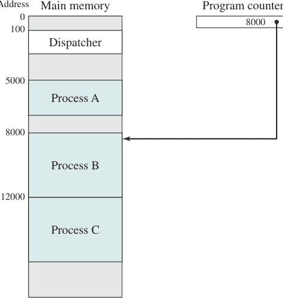

图 3.2 指令周期 13 时的示例执行快照（图 3.4）

| 5000 | 8000 | 12000 |
| :--- | :--- | :--- |
| 5001 | 8001 | 12001 |
| 5002 | 8002 | 12002 |
| 5003 | 8003 | 12003 |
| 5004 | | 12004 |
| 5005 | | 12005 |
| 5006 | | 12006 |
| 5007 | | 12007 |
| 5008 | | 12008 |
| 5009 | | 12009 |
| 5010 | | 12010 |
| 5011 | | 12011 |

(a) 进程 A 的轨迹 (b) 进程 B 的轨迹 (c) 进程 C 的轨迹

* 5000 = 进程 A 程序的起始地址
* 8000 = 进程 B 程序的起始地址
* 12000 = 进程 C 程序的起始地址

图 3.3 图 3.2 中进程的轨迹

图 3.3 显示了所有进程在执行早期的轨迹。显示了进程 A 和 C 执行的前12条指令。进程 B 执行了四条指令，我们假设第四条指令调用了 I/O 操作，进程必须等待该操作。

现在让我们从处理器的角度来看这些轨迹。图 3.4 显示了前 52 个指令周期产生的交错轨迹（为了方便起见，对指令周期进行了编号）。在图中，阴影区域代表由调度程序执行的代码。调度程序在每次情况下都执行相同的指令序列，因为执行的是调度程序的相同功能。我们假设操作系统只允许一个进程最多执行六个指令周期，此后它就会被中断；这防止了任何单个进程垄占处理器时间。如图 3.4 所示，首先执行了进程 A 的几条指令，接着是超时以及某些指令执行

| | | | |
| :--- | :--- | :--- | :--- |
| 1 | 5000 | | 27 12004 |
| 2 | 5001 | | 28 12005 |
| 3 | 5002 | | ---超时 |
| 4 | 5003 | | 29 100 |
| 5 | 5004 | | 30 101 |
| 6 | 5005 | ---超时 31 102 |
| | | | 32 103 |
| 7 | 100 | | 33 104 |
| 8 | 101 | | 34 105 |
| 9 | 102 | | 35 5006 |
| 10 | j103 | | 36 5007 |
| 11 | j104 | | 37 5008 |
| 12 | 105 | | 38 5009 |
| 13 | 8000 | | 39 5010 |
| 14 | 8001 | | 40 5011 |
| 15 | 8002 | | ---超时 |
| 16 | 8003 | ---I/O 41 100 |
| | | | 42 101 |
| 17 | 100 | | 43 102 |
| 18 | 101 | | 44 103 |
| 19 | 102 | | 45 104 |
| 20 | 103 | | 46 105 |
| 21 | 104 | | 47 12006 |
| 22 | 105 | | 48 12007 |
| 23 | 12000 | 49 12008 |
| 24 | 12001 | 50 12009 |
| 25 | 12002 | 51 12010 |
| 26 | 12003 | ---超时 52 12011 |

* 100 = 调度程序的起始地址
* 101 = 调度程序的起始地址
* 102 = 调度程序的起始地址
* 103 = 调度程序的起始地址
* 104 = 调度程序的起始地址
* 105 = 调度程序的起始地址
* 阴影区域代表由调度程序执行的代码。
* 第一列代表指令周期编号。
* 第二列代表进程 A 的轨迹。
* 第三列代表进程 B 的轨迹。
* 第四列代表进程 C 的轨迹。

图 3.4 进程的交错轨迹

## 进程创建与终止

操作系统。然而，允许一个进程导致另一个进程的创建可能是很有用的。例如，一个应用程序进程可能会生成另一个进程来接收该应用程序正在生成的数据，并将这些数据组织成适合后续分析的形式。当新数据可用时，新进程会不时与原始进程并行运行。这种安排在结构化应用程序时非常有用。另一个例子是服务器进程（例如打印服务器、文件服务器）可能会为其处理的每个请求生成一个新进程。当操作系统根据另一个进程的显式请求创建进程时，该行为被称为**进程派生**。

当一个进程派生另一个进程时，被派生的进程被称为**子进程**。通常情况下，“相关”进程需要相互通信和协作。实现这种协作对程序员来说是一项艰巨的任务；该主题将在第5章中讨论。

### 进程终止

表 3.2 总结了进程终止的典型原因。任何计算机系统必须提供一种机制，让进程指示其已完成。批作业应该包含一个停止指令或显式的操作系统服务调用来终止。在第一种情况下，停止指令将产生一个中断，来通知操作系统某个进程已完成。对于交互式应用程序，用户的操作将指示进程何时完成。例如，在分时系统中，当用户注销或关闭其终端时，特定用户的进程就会终止。在个人计算机或工作站上，用户可能会使用应用程序（例如文字处理或电子表格）。所有这些操作最终都会导致向操作系统发送服务以终止请求的进程。

此外，许多错误和故障条件会导致进程的终止。表 3.2 列出了一些较常见的条件。³

最后，在某些操作系统中，进程可能会由创建它的进程终止，或者当父进程终止时被终止。

> ³ 在某些情况下，容错性较高的操作系统允许用户从故障中恢复而不终止进程。例如，如果用户请求访问某个文件但被拒绝，操作系统可能仅是通知用户访问被拒绝并允许进程继续。

### 五状态模型

如果进程始终准备好执行，那么图 3.5b 支持的队列调度策略就足够了。队列是一个先入先列表，处理器以**轮询**方式对可用进程的操作（队列中的每个进程被分配一定的时间来执行，然后返回队列，除非被阻塞）。然而，即使对于我们描述的这个简单例子，这也是不够的：处于“非运行”状态的某些进程已准备好执行，而另一些则处于阻塞状态，等待 I/O 操作完成。因此，使用单个队列，调度程序不能仅仅选择队列最旧端的进程。相反，调度程序必须扫描列表，寻找未被阻塞且在队列中停留最长的进程。

处理这种情况的一种更自然的方法是将“运行”状态拆分为两个状态：就绪 和阻塞。这如图 3.6 所示。为了保险起见，我们又增加了两个有用的额外状态。新图中的五个状态如下：

1. **运行**：当前正在执行的进程。对于本章，我们假设计算机具有单处理器，因此同一时间最多有一个进程处于该状态。
2. **就绪**：进程在获得机会时准备好执行。
3. **阻塞/等待**：进程在某些事件发生（如 I/O 操作完成）之前无法执行。⁴
4. **新建**：刚刚创建但尚未被操作系统进入执行进程队列的进程。通常情况下，新进程尚未加载到主内存，尽管其`进程控制块`已经创建。
5. **退出**：被操作系统从执行进程队列中释放的进程，它已停止或中止。

> ⁴ Waiting 是 Blocked 的常用替代术语。

图 3.6 五状态模型

**新建**和**退出**状态是进程管理中非常有用的构造。**新建状态**对应于刚刚定义的进程。例如，如果新用户尝试登录分时系统，或提交了一个新作业执行，操作系统可以分两个阶段定义新进程。首先，操作系统执行必要的清理工作。为进程关联一个标识符。分配并构建管理进程所需的任何表。此时，进程处于新建状态。这意味着操作系统已经执行了创建进程的必要操作，但尚未承诺执行该。例如，由于性能或内存限制，操作系统可能会限制系统中的进程数量。当进程处于新建状态时，关于进程的信息包含在主内存表中。然而，进程本身不在主内存中，要执行的代码也不在主内存中，且未为该程序的数据分配空间。当进程处于新建状态时，进程留在辅助存储中（通常是磁盘存储）。⁵

同样，进程分两个阶段进入系统。首先，当进程达到自然完成点、由于不可恢复的错误而中止或具有权限的另一个进程导致进程中止时，进程会被终止。终止将进程移动到退出状态。此时，进程处于

> ⁵ 在本文讨论中忽略了虚拟内存的概念。在支持虚拟内存的系统中，当进程从新建移动到就绪时，其进程代码和数据会被加载到虚拟内存中。虚拟内存将在第2章中简要讨论，并在第8章中详细检查。

不再具有执行资格。与作业相关的表格和其他信息由操作系统临时保留，这为辅助或支持程序提取任何所需信息留出了时间。例如，计费程序可能需要为了计费目的而记录进程占用的处理器时间和和其他资源。实用程序可能需要提取有关进程历史的信息，用于性能或利用率分析等目的。一旦这些程序提取了所需信息，操作系统就不再需要维护任何与进程相关的数据，该进程将从系统中被删除。

图 3.6 显示了导致进程状态转换的事件类型；可能的转换包括：

* **新建**：创建一个新进程来执行程序。该事件会由于表 3.1 中列出的任何原因之一而发生。
* **就绪**：当操作系统准备好处理额外的进程时，它将把进程从“新建”状态移动到“就绪”状态。大多数系统对现有进程的数量或分配给现有进程的虚拟内存设有某种限制。这种限制确保了活动进程不会过多而导致性能下降。
* **运行**：当需要选择一个进程运行的时候，操作系统会从“就绪”状态中选择一个。这是调度器或分发器的工作。调度将在第四部分进行探讨。
* **退出**：如果进程表示其已完成或被强制中止，操作系统将中断当前正在运行的进程。见表 3.2。
* **运行 → 就绪**：这种转换最常见的原因是运行进程已达到允许的连续执行的最大时间；几乎所有多任务操作系统都实施了这种调度机制。这种转换还有几种其他替代情况，但并非在所有操作系统都实现。特别重要的一种情况是操作系统为进程分配了不同级别的优先级。例如，进程 A 以给定的优先级运行，而优先级更高的进程 B 处于阻塞状态。如果操作系统获知了 B 所等待的事件并将 B 移动到就绪状态，它可以中断 A 并分发 B。我们称操作系统**抢占**了进程 A。最后，进程可能会自愿放弃对处理器的控制。一个例子是定期执行计费或维护功能的后台进程。
* **阻塞**：如果进程请求了它必须等待的内容，则会被置于“阻塞”状态。请求通常以系统调用的形式出现，即运行进程对操作系统代码中某个过程的调用。例如，进程可能向操作系统请求一个无法立即执行的服务。它可以请求一种资源，例如文件或虚拟内存的共享区域，而该资源并非立即可用。进程可能会启动某些操作（如 I/O 操作），这些操作在进程继续之前必须完成。当进程之间相互通信时，进程在等待另一个进程提供数据或等待另一个进程的消息时可能会被阻塞。
* **阻塞 → 就绪**：当进程等待的事件发生时，处于“阻塞”状态的进程会被移动到“就绪”状态。
* **就绪 → 退出**：为了清晰，状态图中未显示这种转换。在某些系统中，父进程可以随时终止子进程。此外，如果父进程终止，与父进程相关的所有子进程也被终止。
* **阻塞 → 退出**：适用前面的说明。

> 通常情况下，**抢占**被定义为在进程完成使用某种资源之前从进程处收回资源。在这种情况下，资源是处理器本身。执行正在且可以继续执行，但被抢占以便执行另一个进程。

回到我们简单的例子，图 3.7 显示了每个进程在各个状态之间的转换。图 3.8a 建议了使用两个队列实现队列策略的方法：一个就绪队列和一个阻塞队列。当每个进程被接纳进系统时，它被放置在就绪队列中。当操作系统需要选择另一个进程运行时，它从就绪队列中选择一个。在没有任何优先级方案的情况下，这可以是一个简单的先进先出队列。当一个运行中的进程从执行中移除时，根据具体情况，它要么被终止，要么处于“就绪”队列或“阻塞”队列中。当事件发生时，阻塞队列中任何等待该事件的进程都只会被移动到就绪队列。

后者意味着，当事件发生时，操作系统必须扫描整个队列，寻找那些等待该事件的进程。在大型操作系统中，队列中可能有成百或数千个进程。因此，为每个事件设置若干队列会更有效。这样，当事件发生时，相应队列中的整个进程列表都可以移动到“就绪”状态（见图 3.8b）。

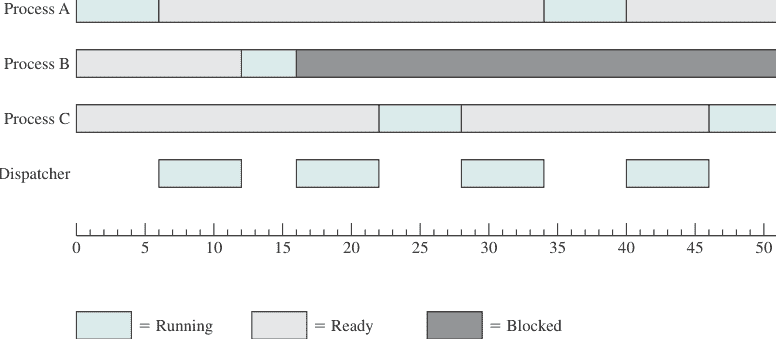

**图 3.7** 图 3.4 轨迹的进程状态

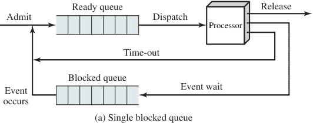 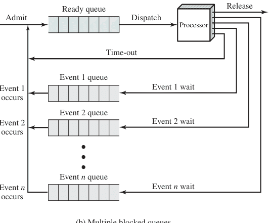

**图 3.8** 进程的队列模型

### 调度交换的需求

通过如所述的调度交换技术，我们必须在进程行为模型中再添加一个状态（见图 3.9）：挂起状态。当内存中的所有进程都处于“阻塞”状态时，操作系统可以将一个进程放入“挂起”状态并将其传输到磁盘。内存释放的空间可以供另一个进程使用。


当操作系统执行了换操作后，它在选择进入内存的进程时有两个选择：它可以引入一个新创建的进程，也可以调入一个之前挂起的进程。似乎应该倾向于调入之前挂起的进程，以便为其提供服务，而不是增加系统的总负载。

这种推理方法产生了一个困难。所有被挂起的进程在挂起时都处于阻塞状态。将一个阻塞的进程带回内存是毫无意义的，因为还没有准备好执行。但要意识到，挂起状态的每个进程最初都是阻塞某个特定事件的。当该事件发生时，进程不再被阻塞，并可能可以执行。

因此，我们需要重新考虑这个设计方面。这里有两个独立的概念：进程是否等待事件（阻塞或非阻塞），以及进程是否被交换出内存（挂起或非挂起）。为了适应这种 2×2 的组合，我们需要四个状态：

- **就绪（Ready）**：进程在内存中，可以执行。
- **阻塞（Blocked）**：进程在内存中，正在等待事件。
- **挂起就绪（Suspended Ready）**：进程在磁盘上，但准备好执行。
- **挂起阻塞（Suspended Blocked）**：进程在磁盘上，正在等待事件。

## 3.2 进程状态

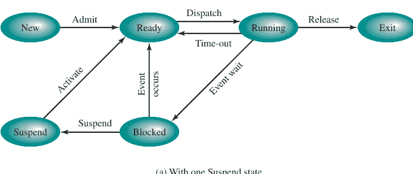

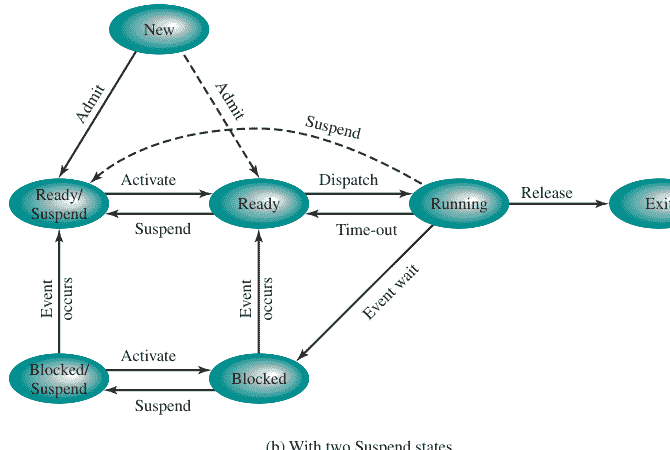

**图 3.9** 包含挂起状态的进程状态转换图

- **3. 阻塞/挂起 (Blocked/Suspend):** 进程处于辅助内存中并等待事件。
- **4. 就绪/挂起 (Ready/Suspend):** 进程处于辅助内存中，但一旦加载到主内存即可执行。

在查看包含这两个新状态的状态转换图之前，应该说明另外一点。为止的讨论都假设没有使用虚拟内存，进程要么全部在主内存中，要么不在主内存中。在虚拟内存方案下，可以执行一个部分位于主内存中的进程。如果引用了不在主内存中的进程地址，则可以将进程的相应部分调入内存。使用虚拟内存似乎消除了显式交换的需求，因为处理器的内存管理硬件可以将任何进程中任何所需的地址移入或移出主内存。然而，正如第 8 章将看到的，如果存在足够多的活动进程且它们都部分位于主内存中，虚拟内存系统的性能可能会崩溃。因此，在任何虚拟内存系统中，OS 都需要显式且完全地交换交换进程以保证性能。

现在让我们看看图 3.9b 中我们开发的转换（图中的虚线表示可能但并非必要的转换）。重要的新转换如下：

- **阻塞 → 阻塞/挂起 (Blocked → Block/Suspend):** 如果没有进程，则至少有一个阻塞进程被交换出，为另一个非阻塞的进程腾出空间。即使有可用的就绪进程，这种转换也可以发生。特别地，如果 OS 确定当前运行的进程或其将要派发的进程需要更多内存来维持足够的性能，则一个阻塞进程将被挂起。
- **阻塞/挂起 → 就绪/挂起 (Blocked/Suspend → Ready/Suspend):** 当处于阻塞/挂起状态的进程等待的事件发生时，它会被移动到就绪/挂起状态。注意，关于挂起进程的进程信息必须对 OS 可用。
- **就绪/挂起 → 就绪 (Ready/Suspend → Ready):** 当主内存中没有就绪进程时，OS 需要调入一个来继续执行。此外，可能处于就绪/挂起状态的进程优先级高于处于就绪状态的任何进程。在这种情况下，OS 设计者可能认为，获取高优先级进程比最小化交换更重要。
- **就绪 → 就绪/挂起 (Ready → Ready/Suspend):** 通常情况下，OS 倾向于挂起一个阻塞进程而不是就绪进程，因为就绪进程现在可以执行，而阻塞进程正占用主内存空间且无法执行。然而，如果这是释放足够大的主内存块的唯一方法，则可能挂起进程。此外，如果 OS 认为阻塞进程很快就会就绪，它可能会选择挂起一个低优先级的就绪进程，而不是高优先级的阻塞进程。

其他值得考虑的转换还有：

- **新建 → 就绪/挂起 和 新建 → 就绪 (New → Ready/Suspend and New → Ready):** 当创建一个新进程时，它可以被添加到就绪队列或就绪/挂起队列。在任何情况下，OS 必须创建一个进程控制块并为进程分配地址空间。OS 最好在较早执行这些日常管理工作，这样它就可以维护一个大型非阻塞进程池。在这种策略下，主内存中的就绪进程通常不足以满足新进程；因此使用了 (新建 → 就绪/挂起) 转换。另一方面，我们可以认为，尽可能晚创建进程的“即时”哲学减少了 OS 的开销，并允许 OS 在系统已经被阻塞进程塞满时执行进程创建职责。
- **阻塞/挂起 → 阻塞 (Blocked/Suspend → Blocked):** 包含这一转换似乎是设计不当。如果一个进程未准备好执行且不在内存中，那么将其调入的意义何在？考虑以下场景：一个进程终止，释放了一些内存。(阻塞/挂起) 队列中有一个进程，其优先级高于 (就绪/挂起) 队列中的任何进程，且 OS 必须推断该进程的阻塞事件将很快发生。在这种情况下，优先将阻塞进程调入主内存而不是就绪进程似乎是合理的。
- **运行 → 就绪/挂起 (Running → Ready/Suspend):** 通常，当运行进程的时间分配用完时，它会被移动到就绪状态。然而，如果 OS 因为阻塞/挂起队列上的一个高优先级进程刚刚解除阻塞而抢占该进程，OS 可以将运行进程直接移动到 (就绪/挂起) 队列并释放一些主内存。
- **任何状态 (Any State):** 通常，如果一个进程正在运行，它因为它完成或某种致命故障而终止。然而，在某些操作系统中，进程可能会被创建它的进程终止，或者当父进程本身终止时被终止。如果允许，那么任何状态的进程都可以移动到退出 (Exit) 状态。

### 挂起的其他用途

到为止，我们把挂起进程的概念等同于不在主内存中。我们可以将挂起进程的概念泛化为具有以下特征：

1. 进程不可用于执行。
2. 进程正在等待某个事件。
3. 进程无法立即执行。
4. 进程被从主内存中移除。

OS 挂起进程有几个原因。其是交换，需要释放足够的内存。另一个是 OS 原因：OS 挂起一个正在收集统计数据的进程。另一个是交互用户请求：用户希望调试程序。例如，如果用户在程序中发现 bug，他可能会调试其执行。另一个是定时：如果一个进程定期激活但大部分时间处于空闲状态，它应该被交换。最后，父进程可能希望挂起子进程。例如，进程 A 可能生成 B 执行文件读取。随后，B 在读取文件中遇到错误并报告给 A。A 挂起 B 进行调查。一个例子是死锁，将在第 6 章讨论。

**表 3.3 挂起原因**

| 原因 | 描述 |
| :--- | :--- |
| 交换 | 需要释放足够的内存 |
| 其他 OS 原因 | OS 挂起一个正在收集统计数据的进程 |
| 交互用户请求 | 用户希望调试程序 |
| 定时 | 如果进程定期激活但大部分时间处于空闲，则应被交换 |
| 父进程请求 | 父进程可能希望挂起子进程 |

## 3.3 进程描述

OS 控制计算机系统中的事件。它调度并派发进程通过处理器，为进程分配资源，并响应进程对基本服务的请求。从根本上说，我们可以将 OS 视为管理系统资源的实体。这一概念在图 3.10 中所示。在多编程环境中，有若干进程（`P_1, ... P_n`）已被创建并存在虚拟内存中。每个进程在执行过程中都需要访问某些系统资源，包括处理器、I/O 设备和主内存。事实上，进程 `P_1` 正在运行；该进程至少部分位于主内存，并且控制着两个 I/O 设备。进程 `P_2` 也在主内存中，但处于阻塞状态，等待分配给 `P_1` 的 I/O 设备。进程 `P_n` 已交换出，因此处于挂起状态。

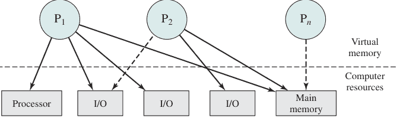

**图 3.10** 进程与资源（某一时刻的资源分配）

我们将在后面的章节中详细探讨操作系统（OS）如何代表进程管理这些资源的细节。在这里，我们关注一个基础性问题：操作系统需要什么信息来控制进程并为它们管理资源？

### 操作系统控制结构

如果操作系统要管理进程和资源，它必须拥有关于每个进程和资源当前状态的信息。提供这些信息的通用方法非常直接：操作系统构建并维护关于其所管理的每个实体的信息表。该工作范围的概括见图 3.11，该图显示了操作系统维护的四种不同类型的表：内存、I/O、文件和进程表。尽管具体细节在不同的操作系统之间会有不同，但所有的操作系统在这四个类中维护主要信息。

**内存表**用于跟踪主内存（物理内存）和次级内存（虚拟内存）。部分主内存留给操作系统使用；其余部分则供进程使用。进程通过某种虚拟内存或简单的交换机制维护在次级内存中。内存表必须包含以下信息：

- 分配给进程的主内存
- 分配给进程的次级内存
- 主内存或虚拟内存数据块的任何保护属性，例如哪些进程可以访问某些共享内存区域
- 管理虚拟内存所需的任何信息

我们将在第三部分详细检查内存管理的信息结构。

**I/O 表**被操作系统用于管理计算机系统的 I/O 设备和通道。在任何给定时刻，一个 I/O 设备可能分配给某个特定进程，或者处于可用状态。如果正在进行任何 I/O 操作，操作系统需要知道 I/O 的状态以及在主内存中作为 I/O 传输源或目的地的位置。I/O 管理将在第 11 节介绍。

操作系统还可能维护文件表，以提供有关文件存在、它们在次级内存中的位置、当前状态和其他属性的信息。这些信息中的大部分（不是全部）可能由文件管理系统维护和使用，在这种情况下，操作系统对文件几乎一无所知。在其他操作系统中，文件管理的许多细节则由操作系统本身管理。这一主题将在第 12 节探讨。

最后，操作系统必须维护进程表来管理进程。本节的剩余部分专门研究所需的进程表。在继续此讨论之前，应该说明另外两点。首先，虽然图 3.11 显示了四组不同的表，但显而易见，这些表必须以某种方式链接或交叉引用。内存、I/O 和文件是代表进程管理的，因此在进程表中必须直接或间接地对这些资源的某些引用。表中所引的文件可以通过 I/O 设备访问，并且某些可能位于主内存或虚拟内存中。文件本身必须能够被操作系统访问，因此受到内存管理。

其次，操作系统是如何知道从一开始就要创建这些表的？显然，操作系统必须了解基本环境，例如存在多少内存、I/O 设备是什么以及它们的标识符是什么等。这是一个配置问题。也就是说，当操作系统初始化时，它必须能够访问定义基本环境的配置数据，而这些数据必须在操作系统之外创建，通过人工协助或通过某些配置软件完成。

### 进程控制结构

考虑如果操作系统要管理和控制一个进程，它必须知道什么。首先，它必须知道进程所在的位置；其次，它必须知道管理该进程所必需的属性（例如，进程 ID 和进程状态）。

**进程位置** 在我们处理进程位于何处或其属性问题之前，我们需要解决一个更基础的问题：进程的物理表现是什么？至少，一个进程必须包含一组用于全局变量和任何常数的数据位置。因此，一个进程将包含足够的内存来存放进程的程序和数据。此外，进程的执行通常涉及一个栈（见附录 P），用于跟踪过程调用和参数传递过程。最后，每个进程都与若干用于操作系统控制进程的属性相关。通常，这些属性的集合被称为进程控制块。我们可以将这组进程、数据、栈和属性的集合称为进程映像（见表 3.4）。

进程映像的位置取决于所使用的内存管理方案。在最简单的情况下，进程映像被维护为连续的内存块。该块维护在次级内存（通常是磁盘）中。为了让操作系统能够管理进程，其映像的至少一部分必须维护在主内存中。为了执行进程，整个映像必须加载到主内存或至少是虚拟内存中。因此，操作系统需要知道每个进程在磁盘上的位置，并且对于每个在主内存中的进程，每个进程映像的位置可能留在主内存中。

### 表 3.4 进程映像的典型元素

| 元素 | 描述 |
| :--- | :--- |
| 用户数据 | 可修改的空间部分。 |
| 用户程序 | 要执行的程序。 |
| 栈 | 每个进程有一个或多个栈，用于存储参数和系统调用。 |
| 进程控制块 | 操作系统需要的数据（见表 3.5）。 |

> 此数据结构的常用名称还有任务块、进程描述符和任务描述符

现代操作系统假设硬件允许非连续内存以支持部分驻留。在任何给定时刻，进程的一部分可能在主内存，其余在次级内存中。因此，操作系统维护的进程表必须显示每个进程的位置。

图 3.11 以如下方式描绘了位置信息的结构：有一个主进程表，每个条目包含一个指向内存中进程映像的指针。当然，这种描述是通用的；特定的操作系统会有其自己的组织信息的方式。

**进程属性** 一个复杂的多程序系统需要关于每个进程的大量信息。如前所述，这些信息可以认为位于进程控制块中。不同的系统会以不同的方式组织这些信息，若干示例出现在本章和下一章的末尾。现在，让我们暗示操作系统可能有用的信息类型，而不详细考虑它是如何组织的。

表 3.5 列出了操作系统对每个进程所需的典型信息类别。你可能会对所需的信息量感到惊讶。随着你对操作系统职责的理解增加，这个列表应该显得合理。

我们将进程控制信息分为三大类：

1. 进程识别
2. 进程状态信息
3. 进程控制信息

关于进程识别，在几乎所有的操作系统中，每个进程分配有一个唯一的标识符，该标识符可以作为主进程表的索引（见图 3.11）；否则，必须有一种映射允许操作系统根据进程标识符定位相应的表。这个标识符在许多方面都有用。操作系统控制的许多其他表可能使用标识符来交叉引用进程表。例如，内存表可以组织为提供主内存映射，并指示每个区域分配了哪个进程。类似的引用出现在 I/O 表和文件中。

> 关于段和虚拟内存概念的简要在 2.3 节的内存管理部分提供。

> 这一讨论忽略了一些细节。特别是在每个进程都在次级内存中活跃的系统中。当映像的一部分加载到其主内存中时，是复制而非移动。次级内存保留所有段的副本，然而，如果映像的主内存部分被修改，在主内存部分拷贝回磁盘之前，次级副本将过时。

## 3.3 进程描述

### 表 3.5 进程控制块的典型元素

| 进程标识 | 描述 |
| --- | --- |
| 标识符 (Identifiers) | 可能存储在进程控制块中的数值标识符：<br>- 本进程的标识符。<br>- 创建此进程的进程标识符（父进程）。<br>- 用户标识符。 |
| 用户可见寄存器 | 用户可见寄存器是通过处理器在用户模式下执行的机器语言进行引用的寄存器。通常有 8 到 32 个这样的寄存器，某些 RISC 实现中超过 100 个。 |
| 控制和状态寄存器 | 这些是用于控制处理器运行的各种处理器寄存器。包括：<br>- 程序计数器（Program counter）：包含要取的下一个指令的地址。<br>- 条件码（Condition codes）：最近一次算术或逻辑操作的结果（例如：符号、零标志、进位、溢出）。<br>- 状态信息：包括启用/禁用标志位、执行模式。 |
| 栈指针 | 每个进程都关联有一个或多个后进先出（LIFO）栈系统。栈用于存储进程和系统调用的参数和地址。栈指针指向栈顶。 |
| 进程控制信息 | |
| 调度和状态信息 | 这是操作系统执行其调度功能时所需的信息。典型信息项包括：<br>- 进程状态：定义进程可调度执行的就绪状态（例如：运行、就绪、等待、挂起）。<br>- 优先级：可以使用一个或多个字段来描述进程的调度优先级。在某些系统中，需要多个值（例如：默认优先级、当前优先级、最高优先级）。<br>- 调度信息：这取决于所使用的调度算法。例如进程等待的时间以及该进程上一次运行执行的时间。<br>- 事件（Event）：进程在恢复执行之前正在等待的事件标识。 |
| 数据结构 | 进程可能链接到队列、环形结构或其他结构中。例如，所有处于特定优先级等待状态的进程可能链接在一个队列中。一个进程可能与另一个进程存在父子（创建者-被创建者）关系。进程控制块可能包含指向其他进程的指针以支持这些结构。 |
| 进程间通信 | 两个独立进程之间的通信可能关联各种标志位、信号和消息；所有这些信息都可以维护在进程控制块中。 |
| 进程特权 | 进程在可以访问的内存和可以执行的指令类型方面被授予权限。此外，特权可能允许使用系统工具和服务。 |
| 内存管理 | 此部分可能包括指向段/页表的指针，描述分配给该进程的虚拟内存。 |
| 资源所有权和利用 | 可以指示进程控制的资源，例如已打开的文件。还可能包含处理器或其他资源的使用历史；调度器可能需要这些信息。 |

进程标识符告知操作系统特定通信的目标。当允许进程创建其他进程时，标识符指示每个进程的父进程和后代进程。

除了这些进程标识符，进程可能被分配一个用户标识符，指示负责该作业的用户。

**处理器状态信息**由处理器寄存器的内容组成。当进程运行时，信息位于寄存器中。当进程被中断时，必须保存所有的寄存器信息，以便在进程恢复执行时恢复它们。涉及的寄存器性质和数量取决于处理器的设计。通常，寄存器组将包括可见寄存器、控制和状态寄存器以及栈指针。这些在第 1 章中描述。

特别需要注意的是，所有处理器设计都包含一个寄存器或一组寄存器，通常称为**程序状态字 (PSW)**，它包含状态信息。PSW 通常包含条件码以及其他状态信息。处理器状态字的一个良好例子是 Intel x86 处理器上的 `EFLAGS` 寄存器（如图 3.12 和表 3.6 所示）。运行在 x86 处理器上的所有操作系统（包括 Unix 和 Windows）都使用此结构。

进程控制块中的第三类信息可以为了方便起见称为**进程控制信息**。这是操作系统控制和协调活动进程所需的额外信息。表 3.5 的最后一部分确定了这些信息的范围。当我们从后续章节中检查操作系统功能的详细信息时，列表中各个项目的必要性应该会变得清晰。

图 3.13 显示了虚拟内存中进程映像的结构。每个进程映像由进程控制块、一个栈、进程的私有地址空间以及进程与其他进程共享的任何其他地址空间组成。

```
| 31 | 30 | 29 | 28 | 27 | 26 | 25 | 24 | 23 | 22 | 21 | 20 | 19 | 18 | 17 | 16 | 15 | 14 | 13 | 12 | 11 | 10 | 9 | 8 | 7 | 6 | 5 | 4 | 3 | 2 | 1 | 0 |
```


# 进程描述与控制

## EFLAGS 寄存器

图 3.12 展示了 x86 EFLAGS 寄存器的结构。

表 3.6 EFLAGS 寄存器详细说明

| 位 | 描述 |
| --- | --- |
| **状态标志（条件码）** | |
| `AF`（辅助进位标志） | 表示 8 位算术或逻辑操作半部分的进位或借位。 |
| `CF`（进位标志） | 操作后最高位的进位或借位；也会被移动和旋转操作修改。 |
| `OF`（溢出标志） | 相加或减法后的算术溢出。 |
| `PF`（奇偶标志） | 算术或逻辑操作结果的奇偶性。1 表示偶数性；0 表示奇数性。 |
| `SF`（符号标志） | 表示算术或逻辑操作结果的符号。 |
| `ZF`（零标志） | 表示算术或逻辑操作的结果为 0。 |
| `DF`（方向标志） | 决定字符串指令是增加还是减少 16 位寄存器 `SI` 和 `DI`（或 32 位寄存器 `EDI`）。 |
| **系统标志（不应由应用程序修改）** | |
| `AC`（对齐检查标志） | 当字或双字位于非字或双字边界时设置。 |
| `ID`（标识标志） | 如果此位可以设置和清除，则此处理器支持 `CPUID` 指令。该指令提供了有关供应商、系列和型号的信息。 |
| `RF`（恢复标志） | 允许程序员禁用调试异常，以便在调试后可以重启指令而不会立即导致另一个调试异常。 |
| `IOPL`（I/O 权限级别） | 设置时，会导致处理器在保护模式操作下访问所有 I/O 设备时产生异常。 |
| `IF`（中断允许标志） | 设置时，处理器识别外部中断。 |
| `TF`（陷阱标志） | 设置时，会在执行每条指令后产生一个中断。这用于调试。 |
| `NT`（嵌套任务标志） | 表示当前任务在保护模式下嵌套在另一个任务中。 |
| `VM`（虚拟 8086 模式） | 允许程序员启用或禁用虚拟 8086 模式，该模式决定处理器是否作为 8086 机器运行。 |
| `VIP`（虚拟中断挂起） | 在虚拟 8086 模式下使用，表示一个或多个中断等待处理。 |

## 虚拟内存中的用户进程

图 3.13 展示了虚拟内存中的用户进程布局。图中，每个进程都显示为一个连续的地址范围。在实际实现中，情况可能如此；这取决于内存管理方案以及操作系统组织控制结构的方式。

如表 3.5 所示，进程控制块可能包含结构化信息，包括允许进程块之间链接的指针。在前节描述的内容可以实现为进程块的链表。例如，表 3.8a 中的队列结构可以按照图 3.14 所示的方式实现。

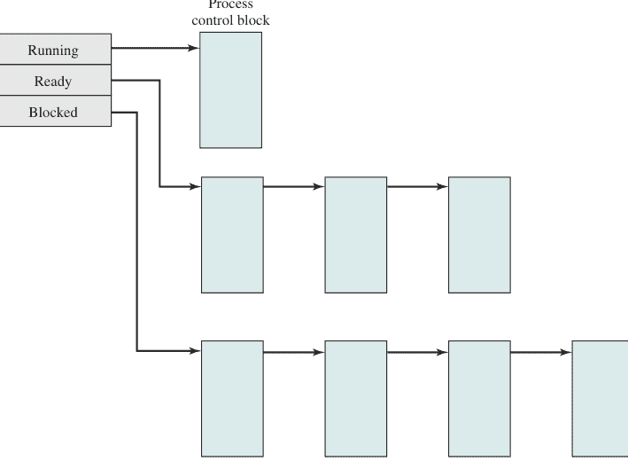

### 进程块的作用

进程控制块是操作系统中最重要的数据结构。每个进程控制块都包含了操作系统所需的全部关于进程的信息。操作系统中的几乎每个模块都会读取和修改这些块，包括涉及调度、资源分配、中断处理以及性能监控与分析的模块。可以说，进程控制块的状态定义了操作系统的状态。

这引出了一个设计问题。操作系统中的许多例程需要访问进程控制块中的信息。提供对这些表的直接访问并不困难。每个进程都配有一个唯一的标识（ID），这可以作为指向进程控制块的指针表的索引。困难之处在于显而易见。出现了两个问题：

- 单个例程（例如中断处理程序）中的 Bug 可能会损坏进程控制块，从而破坏系统管理受影响进程的能力。
- 进程控制块结构或语义的设计变更影响操作中的许多模块。

这些问题可以通过要求操作系统中的所有例程通过一个处理例程来解决，该例程唯一的工作是保护进程控制块，并且它是读写这些块的唯一仲裁者。使用此类例程的权衡涉及性能问题，以及对系统软件其余部分正确性的信任程度。

## 3.4 进程控制

### 运行模式

在继续讨论操作系统管理进程的方式之前，我们需要区分通常与操作系统相关的处理器执行模式与通常与用户程序相关的执行模式。大多数处理器支持至少两种执行模式。某些指令只能在特权模式下执行。这些包括读取或修改控制寄存器（如 `PSW`）、原始 I/O 指令以及与内存管理相关的指令。此外，内存的某些区域只能在特权模式下访问。

表 3.7 操作系统内核典型功能

| 功能类别 | 具体功能 |
| --- | --- |
| 进程管理 | 进程创建与终止、进程调度与分发、进程切换、进程同步及进程间通信支持、进程控制块管理 |
| 内存管理 | 为进程分配地址空间、交换、页与段表管理 |
| I/O 管理 | 缓冲区管理、为进程分配 I/O 通道和设备 |
| 支持功能 | 中断处理、计费、监控 |

低特权模式通常被称为**用户模式**，因为用户程序通常在此模式下运行。高特权模式被称为**系统模式、控制模式或内核模式**。后者指的是操作系统的内核，即包含重要系统功能的内核。使用两种模式的原因是显而易见的：必须保护操作系统和关键数据（如控制块）免受用户程序的干扰。在内核模式下，软件对处理器及其所有指令、寄存器和内存具有完全控制权。这种控制对于用户程序来说不是必要的，也不是理想的。

产生了两个问题：处理器如何知道自己处于哪种执行模式？模式是如何切换的？关于第一个问题，通常 `PSW` 中有一个位指示执行模式。以响应某些事件。通常，当用户调用操作系统服务或当中断触发操作系统例程的执行时，模式被设置为内核模式；当从服务返回用户进程时，模式被设置为用户模式。例如，考虑实现 IA-64 架构的 Intel Itanium 处理器。处理器有一个处理器状态寄存器 (`PSR`)，包含一个 2 位的 `CPL`（当前特权级）字段。级别 0 是最高特权级，而级别 3 是最低特权级。大多数操作系统（如 Linux）使用级别 0 用于内核，另一个级别用于用户模式。当发生中断时，处理器清除 `PSR` 中的所有位，包括将 `CPL` 字段设置为级别 0。中断处理例程结束，执行的最后指令是 `iret`，其作用是恢复程序的权限级别并返回用户级。

### 进程创建

在 3.2 节中，我们讨论了导致新进程创建的事件。有了与进程相关的数据结构，我们现在可以简要描述实际创建进程的步骤。

一旦操作系统由于某种原因（见表 3.1）决定创建一个进程，可以按照以下步骤进行：

1. 为新进程分配唯一的进程标识。此时，在进程表中添加新条目，每个进程有一个条目。
2. 为进程分配空间。这包括进程映像的所有元素。因此，操作系统必须知道进程地址空间（程序和数据）以及栈需要多少空间。这些值可以根据进程类型默认分配，也可以根据创建作业时的用户请求分配。如果进程是由另一个进程产生的，父进程可以在进程请求中将所需值传递给操作系统。如果新进程要共享现有的地址空间，必须建立相应的链接。最后，必须分配进程控制块。
3. 初始化进程控制块。进程标识部分包含其他 ID，例如父进程的 ID。进程状态信息部分通常初始化大部分条目，除了程序计数器（设置为程序入口）和系统栈指针（定义进程栈边界）。进程控制信息部分使用标准默认值加上针对该请求的属性进行初始化。例如，进程状态通常初始化为就绪或等待态。除非显式请求更高的优先级，否则优先级可能设置为最低。初始情况下，进程可能不拥有资源（I/O 设备、文件），除非有显式请求或从父进程继承。
4. 设置相应的链接。例如，如果操作系统将每个调度队列维护为链表，则新进程必须放入就绪或等待态列表。
5. 创建或扩展其他数据结构。例如，操作系统可能会为每个进程维护一个计费文件，供后续用于计费和或性能评估。

### 进程切换

表面上看，进程切换的功能似乎非常简单。在某个时刻，一个正在运行的进程被中断，操作系统将另一个进程分配到运行状态，并将控制权交给该进程。然而，这引发了几个设计问题。首先，什么事件触发了进程切换？其次，我们必须区分模式切换与进程切换的区别。最后，为了实现进程切换，操作系统必须对其控制的各种数据结构进行什么操作？

#### 何时切换进程

只要操作系统从当前运行进程处获得了控制权，就可能发生进程切换。表 3.8 列出了可能将控制权交给操作系统的各种事件。

表 3.8 中断进程执行的机制

| 机制 | 原因 | 用途 |
| --- | --- | --- |
| 中断 | 外部于当前指令的执行 | 对异步外部事件的响应 |
| 陷阱 | 与当前指令的执行相关 | 处理错误或异常情况 |
| 级调用 | 显式请求 | 调用操作系统函数 |

首先，让我们考虑中断。实际上，我们可以区分两种中断：一种简单地称为中断，另一种称为陷阱。前者是由于某种外部且与当前运行进程无关的事件引起的，例如 I/O 操作的完成。后者与运行进程内部产生的错误或异常有关，例如非法的访问尝试。对于普通中断，控制权首先转移到中断处理程序，它执行一些基础的管理工作，并跳转到与发生特定中断类型相关的操作系统例程。示例包括：

- **时钟中断**：操作系统确定当前运行进程是否已执行了最大允许的时间单位，称为时间片，因为时间片是进程在被中断之前可以执行的最长时间。如果是，则该进程必须切换到就绪状态，并调度另一个进程。
- **I/O 中断**：操作系统确定发生了什么 I/O 操作。如果该 I/O 操作构成一个或多个进程正在等待的事件，那么操作系统会将任何相应的阻塞进程移动到就绪（或阻塞/挂起）状态。操作系统必须决定继续执行运行态的进程，还是抢占该进程以让更高优先级的就绪进程运行。
- **内存缺页**：处理器遇到了一个不在主内存中的虚拟地址引用。操作系统必须从辅助内存将包含该引用的内存块（页或段）调入主内存。在发出 I/O 请求调入内存块后，发生内存缺页的进程被置于阻塞状态；操作系统执行进程切换以恢复另一个进程的执行。在所需的块调入内存后，该进程被置于就绪状态。

对于陷阱，操作系统确定错误或异常情况是否是致命的。如果是，当前运行的进程被移动到退出状态并发生进程切换。如果不是，操作系统的操作取决于错误的性质和操作的设计。它可能会尝试某些恢复程序或恢复当前运行的进程。

最后，操作系统可能由正在执行的程序发出的级调用激活。例如，一个运行的用户进程执行了一条请求 I/O 操作的指令，如打开文件。此调用会导致跳转到操作系统代码中的某个例程。使用系统调用可能会将进程置于阻塞状态。

在第 1 章中，我们讨论了将中断阶段作为中断周期的一部分。记得，在中断阶段，处理器会检查是否有挂起的中断，这通过中断信号的存在来指示。如果没有挂起的中断，处理器将进入取指阶段，并获取当前进程中当前程序的下一条指令。如果有挂起的中断，处理器将执行以下操作：

1. 它将程序计数器设置为中断处理程序的起始地址。
2. 从用户模式切换到内核模式，以便中断处理代码可以包含特权指令。

处理器现在进入取指阶段，并获取中断处理程序的第一条指令，该指令将处理中断。此时，通常会将被中断进程的上下文保存到该进程的进程控制块（`PCB`）中。

现在可能会产生一个问题：保存的上下文包含什么？答案是，它必须包含任何可能因执行中断处理程序而改变、且恢复被中断的程序所需要的信息。因此，作为处理器寄存器状态保存的进程控制块部分必须保存。这包括程序计数器、其他处理器寄存器和栈信息。

还需要做其他事情吗？这取决于接下来发生什么。中断处理程序通常是一个短小的进程，执行与中断相关的少数基础任务。它重置指示中断存在的标志位或指示器。它可能会向发出中断的实体（如 I/O 模块）发送确认。它可能执行一些与引起中断的事件相关的基本管理工作。如果中断涉及 I/O 事件，中断处理程序将检查错误状况。如果发生了错误，中断处理程序可能会向原始请求 I/O 操作的进程发送信号。如果中断来自时钟，处理程序将交给调度器，调度器将把控制权交给另一个进程，因为分配给当前运行进程的时间片已过期。

进程块中的其他信息呢？如果此中断之后要切换到另一个进程，则需要进行一些工作。在大多数操作系统中，中断的发生并不意味着进程切换。可能的情况是，处理程序执行后，当前运行的进程将恢复执行。在这种情况下，所有必要的恢复都由硬件完成。

#### 进程状态的切换

显然，模式切换与进程切换是不同的概念。模式切换可以在不改变当前运行状态的情况下发生。在这种情况下，上下文保存和随后的恢复开销很小。然而，如果要把当前运行的进程移动到其他状态（就绪、阻塞等），那么操作系统必须对其环境进行重大更改。完整进程切换涉及的步骤如下：

1. 保存进程上下文，包括程序计数器和其他寄存器。
2. 更新当前运行态进程的进程控制块。这包括将状态更改为其他状态之一（就绪、阻塞、挂起或退出）。必须更新其他相关字段，包括离开运行状态的原因和计数信息。
3. 将此进程的进程控制块移动到相应的队列（就绪、阻塞、挂起）。
4. 选择另一个进程进行执行；该主题将在第四部分讨论。
5. 更新所选进程的进程控制块。这包括将该状态改为运行。
6. 更新内存管理数据结构。这可能是必要的，取决于地址翻译如何管理；该主题将在第三部分讨论。
7. 通过加载程序计数器和其他寄存器的先前值，将处理器上下文恢复到所选进程切出运行状态时的状态。

因此，涉及状态更改的进程切换比模式切换需要更大的努力。

> ¹⁰上下文切换一词在操作系统文献和教科书中常见。遗憾的是，尽管大多数文献使用该术语来表示我们所说的进程切换，但其他来源用它来表示模式切换甚至线程切换（在下一章定义）。为了避免歧义，本书不使用该术语。

## 3.5 操作系统的执行

在第 2 章中，我们指出了关于操作系统的两个有趣的事实：

- 操作系统的功能与普通计算机软件相同，从意义上说，操作系统是一组由处理器执行的程序。
- 操作系统频繁放弃控制权，并依赖处理器将控制权交回操作系统。

如果操作系统仅仅是程序的集合，并且它像任何其他程序一样由进程执行，那么操作系统是一个进程吗？如果是的话，它是如何被控制的？这些有趣的问题启发了许多设计方法。图 3.15 展示了在各种现代操作系统中发现的方法。

### 非进程内核

一种传统的方法（在许多旧版操作系统中很常见）是在任何进程之外执行操作系统的内核（见图 3.15a）。通过这种方法，当当前运行的进程被中断或调用监视调用时，该进程的模式上下文被保存，控制权传递给内核。操作系统有自己可使用的内存区域，以及用于自己的系统栈来控制过程调用和返回。操作系统可以执行任何所需的功能并恢复被中断进程的上下文，从而使其在被中断的用户进程中恢复执行。或者，操作系统也可以完成保存进程环境的功能，并调度和分配另一个进程。这取决于中断的原因和当时的情况。

在任何情况下，这里的关键点是，进程的概念被认为仅适用于用户进程。操作系统代码作为一个独立的实体在特权模式下运行。

### 在用户进程内执行

另一种在较小计算机（个人电脑、工作站）的操作系统中常见的替代方案，是在用户进程的上下文中执行几乎所有的操作系统软件。这种观点认为，操作系统主要是一组用户调用以执行各种函数的例程集合，在用户进程的环境内执行。这在图 3.15b 中所示。在任何时刻，操作系统都管理着 $n$ 个进程映像。每个映像不仅包括图 3.13 所示的区域，还包括内核程序的程序、数据和栈区域。

图 3.16 建议了这种策略的典型进程映像结构。一个独立的内核栈用于在进程处于内核模式时管理调用/返回。

| 组成部分 |
| :--- |
| 进程标识 |
| 处理器状态信息 |
| 进程控制信息 |
| 用户栈 |
| 私有用户地址空间（程序、数据） |
| 内核栈 |
| 共享地址空间 |

图 3.16 进程映像：操作系统在用户空间内执行

操作系统代码和数据位于共享地址空间，并被所有用户进程共享。


当发生中断、陷阱（trap）或监视调用时，处理器被设置为内核模式，控制权传递给操作系统。为了将控制权从用户程序传递给操作系统，保存模式上下文并在操作系统例程中发生模式切换。然而，执行在当前用户进程内继续。因此，没有执行进程切换，而是在同一个进程内的模式切换。

如果操作系统在完成工作后，确定当前进程应该继续运行，则通过模式切换恢复当前进程内被中断的程序。这是这种方法的关键优势之一：用户程序被中断以采用某些操作系统例程，然后恢复，而这一切都是在没有产生两次进程切换代价的情况下完成的。然而，如果需要发生进程切换而不是返回到之前执行的程序，控制权将传递给进程切换例程。该例程可能在或不在当前进程中执行，取决于系统设计。然而，在某个点，当前进程被置于非运行状态，并将另一个进程指定为运行进程。在此阶段，从逻辑上方便将执行看作是在所有进程之外进行的。

这种对操作系统的观点是非同凡的。简单来说，在某些时刻，进程将切换其状态信息，从许多已就绪的进程中选择另一个进程运行，并将控制权交给该进程。这种现象不是任意且混乱的情况的原因，是因为在关键时间期间，在用户进程中执行的代码是共享的操作系统代码，而不是用户代码。由于用户模式和内核模式的概念，用户无法篡改或干扰操作系统例程，即使它们是在用户环境中执行的。这提醒我们，进程和程序概念之间存在区别，且二者之间的关系不是一对一的。在进程内部，用户程序和操作系统程序都可能执行，且用户进程是相同的。

### 基于进程的操作系统

另一种替代方案（如图 3.15c 所示）是将操作系统实现为进程的集合。正如其他选项一样，我们提到操作系统是一组进程。这种方法有几个优势。它实施了一种设计纪律，鼓励接口与接口之间的界面……（此处省略）。用户在用户模式下运行用户程序和实用程序，并在内核模式下执行属于内核的指令。用户通过系统调用进入内核模式、当产生异常（故障）或发生中断时进入内核模式。

### 进程状态

UNIX SVR4 操作系统总共识别九种进程状态；这些状态列在表 3.9 中，状态转换如图 3.17 所示（基于 [86] 中的图）。此图与图 3.9b 类似，两个睡眠状态对应两个阻塞状态。区别如下：

- UNIX 采用运行（Running）状态来指示进程处于用户模式还是内核模式。
- 在两个状态之间进行了区分：（就绪运行，内存中/Ready to Run, in Memory）和（被抢占/Preempted）。它们本质上是相同的状态，正如……所示

## 3.6 UNIX SVR4 进程管理

| 状态 | 说明 |
| :--- | :--- |
| 用户运行 (User Running) | 在用户模式下执行。 |
| 内核运行 (Kernel Running) | 在内核模式下执行。 |
| 就绪运行，内存中 | 只要内核调度它，即可就绪运行。 |
| 内存中睡眠 (Asleep in Memory) | 在事件发生前无法执行；进程在主内存中（一种阻塞状态）。 |
| 就绪运行，已交换 (Ready to Run, Swapped) | 进程已就绪，但在内核调度其执行之前，必须将进程交换到主内存。 |
| 睡眠，已交换 (Sleeping, Swapped) | 进程正在等待事件并已交换到辅助存储（一种阻塞状态）。 |
| 被抢占 (Preempted) | 进程正在从内核返回用户，但内核抢占了它并切换到另一个进程。 |
| 创建 (Created) | 进程新创建的，尚未就绪运行。 |
| 僵尸 (Zombie) | 进程不再存在，但它留下了记录供父进程收集。 |

## 3.6 UNIX SVR4 进程管理

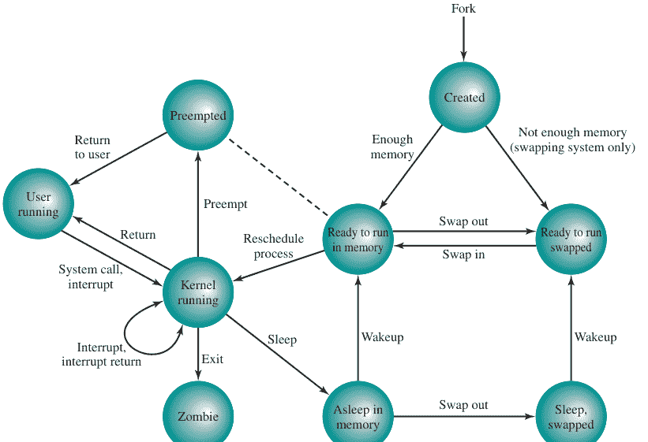

图 3.17 UNIX 进程状态转换图

将它们连接起来。这种区分是为了强调进入`被抢占（Preempted）`状态的方式。当进程在内核模式下运行（由于系统级调用、时钟中断或 I/O 中断）时，总会有内核完成工作并准备好将控制权还给用户程序的时刻。此时，内核可能会决定抢占当前进程，让位于就绪且优先级更高的进程。在这种情况下，当前进程移动到被抢占状态。然而，出于调度考虑，处于被抢占状态的进程和处于（就绪，内存，`[Ready to Run, Memory]`）状态的进程共同组就绪队列。

抢占只能在进程即将从内核模式切换到用户模式时发生。当进程在内核模式下运行时，它可能不会被抢占。这使得 UNIX 不太适用于实时处理。第 10 章将讨论实时处理的要求。

在 UNIX 中，有两个进程是独特的。进程 0 是系统启动时创建的进程；实际上，它在启动时就被预定义。它是交换进程（swapper process）。此外，进程 0 会派生进程 1，称为 `init` 进程；系统中的所有其他进程都以进程 1 为祖先。当一个新的交互式用户登录系统时，是进程 1 为该用户创建一个用户进程。随后，该用户进程可以在一个分支树形结构中创建子进程；任何特定的应用程序都可以由多个相关的进程组成。

### 进程描述

UNIX 中的进程是一组相当复杂的数据结构，它为操作系统提供了管理和调度进程所需的所有信息。表 3.10 总结了进程映像的元素，这些元素组织成三个部分：用户级上下文、寄存器上下文和系统级上下文。

用户级上下文包含用户程序的基本元素，可以直接从编译后的对象文件中生成。用户进程被分为文本区（text）和数据区（data）；文本区是只读，用于存放程序指令。在进程执行期间，处理器使用栈区（stack）进行过程调用和寄存器传递。共享内存区域是与其他进程共享的数据。共享内存区域只有一个物理副本，但通过虚拟内存，每个进程都认为共享内存区域都在自己的地址空间内。当进程未运行时，处理器的状态信息存储在寄存器上下文区域。

系统级上下文包含了操作系统管理进程所需的其余信息。它由一个静态部分组成，其大小是固定的并且

### 表 3.10 UNIX 进程映像

| 用户级上下文 (User-Level Context) | |
| :--- | :--- |
| 进程文本 (Process text) | 程序的可执行机器指令 |
| 进程数据 (Process data) | 该进程程序可访问的数据 |
| 用户栈 (User stack) | 包含在用户模式下执行函数的参数、局部变量和指针 |
| 共享内存 (Shared memory) | 与其他进程共享的内存，用于进程间通信 |

| **寄存器上下文 (Register Context)** | |
| :--- | :--- |
| 程序计数器 (Program counter) | 下一执行指令的地址；可能位于该进程的内核或用户内存空间 |
| 处理器状态寄存器 (Processor status register) | 抢占时的硬件状态；内容和格式取决于硬件 |
| 栈指针 (Stack pointer) | 指向内核栈或用户栈的顶部，取决于当时的运行模式或权限 |
| 通用寄存器 (General-purpose registers) | 取决于硬件 |

| **系统级上下文 (System-Level Context)** | |
| :--- | :--- |
| 进程表项 (Process table entry) | 定义进程状态；此信息操作系统始终可以访问 |
| U /(用户) 区 (U /(user) area) | 仅在进程上下文中需要访问进程控制信息 |
| 进程区域表 (Per process region table) | 定义虚拟地址到物理地址的映射；还包含一个权限字段，用于标识进程允许的访问类型：只读、读写或读/执行 |
| 内核栈 (Kernel stack) | 当进程在内核模式下执行时，包含内核过程栈帧 |

### 表 3.11 UNIX 进程表项

| 字段 | 说明 |
| :--- | :--- |
| 进程状态 (Process status) | 进程的当前状态。 |
| 指针 (Pointers) | 指向 U 区和进程内存（文本、数据、栈）。 |
| 进程大小 (Process size) | 使操作系统知道为进程分配多少空间。 |
| 用户标识符 (User identifiers) | `真实用户 (real user)` 标识负责运行进程的用户。`有效用户 ID (effective user ID)` 可能被进程用于获取与特定程序相关的临时权限；当该程序作为进程的一部分执行时，进程以有效用户 ID 运行。 |
| 进程标识符 (Process identifiers) | 此进程的 ID；父进程的 ID。这些在进程在 `fork` 系统调用期间进入创建（Created）状态时设置。 |
| 事件描述符 (Event descriptor) | 当进程处于睡眠状态时有效；当事件发生时，进程被转移到就绪状态。 |
| 优先级 (Priority) | 用于进程调度。 |
| 信号 (Signal) | 列出发送给进程但尚未处理的信号。 |
| 定时器 (Timers) | 包括进程条目、内核资源利用以及用于向进程发送警报的用户设置定时器。 |
| 链指针 (Plink) | 指向就绪队列中下一个链的指针（如果进程就绪则有效）。 |
| 内存状态 (Memory status) | 指示进程是在内存中还是被交换出。 |
| 返回值 (Return value) | 返回系统调用的结果。 |

### 表 3.12 UNIX U 区

| 字段 (Field) | 说明 (Description) |
| :--- | :--- |
| 进程表指针 (Process table pointer) | 指向相应的条目。 |
| 用户标识符 (User identifiers) | 用于确定权限的真实有效用户 ID。 |
| 定时器 (Timers) | 记录进程及其后代在用户模式下花费的时间。 |
| 信号处理数组 (Signal-handler array) | 对于系统定义的每种信号，指示进程接收时的反应（退出、忽略等）。 |
| 控制终端 (Control terminal) | 如果存在，指示登录控制终端。 |
| 错误字段 (Error field) | 记录系统调用期间遇到的错误。 |
| I/O 参数 (I/O parameters) | 描述传输的数据量、空间中的源目标数据地址以及 I/O 偏移量。 |
| 文件参数 (File parameters) | 当前目录和根目录描述进程的文件环境。 |
| 用户文件描述符表 (User file descriptor table) | 记录进程打开的文件。 |
| 限制字段 (Limit fields) | 限制进程的大小以及它可以写入的文件的大小。 |
| 权限模式字段 (Permission modes fields) | 创建文件时的掩码设置。 |

### 进程控制

UNIX 中的进程创建是通过内核系统调用 `fork()` 实现的。当进程发出 `fork` 请求时，操作系统执行以下函数：

1. 在进程表中为下一个进程分配一个槽位。
2. 为子进程分配唯一的进程 ID。
3. 复制父进程的进程映像，共享内存除外。
4. 增加父进程拥有的文件的计数器，以反映有一个额外的进程拥有这些文件。
5. 将子进程分配到就绪状态。
6. 将子进程 ID 返回给父进程，并向子进程返回零值。

所有这些工作都在内核模式下完成。当内核完成这些函数后，作为调度程序的一部分执行以下操作之一：

* 留在父进程中。控制返回用户模式，回到父进程 `fork` 调用处。
* 将控制权转移给子进程。子进程从与父进程相同的代码点开始执行，即从 `fork` 调用返回。
* 将控制权转移给另一个进程。父进程和子进程都将留在就绪状态。

## 3.8 关键术语、复习题与问题 171

可视化这种进程创建方法可能比较困难，因为父进程和子进程执行的是相同的代码。区别在于：当 `fork` 返回时，会对返回参数进行测试。如果值为零，则该进程为子进程，可以执行分支跳转到相应的用户程序继续执行。如果值不为零，则该进程为父进程，主执行线继续。

## 3.7 总结

现代操作系统（OS）中最基本的概念是进程。OS的主要功能是创建、管理和终止进程。当进程处于活动状态时，OS必须确保每个进程分配了处理器执行时间，协调其活动，管理冲突需求，并为进程分配系统资源。

为了执行进程管理功能，操作系统维护每个进程的描述（或称为进程映像），这包含了进程执行的地址空间以及一个进程控制块（PCB）。后者包含了操作系统管理该进程所需的所有信息，包括其当前状态、分配给它的资源、优先级以及其他相关数据。

在整个生命周期内，进程会在多个状态之间移动。其中最重要的状态是：就绪（Ready）、运行（Running）和阻塞（Blocked）。就绪进程是指当前没有在执行，但一旦操作系统调度它就可以立即执行的进程。运行进程是指当前正在被处理器执行的进程。在多处理器系统中，可以有多个进程处于这种状态。阻塞进程正在等待某些事件的完成，例如 I/O 操作。

运行中的进程会被中断打断，中断是发生在进程外部并被处理器识别的事件，或者是通过向操作系统执行超级调用（supervisor call）来触发的。无论哪种情况，进程都会执行模式切换，将控制权转移给操作系统例程。OS在完成必要工作后，可能会恢复被中断的进程，或者切换到其他某个进程。

## 3.8 关键术语、复习题与问题

### 关键术语

| 阻塞状态 | 特权模式 | 运行状态 |
| :--- | :--- | :--- |
| 子进程 | 进程 | 挂起状态 |
| 调度器 | 进程控制块 | 交换 |
| 退出状态 | 进程控制信息 | 系统模式 |
| 中断 | 进程映像 | 任务 |
| 内核模式 | 进程创建 | 时间片 |
| 模式切换 | 进程切换 | 跟踪 |
| 新状态 | 程序状态字 | 陷阱 |
| 父进程 | 就绪状态 | 用户模式 |
| 抢占 | 轮询 | |

## 第 3 章 / 进程描述与控制

### 复习题

- 3.1. 什么是指令跟踪？
- 3.2. 解释进程的概念并标出它与程序的区别。
- 3.3. 针对图 3.6 的处理，简要定义每个状态。
- 3.4. 抢占进程意味着什么？
- 3.5. 什么是进程创建（spawning）？
- 3.6. 为什么图 3.9 有两个阻塞状态？
- 3.7. 列出挂起进程的 4 个特征。
- 3.8. 为了管理，操作系统为哪些类型的实体维护信息表？
- 3.9. 需要哪些模式（用户态内核态）？
- 3.10. 操作系统创建新进程执行哪些步骤？
- 3.11. 中断（interrupt）和陷阱（trap）之间有什么区别？
- 3.12. 给出中断的三个例子。
- 3.13. 模式切换和进程切换之间有什么区别？

### 习题

3.1. 一个系统采用基于优先级的抢占式调度，进程的初始优先级每 5 ms 增加 1。在一个相对时间跨度内，系统有四个进程 P1、P2、P3 和 P4，如下表所示：

| 进程 ID | 初始优先级 | 到达时间 (ms) | 总 CPU 时间 (ms) |
| :--- | :--- | :--- | :--- |
| P1 | 1 | 0 | 15 |
| P2 | 3 | 5 | 7.5 |
| P3 | 2 | 10 | 5 |
| P4 | 2 | 15 | 10 |

画一个与图 3.7 类似的图表，并找到每个进程的周转时间。假设调度器进行进程切换需要 2.5 毫秒。

3.2. 假设四个交替的进程在一个系统中运行，起始地址分别为 4050、3200、5000 和 6700。各个进程的跟踪如下：

| 进程 P1 | 进程 P2 | 进程 P3 | 进程 P4 |
| :--- | :--- | :--- | :--- |
| 4050 | 3200 | 5000 | 6700 |
| 4051 | 3201 | 5001 | 6701 |
| 4052 | 3202 | 5002 | 6702 |
| 4053 | 3203 | 5003 | `<I/O>` |
| 4054 | 3204 | 5004 | |
| 4055 | 3205 | 5005 | |
| 4056 | 3206 | 5006 | |
| 4057 | `<I/O>` | | |
| 4058 | | | |
| 4059 | | | |
| 4060 | | | |

## 3.8 关键术语、复习题与问题 173

交替的跟踪如下：

- 3.3. 图 3.9 包含两个状态。假设调度器在任何中断后调用。
- 3.4. 画出状态图，并指示导致每次转换的动作。
- 3.5. 考虑就绪状态的。两种极端策略是：(1) 总是调度就绪状态以减少交换，(2) 优先调度高优先级进程，尽管可能意味着。
- 3.6. 表 13 显示了 VAX 状态：
    - a. 你能为这么多状态的存在提供理由吗？
    - b. 为什么这些状态没有版本？
- 3.7. VAX 操作系统使用四种访问模式来实现进程间的保护和共享。访问模式决定：
    - 指令执行权限：处理器可以执行
    - 内存访问权限：当前访问在虚拟内存中的

这四种模式如下：

- **内核 (Kernel)**：执行操作系统的内核，包括内存管理、中断处理和 I/O 操作。
- **执行 (Executive)**：执行许多系统调用，如对用户命令的响应、文件和磁盘管理例程。
- **用户 (User)**：执行用户程序，以及编译器、编辑器、链接器和调试器。

执行在低权限模式的进程通常需要调用执行在高权限模式的过程；例如用户程序需要。这种调用通过使用模式指令（`CHM`）来实现，该指令触发中断并将控制权转移到新访问模式的例程。通过执行 `REI`（异常或中断返回）指令返回。

- a. 许多操作系统有两种模式：内核态和用户态。提供四种模式而不是两种的优缺点是什么？
- b. 你能为超过四种模式辩护吗？

### 表 13 VAX 进程状态

| 进程状态 | 条件 |
| :--- | :--- |
| 当前执行 | 运行进程。 |
| 就绪（驻留） | 就绪并驻留在内存中。 |
| 就绪（已交换） | 就绪，但已交换出。 |
| 缺页等待 | 进程引用了不在内存中的页，必须等待该页被。 |
| 冲突页等待 | 进程引用了正在写入的共享页。 |
| 通用事件等待 | 等待事件标志（标志位是）。 |
| 空闲页等待 | 等待空闲页。 |
| 休眠等待（驻留） | 进程本身处于状态。 |


| 休眠等待（已交换） | 休眠进程被交换出。 |
| --- | --- |
| 本地事件（驻留） | 进程在内存中并等待事件标志（通常是 I/O 完成）。 |
| 本地事件（已交换） | 本地事件进程被交换出。 |
| 挂起等待（驻留） | 进程被另一个放入等待状态。 |
| 挂起等待（已交换） | 进程被交换出。 |
| 资源等待 | 等待各种系统资源。 |

- c. 画出状态图，并指示导致每次转换的动作。

## 3.8 关键术语、复习题与问题

3.8. 上一个问题中讨论的 VMS 方案通常被称为环形保护结构，如图 3.18 所示。事实上，第 3.3 节中描述的简单内核/用户方案是一个双环结构。这种保护机制的一个潜在缺点是它无法用于执行“按需知”原则（need-to-know principle）。[SILB04] 对此给出的定义是：如果一个对象在域 $D_j$ 中可访问，但在域 $D_i$ 中不可访问，则 $j < i$。请清晰地解释前文中提到的问题是什么。

3.9. 图 3.8b 表明进程在一个时刻只能存在于一个队列。

- a. 是否可能你希望让一个进程同时等待多个事件？请举一例说明。
- b. 在这种情况下，你将如何修改图中的队列结构以支持这一新功能？

3.10. UNIX 操作系统中系统调用 `fork()` 的目的是什么？编写一个 C 程序，使用 `fork()` 系统调用创建一个子进程。在你的程序中加入错误检查，以防子进程创建失败。

3.11. UNIX 中进程 0 和进程 1 的特殊之处何？你将使用哪种命令来获取系统中正在运行进程的信息？

3.12. 你执行了以下 C 程序：

假设 `fork` 执行成功，可能的输出有哪些？

## 第 4 章

### 线程

- 4.1 进程与线程
  - 多线程
  - 线程功能
- 4.2 线程的类型
  - 用户级线程与内核级线程
  - 其他安排
- 4.3 多核与多线程
  - 软件在多核处理器上的性能
  - 应用示例：Valve 游戏软件
- 4.4 Windows 进程与线程管理
  - 后台任务和应用生命周期管理
  - Windows 进程
  - 进程与线程对象
  - 多线程
  - 线程状态
  - 对操作系统子系统的支持
- 4.5 Solaris 线程与 SMP 管理
  - 多线程架构
  - 动机
  - 进程结构
  - 线程执行
  - 作为线程的中断
- 4.6 Linux 进程与线程管理
  - Linux 任务
  - Linux 线程
  - Linux 命名空间
- 4.7 Android 进程与线程管理
  - Android 应用
  - Activity
  - 进程与线程
- 4.8 Mac OS X 大中心调度 (Grand Central Dispatch)
- 4.9 总结
- 4.10 关键术语、复习题与问题

## 4.1 进程与线程

### 学习目标

学习本章后，你应该能够：

- 理解进程与线程之间的区别。
- 描述线程的基本设计问题。
- 用户级线程与内核级线程之间的区别。
- 描述 Windows 中的线程管理机制。
- 描述 Solaris 中的线程管理机制。
- 描述 Linux 中的线程管理机制。

本章介绍了与进程管理相关的一些高级概念，这些概念出现在许多现代操作系统中。我们证明了进程的概念比目前介绍的更为复杂和微妙，事实上，它体现了两个分离且独立的概念：一个与所有权有关，另一个与执行有关。这种区别导致了许多操作系统开发了一种被称为“线程”（thread）的结构。

## 4.1 进程与线程

到目前为止，将进程的概念呈现为包含两个特征：

1.  **资源所有权**：进程包含一个虚拟地址空间来存放进程映像；回想第 3 章，进程像是进程控制块中定义的程序、数据、栈和属性的集合。有时，进程会被分配资源的控制权或所有权，例如内存、I/O 通道、I/O 设备和文件。操作系统执行保护功能以防止进程间在资源上发生意外干扰。
2.  **调度/执行**：进程的执行遵循通过一个或多个程序的执行路径（轨迹）（如图 1.5 所示）。这种执行可能与其他进程的执行交替进行。因此，进程具有执行状态（运行、就绪等）和分发优先级，并且是由操作系统调度和分发的实体。

有些人可能会说服读者，这两个特征是独立的，操作系统可以独立地处理它们。这在许多操作系统中（特别是最近开发的系统）是可以实现的。为了区分这两个特征，分发单元在 UNIX 等其他现代版本中通常被称为线程。

> ¹遗憾的是，即使是这种程度的一致性也没有得到维持。在 IBM 的大型机操作系统中，地址空间和任务的概念分别对应于本书中描述的进程和线程概念。此外，在文献中，“轻量级进程”（lightweight process）一词用于 (1) 等同于线程，(2) 一种被称为内核级线程的特殊线程，或 (3) 在 Solaris 中将用户级线程映射到内核级线程的实体。

在本节中，我们将对多线程进行通俗描述；Windows、Solaris 和 Linux 方法将在本章稍后部分讨论。

在多线程环境中，进程被定义为资源分配单元和保护单元。以下与进程相关的内容：

- 存放进程映像的虚拟地址空间
- 对处理器、其他进程（用于进程间通信）、文件和 I/O 资源（设备和通道）的受保护访问

在进程内部，可能有一个或多个线程，每个线程都具有以下内容：

- 线程执行状态（运行、就绪等）
- 不运行时保存的上下文；查看线程的一种方式是视为进程内运行的独立程序计数器
- 执行栈
- 某些用于局部变量的线程静态存储
- 对其所属进程内存和资源的访问，并与该进程中的所有其他线程共享

图 4.2 从进程管理的角度说明了线程与进程的区别。在单线程进程模型中（即没有独立的线程概念），进程的表示包括其进程控制块和用户地址空间，以及用于管理进程执行的调用/返回行为的用户栈和内核栈。当进程运行时，它控制处理器寄存器。在不运行时，这些寄存器的内容会被保存。在多线程环境中，存在单个进程（图 4.2 单线程与多线程进程模型）。

## 4.1 进程与线程（续）

线程的主要优势源于性能影响：

1.  在现有进程中创建一个新线程比创建一个全新的进程要快。开发者的研究表明线程创建比进程创建快 [TEVA87]。
2.  终止线程比终止进程要快。
3.  同进程内两个线程之间的切换比进程间的切换要快。
4.  线程提高了不同程序之间的通信效率。在大多数操作系统，独立进程间的通信需要内核干预以提供保护和通信机制。然而同一进程内的线程共享内存和文件，它们无需调用内核即可通信。

因此，如果某个应用程序或功能应该实现一组相关的执行单元，将其实现为线程集合比进程集合要高效得多。

可以使用线程的应用示例是文件服务器。当每个文件请求进来时，就会为文件管理程序创建一个线程。由于服务器将处理许多请求，会在短时间内创建并销毁线程。如果服务器运行在多处理器上，同一进程内的多个线程可以在不同的处理器上并行执行。此外，由于服务器的进程或线程共享文件数据并因此协调动作，使用线程和共享内存比使用进程消息传递更快。

线程结构在单处理器上也有用，它可以简化逻辑上执行多个不同函数的程序结构。

[LETW88] 给出了单用户多处理器系统中线程用途的四个示例：

1.  **前台和后台工作**：例如电子表格程序，一个线程可以显示和读取用户输入，而另一个线程执行用户命令并更新电子表格。这种安排通过允许程序在上条命令完成之前提示下一个命令，通常会提高应用的感知速度。
2.  **异步处理**：程序中的异步元素可以实现为线程。例如，作为防止断电的措施，可以设计字处理器将其随机存取器（RAM）写入磁盘。可以创建一个线程，其唯一工作是定期备份，并直接向操作系统进行自我调度；这样无需在主程序中编写复杂的代码来提供时间检查或协调输入输出。
3.  **执行速度**：多线程进程可以在计算某批数据的同时，从设备读取下一批数据。在微处理器系统上，来自同一进程的多个线程可能同时执行。因此，即使一个线程因为读取某批数据的输入输出（I/O）操作被阻塞，另一个线程可能仍在执行。
4.  **模块化进程结构**：对于涉及多种活动或多种输入输出源和目的地的程序，使用线程可能更容易进行设计和实现。

在支持线程的操作系统中，调度和分发是以线程为单位进行的；大部分状态处理都维护在线程层级的数据结构中。然而，也存在某些操作会影响进程中的所有线程，例如，操作系统必须管理一个进程的地址空间；交换涉及为另一个进程的地址空间腾出空间。由于一个进程中的所有线程共享相同的地址空间，因此所有线程会同时挂起。同样，进程的终止也会终止该进程内的所有线程。

## 线程功能

与进程一样，线程具有执行状态，并可以相互进行同步。我们将依次研究线程功能的这两个方面。

**线程状态**：像进程一样，线程的关键状态是运行（Running）、就绪（Ready）和阻塞（Blocked）。通常，将挂起的线程与线程关联是没有意义的，因为这些状态是进程级的概念。特别是，如果一个进程被交换出去，它所有的线程必然会被交换出去，因为它们都共享该进程的地址空间。

与线程状态改变有关的四种基本线程操作 [ANDE04]：

1.  **产生（Spawn）**：通常，当产生新进程时，该进程的线程也会随之产生。随后，同一进程内的线程可能会带有新线程的指令指针和参数产生另一个线程。新线程将获得其寄存器上下文和栈空间，并被放在就绪队列中。
2.  **阻塞（Block）**：当线程需要等待某个事件时，它将进入阻塞（保存其寄存器、程序计数器和栈指针）。处理器随后转而执行同一进程或不同进程中的另一个就绪线程。
3.  **解阻塞（Unblock）**：当线程阻塞所等待事件发生时，该线程被移动到就绪队列。
4.  **完成（Finish）**：当线程完成时，它的寄存器上下文和栈会被释放。

一个重要的问题是线程的阻塞是否会导致整个进程的阻塞。换句话说，如果进程中的一个线程被阻塞，是否会阻止同一进程中任何其他线程的运行，即使该线程处于就绪状态？显然，如果一个线程阻塞了整个进程，线程的灵活性和威力就会丢失。

我们将在稍后讨论用户级线程和内核级线程时回到这一点，但现在，让我们考虑不会阻塞整个进程的线程所带来的性能优势。图 4.3（基于 [KLEI96] 中的图）显示了一个程序对两个不同的主机执行两次过程调用（RPC）以获得合并结果。在单线程程序中，结果是顺序获取的，因此程序必须依次等待每个服务器的响应。将程序重写为每个 RPC 使用一个独立的线程将导致显著的加速。注意，如果此程序运行在单处理器上，则必须按顺序生成请求并按顺序处理结果；然而，该程序会并发等待两个回复。

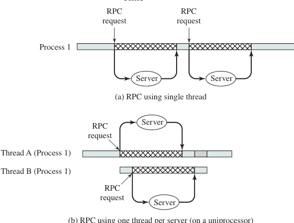

- 阻塞，等待 RPC 响应
- 阻塞，等待处理器（处理器正被线程 B 占用）
- 运行

图 4.3 使用线程的远程过程调用 (RPC)

> ²RPC 是一种技术，两个程序可能在不同的机器上执行，使用过程调用/返回的语法和语义进行通信。调用程序和被调用程序的行为都就好像对方运行在同一机器上一样。RPC 通常用于客户端/服务器应用程序，将在第 16 章中讨论。

## 4.2 线程的类型

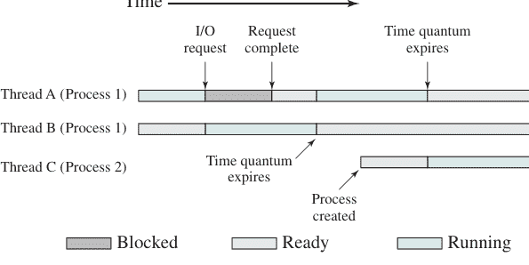

在单处理器上，多道程序允许多个进程中的多个线程交替执行。在图 4.4 的示例中，进程中的三个线程在处理器上交替执行。当当前线程被阻塞或其时间片用尽时，执行从一个线程传递到另一个线程。

**线程同步**：一个进程的所有线程共享相同的地址空间和其他资源（如打开的文件）。一个线程对资源的任何更改都会影响同一进程中其他线程的效率。有必要同步各种线程的活动，以便它们不会相互干扰或损坏数据结构。例如，如果两个线程尝试同时向双向链表添加元素，可能会丢失一个元素，或导致列表出现格式错误。

在线程同步中提出的问题和使用的技术通常与进程同步的问题是相同的。这些问题和技术将是第 5 章和第 6 章的主题。

### 用户级线程和内核级线程

线程实现大致分为两类：用户级线程（ULTS）和内核级线程（KLT）。后者在文献中也被称为内核支持线程或轻量级进程。

**用户级线程**：在纯 ULT 设施中，所有的线程管理工作由应用程序完成，内核感知不到线程的存在。

> ³在此示例中，当 A 耗尽量子后，C 开始运行，尽管 B 也处于就绪状态。B 和 C 之间的选择是一个调度决策。
>
> ⁴ ULT 和 KLT 写并不广泛使用，但为了简洁而引入。

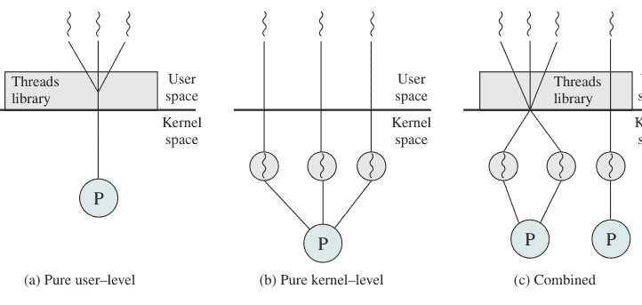

(a) 纯用户级 (b) 纯内核级 (c) 结合

- 用户级线程
- 内核级线程
- 进程

图 4.5 用户级和内核级线程

图 4.5 展示了纯 ULT 方法。任何应用程序都可以使用线程库进行多线程，线程库是 ULT 管理的程序包。线程库包含创建和销毁线程、线程间传递消息和数据、调度执行以及保存和恢复线程的代码。

默认情况下，应用程序从单个线程开始并在该线程运行。该应用程序及其线程被分配给由内核管理的进程。在应用程序运行（进程处于运行状态）的任何时间内，它可以产生一个新的线程。产生是通过调用线程库来实现的。通过过程调用传递控制。线程库为新线程创建数据结构，然后根据某种调度算法将控制交给就绪线程。当控制传递给库时，当前线程的上下文被保存；当控制从库传递给线程时，该线程的上下文被恢复。上下文本质上由用户寄存器的内容、程序计数器和栈指针组成。

前述描述的所有活动都发生在用户空间并在单个进程内。内核感知不到这些活动。内核继续以进程为单位进行调度，并为该进程分配单一执行状态（就绪、运行、阻塞等）。以下示例将阐明线程调度与进程调度之间的关系。假设进程 B 在线程 2 中执行；进程及其部分的两个 ULT 状态如图 4.6a 所示。以下每种都是可能发生：

1.  在线程 2 中执行的应用程序执行会导致阻塞 B 的系统调用。例如，执行 I/O 调用。这导致控制转移到内核。内核调用 I/O 操作，将进程 B 置于阻塞状态，并切换到另一个进程。与此同时，根据线程库维护的数据结构，B 进程的线程 2 仍然处于运行（Running）状态。需要注意的是，线程 2 并没有在处理器上执行意义上的真正运行；但它被线程库认为处于运行状态。相应的状态图如图 4.6b 所示。
2.  时钟中断将控制权交给内核，内核判断当前运行的进程 (B) 已耗尽其时间片。内核将进程 B 置于就绪（Ready）状态并切换到另一个进程。与此同时，根据线程库维护的数据结构，B 进程的线程 2 仍然处于运行状态。相应的状态图如图 4.6c 所示。
3.  线程 2 到达了需要 B 进程中的 1 执行某些操作。线程 2 进入阻塞（Blocked）状态，线程 1 从就绪变为运行。进程本身保持在运行状态。相应的状态图如图 4.6d 所示。

注意，上述每一项都暗示了从图 4.6 的 (a) 开始的另一种可选事件。因此，另外三个图 (b, c, d) 都显示了从 (a) 状态的转换。在情况 1 和 2 中（图 4.6b 和 4.6c），内核将控制权切换回进程 B，执行在线程 2 中继续。此外，当进程在执行线程库中的代码时，可能会因为耗尽时间片或被高优先级进程抢占而中断。因此，一个进程在从一个线程切换到另一个线程的中间可能会被中断。当该进程恢复时，执行将在线程库内继续，完成线程切换并将控制权转移给该进程内的另一个线程。

与内核级线程 (KLT) 相比，用户级线程 (ULT) 有许多优势，包括：

1.  线程切换不需要内核态权限，因为所有的线程管理数据结构都在单个进程的用户地址空间内。进程不需要切换到内核来进行线程管理。这节省了两次线程切换的开销（用户态到内核态；内核态回用户态）。
2.  调度可以是针对特定应用程序的。一个应用程序可能受益于简单的轮询调度算法，而另一个则可能受益于基于优先级的调度算法。调度算法可以为应用程序定制，而不会打扰底层的 OS 调度器。
3.  ULT 可以运行在任何操作系统上。不需要更改底层内核来支持 ULT。ULT 可以运行在任何操作系统上。线程库是一组所有应用程序共享的应用程序级函数。

与 KLT 相比，ULT 有两个明显的缺点：

1.  在典型的操作系统中，许多系统调用是阻塞的。因此，当一个 ULT 执行系统调用时，不仅是该线程被阻塞，整个进程内的所有线程都会被阻塞。
2.  在纯 ULT 策略中，多线程应用程序无法利用多处理器能力。内核一次只分配一个进程给一个处理器。因此，进程内一次只能有一个线程在执行。实际上，我们在单个进程内实现了应用级多处理。虽然这种多处理可以显著提高应用程序的速度，但某些应用程序也会从同时执行部分代码的能力受益。

有解决这两个问题的方法。例如，可以通过将应用程序写成多个进程而不是多个线程来克服这些问题。这种方法消除了线程的主要优势：每次切换都变成了进程切换而非线程切换，导致开销大得多。

另一种克服阻塞线程的方法是使用称为“外接”（jacketing）的技术。外接的目的是将阻塞系统调用转换为非阻塞系统，线程不再直接调用 I/O 例程，而是调用一个应用程序级的 I/O 外接例程。在外接程序内部，有代码用于检查 I/O 设备是否忙碌。如果忙，线程进入阻塞状态并（通过线程库）将控制权交给另一个线程。当该线程稍后再次获得控制权时，外接程序检查 I/O 设备。

### 内核级线程

在纯 KLT 环境中，所有的线程管理都由内核完成。应用程序级别没有线程管理，只有一个指向内核线程设施的应用程序编程接口 (API)。Windows 是这种方法的一个示例。


图 4.5b 描述了 KLT 方法。内核维护整个进程以及进程内单个线程的上下文信息。内核的调度是以线程为单位进行的。首先，内核可以同时在多个处理器上调度来自同一进程的多个线程。其次，如果进程中的一个线程被阻塞了，内核可以调度该进程的另一个线程。KLT 方法的另一个优势是内核例程本身也可以是多线程。

KLT 方法的主要缺点是从同一进程内一个线程到另一个线程的控制权传递需要切换模式到内核。为了说明差异，表 4.1 显示了在运行类 Unix 操作系统系统的单处理器 VAX 上进行的测量结果。两个基准测试如下：Null Fork（空派生），创建、调度、执行和完成一个进程的时间。

| 表 4.1 线程和进程延迟 (μs) | 操作 | 用户级线程 | 内核级线程 | 进程 |
|---|---|---|---|---|
| Null Fork | 34 | 948 | 11300 |
| Signal Wait | 37 | 441 | 1840 |

空过程开销（即派生进程/线程的开销）；以及 Signal-Wait（信号等待），进程/线程向进程/线程发送信号并等待某个条件的时间（即同步进程/线程的开销）。我们看到 ULT 和 KLT 之间存在一个数量级或更大的差异，KLT 和进程之间也是如此。

因此，表面上，KLT 多线程与单线程进程相比有显著的速度提升，确实如此。如果应用程序中大多数线程切换都需要内核态访问，那么基于 ULT 的方案可能并不比基于 KLT 的方案好多少。

# 结合方法

某些操作系统提供了结合的 ULT/KLT 设施（见图 4.5c）。在结合系统中，线程创建完全在用户空间完成，应用程序内部的调度和同步也是如此。单个应用程序的多个 ULT 被映射到（少于或等于）数量的 KLT。程序员可以针对特定的应用程序和处理器调整 KLT 以获得最佳结果。

在结合方法中，同一应用程序内的多个线程可以在多个处理器上并行运行，且阻塞系统调用不需要阻塞整个进程。如果设计得当，这种方法可以结合纯 ULT 和 KLT 方法的优点，同时减少它们的缺点。Solaris 是使用这种方法的良好示例。目前的 Solaris 版本将 ULT/KLT 关系限制为一对一。

# 其他安排

正如我们所说的，资源分配和调度单元传统上被封装在进程这一单一概念中——即线程与进程之间的 1:1 关系。最近，人们对为单个进程提供线程产生了浓兴趣，这是一种多对一的关系。然而，如表 4.2 所示，另外两种组合也得到了研究，即多对多关系和一对多关系。

## 表 4.2 线程与进程的关系

| 线程:进程 | 描述 | 示例系统 |
|---|---|---|
| I:1 | 每个执行线程都是一个唯一的进程，拥有独立的地址空间和资源。 | 传统的 UNIX 实现 |
| M:1 | 进程定义地址空间和动态资源分配。进程内可以创建并执行多个线程。 | Windows NT; Solaris, OS/2; OS/390, MACH |
| I:M | 线程可以从一个进程迁移到另一个。这允许线程在不同的系统之间轻松移动。 | Ra (Clouds), Emerald |
| M:N | 它结合了 M:1 和 I:M 情况的特点。 | TRIX |

## 4.2 线程的类型

### 多对多关系

线程与进程之间的多对多关系在实验性操作系统 TRIX 中被探索过（PAZZ92, WARD80）。在 TRIX 中，存在“域”（domain）和“线程”（thread）的概念。域是一个静态实体，由一个地址空间和一个用于发送和接收消息的“端口”组成。线程是一个单一的执行路径，拥有执行栈、处理器状态和调度信息。

与目前为止的多线程方法一样，多个线程可以在单个域中执行，从而提供了前文讨论的效率。然而，一个单用户活动或应用程序也可以在多个域中执行。在这种情况下，存在一个可以从一个域移动到另一个域的线程。

在多个域中使用单个线程的使用，其主要动机似乎是希望为程序员提供结构化工具。例如，考虑一个使用 I/O 子进程的程序。在允许用户创建进程的多程序运行环境中，主程序可以生成一个新进程来处理 I/O，然后继续执行。然而，如果主程序的后续进展依赖于 I/O 操作的执行，那么主程序将不得不等待另一个 I/O 程序完成。实现这种应用程序有几种方法：

1. 整个程序可以实现为单个进程。这是一个合理且直接的解决方案。但在内存管理方面存在缺点。整个进程可能需要大量的内存管理才能高效执行，而 I/O 子进程只需要较小的地址空间来缓冲 I/O 并处理相对较少的程序代码。由于 I/O 程序在较大进程的地址空间中执行，在 I/O 操作期间，整个进程必须留留在内存中，否则 I/O 操作将受到交换。如果主程序和 I/O 子进程实现为同一地址空间中的两个线程，这种内存管理影响也会存在。
2. 主程序和 I/O 子进程可以实现为独立的进程。这会产生创建子进程的开销。由于 I/O 活动非常频繁，必须保持子进程存活（这消耗管理资源），要么频繁销毁子进程（这效率很低）。
3. 将主程序和 I/O 子进程视为单一活动并实现为单个线程。然而，可以为主程序程序创建一个地址空间（域），为 I/O 子进程创建另一个。这样，随着执行的进行，线程可以在两个地址空间之间移动。操作系统可以独立地管理这两个地址空间，且不会产生进程创建的开销。此外，I/O 子进程使用的地址空间也可以被其他简单的 I/O 程序共享。

TRIX 开发者的经验表明，第三方案是有价值的，可能是某些应用程序最有效的解决方案。

### 一对多关系

在分布式操作系统（设计用于控制分布式计算机系统）领域，人们对线程的概念感兴趣，将其视为一种可以在地址空间之间移动的实体。这种研究的一个著名例子是 Clouds 操作系统，特别是它的内核，名为 Ra [DASG92]。另一个例子是 Emerald 系统 [STEE95]。

从用户的角度来看，线程是一个活动单元。进程是一个带有关联进程控制块的虚拟地址空间。在被创建时，线程通过调用该进程中程序的入口点在进程中开始执行。线程可以从一个地址空间移动到另一个地址空间，并且实际上跨越计算机边界（即从一台计算机移动到另一台计算机）。当线程移动时，它必须携带某些信息，例如控制终端、全局参数和调度指导（例如优先级）。

这种方法提供了一种有效的方法，将用户和程序员与分布式环境的细节隔离开。用户的活动可以表示为单个线程，而该线程在计算机之间的移动可能由操作系统根据各种系统相关原因决定，例如访问远程资源的需要和负载均衡。

> 近年来，进程或线程在不同地址空间之间的移动或线程迁移已成为一个热点。第 18 章将探讨这一点。

## 4.3 多核与多线程

使用多核系统来支持具有多个线程的单个应用程序（可能发生在工作站、视频游戏机或运行处理器密集型应用程序的个人电脑上），这引发了性能和应用程序设计的问题。在本节中，我们首先查看多线程应用程序在多核系统上的一些性能影响，然后描述一个设计用于利用多核能力的特定应用程序示例。

### 软件在多核系统上的性能

多核体系的潜在性能收益取决于有效利用应用程序可用的并行资源的能力。让我们关注运行在多核系统上的单个应用程序。阿姆达尔法则（见附录 E）指出：

```
加速比 = 在单处理器上执行程序的时间 / 在 N 个并行处理器上执行程序的时间 = (1-f) + f/N
```

该法则假设程序中执行时间的某部分 (1 - f) 质上是串行的，而涉及代码的比例 f 是无限可并行的，且没有调度开销。

这似乎使得多核体系的前景非常有吸引力。但如图 4.7a 所示，即使是极少量的串行代码也会产生显著影响。如果只有 10% 的代码质上是串行的 (f = 0.9)，在具有八个处理器的多核系统上运行程序将获得 4.7 倍的性能提升。

此外，软件通常会由于通信和向多个处理器分发工作而产生开销。这导致性能曲线在达到峰值后开始下降，因为使用多个处理器的开销负担增加了。图 4.7b 来自于 [MCDOO07]，是一个一个代表性的例子。

然而，软件工程师一直在解决这个问题，有许多应用程序可以有效利用多核系统。[MCDOO07] 报告了一组数据库应用程序，在这些应用程序中，人们非常注重硬件架构、操作系统、中间件和数据库应用程序软件中的串行函数。图 4.8 显示了结果。在这个示例中，数据库管理系统和数据库应用程序是多核系统可以有效使用的领域之一。许多种服务器也可以有效使用并行多处理体系，因为服务器通常并行处理许多相对独立的事务。

### 4.7 多核的性能影响

- 具有 0%、2%、5% 和 10% 串行部分的加速比
- 开销

除了通用服务器软件外，许多应用程序直接受益于随核心数量扩展吞吐量的能力。[MCDOO06] 列出了以下示例：

- **多线程应用程序**：多线程 应用程序的特点是具有少数高线程进程。线程应用程序的示例包括 Lotus Domino 或 Siebel CRM（客户关系管理）。
- **多进程应用程序**：多进程应用程序的特点是存在许多单线程进程。多进程应用程序的示例包括 Oracle 数据库、SAP 和 PeopleSoft。
- **Java 应用程序**：Java 应用程序以基础方式采用线程。不仅 Java 极大地促进了多线程应用程序，而且 Java 虚拟机是一个多线程进程，为 Java 应用程序提供调度和内存管理。直接从多核资源受益的 Java 应用程序包括应用程序服务器，如 Oracle 的 Java Application Server、BEA 的 Weblogic、IBM 的 Websphere 以及开源的 Tomcat 服务器。所有使用 Java 的应用程序都是平台企业版（J2EE 平台）应用程序服务器可以立即从多核技术中受益。
- **多实例应用程序**：如果单个应用程序无法通过扩展来利用大量线程，仍然可以通过并行运行应用程序的多个实例来从多核架构中获益。如果多个应用程序实例需要某种程度的隔离，可以使用虚拟化技术（针对操作系统的硬件）为每个实例提供独立的、安全的环境。

### 案例分析：Valve 游戏软件

Valve 是一家娱乐和技术公司，开发了多款热门游戏，以及 Source 引擎——这是目前使用最广泛的游戏引擎之一。Source 是 Valve 用于其游戏的一种种动画引擎，并授权给其他游戏开发人员使用。

近年来，Valve 重新利用了 Source 引擎软件，通过多线程技术来释放 Intel 和 AMD 多核处理器的能力 [REIM06]。修订后的 Source 引擎代码为《半条命 2》等 Valve 游戏提供了更强大的支持。

从 Valve 的角度来看，线程粒度选项的定义如下 [HAR06]：

- **粗粒度线程**：将单个模块（称为系统）分配给单个处理器。在 Source 引擎案例中，这意味着在一个处理器上进行渲染，在另一个处理器上处理人工智能（AI），在另一个处理器上处理物理，以此此类推。这种方法非常直观。从本质上，每个主要模块都是单线程的，主要的协调涉及根据时间线截止对所有线程进行同步。
- **细粒度线程**：将许多相似或相同的任务分布在多个处理器上。例如，一个遍历数据数组的循环可以拆分成各个线程中的若干个较小并行循环，这些线程可以被并行调度。
- **混合线程**：这涉及对某些系统选择性地使用细粒度线程，而对其他系统使用单线程。

Valve 发现，通过粗粒度线程，他们在两个处理器上实现的性能可以达到单处理器上运行性能的两倍。对于真实的游戏场景，这种性能只能在特定设计的案例中实现。对于 1.2 版本，Valve 还发现有效利用细粒度线程是困难的。每个单元工作的时间可能会变化，而且管理结果和后果的时间线涉及复杂的编程。

Valve 发现，混合线程方法是最有前景的，随着具有 8 核或 16 核处理器的多核系统的出现，它的扩展性最好。Valve 识别出运行非常高效的系统永久分配给单个处理器。例如音效混合，它与用户的交互很少，不受窗口帧配置的，并且在自己的数据集上运行。其他模块（如场景渲染）可以组织成多个线程，以便模块可以在单个处理器上执行，但随着分散到越来越多的处理器，可以获得更高的性能。

图 4.9 展示了渲染模块的线程结构。在这种层次结构中，高层线程根据需要创建低层线程。渲染模块依赖 Source 引擎的一个关键部分——世界列表（world list），它是游戏世界中视觉元素的数据库表示。第一个任务是确定世界中哪些区域需要渲染。下一个任务是确定从多个角度观察的场景中有哪些对象。然后是计算密集型工作。渲染模块必须计算出每个对象从多个视角的渲染情况，例如玩家的视角、显示器的视角以及水中的反射视点。

渲染模块线程策略的一些关键元素列在 [LEON07] 中，包括以下内容：

- 并行为多个场景构建场景渲染列表（例如世界及其在水中的反射）。
- 重叠图形模拟。
- 并行计算所有场景中所有角色的骨骼变换。
- 允许多个线程并行绘制。

设计人员发现，仅为线程锁定关键数据库（如世界列表）效率太低了。在 95% 的时间里，线程都在尝试从数据集中读取，而只有 5% 的时间花费在写入数据集中。因此，一种名为“单写多读”（single-writer-multiple-readers）模式的并发机制运行得良好。

## 4.4 WINDOWS 进程与线程管理

本节首先概述了支持 Windows 应用程序执行的关键对象和机制。本节的其余部分将详细介绍如何管理进程和线程。

应用程序由一个或多个进程组成。每个进程提供执行程序所需的资源。进程具有虚拟地址空间、可执行代码、打开的系统对象、安全上下文、唯一标识符、环境变量、优先级类、以及最大工作集大小，以及至少一个执行线程。每个进程都从单个线程（通常称为主线程）启动，并从其任何一个线程创建额外的线程。

线程是进程内部可以被调度执行的实体。进程的所有线程共享其虚拟地址空间和系统资源。此外，每个线程都维护着异常处理程序、调度优先级、本地存储、唯一标识符以及一组系统用于保存线程上下文直到其被调度的结构。在多处理器计算机上，系统可以同时执行与计算机上处理器数量一样的线程。

作业对象（job object）允许将进程作为一个单元进行管理。

线程池（thread pool）是一组用于执行的线程。

**用户模式调度 (UMS)** 是一种应用程序可以使用的轻量级机制。


# 用户模式调度 (UMS)

**用户模式调度 (UMS)** 是一种应用程序可以使用的轻量级机制。线程是进程内部可以被调度执行的实体。进程的所有线程共享其虚拟地址空间和系统资源。此外，每个线程都维护着异常处理程序、调度优先级、本地存储、唯一标识符以及一组系统用于保存线程上下文直到其被调度的结构。在多处理器计算机上，系统可以同时执行与计算机上处理器数量一样的线程。

## 后台任务管理与应用程序生命周期

从 Windows 8 开始并一直到 Windows 10，开发者负责管理应用程序的状态。以前的 Windows 版本始终让用户完全控制进程的生命周期。在经典桌面环境中，用户负责关闭应用程序。对话框可能会提示他们保存工作。在新界面中，Windows 接管了应用程序的生命周期。

Metro 界面中的前台应用程序可以访问所有可用的处理器、网络和磁盘资源。当所有其他应用程序进入挂起模式时，应该触发事件以存储用户的信息。这是应用程序开发者的责任。由于各种原因，无论是需要资源还是因为应用程序超时，Windows 可能会终止后台应用程序。

某些应用程序（如新闻推送）可能会查看与上次执行关联的时间戳，并丢弃旧数据以采用新获取的信息。这是开发者的决定，而不是操作系统的决定。如果用户未保存数据，数据将不会被保存。在 Windows 中，由于前台任务占用所有系统资源，后台应用程序饥饿是一个现实。这使得与状态变化相关的应用程序开发对于 Windows 程序的成功至关重要。

为了处理后台任务的需求，构建了一个后台 API，允许应用程序在不在前台时执行小型任务。在这个受限的环境中，应用程序可能会接收服务器的推送通知，或者用户可能会接到电话。推送通知是模板 XML 字符串。它们通过称为 Windows 通知服务（WNS）的云服务进行管理。该服务偶尔会向用户的后台应用程序推送更新。API 会队列请求并在接收到足够的处理器资源时进行处理。后台任务对处理器的使用受到严格限制，每小时每秒仅获得一个处理器的配额额度。这确保了关键任务能够获得保证的应用程序配额。然而，它并不保证后台应用程序始终能运行。

# Windows 进程与线程管理

## Windows 进程

Windows 进程的重要特征是：

- Windows 进程被实现为对象。
- 进程可以作为新进程创建，也可以作为现有进程的副本创建。
- 可执行进程可以包含一个或多个线程。
- 进程和线程对象都具有内置的同步能力。

图 4.10 基于 [RUSS11] 中的图，说明了进程与其控制或使用的资源之间的关系。每个进程都被分配了一个安全访问令牌，称为进程的主令牌。当用户登录时，Windows 会创建一个包含该用户安全 ID 的访问令牌。代表该用户而创建的每个进程都有该访问令牌的副本。Windows 使用令牌来验证用户访问受保护对象的能力，或在系统和受保护对象上执行受限功能。访问令牌控制进程是否可以更改其属性。在这种情况下，进程没有打开其访问令牌的句柄（`handle`）。如果进程尝试打开此类句柄，安全系统将确定这是否允许，从而决定进程是否可以更改属性。

与进程相关的还有系列定义分配给该进程的虚拟地址空间的块。进程不能直接修改这些结构，但必须依赖虚拟内存管理器，该管理器为进程提供内存分配服务。

最后，进程包含一个对象表，其中包含该进程已知的其他对象的句柄。图 4.10 显示了一个单线程。此外，进程对文件对象和定义共享内存区域的节对象具有访问权限。

**图 4.10** Windows 进程及其资源

## 进程和线程对象

Windows 面向对象的结构促进了通用进程设施的开发。Windows 使用两种类型的进程相关对象：进程和线程。进程是一个对应用户作业或应用程序的实体，它拥有资源，如内存和打开的文件。线程是一个可调派的工作单元，它按顺序执行且是可以被中断的，处理器可以切换到另一个线程。

每个 Windows 进程都由一个对象表示。每个进程对象包含若干属性，并封装了它可能执行的若干项操作或服务。当通过一组发布的接口方法进行调用时，进程将执行相应的服务。当 Windows 创建新进程时，它使用为 Windows 进程定义的对象类（或类型）作为模板来生成新的对象实例。在创建时，会分配属性值。表 4.3 简要给出了进程对象属性的定义。

一个 Windows 进程必须包含至少一个线程才能执行。该线程可以创建其他线程。在多处理器系统中，同一进程的多个线程可以并行执行。表 4.4 定义了线程对象属性。线程的某些属性与进程属性相似。在这些情况下，线程属性值派生自进程属性值。例如，`线程处理器亲和性` 是多处理器系统中可能执行此线程的处理器集合；该集合等于或属于 `进程处理器亲和性`。

### 表 4.3 Windows 进程对象属性

| 属性 | 定义 |
|---|---|
| 进程 ID (Process ID) | 用于向操作系统标识进程的唯一值。 |
| 安全描述符 (Security descriptor) | 描述谁创建了对象、可以访问或使用对象，以及谁被拒绝访问对象。 |
| 基础优先级 (Base priority) | 进程线程的基线执行优先级。 |
| 默认处理器亲和性 (Default processor affinity) | 进程线程可以运行的默认处理器集合。 |
| 配额限制 (Quota limits) | 用户进程可以使用的分页和非分页系统内存、分页文件空间以及处理器时间的最大量。 |
| 执行时间 (Execution time) | 进程中所有线程执行的总时间。 |
| I/O 计数器 (I/O counters) | 记录进程执行的 I/O 操作数量和类型的变量。 |
| VM 操作计数器 (VM operation counters) | 记录当进程中的一个引起异常时，进程管理器发送消息的虚拟操作数量和类型的变量。通常，这些连接到环境子系统和调试器进程。 |
| 退出状态 (Exit status) | 终止的原因。 |

注意线程的一个属性是，它包含了线程上次运行的值。这使得线程可以被挂起。

### 表 4.4 Windows 线程对象属性

| 属性 | 定义 |
|---|---|
| 线程 ID (Thread ID) | 用于标识线程的唯一值。 |
| 线程上下文 (Thread context) | 定义线程状态的寄存器和其他易变数据的集合。 |
| 动态优先级 (Dynamic priority) | 线程在任意时刻的优先级。 |
| 基础优先级 (Base priority) | 线程动态优先级的下限。 |
| 线程处理器亲和性 (Thread processor affinity) | 线程可以运行的处理器集合，是进程亲和性的子集。 |
| 线程执行时间 (Thread execution time) | 线程在用户模式和内核模式下执行的累计时间。 |
| 警告状态 (Alert status) | 线程是否可以执行异步过程调用的标志。 |
| 挂起计数 (Suspension count) | 线程被挂起但未恢复的次数。 |
| 模拟令牌 (Impersonation token) | 允许线程代表执行操作的临时访问令牌（子系统使用）。 |
| 终止端口 (Termination port) | 线程终止时进程管理器向其发送消息的进程间通信通道（子系统使用）。 |
| 退出状态 (Exit status) | 终止的原因。 |

## 多线程

Windows 支持进程间的并发，因为不同进程的线程可以并发（看起来同时运行）。此外，同一进程内的多个线程可以被分配并同时执行（实际上同时运行）。多线程进程在不使用多个进程开销的情况下实现了并发。同一进程内的线程可以通过其共同地址空间交换信息。不同进程的线程可以通过之间建立的共享内存交换信息。

面向对象的多线程进程是实现服务器应用程序的一种高效方法。例如，一个服务器进程可以同时为多个客户端服务。

## 线程状态

现有的 Windows 线程处于六种状态之一（见图 4.11）：

1.  **就绪 (Ready)**: 就绪线程可以被调度执行。内核调度器跟踪所有就绪线程并按优先级进行调度。
2.  **等备 (Standby)**: 等备线程已被调度为在特定处理器上下次运行。线程在此状态下等待，直到处理器可用。如果等备线程的优先级足够高，处理器上的运行线程可能会被抢占以让等备线程运行。否则，等备线程将等待运行线程阻塞或耗尽其时间片。
3.  **运行 (Running)**: 一旦内核调度器执行了线程切换，待命线程就会进入运行状态并开始执行，直到它被高优先级线程抢占、时间片耗尽、阻塞或终止。在前两种情况下，它会返回到 **就绪 (Ready)** 状态。
4.  **等待 (Waiting)**: 线程在以下情况下进入等待状态：(1) 在某个事件（如 I/O）上阻塞，(2) 出于同步目的自愿等待，或 (3) 环境系统指令挂起线程。当等待条件满足时，如果所有资源都可用，线程将移动到就绪 (Ready) 状态。
5.  **转换 (Transition)**: 如果线程在等待后准备好运行，则会进入此状态，例如线程的栈可能被换出内存。当资源可用时，线程将进入就绪 (Ready) 状态。
6.  **终止 (Terminated)**: 线程可以由自身终止、由另一个线程终止，或者在其父进程终止时终止。一旦清理工作完成，线程将从系统中移除，或者可能被内核层留供以后使用。

## 对 OS 子系统的支持

通用进程和线程机制必须支持各种操作系统环境的特定进程和线程结构。每个操作系统都有责任利用 Windows 的进程和线程特性来模拟其对应操作系统的进程和线程机制。进程/线程管理领域非常复杂，我们在这里仅提供简要概述。

进程创建始于应用程序请求新进程。应用程序向受保护的子系统发出创建进程请求，子系统随后将请求传递给内核层（Executive）。内核层创建一个进程对象，并将该对象的句柄（`handle`）返回给该子系统。当 Windows 创建进程时，它不会自动创建线程。在 Win32 的情况下，必须创建一个带有初始线程的新进程。因此，Win32 子系统调用 Windows 进程管理器为新进程创建一个线程，并从 Windows 处接收句柄。随后，将相应的线程和进程信息返回给应用程序。在 POSIX 情况下，POSIX 子系统通过 Windows 为新进程创建一个线程，以便进程可以被激活，但仅向应用程序返回进程信息。POSIX 进程是使用 Windows 内核进程和一个线程来实现的，这一事实对于应用程序是不可见的。

当内核层创建一个新进程时，它会从创建它的进程继承许多属性。但在 Win32 环境中，这种进程创建是直接完成的。应用程序客户端进程向 Win32 子系统发出进程创建请求；因此，子系统反向向 Windows 内核发出进程请求。由于预期的效果是新进程继承客户端进程而非服务器进程的特性，Windows 允许子系统指定新进程的父进程。新进程随后继承父进程的访问令牌（`token`）、配额限制、基本优先级和默认处理器亲和性。

> 内核层在第 2 章中描述。它包含了基础操作系统服务，如内存管理、进程和线程管理、安全、I/O 和进程间通信。

# SOLARIS 线程与 SMP 管理

Solaris 实现了多线程支持，旨在为利用处理器资源方面提供相当大的灵活性。

## 多线程架构

Solaris 利用了四个独立的线程相关概念：

1.  **进程 (Process)**: 这是标准的 UNIX 进程，包括用户的地址空间、栈和进程控制块。
2.  **用户级线程 (User-level threads)**: 通过进程地址空间中的线程库实现，对操作系统是不可见的。用户级线程（ULT）是进程中由用户创建的执行单元。
3.  **轻量级进程 (Lightweight processes)**: 轻量级进程（LWP）可以被视为 ULT 与内核线程之间的映射。每个 LWP 支持 ULT 映射，并由内核独立调度，且可以在多处理器上并行执行。
4.  **内核线程 (Kernel threads)**: 这些是可以被调度并分发到某个系统处理器上运行的底层实体。

图 4.12 展示了这四个实体之间的关系。每个 LWP 恰对应一个内核线程。在应用程序中，LWP 数据结构存在于各自的进程地址空间内。同时，每个 LWP 都绑定到单一的可调度内核线程，而内核线程的数据结构维护在内核的地址空间内。

一个进程可能由绑定到单个 LWP 的单个 ULT 组成。在这种情况下，只有一个执行线程，对应传统的 UNIX 进程。当进程内部不需要并发时，应用程序使用这种进程结构。如果应用程序需要并发，其进程将包含多个线程，每个线程绑定到单个 LWP，而 LWP 又绑定到单个内核线程。

此外，还存在与 LWP 无关的内核线程。内核创建、运行并销毁这些内核线程以执行系统函数。使用内核线程而非内核进程来实现系统函数，可以减少内核内部切换的开销（从进程切换转为线程切换）。

### 动机

Solaris 中的三级线程结构（ULT、LWP、内核线程）旨在便于操作系统管理线程，并为应用程序提供整洁的接口。ULT 接口可以是标准的线程库。定义的 ULT 映射到 LWP 上，LWP 由操作系统管理并具有定义的执行状态，随后被定义。LWP 绑定到一个内核线程，并在执行状态上具有一对一对应关系。因此，并发和执行是在内核线程级别进行管理的。

此外，应用程序通过系统调用组成的应用程序接口（API）访问硬件。该 API 允许用户调用内核服务代表进程执行特权任务，如写入文件、向设备发出命令、创建新进程或线程、分配内存等。

> 7 再次说明，ULT 这一缩写是本书特有的，在 Solaris 文献中未找到。

## 进程结构

图 4.13 通俗比较了 UNIX 系统和 Solaris 的进程结构。在典型的 UNIX 实现中，进程结构包括：

- 进程 ID（PID）。
- 用户 ID（User IDs）。
- 信号分发表，内核用它来决定向进程发送信号时的操作。
- 文件描述符，描述正在使用的文件状态。
- 内存映射，定义进程的地址空间。
- 处理器状态，包括进程的内核栈。

Solaris 保留了这种基础结构，但将处理器状态替换为包含每个 LWP 数据块的列表。

LWP 数据结构包含以下内容：

- LWP 标识符
- 该 LWP 的优先级以及支持它的内核线程

| UNIX 进程结构 | Solaris 进程结构 |
|---|---|
| Process ID | Process ID |
| User IDs | User IDs |
| 信号分发表 | 信号分发表 |
| 文件描述符 | 文件描述符 |
| 内存映射 | 内存映射 |
| 处理器状态 | LWP 列表 (优先级 / 信号掩码 / 寄存器 / STACK) |

## 线程执行

图 4.14 展示了两种线程执行状态的简化视图。这些状态反映了内核线程及其绑定的 LWP 的执行状态。如前所述，某些内核线程与 LWP 无关；相同的执行图同样适用。状态如下：

- **RUN**: 线程是可运行的，即线程已就绪执行。
- **ONPROC**: 线程正在处理器上执行。
- **SLEEP (睡眠)**: 线程处于阻塞状态。
- **STOP (停止)**: 线程已停止。
- **ZOMBIE (僵死)**: 线程已终止。
- **FREE (空)**: 线程资源已释放，线程正在等待从操作系统的线程数据结构中移除。

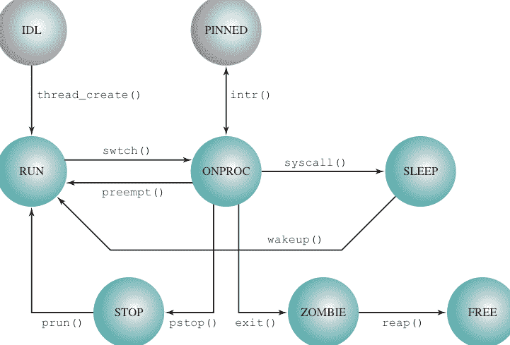

图 4.14 Solaris 线程状态

如果线程被高优先级线程抢占或由于时间片轮转，它将从 ONPROC 移动到 RUN。如果线程被阻塞并必须等待事件返回 RUN 状态，它将从 ONPROC 移动到 SLEEP。如果线程调用系统调用并必须等待系统服务执行，就会发生阻塞。如果进程被停止，线程将进入 STOP 状态；这可能是为了调试。

### 作为线程的中断

大多数操作系统包含两种基本形式的并发活动：进程（或线程）相互协作，并通过各种强制互斥的原语（确保一次只有一个进程可以执行特定代码或访问特定数据）以及同步它们的执行来管理共享数据结构的使用。中断通过在一段时间内阻止处理来实现同步。Solaris 将这些概念统一到单一模型中，即内核线程，以及调度和执行内核线程的机制。为了实现这一点，中断被转换为内核线程。

将中断转换为线程的动机是为了减少开销。中断处理程序经常会操作内核其他部分共享的数据。因此，当访问数据的内核例程执行时，必须阻塞中断，尽管大多数中断不会影响该数据。通常，做法是让例程设置更高的中断优先级级别以阻塞中断，然后在访问完成后降低优先级级别。这些操作需要时间。在多处理器系统上，这个问题被放大了。内核必须保护对象，并可能需要在所有处理器上都阻塞中断。

Solaris 的解决方案可以总结如下：

- Solaris 使用一组内核线程来处理中断。与任何内核线程一样，中断都有自己的标识符、优先级、上下文和堆栈。
- 内核使用互斥原语（第 5 章将讨论的类型）控制对数据结构的访问以及线程之间的同步。也就是说，在处理中断时使用了线程的普通同步技术。
- 中断线程的优先级高于所有其他类型的内核线程。


当中断发生时，它被传递给一个特定的处理器，并且正在执行的线程会被固定（pinned）。固定的线程不能移动到另一个处理器，其上下文会被保留；它只是被挂起，直到中断被处理。随后处理器开始执行中断线程。有一个可用的非活跃中断线程池，因此不需要创建新线程。中断线程执行以处理中断。如果处理程序需要访问当前由于某种方式被另一个执行线程锁定的数据，中断必须等待访问该数据。中断只能被更高优先级的中断线程抢占。对 Solaris 中断线程的经验表明，这种方法提供了比传统中断处理策略更好的性能 [KLI95]。

## LINUX 进程与线程管理

### Linux 任务

Linux 中的进程或任务由 `task_struct` 数据结构表示。`task_struct` 数据结构包含多个类别的信息：

- 状态：进程的执行状态（执行中、就绪、挂起、僵死）。后文将对此描述。
- 调度信息：Linux 调度进程所需的信息。进程可以是实时或普通时间，并具有优先级。实时进程在普通进程之前调度，在每个类别内部，可以使用相对优先级。引用计数器跟踪允许进程执行的量。
- 标识符：每个进程都有唯一的进程标识符 (PID)，以及用户标识符组标识符。组标识符用于为一组进程分配资源访问权限。
- 进程间通信：Linux 支持 UNIX SVR4 中的 IPC 机制，将在第 6 章后文描述。
- 链接：每个进程包含一个指向其父进程的链接、指向兄弟进程（具有相同父进程的进程）的链接以及指向所有进程的链接。
- 时间和定时器：包括进程创建时间和进程到为止消耗的处理器资源。进程还可以关联一个或多个间隔定时器。进程通过系统调用定义间隔定时器；结果是在定时器过期时向进程发送一个信号。定时器可以是单次或周期的。
- 文件系统：包括指向此进程打开的所有文件的指针，以及指向该进程当前目录和根目录的指针。
- 地址空间：定义分配给此进程的虚拟地址空间。
- 处理器特定上下文：构成此进程上下文的寄存器和堆栈信息。

图 4.15 显示了进程的执行状态。如下：

- **运行（Running）**：此状态值对应于两种状态。运行中的进程要么正在执行，要么处于就绪状态。
- **可中断（Interruptible）**：这是一种阻塞状态，进程正在等待某个事件，例如 I/O 操作结束、资源可用或来自另一个进程的信号。
- **不可中断（Uninterruptible）**：另一种阻塞状态。与可中断状态的区别在于，在不可中断状态下，进程直接等待硬件条件，因此不会处理任何信号。
- **停止（Stopped）**：进程已停止，只能通过另一个进程的操作恢复。例如，正在调试的进程可以进入停止状态。
- **僵死（Zombie）**：进程已终止，但由于某些原因在进程表中留有条目。


图 4.15 Linux 进程/线程模型

### Linux 线程

传统的 UNIX 系统每个进程支持一个执行线程，而现代 UNIX 系统通常支持每个进程多个线程。与传统的 UNIX 系统一样，Linux 内核的旧版本提供了多线程支持。应用程序需要使用一组用户级库进行编写，其中最流行的是 pthread（POSIX 线程）库。

Linux 通过复制当前进程的属性来创建一个新进程。新进程可以被克隆，以便共享文件、信号处理程序和虚拟内存等资源。当两个进程共享虚拟内存时，它们就是同一个进程内的线程。然而，没有为线程定义特殊类型的数据结构。在 Linux 中，使用 `clone()` 命令代替 `fork()`。该命令包含一组标志参数。`fork()` 系统调用在 Linux 中实现为清除了所有标志标志的 `clone()` 系统。

标志的示例包括：

- `CLONE_NEWID`：创建新的命名空间。
- `CLONE_PARENT`：调用者和新任务共享同一个父进程。
- `CLONE_SYSV`：System V SEM_UNDO 语义。
- `CLONE_THREAD`：将此进程插入父进程的同一个线程组。如果设置了此标志，它会强制执行 `CLONE_PARENT`。
- `CLONE_VM`：地址空间（内存描述符和页表）。
- `CLONE_FS`：共享相同的文件系统信息（包括当前目录、文件系统根目录和 umask）。
- `CLONE_FILES`：共享相同的文件描述符表。创建或关闭文件描述符的操作会传播到另一个进程中，使用 `fcntl()` 系统调用更改文件描述符的标志位也是如此。

当内核从一个进程到另一个进程执行上下文切换时，它会检查当前进程的页目录地址是否与待调度进程的地址相同。如果相同，则它们共享同一个地址空间，因此上下文切换本质上是从代码的一个位置到另一个代码位置的跳转。

尽管克隆的进程属于同一个进程组并共享相同的内存空间，但它们不能共享相同的用户栈。因此，`clone()` 调用为每个进程创建了独立的空间。

## Linux 命名空间 (Namespaces)

Linux 中的每个进程都关联着一组命名空间。命名空间允许进程（或共享同一命名空间的多个进程）拥有与其他具有不同命名空间的进程不同的系统视图。命名空间和 cgroups（将在接下来的节中描述）是 Linux 轻量级虚拟化的基础，该功能为进程或进程组提供了一种它们是系统上唯一进程的错觉。这一功能被 Linux Containers（容器）项目使用。目前 Linux 中有六个命名空间：mnt, pid, net, ipc, uds 和 user。

命名空间通过 `clone()` 调用创建，该调用接受一个 clone 标志位（`CLONE_NEWNS`、`CLONE_NEWPID`、`CLONE_NEWNET`、`CLONE_NEWIPC`、`CLONE_NEWUTS` 和 `CLONE_NEWUSER`）作为参数。进程也可以使用 `unshare()` 系统调用配合这些标志之一创建一个命名空间；与 `clone()` 不同，这种情况不会创建新进程，而是创建一个附加到调用进程的新命名空间。

### 挂载命名空间 (MOUNT NAMESPACE)

挂载命名空间为进程提供了特定的文件系统层次结构视图，使得不同命名空间的两个进程可以看到不同的文件系统层次结构。进程执行的操作仅对该进程可见的文件系统生效。

### UTS 命名空间 (UTS NAMESPACE)

UTS（Unix 时间共享）命名空间与 Linux 系统调用有关。该调用返回当前内核的名称和信息，包括 nodename（在某些由实现定义的网络内部的系统名称）和 domainname（DNS 名称）。NIS（网络信息服务）是所有主流 Linux 和类 Unix 系统均使用的标准方案。它允许 NIS 域内的机器组共享一组配置文件。这允许系统管理员以极少的配置数据设置 NIS 客户端系统，并在单个位置添加、删除或修改配置数据。通过 UTS 命名空间，同一系统上不同进程的初始化和配置参数可以不同。

### IPC 命名空间 (IPC NAMESPACE)

IPC 命名空间隔离了某些进程间通信（IPC）资源，如信号量、POSIX 消息队列等。因此，程序员可以使用并发机制来实现共享同一命名空间的进程之间的 IPC。

### PID 命名空间 (PID NAMESPACE)

PID 命名空间隔离了进程 ID，使得不同的命名空间可以具有相同的 PID。此功能用于用户态进程检查点恢复（CRIU），这是一种 Linux 软件工具。使用它，你可以冻结运行中的应用程序（或其部分）并将其作为文件集检查点到硬盘。然后你可以使用这些文件在相应机器或不同的主机上从冻结点恢复并运行应用程序。CRIU 项目的一个独特特征是它主要在用户空间中实现，此前在尝试在内核中实现失败后如此。

### 网络命名空间 (NETWORK NAMESPACE)

网络命名空间对与网络相关的系统资源提供了隔离。因此，每个命名空间都有自己的网络设备、IP 地址、IP 路由表、端口号等。这些命名空间虚拟化了对网络资源的访问。属于此命名空间的每个进程或进程组都拥有所需的网络访问权限（但不超过）。在任何时刻，网络设备只属于一个网络命名空间。同样，socket 只属于一个命名空间。

### 用户命名空间 (USER NAMESPACE)

用户命名空间为容器提供了自己的一套 UID，与父进程的 UID 完全分离。当进程克隆一个新进程时，它可以分配一个新的用户命名空间、新的 PID 命名空间以及所有其他命名空间。克隆进程可以访问父进程的所有资源并拥有其权限，或者访问其资源和权限集。命名空间在安全性方面被认为是敏感的，因为它们允许创建非特权容器（由非 root 用户创建的进程）。

## LINUX CGROUP 子系统

cgroup 子系统与其命名空间是轻量级进程虚拟化的基础，因此它们构成 Linux 容器的基础；如今几乎每个 Linux 容器（如 Docker、LXC、Kubernetes 等）都是基于这两者的。Linux cgroups 子系统提供了资源管理和核算。它处理 CPU、网络、内存等资源；并且在光谱的两个端（嵌入式设备和服务器）中都很需要，而在桌面设备上需求较少。cgroups 的开发由 Google 的工程师在 2006 年启动，最初命名为“process containers”，后来改为“cgroups”以避免与 Linux Containers 混淆。为了实现 cgroups，没有添加新的系统调用，而是添加一个新的虚拟文件系统（VFS）“cgroups”（也称为 groups），因为 cgroup 文件系统操作是基于文件系统的。cgroups 的新版本 cgroups v2 在内核 4.5（2016 年 3 月）中发布。cgroup v2 子系统解决了 v1 中的许多不一致性，并通过建立严格接口使 cgroup 更加规范。目前有 12 个 cgroup 控制器（内存、I/O 和 PID）正在开发中。

为了使用 cgroups（即浏览它、将任务附加到组、对各种资源设置限制），必须像挂载其他文件系统一样对其进行挂载。挂载 cgroup 文件系统后，你可以创建子系统；在其他内核子系统中也存在类似的现象，例如 iptables 和 nftables 并存。

## Android 进程与线程管理

在讨论 Android 对进程和线程管理的细节之前，我们需要描述 Android 应用程序和活动的概念。

### Android 应用程序

应用程序是实现软件。每个 Android 应用程序由一个或多个类型的组件组成。每个组件在应用程序行为中执行特定的角色，并且每个组件可以在程序内部甚至通过其他应用程序被激活。以下是四种组件类型：

1. **Activity（活动）**：Activity 对应单一的用户界面。例如，一个电子邮件应用程序可能有一个显示邮件列表的 Activity，另一个用于编写邮件的 Activity，以及另一个用于读取邮件的 Activity。尽管 Activity 协作形成电子邮件应用程序的连贯体验，但每个 Activity 都是独立的。Android 区分了内部和外部 Activity。其他应用可以启动导出 Activity，通常包括应用的主界面。但其他应用无法启动电子邮件程序中编写新邮件的 Activity，以便用户共享图片。
2. **Service（服务）**：Service 通常用于执行需要长时间才能完成的后台操作。这确保了应用程序主线程（即 UI 线程，用户直接交互的）具有更快的响应。例如，Service 可能会创建一个线程在用户处于另一个应用程序时在后台播放音乐，或者它可能会创建一个线程在网络上获取数据而不会阻塞与 Activity 的交互。Service 可以被应用程序调用。此外，还有在整个 Android 系统生命周期内运行的系统服务，例如电源管理器、电池和振动服务。这些系统服务创建的线程属于 System server 进程。
3. **Content provider（内容提供者）**：内容提供者充当应用程序数据的接口。受管理数据的一类是私有数据，仅由包含内容提供者的应用程序使用。例如，记事本应用程序使用内容提供者来保存笔记。另一类是共享数据，可以被多个应用程序访问。此类数据包括存储在文件系统（如 SQLite 数据库）、Web 端或你的应用程序可以访问的其他持久化存储位置的数据。
4. **Broadcast receivers（广播接收器）**：广播接收器响应系统范围内的广播公告。广播可能来自另一个应用程序（例如通知其他应用程序某些数据已下载到设备并可供它们使用），也来自系统（例如低电量警告）。

每个应用程序都运行在自己专用的虚拟机和单个进程中，该进程包含了应用程序及其虚拟机（见图 4.16）。这种方法被称为沙箱模型（sandbox model），它隔离了每个应用程序。因此，在没有获得授权的情况下，一个应用程序无法访问另一个应用程序的资源。每个应用程序被视为一个独立的 Linux 用户，具有唯一的 ID，并用于设置文件权限。

### 活动（Activities）

Activity（活动）是一种应用程序组件，提供一个屏幕，用户可以在其中进行交互以执行某些操作，如拨打电话、拍照、发送电子邮件或查看地图。每个 Activity 都被赋予一个窗口用于绘制其用户界面。窗口通常填充整个屏幕，但可能比屏幕小并浮在其他窗口之上。

如前所述，一个应用程序可能包含多个 Activity。当应用程序运行时，有一个 Activity 处于前台，正是这个 Activity 与用户交互。Activity 按照后进先出的栈（返回栈）排列，顺序取决于每个 Activity 打开的顺序。如果用户切换到应用程序内的其他 Activity，新的 Activity 将被创建并推入返回栈顶端，之前的前台 Activity 变成该应用程序栈中的第二个元素。此过程可以重复多次，不断向栈中添加。用户可以通过按返回键或类似的界面功能返回到最近的前台 Activity。

图 4.17 提供了 Activity 状态转换图的简化视图。请记住，应用程序中可能存在多个 Activity，每个 Activity 都处于状态转换图上的特定点。当启动新 Activity 时，应用程序软件会执行一系列 API 调用到 Activity Manager（图 2.20）：`onCreate()` 执行 Activity 的静态设置，包括任何数据结构的初始化；`onStart()` 使 Activity 在屏幕上对用户可见；`onResume()` 将控制权移交给 Activity，以便用户输入发送到处于 Resumed（恢复）状态的 Activity。这被称为 Activity 的前台寿命（foreground lifetime）。在此期间，Activity 处于屏幕上所有其他 Activity 的前方，并拥有用户输入焦点。

用户可能会在应用程序内调用另一个 Activity。例如，在执行电子邮件应用程序期间，当用户选择一封邮件时，系统通过 `onPause()` 系统调用响应 Activity，将当前运行的 Activity 置于栈中，使其置于 Paused（暂停）状态。随后创建一个新的 Activity，该 Activity 将进入 Resumed 状态。

在任何时候，用户都可以通过返回键、关闭窗口或与此 Activity 相关的其他操作终止当前运行的 Activity。应用程序随后调用 `onDestroy()` 来停止该 Activity。然后，应用程序弹出栈顶的 Activity 并恢复它。Resumed 和 Paused 状态构成了 Activity 的可见寿命（visible lifetime）。在此期间，用户可以在屏幕上看到 Activity 并与其交互。

如果用户从一个应用程序离开到另一个应用程序（例如回到主屏幕），当前运行的 Activity 将被暂停然后被停止。当用户恢复应用程序时，位于返回栈顶的已停止 Activity 将重新启动并成为该应用程序的前台 Activity。

**杀死应用程序（Killing an Application）**：如果有很多任务正在运行，系统可能需要恢复某些内存以保持响应性。在这种情况下，系统将通过杀死应用程序内的一个或多个 Activity 并同时终止应用程序的进程来回收内存。这释放了内存用于管理该进程以及管理被杀死的 Activity。然而，应用程序本身仍然存在。用户感知不到其状态的改变。如果用户返回该应用程序，系统有必要在被调用时重新创建任何被杀死的 Activity。

系统以栈的方式杀死应用程序：因此它会先杀死最久未使用的应用程序。具有前台服务的应用程序极不可能被杀死。

### 进程与线程（Processes and Threads）

应用程序的进程和线程的默认分配是单进程单线程。应用程序的所有组件都运行在该应用程序单进程的单线程上。为了避免在组件中发生慢速/阻塞操作时减慢用户界面，开发者可以在进程内创建多个线程，并在/或在应用程序内创建多个进程。在任何情况下，给定应用程序的所有进程及其线程都在同一个虚拟机中执行。

为了在内存变得紧张的系统中回收内存，系统可能会杀死一个或多个进程。如前节所述，当一个进程被杀死时，一个或多个 Activity 也会被杀死。优先级层次结构用于确定哪个进程以回收资源。

## MAC OS 中央分发

通过队列进行调度和分发。应用程序使用系统提供的队列，并可能设置私有队列。Block 在执行期间被放入队列中。GCD 随后使用这些队列来描述并发、序列化和回调。队列是轻量级的用户空间数据结构，通常使得它们非常高效。


如第 2 章所述，Mac OS Grand Central Dispatch (GCD) 提供了可用线程池。设计人员指定应用程序中可以独立且并发地分发的部分。操作系统将根据可用内核数和线程容量提供尽可能的并发。尽管其他操作系统实现了池，但 GCD 在使用效率方面提供了质量改进。Block 是 C 或其他语言（如 C++）的简单扩展。定义 Block 的目的是定义一个自包含的工作单元，包括代码加数据。这是一个 Block 定义的简单示例：

```
x = ^{printf("hello world");
```

Block 由函数开头的插入符号（`^`）表示，并用大括号封装。上面的 Block 定义了 `x()` 为调用函数的方式，因此调用 `x()` 将打印 hello world。Block 允许程序员封装复杂的函数及其参数和数据，以便像变量一样在程序中引用和传递。符号化地：


通过队列进行调度和分发。应用程序使用系统提供的队列，并可能设置私有队列。Block 在执行期间被放入队列中。GCD 随后使用这些队列来描述并发、序列化和回调。队列是轻量级的用户空间数据结构，通常使得它们非常比手动管理线程和锁更高效。例如，此队列有三个块：

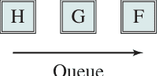

根据队列及其定义方式，GCD 将块视为潜在的并发活动或串行活动。无论在何种情况下，块都按照先入先出原则进行调度。如果这是一个并发队列，调度器会在线程可用时立即将 F 分配给线程，然后是 G、H。如果这是一个串行队列，调度器会将 F 分配给线程，只有在 F 完成后才会将 G 分配给线程。使用预定义的线程节省了为每个请求创建新线程的成本，减少了与处理块相关的延迟。系统会自动调整线程池的大小，以最大化使用 GCD 的应用程序的性能，同时最小化空闲或竞争线程的数量。

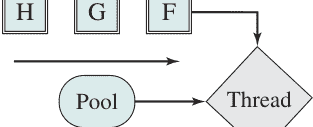

除了直接调度块外，应用程序还可以将单个块和队列与事件源（如计时器、网络套接字或文件描述符）关联。每当源发布事件时，如果块尚未运行，就会调度。这允许快速响应，而无需对事件源进行轮询或“阻塞线程”。

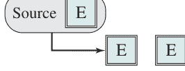

来自 [SIRA09] 的示例说明了 GCD 的用法。考虑一个基于文档的应用程序，有一个按钮，点击后将分析当前文档并显示关于它的的一些统计数据。通常情况下，这种分析应该在秒内执行，以下代码用于连接文档与按钮：

```objective-c
- (void)analyzeDocument:(NSButton *)sender {
  NSDictionary *stats = [myDoc analyze];
  [myModel setDict:stats];
  [myStatsView setNeedsDisplay:YES];
  [stats release];
}
```

函数体的第一行分析文档，第二行更新应用程序的内部状态，第三行调用需要更新统计视图的应用程序以反映这一新状态。这段代码遵循一种常见模式，在主线程中执行。只要分析持续不是过长，这种设计是可以接受的，因为在用户点击按钮后，应用程序的主线程需要尽快处理输入，以便能够返回主事件循环来处理下一个操作。对于非常大或复杂的文档，分析可能会花费不可接受的时间。开发者可能不愿让代码应对这种极罕见的事件，这种事件可能涉及应用程序对象、线程管理、回调、参数封送、上下文对象、新变量等。使用 GCD，对代码进行最微小的添加就能产生所需的结果：

```objective-c
- (void)analyzeDocument:(UIButton *)sender {
  dispatch_async(dispatch_get_global_queue(0, 0), ^{
    NSDictionary *stats = [myDoc analyze];
    dispatch_async(dispatch_get_main_queue(), ^{
      [myModel setDict:stats];
      [myStatsView setNeedsDisplay:YES];
      [stats release];
    });
  });
}
```

GCD 中的所有函数都以 `dispatch_` 开头。外部 `dispatch_async()` 调用将任务置于全局并发队列上。这告诉操作系统该块可以分配到独立的并发队列（主队列）并并行执行。因此，执行的主线程不会被延迟。当 `analyze` 函数完成后，会遇到内部的 `dispatch_async()` 调用。这引导操作系统将代码块放在主队列的末尾，当代码到达此处时执行它。因此，程序员只需付出少量工作即可满足所需需求。

## 4.9 总结

某些操作系统区分了进程和线程的概念，前者与程序执行有关。这种方法可能会提高效率和编码的便利性。在多线程系统中，可以在单个进程内定义多个并发线程。这可以使用用户级线程或内核级线程来实现。用户级线程对操作系统是不可知的，由运行在进程用户空间的线程库创建和管理。用户级线程非常高效，从一个线程切换到另一个线程不需要模式切换。然而，一个进程内同时只有一个用户级线程可以执行，如果一个线程阻塞，整个进程都会阻塞。内核级线程位于进程内部，同一个进程内的多个线程可以在多处理器上并行执行，线程阻塞不会阻塞整个进程。但由于被内核识别，从一个线程切换到另一个线程需要多次模式切换。

## 4.10 关键术语、复习题与问题

### 关键术语

| application | message | thread |
| :--- | :--- | :--- |
| fiber | multithreading | thread pool |
| jacketing | namespaces | user-level thread |
| job object | port | user-mode scheduling (UMS) |
| kernel-level thread | process | |
| lightweight process | task | |

### 复习题

- 4.1. 表 3.5 列出了无线程操作系统的进程控制块中常见的典型元素。
- 4.2. 在多线程系统中，可以在单个进程内定义多个并发线程。这可以使用用户级线程或内核级线程来实现。
- 4.3. 用户级线程对操作系统是不可知的，由运行在进程用户空间的线程库创建和管理。
- 4.4. 内核级线程位于进程内部，同一个进程内的多个线程可以在多处理器上并行执行，线程阻塞不会阻塞整个进程。
- 4.5. 然而，由于被内核识别，从一个线程切换到另一个线程需要多次模式切换。
- 4.6. 将控制信息划分为全局部分和局部部分有什么优势？
- 4.7. 许多当前的语言规范（如 C 和 C++）对于多线程程序是不充分的。这会对编译器和正确性产生影响。

正如这个问题所示，关于代码的问题。考虑以下声明和函数定义：

```c
int global_positives = 0;
typedef struct list {
    struct list *next;
    double val;
} list;
void count_positives(list l)
{
    list p;
    for (p = l; p = p -> next)
        if (p -> val > 0.0)
            ++global_positives;
}
```

现在考虑线程 A 执行以下操作的情况：

```c
count_positives(list containing only negative values);
```

同时线程 B 执行以下操作：

```c
++global_positives;
```

- a. 该函数的作用是什么？
- b. C 语言只处理单线程执行。使用两个并行线程会产生任何问题或潜在问题吗？

- 4.8. 但某些现有的优化器（包括 gcc，它倾向于相对保守）会将 `count_positives` “优化”为类似于下面的代码：

```c
void count_positives(list l)
{
    list p;
    register int r;
    r = global_positives;
    for (p = l; p = p -> next)
        if (p -> val > 0.0) ++r;
    global_positives = r;
}
```

如果线程 A 和 B 同时执行，该程序的此编译版本会发生什么问题或潜在问题？

- 4.9. 考虑以下使用 POSIX Threads API 的代码：

```c
thread2.c
#include <pthread.h>
#include <stdlib.h>
#include <unistd.h>
#include <stdio.h>
int myglobal;
void *thread_function(void *arg) {
    int i,j;

    for ( i=0; i<20; i++ ) {
        j=myglobal;
        j=j+1;
        printf(".");
        fflush(stdout);
        sleep(1);
        myglobal=j;
    }
    return NULL;
}

int main(void) {
    pthread_t mythread;
    int i;
    if ( pthread_create (&mythread, NULL, thread_function, 
        NULL) ) {
        printf("error creating thread.");
        abort();
    }
    for ( i=0; i<20; i++) {
        myglobal=myglobal+1;
        printf("o");
        fflush(stdout);
        sleep(1);
    }
    if ( pthread_join ( mythread, NULL ) ) {
        printf("error joining thread.");
        abort();
    }
    printf("\nmyglobal equals %d\n",myglobal);
    exit(0);
}
```

在 `main` 中，我们首先声明了一个名为 `mythread` 的变量，其类型为 `pthread_t`。这本质上是一个线程的 ID。接下来，`if` 语句创建一个与 `mythread` 关联的线程。`pthread_create()` 调用成功时返回零，失败返回非零值。`pthread_create()` 的第三个参数是线程启动时执行的函数名称。当 `thread_function` 返回时，线程终止。同时，主程序本身定义了一个线程，因此有两个线程在执行。`pthread_join` 函数允许主线程等待直到新线程完成。

- a. 这个程序实现了什么功能？
- b. 程序的输出是什么：

```bash
$ ./thread2
.o.o.o.o.o.o.o.o.o.o.o.o.o.o.o.o.o.o.o.o.o.
myglobal equals 21
```

这是你预期的输出吗？如果不是，哪里出了问题？

## 第 4 章 / 线程

图 4.18 Solaris 用户级线程和 LWP 状态

- 4.10. 有时当两个线程运行时，一个线程应该自动抢占另一个线程。被抢占的线程只有在另一个线程运行完成后才能执行。请通过为线程设置优先级来实现上述情况；可以使用你喜欢的任何编程语言。
- 4.11. 在 Solaris 9 和 10 中，ULT 与 LWP 之间是一一一的映射。在 Solaris 8 中，单个 LWP 支持一个或多个 Mult。

a. 允许 ULT 到 LWP 的多对一映射有什么好处？
b. 在 Solaris 8 中，ULT 的线程执行状态与其 LWP 的状态是不同的。解释原因。
c. 图 4.18 显示了 Solaris 8 和 9 中 ULT 及其关联 LWP 的状态转换。解释这两个图的作用及其之间的关系。

- 4.12. 解释 Linux 中“不可中断状态（Uninterruptible state）”的设计原理。

## 第 5 章

并发：互斥与同步

- 5.1 互斥：软件方法
  - Dekker 算法
  - Peterson 算法
- 5.2 并发原理
  - 简单示例
  - 竞态条件
  - 操作系统的考虑因素
  - 互斥的要求
- 5.3 互斥：硬件支持
  - 禁用（中断）
  - 特殊指令
- 5.4 信号量
  - 生产者/消费者问题
  - 信号量的实现
- 5.5 监视器
  - 监视器模型
  - 带广播的信号
- 5.6 消息传递
  - 寻址
  - 队列策略
- 5.7 读写者问题
  - 优先级
- 5.8 总结
- 5.9 术语、复习题与问题

## 第 5 章

并发：互斥与同步

学习目标

学习本章后，你能够：

- 讨论与并发相关的基本概念，例如竞态条件、操作系统考虑因素和互斥。
- 理解支持互斥的硬件机制。
- 定义信号量。
- 定义监视器。
- 解释读写者问题。

并发的核心主题是：

- 多程序设计：进程的管理
- 多处理器：进程的管理
- 分布式处理：进程的管理

并发出现在三个语境中：

- 多个应用程序：线程的管理
- 结构化应用程序：线程的管理
- 操作系统：线程的管理

由于该主题的重要性，我们将看到并发：

- 多程序设计：线程的执行
- 多处理器：线程的执行
- 分布式处理：线程的执行

# 226 第 5 章 / 并发：互斥与同步

## 5.1 互斥：软件方法

对于执行在单处理器或具有共享内存的多处理器机器上的并发进程，可以实现相应的软件方法。这些方法通常假设在内存访问级别存在基础的互斥（[LAMP91]），即对主内存中相同位置的并发访问（读取和写入）会被某种内存迭代器串化，尽管授予访问的顺序并未预先指定。在此之外，假设硬件、操作系统或编程语言不提供支持。

## 德克算法 (Dekker's Algorithm)

Dijkstra [DIJK65] 报道了一种由荷兰数学家 Dijkstra 设计的两个进程互斥算法。遵循 Dijkstra 的思路，我们分阶段开发该解决方案。这种方法的优点在于揭示了开发并发程序时会遇到的许多常见错误。

第一次尝试 如前所述，任何互斥的尝试都必须依赖硬件中的某些基础互斥机制。其中最常见的是限制：一次只能对内存位置进行一次访问。利用这一限制，我们预留了一个标记为 `turn` 的全局内存位置。想要首先执行其临界区的进程（P0 或 P1）首先检查 `turn` 的内容。如果 `turn` 的值等于进程编号，则该进程可以进入其临界区。否则，它被强制等待。等待的进程反复读取 `turn` 的值，直到进入其临界区。这种过程被称为忙等（busy waiting）或自旋等待（spinning waiting），因为被阻碍的进程在获得进入临界区的许可之前无事可做。相反，它必须一直检查该变量；因此在等待机会时消耗了处理器时间（忙碌）。

在进程获得其临界区并完成该区域后，它必须将 `turn` 的值更新为另一个进程的值。从形式术语来说，这是一个共享全局变量：

```c
int turn = 0;
```

图 5.1a 显示了两个进程的程序。该解决方案保证了互斥属性，但有两个缺点。首先，进程在使用临界区时必须严格交替；执行的事实由两个进程中较慢的那一个决定。如果 P0 每小时只使用一次临界区，而 P1 想要每小时使用 1000 次临界区，则 P1 被迫采用 P0 的策略。更严重的问题是，如果一个进程失败，另一个进程将被永久阻塞。无论进程是在临界区内还是临界外失败，情况都是如此。

以下构造是一个协程（coroutine）。协程的设计能够在它们之间来传递执行控制权（见问题

| /* 进程 0 /* | /* 进程 1 * |
| --- | --- |
| . | . |
| while (turn != 0) | while (turn != 1) |
| /* 什么都不做 // | /* 什么都不做 // |
| /* 临界区*/; | /* 临界区*/; |
| turn = 1; | turn = 0; |

**(a) 第一次尝试**

| /* 进程 0 * | /* 进程 1 * |
| --- | --- |
| while (flag[1]) | while (flag[0]) |
| /* 什么都不做 // | /* 什么都不做 // |
| flag[0] = true; | flag[1] = true; |
| /* 临界区*/; | /* 临界区*/; |
| flag[0] = false; | flag[1] = false; |

**(b) 第二次尝试**

| /* 进程 0 * | /* 进程 1 * |
| --- | --- |
| flag[0] = true; | flag[1] = true; |
| while (flag[1]) | while (flag[0]) |
| /* 什么都不做 // | /* 什么都不做 // |
| /* 临界区*/; | /* 临界区*/; |
| flag[0] = false; | flag[1] = false; |

**(c) 第三次尝试**

| /* 进程 0 * | /* 进程 1 * |
| --- | --- |
| flag[0] = true; | flag[1] = true; |
| while (flag[1]) | while (flag[0]) |
| flag[0] = false; | flag[1] = false; |
| /*延迟 //; | /*延迟 //; |


| flag[0] = true; | flag[1] = true; |
| --- | --- |
| /* 临界区*/; | /* 临界区*/; |
| flag[0] = false; | flag[1] = false; |

### (d) 第四次尝试


## 5.1 互斥：软件方法

第二次尝试虽然对于单进程来说是一种很有用的技术，但对于支持并发来说是不够的。第一次尝试的缺陷是它不知道另一个进程的状态。为了满足这一点，我们需要能够观察两个进程的状态，这由数组变量 `flag` 提供。但正如第四次尝试所示，这仍然不够。我们必须对两个进程的活动施加某种顺序，以避免我们刚刚观察到的“相互礼貌”问题。变量 `turn` 可以用于此目的。

接下来，让我们从 P0 的角度检查互斥性是否得到保证。一旦 P0 将 `flag[0]` 设置为 `true`，在 P0 离开其临界区之前，P1 无法进入其临界区。同样的推理适用于 P1 的角度。然而，如果一个进程在临界区内失败，另一个进程将被阻塞。这里使用 `enum` 声明来定义一种数据类型：

```c
enum boolean {false = 0, true = 1};
```

这保证了互斥，但又出现了另一个问题。如果两个进程在执行 `while` 语句之前都将自己的标志设置为 `true`，那么：

1. P0 将 `flag[0]` 设置为 `true`。
2. P1 将 `flag[1]` 设置为 `true`。
3. P0 检查 `flag[1]`。
4. P1 检查 `flag[0]`。
5. P0 将 `flag[0]` 设置为 `false`。
6. P1 将 `flag[1]` 设置为 `false`。
7. P0 将 `flag[0]` 设置为 `true`。
8. P1 进入临界区。

从第一次尝试就可以用于此目的；在这种情况下，变量 `turn` 决定了进程有权坚持进入其临界区。

我们可以描述这种解决方案，它被称为德克算法（Dekker's algorithm）：当 P0 进入临界区时，它将其标志置为 true。然后它检查 P1 的标志。如果该标志为 false，则 P0 可以立即进入其临界区。否则，P0 轮让。如果 P0 发现 `turn = 0`，它知道轮到了自己，并周期性地检查 P1 的标志。P1 在某时刻注意到轮到了自己，并将其标志设置为 false，允许 P0 继续执行。在 P0 使用完临界区后，它将其标志置为 false 以释放临界区，并将 `turn` 设置为 1 以将权利转移给 P1。

```c
boolean flag[2];
int turn;
void P0() {
    while (true) {
        flag[0] = true;
        while (flag[1]) {
            if (turn == 1) {
                flag[0] = false;
                while (turn == 1) /* do nothing */;
                flag[0] = true;
            }
        }
        /* critical section */;
        turn = 1;
        flag[0] = false;
        /* remainder */;
    }
}
void P1() {
    while (true) {
        flag[1] = true;
        while (flag[0]) {
            if (turn == 0) {
                flag[1] = false;
                while (turn == 0) /* do nothing */;
                flag[1] = true;
            }
        }
        /* critical section */;
        turn = 0;
        flag[1] = false;
        /* remainder */;
    }
}
void main() {
    flag[0] = false;
    flag[1] = false;
    turn = 1;
    parbegin(P0, P1);
}
```

> 视频笔记 图 5.2 德克算法

图 5.2 提供了德克算法的规范。`parbegin(P1, P2, ..., Pn)` 结构意味着：挂起主程序的执行；启动过程 P1, P2, ..., Pn 的并发执行；当所有 P1, P2, ..., Pn 都终止后，恢复主程序的执行。德克算法的验证留作了一个练习题（见图 5.1）。

### 彼得森算法 (Peterson's Algorithm)

德克算法解决了互斥问题，但其程序相当复杂，难以追踪，且其正确性难以证明。彼得森提供了一个简单、优雅的解决方案。与之前一样，全局变量 `flag` 表示每个进程相对于互斥的位置，而全局变量 `turn` 引入了并发性冲突。该算法如图 5.3 所示。

这种互斥很容易被保持。考虑进程 P0。一旦它将 `flag[0]` 设置为 true，它就无法进入其临界区。如果 P1 已经在临界区中，则 `flag[1]` 为 true 且 P0 被阻塞进入其临界区。另一方面，防止了相互阻塞。假设 P0 阻塞在它的 `while` 循环中。这意味着 `flag[1]` 为 true 且 `turn=1`。P0 可以……

```c
boolean flag[2];
int turn;
void P0() {
  while (true) {
    flag[0] = true;
    turn = 1;
    while (flag[1] && turn == 1) /* do nothing */;
    /* critical section */
    flag[0] = false;
    /* remainder */
  }
}
void P1() {
  while (true) {
    flag[1] = true;
    turn = 0;
    while (flag[0] && turn == 0) /* do nothing */;
    /* critical section */
    flag[1] = false;
    /* remainder */
  }
}
void main() {
  flag[0] = false;
  flag[1] = false;
  parbegin(P0, P1);
}
```


1. 全局资源的共享充满了危险。例如，如果两个进程都使用同一个全局变量并对该变量进行读写操作，那么各种读写操作执行的顺序至关重要。接下来的小节展示了该问题的示例。
2. 操作系统很难优化地管理资源分配。例如，一个进程可能请求使用并获得某个特定 I/O 通道的控制权，然后在使用该通道之前被挂起。对于操作系统来说，仅仅锁定通道并防止其他进程使用可能是不理想的；这可能导致第 6 章中描述的死锁条件。
3. 定位编程错误变得非常困难，因为结果通常不是确定且可重现的（例如，关于此点的讨论请参见 [LEBL87,CARR89,SHEN02]）。

## 5.2 并发原理

上述所有困难在多处理器系统中也会同样出现。执行的相对速度是不可预测的。但从根本上说，问题与单机系统是相同的。这从以下内容将变得清晰。

### 简单示例

这个示例说明了保护共享变量（以及其他共享资源）是必要的，而唯一的方法是控制访问这些变量的代码。然而，假设没有控制访问的机制：

```c
void echo() {
    chin = getchar();
    chout = chin;
    putchar(chout);
}
```

现在，让我们增加一种强制一次只有一个进程进入 `echo` 的策略。如果我们规定每个 `echo` 在完成之前不可用，那么刚刚讨论的错误类型就不会发生。如何实施这种策略是本文的一个主要课题。

这个问题是在假设存在单处理器操作系统提出的。该示例证明了即使在单处理器上，并发问题也会发生。在多处理器系统中，会出现相同的资源保护问题，且解决方案同样有效。首先，假设没有控制共享变量的机制：

1. 进程 P1 和 P2 都在各自的处理器上并行执行。
2. P1 调用 `echo` 程序并在函数结束后立即被中断。此时，最近输入的字符 x 存储在 `chin` 中。
3. P2 被激活并调用 `echo` 程序。由于 P1 仍在 `echo` 程序内部（无论 P1 是挂起还是执行），P2 被阻塞进入。

1. 进程 P1 和 P2 都在各自的处理器上并行执行。P1 调用 `echo` 程序。
2. 当 P1 在 `echo` 程序内部时，P2 调用 `echo`。由于 P1 仍在 `echo` 程序内部（无论 P1 是挂起还是执行），P2 被阻止进入该程序。因此，P2 被挂起，等待 echo 程序的可用。
3. 在稍后的时间，进程 P1 完成了 echo 的执行，退出该程序并继续执行。一旦 P1 退出 echo，P2 立即被恢复并开始执行 echo。

在单处理器系统中，我们之所以遇到问题，的原因是中断可以在任何地方停止指令的执行。在多处理器系统中，我们面临同样的条件，此外，由于两个进程可能同时执行并都试图访问同一个全局变量，可能会引发问题。然而，这两类问题的解决方案是相同的：控制对共享资源的访问。

### 竞态条件

当多个进程或线程对项目进行读写操作，导致最终结果取决于多个进程中指令执行的顺序时，就会发生竞态条件。让我们考虑两个例子。

第一个例子，假设进程 P1 和 P2 共享全局变量 `a`。在执行的某个点，P1 将 `a` 更新为值 1，在执行的另一个某个点，P2 将其更新为值 2。这两个任务在竞争写入变量 `a`。在这种情况下，竞态的“失败者”（最后更新的进程）决定了 `a` 的最终值。

第二个例子，考虑进程 P3 和 P4，它们共享变量 `b` 和 `c`，初始值为 `b=1` 和 `c=2`。在执行的某个点，P3 执行赋值语句 `b=b+1`，在执行的另一个某个点，P4 执行赋值语句 `c=b+c`。注意，这两个进程更新的是不同的变量。然而，两个变量的最终值取决于两个进程执行这些赋值的顺序。如果 P3 先执行其赋值语句，那么最终值为 `b=3` 和 `c=5`。如果 P4 先执行其赋值语句，那么最终值为 `b=4` 和 `c=3`。

附录 A 包含了使用信号量作为示例对竞态条件的讨论。

### 操作系统关注的问题

并发的存在引发哪些设计和管理问题？我们可以列出以下内容：

1. 操作系统必须能够跟踪各种进程。这是通过使用进程控制块实现的，并在第 4 章中描述过。
2. 操作系统必须为每个活动进程分配和释放资源。有时，多个进程想要访问同一个资源。这些资源包括：
   - 文件：将在第 12 章中讨论
   - I/O 设备：将在第 11 章中讨论
3. 操作系统必须保护每个进程的数据和物理资源免受其他进程的意外干扰。这涉及与内存、文件和 I/O 设备相关的技术。关于保护的通用处理见第七部分。
4. 进程的功能及其产生的输出，必须独立于其执行速度相对于其他并发进程的速度。这是本章的主题。

为了理解如何解决速度独立性问题，我们需要查看进程相互作用的方式。

### 进程交互

我们可以根据进程对彼此存在的感知程度，对进程间交互的方式进行分类。表 5.2 列出了三种感知程度及其各自的后果：

- **相互不知的进程**：这些是独立的进程，旨在共同工作。这种情况的最佳例子是多个独立进程的多程序处理。这些可以是批处理作业、交互式会话或两者的混合。尽管进程之间没有协同工作，但操作系统需要关注资源的竞争。例如，两个独立的应用程序都想要访问同一个磁盘或文件。操作系统必须调节这些访问。
- **间接感知的进程**：这些进程通过各自的进程 ID 不感知对方，但共享某些对象（如 I/O 缓冲区）的访问。进程在共享公共对象时表现出**协作**。
- **直接感知的进程**：这些进程能够通过进程 ID 相互通信，并设计为共同完成某些活动。同样，此类进程表现出**协作**。

实际情况不会像表 5.2 建议所示那样明确。相反，进程可能同时表现出竞争和协作的方面。尽管如此，分别检查上述列表中的三个项目，并确定它们对操作系统的影响是很有意义的。

#### 表 5.2 进程交互

| 感知程度 | 关系 | 一个进程对另一个进程的影响 | 潜在的控制问题 |
| :--- | :--- | :--- | :--- |
| 相互不知的进程 | 竞争 | - 一个进程的结果独立于其他操作<br>- 进程定时可能受影响 | - 互斥<br>- 死锁（可再生资源）<br>- 饥饿 |
| 间接感知的进程（例如共享对象） | 通过共享进行协作 | - 一个进程的结果可能取决于从他人处获得的信息<br>- 进程定时可能受影响 | - 互斥<br>- 死锁（可再生资源）<br>- 饥饿<br>- 数据一致性 |
| 直接感知的进程（拥有通信原语） | 通过通信进行协作 | - 一个进程的结果可能取决于从他人处获得的信息<br>- 进程定时可能受影响 | - 死锁（可消耗资源）<br>- 饥饿 |

### 竞争的控制

最后一个问题是饥饿。假设有三个进程（P1, P2, P3）都需要定期访问资源 R。考虑一种情况：P1 拥有该资源，而 P2 和 P3 处于延迟状态并等待资源。当 P1 进入其临界区时，应该允许 P2 或 P3 之一访问 R。假设操作系统授予了 P3 权限，而 P1 在 P3 完成后需要访问，随后又授予了 P1 和 P3 权限，那么 P2 可能会被无限期拒绝访问资源，尽管并没有发生死锁。

竞争的控制不可避免地会消耗分配资源的操作系统。此外，进程需要能够以某种方式表达对互斥的需求，例如在使用资源之前对其进行锁定。任何解决方案都会涉及操作系统的某些支持，例如提供锁机制。图 5.4 以抽象的形式说明了互斥机制。有 n 个进程需要并发执行。每个进程包括 (1) 一个临界区和 (2) 临界区之前和之后的额外代码。由于所有进程都访问相同的资源 Ra，因此希望同一时间只有一个进程处于其临界区。为了确保互斥，提供了两个函数：`entercritical` 和 `exitcritical`。每个函数都将作为竞争对象的资源名称的参数。当某个进程在另一个进程正处于同一资源的临界区时，尝试进入其临界区的任何进程将被强制处于等待状态。

```c
/* PROCESS 1 */
void P1() {
  while (true) {
    /* preceding code */;
    entercritical(Ra);
    /* critical section */;
    exitcritical(Ra);
    /* following code */;
  }
}
```

```c
/* PROCESS 2 */
void P2() {
  while (true) {
    /* preceding code */;
    entercritical(Ra);
    /* critical section */;
    exitcritical(Ra);
    /* following code */;
  }
}
```

```c
/* PROCESS n */
void Pn() {
  while (true) {
    /* preceding code */;
    entercritical(Ra);
    /* critical section */;
    exitcritical(Ra);
    /* following code */;
  }
}
```

现在仍然需要检查提供 `entercritical` 和 `exitcritical` 函数的具体机制。目前，我们将推迟到考虑其他进程交互的情况时再讨论。

### 通过共享进行进程间的协作

共享的情况涵盖了在不感知其他进程的情况下与其他进程进行交互的进程。例如，多个进程可以访问共享变量或文件和数据库。进程可以在不通知其他进程的情况下使用和更新数据引用，但它们知道其他进程可能会访问相同的数据。进程之间必须协作，以确保它们共享的数据得到妥当管理。控制机制必须确保共享数据的完整性。

由于数据存储在资源（设备、内存）上，互斥、死锁和饥饿的控制问题再次出现。区别在于数据项可以通过两种不同的模式（读和写）进行访问，且只有写操作必须是互斥的。

然而，在这些问题之上，引入了一个新需求：数据一致性。作为一个简单的例子，考虑一个账本应用程序，其中可能会更新多个数据项。假设要维护 `a` 和 `b` 两个项在 `a = b` 的关系中。也就是说，任何更新一个值的程序必须更新另一个值以维持这种关系。现在考虑以下两个进程：

P1:
```c
a = a + 1;
b = b + 1;
```

P2:
```c
b = 2 * b;
a = 2 * a;
```

如果初始状态是一致的，每个进程单独执行将使共享数据处于一致状态。现在考虑以下并发执行序列，在该序列中，两个进程对每个单独的数据项（a 和 b）遵守了互斥原则：

```
a = a + 1;
b = 2 * b;
b = b + 1;
a = 2 * a;
```

在该执行序列结束时，`a = b` 的条件不再成立。例如，如果我们从 `a = b = 1` 开始，在执行序列结束时，我们得到 `a = 4` 且 `b = 3`。通过将每个进程中的整个序列声明为临界区，可以避免这个问题。


因此，我们看到在通过共享协作的情况下，临界区的概念是非常重要的。之前相同的 `entercritical` 和 `exitcritical` 抽象函数（见图 5.4）也可以用于这里。在这种情况下，函数的参数可以是变量、文件或任何其他对象。此外，如果使用临界区来提供数据完整性，可能没有可以识别为参数的特定资源或变量。在这种情况下，我们可以将参数视为在并发进程之间共享的标识符，用于标识必须互斥的临界区。

## 通过通信进行进程间的协作

在我们讨论过的第一种情况下，每个进程都有自己一个隔离的环境，该环境不包含其他进程。进程之间的交互是间接的。在这两种情况下，都存在共享。在竞争的情况下，它们在共享资源而不感知其他进程；在第二种情况下，它们在共享值，尽管不感知其他进程。然而，当进程通过通信进行协作时，进程参与了一项共同努力。通信提供了一种同步或协调各种活动的方法。

通常，通信可以表述为由消息组成。发送和接收消息的原语可以作为编程语言或内核提供。

由于在传递消息的过程中没有共享内容，因此互斥不是控制需求。死锁和饥饿问题仍然存在。死锁的例子是两个进程可能会被阻塞等待通信。饥饿的例子是三个进程 `P1`、`P2` 和 `P3`，它们表现出以下行为：`P1` 反复尝试与 `P2` 或 `P3` 通信，而 `P2` 和 `P3` 都在尝试与 `P1` 通信。这里没有死锁，因为 `P1` 保持活跃状态，但 `P3` 被饥饿了。

## 互斥的要求

任何提供互斥支持的设施或功能应满足以下要求：

1. 必须强制互斥：在具有相同资源或共享对象的各个进程中，同一时间只允许一个进程进入临界区。
2. 在非临界区停止的进程必须不干扰其他进程。
3. 需要访问临界区的进程不能被无限期地延迟：无死锁或饥饿。
4. 当没有进程处于临界区时，任何请求进入临界区的进程必须被允许立即进入。
5. 对进程相对速度或处理器数量不做任何假设。
6. 进程在临界区内的时间是有限的。

> “原子（atomic）”一词意味着指令被视为一个不可中断的单一步骤。

# 5.3 互斥：硬件支持

## 比较并交换指令（Compare&Swap Instruction）

`compare&swap` 指令，也称为比较并交换指令，可以定义如下 [HERL90]：

```c
int compare_and_swap (int *word, int testval, int newval) {
    int oldval;
    oldval = *word;
    if (oldval == testval) *word = newval;
    return oldval;
}
```

该版本的指令检查内存位置（`*word`）是否等于某个值（`testval`）。如果内存位置的当前值等于 `testval`，则将其替换为 `newval`；否则保持不变。函数始终返回旧值；如果返回的值与测试值相同，则内存位置已更新。该操作在内存值和测试值之间执行了一条原子指令；如果这两个值相等，就会发生交换。`compare_and_swap` 函数是以原子方式执行的——也就是说，它不会中断。

该指令的另一个版本返回一个布尔值：如果发生交换则返回 `true`；否则返回 `false`。几乎所有的处理器家族（x86, IA64, IBM2 系列等）都提供了该指令的不同版本，大多数操作系统都使用该指令来支持并发。

图 5.5 显示了一种基于使用该指令的互斥协议。一个共享变量初始化为 0。只有发现 `bolt` 等于 0 的进程才能进入临界区。

```c
* program mutualexclusion /*
const int n = /* 进程数量 */;
int bolt;
void P(int i) {
    while (true) {
        while (compare_and_swap(bolt, 0, 1) == 1)
            /* 什么都不做 */
        /* 临界区 */
        bolt = 0;
        /* 剩余部分 */;
    }
}

void main() {
    bolt = 0;
    parallel(P(1), P(2), ..., P(n));
}
```

```c
* program mutualexclusion /*
const int n = /* 进程数量 */;
int bolt;
void P(int i) {
    while (true) {
        int key = 1;
        exchange (&key, &bolt)
        while (key != 0)
            /* 临界区 */
        bolt = 0;
        /* 剩余部分 */;
    }
}

void main() {
    bolt = 0;
    parallel(P(1), P(2), ..., P(n));
}
```

(a) 比较并交换指令

(b) 交换指令

图 5.5 互斥的硬件支持

> `const parallel(P1, P2,..., Pn)` 意味着：暂停主程序的执行；启动并发执行进程 P1,P2....Pn；当所有 P1,P2,...,Pn 均终止后，恢复主程序。

所有其他尝试进入其临界区的进程都进入了忙等待（busy waiting）模式。忙等待（busy waiting）或自旋等待（spin waiting）是指一种技术，进程在被允许进入临界区之前什么都不做，但持续执行一条或多条指令来测试适当的值以获取进入权限。当一个进程离开临界区时，它会将 `bolt` 重置为 0；此时，等待进程中的一个被授予访问临界区的权限。进程的选择取决于哪个进程执行了 `compare&swap` 指令。

## 交换指令（Exchange Instruction）

交换指令可以定义为：

```c
void exchange (int *register, int *memory)
{
    int temp;
    temp = *memory;
    *memory = *register;
    *register = temp;
}
```

该指令交换寄存器与内存位置的内容。IA-32 架构（Pentium）和 IA-64 架构（Itanium）都包含 `XCH` 指令。

图 5.5b 显示了一种基于使用交换指令的互斥协议。共享变量 `bolt` 初始化为 0。每个进程使用一个初始化为 1 的本地 `key`。只有发现 `bolt` 等于 0 的进程才能进入其临界区。它通过将 `bolt` 设置为 1 将所有进程排除在临界区之外。当一个进程离开临界区时，它会将 `bolt` 重置为 0，允许另一个进程访问其临界区。

注意，由于变量初始化的方式以及算法的性质，以下表达式成立：

> `bolt + ∑ key_i = n`

如果 `bolt = 0`，则没有进程在临界区内。如果 `bolt = 1`，则恰好有一个进程在临界区内，即 `key` 值为 0 的进程。

## 机器指令方法的属性

使用特殊的机器指令来强制执行互斥有许多优点：

- 它适用于单处理器或共享内存的多个处理器系统上任意数量的进程。
- 它是简单的，因此易于验证。
- 可以用于支持多个临界区；每个临界区可以由自己的变量定义。

然而，它也存在一些严重的缺点：

- 使用了忙等待：因此，当进程等待访问临界区时，它会继续消耗处理器时间。
- **可能发生饥饿（Starvation）：** 当进程等待访问临界区时，它继续消耗处理器时间。
- **可能发生死锁（Deadlock）：** 考虑在单处理器上的以下场景：`P1` 进入临界区并被中断。`P2` 尝试进入临界区并被阻塞。`P1` 完成任务并离开临界区，但 `P2` 永远不会被阻塞，因为 `P1` 正在等待 `P2` 持有的资源。

## 5.4 信号量

**表 5.3 常见机制**

| 机制 | 描述 |
| :--- | :--- |
| 信号量 (Semaphore) | 用于信号的整数值。 |
| 二进制信号量 (Binary semaphore) | 类似于互斥锁，只有 0 或 1。 |
| 互斥锁 (Mutex) | 可以锁定和解锁的锁机制。 |
| 条件变量 (Condition variable) | 进程等待直到满足某个条件。 |
| 监视器 (Monitor) | 封装变量的结构。 |
| 事件标志 (Event flags) | 用于同步的机制。 |
| 邮箱/消息 (Mailboxes/messages) | 交换的手段。 |
| 自旋锁 (Spinlocks) | 进程在无限循环中等待的互斥。 |

处理并发进程的首次重大进展出现在 1965 年 Dijkstra 的论文 [DIJK65]。Dijkstra 关注的是操作系统的设计以及高效可靠机制的开发。如果处理器提供了这些机制，用户就可以轻松地使用它们。

基本原理是：两个或多个进程可以通过简单的信号进行协作。对于信号传递，使用了特殊变量信号量。通过信号量传输信号，进程执行 `semSignal(s)`。通过信号量接收信号，进程执行 `semWait(s)`；如果信号尚未传输，进程将暂停直到传输发生。

为了实现预期效果，我们将信号量视为一个具有整数值的变量，该变量定义了三种操作：

1. 信号量可以初始化为一个负整数值。
2. `semWait` 操作减少信号量的值。如果值变为负数，执行 `semWait` 的进程被阻塞。否则，进程继续执行。
3. `semSignal` 操作增加信号量的值。如果结果小于或等于零，任何被 `semWait` 操作阻塞的进程（如果有）将被唤醒。

除了这些操作外，没有办法检查或操作信号量。我们这样解释这些操作：开始时，信号量有一个非负值。如果值为正，它等于可以发出信号并立即继续执行的进程数量。如果值为零（通过初始化或由于与初始信号量值相同的进程发送了信号），下一个执行等待的进程被阻塞，信号量值变为负数。负值等于等待被阻塞的进程数量。当信号量值为负数时，每个信号都会唤醒等待进程中的一个。

> 1. 通常情况下，在进程减少信号量之前，无法预知它是否会阻塞。

```c
struct semaphore {
  int count;
  queue queue;
}
void semWait(semaphore s) {
  s.count--;
  if (s.count < 0) {
    /* 将此进程放入 s.queue */
    /* 阻塞此进程 */
  }
}
void semSignal(semaphore s) {
  s.count++;
  if (s.count <= 0) {
    /* 从 s.queue 中移除进程 P */
    /* 将进程 P 放入就绪列表 */
  }
}
```


2. 当一个进程增加信号量的值后，另一个进程被唤醒，两个进程都继续并发运行。在单处理器系统中，无法得知哪一个进程（如果有的话）会立即执行。

3. 当你对信号量发送信号时，并不一定知道另一个进程是否在等待，因此阻塞的进程数量可能是 0 或 1。

图 5.6 给出了信号量原语的一个更正式的定义。假设 `semWait` 和 `semSignal` 原语是原子的。一种更受限的版本，称为二进制信号量，定义在图 5.7 中。二进制信号量只能取值 0 和 1，可以通过以下操作定义：

1. 二进制信号量可以初始化为 0 或 1。
2. `semWaitB` 操作检查信号量的值。如果值为 0，则执行 `semWaitB` 的进程被阻塞。如果值为 1，则将该值改为 0，该进程继续执行。
3. `semSignalB` 操作检查是否有进程在该信号量上被阻塞（信号量值等于 0）。如果是，则一个被 `semWaitB` 阻塞的进程被解除阻塞。如果没有进程被阻塞，则将信号量的值设置为 1。

原则上讲，实现二进制信号量应该更容易，可以证明它与通用信号量具有相同的表达能力（见问题 5.19）。为了对比这两种信号量，非二进制信号量通常被称为计数信号量或通用信号量。

```c
struct binary_semaphore {
    enum {zero, one} value;
    queueType queue;
};
void semWaitB(binary_semaphore s) {
    if (s.value == one) {
        s.value = zero;
    } else {
        /* 将进程放入 s.queue */
        /* 阻塞此进程 */
    }
}
void semSignalB(binary_semaphore s) {
    if (s.queue is empty()) {
        s.value = one;
    } else {
        /* 从 s.queue 中移除进程 P */
        /* 将进程 P 放入就绪列表 */
    }
}
```


与二进制信号量相关的概念是**互斥锁（mutex）**。互斥锁是一种用于获取和释放对象的编程标志。当获取了无法共享的数据，或者启动了在系统其他地方无法同时执行的处理时，互斥锁被设置为锁定（通常为 0），这会阻塞其他使用它的尝试。当数据不再需要或例程结束时，互斥锁被设置为解锁。互斥锁与二进制信号量的关键区别在于，锁定互斥锁（将值设置为 0）的进程必须是解锁它（将值设置为 1）的进程。相比之下，一个进程锁定二进制信号量而另一个进程解锁它是可能的。

对于计数信号量和二进制信号量，使用队列来持有等待信号量的进程。产生了一个进程从此类队列中移除的顺序问题。最公平的移除策略是先进先出（FIFO）：阻塞时间最长的进程首先从队列中释放；定义包含此特性的信号量称为**强信号量**。不指定进程从队列中移除顺序的信号量是**弱信号量**。图 5.8 是强信号量操作的一个示例。在这里，进程 `A`、`B` 和 `C` 依赖于进程 `D` 的结果。初始状态（1），`A` 正在运行；`B`、`C` 和 `D` 处于就绪状态；信号量计数为 1，表示 `D` 的结果中有一个可用。当 `A` 对信号量发出 `semWait` 指令时，信号量减到 0，`A` 可以继续执行；随后：

> 在某些文献和某些教科书中，互斥锁和二进制信号量之间没有区别。然而在实践中，许多操作系统（如 Linux、Windows、Solaris 等）提供了符合此书中定义的互斥锁机制。

`A` 发出 `semWait`，稍后超时

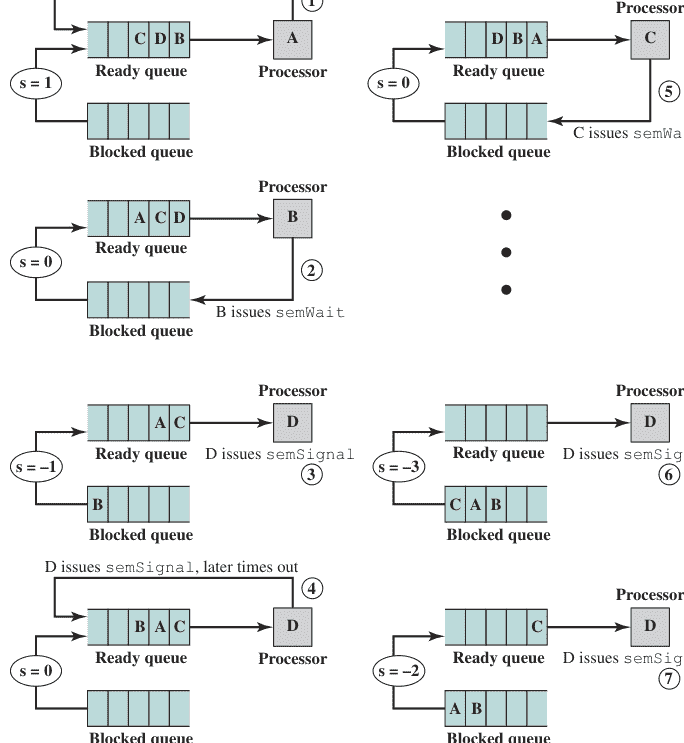

图 5.8 信号量机制示例

重新回到就绪队列。然后 `B` 运行（2），最终发出 `semWait` 指令并被阻塞，允许 `D` 运行（3）。`D` 完成后发出 `semSignal`，允许 `B` 进入就绪队列（4）。`C` 进入就绪队列并运行（5），但它发出 `semWait` 指令时被阻塞。同样，`A` 和 `B` 在信号量上被阻塞，允许 `D` 继续执行（6）。当 `D` 有结果时，它发出 `semSignal`，将 `C` 转移到就绪队列。释放 `A` 和 `B` 从阻塞状态。对于在下一节讨论的互斥算法，强信号量保证了不会饥饿，而弱信号量则不会。我们假设强信号量，因为这是操作系统提供的形式。

```c
/* 互斥程序 */
const int n = /* 进程数 */;
semaphore s = 1;
void P(int i) {
  while (true) {
    semWait(s);
    /* 临界区 */
    semSignal(s);
    /* 剩余部分 */;
  }
}
void main() {
  par(P(1), P(2), . . . P(n));
}
```


## 互斥

图 5.9 显示了使用信号量解决互斥问题的简单方法（对比 5.4）。考虑进程 `P(i)`，它们都需要访问资源。每个进程都有一个用于访问资源的临界区。在每个进程中，在进入临界区之前执行 `semWait(s)`。如果 `s` 的值为负，则进程被阻塞。如果值为 1，则减为 0，进程进入临界区；因为 `s` 不再为正，其他进程将无法进入临界区。

信号量初始化为 1。因此，第一个执行 `semWait` 的进程将进入临界区，将 `s` 的值设置为 0。任何尝试进入临界区的进程都会发现它并被阻塞，将 `s` 的值设置为 -1。任何数量的进程都可以尝试进入；每次失败的尝试都会导致 `s` 值的进一步减少。当进入临界区的进程完成时，一个阻塞进程从与其相关的阻塞队列中移除并放入就绪状态。当被操作系统调度时，它进入临界区。


# 图 5.10 进程访问受信号量保护的共享数据

图 5.10 显示了 [BACO03] 中的三个图 5.9 互斥决定的可能序列。在这个例子中，进程（A、B、C）访问受信号量锁保护的共享资源。进程 A 执行 `wait(lock)`；因为信号量在操作时值为 1，A 可以立即进入临界区，信号量取值为 0。当 A 在临界区时，B 和 C 都执行操作并由于信号量的可用性被阻塞。A 退出临界区并执行 `semSignal(lock)`，队列中的第一个进程 B 现在可以进入其临界区。

| 信号量锁队列 | 信号量锁的值 | A | B | C |
|---|---|---|---|---|
| | 1 | | | 临界区 |
| | | `semWait(lock)` | | 正常执行 |
| | | 0 | `semWait(lock)` | | 阻塞在信号量锁上 |
| | B | -1 | | `semWait(lock)` | |
| | C B | -2 | | | |
| | | `semSignal(lock)` | | | |
| | C | -1 | | | |
| | | | `semSignal(lock)` | | | |
| | | | 0 | `semSignal(lock)` | | |
| | | 1 | | | |

图 5.9 的程序同样可以处理同时允许多个进程进入其临界区的要求。这一要求只需通过将信号量初始化为指定值即可实现。因此，`s.count` 的值可以解释如下：

- `s.count ≥ 0`：`s.count` 是可以执行 `semWait(s)` 而无需挂起的进程数量（在此期间没有执行 `semSignal(s)`）。此类情况允许进程支持同步以及互斥。
- `s.count < 0`：`s.count` 的绝对值是挂起在 `s.queue` 中的进程数量。

# 生产者/消费者问题

我们来研究并发处理面临的最常见问题之一：生产者/消费者问题。通用的表述是：有一个或多个生产者生成某种类型的数据（记录、字符）并将其放入缓冲区。单个消费者每次从缓冲区中取出项。系统必须受到限制以防止缓冲区操作溢出。也就是说，在任何时候只允许有一个代理（生产者或消费者）访问缓冲区。问题在于确保生产者在缓冲区满额时不会尝试向缓冲区中添加数据，并且确保消费者在缓冲区为空时不会尝试从缓冲区中移除数据。我们将查看该问题的若干种解决方案，以说明信号量的强大之处和陷阱。

首先，让我们假设缓冲区是无限的，并由元素的线性数组组成。在抽象术语中，我们可以定义生产者和消费者函数如下：

```
producer:           consumer:
while (true) {      while (true) {
    /* produce item v */;  while (in <= out)
    b[in] = v;            /* do nothing */;
    in++;                 w = b[out];
                          out++;
                          /* consume item w */;
}
```

图 5.11 展示了缓冲区 b 的结构。生产者可以按照自己的节奏生成并将存储在缓冲区中。每次，缓冲区的索引 (`in`) 都会加增。消费者以类似的方式进行，但确保它不会尝试从空缓冲区中读取。因此，消费者在继续执行之前确保生产者已经超过了它 (`in > out`)。

| 0 | 1 | 2 | 3 | 4 | |
|---|---|---|---|---|---|
| b[1] | b[2] | b[3] | b[4] | b[5] | . . . |

**图 5.11** 用于生产者/消费者问题的无限缓冲区

让我们尝试使用二值信号量来实现该系统。图 5.12 是第一次尝试。与其处理 `in` 和 `out` 索引，我们只需使用整数变量 `n` (= in - out) 来跟踪缓冲区中的项数。信号量 `s` 用于强制互斥；信号量 `delay` 用于在缓冲区为空时强制消费者执行 `semWait`。

```
int n;
binary_semaphore s = 1, delay = 0;
void producer() {
    while (true) {
        produce();
        semWait(s);
        append(B);
        n++;
        if (n==1) semSignal(delay);
        semSignal(s);
    }
}
void consumer() {
    while (true) {
        semWait(s);
        take();
        n--;
        semSignal(s);
        consume();
        if (n==0) semWait(delay);
    }
}
void main() {
    n = 0;
    parbegin(producer, consumer);
}
```

**图 5.12** 使用二值信号量解决无限缓冲区生产者/消费者问题

这个解决方案看起来相当直观。生产者可以随时向缓冲区中添加内容。它在追加之前执行 `semWait(s)`，并执行 `semSignal(s)` 以防止消费者（或任何其他生产者）在追加操作期间访问缓冲区。此外，在临界区内，生产者增加 `n` 的值。如果 `n=1`，则缓冲区在追加之前是空的，生产者执行 `semSignal(delay)` 来通知消费者这一事实。消费者从等待第一个项的产生开始，使用 `semWait(delay)`。然后它取一个项并在其临界区内减少 `n`。如果生产者能够一直领先于消费者（常见情况），那么消费者很少会在信号量 `delay` 上阻塞，因为 `n` 通常是正数。生产者和消费者都运行良好。然而，这个过程中存在一个缺陷。当消费者耗尽缓冲区时，它需要重置 `delay`，以便它等待直到生产者向缓冲区放入更多项。这就是语句 `if n=0 semWait(delay)` 的目的。考虑表 5.4 中概述的场景。在第 14 行，消费者未能执行 `semWait` 操作。消费者确实耗尽了缓冲区并将 `n` 设置为 0（第 8 行），但生产者在第 14 行之前已经增加了 `n`。

**表 5.4** 图 5.12 的可能场景

| 生产者 | 消费者 | s | n |
|---|---|---|---|
| 1 | | 1 | 0 |
| 2 | `semWait(s)` | 0 | 0 |
| 3 | n++ | 0 | 0 |
| 4 | if (n=1) `semSignal(delay)` | 0 | 1 |
| 5 | `semWait(s)` | 1 | 1 |
| 6 | `semWait(delay)` | 1 | 1 |
| 7 | `semWait(s)` | 0 | 1 |
| 8 | n-- | 0 | 0 |
| 9 | `semSignal(s)` | 1 | 0 |
| 10 | `semWait(s)` | 0 | 0 |
| 11 | n++ | 0 | 1 |
| 12 | if (n=1) `semSignal(delay)` | 0 | 1 |
| 13 | `semWait(s)` | 1 | 1 |
| 14 | if (n=0) `semWait(delay)` | 1 | 1 |
| 15 | `semWait(s)` | 0 | 1 |
| 16 | n-- | 0 | 0 |
| 17 | `semSignal(s)` | 1 | 0 |
| 18 | if (n=0) `semWait(delay)` | 1 | 0 |
| 19 | `semWait(s)` | 0 | 0 |
| 20 | n-- | 0 | -1 |
| 21 | `semSignal(s)` | 1 | -1 |

注：白色区域表示受信号量控制的临界区。

现在假设在该程序中犯了一个错误，将 `semSignal(s)` 和 `semSignal(n)` 操作交换了位置。这将要求 `semSignal(n)` 操作在生产者的临界区内执行，且不受消费者中断。这会影响程序吗？不会，因为在任何情况下消费者都必须等待两个信号量。

现在假设 `semWait(n)` 和 `semWait(s)` 操作不小心反转了。这产生了致命缺陷。如果消费者在缓冲区为空时（`n.count = 0`）进入其临界区，则生产者永远无法向缓冲区添加内容。这是信号量微妙性以及设计正确设计的良好示例。

最后，让我们为生产者/消费者问题增加一个新的真实的限制：即缓冲区是有限的。缓冲区被视为循环存储（见图 5.15），指针值必须对缓冲区的大小取模。存在以下关系：

| 阻塞在： | 解阻塞在： |
|---|---|
| 生产者：缓冲区满时插入 | 消费者：插入项 |
| 消费者：缓冲区空时移除 | 生产者：移除项 |

生产者和消费者函数表示如下（变量 `in` 和 `out` 初始化为 0，`n` 是缓冲区的大小）：

```c
/* program producerconsumer */
semaphore n = 0, s = 1;
void producer() {
  while (true) {
    produce();
    semWait(s);
    append();
    semSignal(s);
    semSignal(n);
  }
}
void consumer() {
  while (true) {
    semWait(n);
    semWait(s);
    take();
    semSignal(s);
    consume();
  }
}
void main() {
  parbegin(producer, consumer);
}
```

**图 5.14** 使用信号量解决无限缓冲区生产者/消费者问题

| b[1] | b[2] | b[3] | b[4] | b[5] | ... | b[n] |
|---|---|---|---|---|---|---|
| | | | | | | |

**图 5.15** 用于生产者/消费者问题的有限循环缓冲区

图 5.16 显示了使用通用信号量的解决方案。添加了信号量 `e` 以跟踪空闲空间的数量。

```c
/* program boundedbuffer */
const int sizeofbuffer = /* buffer size */;
semaphore s = 1, n = 0, e = sizeofbuffer;
void producer() {
    while (true) {
        produce();
        semWait(e);
        semWait(s);
        append();
        semSignal(s);
        semSignal(n);
    }
}
void consumer() {
    while (true) {
        semWait(n);
        semWait(s);
        take();
        semSignal(s);
        semSignal(e);
        consume();
    }
}
void main() {
    parbegin (producer, consumer);
}
```

**图 5.16** 使用信号量解决边界缓冲区/生产者/消费者问题

另一个信号量的具有启发性例子是附录 A 中描述的理发师问题。附录 A 还包含了使用信号量时竞态条件问题的额外示例。

# 信号量的实现

如前所述，`semWait` 和 `semSignal` 操作必须实现为原子原语。一种显而易见的方法是在硬件或固件中实现它们。如果不行，已经提出了多种方案。问题的本质是互斥：同一时间只能有一个进程通过 `semWait` 或 `semSignal` 操作操作信号量。因此，可以使用任何软件方案，例如 Dekker 算法或 Peterson 算法（见第 5.1 节）；这将产生巨大的处理开销。

另一种备选方案是使用硬件支持的互斥方案之一。例如，图 5.17 显示了 `compare&swap`（比较并交换）指令的使用。在该实现中，信号量再次是一个结构体（如图 5.6 所示），但现在包含了一个新整数 `s.flag`。诚然，这涉及某种形式的忙等待。然而，`semWait` 和 `semSignal` 操作相对短，涉及的忙等待量应该是微不足道的。

对于单处理器系统，可以像图 5.17b 所示，在 `semWait` 或 `semSignal` 操作期间禁止中断。同样，这些操作持续时间较短意味着这种方法是合理的。

```c
semWait(s)
  while (compare_and_swap(s.flag, 0, 1) == 1)
    /* 什么都不做 */;
  s.count--;
  if (s.count < 0) {
    /* 将此进程放入 s.queue */
    /* 阻塞此进程（必须将
      s.flag 设为 0） */
    s.flag = 0;
  }

semSignal(s)
  while (compare_and_swap(s.flag, 0, 1) == 1)
    /* 什么都不做 */;
  s.count++;
  if (s.count < 0) {
    /* 从 s.queue 中移除进程 P */
    /* 将进程 P 放入就绪列表 */;
  }
  s.flag = 0;
```

```c
semWait(s)
  inhibit interrupts;
  s.count--;
  if (s.count < 0) {
    /* 将此进程放入 s.queue */
    /* 阻塞此进程并中断
      interrupts */;
  }
  else
    allow interrupts;
  }

semSignal(s)
  inhibit interrupts;
  s.count++;
  if (s.count < 0) {
    /* 从 s.queue 中移除进程 P */
    /* 将进程 P 放入就绪列表 */;
  }
  allow interrupts;
}
```

**图 5.17** 信号量的两种可能实现

# 5.5 监控器

信号量提供了一种原始但强大且灵活的工具，用于强制互斥和协调进程。然而，正如图 5.12 所示，使用信号量产生正确的程序可能是困难的。困难在于 `semWait` 和 `semSignal` 操作可能散布整个程序。

监控器是一种编程语言结构，提供了与信号量等的功能，但更容易控制。该概念最早在 [HOAR74] 中被正式定义。监控器已经在许多编程语言中实现，包括 Concurrent Pascal、Pascal-Plus、Modula-2、Modula-3 和 Java。它还作为程序库实现。这允许程序员对任何对象放置监控器锁。特别是对于像链表这样的，你可能对整个链表使用一个锁，或者为每个列表元素使用一个锁。

我们从 Hoare 的版本开始，然后检查改进。

## 带信号的监控器

监控器是一个软件模块，由一个多个过程、初始化序列和局部数据组成。监控器的主要特征如下：

1. 局部变量仅供监控器访问。
2. 进程通过调用其过程进入监控器。
3. 同一时间只有一个进程进入监控器；任何其他尝试进入监控器的进程加入等待可用性的队列。

为了对并发处理有用，监控器必须包含同步工具。例如，进程调用监控器后，必须在条件满足之前被阻塞。需要一种机制，使进程不仅被阻塞，而且释放监控器以便其他进程进入。当条件满足且监控器再次可用时，需要恢复该进程并在挂起处重新进入监控器。

监控器通过内部的条件变量来实现同步。条件变量是监控器中的特殊类型，通过两个函数操作：

- `cwait(c)`: 将调用进程在条件 c 上挂起。监控器现在可用。
- `csignal(c)`: 恢复在相同条件 c 上阻塞的某个进程。如果没有这样的进程，则什么都不做。

注意监控器的等待和信号操作与信号量不同。如果监控器中的进程发出信号而没有任务在条件变量上等待，信号将丢失。


## 5.5 监视器

图 5.18 展示了监视器的结构。虽然进程可以通过调用其一个过程进入监视器，但我们可以把监视器看作一个单一入口，确保只有一个进程进入监视器。

通过强制一次一个进程的纪律，监视器能够提供互斥。监视器中的数据可以被监视器保护。

作为使用监视器的例子，让我们回到边界缓冲区生产者/消费者问题。图 5.19 显示了使用监视器的解决方案。监视器模块 `boundedbuffer` 控制用于存储和检索字符的缓冲区。监视器包含了两个条件变量（使用 `construct cond`）：当缓冲区有空间可以至少添加一个字符时，`notfull` 为真。

生产者只能通过监视器内部的 `append` 过程向缓冲区添加字符；生产者无法直接访问缓冲区。该过程首先检查 `notfull` 条件以确定缓冲区是否有可用空间。如果没有，则执行监视器的进程将在该条件上阻塞。其他某个进程（生产者或消费者）可能会进入监视器。稍后，当缓冲区不再满时，被阻塞的进程可能会从队列中移除、激活并恢复执行。在向缓冲区放入一个字符后，该进程会信号 `nonempty` 条件。对消费者函数也可以进行类似的描述。

这个例子指出了监视器与信号量相比的责任分工。在监视器的情况下，监视器结构本身强制执行互斥。

```c
/* 生产者消费者程序 */
monitor boundedbuffer;
char buffer [N];                    /* N个元素的空间 */
int nextin, nextout;               /* 缓冲区指针 */
int count;                          /* 缓冲区中的元素数量 */
cond notfull, nonempty;              /* 同步变量 */
void add(char x) {
    if (count == N) cwait(notfull); /* 缓冲区满了；防止溢出 */
    buffer[nextin] = x;
    nextin = (nextin + 1) % N;
    count++;                            /* 缓冲区多了一个元素 */
    csignal(notempty);                 /* 恢复等待的消费者 */
}
void take(char x) {
    if (count == 0) cwait(notempty);   /* 缓冲区为空；防止下溢 */
    x = buffer[nextout];
    nextout = (nextout + 1) % N;
    count--;                           /* 缓冲区少了一个元素 */
    csignal(notfull);                  /* 恢复等待的生产者 */
}
nextin = 0; nextout = 0; count = 0;   /* 监视器主体 */
/* 缓冲区初始为空 */
void producer() {
    char x;
    while (true) {
        produce(x);
        append(x);
    }
}
void consumer() {
    char x;
    while (true) {
        take(x);
        consume(x);
    }
}
void main() {
    parbegin(producer, consumer);
}
```

图 5.19 使用监视器解决边界缓冲区生产者/消费者问题

生产者和消费者无法同时访问缓冲区。然而，程序员必须在监视器内部放置适当的 `cwait` 和 `csignal` 原语，以防止进程向满缓冲区存入元素或从空缓冲区中移除元素。在信号量的情况下，互斥和同步都是程序员的责任。

注意图 5.19，进程在执行完 `csignal` 函数后会立即退出监视器。如果 `csignal` 没有在过程的末尾发生，那么根据 Hoare 的提议，发出信号的进程将被阻塞以释放监视器，并被置于队列中，直到监视器空闲为止。此时的一种可能是将被阻塞的进程放入入口队列，这样它就必须与尚未进入监视器的进程竞争访问权限。然而，由于被 `csignal` 阻塞的进程已经在监视器中部分执行了任务，通过设置单独的紧急队列（见图 5.18）让该进程优先于进入的进程是有意义的。一种使用监视器的语言 `Concurrent Pascal` 规定 `csignal` 只能作为监视器执行的最后一个操作出现。

如果没有进程在等待条件 `x`，那么执行 `csignal (x)` 不产生任何影响。

和信号量一样，在监视器的同步函数中也可能犯错。例如，如果漏掉了 `boundedbuffer` 中的任何一个 `csignal` 函数，进入相应队列的进程将永久挂起。监视器优于信号量的优势是，所有的同步函数都连接到监视器。因此，更容易验证同步是否正确完成以及检测错误。此外，一旦监视器程序编写正确，所有进程对受保护资源的访问都是正确的。相比之下，使用信号量，只有当所有访问资源的进程都编写正确时，资源访问才是正确的。

## 带有通知和广播的监视器替代模型

Hoare 对监视器的定义 [HOAR74] 要求，如果条件队列中至少有一个进程，则当另一个进程对该条件发出 `csignal` 时，该队列中的进程将立即运行。因此，发出 `csignal` 的进程要么退出监视器，要么在监视器上阻塞。

这种方法有两个缺点：

1. 如果发出 `csignal` 的进程尚未完成监视器操作，则需要两次额外的进程切换：一次是阻塞该进程，另一次是在监视器可用时恢复它。
2. 与信号相关的进程调度必须是完全可靠的。当发出 `csignal` 时，相应条件队列中的一个进程必须立即被激活，且调度器必须确保在激活之前没有其他进程进入监视器。否则，进程被激活的条件可能会改变。例如，在图 5.19 中，当发出 `csignal (notempty)` 时，必须在另一个进程进入监视器之前激活 `nonempty` 队列中的一个进程。

Lampson 和 Redell 为 Mesa [80] 开发了不同的监视器定义。他们的方法克服了上述问题并支持若干实用的扩展。在 Mesa 中，`csignal` 被 `notify` 取代。

```c
void append (char x) {
    while (count == N) wait(notfull); /* 缓冲区满了；防止溢出 */
    buffer[nextin] = x;
    nextin = (nextin + 1) % N;
    count++;                            /* 缓冲区多了一个元素 */
    notify(notempty);                 /* 通知等待的消费者 */
}
void take (char x) {
    while (count == 0) wait(notempty); /* 缓冲区为空；防止下溢 */
    x = buffer[nextout];
    nextout = (nextout + 1) % N;
    count--;                           /* 缓冲区少了一个元素 */
    notify(notfull);                  /* 通知等待的生产者 */
}
```

带有以下解释：当执行监视器的进程执行 `notify(x)` 时，会导致 `x` 队列被通知，但信号进程继续执行。通知的结果是，条件队列头部的进程将在监视器可用的某个方便时刻恢复。然而，由于无法保证在等待期间其他进程不会进入监视器，等待进程必须检查条件。例如，`boundedbuffer` 监视器中的过程现在将具有上述块的代码。

与 `notify` 原语关联的一种实用改进是与每个条件原语相关的看门计时器。等待监视器超时的进程无论条件是否被通知，都会被放入就绪状态。激活时，进程检查条件，如果满足条件则继续。超时防止了在其他进程发出信号之前失败时发生无限饥饿。

根据进程被通知而非强制恢复的规则，可以在工具箱中添加一个 `cbroadcast`。`cbroadcast` 调用所有等待条件的进程进入就绪状态。这在进程不知道应该恢复多少个进程的情况下非常方便。例如，在生产者/消费者程序中，假设 `append` 和 `take` 函数都适用于变长度的字符块。在这种情况下，如果生产者向缓冲区添加一个字符块，它不需要知道每个等待的消费者准备消耗多少字符。它只需 `cbroadcast`，所有等待的进程都会被提醒尝试。

此外，当进程难以确定具体要恢复哪个进程时，可以使用广播。一个很好的例子是内存管理器。管理器有 `j` 字节空闲内存；一个进程释放了额外的 `k` 字节，但它不知道哪个进程可以继续使用总计 `k + j` 字节。因此，它使用广播，所有进程都会自行检查是否有足够的空闲内存。

Lampson/Redell 相比 Hoare 监视器的优势在于，在 Lampson/Redell 方法中，每个过程都不容易出错，因为每个过程在接收信号之前都会检查监视器变量。通过使用 `while` 结构，进程可以发送信号或广播，而不会导致被信号程序发生错误。被信号的程序将检查相关变量，如果未满足预期条件，将继续等待。

Lampson/Redell 监视器的另一个优势是适用于更模块化的程序构建方法。例如，考虑缓冲区分配器的实现。顺序执行进程需要满足两个级别的条件：

1. 一致的数据结构。因此，监视器强制执行互斥，并在允许对缓冲区进行另一个操作之前完成输入或输出操作。
2. 级别 1 条件，加上足够的内存让该进程完成其分配请求。

在 Hoare 模型中，“我有足够的空闲字节让你特定的分配现在工作或稍后工作。”信号隐式地携带了级别 2 条件。如果级别 2 条件发生变化，则需要重新编写所有进程。如果程序员更改了某个特定等待进程的假设（即略有不同的级别 2 不变性），在修改代码时可能会导致同步错误（例如，错误唤醒）。每当级别 2 条件发生变化时，程序员都必须修改监视器中的所有过程。使用 Lampson/Redell 监视器时，广播确保了级别 1 条件并带有级别 2 成立的提示；每个过程都应该自行检查级别 2 条件。如果等待者或信号发送者的级别 2 条件发生了变化，由于不存在发生错误唤醒的可能性，因为每个过程都会检查自己的级别 2 条件。因此，级别 2 条件必须从等待者传递到每个信号发送进程的代码中，这违反了数据抽象和过程间模块化的原则。

## 5.6 消息传递

当进程之间相互作用时，必须满足两个基本要求：同步和通信。进程需要同步以强制互斥；协作的进程可能需要交换信息。提供这两项功能的一种方法是消息传递。消息传递的进一步优势是它既适用于分布式系统，也适用于共享内存多处理器系统和单处理器系统。

### 表 5.5 用于进程间通信与同步的消息系统设计特性

| 同步方式 | 格式 |
| :--- | :--- |
| 发送 | 内容 |
| 阻塞 | 长度 |
| 非阻塞 | 固定 |
| 接收 | 变量 |
| 阻塞 | |
| 非阻塞 | 队列策略 |
| 测试到达 | FIFO |
| | 优先级 |

### 寻址

- `send`
- `receive`
- 显式
- 隐式
- 间接
- 静态
- 动态
- 所有权

消息传递系统有多种形式。在本节中，我们将提供一个通用的介绍，讨论此类系统中常见的特征。消息传递的实际功能通常以一对原语的形式提供：

```
send (destination, message)
receive (source, message)
```

这是进程参与消息传递所需的最小操作集。进程以消息的形式将信息发送到由目标指定的另一个进程。进程通过执行接收原语来接收信息，指明来源和消息。

表 5.5 列出了若干与消息传递系统相关的设计问题，并在本节的剩余部分进行探讨。

### 同步

两个进程之间的消息通信意味着它们之间存在某种程度的同步：接收者在另一个进程发送消息之前无法接收该消息。此外，我们需要指定进程在发出发送或接收原语后会发生什么。

首先考虑发送原语。当进程中执行发送原语时，有两种可能：要么发送进程被阻塞直到消息被接收，要么不阻塞。同样，当进程发出接收原语时，有两种可能：

- 如果之前已发送了消息，则接收该消息并继续执行。
- 如果没有等待的消息，则 (a) 进程阻塞直到消息到达，或 (b) 进程继续执行，放弃接收尝试。

因此，发送者和接收者都可以是阻塞或非阻塞的。常见的有三种组合，尽管特定的系统可能只实现一种或两种组合：

- **阻塞发送，阻塞接收**：发送者和接收者都阻塞直到消息送达；这有时被称为汇聚。这种组合允许进程之间的紧密同步。
- **非阻塞发送，阻塞接收**：虽然发送者可以继续运行，但接收者阻塞直到请求的消息到达。这可能是最有用的组合。它允许进程尽可能快地向各种目标发送一个或多个消息。必须在接收消息之前才能执行有用工作的进程需要阻塞直到此类消息到达。这是一个为了给其他进程提供服务或资源而存在的进程示例。
- **非阻塞发送，非阻塞接收**：两者都不需要等待。

非阻塞发送对于许多并发编程任务来说更加自然。

### 寻址方式

图 5.21 展示了间接进程通信的四种模式：

- (a) 一对一
- (b) 多对一
- (c) 一对多
- (d) 多对多

### 消息格式

消息格式取决于消息设施的目标以及该设施运行在单机上还是分布式系统中。对于某些操作系统，设计者倾向于使用短的固定长度消息，以最小化处理和存储开销。如果需要传递大量数据，可以将数据放在文件中，消息仅引用该文件。另一种更灵活的方法是允许变长消息。

图 5.22 显示了支持变长消息的操作系统的典型消息格式。消息分为两个部分：头部，包含有关消息的信息；以及正文，包含消息的实际内容。

| 头部 | 消息类型 / 目标 ID |
| :--- | :--- |
| | 源 ID |
| | 消息长度 |
| | 控制信息 |
| 正文 | 消息内容 |

图 5.22 通用消息格式

头部可能包含消息的源和预期目的地的标识符、长度字段以及用于区分不同类型消息的类型。可能还包含额外的控制信息，例如可以创建消息链表的指针字段；一个用于跟踪源和目的地之间传递的消息数量和顺序的序列号；以及一个优先级字段。

### 队列策略

最简单的队列策略是先入先出（FIFO），但这可能并不足够；某些消息比其他消息更紧急。另一种方法是允许根据消息类型或由发送者指定消息优先级。另一种替代方案是允许接收者检查消息队列并选择下一个接收哪条消息。

### 互斥

图 5.23 显示了使用消息传递来强制互斥的一种方法（对比图 5.4、5.5 和 5.9）。我们假设使用了阻塞接收原语和非阻塞发送原语。一组并发进程共享一个邮箱，所有进程都可以使用它来发送和接收。邮箱初始化为包含一条内容为空的单消息。想要进入临界区的进程首先尝试接收消息。如果邮箱为空，则该进程被阻塞。一旦进程获取了消息，它就会执行其临界区代码，然后将消息放回邮箱。因此，消息充当了在进程间传递的令牌。

```c
/* program mutualexclusion */
const n = /* number of process */
void P(int i) {
    message msg;
    while (true) {
        receive (box, msg);
        /* critical section */;
        send (box, msg);
        /* remainder */;
    }
}
void main() {
    create mailbox (box);
    send (box, null);
    parbegin (P(1), P(2), ..., P(n));
}
```

上述解决方案假设，如果多个进程并发执行接收操作，那么：

- 如果有消息，它将只传递给一个进程，其他进程被阻塞；
- 如果消息队列为空，所有进程都被阻塞；当消息可用时，只有一个被阻塞的进程会被激活并获得消息。

这些假设适用于几乎所有的消息传递设施。以下是消息传递的使用示例。图 5.24 是有界缓冲区生产者/消费者问题的解决方案。使用消息传递的基础互斥能力，该问题可以通过类似于图 5.16 的算法结构来解决。相反，图 5.24 的程序利用了消息传递除信号外传递数据的能力。使用了两个邮箱。生产者产生数据，并将其作为消息发送到可能消费的邮箱中。只要该邮箱中至少有一条消息，消费者就可以消费。因此，`may consume` 可充当缓冲区；缓冲区中的数据被组织为消息队列。缓冲区的“大小”由全局变量 `capacity` 决定。初始，邮箱 `produce`


```c
const int
  capacity = /* buffering capacity */ /;
  null = /* empty message */ /;
void producer() {
  message pmsg;
  while (true) {
    receive(produce,pmsg);
    pmsg = produce();
    send(mayconsume,pmsg);
  }
}
void consumer() {
  message cmsg;
  while (true) {
    receive(mayconsume,cmsg);
    consume(cmsg);
    send(produce,null);
  }
}
void main() {
  create_mailbox(mayproduce);
  create_mailbox(mayconsume);
  for (int i = 0; i < capacity; i++)
    send(mayproduce);
  parbegin(producer, consumer);
}
```


## 270 并发：互斥与同步

生产者/消费者问题是同步的一个经典示例。生产者和消费者共享一个缓冲区。生产者向缓冲区添加项，消费者从缓冲区移除项。缓冲区具有固定容量。缓冲区满时生产者必须等待，缓冲区空时消费者必须等待。此外，对缓冲区的访问必须是互斥以防止竞态条件。这种方法是灵活的。

## 5.7 读写者问题

在继续之前，让我们将其与其他问题区分开。读写者问题定义如下：

1. 任意数量的读者可以同时读取数据。
2. 一时间只能有一个写者写入。
3. 如果写者正在写入，不允许读者读取。

防止写者相互干扰是重要的，并且要求在写入进行时不允许读取。读写者问题是同步的一个经典示例。我们现在检查两个解决方案。

### 读者优先

图 5.25 是一个使用信号量的解决方案，显示了一个读者和一个写者的实例；对于多个读者和写者，该方案保持不变。写者进程非常简单。使用信号量 `wsem` 来强制互斥。

```c
/* program readerswriters */
int readcount;
semaphore x = 1,wsem = 1;
void reader() {
  while (true) {
    semWait(x);
    readcount++;
    if (readcount == 1)
      semWait(wsem);
    semSignal(x);
    READUNIT();
    semWait(x);
    readcount--;
    if (readcount == 0)
      semSignal(wsem);
    semSignal(x);
  }
}
void writer() {
  while (true) {
    semWait(wsem);
    WRITEUNIT();
    semSignal(wsem);
  }
}
void main() {
  readcount = 0;
  parbegin(reader,writer);
}
```

只要有一个写入者正在访问共享数据区域，其他写入者和读者都不能访问它。读者进程也利用 `wsem` 来强制互斥。然而，为了允许多个读者，我们要求：当没有读者在读取时，第一个尝试读取的读者应该在 `wsem` 上等待。当已经至少有一个读者时，后续的读者在进入时不需要等待。全局变量 `readcount` 用于跟踪读者的数量，信号量 `x` 用于确保 `readcount` 得到正确更新。

### 写入者优先

在之前的解决方案中，读者具有优先权。一旦一个读者开始访问数据区域，只要至少有一个读者正在读取，读者就可以一直保持对数据区域的控制权。写入者可能会饥饿。

图 5.26 显示了一种解决方案，该方案保证至少有一个读者声明要写入，否则不允许读者访问数据区域。对于写入者，已经定义了以下信号量和变量：

- 信号量 `rsem`，当至少有一个读者想要访问数据区域时，它会阻止所有读者。
- 变量 `writecount`，用于控制 `rsem` 的设置。
- 信号量 `y`，用于控制 `writecount` 的更新。

对于读者，还需要一个额外的信号量。不能在 `rsem` 处建立一个长队列；否则写入者将无法插队。因此，只允许一个读者在 `rsem` 上排队，任何额外的读者在信号量 `z` 上排队，并立即等待 `rsem`。表 5.6 总结了这些可能的情况。

**表 5.6 图 5.26 程序的进程队列状态**

| 系统中只有读者 | 系统中只有写入者 | 读者和写入者都有，读者优先 | 读者和写入者都有，写入者优先 |
| :--- | :--- | :--- | :--- |
| * wsem 设置，无队列 | * wsem 和 rsem 设置，* 写入者在 wsem 上排队 | * 读者设置 wsem <br> 写入者设置 rsem <br> 所有写入者在 wsem 上排队 <br> 一个读者在 rsem 上排队 <br> 其他读者在 z 上排队 | * 写入者设置 wsem <br> 写入者设置 rsem <br> 写入者在 wsem 上排队 <br> 一个读者在 rsem 上排队 <br> 其他读者在 z 上排队 |

```c
/* program readerswriters */
int readcount,writecount; semaphore x = 1, y = 1, z = 1, wsem = 1, rsem = 1;
void reader() {
    while (true) {
        semWait(z);
        semWait(rsem);
        semWait(x);
        readcount++;
        if (readcount == 1)
            semWait(wsem);
        semSignal(x);
        semSignal(rsem);
        semSignal(z);
        READUNIT();
        semWait(x);
        readcount--;
        if (readcount == 0) semSignal(wsem);
        semSignal(x);
    }
}
void writer() {
    while (true) {
        semWait(y);
        writecount++;
        if (writecount == 1)
            semWait(rsem);
        semSignal(y);
        semWait(wsem);
        WRITEUNIT();
        semSignal(wsem);
        semWait(y);
        writecount--;
        if (writecount == 0) semSignal(rsem);
        semSignal(y);
    }
}
void main() {
    readcount = writecount = 0;
    parbegin(reader, writer);
}
```

**图 5.26** 使用信号量解决读者/写入者问题的解决方案：写入者优先

另一种使用消息传递实现的、且赋予写入者优先权的解决方案如图 5.27 所示。在这种情况下，有一个控制器进程可以访问共享数据区域。其他想要访问数据区域的进程通过接收“OK”回复消息获得访问权限，并通过“finished”消息表示完成访问。控制器配备了三个邮箱，分别对应它可能接收的每种类型的消息。

控制器在处理读取请求之前处理写入消息，以赋予写入者优先权。此外，必须强制互斥。

```c
void reader(int i) {
    message rmsg;
    while (true) {
        rmsg = i;
        send(readrequest, rmsg);
        receive(mbox[i], rmsg);
        READUNIT;
        rmsg = i;
        send(finished, rmsg);
    }
}
void writer(int j) {
    message rmsg;
    while (true) {
        rmsg = j;
        send(writerequest, rmsg);
        receive(mbox[j], rmsg);
        WRITEUNIT;
        rmsg = j;
        send(finished, rmsg);
    }
}
void controller() {
    while (true) {
        if (count > 0) {
            if (!empty (finished)) {
                receive(finished, rmsg);
                count++;
            }
        } else if (empty (writerequest)) {
            receive(writerequest, rmsg);
            writer_id = rmsg;
            count = count - 100;
        } else if (count == 0) {
            send(writer_id, "OK");
            receive(finished, rmsg);
            count++;
        }
    }
}
```

（注：源中控制器逻辑的 OCR 文本严重损坏；我已根据标准的消息传递模式和可用片段重构了逻辑。）

**图 5.27** 使用消息传递解决读者/写入者问题的解决方案：写入者优先

# 第 276 页 第5 章 / 并发：互斥与同步

- 5.5. 竞争性进程与协作性进程之间的区别是什么？
- 5.6. 列出与竞争性进程相关的三个控制过程，并简要定义每一个。
- 5.7. 在互斥并发控制中，“饥饿”现象是指什么？
- 5.8. 信号量（`semaphore`）可以执行哪些操作？
- 5.9. 二进制信号量和通用信号量有什么区别？
- 5.10. 互斥锁（`mutex`）和信号量之间的关键区别是什么？
- 5.11. 监视器（`monitor`）的哪些特征使其被标记为高级同步工具？
- 5.12. 比较消息传递中的直接寻址和间接寻址。
- 5.13. 读写者问题通常与哪些条件相关？

## 问题

- 5.1. 证明 Dekker 算法（Dekker's algorithm）的正确性。
  - a. 显示互斥性的强制执行。提示：证明当 $P_i$ 进入其临界区时，以下表达式成立：
    ```
    flag[i] and ( not flag[1 - i] )
    ```
  - b. 证明需要以下条件进入临界区的进程不会被无限延迟。提示：考虑以下情况：(1) 单个进程尝试进入临界区；(2) 两个进程都尝试进入临界区，且 (2a) `turn = 0` 且 `flag[0] = false`，以及 (2b) `turn = 0` 且 `flag[0] = true`。

- 5.2. 针对任意数量进程编写 Dekker 算法，通过更改语句来实现：
  ```
  turn = 1 - i                  /* 即 P0 将 turn 设为 1，P1 将 turn 设为 0 * */
  turn = (turn + 1) % n      /* n = 进程数量 */
  ```
  当执行的进程数量大于两个时，评估该算法。

- 5.3. 证明以下互斥的软件方法不依赖于内存访问层面的基本互斥：
  - a. 面包算法（The bakery algorithm）。
  - b. 彼得森算法（Peterson's algorithm）。

- 5.4. 关于使用禁用中断实现的互斥：
  - a. 提到这种互斥的要求，并说明在禁用中断时满足了哪些要求。
  - b. 识别由该机制解决的问题。

- 5.5. 进程和线程为实现程序提供了强大的结构化工具，而这些程序用简单的顺序程序实现将更加复杂。早前的对比练习是协程（`coroutine`）。其目的是引入协程并将其与进程进行比较。考虑来自 (CONW63) 的这个问题：
  读取 80 张卡片并每行 125 个字符打印，并进行以下更改：每张卡片后插入一个额外的空格，卡片上每对相邻的星号（**）替换为字符（*）。
  - a. 以普通的顺序程序开发该问题的解决方案。你会发现该程序写起来很棘手。由于长度从 80 转换到 125，程序中各种元素之间的交互是不均匀的；此外，转换后卡片图像的长度将取决于双星号出现的次数。提高清晰度并尽可能减少潜在 Bug 的一种方法是将应用程序写为三个独立的过程。第一个过程读取卡片图像（每张图像都带一个空格），并将字符流写入临时文件。在读取完所有卡片后，第二个过程读取该临时文件并写入第二个临时文件；第三个过程从第二个临时文件中读取字符，并写入 125 个字符的 I/O 和临时数据。

    ```c
    char rs, sp;
    char inbuf[80], outbuf[125];
    void read() {
        while (true) {
            READBACK(inbuf);
            for (int i=0; i < 80; i++) {
                rs = inbuf[i];
                RESUME squash;
            }
            rs = "";
            RESUME squash;
        }
    }
    void print() {
        while (true) {
            for (int j = 0; j < 125; j++) {
                outbuf[j] = sp;
                RESUME squash;
            }
            OUTPUT(outbuf);
        }
    }
    void squash() {
        while (true) {
            if (rs != "") {
                sp = rs;
                RESUME print;
            } else {
                read();
                if (rs != "") {
                    sp = "";
                    RESUME print;
                } else {
                    sp = "";
                    RESUME print;
                    sp = rs;
                    RESUME print;
                }
            }
            RESUME read;
        }
    }
    ```

  - b. 顺序解决方案由于 I/O 开销和临时拷贝的开销而不具有吸引力。遵循一种新的程序结构——协程，允许应用程序被写为三个通过单字符缓冲区连接的进程（见图 5.28）。在传统过程中，调用过程和被调用过程之间存在主/从关系。调用过程可以从过程中的任何一点发起调用；……（注：此处原文有大量机械重复，翻译已精简）。

  - c. 顺序解决方案由于 I/O 和临时拷贝的开销而不具有吸引力。遵循一种新的程序结构——协程，允许应用程序被写为三个通过单字符缓冲区连接的进程（见图 5.28）。在传统过程中，调用过程和被调用过程之间存在主/从关系。

# 278 页 第5 章 / 并发：互斥与同步

5.6. 考虑以下进程 P1 和 P2，它们按如下更新共享变量 x 和 y：

```
Process P1 : Process P2 :
( 执行操作：   ( 执行操作：
  x := x * y                     x ++
  y++                           y := x * y
)
LOAD R1, X                   LOAD R3, X
LOAD R2, Y                   INC R3
MUL R1, R2                   LOAD R4, Y
STORE X, R1                  STORE X, R3
STORE Y, R2                  STORE Y, R4
```

假设 P1 和 P2 先进入系统，因此要求输出等同于 P2 的顺序执行。

- a. 如果 P1 和 P2 顺序执行，在两个进程执行后，x 和 y 的值将是多少？
- b. 写出一个与顺序执行输出相同的交错执行调度表。
- c. 写出一个与顺序执行输出不同的交错执行调度表。

5.7. 考虑以下程序：

```
const int n = 50;
int tally;
void total() {
  int count;
  for (count = 1; count<= n; count++) {
    tally++;
  }
}
void main() {
  tally = 0;
  parbegin(total(), total());
  write(tally);
}
```

- a. 确定此并发程序输出的共享变量 tally 最终值的下限和上限。假设进程可以以任何相对速度执行，并且只有在被单独机器指令加载到寄存器后才能进行递增。
- b. 如果允许任意数量的此类进程并行执行（基于部分 a 部分的假设），这种修改对 tally 最终值的范围产生什么影响？

## 5.9 关键术语、复习题与练习


## 5.8
在表 5.3 中，已经介绍了使用自旋锁（`spinlocks`）进行并发控制。请给出使用自旋锁实现互斥的方案。

## 5.9
考虑以下程序：

```c
boolean blocked[2];
int turn;
void P(int id) {
  while (true) {
    blocked[id] = true;
    while (turn != id) {
      while (blocked[1-id]) {
        /* do nothing */
      }
      turn = id;
    }
    /* critical section */
    blocked[id] = false;
    /* remainder */
  }
}
void main() {
  blocked[0] = false;
  blocked[1] = false;
  turn = 0;
  parbegin(P(0), P(1));
}
```

这个针对两个进程互斥问题的软件解决方案提自 [HYMA66]。一个反例证明了该方案是错误的。需要注意的是，Communications of the ACM 上发现了这个问题。

## 5.10
互斥的软件方法是兰姆特的面包店算法（Lamport’s bakery algorithm）[LAMP74]，之所以命名是因为它基于面包店和商店的做法，即每个顾客到达时都会获得一张编号票，从而按顺序接受服务。该算法如下：

```c
boolean choosing[n];
int number[n];
while (true) {
  choosing[i] = true;
  number[i] = 1 + getmax(number[], n);
  choosing[i] = false;
  for (int j = 0; j < n; j++) {
    while (choosing[j]) { };
    while (number[j] != 0) && (number[j],j) < (number[i],i) {
    }
  }
  /* critical section */
  number[i] = 0;
  /* remainder */
}
```

## 第 5 章 / 并发：互斥与同步

`choosing` 和 `number` 数组分别初始化为 `false` 和 `0`。每个数组的第 $i$ 个元素可以被进程 $i$ 读取和写入，但只能被其他进程读取。符号 $(a, b) < (c, d)$ 定义为：

> (a < c) 或 (a = c 和 b < d)

- a. 用文字描述该算法。
- b. 证明该算法避免了死锁。
- c. 证明它强制了互斥。

## 5.11
现在考虑一个没有 `choosing` 变量的面包店算法版本。我们有：

```c
int number[n];
while (true) {
  number[i] = 1 + getmax(number[], n);
  for (int j = 0; j < n; j++) {
    while (number[j] != 0) && (number[j],j) < (number[i],i)) {
    }
  }
  /* critical section */
  number[i] = 0;
  /* remainder */
}
```

这个版本是否违反了互斥？解释为什么或为什么。

## 5.12
考虑以下 `[1 :N]` 数组，它提供了软件互斥：

```text
integer array control[1 :N]; integer k
where k ≤ n, and elementof="control,or1,or2,Allementof="control"
are initially zero; 这里的 k 的初始值不重要.
```

第 $i$ 个进程 (1 ≤ i ≤ N) 的程序为：

```text
begin integer j;
L0: control[i] := 1;
L1: for j:=k step 1 until N, l step 1 until k do
begin
  if j = i then goto L2;
  if control[j] != 0 then goto L1
end;
L2: control[i] := 2;
for j := 1 step 1 until N do
  if j != i and control[j] != 0 then goto L0;
L3: if control[k] != 0 and k != i then goto L0;
L4: k := i;
critical section;
L5: for j := k step 1 until N, l step 1 until k do
  if j != k and control[j] != 0 then
  begin
    k := j;
    goto L6
  end;
L6: control[i] := 0;
L7: remainder of cycle;
goto L0;
```

这被称为 Eisenberg-McGuire 算法。解释其运行原理及其关键特征。

## 5.13
考虑图 5.5b 中的互斥协议。你如何修改它以满足有界等待（`bounded waiting`）要求？

## 5.14
当使用特殊的机器指令以图 5.5 所示的方式提供互斥时，无法控制进程在获得临界区访问权限之前等待多久。设计一个使用 `compare&swap` 指令的算法，但保证任何进入临界区的进程将在 $n-1$ 轮内完成，其中 $n$ 是可能需要访问临界区的进程数，而一个“轮”是指一个进程离开临界区而另一个进程被授予访问权限的事件。

## 5.15
考虑以下信号量（`semaphores`）的定义：

```c
void semWait(s) {
  if (s.count > 0) {
    s.count--;
  } else {
    place process in queue;
  }
}
void semSignal(s) {
  if (at least one process blocked on s) {
    remove process P from queue;
    place P on ready list;
  } else {
    s.count++;
  }
}
```

将这些定义与图 5.6 进行比较。注意一个区别：在前面的定义中，信号量可以取负值。可以在不改变含义的情况下替换这些集合吗？

## 16
考虑具有以下特征的可共享资源：(1) 如果使用资源的进程少于三个，新进程就可以开始使用。(2) 一旦有三个进程在使用资源，新进程必须等待。我们需要计数器来跟踪等待和活跃的进程数量，且这些计数器本身受保护。因此我们创建如下方案：

```c
semaphore mutex = 1, block = 0;
int active = 0, waiting = 0;
boolean must_wait = false;

semWait(mutex);
if (must_wait) {
  ++waiting;
  semSignal(mutex);
  semWait(block);
  --waiting;
}
++active;
must_wait = active == 3;
semSignal(mutex);

/* critical section */

semWait(mutex);
--active;
if (active == 0) {
    int n;
    if (waiting < 3) n = waiting;
    else {
        while (n > 0) {
            semSignal(block);
            --waiting;
        }
    }
    must_wait = false;
}
sem
```

该方案似乎是正确的：共享变量受互斥保护，当有三个活跃进程时阻止新进程使用资源，最后一个进程释放最多三个进程。

- a. 程序检查第 6 行的 `while`。这解决了程序中的任何问题吗？
- b. 假设我们使用这个正确的方案：还有什么困难吗？

## 17
现在考虑这个正确的方案：

```c
semaphore mutex = 1, block = 0;
int active = 0, waiting = 0;
boolean must_wait = false;
semWait(mutex);
if (must_wait) {
  ++active;
  semSignal(mutex);
  semWait(block);
} else {
  ++active;
}
must_wait = active == 3;
semSignal(mutex);
}
/* critical section */

semWait(mutex);
--active;
if (active == 0) {
    int n;
    if (waiting < 3) n = waiting;
    else n = 3;
    waiting = n;
    active = n;
    while (n > 0) {
        semSignal(block);
        --n;
    }
    must_wait = active == 3;
}
semSignal(mutex);
```

- a. 解释该程序是如何工作的以及为什么它是正确的。
- b. 这并没有完全防止新到达的进程插队，但降低了这种可能性。给出一个插队的例子。
- c. 这是一个通用设计模式的示例，是使用信号量解决并发问题的统一方法。它被称为“I'll Do You”模式。描述该方案。

## 18
现在考虑以下过程的另一个代码方案：

```c
semaphore mutex = 1, block = 0;                               /* 变量：信号量 */
int active = 0, waiting = 0;                               /* 计数器和 */
boolean must_wait = false;                                 /* 状态信息 */

semWait(mutex);                                              /* 进入互斥 */
if (must_wait) {                                           /* 如果有三个，那么我们 */
  ++waiting;                                              /* 必须等待，但我们必须离开 */
  semSignal(mutex);                                     
  semWait(block);                                          /* 互斥 */
  --waiting;                                              /* 我们更新了所有当前用户 */
}
++active;                                                 /* 更新活跃计数，并且 */
must_wait = active == 3;                                /* 如果计数达到 3 */
if (active > 0 && !must_wait); {                           /* 如果有其他在等待 */
    semSignal(block);                                     /* 释放等待的进程 */
}
else semSignal(mutex);  /* 否则打开互斥 */

/* critical section */

semWait(mutex);                                              /* 进入互斥 */
--active;                                               /* 并更新活跃计数 */
if (active == 0) {                                      /* 最后一个离开？ */
    int n;                                              
    if (waiting < 3) n = waiting;                                  /* 如果是，查看释放多少进程 */
    else n = 3;                                         /* 减去等待计数 */
    waiting = n;                                      /*并将活跃设置为此值 */
    active = n;                                         /* 现在释放进程 */
    while (n > 0) {                                     /* 一个一个 */
        semSignal(block);                                 
            --n;
        }
    must_wait = active == 3;                                 /* 记住计数是否为 3 */
}
semSignal(mutex);                                      /* 离开互斥 */
```

## 第 5 章 / 并发：互斥与同步

- a. 解释此程序是如何工作的，以及为什么它是是正确的。
- b. 与前一个方案相比，该解决方案在一次可以解除阻塞的进程数量上是否有不同？请解释。
- c. 该程序是一个通用设计模式的示例，它是一种使用信号量实现许多并发问题解决方案的统一方法。这种行为被称为“接力棒”（`Pass The Baton`）。请描述该模式。

## 5.19
应该可以使用二值信号量来实现通用信号量。我们可以使用两个二进制信号量 `delay` 和 `mutex` 配合 `semWaitB` 和 `semSignalB` 操作。考虑以下代码：

```c
void semWait(semaphore s) {
    semWaitB(mutex);
    --;
    if (s < 0) {
        semSignalB(mutex);
        semWaitB(delay);
    }
    else semSignalB(mutex);
}
void semSignal(semaphore s) {
    semWaitB(mutex);
    ++;
    if (s <= 0) {
        semSignalB(delay);
        semSignalB(mutex);
    }
}
```

最初，`s` 设置为所需的信号量值。每个 `semWait` 操作都会减少 `s`，每个 `semSignal` 操作都会增加 `s`。初始化为 1 的二值信号量 `mutex` 确保了更新 `s` 互斥。初始化为 0 的二值信号量 `delay` 用于阻塞进程。

上述程序存在一个缺陷。请证明该缺陷并提出一个可以修复它的更改。提示：假设两个进程在 `s` 初始为 0 时调用 `semWait(s)`，在第一个进程执行了 `semSignal(mutex)` 但尚未执行 `semWait(delay)` 之后，第二个 `semWait(s)` 调用进入了同一个进程。你只需要移动一行代码即可。

## 5.20
1978 年，Dijkstra（迪克斯特）提出了一个假设，认为可以解决避免饥饿的互斥问题，适用于未知但有限的进程。1979 年，J. M. Morris 通过发布一个使用三个信号量的算法反驳了这一假设。该算法的行为可以描述如下：如果一个或多个进程在 `semWait(s)` 操作中等待，而另一个进程正在执行 `semSignal(s)`，则信号量 `s` 的值不会被修改，其中一个等待进程独立于 `semWait(s)` 被解锁。除了这三个信号量外，算法还使用两个非负计数器作为算法某些部分的进程数量。因此，信号量 `A` 和 `B` 初始化为 1，计数器 `NA` 和 `NM` 初始化为 0。互斥锁 `B` 保护对共享变量 `NA` 的访问。尝试进入区域的进程必须通过由信号量 `A` 和 `M` 代表的两个屏障。计数器 `NA` 和 `NM` 分别包含准备跨越屏障 A 的进程数以及已经跨越屏障 A 但尚未跨越屏障 M 的进程数。在协议的第二部分，被 `M` 阻塞的 `NM` 个进程将一个接一个进入它们的临界区，使用与第一部分类似的级联技术。定义一个符合此描述的算法。

## 5.21
以下问题曾出现在考试中：


# Jurassic（侏罗纪公园）问题

Jurassic（侏罗纪公园）由一个恐龙博物馆和猎游骑场组成。有 $m$ 个乘客和 $n$ 辆猎游车。乘客在博物馆里闲逛一会儿，然后排队乘坐猎游车。当有车可用时，它装载能容纳的乘客并在公园内行驶随机一段时间。如果乘客耗尽，则等待的乘客将继续等待；如果车准备好加载但没有等待的乘客，则该车使用信号量来同步 $m$ 个乘客和 $n$ 个进程。

骨架代码是在考试地板的一张废纸上找到的。对其正确性进行评分。忽略语法和缺失的变量声明。记住 $P$ 和 $V$ 对应于 `semWait` 和 `semSignal`。

```python
resource Jurassic_Park()
  sem car_avail := 0, car_taken := 0, car_filled := 0,
  passenger_released := 0
  process passenger(i := 1 to num_passengers)
    do true -> nap(random(1000*wander_time))
      P(car_avail); V(car_taken); P(car_filled)
      P(passenger_released)
    od
  end passenger
  process car(j := 1 to num_cars)
    do true -> V(car_avail); P(car_taken); V(car_filled)
      nap(int(1000*ride_time))
      V(passenger_released)
    od
  end car
end Jurassic_Park()
```

## 5.22 条件语句移动导致死锁证明

在对图 5.12 和表 5.4 的注释中提到，“简单地将条件语句移动到消费者（由 $s$ 控制）的临界区内部可能会导致死锁”。请使用类似于表 5.4 的表格来证明这一点。

## 5.23 无限缓冲区生产者/消费者优化

考虑图 5.13 中定义的无限缓冲区生产者/消费者问题的解决方案。假设我们有一种（常见）情况，生产者和消费者的速度大致相同。场景可能是：

```
Producer: append; semSignal;...append; semSignal;...
Consumer: consume;...take; semWait;...take; semWait;...
```

生产者设法在消费者消费上一个元素期间，向缓冲区添加一个新元素并发送信号。生产者总是向空缓冲区添加元素，而消费者总是从缓冲区中取出唯一的物品。尽管消费者从未在信号量上阻塞，但对机制进行了大量调用，产生了相当大的开销。构建一个在这些情况下更高效的新程序。提示：允许 $n$ 具有值 -1，这意味着不仅缓冲区为空，而且消费者已经检测到这一事实，并将阻塞直到生产者释放空间。该解决方案不需要使用图 5.13 中的局部变量 $m$。

## 5.24 信号量操作交换影响分析

考虑图 5.16。如果交换以下内容，程序的含义会发生变化吗？

- a. `semWait(e); semWait(s)`
- b. `semSignal(s); semSignal(n)`
- c. `semWait(n); semWait(s)`
- d. `semWait(s); semSignal(e)`

## 5.25 有界生产者/消费者问题实现

以下伪代码是有界生产者/消费者问题的正确实现：

```c
item[3]; // 初始为空
semaphore empty; // 初始化为 0
semaphore mutex; // 初始化为 1
void producer() {
  while (true) {
    wait(full);
    wait(mutex);
    // ... 产生逻辑
    signal(mutex);
    signal(empty);
  }
}
void consumer() {
  while (true) {
    wait(empty);
    wait(mutex);
    // ... 消费逻辑
    signal(mutex);
    signal(full);
  }
}
```

*(注：此处原文代码块不完整，翻译根据上下文保留结构)*

## 5.26 圣诞老人问题

此问题展示了使用信号量来协调三类进程.^7 圣诞老人住在北极的商店里，只有通过以下情况唤醒：(1) 所有九只驯鹿从太平洋度假回来，或(2) 一些精灵在制作玩具时遇到困难；为了让圣诞老人睡觉，只有当三个精灵有问题时才能唤醒他。当三个精灵的问题得到解决时，其他精灵等待圣诞老人返回。如果圣诞老人醒来发现所有精灵都在等，而最后一只驯鹿从热带回来，他决定精灵可以等到圣诞（假设驯鹿不会离开，直到最后时刻）。最后到达的驯鹿必须去寻找，而其他的在休息小屋等待。使用信号量解决此问题。

> ^7 感谢来自佛蒙特州圣米歇尔学院的 John Trono 提供此问题。

# 第 5 章 / 并发：互斥与同步

## 5.28 单写者多读者问题分析

解释这个单写者多读者问题的实现存在什么问题？

```c
int readcount; // 共享并初始化为 0
Semaphore mutex, wrt; // 共享并初始化为 1;

// 写者：
semWait(mutex);
readcount := readcount + 1;
if readcount == 1 then semWait(wrt);
semSignal(mutex);
/* 执行写入*/
semSignal(wrt); /*执行读取*/
semWait(mutex);
readcount := readcount - 1;
if readcount == 0 then Up (wrt);
semSignal(mutex);
```

# 并发：死锁与饥饿

## 目录：死锁与饥饿

## 6.1 死锁的原理

- 可重用资源
- 可消费资源
- 资源分配图
- 死锁发生的条件

## 6.2 死锁预防

- 互斥
- 有并等待
- 不可剥夺
- 循环等待

## 6.3 死锁避免

- 拒绝进程启动
- 拒绝资源分配

## 6.4 死锁检测

- 死锁检测算法
- 恢复

## 6.5 综合死锁策略

## 6.6 哲学家就餐问题

- 使用信号量的解决方案
- 使用监视器的解决方案

## 6.7 UNIX 并发机制

- 管道
- 消息
- 共享内存
- 信号量
- 信号

## 6.8 Linux 内核并发机制

- 原子操作
- 自旋锁
- 信号量
- 屏障

## 6.9 Solaris 线程同步原语

- 互斥锁
- 信号量
- 读/写锁
- 条件变量

## 6.10 Windows 并发机制

- 等待函数
- 分配器对象
- 关键区域
- 轻量级读/写锁与条件变量
- 无锁同步

## 6.11 Android 进程间通信

## 6.12 总结

## 6.13 关键术语、复习题与问题

# 第 6 章 / 并发：死锁与饥饿

## 学习目标

学习本章后，你应该能够：

* 列出并解释死锁发生的条件。
* 定义死锁预防，并描述与每种死锁条件相关的死锁预防策略。
* 解释死锁预防与死锁避免之间的区别。
* 理解避免死锁的方法。
* 解释死锁检测与死锁避免在方法上的根本区别。
* 理解如何设计综合死锁策略。
* 分析哲学家就餐问题。
* 解释 UNIX、Linux、Solaris、Windows 和 Android 中使用的并发和同步方法。

本章探讨了两个困扰所有并发处理努力的问题：死锁和饥饿。我们首先开始讨论死锁的底层原理以及相关的饥饿问题。然后，我们将检查处理死锁的三种常用方法：预防、检测和避免。接着，我们将查看一个用于说明同步和死锁问题的经典问题：哲学家就餐问题。

与第 5 章一样，本章的讨论局限于对单系统并发和死锁的考虑。处理分布式死锁问题的措施将在第 18 章进行评估。本书的配套网站上有一个说明死锁的动画。

## 6.1 死锁的原理

死锁可以定义为一组正在竞争系统资源或相互通信的进程被永久阻塞。该组中的每个进程都处于锁定状态，等待一个事件（通常是释放某些资源），而该事件只能由该组中的另一个进程触发。死锁是永久的，因为没有任何事件被触发。与进程管理中的其他问题不同，在一般情况下没有高效的解决方案。所有的死锁都涉及两个或多个进程对资源的冲突需求。一个常见的例子是四路路口。图 6.1 显示了四辆汽车大约同时到达一个四路路口交叉的情况。

资源需求如下：

- 1 号车向北行驶，需要 a 和 b。
- 2 号车向西行驶，需要 b 和 c。
- 3 号车向南行驶，需要 c 和 d。
- 4 号车向东行驶，需要 d 和 a。

道路规则是，四路路口的汽车应该让位于其右侧的汽车。如果只有两辆或三辆汽车到达路口，这条规则有效。例如，如果只有向北和向西的汽车到达路口，向北的汽车将等待，向西的汽车将通过。然而，如果四辆车同时到达并遵循该规则，每辆车都会避免进入路口。这导致了潜在的死锁。这只是潜在的死锁，因为任何汽车通过所需的资源都是可用的。如果某车最终选择通过（谨慎地），它占据了一个资源，但无法继续，因为所需的第二个资源已被另一辆车占据。这就是实际死锁。

现在让我们来看一个涉及进程和资源的死锁描述。图 6.2（我们称为联合进度图）说明了两个竞争两个资源的进程的进度。每个进程在一段时间内需要独占这些资源。两个进程 P 和 Q 具有以下通用形式：

| 进程 P | 进程 Q |
| :--- | :--- |
| ... | ... |
| Get A | Get B |
| ... | ... |
| Get B | Get A |
| ... | ... |
| Release A | Release B |
| ... | ... |
| Release B | Release A |
| ... | ... |

在图 6.2 中，x 轴代表 P 的执行进度，y 轴代表 Q 的执行进度。因此，两个进程的联合进度由从原点向东北方向延伸的路径表示。对于单处理器系统，一次只能有一个进程执行，路径由交替的水平段和垂直段组成，其中水平段代表 P 执行而 Q 等待，垂直段代表 Q 执行而 P 等待。该图指示了 P 和 Q 都需要资源 A（向上斜线）、P 和 Q 都需要资源 B（向下斜线）以及 P 和 Q 都需要资源的区域。由于我们假设每个进程都需要独占任何资源，这些都是禁止区域；即 P 和 Q 的执行路径无法进入这些区域。

图中显示了六种不同的执行路径。这些可以总结为：

1. Q 获取 B 和 A，然后释放 B 和 A。P 继续执行可以获取两个资源。
2. Q 获取 B 和 A，P 执行并在请求 A 处阻塞。Q 释放 B 和 A。
3. Q 获取 B 后 P 获取 A。死锁是不可避免的，因为执行继续，Q 将阻塞在 A，P 将阻塞在 B。
4. P 获取 A 后 Q 获取 B。死锁是不可避免的，因为执行继续，Q 将阻塞在 A，P 将阻塞在 B。
5. P 获取 A 后 Q 执行并在请求 B 处阻塞。P 释放 A 和 B。Q 继续执行可以获取两个资源。
6. Q 获取 A 和 B，然后释放 A 和 B。Q 继续执行可以获取两个资源。

图 6.2 中的阴影区域（可以称为致命区域）适用于对路径 3 和 4 的注释。如果执行路径进入此致命区域，死锁是不可避免的。致命区域的存在取决于两个进程的逻辑。然而，只有当两个进程的联合进程创建进入致命区域的路径时，死锁才是不可避免的。

联合进度图可以用于记录共享资源的进程的执行历史。在多于两个的情况下

# 294 第 6 章 / 并发：死锁与饥饿

图 6.3 无死锁示例 (BACO03)

进程可能会竞争相同的资源，这需要一个更高维度的图。关于致命区域和死锁的原理将保持不变。

### 可重用资源

资源可分为两个大类：可重用资源和消耗资源。可重用资源是指一次可以由一个进程安全地使用且不会因使用而耗尽的资源。进程获得资源单元后将其释放供其他进程重用。可重用资源的示例包括处理器、I/O 通道、主存和内存、设备以及数据结构（如文件、数据库和信号量）。

作为一个涉及资源的死锁示例，考虑两个竞争独占访问磁盘文件 D 和磁带驱动器 T 的进程。这些程序执行图 6.4 所示的操作。如果每个进程都持有一个资源并请求另一个资源，就会发生死锁。例如，如果多道处理系统交替执行这两个进程，如下：

P0 P1 Q0 Q1 P2 Q2

## 6.1 / 死锁原理 295

| 步骤 | 进程 P 操作 | 步骤 | 进程 Q 操作 |
|---|---|---|---|
| p0 | 请求 (D) | q0 | 请求 (T) |
| p1 | 锁定 (D) | q1 | 锁定 (T) |
| p2 | 请求 (T) | q2 | 请求 (D) |
| p3 | 锁定 (T) | q3 | 锁定 (D) |
| p4 | 执行函数 | q4 | 执行函数 |
| p5 | 解锁 (D) | q5 | 解锁 (T) |
| p6 | 解锁 (T) | q6 | 解锁 (D) |

图 6.4 两个进程竞争可重用资源的示例

这似乎是一个编程错误，而不是操作系统设计者的问题。然而，我们已经看到并发程序设计具有挑战性。这种死锁会发生，且原因通常嵌入在复杂的程序逻辑中，导致检测困难。处理死锁的一种策略是针对资源请求顺序施加系统设计限制。

另一个涉及可重用资源的死锁示例与主内存请求有关。假设可用分配空间为 200 Kbytes，并发生了以下请求序列：

| P1 | P2 |
|---|---|
| 请求 80 Kbytes; | 请求 70 Kbytes; |
| ... | ... |
| 请求 60 Kbytes; | 请求 80 Kbytes; |

如果两个进程都进行到第二个请求，就会发生死锁。如果无法预先知道请求内存内存，很难通过系统设计限制来处理这类死锁。处理这一特定问题的最佳方法实际上是使用虚拟内存（将在第 8 章中讨论）。

### 消耗资源

消耗资源是可以被创建（产生）和销毁（消费）的资源。通常，特定类型的消耗资源数量没有限制。一个未阻塞的产生进程可以创建任意数量此类资源。当资源被消费进程获取时，该资源不再存在。消耗资源的示例是中断、信号、消息和 I/O 缓冲区中的信息。

作为一个涉及消耗资源的死锁示例，考虑以下进程对，每个进程都尝试从另一个进程接收消息，然后向另一个进程发送消息：

| P1 | P2 |
|---|---|
| ... | ... |
| 接收 (P2); | 接收 (P1); |
| ... | ... |
| 发送 (P2, M1); | 发送 (P1, M2); |

如果接收操作是阻塞的（即接收进程一直阻塞直到收到消息），就会发生死锁。再次，设计错误是死锁的原因。此类错误可能非常细微且难以检测。此外，可能需要罕见的事件组合才会导致死锁；因此，程序在死锁发生前可能运行很长时间，甚至多年。没有单一的有效策略可以处理所有类型的死锁。常见的有三种方法：

- **死锁预防 (Deadlock prevention)**：不允许死锁发生的三个必要条件之一发生，或防止循环等待的发生。
- **死锁规避 (Deadlock avoidance)**：如果分配可能导致死锁，则不授予资源请求。
- **死锁检测 (Deadlock detection)**：在授予资源请求，但定期检查死锁的存在并采取措施进行恢复。

我们将依次检查这些方法，首先介绍资源分配图，然后讨论死锁条件。

### 资源分配图

表征进程资源分配的一个有用工具是**资源分配图**，由 Holt [HOLT72] 发明。资源分配图是一个有向图，描绘了资源和进程系统的状态，每个进程和资源都由一个节点表示。从进程指向资源的有向边表示该进程已请求但尚未授予的资源（图 6.5a）。在资源内部，为该资源的每个实例显示一个点。由于具有多个实例的资源类型示例包括由操作系统中的资源管理模块分配的 I/O 设备。（注：此处原文存在大量重复段落，翻译已去重处理）。

### 死锁条件

死锁的发生需要三个必要条件：

- **互斥 (Mutual exclusion)**：只有一个进程可以使用某个资源。
- **持有并等待 (Hold and wait)**：进程可以在持有资源的同时等待其他资源。
- **不可剥夺 (No preemption)**：资源不能从进程中强制夺取。

在许多情况下，这些条件是理想的。例如，互斥对于确保结果的一致性是所必需的。同样，

# 300 第 6 章 / 并发：死锁与饥饿

在应用程序中使用模块化编程或多线程结构还会产生一个实际问题。应用程序需要感知在所有层级或所有模块中将要请求的所有资源，以便进行并发请求。

### 无抢占

这种状态可以通过几种方法防止。首先，如果一个持有某些资源的进程被拒绝了进一步的请求，则该进程必须释放其原始资源，并在必要时带有额外的资源重新请求它们。或者，如果一个进程请求一个当前被另一个进程占用的资源，操作系统可以抢占第二个进程并要求其释放资源。如果在没有两个进程具有相同优先级的情况下，后（抢占）方案可以防止死锁。

这种方法仅当适用于状态可以容易保存和恢复的资源（例如处理器）时才具有实际意义。

### 循环等待

可以通过定义资源类型的线性顺序来防止循环等待。如果一个进程被分配了类型为 $R$ 的资源，则它之后只能请求顺序中在 $R$ 之后的类型。

为了证明这种策略有效，让我们为每种资源类型分配一个索引。那么，如果 $i < j$，则在顺序中 $R_i$ 位于 $R_j$ 之前。现在假设进程 A 和 B 发生了死锁，因为 A 获得了 $R_i$ 并请求了 $R_j$，而 B 获得了 $R_j$ 并请求了 $R_i$。如果这种情况意味着 $i < j$ 且 $j < i$，则这种情况是不可能的。

与防止持有并等待一样，防止循环等待可能是低效的，会必要地减慢进程速度并拒绝资源访问。

## 6.3 死锁避免

解决死锁问题的方法与死锁预防有细微区别，方法称为死锁避免。在**死锁预防**中，我们限制资源请求以防止死锁的四个条件中的至少一个。这要么通过间接防止三个必要条件之一（互斥、持有并等待、无抢占），要么通过防止循环等待来实现。这导致了资源利用率低下和进程执行效率低下。另一方面，**死锁避免**允许三个必要条件存在，但通过明智的选择来确保永远到达死锁点。因此，避免比预防减少了更多的竞争。在死锁避免中，当当前的资源分配请求可能导致死锁时，会做出动态决策。


> ²“避免”（avoidance）这个词有点令人困惑。事实上，可以将本节讨论的策略视为死锁预防的示例，因为它们确实防止了死锁的发生。

因此，死锁避免需要了解进程的未来资源请求。

在本节中，我们描述了两种避免死锁的方法：

1. 如果进程的需求可能导致死锁，则不启动该进程。
2. 如果这种分配可能导致死锁，则不授予进程增量资源请求。

## 拒绝进程

考虑一个拥有 $n$ 个进程和 $m$ 种不同资源的系统。让我们定义以下向量和矩阵：

| 符号 | 含义 |
| :--- | :--- |
| 资源 $R = (R_1, R_2, \dots, R_m)$ | 系统中资源总量 |
| 可用 $V = (V_1, V_2, \dots, V_m)$ | 未分配给任何进程的资源总量 |
| 需求 $C = \begin{matrix} C_{11} & C_{12} & \dots & C_{1m} \\ C_{21} & C_{22} & \dots & C_{2m} \\ \vdots & \vdots & \ddots & \vdots \\ C_{n1} & C_{n2} & \dots & C_{nm} \end{matrix}$ | $C_{ij}$ = 进程 $i$ 对资源 $j$ 的需求 |
| 分配 $A = \begin{matrix} A_{11} & A_{12} & \dots & A_{1m} \\ A_{21} & A_{22} & \dots & A_{2m} \\ \vdots & \vdots & \ddots & \vdots \\ A_{n1} & A_{n2} & \dots & A_{nm} \end{matrix}$ | $A_{ij}$ = 当前分配给进程 $i$ 的资源 $j$ |

矩阵 `Claim` 给出了每个进程对每种资源的最大需求，每行对应一个进程。为了使死锁避免，进程必须提前声明这些信息。同样，矩阵 `Allocation` 给出了分配给每个进程的当前分配。以下关系成立：

1. 对于所有的 $j$，$R_j = V_j + \sum_{i=1}^{n} A_{ij}$。所有资源要么可用，要么已分配。
2. 对于所有的 $i, j$，$C_{ij} \le R_j$。任何进程要求的资源不能超过系统中的资源总量。
3. 对于所有的 $i, j$，$A_{ij} \le C_{ij}$。任何进程分配的任何类型资源都不会超过该进程最初声明需要的量。

定义了这些量后，我们是否可以定义一种死锁避免策略，如果新进程的资源需求可能导致死锁，则拒绝启动它？仅当满足以下时启动新进程 $P_{n+1}$：

$R_j \ge C_{(n+1)j} + \sum_{i=1}^{n} C_{ij}$ 对于所有 $j$

也就是说，只有当所有当前进程的最大需求加上新进程的需求能够满足时，才启动进程。

## 拒绝分配

分配拒绝策略（称为银行家算法）首次在 [65] 中提出。让我们从定义状态和安全状态的概念开始。考虑一个具有固定数量进程和固定数量资源的系统。在任何时刻，一个进程可能被分配零或多个资源。系统的状态反映了两个向量：`Available`（可用）和 `Allocation`（分配）。安全状态是指存在至少一种分配序列，这些序列不会导致死锁（即所有进程都能运行到完成）。不安全状态显然是指不安全的状态。

下面的示例说明了这些概念。图 6.7a 显示了一个由四个进程和三个资源组成的系统状态。R1、R2 和 R3 的总量分别为 9、3 和 6 单位。在当前状态下，已向四个进程分配了资源，留下了 1 单位 R2 和 1 单位 R3 可用。这一个安全状态吗？为了回答这个问题，我们问一个中间问题：利用可用资源，这四个进程中是否有任何一个可以运行到完成？也就是说，任何一个进程的最大需求与当前分配之间的差值可以满足吗？从之前引入的矩阵和向量来看，进程 $i$ 需要满足的条件是：

$C_{ij} - A_{ij} \leq V_j$ 对于所有的 $j$

显然，这对于 P1 来说是不可能的，它拥有 1 单位 R1 和 2 单位 R2、2 单位 R3。然而，通过将一个单位 R3 分配给 P2，P2 拥有了所需的资源并可以运行完成。让我们假设实现了这一点。当 P2 完成时，它的资源可以返回可用资源池。结果状态如图 6.7b 所示。我们现在可以询问剩余进程中是否有任何一个可以完成。在这种情况下，每个剩余进程都可以完成。假设我们选择 P1，分配所需的资源给 P1，并将 P1 的所有资源返回可用池。我们留下了如图 6.7c 所示的状态。接下来，我们可以完成 P3、P4。此时，所有进程都已运行到完成。因此，图 6.7a 的状态是一个安全状态。

$^3$Dijkstra 使用这个名称是因为将这一过程类比于银行业务，其中客户是想要借钱的进程，而要借的钱是资源。作为一项银行业务，银行对每个客户都有有限的储备资金，并有信用额度。客户可以随时从额度中借用一部分，但在用完最大贷款额之前，无法保证客户会进行任何还款。

### 图 6.7 安全状态演示

#### (a) 初始状态

| R1 | R2 | R3 |
| :--- | :--- | :--- |
| P1 | 3 | 2 | 2 |
| P2 | 6 | 1 | 3 |
| P3 | 3 | 1 | 4 |
| P4 | 4 | 2 | 2 |

请求矩阵 C

| R1 | R2 | R3 |
| :--- | :--- | :--- |
| P1 | 1 | 0 | 0 |
| P2 | 2 | 1 | 1 |
| P3 | 2 | 1 | 1 |
| P4 | 0 | 0 | 2 |

分配矩阵 A

| R1 | R2 | R3 |
| :--- | :--- | :--- |
| P1 | 2 | 2 | 2 |
| P2 | 0 | 0 | 1 |
| P3 | 1 | 0 | 3 |
| P4 | 2 | 0 | 0 |

C – A

| R1 | R2 | R3 |
| :--- | :--- | :--- |
| 9 | 3 | 6 |

资源向量

| R1 | R2 | R3 |
| :--- | :--- | :--- |
| 0 | 0 | 1 |

可用向量

#### (b) P2 完成运行

| R1 | R2 | R3 |
| :--- | :--- | :--- |
| P1 | 3 | 2 | 2 |
| P2 | 0 | 0 | 0 |
| P3 | 3 | 1 | 4 |
| P4 | 2 | 2 | 0 |

请求矩阵 C

| R1 | R2 | R3 |
| :--- | :--- | :--- |
| P1 | 1 | 0 | 0 |
| P2 | 0 | 0 | 0 |
| P3 | 2 | 1 | 1 |
| P4 | 0 | 0 | 2 |

分配矩阵 A

| R1 | R2 | R3 |
| :--- | :--- | :--- |
| P1 | 2 | 2 | 2 |
| P2 | 0 | 0 | 0 |
| P3 | 1 | 0 | 3 |
| P4 | 2 | 0 | 0 |

C – A

| R1 | R2 | R3 |
| :--- | :--- | :--- |
| 9 | 3 | 6 |

资源向量

| R1 | R2 | R3 |
| :--- | :--- | :--- |
| 6 | 2 | 3 |

可用向量

#### (c) P1 完成运行

| R1 | R2 | R3 |
| :--- | :--- | :--- |
| P1 | 0 | 0 | 0 |
| P2 | 0 | 0 | 0 |
| P3 | 3 | 1 | 4 |
| P4 | 2 | 2 | 0 |

请求矩阵 C

| R1 | R2 | R3 |
| :--- | :--- | :--- |
| P1 | 0 | 0 | 0 |
| P2 | 0 | 0 | 0 |
| P3 | 2 | 1 | 1 |
| P4 | 0 | 0 | 2 |

分配矩阵 A

| R1 | R2 | R3 |
| :--- | :--- | :--- |
| P1 | 0 | 0 | 0 |
| P2 | 0 | 0 | 0 |
| P3 | 1 | 0 | 3 |
| P4 | 2 | 0 | 0 |

C – A

| R1 | R2 | R3 |
| :--- | :--- | :--- |
| 9 | 3 | 6 |

资源向量

| R1 | R2 | R3 |
| :--- | :--- | :--- |
| 7 | 2 | 3 |

可用向量

#### (d) P3 完成运行

| R1 | R2 | R3 |
| :--- | :--- | :--- |
| P1 | 0 | 0 | 0 |
| P2 | 0 | 0 | 0 |
| P3 | 0 | 0 | 0 |
| P4 | 4 | 2 | 2 |

请求矩阵 C

| R1 | R2 | R3 |
| :--- | :--- | :--- |
| P1 | 0 | 0 | 0 |
| P2 | 0 | 0 | 0 |
| P3 | 0 | 0 | 0 |
| P4 | 0 | 0 | 2 |

分配矩阵 A

| R1 | R2 | R3 |
| :--- | :--- | :--- |
| P1 | 0 | 0 | 0 |
| P2 | 0 | 0 | 0 |
| P3 | 0 | 0 | 0 |
| P4 | 2 | 0 | 0 |

C – A

| R1 | R2 | R3 |
| :--- | :--- | :--- |
| 9 | 3 | 6 |

资源向量

| R1 | R2 | R3 |
| :--- | :--- | :--- |
| 9 | 3 | 4 |

可用向量


这些概念建议了以下死锁避免策略，该策略确保进程和资源系统始终处于安全状态。

当一个进程请求一组资源时，假设该请求被授予，相应地更新系统状态，并判断结果是否为安全状态。如果是，则授予请求；如果不是，则阻塞该进程直到处于安全状态。

考虑图 6.8a 的状态。假设 P2 请求一个单位的 R1 和一个单位的 R3。如果授予请求，我们将处于图 6.8b 的状态。这是一个安全状态吗？答案是否，因为每个进程至少需要一个单位的 R1 而目前可用。因此，为了避免死锁，P1 的请求应该被拒绝且 P1 应该被阻塞。

重要的一点是，图 6.8b 存在死锁的可能性。例如，如果运行 P1，它随后会释放一个单位的 R1 和一个单位的 R3。如果发生这种情况，系统将返回安全状态。因此，死锁避免策略并不确定地预测死锁；它只是预测死锁的可能性。图 6.9 给出了死锁逻辑的抽象版本。在 (b) 部分显示了数据定义的系统

### 图 6.8 不安全状态的判定

#### (a) 初始状态

| R1 | R2 | R3 |
| :--- | :--- | :--- |
| P1 | 3 | 2 | 2 |
| P2 | 6 | 1 | 3 |
| P3 | 3 | 1 | 4 |
| P4 | 4 | 2 | 2 |

请求矩阵 C

| R1 | R2 | R3 |
| :--- | :--- | :--- |
| P1 | 1 | 0 | 0 |
| P2 | 2 | 1 | 1 |
| P3 | 2 | 1 | 1 |
| P4 | 0 | 0 | 2 |

分配矩阵 A

| R1 | R2 | R3 |
| :--- | :--- | :--- |
| P1 | 2 | 2 | 2 |
| P2 | 0 | 0 | 1 |
| P3 | 1 | 0 | 3 |
| P4 | 2 | 0 | 0 |

C – A

| R1 | R2 | R3 |
| :--- | :--- | :--- |
| 9 | 3 | 6 |

资源向量

| R1 | R2 | R3 |
| :--- | :--- | :--- |
| 1 | 1 | 2 |

可用向量

#### (b) P1 请求 R1 和 R3 各一个

| R1 | R2 | R3 |
| :--- | :--- | :--- |
| P1 | 3 | 2 | 2 |
| P2 | 6 | 1 | 3 |
| P3 | 3 | 1 | 4 |
| P4 | 4 | 2 | 2 |

请求矩阵 C

| R1 | R2 | R3 |
| :--- | :--- | :--- |
| P1 | 2 | 0 | 1 |
| P2 | 5 | 1 | 1 |
| P3 | 2 | 1 | 1 |
| P4 | 0 | 0 | 2 |

分配矩阵 A

| R1 | R2 | R3 |
| :--- | :--- | :--- |
| P1 | 1 | 2 | 1 |
| P2 | 1 | 0 | 2 |
| P3 | 1 | 0 | 3 |
| P4 | 4 | 2 | 0 |

C – A

| R1 | R2 | R3 |
| :--- | :--- | :--- |
| 9 | 3 | 6 |

资源向量

| R1 | R2 | R3 |
| :--- | :--- | :--- |
| 0 | 1 | 1 |

可用向量

```c
struct state {
    int resource[m];
    int available[m];
    int claim[n][m];
    int alloc[n][m];
}
```

(a) 全局数据结构

```c
if (alloc[i][*] + request[*] > claim[i][*])
    <error>; /* 总请求 > 声明 */
if (request[*] > available[*])
    <suspend process>;
else
    /* 模拟分配 */
    <define newstate by:
        alloc[i][*] = alloc[i][*] + request[*];
        available[*] = available[*] - request[*];
    if (safe(newstate))
        <carry out allocation>;
    else
        <restore original state>;
        <suspend process>;
```

(b) 资源分配算法

## 6.4 死锁检测

死锁预防策略是非常保守的；它们通过限制资源访问和对进程进行限制来解决死锁问题。相反，死锁检测策略不限制资源访问或限制进程操作。在死锁检测中，尽可能将请求的资源授予进程。定期地，操作系统会执行一种算法，允许它检测早先所述条件 (4) 和图 6.6 所示的循环等待条件。

### 死锁检测算法

死锁检查可以在每次资源请求时进行，也可以以较低频率进行，取决于死锁发生的可能性。在每次请求时进行检查有两个优点：它有助于早期检测，而且算法相对简单，因为它基于系统状态的增量变化。一种常见的死锁检测算法是 [COFF71] 中描述的一种，它通过考虑所有可能的待完成任务序列来检测死锁。使用了上一节描述的分配矩阵和可用向量。此外，定义了一个请求向量 `Q`，其中 `Q[i][j]` 表示进程 `i` 请求的资源 `j` 的数量。该算法通过标记不是死锁集中的进程来运行。


# 第 6 章 / 并发：死锁与饥饿

## 6.4 死锁检测

### 安全性算法（银行家算法）

```c
boolean safe (state S) {
    int currentavail[m];
    process rest[<number of processes>];
    currentavail = available;
    rest = {all processes};
    possible = true;
    while (possible) {
        find a process P in rest such that
            claim[k,*] - alloc[k,*] <= currentavail;
        if (found) { /* 模拟 P 的执行 */
            currentavail = currentavail + alloc[k,*];
        }
        else possible = false;
    }
    return (rest == null);
}
```


### 死锁检测算法步骤

3. 找到一个索引 `i`，使得进程 `i` 当前处于未标记状态，且 `Q` 的第 `i` 行小于或等于 `W`。即 `Q_ik ≤ W_k`，对于 `1 ≤ k ≤ m`。如果没有找到这样的行，则终止算法。

4. 如果存在这样的行，则标记进程 `i`，并将分配矩阵中对应的行加到 `W`。即 `W_k = W_k + A_ik`，对于 `1 ≤ k ≤ m`。返回步骤 3。

当且仅当在算法结束时存在未标记的进程时，则存在死锁。未标记行精确对应于处于死锁状态的进程。该算法的策略是找到一个请求被可用资源满足的进程，然后假设这些进程运行完毕并释放其所有资源。算法随后寻找另一个需要满足的进程。请注意，该算法并不保证防止死锁；它取决于未来请求被授予的顺序。它的作用仅仅是判断当前是否存在死锁。

我们可以使用图 6.10 来说明死锁检测算法。算法执行如下：

1. 标记 P4，因为 P4 没有分配的资源。
2. 设置 `W = (0 0 0 0 1)`。
3. 进程 P3 的请求小于或等于 `W`，因此标记 P3 并设置 `W = W + (0 0 0 1 0) = (0 0 0 1 1)`。
4. 没有其他未标记进程的行是小于或等于 `W`。因此，终止算法。

算法结束时，P1 和 P2 仍未被标记，表明这些进程处于死锁状态。

#### 图 6.10 死锁检测示例

| 请求矩阵 Q | | | | |
|---|---|---|---|---|
| | R1 | R2 | R3 | R4 | R5 |
| P1 | 0 | 1 | 0 | 0 | 1 |
| P2 | 0 | 0 | 1 | 0 | 1 |
| P3 | 0 | 0 | 0 | 0 | 1 |
| P4 | 1 | 0 | 1 | 0 | 1 |

| 分配矩阵 A | | | | |
|---|---|---|---|---|
| | R1 | R2 | R3 | R4 | R5 |
| P1 | 1 | 0 | 1 | 1 | 0 |
| P2 | 1 | 1 | 0 | 0 | 0 |
| P3 | 0 | 0 | 0 | 1 | 0 |
| P4 | 0 | 0 | 0 | 0 | 0 |

| 资源向量 / 可用向量 | | | | |
|---|---|---|---|---|
| | R1 | R2 | R3 | R4 | R5 |
| | 0 | 0 | 0 | 0 | 1 |

### 恢复

一旦检测到死锁，就需要某些策略进行恢复。以下是可能的方法，按复杂程度递增列出：

1. **终止所有死锁进程**。信你不信，这是操作系统采用的最常见的（如果不是最常见的）解决方案之一。
2. **将每个死锁进程备份到某个之前定义的检查点（`checkpoint`），并重启所有进程**。这要求系统内置了回滚和重启机制。然而，这种方法的风险在于，原始死锁可能会再次发生。并发处理的不确定性可能确保这种情况不会发生。
3. **连续终止进程，直到死锁不再存在**。选择终止进程的顺序应基于某种最小成本准则。在每次终止后，必须重新调用检测算法以查看死锁是否仍然存在。
4. **连续抢夺资源，直到死锁不再存在**。与 (3) 类似，应使用基于成本的选择，并在每次抢夺后需要重新调用检测算法。被抢夺了资源的进程必须回滚到获取该资源之前的某个点。

对于 (3) 和 (4)，选择标准应为以下项之一。选择具有以下特征的进程：

- 此时为止消耗的时间最少。
- 此时为止产生的输出最少。
- 预计剩余时间最长。
- 此时为止分配的总资源最少。
- 优先级最低。

这些量中的某些比其他更容易测量。预计剩余时间特别值得怀疑。此外，除了通过优先级衡量标准外，没有其他指标可以指示对用户（相对于整个系统）的“成本”。

## 6.5 整合的死锁策略

处理死锁的所有策略都有其优缺点。与其设计一个仅采用一种策略的操作系统功能，不如在不同情况下使用不同的策略可能更高效。[HOWA73] 建议了一种方法：

- 将资源分为若干类不同的资源类。
- 使用之前定义的线性顺序策略来防止循环等待，以防止资源类之间发生死锁。
- 在资源类内部，使用最适合该类的算法。

作为该技术的一个示例，考虑以下几类资源：

- **可交换空间**：次级存储器上的内存块，用于交换进程。
- **进程资源**：可分配的设备，如磁带驱动器和文件。
- **主内存**：以页或段的形式分配给进程。
- **内部资源**：如 I/O 通道。

上述列表代表资源分配的顺序。考虑到进程在其生命周期内可能遵循的步骤序列，这个顺序是合理的。在每个类中，可以使用以下策略：

- **可交换空间**：通过“持有并等待”预防策略，要求所有所需资源必须一次性分配，从而防止死锁。如果已知最大存储需求（这通常如此），该策略是合理的。避免死锁也是一种可能。
- **进程资源**：避免策略在该类通常是有效的，因为预期进程会提前声明它们需要该类中的资源。在该类内部通过资源顺序进行预防也是可能的。
- **主内存**：抢夺预防似乎是主内存最合适的策略。当一个进程被抢夺时，它只需被交换到次级内存中，释放空间以解决死锁。
- **内部资源**：可以使用资源顺序进行预防。

## 6.6 哲学家晚餐问题

我们现在转向 Dijkstra [DIJK71] 引入的哲学家晚餐问题。五位哲学家住在一个房子里，那里为他们摆了一张桌子。每个哲学家的生活主要由思考和吃饭组成，经过多年的思考，所有哲学家一致认为只有面条对他们的思考有贡献。由于缺乏手动技巧，每位哲学家吃面条都需要两把叉子。

安排非常简单（见图 6.11）：一张圆桌，上面有一大份面条、五个盘子（每个哲学家一个）和五把叉子。想要吃饭的哲学家坐在他在桌子上被分配的位置，使用盘子两侧的两把叉子，拿起并吃一些面条。这个机制必须是一个能让哲学家们吃饭的仪式（算法）。每个人必须满足互斥（没有两个哲学家可以同时使用同一把叉子），同时避免死锁和饥饿（在这种情况下，该词既有字面意思也有算法意义！）。

这个问题本身看起来可能并不重要或相关。然而，它说明了死锁和饥饿问题。此外，开发解决方案揭示了并发编程中的许多困难（例如，参见 [GING90]）。此外，哲学家晚餐问题可以代表处理共享资源协调的问题，这些问题可能在应用程序包含执行线程时发生。因此，该问题是评估同步方法的标准用例。

### 使用信号量的解决方案

**图 6.12** 解决哲学家问题的第一个解决方案

```c
/* program diningphilosophers */
semaphore fork[5] = {1};
int i;
void philosopher (int i) {
    while (true) {
        think();
        wait(fork[i]);
        wait(fork[(i+1) % 5]);
        eat();
        signal(fork[(i+1) % 5]);
        signal(fork[i]);
    }
}
void main() {
    parbegin(philosopher(0), philosopher(1),
             philosopher(2), philosopher(3),
             philosopher(4));
}
```

图 6.12 建议了一种使用信号量的解决方案。每位哲学家先拿起左边的叉子，然后拿起右边的叉子。当哲学家吃完后，将两把叉子放桌子上。遗憾的是，这种解决方案会导致死锁：如果所有哲学家同时感到饥饿，他们都坐下，都拿了左边的叉子，并且都去拿另一把叉子，但那里并没有。在未取消的状态下，所有哲学家都会饿死。

为了克服死锁风险，我们可以额外购买五把叉子（一个更卫生的解决方案！）或者教哲学家们只用一把叉子吃面条。另一种方法，我们可以考虑增加一名服务员，每次只允许四位哲学家进入餐厅。在大多数四位坐着的哲学家的情况下，至少有一位哲学家可以使用两把叉子。图 6.13 显示了这样的解决方案，再次使用了信号量。这种解决方案没有死锁和饥饿。

**图 6.13** 解决哲学家问题的第二个解决方案

```c
/* program diningphilosophers */
semaphore fork[5] = {1};
semaphore room = {4};
int i;
void philosopher (int i) {
    while (true) {
        think();
        wait(room);
        wait(fork[i]);
        wait(fork[(i+1) % 5]);
        eat();
        signal(fork[(i+1) % 5]);
        signal(fork[i]);
        signal(room);
    }
}
void main() {
    parbegin(philosopher(0), philosopher(1),
             philosopher(2), philosopher(3),
             philosopher(4));
}
```

### 使用监视器的解决方案

**图 6.14** 使用监视器解决哲学家问题的解决方案

```c
monitor dining_controller;
cond ForkReady[5]; /* 用于同步的条件变量 */
boolean fork[5] = {true}; /* 每把叉子的可用状态 */

void get_forks(int pid) { /* pid 是哲学家进程 ID */
    int left = pid;
    int right = (pid + 1) % 5;
    /* 授予左叉子 */
    if (!fork[left])
        cwait(ForkReady[left]); /* 在条件变量上等待 */
    fork[left] = false;
    /* 授予右叉子 */
    if (!fork[right])
        cwait(ForkReady[right]); /* 在条件变量上等待 */
    fork[right] = false;
}

void release_forks(int pid) {
    int left = pid;
    int right = (pid + 1) % 5;
    /* 释放左叉子 */
    if (ForkReady[left]) /* 没有人在等待这把叉子 */
        fork[left] = true;
    else
        /* 唤醒等待这把叉子的进程 */
        csignal(ForkReady[left]);
    /* 释放右叉子 */
    if (ForkReady[right]) /* 没有人在等待这把叉子 */
        fork[right] = true;
    else
        /* 唤醒等待这把叉子的进程 */
        csignal(ForkReady[right]);
}

void philosopher[k=0 to 4] { /* 五个哲学家客户端 */
    while (true) {
        think();
        get_forks(k); /* 客户端通过监视器请求两把叉子 */
        eat(); /* <eat spaghetti> */
        release_forks(k); /* 客户端通过监视器释放叉子 */
    }
}
```


定义了一个包含五个条件变量的向量，每个叉子一个条件变量。这些条件变量用于让哲学家等待叉子的可用。此外，还有一个布尔向量记录每把叉子的状态（`true` 表示叉子可用）。监视器由两个过程组成。`get_forks` 过程供哲学家用于获取其左侧和右侧的叉子。如果任何叉子不可用，哲学家就会在相应的条件变量上排队。这允许另一个哲学家进程进入监视器。`release_forks` 过程用于使两把叉子可用。该解决方案的结构与图 6.12 中提出的信号量解决方案相似。在两种情况下，哲学家都是先获取第一把叉子，然后是右叉子。与信号量解决方案不同，这种监视器解决方案不会产生死锁，因为一次只有一个进程处于监视器中。例如，第一个进入监视器的哲学家可以保证在拿起左叉子后、拿起右叉子之前，此时其右边的下一个哲学家还没有机会获取其左叉子（而这把叉子正是该哲学家的右叉子）。

## 6.7 UNIX 并发机制

UNIX 提供了多种处理器间通信和同步的机制。在这里，我们查看其中最重要的机制：

- 管道 (`Pipes`)
- 消息 (`Messages`)
- 共享内存 (`Shared memory`)
- 信号量 (`Semaphores`)
- 信号 (`Signals`)

管道、消息和共享内存可用于进程之间的数据通信，而信号量和信号用于触发其他进程的动作。

### 管道

UNIX 对操作系统发展最重要的贡献之一是管道。管道受协程 [RITC84] 概念的启发，是一个循环缓冲区，允许两个进程按照生产者-消费者模型进行通信。这是一个先进先出的队列，由一个进程写入并由另一个进程读取。

当管道被创建时，它具有固定的字节大小。当进程尝试向管道写入时，如果有足够的空间，写入请求将立即执行；否则进程将被阻塞。同样，如果读取进程尝试读取的字节多于当前管道中的字节数，则进程将被阻塞。管道有两种类型：命名管道和无名管道。

### 表 6.1 UNIX 信号

| 值 | 名称 | 描述 |
|---|---|---|
| 01 | `SIGHUP` | 挂断；当内核认为该进程的用户没有在做任何有用工作时发送给该进程 |
| 02 | `SIGINT` | 中断 |
| 03 | `SIGQUIT` | 退出；由用户发送以诱导进程停止并产生核心转储 |
| 04 | `SIGILL` | 非法指令 |
| 05 | `SIGTRAP` | 跟踪陷阱；触发用于进程跟踪的代码执行 |
| 06 | `SIGIOT` / `SIGIOTP` | IOT 指令 |
| 07 | `SIGEMT` | EMT 指令 |
| 08 | `SIGFPE` | 浮点异常 |
| 09 | `SIGKILL` | 杀进程；终止进程 |
| 10 | `SIGBUS` | 总线错误 |
| 11 | `SIGSEGV` | 段错误；进程尝试访问其虚拟地址空间之外的区域 |
| 12 | `SIGSYS` | 系统调用参数错误 |
| 13 | `SIGPIPE` | 向没有连接读者的管道写入数据 |
| 14 | `SIGALRM` | 闹钟；当进程希望在一段时间后接收信号时发出的 |
| 15 | `SIGTERM` | 软件终止 |
| 16 | `SIGUSR1` | 用户自定义信号 1 |
| 17 | `SIGUSR2` | 用户自定义信号 2 |
| 18 | `SIGCHLD` | 子进程死亡 |
| 19 | `SIGPWR` | 断电 |

## Linux 内核并发机制

在内核内部为内核代码的执行提供并发性。本节将研究 Linux 内核的并发机制。

### 原子操作

Linux 提供了一组保证对变量进行原子操作的操作。这些操作可以被用来规避简单的竞态条件。原子操作在执行时不会被中断，也不会受干扰。在单处理器系统中，执行原子操作的线程一旦开始操作，在操作完成之前不会被中断。在多处理器系统中，除了这一点外，被操作的变量会被其他线程锁定，直到该操作完成。


# Linux 内核并发机制

Linux 中定义了两种原子操作：对整数变量进行的整数操作，以及对位图中的一个位进行位图操作（见表 6.2）。这些操作必须在任何实现 Linux 的架构上实现。对于某些架构，存在对应原子操作的汇编指令。在其他架构上，则使用锁定内存总线的操作来保证操作的原子性。

## 表 6.2 Linux 原子操作

### 原子整数操作

| 原子整数操作 | 描述 |
|---|---|
| `ATOMIC_INIT(int i)` | 声明时：将一个 `atomic_t` 初始化为 `i` |
| `int atomic_read(atomic_t *v)` | 读取 `v` 的整数值 |
| `void atomic_set(atomic_t *v, int i)` | 将 `v` 的值设置为整数 `i` |
| `void atomic_add(int i, atomic_t *v)` | 将 `i` 加到 `v` |
| `void atomic_sub(int i, atomic_t *v)` | 从 `v` 中减去 `i` |
| `void atomic_inc(atomic_t *v)` | 将 `v` 加 1 |
| `void atomic_dec(atomic_t *v)` | 将 `v` 减 1 |
| `int atomic_sub_and_test(int i, atomic_t *v)` | 从 `v` 减去 `i`；如果结果为 0 返回 1；否则返回 0 |
| `int atomic_add_negative(int i, atomic_t *v)` | 将 `i` 加到 `v`；如果结果为负数返回 1；否则返回 0（用于实现信号量） |
| `int atomic_dec_test(atomic_t *v)` | 从 `v` 减去 1；如果结果为 0 返回 1；否则返回 0 |
| `int atomic_inc_and_test(atomic_t *v)` | 将 `v` 加 1；如果结果为 0 返回 1；否则返回 0 |

### 原子位图操作

| 原子位图操作 | 描述 |
|---|---|
| `void set_bit(int nr, void *addr)` | 设置位图中的 `nr` 位以 `addr` |
| `void clear_bit(int nr, void *addr)` | 清除位图中的 `nr` 位以 `addr` |
| `void change_bit(int nr, void *addr)` | 反转位图中的 `nr` 位以 `addr` |
| `int atomic_test_and_set_bit(int nr, void *addr)` | 设置位图中的 `nr` 位以 `addr`；返回旧值 |
| `int atomic_test_and_clear_bit(int nr, void *addr)` | 清除位图中的 `nr` 位以 `addr`；返回旧值 |
| `int atomic_test_and_change_bit(int nr, void *addr)` | 反转位图中的 `nr` 位以 `addr`；返回旧值 |
| `int atomic_test_bit(int nr, void *addr)` | 返回位图中 `nr` 位的值以 |

对于原子整数操作，使用了一种特殊的数据类型 `atomic_t`。原子整数操作只能用于这种数据类型，且不允许在该数据类型上进行任何其他操作。[LOVE04] 列出了针对这些限制的以下优点：

1. 原子操作绝不会用在某些情况下可能未受竞态条件保护的变量上。
2. 这种数据类型的变量免受非原子操作的不当使用。
3. 编译器不会错误地优化对该值的访问（例如）。
4. 这种数据类型确保了操作的原子性。

## 自旋锁

在自旋锁的实现中，为了在内核代码执行时提供并发性。

自旋锁是 Linux 中保护临界区最常用的技术。在释放自旋锁之前，尝试获取自旋锁的线程会一直自旋，直到获取锁。在获取自旋锁的过程中，线程不会被中断。如果在获取自旋锁时不需要等待自旋的，则使用自旋锁。

### 表 6.3 自旋锁函数

| 函数 | 描述 |
|---|---|
| `void spin_lock(spinlock_t *lock)` | 获取锁，如果需要则自旋 |
| `void spin_lock_irq(spinlock_t *lock)` | 获取锁，同时禁用中断 |
| `void spin_lock_irqsave(spinlock_t *lock, unsigned long flags)` | 获取锁，同时保存中断状态 |
| `void spin_lock_bh(spinlock_t *lock)` | 获取锁，同时禁用半部工作 |
| `void spin_unlock(spinlock_t *lock)` | 释放锁 |
| `void spin_unlock_irq(spinlock_t *lock)` | 释放锁，同时恢复中断 |
| `void spin_unlock_irqsave(spinlock_t *lock, unsigned long flags)` | 释放锁，同时恢复中断状态 |
| `void spin_unlock_bh(spinlock_t *lock)` | 释放锁，同时启用半部工作 |
| `void spin_lock_init(spinlock_t *lock)` | 初始化自旋锁 |
| `int spin_trylock(spinlock_t *lock)` | 尝试获取锁；如果锁已被持有返回零，否则返回非零 |
| `int spin_is_locked(spinlock_t *lock)` | 如果锁已被持有返回非零，否则返回 0 |

自旋锁在单处理器系统和多处理器系统上的实现方式不同。考虑以下因素：如果关闭了内核抢占，执行内核模式的线程不会被中断，那么锁在编译时就被删除了；它们不需要。如果开启了内核抢占，允许中断，自旋锁再次会被编译掉（即没有对自旋锁位置的测试），但仅实现为启用/禁用中断的代码。在多处理器系统中，自旋锁被编译为测试锁位置的代码。

## 读写自旋锁

读写自旋锁是一种在内核中允许比基本自旋锁更高并发的机制。读写自旋锁允许多个线程同时读取同一个数据结构，但为意图更新数据结构的线程独占访问权限。每个读写自旋锁由一个 24 位的读取计数器和一个解锁标志组成，解释如下：

| 计数器 | 标志 | 解释 |
|---|---|---|
| 0 | 1 | 自旋锁已释放并可使用 |
| 0 | 0 | 自旋锁已被一个线程获取用于写入 |
| n (n > 0) | 0 | 自旋锁已被 n 个线程用于读取 |
| n (n > 0) | 1 | 无效 |

与基本的自旋锁一样，读写自旋锁也有普通的 `_irq` 和 `_irqsave` 版本。

注意，读写自旋锁优先考虑读者而非写入者。如果自旋锁被读者持有，那么只要至少有一个读者，自旋锁就不会被写入者抢占。此外，当写入者等待时，新的读者可以被添加到自旋锁中。

## 信号量

在用户级，Linux 提供了 UNIX SVR4 对应的信号量接口。在内部，Linux 为自身提供了信号量的实现。也就是说，内核部分的代码可以调用用户程序通过系统调用直接访问的信号量。它们是作为内核中的函数实现的，因此比用户可见的信号量效率更高。

Linux 在内核中提供了三种信号量机制：二进制信号量、计数信号量和读写信号量。

### 二进制信号量和计数信号量

Linux 2.6 中定义的二进制和计数信号量（见表 6.4）具有与第 5 章描述的此类信号量相同的功能。`down` 和 `up` 函数分别用于第 5 章中提到的 `semWait` 和 `semSignal` 函数。

计数信号量使用 `sema_init` 函数初始化，该函数提供信号量名称并为信号量分配初始值。在 Linux 中称为 MUTEXs 的二进制信号量使用 `init_MUTEX` 和 `init_MUTEX_LOCKED` 函数初始化，分别将信号量初始化为 1 或 0。

Linux 提供了三种版本的 `down` (semWait) 操作：

1. `down` 函数对应传统的 `semWait` 操作。也就是说，线程测试信号量，如果信号量不可用则阻塞。当在该信号量上发生相应操作时，线程将被唤醒。此函数名用于对计数信号量或二进制信号量的操作。
2. `down_interruptible` 函数允许线程在阻塞于 `down` 操作时，接收并响应内核信号。如果线程被信号唤醒，`down_interruptible` 函数会计算信号量的当前值并返回一个 Linux 中被称为 `-EINTR` 的错误代码。这会通知线程调用的信号量函数已中止。线程被强制“放弃”了该信号量。此功能对于设备驱动以及方便覆盖信号量操作的服务非常有用。
3. `down_trylock` 函数使得在不阻塞的情况下获取信号量成为可能。如果信号量可用，则获取；否则，此函数将返回一个非零值而不阻塞线程。

### 表 6.4 Linux 信号量

#### 传统信号量

| 函数 | 描述 |
|---|---|
| `void sema_init(struct semaphore *sem, int count)` | 将动态创建的信号量初始化为给定的计数值 |
| `void init_MUTEX(struct semaphore *sem)` | 将动态创建的信号量初始化为计数 1（初始未锁定） |
| `void init_MUTEX_LOCKED(struct semaphore *sem)` | 将动态创建的信号量初始化为计数 0（初始锁定） |
| `void down(struct semaphore *sem)` | 尝试获取给定的信号量，如果信号量不可用则进入不可中断睡眠 |
| `int down_interruptible(struct semaphore *sem)` | 尝试获取给定的信号量，如果信号量不可用则进入不可中断睡眠；如果接收到操作信号则返回 EINTR |
| `int down_trylock(struct semaphore *sem)` | 尝试获取给定的信号量，如果信号量不可用则返回非零值 |
| `void up(struct semaphore *sem)` | 释放给定的信号量 |

#### 读写信号量

| 函数 | 描述 |
|---|---|
| `void init_rwsem(struct rw_semaphore *rwsem)` | 将动态创建的信号量初始化为计数 1 |
| `void down_read(struct rw_semaphore *rwsem)` | 读者的 down 操作 |
| `void up_read(struct rw_semaphore *rwsem)` | 读者的 up 操作 |
| `void down_write(struct rw_semaphore *rwsem)` | 写入者的 down 操作 |
| `void up_write(struct rw_semaphore *rwsem)` | 写入者的 up 操作 |

读写信号量将用户分为读者和写入者；它允许多个并发读者（无写入者），但一次只允许一个写入者（无并发读者）。实际上，该信号量作为读者的计数信号量工作，但作为写入者的二进制信号量（MUTEX）。表 6.4 显示了基本的读写信号量操作。读写信号量使用不可中断睡眠，因此每个操作都只有一个版本。

## 屏障

在某些架构中，编译器和/或处理器硬件可能会重排源代码中的内存访问以优化性能。这些重排是为了优化处理器中指令流水线的利用。重排算法包含检查，以确保数据依赖不被违反。例如，代码：

```
a = 1;
b = 1;
```

可能会被重排，使得内存位置 `b` 在内存位置 `a` 更新之前被更新。然而，代码：

```
a = 1;
b = a;
```

不会被重排。尽管如此，在某些情况下，读或写的顺序是非常关键的。为了强制执行指令的顺序，Linux 提供了内存屏障。表 6.5 列出了最重要的屏障操作。关于屏障有两个重要的点需要注意：

1. 关于屏障，`rmb`、`wmb` 和 `mb` 操作用于确保执行顺序。
2. 在数据依赖出现的情况下，`rmb`、`wmb` 和 `mb` 操作是有用的。

### 表 6.5 屏障操作

| 操作 | 描述 |
|---|---|
| `rmb()` | 防止读取重排 |
| `wmb()` | 防止写入重排 |
| `mb()` | 防止读写重排 |
| `barrier()` | 防止编译器级别的重排 |
| `smp_rmb()` | 在 SMP 上提供 `rmb`，在 UP 上提供 `barrier` |
| `smp_wmb()` | 在 SMP 上提供 `wmb`，在 UP 上提供 `barrier` |
| `smp_mb()` | 在 SMP 上提供 `mb`，在 UP 上提供 `barrier` |

注：SMP = 对称多处理器；UP = 单处理器

`smp_rmb`、`smp_wmb` 和 `smp_mb()` 操作被定义为屏障，在数据依赖出现的情况下非常有用。

## RCU (读-拷贝更新)

RCU（读-拷贝更新）机制是一种高级的轻量级机制，它于 2002 年集成到 Linux 内核中。RCU 广泛用于内核，例如网络子系统、内存系统、虚拟文件系统。与同步机制相反，RCU 读者是不锁的。RCU 保护的资源通过指针访问。RCU 核心 API 非常小，仅包含以下方法：

- `rcu_read_lock()`
- `rcu_read_unlock()`
- `call_rcu()`
- `synchronize_rcu()`
- `rcu_assign_pointer()`
- `rcu_dereference()`

除了这些方法，还有约 20 个 RCU 应用程序接口 (API) 方法。

RCU 机制允许多个写入者访问共享资源；当写入者想要更新资源时，它创建一个副本并更新，然后将指针指向新副本。之后，在不再需要时释放旧版本。更新指针是一个原子操作。因此，读者可以在更新之前或之后访问该资源，但在更新期间不会。从性能而言，RCU 同步机制最适合读取频繁而写入稀少的情况。

共享资源可以封装在 RCU `rcu_read_lock()/rcu_read_unlock()` 块中；此外，在该块内对资源指针 (`ptr`) 的访问必须通过 `rcu_dereference(ptr)` 而不是直接访问，且不应在块外调用 `rcu_dereference(ptr)`。

在写入者创建并更改其值后，在确定所有读者都不需要它之前，写入者不能释放旧版本。可以通过调用 `synchronize_rcu()` 或调用非阻塞方法 `call_rcu()` 来实现。`call_rcu()` 方法的第二个参数引用一个回调，当 RCU 机制确保资源可以释放时将调用该回调。

# Solaris 线程同步原语

除了 UNIX SVR4 的并发机制外，Solaris 还支持四种线程同步原语：

- 互斥锁
- 信号量
- 多读单写（读/写锁）
- 条件变量

Solaris 在内核中为内核线程实现了这些原语；它们也在线程库中提供给用户级线程。图 6.15 显示了这些原语的数据结构。原语的初始化函数会填充某些数据成员。一旦创建了同步对象，本质上只有两种操作可以执行：获取（锁）和释放（解锁）。内核或线程库中没有机制可以强制执行互斥或防止死锁。如果一个线程尝试访问一段本应受保护的数据或代码，但没有使用适当的同步原语，则就会发生此类访问。如果线程锁定了某个对象但未能解锁，则内核不会采取任何操作。

### 图 6.15 Solaris 同步数据结构

#### (a) MUTEX 锁

| 所有者 (3 字节) | 类型 (1 字节) |
|---|---|
| 锁 (1 字节) | wlock (1 字节) |
| 等待者 (2 字节) | Waits (2 字节) |
| 类型特定信息 (4 字节) (可能是闸门 ID、锁类型填充或统计指针) | 联合体 (4 字节) (统计指针或写请求数) |

#### (b) 信号量

| 类型 (1 字节) |
|---|
| wlock (1 字节) |
| 等待者 (2 字节) |
| 计数 (4 字节) |
| 线程所有者 (4 字节) |

#### (c) 读写锁

| 等待者 (2 字节) |
|---|

#### (d) 条件变量

| 等待者 (2 字节) |
|---|

所有的同步原语都需要硬件指令的支持，允许在一个原子操作中对对象进行测试和设置。

## 互斥锁

互斥锁用于确保一次只有一个线程可以访问受互斥锁保护的资源。锁定互斥锁的线程必须是解锁的线程。线程通过执行 `mutex_enter` 原语来尝试获取互斥锁。如果 `mutex_enter` 无法设置锁（因为它已被另一个线程设置），则阻塞操作取决于存储在互斥对象中的类型特定信息。默认策略是自旋锁：被阻塞的线程在忙循环中执行时轮询锁的状态。基于中断的阻塞机制是可选的。在这种情况下，互斥锁包含一个闸门 ID（turnstile id），用于标识在锁上睡眠的线程队列。

在互斥锁上的操作有：

- `mutex_enter()` 获取锁，如果锁已被持有，则可能会被阻塞
- `mutex_exit()` 释放锁，可能会唤醒一个等待者
- `mutex_tryenter()` 如果锁未被持有，则获取锁

`mutex_tryenter()` 原语提供了一种非阻塞的执行互斥的方法。这使得允许程序员对用户级线程使用忙等待方法，避免由于一个线程被阻塞导致整个进程阻塞。

## 信号量

Solaris 提供了经典的计数信号量，具有以下原语：

- `sema_p()` 递减信号量，可能会阻塞线程
- `sema_v()` 递增信号量，可能会唤醒一个等待的线程
- `sema_try()` 如果不需要阻塞，则递减信号量

同样，`sema_try()` 原语允许忙等待。


### 读写锁

读写锁允许多个线程同时对受锁保护的对象进行只读访问。它还允许单个线程在同一时间对对象进行写入访问，排除所有读者。当以写入方式获取锁时，它的状态变为写锁：所有尝试进行读取或写入访问的线程都必须等待。如果一个或多个读者获取了锁，其状态为读锁。原语如下：

- `rw_enter()` 尝试作为读者或写者获取锁
- `rw_exit()` 作为读者或写者释放锁
- `rw_tryenter()` 如果不需要阻塞，则获取锁
- `rw_downgrade()` 一个已获取写锁的线程将其转换为读锁。任何等待中的写者都将保持等待，直到该线程释放锁。如果没有等待的写者，该原语将唤醒任何待处理的读者。
- `rw_tryupgrade()` 尝试将读者锁转换为写锁

### 条件变量

条件变量用于等待直到某个特定条件为真。条件变量可以与互斥锁结合使用。这实现了图 6.14 所示的类型监视器。原语如下：

- `cv_wait()` 阻塞直到条件被信号化
- `cv_signal()` 唤醒在 `cv_wait()` 中阻塞的线程之一
- `cv_broadcast()` 唤醒所有在 `cv_wait()` 中阻塞的线程

`cv_wait()` 在阻塞之前释放相关的互斥锁，并在返回之前重新获取它。由于重新获取互斥锁可能会被等待互斥锁的其他线程阻塞，因此导致等待的条件必须重新测试。典型用法如下：

```
mutex_enter(&m)
while (some_condition) {
    cv_wait(&cv, &m);
}
mutex_exit(&m);
```

这允许条件受互斥锁保护。

## 6.10 Windows 并发机制

Windows 作为架构的一部分提供了线程间的同步。主要的同步方法是调度对象、临界区、轻量级读写锁、条件变量和无锁操作。我们将首先描述等待函数，然后查看其他机制。

### 等待函数

等待函数允许线程阻塞自身的执行。等待函数的类型决定了所使用的条件。当调用等待函数时，它检查条件是否满足。如果条件不满足，线程进入等待状态。在等待条件满足时不使用处理器时间。

最直接的等待函数类型是等待单个对象的函数。`WaitForSingleObject` 需要一个同步对象的句柄。该函数返回以下之一：

- 指定对象处于信号状态。
- 超时间隔通过。超时间隔设置为 `INFINITE`。

Windows 执行用于实现同步设施的机制是调度对象族，在表 6.6 中列出了概要描述。每个调度对象实例都可以处于信号状态或未信号状态。线程可以在未信号状态的对象上阻塞；线程当对象进入信号状态时，该机制非常直观：线程使用同步对象的句柄向 Windows 执行内核发出等待请求。当对象进入信号状态时，Windows 执行内核会释放一个或所有等待在该调度对象上的线程对象。

事件对象用于向线程发送信号，指示特定事件的发生。例如，在重叠输入/输出中，当重叠操作完成后，会将指定的事件对象设置为信号状态。互斥锁对象用于对资源的互斥访问，一次仅允许一个线程访问。它的功能类似于二进制信号量。当互斥对象进入信号状态时，只有等待该互斥锁的一个线程会被释放。互斥锁可用于同步运行进程中的线程。与互斥锁一样，信号量对象也可以被多个进程中的线程共享。Windows 信号量是一个计数对象。本质上，等待计时对象在特定时间或定期间隔触发信号。

### 临界区

临界区提供了与互斥对象类似的同步机制，不同之处在于临界区只能被单个进程中的线程使用。事件、互斥和信号量对象也可以用于单进程应用程序，但临界区提供了一种更快速、更高效的互斥同步机制。

进程负责分配临界区使用的内存。通常，这是通过简单声明一个 `CRITICAL_SECTION` 类型的变量来实现的。在进程线程使用它之前，使用 `InitializeCriticalSection` 函数初始化临界区。

线程使用 `EnterCriticalSection` 或 `TryEnterCriticalSection` 函数请求临界区的所有权。使用 `LeaveCriticalSection` 函数释放临界区的所有权。如果临界区目前被另一个线程持有，`EnterCriticalSection` 将无限等待。相比之下，当使用互斥对象进行互斥访问时，等待允许接受指定的时间间隔。`TryEnterCriticalSection` 函数尝试进入临界区而不阻塞调用线程。

临界区在尝试获取互斥锁时使用了一种复杂的算法。如果系统是多处理器的，代码将尝试获取自旋锁。这在获取临界区的时间非常短的情况下非常有效。实际上，自旋锁优化了当前持有锁的线程在另一个处理器上执行的情况。如果在合理的迭代次数内无法获取自旋锁，则使用调度对象来阻塞线程，以便内核将另一个线程调度到处理器中。

调度对象仅作为最后手段进行分配。大多数临界区是为了正确性而需要的，但在实践中很少发生竞争。通过惰性分配调度对象，系统节省了大量的内核虚拟内存。

### 精简读/写锁 与 条件变量

Windows Vista 增加了用户态读写锁。与临界区一样，读写锁在尝试使用自旋锁后才会进入内核进行阻塞。其“精简”之处体现在它通常只需要分配单个指针大小的内存。

要使用 SRW 锁，进程声明一个 `SRWLock` 类型的变量并调用 `Initialize`。线程可以调用 `AcquireSRWLockExclusive`、`AcquireSRWLockShared` 来获取锁，并调用 `ReleaseSRWLockExclusive` 或 `ReleaseSRWLockShared` 来释放。

Windows 还有条件变量。进程必须声明一个 `CONDITION_VARIABLE` 并并在某个线程调用 `InitializeConditionVariable` 对其进行初始化。条件变量可以与临界区或 SRW 锁配合使用，因此有两种方法：`SleepConditionVariableCS` 和 `SleepConditionVariableSRW`，它们在指定的条件上睡眠并释放锁。

还有唤醒方法：`WakeConditionVariable` 和 `WakeAllConditionVariable`，它们分别唤醒一个或所有睡眠的线程。条件变量的使用方式如下：

1. 获取互斥锁
2. 当 `predicate() == FALSE` 执行 `SleepConditionVariable()`
3. 执行受保护的操作
4. 释放锁

### 无锁同步

Windows 也极度依赖原子操作来完成同步。原子操作利用硬件设施来保证内存位置可以在单个原子操作中完成读取、修改和写入。示例包括 `InterlockedIncrement` 和 `InterlockedCompareExchange`；后者允许在内存值自读取以来未发生变化时才更新该内存位置。

许多同步原语在实现内部使用了原子操作，但这些操作也提供给程序员，用于在不使用软件锁的情况下进行同步。这些被称为无锁原语，它们的优势是线程在持有锁时永远不会（在时间片结束时）从处理器上切换出。它们不会阻止另一个线程运行。

更复杂的无锁原语可以由原子操作构建，最著名的是 SLists，它提供无锁的 FIFO 队列，SLists 使用 `InterlockedPushEntrySList` 和 `InterlockedPopEntrySList` 等函数进行管理。

## 6.11 Android 进程间通信

Linux 内核包含了许多可用于进程间通信的特性，包括管道、共享内存、消息、套接字、信号量和信号。Android 不使用这些特性进行 IPC，而是向内核添加了一种名为 Binder 的新能力。Binder 提供了一项轻量级的远程过程调用能力，在内存和处理需求方面非常高效，非常适合嵌入系统的需求。

Binder 用于协调两个进程之间的所有交互。一个进程中的组件（客户端）使用一个调用。该调用指向内核中的 Binder，Binder 将调用传递给目标进程（服务端）中的目标组件。来自目标端的返回通过 Binder 返回。

## 6.13 关键术语、复习题与练习

### 关键术语

| | | |
|---|---|---|
| 银行算法 | 关键区域 | 抢占 |
| 循环等待 | 持有等待 | 资源分配图 |
| 可消费性资源 | 联合进度图 | 可重用资源 |
| 死锁 | 内存屏障 | 安全状态 |
| 死锁避免 | 消息 | 自旋锁 |
| 死锁检测 | 互斥访问 | 饥饿 |
| 死锁预防 | 管道 | 不安全状态 |

### 复习题

- 6.1. 请列举可重用资源和可消费性资源的例子。
- 6.2. 死锁发生必须满足的三个条件是什么？
- 6.3. 产生死锁的四个条件是什么？
- 6.4. 如何防止“持有等待”条件？
- 6.5. 为什么不能通过允许互斥访问来防止死锁？
- 6.6. 如何防止“循环等待”条件？
- 6.7. 列举一些可能从死锁中恢复的方法。

### 练习

- 6.1. 证明死锁的四个条件适用于图 6.1a。
- 6.2. 展示预防、避免和检测的每种技术如何适用于图 6.1。
- 6.3. 针对图 6.3，为图中所示的六条路径中的每条提供叙述性描述，类似于第 6.1 节中对图 6.2 路径的描述。
- 6.4. 为图 6.3 所示的情况提供两种替代执行序列，证明不会发生死锁。
- 6.5. 给定系统的以下状态：

系统包含五个进程和四个资源。

P1–P5 表示进程集。

R1–R4 表示资源集。

现有资源总数：

| R1 | R2 | R3 | R4 |
|---|---|---|---|
| 6 | 3 | 4 | 3 |

初始时间阶段的快照：

| | R1 | R2 | R3 | R4 | R1 | R2 | R3 | R4 |
|---|---|---|---|---|---|---|---|---|
| P1 | 3 | 0 | 1 | | 6 | 2 | | 1 |
| P2 | 0 | 1 | 0 | 0 | 0 | 2 | | 1 |
| P3 | 1 | 1 | 1 | 0 | 3 | 2 | | 0 |
| P4 | 1 | 1 | 0 | 1 | 1 | 1 | | 1 |
| P5 | 0 | 0 | 0 | 0 | 2 | 1 | 1 | 1 |

- a. 计算可用向量。
- b. 计算需求矩阵。
- c. 当前分配状态是安全的吗？如果是，给出一个进程的安全序列。此外，显示当每个进程终止时，可用向量（工作数组）是如何变化的。
- d. 如果来自 P1 的请求 (1, 1, 0, 0) 到达，授予该请求是否正确？说明你的决定。

- 6.6. 在下面的代码中，三个进程正在竞争标记为 A 到 F 的六个资源。

a. 使用资源分配图，展示此实现中死锁的可能性。

b. 修改请求顺序以防止任何死锁的可能性。你不能跨进程移动请求，只能更改每个过程内部的顺序。使用资源分配图证明你的答案。

```c
void P0() void P1() void P2() {
  while (true) { while (true) { while (true) {
    get(A); get(D); get(C);
    get(B); get(E); get(F);
    get(C); get(B); get(D);
    // critical region: // critical region: // critical region:
    // use A, B, C // use D, E, B // use C, F, D
    release(A); release(D); release(C);
    release(B); release(E); release(F);
    release(C); release(B); release(D);
  }}}
}
```

- 6.7. 调入系统由一个输入进程 P、一个输出进程 O 以及两个缓冲区组成。进程以相等大小的块交换数据。这些块存储在磁盘上，使用输入缓冲区和输出缓冲区之间的浮边界，取决于进程的速度。

所使用的通信原语确保满足以下资源约束：

$i + o \le max$

其中

$max$ = 磁盘上块的最大数量

$i$ = 磁盘上的输入块数量

$o$ = 磁盘上的输出块数量

关于这些进程的已知信息如下：

1. 只要输入提供数据，进程 O 最终会将数据输入磁盘（前提是磁盘空间可用）。
2. 只要磁盘上有可用的输出，进程 P 最终会消耗它（前提是磁盘空间可用）。
3. 只要输出可用，证明该系统可能进入死锁状态。

- 6.8. 建议一个额外的约束，以防止 6.7 中的死锁。
- 6.9. 在多程序系统中，鼓器被划分为输入缓冲区、处理区域和输出缓冲区，具有浮边界，取决于进程的需求。鼓当前的状态由以下参数表征：

$max$ = 鼓上的最大页面数

$i$ = 鼓上的输入页面数

$p$ = 鼓上的处理页面数

$o$ = 鼓上的输出页面数

- 10. 多程序系统中，页面可以进行转换：

1. 空 $\rightarrow$ 输入缓冲区（输入产生）
2. 输入缓冲区 $\rightarrow$ 处理区域（输入消费）
3. 处理区域 $\rightarrow$ 输出缓冲区（输出产生）
4. 输出缓冲区 $\rightarrow$ 空（输出消费）

- a. 根据 $i, o, p$ 定义这些转换的影响。
- b. 它们会导致缓冲区死锁？

- 6.11. 在某一时刻，系统的资源分配状态如下：

| | 分配 | 请求 | 可用 |
|---|---|---|---|
| | R1 R2 R3 R4 | R1 R2 R3 R4 | R2 R3 R4 |
| P1 | 0 0 1 0 | 2 0 0 2 | 2 1 2 |
| P2 | 2 0 0 1 | 1 0 0 2 | 0 1 2 |
| P3 | 0 1 1 1 | 0 3 0 1 | 0 2 1 |
| P4 | 1 0 0 0 | 4 0 3 1 | 2 1 1 |

运行死锁检测算法并测试系统是否死锁。如果是，识别出死锁的进程。

- 6.12. 针对图 6.10 所示的情况建议一种死锁恢复策略。
- 6.13. 实现了一种流水线算法，使得由进程 $P_0$ 产生的类型 T 的元素流通过进程 $P_1, P_2, \dots, P_{n-1}$，这些进程按顺序操作元素。

a. 定义一个包含所有部分消费元素的通用缓冲区，并为进程 $P_i$ ($0 \le i \le n-1$) 编写如下算法：

重复
从前驱节点接收；
消费元素；
发送给发送者；
永远

假设 $P_0$ 接收输入，$P_{n-1}$ 输出。该算法应允许进程直接对存储在缓冲区中的消息进行操作，无需复制。

b. 证明相对于缓冲区不会发生死锁。

- 6.14. 假设以下两个进程 foo 和 bar 同时执行共享信号量 S 和 R（均初始化为 1）以及整数变量 x（初始化为 0）。

```c
void foo() {
  do {
    semWait(S);
    semWait(R);
    x++;
    semSignal(S);
    semSignal(R);
  } while (1);
}
void bar() {
  do {
    semWait(R);
    semWait(S);
    x--;
    semSignal(S);
    semSignal(R);
  } while (1);
}
```

- a. 这两个进程的并发执行会导致一个或两个被永久阻塞吗？如果是，给出一个被阻塞的执行序列。
- b. 这两个进程的并发执行会导致其中一个被无限推迟吗？如果是，给出一个被无限推迟的执行序列。

### 6.15.

考虑一个由四个进程和 9 个单一资源实例组成的系统。当前的请求（C）矩阵和分配（A）矩阵状态如下：

```
C = \begin{pmatrix} 2 \\ 9 \\ 5 \end{pmatrix} A = \begin{pmatrix} 1 \\ 2 \\ 3 \end{pmatrix}
```

该系统处于安全状态吗？如果将可用资源顺序分配给最后一个进程，它还会保持在安全状态吗？


# 6.16

考虑以下处理死锁的方法：
1. 银行家算法
2. 检测死锁并杀死，释放所有资源
3. 预留所有资源
4. 重启并释放其需要等待的所有资源
5. 资源排序
6. 检测死锁并回滚线程操作

## a. 并发性评估

评估不同死锁方法的一个标准是哪种方法允许最大的并发性。换句话说，在没有死锁的情况下，哪种方法允许最多的线程在无需等待的情况下进展？请对列出的每种死锁处理方法进行 1 到 6 的排序，其中 1 表示允许最大的并发程度。请对你的排序进行注释。

## b. 效率评估

另一个标准是效率；换句话说，哪种方法需要的处理器开销最小。假设死锁是一个极罕见的事件，请进行 1 到 6 的排序，1 为最高。请对你的排序进行注释。排序会频繁发生吗？

# 6.17

考虑哲学者问题的一个变体，其中哲学家数量为偶数。你能为该问题设计一个无死锁的解决方案吗？假设所有其他要求与原始问题相同。

# 6.18

假设有两种类型的哲学家。一种总是先拿起左边的叉子（“左撇子”）：

```
begin
repeat
    wait fork[(i+1) mod 5];
    wait fork[i];
    eat;
    signal fork[i];
    signal fork[(i+1) mod 5];
forever
end;
```

证明以下结论：

- a. 左撇子和右撇子的任何座位安排都能避免至少一种死锁。
- b. 任何包含至少一个左撇子和一个右撇子的座位安排都能避免饥饿。

# 6.19

图 6.18 显示了使用监视器（`monitors`）解决哲学家问题的另一种方案。与图 6.14 进行比较并报告你的结论。

# 6.13 / 关键术语、复习题与问题 337

```
monitor dining_controller;
enum states {hungry, hungry, eating} state[5];
cond needFork[5]; /* 条件变量 */
```

```
void get_forks(int pid)               /* pid 是标识号 */
{
    state[pid] = hungry;                           /* 宣布我饿了 */
    if (state[pid+1] % 5 == eating || (state[pid-1] % 5 == eating)
        cwait(needFork[pid]);                       /* 如果任何邻居在吃饭，则等待 */
    state[pid] = eating;                           /* 如果两个邻居都没有吃饭，则继续 */
}
```

```
void release_forks(int pid)
{
    state[pid] = thinking;
    /* 给右侧（高）邻居吃饭的机会 */
    if (state[pid+1] % 5 == hungry && (state[pid+2]
% 5) != eating)
        csignal(needFork[pid]);
    /* 给左侧（低）邻居吃饭的机会 */
    else if (state[pid-1] % 5 == hungry && (state[pid-2]
% 5) != eating)
        csignal(needFork[pid-1]);
}
```

```
void philosopher(k=0 to 4)               /* 五个哲学家客户端 */
{
    while (true) {
        get_forks(k);                           /* 客户端通过监视器请求两个叉子 */
        <eat spaghetti>
        release_forks(k);                      /* 客户端通过监视器释放叉子 */
    }
}
```

# 6.20

表 6.2 列出了了一些 Linux 原子操作。你能识别出在单处理器和多处理器系统中实现这些操作的好处吗？写一个简单的程序，描述在实现中使用原子整数数据类型。

# 6.21

考虑以下 Linux 系统上的代码片段。

```
read_lock(&mr_rwlock);
write_lock(&mr_rwlock);
```

其中 `mr_rwlock` 是一个读写锁。这段代码的效果是什么？

# 6.22

变量 `a` 和 `b` 的初始值分别为 1 和 2。以下代码用于 Linux 系统：

| 线程 1 | 线程 2 |
| --- | --- |
| `a = 3;` | — |
| `mb();` | — |
| `b = 4;` | `c = b;` |
| — | `rmb();` |
| — | `d = a;` |

使用内存屏障（`memory barriers`）避免了哪些可能的错误？

# 第 3 部分 内存

# 第 7 章 内存管理

- 7.1 决
  - 重定位
  - 保护
  - 共享
  - 逻辑组织
  - 物理组织
- 7.2 分区
  - 固定分区
  - 动态分区
  - 伙伴系统
- 7.3 分页
- 7.4 分段
- 7.5 总结
- 7.6 关键术语、复习题与问题
- 附录 7 加载与链接

# 340 第 7 章 / 内存管理

### 学习目标

学习本章后，你应该能够：

* 讨论内存管理的主要要求。
* 理解分区的原因并解释所使用的各种技术。
* 理解并解释分页。
* 理解并解释分段。
* 评估分页和分段的相对优势。
* 描述加载和链接的概念。

在多道程序系统中，主内存是在多个进程之间共享的。通常，程序员无法预先知道在执行其程序程序时，哪些其他程序将驻留在主内存中。此外，我们希望能够将活动进程换入和换出主内存，通过提供一个大的执行进程池来最大化处理器的利用率。一旦进程被交换到磁盘，如果规定当它换回主内存时必须放置在之前相同的主内存区域，将具有很大的限制性。相反，我们可能需要将进程移动到内存的不同区域。

因此，我们无法预知程序将放置在哪里，并且必须允许程序由于交换而在主内存中移动。这些事实引发了与寻址相关的若干考虑，如图 7.1 所示。该图描述了一个进程映像。为了简单起见，让我们假设操作系统知道进程控制信息和栈的位置，以及开始执行程序的入口点。由于操作系统正在管理内存并负责将进程带入主内存，这些地址很容易获得。此外，处理器必须处理内存引用

# 7.1 内存要求

在调查与内存管理相关的机制和策略时，记住内存管理旨在满足的要求会有帮助。这些要求包括：

- 重定位
- 保护

表 7.1 内存术语

| 帧 | 主内存的固定长度块。 |
| --- | --- |
| 页 | 存储在辅助内存（如磁盘）中的固定长度数据块。页可以临时复制到主内存帧中。 |
| 段 | 存储在辅助内存中的变长度数据块。段可以临时复制到内存可用区域（分段），或将段分为页并单独复制到内存中（结合分段与分页）。 |

# 342 第 7 章 / 内存管理

在程序内部。分支指令包含一个指向下一个要执行指令的地址。数据引用指令包含被引用的字节或字数据的地址。通过某种方式，处理器硬件和操作系统软件必须能够将程序代码中找到内存引用翻译成实际的物理内存地址，以反映程序在主内存中的当前位置。

## 重定位

## 保护

每个进程都应该受到保护，防止其他进程（无意或故意的）干扰。因此，其他进程中的程序不应能够在未经许可的情况下访问进程中的内存位置进行读取或写入。从某种意义上说，`重定位`（`relocation`）的增加了增加了保护需求的难度。因为进程在主内存中的位置是不可预测的，因此在编译时检查绝对地址以存储保护是不可能的。此外，编程语言允许在运行时动态计算地址（例如，通过计算数据结构中的下标或指针）。因此，由进程生成的所有引用都必须在运行时进行检查，以确保它们仅引用分配给该进程的内存空间。幸运的是，我们将看到，支持`重定位`的机制也支持保护需求。

通常情况下，用户无法访问操作系统的任何部分，无论是程序还是数据。同样，一个进程中的程序不能跳转到另一个进程中的指令。在没有特殊安排的情况下，一个进程中的程序无法访问另一个进程的数据区域。处理器必须能够在执行点抽象此类指令。

注意，内存保护需求必须由处理器（硬件）而非操作系统（软件）满足。这是因为操作系统无法预测程序将产生的所有内存引用。即使这种预测是可能的，预先筛选每个程序以检查可能的内存引用违规也将是极其昂昂的。因此，只有在执行产生引用的指令时，才能评估内存引用（数据访问或分支）的许可性。为了实现这一点，处理器必须具备这种能力。

## 共享

任何保护机制都必须具有灵活性，允许多个进程访问主内存的同一部分。例如，如果多个进程正在执行同一个程序，允许每个进程访问程序的同一副本将比每个进程都拥有一个独立的副本更有利。在某些任务上协作的进程可能需要共享对同一数据结构的访问权限。因此，内存管理系统必须允许对共享内存区域进行控制访问，而不破坏基本的保护。同样，我们将看到，用于支持`重定位`的机制也支持共享能力。

## 逻辑组织

计算机系统中的主内存几乎无例外地组织为线性或一维地址空间，由字节或字的序列组成。二级内存在物理层面上也是这样组织的。虽然这种组织紧密地反映了实际的硬件，但它与程序通常的构建方式并不对应。大多数程序被组织成模块，其中一些模块是不可修改的（只读、仅执行），另一些模块包含可能被修改的数据。如果操作系统和计算机硬件能够有效地处理用户程序并形成某种形式，那么就可以实现许多优势：

1. 模块可以独立地编写和编译，从一个模块到另一个模块的所有引用都由系统在运行时解决。
2. 在适当的额外开销下，可以为不同的模块提供不同程度的保护（只读、仅执行）。
3. 可以引入某些机制，使得模块可以在进程之间共享。在模块级提供共享的优势在于，它对应于用户看待问题的方式，因此用户易于指定所需的共享。

最容易满足这些要求的工具是`分段`（`segmentation`），它是本章中探讨的内存管理技术之一。

## 物理组织

如第 1.5 节所述，计算机内存被组织成至少两个层次，称为主内存和二级内存。主内存提供相对较快的访问。此外，主内存是易失的；也就是说，它不提供永久存储。二级内存比主内存慢且更便宜，但通常不是易失的。因此，可以提供大容量的二级内存用于程序和数据的长期存储，而较小的主内存则存放当前使用的程序和数据。

在这种双级方案中，主内存和二级内存之间信息流的组织是一个主要的系统关注问题。这种数据流的责任可以分配给个人程序员，但由于两个原因，这样做是不切实际且不理想的：

1. 程序及其数据可用的主内存可能不足。在这种情况下，程序员必须采用一种被称为“覆盖”（`overlaying`）的实践，在那种技术中，程序和数据被组织成共享同一区域内存，由一个主程序根据需要将模块换入和换出。即使有编译器工具的帮助，覆盖编程也会浪费程序员的时间。
2. 在多程序环境中，程序员在编码时并不知道将有多少空间可用，也不知道该空间将是怎样的。

# 344 第 7 章 / 内存管理

因此，在两个内存层次之间移动信息的任务应该是系统的责任。这项任务是内存管理的本质。

# 7.2 内存分区

内存管理的主要操作是将进程带入主内存以供处理器执行。在所有现代多程序系统中，这涉及一种被称为虚拟内存的复杂方案。虚拟内存反过来基于一种或两种基本技术：`分段`（`segmentation`）和`分页`（`paging`）。在我们查看这些虚拟内存技术之前，我们必须通过查看不涉及虚拟内存的简单技术来做好准备（表 7.2 总结了本章和下一章中检查的所有技术）。这些技术之一——`分区`（`partitioning`），已在某些过时操作系统的几种变体中使用。另外两种技术——`分页`和简单`分段`，本身并不单独使用。然而，在不考虑虚拟内存的情况下先看这两种技术，将有助于虚拟内存的讨论。

## 固定分区

在大多数内存管理方案中，我们可以假设操作系统占据主内存固定部分，而内存的其余部分可供多个进程使用。管理可用内存的最简单方案是将其划分为固定边界的区域。

### 分区大小

图 7.2 显示了分区的方案示例。一种可能性是使用等大小分区。在这种情况下，任何小于或等于分区大小的进程都可以加载到任何可用分区中。如果所有分区已满，且没有进程处于就绪或运行状态，操作系统可以从任何分区中换出一个进程并加载另一个进程，这给处理器带来一些工作。

使用等大小分区有两个困难：

- 程序可能太大而无法放入分区。在这种情况下，程序员必须使用覆盖技术设计程序，使得只有程序的某部分位于主内存中。当需要某个不存在的模块时，用户程序必须将该模块加载到程序分区中，覆盖掉现有的程序或数据。
- 主内存利用率极低。任何无论多小的程序都会占据整个分区。在我们的示例中，可能有一个长度小于 2 Mbytes 的程序；它每次被换入都会占据一个 8 Mbyte 的分区。这种由于数据块小于分区而导致分区内部空间浪费的现象被称为`内部碎片`（`internal fragmentation`）。

这两个问题都可以通过使用不等大小分区（见图 7.2b）得到减轻，但无法解决。在这个示例中，高达 16 Mbytes 的程序可以被容纳。小于 8 Mbytes 的分区允许程序以较小的`内部碎片`被容纳。

### 放置算法

在等大小分区的情况下，进程在内存中的放置是非常简单的。只要有任何可用分区，进程就可以加载到该分区中。由于所有分区的大小相同，使用哪个分区并不重要。如果所有分区都由未准备好运行的进程占用，则必须交换出其中一个进程以为新进程腾出空间。交换出哪一个是一个调度决策；该主题将在第四部分进行探讨。

对于不等大小分区，有两种方法将进程分配到分区。最简单的方法是将每个进程分配到能够容纳它的最小分区内。¹ 在这种情况下，每个分区都需要一个调度队列来存放该分区的被交换出的进程（见图 7.3a）。这种方法的优点是，进程的分配方式总能最大限度地减少分区内内存的浪费（`内部碎片`）。

尽管从单个分区的角度来看这种技术似乎是最佳的，但从系统的整体来看并不是最优的。

> ¹这假设人们知道进程将需要的最大内存量。情况并非总是如此。如果不知道进程可能会变得多大，唯一的备选方案是重叠方案或使用虚拟内存。

例如，在图 7.2b 中，考虑一种情况：在某一时刻，没有大小在 12 到 16M 之间的进程。在这种情况下，16M 分区将保持空闲状态，尽管本可以将某些较小的进程分配给它。因此，更优的方法是为所有进程使用单一队列（见图 7.3b）。当需要将进程加载到主内存时，将选择能够容纳该进程的最小可用分区。如果所有分区都被占用，则必须做出交换决策。可能会优先交换掉容纳迁入进程的最小分区。也可以考虑其他因素，例如优先级，以及倾向于交换掉阻塞进程而非就绪进程。

使用不等大小分区为固定分区提供了一定程度的灵活性。此外，可以说固定分区方案相对简单，只需要极少的操作系统软件和处理开销。然而，它也存在缺点：

- 在系统生成时指定的分区数量限制了系统内活动（非挂起）进程的数量。
- 因为分区大小是在系统生成时预设的，小作业将无法有效利用分区空间。在预先知道所有作业主存储需求的环境中，这可能是合理的，但在大多数情况下，这是一种低效的技术。

固定分区的使用在今天已几乎不为人知。使用这种技术的成功操作系统的一个例是早期的 IBM 大型机操作系统 OS/MFT（带有固定任务数的多任务处理处理的系统）。

## 动态分区

为了克服固定分区的一些困难，开发了一种名为`动态分区`的方法。同样，这种方法已被更复杂的技术所取代。使用这种技术的重要操作系统是 OS/MVT（带有固定任务数的多任务处理系统）。

在`动态分区`中，分区的长度是可变的。初始，整个内存是一个巨大的块。随着进程的加载，内存被划分为正好适应进程的块。当进程结束时，其内存被释放，创建一个空洞。随着时间的推移，这些空洞分散在整个内存中。这导致了`外部碎片`。

为了解决`外部碎片`，可以使用`压缩`。这是一种低效的进程利用，因为需要压缩来应对`外部碎片`。`压缩`涉及将所有被占分区移动到内存的一端，创建一个大的连续空闲空间块。这需要动态`重定位`能力，因为进程的地址将会改变。

# 350 第 7 章 / 内存管理

使用`次备适应算法`（`next-fit`）可能需要更频繁地进行`压缩`。另一方面，`首次适应算法`（`first-fit`）可能会在左侧散布许多分区，在随后的每次`首次适应`扫描中都必须搜索这些分区。`最佳适应算法`（`best-fit`）尽管顾名其实，但通常性能最差。由于该算法寻找的是满足要求的最小块，它保证了留下的碎片尽可能小。虽然每个内存请求等待的内存最少，但结果是主内存很快被小到无法满足内存分配请求的块填满。因此，内存`压缩`必须比其他算法更频繁地进行。


# 替换算法

在使用动态分区的多程序系统中，会有这样一个时刻，内存中的所有进程都处于阻塞状态，且没有足够的内存来容纳额外的进程。为了避免处理器等待活动进程变为非阻塞状态，操作系统会将其中一个进程交换出主内存，为新进程或处于就绪-挂起状态的进程腾出空间。因此，操作系统必须选择替换哪一个进程。由于替换算法的主题将结合各种虚拟内存方案进行详细介绍，我们推迟到那时再讨论替换算法。

## 伙伴系统

固定分区和动态分区方案都有缺点。固定分区方案限制了活动进程的数量，如果可用分区大小与进程大小之间匹配不佳，可能会导致空间利用低下。动态分区方案的维护更为复杂，并且包含了压缩的开销。一种有趣的折中方案是伙伴系统。

在伙伴系统中，内存块的大小为 $2^K$ 字，$L \leq K \leq U$，其中：

- $2^L$ = 分配的最小块大小
- $2^U$ = 分配的最大块大小；泛而言之，$2^U$ 是整个可用分配内存的大小

开始时，将用于分配的空闲空间视为一个大小为 $2^U$ 的单块。如果请求的大小 $s$ 且满足 $2^{U-1} \leq s \leq 2^U$，则分配该块。否则，该块被拆分为两个大小为 $2^{U-1}$ 的伙伴块。如果 $2^{U-2} < s \leq 2^{U-1}$，则将请求分配给这两个伙伴之一。否则，其中一个伙伴再次被对半。这个过程持续，直到生成并分配一个大于或等于 $s$ 的最小块。在任何时刻，伙伴系统都维护一个大小为 $2^i$ 的空洞（未分配块）列表。一个空洞从 $(i+1)$ 列表中移除，是通过将其拆分并在 $i$ 列表中创建两个大小为 $2^i$ 的伙伴来实现。（每当 $i$ 列表中的一对伙伴都变为未命名时，它们将从 $i$ 列表中移除并合并为 $(i+1)$ 列表中的单个块）。对于大小为 $k$ 且 $2^{k-1} < k \leq 2^i$ 的分配递归算法，使用以下递归算法来寻找大小为 $2^k$ 的空洞：

```c
void get_hole(int i) {
    if (i == (U + 1)) return <failure>;
    if (<i_list empty>) {
        get_hole(i + 1);
        split hole into buddies;
        put buddies on i_list;
    }
    <take first hole on i_list>;
}
```

图 7.6 给出了使用 1-MByte 初始块的示例。第一个请求 A 是 100 Kobytes，需要一个 128K 块。初始块被分为两个 256K 块，其中第一个被拆分为两个 128K 的伙伴块，其中一个被分配给 A。下一个请求 B 需要一个 256K 块。该块已经可用并已分配。该过程持续，根据需要进行拆分和合并。

### 图 7.6 伙伴系统示例

| | | | | | | |
|---|---|---|---|---|---|---|
| 请求 100K | A = 128K | 128K | 256K | 512K | | |
| 请求 240K | A = 128K | 128K | B = 256K | 512K | | |
| 请求 64K | A = 128K | C = 64K | 64K | B = 256K | 512K | |
| 请求 256K | A = 128K | C = 64K | 64K | B = 256K | D = 256K | 256K |
| 释放 B | A = 128K | C = 64K | 64K | 256K | 256K | | |
| 释放 A | E = 128K | C = 64K | 64K | 256K | D = 256K | 256K |
| 释放 75K | E = 128K | C = 64K | 64K | 256K | D = 256K | 256K |
| 释放 C | E = 128K | 128K | 256K | 256K | D = 256K | 256K |
| 释放 D | E = 128K | 128K | 256K | 512K | 512K | |
| 释放 E | 256K | 256K | 256K | 512K | 512K | 1M |

### 图 7.7 伙伴系统的树形表示

* 分配块的叶子节点
* 未分配块的叶子节点
* 非叶子节点

## 重定位

在考虑处理分区的缺点之前，我们必须澄清一点：重定位。当使用固定分区时，我们可以预期进程总是会被分配到同一个分区。当一个进程被交换出后再换入时，它可能会被分配到与上次不同的分区。动态分区也是如此。此外，当使用压缩技术时，进程会在内存中进行移动。因此，进程引用的指令和数据的位置不是固定的。为了解决这个问题，对几种类型的地址进行了区分。`逻辑地址` 是对内存位置的引用，独立于当前分配；在实现内存之前必须转换为物理地址。`相对地址` 是 `逻辑地址` 的一种特殊示例，其地址表示为相对于某个已知点的相对位置，通常是处理器寄存器中的值。`物理地址` 或绝对地址是主内存中的实际位置。使用内存相对地址的程序通过动态运行时加载。通常，加载进程中的所有内存引用都是相对于程序起始点的。

### 图 7.8 重定位的硬件支持

在执行包含引用的指令时，需要一种硬件机制来将相对地址翻译为物理内存地址。

图 7.8 显示了这种地址转换通常的实现方式。当一个进程被分配到“运行”状态时，会加载一个特殊的寄存器（有时称为 `base register`），其中存储该程序在主内存中的起始地址。还有一个“边界寄存器”（`bounds register`），用于指示程序的结束位置；这些值必须在程序加载到内存中或当进程映像换入内存时进行设置。在进程执行过程中，会遇到相对地址，包括指令寄存器中的每条指令、分支和调用指令中出现的指令地址，以及加载和存储指令中出现的数据地址。每个这样的相对地址都会经过处理器的两步处理：首先，将 `base register` 中的值与相对地址相加产生绝对地址。其次，将生成的地址与 `bounds register` 中的值进行比较。如果地址在范围内，则可以继续执行。否则，将向操作系统产生一个中断，操作系统必须以某种方式对错误做出响应。

图 7.8 的方案允许程序在执行过程中在内存中换入和换出。它还提供了一种保护措施：每个进程映像通过 `base register` 和 `bounds register` 的内容相互隔离，免受其他进程的意外访问的影响。

# 7.3 分页

不固定大小分区和变尺寸分区在内存使用上都是低效的；前者导致内部碎片，后者导致外部碎片。然而，假设主内存被划分为较小的固定大小块，且每个进程也被划分为相同的小固定大小块。进程的块被称为“页”，可以分配给主内存中的可用块，这些被称为“帧”或进程帧。在本节中，我们将展示内存中用于进程的浪费空间仅由于进程最后一页的一小部分内部碎片造成的，不存在外部碎片。

图 7.9 描述了页和帧的使用。在给定的时间点，某些帧正在使用中，另一些是空闲的。操作系统维护一个空闲帧列表。存储在磁盘上的进程 A 由四个页组成。当要加载此进程时，操作系统找到四个空闲帧并将进程 A 的页加载到这四个帧中。随后加载了由三个页组成的进程 B 和由四个页组成的进程 C。然后，进程 B 被挂起并换出主内存。稍后，主内存中的所有帧都被占用，操作系统需要引入一个新进程 D，它由五个页组成。

现在假设如本例所示，没有足够的连续帧来容纳该进程。答案是否定的，因为我们可以使用逻辑地址的概念。简单的基寄存器将不再足够。相反，操作系统为每个进程维护一个 `page table`。`page table` 显示了进程每个页的帧位置以及页内的偏移量。回想一下，在简单分区的情况下，`逻辑地址` 是字相对于程序起始位置的位置；处理器将其翻译为物理地址。在分页中，从 `逻辑地址` 到 `物理地址` 的翻译由硬件完成。处理器必须知道如何访问当前进程的 `page table`。当给定 `逻辑地址`（页号，偏移）时，处理器使用 `page table` 产生 `物理地址`（帧号，偏移）。

继续该示例，进程 D 的五个页被加载到帧 4, 5, 6, 11 和 12 中。图 7.10 显示了此时的各种页表。每个 `page table` 包含进程每个页的一个条目，因此很容易通过页号（从页 0 开始）进行索引。每个 `page table` 包含主内存中存放相应页的帧号（如果有）。此外，操作系统维护一个单一的空闲帧列表，列出主内存中所有当前未占用且可供页使用的帧。

因此，我们看到这里描述的简单分页与固定分区相似。不同之处在于，在分页中，分区要小得多；程序可能占用多个分区；而且这些分区是不连续的。

为了使这种分页方案方便于用，帧的大小必须是 2 的幂。通过使用为 2 的幂的页大小，很容易证明 `相对地址`（相对于程序起始点定义）和 `逻辑地址`（表示为页号和偏移量）是相同的。图 7.11 显示了一个示例。在此中，使用了 16 位地址，页大小为 1K。二进制形式的 `相对地址` 1502 为 0000101101110。对于 1K 的页大小，需要 10 位偏移量，6 位用于页号。因此，一个程序可以由 $2^6 = 64$ 个每个 1KB 的页组成。

### 图 7.11 逻辑地址

| 相对地址 = 1502 | 000001011011110 |
|---|---|
| 逻辑地址 = 页号 = 1, 偏移量 = 478 | 000001011011110 |
| 逻辑地址 = 段号 = 1, 偏移量 = 752 | 0000010110110000 |

使用页大小为 2 的幂的后果有两点。对于程序员、汇编器和链接器来说，程序的每个 `逻辑地址`（页号，偏移量）与其 `相对地址` 相同。在硬件中实现运行时动态地址翻译的函数相对容易。考虑一个 $n+m$ 位的地址，其中左侧 $n$ 位是页号，右侧 $m$ 位是偏移量。例如（见图 7.11），$n=6, m=10$。地址翻译需要以下步骤：

1. 提取 `逻辑地址` 左侧的 $n$ 位作为页号。
2. 使用页号作为 `page table` 的索引查找帧号 $k$。
3. 帧的起始 `物理地址` 为 $k \times 2^m$，引用字节的 `物理地址` 为该数加上偏移量。这个 `物理地址` 不需要计算；通过将帧号附加到偏移量就可以很容易构造。

### 图 7.12 逻辑地址到物理地址转换示例

在我们的示例中，有一个 `逻辑地址` 000000101101110，其页号为 1，偏移量为 478。假设该页驻留在内存内存帧 6 = 二进制 000110 中。那么 `物理地址` 为页号 6，偏移量 478 = 0001110011011110。

总结来说，通过简单的分页，内存被划分为若干个等大小的页。较小的进程需要的页较少；较大的进程需要的更多。当一个进程被调入时，它所有的页都会被加载到可用的帧中，并建立 `page table`。这种方法解决了分区存储中固有的许多问题。

# 7.4 分段

用户程序可以使用分段法进行细分，其中程序及其相关数据被分为若干段。并不要求所有程序的所有段都具有相同的长度，尽管存在一个最大段长度限制。与分页一样，使用分段的 `逻辑地址` 由两部分组成，在这种情况下是段号和偏移量。

由于使用了不等大小的段，分段与动态分区相似。在没有重叠方案的情况下，它要求一个程序的所有段都加载到内存中才能执行。与动态分区相比，区别在于，在分段中，一个程序可能占用多个分区，且这些分区不需要是连续的。分段消除了内部碎片，但由于进程被拆分成若干个较小的部分，外部碎片应该会更少。

分页对程序员来说是不可见的，而分段通常是可见的，并作为一种组织程序和数据的便利方法提供的。通常，程序员或编译器会将地址和数据分配到不同的段。为了模块化编程的目的，程序或数据可以被进一步划分为多个段。该服务的主要不便之处是程序员必须意识到最大段大小的限制。

不等大小段的另一个结果是 `逻辑地址` 和 `物理地址` 之间没有简单的关系。类似于分页，简单的分段方案会为每个进程使用一个段表和一个主内存块列表。每个段表项都必须给出主内存中相应段的起始地址。该项还应提供段的长度，以确保不使用无效地址。当一个进程进入运行状态时，其段表地址会被加载到内存管理硬件使用的特殊寄存器中。考虑一个 $n+m$ 位的地址，其中左侧的 $n$ 位是段号，右侧的 $m$ 位是偏移量。在我们的示例中（参见图 7.11c），$n=4$，$m=12$。因此，最大段大小为 $2^{12} = 4096$。地址转换需要以下步骤：

- 提取 `逻辑地址` 左侧的 $n$ 位作为段号。
- 使用段号作为进程段表的索引，以找到段的起始地址。
- 将右侧 $m$ 位表示的偏移量与段的长度进行比较。如果偏移量大于或等于长度，则该地址无效。
- 目标 `物理地址` 是段的起始地址加上偏移量的和。

在我们的示例中，有一个 `逻辑地址` 001001011100000，其段号为 1，偏移量为 72。假设该段驻留在主内存中，起始 `物理地址` 为 01000000000100000。那么 `物理地址` 为 01000000000100000 + 001011111000。

总结来说，通过分段，进程被分为若干个不需要等大小的段。当一个进程被调入时，它所有的段都被加载到内存的可用区域，并建立段表。

# 7.5 总结

操作系统最重要且复杂的任务之一是内存管理。内存管理涉及将主内存视为一种可以在多个活动进程之间分配和共享的资源。为了有效利用处理器和 I/O 设备，尽可能在主内存中保持更多的进程是理想的。此外，让程序员不受程序开发中大小限制的也是理想的。

内存管理的基本工具是分页。分页。每个进程划分为相对较小的固定大小页。分段提供了对不同大小片段的使用。在单一内存管理方案中结合分段和分页也是可能的。

# 7.6 关键术语、复习题和问题

## 关键术语

| | | |
| :--- | :--- | :--- |
| 绝对加载 | 链接编辑器 | 物理地址 |
| 伙伴系统 | 链接 | 物理组织 |


| 内存压缩 (compaction) | 加载 (loading) | 保护 (protection) |
|---|---|---|
| 动态链接 (dynamic linking) | 逻辑地址 (logical address) | 相对地址 (relative address) |
| 动态分区 (dynamic partitioning) | 逻辑组织 (logical organization) | 可重定位加载 (relocatable loading) |
| 动态加载 (dynamic run-time loading) | 内存管理 (memory management) | 重定位 (relocation) |
| 外部碎片 (external fragmentation) | 页 (page) | 段 (segment) |
| 固定分区 (fixed partitioning) | 页表 (page table) | 分段 (segmentation) |
| 帧 (frame) | 分页 (paging) | 共享 (sharing) |
| 内部碎片 (internal fragmentation) | 分区 (partitioning) | |

### 复习题

- 7.1. 内存管理旨在满足哪些要求？
- 7.2. 内存定位的要求是什么？
- 7.3. 为了模块化编程，将程序或数据分成若干段的处是什么？
- 7.4. 在没有重叠方案的情况下，允许多个进程访问内存需要什么？
- 7.5. 在固定分区中，使用不等大小分区的优点是什么？
- 7.6. 内部碎片和外部碎片的区别是什么？
- 7.7. 什么是地址绑定？在什么情况下会发生地址绑定？
- 7.8. 分页策略和内存帧的区别是什么？
- 7.9. 分页和段的区别是什么？

### 问题

- 7.1. 2.3 节列出了内存管理的目标，7.1 节列出了所有要求。证明内存管理涵盖了这些问题。
- 7.2. 考虑一个总内存大小为 $2^{23}$ 字节、分区大小为 $2^6$ 字节的固定分区方案。维护进程指针需要多少位？
- 7.3. 考虑动态分区方案。证明平均情况下，内存包含一半数量的段。
- 7.4. 为了实现各种分区算法（见 7），必须维护一个空闲块列表。对于这三种方法，平均搜索长度是多少？
- 7.5. 另一种动态分区的算法被称为最坏适应。在这种情况下，与首次适应、下一个适应相比，该方法的优缺点是什么？
- 7.6. 图示了经过若干分区和交换后的内存配置。地址从左到右；灰色区域表示进程进程；白色区域表示空闲内存。最后一个进程是 2MB，并标记为 X。

| 5M | 8M | 2M | 4M | 3M |
|---|---|---|---|---|

  - 被交换进程的最大大小是多少？
  - 在被 X 分区之前，空闲块的大小是多少？
  - 对于进程，在以下算法下将创建一个 3MB 的分配：最佳适应、首次适应、下一个适应和最坏适应。对于每种算法，画出内存的水平段并标记结果。

- 7.7. 使用伙伴系统分配一个 512 KB 的内存块。显示以下请求和返回序列的结果，与图 76 类似：请求 A：100；请求 B：40；请求 C：190；返回 A；请求 D：60；返回 B；返回 D；返回 C。在每个阶段/释放时指示内部碎片。
- 7.8. 考虑一种使用简单分页策略和寄存器加速查找的内存管理系统。地址查找性能为 120 ns，命中率为 80%。主内存页表查找需要 600 ns。计算平均页查找时间。
- 7.9. 令 `buddy(x)` 为大小为 $2^k$ 的块的伙伴地址，地址为 `x`。写出 `buddy(x)` 的通用表达式。
- 7.10. 斐波纳契序列定义为：$F_0 = 0, F_1 = 1, F_{n+2} = F_{n+1} + F_n, n \ge 0$
  - a. 是否可以使用此序列来建立一个伙伴系统？
  - b. 该系统与本章描述的二进制伙伴系统相比，优点是什么？

## 第 7 章 / 内存管理

7.11. 在程序执行过程中，处理器在每次取指指令后会将指令寄存器（程序计数器）的内容增加一个字长，但如果遇到导致执行转移到程序其他处的跳转或调用，则会改变该寄存器的内容。考虑图 78。对于指令地址，有两种可选方案：

- 1. 在指令寄存器中维护相对地址，并使用指令寄存器作为输入进行动态翻译。当遇到成功的跳转或调用时，将该跳转或调用生成的相对地址加载到指令寄存器中。
- 2. 在指令寄存器中维护绝对地址。当遇到成功的跳转或调用时，采用动态地址翻译，并将结果存储在指令寄存器中。

哪种方法更好？

7.12. 考虑一个基于分页的内存管理系统。物理内存总大小为 2 GB，按 8 KB 大小的页加载。每个进程的逻辑地址空间被限制在 256 MB。

- a. 确定物理地址的总比特数。
- b. 确定指定页替换的位数以及……
- c. 确定页框的数量。
- d. 确定逻辑地址布局。

7.13. 在以下假设的内存管理方案下，对逻辑地址 `001100000110011` 进行二进制翻译，并解释你的答案：

- a. 一个页大小为 512 字节的分页系统，使用页表，表中的帧号为页号的一半。
- b. 一个最大段大小为 2K 的分段系统，使用段表，其基址恰好定期放置在实际地址：段号 # +20 + 偏移量 + 4,096；

7.14. 考虑一个简单的分段系统，具有如下段表：

| 起始地址 | 长度（字节） |
|---|---|
| 830 | 346 |
| 648 | 110 |
| 1,508 | 408 |
| 770 | 812 |

对于每个逻辑地址，确定其物理地址或指示是否发生了段错误：

- a. 0,228
- b. 2,648
- c. 3,776
- d. 1,988
- e. 1,240

7.15. 考虑一个内存，连续段 $S_1, S_2, \dots, S_n$ 按照它们创建的顺序从内存的一端到另一端依次放置，如图所示：

| S1 | S2 | ... | Sn | 空隙 |
|---|---|---|---|---|

当创建 $S_{n+1}$ 时，它被紧跟在段 $S_n$ 之后，尽管段 $S_1, S_2, \dots, S_n$ 可能已经被删除。当段（使用中或已删除）与空隙之间的边界到达内存另一端时，会对使用的段进行压缩。

- a. 证明用于压缩的时间百分比例 $f$ 满足不等式：

```
$F \ge \frac{1-f}{1+kf} \text{ 其中 } k = \frac{t}{2s}$
```

其中

$s=$ 段的平均长度，单位为字

$t=$ 段在内存中的平均寿命，单位为内存引用次数

$f=$ 平衡条件下未使用的内存的比例

> 提示：找到边界穿越内存的速度，并假设拷贝单个字至少需要两次内存引用。

- b. 求当 $f = 0.25, t = 1,200$ 且 $s = 75$时的 $F$ 值。

## 附录 7A 加载与链接

创建活动进程的第一步是将程序加载到主内存中并创建进程映像（见图 7.13）。图 7.14 描述了大多数系统的典型场景。应用程序由若干以目标代码形式存在的编译或汇编模块组成。这些模块通过链接来解决模块之间的任何引用。同时，对库例程序的引用也会得到解决。库例程序本身可以被包含在程序中，也可以作为共享代码引用，由操作系统在运行时提供。在本附录中，我们总结了链接器和加载器的关键特征。为了陈述清晰，我们先从描述涉及单个程序模块时的加载任务开始；此时不需要链接。

## 加载

在图 7.14 中，加载器将加载模块放置在主内存中，从位置 x 开始。在加载程序时，必须满足图 7.1 所示的寻址要求。通常采取三种种方法：

- 1. 绝对加载
- 2. 可重定位加载
- 3. 动态运行时加载

**绝对加载** 绝对加载器要求给定的模块始终加载到相同的位置。因此，在提交给加载器的模块中，所有地址引用必须是特定的、绝对的地址。

内存特定地址分配可以由程序员完成，也可以在编译或汇编时完成（见 7.3）。前者有几点缺点。首先，每个程序员都必须知道主内存的预定分配。其次，如果对程序进行涉及插入或删除的任何修改，那么所有地址都将发生变化。

## 表格 7.3 地址绑定

(a) 加载器

| 绑定时间 | 功能 |
|---|---|
| 编程时间 | 所有的实际物理地址均由程序员直接指定 |
| 编译或汇编时间 | 程序包含符号引用，由编译器或汇编器将其转换为实际地址 |
| 加载时间 | 编译器或汇编器产生相对地址。加载器在程序加载时将其转换为绝对地址 |
| 运行时 | 加载程序保留相对地址。由处理器硬件动态地转换为绝对地址 |

(b) 链接器

| 链接时间 | 功能 |
|---|---|
| 编程时间 | 不允许外部程序或数据引用。程序员必须将所有引用的子程序放入程序源码 |
| 编译或汇编时间 | 汇编器必须获取每个引用子程序的源码并作为一个单元进行汇编 |
| 创建加载模块 | 所有对象模块已使用相对地址进行汇编。这些模块链接在一起，所有引用重述为最终模块的起点 |
| 运行时 | 外部引用在加载模块加载到主内存之前不会解析 |

**可重定位加载** 在加载之前将内存引用到特定地址的缺点是，生成的加载模块只能放在主内存的一个区域。当许多程序共享内存时，预先决定特定模块应该加载到哪个区域可能并不理想。最好在加载时做此决定。因此，我们需要一个可以在主内存任何位置放置的加载模块。

为了满足这一要求，汇编器或编译器产生的不是主内存地址（绝对地址），而是相对于某个已知点（如程序起点）的地址。这种技术如图 7.15 所示。对指令或数据项目的每个引用最初都用符号表示。在准备输入给绝对加载器的模块时，汇编器或编译器会将所有这些引用转换为特定地址（例如，从位置 1024 开始加载的模块），如图 7.15b 所示。

# 366 第 7 章 / 内存管理

| 符号地址 | 绝对地址 | 相对地址 | 主内存地址 |
| :--- | :--- | :--- | :--- |
| PROGRAM | 1024 | PROGRAM | 0 | x PROGRAM |
| JUMP X | | JUMP 1424 | 400 | JUMP 400 |
| | 1424 | LOAD 2224 | 400 + x | LOAD 1200 |
| | LOAD Y | | DATA | DATA |
| DATA Y | 2224 | DATA | 1200 | | 1200 + x |

(对象模块) | (绝对加载模块) | (相对加载模块) | (从位置 x 开始加载到主内存的相对加载模块)

**图 7.15** 绝对地址与可重定位加载模块

图 7.15c。加载模块的起始位置被分配相对地址 0，模块内的所有其他内存引用都相对于模块的开头来表示。

当所有内存引用都以相对格式表示时，加载器将模块放置在所需的位置就成了一项简单任务。如果要把模块加载到位置 x，那么加载器只需在将模块加载到内存时将每个内存引用加上 x 即可。为了协助这项任务，加载模块必须包含信息，告诉加载器地址引用在哪里以及如何解释它们（通常相对于程序起始点，但也相对于程序中的某些其他点，例如当前位置）。这组信息由编译器或汇编器准备，通常称为重定位字典。

**动态运行时加载** 可重定位加载器是常见的，并提供了相对地址显而见的优势。然而，在多程序环境中，即使是不依赖于虚拟内存的环境，可重定位加载方案也是不够的。我们提到过将进程映像交换出入内存以最大化处理器的利用率。为了最大化主内存利用率，我们希望能够在不同的时间将进程映像交换到不同的位置。因此，一个程序一旦加载，可能会被交换到磁盘，然后在不同的位置被重新换回来。如果内存引用在初始加载时已绑定到绝对地址，这将会是不可能的。

另一种方法是将绝对地址的计算推迟到运行时实际需要时。为此，加载模块被加载到内存时，所有内存引用均采用相对形式（见图 7.15d）。只有在实际执行指令时，才会计算绝对地址。为了确保此功能不会降低性能，它必须通过特殊的处理器硬件而非软件来实现。该硬件在第 7.2 节中描述。

动态地址计算提供了完全的灵活性。程序可以加载到主内存的任何区域。随后，程序的执行可以被中断，程序可以交换出内存，稍后在不同的位置重新换回。

# 链接

链接器的功能是将一组对象模块作为输入并产生一个加载模块，该模块由一组的程序和数据模块组成，传递给加载器。在每个对象模块中，可能存在对其他模块位置的地址引用。在未链接的对象模块中，每个引用只能以符号形式表示。链接器创建一个单一加载模块，它是所有对象模块的连续连接。模块内引用必须从符号地址更改对整个加载模块内某个位置的引用。例如，图 7.16a 中的模块 A 包含对模块 B 的过程调用。当这些模块在加载模块中合并时，对模块 B 的符号引用将改为对加载模块内点 B 的特定引用。

图 7.16 链接功能

## 链接编辑器

这种地址链接的性质取决于要创建的加载模块类型以及链接发生的时间（见表 7.3）。如果像通常一样需要可重定位加载模块，则链接通常以以下方式完成。每个编译或汇编的对象模块在创建时带有相对于对象模块开头的引用。所有这些都被组合成一个单一的可重定位加载模块，所有引用都相对于加载模块的起点。该模块可以作为可重定位加载或动态运行时加载的输入。

产生可重定位加载模块的链接器通常被称为链接编辑器。图 7.16 展示了链接编辑器的功能。

## 动态链接器

同样，可以推迟某些链接函数。动态链接一术用于在加载模块创建后推迟某些外部模块的链接操作。因此，加载模块包含对其他程序的未解析引用。这些引用可以在加载时或运行时解析。

对于加载时动态链接（涉及图 7.14 中的上层动态库），会发生以下步骤。要加载到内存的加载模块（应用程序模块）。任何对外部模块（目标模块）的引用都会导致加载器找到目标模块、加载它，并将引用更改为从应用程序模块开头的内存中的相对地址。这种方法（可以被称为静态链接）具有几个优点：

- 更容易合并已更改或升级版本的目标模块，该模块可能是操作系统或其他例程。使用静态链接，对类例程的更改将需要对整个应用程序进行重新链接。
- 动态链接中的目标代码为自动代码共享铺平了道路。操作系统可以识别出有多个应用程序正在使用相同的目标代码并加载一个副本。
- 对于独立软件开发者来说，扩展 Linux 等这样广泛使用的操作系统的功能变得更容易。开发者可以开发出一个对各种应用程序都有用的功能，并将其作为动态链接。

对于运行时动态链接（涉及图 7.14 中的下层动态库），部分链接被推迟到执行时间。加载程序中保留对模块的外部引用。当调用缺失的模块时，操作系统定位该模块、加载它并将其链接到调用模块。此类模块通常是共享的。在 Windows 环境中，这些被称为动态链接库（DLL）。因此，如果一个进程已经在使用共享模块，那么该模块就在内存中，新进程只需简单链接到已加载的模块。

使用 DLL 会导致被称为“DLL 地狱”的问题。如果两个或多个过程共享一个 DLL 模块但版本不同，就会发生 DLL 地狱。例如，某个应用程序或系统功能可能会被重新安装，并带入旧版本的 DLL。

我们已经看到动态加载允许整个加载模块移动；然而，模块的结构是静态的，在进程执行期间以及每次执行之间保持不变。在某些情况下，在执行之前无法确定需要哪些对象模块。这种情况属于事务处理应用程序，例如航空公司预订系统或银行应用程序。事务的性质决定了需要哪些程序模块，并在需要时加载并与主程序链接。使用这种动态链接器的优势是，除非引用了程序单元，否则不需要为其分配内存。这种能力用于分段系统。

还有一种可能的改进：应用程序不需要知道可能调用的所有模块或入口点的名称。例如，绘图程序可以编写为用于不同的绘图机包。应用程序可以从另一个进程或查询配置文件获取当前系统中安装的绘图机名称。这允许应用程序的用户安装一个在编写应用程序时不存在的新绘图机。

## 第 8 章

## 虚拟内存

- 8.1 硬件与控制结构
- 局部性与虚拟内存
- 分页
- 分段
- 分页与分段结合
- 保护与共享
- 8.2 操作系统软件
- 调入策略
- 放置策略
- 替换策略
- 驻存管理
- 清洗策略
- 加载控制
- 8.3 UNIX 和 Solaris 内存管理
- 分页系统
- 内核内存分配器
- 8.4 Linux 内存管理
- Linux 虚拟内存
- 内核内存分配
- 8.5 Windows 内存管理
- Windows 虚拟地址映射
- Windows 分页
- Windows 交换
- 8.6 Android 内存管理
- 8.7 总结
- 8.8 关键术语、复习题与练习

## 8.1 硬件与控制结构

### 学习目标

学习本章后，你应当能够：

- 定义虚拟内存。
- 描述支持虚拟内存的硬件和控制结构。
- 描述用于实现虚拟内存的各种操作系统机制。
- 描述 UNIX、Linux、Windows 中的虚拟内存管理机制。

第 7 章引入了分页和分段的概念并分析了它们的局限性。现在我们开始讨论虚拟内存。对这一主题的分析之所以变得复杂，是因为内存管理是处理器硬件与操作系统软件之间复杂的相互作用。我们将首先关注虚拟内存的硬件方面，查看分页、分段以及分页与分段结合的使用。然后考虑考虑操作系统设计虚拟内存设施时涉及的问题。

表 8.1 定义了一些与虚拟内存相关的关键术语。

## 8.1 硬件与控制结构

将简单的分页和简单的分段与固定分区、动态分区进行对比，我们可以看到内存管理实现根本性突破的基础。分页和分段的两个特性是这一突破的关键：

- 进程内部的内存引用是逻辑地址，这些地址在运行时动态翻译为物理地址。这意味着进程在执行过程中可能会被换入或换出主内存，并且在不同的时间占用主内存的不同区域。

表 8.1 虚拟内存术语

| 虚拟内存 | 二级存储中的一种存储分配方案，可以像主内存的一部分一样被寻址。程序引用内存时可能使用的地址与内存系统识别物理存储时使用的地址区分开来，程序生成的地址会自动翻译为计算机系统的寻址方案，虚拟存储的大小受可用内存数量的限制，而不是主存储位置的数量。 |
|---|---|
| 虚拟地址 | 分配给虚拟内存中某个位置的地址，允许该位置像主内存的一部分一样被访问。 |
| 虚拟地址空间 | 分配给进程的虚拟存储。 |
| 地址空间 | 进程可用的内存地址范围。 |
| 实际地址 | 主内存中存储位置的地址。 |

- 进程可以被拆分为若干部分（页或段），这些部分在执行期间不需要连续地位于主内存中。动态运行时地址翻译与页表或段表的使用结合使得这成为可能。


现在我们来看这个突破。如果存在上述两个特性，那么在执行期间，并不需要进程的所有页或所有段都存在于主内存中。如果持有要取取的指令的片段（段或页）以及持有要访问的数据位置的片段位于主内存中，那么至少在一段时间内执行就可以继续进行。

让我们考虑如何实现这一点。目前，我们可以用泛指的术语进行讨论，并使用“片段”一词来指代页或段，取决于采用分页还是分段。假设现在需要将一个新进程调入内存。操作系统仅加载一个或几个片段，包括初始程序和指令所引用的初始数据片段。进程实际位于主内存中的部分被称为进程的驻存集。随着进程的执行，只要内存引用指向的是驻存集中的位置，一切就会顺利进行。通过段表或页表，处理器始终能够判断是否如此。如果处理器遇到一个不在主内存中的逻辑地址，它会产生一个阻塞状态的中断。操作系统中断该进程以便稍后执行，操作系统必须将包含引起故障逻辑地址的进程片段调入主内存。为了这一目的，操作系统发出 I/O（输入/输出）请求。在发出 I/O 请求后，操作系统可以在执行 I/O 时调度另一个进程运行。一旦所需的片段被带入内存，就会发出 I/O 中断，将控制权还给操作系统，操作系统将受影响进程放入就绪状态。

你可能会立即质疑这种操作的效率，在这种操作中，进程可能正在执行时被中断，原因仅仅是因为你没有加载该进程的所有所需片段。目前，让我们暂缓考虑这个问题，答案是效率是可能的。相反，让我们思考我们新策略的意义。这里有两个意义，第二个比第一个更令人惊讶，两者都导致了系统利用率的提高：

1. **进程可以维持在主内存中。** 因为我们只加载进程的部分片段，所以有空间容纳更多进程。这导致了处理器更高效的利用，因为众多进程中至少有一个进程处于就绪状态的可能性更大。

2. **进程可以比主内存大。** 编程中的一个根本限制被消除了。如果没有我们讨论的方案，程序员必须敏锐地感知可用内存的大小。有了基于分页或分段的虚拟内存，这项工作就留给了操作系统和硬件。对于程序员而言，巨大的内存是与磁盘存储相关联的。操作系统根据需要将进程的片段加载到主内存。

由于进程只在主内存中执行，该内存被称为实际内存。程序员或用户感知到一个大得多的内存——这被称为虚拟内存。虚拟内存允许非常有效的多程序处理，并缓解了对主内存紧凑的限制。表 8.2 总结了分页和分段的特性。

### 局部性与虚拟内存

虚拟内存的优点是吸引人的，但这种方案是实行的吗？曾时，对此存在大量的争论，但许多操作系统的经验证明了虚拟内存是有效的。因此，基于分页或分段的虚拟内存已成为现代操作系统的基本组件。

### 表 8.2 分页与分段的特性

| 简单分页 | 虚拟内存分页 | 简单分段 | 虚拟内存分段 |
|---|---|---|---|
| 主内存被划分为小帧。 | | 主内存不分区。 | |
| 程序由编译器或内存管理系统拆分为页。 | | 程序段由程序员指定编译器（即决策由程序员做出）。 | |
| 帧内部碎片。 | | 无内部碎片。 | |
| 无外部碎片。 | 操作系统必须为每个进程维护一个页表，显示每个页占据的帧。 | 操作系统必须为每个进程维护一个段表，显示每个段的加载地址和长度。 | |
| 操作系统必须维护空闲帧列表。 | | 操作系统必须维护主内存中的空闲分区列表。 | 处理器使用页号、偏移量计算绝对地址。 |
| | 处理器使用段号、偏移量计算绝对地址。 | | |
| 进程的所有页必须在主内存中才能执行，除非使用覆盖技术。 | 进程执行时不需要所有页都在主内存帧中。页可以根据需要读取。 | 进程的所有段必须在主内存中才能执行，除非使用覆盖技术。 | 进程执行时不需要所有段都在主内存中。段可以根据需要读取。 |
| | 将页读入主内存可能需要将一个页写出磁盘。 | | 将段读入主内存可能需要将一个或多个段写出磁盘。 |

## 374 第 8 章 / 虚拟内存

为了理解核心问题以及为什么虚拟内存是一个备受争议的话题，让我们考察操作系统（OS）关于虚拟内存的任务。考虑一个大型进程，它由一个长程序和若干个数据数组组成。在任何时间段内，执行过程可能被限于程序的一小部分（例如，一个子程序），并且可能只访问一或两个数据数组。如果确实如此，那么在程序挂起并交换出之前只使用了几块内容的情况下，为该进程加载几十块内容显然是浪费的。我们可以通过只加载几块内容来更有效地利用虚拟内存。如果程序跳转到不在主内存中的指令，或引用了不在主内存中的数据项，就会触发缺页异常（`fault`）。这会告诉操作系统调入所需的进程。

因此，在任何时刻，任何给定进程都只有几块在内存中，这样可以维护更多的进程。此外，由于未使用的块不需要在内存中换入换出，因此节省了时间。然而，操作系统必须明智地管理这些内容。在稳态下，几乎所有的内存都会被进程块占据，因此处理器和操作系统可以直接访问尽可能多的进程。因此，当操作系统在某块被使用之前将其丢弃时，它将不得不立即获取该块。过量会导致被称为“抖动”（`thrashing`）的状态：系统的大部分时间花在交换块而不是执行指令上。避免抖动是 20 世纪 70 年代的一个研究领域，产生了许多复杂但有效的算法。本质上，操作系统尝试根据最近的历史猜测哪些块在不久的将来最不可能被使用。

这种推理基于对局部性原理（`principle of locality`）的信念，该原理在第 1 章中介绍（特别是附录 1A）。总结来说，局部性原理指出进程内的程序和数据引用倾向于聚集。在这里，在短时间内只需要进程的几块内容的假设是有效的。此外，对不久的将来可能需要的进程块做出智能猜测应该是可能的，从而避免抖动。

局部性原理表明，虚拟内存方案可能是有效的。为了使虚拟内存具有实用性和有效性，需要两个要素：首先，必须有硬件支持以采用分页（`paging`）和/或分段（`segmentation`）。操作系统必须包含用于管理次级存储与主内存之间页和/段移动的软件。在本节中，我们将检查硬件方面，并查看必要的控制结构，这些结构由操作系统创建和维护，但由内存硬件使用。操作系统问题的将在下一节提供。

## 分页 (Paging)

虚拟内存通常与采用分页的系统相关，尽管基于分段的虚拟内存也被使用，并在后续讨论。使用分页实现虚拟内存的报道最早于 Atlas 计算机 [KIL62]，并很快被广泛商业化使用。回想第 7 章中的简单分页，主内存被划分为若干个等大小的帧（`frames`）。每个进程被划分为若干个与帧长度相同的等大小页（`pages`）。进程通过将它的所有页加载到可用的（但不一定是连续的）帧中来完成加载。在虚拟内存分页中，我们再次拥有与帧长度相同的等大小页；然而，执行时并不需要将所有页加载到主内存帧中。

在对简单分页的讨论中，我们指出每个进程都有自己的页表，当它的所有页都加载到主内存中时，该进程的页表就会被创建并加载到主内存中。每个页表项（`PTE`）都包含主内存中相应页的帧号。基于分页的虚拟内存方案也需要页表。同样，为每个进程关联一个唯一的页表是典型的做法。但在这种情况下，页表项变得更加复杂（见图 8.1a）。因为进程的某些页可能在主内存中，因此每个页表项中都需要一个位来指示相应的页是否存在于主内存中（`P`）。如果该位表示页在内存中，则该项还包含该页的帧号。

页表项还包括一个修改位（`M`），表示自该页最后一次加载到主内存以来，相应页的内容已被更改。

如果没有变化，那么在需要替换它当前占据的帧中的页时，就没有必要将该页写出。可能还存在其他控制。例如，如果在页级管理保护或共享，那么这些控制可能会包含在页表项中。

### 图 8.1 典型的内存管理格式

(a) 仅分页

| 虚拟地址 | 页号 | 偏移量 |
| :--- | :--- | :--- |
| 页表项 | P M 其他控制位 | 帧号 |
| :--- | :--- | :--- |

(b) 仅分段

| 虚拟地址 | 段号 | 偏移量 |
| :--- | :--- | :--- |
| 段表项 | P M 其他控制位 | 长度 | 段基 |
| :--- | :--- | :--- | :--- |

(c) 分段分页结合

| 虚拟地址 | 段号 | 页号 | 偏移量 |
| :--- | :--- | :--- | :--- |
| 段表项 | 控制位 | 长度 | 段基 |
| :--- | :--- | :--- | :--- |
| 页表项 | P M 其他控制位 | 帧号 |
| :--- | :--- | :--- |

> P = 存在位 (present bit)
> M = 修改位 (modified bit)

**图 8.2** 分页系统中的地址翻译

页表结构

在许多系统中，页表存储在主内存中，硬件使用寄存器指向页表的基地址。为了翻译虚拟地址，硬件使用页号作为页表的索引来找到帧号。然后将帧号与偏移量结合产生物理地址。

如果没有变化，那么在需要替换它当前占据的帧中的页时，就没有必要将该页写出。可能还存在其他控制。例如，如果在页级管理保护或共享，那么这些控制可能会包含在页表项中。

**图 8.3** 两级页表

某些处理器使用两级方案来组织页表。在这种方案中，有一个页目录，其中的每个项指向一个页表。如果页目录中项的最大数为 $X$，那么一个进程可以由 $X \times Y$ 个页组成。通常，页表的最大长度限制在一个页内。例如，Pentium 处理器使用了这种方法。

图 8.3 显示了用于 32 位地址的两级方案示例。如果我们假设字节寻址和 4 KB ($2^{12}$) 页，那么 4 GB ($2^{30}$) 虚拟地址空间由 $2^{20}$ 个页组成。如果这些页都通过 4 字节表表进行映射，我们可以创建一个包含 $2^{20}$ 个 PTE 的 4 MB ($2^{22}$) 用户页表。这个巨大的用户页表占用 $2^{20}$ 个页，可以留在虚拟内存中并由一个包含 $2^{10}$ 个 PTE 的根页表映射，后者占用 4 KB ($2^{12}$) 的主内存。图 8.4 显示了该方案涉及的步骤。

## 反转页表 (INVERTED PAGE TABLE)

我们正在讨论的页表大小的一个缺点是其大小与虚拟地址空间成正比。

使用单级或多级页表的替代方法是使用反转页表结构。这种方法的变体用于 PowerPC、UltraSPARC 和 IA-64 架构。Mach 操作系统在 RT-PC 中的实现也使用了这种技术。

在这种方法中，虚拟地址的页部分通过简单的哈希函数映射为哈希值。$^1$ 哈希值是一个指向

# 378 第 8 章 / 虚拟内存

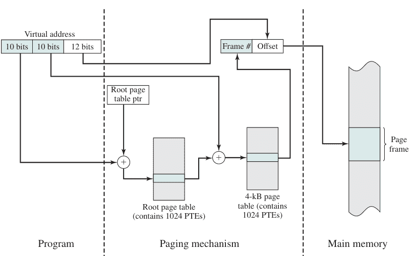

**图 8.4** 两级分页系统中的地址翻译

反转页表（`inverted page table`）包含了页表帧。反转页表中每个实际内存页帧对应一个条目，而不是每个虚拟页。因此，无论支持的进程数量或虚拟页数量多少，都需要固定比例的实际内存来存储页表。由于多个虚拟地址可能映射到同一个哈希表，因此使用了链链技术来管理溢出。哈希技术产生的链通常很短——在一条到两个条目之间。页表的结构之所以被称为“反转”，是因为它是通过帧号（`frame number`）而不是虚拟页号来索引页的。

图 8.5 显示了反转页表的典型实现。对于大小为 $2^m$ 帧的物理内存，反转页表包含 $2^m$ 个条目，因此第 $i$ 个条目指向帧 $i$。页表中的每个条目包含以下内容：

- **页号**：这是虚拟地址的页号。
- **进程标识符**：拥有此页的进程。页号和进程标识符的组合标识了特定进程虚拟地址空间内的页。
- **控制位**：该字段包含标志位，如有效（`valid`）、被引用（`referenced`）和修改（`modified`）；以及保护和锁定信息。
- **链指针**：如果该条目没有链式条目，则该字段为空（可能可能由单独的位指示）；否则，该字段包含链中下一个条目的索引值（位于 0 到 $2^m - 1$ 之间的数字）。

## 8.1 / 硬件和控制结构 379

虚拟地址

n 位

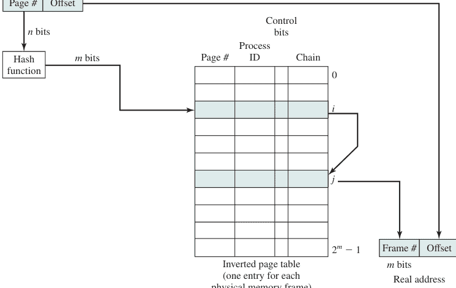

图 8.5 反转页表结构

在此例中，虚拟地址包含一个 $n$ 位的页号，其中 $n > m$。哈希函数将 $n$ 位的页号映射为 $m$ 位的数值，用于索引反转页表。

**转换旁备缓冲区（TRANSLATION LOOKASIDE BUFFER）** 从原理上说，每次虚拟内存引用都会导致两次物理访问：一次获取相应的页表条目，另一次获取所需的数据。因此，直接的虚拟内存方案会导致访问时间翻倍的效果。为了解决这个问题，大多数虚拟内存方案都使用一种特殊的高速缓存来存储页表条目，通常称为**转换旁备缓冲区（TLB）**。该缓存的工作方式与内存缓存（第 1 章）相同，并包含了最近使用过的页表条目。分页硬件的结构如图 8.6 所示。给定一个虚拟地址，处理器将首先检查 TLB。如果找到了所需的页表条目（TLB 命中），则检索帧并形成实际地址。如果未找到所需的页表条目（TLB 缺失），处理器使用页号来索引页表并检查对应的页表条目。如果“存在（present）”位被设置，则该页在主内存中，处理器可以从页表中检索帧号以形成实际地址。处理器更新 TLB 以包含此新页表条目。最后，如果存在位未被设置，则所需页不在主内存中，并触发一种内存访问异常，称为**页异常（page fault）**。

# 380 第 8 章 / 虚拟内存

虚拟地址

| 页号 | 偏移 |
|---|---|

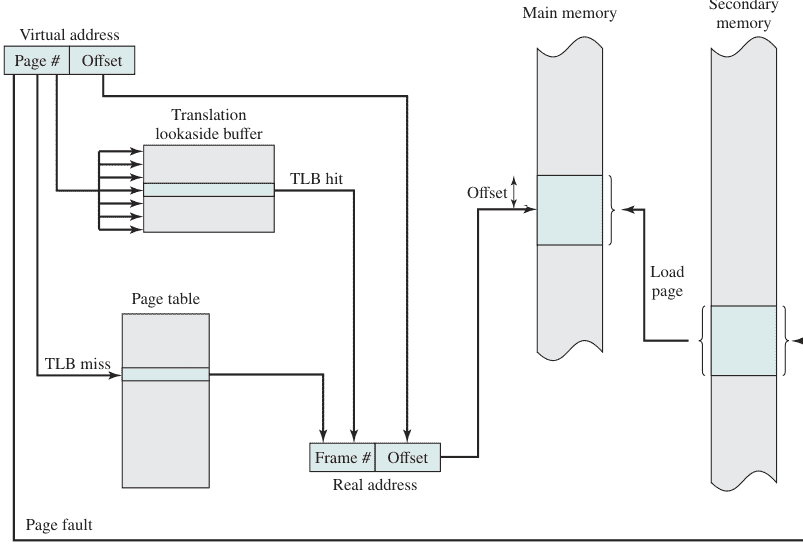

主内存

外部存储

转换旁备缓冲区

TLB 命中

偏移

页表

加载页

TLB 缺失

| 帧号 | 偏移 |
|---|---|

实际地址

页异常

**图 8.6** 转换旁备缓冲区的使用

此时，我们离开了硬件范畴并调用了操作系统（OS），由 OS 加载所需的页并更新页表。

图 8.7 是一个显示 TLB 使用的流程图。流程图显示，如果所需的页不在主内存中，页中断将调用页异常处理例程。为了保持流程图简单，没有显示操作系统在磁盘 I/O 进行期间可能会调度另一个进程的事实。根据局部性原理，大多数虚拟内存引用将指向最近使用的页中的位置。因此，大多数引用将涉及缓存中的页表条目。对 VAX8 的研究表明，这种方案可以显著提高性能 [CLEAR85, SATY81]。

关于 TLB 的实际结构还有许多额外细节。由于 TLB 仅包含完整页表中的部分条目，我们不能简单地根据页号索引 TLB。相反，TLB 中的每个条目都必须包含页号以及完整的页表条目。处理器配备了硬件，允许其同时查询多个 TLB 以确定页号是否匹配。这种技术被称为**关联映射（associative mapping）**，并与图 8.8 中用于页表查找的直接映射（direct mapping）或索引映射形成对比。TLB 的设计还必须考虑哪些条目被组织在 TLB 中，以及在调入新条目时替换哪些条目。此处此处未深入探讨此主题；读者可以查阅更详细的讨论（例如，31页）。

# 381 8.1 / 硬件和控制结构 381

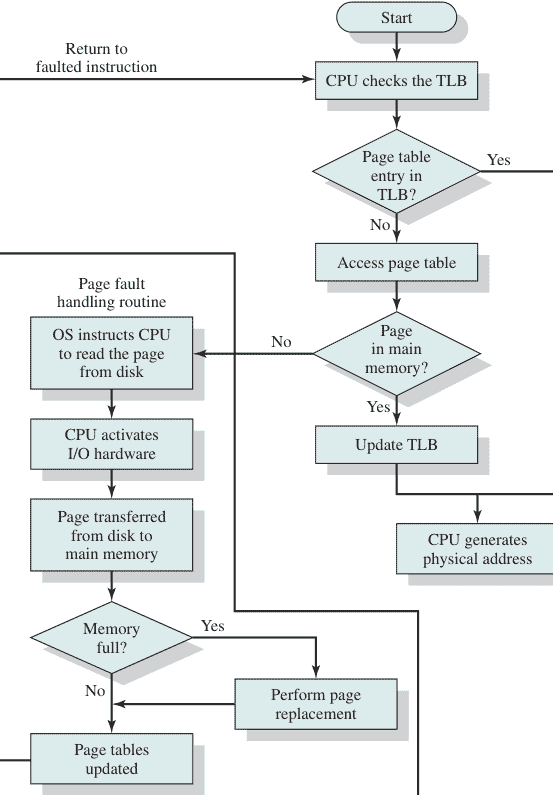

图 8.7 转换旁备缓冲区（TLB）的操作

最后，包含该字的页是否存在。如果是，则返回给 CPU。如果不是，则从主内存中检索。读者应当理解此处内存访问的复杂性。虚拟地址被转换为实际地址。这涉及到页表，该页表可能在 TLB、主内存或磁盘中。如图 8.9 所示。此外，该页表必须更新。

页大小（PAGE SIZE）是一个重要的硬件设计决策。页大小还需要考虑几个因素。一个是内部碎片。显然，页越小，内部碎片越少。另一方面，页越小，每个进程所需的页数越多。对于多程序环境中的大型程序，这可能意味着活动进程的部分页表必须在虚拟内存而非主内存中。因此，单次内存访问可能会发生两次页异常：第一次调入页表部分，第二次调入页。使这些问题复杂的是页大小对页异常发生率的影响。这种行为一般性描述在图 8.10a 中，并基于局部性原理。如果页非常非常，那么通常主内存中会有大量的页可用可用。一段时间后，

# 382 第 8 章 / 虚拟内存

虚拟地址

虚拟地址

页号 | 偏移

页号 | 偏移

| 页号 | 偏移 |
|---|---|
| 页号 | 偏移 |
| 页号 | 偏移 |
| 页号 | 偏移 |
| 页号 | 偏移 |
| 页号 | 偏移 |
| 页号 | 偏移 |
| 页号 | 偏移 |
| 页号 | 偏移 |
| 页号 | 偏移 |
| 页号 | 偏移 |

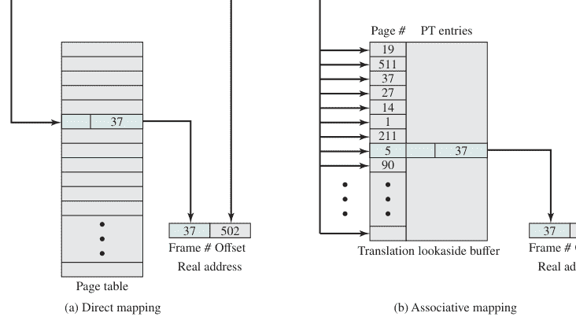

页表

（直接）映射

帧号 偏移

实际地址

（关联）映射

**图 8.8** 页表条目的直接映射与关联映射

转换旁备缓冲区

TLB

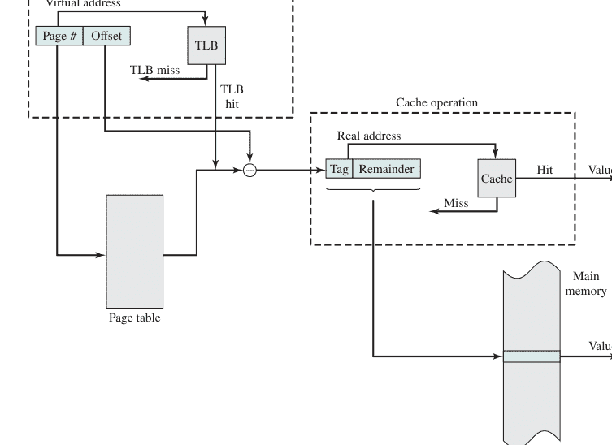

TLB 缺失

TLB 命中

缓存操作

实际地址

标签剩余部分

**图 8.9** 转换旁备缓冲区和缓存操作

# 383 8.1 / 硬件和控制结构 383

主内存

值

值

命中

缺失

主内存

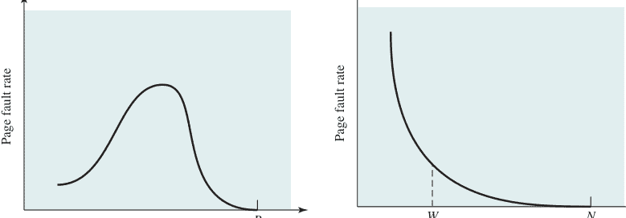

+   P = 整个进程的大小
+   W = 工作集大小
+   N = 进程中的总页数

**图 8.10** 程序的典型分页行为

## 第8 章 / 虚拟内存

表 8.3 页面大小示例

| 计算机 | 页面大小 |
|---|---|
| Atlas | 512 个48-位字 |
| Honeywell-Multics | 1,024 个36-位字 |
| IBM 370/XA 和 370/ESA | 4 kB |
| VAX 系列 | 512 字节 |
| IBM AS/400 | 512 字节 |
| DEC Alpha | 8 kB |
| MIPS | 8 kB 到 16 MB |
| UltraSPARC | 8 kB 到 4 MB |
| Pentium | 4 kB 到 4 MB |
| Inteliumium | 4 kB 到 256 MB |
| Intel core i7 | 4 kB 到 1 GB |

内存中的页面将包含进程引用附近的所有部分。因此，缺页率应该是较低的。随着页面大小的增大，每个单独页面将包含距离任何特定引用越远的位置。因此，局部性原理的影响会被削弱，缺页率开始上升。然而，当页面大小接近整个进程时，缺页率将开始下降（图中的 P 点）。当单个页面包含整个进程时，将不会发生缺页。


进一步的复杂性在于，缺页率还取决于分配给进程的帧数。图 8.10 显示，对于固定的页面大小，随着主内存中维护的页面数量增加，故障率下降。因此，软件策略（分配给每个进程的内存量）与硬件设计决策（页面大小）相互作用。

表 8.3 列出了某些机器上使用的页面大小。

最后，页面大小的设计问题与物理主内存的大小和程序的大小有关。主内存变得越来越大，同时应用程序使用的地址空间也在增长。这种趋势在个人电脑和工作站上最为明显，这里的应用程序变得日益复杂。此外，大型程序中使用的现代编程技术会导致进程内引用的局部性 [HUCK93]。例如：

- 面向对象的技术鼓励在较短的时间内，较多的对象上分散使用许多小的程序和数据模块。
- 多线程应用程序可能导致指令流的突发变化和散乱的内存引用。

参数 `W` 代表工作集大小，这是第 8.2 节中讨论的概念。

# 第 8 章 / 虚拟内存

## 8.1 硬件与控制结构

对于给定的 `TLB` 大小，随着进程内存的增长和局部性的降低，访问 `TLB` 的命中率会下降。在这种情况下，`TLB` 可能会成为性能瓶颈（例如参见 [CHEN92]）。

提高 `TLB` 性能的一种方法是具有更多条目的更大的 `TLB`。然而，`TLB` 与硬件设计的其他方面相互作用，例如内存缓存和每个指令周期的内存访问次数 [TALL92]。结果是，`TLB` 的大小不太可能像主内存大小增长得那么快。另一种方法是使用更大的页面，以便 `TLB` 中的每个页表项都引用一个更大的内存块。但我们刚刚看到，使用大页面大小会导致性能下降。

因此，许多设计者研究了多种页面大小的使用 [KHAL93]，几种微处理器架构支持多个页面大小，包括 `MIPS R4000`、`Alpha`、`UltraSPARC`、`x86` 和 `IA-64`。多个页面大小提供了有效使用 `TLB` 所需的灵活性。例如，进程地址空间中的连续区域（如指令）可以使用少量页面而不是大量小页面进行映射，而线程栈可以使用相同的页面大小进行映射。然而，大多数商业操作系统仍然仅支持一种页面大小，无论底层硬件的能力如何。其原因是将页面大小更改为多个页面大小是一项复杂的工程（讨论请参见 [GANA98]）。

## 分段

虚拟内存的影响：分段允许程序员将内存视为由多个地址空间或段组成。段的大小可以是不等的，事实上是动态的。内存引用由一个（段号, 偏移量）对的地址组成。

与非分段地址空间相比，这种组织结构对程序员具有许多优势：

1. 它简化了增长数据结构的处理。如果程序员无法预先知道特定数据结构将变得多大，那么就有必要猜测允许的动态段大小。使用分段虚拟内存，可以为数据结构分配它自己的段，操作系统将根据需要扩展或缩小该段。如果段在主内存中需要扩展且空间不足，操作系统可能会将该段移动到主内存中更大的区域（如果可用），或将其交换出。在这种情况下，扩大的段将在下次机会时换回。
2. 它允许独立地对修改和重新编译程序，而不需要对整个程序集进行重新链接和重新加载。同样，这是通过使用多个段实现的。
3. 它有利于进程间的共享。程序员可以将实用程序或有用的数据表放在一个段中，该段可以被其他进程引用。
4. 它有利于保护。因为段可以被构造为包含一组定义的程序或数据，程序员或系统管理员可以方便地分配访问权限。

## 组织

在对简单分段的讨论中，我们指出每个进程都有一个段表，当它被加载到主内存时。段表的长度是可变的，我们不能期望将其保存在寄存器中。相反，它必须在主内存中。虚拟地址的段号用于索引该表并查找段的起始地址。这与虚拟地址的偏移部分相加产生所需的地址。

段表中的另一个控制位是修改位（`modify bit`），指示自上次加载主内存以来内容是否已被更改。可能还有其他位。例如，如果保护或共享是在段级管理的，那么就需要这些位。

图 8.11 建议了这种硬件实现（注意与图 8.2 的相似性）。当特定进程运行时，一个寄存器持有该进程的段表的起始地址。

## 分页与分段的结合

分页和分段都有各自的优势。分页对程序员是透明的，它消除了外部碎片并提供了高效的主内存利用。此外，由于进出主内存的片段是固定且等大小的，可以开发出利用程序行为的复杂内存管理算法，正如我们将看到的那样。分段对程序员是可见的，具有前面提到的优势，包括处理增长数据结构的能力、模块化以及对共享保护的支持。为了结合两者的优点，某些系统配备了处理器硬件和操作系统软件来提供两者。

在结合分页和分段的系统中，用户的地址根据程序员的意愿分成若干段。每个段又被分成若干固定大小的页面，这些页面长度与主内存帧相等。如果段的长度小于页面长度，则该段仅占用一个页面。从程序员的角度来看，逻辑地址由段号和段偏移组成。从系统的角度来看，段偏移被视为指定段内的一个页号和页偏移。

图 8.12 显示了支持结合分页分段的结构（注意与图 8.4 的相似性）。与每个进程关联的是段表和多个页表，每个进程段一个页表。

在运行时，一个寄存器保存着该进程段表的起始地址。当给出一个虚拟地址时，处理器使用其中的段号部分来索引进程表，以找到该段对应的页表。然后，虚拟地址的页号部分被用于索引页表并找到相应的帧号。这与虚拟地址的偏移量部分相结合，从而产生所需的实际地址。

图 8.1c 显示段表包含段的长度。它还包含一个基址字段，该基址指向一个页表。不需要存在位（`present bit`）和修改位（`modified bit`），因为这些事项在页级进行处理。其他控制位可以用于共享和保护目的。页表本质上与纯分页系统中的页表相同。如果页面存在于主内存中，则每个页面都映射到一个相应的帧号。修改位指示当帧被分配给另一个页面时，该页面是否需要写出。可能还有其他处理保护或其他内存管理其他方面的控制位。

## 保护与共享

分段有利于保护和共享策略的实现。由于每个段表都包含长度和基地址，程序无法无意中访问超出段限制的主内存位置。为了实现共享，一个段可以被多个进程的段表引用。当然，分页系统中也存在相同的机制。然而，在这种情况下，程序和数据的页结构对程序员来说是不可见的，这使得保护和共享要求的规范变得更加笨拙。图 8.13 展示了此类系统中可以强制的保护关系类型。

还可以提供更复杂的机制。一种常用的方案是使用环保护结构，即我们在第 3 章中提到的类型（见图 3.18）。在这种方案中，编号较小或内层的环比编号较大的外层环具有更高的权限。通常，环 0 留给操作系统的内核函数，而应用程序位于更高级。某些实用程序或操作系统服务可能中间环。环系统的基本原理如下：

- 程序只能访问存储在同一环或低特权环上的数据。
- 程序可以调用位于相同环或更高特权环上的服务。

## 8.2 操作系统软件

操作系统内存管理部分的设计取决于三个基本选择：

1. 是否使用虚拟内存技术
2. 使用分页、分段还是两者兼之
3. 用于内存管理各个方面的各种算法

主内存

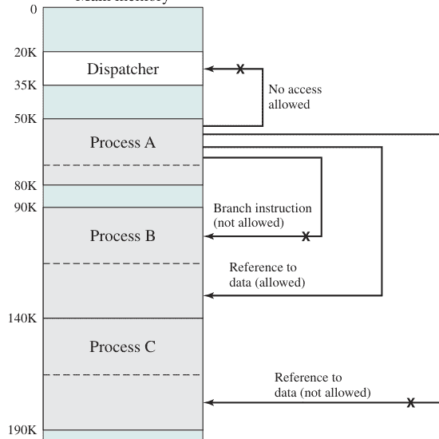

**图 8.13 段之间的保护关系**

前两个领域所做的选择取决于可用的硬件平台。因此，早期的 `UNIX` 实现没有提供虚拟内存，因为系统上的处理器不支持分页或分段。如果没有对地址转换和其他基本功能的硬件支持，这两种技术中的任何一种都是不可行的。

关于上述列表中前两项的两个额外说明：首先，除了某些旧式计算机（如 `MS-DOS`）和专用系统的操作系统外，所有重要的操作系统都提供虚拟内存。其次，纯分段系统正变得越来越稀少。当分段与分页结合时，操作系统面临的大多数内存管理问题都位于分页领域。⁴ 因此，我们可以在本节集中关注与分页相关的问题。

与第三项相关的选择是操作系统软件的领域，也是本节的主题。表 8.4 列出了关键设计元素，这些元素

> 在结合的分段/分页系统中，保护和共享通常在段级进行处理。我们将在后面的章节中处理这些问题。

### 预取策略

预取策略决定了何时将页面带入主内存。两种常见的替代方案是请求分页和预取分页。在请求分页中，只有当对页面上的位置进行引用时，页面才被带入主内存。如果内存管理策略的其他元素良好，则会发生以下情况：当进程首次启动时，会出现大量的页异常。随着越来越多的页面被带入，局部性原理表明，未来的大多数引用将针对最近带入的页面。因此，一段时间后，情况就会稳定下来，页异常的数量应该下降到非常低的水平。

在预取分页中，除了页异常请求的页面外的页面也会被带入。预取利用了大多数辅助内存设备（如磁盘）的特性，这些设备具有寻道时间和旋转延迟。如果进程的页面连续存储在辅助内存中，那么一次性带入多个连续页面比在长时间内一个一个带入更有效。当然，如果带入的大多数额外页面没有被引用，这种做法就是无效的。

预取策略可以在进程启动时采用（在这种情况下程序员将指定所需的页面），或者每次发生页异常时采用。后一种方案似乎更好，因为它对程序员来说是不可见的。

预取不应与交换混淆。当进程被交换出内存并处于挂起状态时，它所有的驻留页面都会被移出。当进程恢复时，所有以前在主内存中的页面都会返回主内存。

### 放置策略

放置策略决定了进程位于内存的什么位置。在分段系统中，放置策略是一个重要选择，如最佳适应、首次适应等，这些在第 7 章中讨论过。然而，对于分页结合分段，放置通常是无关的，因为地址转换可以执行。

有一个领域放置成为关注点：性能很大程度上取决于处理器和内存之间的距离。自动放置策略是理想的，它可以适用于任何机器。

### 替换策略

在操作系统书中，内存管理的处理包括一个名为“替换策略”的部分，涉及待替换页面的选择。我们将前两个概念称为驻集管理（将在下一节讨论），并将替换策略术语留给第三个概念：

- 为每个进程分配多少页帧
- 考虑替换的页面集是否应限于引起异常的页面
- 在考虑的页面中，应该选择哪个特定的页面进行替换

替换策略领域可能是研究最充分的领域。当主内存中的所有帧都被占用且需要带入新页面以满足页异常时，替换策略决定当前内存中的哪个页面应该被替换。所有策略的目标都是让被移除的页面最不可能被引用。由于局部性原理，最近的引用历史与未来的引用模式通常存在高度相关性。因此，大多数策略根据过去行为预测未来。必须考虑的权衡是，替换策略越复杂，实现它的硬件和软件开销越大。

查看各种算法需要提到替换策略的一个限制：主内存中的某些帧可能被锁定。当一个帧被锁定时，不能被替换。操作系统的内核以及控制结构位于锁定帧中。此外，`I/O` 缓冲区和其他关键区域可能被锁定在内存中。通过与每个帧关联一个锁定位来实现锁定。该位可以保留在帧表中，也可以包含在当前页表中。

#### 基础算法

无论驻集管理策略如何（下节），某些算法用于选择替换页面。文献中讨论过的替换算法包括：

- 优化算法
- 最久未使用算法 (`LRU`)
- 先入先出算法 (`FIFO`)
- 时钟算法 (`Clock`)

页面地址流 2 3 2 1 5 2 4 5 3 2 5 2

| | 2 | 3 | 2 | 1 | 5 | 2 | 4 | 5 | 3 | 2 | 5 | 2 |
|---|---|---|---|---|---|---|---|---|---|---|---|---|
| OPT | | | 3 | | 3 | | 3 | | 3 | | 3 | | 3 |
| | | | | | F | | | F | | | F | | | |
| | 2 | 3 | 2 | 1 | 5 | 2 | 4 | 5 | 3 | 2 | 5 | 2 |
|---|---|---|---|---|---|---|---|---|---|---|---|---|
| LRU | | 3 | | 3 | | 5 | | 5 | | 4 | | 2 | | 5 |
| | | | | | F | | 1 | | F | | | | | F |
| | 2 | 3 | 2 | 1 | 5 | 2 | 4 | 5 | 3 | 2 | 5 | 2 |
|---|---|---|---|---|---|---|---|---|---|---|---|---|
| FIFO | | | 3 | | 1 | | 2 | | 2 | | 2 | | 5 |
| | | | | | F | | F | | 1 | | 4 | | F | | |
| | 2 | 3 | 2 | 1 | 5 | 2 | 4 | 5 | 3 | 2 | 5 | 2 |
|---|---|---|---|---|---|---|---|---|---|---|---|---|
| CLOCK | | 3 | | 3 | | 1 | | 2 | | 2 | | 3 | | 5 |
| | | | | | F | | F | | 4 | | 4 | | F | | F |

F = 在初始填充框架分配后发生页异常

图 8.14 四种替换算法的行为

图 8.14 给出了最优策略的一个示例。该示例假设该进程具有三个框架的固定框架分配（固定驻留集）。该进程的执行需要引用 15 个不同的页面。执行程序形成的页面地址流为：

```
2 3 2 1 5 2 4 5 3 2 5 2
```

这表明第一个引用的页面是 2，第二个引用的页面是 3，以此类推。最优策略在框架分配填充后产生了三次页异常。

最近最少使用算法（`LRU`）替换掉内存中长时间未被引用的页面。根据局部性原理，这应该是在不久将来最可能被引用的页面。事实上，`LRU` 策略的效果几乎接近最优策略。这种方法的问题在于实现困难。一种方法是为每个页面标记其最后一次引用的时间；这必须在每次内存引用（包括指令和数据）时完成。即使硬件支持这种方案，其开销也将是巨大的。或者，可以维护一个页面引用的栈，这同样是一个昂贵的过程。

图 8.14 显示了 `LRU` 的行为示例，使用了与最优策略示例相同的页面地址流。在这个示例中，发生了四个页异常。

先进先出（`FIFO`）策略将分配给进程的页面框架视为环形缓冲区，并以轮询方式移除页面。只需要一个循环遍历进程框架的指针。因此，这是最容易实现的页面替换策略之一。除了简单性外，这种选择背后的逻辑是替换在内存中存在时间最长的页面：很久以前调入内存的页面可能已经不再使用。这种推理是错误的，因为程序或数据的某些区域在程序的整个生命周期内会被频繁使用。这些页面会被 `FIFO` 算法反复调入调出。

继续图 8.14 中的示例，`FIFO` 策略导致了六次页异常。注意 `LRU` 注意到页面 2 和 5 的引用频率高于其他页面，而 `FIFO` 并没有。

尽管 `LRU` 策略的性能不如最优策略，但它难以实现且会产生巨大的开销。另一方面，`FIFO` 策略实现非常简单但性能糟糕。多年来，操作系统设计人员尝试了许多其他算法在产生少量开销的同时模拟 `LRU` 的性能。这些许多算法都是被称为*访问策略*（`code policy`）方案的变体。

访问策略最简单的形式是每个框架关联一个额外的位，称为使用位（`use bit`）。当页面加载到内存时，该框架的使用位被设置为 1。每当页面随后被引用（在产生异常的引用之后），使用位就会被设置为 1。当发生页异常时，每个框架的使用位被设置为 0。如果使用位为 1，则将其设置为 0，指针移动到下一个框架；如果使用位为 0，则替换该页面。

需要一个位（`bit`）是为了确保当一个页面被修改时，在它写入辅助内存之前，它不会被替换。我们可以在时钟算法中以此方式利用这一点。如果考虑使用位（`use bits`）和修改位（`modify bits`），每个帧将属于以下四类之一：

1. 最近未访问，未修改 (`u = 0; m = 0`)
2. 最近访问过，未修改 (`u = 1; m = 0`)
3. 最近未访问，但已修改 (`u = 0; m = 1`)
4. 最近访问过且已修改 (`u = 1; m = 1`)

通过这种分类，时钟算法的操作如下：

1. 从指针的当前位置开始，扫描帧缓冲区。在扫描期间，不对使用位进行任何更改。遇到的第一个帧 (`u = 0; m = 0`) 被选中进行替换。
2. 如果步骤 1 失败，再次扫描，寻找 (`u = 0; m = 1`) 的帧。遇到的第一个此类帧被选中进行替换。在扫描期间，将每个跳过的帧的使用位置为 0。
3. 如果步骤 2 失败，指针应该已返回原始位置，并且集合中的所有帧的使用位都将为 0。重复步骤 1，并在必要时重复步骤 2。这将创建一个用于替换的帧。

总之，页面替换算法在缓冲区中的所有页面中循环，寻找一个自调入内存以来未被修改且最近未被访问的页面。这样的页面非常适合替换，其优势在于由于它是未被修改的，因此不需要写回辅助内存。如果在第一轮扫描中没有找到候选页面，算法将再次循环缓冲区，寻找一个最近未访问的已修改页面。即使是这样的页面，由于局部性原理，也必须写出才能被替换，因为很快可能不会再次需要它。如果第二次扫描失败，缓冲区中的所有帧都将被标记为最近未访问，并进行第三次扫描。

这种策略曾用于早期版本的 `Macintosh` 虚拟内存方案 [GOLD89]。该算法优于简单时钟算法的优势在于，优先替换未发生更改的页面。因为被修改过的页面在替换之前必须写出，这可以立即节省时间。

#### 页面缓冲

尽管 `LRU` 和时钟策略与 `FIFO` 类似，但它们都涉及 `FIFO` 不具备的复杂性和开销。此外，还有一个相关问题：替换已修改页面的成本高于未修改的，因为前者必须写入辅助内存。

提高分页性能并允许使用简单页面替换策略的有趣策略是页面缓冲。`VAX VMS` 方法具有代表性。其页面替换算法是简单的 `FIFO`。为了提高性能，被替换的页面不会丢失，而是分配到两个列表之一：如果页面未修改，则分配到空闲页面列表；如果已修改，则分配到修改页面列表。页面不会在主内存中物理移动；相反，页表中的项会被移除并放入空闲或修改页面列表。

空闲列表是可读取的页面帧列表。`VMS` 试图始终保持若干个空闲帧。当需要读取页面时，使用空闲页面列表头的帧，并销毁原有的页面。当需要替换未修改的页面时，它在内存中被替换，其帧被添加到空闲页面列表末尾。同样，当修改的页面被写出并替换时，其帧被添加到修改页面列表末尾。

这些操作的重要方面是被替换的页面仍留在内存中。如果进程引用了该页面，它将以低成本返回该进程的驻留集。空闲和修改页面列表充当页面的缓存。修改页面列表还有另一个实用功能：修改后的页面是簇写出的，而不是一个一个。这显著减少了 `I/O` 操作次数和访问时间。

`Mach` 操作系统实现了更简单的页面缓冲版本 [RASH88]。在这种情况下，修改页面和未修改页面之间不作区分。

### 替换策略与缓存大小


如前所述，主内存容量正在变大，应用程序的局部性正在减小。大缓存容量（即使是兆字节级的）现在已成为一种可行的设计方案 [BOR90]。对于大缓存，虚拟内存页面的替换可能会产生性能影响。如果选定替换的页面在缓存中，那么该缓存块就与它所持有的页面一样有效。

在某些某种形式的页面缓冲系统中，可以通过为页面替换策略补充一种页面缓冲区中的放置策略来提高性能。大多数操作系统通过从页面缓冲区中选择任意页面帧来放置页面；通常使用先入先出原则。[KESS92] 中报道的一项研究表明，缓存放置策略产生的缺失次数比朴素放置少 10-20%。

[KESS92] 中解释了若干页面放置算法。这些细节超出了本书的范围，因为它们取决于缓存结构和策略的细节。这些策略的核心是以一种方式将连续页面引入主内存，以最大限度地减少映射到缓存槽的页面帧数量。

## 驻留集管理

如本章之前提到的，进程任何时刻实际位于主内存中的部分定义为进程的驻留集。

### 驻留大小

使用分页内存时，没有必要（可能无法）将进程的所有页面都调入主内存。操作系统必须决定调入多少，即分配多少内存：

- 分配给进程的内存量越少，任何时刻驻留的进程就越多。这增加了操作系统找到至少一个就绪进程的概率，从而减少了因交换而丢失的时间。
- 如果内存中的页面数量较少，尽管有局部性原理，缺页率也会相当高（见图 8.10）。
- 超过特定大小，由于局部性原理，为特定进程额外分配内存对缺页率不会产生明显影响。

考虑到这些因素，现代操作系统中存在两种策略。**固定分配策略**为进程提供固定数量的帧来执行任务。该数量在加载时（进程创建时）决定，可能基于进程的类型（交互式、批处理、应用程序类型），也可能基于程序员或系统管理员的指导。在固定分配策略下，每当发生缺页时，必须替换该进程的页面中的一个。

**可变分配策略**允许分配给进程的页面帧数量在进程的生命周期内发生变化。理想情况下，深受缺页困扰的进程（表明局部性以弱形式存在）将获得额外的页面帧以降低缺页率；而缺页率极低的进程将获得减少分配，希望这不会显著增加缺页率。可变分配策略的使用与替换范围的概念有关，如下一节所示。

可变分配策略看起来是更有强大的。然而，这种方法的困难之处在于它需要操作系统评估活动进程的行为。这不可避免地会产生内核开销，并取决于平台提供的硬件机制。

### 替换范围

替换策略的范围可以分为全局或局部。这两种策略在没有空闲页面时由缺页触发。**局部替换策略**在选择要替换的页面时，仅选择产生缺页的进程的驻留页面。**全局替换策略**则将主内存中的所有页面视为替换候选，无论特定页面属于哪个进程。如前所述，当帧被锁定时，存储在其中的页面可能不会被替换。解锁页面是主内存中未锁定的简单页面。虽然局部策略更容易分析，但没有充分证据表明它们的性能优于全局策略，后者因其实现简单且开销小而具有吸引力 [CARR84, MAEK87]。

替换范围与驻留大小之间存在相关性（见表 8.5）。固定驻留意味着局部替换策略：为了保持驻留集的大小固定，从内存中移除的页面必须由同一进程的另一个页面替换。可变分配策略可以显然采用全局替换策略：替换某个进程主内存中的页面与另一个进程的替换会导致一个进程的分配增加一个页，而另一个进程的分配收缩一个页。我们还将看到，变异分配和局部替换是一种有效的组合。现在我们来检查这三种组合。

#### 固定分配，局部范围

对于这种情况，一个在主内存中运行的进程，具有固定数量的帧。当发生页错误时，操作系统必须从该进程当前驻留页中选择一个要替换的页。可以使用上一节中讨论的替换算法。

在固定分配策略下，必须预先决定给进程的分配。这可以根据程序请求的应用程序类型来决定。这种方法的缺点有两个：如果分配倾向于太小，那么就会有很高的页错误率；如果分配倾向于不必要的巨大，那么主内存中的程序就会太少，导致大量的空闲时间或花费大量时间在交换上。

#### 变异分配，全局范围

这种组合最容易实现，已被许多操作系统采用。在任何给定时刻，主内存中都有进程，每个进程都分配了一定数量的帧。通常，操作系统还会维护一个空闲帧列表。当发生页错误时，一个空闲帧会被进程的驻留集中，并调入该页。因此，经历分页错误的进程其规模会逐渐增大，这有助于减少系统的整体页错误。

这种方法的困难之处在于替换的选择。当没有可用空闲帧时，操作系统必须选择一个当前在内存中的页进行替换。选择是在内存中所有帧中进行的，但内核帧等锁定的帧除外。使用上一节中讨论的任何策略，选中的页可能属于任何进程；没有规程来决定哪个进程应该从其驻留集中丢失一个页。因此，遭受驻留集大小缩小的进程可能并不是最优。

应对变异分配、全局范围策略潜在性能问题的一种方法是使用页缓冲。选择替换哪一个页变得不那么重要了，因为如果该页在下一块页被覆盖之前被引用，则它可能会被回收。

#### 变异分配，局部范围

变异分配、局部范围策略试图克服全局范围策略的问题。可以总结如下：

1. 当一个新进程加载到主内存时，根据应用程序类型、程序请求或其他标准，为其分配一定数量的页帧作为其驻留集。使用预取（prepping）或按需分页来填充该分配。
2. 当发生页错误时，从发生错误的进程的驻留集中选择要替换的页。
3. 定期重新分配提供给进程的份额，并通过增加或减少它来提高整体性能。

通过这种策略，增加或减少驻留集大小的决定是故意的，并且基于对活动进程未来可能需求的评估。由于存在评估，这种策略比简单的全局替换策略更复杂。然而，它可能会产生更好的性能。

变异分配、局部范围策略的元素是用于确定驻留集标准的以及更改的时机。文献中备受关注的一种策略被称为工作集策略（working set strategy）。虽然真正的工作集策略很难实现，但将其作为比较的基准是有用的。

工作集是由 Denning [DEN68, DEN80] 引入并普及的概念；它对虚拟内存设计产生了深远影响。对于虚拟时间 $t$ 的进程，具有参数 $\Delta$ 的工作集定义为 $W(t, \Delta)$，该进程在过去的 $\Delta$ 个虚拟时间单位内被引用过的页集合。

虚拟时间的定义如下。考虑一个内存引用序列 $r(1), r(2), \dots$，其中 $r(i)$ 是进程给出的第 $i$ 个虚拟地址对应的页。时间以内存引用为单位；因此，$t = 1, 2, 3, \dots$ 测量进程的内部虚拟时间。

让我们考虑 $W$ 的两个变量中的每一个。变量 $\Delta$ 是观察进程的虚拟时间窗口。结果如图 8.17 所示（基于 [BACH86]），它显示了进程的一个页引用序列。点表示工作集中的时间单位不改变。注意，窗口越大，工作集就越大。这可以用以下关系表示：

$$W(t, \Delta + 1) \geq W(t, \Delta)$$

工作集也是时间的函数。如果一个进程执行了 $\Delta$ 个时间单位且只使用一个页，那么 $|W(t, \Delta)| = 1$。工作集也可以增长

$$|W(t, \Delta)| \le \min(\Delta, N)$$

工作集也是时间的函数。如果一个进程执行了 $\Delta$ 个时间单位且只使用一个页，那么 $|W(t, \Delta)| = 1$。的新的

图 8.18 显示了对于固定的 $\Delta$ 值，工作集的变化方式。因此，

$$|W(t, \Delta)| \le \min(\Delta, N)$$

工作集概念可以指导驻留集大小策略：

- 监控每个进程的工作集。
- 定期从进程的驻留集中移除那些不在其工作集的页。这本质上是一种 LRU 策略。
- 进程只有当其工作集在主内存中（即其驻留集包含了其工作集）时才能执行。

整体而言，通过为该进程分配较小的驻集大小（resident set size）可以受益（因为页框可以提供给其他进程），而不会损害进程（导致页异常次数增加）。如果一个进程的页异常率高于某个阈值，该进程可以从增大驻集大小中受益（通过引发频繁异常），而不会降低系统性能。

遵循这种策略的算法是页异常频率（PFF）算法 [CHU78]。它要求内存中的每个页面都关联一个使用位（use bit）。当页面被访问时，使用位被设置为 1。当发生页异常时，操作系统会记录该进程自上次页异常以来的虚拟时间；这可以通过维护一个页引用计数器来实现。定义一个阈值 F。如果距离上次页异常持续的时间小于 F，则将一个页面添加到该进程的驻集。否则，丢弃所有使用位为 0 的页面，并相应地收缩驻集。同时，将该进程剩余页的使用位重置为 0。该策略可以使用两个阈值来完善：一个用于触发驻集大小增长的上限阈值，以及一个用于触发驻集大小收缩的下限阈值。

页异常之间的时间是页异常率的倒数。虽然维护页异常率的移动平均似乎更好，但使用单一的时间测量是一个合理的折中，允许对驻集大小的决策基于页异常率。如果将这种策略辅以页缓冲（page buffering），所得性能将非常良好。

尽管如此，PFF 方法存在一个主要缺陷，即在向新局部性（locality）转换的过渡时期表现不佳。使用 PFF 时，在页面被引用 F 个虚拟时间之前，没有任何页面会从驻集中移除。在局部性转换期间，连续发生的页异常会导致驻集在旧局部性页面被驱出之前膨胀；内存需求的突然峰值可能会导致不必要的进程激活和重新激活，并产生相应的不利的切换和交换开销。

一种试图处理局部性转换现象且具有与 PFF 相似的低开销的方法是可变间隔采样工作集（VSWS）策略 [FERR83]。VSWS 策略在采样实例根据流逝时间评估进程的工作集。在采样间隔的开始时，在该间隔内被访问过的所有驻留页面的使用位将被设置为 1；这些页面在下一个间隔内保留在进程的驻集中，而其他页面被丢弃。因此，驻集大小只能在间隔结束时减小。在每个间隔内，异常页面被添加到驻集；因此，驻集在间隔期间保持不变或增长。

VSWS 策略由三个参数驱动：

- M: 采样间隔的最小持续时间
- L: 采样间隔的最大持续时间
- Q: 采样实例之间允许发生的页异常次数

VSWS 策略如下：

1. 如果自上次采样实例以来的虚拟时间达到 L，则挂起该进程并扫描使用位。
2. 如果在流逝虚拟时间 L 之前发生了 Q 次页异常，
   a. 如果自上次采样实例以来的虚拟时间小于 M，则等待流逝时间达到 M 后挂起该进程并扫描使用位。
   b. 如果自上次采样实例以来的虚拟时间大于或等于 M，则挂起该进程并扫描使用位。

参数值的选择应使得采样通常由上次扫描后发生的 Q 次页异常的触发（情况 2b）。另外两个参数（M 和 L）为异常情况提供了边界保护。VSWS 尝试通过在页异常率增加时增加采样频率，从而增加未使用页面从驻集中移除的速率，来降低内存内存需求。在 Bull 主机操作系统 GCOS 8 中使用该技术的经验表明，这种方法的实现与 PFF 一样简单，且更有效 [PIZZ89]。

### 清理策略

清理策略是提取策略（fetch policy）的相反；它关注何时将修改过的页面写入辅助存储。两种常见的替代方案是按需清理（demand cleaning）和预清理（precleaning）。按需清理是指只有当页面被选择替换时才将其写入辅助存储。预清理策略在页框被需要之前写入修改过的页面，以便批量写入页面。

预清理和按需清理都有缺点。使用预清理时，页面被写入，但仍保留在内存中，直到页面替换算法规定将其移除。预清理允许批量写入页面，但如果写入成百或数千个页面后，发现其中大多数页面在被替换之前又被修改了，这样做就意义不大。辅助存储的传输能力是有限的，不应浪费在不必要的清理操作上。

另一方面，使用按需清理时，脏页的写入与新页的读取耦合并先于后者。这种技术最小化了页面写入，但意味着发生页异常的进程可能需要等待两个页面才能解锁。这可能会降低处理器的利用率。

更好的方法是结合页缓冲：这允许采用以下策略：仅清理可替换的页面，但将清理和替换操作解耦。通过页缓冲，被替换的页面可以放在两个列表中：修改（modified）和未修改（unmodified）。修改列表上的页面可以定期批量写入并移动到未修改列表。未修改列表上的页面如果被引用则被回收，当其页框被分配给其他时丢失。

### 负载控制

负载控制关注确定留在主内存中的进程数量，这被称为多编程水平。负载控制策略对于有效的内存管理至关重要。如果任何时候驻留的进程太少，将会有很多所有进程阻塞的情况，并在交换上花费大量时间。另一方面，如果驻留的进程过多，平均而言每个进程的驻集大小将不足，并频繁发生异常。结果就是抖动（thrashing）。

抖动如图 8.19 所示。随着多编程水平从很小的值增加，人们预计看到处理器利用率上升，因为所有驻留进程阻塞的机会减少了。然而，会达到平均驻集不足的这一点。在该点，页异常次数急剧增加，处理器利用率崩溃。

解决这个问题有多种方法。工作集或 PFF 算法隐含地包含了负载控制。只有活动进程驻集大小足够大的进程才被允许执行。通过为每个活动进程提供所需的驻集，该策略自动动态地确定活动程序的数量。

另一种方法（由 Denning 及其同事提出 [DENN80]）被称为 L = S 准则，它调整多编程水平，使得异常之间的平均时间等于处理页异常所需的平均时间。性能研究表明，这是处理器利用率达到最大值的点。[LERO76] 中提出的类似效果的策略是 50% 准则，它试图将分页设备的利用率保持在 50% 左右。再次，性能研究表明这是处理器利用率的极大值点。

另一种方法是采用之前描述的时钟页替换算法（见图 8.15）。[CARR84] 描述了一种使用全局范围的技术，该技术涉及监控指针扫描帧形缓冲区速率。如果该速率低于下阈值，则表明存在一种或两种情况：

- 发生页缺异常较少，导致推进指针的请求较少。
- 对于每个请求，指针扫描的帧平均数量较小，表明有许多驻留页未被引用，并且很容易被替换。

在这两种情况下，都可以增加多程序处理水平。另一方面，如果指针扫描速率超过上阈值，则表明缺异常率高或难以定位可替换的页，这意味着多程序处理水平过高。

#### 进程挂起

如果要降低多程序处理水平，则必须挂起一个或多个当前驻留进程（交换出）。[CARR84] 列出了几种策略：

- **最低优先级进程**：这实现了一种调度决策策略，与性能问题无关。
- **发生缺异常的进程**：理由是异常任务更有可能没有将其工作集留在内存中，挂起它会损害性能。此外，这种选择具有即时收益，因为它阻塞了一个本就会阻塞的进程，并消除了页替换和 I/O 操作的开销。
- **最后激活的进程**：该进程的工作集驻留在内存中的概率最低。
- **驻留集最最小的进程**：重新加载它所需的努力最小。这会对具有强局部性的进程进行惩罚。
- **最大的进程**：在内存过度承诺的情况下，它可以获得最多的空闲帧，使得它不太可能被激活。
- **剩余执行窗口最大的进程**：在进程调度中，进程在被中断并移动到就绪队列末尾之前，只能运行特定的时间片（quantum）。这近似于“最短处理时间优先”的调度策略。

正如在操作系统设计的许多其他领域一样，选择哪种策略取决于判断，并取决于操作系统的许多其他设计因素以及正在执行的程序的特征。

## 8.3 UNIX 和 SOLARIS 内存管理

由于 UNIX 的目标是与机器无关的，其内存管理方案会随不同系统而异。早期的 UNIX 版本简单地使用可变分区且没有虚拟内存方案。目前的 UNIX 和 Solaris 实现使用了分页虚拟内存。

SVR4 Solaris 实际上有两个独立的内存管理方案。分页系统提供了一种虚拟内存能力，将内存中的页帧分配给进程，并将页帧分配给磁盘缓冲区。尽管这对于用户进程和磁盘 I/O 是一种有效的内存管理方案，但分页虚拟内存方案不太适用于管理内核的分配。对于后者的目的，使用了内核内存分配器。我们将依次检查这两种机制。

### 系统

数据结构 对于分页虚拟内存，UNIX 构造了若干数据结构，这些结构经过微调后是机器无关的（见图 8.20 和表 8.6）：

- **页表（Page table）**：通常每个进程有一个页表，其中该进程虚拟内存中的每个页都有一个条目。
- **磁盘描述符（Disk descriptor）**：进程的每个页关联此表中的一个条目，描述虚拟页的磁盘副本。
- **页帧数据表（Page frame data table）**：描述实际内存的每个帧，并由帧号索引。该表用于替换算法。
- **交换表（Swap-table）**：每个交换设备有一个交换表，设备上的每个页对应一个条目。

#### 表 8.6 数据结构字段

| 页帧号 | 年龄 | 写时复制 | 修改 | 引用 | 有效 | 保护 |
| :--- | :--- | :--- | :--- | :--- | :--- | :--- |
| (a) 页表条目 |

| 交换设备号 | 磁盘块号 | 存储类型 |
| :--- | :--- | :--- |
| (b) 磁盘块描述符 |

| 页状态 | 引用计数 | 逻辑设备 | 块号 | Pfdata 指针 |
| :--- | :--- | :--- | :--- | :--- |
| (c) 页帧数据表条目 |

| 引用计数 | 页/存储单元号 |
| :--- | :--- |
| (d) 交换表条目 |


## 表 8.6 UNIX SVR4 内存管理参数

| 页帧号 | 页表条目 |
| :--- | :--- |
| 指向实际内存中的帧。 | |
| 年龄 | 表示页在内存中未被引用的时间。该字段的长度和内容取决于处理器。 |
| 写时复制 | 当多个进程共享一个页时设置。如果其中一个进程写入该页，必须为所有共享该页的其他进程创建一个页的独立副本。此特性允许将复制操作延迟到需要时，并在证明没有需要的情况下避免它。 |
| 修改 | 表示页已被修改。 |
| 引用 | 表示页已被引用。当页首次加载时此位被设置为 0，并由页替换算法定期重置。 |
| 有效 | 表示页在主内存中。 |
| 保护 | 表示是否允许写入操作。 |
| 磁盘块描述符 | |
| 交换设备号 | 持相应页的二级设备逻辑设备号。这允许使用多个设备进行交换。 |
| 设备块号 | 页在交换设备上的块位置。 |
| 存储类型 | 存储可以是交换单元或可执行文件。在后的情况下，存在 |
| 页数据表条目 | |
| 页状态 | 表示此帧是可用的还是关联了页。在后的情况下，指定页的状态：交换设备、可执行文件或 DMA 进行中。 |
| 引用计数 | 引用页的进程数。 |
| 逻辑设备 | 包含页副本的逻辑设备。 |
| 块号 | 页在逻辑设备上的块位置。 |
| Pfdata 指针 | 页列表和哈希队列中 pfdata 表条目的指针。 |
| 交换表条目 | |
| 引用计数 | 指向交换设备页的页表条目数。 |
| 页/存储单元号 | 存储单元上的页标识符。 |

## 虚拟内存

表 8.6 中定义的大多数字段自而易见。页表条目中的“年龄”字段指示自上次引用以来的时间。然而，该字段的位数和更新频率取决于实现。因此，没有通用的 UNIX 使用该字段进行页替换策略。

磁盘块描述符中的“存储类型”字段由于以下原因：当使用可执行文件创建新进程时，该文件的程序和数据可能只加载到实际内存中。随后，随着页异常的发生，会加载新的程序和数据部分。只有在首次加载时，才会创建虚拟内存页并分配到用于交换的设备位置。此时，操作系统被告知是否要清除（设置为 0）首次加载程序或数据块之前的帧位置。

帧数据表用于页替换。若干指针用于在表内创建列表。所有可用帧都链接在用于引入页的空闲帧列表中。当可用帧数量下降到某一阈值时，内核将偷取若干帧进行补偿。

SVR4 使用的页替换算法是时钟策略（见图 8.15）的一种改进，被称为双手时钟算法（见图 8.21）。该算法使用每个页表条目中的引用位。

## 8.3 UNIX 与 SOLARIS 内存管理

处于可以交换出（未锁定）状态的内存中。当页面首次被调入时，该位被设置为 0；当页面被用于读或写操作时，该位被设置为 1。时钟算法中的一个手——前手，会扫描候选页列表上的页，并将每个页的引用位设置为 0。稍后，后手会扫描同一个列表并检查引用位。如果该位为 1，则说明该页在前手扫描后被引用过；这些帧被忽略。如果该位为 0，则说明该页在前手和后手访问的时间间隔内未被引用；这些页被放置在待换出的列表中。

有两个参数决定该算法的操作：

1. **扫描速率**：两手扫描页列表的速率，单位为页/秒
2. **头部间距**：前手和后手之间的间隙

这两个参数在系统启动时根据物理内存的大小设置默认值。扫描速率参数可以更改以适应变化的情况。当空闲内存处于 `lostfree` 和 `minfree` 值之间时，该参数在配置时设置的 `slowscan` 和 `fastscan` 值之间呈线性变化。换句话说，随着空闲内存的减少，时钟手移动得更快，以释放更多的页。头部间距决定了前手和后手之间的间隙，结合扫描速率，共同决定了一个页在因未使用而被交换出之前被使用的机会窗口。

## 内核内存分配器

内核在执行过程中频繁地生成和销毁小型表和缓冲区，每一个都需要动态内存分配。[VAHA96] 列出了以下示例：

- 路径名翻译路由可能会分配一个缓冲区来从用户空间拷贝路径名。
- `alloccb()` 例程分配任意大小的流缓冲区。
- 许多 UNIX 实现分配僵尸结构体以保留已终止进程的退出状态和资源使用信息。
- SVR4 和 Solaris，内核会动态分配所需的许多对象（如 proc 结构、vnodes 和文件描述符块）。

这些块中的大部分远小于典型的页面大小，因此分页机制对于动态内核内存分配效率很的。对于 SVR4，使用了第 72 节描述的伙伴系统的修改版本。

在伙伴系统中，分配和释放内存块的成本远低于最佳适应或首次适应策略 [KNUT97]。然而，在内核内存管理中，分配和释放操作必须尽可能快。伙伴系统的缺点是碎片和合并块所需的时间。AT&T 的 Barkley 和 Lee 提出名为“懒惰伙伴系统”的变体 [BAR89]，这也是 SVR4 采用的技术。作者观察到 UNIX 的内核内存需求表现出稳态行为；即特定大小块的需求量随时间变化缓慢。因此，如果一个大小为 $2^{i+1}$ 的块被释放并立即与其伙伴合并成大小为 $2^i$ 的块，内核下次可能又请求一个大小为 $2^i$ 的块，这可能需要再次分裂该较大的块。为了避免这种不必要的合并和分裂，懒惰伙伴系统会将合并延迟到看起来需要时，然后合并尽可能多的块。

懒惰伙伴系统使用以下参数：

- $N_i = \text{大小为 } 2^i \text{ 的块的当前数量。}$
- $A_i = \text{当前已分配（已占用）的大小为 } 2^i \text{ 的块数量。}$
- $G_i = \text{当前全局空闲的大小为 } 2^i \text{ 的块数量；这些是可以合并的块：如果此类块的伙伴变为空闲，这两个块将合并为一个大小为 $2^{i+1}$ 的全局空闲块。标准伙伴系统中所有空闲块（洞）都可以被视为全局空闲。$
- $L_i = \text{当前本地空闲的大小为 } 2^i \text{ 的块数量；这些是不符合合并条件的块。即使此类块的伙伴变为空闲，这两个块也不会合并。相反，保留这些本地空闲块以备未来对该大小块的需求。}$

存在以下关系：

> $N_i = A_i + G_i + L_i$

通常情况下，懒惰伙伴系统维护一个本地空闲块池，只有当本地空闲块的数量超过阈值时才调用合并。如果本地空闲块太多，可能会导致下一层缺乏足够的块来满足需求。大多数时候，当一个块空闲时，不会发生合并，因此记录工作和操作成本最小。当需要分配块时，不再区分本地空闲和全局空闲块，这最小化了记录工作。

合并的标准是，给定大小的本地空闲块数量不应超过该大小已分配块的数量（即 $L_i \le A_i$）。这是限制本地空闲块增长的合理指南，[BAR89] 中的实验证实这种方案可以带来显著的节省。

为了实现该方案，作者定义了如下延迟变量：

> $D_i = A_i - L_i$

## 8.4 LINUX 内存管理

### 页分配

为了提高主内存中读写页的效率，Linux 定义了一种机制，用于处理映射到连续页帧块的连续页块。为此目的，内核使用了伙伴系统。内核维护了一组固定大小的页帧组列表：一组可能由 1、2、4、8、16 或 32 个页组成。随着主内存中页的分配和释放，可用的组将使用伙伴系统分配器进行拆分和合并。

### 替换算法

在 Linux 2.6.28 版本发布之前，页替换算法基于第 8.2 节中描述的时钟算法（见图 8.15）。在简单的时钟算法中，内存中的每个页都关联有一个使用位和一个修改位。在 Linux 方案中，使用位被替换为一个 8 位的年龄变量。每当访问页面时，年龄就会增加。在后台，Linux 定期扫描全局池，并在轮询内存中所有页时递减每个页的年龄变量。年龄为 0 的页是“旧”页，它已经一段时间未被引用；一个页被使用的频率越高，它被替换的可能性就越低。因此，Linux 算法是一种最不经常使用（LFU）策略。

从 Linux 2.6.28 版本开始，上述描述的页替换算法被废弃，一种被称为 LRU 算法的新算法被合并到内核。旧算法的一个问题是，随着管理器规模增大，定期扫描页池会消耗大量的处理器时间。

新算法允许每个页表项拥有两个标志位：`PG_active`（活动）和 `PG_referenced`（已引用）。整个物理内存根据其密度划分为不同的“区域”。每个区域都包含两个列表，即活动列表和非活动列表，供内存管理器进行页回收。内核守护进程 `kswap` 在后台定期运行，以执行每个区域的页回收。该守护进程扫描映射到系统帧的页表项。对于所有标记为 `PG_referenced` 的页条目，该位被设置为1。该位由处理器在第一次访问页面时设置。在 `kswap` 的每次迭代中，它都会检查页表项中是否设置了页访问位。每当 `kswap` 读取页访问位时，它就会清除该位。我们可以将页回收的步骤总结如下（见图 8.24）：

1. 第一次访问非活动列表上的页时，设置 `PG_referenced` 标志。
2. 下次访问该页时，它会被移动到活动列表。也就是说，一个页需要两次访问才能宣布为活动。更准确地说，一个页需要在不同的扫描中访问两次才能变为活动。
3. 如果第二次访问发生得不够快，`PG_referenced` 将重置。
4. 同样，对于活动页，需要两次超时才能将其移动到非活动列表。

非活动列表上的页随后可以使用 LRU（最久未使用）类型的算法进行页替换。

## 内核内存分配

Linux 内核内存能力管理物理内存页帧。其主要功能是为特定用途分配和释放帧。帧的可能所有者包括用户空间进程（即帧是当前驻留在实际内存中的进程的虚拟内存的一部分）、动态分配内核数据、静态内核代码以及页缓存。

Linux 内核内存分配的基础是用于虚拟内存管理的页分配机制。在虚拟内存方案中，使用了伙伴算法，以便内核内存可以以一个或多个页为单位进行分配和释放。由于以这种方式分配的最小内存量是页，仅靠页分配器是不够的，因为内核需要不同大小的小型临时内存块。

SLAB 分配器相对复杂，此处不再进行详细介绍；可以在 [VAHA96] 中找到很好的描述。本质上，Linux 维护了一组链表，每种大小的块对应一个。块可以以类似于伙伴算法的方式进行拆分和聚合，并相应地在列表之间移动。

虽然 SLAB 是最常用的，但 Linux 中有三种内存分配器用于分配小块内存内存：

1. **SLAB**：设计目标是尽可能对缓存友好，尽量减少缓存块。
2. **SLUB**（无队列 SLAB 分配器）：设计目标是尽可能简单并减少指令计数 [CORB7]。
3. **SLOB**（简单块链表）：设计目标是尽可能紧凑；旨在用于内存受限的系统 [MAC05]。

页缓存的属性与本章描述的磁盘缓冲区，以及将在第 11 节中描述的磁盘缓存相似。我们将对 Linux 页缓存的讨论推迟到第 11 节。

## 8.5 Windows 内存管理

Windows 虚拟内存管理器控制内存如何分配以及如何执行分页。内存管理器设计为运行在各种平台上，并使用从 4 KB 到 4 KB 的页大小。

### Windows 地址映射

在 32 位平台上，每个进程看到 2 GB。默认情况下，这部分内存保留给操作系统。64 位平台每页 4 KB，Intel 平台为 4 KB。

图 8.22 显示了普通进程看到的默认地址空间。它由以下区域组成：

1. 0x00000000 到 0xFFFFFF：当前进程未使用的使用的可用地址。
2. 0x00010000 到 0x7FFFFFFF：虚拟内存管理器为进程保留的保留地址，不会分配给其他进程（例如为栈增长留出连续空间）。
3. 0x7FF00000 到 0x7FFFF：保护页。
4. 0x80000000 到 0xFFFFFFFF：内核执行体、HAL 和设备驱动程序的系统空间。

### Windows 分页

当进程创建时，原则上它可以利用几乎 2 GB 的整个用户空间（64 位下为 8 TB）。该空间被划分为固定大小的页，可以调入主内存，但操作系统按 64-KB 边界连续区域管理地址。一个区域可以是三种状态之一：

1. **可用**：当前进程未使用的地址。
2. **保留**：虚拟内存管理器为进程保留的地址，不会分配给其他进程。
3. **已提交**：虚拟内存为进程访问虚拟内存页而初始化的地址。这些页位于磁盘上，也可以位于物理内存中。如果在磁盘上

Windows 使用的驻留管理方案是变分配、局部范围（见表 8.5）。当进程被激活时，会被分配数据结构来管理其工作集。活动进程的工作集根据以下通用约定进行调整：

- 当内存充足时，虚拟内存管理器允许活动进程的驻集增长。为了实现这一点，当发生页异常时，会产生物理页被添加到进程中，但没有旧页被换出，导致该进程的驻留集增加了一个页。
- 当内存变得紧张时，虚拟内存管理器通过从活动进程的工作集中移除最近未使用的页面来为系统回收内存，从而减小这些驻留集的大小。
- 即使在内存充足的情况下，Windows 监控内存使用量快速增加的大进程。系统开始从进程中移除未被使用的页面。这种策略使得系统响应更加迅速，因为新程序不会突然导致内存匮乏，并让用户在系统尝试减小已运行进程的驻留集时产生等待。

## Windows 交换

随着 Metro UI 的出现，了一种全新的虚拟内存系统来处理来自 Windows Store 应用的中断请求。`Swapfile.sys` 与熟悉的 Windows `counterpage.sys` 一起工作提供对硬盘上临时存储的访问。分页持有长时间未被访问的项，而交换持有最近从内存中移出的项。交换文件中的项可能不会很快被访问。只有 Store 应用使用 `swapfile.sys`，由于 Store 应用的大小较小，固定大小仅为 256MB。`pagefile.sys` 的大小约为系统中物理 RAM 大的一到两倍。`Swapfile.sys` 通过将进程从系统内存交换到交换文件来运行。这立即释放了内存供其他应用程序使用。相比之下，分页的功能是将程序的“页”从系统内存移动到分页文件中。这些页的大小为 4kB。整个程序并不会被全盘地交换到分页文件中。

## 8.6 ANDROID 内存管理

- **ASHMem**：此功能提供匿名共享内存，它将内存抽象为文件描述符。文件描述符可以传递给另一个进程以共享内存。
- **ION**：ION 是一个内存池管理器，并允许其客户端缓存缓冲区。ION 管理一个或多个内存池，其中某些内存池在启动时留出，以应对碎片或满足特殊硬件需求。GPU、显示控制器和摄像头是一些可能具有特殊内存要求的硬件块。ION 将其内存池呈现为 ION 堆。每种 Android 设备可以根据设备的内存需求配置不同的 ION 堆集。
- **低内存杀手**：大多数移动设备不具备交换能力（考虑到闪存内存的寿命）。当主内存耗尽时，使用内存最多的应用程序或应用程序必须减少使用或被终止。此功能允许系统通知一个或多个应用程序它们需要释放内存。如果应用程序不配合，它将被终止。

## 8.7 总结

为了高效使用处理器和 I/O 设备，尽可能在主内存中保持尽可能进程是理想的。此外，让程序员从程序开发中的大小限制中解放也是理想的。

解决这两个问题的方法是虚拟内存。通过虚拟内存，所有的地址引用都是逻辑引用，它们在运行时翻译为真实地址。这允许进程位于主内存中的任何位置，并且该位置可以随时间改变。虚拟内存还允许将进程拆分成若干。事实上，执行期间并不需要进程的所有部分都在主内存中。

提供虚拟内存的两种基本方法是分页和分段。在分页中，每个进程被分成较小的固定大小的页。分段提供了不同大小片段的使用。可以在单个内存管理方案中结合分段和分页。

虚拟内存管理方案需要硬件和软件支持。硬件支持由处理器提供。该支持包括虚拟地址到物理地址的动态翻译，以及当引用的页或段不在主内存中时产生中断。这种中断会触发操作系统中的内存管理软件。

若干与操作系统支持内存管理的设计问题有关：

- **调取策略**：进程页可以按需调入，或者可以使用预取策略，该策略通过一次性调入若干页来聚类输入活动。
- **放置策略**：在纯分段系统中，进入的段必须适应内存中的可用空间。
- **替换策略**：当内存满额时，必须决定替换哪一个页或哪些页。
- **驻留集管理**：操作系统必须决定当进程被交换时为其分配多少主内存。这种在进程创建时进行的静态分配方法，也可以动态更改。
- **清理策略**：修改过的页可以在替换时写出，或者可以使用预清理策略，该策略通过一次性写入若干页来聚类输出活动。
- **负载控制**：负载控制涉及确定任何留在主内存中的进程数量。

## 8.8 关键术语、复习题和问题

### 关键术语

| 关联映射 | 页异常 | 段表 |
| :--- | :--- | :--- |
| 请求分页 | 页放置策略 | 分段 |
| 外部碎片 | 页替换策略 | 槽分配 |
| 调取策略 | 页表 | 抖动 |


| 帧 (frame) | 分页 (paging) | 转换备缓冲区 (TLB) |
|---|---|---|
| 哈希表 (hash table) | 预取 (prepaging) | (TLB) |
| 哈希处理 (hashing) | 真实内存 (real memory) | 虚拟内存 (virtual memory) |
| 内部碎片 (internal fragmentation) | 驻留集 (resident set) | 工作集 (working set) |
| 局部性 (locality) | 驻留集管理 (resident set management) | |

### 复习题

- 8.1. 使用虚拟内存如何提高系统利用率？
- 8.2. 解释抖动（`thrashing`）。
- 8.3. 为什么局部性原理对虚拟内存至关重要？
- 8.4. 哪些因素决定页的大小？
- 8.5. 转换备缓冲区（`TLB`）目的是目的是？
- 8.6. 什么是请求分页（`demand paging`）？
- 8.7. 使用预取策略的缺点是什么？
- 8.8. FIFO 算法之间有什么关系？
- 8.9. 如何处理页异常？
- 8.10. 能够结合全局替换和固定分配吗？
- 8.11. 驻留集和工作集有什么区别？
- 8.12. 请求清理和预清理有什么区别？

### 问题

| 虚拟页号 (Virtual page number) | 有效位 (Valid bit) | 修改位 (Modify bit) | 帧号 (Frame number) |
|---|---|---|---|
| 0 | 1 | | 7 |
| 1 | 0 | | |
| 2 | 0 | | |
| 3 | 1 | | 6 |
| 4 | 1 | | | |
| 5 | 1 | | 3 |

- 8.1. 描述 CPU 生成的虚拟地址通常是如何转换为物理地址的。
- 8.2. 如果有 3 个帧且初始为空，以下哪些地址会有响应：
  - (i) 620
  - (ii) 321
  - (iii) 900
- 8.3. 考虑以下程序：

```
#define Size 64
int A[Size], B[Size], C[Size];
int i, j;
for (j = 0; j < Size; j++)
  for (i = 0; i < Size; i++)
    C[i; j] = A[i; j] + B[i; j];
```

假设程序使用请求分页，页大小为 1 KB。每个元素为 4 字节。显然 A[0]-63、A[1]-63 和 A[2]-63 将存储在 A。B 的其余部分也可以开发类似的模式。此外：
  - a. 页异常如何发生（次数是多少）？
  - b. 你可以修改程序以减少页异常频率吗？
  - c. 修改后的频率是多少？
- 8.4. 表 8:3 的用户页需要多少内存？
- 8.5. 假设你要为图 8.3 中相同的地址方案实现反转页表，使用将 24 位页号映射到 8 位哈希值的函数。表包含页号、帧号和链指针。如果页项允许 4 个溢出空间，哈希页表使用多少内存？
- 8.6. 考虑以下页引用：a, b, c, d, e, b, d, b, a, b, c, a, f, a。假设有 3 个帧且初始为空。完成显示以下策略的页分配图：
  - a. 先入先出 (FIFO)
  - b. 最佳 (Optimal)
  - c. 最近使用 (Recently used)
  然后找到每种策略相对于页异常的相对性能。
- 8.7. 一个进程按以下顺序引用页面 A、B、C、D 和 E：
  A; B; C; D; A; B; E; C; D; E
  假设替换算法是先入先出，并在内存为空且有 3 个帧的情况下，找到引用序列期间的传输次数。重复 4 个帧的情况。
- 8.8. 一个进程包含 8 个虚拟页，并分配了 4 个物理帧。发生以下页轨迹：
  1, 0, 2, 2, 1, 7, 6, 7, 0, 1, 2, 0, 3, 0, 5, 1, 2, 4, 5, 6, 7, 6, 7, 2, 4, 2, 7, 3, 2, 3
  - a. 使用 LRU 替换策略显示位于四个帧（`frames`）中的连续页面。计算主内存中的命中率。假设帧初始为空。
  - b. 针对 FIFO 替换策略重复第 (a) 部分。
  - c. 比较这两个命中率，并对在这一特定用例中使用 FIFO 拟似 LRU 的有效性进行评价。
- 8.7. 在 VAX 系统中，用户页表位于系统空间中的虚拟地址处。在虚拟内存而非主内存中使用页表有什么优点？缺点又是什么？
- 8.8. 一个系统总共有 128 个帧。系统中有 4 个进程，其内存需求如下：
  使用以下分配方法，计算分配给上述每个进程的帧数：
  P1 : 45 P2 : 75 P3 : 33 P4 : 135
  - a. 等分配算法 (Equal Allocation Algorithm)
  - b. 比例分配算法 (Proportional Allocation Algorithm)
- 8.9. IBM/370 架构使用两级内存结构，并将这两个层级称为段（`segments`）和页（`pages`）。分段方法缺乏本章前面描述的许多特征。对于基本的 370 架构，页大小可以是 2 KB 或 4 KB，而段大小固定为 64 KB 或 1 MB。对于 370 和 370/054 架构，页大小为 4 KB，段大小为 1 MB。分段方案具有哪些优点？分段对 370 架构有何好处？
- 8.10. 假设访问的虚拟空间为 6 GB，页表项为 6 字节。计算隐含的虚拟页面数量。同时，计算整个页表所需的空间。
- 8.11. 考虑一个使用单级页表按页进行内存映射的系统。假设页表始终在内存中。
  - a. 如果一次内存引用需要 25 ns，那么一次页面引用的访问需要多久？
  - b. 现在增加一个 MMU，它在命中或缺失时都会产生 30 ns 的开销。如果我们假设 85% 的内存引用命中，有效内存访问时间 (EMAT) 是多少？
  - c. 解释 `TLB` 命中如何影响 EMAT。
- 8.12. 考虑一个工作集为四个帧的进程的页面引用字符串，初始全部为空。该页面引用字符串长度为 20，包含 60 位的数字。对于任何页面替换算法，
  - a. 缺页次数的下限是多少？说明你的理由。
  - b. 缺页次数的上限是多少？说明你的理由。
- 8.13. 在讨论页面替换算法时，人们将其类比为在圆形轨道上移动的推雪车。雪正在轨道上落下，一辆孤独的推雪车以恒定速度在轨道上循环。被推雪车清理的雪从系统中消失。
  - a. 对于第 8.2 节讨论的哪些页面替换算法来说，这种类比是有用的？
  - b. 这个类比暗示了该页面替换算法的什么种行为？
- 8.14. 在 S/370 架构中，控制键（`control key`）是与实际内存中每个页大小的帧相关的字段。与页面替换相关的两个键位是引用位（`reference bit`）和修改位（`change bit`）。当帧内的任何页面被读取或写入访问时，引用位被设置为 1；当新页面加载到帧中时，引用位设置为 0。当对帧内位置执行写操作时，修改位设置为 1。建议一种仅利用引用位来确定哪些页面帧最近最少使用的方法。
- **8.15.** 考虑以下页面引用序列（序列中的每个元素代表一个页号）：
  1 2 3 4 5 2 1 3 2 3 4 5 4 5 1 3 2 5
  定义第 $k$ 次引用后的平均工作集大小为 $s_k(\Delta) = \frac{1}{k}\sum_{t=1}^k |W(t)|$；
  将第 $k$ 次引用后的分页概率定义为 $m_k(\Delta) = \frac{1}{k}\sum_{t=1}^k |F(t)|$；
  其中，如果在虚拟时间 $t$ 发生缺页，则 $F(t, \Delta) = 1$，否则为 0。
  - a. 画出一幅图，说明对于值 $\Delta = 1, 2, 3, 4, 5, 6$，对于定义的引用序列，图 8.17 是怎样的的。
  - b. 绘制 $s_k(\Delta)$ 关于 $\Delta$ 的函数。
  - c. 绘制 $m_k(\Delta)$ 关于 $\Delta$ 的函数。
- **8.16.** VSWS 驻留集管理策略的关键在于 $Q$ 的值。经验表明，对于一个进程使用固定的 $Q$ 值，执行的不同阶段缺页次数存在巨大差异。此外，如果对不同的进程使用同一个 $Q$，会发生极其不同的缺页频率。这些差异强烈表明，在进程生命期间动态调整 $Q$ 值的机制将提高性能。
- **8.17.** 考虑一个使用单级页表按页进行内存映射的系统。假设页表始终在内存中。
  - a. 如果一次内存引用需要 25 ns，那么一次页面引用的访问需要多久？
  - b. 现在增加一个 MMU，它在命中或缺失时都会产生 30 ns 的开销。如果我们假设 85% 的内存引用命中，有效内存访问时间 (EMAT) 是多少？
  - c. 解释 `TLB` 命中如何影响 EMAT。
- **8.18.** 一个系统总共有 128 个帧。系统中有 4 个进程，其内存需求如下：
  使用以下分配方法，计算分配给上述每个进程的帧数：
  P1 : 45 P2 : 75 P3 : 33 P4 : 135
  - a. 等分配算法
  - b. 比例分配算法
- **8.19.** IBM/370 架构使用两级内存结构，并将这两个层级称为段和页。分段方法缺乏本章前面描述的许多特征。对于基本的 370 架构，页大小可以是 2 KB 或 4 KB，而段大小固定为 64 KB 或 1 MB。对于 370 和 370/054 架构，页大小为 4 KB，段大小为 1 MB。分段方案具有哪些优点？分段对 370 架构有何好处？
- **8.20.** 假设访问的虚拟空间为 6 GB，页表项为 6 字节。计算隐含的虚拟页面数量。同时，计算整个页表所需的空间。
- **8.21.** 考虑一个使用单级页表按页进行内存映射的系统。假设页表始终在内存中。
  - a. 如果一次内存引用需要 25 ns，那么一次页面引用的访问需要多久？
  - b. 现在增加一个 MMU，它在命中或缺失时都会产生 30 ns 的开销。如果我们假设 85% 的内存引用命中，有效内存访问时间 (EMAT) 是多少？
  - c. 解释 `TLB` 命中如何影响 EMAT。
- **8.22.** 考虑一个工作集为四个帧的进程的页面引用字符串，初始全部为空。该页面引用字符串长度为 20，包含 60 位的数字。对于任何页面替换算法，
  - a. 缺页次数的下限是多少？说明你的理由。
  - b. 缺页次数的上限是多少？说明你的理由。
- **8.23.** 在讨论页面替换算法时，人们将其类比为在圆形轨道上移动的推雪车。雪正在轨道上落下，一辆孤独的推雪车以恒定速度在轨道上循环。被推雪车清理的雪从系统中消失。
  - a. 对于第 8.2 节讨论的哪些页面替换算法来说，这种类比是有用的？
  - b. 这个类比暗示了该页面替换算法的什么种行为？
- **8.24.** 在 S/370 架构中，控制键是与实际内存中每个页大小的帧相关的字段。与页面替换相关的两个键位是引用位和修改位。当帧内的任何页面被读取或写入访问时，引用位被设置为 1；当新页面加载到帧中时，引用位设置为 0。当对帧内位置执行写操作时，修改位设置为 1。建议一种仅利用引用位来确定哪些页面帧最近最少使用的方法。
- **8.25.** 考虑以下页面引用序列（序列中的每个元素代表一个页号）：
  1 2 3 4 5 2 1 3 2 3 4 5 4 5 1 3 2 5
  定义第 $k$ 次引用后的平均工作集大小为 $s_k(\Delta) = \frac{1}{k}\sum_{t=1}^k |W(t)|$；
  将第 $k$ 次引用后的分页概率定义为 $m_k(\Delta) = \frac{1}{k}\sum_{t=1}^k |F(t)|$；
  其中，如果在虚拟时间 $t$ 发生缺页，则 $F(t, \Delta) = 1$，否则为 0。
  - a. 画出一幅图，说明对于值 $\Delta = 1, 2, 3, 4, 5, 6$，对于定义的引用序列，图 8.17 是那些的。
  - b. 绘制 $s_k(\Delta)$ 关于 $\Delta$ 的函数。
  - c. 绘制 $m_k(\Delta)$ 关于 $\Delta$ 的函数。
- **8.26.** VSWS 驻留集管理策略的关键在于 $Q$ 的值。经验表明，对于一个进程使用固定的 $Q$ 值，执行的不同阶段缺页次数存在巨大差异。此外，如果对不同的进程使用同一个 $Q$，会发生极其不同的缺页频率。这些差异强烈表明，在进程生命期间动态调整 $Q$ 值的机制将提高性能。

## 9.1 / 处理器调度类型

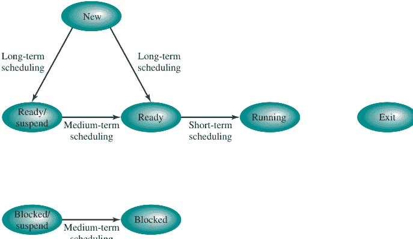

**图 9.1** 调度与进程状态转换

图 9.1 将调度函数与进程转换图（首次在图 3.9b中所示）联系起来。长期调度在创建新进程时执行。这是一个关于是否将新进程添加到当前活动进程集中的决策。中期调度是轮换交换功能（`swapping function`）的一部分。这是一个关于是否将一个进程添加到至少部分位于主内存中并因此可执行的进程中的决策。短期调度是关于下一个执行哪个就绪进程的实际决策。图 9.2 重新组织了图 3.9b 的状态转换图，以体现调度函数的嵌套关系。

调度影响系统性能，因为它决定了哪些进程将等待，哪些进程将运行。这一观点在图 9.3 中给出，该图了涉及进程状态转换的队列。从根本上说，调度是管理队列的问题，旨在并在队列环境中最小化队列延迟并优化性能。

### 长期调度

长期调度器决定哪些程序被准入系统进行处理。因此，它控制多道程序的程度。一旦被准入，作业或用户程序就会变成进程，并添加到短期调度器的队列中。在某些系统中，新创建的进程从交换出（`swapped-out`）状态开始，在这种情况下它会被添加到中期调度器的队列中。

在批处理系统或操作系统的批处理分区，新提交的作业被路由到磁盘并在批队列中保留。长期调度器在可以时从队列中创建进程。这涉及两个决策：

> ¹为了简单起见，图 9.3 显示新进程直接进入就绪（Ready）状态，而图 9.1 和 9.2 显示了就绪状态或就绪/挂起（Ready/Suspend）状态的选择。

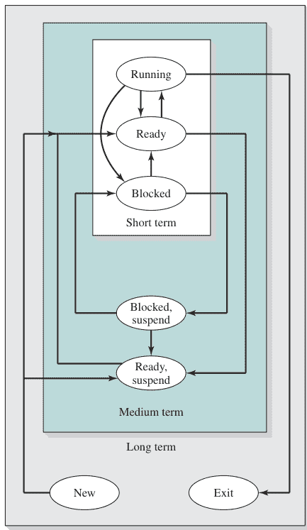

**图 9.2** 调度层级

决定操作系统何时可以承担一个或多个进程。调度器必须决定接受哪些作业或作业并将其转换为进程。我们简要考虑这些决策。

创建新进程的决策通常由所需的多道程序程度驱动。创建的进程越多，每个进程可执行的执行时间百分比就越小（即更多的进程在竞争相同的处理器资源）。因此，长期调度器可能会限制多道程序的程度，以为运行中的进程提供满意的服务。每当一个作业终止时，调度器可能会决定添加一个或多个新作业。此外，如果处理器空闲时间的比例超过某个阈值，则可能会调用长期调度器。

下一个准入哪个作业的决策可以基于简单的先来先服务（`FCFS`）原则，也可以作为管理系统性能的工具。使用的标准可能包括优先级、预计执行时间以及 I/O 要求。

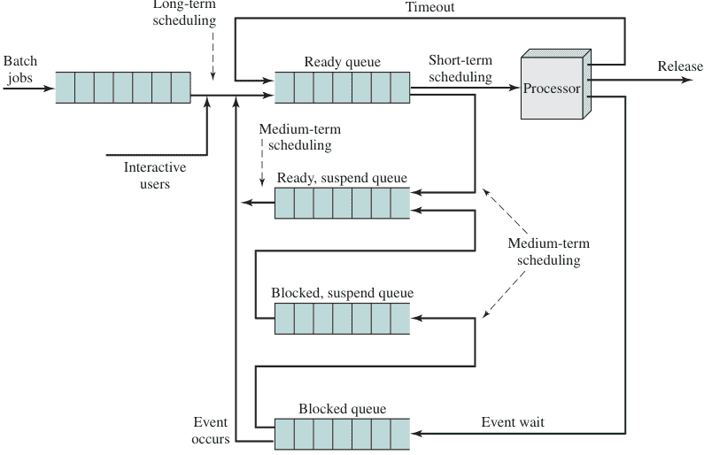

**图 9.3** 调度队列图

例如，如果信息可用，调度器可能会尝试保持处理器密集型和 I/O 密集型进程的混合。此外，决策还可以取决于请求了哪些 I/O 资源，试图平衡 I/O 的使用。

在时间共享系统的交互式程序中，用户尝试连接系统的行为可能会产生进程创建请求。时间共享用户并非简单地排队并一直等待直到系统接受他们。相反，操作系统将接受所有授权用户，直到系统达到饱和（使用某种预定义的饱和度衡量标准）。在那时，连接请求将收到一条消息，指示系统已满，用户应稍后重试。

### 中期调度

中期调度是交换功能的一部分。涉及的问题在第 3、7 和 8 章中讨论。通常，换入（`swapping-in`）决策基于管理多道程序程度的需求。在不使用虚拟内存的系统中，内存管理也是一个问题。因此，换入决策将考虑被交换出进程的内存需求。

> ^ 如果一个进程主要执行计算工作并偶尔使用 I/O 设备，则被视为处理器密集型（`processor bound`）。如果执行该进程的时间主要取决于花费 I/O 操作的时间，则被视为 I/O 密集型（`I/O bound`）。

### 短期调度

从执行频率来看，长期调度器的执行频率相对较低，负责关于是否承担新进程以及承担哪一个的粗粒度决策。中期调度器的执行频率稍高，以做出交换决策。短期调度器（也称为调度程序 `dispatcher`）执行频率最高，并做出关于下一个执行哪个进程的细粒度决策。

当发生可能导致当前进程阻塞，或可能提供抢占当前运行进程以有利于另一个进程的事件时，会调用短期调度器。此类事件的示例包括：

- 时钟中断
- I/O 中断
- 操作系统调用
- 信号（例如，信号量）

## 9.2 / 调度算法

### 短期调度标准

短期调度的主要目标是分配资源，以优化系统性能。可以根据这些标准来评估调度策略。这些标准可以进行分类。使用的标准可能包括优先级、预计执行时间以及 I/O 要求。常用的标准可以分为两个维度。首先是用户导向型和系统导向型。用户导向标准取决于用户或进程感知的系统行为。如果信息可用，调度器可能会尝试保持处理器密集型和 I/O 密集型进程的混合。此外，决策还可以取决于请求了哪些 I/O 资源，试图平衡 I/O 的使用。

在时间共享系统的交互式程序中，用户尝试连接系统的行为可能会产生进程创建请求。时间共享用户并非简单地排队并一直等待直到系统接受他们。相反，操作系统将接受所有授权用户，直到系统达到饱和（使用某种预定义的饱和度衡量标准）。在那时，连接请求将收到一条消息，指示系统已满，用户应稍后重试。

系统导向标准关注系统效率。系统导向标准是量化的。例如是吞吐量，即单位时间内完成的进程数量。这是衡量工作完成量的指标。这显然取决于进程的平均长度，但也受到调度策略的影响。

### 表 9.2 调度标准

| 用户导向，性能相关 | |
|---|---|
| **周转时间 (Turnaround time)** | 从进程提交到完成的时间间隔。包括等待资源（包括处理器）的时间。对于批处理作业是一个合适的衡量。 |


| **响应时间 (Response time)** | 对于交互式进程，这是从提交请求到开始响应的时间。通常可以在继续处理请求的同时产生输出。从用户的角度来看，这比周转时间更好。 |
| **截止日期 (Deadlines)** | 当指定了进程完成截止日期时，调度策略应将其他目标让位于最大化目标之后。 |
| **可预测性 (Predictability)** | 无论系统负载如何，作业的运行时间应大致相同。响应时间或周转时间的巨大波动会分散注意力。它可能信号着系统负载的剧烈波动或需要调优。 |
| **吞吐量 (Throughput)** | 调度策略应最大化单位时间内完成的进程数量。这是衡量工作完成量的指标。 |
| **处理器利用率 (Processor utilization)** | 处理器繁忙百分比。对于昂贵的共享系统，这是一个重要的标准。在单用户系统和其他系统中（如实时系统），该标准没有某些其他标准重要。 |
| **公平性 (Fairness)** | 在没有用户或其他系统提供的指导的情况下，进程应该被平等对待，没有进程会遭受阻塞。 |
| **强制优先级 (Enforcing priorities)** | 当进程被分配优先级时，调度策略应优先考虑高优先级进程。 |
| **资源平衡 (Balancing resources)** | 调度策略应保持系统资源忙碌。应该倾向于那些低度利用压力资源的进程。这一标准也涉及中期和长期调度。 |

# 第 9 章 / 单处理器调度

频繁发生。这会增加系统的开销，从而降低吞吐量。因此，调度策略的设计涉及权衡相互竞争的需求；给予各种需求的相对权重将取决于系统的性质和预期用途。

在交互式操作系统中，与单用户或时分共享系统不同，**充分的响应时间**是关键需求。由于这项需求的重要性，加上“充分性”的定义会随应用程序的不同而异，且该主题将在附录 G 中进一步探讨。

## 优先级的使用

在许多系统中，每个进程都被分配一个优先级，调度器总是选择高优先级的进程而非低优先级的。图 9.4 展示了优先级的用法。为了清晰起见，队列图经过简化，忽略了多个阻塞队列和挂起状态的存在（对比图 3.8a）。我们没有提供单个就绪队列，而是提供一组按优先级降序排列的队列：`RQ0`, `RQ1`, ..., `RQn`，当 `i > j` 时，`priority[RQi] > priority[RQj]`。³ 当需要进行调度选择时，调度器将从最高优先级就绪队列（`RQ0`）开始。如果队列中有一个或多个进程，则使用某种调度策略选择一个进程。如果 `RQ0` 为空，则检查 `RQ1`，以此类推。

图 9.4 优先级队列化

> ³在 UNIX 和许多其他系统中，较大的优先级值表示较低的优先级；除非另有说明，否则我们遵循这一惯例。

纯优先级调度方案的一个问题是低优先级进程可能会遭受饥饿。如果始终有稳定的高优先级就绪进程源源，这种情况就会发生。如果这种行为不可接受，进程的优先级可以随着其年龄或执行历史而改变。我们随后将给出一个示例。

## 替代调度策略

表 9.3 汇总了本节中检查的各种调度策略的摘要信息。**选择函数**决定了在就绪进程中选择哪一个进程进行执行。该函数可能基于优先级、资源需求或进程的执行特征。在后一种情况下，三个量是有关的：

- `w` = 到目前为止在系统中花费的等待时间
- `e` = 到目前为止花费执行的时间
- `s` = 进程所需的总服务，包括 `e`；通常，该值必须由用户估计或提供

例如，选择函数 `max[w]` 表示 FCFS（先来先服务）决策。

表 9.3 各种调度策略的特征

| | FCFS | 轮询 (Round Robin) | SPN | SRT | HRRN | 反馈 (Feedback) |
| :--- | :--- | :--- | :--- | :--- | :--- | :--- |
| 选择函数 | `max[w]` | 常数 | `min[s]` | `min[s - e]` | `max[w + s]` | （见正文） |
| 模式 | 非抢占 | 抢占（时间片到时） | 非抢占 | 抢占（到达时） | 非抢占 | 抢占（时间片到时） |
| 吞吐量 | 不强调 | 如果时间片太小可能较低 | 高 | 高 | 高 | 不强调 |
| 响应时间 | 可能很高，特别是当进程执行时间差异很大时 | 为短进程提供良好的响应 | 为短进程提供良好的响应时间 | 提供良好的响应时间 | 提供良好的响应时间 | 不强调 |
| 开销 | 最小 | 最小 | 可能很高 | 可能很高 | 可能很高 | 可能很高 |
| 对进程的影响 | 惩罚短进程；惩罚 I/O 密集进程 | 公平对待 | 惩罚长进程 | 惩罚长进程 | 良好的平衡 | 可能有利于 I/O 密集进程 |
| 饥饿 | 否 | 否 | 可能 | 可能 | 否 | 可能 |

决定指定的选择函数的时刻。通常分为两类：

- **非抢占式**：在这种情况下，一旦进程处于运行（Running）状态，它将继续执行直到 (a) 它终止或 (b) 它自我阻塞以等待 I/O 或请求某些操作系统服务。
- **抢占式**：当前运行的进程可能会被操作系统中断并移动到就绪（Ready）状态。抢占决策可以在新进程到达时、发生将阻塞进程置于就绪状态的中断时，或根据时钟中断定期执行。

抢占策略比非抢占策略产生更大的开销，但可能提供更好的服务并防止任何进程长时间占用处理器。此外，通过使用高效的进程切换机制（尽可能利用硬件帮助）以及提供大内存以将高比例的程序留在主内存中，抢占的成本可能会相对较低。

在我们描述调度策略时，我们将使用表 9.4 中的进程集作为运行示例。我们可以将这些视为批处理作业，服务时间为所需的总执行时间。或者，我们可以将这些视为以重复方式交替使用处理器和 I/O 的持续进程。在这种情况下，从队列模型来说，该量对应于服务时间。

对于表 9.4 的示例，图 9.5 显示了每个策略和每个周期的执行模式，表 9.5 汇总了一些结果。首先，确定每个进程的首次执行时间。从此，我们可以确定周转时间（turnaround time）。在队列模型中，周转时间 (TAT) 是 `Tn`，即项目在系统中所花费的总时间（等待时间加服务时间）。更有用的数字是归一化周转时间，它是周转时间与服务时间的比率。该值表示进程的延迟。通常，执行时间越长，可以忍的延迟越多。该比例的最小值为 1.0；对应服务水平。

表 9.4 进程示例

| 进程 | 到达时间 | 服务时间 |
| :--- | :--- | :--- |
| A | 0 | 3 |
| B | 2 | 6 |
| C | 4 | 4 |
| D | 6 | 5 |
| E | 8 | 2 |

参见附录 H 的队列术语，以及第 2 章的队列分析。

最简单的调度策略是先来先服务（FCFS），也称为先入先出（FIFO）严格队列方案。当每个进程就绪时，它加入就绪队列。当当前运行的进程停止执行时，选择就绪队列中等待最长的进程。

表 9.5 调度策略比较

| 进程 | A | B | C | D | E | 平均值 |
| :--- | :--- | :--- | :--- | :--- | :--- | :--- |
| 到达时间 | 0 | 2 | 4 | 6 | 8 | |
| 服务时间 (`Ti`) | 3 | 6 | 4 | 5 | 2 | |
| **FCFS** | | | | | | |
| 完成时间 | 3 | 9 | 13 | 18 | 20 | |
| 周转时间 (`Ti`) | 3 | 7 | 9 | 12 | 8 | |
| `Ti/Ti` | 1.00 | 1.17 | 2.25 | 2.40 | 2.6 | |
| **RR q = 1** | | | | | | |
| 完成时间 | 4 | 18 | 17 | 20 | 15 | |
| 周转时间 (`Ti`) | 4 | 16 | 13 | 14 | 7 | |
| `Ti/Ti` | 1.33 | 2.67 | 3.25 | 3.80 | 2.71 | |
| **RR q = 4** | | | | | | |
| 完成时间 | 3 | 17 | 11 | 20 | 19 | |
| 周转时间 (`Ti`) | 3 | 15 | 7 | 14 | 11 | |
| `Ti/Ti` | 1.00 | 2.5 | 1.75 | 2.80 | 5.5 | |
| **SPN** | | | | | | |
| 完成时间 | 3 | 9 | 15 | 20 | 11 | |
| 周转时间 (`Ti`) | 3 | 7 | 11 | 14 | 3 | |
| `Ti/Ti` | 1.00 | 1.17 | 2.75 | 2.80 | 1.5 | |
| **SRT** | | | | | | |
| 完成时间 | 3 | 15 | 8 | 20 | 10 | |
| 周转时间 (`Ti`) | 3 | 13 | 4 | 14 | 2 | |
| `Ti/Ti` | 1.00 | 2.17 | 1.00 | 2.80 | 1.59 | |
| **HRRN** | | | | | | |
| 完成时间 | 3 | 9 | 13 | 20 | 15 | |
| 周转时间 (`Ti`) | 3 | 7 | 9 | 14 | 7 | |
| `Ti/Ti` | 1.00 | 1.17 | 2.25 | 2.80 | 3.5 | |
| **FB q = 1** | | | | | | |
| 完成时间 | 4 | 20 | 16 | 19 | 11 | |
| 周转时间 (`Ti`) | 4 | 18 | 12 | 13 | 3 | |
| `Ti/Ti` | 1.33 | 3.00 | 3.00 | 2.60 | 1.5 | |
| **FB q = 2** | | | | | | |
| 完成时间 | 4 | 17 | 18 | 20 | 14 | |
| 周转时间 (`Ti`) | 4 | 15 | 14 | 14 | 6 | |
| `Ti/Ti` | 1.33 | 2.50 | 3.50 | 2.80 | 3.00 | 2.63 |

对于长进程，FCFS 的性能远优于短进程。考虑以下基于 [FINK88] 的示例：

| 进程 | 到达时间 | 服务时间 | 开始时间 | 结束时间 | 周转时间 (`Tr`) | `Tr/Ts` |
|---|---|---|---|---|---|---|
| W | 0 | 1 | 0 | 1 | 1 | 1 |
| X | 1 | 100 | 1 | 101 | 100 | 1 |
| Y | 2 | 1 | 101 | 102 | 100 | 100 |
| Z | 3 | 100 | 102 | 202 | 199 | 1.99 |
| 平均值 | | | | | 100 | 26 |

进程 Y 的归一化周转时间与其他进程相比非常不协调：它在系统中的总时间是所需时间的100倍。每当短进程紧接在长进程到达时，就会发生这种情况。另一方面，在这个极端示例中，进程的待遇并不公平。进程 Z 的周转时间几乎是 Y 的两倍，但其归一化停留时间为 2.0。

FCFS 的另一个困难在于，它倾向于有利于处理器密集型进程而非 I/O 密集型进程。考虑一组进程，其中一个大部分使用处理器（处理器密集型），另外一些倾向于 I/O（I/O 密集型）。当处理器密集型进程运行时，所有 I/O 密集型进程都必须等待。其中一些可能处于 I/O 队列中（阻塞状态），但在处理器密集型进程执行期间可能会移回就绪队列。此时，大多数或所有 I/O 设备可能处于空闲状态，尽管它们潜在有工作要做。当当前运行的进程离开运行态时，I/O 密集型进程会快速通过运行态并在 I/O 事件上阻塞。如果处理器密集型进程也被阻塞，处理器就会空闲。因此，FCFS 可能导致处理器和 I/O 设备的效率低下。

对于单处理器系统，FCFS 本身并不是一种替代方案。然而，它通常与优先级方案结合使用以提供有效的调度器。因此，调度器可以维护若干个队列，每个优先级级别一个，并在每个队列内按先来先服务原则进行调度。我们稍后在反馈调度的讨论中会看到此类系统的示例。

**轮询算法（Round Robin）** 减少短作业在 FCFS 中遭受饥饿罚的一种简单方法是使用时钟进行抢占。这种策略中最简单的是轮询。系统会以周期性间隔产生时钟中断。当中断发生时，当前运行的进程被放入就绪队列，并选择下一个就绪作业。这种技术也被称为时间分片，因为每个进程在被抢占之前都会获得一段时间。

在轮询算法中，主要的设计问题是所用时间量子（或时间切片）的长度。如果时间量子非常短，那么短进程将相对快速地通过系统。另一方面，处理时钟中断以及执行调度和分发函数涉及处理开销。因此，应该避免极短的时间量子。一个实用的指导是，时间量子应大于典型交互或进程函数所需的时间。如果小于此值，大多数进程将至少需要两个时间量子。图 9.6 说明了这种效应对响应时间的影响。注意，在时间量子比最长运行进程还要长的极限情况下，轮询退化为 FCFS。

图 9.5 和表 9.5 显示了我们的示例在使用时间量子 `q` 为 1 和 4 时的结果。注意进程 E，它是最短的作业，在时间量子为 1 时获得了显著改进。

轮询算法在通用时间分片系统或事务处理系统中特别有效。轮询算法的一个缺点是对处理器密集型和 I/O 密集型进程的相对对待。通常，I/O 密集型进程的 CPU 周期（两次 I/O 操作之间的时间）比处理器密集型进程短。如果处理器密集型和 I/O 密集型进程混合在一起，将发生以下情况：I/O 密集型进程使用很短时间的处理器，然后由于 I/O 而阻塞；它等待 I/O 操作完成后加入就绪队列。另一方面，处理器密集型进程通常会使用整个时间量子进行执行，并立即返回就绪队列。因此，处理器密集型进程倾向于获得不公平的处理器时间份额，导致 I/O 设备性能下降，并增加响应时间。

[HALD91] 建议对轮询算法进行改进，他将其称为虚拟轮询（VRR），并避免了这种不公平性。

图 9.6 抢占时间量子大小的影响

## 9.2 / 调度算法

**短进程优先（SHORTEST PROCESS NEXT）** 另一种减少 FCFS 固有对长进程偏见的方法。这是一种非抢占策略，其中选择预期时间最短的进程。因此，短进程将跳到队列首部。图 9.5 和表 9.5 显示了 FCFS 的结果。响应时间的整体性能也得到了提高。然而，响应时间的变异性增加了，对于较长的进程尤其如此，因此预测性降低了。

SPN 策略的困难在于需要知道每个进程所需的（或至少是）时间。对于批处理作业，系统可能要求程序员进行估算。在生产环境中，操作系统可以保留周期时间的运行平均值。最简单的计算将是：

```
S_{n+1} = (1/n) * Σ T_i  (9.1)
```

其中

- `T_i` = 第 `i` 个实例的处理器执行时间（批作业的总执行时间；交互作业的周期时间）
- `S_i` = 第 `i` 个实例的预测值
- `S_1` = 第一个实例的预测值；不计算。

为了避免每次重新计算总和，可以将方程 (9.1) 改写为：

```
S_{n+1} = (1/n) * T_n + ((n-1)/n) * S_n  (9.2)
```

注意此和中的每一项都被赋予相同的权重；即每一项乘以相同的常数 1/(n)。通常，我们希望给最近的实例更大的权重，因为它们更能反映未来的行为。基于一系列过去值预测值的常用技术是指数移动平均：

```
S_{n+1} = α * T_n + (1 - α) * S_n  (9.3)
```

其中 `α` 是一个常量权重因子 (`0 < α < 1`)，它决定了相对于旧观测赋予观测值的权重。通过使用独立于过去观测数量的常数值 `α`，方程 (9.3) 考虑了所有值，但较远值的权重较小。为了清楚地看到这一点，考虑方程 (9.3) 的以下展开：

```
S_{n+1} = α * T_n + (1 - α) * T_{n-1} + ... + (1 - α)^2 * α * T_{n-i} + ... + (1 - α)^n * S_1  (9.4)
```

图 9.7 虚拟轮询队列图

由于 `α` 和 `(1-α)` 都小于 1，因此上述公式中的每个后续项都更小。例如，当 `α = 0.8` 时，方程 (9.4) 变为

```
S_{n+1} = 0.8 * T_n + 0.16 * T_{n-1} + 0.032 * T_{n-2} + 0.0064 * T_{n-3} + ... + (0.2)^n * S_1
```

观测越旧，在平均值中的占比越小。成本相对于其在展开式中位置的大小如图 9.8 所示。`α` 值越大，赋予最近观测值的权重就越大。对于 `α=0.8`，所有的权重都分配给了最近的四个观测值，而对于 `α=0.2`，平均值有效地分布在最近的八个观测值上。使用接近 1 的 `α`值的优点是平均值将迅速反映观测量的快速变化。缺点是，如果观测值出现短暂激增，然后恢复到某个平均值，使用较大的 `α` 值将导致平均值的剧烈波动。

图 9.9 对比了简单平均法与指数平均法（对应两个 `α` 值）。在 9.9a 中，观测值从 1 开始，逐渐增长到 10，然后保持在该水平。在 9.9b 中，观测值从 20 开始，逐渐衰减到 10，然后保持在那里。在两种情况下，我们都从估计值 `S_i=0` 开始。这赋予了新进程优先。指数平均法跟踪行为的速度比简单平均法更快，且 `α` 值越大，对观测值变化的反应越迅速。

SPN（短作业优先）的一个风险是，长进程可能会出现饥饿，只要有短进程的持续供应。另一方面，虽然 SPN 减少了对长作业的偏见，但对于分时或事务处理环境来说，它仍然不是理想的，因为：回想我们在 FCFS 下描述的最坏情况分析，进程 W、X、Y 和 Z 将以相同的顺序执行，这会严重惩罚短进程 Y。

### 最短剩余时间

最短剩余时间（SRT）是 SPN 的抢占版本。在这种情况下，调度器始终选择剩余处理时间最短的进程。当一个新进程加入就绪队列时，它的剩余时间实际上可能比当前正在运行的进程更短。当新进程就绪时，调度器可能会抢占当前进程。与 SPN 一样，调度器必须对处理时间有一个估计以执行选择函数，并且存在长进程饥饿的风险。


# 调度算法

SRT 不像 FCFS 那样对长进程有偏见。与轮转不同，它不会产生额外的中断，从而减少了开销。另一方面，可能会记录已通过的服务时间，这增加了开销。SRT 应该比 SPN 提供更优的周转时间，短作业将获得高于运行作业的优先级。

在我们的示例（表 9.5）中，三个最短的进程获得了立即服务，使得每个进程的归一化周转时间均为 1.0。

## 高响应比优先

在表 9.5 中，我们使用了归一化周转时间（周转时间与实际服务时间的比值）作为衡量标准。对于每个进程，我们希望最小化这个比例，并希望所有进程的平均值最小。通常情况下，我们无法预先知道服务时间是多少，但我们可以根据过去的历史或来自用户或配置管理器的输入对其进行估算。考虑以下比率：

```
R = \frac{w + s}{s}
```

其中：

- $R$ = 响应比，
- $w$ = 等待处理器的时间，以及
- $s$ = 预期服务时间。

如果该进程被立即调度，则 $R$ 等于归一化周转时间。注意，$R$ 的最小值为 1.0，这发生在进程进入系统时。

因此，我们的调度规则变为：当当前进程完成或被阻塞时，选择 $R$ 值最大的进程。这种方法非常有吸引力，因为它考虑了进程的年龄。虽然短作业更受青睐（分母越小，比例越大），但由于在不增加服务的情况下比例会不断增加，长进程最终将超过竞争性作业。

与 SRT 和 SPN 一样，使用高响应比优先（HRRN）时必须估计预期服务时间。

## 反馈

如果我们没有关于各种进程长度的指示，那么 SPN、SRT 和 HRRN 都无法使用。另一种建立对短作业偏好的方法是对已经运行一段时间的作业进行惩罚。换句话说，如果我们无法关注剩余的执行时间，让我们关注到目前为止执行的时间。

这样做的方法如下：调度基于抢占（在时间量子处）的基础上，并使用动态优先级机制。当第一个进程进入系统时，它被放在 `RQ0` 中（见图 9.4）。在第一次被抢占后，它返回就绪状态，被放入 `RQ1`。之后每次被抢占，它都会移动到下一个较低优先级的队列。短进程将完全完成，不会迁移到队列层次的深处。长进程将逐渐向下移动。因此，短进程比旧的长进程更优先。在每个队列中（除最低优先级外），都使用简单的 FCFS 机制。一旦进入最低优先级队列，进程就无法再降低，而是返回该队列直到完成。这种方法被称为多级反馈，显示了进程在各种队列中遵循的路径。

## 性能比较

显然，各种调度策略的性能是选择调度策略的关键因素。然而，做出性比较是不可能的，因为相对性能取决于多种因素，包括服务时间的概率分布、调度机制的效率以及 I/O 需求的性质。尽管如此，我们在下文中尝试得出一些一般性结论。

### 队列分析

在本节中，我们利用了基本的队列公式，以及泊松到达和指数服务时间的常用假设。

首先，我们观察到任何调度规则在选择下一个服务项目时，其服务时间遵循以下关系：

$$\frac{T_r}{T_s} = \frac{1}{1-\rho}$$

其中：

- $T_r$ = 周转时间或留存时间；在系统中的总时间（等待加执行），
- $T_s$ = 平均服务时间；在运行状态下的平均时间，以及
- $\rho$ = 处理器利用率。

特别地，一个每个进程优先级分配独立于预期服务时间的优先级调度器，其与简单的 FCFS 策略提供相同的平均周转时间和平均归一化周转时间。此外，是否存在抢占对平均值没有影响。

除了轮转和 FCFS，到目前为止的各种调度策略都是基于预期服务时间进行选择。不幸的是，开发这些策略的封闭分析模型是非常困难的。然而，通过考虑基于服务时间的优先级调度，我们可以了解这些算法与 FCFS 相比的相对性能。

表 9.6 具有两个优先级类别的单服务队列公式

| 假设：1. 泊松分布到达率。 |
| :--- |
| 2. 优先级 1 的项目在优先级 2 的项目之前被服务。 |
| 3. 相同优先级的项目采用先来先服务调度。 |
| 4. 项目在接受服务期间不会被中断。 |
| 5. 没有项目离开队列（丢失的调用延迟）。 |

| **(a) 通用公式** |
| :--- |
| $lambda = \lambda_1 + \lambda_2$ |
| $rho_1 = \lambda_1 T_{S1}, \rho_2 = \lambda_2 T_{S2}$ |
| $rho = \rho_1 + \rho_2$ |
| $T_r = \frac{\lambda_1}{\lambda} T_{T1} + \frac{\lambda_2}{\lambda} T_{T2}$ |

| **(b) 无中断；抢占式服务时间** |
| :--- |
| $T_{r1} = T_{S1} + \frac{\rho_1 T_{S2}}{1 - \rho_1}$ |
| $T_{r2} = T_{S2} + \frac{1}{1 - \rho_1} \rho_2 T_{T2} + \dots$ （省略） |

| **(c) 抢占-恢复调度规则：指数级服务时间** |
| :--- |
| $T_{r1} = T_{S1} + \frac{\rho_1 T_{S2}}{1 - \rho_1}$ |
| $T_{r2} = T_{S2} + \frac{1}{1 - \rho_1} \rho_2 T_{T2} + \frac{\rho T_{T1}}{1 - \rho}$ |

可以推广到任意数量的优先级类。非抢占式与抢占式调度的公式不同。在后一种情况下，假设当高优先级进程就绪时，低优先级进程会被立即中断。

例如，让我们考虑两个优先级类的情况，每类中到达的进程数量相等，且低优先级类的平均服务时间是高优先级类的五倍。因此，我们希望优先考虑短作业。图 9.11 显示了整体结果。在较高的利用率下，平均归一周转时间有所提高。在充分利用抢占的情况下，改进是显著的；但对整体性能的影响不大。

然而，当我们分别考虑这两个优先级类时，会出现显著的差异。图 9.12 显示了高优先级、较短进程的结果。作为对比，图中的上线假设没有使用优先级，而是我们仅仅在查看所有处理时间较短的一半进程的相对性能。另外两条线假设这些进程被分配了更高的优先级。当系统使用非抢占的优先级调度时，改进是显著的。当使用抢占时，改进更为显著。

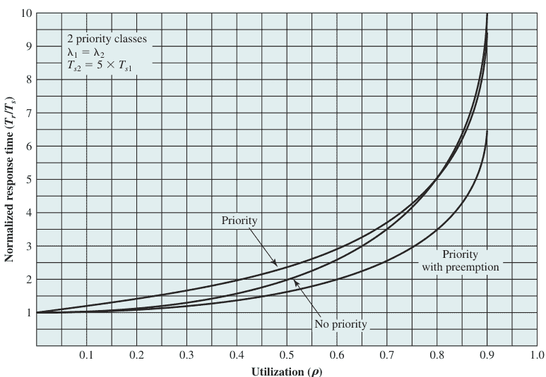

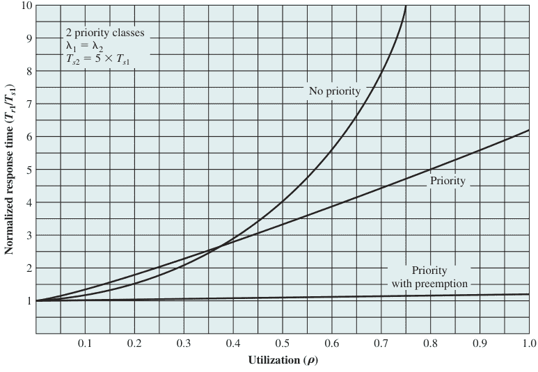

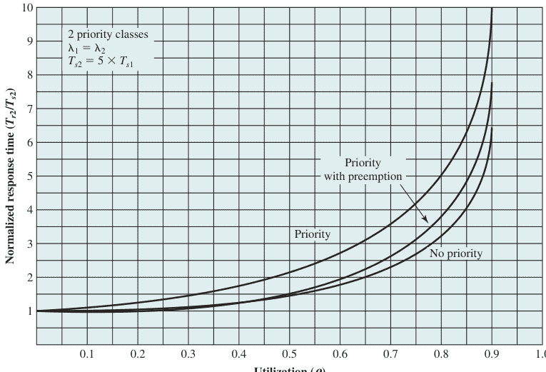

图 9.13 显示了低优先级、较长进程的相同分析。如预期的，这些进程在优先级调度下经历了性能下降。

仿真建模通过使用离散事件仿真可以克服分析建模的某些困难，这允许对广泛的策略进行建模。仿真的缺点是，给定“运行”的结果仅适用于特定假设下的特定进程集合。尽管如此，仍然可以获得有用的见解。

其中一项研究的结果报告在 [FINK88] 中。模拟了 50000 个进程，到达率为 $\lambda=0.8$，平均服务时间为 $T_s = 1$。因此，假设处理器利用率为 $\rho = \lambda T_s = 0.8$。因此，我们只测量了一个利用率点。

为了展示结果，将进程分为服务时间百分位数，每组包含 500 个进程。因此，服务时间最短的 500 个进程处于第一百分位数；在消除这些后，剩余的 500 个服务时间最短的进程处于第二百分位数；依此类推。这允许我们根据进程的长度来观察各种策略对进程的影响。

图 9.14 显示了归一化周转时间，图 9.15 显示了平均等待时间。观察周转时间，我们可以看到 FCFS 的性能非常差，这些是短进程。另一方面，绝对等待时间是均匀的，正如预期的，因为调度与服务时间无关。图中显示了使用单位时间的轮转。除了执行小于一个时间量的短进程外，轮转归一化时间约为五。最后，图显示了固定量子反馈调度。如预期，FB 对于短进程表现良好。

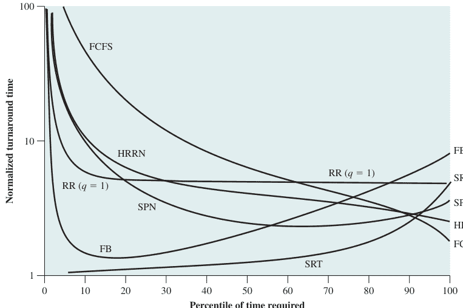

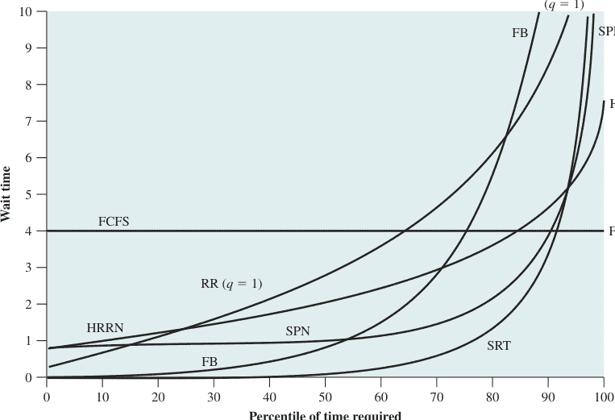

## 公平份额调度

到目前为止的所有算法都将就绪进程视为一个用于选择的单一池。该池可以根据优先级划分，但除此之外是同质的。

然而，在多用户系统中，如果单个用户或作业组织为多个进程（线程），那么进程集合存在一种传统调度器无法识别的结构。从用户的角度来看，关注的不是某个进程的性能，而是其进程集合的性能。因此，基于这些集合做出调度决定是有吸引力的。这种方法泛被称为公平份额调度。进一步扩展到用户组，即使每个用户由单个进程表示。例如，在分时系统中，我们可以认为一个部门的所有用户属于同一组。调度决策可以为每个组提供相似的服务。因此，如果一个部门大量人员登录系统，我们希望看到性能下降影响该部门的成员，而不是其他部门的用户。

公平份额指示了此类调度器背后的哲学。每个用户被分配了某种权重，定义了用户系统资源占总资源使用的比例。特别是，每个用户被分配了处理器的份额。这种方案应该以大致线性的方式运行，如果用户 A 的权重是用户 B 的两倍，那么从长期来看，用户 A 可以完成用户 B 两倍的工作。公平份额调度器的目标是监控使用情况，并给超过份额的用户更少资源，给少于份额的用户更多资源。

公平份额调度器已有许多建议 [HEN84, KAY88, WOOD86]。在本节中，我们描述 [HEN84] 中提出的并在某一个 UNIX 系统上实现的方案。该方案简称为公平份额调度器 (FSS)。FSS 考虑了相关进程组的执行历史，以及每个进程的个体执行历史。在做出调度决策。系统将用户社区划分为公平份额组，并为每个组分配比例的处理器资源。因此，可能会有四个组，每组占 25% 的 CPU 使用率。实际上，每个公平份额组都获得了一个虚拟系统，其运行速度按比例慢于完整系统。

调度基于优先级进行的，优先级考虑了进程的底层优先级、其 CPU 使用情况以及该进程所属优先级的近期 CPU 情况。优先级的数值越高，优先级越低。对于组 k 中的进程 j，适用以下公式：

```
$CPU(i) = \frac{CPU(i-1)}{2}$
$GCPU_k(i) = \frac{GCPU_k(i-1)}{2}$
$P(i) = Base_j + \frac{CPU(i)}{2} + \frac{GCPU_k(i)}{4 \times W_k}$
```

其中

- $CPU(i)$ = 进程 j 在间隔 $i$ 内的处理器利用率衡量量，
- $GCPU_k(i)$ = 组 k 在间隔 $i$ 内的处理器利用率衡量量，
- $P(i)$ = 进程 j 在间隔 $i$ 开始时的优先级；值越小优先级越高，
- $Base_j$ = 进程 j 的优先级，以及
- $W_k$ = 分配给组 k 的权重，限制为 $0 < W_k \le 1$ 且 $\sum W_k = 1$。

每个进程被分配一个基础优先级。随着进程使用处理器以及所属组使用处理器，进程的优先级会下降。在计算组利用时，通过除以该组的权重进行归一化。分配给组的权重越大，其利用率对优先级的影响就越小。

图 9.16 是一个示例，进程 A 在一组，进程 B 和 C 在另一组，每个组的权重均为 0.5。所有进程都是 CPU 密集型的，且通常处于就绪状态。所有进程的基础优先级均为 60。处理器利用率的测量如下：处理器每秒被中断 60 次；在每次中断期间，当前运行处理器的 CPU 使用字段加 1，相应的组字段也加 1。每秒重新计算一次进程。

在图中，进程 A 首先被调度。在一秒结束时，它被抢占。进程 B 和 C 现在具有更高的优先级，进程 B 被调度。在第二个时间单位结束时，进程 A 具有最高优先级。注意该模式：内核按顺序调度进程：A, B, A, C, A, B 等。因此，50% 的处理器被分配给进程 A（构成一个组），50% 分配给进程 B 和 C（构成另一个组）。

| 时间 | 进程 A | | 进程 B | | 进程 C | |
| :--- | :--- | :--- | :--- | :--- | :--- | :--- |
| | 优先级 | CPU 计数 | 优先级 | CPU 计数 | 优先级 | CPU 计数 |
| 0 | 60 | | 60 | 0 | 60 | 0 |
| | | 1 | | 1 | | |
| | | 2 | | 2 | | |
| | | | | | | |
| | | | | | 60 | |
| 1 | 90 | 30 | 30 | | | |
| | | | | 0 | 1 | |
| | | | | 1 | 2 | |
| | | | | | | |
| | | | | 60 | 60 | |
| 2 | 74 | 15 | 15 | 90 | 30 | 30 |
| | | 16 | 16 | | | |
| | | 17 | 17 | | | |
| | | | | | | |
| | | 75 | 75 | | | |
| 3 | 96 | 37 | 37 | 74 | 15 | 67 |
| | | | | | 16 | |
| | | | | | 17 | |
| | | | | | | |
| | | | | | 75 | |
| 4 | 78 | 18 | 18 | 81 | 7 | 37 |
| | | 19 | 19 | | | |
| | | 20 | 20 | | | |
| | | | | | | |
| | | 78 | 78 | | | |
| 5 | 98 | 39 | 39 | 70 | 3 | 18 |

彩色矩形表示执行中的进程

图 9.16 公平份额调度器——三个进程

# 传统 UNIX 调度

在本节中，我们研究 SVR 和 BSD 中使用的传统 UNIX 调度。这些系统主要针对交互式环境。调度算法旨在为交互用户提供良好的响应时间，同时确保低优先级作业不会饥饿。尽管这种算法在现代 UNIX 系统中已被取代，但它仍然值得研究，因为它代表了分时调度算法。

UNIX 调度器采用多级反馈队列。系统使用一秒一次的抢占机制，如果运行进程在一秒内没有阻塞或完成，它就会被抢占。优先级基于进程类型和执行历史。适用以下公式：

```
$P(i) = Base_j + \frac{CPU(i-1)}{2} + nice_j$
```

其中

- $CPU(i)$ = 通过间隔 $i$ 的处理器利用率，
- $P(i)$ = 进程 j 在间隔 $i$ 开始时的优先级，
- $Base_j$ = 进程 j 的优先级，以及
- $nice_j$ = 用户调整因子。

每个进程的优先级每秒重新计算一次，此时做出调度决策。基础优先级的目的是将进程划分为固定优先级带。这些带用于优化访问设备（如磁盘）的进程，并允许操作系统响应系统调用。用户带的使用倾向于惩罚 CPU 密集型进程，以牺牲 I/O 密集型进程。结合轮转抢占方案，调度策略能够很好地满足通用共享的需求。

图中显示了一个进程调度示例。进程 A、B、C 在同一时间创建，基础优先级均为 60（我们忽略 nice 值）。系统每秒中断 60 次并为运行进程计数器加 1。示例假设没有进程阻塞，没有其他进程就绪。将其与图 9.16 进行比较。

| 时间 | 进程 A | | 进程 B | | 进程 C | |
| :--- | :--- | :--- | :--- | :--- | :--- | :--- |
| | 优先级 | CPU 计数 | 优先级 | CPU 计数 | 优先级 | CPU 计数 |
| 0 | 60 | | 60 | 0 | 60 | 0 |
| | | 1 | | 1 | | |
| | | 2 | | 2 | | |
| | | | | | | |
| | | | | | 60 | |
| 1 | 90 | 30 | 30 | | | |
| | | | | 0 | 1 | |
| | | | | 1 | 2 | |
| | | | | | | |
| | | | | 60 | 60 | |
| 2 | 74 | 15 | 15 | 90 | 30 | 30 |
| | | 16 | 16 | | | |
| | | 17 | 17 | | | |
| | | | | | | |
| | | 75 | 75 | | | |
| 3 | 96 | 37 | 37 | 74 | 15 | 67 |
| | | | | | 16 | |
| | | | | | 17 | |
| | | | | | | |
| | | | | | 75 | |
| 4 | 78 | 18 | 18 | 81 | 7 | 37 |
| | | 19 | 19 | | | |
| | | 20 | 20 | | | |
| | | | | | | |
| | | 78 | 78 | | | |
| 5 | 98 | 39 | 39 | 70 | 3 | 18 |


| | | 组 1 | | | 组 2 | | | | |

彩色矩形表示执行中的进程

**图 9.17** 传统 UNIX 进程调度示例

## 9.4 总结

操作系统必须就进程执行做出三种类型的调度决策。长期调度决定何时将新进程引入系统。中期调度是交换功能的一部分，决定何时将程序部分或全部调入主内存以便执行。短期调度决定由处理器执行哪个就绪进程。本章侧重于与短期调度相关的问题。

## 9.5 关键术语、复习题和问题

设计短期调度器时使用了多种标准。这些标准中，某些与单个用户感知的系统行为有关（用户导向），另一些与系统满足所有用户需求的有效性有关（系统导向）。某些标准专门涉及性能的定量衡量，而另一些则更具定性。从用户的角度来看，响应时间通常是系统最重要的特征；从系统的角度来看，吞吐量或处理器利用率更为重要。

已经开发了多种算法在所有进程中做出短期调度决策：

- **先来先服务**（FCFS）：选择等待最长的进程。

- **轮转**（RR）：使用时间片限制任何运行进程的短时间 CPU 冲量，并在所有进程之间轮转。

- **最短进程**（SJF）：选择预期处理时间最短的进程，且不抢占进程。

- **最短剩余时间**（SRTF）：选择预期剩余时间最短的进程。当另一个进程就绪时，进程可能会被抢占。

- **高响应比优先**（HRRN）：基于归一化周转时间的估计做出调度决策。

- **反馈**（Feedback）：建立一组调度队列，根据执行历史和其他标准将进程分配到队列中。

调度算法的选择取决于预期性能和实现复杂度。

# 第 9 章 / 单处理器调度

### 复习题

- 9.1. 操作系统中的批处理部分是如何进行处理器调度的？

- 9.2. 调度器（dispatcher）的主要功能是什么？列举其调用的事件示例。

- 9.3. 哪些调度标准影响系统的性能？

- 9.4. 如果系统采用纯基于优先级的调度，系统将面临哪些问题？

- 9.5. 识别抢占式调度的优缺点。

- 9.6. 简述 FCFS（先来先服务）调度。

- 9.7. 简述轮询（round-robin）调度。

- 9.8. 简述短进程优先（shortest-process-next）调度。

- 9.9. 简述短剩余时间优先（shortest-remaining-time）调度。

- 9.10. 简述高响应度比优先（highest-response-ratio-next）调度。

- 9.11. 简述反馈调度（feedback scheduling）。

## 练习题

- 9.1. 考虑以下负载：

| 进程 | 运行时间 | 优先级 | 到达时间 |
| :--- | :--- | :--- | :--- |
| P1 | 50 ms | 4 | 0 ms |
| P2 | 20 ms | 1 | 20 ms |
| P3 | 100 ms | 3 | 40 ms |
| P4 | 40 ms | 2 | 60 ms |

a. 显示使用剩余时间、非抢占优先级（优先级数字越小表示优先级越高）以及时间片为 30 ms 的轮询调度情况。使用如下所示的比例图为 FCFS 显示每种请求的调度策略的调度情况。

FCFS 示例（1 单位 = 10 ms）：

| P1 | P1 | P1 | P2 | P2 | P2 | P3 | P3 | P3 | P3 | P3 | P3 | P4 | P4 | P4 | P4 |
| :--- | :--- | :--- | :--- | :--- | :--- | :--- | :--- | :--- | :--- | :--- | :--- | :--- | :--- | :--- | :--- |
| 0 | 1 | 2 | 3 | 4 | 5 | 6 | 7 | 8 | 9 | 10 | 11 | 12 | 13 | 14 | 15 | 16 | 17 | 18 | 19 | 20 |

b. 以上调度策略的平均等待时间是多少？

- 9.2. 哪些因素决定了轮询调度中的时间片？考虑以下系统：

| 到达时间 | 处理时间 |
| :--- | :--- |
| P1 | 0 | 12 |
| P2 | 2 | 6 |
| P3 | 8 | 18 |
| P4 | 10 | 4 |

上下文切换时间为 1 单位。分别计算时间片 q = 2, q = 4 和 q = 8 时进程的平均周转时间。

## 9.5 / 关键术语、复习题与练习题

9.3 假设一个单处理器系统有 $n$ 个进程要调度。如果允许使用非抢占式调度算法，你能根据 $n$ 确定可能的调度最大数量吗？

9.4 假设进程的运行时间模式为：6, 4, 6, 14, 13, 13，假设初始估计值为 10。画出一个图表显示如图 9.9 所示。

9.5 考虑以下方程对作为方程 (9.3) 的替代：

```
$S_{n+1} = a_t + (1 - \alpha)S_n$
$X_{n+1} = \min[Ubound, max[Lbound, \beta S_n]]$
```

其中 $X_n$ 的 Bound 和 Lbound 是 T 估计值的上界和下界。$X_n$ 的值用于短进程优先算法，而不是 $S_n$ 的值。$\alpha$ 和 $\beta$ 起了什么作用？高值或低值对各自的影响分别是什么？

9.6 在图 9.5 的示例中，进程 A 在将 B 传递给进程之前将运行两个单位。另一种场景是 A 在将进程传递给进程之前运行三个单位。反馈调度算法中的哪些策略差异可以解释这两种场景？

9.7 在非抢占式单处理器系统中，在一个作业完成后的时间 $t$，就绪队列中包含三个作业。这些作业在时间 $t_1, t_2$ 和 $t_3$ 到达，估计执行时间为 $r_1, r_2$ 和 $r_3$。图 9.18 显示它们的响应比随时间线性增加。使用此示例找到响应度比调度的一种变体，即极小极大响应比调度，它在忽略后续到达的情况下使作业数最小化（提示：决定哪个作业作为最后一个进行调度）。

9.8 证明前一个问题中的极小极大响应比最小化了一批作业的最大响应比（提示：关注将获得最高响应比的任务以及在它之前执行的所有作业。考虑以任何其他顺序调度的相同作业子集，并观察其中最后一个作业的响应比。注意，该子集现在可能与总集合中的其他作业混合。）

9.9 定义留存时间 $T_i$ 为进程等待和被服务的总时间。证明对于平均服务时间 $T_{is}$，有 $T_i = T_{is}/(1-\rho)$，其中 $\rho$ 是利用率。


**图 9.18** 响应比随时间的变化

# 第 9 章 / 单处理器调度

9.10. 处理器在所有进程之间进行复用，假设到达为泊松分布。证明对于指数分布，其响应时间 $R_x$ 为：

```
$R_x = \frac{s}{1-\rho} + \frac{x}{\beta}$
```

其中 $\beta < \alpha$。

9.11. 考虑轮询调度的一种变体，假设 $q$ 每次通过就绪队列减少 10 ms，直到达到 10 ms。$\alpha$ 和 $\beta$ 的不同值产生不同的算法。如果值越大表示优先级越高，说明当以下情况时的算法类型：

- a. $\alpha < 0$

- b. $\beta > \alpha$

9.12. 在自私轮询（selfish round robin）系统中，由于优先级随时间线性增加，使用图 9.19 证明服务时间为 $x$ 的作业响应时间 $R_x$ 为：

(图 9.19 自私轮询)

9.13. 使用轮询调度的交互系统尝试如下保证请求：在完成轮询周期后，系统通过进程进程数量来分配时间片。这是一个合理的策略吗？

9.14. 多级队列调度通常有利于哪种类型的进程——处理器密集型还是输入密集型？简述原因。

9.15. 抢占式调度的一种变体具有动态优先级。新进程被分配优先级 0。进程在就绪队列中以 $\alpha$ 的速率变化，在执行时以 $\beta$ 的速率变化。

9.16. 五个作业 A 到 E 在同一时间到达计算机中心。它们的估计运行时间分别为 15, 9, 3, 6 和 12 分钟。它们的（外部定义的）优先级分别为 6, 3, 7, 9 和 4，值越小优先级越高。对于以下每种调度算法，确定每个作业的周转时间以及所有作业的平均周转时间。忽略进程切换开销。解释你如何得出答案。在最后情况下，假设一次只有一个作业运行直到它完成，且所有作业都是完全的处理器密集型。

- a. 时间片为 1 分钟的轮询

- b. 优先级调度

- c. FCFS（按 15, 9, 3, 6 和 12 的顺序）

- d. 短作业优先

# 多处理器、多核与实时调度

## 10.1 多处理器与多核调度

- 粒度

- 设计问题

- 进程调度

- 线程调度

- 多核线程调度

## 10.2 实时调度

- 背景

- 实时操作系统的特性

- 实时调度

- 截止时间调度

- 速率调调度

- 优先级反转

## 10.3 Linux 调度

- 实时调度

- 非实时调度

## 10.4 UNIX SVR4 调度

## 10.5 UNIX FreeBSD 调度

- 优先级类

- SMP 与多核支持

## 10.6 Windows 调度

- 进程与线程优先级

- 多处理器调度

## 10.7 总结

## 10.8 术语、复习题与问题

## 10.1 多处理器与多核调度

### 学习目标

学习本章后，你应当能够：

- 理解线程粒度的概念。

- 讨论多处理器线程调度中的关键设计问题以及一些关键调度方法。

- 理解实时调度提出的要求。

- 解释 Linux、UNIX SVR4 和 Windows 10 中使用的调度方法。

本章继续我们对进程和线程调度的研究。我们首先考察由多个处理器可用所引起的问题，并探索了一些设计问题。接着查看多处理器系统上的进程调度。然后研究了多处理器线程调度中略有不同的考虑因素。本章的第二部分涵盖了实时调度。该部分首先讨论了实时进程的特性，然后查看调度过程的本质。文中还研究了两种实时调度方法：截止时间调度和速率调调度。

## 10.1 多处理器与多核调度

当计算机系统包含多个处理器时，调度函数的设计中引入了若干个新问题。我们首先简要概述多处理器，然后查看在进程层级和线程层级进行调度时的不同考虑因素。我们可以将多处理器系统分类如下：

- 松耦合或分布式多处理器（或称为集群）：由一组相对独立的系统组成，每个处理器都有它自己的主内存和 I/O 通道。我们将在第 16 章讨论这种配置。

- 功能特化处理器：例如 I/O 处理器。在这种情况下，有一个主通用处理器；特化处理器由主处理器控制并为其提供服务。与 I/O 处理器相关的问题将在第 11 章讨论。

- 紧耦合多处理器：由一组共享主内存并受操作系统集成控制的处理器组成。

我们在本节中关注的是最后一类，特别是与调度相关的问题。

### 粒度

表征多处理器并将其与其他架构对比的良好方法，是考虑系统中进程之间的同步粒度（或称同步频率）。

表 10.1 同步粒度与进程

| 粒度大小 | 描述 | 同步间隔（指令） |
| :--- | :--- | :--- |
| 细粒 | 单一指令流中固有的并行性 | < 20 |
| 中粒 | 单个应用程序内的并行处理或多任务处理 | 20–200 |
| 粗粒 | 多程序环境中并发进程的多处理器处理 | 200–2,000 |
| 极粗粒 | 跨网络节点的分布式处理以形成单一计算环境 | 2,000–1M |
| 独立 | 多个不相关的进程 | 不适用 |

我们可以区分五类粒度程度不同的并行性。这些内容总结在表 10.1 中。

### 独立并行性

在独立并行性中，进程之间没有显式同步。每个进程代表一个单独、独立的应用程序或作业。一种典型的并行类型出现在分时系统中。每个用户都在执行特定的应用程序，例如文字处理或使用电子表格。多处理器提供的服务与多程序单处理器相同。当有多个处理器可用时，用户侧的平均响应时间将得到提高。

通过为每个用户提供一台个人计算机或工作站可以获得一些性能提升。如果需要共享任何文件或信息，则各个系统必须连接到网络支持的分布式系统中。这种方法将在第 16 章进行研究。另一方面，单机多处理器共享系统比分布式系统更具成本效益，能够在磁盘和其他外围设备上实现规模经济。

### 粗粒度与极粗粒并行性

在粗粒度和极粗粒并行性中，进程之间存在同步，但处于非常粗的层级。这种情况很容易被视为运行在多程序单处理器上的并发进程来处理，并且可以在几乎不或不更改的情况下在多处理器上支持。

能够利用多处理器存在性的一个简单应用例子是视频处理。作者报告说，多处理器上的加速比实际上超过了通过增加处理器数量所预期的速度，因为共享缓存只加载到内存中一次。

总的来说，任何需要通信或同步的进程集合都可以从多处理器的使用中获益。如果交互相当频繁，跨网络的通信开销可能会抵消一些潜在的速度优势。在这种情况下，多处理器结构提供了最有效的支持。

### 中粒度并行性

我们在第 4 章中看到，单个应用程序可以被有效地实现为进程内部的线程集合。程序员必须显式指定应用程序的潜在并行性。通常，线程之间需要高程度的协调和交互，导致中等粒度的同步水平。

虽然独立并行性、极粗粒度和粗粒度并行性可以在多程序单处理器或多处理器上支持，且对调度函数的影响很小或没有影响，但在处理线程调度时，我们需要重新审视调度。因为一个应用程序的各种线程之间交互如此频繁，关于一个线程的调度决策可能会影响整个应用程序的性能。我们将在稍后回到这个问题。

### 细粒度并行性

细粒度并行代表了比线程使用复杂得多的并行性使用。尽管在高度并行应用方面已经做了大量工作，但到目前为止这仍然是一个专门且碎片化的领域，有许多不同的方法。第 4 章提供了在视频游戏中使用粒度的例子。

### 设计问题

多处理器上的调度涉及三个相互相关的问题：

1. 将进程分配给处理器

2. 在单个处理器上使用多程序

3. 进程的实际分发

在研究这三个问题时，重要的是记住，方法通常取决于应用程序的粒度程度以及可用的处理器数量。

### 将进程分配给处理器

如果我们假设多处理器的架构是均匀的，即没有哪个处理器在访问内存或 I/O 设备方面具有特定的物理优势，那么简单的调度方法是将处理器视为池资源，并根据需要将进程分配给处理器。这时出现了分配应该是静态的还是动态的问题。

如果一个进程从激活到完成永久分配给一个处理器，则为每个进程维护一个专门的短队列。这种方法的优点是调度开销可能会更小

# 464 第 10 章 / 多处理器、多核与实时调度

函数，因为处理器的分配是一次性完成的。此外，使用专用处理器允许一种被称为组调度或成组调度（gang scheduling）的策略，将在后文中进行讨论。

静态分配的缺点是一个处理器可能处于空闲状态且队列为空，而另一个处理器却有积压的任务。为了防止这种情况，可以使用公共队列。所有进程进入一个全局队列，并调度到任何可用的处理器上。因此，在处理器的整个周期内，进程可能会在不同的时间在不同的处理器上执行。在紧耦合的共享内存架构中，所有进程的上下文信息对所有处理器都是可见的，调度进程的成本与其被调度的处理器无关。另一种选择是动态负载均衡，即将线程从一个处理器的队列移动到另一个处理器的队列中；Linux 使用了这种方法。

无论进程是否专为处理器专用，都需要某种手段将进程分配给处理器。目前已经使用了两种方法：主/从（master/slave）。在主/从架构中，操作系统的内核函数运行在特定的处理器上。其他处理器只执行程序。主节点负责调度作业。一旦进程处于活动状态，如果从节点需要服务（例如 I/O 调用），它必须向主节点请求并等待服务执行。这种方法非常简单，并且对单处理器多程序操作系统的关注较少。冲突解决被简化了，因为一个处理器控制着所有的内存和 I/O 资源。这种方法有两个缺点：(1) 主节点的故障会导致整个系统崩溃；(2) 主节点可能成为性能瓶颈。

在对等架构（peer architecture）中，内核可以在任何进程上执行，每个处理器都从可用进程池中进行自调度。这种方法增加了操作系统的复杂性。操作系统必须确保两个处理器不会选择同一个进程，并且进程不会以某种方式从队列中丢失。必须采用技术来解决和同步竞争性的请求。

当然，在这两个极端之间存在一系列方法。一种方法是提供一组子集处理器专门用于内核处理，而不仅仅是一个。另一种方法是仅仅根据优先级和执行历史，管理内核进程与其他进程之间需求上的差异。

## 在单个处理器上使用多程序

当每个进程在其整个生命周期内被静态分配给一个处理器时，出现了一个新问题：该处理器应该是多程序运行的吗？读者的第一反应可能是奇怪为什么要问这个问题；当一个处理器与单个进程绑定时，似乎是特别浪费的，因为该进程可能会经常因等待 I/O 或由于并发/同步考虑而处于阻塞状态。

在处理粗粒度或独立同步粒度的传统多处理器中（见表 10.1），显而易见，每个单独的处理器应该能够在多个进程之间切换，以实现高利用率并从而获得更好的性能。然而，对于在具有许多处理器的多处理器上运行的中粒度应用程序，情况就不那么明确了。当有很多可用处理器时，让每个处理器尽可能满载不再是首要任务。相反，我们关注的是应用程序的最佳性能。一个由许多线程组成的应用程序，除非所有线程都能同时运行，否则其运行性能可能糟糕。

### 进程调度与多处理器调度相关的最终设计问题是实际选择运行的进程。我们已经看到，在多程序单处理器上，使用优先级或基于过去使用的复杂调度算法可能比简单的先来先服务策略具有更好的性能。当我们考虑多处理器时，这些复杂性可能是不必要的，甚至是适得其反，更简单的方法可能由于更少的开销而有效。在线程调度的情况下，出现了比优先级或执行历史更重要的问题。我们将逐一讨论这些主题。

## 进程调度

在大多数多处理器系统中，进程并不是专为处理器专用的。相反，所有处理器共享一个队列，如果使用了某种优先级方案，则有多个基于优先级的队列，所有队列都汇入到公共处理器池中。在任何情况下，我们都可以将系统视为双处理器队列架构。


# 多处理器与线程调度

考虑一个双处理器系统的情况，其处理速率是单处理器系统处理器速率的一半。[SAUE81] 报告了一项队列分析，比较了 `FCFS`（先来先服务）、轮询算法（`round robin`）和最短时间优先。该研究关注服务时间，它衡量的是进程完成总作业所需的处理器时间，或者进程每次准备就绪使用时所需的时间。在轮询算法的情况下，假设时间片（`quantum`）相对于上下文切换开销很大，相对于平均服务时间很小。结果取决于服务的变异性。变异性的常用衡量标准是变异系数 $C_v$。$C_v = 0$ 的值对应于没有变异的情况：所有进程的服务时间相等。$C_v$ 值增大对应于服务时间变异性的增加。$C_v$ 值越大，服务时间的值波动越大。对于处理器服务时间分布，$C_v$ 为 5 或更多并不稀奇。

> $C_v$ 的计算方法为 $\sigma_s/T_s$，其中 $\sigma_s$ 是标准差，$T_s$ 是平均服务时间。

图 10.1 比较了作为 $C_s$ 函数的轮询吞吐量与 `FCFS` 吞吐量。注意在双处理器情况下，调度算法的差异要小得多。有了两个处理器，一个服务时间长的单个进程是

## 线程调度

正如我们看到的，对于线程，执行的概念的分离开来。在多处理器上，线程可以作为结构辅助并重叠 I/O 与处理。由于线程切换与进程切换相比的惩罚极小，这些处可以用很小的代价实现。然而，线程的全部威力在多处理器系统中变得显而易见。在这种环境中，线程可以用来利用真正的并行性。如果应用程序的各种线程同时运行，可能会获得巨大的收益。这一点已被证明。

在多处理器线程调度和处理器分配的许多建议中，四种通用方法脱颖而出：

- **负载共享（Load sharing）**：进程不分配给特定的处理器。维护一个全局线程队列，每个处理器在空闲时从队列中选择下一个线程。“负载共享”一词用于将此策略与永久分配的方案区分开（例如，见 [FEIT90]）。
- **成组调度（Gang scheduling）**：一组相关的线程被调度同时运行在一组处理器上，建立一对的关系。
- **专用处理器分配（Dedicated processor assignment）**：这是负载共享方法的相反，意味着通过线程到处理器的分配来进行隐式调度。每个程序在其执行期间被分配与其线程数量相等的处理器数量。当程序终止时，处理器返回通用池以可能分配给其他程序。
- **动态调度（Dynamic scheduling）**：进程中的线程数量在执行过程中可以更改。

负载共享也许是最简单的方法，也是最直接从多处理器环境迁移的方法。它有几个优点：

- 负载均匀分布在所有处理器上，确保没有处理器在有能力工作时处于空闲。
- 不需要中心化的调度器；当处理器可用时，操作系统的路由程序在该处理器上运行以选择下一个线程。
- 全局队列可以使用第 9 章中讨论的任何方案进行组织和访问，包括基于优先级的方案以及考虑执行历史或预期处理需求的方案。

> 某些关于该主题的文献将这种方法称为自调度，因为每个进程在不考虑其他处理器的情况下自我调度。然而，该术语在文献中也指代允许程序员指定调度的语言（例如，见 [FOST91]）。

[LEUT90] 分析了三种不同形式的负载均衡方案：

1. **先来先服务 (`FCFS`)**：当一个作业到达时，它的每个线程都会被连续地放置在共享队列的末尾。当处理器变为空闲时，它会选取下一个就绪线程并执行，直到其完成或阻塞。
2. **线程数最少优先**：共享就绪队列被组织为优先级队列，将最高优先级赋予未决线程数最少的作业。等优先级的作业根据到达先后顺序排序。与 `FCFS` 相同，被调度的线程将运行到完成或阻塞。
3. **抢占式线程数最少优先**：将最高优先级赋予未决线程数最少的作业。如果到达的作业线程少于正在执行的作业，它将抢占被调度作业的线程。

作者通过仿真报告，在广泛的作业特征范围内，`FCFS` 优于上述列表中的其他策略。此外，作者发现下一小节讨论的某种形式的帮派调度（`gang scheduling`）通常优于负载均衡。

负载均衡有几个缺点：

- 核心队列占据一个内存区域，该区域必须在强制互斥的管理器中访问。因此，当许多处理器同时寻找工作时，它可能成为瓶颈。当处理器只有少数时，这不太是一个显著问题。然而，当多处理器由几十甚至上百个处理器组成时，产生瓶颈的可能性很大。
- 被抢占的线程不太可能在同一个处理器上恢复执行。每个处理器都配有本地缓存，使得迁移开销很高。
- 如果线程被视为公共线程池，一个程序的所有线程不太可能同时获得处理器的访问。如果程序的线程之间需要高度的协调，涉及的进程切换可能会严重损害性能。

尽管存在这些缺点，负载均衡仍然是当前多处理器中最常用的方案之一。

Mach 操作系统使用了负载均衡技术的改进版本 [BLAC90, WEND8]。该操作系统为每个处理器维护一个本地队列和一个共享全局队列。本地队列由临时绑定到特定处理器的线程运行。处理器首先检查本地队列，以赋予未绑定线程绝对优先权。作为绑定线程的一个例子，可以将一个或多个处理器专门用于运行操作系统的一部分的进程。另一个例子是特定应用程序的线程可以分布在多个处理器之间；通过适当的额外软件，这为下一节讨论的帮派调度提供了支持。

## 帮派调度

帮派调度（`GANG SCHEDULING`）：在一组处理器上同时调度一组进程的概念更倾向于使用线程。[JONE80] 提到了“组调度（group scheduling）”的概念。这种方法具有以下性能优势：

- 如果组中的进程以某种方式相关或协调，可能会减少同步阻塞，减少可能需要的进程切换，从而提高性能。
- 单次调度决策可以同时影响多个处理器和进程，减少了调度开销。

在 Cm* 多处理器上，使用了“协同调度（`coscheduling`）”一术语 [GEHR87]。协同调度基于调度一组相关任务（称为“任务小组”，`task force`）的概念。任务小组的单个元素应该是很小的，并且接近线程的概念。

帮派调度已应用于构成单个进程的线程的同步调度 [FEIT90b]。帮派调度对于中粒度到细粒度的并行应用程序非常有用，当应用程序的任何部分未运行而其他部分已就绪时，其性能会严重下降。它对任何并行应用程序都有益，即使它们并不那么敏感。对帮派调度的需求被广泛认可，并在各种多处理器操作系统上得到了实现。

帮派调度提高单个应用程序性能的一个明显情况是最小化了进程切换。假设一个程序的一个线程正在执行，并到达了必须与该程序的另一个线程进行同步点。如果另一个线程没有运行，而是在就绪队列中，第一个线程将挂起，直到在某个其他进程上完成进程切换以引入所需的线程。协作线程的同步调度还可以节省资源分配方面的时间。例如，多个帮派调度的线程可以访问文件，而无需在寻道、读/写操作期间额外的锁定开销。

帮派调度的使用对进程分配提出了要求。一种可能是：假设我们有 N 个处理器和 M 个应用程序，每个应用程序的线程数比 N 少。每个应用程序都可以通过时间分片使用 N 个处理器上可用时间的 1/M。[FEIT90a] 注意这种策略可能是低效的。一个例子是有两个应用程序，一个有四个线程，一个有一个线程。使用均匀的时间分配会浪费 375% 的处理资源，当单线程应用程序运行时，有三个处理器处于空闲状态（见图 10.2）。如果有多个单线程应用程序，它们可以全部组合在一起以增加处理器利用率。如果没有该选项，则均匀调度的另一种替代方案是根据线程数进行权重的调度。因此，四线程应用程序可以获得五分之四的时间，而单线程应用程序可以获得五分之一的时间，从而将处理器的浪费减少到 15%。

| | 处理器 P1 | P2 | P3 | P4 | | 处理器 P1 | P2 | P3 | P4 |
|---|---|---|---|---|---|---|---|---|---|
| 0 | A1 | A2 | A3 | A4 | | A1 | A2 | A3 | A4 |
| 1 | B1 | 空闲 | 空闲 | 空闲 | | A1 | A2 | A3 | A4 |
| 2 | A1 | A2 | A3 | A4 | | B1 | 空闲 | 空闲 | 空闲 |
| 3 | B1 | 空闲 | 空闲 | 空闲 | | | | | |
| 4 | | | | | | | | | |

(a) 均匀调度 (b) 权重调度 图 10.2

## 专用处理器分配

专用处理器分配（`DEDICATED PROCESSOR ASSIGNMENT`）：帮派调度的一种极端形式，如 [TUCK89] 所述，是将一组处理器专门分配给一个应用程序。也就是说，当一个应用程序被调度时，它的每个线程都被分配一个专用处理器，直到应用程序运行结束。

这种方法似乎极度浪费处理器时间。如果应用程序的线程因等待 I/O 或与另一个线程同步而阻塞，该线程的处理器将保持空闲：这里没有处理器的并行。可以从两个观察点来支持这种策略：

1. 在高度并行系统中，拥有几十甚至数百个处理器，每个处理器仅占系统的一小部分，处理器利用率不再作为有效性或性能的指标。
2. 在程序的生命周期内完全避免进程切换，应该会提高该程序的速度。

[TUCK89] 和 [ZAHO90] 都报告了支持第 2 点的分析。表 10.2 显示了 [TUCK89] 的一个实验结果。作者在具有 16 个处理器的系统中同时运行两个应用程序（并发执行）：矩阵乘法和快速傅里叶变换（`FFT`）计算。每个应用程序将它的问题分解为若干任务，这些任务映射到执行该应用程序的线程上。程序的编写方式允许使用线程的数量。本质上，应用程序定义并队列若干任务。应用程序从队列中提取任务并映射到可用线程。如果任务数少于线程，剩余任务将留在队列中，并在线程完成分配的任务时被提取。显然，并不是所有的应用程序都能以这种方式构建，但许多数值问题和其他应用程序可以以这种方式处理。

### 表 10.2 应用程序加速比随线程数的变化

| 每个应用程序的线程数 | 矩阵乘法 | FFT |
|---|---|---|
| 1 | 1 | 1 |
| 2 | 1.8 | 1.8 |
| 4 | 3.8 | 3.8 |
| 8 | 6.5 | 6.1 |
| 12 | 5.2 | 5.1 |
| 16 | 3.9 | 3.8 |
| 20 | 3.3 | 3 |
| 24 | 2.8 | 2.4 |

表 10.2 显示了当每个应用程序执行任务的线程数从 1 变化到 24 时，应用程序的加速比。例如，我们看到，当两个应用程序都以 24 个线程同时启动时，矩阵乘法的加速比（与每个应用程序使用单个线程相比）为 2.8，`FFT` 为 2.4。表 10.2 还显示，当每个应用程序的线程数超过处理器数量，且系统中的总进程数超过处理器数量时，两个应用程序的性能都会下降。此外，线程数越多，线程抢占和重新调度的频率就越高。这种过度的抢占会导致许多方面的低效，包括等待挂起的线程离开临界区域的时间、浪费在进程切换中的时间以及低效的缓存行为。

作者得出结论，一种有效的策略是将活动线程的数量限制在系统中处理器的数量上。如果任何应用程序是单线程或使用任务队列结构，这将为处理器资源提供有效且合理的利用。

专用处理器分配和**帮派调度**（`gang scheduling`）都通过解决处理器分配问题来应对这一问题。可以观察到，多处理器上的处理器分配问题与单处理器上的内存分配问题非常相似，而后者又与单处理器的调度问题相似。问题在于在任何给定时间给程序分配多少个处理器，这类似于在任何时间给给定进程分配多少个页框。[GEHR87] 提出了“活动工作集”（`activity working set`），类似于虚拟内存集，它是应用程序为了取得可接受进展而必须在处理器上同时调度的最小活动（线程）数量。在内存管理方案中，未能调度活动工作集的所有元素会导致处理器抖动（`thrashing`）。这种情况发生在：对需要某些服务的线程进行调度导致了很快就会需要其服务的其他线程被取消调度。同样，处理器碎片化是指在分配时留下了某些处理器的情况，而这些剩余的处理器数量不足或组织不当，无法支持等待应用程序的需求。帮派调度和专用处理器分配旨在避免这些问题。

## 动态调度

对于某些应用程序，可以提供语言和系统工具，允许动态更改进程中的线程数。这将允许操作系统调整负载以提高利用率。

[ZAHO90] 提出了一种方法，其中操作系统和应用程序都参与调度决策。操作系统负责在作业之间分配处理器。每个作业使用其当前分区区中的处理器，通过将这些任务映射到线程中来执行其部分可运行的任务。关于运行哪个子集的恰当决策留给单个应用程序（可能通过一组运行时库例程实现）处理。这种方法可能不适用于所有的应用程序。然而，某些应用程序可以默认为单线程，而另一些应用程序可以被设计为利用操作系统的这一特定特性。

在这种方法中，操作系统的调度责任主要限于处理器分配，并按照以下策略进行。当一个作业请求一个或多个处理器时（当作业首次到达时或因为其需求变化时）：

1. 如果有空闲处理器，则使用它们来满足请求。
2. 否则，如果请求的作业是新到达的，则从任何已分配了多个处理器的作业中取走一个，为其分配单个处理器。
3. 如果请求的任何部分无法满足，则保持未决状态，直到该作业的处理器可用或该作业撤回请求（例如，不再需要额外的处理器）。

在释放一个或多个处理器（包括作业离开）后：

4. 扫描当前未满足的处理器请求队列。为列表中没有处理器的每个作业（即等待中的新到达作业）分配一个单处理器。然后再次扫描列表，根据先来先服务（`FCFS`）原则分配剩余的处理器。

在 [ZAHO90] 和 [MAJU88] 中报告的分析表明，对于能够利用动态调度的应用程序来说，这种方法优于帮派调度或专用处理器分配。然而，这种方法的开销可能会抵消这种明显的性能优势。需要实际系统的经验来证明动态调度的价值。

# 多核线程调度

广泛使用的现代操作系统（如 `Windows` 和 `Linux`）本质上将多核系统的调度处理方式与多处理器系统相同。此类调度器倾向于通过负载均衡来保持处理器忙碌，使就绪运行的线程均匀分布在各个处理器之间。然而，这种策略不太可能产生多核架构预期的性能效益。

随着每个芯片核心数的增加，减少对片外内存访问的需求优于最大化处理器利用率的愿望。减少片外内存访问的传统（也是主要的）手段是使用缓存来利用局部性。这种方法由于多核芯片上使用的某些缓存架构变得复杂，特别是当缓存被某些而非所有核心共享时。一个很好的例子是 `FX-8000` 系统使用的 `AMD Bulldozer`，如图 10.3 所示。在这种架构中，每个核心都有 `L1` 缓存；每对核心共享一个 `L2` 缓存；所有核心共享一个 `L3` 缓存。将其与 `Intel Core i7-5960X`（见图 1.2）对比，后者的 `L1` 和 `L2` 缓存都是专用的。

当并非所有核心共享缓存时，调度期间分配给核心的方式对性能有显著影响。我们将共享相同 `L2` 缓存的两个核心定义为相邻的，否则为非相邻。因此，图 10.3 中的核心 0 和 1 是相邻的，但核心 1 和 2 是非相邻的。理想情况下，如果两个线程共享内存资源，它们应该分配给相邻核心以提高局部性效应；如果它们不共享内存资源，则可以分配给非相邻核心以实现负载平衡。

缓存共享实际上需要考虑的两个方面：协作资源共享和资源竞争。在协作资源共享中，多个线程访问同一组内存位置。示例是多线程应用程序以及生产者-消费者线程的交互。在这两种情况下，由一个线程引入缓存的数据需要协作线程访问。对于这种情况，将协作线程调度在相邻核心上是理想的。

另一种情况是位于相邻核心上的线程竞争缓存内存位置。无论使用什么缓存替换技术（如最久未使用算法 `LRU`），如果更多的缓存被动态分配给一个核心：

| Core 0 | | Core 1 | | | Core 6 | Core 7 |
|---|---|---|---|---|---|---|
| 16 KB L1 Cache | | 16 KB L1 Cache | | | 16 KB L1 Cache | 16 KB L1 Cache |
| | | 2 MB L2 Cache | | | 2 MB L2 Cache | |
| | | | 8 MB L3 Cache | | | |
| DDR3 Memory Controllers | | Hypertransport 3.1 | | | | |
| 2 x 8B @ 1.86 GT/s | | | 8 x 2B @ 6.4 GT/s | | | |

**图 10.3** `AMD Bulldozer` 架构

线程，竞争性线程必然会占用可用的缓存空间，从而导致性能下降。感知竞争调度的目标是将线程分配到内核，以最大化地提高共享缓存内存的有效性，从而最大限度地减少片外内存访问。为此目的设计的算法设计是一个持续研究的领域，并且具有一定的复杂性。因此，该领域超出了我们的讨论范围；请参阅 [ZHUR12] 的最新综述。

# 实时调度

## 背景

实时计算正成为一门日益重要的学科。操作系统，特别是调度器，可能是实时系统中最重要的组件。实时系统目前的应用示例包括实验室实验的控制、工业工厂的流程控制、机器人和交通控制、电信以及军事指挥与控制系统。下一代系统将包括自动陆地越野车、带有弹性关节的机器人控制器、智能制造中使用的系统、空间站以及探测系统。

实时计算可以定义为这样一种计算：系统的正确性不仅取决于计算的逻辑结果，还取决于结果产生的时间。我们可以通过定义什么是实时进程或任务来定义实时系统。在实时系统中，某些任务是实时任务，这些任务具有某种程度的紧迫性。某些任务试图控制或响应外部世界发生的事件。由于这些事件是“实时”发生的，实时任务必须能够跟上它所关注的事件。因此，通常为特定任务关联一个截止日期（`deadline`），截止日期指定开始时间或完成时间。此类任务可以被分类为硬实时或软实时。硬实时任务必须满足其截止日期任务；否则它将给系统造成不可接受的损坏或致命错误。软实时任务有一个关联的截止日期，它是理想的而非强制的；即使任务已经过了截止日期，调度并完成该任务是有意义的。

实时任务的另一个特征是它们是周期性的还是非周期的。非周期任务有一个必须完成的截止日期，或者它对开始时间和结束时间都有限制。对于周期性任务，要求可以表述为“每个周期 T 次”或“恰好 T 单位”。


> 像常一样，文献中使用的各种术语含义各不相同。进程在具有重复性的实时约束下运行是常见现象。也就是说，进程持续很长时间，在此期间，它响应实时事件执行重复性功能。在本节中，我们将单个函数称为任务。因此，该进程可以被视为通过一系列任务序列的过程。在任何给定时刻，进程都在执行单个任务，而必须调度的是该进程/任务。

## 实时操作系统的特征

实时操作系统的特征表现为在几个通用领域具有独特的需求 [MORG92]：

1.  确定性
2.  响应性
3.  用户控制
4.  可靠性
5.  软故障运行

操作系统的确定性体现在它对资源和处理器以固定的、预定的时间执行操作，当多个进程竞争资源时，没有任何系统是完全确定的。在实时操作系统中，进程对服务的请求由外部事件和定时决定。操作系统确定地满足请求的程度首先取决于它响应中断的速度，因此取决于系统是否有足够的容量在要求时间内处理所有请求。

衡量操作系统功能能力的一个有效指标是：高优先级设备中断到达到开始处理之间的最大延迟。在非实时操作系统中，这种延迟可能在几十到数百毫秒之间，而在实时操作系统中，该延迟的上限可能从几微秒到 1 毫秒不等。

一个相关但不同的特征是响应性。确定性关注操作系统在确认中断之前延迟了多久。响应性关注的是在确认之后，操作系统处理该中断需要多久。响应性的方面包括以下内容：

1.  初始处理中断和执行中断服务程序（`ISR`）所需的时间。如果执行 `ISR` 需要进行进程切换，那么延迟将比在当前进程的上下文中执行 `ISR` 要长。
2.  执行 `ISR` 所需的时间。这通常取决于硬件平台。
3.  中断嵌套的影响。如果一个 `ISR` 在执行时被另一个中断的到达所中断，那么服务将被推迟。

确定性和响应性共同构成了对外部事件的响应。响应时间要求对实时系统至关重要，因为此类系统必须满足由个人、设备和数据流向系统施加的时间要求。

在实时操作系统中，用户控制比普通操作系统要广泛得多。在典型的非实时操作系统中，用户要么对操作系统的调度功能没有控制权，要么只能提供宽泛的指导，例如将用户分组为多个优先级类。然而，在实时系统中，允许用户对任务优先级进行细粒度控制是非常关键的。用户应该能够区分硬任务和软任务，并在每个类中指定相对优先级。实时系统还允许用户指定诸如分页或进程交换等特征，哪些进程必须驻留在内存中，优先级带中的进程具有什么特征等。

可靠性对于实时系统通常比非实时系统重要得多。非实时系统中的瞬态故障可以通过重新重启系统解决。多处理器非实时系统的处理器故障可能导致在修复前服务降低。实时系统是响应并控制事件的。性能损失可能会导致灾难性的后果，从经济损失到设备损坏。

与其他许多问题一样，实时与非实时操作系统之间的区别在于程度。即使是实时系统也必须设计为响应各种模式。软故障运行是一种特征，指的是系统以保护能力和数据的方式故障。例如，典型的 `UNIX` 系统在检测到内核内数据损坏时，会在系统控制台发布故障消息，将内容转储到磁盘以便后续分析并终止系统。相比之下，实时系统会尝试在继续运行的同时纠正或减轻影响。通常，系统会通知用户或用户进程尝试纠正措施，然后以降低的服务继续运行。在需要关闭的情况下，会尝试维护数据一致性。

软故障运行的一个重要方面被称为稳定性。如果实时系统在无法满足所有任务截止日期的情况下，能够满足其最关键、高优先级任务的截止日期，则该系统是稳定的。

尽管为了满足各种实时应用有多种实时 `OS` 设计，但大多数实时操作系统具有共同特征：

-   比普通操作系统更严格地使用优先级，并带有设计用于满足实时要求的抢占式调度
-   中断延迟（从设备产生中断到该设备被处理之间的时间）是有界限且较短的

实时系统的核心是短期任务调度器。在设计此类调度器时，公平竞争和最小化平均响应时间不是首位的。重要的是硬实时任务必须在截止日期完成（或开始），并且尽可能多的软实时任务也能在截止日期完成（或开始）。

大多数现代实时操作系统无法直接满足截止日期。相反，它们的设计是为了对实时具有尽可能高的响应性。

## 10.2 实时调度

（前文略）任务，以便在截止日期接近时，任务可以被快速调度。从这个角度来看，实时应用通常要求在广泛的条件下，在几毫秒范围内具有确定性的响应时间；而前沿应用（例如在军用飞机的模拟器中）的约束通常在 10–100 $\mu s$ 范围内 [ATLA89]。

图 10.4 展示了各种可能性。在采用简单轮询调度的抢占式调度器中，实时任务会被加入就绪队列以等待其时间片的分发，如图 10.4a 所示。在这种情况下，调度时间对于实时应用来说通常是不可接受的。或者，在非抢占式调度器中，我们可以使用优先级调度机制，赋予实时任务更高的优先级。在这种情况下，一旦当前进程阻塞或运行完成，准备就绪等待调度的实时任务就会立即被调度（见图 10.4b）。如果在一个关键时刻正在执行低优先级任务，这可能会导致数秒的延迟。尽管如此，这种方法是不可接受的。一种更有前景的方法是将优先级与时钟触发中断相结合。抢占点按固定间隔发生。当发生抢占时，如果有更高优先的任务在等待，当前正在运行的任务就会被抢占。这包括对操作系统内核部分任务的抢占。这种延迟可能在几毫秒级（见图 10.4c）。虽然这种方法可能适用于某些实时应用，但对于要求更高的应用来说仍然不够。在这些情况下，所采用的方法有时被称为即时抢占。在这种情况下，操作系统会立即响应中断，除非系统处于关键代码锁定区域。这样，实时任务的调度延迟可以减少到 100 $\mu s$ 或更短。

## 实时调度算法分类

实时调度是计算机科学中最活跃的研究领域之一。在本小节中，我们将提供实时调度各种方法的概述，并研究两类流行的调度算法。

在对实时调度算法的综述中，[RAMA94] 观察到各种调度方法取决于：（1) 系统是否执行可调度性分析；（2) 如果执行，是静态执行还是动态执行；以及 (3) 分析结果本身是否会产生一个根据其运行时分发任务的调度方案或计划。基于这些考虑，作者确定了以下几类算法：

-   **静态表驱动方法**：这些方法对分发的可行调度进行静态分析。分析结果是一个调度表，在运行时决定任务何时必须开始。
-   **优先级驱动抢占方法**：同样会进行静态分析，但不制定调度表。相反，分析用于为任务分配优先级，以便可以使用传统的优先级驱动抢占式调度器。
-   **动态计划方法**：可行性在运行时（动态地）确定，而不是在执行开始前的离线（静态）确定。只有当满足其时间限制是可行的时，到达的任务才会被接受执行。可行性分析的结果之一是调度表或计划，该计划被用于决定何时分发该任务。
-   **动态最佳方法**：不进行可行性分析。系统尝试满足所有截止日期，如果错过截止日期，则终止任何已启动进程。

静态表驱动调度适用于周期性任务。分析的输入包括每个任务的周期性到达、执行时间、周期性截止日期和相对优先级。调度器试图开发一个能够满足所有周期性任务要求的调度表。这是一种可预测的方法，但缺乏灵活性，任何任务的任何更改都要求重新制定调度表。最早截止日期优先或周期性截止日期技术（后文讨论）是该类调度算法的典型代表。

静态优先级驱动抢占式调度将优先级驱动抢占调度机制应用于大多数非实时多道系统。在非实时系统中，可以使用多种因素来确定优先级。

## 截止日期调度

针对实时系统已经出现了许多更强大、更有效的方法。这些方法都基于任务的额外信息。在最通用的形式下，可以使用以下任务信息：

-   **准备时间**：任务准备的时间。
-   **起始截止日期**：任务必须开始的时间。
-   **完成截止日期**：任务必须完成的时间。
-   **处理时间**：执行所需的时间。
-   **资源需求**：任务执行期间所需的资源（处理器之外）。
-   **优先级**：任务的重要性。硬实时任务具有“绝对”优先级，如果错过截止日期系统将失效。
-   **子任务**：任务可以分解为强制性子任务和可选子任务。只有强制性子任务具有硬截止。

在考虑截止日期时，实时调度有几个维度：下一个调度任务以及允许何种抢占。可以证明，对于给定的抢占策略并使用起始或完成截止日期，最早截止日期优先策略可以减少错过截止日期的比例 [BUT99, HONG89, PANW88]。这一结论适用于单处理器和多处理器配置。

另一个关键问题是抢占。当指定了截止日期时，非抢占式调度器是合理的。在这种情况下，实时任务有责任在完成其强制性或关键部分后阻塞，以允许其他实时任务截止日期的满足。这就是图 10.4b 的模式。对于具有完成截止日系统，优先级策略（见图 10.4c 或 10.4d）是最合适的。例如，如果任务 `X` 正在运行而任务 `Y` 已就绪，在某些情况下，只有抢占 `X`、执行完 `Y` 然后恢复执行 `X`，才能让 `X` 和 `Y` 都满足它们的完成截止日期。

## 周期性任务调度示例

### 表 10.3 两个周期性任务的执行特性

| 进程 | 到达时间 | 执行时间 | 截止时间 |
| :--- | :---: | :---: | :---: |
| A(1) | 0 | 10 | 20 |
| A(2) | 20 | 10 | 40 |
| A(3) | 40 | 10 | 60 |
| A(4) | 60 | 10 | 80 |
| A(5) | 80 | 10 | 100 |
| B(1) | 0 | 25 | 50 |
| B(2) | 50 | 25 | 100 |

这两个任务的执行特性。图 10.5 通过使用表 10.3 的执行特性对比了不同的调度技术。表 10.6 的第一行重复了表 10.3 中的信息；其余三行说明了三种调度技术。

计算机能够每 10 ms 做出一次调度决策。⁴ 假设在这些情况下，我们尝试使用优先级调度方案。图 10.5 中的前两个图显示了结果。如果 `A` 的优先级较高，则任务 `B` 的第一个实例将被赋予 20 ms 的处理时间（以 10-ms 为分段），但在达到截止时间前未完成并失败。如果 `B` 的优先级更高，则 `A` 将错过它的第一个截止时间。最后的时间图显示，在 $t = 0$ 时，`A` 和 `B1` 都到达了。由于 `A` 的截止时间最早，因此它首先完成。当 `A` 完成时，`B1` 获得了处理器。在 $t = 20$ 时，`A2` 到达。由于 `A2` 的截止时间比 `B1` 早，`B1` 被 `A2` 中断以执行完成。`B1` 在 $t = 30$ 时恢复。`A3` 到达。然而，`B1` 的截止时间更早，被允许执行到 $t = 45$。然后 `A3` 获得处理器并在 $t = 55$ 完成。

在这个示例中，通过在任何抢占点将优先级赋予距离截止时间最接近的任务，可以满足所有的系统需求。由于任务是周期性的且可预测的，因此使用了静态表驱动的调度方法。

⁴ 如果自上一次调度决策以来已超过 10 ms，则不需要在 10-ms 的边界上进行。

## 非周期性任务调度示例

现在考虑一种用于处理具有截止时间的非周期性任务的方案。图 10.6 的上部分显示了一个由五个任务组成的示例的到达时间和截止时间，每个任务的执行时间均为 20 ms。表 10.4 总结了这五个任务的执行特性。

### 表 10.4 五个非周期性任务的执行特性

| 进程 | 到达时间 | 执行时间 | 开始截止时间 |
| :--- | :---: | :---: | :---: |
| A | 10 | 20 | 110 |
| B | 20 | 20 | 50 |
| C | 40 | 20 | 50 |
| D | 50 | 20 | 90 |
| E | 60 | 20 | 70 |

**图 10.5 具有完成截止时间的周期性实时任务调度（基于表 10.3）**

一种简单的方案是始终调度截止时间最早的任务并让其运行到完成。当这种方法用于图 10.6 的示例时，请注意尽管 `B` 需要立即服务，但服务被拒绝了。这是处理非周期性任务时的风险，特别是带有起始截止时间的任务。如果能够在任务就绪之前预知截止时间，那么改进该策略将提高性能。该策略的操作方式如下：始终调度截止时间最早的符合的任务并让其运行到完成。符合的任务可能尚未就绪，这可能导致即使有就绪任务，处理器仍然保持空闲。注意在我们的示例中，尽管 `A` 是唯一的就绪任务，系统仍避免调度任务 `A`。结果是，尽管处理器没有达到最高效率，但所有的调度需求都得到了满足。作为对比，显示了 `FCFS` 策略。在这种情况下，任务 `B` 和 `E` 没有满足它们的截止时间。

## 速率单调调度

解决周期性任务调度冲突的最有前景的方法之一是速率单调调度 (`RMS`) [Liu 1973]。`RMS` 根据任务的周期给任务分配优先级。对于 `RMS`，优先级最高的任务是周期最短的任务，依此类推。当有多个任务可供执行时，将处理周期最短的任务。如果我们把任务的优先级绘制成其速率的函数，结果将是一个单调递增函数，因此得名“速率单调”。

图 10.7 阐述了周期性任务的相关参数。任务的周期 $T$ 是任务一个实例到达到下一个实例到达之间的时间。任务的速率（以赫兹为单位）是其周期（以秒为单位）的倒数。例如，一个周期为 50 ms、速率为 20 Hz 的任务。通常，任务周期的结束也是任务的截止时间，尽管某些任务可能有更早的截止时间。执行（或计算）时间 $C$ 是任务每次发生时所需的处理时间。

**图 10.7 周期性任务时间图**

| 周期 1 | 周期 2 |
| :--- | :--- |
| 处理 | 空闲 |

任务 `P` 执行时间 `C` 任务 `P` 周期 `T`

应当明确，在单处理器系统中，执行时间不能大于周期（必须 $C \le T$）。如果周期性任务始终运行到完成，那么只要没有实例因为资源不足被拒绝服务，该任务对处理器的利用率 $U = C/T$。例如，如果一个任务的周期为 80 ms，执行时间为 55 ms，其利用率为 $55/80=0.6875$。图 10.8 是 `RMS` 的简单示例。任务实例内部按顺序编号。可以看到，对于任务 3，第二个实例没有执行，因为错过了截止时间。第三个实例经历了抢占，但能够在截止时间之前完成。

**图 10.8 速率单调调度示例**

衡量周期性调度算法有效的标准之一是是否保证满足所有硬截止时间。假设有 $n$ 个具有固定周期和执行时间的任务。为了能够满足所有截止时间，必须满足以下不等式：

$$\frac{C_1}{T_1} + \frac{C_2}{T_2} + \dots + \frac{C_n}{T_n} \le 1 \quad (10.1)$$

各个任务的处理器利用率之和不能超过 1，这对应于处理器的总利用率。对于任何特定算法，(10.1) 为其能够成功调度的任务数量提供了上限。

### 表 10.5 上界值

| n | $n(2^{1/n} - 1)$ |
| :--- | :---: |
| 1 | 1.0 |
| 2 | 0.828 |
| 3 | 0.779 |
| 4 | 0.756 |
| 5 | 0.743 |
| 6 | 0.734 |
| $\infty$ | $\ln 2 \approx 0.693$ |

# 第 10 章 / 多处理器、多核与实时调度

同样可以证明公式 (10.1) 的上界适用于最早截止时间调度。通过最早截止时间调度，可以实现更高的整体处理器利用率，从而能够容纳更多的周期性任务。尽管如此，`RMS`（速率单调调度）已被广泛应用于工业场景中。[SHA91] 提供了以下解释：

1.  实际应用中的性能差异很小。公式 (10.2) 的上界是保守的，在实践中，利用率可以达到高达 90%。
2.  大多数实时系统还具有软实时组件，例如非重要的显示器和内置测试，这些组件在较低的优先级级别执行，以吸收在硬实时任务进行 `RMS` 调度时未被占用的处理器时间。
3.  使用 `RMS` 更容易实现稳定性。当系统由于过载或瞬态错误无法满足所有截止时间时，只要这部分任务集是可调度的，就必须保证关键任务的截止时间。在静态优先级分配方法中，只需要确保关键任务具有高优先级即可。这可以通过在 `RMS` 中将关键任务结构化为短周期或通过修改 `RMS` 优先级以考虑关键任务来实现。在最早截止时间调度中，周期任务的优先级会在周期之间变化。这使得确保关键任务满足其截止时间变得困难。

## 优先级反转

优先级反转是任何优先级抢占式调度方案中可能出现的现象，但在实时调度背景下尤为相关。最为人知的优先级反转案例涉及“火星号”（`Pathfinder`）任务。该机器人火星车于 1997 年 7 月 4 日降落在火星，并开始收集并向地球传输大量数据。但在任务开始几天后，软件开始出现全系统重置，导致数据丢失。在构建火星号的喷力实验室（`JPL`）团队进行了大量工作后，该问题被追溯到优先级反转 [ONE97]。

在任何调度方案中，系统应始终执行优先级最高的任务。当系统内部情况强制高优先级任务等待低优先级任务时，就会发生优先级反转。优先级反转的一个简单例子是：低优先级任务锁定了某个资源（如设备或二进制信号量），而高优先级任务试图锁定该资源。高优先级任务将被置阻塞状态，直到资源可用。如果低优先级任务完成对资源的使用并释放它，高优先级任务可能会快速恢复，并且可能不会违反任何实时约束。

更严重的情况被称为“无界优先级反转”，其中优先级反转的持续时间不仅取决于处理共享资源所需的时间，还取决于其他无关任务的不可预测的操作。火星号软件中经历的优先级反转是无界的，它是该现象的良好范例。我们的讨论遵循 [TIME02]。

## 火星号任务案例分析

火星号软件包含以下三个任务，按优先级从高到低排序：


- $T_1$：周期性检查航天器系统和软件的健康状况
- $T_2$：处理图像数据
- $T_3$：对设备状态进行测试

$T_2$ 执行后，会将定时器初始化为最大值。如果该定时器过期，则假设层软件的完整性由于某种原因受到了破坏。处理器停止，所有设备重置，软件完全重新加载，航天器系统进行测试，系统重新启动。这一恢复序列直到第二天才完成。$T_1$ 和 $T_3$ 共享一个数据结构，由二进制信号量 $s$ 保护。图 10.9a 显示了导致优先级反转的序列：

- $t_1$：$T_2$ 开始执行。
- $t_2$：$T_3$ 锁定信号量 $s$ 并进入其临界区。
- $t_3$：$T_1$ 的优先级高于 $T_3$，抢占了 $T_3$ 并开始执行。
- $t_4$：$T_1$ 尝试进入其临界区但由于信号量被 $T_3$ 锁定而被阻塞；$T_3$ 在临界区恢复执行。
- $t_5$：$T_2$ 的优先级高于 $T_3$，抢占了 $T_3$ 并开始执行。
- $t_6$：$T_2$ 由于与 $T_1$ 和 $T_3$ 无关的原因被挂起；$T_3$ 恢复。
- $t_7$：$T_3$ 离开临界区并解锁信号量。$T_1$ 抢占 $T_3$，锁定信号量并进入其临界区。

在这些情况下，$T_1$ 必须等待 $T_3$ 和 $T_2$ 完成，并在定时器过期前未能重置。

在实际系统中，使用了两种替代方法来避免无界优先级反转：优先级继承协议（priority inheritance protocol）和优先级上限协议（priority ceiling）。

优先级继承的基本思想是：低优先级任务继承任何等待该资源的高优先级任务的优先级。这种优先级变化在高优先级任务在资源上阻塞时立即发生；应在低优先级任务释放资源时结束。图 10.9b 显示了优先级继承解决了图 10.9a 所示的无界优先级反转问题。相关的事件发生序列如下：

- $t_1$：$T_3$ 开始执行。
- $t_2$：$T_2$ 锁定信号量 $s$ 并进入临界区。
- $t_3$：$T_1$ 的优先级高于 $T_3$，抢占了 $T_3$ 并开始执行。
- $t_4$：$T_1$ 尝试进入临界区但由于信号量被 $T_3$ 锁定而被阻塞；$T_3$ 在临界区恢复执行。
- $t_5$：$T_2$ 的优先级高于 $T_3$，抢占了 $T_3$ 并开始执行。
- $t_6$：$T_2$ 由于与 $T_1$ 和 $T_3$ 无关的原因被挂起；$T_3$ 恢复。
- $t_7$：$T_3$ 离开临界区并解锁信号量。$T_1$ 抢占 $T_3$，锁定信号量并进入其临界区。

在这些情况下，$T_1$ 必须等待 $T_3$ 和 $T_2$ 完成，并在定时器过期前未能重置。

488 页 第 10 章 / 多处理器、多核与实时调度

（图 10.9 优先级反转）

## 10.3 LINUX 调度

对于 2.4 及早期版本的 Linux，Linux 提供了实时调度能力，并结合了 9.3 节描述的非实时进程调度器。2.6 版本包含了基本相同的实时能力，以及一个大幅修订的非实时进程调度器。我们依次检查这两个领域。

### 实时调度

三个主要的 Linux 调度类如下：

1. `SCHED_FIFO`：先进先出式实时线程
2. `SCHED_RR`：轮转实时线程
3. `SCHED_NORMAL`：其他非实时线程（在旧版内核中为 `SCHED_OTHER`）

在每个类中，可以使用多个优先级，实时类的优先级高于 `SCHED_NORMAL` 类。默认值如下：实时优先级范围为 0 到 99，`SCHED_NORMAL` 类范围为 100 到 139。数字越小，优先级越高。

对于 FIFO 线程，适用以下规则：

1. 系统不会中断执行中的 FIFO 线程，除非出现以下情况：
   a. 高优先级的 FIFO 线程就绪。
   b. 执行中的 FIFO 线程等待事件而阻塞。
   c. 执行中的 FIFO 线程在调用原始操作 `sched_yield()` 后自愿放弃处理器。
2. 当 FIFO 线程被中断时，它被放置在与其优先级相关的队列中。
3. 当一个 FIFO 线程就绪，如果其优先级高于当前执行的线程，则抢占当前执行的线程并执行优先级最高的 FIFO 线程。如果多个线程具有相同优先级，则选择等待最长的线程。

`SCHED_RR` 策略与 `SCHED_FIFO` 策略相似，区别在于每个线程关联了一个时间片。当 `SCHED_RR` 线程执行了其时间片后，它会被挂起，并选择相同或更高优先级的实时线程运行。

图 10.10 是一个说明 FIFO 和 RR 调度区别的示例。假设一个进程有四个线程，并分配了三个相对优先级。

## 第 10 章 / 多处理器、多核与实时调度

| 线程 | 优先级级别 |
| :--- | :--- |
| A | 最小 |
| B | 中等 |
| C | 中等 |
| D | 最高 |

(a) 相对线程优先级（参见参考图像）

(b) FIFO 调度下的流程

(c) RR 调度下的流程

图 10.10 Linux 实时调度示例

如图 10.10a 所示，假设当当前线程等待或终止时，所有线程都已就绪可以执行，且在线程执行期间没有更高优先级的线程被唤醒。图 10.10b 显示了所有线程均为 `SCHED_FIFO` 类的流程。线程 D 执行到终止为止。接下来，虽然线程 B 和 C 的优先级相同，但线程 B 开始执行，因为它等待的时间比线程 C 长。线程 B 执行到等待或终止，线程 C 执行到等待或终止。最后，线程 A 执行。

图 10.10c 显示了如果所有线程都在 `SCHED_RR` 类中的一种示例流程。

线程 D 执行到等待或终止。接下来，线程 B 和 C 被时间片调度，因为它们的优先级相同。最后，线程 A 执行。

最终的调度类型为 `SCHED_NORMAL`。如果没有实时线程就绪执行，该类中的线程就可以执行。

## 非实时调度

Linux 2.4 针对 `SCHED_OTHER`（现称为 `SCHED_NORMAL`）类的调度器在处理器数量增加和进程数量增加时，扩展性并不良好。该调度器的缺点包括：

- Linux 2.4 调度器在对称多处理（SMP）中为所有处理器使用单一运行队列（runqueue）。这意味着任务可以被调度到任何处理器上，这对于负载均衡是有利的，但对内存缓存不利。例如，挂起 CPU-1 上的执行，其数据在该处理器的缓存中。如果任务被重新调度到 CPU-2，则其数据需要在 CPU-1 中失效并调入 CPU-2。
- Linux 2.4 调度器使用单一运行队列。因此，在 SMP 系统中，选择任务的操作会锁定运行队列，阻止其他处理器操作。结果是空闲处理器等待运行队列释放，导致效率降低。
- Linux 2.4 调度器不支持抢占；这意味着低优先级的任务在执行时，高优先级的任务可能在等待它完成。

## 10.3 / LINUX 调度

图 10.11 CFS 的红黑树示例

为了解决这些问题，Linux 2.6 使用了一种完全全新的优先级调度器，被称为 O(1) 调度器。该调度器的设计使得选择合适的进程并将其分配给处理器的时间是恒定的，无论系统负载如何或处理器数量有多少。O(1) 调度器在内核中被证明是笨拙的。它的代码量巨大，算法非常复杂。

由于 O(1) 调度器的缺点，从 Linux 2.6.23 开始，一种新的调度器——完全公平调度器（CFS）被使用在能够为所有任务提供公平访问权限的硬件上。为了实现这一目标，CFS 为每个任务维护了一个虚拟运行时间（virtual runtime）。虚拟运行时间是目前为止执行的时间，并根据可运行进程的数量进行归一化。任务的虚拟运行时间越小，说明它获得处理器的权限越多，对处理器的需求也越高。CFS 还包含了睡眠公平性（sleeper fairness）的概念，以确保当前不可运行的任务（例如，等待 I/O）在最终需要处理器时，能够获得相当的处理器份额。

CFS 调度器由 `fair_sched` 类实现。它基于红黑树，而不是其他通常基于运行队列的调度器。红黑树是一种自平衡二叉搜索树，遵循以下规则：

1. 节点要么是红色要么是黑色。
2. 根节点是黑色。
3. 所有叶子节点（NIL）都是黑色。
4. 如果一个节点是红色，那么它的两个孩子都是黑色。
5. 从给定节点到其任何后代 NIL 节点的路径都包含相同数量的黑色节点。

由于其 O(log n) 的复杂度，该方案在插入、删除和搜索任务时提供了极高的效率。

图 10.11 展示了一个红黑树。Linux 的 rb 树包含了关于可运行进程的信息。树的 `rb_node` 元素嵌入在 `sched_entity` 对象中。红树按运行时间排序，其中最左的节点代表运行时间最短且对 CPU 需求最高的进程；该节点是 CPU 优先选中的，当它运行时，其运行时间会根据消耗的时间进行更新；因此，当它重新插入回树时，它可能不再是运行时间最短的那个，树将重新平衡以反映当前状态，并继续由调度器选取下一个进程，依此类推。通过这种方式，CFS 管理公平性策略。在 RB 树中执行插入操作时，最左节点被缓存在 `sched_entity` 中以便快速查找。

在内核 2.6.24 中，引入了一种名为组调度（group scheduling）的新功能。该功能允许内核将一组任务像单个任务一样进行整体调度。

## 10.4 / UNIX SVR 调度

UNIX SVR 使用的调度算法是对早期 UNIX 系统使用的调度器（在第 9.3 节描述）的完全重构。新算法的设计旨在给实时进程最高优先级，给内核模式进程次高优先级，并给其他用户模式进程（称为分时进程）最低优先级。SVR 中实现的两个主要修改如下：

- 增加了可抢占的优先级调度器，并引入了一组划分为优先级类的优先级级别。
- 插入了抢占点。由于基本内核不是抢占式的，它只能被拆分为必须运行完成的处理步骤。在处理步骤之间，识别出了被称为“抢占点”的安全区域，内核可以在这些区域安全地中断处理并调度新进程。安全区域被定义为所有内核数据结构都已更新且保持一致的代码区域。

分时进程是传统分时系统中对应于用户的进程。

| 优先级类 | 全局值 | 调度顺序 |
| :--- | :--- | :--- |
| 实时 | 100-99 | 优先 |
| 内核 | 99 | |
| 分时 | 60-59 | 最后 |

图 10.12 SVR 分发队列

图 10.12 展示了 SVR 中定义的优先级级别。每个进程被定义为属于三个优先级类中的一个，并在该类内被分配一个优先级级别。这些类如下：

- **实时 (100-99)：** 这些优先级级别的进程保证在任何内核或分时进程运行之前被选中运行。此外，图 10.13 显示了 SVR 中如何实现调度。每个优先级级别都关联一个分发队列，给定优先级级别上的进程以轮询方式执行。一个位图向量 `dqmap` 包含每个优先级级别的一个位；对于任何非空队列的优先级级别，该位被设置为 1。

```
dqmap 0 . . . 1 . . . 1 1 0
```

图 10.13 SVR 优先级类

每当运行中的进程由于阻塞、时间片到期或抢占而离开运行状态时，分发器会检查 `dqmap` 并从最高级的非空队列中分发进程。此外，每当定义的抢占点被触发时，内核会检查一个名为 `kpreun` 的标志。如果该标志被设置，则表示至少有一个实时进程处于就绪状态，如果当前进程的优先级低于最高优先级实时进程，内核将抢占当前进程。

在分时类中，进程的优先级是可变的。调度器每在使用一次时间片（quantum）时就会降低该进程的优先级，如果它在事件或资源上阻塞，则会提高其优先级。分配给分时进程的时间片取决于其优先级，范围从优先级 0 的 100 ms 到优先级 59 的 10 ms。每个实时进程都有固定的优先级和固定的时间片。

## 10.5 / FreeBSD 调度

FreeBSD 调度器的设计旨在高负载下以及在多处理器或多核平台上使用时，提供比以前 UNIX 调度器更高效的操作。该调度器非常复杂，我们提供了最重要设计特征的概述；更多细节请参阅 [MKCU15] 和 [ROBE03]。

### 优先级类

FreeBSD 调度器底层的优先级机制与 UNIX SVR 类似。对于 FreeBSD，定义了五个优先级类（参见表 10.6）；前两个用于内核模式线程，其余类用于用户模式线程。内核线程执行编译进内核加载映像的代码，并以内核的特权执行代码运行。

优先级最高的线程被称为下半内核。内核中的该类线程根据中断优先级进行调度。这些优先级在配置相应设备时设置且不会改变。上半内核也运行内核中运行并执行各种内核函数。这些优先级根据预定义的优先级设置且永不改变。

表 10.6 FreeBSD 线程调度类

| 优先级类 | 线程类型 | 描述 |
| :--- | :--- | :--- |
| 0–63 | 下半内核 | 由中断调度。可以阻塞等待资源。 |
| 64–127 | 上半内核 | 运行直到阻塞或完成。可以阻塞等待资源。 |
| 128–159 | 实时用户 | 允许运行直到阻塞或更高优先级线程可用。抢占式调度。 |
| 160–223 | 分时用户 | 根据处理器使用情况调整优先级。 |
| 224–255 | 空闲用户 | 在没有分时或实时线程需要运行时才运行。 |

10.5 / FREEBSD SCHEDULING 495

下一个低优先级类被称为*实时用户*（real-time user）。具有实时优先级的线程不会受到优先级降级的影响。这意味着实时线程会保持其初始的优先级，而不会因为使用资源而降低到较低的优先级。接下来是*时间分片*（time-sharing）用户优先级类。对于此类类中的线程，优先级会根据多个参数重新计算，包括所使用的处理器时间量、持有的内存资源量以及其他资源竞争情况。最低范围的优先级被称为*空闲类*（idle class）。引入该类的目的是为了那些仅在没有其他线程准备好执行时才消耗处理器时间的运行程序。

### SMP 和多核支持

最新版本的 FreeBSD 调度器随 FreeBSD 5.0 引入，设计用于为 SMP 或多核系统提供有效的调度。新调度器实现了三个目标：

1. 满足 SMP 和多核系统中对处理器亲和性的需求。*处理器亲和性（processor affinity）术语*指的是调度器仅在必要时（为了避免处理器空闲）迁移线程（将线程从一个处理器移动到另一个处理器）。
2. 为多核系统上的多线程提供更好的支持。
3. 提高调度算法的性能，使其不再取决于系统内线程的数量。

在本小节中，我们将查看新调度器的三个关键特性：队列结构、交互性评分和线程迁移。

### 队列结构

之前的 FreeBSD 调度器为所有处理器使用单个全局队列，该队列每秒遍历一次以重新计算它们的优先级。为所有线程使用单一列表意味着调度器的性能依赖于系统中的任务数量，随着任务数量的增加，调度器必须花费更多的处理器时间来维护该列表。

新调度器为每个处理器独立执行调度。对于每个处理器，维护着三个队列。每个队列的结构如图 10.14 所示（针对 VR4）。其中两个队列实现了内核、实时和时间分片调度类（优先级 0 到 223）。第三个队列仅用于空闲类（优先级 224 到 255）。

这两个队列被指定为*当前*（current）队列和*下一个*（next）队列。每个被授予时间片（置于就绪状态）的线程都位于当前队列或下一个队列中（如后文所述），该队列具有该线程的相应优先级。处理器的调度器按优先级顺序从当前队列选择线程，直到当前队列为空。当当前队列空时，调度器交换当前队列和下一个队列，并开始从新队列调度线程。使用两个队列保证了无论优先级如何，每个线程至少每两个队列切换就会获得一次处理器时间，从而避免饥饿。

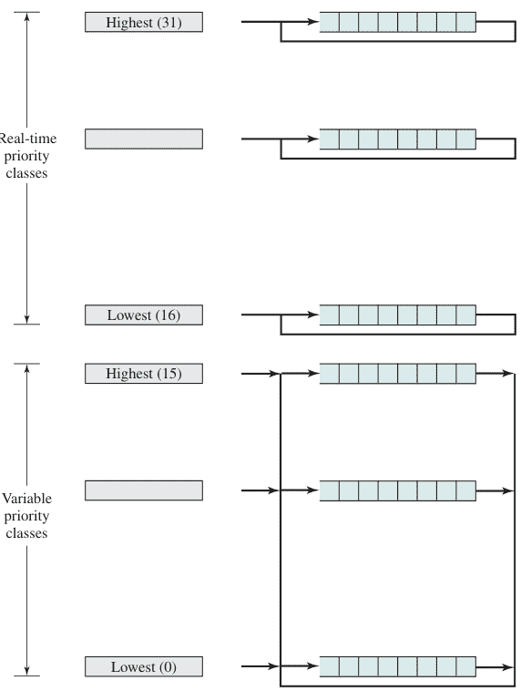

图 10.14 Windows 线程调度优先级

若干规则决定了线程向当前队列或下一个队列的分配：

1. 内核和实时线程始终插入到当前队列。
2. 如果时间分片线程具有交互性（在下一节中解释），将其分配到当前队列；否则分配到下一个队列。将交互性线程插入当前队列，使得与其他未表现出高程度交互性的时间分片线程相比，这些线程具有较低的交互响应时间。

### 交互性评分

如果一个线程的自愿睡眠时间与运行时间之比低于某个阈值，则认为该线程是交互性的。交互性线程通常有很长的睡眠时间，因为它们在等待用户输入。这些睡眠...

### 线程迁移

拉取机制（pull mechanism）有效防止由于空闲导致的处理器浪费。如果在每个处理器都必须工作的情况下该机制无效或不相关，负载将以不均匀的方式产生。通过推送机制（push mechanism），周期性调度器评估当前的负载情况并驱逐。每秒两次，该任务选取系统中负载最高和最低的处理器并均衡它们的运行队列。推送迁移（push migration）确保了可运行线程之间的公平性。

## 第 10 章 / 多处理器、多核和实时调度

## 10.6 WINDOWS 调度

Windows 的设计旨在尽可能对高度交互环境或服务器角色下单用户的用户的需求做出响应。Windows 实现了一个抢占式调度器，具有一个灵活的优先级级别系统，包括每个级别内部的轮询调度，并且对于某些级别，根据其当前的线程活动进行动态优先级变化。在 Windows 中，调度的单位是线程而不是进程。

### 进程和线程优先级

Windows 中的优先级分为两个带（或类）：实时（real time）和可变（variable）。每个带包含 16 个优先级级别。需要立即处理的线程位于实时类中，该类包括通信功能和实时任务。

总的来说，由于 Windows 使用优先级驱动的抢占式调度器，实时线程优于其他线程。当线程变得值得处理（其优先级高于当前执行的线程）时，低优先级的线程会被抢占，处理器将分配给高优先级线程。

两个类对优先级的处理方式不同（见图 10.14）。在实时优先级类中，所有线程都具有不改变的固定优先级。在可变优先级类中，线程的优先级从初始优先级值开始，并在线程的生命周期内可能会临时提升（提高）。

| 优先级 | 描述 |
|---|---|
| 15 | 最高 |
| 14 | |
| 13 | |
| 12 | |
| 11 | |
| 10 | |
| 9 | |
| 8 | |
| 7 | |
| 6 | 高于正常 |
| 5 | |
| 4 | 基础优先级 / 正常 |
| 3 | 低于正常 |
| 2 | |
| 1 | |
| 0 | 最低 |

**图 10.15 Windows 优先级关系示例**


当前量子态（`quantum`），内核会降低其优先级。CPU 密集型线程倾向于较低优先级，而 I/O 密集型线程倾向于较高优先级。对于 I/O 密集型线程，内核会提升交互事件（例如等待键盘或鼠标）相对于其他 I/O（例如磁盘 I/O）的优先级。因此，交互线程倾向于具有可变类中的最高优先级。

# 多处理器调度

Windows 支持多处理器和多核硬件配置。任何进程的线程（包括内核线程）都可以运行在任何处理器上。在没有亲和性限制（下段解释）的情况下，内核调度器将就绪线程分配给下一个可用处理器。这确保了当高优先级线程就绪时，没有处理器处于空闲或执行低优先级线程。同一进程的多个线程可以在多个处理器上同时执行。

默认情况下，内核调度器在分配线程到处理器时使用软亲和（`soft affinity`）策略：调度器尝试将线程分配到其上次运行的处理器上。这有助于用该处理器之前执行线程时的内存缓存中的数据。应用程序可以将线程执行限制在某些处理器上（硬亲和）。

当 Windows 在单处理器上运行时，最高优先级线程总是活跃的，除非它正在等待事件。如果有多个具有相同优先级的线程，则处理器将在该优先级级别的所有线程之间进行轮询调度。在具有 N 个处理器的多处理器系统中，内核尝试将 N 个处理器分配给 N 个就绪运行的高优先级线程。剩余的低优先级线程必须等待，直到其他线程阻塞或它们的优先级会衰减。如果低优先级线程处于饥饿状态，它们的优先级也可能被提升到 15，仅为了纠正优先级反转的情况。

上述调度策略会受到线程的处理器亲和性（`processor affinity`）的影响。如果一个线程已就绪执行，但唯一可用的处理器不在其处理器亲和性集中，则该线程将被迫等待，内核将调度下一个可用的线程。

## 10.7 总结

在紧耦合的多处理器系统中，多个处理器可以访问相同的主内存。在这种配置下，调度结构要复杂得多。例如，一个给定的进程在其整个生命周期内被分配到同一个处理器，或者在进入运行（`Running`）状态时被调度到任何处理器。性能研究表明，在多处理器系统中，各种调度算法之间的差异并不显著。

实时进程是指与计算机系统中某些 `set` 事件的处理或功能相关执行的进程，并且必须满足一个或多个截止日期以便与外部环境进行有效且正确的交互。实时操作系统是指能够管理实时进程的操作系统。在这种情况下，调度算法的传统标准并不适用。相反，关键因素是截止日期的满足，这高度依赖于抢占以及对相对截止期的响应，这些在该背景下是合适的。

## 10.8 关键术语、复习题与问题

### 关键术语

| 非周期任务 (`aperiodic task`) | 负载共享 (`load sharing`) | 实时操作系统 (`real-time operating system`) |
| :--- | :--- | :--- |
| 截止日期调度 (`deadline scheduling`) | 周期任务 (`periodic task`) | 实时调度 (`real-time scheduling`) |
| 确定性 (`deterministic`) | 优先级上限 (`priority ceiling`) | 响应性 (`responsiveness`) |
| 确定性操作系统 (`deterministic operating system`) | 优先级继承 (`priority inheritance`) | 软亲和性 (`soft affinity`) |
| 软故障操作 (`fail-soft operation`) | 优先级反转 (`priority inversion`) | 软实时任务 (`soft real-time task`) |
| 帮派调度 (`gang scheduling`) | 处理器亲和性 (`processor affinity`) | 线程调度 (`thread scheduling`) |
| 粒度 (`granularity`) | 拉取机制 (`pull mechanism`) | 无界优先级反转 (`unbounded priority inversion`) |
| 硬亲和性 (`hard affinity`) | 推送机制 (`push mechanism`) | |
| 硬实时任务 (`hard real-time task`) | 速率单调调度 (`rate monotonic scheduling`) | |

### 复习题

- 10.1. 列出并简要定义五类不同的同步粒度。
- 10.2. 对于多程序单处理器，什么种粒度的并行度是合适的？
- 10.3. 线程的帮派调度对于哪类应用最有用？
- 10.4. 硬实时任务和软实时任务之间的区别是什么？
- 10.5. 讨论动态调度的概念。
- 10.6. 列出并简要定义实时操作系统的五个一般需求领域。
- 10.7. 列出并简要定义四类实时调度算法。
- 10.8. 什么是优先级反转？什么是无界优先级反转？

### 问题

- 10.1. 考虑一组具有表 10.7 所示执行特征的三个周期性任务。为这组任务开发与图 10.5 类似的调度图。
- 10.2. 考虑一组具有表 10.8 所示执行特征的五个非周期任务。为这组任务开发与图 10.6 类似的调度图。
- 10.3. 最小延迟优先 (`LLF`) 是一种用于周期性任务的实时调度算法。空闲时间（`Slack time`）或延迟（`latency`）是指任务如果现在开始的完成时间与下一个截止日期之间的时间。这是调度窗口的大小。松弛度（`Laxity`）可以表示为

  `Laxity = (截止日期时间) – (当前时间) – (所需的处理器时间)`

  - a. 假设一个任务当前的延迟为 `t`。调度器可以延迟启动任务多久而仍然满足截止日期？
  - b. 假设一个任务当前的延迟为 `0`。这意味着什么？
  - c. 如果任务具有负松弛度，意味着什么？
  - d. 考虑一组具有表 10.9a 所示执行特征的三个周期性任务。为这组任务开发与图 10.5 类似的调度图。

#### 表 10.7 问题 10.1 的执行特征

| 进程 | 到达时间 | 执行时间 | 结束截止日期 |
| :--- | :--- | :--- | :--- |
| A(1) | 0 | 10 | 20 |
| A(2) | 20 | 10 | 40 |
| B(1) | 0 | 10 | 50 |
| B(2) | 50 | 10 | 100 |
| C(1) | 0 | 15 | 50 |
| C(2) | 50 | 15 | 100 |

#### 表 10.8 问题 10.2 的执行特征

| 进程 | 到达时间 | 执行时间 | 起始截止日期 |
| :--- | :--- | :--- | :--- |
| A | 10 | 20 | 100 |
| B | 20 | 20 | 30 |
| C | 40 | 20 | 60 |
| D | 50 | 20 | 80 |
| E | 60 | 20 | 70 |

#### 表 10.9 问题 10.3 的执行特征

| 任务 | 周期 | 执行时间 |
| :--- | :--- | :--- |
| A | 6 | 2 |
| B | 8 | 2 |
| C | 12 | 3 |

- 10.4. 最小延迟优先 (`LLF`) 是一种用于周期性任务的实时调度算法。空闲时间（`Slack time`）或延迟（`latency`）是指任务如果现在开始的完成时间与下一个截止日期之间的时间。这是调度窗口的大小。松弛度（`Laxity`）可以表示为

  `Laxity = (截止日期时间) – (当前时间) – (所需的处理器时间)`

  `LLF` 选择松弛度值最小的任务。如果两个或多个任务具有相同的最小松弛度值，则按 `FCFS`（先来先）原则进行服务。

  - a. 假设一个任务当前的延迟为 `t`。调度器可以延迟启动任务多久而仍然满足截止日期？
  - b. 假设一个任务当前的延迟为 `0`。这意味着什么？
  - c. 如果任务具有负松弛度，意味着什么？
  - d. 考虑一组具有表 10.9a 所示执行特征的三个周期性任务。为这组任务开发与图 10.5 类似的调度图。

*(注：由于提供的文本中存在大量重复段落，译文已根据要求仅保留核心内容)*

# 第 11 章 / I/O 管理与磁盘调度

## 学习目标

学习本章后，你应当能够：

* 总结计算机上 I/O 设备的主要类别。
* 讨论 I/O 功能的组织。
* 解释操作系统支持 I/O 设计中的一些关键问题。
* 分析各种 I/O 缓冲替代方案对性能的影响。
* 理解磁盘访问涉及的性能问题。
* 解释 RAID 的概念并描述其各种级别。
* 理解磁盘缓存对性能的影响。
* 描述 UNIX、Linux 和 Windows 中的 I/O 机制。

操作系统设计中最棘手的方面可能莫过于输入/输出。由于设备以及这些设备的应用非常多样，要开发一种通用且一致的解决方案是困难的。

我们首先对 I/O 设备和 I/O 功能的组织进行简要讨论。这些主题通常属于体系结构的范畴，它们为从操作系统的角度研究 I/O 奠定了基础。

接下来的章节将探讨操作系统设计问题，包括设计目标以及 I/O 功能的结构化方法。然后研究 I/O 缓冲；操作系统提供的基本 I/O 服务之一是缓冲功能，它能提高整体性能。

本章的后续章节专门介绍磁盘 I/O。在现代系统中，某些 I/O 是最重要的，也是决定用户感知性能的关键。我们首先建立一个磁盘 I/O 性能模型，然后检查几种可用于增强性能的技术。

附录总结了辅助存储设备的特性，包括磁盘和光存储器。

## 11.1 I/O 设备

如第 1 章提到的，与计算机系统进行 I/O 活动的外部设备大致分为三类：

1. **人类可读的**：适用于与计算机用户通信。包括打印机和终端，后者由视频显示器、键盘以及可能的鼠标等设备组成。
2. **机器可读的**：适用于与电子设备通信。例如磁盘驱动器、`USB` 闪存、传感器、控制器和执行器。
3. **通信类**：适用于与远程设备通信。例如数字线路驱动器和调制解调器。

| | 10^1 | 10^2 | 10^3 | 10^4 | 10^5 | 10^6 | 10^7 | 10^8 | 10^9 |
|---|---|---|---|---|---|---|---|---|---|
| 千兆以太网 | | | | | | | | | |
| 图形显示 | | | | | | | | | |
| 硬盘 | | | | | | | | | |
| 以太网 | | | | | | | | | |
| 光盘 | | | | | | | | | |
| 扫描仪 | | | | | | | | | |
| 激光打印机 | | | | | | | | | |
| 软盘 | | | | | | | | | |
| 调制解调器 | | | | | | | | | |
| 鼠标 | | | | | | | | | |
| 键盘 | | | | | | | | | |

**图 11.1 典型的 I/O 设备速率**

不同类别之间存在巨大差异，甚至每个类别内部也存在显著差异。关键差异包括：

* **数据速率**：数据传输速率之间可能存在几个数量级的差异。图 11.1 给出了一些示例。
* **应用**：设备的用途会对操作系统及支持工具的软件和策略产生影响。例如，用于文件的磁盘需要文件管理软件的支持。作为虚拟内存方案中页备份存储的磁盘则取决于虚拟内存硬件和软件的使用。此外，这些应用会影响磁盘调度算法（在本章中讨论）。另一个例子是，终端可能被普通用户或系统管理员使用。这些用途意味着操作系统中不同的权限级别和优先级。
* **控制复杂性**：打印机需要相对简单的控制接口。磁盘要复杂得多。这些对操作系统的影响在很大程度上被控制设备的 I/O 模块的复杂性所过滤，正如下一节所讨论。
* **传输单元**：数据可以以字节或字符流（例如终端 I/O）的形式传输，也可以以更大的块（例如磁盘 I/O）的形式传输。
* **数据表示**：不同设备使用不同的数据编码方案，包括字符编码和校验位约的差异。
* **错误情况**：错误的性质、报告方式、后果以及可选的响应范围在不同设备之间差异很大。

这种多样性使得从操作系统角度和用户进程角度实现统一且一致的 I/O 方法变得非常困难。

## 11.2 I/O 功能的组织

附录 C 总结了三种执行 I/O 的技术：

1. **程序控制 I/O**：处理器代表进程向 I/O 模块发出 I/O 命令；然后忙等操作完成后再继续。
2. **中断驱动 I/O**：处理器代表进程发出 I/O 命令。此时有两种可能：如果 I/O 指令是非阻塞的，则处理器继续执行；如果 I/O 指令是阻塞的，处理器将进程置于某种状态。
3. **直接存储器访问 (`DMA`)**：`DMA` 模块控制数据交换。只有当整个块传输完成后，处理器才被中断。

表 11.1 展示了这些技术之间的关系。

### I/O 功能的演进

随着计算机的演进，复杂性呈现出增加的趋势。这一点在 I/O 功能上尤为明显。演进步骤可以总结如下：

1. 处理器直接控制设备。
2. 增加了 I/O 模块。处理器使用程序控制 I/O。
3. 使用与步骤 2 相同的配置，但现在采用了中断。
4. 赋予 I/O 模块对内存的直接控制权。
5. I/O 模块增强为一个独立的处理器，具有为 I/O 定制的指令集。
6. I/O 模块拥有自己的本地内存。

**表 11.1 I/O 技术**

| | 不使用中断 | 使用中断 |
|---|---|---|
| 通过处理器的 I/O 到内存传输 | 程序控制 I/O | |
| I/O 到内存的传输 | | 中断驱动 I/O |
| 直接 I/O 到内存的传输 | | 直接存储器访问 (`DMA`) |

## 直接存储器访问

图 11.2 总括地指示了 `DMA` 逻辑。`DMA` 单元能够模拟处理器，并且确实像处理器一样接管系统总线。它需要通过这一点在系统总线与内存之间传输数据。

`DMA` 技术的工作原理如下。当处理器需要写入一个数据块时，它通过向 `DMA` 模块发送以下信息来发出 `DMA` 命令：

- 请求是读还是写，使用处理器与 `DMA` 模块之间的读/写控制线；
- 涉及的 I/O 设备地址，通过数据线通信；
- 从内存读取或写入内存的起始位置，通过数据线通信，并存储在 `DMA` 模块的地址寄存器中；
- 要读或写的字数，再次通过数据线通信并存储在数据计数器中。

处理器随后继续执行其他工作。它将 I/O 操作委托给了 `DMA` 模块。`DMA` 模块每次传输一个字（`word`），将整个数据块直接传输到内存或从内存传输，而不经过处理器。当传输完成后，`DMA` 模块向处理器发送中断信号。因此，处理器仅在传输的开始和结束阶段参与（参见图 C4c）。

`DMA` 机制可以有多种配置方式。图 11.3 显示了某些可能性。在第一个示例中，所有模块共享同一条总线。`DMA` 模块充当代理处理器，对 I/O 通过 `DMA` 模块在内存与 I/O 模块之间交换数据。这种配置可能是低效的：作为由处理器控制的程序化 I/O，每次字传输都会消耗两次总线周期（传输请求后是传输）。

通过集成 `DMA` 和 I/O 功能，可以大幅减少所需的周期数。如图 11.3 所示，这意味着 `DMA` 模块与一个或多个 I/O 模块之间存在一条不包含系统总线的路径。`DMA` 逻辑实际上可以是 I/O 模块的一部分，也可以是控制一个或多个 I/O 模块的独立模块。这一概念可以进一步，使用 I/O 总线将 I/O 模块连接到 `DMA` 模块（参见图 11.3c）。这减少了 `DMA` 模块中 I/O 接口的数量，提供了一种易于扩展的配置。在所有这些情况下（参见图 11.3b 和 11.3c），处理器和主内存共享的系统总线仅供 `DMA` 模块与内存交换数据以及处理器交换控制信号。`DMA` 与 I/O 模块之间的数据交换发生在系统总线之外。

## 11.3 操作系统设计问题

### 设计目标

在设计 I/O 设备时，有两个目标至关重要：效率和通用性。**效率**非常重要，因为 I/O 操作通常是计算系统的瓶颈。再次查看图 11.1，我们看到与主内存和处理器相比，大多数 I/O 设备都极其缓慢。解决这个问题的方法之一是多道程序，正如我们所看到的，它允许某些进程在等待 I/O 操作时由另一个进程执行任务。然而，即使今天机器的内存容量巨大，I/O 仍然无法跟上处理器的活动。交换（`Swapping`）被用于调入就绪进程以保持处理器忙碌，但这本身是一次 I/O 操作。I/O 设计的一项主要工作是提高 I/O 效率的方案。由于其重要性，关注最多的领域是 I/O，本章的大部分内容将研究磁盘 I/O 效率。

另一个主要目标是通用性。为了简单化和避免错误，以统一的方式处理所有设备是理想的。这既适用于进程查看 I/O 设备的方式，也适用于操作系统管理 I/O 设备和操作的方式。由于设备特征的多样性，在实践中很难实现真正的通用性。可以做的是采用分层、模块化的方法来设计 I/O 函数。这种方法将大多数设备 I/O 细节隐藏在低级例程中，使得进程和操作系统的上层可以通过读取、打开、关闭、锁定和解锁等通用函数来查看设备。现在我们转而讨论这种方法。

### I/O 函数的逻辑结构

在第 2 章关于系统结构的讨论中，我们强调了现代操作系统的分层特性。分层哲学认为操作系统应该根据其复杂度、特征规模和抽象级别进行分离。将此哲学专门应用于 I/O 设备，将导致如图 11.4 所示的组织类型。组织的细节将取决于设备类型和应用程序。图中展示了三个最重要的逻辑结构。当然，特定的操作系统可能并不完全符合这些结构。然而，通用原则是有效的，大多数操作系统的 I/O 都是按照这种方式运行的。

让我们考虑第一种情况，即以简单方式（如字节流或记录流）通信的本地外设设备（参见图 11.4a）。涉及以下层级：

- **逻辑 I/O**：逻辑 I/O 模块将设备视为逻辑资源，而不关心实际控制设备的细节。逻辑 I/O 模块负责代表进程管理通用 I/O 函数，允许它们通过设备标识符和简单命令（如打开、关闭和读取）来处理设备。


- **设备 I/O**：请求的操作和数据（缓冲字符、记录等）被转换为适当的 I/O 指令序列、通道命令和控制器指令。可能会使用缓冲技术。

- **调度与控制**：实际的 I/O 调度发生在这一层，并报告状态。

对于通信设备，其 I/O 结构（参见图 11.4）与描述的非常相似。主要区别在于 I/O 是由软件处理的。这种情况涉及的三个层是：

- **目录管理**：该层处理文件名。

- **文件系统**：该层处理 I/O 操作。

- **物理组织**：该层将虚拟地址转换为物理地址。

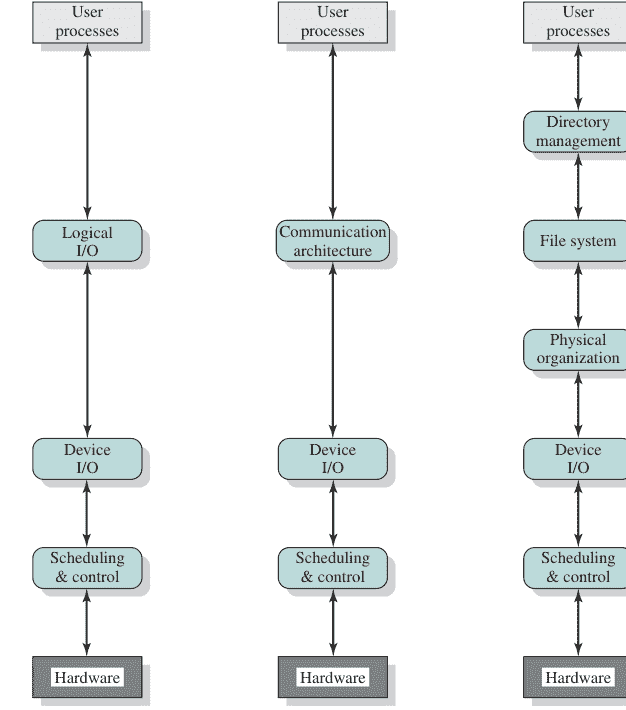

## 11.3 操作系统设计问题

### I/O 模型


(a) 本地设备 (b) 通信 (c) 文件系统

# 514 第11 章 / I/O 管理与磁盘调度

# 缓冲 (BUFFERING)

假设用户希望一次从磁盘读取一个块，每个块 512 字节。最简单的方法是执行 I/O 命令并等待数据可用。这种等待可以是忙等（持续测试状态寄存器），或者更实际地，在中断上挂起。

这种方法有两个问题。首先，进程被挂起等待缓慢的 I/O 完成。第二个问题是，这种方法会干扰分页决策。如果使用了分页，参与 I/O 的内存必须留在主内存中。否则，部分数据可能会丢失。还存在死锁风险。如果一个进程发布了 I/O 命令、挂起等待，并在 I/O 事件开始之前被换出，那么 I/O 将阻塞直到进程被换入。为了避免这种情况，如果一个数据块直接从用户进程传输到 I/O 模块，则进程在传输期间会被阻塞。为了避免这些开销和低效，有时在提出请求时执行输入传输更为方便，并在请求提出后执行输出传输。这种技术被称为缓冲。在本节中，我们将查看操作系统支持的一些缓冲方案，以提高性能。

## 单缓冲 (Single Buffer)

操作系统可以提供的简单类型的支持是单缓冲（参见图 11.5b）。当用户进程发布 I/O 请求时，操作系统为主内存系统部分分配一个缓冲区给该操作。

## 11.4 / I/O 缓冲

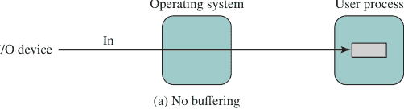

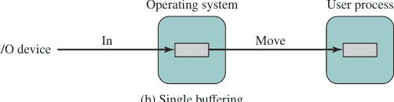

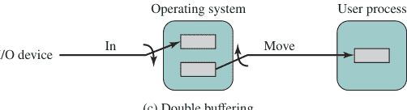


图 11.5 I/O 缓冲方案（输入）

对于块设备，单缓冲方案可以描述如下：输入传输到系统缓冲区。当传输完成后，进程将数据块移动到用户空间并立即请求另一个块。这被称为预读（reading ahead）或预期输入；其目的是预期之后将需要另一个块。对于许多类型的计算，这在大多数情况下是一个合理的假设，因为数据通常是顺序访问的。只有在一次处理序列的末尾，才会读取一个不需要的块。

这种方法与没有系统缓冲的方法相比会产生速度提升。用户进程可以在读取下一个块数据的同时处理当前块数据。操作系统能够将进程换出，因为输入操作发生在系统内存而非进程内存中。这种技术确实增加了操作系统的复杂性。操作系统必须跟踪系统缓冲区向用户进程的分配。交换逻辑也会受到影响：如果 I/O 操作涉及的磁盘与用于交换的是同一个磁盘，那么使用磁盘写入来换出进程几乎没有意义。这种尝试交换进程并释放主内存的尝试将在 I/O 操作完成后才会开始，而此时，将进程交换到磁盘可能已经不再合适。

类似的考虑也适用于块定向的输出。当数据传输到设备时，它们首先从用户空间拷贝到系统缓冲区，然后最终从那里写入。请求的进程现在可以自由地继续执行，或根据需要被换出。

[KNUT97] 建议对单缓冲和无缓冲进行粗略但具有参考意义的性能比较。假设输入一个块所需的时间为 `T`，输入请求之间发生的计算为 `C`。如果没有缓冲，每个块的执行时间本质上是 `T + C`。如果有单缓冲，最大时间为 `max[C, T] + M`，其中 `M` 是将数据从系统缓冲区移动到内存所需的时间。在大多数情况下，使用单缓冲的每个块执行时间远少于无缓冲。

对于流定向的 I/O，单缓冲方案可以按逐行或逐字节的方式使用。逐行操作适用于滚动模式终端（有时称为哑终端）。对于这种形式的终端，用户输入是一次一行，以回车键表示一行的结束，到终端的输出也是类似的一次一行。如果用于回显模式终端上使用逐字节操作，则打印机是另一个例子（在这种模式下每次击键都至关重要），对于许多其他外设，如传感器和控制器也是如此。

在逐行 I/O 的情况下，缓冲区可以容纳单行。用户进程在输入期间被挂起，等待回车的返回。对于输出，用户进程可以将一行输出放在缓冲区中并继续处理。除非在第一次输出操作清空缓冲区之前要发送第二行输出，否则无需挂起。在逐字节 I/O 的情况下，操作系统与用户进程之间的交互遵循第 5 章讨论的生产者/消费者模型。

### 双缓冲

通过为操作分配两个系统缓冲区可以获得比单缓冲的改进（见图 11.5c）。进程现在向一个缓冲区传输（或从缓冲区读取数据，而操作系统清空（或填充）另一个。这种技术被称为双缓冲或缓冲交换。

对于块定向传输，我们可以粗略估计执行时间为 `max[C, T]`。如果 `C <= T`，则可以保持块设备以全速运行。另一方面，如果 `C > T`，双缓冲确保进程不需要等待 I/O。在任何情况下，都实现了对单缓冲的改进。这种改进是以增加复杂性为代价的。

对于流定向输入，我们再次面临两种可选的操作模式。对于逐行 I/O，用户进程在输入或输出时无需挂起，进程运行在双缓冲之前。对于逐字节操作，双缓冲相对于长度加倍的单缓冲没有特殊优势。在两种情况下，都遵循生产者/消费者模型。

### 环形缓冲区

双缓冲方案应该平滑 I/O 设备与进程之间的数据流。如果我们关注的是特定进程的性能，那么我们希望 I/O 操作能够跟上进程的速度。如果 I/O 操作比进程慢，双缓冲可能是不够的。在这种情况下，使用环形缓冲区。环形缓冲区由环排列的若干缓冲区组成。生产者填充缓冲区，消费者清空缓冲区。如果生产者比消费者快，它将等待缓冲区为空。如果消费者比生产者快，它将等待缓冲区填充。这允许平滑 I/O 流量中的突发情况。

## 调度 / 磁盘调度

磁盘调度的目标是通过重新排序 I/O 请求来最小化寻道时间。由于寻道时间通常占据 I/O 时间的大部分，这是一个关键优化。有多种调度算法，包括：

- **先来先服务 (FCFS)**：按照到达顺序服务请求。这种实现简单，但如果请求分散在磁盘上，会导致长寻道。

- **最短寻道优先 (SSTF)**：优先服务距离当前磁头位置最近的请求。这可以减少寻道时间，但可能导致远离的请求饥饿。

- **SCAN（电梯）**：磁头向一个方向移动直到到达磁盘末端，然后反转方向再次服务请求。

- **C-SCAN**：SCAN 的变体，磁头只在一个方向服务请求，然后返回起点而在返回途中不服务请求。

磁盘系统的性能取决于这些算法以及磁盘本身的物理特性。

## 磁盘性能

磁盘系统的性能取决于多个因素，包括：

- **寻道时间**：磁臂移动到正确磁道的时间。

- **旋转延迟**：所需扇区旋转到磁头下方的时间。

- **传输时间**：从磁盘传输数据到系统的时间。

- **等队时间**：请求在 I/O 队列中等待的时间。

总 I/O 时间是这些组件的总和。在许多系统中，寻道时间和旋转延迟是最显著的因素。

| 等待设备 | 旋转延迟 | 寻道 | 数据传输 |
| :--- | :--- | :--- | :--- |
| | | | |

图 11.6 I/O 操作时序（未提供图表）

## 11.5 / 磁盘调度

传输时间 从磁盘读取或写入数据的时间取决于磁盘的旋转速度，公式如下：

```
$T = \frac{b}{rN}$
```

其中

$T=$ 传输时间，

$b=$ 需要传输的字节数，

$N=$ 每个磁道上的字节数，以及

$r=$ 旋转速度，单位为每秒转数（rps）。

因此，总平均访问时间可以表示为：

```
$T_a = T_s + \frac{1}{2r} + \frac{b}{rN}$
```

其中 $T_s$ 是平均寻道时间。

### 计时对比 在定义了以下参数的情况下，让我们来看两种不同的 I/O 操作，以说明依赖平均值的危险性。考虑一个宣称寻道时间为 4 ms、旋转速度为 7500 rpm、扇区大小为 512 字节且每个磁道有 500 个扇区的磁盘。我们建议使用由 2500 个扇区组成的磁盘，总容量为 12 Mbytes。我们想要估计完成传输所需的总时间。

首先，假设文件以尽可能紧的方式存储在磁盘上。也就是说，文件占据了 5 个相邻磁道上的所有扇区（5 磁道 × 500 扇区/磁道 = 2,500 个扇区）。这被称为顺序组织。读取第一个磁道的时间如下：

| 平均寻道 | 4 ms |
| :--- | :--- |
| 旋转延迟 | 4 ms |
| 读取 500 个扇区 | 8 ms |
| | **16 ms** |

假设剩余磁道在读取时几乎没有寻道时间。也就是说，I/O 操作可以跟上磁盘的流。那么，最坏的情况下我们需要处理每个后续磁道的旋转延迟。因此，读取整个文件的时间为：

$Total time = 16 + (4 \times 12) = 64\text{ ms} = 0.064\text{ seconds}$

| 平均寻道 | 4 ms |
| :--- | :--- |
| 旋转延迟 | 4 ms |
| 读取 1 个扇区 | 0.016 ms |
| | **8.016 ms** |

$Total time = 2,500 \times 8.016 = 20,040\text{ ms} = 20.004\text{ seconds}$

从磁盘中读取扇区的顺序对 I/O 性能有巨大影响。在需要读取或写入多个扇区的文件访问案例中，我们可以控制数据扇区的部署方式，我们将在下一章中讨论这个主题。然而，即使在多程序环境下的文件访问中，也会有多个 I/O 请求竞争同一个磁盘。因此，研究提高磁盘 I/O 性能的方法（使其优于纯随机访问磁盘）是非常值得的。

## 磁盘调度策略

在描述的示例中，性能差异的原因可以追溯到寻道时间。如果扇区访问请求涉及随机选择磁道，那么磁盘 I/O 系统的性能将颗粒。为了改进这种情况，我们需要减少花费在寻道上的平均时间。

考虑多程序环境中的典型情况，在这种情况下操作系统为每个 I/O 设备维护一个请求队列。对于单个磁盘，队列中会有来自各种进程的若干 I/O 请求（读取和写入）。如果我们以随机顺序从队列中选取项目，那么我们可以预见磁道偶尔会被访问，导致性能低下。**随机调度**可以作为一个基准，用它来评估其他技术。

图 11.7 对比了各种调度算法在一个示例 I/O 请求序列下的性能。纵轴对应于磁盘上的磁道。横轴对应于时间，或者等价于遍历的磁道数量。为此，我们假设磁盘初始位置位于第 100 磁道。在这个示例中，我们假设磁盘有 200 个磁道，且磁盘请求队列中包含请求。按照磁盘调度器接收的顺序，请求的磁道为 55, 58, 39, 18, 160, 150, 38, 184。表 11.2 列出了这些结果。

**先来先出** 最简单的调度形式是先来先出（FIFO）调度，它按顺序处理队列中的项目。这种策略的优点是公平，因为每个请求都会被满足，并且请求是按照接收顺序被处理的。图 11.7a 展示了表 11.2a 中的数据。如我们所见，磁盘访问的顺序与最初接收请求的顺序相同。

使用 FIFO，如果只有少数进程需要访问且有许多进程聚集在文件扇区上，那么我们可以希望获得良好的性能。然而，如果有许多进程竞争磁盘，这种技术在性能上往往会趋近于随机调度。因此，考虑更复杂的调度策略可能是有益的。表 11.3 列出了其中若干策略，现在将对它们进行考虑。

**优先级** 在基于优先级（PRI）的系统中，调度的控制在磁盘管理软件的控制之外。这种方法并不是为了优化磁盘利用率，而是为了满足操作系统内的其他目标。通常，短批处理作业和交互式作业被赋予更高的优先级。

**后来先出** 如果只有少数进程需要访问且许多进程聚集在文件扇区上，那么我们可以希望获得良好的性能。然而，如果有许多进程竞争磁盘，这种技术在性能上往往会趋近于随机调度。因此，考虑更复杂的调度策略可能是有益的。表 11.3 列出了其中若干策略，现在将对它们进行考虑。

**最短服务时间优先** 这种调度方式（SSTF）选择距离当前位置最近的请求。

**优先级** 在基于优先级（PRI）的系统中，调度的控制在磁盘管理软件的控制之外。这种方法并不是为了优化磁盘利用率，而是为了满足操作系统内的其他目标。通常，短批处理作业和交互式作业被赋予更高的优先级。

## 第 11 章 / 输入输出管理与磁盘调度

请注意，SCAN 策略对访问最频繁的区域存在偏见。因此，它不像 SSTF 那样利用局部性。

显而易见，SCAN 策略倾向于请求靠近最内层和最外层磁道的任务，并倾向于后到达的任务。第一个问题可以通过 C-SCAN 策略避免，而第二个问题则通过 N-step SCAN 策略来解决。

### C-SCAN

C-SCAN（循环扫描）策略将扫描限制在单一方向上。因此，当在一个方向上访问完最后一个磁道后，磁臂将返回磁盘的对端并重新开始扫描。这减少了新请求可能经历的最大延迟。对于 SCAN，如果从内层磁道扫描到外层磁道的扫描预计时间为 `t`，则边缘扇区的预计服务间隔为 `2t`。对于 C-SCAN，该间隔大约为 `t + s_max`，其中 `s_max` 是最大寻道时间。

图 11.7 和表 11.2d 展示了 C-SCAN 的行为。在这种情况下，遇到的前三个磁道是 150、160 和 184。然后扫描从最低磁道数开始，遇到的下一个磁道是 18。

### N-STEP-SCAN 与 SCAN

在 SSTF、SCAN 和 C-SCAN 中，磁臂可能会相当长时间内不移动。例如，如果一个或两个进程访问某一个磁道，它们可以通过对该磁道的重复请求来垄断整个磁盘。高密度多面磁盘比低密度磁盘或只有一两个面的磁盘更容易受到这种特性的影响。为了避免“磁臂粘连”（armstickiness），可以对请求队列进行分，每次完全处理一个段。这种方法的两个例子是 N-step-SCAN 和 SCAN。

N-step-SCAN 策略将请求队列分成长度为 N 的子队列。子队列逐个进行处理（使用 SCAN）。在处理某个队列时，新请求必须添加到其他队列中。如果一次扫描结束时可用请求少于 N 个，则所有这些请求将在下一次扫描时处理。当 N 的值较大时，N-step-SCAN 的性能接近 SCAN；当 `N=1` 时，则采用 FIFO 策略。

FSCAN

FSCAN 是一种使用两个子队列的策略。当扫描开始时，所有请求都在其中一个队列中，另一个为空。在扫描期间，所有新请求都被放入另一个队列。因此，新请求的服务将被推迟，直到所有旧请求都被处理完毕。

## 11.6 RAID

如前所述，辅助存储性能的提升率远低于处理器和主内存的提升率。这种不匹配使得磁盘存储系统可能成为提高系统性能的主要关注焦点。

与计算机性能的其他领域一样，磁盘存储设计者意识到，如果一个组件只能被推到某种程度，那么通过使用多个并行组件可以获得额外的性能收益。在磁盘存储方面，这导致了独立并行运行的磁盘阵列的发展。有了多个磁盘，只要数据存储在不同的磁盘上，就可以并行处理不同的 I/O 请求。此外，如果要访问的数据块分布在多个磁盘上，则可以并行执行单个 I/O 请求。

通过使用多个磁盘，数据有多种组织方式，并且可以添加不同的冗余性来提高可靠性。这可能使得开发可在多个平台和操作系统上使用的数据库模式变得困难。幸运的是，行业已对多磁盘数据库设计达成标准方案，称为 RAID（独立磁盘冗余阵列）。RAID 方案由几个级别组成，从零到六。尽管设计架构共享三个共同特征，但这些级别之间并不存在层级关系：

1. RAID 是一组被操作系统视为单个逻辑设备的物理磁盘。

2. 数据分布在阵列的物理磁盘上，这种方案被称为条带化（striping），后文将进行描述。

3. 冗余容量用于存储校验信息，这确保了磁盘故障时数据具有可恢复性。

不同 RAID 级别的第二和第三个特征的细节如下。RAID 0 和 RAID 1 不支持第三个特征。

RAID 一术最初是由加州大学伯克利分校的一组研究人员在论文中提出的 [PAT88]。该论文概述了各种 RAID 配置和应用，并引入了仍使用的 RAID 级别定义。RAID 策略利用多个磁盘并以这种方式分布数据，以便同时访问多个磁盘，从而提高 I/O 性能并允许容量进一步增长。

RAID 提案的独特贡献是有效解决了冗余需求。虽然允许多个磁头和执行器同时工作可以获得更高的 I/O 和传输率，但多个设备的使用增加了故障概率。为了补偿这种可靠性的降低，RAID 利用了存储的校验信息，能够恢复因磁盘故障而丢失的数据。

我们检查了每个 RAID 级别。表 11.4 提供了七个层级的粗略指南。I/O 性能以传输能力（移动数据的能力）和 I/O 请求速率（满足 I/O 请求的能力）来表示，因为这些 RAID 级别在这两个指标上的表现本质上是不同的。每个 RAID 级别的优势都用颜色标记标出。图 11.8 是一个说明使用七种 RAID 方案支持数据的示例。

一些研究人员和公司定义了额外的级别，但本节描述的七个级别是通用公认的。在 RAID 缩写中，代表 Redundant Array of Independent Disks。“ineexpensive”（廉价）一词是为了将 RAID 阵列中的廉价磁盘与替代方案大磁盘 SLED 进行对比。SLED 本质上是一种磁盘类型，技术适用于 RAID 和非 RAID 配置。因此，行业采用了“independent”（独立的）一词，以强调 RAID 阵列产生了显著的性能和可靠性。

### 表 11.4 RAID 级别

| 类别 | 级别 | 说明 | 所需磁盘 | 数据可用性 | I/O 容量 | I/O 请求速率 |
| :--- | :--- | :--- | :--- | :--- | :--- | :--- |
| 条带化 | 0 | 无冗余 | N | 低于单磁盘 | 非常高 | 读写均高 |
| 镜像 | 1 | 镜像 | 2N | 高于 RAID 2, 3, 4, 5；低于 RAID 6 | 读取高于单磁盘；写入类似 |


## RAID 级别对比表

| 访问模式 | 级别 | 冗余技术 | 磁盘开销 | 读取性能 | 写入性能 | 存储效率 |
| :--- | :---: | :--- | :---: | :--- | :--- | :--- |
| 并行访问 | 2 | 汉明码冗余 | N+m | 远高于单磁盘；接近 RAID 3, 4, 5 | 所有列出中最高 | 约是单磁盘的两倍 |
| | 3 | 位交织校验 | N+1 | 远高于单磁盘；接近 RAID 2, 4, 5 | 所有列出中最高 | 约是单磁盘的两倍 |
| | 4 | 块交织校验 | N+1 | 远高于单磁盘；接近 RAID 2, 3, 5 | 读取类似 RAID 0；写入显著低于单磁盘 | 读取类似 RAID 0；写入显著低于单磁盘 |
| 独立访问 | 5 | 块交织分布式校验 | N+1 | 远高于单磁盘；接近 RAID 2, 3, 5 | 读取类似 RAID 0；写入低于单磁盘 | 读取类似 RAID 0；写入通常低于单磁盘 |
| | 6 | 块交织双分布式校验 | N+2 | | 所有列出中最高 | 读取类似 RAID 0；写入低于 RAID 5 |

> **注**：`N` 为磁盘数量；`m` 与 `N` 成正比。

## 11.6 RAID 示意图 (Figure 11.8)

### (a) RAID 0 (无冗余)
| strip 0 | strip 1 | strip 2 | strip 3 |
| :--- | :--- | :--- | :--- |
| strip 4 | strip 5 | strip 6 | strip 7 |
| strip 8 | strip 9 | strip 10 | strip 11 |
| strip 12 | strip 13 | strip 14 | strip 15 |

### (b) RAID 1 (镜像)
| strip 0 | strip 1 | strip 2 | strip 3 |
| :--- | :--- | :--- | :--- |
| strip 4 | strip 5 | strip 6 | strip 7 |
| strip 8 | strip 9 | strip 10 | strip 11 |
| strip 12 | strip 13 | strip 14 | strip 15 |

### (c) RAID 2 (通过海明码冗余)


### (d) RAID 3 (位交错奇偶)


### (e) RAID 4 (块交错奇偶)
| block 0 | block 1 | block 2 | block 3 | P(0-3) |
| :--- | :--- | :--- | :--- | :--- |
| block 4 | block 5 | block 6 | block 7 | P(4-7) |
| block 8 | block 9 | block 10 | block 11 | P(8-11) |
| block 12 | block 13 | block 14 | block 15 | P(12-15) |

### (f) RAID 5 (块交错分布式奇偶)
| block 0 | block 1 | block 2 | block 3 | P(0-3) | Q(0-3) |
| :--- | :--- | :--- | :--- | :--- | :--- |
| block 4 | block 5 | block 6 | P(4-7) | Q(4-7) | block 7 |
| block 8 | block 9 | P(8-11) | Q(8-11) | block 10 | block 11 |
| block 12 | P(12-15) | Q(12-15) | block 13 | block 14 | block 15 |

### (g) RAID 6 (块交错分布式奇偶)
| block 0 | block 1 | block 2 | block 3 | P(0-3) |
| :--- | :--- | :--- | :--- | :--- |
| block 4 | block 5 | block 6 | P(4-7) | block 7 |
| block 8 | block 9 | P(8-11) | block 10 | block 11 |
| block 12 | P(12-15) | block 13 | block 14 | block 15 |
| P(16-19) | block 16 | block 17 | block 18 | block 19 |

> **图 11.8 RAID 级别（及续）**
>
> 该图展示了四块磁盘且无冗余的容量基准。图中强调了用户数据和冗余数据的布局，并指示了各个级别的相对存储需求。在随后的讨论中，我们将引用此图。

## RAID 级别 0

RAID 级别 0 并不是 RAID 族的真正成员，因为它不包含用于提高性能或提供数据保护的冗余。但在某些应用中（例如超级计算机），性能和容量是首要考虑因素，而成本比提高可靠性更重要。

RAID 0 与所有 RAID 级别相比，比简单地将数据分布在磁盘阵列上更进一步：数据跨越可用磁盘进行条带化。通过图 11.8 可以更好地理解这一点。所有用户数据和系统数据都被视为物理磁盘、扇区或其他单元。数据被划分为**带**；这些带按轮询方式映射。一组逻辑上连续的带精确映射到每个阵列成员的集合称为一个**条带**。在一个 `n` 磁盘阵列中，前 `n` 个逻辑带在物理上存储为每个 `n` 磁盘上的第一个带，形成第一个条带；第二个 `n` 个带分布为每个磁盘上的第二个带；依此类推。这种布局的优势在于，如果单个 I/O 请求包含多个连续的带，那么该请求的最多 `n` 个带可以并行处理，从而极大地减少 I/O 传输时间。

## 用于高数据传输容量的 RAID 0

任何 RAID 级别的性能都关键地取决于宿主系统的模式和数据的布局。这些问题在 RAID 0 中可以更清楚地解决，因为冗余的影响不会干扰分析。首先，让我们考虑使用 RAID 0 实现高数据传输率。为了使应用程序获得高传输率，必须满足两个要求。首先，在主机内存与单个磁盘驱动之间的整个路径上存在高传输能力。这包括内部控制器、主机 I/O 总线、I/O 适配器和主机内存。

第二个要求是应用程序必须使数据连续。在这种情况下，性能将限于磁盘大小。

## 用于高 I/O 请求率的 RAID 1

在事务导向型环境中，如果大部分请求是读取，RAID 1 可以实现高 I/O 速率。如果应用程序能够拆分读取请求，RAID 1 的性能可以接近 RAID 0 的两倍。然而，如果 I/O 请求大部分是写入，那么与 RAID 0 相比可能没有显著性能提升。对于读取密集型应用程序，RAID 1 也可以提供改进的性能。

## RAID 级别 1

RAID 1 与 RAID 级别 2 到 6 的区别在于实现冗余的方式。在这些其他方案中使用了奇偶校验；而在 RAID 1 中通过复制数据来实现。RAID 1 有许多优点：

- 读取请求由两个磁盘中的任意一个提供，取决于最小寻道时间。
- 写入需要更新两个带；如果有多个磁盘，可以并行进行。
- 故障恢复非常简单。当驱动器故障时，数据仍然可用。

RAID 1 的主要缺点是成本；它需要双倍的空间。因此，RAID 1 配置可能限于系统软件和其他关键文件。在这些情况下，RAID 1 在发生故障时提供实时备份。

## RAID 级别 2

RAID 级别 2 和 3 使用并行访问技术。在并行访问阵列中，所有磁盘都参与每个 I/O 请求的执行。通常，各个磁盘的主轴是同步的，以便每个磁盘头在任何给定时间处于相同的位置。

与其他方案一样，使用了数据条带化。在 RAID 2 和 3 的情况下，带非常小，通常仅为单个字节或字。在 RAID 2 中，跨每个磁盘的对应位计算纠错码，并将代码的位存储在多个奇偶磁盘的相应位位置上。通常使用海明码，它能够纠正单位错误并检测双位错误。

尽管 RAID 2 需要的磁盘比 RAID 1 少，但仍然相当贵。冗余磁盘的数量与磁盘数量的对数成比例。在单次读取中，访问所有磁盘。请求的数据和相关的错误编码传递到阵列控制器。如果是单位错误，控制器可以立即识别并纠正错误，因此读取访问时间不会减慢。在单次写入中，必须访问所有磁盘和奇偶磁盘。

RAID 2 只有在发生大量磁盘错误的环境中才是有效选择。考虑到单个磁盘和磁盘驱动器的高可靠性，RAID 2 是过剩的且没有实现。

## RAID 3 级

RAID 3 的组织方式与 RAID 2 类似。区别在于无论磁盘阵列有多大，RAID 3 都只需要一个冗余磁盘。RAID 3 采用并行访问，数据分布在小数据带中。它没有使用纠错码，而是为所有磁盘上相同位置的一组位计算一个简单的校验位。

### 冗余
在磁盘发生故障时，将访问校验驱动器并从剩余设备重建数据。一旦更换了故障磁盘，即可将丢失的数据恢复到新驱动器上并恢复操作。

数据重建非常简单。考虑一个包含五块磁盘的阵列，其中 `X0` 到 `X3` 包含数据，`X4` 是校验位。第 `i` 位的校验位计算公式如下：

```
X4(i) = X3(i) ⊕ X2(i) ⊕ X1(i) ⊕ X0(i)
```

其中 `⊕` 是异或（XOR）函数。

假设驱动器 `X1` 发生故障。如果在上述方程的两边都加上 `X4(i) ⊕ X1(i)`，我们得到：

```
X1(i) = X4(i) ⊕ X3(i) ⊕ X2(i) ⊕ X0(i)
```

因此，`X1` 上每个数据带的内容可以从阵列中剩余磁盘相应数据带的内容再生。这一原理对于 RAID 3 到 RAID 6 均适用。

在磁盘发生故障时，所有数据在所谓的“下降模式”下仍然可用。在这种模式下，用于读取的数据使用异或计算进行重建。当数据写入 RAID 3 阵列时，必须保持校验的一致性以备后续重建。恢复完全运行需要更换故障磁盘，并在新磁盘上重新生成故障磁盘的所有内容。

### 性能
由于数据分布在极小的数据带中，RAID 3 可以实现极高的数据速率。任何 I/O 请求都涉及从所有数据磁盘并行传输数据。对于大传输，性能提升尤为明显。另一方面，一次只能执行一个 I/O 请求。因此，在事务导向型环境中，性能会受到影响。

## RAID 4 级

RAID 4 到 RAID 6 使用了独立访问技术。在独立访问阵列中，每个成员独立运行，可以并行满足不同的 I/O 请求。由于如此，独立访问阵列更适用于高 I/O 请求率的应用，而对于需要高数据传输率的应用相对不利。

与其他 RAID 方案一样，也使用了数据条带化。在 RAID 4 到 6 的情况下，数据带相对较大。在 RAID 4 中，在每个数据磁盘的相应数据带上计算逐位校验，并将校验位存储在校验磁盘的相应数据带中。

RAID 4 在执行 I/O 请求（写入）时涉及写入惩罚。每当发生写入时，阵列管理软件不仅必须更新用户数据，还要更新相应的校验位。考虑一个包含五块驱动器的阵列，其中 `X3` 包含数据，`X4` 是校验磁盘。假设仅在 `X1` 上的某个数据带上执行写入。对于每个位 `i`，我们有以下关系：

```
X4(i) = X3(i) ⊕ X2(i) ⊕ X1(i) ⊕ X0(i)  (11.1)
```

更新后，带有撇号 `'` 标记的位可能发生了变化：

```
X4'(i) = X3(i) ⊕ X2(i) ⊕ X1'(i) ⊕ X0(i)
X3'(i) = X3(i) ⊕ X2(i) ⊕ X1'(i) ⊕ X0(i) ⊕ X1(i) ⊕ X1(i)
X2'(i) = X3(i) ⊕ X1(i) ⊕ X0(i) ⊕ X1(i) ⊕ X1'(i)
X4'(i) = X1(i) ⊕ X1'(i)
```

上述方程组的推导如下：第一行显示 `X1` 的变化将影响校验磁盘 `X4`。在第二行中，项 `[X1(i)⊕ X1'(i)]`。任何量与其自身的异或结果为 0，这不影响结果。然而，通过重新排序来创建第三行，这是一种方便的作法。最后，利用方程 (11.1) 通过 `X4(i)` 创建前四个数据带。

为了计算校验位，阵列管理软件必须读取用户数据带和旧校验数据带。然后它可以使用新数据和新计算的校验位更新这两个数据带。因此，每个数据带写入涉及两次读取和两次写入。

在较大尺寸 I/O 写入涉及所有磁盘驱动器数据带的情况下，可以通过仅使用新数据位轻松计算校验位。因此，校验磁盘可以与数据驱动器并行更新，没有额外的读取或写入。在任何情况下，每次写入操作都涉及校验磁盘，因此它可能成为瓶颈。

## RAID 5 级

RAID 5 的组织方式与 RAID 4 类似。区别在于 RAID 5 将校验数据带分布在所有磁盘上。典型的分配方案是轮询算法，如图 11.b 所示。对于一个 `n` 磁盘阵列，校验位分布在所有驱动器上。

校验数据带在所有驱动器的分布避免了 RAID 4 潜在的 I/O 瓶颈。此外，RAID 5 具有这种特性：任何磁盘的丢失都不会导致数据丢失。

## RAID 6 级

RAID 6 是伯克利的研究人员随后的论文中引入的。在 RAID 6 方案中，执行两种不同的校验计算，其中一个是 RAID 4 和 5 使用的异或计算，另一个是独立数据检查。RAID 6 的优点是提供了极高的可用性。另一方面，RAID 6 引入了巨大的写入惩罚，因为每次写入影响两个块。性能基准显示，与 RAID 5 实现相比，RAID 6 的整体写入性能下降了超过 30%。读取性能相当。

## 11.7 磁盘缓存

在第 1.6 节和附录 A 中，我们总结了缓存内存的原理。缓存内存术语通常用于比主内存小且更快、并位于主内存之间的内存。它利用局部性原理减少平均访问时间。

相同的原理适用于磁盘内存。具体来说，磁盘缓存是主内存中的磁盘缓冲区。缓存包含磁盘扇区的副本。当对特定扇区发出 I/O 请求时，会检查其是否在磁盘缓存中。

### 设计考虑

若干设计值得关注。首先，当从磁盘缓存满足 I/O 请求时，可以通过将主内存中的块从磁盘缓存传输到分配给用户进程的主内存来实现，或者简单地使用共享内存并指向磁盘缓存中的相应位置。后一种方法允许使用第五章描述的读者/写者模型进行访问。

第二个设计问题是替换策略。当新扇区带入磁盘缓存时，必须替换现有的块之一。这与第 8 章提出的问题相同；在那里，要求是页面替换算法。已经尝试过许多算法。最常用的是**最近最少使用算法（LRU）**；替换在缓存中存放最久未被引用的块。逻辑上，缓存由块组成的栈组成，最近引用的块位于栈顶。当缓存中的块被引用时，它会从栈的现有位置移动到栈顶。当一个块从次级内存调入时，移除栈底的块，并将迁入的块推到栈顶。自然地，实际上没有必要在主内存中移动这些块；可以与缓存关联一个指针栈。

另一种可能性是**最不经常使用算法（LFU）**：替换集合中被引用次数最少的块。LFU 可以通过为每个块关联一个计数器来实现。当一个块被调入时，给它分配一个计数值 1；每当对该块进行一次引用，其计数就加 1。当需要替换时，选择计数最小的块。直观上看，这似乎比 LRU 更恰当，因为 LFU 在选择过程中利用了更多关于每个块的信息。

简单的 LFU 算法存在以下问题：某些块在总的范围内被引用频率较低，但当它们被引用时，由于局部性原因，会有短时间内的重复引用，从而累积极高引用计数。在这样的间隔之后，引用计数可能会产生误导，并不能反映该块再次被引用的概率。因此，局部性的影响实际上会导致 LFU 算法做出糟糕的替换。

为了克服 LFU 的这种困难，文献 `[ROB190]` 中提出了一种名为**基于频率替换**的技术。为了清晰起见，让我们首先考虑一个简化版本，如图 11.9 所示。块在逻辑上组织在栈中，类似于 LRU 算法。栈顶部的某个区域被指定为新区域。当发生缓存命中时，被引用的块移动到栈顶。如果该块已经在新区域中，则其引用计数不增加；否则，计数加 1。只要新区域足够大，就会导致在短间隔内被重复再次引用的块的引用计数保持不变。在未命中时，选择不在该区域的块中引用计数最小的块进行替换；如果发生冲突，则选择最久未使用的块。

> **图 11.9 基于频率的替换**

作者报告说，这种策略相比 LRU 仅实现了微小改进。问题如下：

1. 在缓存未命中时，一个块被调入新区域，计数为 1。
2. 只要该块在新区域内，计数就保持为 1。
3. 最终该块会离开新区域，其计数为 1。
4. 如果该块没有很快被频繁地重新引用，它很可能被替换，因为在那些不在新区域的块中，它的引用计数必然是最小。换句话说，对于离开区域的块来说，似乎没有足够长的间隔来累积它们的引用计数，即使它们曾被频繁引用。

一种改进方法解决了这个问题：将栈分为三个区域：新、中、旧（见图 11.9b）。在此之前，新区域中块的引用计数不会增加。然而，只有旧区域中的块才有资格被替换。通过允许足够大的区域，使得相对经常引用的块在获得替换资格之前有机会建立它们的引用计数。作者的仿真研究表明，这种改进策略明显优于 LRU 或 LRFU。

无论采用什么特定的替换策略，替换都可以按需进行或提前进行。在后者的情况下，在当时释放一个扇区或多个槽。这种方法的原因与写回扇区的需求有关。如果扇区被调入缓存仅进行读取，那么在被替换时，不需要将其写回磁盘。然而，如果扇区已被更新，则在替换它之前必须将其写回。在后一种情况下，将写操作聚集并排序以最小化时间是有意义的。

### 性能考虑

附录 1A 中讨论的相同性能考虑也适用于这里。缓存性能问题简化为是否可以实现给定的缺失率。这将取决于磁盘引用的局部性行为、替换算法和设计因素。然而，缺失率是缓存大小的函数。图 11.10 总结了多项使用 LRU 研究的结果，其中一个针对运行在 VAX 上的 UNIX 系统 `[OUST85]`，另一个针对 IBM 主机操作系统 `[SMIT85]`。图 11.11 显示了基于频率的替换算法的仿真结果。对这两个图的比较指出了此类性能评估的风险之一。

这些图似乎显示 LRU 优于基于频率的替换算法。然而，当使用相同的缓存结构比较相同的引用模式时，基于频率的替换算法更优。因此，引用模式的精确序列加上相关的设计问题（如块大小），将对所实现的性能产生深远影响。

> **图 11.10 使用 LRU 的某些磁盘缓存性能结果**
>
> **图 11.11 使用基于频率替换的磁盘缓存性能**

## 11.8 UNIX I/O

在 UNIX 中，每个设备通过文件管理。有两种类型的 I/O：缓冲的和非缓冲的。缓冲 I/O 通过系统缓冲区传递，而非缓冲 I/O 直接与设备交互。由于缓冲区缓存和进程空间都在主内存中，在这种情况下使用了 DMA。这不消耗处理器周期。

为了管理缓冲区缓存，维护了三个列表：

1. **空闲列表**：缓存中所有可分配槽列表（一个槽持有一个磁盘扇区）
2. **设备列表**：与设备关联的所有缓冲区列表


- 3. **驱动程序 I/O 队列 (Driver I/O queue)**：正在进行或等待 I/O 的缓冲区列表

在空闲列表中被重用并与另一个设备关联。这些列表以与缓冲区关联的形式维护，而不是物理独立的列表。

图 11.12 UNIX I/O 结构

图 11.13 UNIX 缓冲区组织

当对特定设备的物理块号进行引用时，OS 首先检查该块是否在缓冲区缓存中。为了最小化搜索时间，设备列表被组织为哈希表，使用了类似于附录 F 中讨论的链技术（见图 F.1b）。图 11.13 描述了缓冲区缓存的链组织。有一个固定长度的哈希表，包含指向缓冲区缓存的指针。每个 `(device, block#)` 引用映射到哈希表中的特定条目。链中第一个缓冲区的指针。每个缓冲区关联的指针指向哈希表条目链中的下一个缓冲区。因此，对于所有映射到同一哈希表条目的 `(device, block#)` 引用，如果相应的块在缓冲区缓存中，那么该缓冲区在该条目的链中。因此，搜索缓冲区缓存的长度减少了大约 N 倍，其中 N 是哈希表的长度。

对于块替换，使用了最久未使用的算法：缓冲区被分配给磁盘块后，在所有其他缓冲区被更最近地使用之前，它不能用于另一个块。空闲列表保留了这种最久未使用的顺序。

# 字符队列

块定向设备（如磁盘和 USB 闪存）可以由缓冲区缓存有效地服务。而对于字符定向设备（如终端和打印机），则适用于另一种形式的缓冲。字符队列要么由 I/O 设备写入并由进程读取，要么由进程写入并由设备读取。在这两种情况下，都使用了第 5 章引入的生产者/消费者模型。因此，字符队列只能被读取一次；当每个字符被读取时，它实际上被销毁了。这与缓冲区缓存形成对比，后者可以被多次读取，因此遵循读者/写者模型（第 5 章中也有讨论）。

# 无缓冲 I/O

无缓冲 I/O 仅仅是设备与进程空间之间的 DMA（直接内存访问），是进程执行 I/O 最快的方法。进行无缓冲 I/O 的进程被锁定在主内存中，不能被交换出去。这通过占用部分主内存减少了交换的机会，从而降低了系统的整体性能。此外，I/O 设备在传输期间会被进程占用，导致其他进程无法使用。

# UNIX 设备

在 UNIX 识别的设备类别中，包括：

- 磁盘驱动器
- 磁带
- 终端
- 通信线路
- 打印机

表 11.5 显示了适用于每种类型的 I/O 类型。磁盘驱动器在 UNIX 中被广泛使用，是块定向的，并且具有高吞吐量的潜力。因此，这些设备的 I/O 倾向于无缓冲或通过缓冲区缓存。磁带在功能上与磁盘驱动器相似，使用相似的 I/O 方案。

表 11.5 UNIX 中的设备 I/O

| | 无缓冲 I/O | 缓冲区缓存 | 字符队列 |
|---|---|---|---|
| 磁盘驱动器 | X | X | |
| 磁带 | X | X | |
| 终端 | | | X |
| 通信线路 | | | X |
| 打印机 | X | | X |

由于终端涉及相对缓慢的字符交换，终端 I/O 通常利用字符队列。同样，通信线路需要对输入和输出字节进行串行处理，通过字符队列处理最佳。最后，用于打印机的 I/O 类型通常取决于其速度。慢打印机通常使用字符队列，而快速打印机可能采用无缓冲 I/O。快速打印机可以使用缓冲区缓存。然而，由于发往打印机的数据永远不会被重用，缓冲区缓存的开销是不必要的。

# 11.9 LINUX I/O

总体来说，Linux I/O 内核机制与其它 UNIX 实现（如 SVR4）非常相似。它识别块设备和字符设备。在本节中，我们将查看 Linux I/O 机制的若干特性。

## 磁盘调度

Linux 2.4 中的默认磁盘调度器被称为 Linux 电梯（Linux Elevator），它是第 11.5 节中讨论的 LOOK 算法的变体。对于 Linux 2.6，电梯调度器通过两个算法进行了增强：deadline I/O 调度器和 anticipatory I/O 调度器 [LOVE04]。我们依次检查这些。

### 电梯调度器

电梯调度器为磁盘读写请求维护一个单一队列，并对队列执行排序和合并功能。总的来说，电梯调度器保持请求列表按块号排序。因此，在处理磁盘请求时，驱动器沿单向移动，在遇到每个请求时满足该请求。这一通用策略通过以下方式进行细化：当新请求被添加到队列时，会考虑四种操作：

1. 如果请求指向队列中待处理请求的同一磁盘扇区或紧相邻扇区，则将现有请求和新请求合并为一个请求。
2. 如果队列中的某个请求足够旧，则将新请求插入到队列尾部。
3. 如果有合适的位置，则按排序顺序插入新请求。
4. 如果没有合适的位置，则将新请求放在队列尾部。

### deadline 调度器

上述列表中的操作 2 旨在防止请求饥饿，但效果并不理想 [LOVE04]。它并没有尝试在给定的时间范围内服务请求，而是在适当的延迟后停止插入请求。电梯方案表现出两个问题。

图 11.14 Linux I/O 调度器

第一个问题是远端块请求可能会被延迟长时间，因为队列是动态更新的。例如，考虑以下磁盘块请求流：20, 30, 70, 25。电梯调度器重新排列这些请求，使得请求在队列中的顺序为 20, 25, 30, 70，其中 20 是队头。如果来了连续的低号块请求，那么对 70 的请求将继续被延迟。

更严重的问题涉及读请求和写请求的区别。通常，写请求是异步发出的。也就是说，一旦进程发出了写请求，就不需要等待请求实际被满足。当应用程序发出写时，内核将数据拷贝到适当的缓冲区，在时间允许时写入。数据被捕获在内核缓冲区中，应用程序可以继续执行。然而，对于许多读操作，进程必须等待请求的数据交付应用程序后才能继续。因此，一串写请求（例如，在磁盘上放置一个大文件）可能会阻塞读取很长时间，从而阻塞进程。为了解决这些问题，使用了新的调度器（见图 11.4）。每个进入的请求被放入排序队列中。此外，读请求放在读 FIFO 队列，写请求放在写 FIFO 队列。因此，读写 FIFO 维护了请求生成的顺序的列表。每个请求关联一个过期时间，读请求为 0.5 秒，写请求为 5 秒。通常，调度器从排序队列中调度。当请求被满足时，它会从排序队列和 FIFO 队列中被移除。然而，当 FIFO 队列头部的项目超过其过期时间时，调度器将从 FIFO 队列调度，加上队列中的后续请求。当每个请求被调度时，它也会从排序队列中移除。

deadline I/O 调度器解决了饥饿问题。

### anticipatory I/O 调度器

原始的电梯调度器和 deadline 调度器都旨在在现有请求被满足后立即调度新请求，以保持磁盘尽可能繁忙。这种策略适用于第 11.5 节中讨论的所有调度算法。然而，如果存在许多同步读请求，这种策略可能会适得其反。通常，应用程序会等待读请求满足且数据可用后才发出下一个请求。接收上一次读数据和发出下次请求之间的微小延迟使得调度器能够转向其他待处理请求并调度它。

由于局部性原理，同一个进程的连续读取很可能是相邻的块。如果调度器在满足读请求后延迟一小段时间，以查看是否需要新的读请求，就可以提高系统的整体性能。这就是 anticipatory 调度器的设计理念，该算法在 [IYER01] 中提出并在 Linux 2.6 中实现。

在 Linux 中，anticipatory 调度器叠加在 deadline 调度器之上。当读请求被调度时，anticipatory 调度器会导致调度系统延迟最多 6 毫秒，取决于配置。在这个小延迟期间，发出上次读请求的应用程序可能会对磁盘的相同区域发出另一个读请求。如果是这样，该请求将立即得到服务。如果没有这样的读请求，调度器将恢复使用 deadline 调度算法。

### NOOP 调度器

**NOOP 调度器**是 Linux I/O 调度器中最简单的。它是一个极简的调度器，将 I/O 请求插入 FIFO 队列并使用合并策略。它的主要用途包括将非磁盘块设备作为内存设备，以及执行自身调度且对内核支持最小的特殊软件或硬件设备。

### 完全公平队列 I/O 调度器（CFQ）

**完全公平队列 I/O 调度器**（Completely Fair Queuing，简称 CFQ）调度器开发于 2003 年，是 Linux 的默认 I/O 调度器。CFQ 调度器保证了进程之间公平分配磁盘 I/O 带宽。它维护每个进程的 I/O 队列；每个进程被分配一个队列。每个队列都有分配的时间片。请求被提交到这些队列并按轮询方式处理。

当调度器处理特定队列且该队列中没有更多请求时，它会在空闲模式下等待预定义的时间间隔以等待新请求，如果没有新请求，则继续处理下一个队列。这种优化改进了在该间隔内有更多请求时的性能。

我们应该注意，I/O 调度器可以通过向 `/sys/class/block/sda/scheduler` 写入 `"noop;deadline;cfq"` 来设置为组或运行时的基础参数。Linux 内核文档中还描述了若干优化后的系统调度器设置。

## Linux 页面缓存

在 Linux 2.2 及更早版本中，内核为普通文件系统文件的读写以及虚拟内存页维护一个页面缓存，并为块 I/O 维护一个单独的缓存。对于 Linux 2.4 及后续版本，有一个统一的页面缓存，涉及磁盘与主内存之间的所有流量。

页面缓存提供了两个好处。首先，当需要将脏页写回磁盘时，可以对这些页进行合理排序并高效地写入。

其次，由于时间局部性原理，页面缓存中的页在从缓存中刷新之前可能会再次被引用，从而节省了一次磁盘 I/O 操作。

脏页在两种情况下写回磁盘：

- 当空闲内存低于指定的阈值时，内核减小页面缓存的大小以释放内存并添加到空闲内存池。
- 当脏页超过指定的阈值时，会将部分脏页写回磁盘。

# 11.10 Windows I/O

图 11.15 显示了与 Windows I/O 管理器相关的关键内核模式组件。I/O 管理器负责操作系统的所有 I/O，并为所有类型的驱动程序提供统一的接口。

## 基础 I/O 组件

I/O 管理器与四种内核组件紧密协作：

- **缓存管理器 (Cache manager)**：缓存管理器处理所有文件系统的缓存。它可以根据可用物理内存的变化动态地增加或减少分配给特定文件的缓存大小。系统仅在缓存中记录更新而不在磁盘上。一个内核线程——延迟写入器（lazy writer），定期批量将更新写入磁盘。缓存管理器通过将文件区域映射到内核虚拟内存工作，然后依赖虚拟内存管理器完成大部分从磁盘文件复制页的工作。

- **文件系统驱动程序 (File system drivers)**：I/O 管理器将文件系统驱动程序视为另一个设备驱动程序，并将文件系统卷的 I/O 请求发送给该卷相应的软件驱动程序。文件系统转向管理硬件适配器的软件驱动程序发送 I/O 请求。

- **网络驱动程序**：Windows 包含了集成网络功能和对远程文件系统的支持。文件是通过软件驱动程序实现的，而不是 Windows 执行体（Executive）的一部分。

- **硬件设备驱动程序 (Hardware device drivers)**：这些软件驱动程序使用硬件抽象层（HAL）中的入口点访问外围设备的硬件寄存器。这组例程会在 Windows 支持的每个平台上执行；由于所有平台的例程名称相同，因此 Windows 设备驱动程序的源代码在不同类型的处理器之间是可移植的。

## 异步与同步 I/O

Windows 提供了两种 I/O 操作模式：异步和同步。当 Windows 启动 I/O 操作以优化性能时，使用异步模式。在异步 I/O 中，应用程序启动 I/O 操作后继续执行。在同步 I/O 中，应用程序会被阻塞直到 I/O 完成。

从调用线程的角度来看，异步 I/O 更高效，因为允许线程在 I/O 排队并随后执行时继续执行。然而，应用程序需要某种方式来确定操作何时完成。Windows 提供了五种不同的 I/O 信号技术：

1. **信号文件对象**：使用这种方法，当操作完成时，与文件对象相关的事件会被设置。调用 I/O 操作的线程可以继续执行，直到到达必须等待 I/O 完成的节点。在该点，线程可以等待 I/O 完成后继续执行。这种技术简单易用，但不适用于处理复杂的 I/O 请求。例如，如果线程需要在单个文件上执行多个操作（如从一个部分读取并写入另一个部分），使用这种技术，线程无法区分读取完成和写入完成的情况。它只知道请求的 I/O 操作之一已完成。

2. **信号事件对象**：这种技术允许对单个设备或文件执行并发 I/O 请求。线程为每个请求创建一个事件。线程可以等待其中一个请求，也可以等待整个请求集合。

3. **异步过程调用 (APC)**：这种技术利用与线程关联的队列，称为异步过程调用（APC）队列。在这种情况下，线程发起 I/O 请求，并指定 I/O 完成时调用的用户模式例程。I/O 管理器将每个请求的结果放在调用线程的 APC 队列中。线程下次在内核中阻塞时，APC 会交付，导致线程返回用户模式并执行指定的例程。

4. **I/O 完成端口 (I/O completion ports)**：这种技术用于 Windows 服务器以优化线程的利用。应用程序创建一个处理 I/O 请求完成的线程池。每个请求都在完成端口上等待，内核唤醒线程来处理每个 I/O 完成。这种方法的优势之一是应用程序可以指定同时运行这些线程的限制。

I/O 函数通常被分为若干层，较低层处理更接近要执行物理功能的细节，而较高层则以逻辑和通用的方式处理 I/O。结果是，硬件参数的变化不需要影响大多数的 I/O 软件。

# 11.12 关键术语、复习题与练习题

I/O 的一个关键方面是使用由 I/O 工具程序而非应用程序进程控制的缓冲区。缓冲平滑了计算机系统内部速度与 I/O 设备速度之间的差异。缓冲区的使用还将实际的 I/O 传输与应用程序进程的地址空间解耦。这使得操作系统在执行内存管理时具有更大的灵活性。

对整个系统性能影响最大的 I/O 方面是磁盘 I/O。因此，在该领域的研究和设计工作比任何其他类型的 I/O 都要多。提高磁盘 I/O 性能最广泛使用的方法是磁盘调度和磁盘缓存。

在任何时候，同一块磁盘上可能存在一个 I/O 请求队列。磁盘调度的目标是以最小化磁盘机械寻道的方式来满足这些请求，从而提高性能。等待处理请求的物理布局将局部性考虑在内。

磁盘缓存通常保留在内存中，作为磁盘内存与主内存其余部分之间磁盘块的缓存。根据局部性原理，磁盘缓存应显著减少主内存与磁盘之间的 I/O 传输次数。

## 关键术语

| 块 (block) | 中断驱动 I/O | 冗余阵列 |
| :--- | :--- | :--- |
| 块型设备 | 输入/输出 (I/O) | 独立磁盘 |
| 缓冲区交换 | 最不经常使用 (LFU) | 旋转延迟 |
| 循环缓冲区 | I/O 缓冲区 | 扇区 (sector) |
| 设备 I/O | I/O 通道 | 寻道时间 (seek time) |
| 直接内存访问 | I/O 处理器 | 流式设备 |
| 磁盘访问时间 | 逻辑 I/O | 条带 (stripe) |
| 磁盘缓存 | 磁盘 | 磁道 (track) |
| 双缓冲 | 程序控制 I/O | 传输时间 (transfer time) |
| 间隙 (gap) | 读写头 | |

## 复习题

- 11.1. 列出并简要定义执行 I/O 的三种技术。
- 11.2. 阻塞 I/O 和非阻塞 I/O 有什么区别？
- 11.3. 块型设备和流式设备之间有什么区别？给出各者的几个例子。
- 11.4. 为什么你预期使用双缓冲区而非单缓冲区进行 I/O 会获得性能提升？
- 11.5. 阐述缓冲区的用途。
- 11.6. 简述图 11.7 所示的磁盘调度策略。
- 11.7. 举例说明硬件 RAID 和软件 RAID 实现之间的差异。
- 11.8. 什么是 Linux 的电梯算法 (Elevator)？指出与之相关的某些问题。

## 第 11 章 I/O 管理与磁盘调度

### 问题

- 11.1. 考虑一个访问单个 I/O 设备的程序，并比较无缓冲 I/O 与使用缓冲区。证明使用缓冲区可以将运行时间减少最多一半。
- 11.2. 将问题 11.1 的结果推广到缓冲区引用 n 个设备的情况。
- 11.3. 考虑一个具有 4,000 个磁道的磁盘，编号从 0 到 3,999。请求队列的组成部分如下：
  1045 750 932 878 1365 1787 1244 666 1678 1897
  如果当前位置是 1167，磁盘臂在执行以下算法时遍历的请求路径分别为：FIFO、SFF、SCAN 和 C-SCAN 调度。
- 11.4. 考虑一个具有从 0 到 (n−1) 的 n 个磁道的磁盘，并假设请求的扇区随机且均匀地分布在磁盘上。我们计算寻道经过的磁道平均数。
  - a. 计算当当前位置位于磁道 $t$ 时，寻道长度为 $j$ 的寻道概率。（提示：这是一个确定总组合数的问题，考虑到寻道目标的所有磁道位置都是等可能的）。
  - b. 计算任意当前寻道位置寻道长度为 $K$ 的寻道概率。（提示：这涉及对所有移动组合 $k$ 进行求和）。
  - c. 使用期望公式计算寻道经过的磁道平均数：
    $$E[x] = \sum_{i=0}^{N-1} i \times Pr[x = i]$$
    （提示：使用等式 $\sum_{i=1}^{n} i = \frac{n(n+1)}{2}, \sum_{i=1}^{n} i^2 = \frac{n(n+1)(2n+1)}{6}$）
  - d. 对于某个磁盘中值为 $V$ 的寻道，其经过的磁道平均数接近 $N/3$。


- 11.5. 已发现在某个磁盘上，寻道导致了约 80% 的请求是针对少数几个固定的磁道。你会推荐哪种调度算法？

- 11.6. 在单用户系统中，确定以下场景使用缓冲、溢井还是两者的结合：
  a. 图形界面。
  b. 磁带驱动。
  c. 磁盘文件。

- 11.7. 如果 1024 字节/扇区、108 扇区/磁道、140 个表面，且记录不跨表面，存储 250,000 字节的记录需要多少空间？

- 11.8. 考虑 11.7 中描述的磁盘，假设每 4 字节产生一次中断，处理中断的时间百分比是多少？

两个选择通道和一个多路复用通道支持以下设备，假设传输速率：

| 设备 | 传输速率 |
| :--- | :--- |
| 磁盘驱动 | 1100 K/s |
| 磁带驱动 | 400 K/s |
| 打印机 | 7.8 K/s |
| 卡阅读器 | 1.6 K/s |
| VDT | 1.2 K/s |

- 11.9. 估计该系统的最大 I/O 传输速率。

- 11.10. 一个磁盘包有 25 块磁盘；每个磁盘表面有 480 个磁道，每个磁道有 20 个块。每个块 2048 字节，块间间隙为 64 字节。计算磁道的总容量、不含块间间隙的磁道有效容量、柱的总容量、磁盘的总和有效容量以及空间浪费百分比。

- 11.11. 在某个设备中，磁盘转速 7500 rpm。该磁盘的平均旋转延迟是多少？

## 11.12 关键术语、复习题与练习题

## 文件管理

- 12.1 概述
  * 文件与文件系统
  * 文件结构
  * 文件管理系统

- 12.2 文件组织与访问
  * 堆 (Pile)
  * 顺序文件
  * 索引顺序文件
  * 索引文件
  * 直接或哈希文件

- 12.3 B 树

- 12.4 文件目录
  * 内容
  * 结构
  * 命名

- 12.5 文件共享
  * 访问权限
  * 同时访问

- 12.6 记录块化

- 12.7 二级存储管理
  * 文件分配
  * 空闲空间管理
  * 卷
  * 可靠性

- 12.8 UNIX 文件管理
  * 节点 (inodes)
  * 文件分配
  * 目录
  * 卷结构

- 12.9 Linux 虚拟文件系统
  * 超块对象
  * 节点对象
  * Dentry 对象
  * 文件对象
  * 缓存

- 12.10 Windows 文件系统
  * NTFS 的关键特性
  * NTFS 卷和文件结构
  * 恢复

- 12.11 Android 文件管理
  * 文件系统
  * SQLite

- 12.12 总结

- 12.13 关键术语、复习题与练习题

### 学习目标

学习完本章后，你应该能够：

- 描述文件和文件系统的基本概念。
- 理解文件组织和访问的主要技术。
- 定义 B 树。
- 解释目录。
- 理解文件共享的要求。
- 理解记录块（record blocking）的概念。
- 描述次级存储管理中的主要设计问题。
- 理解文件系统安全的设计问题。
- 解释 Linux、UNIX 和 Windows 中使用的操作系统文件。

在应用程序中，文件是核心元素。除了实时应用程序和某些特殊应用程序外，应用程序的输入都是通过文件实现的。在几乎所有的应用程序中，输出都保存在文件中以便长期存储，供用户或其他程序稍后访问。

文件在任何使用其作为输入和/或输出的应用程序之外还有其生命周期。用户希望能够访问文件、保存并维护其内容的完整性。为了实现这些目标，几乎所有的操作系统都提供了文件管理系统。通常，文件管理系统由作为特权应用程序运行的系统实用程序组成。然而，至少，文件管理系统也需要操作系统提供的特殊服务；最重要的是，整个文件管理系统被视为操作系统的一部分。因此，在书中考虑文件管理的基本元素是恰当。

我们将从概述开始，然后查看各种文件组织方案。虽然文件组织通常超出操作系统的范围，但对常见的替代方案有一个通用的理解，有助于理解文件管理中涉及的设计权衡。本章的剩余部分将介绍文件管理中的其他主题。

## 12.1 概述

## 文件和文件系统

从用户的角度来看，操作系统的最重要的部分之一是文件系统。文件系统允许用户创建称为文件的的数据集合，并具有所需的属性，例如：

- 长期存在：文件存储在磁盘或其他次级存储上，不会在用户注销时消失。
- 进程间共享：文件具有名称，并可以关联访问权限以允许受控共享。
- 结构：取决于文件系统，文件可以具有便于特定应用程序的内部结构。此外，文件可以组织成层次结构或更复杂的结构，以反映文件之间的关系。

任何文件系统不仅提供以文件形式组织数据的方法，还提供了可以在文件上执行的操作。典型操作包括以下：

- 创建（Create）：在文件结构中定义并定位新文件。
- 删除（Delete）：从文件结构中移除文件并随后销毁。
- 打开（Open）：将现有文件声明为被进程“打开”，允许进程对文件执行功能。
- 关闭（Close）：对进程关闭文件，因此该进程不再能对文件执行功能，直到进程再次打开该文件。
- 读取（Read）：进程读取文件中的全部或部分数据。
- 写入（Write）：进程更新文件，可以通过添加新数据来扩大文件大小来实现，或者通过更改文件中现有数据项的值。

通常，文件系统维护一组与文件关联的属性。这些属性包括所有者、创建时间、最后修改时间和以及访问权限。

## 文件结构

在讨论文件时，使用了四个术语：

- 字段（Field）
- 记录（Record）
- 文件（File）
- 数据库（Database）

**字段**是数据的基本元素。单个字段包含一个值，例如员工的姓氏、日期或传感器读取值。它的特征是长度和数据类型（例如，ASCII 字符串、小数）。取决于文件设计，字段可以是固定长度的也可以是变长度的。在后的情况下，字段由两个或三个部分组成：要存储的实际值、字段名称，以及在某些情况下字段的长度。在其他变长字段的情况下，字段的长度通过在字段之间使用特殊的分界符来指示。

**记录**是相关字段的集合，可以被某些应用程序视为一个单元。例如，一个员工记录将包含姓名、社会安全号、职位分类、入职日期等字段。取决于设计，记录可以是固定长度的也可以是变长度的。如果某些字段是变长的，或者字段的数量可能会变化，则记录将是变长的。在后的情况下，每个字段通常带有一个字段名称。在何种情况下，整个记录通常都包含一个长度字段。

**文件**是相似记录的集合。用户和应用程序将文件视为单个实体，并通过名称进行引用。文件有文件名，并且可以创建和删除。访问控制限制通常应用在文件级。也就是说，在共享系统中，用户和程序被授予或拒绝对整个文件的访问权限。在更复杂的系统中，这些控制在记录级甚至文件级强制执行。

某些文件系统是按字段组织的，而不是按记录。在这种情况下，文件是字段的集合。

**数据库**是相关数据的集合。数据库的基本方面是：数据元素之间的关系是显式的，并且数据库是为许多不同的应用程序使用而设计的。数据库可能包含与组织或项目相关的所有信息，例如业务或科学研究。数据库本身由一或多种类型的文件组成。通常，有一个独立于操作系统的数据库管理系统，它可能会使用一些文件管理。

用户和应用程序希望利用文件。支持的典型操作包括以下：

- 获取所有（Retrieve_All）：检索文件的所有记录。这将为处理文件中所有信息的应用程序提供支持。例如，一个产生文件中某些信息的应用程序需要检索所有记录。这种操作通常等同于顺序处理，因为所有记录都是按顺序访问的。
- 获取单个（Retrieve_One）：需要检索单个记录。交互式、事务型应用程序需要这种操作。
- 获取下一个（Retrieve_Next）：需要检索逻辑序列中位于最近检索记录之后的记录。某些交互式应用程序（如填写表单）可能需要这种操作。执行搜索的程序也可以使用这种操作。
- 获取上一个（Retrieve_Previous）：与获取下一个类似，但在这种情况下记录是当前访问记录的上一个。
- 插入单个（Insert_One）：在文件中插入新记录。可能需要新记录位于特定位置以维护文件的顺序性。
- 删除单个（Delete_One）：删除现有记录。某些链接或其他数据结构可能需要更新以维护文件的顺序性。
- 更新单个（Update_One）：检索记录，更新其一个或多个字段，并将更新后的记录写回文件。再次，如果记录长度发生了变化，更新操作通常比长度保持不变时更困难。
- 获取少量（Retrieve_Few）：检索若干记录。例如，应用程序或用户可能希望检索满足特定准则的所有记录。

对文件最频繁执行的操作性质将影响文件的组织方式，如第 12.2 节所述。

需要注意的是，并不是所有文件系统都具有本节所讨论的结构。在 UNIX 和类 UNIX 系统上，基本文件结构只是字节流。例如，一个 C 程序被存储为文件，但并没有物理上的字段、记录等。

## 文件管理系统

文件管理系统是一类系统软件，为用户和应用程序在使用文件时提供服务。通常，用户或应用程序访问文件的唯一方式就是通过文件管理系统。这减轻了用户程序员为每个应用程序开发特殊用途软件的必要性，并为系统提供了一种一致的、定义良好的方法来控制其最重要的资产。[GRO856] 建议文件管理系统应实现以下目标：

- 满足数据管理的需求，并包括数据的存储以及执行上述操作的能力
- 尽可能保证文件中的数据是有效的
- 从系统角度（从整体吞吐量来看）和从用户角度（从响应时间来看）优化性能
- 为各种类型的设备提供 I/O 支持
- 尽地减少或消除数据丢失或销毁的可能性
- 为进程提供一套标准的 I/O 接口
- 对于多用户系统，为多个用户提供 I/O 支持

关于第一点，即满足用户需求，这些需求的局限程度取决于应用程序的多样性以及计算机系统将被使用的环境。对于一个交互式通用系统，以下内容构成了最小需求集：

1. 每个用户都应该能够创建、删除、读取、写入和修改文件。
2. 每个用户可能拥有对其他用户文件的受控访问。
3. 每个用户可以控制允许对其文件进行什么类型的访问。
4. 每个用户都应该能够在文件之间移动数据。
5. 每个用户都应该能够在发生损坏时备份和恢复用户文件。
6. 每个用户都应该通过名称而非数字标识符来访问其文件。

在整个讨论文件管理系统的过程中，应该记住这些目标和需求。

### 文件系统架构

了解文件管理范围的一种方法是查看图 12.1 所示的典型软件组织结构图。当然，不同的系统组织方式会有不同，但这种组织具有相当的代表性。在底层，设备驱动程序直接与外围设备或控制器或通道通信。设备驱动程序负责启动设备上的 I/O 操作并处理 I/O 请求的完成。对于文件操作，控制的典型设备是磁盘和磁带驱动。设备驱动程序通常被认为是操作系统的一部分。

```
用户程序
| 堆 (Pile) | 顺序文件 | 索引顺序 | 索引文件 | 哈希 (Hashed) |
| :--- | :--- | :--- | :--- | :--- |
| | | 逻辑 I/O | | |
| | | 基础 I/O 监 | | |
| | | 基础文件系统 | | |
| 磁盘设备驱动程序 | | | 磁带设备驱动程序 | |
```

图 12.1 文件系统软件架构

下一层被称为基础文件系统，或物理 I/O 层。这是与计算机系统外部环境交互的主要接口。它处理与磁盘或磁带系统交换的数据块。因此，它关注这些块在次级存储设备上的放置，以及这些块在主内存中的缓冲。它不理解数据的内容或所涉及的文件结构。基础文件系统通常被认为是操作系统的一部分。

基础 I/O 监负责所有文件 I/O 的启动和终止。在这一层上，维护着处理设备 I/O 调度和文件状态的控制结构。基础 I/O 监根据所选特定文件选择执行文件 I/O 操作的设备。它还涉及调度磁盘磁带访问以优化性能。在这一层会分配 I/O 缓冲区并分配次级内存。基础 I/O 监是操作系统的一部分。

逻辑 I/O 允许用户和应用程序访问记录。基础文件系统处理数据块，而逻辑 I/O 模块处理的是文件记录。逻辑 I/O 提供通用的记录 I/O 能力并维护有关文件的基本数据。

距离用户最近的文件层通常被称为访问方法（access method）。它在应用程序与持有数据的文件系统及设备之间提供了一个标准接口。不同的访问方法反映了不同的文件结构以及访问和处理数据的不同方式。最常用的访问方法如图 12.1 所示，并在第 12.2 节中进行了描述。

### 文件管理功能

另一种查看文件系统功能的方法如图 12.2 所示。让我们从左到右遵循此图。用户和应用程序通过创建和删除文件的命令，以及对文件执行操作的命令与文件系统进行交互。在执行任何操作之前，文件系统必须识别并定位所选文件。这需要使用某种目录，用以描述所有文件的位置及其属性。此外，大多数共享服务器还增强了用户访问控制：只有授权用户才允许以特定方式访问特定文件。用户或应用程序对文件可能执行的基本操作是在记录级执行的。用户或应用程序将文件视为具有某种组织记录的结构，例如顺序结构（例如按名称字母顺序组织）。接着是索引顺序结构，它使用索引允许更快速地访问记录。索引文件使用索引直接访问任何记录。最后，直接文件或哈希文件使用哈希函数将记录映射到其物理位置。

### 图 12.2 文件管理要素

已实现或刚刚提出的备选文件组织数量多到难以想象，即使对于一本专门研究文件系统的书也是如此。在这次简短的调查中，我们将概述五种组织。实际系统中使用的结构大多数属于这些类别之一，或者可以通过这些组织的组合来实现。这五种组织（前四种如图 12.3 所示）如下：

1. 堆 (Pile)
2. 顺序文件
3. 索引顺序文件
4. 索引文件
5. 直接文件或哈希文件

## 12.2 文件组织与访问

在本节中，我们使用“文件组织”一术语是指根据访问方式确定的记录的逻辑结构。文件在次级存储上的物理组织取决于块策略和文件分配策略，这些问题在本章中讨论。在选择文件组织时，有几个标准非常重要：

- 短访问时间
- 易于更新
- 存储经济性
- 维护简单
- 可靠性

这些标准的相对优先级取决于使用该文件的应用程序。例如，如果文件要在批处理模式下处理，每次访问所有记录，那么检索单个记录的快速访问就并不重要。存储在 CD-ROM 上的文件永远不会更新，因此易于更新不是问题。

这些标准可能会冲突。例如，为了存储经济性，数据冗余应该最少。另一方面，冗余是增加数据访问速度的主要手段。索引的使用就是一个例子。

在本章的剩余部分，我们将研究图 12.2 所示的问题。我们从讨论文件组织和访问开始。虽然这个主题超出了通常认为的操作系统关注的范围，但如果不理解文件组织和访问，就无法接触其他文件相关问题。接下来我们查看文件目录的概念。这些通常由操作系统代表文件系统管理。剩余主题涉及文件管理的物理 I/O 方面，并被处理为 OS 设计问题。最后是相关的文件分配和空闲存储管理问题。

- 变长长度记录
- 变长字段集
- 按时间顺序
- 固定长度记录
- 固定顺序中的固定字段集
- 基于键字段的顺序顺序

(a) 堆叠文件 (Pile file)
(b) 顺序文件 (Sequential file)
(c) 索引顺序文件 (Indexed sequential file)
(d) 索引文件 (Indexed file)

图 12.3 常见的文件组织形式

## 堆文件

文件组织最简单的形式被称为堆文件。数据按照其到达的顺序收集。每个记录包含一组数据。堆文件的目的仅仅是累积大量数据并将其保存。记录可以有不同的字段，或者具有不同顺序的相似字段。因此，每个字段都应该是自描述的，包括名称和值。每个字段的长度必须通过分隔符隐式指示、显式地作为子字段包含，或者作为该文件类型的默认值已知。

由于堆文件没有结构，因此记录访问采用穷尽式搜索。如果我们想找到一个包含特定字段具有特定数值的记录，则需要检查堆中的每条记录，直到找到所需的记录或搜索完整个文件。如果我们想找到所有包含特定字段或包含该字段具有特定数值的记录，则必须搜索整个文件。

当数据在处理之前收集和存储，或者数据不易组织时，就会遇到堆文件。这种文件在存储数据的大小和结构各异时能很好利用空间，对于穷尽式搜索完全足够，并且易于更新。然而，除了这些有限的用途外，这种文件不适用于大多数应用。

## 顺序文件

最常见的文件结构形式是顺序文件。在此类文件中，记录使用固定格式。所有记录的长度相同，由特定顺序的相同数量固定字段组成。由于每个字段的长度和位置是已知的，因此只需要存储值字段；每个字段的字段名和长度是文件结构的属性。

一个特殊的字段（通常是记录中的第一个字段）被称为键字段。键文件唯一标识记录；因此，记录的键值总是不同的。此外，记录按键的顺序存储：文本键按字母顺序排列，数值键按数字顺序排列。

顺序文件通常用于批处理应用程序，如果涉及对所有记录的处理（例如账单或工资单应用），则对于此类应用通常是最优的。顺序文件组织是唯一容易存储在磁带和磁盘上的组织方式。

对于涉及单个记录查询和更新的交互式应用程序，顺序文件的性能很差。访问需要对文件进行顺序搜索以匹配键。如果能将整个文件或文件的大部分一次性带入主内存，就可以更高效的搜索技术。尽管如此，访问大型顺序文件中的记录会遇到大量的处理和延迟。向文件中添加记录也会带来问题。通常，顺序文件是以记录在块内的简单顺序顺序方式存储的。也就是说，文件在磁带或磁盘上的物理组织直接匹配其逻辑组织。在这种情况下，处理程序是将新记录放在一个单独的文件中，称为日志文件或事务文件。定期执行批处理更新，将日志文件与主文件合并，以生成按正确键顺序排列的新文件。

另一种方法是将顺序文件在物理上组织为链表。每个物理块中存储一个或多个记录。磁盘上的每个块都包含一个指向下一个块的指针。插入新记录涉及指针操作，但不需要记录占据特定的物理块位置。因此，通过以额外的处理和开销为代价，获得了一些便利性。

## 索引顺序文件

克服顺序文件缺点的一种流行方法是索引文件。索引顺序文件维护了顺序文件的键特性。记录根据键字段按顺序组织。增加了两个特性：一个用于支持随机访问的文件索引，以及一个溢出文件。索引提供了查找能力，可以快速到达所需记录的附近。溢出文件与顺序文件使用的日志文件类似，但它是集成的，因此溢出文件的记录后面跟着其前驱节点的指针。

在最简单的索引结构中，使用单层索引。索引中的每个记录由两个字段组成：一个键（与主文件中的键相同）和一个指向主文件的指针。要找到特定字段，需要搜索索引以找到等于或先于所需键的最大键值。搜索在指针指示的位置在主文件中继续进行。


## 文件组织概述

为了看到这种方法的有效性，考虑一个具有一百万条记录的顺序文件。搜索一个特定键平均需要一百次访问。现在假设构建了一个包含 1,000 条条目的索引，键分布在主文件中。现在访问索引文件需要 500 次访问即可找到该记录。平均搜索长度从一百万减少到 500。

向文件中添加记录的操作按以下方式处理：主文件中的每条记录都包含一个应用程序不可见的额外字段，它是指向溢出文件的指针。当向文件中插入新记录时，它被添加到溢出文件。主文件中紧邻其之前的记录被更新为包含指向该新记录的指针。与顺序文件一样，索引顺序文件偶尔以批处理模式与溢出文件合并。索引文件极大地减少了访问记录所需的时间，而没有牺牲文件的顺序性。要顺序处理整个文件，将处理主文件的记录，直到遇到空指针。

为了在访问方面提供更高的效率，可以将多级索引视为顺序文件并使用更高层次的索引。考虑一个具有百万条记录的文件。构建一个包含 10,000 条条目的顺序文件索引。现在访问索引文件需要 50 次访问即可找到该记录。通过层级索引（平均长度为 50）可以访问主文件。多级索引可以被视为顺序文件。通过层级索引（平均长度为 50）可以找到记录。

### 常见文件组织形式对比

| 特性 | 堆文件 | 顺序文件 | 索引顺序文件 | 索引文件 |
| :--- | :--- | :--- | :--- | :--- |
| 记录长度 | 变长 | 固定 | 固定 | 固定/变长 |
| 字段集 | 变长 | 固定顺序中的固定字段集 | 固定顺序中的固定字段集 | 变长/固定 |
| 顺序 | 按时间顺序 | 基于键字段的顺序 | 基于键字段的顺序 | 基于键字段的顺序 |

**图 12.3** 常见的文件组织形式

## 堆文件

文件组织最简单的形式被称为**堆文件**。数据按照其到达的顺序收集。每个记录包含一组数据。堆文件的目的仅仅是累积大量数据并将其保存。记录可以有不同的字段，或者具有不同顺序的相似字段。因此，每个字段都应该是自描述的，包括名称和值。每个字段的长度必须通过分隔符隐式指示、显式地作为子字段包含，或者作为该文件类型的默认值已知。

由于堆文件没有结构，因此记录访问采用穷尽式搜索。如果我们想找到一个包含特定字段具有特定数值的记录，则需要检查堆中的每条记录，直到找到所需的记录或搜索完整个文件。如果我们想找到所有包含特定字段或包含该字段具有特定数值的记录，则必须搜索整个文件。

当数据在处理之前收集和存储，或者数据不易组织时，就会遇到堆文件。这种文件在存储数据的大小和结构各异时能很好利用空间，对于穷尽式搜索完全足够，并且易于更新。然而，除了这些有限的用途外，这种文件不适用于大多数应用。

## 顺序文件

最常见的文件结构形式是**顺序文件**。在此类文件中，记录使用固定格式。所有记录的长度相同，由特定顺序的相同数量固定字段组成。由于每个字段的长度和位置是已知的，因此只需要存储值字段；每个字段的字段名和长度是文件结构的属性。

一个特殊的字段（通常是记录中的第一个字段）被称为**键字段**。键字段唯一标识记录；因此，记录的键值总是不同的。此外，记录按键的顺序存储：文本键按字母顺序排列，数值键按数字顺序排列。

顺序文件通常用于批处理应用程序，如果涉及对所有记录的处理（例如账单或工资单应用），则对于此类应用通常是最优的。顺序文件组织是唯一容易存储在磁带和磁盘上的组织方式。

对于涉及单个记录查询和更新的交互式应用程序，顺序文件的性能很差。访问需要对文件进行顺序搜索以匹配键。如果能将整个文件或文件的大部分一次性带入主内存，就可以使用更高效的搜索技术。尽管如此，访问大型顺序文件中的记录会遇到大量的处理和延迟。向文件中添加记录也会带来问题。通常，顺序文件是以记录在块内的简单顺序方式存储的。也就是说，文件在磁带或磁盘上的物理组织直接匹配其逻辑组织。在这种情况下，处理程序是将新记录放在一个单独的文件中，称为**日志文件**或**事务文件**。定期执行批处理更新，将日志文件与主文件合并，以生成按正确键顺序排列的新文件。

另一种方法是将顺序文件在物理上组织为链表。每个物理块中存储一个或多个记录。磁盘上的每个块都包含一个指向下一个块的指针。插入新记录涉及指针操作，但不需要记录占据特定的物理块位置。因此，通过以额外的处理和开销为代价，获得了一些便利性。

## 索引顺序文件

克服顺序文件缺点的一种流行方法是**索引文件**。**索引顺序文件**维护了顺序文件的键特性。记录根据键字段按顺序组织。增加了两个特性：一个用于支持随机访问的文件索引，以及一个溢出文件。索引提供了查找能力，可以快速到达所需记录的附近。溢出文件与顺序文件使用的日志文件类似，但它是集成的，因此溢出文件的记录后面跟着其前驱节点的指针。

在最简单的索引结构中，使用单层索引。索引中的每个记录由两个字段组成：一个键（与主文件中的键相同）和一个指向主文件的指针。要找到特定字段，需要搜索索引以找到等于或先于所需键的最大键值。搜索在指针指示的位置在主文件中继续进行。

为了看到这种方法的有效性，考虑一个具有一百万条记录的顺序文件。搜索一个特定键平均需要一百次访问。现在假设构建了一个包含 1,000 条条目的索引，键分布在主文件中。现在访问索引文件需要 500 次访问即可找到该记录。平均搜索长度从一百万减少到 500。

向文件中添加记录的操作按以下方式处理：主文件中的每条记录都包含一个应用程序不可见的额外字段，它是指向溢出文件的指针。当向文件中插入新记录时，它被添加到溢出文件。主文件中紧邻其之前的记录被更新为包含指向该新记录的指针。与顺序文件一样，索引顺序文件偶尔以批处理模式与溢出文件合并。索引文件极大地减少了访问记录所需的时间，而没有牺牲文件的顺序性。要顺序处理整个文件，将处理主文件的记录，直到遇到空指针。

为了在访问方面提供更高的效率，可以将多级索引视为顺序文件并使用更高层次的索引。考虑一个具有百万条记录的文件。构建一个包含 10,000 条条目的顺序文件索引。现在访问索引文件需要 50 次访问即可找到该记录。通过层级索引（平均长度为 50）可以访问主文件。多级索引可以被视为顺序文件。通过层级索引（平均长度为 50）可以找到记录。

---

# 第 12 章 / 文件管理

## 12.3 B 树

**图 12.4** 具有 k 个子节点的 B 树节点

在阐述 B 树的概念之前，让我们更精确地定义 B 树及其特性。B 树是一种树结构（无闭环路），具有以下特性（见图 12.4）：

1.  树由若干节点和叶子节点组成。
2.  每个节点包含至少一个唯一标识文件记录的键，以及多个指向子节点或叶子节点的指针。节点中包含的键和指针的数量可以在所解释的范围内有所变化。
3.  每个节点的最大键数限制为相同的数量。
4.  节点中的键按降序存储。每个键都有一个关联的子节点，作为子树的根，包含所有小于或等于该键但大于前一个键的键。节点还有一个额外的最右侧子节点，它是包含所有大于节点内键的键的子树的根。因此，每个节点的指针数量比键多一个。

B 树的特征是其最小阶 `d`，并满足以下属性：

1.  每个节点最多有 `2d-1` 个键和 `2d` 个子节点，等同于 `2d` 个指针。[^1]
2.  除根节点外，每个节点至少有 `d-1` 个键和 `d` 个指针。因此，非根内部节点至少半满，且至少有 `d` 个子节点。
3.  根节点至少有一个键和 2 个子节点。
4.  所有叶子节点出现在同一层且不包含信息。这是一个终止树的逻辑结构；实际实现可能有所不同。例如，底层节点可能包含与空指针交替的键。
4.  具有 `k` 个指针的非叶子节点包含 `k-1` 个键。

通常，B 树具有较大的分支因子（子节点数量多），导致树的高度较低。图 12.4 展示了 B 树的两个层。上层具有 `(k-1)` 个键并满足以下关系：

```
Key_1 < Key_3 < ... < Key_k
```

[^1]: 某些处理方法如此处所述，节点中的最大键数是奇数（例如 [CORM09]）；另一些规定为偶数 [COME79]；还有一些允许奇数或偶数阶 [KNUT98]。这种选择从根本上不影响 B 树的性能。

每个指针指向一个节点，该节点是此上层节点子树的顶层。除非是叶子节点，否则这些子树节点中的每一个都包含一定数量的键和指针。满足以下关系：

| 子树 | 键范围 |
| :--- | :--- |
| Subtree_1 中的所有键 | 小于 Key_1 |
| Subtree_2 中的所有键 | 大于 Key_1 且小于 Key_2 |
| Subtree_3 中的所有键 | 大于 Key_2 且小于 Key_3 |
| ... | ... |
| Subtree_{k-1} 中的所有键 | 大于 Key_{k-2} 且小于 Key_{k-1} |
| Subtree_k 中的所有键 | 大于 Key_{k-1} |

要查找一个键，从根节点开始。如果该键在节点中，则查找完成。如果不在，则向下移动一层。有三种情况：

1.  你想要的键小于该节点中最小的键。取最左侧的指针进入下一层。
2.  你想要的键大于该节点中最大的键。取最右侧的指针进入下一层。
3.  键的值位于节点中两个相邻键的值之间。取这两个键之间的指针进入下一层。

例如，考虑图 12.5d 中的树，所需的键为 84。在根层级，`84 > 51`，因此取最右侧分支进入下一层。在这里，我们发现 `71 < 84 < 88`，因此取 71 和 88 之间的指针进入下一层，在那里找到了键 84。与该键关联的是指向所需记录的指针。这种树结构相比于其他结构的优点是它是宽而浅的，搜索结束很快。此外，由于它是平衡的（从根到叶子的所有分支长度相等），与其他结构相比没有长路径搜索。

向 B 树中插入新键的规则必须维护平衡树。操作如下：

1.  查找该键。如果键不在树中，则你到达了最底层的节点。
2.  如果此节点的键少于 `2d-1` 个，则按正确顺序将键插入此节点中。
3.  如果节点已满（有 `2d-1` 个键），则以其中间键为中心将该节点分成两个包含 `d-1` 个键的节点，并将中间键提升到下一高级别。如果新键的值小于中间键，则将其插入左侧的新节点；否则，将其插入右侧的新节点。结果是原始节点被分裂了。

## 目录结构

表 12.1 中信息的存储方式在各种系统中存在很大差异。某些信息可能存储在与文件关联的头记录中；这减少了目录所需的存储空间，使得更容易将全部或大部分目录保留在主内存中，以提高速度。

目录最简单的结构形式是每个文件对应一个条目列表。这种结构可以用简单的顺序文件来表示，以文件名作为键。在早期的单用户系统中已经使用过这种技术。然而，当多个用户共享一个系统时，即使对于拥有许多文件的单用户来说，这种技术也是不够的。

为了理解文件结构的要求，考虑在目录上可能执行的操作类型是有帮助的：

*   **搜索**：当用户或应用程序引用文件时，必须搜索目录以找到该文件对应的条目。
*   **创建文件**：当创建新文件时，必须向目录中添加条目。
*   **删除文件**：当删除文件时，必须从目录中移除条目。
*   **列出目录**：可能会请求目录的全部或部分。通常，这种请求由用户发出，结果是列出该用户拥有的所有文件，以及每个文件的某些属性（例如：类型、访问控制信息、使用信息）。
*   **更新目录**：由于某些属性存储在目录中，因此其中一个属性的更改需要对应目录的相应更改。

简单的列表并不适用于这些操作。考虑单个用户的需求。用户可能有许多类型的文件，包括文字处理的文本文件、图形文件和电子表格。用户可能希望按项目、类型或其他方便的方式来组织这些文件。如果目录是一个简单的顺序列表，它对组织文件没有帮助，并强迫使用户小心不要为不同类型的文件使用相同的名称。在共享系统中，问题更加严重。唯一性命名变成了一个严重的问题。此外，当目录中没有固有的结构时，很难向用户隐藏整体目录的概念。

解决这些问题的起点是采用两级方案。在这种情况下，每个用户都有一个目录，并且还有一个主目录。主目录为每个用户目录提供一个条目，提供地址和控制信息。每个用户目录都是该用户文件的简单列表。这种安排意味着名称只需在单个用户的文件集合内是唯一的，并且文件系统可以很容易地对目录执行访问限制。然而，它对用户结构化文件集合没有任何帮助。

一种更强大、更灵活且几乎总是被采用的方法是层次结构，或树形结构方法（见图 12.6）。与之前一样，有一个主目录，其下有若干个用户目录。这些目录每一个都可以包含子目录和文件作为条目。这在任何级别都适用：即，在任何级别，目录都可以由子目录条目和/或文件条目组成。

还需要说明每个目录和子目录是如何组织的。当然，最简单的方法是将每个目录存储为顺序文件。当目录可能包含大量的条目时，这种组织可能会导致不必要的长时间搜索时间。在这种情况下，应采用哈希结构。

### 命名


用户需要能够通过符号名称来引用文件。显然，系统中的每个文件必须有一个唯一的名称，以确保文件引用是不歧义的。另一方面，要求用户提供唯一名称对用户来说是一个不可接受的负担，特别是在共享系统中。

树形结构目录的使用最小化了分配唯一名称的困难性。系统中的任何文件都可以通过从根目录或主目录向下跟踪路径直到分支到达它来定位。一系列目录名称以文件名本身为终点，构成了文件的路径。例如，图 12.7 左下角的文件的路径为 `User_B/Word/Unit_A/ABC`。斜杠用于分隔序列中的名称。主目录的名称是隐含的，因为所有路径都从该目录开始。注意，具有多个相同文件的文件是完全可以的，只要它们具有唯一的名称，这等同于说不同的目录可以使用相同的文件。在我们的示例中，系统中还有另一个名为 `ABC` 的文件，但该文件的路径为 `/User_B/Draw/ABC`。

**图 12.7** 树形结构目录示例

虽然路径 `/User_B/Word/Unit_A/ABC` 识别了一个特定文件，但文件名 `ABC` 本身在系统中并不是唯一的。这就是为什么路径是必要的。

## 12.5 文件共享

在多用户系统中，几乎总是存在允许共享文件的需求。产生了两个问题：访问权限和并发访问的管理。

### 访问权限

文件系统应该提供一种灵活的工具，允许用户之间进行广泛共享。文件系统应该提供若干选项，以控制访问特定文件的方式。通常，会授予用户或用户组访问权限。以下列表是可以分配的访问权限的代表：

- **无**：用户可能不知道该文件的存在，更不用说访问它。为了实施这一限制，用户将不允许读取目录。
- **已知**：用户可以确定文件是否存在以及其所有者是谁。然后用户可以向所有者请求额外的访问权限。
- **执行**：用户可以加载并执行程序，但不能复制它。专有程序通常带有这种限制开放访问权限。
- **读取**：用户可以出于任何目的读取文件，包括复制。某些系统能够强制查看和复制的区别。在一种情况下，文件内容可以显示给用户，但用户没有办法制作副本。
- **追加**：用户可以向文件中添加数据（通常只在末尾），但不能修改或删除文件的任何内容。这种权限对于从多个源收集数据非常有用。
- **更新**：用户可以修改、删除和添加文件数据。这通常涉及写入文件、完全或部分重写文件，以及删除全部或部分数据。某些系统区分了更新的程度。
- **更改保护**：用户可以更改授予他人的访问权限。通常，这种权利由文件所有者持有。在某些系统中，所有者可以将此权利扩展给他人。为了防止滥用这种机制，文件所有者通常能够指定由该权利持有者可以更改哪些权利。
- **删除**：用户可以从文件系统中删除该文件。

这些权限开始构成一个层次结构，每个权限都包含其之前的权限。因此，如果授予某个特定用户特定文件的更新权限，那么该用户也被授予了以下权限：已知、执行、读取和追加。

一个用户被指定为给定文件的所有者，通常是最初创建该文件的人。所有者拥有之前列出的所有权限，并可能向他人授予权限。可以向不同类型的用户提供访问：

- **特定用户**：通过用户 ID 指定的单个用户。
- **用户组**：一组未经过单独定义的用户。系统必须有某种方式来跟踪用户组的成员关系。
- **所有用户**：所有访问该系统的用户。这些文件是公共文件。

### 并发访问

当授予多个用户更新或追加文件的访问权限时，操作系统或文件管理系统必须执行相应的规范。一种简单粗暴（暴力）的方法是允许用户在更新时锁定整个文件。更精细粒度的控制方法是在更新期间锁定单个记录。本质上，这是第 5 章讨论的读文件写者问题。在设计共享访问能力时，必须解决互斥和死锁问题。

## 12.6 记录阻塞

如图 12.2 所示，记录是结构化文件访问的逻辑单元，而块是与次级存储进行 I/O 操作的单位。为了执行 I/O，必须将记录组织成块。

有几个问题需要考虑。首先，块应该是固定长度还是可变长度？在许多系统中，块是固定长度的。这简化了 I/O、主内存中的缓冲区分配以及次级存储上块的组织。其次，块的相对大小与平均记录大小相比应该是多少？权衡是：块越大，单次 I/O 操作传递的记录就越多。如果正在按顺序处理或搜索文件，那么这是一个优势，因为使用较大的块减少了 I/O 操作次数，加快了处理速度。另一方面，如果随机访问记录且没有观察到特定的引用局部性，那么较大的块会导致未使用记录的不必要的传输。然而，考虑到具有引用局部性的顺序操作频率，我们可以说使用较大的块可以减少 I/O 传输。竞争性的顾虑是，较大的块需要更大的 I/O 缓冲区，使得缓冲区管理变得更加困难。

根据块的大小，有三种可用的阻塞方法：

- **1. 固定阻塞**：使用固定长度的记录
  > 与仅被视为字节流的文件不同，例如 UNIX 文件系统。
- **2. 可变长度跨越阻塞**：使用可变长度的记录，并采用跨越（spanning）。记录可以跨越块边界。
- **3. 可变长度不跨越阻塞**：使用可变长度的记录，但不采用跨越。由于如果下一个记录大于剩余未使用空间，则无法使用块的剩余部分，大多数块中存在空间浪费。

图 12.8 展示了这些方法，假设文件存储在磁盘的块中。该图假设文件足够大，足以跨越两条磁道³。如果使用其他文件分配方案（第 12.6 节），效果不会改变。

固定阻塞是具有固定长度记录顺序文件的常用方法。可变长度跨越阻塞的存储效率很高，且不限制记录的大小。然而，这种技术很难实现。跨越两个块的记录需要两次 I/O 操作，无论如何组织，文件都难以更新。可变长度不跨越阻塞会导致空间浪费，并将记录大小限制为块的大小。

如果使用了虚拟内存硬件，记录阻塞技术可能会与之产生交互。在虚拟内存环境中，使页面成为传输单元是理想的。页面通常很小，因此将页面视为不跨越阻塞的块是不切实际的。因此，某些系统将多个文件组合以创建一个更大的块，用于文件 I/O。这种方法被用于 IBM 主机上的 VSAM 文件。

| 记录 1 | 记录 2 | 记录 3 | 记录 4 | 磁道 1 |
|---|---|---|---|---|
| 记录 5 | 记录 6 | 记录 7 | 记录 8 | 磁道 2 |
(a) 固定阻塞

| 记录 1 | 记录 2 | 记录 3 | 记录 4 | 指针 磁道 1 |
|---|---|---|---|---|
| 记录 4 (剩余) | 记录 5 | 记录 6 | 记录 1 | 指针 磁道 2 |
(b) 可变阻塞：跨越

| 记录 1 | 记录 2 | 记录 3 | 磁道 1 |
|---|---|---|---|
| 记录 4 | 记录 5 | 记录 6 | 磁道 2 |
(c) 可变阻塞：不跨越

**图 12.8 记录阻塞方法**

> ³磁盘上的数据组织是一组同心圆环，称为磁道。每个磁道的宽度与读写头相同。见附录 J。

## 12.7 次级存储管理

在次级存储上，文件由块集合组成。操作系统或文件管理系统负责为文件分配块。这引发了管理问题。首先，必须为文件分配次级存储上的空间，其次，有必要跟踪可分配的空间。我们将看到这些任务是相关的；即，文件分配的方法可能会影响空闲空间管理的方法。此外，我们将看到文件结构与分配策略之间存在交互。

我们从本节开始查看单磁盘文件分配的替代方案。然后我们将查看空闲空间管理问题，最后讨论可靠性。

### 文件分配

文件分配涉及几个问题：

1. 当创建新文件时，最大可用空间是多少？
2. 分区域的大小应该是多少？
3. 使用什么结构来管理分配？

#### 预分配与动态分配

预分配要求在创建时声明文件的大小。在许多情况下，估计大小是困难甚至是不可能的。从存储的角度来看，这显然是浪费的。动态分配根据需要分配空间。

#### 区域大小

列表中的第二个问题是分配区域的大小。在一个极端，分配一个足以容纳整个文件的区域。在另一个极端，一次一个块地分配磁盘空间。在选择区域大小时，在单个文件的效率与整个系统的效率之间存在权衡。

**表 12.2 文件分配方法**

| | 连续分配 | 链式分配 | 索引分配 |
|---|---|---|---|
| 是否预分配？ | 必要 | 可能 | 可能 |
| 固定或可变大小分区？ | 可变 | 固定块 | 固定块 / 可变 |
| 分区大小 | 大 | 小 | 小 / 中 |
| 分配频率 | 一次 | 低到高 | 高 / 低 |
| 分配耗时 | 中 | 长 | 短 / 中 |
| 文件分配表大小 | 一个条目 | 一个条目 | 大 / 中 |

**文件分配方法** 在考虑了预分配、动态分配和分区大小之后，我们就可以考虑文件分配方法了。常用的有三种：连续分配、链式分配和索引分配。表 12.2 总结了每种方法的特征。

**使用连续分配**，在创建文件时为文件分配一组块（见图 12.9）。因此，这是一种预分配策略，使用了可变大小分区。文件分配表每个文件只需要一个条目，显示起始块和文件的长度。连续分配允许一次读取多个块，以提高顺序处理的 I/O 性能。检索单个块也很容易，例如，如果一个文件从块 `b` 开始，那么第 `i` 个块简单就是 `b+i-1`。连续分配存在一些问题。会产生外部碎片，使得难以通过压缩算法在磁盘上释放出额外空间（见图 12.10）。此外，由于采用了预分配，必须在创建文件时声明文件的大小，这就会带来前面提到的问题。

**图 12.9 连续文件分配**

**图 12.10 连续文件分配（压缩后）**

与连续分配完全相反的是**链式分配**（见图 12.11）。通常，分配是以单个块为单位进行的。每个块都包含一个指向链中下一个块的指针。同样，文件分配表每个文件只需要一个条目，显示起始块和文件的长度。虽然预分配是可行的，但更常见的做法是按需分配块。现在，块的选择变成了一件简单的事：任何空闲块都可以加入链中。不需要担心外部碎片，因为每次只需要一个块。这种物理组织形式最适用于要顺序处理的顺序文件。要选择文件的某个块，需要追踪整个链直到目标块。

**图 12.11 链式分配**

如上述描述，链式分配的一个后果就是未兼顾局部性原理。因此，如果需要一次读入文件的多个块（在顺序处理中），则需要对磁盘的不同部分进行多次访问。这在单用户系统中的影响可能更为显著，但在共享系统中也可能引起关注。为了克服这个问题，某些系统会定期合并文件（见图 12.12）。

**图 12.12 文件合并**

**索引分配**解决了连续分配和链式分配的许多问题。在这种情况下，文件分配表为每个文件包含一个单独的一级索引；索引为分配给文件的每个分区包含一个条目。通常，文件索引物理上并不存储为文件分配表的一部分。相反，文件的索引保留在一个单独的块中，文件分配表的条目指向该块。分配可以基于固定大小块（见图 12.13）或基于可变大小分区（见图 12.14）。按块分配消除了外部碎片，而按可变大小分区分配改善了局部性。无论哪种情况，都可以定期进行合并。对于可变大小分区，文件合并可以减小索引的大小，但块分配则不会。索引分配支持对文件的顺序访问和直接访问，是最流行的文件分配形式。

**图 12.13 基于块的索引分配**

**图 12.14 基于分区的索引分配**

### 空闲空间管理

正如分配给文件的空间必须管理一样，当前未给任何文件的空间也必须管理。要执行之前提到的任何文件分配技术，都需要知道磁盘上哪些块是可用的。因此，除了文件分配表，我们还需要一个磁盘分配表。我们在这里讨论一些已实现的技术。

#### 位图

这种方法为磁盘上的每个块使用一个位。`0`对应空闲块，`1`对应已用块。位图的优势是它相对较小。例如，对于大小为 `S` 字节且块大小为 `B` 的磁盘，位图占用：

| 磁盘大小（字节） | 块数 |
|---|---|
| `S` | `S/B` |

位图占用 `(S/B)/8` 字节。如果 `S` 是 1 GB 且 `B` 是 4 KB，位图为 32 KB。如果 `S` 是 1 TB 且 `B` 是 4 KB，位图为 32 MB。这非常小，因此位图可以很容易地保留在内存中。要找到空闲块，系统扫描位图寻找 `0`。分配块时，将相应的位置为 `1`。释放块时，将位置为 `0`。

然而，当磁盘几乎满时，搜索位图可能会很慢。当磁盘几乎满且剩余块很少时，情况尤为如此。此外，大多数使用位图的文件系统都会维护辅助数据结构来总结子范围的内容。例如，可以将表逻辑上划分为若干个等大小范围。摘要表可以包含每个范围的空闲块数量和最大连续空闲块数。当文件系统需要若干个连续块时，它可以扫描表找到合适的范围，然后进行搜索。

#### 链式空闲分区

空闲分区通过每个空闲分区中的指针和长度值链在一起。这种方法的开销忽略不计，因为不需要磁盘分配表，只需要一个指向链开头的指针和第一个分区的长度。这种方法适用于所有的文件分配方法。如果一次分配一个块，则选择链头的空闲块并调整第一个指针或长度。如果分配的是变长分区，可以使用首次适应算法：一次获取一个分区的头部信息，以确定链中下一个合适的分区。再次，指针和长度值需要进行调整。

这种方法也有自己的问题。在使用一段时间后，磁盘会变得非常碎片，许多分区将只有一个块长。此外，每次分配块时，在向该块写入数据之前，都需要先读取该块以恢复新空闲块的指针。如果文件操作需要一次分配多个单个块，这将极大减慢文件创建。同样，删除文件也非常耗时。

#### 索引法

索引方法将空闲空间视为一个文件，并使用文件分配中描述的索引表。为了效率，索引应该基于可变大小分区而非块。因此，磁盘上的每个空闲分区在表中都有对应的条目。这种方法为所有的文件分配方法提供了高效支持。

#### 空闲块链

在这种方法中，每个块按顺序分配编号，所有空闲块编号的列表维护在磁盘的一个预留区域内。根据磁盘的大小，需要 24 位或 32 位来存储单个块号，空闲块列表的大小是相应位表大小的 24 或 32 倍，这必须存储在磁盘而非内存中。然而，这是一个可以接受的方法。考虑以下几点：

1. 磁盘上用于空闲块列表的空间小于总磁盘空间占 1%。如果使用 32 位块，则每个 512 字节块的开销为 4 字节。
2. 尽管空闲块列表太大，无法存储在内存中，但有两种有效技术可以将列表的一小部分存储在内存中。
   - a. 列表可以被视为一个下推栈（见附录 P），栈的前几个元素保留在内存中。当分配一个新块时，它从内存中的栈顶弹出。同样，当释放一个块时，它被推入栈中。只有当栈在内存中的部分变满或变空时，才需要在磁盘和内存之间进行传输。因此，这种技术在大多数时间内可以实现近零时间的访问。
   - b. 列表可以被视为一个先进先出（FIFO）队列，将队列头部和尾部的若干条目保留在内存中。通过从队列头部获取第一个条目来分配块，通过将其添加到尾部来释放块。只有当队列头部内存部分变空或尾部内存部分变满时，才需要在磁盘和内存之间进行传输。

在上述一点列出的两种策略（栈或 FIFO 队列）中，后台线程可以缓慢地对内存中的列表或多个列表进行排序，以便连续分配。

### 卷

考虑以下场景：

1. 用户请求文件分配以添加现有文件。
2. 请求通过，磁盘和文件分配表在内存中已更新，但尚未写入磁盘。
3. 系统崩溃并随后重启。
4. 用户 B 请求文件分配，分配的磁盘空间与用户 A 的最后一次分配重叠。
5. 用户 A 通过存储在 A 文件内部引用访问重叠部分。

这种困难出现是因为系统为了效率，在内存中维护了磁盘分配表和文件分配表的副本。为了防止此类错误，在请求文件分配时，可以执行以下步骤：

1. 锁定磁盘上的磁盘分配表。这防止另一个用户在分配完成之前对表进行更改。
2. 搜索磁盘分配表的可用空间。这假设内存中始终保留有磁盘分配表的副本。如果没有，则必须先读入。
3. 分配空间，更新磁盘分配表并更新磁盘。更新磁盘涉及将磁盘分配表写磁盘。对于链式磁盘分配，还涉及更新磁盘上的指针。
4. 更新文件分配表并更新磁盘。
5. 解锁磁盘分配表。

这种技术将防止错误。然而，当频繁分配小部分空间时，对性能的影响是巨大的。为了减少这种开销，可以使用批处理分配方案。在这种情况下，获取磁盘上空闲部分的缓存以进行分配。使用该批次进行的分配可以在内存中进行。当批次用尽时，更新磁盘上的磁盘分配表并可能获取新批次。如果发生系统崩溃，磁盘上标记为“已使用”的部分必须以某种方式清理，然后才能重新分配。该技术取决于文件系统的特定特性。

## 12.8 UNIX 文件管理

在 UNIX 文件系统中，区分了六类文件：

1. **普通文件**：在零个或多个数据块中包含任意数据。用户、应用程序或系统实用程序在其中包含普通文件信息。文件系统不对普通文件施加任何内部结构，而是将其视为字节流。
2. **目录**：包含文件名列表以及指向关联 `inode`（索引节点，后文描述）的指针。目录是层次结构的（见图 12.6）。目录文件实际上是具有特殊权限的普通文件，只有文件系统可以写入其中，而用户程序具有读取权限。
3. **特殊文件**：不包含数据但提供将物理设备映射到文件名的机制。文件名用于访问外围设备，如终端和打印机。每个 I/O 设备都与特殊文件关联，如第 11 节所述。
4. **命名管道**：如第 6 节所述，管道是一种进程间通信设施。
5. **链接**：本质上，链接是现有文件的备用名。
6. **符号链接**：它包含所链接的文件名。

在本节中，我们关注的是使用 `inode` 的普通文件的处理。

### inode

现代操作系统通过 `inode` 支持多个文件。`inode`（索引节点）是一个包含文件所需信息的控制结构。确切结构随实现而异。图 12.15 所示的 FreeBSD `inode` 包含以下：

- `inode` 所引的数据块的块大小（通常与文件系统块大小相同，有时更大）
- 扩展属性信息的大小
- 零个或多个扩展属性条目

```
| Mode | Data | Data | Data |
| --- | --- | --- | --- |
| 所有者 (2) | | | |
| 时间戳 (4) | Data | | |
| 大小 | | Data | | |
| 直接 (0) | | | Data |
| 直接 (1) | Data | | | |
| | | Data | Data |
| 直接 (12) | 指针 | | | |
```


| 单间接 | | 指针 | | |
|---|---|---|---|---|
| 双间接 | | 指针 | | |
| 三间接 | | | | Data |
| 块计数 | | | | |
| 引用计数 | | | | |
| 标志 (2) | | 指针 | | |
| 生成代号 | | | 指针 | |
| 块大小 | | | 指针 | | |
| 扩展属性大小 | | | | Data |
| 扩展属性块 | | | | Data |
| inode | | | | |

图 12.15 FreeBSD Inode 和文件结构

扩展属性项是变长度的条目，用于存储与文件内容分离的辅助数据。FreeBSD 定义的前两个属性是安全（security）。其中第一个属性支持访问控制列表（ACL）；这将在第 15 章描述。第二个扩展属性支持使用安全标签，安全标签是强制访问控制方案的一部分，该方案也在第 15 章中定义。

在磁盘上有一个 inode 表（inode table），或节点列表，它包含了文件系统中所有文件的 inode。当文件被打开时，其 inode 会被载入主内存并存储在内存驻表中。

## 文件分配

分配是以块为单位进行的。分配是动态的（按需分配），而不是使用预分配。因此，磁盘上的文件块并不一定是连续的。使用索引方法来跟踪每个文件，索引存储在文件的 inode 中。在所有 UNIX 实现中，inode 均包含多个直接指针和间接指针（单级、双级、三级）。

FreeBSD inode 包含 120 字节的地址信息，组织为 15 个 64 位地址或指针。前 12 个地址指向文件的前 12 个数据块。如果文件需要超过 12 个数据块，则按如下使用一级或多级间接：

- 第 13 个 inode 指向磁盘上的一个块，该块包含后续索引部分。这被称为单间接块。该块包含指向文件中后续块的指针。
- 如果文件包含更多块，inode 中的第 14 个 inode 指向双间接块。该块包含一个额外的单间接块列表。每个单间接块反又包含指向文件块的指针。
- 如果文件包含更多块，inode 中的第 15 个 inode 指向三级间接块，这是第三级索引。该块指向额外的双间接块。

所有这一切如图 12.15 所示。文件中数据块的总数取决于系统中固定大小块的容量。在 FreeBSD 中，最小块大小为 4 Kbytes，每个块总共可以容 512 个地址。因此，这种块大小的文件最大尺寸超过 500 GB（见表 12.3）。

**表 12.3** 4-KByte 块大小的 FreeBSD 文件容量

| 级别 | 块数量 | 字节数 |
|---|---|---|
| 直接 | 12 | 48K |
| 单间接 | 512 | 2M |
| 双间接 | 512 × 512 = 256K | 1G |
| 三间接 | 512 × 256K = 128M | 512G |

该方案有几个优点：

1. inode 大小固定的且较小，因此可以长时间保存在主内存中。
2. 较小的文件可以通过极少或无间接进行访问，从而减少处理和磁盘访问时间。
3. 文件的理论最大尺寸大足以满足几乎所有的应用程序。

## 目录

目录以分级树的形式结构化。每个目录可以包含文件和/或其他目录。另一个内部的目录被称为子目录。如所述，目录仅仅是一个文件，包含文件名列表以及指向关联节点的指针。图 12.16 显示了整体结构。每个目录项（dentry）包含一个关联文件或子目录的名称，以及一个称为 i-number（索引号）的整数。当访问文件或目录时，其 i-number 被用作 inode 表的索引。

## 卷结构

UNIX 文件系统存在于单个逻辑磁盘或磁盘分区，并按以下元素布局：

- 引导块（Boot block）：包含启动操作系统所需的代码
- 超块（Superblock）：包含文件系统的属性和信息，例如分区大小和 inode
- inode 表：inode 的集合
- 数据块：可用于数据的空间

| inode 表 | 目录 |
|---|---|
| i1 | Name1 |
| i2 | Name2 |
| i3 | Name3 |
| i4 | Name4 |
| ... | ... |
| ... | ... |

## 12.9 Linux 虚拟文件系统

虚拟文件系统（VFS）为各种文件系统提供通用接口。VFS 允许内核使用统一的系统调用与不同的文件系统进行交互。VFS 定义了每个文件系统必须实现的标准接口。当进程发出系统调用（如 `read()`）时，内核调用 VFS 中相应的函数，然后将该调用转换为特定文件系统的请求。这使得内核能够独立于底层的文件系统。VFS 是一个面向对象的方案。由于它是用 C 语言编写的，而不是支持面向对象的语言（如 C++ 或 Java），VFS 对象被实现为 C 数据结构。每个对象都包含数据以及指向由文件系统实现的操作数据的函数指针。VFS 中的四种主要对象类型如下：

- 超块对象：代表一个特定的挂载文件系统
- inode 对象：代表一个特定的文件
- Dentry 对象：代表一个特定的目录项
- 文件对象：代表一个与进程关联的打开文件

树形结构已经形成。通过树形结构从根节点的路径由一系列目录项组成，并以目录项（目录）或文件名结束。在 UNIX 中，目录被实现为一个文件，列出了其中包含的文件和目录。因此，可以对文件或目录执行文件操作。

### 超级块对象 (Superblock Object)

超级块对象存储描述特定文件系统的信息。通常，超级块对应文件系统的超级块或文件系统控制块，它存储在磁盘的特殊扇区上。

超级块对象由若干数据项组成。示例包括：

- 设备文件系统是否挂载
- 文件系统的基本块大小
- 脏标记（Dirty flag），用于指示超级块已更改但未写回磁盘
- 文件系统类型
- 标志（Flags），如只读标志
- 指向文件系统目录根节点的指针
- 打开的文件列表
- 用于控制访问文件系统的信号量
- 超级块操作列表

上述列表的最后一项指向超级块中的操作对象。该操作对象（`super_operations`）定义了内核可以调用超级块对象的方法（函数）。为超级块对象定义的方法包括：

- `alloc_inode`：分配一个 inode。
- `write_inode`：将 inode 写入磁盘。
- `put_superblock`：VFS 在卸载时调用，以释放给定的超级块。
- `statfs`：获取文件系统统计信息。
- `remount_fs`：当文件系统用新的挂载选项重新挂载时，由 VFS 调用。

### Inode 对象 (Inode Object)

每个文件都关联着一个 inode。inode 对象持有关于其名称和文件实际数据内容的所有信息。inode 对象中包含的项包括所有者、组、权限、文件的访问时间、所持数据的大小以及链接数。

inode 对象还包括 inode 操作对象，它描述了文件系统实现的函数，VFS 可以在 inode 对象上调用这些函数。为 inode 对象定义的方法包括：

- `create`：为某个目录中与某个 dentry 对象关联的普通文件创建一个新的 inode。
- `lookup`：在目录中搜索与文件名相对应的 inode。
- `mkdir`：为某个目录中与某个 dentry 对象关联的目录创建一个新的 inode。

### Dentry 对象 (Dentry Object)

dentry（目录项）是路径中的特定组件。该组件可以是 dentry 名称或文件名。dentry 对象有助于对文件和目录进行快速查找，并被用于 dentry 缓存。dentry 对象包括指向 inode 和超级块的指针。它还包括指向父级 dentry 的指针以及指向任何子目录的指针。

### 文件对象 (File Object)

文件对象用于表示进程打开的文件。该对象响应 `open()` 系统调用而创建，响应 `close()` 系统调用而销毁。文件对象由若干项组成，包括：

- 与文件关联的 dentry 对象
- 包含该文件的文件系统
- 文件对象计数器
- 用户 ID
- 用户组 ID
- 文件指针，即文件中的当前位置，下次操作将在此处进行

文件对象还包括一个 inode 操作对象，描述文件系统实现的函数，VFS 可以在文件对象上调用这些函数。为文件对象定义的方法包括 `read`、`write`、`open`、`release` 和 `lock`。

### 缓存 (Caches)

VFS 使用了三种缓存来提高性能：

- Inode 缓存：由于每个文件和目录都由一个 VFS inode 表示，目录列表命令或文件访问命令会导致多个 inode 被访问。inode 缓存存储最近访问过的 inode，以加快访问。
- 目录缓存：目录缓存存储目录名与其 inode 编号之间的映射。这加快了列出目录的过程。
- 缓冲区缓存（Buffer cache）：缓冲区缓存独立于文件系统，集成到 Linux 内核用于分配和读写数据缓冲机制中。当真实文件系统从底层物理磁盘读取数据时，将向块设备驱动程序请求从其控制的设备中读取物理块。因此，如果经常需要相同的数据，将从缓冲区缓存中检索而不是从磁盘读取。

## 12.10 Windows 文件系统

Windows NT 的开发者设计了一种新的文件系统——新技术文件系统（NTFS），旨在满足工作站和服务器的高端需求。高端应用的示例包括：

- 客户端/服务器应用程序，如文件服务器、计算服务器和数据库服务器
- 资源密集型工程和科学应用
- 用于大型企业系统的网络应用程序

本节提供了 NTFS 的概述。

### NTFS 的关键特性

NTFS 是一个灵活且强大的文件系统，正如我们将看到的，它构建在一个优雅的文件系统模型之上。NTFS 最值得关注的特性包括：

- **可恢复性 (Recoverability)**：在新 Windows 文件系统的需求列表中，从系统崩溃和磁盘故障中恢复的能力处于领先地位。在发生此类故障时，NTFS 能够重建磁盘卷并将其恢复到一致状态。这是通过通过对文件系统的更改使用事务处理模型来实现的；每个重大更改都被视为一个原子操作，要么完全执行，要么不执行。故障时正在处理的事务随后会被备份。
- **安全性 (Security)**：NTFS 使用对象模型来强制安全。安全描述符定义了文件的属性。
- **大磁盘和大型文件**：NTFS 比 FAT 等其他文件系统更有效地支持大磁盘和大文件。
- **多数据流 (Multiple data streams)**：在 NTFS 中，可以为单个文件定义多个数据流。
- **日志 (Journaling)**：NTFS 对所有文件更改保留日志。桌面搜索等程序可以读取日志识别哪些文件发生了变化。
- **压缩与加密**：整个目录和单个文件都可以透明地压缩和加密。

### NTFS 卷与结构

NTFS 利用以下磁盘概念：

- **扇区 (Sector)**：磁盘上的最小存储单元。数据字节大小是 2 的幂，且几乎总是 512 字节。
- **簇 (Cluster)**：磁盘上一个或多个连续（相邻）的扇区。扇区为单位的大小是 2 的幂。
- **卷 (Volume)**：磁盘上的逻辑分区，由文件系统用于分配空间的一个或多个簇组成。在任何时候，卷由文件系统信息、文件集合以及卷上可以分配给文件的未修改空间组成。卷可以是单个磁盘的全部或部分，也可以跨多个磁盘。如果采用硬件或软件 RAID 5，卷由跨越多个磁盘的条带组成。NTFS 的最大卷大小为 2^64 个簇。簇是 NTFS 分配的基本单位，它不识别扇区。例如，假设每个簇为 512 字节，系统为一个簇 1 KB。如果用户创建一个 1600 字节的文件，将为其分配两个簇。随后，如果用户将文件更新为 3200 字节，将再分配两个簇。

**表 12.4** Windows NTFS 分区与簇大小

| 卷大小 | 每个簇的扇区数 | 簇大小 |
|---|---|---|
| ≤512 Mbyte | 1 | 512 bytes |
| 512 Mbyte–1 Gbyte | 2 | 1K |
| 1 Gbyte–2 Gbyte | 4 | 2K |
| 2 Gbyte–4 Gbyte | 8 | 4K |
| 4 Gbyte–8 Gbyte | 16 | 8K |
| 8 Gbyte–16 Gbyte | 32 | 16K |
| 16 Gbyte–32 Gbyte | 64 | 32K |
| >32 Gbyte | 128 | 64K |

表 12.4 显示了 NTFS 的默认簇大小。默认值取决于卷的大小。当用户请求格式化卷时，NTFS 会确定用于特定卷的簇大小。

**NTFS 卷布局** NTFS 使用了一种极其简单但强大的的方法来组织磁盘卷上的信息。卷上的每个元素都是文件，每个文件都由一组属性组成。甚至文件的数据也被视为一种属性。凭借这种简单的结构，只需几个通用函数就足以组织和管理文件系统。

图 12.19 显示了 NTFS 卷的布局，它由四个区域组成。任何卷的前几个扇区都被**分区引导扇区**占用（尽管它被称为扇区，但其长度可达 16 个扇区），它包含有关卷布局、文件系统结构的信息以及启动信息和代码。紧随之后的是**主文件表 (MFT)**，它包含了该 NTFS 卷上所有文件和文件夹（目录）的信息。本质上，MFT 是该 NTFS 卷上所有文件及其属性的列表，以表中一组行的形式组织。

MFT 之后是一个包含**系统文件**的区域。该区域中的文件包括以下：

- **MFT**：MFT 前几行的镜像，用于在存储 MFT 的扇区发生单扇区故障时确保能够对卷进行访问。
- **日志文件 (Log file)**：用于 NTFS 可恢复性的事务步骤列表。该日志用于在系统发生故障时恢复 NTFS 格式的卷（即无需运行文件系统实用程序）。
- **簇位图 (Cluster bit map)**：卷上空间的表示，显示哪些簇正在使用。


**图 12.19** NTFS 卷布局

**表 12.5** Windows NTFS 文件和目录属性类型

| 属性类型 | 描述 |
|---|---|
| 标准信息 (Standard information) | 包含访问属性（只读、读/写等）；包括文件创建或修改时间的时间戳；有多少个目录指向该文件（链接计数）。 |
| 属性列表 (Attribute list) | 构成文件的属性列表，以及每个属性所在的 MFT 记录中的文件引用。当所有属性无法放入单个 MFT 文件记录时使用。 |
| 文件名 (File name) | 文件或目录必须有一个或多个名称。 |
| 安全描述符 (Security descriptor) | 指定谁拥有文件以及谁可以访问它。 |
| 数据 (Data) | 文件内容有一个默认的未命名属性，该属性可能有一个或多个数据属性。 |
| 索引根 (Index root) | 用于实现文件夹。 |
| 索引分配 (Index allocation) | 用于实现文件夹。 |
| 卷信息 (Volume information) | 包含卷相关信息，例如卷的版本和名称。 |
| 位图 (Bitmap) | 提供一个表示 MFT 或文件夹中正在使用的记录的映射。 |

注意：绿色行指的是文件属性；其他属性是可选的。

- 属性定义：定义了此卷上支持的属性，并指示它们是否可以被索引，以及在系统恢复操作期间是否可以恢复。

### 主文件表 (MASTER FILE TABLE)

Windows 文件系统的核心是 MFT，它被组织成一个由 1024 字节行的表，称为记录（records）。每行都描述该卷上的一个文件，包括 MFT 本身（MFT 被视为一个文件）。如果文件内容足够小，则整个文件位于 MFT 的某行中。否则，该文件的行将包含部分信息，文件的其余部分将溢到卷上其他可用簇中，并在该文件的 MFT 行中包含指向这些簇的指针。

MFT 中的每个记录都由一组属性组成，用于定义文件（或文件夹）属性和文件内容。表 12.5 列出了行中可能找到的属性，用阴影标记必需的属性。

### 可恢复性

NTFS 使得系统崩溃或磁盘故障后将文件系统恢复到一致状态。支持可恢复性的关键要素如下（见图 12:20）：

- I/O 管理器：包括 NTFS 驱动程序，它处理 NTFS 的基本打开、读取和写入功能。此外，还可以配置使用软件 RAID FTDISK。
- 日志服务 (Log service)：维护磁盘上文件系统元数据更改的日志。该日志用于在系统故障时恢复 NTFS 格式的卷（即无须运行文件系统实用程序）。

## 12.11 Android 文件管理

### 文件系统

Android 利用 Linux 内置的文件管理功能。Android 文件系统目录类似于在典型 Linux 安装中的结构，但包含了一些 Android 特有的功能。

图 12.21 显示了典型 Android 文件系统目录的顶层。system 目录包含操作系统的核心部分，包括二进制文件、系统库和配置文件。它还包含一组基础 Android 应用，如闹钟 (AlarmClock)、计算器和相机。系统是锁定的，仅授予文件系统用户读权限。图 12.21 显示的其余目录是读写的。

data 目录提供了应用程序存储私有数据的主要位置。该分区包含用户数据，例如联系人、短信、设置以及你安装的所有 Android 应用。当用户对设备执行出厂重置时，此分区会被清除。然后，设备将处于首次使用的状态，或最后一次官方或自定义 ROM 安装后的状态。当系统中安装新应用程序时，针对 data 目录会采取以下操作：

- .apk（Android 包）被放置在 `/data/app`。
- 应用程序库安装到 `/data/data/<application name>`。这是一个应用程序特定的沙箱区域，应用程序可以访问但其他应用程序无法访问。
- 设置应用程序相关的文件数据库。


## 12.12 总结

缓存不会影响用户的个人数据，它简单地删除了那里现有的数据，这些数据会在用户继续使用设备时自动重建。


`mnt/sdcard` 目录并不是设备内部内存上的分区，而是 SD 卡是一种非易失性存储卡，可以集成到 Android 设备中。SD 卡是一种可移动的存储卡，用户可以将其取出并插入其计算机。从用法上来说，该存储空间供用户读/写数据、音频和视频文件。对于同时具有内部和外部 SD 卡的设备，`/sdcard` 分区用于指向内部 SD 卡。对于外部 SD 卡（如果存在），则使用备用分区，该分区因设备而异。

# SQLite

基于 SQL 的 SQLite 值得特别提及。结构化查询语言（SQL）为本地或远程用户应用程序定义和访问关系数据库提供了标准方法。结构化查询语言（SQL）最初由 IBM 在 20 世纪 70 年代中期开发，是一种标准语言，用于在关系数据库中定义模式、操纵和查询。ANSI/ISO 标准有多个版本以及多种不同的实现，但它们都遵循相同的基本语法和语义。

SQLite 是世界上部署最广泛的基于 SQL 的数据库引擎。它旨在提供一个适用于嵌入式系统和其他内存限制系统的精简数据库管理系统。整个 SQLite 库可以在 400 千字节（KB）内实现。如果需要，可以在编译时禁用必要的功能，从而将库的大小减小至 190 KB。

与其他数据库系统相比，SQLite 不是从客户端应用程序访问的独立进程。相反，SQLite 库被链接在内部，因此成为应用程序程序不可或缺的一部分。

## 12.12 总结

文件管理系统是一组系统软件，为用户和应用程序在使用文件时提供服务，包括文件访问、目录维护和访问控制。文件管理系统通常被视为操作系统提供的系统服务，而不是操作系统本身的一部分。然而，在任何系统中，至少部分文件功能是由操作系统执行的。

一个文件由记录集合组成。访问这些记录的方式决定了它的逻辑结构，在某种程度上也决定了它在磁盘上的物理结构。如果文件主要作为整体进行处理，那么顺序文件结构是最简单且最合适的。如果需要顺序访问，但又希望对单个文件进行随机访问，那么索引顺序文件可能提供最佳性能。如果对文件的访问主要是随机的，那么索引文件或哈希文件可能是最合适的。

文件管理的一个关键功能是磁盘空间管理。该功能的一部分是为文件分配磁盘块的策略。已经使用了多种方法和数据结构来跟踪每个文件的分配情况。此外，必须管理未分配的磁盘空间。后者的功能主要由维护磁盘分配表组成，指示哪些块是空闲的。

# 12.13 关键术语、复习题和练习题

### 关键术语

| 访问方法 | 文件 | 主文件表 (MFT) |
| :--- | :--- | :--- |
| 基础文件系统 | 文件分配 | `mnt/sdcard` |
| 位表 | 文件分配表 (FAT) | 分区引导扇区 |
| 块 | 文件目录 | 路径名 |
| 缓存目录 | 文件管理系统 | 物理 I/O |
| 链式文件分配 | 文件名 | 堆 (pile) |
| 连续文件 | 哈希文件 | 部分 |
| 分配 | 索引文件 | 记录 |
| 数据库 | 索引文件分配 | 顺序文件 |
| 数据目录 | 索引顺序文件 | 系统文件 |
| 设备驱动程序 | | 虚拟文件系统 (VFS) |
| 磁盘分配表 | 关键字段 | 工作目录 |
| 字段 | 逻辑 I/O | |

### 复习题

- 12.1. 文件系统的理想属性有哪些？
- 12.2. 文件和数据库之间有什么区别？
- 12.3. 什么是文件管理系统？
- 12.4. 在选择文件组织时，哪些标准是重要的？
- 12.5. 顺序文件组织的优缺点是什么？
- 12.6. 为什么在索引顺序文件中查找记录的平均搜索时间比在顺序文件中短？
- 12.7. 什么是路径名？说明分配路径名的两种备用方法。
- 12.8. 路径名和工作目录之间是什么什么关系？
- 12.9. 向特定用户授予或拒绝访问特定文件时的典型访问权限有哪些？
- 12.11. 列出并简要定义三种文件分配方法。

### 练习题

- 12.1. 一个文件包含 20,000 条记录，每条固定大小为 14 字节。该文件将存储在具有 3096 字节块的磁盘上，间隙为 512 字节。计算：
  a. 因子（即每块记录数）。
  b. 存储 20,000 条记录所需的块数。

- 12.2. 避免浪费的一种方案是分配增大大小的部分。例如，从一个块的大小开始，每次分配翻倍。考虑一个具有因子 F 记录的文件，假设使用单级索引。
  a. 分配表中的项数。
  b. 分配空间最大是多少？

- 12.3. 在哈希文件组织中，使用除法计算记录的哈希。这种方法可以描述为：选择一个接近数量 n 的大数 m。定义哈函数 `h(k) = k mod m + c`，其中 c 是地址的下限。如果需要存储 100 个位置，计算 ID 为 1234、2345、3333 和 4443 的记录的地址。

- 12.4. 对于图 12ac 中的 B 树，显示插入键 97 的结果。

- 12.5. 插入 B 树的另一种算法如下：当插入算法遍历树时，每个满节点都会立即分裂，即使它认为分裂是不必要的。
  a. 这种技术的优点是什么？
  b. 缺点是什么？

- 12.6. B 树的搜索和插入时间都是树高的函数。我们想要开发一种最坏情况搜索或插入时间的衡量标准。考虑一个包含 k 个键的 d 阶树。推导出一个不等式，显示高度 h 是 k 和 d 的函数的上限。

- 12.7. 一个顺序文件存储在占据 100 个连续块的磁盘上。磁盘平均旋转延迟为 2.5 毫秒。磁头移动到所需单元的时间为 25 毫秒，读取一个块的时间为 0.25 毫秒。找到使用线性搜索过程查找记录的最小、最大和平均时间。

- 12.8. 对于块大小为 1024 字节的 160-GB 磁盘，位表的大小是多少？

- 12.9. 磁盘碎片可以通过压缩过程消除。压缩涉及文件的重定位。但磁盘没有重定位寄存器或基址器。然而，文件可以在磁盘上重定位吗？

- 12.10. 一些操作系统具有树形文件系统，但将树深度限制为某些层级。这种限制对用户有什么影响？它如何简化文件系统设计（如果有的话）？

- 12.11. 考虑一个分层次的文件系统，其中空闲磁盘空间存储在空闲空间列表中。
  a. 假设指向空闲空间的指针丢失了。系统能够重建空闲空间列表吗？
  b. 提出一种方案，确保指针不会因为单次内存故障而丢失。

- 12.12. 一个顺序文件有 1,000 万条记录。使用两级索引如何提高访问效率？假设高级索引（高级）中有 100 个条目，低级索引中有 10,000 个条目。

- 12.13. 考虑由 inode 表示的 UNIX 文件组织结构（见图 12.15）。假设有 12 个直接块指针，以及每个节点中各有一个一级间接指针、一个二级间接指针和一个三级间接指针。此外，假设系统块大小和磁盘扇区大小均为 8 KB。如果块指针为 32 位，其中 8 位用于识别物理磁盘，24 位用于识别物理块，则：
  a. 该系统支持的最大文件大小是多少？
  b. 该系统支持的最大文件系统分区有多大？
  c. 假设主内存中除了文件 inode 之外没有其他信息，访问位置在 13,423,956 处的字节需要多少次磁盘访问？

# 第12章 / 文件管理

# 第6部分 嵌入式系统

# 第13章

# 嵌入式操作系统

- 13.1 嵌入式系统
  - 嵌入式系统概念
  - 应用处理器与专用处理器
  - 微处理器
  - 微控制器
  - 深层嵌入式系统

- 13.2 嵌入式操作系统的特点
  - 主机与目标环境
  - 开发方法
  - 适配现有的商业操作系统
  - 定制嵌入式操作系统

- 13.3 嵌入式 Linux
  - 嵌入式 Linux 系统的特点
  - 嵌入式 Linux 文件系统
  - 嵌入式 Linux 的优势
  - µClinux
  - Android

- 13.4 TinyOS
  - 无线传感器网络
  - TinyOS 目标
  - TinyOS 组件
  - TinyOS 调度器
  - 示例配置
  - TinyOS 资源接口

- 13.5 关键术语、复习题与问题

# 第13章 / 嵌入式操作系统

| 学习目标 |
| :--- |
| 在学习本章后，你能够： |
| * 说明嵌入式系统的概念。 |
| * 说明嵌入式操作系统的特点。 |
| * 说明嵌入式 Linux 的优势。 |
| * 说明 TinyOS 的目标、组件和调度。 |

在本章中，我们首先介绍嵌入式系统的概念，然后转向嵌入式操作系统的不同类别，例如：

| * 嵌入式系统。 |
| * 嵌入式操作系统。 |
| * 嵌入式 Linux。 |
| * TinyOS。 |

最后，我们将在附录中讨论：

| * eCos 和 Linux。 |

## 13.1 嵌入式系统

本节引入了嵌入式系统的概念。在这一节，我们还解释了微处理器与微控制器的区别。

### 嵌入式系统概念

*嵌入式系统*这一术语是指在产品内部使用的电子设备，具有特定的功能或一组功能，与通用计算机不同。如今，数以十亿计的设备拥有嵌入系统。未来，几乎所有设备都将拥有嵌入式系统。嵌入式系统的类型不胜枚举，包括手机、数码相机、计算器、微波炉、家用安全系统、洗衣机、温控器等。

嵌入式系统紧密耦合于环境。嵌入式系统包括自动箱控制、巡航控制、防抱锁刹器、悬挂系统、电动牙刷、电视机等。

嵌入式系统通常通过传感器和执行器与环境进行交互。诸如所需的速度、精度和持续时间等因素决定了嵌入式系统的操作。如果需要同时管理多个活动，就会产生更复杂的实时约束。

图 13.1 概括展示了嵌入式系统的结构。除了处理器和内存外，还有许多与笔记本电脑不同的元素：

- 嵌入式系统通常通过传感器和执行器与外部世界进行交互（感知、操作和通信），并且通常是响应式系统；其执行速度由环境决定。
- 人机界面可能简单到只有闪烁指示灯，也可能复杂到实时视觉。在许多情况下，没有人机界面。
- 诊断端口可能用于诊断被控制的系统，而不仅仅是诊断计算机。
- 特种现场可编程阵列（FPGA）、专用集成电路（ASIC）甚至固定的硬件可能被用于提高性能。
- 主板包含处理器芯片的插槽或插座，该芯片通常包含多个内核，即多核处理器。此外内存芯片、I/O 控制芯片和其他关键计算机组件的插槽。

即使是固定软件，效率对于嵌入式系统也至关重要。这些系统针对能量、尺寸和重量进行了优化。

（图 13.1 嵌入式系统的可能结构）

## 13.1 / 嵌入式系统 603


图 13.2 多核计算机主要元素的简化视图

### 微控制器

微控制器是一个单芯片系统，它包含了处理器、用于程序的非易失性存储（ROM 或闪存）、用于输入输出的易失性存储（RAM）、时钟以及 I/O 控制单元。它也被称为“片上系统”。微控制器芯片对可用逻辑空间的使用与其他微处理器大不相同：图 13.3 总地展示了微控制器芯片上通常存在的元素。微控制器的处理器部分硅片面积比其他微处理器小得多，能量效率也高得多。

数十亿个微控制器单元嵌入在从玩具、家电器到汽车的每种产品中。例如，单辆汽车可以使用 70 个或更多微控制器。通常，对于较小、更廉价的微控制器，它们被用作特定任务的专用处理器。例如，

微控制器在自动化过程中被大量利用。通过对输入做出简单反应，它们可以控制机械、开启或关闭风扇以及关闭阀等。它们是现代工业技术不可或缺的一部分，是制造处理极其复杂功能机械的最廉价方式之一。

微控制器具有多种尺寸和处理能力。处理器架构从 4 位到 32 位不等。微控制器的速度通常比微处理器慢得多，通常运行在 MHz 范围内，而不是微处理器的 GHz 速度。微控制器的另一个典型特征是它不提供人机交互。微控制器针对特定任务编程，嵌入嵌入设备中，并在需要时执行。

### 深嵌入式系统

嵌入式系统总数中很大一部分被称为深嵌入式系统。尽管这个术语在技术和商业文献中被广泛使用，但你在互联网上很难找到一个直接的定义（至少作者是这么过的）。通常，我们可以说深嵌入式系统是一种其行为对于程序员和用户都难以观察的处理器。深嵌入式系统使用微控制器而不是微处理器，一旦设备的程序逻辑被烧入 ROM（只读存储器），它就不可重新编程，并且与用户没有交互。

深嵌入式系统是专用的单一用途设备，用于检测环境中的某些事物，执行基本级别的处理，然后对结果进行处理。深嵌入式系统通常具有无线能力，并出现在网络化配置中，例如部署在大区域（如工厂、农田）的传感器网络。物联网在内存、处理器大小、时间和功率资源限制消耗方面严重依赖于嵌入式系统。

## 13.2 嵌入式操作系统的特征

具有简单功能的简单嵌入式系统可以通过特殊用途程序或一组程序控制，而没有其他软件。通常，更复杂的嵌入式系统包含操作系统（OS）。虽然嵌入式系统完全可以使用通用操作系统（如 Linux），但内存空间、功耗和实时性要求通常决定了必须使用为嵌入式系统环境设计的专用操作系统。

以下是嵌入式系统的一些独特特性和设计要求：

- **实时运行（Real-time operation）：** 在许多嵌入式系统中，计算的正确性部分取决于交付的时间。实时限制通常由外部 I/O 和控制稳定性要求决定。

- **响应式操作（Reactive operation）：** 嵌入式软件可能响应外部事件执行。如果这些事件不是定期发生或以可预测的间隔发生，嵌入式软件可能需要考虑最坏情况并为例程的执行设置优先级。

- **可配置性（Configurability）：** 由于嵌入式系统种类众多，嵌入式 OS 功能在定性和定量方面的要求存在巨大差异。因此，用于各种嵌入式系统的嵌入式 OS 必须适应灵活配置，以便仅提供特定应用程序和硬件所需的功能。[MARW06] 给出了以下示例：链接和加载函数可以仅使用必要的 OS 模块进行加载。可以使用条件编译。如果使用面向对象的结构，可以定义适当的子类。然而，对于具有大量派生定制系统的设计，验证是一个潜在问题。Takada 认为这是 eCos 的一个潜在问题 [TAKA01]。

- **I/O 设备灵活性（I/O device flexibility）：** 几乎没有设备是需要被操作系统所有版本支持的，而且 I/O 设备范围很大。[MARW06] 建议使用特殊任务来处理相对较慢的设备（如磁盘和网络接口）是有意义的，而不是将它们的驱动程序集成到 OS 内核中。

- **精简保护机制（Streamlined protection mechanisms）：** 嵌入式系统通常设计用于有限且定义良好的功能。通常很少向软件中添加程序。软件经过配置和测试后，可以认为它是可靠的。因此，除了安全措施外，嵌入式系统的保护机制有限。（注：原文此处存在大量重复的 OCR 错误，已清理）。

### 主机与目标环境

桌面/服务器与嵌入式 Linux 发行版的区别在于，桌面和服务器软件通常在执行它的平台上进行编译，而嵌入式 Linux 发行版通常在一个平台（主机）上编译，但旨在另一个平台（目标）上执行。在主机上开发并传输到目标的关键元素是引导加载程序、内核和根文件系统。


图 13.4 主机-目标环境

# 608 第13章 / 嵌入式操作系统


图 13.5 内核编译

## 开发方法

开发嵌入式操作系统有两种通用方法。一种方法是采用现有的操作系统并使其适配嵌入式应用。另一种方法是设计并实现专为嵌入式用途设计的操作系统。

## 适配现有的商业操作系统

通过添加实时能力、简化操作和添加必要的功能，可以将现有的商业操作系统用于嵌入式系统。这种方法通常使用 Linux、FreeBSD、Windows 以及其他通用操作系统。此类操作系统通常比专用的嵌入式操作系统运行得慢，且预测性较差。这种方法的优点是，从商业通用型操作系统派生的嵌入式操作系统基于一组熟悉的接口，这有利于可移植性。

使用通用操作系统的缺点是，它没有针对实时和嵌入式应用进行优化。因此，可能需要进行大量的修改才能获得足够的性能。典型的操作系统在调度方面针对的是平均情况而非最坏情况，通常按需分配资源，并且忽略应用程序的大部分（甚至全部）语义信息。

## 定制化嵌入式操作系统

大量的操作系统是从零开始为嵌入式应用设计的。这种后一种方法的两个显著例子是 ECos 和 TinyOS，它们都将在本章后面进行讨论。

专用嵌入式操作系统的典型特征包括：

- 具有快速且轻量级的进程或线程切换
- 调度策略是实时的，调度器模块是调度器的一部分而不是独立组件。
- 尺寸较小
- 快速响应外部中断；典型要求是响应时间小于 10 μs。
- 尽可能减少禁用中断的间隔
- 为内存管理提供固定或变尺寸的分区，并提供将代码和数据锁定在内存中的能力
- 提供可以快速累积数据的特殊顺序文件

为了处理时间限制，内核：

- 为大多数原语提供有界执行时间。
- 维护实时时钟。
- 提供特殊的警报和超时。
- 支持实时队列规则（如最早截止日期优先）以及将消息插入队列队头的原语。
- 提供延迟固定时间处理以及挂起/恢复执行的原语。

上述列出的特征在具有实时要求的嵌入式操作系统很常见。然而，对于复杂的嵌入式系统，要求可能强调操作的可预测性而非快速操作，这需要不同的设计决策，特别是在任务调度领域。

## 13.3 嵌入式 Linux

嵌入式 Linux 指的是运行在嵌入式系统中的 Linux 版本。通常，嵌入式 Linux 系统使用官方内核发布版本之一，尽管某些系统使用针对特定硬件配置定制或为了支持某类应用程序而修改的内核。嵌入式 Linux 内核与用于工作站或服务器的 Linux 内核的区别在于其构建配置和开发框架。

在本节中，我们将重点介绍嵌入式 Linux 与运行在桌面或服务器上的 Linux 版本之间的某些区别，然后检查一个流行的软件产品 μLinux。

## 嵌入式 Linux 系统的特征

### 内核大小

由于使用 Linux 的配置种类繁多，桌面系统和服务器系统需要支持大量设备。同样，此类系统还需要支持一系列通信和数据交换协议，以便它们能被用于许多不同的用途。嵌入式设备通常需要对特定设备、外设和协议的支持，这取决于给定设备中存在的硬件以及该设备的预期用途。幸运的是，Linux 内核在用于编译的架构及其支持的处理器和设备方面是高度可配置的。

# 610 第13章 / 嵌入式操作系统


# 嵌入式 Linux 发行版

嵌入式 Linux 发行版是根据嵌入式设备的尺寸和硬件限制定制的 Linux 版本，并包含了支持这些设备上各种服务和应用程序的软件包。因此，嵌入式 Linux 内核将比普通 Linux 内核小得多。

## 内存大小

[ETUT16] 通过可用 ROM 和 RAM 的数量将嵌入式 Linux 系统分类为小、中、大三大类。小型系统的特征是低功耗处理器，至少有 2 MB ROM 和 4 MB RAM。中型系统的特征是中等功率处理器，具有约 32 MB ROM 和 64 MB RAM。大型系统的特征是强大的处理器或处理器组合，结合大量的 RAM 和永久性存储。

由于 Linux 内核随时间推移而增长，任何 Linux 系统都只配置完整发布版中的部分组件。尽管如此，该图表也表明，必须忽略大量的内核内容，特别是对于小型和中型嵌入式系统。在没有永久性存储的系统中，整个 Linux 内核必须适合 RAM 和 ROM。但一个功能完整的现代 Linux 系统是无法做到的。作为这一点的说明，图 13.6 显示了完整 Linux 内核随时间增长的压缩大小。

## 其他特征

嵌入式 Linux 系统的其他特征包括：

- **时间限制**：严格的时间限制要求系统在指定的时间范围内响应。轻微的时间限制适用于及时响应不是关键的系统。
- **联网能力**：联网是指系统是否可以连接到网络。如今几乎嵌入式设备都有这种能力，通常是无线的。
- **用户交互程度**：某些设备以用户交互为中心，例如智能手机。其他设备如工业过程控制可能提供非常简单的界面，例如用于交互的 LED 和按钮。设备没有用户交互，例如收集信息并传输到云端的 IoT 传感器。

表 13.1 使用 Linux 内核的一些商用嵌入式系统的特征。

## 嵌入式 Linux 文件系统

某些应用程序需要较小的文件系统，仅在应用程序运行期间使用并存储在内存中。但通常情况下，文件系统必须存储在持久内存中，如闪存或传统的磁盘存储设备。对于大多数嵌入式系统，内部或外部磁盘并不是选项，持久存储通常由闪存提供。

对于嵌入式 Linux 系统的其他方面，文件系统必须越小越好。许多紧凑的文件系统被设计用于嵌入式系统。以下是常见的示例：

- **cramfs**：内存文件是一种简单的只读文件系统，通过最大化底层存储的高效利用来最小化空间。cramfs 上的文件按 Linux 页的大小进行压缩（根据内核版本和配置，通常为 4096 字节或 4 MB），以提供对文件内容的有效随机访问。
- **squashfs**：类似于 cramfs，squashfs 是一种压缩的只读文件系统，设计用于内存低或存储空间有限的环境，例如嵌入式 Linux 系统。
- **jffs2**：日志文件系统（Journaling File System）版本 2 是一种基于日志的文件系统，如其名，专为 NOR 和 NAND 闪存设备设计，特别关注磨损均衡等针对闪存的问题。
- **ubifs**：无序块文件系统（Unsorted Block File System）在较大的闪存设备上提供更好的性能，并且支持写缓存以提供额外的性能提升。
- **yaffs2**：另一个闪存文件系统（Yet another Flash File System）版本 2 为大型闪存设备提供快速且稳健的文件系统。yaffs2 比 jffs2 等文件系统更少的 RAM 来存储文件状态信息，而且如果文件系统被频繁写入，通常也能提供更好的性能。

## 嵌入式 Linux 的优势

Linux 的嵌入式版本早在 1999 年就开始出现。许多公司已经开发了针对特定平台定制的内核。使用 Linux 作为嵌入式操作系统的基础优势包括：

- **供应商独立性**：平台提供者不依赖特定供应商来提供所需的功能和部署截止日期。
- **多样化的硬件支持**：Linux 对各种处理器架构和外围设备的支持使其适用于任何嵌入式系统。
- **低成本**：使用 Linux 可以最大限度地减少开发和培训成本。
- **开源**：使用 Linux 提供了开源软件的所有优势。

## μClinux

μClinux（微控制器 Linux）是一种流行的开源 Linux 内核变体，目标是微控制器和其他小型嵌入式系统。由于 Linux 的模块化特性，可以通过移除实用工具和其他嵌入式环境中不需要的系统服务来轻松精简运行环境。这就是 μClinux 的设计哲学。

为了直观感受 μClinux 可启动镜像（内核加根文件系统）的大小，我们来看 EmCraft 的示例，它提供了使用 Cortex-M 微控制器和 Cortex-A 微处理器的构建级系统 [EMCRIS]。这些并不是使用 μClinux 最小的嵌入式系统。最小配置可能低至 0.5 MB，但一个包含以太网、TCP/IP 以及合理的用户空间工具和应用程序的实际可启动镜像的大小在 1.5 到 2 MB 之间。运行 μClinux 所需的 RAM 范围在 8 到 32 MB 之间。这些数字比典型的 Linux 系统要小得多。

### 与完整 Linux 的比较

μClinux 与用于大型系统的 Linux 之间的主要区别如下（进一步讨论请参见 [MCCU04]）：

- Linux 是基于 UNIX 的多用户操作系统。μClinux 是一个用于嵌入式系统的 Linux 版本，通常没有交互式用户。
- 与 Linux 不同，μClinux 不支持内存管理。因此，在 μClinux 中没有虚拟地址空间；应用程序必须链接到绝对地址。
- Linux 内核为每个进程维护虚拟地址空间。μClinux 为所有进程提供单一的共享地址空间。
- 在 Linux 中，地址空间在上下文切换时恢复；μClinux 并不这样做。
- 与 Linux 不同，μClinux 不提供 `fork()` 系统调用；唯一的选择是使用 `vfork()`。`fork()` 本质上是调用进程的副本，在几乎每个方面都完全相同（并不是所有内容都覆盖了，例如某些实现中的资源限制，但其思想是尽可能创建一个副本）。新进程获得一个不同的进程 ID (PID)，并将旧进程（父进程）的 PID 作为其父 PID (PPID)。`fork()` 和 `vfork()` 的区别在于，当使用 `vfork()` 创建新进程时，父进程会被临时挂起，子进程可能会借父进程的地址空间。这将一直持续到子进程退出或调用 `exec()`，此时父进程继续。
- μClinux 修改了设备驱动程序以使用本地总线而非 PCI。

完整 Linux 与 μClinux 最大的区别在于内存管理领域。μClinux 缺乏内存管理支持具有许多影响，包括：

- 分配给进程的主内存通常必须是连续的。如果有多个进程在内存中交换换出，可能会导致碎片化（见图 74）。然而，嵌入式系统通常有一组在启动时加载并持续到下一次重置的固定进程，因此通常不需要此功能。
- μClinux 无法为运行中的进程扩展内存，因为可能有其他进程与其相邻。因此，`brk()` 和 `sbrk()` 调用（动态更改调用进程数据段分配空间的大小）是不可用的。μClinux 提供了 `malloc()` 的实现，用于从全局池中分配内存块。
- μClinux 缺乏动态栈分配。这可能导致栈溢出，从而损坏内存。在应用程序开发和配置中必须小心以避免这种情况。
- μClinux 不提供内存保护，这带来了应用程序损坏另一个程序甚至内核的风险。某些实现提供了针对此问题的修复。例如，Cortex-M3/M4 架构提供了一种名为 MPU（内存保护单元）的内存保护机制。

μClibc 是最初为支持 μLinux 开发的 C 系统库，通常用于 μLinux。然而，μClibc 也可以用于其他 Linux 内核。μClibc 的主要目标是提供适用于开发嵌入式 Linux 的系统库。将应用程序从 glibc 迁移到 μClibc 通常涉及重新编译源代码，几乎所有 glibc 支持的应用程序在 μClibc 上都能完美运行，μClibc 甚至支持共享库和线程。

# 13.4 TINYOS

与基于商业通用操作系统（如 Linux 的嵌入版本）相比，TinyOS 为嵌入式操作系统提供了一种更精简的方法。TinyOS 及类似的系统更适用于对内存、处理时间、实时响应、功耗等有严格要求的小型嵌入式系统。TinyOS 将精简过程推向极致，为嵌入式系统产生了一个非常极简的操作系统。核心 OS 总共需要 400 字节的代码和数据内存。

TinyOS 代表了与其他嵌入式操作系统的重大区别。一个显著的区别是，TinyOS 不是实时操作系统。其原因在于其预期的工作负载，正如下一节所述，这是在无线传感器网络的背景下的。由于功耗限制，这些设备大部分时间处于离线状态。应用程序通常非常简单，处理器竞争并不是什么问题。

此外，在 TinyOS 中没有内核，因为没有内存保护且它是一个基于组件的操作系统；它没有进程；OS 本身没有内存分配系统（尽管某些很少使用的组件引入了该系统）；中断和异常处理取决于外设；而且它是完全非阻塞的，因此很少有传统式的同步原语。

TinyOS 已成为实现无线传感器网络软件的流行方法。目前，有 500 多家机构正在为 TinyOS 的开源标准开发并贡献。

### 无线传感器网络

TinyOS 主要开发用于小型无线传感器网络。许多趋势使得极其紧凑、低功耗传感器成为可能。为人知的摩尔定律继续驱动内存和处理逻辑元件尺寸缩小。尺寸的减小反过来降低了功耗。低功耗和小型化的趋势在无线通信硬件、微机电传感器 (MEMS) 和换能器中也可见。因此，可以在立方毫米内开发出包含逻辑的整个传感器网络。应用程序和软件系统必须足够紧凑，以便感知、通信和计算能力整合到一个完整但微小的架构中。

低成本、小型、低功耗无线传感器可用于许多应用程序 [ROME04]。图 13.8 显示了一个典型的配置。基站将传感器网络连接到主机 PC，并将网络中的传感器数据传递给主机 PC，主机可以进行数据分析和/或通过企业网络或 Internet 将数据传输到分析服务器。

单个传感器收集并将这些发送到基站，可以直接发送，也可以通过中继传感器发送。需要路由功能来确定如何通过传感器网络将数据继到基站。[BUON01] 指出，在应用中，用户希望能够快速部署大量廉价设备，而无需对其进行配置或管理。这意味着它们必须能够组成自组网。单个传感器的移动性和 RF 接口的存在意味着网络能够在几秒钟完成重新配置。

### TinyOS 目标

考虑到微型、分布式传感器应用，来自加州伯克利大学的一组研究人员 [HILL00] 为 TinyOS 设定了以下目标：

- **允许并发**：在典型的无线网络应用中，设备是并发的。必须同时保持多个不同的数据流流动。当传感器数据以稳定状态输入时，处理结果必须以稳定流传输。此外，必须管理来自远程传感器或基站的外部控制。
- **在有限资源下运行**：TinyOS 的目标平台将具有有限的内存和计算资源，并在电池或太阳能上运行。单个平台可能仅提供几 KB 的程序内存和数百字节的 RAM。软件必须高效利用可用处理器和内存资源，以实现低功率通信。
- **适应硬件演进**：大多数硬件都在不断演进；应用程序和大多数系统服务必须跨硬件代可移植。因此，如果功能相同，应该可以在极少或不更改软件的情况下升级硬件。
- **支持广泛的应用程序**：应用程序在寿命、通信、感知等方面表现出广泛的需求。一个模块化、通用的嵌入式 OS 使得标准化方法在开发应用程序和支持软件方面产生规模效应。
- **支持多样化的平台**：如上一点，通用的嵌入式 OS 是理想的。
- **具有健壮性**：一旦部署，传感器网络必须无人值守运行数月或几年。理想情况下，在单个系统内部和传感器网络之间都应该有冗余。然而，两种类型的冗余都需要额外的资源。可以提高健壮性的一个软件特性是使用高度模块化、标准化的软件组件。

有必要详细说明并发需求。在典型应用中，将有几十、几百甚至数千个任务。在组件内部，任务是原子的：一旦任务开始，它就会运行完成。它不能被中断。

### TinyOS 组件

使用 TinyOS 构建的嵌入式软件系统由一组模块组成，每个模块执行一个简单任务，并以定义良好的方式相互接口。唯一的其他软件模块是调度器，将在后文中进行讨论。事实上，由于没有内核，就没有实际的 OS。但我们可以采取以下观点：感兴趣的应用领域是无线传感器网络 (WSN)。TinyOS 开发社区已经实现了许多开源组件，为 WSN 提供了所需的各种功能。此类组件的示例包括单跳网络、路由、电源管理、定时器和易失性存储。对于特定的配置和应用程序，用户构建额外的特殊组件，并链接和加载用户应用程序所需的所有组件。那么，TinyOS 由一套标准组件组成。但是，并不是所有这些组件都与用户编写的组件一起用于任何实现。用于实现的 OS 仅仅是来自 TinyOS 套件的标准组件集。

TinyOS 配置中的所有组件具有相同的结构，图 13.9 显示了其中一个。图中的框表示组件，它被视为一个可以通过接口（用白框表示）访问的对象。组件可以是硬件也可以是软件。软件组件用 nesC 实现，nesC 是 C 语言的扩展，具有两个独特的特征：1) 组件通过接口交互的编程模型；2) 基于事件的并发模型，带有运行到完成的任务和中断处理程序，这一点非常出色。

架构由组件的层级结构组成。每个组件都可以链接到两个组件，一个在层级下方，一个在上方。组件向下级组件发出命令，并从上级组件接收事件并对其发送信号。层级底部是硬件组件，层级顶部是应用程序组件，它们可能不属于 TinyOS 套件，但必须符合 TinyOS 结构。

一个软件组件实现一个或多个任务。组件中的每个任务都是普通操作系统中的线程，但具有某些限制。在组件内部，任务是原子的：一旦任务开始，它就会运行完成。它不能被中断。任务会被同一组件中的另一个任务抢占，且没有时间分片。然而，任务可能会被事件抢占。任务不能阻塞或自旋等待。这些限制通常简化了组件内部任务的调度和管理。组件只有一个栈，分配给当前正在运行的任务。任务可以执行计算、调用低层组件（命令）并信号高层事件，以及调度其他任务。

```nesC
module TimerM {
  interface StdControl;
  interface Timer;
  uses interface Clock as Ck;
} ...
```

```nesC
configuration TimerC {
  provides {
    interface StdControl;
    interface Timer;
  }
}
```

```nesC
implementation TimerM, HWClock {
  components StdControl = TimerM.StdControl;
  Timer = TimerM.Timer;
  TimerM.Clk -> HWClock.Clock;
}
```


# 命令与事件

命令是非阻塞请求。它们不会阻塞或自旋等待来自低层组件的响应。命令通常是请求低层组件执行某些服务的请求，例如启动传感器读取。对接收命令的组件产生的影响取决于特定的命令本身以及满足该命令的任务。通常，当接收到命令时，任务会被调度以便在稍后执行，因为命令无法阻止当前运行的任务。命令会立即返回给调用组件；在稍后的时间，一个事件将向调用组件发送完成信号；因此，命令不会在被调用的组件中引起抢占，也不会在调用组件中引起阻塞。

# 第 13 章 / 嵌入式操作系统

## TinyOS 事件与任务

TinyOS 中的事件可能直接或间接地与硬件事件相关。最底层的软件组件直接与硬件中断接口，这些可能是外部中断、定时器事件或计数器事件。最底层组件中的事件处理程序可以处理中断，或通过组件层级传播事件消息。命令可以发布一个任务，在未来信号一个事件。在这种情况下，与硬件事件没有任何联系。

任务可以被视为有三个阶段。调用者向模块发布一个命令。然后该模块通过事件通知调用者，任务完成。

## TimerM 组件

图 13.9a 所示的组件 `TimerM` 是 TinyOS 服务的一部分。该组件提供了 `StdControl` 和 `Timer` 接口，并使用 `Clock` 接口。提供者实现命令（即该组件内部的逻辑）。用户实现事件（即组件外部的）。许多 TinyOS 组件使用 `StdControl` 进行初始化、启动或停止。`TimerM` 提供了从硬件时钟映射到 TinyOS 定时器抽象的逻辑。这种抽象可以用于计算给定的时间间隔。图 13.9a 还显示了 `TimerM` 接口的形式化规范。

与 `TimerM` 相关的接口规范如下：

```uC
interface StdControl {
    command result_t init();
    command result_t start();
    command result_t stop();
}
interface Timer {
    command result_t start(char type, uint32_t interval);
    command result_t stop();
    event result_t fired();
}
interface Clock {
    command result_t setRate(char interval, char scale);
    event result_t fire();
}
```

## 组件配置

组件通过在它们的接口处“连线”在一起来组织成配置，并将配置的接口与组件的接口等同。图 13.9b 显示了一个简单的示例。大写字母代表 `Component`（组件）。它被用于区分接口（例如 `Timer`）和提供该接口的组件（例如 `TimerC`）。大写字母 `M` 代表 `Module`（模块）。当单个组件既有配置又有模块实现时，会使用这种命名约定。提供 `Timer` 接口的 `TimerC` 组件是一个配置，它将其实现（`TimerM`）与 `Clock` 和 `LED` 提供者连接起来。否则，任何 `TimerC` 的用户都必须显式地编写其子组件。

## TinyOS 调度器

TinyOS 调度器跨所有组件运行。几乎所有使用 TinyOS 的嵌入式系统都是单处理器系统，因此组件中的所有任务一次只有一个任务可以执行。调度器是一个独立的组件。它是 TinyOS 在任何系统中都必须存在的部分。

TinyOS 中的默认调度器是一个简单的 FIFO（先进先出）队列。任务发布到调度器（队列中）要么是事件的结果（事件触发了发布），要么是运行的任务调度另一个任务的特定请求的结果。调度器是感知电源的。这意味着当队列中没有任务时，调度器会让处理器休眠。外设设备保持运行，因此其中一个设备可以通过信号给最底层组件的硬件事件被唤醒。一旦队列为空，只有作为直接硬件事件的结果才能调度另一个任务。这种行为实现了高效的电池使用。

调度器已经经历了两代。在 TinyOS 中，所有任务共用一个任务队列，组件可以多次向调度器发布任务。调度器是感知电源的。这意味着当队列中没有任务时，调度器会让处理器休眠。外设设备保持运行，因此其中一个设备可以通过信号给最底层组件的硬件事件被唤醒。一旦队列为空，只有作为直接硬件事件的结果才能调度另一个任务。这种行为实现了高效的电池使用。

> （注：提供的 OCR 包含大量重复，已根据逻辑流进行了去重处理）

## 共享资源配置


图 13.11 共享资源配置

图 13.11 显示了用于提供底层资源访问的共享资源配置的简化视图。每个待共享资源都关联有一个仲裁器（`Arbiter`）组件。仲裁器执行一种策略，允许客户端锁定资源、使用资源，然后释放资源。共享资源配置为客户端提供了以下接口：

- **资源（Resource）**：客户端在此接口上发出请求，请求对资源的访问。如果资源当前处于锁定状态，仲裁器会将请求置于队列中。当客户端完成对资源的使用时，它在该接口上发出释放命令。
- **请求的资源（Resource requested）**：这与 `Resource` 接口类似。在这种情况下，客户端可以持有资源，直到被通知有人需要该资源。
- **资源配置（Resource Configure）**：该接口允许资源在授予客户端访问权限之前进行自动配置。提供 `Resource Configure` 的组件使用底层专用资源提供的接口，将其配置为其运行模式之一。
- **特定资源接口（Resource-specific interfaces）**：一旦客户端获得了资源的访问权限，它将使用特定的资源接口与资源交换数据和控制信息。

除了专用资源外，共享资源配置由两个组件组成。仲裁器接受来自客户端的访问和配置请求，并执行底层资源的锁定。共享资源组件协调客户端与底层资源之间的数据交换。从仲裁器传递到共享资源组件的仲裁器信息控制对底层资源的访问。

## 13.5 关键术语、复习题与思考题

### 关键术语

| 应用处理器 | 嵌入式操作系统 | 微控制器 |
| :--- | :--- | :--- |
| 芯片 | 嵌入式系统 | 主板 |
| 命令 | 事件 | 打印电路板 |
| 专用处理器 | 深度嵌入式系统 | 任务 |
| eCos | 集成电路 | TinyOS |

### 复习题

- 13.1. 什么是嵌入式系统？
- 13.2. 嵌入式系统的一些典型要求或约束有哪些？
- 13.3. 什么是嵌入式操作系统（OS）？
- 13.4. 嵌入式操作系统的一些主要特征和缺点有哪些？
- 13.5. 解释基于现有商用操作系统与专用嵌入式操作系统相比的嵌入式系统的相对优缺点。
- 13.6. TinyOS 的目标应用是什么？
- 13.7. TinyOS 的设计目标是什么？
- 13.8. 什么是 TinyOS 组件？
- 13.9. 什么软件编译了 TinyOS 操作系统？
- 13.10. TinyOS 的默认调度策略是什么？

### 思考题

- 13.1. 在一个运行 TinyOS 的特定传感器网络中，默认的 FIFO 算法被替换为基于优先级的算法，该算法在将任务分配给调度器之前会持续检查优先级任务。这种技术面临哪些问题？
- 13.2. a. TinyOS `Resource` 接口不允许在队列中已有请求的组件提出第 2 个请求。请给出一个理由。
  b. 然而，TinyOS `Resource` 接口允许持有资源锁的组件重新请求。该请求被排在队列中以便稍后授予。请给出这种策略的理由。提示：什么会导致释放锁与下一个请求者获得锁之间产生延迟？
  > 注意：关于 eCos 的其余考虑在附录 Q 中讨论。
- 13.3. 参考 eCos 内核的设备驱动接口（见表 Q.1），建议设备驱动使用 `instave()` 变体来获取和释放自旋锁，而不是 `non_instave()` 变体。解释原因。
- 13.4. 同样在表 Q.1 中，建议使用 `cyg_drv_spinlock_spin` 进行自旋，但在某些情况下发生了死锁/活锁。解释原因。
- 13.5. 在表 Q.1 中，使用 `cyg_drv_spinlock_destroy` 会产生哪些限制？解释。
- 13.6. 在表 Q.1 中，使用 `cyg_drv_mutex_destroy` 应该设置哪些限制？
- 13.7. 为什么 ecos 调度器不支持时间分片？
- 13.8. ecos 内核中互斥的实现不支持递归锁。如果一个线程持有一个互斥锁并尝试锁定该互斥锁（通常由于复杂调用中的某些递归调用导致），要么断言失败，要么线程死锁。请给出这种策略的理由。
- 13.9. 图 13.12 是用于 ecos 内核的代码列表。假设线程 B 先开始执行，线程 A 在某些事件发生后开始执行。
  - a. 解释代码的操作。
  - b. 如果第 30 行调用 `cyg_cond_wait` 中的锁和代码执行不是原子的，会发生什么？
  - c. 为什么需要第 26 行的锁？关于自旋锁的讨论包含一个示例，说明了如果两个不同优先级的线程竞争同一个自旋锁，在单处理器系统中不应使用自旋锁。解释为什么即使只有相同优先级的线程可以获取同一个自旋锁，问题仍然存在。

```c
unsigned char buffer_empty = true;
cyg_mutex_t mut_var;
cyg_cond_t cond_var;
void thread_a(addrword_t index) {
  while (1) { // run this thread
    // acquire data
    cyg_mutex_lock(&mut_var);
    while (buffer_empty) {
      cyg_cond_wait(&cond_var, &mut_var);
    }
    buffer_empty = false;
    cyg_mutex_unlock(&mut_var);
    cyg_cond_signal(&cond_var);
  }
}
void thread_b(addrword_t index) {
  while (1) { // run this thread
    // process buffer
    cyg_mutex_lock(&mut_var);
    while (!buffer_empty) {
      cyg_cond_wait(&cond_var, &mut_var);
    }
    buffer_empty = true;
    cyg_mutex_unlock(&mut_var);
    cyg_cond_signal(&cond_var);
  }
}
```

# 第 14 章 / 虚拟机

## 14.1 虚拟机概念


图 14.1 虚拟机概念

虚拟化并非新技术。在 20 世纪 70 年代，IBM 主机系统提供了第一种允许程序仅使用系统部分资源的能力。从那时起，各种平台上一直出现了各种形式的虚拟化。21 世纪初初，随着该技术在 x86 服务器上实现商业化，虚拟化进入了主流计算领域。由于受 Windows 驱动的“一个应用程序，一台服务器”策略，企业正深受服务器过剩的困扰。摩尔定律驱动的硬件改进速度超过了软件能力，导致大多数服务器处于低利用状态，每台服务器消耗的资源不到可用资源的 5%。此外，过剩的服务器填满了数据中心并消耗了大量的电力和冷却资源，增加了企业管理和维护基础设施的压力。虚拟化缓解了这种压力。

实现虚拟化的解决方案是**虚拟机监视器（VMM）**，也就是现在通常被称为**虚拟机管理程序（hypervisor）**。该软件位于硬件和虚拟机之间，充当资源经纪人的角色。简单来说，它允许多个虚拟机在单个物理服务器主机上共存并共享该主机的资源。图 14.1 用通用术语说明了这种虚拟化。在硬件平台之上是某种虚拟化软件，它可能由主机操作系统加虚拟化软件组成，或者是一个包含主机操作系统功能和虚拟化功能的简单软件包（正如后文解释）。虚拟化软件提供了对所有物理资源（如处理器、内存、网络和存储）的抽象，并允许多个计算单元（称为虚拟机）运行在单个物理主机上。

每个虚拟机都包含一个客体操作系统（guest OS）。该操作系统可能与主机操作系统相同，也可能是不同的。例如，可以在 Linux 主机操作系统上的虚拟机中运行客体 Windows 操作系统。客体操作系统反过来支持一套标准库函数以及其他二进制文件应用程序。从应用程序和用户的角度来看，这个堆栈看起来像一台真实的机器，拥有硬件和操作系统；因此，“虚拟机”这一术语是恰当的。简而言之，被虚拟化的是硬件。

单个主机上可以存在的虚拟机数量被称为**合并率**。例如，一个支持 4 台虚拟机的主机其合并率为 4:1，也写作 4:1（见图 14.1）。最初商用的的虚拟机管理程序提供的合并率在 4:1 到 12 之间，但在低端，如果一家公司虚拟化所有的服务器，他们就可以从数据中心中移除服务器。更重要的是，他们还可以消除成本，这些成本通常每年高达数百万或数千万美元。随着物理服务器的减少，所需的电力和冷却也随之减少。这还导致了电缆减少、网络交换机减少以及空间占用减少。服务器合并过去和现在仍然是解决昂贵且浪费问题的极具价值的方法。今天，世界上部署的虚拟服务器越来越多，物理服务器却越来越少，虚拟服务器的部署持续加速。

我们可以将组织使用虚拟化的关键原因总结为：

- **遗留硬件**：通过虚拟化（模拟）遗留硬件，仍然运行旧硬件的应用程序，从而使旧硬件淘汰。
- **快速部署**：如后文所述，在基础设施中部署新服务器可能需要几周或更长时间，而部署一个新的虚拟机可能只需几分钟。正如后文解释的，虚拟机由文件组成。通过复制这些文件，在虚拟环境中可以获得服务器的完美副本。
- **多功能性**：通过最大化单台计算机可以处理的应用程序数量，可以优化硬件使用。
- **合并**：大容量或高速资源（如服务器）可以通过同时在多个应用程序之间共享资源来更高效地使用。
- **聚合**：虚拟化很容易将多个资源组合在一个虚拟资源中，例如存储虚拟化。
- **动态性**：通过使用虚拟机，可以以动态方式轻松分配硬件资源。这增强了负载均衡和容错能力。
- **易于管理**：虚拟机有助于软件的部署和测试。
- **提高可用性**：虚拟机主机聚类在一起形成计算资源池。每台服务器上都托管了多个虚拟机，在物理服务器发生故障的情况下，故障主机上的虚拟机可以快速自动地重启在集群中的另一台主机上。通过为物理服务器提供这种可用性，虚拟环境以显著更低的成本和更低的复杂度提供了更高的可用性。

## 14.2 虚拟机管理程序

VMware 和微软（Microsoft）等公司商用虚拟机产品在服务器上被广泛使用，已售出数百万份。服务器虚拟化的一个关键方面是，除了在一台机器上运行多个虚拟机的能力外，虚拟机还可以被视为网络资源。服务器虚拟化为用户隐藏了服务器资源，包括物理服务器的数量和身份、处理器和操作系统。这使得将单个主机划分成多个独立的服务器成为可能，从而节省硬件资源。它还允许服务器从一台机器快速迁移到另一台机器以实现负载均衡，或者在机器故障时进行动态切换。服务器虚拟化已成为处理“大数据”应用和实现云计算基础设施的核心元素。

除了在服务器环境中使用，这些虚拟机技术还用于桌面环境，以运行多个操作系统（通常是 Windows 和 Linux）。

### 虚拟机管理程序

对于开发虚拟机的各种方法还没有定义的分类。各种分类方法在 [UHL05]、[PEAR13]、[RSE04]、[ROSE05]、[NAND05] 和 [GOLD1] 中都有讨论。本节研究虚拟机管理程序的概念，这是分类虚拟机方法的常见基础。

虚拟化抽象的形式。就像操作系统通过程序和接口为用户抽象 I/O 命令一样，虚拟化将物理硬件从虚拟机抽象出来。虚拟机监视器或虚拟机管理程序是提供这种抽象的软件。它充当经纪人或交通警察，在虚拟机（VM）请求和消耗主机资源时作为代理。

虚拟机是一个模拟物理服务器特征的软件结构。它被配置了若干处理器、一定量的内存、存储资源以及通过网络端口的连接。一旦创建了虚拟机，就可以在物理服务器上启动，加载操作系统和软件解决方案，并以物理服务器的方式使用。与物理服务器不同，这种虚拟服务器只能看到它配置的资源，而不是主机的所有资源。这种隔离允许主机运行许多虚拟机。虚拟机中的操作系统访问虚拟机管理程序提供的从虚拟机到物理服务器设备之间的翻译和 I/O，并返回正确的虚拟机。通过这种方式，某些特权指令由虚拟机管理程序作为虚拟机的代理执行。这在虚拟化过程中产生了一些性能下降，随着时间的推移，硬件和软件的改进都减少了这种开销。

## 虚拟机实例与文件

虚拟机（VM）实例是通过文件来定义的。一个典型的虚拟机可能仅由几个文件组成。有一个配置文件描述了虚拟机的属性。它包含了服务器定义、分配给该虚拟机的多少个虚拟处理器（CPU）、分配了多少内存（RAM）、虚拟机可以访问 I/O 设备的多少个网卡（NIC）等信息。它还描述了虚拟机可以访问的存储空间。通常，存储以虚拟磁盘的形式呈现，作为物理文件系统中的额外文件存在。当虚拟机启动或实例化时，会创建额外的文件用于日志记录、内存分页和其他功能。由于虚拟机本质上是由文件组成的，因此在虚拟环境中，某些功能的定义比在物理环境中更简单、更快速。从计算机出现的早期开始，数据备份一直是一项关键功能。由于虚拟机已经是文件，复制它们不仅是数据的备份，而且整个服务器的副本，包括操作系统、应用程序以及硬件配置本身。

快速部署新虚拟机的一种常用方法是使用模板。模板提供了一组标准化的硬件和软件设置，可以使用这些设置创建新的虚拟机。从模板创建新虚拟机包括为新虚拟机提供唯一标识符，并让置备软件从模板构建虚拟机，并将配置更改作为部署的一部分加入。

## 虚拟机监控功能

虚拟机监控执行的主要功能如下：

- **虚拟机的执行管理**：包括用于执行的虚拟机、确保虚拟机与其他虚拟机隔离的虚拟内存管理、各种处理器状态之间的上下文切换。还包括隔离虚拟机以防止资源使用冲突，以及对定时器和中断机制的仿真。
- **设备仿真和访问控制**：仿真虚拟机中期望的、具有原生驱动程序的所有网络和存储（块设备）设备，并调停不同虚拟机对物理设备的访问。
- **虚拟机监控为客户虚拟机执行特权操作**：由于其特权性质，客户操作系统调用的某些操作可能无法由主机硬件直接执行，而必须由虚拟机监控代表其执行。
- **虚拟机管理（以及虚拟机生命周期管理）**：配置客户虚拟机并控制虚拟机状态（例如：启动、暂停和停止）。


- 虚拟机监控平台和虚拟机软件的管理：涉及设置用户与虚拟机监控主机以及虚拟机监控软件交互的参数。

## 第 1 型虚拟机监控

虚拟机监控分为两种，根据虚拟机监控和宿主机之间是否存在操作系统来区分。第 1 型虚拟机监控（见图 14.2a）像加载操作系统一样，直接作为软件层加载到物理服务器上。第 1 型虚拟机监控可以直接控制宿主机的物理资源。一旦安装并配置完成，服务器就能支持虚拟机。在成熟的环境中，虚拟机宿主机为了提高可用性和负载均衡而聚类在一起，可以将虚拟机监控阶段部署在新的主机上。然后，将该新主机加入现有集群，虚拟机可以移动到新主机而不会中断任何服务。第 1 型虚拟机监控的示例包括 `VMware ESXi`、`Microsoft Hyper-V` 以及各种 `Xen` 变体。

## 第 2 型虚拟机监控

第 2 型虚拟机监控利用资源并作为软件模块运行在操作系统上（见图 14.2b）。它依赖操作系统代表虚拟机监控处理所有的硬件交互。第 2 型虚拟机监控的示例包括 `VMware Workstation` 和 `Oracle VM Virtual Box`。两种类型虚拟机监控的主要区别如下：

- 通常，第 1 型虚拟机监控的性能优于第 2 型。因为第 1 型虚拟机监控不会与操作系统竞争资源，宿主机上的可用资源更多，因此可以在使用第 1 型虚拟机监控的虚拟化服务器上托管虚拟机。
- 第 1 型虚拟机监控被认为比第 2 型更安全。第 1 型虚拟机监控上的虚拟机提出的请求在客户外部进行处理，它们不会影响其他虚拟机或支持它们的虚拟机监控。这对于第 2 型虚拟机监控上的虚拟机并不一定成立，恶意的客户可能会影响其自身以外的更多。
- 第 2 型虚拟机监控允许用户利用虚拟化技术，而无需专门为该功能配备一台服务器。开发者在流程中需要运行多个环境，除了利用 PC 操作系统提供的个人高效工作空间外，通过在 `LINUX` 或 `Windows` 桌面上安装作为应用程序的第 2 型虚拟机监控可以同时实现这两点。创建的虚拟机可以在一个虚拟机监控环境之间迁移或复制，缩短了部署时间并提高了部署的准确性，缩短了项目的上市时间。

## 半虚拟化

随着虚拟化在企业中变得流行，硬件和软件供应商寻找提供更高效率的方法。惊讶的是，这些路径导致了软件辅助虚拟化和硬件辅助虚拟化。半虚拟化是一种软件辅助虚拟化技术，它使用特殊的 `API` 将虚拟机与虚拟机监控连接起来以优化其性能。

## 第 14 章 / 虚拟机

基于虚拟机管理程序（`hypervisor`）的虚拟机与容器并非模拟物理服务器。相反，主机上的所有容器化应用程序共享一个公共 `OS` 内核。这消除了为每个应用程序运行独立 `OS` 的资源，并可以大幅减少开销。

## 内核控制组

如今使用的容器技术大部分是为 `Linux` 开发的，而基于 `Linux` 的容器是目前应用最好的。在讨论容器之前，引入 `Linux` 控制组（`control group`）的概念非常有帮助。2007 年 [MENAO7]，标准的 `Linux` 进程 `API` 进行了扩展以包含用户环境的容器化，从而允许对多个进程进行分组、用户权限控制以及系统资源管理。最初被称为进程容器（`process containers`），2007 年底，术语更改为控制组（`cgroups`），以避免 `Linux` 内核语境下“容器”一词多义引起的混淆。该控制功能被合并到 2008 年 1 月发布的 `Linux` 内核 2.6.24 版本中。

`Linux` 进程命名空间是层次级的，所有进程都是启动时进程 `init` 的子进程。这形成了一个单一进程层次结构。内核控制组允许多个进程层次结构在单个 `OS` 中共存。该层次结构在配置时附加到系统资源。

`Cgroups` 提供了：

- *资源限制*：组可以被设置为不超过配置的内存限制。

## 容器概念

图 14.4 比较了容器和虚拟机管理程序的软件栈。对于容器，只需要一个轻小的容器引擎作为支持。容器引擎通过为每个容器向 `OS` 请求资源将每个容器设置为一个隔离实例。然后每个容器直接使用主机 `OS` 的资源。尽管不同产品之间的细节有所不同，但以下是容器引擎执行的典型任务：

- *维护一个管理容器的轻量级运行时环境和工具链

`Linux` 容器的生命周期可以通过 `Linux` 容器的不同阶段来理解：


图 14.4 虚拟机与容器的比较

- **设置**：设置阶段包括创建和启动 `Linux` 容器的环境。设置阶段的典型示例是启用了标志或安装了软件包的 `Linux` 内核。设置还包括安装工具链和实用程序（例如 `lxc`、`bridge utils`），将容器环境和网络配置实例化到主机 `OS` 中。

- **配置**：配置容器以运行特定的应用程序或命令。`Linux` 容器配置包括网络参数（例如 `IP` 地址）、根文件系统、挂载操作以及允许通过容器环境访问的设备。通常，容器的配置允许在受控的系统资源中执行应用程序（例如分配访问内存的上限）。

- **管理**：一旦设置并配置了容器，必须对其进行管理，以便允许容器的无缝引导（启动）和关闭。通常，基于容器的环境的管理操作包括启动、停止、冻结和迁移。此外，还有元命令和工具，允许终端用户对单个节点上的容器进行控制和管理分配。

由于一台机器上的所有容器都执行相同的内核并共享基础 `OS`，与虚拟机管理程序/客户 `OS` 虚拟机相比，容器的配置要小且轻量得多。因此，一个 `OS` 可以在其运行许多容器，而能够支持的虚拟机管理程序和客户 `OS` 数量是有限的。

由于使用了内核控制组等技术实现的资源控制和进程隔离，虚拟容器是可行的。这种方法允许在多个隔离容器实例之间共享系统资源。`Cgroups` 提供了一种管理和监控系统资源的机制。由于所有用户态容器实例共享单个内核，应用程序的性能接近原生系统性能，开销仅在于提供通过 `cgroups` 隔离容器的机制。使用控制组原语划分的 `Linux` 子系统包括文件系统、进程命名空间、网络协议栈、主机名、`IPC` 和用户。

为了比较虚拟机和容器，考虑在虚拟化环境中具有进程 `P` 的应用程序运行期间的 `I/O` 操作。在经典的系统虚拟化环境（带有硬件支持）中，进程 `P` 在客户虚拟机内部执行。`I/O` 操作通过客户 `OS` 栈路由到模拟的客户机 `I/O` 设备。`I/O` 调用进一步被虚拟机管理程序拦截，并转发到主机 `OS` 栈以到达物理设备。相比之下，容器主要基于集成到主流内核的容器框架扩展所提供的间接机制。在这里，多个容器之间共享单个内核（与系统虚拟机中的独立 `OS` 相比）。图 14.5 给出了虚拟机和容器的数据流概述。


**图 14.5** 通过虚拟机管理程序和容器进行 `I/O` 操作的数据流

容器的两个值得注意的特征如下：

1. 容器环境中不需要客户 `OS`。因此，与虚拟机相比，容器更灵活，开销更小。
2. 容器管理软件简化了容器的创建过程。

因为容器非常轻，所以它们是虚拟机的一种极具吸引力的替代方案。容器的特点是应用程序可以快速从一个系统移动到另一个系统。

这些容器优点并不意味着容器总是虚拟机的首选替代方案，如下所示：

- 容器应用程序仅可以在相同 `OS` 内核（通常是 `Linux`）的系统之间迁移。因此，容器化的 `Windows` 应用程序只能在 `Windows` 上运行。
- 虚拟机可能需要独特的内核设置，这通过使用客户 `OS` 来解决。
- 虚拟化位于硬件和 `OS` 边界。虚拟机和虚拟机管理程序之间的窄接口使其能够提供性能隔离和安全保障。容器化位于 `OS` 和应用程序之间，引入的开销较低，但可能引入更大的安全漏洞。

一个潜在的用例 [KERN16] 围绕着 `Kubernetes`，这是 `Google` 构建的开源容器编排技术，但由云原生计算基金会 (`CNCF`) 管理。该基金本身作为 `Linux Foundation` 的项目运行。例如，如果管理员为运行在 `Kubernetes` 上的特定应用程序分配了 500 Mbps，网络控制平面可以参与该应用程序的调度，以找到保证带宽的位置。或者，通过与 `Kubernetes API` 协作，网络控制平面可以编写感知容器应用程序的防火墙规则。

## 容器文件系统

作为容器隔离的一部分，每个容器必须维护自己的文件系统。特定功能因容器而异，但基本原理是相同的。

例如，我们查看 `OpenVZ` 使用的容器文件系统。如图 14.6 所示。调度器 `init` 运行应用程序，每个容器都有自己的进程，从硬件节点的角度来看，这只是另一个运行的进程。

主机上的多个容器最可能运行相同的进程，但它们中的每一个并没有独立的副本，尽管 `ls` 命令显示容器的 `/bin` 目录充满了程序。相反，容器共享一个模板，这种设计特征使得 `OS` 自带的所有应用程序，以及许多的


**图 14.6 OpenVZ 文件方案**

大多数常见的应用程序被打包成一组文件，由平台操作系统托管，并以符号链接到每个容器中。这包括容器的配置文件，除非容器对其进行了修改；当修改发生时，操作系统会复制模板文件（此称为“**写时复制**”，即 *copy on write*），删除虚拟符号链接，并将修改后的文件放入容器的文件系统中。通过使用这种虚拟文件共享方案，可以实现大量的空间节省，只有在本地创建的文件才会存在于容器的文件系统中。

在磁盘层面上，容器是一个文件，可以轻松地扩展或收缩。从病毒检查的角度来看，容器的文件系统被挂载在物理硬件节点上的一个特殊挂载点下，因此硬件节点层级的系统工具可以根据需要安全、可靠地检查每一个文件。

# 微服务

与容器相关的概念是微服务。`NIST SP 800-180`（《NIST 微服务、应用容器和系统虚拟机定义》，2016年2月）将微服务定义为一种基础元素，它是通过将应用组件的架构拆解为松耦合的模式而产生的。这种模式由自包含的服务组成，这些服务使用标准通信协议和一组定义良好的 `API` 进行相互通信，且独立于任何供应商、产品或技术。

微服务背后的基本思想是，不再采用单体应用，而是将应用交付链中的每个特定服务都拆分为各个部分。在使用容器时，人们正在有意识地将他们的基础设施分解为更易理解的单元。这为网络技术提供了一个机会，使其能够代表用户做出以前在以机器为中心的世界中无法做出的决策。

微服务的两个关键优势如下：

- 微服务实现了更具可部署性的单元，这使得使用户能够更快速地推送更新或功能特性。这与持续交付实践相契合，其目标是推送小单元，而不是运行一个单体系统。
- 微服务还支持高成本的可扩展性。因为微服务只是一个大应用的一部分，它可以轻松地复制以创建多个实例，并为应用程序的这一个小部分分担负载，而无需对整个流水线进行操作。

# Docker

从历史上看，容器的出现是为了以更灵活、敏捷的方式运行应用程序。`Linux` 容器允许在 `Linux` 操作系统内部运行轻量级应用程序。不需要虚拟机管理程序和虚拟机，应用程序可以在同一个操作系统中隔离运行。`Google` 自2006年起就在数据中心使用 `Linux` 容器。但随着2013年 `Docker` 容器的出现，容器方法变得更加流行。与早期版本的容器相比，`Docker` 提供了一种更简单、更标准的容器运行方式。`Docker` 容器也运行在 `Linux` 中。但 `Docker` 不是运行容器的唯一方法。`Linux` 容器 (`LXC`) 是另一种运行容器的方法。`LXC` 和 `Docker` 都源于 `Linux`。`Docker` 容器比 `LXC` 等竞争系统更流行的原因之一是它能够简单快速地在宿主机上加载容器镜像。`Docker` 容器以镜像的形式存储在云端，由以下主要组件组成：

- `Docker` 镜像：`Docker` 镜像是只读模板，通过它实例化 `Docker` 容器。
- `Docker` 客户端：`Docker` 客户端请求使用镜像来创建一个新容器。客户端可以与 `Docker` 宿主机或 `Docker` 机器处于同一平台。
- `Docker` 宿主机：拥有自己的宿主操作系统的平台，用于执行容器化应用程序。
- `Docker` 引擎：这是轻量级运行时包，在宿主机系统上构建和运行 `Docker` 容器。
- `Docker` 机器：`Docker` 机器可以运行与 `Docker` 宿主机独立的系统上，用于设置 `Docker` 引擎。`Docker` 机器在宿主机上安装 `Docker` 引擎并配置 `Docker` 客户端与 `Docker` 引擎通信。`Docker` 机器也可以在本地使用，在运行 `Docker` 机器的同一宿主机上设置 `Docker` 镜像。
- `Docker` 仓库：`Docker` 仓库存储 `Docker` 镜像。在你构建一个镜像后，可以将其推送到公共仓库（如 `Docker hub`）或位于你防火墙后的私有仓库。你还可以搜索现有的镜像并从仓库将其拉取到宿主机。
- `Docker hub`：这是一个协作平台，`Docker` 容器镜像的公共仓库。用户可以使用他人贡献存储在 `hub` 中的镜像，并贡献自己的自定义镜像。

## 14.4 处理器问题

在虚拟环境中，提供处理器资源有两种主要策略。第一种是将芯片软件化并提供对该资源的访问。这种方法的示例包括 `QEMU` 和用于 `Android SDK` 的 `Android` 模拟器。它们的优点是易于传输，因为它们不依赖于平台，但从性能角度来看效率并不高，因为仿真过程是资源密集型的。第二种模型并不利用但在虚拟化主机的物理处理器（`CPU`）上提供处理时间片，给托管在物理服务器上的虚拟机的虚拟处理器使用。这就是大多数虚拟机管理程序向处理器传递指令的方式，虚拟机管理程序拦截请求，然后在宿主机的物理处理器上调度时间，发送执行请求，并将结果返回给虚拟机操作系统。这确保了物理服务器上可用处理器资源得到最有效的利用。为了增加一些复杂性，当多个虚拟机争抢处理器时，虚拟机管理程序充当交通员，为每个虚拟机的请求调度处理器时间，并引导请求和数据在虚拟机之间传输。

除了内存，服务器拥有的处理器数量是确定服务器规模时最重要的指标之一。这尤为如此，并且在某种程度上至关重要，在配置服务器规模时。在虚拟环境中，在物理服务器上，通常独占使用所有资源。为了增加一些复杂性，当多个虚拟机争抢处理器时，虚拟机管理程序充当交通员，为每个虚拟机的请求调度处理器时间，并引导请求和数据在虚拟机之间传输。

当应用程序迁移到虚拟环境时，讨论的一个大议题是应该为虚拟机分配多少个处理器。由于在物理服务器上，通常独占使用所有资源。在忽略其物理服务器上的使用情况的情况下，另一个被忽视的项是虚拟化带来的改进的处理器能力。为了帮助“合理尺寸”虚拟机，有一些可用工具可以监控物理服务器上的处理器、网络和存储 `I/O` 使用情况，并对虚拟机的优化型配置给出建议。

当应用程序迁移到虚拟环境时，讨论的一个大议题是应该为虚拟机分配多少个处理器。由于在物理服务器上，通常独占使用所有资源。在忽略其物理服务器上的使用情况的情况下，另一个被忽视的项是虚拟化带来的改进的处理器能力。为了帮助“合理尺寸”虚拟机，有一些可用工具可以监控物理服务器上的处理器、网络和存储 `I/O` 使用情况，并对虚拟机的优化型配置给出建议。

在创建虚拟机时，一个基本规则是从一个 `vCPU` 开始并监控应用程序性能。在虚拟机中添加 `vCPU` 是简单的，只需调整虚拟机设置。大多数现代操作系统在不需要重启的情况下即可识别额外的 `vCPU`。另一个良好的实践是不要过度分配虚拟机中的 `vCPU` 数量。如果你的虚拟机中有四个 `vCPU`，虚拟机管理程序需要代表虚拟机进行调度。

原生操作系统作为中间件管理硬件。当发出数据或处理请求时，操作系统将这些请求传递给正确的设备驱动程序，通过物理控制器到达存储或 `I/O` 设备，然后返回。操作系统是信息的中央路由器，并控制对所有物理资源的访问。操作系统的一个关键功能之一是防止恶意或无意的系统调用用干扰应用程序或操作系统本身。

虚拟机管理程序运行在 `Ring 0`，控制其托管的虚拟机的硬件访问。那些虚拟机中的操作系统也认为运行

# 第14 章 / 虚拟机

在 `Ring 0` 中，从某种意义上说确实如此，但仅限于作为虚拟机一部分创建的虚拟硬件。在系统关机的情况下，客户机操作系统会在 `Ring 0` 请求关机。虚拟机管理程序（`hypervisor`）会拦截该请求；否则，物理服务器将关闭，这会对虚拟机管理程序以及托管的任何其他虚拟机造成破坏。相反，虚拟机管理程序会向客户机操作系统回复关机正在按要求进行，允许客户机操作系统完成必要的软关机流程。

## 14.5 内存管理

与 `vCPU` 的数量一样，分配给虚拟机的内存量是最关键的配置选择之一；事实上，内存资源通常是基础设施在增长过程中首先达到的瓶颈。此外，与处理器的虚拟化类似，虚拟环境中的内存使用更多地关乎对物理资源的管理，而不是虚拟实体的创建。对于物理服务器，虚拟机需要配置足够的内存，通过为操作系统和应用程序提供空间来确保高效运行。再次，虚拟机的配置的资源少于物理宿主机所拥有的资源。一个简单的例子是拥有 8GB 内存的物理服务器。分配了 1GB 内存的虚拟机将只使用 1GB 内存，无论它托管在哪个物理服务器上。当虚拟机使用内存资源时，虚拟机管理程序通过翻译表管理内存请求，以便客户机（`VM`）操作系统以其预期的地址访问内存空间。这是一个良好的第一步，但问题仍然存在。与处理器类似，应用程序所有者要求的分配量与其迁移自的物理基础设施相镜像，而不考虑应用程序的大小是否真的需要。这导致了虚拟机的过度配置和内存资源的浪费。在我们 8GB 服务器的案例中，甚至可以托管 1GB 的虚拟机，剩余部分留给虚拟机管理程序本身。除了根据实际性能特征对虚拟机进行“规格规模调优”（`rightsizing`）外，虚拟机管理程序内部还内置了用于优化内存使用的功能。其中之一是页面共享（`page sharing`，见图 14.7）。页面共享类似于去重，这是一种减少所用存储块数量的技术。当虚拟机实例化时，操作系统和应用程序页面会被加载到内存中。如果多个虚拟机正在加载相同版本的操作系统或运行相同的应用程序，那么其中许多内存块是重复的。虚拟机管理程序已经在管理虚拟到物理内存的传输，并可以判断某个页面是否已加载到内存中。虚拟机管理程序并不是将重复页面加载到物理内存中，而是在虚拟机的翻译表中提供指向共享页面的链接。在客户机运行相同操作系统和相同应用程序的宿主机上，可以回收 10% 到 40% 的物理内存。在 25% 的回收率下，一台 8GB 的服务器可以额外托管两个 1GB 的虚拟机。


由于虚拟机管理程序管理页面共享，虚拟机操作系统并不知道物理系统中正在发生什么。另一种高效利用内存的策略类似于存储管理中的精简配置（thin provisioning）。这允许管理员为用户分配比系统实际存在的更多的存储空间。其目的是提供一个通常永远不会触及的高水位。虚拟机也可以进行同样的操作。我们分配了 1GB 内存，但这只是客户机操作系统看到的数值。虚拟机管理程序可以通过回收未被使用的旧页面，将分配的内存的一部分供另一个虚拟机使用。回收过程是通过“气球技术”（ballooning）实现的。虚拟机管理程序激活一个气球驱动程序，它会（虚拟地）膨胀并强制客户机操作系统将页面刷新到磁盘。一旦页面被清除，气球就会收缩，虚拟机管理程序就可以将物理内存用于其他虚拟机。这一过程发生在竞争期间。如果 1GB 的虚拟机平均使用其一半的内存，那么虚拟机只需要 4GB，剩余部分作为由虚拟机管理程序管理的共享池以及用于监控器开销。即使我们额外托管了 1GB 的虚拟机，仍有共享预留空间。这种分配比宿主机物理存在的更多的内存的能力被称为“内存超量分配”（memory overcommit）。在虚拟化环境中，分配内存是物理内存的 1.2 到 1.5 倍之间并不罕见，在极端情况下，甚至会多出许多倍。

还有额外的内存管理技术可以提供更好的资源利用率。在虚拟机中的操作系统可以且已经访问分配给它们的内存量的情况下，虚拟机管理程序管理对物理内存的访问，以确保所有请求都能及时处理，而不影响虚拟机。在需要的物理内存多于可用内存的情况下，虚拟机管理程序将强制采用分页到磁盘。在多集群环境中，当某些资源变得稀缺时，虚拟机会自动迁移到其他宿主机。

## 14.6 I/O 管理

应用程序性能通常与服务器分配的带宽直接相关。无论是存储访问遇到瓶颈，还是网络流量受到限制，任何一种情况都会导致应用程序被认为性能不佳。因此，在工作负载虚拟化期间，I/O 虚拟化是一个关键项。虚拟环境中管理 I/O 的架构是直观的（见图 14.8）。在虚拟机中，操作系统对设备驱动程序进行的调用就像在物理服务器中一样。设备驱动程序随后连接到设备；但在虚拟服务器的情况下，该设备是由虚拟机管理程序分阶段和管理的仿真设备。这些仿真设备通常是常见的实际设备，例如 `Intel e1000` 网络接口或通用 `SCSI` 或 `IDE` 控制器。该虚拟设备插入到虚拟机管理程序的 I/O 堆栈中，该堆栈与映射到宿主机服务器物理设备的设备驱动程序通信，将客户机的 I/O 地址翻译为宿主机的 I/O 地址。虚拟机管理程序控制并监控来自虚拟机设备驱动程序的请求，通过 I/O 栈，到达物理设备，并再次返回，将 I/O 调用路由到虚拟机上的正确设备。不同厂商之间存在某些架构差异，但虚拟化工作负载 I/O 路径的基本模型是类似的。

虚拟化的优势在于通过将厂商特定的驱动程序抽象为在虚拟机管理程序上运行的更通用版本，实现了硬件独立。运行在 `IBM` 服务器作为宿主机上的虚拟机可以实时迁移到 `HP` 刀片服务器，而无需担心硬件不兼容或版本不匹配。这种抽象实现了虚拟化最大的可用性优势之一：实时迁移。聚合资源的共享（例如网络路径）也归于这种抽象。在更成熟的系统中，轻松控制网络流量类型以及赋予单个虚拟机或虚拟机组带宽的能力，确保了共享环境中的足够性能，以保证服务质量（QoS）水平。除了这些之外，还有其他增强安全可用性的功能。权衡是虚拟机管理程序正在管理所有流量（这正是它的设计目标），但这需要处理器开销。在虚拟化的早期，这是一个可能是限制因素的问题，但更快的多内核处理器和复杂的虚拟机管理程序已经消除了这一担忧。

图 14.7 页面共享

图 14.8 虚拟环境中的 I/O

## 14.7 VMware ESXi

更快的处理器使虚拟机能够更快速地执行其 I/O 管理功能，并加快虚拟机处理速度。支持虚拟化的显式硬件更改也提高了性能。`Intel` 提供了 I/O 加速技术（`IOAT`），这是一种通过直接内存访问（`DMA`）将内存复制从主处理器移动到主板专用区域的物理系统。尽管设计目的是提高性能，但它同时也提高了迁移速度。将工作从处理器卸载到智能设备是另一条提高性能的途径。智能网卡支持了领域的许多技术。`TCP` 卸载引擎（`TOE`）将 `TCP/IP` 处理完全从服务器进程中移到网卡（`NIC`）。该主题的其他变体还包括大接收卸载（`LRO`），它将数据包聚合成束以进行更高效的处理；以及反向大分段卸载（`LSO`），它允许虚拟机程序聚合多个传出的 `TCP/IP` 数据包，并让网卡硬件将其分成独立的数据包。

除了之前描述的模型外，某些应用程序或用户还需要专用路径。在这种情况下，有选项跳过虚拟机的 I/O 栈和监控，直接将虚拟机的设备驱动程序连接到虚拟化主机上的物理设备。这提供了拥有专用资源且无任何开销的优点，实现了最大的吞吐量。除了更好的吞吐量外，由于虚拟机程序参与极少，对主机服务器的影响也更小。直接连接的 I/O 设备的缺点是虚拟机与其运行的物理服务器绑定在了一起。由于缺乏设备抽象，无法进行热迁移，这可能会降低可用性。虚拟机程序提供的功能（如内存超配或 I/O 控制）是不可用的，这可能会浪费利用不足的资源并削弱对虚拟化的需求。尽管专用设备模型提供了更好的性能，但很少被使用，因为数据中心倾向于虚拟化 I/O 提供的灵活性。

`ESXi` 是 `VMware` 提供的一种商用虚拟机程序，为用户提供了一个类型 1（或裸金属）环境，在其服务器上托管虚拟机。`VMware` 在 20 世纪 90 年代后期开发了最初基于 `x86` 的解决方案，是第一个向市场交付商业产品的产品。这种领先优势加上持续的创新，使 `VMware` 在市场份额上保持领先地位，但更重要的是，在功能广度和解决方案成熟度方面也处于领先地位。虚拟化市场的增长和 `VMware` 解决方案的变更已在其他地方概述，但 `ESXi` 架构与其他解决方案相比存在某些根本差异。

虚拟化内核（`VMkernel`）是虚拟机程序的核心，执行所有的虚拟化功能。在 `ESX` 的早期版本中（见图 14.9a），虚拟机程序与 `Linux` 安装一起部署，`Linux` 充管理层。某些管理功能（如日志记录、名称服务以及通常用于备份或硬件监控的第三方代理）被安装在该服务控制台上。它也是管理员运行其他脚本和程序的绝佳场所。服务控制台有两个问题：第一个是它比虚拟机程序大得多；典型的安装虚拟机程序需要约 32MB，而服务控制台需要约 900MB。第二个是基于 `Linux` 的控制台是一个为人知的接口和系统，容易受到恶意软件或人为的攻击。`VMware` 随后重新设计了 `ESX`，使其可以在没有服务控制台的情况下安装和管理。

这种被称为 `ESXi`（“i”代表集成 integrated）的新架构将所有管理服务作为 `VMkernel` 的一部分（见图 14.9b）。这提供了一个比以前更小、更安全的软件包。当前版本大约在 100MB 左右。这种小尺寸允许服务器在闪存中已预装 `ESXi` 的情况下交付硬件。配置管理、监控和脚本编写现在可以通过命令行工具实现。第三方代理在经过认证和数字签名后也会运行在 `VMkernel` 中。这使得提供硬件监控的服务器供应商可以在 `VMkernel` 中包含一个代理，能够无缝地将内部温度或组件状态等硬件指标返回给 `VMware` 管理或其他管理工具。

虚拟机通过 `VMkernel` 中的基础设施服务进行托管。当虚拟机请求资源时，虚拟机程序通过适当的设备驱动程序来满足请求。如前所述，虚拟机程序协调多个虚拟机与物理服务器上硬件资源之间的所有事务。

尽管目前为止的示例非常基础，但 `VMware ESXi` 为可用性、可扩展性、安全性、管理和性能提供了先进且复杂的功能。每次发布都会引入额外的功能，以提高平台的能力。以下是一些示例：

- **存储迁移（Storage VMotion）**：允许在虚拟机使用期间重新定位（relocation）其数据文件。
- **故障容错（Fault Tolerance）**：在不同的主机上创建虚拟机的同步锁副本。如果原始主机发生故障，虚拟机的连接将转移到副本上，而不会中断用户或他们正在使用的应用程序。这与高可用（High Availability）不同。
- **站点恢复（Site Recovery）**：使用各种技术确保在灾难发生时进行恢复。
- **存储和网络控制（Storage and Network Control）**：允许管理员以细粒度分配带宽。
- **分布式资源调度器（DRS）**：根据容量智能地将虚拟机放置在主机上。
- **分布式电源管理（DPM）**：可以根据使用情况关闭主机。

这些只是将 `VMware ESXi` 扩展为云计算平台的少数功能。

## 14.8 Microsoft Hyper-V 和 Xen 变体

21 世纪 20 年代，剑桥大学的一项努力开发了 `Xen`，这是一种开源虚拟机程序。随着时间的推移和虚拟化需求的增加，许多虚拟机程序变体从 `Xen` 分支诞生。今天，除了开源虚拟机程序外，还有来自 `Citrix`、`Oracle` 等其他提供的基于 `Xen` 的虚拟机程序产品。与 `VMware` 模型架构不同，`Xen` 需要一个专用的操作系统与虚拟机程序协同工作，类似于 `VMware` 服务控制台（见图 14.10）。这个初始领域被称为零域（`Dom0`），运行 `Xen` 工具栈，并作为特权域直接访问硬件。许多 `Linux` 版本包含 `Xen` 虚拟机程序。其中包括 `CentOS`、`Debian`、`Ubuntu`、`OracleVM`、红帽（`RHEL`）、`SUSE` 和 `XenServer`。

虚拟机是非特权域（有时称为用户域），`Dom0` 通过后端驱动程序（`BackEnd drivers`）与 `Dom0` 中的前端驱动程序（`FrontEnd drivers`）通信，为虚拟机提供网络和存储资源的访问。除非配置了透传设备（通常是 `USB`），否则所有的网络和存储 I/O 都由 `Dom0` 处理。由于 `Dom0` 本身是 `Linux` 实例，如果它发生意外情况，它支持的所有虚拟机都会受到影响。标准操作系统的维护（如打补丁）也可能影响整体可用性。

与开源产品一样，`Xen` 不包含 `VMware ESXi` 提供的许多高级功能，尽管随着每次发布，新功能不断，现有功能得到了增强。

微软拥有多种虚拟化技术，包括 `Virtual Server`，这是一种类型 2 虚拟机程序，于 2005 年收购并仍免费提供。`Microsoft Hyper-V` 是一种类型 1 虚拟机程序，于 2008 年作为 `Windows Server 2008` 操作的一部分首次发布。与 `Xen` 架构类似，`Hyper-V` 有一个父分区，作为类型 1 虚拟机程序的管理辅助。父分区除了运行 `Windows Server` 操作系统外，还承担如管理虚拟机程序、虚拟机分区和设备驱动程序。

| 父分区 | | 子分区 | 子分区 |
|---|---|---|---|
| WMI | VM workers | | |
| | drivers VSP | 内核 | VSC |
| | 内核 | | |
| | Microsoft Hyper-V | VMBus | |
| | 硬件 | | |

图 14.11 Hyper-V

与 `Xen` 中的前端和后端驱动类似，`Hyper-V` 中的父分区使用虚拟化服务提供程序 (`VSP`) 为子分区提供设备。子分区使用虚拟化服务客户端（或消费者）与 `VSP` 通信，以满足其 I/O 需求。

由于父分区对操作系统的需求、`Windows` 在服务器上所需的额外资源竞争拷贝以及单一的 I/O 通道，`Hyper-V` 面临着与 `Xen` 类似的可用性挑战。从功能角度来看，`Hyper-V` 非常健壮，尽管由于在市场上相对较新，不像 `ESXi` 常用。随着时间的推移和新功能的出现，其采用率可能会增加。

## 14.9 Java VM

虽然虚拟机 (`JVM`) 的名称中包含“虚拟机”一词，但它的实现和用途与我们涵盖的模型不同。虚拟机管理器 (`Hypervisors`) 在宿主机上支持一个或多个虚拟机。这些虚拟机是自包含的负载，每个都支持一个操作系统和应用程序，并且从它们的角度来看，它们可以访问一组提供计算、存储和 I/O 资源的硬件设备。虚拟机的目标是为 `Java` 代码提供一个运行空间，使其能够在任何硬件平台上的任何操作系统上运行，而无需为了适应不同的操作系统或硬件而修改代码。两种模型都旨在通过某种程度的抽象来实现独立。

`JVM` 被描述为一种抽象计算机器，由指令集、`pc`（程序计数器）寄存器、用于存放变量的栈、用于运行时数据和垃圾的堆以及用于代码和常量的方法区域组成。`JVM` 可以支持多个线程，每个线程都有自己的寄存器和栈区域，但堆和方法区域由所有线程共享。当 `JVM` 实例化时，运行时环境启动，分配内存结构并填充所选的方法（代码）和变量，程序开始运行。在 `JVM` 中运行的代码被实时从 `Java` 语言解释为适当的二进制代码。如果该代码有效并符合预期标准，它将开始处理。如果它是无效的，并且进程会失败，此时会抛出一个错误条件并将其返回给 `JVM` 和用户。

`Java` 和 `JVM` 被广泛应用于许多领域，包括 Web 应用程序、移动设备以及从电视机顶盒到蓝光播放器和其他使用智能卡的智能设备。`Java` “一次编写，随处运行”的承诺提供了一种敏捷且简单的部署模型，允许应用程序独立于执行平台进行开发。

## 14.10 Linux VServer 虚拟机架构

`VServer` 是一种开源的、快速的虚拟化容器方法，用于在 `Linux` 服务器上实现虚拟机 [SOL70, LIGN05]。它只涉及单份 `Linux` 内核。`VServer` 由一个经过较少修改的内核加上一组小型用户态工具组成。`VServer` 内核支持多个独立的虚拟服务器。内核管理所有系统资源和任务，包括进程调度、内存、磁盘空间和进程时间。

### 架构

每个虚拟机都使用 `Linux` 内核能力 (`capabilities`) 彼此隔离。这提供了安全性，并使得在单个平台上设置多个虚拟机变得容易。这种隔离涉及四个元素：`chroot`、`chcontext`、`cbind` 和 `capabilities`。

`chroot` 命令是一个 `UNIX` 或 `Linux` 命令，用于在当前进程的生命周期内将根目录 (`/`) 更改为默认值以外的内容。它只能由特权用户运行，用于允许进程（通常是 `FTP` 或 `HTTP` 等网络服务器）访问文件系统的受限部分。该命令提供了文件隔离。虚拟服务器执行的所有命令仅影响为该服务器定义根目录的文件。

`chcontext` 工具分配一个新的安全上下文并在该上下文中执行命令。通常的或托管的上下文是上下文 0。该上下文与用户（ID 0）具有相同的权限：此上下文可以看到并杀死其他上下文中的其他任务。上下文数字 1 用于查看其他上下文但不能影响它们。所有其他上下文都提供完全的隔离：来自一个上下文的进程无法看到也无法与另一个上下文的进程进行交互。这提供了在同一台计算机上运行相似上下文而无需在应用层面上互不产生任何交互的能力。每个虚拟服务器都有自己的上下文，以提供进程隔离。

`cbind` 工具执行命令并锁定进程及其子进程使用特定的 `IP` 地址。一旦，该虚拟服务器通过系统网络接口发送的所有数据包都将被分配源自给 `cbind` 参数的发送 `IP` 地址。

> **用户态** (`userland`) 指所有运行在用户空间而非内核空间的所有应用程序软件。OS 用户态是指操作系统用于与内核交互的各种程序和库：执行输入/输出、操作文件对象等的软件。

| | 服务器应用程序 | 服务器应用程序 | | | |
|---|---|---|---|---|---|
| 托管平台 | VM_host | VM_i | VM_n | 虚拟平台 | |
| | VM 管理. | | | | |
| | 远程管理. | | | | |
| | 核心服务 | | | | |
| | 进程 / 用户 / 内核 | 进程 / 用户 / 内核 | 进程 / 用户 / 内核 | | |
| 标准 OS 镜像 | | | | | |

图 14.12 Linux 服务器架构

隔离：每个虚拟服务器使用独立的 `IP` 地址。针对一个虚拟服务器的入站流量无法被其他服务器访问。

最后，每个虚拟服务器都被分配一组能力 (`capabilities`)。`Linux` 中使用的能力概念是指对 `root` 用户权限的划分，例如读取文件或跟踪属于另一个用户的进程。因此，每个虚拟服务器都可以被分配有限的 `root` 用户权限。`VServer` 还可以设置资源限制，例如进程可以使用内存限制。

图 14.12 显示了 `LinuxServer` 的架构。`VServer` 提供一个共享的、虚拟化的操作系统镜像，由根文件系统和一组共享的系统库及内核服务组成。每个虚拟机都可以独立地启动、关闭和重启。图 14.12 显示了计算机系统上的软件分组。托管平台包括共享 OS 镜像和一个功能是监控和管理其他虚拟机的特权虚拟机。虚拟平台创建虚拟机，应用程序可以看到系统视图。

### 进程调度

`Linux VServer` 虚拟机机制提供了一种控制处理器时间使用的方法。`VServer` 在标准 `Linux` 调度之上叠加了令牌过滤器 (`TBF`)。`TBF` 的目的是确定每个虚拟机分配多少处理器执行时间。

图 14.13 说明了 `TBF` 概念。对于每个虚拟机，定义一个容量为 $S$ 个令牌的桶。在每个长度为 $T$ 的时间间隔内，向桶中添加令牌。当桶满时，额外进入的令牌被直接丢弃。当进程在该虚拟机上执行时，它每个时钟滴答消耗一个令牌。如果桶为空，进程将被放入挂起状态，直到桶被重新填充到最小阈值 $M$ 个令牌为止。此时，进程将被重新调度。`TBF` 方法的一个显著结果是

## 第 15 章 操作系统安全

- 15.1 入侵者与恶意软件
  - 系统访问威胁
  - 应对措施
- 15.2 缓冲区溢出
  - 缓冲区溢出攻击
  - 编译时防御
  - 运行时防御
- 15.3 访问控制
  - 文件系统安全
  - 访问控制策略
- 15.4 Unix 访问控制
  - 传统的 Unix 访问控制
  - 访问控制列表 (ACL)
- 15.5 操作系统加固
  - 操作系统：初始设置与补丁
  - 移除不必要的服务、应用程序和协议
  - 配置用户、组和身份验证
  - 配置资源控制
  - 安装额外的安全措施
  - 安全维护
- 15.6 安全维护
  - 日志
  - 数据备份与存档
- 15.7 Windows 安全
  - 访问控制方案
  - 访问令牌
  - 安全描述符
- 15.8 总结


# 15.9 关键术语、复习题与思考题

## 15.1 入侵者与恶意软件

- **违规操作者 (Misfeasor)**：未经授权即访问数据、程序或资源的合法用户，或者拥有此类访问权限但滥用其权限的用户。
- **潜伏者 (Clandestine)**：监督系统控制的个人，并利用这种控制权来评估审计和访问控制，或抑制审计。

入侵者可能是外部人员；违规操作者通常是内部人员；而潜伏用户既可以是外部人员也可以是内部人员。

入侵攻击的范围从轻微到严重不等。在尺度的轻微一端，有很多想要探索互联网和其他网络以及其外部世界内容的人。在严重一端，则是试图读取特权数据、对数据进行未经授权的修改或破坏系统的个人。

入侵者的目标是获取系统的访问权限或增加在系统中的权限范围。大多数初始攻击利用系统或软件漏洞，允许用户执行代码以在系统中打开后门。入侵者可以通过利用针对以某些权限运行的程序进行缓冲区溢出等攻击来获取系统的访问权限。我们将在 15.2 节中介绍缓冲区攻击。

另一种情况是，入侵者试图获取本应受到保护的信息。在某些情况下，这些信息是以用户密码的形式存在的。通过获取其他用户的密码，入侵者可以登录系统并按照合法用户的身份行使所有权限。

### 恶意软件

恶意软件可能是利用计算机系统漏洞的最复杂的程序类型。此类威胁被称为恶意软件（malicious software，或 malware）。在此语境下，我们关注对应用程序以及实用型程序（如编辑器和编译器）以及内核级程序的威胁。

恶意软件可以分为两类：需要宿主程序的和独立的。前者被称为寄生性的（parasitic），它们本质上是程序片段，无法脱离某些应用程序、实用型程序或系统程序独立存在。病毒、逻辑炸弹和后门属于此类。后者是自包含程序，它们可以由操作系统进行调度和运行。蠕虫和机器人程序就是例子。

我们还可以将不自我复制的软件威胁与会自我复制的软件威胁区分开。前者是由触发器激活的程序或程序片段。例如逻辑炸弹、后门和程序。后者由程序片段或独立程序组成，在执行时可能会产生自身的一个或多个副本，并在稍后于同一系统或其他系统上被激活。病毒和蠕虫就是例子。

恶意软件可能是相对无害的，也可以执行若干有害行为，包括破坏主内存中的文件和数据、绕过控制获取访问权限，以及为入侵者绕过访问控制提供手段。

一个入侵检测系统（IDS）包含三个逻辑组件：

例如，用户 Alice Toklas 可能拥有用户标识符 `ABTOKLAS`。此信息需要存储在 Alice 希望使用的任何服务器或计算机系统中，并可能被系统管理员和其他用户知道。与此用户 ID 关联的一个典型认证信息项是密码，它是保密的（只有 Alice 和系统知道）。如果没有能获取或猜到 Alice 的密码，Alice 用户 ID 和密码的组合允许管理员设置 Alice 的访问权限并审计她的活动。由于 Alice 的 ID 不是秘密，系统可以向她发送电子邮件，但由于她的密码是秘密，没有人可以冒充 Alice。

本质上说，识别（identification）是用户向系统提供声称身份的手段；用户身份验证（user authentication）是建立该主张有效性的手段。

验证用户身份有四种通用方法，可以单独使用或组合使用：

1. **个人所知的**：示例包括密码、个人识别码（PIN）或预设问题组的答案。
2. **个人所拥有的**：示例包括电子钥匙卡、智能卡的物理钥匙。这种类型的认证器被称为令牌（token）。
3. **个人所特征的（静态生物识别）**：示例包括指纹、视网膜和脸识别。
4. **个人所做的（动态生物识别）**：示例包括语音模式、手写特征和打字节奏识别。

所有这些方法在正确实施和使用的情况下，都能提供安全的用户身份验证。然而，每种方法都存在问题。对手可能猜到或盗取密码。同样，对手可能伪造或盗取令牌。在系统中管理密码和令牌信息以及保护系统上的信息具有巨大的管理开销。对于生物识别认证器，存在各种问题，涉及虚假阳性和虚假阴性、成本和便利性。

### 访问控制

访问控制实现了一种安全策略，该策略规定了谁或什么（例如进程）可以访问每个系统资源，以及在每个实例中允许的访问类型。

访问控制机制在用户（或代表用户执行的进程）与系统资源（如应用程序、操作系统、防火墙、路由器、文件和数据库）之间起到调解作用。系统必须首先对寻求访问的用户进行身份验证。通常，认证函数决定用户是否被允许访问系统。然后，访问控制函数决定该用户请求的访问是否允许。安全管理员维护一个授权数据库，规定了该用户对哪些资源允许什么类型的访问。访问控制函数查询此数据库以确定是否授予访问。审计函数监控并记录用户访问系统资源的情况。

## 防火墙

防火墙可以是保护本地系统或网络免受网络安全威胁的有效手段，同时允许通过广网和互联网访问外部。传统上，防火墙是一台与外部网络接口的专用计算机，其内置了特殊措施以保护网络内计算机上的敏感文件。硬件或软件实现的、与单个工作站或 PC 关联的个人防火墙也很常见。

[BELL94] 列出了防火墙的设计目标：

1. 从内部到外部以及反之的所有流量必须通过防火墙。这是通过物理阻塞除防火墙之外的所有本地网络访问来实现。
2. 只有符合本地安全策略定义的授权流量才允许。使用不同类型的防火墙来实现不同的安全策略。
3. 防火墙本身对渗透免疫。这意味着需要使用加固的系统和安全的操作系统。可信计算机系统适合托管防火墙，并且在政府应用中通常是要求的。

## 15.2 缓冲区溢出

覆盖了相邻的内存位置。这些位置可能存储其他程序变量、参数或程序控制数据，如返回地址和指向之前帧的指针。缓冲区可能位于栈上、堆上或进程的数据段中。该错误的后果包括程序所用数据被损坏、程序控制流发生非预期转移、可能的内存违规，以及极有可能导致程序最终终止。当作为对系统攻击的一部分被刻意执行时，控制权的转移可以是攻击者选择的任何代码，导致其能够以受攻击进程的权限执行任意代码。缓冲区溢出攻击是最常见且最危险的类型攻击类型之一。

为了说明一种常见的缓冲区溢出类型（称为栈溢出）的基本操作，请看图 15.1a 中的 C 语言 `main` 函数。它包含了三个变量（`valid`、`str1` 和 `str2`），它们通常会被保存在相邻的内存位置中。它们的顺序和位置取决于变量类型（局部或全局）、语言和编译器以及目标架构。对于本示例，我们假设它们保存在连续的内存位置中，从高到低排列，如图 15.2 所示。在 Intel Pentium 系列等常用处理器上，C 函数中的局部变量通常是如此。该代码片段的目的是调用 `next_tag(str)` 函数。

```c
int main(int argc, char *argv[]) {
    int valid = FALSE;
    char str1[8];
    char str2[8];
    next_tag(str1);
    gets(str2);
    if (strncmp(str1, str2, 8) == 0)
        valid = TRUE;
    printf("buffer: %s, %s, valid=%d\n", str1, str2, valid);
}
```

| (a) 基础缓冲区溢出 C 代码 |


```bash
$ cc -g -o buffer1.c
$ /buffer1
START
buffer: str1(START), str2(START), valid(1)
./buffer1
EVILINVALUE
buffer: str1(TVALUE), str2(EVILINVALUE), valid(0)
./buffer1
BADININPUT
buffer: str1(BADININPUT), str2(BADININPUT), valid(1)
```

| (b) 基础缓冲区溢出示例运行 |

# 图 15.1 基础缓冲区溢出示例

> ² 在此示例中，`valid` 变量被存储为整数而不是布尔值。这是因为这是经典的 C 风格，并且为了避免栈中的字字对齐问题。缓冲区被刻意设计得很小，以突出所说明的缓冲区溢出问题。
>
> ³ 地址和数据值在本图及相关图中以十六进制形式指定。在适当的情况下，数据值也以 ASCII 形式显示。

向 `str1` 拷贝某个预期的值。假设该字符串为 `START`。然后程序使用 C 库的 `gets()` 函数从程序的标准输入中读取下一行，然后将字符串与预期值进行比较。如果下一行确实包含字符串 `START`，则该比较将成功，变量 `valid` 将被设置为 `TRUE`。这种情况在图 15.1b 中三个示例程序中的第一个中所示。任何其他输入都会使其保持为 `FALSE`。此类代码片段可能用于解析某些结构化网络协议或格式化文本。

这段代码之所以存在问题，是因为传统的 C 库 `gets()` 函数不包含任何对拷贝数据量的检查。它会从程序的标准输入中读取下一行文本，直到遇到第一个换行符。

> 在 C 中，逻辑值 `FALSE` 和 `TRUE` 仅仅是值为 0 和 1 的整数（或任何非零值），符号通常用于将这些名称映射到它们的底层值，例如在本程序中，换行符（NL）或行符（LF）字符是 UNIX 系统的标准行结束符，因此对于 C 来说，它是 ASCII 值为 0x0a 的字符。

| 内存地址 | gets (str2) 之前 | gets (str2) 之后 | 包含值 |
|---|---|---|---|
| bffffbf4 | 34fcffbf 4 | 34fcffbf 3 | argv |
| bffffbf0 | 01000000 | 01000000 | argc |
| bffffec | c6bd0340 @ | c6bd0340 @ | return addr |
| bffffbe8 | 08fcffbf | 08fcffbf | old base ptr |
| bfffffe4 | 0000000 | 0100001 | valid |
| bfffffe0 | 80640140 d . | 00640140 d . | |
| bffffdc | 54001540 T .. @ | 4e505554 N U T | str1[4-7] |
| bffffbd | 53544152 STAR | 42414449 B A D | str1[0-3] |
| bffffbd | 00850040 | 4e505554 N U T | str2[4-7] |
| bfffffd0 | 30561540 O V . | 42414449 B A D | str2[0-3] |


缓冲区溢出发生，并将其拷贝到提供的缓冲区，随后是 C 字符串的 NULL 终止符。如果输入行存在超过七个字符，当读取它们时（连同终止的 NULL），所需的空间比缓冲区中可用的空间多。因此，额外的字符将覆盖相邻变量的值。在这种情况下，如果输入行包含 `EVILINPUT`，结果将是 `str1` 被覆盖为 `VALUE`，而 `str2` 只使用分配给它的八个字符。这在图 15.1b 的第二个示例运行中可以看到。该示例说明了缓冲区溢出的基本行为。简单来说，任何向缓冲区进行未检查的数据拷贝都可能导致相邻内存位置的损坏，这些位置可能存储其他程序变量、参数或程序控制数据（如返回地址和指向之前帧的指针）。缓冲区可能位于栈上、堆上或进程的数据段中。该错误的后果包括程序所用数据被损坏、程序控制流发生非预期转移、可能的内存违规，以及极有可能导致程序最终终止。当作为对系统攻击的一部分被刻意执行时，控制权的转移可以是攻击者选择的任何代码，导致其能够以受攻击进程的权限执行任意代码。缓冲区溢出攻击是最常见且最危险的类型攻击类型。

进一步，由于传统的 C 库 `gets()` 函数不包含任何对拷贝数据量的检查，它会从程序的标准输入中读取下一行文本，直到遇到第一个换行符。

> 在 C 中，逻辑值 `FALSE` 和 `TRUE` 仅仅是值为 0 和 1 的整数（或任何非零值），符号通常用于将这些名称映射到它们的底层值，例如在本程序中，换行符（NL）或行符（LF）是 UNIX 系统的标准行结束符，因此对于 C 来说，它是 ASCII 值为 0x0a 的字符。

（此处省略表格内容翻译，保持格式一致）


## 编译时防御

发现并利用栈缓冲区溢出并不困难。过去几十年的大量漏洞利用地说明了这一点。因此，需要防御系统此类攻击，要么防止它们或至少检测并终止攻击。防御措施大致分为两类：

1. **编译时防御**，旨在增强程序的抵御攻击能力
2. **运行时防御**，旨在检测并终止攻击

虽然此类防御已已知几十年，但庞大的现有漏洞软件基础阻碍了它们的部署。因此人们对运行时防御感兴趣，它们可以在操作系统和更新中部署，并为现有漏洞程序提供一些保护。

在本小节中，我们将查看编译时防御，随后查看通过对程序进行插桩来防止或检测缓冲区溢出的运行时防御。这些可能性从选择不允许溢出的高级语言，到执行编码标准、使用安全的标准库以及包含检测损坏的额外代码。

### 编程语言的选择

一种可能性是使用现代高级语言编写程序，这种语言对变量类型及其允许的操作有很强的概念。此类语言不会受到缓冲区溢出攻击的影响，因为它们的编译器包含了自动强制范围检查的额外代码，从而消除了程序员显式编写它们的需求。这些语言提供的灵活性和安全性是以代价的，体现在编译时以及运行时执行以实施检查的额外代码。由于处理器性能的快速提高，这些缺点不再显著。越来越多的程序使用这些语言编写，因此其代码应该不受缓冲区溢出的影响（尽管它们使用不安全语言的系统库或运行时环境，可能仍然存在漏洞）。与底层语言和架构的距离意味着失去了对指令和硬件资源的访问。这限制了它们在编写代码（如设备驱动程序）方面的用处。由于这些原因，仍然会有用不安全语言编写的代码。

### 安全编码技术

如果使用 C 等语言，程序员需要意识到他们操作指针地址和直接访问内存的能力是需要代价的。

运行在比我们现在使用的系统小得多且受限更的系统上。这意味着 C 语言的设计者更多地强调空间效率和性能考虑，而不是安全性。他们假设程序员在用这些语言编写代码时会格外小心，并负责确保所有数据结构和变量的安全。

遗憾的是，几十年的经验表明，事实上并非如此。这在 UNIX 和 Linux 操作系统及应用程序中大量潜在不安全的遗留代码中得到了体现，其中某些代码可能受到缓冲区溢出的攻击。

为了加固这些系统，程序员需要检查代码并以安全的方式重写任何不安全的编码结构。鉴于缓冲区溢出的迅速泛滥，这一过程在某些情况下已经开始。一个很好的例子是 OpenBSD 项目，它产生了一个基于 4BSD 的免费、多平台操作系统。除其他技术变更外，程序员们还对现有的代码库进行了广泛审计，包括操作系统、标准库和常用实用程序。这导致了被认为是广泛范围内最安全的操作系统之一。OpenBSD 项目声称，截至 2006 年中期，在八多年的时间里，默认安装中仅发现了一个远程漏洞。这是一个显而易见的记录。微软也解决了在其操作系统和应用程序代码中的许多漏洞，包括许多缓冲区溢出问题。

### 语言扩展与安全库的使用

鉴于 C 语言中由于不安全的数组和指针引用可能发生的问题，已有许多建议通过增强编译器来自动对引用插入范围检查。虽然这对于静态分配的数组来说相当容易，但动态分配的内存则更具问题性，因为大小信息在编译时是不可用的。处理这需要指针的语义包含边界，并使用库例程来确保这些值被正确设置。此类方法列在 [LHEE03] 中。然而，使用此类技术通常会有性能开销，这种开销可能接受也可能不可接受。这些技术要求所有需要这些安全特性的程序和库使用修改后的编译器重新编译。虽然这对于操作系统的新版本及其关联实用程序来说可能是可行的，但对于第三方应用程序仍会有问题。

C 语言的一个常见问题源于对不安全的标准库例程的使用。提高系统安全性的一种方法是将这些替换为安全变体。这可能包括在 BSD 系列系统中提供新的函数，例如 `strcpy()`。使用这些函数需要重写源代码以符合新的安全语义。或者，涉及将标准字符串库替换为安全变体。Libsafe 是此的一个广为人知的示例；它实现了这些语义，但包含了额外的细节以确保操作不会超出栈帧中的局部变量空间。因此，Libsafe 无法防止相邻局部变量的损坏，但它可以防止对旧栈帧和返回地址值的任何修改，并从而防止我们之前检查的经典栈缓冲区溢出类型攻击。该库被实现为动态库，安排为在现有标准库之前加载，因此只要程序动态访问库例程（大多数程序都是如此），它就可以为现有程序提供保护，而不需要它们重新编译。修改后的库代码已被发现效率至少与标准库相当，因此，使用它是保护程序免受某些形式缓冲区攻击的简单方法。

### 栈保护机制

保护程序免受经典栈溢出攻击的有效方法是对函数入口和退出代码进行插桩处理，以设置并然后检查其栈帧是否存在任何损坏迹象。如果发现任何修改，程序将终止，而不是允许攻击者继续。提供这种保护有几种方法，我们将在下文中讨论。


# Stackguard

Stackguard 是最著名的保护机制之一。它是 `GCC`（GNU 编译器集）的一个扩展，用于插入额外的函数入口和退出代码。新增的入口代码在为局部变量分配空间之前，在旧帧指针上写入一个金丝（canary）值。新增的退出代码在继续执行恢复旧帧指针并将控制转移到返回地址的常规操作之前，检查金丝值是否发生变化。任何经典的栈缓冲区溢出尝试都会更改值以改变旧帧指针和返回地址，从而被检测到并导致程序终止。为了使这种防御生效，关键在于金丝值必须是不可预测的，并且在不同的系统中应该是可变的。如果不是这样，攻击者将只需确保 shellcode 在要求的位置包含正确的金丝值。通常，在进程创建时选择一个随机值作为金丝并作为状态的一部分保存。添加到函数入口和出口的金丝代码将使用该值。

这种方法存在一些问题。它要求所有需要保护的程序重新编译。由于栈帧的结构发生了变化，它可能会导致分析栈帧的调试器等程序出现问题。然而，金丝技术已用于重新编译现有的 Linux 发行版，并为其提供了对栈溢出攻击的高级防御。Windows 程序通过使用微软的 `VS C++` 编译器选项进行编译，也可以获得类似的功能。

> ^ 命名自用于检测矿井中有毒空气的矿金丝（canary），从而及时警告矿工以便他们逃生。

## 15.2 缓冲区溢出

### 可执行地址空间保护

许多缓冲区溢出攻击涉及在执行之前将机器码复制到目标缓冲区中。可能的防御方法是阻止栈上代码的执行，假设可执行代码只可能出现在其他地方。要高效地支持这一功能，需要处理器的内存管理单元（`MMU`）的支持，将虚拟内存页标记为不可执行。某些处理器（如 Solaris 使用的 `SPARC`）在相当一段时间内一直支持此功能。其他处理器（如 `x86` 系列）直到最近才通过添加非执行位提供了这种支持。Linux、BSD 和其他 Unix 风格系统已提供相应的扩展以支持此功能。某些系统确实能够保护堆，因为栈是攻击的目标。最近的 Windows 系统也包含了启用非执行保护的支持。

### 地址空间随机化

另一种可用于阻止攻击的运行时技术涉及操作进程地址空间中关键数据结构的位置。特别是，请记住，为了实现经典的栈溢出攻击，攻击者需要能够预测目标缓冲区的位置。攻击者使用此预测的地址来确定一个在攻击中使用的合适返回地址，以便将控制转移到 shellcode。增加这种预测难度的一种技术是为每个进程以随机方式更改栈所在的地址。现代处理器上可用的地址范围很大（32 位），而程序只需要其中很小的一部分。因此，将栈内存区域移动几兆字节对大多数程序的影响微乎其微，但让预测地址变得几乎不可能。

另一个攻击目标是标准库例程的位置。为了尝试绕过非执行栈等保护措施，缓冲区溢出变体利用标准库中的现有代码。这些代码通常由程序在相同的地址加载。为了应对这种形式的攻击，我们可以使用安全扩展，随机化程序加载标准库的顺序及其虚拟内存地址位置。这使得任何函数的地址都变得足够不可预测，从而使得给定攻击正确预测其地址的概率非常低。

OpenBSD 系统包含了这些扩展的版本，作为其安全系统技术支持的一部分。

### 保护页

一种运行时技术，可用于在进程地址空间的关键内存区域之间放置保护页。再次，这利用了进程可用的虚拟内存远大于其实际所需的事实。在地址空间中每个组件使用的地址范围之间留出间隙。这些间隙（或保护页）在内存管理单元（`MMU`）中被标记为非法地址，任何访问它们的尝试都会导致进程终止。这可以防止溢出攻击（通常是针对全局数据的），此类攻击试图覆盖进程地址空间中的相邻区域。

一种扩展技术在栈帧之间或在堆的不同分配单元之前放置保护页。这可以对栈溢出和堆溢出攻击提供进一步的保护，但代价是由于支持大量的页面映射而增加了执行时间。

## 15.3 访问控制

访问控制是由操作系统、文件系统或两个层面共同执行的功能。这两个级别通常采用的原则是相同的。在本节中，我们首先从文件控制的角度专门查看访问控制，然后将讨论推广到适用于各种系统资源的访问控制策略。

### 文件系统访问控制

登录后，用户被授予访问一个或一组主机和应用程序的权限。对于在数据库中处理敏感数据的系统来说，这通常是不够的。通过用户访问控制程序，系统可以识别用户。与每个用户关联的可能有一个配置文件，其中指定了允许的操作和文件访问。然后，操作系统就可以根据用户配置文件强制执行规则。然而，数据库管理系统必须控制对特定记录或记录部分的访问。例如，可能允许管理部门的任何人获取公司人员列表，但只有选定的个人可能有访问薪资信息的权限。这不仅仅是一个细节问题。操作系统可能授予用户访问文件或使用应用程序的权限，而在此之后不再进行安全检查；相反，数据库管理系统必须对每一次单独的访问尝试做出决策。该决策不仅取决于用户的身份，还取决于所访问数据的特定部分以及已经向用户泄露的信息。

文件或数据库管理系统执行的访问控制通用模型是**访问矩阵**（access matrix）（见图 15.3a）。该模型的基本元素如下：

- **主体**（Subject）：能够访问对象的实体。通常，主体的概念等同于进程。任何用户或应用程序实际上都是通过代表该用户或应用程序的进程获得对对象的访问。
- **对象**（Object）：受访问控制的任何内容。示例包括文件、文件部分、程序、内存段和软件对象（例如 `Java` 对象）。
- **访问权限**（Access right）：主体访问对象的方式。示例包括读、写、执行以及软件对象中的函数。

| 文件 1 | 文件 2 | 文件 3 | 文件 4 |
|---|---|---|---|
| 主体 用户 A | 所有 读 写 | | 所有 读 写 | |
| | 读 | 所有 读 写 | 读 | |
| 用户 C | 读 写 | 读 | 所有 读 写 | |

(a) 访问矩阵

(b) 部分a中文件的访问控制列表

**图 15.3** 访问控制结构示例

矩阵的一个维度由可能尝试访问数据的标识主体组成。通常，此列表由单个用户或用户组组成，尽管也可以对终端、主机或应用程序代替或额外用户进行访问控制。另一个维度列出了可能被访问的对象。在最详细的级别上，对象可以是单个数据字段。在聚合组中，如记录、文件甚至整个数据库，也可以是矩阵中的对象。矩阵中的每个条目都指示了主体对该对象的访问权限。

在实践中，访问矩阵通常是稀疏的，通过两种分解方式之一来实现。矩阵可以按列分解，产生**访问控制列表**（access control lists）（见图 15.3b）。因此，对于每个对象，访问控制列表列出了用户及其允许的访问权限。访问控制列表可能包含默认或公共条目。这允许未被显式列出具有特殊权限的用户拥有一默认权限。列表的元素可能包括单个用户以及用户组。

按行分解产生**能力票据**（capability tickets）（见图 15.3c）。能力票据为用户指定了授权的对象和操作。每个用户拥有若干票据，并可以授权或给给他人。由于票据可能分散在系统中，它们比访问控制列表呈现出更大的安全问题。特别是，票据必须是不可伪造的。实现这一点的方法是让操作系统代表用户持有所有的票据。

面向数据的访问控制的网络考虑与面向用户的访问控制是平行的。如果只允许某些用户访问某些数据项，则可能需要加密来保护这些项向授权用户传输期间。通常，数据访问控制是去中心化的，即由基于主机的数据库管理系统控制。如果网络上存在网络数据库服务器，那么访问控制就变成了网络功能。

### 访问控制策略

访问控制策略规定了允许什么类型的访问、在什么情况下以及由谁进行。访问控制策略通常分为以下几类：

- **酌情性访问控制 (DAC)**：根据请求者的身份以及说明他们被允许做什么的规则（授权）来控制访问。这种策略被称为“酌情性”，是因为拥有资源访问权限的实体可以允许另一个实体访问该资源。
- **强制性访问控制 (MAC)**：通过比较安全级别（指示系统资源有多敏感）与安全许可（指示哪些实体有权访问）来控制访问。这种策略被称为“强制性”，是因为实体不能根据自己的意愿允许另一个实体。
- **基于角色的访问控制 (RBAC)**：根据用户在系统内的角色以及赋予角色的访问来控制访问。
- **基于属性的访问控制 (ABAC)**：根据用户属性、被访问资源以及环境条件来控制访问。

DAC 是实现访问控制的传统方法。这种方法在前面的讨论中已经介绍；我们在本节中提供更多细节。MAC 是由于军事安全需求演变出来的概念，超出了本书的范围。RBAC 和 ABAC 都变得越来越流行。这四种策略并不互斥。访问控制机制可以采用两种或全部来覆盖不同类的系统资源。

#### 酌情性访问控制

本节介绍了由 Lampson、Graham 和 Denning 开发的 DAC 通用模型 [LAMP71, GRAH72, DENN71]。该模型假设有一组主体、一组对象以及一组管理主体访问对象的规则。定义一个集合的保护为在任何给定时间指定每个主体对每个对象的访问权限的信息。我们可以识别出三个需求：表示保护状态、执行访问权限以及允许主体以某些方式更改保护状态。该模型解决了所有三个问题，给出了系统的通用逻辑描述。

为了表示保护状态，我们扩展访问矩阵中的对象范围以包含以下内容：

- 进程：访问权限包括删除进程、停止（阻塞）和唤醒进程。
- 设备：访问权限包括读/写设备、控制其操作（例如磁盘寻道）以及为使用阻塞/解除阻塞设备。
- 内存位置或区域：访问权限包括读/写受保护的某些内存位置或区域，因此默认是不允许访问的。
- 主体：关于主体的访问权限与授予或删除该主体与其他对象的访问权限有关，稍后将解释。

图 15.4 是一个示例（对比图 15.3a）。对于访问矩阵 `A`，每个条目 `A[S,X]` 包含字符串，称为访问属性，指定了主体 `S` 对对象 `X` 的访问权限。例如，在图 15.4 中，`S1` 可以读取 `F2`，因为 `A[S1, F1]` 中出现了读。

从逻辑或功能角度来看，每种类型的对象都关联一个独立的访问控制模块（见图 15.4）。该模块评估每次主体对对象提出的请求用于判断是否存在相应的访问权限。访问会触发以下步骤：

1. 主体 `S0` 对对象 `X` 发出类型为 `α` 的请求。
2. 请求调用系统（操作系统或某种形式的访问控制接口模式）向 `X` 的控制器生成格式为 `(S0, α, X)` 的消息。
3. 控制器查询访问矩阵 `A`，以确定 `α` 是否在 `A[S0, X]` 中。如果是，则允许访问；如果不是，拒绝访问并触发保护。违规行为将触发警告和相应的措施。

图 15.5 表明主体对对象的每次访问都由该对象的控制器调停，且控制器的决策基于矩阵的内容。此外，某些主体有权对访问矩阵进行特定更改。修改访问矩阵的请求被视为对矩阵的访问，矩阵中的单个条目被视为对象。此类访问由访问控制器调停，由该控制器控制矩阵的更新。

该模型还包含了一组管理访问矩阵修改的规则，如表 15.1 所示。为此，我们引入了访问权限的所有者和控制以及复制标记的概念，将在随后的段落中进行解释。

前三个规则：`α*` 存在于 `A[S0, X]` 中。主体 `S0` 对主体 `X` 拥有权限 `α`，且由于复制标记的存在，它可以将此权限（或带有输出复制标记）转移给另一个主体。规则 R1 体现了这种能力。如果新主体会恶意将权限转移给不应拥有该权限的人，主体将在没有复制标记的情况下转移权限。例如，`S1` 可以在 `F1` 列的任何矩阵条目上放置`读取`或`读取`。规则 R2 规定，如果 `S0` 被指定为对象 `X` 的所有者，当 `S0` 对 `X` 拥有`所有者访问`时，它可以向任何其他主体授予访问权限。规则 R3 允许 `S0` 从其控制的主体所在行的任何条目中删除任何访问权限，并从 `S0` 拥有的对象所在列的任何条目中删除访问权限。规则 R4 允许主体读取其拥有或控制的矩阵部分。

表 15.1 中的剩余规则管理主体和对象的创建与删除。规则 R5 规定，任何主体都可以创建一个由其拥有的新对象，然后对其授予和删除访问。在规则 R6 下，对象的所有者可以销毁对象，导致访问矩阵中对应列的删除。规则 R7 允许任何主体创建一个新主体；创建者拥有该新主体，且新主体自身对其拥有访问权限。规则 R8 允许主体的所有者删除访问矩阵中由该主体指定的行和列（如果存在主体列）。

### 表 15.1 访问控制系统命令

| 规则 | 命令（由 `S0` 执行） | 授权 | 操作 |
|---|---|---|---|
| R1 | 将 `α*` 转移到 `S, X` | `A[S0, X]` 中的 `'α*'` | 在 `A[S, X]` 中存储 `α*` |
| R2 | 向 `S, X` 授予 `α` | `A[S0, X]` 中的 `'owner'` | 在 `A[S, X]` 中存储 `α*` |
| R3 | 从 `Sp, Y` 中删除 `β` | `A[S0, X]` 中的 `'control'` | 在 `A[S, Y]` 中删除 `β` |
| R4 | `w ∈ A[S0, X]` | `A[S0, X]` 中的 `'owner'` | 读取 `w` |
| R5 | 创建对象 `X` | 无 | 创建 `X` |
| R6 | 销毁对象 `X` | `A[S0, X]` 中的 `'owner'` | 删除 `X` |
| R7 | 创建主体 `S` | 无 | 创建 `S` |
| R8 | 销毁主体 `S` | `A[S0, X]` 中的 `'owner'` | 删除 `S` |

| 主体 | 访问控制机制 | 对象 |
| :--- | :--- | :--- |
| `Si` | 读取 `F` | (`Si`, read, `F`) 文件系统 | 文件 |
| | | 内存寻址硬件 | 段与页 |
| `Sj` | 唤醒 `P` | (`Sj`, wakeup, `P`) 进程管理器 | 进程 |
| | | 终端与设备管理器 | 终端与设备 |
| | | 指令解码硬件 | 指令 |
| `Sk` | 向 `Sp` `X` 授予 `α` | (`Sk`, grant, `α`, `Sp` `X`) 访问矩阵监控器 | |
| `Sm` | 从 `Sp` `Y` 中删除 `β` | (`Sm`, delete, `β`, `Sp` `Y`) 访问矩阵读取 | |

**图 15.5** 访问控制功能的组织

| | R1 | R2 | ... | Rn | F1 | F2 | P1 | P2 | D1 | D2 |
|---|---|---|---|---|---|---|---|---|---|---|
| U1 | X | | | | | | | | | |
| U2 | | X | | | | | | | | |
| U3 | | X | | | | X | | | | |
| U4 | | | | | | | X | | | |
| U5 | | | | | | | | X | | |
| U6 | | | | | | | | X | | |
| ... | | | | | | | | | | |
| Um | X | | | | | | | | | |

**图 15.7** RBAC 的访问控制矩阵表示

## 15.4 UNIX 访问控制

### 传统的 UNIX 文件访问控制

大多数 UNIX 系统依赖于、或至少基于 UNIX 早期版本引入的文件访问控制方案。每个 UNIX 用户都被分配有一个唯一的用户标识符（user ID）。用户还是一个主组的成员，并可能是其他若干组的成员，每个组由组 ID（group ID）标识。当文件被创建时，它属于一个特定的用户并标记为该用户的 ID。它还属于父目录的一个特定组，该组最初是创建者的主组，或者是其 SetGID 权限设置的组。与每个文件关联的是 12 个保护位。所有者 ID、组 ID 和保护位是文件节点（inode）的一部分。

九个保护位指定了文件所有者、该文件所属组的其他成员以及所有其他用户的读、写和执行权限。这些构成了所有者、组和其他所有人的层级结构，并使用最相关的权限集。图 15.8a 显示了文件所有者的一个示例：


(a) 传统的 UNIX 访问方法（最小化访问控制）


(b) 扩展访问控制列表

**图 15.8** UNIX 文件访问控制

具有读取和写入权限；文件组的所有其他成员具有读取权限，而组外的用户对该文件没有访问权限。当应用于目录时，读位和写位授予了列出目录以及在目录中创建/重命名/删除文件的权利。执行位授予了在目录中搜索文件名组件的权利。


# 剩余的三个位定义了文件或目录的特殊附加行为

其中两个被称为“设置用户 ID”（`SetUID`）和“设置组 ID”（`SetGID`）权限。如果在一个可执行文件上设置了这些权限，操作系统的运行方式如下：当一个用户（具有该文件的执行权限）执行该文件时，系统将临时将文件创建者的用户 ID 或文件组的权限分别分配给执行该文件的用户。这些被称为“有效用户 ID”和“有效组 ID”，在为该程序做出访问控制决策时，它们被使用在执行用户的“真实用户 ID”和“真实组 ID”中。这种变化在程序执行期间有效。此功能能够创建特权程序，这些程序可以使用通常对他人不可访问的文件。它允许用户以受控的方式访问某些文件。

另一种，当应用于目录时，`SetGID` 权限表示新创建的文件将继承该目录的组。`SetUID` 权限位被忽略。

> **注意**：适用于目录的权限与其包含的任何文件或目录的权限是不同的。用户拥有写入目录的权利并不意味着该用户拥有在该目录中写入文件的权利。这由特定文件的权限决定。然而，用户将拥有重命名文件的权利。

最后一个权限位是“粘滞位”（`Sticky`）。当在文件上设置时，它最初表示系统应在内存执行时保留文件内容。但当应用于目录时，它指定目录中任何文件的所有者都可以重命名、移动或删除该文件。这对于管理共享临时目录中的文件非常有用。

一个特定的用户 ID 被指定为超级用户（`superuser`）。超级用户免于通常的访问控制限制并具有系统级访问。任何由“超级用户”所有并设置 `SetUID` 为超级用户的程序，都可能向任何执行该程序的用户授予不受限制的系统访问。因此，在编写程序时需要非常小心。

当文件访问需求与用户及少量用户组对齐时，该方案是足够的。例如，假设一个用户想要授予 X 个用户 A 和 B 读取权限，授予 Y 个用户 B 和 C 访问权限。我们需要至少两个用户，且用户 B 需要属于这两个组才能访问这些文件。然而，如果有大量不同的分组需要对不同文件进行范围访问，则可能需要非常大量的组来实现。这会迅速变得混乱且难以管理，即使在理论上是可行的。解决此问题的方法之一是使用访问控制列表（`ACL`），大多数 UNIX 系统都提供了这种列表。

## UNIX 中的访问列表

许多 UNIX 系统支持访问控制列表，包括 `FreeBSD`、`Linux` 和 `Solaris`。在本节中，我们将描述 `FreeBSD` 的方法，但其他实现也具有相同的功能。文件可能不需要 `ACL`，但传统的 UNIX 方法被称为最小化访问控制。`FreeBSD` 方法则被称为扩展访问控制。

当进程请求访问文件系统时，会执行两个步骤。步骤 1 选择最匹配请求进程的 `ACL` 条目。`ACL` 按以下顺序加载：所有者、命名用户、所属组和其他。只有一个条目决定访问。步骤 2 检查该条目是否包含足够的权限。进程可以是多个组的成员；因此可能会有多个条目匹配。如果这些匹配的组条目中有任何包含所需的权限，则使用所需的权限（无论选择哪个条目，结果都是相同的）。如果没有任何匹配的组条目包含所需的权限，则无论选择哪个条目，访问都将被拒绝。

# 15.5 操作系统加固

安全系统的第一个关键步骤是确保所有应用程序和服务所信赖的基础操作系统是安全的。良好的安全基础需要一个经过正确安装、补丁和配置的操作系统。遗憾的是，许多操作系统的默认配置通常是为了最大易用性和功能性，而不是安全性。此外，由于每个组织都有自己的需求，适当的安全方案和配置也会有所不同。正如我们所讨论的，特定系统的需求应该在规划阶段确定。

- 如果需要，安装并配置额外的安全控制措施，例如杀毒软件、基于主机防火墙和入侵检测系统（`IDS`）。
- 测试基础操作系统的安全性，以确保所采取的步骤能够充分满足其安全需求。

## 操作系统安装：初始设置与补丁

系统安全始于操作系统的安装。正如我们已经注意到的，一个连接网络且未打补丁的系统在安装或持续使用期间极易受到攻击。理想情况下，新系统应在受保护的网络上构建。这可能是一个完全隔离的网络，所有补丁都通过可移动介质（如 `DVD` 或 `USB` 驱动器）传输。鉴于恶意软件可以通过移动介质传播，需要确保此处使用的介质未被感染。或者，也可以使用对互联网访问受到严格限制的网络。该网络不应有任何入站访问，仅允许对系统安装和补丁过程的关键站点进行出站访问。无论何种情况，完整的安装和加固过程都应在系统部署到预期的、更易访问且更脆弱的环境之前完成。

初始安装应包含目标系统所需的最小组件，仅在系统功能需要时才包含额外的软件包。我们探讨了减少系统上软件包数量的理由。

整个启动过程也必须是安全的。这可能需要调整选项，或者在系统初始启动时为 `BIOS` 代码的更改设置密码。它可能还需要限制系统通常允许启动的介质。这是为了防止攻击者更改启动过程以安装隐蔽的虚拟化管理程序（`hypervisor`），或者从外部介质启动他们选择的系统，以绕过对本地存储数据的正常系统访问控制。正如我们所注意到的，使用加密文件系统也可以应对这一威胁。

在选择和安装任何额外的设备驱动代码时也需要小心，因为如果这些代码由第三方获取，它们将以全内核级权限执行。鉴于此类驱动代码的信任度极高，必须仔细验证其完整性和来源。恶意驱动程序可能会绕过许多安全控制措施来安装恶意软件。鉴于常用操作系统和应用程序的软件和其他漏洞不断被发现，保持系统更新所有安全相关的补丁至关重要。几乎所有常用系统都提供了可以自动下载和安装安全更新的工具。应当配置并使用这些工具，以缩短系统暴露于可用补丁漏洞中的时间。

> **关于受变更控制系统的说明**：你不应该运行自动更新，因为安全补丁在极少数但重大的可能会引入不稳定性。对于可用性和运行时间至关重要的系统，你应该在将补丁部署到生产环境之前，在测试系统上进行阶段性的验证。

## 移除不必要的服务、应用程序和协议

由于运行在系统上的软件可能包含软件漏洞，因此可运行的软件包越少，风险就越低。在可用性（提供某些可能需要的全部软件）与安全性（限制安装软件数量的意愿）之间存在着更清晰的平衡。服务、应用程序和协议的范围在不同组织之间、甚至组织内的不同系统之间会有很大差异。系统规划过程应该识别特定系统所需的内容，以提供适当的功能水平，同时消除那些为了提高安全性而不需要的内容。

大多数分布式系统的默认配置是最大化易用性和功能性，而不是安全性。在进行初始安装时，不应使用提供的默认设置，而应对安装进行自定义，仅安装所需的程序包。如果以后需要额外的包，可以在需要时进行安装。

[NIST08] 也倾向于不安装不需要的软件，而不是安装后再删除或禁用。他们主张这种偏好的理由是，他们注意到许多卸载脚本无法完全移除程序包的组件。他们还指出，禁用某个服务意味着如果攻击者成功访问系统，该服务就不会成为初始攻击点；但禁用的软件可能会被重新启用并用于进一步破坏系统。对于安全而言，不安装不需要的软件（即完全不使用）会更好。

## 配置用户、组和身份验证

并非所有系统用户对该系统上的所有数据和资源都具有相同的访问。所有现代操作系统都实现了对数据和资源的访问控制。几乎所有系统都提供了基于角色的强制性访问控制。

系统规划过程应该考虑系统上的用户类别、他们拥有的权限、他们可以访问的信息类型，以及如何定义和验证他们。某些用户将具有管理系统的特权权限；其他用户是普通用户，根据需要共享文件和其他数据的适当访问权限；可能还有访问非常受限的访客账户。四个关键 `DSD` 缓解策略中的第三点是将特权限制为那些需要它们的用户。此外，非常理想的情况是此类用户仅在执行需要特权的任务时才使用特权，在其他时间作为普通用户访问系统。这通过缩短攻击者利用此类特权用户操作的机会窗口，从而提高了安全性。某些操作系统提供了特殊的工具或访问机制，协助管理用户仅在必要时提升权限，并恰善地记录这些操作。

一个关键决策是用户、他们所属的组及其身份验证方法是在系统上指定，还是使用集中的身份验证服务器。无论哪种成本更低，现在都在系统上配置适当的详细信息。

在此阶段，任何作为系统安装一部分包含的默认账户都应被加固。不需要的账户应被移除或至少禁用。管理系统服务的系统账户应设置为不可用于交互式登录。任何默认安装的密码都应更改为新值。

任何适用于身份验证凭据（特别是密码安全）的策略也应进行配置。这包括针对不同账户访问接受哪些身份验证方法的细节。还包括对密码要求的长度、复杂度和允许年龄的细节。

## 配置资源控制

一旦定义了用户及其相关组，就可以在数据和资源上设置适当的权限以匹配指定的策略。这可能是为了限制哪些用户执行某些程序（特别是修改系统状态的程序），或限制哪些用户可以在某些目录树中读取或写入数据。许多安全加固指南都提供了默认访问配置更改建议列表，以提高安全性。

## 安装额外的安全控制

通过安装和配置额外的工具（如杀毒软件、基于主机防火墙、`IDS` 或 `IPS` 软件，或应用程序白名单），可能进一步提高安全性。某些工具可能作为操作系统安装的一部分提供，但默认未进行配置和启用。另一些是获取并使用的第三方产品。

鉴于恶意软件的泛滥，适当的杀毒软件（如前所述，它可以处理广泛的恶意软件类型）是许多系统上的关键安全组件。杀毒程序传统上一直是攻击者的首选目标。然而，其他平台（特别是智能手机）的增长导致了更多针对它们的恶意软件。因此，应为任何系统考虑使用适当的杀毒产品。

基于主机的防火墙、`IDS` 和 `IPS` 软件也可以通过限制对系统服务的远程网络访问来提高安全性。如果不需要访问某服务但需要本地访问，那么限制有助于保护此类服务免受攻击者的远程利用。防火墙传统上配置为按端口或协议或特定程序限制访问，以限制攻击点，并防止攻击者安装和访问自己的恶意软件。`IDS` 和 `IPS` 软件可能包含流量监控或文件完整性检查等额外机制，以识别并响应某些类型的攻击。

## 15.6 安全维护

另一种额外的控制措施是应用程序白名单。这可以将可以在系统上执行的程序限制为显式列表中的程序。此类工具可以防止攻击者安装并运行自己的恶意软件，它是四种关键 `DSD`（深度安全防御）缓解策略中的最后一种。虽然这改进了安全性，但它运行在一个用户需要的、可预测的应用程序集合环境中。软件使用的任何更改都需要修改配置，这可能导致 `IT` 支持需求的增加。并非所有组织或系统都具有足够的预测性以适用于这种控制。

### 测试系统安全性

初始安全保护操作系统的过程中的最后一步是系统测试。目标是确保安全配置步骤已正确实施，并识别任何必须纠正或管理的潜在漏洞。

许多安全加固指南中包含了适当的清单。此外还有专门设计的程序，用于审查系统以确保其符合基本安全要求，并扫描已知的漏洞和不良的配置实践。这应该在对系统进行初始加固后进行，然后作为安全维护过程的一部分定期重复。

## 15.6 安全维护

一旦系统经过恰当的构建、保护和部署，安全维护的过程就是持续的。这源于环境的不断变化、新漏洞的发现，从而导致对新威胁的暴露。[NIST08] 建议这种安全维护过程包括以下额外步骤：

- 监控和分析日志信息
- 定期备份
- 从安全漏洞中恢复
- 定期测试系统安全性
- 使用适当的软件维护过程对所有软件进行修复和更新，并根据需要监控和修订配置

我们已经注意到需要尽可能配置自动补丁和更新，或者建立一个在配置控制的系统上手动测试和安装补丁的过程，并且尽可能使用清单或自动化工具对系统进行定期测试。

### 日志

[NIST08] 指出“日志是稳健态势的基石”。日志是一种响应性控制，只能告诉你已经发生的坏事。有效的日志记录有助于确保在系统遭到入侵或故障时，系统管理员能够更快、更准确地识别发生了什么，从而最有效地将精力放在修复和恢复上。关键是在日志中捕获正确的数据，然后对这些数据进行适当的监控和分析。日志信息可以由系统、网络和应用程序生成。获取日志数据的范围应在系统规划阶段确定，因为它取决于服务器的安全要求和信息的敏感性。

日志会产生大量的信息。为这些信息分配足够的空间是重要的。还应该配置适当的自动日志轮转和归档系统，以协助管理日志总体大小。

手动分析日志是枯燥的，并不是检测不利事件的可靠手段。相反，采用某种形式的自动化分析，因为它更有可能识别出异常活动。

### 数据备份与归档

对系统上的数据进行定期备份是另一种关键控制，有助于维护系统和用户数据的完整性。系统数据丢失有很多原因，包括硬件或软件故障，或意外或故意的损坏。备份也可能是保留数据的法律或运营要求。备份是在时间间隔内创建数据副本的过程，允许在几小时到几周的较短时间内恢复丢失或损坏的数据。归档是在较长时间（数月或数年）内保留数据副本的过程，以满足访问数据的法律和运营要求。这些过程通常是关联并共同管理的，它们解决了不同的需求。

与备份和归档相关的需求和策略应在系统规划阶段确定。关键决策包括备份副本应保持在线还是离线，以及副本应存储在本地还是传输到远程站点。权衡因素包括实施的易性和成本与针对不同威胁的安全性和健壮性之间的平衡。

糟糕选择的后果的一个很好的例子可以在 2011 年对一家澳大利亚托管提供商的攻击中看到。攻击者不仅破坏了数千客户网站的活动副本，还破坏了所有的在线备份副本。结果，许多没有保留所有网站内容和数据备份副本的客户面临了严重后果，对该托管提供商来说也是如此。在其他案例中，许多保留本地备份的组织因为其 `IT` 中心发生火灾或洪水而丢失了所有数据。这些风险必须经过适当的评估。

# 15.7 WINDOWS 安全

我们一直在讨论的访问控制概念的一个很好的例子是 Windows 访问控制功能，它使用面向对象的概念来提供强大且灵活的访问控制能力。

Windows 提供了一个统一的访问控制功能，适用于进程、线程、文件、信号量、窗口和其他。访问控制由两个实体管理：与每个进程关联的访问令牌，以及与每个可能进行进程间访问的对象关联的安全描述符。

## 访问控制方案

当用户登录 Windows 系统时，Windows 使用用户名/密码方案来验证用户。如果登录被接受，将为该用户创建一个进程，并将访问令牌与该进程对象关联。访问令牌的细节将在后文描述，它包含一个安全 ID（`SID`），这是系统出于安全目的用于识别该用户的标识符。令牌还包含用户所属的安全组的 `SID`。如果初始用户进程派生了一个新进程，新进程将继承该访问令牌。

访问服务有两个目的：

- 它将所有必要的安全信息整合在一起，以加速访问验证。当任何与用户相关的进程尝试访问时，安全子系统可以使用与该进程关联的访问令牌来确定用户的访问权限。
- 它允许每个进程以有限的方式修改其安全特性，而不影响代表用户运行的其他进程。

第二点的主要意义在于可能与用户关联的特权。访问令牌指示了用户可能拥有的特权。通常情况下，如果用户的某个进程需要执行特权操作，该进程可以启用相应的特权并尝试访问。在用户的所有进程之间共享令牌是不理想的，因为这样做的话为一个进程启用特权就会为所有进程启用。

与每个供进程访问的对象关联的是一个安全描述符。安全描述符的主要组件是访问控制列表，它指定了各种用户和组对该对象的访问权限。当进程尝试访问此对象时，进程中的 `SID` 与对象的访问控制列表进行匹配，以确定是允许还是拒绝访问。

当应用程序打开对象的引用时，Windows 会验证对象的安全描述符是否授予了进程请求的访问。如果检查成功，Windows 会缓存生成的访问令牌。

Windows 安全的一个重要方面是仿装概念，它简化了客户端/服务器环境下的安全使用。如果客户端和服务器通过 `RPC` 连接通信，服务器可以临时假设客户端的身份，以便相对于客户的权限评估访问请求。访问后，服务器恢复到自身的身份。

## 访问令牌

图 15.9 显示了访问令牌的一般结构，包含以下参数：

- **安全 ID**：在网络中的所有机器上唯一标识用户。Windows 7 中添加了特殊的用户 `SID`，供进程和服务使用。这些特殊管理的 `SID` 是为了安全管理设计的；它们不使用普通的基于密码的人员账户。
- **组 SID**：该标识符所属的组列表。组简单来说是为了访问控制目的而被识别为一个组的用户 ID 集合。每个组都有一个唯一的组 `SID`。对对象的访问可以基于组 `SID`、个人 `SID` 或两者的组合来定义。还有一个 `SID` 反映进程完整性级别（低、中、高或系统）。
- **权限**：该用户可能调用的安全敏感型系统列表，例如 `CreateToken`。另一个例子是 `SetBackupPrivilege`；具有此权限的用户被允许对他们通常无法读取的文件进行备份。
- **默认所有者**：如果此进程创建另一个对象，此字段将指定新对象的所有者。通常，新对象的所有者与产生该进程的所有者相同。然而，用户可以指定由此进程产生的任何进程的默认所有者为该用户所属的组 `SID`。
- **默认 ACL**：这是应用于用户创建的对象的初始保护列表。用户随后可以更改其拥有的或其所属组拥有的任何对象的 `ACL`。

## 安全描述符

图 15.9b 显示了安全描述符的通用结构，它包含以下参数：

- **标志**：定义安全描述符的类型和内容。它们指示 `SACL` 和 `DACL` 是否存在，它们是否是由于默认机制放置在对象上的，以及描述符中的指针是使用绝对地址还是相对地址。对于通过网络传输的对象（例如在 `RPC` 中传输的信息），需要使用相对描述符。
- **所有者**：对象的所有者通常可以对安全描述符执行任何操作。所有者可以是个人也可以是 `SID`。所有者有权更改 `DACL` 的内容。
- **系统访问列表（`SACL`）**：指定对对象执行的种种操作应该生成审计消息。应用程序必须在其访问令牌中具有相应的权限，才能读取或写入任何对象的 `SACL`。这是为了防止未经授权的应用程序读取 `SACL`（从而学习不该做什么以避免触发审计）或写入它们（以生成不被发现的非法操作）。`SACL` 指定完整性级别。除非进程级别达到或超过对象级别，否则进程无法修改对象。
- **任意访问控制列表（`DACL`）**：决定哪些用户和组可以访问此对象进行操作。它由一系列控制条目（`ACE`）组成。

当对象被创建时，创建进程可以分配其自己的 `SID` 或其访问令牌中的任何组 `SID`。进程不能分配不在当前访问中的所有者。随后，任何被授予更改对象所有者权限的进程都可以这样做，但受相同的限制。设置该限制的原因是防止用户在尝试某些未经授权的操作后掩盖自己的足迹。


我们更详细地查看访问控制列表的结构，因为它们是 Windows 访问控制的核心（图 15.9）。每个列表由一个整体头部和数量变化的访问控制条目组成。每个条目指定一个个人或组以及一个定义了授予该 SID 权限的访问掩码。当进程尝试访问对象时，Windows 执行内核中的对象管理器会从访问令牌中读取 SID 和组 SID 以及完整性级别 SID。如果检查请求的完整性级别，则检查 SACL 中的对象完整性级别。如果找到匹配项——如果发现一个 SID 与访问令牌中的其中一个 SID 匹配的 ACE——那么进程就可以获得该 ACE 中访问掩码指定的访问权限。这可能意味着拒绝访问，在这种情况下访问请求将失败。第一个匹配的 ACE 决定了访问检查的结果。

图 15.10 显示了访问掩码的内容。最高 16 位指定了适用于特定类型对象的访问权限。例如，文件的 `bit0` 是 `FILE_READ_DATA` 访问，而事件对象的 `bit0` 是 `EVENT_QUERY_STATE` 访问。

掩码的最高 16 位包含适用于所有类型对象的位。其中有五个被称为标准访问类型：

- **同步 (Synchronize)**：赋予与与此对象相关的某些事件进行同步执行的权限。特别是，此对象可以在 `wait` 函数中使用。

- **写入所有者 (Write_owner)**：允许程序修改对象的所有者。这由于由于原因是有意义的，因为对象的所有者始终可以更改对象上的保护。（所有者可能不会被拒绝 `Write DAC` 权限。）

- **Write_DAC**：允许应用程序修改 DACL，从而修改此对象的保护

- **Read_control**：允许应用程序查询此对象安全描述符的所有者和 DACL 字段

- **Delete**：允许应用程序删除对象

# 690 第15章 / 操作系统安全

破坏操作系统安全的最常用技术之一是缓冲区溢出攻击。这是在接口处的一种状况，即放入缓冲区或数据存储区域的数据超过了分配的容量，从而覆盖其他信息。攻击者利用这种状况导致系统崩溃，或插入特制的代码以获取他们对系统的控制权。系统设计人员使用多种复杂的编译和运行时防御措施来应对此类攻击。

另一个重要的安全防护领域是访问控制。访问控制措施包括保护文件系统访问和操作系统用户界面访问的措施。传统的访问控制技术称为自主访问控制（discretionary access control）。一种获得广泛支持的更灵活的方法是基于角色的访问控制（role-based access control），其中访问不仅取决于用户的身份，还取决于用户为特定任务或一组任务可以承担的特定角色。

## 15.9 关键术语、复习题与问题

### 关键术语

| 访问控制 (access control) | 权限票据 (capability ticket) | 日志 (logging) |
| :--- | :--- | :--- |
| 访问控制列表 (ACL) | 自主访问控制 (discretionary access control) | 恶意软件 (malicious software) |
| 访问控制策略 (access control policy) | (DAC) | 恶意病毒 (malware) |
| 访问矩阵 (access matrix) | 文件系统访问控制 | 基于角色的访问控制 |
| 地址空间随机化 (address space randomization) | 防火墙 (firewall) | (RBAC) |
| 身份验证 (authentication) | 保护页 (guard page) | 栈溢出 (stack overflow) |
| 缓冲区越界 (buffer overrun) | 入侵者 (intruder) | 入侵检测 (intrusion detection) |

### 复习题

- 15.1 对于特定用户，授予或拒绝某个文件的典型访问权限有哪些？
- 15.2 列出并简要定义三类入侵者。
- 15.3 一般而言，验证用户身份的四种手段是什么？
- 15.4 简述 DAC 和 RBAC 之间的区别。
- 15.5 哪些类型的编程语言容易受到缓冲区溢出的攻击？
- 15.6 针对缓冲区溢出的防御措施分为哪两大类？
- 15.7 列出并简要描述在编译新程序时可以使用的某些缓冲区溢出防御措施。
- 15.8 列出并简要描述在运行现有存在漏洞程序时可以实现的某些缓冲区溢出防御措施。

## 问题

- 15.1 说明在系统上以管理员或 root 权限运行进程会产生什么威胁。
- 15.2 在入侵检测系统（IDS）的语境下，我们将假报（false positive）定义为 IDS 生成的警报，但该警报警告了一个实际上是良性的状况。漏报（false negative）发生在当 IDS 值得关注的情况发生但 IDS 未生成警报时。使用下面的图，画出两条大致表示假报和漏报的曲线。
- 15.3 重写图 15.2a 所示的函数，使其不受缓冲区溢出攻击的影响。
- 15.4 对于第 15.3 节描述的 DAC 模型，保护状态的另一种表示方法是有向图。保护状态中的每个主体和对象都由节点表示（既是主体也是对象的实体使用单个节点表示）。从主体到对象的有向线表示访问权限，链接上的标签定义了访问权限。
    - a. 画出一个与图 15.3a 的访问矩阵对应的有向图。
    - b. 画出一个与图 15.4 的访问矩阵对应的有向图。
    - c. 有向图表示与访问矩阵表示之间是否存在一一对应关系？请解释。
- 15.5 user(SetUID) 和 set group(SetGID) 程序和脚本是 Unix 提供的一种强大机制，用于支持“受控调用”以管理对敏感资源的访问。然而，由于这种机制，这是一个潜在的安全漏洞，此类程序中的错误导致了许多利用。详细说明一个你可以用于设置 Unix 系统上所有用户组和程序的命令，以及你可能如何使用这些信息。
- 15.6 "Abram" 拥有一个名为 "myDir" 的目录，包含一个名为 "myScript.sh" 的可执行文件，他与属于 "myGroup" 组的用户和其他共享该文件。“myUser” 可以读取和执行此文件但不能删除。他们不能向目录中添加其他文件。其他人只能在 "myDir" 中执行 "myScript.sh"。对于 "myDir" 和 "myScript.sh" 的适当所有权权限应该是怎样的？以“长格式列表”的形式回答。
- 15.7 UNIX 命令用于查看文件的所有权和权限。如果 myStore 是一个权限为 644（八进制）的文件，`ls -d myStore -l` 的输出是什么？将使用什么 `command()` 来向同组用户写入权限并移除其他人的所有权限？在这种情况下输出是什么？
- 15.8 在传统的 UNIX 文件访问模型中，UNIX 为新创建的文件和目录提供默认设置，所有者以后可以更改。默认设置通常是所有者完全控制，结合以下情况之一：组和其他用户无访问权限，组有读取/执行权限而其他人无，或组和其他人都有读取/执行权限。简述每种情况的优缺点，包括每种情况适用于类型的组织。

# 694 第 15 章 / 操作系统安全

- 15.9 考虑一个配置了 Web 服务器以提供 Web 区域访问的系统用户账户。通常，这种方案使用标准目录名称，如用户目录下的 public_html。如果存在，它将作为用户的 Web 区域。然而，为了让 Web 服务器访问该目录中的页面，它必须对用户目录具有搜索（执行）访问权限，对 Web 目录具有读取/执行访问权限，结合你之前讨论的问题，这种要求会有什么后果？注意 Web 服务器通常以特殊用户运行，并在与大多数用户共享的组中运行。在某些情况下运行此类 Web 服务是不合适的？请解释。
- 15.10 假设系统有 N 个工作职位。对于职位 i，该职位的个人用户数量为 Ui，该工作所需的权限数量为 Pi；
    - a. 对于传统的 DAC 方案，必须定义多少用户与权限之间的关系？
    - b. 对于 RBAC 方案，必须定义多少用户与权限之间的关系？
- 15.11 为什么记录日志是重要的？作为安全控制手段，其局限性是什么？远程日志优优？
- 15.12 考虑一种自动日志分析工具（例如 watch）。你能提出一些规则，用于区分系统上的“可疑活动”和正常用户行为吗？
- 15.13 使用文件完整性检查工具（例如 tripwire）的优缺点是什么？这是一种定期通知管理员文件任何更改的程序？考虑以下问题：如果你只想很少更改，哪些可能更经常更改，以及哪些可能频繁更改。讨论这些因素如何影响工具的配置，特别是扫描文件系统的哪些部分，以及监控其响应给管理员带来了多少工作量。
- 15.14 有人认为 Unix/Linux 系统在整个系统的许多语境下使用少数安全功能；而 Windows 系统在适当的语境下提供了更多针对性更强的安全功能。这可以被看作 Unix/Linux 方法的简单与灵活，与 Windows 针对性、更复杂且难以正确配置的方法之间的权衡。讨论这种权衡如何影响这些相应系统的安全性，以及管理员在管理安全时所承担的负担。

## 第 16 章

## 云计算与物联网操作系统

## 16.1 云计算

- 云计算要素
- 云服务模型
- 云部署模型
- 云计算参考架构

### 16.2 云操作系统

- 基础设施即服务 (IaaS)
- 云操作系统的要求
- 云操作系统的总体架构
- OpenStack

### 16.3 物联网

- 物联网中的物
- 演进
- 支持物联网的设备组件
- 物联网与云的语境

### 16.4 物联网操作系统

- 受限设备
- IoT OS 的要求
- IoT 架构
- RIOT

### 16.5 关键术语与复习题

## 696 第 16 章 / 云计算与物联网操作系统

| 学习目标 |
| :--- |
| 学习本章后，你应当能够： |
| * 概述云计算概念。 |
| * 列出并定义主要的云服务。 |
| * 列出并定义云部署模型。 |
| * 解释 NIST 云计算参考架构。 |
| * 描述云操作系统的主要功能。 |
| * 概述 OpenStack。 |
| * 解释物联网的范围。 |
| * 列出并讨论支持物联网的设备的五个主要组件。 |
| * 理解云计算与物联网之间的关系。 |
| * 定义受限设备。 |
| * 描述云操作系统的主要功能。 |
| * 概述 RIOT |

近年来云计算领域最重大的两个进展是云计算和物联网（IoT）。在这两种情况下，针对这些环境特定需求而定制的操作系统正在不断演进。本章将从云计算概念的概述开始，接着讨论云操作系统。下一章将探讨物联网概念，并以对物联网操作系统的讨论作为结束。

有关第 16.1 节和 16.3 节中云计算和物联网材料的更多细节，请参阅 [STAL16b]。

## 16.1 云计算

许多机构正出现一种日益明显的趋势，即将很大一部分甚至全部信息技术（IT）运营迁移到作为企业级云计算的互网连接基础设施中。本节提供了云计算的概述。

### 云计算要素

NIST 在 NIST SP-800-145（*NIST 云计算定义*）中对云计算定义如下：

> **云计算：** 一种模型，能够实现泛在、便利、按需的网络访问共享的可配置计算资源池（例如：网络、服务器、存储、应用程序和服务），这些资源可以以最少的管理努力或服务提供商交互进行快速配置和释放。这种云模型提升了可用性，并由五个基本特性、三个服务模型和四个部署模型组成。

| 服务模型 | 软件即服务 (SaaS) |
| :--- | :--- |
| 平台即服务 (PaaS) | |
| 基础设施即服务 (IaaS) | |

**图 16.1** 云计算要素

该定义提到了各种模型和特性，其关系如图 16.1 所示。云计算的基本特性包括以下内容：

- **广网络访问**：可以通过网络可用，并通过标准机制进行访问，这些机制促进了异构或厚客户端平台（例如手机、笔记本电脑和平板）以及其他传统或基于云的软件的使用。
- **快速弹性**：云计算提供了根据你的特定服务需求扩展和减少资源的能力。例如，你可能在特定任务期间需要大量的服务器资源。然后你可以在任务完成后释放这些资源。
- **可测量服务**：云系统通过在适用于服务类型的某种抽象层上利用计费能力来自动控制和优化使用（例如：存储、处理、带宽和活动用户账户）。资源使用情况可以被监控、控制和报告，为所用服务的提供者和消费者提供透明度。
- **按需自付服务**：云服务消费者（CSC）可以单方面地自动配置计算能力（如服务器时间和网络存储），而无需与每个服务提供商进行人工交互。由于服务是按需提供的，因此这些资源并不是你 IT 基础设施的永久部分。
- **资源池**：提供者的计算资源被聚合在一起，使用多租户模型为多个 CSC 服务，不同的物理和虚拟资源根据消费者需求动态分配和重新分配。这在某种程度上具有位置的无关性，因为 CSC 通常无法控制或知道资源的确切位置，但可以在较高的抽象层上指定位置（例如：国家、州或数据中心）。资源的示例包括存储、处理、网络带宽和虚拟机（VM）。即使是私有云也可以在同一组织的不同部分之间汇聚资源。

### 云服务模型

NIST 定义了三个服务模型，可以被视为嵌套的服务替代方案：软件即服务（SaaS）、平台即服务（PaaS）和基础设施即服务（IaaS）。

#### 软件即服务

SaaS 以软件的形式向客户提供服务，具体为应用程序软件，运行在云端并可通过云端访问。SaaS 遵循熟悉的 Web 服务模型，在这种情况下被应用于云资源。SaaS 允许客户使用云资源。客户通过简单的界面（Web 浏览器）访问应用程序。SaaS 的常见订阅者是希望访问典型办公软件（如文档管理和电子邮件）的机构。云提供者提供数据共享等功能。

#### 平台即服务

PaaS 以平台的形式向客户提供服务，应用程序可以在该平台上运行。PaaS 允许客户部署和运行任意软件。PaaS 提供有构建块，如编程语言、运行时环境和其他协助开发新应用程序的工具。实际上，PaaS 是一个操作系统。PaaS 的示例有 AppEngine、Heroku、Microsoft Azure 和 Force.com。

#### 基础设施即服务

通过 IaaS，客户可以访问底层云基础设施。云服务用户不管理或控制底层基础设施，但对操作系统和应用程序拥有控制权。IaaS 提供虚拟机和其他虚拟化的硬件和操作系统。IaaS 为客户提供处理、存储和网络。通常，客户可以使用基于 Web 的图形界面自配置这些基础设施，该界面作为整个环境的操作控制台。API 访问也可以作为选项提供。IaaS 的示例有 Amazon Elastic Cloud (EC2)、Microsoft Windows Azure、Google Compute Engine (GCE) 和 Rackspace。

### 云部署模型

许多机构正出现一种日益明显的趋势，将很大一部分甚至信息技术（IT）运营迁移到企业级云计算。机构在云的所有权和管理方面面临一系列选择。在这里，我们查看最主要的四种云计算部署模型。

#### 公有云

公有云基础设施向公众或大型行业群体开放，并由销售云服务的组织所有。

| 传统 IT - 本地 | IaaS | PaaS | SaaS |
| :--- | :--- | :--- | :--- |
| 应用程序 | 应用程序 | 应用程序 | 应用程序 |
| 数据 | 数据 | 数据 | 数据 |
| 运行时 | 运行时 | 运行时 | 运行时 |
| 中间件 | 中间件 | 中间件 | 中间件 |
| 操作系统 | 操作系统 | 操作系统 | 操作系统 |
| 虚拟化 | 虚拟化 | 虚拟化 | 虚拟化 |
| 服务器 | 服务器 | 服务器 | 服务器 |
| 存储 | 存储 | 存储 | 存储 |
| 网络 | 网络 | 网络 | 网络 |

- 由客户管理
- 由云提供商管理

**图 16.2** 云运营中的职责分工

云服务提供商同时负责云基础设施以及云内部数据和操作的控制。公有云可能由企业、学术机构、政府组织或其组合拥有、管理和运营。它存在于云服务提供商的场场内。

在公有云模型中，所有主要组件都在防火墙之外，位于多租户环境中。应用程序和存储通过共享 IP 互联网可用，并可以免费提供或按需付费。这种类型的云提供易于使用的消费者级服务，例如：Amazon 和 Google 的按需型 Web 应用程序或容量；Yahoo 邮箱；以及提供照片存储的 Facebook 或 LinkedIn 社交媒体。公有云价格廉廉且可扩展以满足需求，通常不提供 SLA（服务水平协议），并且可能无法像私有云或混合云那样提供防止数据丢失或损坏的保证。公有云适用于不需要防火墙内预期服务级别的计算服务中心（CSC）和实体。此外，公有 IaaS 云不提供对隐私法律的限制和合规性，这些仍然是订阅者或企业端的责任。在许多公有云中，重点是 CSC 和提供按需付费的小微企业，通常每 GB 成本仅几角。此类服务的示例可能是图片共享、笔记本电脑备份或文件共享。

公有云的主要优势是成本。订阅组织仅为其所需的服务付费，并根据需要进行调整。主要的关注点是安全。然而，许多公有云提供商已经展示了强大的安全控制，事实上，此类提供商可能拥有更多的资源和专业知识投入安全中，这是私有云无法提供的。

#### 私有云

私有云实现在组织的 IT 环境中。组织可以选择在内部管理云，也可以将管理功能外包给第三方。此外，云服务器和设备可能存在于场内或场外。

私有云可以通过内网或通过虚拟专用网络（VPN）通过互联网向员工或业务部门内部交付 IaaS，还可以向其分支机构提供软件（应用程序）或存储。在这两种情况下，私有云都是利用现有基础设施的一种方式，从组织网络的私密环境中交付捆绑或完整服务并进行内部收费。通过私有云交付的服务示例包括按需数据库、按需电子邮件和按需存储。

选择私有云的关键动力是安全。私有云基础设施对数据存储的地理位置和其他安全方面提供了更严格的控制。其他优点还包括易于资源共享和向组织实体快速部署。

#### 社区云

社区云共享了私有云和公有云的特征。像私有云一样，社区云具有限制性访问。像公有云一样，资源在多个独立组织之间共享。共享社区云的组织具有相似的需求，并且通常需要相互交换数据。采用社区云概念的行业示例是医疗健康行业。可以实施社区云以遵守政府隐私和其他法规。社区参与者可以受控的方式交换数据。


云基础设施可能由参与组织或第三方管理，并可能存在于场内或场外。在这种部署模型中，成本分摊到比公有云更少的用户身上（但比私有云多），因此仅实现了云计算的一部分成本节约潜力。

## 混合云

混合云基础设施是两个或多个云（私有、社区或公有云）的组合，它们仍然是独立的实体，但通过标准化或专有技术结合在一起，这种技术实现了数据和应用程序的可移植性（例如用于云之间负载均衡的云突发）。通过混合云解决方案，敏感信息可以放在云的私有区域，而不太敏感的数据可以利用公有云的优势。

混合/私有云解决方案对于较小的企业特别有吸引力。许多应用程序的安全担忧可以在节省大量成本的情况下被转移，而无需让将更多敏感数据和应用程序迁移到公有云。

表 16.1 列出了四种云部署模型的一些相对优缺点。

## 云计算参考架构

NIST SP 500-292（NIST 云计算参考架构）建立了参考架构，描述如下：

> NIST 云计算参考架构关注的是“什么样”云服务的需求，而不是“如何做”的设计方案和实现。参考架构旨在有助于理解云计算中的操作复杂性。它不代表特定云计算系统的系统架构；相反，它是一个使用通用参考框架描述、讨论和开发特定系统架构的工具。

表 16.1 云部署模型比较

| | 私有云 | 社区云 | 公有云 | 混合云 |
|---|---|---|---|---|
| 可扩展性 | 有限 | 有限 | 极高 | 极高 |
| 安全性 | 最安全的选项 | 非常安全 | 中等安全 | 非常安全 |
| 性能 | 非常好 | 非常好 | 低到中 | 好 |
| 可靠性 | 极高 | 极高 | 中等 | 中到高 |
| 成本 | 高 | 中等 | 低 | 中等 |

## 第 16 章 / 云与物联网操作系统


图 16.3 NIST 云计算参考架构

NIST 开发参考架构时考虑了以下目标：

- 在整体云计算的背景下说明并理解各种云服务
- 为云计算提供一种通用语言来理解云服务
- 便于分析云安全、互操作性和可移植性

图 16.3 所示的参考架构定义了五个主要参与者：

- **云消费者 (CSC)**：使用云服务的个人或组织。
- **云提供者 (CSP)**：提供一个或多个服务的实体。
- **云审计员**：对云服务进行审计的独立实体。
- **云经纪人**：管理 `CSP` 与云消费者之间关系的中间人。
- **云传输层**：提供云服务连接和传输的网络设施。

云消费者和提供者的角色已经讨论过。对于三种服务模型（`SaaS`、`PaaS`、`IaaS`），`CSP` 提供：

对于 `SaaS`，`CSP` 在云基础设施上部署、配置、维护和更新应用程序。`SaaS` 的消费者可以是为成员提供软件访问的组织、直接使用软件应用程序的终端或配置应用程序的软件管理员。

对于 `PaaS`，`CSP` 管理平台并运行执行环境。云消费者可以使用工具和执行资源开发、部署和管理应用程序。

对于 `IaaS`，`CSP` 获取服务的底层物理资源，包括服务器、网络、存储。`IaaS CSC` 使用这些计算资源（如虚拟机）满足功能计算需求。

云传输层是提供云消费者和 `CSP` 之间连接和传输的网络设施。`CSP` 将与云传输层签署服务水平协议 (`SLA`)，以提供给云消费者的 `SLA`，并可能要求云传输层在云消费者和 `CSP` 之间提供专用且安全的连接。

图 16.4 展示了参与者之间的交互。云消费者可以直接或通过云经纪人向云提供者请求服务。云审计员进行独立审计，并可能联系其他方收集必要信息。该图显示云网络问题涉及三类网络。对于云生产者来说，网络架构是典型的大型数据中心架构，由多架高性能服务器和存储设备组成，通过高速的机架以太网交换机互连。

## 第 16 章 / 云与物联网操作系统


**图 16.4** 云计算中参与者之间的交互

在此背景下，关注点集中在虚拟机的放置与移动、均衡以及可用性问题。企业网络可能具有完全不同的架构，通常包括多个局域网（`LAN`）、服务器、工作站、`PC` 和移动设备，并涉及广泛的网络性能、安全和管理问题。生产者和消费者对云载体（与许多用户共享）的关注点在于创建具有适当 `SLA`（服务水平协议）和安全保障的虚拟网络的能力。

## 16.2 云操作系统

*云操作系统*一术是指一种分布式操作系统，它设计用于运行在云服务提供商的数据中心，用于管理高性能服务器、网络和存储资源，并为云用户提供这些服务。本质上，云 `OS` 是实现 `IaaS` 的软件。

注意云 `OS` 与 `PaaS` 之间的区别非常重要。正如 16.1 节所述，`PaaS` 是用于执行客户应用程序的平台。`PaaS` 允许客户将创建或获取的应用程序部署到云基础设施上。它提供了实用的软件构建块，以及许多开发工具，如编程语言、运行时环境以及辅助部署新应用程序的其他工具。实际上，`PaaS` 是云中用户可见的操作系统。相比之下，云 `OS` 与于云服务用户在云虚拟机上运行的操作系统不同。由于提供者提供了 `IaaS`，因此用户的 `OS` 运行在云基础设施上。云 `OS` 管理这些服务的提供，并可能向用户提供某些工具，但在其他方面对云服务用户是透明的。

## 16.2 / 云操作系统

本节首先更详细地查看了 `IaaS` 模型，然后检查适用于实现 `IaaS` 的云 `OS` 特性。最后，我们查看最重要的开源云操作系统——`OpenStack`。

### 基础设施即服务 (IaaS)

`IaaS` 代表了基础设施层，主要由提供计算、存储和网络资源的虚拟化环境组成。虚拟机管理程序（`Hypervisors`）在真实的 `IT` 资源上运行一组虚拟机，并为云服务用户提供这些资源的虚拟化版本。用户可以自由地在虚拟化资源上使用他们想要的任何操作系统和应用程序环境。提供者负责实现对虚拟资源的访问、配置所需的资源数量并管理这些资源。云服务客户（`CSC`）不管理或控制底层的云基础设施，但对操作系统、存储、已部署的应用程序具有控制权，并对特定的网络组件（例如主机防火墙）具有有限控制权。

注意：`IaaS` 不仅仅是另一种虚拟化环境。虽然虚拟化是云计算的关键赋能技术，但只有当基础环境扩展到包含高级管理工具（用于移动虚拟机、监控和管理可用性、恢复、生命周期管理、自服务、计费回传等）时，虚拟化环境才能够满足基本的 `IaaS` 特性。

图 16.5 展示了 `CSC` 视角下的 `IaaS` 主要特征。图中显示为带有双箭头的编号线的三个交互是非常关键的。


图 16.5 IaaS 概念框架

## 706 第 16 章 / 云与物联网操作系统

第一次交互发生在 `CSC` 和 `CSP` 门户之间，用于为消费者提供具有适当安全机制的云资源访问。它涵盖以下操作：

- `CSC` 使用适当的安全机制访问 `IaaS` 服务，并查询 `CSP` 端口以检索与基础设施相关的支持功能列表（例如基础设施模板）。
- `CSC` 从查询结果中选择合适的基础设施模板，并请求 `CSP` 根据选择创建基础设施。
- `CSC` 在创建的的整个生命周期内对其进行管理和监控。这包括但不限于：
    - 分配（`assign`）：通过将配置确定的可用资源分配给服务来启动 `IaaS`（例如创建、初始化、启动、启用和开机）。
    - 修改（`modify`）：根据需求更改正在使用的资源数量（例如更新、添加、启用和禁用）。
    - 释放（`release`）：通过释放服务正在使用的资源来释放 `IaaS` 服务（例如删除、关机、禁用和断电）。

第二次交互包括以下操作：

- `CSC` 已选择模板或配置了特定的 `VM` 和/或主机。
- `CSC` 已选择存储资源（如块存储、文件存储和对象存储），然后通过其计算能力将其挂载，或直接使用它们。
- `CSC` 已选择网络连接服务（如 `IP` 地址、`VLAN`、防火墙和负载均衡），然后将它们应用于相关的计算/或存储能力。
- `CSC` 与 `CSP` 提供的所选计算、存储和网络连接服务确认了服务水平协议（`SLA`）和计费模型。

一旦 `CSP` 为 `CSC` 授予访问权限并配置资源，第三次交互将进行：

- `CSC` 管理和监控带有任意应用的计算、存储和网络能力。
- `CSP` 配置、部署和维护虚拟机管理程序和存储资源。
- `CSP` 为 `CSC` 建立、配置、交付并维护网络连接。
- `CSP` 为 `CSC` 提供安全基础设施。

### 云操作系统的要求

云 `OS` 必须管理并为 `CSC` 提供访问 `IaaS` 环境的能力。一种定义云 `OS` 要求的有用方法是查看必须支持 `IaaS` 的功能。`ITU-T` 建议 `Y3513`（云计算——基础设施即服务的架构，2014年8月）列出了功能

## 16.2 云操作系统

表 16.2 CSP 提供 IaaS 的功能需求

| 范围 | 要求 |
| :--- | :--- |
| 通用 | 提供 `IaaS` 功能，如处理、存储和网络资源、特定的 `SLA` 和计费模型。<br>- 响应 `CSC` 查询提供基础设施的状态信息。<br>- 根据配置为 `CSC` 提供模板， |
| 计算服务 | 根据配置提供虚拟机。<br>- 为 `CSC` 提供操作机制，包括：创建、删除、启动、关机、挂起、恢复、唤醒。<br>- 为虚拟机提供以下功能：迁移到另一处；扩展（包括处理器、内存、带宽的增加或减少）以及组件的添加或移除；快照； |
| 存储服务 | 提供存储功能，如块存储、文件级存储和基于对象的存储。<br>- 提供操作机制，如对块级或文件级卷进行创建、挂载、卸载、查询和删除，写入和删除数据。<br>- 提供以下功能：迁移；快照；备份。 |
| 网络服务 | 提供网络功能，如 `IP` 地址、`VLAN`、虚拟交换、负载均衡和防火墙。 |

云系统的核心特性是它利用虚拟化技术通过 `IaaS` 环境提供计算、存储和网络资源。图 16.6 在概念层展示了涉及的概念。我们将依次检查图中的每个主要元素。

虚拟化虚拟机技术（如第 14 节所述）允许将专用、网络和存储服务器迁移到通用部件（`COTS`）服务器。在传统的服务器和存储设备网络中，所有设备都部署在私有平台上。所有元素都是封闭的盒子，每个设备增加容量都需要额外的硬件，但在系统负载不足时，这些硬件是空闲的。然而，通过虚拟化，计算、存储和网络元素是独立的应用程序，可以灵活部署在由标准服务器、存储设备和交换机组成的统一平台上。通过这种方式，软件和硬件实现了解耦，并通过增加或减少虚拟资源来增加每种容量。

# 708 第 16 章 / 云计算与物联网操作系统

应用程序


云操作系统


物理基础设施


**图 16.6** 云操作系统概念

云服务提供商（`CSP`）对物理硬件拥有完全控制权，并对虚拟机程序层拥有管理控制权。消费者可以向云端请求创建和管理新的虚拟机（`VM`），但这些请求只有在符合提供者的资源分配策略时才会被接受。通过虚拟机程序，提供者通常会提供网络功能的接口（如虚拟网络交换机），消费者可以使用这些接口在提供者的基础设施内部配置自定义虚拟网络。消费者通常将保持对每个虚拟机中客体系操作系统及其上方所有软件层的完全控制权。

# 16.2 / 云操作系统 709

## 虚拟计算

云操作系统的虚拟计算组件控制 `IaaS` 云计算环境中的虚拟机。操作系统将每个虚拟机视为一个计算实例，其主要元素包括以下内容：

- `CPU`/内存：一个商用现成部件（`COTS`）处理器，带有主内存，用于执行虚拟机的代码。
- 内部存储：位于与处理器相同物理结构中的非易失性存储器，如闪存。
- 加速器：可能包括用于安全、网络和数据包处理的加速功能。虚拟加速功能对应于与物理服务器关联的加速硬件。
- 带有存储控制器的外部存储：访问次级存储设备。这些是连接到物理服务器的存储设备，与网络附属存储（`NAS`）不同。

虚拟计算组件还包括用于与云操作系统其他组件交互，以及与应用程序和用户的 `API` 和 `GUI` 接口交互的软件。

## 虚拟存储

云操作系统的虚拟存储组件为云基础设施提供数据存储服务。该组件包括以下服务：

- 存储云管理信息，包括虚拟机和虚拟网络定义。
- 为运行在云环境中的应用程序和工作负载提供工作空间。
- 提供存储相关机制，包括工作负载迁移、自动备份、集成版本控制和优化的特定应用程序存储机制。

对于云服务服务客户（`CSC`），该组件提供块存储，通常具有附加功能，并实现为虚拟机程序内部的一组虚拟驱动器。该组件必须隔离 `CSC` 工作负载存储的数据。存储以以下拓扑结构存在：

- 直接连接存储 (`DAS`)：虽然通常与服务器内部硬盘相关，但对 `DAS` 的更好理解方式是它受限于其所连接的服务器。
- 存储区域网络 (`SAN`)：`SAN` 是一种专用网络，提供访问各种类型的存储设备，包括磁带库、光盘库和磁盘阵列。对于网络中的服务器和其他设备，`SAN` 的存储设备看起来就像本地连接设备。作为一种基于磁盘的存储技术，`SAN` 可能是大型数据中心最常见的存储形式，对于数据库密集型应用一直是核心标准。这些应用需要共享存储、大带宽以及支持数据中心机架与机架之间的距离。
- 网络附属存储 (`NAS`)：`NAS` 系统是网络化设备，包含一个或多个可以与多个异构计算机共享的硬盘。它们在网络中的专门角色是存储和提供文件。`NAS` 磁盘驱动器支持内置的数据保护机制，包括冗余存储容器或独立磁盘冗余阵列（`RAID`）。`NAS` 将文件服务职责与网络上的其他服务器分离，通常提供比传统文件服务器更快的访问速度。

图 16.7 展示了 `SAN` 和 `NAS` 的区别。`CSP` 通常会在云基础设施内部实现 `SAN`，并使用 `NAS`。云操作系统应该能够容纳这两种拓扑结构，并为 `CSC` 提供透明访问，`CSC` 无需了解云的内部存储拓扑结构。


(b) 使用存储区域网络 (`SAN`) 配置


(a) 使用网络附属存储 (`NAS`) 配置

# 图 16.7 云基础设施中的 SAN 和 NAS

# 16.2 / 云操作系统 711

## 虚拟网络

云操作系统的虚拟网络组件为云基础设施提供网络服务。它实现了计算机、存储以及基础设施的其他元素，与云外部更广泛的环境之间的连接。该组件还赋予了 `CSC` 在虚拟机和网络设备之间创建虚拟网络的能力。

除了基础连接性服务外，虚拟网络组件可能包括以下服务和功能：

- 一种基础设施地址方案（可能不止有一种方案）以及地址分配和管理。
- 一种路由过程，可以将基础设施地址关联到通过基础设施网络拓扑的路由。
- 带宽分配过程，包括优先级和业务质量（`QoS`）功能。
- 支持网络功能，如虚拟局域网（`VLAN`）、负载均衡。

## 数据结构

虚拟网络组件还赋予了 `CSC` 在虚拟机和网络设备之间创建虚拟网络的能力。

## 16.2 云操作系统

`MANO` 涵盖以下功能和服务：

- 编排（`Orchestration`）：负责安装和配置新的网络服务（`NS`）；`NS` 的生命周期管理；全局资源管理；以及资源请求的验证与授权。
- `VM` 管理器（`VM manager`）：监督虚拟机实例的生命周期管理。
- 基础设施管理器（`Infrastructure manager`）：控制并管理虚拟机与其计算、存储和网络资源的交互，以及这些资源的虚拟化。

## OpenStack

`OpenStack` 是 `OpenStack` 基金会的一个开源软件项目，旨在开发一个开源云操作系统 [rosa14, SEFR12]。其主要目标是在云计算环境中创建支持和管理组虚拟服务器。`OpenStack` 在不同程度上集成到思科（`Cisco`）、`IBM`、惠普（`HP`）等其他供应商的数据中心基础设施和云计算产品中。它提供多租户 `IaaS`，并通过易于实现和大规模可扩展，满足无论规模大小的公共云和私有云的需求。

`OpenStack` 由许多几乎独立的模块组成，每个模块都有项目名称和功能名称。模块化结构易于向外扩展，并提供了一组通用的核心服务。通常，这些组件被配置在一起以提供全面的 `IaaS` 能力。然而，模块化设计使得这些组件通常可以独立使用。

为了理解 `OpenStack`，区分作为 `OpenStack` 环境的三类存储类型是有用的：

- 网络存储（`Network storage`）：这种存储通过挂载一个或多个网络存储设备使数据持久化。它代表了持久的、可读和可写的块存储分配，可以作为虚拟机实例的根磁盘，也可以作为从虚拟机实例附加和/或卸载的二级存储。
- 对象存储（`Object storage`）：对象存储是网络上对象的持久化存储。从存储的角度来看，对象是任意的非结构化数据。存储对象通常是写一次读多次。它是具有冗余副本的可靠存储。访问控制列表决定了所有者和授权用户的可见性。
- 虚拟机存储（`Virtual machine storage`）：`VM` 镜可以是由虚拟机程序在虚拟机上启动的磁盘镜像。它可以是一个包含引导程序、内核和操作系统的单一镜像，也可以将引导程序和内核分离。这种存储允许自定义内核和可调整大小的镜像。

图 16.9 源自 [CALL15]，展示了 `OpenStack` 的概念架构，以及主要软件组件之间的交互。表 16.3 描述了功能交互；最左列表示操作评分，而最顶端行表示操作的目标。这些组件可以大致分为五个功能组：

- 计算（`Computing`）：计算（`Nova`）、镜像（`Glance`）
- 网络（`Networking`）：网络（`Neutron`）
- 存储（`Storing`）：对象存储（`Swift`）、块存储（`Cinder`）
- 共享：安全（`Keystone`）、仪表面板（`Dashboard`）、计量（`Ceilometer`）、编排（`Heat`）

为了理解 `OpenStack`，区分作为 `OpenStack` 环境的三类存储类型是有用的：


### 表 16.3 OpenStack 功能交互

| Glance (镜像) | Horizon (仪表面板) | Nova (计算) | Swift (对象存储) | Cinder (块存储) | Neutron (网络) |
| :--- | :--- | :--- | :--- | :--- | :--- |


| Glance (镜像) | | | 向发送镜像 | 存储磁盘 | 存储块 | |
|---|---|---|---|---|---|---|
| Horizon (仪表面板) | 提供 UI | | 提供 UI | 提供 UI | 提供 UI | 提供 UI |
| Nova (计算) | | 从...接收镜像 | 在...上存储卷 | | | |
| Swift (对象存储) | | 提供磁盘 | 为...提供卷 | | | |
| Cinder (块存储) | | 提供卷 | | | | |
| Neutron (网络) | | | | | | | | |
| Keystone (身份) | 与...验证 | 与...验证 | 与...验证 | 与...验证 | 与...验证 | |
| Heat (编排) | 编排 | 编排 | | 编排 | 编排 | 编排 |
| Trove (数据库) | | | 向...提供实例 | | | |
| Ceilometer | 监控 | 监控 | 监控 | 监控 | 监控 | 监控 |
| VM | 获取镜像文件 | | | | | | |
| Keystone (身份) | 与...验证 | | | | | 提供镜像文件 |
| Horizon (仪表面板) | 与...验证 | 提供 UI | 提供 UI | 提供 UI | 提供 UI |
| Nova (计算) | 与...验证 | | 从...接收实例 | 启动卷 | | |
| Swift (对象存储) | 与...验证 | | | | | | |
| Cinder (块存储) | 与...验证 | | | | | | |
| Neutron (网络) | 与...验证 | | | | | 提供网络连接 | |
| Keystone (身份) | 与...验证 | 与...验证 | 与...验证 | 与...验证 | | | |
| Heat (编排) | 与...验证 | | 编排 | 编排 | | | |
| Trove (数据库) | 与...验证 | | | | | | | |
| Ceilometer | 与...验证 | 监控 | 监控 | | | | |
| VM | 与...验证 | | | | | | |

## 计算 (Nova)

`Nova` 管理计算资源的 OpenStack 服务。它处理虚拟机的生命周期，包括创建、调度和取消置用。`Nova` 与其他 OpenStack 组件交互以确保资源被正确分配。它支持各种虚拟化程序，并在硬件环境中提供灵活性。

## 镜像 (Glance)

`Glance` 是用于虚拟机镜像的查找和检索系统。它提供了发现、注册和检索镜像的服务。它还为托管在存储系统上的镜像提供了 SQL 风格的接口。OpenStack 在实例准备期间使用 `Glance`。

## 网络 (Neutron)

`Neutron` 是一个旨在为 OpenStack 管理的设备之间提供网络连接服务的 OpenStack 项目。`Neutron` 服务器提供了一个暴露 `Neutron API` 的 Web 服务器，并将调用传递给 `Neutron` 插件处理。本质上，`Neutron` 为虚拟机等元素提供一致的网络服务。用户通过 Dashboard GUI 与网络功能交互；其他管理服务和网络使用 `Neutron API` 与网络服务交互。目前 `Neutron` 实现二层局域网（VLAN）和基于 IP 的路由器。还有扩展支持防火墙、负载均衡器和 IPSec 私有网络（VPN）。

使用 `Neutron` 的三个优势如下 [PARK13]:

- 通过统一的方法连接多种类型的虚拟机，`Neutron` 有助于异构环境中高效运行，这通常是服务提供系统的要求。
- 通过为各种物理工作负载提供一致的 API，供应商可以在更改底层物理网络设计的同时保持云服务的逻辑完整。
- 编排和系统管理服务作为供应商的技术团队，可以使用 `Neutron API` 将网络管理与多个更高级的服务管理任务集成。这提供了一系列机会，包括服务水平监控，以及与目录和门户等自动化平台的集成。

## 对象存储 (Swift)

`Swift` 是一个分布式对象存储，可以创建高达 PB 级数据的冗余且可扩展的存储空间。对象存储不提供传统的文件系统，而是用于虚拟机镜像、照片存储、电子邮件存储、备份和归档等静态数据的分布式存储系统。它可以被 `Cinder` 组件用于备份虚拟机卷。

# 718 第 16 章 云与物联网操作系统

## 块存储 (Cinder)

`Cinder` 为客机虚拟机提供持久性块存储（或卷）。`Cinder` 可以使用 `Swift` 备份虚拟机的卷。`Cinder` 还会与 `Nova` 交互，为其实例提供卷，并允许通过 API 对卷、卷类型和卷快照进行操作。

## 身份认证 (Keystone)

`Keystone` 为云计算基础设施的运行提供必需的共享安全服务。它提供主要服务：

- **身份（Identity）**：这是用户信息的身份验证。这些信息定义了用户在项目中的角色和权限，是基于角色的访问控制（RBAC）机制的基础。
- **令牌（Token）**：使用用户名/密码登录后，会分配一个令牌用于访问控制。OpenStack 保留令牌并在操作期间使用它们查询密钥库（Keyystore）。
- **服务目录（Service catalog）**：OpenStack 服务端点在 `Keystone` 中注册以创建服务目录。服务的客户端连接到 `Keystone`，并根据返回的目录确定端点。
- **策略（Policies）**：该服务执行用户访问级别。

图 16.11 展示了 `Keystone` 如何与其他 OpenStack 组件交互以启动新的虚拟机。


*图 16.11 启动虚拟机*

## 16.2 云操作系统

## 仪表板 (Horizon)

仪表板是用于云基础设施管理的 Web 用户界面。它为管理员和用户提供图形化界面，以访问、配置和自动化云资源。可扩展的设计使其易于接入和使用第三方产品和服务，例如计费、监控和额外的管理工具。它与其他所有软件组件的 API 交互。例如，`Horizon` 允许用户或应用程序启动实例、分配 IP 地址并配置访问控制。

## 监控 (Ceilometer)

`Ceilometer` 提供了一组可配置的函数，用于计量数据，例如处理器和存储使用情况以及网络流量。这是计费、基准测试、可扩展性和统计目的的唯一接触点。

## 编排 (Heat)

`Heat` 编排多个云应用。其目标是创建一个人类和机器都可以访问的服务，用于管理 OpenStack 云中基础设施和应用的整个生命周期。它实现了一个编排引擎，根据可以像代码的文本文件格式的模板来启动多个云应用。`Heat` 兼容事实上的标准 Amazon Cloudformation。

## 其他可选服务

随着 OpenStack 项目的演进，不同的 OpenStack 成员正在开发新组件。截至目前，以下组件可用或正在开发中：

- **数据库 (Trove)**：`Trove` 是一种数据库服务，提供关系型和非关系数据库引擎。默认情况下，`Trove` 使用 MySQL 作为其关系型数据库管理系统，允许其他服务存储配置和管理信息。
- **消息服务 (Zagar)**：`Zagar` 是一个面向 Web 和移动开发者的多租户云消息服务。该服务提供一个 API，开发者可以使用它通过各种通信模式在其 SaaS 和移动应用程序的不同组件之间发送消息。该 API 的底层是一个设计考虑了扩展性和安全性的高效消息引擎。
- **密钥管理 (Barbican)**：`Barbican` 提供一个 API，用于安全存储、配置和管理密码、加密密钥和 X.509 等秘密值。
- **治理 (Congress)**：`Congress` 为任何云服务集合提供策略即服务，以便为动态基础设施提供治理和合规性。
- **弹性映射还原 (Sahara)**：`Sahara` 旨在为用户提供简单的方法，通过指定多个参数（如 Hadoop 版本、集群拓扑和节点硬件默认值）来提供 Hadoop 集群。用户填写所有参数后，`Sahara` 会部署集群。`Sahara` 还提供了根据需要添加和删除工作节点来扩展已部署集群的方法。
- **共享文件系统 (Manila)**：`Manila` 提供对共享或分布式文件系统的协调访问。文件共享的主要是跨 OpenStack 实例，但该服务也旨在作为独立能力可用。
- **容器 (Magnum)**：`Magnum` 提供 API 服务，将 Docker 和 Kubernetes 等容器编排引擎作为 OpenStack 中的资源。
- **裸金属部署 (Ironic)**：`Ironic` 源自 `Nova` 裸金属驱动程序，用于部署裸机而非虚拟机。它最好被视为裸金属虚拟化器 API 以及一组与裸金属虚拟化器交互的插件。
- **DNS 服务 (Designate)**：`Designate` 为 OpenStack 用户提供 DNS 服务，包括用于域名/记录管理的 API。
- **应用目录 (Murano)**：`Murano` 为 OpenStack 引入了应用目录，允许应用开发人员和云管理员在可浏览的分类目录中发布云就绪应用。

物联网主要由深度嵌入设备驱动。这些设备是低带宽、低重复数据采集和低带宽数据使用的设备，它们相互通信并通过用户界面提供数据。嵌入式设备（如高分辨率视频监控、视频 VoIP 电话等）需要高带宽流媒体能力。然而，无数产品只需要间歇性传输数据包。

## 演进

参考所支持的终端系统，互联网已经经历了大约四代部署，最终发展为物联网：

1. **信息技术 (IT)**：PC、服务器、路由器、框架等，由企业 IT 部门作为 IT 设备购买，主要使用有线连接。
2. **运营技术 (OT)**：由非 IT 公司构建的内置 IT 机器/设备，如医疗设备、SCADA（监控控制与数据采集）、过程控制和终端，由企业 OT 部门购买，主要使用有线连接。
3. **个人技术**：智能手机、平板电脑和电子书阅读器，由消费者（员工）作为 IT 购买，仅使用无线连接且通常有多种无线形式。
4. **传感器/执行器技术**：由客户、IT 和 OT 人员购买的单一用途设备，仅使用无线连接，通常作为大型系统的一部分。

第四代通常被认为是物联网，其特征是使用了数十亿嵌入式设备。

## 物联网设备组件

物联网设备的关键组件包括以下：

- **传感器**：传感器测量物理、化学、生物实体的某些参数，并交付与观测特征成比例的电子信号，形式为模拟电压水平或数字信号。在这两种情况下，传感器的输出通常输入微控制器或其他管理单元。
- **执行器**：执行器接收来自控制器的电子信号，并通过与其环境交互，对物理、化学、生物实体的某些参数产生影响。
- **微控制器**：智能设备中的“智能”由深度嵌入的微控制器提供。
- **收发器**：收发器包含传输接收数据所需的电子设备。大多数物联网设备使用无线收发器，可以使用 Wi-Fi、ZigBee 或或其他方案进行通信。
- **射频识别 (RFID)**：RFID 技术利用射波识别物品，日益成为物联网的一项可用技术。RFID 系统的主要元素是标签和阅读器。

# 第 16 章 云与物联网操作系统

## 物联网与云的背景

为了更好地理解物联网（IoT）的功能，将其置于包含第三方网络和云计算元素的完整企业网络背景下来看会很有帮助。图 16.12 提供了一个概述插图。

## 边缘 (Edge)

在典型企业网络的边缘是一个支持物联网的设备网络，由传感器和可能的执行器组成。这些设备之间可以相互通信。例如，一个传感器集群可能会将所有数据传输到一个传感器，由该传感器汇总数据，供高层实体收集。在这一层级可能还有若干个网关。网关将支持物联网的设备与高层通信网络连接起来。它在通信网络中使用的协议与设备使用的协议之间执行必要的协议转换。它还可能执行基础的数据聚合功能。

| 数据中心/云以太网事务性响应时间 | 网络管理 | 应用程序 | 数百个设备 |
|---|---|---|---|
| 核心网络 IP/MPLS，安全 QoS/Qoe 驱动响应时间 | | | 数千个设备 |
| 雾网网络 3G/4G/LTE/Wi-Fi 分布式智能实时响应时间 | | | 数万个设备 |
| 智能物网络蓝牙，WiFi，毫秒级响应时间 | | | 百万个设备 |

图 16.12 物联网/云背景

## 雾 (Fog)

在许多物联网部署中，分布式传感器网络可能会产生海量数据。例如，离岸油田和炼油厂每天可以产生 TB 级的数据。飞机每小时可以产生几个 TB 的数据。与其将所有数据永久地存储在物联网应用程序可访问的中央存储中（至少在很一段时间内），尽可能靠近传感器的地方进行尽可能的数据处理通常是理想的。因此，所谓边缘计算层的目的是将数据流转换为适合存储和更高层级处理的信息。该层级的处理元素可能处理大量数据并执行转换操作，从而导致存储的数据量大大减少。以下是雾计算的示例：

- **评估 (Evaluation)**：对数据进行标准评估，判断其是否应在更高层进行处理。
- **格式化 (Formatting)**：对数据进行重新格式化以进行一致的高层处理。
- **扩展/解码 (Expanding/decoding)**：处理带有额外上下文（如来源）的加密数据。
- **蒸馏/减少 (Distillation/reduction)**：减少和总结数据，以最小化数据和流量对网络以及高层处理系统的影响。
- **判定 (Assessment)**：确定数据是否代表阈值或告警；这可能包括将数据重定向到额外的目的地。

通常，雾计算设备部署在物联网网络的边缘；即传感器和其他数据生成设备附近。因此，对生成的海量数据进行部分基础处理被从位于中央的物联网应用程序软件中卸载并外包了。

雾计算和雾服务是物联网的一个显著特征。雾计算代表了现代计算中与云计算相反的趋势。通过云计算，分布式客户可以通过网络设施，为相对较少数量的用户获得海量的、集中化的存储和处理。而通过雾计算，海量的单个智能对象与雾网络设施连接，为物联网中靠近边缘的设备提供处理和存储资源。雾计算解决了由成千上万个智能设备活动带来的挑战，包括安全、隐私、网络容量限制和延迟需求。“雾计算”这一术语的灵感源于这样一个事实：雾倾向于悬浮在离地面较低的地方，而云则在高空。

## 核心 (Core)

核心网络也称为骨干网络，它连接分散的雾网络，并提供对不属于企业网络的网络的访问。通常，核心网络将使用非常高性能的路由器、高容量传输线和多个互连的路由器以增加冗余和容量。核心网络还可以连接到高性能、高容量的服务器，例如大型数据库服务器和私有云设施。某些核心路由器可能是纯内部的，提供冗余和额外容量，而不作为边缘路由器使用。

表 16.4 云与雾特性的比较

| 云 (Cloud) | 雾 (Fog) |
|---|---|
| 处理/存储资源的位置 | 核心 | 边缘 |
| 延迟 | 高 | 低 |
| 访问方式 | 固定或无线 | 主要为无线 |
| 对移动性的支持 | 不适用 | 是 |
| 控制 | 集中化/分层（完全控制） | 分布式/分层（部分控制） |
| 服务访问 | 通过核心网 | 在边缘/在手持设备上 |
| 可用性 | 99.99% | 高波动性/高冗余 |
| 用户/设备数量 | 数千万/数百亿 | 数万亿 |
| 主要内容生成器 | 人 | 设备/传感器 |
| 内容生成地 | 中央位置 | 任何位置 |
| 内容消费 | 终端设备 | 任何地方 |
| 软件虚拟化基础设施 | 中央企业服务器 | 用户设备 |

## 云 (Cloud)

云网络为边缘支持物联网设备产生的海量聚合数据提供存储和处理能力。云服务器还托管了交互、管理物联网设备以及分析物联网生成数据的应用程序。

表 16.4 比较了云计算和雾计算。

## 物联网操作系统 (IoT Operating Systems)

物联网设备是嵌入式设备，因此拥有嵌入式操作系统。然而，大多数物联网设备的资源有限，包括有限的 RAM 和 ROM、低功耗需求、无内存单元以及有限性能。在本节中，我们首先定义受限设备的类型，然后检查适用于此类设备的操作系统特征，最后查看流行的开源物联网操作系统。

“受限设备”（constrained device）一术语越来越多地指代具有受限易失性和非易失性内存、有限功率和性能的大多数物联网设备。资源受限设备通常配备 IEEE 802.15.4 无线，支持低功耗无线局域网（WPAN），速率为 20–250 kbps，帧大小最大 127 字节。RFC 7228（受限节点术语）定义了三类受限设备（见表 16.5）：

表 16.5 受限设备分类

| 类别 | 数据大小 (RAM) | 代码大小 (flash) |
|---|---|---|
| 类 0 | << 10 kB | << 10 kB |
| 类 1 | ~10 kB | ~100 kB |
| 类 2 | ~50 kB | ~250 kB |

- **类 0**：极其受限，通常是传感器、节点或智能尘。节点可以植入或散布在区域内收集数据，并相互传递直到某个收集点。例如，农民、葡萄园主或生态学家可以节点配备检测温度、湿度等的传感器，使每个节点成为气象站。散布在田间、葡萄园或森林中，这些设备允许追踪微气候。类 0 设备通常无法以传统方式进行安全防护或全面管理。它们可能只会被配置（如果有重新配置的话）。
- **类 1**：代码空间和处理能力相当受限，以至于它们无法轻易与使用完整协议栈的其他节点节点通信。然而，它们足以使用专为受限节点设计的协议（如受限应用协议 CoAP），并在没有网关节点的情况下参与有意义的对话。
- **类 2**：受限程度较小，从根本上能够支持与笔记本电脑或服务器相同的协议栈。然而，与高端设备相比，它们仍然非常受限。因此，它们需要轻量级且高效的协议以及低传输流量。

类 0 设备受限程度使得传统的操作系统并不实际。这些设备具有非常有限的专用功能或功能集，可以直接编程到硬件中。类 1 和类 2 设备通常不那么专门。操作系统通过其内核函数和支持库允许软件开发人员开发利用功能并在各种设备上运行的应用程序。然而，许多嵌入式操作系统消耗的资源和功率过多，无法供这些受限设备使用。因此，需要专门为受限设备设计的操作系统。这种操作系统通常被称为 IoT OS。

## 第 16 章 云计算与物联网操作系统

## 物联网操作系统（IoT OS）的节点

[HAHM15] 列出了物联网操作系统需要具备的以下特征：


- **内存占用小**：表 16.5 显示了受限设备的内存大小限制。这种内存量比智能手机、平板电脑以及各种大型嵌入式设备要小几个数量级。这一要求的影响意味着，需要同时在尺寸和性能上都经过优化的库，以及空间高效型的数据结构。

- **对异构硬件的支持**：对于服务器、PC 和笔记本电脑等大型系统，`Intel x86` 处理器架构占据主导地位。对于较小的系统，如智能手机和若干类物联网设备，`ARM` 架构占据主导地位。但受限设备基于各种微控制器架构和系列，特别是 8 位和 16 位处理器。受限设备上还部署了多种不同的通信技术。

- **网络连接性**：网络连接性对于数据采集、分布式物联网应用开发以及远程系统维护至关重要。对于低功耗、极低资源设备使用了多种通信技术和协议：

    * `IEEE 802.15.4` [低速率无线个人域网 (WPAN)]
    * 蓝牙低功耗 (`BLE`)
    * `LoWPAN` (低功耗无线个人域网上的 IPv6)
    * `CoAP` (受限应用协议)
    * `RPL` (低功耗和丢包网络路由协议)

- **能效**：对于任何嵌入式设备，特别是受限设备，能效至关重要。在许多情况下，物联网设备需要单次电池充电即可工作多年 [MIN02]。芯片制造商正通过使处理器尽可能具有能效来解决这个问题（例如 [SHAI15]）。此外，还开发了许多无线传输方案，旨在最大地减少功耗 [FRE16]。但操作系统也扮演着重要角色。[HAHM15] 建议物联网操作系统的关键要求是：(i) 为上层提供节能功能，(ii) 尽可能使用这些功能本身，例如使用射电负载循环等技术，或减少需要执行的周期性任务数量。

- **实时能力**：大量的物联网设备需要支持实时操作 [STAN14]。这些包括：

    * 实时传感器数据流：例如，传感器网络应用本质上往往对时间敏感，数据包必须及时中继和转发；实时保证是此类应用的必要要求 [DONG10]
    * 大规模双向控制：汽车（和飞机）相互通信并相互控制以避免碰撞；人类在相遇时自动交换数据，这可能影响他们的后续动作；生理数据实时上传给医生并获得医生的实时反馈——对安全事件的实时响应。

因此，物联网操作系统必须能够满足执行需求，并设计为保证最坏情况下的执行时间和最坏情况的延迟。

- **安全性**：物联网设备众多，通常部署在不安全的地方，处理和内存资源有限，不支持复杂的安全协议和机制，且通过无线通信，增加了其脆弱性。因此，物联网安全既是高优先的，又难以实现 [STAL16b]，ITU-T 建议 Y-206（《物联网概述》，6 月，2 日–12 日）列出了物联网设备期望的以下安全能力：

    - 在应用层：授权、身份验证、应用机密性和完整性保护、隐私保护、安全审计和防病毒
    - 在网络层：授权、身份验证、数据和信令数据的机密性，以及信令完整性保护
    - 在设备层：身份验证、授权、设备完整性校验、访问控制、数据机密性和完整性保护

因此，物联网操作系统需要在设备资源限制内提供必要的安全机制，并为已部署的物联网设备提供软更新（`soft-updates`）机制。

## 物联网操作系统架构

存在许多嵌入式操作系统可能适用于受限设备；[HAHM15] 提供了有用的调查。另外两种关注传感器网络的系统是 [DONG10] 和 [SARA11]。典型的物联网操作系统结构所示的主要组件包括：

- **系统和库**：精简的库包括 shell、日志和加密功能。
- **设备驱动程序和文件系统**：模块化的驱动程序和文件系统支持特定的设备。
- **低功耗网络栈**：支持物联网设备的网络栈能力。对于许多传感器网络，物联网设备需要能够与其他传感器或网关无缝集成并通信，这需要一个专门为低功耗需求设计的协议栈，但也支持到 Internet 级 [PETE15]
- **内核**：通常内核提供调度器、互斥和其他形式的同步。
- **硬件抽象层 (HAL)**：HAL 为上层提供一致的 API，并将上层操作映射到特定硬件。因此，HAL 对于每个平台都是不同的。常见的接口支持：

    * 通用输入输出 (`GPIO`)：用户在运行时指定为输入或输出；当引脚位置紧张时非常有用。
    * 通用异步收发器 (`UART`)：一种异步数据链路。
    * 串行接口 (`SPI`)：一种同步数据链路。
    * 集间电路 (`IC`)：通常用于板内连接低速 IC 与处理器和微控制器的总线。

## RIOT

如前所述，并非所有的嵌入式操作系统都适用于受限设备。例如，在第 13 章检查的两个系统中，`μClinux` 需要太多内存，而 `TinyOS` 是的。在本节中，我们查看 `RIOT`，这是一种专门为受限设备设计的开源操作系统 [BACC13]。

### 表 16.6 μClinux、TinyOS 和 RIOT 的对比

| μClinux | TinyOS | RIOT |
|---|---|---|
| 最小 RAM | < 32 MB | < 1 kB | ~1.5 kB |
| 最小 ROM | < 2 MB | < 4 kB | ~5 kB |
| C 支持 | ✓ | X | ✓ |
| C++ 支持 | ✓ | X | ✓ |
| 多线程 | ✓ | ○ | ✓ |
| 无 MMU 的微控制器 | ✓ | ✓ | ✓ |
| 模块化 | ○ | X | ✓ |
| 实时 | ○ | X | ✓ |

* ✓ = 完全支持
* ○ = 部分支持
* X = 不支持

### RIOT 内核

`RIOT` 使用微内核设计结构，这意味着内核（在 `RIOT` 中称为核心模块）仅包含绝对的功能，如调度、进程间通信 (`IPC`)、同步和中断请求 (`IRQ`) 处理。所有其他操作系统功能，包括设备驱动程序和系统库都以线程的形式运行。由于使用了线程，应用程序和系统的其他部分在它们自己的上下文中运行，多个上下文可以同时运行，且 `IPC` 为它们之间的通信提供了一种安全、同步的方式，并定义了优先级。

微内核方法的优势在于，它易于使用仅针对特定物联网设备上应用程序的最小软件来配置系统。

内核中的模块包括：

- **中断处理（IRQ Handling）**：提供用于控制中断处理的 API。
- **内核工具程序**：内核使用的工具程序和数据结构。
- **邮件箱（Mailboxes）**：映射实现。
- **消息/IPC**：用于进程间通信的消息传递 API。
- **电源管理**：内核的电源管理接口。
- **调度器**：`RIOT` 调度器。
- **启动与配置**：内核的配置数据和启动代码。
- **同步**：用于线程同步的互斥锁（`Mutex`）。
- **线程支持**：对多线程的支持。

`RIOT` 的一个显著特征是，与许多其他操作系统不同，`RIOT` 使用无滴答（`tickless`）调度器。当没有待处理的任务时，`RIOT` 将切换到空闲线程（`idle thread`）。空闲线程根据使用的外设设备确定可能的深层睡眠模式。结果是，调度器最大化了处于睡眠的时间，从而最小化了系统的能量消耗。任何中断（外部或内核生成的）都会将系统从空闲状态唤醒。此外，所有内核都保持尽可能小，使得内核甚至可以在时钟频率非常低的系统上运行。调度器的设计旨在尽量减少线程切换的发生，以降低开销。这种策略适用于没有用户交互的物联网设备。

## 其他硬件无关模块

`RIOT` 系统库包含了结构（例如 `bloom`、`color`）、加密库（例如 `hashes`、`AES`）、层级 API（例如 `Posix` 实现）、内存管理（例如 `malloc`）、`RIOT shell`（`shell`）以及其他常用的系统库模块。

`sys/net` 子目录包含了所有与网络相关的软件。这包括网络协议栈、网络 API 以及与特定网络类型相关的软件。

`pkg` 库提供了对许多外部库（例如 `OpenWSN`、`microcoin`）的支持。`RIOT` 通过为每个支持的库使用自定义的 `Makefile` 进行切换，该 `Makefile` 会下载该库并可选地应用许多补丁，以使其能够在 `RIOT` 上运行。

## 硬件抽象层

`RIOT` 的 `HAL` 由三组软件组成。对于每个支持的处理器，`CPU` 目录中包含一个以处理器命名的子目录。这些目录包含了所有特定于处理器的配置。

平台相关代码分为两个部分：处理器和主板。保持严格的 1:n 关系，一个主板对应多个处理器。主板部分包含了通用代码。

硬件特定的外设驱动程序提供了访问微控制器 I/O 接口的 API，例如 `UART`、`I2C` 和 `SPI`。其目标是让通过 `drivers/periph` 提供的 API 编写驱动，然后无需修改即可运行在所有微控制器上。

## 术语与问题

### 术语

| 执行器 | 直接连接存储 | 平台即服务 (PaaS) |
| :--- | :--- | :--- |
| 骨干网络 | (DAS) | 私有云 |
| 块存储 | 文件存储 | 公有云 |
| 云审计员 | 文件存储 | 传感器 |
| 云经纪人 | 对象存储 | 射频识别 (RFID) |
| 云运营商 | 混合云 | 网关 |
| 云计算 | 基础设施即服务 (IaaS) | 服务模型 |
| 云服务消费者 (CSC) | 基础设施即服务 | 软件即服务 |
| 云服务提供商 (CSP) | 物联网 (IoT) | 软件即服务 (SaaS) |
| 社区云 | 微控制器 | 存储区域网络 |
| 社区云 | 网络附加存储 (NAS) | 收发器 |
| 受限应用协议 (CoAP) | 存储区域网络 (SAN) | |
| 受限设备 | OpenStack | |

### 复习题

- 16.1 什么是云计算？
- 16.2 列出并简述三种云服务模型。
- 16.3 云计算参考架构是什么？
- 16.4 列出并简述云操作系统的关键组件。
- 16.5 云操作系统与 IaaS 之间存在什么关系？
- 16.6 什么是 OpenStack？
- 16.7 什么是物联网？
- 16.8 列出并简述支持物联网的设备的主要组件。
- 16.9 物联网操作系统应该满足什么要求？
- 16.10 什么是 RIOT？

## 附录 A

### 并发主题

#### A.1 竞态条件与信号量

##### 问题描述

##### 第一次尝试

##### 第二次尝试

##### 第三次尝试

##### 第四次尝试

##### 良好的尝试

#### A.2 理发师问题

##### 问题描述

##### 不公平的尝试

##### 公平的尝试

#### A.3 问题

---

# A-4 附录 A / 并发主题

教训：当一个变量被多个线程共享时，除非使用了适当的互斥机制，否则可能会发生竞态条件。

#### 第二次尝试

在这次尝试中，我们使用信号量来保护共享变量。目的是确保对 `buf_a` 和 `buf_b` 的访问是互斥的。程序如下：

```
semaphore a = 0, b = 0; mutex = 1;
int buf_a, buf_b;
thread_A(...)
{
    int var_a;
    while (true) {
        ...
        var_a = ...;
        semSignal(b);
        semWait(a);
        semWait(mutex);
        buf_a = var_a;
        semSignal(mutex);
        semSignal(b);
        semWait(a);
        semWait(mutex);
        var_a = buf_b;
        semSignal(mutex);
        ...;
    }
}
thread_B(...)
{
    int var_b;
    while (true) {
        ...
        var_b = ...;
        semWait(a);
        semSignal(mutex);
        semWait(b);
        semWait(mutex);
        buf_b = var_b;
        semSignal(mutex);
        semSignal(a);
        semWait(b);
        semWait(mutex);
        var_b = buf_a;
        semSignal(mutex);
        ...;
    }
}
```

在线程可以交换消息之前，它遵循与第一次尝试相同的握手协议。信号量 `mutex` 保护了 `buf_a` 和 `buf_b`，试图确保更新在读取之前。这种保护是不充分的。一旦两个线程都完成了第一阶段的握手，信号量 `a` 和 `b` 的值都为 1。可能会发生以下三种情况：

1. 两个线程（例如 A1 和 B1）完成第一次握手，并继续交换的第二阶段。
2. 另一对线程开始第一阶段。
3. 当前线程对中的一个将继续并与另一对中的一个新来者交换消息。

## A.1 竞态条件与信号量 A-5

所有这些可能性都会导致竞态条件。作为基于第三种情况的竞态条件示例，考虑以下序列：

| 线程 A1 | 线程 A2 | 线程 B1 |
|---|---|---|
| semSignal(b) | | |
| semWait(a) | | semSignal(a) |
| | | semWait(b) |
| buf_a = var_a1 | | buf_b = var_b1 |
| | semSignal(b) | |
| | semWait(a) | |
| | | semSignal(a) |
| | | semWait(b) |
| | buf_a = var_a2 | |

在这个例子中，A1 和 B1 完成了第一次握手，更新了相应的全局缓冲区。然后 A2 发起了第一阶段握手。随后，B1 发起了第二阶段握手。在此时，A2 在 B1 从 `buf_a` 检索 A1 放置的值之前更新了 `buf_a`。这是一个竞态条件。

教训：如果该变量的使用是长执行序列的一部分，那么保护单个变量可能是不足的。请保护整个执行序列。

#### 第三次尝试

在这次尝试中，我们想要扩展临界区以包含整个消息交换（两个线程各更新一个缓冲区并从另一个缓冲区读取）。单个变量是不够的，因为这可能导致死锁，使得每一侧都在等待另一侧。程序如下：

```
semaphore ready = 1, bready = 1 bdone = 0;
int buf_a, buf_b;
thread_A(...) {
    thread_B(...) {
        int var_a;
        int var_b;
        ....
        while (true) {
            var_a = ...;
            semWait(ready);
            var_b = ...;
            buf_a = var_a;
            semWait(bready);
            buf_b = var_b;
            semSignal(adone);
            semSignal(bdone);
            semWait(bdone);
            var_b = buf_b;
            semSignal(ready);
            ....
        }
    }
}
```

## A-6 附录 A / 并发主题

信号量 `ready` 旨在确保当 A 中的一个线程进入其临界区时，A 中没有其他线程可以更新 `buf_a`。信号量 `adone` 旨在确保在 `buf_a` 更新之前，B 中的任何线程都不会尝试读取 `buf_a`。对 `ready` 和 `bdone` 也适用同样的考虑。然而，这种方案并防止竞态条件。考虑以下序列：

| 线程 A1 | 线程 B1 |
| --- | --- |
| buf_a = var_a | |
| semSignal(adone) | | |
| semWait(bdone) | | |
| | buf_b = var_b |
| | semSignal(bdone) |
| | semWait(adone) |
| var_a = buf_b; | |
| semSignal(ready) | | |
| ...循环回... | | |
| semWait(ready) | | |
| buf_a = var_a | var_b = buf_a |

在这个序列中，A1 和 B1 都进入了临界区，存入了它们的消息并到达了第二个等待。然后 A1 从 B1 复制消息并离开临界区。在此时，A1 可能会循环回程序生成一条新消息并将其放入 `buf_a`。另一种可能性是，在此时 A 的另一个线程可能会生成一条消息并将其放入 `buf_a`。在任何情况下，消息都会丢失，或发生竞态条件。

教训：如果我们有多个协作线程组，对一组线程保证互斥可能无法防止其他组的干扰。此外，如果临界区被一个线程反复进入，必须管理线程之间的时序。

#### 第四次尝试

第三次尝试未能强制线程保留在临界区中，直到另一个线程检索消息。以下是实现此点的尝试：

## A.1 竞态条件与信号量 A-7


# 并发主题

## 信号量同步示例

```c
semaphore ready = 1, adone = 0, ready = 1 bdone = 0;
int buf_a, buf_b;
thread_A(...)
{
  int var_a;
  ..
  while (true) {
    var_a = ...;
    semWait(ready);
    buf_a = var_a;
    semSignal(adone);
    semWait(adone);
    var_a = buf_b;
    semSignal(ready);
  }
}
thread_B(...)
{
  int var_b;
  ..
  while (true) {
    var_b = ...;
    semWait(ready);
    buf_b = var_b;
    semSignal(bdone);
    semWait(adone);
    var_b = buf_a;
    semSignal(ready);
  }
}
```

在这种情况下，A 中的第一个线程进入其临界区。在 B 中的线程完成消息交换并增加 `ready` 之前，A 的后续线程无法尝试交换消息。这种方法也会导致竞态条件，如下序列：

| 线程 A1 | 线程 A2 | 线程 B1 |
|---|---|---|
| `semWait(ready)` | | |
| `buf_a = var_a1` | | |
| `semSignal(adone)` | | `semWait(ready)` |
| | | `buf_b = var_b1` |
| | | `semSignal(bdone)` |
| | | `semWait(adone)` |
| | | `var_b = buf_a` |
| | | `semWait(ready)` |
| | | `semWait(bdone)` |
| | | `var_a2 = buf_b` |

在这个序列中，线程 A1 和 B1 进入临界区以交换消息。B1 获取消息并信号准备。这使得 A 的另一个线程 A2 进入其临界区。如果 A2 比 A1 快，那么 A2 可能会检索原本用于 A1 的消息。

### 教训

如果互斥信号量不是由所有者释放，可能会发生竞态条件。在第四次尝试中，信号量由 A 中的线程锁定，然后由 B 中的线程解锁。这是一种危险的编程实践。

## 良好的尝试

读者可能注意到本节的问题是边界缓冲区问题的变体，可以用类似于第 5.4 节的方法处理。最直接的方法是两个缓冲区，一个用于 B 到 A 的消息，另一个用于 A 到 B 的消息。每个缓冲区的大小需要为 1。为了理解原因，请考虑同步原语在释放线程时没有顺序的。如果缓冲区有多个槽位，我们无法保证消息将正确匹配。例如，B1 可以接收来自 A1 的消息，然后向 A1 发送消息。如果缓冲区有多个槽位，A 中的另一个线程可能会从为 A1 插入的槽中检索消息。

使用第 5.4 节相同的基本方法，我们可以开发：

```c
semaphore notFull_A = 1, notFull_B = 1;
semaphore notEmpty_A = 0, notEmpty_B = 0;
int buf_a, buf_b;
thread_A(...) {
    int var_a;
    while (true) {
        var_a = ...;
        semWait(notFull_A);
        buf_a = var_a;
        semSignal(notEmpty_A);
        semWait(notEmpty_B);
        var_a = buf_b;
        semSignal(notFull_B);
        ...;
    }
    ...
}
thread_B(...) {
    int var_b;
    while (true) {
        var_b = ...;
        semWait(notFull_B);
        buf_b = var_b;
        semSignal(notEmpty_B);
        semWait(notEmpty_A);
        var_b = buf_a;
        semSignal(notFull_A);
        ...;
    }
}
```

为了验证此解决方案是否有效，我们需要解决三个问题：

1. 交换区域在线程组内是互斥的。由于 `notFull_A` 的初始值为 1，在 A 中只有一个有一个线程可以通过 `semWait(notFull_A)`，直到 B 中的线程执行 `semSignal(notFull_A)` 完成交换。类似的推理也适用于 B 中的线程。因此，该条件得到了满足。

2. 一旦两个线程进入其临界区，它们就会在没有其他线程干扰的情况下交换消息。A 中的其他线程无法进入其临界区，直到 B 中的线程完全完成交换，且 A 中的线程完全完成交换之前，B 中的其他线程无法进入其临界区。因此，该条件得到满足。

3. 在线程退出其临界区后，组中没有线程可以运行并破坏现有的消息。该条件得到满足，因为每个方向都使用单槽缓冲区。一旦 A 中的线程执行了 `semWait(notFull_A)` 并进入其临界区，A 中的其他线程就无法更新 `buf_a`，直到 B 中对应的线程检索了 `buf_a` 中的值并发布了 `semSignal(notFull_A)`。

### 教训

回顾已知问题的解决方案是明智的，因为当前问题的正确解决方案可能是已知问题解决方案的变体。

# 理发店问题

作为使用信号实现并发的另一个例子，我们考虑一个简单的理发店问题。这个例子具有启发性，因为在尝试为理发店资源提供定制化访问时遇到的问题，与真实操作系统中遇到的问题相似。

我们的理发店有三把椅子、三名理发师和一个等待区，沙发上可以容下四名客户，其余客户可以站立（见图 A.1）。消防规范限制商店内的客户总数为 20 人。在这个例子中，我们假设理发店最终将处理 50 名客户。


> ²感谢加州立大学奇科分校 Ralph Hilzer 教授提供的该问题处理。

如果商店已被其他客户满，客户将不会进入。进入后，客户坐在沙发上；如果沙发满了，则站立。当理发师空闲时，在沙发上等时间最长的客户会被引导；如果有站立的客户，则在店内时间最长的客户将坐在沙发上。当客户理发完成后，任何理发师都可以接受付款，但因为只有一个收银机，所以一次只能接受一名客户的付款。理发师将时间分配在理发、接受付款以及坐在椅子上睡觉等待客户之间。

## 不公平的理发店

图 A.2 展示了一个使用信号的实现；三个过程并排列出以节省空间。我们假设信号队列采用先入先出（FIFO）策略。

程序的主体激活了 5 个客户、3 个理发师和收银进程。我们现在考虑各种同步操作符的作用和位置：

- **商店和沙发容量**：商店的容量和沙发的容量分别由信号 `max_capacity` 和 `sofa` 维护。每当客户尝试进入商店时，`max_capacity` 信号减 1；每当客户离开时，信号加 1。如果客户发现商店已满，则该客户进程将被 `semWait` 函数通过 `max_capacity` 阻塞。同样，`semWait` 和 `semSignal` 操作包围了坐在沙发和从沙发上起来的。

- **理发椅**：有三把理发椅，需要确保它们被正确使用。信号 `barber_chair` 确保同时不超过三个客户尝试获取服务，以避免出现一个客户坐在另一个人腿上的未定义情况。在椅子空闲之前，客户不会从沙发上起来 `[semWait(barber_chair)]`，每个理发师在客户离开理发椅后发出信号 `[semSignal(barber_chair)]`。信号队列的组织保证了对理发师的公平访问：第一个被阻塞的客户是第一个允许进入可用椅子的客户。注意，在过程中，如果 `semWait(barber_chair)` 发生在 `semSignal(sofa)` 之后，每个客户只会在沙发坐一会儿然后在理发椅前排队，这会导致拥挤，并让理发师几乎没有活动空间。

- **确保理发椅上有客户**：信号 `cust_ready` 为睡眠中的理发师提供唤醒信号，表示有客户刚刚坐下。没有这个信号，理发师将永远不会睡觉，而是在客户离开椅子后就开始理发；如果没有新客户抓住座位，理发师将永远等待。

- **留住理发椅上的客户**：一旦坐下，客户将留在椅子上，直到理发师使用信号 `finished` 发出理发完成的信号。

```c
/* program barbersphol */
semaphore max_capacity = 20;
semaphore sofa = 4;
semaphore barber_chair = 3;
semaphore coord = 3;
semaphore cust_ready = 0, finished, leave_bair_chair = 0, payment = 0;
receipt = 0;

void customer () {
  while (true) {
    semWait(max_capacity);
    enter_shop();
    semWait(sofa);
    sit_on_sofa();
    semWait(barber_chair);
    get_up_from_sofa();
    semSignal(sofa);
    sit_in_barber_chair();
    semWait(cust_ready);
    semWait(finished);
    leave_berber_chair();
    semSignal(leave_berber_chair);
    pay();
    semSignal(payment);
    semWait(receipt);
    exit_shop();
    semSignal(max_capacity);
  }
}

void barber () {
  while (true) {
    semWait(cust_ready);
    semWait(coord);
    cut_hair();
    semSignal(coord);
    semWait(leave_bair_chair);
    semSignal(finished);
  }
}

void cashier () {
  while (true) {
    semWait(payment);
    semWait(coord);
    accept_pay();
    semSignal(coord);
  }
}

void main () {
  for (i=0; i<50; i++) fork(customer);
  for (i=0; i<3; i++) fork(barber);
  fork(cashier);
}
```

### A. 不公平的理发店

- **限制理发椅上的客户**：信号 `barber_chair` 确保同时不超过三个客户尝试获取服务，以避免出现一个客户坐在另一个人腿上的未定义情况。在椅子空闲之前，客户不会从沙发上起来 `[semWait(barber_chair)]`，每个理发师在客户离开理发椅后发出信号 `[semSignal(barber_chair)]`。信号队列的组织保证了对理发师的公平访问：第一个被阻塞的客户是第一个允许进入可用椅子的客户。注意，在过程中，如果 `semWait(barber_chair)` 发生在 `semSignal(sofa)` 之后，每个客户只会在沙发坐一会儿然后在理发椅前排队，这会导致拥挤，并让理发师几乎没有活动空间。

- **确保理发椅上有客户**：信号 `cust_ready` 为睡眠中的理发师提供唤醒信号，表示有客户刚刚坐下。没有这个信号，理发师将永远不会睡觉，而是在客户离开椅子后就开始理发；如果没有新客户抓住座位，理发师将永远等待。

- **留住理发椅上的客户**：一旦坐下，客户将留在椅子上，直到理发师使用信号 `finished` 发出理发完成的信号。

- **付款和收款**：自然地，我们希望在处理资金时小心。为了省钱，这家理发店没有雇佣专门的收银员。每个理发师在不理发时执行这项任务。信号 `coord` 确保理发师一次执行一项任务。

#### A.1 信号的作用

| 信号 | 等待操作 | 操作 |
| :--- | :--- | :--- |
| `max_capacity` | 客户等待进入空间。 | 离开的信号进入。 |
| `sofa` | 客户等待沙发座位。 | 离开的客户信号沙发。 |
| `barber_chair` | 客户等待空理发椅。 | 理发师信号椅子空闲。 |
| `cust_ready` | 理发师等待客户在椅子上。 | 客户信号客户在椅子上。 |
| `finished` | 客户等待理发完成。 | 理发师信号理发完成。 |
| `leave_chair` | 理发师等待客户离开椅子。 | 客户信号离开椅子。 |
| `payment` | 收银员等待客户付款。 | 客户信号已付款。 |
| `receipt` | 客户等待收据。 | 收银员信号付款已接受。 |
| `coord` | 等待理发资源空闲以执行理发或收银功能。 | 信号理发资源空闲。 |

```c
/* 理发店 2 程序 */
semaphore max_capacity = 20;
semaphore sofa = 4;
semaphore barber_chair = 3, coord = 3;
semaphore mutex1 = 1, mutex2 = 1;
semaphore cust_ready = 0, leave_b_chair = 0, payment = 0, receipt = 0;
semaphore finished [50] = (0);
int count;

void customer() {
    int cstnr;
    semWait(max_capacity);
    enter_shop();
    semWait(mutex1);
    cstnr = count++;
    semSignal(mutex1);
    semWait(sofa);
    cut_hair(sofa);
    semWait(barber_chair);
    get_from_sofa(sofa);
    semSignal(sofa);
    sit_in_barber_chair();
    semWait(mutex2);
    enqueue(cstnr);
    semSignal(cust_ready);
    semWait(mutex2);
    leave_barber_chair();
    semSignal(leave_b_chair);
    pay();
    semSignal(payment);
    semWait(receipt);
    exit_shop();
    semWait(max_capacity);
}

void barber() {
    int b_cust;
    while (true) {
        semWait(cust_ready);
        semWait(mutex2);
        deque(b_cust);
        semSignal(mutex2);
        semWait(coord);
        cut_hair(coord);
        semSignal(coord);
        semSignal(finished[b_cust]);
        semWait(leave_b_chair);
        semSignal(coord);
    }
}

void cashier() {
    while (true) {
        semWait(payment);
        semWait(coord);
        pay();
        semSignal(coord);
        semSignal(receipt);
    }
}

void main() {
    count := 0;
    par(50, customer, barber, cashier);
}
```

## 公平理发店

图 A.2 展示了一个理发店模型，但存在一些问题。图 A.3 解决了一部分问题，但仍留了一些待读者解决。

图 A.2 中存在一个队列问题，会导致顾客处理不公平。假设有三个顾客坐在椅子上。由于 `semWait(leave_b_chair)`，根据进入的顺序，第一个阻塞的理发师会被释放。那是那个正在给顾客理发的理发师吗？可能，也可能不是。如果不是，那么新顾客将会坐在正要离开的顾客腿上。

这个问题可以通过图 A.3 中的信号量解决。我们为每个顾客分配一个唯一的编号。`mutex` 保护全局变量 `count`。`finished` 被重新定义为 50 个信号量的数组。当顾客坐在理发椅上时，执行 `wait(finished[cstnr])` 进行等待；当理发师完成该顾客的工作时，执行 `semSignal(finished[b_cust])` 释放该顾客。

### A.3 问题

- **A.1.** 结合公平理发店（见图 A.3）回答以下问题：
    - a. 代码是否要求理发师在理发后收取费用？
    - b. 理发师是否共用一把理发椅？

- **A.2.** 图 A.3 的理发店仍存在若干问题。请修改程序以修复以下问题：
    - a. 收银员可能会接受一个顾客的付款并释放另一个（如果有在等待）。幸运的是，一旦顾客付款就无法撤回，因此金额最终会进入收银机。然而，在付款后立即释放正确的顾客是理想的。


b. `leave_b_chair` 信号量似乎限制了对理发椅的使用。遗憾的是它在所有情况下并不有效。例如，假设三个顾客都完成了理发并被 `semWait(leave_b_chair)` 阻塞。两个顾客在离开椅子前处于中断状态。第三个顾客离开椅子并执行了 `semSignal(leave_b_chair)`。哪个理发师被释放了？由于 `leave_b_chair` 队列是先进先出的，第一个被阻塞的理发师会被释放。

## B-4 附录 B / 编程与操作系统项目

用于 OS/161 和 S/161 获取的在线资源、学生指南、作业以及其他有用材料。

- **教师入门指南**：本指南列出了构成网站的所有文件，以及关于如何搭建网站的说明。
- **学生入门指南**：本指南逐步解释了如何在他们的个人电脑上下载和安装 OS/161 和 S/161。
- **学生背景材料**：由两份文档组成，提供了 S/161 架构概述和 OS/161 内部原理。这些视角旨在让学生不至于在弄清这些系统是什么时感到无从下手。
- **学生练习题**：一组练习题，涵盖了操作系统内部的某些关键方面，包括对系统调用、线程、同步、锁和条件变量、调度、虚拟内存、文件系统和安全性的支持。

IRC OS/161 软件包由多伦多大学的 Andrew Peterson 及其同事准备。

## B.4 仿真

IRC 提供了根据德克萨斯大学圣安东尼奥分校开发的系列仿真来分配项目的支持。表 B.1 列出了按章节划分的仿真。这些仿真器均用 Java 编写，可以作为 Java 应用程序本地运行，也可以通过浏览器在线运行。

IRC 包含：

1. 可用仿真的简要概述。
2. 如何将其移植到本地环境。
3. 给学生的具体作业，明确告诉他们需要做什么以及预期的结果。对于每个仿真，本节提供了一个或两个教师可以分配给学生的原始作业。

这些仿真作业由 Adam Critchley（德克萨斯大学圣安东尼奥分校）开发。

## B.5 编程项目

共提供了三组编程项目。

### 教科书中定义的项目

教科书的在线部分列出了两个主要的编程项目：一个是构建一个 shell（壳）或命令行解释器，另一个是构建一个进程调度器。这些项目可以分别在第 3 章后和第 9 章后分配。IRC 提供了有关开发这些程序的进一步信息和逐步练习。

**表 B.1 按章节划分的 OS 仿真**

| 章节 | 仿真 | 描述 |
| :--- | :--- | :--- |
| 第 5 章 - 并发：互斥与同步 | 生产者-消费者 | 允许用户在单生产者单消费者的背景下实验边界缓冲区同步问题 |
| 第 5 章 - 并发：互斥与同步 | UNIX Fork-pipe | 仿真一个由 `pipe`、`dup2`、`close`、`fork`、`read`、`write` 和 `print` 指令组成的程序 |
| 第 6 章 - 并发：死锁与饥饿 | 饥饿的哲学家 | 仿真哲学家就餐问题 |
| 第 8 章 - 虚拟内存 | 地址翻译 | 用于探索地址翻译的方面。它支持 1 页和 2 页页表以及转译旁路缓冲区 (TLB) |
| 第 9 章 - 单处理器调度 | 进程调度 | 允许用户在进程集合上实验各种进程调度算法，并比较吞吐量和等待时间等统计数据 |
| 第 11 章 - I/O 管理与磁盘调度 | 磁盘头调度 | 支持 FCFS、SSTF、SCAN、LOOK、C-SCAN 和 C-LOOK 等调度算法，以及这些算法的双倍版本 |
| 第 12 章 - 文件管理 | 并发 I/O | 仿真一个由 `open`、`close`、`read`、`fork`、`wait`、`pthread_create`、`pthread_detach`、`pthread_join` 指令组成的程序 |

这些项目由澳大利亚格里菲斯大学的 Ian G. Graham 开发。

### 额外的主要编程项目

有一组基于 Posix 编程接口的编程作业，称为机器问题 (MPs)。这些作业中的第一个是 C 语言速成课程，使学生能够培养出足够的 C 语言熟练度来完成剩余作业。该集合由九个不同难度的问题组成。建议将每个项目分配给两个人的小组。

每个 MP 不仅包含问题描述，还包含在每个作业中使用的若干 C 文件、逐步说明，以及每个作业的一组学生必须回答的问题，以表明对每个项目有充分理解。作业的范围包括：

1. 创建一个使用基本 I/O 和字符串处理函数在 shell 环境中运行的程序。
2. 探索并扩展简单的 Unix shell 解释器。
3. 修复利用线程错误的代码。
4. 使用线程同步原语实现多线程应用程序。
5. 编写一个用户态调度器。
6. 使用信号和定时器仿真分时系统。
7. 一个为期六周的项目，旨在创建一个简单但功能齐全的网络系统。涵盖 I/O 和文件系统概念、内存管理和工作原语。

IRC 提供了在教师网站或本地服务器上设置相应支持文件的特定说明。

这些作业由伊利诺伊大学厄巴纳-香槟分校计算机科学系开发，并由 Matt Sparks（伊利诺伊大学厄巴纳-香槟分校）适配以供本教材使用。

### 小型编程项目

教师还可以分配 IRC 中描述的若干个小型编程项目。学生可以在任何可用计算机上用任何适当的语言编写这些项目：它们是独立于平台和语言的。

这些小型项目相比大型项目具有某些优势。大型项目通常能给学生更大的成就感，但能力较弱或组织能力较少的学生可能会被落下。

## B.6 研究项目

分配项目是强化课程基本概念并给学生研究经验的有效方法。项目可以分配给小组或个人。研究项目的学生讲义应包括：

- 提案格式。
- 最终报告格式。
- 带有中间和最终截止日期的时间表。
- 可能的主题列表。

学生可以选择列出的主题之一或自己设计。IRC 包含了由乔治·梅森大学的 Tan Nguyen 教授开发的可能主题列表，并建议了提案和最终报告中应涵盖的内容。

## B.7 阅读/报告作业

强化课程概念的另一种极佳方法是分配文献论文进行阅读和分析。IRC 包含了一份按章节划分的建议分配论文列表。每篇论文的 PDF 副本可在 `box.com/OS8e` 获取。IRC 还包含了建议的作业表述。

## B.8 写作作业

在像操作系统内部原理这样的技术学科的学习过程中，写作作业可以产生强大的倍增效应。跨课程写作 (WAC) 运动的支持者（`http://wac.colostate.edu/`）报告了写作作业在促进学习方面的巨大益处。写作作业有助于对特定主题进行更详细、完整的思考。此外，写作作业有助于克服学生以最小个人参与度追求学科的倾向，仅仅学习事实和解决问题的技术，而对主题内容没有深入理解。

IRC 包含若干按章节划分的建议写作作业。教师最终可能会发现这是他们教学材料方法的重要部分。

## B.9 讨论主题

提供协作体验的一种方法是讨论主题，IRC 中包含了若干主题。每个主题都与书中的内容相关。教师可以安排学生在课堂、在线聊天室或论坛上讨论某个主题。

## B.10 BACI

除了 IRC 提供的所有支持外，Ben-Ari 并发解释器 (BACI) 是一个教师可能使用的公开软件包。BACI 仿真进程执行并支持二值信号量和监视器。BACI 配有若干项目作业，用于强化并发概念。

## 参考文献

## 缩写词

- ACM：计算机协会
- IBM：国际商业机器公司
- IEEE：电气电子工程师学会
- AGAR89：Agarwal, A. 操作系统与多程序设计的缓存性能分析。Norwell, MA: Kluwer Academic Publishers, 1989.
- ANDE80：Anderson, J. 安全威胁监控与监视。Fort Washington, PA: James P. Anderson Co., 1980年4月.
- ANDE89：Anderson, T.; Laskowska, E.; and Levy, H. “共享内存多处理中线程管理替代方案的性能。” IEEE Transactions on Computers, 1989.
- ANDE04：Anderson, T; Bershad, B; Laskowska, E.; and Levy, H. “共享内存多处理器的线程管理。” 见 [UCK04]
- ANDE05：Anderson, E.; µlibc 演示文稿, Codepoint Consulting, 2005年1月26日。`http://www.codepoint-com/`
- ARDE80：Arden, e., 编 什么是可以自动化的？计算机科学与工程研究，国家科学基金会, 1980.
- ATLA89：Atlas, A., and Blundon, B. “触及一切的时间。” UNIX Review, 1989年1月.
- BACH86：Bach, M. UNIX 操作系统的设计。Englewood Cliffs, NJ: Prentice Hall, 1986.
- BACO03：Bach, J., and Harris, T. 操作系统：并发与分布式软件设计。Reading, MA: Addison-Wesley, 2003.
- BAER80：Baer, J. 计算机系统架构。Rockville, MD: Computer Science Press, 1980.
- BACC13：Baccelli, E.; Hahm, O.; Wahlisch, M.; Gunes, M.; and Schmidt, T. “RIOT OS：面向物联网的操作系统。” IEEE INFOCOM 议论文，第32届 IEEE 国际通信会议演示/海报，意大利图卢兹，2013年4月.
- BARK89：Barkley, R., and Lee, T. “一种每类两个合并延迟的懒惰有界缓冲区。” 第12届 ACM 操作系统原理研讨会论文，12月.
- BAYS77：Bays, C., “下次拟合、首次拟合与最佳拟合的比较。” ACM 通报，1997年3月.
- BELA66：Belady, L., “虚拟存储计算机的替换算法策略，” IBM Systems Journal, 第2期, 1966.
- BLAC90：Black, D., “Mach 操作系统中并发与并行的调度支持。” Computer, 1990年5月.
- BOLO89：Bolsky, W.; FitzGerald, R.; and Scott, M. “NUMA 内存管理的简单而有效的技术。” 第12届 ACM 操作系统原理研讨会论文，1989年12月.
- BONW94：Bonwick, J. “Slab分配器：一种对象缓存内核内存分配器。” USENIX 夏季技术会议议论文，1994.
- BORG94：Borg, A.; Kessler, R.; and Wall, D. “极长地址轨迹的生成与分析。” 第17届年度计算机架构国际会议议论文，1990.
- BORM14：Bormann, C.; Erue, M.; and Keranen, A. 约束网络术语。RFC 7228, 2014.
- BRIA99：Briand, L., and Roy, D. 实时系统中的截止日期：速率单调法。Los Alamitos, CA: IEEE Computer Society Press, 1999.
- BREN89：Brent, R. “动态存储分配中首次拟合策略的高效实现。” ACM 语言与系统事务, 1989.
- BRIN01：Brinch Hansen, P., 等. 经典操作系统：从批处理到分布式系统。New York, NY: Springer-Verlag, 2001.
- BUON01：Buadonna, P.; Hill, J.; and Culler, D. “用于微嵌套传感器的活动消息通信。” IEEE INFOCOM 2001 议论文，2001年4月.
- BUTT99：Buttazzo, G., Sensini, F. “实时环境中异步任务调度的优截止日期分配。” IEEE Transactions on Computers, 1999.
- CALL15：Callaway, B., and Esk, R. “OpenStack 部署与运营指南。” NetApp 白皮书。2015年5月.
- CARR84：Carr, R. 虚拟内存管理。Ann Arbor, MI: Michigan Press, 1984.
- CARR89：Carrier, N., and Gelerter, D. “如何编写并行程序：困惑者的指南。” ACM 计算综述，1989年9月.
- CARR01：Carr, S.; Mayo, J.; and Sene, C. “竞态条件：案例研究。” Journal of Computing inlets, 2001年10月.
- CAR05：Carrier, B. 文件系统取证分析。Upper Saddle River, NJ: Wesley, 2005.
- CHEN92：Chen, J.; Borg, A.; and Jouppi, N. “基于模拟的 TLB 性能研究。” 第19届年度计算机架构国际会议论文，1992年5月.
- CHOI05：Choi, H., and Yun, H. “µLinux 与 Linux 的上下文切换比较。” Samsung 会议，2005.
- CHU72：Chu, W., and Opderbeck, H. “页面替换算法。” 联合会议，1972.
- CLAR85：Clark, D., and Emery, J. “VAX-11/780 缓冲器的性能。” 1985.
- CLAR13：Clark, L. “嵌入式 Linux 对 Android。” Linux 博客，2013.
- COFF71：Coffman, E.; Ellick, M.; and Shoshani, A. “死锁。” Computing Surveys, 1971.
- COME79：Comer, D. “无处不在的树。” Computing Surveys, 1979年6月.
- CONW63：Conway, M. “可分离编译器的设计。” ACM 通报，1963年7月.
- CORB62：Corbato, F.; Merwin, M.; and Daley, R. “分时系统。” 1962年联合会议。重印于 [BRIN01].
- CORB68：Corbett, F. “Multics 系统的分页。” MIT 报告-M384, 1968.
- CORB07：Corbett, J. “SLUB 分配器。” 2007.
- CORM09：Cormen, T., 等. “算法导论。” Cambridge, MA: MIT Press, 2009.
- COX89：Cox, A., and Fowler, R. “NUMA 多处理器上相干内存抽象的实现。” 第12届 ACM 操作系统原理研讨会，1989.
- DALE68：Daley, R., and Dennis, R. “MULTICS 中的虚拟内存与共享。” ACM 通报，1968.
- DAS91：Dasupta, P., 等. “分布式操作系统。” Computer, 1991.
- DENN68：Denning, P. “程序行为的工作集模型。” ACM 通报，1968年5月.
- DENN70：Denning, P. “虚拟内存。” Computing Surveys, 1970年9月.
- DENN71：Denning, P. “第三代计算机系统。” ACM Surveys, 1971.
- DENN80a：Denning, P.; Buzen, J.; Dennis, J.; Hansen, P.; and Organick, E. “操作系统。” 见 [ARDE80].
- DENN80b：Denning, P. “过去与现在的工作集。” IEEE Transactions on Software Engineering, 1980年1月.
- DIJK65：Dijkstra, E. “协作进程。” 荷兰埃因霍温科技大学，1965. 重印于 [LAP96] 及 [BRIN01].
- DIJK71：Dijkstra, E., 等. “进程的层级排序。” Acta informatica, 第1卷, 第2期, 1971. 重印于 [BRIN01].
- D10：Dong, W., 等. “为无线传感器网络提供操作系统：挑战与方法。” IEEE Communications & Tutorials, 2010年第四季度.
- DOWN16：Downey, A. 信号量小书 2.2.1. 2016. `http://www.google.com/semaphores/`
- DUBE98：Dube, R. “FreeBSD 和 Linux 内存管理系统的比较。” 技术报告 CS-TR-3929, 马里兰大学, 1998年9月25日.
- EIS07：Eichen, C.. “RAID6 覆盖更多基础。” Network World, 2007年4月.
- EMCR15：EmCraft Systems “µLinux 的最小内存是多少？” EmCraft 文档，2015年5月。`http://www.emcraft.com/stm32f429discovery/what-is-minimal-footprint`
- ETUT16：eTutorials.org. 嵌入式 Linux 系统。2016. `http://tutorials.org/Linux+systems/embedded+linux+systems/`
- FEIT90a：Feitelson, D., and Rudolph, L. “并行处理的分布式层级控制。” Computer, 1990年5月.
- FEIT90b：Feitelson, D., and Rudolph, L. “使用分布式层级控制的共享并行环境中的映射与调度。” 1990年并行处理国际会议，1990年8月.
- FERR83：Ferrari, D., and Yih, Y. “VSWS：变异间隔采样工作集策略。” IEEE Transactions on Software Engineering, 1983年5月.
- FINK88：Finkel, R. *操作系统手册*，第2版。Englewood Cliffs, NJ: Prentice Hall, 1988.


## 参考文献

- Foster, I. “自调度程序的自动生成。” *IEEE Transactions on Parallel and Distributed Systems*, 1991年1月.
- Franz, M. “软件的动态链接.” 1997.
- Frenzel, L. “IoT 的选择：多样性还是困境？” *Electronic Design*, 2016年6月.
- Ganpathy, N., and Schimmel, C. “用于多页的通用操作系统.” *USENIX 研讨会论文集*, 1998.
- Gay, D., 等. “nLang：一种网络嵌入式系统的整体方法.” *第二届 ACM SIGPLAN 并行原理与实践研讨会论文*, 2003.
- Gehringer, E.; Siwieorek, D.; and Segall, Z. *并行处理：实现高并发数据结构的方法论*. Bedford, MA: Digital Press, 1987.
- Gingras, A. “重申哲学家问题.” *ACM SIGCSE 公报*, 1990年9月.
- Goldman, P. “揭秘 Mac.” 1989年11月.
- Goyeneche, J., and S, E. “可加载内核模块.” *IEEE Software*, 1999年1月.
- Graham, G., and Henning, P. “保护——原则与实践.” *AFIPS 春季联合会议*, 1972.
- Grosshans, D. *文件系统：设计与实现*. Englewood Cliffs, NJ: Prentice Hall, 1986.
- Gupta, R., and Franklin, M. “工作集与页面替换算法的性能比较.” *IEEE Transactions on Computers*, 1978.
- Hahm, O.; Baccelli, E.; Petersen, H.; and Tsnites, N. “物联网终端设备的操作系统：综述.” *IEEE Internet of Things Journal*, 2015年12月.
- Haldar, S., and Subramanian, D. “分时系统中优先级调中的公平性.” *Operating Systems Review*, 1991年1月.
- Handy, J. *缓存内存手册*, 第二版. San Diego, CA: Academic Press, 1998.
- Harris, W. “Source 引擎中的多核,” *bit-tech.net 技术论文*, 2006年11月2日. <https://bit-tech.net/gaming/2006/11/02/Multi_core_in_the_Source/>
- Henry, G. “Unix 系统：公平共享者.” *AT&T 贝尔实验室期刊*, 1984年10月.
- Herlihy, M. “实现高并发数据结构的方法论.” *第二届 ACM SIGPLAN 并行原理与实践研讨会论文*, 1990.

## 参考文献 R-5

### HILL00
Hill, J., 等. “网络化传感器的系统架构方向.” *Architectural Support for Programming Languages and Operating Systems 会议*, 2000.

### HOAR74
Hoare, C.: “监器：一种操作系统结构化概念.” *ACM 学报*, 1974年10月.

### HOLL02
Holland, D.: Lim, A.; 以及 Selzer, M. “一种新型教学操作系统.” *SIGCSE 2002 会议*, 2002年.

### HOLT72
Holt, R.: “计算机系统的一些死锁属性.” *计算机综述*, 1972年9月.

### HOWA73
Howard, J.: “死锁问题的混合解决方案.” *ACM 学报*, 1973年7月.

### HUCK83
Tuck, T.: *计算机架构的比较分析*. 斯坦福大学技术报告编号 83-243, 1983年5月.

### HUCK93
Huck, J., 和 Hays, J.: “大地址空间中翻译表管理的架构支持.” *第20届国际计算机架构年度研讨会论文*, 1993年5月.

### HYMA66
Hyman, H.: “关于并发编程控制问题的意见.” *ACM 学报*, 1966年1月.

### ISLO80
Ior, S., 和 Marsland, T.: “死锁问题：概述.” *计算机杂志*, 1980年9月.

### EYER01
Iyer, S., 和 Druschel, P.: “预测性调度：一个覆盖同步 I/O 中欺骗空的磁盘调度框架.” *第18届 ACM 操作系统原理研讨会论文*, 2001年10月.

### JACK10
Jackson, J.: “多核需要操作系统研究，Windows 架构师建议.” *网络世界*, 2010年3月.

### JOHN92
Johnson, T., 和 Davis, T.: “空间高效的并行内存管理.” *第四届信息国际会议*, 1992年5月.

### JONE80
Jones, A., 和 Schwarz, P.: “使用多处理器系统的经验——状态报告.” *计算机综述*, 1980年6月.

### JONE97
Mones, M.: “火星上真的发生了什么？” <http://research.microsoft.com/cmj/Mars_Pathfinder/Marsfinder.html>.

### KATZ89
Katz, R.; Gibson, G.; 以及 Patterson, D.: “高性能计算的磁盘系统架构.” *IEEE 会*, 1989年12月.

### KAY88
Key, J., 和 Lau, P.: “公平份额调度器.” *ACM 学报*, 1988年1月.

### KERN86
Kerner, S.: “盒子内部：容器可以简化网络吗？” *演进*, 2016年2月.

### KESS92
Kessler, R., 和 Hill, M.: “计算机系统中大型实时索引 ACM Transactions的页面放置算法,” *计算机系统*, 1992年11月.

### KHAL93
Khalidi, T.; Talluri, M.; Williams, D.; 以及 Nelson, M.: “多页大小的虚拟内存支持.” *第四次工作站操作系统工作坊*, 1993年10月.

### KHUS12
Khusainov, V.: “在 Cortex-M3/M4 上运行 µClinux 的实用建议.” *电子设计*, 2012年9月.

### KILB92
Kilburn, T.; Edwards, D.; 以及 Sumner, F.: “单级存储系统.” *IRE 汇*, 1962年4月.

## 参考文献 R-6

### LEI95
Kleiman, S., Eykholt, J. “作为线程的中断.” *操作系统评论*, 1995年4月.

### LEI96
Kleiman, S.; Shah, D.; 以及 Smallarders, B. *线程编程*. Upper Raddle River, NJ: Prentice Hall, 1996.

### KNUT71
Knuth, D. “FORTRAN 程序的实验性研究.” *软件实践与经验*, 第1卷, 1971.

### KNUT97
Knuth, D. *计算机程序设计第1卷：基本算法*. Reading, MA: Addison-Wesley, 1997.

### KUT98
Knuth, D. *计算机程序设计第3卷：排序与搜索*. Reading, MA: Addison-Wesley, 1998.

### LAMP71
Lampson, B. “保护.” *第五届普林斯顿信息系统与系统研讨会论文*, 1971年3月；重印于 *操作系统* 1974年1月.

### LAMP74
Lamport, L. “对 Dijkstra 并发编程问题的新研究.” *ACM 学报*, 1974年8月.

### LAMP80
Lamport, B., 和 Redell, D. “在 Mesa 中使用进程和监器的经验.” *ACM 学报*, 1980年2月.

### LAMP91
Lamport, L. “互斥问题已经得到解决.” *ACM 学报*, 1991年1月.

### LAPL96
Lapcante, P., 编. *计算机科学经典论文*. New York, NY: IEEE Press, 1996.

### LAR92
LaRow, R.; Holloway, M.; 以及 Ellis, C. “NUMA 多处理器中动态页面放置的分析.” *1992 ACM SIGMETRICS*, 1992年6月.

### LEBL87
Blanc, T., 和 Mellormey, J. “用即时中继调试并行程序.” *IEEE 计算机事务*, 1987.

### LEON07
Leonard, T. “内核破解与扩展.” *操作系统性能会议*, 2007年3月.

### LERO76
Leroudier, J., 和 Potier, D. “最优性原理.” *操作系统测量与评估*, 1976年.

### LETW98
Letinger, S., 以及 Vernon, M. “多处理器的调度.” *操作系统*, 1998年.

### LEVI12
Levis, P. “来自操作系统的十年经验.” *USENIX 操作系统设计与实现会议*, 2012年.

### LEVI16
Levin, J. “Linux 内核原理.” Upper Saddle River, NJ: Prentice Hall, 2016.

### LEWI96
Lewis, B., 以及 Berg, D. “缓冲区溢出与格式化漏洞.” *软件实践*, 1996.

### LHEE03
Lhee, K., 以及 Chapin, S. “磁盘 I/O.” *操作系统*, 2003年.

### LIGN05
Ligner, B. “Linux 扩展.” *计算机性能国际会议*, 2005年.

## 参考文献 R-7

### LIU73
Liu, C., 以及 Layland, J. “硬实时环境下的调度.” *ACM 杂志*, 1973.

### LOVE04
Love, R. “完全公平调度器.” *Linux 杂志*, 2004年2月.

### MACK05
Mackall, M. “Slab 分配器.” *Linux*, 2005年.

### MAEK87
Maekawa, S.; Eager, D.; 以及 Bunt, R. “多程序调度.” *计算机系统*, 1987年.

### MARW06
Marwedel, P. “嵌入式系统设计.” 荷兰 Dordrecht, Springer, 2006.

### MCCU04
McCullough, D. “面向程序员的 Linux.” *Linux 杂志*, 2004年.

### MCDO06
McDougall, R., 以及 Laudon, J. “多核处理器已到.” *计算机*, 2006年10月.

### MCDO07
McDougall, R., 以及 Mauro, J. “Solaris 接口.” Palo Alto, CA: Sun Press, 2007.

### MKCU15
McKusick, M.; Neville-Neil, J.; 以及 Watson, R. “FreeBSD 操作的设计的设计实现.” Upper River, NJ: Addison-Wesley, 2015.

### MENA07
Menage, P. “内核中的通用调度.” *Linux 会议*, 2007年.

### MES03
Mesnier, M.; Ganger, G.; 以及 Riedel, E. “基于对象的存储.” *通信杂志*, 2003年8月.

### MIN02
Min, R., 等. “无线网络的能源中心技术.” *IEEE 无线通信*, 第9卷，第4期, 2002.

### MORR16
Morgan, K. “RTOS 的区别.” *Byte*, 1992年8月. Moral, J. “Google 推出新版本的操作系统.” *电子设计*, 2016年8月24日.

### MOSB02
Mosberger, D., 和 Erian, S. “IA-64 Linux 内核：设计与实现.” Upper River, NJ: Prentice Hall, 2002.

### MS96
Microsoft Corp. *Windows NT 资源包*. Redmond, WA: Microsoft Press, 1996.

### NELS91
Nelson, G. “Modula-3 系统编程.” Englewoodwood Cliffs, NJ: Prentice Hall, 1991.

### NIST08
美国标准技术研究院. *通用服务器安全指南*. 特殊出版物800-124, 2008年7月.

### OUST85
Ousterhout, J., 等. “对 UNIX 4 BSD 文件系统的跟踪驱动分析.” *第十届 ACM 操作系统原理研讨会*, 1985.

### PABL09
Pablo, C. “完全公平调度器.” *Linux 杂志*, 2009年8月.

### PARK13
Parker-Johnson, P. “了解 OpenStack Neutron：云服务中的开放网络.” *TechTarget 文章*, 2013年12月13日.

### PATT82
Patterson, D., 以及 Sequin, C. “VLSI RISC.” *计算机*, 1982年9月.

### PATT85
Patterson, D. “精简指令集计算机.” *ACM 学报*, 1985年1月.

## R-8 参考文献

### PATT88
Patterson, D.; Gibson, G.; and Katz, R. “廉价磁盘冗余阵列 (RAID) 的案例.” *ACM SIGMOD 数据管理会议论文集*, 1988年6月.

### PAZZ92
Pazzini, M.; and Navaux, P. “TRIX，一种基于多处理器传输计算器的操作系统.” *Parallel Computing and Transputer Applications*, 由 M. Valero 等编辑，西班牙巴塞罗纳：IOS Press/CIMNE, 1992.

### PEIR99
Pei, J.; Wu, W.; and Smith, A. “CPU缓存内存的功能实现技术.” *IEEE Transactions on Computing*, 1999年2月.

### PETERSEN
Petersen, H.; 等. “旧酒装新瓶？重新审视受限 IoT 设备上 IP 网络限制的架构.” *ACM MobiSysWork on IoT Challenges in Mobile and Industrial Systems (IoTYs)*, 2015年5月.

### PIZZ89
Pizzarello, A. “大型操作系统的内存管理.” *国际计算机系统测量与建模会议论文集*, 1989年5月.

### PETE77
Peterson, J.; and Norman, T. “伙伴系统.” *Communications of the ACM*, 1977年6月.

### PETE81
Peterson, G. “关于互斥问题的神话.” *Information Processing Letters*, 1981年6月.

### PRZY88
Przybski, S.; Horowitz, M.; and Hennessy, “缓存设计中的性能权衡.” *第15届国际体系体系会议论文集*, 1988年6月.

### RAMA94
Ramramith, K.; and Stankovic, J. “实时系统的调度算法和操作系统.” *Proceedings of the IEEE*, 1994.

### RASH88
Rashid, R.; 等. “适用于单处理器和多处理器架构的机器无关虚拟内存管理.” *IEEE Transactions on Computers*, 1988年8月.

### RAYN86
Raynal, M. *互斥算法*. Cambridge, MIT Press, 1988. Reimer, J. “进入多核时代.” *Ars Technica*, 2005年11月5日, <https://arstechnica.com/articles/cpu-multicore>.

### RITC74
Ritchie, D.; and Thompson, K. “UNIX 分时系统.” *Communications of the ACM*, 1974年7月.

### RITC78
Ritchie, D. “UNIX 分时系统：回顾.” *The Bell Technical Journal*, 1978年7月–8月.

### RITC84
Ritchie, D. “UNIX 分时系统的演变.” *AT&T Bell Labs Technical Journal*, 1984年10月.

### ROBE03
Robinson, J.; “ULE：适用于 FreeBSD 的现代调度器.” *BSD’03 论文集*, 2003年9月.

### ROBI90
Robinson, J.; and Devarkonda, M. “基于频率的的数据缓存管理.” *计算机系统测量与建模会议论文集*, 1990年5月.

### ROME04
Romer, K.; and Mattner, F. “无线传感器网络的设计.” *IEEE Wireless Communications*, 2004年12月.

### ROSA14
Rosado, T.; and Bernardino, J. “OpenStack 架构概述.” *ACM IDEAS’14*, 2014年7月.

### RUSS11
Russinovich, M.; Solomon, D.; and Inescucu, A. *Windows 内部：深度解析 Windows 7 和 Windows Server 2008 R2*. Redmond, WA: Microsoft Press, 2011.

## R-9 参考文献

### SARA11
Saraswat, L., and Yadav, P. “无线传感器网络操作系统的对比分析.” *第5次全国会议；INDIACom*, 2011.

### SATY81
Satanarayayan, M. and Bhandarkar, D. “VAX-11 转换缓冲器组织中的设计权衡.” *Computer*, 1981.

### SAUE81
Sauer, C., and Chandy, K. *计算机系统性能建模*. Englewood Cliffs, NJ: Prentice Hall, 1991.


- SEFR12 Serfaoui, O; Aissaui, M.; and Elealej, M. “OpenStack：向云计算的开源解决方案迈进。”*International Journal of Computer Applications*, 2012年10月。

- SEGH92 Segal, A., 等. “物联网中资源受限设备的管理。”*IEEE Communications Magazine*, 2012年12月。

- SHA91 Sha, L.; Klein, M.; and Goodenberg, J. “实时系统的单调速率分析，”见 [TIL91]。

- SHA94 Sha, L.; Rajkumar, R.; and Sathyaye, S. “通用单调速率调度理论：开发实时系统的框架。”*Proceedings of the IEEE*, 1994年1月。

- SHAH15 Shah, A. “智能设备可能从 ARM 新芯片设计中获得电池助力。”*PC World*, 2015年6月1日。

- SHEN02 Shene, C. “多线程编程可以加强操作系统课程。”*计算机科学杂志*, 2002年12月。

- SHOR75 Shore, J. “首次适应策略和最佳分配策略产生的外部存储碎片。”*Communications of the ACM*, 1975年8月。

- SHUB90 Shub, C. “ACM 论坛：对自评估程序的评论。”1990。

- SHUB03 Shub, C. “自评估程序。”*ACM*, 2003。

- SILB04 Silbersatz, A.; Galvin, P.; and Gagne, G. *操作系统*。Reading, MA: 2004。

- SIRA09 Siracusa, J. “死锁的统一处理。”*Ars Technica*, 2009。

- SMIT82 Smith, A. “缓存缺失。”*ACM Surveys*, 1982年9月。

- SMIT85 Smith, A. “磁盘分区的。”*Operating Systems*, 1985年8月。

- SOLT07 Soltez, S.; 等. “基于容器的虚拟化：一种替代方案。”*EuroSys 论文集*, 2007。

- STAL16 Stallings, W. *计算机体系结构，第0版*。Upper Saddle, NJ, 2016。

- STAL16 Stallings, W. “现代网络基础。”Upper Saddle River, 2016。

- STAN14 Stankovic, J. “面向物联网的设计。”*Internet of Things Journal*, 第1卷, 2014。

- STEE95 Steengard, B., 等. “操作系统原理。”*ACM 研讨会论文集*, 1995。

- STRE83 Strecker, W. “瞬态行为。”*ACM Transactions on Systems*, 1983。

## R-10 参考文献

- TAKA01 Takada, H. “实时操作系统。”*Asia-Pacific Design 自动化论文集*, 2001。

- TALL92 Talluri, M.; Kong, S.; Hill, M. “页面大小的权衡。”*第19届国际体系结构会议论文集*, 1992。

- TAMI83 Tamir, Y.; and Sequin, C. “RISC。”*IEEE Micro*, 1983年11月。

- TANE78 Testbaum, A. “结构化编程的影响。”*Communications of the ACM*, 1978年。

- TAUR12 Tauro, C.; Canesan, N.; and Kumar, A. “共享内存多处理器的处理器调度。”*International Journal of Computer Applications*, 2012年3月。

- TEVA87 Tevanian, A., 等. “控制。”*US会议论文集*, 1987年6月。

- TILB91 Tilburg, A., and Koob, G. *实时计算*。Boston: Kluwer Publishers, 1991。

- TIME02 TimeSys Corp. “优先级反转：为什么关注以及如何处理。”*TimeSys 白皮书*, 2002。https://linux.timesys.com/docs/priority_inversion

- TUCK89 Tucker, A., and Gupta, A. “共享内存多处理器的控制与调度问题。”*第12届 ACM 原理会议论文集*, 1989。

- TUCK04 Tucker, A. ed. *计算机科学手册》，第2版*。Bacon Raton, NJ: CRC Press, 2004。

- VAHA96 Vahalia, U. *接口*。Upper Saddle, NJ: Prentice Hall, 1996。

- WARD80 Ward, S. “TRIX，一种网络操作系统。”*COMPCON 论文集*, 1980。

- WARR91 Warren, C. “单调速率调度。”*IEEE Micro*, 1991年6月。

- WEIZ81 Weizer, N. “操作系统的历史。”*Datamation*, 1981年1月。

- WEND89 Wendorf, J.; Wendorf, R.; and Tokuda, H. “小型多处理器的调度操作系统。”*第22届夏威夷国际系统科学会议论文集*, 1989年1月。

- WI87 Widerheld, G. *数据库设计的文件组织*。纽约: McGraw-Hill, 1987。

- WOOD86 Woodside, C. “使用共享队列调度器控制性能权衡。”*IEEE Transactions on Software Engineering*, 1986年10月。

- WOOD09 Woodbury, P. 等. “并行处理的正确方法：共享内存多处理器。”*COMPCON 春季论文集*, 1989年3月。

- ZAHO90 Zahoranjan, J, and McCann, C. ZHUR12, 等. “多核处理器共享资源调度技术综述。”*ACM Computing Surveys*, 2012年11月。

# 致谢

**第 2 章：** p. 102 图表改编自 Russinovich, M.; Solomon, D.; and Ionescu, A. *Windows Internals: Covering Windows 7 and Windows Server 2008 R2*. Redmond, WA; Microsoft Press, 2011; p. 116 图表改编自 Mosberger, David, Eranian, Stephane, *IA-64 Linux Kernel: Design and Implementation*, 1st Ed., (c) 2002. 经 Pearson Education, Inc., Upper Saddle River, NJ 07458 许可印刷并电子复制；

**第 3 章：** p. 167 图表改编自 Bach, Maurice J, *Design of the UNIX Operating System*, 1st Ed., (c) 1986.

**第 4 章：** p. 182 图表改编自 Kleiman, Steve; Shah, Devang; Smaalders, Bart, *Programming with Threads*, 1st Ed.,©1996; p. 163 图表改编自 McGDougall, R., 2nd Ed., and Mauro, J. *Solaris Internals: Solaris 10 and OpenSolaris Kernel 2007* 经 Pearson Education, Inc., Upper Saddle River, New Jersey 许可印刷并电子复制；p. 198 图表改编自 Russinovich, M.; Solomon, D.; and Ionescu, A. *Windows Internals: Covering Windows 7 and Windows Server 2008*, Redmond, WA: Microsoft Press, 2011; p. 203 图表改编自 McGDougall, R., and Mauro, J. *Solaris Internals: 10 and OpenSolaris Kernel Architecture*, 2nd Ed.,©2007 经 Pearson Education, Inc., Upper Saddle River, New Jersey 许可印刷并电子复制；p. 204 图表改编自 Lewis, Bil; Berg, Daniel J., *Threads Primer: A Guide to Multithreaded Programming*, 1st Ed., (©) 1996. 经 Pearson Education, Inc., Upper Saddle River, New Jersey 许可印刷并电子复制；

**第 5 章：** p. 250 图表改编自 Bacon, J., and Harris, T. *Operating Systems: Concurrent and Distributed Software Design*. Reading, MA: Addison-Wesley, 2003; p. 276 框改编自 Conway, M. “Design of a Separable Transition-Diagram Compiler”: *Communications of the ACM*, July 1963; p. 287 问题改编自 John Trono, St. Michael’s College, Vermont

**第 6 章：** p. 294 图表改编自 Bacon, Jean; Harris, Tim. *Operating Systems: Concurrent and Distributed Software Design*, 1st Ed., (c) 2003. 经 Pearson Education, Inc., Upper Saddle River, NJ 07458 许可印刷并电子复制；

**第 8 章：** p. 402 图表改编自 Denning, p. “Virtual Memory.” *Computing Surveys*, September 1970. 以及 Denning, p. “Working Sets Past and Present.” *IEEE Transactions on Software Engineering*, January 1980; p. 403 图表改编自 Maekawa, Mamoru; Olddehoeft, Arthur; Olddehoeft, Rodney, *Operating Systems: Advanced Concepts*, 1st Ed., (c) 1987. 经 Pearson Education, Inc., Upper Saddle River, NJ 07458 许可印刷并电子复制；

# CL-2 致谢

**第 9 章：** p. 437 示例改编自 Finkel, R. *An Operating Systems Vade Mecum*. Engle Cliffs, NJ: Prentice Hall, 1988;

**第 12 章：** p. 593 列表改编自 Russinov, M.; Solomon, D.; and Ionescu, A. *Windows Internals: Covering Windows 7 and Windows Server 2008 R2*. Redmond, Microsoft Press, 2011;

**第 13 章：** p. 617 列表改编自 Hill, J., et al. “System Architecture Directions for Networked Sensors.” *Proceedings, Architectural Support for Programming Languages and Operating Systems*. 2000;

**第 16 章：** p. 714 图表基于 Callahan, B., and Esker, R. “OpenStack Deployment and Operations Guide.” 中的图 2.1 改编。*NetApp White Paper*, May 2015. https://community.netapp.com/fukiw75442/attachments/virtualization-and-cloud-articles-and-resources/450/1/openstack-deployment-ops-pdf.

**附录 B：** p. B-2 章节改编自 Robert Marmorstein 教授, Longwood University; p. B-3 改编自 Robert Marmorstein 教授, Longwood University; p. B-4 章节改编自 Ian G. Graham, Griffith University of Texas, San Antonio; p. B-5 章节由伊利诺伊大学厄巴纳-坎槟分校计算机系开发，并由 Matt Sparks（伊利诺伊大学厄巴纳-坎槟分校）改编；p. B-6 章节改编自 Steven Taylor, Worcester Polytechnic Institute; p: B-6 章节改编自 Tan N. Nguyen 教授, George Mason University（IRC 包含了建议书和最终报告的建议格式，以及可能的研究课题列表）

# 索引

## A

绝对加载，364–365

访问

效率，65

矩阵，670

文件系统方法，555

文件共享权限，569–570

安全方案，687

时间，518

令牌，687–688

访问控制，661, 670–678

类别，672–673

命令，676

自主性，672, 673–776

文件系统，670–672

功能，675

列表，680–681

强制性，672

矩阵，670

策略，672–778

基于角色的，673, 776–778

结构，771

UNIX 系统，778–781

访问控制列表，680

自主性，669

系统，689

UNIX 系统，680–681

访问控制策略，672

会计信息，132

累加器 (`AC`)，34

管理器，Android，19

地址绑定，365

可执行，空间保护，669

逻辑，353

物理，353

空间，207

空间随机化，266

直接，266

多对一，266

一对一，266

高级本地调用 (`ALPC`)

对齐检查，265

所有用户类，570

亚马逊弹性计算 (`EC2`)，999, 716

阿姆达尔，190

入侵检测器，660

Android 活动，126, 211

活动状态，213–214

架构，119–121

框架，119–121

进程间通信，330–331

杀死应用程序，214

以及 Linux，614–615

内存管理，419–420

电源管理，126

进程，211–215

运行时，120

服务，211

系统库，120–738

线程，211–215

## I

预期 I/O 调度器，542–543

`API`，699, 716

附加权限，69

应用程序二进制接口 (`ABI`)，71

应用程序目录 (Murano)，720

处理器，602

应用程序编程接口 (`API`)，71

架构

客户端/服务器模型，104–105

文件管理系统，555–555

Linux Server，653

微内核，92

Microsoft Windows，101–104

UNIX 系统，109

存档，686

分配给处理器，463–464

关联查找，382

关联映射，380

异步 I/O，Windows，545–546

异步过程调用 (`APC`)，545

异步处理，180–181

原子位图操作，317,318

原子整数操作，317

原子操作，225,316–318

AT&T，109

属性定义表，592

身份验证，660–661

计算机安全，660–661

步骤，660

用户标识识别，660, 661

验证步骤，660

信息的真实性，90

自动分配，87

自动管理，87

辅助进位标志，155

可用性，90

可用状态，417

输出系统的回避方法，296

感知程度，236

## B

骨干网网络，723

后台工作，180

备份，686

资源平衡，431

气球扩展，645

银行算法，302

理发师问题，A37–242

裸金属供应 (`Ironic`)，720

基础缓冲区溢出，663

基础文件系统，551–552

基础输入/输出主监视器，555

基础自旋锁，318–319

批系统

多程序，77–80

简单，74–77

贝尔实验室，108

伯克利软件发行版 (`BSD`)，109

最佳拟合策略，349,573

`_bh`，319

二进制信号量，244, 246, 247,320

位表，577–578

位图操作，原子，316–317

块设备驱动，118

块图，58, 510

块操作，181

块存储 (`Cinder`)，711, 717

阻塞进程，144–145

阻塞状态，142, 166–167

阻塞/挂起进程，146

阻塞/等待进程状态，139

阻塞，265

固定，570

永久，290

记录，570–572

块定向设备，514

块，50, 215, 573

启动，584

数据，585

定义，215

分发，215

## 索引 I-3

- 函数 (`function`)，215

- 进程控制 (`process control`)，132–133

- 已调度的 (`scheduled`)，215


## 索引

- 缓存 (Cache memory), 49–53, 53, 另参见磁盘缓存 (Disk cache)
  - 大小, 551
- 启动块 (Boot block), 584
- 启动加载器 (Boot loader), 607
- 块大小 (block size), 52
- 块 (blocks), 50
- 缓存大小 (cache size), 52
- 下半代码 (Bottom half code), 318
- 下半内核线程 (Bottom-half kernel threads), 494
- 界限缓冲区监视器控制 (Bounded-buffer monitor control), 261
- 界限缓冲区生产者/消费者问题 (Bounded-buffer producer/consumer problem), 258, 260
  - 分类, 562
  - 设计, 51–52
  - 与主内存以及, 50–51
  - 映射函数, 52
  - 动机, 49
  - 原理, 50–51
- 广域网络访问 (Broad network access), 697
- 广播接收器 (Broadcast receivers), 212
- B 树 (B-trees), 561–564
  - 特性, 562
  - 定义, 562
  - 节点, 插入, 564
  - 属性, 562
  - 规则, 563
  - 读取操作 (read operation of), 51–52
- 替换算法 (replacement algorithm), 52
- 内存 (lots), 50
- 写入策略 (write policy), 52
- 缓存操作 (Cache operation), 382
- 缓存大小 (Cache size), 52, 398
- 伙伴系统 (Buddy system), 351–352
  - 算法, 351
  - 示例, 352
  - 树表示法, 353
- 缓冲区缓存 (Buffer cache), 588–589
  - UNIX 系统, 537–538
- 缓冲区溢出 (Buffer overflow), 662–670
  - 攻击, 666–666
  - 基础，示例, 663
  - 示例, 663
  - 运行时防御, 668–670
  - 栈值, 664
- 金丝雀值 (Canary value), 668
- 能力票证 (Capability tickets), 672
- 进位标志 (Carry flag), 155
- 中央处理器 (CPU), 30
- 链指针 (Chain pointer), 378–379
- 链式分配 (Chained allocation), 575–576
- 链空空区域 (Chained free portions), 578
- 更改保护访问 (Changing protection access), 569
- 缓冲区溢出攻击 (Buffer overflow attacks), 662–666
  - 编译时防御, 666–668
  - 处理, 666–670
  - 防御, 666
  - 运行时防御, 668–670
- 缓冲区越界 (Buffer overrun). 参见 Buffer overflow
- 缓冲区寄存器 (Buffer registers)
  - 输入/输出缓冲区寄存器 (I/OBR), 31
  - 内存缓冲区寄存器 (MBR), 31–32
- 缓冲 (Buffering), 397–398, 514–517
- 忙等待技术 (Busy waiting technique), 244
- 字符设备驱动程序, Linux (Character device drivers, Linux), 118
- 字符队列 (Character queue), UNIX SVR 32, 540
- Chbind, 652
- 上文 (Context), 652
- 子进程 (Child process), 138
- 芯片 (Chip), 602
- 芯片多处理器防御 (Chip multiprocessor defenses)
  - 根, 652
- 环形扫描 (C-SCAN) 策略, 524
- 循环等待进程，死锁预防 (Circular wait process, deadlock prevention)
  - 使用, 298–303
- 秘密用户 (Clandestine user), 659
- 类 (Classes)
  - 所有用户, 570
  - 可用性, 96
  - 中断的, 35
  - 内核 (99–60), 493
  - 对象, 106
  - 优先级, 494–498
  - 实时 (159–100), 493

### C

- UNIX 系统的 C 实现 (C implementation of UNIX systems), 108
- 缓存层级 (Cache levels), 52
- 缓存管理器 (Cache manager), 103, 544, 593

### I-4 索引

- 类 (Classes) (续)
  - 实时优先级, 498
  - 特定用户, 570
  - 分时的 (50–0), 493
  - 用户组组, 570
  - 可变优先级, 498
- 清理策略 (Cleaning policy), 405
- 客户端-服务器模型 (Client-server model), 104–105
- 时钟算法 (Clock algorithm), 396–397, 410, 415
- 时钟中断 (Clock interrupt), 160
- 时钟页 (Clock page), 410
- 时钟替换策略 (Clock replacement policy), 394–395
- 克隆的进程 (Cloned () process), 208
- 关闭文件 (Closing files), 552
- 云审计员 (Cloud auditor), 702, 703
- 云经纪人 (Cloud broker), 702, 703
  - 支持领域, 703
- 云载体 (Cloud carrier), 702, 703
- 云计算 (Cloud computing)
  - 云部署模型, 699–701
  - 云操作系统, 704–720
  - 云服务模型, 698–699
  - 定义, 696
  - 元素, 698–699
  - 实体之间的交互, 704
  - 引用架构, 701–704
  - 云计算元素 (Cloud computing elements), 696–698
  - 模型与特性, 697
  - 云上下文与物联网 (Cloud context and IoT)
  - 云, 724
  - 核心, 723–724
  - 边缘, 722
  - 雾计算 (fog), 723
  - 云部署模型 (Cloud deployment models), 401
  - 社区云, 700–701
  - 混合云, 701
  - 私有云, 700
  - 公有云基础设施, 699–700
  - 云操作系统 (Cloud operating systems), 704–720
  - 定义, 704
  - 通用架构, 707–713
  - 基础设施即服务 (IaaS), 705–706
  - 要求, 707
  - OpenStack, 713
  - 云服务模型 (Cloud service models)
  - 云消费者 (CSC), 697, 698, 700, 702, 703
  - 基础设施即服务 (IaaS), 698–699, NIST
  - 平台即服务 (PaaS), 698
  - 软件即服务 (SaaS), 698
  - 云服务提供 (CSP), 702, 703
  - 云与雾特性 (Cloud vs. fog features), 724
- 云 (Clouds), 190
- 集群 (Clusters), 461, 590, 多处理器系统, 461 大小, 591
- 粗粒并行 (Coarse parallelism), 462–463
- 粗粒度线程 (Coarse threading), 193
- 命令, TinyOS, 619
- 已提交状态 (Committed state), 418–419
- 通信 (Communication)
  - 进程间的协作, 239–240
  - 设备, 507
  - 进程间, 266, 267
  - 线路, 549
- 社区云 (Community cloud), 700–701
- 内存压缩 (Compaction of memory), 349
- 并发 (Concurrency), 289–331, 29–42
- 并发时分共享系统 (CTSS), 81
- 比较交换指令 (compare-swap instruction), 242–242
- 竞争 (Competition), 236
- 编译时防御 (Compile-time defenses), 666–668
  - 语言扩展，安全库, 667–668
  - 编程语言, 666
  - 安全编码技术, 666–667
  - 保护机制, 668
- 完全公平队列/输出调度器 (Completely Fair Queuing/output scheduler), 543
- 完全公平调度器 (CFS), 491–492
- 完成截止日期 (Completion deadline), 480
- 计算机系统 (Computer systems). 参见 操作系统 (OS)
  - 基础元素, 30–32
  - 缓存, 49–53
  - 直接内存访问 (DMA), 53–54
  - 指令执行, 35–35
  - 中断, 35–45
  - 内存层次, 46–49
  - 概述, 29–67
  - 顶层组件, 31
- 计算机辅助设计 (CAD), 63
- 理发店问题 (barbershop problem), 37–42
- 上文 (contexts), 224–225
- 死锁 (deadlock), 289–331, 29–42
- 德克算法 (Dekker’s algorithm), 226–231
- 进餐哲学家问题 (dining philosophers problem), 309–313
  - 示例, 233–235
  - Linux 内内核机制, 315–323
  - 消息传递, 263–270
  - 监视器, 257–263
  - 互斥 (mutual exclusion), 226–232
  - 操作系统控制, 235–236
  - 彼得算法 (Peterson’s algorithm), 231–232
  - 原理, 232–240
  - 进程交互, 236–240
  - 竞态条件 (race conditions of), 235
  - 读/写者问题 (readers/writers problems), 270–274
  - 信号量 (semaphores), 244–257, 37–42
  - Solaris 线程同步，原语, 324–326
  - 相关, 225
  - UNIX 机制, 313–315
  - Windows 7 机制, 326–329
- 并发进程 (Concurrent process), 98
- 并发线程 (Concurrent threads), 98
- 状态码 (Condition code), 155
- 条件变量 (Condition variables), 258, 326, 329
  - 监视器, 257
- 信息机密性 (Confidentiality, of information), 90
- 可配置性 (Configurability), 605
- 配置管理器, Windows, 103
- 合并率 (Consolidation ratio), 630
- 受限性应用协议 (CoAP), 725
- 受限设备 (Constrained device), 724–725
- 可消耗资源与死锁 (Consumable resources, deadlock and), 295–296
- 容器化 (Container virtualization), 635–642
  - 概念, 636–339
  - Docker, 641–642
  - 文件系统, 639–640
  - 内核控制组, 636
  - 容器 (Magnum), 720
- 内容提供者 (Content providers), Android, 119, 211–212
- 上文数据 (Context data), 132
- 连续分配 (Contiguous allocation), 574–575
- 控制 (Control), 33
  - 字节, 155, 378
  - 复杂度, 507
  - 负载, 406–407
  - 模式, 157
  - 对象, Windows, 107
  - 操作系统结构, 149–150
  - 进程, 157–162
  - 调度, 153, 154
  - 用户, 475
- 控制模式 (Control mode), 158
- 控制对象 (Control objects), Windows, 107
- 协作 (Cooperation), 237
- 协程 (Coroutines), 313
- 入侵防御措施 (Countermeasures, intruders access), 661
  - 防火墙, 661–662
  - 入侵检测, 660
  - 信号量, 246, 320
- 创建文件操作 (Create file operation), 566
- 文件创建 (Creation of files), 552
- 关键资源 (Critical resource), 237
- 临界区 (Critical sections), 225, 328–339
- 货币 (Currency), 244
- 仪表板 (Horizon), 719
- 数据 (Data), 585
  - 块, 581
  - 目录, 594
  - 处理, 33
  - 速率, 507
  - 集合, 132
  - SIMD 技术, 32
  - 表格项，页帧, 409–410
  - 传输容量，高 RAID 0, 529
  - 数据结构管理, 711–712
- 数据库 (Database), 553
- 数据库 (Trove), 719
- 控制器, 57
- 截止日期调度器 (Deadline scheduler), 540–542
- 截止日期调度 (Deadline scheduling), 479–483
  - 设计问题, 480
  - 实时调度, 479–483
  - 任务, 479–483
- 截止日期 (Deadlines), 431
- 死锁避免 (Deadlock avoidance), 296, 300–306
  - 逻辑, 305
  - 进程启动, 301–302
  - 资源分配, 302–306
  - 限制, 306
- 死锁检测 (Deadlock detection), 296, 306–308
  - 算法, 306–307
  - 恢复, 307–308
- 死锁预防 (Deadlock prevention), 296, 299–300
  - 循环等待条件, 300
  - 抱等待条件, 299–300
  - 互斥 (mutual exclusion), 299
  - 无免除条件, 297–298, 300
- 死锁 (Deadlocks), 85, 225
  - 条件, 297–299
  - 可消耗资源, 295–296
  - 进程中的错误, 285
  - 示例, 292
  - 执行路径, 293
  - 示例图, 291
  - 集成策略, 308
  - 无，示例, 294
  - 原理, 290–299
  - 资源分配, 296–297
  - 可重资源, 294–295
- 决策模式 (Decision mode), 434
- 专用处理器 (Dedicated processor), 602
  - 专用处理器分配, 470–471
  - 专用资源, 623
- 深度嵌入系统 (Deeply embedded systems), 604–605
- 默认 ACL, 668
- 默认所有者 (Default owner), 688
- 意识程度 (Degrees of awareness), 236
- 延迟变量 (Delay variable), 412
- 删除创建 (Delete create), 690
- 删除文件操作 (Delete file operation), 566
- 删除访问权限 (Deletion access rights), 569
- 文件的删除/删除 (Deletion of files), 552
- 需调清理策略 (Demand cleaning policy), 405
- 需调分页交换 (Demand paging), 390
- Dentry 对象, Linux (Dentry object, Linux), 586, 588
- 设计问题 (Design issues)
  - 截止日期调度, 480
  - 磁盘缓存, 533–556
  - 嵌入式操作系统, 605–606
  - 输入/输出, 511–513
  - 与多处理器调度, 463–485
- 确定性 (Determinism), 475
- 设备驱动程序 (Device drivers), 102, 554


- 设备输入/输出 (Device input/output), 512
- 设备列表 (Device list), 537
- 芯片颗粒 (Die), 57
- 差异化响应 (Differential responsiveness), 90
- 数字信号处理器 (Digital Signal Processors, DSPs), 32
- 进餐哲学家问题 (Dining philosophers problem), 309–313
  - 哲学家用餐安排, 310
  - Linux 内核机制, 315–323
  - 消息传递, 263–270
  - 监视器, 257–263
  - 互斥 (mutual exclusion), 226–232
  - 操作系统控制, 235–236
  - 彼得算法 (Peterson’s algorithm), 231–232
  - 原理, 232–240
  - 进程交互, 236–240
  - 竞态条件, 235
  - 读/写者问题, 270–274
  - 信号量 (semaphores), 244–257, 37–42
  - Solaris 线程同步，原语, 324–326
  - 相关, 225
  - UNIX 机制, 313–315
  - Windows 7 机制, 326–329

# 索引 I-7

tree, Android, 594
UNIX, 584
禁用中断 (Disabled interrupts), 44–45
禁用/禁止 (Disabled/disabling), 241
自主访问控制 (DAC), 672, 673–676
访问控制列表 (DACL), 689
磁盘分配表, 576
磁盘描述符, 409
磁盘缓存, 61, 533–536
  设计问题, 535–538
  性能问题, 535–536
磁盘驱动器, 539
磁盘双路化, 546
磁盘性能参数, 517–520
  旋转延迟, 518
  寻道时间, 518
  定时比较, 519–520
磁盘调度
  算法, 521, 522
  预期性输入/输出调度器 (anticipatory input/output scheduler), 542–543
  完全公平队列输入/输出调度器 (Completely Fair Queuing input/output scheduler), 543
  截止调度器 (deadline scheduler), 540–542
  磁盘性能参数, 517–520
  电梯调度器 (elevator scheduler), 540
  输入/输出管理与, 505–547
  NOOP 调度器, 543
  策略, 520–524
磁盘存储, 590–592
Docker 注册表, 642
停机时间, 95
驱动程序输入/输出队列, 537
动态分配, 572–573
动态尽力调度调度, 479
动态生物识别, 661
动态链接库 (DLLs), 104, 368–369
动态链接器, 368–369
动态链接, Linux, 114, 368–369
内存动态分区, 348–351
  放置算法, 349–350
  替换算法, 350–351
基于规划的调度, 476, 479
动态运行时加载, 366–368
动态调度, 472
嵌入式操作系统, 599–625
  优点, 612
  Android, 614–615
    应用处理器 vs. 专用处理器, 602
    启动加载程序 (boot loader), 607–609
    特性, 605–609
    适配现有商业操作系统, 608
    编译, 608
  深度嵌入式系统, 604–605
  用户交互程度, 611
  设计问题, 605–606
  开发方法, 608
  元素, 601
  文件系统, 611–612
  主机与目标环境, 606–608
  内核大小, 609–610
  内存大小, 610
  微控制器, 603–604
  处理器, 602–603
  网络化, 611
  组织结构, 601

E

效率, 90, 511
EFLAGS 寄存器, Pentium, 155–156
弹性映射还原 (Sahara), 719
电梯调度器, 540
DMA. 参见 直接内存访问 (DMA)
DNS 服务 (Designate), 720
Docker 客户端, 641
Docker 引擎, 642
Docker 主机, 642
Docker hub, 642
Docker 镜像, 641
Docker machine, 642

# 索引 I-8

嵌入式（续）
  专用的, 608–609
  要求/限制, 601
  根文件系统, 607
  时间限制, 610
  TinyOS, 615–625
Emerald 系统, 190
封装, 106
卷加密, 546
强制优先级, 431
企业版 (J2EE 平台)
环境子系统, Windows, 104
进程中的错误，原因, 84
  死锁, 85
  互斥, 失败, 84–85
  程序操作, 非确定性, 85
  同步,不当, 84
事件标志, 244
事件对象, Windows, 332, 545
TinyOS 事件, 620
交换指令, 243
可执行地址空间保护, 669
可执行程序, 85
可执行文件 (EXEs), 104
执行
  访问权限, 569
  上下文（进程状态), 85
  其模块, 101
  面向对象的设计, 106
  死锁路径, 293
  进程的, 177
容错性, 95–97
  概念, 95–96
  故障, 96–97
  OS 机制, 96, 97
发生故障的处理, 407
故障, 118
  永久的, 96
  空间（部分）冗余, 96–97
  时间冗余, 97
  临时的, 96
反馈, 443–445
反馈调度, 444
取取策略, 390–391
取取阶段, 33–34
光纤, 195
输入/输出文件, 552
文件分配, 572–579
  动态分配 vs. 预分配, 572–573
  方法, 574
  分区大小, 573–574
  UNIX, 583–584
文件分配表 (FAT), 572
文件目录, 564–568
  内容, 564–565
  元素, 565
  命名, 567–567
  结构, 566–567
  树形结构, 567, 568
  工作, 568
文件管理系统, 550–596
  Android, 594–595
    架构, 554–555
  元素, 551
  文件共享, 569–570
  功能, 555–557
  Linux 虚拟文件系统 (VFS), 585–589
  目标, 554
  视图, 551–557
  记录阻塞, 570–572
  辅助存储管理, 572–580
  安全性. 参见 文件系统
  UNIX, 580–585
    进程控制模式, 157–172
    Solaris 线程, 204–205
    速度, 181
    状态, 206
  执行阶段, 34–35
  退出状态, 140
  指数平均平均, 440, 442
  内存外部碎片, 399
软故障操作, 476
公平性, 90, 431
公平份额调度, 450–552
致命区域, 293
文件对象, Linux, 545, 586, 588
文件组织/访问, 557–561
  标准, 557
  直接文件, 561
  哈希文件, 561
  索引文件, 560–561
  索引顺序文件, 559–560
  堆, 558–559
  顺序文件, 559
  属性, 551–552
  读取, 552
  常规, 580
  共享, 238–239, 342, 569–570
  特殊, 581
  结构, 552–553, 590–592
  符号链接, 581, 590
  树形结构, 567, 568
  表, 149, 571
  容器, 639–640
文件安全系统
  访问列表, 672
  访问结构, 671
  能力票, 672
  驱动程序, 544
  隔离, 652
  UNIX 结构, 582
  写入, 552
基于文件的存储, 771
主卷器, 591
文件, 551
  先来先服务 (FCFS), 435–437, 455, 468
  先进先出 (FIFO) 策略, 247, 394, 520
    状态, 139
  五状态进程模型, 138–143
    转换, 141–142
  分配. 参见 文件分配
  关闭, 552
  删除, 552
  直接, 561
  字段, 输入/输出, 552
  索引, 560–561
  索引顺序文件, 559–560
  链接, 581
  日志, 591
  本地页, 396
  替换策略, 399
固定分配
  内存固定分区, 344–347
  分区大小, 344–345
  放置算法, 345–347
  长期存在, 551
  管理. 参见 文件管理系统
  命名, 567–568
  对象, Linux, 545, 586, 588
  打开, 552
  执行的操作, 552
  普通, 580
输入/输出设备的灵活性, 605
前台工作, 180
FORTRAN 程序, 62
四页框替换算法行为, 393
帧, 340, 355, 356
空闲块列表, 578–599
  空闲帧, 355
  空闲列表, 537
  堆, 558–559
自由软件基金 (FSF), 113
空闲空间管理, 576–779
  位表, 788
  链式分区, 78
  索引, 246
  空闲状态, 205
频率平均替换, 534
SCAN 策略, 524
功能性多处理器系统, 461
分组, SIDs, 688

# G

并发调度, 469–470
网关, 722
GCC (GNU 编译器集合), 668
通用消息格式, 267
通用纳米哲学, 246
通用所有访问位, 690
全局替换策略, 399
全局范围, 400
Google Compute Engine (GCE), 699
治理 (配置), 719
Grand Central Dispatch (GCD), 99–100
粒度, 461–463
图形处理单元 (GPUs), 432

# 索引 I-11

- Identity Keystone, 718
- 空闲用户, 494
- If 语句, 262
- 镜像 (Glance), 717
- 在机仿真器 (ICE), B–31
- 增量增长, 56
- 独立性与条件概率, 41–43
- 独立并行, 462
- 索引寄存器, 85
- 索引分配, 576
- 索引文件, 560–561
- 索引顺序文件, 559–560
- 索引化, 578
- 间接地址, 266
- 间接进程通信, 266–267
- 独立进程, 464–465
- 生产者/消费者问题的无限缓冲区, 251, 252, 254
- 信息, 89–90, 206
- 信息技术 (IT), 721
- 基础设施服务 (IaaS), 698–699, 705–707
    - 概念框架, 705
    - CSP 的 CSP 功能需求, 207
- 继承, 106
- Inode 对象, 586, 587–588
- UNIX Inodes, 581–583
    - 元素, 581
    - FreeBSD 结构, 583
- 输入/输出 (I/O)
    - 地址寄存器 (IOAR), 31
    - 地址寄存器, 31
    - 预取调度器, 542–543
    - 异步, Windows, 545–546
    - 基础, 544–545
    - 通道, 509
    - 完全公平队列 (CFQ) 输入/输出调度器, 543
    - 完成部分, 505
    - 设计问题, 511–513
    - 设备, 见 输入/输出 (I/O) 设备
    - 直接内存访问, 509–511
    - 磁盘缓存, 533–537
    - 磁盘调度, 505–547
    - 驱动队列, 537
    - 演进, 508–509
    - 字段文件, 552
- 逻辑文件系统, 512, 555
    - 功能、组织, 508–511
    - 中断, 160, 508
    - Linux, 540–544
    - 逻辑结构, 512–513
    - 管理, 157
    - 管理器, 103, 542, 592
    - 模型, 513
    - 模块, 31, 32
    - NOOP 调度器, 543
    - 组织, 508–511
    - 执行技术, 508
    - 物理, 555
    - 处理器, 302
    - 程序/程序化, 36, 53–548
    - RAID, 524–533
    - 调度, 426
    - 状态实例, 132
    - 基础监视器, 555
    - 表格, 149
    - 输出的 UNIX XR, 537–540
    - 虚拟机, 645–647
    - Windows, 544–546
- 输入/输出寄存器 (IBR), 32
- 输入/输出 (I/O) 缓冲, 514–537
    - 环形缓冲区, 516–517
    - 双缓冲区, 516
    - 单缓冲区, 514–516
    - 用处, 517
- 输入/输出 (I/O) 设备
    - 数据速率, 507
    - 灵活性, 605
    - 类型, 506–508
- 实例化, 106
- 指令周期, 33, 37–40
- 指令执行, 32–35. 见 直接内存访问 (DMA)
    - 类别, 33
    - 特性, 34
    - 执行阶段, 33
    - 取指阶段, 33
    - 部分程序执行, 34–35
    - 步骤, 33
- 指令寄存器 (IR), 33
- 指令集体系 (ISA), 71
- 教师资源中心 (IRC), B–31–32

# I-12 索引

- 原子型整数操作, 317
- 集成电路, 602
- 锁锁集成策略, 308
- Intel Core i7, 57, 58
- 交互式评分, 496–497
- 交互式设备, 496
- 接口-
    - 应用二进制接口, 71
    - 原生系统, 104
    - 资源, 623–625
    - TinyOS 资源, 623–625
    - 典型操作系统的, 71
    - 入侵检测系统中的用户, 660
    - 用户/计算机, 70–71
- 内部碎片化, 373, 383
- 处理器内部寄存器, 31–32
- 内部资源, 309
    - 物联网 (IoT) 与云上下文, 722–724
    - 演进, 721
    - 关键组件, 721–722
    - 操作系统, 724–731
    - 架构, 727–728
    - 受限设备, 724–725
    - 需求, 726–731
- RIOT 上, 720
- 收发器, 720
- 互联网连接基础设施, 696
- 进程间通信 (IPC), 101, 207, 624
- 中断处理, 41–43
    - 硬件事件的序列, 41–42
    - 内存变化, 42–43
    - 寄存器变化, 42–43
    - 简单, 41
- 中断驱动的输入/输出, 508
- 中断损坏状态, 208
- 中断, 35–45, 77, 见
    - 类别, 35
    - 禁用/已, 44–45
    - 启用标志, 155
    - 处理程序, 39
    - 与指令周期的, 37–41
    - 多路, 43–45
    - 程序流（有/无）, 36–37
    - 阶段, 38
    - Solaris 线程, 205–206
- 中断调用, 36–37
- 中断指令, 37
- 入侵, 658–659
- 入侵检测, 660
    - 传感器, 660
    - 基于主机的, 660
    - 基于网络的, 660
    - 用户界面, 660
- 反转页表, 377–379
- I/O. 见 输入/输出 (I/O)
- IOP (I/O 权限级), 155
- IoT. 见 物联网 (IoT)
    - 支持 IoT 的设备, 721
    - 中断, 318
    - 保存中断, 318

# J

- 封套, 187
- Java 2 Platform, 192
- Java 应用服务器, 192
- Java 虚拟机 (JVM), 651–652
- Java VM, 651–652
- 作业控制语言 (JCL), 76
- 作业顺序处理, 74
- 联合进度, 291–292
- 日志记录, 590

# K

- 内核内存分配
    - Linux, 416–417
    - Solaris, 407,411–413
    - UNIX, 407–413
- 内核级线程 (KLT), 187–188
- 内核, 72
    - 编译, 607, 608
    - 控制组, 636
    - 控制对象, 107
    - 功能, 158
    - 输入/输出调度器, 544
    - 微内核, 92


- 模式, 77, 157
- 模块, 114, 607
- 单体内核, 92
- 非进程的, 163–164
- RIOT 结构, 729–730
- UNIX 系统, 109

- 顺序文件的键字段, 559
- 密钥管理 (Barbican), 719
- 知识访问权限, 69
- 管理与编排 (MANO), 712–713
- 强制访问控制 (MAC), 672
- 多对多关系, 189–190
- 多对一关系, 266–267
- 映射函数，缓存内存, 52, 53
- 序列化, 331
- 伪装者, 658
- 主文件表 (MFT), 591
- 访问控制矩阵, 673
- µClibc, 614, 615
- µClinux, 612–614
- 平均无故障时间 (MTTF), 95
- 中粒度并行, 463
- 中期调度, 426, 429

### 内存

- 辅助, 49
- 缓存, 49–53
- 压缩, 349
- 动态分区用于, 348–351
- 故障, 160–161
- 中断处理内存变化, 42–43
- 常驻监视器布局, 75
- Linux 虚拟机, 414–416
- 主内存, 31, 49–50, 309
- 物理内存, 118
- 处理器, 32
- 保护, 77
- 实时, 37
- 辅助, 49
- 共享, 314
- 表格, 149–150
- 两级, 77–78
- 虚拟内存, 320

# L

- 语言扩展, 667–668
- 最大进程, 407
- 最后激活, 407
- 后进先出 (LIFO) 实现, 151, 503
- 懒加载算法, 412–413
- 最频繁使用 (LFU), 415, 534
- 最少使用 (LRU) 策略, 392, 533
- 并发性, 315
- 内存分配, 416
- 调度, 489–492
- 实时调度, 490–492
- 虚拟文件系统 (VFS), 485–489
- 上下文, 315
- dentry 对象, 588
- inode 对象, 588
- superblock, 587
- 类型, 586
- 虚拟地址, 414
- 虚拟机架构, 652–654
- 虚拟平台, 653
- 虚拟服务器, 652–653

- 列表目录操作, 566
- 活锁, 225
- 锁控制, 406–407
- 锁共享, 467–499
- Linux 可载模块, 114, 368
  - 绝对, 364–365
  - 特性, 114
  - 模块表元素, 115
- 加载, 364–367
  - 绝对, 364–365
  - 动态运行时, 366–367
  - 可重定位的, 365–366
- 动态动态加载, 368
- 局部替换策略, 399
- 局部作用域, 401–405
- 引用局部性, 48, 62–64, 373–374
  - 原理, 374
  - 空间, 63
  - 时间: 63
- Android 位置管理器, 120
- 无锁同步, 329
- NTFS 日志文件, 591
- 日志文件服务, 592
- 日志记录, 685–686
- 日志炸弹, 659

## 索引 I-15

- 存储层次结构, 46–49
  - 辅助内存, 49
- 命中率, 46
  - 各级, 46–48
- 引用局部性, 48
- 次级内存, 49
- 两级内存, 46–73
- 内存管理, 80, 157, 339–369
  - Android, 419
  - 缓冲区溢出, 622–666
  - 定义, 340
  - 典型格式, 375
  - Linux, 413–417
  - 内存分区, 344–354
    - 在操作系统中, 87–89
  - 分页, 355–358
    - 读取地址, 88
    - 需求, 340–344
  - 安全问题, 662–670
  - 分段, 358–359
  - Solaris, 407–413
    - 存储管理责任, 87
  - UNIX, 407–413
    - UNIX AVR4, 参数, 408–409
  - 虚拟地址, 88
  - 虚拟机, 644–645
  - 虚拟内存, 87–88
  - Windows, 417–419
- 内存管理单元 (MMU), 669
- 内存分区, 344–354
  - 伙伴系统, 351–352
  - 动态分区, 348–351
  - 固定分区, 347–342
  - 重定位, 352–354
- Mesa
  - 驻留的, 79
  - 安全引用, 103
  - 带有信号的, 257–261
  - 简单批处理系统, 74–77
    - 结构, 258
- Mesa 监器, 261
- 消息传递, 263–270
  - 寻址, 266–267
  - 阻塞, 265
  - 分布式, 692–694
  - 实现, 265
  - 进程间通信设计
    - 特性, 264
  - 消息格式, 267–268
  - 互斥, 268–270
  - 非阻塞, 265
  - 生产者/消费者使用,
    - 边界缓冲区解决方案, 269
  - 队列调度策略, 268
  - 同步, 264–265
- 消息, 314. 另见邮件邮箱 (Mailboxes)
  - 格式, 267–268
  - 互斥, 268–270
- 消息服务 (Zookeeper), 719
- MFT2 文件, 591
- 微控制器, 603–604
- 微机电传感器 (MEMS), 616
- 微内核, 92
- 微处理器
  - 核心, 32
- 数字信号处理器 (DSPs), 32
  - 演变, 32
- 图形处理器 (GPUs), 32
- 多核芯片 (芯片多处理器), 57–58
  - 以及多核组织, 54–57
  - 对称式 (SMP), 55–57
- 片上系统 (SoC), 32
  - 技术, 32
- 微处理器, 602–603
- 微服务, 641
- 微软
  - 操作系统, 101
  - Xen System V, 110
  - Microsoft Windows. 另见 Windows Windows 7; Windows 8
  - 架构, 101–104
  - 异步输入/输出, 545–546
  - 客户端-服务器模型, 104–105
  - 输入/输出, 544–546
  - 内核态组件, 101–104
  - 内存管理, 417–419
  - 面对象设计, 106
  - 调度, 498–500
  - 对称多处理 (SMP),
    - 对应的线程, 105

## 索引 I-16

- Microsoft Windows 7
  - 并发机制, 326–329
  - 同步对象, 327
- Microsoft Windows 8
  - 特性, 197
  - 面对象设计, 198–199
  - 支持子系统, 201
  - 线程对象, 198–199
- Microsoft Windows Azure, 699
- MIPS, 384
- 功能性缺陷 (Misfeature), 659
- 现代操作系统 (OS)
  - 导致其的发展, 92–94
  - 分布式操作系统, 94
  - 微内核架构, 92
  - 单体内核, 92
  - 多进程处理, 92–93
  - 多程序, 93
  - 多线程, 93
  - 面对象设计, 94
  - 进程, 93
  - 对称多处理 (SMP), 93
- 模式, 77
- 控制, 157
- 决策, 62
- 内核, 178
- 非抢占式, 434
- 抢占式, 434
- 切换, 161–162
- 系统, 158
- 用户, 778
- 模块化结构, 181
- 模块化编程, 87
- Linux 的模块化结构, 114–115
- 模块. 另见类型
  - 执行, 101
- 输入/输出, 31, 32
- 可加载的, Linux, 368
- 可卸载的, Linux, 193–194
- 表格元素, 115
- 监器 (Celestial), 719
- 视图, 75
- 监器, 75, 257–263
  - 备用模型, 75
  - 广播通知, 261–263
  - 边界缓冲区生产者/消费者问题, 256–257
  - 并发, 257–263
  - 条件变量, 258
  - 哲学家问题, 使用, 310–312
- 单体内核, 92
- 主板, 602, 203
- MS-DOS, 101
- 多核 DDR (双数据速率) 内存控制器, 57
- Intel Core, 17
  - 多核计算机 (芯片处理器), 57–58
  - 的, 190–195
  - 操作系统, 98–100
  - 上的软件, 190–195
- QuickPath 互连 (QPI), 57–58
  - 支持, 495–497
- 多核应用, 193–194
- 多核组织, 57–58
- 多级反馈, 444
- 多路应用, 224
- 多次中断, 43–45
  - 禁止中断, 44–45
  - 传输控制, 44
  - 中断服务程序 (ISR), 45
  - 时间序列, 45
- 多处理器应用, 192
- 多处理, 92–234
  - 设计问题, 463–465
  - 粒度, 461–463
  - 进程调度, 465–466
  - 线程调度, 467–472
- 多处理器操作系统, 461
- 多程序批处理系统示例, 87
- 程序执行属性, 79
- 对资源利用率的影响, 79
- 与分时系统的区别, 81
- 多程序, 78, 79
- 直方图, 80
- 多程序, 80, 224
  - 处理器, 464–465
- 多任务. 另见多程序
- 多线程, 92, 93, 178–181
  - 多核计算机的, 190–195
  - 进程模型, 179
  - 上的, 200
- 互斥锁, 244, 247. 另见互斥
- 互斥锁对象, 328
- 互斥, 226–232, 297, 299
  - 失败, 84–85
  - 示例例, 238
  - 中断禁用, 241
  - 需求, 240
  - 信号量, 249
  - 软件方法, 226–232
  - 特殊机器指令, 241–244
  - 使用消息, 268
- 网络 (Neutron), 717
- 网络附属存储 (NAS), 710
- 网络文件系统 (NFS), 711
- 网络入侵检测系统 (IDS), 660
- 网络
  - 设备驱动程序, 118
  - 驱动程序, 544
  - 隔离, 652, 653
  - 协议, 117
- Neutron, 717
- 新进程状态, 141
- NTFS文件系统 (NTFS)
  - 簇大小, 593
  - 组件, 593
  - 目录属性类型, 592
  - 磁盘存储概念, 590
  - 文件结构, 590–592
  - 硬链接, 590
  - 日志记录, 590
  - 大文件支持, 589
  - 分区大小, 593
  - 可恢复性, 592–593
  - 符号链接, 590
  - 卷, 590–592
- *下一个*, 115
- 紧适应算法, 349
- NIST 云计算架构, 701–702
- 无访问权限, 569
- 无死锁, 294
- 抢占式死锁, 297–300
- 插入 B 树节点, 564
- 无执行位, 669
- 非阻塞, 265
- 非抢占式内核, 163–164
- 非实时调度, 490
- 非统一内存访问 (NUMA), 391
- 规范化响应时间, 447
- 通知管理器, Android, 126
- 命名管道, 115
- 命名文件, 567–568
- 美国标准与技术协会 (NIST), 676
- 原生应用, 105
- 美国标准与技术协会 (NIST), 662
- 原生系统接口, 104
- 紧适应策略, 524

## 索引 I-17

- OpenStack, 714
  - 功能交互, 715
  - 高层架构, 714
  - 网络块存储, 713
  - 对象存储 (Swift), 712
  - 虚拟机, 713–714
- 广播通知, 261–263
- 规范化响应时间, 447
- 紧适应策略, 524

## 索引 I-18

- 对象, 106
  - 访问权限, 671
  - 类, 106
  - 控制, Windows, 108
  - dentry, Linux, 586
  - 分配器, 107, 327–328
  - 事件, Windows, 328, 545
  - 文件, Linux, 545, 586
  - 实例, 106
  - 内核控制, 107
  - 管理器, Android, 123
  - 互斥锁, 328
  - 信号量, 328
  - 超块, 587
  - 线程, 198–199
  - 定时器, 328
  - 类型, 586

## 索引 I-19

- 操作系统 (OS) 控制
  - 文件表, 149
  - 输入/输出表, 149
  - 内存表, 149
  - 进程表, 150
  - 结构, 149–150
- 操作系统 (OS) 软件
  - 清理策略, 405
  - 云端, 704–720
    - 定义, 704
    - 通用架构, 707–713
    - 基础即服务 (IaaS), 705–706
    - OpenStack, 713–720
    - 需求, 706–707
  - 预取策略, 390–391
  - IoT, 724–728
    - 架构, 727–728
    - 受限型设备, 724–725
    - 需求, 726–731
  - RIOT, 728–731
  - 负载控制, 406–407
  - 放置策略, 391
  - 策略对于, 390
  - 替换策略, 391–398
  - 驻留集管理, 398–405
  - 虚拟内存, 388–407
- 操作技术 (OT), 721
- 优化 (OPT) 替换策略, 392
- Oracle, 192
- 编排 (Heat), 719
- 普通文件, 580
- 总体归一化响应时间, 447
- 内存过度提交, 645
- 溢出标志, 155
- 对象所有者, 689
- 行为, 383
  - 缓冲, 397–398
  - 缓存, Linux, 543–544
    - 特性, 373
    - 需求, 390
  - 目录, 414
  - 故障, 379–380
  - 故障频率 (PFF), 404
  - 帧数据表项, 408
  - 逻辑地址, 357
  - 中间目录, 414
  - 数字, 378
  - 预分页页, 390
  - 替换算法, 408, 415
    - 分段与，合并, 387–388
  - 共享, 644
  - 简单, 373
  - 大小, 382–385
  - 系统, 408–411
  - 表项, 408–409
  - 译址旁缓冲器 (TLB), 379–382
  - 虚拟内存, 373, 374–375
- Windows, 417–409
- 并行性, 99–100, 462–463
  - 粗粒度, 462–463
  - 细粒度, 463
  - 独立, 462
  - 中粒度, 463
  - 同步, 462
  - 极粗粒度, 462–463
- 寄生, 659
- 半虚拟化, 634–635
- 数据包, 331
- 父进程, 138
- 奇偶位, 155
- 部分程序执行, 34–35
- 分区/分区
  - 引导扇, 591
  - 动态, 348–351
  - 固定, 344–347
  - 内存, 344–354
  - 大小, 344–345, 591
- P 包管理器. Android, 119
- 页表, 355, 414
  - 直接 vs. 关联查找, 380
  - 反转页表, 377–379
  - 结构, 376–377
  - 两级层次结构, 373
- 页/分页, 355–358
  - 系统中的地址翻译, 376, 378
  - 分配, 415
- 密码, 661
- 路径名, 567
- Pentium EFLAGS 寄存器位, 155
- PeopleSoft, 192

## 索引 I–20

- 性能
  - 磁盘缓存，问题, 535–536
  - 多核计算机上软件的性能, 190–195
  - 对比分析, 445–450
  - 队列分析, 444–448


# 索引

## 仿真建模
448–450

## 周期性任务
474, 480

## 永久阻塞
290

## 个人识别码 (PIN)
661

## 个人技术
721

## 线程静态存储
179

## 物理地址
353

## 物理输入/输出
Linux, 118

## 物理组织
343–344, 513

## 管道
555

### UNIX
313

### 内存放置算法
345–347

### 放置策略
390, 391

### 普通自旋锁
318

### 平台即服务 (PaaS)
698

### 即插用管理器
Windows, 103

### 速率
446

### 多态
106

### 进程
572, 573

### 进程大小
573–574

### POSIX
204, 108

### 管理器
- Android, 126
- Windows, 103
- PowerPC, 377

### 预分配
572–573

### 可预测性
431

### 被抢占进程
141

### 抢占模式
434

### 抢占最小线程数
468

### 预分页
391

### 进程控制块 (PCB)
602

### 中断服务例程 (ISR)
45

### 打印机
539

### 优先级
480

#### 顶层
488

#### 类
494–498

#### 强制
431

#### 继承
487–488

#### 等级
132

#### 策略
520–522

#### 进程
498–499

#### 队列
432

#### 线程
498–499

#### 使用
432–433

### 优先级反转
486–489

### 优先级顶层
488

### 优先级继承
487

### 无界
486

### 私有云模型
700

### 特权指令
批系统, 77

### 权限
668

### 问题描述
A–300

### 过程调用
异步, 545

## 进程
- 寻址需求, 341
- 亲和性, 495
- 属性, 152–157
- 组件, 85
- 概念, 83–87, 131, 177
- 创建, 138–159
- 定义, 83, 131–133
- 描述, 148–157
- 分发, 465
- 元素, 132
- 错误，原因, 84
- 执行机制
- 中断, 160
- 标识, 152–153
- 标识符, 378
- 映像, 151, 168–169
- 实现, 86
- 拒绝启动，死锁避免, 301–302
- 输入/输出, 33
- 隔离, 87
- 大窗口, 407
- 位置, 151–152
- 内存, 33
- 操作系统 (OS), 83–87, 163–166
- 优先级, 498–499
- 处理时间, 480
- 处理器亲和性, 198
- 调度, 434, 465–466
- 安全问题, 658–662
- 最小驻留集, 407
- 产生, 138
- 状态转换, 427
- 挂起, 407
- 切换, 160–162
- 同步, 462
- 表项, 169
- 表, 150
- 终止, 138
- 线程和, 87, 177–183, 188, 220
- 轨迹, 133–135

### UNIX SVR4 进程管理
166–171

## 进程控制
157–172

### 执行，模式
157–159

### 信息
152–153, 154

### 操作系统，结构
149–150

### 进程属性
152–157

### 进程创建
159

### 进程位置
151–152

### 进程切换
160–162

### 结构
151–157

### UNIX System V Release 4 (SVR4)
170–171

### 进程控制块
132–133

#### 元素
152–153

#### 角色
156–157

### 简化
133

## 进程交互
236–240

### 意识
236

### 通信
239–240

### 资源
238

### 共享
238–239

## 进程操作延迟 (μs)
187

## 进程状态
85, 133–148

### 切换
162

### 挂起状态
146

### 二状态模型
136

### 关系
137

### 实时状态
147

### UNIX System V Release 4 (SVR4)
166–171

## 操作系统
165–168

### 处理器
30

### 内部寄存器
32

### 视图
75

### 功能
208

## 优先级反转
486–489

## 高数据传输能力
529

## 速率调调度
477

## 射频识别 (RFID)
721

## 截止时间调度
479–483

## 实时操作系统
375–377

## 嵌入式系统中的反应操作
605

## 恢复性
589–592

## 速率调调度
482–486

## 恢复
307–308

## 独立磁盘阵列 (RAID)
710

## 引用文
115

## 读取操作
51–52

## 参考架构
云计算

## 读取_控制访问
690

## 读/写者

## 云服务消费者
703

## 云服务提供者
702

## 锁
325–326

## NIST
701

## 机制
270–274

## 寄存器
- 地址, 31
- 上下文, 168
- 控制和状态, 153, 154
- 自旋锁, 319–320
- 索引, 85
- 使用信号量，解决方案

## 输入/输出地址
51

## 指令
32–33

## 读取访问权限
569

## 内部，处理器的
31–32

## 读取文件
552

## 用于中断处理的改变在

## 就绪进程状态
144

## 就绪状态
139, 200

# 索引 I-23

## 内存地址
31

## 内存缓冲区
31–32

## Pentium EFLAGS
154–155

## 普通文件
580

## 相对地址
353

## 可靠性
95, 99, 476, 580

## 可重定位
365–366

## 重定位
341–342, 352–354

## 远程过程调用 (RPC)
182

## 渲染模块
194

## 替换算法
52, 53, 350–351, 391–398

### 时钟页
410

### 时钟算法 (clock comfy)
394–395

### 先进先出 (FIFO) 策略
394

### 固定分配，本地页
396

### 页面行为
393

### 最久未使用 (LRU) 优选策略
392

### 基于频率的替换
534

### 替换策略
390, 392–398. *参见* 特定类型的算法以基础，392–397 以及缓存大小，398

### 概念
392

### 帧链接
392

### 页面缓冲
397–398

### 替换范围
399–400

## 预留状态
417–418

## 驻留监控器
75

## 驻留集
372

### 大小
398–399

## 驻留集管理
390, 398–405

### 固定分配，本地范围
399–400

### 替换范围
398–399

### 驻留集大小
398–399

### 动态分配
399–405

## 资源池
698

## 资源
- 均衡, 431
- 进程间的竞争, 237–238
- 配置接口, 624
- 接口, 624
- 管理器, 72, 119
- 所有权, 177. *另行参见* 进程。
- 请求接口, 624
- 需求, 480
- 实用, 79

## 资源分配拒绝
302–306

### 图形
296–297

## 资源管理
90–91

### Android
119

### 主要元素
90

### 因素
90

### 功能描述
91

### 轮询
91

## 资源特定接口
624

## 响应时间
431

### 归一化
444, 448

### 整体归一化
477

## 响应性
475

## 恢复标记
156

## 可复用资源，死锁
294–295

## RIOT
728–729

### 硬件抽象层
730–731

### 硬件无关模块
730

### 内核 (Kernel)
729–730

### 微内核
731

## 基于角控制 (RBAC)
673, 676–678

## 旋转延迟
518

## 旋转位置感知 (RPS)
518

## 轮询技术
91, 138, 437–439

## 运行进程状态
132, 140, 204, 207

### 运行时，Android
121, 124

### 运行时防御
668–670

#### 地址空间随机化
369

#### 可执行地址空间保护
669

#### 守护页
670

## 运行时动态链接
368–399

## S

## 安全编码技术
666–667

## 安全库
667–668

## 安全状态，资源分配
302–304

## 保存的线程上下文
179

## 扩展性
93

## SCAN 策略
523–524

# 索引 I-24

## 扫描率 (Scanrate)
411

## 调度块
215

## 调度器
116

## 调度
98, 177

### 控制
512

### 准则
431

### 截止日期
477–483

### 磁盘
505–547

### 动态
467, 472

### 动态最佳努力
499

### 动态基于规划
379

### 反馈
444

### 组调度 (gang)
467

### 输入/输出
426

### 层级
428

### Linux
489–492

### 长期
426, 427

### 中期
426, 329

### 多处理器内核调度
461–474

### 非实时
490–492

### 进程
434, 465–466

### 以及进程状态转换
427

### 处理器类型
426–430

### 队列图
429

### 随机
520

### 调调
482–486

### 实时
460–500

### 短期
426, 430

### 静态抢占式
477

### 静态驱动型
467–472

### 类型
426

### 单处理器
425–455

### FreeBSD
294–497

### UNIX SVR
492–494

### 传统 UNIX
452–454

### Windows
498–500

## 调度算法
430–452

### 公平份额调度
450–452

### 性能比较
445–450

### 优先级
432–433

### 调度策略
335–445

### 短期调度准则
430–432

### 反馈
443–445

### 先来来 (FCFS)
335–437

### 轮询
437–439

### 高优先级优先
443

### 最短进程优先
440–441

### 最短剩余时间
441–443

### 计数值
250

## 搜索操作
566

## 二级存储
572–858

### 文件分配
572–576

### 空闲空间管理
576–779

### 可靠性
580

### 容量
579

## 扇
590

## 安全描述符 (SD)
107

### 任意访问控制列表 (DACL)
689

### 标记
688

### 所有者
689

### 系统访问列表 (SACL)
689

## 安全维护
685–686

### 备份与存档
686

### 日志
685–686

### Windows 安全
686–691

## 操作系统，安全
657–692

### 访问控制
672–678

### 额外控制
684–685

### 缓冲区溢出攻击
662–666

### 配置
683–684

### 措施
660–662

### 安装
682–683

### 侵入检测
660

### 维护
685–686

### 内存管理
662–666

### 进程
658–662

### 系统访问线程
658–659

### 测试
685

## 安全监视器
103

## 加模块安全需求
676

## 寻道时间
518, 519

## 段指针
340, 358–398

## 分段
358–359

### 地址翻译
386, 387

### 优点
385

### 特性
373

### 组织
386–387

### 分页与结合
387–388

### 段间的保护关系
388

### 简单
373

### 虚拟内存
373

## 选择函数
433

## 信号量
244–257, 310–313, 314–315, 320–321, 325, A–30–37

### 二进制
246, 320

### 计数型
247, 252, 320

### 通用货币机制
244

### 定义及其后果
245–246

### 哲学家晚餐问题，使用 311–312 的解决方案

### 先进先出 (FIFO)
246

### 实现
256

### Linux
321

### 机制，示例
248

### 互斥锁 (mutex)
247

### 互斥
249

### 对象
327

### 生产者/消费者问题
250–256

### 读者/写者
271–273

### 读写者
321

### 计数值
250

## 进程保护的共享数据

### 访问
250

### 强型
247

### 变量操作
245

### 弱型
247

### 传感器/执行器技术
721

### 侵入检测
660

### 顺序文件
559

### 索引的
559–560

### 关键字段
553

### 处理
553

### 顺序搜索
559

## 消息块 (SMB)
711

## 服务
388

### Windows 服务
104

## 服务级别协议 (SLAs)
706

## 数据集
132

## 设置时间
74

## 影子副本
546

## 保护数据
250

## 共享文件系统 (Manila)
720

## 多处理器共享内存
314

## 共享资源
623

## 共享文件
238–239

## 最短进程优先 (SPN) 调度
440–441

## 最短剩余时间 (SRT) 调度
441–443

## 最短时间优先 (SSF) 策略
523

## 短期调度
426, 430

## Siebel 客户管理器
192

## 信号/中断
84, 315

### 事件对象
545

### 文件对象
545

### 等待 (Wait)
188

## 批处理系统
74–77

### 作业控制语言 (JCL)
76

### 硬件特性
77

### 监控器
77

### 视图
75

### 用户模式
77

## 简单中断处理
461

## 简单分页
373

## 简单分段
373

## 调度建模
448–450

## 仿真结果
449

## 同步访问文件
570

## 同步并发访问
98

## 同步并发线程
98

## 单
514–516

## 单指令多数据 (SIMD) 技术
332

## 单服务队列
446

## 单线程进程
179

## 单用户多处理器处理
180–181

## Slab 分配
416

## 细粒读写锁
329

## 内存插槽
50

## 线程数优先
468

## 软亲和策略
202, 499

## 软实时任务
474

## RAID
546

## 软件游戏
193–195

## 软件服务 (SaaS)
698

## 软件方法，互斥
226–232

### 内存管理
407–413

### 进程结构
203

### 树级结构
203

### 线程
183

## Solaris
11

### 内存层次结构
49

### 管理
202–206

### 状态
204–205

### 线程原语
324–326

## 同步原语
324–326

## SPARC
669

## 空间局部性
63

## 派生状态
181

## 特殊文件
581

## 特殊机器指令
241–244

### 比较并交换指令
242–243

### 缺点
243–244

### 交换事务
243


- 属性, 243–244
- 特定用户类, 570
- Windows 特殊系统进程, 104
- 自旋等待, 243
- 自旋锁, 244, 318–320
- 纯, 318
- 读写, 319–320
- SQLite, 595
- 栈溢出, 663
- 可堆栈模块，Linux, 114
- 栈保护机制, 668
- 待机状态, 200
- 起始截止, 480
- 饥饿, 238, 272
- 状态, 302. 另参见特定状态
    - 可用, 417
    - 阻塞, 141–142
    - 阻塞/等待进程, 140
    - 已提交, 418
    - 执行, 206
    - 退出进程, 140
    - 可中断的, 208
    - 新进程, 140
    - 进程, 86, 133–138
    - 进程的, 87, 133–145
    - 就绪, 139, 200
    - 就绪进程, 144
    - 预留, 417
    - 运行进程, 132, 139, 201, 204, 205
    - 安全，资源分配, 302–303
    - SLEEP, 205
    - 派生, 181
    - 待机, 200–201
    - 停止, 205
    - 系统运行的, 95
    - 终止, 201
    - 线程, 181–183
    - 线程执行, 179
    - 转换, 201
    - 不可的, 208
    - 不安全的, 302
    - 等待, 200
- 静态抢占式调度, 477, 479
- 静态驱动型调度, 477, 479

# 索引 I-27

- 结构化编程 (SAL), 62
- 调用, Linux, 116
- 主题访问权限, 671
- 文件, 591
- 子任务结构, 480
- ISA, 71
- Sun Microsystems, 110
- 模式, 158
- SunOS, 110
- 响应时间, 84
- 超级块对象, 587
- 利用率, 74
- 超级块, 585
- 系统访问控制列表 (SACL), 689
- 内核级调用, 161
- 系统目录, 594
- 支持函数, 158
- 系统库, Android
    - 挂起进程状态, 143–147
    - bionic LibC, 121
    - 特性, 147
    - 浏览器引擎, 121
    - 目的, 148
    - 媒体框架, 121
    - 状态, 144–145
    - OpenGL, 121
    - 交换, 143–147
    - SQL 数据库, 121
    - 转换, 145, 146–147
    - 表面管理器, 121
- 交换 (Swap), 242
- 片上系统 (SoC), 32
- 可交换空间, 308
- 系统运行状态, 95
- 交换进程状态, 143–149
- 系统面向型，其他标准, 431
- 交换使用表条目, 408–409
- 系统面向型，性能相关标准, 431
- 进程切换, 160–162
- 符号链接文件, 581, 590
- 系统级上下文, 168
- 对称多处理器 (SMP), 55–53
    - 优势, 55
    - 磁带驱动器, 539
    - 任务 (Tasks), 618, 619
    - 非周期性, 474
    - 特性, 55
    - 定义, 55
    - 截止时间调度, 479–783
    - 增量增长, 93
    - 硬实时, 474
    - 多核支持与, 495–497
    - Linux, 206–208
    - 组织, 55–56
    - 周期性, 474
    - OS 考虑, 98–99
    - 软实时, 474
    - 伸缩, 93
    - 遥测管理器, Android, 119
    - 其线程, 105
    - 时间局部性, 63
    - yms, 115
    - 终端, 539
    - 同步化, 84, 94, 264–265
    - 进程终止状态, 201
    - 设计特性, 264
    - 抖动 (Thrashing)，负载控制, 374
    - 粒度, 461–463
    - 线程调度, 467–472
    - 不当, 84
    - 方法, 67
    - 无锁, 329
    - 专用处理器分配, 470–471
    - 消息传递, 263–264, 264–265
    - 进程, 462
    - 动态调度, 472
    - 同步访问, 689
    - 帮派调度 (gang scheduling), 467
    - 同步输入/输出, Windows, 545–546
    - 负载共享, 467–469
    - 系统 (System)
        - 访问控制列表 (SACL), 389
        - 访问线程, 658–659
        - 总线, 31

# I–28 索引

- 线程粒度, 193
- 呼吸 (Breaths), 187–216. 参见特定类型
    - Android, 211–215
    - 优点, 180
    - 下半部内核, 494
    - 执行状态, 179
    - 功能性, 181–183
    - 交互式, 496
    - 内核级 (KLT), 178–188, 202
    - Linux 进程及管理, 206–210
    - MAC OS Grand Dispatch (GCD), 215–217
    - 管理, 206–210
    - 多对多关系, 189–190
    - 迁移, 497
    - 多线程进程模型, 179
    - 多线程, 178–181, 195
    - 对象, 198–
    - 一对多关系, 189–190
    - 与更改相关的操作, 181
    - 池, 195
    - 优先级, 498–499
    - 进程操作延迟 (µ), 187
    - 进程 (Process), 177–183, 188, 202
    - 处理器亲和性, 198
    - 远程过程调用 (RPC), 182
    - 单线程进程模型, 179
    - 在用户级多处理系统中, 180–181
    - 用于 SMP, 105–106
    - Solaris 和 SMP 管理, 202–206
    - 状态, 181–183
    - 同步化, 183
    - 上半部内核, 494
    - 类型, 183–190
    - 用户级 (ULT), 183–188, 202
    - Windows 36, 195
    - 三级线程结构, Solaris, 203
- 紧耦合多处理器系统, 461
- 时间，创建, 207
- 及时性, 561
- 批处理系统, 77, 207
- 分时系统, 81–83
- 兼容性分时系统 (CTSS), 81
- 内存需求, 82
- 时间共享, 82–83
- 时间切片, 81
- 时间分片, 82–83
- TinyOS, 615–625
    - 配置, 617–620
    - 资源接口, 621–623
    - 传感器网络, 616–617
- Token, 661
- Token 缓冲区 (TBF), 653–654
- 向前缓冲区 (TLB), 379–383
    - 操作, 382
- 陷阱标志, 155
- 树形过滤器, 627, 568
- 周时间 (TAT), 431, 434, 444
- 双手钟算法, 410
- 特性, 61–67
- 局部性, 62–64
- 性能, 46–64
- 双优先级类别, 446
- 双状态进程模型, 136–79
- 区域, 169–170
- 阻塞状态, 181
- 无界优先级反转, 486
- 可中断状态, 208
- 单处理器多线程, 183
- 单程序系统, 80
- 无缓冲输入/输出, 539
- 选择器队列, 539
- 设备，类型, 539–540
- 输入/输出，结构, 537–540
- 参数, 408–409
- UNIX 系统, 108–110, 580–585. 参见特定系统
    - 访问控制列表, 678–681
    - 架构, 109
    - Berkeley Software Distribution (BSD), 111–112
    - 缓冲区缓存组织, 538
    - C 实现, 108
    - 并发机制, 313–315
    - 描述, 109–110
    - 设备，类型, 539–540
    - 目录, 584
    - 文件访问控制, 678–680
    - 文件分配, 583–584
    - 文件, 580–581
    - 历史, 108–109
    - 节点 (inodes), 581–583
    - 内核, 109
    - 许可证, 109
    - 内存管理, 407–413
    - 现代, 110–112
    - 进程结构, 203
    - 调度，传统的, 452–454
    - 信号, 315
    - System III, 109
    - System V, 109
    - 传统的, 109–110
    - 文件访问控制, 678–680
    - Version 34, 109
    - Version 35, 109
    - 卷结构, 584–885
- 反序列化, 331
- 资源分配, 302
- 更新目录操作, 566
- 更新账户, 569
- 用户控制, 475–476
- 用户组, 570
- 用户接口, 70–71
- 用户 ISA, 71
- 用户级上下文, 168
- 用户级线程 (ULT), 183–187
    - 与 KLT 结合, 187–188
    - 进程状态，关系, 185
- 环境子系统, 104
- 服务进程, 104
- 特殊系统进程, 104
- 虚拟内存中的用户态进程, 156
- 用户态模式调度 (UMS), 196
- 用户面向型，其他标准, 431
- 用户面向型，性能标准, 431
- 用户身份, 661
- 用户可见寄存器, 153

# 索引-30

- 虚拟内存, 61, 87–88, 370–420
    - 寻址, 89,413–414
    - 概念, 88
    - 硬件/控制结构, 371–388
    - 局部性与, 373–374
    - 管理, 63–417
    - 管理器, 103, 593
    - 操作系统软件, 388–407
    - 分页, 373, 374–385
    - 保护，与, 388
    - 分段, 385–387
    - 术语, 371
- 虚拟网络, 711
- 虚拟平台, 653
- 虚拟专用网络 (VPNs), 700, 717
- 虚拟运行时, 491
- 虚拟服务器, 652, 653
- 虚拟存储 SAN 和 NAS, 710–711
    - 存储服务, 709
    - 拓扑, 709–710
- 虚拟化, 628
    - 容器虚拟化, 635–642
    - 硬件辅助虚拟化, 635
    - 半虚拟化, 634–635
- 虚拟资源, 623
- 卷 (Volume), 579, 590–592
    - 布局, 591–592
    - 主文件, 592
- 影子拷贝, 546
- 结构，Unix, 584–585
- VPNs. 参见虚拟专用网络 (VPNs)

# W

- 等待函数, Windows, 326–327
- 可等待计时器对象,窗口, 327,328
- 等待状态, 201
- 等待时间, 449
- 弱信号量, 247
- Weblogic, 192
- Websphere, 192
- while 循环, 262
- Win 60, 104
- 窗口管理器，Android, 119
- 窗口/图形系统, 103
- Windows 安全性, 686–691
    - 访问控制方案, 687
    - 访问掩码, 690
    - 访问令牌, 687–688
    - 安全描述符, 688–691
- 无线个人局域网 (WPANs), 725, 726
- 无线传感器网络 (WSN), 616–617
- 工作目录, 568
- 工作集策略, 401
- WRITE 调用, 36–37, 40
- WRITE 指令, 37
- 写策略，缓存内存, 52, 53
- Write_DAC 访问, 690
- Write_owner 访问, 689

# X

- XMPP, Android, 120

# Z

- ZF (零标志位), 155
- 僵尸状态, 205, 208
- 僵进程, 167, 208

# 第 17 章 网络协议

## 17.1 协议架构的性

## 17.2 TCP/IP 协议架构

- TCP/IP 层
- TCP 和 UDP
- IP 和 IPv6
- TCP/IP 的工作
- TCP/IP 应用

## 17.3 套接字 (Sockets)

- Socket
- Socket 接口调用

## 17.4 Linux 网络

- 发送数据
- 接收数据

## 17.5 总结

## 17.6 关键术语、复习题与练习

### 附录 17A Simple文件传输协议

- TFTP 简介
- TFTP 数据包
- 传输过程概述
- 错误与延迟
- 语法、语义与时序

---

### 学习目标

学习本章后，你应该能够：

* 解释将通信功能组织成分层协议架构的动机。
* 描述 TCP/IP 协议架构。
* 理解 Socket 机制的作用以及如何使用。
* 描述 Linux 中的网络功能。
* 理解 TFTP 的工作原理。

随着廉价且强大的计算机和服务器的日益普及，分布式数据处理 (DDP) 的趋势日益明显。在这种模式中，处理器、数据以及数据处理系统的其他方面可能分散在组织内部。一个 DDP 系统涉及计算功能的划分，并可能涉及数据库、设备控制和交互（网络）控制的分布式组织。

在许多组织中，高度依赖带有服务器的个人计算机。个人计算机曾用于各种用户友好的应用程序，如文字处理、电子表格和演示文稿。服务器则存放企业级复杂的数据库管理和信息系统软件。个人计算机之间、每台个人计算机与服务器之间需要连接。目前常用的方法有多种，从将个人计算机视为简单的技术，到实现个人计算机应用程序与服务器数据库之间的高度集成等。

这些应用趋势得到了操作系统及辅助实用程序中分布式能力演进的支持。人们已经探索了一系列分布式能力：

- **通信架构：** 这是一种支持一组网络计算机的软件。它为分布式应用提供支持，例如电子邮件、文件传输和远程终端访问。然而，每台计算机对用户和应用程序都保持着独特的身份，它们通过显式引用与其他计算机进行通信。每台计算机都有自己的操作系统，只要所有机器都支持相同的通信架构，就可以实现计算机和操作系统的异构混合。最广泛使用的通信架构是 TCP/IP 协议族，本章将对其进行研究。
- **网络操作系统：** 这是一种配置，其中有一个应用机器网络，通常由单用户工作站和一个多个“服务器”机器组成。服务器提供服务或应用程序，例如文件存储和打印机管理。每台计算机都有自己的操作系统。网络操作系统仅仅是本地操作系统的辅助，允许应用程序机器与服务器交互。用户能够感知存在多台独立的计算机，并且必须显式地处理它们。通常使用通用的通信架构来支持这些网络应用。
- **分布式操作系统：** 一种由计算机网络共享的操作系统。它对用户看起来像一个普通的集中式操作系统，但为用户提供了对多台机器资源的透明访问。分布式操作系统可能依赖于通信架构来实现基本的通信功能；更常见的是在操作系统中集成一套精简的通信功能以提高效率。

通信架构技术已经非常成熟，并受到所有供应商的支持。网络操作系统是较晚出现的现象，但已存在许多商业产品。分布式系统研究的前沿位于分布式操作系统领域。尽管已经引入了一些系统，但功能完全分布式系统仍处于实验阶段。

在本章和下一章中，我们将对分布式处理能力进行概述。本章重点关注底层的网络协议软件。

当计算机、终端和或其他数据处理设备交换数据时，涉及的程序可能相当复杂。例如，考虑两台计算机之间的文件传输。两台计算机之间必须存在数据路径，无论是直接连接还是通过通信网络。但还需要。需要执行的典型任务包括：

1. 源系统必须激活直接通信路径，或告知通信网络目标系统的标识。
2. 源系统必须确定目标系统已准备好接收。
3. 源系统上的文件传输应用程序必须确定目标系统已准备好接受并存储文件。
4. 如果两个系统使用的文件格式或数据表示不兼容，则其中一个系统必须执行格式转换。

计算机之间为了合作而进行的信息交换通常被称为计算机通信。同样，当两台或多台计算机通过通信网络相互连接时，这组站被称为计算机网络。由于终端之间也需要类似的协作水平，这些术语经常被交叉使用。

在讨论计算机通信和计算机网络时，有两个概念至关重要：

- 协议
- 计算机通信架构，或协议架构

协议用于不同系统中的实体之间的通信。“实体”和“系统”这两个术语的用义非常泛泛。实体的示例包括用户应用程序、文件传输数据包、数据库管理系统、电子设施和终端。系统的示例包括计算机、终端和远程传感器。在某些情况下，实体与其所属的系统是同构的（例如终端）。通常情况下，实体是指任何能够发送或接收信息的事物，而系统是指包含一个或多个实体的物理独立对象。为了使两个实体成功通信，它们必须“说同一种语言”。通信什么内容、如何通信以及何时通信必须是实体之间共同约定的惯俗。这些惯俗被称为协议，它可以定义为规范两个实体之间数据交换的一组规则。协议的关键要素如下：

- 语法：包括数据格式和信号电平等内容
- 语义：包括用于协调和错误处理的控制信息
- 时序：包括速度匹配和序列化

附录 17A 提供了一个协议的具体示例，即互联网简单文件传输协议 (TFTP)。

在引入协议的概念后，我们现在引入协议架构的概念。很显然，两台计算机系统之间必须有高度程度的协作。与其将此逻辑实现为一个单一模块，不如将任务拆分为子任务，每个子任务单独实现。例如，图 17.1 显示了可以实现文件传输设施的方法。使用了三个模块。上述列表中的任务 3 和 4 可以由文件传输模块执行。这两个模块交换文件和命令。然而，并不要求文件传输模块处理实际传输数据和命令的细节，两个文件传输模块都依赖于通信服务模块。该模块负责确保文件传输命令和


图 17.1 文件传输的简化架构

总而言之，文件传输模块包含了所有文件应用程序特有的逻辑，例如传输密码、文件命令和记录。这些文件和命令必须被可靠地传输。然而，同样的可靠性需求也适用于多种应用程序（例如：电子邮件、文档传输）。因此，这些需求由一个独立的通信服务模块满足，该模块可以被多种应用程序使用。该服务模块负责确保两个计算机系统已准备好进行数据传输，并跟踪正在交换的数据以确保送达。然而，这些任务与所使用的网络类型是无关的。因此，实际处理网络的逻辑被放在网络访问模块中。当使用的网络发生变化时，只有网络访问模块受到影响。


因此，并不是使用单一模块来执行通信，而是使用一组实现通信功能的结构化模块。这被称为协议架构。此时使用一个类比可能很有帮助。假设 X 办公室的一位主管想向 Y 办公室的一位主管发送一份文档。X 的主管准备好文档并附上包裹。这对应于图 17.1 中文件传输应用程序的操作。X 的主管将文档交给秘书或行政助理（AA）。X 的 AA 将文档放入信封，并在信封外写上 Y 的地址和 X 的回信地址。也许信封上还标记了“机密”。AA 的操作对应于通信服务模块。X 的 AA 将包裹交给货运部门。货运部门的某人决定如何发送包裹：邮政、UPS 还是快递。货运部门在包裹上贴上相应的邮票或邮资并将其寄出。货运部门对应网络访问模块。当包裹到达 Y 时，会发生一系列类似的分层动作。Y 的货运部门接收到包裹，并根据包裹上的名称将其送交给相应的 AA 或秘书。AA 打开包裹，并将随附的文档交给收件的主管。

TCP/IP 协议架构是在实验性分组交换网络 ARPANET 上进行的协议研究与开发，该网络由国防高级研究计划署（DARPA）资助，通常被称为 TCP/IP 协议族。该协议由一组由互联网活动委员会（IAB）发布为互联网标准的大量协议组成。附录 L 提供了互联网标准的讨论。

### TCP/IP 层

从广义上说，计算机通信被认为涉及三个主体：应用程序、计算机和网络。应用程序的示例包括文件传输和电子邮件。我们在这里关注的应用程序是涉及两个计算机系统之间数据交换的分布式应用程序。这些和其他应用程序运行在支持多个同时运行应用程序的计算机上。计算机连接到网络，要交换的数据通过网络从一台计算机传输到另一台计算机。因此，从一个应用程序到另一个应用程序的数据传输涉及首先将数据传输到应用程序所在的计算机，然后将数据传输到计算机内的目标应用程序。

并没有官方的 TCP/IP 协议模型。然而，基于已开发的协议标准，我们将 TCP/IP 的通信任务组织为五个独立的层，从下到上分别是：

- 物理层
- 网络访问层
- 互联网层
- 主到主机层，或传输层
- 应用层

物理层涵盖了数据传输设备（例如：工作站、计算机）与传输介质或网络之间的物理接口。该层负责指定传输介质的特性、信号的性质、数据速率以及相关事项。

网络访问层负责端点系统（服务器、工作站、计算机）与其连接的网络之间的数据交换。发送端计算机必须向网络提供目的地址，以便网络将数据路由到适当的终端。发送端计算机可能希望调用网络提供的某些服务，例如优先级。此层使用的特定软件取决于所使用的网络类型；对于电路交换、分组交换（例如：帧式中继）、局域网（例如：以太网）等已开发了不同的标准。因此，将这些与网络访问相关的函数分离到单独的层中是合理的。

通过这样做，网络访问层之上的剩余通信软件将不再关注所用网络的具体细节。无论计算机连接到哪种特定网络，相同的高层软件都应该正常运行。

互联网层负责为连接到同一网络的两个端点系统提供跨网络的数据访问和路由。当两个设备连接到不同的网络时，则需要程序来允许数据跨越多个互连的网络。这就是互联网层的功能。

互联网协议（IP）在此层被用于提供跨多个网络的路由功能。该协议不仅实现在端系统中，也实现在路由器中。路由器是连接两个网络的处理器，其主要功能是根据从源到目的终点系统的路由，将数据从一个网络中继到另一个网络。

无论交换数据的应用程序性质如何，通常都有可靠地交换数据的要求。也就是说，我们希望确保所有数据都到达目的应用程序，并且数据按照发送时的顺序到达。正如我们将会看到的，提供可靠性的机制本质上独立于应用程序的性质。因此，将这些机制收集在所有应用程序共享的公共层中是合理的；这被称为主到主机层，或传输层。传输控制协议（TCP）是提供此功能最常用的协议。

最后，应用层包含了支持各种用户应用程序所需的逻辑。对于每种类型的应用程序（例如文件传输），都需要一个该应用程序所需的模块。

### TCP 和 UDP

对于作为 TCP/IP 协议架构部分的多数应用程序，传输层协议是 TCP。TCP 为应用程序之间的数据传输提供可靠的连接。连接仅仅是不同系统中实体之间的临时关联。在连接期间，每个实体都会跟踪发送和接收的段，以便调节段流并从丢失或损坏的段中恢复。

图 17.2 显示了 TCP 的头部格式，最少为 20 个字节（或 160 位）。源端口和目的端口字段标识使用此连接的源和目的系统。序列号、确认号和窗口字段提供了流量控制和错误控制。校验和是一个基于分段内容的 16 位代码，用于检测 TCP 分段中的错误。

除了 TCP 之外，在 TCP/IP 协议族中共同部分还有另一种传输层协议：用户数据报协议（UDP）。UDP 不保证交付、顺序的保持或防止数据重复的保护。UDP 允许进程以最少的协议机制向其他进程发送消息。一些面向事务的应用程序会使用 UDP；其中一个例子是 SNMP（简单网络管理协议），它是 TCP/IP 网络的标准网络管理协议。由于它是无连接的，UDP 的作用非常小。它为 IP 添加了寻址能力。通过检查图 17.2b 所示的 UDP 头部可以很好地看到。

```
| Bit: 0 | 4 | 8 | 16 | 31 |
|---|---|---|---|---|
| 源端口 | | | 目的端口 |
| 序列号 | | | | |
| 确认号 | | | | |
| 头部长度 | 预留 | 标志 | 窗口 |
| 校验和 | 紧急指针 | |
| 选项+填充 | | |
(a) TCP 头部

| Bit: 0 | 16 | 31 |
|---|---|---|
| 源端口 | | 目的端口 |
| 段长度 | 校验和 |
(b) UDP 头部
```

图 17.2 TCP 和 UDP 头部

### IP 和 IPv6

几十年来，TCP/IP 协议架构的关键一直是 IP。图 17.3a 显示了 IP 头部，它至少包含 20 个字节，或 160 位。头部与来自传输层的分段共同形成称为 IP 数据报或 IP 数据包的 IP 层。头部包含一个 32 位的头部校验和字段，用于检测错误；协议字段识别是 TCP、UDP 还是其他高层协议正在使用 IP。ID、标志和偏移量字段用于分片和重组过程，在此过程中，单个 IP 数据报被划分为多个 IP 数据报，然后在目的地进行重组。

1995 年，负责开发互联网协议的互联网工程任务组（IETF）发布了一种名为 IPv6 的下一代 IP 规范。该规范在 1996 年转变为 IPv6 标准；IPv6 相比现有的 IP 提供了许多功能增强，以适应当今网络更高的速度以及日益盛行的数据流（包括图形和视频）。开发新协议背后的驱动力是对于更多地址的需求。当前的 IP 使用 32 位地址来指定源或目的。随着互联网和连接到互联网的私有网络的爆炸式增长，该地址长度已无法容纳所有需要地址的系统。图 17.3b 显示，IPv6 包含了 128 位的源目的地址字段。

最终，所有使用 TCP/IP 的安装都预计将从当前的 IP 迁移到 IPv6，但这个过程将需要几年甚至几十年。

```
| 位: | 0 | 4 | 8 | 14 | 16 | 19 | | 31 |
|---|---|---|---|---|---|---|---|---|
| 版本 (Version) | IHL | DS | ECN | | 总长度 (Total Length) | | |
| | 标识符 (Identification) | | 标志 (Flags) | 分片偏移 (Fragment Offset) | | | |
| | 生存时间 (Time to Live) | 协议 (Protocol) | | 头部校验和 (Header Checksum) | | | |
| | 源地址 (Source Address) | | | | | | | |
| | 目的地址 (Destination Address) | | | | | | | |
| | 选项 + 填充 (Options + Padding) | | | | | | | |
(a) IPv4 头部

| 位: | 0 | 4 | 10 | 12 | 16 | | 24 | | 31 |
|---|---|---|---|---|---|---|---|---|---|
| 版本 (Version) | | DS | ECN | | 流标签 (Flow Label) | | | |
| | 长度 (Payload Length) | | 下一个头部 (Next Header) | 跳数限制 (Hop Limit) | | | |
| | 源地址 (Source Address) | | | | | | | |
| | 目的地址 (Destination Address) | | | | | | | |
(b) IPv6 头部

DS = 区分服务字段
ECN = 显式拥塞通知字段
注：8位的 DS/ECN 字段以前在 IPv4 头部中称为服务类型（Type of Service）字段，在 IPv6 头部中称为流量分类（Traffic Class）字段。
```

图 17.3 IP 头部

### TCP/IP 的运行

图 17.4 表明了如何配置这些协议进行通信。使用某种网络访问（如以太网）将计算机连接到网络。该协议允许主机跨越网络向另一个主机发送数据，或者在主机位于另一个网络的情况下，发送到路由器。IP 实现于所有终端系统和路由器中。它充当中继，将数据块从一个主机，通过一个或多个路由器，到另一个主机。TCP 仅实现于终端系统；它跟踪正在传输的数据块，以确保所有数据都可靠地交付到适当的应用程序。

为了成功通信，整个系统中的每个实体必须有一个唯一的地址。事实上，需要两个级别的寻址。网络上的每个主机都必须有一个唯一的全局互联网地址；这允许数据交付到正确的主机。IP 使用此地址进行路由和交付。主机内的每个应用程序都必须有一个在主机内是唯一的地址；这允许主机到主机的协议（TCP）将数据交付到正确的进程。这些地址被称为端口。

让我们追踪一个简单的操作。假设，主机 A 上一个关联端口 3 的进程想要向主机 B 上关联端口 2 的另一个进程发送消息。A 上的进程处理消息并将其传递给 TCP。TCP 将此数据块分成较小的部分以便管理。TCP 为这些每个部分添加被称为 TCP 头部的控制信息（见图 17.2a），形成 TCP 分段。这些控制信息供 B 上的对应协议使用。根据 IP 头部中的目的地址信息，IP 将数据报跨越网络 2 到 B。为此，IP 为每个分段添加头部信息（见 17.3），形成 IP 数据报。IP 头部中存储的项目示例是目的主机地址（在本例中为 B）。

最后，每个 IP 数据报呈现给旅程中的第一个网络访问层。网络访问层添加自己的头部，创建数据包（或帧）。数据包跨网络传输到 J。数据包头部包含了网络在网络上传输数据所需的信息。

```
| | 用户数据 | 应用字节流 |
|---|---|---|
| | TCP 头部 | TCP 分段 |
| | IP 头部 | IP 数据报 |
| | 网络头部 | 网络级数据包 |
```

图 17.5 TCP/IP 架构中的协议数据单元 (PDUs)

通过一个或多个中间路由器。此操作需要使用控制信息。因此，IP 处理消息直到网络访问层（例如以太网）。

在路由器 J 处，数据包头部被剥离并检查 IP 头部。头部可能包含的项目示例包括：

- 网络地址：网络必须知道将数据包交付到哪个连接设备，在本例中为 J。
- 需要的设施：网络协议可能会请求使用网络设施，例如优先级。

当数据在 B 接收时，发生相反的过程。在每一层，相应的头部被移除，剩余部分传递给下一个高层，直到原始数据交付到目的进程。

### TCP/IP 应用程序

有许多应用程序被标准化为运行在 TCP 之上。我们在这里提到最常见的三种：

简单邮件传输协议（SMTP）提供了基本的电子邮件功能。它提供了一种在不同主机之间传输消息的机制。SMTP 的功能包括邮件列表、退回回执和转发。SMTP 协议没有指定创建消息的方法；某些本地编辑或原生的电子邮件功能。一旦创建了消息，SMTP 就会接受该消息并利用 TCP 将其发送到另一个主机上的 SMTP 模块。SMTP 模块将使用本地电子邮件软件包将入站消息存储在用户的收件箱中。

文件传输协议（FTP）用于在命令下将文件从一个系统发送到另一个系统。文本文件和二进制文件均可接受，该协议提供了控制用户访问的功能。当用户试图进行文件传输时，FTP 会为系统建立一个 TCP 连接以交换控制消息。该连接允许传输用户 ID 和密码，并允许用户指定所需的文件和操作。一旦文件获得批准，将建立第二个 TCP 连接用于数据传输。文件通过数据连接进行传输，没有应用层任何头部或控制信息的开销。当传输完成后，使用控制连接来指示完成并接受新的文件传输命令。

SSH（安全外壳）提供了安全的远程登录能力，使用终端或个人电脑的用户可以登录到远程计算机，并像直接连接到该计算机一样进行操作。SSH 还支持本地主机与远程服务器之间的文件传输。SSH 允许用户和远程服务器相互验证；它还加密两个方向的所有流量。SSH 流量通过 TCP 连接传输。

### 17.3 SOCKS

套接字概念和套接字编程是 20 世纪 80 年代在 UNIX 环境作为 Berkeley Sockets 接口开发的。本质上，套接字允许客户端和服务器进程之间的通信，可以是面向连接或无连接的。一台计算机上的套接字使用地址来调用另一台计算机上通信服务器套接字的端点。一旦连接了相应的套接字，两台计算机就会交换数据。

通常，带有服务器套接字的计算机使用打开的 TCP 或 UDP 端口处理未计划的入站调用。客户端通过在域名系统（DNS）数据库中查找目标服务器的套接字标识。一旦建立连接，服务器会将对话切换到不同的端口，以释放主端口号供后续的额外入站调用。

互联网应用程序（如 TELNET 和远程登录）利用套接字，但细节对用户隐藏。然而，套接字可以在程序内部（使用 C 或 Java 等语言）构建，使程序员能够轻松地支持网络功能和应用程序。套接字编程机制包含了足够的语义，允许不同主机上的无关进程进行通信。

Berkeley Sockets 接口是开发网络应用程序的事实应用编程接口（API），跨越了广泛系统。Windows 套接字 (WinSock) 基于 Berkeley 规范。套接字 API 提供了进程间通信服务的通用访问。因此，套接字功能非常适合学生通过实践开发学习协议原理和分布式应用程序。

> ¹本节提供了套接字概述。附录 M 包含更详细的处理。

#### 套接字

每个 TCP 和 UDP 头部包含源端口和目的端口字段（见图 17.2）。这些端口值识别两个端点的相应用户（应用程序）。此外，每个 IPv4 和 IPv6 头部包含源地址和目的地址字段（见图 17.3）；这些地址识别相应的主机系统。端口值和 IP 地址的拼接形成了一个套接字，它在互联网上是唯一的。因此，在图 17.4 中，B 主机的 IP 地址和应用程序端口号的组合唯一标识了 B 主机上应用程序 X 的套接字位置。如图所示，一个应用程序可能有多个套接字，每个端口对应应用程序中的一个。

套接字用于定义一个 API，它是使用 TCP 或 UDP 的程序的通用通信接口。在实践中，当使用 API 时，套接字通过三元组（协议、本地地址、和本地进程）来标识。本地地址是 IP 地址，本地进程是端口号。因为端口号在系统内是唯一的，所以端口号标识协议（TCP 或 UDP）。然而，为了清晰和易于实现，套接字在定义唯一套接字时同时使用协议、IP 地址和端口号。

对应于两种协议，套接字 API 识别不同类型的套接字：流式套接字和数据报套接字。流式套接字利用 TCP，提供了面向连接的可靠数据传输。因此，对于流式套接字，成对套接字之间发送的所有数据块都保证交付并按发送顺序到达。数据报套接字利用 UDP，它不提供 TCP 面向连接的功能。因此，对于数据报套接字，不保证交付，也不保持顺序。

套接字 API 还提供了第三种套接字：原始套接字。原始套接字允许直接访问下层协议，如 IP。

#### 套接字接口调用

本节总结了关键调用。

使用套接字的第一步是使用 `socket()` 创建新套接字。此命令包含三个参数，协议族始终为 `PF_INET`，用于 TCP/IP 协议族。类型指定这是流式套接字还是数据报套接字，协议指定 TCP 或 UDP。需要指定类型和协议的原因是允许在未来的实现中包含额外的传输层协议。因此，可能会有多个数据报类型的传输层协议，或更多面向连接的传输层协议。`socket()` 命令返回一个标识该套接字的整数结果；它类似于 UNIX 文件描述符。确切的套接字数据结构取决于实现。它包括源端口和 IP 地址，如果连接已打开或挂起，则包含目的端口和 IP 地址以及与连接相关的各种选项。创建套接字后必须有一个地址。`bind()` 函数将套接字绑定到地址。该地址具有结构

```c
struct sockaddr_in {
    short sin_family;           // 地址族 (TCP/IP)
    unsigned short sin_port;   // 端口号
    struct in_addr sin_addr;  // 网络地址
    unsigned char sin_zero[8]; // 与 sockaddr 相同
};
```


# 套接字连接

对于套接字，一旦创建套接字，必须建立到远程套接字的连接。服务器端的连接需要两个步骤。首先，服务器应用程序使用 `listen()` 表示指定的套接字准备好接受连接。参数 `backlog` 是允许的连接数。每个入站连接都放在此队列中，直到服务器调用 `accept()`。接下来，`accept()` 调用用于从队列中移除请求。如果队列为空，`accept()` 会阻塞进程直到连接请求到达。如果有等待，`accept()` 返回连接的文件描述符。远程端口、本系统的 IP 地址和一个端口号：然后分配一个新端口号的新套接字，使本地应用程序继续监听更多请求。结果是应用程序在任何时间可能有多个活动连接，每个连接都有不同的本地端口。新端口号通过 TCP 连接返回给请求系统。

客户端应用程序使用 `connect()`，它同时指定本地套接字和远程套接字的地址。如果连接失败，`connect()` 返回 -1。如果尝试成功，`connect()` 返回 0 并填充文件描述符参数以包含本地和外部套接字的 IP 地址和端口号。记住，远程端口可能与外部指定的不同，因为端口号在远程主机上发生了变化。

一旦建立连接，可以使用 `getpeername()` 获取连接套接字另一端的信息。该函数在 `sockfd` 参数中返回。

# 套接字通信

对于流式通信，使用 `send()` 和 `recv()` 函数通过 `sockfd` 参数标识的连接发送或接收数据。在 `send()` 调用中，`*msg` 参数指向要发送的数据块，`len` 参数指定要发送的字节数。`flags` 参数包含控制标志，通常设置为 0。`send()` 调用返回发送的字节数，可能少于 `len` 参数指定的数量。在 `recv()` 调用中，`*buf` 参数指向存储输入数据的缓冲区，由 `len` 参数限制字节数上限。

## 17.3 / SOCKET 17-15


### 服务器

```
socket()
bind()
listen()
accept()
```

阻塞直到来自客户端的连接

`accept()` 创建一个新的 socket 来服务新的客户端请求

建立连接

### 客户端

```
socket()
connect()
```

打开通信端点

建立到服务器的连接

### 数据传输

数据（请求）

```
receive()
send()
```

发送/接收数据

处理请求

数据（响应）

```
send()
receive()
```

发送/接收数据

```
close()
close()
```

关机

**图 17.6 面向连接协议的 Socket 系统调用**

在任何时候，任何一方都可以通过 `close()` 调用关闭连接，这将防止进一步的发送和接收。`shutdown()` 调用允许调用者终止发送或接收双方。

图 17.6 显示了客户端和服务器端在建立、使用和终止连接时的交互。

对于数据报通信，使用了 `sendto()` 和 `recvfrom()` 函数。`sendto()` 调用包含了 `send()` 用的所有参数，加上目标地址（IP 地址和端口）的指定。同样，`recvfrom()` 调用包含一个地址参数，该参数在接收到数据时会被填充。

# 17.4 LINUX 网络

Linux 支持多种网络架构，特别是通过 Berkeley Sockets 实现的 TCP/IP。图 17.7 显示了 Linux 支持 TCP/IP 的整体结构。用户级进程通过 Socket 接口的系统调用与网络设备交互。Socket 模块反过来与内核中的一个软件包进行交互，该软件包处理传输层（TCP 和 UDP）和 IP 协议操作。该软件包与网络接口网卡的设备驱动程序交换数据。

Linux 将 sockets 实现为特殊文件。回想第 12 章，在 UNIX 系统中，特殊文件是不包含数据的文件，但它提供了一种将物理设备映射到文件名的机制。对于每个新的 socket，Linux 内核会在 `sockfs` 特殊系统中创建一个新的 inode。


图 17.7 用于 TCP/IP 处理的 Linux 内核组件

图 17.7 描述了参与发送和接收基于 TCP/IP 数据块的各种内核模块之间的关系。本节剩余部分将发送和接收设施。

## 发送数据

用户进程使用 17.3 节描述的 sockets 创建新 socket，建立到远程 socket 的连接并发送接收数据。要发送数据，用户进程使用以下系统调用向 socket 数据：

```
write(sockfd, mesg, meslen)
```

其中 `meslen` 是 `mesg` 缓冲区的字节长度。

此调用触发了与 `sockfd` 描述符关联的文件对象的 `write` 方法。文件描述符指示了这是为 TCP 还是 UDP 设置的。内核分配数据结构并调用相应的 socket 级函数将数据传递给 TCP 或 UDP 模块。传输层模块分配 TCP 或 UDP 头部的数据结构，并执行 `ip_build_xmit()` 来调用 IP 层处理模块。该模块构建用于传输的 IP 数据报，并执行 `dev_queue_xmit()` 将 socket 缓冲区放入队列以便稍后通过网络设备驱动程序传输。当网络设备驱动程序可用时，它将传输缓冲的数据包。

## 接收数据

数据接收是一个不可预测的事件，涉及中断和可延迟函数的使用。当 IP 数据报到达时，网络接口控制器处理指向相应网络设备驱动程序的中断。中断触发一个服务例程来处理网络设备驱动程序的中断。内核为传入的数据块分配一个缓冲区，并将数据从设备控制器传输到驱动程序。传输执行 `netif_rx()` 以调用较低层的数据包接收例程。本质上，`netif_rx()` 调用 `softirq` 将排队的数据块放入队列中，然后进行处理。当 `softirq` 是 `net_rx_action()` 函数时，执行该操作。

一旦 `softirq` 入队，对该包的处理将停止，直到内核执行 `softirq` 函数，这等同于等待内核响应此中断请求并执行与此中断相关的函数（在本例中为 `net_rx_action()`）。内核中有三个地方会检查是否有待挂的 `softirq`：当硬件中断被处理时、当应用级进程调用系统调用时，以及当新进程被调度执行时。

当执行 `net_rx_action()` 函数时，它检索排队的数据包并通过 `ip_rcv` 调用将其传递给 IP 包处理器。包处理器处理 IP 头部，然后使用 `tcp_rcv` 或 `udp_rcv` 调用传输层处理模块、传输层头部，并通过 `wake_up` 通过 sockets 接口将数据传递给用户，从而唤醒接收端。

# 17.5 总结

应用程序的功能非常复杂。通常使用分层架构来管理这些。使用分层架构的动机之一是它允许独立开发协议。例如，某一层中的协议可以被新协议替换，而不影响其他层。这在 TCP/IP 套件中尤为如此。

分层架构还允许每一层的开发相互独立。这意味着开发者可以在不需要了解其他层实现细节的情况下开发某一层。这简化了网络协议的开发。

TCP/IP 套件是分层架构的一个典型示例。它由四层组成：链路、网络、传输和应用层。每一层都有自己的功能并与其上下的层进行交互。

# 17.6 术语、复习题和练习

## 术语

| 应用层 | 协议 | 语法 |
|---|---|---|
| 应用编程 | 架构 | 网络接入层 |
| 接口 (API) | 原始 socket | TCP 段 |
| 数据报通信 | 路由器 | TELNET |
| 数据报 socket | 语义 | 时序 |
| 文件传输协议 (FTP) | 简单邮件传输 | 传输控制协议 |
| 网协议 (IP) | (SMTP) | (TCP) |
| IP 地址 | socket | 传输层 |
| IP 数据报 | SSH (安全外壳) | 用户数据报 |
| 物理层 | 流 | socket |

### 复习题

17.1. 网络接入层的主要功能是什么？

17.2. 传输层执行哪些任务？

17.3. 什么是协议？

17.4. 什么是协议架构？

17.5. 什么是 TCP/IP？

17.6. Socket 接口的目的是什么？

### 练习

17.1. 对于这个问题，首先考虑你为客人订购披萨的情况。图 17.8 中的用户层可以描述披萨的订单和交付。用户实际上向厨师下了订单。电话系统将订单通信给服务员，服务员向厨师下订单。电话系统提供了订单从主机传输到服务员的物理媒介。厨师将披萨交给服务员，并带有订单单（作为披萨的“头部”）。服务员为披萨包装交付地址，交付包含了所有订单。道路提供了交付的物理路径。

a. 法国和中国部长需要通过电话达成一致，但他们都不懂对方的语言；他们手头没有对方语言的翻译员。但是总理团队中有英语翻译。画一个类似于图 17.8 的图来描述这种情况，并描述每一层的交互。

b. 现在假设中国总理的翻译员只能翻译成日语，而法国总理有一位德语翻译。德国提供德语和日语之间的翻译服务。画一张反映这种安排的新图，并描述假设的电话对话。

17.2. 列出协议分层方法的主要优缺点。

17.3. 一个包含 1,500 字节数据和 160 字节头部的 TCP 报段被发送到 IP 层，该层又增加了 160 字节头部。随后，它通过两个网络传输，每个网络都使用 24 位的包头。目标网络的最大尺寸为 800 字节。包括头部在内的许多位是否被递送到了目的地的网络层协议？

17.4. 为什么 TCP 头部有一个头部长度字段，而 UDP 头部没有？

17.5. TFTP 规范之前的版本 RFC 783 包含以下陈述：

> 除了用于终止的包外，除非发生超时，否则所有数据包都会被单独确认。

新规范将其修订为：

> 除了重复 ACK 和用于终止的包外，除非发生超时，否则所有包都会被确认。

此更改是为了修复被称为“巫师的徒”的问题。请推断并解释该问题。

17.6. 使用 TFTP 传输文件所需的时间限制因素是什么？

17.7. 一位 UNIX 用户想向 Windows 主机传输一个 4000 字节的文件。为了实现这一点，他通过 TFTP 并使用 netascii 传输模式传输该文件：尽管报告传输成功，但 Windows 主机报告生成的文件大小为 4050 字节，而不是原始的 4,000 字节。文件大小的这种差异意味着数据存在错误吗？为什么或为什么不？

17.8. TFTP 规范（RFC 1350）规定，为连接选择的传输标识符（TID）应该随机选择，连续选择相同数字的概率非常。连续使用相同 TID 会产生什么问题？

17.9. 在重传丢失的封包时，TFTP 必须保留其发送的数据的副本。为了实现这种重传机制，TFTP 必须保留多少个数据包？

17.10. TFTP 与大多数协议一样，永远不会对接收到的包发送错误响应。为什么？

17.11. 我们知道，为了处理丢失的包，TFTP 实现了“超时-重传”方案，通过在向远程主机发送包时设置重传定时器来实现。大多数 TFTP 实现将此值设为约五秒的固定值。讨论重传定时器使用固定值的优势和缺点。

17.12. TFTP 的超时-重传方案确保所有包都能被目的主机接收。这些包也会在不损坏的情况下被接收吗？为什么或为什么不？

17.13. 本章提到了使用帧中继作为连接广域网的特定协议或系统。每个组织都有一系列可用服务（如帧中继），但这取决于提供商的配置、成本和客户设备。你所在的地区有哪些可用服务？

在启动 Wireshark 捕获后，运行一个基于 TCP 的应用程序，如 TELNET、FTP 或 HTTP（网页浏览器）。你能从你的捕获结果中确定以下内容吗？

a. 源和目的第 2 层地址（MAC）。

b. 源和目的第 3 层地址（IP）。

c. 源和目的第 4 层地址（端口号）。

# 附录 17A / 简单文件传输协议 17-21

17.15. 数据包捕获软件或嗅探器可以是强大的管理和安全工具。通过使用内置的过滤功能，你可以根据几个不同的标准跟踪流量并消除其他所有内容。使用以太网内置的过滤功能执行以下操作：

a. 仅捕获来自你计算机 MAC 地址的流量。

b. 仅捕获来自你计算机 IP 地址的流量。

c. 仅捕获基于 UDP 的传输。

# 附录 17A 简单文件传输协议

附录提供了简单文件传输协议（TFTP）的概述，该协议定义在 RFC 1350 中我们的目的是让读者了解协议的一些元素。TFTP 足够简单，可以提供一个简洁的示例，但包含了其他更复杂协议中发现的大多数重要元素。

## 引言

TFTP 比文件传输协议（FTP）简单得多。因为它运行在 UDP 之上，因此它仅适用于无盘启动的工作站或传输配置文件。它不支持目录列表、文件删除或重命名。TFTP 使用一种简单的步进等待机制，每个包在发送下一个包之前必须被确认。

## TFTP 数据包

TFTP 支持五种类型的包（见图 17.9）：

| 操作码 | 文件名 | 模式 |
| :--- | :--- | :--- |
| RRQ/WRQ | n 字节 | 1 字节 |

| 操作码 | 块号 | 数据 |
| :--- | :--- | :--- |
| Data | 2 字节 | 0-512 字节 |

| 操作码 | 块号 | |
| :--- | :--- | :--- |
| ACK | 2 字节 | |

| 操作码 | 错误代码 | 错误消息 |
| :--- | :--- | :--- |
| Error | 2 字节 | n 字节 1 字节 |

**图 17.9 TFTP 包格式**

- **RRQ/WRQ:** 请求包请求传输文件的权限。
- **Data:** 数据包的块号从 1 开始，每个新数据块增加 1。这种约定允许程序区分数据包和重复包。数据字段为 0 到 512 字节。如果是 512 字节长，则该块不是最后一个数据；如果是 0 到 511 字节长，则它表示传输结束。
- **ACK:** 此包用于确认接收的数据包或 WRQ 包。数据包的 ACK 包含被确认数据的块号。WRQ 的 ACK 包含块号 0。
- **Error:** 错误包可以通过任何其他类型的包确认。错误代码是表示错误性质的整数（见表 17.1）。错误消息供人类阅读，应为 ASCII 格式。与其他字符串一样，它以零字节终止。

除了 ACK（后文解释）和用于终止的包外，所有包。如果没有错误，适用以下约定：WRQ 或数据包由 ACK 包确认。当发送 RRQ 时，对方在没有错误的情况下通过开始传输文件来响应；因此，第一个数据块作为对 RRQ 的确认。除非文件完成，否则每一方的每个 ACK 都会跟着来自对方的数据包，因此数据包充当了确认的作用。

# 附录 17A / 简单文件传输协议 (TFTP) 17-23

## 表 17.1 TFTP 错误代码

| 值 | 含义 |
| :--- | :--- |
| 0 | 未定义，参见错误信息（如有） |
| 1 | 未找到文件 |
| 2 | 访问违反 |
| 3 | 磁盘空间不足或超出分配 |
| 4 | 非法 TFTP 操作 |
| 5 | 未知传输 ID |
| 6 | 文件已存在 |
| 7 | 无此类用户 |

图 17.10 显示了语境中的 TFTP 数据包。当此类数据包传递给 UDP 时，UDP 会添加一个头部以形成 UDP 段。该数据段被传递给 IP，IP 会添加一个 IP 头部以形成 IP 报文。


图 17.10 语境中的 TFTP 数据包

# 17-24 第 17 章 / 网络协议

## 传输概述

图 17.11 所示的示例是从 A 到 B 的简单文件传输操作。没有发生错误，且未探讨选项规范的细节。

操作从系统 A 中的 TFTP 模块向系统 B 中的 TFTP 模块发送 WRQ 开始的。WRQ 包作为 UDP 段的正文携带。WRQ 包含文件名（如 XXX）以及字节模式或原始数据模式。在 UDP 头部中，目的端口号为 69，通知接收实体此消息用于 TFTP 。源端口号由 A 选择的 TID，在本例中为 1511。系统 B 准备接受文件，因此响应一个块号为 0 的 ACK。在 UDP 头部中，目的端口为 1511，这使得 A 处的 UDP 实体可以将传入的数据包路由到 TFTP 模块，该模块可以将此 TID 与...匹配


# 附录 17A / 简单文件传输协议 (TFTP) 17-25

WRQ 。源端口是 B 为此次文件传输选择的 TID，在本例中为 1660。

在完成初始交换后，文件传输继续。传输由 A 的一个或多个数据包组成，每个数据包都得到 B 的确认。最后一个数据包包含少于 512 字节的数据，这意味着传输结束。

## 错误与延迟

如果 TFTP 在网络或互联网上运行（而非数据链路），数据可能会丢失。由于 TFTP 运行在 UDP 上，而 UDP 不提供可靠的交付服务，因此 TFTP 需要某些机制来处理丢失的数据包。TFTP 使用常见的超时机制技术。假设 A 向 B 发送一个需要确认的数据包（即除重复 ACK 和用于终止的包以外的任何包）。当 A 传输数据包后，它启动一个定时器。如果在收到 B 的确认之前定时器过期，A 将重传相同的包。如果原始数据包确实丢失了，那么重传没有丢失，而是 B 的确认丢失了，那么 B 将从 A 处收到两个相同的数据包副本，并简单地对两个副本进行确认。由于使用了块号，这不会引起混淆。此规则的唯一例外是重复 ACK 包。第二个 ACK 被忽略。

## 语法、语义与时序

在第 17.1 节中，提到协议的关键特征可以分类为语法、语义和时序。这些类别在 TFTP 中显而可见。各种 TFTP 包的格式决定了协议的语法。协议的语义体现在每个包类型和错误代码的定义中。最后，包交换的顺序、块号的使用以及定时器的使用都是 TFTP 时序的方面。

# 分布式处理、客户端/服务器与集群


# 18.1 客户端/服务器计算

## 什么是客户端/服务器计算？

正如计算机领域的新潮流一样，客户端/服务器计算有其自己的术语。表 18.1 列出了客户端/服务器产品和应用中常见的术语。

### 表 18.1 客户端/服务器术语

| 术语 | 定义 |
| :--- | :--- |
| 应用程序接口 (API) | 允许客户端和服务器相互通信的一组函数。 |
| 客户端 | 网络化请求者，通常是 PC 或工作站，可以查询数据库或其他信息。 |
| 中间件 | 改进客户端与服务器之间连接的一组驱动程序或其他软件。 |
| 关系型数据库 | 访问限于满足搜索标准的数据库。 |
| 服务器 | 计算机，通常是高性能工作站、小型机或主机，为客户端存放信息。 |
| 结构化查询语言 (SQL) | 由 IBM 开发并由 ANSI 标准化的用于访问、创建或更新关系型数据库的语言。 |

图 18.1 试图捕捉客户端/服务器概念的本质。正如名称所示，客户端/服务器环境由客户端和服务器组成。客户端机器通常是单用户 PC 或工作站，提供用户友好界面。基于客户端的工作站通常呈现用户最习惯的图形界面，包括窗口和鼠标的使用。`Windows` 和 `MacOS` 提供了此类界面示例。基于客户端的应用程序根据易用性进行定制，包括熟悉的工具。

客户端/服务器环境中的每个服务器为客户端提供一组共享服务。目前最常见的服务器类型是数据库服务器，通常控制关系型数据库。服务器允许许多客户端访问同一个数据库，并允许使用高性能计算机来管理数据库。

使企业管理层能够对计算和信息系统的总资本投入保持整体控制，并确保互操作性系统能够相互连接。同时，它减轻了各个部门和分机构维护复杂的计算机设施方面的大部分开销，使他们能够根据访问数据和信息的需求，选择任何类型的机器和接口。

- 用户组织和供应商都对开放式和模块化系统做出了承诺。这意味着用户在选择产品和混合多个供应商的设备时具有更多选择空间。
- 网络化是运行的基础。因此，网络管理和网络安全在组织和运行系统具有具有高优先级。

## 客户端/服务器应用程序

客户端/服务器架构的关键特征是在客户端和服务器之间分配应用层级的任务。图 18.2 展示了通用情况。当然，在客户端和服务器端，基本软件都是运行在硬件平台上的操作系统。客户端和服务器的平台及其操作系统可能不同。事实上，在单一环境中可能存在许多不同类型的客户端平台和操作系统。只要特定的客户端和服务器共享相同的通信协议并支持这些应用程序，这些底层差异就是无关紧要的。

正是通信软件使得客户端和服务器能够运行。此类软件的主要示例是 `TCP/IP`。当然，所有这些支持软件（通信和操作系统）的目的是为分布式应用程序提供基础。理想情况下，应用程序所执行的实际功能可以在客户端和服务器之间进行划分，以优化资源的使用。在某些情况下，取决于应用程序的需求，大部分应用程序在服务器上执行，而在另一些情况下，大部分的应用程序逻辑位于客户端。

客户端/服务器环境成功的一个要素是用户与整个系统交互的方式。因此，客户端机器上的用户界面设计至关重要。在大多数客户端/服务器系统中，重点在于提供一个易于使用、易于学习，又强大且灵活的图形用户界面 (GUI)。因此，我们可以认为客户端工作站中存在一个演示模块，它负责为环境中可用的分布式应用程序提供用户友好的界面。

### 数据库应用程序

作为一个说明在客户端和服务器之间划分逻辑概念的示例，让我们考虑最常见的客户端/服务器应用程序族之一：那些使用关系型数据库的应用程序。在这个环境中，服务器本质上是一个数据库服务器。客户端和服务器之间的交互以事务的形式存在，客户端发出数据库请求并接收数据库响应。

图 18.3 用通用术语说明了此类系统的架构。服务器负责维护数据库，为此目的，需要复杂的数据库管理系统软件。使用该数据库的各种不同应用程序可以放在客户端机器上。将客户端和服务器连接在一起的“胶水”是能够允许客户端请求访问数据库的软件。此类逻辑的一个流行示例是结构化查询语言 (SQL)。

图 18.3 表明，所有的应用程序逻辑——用于“数字计算”或其他类型数据分析的软件——都在客户端侧，而服务器只关心管理数据库。这种配置是否合适取决于应用程序的风格和意图。例如，假设主要目的是为记录查找提供在线访问。

图 18.4a 暗示了可能是如何工作的。假设服务器维护一个包含 100 万条记录（关系数据库术语中的行）的数据库，用户想要执行一个应该产生零、一条或少数记录的查找。用户可以使用若干搜索标准搜索记录（例如，1992 年之后的记录、涉及俄亥俄州个人的记录、涉及特定事件或特征的记录等）。初始查询可能会产生一个服务器响应，显示有 100,000 条记录符合搜索标准。用户随后添加额外的限定条件并发布新查询。这次，返回了一个显示有 1,000 条可能记录的响应。最后，客户端发出带有附加限定条件的第三次请求。搜索标准产生了一个匹配项，记录返回给客户端。

前述应用程序非常适合客户端/服务器架构，原因有三点：

1. 数据库的排序和搜索是一项庞大的工作。这需要大型磁盘或磁盘组、高速 CPU 和高速 I/O 架构。对于单用户工作站或 PC 来说，这种容量和功率是不需要的，而且太贵了。
2. 将整个 100 万记录的文件移动到客户端进行搜索将给网络带来巨大的负担。因此，服务器仅仅代表客户端检索记录是不够的；服务器需要具有数据库逻辑，使其能够代表客户端执行搜索。

现在考虑图 18.4b 中的场景，它具有相同的 100 万记录数据库。在这种情况下，单个查询会导致通过网络传输 300,000 条记录。这可能发生，例如，用户想要跨记录甚至整个数据库查找某个字段的总和或平均值。显然，这种客户端/服务器架构是不可接受的。解决这个问题的方法（同时保持客户端/服务器架构的所有优点）是将部分应用程序逻辑移动到服务器。也就是说，服务器可以配备执行数据分析以及数据检索和数据搜索的应用程序逻辑。

### 客户端/服务器应用程序分类

在客户端/服务器的通用框架内，存在一系列实现方式，以不同的方式划分客户端和服务器之间的工作。图 18.5 用通用术语说明了数据库应用程序的一些主要选项。其他划分也是可能的，并且这些选项对于其他类型的应用程序可能有不同的特征描述。在任何情况下，检查此图对于感受可能的权衡都是很有用的。

- **主机处理**：主机处理并不是该术语通常所指的真正的客户端/服务器计算。相反，主机处理指的是传统的大型机环境，其中所有或几乎所有的处理都在一个中央主机上完成。用户界面通常是一个“哑终端”（dumb terminal）。即使用户在使用微型计算机，用户的工作站通常也仅限于终端模拟器的角色。

- **基于服务器的处理**：客户端/服务器配置中最基础的一类是：客户端主要负责提供图形化界面，而几乎所有的处理都在服务器上完成。这种配置是早期客户端/服务器尝试的典型特征，特别是部门级系统。此类配置背后的原理是，用户工作站最适合提供用户友好界面，而数据库和应用程序可以在中央系统中进行维护。尽管用户获得了更好界面的优势，但这种类型的配置通常不会带来生产力的显著提高，也不会对系统所支持的实际业务功能产生任何根本性改变。

- **基于客户端的处理**：在另一个极端，几乎所有的应用程序处理都可以在客户端完成，但数据验证例程和其他数据库逻辑函数外，这些函数最适合在服务器上执行。一些更复杂的数据库逻辑函数托管在客户端侧。这种架构可能是目前使用的最常见的客户端/服务器方法。它使用户能够根据本地需求使用定制的应用程序。

- **协作处理**：在协作处理配置中，应用程序处理是以优化的方式进行的，利用了客户端和服务器的优势以及数据的分布。这种配置的设置和维护更为复杂，但从长远来看，这种配置比客户端/服务器方法提供更大的用户生产力收益和更高的网络效率。

图 18.5c 和 18.5d 对应于大部分负载在客户端的配置。这种所谓的胖客户端（fat client）模型由 `Sync` 的 `PowerBuilder` 和 `Corp` 的 `SQL Windows` 等应用程序开发工具所普及。使用这些工具开发的应用程序在范围上通常很广泛。胖客户端模型的主要优点是它利用了桌面计算的力量，将应用程序处理从服务器上卸载，使其更高效并减少了瓶颈。

胖客户端策略有几个缺点。增加更多功能会过载桌面机器的容量，迫使公司进行升级。如果模型扩展到部门之外，公司必须安装高容量的局域网（LAN），以支持瘦服务器与胖客户端之间的大量传输。最后，在数十个或数百个桌面设备上维护、升级或替换应用程序是非常困难的。

图 18.5b 是瘦客户端（thin client）方法的代表。这种方法更模仿了传统的以主机为中心的方法，并且通常是企业级应用从大型机演变为分布式环境的迁移路径。

### 三层客户端/服务器架构

传统的客户端/服务器架构涉及两个级别（或称为层级）：客户端层和服务器层。三层架构也很常见（见图 18.6），应用程序软件分布在三类机器上：用户机器、中间层服务器和后端服务器。用户机器是我们一直在讨论的客户端机器，在三层模型中，它通常是一个瘦客户端。中间层机器本质上是瘦用户与各种后端数据库服务器之间的网关。中间层机器可以转换协议并将从一种类型的数据库查询映射到另一种。此外，中间层机器可以合并/整合来自不同数据源的结果。最后，中间层机器可以通过调解这两个世界作为桌面应用程序与后端遗留应用程序之间的网关。

中间层服务器与后端服务器之间的交互也遵循客户端/服务器模型。因此，中间层系统既是客户端也是服务器。

### 文件缓存一致性

当文件被使用时，由于网络带来的延迟，I/O 性能可能会显著下降到接近本地文件访问的水平。为了减少这种性能损耗，各个系统可以使用文件缓存来保存最近访问的文件记录。根据局部性原理，使用本地文件缓存应该减少对远程服务器的访问次数。

当缓存始终包含远程数据的精确副本时，我们说缓存是一致的。当远程数据发生变化而相应的过时本地缓存副本没有被丢弃时，缓存可能会变得不一致。这可能在一个客户端修改了其他客户端也在缓存的文件时发生。这种困难体现在两个层面。如果客户端采用立即写回服务器的策略，那么任何其他拥有文件相关部分缓存副本的客户端都拥有过时数据。如果客户端延迟将更改写回服务器，问题会变得更糟。在这种情况下，服务器本身拥有该文件的过时版本，对服务器的新文件请求可能会获取过时数据。保持本地缓存与远程数据同步被称为**缓存一致性问题**（cache consistency problem）。

缓存一致性最简单的方法是使用文件锁定技术来防止并发访问。

### 中间件

为了实现客户端/服务器方法的真正优势，开发者需要一套工具来提供跨平台的统一访问。这使得程序设计人员能够构建在各种 PC 和工作站上看起来和感觉相同的应用程序，并且无论位置如何都使用相同的方法访问数据。

满足这一要求的常用方法是使用位于通信软件和操作系统之间的标准接口和协议。此类标准化的接口和协议被称为中间件。有了标准的编程接口，在各种服务器类型上实现应用程序变得简单。这显然有利于客户，但供应商也有动力提供此类接口。原因是应用程序，而不是服务器；客户会在运行其应用程序的服务器产品之间进行选择。

中间件有很多，从非常简单到非常复杂。它们的共同点是能够隐藏不同网络协议和操作系统的复杂性。客户端和服务器供应商通常提供一些流行的中间件软件包供选择。然后，用户可以确定特定的中间件策略，并从支持该策略的供应商那里组合设备。

中间件架构图 18.8 显示了中间件在客户端/服务器架构中的作用。中间件的具体角色取决于所使用的客户端/服务器计算风格。回到图 18.5，回想一下许多不同的客户端/服务器方法，取决于应用程序函数的拆分方式。在任何情况下，图 18.8 都给出了所涉及架构的良好概览。

注意中间件既有客户端组件也有服务器组件。中间件的基本目的是使应用程序或用户能够访问各种服务器，而不必担心服务器之间的差异。以一个特定的应用领域来看，结构化查询语言（SQL）本应为本地或远程用户或应用程序访问关系型数据库提供标准化手段。然而，许多关系型数据库供应商虽然支持 SQL，但添加了他们专有的扩展以区分其产品，但同时也造成了潜在的不兼容性。

例如，考虑一个用于支持人事部门等部门的分布式系统。基础员工数据（如员工姓名和地址）可能存储在 `Gupta` 数据库中，而薪资信息可能包含在 `Oracle` 数据库中。当人事部门的用户需要访问特定记录时，用户并不希望关心这些记录存储在哪个厂商的数据库中。中间件提供了一层软件，允许对这些不同的系统进行统一访问。


从逻辑角度而非实现角度来看，观察中间件的作用是很有意义的。这种观点在图 18.9 中所示。中间件使得分布式客户端/服务器计算承诺得以实现。整个分布式系统可以被视为用户可用的应用程序和资源的集合。用户不需要关心数据的位置，实际上也不需要应用程序的位置。所有应用程序都通过应用程序编程接口（API）运行。中间件跨越所有的客户端和服务器平台，负责将客户端路由到适当的服务器。

尽管有多种中间件产品，但这些产品通常基于两种底层机制之一：消息传递或远程过程调用。这两种方法将在接下来两个节中进行介绍。

## 18.2 分布式消息传递

在分布式处理系统中，通常的情况是计算机不共享主内存；每个系统都是一个独立的计算机系统。因此，依赖共享内存的处理器间通信技术（如信号量）无法使用。

**图 18.9** 中间件的逻辑视图

相反，使用的是依赖消息传递的技术。在本节和下一节中，我们将介绍两种常用的方法。第一种是直接应用消息，就像在单系统中中使用一样。第二种是依赖消息传递作为基本函数的独立技术：远程调用。

图 18.10 显示了如何使用消息传递来实现客户端/服务器功能。客户端进程需要某些服务（例如发送文件、打印），并发送一个包含对服务器进程请求的消息。服务器处理该请求并发送一个包含答复的消息。在最形式的表示下，只需要两个函数：发送（`Send`）和接收（`Receive`）。`Send` 函数指定目标和消息内容。`Receive` 函数告知需要从哪里获取消息（包括“所有”），并提供一个用于存储传入消息的缓冲区。

图 18.11 显示了消息传递的实现。进程利用消息传递模块。服务请求可以用原语（primitives）和参数来表示。原语指定要执行的函数，参数用于传递数据和控制信息。原语的实际形式取决于消息传递软件。它可能是一个过程调用，也可能是操作系统部分的一个过程本身。

`Send` 原语由想要发送消息的进程使用。参数是目标进程的标识符和消息的内容。消息传递模块构建一个包含这两个元素的数据单元。该数据单元通过某种通信设施（如 `TCP/IP`）发送到托管目标进程的机器。当数据单元在目标系统中被接收时，它将由通信设施路由到消息传递模块。该模块检查进程 ID 并将消息存储在缓冲区中供进程使用。

在这种场景下，接收进程必须通过指定缓冲区区域并使用 `Receive` 原语告知消息传递模块，来宣布其接收消息的意愿。另一种方法则不需要这种此类声明。相反，消息传递模块接收到消息后，它通过某种 `Receive` 信号向目标进程发送信号，然后在共享缓冲区中使接收到的消息可用。

**图 18.10 中间件机制**

(a) 消息导型中间件

(b) 远程过程调用

(c) 对象请求代理

**图 18.11 基础消息传递原语**

### 可靠性与不可靠性

可靠的消息传递设施是保证交付的。在任何情况下，如果它失败了（例如崩溃），发送进程都会收到通知。在另一个极端，消息传递设施可能直接释放资源。

与消息传递相关的几个设计问题，这些问题将在本节的剩余部分中讨论。

### 阻塞与非阻塞

在非阻塞（或异步）模式下，进程在发出请求时不会被挂起。这种方法的缺点是难以进行测试和调试。另一种方案是阻塞（或同步）。阻塞发送（Blocking Send）在消息发送出去之前不会返回给调用者。阻塞接收（Blocking Receive）在消息被接收之前不会返回。

## 18.3 远程过程调用

基本消息传递模型的变体是过程调用。该技术的精髓是允许不同机器上的程序使用简单的过程调用/返回语义进行交互，就就像这两个程序运行在同一台机器上一样。也就是说，过程调用被用于访问远程服务。这种方法的流行归功于以下优势：

- 过程调用是一种被广泛接受、使用和理解的抽象。
- 使用过程调用使得远程接口可以被指定为一组带有指定类型的命名操作。因此，接口可以被清晰地记录，并且分布式程序可以对类型错误进行静态检查。
- 由于指定了标准化且精确定义的接口，可以自动生成应用程序的通信代码。
- 由于指定了标准化且精确定义的接口，开发者可以编写客户端和服务器模块，这些模块可以在计算机和操作系统之间移动而只需极少修改。

远程过程调用机制可以看作是可靠阻塞消息传递的改进。图 18.10 展示了通用架构，图 18.12 提供了更详细的视图。调用程序在其机器上带有参数执行普通过程调用。例如：

```
CALL P(X, Y)
```

其中

- P = 过程名
- X = 传递参数
- Y = 返回值

对于用户来说，意图是调用其他机器上的远程过程可能是透明的，也可能不是。伪或存根（stub）过程 P 必须包含在调用者的地址空间中，或者在调用时动态链接到它。该过程创建一个标识被调用过程的消息并包含参数。然后它将此消息发送到远程系统并等待答复。当收到答复时，存根过程返回到调用程序并提供返回值。

在远程机器上，另一个存根过程与被调用过程相关联。当消息进入时，它会被检查并生成一个本地 `CALL P(X, Y)`。因此，该远程过程是本地的，所以它对在哪里查找参数、栈状态等的正常假设与纯本地过程调用的情况完全相同。

### 参数传递

大多数编程语言允许通过值传递（按值调用）或通过指向值的地址指针传递（按引用调用）。对于远程过程调用，按值传递非常简单：参数被直接复制到消息中并发送到远程系统。实现按引用传递要困难得多。每个对象都需要一个唯一的、系统范围指针。这种功能的开销可能并不值得费此精力。

### 参数表示

另一个问题是如何在消息中表示参数和结果。如果被调用程序和调用程序运行在相同类型的机器上，且使用相同的操作系统，那么表示要求可能不会产生任何问题。如果在这某些领域上存在差异，那么数字甚至文本的表示方式也会存在差异。如果使用了完整的通信架构，将由表示层来处理。然而，此类架构的开销导致了远程过程调用设施的设计，这些设施绕过了大部分通信架构并提供自己的通信设施。在这种情况下，转换的责任由远程过程调用设施承担（例如，参见 [GIBB77]）。

解决此问题的最好方法为常用对象（如整数、浮点数、字符和字符串）提供标准格式。这样，任何机器上的原生参数就可以与标准表示之间进行转换。

### 客户端/服务器绑定

绑定指定了远程过程与调用程序之间的关系如何建立。当两个应用程序建立逻辑连接并准备交换命令和数据时，即形成绑定。

非持久性绑定意味着在远程过程调用时，两个进程之间建立了逻辑连接，一旦值返回，连接就会拆除。由于连接需要维护两端的状态信息，它会消耗资源。然而，建立连接涉及的开销使得非持久性绑定不适用于调用者频繁调用的远程过程。

通过持久性绑定，远程过程调用建立的连接在过程返回后仍然保持。该连接可以用于未来的过程调用。如果连接在一段时间内没有活动，则连接会被终止。对于重复调用远程过程的应用程序，持久性绑定维持了逻辑连接，并允许一系列调用和返回使用同一个连接。

### 同步与异步

同步和异步远程过程调的概念与阻塞和非阻塞消息传递的概念类似。传统的远程过程是同步的，它要求调用进程等待直到过程返回一个值。同步 RPC 非常类似于子程序调用。

同步 RPC 易于理解和编程，因为它的行为是可预测的。然而，它未能充分利用分布式应用中固有的并行性。这限制了分布式应用之间的交互，导致性能较低。

为了提供更大的灵活性，已经实现了各种异步 RPC 设施，在保留 RPC 熟悉性和简单性的同时，实现了更大程度的并行性 [ANAN92]。异步 RPC 不阻塞调用者；可以在需要时随时接收回复，允许客户端执行与服务器调用并行进行。

典型的异步 RPC 是允许客户端重复调用服务器，以便客户端在一次时间内在流水线中有多个请求，每个请求都有自己独立的数据集。客户端和服务器的同步可以通过两种方式之一实现：

1. 客户端和服务器中的高层应用可以启动交换，然后在最后检查所有请求的操作是否都已执行。
2. 客户端可以发布一系列异步 RPC，紧接着跟上一个同步 RPC。服务器只有在完成之前异步 RPC 中请求的所有工作后，才会对同步 RPC 做出响应。

在某些方案中，异步 RPC 不需要服务器的回复且客户端无法发送消息。其他方案则要求或允许回复，但调用者不等待回复。

**图 18.12** 远程过程调用机制

### 面向对象的机制

随着面向对象技术在操作系统设计中变得流行，客户端/服务器设计者开始采用这种方法。在这种方法中，客户端和服务器在对象之间传递消息。对象通信可能依赖于底层机制或 RPC 结构，也可以直接在操作系统的面向对象能力之上开发。

需要服务的客户端向对象请求代理器发送请求，代理器充当网络上所有可用远程服务的目录（图 18.10c）。代理器调用适当的对象并传递任何相关数据。远程对象处理请求并回复代理器，代理器将响应返回给客户端。

面向对象方法的成功取决于对象机制的标准化。遗憾的是，该领域有几种竞争的设计。一种是微软的组件对象模型 (COM)，对象链接和嵌入 (OLE) 的基础。另一种由对象管理组开发的方案——通用对象请求代理架构 (CORBA)，具有广泛的工业支持。IBM、Apple、Sun 以及许多其他供应商都支持 CORBA 方法。

## 18.4 集群

集群是对称多处理 (SMP) 的替代方案，是一种提供高性能和高可用性的方法。我们可以将集群定义为一组相互连接的`计算机`，作为统一资源共同工作。在文献中，集群中的每台计算机被称为节点。

### 集群配置

在文献中，集群有多种分类方式。也许简单的分类是基于集群中的计算机是否共享相同的磁盘。图 18.13a 显示了一个双节点集群，其唯一连接是通过用于协调集群活动的高速链路。链路可以是与其他计算机共享的局域网，也可以是专用的互连设施。在后的情况下，集群中的一个或多个计算机将连接到局域网。在图中，每台计算机都被描述为多处理器。这并非必须，但可以提高性能。

在图 18.13 所示的简单情况下，另一种方案是共享磁盘集群。在这种情况下，节点之间通常有消息链路。此外，有一个直接连接到集群内多台计算机的子系统。在图 18.13b 中，公共子系统是 RAID 系统。在集群中使用 RAID 或类似的冗余磁盘技术是常见的，这样多个计算机实现的高可用性就不会因为单点故障的共享磁盘而损害。

[BREW97] 列出了通过集群实现的四种优势：

- **绝对扩展性**：可以创建远大于单机能力的集群。集群可以拥有几十或上百台机器，每台都是多处理器。
- **增量扩展性**：集群的配置方式允许小增量地添加新系统。因此，用户可以从一个系统开始，随着增长进行扩展，而无需更换现有系统的重大升级。
- **高可用性**：由于每个节点都是冗余的，节点的故障并不意味着服务的丢失。在许多产品中，容错是由软件自动处理的。
- **卓越的性能**：通过使用商品化构建模块，组合出一个计算能力与单机相等或更强的集群，且成本低得多。

### 聚类方法

通过功能替代方案可以更清晰地了解聚类方法的范围。惠普 [HP96] 的一份白皮书根据功能路线提供了实用的分类（见表 18.2），我们现在对其进行讨论。

一种常见的旧方法被称为**主备 (passive standby)**，其原理简单：让一台计算机处理所有计算，而另一台计算机保持空闲状态，在主机发生故障时准备接管。为了协调这些机器，活动（或主）系统向备用机器发送“心跳”消息。如果这些消息停止到达，备服务器就会失效并进入运行状态。这种方法增加了可用性，但没有提高性能。此外，如果系统之间交换的信息仅是心跳消息，且两个系统不共享公共磁盘，那么备机提供了功能性备份，但无法访问由主机管理的数据库。

主备通常不被称为集群（cluster）。“集群”一词专门留给多个互连的计算机，这些计算机都在积极处理，同时向外部世界维护一个单系统的映像。*活动备用 (active secondary)* 常被用来描述这种配置。集群可以分为三类：独立服务器、共享磁盘和共享内存。

聚类的方法一种是每台计算机都是一个**独立服务器 (separate server)**，拥有自己的磁盘，且系统之间不共享磁盘（见图 18.13a）。这种安排提供了高性能和高可用性。在这种情况下，需要一些管理或调度软件来将传入的客户端请求分配给服务器，以实现负载均衡并达到高利用率。具备故障转移能力是理想的，这意味着如果某台计算机在执行应用程序时故障，集群中的另一台计算机可以接管并完成该程序。为了实现这一点，数据必须在系统之间不断复制，以便每个系统都能访问其他系统的当前数据。数据交换的开销以性能损耗为代价，确保了高可用性。

为了减少通信（见图 18.13b），在这种方法的一种变体中，称为“无共享 (shared nothing)”，将公共磁盘分区为多个卷，每个卷由单台计算机所有。如果该计算机故障，必须重新配置集群，以便其他某些计算机拥有故障计算机的卷的所有权。

还可以让多台计算机同时共享相同的磁盘（称为“共享磁盘方法”），因此每台计算机都可以访问所有磁盘上的所有卷。这种方法需要使用某种锁定机制，以确保数据一次只能被一台计算机访问。

#### 表 18.2 聚类方法：优点与局限性

| 聚类方法 | 描述 | 优点 | 局限性 |
| --- | --- | --- | --- |
| 主备 (Passive Standby) | 主服务器发生故障时，由备服务器接管。 | 实现简单。 | 成本高，因为备服务器无法用于其他处理任务。 |
| 主备 (Active Secondary) | 备服务器也用于处理任务。 | 降低了成本，因为备服务器可以用于处理。 | 增加了复杂性。 |
| 独立服务器 (Separate Servers) | 独立的服务器拥有自己的磁盘。数据持续从主服务器复制到备服务器。 | 高可用性。 | 复制操作导致较高的网络和服务器开销。 |
| 连接磁盘的服务器 (Servers Connected to Disks) | 服务器连接到相同的磁盘，但每台服务器拥有自己的磁盘。如果其中一个故障，由另一台服务器接管。 | 通过消除复制操作，降低了网络和服务器开销。 | 通常需要磁盘镜像或 RAID 技术来补偿磁盘故障的风险。 |
| 共享磁盘 (Servers Share Disks) | 多台服务器同时访问磁盘。 | 极了网络和服务器开销。降低了磁盘故障导致的停机风险。 | 需要锁管理器软件。通常与磁盘镜像或 RAID 技术配合使用。 |

### 操作系统设计问题

充分利用集群硬件配置需要对单机操作系统进行一些增强。

- **故障管理 (FAILURE MANAGEMENT)**：集群如何管理故障取决于具体的聚类方法（见表 18.2）。通常，处理故障有两种方法：高可用性集群和容错集群。高可用集群提供了所有资源都处于服务状态的高概率。如果发生故障（例如节点宕机或磁盘卷丢失），那么正在进行的查询将会丢失。任何丢失的查询，如果被重新检索（或重试），将由集群中的另一台计算机提供服务。然而，集群操作系统不对部分执行的事务状态提供任何保证。这需要在应用程序级别进行处理。
- 容错集群确保所有资源始终可用。这是通过使用冗余共享磁盘以及备份未提交事务和提交事务的机制实现的。
- 将应用程序和数据资源从故障系统切换到集群中备用系统的功能称为**故障转移 (failover)**。相关功能是将应用程序和数据资源恢复到已修复的原始系统；这称为**回退 (fallback)**。回退可以是自动的，但只有在问题确实得到解决且不太可能再次发生时才是理想的。如果不是，自动回退会导致后续故障的资源在计算机之间反复跳动，导致性能和恢复问题。
- **负载均衡 (LOAD BALANCING)**：集群需要有效的容量来在可用集群之间平衡负载。这包括集群必须是可增量扩展的要求。当向集群中添加新新计算机时，负载均衡设施应自动将这台计算机纳入调度应用程序中。中间件机制需要识别出服务可能出现在集群的不同成员上，并可能从一个成员迁移到另一个成员。

### 计算并行化 (PARALLELIZING COMPUTATION)

在某些情况下，有效利用集群需要并行执行来自单个应用程序的软件。[KAPP00] 列出了解决该问题的三种通用方法：

- **并行化编译器 (Parallelizing compiler)**：一种并行化编译器在编译时确定应用程序的部分可以并行执行。这些部分被拆分并分配到不同的计算机上。性能取决于问题的性质以及编译器的设计水平。
- **并行化应用程序 (Parallelized application)**：在这种方法中，程序员编写运行在集群上的应用程序，并使用消息传递在节点之间移动数据。这给程序员留了很大负担，但对于某些应用程序来说可能是最佳方法。
- **参数化计算 (Parametric computing)**：如果应用程序的核心是一个必须执行多次的程序，每次使用不同的初始条件或参数，则可以使用这种方法。一个很好的例子是模拟模型，它将运行许多场景，然后对结果进行统计总结。为了使这种方法有效，需要参数化处理工具来有序组织、运行和管理作业。

### 集群计算机架构

图 18.14 显示了典型的集群架构。各个计算机通过高速局域网或交换机硬件连接。每台计算机都能独立运行。此外，每台计算机上都安装了中间件层以启用集群操作。集群中间件为用户提供了统一的系统映像，称为单映像 (single-system image)。中间件可能还负责通过负载均衡和响应单个组件故障来提供高可用性。[HWAN99] 列出了以下内容作为理想的集群和服务功能：

- 单一入口点 (single entry point)：用户登录到集群，而不是单台计算机
- 单一文件层次结构 (single file hierarchy)：用户在根目录下看到单一的文件目录层次结构
- 单一控制点 (single control point)：有一个用于集群管理和控制的默认节点
- 单一虚拟网络 (single virtual networking)：任何节点都可以访问集群中的任何点，即使实际集群配置可能由多个互连的网络组成。存在单一的虚拟网络操作
- 单一内存空间 (single memory space)：分布式共享内存允许程序共享变量
- 单一作业管理系统 (single job-management system)：在集群作业调度器下，用户可以提交作业，无需指定执行作业的主机
- 单用户界面：通用的图形界面支持所有用户，无论他们从何种工作站进入集群。


- 单 I/O 空间：任何节点都可以远程访问任何 I/O 外围设备或设备，而无需了解其物理位置。
- 单进程：使用统一的进程标识方案。任何节点上的进程都可以与远程节点上的任何其他进程创建连接或与其进行通信。
- 检查点：此功能定期保存进程状态和中间计算结果，以便在故障后进行回滚恢复。
- 进程迁移：此功能实现了负载均衡。

前列表中的最后四项与提供“单系统映像”（single-system image）有关。

回到图 18.14，集群还将包含软件工具，用于实现能够并行执行的程序的高效执行。

## 集群与 SMP 的比较

集群和对称多处理器（SMP）都提供了具有多个处理器的配置，以支持高需求应用。这两种解决方案均已上市，尽管 SMP 的出现时间要早得多。

SMP 方案的主要优势是 SMP 更容易管理和配置集群。对于几乎所有编写的应用程序来说，SMP 更接近原始的单处理器模型。从单处理器转向 SMP 所需的主要更改是调度器功能。SMP 的另一个优点是，它通常比同类集群占用的物理空间更小，功耗更低。最后一个重要的益处是 SMP 产品成熟且稳定。

图 18.14 集群计算机架构

## 18.5 WINDOWS 集群服务器

Windows 故障转移集群（Windows Failover Clustering）是一种无共享型集群，其中每个磁盘卷和其他资源一次由一个系统所有。

Windows 集群设计引入了以下概念之一：

- **集群服务**：每个节点上管理所有集群特定运行的软件集合。
- **资源**：由集群服务管理的项。所有资源都是代表系统中实际资源的对象的，包括磁盘驱动器和网络卡等硬件设备，以及逻辑磁盘卷、TCP/IP 地址、整个应用程序和数据库等逻辑项。
- **在线**：当资源在某个节点上为该特定节点提供服务时，称该资源在该节点上是在线的。
- **组**：作为单个单元管理的资源集合。通常，一个组包含运行特定应用程序所需的所有元素，以及客户端系统连接到该应用程序所提供的服务所需的元素。

“组”的概念尤为重要。“组”将资源组合成更大的单元，无论是为了故障转移还是负载均衡，这些单元都更易于管理。在“组”上执行的操作（例如将组转移到另一个节点）会自动影响该组中的所有资源。资源以动态链接库（DLLs）的形式实现并由资源监视器管理。资源监视器通过过程调用与集群服务交互，并响应集群命令以配置和移动资源。

图 18.15 展示了 Windows 集群组件及其在集群单个系统中的关系。节点管理器负责维护节点管理器在集群中的成员身份。它定期向集群中的其他节点发送心跳。如果一个节点管理器检测到来自另一个集群节点的心跳消息，它会向所有成员广播消息，以验证它们对当前集群成员身份的视图。如果节点管理器没有响应，它将从集群中移除，其活动组将转移到集群中的一个或多个活动节点。

配置数据库管理器维护集群配置数据库。该数据库包含有关资源、组以及节点所有组的信息。

图 18.15 Windows 集群服务器框图

每个集群节点上的数据库管理器协作，以维护配置信息的一致性视图。使用容错事务软件来确保整个集群配置的更改是一致且正确执行的。

资源管理器/故障转移管理器做出关于资源组的所有决策，并启动启动、重置和故障转移等适当操作。当需要故障转移时，活动节点上的故障转移管理器负责协调将资源组从故障系统分配到剩余的活动系统。当系统在故障后重启时，故障转移管理器可以决定将某些组移回此系统。特别是，任何组都可以配置一个首选所有者。如果该所有者失败并重启，该组将在回滚操作中移回该节点。

事件处理器连接集群服务的所有组件，处理常见操作并控制集群服务的初始化。通信管理器管理与集群所有其他节点之间的消息交换。全局更新管理器提供集群服务内其他组件使用的服务。

微软正在继续发布他们的集群产品，但他们作为 Windows Server 2008 R2 的一部分，还开发了基于在不同系统运行的虚拟机程序之间进行高效实时迁移的虚拟化解决方案。对于新应用程序，实时迁移相比集群方法具有许多优势，例如管理更简单、灵活性更高。

## 18.6 BEOWULF 与 LINUX 集群

在 1994 年，Beowulf 项目在高性能计算与通信（HPCC）项目的赞助下启动。其目标是研究集群化 PC 的潜力，以最低的成本完成超越现代工作站能力的重要任务。时如今，Beowulf 方法已得到广泛实施，并且可能是可用最重要的集群技术。

### Beowulf 特性

Beowulf 的关键特性包括 [RID97]：

- 大众市场组件
- 专用处理器（而非掠夺空闲工作站的周期）
- 专用专用网络（局域网、广域网或互联网结合）
- 无定制组件
- 可从多个供应商复制
- 可扩展的 I/O
- 免费提供的软件基础
- 经过极小修改的免费计算工具
- 将设计和改进返回社区

尽管 Beowulf 软件元素已在多个不同的平台上实现，但明显的选择是 Linux，大多数 Beowulf 实现使用 Linux 工作站和/或 PC 集群。图 18.16 展示了一个代表性的配置。该集群由若干工作站组成，硬件平台可能不同，均运行 Linux 操作系统。每个工作站的辅助存储可以用于分布式访问（分布式文件共享、分布式虚拟内存等）。集群节点通过商品化的网络方法互连，通常是以太网。以太网支持以单个以太网交换机或一组互连的交换机的形式存在。使用标准速率（10 Mbps、100 Mbps、1 Gbps）的商品以太网端口。

图 18.16 代表性的 Beowulf 集群配置

### Beowulf 软件

Beowulf 软件环境是商用免版税基础 Linux 发行版的扩展。开源 Beowulf 软件的主要来源是位于 `www.beowulf.org` 的 Beowulf 网站，但许多组织也提供免费的 Beowulf 工具和程序。

Beowulf 集群中的每个节点都运行着自己的 Linux 内核副本，可以作为一个自主的 Linux 系统运行。为了支持 Beowulf 集群的概念，对 Linux 内核进行了扩展，允许单个节点参与多个全局命名空间。以下是 Beowulf 系统软件的示例：

- **Beowulf 分布式进程空间 (BPROC)**：此包允许进程 ID 跨越集群环境中的多个节点，并提供了在其他节点上启动进程的机制。该包的目标是为 Beowulf 集群提供单系统映像（single-system image）的关键元素。BPROC 提供了一种在不进入另一个节点的情况下在远程节点上启动进程的机制，并通过使所有远程进程在集群前端节点的进程表中可见。
- **Beowulf 以太网通道绑定**：这是将多个低成本网络连接到一个具有更高带宽逻辑网络的机制。与使用单个网络接口相比，唯一额外的工作是将数据分到可用设备传输队列中，这是一个计算简单的任务。这种方法允许在连接到 Linux 工作站的多个以太网之间进行负载均衡。
- **Pvsync**：这是一个编程环境，为 Beowulf 集群中的进程提供同步机制和共享数据对象。
- **Enfusion**：Enfusion 由一组用于参数化计算的工具组成。参数化计算涉及将程序执行为大量作业，每个作业具有不同的参数或启动条件。EnFusion 在单根节点机器上模拟了一组机器人用户，每个用户将登录到形成集群的许多客户端之一。每个作业都配置为在独特的、经过编程的场景下运行，并带有适当的启动条件 [KAPP00]。

## 18.7 总结

客户端/服务器计算是实现信息系统和网络潜力、显著提高组织生产力的关键。通过客户端/服务器计算，应用程序被分配给单用户工作站和个人电脑上的用户。同时，可以且应该维护在服务器系统上的资源，可供所有客户端使用。因此，客户端/服务器架构是去中心化和集中化计算的结合。

通常，客户端系统提供图形用户界面 (GUI)，使用户能够以最少的培训和相对努力利用各种应用程序。服务器支持共享实用程序，例如数据库管理系统。实际应用在客户端和服务器之间进行划分，旨在优化用例场景和性能。

任何分布式系统所需的关键机制是通信。目前有两种常用技术。消息传递设施泛化了单系统内消息的使用，适用于相应的约定和同步规则。另一种方法是使用远程过程调用（RPC）。这是一种让不同机器上的程序使用过程调用/返回的语法和语义进行交互的技术。被调用程序和调用程序的行为都就像对方程序运行在同一台机器上一样。

集群是一组相互连接的计算机，它们作为一个统一的计算资源共同工作，可以创建一台机器的幻觉。“集群”（cluster）一词指的是可以独立集群运行的系统。

## 18 参考文献

- ANAN92 Ananda, A.; Tay, B.; and Koh, E. “A Survey of Asynchronous Remote Procedure Calls.” Operating Systems Review, 1992年4月.
- BREW97 Brewer, E. “Clustering: Multiplexing and Concurrency.” Data Communications, 1997.
- GIBB77 Gibbons, P. “A Stub Generator for Multilanguage RPC in Heterogeneous Environments.” IEEE Transactions on Software Engineering, 1987.
- HP96 Hewlett Packard. White Paper on Clustering. 1996年6月.
- HWAN99 Hwang, K., et al. “Designing SSI Clusters with Hierarchical Checkpointing and Single I/O Space.” IEEE Concurrency, 1999年3月.
- KAPP00 Kapp, C. “Managing Cluster Computers.” Dr. Dolly, 2000年7月.
- NELS88 Nelson, M.; Welch, B.; and Ousterhout, I., “Caching in the Dobb’s Sprite Network File System.” ACM Transactions on Computer Systems, 1988年2月.
- OUST88 Ousterhout, J., et al. “The Sprite Network Operating System.” Computer, 1988年2月.
- RID97 Ridge, D., et al. “Beowulf: Harnessing the Power of Parallelism in a Pile-of-PCs.” Proceedings, IEEE Aerospace Conference, 1997.

## 18.9 关键术语、复习题与问题

### 关键术语

| 应用程序编程 | 回滚 (failback) | 中间件 |
| :--- | :--- | :--- |
| 接口 | 故障转移 (failover) | 远程过程调用 (RPC) |
| Beowulf | 胖客户端 (fat client) | 服务器 |
| 客户端 | 文件缓存一致性 | 瘦客户端 (thin client) |
| 集群 | 图形用户界面 (GUI) | |
| 分布式消息传递 | 消息 | |

### 复习题

- 18.1. 什么是客户端/服务器计算？
- 18.2. 客户端/服务器计算与其他任何形式的分布式数据处理有何区别？
- 18.3. 在客户端/服务器环境中，如 TCP/IP 等通信架构的作用是什么？
- 18.4. 讨论将应用程序位于客户端和服务器上或进行拆分的合理性依据。
- 18.5. 什么是胖客户端和瘦客户端？它们在哲学上有何区别？
- 18.6. 为胖客户端和瘦客户端策略提出优缺点。
- 18.7. 解释三层架构背后的原理。
- 18.8. 什么是中间件？
- 18.9. 因为有了 TCP/IP 等标准，为什么需要中间件？
- 18.10. 列出消息传递中阻塞和非阻塞原语的优缺点。
- 18.11. 列出 RPC 中无驻留和持久绑定的优缺点。
- 18.12. 列出同步 RPC 和异步 RPC 的优缺点。
- 18.13. 列出并定义不同的集群方法。

### 问题

- 18.1. 令 $\alpha$ 为由 $n$ 台计算机同时执行的代码比例。假设剩余代码由单个处理器执行。每个处理器的执行速率为 $x$ MIPS。
    - a. 根据 $n$ 和 $\alpha$ 推导出有效 MIPS 速率。
    - b. 如果 $n=16$ 且 $x=4$ MIPS，确定产生 40 MIPS 的 $\alpha$ 值。
- 18.2. 一个程序在一个节点集群上运行，耗时 $T$。此外，$T$ 的 $25\%$ 是程序并行运行的时间。剩余时间程序在单机上运行。
    - a. 计算与单机执行相比的加速比。同时计算并行代码的百分比。
    - b. 假设我们在并行部分实际上使用 18 台计算机而不是 9 台。
- 18.3. 以下 FORTRAN 程序在单机上执行，其并行版本在 32 台计算机的集群上执行：

```
L1: DO 10 I = 1,1024
L2: SUM(I) = 0
L3: DO 20 J = 1,I
L4: 20 SUM(I) = SUM(I) + I
L5: 10 CONTINUE
```

假设行2和行4消耗机器周期，包括所有处理器和内存访问活动。忽略软件循环控制语句（行1、3、5）引起的开销以及所有其他系统开销和资源冲突。

    - a. 程序在单机上执行的总时间（以机器周期计算）是多少？
    - b. 将 I 循环迭代分配给 32 台计算机如下：计算机 1 执行前 32 次迭代（I = 1 到 32），处理器 2 执行接下来的 32 次，以此此类推。与部分 (a) 相比，执行时间和加速因子是多少？（注意：由 J 循环决定的计算负载在计算机之间是不平衡的。）
    - c. 解释如何修改并行化以便在 32 台计算机上对所有计算负载进行平衡执行。负载均衡意味着对于两个循环，分配给每台计算机的加法次数相等。
    - d. 在 32 台计算机上并行执行的最小执行时间是多少？相对于单机的加速比是多少？

## 第 19 章 分布式进程管理

### 19.1 进程迁移

- 动机
- 进程迁移机制
- 迁移协商
- 逐出
- 抢占式与非抢占式传输

### 19.2 分布式全局状态

- 全局状态与分布式快照
- 分布式快照算法

### 19.3 分布式互斥

- 分布式互斥概念
- 分布式系统中的事件排序
- 分布式队列
- 令牌传递法

### 19.4 分布式死锁

- 资源分配中的死锁
- 消息通信中的死锁

### 19.5 总结

### 19.6 参考文献

### 19.7 关键术语、复习题与练习

## 第19章 / 分布式进程管理

### 学习目标

学习本章后，你应该能够：

* 解释进程迁移。
* 理解分布式全局状态的概念。
* 分析分布式互斥算法。
* 分析分布式死锁算法。

本章研究了分布式操作系统中使用的关键机制。首先我们查看进程迁移，即一个活动进程从一台机器移动到另一台机器。接着，我们研究了当不同系统的进程受本地时钟控制，且信息交换存在延迟时，它们如何协调自己的活动。最后，我们探讨了分布式进程管理中的两个关键问题：互斥和死锁。

## 19.1 进程迁移

进程迁移是将足够的进程状态从一台计算机传输到另一台，以便进程在目标机器上执行。对这一概念的兴趣源于对网络系统负载均衡方法的研究，尽管该概念的应用已扩展到该领域之外。过去，关于负载均衡的众多论文中，只有少数是基于进程迁移的真实实现，这包含了抢占一台机器上的进程并在另一台机器上重新激活它的能力。经验表明，抢占式进程迁移是可能的，尽管开销和复杂性比预期的要高 [ART89a]。这导致一些观察者得出进程迁移是不实际的结论。这些评估被证明过于悲观。新的实现（包括商业产品中的实现）激发了该领域持续的兴趣和新的发展。本节提供了概述。

### 动机

进程迁移在分布式系统中出于多种原因而所需的 [SMIT88, JUL88]，包括：

- **负载共享**：通过将进程从高负载系统移动到低负载系统，可以平衡负载以提高整体性能。经验数据表明，性能可以显著提升 [LELA86, CABR86]。然而，在设计负载均衡算法时必须小心。分布式系统执行平衡所需的通信越多，性能就越差。关于这一问题的讨论及其他研究可参见 [ESKI90]。
- **通信性能**：密集交互的进程可以移动到同一个节点，以减少它们在运行期间的通信成本。此外，当进程对大于进程大小的文件或文件集进行数据分析时，将进程移动到数据所在地可能比反过来更有利。
- **可用性**：运行时间进程可能需要在可以提前通知的故障或计划停机之前生存。如果操作系统提供此类通知，想要继续的进程可以迁移到另一个系统，或确保它可以在以后在当前系统上重启。
- **利用特殊能力**：进程可以利用特定节点独特的硬件或软件能力。

### 进程迁移机制

在设计进程迁移设施时需要解决许多问题。其中包括：

- 谁发起的迁移？
- 迁移进程的哪部分？
- 未处理完成的消息和信号会发生什么？


# 迁移的启动

谁发起的迁移取决于迁移设施的目标。如果目标是负载均衡，那么操作系统中监控系统负载的某个模块通常负责决定何时发生迁移。该模块将决定迁移到何处，该模块需要与对等模块通信，以便监控其他系统的负载模式。如果目标是访问特定资源，那么进程可以根据需要自行迁移。在这种情况下，进程必须意识到分布式系统的存在。在第一种情况下，整个功能甚至实际上是多个系统的存在对于进程来说都是透明的。

# 迁移了什么？

当进程被迁移时，必须在源系统上销毁该进程并在目标系统上创建它。这是进程的移动，而不是复制。因此，进程映像（至少包含进程控制块）必须被移动。此外，该进程与其他进程之间的任何链接（例如传递消息和信号）都必须更新。图 19.1 机器 D 中的进程 4。进程持有的所有链接标识符（用小写字母表示）与之前相同。移动进程控制块并更新链接映射是操作系统的责任。从一个进程到另一个进程的传输对于迁移的进程及其通信伙伴是不可见的。

进程控制块的移动是直接的。从性能的角度来看，困难在于进程地址空间和任何打开的文件的移动。

## 迁移策略

已经考虑了以下策略：

- **抢占式（全量）**：在迁移时传输整个地址空间。这无疑是最干净的方法。然而，如果地址空间很大且进程可能不需要它，这可能是昂贵的。
- **预拷贝**：当地址空间拷贝到目标节点时，进程在源节点继续执行。在预拷贝期间在源节点修改的页面必须拷贝。这缩短了进程冻结的时间。
- **抢占式（脏）**：仅传输主内存中已修改的地址空间页面。这最小化了传输的数据。
- **按需拷贝**：这是抢占式（脏）的一种变体，仅在引用时才引入页面。这种方法的迁移成本最低，从几微秒到数百微秒不等。
- **刷新**：通过将脏页刷入磁盘来清除主内存中的进程页面。然后从磁盘而非源内存访问。

如果进程在目标机器上可能不会使用其地址空间（例如进程仅去另一台机器工作并将很快返回），那么后三种策略之一是合理的。如果在目标机器上将访问地址空间，则分段传输地址空间块可能不如在迁移时直接传输所有地址空间高效，使用前两种策略之一。

打开文件的移动也适用类似的考虑。如果文件最初与要迁移的进程在同一系统上，且该文件被该进程独占访问，那么将文件随进程迁移是有意义的。这里的危险是进程可能只是临时离开，在返回之前不需要该文件。因此，在进程提出访问请求后传输整个文件可能是合理的。如果文件被多个分布式进程共享，应保持对文件的分布式访问，而不移动文件。

在许多情况下，可能预知是否需要非驻留地址空间。然而，如果进程结构化为线程，并且迁移的基本单位是线程而非进程，那么基于远程分页的策略似乎是最好的。事实上，这种策略几乎是强制性的，因为留下的线程也需要访问进程的地址空间。线程迁移在 `Emerald` 操作系统中实现 [JUL89]。

# 消息与信号

之前列出的最后一个问题——消息和信号的命运，通过提供一种机制，在迁移活动期间临时存储待处理的消息和信号来解决，并将它们导向新的目的地。可能需要在初始站点维护一段时间转发信息，以确保所有待处理的消息和信号都能通过。

## 迁移场景

作为自迁移的一个典型示例，让我们考虑其在 IBM 的 `AIX` 操作系统 [WALK89] 上的可行性，这是一种分布式 `UNIX` 操作系统。`LOCUS` 操作系统 [POPE85] 也有类似的设施，事实上 `AIX` 系统是基于 `LOCUS` 开发的。该设施也被移植到 `OSF/1 AD` 操作系统，命名为 `TNC` [ZAC93]。

会发生以下顺序的一系列事件：

1. 当进程决定自迁移自己时，它会选择一个目标机器并发送一条远程任务消息。该消息携带了进程映像的一部分和打开的文件信息。
2. 在接收端，内核服务器派生出一个子进程，并将给它这些信息。
3. 新进程根据需要拉取数据、环境、参数或栈信息以完成其操作。如果程序文本在全局文件系统中是脏的或损坏的，则进行拷贝；如果是干净的则不需要。
4. 源进程在迁移完成后收到信号。该进程向新进程发送一条最终消息并销毁自己。

当另一个进程启动迁移时，也会遵循类似的序列。主要区别在于，被迁移的进程必须挂起，以便其能够在非运行状态下进行迁移。例如，`Sprite` 就遵循了这一程序 [DOU89]。

在以下场景中，迁移是一项涉及移动进程映像的多个步骤的动态活动。当迁移是由另一个进程启动而非自迁移启动时，另一种方法是将进程映像及其整个地址空间拷贝到一个文件中，销毁该进程，使用文件传输设施将文件拷贝到另一台机器，然后在目标机器上从文件中重建进程。[SMIT89] 描述了这种方法。

## 迁移协商

进程迁移的另一个方面涉及关于迁移的决策。在某些情况下，决策由单个实体做出。例如，如果目标是负载均衡，则由负载均衡模块监控各种机器的相对负载，并在必要时执行迁移以维持负载平衡。如果使用自迁移允许进程访问特殊设施或定位远程文件，则进程本身可能会做出决策。然而，某些系统允许指定的目标系统参与决策。其出的一个原因可能是为了保留用户的响应时间。例如，工作站上的用户如果进程迁移到该用户的系统，即使这种迁移有助于提供更好的整体平衡，也可能遭受明显的响应时间下降。

图 19.2 进程迁移的协商

协商机制的一个示例可以在 `Charlotte` [FINK89, ARTS89b] 中找到。迁移策略（何时将哪个进程迁移到何处地）是 `Starter` 工具程序的责任，`Starter` 是一个同时也负责长期调度和内存分配的进程。`Starter` 可以协调这三个领域的策略。每个 `Starter` 可能会控制一个机器集群。`Starter` 从其每台机器的内核接收及时且相当详尽的负载统计数据。

迁移决策必须由两个 `Starter` 进程（一个在源节点上，一个在目的节点上）共同做出，如图 19.2 所示。会发生以下步骤：

1. 控制系统的 `Starter (S)` 决定将进程 `P` 迁移到特定的目标系统 `(D)`。它向 `D` 发送一条消息请求传输。
2. 如果 `D` 准备好接收该进程，它会回传一个正确认。
3. `S` 的 `Starter` 通过服务调用（如果 `starter` 运行在 `S` 上）或向 `S` 机器的内核 `(KJ)`（如果 `starter` 运行在另一台机器上）通信此决策。
4. `S` 的内核提议发送进程到 `D`。提议包含了关于 `P` 的统计信息。
5. 如果 `D` 资源短缺，它可能会拒绝提议。否则，`D` 的内核将提议转发给其控制的 `Starter`。转发的内容与 `S` 的提议相同。
6. `Starter` 的策略决策通过 `Migrate` 调用通知给 `D`。
7. `D` 预留必要的资源以避免死锁和流控制问题，然后向 `S` 发送接受。

图 19.2 显示了两个与 `P` 有链接更新的其他进程 `A` 和 `B`。遵循上述步骤，位于机器 1 向 0 和 2 发送链接更新消息，以保留从 `A` 和 `B` 到 `P` 的链接。链接消息告知 `P` 每个链接的新地址，并由通知的内核确认以用于同步。在此之后，发往 `P` 的任何链接的消息被直接发送到 `D`。这些消息可以与上述步骤并发交换。最后，在步骤 7 之后且所有链接更新后，`S` 将 `P` 的所有上下文收集到单条消息中发送给 `D`。

# 分布式全局状态

图 19.3 确定全局状态的示例

账户转出的金额连同转账目的地的标识。因此，我们在分支账户的“状态”中将包含当前余额和转账记录。当检查这两个账户时，观察者发现一笔离开分支 `A` 且目的地为 `B` 分支客户账户的转账。由于金额尚未到达 `B` 分支，它会被计入总余额。任何已传输并已接收的金额只会被计算一次，即接收方账户余额的一部分。

这种策略并非万无一失，如图 19.3c 所示。在这个示例中，两个分支的时钟没有完美同步。分支 `A` 客户账户在下午 3:00 的状态显示余额为 $100.00。然而，根据 `A` 的钟，这笔金额在 3:01 以某种方式转到了 `B` 分支；而根据 `B` 的钟，它在 2:59 到达了 `B` 分支。因此，对于 3:00 的观测，该金额被计算了两次。

为了理解我们面临的困难并制定解决方案，让我们定义以下术语：

- **通道**：如果两个进程之间交换消息，则它们之间存在一条通道。我们可以将通道视为消息传输的路径或手段。为了方便起见，通道被视为单向的。因此，如果两个进程交换消息，则需要两个通道，对应消息传输的每个方向。
- **状态**：进程的状态是沿与进程关联的通道发送和接收的消息序列。
- **快照**：快照记录进程的状态。每个快照都包含自上一次快照以来在所有通道上发送和接收的所有消息记录。
- **全局状态**：所有进程状态的组合。
- **分布式快照**：快照的集合，每个进程有一个。

问题在于，由于与消息传输相关的时间差，无法确定真实的全局状态。我们可以尝试通过收集所有进程的快照来定义一个全局状态。例如，图 19.4a 在拍摄快照时的全局状态显示：`<A,B>` 通道上有一条传输中的消息，`<A,C>` 通道上有一条传输中的消息，`<C,A>` 通道上有一条传输中的消息。消息 2 和 4 得到了适当表示，但消息 3 未显示。分布式快照表明该消息已接收但尚未发送。

我们希望分布式快照记录一个一致的全局状态。如果对于记录了接收消息的进程状态，该消息的消息也记录在发送该消息的进程状态中，那么全局状态就是一致的。图 19.4b 提供了一个示例。如果一个进程记录了接收消息，但相应的发送进程没有记录该消息已发送（见图 19.4a），就会产生不一致的全局状态。

图 19.4 不一致与一致的全局状态

## 分布式快照算法

[CHAN85] 描述了一种记录一致全局状态的分布式快照算法。该算法假设消息按照发送顺序投递，并且没有消息丢失。可靠的传输协议（例如 `TCP`）满足了这些要求。该算法利用一种特殊的控制消息，称为“标记”。

某个进程通过记录其状态并在发送任何更多消息之前在所有出站通道上发送标记来启动该算法。每个进程 `p` 执行以下操作：在首次接收标记（假设来自进程 `q`）时，接收者 `p` 执行以下：

1. `p` 记录其本地状态 `S_p`。
2. `p` 记录从 `q` 到 `p` 的输入通道状态为空。
3. `p` 通过所有出站通道向所有邻居传播标记。

这些步骤必须原子地执行；即在完成所有 3 个步骤之前，`p` 不能发送或接收任何消息。

在记录状态后的任何时候，如果 `p` 从另一个输入通道（假设来自进程 `r`）接收到标记，它执行以下：

- `p` 记录从 `r` 到 `p` 的通道状态为从 `p` 记录本地状态 `S_p` 到其接收来自 `r` 的标记期间所收的消息序列。

一旦在每个输入通道上都接收到标记，算法在该进程处终止。关于该算法有以下观察：

1. 任何进程都可以通过发送标记来启动算法。事实上，多个节点可以独立地记录状态，算法仍然会成功。
2. 如果每条消息（包括标记）都在有限时间内投递，则算法将在有限时间内终止。
3. 这是一个分布式算法：每个进程负责记录其自己的状态和输入通道状态。
4. 一旦记录了所有状态，算法获得的一致全局状态可以由每个进程通过转发出站通道上收到的状态来组装。或者，启动进程可以轮询所有进程以获取全局状态。
5. 该算法不影响参与其中的其他进程，也不会受任何其他进程的影响。

## 算法示例

作为算法使用的一个示例（取自 [BEN06]），请考虑图 19.5 所示的进程集。每个进程由一个节点表示，每个单向通道由两个节点之间的线表示，方向由箭头指示。假设运行快照算法，每个进程在每个出站通道上都发送了九条消息。进程 1 在发送六条消息后决定记录全局状态，进程 4 独立地决定在发送三条消息后记录全局状态。终止时，从每个进程收集快照；结果如图 19.6 所示。进程 2 在记录状态之前，已在指向进程 3 和 4 的两个出站通道上各发送了四条消息。它在记录通道中的离开消息之前从进程 1 接收了四条消息。读者应该检查快照的一致性：每条消息要么在目标进程处接收，要么记录在通道中。

分布式快照算法是一个强大且灵活的工具。它可以用于将任何集中算法适配到分布式环境中，因为任何集中算法的基础都是对全局状态的了解。特定示例包括死锁检测和进程终止（例如 [BEN06], [LYNC96]）。它还可以用于为分布式算法提供检查点，以便在检测到故障时回滚和恢复。

图 19.7 一个快照示例

# 分布式互斥

回想在第 5 章和第 6 章中，我们处理了与并发进程执行相关的问题。出现的两个关键问题是互斥和死锁。第 5 章和第 6 章侧重于单系统背景下的此类问题解决方案，即具有一个或多个共享主内存的处理器。在处理分布式操作系统和一组不共享主内存或时钟的处理器时，会出现新的困难，并需要新的解决方案。互斥和死锁算法必须依赖于消息传递，而不能依赖于对公共内存的访问。在本节和后续节中，我们将在分布式操作系统的背景下研究互斥和死锁。

## 分布式互斥概念

当两个或多个进程竞争使用系统资源时，需要一种机制来强制互斥。假设两个或多个进程需要访问同一个不可共享的资源，例如打印机。在执行过程中，每个进程都会向 I/O 设备发送命令、接收状态信息、发送数据和/或接收数据。我们将此类资源称为关键资源，将程序中使用该资源的部分称为程序的关键段。我们不能简单地依靠操作系统理解并执行这种限制，因为详细的要求可能并不显而易见。以打印机为例，我们希望每个单独的进程在打印整个文件期间都能控制打印机。否则，来自竞争进程的行将交织在一起。

许多进程之间并发的成功需要定义关键段并强制互斥的能力。这是任何并发处理方案的基础。任何旨在为互斥提供支持的设施或功能必须满足以下要求：

1. 必须强制互斥：在所有具有同一资源或共享对象的关键段的进程中，一次允许一个进程进入其关键段。
2. 在非关键段停止的进程必须在不干扰其他进程的情况下停止。
3. 需要访问关键段的进程不能无限延迟：无死锁或饥饿。
4. 当没有进程处于关键段中时，任何请求进入关键段的进程都必须允许无延迟进入。
5. 对进程的相对速度或处理器数量不作任何假设。
6. 进程在关键段内停留的时间是有限的。

图 19.7 分布式进程管理中互斥问题的模型

图 19.7 展示了一个模型，我们可以用于研究分布式背景下实现互斥的方法。我们假设有若干系统通过某种类型的网络设施互连。在每个系统内部，我们假设操作系统中的某个函数或进程负责资源分配。每个此类进程控制若干资源并为若干用户进程提供服务。任务是设计一种算法，使这些进程能够协作执行互斥。

互斥算法可以是集中式的也可以是分布式的。在**完全集中算法**中，一个节点被指定为控制节点，并控制对共享对象的访问。当任何进程需要访问关键资源时，它会向控制节点发出一个请求。该进程转而向控制节点发送请求消息，当共享对象可用时，控制节点返回一个回复消息。当进程完成对资源的使用后，会向控制节点发送一个释放消息。这种集中算法具有两个属性：

1. 仅控制节点做出资源分配决策。
2. 所有必要信息都集中在控制节点中，包括所有资源的标识和位置，以及每个资源的分配状态。

集中式方法非常直观，很容易看出互斥是如何强制执行的：在资源被释放之前，控制节点不会满足对资源的请求。然而，这种方案存在几个缺点。如果控制节点故障，互斥机制就会崩溃，至少是暂时性的。此外，每个资源的分配和释放都需要与控制节点交换消息。因此，控制节点可能会成为瓶颈。

由于集中算法存在的问题，人们对分布式算法的发展产生了更大的兴趣。完全分布式算法具有具有以下特征：

1. 平均而言，所有节点拥有等量的信息。
2. 每个节点只有整个系统的部分图景，必须根据这些信息做出决策。
3. 所有节点对最终决策承担相同的责任。
4. 平均而言，所有节点在做出最终决策所付努力相等。
5. 通常情况下，节点的故障不会导致整个系统的崩溃。
6. 不存在全系统通用的时钟来调节事件的时间。

点 2 和点 6 可能需要一些说明。关于点 2，某些分布式算法要求任何节点已知的所有信息都要通信给所有其他节点。在这种情况下，在任何给定时间，这些信息中的某些正在传输且尚未到达。关于点 6，维护一个全系统通用时钟是不现实的。由于通信延迟，很难同步不同节点之间的事件。

## 分布式系统中的事件排序

许多分布式系统的基础是缺乏全局时钟。为了确保一致性，我们需要一种方法对跨进程的事件进行排序。问题可以如下：对于 `i` 处的事件 `a` 和 `j` 处的事件 `b`，我们想要说它们发生在之前还是之后。

为了克服这些困难，`Lamport` 提出了一种称为时间标记的方法。该技术旨在不依赖物理时钟进行排序。每个系统 `i` 维护一个本地计数器 `C_i`。每当系统发送消息时，首先将其计数器加 1。消息发送的形式为：

```
(m, T_i, i)
```

其中

- `m` = 消息内容
- `T_i` = 此消息的时间戳，设置为 `C_i`
- `i` = 站点标识符

当接收消息时，接收系统将其时钟设置为当前值和输入戳的最大值加一：

```
C_j ← 1 + max(C_j, T_i)
```

在每个站点，事件排序由以下规则决定。对于来自站点 `i` 的消息 `x` 和来自站点 `j` 的消息 `y`，如果满足以下一个条件，则 `x` 在 `y` 之前：

1. `T_i < T_j`，或
2. `T_i = T_j` 且 `i < j`


与消息的时间是随消息的时间戳，这些排序遵循上述两个规则。也就是说，具有相同时间戳的消息根据站点编号进行排序。由于这些规则的应用独立于站点，这种方法避免了通信进程之间各种时钟的漂移问题。

## 19.3 分布式互斥

该算法的运行示例如图 19.8 所示。共有三个站点，每个站点由一个控制时间标记算法的进程表示。进程 `P_1` 从时钟值 0 开始。为了传输消息 `a`，它将计数器加 1 并发送 `(a, 1, 1)`，其中第一个数值是时间戳，第二个是站点标识。该消息被接收于位于站点 2 和 3 的进程。在两种情况下，本地时钟的值均为 0，并被设置为 `2 = 1 + max[0, 1]`。`P_2` 发送下一条消息，首先将其时钟增加到 3。在收到此消息后，`P_1` 和 `P_3` 将它们的时钟增加到 4。然后，`P_1` 同时发送消息 `b`，而 `P_3` 同时发送消息 `j`，且具有相同的时间戳。尽管有前述的排序原则，这并没有导致任何合并。在所有这些事件发生后，所有站点的消息顺序都是相同的，即 `{a, x, b, j}`。

该算法尽管系统对之间的传输时间存在差异仍可以工作，如图 19.9 所示。在这里，`P_1` 和 `P_4` 发送具有相同时间戳的消息。来自 `P_1` 的消息到达站点 2 早于 `P_4` 的消息，但到达站点 3 的时间却晚于 `P_4` 的消息。尽管如此，在所有站点接收所有消息后，所有站点的消息顺序都是相同的：`{a, q}`。

请注意，该方案实施的排序并不一定对应于实际的时间序列。对于基于这种时间戳方案的算法，哪个事件实际先发生并不重要。重要的是，实现该算法的所有进程都对施加在事件上的排序达成一致。

在讨论的两个示例中，每条消息都从一个进程发送到所有其他进程。如果某些消息不是通过这种方式发送的，某些站点将无法接收系统中的所有消息，因此所有站点具有相同的消息顺序是不可能的。在这种情况下，存在一组偏序。然而，我们主要关注时间戳在用于互斥和死锁检测分布式算法中的应用。在这些算法中，进程通常会向每个其他进程发送消息（带有其时间戳），并用时间戳来决定如何处理这些消息。

### 分布式队列

#### 第一版本

提供互斥的最早提出的方法之一是基于分布式队列的概念 [LAMP78]。该算法基于以下假设：

1. 分布式系统由 `N` 个节点组成，从 1 到 `N` 唯一编号。每个节点包含一个进程，用于对其他进程上的资源提出互斥访问请求；该进程还充当仲裁，解决来自其他节点的时间上重叠的请求。
2. 从一个进程发送到另一个进程的消息按照它们发送的相同顺序被接收。
3. 每条消息都会在有限时间内正确送递到目的地。
4. 网络是全连通的；这意味着每个进程都可以直接向每个进程发送消息，而不需要中间进程来转发消息。

假设 2 和 3 可以通过使用可靠传输协议（如 `TCP`，第 13 章）来实现。

为了简单起见，我们描述每个站点控制单个资源的情况。将其推广到多个资源是显而易见的。

该算法尝试以一种直接的方式在中心化系统中进行泛化。如果由单个中央进程管理资源，它可以对入队请求进行队列，并按照先来顺序授予请求。要在分布式系统中实现相同的算法，所有站点必须拥有相同队列的副本。使用时间戳是为了确保所有站点对授予请求的顺序达成一致。产生了一个冲突：由于消息穿越网络需要有限的时间，存在两个不同站点对于哪个进程处于队列首端无法达成一致的危险。考虑图 19.9。存在这样一个点，消息 `a` 已经到达 `P_2`，消息 `q` 也到达了 `P_2`，但这两条消息都在传输其他进程的途中。有一段时间，`P_1` 和 `P_2` 认为消息 `a` 是队列首，而 `P_1` 和 `P_2` 又认为消息 `q` 是队列首，这导致了互斥的违反。为了避免这种情况，实施了以下规则：进程为了对其自己的队列做出分配决策，需要接收来自其他每个站点的消息，以确保该进程没有比其队列首更早的消息仍在传输中。该规则在随后描述的算法第 3b 部分进行了解释。

在每个站点，都维护一个数据结构，记录从每个站点接收的最新消息（包括在该站点生成的最新消息）。Lamport 将其称为队列；实际上它是一个每个站点有一个条目的数组。在任何时刻，本地数组中的条目 `q[j]` 包含一条来自 `j` 的消息。算法初始化如下：

```
q[j] = (Release, 0, j) j = 1, ..., N
```

算法中使用了三类型的消息：

- `(Request, T, i)`
- `(Reply, T, j)`
- `(Release, T, k)`

该算法如下：

1. 当 `P_i` 请求进入临界区时，它发布一个 `(Request, T_i, i)`，用当前本地值时间标记。它将此消息放在其数组的 `q[i]` 中并发送给所有其他进程。
2. 当 `P_j` 接收 `(Request, T_j, j)` 时，它遵循以下规则：
    - a. 如果 `P_i` 处于临界区，它维护一个 Reply 消息（参见后续规则 4）。
    - b. 如果 `P_i` 没有等待进入临界区（或尚未发布仍在处理的 Request），它向 `P_j` 发送 `(Reply, T_j)`。
    - c. 如果 `P_i` 正在等待进入临界区且传入的消息在 `P_i` 的请求之后，那么它将此消息放在自己的数组 `q[i]` 中并延迟发送 Reply 消息。
    - d. 如果 `P_i` 正在等待进入临界区且传入的消息在 `P_i` 的请求之前，那么它将此消息放在自己的数组 `q[i]` 中并向 `P_j` 发送 `(Reply, T_j)`。
3. 当以下两个条件都成立时，`P_i` 可以进入临界区：
    - a. `P_i` 已从所有其他站点接收到 `(Reply, T_j, j)`。
    - b. `P_i` 自己的请求是数组中最早的。
4. 当 `P_i` 完成临界区时，它向所有其他进程发布 `(Release, T_i, i)`。
5. 当 `P_j` 接收 `(Release, T_i, i)` 时，它用此消息替换 `q[i]`。

很容易证明该算法强制了互斥、是公平的并避免了死锁：

- **互斥**：进入临界区的请求根据时间戳机制处理。一旦 `P_i` 决定进入临界区，系统中就不会有比它更早的其他请求。这是因为 `P_i` 已经从所有站点接收了消息。
- **公平**：请求严格按照时间顺序授予。
- **避免死锁**：因为时间顺序在所有站点保持一致，不会发生死锁。
- **避免饥饿**：一旦 `P_i` 完成临界区，它发布 Release 消息。这具有允许其他进程进入区域的效果。

作为算法效率的衡量，注意为了保证排除，需要 `3 × (N-1)` 条消息：`(N-1)` 条 Request 消息、`(N-1)` 条 Reply 消息以及 `(N-1)` 条 Release 消息。

#### 第二版本

Lamport 算法的改进提出于 [RICA81]。它试图通过消除 Release 消息来优化原始算法。之前的假设仍然有效，一个进程发送到另一个进程的消息不需要按发送顺序接收。

与之前一样，每个站点包含一个控制资源分配的进程。该进程维护数组 `q` 并遵循以下规则：

1. 当 `P_i` 请求访问资源时，它发布一个 `(Request, T_i, i)`，用当前本地值时间标记。它将此消息放在其数组的 `q[i]` 中并发送给所有其他进程。
2. 当 `P_j` 接收 `(Request, T_j, j)` 时，它遵循以下规则：
    - a. 如果 `P_i` 处于临界区，它维护一个 Reply 消息（参见后续规则 3）。
    - b. 如果 `P_i` 没有等待进入临界区（或尚未发布仍在处理的 Request），它向 `P_j` 发送 `(Reply, T_j)`。
    - c. 如果 `P_i` 正在等待进入临界区且传入的消息在 `P_i` 的请求之后，那么它将此消息放在自己的数组 `q[i]` 中并延迟发送 Reply 消息。
    - d. 如果 `P_i` 正在等待进入临界区且传入的消息在 `P_i` 的请求之前，那么它将此消息放在自己的数组 `q[i]` 中并向 `P_j` 发送 `(Reply, T_j)`。
5. 当 `P_i` 收到来自所有其他进程的 Reply（回复）消息时，它可以访问资源（进入其临界区）。
6. 当 `P_i` 离开临界区时，它通过向每个等待的 Request（请求）发送 Reply 消息来释放资源。

进程的状态转移图如图 19.10 所示。总结来说，当一个进程想要进入临界区时，它向所有其他进程发送一个带有时间戳的 Request。当它收到所有人的 Reply 时，它就可以进入临界区。当一个进程收到另一个进程的 Request 时，它必须最终发送一个匹配的 Reply。如果一个进程不想进入临界区，它会立即推迟 Reply。如果它想进入临界区，则将其 Request 的时间戳与收到的最后一个 Request 时间戳进行比较，如果后者更晚，它将推迟其 Reply；否则立即发送 Reply。

使用这种方法需要 `2 × (N - 1)` 条消息：`(N - 1)` 个用于 `P_i` 进入临界区意图的 Request 消息，以及 `(N - 1)` 个允许其请求访问的 Reply 消息。

该算法中使用时间戳强制了互斥。它还避免了死锁。为了证明这一点，假设反面情况成立：可能在没有更多消息在传输时，每个进程都发送了 Request 但没有收到必要的 Reply。这种情况不会发生，因为推迟 Reply 的决定是基于一种对 Request 进行排序的关系。因此，有一个 Request 具有最早的时间戳，并将收到所有必要的 Reply。因此，死锁是不可能的。

由于 Request 是有序的，因此也避免了饥饿。因为 Request 是按顺序处理的，每个 Request 在某个阶段都会变成最旧的然后被处理。

### 令牌传递法

许多研究人员提出了一种完全不同的互斥方法，这涉及到在参与进程之间传递令牌（token）。令牌是一个实体，任何时候由一个进程持有。持有令牌的进程无需许可即可进入其临界区。当一个进程离开临界区时，它将令牌传递给另一个进程。

在本节中，我们查看这些方案中效率最高的一种。它最早在 [SUZU82] 中提出；一个逻辑等效的建议也出现在 [RICA83] 中。该算法使用了两个数据结构。在进程间传递的令牌实际上是一个数组，第 `k` 个元素记录了令牌上次访问进程 `P_k` 的时间戳。此外，每个进程维护一个数组，第 `j` 个元素记录了来自 `P_j` 的上次 Request 时间戳。

最初，令牌随机分配给其中一个进程。当一个进程想要使用其临界区时，如果它向所有其他进程广播带有时间戳的请求消息并等待直到收到令牌，它就可以这样做。当进程 `P_j` 离开临界区时，它必须将令牌转移给另一个进程。它通过按顺序 `j+1, j+2, ..., 1, ..., j-1` 搜索请求数组来寻找第一个请求 `[k]`，使得 `P_k` 上次请求的时间戳大于令牌中记录的 `P_j` 上次持有令牌的值，即 `request[k] > token[k]`。

图 19.11 描述了该算法，它分为两部分。第一部分处理使用段，由序言（prelude）、临界区和后序（postlude）组成。第二部分涉及在收到请求后要采取的操作。操作时钟是用于时间戳函数的计数器。操作 `wait(access, token)` 导致进程等待直到接收到类型为 "access" 的消息为止，然后将其放入变量数组 `token` 中。

该算法需要以下条件之一：

- 当请求进程不持有令牌时，需要 `N` 条消息（`(N-1)` 条广播请求，1 条传递令牌）
- 如果进程已持有令牌，则不需要任何消息

```c
if (!token_present) {
    clock++;
    /* Prelude */
    broadcast(Request, clock, i);
    wait(access, token);
    token_present = true;
}

token_held = true;
<critical section>

token[i] = clock;
/* Postlude */
token_held = false;
for (int j = i + 1; j < n; j++) {
    if (request(j) > token[j] && token_present) {
        token_present = false;
        send(access, token);
    }
}
```

(a) 第一部分

```c
if (received (Request, j)) {
    request(j) = max(request(j));
    if (token_present && !token_held)
        <text of postlude>;
}
```

(b) 第二部分

| 命令 | 说明 |
| :--- | :--- |
| `send(access, token)` | 发送类型为 access 的消息 |
| `broadcast(Request, clock, i)` | 发送到所有进程的带时请求 |
| `received(request, t)` | 收到带时间戳 t 的请求 |

图 19.11 令牌传递算法（针对 Pⱼ）

## 19.4 分布式死锁

在第 6 章中，我们将死锁定义为一组竞争系统资源或相互通信的进程的永久阻塞。这个定义不仅适用于单系统，也适用于分布式系统。与共享内存系统相比，由于互斥的存在，死锁在分布式系统中呈现出更复杂的问题。分布式系统中的死锁处理非常复杂，因为没有节点拥有整个系统的准确当前状态，且进程之间的每次消息传输都涉及不可预测的延迟。

两种类型的分布式死锁引起了关注：资源分配引起的死锁，以及通信引起的死锁。在资源死锁中，进程尝试访问资源，如数据库或 I/O 资源；在通信死锁中，消息是资源，进程在等待另一个进程的消息。

### 资源分配中的死锁

回顾第 6 章，资源分配死锁只有在满足以下条件时才存在：

- **互斥**：一次只能有一个进程使用资源。
- **持有等待**：进程在持有分配资源的同时等待。
- **不抢夺**：资源不能从持有它的进程中强制移除。
- **循环等待**：存在一个闭环链，其中每个进程持有至少一个下一个进程所需的资源。

处理死锁算法的目标是防止循环等待的形成，或检测其实际或可能的发生。在分布式系统中，资源分布在各个站点，其访问由控制进程调节，而这些进程没有关于全局状态的最新知识，因此必须根据局部信息做出决策。

分布式死锁管理面临的困难之一是幻影死锁（phantom deadlock）。图 19.12 展示了幻影死锁的示例。符号 `P1 → P2 → P3` 表示 `P1` 正在等待 `P2` 持有的资源，而 `P2` 正在等待 `P3` 持有的资源。假设循环开始时，`P3` 拥有资源 `R_a`，而 `P_1` 拥有资源 `R_b`。假设 `P_3` 发出第一条消息到达 `R_a`，然后是请求 `R_b` 的消息。如果第一条消息在第二条消息之前到达循环检测进程，就会产生图 19.12a 所示的结果，这反映了资源需求。然而，如果第二条消息先于第一条消息，就会记录死锁（见图 19.12b）。由于缺乏全局状态，这是一个错误检测而非真实的死锁，这种状态在集中式系统中是存在的。

#### 死锁预防

在[第 6 章](#)中讨论的两种死锁预防技术可以用于分布式环境。

- **循环等待条件** 可以通过定义资源类型的线性次顺序来防止。如果一个进程被分配了类型为 R 的资源，那么它之后只能请求顺序中 R 之后的资源。这种方法的一个主要缺点是，请求资源的顺序可能与使用的顺序不一致；因此，资源占用的时间可能比需要的更长。
- **持有并等待条件** 可以通过要求一次性请求其所有资源，并阻塞该进程直到所有请求都能被同时授予来防止。这种等待在两个方面都是低效的：首先，进程可能为了长时间等待其资源请求被满足，而事实上它可以使用某些部分资源继续运行。其次，分配给进程的资源在很长一段时间内保持未使用状态，在此期间这些资源被拒绝给其他进程使用。

这两种方法都要求进程预先确定其需求。情况并非总是如此；例如一个可以动态添加新条目的数据库。作为一种不需要这种预知的方法，我们考虑了 [ROSE78] 中提出的两种算法。这些算法是在数据库工作背景下开发的，因此我们说的是事务而不是进程。

建议的方法使用了时间戳。每个事务在整个过程中携带一个时间戳，该时间戳建立了事务的严格顺序。如果事务 `T1` 正在使用的资源 `R` 被另一个事务 `T2` 请求，则通过比较它们的时间戳来解决冲突。这种比较用于防止循环等待条件的形成。作者提出了这种基本方法的变体，称为“等待-死亡”（wait-die）方法和“受伤-等待”（wound-wait）方法。

假设 `T1` 当前持有 `R`，而 `T2` 发出请求。对于**等待-死亡**方法，图 19.13a 显示了 `R` 所在资源分配器所使用的算法。两个事务的时间戳标记为 `e(T1)` 和 `e(T2)`。如果 `T2` 较旧，它会被阻塞，直到 `T1` 释放 `R`（通过发布释放指令或在请求另一个资源时被“杀死”）。如果 `T2` 较新，则 `T2` 将使用之前相同的时间戳重启。

因此，在冲突中，较旧的事务具有优先级。由于事务以原始时间戳恢复，它会变得更老并获得更高的优先级。节点需要知道所有资源的分配状态。只需要请求其资源的事务的时间戳即可。

| 等待-死亡方法 | 受伤-等待方法 |
| :--- | :--- |
| `if (e(T2) < e(T1))` | `if (e(T2) < e(T1))` |
| `halt_T2('wait');` | `kill_T1('wound');` |
| `else` | `halt_T2('wait');` |
| `kill_T2('die');` | |


# 图 19.13 死锁预防方法

## 19.4 分布式死锁

**受伤-等待**方法通过杀死正在使用所需资源的较新事务，立即授予较旧事务的请求。这如图 19.13b 所示。与等待-死亡方法相比，事务永远不需要等待被较新事务使用的资源。

### 死锁避免

死锁避免是一种技术，通过该技术可以判断一个给定的资源分配请求如果被授予，是否会导致死锁。[SING94] 指出，由于以下原因，分布式死锁避免是不切实际的：

1. 每个节点必须跟踪系统的全局状态；这需要大量的存储和通信开销。
2. 检查全局安全状态的过程必须是互斥的。否则，两个节点可能分别考虑不同进程的资源请求，并并发地得出授予该请求是安全的结论，但如果两个请求都被授予，将导致死锁。
3. 对于具有大量进程和资源的分布式系统，检查安全状态涉及相当大的处理开销。

### 死锁检测

通过**死锁检测**，允许进程按照自己的意愿获取空闲资源并在事后确定死锁的存在。如果检测到死锁，则选择其中一个组成进程，并要求其释放打破死锁所需的资源。

分布式死锁检测的困难之处在于，每个节点只知道它自己的资源，而死锁可能涉及分布式资源。有几种可能的方法，取决于系统控制是集中的、分层的还是分布式的（参见 19.1 节）。

#### 集中式控制

在**集中式控制**下，一个节点负责死锁检测。所有的请求和释放消息都发送给中央进程以及控制特定资源的进程。由于中央进程拥有完整的快照，因此可能检测到死锁。这种方法需要大量的消息，并且容易受到中央节点故障的影响。此外，可能会检测到虚假死锁。

#### 分层控制

在**分层控制**下，节点组织成树形结构，有一个根节点。在每个节点（叶节点除外），都会收集所有依赖节点的资源分配信息。这允许在比根节点更低的级别进行死锁检测。具体来说，涉及一组资源的死锁将由所有冲突资源所在节点的共同祖先节点检测到。

#### 分布式控制

在**分布式控制**下，所有进程协作执行死锁检测函数。通常，这些信息可以通过时间戳进行交换；因此开销是巨大的。[RAY88] 引用了许多基于分布式控制的方法，[DATT99] 引用了对一种方法的详细检查。

我们现在给出一个分布式死锁算法的示例 ([DATT92], [JHN91])，该算法处理一个分布式系统，每个节点维护数据库的一部分，事务从每个节点启动。如果一个事务需要多个对象，则在第一个对象被授予后才能请求第二个对象。

### 表 19.1 死锁检测策略

| | 集中式算法 | 分层算法 | 分布式算法 |
| :--- | :--- | :--- | :--- |
| **优点** | 算法概念简单且易于实现。中央站点拥有完整信息并可以优化解决死锁。 | 不存在单点故障（如果死锁是局限的）。 | 不存在单点故障。没有节点会被死锁活动所淹没。 |
| **缺点** | 相当大的通信开销；每个节点必须向中央节点发送状态信息。容易受到节点故障的影响。 | 可能难以配置系统以使死锁局限化；否则开销实际上比分布式方法更大。 | 因为多个站点检测到同一个死锁，且可能感知到未涉及的节点。由于计时考虑，算法设计困难。 |

每个节点处的每个对象 $i$ 有两个参数：唯一标识符 $D$ 和 `Locked_by(D_i)`。后者变量在数据对象未被任何事务锁定时为 `nil`；否则其值为锁定它的事务的标识符。

每个节点处的每个事务 $j$ 有四个参数：

- 唯一标识符 $T_j$
- 变量 `Held_by(T_j)`，如果事务 $T_j$ 处于执行或就绪状态，则设置为 `nil`。否则，其值为持有事务 $T_j$ 所需数据的事务。
- 变量 `Wait_for(T_j)`，如果事务 $T_j$ 没有等待其他事务，则其值为 `nil`。否则，其值为处于阻塞列表列表头的事务的标识符。
- 队列 `Request_Q(T_j)`，包含对 $T_j$ 持有的对象的未决请求。队列中的每个元素的形式均为 `(T_k, D_k)`，其中 $T_k$ 是请求事务，$D_k$ 是 $T_j$ 持有的对象。

例如，假设事务 $T_2$ 正在等待 $T_1$ 持有的数据对象，而 $T_1$ 正在等待 $T_0$ 持有的对象。相关参数具有以下值：

| 事务 | Wait_for | Held_by | Request_Q |
| :--- | :--- | :--- | :--- |
| $T_0$ | `nil` | `nil` | - |
| $T_1$ | $T_0$ | $T_0$ | $T_1$ |
| $T_2$ | $T_0$ | $T_1$ | `nil` |

此示例强调了 `Wait_for(T1)` 和 `Held_by(T2)` 之间的区别。进程可以继续执行，直到 $T_0$ 释放 $T_1$ 需要的对象，随后 $T_1$ 可以执行并释放 $T_2$ 所需的数据对象。

图 19.14 显示了用于死锁检测的算法。当事务对某个数据对象请求锁时，与该数据对象相关的服务器进程将授予或拒绝该请求。如果请求未通过，服务器进程将返回持有该数据对象的事务标识。

当请求事务接收到授予许可的响应时，它会锁定该数据对象。否则，请求事务将更新其 `Held_by` 为持有该数据对象的事务的标识。它将自己的标识添加到持有该事务的 `Request_Q` 中。它将其 `Wait_for` 变量更新为持有事务的标识（如果该事务没有在等待），或者更新为持有事务的 `Wait_for` 变量的标识。通过这种方式，`Wait_for` 变量被设置为最终阻塞执行的事务的值。最后，请求事务向其自身 `Request_Q` 中的所有事务发送消息，以修改受此变化影响的所有 `Wait_for` 变量。

当事务接收到更新消息时，它会更新其 `Wait_for` 以反映其持有的事务现在被另一个事务阻塞的事实。随后它通过检查自己是否正在等待某个等待它的进程来执行实际的死锁检测工作。如果它转发该消息，它将向持有其请求数据的事务发送一条清除消息，并将其持有的每个数据对象分配给其 `Request_Q` 中的第一个请求者，并将剩余请求入队到新事务。

图 19.15 显示了算法的一个示例。当 $T_0$ 对 $T_3$ 持有的数据对象提出请求时，形成了一个循环。$T_0$ 发出一条更新消息，该消息从 $T_1$ 传播到 $T_2$ 再到 $T_3$。此时，$T_3$ 发现它的 `Wait_for` 和 `Request_Q` 变量的交集不为空。$T_3$ 从 `Request_Q(T3)` 向 $T_2$ 发送清除消息，并释放它持有的数据对象，从而激活 $T_4$ 和 $T_6$。

### 消息通信中的死锁

相互等待死锁发生在消息通信中，当一组进程中的每个进程都在等待来自组内另一个成员的消息，且在这种情况下没有消息时。

为了更详细地分析这种情况，我们定义了进程的依赖集（DS）。对于一个已停止并等待消息的进程 $P_i$，$DS(P)$ 包含所有 $P_i$ 期望接收消息的进程。通常情况下，如果任何一个预期的消息到达，$P$ 就可以继续。另一种情况是 $P_i$ 只有在所有预期的消息到达后才能继续。前者更为常见，并在此处考虑。

根据前述定义，进程集 $S$ 中的死锁可以定义如下：

1. $S$ 中的所有进程都已停止并等待消息。
2. $S$ 包含 $S$ 中所有进程的依赖集。
3. $S$ 成员之间没有正在传输的消息。

$S$ 中的任何进程因为无法接收而死锁。在图形术语中，消息和资源存在区别。对于资源死锁，如果后者需要则存在死锁。对于消息死锁，条件是 $S$ 的后继都在。

图 19.16 阐述了这一点。在图 19.16a 中，$P_1$ 等待 $P_2$。在图 19.16b 中，$P_1$ 等待 $P_2$，$P_3$ 等待 $P_1$。因此存在死锁。

对于资源死锁可以通过预防或检测来攻击。

### 缓冲区不可用

消息传递系统中发生死锁的另一种方式与存储消息的缓冲区分配有关。我们首先在数据网络的背景下研究这个问题，然后从操作系统的角度来看。

数据网络中最简单的形式是直接存储转发死锁，如果分组交换节点使用按需分配的公共缓冲区池，就会发生这种情况。图 19.17a 显示节点 A 的所有缓冲区空间被相邻节点 B 占据的情况。B 的情况亦然。两个节点都因为缓冲区已满而无法接受更多数据包。

直接存储转发死锁可以通过不允许所有缓冲区都分配给单个链路来防止。为每个链路使用单独的固定大小缓冲区将实现这种预防。即使使用公共缓冲区池，如果不允许单个链路获取所有的缓冲区空间，就可以避免死锁。

一种更微妙的死锁形式——间接存储转发死锁，如图 19.17b 所示。对于每个节点，一个方向通向相邻节点的队列装满了目标为该节点之外下一个节点的数据包。防止此类死锁的一种简单方法是采用结构化缓冲区池（见图 19.18）。缓冲区按分级组织。层 0 的内存池是无限制的；任何进入的数据包都可以存储在其中。从级别 1 到级别 $N$（其中 $N$ 是任意网络路径上的最大跳数），缓冲区按以下方式预留：级别 $k$ 的缓冲区是为目前已传输至少 $k$ 跳的数据包预留的。因此，在重负载条件下，缓冲区会从级别 0 到 $N$ 逐渐填满。如果所有到级别 $k$ 的缓冲区都已满，则传输跳数为 $k$ 或更少的到达数据包将被丢弃。[GOPA85] 已经证明，这种策略消除了直接和间接的存储-转发死锁。

上述描述的死锁问题将在通信架构的范围内进行处理，通常位于网络层。在使用消息传递进行进程间通信的分布式操作系统中也可能出现类似的问题。具体来说，如果发送操作是非阻塞的，则需要一个缓冲区来存放发出的消息。我们可以将用于从进程 X 发送到进程 Y 消息的缓冲区视为 X 和 Y 之间的通信通道。如果该信道具有有限容量（有限缓冲区大小），则发送操作可能会导致进程挂起。也就是说，如果大小为 $n$ 的缓冲区当前有 $n$ 条正在传输的消息（尚未被目标进程接收），则执行将阻塞发送进程，直到接收操作在缓冲区中开辟空间。

图 19.19 展示了有限通道的使用如何导致死锁。该图显示了两个通道，每个通道的容量为四条消息，一个从进程 X 到进程 Y，另一个从 Y 到 X。如果每个通道中都恰好有四条消息正在传输，且 X 和 Y 在执行接收之前都尝试进行进一步传输，那么它们都会被挂起并产生死锁。

如果能够为系统中每对进程之间可能传输的消息总数建立上限，那么显而易见的预防策略就是为所有这些通道分配所需的缓冲区槽位。这可能是极度浪费的，而且显然需要预先通过这种技术来优化分配。如果无法在此时知道需求，或者如果基于上限分配被认为太浪费，则需要某些估计技术来优化分配。可以证明，该问题在一般情况下是不可解决的；[BARB90] 中建议了一些应对这种情况的启发式策略。

## 19.5 总结

分布式操作系统可能支持进程迁移。这是将进程从一台机器迁移到另一台机器所需的状态，以便进程能够在目标机器上执行。进程迁移可用于负载均衡、通过最小化通信活动来提高性能、增加可用性，或允许访问特殊的远程设施。对于分布式系统，建立全局状态信息、解决资源竞争以及协调进程通常非常重要。由于消息传输中存在变化且不可预测的延迟，必须确保不同进程对事件发生的顺序达成一致。

分布式系统中的进程管理包括强制互斥以及采取措施处理死锁的功能。在这两种情况下，问题都比单系统中更复杂。

## 19.6 参考文献

- **ANDR90** Andrianoff, S., “A Module on Distributed Systems for the Operating System Course.” Proceedings, Twenty-First SIGCSE Technical Symposium on Computer Science Education, SIGSCE Bulletin, February 1990.
- **ARTS89a** Artsy, Y., “Special Issue on Process Migration.” Newsletter of the IEEE Computer Society Technical Committee on Operating Systems, Winter 1989.
- **ARTS89b** Artsy, Y. “Designing a Process Migration Facility: The Charlotte Experience.” Computer, September 1989.
- **BARB90** Barbosa, V. “Strategies for the Prevention of Communication Deadlocks in Distributed Parallel Programs.” IEEE Transactions on Software Engineering, November 1990.
- **BEN06** Ben-Ari, M. Principles of Concurrent and Distributed Programming. Harlow, England: Addison-Wesley, 2006.
- **CABR86** Cabrear, L., “The Influence of Workload on Load Balancing Strategies.” USENIX Conference Proceedings, Summer 1986.
- **CASA94** Casavant, T.; and Singhal, M. Distributed Computing Systems. Los Alamitos, CA: IEEE Computer Press, 1994.
- **CHAN90** Chandra, R. “Distributed Message Passing Operating Systems.” Operating Systems Review, January 1990.
- **DATT90** Datta, A., and Ghosh, S. “Deadlock Detection in Distributed Systems.” Proceedings, Phoenix Conference on Computers and Communications, March 1990.

```c
/* 数据对象 Dj 接收到 lock_request(Ti) */
if (Locked_by(Dj) == null)
    send(granted);
else {
    send not granted to Ti;
    send Locked_by(Dj) to Ti;
}

/* 事务 Ti 对数据对象 Dj 请求锁 */
send lock_request(Ti) to Dj;
wait for granted/not granted;
if (granted) {
    Locked_by(Dj) = Ti;
    Held_by(Ti) = null;
}
else { /* 假设 Dj 正被事务 Tj 使用 */
    Held_by(Ti) = Tj;
    Enqueue(Ti, Request_Q(Tj));
    if (Wait_for(Tj) == null)
        Wait_for(Ti) = Tj;
    else
        Wait_for(Ti) = Wait_for(Tj);
    update(Wait_for(Ti), Request_Q(Tj));
}

/* 事务 Tj 接收到更新消息 */
if (Wait_for(Ti) != Wait_for(Tj))
    Wait_for(Tj) = Wait_for(Ti);
if (intersect(Wait_for(Tj), Request_Q(Tj)) == null)
    update(Wait_for(Ti), Request_Q(Tj));
else {
    DECLARE DEADLOCK;
    /* 如下方式启动死锁解决 */
    /* 选择 Tj 为中止的事务 */
    /* Ti 释放它持有的所有数据对象 */
    send_clear(Tj, Held_by(Tj));
    将 Tj 持有的每个数据对象 Di 分配给 Request_Q(Tj) 中的第一个请求者 Tk
    for (Request_Q(Tj) 中的每个请求数据对象的事务 Tn) {
        Enqueue(Tn, Request_Q(Tk));
    }
}

/* 事务 Tk 接收到 clear(Tj, Tk) 消息 */
从 Request_Q(Tk) 中清除作为请求事务的元组 Tj
```

图 19.14 分布式死锁检测算法

| Wait_for | Held_by | Request_Q |
| :--- | :--- | :--- |
| $T_0$ | `nil` | - |
| $T_1$ | $T_0$ | - |
| $T_2$ | $T_1$ | - |
| $T_3$ | $T_2$ | - |
| $T_4$ | $T_3$ | - |
| $T_5$ | $T_4$ | - |
| $T_6$ | $T_3$ | - |

(a) 请求前的系统状态

| Wait_for | Held_by | Request_Q |
| :--- | :--- | :--- |
| $T_0$ | `nil` | - |
| $T_1$ | $T_0$ | - |
| $T_2$ | $T_1$ | - |
| $T_3$ | $T_2$ | $T_6$ |
| $T_4$ | $T_3$ | - |
| $T_5$ | $T_4$ | - |
| $T_6$ | $T_3$ | $T_0$ |

(b) 请求后的系统状态

图 19.15 死锁示例


- **DATT92** Datta, A.; Javal, R.; and Ghosh, S. “An Algorithm for Resource Deadlock Detection in Distributed Systems,” Computer Science and Engineering, October 1992.

- **DOUGH89** Douglass, F., and Outserhout, J. “Process Migration in Sprite: A Status Report.” (Note: text says 1998, likely 1989 based on key/context).

- **DOUG91** Douglass, F., and Outserhout, J. “Transparent Process Migration: Design and the Implementation.” Software Practice.

- **EAGE86** Eager, D.; Lazowska, E.; and Zahornjan, J. “Adaptive Load Sharing in Heterogeneous Systems.” Software Practice and Engineering.

- **ESK90** Einkel, R. “Process Migration in Distributed Systems.” IEEE Transactions on Software Engineering.

- **FIN85** Finkel, R. “Prevention of Store-and-Forward Deadlocks in Computer Networks.”

- **GOPA85** Gopal, I. “Deadlock Elimination in Distributed Parallel Programs.” 

- **JOHN91** Johnston, B. “Process Migration in AIX.”

- **LAMP78** Lamport, L. “Time, Clocks, and the Ordering of Events in a System.”

- **LEN86** Lenz, W., and Ott, T. “Migration of Lightweight Processes.”

- **POPE85** Popek, G., and Walker, B. “Distributed Architecture.”

- **RAY88** Ray, M. “Implementing Checkpoint/restart.” 

- **RIC83** Ricart, G., and Agrawal, A. “Mutual Exclusion in Computer Networks.”

- **ROSE78** Rosenkrant, D.; Stearns, R.; and Lewis, P. “System Level Concurrency in Database Systems.”

- **SHIV92** Shivat, N.; Kruger, P.; and Singhal, M. “Locally Distributed Systems.”

- **SING94** Singhal, M. “Deadlock Detection in Distributed Systems.”

- **SUZU82** Suzuki, I., and Kasami, T. “An Optimality Theory for Mutual Exclusion Algorithms.”

- **WALK89** Walker, B., and Mathews, R. “Transparent Computing Facility.”

- **ZAJC93** Zajcew, R., et al. “An OSF/1 UNIX for Massively Parallel Multicomputters.”

# 19.7 术语、复习与问题

## 术语

| 通道 | 驱逐 | 抢占传输 |
|---|---|---|
| 分布式死锁 | 全局状态 | 进程迁移 |
| 分布式互斥 | 非抢占传输 | 快照 |

### 复习题

- 19.1. 讨论进程迁移的原因。
- 19.2. 在进程迁移期间如何处理进程地址空间？
- 19.3. 抢占和非抢占进程迁移的动机是什么？
- 19.4. 为什么无法确定真实的全局状态？
- 19.5. 由集中算法执行的互斥与由分布式算法执行的互斥有什么区别？
- 19.6. 定义两种类型的分布式死锁。

## 习题

- 19.1. 刷新策略在第 19.1 节的进程迁移策略中描述。
    a. 从源的角度来看，刷新策略与哪种其他策略相似？
    b. 从目标的角度来看，刷新策略与哪种其他策略相似？

- 19.2. 对于 19.9，声称四个进程都为这两条消息分配了 `{a, q}` 的顺序，尽管 q 先于 a 到达。通过执行算法来证明该主张的正确性。

- 19.3. 对于 Lamport 算法，是否存在某些情况使得 `P_j` 可以节省自己发送回复消息（Reply）的？

- 19.4. 对于 [RICA81] 中的互斥算法，
  a. 证明互斥性得到了强制执行。
  b. 如果消息的到达顺序与发送顺序不同，该算法无法保证临界区按照请求顺序执行。是否存在饥饿的可能？

- 19.5. 在令牌传递互斥算法中，使用的时间戳是否像分布式队列算法中那样用于重置时钟和纠正时钟漂移？如果不是，时间戳的作用是什么？

- 19.6. 对于令牌传递互斥算法，证明它：
  a. 保证了互斥性。
  b. 避免了死锁。
  c. 是公平的。

- 19.7. 在图 19.11b 中，解释为什么第二行不能简单地读取“request (j) = t”。

# 第 20 章

# 概率与随机过程概述

- 20.1 概率
  - 概率的定义
  - 条件概率与独立性
  - 贝斯定理
- 20.2 随机变量
  - 分布函数与密度函数
  - 重要分布
  - 多个随机变量
- 20.3 随机过程的基本概念
  - 一阶与二阶统计量
  - 平稳随机过程
  - 谱密度
  - 独立增量
  - 遍历性
- 20.4 习题

# 20-2 第 20 章 / 概率与随机过程概述

### 学习目标

学习本章后，你应该能够：

* 理解概率的基本概念。
* 解释随机变量的概念。
* 理解随机过程的一些重要基本概念。

在开始探索队列分析之前，我们先回顾关于概率和随机过程的背景知识。熟悉这些主题的读者可以安全地跳过本章。

本章从介绍概率论和随机变量的一些基本概念开始；这些材料是第 21 章队列分析所需要的。随后，我们查看随机过程，它与队列分析也相关。

# 20.1 概率

我们在这里给出概率论的简单大纲，但足以支持本章的其他部分。

## 概率的定义

概率涉及向事件分配数字。事件 `A` 的概率 `Pr[A]` 是 0 到 1 之间的一个数字，对应于事件 `A` 发生的可能性。通常，我们谈论进行实验并获得一个结果。事件 `A` 是一个特定的结果或一组结果，并为该事件分配一个概率。

很难准确把握概率的概念。该理论的不同应用以不同的光芒呈现了概率。事实上，概率有许多不同的定义。我们重点介绍其中的三个：

## 公理化定义

概率的形式方法是陈述若干公理来定义概率测度，并从这些公理推导出可以用于有用计算的概率定律。这些公理是必须接受的断言。一旦接受了这些公理，就可以证明每条定律。

公理和定律利用了集合论中的以下概念。确定性 `Ω` 是在每次实验中都会发生的事件；它由所有可能结果的宇宙（样本空间）组成。两个事件 `A` 和 `B` 的并集 `A ∪ B` 是发生 `A` 或 `B` 的事件。交集 `A ∩ B`（也写为 `AB`）是 `A` 和 `B` 同时发生时发生的事件。如果其中一个发生排除了另一个的发生，则事件 `A` 和 `B` 是互斥的；也就是说，没有结果同时包含在 `A` 和 `B` 中。事件 `A'`（称为 `A` 的补集）是 `A` 不发生时的事件——即样本空间中不包含在 `A` 中的所有结果。

图 20.1 恩图

这些概念可以用恩图很容易地视觉化，如图 20.1 所示。在每个图中，阴影部分对应于图下方的表达式。部分 (c) 和 (d) 对应 `A` 和 `B` 不互斥的情况；即结果被定义为 `A` 和 `B` 的部分。部分 (e) 和 (f) 对应 `A` 和 `B` 互斥的情况。注意在这些情况下，两个事件的交集为空集。用于定义概率的常用公理如下：

1. 对于每个事件 `A`，`0 ≤ Pr[A] ≤ 1`
2. `Pr[Ω] = 1`
3. 如果 `A` 和 `B` 互斥，则 `Pr[A ∪ B] = Pr[A] + Pr[B]`

公理 3 可以扩展到许多事件。例如，如果 `A, B` 和 `C` 互斥，则 `Pr[A ∪ B ∪ C] = Pr[A] + Pr[B] + Pr[C]`。注意，公理并没有解释如何将概率分配给单个结果。基于这些公理，可以推导出许多定律。以下是最重要的一些：

```
Pr[A] = 1 - Pr[A']
Pr[A ∩ B] = 0（如果 A 和 B 互斥）
Pr[A ∪ B] = Pr[A] + Pr[B] - Pr[A ∩ B]
Pr[A ∪ B ∪ C] = Pr[A] + Pr[B] + Pr[C] - Pr[A ∩ B] - Pr[A ∩ C] - Pr[B ∩ C] + Pr[A ∩ B ∩ C]
```

例如，考虑投掷单个骰子。结果是六个面中任何一个面朝上时发生的事件。这些事件[偶]和[奇]的并集是事件`[Ω]`；这些事件的交集是`[∅]`。事件[偶]和[奇]是互斥的。如果我们假设每个结果出现的概率均等，并为每个结果分配 `1/6` 的概率，很容易看出这些公理被满足。我们可以这样应用概率定律：

```
Pr[偶] + Pr[奇] = 1/2
Pr[偶 ∩ 奇] = 1/3
Pr[偶 ∪ 奇] = 1/2 + 1/3 - 1/6 = 2/3
```

## 相对频率定义

相对频率方法使用以下概率定义。进行 `n` 次实验；每次都是一次试验。对于每次试验，观察事件 `A` 是否发生。然后事件 `A` 的概率 `Pr[A]` 是极限：

```
Pr[A] = lim_{n→∞} (n_A / n)
```

其中 `n` 是试验次数，`n_A` 是 `A` 发生的次数。例如，我们可以投掷很多次硬币。如果在大量投掷后，正面占总投掷次数的比例在 0.5 左右波动，那么我们可以假设这是一枚均匀硬币，正面和反面的概率相等。

## 经典定义

对于经典定义，令 `N` 为可能结果的数量，限制是所有结果出现的概率相等，且 `N_A` 为事件 `A` 发生的结果数量。那么 `A` 的概率定义为：

```
Pr[A] = N_A / N
```

例如，考虑投掷骰子。假设每个结果出现的概率相等，并为每个结果分配 `1/6` 的概率，很容易看出这些公理被满足了。我们可以这样应用概率定律：

```
Pr[偶] + Pr[奇] = 1/2
Pr[偶 ∩ 奇] = 1/3 （注：此处原文逻辑可能有误，此处按原文翻译）
Pr[偶 ∪ 奇] = 1/2 + 1/3 - 1/6 = 2/3
```

（注：原文示例中 `Pr[偶 ∩ 奇] = 1/3` 在数学逻辑上不成立，但根据翻译要求保留原文内容）

*纠正逻辑：原文示例中的 `Pr[偶 ∩ 奇] = 1/3` 似乎是笔误，但翻译遵循不修改原文原则。* 等等，重新审视原文示例：

```
Pr[even] + Pr[odd] = 1/2
Pr[even ∩ odd] = 1/3
Pr[even ∪ odd] = 1/2 + 1/3 - 1/6 = 2/3
```

我将严格按照原文翻译。

（重新审视译文，上述上述部分原文的翻译如下）：

```
Pr[偶 ∩ 奇] = 1/3
Pr[偶 ∪ 奇] = 1/2 + 1/3 - 1/6 = 2/3
```

（此处我重新审视了翻译逻辑，确保一致性）

## 独立概率

我们通常想知道在某个事件条件下的概率。条件的影响是从投掷两个骰子中获得和为 8 的概率，如果我们知道其中一个面是偶数？我们可以这样推理。因为其中一个面是偶数且和是偶数，所以另一个面也是偶数。因此，有三个等可能的成功结果：(2,6), (4,4) 和 (6,2)，而总可能性为 `[36 - 3 × 3 = 27]`。得到的概率是 `3/27`。

形式上，假设事件 `B` 已发生事件 `A` 的**条件概率**记作 `Pr[A|B]`，定义为：

```
Pr[A|B] = Pr[A ∩ B] / Pr[B]
```

其中我们假设 `Pr[B]` 不零。

例如，`A = {和为 8}`，`B = {至少有一个骰子面为偶数}`。概率 `Pr[AB]` 包含了所有和为 8 且至少有一个面为偶数的结果。正如我们所见，有三个这样的结果。因此，`Pr[AB] = 3/36 = 1/12`。稍加思考你就能传出 `Pr[A|B] = 3/4`。我们现在可以计算：

事件 `A` 和 `B` 被称为**独立**的，如果 `Pr[AB] = Pr[A]Pr[B]`。很容易看出如果 `A` 和 `B` 是独立的， `Pr[A|B] = Pr[A]` 且 `Pr[B|A] = Pr[B]`。

# 贝斯定理

我们用概率论中最重要的结果之一来结束本节，即贝斯定理。首先，我们需要陈述全概率公式。给定一组互斥的事件 `E_1, E_2, …, E_n`，使得这些事件的并集覆盖了所有结果，并给定任意事件 `A`，可以证明：

```
Pr[A] = Σ_{i=1}^{n} Pr[A|E_i]Pr[E_i]  (20.1)
```

## 第 20 章 / 概率与随机过程概述

图 20.2 全概率公式与贝叶斯定理示意

贝叶斯定理可以描述如下：

```
Pr[E_i|A] = (Pr[A|E_i]Pr[E_i]) / Pr[A] = (Pr[A|E_i]Pr[E_i]) / (Σ_j Pr[A|E_j]Pr[E_j])
```

图 20.2a 展示了全概率和贝叶斯定理的概念。贝叶斯定理用于计算后验几率（posterior odds），即在有支持某事的证据的情况下，某事真实为真的概率。例如，假设我们正在一条带有传输传输路上发送 0 和 1 的序列。设 `S_0` 和 `S_1` 分别为发送 0 和 1 的事件，而 `R_0` 和 `R_1` 分别为接收 0 和 1 的事件。`Pr[S_1] = p` 且 `Pr[S_0] = 1 - p`。现在通过观察线路来确定在发送 1 和发送 0 时发生错误的频率，并计算出以下概率：`Pr[R_0|S_1] = p_u` 和 `Pr[R_1|S_0] = p_b`。如果接收到 0，我们可以使用贝叶斯定理计算在接收到 0 的情况下发送了 1 的条件概率。

```
Pr[S1|R0] = (Pr[R0|S1]Pr[S1]) / (Pr[R0|S1]Pr[S1] + Pr[R0|S0]Pr[S0]) = (p_u p) / (p_u p + (1 - p_b)(1 - p))
```

图 20.2b 展示了上述方程。在图中，样本空间由一个单位正方形表示。正方形的一半对应于 `S_0`，另一半对应于 `S_1`，因此 `Pr[S_0] = Pr[S_1] = 0.5`。同样，正方形的一半对应于 `R_0`，另一半对应于 `R_1`，因此 `Pr[R_0] = Pr[R_1] = 0.5`。在表示区域内，1/4 的面积对应于 `R_1`，因此 `Pr[R_1|S_0] = 0.25`。其他条件概率显而易见。

## 20.2 随机变量

随机变量是从所考虑样本空间中所有可能事件集合到实数的映射。也就是说，随机变量为每个事件关联一个实数。这个概念有时用具有许多可能结果的实验来表示；随机变量为每个结果分配一个值。随机变量的值是一个随机量。我们给出如下定义。随机变量 `X` 是一个函数，它为样本空间中的每个结果分配一个数字，并满足以下条件：

- 对于每一个 `x`，集合 `{X ≤ x}` 是一个事件。
- `Pr[X = ∞] = Pr[X = -∞] = 0`。

如果随机变量取值为不可数无限个不同的值，则称它是连续随机变量。如果它取值为有限或可数无限个的值，则它是离散随机变量。

### 分布函数与密度函数

连续随机变量 `X` 可以由其分布函数 `F(x)` 或密度函数 `f(x)` 描述：

分布函数：`F(x) = Pr[X ≤ x] = 0`；`F(-∞) = 1`

密度函数：`f(x) = d/dx F(x)`；`F(x) = ∫_{-∞}^{x} f(y)dy`；`F(∞) = ∫_{-∞}^{∞} f(y)dy = 1`

对于离散随机变量，其概率分布由下刻画：

```
P_X(k) = Pr[X = k] = Σ_{all k} P_X(k) = 1
```

我们通常关注随机变量的某些特征而不是整个分布，如表 20.1 所示：

### 表 20.1 随机变量特征

| 特征 | 公式 | 连续情况 | 离散情况 |
| :--- | :--- | :--- | :--- |
| 均值（也称为期望值或一阶矩） | `E[X] = μ_X = ∫_{-∞}^{∞} x f(x) dx` | | `E[X] = μ_X = Σ_{all k} k Pr[X = k]` |
| 二阶矩 | `E[X^2] = ∫_{-∞}^{∞} x^2 f(x) dx` | | `E[X^2] = Σ_{all k} k^2 Pr[X = k]` |


| 方差 | $Var[X] = E[(X - \mu_X)^2] = E[X^2] - \mu_X^2$ | | | |
| 标准差 | $\sigma_X = \sqrt{Var[x]}$ | | | |

方差和标准差是均值周围值的量。高方差意味着变量取离均值更远的值比低方差时多。很容易证明任何常数：

$E[aX]=aE[X]; Var[aX]=a^2Var[X]$

均值被称为一阶统计量；二阶矩和方差是二阶统计量。高阶统计量也可以从概率密度函数推导。

### 重要分布

接下来描述在排队分析中起重要作用的几种分布。

**指数分布** 参数为 $\lambda > 0$ 的指数分布由 20.3a 和 20.3b 给出，并具有以下分布和密度函数：

$F(x) = 1 - e^{-\lambda x} \quad f(x) = \lambda e^{-\lambda x} \quad x \geq 0$

(a) 指数分布 ($\lambda = 1$)

(b) 指数密度 ($\lambda = 1$)

(c) 松分布 ($\lambda = 1$)

(d) 指数密度 ($\sigma = 1$)

指数分布有一个有趣的特性，其均值等于标准差：

```
E[X] = \mu_X = \frac{1}{\lambda}
```

当用于指间隔，例如服务时间时，该分布有时被称为随机分布。这是因为对于已经开始的间隔，每个结束时间都是相等的。这种分布在排队论中很重要，因为我们通常假设队列中的服务时间是指数的。在电话业务的情况下，服务时间是感兴趣的时间。在分组交换网络中，服务时间是时间并正比于包长度。很难给出理论给出为什么服务时间应该是指数的，但在许多情况下它们接近指数分布。这简化了排队分析。

**泊松分布** 另一个重要分布是泊松分布（见图 20.3c），参数为 $\lambda > 0$，取值为 0, 1, ...

```
Pr[X=k] = \frac{\lambda^k}{k!}e^{-\lambda} \quad k=0, 1, 2\dots
```

```
E[X] = \lambda
```

如果 $\lambda < 1$，则 $Pr[X=k]$ 在 $k=0$ 时最大；如果 $\lambda > 1$ 但不是整数，则 $Pr[X=k]$ 在小于 $\lambda$ 的整数处最大；如果 $\lambda$ 是整数，则在 $k=\lambda$ 和 $k=\lambda-1$ 处有两个极大值。

泊松分布在排队分析中同样重要，必须假设泊松到达以便开发排队方程（见第 21 章）。幸运的是，泊松到达的假设通常是有效的。

泊松分布应用于到达率的方式如下。如果项目按照泊松过程到达队列，则可以表示为：

```
Pr[k \text{ items arrive in time interval } T] = \frac{(\lambda T)^k}{k!}e^{-\lambda T}
```

E[number of items to arrive in time interval $T = \lambda T$

每秒平均速率 = $\lambda$

按照泊松过程到达被称为随机到达。这是因为在小间隔内项目到达的概率与间隔长度成比，并且与上一个项目到达后经过的时间无关。也就是说，当项目按照泊松过程到达时，项目在某一时刻到达的概率与其他相等，无论其他项目何时到达。

泊松过程的另一个特性是它与指数分布的关系。如果我们观察项目到达的时间 $T_a$（称为到达间隔），我们会发现该量遵循指数分布：

```
Pr[T_a < t] = 1 - e^{-\lambda}\
E[T_a] = \frac{1}{\lambda}
```

因此，平均到达时间是到达率的倒数，正如我们预期的那样。

### 正态分布 参数为 $\mu > 0$ 和 $\sigma$ 的正态分布具有密度函数（见图 20.3d）和分布函数：

```
f(x) = \frac{1}{\sigma\sqrt{2\pi}}e^{-(x-\mu)^2/\sigma^2}\nF(x) = \frac{1}{\sigma\sqrt{2\pi}}\int_{-\infty}^{x}e^{-(y-\mu)^2/\sigma^2}dy
```

具有

```
E[X] = \mu\nVar[X] = \sigma^2
```

一个重要结果是中心极限定理，它指出大量独立随机变量的分布将近似于正态，无论它们的个体分布如何。一个关键要求是有限的均值方差。中心极限定理在统计学中起着关键作用。

### 多随机变量 对于两个或多个随机变量，我们通常关注一个是否反映在另一个上。本节定义了重要的相关性度量。

通常，多个随机变量的统计刻画需要定义它们的联合概率密度或联合概率分布函数：

```
Distribution: F(x_1, x_2, ..., x_n) = Pr[X_1 \le x_1, X_2 \le x_2, ..., X_n \le x_n]
```

```
Density: f(x_1, x_2, ..., x_n) = \frac{\partial^n}{\partial x_1\partial x_2\cdots\partial x_n}F(x_1, x_2, ..., x_n)
```

```
Discrete distribution: P(x_1, x_2, ..., x_n) = Pr[X_1 = x_1, X_2 = x_2, ..., X_n = x_n]
```

对于任意两个随机变量 $X$ 和 $Y$，我们有

```
E[X + Y] = E[X] + E[Y]
```

## 20.2 / 随机变量 20-11

两个随机变量 $X$ 和 $Y$ 的**协方差**定义为：

```
$Cov(X, Y) = E[(X - \mu_X)(Y - \mu_Y)] = E[XY] - E[X]E[Y]$
```

如果 $X$ 和 $Y$ 的方差是有限的，它们的协方差也是有限的，但可能是正、负或零。

对于变量 $X$ 和 $Y$，$X$ 和 $Y$ 的**相关系数**定义为：

```
$r(X, Y) = \frac{Cov(X, Y)}{\sigma_X\sigma_Y} \quad (20.2)$
```

我们可以此视为 $X$ 和 $Y$ 之间线性依赖关系的度量，并相对于 $X$ 和 $Y$ 的波动程度进行了归一化。以下关系成立：

```
-1 \le r(X, Y) \le 1
```

如果 $r(X, Y) > 0$，则称 $X$ 和 $Y$ 为**正相关**；如果 $r(X, Y) < 0$，则称 $X$ 和 $Y$ 为**负相关**。如果 $X$ 和 $Y$ 是独立随机变量，那么它们是不相关的且 $r(X, Y) = 0$。然而，$X$ 和 $Y$ 有可能不相关但不独立（见问题 20.12）。

相关系数提供了一个两个随机变量之间线性相关程度的度量。如果 $X$ 和 $Y$ 的联合分布相对于集中在 $xy$ 平面上某条斜率为正的直线周围，那么 $r(X, Y)$ 通常接近于 1。对于负斜率，它通常接近于 -1。

以下关系可以很容易证明：

```
$Var(X + Y) = Var(X) + Var(Y) + 2Cov(X, Y)$
```

如果 $X$ 和 $Y$ 具有相同的方差 $\sigma^2$，则上述公式可以重写为：

```
$Var(X + Y) = 2\sigma^2(1 + r(X, Y)) = 2Var(X)$
```

如果 $X$ 和 $Y$ 不相关 $[r(X, Y) = 0]$，则 $Var(X + Y) = 2Var(X)$。这些结果很容易推广到两个变量：考虑一组随机变量 $X_1, \dots, X_n$，它们每个都具有相同的方差 $\sigma^2$。

```
$Var\left(\sum_{i=1}^N X_i\right) = \sigma^2\left(N + 2\sum_{i=1}^N\sum_{j=i+1}^N r(i, j)\right)$
```

其中 $r(i, j)$ 是 $r(X_i, X_j)$ 的简写。利用关系 $Var(\bar{X}) = Var(X)/N^2$，我们可以建立一组随机变量样本均值的方差的方程：

```
$\bar{X} = \frac{1}{N}\sum_{i=1}^N X_i$
```

```
$Var(\bar{X}) = \frac{\sigma^2}{N}\left(1 + \sum_{i=1}^N\sum_{j=i+1}^N r(i, j)\right)$
```

如果 $X_i$ 是相互独立的，那么我们有 $Var(\bar{X}) = \frac{\sigma^2}{N}$。

## 20-12 第20章 / 概率与随机过程概论

## 20.3 随机过程的基本概念

随机过程（stochastic process），也称为随机现象，是在某个索引集 $T$ 上由参数 $t$ 索引的随机变量族 $\{x(t)\}$。通常，该索引被解释为时间维度，而 $x(t)$ 是时间的函数。这种方法的另一种说法是，随机过程是时间函数的随机变量。连续时间随机过程是指 $t$ 在非负实线 $\{x(t), t \le \infty\}$ 上连续变化的过程，尽管在整个实数轴上也是；而离散时间随机过程是指 $t$ 取离散值的过程，通常是正整数 $\{x(t), t = 1, 2, ...\}$，但在某些情况下范围是从 $\infty$ 到 $+\infty$。

回想起随机变量被定义为一个将实验结果映射到变量的函数。基于此，表达式 $x(t)$ 可以解释为：

- 1. 一族函数（$t$ 变量；所有可能的结果）
- 2. 单个函数（$t$ 变量；所有可能的结果）
- 3. 一个随机变量（$t$ 固定；所有可能的结果）
- 4. 若干个 $x(t)$（固定的；一个结果）

$x(t)$ 的具体解释通常在上下文中很清楚。

关于术语的几句话。连续值随机过程是指当 $t$ 固定，随机变量 $x(t)$（情况3）取连续值的过程，而离散值随机过程是指随机变量在任何时刻 $t$ 取有限或可数无限个值的过程。连续时间随机过程可以是连续值或离散值，而离散时间随机过程也可以是连续值或离散值。

作为任何随机变量，对于 $t$ 的固定值，$x(t)$ 可以通过概率分布和概率密度刻画。对于连续值随机过程，这些函数取值为：

- 分布函数：$F(x; t) = Pr[x(t) \le x]$, $F(\infty; t) = 1$
- 密度函数：$f(x; t) = \frac{\partial}{\partial x} F(x; t)$, $\int_{-\infty}^{\infty} f(y; t)dy = 1$

对于离散值随机过程：

- 分布函数：$P_x(k) = Pr[x(t) = k]$
- 密度函数：$\sum_k P_x(k) = 1$

随机过程的统计描述必须考虑时间变量。根据前面的解释，随机过程 $x(t)$ 对于每个 $t$ 包含无限随机变量。要完全指定过程的统计特性，需要对于 $1 \le n \le \infty$ 的所有可能时刻 $(t_1, t_2, \dots, t_n)$ 指定 $x(t_i)$ 的联合概率函数。

## 20.3 / 随机过程的概念

### 一阶和二阶统计

随机过程的均值和方差按通常方式定义：

- $E[x(t)] = \mu(t) = \int_{-\infty}^{\infty} x f(x; t)dx$（连续值情况）
- $E[x(t)] = \mu(t) = \sum_k k Pr[x(t) = k]$（离散值情况）
- $E[x(t)^2] = \int_{-\infty}^{\infty} x^2 f(x; t)dx$（连续值情况）
- $E[x(t)^2] = \sum_k k^2 Pr[x(t) = k]$（离散值情况）
- $Var[x(t)] = \sigma_x^2 = E[(x(t) - \mu(t))^2] = E[x(t)^2]$

注意，一般情况下，随机过程的均值和方差是时间的函数。我们讨论的一个重要概念是**自相关函数 $R(t_1, t_2)$**，它是随机变量 $x(t_1)$ 和 $x(t_2)$ 的联合矩。

$R(t_1, t_2) = E[x(t_1)x(t_2)]$

与两个随机变量的相关函数一样，自相关是随机过程两个时刻之间关系的度量。相关的量是**自协方差**：

$C(t_1, t_2) = E[(x(t_1) - \mu(t_1))(x(t_2) - \mu(t_2))] = R(t_1, t_2) - \mu(t_1)\mu(t_2)$

注意 $x(t)$ 的方差给出：

$Var[x(t)] = C(t, t) = R(t, t) - \mu(t)^2$

最后，$x(t_1)$ 和 $x(t_2)$ 的**相关系数**（见方程20.2）被称为随机过程的归一化自相关函数，可以表示为：

$\rho(t_1, t_2) = \frac{E[(x(t_1) - \mu(t_1))(x(t_2) - \mu(t_2))]}{\sigma_1\sigma_2} = \frac{C(t_1, t_2)}{\sigma_1\sigma_2} \quad (20.4)$

不幸的是，某些文本和文献将 $\rho(t_1, t_2)$ 称为自相关函数，因此读者必须小心。

### 平稳随机过程

从广义而言，**平稳随机过程**是指过程的概率特性不随时间变化的过程。该概念有几种不同的精确定义，但这里最感兴趣的是宽义平稳的概念。如果一个过程是宽义平稳的（弱平稳的），则其期望值为常数，且其自相关函数仅依赖于时间差：

$E[x(t)] = \mu$

$R(t, t+\tau) = R(t+\tau, t) = R(\tau) = R(-\tau) \quad \text{对于所有 } t$

从这些等式中可以推导出：

$Var[x(t)] = R(t, t) - \mu^2(t) = R(0) - \mu^2$

$C(t, t+\tau) = R(t, t+\tau) - \mu(t)\mu(t+\tau) = R(\tau) - \mu^2 = C(\tau)$

$R(\tau)$ 的一个重要特性是它衡量了随机过程一个时刻对其它时刻的依赖程度。如果 $R(\tau)$ 随 $\tau$ 增大以指数级速度趋零，则随机过程的一个时刻与很远时刻之间的依赖很小。这种过程被称为短记忆过程，而如果 $R(\tau)$ 在大 $\tau$ 值处保持显著（以慢于指数的速度衰减），则该随机过程是长记忆过程。

### 谱密度

平稳过程的功率谱或谱密度是其自相关函数的傅叶变换：

```
S(w) = \int_{-\infty}^{\infty} R(\tau)e^{-jw\tau}d\tau
```

其中 $w$ 是以弧度为单位的频率（$w=2\pi f$），$j=\sqrt{-1}$。对于确定性函数，谱密度给出信号功率的分布频率。对于随机过程，$S(w)$ 是 $w$ 附近 $x(t)$ 频率分量的平均功率密度。回想起 $x(t)$ 的一种解释是单个时间函数（$t$ 变量；一个结果）。对于该解释，时间函数作为任何时间函数是由频率分量和组成的，其谱密度给出每个分量贡献的功率。

傅叶反逆公式通过其傅叶变换表示时间函数：

$R(\tau) = \frac{1}{2\pi}\int_{-\infty}^{\infty} S(w)e^{jw\tau}dw$

当 $\tau=0$ 时，上述公式产生：

$\frac{1}{2\pi}\int_{-\infty}^{\infty} S(w)dw = R(0) = E[|x(t)|^2]$

## 20.3 / 随机过程的基础概念 20-15

因此，$S(w)/2\pi$ 下方的总面积等于过程 $x(t)$ 的平均功率。另请注意：

```
$S(0) = \int_{-\infty}^{\infty} R(\tau)d\tau
```

$S(0)$ 代表功率谱的直流 (dc) 分量，对应于自相关函数的积分。只有当 $R(\tau)$ 在 $\tau \to \infty$ 时衰减得足够快，使得 $R(\tau)$ 的积分有限时，该分量才是有限的。

我们也可以定义在离散点上的随机过程（离散时间随机过程）的功率谱。在这种情况下，我们有：

```
$S(w) = \sum_{k=-\infty}^{\infty} R(k)e^{-jkw} \quad S(0) = \sum_{k=-\infty}^{\infty} R(k)$
```

同样，$S(0)$ 代表功率谱的直流分量，对应于自相关函数的无限和。只有当 $R(\tau)$ 在 $\tau \to \infty$ 时衰减得足够快，使得和有限时，该分量才是有限的。

表 20.2 显示了自相关函数与功率谱密度之间的某些对应关系。

### 独立增量

连续随机过程 $\{x(t), 0 \le t < \infty\}$ 具有独立增量，如果 $x(0) = 0$ 且对于所有 $t_0 < t_1 < \dots < t_n$ 的选取，$n$ 个随机变量

```
$x(t_1) - x(t_0), x(t_2) - x(t_1), \dots, x(t_n) - x(t_{n-1})$
```

是独立的。因此，随机过程在某一个时间间隔内的任何“运动”是不重叠的。如果此外，对于所有 $t_2 > t_1$ 和每一个 $h > 0$，$x(t_2 + h) - x(t_1)$ 的分布与 $x(t_2) - x(t_1)$ 相同，则该过程具有平稳独立增量。

平稳增量的两个性质值得注意：如果 $x(t)$ 具有平稳增量且 $E[x(t)] = \mu(t)$ 是时间的连续函数，其中 $\mu(t) = a + bt，$a$ 和 $b$ 是常数。如果，$Var[x(t) - x(0)]$ 是时间的连续函数，那么对于所有 $s，$Var[x(s + t) - x(s)] = \sigma^2$，其中 $\sigma^2$ 是常数。

表 20.2 自相关函数与功率谱密度

| 平稳随机过程 | 自相关函数 | 功率谱密度 |
| --- | --- | --- |
| $X(t)$ | $R(\tau)$ | $S_X(w)$ |
| $aX(t)$ | $a^2R(\tau)$ | $a^2S_X(w)$ |


| $X'(t)$ | $-d^2R(\tau)/d\tau^2$ | $w^2S_X(w)$ |
|---|---|---|
| $X^{(n)}(t)$ | $(-1)^nd^{2n}R(\tau)/d\tau^{2n}$ | $w^{2n}S_X(w)$ |
| $X(exp(jw_0))$ | $exp(jw_0)R(\tau)$ | $S_X(w) - w_0$ |

## 20-16 第 20 章 / 概率与随机过程概述

在随机过程理论中起核心作用的两个过程——布朗运动过程和泊松过程具有独立增量。以下是它们的简要介绍。

## 布朗运动

布朗运动是悬浮在液体或气体中的微粒子的随机运动，是由与周围介质分子碰撞引起的。这一物理现象是定义布朗运动随机过程的基础，也称为 `Wiener` 过程和 `Wiener-Levy` 过程。

让我们考虑布朗运动函数 $B(t)$，表示时间 $t$ 后从起点的一维位移。考虑粒子在时间间隔 $(s, t)$ 内的净运动，并与时间影响进行比较。量 $B(t) - B(s)$ 可以被视为大量小位移之和。根据中心极限定理，我们可以假设该量具有正态概率分布。

如果我们假设介质处于平衡状态，那么假设位移仅取决于间隔的长度，而不取决于间隔开始的时间是合理的。也就是说，对于任何 $h > 0$，$B(t) - B(s)$ 的概率分布应与 $B(t + h) - B(t)$ 相同。最后，如果粒子的运动由于频繁的随机碰撞，那么非重叠时间间隔内的位移应该是独立的。

通过以下推理，我们定义布朗运动过程 $B(t)$ 为满足以下条件的方程：

1. $B(0), 0 \le t < \infty$ 具有平稳独立增量。
2. 对于每一个 $t > 0$，随机变量 $B(t)$ 服从正态分布。
3. 对于所有 $t > 0$，$E[B(t)] = 0$。
4. $B(0) = 0$。

布朗运动过程的概率密度形式为：

$$f_B(x, t) = \frac{1}{\sqrt{2\pi t}}e^{-x^2/2t}$$

由此我们得到：$Var[B(t)] = t; Var[B(t) - B(s)] = |t - s|$。

另一个重要量是 $B(t)$ 的自相关性，表示为 $R_B(t_1, t_2)$。我们通过以下方式推导出。首先，观察到 $t_2 > t_1$：上一个方程的第一行成立是因为间隔是不重叠的，因此由于独立增量的假设，量 $(B(t_2) - B(t_1))$ 和 $(B(t_1) - B(0))$ 是独立的。回想随机变量 $X$ 和 $Y$，$E[XY]=E[X]E[Y]$。现在考虑两个间隔 $(0, t_1)$ 和 $(t_1, t_2)$，其中 $0 < t_1 < t_2$。

# 20.3 / 随机过程的基本级概念 20-19

首先，考虑系平均（ensemble averages）。对于给定的常数值 $t$，$x(t)$ 是单个随机变量，具有均值、方差和其他分布特性。对于给定的常数值 $C$，存在以下测量：

```
$E[x(C)] = \mu_x(C) = \int_{-\infty}^{\infty} xf(x;C)dx \quad \text{连续值情况}$
```

```
$E[x(C)] = \mu_x(C) = \sum_{all \ k} Pr[x(C) = k] \quad \text{离散值情况}$
```

```
$Var[x(C)] = \sigma_x(C)^2 = E[(x(C) - \mu_x(C))^2] = E[x(C)^2] - \mu_x(C)^2$
```

这些量中的每一个都是针对所有可能结果的所有 $x(t)$ 可能值计算的。对于一个给定的随机变量，所有可能结果的集合被称为“系”（ensemble），因此这些被称为“系平均”。

# 20-20 第 20 章 / 概率与随机过程概述

对于时间平均（time averages），考虑 $x(t)$ 的单个结果。它是 $t$ 的确定性函数。通过这种方式观察 $x(t)$，我们可以考虑该函数在区间上的平均值。这种时间平均通常表示如下：

```
$M_T = \frac{1}{2T} \int_0^T x(t)dt \quad \text{连续时间情况}$

$M_T = \frac{1}{T} \sum_{t=1}^T x(t) \quad \text{离散时间情况}$
```

注意 $M_T$ 是一个随机变量，因为单个函数的 $M_T$ 计算是针对单个结果的计算。

如果时间平均等于系平均，则称平稳过程为历遍历性的（ergodic）。对于平稳过程，$E[x(t)]$ 是常数，因此：

```
$E[M_T] = E[x(t)] = \mu$
```

因此，我们可以说，如果满足以下条件，则平稳过程是历遍历的：

```
$\lim_{T\to\infty} Var(M_T) = 0$
```

用的话说，随着在越来越长间隔内取平均，时间平均的值接近系平均。

随机过程遍历的条件超出了本书的范围，但通常会做出此假设。事实上，历遍历假设扩展到几乎任何用于随机过程的数学模型。遍历性的实际意义在于，在大多数情况下，人们无法获得随机过程的结果系，无法获得多个结果。估计随机过程概率参数的唯一方法是对长时间一段时间内的单个函数进行分析。

# 20.4 习题

- 20.1 你被要求玩一个游戏：我将奖品藏在三个盒子中的一个里（三个盒子的概率相等），你离开了房间。当你回来时，你必须猜哪个箱子里藏着奖品。游戏有两个阶段。第一阶段，你指定三个盒子中的一个作为选择。你一这样做，我就会打开两个盒子中的一个，而且我总是打开一个空盒子。我可以这样做是因为我知道奖品藏在哪里。此时，奖品一定在你选择的盒子里，或者在另一个未打开的盒子里。你可以自由选择坚持原始选择或切换到另一个未打开的盒子。如果你最终选择的盒子装有奖品，你就赢得了奖品。你的最佳策略是什么？你应该留在 (a) 还是 (b) 切换到另一个盒子，或者 (c) 都可以？

- 20.2 一位患者的某种疾病检测呈阳性（表示患有疾病）。你被：

  - 测试的准确性为87%（如果患者患病，87% 的情况下测试给出正确结果；如果患者没病，87% 的情况下测试给出正确结果）
  - 该疾病在人群中的发病率为 1%

  在测试结果为阳性的情况下，患者真的患病的概率有多大？

# 20.4 / 习题 20–21

- 20.3 一辆出租车在晚上发生了一起致命的肇逸事故。城市里两家出租公司：绿色和蓝色。你被：

  - 市里85%的出租车是绿色的，15%是蓝色的
  - 一位证人认出出租车是蓝色的

  法院在事故当晚存在的相同情况下测试了证人的可靠性，并得出证人在识别出租车颜色方面的正确率为 80%。事故中中的出租车是蓝色而非绿色的概率是多少？

- 20.4 生日悖论是概率论中的一个著名问题，可以表述为：K 的最小值是多少，使得 K 个人组中至少有两人具有相同生日的概率大于 0.5？

- 20.5 设 $x(t)$ 为平稳过程。定义自相关函数 $R_x(\tau) = E[x(t)x(t+\tau)]$。如果谱密度 $S_x(\omega)$ 是常数，那么该过程的性质是什么？

- 20.6 设 $X(t)$ 为白噪声过程。$X(t)$ 从 0 到 $T$ 积分的方差是多少？

- 20.7 考虑速率为 $\lambda$ 的泊松过程。找到区间 $[0, T]$ 内事件数量的分布。

- 20.8 定义 Ornstein-Uhlenbeck 过程，并找到它的均值和方差。

- 20.9 熵与互信息之间是什么关系？

- 20.10 描述 Wiener-Khinchin 定理的意义。

# 20-22 第 20 章 / 概率与随机过程概述

- 20.13 随机过程的人工示例是确定性信号 $x(t) = g(t)$。确定 $x(t)$ 的均值、方差和自相关性。

- 20.14 假设 $x(t)$ 是一个随机过程，具有

```
mu(t) = 3
R(t1, t2) = 9 + 4e^{-0.2|t1-t2|}
```

确定随机变量 $Z = x(5)$ 和 $W = x(8)$ 的均值、方差和协方差。

- 20.15 设 $\{Z_n\}$ 为一组不相关的随机变量，每个的均值为 0，方差为 1。定义移动平均：

```
Yn = sum_{i=0}^K αiZ_{n-i}
```

其中 $\alpha_0, \alpha_1, \dots, \alpha_K$ 为常数。证明 $Y$ 是平稳的，并找到它的协方差函数。

- 20.16 设 $X_n = A \cos(n\lambda) + B \sin(n\lambda)$，其中 $A$ 和 $B$ 是不相关的随机变量，每个的均值为 0，方差为 1。证明 $X$ 是平稳的，且谱仅包含一个点。

## 21 第 21 章 / 队列分析

### 学习目标

学习完本章后，你应该能够：

* 理解队列系统的特征行为。
* 解释队列分析的价值。
* 解释单服务队列和多服务器队列的关键特征。
* 分析单服务队列模型。
* 分析多服务器队列模型。
* 描述优先级对队列性能的影响。
* 理解与队列网络相关的核心概念。
* 理解估计队列模型参数时所涉及的问题。

队列分析是从事计算机和网络分析的人员最重要的工具之一。它可以用于为大量问题提供近似答案，例如：

* 当磁盘 I/O 利用率上升时，文件检索时间会发生什么变化？
* 如果处理器速度和系统用户数都翻倍，响应时间会改变吗？
* 如果进程调度算法包含优先级，性能将受到什么影响？
* 哪种磁盘调度算法产生的平均性能最好？

通过队列分析可以解决的问题是无尽的，几乎涉及计算机科学的每一个领域。进行此类分析的能力是该领域从业人员的一项基本技能。

尽管队列理论在数学上非常复杂，但在许多情况下，将队列理论应用于性能分析是异常直接的。只需要具备基础统计概念（均值和标准差）的知识，以及对队列理论适用性的基本理解。有了这些知识，分析师可以在信封背面通过使用现成的队列表，或使用仅需几行代码的简单计算机程序进行队列分析。本章的目的是提供一份队列分析的实用指南。书中涵盖了该主题的一个虽然非常重要但子集。在最后部分，提供了额外的参考文献提示。本文的附录回顾了概率和统计的一些基础概念。

有两种拼写方式：`queuing` 和 `queueing`。绝大多数理论研究人员使用 `queuing`。该领域的顶级期刊是《Queuing Systems: Theory and Applications》。另一方面，大多数美国字典和拼写检查器更倾向于使用拼写 `queuing`。

## 21.1 队列是如何工作的——一个简单的示例

在进入队列分析的细节之前，让我们来看一个粗略的例子，以便对该主题有一个感。考虑一个 Web 服务器，它平均处理单个请求的时间为 1 毫秒。为了简单起见，假设服务器处理每个请求恰好花费 1 毫秒。现在，如果请求的到达速率是每毫秒 1 个（每秒 1,000 个），那么认为服务器可以跟上负载是合理的。

假设请求以每毫秒恰好一个均匀速率到达。当一个请求进入时，服务器立即处理该请求。正当服务器完成当前请求时，一个新请求到达，服务器开始工作。

现在让我们采取更贴实际的方法，假设平均到达速率是每毫秒 1 个，但存在某些变异。在任何给定的 1 毫秒期间，可能没有请求、一个请求或多个请求，但平均值仍然是 1 毫秒。同样，常识似乎表明服务器可以跟上。在繁忙时期，当大量请求堆积时，服务器可以将未处理的请求存储在缓冲区中。另一种表达方式是，到达的请求进入队列等待服务。在空闲时间，服务器可以捕捉并清除缓冲区。在这种情况下，有趣的设计问题是：缓冲区应该是什么样的？

表 21.1 到 21.3 提供了该系统行为的粗略概念。在表 21.1 中，我们假设平均到达速率为每秒 500 次请求，这是服务器容量的一半。表中的条目显示了每秒到达的请求数、在该秒内处理的请求数，以及结束时缓冲区中等待的未处理请求数。

### 表 21.1 归一化到达率为 0.5 的队列行为

| 时间 | 输入 | 输出 | 队列 |
|---|---|---|---|
| 0 | 0 | 0 | 0 |
| 1 | 88 | 88 | 0 |
| 2 | 796 | 796 | 0 |
| 3 | 1627 | 1000 | 627 |
| 4 | 51 | 678 | 0 |
| 5 | 34 | 34 | 0 |
| 6 | 966 | 966 | 0 |
| 7 | 714 | 714 | 0 |
| 8 | 1276 | 1000 | 276 |
| 9 | 494 | 769 | 0 |
| 10 | 933 | 933 | 0 |
| 11 | 107 | 107 | 0 |
| 12 | 241 | 241 | 0 |
| 13 | 16 | 16 | 0 |
| 14 | 671 | 671 | 0 |
| 15 | 643 | 643 | 0 |
| 16 | 812 | 812 | 0 |
| 17 | 262 | 262 | 0 |
| 18 | 218 | 218 | 0 |
| 19 | 1378 | 1000 | 378 |
| 20 | 507 | 885 | 0 |
| 21 | 15 | 15 | 0 |
| 22 | 820 | 820 | 0 |
| 23 | 1253 | 1000 | 253 |
| 24 | 307 | 559 | 0 |
| 25 | 540 | 540 | 0 |
| 26 | 190 | 190 | 0 |
| 27 | 500 | 500 | 0 |
| 28 | 96 | 96 | 0 |
| 29 | 943 | 943 | 0 |
| 30 | 105 | 105 | 0 |
| 31 | 183 | 183 | 0 |
| 32 | 447 | 447 | 0 |
| 33 | 542 | 542 | 0 |
| 34 | 166 | 166 | 0 |
| 35 | 165 | 165 | 0 |
| 36 | 490 | 490 | 0 |
| 37 | 510 | 510 | 0 |
| 38 | 877 | 877 | 0 |
| 39 | 37 | 37 | 0 |
| 40 | 163 | 163 | 0 |
| 41 | 104 | 104 | 0 |
| 42 | 42 | 42 | 0 |
| 43 | 291 | 291 | 0 |
| 44 | 645 | 645 | 0 |
| 45 | 363 | 363 | 0 |
| 46 | 134 | 134 | 0 |
| 47 | 920 | 920 | 0 |
| 48 | 1507 | 1000 | 507 |
| 49 | 598 | 1000 | 105 |
| 50 | 172 | 277 | 0 |
| 平均 | 499 | 499 | 43 |

50 秒后，该表显示平均缓冲区为 43 个请求，峰值超过 600 个请求。在表 21.2 中，平均到达速率增加到服务器容量的 95%，即每秒 950 次请求，平均缓冲区上升到 1859。这似乎有点意外；平均到达速率增长还不到 2 倍。

### 表 21.2 归一化到达率为 0.95 的队列行为

| 时间 | 输入 | 输出 | 队列 |
|---|---|---|---|
| 0 | 0 | 0 | 0 |
| 1 | 167 | 167 | 0 |
| 2 | 1512 | 1000 | 512 |
| 3 | 3091 | 1000 | 2603 |
| 4 | 97 | 1000 | 1700 |
| 5 | 65 | 1000 | 765 |
| 6 | 1835 | 1000 | 1600 |
| 7 | 1357 | 1000 | 1957 |
| 8 | 2424 | 1000 | 3381 |
| 9 | 939 | 1000 | 3320 |
| 10 | 1773 | 1000 | 4093 |
| 11 | 203 | 1000 | 3296 |
| 12 | 458 | 1000 | 2754 |
| 13 | 30 | 1000 | 1784 |
| 14 | 1275 | 1000 | 2059 |
| 15 | 1222 | 1000 | 2281 |
| 16 | 1543 | 1000 | 543 |
| 17 | 498 | 1000 | 222 |
| 18 | 444 | 1000 | 222 |
| 19 | 1218 | 1000 | 544 |
| 20 | 633 | 1000 | 33 |
| 21 | 99 | 1000 | 44 |
| 22 | 555 | 1000 | 150 |


| 23 | 1253 | 1000 | 253 |
| 24 | 307 | 1000 | 559 |
| 25 | 540 | 1000 | 0 |
| 26 | 100 | 0000 | | | | |
| 2 | 000 | 0000 | | | | | | | | | 0000 | 253 |
| 24 | 307 | 559 | 0 |
| 25 | 540 | 540 | 0 |
| 26 | 190 | 190 | 0 |
| 27 | 500 | 500 | 0 |
| 28 | 96 | 96 | 0 |
| 29 | 943 | 943 | 0 |
| 30 | 105 | 105 | 0 |
| 31 | 183 | 183 | 0 |
| 32 | 447 | 447 | 0 |
| 33 | 542 | 542 | 0 |
| 34 | 166 | 166 | 0 |
| 35 | 165 | 165 | 0 |
| 36 | 490 | 490 | 0 |
| 37 | 510 | 510 | 0 |
| 38 | 877 | 877 | 0 |
| 39 | 37 | 37 | 0 |
| 40 | 163 | 163 | 0 |
| 41 | 104 | 104 | 0 |
| 42 | 42 | 42 | 0 |
| 43 | 291 | 291 | 0 |
| 44 | 645 | 645 | 0 |
| 45 | 363 | 363 | 0 |
| 46 | 134 | 134 | 0 |
| 47 | 920 | 920 | 0 |
| 48 | 1507 | 1000 | 507 |
| 49 | 598 | 1000 | 105 |
| 50 | 172 | 277 | 0 |
| 平均 | 948 | 907 | 1859 |

## 21.1 队列的行为——一个简单示例

| 时间 | 输入 | 输出 | 队列 |
|---|---|---|---|
| 7 | 1414 | 1000 | 2292 |
| 8 | 2526 | 1000 | 3818 |
| 9 | 978 | 1000 | 3796 |
| 10 | 1847 | 1000 | 4643 |
| 11 | 212 | 1000 | 3855 |
| 12 | 477 | 1000 | 3332 |
| 13 | 32 | 1000 | 2364 |
| 14 | 1329 | 1000 | 2693 |
| 15 | 1273 | 1000 | 2966 |
| 16 | 1608 | 1000 | 3574 |
| 17 | 519 | 1000 | 3093 |
| 18 | 432 | 1000 | 2525 |
| 19 | 2728 | 1000 | 4253 |
| 20 | 1004 | 1000 | 4257 |
| 21 | 30 | 1000 | 3287 |
| 22 | 1624 | 1000 | 3911 |
| 23 | 2481 | 1000 | 5392 |
| 24 | 608 | 1000 | 5000 |
| 25 | 1069 | 1000 | 5069 |
| 26 | 376 | 1000 | 4445 |
| 27 | 990 | 1000 | 4435 |
| 28 | 190 | 1000 | 3625 |
| 29 | 1867 | 1000 | 4492 |
| 30 | 208 | 1000 | 3700 |
| 31 | 362 | 1000 | 3062 |
| 32 | 885 | 1000 | 2947 |
| 33 | 1073 | 1000 | 3020 |
| 34 | 329 | 1000 | 2349 |
| 35 | 327 | 1000 | 1676 |
| 36 | 970 | 1000 | 1646 |
| 37 | 1010 | 1000 | 1656 |
| 38 | 1736 | 1000 | 2392 |
| 39 | 73 | 1000 | 1465 |
| 40 | 323 | 1000 | 788 |
| 41 | 206 | 994 | 0 |
| 42 | 83 | 83 | 0 |
| 43 | 576 | 576 | 0 |
| 44 | 1277 | 1000 | 277 |

表 21.3 归一化到达速率为 0.99 的队列行为（续）

| 时间 | 输入 | 输出 | 队列 |
|---|---|---|---|
| 45 | 719 | 996 | 0 |
| 46 | 265 | 265 | 0 |
| 47 | 1822 | 1000 | 822 |
| 48 | 2984 | 1000 | 2806 |
| 49 | 1184 | 1000 | 2331 |
| 平均 | 988 | 942 | 2583 |

## 21.2 为什么要进行队列分析？

在许多情况下，预测设计中某些变化的影响至关重要：要么是预计系统负载增加，要么正在考虑某项设计。例如，一个机构在 `100-Mbps` 的局域网（LAN）上支持许多终端、个人电脑和工作站。该大楼的另一个部门将切换到该网络。现有的局域网能够处理增加的工作负载吗？还是提供一个带有桥接器的分段会更好？在其他情况下，虽然不存在相关设施，但根据预期需求需要创建一个系统设计。例如，一个部门打算为所有人员配备一台个人电脑，并将它们配置为带有服务器的局域网。根据经验，可以估计每台 PC 产生的负载。

关注的是系统性能。在交互或实时应用中，关注的参数通常是响应时间。在其他情况下，吞吐量是主要问题。无论如何，性能预测都应基于现有信息或新环境的估计负载。有几种方法可以使用：

- 基于实际值进行事后分析。
- 通过将现有经验扩展到未来环境来做出简单预测。
- 基于排队论开发分析模型。
- 编写并运行仿真模型。

选项 1 完全不是如此：我们将静观其变。这会导致用户产生不快和不必要的购买。选项 2 听起来很有前景。分析师可能会认为，无法以任何程度的确定性预测未来需求。当然，尝试某些建模是没有意义的。相反，粗略的预测将提供范围估算。这种方法的 problem 在于，大多数系统在不断变化的负载下的行为并不是人们直觉上预期的那样，正如第 21.1 节所示。如果存在一个共享设施的环境（例如网络、传输线），那么该系统的性能通常会对需求的增加做出指数级响应。

图 21.1 是一个代表性的例子。上线显示了随着负载增加，共享设施上的用户响应通常会发生什么。负载表示为容量的比例。因此，如果我们处理的输入每秒能够传输 `1000` 比特，那么 `0.5` 的负载代表每秒传输 `500` 比特，响应时间就是传输所需的时间。当进行简单预测时，情况似乎良好，但系统性能在负载超过 `0.8` 之后实际上会崩溃。

图 21.1 预测与实际响应时间

## 21.3 队列模型

### 单服务队列

图 21.2 所示为最简单的队列系统。系统的核心元素是服务器，它提供某些服务。项从群体到达系统。如果服务器空闲，项立即被服务。否则，到达的项加入等待队列。当服务器完成一项后，该项离开。如果队列中有项，将其调度到服务器。此模型可以代表任何为集合提供功能或服务的。例如，处理器为数据提供服务，传输线为数据帧提供服务，I/O 设备为 I/O 请求提供读写服务。

队列参数 21.2 还说明了与队列模型相关的参数。项以平均速率 $\lambda$ 到设施（每秒到达数）。在任何给定时间内，会有项在等待队列（零或多个）；平均等待数量为 $w$，项等待的平均时间为 $T_w$，$T_w$ 是平均值。

图 21.2 单服务队列系统结构与参数

> ²在某些文献中，等待线被称为队列；整个系统也被称为队列。除非另有说明，我们使用队列是指等待线。

只要利用率小于 1，服务器就能应对。一旦服务器饱和（工作时间达到 100%），离开率等于到达率。随着到达率（通过系统的流量）的增加，利用率随之增加。当 $\rho=1$ 时，队列会变长。因此，系统可以处理的最大输入率为：

$$\lambda_{max} = \frac{1}{T_s}$$

然而，在饱和边缘队列会变得非常大。实际考虑（如响应时间需求或缓冲区大小）通常将单服务器的输入速率限制在理论能力的 `70%-90%`。

**模型特征** 在对队列模型进行任何分析方法之前，必须选择模型的关键特征。以下是典型的选择，在数据通信中通常是合理的：

## 21-12 第21章 / 排队论分析


对于项目：

- $A_j$: 到达时间
- $D_j$: 离开时间
- $T_{RI}$: 停留时间
- $T_{SI}$: 服务时间

**图 21.3 排队论过程示例**

- **项目总体：** 我们假设项目来自一个足够大的总体，以至于可以认为是无限的。这一假设的影响是，当项目进入系统时，到达率不会改变。如果总体是有限的，那么可供到达的总体将根据当前系统中的项目数量而减少；这通常会从源头上降低到达率。网络和服务器问题可以很容易地通过无限假设来处理。

- **队列长度：** 我们假设队列长度是无限的。因此，队列可以无限制地增长。如果是有限，项目可能会从系统中丢失；也就是说，如果队列满了且额外的项目到达，某些项目必须被丢弃。在实践中，任何队列都是有限的，但在许多情况下，这对分析没有实质性影响。我们将在本章后面的部分简要介绍这个问题。

- **调度规则：** 当服务器空闲且有多个项目在等待时，必须决定调度哪一个项目。简单的方法是先进先出（`FIFO`），也称为先来先服务（`FCFS`）；在使用时间队列时，通常隐含了这种规则。另一种可能性是后进先出（`LIFO`）。一种常见的方法是基于相对优先级。例如，路由器可能会使用 `QoS`（服务质量）信息为数据包提供优先处理。我们将在以后讨论基于优先级的调度。你可能在实践中遇到的另一种调度规则是基于服务时间的。例如，进程调度器可能会选择根据最短优先（`shortest first`）调度进程（以便在短时间内允许最大数量的进程获得时间），或最长优先（最小化相对于服务时间的处理时间）。遗憾的是，基于服务时间的规则非常难以在理论分析上进行建模。

表 21.4 总结了图 21.2 中使用的符号，并引入了其他有用的参数。特别是，我们经常关注各种参数的变异性，这在标准差中很好地体现出来。

## 21.3 / 排队论模型 21-13

表 21.4 队列系统符号

| 符号 | 描述 |
|---|---|
| $\lambda$ | 到达率；每秒平均到达数 |
| $T_i$ | 每次到达的平均服务时间；服务时长，不包括在队列中的等待时间 |
| $\sigma_{T_i}$ | 服务时间的标准差 |
| $\rho$ | 利用率；设施（一个或服务器）繁忙的时间比例 |
| $u$ | 流量强度 |
| $r$ | 系统中等待和正在接受服务的项目平均数 |
| $R$ | 系统中等待和正在接受服务的项目数 |
| $T_R$ | 项目在系统中的平均时间（停留时间） |
| $\sigma_r$ | $r$ 的标准差 |
| $w$ | 等待服务的项目平均数 |
| $\sigma_w$ | 平均等待时间（包括必须等待的项目和等待时间为 0 的项目） |
| $T_d$ | 必须等待的项目的平均等待时间 |
| $N$ | 服务器数量 |
| $m_x(y)$ | 第 $y$ 百分位数；值 $x$ 出现百分比时间的情况 |

### 多服务器队列

图 21.4a 显示了多服务器简单模型的泛化，所有服务器共享一个公共队列。如果一个项目到达且至少有一个服务器空闲，则该项目将立即调度到该服务器。假设所有服务器都是相同的；如果有多个服务器空闲，为等待项目选择某个特定服务器不会影响服务时间。如果所有服务器都忙碌，队列将开始形成。一旦有一个服务器空闲，就会根据现执行的规则从队列中调度一个项目。

除了利用率外，图 21.2 中的所有参数都适用于多服务器情况，且具有相同的含义。如果我们有 $N$ 个相同的服务器，$\rho$ 是每个服务器的利用率，我们可以认为 $N\rho$ 是整个系统的利用率；后者的术语通常被称为流量强度 $u$。因此，理论上的最大利用率为 $N \times 100\%$，理论上的最大输入率为：

$$\lambda_{max} = \frac{N}{T_s}$$

多服务器队列的典型特征通常与单服务器队列对应。也就是说，我们假设总体无限且队列长度无限，并由所有服务器共享一个单一无限队列。在本讨论的另一种说法中，调度规则是 `FIFO`。对于多服务器情况，如果假设所有服务器都是相同的，为等待项目选择某个特定服务器不会影响服务时间。

## 21-14 第21章 / 排队论分析


### 多服务器队列与单服务器队列

图 21.4a 显示了多服务器简单模型的泛化，所有服务器共享一个公共队列。如果一个项目到达且至少有一个服务器空闲，则该项目将立即调度到该服务器。假设所有服务器都是相同的；如果有多个服务器空闲，为等待项目选择某个特定服务器不会影响服务时间。如果所有服务器都忙碌，队列将开始形成。一旦有一个服务器空闲，就会根据现执行的规则从队列中调度一个项目。

### 基础队列关系

图 21.2 中的所有参数都适用于多服务器情况，且具有相同的含义。如果我们有 $N$ 个相同的服务器，$\rho$ 是每个服务器的利用率，我们可以认为 $N\rho$ 是整个系统的利用率；后者的术语通常被称为流量强度 $u$。因此，理论上的最大利用率为 $N \times 100\%$，理论上的最大输入率为：

$$\lambda_{max} = \frac{N}{T_s}$$

多服务器队列的典型特征通常与单服务器队列对应。也就是说，我们假设总体无限且队列长度无限，并由所有服务器共享一个单一无限队列。在本讨论的另一种说法中，调度规则是 `FIFO`。对于多服务器情况，如果假设所有服务器都是相同的，为等待项目选择某个特定服务器不会影响服务时间。

在这一天中

此时，直观地理解表 21.5 中的方程将很有帮助。

## 21-16 第21章 / 队列分析

提供关于以下内容的输出信息：

- 等队项数
- 等队时间
- 留存项
- 留存时间

对于这些输出，我们具体想知道什么？显然，我们想知道它们的平均值（$w$, $T_w$, $r$, $T_r$）。此外，了解它们的变异性也是有用的。此外，每个指标的标准差也会很有用（$\sigma_w, \sigma_{T_w}, \sigma_r, \sigma_{T_r}$）。其他衡量标准也可能有用。例如，为路由器或多路复用器设计缓冲区时，知道在多大的缓冲区尺寸下溢出概率小于 `0.001` 是很有用的。也就是说，什么样的 $N$ 值使得 $Pr[等队项 < N] = 0.999$？

要回答这类问题，通常需要对到达间隔时间（连续到达之间的时间）和服务处理时间的概率分布有充分了解。此外，即使具备这些知识，所得公式也极其复杂。为了使问题变得易于处理，我们需要一些简化假设。

这些假设中最重要的是关于到达率的。我们假设到达间隔时间服从指数分布，这等同于说时期 $t$ 内的到达次数符合泊松分布，这等同于说到达是随机发生且相互独立的。这一假设几乎总是被采用的。如果没有它，大多数队列分析都是不实际的，或者至少是非常困难。有了这个假设，事实证明只要知道到达率和服务处理时间的平均值和标准差，就可以获得许多有用的结果。如果假设处理时间为指数分布或常数，情况可以变得更简单，并获得更详细的结果。

了一种名为肯德尔符号（Kendall's notation）的方便符号用于总结我们建立队列模型时的主要假设。该符号为 $X/Y/N$，其中 $X$ 指到达间隔时间的分布，$Y$ 指处理时间的分布，$N$ 指服务器的数量。最常见的分布表示为：

- `G` = 到达间隔时间或处理时间的通用分布
- `GI` = 到达间隔时间的通用分布，限制为到达间隔时间相互独立
- `M` = 指数分布
- `D` = 确定性到达或固定长度处理

因此，`M/M/1` 指具有泊松到达（指数到达间隔时间）和指数处理时间的单服务器队列模型。

## 21.4 / 单服务器队列 21-17

## 21.4 单服务器队列

表 21.6a 提供了遵循 `M/G/1` 模型的单服务器的一些速率。也就是说，到达是泊松分布，处理时间是通用的。利用缩放因子 $A$，关键输出变量的方程是非常直接的。注意缩放参数中的关键因素是处理时间标准差与平均值的比值。不需要关于处理时间的其他信息。有两个特殊情况值得关注。当标准差等于平均值时，处理时间服从指数分布（`M/M/1`）。这是最简单的情况，也是最容易计算结果。表 21.6b 显示了 $r$ 和 $T_s$ 标准差的简化版方程，以及一些感兴趣的参数。另一种情况是处理时间的标准差为零，即恒定处理时间（`M/D/1`）。相应的方程见表 21.6c。

图 21.5 和 21.6 绘制了三个 $\sigma/T_s$ 取值下的平均队列长度和留存时间利用率。该量被称为变异系数，提供了变异性的归一化衡量。指数处理时间的性能最差，而恒定处理时间的性能最好。在许多情况下，可以认为处理时间是最坏情况的情况，因此基于此假设的分析将给出保守的结果。这很好，因为有针对 `M/M/1` 情况的表，可以快速查阅。

人们可能会遇到什么数值的 $\sigma/T_s$ 呢？我们可以考虑四个区域：

- 零：这是恒定处理时间的情况。例如，如果所有数据包长度相同，它们就属于这一类。
- 小于一：此比率优于指数情况，使用 `M/M/1` 表将得到的队列长度和时间会比应的略大。使用 `M/M/1` 模型将给出较为保守的答案。这一类的一个示例可能是特定表单的数据录入错误。
- 比率接近 1：这是一种常见现象，对应于指数处理时间。也就是说，服务是必不可少的。考虑向计算机终端的消息长度：全屏可能是 `1920` 个字符，消息大小在整个范围内变化。航空公司订位、查询中的文件查找、共享局域网和分组交换网络都是经常符合这一类的系统示例。
- 大于一：如果发生这种情况，你需要使用 `M/G/1` 模型而不是依赖 `M/M/1` 模型。这种情况的常见发生是双峰分布，峰值之间有很宽的间隔。一个示例是一个经历许多短消息、许多长消息且中间消息较少的系统。


同样的考虑也适用于到达率。对于泊松到达率，到达间隔时间是指数分布，标准差与平均值的比值为 1。如果观察到的比率远小于 1，则到达倾向于间隔均匀（不具变异性），泊松假设将高估队列长度和延迟。另一方面，如果比率大于 1，则到达倾向于聚集。

## 21.5 多服务器队列

表 21.7 列出了多服务器情况的一些关键参数公式。注意这些假设的限制性。对于 `M/M/N` 情况，这些统计数据是获取的。对于单服务器系统，`C(N, ρ)` 是所有服务器忙碌的概率；等价地，`C(N, ρ)` 是系统中的项数大于等于服务器数量的概率。该表达式简化为 `C(1, ρ) = ρ`，其中 `K` 被称为朗德函数。由于 `C` 是一个概率，其值始终在 0 到 1 之间。正如所示，该量是利用率的函数。这个表达式经常出现在队列计算中。其值可以查找到，或必须使用计算机程序。

## 表 21.6 单服务器公式

假设：

1. 泊松到达率。
2. 离开过程不根据处理时间偏好。
3. 标准差公式假设先来后。
4. 队列项被丢弃。

| (a) 处理时间 (M/G/1) | (b) 处理时间 (M/M/1) | (c) 处理时间 (M/D/1) |
|---|---|---|
| `A = 1/2[1 + (σ/T_s)^2]` | `p = ρ` | `p = ρ` |
| `r = ρA/(1-ρ)` | `r = ρ` | `r = ρ` |
| `w = ρA/(1-ρ)` | `w = ρ/(1-ρ)` | `w = ρ/[2(1-ρ)]` |
| `T_s = A/(1-ρ)` | `T_s = 1/(1-ρ)` | `T_s = 1/[2(1-ρ)]` |
| `σ_r = ρA/(1-ρ) * √[A + (σ/T_s)^2]` | `σ_r = √ρ/(1-ρ)` | `σ_r = √ρ/[2(1-ρ)]` |
| `σ_T_s = 1/(1-ρ) * √[A + (σ/T_s)^2]` | `σ_T_s = 1/(1-ρ)` | `σ_T_s = 1/[2(1-ρ)]` |

## 21.6 示例

让我们来看几个示例，对这些方程的使用有一定的感觉。

### 数据库服务器

考虑一个拥有 100 台个人计算机的局域网，以及一个为查询应用程序维护公共数据库的服务器。服务器响应查询的平均时间为 0.6 秒，标准差估计等于平均值。在高峰时期，查询率达到每分钟 20 次。我们需要回答以下问题：

* 在忽略线路开销的情况下，平均响应时间是多少？
* 如果认为 1.5 秒响应时间是可以接受的最大，在达到最大值之前消息负载可以增长百分之几？
* 如果利用率增加了 20%，响应时间的增加是多于还是少于 20%？

假设一个 `M/M/1` 模型，其中数据库服务器为模型中的服务器。我们忽略局域网（LAN）的影响，假设其对延迟的影响可以忽略不计。设施利用率的计算如下：

```
ρ = λ T_s
  = (每分钟 20 次到达)(每次传输 0.6 秒)/(60 秒/分钟)
  = 0.2
```

第一个值，平均响应时间，很容易计算：

```
T_r = T_s/(1-ρ) = 0.6/(1-0.2) = 0.75 秒
```

第二个值较难获得。事实上，正如所指出的，在任何利用率值下，某些响应时间超过 1.5 秒的概率都不为零。相反，让我们假设我们希望 90% 的响应都小于 1.5 秒。那么，我们可以使用表 21.6b 中的方程：

```
T_r(y) = T_r × ln(100/(100 - y))
T_r(90) = T_r × ln(10) = T_1/ρ × 2.3 = 1.5 秒
```

我们有 `T_r = 0.6`。解 `ρ` 得 `ρ=0.8`。事实上，利用率必须从 20% 下降到 8% 才能达到第 90 百分位数。

问题的第三部分是寻找负载增加与响应时间之间的关系。由于设施利用率为 0.2，处于曲线的平坦部分，响应时间的增长速度将比利用率慢。在这个平坦区域，设施利用率从 20% 增加到 40%，增长了 100%，`T_r` 的值从 0.75 秒增加到 1 秒，增长了 33%。

### 计算百分位数

考虑一种配置，数据包从局域网上的计算机发送到其他网络上的系统。所有这些数据包必须通过一个连接局域网和广域网并连接外部世界的路由器。让我们看看从局域网通过路由器的流量。数据包以每秒 5 个的平均速率到达。数据包长度为 144 字节，假设数据包大小呈指数分布。从路由器到广域网的线速为 9,600 bps。有以下问题：

1. 路由器的平均驻留时间是多少？
2. 路由器中平均有多少个数据包，包括等待传输的和正在传输的（如果有）？
3. 与 (2) 相同的问题，针对第 90 百分位数。
4. 与 (2) 相同的问题，针对第 95 百分位数。

为了获得百分位数，我们使用表 21.6b 中的方程：

```
Pr[R = N] = (1 - ρ)ρ^N
```

要计算队列大小的 `y` 百分位数，我们使用前面的累积形式方程：

```
y/100 = Σ_{k=0}^{m(y)} (1 - ρ)ρ^k
```

## 21.6 示例 21-25

20%，等待时间仍然太长了。此外，如果一名工程师因等待工作站而不得不做无用功，那么每天就会损失略多于一个工程师的工作日。

### 多服务器模型

工程师们已经说服经理他们需要更多的工作站。他们希望等待时间不超过 10 分钟，且第 90 百分位数值不超过 15 分钟。这让经理感到担忧，他认为如果由于一个工作站会导致 50 分钟的等待时间，那么就需要多个工作站才能将平均时间降低到 10 分钟。

工程师们开始确定需要多少个工作站。有两种可能：在原有工作站所在的同一个房间增加额外的工作站（多服务器队列），或将工作站分散到不同的房间（多个单服务器队列）。首先，我们查看多服务器模型，考虑在同一个房间内增加第二个工作站。假设增加新工作站虽然缩短了等待时间，但并不会影响到达率（每天 10 名工程师）。那么，在八小时的工作日内，可用服务时间为 16 小时，而需求为五小时（10 名工程师 × 0.5 小时），利用率为 5/16 = 0.3125。使用表 21.7 中的方程：

| `C(2, ρ)` = `C(2, 0.3125) = 0.1488` | 两个服务器都忙的概率 |
|---|---|
| `T_w = T_s/[N(1 - ρ)] = 3.247` 分钟 | 工程师等待工作站的平均时间 |
| `m_T(90) = T_s/[2(1 - ρ)] × Ln(10) = 8.667` 分钟 | 第 90 百分位数等待时间 |
| `w = λ T_w = 0.07` 工程师 | 等待的工程师平均人数 |

通过这种安排，想要使用工作站的工程师必须等待的概率小于 0.15，平均等待时间略高于三分钟，第 90 百分位数值小于九分钟。尽管经理心有疑虑，但两个工作站的多服务器安排轻松地满足了设计要求。

所有工程师都位于大楼的楼层，因此经理想在每层楼放置一个工作站可能更方便。如果我们假设到两个工作站的流量是平分的，那么就有两个 `M/M/1` 队列，每个队列的 `λ` 为每八小时五名工程师。此时：

| `ρ = 0.3125` | 服务器利用率 |
|---|---|
| `T_w = T_s/(1 - ρ) = 13.64` 分钟 | 工程师等待工作站的平均时间 |
| `m_T(90) = T_s/ρ × Ln(10) = 49.73` 分钟 | 第 90 百分位数等待时间 |
| `w = λ T_w = 0.142` 工程师 | 等待的工程师平均人数 |

表 21.8 多服务器示例的计算总结

| 工作站 | 系统 | ρ | Tw | mTw(90) |
|---|---|---|---|---|
| 1 | M/M/1 | 0.625 | 50 | 146.1 |
| 2 | M/M/2 | 0.3125 | 3.25 | 8.67 |
| 3 | M/M/1 | 0.3125 | 13.64 | 49.73 |
| 4 | M/M/1 | 0.15625 | 5.56 | 15.87 |
| 5 | M/M/1 | 0.125 | 4.29 | 7.65 |

这种性能远差于多服务器模型，并且不符合设计标准。表 21.8 汇总了结果，并显示了四个、五个独立工作站的结果。为了达到设计目标，与两个多服务器工作站相比，需要独立的工作站。

## 21.7 优先级队列

到目前为止，我们考虑的是按照先来先服务处理项目的队列。在网络和操作系统设计中，在许多情况下使用优先级是理想的。优先级可以根据流量类型分配。如果事实证明各种流量类型的平均服务时间是相同的，尽管系统方程没有改变，但不同流量类所看到的性能会有所不同。

一个重要的案例是根据平均服务时间分配优先级。通常，服务时间较短的项目会被赋予比服务时间较长的项目更高的优先级。例如，路由器可能会为语音包流分配比数据包流更高的优先级，通常情况下，语音包要比数据包短得多。通过这种方案，高优先级流量的性能得到了提高。

表 21.9 显示了当我们假设两个优先级类且每个类具有不同服务时间时适用的公式。这些结果很容易推广到任意数量的优先级类。

为了观察优先级的影响，让我们考虑一个简单的数据流，它由长短数据混合组成。

## 21.8 队列网络

在分布式环境中，孤立的队列并不是面临的唯一问题。通常，要分析的问题由多个互连的队列组成。图 21.7 说明了这种情况，使用节点表示队列，使用互连的线表示流量。

**图 21.7 队列网络示例**

网络中的两个元素增加了上述分析方法的复杂性：

* 流量的划分和合并，如图中节点 1 和 5 所示


- 串联（或并行）队列的存在，如节点 3 和 4 所示

目前还没有开发出适用于上述元素的通用队列分析方法。然而，如果流量是泊松分布且服务时间呈指数分布，则存在一种精确且简单的解决方案。在本节中，我们首先检查上述两个元素，然后介绍队列分析方法。

## 21.8 队列网络

这两个结果都可以推广到多于两个出流的分划分和多于两个流入的合并。

### 串联队列 (Queues in Tandem)

图 21.b 是一组串联单服务队列的示例：除了第一个外，每个队列的输入都是上一个队列的输出。假设第一个队列的输入是泊松分布。那么，如果每个队列的业务时间服从指数分布，且队列具有无限容量，那么每个队列的输出都是在统计上与输入恒相同的泊松流。当该流馈入下一个队列时，第二个队列的延迟与原始流量绕过第一个队列直接进入第二个队列的情况是相同的。因此，这些队列是独立的，可以一个接一个地进行分析。因此，串联系统的总延迟等于每个阶段的延迟之和。

这可以扩展到串联节点中的部分或所有节点均为多服务队列的情况。

### 杰克斯定理 (Jackson's Theorem)

杰克斯定理可用于分析队列网络。该定理基于三个假设：

1. 队列网络由 $m$ 个节点组成，每个节点都提供独立的指数级服务。
2. 从系统外部到达任何任一节点的项目以泊松速率到达。
3. 项目在节点处接受服务后，会（立即）以固定的概率进入其他节点之一，或离开系统。

杰克斯定理指出，在这样的队列网络中，每个节点都是一个独立的队列系统，其泊松输入由分划分、合并和串联队列的原理决定。因此，可以使用 M/M 或 M/M/N 模型将每个节点与其他节点分开分析，并用普通的统计方法将结果结合。每个节点的平均延迟可以相加以得出系统延迟，但对于系统的高阶矩（例如标准差）无法得出任何定论。

杰克斯定理对于分组交换网络似乎很有吸引力。人们可以将分组交换网络模型化为队列网络。每个数据包代表一个单独的项目。我们假设每个数据包都是单独传输的，并且在从源到目的路径上的每个分组交换节点处，数据包都会排队等待下一段的传输。队列的服务与数据包的长度成正比。

这种方法的缺陷在于违反了定理的一个条件：即服务分布不是相互独立的。由于数据包长度在每个传输链路上都是相同的，因此每个队列的到达过程与服务过程相关。然而，Kleinrock [Klei76] 证明，由于合并和分划分的平均效应，假设服务时间独立提供了一个良好的近似。

### 应用于分组交换网络⁴

考虑一个分组交换网络，它由通过任务链路互连的节点组成，每个节点作为零或多个接入系统的接口，每个系统的功能是作为流量的源或目的地。提供给网络的外部工作负载可以表征为：

```
$\gamma = \sum_{j=1}^{N} \sum_{k=1}^{N} \gamma_{jk}$
```

其中

- $\gamma$ = 每秒数据包总工作负载
- $\gamma_{jk}$ = 源 $j$ 与目的 $k$ 之间的工作负载
- $N$ = 源和目的地的总数

由于数据包在源和目的之间可能会跨越多条链路，总内部负载将高于提供的负载：

```
$\lambda = \sum_{i=1}^{L} \lambda_i$
```

其中

- $\lambda$ = 网络中所有链路的总负载
- $\lambda_i$ = 链路 $i$ 的负载
- $L$ = 链路的总数

内部负载将取决于数据包通过网络所采取的路径。我们使用路由算法，因为单个链路的负载 $\lambda_i$ 可以从提供的负载 $\gamma_{jk}$ 中确定。对于任何特定的路由分配，我们可以根据这些负载参数确定数据包将跨越的平均链路数。某些想法可能会说服你，所有路径的平均长度由下式给出：

```
$E[\text{路径中的链路}] = \frac{\lambda}{\gamma}$
```

现在，我们的目标是确定数据包通过网络时的平均延迟 $T$。为了这一目的，应用利特公式（见表 21.5）是有用的。对于网络中的每条链路，该链路等待和被服务的平均项目数给出：

```
$r_i = \lambda_i T_{ri}$
```

其中 $T_{ri}$ 是每个队列中待定的延迟。假设我们对网络中的所有队列求和。这将给出所有队列中等待的数据包平均数。事实证明，利特公式在聚合方面效果良好。⁵因此，网络中等待和被服务的项目数可以表示为 $\gamma T$。将两者结合：

```
$T = \frac{1}{\gamma} \sum_{i=1}^{L} \lambda_i T_{ri}$
```

> ⁴此讨论基于 [KLE76] 中的开发。
> ⁵本质上，这一陈述基于平均值的和等于和的平均值这一事实。

## 21.9 其他队列模型

为了确定 $T$ 的值，我们需要确定各个延迟。因为我们是在确定独立的延迟。由于我们假设 M/M 模型，这很容易确定：

```
$T_{ri} = \frac{1}{\mu_i - \lambda_i}$
```

其中 $\rho_i = \lambda_i / \mu_i$。

然后平均延迟是：

```
$T = \frac{1}{\gamma} \sum_{i=1}^{L} \lambda_i T_{ri}$
```

汇总所有内容，我们可以计算平均延迟。对于网络中的每条链路，可以确定网络中的平均延迟：

```
$T = \frac{1}{\gamma} \sum_{i=1}^{L} \lambda_i T_{ri}$
```

在本章中，我们关注了两种模型：

- 无限源模型
- 有限源模型

无限源模型在大多数队列情况下更容易处理。

### 估计参数

为了进行队列分析，我们需要估计输入参数，特别是平均值和标准差。如果我们考虑一个新系统，这些可以基于判断。然而，对于现有系统，可以进行测量。

#### 采样

测量是以样本的形式进行的。一个特定的参数，例如速率，是通过观察一段时间的数据来估计的。最重要的量是平均值。对于 21.6 和 21.7 中的许多方程，这是唯一需要估计的量。估计被称为样本平均值 $\bar{X}$，计算公式为：

```
$\bar{X} = \frac{1}{N} \sum_{i=1}^{N} X_i$
```

其中

- $N$ = 样本量
- $X_i$ = 样本第 $i$ 项

注意的是，样本平均值本身是一个随机变量。例如，如果你从某个总体中提取样本并计算样本平均值，多次这样做，计算出的值将不同。因此，我们可以谈论样本平均值的平均值和标准差，甚至其整个概率分布。为了区分这些概念，通常将原始随机变量 $X$ 的概率分布称为*底层分布*，而将样本平均值 $\bar{X}$ 的概率分布称为*均值的采样分布*。

样本平均值的神奇之处在于，随着 $N$ 的增加，对于所有的底层分布，其概率分布都会趋于正态分布。正态性假设仅在 $N$ 非常小或底层分布高度异常时才会失效。

样本平均值的均和方差如下：

```
$E[\bar{X}] = E[X] = \mu$
$Var[\bar{X}] = \frac{\sigma_X^2}{N}$
```

因此，如果计算样本平均值，其期望值与底层随机变量的期望值相同，且样本平均值围绕该值的波动性为期望值随 $N$ 的增加而减小。这些特征在图 21.9 中所示。该图显示了一个均值为 $\mu = 1$ 的底层指数分布。这可以是服务器的服务时间分布，也可以是泊松到达过程的（到达间隔时间分布。如果使用大小为 10 的样本来估计 $\mu$ 的值，期望值确实是 $\mu$，但实际值可能会偏差高达 50%。如果样本量为 100，计算值之间的离散程度将显著缩小，因此我们预计任何给定样本的实际样本均值将更接近 $\mu$。

之前定义的样本均值可以直接用于估计服务器的服务时间。对于到达率，可以观察序列为 $N$ 个到达的到达间隔时间，计算样本均值，然后计算估计的到达率。一种等效且更简单的方法是使用以下估计值：

```
$\bar{\lambda} = \frac{N}{T}$
```

其中 $N$ 是持续时间为 $T$ 的期间观测到的项目数。

对于大部分队列分析，只需要均值的估计值。但对于少数重要的方程，还需要底层随机变量方差 $\sigma_X^2$ 的估计。样本方差计算如下：

```
$S^2 = \frac{1}{N-1} \sum_{i=1}^{N} (X_i - \bar{X})^2$
```

$S^2$ 的期望值具有所需值：

```
$E[S^2] = \sigma_X^2$
```

$S^2$ 的方差取决于底层分布，通常很难计算。然而，正如你预期的那样，$S^2$ 的方差随 $N$ 的增加而减小。

表 21.10 总结了本节讨论的概念。

**图 21.9** 指数分布的样本均值

#### 采样误差

当我们根据样本估计均值和标准差等数值时，我们便离开了概率领域，进入了统计学领域。这是一个复杂的课题，在这里不会进行探讨，仅提供一些注释。

我们估计值的概率性质是误差的来源，被称为采样误差。通常情况下，样本量越大，样本均值或量的标准差就越小，我们的估计值就越接近实际值。通过对所测试随机变量的性质和采样程序的随机性做出合理假设，可以确定样本均值或样本标准差在实际均值或标准差一定距离内的概率。对于样本来说，民意调查的结果通常会包含这样的注释：“结果在真实值的 5% 以内，置信度（概率）为 99%”。

还有另一种误差来源，非统计学家较少重视：偏性。例如，如果进行民意调查时仅访谈了特定社会经济群体的成员，那么结果并不一定代表整个总体。在通信语境下，一天中某个时间点的采样可能无法反映另一个时间的流量。如果我们担心设计一个处理可能遇到的峰值负载的系统，那么我们应该在最可能产生最大负载的时间观察流量。

#### 表 21.10 统计参数

| 总体 | 样本均值 | 样本方差 |
|---|---|---|
| 随机变量 | $X$ | $\bar{X} = \frac{1}{N} \sum_{i=1}^{N} X_i$ | $S^2 = \frac{1}{N-1} \sum_{i=1}^{N} (X_i - \bar{X})^2$ |
| 期望值 | $E[X] = \mu$ | $E[\bar{X}] = \mu$ | $E[S^2] = \sigma_X^2$ |
| 方差 | $Var[X] = E[(X - \mu)^2] = \sigma_X^2$ | $Var[\bar{X}] = \frac{\sigma_X^2}{N}$ | |

## 21.11 参考文献

KLE176 Kleinrock, L. Queueing Systems, Volume II: Computer Applications. New York: Wiley, 1976.

## 21.12 习题

- **21.1** 21.3 节提供了一个直观的论证来证明 Little 公式。建立一个类似的论证来证明关系 $r = \lambda T_r$。
- **21.2** 图 23 显示了系统中的项目随时间的变化。这可以被视为平均到达和处理部门之间的差，形式为 $n(t) = a(t) - d(t)$。
    - 在一个图中，画出产生图 21.3 所示的 $n(t)$ 的 $a(t)$ 和 $d(t)$。
    - 使用 (a) 中的图，建立一个直观的论证来证明 Little 公式。
    - 提示：考虑两个函数之间的面积，通过增加垂直矩形和增加水平矩形来计算。
- **21.3** 店主观察到平均有 18 名客户到达，店里通常有 8 名客户。每位客户在店里停留的平均时间是多少？
- **21.4** 一个多处理器系统的仿真程序开始时队列中没有作业，队列中也没有作业。仿真程序报告系统平均作业数为 36，平均到达率为每分钟 25 个，平均延迟为 84 分钟。是否正确？
- **21.5** 21.3 节提供了一个直观的论证来证明单服务器关系 $\rho = \lambda T$。建立一个类似的论证来证明多服务器关系 $\rho = \lambda T / N$。
- **21.6** 如果 M/M 队列的到达率为每分钟 2 个，服务率为每分钟 4 个，系统中平均有多少客户？
- **21.7** 平均有 4 人等待的 M/M 队列的利用率是多少？
- **21.8** 在 ATM 机器，平均交易长度为两分钟，客户每五分钟使用一次机器。人员等待和使用机器的平均时间是多久？停留时间的十分百分位数是多少？有多少人在等待？
- **21.9** 消息随机到达一个数据率为 9600 比秒的通信链路。链路利用率为 70%，平均消息长度为 100 字节。确定固定长度和指数分布消息的平均等待时间。
- **21.10** 三种大小的消息通过交换机。70% 的消息花费 1 毫秒，20% 的花费 3 毫秒，10% 的花费 10 毫秒。当消息以以下速率到达时，计算在交换机中的平均时间和交换中的平均消息数：
    - 每 3 毫秒一个。
    - 每 4 毫秒一个。
    - 每 5 毫秒一个。
- **21.11** 消息以泊松方式到达特定输出线的交换中心，平均到达率为每小时 180 条消息。消息长度呈指数分布，均值为 1400 字符。线路速度为 9600 bps。
    - a. 交换中心的平均等待时间是多少？
    - b. 平均有多少消息在交换中心等待？
- **21.12** 队列系统的输入不是随机的，而是以簇的形式出现。这种模式的平均等待延迟大于泊松到达。通过一个简单的示例演示这种影响。假设项目以固定大小的批 $M$ 到达。批具有泊松分布，均率为 $\lambda$，产生到达率为 A。对于每个批，服务时间为 $T_s$，标准差为 $\sigma_s$。
    - a. 如果将批视为大型项目，批服务的均值方差是多少？平均等待时间是多少？
    - b. 批开始后项目的等待时间是多少？假设项目是批中 $M$ 位置的任意一个。项目的总平均等待是多少？
    - c. 通过证明当 $M = 1$ 时，(b) 的结果简化为 M/G/1 情况。对于 $M > 1$ 的值，结果会有变化吗？
- **21.13** 考虑一个服务时间为四秒的单队列，泊松输入率为每秒 0.2 个项目。
    - a. 找到队列大小的均值和标准差。
    - b. 找到停留时间的均值标准差。
- **21.14** 考虑一个处理 1 Mbps 输出链路帧的帧继节点。流由两种帧组成。两种帧具有相同的指数长度分布，均值为 1000 比。
    - a. 假设不使用优先级。两种类型的合并到达率为每秒 800 帧。帧的平均停留时间 ($T_r$) 是多少？
    - b. 现在为两种类型分配不同的优先级，类型 1 的到达率为每秒 200 帧，类型 2 的到达率为每秒 600 帧。计算类型 1 和整体的平均停留时间。
    - c. 对于 $\lambda_1 = \lambda_2 = 400$ 帧/秒重复。
    - d. 对于 $\lambda_1 = 600$ 帧/秒和 $\lambda_2 = 200$ 帧/秒重复。
- **21.15** 多链路 (MLP) 是 X:25；一种用于 IBM 系统网络架构 (SNA) 的线性接口。两个节点之间存在一组链路，被用作传输数据包的池资源，无论虚拟数量如何。当数据包被发送到 MLP 进行传输时，可以选择任何可用链路执行该任务。例如，如果不同地点的 LAN 通过一对桥接连接，桥接之间可能会有多个对点链路以增加吞吐量和可用性。

MLP 方法在简单链路协议的基础上需要额外的处理和帧开销。该协议需要特殊的 MLP 头部。另一种方法是轮询方式将每个到达的数据包分配到单个输出链路的队列。这将简化处理，但它会产生什么样的效果呢？

考虑一个例子。假设有五个 9600 bps 的链路连接两个节点，平均数据包大小为 100 字节并呈指数分布，数据包以每秒 48 个的速度到达。
    - a. 对于单服务器设计，计算 $\rho$ 和 $T_r$。
    - b. 对于多服务器设计，是否可以计算出 Erlang 函数值为 0.554。确定 $T_r$。

- **21.16** X.25 数据包交换标准的补充是一组针对数据包组装-拆分器（PAD）的标准，这些标准在 X.3、X.28 和 X.29 标准中定义。PAD 用于将异步终端连接到数据包交换网络。连接到 PAD 的每个终端都会一次发送一个字符。这些字符在 PAD 中被缓存，然后被组装成一个 X.25 数据包，该数据包被传输到数据包交换网络。缓冲区长度等于 X.25 数据包的最大数据大小。当缓冲区填满、接收到如回车符之类的特殊控制字符或发生超时时，就会由字符形成一个数据包并传输。对于这一点，请考虑最后两种情况，图 21.10 展示了 PAD 的队列模型。第一个队列模拟了等待进入数据包的字符延迟；该队列在填满时会完全清空。第二个队列模拟了传输数据包的延迟。使用以下符号：
    - $\lambda$ = 每个终端字符的泊松分布输入速率。
    - $C$ = 输出通道的传输速率，单位为字符/秒。
    - $H$ = 一个数据包中数据字符的数量。
    - $II$ = 一个数据包中头部字符的数量。
    - $K$ = 终端的数量。
    - a. 确定输入队列中字符的平均等待时间。
    - b. 确定输出队列中数据包的平均等待时间。
    - c. 确定一个字符从离开终端到离开 PAD 的平均时间。将结果绘制为关于归一化负载的函数。

图 21.10 数据包组装/拆分器 (PAD) 队列模型

- **21.17** 来自单指数服务器的流量有一部分比例 P 被馈回输入端，如图 21.11 所示。在图中，$\Lambda$ 表示系统吞吐量，即从服务器的输出速率。
    - a. 确定系统吞吐量、服务器利用率以及通过服务器一次的平均停留时间。
    - b. 确定一个项目通过系统的平均次数以及在系统中花费的平均总时间。

图 21.11 馈回队列

# 编程项目一

## 开发一个 Shell

### PP1-2 编程项目一 / 开发一个 Shell

Shell 或外壳或命令行解释器是操作系统的基本用户界面。你的第一个项目是编写一个简单的 shell——`myshell`，它需要具有以下属性：

1. shell 必须支持以下内部命令：
   - `cd <directory>`—将当前目录更改为 `<directory>`。如果不存在 `<directory>` 参数，则报告当前目录。如果目录不存在，应报告相应的错误。此命令还应该更改 `PWD` 环境变量。
   - `clr`—清除屏幕。


- `dir <directory>`—列出目录 `<directory>` 的内容。
- `env`—列出所有环境。
- `echo <comment>`—在显示器上显示 `<comment>` 并随后换行（多个空格/制表符可能会简化为单个空格）。
- `help`—使用“回车”键显示用户手册。
- `pause`—暂停 shell 的操作，直到按下“回车”键。
- `quit`—退出 shell。
- shell 环境应包含 `shell=<path>/myshell`，其中 `<path>/myshell` 是 shell 可执行文件的完整路径（不是指向你目录的硬编码路径，而是执行它时所在的路径）。

## 2. 所有其他命令行输入

所有其他命令行输入都将被解释为程序调用，这应该由 shell 通过派生（fork）并执行程序作为其自身的子进程来完成。程序应在一个包含以下条目的环境中执行：`parent=<path>/myshell`，其中 `<path>/myshell` 如上述 1.ix 所示。

## 3. 从文件获取命令

shell 必须能够从文件获取命令行输入。也就是说，如果调用 shell 时带有命令行参数：

```
myshell batchfile
```

则假设 `batchfile` 包含一组供 shell 处理的命令行。当到达文件末尾（EOF）时，shell 应该退出。显然，如果调用 shell 时没有命令行参数，它将通过显示器上的提示符从用户处输入。

## 4. I/O 重定向

shell 必须支持 stdin 或 stdout（或两者的） I/O 重定向。也就是说，命令行

```
programname arg1 arg2 < inputfile > outputfile
```

将执行带有参数 `arg1` 和 `arg2` 的程序 `programname`，stdin FILE 流被 `inputfile` 替换，stdout 流被 `outputfile` 替换。

内部命令 `dir`、`environ`、`echo` 和 `help` 也应该支持 stdout 重定向。

使用重定向，如果重定向字符为 `>`，如果 `outputfile` 不存在则创建它，如果存在则将其截断。如果重定向标记为 `>>`，如果 `outputfile` 不存在则创建它，并将其追加到后面。

## 5. 后台执行

shell 必须支持程序的后台执行。命令行末尾的符号 `&` 表示 shell 在启动该程序后应立即返回命令行提示符。

## 6. 命令行路径要求

命令行必须包含 shell 的路径。注意：重定向符号 `>`、`>>` 和后台执行符号 `&` 位于命令行末尾，并与 shell 分隔（使用空格或制表符）。

# 项目要求

- 1. 设计一个满足上述要求的、在 Unix 上的简单 shell。
- 2. 编写一个简单的文档，说明如何使用该 shell。
- 3. 代码必须经过大量注释且结构合理，以便你的同行理解和维护。
- 4. 提交的代码必须包含小注释。
- 5. 提交的代码必须经过良好的注释，易于解释。
- 6. 提交细节应在截止日期前提供。
- 7. 提交的代码必须通过。如果提交的代码无法编译，将无法评分。
- 8. 提交应仅包含源代码、头文件、一个 make（全部小写）以及可执行文件。从编译的源代码中生成 shell。

# PP1-4 编程项目一 / 开发一个 Shell

## 6. makefile 要求

make（全部小写）必须生成二进制文件。一个示例 make 如下：

```
# Joe Citizen, s123456 - 操作系统项目 1
# 导师：Fred Bloggs
myshell.c utility.c myshell.h
gcc -Wall myshell.c utility.c -o myshell
```

通过在命令行输入 `make` 生成程序 shell。注意：上面的第四行必须以制表符开头。

## 7. 提交文件列表

在上述情况下，提交的文件将：

```
makefile
myshell.c
utility.c
myshell.h
readme
```

# 编程项目二

## HOST 调度器内核

## PP2-2 编程项目二 / HOST 调度器内核

假设操作系统测试平台 (HOST) 是一个多程序系统，在有限可用资源的限制下运行一个四级优先级的进程调度器。

## 四级优先级调度器

调度器在四个优先级级别上运行：

- 1. **实时进程**必须按照先来先服务 (FCFS) 原则立即运行，抢占任何正在运行的优先级较低的进程。这些进程将运行到完成。
- 2. **普通用户进程**在三级反馈调度器上运行（见 PP2.1）。调度器的基本时间片为一秒。这同样是反馈调度器时间片的值。

调度器需要维护两个提交队列——实时优先级和用户优先级，这些队列源自任务调度列表。在每个调度器滴答（tick）时都会检查调度列表，并将“已到达”的任务传输到相应的提交队列。然后检查提交队列；任何实时任务将运行到完成，抢占当前正在运行的其他任务。

在重新激活较低优先级的反馈调度器之前，实时优先级任务队列必须为空。用户队列中任何可以在可用资源（内存和 I/O 设备）内运行的用户优先级任务将传输到相应的优先级队列。反馈队列的正常操作将接受最高优先级的任务，并在每个完成的时间片后降低优先级。然而，此调度器具有接受较低优先级任务的能力，并将其插入相应的队列中。这使得调度器在所有任务都以最低优先级接收时，能够模拟一个简单的轮询调度器（见图 PP2.2）。

当所有“已就绪”的高优先级任务都完成后，反馈调度器将通过启动或恢复高优先级非空队列头部的进程来恢复恢复运行。在下一个滴答处，如果有其他具有相同或更高优先级的“已就绪”任务，则当前任务将被挂起（或终止并释放其资源）。

逻辑流应如图 PP2.3 所示（并在项目作业的后续内容中进行讨论）。

## 资源限制

HOST 拥有以下资源：

- 2 台打印机
- 1 台扫描仪
- 1 台调制解调器
- 2 台 CD 驱动器
- 1024 Mbytes 可供进程使用的内存

## PP2-4 编程项目二 / HOST 调度器内核

低优先级进程可以使用这些资源的任何或全部，当进程提交时，HOST 调度器会通知进程将使用哪些资源。调度器确保请求的资源在进程处于“就绪运行”调度队列的生命周期内仅供该进程使用：从任务队列初始传输到优先级 1-3 队列，直到进程完成，包括空闲时间片。

实时进程不需要任何 I/O 资源（打印机、扫描仪、调制解调器和 CD），但显然需要内存分配——对于实时任务，此内存需求将为 64 Mbytes 或更少。

## 内存分配

对于每个进程，必须分配一个连续内存块。该内存块在进程的生命周期内必须保持分配。

必须留足够的连续空闲内存，以便实时进程不会被执行阻塞——运行的实时任务留出 64 Megabytes，留下 960 Mbytes 分配给“活跃”的用户任务。

HOST 硬件 MMU 不虚拟内存，因此无法将内存交换到磁盘。它也不是分页系统。

在这些限制，可以使用任何变分区内存分配方案（首次适应 `First Fit`、下次适应 `Next Fit`、最佳适应 `Best Fit`、最坏适应 `Worst Fit`、伙伴算法 `Buddy`）。

### 进程

HOST 上的进程通过调度器为每个调度的进程创建一个新进程来模拟。此进程是一个通用进程（通过 process-source: `sigtrap.c` 提供），可用于任何优先级进程。它实际上以非常低的优先级运行，休眠一秒并分发以下内容：

- 1. 进程启动时显示 ID 的消息；
- 2. 进程执行时每秒发送一条常规消息，以及；
- 3. 进程挂起 (Suspended)、继续 (Continued) 或终止 (Terminated) 时的消息。

如果进程没有被你的调度器终止，它将在 20 秒后自动终止。进程使用每个唯一进程的随机颜色方案打印，单个进程“切片”可以很容易区分。这是该进程本身，而不是你自己的。

进程的生命周期如下：

- 1. 当初始进程列表指定到达时间、优先级、所需的处理器时间（秒）、内存块大小和其他请求的资源时，进程被提交到调度器输入队列。
- 2. 当进程“已到达”且所有所需资源可用时，进程处于“就绪运行”。
- 3. 在重新激活较低优先级的反馈调度器之前，实时优先级任务队列必须为空。用户队列中任何可以在可用资源（内存和 I/O 设备）内运行的用户优先级任务将传输到相应的优先级队列。

# 代码 PP2-7 提交

- 2. 使用 C 语言实现调度器（dispatcher）。
- 3. 源代码必须进行详尽的注释并采用合理的结构，以便你的同学能够理解并方便地维护代码。注释得当且布局良好的代码更容易解读，确保负责项目评分的项目员无需进行复杂的“脑力体操”就能理解你的代码，这对你是有利的。
- 4. 提交程序的细节将在截止日期前提供。
- 5. 提交内容应仅包含源文件、头文件和指定的 javafx 文件。不应包含任何可执行程序。评分人员将自动从提供的源代码重新构建你的程序。如果提交的代码无法编译，将无法评分。
- 6. makefile 应生成二进制可执行文件 `hostd`（全小写）。示例 makefile 如下：

```
# Joe Citizen, s1234567 - Operating Systems Project 2
# CompLab/01 tutor: Fred Blogs
hostd: hostd.c utility.c hostd.h
gcc hostd.c utility.c -o hostd
```

程序 `hostd` 是通过输入命令行提示符生成的。上述 makefile 中的第四行必须以制表符（tab）开头。

# 交付物

- 1. 源文件、头文件和一个 makefile。
- 2. 如上文项目要求第 1 节所述的设计文档。

# 代码提交

需要一个 makefile。所有文件将（复制到同一目录下；因此，不要在 makefile 中包含任何路径。makefile 应包含构建你的程序所需的所有依赖。如果包含了某个库，你的 makefile 也应该构建该库。

不要提交任何二进制或对象代码文件。只需提交你的源代码和 makefile。请通过仅将源代码拷贝到空目录并使用你的 makefile 进行编译来测试你的程序。

评分人员将使用 shell 脚本将你的文件复制到测试目录，执行 `make` 操作，然后使用一组标准测试来运行你的调度器。如果此序列由于名称错误、名称大小写错误、源代码版本错误导致无法编译、文件不存在等原因而失败，评分序列也将停止。在这种情况下，唯一能获得的额外分数将针对源代码和设计文档。

# 附录 C

# 并发主题

- C.1 处理器寄存器
  - 用户可见寄存器
  - 控制和状态寄存器
- C.2 I/O 函数的指令执行
- C.3 I/O 通信技术
  - 程序控制 I/O
  - 中断驱动 I/O
  - 直接内存访问 (DMA)
- C.4 多核硬件性能问题
  - 并行性的增加
  - 功耗
- C.5 参考文献

# C-2 附录 C / 并发主题

本附录提供了补充第 1 章的额外细节。

# C.1 处理器寄存器

处理器包含一组寄存器，提供比主内存更快、更小的存储空间。处理器寄存器具有两个功能：

- 用户可见寄存器：允许机器语言或汇编语言程序员通过优化寄存器使用，最大限度地减少内存引用。对于高级语言，优化型编译器会尝试智能地选择哪些变量分配到寄存器，哪些分配到主内存位置。某些高级语言（如 C语言）允许程序员建议哪些变量应该保存在寄存器中。
- 控制和状态寄存器：由处理器用于控制处理器的操作，由特权操作系统例程用于控制程序的执行。

寄存器在这两个类别之间并没有清晰的划分。例如，在某些处理器上，程序计数器是可见的，但在许多处理器上它是不可见的。然而，为了后续讨论的方便，使用这些类别是方便的。

## 用户可见寄存器

用户可见寄存器可以通过处理器执行的机器语言进行引用，并且通常对所有程序可用，包括应用程序和系统程序。通常提供的寄存器类型包括数据寄存器、地址寄存器和状态码寄存器。

数据寄存器可以由程序员分配各种功能。在某些情况下，它们本质上是通用的，可以用于任何执行数据操作的机器指令。然而，也有限制。例如，可能会专门用于浮点运算和整数运算的寄存器。

地址寄存器包含数据的部分地址，用于计算完整地址或有效地址。这些寄存器本身可以是通用的，也可以专门用于内存访问的特定模式。示例包括：

- 索引寄存器：索引寻址是一种常见的寻址模式，涉及对基值进行索引以获取有效地址。
- 段指针：在段寻址中，内存被划分为段，段是长度可变的“字”块¹。内存引用指向特定的段及其内的偏移量；

> ¹“字”（word）这一术语没有通用定义。通常，一个字是有序的字节或位集合，是给定计算机上存储、传输或处理信息的标准单位。通常，如果处理器具有固定长度的指令集，则指令长度等于字长。

这种寻址模式在我们第 7 章讨论内存管理时非常重要。在这种寻址模式下，一个寄存器被用于存储段的基地址（起始位置）。可能有多个寄存器；例如，一个用于操作系统（即当操作系统在处理器上执行时），另一个用于当前执行的应用程序。

- **栈指针：** 如果存在用户可见的栈²，则有一个专门的寄存器指向栈顶。这允许使用包含地址字段的指令，如 `push`（压栈）和 `pop`（弹出）。

对于某些过程，过程调用将自动保存所有寄存器并在返回时恢复。保存和恢复是由处理器在执行时完成的。在其他处理器上，程序员必须在过程调用之前通过在程序中包含目的指令保存用户可见寄存器的内容。因此，保存和恢复功能可以通过硬件或软件执行。

## 控制和状态寄存器

各种处理器寄存器用于控制处理器的操作。这些寄存器大部分对用户是不可见的。某些可以在控制模式或内核模式下执行的机器指令访问。

当然，不同的处理器会有不同的寄存器组织和术语。我们在此提供一份相当完整的寄存器类型列表及简要描述。除了第 1 章提到的（见图 1.1）`MAR`、`MBR`、`IAR` 和 `IOB` 寄存器外，以下对于指令执行至关重要：

- 程序计数器 (PC)：包含将要获取的指令地址
- 指令寄存器 (IR)：包含获取的指令

所有处理器设计还包括一个寄存器或一组寄存器，通常称为处理器状态字 (PSW)，它通常包含状态码以及状态信息，例如中断允许/禁止位和内核/用户模式位。

**状态码**（也称为标志位）通常由处理器硬件根据操作结果设置。例如，算术运算可能会产生正值、负值、零或溢出结果。除了结果本身存储在寄存器或内存中外，在执行算术指令后还会设置状态码。该状态码随后可能是条件分支操作的一部分。状态位被汇到一个或多个寄存器中。通常，它们构成控制寄存器的一部分。通常，机器指令

> ²栈位于主内存中，是一组顺序存储的位置，其引用方式类似于物理纸堆，通过从顶部放置和取回。请参见附录 P 关于栈处理的讨论。

# C-4 附录 C / 并发主题

允许这些位通过隐式引用进行读取，但不能通过显式引用修改，因为它们旨在提供有关指令执行结果的反馈。

在具有多种类型中断的处理器中，可能会提供一组中断寄存器，每个寄存器都指向一个中断处理例程的指针。如果使用栈来实现某些功能（例如过程调用），则需要一个栈指针（附录 1B）。第 7 章讨论的内存管理硬件需要专用的寄存器。最后，寄存器可能用于 I/O 操作的控制。

控制和状态寄存器组织的设计涉及许多因素。其中关键之一是操作系统（OS）的支持。如果处理器设计者对操作系统有功能性的理解，某些类型的控制信息对操作系统是有用的；这样寄存器组织就可以设计为为特定功能（如内存保护和用户程序之间的切换）提供硬件支持。

另一个关键决策是寄存器与内存之间控制信息的分配。通常做法是将前几百或几千个字用于控制目的。设计者必须决定有多少控制信息应该放在更昂贵、更快的寄存器中，又有多少放在较廉价、较慢的主内存中。

## C.2 I/O 功能的指令执行

本节补充了第 1.3 节的信息。

数据可以直接在 I/O 模块（例如磁盘控制器）和处理器之间交换。正如处理器可以通过指定内存地址来启动内存读写一样，处理器也可以从 I/O 模块读取数据或向 I/O 模块写入数据。在这种情况下，处理器识别由特定 I/O 模块控制的特定设备。因此，可能会出现形式与 1.4 节类似的指令序列，但使用的是 I/O 指令而不是内存引用指令。

在某些情况下，允许 I/O 交换直接与内存进行是理想的，以此减轻处理器的 I/O 任务。在这种情况下，处理器授予 I/O 模块读取或写入内存的权限；I/O 内存传输可以在不占用处理器的情况下发生。在此类传输期间，I/O 模块向内存发出读/写命令，释放了处理器处理交换的责任。这种操作被称为直接内存访问（DMA），在第 1.7 节中进行了研究。

## C.3 I/O 通信技术

I/O 操作三种技术可用：

- 程序控制 I/O (Programmed I/O)
- 中断驱动 I/O (Interrupt-driven I/O)
- 直接内存访问 (DMA)

### 程序控制 I/O

当处理器执行程序并遇到与 I/O 相关的指令时，它通过向适当的 I/O 模块发送命令来执行该指令。在程序控制 I/O 的情况下，I/O 模块执行请求的操作，然后在 I/O 状态寄存器中设置相应的位，但不会对处理器采取进一步的行动。特别地，它不会中断处理器。因此，在调用 I/O 指令后，处理器必须采取某些主动作用来确定 I/O 指令已完成。为了这个目的，处理器定期检查 I/O 模块的状态，直到发现操作已完成。

通过这种技术，处理器负责从内存中提取数据用于输出，并将数据存储在主内存中输入。I/O 软件的编写方式使得处理器执行能够直接控制 I/O 操作、感知设备状态、发送读/写命令以及传输数据的指令。因此，指令集包含以下类别：

- **控制 (Control)**：用于激活外部设备并告诉它要做什么。例如，可以指示磁带单元回带或向前移动一条记录。
- **状态 (Status)**：用于测试与 I/O 模块及其外围设备相关的各种状态条件。
- **传输 (Transfer)**：用于在处理器寄存器和外部设备之间读写数据。

图 C.1a 给出了使用程序控制 I/O 从外部设备（例如磁带上的记录）读取数据块到内存的示例。数据是一次读取一个字（例如 16 位）。对于读取的每个字，处理器都必须保持在状态检查循环中，直到它确定该字在 I/O 模块的数据寄存器中可用。该流程图突显了该技术的主要缺点：这是一个耗时的过程，会让处理器无谓地忙碌。

### 中断驱动 I/O

在程序控制 I/O 中，处理器必须等待很久让相关的 I/O 模块准备好接收或传输更多数据。处理器在等待期间，必须反复询问 I/O 模块的状态。结果是整个系统的性能水平会严重降低。


另一种方案是处理器向模块发出 I/O 命令，然后继续做其他有用的工作。当 I/O 模块准备好与处理器交换数据时，它将中断处理器以请求服务。处理器随后像以前一样执行数据传输，并恢复其之前的处理。

让我们从 I/O 模块的角度来看这是如何工作的。对于输入，I/O 模块接收来自处理器的读（`READ`）命令；随后 I/O 模块继续读取相关外围设备中的数据。一旦数据进入模块的数据寄存器，模块就会通过控制线向处理器发出中断信号。模块随后等待直到其数据被……

(img/5b0... [注：此节的 OCR 文本在源文件中似乎破碎/损坏，根据标准体系体系的逻辑流进行处理])

### 直接内存访问 (DMA)

中断驱动 I/O 虽然比程序控制 I/O 更高效，但仍然需要处理器的积极干预在内存和 I/O 模块之间传输数据。因此，这两种形式都有缺点：

1. I/O 传输速率受限于处理器测试和服务设备的速度。
2. 处理器被束于管理 I/O；每次传输必须执行若干指令。

当需要移动大量数据时，需要一种更有效的技术：直接内存访问（DMA）。DMA 功能可以由总线上的独立模块执行，也可以集成到 I/O 模块中。无论哪种情况，工作原理如下。当处理器想要读取或写入数据块时，它向 DMA 模块发出命令，通过向 DMA 模块发送以下信息：

- 请求读还是写
- I/O 设备的地址
- 从内存读取或写入内存的起始位置
- 要读或写的字数

处理器随后继续执行其他工作。它已将此 I/O 操作委托给 DMA 模块，模块将处理它。DMA 模块一次传输一个字，直接从内存中传输整个数据块，而不经过处理器。当传输完成时，DMA 向处理器发送中断信号。因此，处理器只在传输的开始和结束参与。

DMA 模块需要控制总线以便在内存之间传输数据。由于对总线的竞争，可能会出现处理器需要总线而必须等待 DMA 模块的情况。注意这不是中断；处理器不会保存上下文并做其他事情。相反，处理器暂停一个周期（跨总线传输一个字所需的时间）。整体影响是在 DMA 传输需要处理器访问总线时，处理器的执行速度变慢。尽管如此，对于多字 I/O 传输，DMA 的效率远高于中断驱动或程序控制 I/O。

# C-8 附录 C / 并发主题

## C.4 多核的硬件性能问题

几十年来，微处理器系统的执行性能经历了稳定且指数级的增长。这种增长部分归于芯片上处理器结构的改进，另一部分归于时钟频率的提高。

### 并行性的增加

处理器设计中的结构性变化主要集中在增加指令级并行性，以便在每个时钟周期内完成更多工作。这些变化按时间顺序包括（见图 C.2）：

| 逻辑单元 | |
| --- | --- |
| 程序计数器 | 单线程寄存器文件 |
| 指令取单元 | 执行单元和队列 |
| L1 指令缓存 | L1 数据缓存 |
| L2 缓存 | |

(a) 超标量

| 逻辑单元 | | | |
| --- | --- | --- | --- |
| PC 1 | ... | PC_n | ... | 寄存器 n |
| 指令取单元 | 执行单元和队列 |
| L1 指令缓存 | L1 数据缓存 |
| L2 缓存 | |

(b) 同步多线程

| 核心 1 (标量或 SMT) | 核心 2 (标量或 SMT) | 核心 3 (标量或 SMT) | ... | 核心 n (标量或 SMT) |
| --- | --- | --- | --- | --- |
| L1-I | L1-D | L1-I | L1-D | L1-I | L1-D | ... | L1-I | L1-D |
| L2 缓存 | | | | | |

(c) 多核

图 C.2 替代芯片结构

## C.4 / 多核的硬件性能问题 C-9

- **流水线 (Pipelining)：** 单条指令通过多个阶段的流水线执行，当某条指令在流水线的某个阶段执行时，另一条指令正在流水线的另一个阶段执行。
- **超标量 (Superscalar)：** 通过复制执行资源构建多个流水线。这使得指令在避免冲突的情况下，能够在并行流水线中并行执行。
- **同步多线程 (SMT)：** 复制寄存器堆，以便多个线程可以共享流水线资源的使用。

对于这些创新中的每项，设计人员多年来一直尝试通过增加复杂度提高性能。在流水线的情况下，简单的三级流水线被五级流水线甚至更多阶段的流水线取代，某些实现甚至超过十几个阶段。这种趋势的发展有一个实际限制，因为阶段越多，所需的逻辑越多、互连越复杂、控制信号也越多。在超标量结构中，可以通过增加并行流水线的数量来提高性能。同样，随着流水线数量的增加，收益会递减。需要更多的逻辑来管理冲突、调度指令资源以及资源依赖，这些因素阻止了可用多个流水线的充分利用。SMT 也达到了同样的收益递减点，因为管理一组流水线上的线程的复杂性限制了可以有效利用的线程数量。

有一系列关于计算机芯片设计和制造的问题。为了处理与长流水线、多个超标量流水线和多个 SMT 寄存器堆相关的所有逻辑问题，复杂性的增加意味着芯片大部分区域被协调和信号传输逻辑占据。这增加了设计、制造和调试芯片的难度。处理器逻辑面临日益困难的工程挑战是导致更大比例处理器芯片用于简单逻辑的原因之一。接下来讨论的功耗问题提供了另一个原因。

### 功耗

为了在每个芯片晶体管数量增加的同时保持高性能的趋势，设计人员转向更复杂的处理器设计（流水线、超标量和 SMT）以及高时钟频率。遗憾的是，随着芯片密度和时钟频率的提高，功率需求呈指数级增长。

如何利用所有逻辑晶体管是一个关键设计问题。正如本节之前讨论，超标量和 SMT 等技术的有效利用是有极限的。总的来说，近几十年的经验可以总结为一条经验法则——波拉克规则 (Pollack’s rule) [POLL99]，该规则指出性能增长与复杂度的平方根大致正比。换句话说，如果你将处理器内核的逻辑翻倍，性能仅提高 40%。从原理上讲，使用多核具有随着核心数量增加而提供近线性性能提升的潜力。

功率考虑是转向多核结构的另一个动力。因为芯片拥有如此巨大的缓存内存，任何一个执行线程都不可能有效利用所有内存。即使使用 SMT，你也是以相对有限的方式进行多线程，因此无法充分利用巨大的缓存，而许多相对独立的线程或进程有更大的机会充分利用缓存内存。

图 C.3 功率与内存考虑

## C.5 参考文献

- POLL99 Pollack, F. “New Microarchitecture Challenges in the Coming Generations of CMOS Process Technologies (keynote address).” Proceedings of the 32nd annual ACM/IEEE International Symposium on Microarchitecture, 1999.

# 附录 D

## 面向对象设计

- **D.1 动机**
- **D.2 面向对象概念**
  - 对象结构
  - 对象类
  - 包含关系
- **D.3 面向对象设计的优势**
- **D.4 CORBA**
- **D.5 推荐阅读和网站**

## D-2 附录 D / 面向对象设计

Windows 和其他现代操作系统严重依赖面向对象的设计。本附录提供了面向对象主要概念的简要概述。

### D.1 动机

面向对象的概念在计算机编程领域变得流行，带来了可交换、可重用、易更新的软件。最近，数据库设计人员开始意识到面向对象的优势，导致面向对象数据库管理系统 (ODMS) 的出现。操作系统设计人员也认识了面向对象的益处。

面向对象编程和面向对象数据库系统实际上是不同的事物，但它们共享一个概念：软件或数据可以被容器化。在简单的传统程序中，一步等同于一条指令；在面向对象的语言中，每一步都是一个整体。同样，在面向对象的数据库中，一个变量不再等同于单个数据元素，而是等同于一个整体。

表 D.1 介绍了面向对象设计中使用的关键术语。

# 表 D.1 关键术语

| 术语 | 定义 |
| --- | --- |
| 属性 (Attribute) | 对象内部的数据变量。 |
| 包含 (Containment) | 对象实例之间的关系，包含对象包含指向包含对象的指针。 |
| 封装 (Encapsulation) | 将对象的属性和服务与外部环境隔离。属性只能通过服务进行访问。 |
| 继承 (Inheritance) | 两个对象类之间的关系，子类获取父类的属性和属性。 |
| 接口 (Interface) | 与对象类密切相关的描述。接口包含定义（带实现）和常量。接口不能实例化为对象。 |
| 消息 (Message) | 对象之间交互的手段。 |
| 方法 (Method) | 对象的一部分程序，可以从外部激活以执行某些功能。 |
| 对象 (Object) | 现实世界的抽象。 |
| 对象类 (Object class) | 共享相同名称、属性和服务的对象的命名集合。 |
| 对象实例 (Object instance) | 对象类的特定成员，其属性分配了值。 |
| 多态 (Polymorphism) | 指多个对象使用相同的名称并向外部世界呈现相同的接口，但代表不同的实体。 |
| 服务 (Service) | 对对象执行操作的。 |

## D.2 面向对象的概念

面向对象的设计的核心是对象。对象是一个独立的软件单元，包含一组相关的变量（数据）和方法（过程）。通常情况下，这些变量和方法在对象外部不是直接可见的。相反，存在定义良好的接口，允许其他软件访问这些数据和过程。

对象代表某些特定事物，无论是物理实体、概念、软件模块，还是像 TCP 连接那样的动态实体。对象中变量的值代表了关于该对象所代表的事物的已知信息。方法包括了一些过程，这些过程的执行会影响对象内部的值，并可能影响所代表的该实体。

图 D.1 和 D.2 展示了关键的面向对象概念。

### 对象结构

对象中包含的数据和过程分别称为变量和方法。对象“知道”的所有内容都可以通过其变量来表达，它“能做”的所有事情都可以通过其方法来实现。

对象中的变量也称为属性，通常是简单的标量或表。每个变量都有一个类型，可能有一组允许的值，并且可以是常量也可以是变量（根据惯例，“变量”一词也用于常量）。

图 D.1 对象

| 封装 | 继承 |
| :--- | :--- |
| 对象可以向其他对象隐藏内容的原则，将可见性限制在“我所知的和所做的”。 | 类可以从另一个之前定义的类扩展的原则。指导原则是根据泛化/特化来组织类。 |
| 泛化 | 特殊化 |
| 私有函数（“计算销售紧急性”） | |
| 公有函数（“检查可用性”） | | |
| 类：Item “我是一个物品” | 类：Perishable Item “我是一个易腐物品” |

图 D.2 对象概念

还可能针对特定的用户、类或情况对变量施加访问限制。

对象中的方法是可以从外部触发以执行某些功能的过程。方法可能会改变对象的状态，更新其某些变量，或者对对象有权访问外部资源进行操作。

对象通过消息进行交互。消息包含：发送对象的名称、接收对象的名称、接收对象中某个方法的名称，以及限定该方法执行所需的任何参数。消息只能用于调用对象内部的方法。访问对象内部数据的唯一途径是通过对象的方法。因此，一个方法可能会导致对象被采取、对象的变量被访问，或者两者兼有。对于本地对象，向对象传递消息等同于调用对象的方法。当对象是分布式的，传递消息正如其字面。

对象的接口是该对象支持的一组公有方法。接口不包含任何实现信息；不同类的对象可能对接口有不同的实现。

对象与其外部世界的交互通过消息进行的这一属性被称为封装。对象的方法和变量被封装起来，且仅通过基于消息的通信可用。封装提供了两个优势：

1. 它保护对象的变量免受其他对象的破坏。这种保护可能包括防止未经授权的访问，以及防止由于并发访问而产生的各种类型的问题，例如死锁和值不一致。
2. 它隐藏了对象的内部结构，使得与对象的交互相对简单且标准化。此外，如果在不改变其外部功能的情况下修改了对象的内部结构或过程，则其他对象将不会受到影响。

### 对象类

在实践中，通常会有多个代表同种类型事物的对象。例如，如果进程由一个对象表示，那么系统中的每个进程都将有一个对应的对象。显然，每个对象都需要自己的一组变量。此外，如果对象中的方法是重入过程，那么所有相似的对象都可以共享相同的方法。此外，为每个新的相似对象重新定义方法和变量将是低效的。

解决这些困难的方案是区分类（class）和对象实例（object instance）。对象类是一个模板，定义了在特定类型对象中应包含的方法和变量。对象实例是一个实际的对象，包含了它所定义的类的特征。实例化是为对象类创建新对象实例的过程。

对象类的概念是强大的，因为它允许以最少的精力创建许多对象实例。使用继承 [TAIV96] 使得这一概念变得更加强大。

继承允许根据现有类定义一个新类。新的（低级）类称为子类或子类，它会自动包含原始（父级）类（称为父类或基类）的方法和变量定义。子类可能在许多方面与其父类不同：

1. 子类可能包含其父类中未发现的额外方法和变量。
2. 子类可能会重写其父类的方法。这允许在保持相同接口的同时实现特殊化的行为。
3. 子类可能以新的方式使用父类的功能。

多态（Polymorphism）是指不同对象通过公共接口被视为同一父类实例的能力。这允许我们通过公共接口隐藏不同的实现。将多态与常用的模块化技术进行比较是有启发意义的。通过多态，可以以最少的现有对象更改添加新的低级对象。

### 接口

虽然 C++ 是允许多继承的语言之一，但为了简单起见，大多数现代面向对象语言都限制类只能自一个父类。相反，使用了一种名为接口（interfaces）的功能，允许类从一个类借鉴功能，从另一个完全不同的类借鉴其他功能。

遗憾的是，在关于对象的文献中，接口一词具有通用和特定的含义。作为我们在这里讨论的接口，它是为功能指定的某种应用程序接口（API）。它没有定义该 API 的任何实现。接口定义的语法通常类似于类定义，只是方法没有定义代码。接口可以由类来实现。其工作方式与继承的方式相同。如果一个类实现了接口，它必须在类中定义接口的属性和方法。可以实现的方法可以用任何方式编写，只要接口中每个方法的名称、参数和返回值与接口中的定义完全一致。

### 包含

包含其他对象的对象实例被称为复合对象（composite objects）。包含可以通过将一个对象的指针作为另一个对象的值来实现。复合对象的优势是它们允许表示复杂的结构。例如，复合对象中包含的对象本身也可以是复合对象。

通常，从复合对象构建的结构被限于树形拓扑结构；也就是说，不允许循环引用，且“子”对象实例只能有一个“父”对象实例。

# D-8 附录 D / 面向对象设计

明确对象类的继承层级与对象实例的包含层级之间的区别是非常重要的。两者之间没有关系。使用继承仅仅是允许以最少的精力定义许多不同的对象类型。而使用包含则允许构建复杂的数据结构。

## D.3 面向对象设计的优势

[CAT92] 列出了面向对象设计的以下优势：

- **对固有性的更好的组织：** 通过使用继承，可以高效地定义相关的概念、资源和其他对象。通过使用包含，可以构建反映当前底层任务的任意数据结构。面向对象的编程语言和数据结构允许设计者以反映其对这些资源和功能理解的方式来描述操作系统资源和功能。
- **通过重用减少开发工作：** 重用他人已编写、测试和维护的类可以减少开发、测试和维护时间。
- **更具扩展性和可维护性的系统：** 传统上，维护（包括产品增强和修复）消耗任何产品生命周期成本的约 65%。面向对象的设计限制了软件不同部分之间潜在交互的范围，确保对类实现的更改对系统其他部分的影响极小。

这些优势正推动操作系统设计向面向对象的系统方向发展。对象允许程序员自定义操作系统以满足新需求，而不会破坏系统的完整性。对象还为分布式计算铺平了道路。因为对象通过消息进行通信，无论两个通信对象是在同一个系统上还是网络中的两个不同系统中并不重要。数据、函数和线程可以根据需要动态分配给工作站和服务器。因此，面向对象的操作系统设计方法在 PC 和工作站系统中变得越来越显现。

## D.4 CORBA

如本书所示，面向对象的概念已用于设计和实现操作系统内核，带来了灵活性、可管理性和移植性的优势。使用面向对象技术的优势在分布式软件（包括分布式操作系统）领域具有同等或更大的收益。将面向对象的技术应用于分布式软件的设计和实现被称为分布式对象计算 (DOC)。

## D.4 / CORBA D-9

DOC 的动力是分布式软件日益增长的：虽然计算和网络硬件变得更小、更快、更便宜，但分布式软件变得更大、更慢，且开发和维护更昂贵。[SCH97] 指出，分布式软件的挑战源于两种复杂性：

- **固有（Inherent）：** 固有复杂性源于分布的基础问题。其中主要的是检测并从网络和主机故障中恢复、最小化通信延迟的影响，以及将服务组件和工作负载在整个网络中的计算机上进行优化划分。此外，具有资源锁定和死锁问题的并发编程以及分布式系统仍然是困难的，并且在本质上是并发的。
- **意外（Accidental）：** 意外复杂性源于构建分布式软件的工具和技术的局限性。意外复杂性的常见来源是功能性设计的广泛使用，这导致了系统不可扩展且不可用。

DOC 的核心是对象请求代理 (ORB)，充当本地位置和远程对象之间的中间件。ORB 消除了设计和实现分布式应用程序中某些乏味、易错且不可移植的方面。补充 ORB 的必须是应用程序与面向对象基础设施之间用于消息交换和接口定义的若干干预措施和格式。

DOC 市场上有三种竞争技术：对象管理组 (OMG) 架构——通用对象请求代理架构 (CORBA)；Java 远程方法调用 (RMI) 系统；以及微软的分布式组件对象模型 (DCOM)。CORBA 是三者中最先进、最完善的。包括 IBM、Sun、Netscape 和 Oracle 在内的许多行业领导者都支持 CORBA，微软已宣布将其仅限 Windows 的 DCOM 与 CORBA 链接。本附录的剩余部分提供了 CORBA 的简要概述。

表 D.2 定义了 CORBA 中使用的一些术语。CORBA 的主要特征如下（见图 D.4）：

- **客户端（Clients）：** 客户端生成请求并通过底层 ORB 提供的各种机制访问对象服务。
- **对象实现（Object implementations）：** 这些实现提供了分布式系统中各种客户端请求的服务。CORBA 架构的一个优势是，客户端和对象实现可以使用任何数量的编程语言编写，并且仍然提供所需的全部服务。


- **ORB 核心（ORB core）：** ORB 核心负责对象之间的通信。ORB 在网络寻找对象，将请求传递给对象，激活对象（如果尚未激活），并将任何消息返回给发送者。ORB 核心提供了访问透明性，因为程序员在调用本地方法或远程方法时，使用相同的方法名和相同的参数。

## D-10 附录 D / 面向对象设计

### 表 D.2 分布式 CORBA 系统中的关键概念

| CORBA 概念 | 定义 |
| --- | --- |
| 客户端应用程序 (Client application) | 发起请求让服务器对对象执行操作。客户端应用程序使用一个或多个描述对象和客户端可以请求的操作的接口定义。客户端应用程序使用对象引用而不是为了发送请求。 |
| 异常 (Exception) | 包含指示请求是否成功执行的信息。 |
| 实现 (Implementation) | 定义一个或多个与对象操作相关的工作的方法。服务器可以有一个或多个实现。 |
| 接口 (Interface) | 描述对象的实例将如何表现，例如在这些对象上哪些操作是有效的。 |
| 接口定义 (Interface definition) | 描述特定类型对象上提供的操作。 |
| 调用 (Invocation) | 发送请求的过程。 |
| 方法 (Method) | 服务器代码执行与操作相关的工作。方法包含实现之中。 |
| 对象 (Object) | 代表人、地点、事物或软件。对象可以对其执行操作，例如对员工对象执行提升操作。 |
| 对象实例 (Object instance) | 特定类型对象的出现。 |
| 对象引用 (Object reference) | 对象实例的标识符。 |
| OMG 接口定义语言 (IDL) | 用于在 CORBA 中定义接口的语言。 |
| 操作 (Operation) | 客户端请求服务器对对象实例执行的动作。 |
| 请求 (Request) | 在客户端和服务器应用程序之间发送的消息。 |
| 服务器应用程序 (Server application) | 包含对象及其操作的一个或多个实现。 |

IDL 是用于定义对象的语言。一个 IDL 接口定义示例：

```
//OMG IDL
interface Factory
{  Object create ( );
};
```

# D.4 / CORBA D-11


| 动态调用 | IDL 存根 | ORB 接口 | DSI | IDL 骨骼 | 对象适配器 |
| --- | --- | --- | --- | --- | --- |

- 所有 ORB 均相同
- 特定于接口的存根和骨骼
- 可能存在多个对象适配器
- ORB 私有接口
- ORB 对象请求代理器
- IDL 接口定义语言
- DSI 动态骨骼接口

**图 D.4** 通用对象请求代理架构

此定义指定了一个名为 `Factory` 的接口，该接口支持一个操作：`create`。`create` 操作不接受任何参数并返回类型为 `Object` 的对象引用。给定一个类型为 `Factory` 的对象的引用，客户端可以调用它创建一个新的 CORBA 对象。IDL 是一种与编程无关的语言，因此，客户端不直接调用任何对象操作。当需要时，需要映射到客户端编程语言来执行。服务器和客户端也可能使用不同的编程语言编写。使用规范语言是处理跨语言和多平台环境异构性处理的方法。因此，IDL 实现了平台无关性。

- 语言绑定创建：IDL 编译器将一个 IDL 文件映射到不同的编程语言，这些语言可能是或可能不是面向对象的，例如 Java、Smalltalk、Ada、C++ 和 COBOL。映射包括特定于语言的数据类型和访问服务对象的过程接口、IDL 存根接口、IDL 骨骼、动态骨骼接口以及直接 ORB 接口。通常，客户端在编译时就对对象接口有确定的了解，并使用客户端存根进行静态调用；在某些情况下，客户端不具备这些知识，必须进行动态调用。

# D-12 附录 D / 面向对象的设计

- **IDL 存根（IDL stub）：** 代表客户端应用程序向 ORB 核心发送调用。IDL 存根提供了一组机制，将 ORB 核心功能抽象为端客户端应用程序可以使用的直接 RPC（远程过程调用）机制。这些存根使得 ORB 与远程实现的结合看起来就像在同一进程中一样。在大多数情况下，IDL 编译器生成特定语言的接口库，完成客户端与对象实现之间的接口。

- **IDL 骨骼（IDL skeleton）：** 提供调用特定服务器方法的代码。静态 IDL 骨骼是客户端 IDL 存根的服务器端补充。它们包含了 ORB 核心与对象实现之间的绑定，完成了客户端与对象实现之间的连接。

- **动态调用（Dynamic invocation）：** 通过使用动态调用接口（DII），应用程序可以在不具备对象接口编译时知识的情况下，对任何对象发起请求。接口细节通过查询接口库或其他运行时源来填充。DII 允许客户端调用单向命令（此类命令没有响应）。

- **动态骨骼接口（Dynamic skeleton interface, DSI）：** 类似于 IDL 存根与静态 IDL 骨骼之间的关系，DSI 为对象提供动态分发。等同于服务器端的动态调用。

- **对象适配器（Object adapter）：** 对象适配器是 CORBA 供应商提供的 CORBA 系统，用于处理通用的 ORB 相关任务，例如激活对象和激活实现。适配器处理这些通用任务并将将其与服务器中的特定实现和方法绑定。

# D.5 推荐阅读和网站

[KORS90] 是面向对象概念的良好概述。[STRO88] 是面向对象编程的清晰描述。[SYND93] 提供了一个关于面向对象概念的有趣视角。[Vino97] 是 CORBA 的概览。

KORS90 Korson, T., and McGregor, J. “Understanding Object-Oriented: A Unifying Paradigm.” Communications of the ACM, September 1990.

STRO88 Stroustrup, B. “What is Object-Oriented Programming?” IEEE Software, May 1988.

SYND93 Snyder, A. “The Essence of Concepts and Terms.” IEEE Software, January 1993.

VINO97 Vinoski, S. “CORBA: Integrating Diverse Applications Within Distributed Heterogeneous Environments.” IEEE Communications Magazine, February 1997.

推荐网站：

- 对象管理组（Object Management Group）：促进 CORBA 及相关对象技术的工业联盟


# 附录 E

## 阿达尔定律

- E.1 阿达尔定律的意义
- E.2 参考文献

# E-2 附录 E / 阿达尔定律

# E.1 阿达尔定律的意义

在考虑系统性能时，计算机系统设计人员会寻找通过技术改进或设计更改提高性能的方法。示例包括使用并行处理器、使用内存缓存分级结构，以及由于技术改进导致的内存访问时间和及 I/O 传输速率的加速。在所有这些情况下，重要的是，技术或设计中某一方面的加速并不会导致性能的相应提高。这种局限性通过阿达尔定律简洁地表达出来。

阿达尔定律由 Gene Amdahl 于 1967 年首次提出 [AMA67]，涉及潜在的加速比。考虑一个运行在单处理器上的程序，其中 $(1-f)$ 的执行时间在本质上是串行的，而部分比例 $f$ 是可并行的。设 $T$ 为单处理器的总执行时间。那么使用 $N$ 个处理器的加速比为：

```
$Speedup = \frac{T(1-f) + Tf/N}$
```

该方程如图 E.1 所示。可以得出两个重要的结论：

1. 当 $f$ 很小时，并行处理器的使用影响有限。
2. 当 $N$ 趋于无穷大时，加速比受限于 $1/(1-f)$。


图 E.1 多处理器阿达尔定律

# E.2 参考文献 E-3

这些结论过于悲观，这是 [GUST88] 提出的观点。例如，服务器可以维护多个线程或任务来处理多个客户端，并根据处理器数量执行任务。许多数据库应用程序涉及可以拆分为并行任务的大量计算。然而，阿达尔定律说明了不断增加的核心数量所面临的问题：运行在这些机器上的软件必须适应高度并行的环境以利用并行处理的能力。

阿达尔定律可以推广到评估计算机系统的任何设计或技术改进。考虑系统某项功能的改进带来的加速比。加速比表示为：

```
$Speedup = \frac{\text{改进后的性能}}{\text{改进前的性能}} = \frac{\text{改进前的执行时间}}{\text{改进后的执行时间}}$
```

假设系统某项功能在改进前使用了比例 $f$ 的时间，该功能在改进后的加速比为 $SU_f$。那么系统的整体加速比为：

```
$Speedup = \frac{1}{(1 - f) + SU_f}$
```

例如，假设某任务大量使用浮点运算，其中 40% 的时间被浮点运算消耗。通过新的硬件设计，浮点模块被加速了 K 倍。那么，整体加速比为：

```
$Speedup = \frac{1}{0.6 + \frac{0.4}{K}}$
```

因此，无论 K 如何，最大加速比为 1.67。

# E2 参考文献

- **AMDA67** Amdahl, G., “Validity of the Single-Processor Approach to Achieving Large-Scale Computing Capability.” *Proceedings, of the AFIPS Conference, 1967.*
- **GUST88** Gustafson, J., “Reevaluating Amdahl’s Law.” *Communications of the ACM*, May 1988.

# 附录 F

# 哈希表

# 附录 F / 哈希表

考虑以下问题。一组包含 $N$ 个元素的项需要存储在一个表中。每个项由一个标签加上额外信息组成，我们可以将额外信息称为项的数值。我们希望能够对表执行一些常规操作，例如插入、删除和查找给定项。如果项的标签是数值，范围在 0 到 $M-1$ 之间，那么一个简单的解决方案是使用一个长度为 $M$ 的表。标签为 $i$ 的项将被插入到表中的位置 $i$。只要项是固定长度的，查找就是轻而易举的，只需根据项的数值标签对表进行索引即可。此外，没有必要在表中存储项的标签，因为这可以通过项的位置推出来。这种表被称为直接访问表（direct access table）。

如果标签是非数值的，仍然可以使用直接访问的方法。让我们把这些项记为 $A[1]...A[N]$。每个 $A[i]$ 包含一个标签（或键）$k_i$ 和一个值 $v_i$。让我们定义一个映射 $I(k)$，使得对于所有键，$I(k)$ 取值在 1 到 $M$ 之间，且对于任意的 $i$ 和 $j$，$I(i) \neq I(j)$。在这种情况下也可以使用直接访问表，表的长度等于 $M$。

这些方案的困难之处在于 $M$ 大于 $N$ 时。在这种情况下，表中未使用的条目比例很大，这种内存利用效率很低。另一种方法是使用长度为 $N$ 的表，并将 $N$ 个项存储在 $N$ 个条目中。在这种情况下，内存量是最少的，但现在查找时存在处理负担。有几种可能性：

- 顺序查找：这种穷举法对于大型表来说非常耗时。
- 关联查找：通过适当的硬件，可以同时搜索表中的所有元素。这种方法不是通用的，不能应用于所有感兴趣的表。
- 二分查找：如果标签或标签的数值映射在表中按升序排列，那么二分查找将比顺序查找快得多（见表 F.1），而且不需要特殊的硬件。

### 表 F.1 长度为 $M$ 的表中 $N$ 个项中某一项的平均查找长度

| 技术 | 查找长度 |
| :--- | --- |
| 直接 | 1 |
| 顺序 | $(M+1)/2$ |
| 二分 | $\log_2M$ |
| 线性哈希 | $2-N/M / 2-2^{N/M}$ |
| 哈希（链法溢出） | $1 + (N-1)/2M$ |

# 哈希表 F-3

我们希望避免简单直接访问方法的内存开销，以及之前列出的替代方案的处理开销。实现这种折衷最常用的方法是哈希（hashing）。哈希开发于 20 世纪 50 年代，实现简单且具有两个优势。首先，在直接访问中可以通过单次查找找到项。其次，插入和删除可以在不增加复杂性的情况下进行处理。

哈希函数可以定义为近随机的 $n$。假设有最多 $N$ 个项要存储在长度为 $M$ 的哈希表中，其中 $M \geq N$，且 $M$ 不比 $N$ 多。在表中插入一个项：

1. 将项的标签转换为 0 到 $M-1$ 之间的近随机 $n$。例如，如果标签是数值，一种常用的映射函数是将标签除以 $M$ 并取余数作为 $n$ 的值。
2. 使用 $n$ 作为哈希表的索引。
   a. 如果表中对应的条目为空，则将项（标签和值）存储在该条目中。
   b. 如果条目已被占用，则将项存储在溢出区域（稍后会讨论）。

对已知标签的项进行表查找：

L1. 使用与插入时相同的映射函数，将项的标签转换为 0 到 $M-1$ 之间的近随机 $n$。
L2. 使用 $n$ 作为哈希表的索引。
   a. 如果表中对应的条目为空，则该项之前没有在表中。
   b. 如果条目已被占用且标签匹配，则可以检索值。
   c. 如果条目已被占用且标签不匹配，则在溢出区域继续查找。

哈希方案在处理溢出的方式上不同。一种技术被称为线性哈希技术（linear hashing technique），通常用于编译器。在这种方法中，I2b 变为：

I2b. 如果条目已被占用，设置 $n = n + 1 \pmod M$ 并返回 I2.a。

规则 L2c 相应地进行了修改。

图 1.a 是示例。在这种情况下，要存储的项是数值，哈希表有八个位置（$M = 8$）。映射函数是除以 8 取余。该图假设项是按数值升序插入的，尽管这并非必须。因此，项 50 和 51 分别映射到位置 2 和 3，由于它们是空的，因此被插入到那里。项 74 也映射到位置 2，但由于它不是空的，使用了位置 3。

# F-4 附录 F / 哈希表

快速响应时间是交互式应用的关键已得到许多研究的证实 [SHNE84; THAD81; GUYN88]。研究表明，当人必须等待时，生产率会显著提高，质量往往会提高。2 秒的响应时间是可以接受的。

¹Schay, G., and Spruth, W. "Analysis of a File." Communications of the ACM August1962.

# 附录 G

# 响应时间

- G.1 考虑因素
- G.2 参考文献

# G-1 考虑因素

响应时间是系统对输入做出的时间。在交互式应用中，它可以被定义为从最后击键到显示开始的时间。对于不同类型的应用程序，需要稍微不同的定义。通常，它是系统响应请求的时间。

理想情况下，我们希望任何应用程序的响应时间都是短的。然而，短响应时间通常意味着更大的成本。这种成本来自两个来源：

- 计算机处理能力：处理器越快，响应时间就越短。当然，处理能力的提高意味着成本的增加。
- 竞争需求：为某些过程提供快速响应时间可能会损害其他过程。

因此，必须根据实现成本来评估响应时间的价值。

表 G.1 来自 [MART88]，列出了六种一般的响应时间范围。当要求响应时间小于 1 秒时，设计变得困难。亚秒响应时间的要求是由控制或监督外部活动的系统产生的，例如流水线。这种要求是直接的。当进行人机交互时（例如在数据输入应用程序中），我们处于对话响应时间的领域。在这种情况下，仍然存在短响应时间的要求，但可接受的时间可能难以评估。

### 表 G.1 / 响应时间考虑因素 G-3

| 持续 | 描述 |
| :--- | :--- |
| 大于 15 秒 | 这排除了对话式交互。对于某些类型的应用程序，某些类型的用户可能乐意坐在终端前等待超过15秒来获取单个问题的答案。然而，对于忙碌的人来说，超过15秒似乎是不可接受的。如果发生此类延迟，系统设计应让用户能够转向其他活动，并在稍后请求响应。 |
| 大于 4 秒 | 对于需要操作员在短期记忆中保留信息的对话来说，这些时间通常太长了（是指操作员的内存，而不是计算机内存！）。这种延迟会抑制解决问题的活动，并在数据输入工作中令人沮丧。但在主要关闭（如事务结束），4 到 15 秒是可以接受的。 |
| 2 到 4 秒 | 超过 2 秒的延迟可能会抑制需要高度集中的终端操作。当用户沉浸并情感投入到他们正在做的事情时，在终端等待 2-4 秒可能显得异常地长。在这个范围内的延迟在主要关闭发生后可能是接受的。 |
| 少于 2 秒 | 当用户必须通过多次响应记忆信息时，响应时间必须很短。记忆的信息越详细，对少于 2 秒的响应的需求就越大。对于终端活动，2 秒代表了一个重要的响应时间限制。 |
| 亚秒响应时间 | 某些类型的思想密集型工作，特别是使用图形应用程序，需要非常短的响应时间来长时间保持用户的兴趣和注意力。 |
| 决断性响应时间 | 对按下按键并看到屏幕上显示字符，或使用鼠标点击屏幕对象的响应需要几乎是瞬时的——在动作发生后小于 0.1 秒。如果设计者要避免使用外来语法（使用命令、助记、标点符号等），使用鼠标则需要极快的交互。 |

作为减少系统响应时间效果的一个示例，图 G.1 显示了对使用计算机辅助设计图形程序进行集成电路板设计的工程师进行项研究结果 [SMIT83]。每个事务由工程师的一个命令组成，该命令以某种方式改变屏幕上显示的图像。结果显示，随着系统响应时间的下降，事务速率会增加，一旦系统响应时间下降到 1 秒以下，速率会急剧上升。发生的情况是，随着系统响应时间的下降，用户的响应时间也会下降。这与短期记忆和人类注意力跨度的影响有关。


响应时间变得关键的另一个领域是广域网的使用，无论是通过互联网还是公司内部网。典型的 Web 页面加载到用户视图所需的时间差异很大；响应时间可以通过用户在会话中的参与程度来衡量；特别是响应时间多变的系统往往会吸引更多的用户注意力。在 Sevcik 的一项研究 [SEVC96, SEVC02] 中（如图 G.2 所示），响应时间为 3 秒或更快的 Web 系统能够保持高水平的用户关注度。当响应时间为 3 秒和 10 秒时，部分用户注意力会丢失，响应时间超过 10 秒会让用户产生情绪，他们可能会直接放弃会话。其他对 Web 响应时间的研究通常证实了这些发现 [BHAT01]。

## G.2 参考文献

**BHAT01** Bhatti, N.; Bosch, A.; and Kuchinsky, A. “将用户感知质量集成到 Web 服务器设计。” *Proceedings, 9th International World Web Conference*, May 2000.

**GUYN88** Guynes, J. “系统响应时间对状态焦虑的影响。” *Communications of the ACM*, March 1988.

**MART88** Martin, J. *Principles of Data Communication*. Englewood Cliffs, NJ: Prentice Hall, 1988.

**SELV99** Selvidge, P. “等待网页加载多长时间才算太长。” *Usability News, Wichita University*, July 1999.

**SEVC96** Sevcick, P. “设计高性能网站。” *Business Communications Review*, March 1996.

**SEVC02** Sevcick, P. “理解用户如何感知应用程序性能。” *Business Communications Review*, July 2002.

**SHNE84** Shneiderman, B. “人类计算机性能中的响应时间与显示速率。” *ACM Computing Surveys*, September 1984.

**SMIT83** Smith, D. “快越好：后续响应时间的商业案例。” *Computerworld*, April 18, 1983.

**THAD81** Thadhani, A. “交互式用户生产力。” *IBM Systems Journal*, No. 1, 1981.

## 附录 H

## 排队系统概念

- H.1 为什么要进行排队分析？
- H.2 单服务队列
- H.3 多服务队列
- H.4 泊松到达率

### 附录 H / 排队系统概念

在本书的多个章节中使用了排队论的结果。第 21 章提供了排队分析的详细讨论。然而，为了理解书中的结果，本附录中的简要概述就足够了。在本附录中，我们提供了排队系统的简要定义并定义了关键术语。

### H.1 为什么要进行排队分析？

通常需要根据现有负载或新环境估计负载对性能进行预测。有几种方法可行：

1. 基于实际值进行事后分析。
2. 通过将经验扩展到预期环境来进行简单预测。
3. 开发基于排队论的分析模型。
4. 编写并运行仿真模型。

选项 1 完全不是一个选项：我们将等待发生什么情况。选项 2 看起来更有前景。分析师可能会认为，无法以任何程度预测未来需求。因此，尝试某些精确建模程序是没有意义的。粗略的准备就预测将提供估值。这种方法的问题在于，系统在负载变化下的行为并不符合直觉。如果环境中存在共享设施（例如网络、传输线、分时系统），该系统的性能对需求的增加通常以指数级方式响应。

图 H.1 是一个代表性的示例。上限显示了响应时间随共享负载增加的典型情况。负载以容量的比例表示。因此，如果我们处理的是每秒能够处理 1000 个包的负载，那么 0.5 的负载代表每秒 500 个包的到达率，响应时间是处理任何输入包所需的时间。下线是基于对负载 0.5 时系统行为知识的简单预测。当进行简单预测时情况看起来良好，但当负载超过 0.8 到 0.9 时，系统性能实际上会崩溃。

因此，需要更精确的预测工具。选项 3 是利用分析模型，该模型可以表示为一组方程，通过求解这些方程获得所需的参数（响应时间、吞吐量等）。对于计算机、操作系统和网络问题，事实上对于许多实际现实问题，基于排队论的分析模型提供了与现实良好的拟合。排队论的缺点是，为了推导出感兴趣参数的方程，必须做出许多简化假设。

> 下线是基于对负载 0.5 的可用数据进行三次多项式拟合的。

### H.1 预测响应时间与实际响应时间

最后的方法是模拟模型。在这里，只要有一个足够强大且灵活的模拟编程语言，分析师就可以非常详细地对现实建模，并避免排队论中所需的许多假设。然而，在大多数情况下，模拟模型并不是必需的，至少不建议作为分析的第一步。首先，现有的测量数据和对未来负载的预测都带有一定程度的误差。因此，无论模拟模型有多好，其结果的价值都限于输入的质量。另一方面，尽管排队论需要许多假设，但产生的结果往往与更仔细的模拟分析得出的结果非常接近。此外，对于定义良好的问题，排队分析可以在几分钟内完成，而模拟实验可能需要几天、几周或更长时间的编程运行。

因此，分析师有必要掌握排队论的基础知识。

### H.2 单服务队列

图 H.2 展示了简单的队列系统。系统的核心元素是服务器，它为项目提供服务。来自某个项目群的项目到达系统接受服务。如果服务器空闲，项目将立即获得服务。否则，到达的项目将加入等待队列。² 当服务器完成一个项目后，该项目离开。如果队列中有等待的项目，则会立即派发给服务器。

> ² 在文献的某些处理中，等待线被称为队列；将整个系统称为队列也是常见的。除非另有说明，我们使用队列一词表示等待线。

该模型可以代表任何例如：处理器为进程提供服务；传输线为数据包或帧提供服务；I/O 设备为 I/O 请求提供读或写服务。

表 H.1 总结了与队列模型相关的一些参数。以平均速率（每秒到达的项目数）`λ` 到达。在任何给定时间内，队列中会有若干项目（0 个或更多）；平均等待数量为 `w`，项目等待的平均时间为 `T_w`。服务器以平均服务时间 `T_s` 处理进入的项目；这是从将项目派发到服务器到该项目离开服务器之间的时间间隔。利用率 `ρ` 是服务器在某时间段内忙碌的时间百分比。最后，有两个参数适用于整个系统。正在接受服务的项目（如果有）和等待的项目（如果有）称为 `r`，项目在系统内（包括等待和接受服务）花费的平均时间为 `T_r`；我们将其称为平均停留时间。³

> ³ 再次在某些文献中，这被称为平均排队时间，而其他处理中的队列时间是指在队列中（接受服务之前）花费的平均时间。

## 表 H.1 排队系统符号

| 符号 | 说明 |
| :--- | :--- |
| `λ` | 到达率；每秒的项目数 |
| `T_s` | 每个到达项目的平均服务时间；接受服务的时间，不计在队列中等待的时间 |
| `ρ` | 利用率；设施（一个或多个服务器）忙碌的时间比例 |
| `w` | 等待服务的项目平均数量 |
| `T_w` | 平均等待时间（包括必须等待的项目和等待时间为 0 的项目） |
| `r` | 系统中留项目的平均数量（等待和接受服务） |
| `T_r` | 平均停留时间；项目在系统中花费的时间（等待和接受服务） |

### H.3 多服务器队列

如果我们假设队列容量是无限的，那么没有项目从系统中丢失；它们只是被推迟直到可以被服务。在这种情况下，离开率等于到达率。随着到达率的增加，利用率随之增加，导致拥堵。队列变得更长，等待时间增加。在 `ρ=1` 时，队列达到饱和，工作时间为 100%。因此，系统可以处理的理论最大输入率为：

```
λ_max = 1 / T_s
```

然而，队列在饱和状态附近会变得巨大，在 `ρ=1` 处无限制增长。实际考虑因素（如响应时间需求或缓冲区大小）通常将单服务器的输入率限制在理论最大值的 70% 和 90%。

通常会有以下假设：

- **项目群体**：通常，我们假设群体是无限的。这意味着到达率不会因为群体的流失而改变。如果群体是有限的，那么可到达的群体将根据系统中当前的项目数量而减少；这通常会按比例减少到达率。
- **队列大小**：通常，我们假设队列大小为无限。因此，等待线可以无限增长。对于有限队列，项目可能会从系统中丢失。在实践中，任何队列都是有限的。在许多情况下，这对分析不会产生实质性影响。
- **派发策略**：对于多服务器情况，如果所有服务器都是相同的，则选择特定服务器没有影响。除非另有说明，否则遵循 FIFO（先入先出）。

### H.4 泊松到达率

通常，分析性排队模型假设到达率遵循泊松分布。表 9.6 的结果就是基于此假设。我们对该分布定义如下：如果项目按照泊松分布到达队列，可以表示为：

```
Pr[k 个项目在时间间隔 T 内到达] = (λT)^k / k! * e^(-λT)
```

E[时间间隔 T 内到达的项目数] = `λT`

平均到达率，单位为每秒项目数 = `λ`

# 附录 I

## 算法复杂度

- I.1 复杂度概述
- I.2 参考文献

### I.1 复杂度概述

评估算法实用性的一个核心问题是执行该算法所花费的相对时间。通常，人们无法确定自己已经找到了针对特定函数的最高效算法。人们最多能说的是，对于某个特定的算法，其执行所需的努力程度处于特定的数量级。然后，人们可以将该数量级与当前或预测的处理器的速度进行比较，以确定特定算法的实用性水平。

衡量算法效率的常用标准是其时间复杂度。我们定义：如果对于 `n` 和所有长度为 `n` 的输入，算法的执行最多耗时 `f(n)` 步，那么我们将该算法的时间复杂度定义为 `f(n)`。对于给定的输入大小和特定的处理器，复杂度是执行时间的一个上界。

这里存在几处歧义。首先，“步（step）”的定义并不精确。一个步骤可以是图灵机的单次操作、单条处理器机器指令、单条高层语言指令等。然而，这些不同的对“步”的定义之间应该通过简单的乘法常数相关联。对于 `n` 的极大值来说，这些常数是不重要的。重要的是相对执行时间增长得有多快。

第二个问题是，通常情况下我们无法确定 `f(n)` 的精确公式。我们只能对其进行估计。但同样，我们主要感兴趣的是当 `n` 变得非常大时，`f(n)` 的变化率。

这里有一个标准的数学符号，被称为“大 O（big-O）”符号，用于描述算法的复杂度，在文中非常有用。其定义如下：`f(n) = O(g(n))` 当且仅当存在两个数字 `a` 和 `M`，使得：

```
|f(n)| ≤ a × g(n), n ≥ M  (I.1)
```

一个示例可以阐明这种符号的使用。假设我们想要评估一个多项式的通式形式：

```
P(x) = a_0 x^n + a_{n-1} x^{n-1} + ... + a_1 x + a_0
```

考虑以下简单的算法 [POHL81]：

```
algorithm Pl1;
n, i, j: integer; x, polyval: real;
a, S: array [0..100] of real;
begin
read(x, n);
for i := 0 upto n do
begin
S[i] := 1; read(a[i]);
for j := 1 upto i do S[i] := x × S[i];
S[i] := a[i] × S[i]
end
end
polyval := 0;
for i := 0 upto n do polyval := polyval + S[i];
write ('value at', x, 'is', polyval)
end.
```

在这个算法中，每个子表达式都是单独计算的。每个 `S[i]` 需要 `(i + 1)` 次乘法来计算 `S[i]` 并将其乘以 `a[i]`。计算 `n` 项需要：

```
∑_{i=0}^{n} (i + 1) = (n + 2)(n + 1) / 2
```

次乘法。此外还有 `(n+1)` 次乘法，相对于远大得多的乘法次数，我们可以获得收益。该算法的时间复杂度为 `f(n) = (n+2)(n+1)/2`。我们证明 `f(n) = O(n^2)`。根据方程 (I.1) 的定义，我们证明对于 `a=1` 和 `M=4`，该关系对于 `g(n) = n^2` 成立。我们对 `n` 使用归纳法进行证明。关系在 `n=4` 时成立，因为 `(4+2)(4+1)/2 = 15 < 16 = 4^2`。现在假设对于所有直到 `k` 的 `n` 值都成立（即 `(k+2)(k+1)/2 < k^2`）。那么当 `n = k+1`：

```
(n+2)(n+1)/2 = (k+2)(k+1)/2 + k+2 ≤ k^2+k+2 ≤ k^2+2k+1 = (k+1)^2 = n^2
```

因此，结果对于 `n=k+1` 成立。

通常，大 O 符号使用的是增长最快的项。例如：

1. `O(ax^7+3x^2+sin(x)) = O(ax^7) = O(x^7)`
2. `O(e^n+an^{10}) = O(e^n)`
3. `O(n!+n^{50}) = O(n!)`

大 O 符号有很多奥之处，具有迷人的影响。对于感兴趣的读者，有两个最好的解释分别在 [GRAH94] 和 [KNUT97] 中。输入大小为 `n` 的算法被称为：

1. 线性的：如果运行时间为 `O(n)`
2. 多项式级的：如果运行时间为 `O(n^t)`，对于某个常数 `t`
3. 指数级的：如果运行时间为 `O(t^{h(n)})`，对于某个常数 `t` 和函数 `h(n)`

通常，一个可以在多项式时间内解决的问题是可行的，而一个只能在指数级时间内解决的问题是不可行的。对于特定的算法，执行所需的努力程度处于特定的数量级。人们可以通过将该数量级与当前或预测的处理器的速度进行比较，以确定特定算法的实用性水平。

衡量算法效率的常用标准是其时间复杂度。我们定义：如果对于 `n` 和所有长度为 `n` 的输入，算法的执行最多耗时 `f(n)` 步，那么我们将该算法的时间复杂度定义为 `f(n)`。对于给定的输入大小和特定的处理器，复杂度是执行时间的一个上界。

这里存在几处歧义。首先，“步（step）”的定义并不精确。一个步骤可以是图灵机的单次操作、单条处理器机器指令、单条高层语言指令等。然而，这些对“步”的定义之间应该通过简单的乘法常数相关联。对于 `n` 的极大值来说，这些常数是不重要的。重要的是相对执行时间增长得有多快。

第二个问题是，通常情况下我们无法确定 `f(n)` 的精确公式。我们只能对其进行估计。但同样，我们主要感兴趣的是当 `n` 变得非常大时，`f(n)` 的变化率。

这里有一个标准的数学符号，被称为“大 O（big-O）”符号，用于描述算法的复杂度，在文中非常有用。其定义如下：`f(n) = O(g(n))` 当且仅当存在两个数字 `a` 和 `M`，使得：

```
|f(n)| ≤ a × g(n), n ≥ M  (I.1)
```

一个示例可以阐明这种符号的使用。假设我们想要评估一个多项式的通式形式：

```
P(x) = a_0 x^n + a_{n-1} x^{n-1} + ... + a_1 x + a_0
```

考虑以下简单的算法 [POHL81]：

```
algorithm Pl1;
n, i, j: integer; x, polyval: real;
a, S: array [0..100] of real;
begin
read(x, n);
for i := 0 upto n do
begin
S[i] := 1; read(a[i]);
for j := 1 upto i do S[i] := x × S[i];
S[i] := a[i] × S[i]
end
end
polyval := 0;
for i := 0 upto n do polyval := polyval + S[i];
write ('value at', x, 'is', polyval)
end.
```

在这个算法中，每个子表达式都是单独计算的。每个 `S[i]` 需要 `(i + 1)` 次乘法来计算 `S[i]` 并将其乘以 `a[i]`。计算 `n` 项需要：

```
∑_{i=0}^{n} (i + 1) = (n + 2)(n + 1) / 2
```

次乘法。此外还有 `(n+1)` 次乘法，相对于远大得多的乘法次数，我们可以获得收益。该算法的时间复杂度为 `f(n) = (n+2)(n+1)/2`。我们证明 `f(n) = O(n^2)`。根据方程 (I.1) 的定义，我们证明对于 `a=1` 和 `M=4`，该关系对于 `g(n) = n^2` 成立。我们对 `n` 使用归纳法进行证明。关系在 `n=4` 时成立，因为 `(4+2)(4+1)/2 = 15 < 16 = 4^2`。现在假设对于所有直到 `k` 的 `n` 值都成立（即 `(k+2)(k+1)/2 < k^2`）。那么当 `n = k+1`：

```
(n+2)(n+1)/2 = (k+2)(k+1)/2 + k+2 ≤ k^2+k+2 ≤ k^2+2k+1 = (k+1)^2 = n^2
```

因此，结果对于 `n=k+1` 成立。

通常，大 O 符号使用的是增长最快的项。例如：

1. `O(ax^7+3x^2+sin(x)) = O(ax^7) = O(x^7)`
2. `O(e^n+an^{10}) = O(e^n)`
3. `O(n!+n^{50}) = O(n!)`

大 O 符号有很多奥之处，具有迷人的影响。对于感兴趣的读者，有两个最好的解释分别在 [GRAH94] 和 [KNUT97] 中。输入大小为 `n` 的算法被称为：

1. 线性的：如果运行时间为 `O(n)`
2. 多项式级的：如果运行时间为 `O(n^t)`，对于某个常数 `t`
3. 指数级的：如果运行时间为 `O(t^{h(n)})`，对于某个常数 `t` 和函数 `h(n)`


通常，一个可以在多项式时间内解决的问题是可行的，而一个只能在指数级时间内解决的问题是不可行的。对于特定的算法，执行所需的努力程度处于特定的数量级。人们可以通过将该数量级与当前或预测的处理器的速度进行比较，以确定特定算法的实用性水平。

# 附录 J

## 磁盘存储设备

### J.1 磁磁盘

#### 物理特性

磁磁盘是一个涂有磁性材料的圆盘。数据通过磁头在磁盘上读取或写入。在读取或写入期间，磁头是静止的，而圆盘通过线圈产生磁场。

#### 数据组织与格式化

磁盘是一个由塑料制成的圆盘，涂有磁性材料。数据通过磁头在磁盘上读取或写入。在读取或写入期间，磁头是静止的，而圆盘通过线圈产生磁场。

距离中心较远的区域比靠近中心区域包含更多比特（更多扇区）。这使得以略微复杂的电路为代价，获得了更大的整体存储容量。当磁盘从一个区域移动到另一个区域时，单个比特（沿每条轨道）的长度会发生变化，导致读写定时发生变化。图 J.2b 显示了多区域记录的特性；在插图中，每个区域仅有一个轨道的宽度。

需要某些手段来定位磁道内的扇区位置。显然，磁道上必须有一个起点，并且有一种能够识别每个扇区开始和结束点的方法。这些要求通过记录在磁盘上的控制数据来处理。因此，磁盘在格式化时带有一些额外数据，这些数据仅供驱动器使用，用户无法访问。


图 J.1 磁盘数据布局


图 J.2 磁盘布局方法的比较

#### 物理特性详解

表 J.1 列出了区分不同类型磁磁盘的主要特性。首先，磁头相对于盘片的径向方向可以是固定的也可以是移动的。在`固定头磁盘`中，每条轨道有一个读写头。所有磁头都安装在一个横跨所有轨道的刚性臂上；此类系统在今天非常罕见。在`移动头磁盘`中，只有一个读写头。同样，磁头安装在臂上。由于磁头必须置于任何轨道的上方，因此可以为此目的伸或或缩臂。

磁盘安装在磁盘驱动器中，驱动器由臂、主轴以及二进制数据输入输出所需的电子设备组成。`非易失性磁盘`永久安装在磁盘驱动器中；个人电脑中的硬盘就是非易失性磁盘。`可移动磁盘`可以被移除并用另一个磁盘替换。后者的优势是，通过有限的磁盘系统可以提供无限的数据。此外，此类磁盘可以从一个计算机系统移动到另一个计算机系统。

对于大多数磁盘，磁化涂层涂在盘片的两侧，被称为`双面`。一些较便宜的磁盘系统使用`单面`磁盘。

### 表 J.1 磁盘系统的物理特性

| 磁头运动 | 盘片 |
| --- | --- |
| 固定头（每条轨道一个） | 单盘片 |
| 移动头（每个表面一个） | 多盘片 |
| 磁盘便携性 | 磁头机制 |
| 非易失性磁盘 | 接触（软盘） |
| 可移动磁盘 | 固定间隙 |
| 侧 | 气动间隙（温彻斯特） |
| 单面 | 双面 |

某些磁盘驱动器能够垂直堆叠的`多个盘片`，它们之间的间距仅为几分之一英寸。系统提供了多个臂（图 J.3）。多磁盘系统使用移动头，每个表面有一个读写头。所有磁头在机械上都是固定的，因此它们距离磁盘中心的距离相同并一起移动。因此，在任何时刻，磁头都位于距离磁盘中心距离相等的轨道上。相同相对位置的所有轨道的集合被称为`柱面`。例如，图 J.4 中所有阴影标记的轨道都属于同一个柱面。

最后，读写机制将磁盘分为三类。传统上，读写头被放置在距离盘片上方固定距离处，留存在一个气隙。另一个极端是磁头机制在读写操作期间实际上与介质发生物理接触。这种机制用于`软盘`，软盘是一种小型、柔性的盘片，是最廉价的磁盘类型。

为了理解第三类磁盘，我们需要说明数据密度与气隙大小之间的关系。磁头必须产生或感知足够幅度的电磁场，以便进行正确的写入和读取。磁头越窄，它就越靠近盘片表面才能工作。越窄的磁头意味着越窄的轨道，因此数据密度越大，这是理想的。


图 J.3 磁盘驱动器的组件

然而，磁头越接近磁盘，由于杂质或缺陷导致错误的风险就越大。为了进一步推动技术，开发了温彻斯特磁盘。温彻斯特头用于密封的驱动器组件，这些组件几乎没有污染物。它们的设计使其比传统的硬硬盘磁头更接近磁盘表面，从而允许更大的数据密度。磁头实际上是一个气动薄片，当磁盘静止时，它轻地停在盘片表面。旋转磁盘产生的气压足以使薄片悬浮在表面上方。这种非接触式系统可以设计为使用更窄的磁头，其工作位置比传统的硬硬盘磁头更接近盘片表面。

表 J.2 给出了典型高性能磁盘的参数。

### 表 J.2 典型硬盘参数

| 特性 | Seagate Barracuda ES.2 | Seagate Barracuda 7200.10 | Seagate Barracuda |
| --- | --- | --- | --- |
| 应用 | 高容量服务器 | 高性能桌面 | 入级桌面 | 手持设备 |
| 容量 | 1 TB | 750 GB | 160 GB | 80 GB |
| 主轴转速 | 7200 rpm | 7200 rpm | 5400 rpm | 3600 rpm |
| 最大传输率 | 3 GB/s | 300 MB/s | 300 MB/s | 10 MB/s |
| 每个扇区字节 | 512 | 512 | 512 | 512 |
| 轨道间切换时间 | 0.8 ms | 0.3 ms | 1.0 ms | — |
| 平均寻道时间 | 8.5 ms | 3.6 ms | 9.5 ms | 12.5 ms |
| 平均旋转延迟 | 4.16 ms | 4.17 ms | 5.6 ms | 8.33 ms |
| 最小寻道时间 | 0.5 ms | 1.0 ms | — | — |
| 每个柱面的轨道数（盘片表面数） | 8 | 8 | 2 | 2 |
| 侧 | 双面 | | |

## J.2 光学存储

1983年，一种历史上最成功的消费产品之一问世了：光盘（CD）音频系统。CD是一种不可擦除的磁盘，可以在单侧存储超过60分钟的音频信息。CD的巨大成功促进了廉价光存储技术的发展，这种技术改变了计算机存储。多种光磁盘系统正在使用（见表 J.3）。我们简要回顾每一个。

### CD-ROM

音频CD和CD-ROM（光只读存储）在技术上相似。主要区别在于ROM器更加坚固，并具有纠错设备以确保数据从磁盘正确传输。

保护性丙烯

标签

从磁盘的中心向外边缘螺旋延伸。磁盘外侧附近的扇区与内侧附近的扇区长度相同。因此，信息均匀地封装在相同尺寸的磁盘段中，并通过变速旋转磁盘以相同的速率进行扫描。随后，激光器以恒定线线速度（CLV）读取凹槽。对于靠近外边缘的访问，磁盘的旋转速度比靠近中心时慢。对于靠近外边缘的位置，磁道容量和旋转延迟随之增加。CD-ROM 的数据容量约为 680 MB。

CD-ROM 适用于向大量用户分发海量数据。由于初始写入过程的成本高昂，它不适用于个性化应用。与传统的磁磁盘相比，CD-ROM 有三个主要优势：

- 信息的存储容量远大于光盘。
- 光盘及其存储在上面的信息可以快速复制——与磁磁盘不同。磁磁盘上的数据必须使用两个驱动器通过一次复制一个磁盘来再现。
- 光盘是可拆卸的，允许磁盘本身用于归档存储。大多数磁磁盘是不可拆卸的。不可拆卸磁磁盘上的信息在磁盘/驱动器/磁盘用于存储新信息之前，必须先复制到其他存储设备。

CD-ROM 的缺点如下：

- 它是只读的，无法更新。
- 它的访问时间比磁磁盘驱动器得多，多达半秒钟。

### 可刻光 CD (CD Recordable)

为了适应只需要一组数据一份或少数副本的应用，开发了这种写一次多次读取的 CD，即可刻光 CD（CD-R）。对于 CD-R，磁盘的制备方式使其随后可以使用中等强度激光束写入一次。因此，通过配备价格稍昂的 CD-ROM 磁盘控制器，客户可以写入一次并读取磁盘。

CD-R 介质类似于 CD 或 CD-ROM，但并不完全相同。对于 CD 和 CD-ROM，信息是通过表面产生凹槽记录的，从而影响反射率。对于 CD-R，介质包含一层染料层。染料用于改变反射率，并由高强度激光激活。生成的磁盘可以在 CD-R 驱动器或 CD-ROM 驱动器上读取。

CD-R 光盘对于文档和文件的归档存储极具吸引力。它为大量用户数据提供了永久记录。

### 可重写 CD (CD Rewritable)

CD-W 光盘可以反复写入和覆盖写，类似于磁磁盘。虽然已经尝试了许多方法，但被证明具有吸引力的纯光电方法被称为相变。相变使用一种在两种不同相态具有两种显著反射率的材料。一种是无定形态，其中分子呈现出结晶态，表面光滑且良好地反射光线。激光束可以将材料从一种相变为另一种相。相变光盘的主要缺点是该材料最终会失去其理想特性。目前的材料可以使用 500,000 次和 1,000,000 次擦除循环。

CD-W 相比 CD-ROM 和 CD-R 具有明显优势，它可以被重写并作为真正的次级存储使用。因此，它可以与磁磁盘竞争。光盘的一个关键优势是，光盘的工程公差远小于高容量磁磁盘。因此，光盘表现出更高的可靠性和更长的使用寿命。

### 数字通用光盘 (Digital Versatile Disk)

凭借容量巨大的数字通用光盘（DVD），电子行业终于为模拟视频带找到了可以接受的替代品。DVD 将取代录像带播放机（VCR）中使用的视频带，更重要的是，它将取代计算机和服务器中的 CD-ROM。DVD 将视频带入了数字时代。它提供了令人印象深刻的电影质量，并可以随机访问音频 CD（DVD 也可以播放）。海量数据可以被挤进磁盘，目前是 CD-ROM 的七倍。得益于 DVD 巨大的存储容量和生动的画质，PC 游戏将变得更加真实，教育软件将整合更多视频。随着这些发展，互联网和企业内网的流量将出现一个新新高峰，因为这些材料正被整合到网站中。

DVD 更大的容量归功于与 CD 的三处不同：

1. DVD 上的位封装得更紧密。CD 上螺旋线环路之间的间距为 1.6 µm，沿螺旋线的凹槽之间的最小距离为 0.834 µm。DVD 使用波长更短的激光实现了 0.74 μm 的环间距和 0.4 μm 的凹槽最小距离。这两项改进的结果是容量增加了约十倍，达到约 4.7 GB。
2. DVD 在第一层上叠加了第二层像素和着陆区（lands）。双层 DVD 在反射层上方有一个半反射层，通过调整焦距，DVD 上的激光可以单独读取每一层。这种技术使磁盘容量几乎增加了一一倍，达到约 8.5 GB。第二层较低的反射率限制了其存储容量，因此没有实现完全翻倍。
3. CD-ROM 可以是双面的，而 CD 数据仅记录在单侧。这使得总容量增加到 17 GB。

与 CD 一样，DVD 有可写版本和只读版本（见表 J.3）。

### 高清光盘 (High-Definition Optical Disk)

高清光盘设计用于存储高清视频，其存储容量远大于 DVD。更高的位密度通过使用波长更短的激光实现。数据点（构成数字 1 和 0）在高清光盘上比 DVD 更小。

### 表 J.3 光盘产品

| 产品 | 说明 |
| :--- | :--- |
| CD | 紧凑光。存储数字化音频信息的不可擦写磁盘。标准系统使用 12cm 磁盘，可以记录超过 60 分钟 |
| CD-ROM | 紧凑光只读。用于存储计算机数据的不可擦写磁盘。标准系统使用 12cm 磁盘，可以容 650 Mbytes |
| CD-R | 可刻光 CD。类似于 CD-ROM。用户可以写入磁盘 |
| CD-RW | 可重写 CD。类似于 CD-ROM。用户可以多次擦除并重写磁盘 |
| DVD | 通用光盘，一种用于制作视频信息的数字化压缩表示，以及大量数字数据的技术。采用 8cm 和 12cm 直径，双面容量为 17 GB。基础 DVD 是只读的 |
| DVD-R | 可刻光 DVD。类似于 DVD-ROM。用户可以多次擦除并重写磁盘。仅限单面磁盘 |
| DVD-RW | 可重写 DVD。类似于 DVD-ROM。用户可以多次擦除并重写磁盘。仅限单面磁盘 |
| 蓝光 DVD | 高清视频磁盘。与 DVD 相比提供更大的数据存储密度，使用 405 纳米（蓝紫色）激光。单面单层可以存储 25 GB |

# 附录 K

## 密码学算法

## K.1 对称加密

- 数据加密标准 (DES)
- 高级加密标准 (AES)

## K.2 公钥加密

- Rivest-Shamir-Adleman (RSA) 算法

## K.3 消息认证与哈希函数

- 使用对称加密进行认证
- 不使用消息加密的消息认证
- 消息认证码 (MAC)
- 单向哈希函数

## K.4 安全哈希函数

几乎所有自动化网络和计算机安全应用赖后的核心技术都是：密码学。有两种基本方法：对称加密（也称为传统加密）和公钥加密（也称为非对称加密）。本附录提供了这两种加密方式的概述，并对一些重要的加密算法进行了简要描述。

### K.1 对称加密

在20 世纪70 年代后期引入公钥加密之前，对称加密是唯一使用的加密类型。对称加密已被无数个人和团体用于秘密通信，从尤利斯·凯撒到德国 U 艇部队，再到如今外交、军事和商业用户。到目前为止，它仍然是两种加密类型中更为常用的一种。

一个对称加密方案包含五个要素（见图 K.1）：

- `明文 (Plaintext)`：这是输入算法的原始消息或数据。
- `加密算法`：加密算法对明文执行各种替换和变换。
- `密钥 (Secret key)`：密钥也是加密算法的输入。算法所执行的精确替换和变换取决于密钥。
- `密文 (Ciphertext)`：这是输出的乱码消息。它取决于明文和密钥。对于给定的消息，两个不同的密钥将产生两个不同的密文。
- `解密算法`：这本质上是反向运行的加密算法。它接收密文和密钥，并产生明文。

图 K.1 对称加密的简化模型

安全使用对称加密有两个要求：

- 我们需要一种强大的加密算法。至少，我们希望算法能够做到：即使对手知道算法并能够访问一个或多个密文，也无法解密密文或推算出密钥。这一要求通常以更强的形式规定的：即使对手拥有若干密文以及产生每个密文的明文，也无法解密或发现密钥。
- 发送者和接收者必须以安全的方式获得密钥的副本，并保持密钥安全。如果有人能发现密钥并知道算法，那么使用该密钥的所有通信都是可读的。

攻击对称加密方案有两种通用方法。第一种攻击被称为密码分析。密码分析攻击依赖于算法的性质，加上可能对明文通用特征的了解，甚至是某些明文-密文对。这种攻击利用算法的特性来推导出特定的明文或推导出正在使用的密钥。如果攻击成功推导出密钥，后果将是灾难性的：所有使用该密钥加密的未来和过去的消息都将泄露。第二种方法被称为暴力攻击，即对一段密文尝试所有可能的密钥，直到获得可以理解的明文翻译为止。平均而言，必须尝试一半的可能密钥才能成功。表 K.1 显示了不同密钥长度所需的时间。该表显示对于每种密钥长度，假设执行单次解密需要 `1 μ`，这对于当今的计算机来说是一个合理的数量级。通过使用大规模并行处理的处理器组织，可能实现高出许多数量级的速率。表格的最后一列描述了每微秒处理 `1` 个密钥的系统结果。可以看到，在这种性能水平下，56 位的密钥不再被认为是安全的。

最常用的对称加密算法是分组密码。分组密码以固定大小的块来处理明文，并为每个明文块产生一个相同大小的密文块。两种重要的对称算法都是分组密码，分别是数据加密标准 (DES) 和高级加密标准 (AES)。

### 表 K.1 穷举密钥所需的时间

| 密钥长度（位） | 备选密钥数量 | 1 次解密/μ 时所需的时间 | 10⁹ 次解密/μ 时所需的时间 |
| :--- | :--- | :--- | :--- |
| 32 | $2^{32} = 4.3 \times 10^9$ | $2^{31} \mu = 35.8$ 分钟 | 2.15 秒 |
| 56 | $2^{56} = 7.2 \times 10^{16}$ | $2^{55} \mu = 1142$ 年 | 10.01 小时 |
| 128 | $2^{128} = 3.4 \times 10^{38}$ | $2^{127} \mu = 5.4 \times 10^{24}$ 年 | $5.4 \times 10^{18}$ 年 |
| 168 | $2^{168} = 3.7 \times 10^{50}$ | $2^{167} \mu = 5.9 \times 10^{41}$ 年 | $5.9 \times 10^{35}$ 年 |
| 256 | $2^{256} = 1.1 \times 10^{77}$ | $2^{255} \mu = 1.7 \times 10^{67}$ 年 | $1.7 \times 10^{67}$ 年 |

最常用的对称加密算法是分组密码。分组密码以固定大小的块处理明文，并为每个明文块产生一个相同大小的密文块。两种重要的对称算法都是分组密码，分别是数据加密标准 (DES) 和高级加密标准 (AES)。

### 数据加密标准 (DES)

自 1977 年引入以来，DES 一直一直是加密算法。然而，DES 仅使用 56 位密钥，随着计算速度的提高，过时只是时间问题。1998 年，电子前沿基金会（EFF）宣布其使用一台花费低于 $250 的机器破解了 DES。攻击花了三天。

使用三重 DES（3DES）延长了 DES 的寿命，它涉及重复三次基础 DES，使用两个或三个唯一密钥，对应 112 或 168 位。3DES 的主要缺点是在软件中运行较慢。次要缺点是 DES 和 3DES 都使用 64 位块大小。出于效率和安全的考虑，更大的块大小是理想的。

### 高级加密标准


由于这些缺点，3DES 并不是长期使用的理想候选方案。作为替代方案，美国国家标准与技术研究院（NIST）于 1997 年征集了高级加密标准 (AES) 的提案，其安全性应优于 DES，并显著提高效率。除了这些通用要求外，NIST 规定 AES 必须是一种块长度为 128 位的对称分组密码，并支持 128、192 和 256 位的密钥。评估标准包括安全性、计算效率、内存需求、硬件和软件可用性以及灵活性。2001 年，NIST 发布 AES 为联邦信息处理标准 (FIPS 197)。

## K.2 公钥加密

公钥加密由 Diffie 和 Hellman 于 1976 年首次提出，是千年来加密领域的首次革命性进展。首先，公钥算法基于数学函数，而不是简单的位模式操作。更重要的是，公钥加密是非对称的，涉及两个密钥的使用，而不是对称加密的一个密钥。双密钥的使用对机密性、密钥分配和认证具有深远影响。

在继续之前，我们应该先提到关于公钥加密的一些误解。一种认为公钥加密在密码分析方面比对称加密更安全。事实上，任何加密方案的安全性取决于密钥长度以及破解密码所需的计算量。从抵抗密码分析的角度来看，对称加密或公钥加密在原理上没有什么让一方优于另一。另一个误解认为公钥加密是一种使对称加密过时的通用技术。相反，由于目前公钥加密方案的计算开销，目前看来对称加密不太可能被放弃。最后，人们认为，在使用公钥加密时，与涉及密钥发行中心的繁琐握手相比，密钥分发至关重要。事实上，需要某种涉及中心代理的协议，而且其中涉及的程序并不比对称加密所需的程序更简单或更高效。

公钥加密方案包含六个要素（见图 K.2）：

- **明文（Plaintext）**：这是作为输入馈送算法的可读消息或数据。
- **加密算法（Encryption algorithm）**：加密算法对明文进行各种变换。
- **公钥和私钥（Public and private key）**：这对密钥，如果其中一个用于加密，另一个则用于解密。加密算法对公钥或私钥执行的精确变换作为输入提供。
- **密文（Ciphertext）**：这是作为输出产生的乱码消息。它取决于明文，对于给定的消息，不同的密钥会产生不同的密文。
- **解密算法（Decryption algorithm）**：该算法接受密文和匹配密钥并产生原始明文。

无论密钥对的使用顺序如何，该过程都能运行（在输出时产生正确的明文）。顾名思义，公钥是为他人使用的密钥对，而私钥仅所有者已知。

现在，Bob 想向 Alice 发送私密消息，假设他有 Alice 的公钥，而 Alice 有匹配的私钥（见图 K.2a）。Bob 使用 Alice 的公钥加密消息产生密文。然后将密文传输给 Alice。当 Alice 收到消息时，她使用她的私钥进行解密。因为只有 Alice 拥有她的私钥副本，其他人无法读取消息。

公钥加密可以用另一种方式使用，如图 K.2 所示。Bob 想向 Alice 发送消息，虽然保持消息保密并不重要，但他希望 Alice 确定该消息确实来自他。在这种情况下，Bob 使用他自己的私钥加密消息。当 Alice 收到密文时，她发现可以使用 Bob 的公钥进行解密，这证明了消息是由 Bob 加密的：没有其他人拥有 Bob 的私钥，因此没有人能创建密文。

通用的公钥加密算法依赖于一个密钥用于加密，另一个相关的密钥用于解密。此外，这些算法具有以下重要特征：

- 仅已知加密算法和加密密钥的情况下，在计算上无法确定解密密钥。
- 相关密钥中的任何一个都可以用于加密，另一个用于解密。


(a) 公钥加密


(b) 私钥加密

图 K.2 公钥加密

基本步骤如下：

1. 每个用户生成一对密钥，用于消息的加密和解密。
2. 每个用户将两个密钥中的一个放在公共寄存器或其他可访问文件中。这就是公钥。配套密钥保持私密。如图 K.2a 所示，每个用户维护一个从他人处获取的公钥集。
3. 如果 Bob 想向 Alice 发送私密消息，Bob 使用 Alice 的公钥加密消息。
4. 当 Alice 收到消息时，她使用她的私钥进行解密。其他接收者无法解密消息，因为只有 Alice 知道她的私钥。

通过这种方法，所有参与者都可以访问公钥，而私钥由每个参与者本地生成，因此永远不需要分发。只要用户保护其私钥，传入的通信就是安全的。任何时候，用户都可以更改私钥并发布公钥以替换旧的公钥。

对称加密中使用的密钥通常称为秘密密钥（`secret key`）。用于公钥加密的两个密钥被称为公钥和私钥。私钥始终保持保密，但被称为“私钥”而非“秘密”，以避免与对称加密混淆。

### Rivest-Shamir-Adleman (RSA) 算法

最早的公钥方案之一于 1977 年由 MIT 的 Ron Rivest、Adi Shamir 和 Len Adleman 开发。从那时以后，RSA 方案作为广泛接受和实施的公钥加密方法一直处于统治地位。RSA 是一种密码，明文和密文是 0 到 $n$ 之间的整数（对于某个 $n$）。加密涉及模运算。该算法的强度基于将数字分解为质因数的困难。

## K.3 消息身份验证与哈希函数

加密防止被动攻击（窃听）。另一个要求是防止主动攻击（数据和交易的伪造）。对此类攻击的保护被称为消息身份验证（`message authentication`）。

一个消息、文件、文档或其他数据集是真实的且来自其来源时，它就是真实的。消息身份验证是一种允许通信双方验证消息真实性的程序。两个重要方面是验证消息的内容、其时效性（未被重放），以及其顺序。

### 使用对称加密进行身份验证

可以通过使用对称加密执行身份验证。如果假设发送者和接收者共享一个密钥，那么接收者就可以确保没有被篡改。如果消息包含序列号（如 `X.25`、`HDLC` 和 `TCP` 中使用的），接收者可以确保顺序正确。如果消息还包含时间戳，接收者可以确保消息没有延迟。

一种身份验证技术涉及使用秘密密钥生成一小块数据，称为消息认证码（`MAC`），它附加在消息后面。这种技术假设通信双方（例如 A 和 B）共享一个密钥 $K_{AB}$。当 A 有消息 $M$ 要发送给 B 时，它根据消息和密钥计算消息认证码：$MAC_M = F(K_{AB}, M)$。消息加代码传输给接收者。接收者使用相同的密钥对消息进行相同的计算，生成一个新的消息认证码。将收到的代码与计算的代码进行比较（见图 K.3）。

可以使用多种算法生成代码。美国标准局在其《DES 模式》出版中建议使用 DES 生成消息的加密版本，并将密文的最后位数作为代码。16 位或 32 位的代码是典型的。

上述描述的过程与加密相似。身份验证算法不需要是可逆的，而解密必须是。事实证明，由于身份函数的数学属性，它比加密更难被破解。

### 单向哈希函数

消息认证码的一种备受关注的变体是单向哈希函数。与消息认证码一样，哈希函数接受变长度的消息 $M$ 作为输入，并产生固定长度的摘要 $H(M)$ 作为输出。与 `MAC` 不同，哈希函数不需要密钥作为输入。为了验证消息，消息摘要会随消息一起发送，其方式确保了摘要是真实的。

图 4.C 展示了三种验证消息的方法。使用对称加密（部分 a）；如果假设只有发送者和接收者共享加密密钥，那么真实性就得到了保证。消息摘要也可以使用公钥加密（部分 b）进行加密。公钥方法有两个优势：它既提供了数字签名，又提供了消息认证，而且不需要向通信方分发密钥。

这些方法比加密整个消息的方法具有优势，因为所需的计算量更少。然而，人们对开发一种完全避免加密的技术非常感兴趣。产生这种兴趣的原因有以下：

- 加密软件速度较慢。尽管每个消息需要加密的数据量很小，系统中可能会有源源不断的消息流进。
- 加密硬件成本不可忽视。虽然有低成本的 DES 芯片实现，但如果网络中的所有节点都具备这种能力，成本就会累积。
- 加密硬件是针对大型尺寸优化的。对于小数据块，很大比例的时间花费在了初始化/调用开销上。
- 加密算法可能受专利保护且必须获得许可，这增加了成本。
- 加密算法可能受到出口控制。

图 4.C 显示了一种使用哈希函数但不使用加密进行消息认证的技术。该技术假设通信方（例如 A 和 B）共享一个公共秘密值 $S_{AB}$。当 A 有消息要发送给 B 时，它对秘密值和消息的拼接进行哈希计算：$MD_M = H(S_{AB} || M)^1$。然后它将 $[M | MD_M]$ 发给 B。由于 B 拥有 $S_{AB}$，它可以重新计算 $H(S_{AB} || M)$ 并验证 $MD_M$。由于秘密值本身没有被发送，攻击者无法修改被截获的消息。只要秘密值保持秘密，攻击者就无法生成伪消息。

这种使用共享秘密值的技术被用于 IP 安全；它也被规范在 SNMPv3 中。

$^1$ $||$ 表示拼接。

## K.4 安全哈希函数

许多安全服务和应用程序的核心元素是安全哈希函数。哈希函数接受变长度的消息 $M$ 作为输入，并产生固定长度的标签 $H(M)$（有时称为消息摘要）作为输出。对于数字签名，为消息生成一个哈希代码，用发送者的私钥加密并随消息一同发送。接收者对入站消息计算一个新的哈希代码，用发送者的公钥解密哈希代码并比较。如果消息在传输过程中被篡改，将出现不匹配。

为了对安全应用有用，哈希函数 $H$ 必须具备以下属性：

1. $H$ 可以应用于任何大小的数据块。
2. $H$ 产生固定长度的输出。
3. 对于任何给定的 $x$，计算 $H(x)$ 相对容易，使得硬件和软件实现都是可行的。
4. 对于任何给定的值 $h$，在计算上无法找到 $x$ 使得 $H(x) = h$。这在文献中有时被称为单向性。
5. 对于任何给定的数据块 $x$，在计算上无法找到 $y \neq x$ 使得 $H(y) = H(x)$。这有时被称为弱抗碰撞性。
6. 在计算上无法找到任何对 $(x, y)$ 使得 $H(x) = H(y)$。这有时被称为强抗碰撞性。

近年来，最广泛使用的哈希函数是安全哈希算法（`SHA`）。SHA 由美国国立标准技术研究院（NIST）开发，并于 1993 年作为联邦信息处理标准（FIPS 180）发布。当 SHA 发现缺陷时，修订后的版本于 1995 年作为 FIPS 180-1 发布，通常称为 SHA-1。SHA-1 产生 160 位的哈希。2002 年，NIST 发布了标准的修订版本 FIPS 180-2，定义了 SHA 的三个新版本：SHA-256、SHA-384 和 SHA-512。这些新版本具有相同的底层结构，并使用与 SHA-1 相同的类型模运算和逻辑二进制操作。2005 年，NIST 宣布计划逐步停止批准 SHA-1，并在 2010 年转向对其他 SHA 版本的依赖。研究人员证明 SHA-1 的强度远弱于其 160 位哈希长度所暗示的，因此有必要转向更新版本的 SHA。

## 附录 L 标准组织

- L.1 标准的重要性
- L.2 标准与法规
- L.3 标准制定组织
  - 互联网标准与互联网协会
  - 国际电信联盟
  - IEEE 802 委员会
  - 国际标准化组织

标准是书中反复提到的重要概念。本附录提供了关于标准的性质和相关性的背景，并探讨了相关的标准组织。

## L.1 标准的重要性

有助于读者区分三个概念：

- 自愿标准
- 强制性标准
- 强制性使用自愿标准

自愿标准由标准制定组织开发，例如下一节描述的组织。它们之所以被称为“自愿”，是因为这些标准并不强制要求执行。也就是说，制造商自愿地实施他们认为有益的产品；法律上并没有要求遵守。这些标准在另一个意义上也是自愿的，因为它们是由志愿者开发的，而这些志愿者并不由管理该过程的标准制定组织就其努力支付报酬。这些志愿者通常是相关机构的员工，例如制造商和政府机构。

自愿标准之所以能够运作，是因为它们通常是在广泛共识的基础上开发的，而且客户对标准产品的需求促使供应商实施这些标准。

相比之下，监管性标准由政府监管机构制定，以实现某些公共目标，例如经济、健康和安全目标。这些标准具有法规效力，并且在法规适用的背景下提供。监管标准的熟悉的例子包括消防规范和健康规范等领域。但法规可以适用于各种产品，包括与计算机和通信相关的产品。例如，联邦通信委员会（FCC）监管电磁发射。

一个相对新（或至少是几乎普遍）的现象是自愿标准的监管性使用。一个典型的例子是某项规定要求政府购买的产品仅限于符合某些引用的自愿标准的产品。这种方法有许多优点：

- 它减轻了政府机构的规则制定负担。
- 它鼓励政府与标准组织之间的合作，以产生具有广泛适用性的标准。
- 它减少了供应商必须满足的标准种类。

## L.3 标准制定组织

各种组织参与了与数据和计算机通信相关的标准的制定。本文的其余部分提供了其中一些重要组织的概述：

- 互联网学会（Internet Society）
- 国际电信联盟（ITU）
- IEEE 802
- 国际标准组织（ISO）

### 互联网标准与互联网学会

构成 TCP/IP 协议族的许多协议已经标准化，或正在标准化过程中。根据通用共识，一个被称为互联网学会的组织负责这些标准的开发和发布。互联网学会是一个专业会员组织，监督许多参与互联网开发和标准化的委员会和任务工作组。

本节简要描述了 TCP/IP 协议族标准的开发方法。

### 互联网组织与 RFC 发布

互联网学会是互联网设计、工程和管理的协调委员会。涵盖的领域包括互联网本身的运行，以及互联网上终端系统为了互操作性而使用的协议的标准化。互联网学会旗下的三个组织负责标准开发和发布的实际工作：

- **互联网架构委员会 (IAB)**：负责定义 IETF 的整体架构，为 IETF 提供指导和宏观方向。
- **互联网工程任务组 (IETF)**：互联网的协议工程和开发分支。
- **互联网工程指导小组 (IESG)**：负责 IETF 活动和标准过程的技术性管理。

由 IETF 授权的工作组（`Working groups`）负责互联网新标准和协议的实际开发。工作组的成员身份是自愿的；任何利益方都可以参与。在规范开发期间，工作组将一份文档的草案版本作为互联网草案（`Internet Draft`）发布，并放在 IETF 的“互联网草案”在线目录中。文档可以作为互联网草案保留长达六个月，利益方可以对草案进行评审和评论。在此期间，IESG 可能会批准该草案作为 RFC（意见征求）。如果草案在六个月内没有进展到 RFC 状态，它将从目录中被移除。工作组随后可能会发布该草案的修订版本。

IETF 负责在 IESG 批准下发布 RFC。RFC 是互联网研发社区的工作笔记。该系列中的文档本质上可以是任何与计算机通信相关的主题，可以涵盖从会议报告到标准规范的任何内容。

IETF 的工作分为八个领域，每个领域都有一个区域主管，并由许多工作组组成。表 L.1 显示了 IETF 的区域及其重点。

### 标准化过程

哪些 RFC 成为互联网标准的决定由 IETF 根据 IETF 的建议做出。要成为标准，规范必须满足以下标准：

- 稳定且易于理解
- 技术上可行
- 具有多个、独立且互操作的实现，并具有丰富的运行经验
- 获得重大的公众支持
- 在互联网的某些或全部部分具有明确的用途

#### 表 L.1 IETF 区域

| IETF 区域 | 主题 | 示例工作组 |
| :--- | :--- | :--- |
| 应用 | 互联网应用 | 与网络相关的协议 (HTTP)、EDI-互联网集成、LDAP |
| 通用 | IETF 流程和程序 | 策略框架、互联网标准组织流程 |
| 互联网 | 互联网基础设施 | IPv6、PPP 扩展 |
| 运行与管理 | 网络运行的标准和定义 | SNMPv3、远程网络监控 |
| 实时应用和基础设施 | 实时要求的协议和应用 | 实时传输协议 (RTP)、会话建立协议 (SIP) |
| 路由 | 路由信息的协议和管理 | 多播路由、OSPF、QoS 路由 |
| 安全 | 安全协议和技术 | Kerberos、IPSec、X.509、S/MIME、TLS |
| 传输 | 传输层协议 | 区分服务、IP 电话、NFS、RSVP |

这些标准与 ITU 国际标准的主要区别在于此处对运行经验的强调。

图 L.1 的左侧显示了规范成为标准所经过的系列步骤，称为标准轨道；该过程在 RFC 2026 中定义。这些步骤涉及不断增加审查和测试。在每一步，IETF 必须做出采纳建议，IESG 必须予以批准。该过程从 IESG 批准将 IETF 草案作为提议标准（`Proposed Standard`）发布开始。

图中的白框表示临时状态，应在尽可能短的时间内占据。然而，文档作为提议标准至少保留六个月，作为草案标准至少保留四个月，以便进行评审和评论。阴影框表示可能持续多年的长期状态。

规范要进入草案标准状态，必须至少有两个具有充分运行经验的独立互操作实现。在获得大量的实现和运行经验后，规范可以提升为互联网标准。此时，规范将获得一个 STD 号以及一个 RFC 号。最后，当一个协议过时时，它会被分配到历史状态（`Historic`）。

**互联网标准分类** 所有互联网标准都属于以下两类之一：

- **技术规范 (TS)**：TS 定义了协议、服务、程序或格式。大部分互联网标准都是 TS。


- **适用性声明 (AS)：** AS 指定了在什么情况下以及如何应用一个或多个 TS 来支持特定的互联网能力。AS 识别与能力相关的相关的或多个 TS，并可能为 TS 或其相关子集的特定参数指定值或范围。

**其他 RFC 类型** 存在许多注定成为互联网标准的 RFC。某些 RFC 标准化了社区对原则陈述的讨论结果，或对如何执行某些操作或 IETF 功能的最佳结论。此类 RFC 被指定为最佳当前实践（BCP）。BCP 的批准流程与批准提议标准的流程基本相同。与标准轨道文档不同，并没有一个 BCP 的三阶段过程；BCP 从互联网草案状态一步到位变为已批准的 BCP。

不被认为已准备好标准化的协议或规范可以作为其他实验性 RFC 发布。在进行进一步工作后，该规范可以重新提交。如果规范通常具有稳定性、已经解决了设计选择并被认为已充分理解、收到了重大的社区审查，并且似乎具有足够的社区兴趣被认为具有价值，则该 RFC 将指定为拟议标准（Proposed Standard）。

最后，将发布一份信息规范（Informational Specification），供互联网社区参考通用信息。

# 国际电信联盟

国际电信联盟（ITU）是联合国的一个专门机构。ITU-T 的成员是各国政府。美国代表设在国务院。ITU 的章程规定，“它负责研究技术、运营和资费问题，并就此发布建议（Recommendations），旨在在全球范围内实现电信标准化。”其首要目标是在必要的范围内对通信技术和操作进行标准化，以实现无论来源地如何，国际电信连接的端到端兼容性。

## ITU 无线电部门

ITU 无线电部门（ITU-R）创建于 1993 年 3 月 1 日，由原 CCIR 和 IFRB（分别成立于 1927 年和 1947 年）组成。ITU-R 负责 ITU 在无线电领域的所有工作。ITU-R 的主要活动包括：

- 就无线电业务和系统的技术特征及操作程序制定 ITU-R 建议。
- 编写关于频谱管理以及新兴无线电业务和系统的手册。

ITU-R 组织分为以下研究小组：

- SG 1 频谱管理
- SG 3 无线波传播
- SG 4 固定卫星业务
- SG 6 广播业务（地面和卫星）
- SG 7 科学业务
- SG 8 移动、无线电测、业余及相关卫星业务
- SG 9 固定业务
- SC 监管/程序问题特别委员会
- CCV 词汇协调委员会
- CPM 会议筹备会议

## ITU 电信标准化部门

ITU-T 于 1993 年 3 月 1 日作为 ITU 内部改革过程的结果而创建。它取代了国际电报电话咨询委员会（CCITT），后者的章程和目标与新的 ITU-T 基本上相同。它通过研究技术、运营和资费问题，并就此通过建议，旨在在全球范围内实现电信标准化，履行 ITU 与电信标准化相关的目的。

ITU-T 分由 13 个研究小组组成，负责准备建议，编号如下：

1. 网络和业务运营
2. 资费和会计原则
3. 电信管理网络和网络维护
4. 防止电磁环境影响
5. 室外植物
6. 集成宽带电缆网络以及电视音频传输
7. 信令需求和协议
8. 性能和服务质量
9. 下一代网络
10. 光纤网络和其他传输网络基础设施
11. 多媒体终端、系统和应用
12. 安全、语言和电信软件
13. 移动电信网络

## 日程

ITU-R 和 ITU-T 的工作以四年为一个周期进行。每四年举行一次电信标准化会议。下四年的工作计划在大会上以研究小组提交的问题的形式建立，这些问题是根据成员向研究小组提出的请求。会议对这些问题进行评估，审查研究小组的范围，创建或撤销现有小组，并将问题分配给它们。

根据这些问题，每个研究小组准备建议草案。建议草案可以提交给下一次会议，因此需要数年时间获得批准。然而，越来越多的建议在准备就绪时就会被批准，而无需等待四年研究周期的结束。这种加速程序是在 1988 年结束的研究周期后采用的。这就是最后一次一次性作为建议集发布大批文档。

# IEEE 802 委员会

局域网（LAN）市场发展的关键在于低成本接口的存在。将设备连接到 LAN 的成本必须远低于设备本身的成本。这一要求加上 LAN 逻辑的复杂性，决定了基于使用芯片和超大规模集成（VLSI）的解决方案。然而，除非有大规模市场，否则芯片制造商将不愿投入资源。广泛接受的 LAN 标准可以确保产量，并使来自不同制造商的设备能够相互通信。这就是 IEEE 802 委员会的原理。

该委员会发布了一系列标准，这些标准于 1985 年被美国国家标准协会（ANSI）采纳为美国国家标准。随后，这些标准于 1987 年由国际标准化组织（ISO）修订并重新发布为国际标准，带有该标识，IEEE 802 委员会继续修订和扩展这些标准，这些标准最终被 ISO 采纳。

委员会很快得两个结论。第一，局域网内的通信任务极其复杂，以至于需要被分解为更易管理的子任务。因此，标准被组织为三层协议层次：逻辑链路控制（LLC）、介质访问控制（MAC）和物理层。

其次，没有单一的技术方法可以满足所有要求。当发现没有单一标准能满足所有委员会参与者时，委员会不情愿地得出了结论。对于各种主题、接入方法和传输介质都有支持。委员会的回应是将所有严肃的提案标准化，而不是选于某一个。标准化的现状反映在 IEEE 802 的各种工作小组及其正在进行的工作中（见表 L.2）。

# 国际标准化组织

国际标准化组织简称 ISO¹ 是一个针对广泛领域制定标准的国际机构。它是一个自愿的、非条约组织，其成员是参与国指定的标准机构，以及非营利观察组织。尽管 ISO 不是政府机构，但超过 70% 的 ISO 成员机构是政府机构或根据公法组织的机构。其余大部分与其所属国家的行政部门有密切联系。 美国成员机构是美国国家标准协会。

ISO 成立于 1946 年，在广泛领域发布了超过 12000 项标准。其目的是促进标准化及相关活动的发展，以促进商品服务的国际交流，并在知识、科学、技术和经济领域合作。标准涵盖了从螺纹到太阳能领域。一个重要的标准化领域涉及开放系统互连（OSI）通信架构以及架构中每一层的标准。

> ¹ ISO 不是缩写（如果是将是 IOS），而是一个单词，源自希腊语 *isos*，意为“相等”。

## 表 L.2 IEEE 802 活跃工作组

| 编号 | 名称 | 任务程 |
| :--- | :--- | :--- |
| 802.1 | 高层 LAN 协议 | 802 LAN/MAN 架构的标准和推荐实践、802 LAN、MAN 及其他广域网之间的互联网互联、802 整体工作管理，以及 MAC 和 LLC 层之上的协议层 |
| 802.3 | 以太网 | 基于 CSMA/CD（以太网）的信道标准 |
| 802.11 | 无线局域网 | 无线局域网标准 |
| 802.15 | 无线个人区域网 | 用于短距离无线网络的个人区域网标准 |
| 802.16 | 宽带无线接入 | 宽带无线接入标准 |
| 802.17 | 弹性数据包环网 | 速率高达数千比特每秒的 RPR LAN/MAN 标准 |
| 802.18 | 无线监管 TAG | 监控可能影响 802.11、802.15 和 802.16 的法规 |
| 802.19 | 共存 TAG | 无许可设备无线标准之间共存的标准 |
| 802.20 | 移动宽带无线接入 | 移动宽带无线接入标准 |
| 802.21 | 介质无关切接 | 实现包括 802 和非 802 网络在内的异构网络类型之间切接和互操作的标准 |
| 802.22 | 无线区域网 | 使用电视频段未使用频率的区域无线网络标准 |
| 802.23 | 应急服务 | 介质无关框架，用于提供一致的访问和数据，以使包含 IEEE 802 网络在内的通信系统符合适用民事部门部门的要求 |

在数据通信和网络领域，ISO 标准实际上是与另一个标准机构——国际电工委员会（IEC）共同开发的。IEC 主要关注电气和工程标准。在信息技术领域，这两个小组的利益有重叠，IEC 强调硬件，而 ISO 专注于软件。1987 年，这两个小组组成了联合委员会 1（JTC 1）。该委员会负责开发最终成为信息技术领域 ISO（及 IEC）标准的文档。

一个 ISO 标准从首次提议到实际发布遵循一个六步骤的过程。其目标是确保最终结果被尽可能多的国家接受。简之，这些步骤是：

1. **提议阶段：** 将新工作项目分配给适当的技术委员会，并在该技术委员会内部批准适当的工作组。
2. **准备阶段：** 工作组准备一份工作草案。可以考虑连续的工作草案，直到工作组认为其已经为所解决的问题制定了最佳的技术解决方案。在此阶段，草案将发送给工作组的母委员会以进行共识建立阶段。
3. **委员会阶段：** 一旦有了第一草案，将由 ISO 中央秘书处注册。它将分发给感兴趣的进行投票和技术内容审查。可以考虑连续的委员会草案，直到对技术内容达成共识。一旦达成共识，文本将定稿并作为国际标准草案（DIS）提交。
4. **征求意见阶段：** DIS 由 ISO 中央秘书处分发给所有 ISO 成员机构，在五个月内投票并意见。如果获得三分之二多数赞成，且反对票数不超过总票数的四分之一，则批准提交为最终国际标准草案（FDIS）。如果不符合批准标准，文本将返回原始工作组进行进一步研究，修订后的文档将再次作为 DIS 进行投票和意见。
5. **批准阶段：** 最终国际标准草案（FDIS）由 ISO 中央秘书处分发给所有 ISO 成员机构，在两个月内进行最终的/否投票。如果在此期间收到技术意见，它们在这一阶段不再被考虑，而是注册以便在未来国际标准的修订期间进行考虑。如果获得三分之二多数赞成，且反对票数不超过总票数的四分之一，则文本被批准为国际标准。如果不符合这些批准标准，该标准将返回原始工作组，根据支持收到反对票的提交的技术理由进行重新考虑。
6. **发布阶段：** 一旦 FDIS 获得批准，仅在必要时对最终文本引入细的编辑更改。最终文本发送到 ISO 中央秘书处，由其发布国际标准。

发布 ISO 标准的过程可能很缓慢。当然，在技术细节确定后尽快发布标准是理想的，但 ISO 必须确保该标准将获得广泛支持。

# 附录 M：套接字：程序员入门

## M.1 套接字、套接字描述符、端口与连接

默认加载 `wsock32.dll`。当你创建可执行文件时，如果与 `wsock32.lib` 库链接，运行时隐式链接 `wsock32.dll`，无需在源文件中添加代码行。

本书网站提供了有用的套接字网站。

套接字（Sockets）是通信的端点，通过相应的描述符或描述套接字与特定机器或应用程序关联的自然语言来引用（例如，我们将服务器套接字称为 `server_s`）。连接（或套接字对）由一对相互通信的 IP 地址以及一对端口号组成，其中端口号是以十进制表示的 32 位正整数。某些目标端口是已知的，并表示所连接的服务类型。

对于许多应用程序，TCP/IP 环境期望应用程序使用已知端口进行通信。这样做是为了让客户端应用程序假设服务器程序正在监听与该应用程序相关的已知端口。例如，用于在万维网上传输 HTML 页面的 HTTP 端口是 TCP 80。默认情况下，除非 URL 中指定了其他端口（如 8000 或 8080），否则浏览器将尝试在目标主机的 TCP 端口上打开连接。

端口标识本地栈中的连接点（例如，端口号 80 通常由 Web 服务器使用）。套接字标识 IP 地址和端口号（例如，`192.168.1:20` 是位于 192.168.1.20 端口 20 上的 Web 服务器。两者被视为一个套接字）。套接字对标识所有四个组件（源地址、端口和目标地址）。由于已知端口是唯一的，它们有时被用来引用任何主机上可能运行该应用程序的特定应用程序。然而，使用“代码”一词意味着某些特定主机上的特定应用程序。套接字对代表正在通信的两个特定系统之间的套接字。TCP 允许涉及相同本地端口的多个并发连接，只要每个连接的远程 IP 地址或端口号不同。端口号分为三个范围：

- 端口 0 到 1023 是已知的。它们以静态方式与服务关联。例如，HTTP 服务器将始终在端口 80 接受请求。
- 端口号 1024 到 49151 是注册的。它们用于多种用途。
- 动态和私有端口是 49152 到 65535，服务不应与它们关联。

实际上，机器从 1024 开始启动动态端口。如果你正在开发需要使用链接、套接字、端口等的协议或应用程序，请联系互联网数字分配机构（IANA）以获取端口号分配。IANA 位于加州大学分校的信息科学研究所（ISI）并由其运营。由 IANA 发布的分配数字请求（RFC）是列出端口分配的官方规范。你可以在 http://www.iana.org/assignments/port-numbers 访问它。

在 UNIX 和 Windows 上，都可以使用 `netstat` 命令检查所有活动套接字的状态。图 M.1 是 `netstat` 输出示例。

### 图 M.1 Netstat 输出示例

| 协议 | 本地地址 | 外部地址 | 状态 |
|---|---|---|---|
| TCP | Mycomp:1025 | Mycomp:0 | LISTENING |
| TCP | Mycomp:1026 | Mycomp:0 | LISTENING |
| TCP | Mycomp:6666 | Mycomp:0 | LISTENING |
| TCP | Mycomp:6667 | Mycomp:0 | LISTENING |
| TCP | Mycomp:1234 | mycomp:1234 | TIME_WAIT |
| TCP | Mycomp:1025 | 2hfc327.any.com:6667 | ESTABLISHED |
| TCP | Mycomp:1026 | 46c311.any.com:6668 | ESTABLISHED |
| UDP | Mycomp:6667 | *,* | |

## M.2 通信的客户端/服务器模型

套接字应用程序由执行在两个通信端的代码组成。发起传输的程序通常称为客户端。另一方面，服务器是被动等待来自客户端的连接的程序。服务器应用程序在系统设置期间利用负载，并在其已知端口上主动监听传入的连接。客户端应用程序将尝试连接服务器，然后将发生 TCP 交换。会话完成后，通常由客户端终止连接。图 M.2 描绘了基于流（或 TCP/IP 套接字）通信的基本模型。

### 在连接网络的 Windows 机器上运行套接字程序

只要一台机器上安装了 TCP/IP，你就可以在其上执行服务器和客户端代码。（如果你没有安装 TCP/IP 栈，预计套接字操作将抛出 `BindException`、`ConnectException`、`ProtocolException`、`SocketException` 等异常）。你必须使用 `localhost` 作为主机名并将 `127.0.0.1` 作为 IP 地址。

## M.3 套接字元素

- 创建接字
- 套接字地址
- 绑定本地端口
- 数据表示和字节序
- 连接到套接字
- `gethostbyname()` 函数调用
- 监听接入的客户端连接
- 接受接入的客户端连接
- 发送消息
- 接收消息
- 关闭套接字
- TCP/IP 客户端示例（发起端）
- TCP/IP 服务器示例（被动等待）

## M.4 数据流和数据报套接字

- TCP/IP 客户端示例（发起端）
- TCP/IP 服务器示例（被动等待）

## M.5 运行时控制

- 非阻塞套接字
- 异步 I/O（信号驱动）

## M.6 套接字的远程执行

- 本地代码


# 套接字应用程序概述

套接字应用程序由执行在两个通信端的代码组成。发起传输的程序通常称为客户端。另一方面，服务器是被动等待来自客户端连接的程序。服务器应用程序在系统设置期间利用负载，并在其已知端口上主动监听传入的连接。客户端应用程序将尝试连接服务器，随后将发生 TCP 交换。会话完成后，通常由客户端终止连接。

# M.3 / 套接字元素

## 创建套接字

```c
#include <sys/types.h>
#include <sys/socket.h>
int socket(int domain, int type, int protocol)
```

- `domain` 是 `AF_UNIX`、`AF_INET` 等。
- `type` 是 `SOCK_STREAM`（面向连接、可靠）、或 `SOCK_DGRAM`（数据报、不可靠）、或 `SOCK_RAW`（原始级别）。
- `protocol` 指定使用的协议。

如果成功，`socket()` 返回一个套接字描述符（这是一个整数），失败时返回 -1。示例：

```c
if ((sd = socket(AF_INET, SOCK_DGRAM, 0)) < 0)
{
    printf("socket() failed");
    exit(1);
}
```

## 套接字地址

用于领域存储地址的结构：

```c
struct in_addr {
    unsigned long s_addr;
};
```

`in_addr` 为 C 语言类型提供与 IP 关联的名称 (`s_addr`)。

```c
struct sockaddr_in {
    unsigned short sin_family; // AF_INET 标识符
    unsigned short sin_port;   // 端口号
    struct in_addr sin_addr;   // IP 地址
    char sin_zero[8];          // 未使用，始终为零
};
```

- `INADDR_ANY` 指向当前主机的 IP 地址。

本地和远程地址将声明为 `sockaddr` struct。根据此声明，`sin_addr` 将表示本地或远程 IP 地址。（在类 UNIX 系统上，你需要为两个结构都包含 `<netinet/in.h>` 文件）。

## 绑定本地端口

```c
#define WIN // WIN 用于 Winsock，BSD 用于 BSD 套接字
#ifdef WIN
...
#include <windows.h> // 用于所有 Winsock 函数
...
#endif
#ifdef BSD
...
#include <sys/types.h>
#include <sys/socket.h> // 用于 struct sockaddr
...
#endif
int bind(int local_s, const struct sockaddr *addr, int addrlen);
```

- `local_s` 是本地套接字的描述符，由 `socket()` 函数创建；
- `addr` 是指向此地本地地址结构的指针；
- `addrlen` 是 `addr` 所指结构体的长度（字节）。

`bind` 成功返回整数 0，失败返回 -1。本地端口号与套接字关联，但未指定远程目标。

示例：

```c
struct sockaddr_in name;
name.sin_family = AF_INET; // 使用互联网域
name.sin_port = htons(0);  // 内核提供端口
name.sin_addr.s_addr = htonl(INADDR_ANY); // 使用所有 IP
```

在客户端，调用 `bind` 是可选的，但在服务器端是必须的。

在 socket 上调用 `bind()` 后，我们可以通过 `getsockname()` 函数根据 socket 文件描述符获取其地址结构。

## 数据表示与字节序

某些计算机是大端序。这指的是字内整数等对象的表示方式：整数的高字节存储在最左侧字节，而整数的低字节存储在最右侧。因此，数字 5 × 2¹⁶ + 6 × 2⁴ 的存储方式如下：

| 大端序表示 | 5 | 6 | 4 |   |
| :--- | :--- | :--- | :--- | :--- |
| 小端序表示 |   | 6 | 5 | 4 |
| 内存（字节）地址 | 0 | 1 | 2 | 3 |

如你所见，读取错误字的值将导致错误的结果；在大端架构上执行此操作时，在小端机器上可能会返回正确的结果。大端序对人类来说稍微自然一些，因为我们习惯于从左到右读取数字。

SPARC 是一个大端机器。当它与 i-386 PC（小端序）通信时，会存在差异：i-386 将 5 × 2¹⁶ + 6 × 2⁴ + 4 解释为 4 × 2² + 5。为了避免这种情况发生，TCP/IP 协议定义了一个与网络无关的字节序标准——网络字节序。在 TCP/IP 包中，传输的是最高字节。因为大端序是指将最高字节存储在最低内存地址（即数据的地址），所以 TCP/IP 将网络字节序定义为大端序。

Winsock 的各种值使用网络字节序。`htons()`、`ntohl()`、`ntohs()` 函数确保 Winsock 中使用了正确的字节序，无论计算机通常使用小端序还是大端序。

以下函数用于在传输前将主机序转换为网络字节序，并在接收后将网络字节序转换为主机字节序：

- `unsigned long htonl(unsigned n)` —— 32位值的主机到网络转换；
- `unsigned short htons(unsigned short)` —— 16位值的主机到网络转换；
- `unsigned long ntohl(unsigned long)` —— 32位值的网络到主机转换；
- `unsigned short ntohs(unsigned short)` —— 16位值的网络到主机转换。

## 连接 Socket

远程进程通过 IP 地址和端口号识别。在本地站点调用的 `connect()` 调用尝试建立到远程目的地的连接。对于面向连接的通信（如基于流的 socket TCP/IP），这是必须的。有时我们也会在数据报 socket 上调用 `connect()`。这是因为会在本地存储目标地址，因此我们不需要在每次发送数据报消息时都指定目标地址，从而可以使用 `send()` 和 `recv()` 系统调用来代替 `sendto()` 和 `recvfrom()`。然而，此类 socket 无法接受来自其他地址的数据报。

```c
#define WIN // WIN 用于 Winsock，BSD 用于 BSD sockets 
#ifdef WIN
#include <windows.h> // 所有 Winsock 函数需要
#endif
#ifdef BSD
#include <sys/types.h> // 系统定义标识符需要
#include <netinet/in.h> // Internet 地址需要
#include <sys/socket.h> // socket(), bind() 需要
...
#endif
int connect(int local_s, const struct sockaddr *remote_addr, int rmtaddr_len)
```

- `local_s` 是本地 socket 描述符；
- `remote_addr` 是指向其他 socket 协议地址的指针；
- `rmtaddr_len` 是地址结构的字节长度。

返回一个整数（成功时为 0）。Windows 的 `connect` 函数返回非零值表示错误，而 UNIX 的连接函数在这种情况下返回负值。

用例：

```c
#define PORT_NUM 1050 // 任意端口号
struct sockaddr_in serv_addr; // 服务器 Internet 地址
int rmt_s; // 远程 socket 描述符
// 填充服务器（远程）socket 的地址信息并连接
// 到监听的服务器。
serv_addr.sin_family = AF_INET; // 使用的地址族
serv_addr.sin_port = htons(PORT_NUM); // 使用的端口号
serv_addr.sin_addr.s_addr = inet_addr(inet_ntoa((struct sockaddr_addr))); // IP 地址
if(connect(rmt_s, (struct sockaddr *)&serv_addr, sizeof(serv_addr)) != 0)
    // 错误并退出
```

## gethostbyname() 函数调用

`gethostbyname()` 函数接收一个主机名参数，并在失败时返回 NULL，或者返回一个指向 `struct hostent` 实例的指针。它提供了有关主机、别名和 IP 地址的信息。这些信息从 DNS 或本地配置数据库中获取。`getservbyname()` 将确定与命名服务关联的端口号。如果提供数值值，它将被转换为二进制并作为端口号使用。

```c
struct hostent {
    char *h_name;        // 主机的正式名称
    char **h_aliases;    // 以 NULL 结尾的别名列表
    int h_length;        // 地址长度
    char **h_addr_list;  // 以 NULL 结尾的地址列表
    int h_type;          // 类型
};
```

注意 `h_addr_list` 指向地址。

```c
#define WIN // WIN 用于 Winsock，BSD 用于 BSD sockets
#ifdef WIN
#include <windows.h> // 所有 Winsock 函数需要
#endif
#ifdef BSD
#include <netdb.h>
#endif
struct hostent *gethostbyname(const char *hostname);
```

用于查找主机、服务或网络的函数有：`getpeername()`、`getservbyname()`、`gethostbyaddr()`。

示例调用：

```c
#ifdef BSD
#include <sys/types.h>   // 系统定义标识符需要
#include <netinet/in.h>  // Internet 地址结构需要
#include <arpa/inet.h>   // inet_ntoa 需要
#include <sys/socket.h>  // socket(), bind() 等需要
#include <fcntl.h>
#include <netdb.h>
#endif
void main(int argc, char *argv[])
{
#ifdef WIN
    WORD wVersionRequested = MAKEWORD(1,1); // WSA 函数需要
    WSADATA wsaData; // WSA 函数需要
#endif
    struct hostent *host; // gethostbyname() 的结构
    struct in_addr address; // Internet 地址结构
    char host_name[256]; // 主机名字符串
    if (argc != 2) {
        printf("*** ERROR - 命令行参数数量错误 \n");
        printf(" usage is 'getaddr host_name' \n");
        exit(1);
    }
#ifdef WIN
    // 初始化 winsock
    WSAStartup(wVersionRequested, &wsaData);
#endif
    // 将主机名拷贝到 host_name
    strcpy(host_name, argv[1]); 
    // 执行 gethostbyname()
    printf("Looking for IP address for '%s'... \n", host_name);
    host = gethostbyname(host_name); // 如果找到主机则输出地址
    if (host == NULL) {
        printf("找不到 '%s' 的 IP 地址 \n", host_name);
    }
    else {
        printf("IP address: %s\n", inet_ntoa(*(struct in_addr *)host->h_addr_list[0]));
    }
#ifdef WIN
    // 清理 winsock
    WSACleanup();
#endif
}
```

## 监听传入的客户端连接

在面向连接的通信中，服务器端使用 `listen()` 函数来准备一个套接字以接收来自客户端的消息。其函数原型如下：

```c
int listen(int sd, int qlen);
```

- `sd` 是调用 `bind()` 后套接字的套接字描述符。
- `qlen` 指定了可以等待服务器处理的传入连接请求的最大数量，即队列长度。

调用 `listen(sd, 0)` 返回一个整数：成功返回 0，失败返回 -1。

```c
if (listen(sd, 5) < 0) {
    // 打印错误并退出
}
```

## 接受来自客户端的连接

在面向连接的通信中（在调用 `listen()` 之后），服务器端使用 `accept()` 函数来接受客户端的连接请求。

```c
#define WIN // WIN 用于 Winsock，BSD 用于 BSD sockets
#ifdef WIN
...
#include <windows.h> // 用于所有的 Winsock 函数
...
#endif
#ifdef BSD
...
#include <sys/types.h>
#include <sys/socket.h> // 用于 struct sockaddr
...
#endif
int accept(int server_s, struct sockaddr *client_addr, int *clntaddr_len)
```

- `server_s` 是服务器正在监听的套接字描述符。
- `client_addr` 将被填充客户端的地址。
- `clntaddr_len` 包含客户端地址结构的长度。

`accept()` 函数返回一个新的套接字（失败时返回 -1）。

一旦执行，队列中的第一个连接将被接受，并会创建一个与 `sd` 具有相同属性的新套接字并返回。服务器从现在起将使用该套接字与此客户端通信。多次成功调用 `connect()` 将导致返回多个新套接字。

示例代码：

```c
struct sockaddr_in client_addr;
int server_s, client_s, clntaddr_len;
...
if ((client_s = accept(server_s, (struct sockaddr*) &client_addr, &clntaddr_len)) < 0)
    // 打印错误并退出
    // 在此阶段，线程或进程
    // 可以接管并处理
    // 与客户端的通信
```

连续调用同一个监听套接字会返回不同的连接套接字。这些已连接套接字由运行的 TCP 栈函数在服务器相同部分进行复用。

## 在套接字上发送和接收消息

在本节中我们介绍四个函数调用。然而，通过套接字发送和接收数据的方法有四种。TCP/IP 套接字的典型函数是 `send()` 和 `recv()`。

```c
int send(int socket, const void *msg, unsigned int msg_length, int flags);
int recv(int socket, void *rcv_buf, unsigned int buff_length, int flags);
```

- `socket` 是用于发送和接收的本地套接字。
- `msg` 是指向消息的指针。
- `msg_length` 是消息长度。
- `rcv_buf` 是指向接收缓冲区的指针。
- `buff_length` 是其长度。
- `flags` 改变调用的默认行为。

例如，特定的 `flags` 值将用于指定在发送消息时不使用本地路由表（默认情况下使用这些路由表）。

UDP 套接字的典型函数为：


```c
int sendto(int socket, const void *msg, unsigned
int msg_length, int flags, struct sockaddr
*dest_addr, unsigned int addr_length);
int recvfrom(int socket, void *rcv_buf, unsigned
int buf_length, int flags, struct sockaddr
*src_addr, unsigned int addr_length);
```

大多数参数与 `send()` 和 `recv()` 相同，`dest-addr/src-addr` 和 `addr_length` 除外。与流不同，数据报调用 `sendto()` 需要告知要发送消息的目标地址，而 `recvfrom()` 的调用者需要区分向调用者发送数据报的来源。我们在后续章节中提供了 TCP/IP 和 UDP 客户端/服务器应用程序的代码，您可以在那里找到所有函数的示例调用。

# 关闭套接字

原型：

```c
int closesocket(int sd); // Windows 原型
int close(int fd); // BSD UNIX 原型
```

`fd` 和 `sd` 是文件描述符（相当于 UNIX 中的套接字描述符）和套接字描述符。

当位于可靠协议（如 TCP/IP）上的套接字关闭时，内核将尝试发送任何未处理的数据，连接将进入 `TIME_WAIT` 状态（见图 M.1）。如果应用程序选择了相同的端口进行连接，可能会发生以下情况：当此远程应用程序调用 `connect()` 时，本地应用程序假设现有仍然活动，并将传入的连接视为尝试重复现有的连接。结果是返回 `WSA_ECONNREFUSED` 错误。操作系统为每个活跃的套接字维护一个引用计数。

| Windows 名称 | BSD 名称 | Windows 值 | BSD 值 |
| --- | --- | --- | --- |
| WSAOTYPE | EPROTOTYPE | | 4 |
| WSAREADY | ERECOVERY | | 3 |
| WSATRY_AGAIN | EAGAIN | | 2 |
| WSABATA | EBAD | | 0 |
| WSAUNISABLE | ENOSYS | | 1 |
| WSANOTSUPPORTED | ENSUP | | 92 |
| WSAINITIALSED | EINPROGRESS | | 93 |

# 报告错误

前面的操作可以通过在错误前添加前缀来报告。在 Windows 上，某些错误定义在 `winsock.h` 中；在 Unix 上，您可以在 `errno.h` 中找到。

```c
#include <stdio.h>
#ifdef WIN
#include <winsock.h>
#else
#include <errno.h>
#endif

void catch_error(char *program_msg)
{
    char err_desc[128];
    int err;

#ifdef WIN
    err = WSLastError();
#else
    err = errno;
#endif

    switch (err) {
        case WSAOTYPE:
            sprintf(err_desc, "%s valid data of type", program_msg);
            break;
        case WSARECOVERY:
            sprintf(err_desc, "%s non-recoverable error", program_msg);
            break;
        case WSATRY_AGAIN:
            sprintf(err_desc, "%s try again later", program_msg);
            break;
        case WSABATA:
            sprintf(err_desc, "%s a bad argument", program_msg);
            break;
        case WSAUNISABLE:
            sprintf(err_desc, "%s network subsystem is unusable", program_msg);
            break;
        case WSANOTSUPPORTED:
            sprintf(err_desc, "%s cannot support this app", program_msg);
            break;
        case WSAINITIALSED:
            sprintf(err_desc, "%s Startup() has not been performed", program_msg);
            break;
        default:
            sprintf(err_desc, "%s unknown error", program_msg);
            break;
    }
    fprintf(stderr, "%s: %d\n", err_desc, err);
    exit(1);
}
```

# TCP/IP 客户端示例（发起连接）

该客户端程序旨在从服务器接收单个消息（第 39-41 行）并退出（第 45-56 行）。在接收消息后向服务器发送确认（第 42-44 行）。

```c
#define WIN // WIN 用于 Winsock，BSD 用于 BSD sockets
#include <stdio.h> // 用于 printf()
#include <string.h> // 用于 memcpy() 和 strcpy()
#ifdef WIN
#include <windows.h> // 用于所有的 Winsock 东西
#endif
#ifdef BSD
#include <sys/types.h> // 用于系统定义的标识符。
#include <netinet/in.h> // 用于 Internet 地址结构。
#endif
#include <sys/socket.h> // 用于 socket(), bind() 等...
#include <arpa/inet.h> // 用于 inet_ntoa()
#include <fcntl.h>
#include <netdb.h>
#endif
#define PORT_NUM 1050 // 服务器使用的端口
#define IP_ADDR 131.247.167.101 // 服务器 IP 地址（***硬编码***）
void main(void)
{
#ifdef WIN
WORD wVersionRequested = MAKEWORD(1,1);
WSADATA wsaData; // WSA 函数
#endif
unsigned int server_s; // 服务器描述符
struct sockaddr in_server_addr; // 服务器 Internet 地址
char out_buf[100]; // 100 字节输出缓冲区
char in_buf[100]; // 100 字节输入缓冲区
#ifdef WIN // 初始化 Winsock
WSAStartup(wVersionRequested, &wsaData);
#endif
```

# M-18 附录 M：套接字：程序员入门

```c
// 创建套接字
server_s = socket(AF_INET, SOCK_STREAM, 0);
// 填充服务器套接字的地址并与
// 监听的服务器连接。connect() 将阻塞。
Server_addr.sin_family = AF_INET; // 地址族
Server_addr.sin_port = htons(PORT_NUM); // 端口号
Server_addr.sin_addr.s_addr = inet_addr(IP_ADDR); // IP 地址

connect(server_s, (struct sockaddr *)&server_addr, sizeof(server_addr));

// 从服务器接收数据
recv(server_s, in_buf, sizeof(in_buf), 0);
printf(Received from server... data = '%s\n', in_buf);

// 向服务器发送数据
strncpy(out_buf, Message -- client to server);
send(server_s, out_buf, strlen(out_buf) + 1, 0);

// 关闭所有打开的套接字
#ifdef WIN
closesocket(server_s);
#endif
#ifdef BSD
close(server_s);
#endif
#ifdef WIN
// 清理 winsock
WSACleanup();
#endif
}
```

# TCP/IP 服务器程序示例（被动等待连接）

以下服务器程序所做的仅仅向运行在另一个主机上的客户端发送一条消息。它在第 37 行创建了一个套接字，并通过这个单一的套接字监听来自客户端的单个传入的服务请求。当请求完成后，服务器将终止（第 62-74 行）。

```c
#define WIN // Winsock 使用 WIN，BSD 套接字使用 BSD
#include <stdio.h> // printf() 需要
#include <string.h> // memcpy() 和 strcpy() 需要
#ifdef WIN
#include <windows.h> // 所有的 Winsock 调用都需要
#endif
#ifdef BSD
#include <sys/types.h> // 系统定义标识符需要
#include <netinet/in.h> // 互联网地址结构需要
#include <sys/socket.h> // socket(), bind() 等需要
#include <arpa/inet.h> // inet_ntoa() 需要
#include <fcntl.h>
#include <netdb.h>
#endif
#define PORT_NUM 1050 // 服务器的任意端口号
#define MAX_LISTEN 3 // 队列的最大监听数

void main(void) 
{
    #ifdef WIN
    WORD wVersionRequested = MAKEWORD(1,1); // 用于 WSA 函数
    WSADATA wsaData; // 用于 WSA 函数
    #endif
    unsigned int server_s; // 服务器套接字描述符
    struct sockaddr_in server_addr; // 服务器互联网地址
    unsigned int client_s; // 客户端套接字描述符
    struct sockaddr_in client_addr; // 客户端互联网地址
    struct in_addr client_ip_addr; // 客户端 IP 地址
    int addr_len; // 互联网地址长度
    char out_buf[100]; // 100 字节输出缓冲区
    char in_buf[100]; // 100 字节输入缓冲区
    #ifdef WIN
    WSAStartup(wVersionRequested, &wsaData); // 创建套接字
    #endif
    // - AF_INET 是互联网地址族，SOCK_STREAM 是流
    server_s = socket(AF_INET, SOCK_STREAM, 0); // 填充我的套接字信息并绑定 server_addr
    // - 关于 struct sockaddr_in 的描述请参见 winsock.h
    server_addr.sin_family = AF_INET; // 使用的地址族
    server_addr.sin_port = htons(PORT_NUM); // 使用的端口号
    server_addr.sin_addr.s_addr = htonl(INADDR_ANY); // 在任意 IP 地址上监听
    bind(server_s, (struct sockaddr*)&server_addr, sizeof(server_addr));
    // 监听连接（队列最多 MAX_LISTEN）
    listen(server_s, MAX_LISTEN);
    // 接受连接。accept() 将阻塞并在
    // 填充好 client_addr 后返回。
    addr_len = sizeof(client_addr);
    client_s = accept(server_s, (struct sockaddr*)&client_addr, &addr_len);
    // 将四字节的客户端 IP 地址拷贝到 IP 地址结构体
    // 关于 struct in_addr 的描述请参见 winsock.h
    memcpy(&client_ip_addr, &client_addr.sin_addr.s_addr, 4);
    // 打印 accept 完成的信息消息
    printf("Accept completed!!! IP address of client = %s\nport = %d\n",
    inet_ntoa(client_ip_addr), ntohs(client_addr.sin_port));
    // 向客户端发送
    strncpy(out_buf, Message -- server to client);
    send(client_s, out_buf, (strlen(out_buf) + 1), 0);
    // 从客户端接收
    recv(client_s, in_buf, sizeof(in_buf), 0);
    printf("Received from client... data = '%s'\n", in_buf);
    // 关闭所有打开的套接字

    #ifdef WIN
    closesocket(server_s);
    closesocket(client_s);
    #endif
    #ifdef BSD
    close(server_s);
    close(client_s);
    #endif

    // 清理 Winsock
    WSACleanup();
    #endif
}
```

# M.4 / 流与数据报套接字 M-21

这不是一个非常真实的实现。通常情况下，服务器应用程序将包含某种无限循环并能够接受多个请求。之前的代码 46-61 可以通过将行插入到永不终止的循环中（例如 `while (1) { . . }`）轻松转换为更真实的服务器。服务器通过 `socket()`（第 37 行）创建一个永久套接字，而每当接受请求时（第 49 行），都会产生临时套接字。通过这种方式，每个临时套接字将负责处理单个传入连接。如果服务器被杀死，永久套接字也将关闭一样将被关闭。TCP 实现决定了相同的端口号何时可以被其他应用程序重用。该状态将可用。

当套接字是面向连接的（`SOCK_STREAM`）时，它们提供可靠的字节流。如图 M.3 所示，它们在使用之前需要建立连接。与不需要连接的数据报套接字（`SOCK_GRAM`）不同，流套接字提供可靠的数据流。消息边界在流中并不保留；应用程序必须处理消息分帧。

# M-24 附录 M / 套接字：程序员入门

```cpp
#endif
#ifdef WIN
// 清理 Winsock
WSACleanup();
#endif
}
```

## UDP 服务器示例程序（被动等待连接）

```cpp
#define WIN // WIN 用于 Winsock，BSD 用于 BSD 套接字
#include <stdio.h> // printf() 需要它
#include <string.h> // memcpy() 和 strcpy() 需要它
#ifdef WIN
#include <windows.h> // 所有 Winsock 相关功能都需要它
#endif
#ifdef BSD // 注意：已从 BSD 修正
#include <sys/types.h> // 需要系统定义的标识符。
#include <netinet/in.h> // 需要 Internet 地址结构体。
#include <sys/socket.h> // 需要 socket(), bind() 等...
#include <arpa/inet.h> // 需要 inet_ntoa()
#include <fcntl.h>
#include <netdb.h>
#endif
#define PORT_NUM 1050 // 使用的端口号
#define IP_ADDR 131.247.167.101 // client1 的 IP 地址
void main(void) {
#ifdef WIN
WORD wVersionRequested = MAKEWORD(1,1); // WSA 函数需要的参数
WSADATA wsaData; // WSA 函数需要的
#endif
unsigned int server_s; // 服务器描述符
struct sockaddr_in server_addr; // 服务器 Internet 地址
struct sockaddr_in client_addr; // 客户端 Internet 地址
int addr_len; // Internet 地址长度
char out_buf[100]; // 100 字节输出数据缓冲区
char in_buf[100]; // 100 字节输入数据缓冲区
long int i; // 循环计数器
```


```cpp
#ifdef WIN // 这些内容初始化 winsock
WSAStartup(wVersionRequested, &wsaData);
#endif // 创建套接字
    // AF_INET 是 Internet 地址族
    // SOCK_DGRAM 是数据报
server_s = socket(AF_INET, SOCK_DGRAM, 0);
    // 填充我的套接字地址信息
server_addr.sin_family = AF_INET; // 地址族
server_addr.sin_port = htons(PORT_NUM); // 端口号
server_addr.sin_addr.s_addr = htonl(INADDR_ANY);
    // 在任意 IP 地址上监听
bind(server_s, (struct sockaddr *)&server_addr, sizeof(server_addr));
    // 填充 client1 的地址信息
client_addr.sin_family = AF_INET;
    // 使用的地址族
client_addr.sin_port = htons(PORT_NUM); // 使用的端口号
client_addr.sin_addr.s_addr = inet_addr(IP_ADDR);
    // 使用的 IP 地址
    // 等待从 client1 接收消息
addr_len = sizeof(client_addr);
recvfrom(server_s, in_buf, sizeof(in_buf), 0, (struct sockaddr *)&client_addr, &addr_len);
    // 输出接收到的消息
printf("Message received is: '%s\n", in_buf);
    // 轮循环给 client1 留出转换时间
for (i=0; i<=5; i++) {
    // 将消息发送给 client1。+ 1
    // 包含了字符串结束符
    sendto(server_s, out_buf, strlen(out_buf) + 1, 0, (struct sockaddr *)&client_addr, sizeof(client_addr));
    // 关闭所有打开的套接字
#ifdef WIN
closesocket(server_s);
#endif
#ifdef BSD
close(server_s);
#endif
#ifdef WIN
    // 清理 Winsock
WSACleanup();
#endif
}
```

## M.5 运行时程序控制

### 非阻塞套接字调用

默认情况下，套接字被创建为阻塞的（即：在当前函数调用完成之前会阻塞）。例如，如果我们在套接字上执行 `accept()`，进程将阻塞，直到来自客户端的传入连接就绪。在 UNIX 中，有两个函数可以将阻塞套接字转换为非阻塞的：`ioctl()` 和 `select()`。前者便于对文件描述符或套接字进行输入/输出控制。然后使用 `select()` 函数来确定套接字状态——是否已准备好执行操作。

```c
// 改变套接字的阻塞状态
unsigned long unblock = TRUE;
// TRUE 表示非阻塞，FALSE 表示阻塞
ioctl(s, FIONBIO, &unblock) 定期执行：
```

我们可以定期调用 `accept()`

```cpp
while(client_s = accept(s, NULL, NULL) > 0)
{
  if (client_s == EWOULDBLOCK)
    // 等待客户端连接到达，
    // 同时执行有用任务
  else
    // 处理已接受的连接
    // 显示错误并退出
}
```

或者使用 `select()` 函数调用来查询套接字状态，如下所示的非阻塞套接字程序片段：

通过这种方式，某些套接字描述符已准备好进行 I/O，进程必须通过 `select()` 调用不断轮询操作系统，执行 `select()` 的进程将挂起程序直到套接字就绪或 `select()` 函数超时（而不是挂起直到套接字就绪，如果的话）。

### 异步 I/O（信号驱动）

更好的解决方案是使用异步 I/O。在 UNIX 中，使用 `fcntl()` 来确保信号传递给访问套接字的进程，因为在循环中调用 `select()` 会浪费 CPU 周期。以下示例显示了如何安装 SIGIO 信号处理器：

```c
#include <stdio.h>
#include <sys/signal.h>
#include <unistd.h>

void InterruptSignalHandler(int signalType);

int main(int argc, char *argv[]) {
    struct sigaction handler;
    // 设置信号处理器
    // 创建信号掩码
    if (sigfillset(&handler.sa_mask) < 0) {
        perror("sigfillset");
        exit(1);
    }
    handler.sa_flags = 0;
    // 设置 SIGINT
    if (sigaction(SIGINT, &handler, 0) < 0) {
        perror("sigaction");
        exit(1);
    }
    for(;;) {
        pause(); // 挂起直到接收
    }
    exit(0);
}

void InterruptSignalHandler(int signalType) {
    printf("Interrupt Received.\n");
    exit(1);
}
```

## M-28 附录 M：套接字：程序员入门

`FASYNC` 标志必须通过 `fcntl()` 在套接字描述符上设置。详细而言，我们通知操作系统想要安装一个新的 SIGIO 位置，使用 `action()`。以下数据报套接字遵循此方案。省略了不必要的细节：

```c
int main() {
    ...
    // 创建发送/接收数据报套接字
    // 设置服务器地址
    // 绑定本地地址
    // 设置 SIGIO 信号处理器
    // 创建所有信号的掩码
    if (sigfillset(&handler.sa_mask) < 0) {
        perror("sigfillset");
        exit(1);
    }
    handler.sa_flags = 0;
    // 设置 SIGIO 处理器
    if (sigaction(SIGIO, &handler, 0) < 0) {
        perror("sigaction");
        exit(1);
    }
    // 我们必须拥有套接字才能接收 SIGIO 消息
    if (fcntl(s_socket, F_SETOWN, getpid()) < 0) {
        perror("fcntl SETOWN");
        exit(1);
    }
    // 安排异步 I/O 和 SIGIO 交付
    if (fcntl(s_socket, F_SETFL, FASYNC | O_NONBLOCK) < 0) {
        perror("fcntl SETFL");
        exit(1);
    }
    for (;;) {
        ...
    }
}
```

在 Windows 下，没有实现 `select()` 函数。使用 `WSAAsyncSelect()` 来请求网络事件（即请求 Ws_32.dll 向窗口 hWnd 发送消息）：

```cpp
WSAAsyncSelect(SOCKET socket, HWND hWnd, unsigned int wMsg, long lEvent)
```

`SOCKET` 类型在 `winsock.h` 中定义。`socket` 是套接字描述符，`hWnd` 是窗口句柄，`wMsg` 是消息，`lEvent` 通常是我们期望被通知的所有已完成事件的逻辑或。某些值

# M.6 Windows 控制台应用程序的远程执行

这些是 `FD_CONNECT`（连接完成）、`FD_ACCEPT`（准备好接受）、`FD_READ`（准备好读取）、`FD_WRITE`（准备好写入）、`FD_CLOSE`（连接关闭）。你可以轻松地将以下流接字代码集成到之前介绍的程序或你的应用程序。（再次省略了细节）：

```cpp
// 用于异步通知的消息
#define wMsg (WM_USER + 4)
...
// socket_s 已经创建并绑定到
// 一个名称
// 监听连接
if (listen(socket_s, 3) == SOCKET_ERROR)
// 打印错误信息
// 清理后退出
// 在此窗口上获取连接接受的通知
if (WSAAsyncSelect(s, hWnd, wMsg, FD_ACCEPT) == SOCKET_ERROR)
// 打印无法异步处理
// 清理后退出
else // 接受入入连接
```

关于异步 I/O 的进一步参考可以是 Donahoo 和 Calvert 写的《The Pocket Guide to TCP/IP Sockets – C version》（适用于 UNIX），以及 Bob Quinn 写的《Windows Network Programming》（适用于 Windows）。

# M.6 Windows 控制台应用程序的远程执行

简单的接字操作可用于完成其他难以实现的任务。例如，通过使用接字我们可以远程执行应用程序。这里给出了示例代码¹。使用了两个接字程序（本地和远程）来将 Windows 控制台应用程序（.exe 文件）从本地主机传输到远程主机。程序在远程主机上执行，然后将 stdout 返回到本地主机。

> ¹ 此处及其他代码部分由 Kristen Christensen 和 Karl S Laxes 在南佛罗里达大学计算机科学系编写；http://www.csec.usf.edu/~christen/tools/

## 本地代码

```cpp
#include <stdio.h> // 需要 printf()
#include <stdlib.h> // 需要 exit()
#include <string.h> // 需要 memcpy() 和 strcpy()
#include <windows.h> // 需要 Sleep() 和 Winsock 相关内容
#include <fcntl.h> // 需要文件 i/o 常量
#include <sys/stat.h> // 需要文件 i/o 常量
#include <io.h> // 需要 open(), close(), 和 eof()
#define PORT_NUM 1050 // 服务器的任意端口号
#define MAX_LIST 1 // 队列的最大列表数
#define SIZE 256 // 传输缓冲区的大小（字节）

void main(int argc, char *argv[])
{
    WORD wVersionRequested = MAKEWORD(1,1); // WSA 函数
    WSADATA wsaData; // Winsock API 数据结构
    unsigned int remote_s; // 远程接字描述符
    struct sockaddr_in remote_addr;
    struct sockaddr_in server_addr; // 服务器 Internet 地址
    unsigned char bin_buf[SIZE]; // 文件传输的缓冲区
    unsigned int fh; // 文件句柄
    unsigned int inlength; // 传输缓冲区长度
    struct hostent *host; // 用于 gethostname 的结构
    struct in_addr address; // 用于 Internet 的结构
    char host_name[256]; // 主机名字符串
    int addr_len; // Internet 地址长度
    unsigned int local_s; // 本地接字描述符
    struct sockaddr_in local_addr; // 本地 Internet 地址
    struct in_addr remote_ip_addr; // 远程 IP 地址
    // 检查命令行参数数量是否有效
    if (argc!=4)
    {
        printf("*** ERROR - Must be 'local' (exfile)\n(outfile) '\n");
        printf(" where host is the hostname*or IP address \n");
        printf(" of the host running remote.c, exfile is the \n");
        printf(" name of the file to be remotely run, and \n");
        printf(" outfile is the name of the local output file. \n");
        exit(1);
    }
    // winsock 初始化
    WSAStartup(wVersionRequested, &wsaData);
    // 将主机名拷贝到 host_name
    strcpy(host_name, argv[1]);
    // gethostbyname
    host = gethostbyname(argv[1]);
    if (host != NULL)
    {
        printf("*** ERROR - IP address for '%s' not be found \n", host_name);
        exit(1);
    }
    // 将四字节的客户端 IP 地址拷贝到
    // IP 地址结构中
    memcpy(&address, host->h_addr, 4);
    // 创建远程接字
    remote_s = socket(AF_INET, SOCK_STREAM, 0); // 远程接字的地址
    // 填充服务器（远程）接字的地址
    // 信息并连接
    // 到监听的服务器
    server_addr.sin_family = AF_INET; // 使用的地址族
    server_addr.sin_port = htons(PORT_NUM); // 使用的端口号
    server_addr.sin_addr.s_addr = inet_addr(inet_ntoa(inet_addr)); // IP 地址
    connect(remote_s, (struct sockaddr *)&server_addr, sizeof(server_addr));
    // 打开并读取 *.exe 文件
    if((fh = open(argv[2], O_RDONLY | O_BINARY, S_IREAD | S_WRITE)) == -1)
    {
        printf(" ERROR - Unable to open file '%s'\n", argv[2]);
        exit(1);
    }
    // 输出正在发送执行文件
    printf("Sending '%s' to remote server on '%s' \n", argv[2], argv[1]);
    // 将 *.exe 文件发送到远程
    while(!eof(fh))
    {
        length = read(fh, bin_buf, SIZE);
        send(remote_s, bin_buf, length, 0);
    }
    // 关闭发送到服务器（远程）的 *.exe 文件
    close(fh);
    // 关闭接字
    closesocket(remote_s);
    // 清理 Winsock
    WSACleanup();
}
```

## 远程代码

```cpp
#include <stdio.h> // 需要 printf()
#include <stdlib.h> // 需要 exit()
#include <string.h> // 需要 memcpy() 和 strcpy()
#include <windows.h> // 需要 Sleep() 和 Winsock 相关
#include <fcntl.h> // 需要文件 i/o 常量
#include <sys/stat.h> // 需要文件 i/o 常量
#include <io.h> // 需要 open(), close(), 和 eof()
#define PORT_NUM 1050 // 服务器的任意端口号
#define MAX_LIST 1 // 队列的最大列表数
#define SIZE 256 // 传输缓冲区的大小（字节）
```


#define `IN_FILE` `run.exe` // 执行文件名

#define `TEXT_FILE` `output` // 输出文件名

```c
void main()
{
    WORD wVersionRequested = MAKEWORD(1,1); // WSA 函数
    WSADATA wsaData; // Winsock 数据结构
    unsigned int remote_s; // 远程接字描述符
    struct sockaddr_in remote_addr;
    struct sockaddr_in server_addr; // 服务器 Internet 地址
    unsigned char bin_buf[SIZE]; // 文件传输的缓冲区
    unsigned int fh; // 文件句柄
    unsigned int length; // 传输缓冲区长度
    struct hostent *host; // 用于 gethostname 的结构
    struct in_addr address; // 用于 Internet 的结构
    char host_name[256]; // 主机名字符串
    int addr_len; // Internet 地址长度
    unsigned int local_s; // 本地接字描述符
    struct sockaddr_in local_addr; // 本地 Internet 地址
    struct in_addr remote_ip_addr; // 远程 IP 地址

    // 检查命令行参数数量是否有效
    if (argc!=4)
    {
        printf("*** ERROR - Must be 'local' (exfile)\n(outfile) '\n");
        printf(" where host is the hostname*or IP address \n");
        printf(" of the host running remote.c, exfile is the \n");
        printf(" name of the file to be remotely run, and \n");
        printf(" outfile is the name of the local output file. \n");
        exit(1);
    }

    // winsock 初始化
    WSAStartup(wVersionRequested, &wsaData);

    // 将主机名拷贝到 host_name
    strcpy(host_name, argv[1]);

    // gethostbyname
    host = gethostbyname(argv[1]);

    if (host != NULL)
    {
        printf("*** ERROR - IP address for '%s' not be found \n", host_name);
        exit(1);
    }

    // 将四字节的客户端 IP 地址拷贝到 IP 地址结构中
    memcpy(&address, host->h_addr, 4);

    // 创建远程接字
    remote_s = socket(AF_INET, SOCK_STREAM, 0); // 远程接字的地址

    // 填充服务器（远程）接字的地址信息并连接到监听的服务器
    server_addr.sin_family = AF_INET; // 使用的地址族
    server_addr.sin_port = htons(PORT_NUM); // 使用的端口号
    server_addr.sin_addr.s_addr = inet_addr(inet_ntoa(inet_addr)); // IP 地址
    connect(remote_s, (struct sockaddr *)&server_addr, sizeof(server_addr));

    // 接受连接，accept() 将阻塞并返回使用 local_addr
    addr_len = sizeof(local_addr);
    local_s = accept(remote_s, (struct sockaddr *) &local_addr, &addr_len);

    // 将四字节的客户端 IP 地址拷贝到 IP 地址结构中
    memcpy(&local_ip_addr, &addr.sin_addr.s_addr, 4);

    // 输出确认接收并保存 .exe 的消息
    printf("Connection established, receiving remote executable file \n");

    // 为远程执行文件打开文件
    if((fh = open(IN_FILE, O_WRONLY | O_CREAT | O_TRUNC | O_BINARY, S_IREAD | S_IWRITE)) == -1)
    {
        printf("*** ERROR - unable to open executable file \n");
        exit(1);
    }

    // 死循环
    while(1)
    {
        // ... (接收和写入数据的逻辑)
    }

    // ... (剩余代码)
}
```

```c
    // 从本地接收可执行文件
    length = 256;
    while (length > 0)
    {
        length = recv(local_s, bin_buf, SIZE, 0);
        write(fh, bin_buf, length);
    }

    // 关闭接收到的 IN_FILE
    close(fh);

    // 关闭 socket
    closesocket(remote_s);
    closesocket(local_s);

    // 清理 Winsock
    WSACleanup();

    // 输出确认执行 *.exe 的消息
    printf("Executing executable %s (stdout to output %s)\n", executable, file);

    // 执行远程可执行文件（IN_FILE）
    system(IN_FILE > TEXT_FILE);

    // 初始化 Winsock 以重新打开 socket 将输出文件发送到本地
    WSAStartup(versionRequested, &wsaData);

    // 创建 socket
    // AF_INET 是 IP 地址族，SOCK_STREAM 是流传输
    local_s = socket(AF_INET, SOCK_STREAM, 0);

    // 填充服务器 socket 地址信息并连接到本地监听端
    server_addr.sin_family = AF_INET;
    server_addr.sin_port = htons(PORT_NUM);
    server_addr.sin_addr.s_addr = inet_ntoa(local_ip_addr);
    connect(local_s, (struct sockaddr *)&server_addr, sizeof(server_addr));

    // 输出确认将输出传输到客户端的消息
    printf("Sending output file to local host %s\n", host);

    // 打开输出文件以发送到客户端
    if((fh = open(TEXT_FILE, O_RDONLY | O_BINARY, S_IREAD | S_IWRITE)) == -1)
    {
        printf("*** ERROR - unable to open output file %s\n", file);
        exit(1);
    }

    // 将输出文件发送到客户端
    while(!eof(fh)) {
        length = read(fh, bin_buf, SIZE);
        send(local_s, bin_buf, length, 0);
    }

    // 关闭输出文件
    close(fh);

    // 关闭 socket
    closesocket(remote_s);
    closesocket(local_s);

    // 清理 Winsock
    WSACleanup();

    // 延迟允许所有操作清理
    Sleep(100);
}
```

# 附录 N

# 国际参考字母表

数据的常见例子是文本或字符字符串。虽然文本数据对人类来说最方便，但数据处理和通信系统无法对其进行存储或传输。此类系统是为二进制数据设计的。因此，人们设计了许多编码，用位序列来表示字符。这最早的常见例子是摩尔斯电码。今天，最广泛使用的文本编码是国际字母表（`IRA`）。该代码中的每个字符都由一个唯一的 7 位二进制代码表示；共表示了 128 个不同的字符。表 N.1 列出了所有的代码值。在表中，每个字符的位从 `b7`（最高位）表示到 `b1`（最低位）。字符分为两类：打印字符和控制字符（见表 N.2）。打印字符是可以在纸上打印或在屏幕上显示的字母、数字和特殊字符。例如，字符“K”的位表示表示为 `b7b6b5b4b3b2b1=1001011`。某些控制字符与控制打印或显示有关，字符；一个例子是回车。其他控制字符与通信程序有关。

# 表 N.1 国际参考字母表 (IRA)

| b7 | 0 | 0 | 0 | 0 | 1 | 1 | 1 | 1 |
|---|---|---|---|---|---|---|---|---|
| b6 | 0 | 0 | 1 | 1 | 0 | 0 | 1 | 1 |
| b5 | 0 | 1 | 0 | 1 | 0 | 1 | 0 | 1 |
| b4 b3 b2 b1 | | | | | | | | |
| 0 0 0 0 | NUL | DLE | SP | 0 | @ | P | ` | p |
| 0 0 0 1 | SOH | DC1 | ! | 1 | A | Q | a | q |
| 0 0 1 0 | STX | DC2 | " | 2 | B | R | b | r |
| 0 0 1 1 | ETX | DC3 | # | 3 | C | S | c | s |
| 0 1 0 0 | EOT | DC4 | $ | 4 | D | T | d | t |
| 0 1 0 1 | ENQ | NAK | % | 5 | E | U | e | u |
| 0 1 1 0 | ACK | SYN | & | 6 | F | V | f | v |
| 0 1 1 1 | BEL | ETB | ' | 7 | G | W | g | w |
| 1 0 0 0 | BS | CAN | ( | 8 | H | X | h | x |
| 1 0 0 1 | HT | EM | ) | 9 | I | Y | i | y |
| 1 0 1 0 | LF | SUB | * | : | J | Z | j | z |
| 1 0 1 1 | VT | ESC | + | ; | K | [ | k | { |
| 1 1 0 0 | FF | FS | , | < | L | \ | l | \| |
| 1 1 0 1 | CR | GS | - | = | M | ] | m | } |
| 1 1 1 0 | SO | RS | . | > | N | ^ | n | ~ |
| 1 1 1 1 | SI | US | / | ? | O | _ | o | DEL |

*(注：原文中表格数据存在大量格式混乱和重复，已根据标准 ASCII/IRA 码表对齐修正)*

# 表 N.2 控制字符

| 类别 | 字符 |
|---|---|
| 格式控制 | BS, HT, LF, VT, FF, CR |
| 设备控制 | DC1, DC2, DC3, DC4 |
| 传输控制 | DLE, ENQ, ACK, NAK, SYN, ETB |
| 信息分隔符 | FS, GS, RS, US |
| 杂项 | NUL, SOH, STX, ETX, EOT, BEL, CAN, EM, SUB, ESC, DEL, SO, SI, SP |

*(注：原文表 N.2 内容不完整且分类有误，已根据标准 ASCII 控制字符定义进行了逻辑修正)*

## 附录 O

## BACI：BEN-ARI 并行编程系统

- 0.1 引言
- 0.2 BACI
  - 系统概述
  - BACI 中的并发构造
  - 如何获取 BACI
- 0.3 BACI 程序示例
- 0.4 BACI 项目
  - 同步原语的实现
  - 信号量、监器及实现
- 0.5 对 BACI 系统的增强

## 0.1 引言

在第 5 章中，引入了并发概念（例如互斥和临界区问题），并提出了同步技术（例如信号量、监器和消息传递）。第 6 章讨论了并发程序的死锁和饥饿问题。由于人们对并行和分布式计算的日益重视，理解并发和同步比以往任何时候都更加重要。为了彻底理解这些概念，需要编写并发程序的实际经验。

为了获得这种“动手实践”的体验有三种选择。首先

第 O.2 节包含了 BACI 系统的简要概述以及如何获取该系统。第 O.3 节包含了 BACI 程序的示例，第 O.4 节包含了在实现和编程层面获得实际并发经验的项目描述。最后，第 O.5 节描述了已对 BACI 系统所做的增强。

## 0.2 BACI

### 系统概述

BACI 是 Ben-Ari 对顺序 Pascal 修改版（`Pascal-S`）的直接后代。`Pascal-S` 是 Wirth 定义的 Pascal 子集，除了 `INPUT` 和 `OUTPUT` 之外，没有文件、集合、指针变量和 `goto` 语句。Ben-Ari 取了 `Pascal-S` 语言并添加了并发编程构造，如 `begin...end` 结构以及带有 `wait` 和 `signal` 操作的信号量变量类型。BACI 是 Ben-Ari 对 `Pascal-S` 的修改，带有额外的同步功能（例如监器）作为封装机制，以防止用户不恰当地修改变量（例如，信号量变量应仅由信号量函数修改）。

BACI 模拟并发进程执行并支持以下同步技术：通用信号量、二进制信号量和监器。BACI 系统由两个子系统组成，如图 O.1 所示。第一个子系统是编译器，它将用户的程序编译为中间对象代码，称为 `PCODE`。BACI 系统提供了两个编译器，对应于入门编程课程中使用的两种常用语言。编译器的语法与标准 Pascal 类似；BACI 程序标记为 `pgrm-name.pm`。另一个编译器的语法类似于标准 C++；这些 BACI 程序标记为 `pgrm-name.co`。两个编译器在编译期间都会创建两个文件：`pgrm-name.lst` 和 `pgrm-name.cod`。

BACI 系统中的第二个子系统解释器负责执行编译器创建的对象代码。换句话说，解释器执行 `pgrm-name.cod`。解释器的核心是一个抢占式调度器；在执行期间，调度器在并发进程之间随机切换，模拟并发进程的并行执行。解释器提供了若干调试选项，如单步执行、`PCODE` 指令的反汇编以及程序存储位置显示。

### BACI 中的并发构造

在本附录的其余部分，我们关注类似于标准 C++ 的编译器。我们称此编译器为 `C--`；尽管其语法与 C++ 相似，但它不包含继承、封装或其他面向对象的编程特性。在本节中，我们概述了 BACI 的并发构造；有关所需的 Pascal 或 `C--` BACI 语法的更多细节，请参阅 BACI 网站的用户指南。

`COBEGIN` 一个并发运行的进程列表被封装在一个 `cobegin` 块中。此类块不能嵌套，且必须出现在主程序中。

```c
cobegin { proc1(...); proc2(...); ... ; procN(...); }
```


# BACI 并发编程系统

## 并发执行与信号量

编译器为上述块创建的 PCODE 语句由解释器以任意的、“随机”的顺序交替执行；包含 `cobegin` 块的相同程序的多次执行似乎是非确定性的。

### 信号量

信号量是一个非负值的 `int` 变量，它只能通过随后定义的信号量调用访问。BACI 中的二进制信号量（即仅取 0 和 1 值的信号量）由信号量类型的子类型 `binarysem` 支持。在编译和执行期间，编译器和解释器强制执行限制：`binarysem` 变量的值只能是 0 或 1，且信号量类型必须是非负的。

BACI 信号量调用：

- `initialsem(semaphore sem, int expression)`
- `p(semaphore sem)`：如果 `sem` 的值大于零，则解释器将 `sem` 减一并返回 `p` 的调用者继续。如果 `sem` 的值为零，则解释器让 `p` 的调用者睡眠。命令 `wait` 被接受为 `p` 的同义词。
- `v(semaphore sem)`：如果 `sem` 的值为零且有一个或多个进程在 `sem` 上睡眠，唤醒其中一个。如果没有进程在等待 `sem`，则将 `sem` 加一。在任何情况下，`v` 都允许继续。（BACI 遵循 Dijkstra 的原始建议，随机选择唤醒哪个进程。）命令 `signal` 被接受为 `v` 的同义词。

### 监视器

BACI 支持监视器概念，但有一些限制。监视器是一个 C++ 块，类似于过程或函数的定义，具有一些额外的属性（例如条件变量）。在 BACI 中，监视器必须在开始时全局级别声明，且不能与其他监视器嵌套。监视器的过程和函数使用三种构造结构来控制并发：条件变量、`wait`（等待条件）和 `signal`（一个条件）。条件本身从没有实际的值；它只是一个等待或信号的地方。以下语法和语义如下：

- `waitc(condition cond, int prio)`：监视器进程（以及调用监视器的外部进程）在条件上阻塞并分配 `prio`。
- `waitc(condition cond)`：这与 `wait` 调用具有相同的语义，但 `wait` 被分配了默认优先级 10。
- `signalc(condition cond)`：唤醒某些等待 `cond` 的最小（最高）优先级的进程；如果没有进程在等待 `cond`，则什么都不做。

BACI 符合立即恢复的要求。换句话说，等待条件的进程已接收到信号。

### 其他并发构造

C-- BACI 编译器提供了几种低级并发构造结构，用于创建新的控制原语。当一个函数被定义为原子的（`atomic`）时，该函数是不可中断的。换句话说，解释器不会通过上下文切换中断原子函数。在 BACI 中，`suspend` 函数调用进程睡眠，而 `revive` 恢复被挂起的进程。

## 如何获取 BACI

BACI 系统包含两个用户指南（每个编译器对应一个）以及详尽的项目描述，可以在 BACI 网站获取：http://inside.edu/fs_home/tcamp/baci/index.html。BACI 系统用 C 和 Java 编写。BACI 系统的 C 版本可以通过对 Makefile 进行微小修改，在 Linux、RS/6000 AIX、Sun OS、DOS 以及 Windows CYGW 上编译。（特定平台的安装细节请参见发行包中的 README 文件。）

## 0.3 BACI 程序示例

在第5章和第6章中，我们讨论了许多经典的同步问题（例如读者/写者问题和哲学家问题）。在本节中，我们通过三个 BACI 程序演示 BACI 系统。我们的第一个示例说明了 BACI 系统并发进程执行的非确定性。考虑以下程序：

```cpp
const int m = 5;

int n;

void incr(char id)
{
  int i;
  for(i = 1; i <= m; i = i + 1) {
    n = n + 1;
    cout << id << " = " << n << " << " << i << ";
    cout << i << " = " << id << endl;
  }
}

main()
{
  n = 0;
  cobegin {
    incr('A'); incr('B'); incr('C');
  }
  cout << "The sum is " << n << endl;
}
```

注意上述程序，如果这三个进程是顺序创建的，输出之和将是 15。然而，语句 `n = n + 1;` 的并发执行可能会导致输出之和出现不同的值。我们使用 BACI 编译了上述程序，并使用 `bainterp` 运行了多次 PCODE 文件。每次执行产生的输出和都在 9 到 15 之间。以下是 BACI 解释器产生的一个示例执行结果：

```
Source file: incremen.cm Fri Aug 1 16:51:00 1997
CB n = 2 i =1 C n =2
A n = 2 i =1 i = 1 A
CB
n = 3 i = 2 C
A n = 4 i = 2 n = 5 i = 3 C
A
Bn = 6 i = 2 B
n = 7 i = 4 C
A n = 8 i = 3 A
BC = 10 n = 10 i = 5 C
A n = i = 311 i = 4 A
B
A n = 12 i = B5 n = 13A
i = 4 B
Bn = 14 i = 5 B
The sum is 14
```

需要特殊的机器指令来同步进程对公共内存的访问。即互斥协议，或同步原语。在 BACI 中，解释器不会在上下文切换时中断定义为原子性（`atomic`）的函数。此功能允许用户实现这些低级的特殊机器指令。例如，以下程序是 `testset` 函数的 BACI 实现。`testset` 指令测试函数参数 `i` 的值。如果 `i` 的值为 0，函数返回真；否则，函数不改变 `i` 的值并返回假。如第 5.2 节所述，特殊的机器指令（例如 `testset`）允许多个操作在不受中断的情况下发生。BACI 为此目的定义了 `atomic` 关键字。

```cpp
// Test and set instruction
//
atomic int testset(int& i)
{
  if (i == 0) {
    i = 1;
    return 1;
  } else
    return 0;
}
```

我们可以使用 `testset` 来实现互斥协议，如下程序所示。该程序是基于 `test and set` 指令的互斥程序的 BACI 实现。程序假设有三个并发进程；每个进程请求互斥 10 次。

```cpp
int bolt = 0;
const int RepeatCount = 10;

void proc(int id) {
  int i = 0;
  while (i < RepeatCount) {
    while (testset(bolt)); // wait
      // enter critical section
    cout << id;
    // leave critical section
    bolt = 0;
    i++;
  }
}

main() {
  cobegin {
    proc(0); proc(1); proc(2);
  }
}
```

以下两个程序是使用信号量解决界缓冲区生产者/消费者问题的 BACI 解决方案（见图 5.13）。在这个示例中，我们有两个生产者、三个消费者和一个大小为五的缓冲区。我们首先列出该问题的详细信息，然后列出定义界缓冲区实现的包含文件。

```cpp
// 一种界缓冲区生产者/消费者问题的解决方案
// Stallings, 图 5.13
// 引入界缓冲区机制
#include "boundedbuff.inc"

const int ValueRange = 20; // 0..19 之间的整数将被产生

semaphore wait(to); // 用于对终端输出的排他访问
semaphore s; // 缓冲区的互斥
semaphore n; // 缓冲区中的可消费项目数
semaphore e; // 缓冲区中的空位数

int produce(char id)
{
    int tmp;
    tmp = random(ValueRange);
    wait(to);
    cout << "Producer " << id << " produces " << tmp << endl;
    signal(to);
    return tmp;
}

void consume(char id, int i)
{
    wait(to);
    cout << "Consumer " << id << " consumes " << i << endl;
    signal(to);
}

void producer(char id)
{
    int i;
    for (;;) {
        i = produce(id);
        wait(e);
        wait(s);
        append(i);
        signal(s);
        signal(n);
    }
}

void consumer(char id)
{
    int i;
    for (;;) {
        wait(n);
        wait(s);
        i = take();
        signal(s);
        signal(e);
        consume(id,i);
    }
}

main() {
    initialsem(s,1);
    initialsem(n,0);
    initialsem(e,SizeBuffer);
    initialsem(to,1);
    cobegin {
        producer('A'); producer('B');
        consumer('C'); consumer('D'); consumer('E');
    }
}
```

```cpp
// boundedbuff.inc
const int SizeBuffer = 5;
int buffer[SizeBuffer];
int in = 0; // 缓冲区使用的索引
int out = 0; // 缓冲区使用的索引

void append(int v) {
    // 将 v 添加到缓冲区
    buffer[in] = v;
    in = (in + 1) % SizeBuffer;
}

int take() {
    // 从缓冲区取项目
    int tmp = buffer[out];
    out = (out + 1) % SizeBuffer;
    return tmp;
}
```


# O-12 附件 O / BACI：BEN-ARI 并发系统

之前讨论过的 ABAAB 项目。在每情况下，使用大量的执行次数（例如 1000 次）以获得更好的统计结果。讨论你的结果，并解释为什么一种实现优于另一种。

## 信号量与监控器
继承问题 5.17 的精神，使用通用信号量实现，并在 BACI 中使用监控器实现一个通用信号量。

### 通用信号量与二进制信号量
通过用一种信号量实现另一种信号量（反之亦然），证明通用信号量和二进制信号量是等强大的。

### 时间滴答：监控器项目
编写一个包含监控器 `AlarmClock` 的程序。该监控器必须有一个 `int` 变量 `theClock`（初始化为 0）和两个函数：

- `Tick()`：该函数每次被调用时都会增加 `theClock`。如果需要，它可以执行其他操作，如 `signalc`。
- `Alarm(int id, int delta)`：该函数使标识为 `id` 的调用者阻塞至少 `delta` 个时钟滴答。

主程序应包含两个函数：
- `void Ticker()`：此过程在无限循环中调用 `Tick()`。
- `void Thread(int id, int myDelta)`：此函数在无限循环中调用 `Alarm`。

你可能为监控器赋予它需要的其他变量。监控器应能够容纳最多五个并发报警。

### 一个受欢迎面包师的问题
由于最近一家面包店非常受欢迎，几乎每个客户都需要等待服务。为了维持服务，面包师想安装一个票务系统，确保客户按顺序接受服务。构建该票务系统的 BACI 实现。

# O.5 BACI系统的增强

我们通过多种方式增强了 BACI 系统：

1. 我们用 Java 实现了 BACI 系统 (`JavaBACI`)。这以及我们原始的 C 实现可以通过以下地址获取：http://inside.mines.edu/home/tcamp/baci_index.html。`JavaBACI` 类和源文件存储在自解压 Java 文件中。`JavaBACI` 包含了所有的 BACI 应用：C 和 Pascal 编译器、反汇编器、链接器以及命令行和 GUI PCODE 解释器。`JavaBACI` 中程序的输入、行为和输出与我们 C 实现中程序的输入、行为和输出是完全相同的；我们注意到，在 `JavaBACI` 中，学生继续使用 C-- 或 Pascal（而不是 Java）编写并发程序。`JavaBACI` 可以在任何安装了 Java 虚拟机的计算机上运行。

2. 我们为 `JavaBACI` 和 C 语言的 UNIX 版本 BACI 添加了图形用户界面 (GUI)。这些 GUI 的窗口环境允许用户监控 BACI 程序执行的所有方面；具体来说，用户可以设置和删除断点（通过 PCODE 地址或源行），查看值、运行时栈和进程表，并检查已交织的 PCODE 执行情况。BACI GUI 可以在 BACI 网站 http://inside.mines.edu/fs_home/tcamp/baci/index_gui.html 获取。如需备用 GUI，请见下文。

3. 我们创建了 BACI 的分布式版本。类似于并发程序，在没有实现的情况下很难证明分布式程序的正确性。分布式 BACI 允许程序轻松实现。除了证明分布式程序的正确性外，还可以使用 BACI 测试程序的性能。分布式 BACI 可以在以下网站获取：http://inside.mines.edu/fs_home/tcamp/baci/dbaci.html。

4. 我们有一个 PCODE 反汇编器，将为用户提供 PCODE 文件的注释列表，显示每个 PCODE 指令的助记符，如果可用，还有生成该指令的相应源码。该 PCODE 反汇编器包含在 BACI 系统中。

5. 我们为两个编译器（C 和 Pascal）添加了独立编译和外部变量的能力。BACI 系统包含归档器和链接器，能够创建和使用 BACI PCODE 库。更多细节请参阅《BACI 独立编译用户指南》。

BACI 系统也被其他人增强：

1. David Stride 是一个与宾夕法尼亚州大学 Linda Null 工作的硕士，他创建了一个 BACI 调试器：一个用于 BACI 系统的 GUI 调试器。该 GUI 可于 http://c.hbg.psu.edu/~null/baci。

2. 使用宾夕法尼亚州大学的 BACI 和 BACI GUI，以色列魏茨曼科学的 Moti BenAri 创建了一个通过模拟并发来学习并发编程的集成开发环境，称为 `jBACI`。`jBACI` 可于：https://code.google.com/archive/p/jbaci/

# 附件 P

# 过程控制

- P.1 栈的实现
- P.2 过程调用与返回
- P.3 重入过程

# P-2 附件 P / 过程控制

控制过程调用和返回执行的常用技术利用栈。本附件总结了栈的基本属性，并查看了它们在过程控制中的用法。

# P.1 栈的实现

栈是元素的有序集合，一次只能访问其中一个（最近添加的）。访问点是栈顶。栈中元素的数量（或栈的长度）是可变的。元素只能在栈顶添加或删除。由于这个原因，栈也被称为推入列表或后进先出 (LIFO) 列表。

栈的实现需要一些用于存储栈元素的位置。一种典型方法如图 P.1 所示。在主内存（或虚拟内存）中留出一块连续的区域用于栈。大多数时候，该区域被栈元素部分填充，其余部分可供栈增长。

- **栈指针**：包含当前栈顶的地址。如果向栈中追加（`PUSH`）或从栈中删除（`POP`）元素，指针将递减或增加到新栈顶的地址。


图 P.1 典型的栈结构（递减）

# P.2 过程调用与返回

- **栈基**：包含预留区域中底部位置的地址。当向空栈添加元素时，这是第一个被使用的位置。当栈空时尝试 `POP` 元素时，会报告错误。

- **栈限**：包含预留区域另一端（栈顶）的地址。当栈满时尝试 `PUSH` 元素时，会报告错误。

传统上，以及目前大多数处理器上，栈基位于预留区域的高地址端，栈限位于低地址端。因此，栈从高地址向低地址增长。

管理过程调用和返回的常用技术利用栈。当处理器执行调用时，它将返回地址推入（`push`）栈中。当它执行返回时，它使用栈顶地址并从栈中弹出（`pop`）该地址。对于图 P.2 中的嵌套过程，图 P.3 展示了栈的用法。

在过程调用时传递参数也是必要的。这些可以通过寄存器传递。另一种可能性是将参数存储在内存中。

| | 主内存 | |
|---|---|---|
| 4000 | | |
| 4100 | `CALL Proc1` | 程序 |
| 4101 | | |
| 4500 | | |
| 4600 | `CALL Proc2` | 过程 Proc1 |
| 4601 | | |
| 4650 | `CALL Proc2` | |
| 4651 | | |
| | `RETURN` | |
| 4800 | | 过程 Proc2 |
| | `RETURN` | |


(a) 调用与返回 (b) 执行序列

图 P.2 嵌套过程

## P-4 附录 P / 过程控制


(a) 初始栈内容
(b) `CALL Proc1` 后
(c) 初始 `CALL Proc2`
(d) `RETURN` 后


(e) `CALL Proc2` 后
(f) `RETURN` 后
(g) `RETURN` 后

**图 P.3 使用栈实现图 P.2 中的嵌套过程**

在 `call` 指令之后。在这种情况下，返回必须是回到参数之后的位置。这两种方法都有缺点。如果使用寄存器，则程序和调用程序都必须经过编写，以确保寄存器被正确使用。在内存中存储参数使得难以交换数量数量的参数。

更灵活的参数传递方法是栈。当处理器执行 `call` 时，它会将要传递给被调用过程的参数压入栈。被调用过程可以从栈中访问参数。返回时，返回参数也可以放在栈上，返回地址之下。包括返回地址在内的整个参数称为栈帧（`stack frame`）。

图 P.4 提供了一个示例。该示例提到了过程 `P`，其中声明了局部变量 `x1` 和 `x2`，以及过程 `Q`，`Q` 可以被 `P` 调用，且 `Q` 中声明了局部变量 `y1` 和 `y2`。每个栈帧中存储的第一个项是指向上一个帧开头的指针。如果要入栈的参数数量或长度是可变的，就需要这个。接下来存储的是与此栈帧对应的过程的返回点。最后，在栈帧的顶部为局部变量分配空间。这些局部变量可以用于参数传递。例如，当 `P` 调用 `Q` 时，它传递了一个参数值。该值可以存储在变量 `y1` 中。那么，在高级层语言中，`P` 过程中过程中会有一条看起来这样的指令：

`CALL Q(y1)`

当执行此调用时，会为 `Q` 创建一个新的栈帧（见图 P.4b），它包括一个指向 `P` 的栈帧的指针、返回地址，以及 `Q` 的两个局部变量，其中一个被初始化为从 `P` 传递的参数值。另一个局部变量 `y2` 仅仅是 `Q` 在计算中使用的局部变量。在栈帧中包含此类局部变量的性将在下一节中讨论。

## P.3 可重入过程


**图 P.4 使用示例过程 P 和 Q 的栈帧增长**

一个非常有用的概念，特别是在同时支持多个用户的系统中，是重入过程（`reentrant procedure`）。重入过程是指程序代码的一个副本可以在同一时间段被多个用户共享的过程。重入性有两个方面：程序不能修改自身，且每个用户的局部数据必须分开存储。可重入过程可以被中断程序中断并调用，并在返回该过程时能够正确执行。在共享系统中，重入性允许更高效地使用主内存：主内存中只保留一份程序代码副本，但多个应用程序可以调用该过程。

因此，可重入过程必须有一个永久帧（构成该过程的指令）和一个临时帧（指向调用程序的指针以及程序所用局部变量的内存）。过程的每次执行（称为激活，`activation`）都将执行永久部分的代码，但必须有其自己的局部变量和参数副本。与特定激活相关的临时部分称为激活记录（`activation record`）。

支持可重入过程最方便的方法是通过栈。当调用一个可重入过程时，该过程的激活记录可以存储在栈上。因此，激活记录变成了过程调用时创建的栈帧的一部分。

## 附录 Q

### eCos

- Q.1 可配置性
- Q.2 eCos 组件 硬件抽象层 (HAL)
- eCos 内核 (Kernel)
- I/O 系统 (System)
- 标准 C 库 (C Libraries)
- Q.3 eCos 调度器 (Scheduler)
- 位图调度器 (Bitmap Scheduler)
- 多级队列调度器
- Q.4 eCos 线程同步
- 互斥锁 (Mutex)
- 信号量 (Semaphores)
- 条件变量 (Condition Variables)
- 事件标志 (Event Flags)
- 邮件邮箱 (Mailboxes)
- 自旋锁 (Spinlocks)

## 附录 Q / ECOS

嵌入式可配置操作系统 (`eCos`) 是一种开源、免版税的、用于嵌入式应用的实时操作系统。该系统针对高性能小型嵌入式系统。对于此类系统，嵌入形式的 Linux 或其他商业操作系统无法提供所需的精简软件。`eCos` 软件已实现在各种处理器平台上，包括 Intel IA32、PowerPC、SPARC、ARM、CalRISC、MIPS 和 NEC V8xx。它是使用最广泛的嵌入式操作系统之一。它用 C/C++ 实现。

## Q.1 可配置性

一个足够灵活以用于各种嵌入式应用和各种嵌入式平台的嵌入式操作系统，必须提供比任何特定应用和平台所需的更多的功能。挑战在于如何在提供这种灵活性的同时保持代码较小，以使生成的二进制文件不超过目标硬件的内存限制。`eCos` 通过提供配置接口来解决这个问题，该接口允许用户仅选择特定应用程序所需的功能。

在 `eCos` 中，配置通常使用配置工具完成，该工具根据用户的选择生成源代码。这确保只有必要的代码被编译到内核中，从而产生极其高效且紧凑的可执行文件。这种模块化方法使得 `eCos` 应用于广泛的应用，从简单的传感器节点到复杂的网络网关。

# Q-4 附录 Q / ECOS


图 Q.3 显示了在嵌入式系统中执行的二进制镜像创建整体流程的典型示例。该过程在源系统（如 Windows 或 Linux 平台）上运行，可执行镜像的目标是运行目标嵌入式系统（例如工业环境中的传感器）。在软件的最层是特定嵌入式应用程序的源代码。该代码独立于 `eCOS`，但通过使用应用程序接口 (`API`) 运行在 `eCOS` 软件之上。源代码可能只有一个版本，也可能针对目标嵌入式平台的不同版本存在变体。例如，使用 GNU `make` 工具来确定哪些程序部分需要编译或重新编译（在源代码被修改的情况下），并发布重新编译它们的命令。在源平台上执行的 GNU 交叉编译器为目标嵌入式平台生成二进制可执行代码。GNU 链接器（`Linker`）将应用程序代码与 `eCOS` 配置工具生成的代码链接起来。后者这部分软件包含了为目标嵌入式系统而选定的 `eCOS` 内核部分。结果随后可以加载到目标系统中。

# ECOS 组件

这是 `eCOS` 能以最小努力移植到不同架构和平台的一个关键设计需求。为了满足这一需求，`eCOS` 由一组分层的组件组成（见图 Q.4）。

## 硬件抽象层 (HAL)

底部是硬件抽象层 (`HAL`)。`HAL` 是一种为上层提供一致 `API` 的软件，并将上层操作映射到特定的硬件平台。因此，每种硬件的 `HAL` 都是不同的。

| 用户应用程序代码 |
| 标准 C 库 |
| I/O 系统（设备驱动程序） |
| 内核 |
| 硬件抽象层 |

**图 Q.4** eCos 分层结构

图 Q.5 是一个示例，展示了 `HAL` 如何在两个平台上为相同的 `API` 调用抽象特定的硬件实现。该示例显示，从上层来看，启用中断在两个平台上是相同的，但该函数的 C 代码实现是针对每个平台的。

```
#define HAL_ENABLE_INTERRUPTS() (\nasm volatile (\n    "mrs r3, cpsr;"

    "bic r3, r3, #0xC0;"

    "mrs cpsr, r3;"

:\n    :="r3"

);\n\n(a) ARM 架构
```

```
#define HAL_ENABLE_INTERRUPTS() (\nCY_MACRO_START\ncyg_uint32 tmp1, tmp2\nasm volatile (\n    "mfmsr %0;"

    "Ori %1,%1,0x80;"

    "rlwimi %0,%1,06,16;"

    "mtmsr %0;"

    :="r" (tmp1),="r" (tmp2);\nCYG_MACRO_END
```


**图 Q.5** `HAL_ENABLE_INTERRUPTS()` 宏的两种实现

# Q-6 附录 Q / ECOS

HAL 由三个独立的模块实现：

- **架构 (Architecture)：** 定义处理器族类型。该模块包含了处理器启动、中断交付、上下文切换以及特定于处理器族指令集架构的功能所需的代码。
- **变体 (Variant)：** 支持该族中特定处理器的功能。支持的功能的一个示例是片上模块，例如内存管理单元 (MMU)。
- **平台 (Platform)：** 将 HAL 的支持扩展到紧耦合的外围设备，如中断控制器和定时器设备。该模块定义了包含所选处理器架构和变体的平台或板卡。它包含了启动、芯片选择配置、中断控制器和定时器设备的代码。

注意，HAL 接口可以被任何上层直接使用，从而提高代码效率。

# eCos 内核

eCos 内核的设计是为了满足四个主要目标：

- **低中断延迟：** 响应中断并开始执行 ISR（中断服务程序）所需的时间。
- **低任务切换延迟：** 从线程可用到实际开始执行所需的时间。
- **小内存占用：** 通过允许所有组件根据需要配置内存，将程序和数据的内存资源保持在最低。
- **确定性行为：** 在执行的所有方面，内核必须是可预测且有界的，以满足实时应用的需求。

eCos 内核提供了开发多线程应用程序所需的核心功能：

1. 在系统中创建新线程的能力，无论是在启动期间还是系统已经运行时。
2. 对系统中各种线程的控制：例如，操纵它们的优先级。
3. 调度器的选择，决定当前哪个线程应该运行。
4. 一系列同步原语，允许线程安全地交互和共享数据。
5. 与系统对中断和异常的支持集成。

通常包含在操作系统内核中的某些功能并未包含在 eCos 内核中。例如，内存分配由独立的包处理。同样，设备驱动程序也是独立的包。使用 eCos 配置技术组合并配置各种包，以满足应用程序的需求。这使得内核非常精简。此外，内核的极简性质意味着在某些嵌入式平台上，完全不使用 eCos 内核。简单的单线程应用程序可以直接运行在 HAL 上。

在 eCos 中利用内核函数有两种不同的技术。使用内核功能的一种方法是使用 API。此类函数的示例有 `cyg_thread_create` 和 `cyg_mutex_lock`。这些函数可以从应用程序代码直接调用。另一方面，内核函数可以通过兼容包进行调用，例如 POSIX 线程。兼容包允许应用程序代码调用 `pthread_create`，而这些是使用内核提供的基础实现的。使用兼容包可以轻松实现代码共享。

# I/O 系统

eCos I/O 系统是一个支持设备驱动程序的框架。eCos 配置提供了针对各种平台的驱动程序。这些包括串口设备、以太网、闪存接口以及各种 I/O 互连 PCI（外围组件接口）和 USB（通用总线）。此外，用户可以开发自己的设备驱动程序。

I/O 系统的主要目标是效率，没有软件分层或多余的功能。设备驱动程序提供输入、输出、缓冲和设备控制所需的函数。

正如提到的，如果合适，可以直接驱动 HAL 上实现 HAL。如果需要特殊类型的函数，则设备驱动程序使用内核 API 实现。内核提供了三级中断模型：

- **中断服务程序 (ISR)：** 响应硬件中断而调用。硬件中断以最小干预交付给 ISR。HAL 解码中断源并调用附加中断对象的 ISR。此 ISR 可以操作硬件，但仅允许管理驱动程序 API 的受限集合。当它返回时，ISR 请求调度其延迟服务程序 (DSR) 执行。
- **延迟服务程序 (DSR)：** 响应 ISR 的请求而调用。DSR 在不干扰调度器的安全运行时运行。大多数情况下，DSR 会在 ISR 之后立即运行，但如果当前线程在调度器中，它将延迟到线程结束。DSR 允许调用更大范围的驱动程序 API，特别是能够调用 `cyg_drv_cond_signal()` 来唤醒等待的线程。
- **线程：** 驱动程序的客户端。线程允许调用所有 API，并允许等待互斥锁和条件。

表 Q.1 和 Q.2 显示了设备到内核的接口。这些表格让人们很好地了解内核支持设备的功能类型。

## Q-8 附录 Q / ECOS

## 表 Q.1 eCos 内核设备驱动接口：并发

| 函数 | 描述 |
| :--- | :--- |
| `cyg_spinlock_init` | 初始化一个锁定或未锁定状态的自旋锁。 |
| `cyg_spinlock_destroy` | 销毁不再使用的自旋锁。 |
| `cyg_spinlock_spin` | 获取自旋锁，在忙循环中等待直到其可用。 |
| `cyg_spinlock_clear` | 清除自旋锁。这会清除自旋锁并允许其他 CPU 在其上等待。如果有多个 CPU 调用 `cyg_spinlock_spin`，则将允许其中一个继续执行。 |
| `cyg_spinlock_test` | 检查自旋锁的状态。如果自旋锁未锁定，则结果为 TRUE。如果已锁定，则结果为 FALSE。 |
| `cyg_spinlock_insave` | 该函数的行为与 `cyg_spinlock_spin` 相似，不同之处在于在尝试获取锁之前会禁用中断。当前的中断启用状态保存在 state 中。一旦自旋锁被获取并通过调用 `cyg_spinlock_clear` 销毁，中断将保持禁用状态。设备驱动程序使用此函数获取和释放自旋锁，而不是 `_insave()` 变体，以确保与其他 CPU 以及当前 CPU 上运行的代码互斥。 |
| `cyg_mutex_init` | 初始化互斥锁。 |
| `cyg_mutex_destroy` | 销毁互斥锁。执行此调用时，互斥锁必须解锁且没有线程在等待锁定它。 |
| `cyg_mutex_lock` | 尝试锁定 mutex 参数指向的互斥。如果互斥已被另一个线程锁定，则该线程将等待直到该线程完成。如果此函数的返回结果为 FALSE，则该线程被其他线程中断了等待。在这种情况下，互斥未被锁定。 |
| `cyg_mutex_trylock` | 尝试锁定 mutex 参数指向的互斥而不进行等待。如果互斥已被其他线程锁定，则此函数返回 FALSE。如果函数可以在不等待的情况下锁定互斥，则返回 TRUE。 |
| `cyg_mutex_unlock` | 解锁 mutex 参数指向的互斥。如果有任何线程等待获取锁，则会唤醒其中一个来获取。 |
| `cyg_cond_init` | 释放所有等待互斥的线程。初始化一个条件变量。线程仅在已锁定关联互斥时才可以等待条件变量。等待将导致互斥被解锁，当线程被重新唤醒时，它将在继续之前自动获取互斥。 |
| `cyg_cond_destroy` | 销毁条件变量。 |
| `cyg_cond_wait` | 等待条件变量上的信号。 |
| `cyg_cond_signal` | 给条件变量发送信号。如果有任何线程在等待此变量，将至少唤醒其中一个。 |
| `cyg_cond_broadcast` | 向条件变量发送信号。如果有任何线程在等待此变量，则它们都将被唤醒。 |

## 表 Q.2 eCos 内核设备驱动接口：中断

| 函数 | 描述 |
| :--- | :--- |
| `cyg_drv_isr_lock` | 禁用中断交付，防止所有 ISR 运行。此函数维护一个被调用次数的计数器。 |
| `cyg_drv_isr_unlock` | 重新启用中断交付，允许 ISR 运行。此函数减少由 `cyg_drv_isr_lock` 维护的计数器，仅在计数器归零时重新允许中断。 |
| `cyg_ISR_t` | 定义 ISR。 |
| `cyg_drv_dsr_lock` | 禁用 DSR 的调度。此函数维护一个其被调用次数的计数器。 |
| `cyg_drv_dsr_unlock` | 重新启用 DSR 的调度。此函数减少由 `cyg_drv_dsr_lock` 增加的计数器。仅当计数器归零时才允许交付 DSR。 |
| `cyg_DSR_t` | 定义原型。 |
| `cyg_interrupt_create` | 创建中断对象并返回其句柄。 |
| `cyg_interrupt_delete` | 从向量中分离中断并释放内存以便重用。 |
| `cyg_interrupt_attach` | 将中断附加到向量，以便在中断发生时将中断交付给 ISR。 |
| `cyg_interrupt_detach` | 从向量中分离中断，使中断不再交付给 ISR。 |
| `cyg_interrupt_mask` | 编写中断控制器程序以停止在给定向量上交付中断。 |
| `cyg_interrupt_maskunsafe` | 编写中断控制器程序以停止在给定向量上的交付。此版本与 `cyg_interrupt_mask` 的不同之处在于不是中断安全的。在某些情况下（例如，已知中断已禁用），可以调用此函数以允许额外的开销。 |
| `cyg_interrupt_unmask`, `cyg_drv_interrupt_unmask_intunsafe` | 编写中断控制器程序以重新启用给定向量上的中断交付。 |
| `cyg_interrupt_acknowledge` | 在中断控制器和 CPU 中执行任何所需的处理以取消当前中断请求。 |
| `cyg_interrupt_configure` | 使用中断源的特性为中断控制器编写程序。 |
| `cyg_interrupt_level` | 编写中断控制器程序，以提供的优先级级别交付给定的中断。 |
| `cyg_interrupt_set_cpu` | 在多处理器系统中，此函数会导致给定向量上的中断路由到指定的 CPU。此后，所有中断将由该 CPU 处理。 |
| `cyg_drv_interrupt_get_cpu` | 在多处理器系统中，此函数返回当前交付给给定向量的中断的 ID。 |

驱动可以配置为以下并发机制之一：自旋锁、条件变量和互斥锁。这些将在本文的后续部分描述。

## 标准 C 库

提供了标准 C 运行时。对于没有硬件的平台，还包含了 IEEE-754 浮点运算。

## eCos 调度器

eCos 内核可以配置为两种调度设计之一：位图调度器和多队列调度器。

## 位图调度器

位图调度器支持多个优先级级别，但每个优先级级别上只能存在一个线程。当阻塞线程变为就绪运行时，它可以抢占低优先级线程的执行。由于每个优先级级别最多只有一个，调度器不需要决定在给定的优先级级别哪个线程应该被调度。位图调度器配置为 8、16 或 32 个优先级级别。维护一个就绪执行线程的简单位图。调度器只需确定位图中最高有效位的位置即可做出决策。

## 多队列调度器

与位图调度器一样，多队列调度器支持多达 32 个优先级级别。多队列允许每个优先级级别都有活动线程，但受限于系统资源。图示说明了多队列调度器的本质。一个数据结构表示每个优先级级别的就绪线程数量。当阻塞线程变为就绪运行时，它可以抢占低优先级线程的执行。与位图调度器一样，运行中的线程可能会阻塞在同步原语上，因为它被中断，或者因为它放弃了控制权。

## Q-12 附录 Q / ECOS

当一个线程被阻塞时，调度器必须首先确定与阻塞线程优先级相同的一个或多个线程是否已就绪。如果是，调度器将选择队列头部的线程。否则，调度器将寻找下一个具有一个或多个就绪线程的优先级级别，并调度这些其中一个线程。

此外，多级队列调度器可以配置为时间分片。因此，如果一个线程正在运行，并且在相同优先级上有一个或多个就绪线程，调度器将在一个时间片后挂起运行中的线程，并选择该优先级下队列中的下一个线程。这是一个优先级级别内的轮询策略。并不是所有应用程序都需要时间分片。例如，某个应用程序可能只包含因其他原因定期阻塞的线程。对于这些应用程序，用户可以禁用时间分片，从而减少与定时中断相关的开销。

## Q.4 eCos 线程同步

eCos 内核可以配置为包含六种不同线程同步机制中的一种或多种。这些包括经典的同步机制：互斥锁、信号量和条件变量。此外，eCos 支持两种可用于实时系统的同步/通信机制，即事件标志（event flags）和邮箱（mailboxes）。最后，eCos 内核支持自旋锁（spinlocks），它们在 SMP（对称多处理）系统中非常有用。

## 互斥锁 (Mutexes)

互斥锁（mutual exclusion lock）在第 6 章引入。互斥锁用于确保对资源的互斥访问，一次允许一个线程访问。互斥锁有两个状态：锁定（locked）和解锁（unlocked）。这类似于二进制信号量：当互斥锁被任何者锁定时，任何尝试锁定互斥锁的线程都会阻塞；当互斥锁被解锁时，阻塞在该互斥锁上的一个线程将被解除阻塞并允许锁定互斥锁以访问资源。

互斥锁与二进制信号量在两个方面不同。首先，锁定互斥锁的线程必须是解锁它的线程。相比之下，可以由一个线程锁定二进制信号量而由另一个线程解锁。另一个区别是，互斥锁提供了防止优先级反转的保护，而信号量没有。

eCos 内核可以配置为支持优先级继承协议或优先级上限协议。这些内容在第 10 章中进行了描述。

## 信号量 (Semaphores)

eCos 内核提供对计数信号量的支持。回想第 5 章，计数信号量是一个用于线程间信号的整数值。`cyg_semaphore_init` 用于初始化信号量。`cyg_semaphore_post` 命令在事件发生时增加信号量计数。如果新计数小于或等于 0，则有一个线程正在等待此信号量并被唤醒。`cyg_semaphore_wait` 函数检查信号量计数的值。如果计数为 0，调用此函数的线程将等待信号量。如果计数不为零，计数减 1，线程继续执行。

计数信号量适用于等待直到事件发生。该事件可能由生产者线程产生，也可能由硬件中断的 DSR（延迟服务例程）产生。与每个信号量关联的是整数计数器，用于跟踪未处理的事件数量。如果此计数为 0，消费者线程尝试等待信号量将阻塞，直到其他某个线程或 DSR 向信号量发布新事件。如果计数大于 0，则尝试等待信号量将消耗一个事件（换句话说减少计数）并立即返回。向信号量发布信号将唤醒当前等待的第一个线程，该线程将在信号量操作内部恢复执行并减少计数。

信号量的另一个用途是某些形式资源管理。计数器可以记录当前可用某种类型资源的数量，线程等待信号量以获取资源，并通过发布信号再次释放资源。在实践中，条件变量通常更适合此类操作。

## 条件变量 (Condition Variables)

条件变量用于阻塞线程，直到某个特定条件为真。条件变量与互斥锁一起使用，允许多个线程访问共享数据。它们可以用于实现第 6 章中讨论的监控器类型（例如图 6.14）。用于等待的基本命令如下：

- `cyg_wait`：等待指定的条件变量，并同时解锁与该条件变量关联的互斥锁。
- `cyg_signal`：唤醒等待此条件变量的线程中的所有者，使该线程成为互斥锁的所有者。
- `cyg_broadcast`：唤醒所有等待此条件变量的线程。每个等待该条件变量的线程在运行时将成为互斥锁的所有者。

在 eCos 中，条件变量通常与互斥锁结合使用，以实现对某些条件变为真的长时间等待。考虑以下示例。图 Q7 定义了一组使用互斥锁访问资源池的函数。互斥锁用于原子地从池中分配和释放资源。函数 `res_t_allocate` 检查是否有一个或多个资源单元可用，如果是则取一个。此操作受互斥锁保护，当此线程持有互斥锁时，其他线程无法访问或更改资源池。函数 `res_t_free(res_t)` 允许线程释放之前获取的一个资源单元。此操作通过互斥锁变为原子操作。

在示例中，如果线程尝试访问资源但没有可用资源，函数将返回 `RES_NONE`。然而，我们希望线程阻塞并等待资源可用，而不是返回 `RES_NONE`。

## Q-4 / eCos 线程同步 Q-13

```c
cyg_mutex_t res_lock;

cyg_cond_t res_wait;

res_t res_pool[RES_MAX];

int res_count = RES_MAX;

void res_init(void) {

    cyg_mutex_init(&res_lock);

    cyg_cond_init(&res_wait, &res_lock);

}

res_t res_allocate(void) {

    res_t res;

    cyg_mutex_lock(&res_lock); // 锁定

    while (res_count == 0) { // 等待资源

        cyg_cond_wait(&res_wait, &res_lock);

    }

    res_count--; // 分配资源

    res = res_pool[res_count];

    cyg_mutex_unlock(&res_lock); // 解锁

    return res;

}

void res_free(res_t res) {

    cyg_mutex_lock(&res_lock); // 锁定

    res_pool[res_count] = res; // 释放资源

    res_count++;

    cyg_cond_signal(&res_wait); // 唤醒等待

    cyg_mutex_unlock(&res_lock);

}
```

## Q.7 使用互斥锁控制资源池

Q.8 使用条件变量实现了这一点。条件变量在此用例中有两个显著特征。首先，`cyg_cond_wait` 中的互斥锁锁定和解锁是原子的：如果没有这种情况，其他线程的 `res_free` 调用会释放资源，但 `cond_signal` 调用将丢失。

第二个特征是 `cyg_cond_wait` 的调用位于循环中，而不是简单的语句。这是因为当信号线程唤醒时，`cyg_cond_wait` 需要重新锁定互斥锁。如果有已经在等待锁的线程，此线程必须等待。根据调度器和队列顺序，在该线程运行之前可能有线程进入临界区。它等待的条件可能已经失效。对条件变量等待操作使用循环是确保等待后条件仍然为真的方法。

## Q.8 使用互斥锁和条件变量控制资源池

```c
cyg_mutex_t res_lock;

cyg_cond_t res_wait;

res_t res_pool[RES_MAX];

int res_count = RES_MAX;

void res_init(void) {

    cyg_mutex_init(&res_lock);

    cyg_cond_init(&res_wait, &res_lock);

}

res_t res_allocate(void) {

    res_t res;
```


```c
cyg_mutex_lock(&res_lock); // 锁定

while (res_count == 0) { // 等待资源
    cyg_cond_wait(&res_wait, &res_lock);
}

res_count--; // 分配资源
res = res_pool[res_count];

cyg_mutex_unlock(&res_lock); // 解锁

return res;
}

void res_free(res_t res) {
    cyg_mutex_lock(&res_lock); // 锁定

    res_pool[res_count] = res; // 释放资源
    res_count++;

    cyg_cond_signal(&res_wait); // 唤醒等待

    cyg_mutex_unlock(&res_lock);
}
```


## 事件标志 (Event Flags)

事件标志是一个用作同步机制的 32 位字。应用程序代码可以与标志中的每个位关联一个不同的事件。线程可以通过检查标志中的一个位或多个位来等待单个事件或多个事件的组合。

相应的标志。该线程被阻塞，直到所有所需的位都已设置（与）或至少有一个位被设置（或）。信号线程可以根据特定的条件或事件设置或重置位，从而使相应的线程处于解除阻塞状态。例如，位 0 可以表示特定 I/O 操作的完成，并使数据可用，而位 1 可以指示用户已按下开始按钮。生产者线程或 DSR 可以设置这两个位，等待这些事件的消费者线程将因此唤醒。

线程可以使用 `cyg_flag_wait` 命令对一个或多个事件进行等待，该命令接受三个参数：一个特定的事件标志、该标志中位的组合，以及一个模式参数。模式参数指定了线程是阻塞到直到所有位都被设置（与），还是阻塞到直到至少有一个位被设置（或）。模式参数还可能指定，当等待成功时，整个事件将能够清除（设置为所有零）。

## 邮箱 (Mailboxes)

邮箱（Mailboxes），也称为消息（message），是 eCos 的一种同步机制，为两个线程交换信息提供了方法。第 5.5 节对消息传递同步进行了通用讨论。在这里，我们查看 eCos 版本的具体实现。

eCos 邮箱机制可以针对发送和接收端配置为阻塞或非阻塞模式。与给定邮箱关联的消息队列的最大大小也可以配置。

发送原语 `put` 包含两个参数：邮箱的句柄和消息本身。`put` 有三种变体：

- `mbox_put`: 如果邮箱中有空闲槽位

同样地，`get` 也有三种变体：
- `mbox_get`: 如果指定的邮箱中有等待处理的消息，`cyg_mbox_get` 将返回放入邮箱的消息。否则，该函数将一直阻塞，直到有 `put` 操作为止。
- `mbox_timed_get`: 如果有可用消息，则立即返回。否则，该函数将等待直到有可用消息或经过了一定数量的时钟滴答。如果时间限制过期，操作将返回空指针。因此，`cyg_mbox_timed_get` 的阻塞时间小于或等于指定的时间间隔。
- `mbox_tryget`: 这是一个非阻塞版本，如果有可用消息则返回该消息，如果邮箱为空则返回空指针。

## 自旋锁 (Spinlocks)

自旋锁是线程在执行特定代码之前可以检查的标志。回想我们在第 6 章对 Linux 自旋锁的讨论，自旋锁的基本操作是：一次只有一个线程可以获取自旋锁。任何尝试获取相同锁的线程将继续旋转（spinning），直到它们获取该锁。从本质上说，自旋锁基于内存中的一个整数位置，每个线程在进入其临界区之前都会检查该位置。如果值为 0，线程将该值设置为 1 并进入其临界区。如果值非零，线程将持续检查该值，直到其变为 0。

自旋锁不应在单处理器系统上使用，这就是为什么它在 Linux 上被编译掉。作为一个危险的示例，请考虑一个具有抢占式调度的单处理器系统，其中一个高优先级线程尝试获取由低优先级线程持有的自旋锁。低优先级线程无法执行以完成工作并释放自旋锁，因为高优先级线程抢占了它。高优先级线程可以执行，但卡在检查自旋锁上。结果是高优先级线程将无限循环，而低优先级线程将永远没有再次运行并释放自旋锁的机会。在 SMP 系统上，自旋锁的当前所有者可以在不同的处理器上继续运行。

## 术语表 (GLOSSARY)

- **access method（访问方法）**：查找文件、记录或一组记录的方法。
- **address space（地址空间）**：计算机程序可用的地址范围。
- **address translator（地址转换器）**：将虚拟地址转换为实际地址的函数单元。
- **application programming interface (API，应用程序编程接口）**：软件开发者使用的标准编程工具库，用于编写与特定操作系统或图形用户界面兼容的应用程序。
- **asynchronous operation（异步操作）**：与指定事件之间没有规律或可预测关系而发生的操作，例如调用错误诊断程序，该程序可以在计算机程序执行期间的任何时间接收控制权。
- **base address（基地址）**：在计算机程序执行过程中计算地址时用作起始地址。
- **batch processing（批处理）**：关于执行一组程序的技术，使得每个程序在集合中的下一个程序开始之前完成。
- **Beowulf**：定义了一种集群计算类，侧重于在不损害其执行设计计算工作能力的情况下，最小化整个系统的性能比。大多数 Beowulf 系统在 Linux 集群上实现。
- **binary semaphore（二值信号量）**：仅取值为 0 和 1 的信号量。二值信号量允许一次仅有一个进程或线程访问共享资源。
- **block（块）**：(1) 作为一个单元记录的连续记录集合；这些单元由交替的间隙隔开。(2) 作为一个单元传输的一组位。
- **B-tree（B 树）**：一种组织索引的技术。为了使访问降至最低，它将数据键存储在平衡层次结构中，随着项的插入和删除不断自我调整。所有节点具有相似数量的键。
- **busy waiting（忙等待）**：在等待事件时重复执行循环。
- **cache（缓存）**：比主内存小且速度更快的内存，作为处理器和主内存之间的缓冲区。
- **central processing unit (CPU，中央处理器）**：获取并执行指令的计算机部分。由算术逻辑单元 (ALU)、控制单元和寄存器组成。
- **chained list（链表）**：其中每个项包含下一个项标识符的列表。
- **client（客户端）**：通过向服务器发送消息请求服务的进程。
- **cluster（集群）**：一组协同工作的互连计算机，可以创建单一机器幻觉的计算资源。**whole computer（独立计算机）**意味着可以独立运行的系统。
- **communications architecture（通信架构）**：实现通信功能的硬件和软件结构。
- **compaction（压缩）**：当内存被划分为变尺寸分区时使用的技术。定期，操作系统移动分区以便所有空闲内存集中在一个块中。
- **concurrent（并发）**：关于在共同时间间隔内发生的可能交替共享资源的进程或线程。
- **consumable resource（消耗性资源）**：可以被创建（产生）和销毁（消耗）的资源。当资源被获取时，它不再存在。消耗性资源的示例是中断、信号、消息和 I/O 缓冲区中的信息。
- **critical section（临界区）**：计算机异步程序中不能与另一个异步程序的临界区同时执行的部分。
- **database（数据库）**：一组相互关联的数据，通常具有受控的冗余，按照模式组织以服务一个或多个应用程序；存储数据以便不同的程序可以使用而不考虑数据结构或组织。常见方法是添加新数据并修改检索现有数据。
- **deadlock（死锁）**：(1) 当多个进程等待无法释放的资源时，因为该资源被另一个处于类似等待状态的进程持有。(2) 当多个进程等待另一个处于类似等待状态的进程的操作或响应时。
- **deadlock avoidance（死锁避免）**：一种动态技术，检查每个新的资源请求是否存在死锁。如果新资源可能导致死锁，则拒绝请求。
- **deadlock detection（死锁检测）**：一种在资源可用时总是授予的技术。定期，操作系统对死锁进行测试。
- **deadlock prevention（死锁预防）**：通过确保死锁的必要条件之一不被满足来实现预防。
- **demanded paging（按需分页）**：在需要时从辅助存储器传输页到主内存。
- **device driver（设备驱动程序）**：直接处理设备或 I/O 模块的操作系统模块（通常在内核中）。
- **direct access（直接访问）**：通过指示数据物理位置的地址，独立于相对位置按顺序从存储设备获取数据或向存储设备输入数据的能力。
- **direct memory access (DMA，直接内存访问)**：一种 I/O 形式，通过称为 DMA 模块的特殊模块控制内存与 I/O 设备之间的数据交换。处理器向 DMA 模块发送数据块请求，仅在整个数据块传输完成后才会被中断。
- **disabled interrupt（禁用中断）**：一种通常由操作系统创建的状态，在此状态下，处理器将忽略特定类的中断请求信号。
- **disk allocation table（磁盘分配表）**：一种指示次级存储上的块是空闲的且可分配给文件的表。
- **disk cache（磁盘缓存）**：一个通常保存在内存中的缓冲区，充当磁盘内存与内存其他部分之间磁盘块的缓存。
- **dispatch（调度）**：为处理器分配时间，以处理已就绪执行的作业或任务。
- **distributed operating system（分布式操作系统）**：由计算机网络共享的常用操作系统。分布式操作系统为进程间通信、进程迁移、互斥以及死锁的预防或检测提供支持。
- **dynamic relocation（动态重定位）**：一种在执行期间为计算机程序分配新绝对地址的过程，以便程序可以从主存的不同区域执行。
- **enabled interrupt（开启中断）**：一种通常由操作系统创建的状态，在此状态下，处理器将响应特定类的中断请求信号。
- **encryption（加密）**：通过可逆的数学计算将明文或数据转换为不可理解的形式。
- **execution context（执行上下文）**：等同于*进程状态 (process state)*。
- **external fragmentation（外部碎片）**：当内存被划分为与分配给内存的数据块相对应的变尺寸分区（例如内存中的段）时发生。随着段移入和移出内存，占用部分之间会出现间隙。
- **field（字段）**：(1) 作为记录一部分的逻辑数据。(2) 记录的元素单元可能包含数据项、数据聚合、指针或链接。
- **file（文件）**：被视为单元的相关的记录集合。
- **file allocation table (FAT，文件分配表)**：一种指示分配给文件的次级存储空间物理位置的表。每个文件有一个文件分配表。
- **file management system（文件管理系统）**：一组系统软件，为用户和应用程序提供使用文件时的服务，包括文件访问、目录维护和访问控制。
- **file organization（文件组织）**：文件中记录的物理顺序，由存储和检索记录时所使用的访问方法决定。
- **first-come, first-served (FCFS，先来先服务)**：等同于*先进先出 (FIFO)*。
- **first-in, first-out (FIFO，先进先出)**：一种队列技术，其中下一个检索的项是队列中存放时间最长的项。
- **frame（帧）**：在分页虚拟存储中，主内存的一个固定长度块，用于存放一页虚拟内存。
- **gang scheduling（群调度）**：将一组相关的线程调度为同时运行在一组进程上，并保持一对一的关系。
- **hash file（哈希文件）**：一种根据键字段的值访问记录的文件。
- **hashing（哈希处理）**：哈希处理用于根据其键值定位记录。
- **hashing（哈希处理）**：通过计算作为数据内容函数的地址，来为数据项选择存储位置的方法。这种技术增加了存储分配函数的复杂性，但结果是检索速度快。
- **hit ratio（命中率）**：在两级内存中，所有内存访问中在较快内存（如缓存）中找到的比例。
- **indexed access（索引访问）**：指通过指向已存储记录位置的独立索引，对存储结构中的记录进行组织和访问。
- **indexed file（索引文件）**：一种根据键字段的值访问记录的文件。需要一个索引，根据每个键值来指示每条记录的位置。
- **indexed sequential access（索引顺序访问）**：指通过存储在任意分区文件中的键索引，对存储结构中的记录进行组织和访问。
- **indexed sequential file（索引顺序文件）**：一种根据键字段的值对记录进行排序的文件。主文件由一个索引文件进行补充，该索引文件包含键值的部分列表；索引提供了查找功能，以便快速到达目标记录的附近。
- **instruction cycle（指令周期）**：当计算机执行机器语言指令时，从内存中取一条指令并执行该指令所需的时间。
- **internal fragmentation（内部碎片）**：当内存被划分为固定大小的分区（例如主内存中的页、磁盘上的物理块）时发生。如果一个块被分配给一个或多个分区，则最后一个分区可能会出现浪费。如果数据的最后部分小于最后一个分区，就会发生这种情况。
- **interrupt（中断）**：进程的暂停。
- **interrupt handler（中断处理程序）**：一种通常是操作系统部分的例程。当发生中断时，控制权转移给处理程序。
- **job（作业）**：一组封装成单元的计算步骤。
- **job control language (JCL，作业控制语言)**：一种旨在表示作业中语句的面向问题的语言。
- **kernel（内核）**：操作系统的一部分，通常维护在主内存中。内核运行在特权模式下并响应设备。
- **kernel mode（内核模式）**：一种特权执行模式，限制于内核。也称为*系统模式 (system mode)*或*特权模式 (privileged mode)*。
- **last-in, first-out (LIFO，后进先出)**：一种队列技术，其中下一个检索的项是最后被放入队列的项。
- **lightweight（轻量级）**：线程。
- **livelock（活锁）**：两个或多个进程在响应对方时不断改变自身状态，而不进行任何工作的状态。这与死锁相似，都没有产生进展，但不同之处在于没有一个进程被阻塞或在等待任何东西。
- **locality of reference（引用局部性）**：处理器在短时间内重复访问同一组内存位置的倾向。
- **logical address（逻辑地址）**：指向内存位置的引用，独立于当前的数据分配。必须将其转换为物理地址。
- **logical record（逻辑记录）**：独立于其物理环境的记录；一个逻辑记录的部分可能位于不同的物理记录中，或者多个逻辑记录或逻辑记录的部分可能位于一个物理记录中。
- **microkernel（微内核）**：一个大型操作系统内核。
- **mailbox（邮箱）**：多个进程之间共享的数据结构，用作消息队列。消息发送到并从邮箱检索，而不是直接从发送者传递给接收者。
- **main memory（主内存）**：计算机系统内部的内存，程序地址可以加载到寄存器中供后续执行或处理。
- **malicious software（恶意软件）**：任何旨在损害计算机或使用计算机资源的软件。恶意软件（malware）经常被隐藏或伪装成合法软件。在某些情况下，它通过电子邮件或感染的磁盘传播到其他计算机。恶意软件类型包括病毒、木马、蠕虫和用于发起拒绝攻击的隐藏软件。
- **memory cycle time（内存周期时间）**：从内存读取一个字或写入一个字所需的时间。这是从内存读取或写入字速率的倒数。
- **memory partitioning（内存分区）**：将存储划分为独立区域。
- **message（消息）**：进程间作为通信手段可能交换的信息块。
- **microkernel（微内核）**：一个特权操作系统内核，提供进程调度、内存管理和通信服务，并依赖其他进程来执行与操作系统内核相关的功能。
- **mode switch（模式切换）**：一种发生的硬件操作，导致处理器在不同的模式（内核或进程）下执行。当模式切换时，进程进入内核时，会保存程序计数器、处理器状态字和其他寄存器。当模式从内核切换到进程时，这些信息会被恢复。
- **monitor（监视器）**：一种编程语言结构，将变量、访问过程和初始化代码封装在一个抽象数据类型中。监视器的变量只能通过其访问过程进行访问，且任何时间只能有一个进程激活监视器。访问过程是临界区。监视器可能包含一个等待访问它的进程队列。
- **monolithic kernel（单体内核）**：一个包含几乎整个操作系统的大型内核，包括调度、文件系统、设备驱动程序和内存管理。内核的所有功能组件都可以访问其所有的内部数据结构和例程。通常，单体内核被实现为单个进程，所有元素共享相同的地址空间。
- **multilevel security（多级安全）**：一种跨多个分类级别数据执行访问控制的能力。
- **multiprocessing（多处理器处理）**：一种通过多处理器的两个或多个处理器实现并行处理的运行模式。
- **multiprocessor（多处理器）**：一个拥有两个或多个可以访问主存储器处理器的计算机。
- **multiprogramming（多道程序设计）**：一种由单个处理器提供两个或多个计算机程序的交替执行的模式。与多任务处理相同，只是术语不同。
- **multiprogramming level（多道程序级数）**：部分或完全驻留在主内存中的进程数量。
- **multithreading（多线程）**：单个程序内部的多任务处理。它允许多个指令流（线程）在同一个程序内并发执行，每个流处理不同的事务或消息。每个流都是一个“子进程”，操作系统通常与应用程序协作来处理这些线程。
- **multitasking（多任务处理）**：一种提供两个或多个计算机任务的并发执行或交替执行的运行模式。与多处理器处理相同，只是术语不同。
- **mutex（互斥锁）**：一种用于获取和释放对象的编程标志。当获取到无法在系统其他地方共享或同时执行的数据时，互斥锁被设置为“锁定”，这会阻塞所有其他使用该对象的尝试。当数据不再被需要或例程结束时，互斥锁被设置为“解锁”。它与二进制信号量类似，两者的一个主要区别是，锁定互斥锁（将值置零）的进程必须是解锁它（将值置为1）的进程。相比之下，一个进程锁定二进制信号量而另一个进程解锁是可能的。
- **mutual exclusion（互斥）**：一种状态，即一组进程中，任何时刻只有一个进程能够访问资源或执行给定的函数。临界区。
- **non-uniform memory access (NUMA) multiprocessor（非均匀内存访问 (NUMA) 多处理器）**：一种共享内存的多处理器系统，在其中从给定处理器到内存中某个字的访问时间取决于该内存字的位置。
- **object broker（对象代理）**：对象系统中的一种实体，充当从客户端发送到服务器请求的中间人。
- **operating system（操作系统）**：控制程序执行并提供服务（如资源分配、调度、输入/输出控制和数据管理）的软件。
- **page（页）**：在虚拟存储中，一个具有虚拟地址并在主内存和次级内存之间传输的固定长度块。
- **page fault（页异常）**：当包含被引用的字的页不在主内存中时发生。这会导致中断并要求将正确的页带入主内存。
- **page frame（页框）**：用于存放页的固定大小的连续主内存块。
- **paging（分页）**：主内存和次级内存之间在页的传输。
- **physical address（物理地址）**：内存中数据单元的绝对位置（例如，主内存中的字或字节，次级内存中的块）。
- **pipe（管道）**：一个允许两个进程按照生产者-消费者模型进行通信的环形缓冲区。因此，它是一个先入先出队列，由一个进程写入并由另一个进程读取。在某些系统中，管道被泛化为允许队列中的任何项被选择以进行消费。
- **preemption（抢占）**：在进程完成使用资源之前从其处夺回资源。
- **prepaging（预取页）**：获取页异常请求的页以外的其他页。希望这些额外的页在未来会被需要，从而节省磁盘 I/O。对比请求式分页（demand paging）。
- **priority inversion（优先级反转）**：一种操作系统强制高优先级任务等待低优先级任务的情况。
- **privileged instruction（特权指令）**：一种只能在特定模式下执行的指令，通常由监控程序执行。
- **privileged mode（特权模式）**：与*内核模式 (kernel mode)*相同。
- **process（进程）**：执行中的程序。进程由操作系统控制和调度。与任务（task）相同。
- **process control block（进程控制块）**：进程在操作系统中的体现。它是一个包含进程特征和状态信息的数据结构。
- **process descriptor（进程描述符）**：与进程控制块相同。
- **process image（进程映像）**：进程的所有组成部分，包括程序、数据、栈和进程控制块。
- **process migration（进程迁移）**：将进程足够的状态从一台机器传输到另一台机器，以便进程在目标机器上执行。
- **process spawning（进程产生）**：由另一个进程创建新进程。
- **process state（进程状态）**：操作系统管理进程以及处理器妥善执行进程所需的所有信息。进程状态包括各种寄存器的内容，例如程序计数器和数据寄存器；它还包括如何使用系统的信息，例如进程的优先级以及进程是否正在等待特定的 I/O 事件完成。与*执行上下文 (execution context)*相同。
- **process switch（进程切换）**：一种将处理器从一个进程切换到另一个进程的操作，通过保存第一个进程的所有进程控制块、寄存器和其他信息，并替换为第二个进程的信息。
- **processor（处理器）**：在计算机中，一个解释并执行指令的功能单元。处理器至少由一个指令单元和一个算术单元组成。
- **program counter（程序计数器）**：指令地址寄存器。
- **program status word (PSW，程序状态字)**：包含状态码和其他反映进程状态信息的寄存器或寄存器组。
- **programmed I/O（程序 I/O）**：一种 I/O 形式，CPU 发布 I/O 命令并等待操作完成后才继续执行。
- **race condition（竞态条件）**：多个进程访问并操作数据的情况，其输出取决于进程的相对时间。
- **real address（实际地址）**：主内存中的物理地址。
- **real-time system（实时系统）**：一种必须调度和管理实时任务的操作系统。
- **real-time task（实时任务）**：与计算机系统的某些进程或事件关联执行的任务，必须满足一个或多个截止日期以与外部环境进行有效正确的交互。
- **record（记录）**：一组被视为单元的数据元素。
- **reentrant procedure（可重入程序）**：一种可以在同一程序完成之前再次进入并正确执行的例程。
- **registers（寄存器）**：CPU 内部的高速内存。某些寄存器是可见的，即可以通过机器指令集对程序员可用。其他寄存器仅供 CPU 使用，用于控制过程。
- **relative address（相对地址）**：相对于基地址通过偏移计算出的地址。
- **remote procedure call (RPC，远程过程调用)**：一种让不同机器上的两个程序使用调用/返回语法和语义进行交互的技术。被调用程序和调用程序的行为就像伙伴程序运行在同一台机器上一样。
- **rendezvous（会合）**：在消息传递中，一种消息发送者和接收者都阻塞直到消息递送的情况。
- **resident set（驻留集）**：在给定时间内实际位于主内存中的部分。对比*工作集 (working set)*。
- **response time（响应时间）**：在数据系统中，从发送查询消息到开始接收响应消息之间所经过的时间，在查询终端处测量。
- **reusable resource（可重用资源）**：一种可以一次仅由一个进程安全使用且不会因使用而耗尽的资源。进程获取的可重用资源单元由其他进程释放。可重用资源的示例包括 I/O 通道、主存和辅存、设备以及文件、数据库和信号量等数据结构。
- **round robin（轮询）**：一种调度算法，进程按照固定的循环顺序激活；如果某个进程由于等待某些事件（例如子进程终止或输入输出操作）而无法继续，则会将控制权交还给调度器。
- **scheduling（调度）**：选择要分发的作业或任务。在某些操作系统中，其他工作单元（如输入输出操作）也可以被调度。
- **secondary memory（辅存）**：位于计算机系统外部的内存；即不能被进程直接处理，必须复制到内存中。示例包括磁盘和磁带。
- **segment（段）**：在虚拟内存中，具有虚拟地址的块。程序的段长度可能不相等，甚至可以是动态变化的长度。
- **segmentation（分段）**：作为虚拟内存方案，将程序或应用程序划分为若干段。
- **semaphore（信号量）**：用于进程间信号的整数值。信号量上可以执行三种操作，且所有操作都是原子的：初始化、减一和增加。取决于信号量的具体定义，减一操作可能导致进程阻塞，加操作可能导致进程解锁。也称为计数信号量或通用信号量。
- **sequential access（顺序访问）**：按照数据的排列顺序向存储设备或数据介质输入数据，或者按照数据输入的原始顺序获取数据的能力。
- **sequential file（顺序文件）**：一种记录根据一个或多个键字段的值进行排序，并从文件开始按相同顺序处理的文件。
- **server（服务器）**：(1) 一种通过消息响应客户端请求的进程。(2) 在网络中，为其他站提供服务的数据存储器；例如文件服务器、打印服务器和邮件服务器。
- **session（会话）**：由一个或多个进程组成的集合，代表单个交互式用户应用程序或操作系统功能。所有的键盘和鼠标输入都指向活动会话，而活动会话的所有输出都指向显示器。
- **shell（外壳）**：操作系统中解释交互式用户命令和作业控制语言命令的部分。它充当用户与操作系统之间的接口。
- **spin lock（自旋锁）**：一种互斥机制，进程在无限循环中执行，等待锁变量的值指示其是否可用。
- **spooling（外设缓存）**：使用辅存作为缓冲区存储，以减少在计算机外围设备与计算机处理器之间传输数据时的处理延迟。
- **stack（栈）**：一种有序列表，项在列表的同一端（称为栈顶）进行添加和删除。也就是说，下一个添加到列表的项被放在顶端，而要从列表中删除的下一个项是列表中存放时间最短的项。这种方法的特征是后进先出。
- **starvation（饥饿）**：进程因为其他进程被优先考虑而导致无限延迟的状态。
- **strong semaphore（强信号量）**：一种信号量，所有等待信号量的进程都排队并最终按照它们等待 (P) 操作的顺序（先进先出顺序 FIFO）执行。
- **swapping（交换）**：进程交换主存储器区域的内容与辅存某区域的内容的过程。
- **symmetric multiprocessing (SMP，对称多处理）**：一种多处理形式，允许操作系统在任何可用处理器或在多个处理器上同时执行。
- **synchronous operation（同步操作）**：对于另一个进程中事件的发生而定期或可预测地发生的操作，例如调用输入输出程序，该程序在计算机程序的固定位置接收控制权。
- **synchronization（同步）**：两个或多个进程根据某种条件协调活动的情况。
- **system bus（系统总线）**：用于连接计算机主要组件（CPU、内存、I/O）的总线。
- **system mode（系统模式）**：等于*内核模式*。
- **task（任务）**：等于进程。
- **thrashing（抖动）**：虚拟内存方案中的一种现象，处理器的大部分时间花在交换片段而不是执行指令。
- **thread（线程）**：一个可分发的工作单元。它包括一个处理器上下文（包含程序计数器和栈指针）以及它自己的栈数据（用于启用子程序分支）。线程顺序执行，并在被中断时进程可以切换到另一个线程。一个进程可以包含多个线程。
- **thread switch（线程切换）**：在同一个进程内将处理器控制权从一个线程切换到另一个线程的行为。
- **time sharing（时间共享）**：多个用户并发使用同一设备。
- **time slice（时间片）**：进程在被中断之前可以执行的最长时间。
- **time slicing（时间分片）**：一种运行模式，在同一处理器上为两个或多个进程分配时间片量子。
- **trace（跟踪）**：进程运行时执行的指令序列。
- **translation lookaside buffer (TLB，转地址旁路缓冲区)**：一种高速缓存，作为分页虚拟内存方案的分页，用于存储最近引用的页表项。TLB 减少了访问内存检索页表项的频率。
- **trap（陷阱）**：一种由硬件自动激活的到指定地址的无条件跳转；会记录跳转的位置。
- **trap door（后门）**：程序中秘密且未记录的入口，用于在不通过正常身份验证方法的情况下授予访问权限。
- **Trojan horse（特洛伊木马）**：一种具有有用功能的计算机程序，但也具有隐藏的潜在恶意功能，有时通过利用系统的合法授权来规避安全机制。
- **trusted system（可信系统）**：经过验证可以实现给定安全策略的计算机和操作系统。
- **user mode（用户模式）**：执行的低权限模式。某些主内存区域和某些机器指令在此模式下禁用。
- **virtual address（虚拟地址）**：虚拟内存中存储位置的地址。
- **virtual machine（虚拟机）**：运行在计算机隔离分区内的一个或多个应用程序的操作系统实例。它允许不同的操作系统在同一台计算机上运行，并防止应用程序相互干扰。
- **virtual memory（虚拟内存）**：计算机用户可视为寻址的主内存空间，其中虚拟地址映射为实际地址。虚拟存储的大小受计算机系统寻址方案和可用辅存数量的限制，而不是受主存储位置的实际数量。
- **virus（病毒）**：执行时尝试将自身复制到其他可执行代码中的软件；如果成功则代码被感染。当被感染的代码执行时，病毒也会执行。
- **weak semaphore（弱信号量）**：一种信号量，所有等待信号量的进程按照未指定的顺序执行（即顺序未知或不确定）。
- **word（字）**：一组有序的字节或位，是给定计算机内可以存储、传输或操作信息的标准单位。通常，如果处理器具有固定长度的指令集，则指令长度等于字长。
- **working set（工作集）**：进程在时间 $t$ 参数为 $\Delta$ 的工作集 $W(t, \Delta)$ 是该进程在过去 $\Delta$ 时间单位内被引用的页集合。对比*驻留集 (resident set)*。
- **worm（蠕虫）**：一种在单台计算机或跨网络（有线和无线）中自我复制的破坏性程序。它通过纯复制消耗单台计算机内部磁盘和内存资源，或通过耗尽网络带宽来造成破坏。它还可以植入特洛伊木马，将计算机变成用于垃圾邮件和其他恶意目的的僵尸网络。
