# Linux 操作系统 (计算基石, 3)


+ 9.9 锁 244


+ 16.7 守护进程 409


+ 17.8 Kerberos 434


+ 16. 分布式文件系统 446


# 前序

本书在几个方面采取了新颖的操作系统教学方法。它利用 Linux 介绍了操作系统的设计与实现理论。它通过使用 Linux 的示例让学生接触操作系统的内部原理。它通过 POSIX 对系统服务进行了实用的介绍。

# 动机

上述关于操作系统是课程内容的原因促使我开发出这种学科教学方法，该方法包含三个部分。

+ 1. 显然，学生必须学习过去 50 年发展的操作系统基本概念。因此，所有优秀教科书中都涵盖的操作系统设计与实现理论将得到深入研究。我所知的所有课程都涵盖了这一点，但其中许多或大多数课程并未仅止于此。

+ 2. 与理论一样，学生应该在某种程度上接触操作系统的内部原理。他们应该看到他们正在学习的机制和算法在实践中是如何实现的。例如，而不仅仅是说进程控制块包含


通过此类信息，并可能画出它的框图，学生将看到它在 C 语言中实际上是如何声明的。这与他们不断增长的编程经验相结合，使其变得更加直观、更加真实。

我发现，若想让这种尝试取得成功，就有必要将讨论限制在一个特定的系统上。这违背了公认的观点，即学生应该接触尽可能多的系统，以便获得尽可能广的视野。但根据我的经验，如果学生对一个系统进行足够深入的研究，当他们需要时，可以很容易地转换到另一个系统。他们知道自己要寻找什么。这只是一个“在这里是如何实现的”的问题。

在整本书中，理论将通过一个运行示例来阐明。所选的系统是实现在 PC 上的 Linux。该系统在教学机构被广泛使用，且其源代码可以免费获取。

- 3. 课程应该具有实践性的编程方面。在从理论和实际实现两个方面对每个主题进行研究时，应该向学生介绍相关的系统服务。

我认为，让学生至少知道存在这样的系统接口以及它能做什么至关重要。但让他们拥有让系统服务为程序员工作的实践经验也同样重要。这部分不能通过理论来教授——必须有实践工作。

虽然这种实践经验仅与所研究的有关，但学生也知道在所有系统上都是可能的——他们只需要阅读手册即可。对于系统服务，我使用 POSIX 接口。这是很难被反驳的。

在此背景下，我非常强调错误检查。在系统编程中，通常可以从屏幕上看到程序运行是否正常。当调用系统服务时（例如更改操作系统的某些属性），没有直观的指示来判断操作是否成功。因此，必须勤谨地检查返回值。精通此道的学生在需要健壮性编程的应用程序中将处于优势。

书中没有程序。我信认为给学生概念和构建模块（系统服务），然后让他们从那里开始自己发展。附录包含了数十处对系统编程专业书籍相关章节的引用，这些书籍包含了人们可能需要的全部程序。

## 本教材的必要性

目前，还没有适用于上述概述课程的教材。教师将需要从三本教材中汲取材料。其中之一

xii

前言

目前，还没有适用于上述概述课程的教材。教师将需要从三本教材中汲取材料。其中之一

目前，还没有适用于上述概述课程的教材。教师将需要从三本教材中汲取材料。其中之一

目前，还没有适用于上述概述课程的教材。教师将需要从三本教材中汲取材料。其中之一

目前，还没有适用于上述概述课程的教材。教师将需要从三本教材中汲取材料。其中之一

目前，还没有适用于上述概述课程的教材。教师将需要从三本教材中汲取材料。其中之一

## 目标读者

xii，到。

目前，还没有适用于上述概述课程的教材。教师将需要从三本教材中汲取材料。其中之一

目前，还没有适用于上述概述课程的教材。教师将需要从三本教材中汲取材料。其中之一

目前，还没有适用于上述概述课程的教材。教师将需要从三本教材中汲取材料。其中之一

目前，还没有适用于上述概述课程的教材。教师将需要从三本教材中汲取材料。其中之一

目前，还没有适用于上述概述课程的教材。教师将需要从三本教材中汲取材料。其中之一

目前，还没有适用于上述概述课程的教材。教师将需要从三本教材中汲取材料。其中之一


# 前言

最后，对每个讨论问题都给出了注释。这些问题并不是解决方案，因为这些问题并不是为了寻找硬性的事实答案。这些问题旨在形成讨论的基础，例如在教程中；因此，注释指明了讨论可能引导的方向。

### 概述

第 2 章涉及与操作系统的接口。这些内容通常在课程的早期阶段不会涉及。但在将操作系统引入为计算机系统中的一层软件后，在深入研究该层的内部机制之前，先解决接口问题是合适的。系统服务接口是该方法的一个重要元素，此时应该对其给出通用的介绍。

第 2 章的第二部分是硬件接口，传统上与 I/O 一起讨论。我认为在处理接口进程时，在这里讨论更为恰当。

第 3 章介绍了进程和线程，以及在 Linux 中表示它们的数据结构。然后它检查了进程创建、进程内线程的终止、进程状态、调度以及进程终止。这些都是传统教材；这里额外的内容是解释所有这些元素如何在 Linux 内核中实现，以及从外部控制它的系统服务。

接下来的四章涉及并发。我坚信，对于通用计算机专业的学生来说，最好的并发教学是在操作系统的背景下进行的。它是进程概念的逻辑推论。但当学生同时在实践工作中创建进程和线程、使用传递机制时——并发就不再是一个理论上的理想。他们在屏幕上看到了并发的实际运行。他们发现自己的程序变得具有不确定性——这对于他们到目前为止所学的所有编程知识都是一种冲击！

第 4 章引入了问题，并研究了软件解决方案。这并不严格属于操作系统。但通过推演算法、观察它们哪里错误并进行纠正，对于感受并发以及对一般的算法来说都是非常有用的。

第 5 章查看了用于进程通信的低级机制：信号、信号量和事件计数。从接口和实现两个角度检查了 Unix 中可用的机制。

第 6 章查看了更高层级的机制，如消息队列、条件区域、监视器（monitors）和路径表达式。同样，可以认为其中某些内容不是操作系统。但它们在所有标准教材中都有涉及。我认为让学生意识到所有的可能性（从一端的信号到另一端的路径表达式）是有好处的。

第 8 章是传统的内存管理，增加了针对 Linux 特有的内容以及 POSIX 接口。第 9 章涉及 Linux 中通用的高层 I/O，强调了文件描述符、节点（inodes）和虚拟文件系统的作用。它还涵盖了同步和异步 I/O、锁和缓冲。

接下来的三章查看 I/O 的不同底层方面。第 10 章处理了普通文件系统，特别是 Ext2。这包括磁盘上的静态布局，以及挂载和访问系统的动态方面。

第 11 章以设备为主题。这里包含了对 SCREAMS 的介绍，尽管它不是 Linux 的一部分。某些进程通信机制（如管道和 Unix 域套接）被完全集成到 I/O 系统中。由于这个原因，它们在此时被单独分了一章（第 12 章）。

第 13 章给出了或或传统的分布式系统介绍。第 14 章进一步检查了两台机器实际上是如何通信的。这把第 12 章已见过的 Unix 域套接的处理扩展到了 IP 领域。然后它向上移动，检查了 RPC（远程过程调用）。

一旦有了 RPC 机制，第 15 章继续查看如何使用它来开发分布式服务，例如分布式并发和死锁控制以及共享内存。目前最开发的领域是分布式文件系统，因此第 16 章集中于此，并将 NFS 作为运行示例。最后一章处理保护和安全。这些材料一直被留到最后，以便包含分布式系统中的安全问题。

John O'Gorman
利默大学

## 引言

操作系统最近一直备受关注。OS/2 和微软 Windows 都在黄金时段的电视节目上登过广告。日报上刊登了推广 Linux 的文章。操作系统供应商被指控试图垄断市场。一些记者甚至由于过头而写了关于“操作系统大战”的文章。由于这一切，大多数个人电脑所有者都意识到一种被称为“操作系统”的东西是他们机器的一部分。

“操作系统”这个术语确实在常用。至少它是经常向我们展示的流行词之一。正如许多这类词汇（如“数字化的”或“微波的”）一样，我们在使用它们时对它们的真实含义几乎一无所知或毫无理解——它们只是标签。并没有多少人完全理解操作系统到底是什么，更不用说它是如何工作的了。公平地说，大多数人可能不需要这样的理解。但对于那些需要理解的人来说，本书旨在提供这种理解。

## 1.1 什么是操作系统？

操作系统是计算机软件的一部分。它是一个程序，一组给计算机的指令。不仅如此，它实际上是运行在任何计算机上最基础的软件部分。图 1.1 以非常简化的方式展示了计算机系统的基本组件。虽然它很简单，但对于理解操作系统位于何种位置至关重要。所以，让我们考虑图中的各个层级。

如今，很大比例的人口在某些时候用过计算机。许多人使用过电子表格或文字处理器，甚至还用过会计软件包。这些都是他人编写的应用程序。假设本书的大多数读者也曾用 C 等语言编写过程序。

图 1.1 显示了应用程序与操作系统的交互
图 1.1: 计算机系统概述

操作系统本身是一个程序，与其他任何程序一样被编写、测试和调试。它比学生到目前编写的任何东西都要大。每当计算机启动时，这个程序就会运行。它几乎总是完成，不需要特殊命令。用户可能并没有意识到这每次开机都会发生。它会一直运行直到关机。

但仍然留了一个问题：为什么我们需要它？一台“原始”机器（裸硬件）是不友好的。它需要用自己的机器代码进行编程。记住——我们正在处理数字计算机。一切都是数字。英语文本、图片、无论是 C 还是汇编程序——都以二进制格式表示。在这一层编程显然对用户不友好。

原始机器的另一个问题是，每个型号的外设备处理方式都不同。因此，为裸硬件编程时，输入程序必须为实际使用的键盘型号编写。那么如果将该程序移动到另一台键盘略有不同的机器上，它的输入部分就必须更改。如果一直停在这个水平，计算机将无法取得进展。

## 1.2 操作系统做什么做什么？

现在我们已经确定了操作系统如何以及为什么适合计算机系统，我们就可以讨论它实际上在做什么了。操作系统被比作政府：它本身不产生生产性工作，但提供了一个帮助他人完成生产性工作的环境。


## 1.2 操作系统是做什么的？

易用性

操作系统通过提供方便的环境来帮助用户开发和运行程序。请记住，在操作系统的语境下，用户是指程序员。在已使用的术语中，它提供的是一个虚拟机，而不是真实的机器。它通过提供简单的函数来实现这一点，这些函数可以被用来执行最常用的操作，特别是在以下领域：

- 它处理系统登录、识别用户（通常使用密码），包括更改密码的能力。它还提供了注销的设施。
- 在此之后，它允许用户启动程序：有时是一次运行一个，有时是同时运行多个。所有用户对这个功能都非常熟悉，他们习惯通过点击图标或输入程序名称来启动程序。这可能被认为是计算机系统的一部分，而不是专门属于操作系统的部分。大多数系统还具有某种在紧急情况下停止程序的方法。
- 另一个可能不那么熟悉的部分是允许程序之间进行通信的能力。Unix 中的管道设施 ()) 就是利用操作系统来实现这一目的的。
- 并发性。大型机器往往有许多用户同时在做不同的事情。即使在较小的计算机上，趋势也是一个用户同时运行许多应用程序。操作系统确保这一切顺畅运行。
- 输入和输出。如前所述，操作系统涵盖了不同品牌和型号设备之间的差异。例如，程序员可以使用 `scanf()` 语句，并确保它可以在所有键盘上正常工作。
- 文件系统。每位计算机用户都认为文件系统是理所当然的。信息保存在文件中。可以是文字处理文档、程序、电子表格——用户为它取一个名称，并保存在某处。下次需要时，只要记得名称，该数据就可以使用，就像它被留下时一样。这包括创建、复制、移动和删除文件。
- 所有这些工作都由操作系统完成。

- 与机器通信。操作系统隐藏了涉及的所有复杂性，将其封装在一个简单的函数调用中。它还掩盖了机器之间的差异，使得任何型号的计算机都能与任何其他计算机无缝通信。
- 安全性。操作系统必须确保未经授权的用户无法访问系统，即使是授权的用户也不会超过其权限。
- 错误处理和恢复。有时会出错。操作系统负责检测错误并处理它们。它的主要目标不是让错误导致运行中的程序崩溃，更不会让它影响他人。

- 特别是在像 Unix 这样较大的多用户系统上，会有系统管理设施。这些将包括添加和删除用户、分配程序和配额、格式化新磁盘、添加新外围设备或备份整个文件系统。

操作系统能够监控并报告计算机的状态。这将取决于各种项目，从磁盘上的文件空间，到 CPU 负载，再到打印机关机或缺纸等异常情况。

通常，这些设施对普通用户是不可用的——它们需要特殊的权限。

## 资源的管理与共享

操作系统可以被视为一个管理者，负责 CPU、内存、磁盘和打印机等资源。通过在任何时候安排合适的工作组合，可以对所有资源进行最可能的利用。

- 最重要的资源是 CPU，对它的管理被称为调度。
- 内存管理。这涉及跟踪内存哪些部分正在使用，哪些是空闲的。它还跟踪正在使用的内存分配给了哪些程序，并提供机制让程序可以请求更多内存，或归还不再需要的内存。

内存管理的另一个方面是扩展内存。这意味着操作系统假装可用内存比机器中实际安装的内存多得多，并将这些假装内存分配给运行的程序——而且这种方法是有效的！

- 操作系统在该领域提供的另一服务是输入输出与处理重叠的技术。当一个程序从键盘获取输入时，另一个程序可以向文件写入，而第三个程序正在进行处理。这意味着机器的整体效率得到了提高。
- 大型机器往往有许多用户同时在上面做不同的事情。由于只有一个内存和一个 CPU，它们很容易相互干扰。操作系统确保每个独立的程序都受到其他所有程序的保护。

然而，程序确实想要交互、想要共享。因此，操作系统也必须允许这一点。这似乎是矛盾的，会让一个人类控制器变得神经质的。

## 1.3 操作系统系统的接口

### 系统兼容性

操作系统可以隐藏机器之间硬件的一些差异。例如，数十种品牌和型号的 PC 都运行 Windows 或 Linux。因此，尽管它们之间存在差异，所有的应用程序都可以在其中任何一台上运行。事实上，当程序无法在特定机器上运行时，几乎总是是因为程序员跳过了操作系统，直接接触了硬件。程序员有时这样做是为了让运行得更快（例如游戏），但是以兼容性为代价的。

参考图 1.1，操作系统在底部可能略有不同以适应不同的硬件，但在所有机器的顶部是完全相同的。

最后，回到我们的治理类比，让操作系统高效且经济地完成这一切非常重要。系统中的资源使用（包括 CPU 时间、内存、磁盘使用）必须是合理的。

## 1.3 操作系统接口

到目前为止的讨论总结起来：操作系统是一个软件，它让硬件变得更有用、更易用。这种描述可能让许多一直使用 Windows NT 或 Unix 等操作系统的用户感到不习惯，这不是他们熟悉的。Unix 经常被等同于“shell 提示符”。Windows 给人的第一印象可能是“你可以点击的图标”。

计算机用户熟悉两种常用的应用程序：图形用户界面（缩写为 GUI），例如 Windows；以及命令行解释器，例如 Unix 的 shell 之一。产生 `#` 提示符的 Bash shell 就是一个例子。

要理解这些是如何适配的，至关重要的是理解它们都是应用程序。它们位于操作系统之上并使用操作系统，就像任何其他应用程序、任何其他用户程序一样。它们并不是操作系统的严格组成。确实，它们总是随系统提供，如果没有它们，系统将不再好用。就像操作系统让硬件更易用一样，这些界面让操作系统本身更易用。

任何特定系统都可以有多个这样的接口。例如，Unix 可以有 C shell、Bourne shell 或 Bash shell。没有理由不能将其中一个写成学生项目——它只是另一个程序。

在图 1.2 中（图 1.1 的略有版本），这些用户界面，实际上是所有应用程序，调用服务。这些是操作系统的真实接口。“系统服务”是用于描述操作系统提供的、允许用户向其请求服务的函数集合。通常会有数百个这样的函数。除了处理磁盘和其他外围设备等更明显的函数外，


此外，还有一些可以对操作系统内部的值进行查询和设置。

高阶语言的编译器一直在使用这些系统服务。例如，像 `print()` 这样的输出命令会被 C 编译器翻译对底层操作系统的相应系统服务的调用。

本书将涉及图 1.2 的下半部分，即系统服务和操作系统本身。我们不会涉及命令解释器、应用程序程序或图形用户界面（GUI）。

## 1.4 操作系统的历史发展

操作系统并不是直接以完全体的形式出现在计算机舞台的。和其他其他任何事物一样，了解我们从哪里来总是有助于理解我们现在所处的位置。因此，我们将看看操作系统在过去的五十年里是如何发展的，直到变成今天的样子。

### 20 世纪 40 年代后期——纯硬件

起初，只有硬件。很多情况下没有操作系统。程序员既是用户，在很多情况下还是设计者和建造者。程序员执行了今天操作系统所做的一切。

程序和数据通过机器前面的开关以二进制形式输入。每个开关代表一个位（bit）。输出通过灯光实现，每个灯代表一个位。

从人类用户和硬件的角度来看，生产效率都非常低。只有非常小的程序是可行的，而且一次只能运行一个。

### 20 世纪 50 年代初期——打孔卡

机器上电后运行的第一个程序称为引导程序（bootstrap program），它仍然通过开关输入。但这个程序指示机器如何从纸带或打孔卡上读取数据。任何其他程序都可以打在纸带或卡片上，然后自动加载。

既然程序可以相对容易地加载，这就为高阶语言的发展铺平了道路，以及将这些高阶语言翻译成机器码的程序（编译器）。

但我们仍然处于一次运行一个程序的时代。此外，运行计算机还涉及许多手动操作。程序员在很大程度上就是操作员。

### 20 世纪 50 年代后期——人机界面

这一时期出现了专门的操作员，他们本身不是程序员，但负责维护机器，并以卡片或打印输出的形式反馈输出结果。程序员不再直接与机器交互。操作员充当了程序员和硬件之间的人机界面。

人们尝试通过对同类作业进行排序来减少手动操作的数量。例如，操作员不再按照先来后顺序处理作业，而是等待等到三个或四个准备好运行的 COBOL 编译任务，然后统一处理。COBOL 编译器只加载一次，而不是加载三次或四次。我们将此描述为批处理的开始。这种批处理显然提高了操作员的效率。但从程序员的角度来看，这不是最友好的系统。他们失去了与机器的直接接触，而且作业经常必须在队列中等待。

输入一直是计算中的瓶颈。读卡器每秒能处理约 20 张卡，尽管 CPU 处理数据比这快得多。当磁带开始用于计算机时，它的第一个应用就是解决这个瓶颈。磁带器每秒可以处理相当于约 300 张卡的数据。一段时间内，制造并使用了卫星计算机。这些是单用途机器，以低速将数据从卡片复制到磁带。然后将磁带回卷，传输到主计算机，并以高速从内存拷贝到内存。计算完成后，结果以高速速度输出到磁带。随后，它们被传输到打印机，以打印机的低速进行。这是首次尝试让设备速度与 CPU 速度匹配。下一个逻辑步骤是多个卫星机，它们都在输入端或输出端为主计算机服务。在这里我们看到了同时进行多件事的首次线索。

### 20 世纪 60 年代初期——并发

人为干预是系统中延迟的另一个来源。加载卡片、安装和启动/停止设备——这一切都慢了速度。为了充分利用批处理的优势，理想情况下整批作业应该被自动处理。

因此，不是给人类操作员口头命令，而是使用特殊控制卡上的打孔指令，这些指令被插入到程序卡和数据卡之前的适当位置。这些命令是用专门开发的作业控制语言（JCL）编写的。硬币的另一面是批处理监控的发展。这种命令解释器今天仍然存在，形式为 Unix Shell 或 Microsoft Windows 中的批处理文件。所以，这里就是我们今天所知的操作系统的开始。

- *通道和中断* 20 世纪 60 年代初的一个里程碑式的硬件发展是 I/O 通道。这是一个监督 I/O 设备的硬件控制器；之前的工作由 CPU 完成。因此，除了 CPU 之外，我们现在有了外围处理单元（PPU），有时被称为 I/O 处理器。一旦启动，此类通道就会独立于 CPU 运行。这允许 I/O 与计算重叠进行。

与通道一起发展的另一个硬件发展是中断机制的发明。这允许通道在完成时通知 CPU。

大多数程序花费部分时间进行计算和进行 I/O 操作。当程序进行计算时，设备是空闲的。这允许 I/O 与计算重叠进行。

（注：原文中存在大量重复的段落，翻译时已根据要求去重并合并逻辑）


# 90年代—分布式系统

网络的发展已经从仅仅的机器连接，演变为提供共享资源，如文件系统或打印机。为了控制这种现象，操作系统运运生（例如 Windows for Workgroups、Novell 等）。现在情况已经发展到了这样一个阶段：一组机器作为一个整体运行，协作完成某些任务。我们称之为分布式系统，当然，也需要分布式操作系统来控制这种交互。

90 年代操作系统的另一个特征是向通用操作系统的转变。在此之前，操作系统是专门为特定的硬件平台开发的，例如针对 VAX 的 VMS，针对 PC 的 MSDOS。现在正向着构建通用操作系统的方向发展，它们可以运行在任何硬件上，例如运行在 VAX 或 Alpha 上的 OpenVMS；运行在 PC 或 Alpha 上的 NT；以及在任何平台上的 Unix。

# 小型机计算机与微机

前面的章节概述了操作系统的主流历史。但还有两波计算机发展的浪潮与此相重叠。

小型机计算机始于 20 世纪 60 年代初。当时计算机花费数百万英镑；而小型机计算机仅需几万。当然这有一个缺点；它们和 40 年代的机器一样原始。但价格意味着它们可以作为部门级机器被大学或商业公司购买。它们拥有一个巨大的市场。它们的改进速度比主流机器快得多，因为所有的开发工作已经完成。

第三波小型机计算机始于 20 世纪 70 年代中期。这重复了 15 年前大型机所走过的道路。现在它们可以以几千英镑的价格生产，面向个人市场。到此时，它们已经追上了它们的“大哥”。

# Unix 历史

由于 Unix 版本将贯穿本书作为示例，因此简要回顾其发展历史是合适的。

第一个 Unix 系统是由 Ken Thompson 在 1969 年于贝尔实验室的 PDP-7 上开发的。它是一个小型的通用系统，完全仅为内部使用而构建。1970 年，它被移动到了 PDP-11。1972 年《程序员手册》（*Programmer’s Manual*）中的一段引言很有见地：“Unix 安装数量已增加到 10 个，预计未来会有更多。”

1973 年，Dennis Ritchie 和 Thompson 用 C 语言编写了 Unix。这在当时是非常不寻常的，因为那时操作系统必须用汇编语言编写。但一旦用 C 这样的高级语言编写，将其迁移到不同的架构就相对简单。从 1974 年开始，Unix 被许可给大学用于教育目的。到 1978 年，贝尔实验室推出了 System III。1982 年，下一个商业版本是 System V。1984 年，它是 System Release 4，或 SVR4。

当 Unix 最初被许可给大学时，加州大学伯克利分分校开发了一个重要的派生版本。这被称为伯克利软件发行版（Berkeley Software Distribution），简称 BSD。目前版本是 4.4，但已不再进一步开发。Linux 是一个全新的开发，不基于任何标准版本，但源代码和编译后的版本均免费提供。

许多 Unix 版本的存在且每个版本略有不同，这使得公司在 Unix 上运行程序变得非常困难。他们实际上必须为每个版本开发一个不同的软件版本。目前正在尝试建立一个标准接口。此的主要动力是 POSIX——可移植操作系统接口（Portable Operating Interface）的缩写。这是由 IEEE 鼓励的。

请注意，POSIX 并不是一个操作系统——它是为操作系统设计者提供的标准。而且它不仅限于 Unix 类型；它被推广为所有操作系统的标准接口。OpenVMS、OS/2 和 Windows NT 是符合 POSIX 的非 Unix 操作系统示例。

Unix 商标现在归属于 1996 年成立的 Open Group。他们发布一系列技术标准，其中一些与 POSIX 有重叠。

# 操作系统的类型

从上一节的概述来看，在计算 50 年的历史中，出现了许多不同类型的操作系统并不令人意外。这种多样性源于设计者试图满足特定需求，编写专门用于特定目的的专家系统。在我们埋头研究 Unix 之前，我们必须意识到不同的可能性。这将帮助我们看到它在整体图中处于什么位置。

历史上出现最重要的区别是批处理系统和交互式系统。然后是它们在通用系统中的结合。最近，网络和分布式系统变得很重要。还有一些非常特殊的系统，我们不会研究。简单带提到即可。

# 批处理系统

这些是最早开发的系统，所以我们将首先来看。

在这样的系统中，程序、数据以及操作程序和数据的命令都以“作业”（job）的形式一起提交。用户与执行中的程序之间很少或没有交互。显然，这并不适合程序开发，尽管它曾被用于此。

即使在今天，批处理系统仍有用途。在任何数据都预先可用且不需要与运行中的程序进行交互的情况下，批处理系统都是完全胜任的。一个经典例子是工资处理，所有关于工时、薪率、税收津贴等信息都是预先可用的，允许计算机独立运行并打印工资单。另一个例子是打印账单，例如银行账单或信用卡账单。一旦作业开始，不需要任何操作员交互。

批处理环境（或“作业车间”）的优势是它可以提供各种不同的设备和软件，这些对于个人用户购买来说是不划效益的。

# 交互式

这是今天最常见的计算模式，使用键盘、鼠标和屏幕。这是大多数人提到计算时所想的。对于程序员来说，这比批处理系统有了巨大的改进：在程序开发或运行期间，可以直接干预。

**单用户** 某些系统在单用户基础上提供交互式计算。例如 Windows NT 和 OS/2。Linux 最经常在单用户模式下使用。

反对这种安排的传统理由是 CPU 的成本以及其利用率低下。这个理由现在不再成立了。现在提供一个整天可能使用不到一小时的 CPU 是经济的。但对于提供各种 I/O 设备和实用程序（用户很少需要）仍然是不符合效益的。


一个任务的工作与另一个任务共享——因此保护必须具有选择性。操作系统很大一部分代码都涉及到处理这个问题。
该领域的术语非常令人困惑（而且很混乱）。不同的公司和作者使用相同的词表示不同的含义，或者用不同的词表示相同的意思。通常情况下，我们可以认为进程（process）等同于任务（task），将多进程处理（multiprocessing）等同于多任务（multitasking）。但要注意，这并非普遍如此。有些作者将多进程（multiprocess）一词专门留给具有多个 CPU 的计算机。

### 多用户

其他系统在多访问或多用户的基础上提供交互式计算。我们将此理解为通过两个或多个终端同时计算机系统。这样做背后的动机是共享资源和信息，原因如下：

- 成本。特别是指外围设备，如打印机。
- 共享程序和数据可能是很有用的甚至是必不可少的。
- 它消除了某些冗余。如果许多用户正在运行同一个程序（例如编辑器，这种情况经常发生），那么只需要在内存中保留一份编辑器代码，而不是五份或十份。由于编辑器的大小可能达到半兆字节或更大，这可以节省大量的内存。

另一方面，这种同时访问可能会导致问题：

- 为不同用户分配资源，特别是以公平的方式分配。
- 当两个或多个用户共享数据时，如果他们尝试同时更改数据，就会出现问题。

多用户系统通常通过分时复（timesharing）实现。每个用户都处于拥有自己机器的幻中。这种操作系统的主要目标是良好的终端响应时间。当按下按键时，相应的字符应该立即显示在屏幕上。

### 通用型

在实践中，特定的环境可能希望样样都要。例如，分时系统可能支持交互式用户，但也包含一个作业监控器。Unix 确实是交互式的，但也会处理 shell 脚本，这些脚本本质上是批文件。

### 网络操作系统

跨网络共享打印机和数据库等资源是常见的做法。网络操作系统处理此类共享所需的底层进程。它们还负责与本地网络外的系统建立连接。它们必须具备确保数据安全的设施，并具备监控网络流量和故障的能力。

该领域的进一步发展是将网络操作系统与桌面工作站上已有的通用操作系统相整合。Windows NT Server 就是一个例子，Unix 也可以这样进行配置。

### 分布式系统

这是操作系统领域最新的发展，以一种新的方式满足了多用户系统的需求。基本上，它由一组作为一个整体运行的机器组成。

当用户启动程序时，它实际上可能运行在本地机器上。但如果该计算机负载很高，而另一台机器是空闲的，那么任务可能会转移到那台空闲机器上。例如，如果在一个机器上运行程序来处理位于另一台机器上的数据，操作系统将决定哪种方式最高——是将数据带到程序，还是将数据发送到程序。

所有数据或程序从一台机器到另一台机器的迁移完全由分布式操作系统控制，用户无法感知。

## 过程控制

使用专用过程控制操作系统的场景示例包括化工厂、生命支持系统、飞控飞机。此类系统具有以下特征：

- 对外部事件的快速响应——快速处理器和 I/O 通道
- 可靠性——通常必须是故障安全的；也就是说，如果发生任何错误，它控制的系统将处于安全状态
- 需要的操作员干预最少。

## 专用系统

当计算机系统专门处理以组织方式维护的大量数据时，就需要专门设计的操作系统。数据也可能频繁变化。例如航空公司座位预留系统或银行系统，在这些系统中，数据的实时性至关重要。操作系统必须向用户隐藏数据的组织和结构，并针对快速响应请求进行优化。

每个用户都应该感觉自己是唯一的。此类系统还必须能够处理两个或多个用户同时更改相同数据的情况，例如，两个旅行社代理正在预订飞机上的最后一个座位。

## 1.6 操作系统的设计

操作系统是一个巨大的——非常巨大的软件。与任何软件一样，理想情况下它应该是分层设计和构建的，每一层都依赖于其下方。在底部是硬件提供的设施；在顶部是系统服务接口。

例如，在硬件层面，为了将字符发送到打印机，可能需要对寄存器中的位进行复杂的设置和测试。最低软件层提供一个执行此操作的函数，隐藏了所有的硬件细节，不用说不同型号硬件的复杂性。

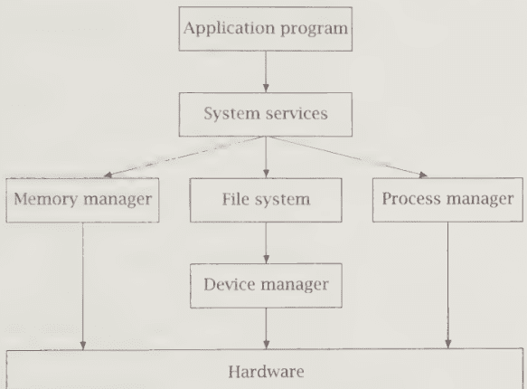

图 1.3：分层结构

每一层都可以被提供一个虚拟机，一个越越用户友好的界面。顶层是用户看到的虚拟机。图 1.3 给出了一个简要示例。有时，不是垂直图，分层结构被构想为环绕硬件的一系列同心圆。

大多数早期操作系统并不是这样构建的。它们设计于一个操作系统理论基础尚未被理解的时代。那个时代管理大型项目的方法也不完善，这导致了糟糕的设计。

此外还频繁添加补丁来修复漏洞或提供额外功能，且通常是应用户要求的。这些都不利于形成整洁的设计。

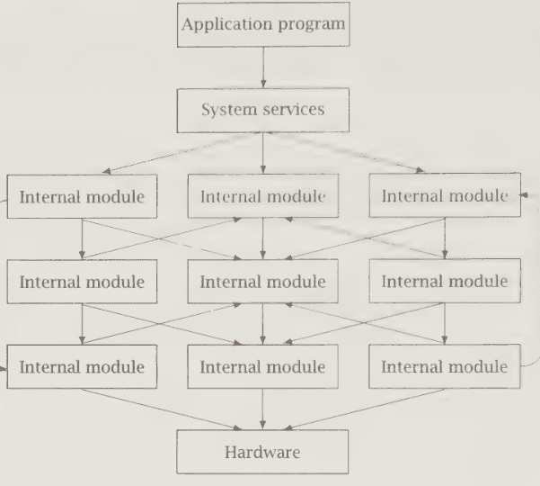

操作系统应该能够以组织的方式增长。对系统的某部分进行添加，而不会引发其他部分的问题。这通常发生在程序某部分的变量值被其他代码无意中更改时。这一切意味着模块化。它还要求代码具有良好的。

### 模块化设计

设计、构建和维护大型软件系统需要对系统结构的高层次视角，以及其不同组件如何协同工作。我们都从操作系统的顶层分解开始。

在本章的前面，我们将操作系统视为一个单一模块，提供一个比真实机器更易使用的抽象机器。这样的系统有两个接口；一个“向上”，即系统服务接口；一个“向下”，指向下一层，操作系统可以分解为一组模块。这些模块包括：

- 进程管理
- 内存管理
- I/O 管理
- 文件存储，它使用 I/O，并增加了保护和安全
- 网络管理。

这样的操作系统如图 1.5 所示。

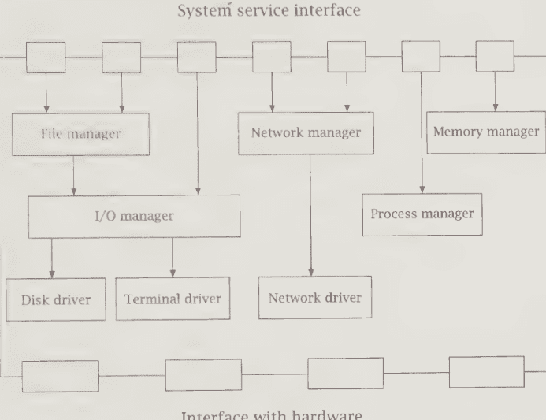

图 1.5：模块化操作系统

### 微内核

操作系统往往变得越来越大复杂。一个较新的建议是将操作系统重构为两层。底层是微内核，它提供最少的设施。例如，在硬件层面，微内核提供一个处理寄存器中位设置和测试的函数，以便字符进入或离开计算机。

在微内核之上是一个层，提供可选的额外服务，并实现特定系统服务接口的所有功能。这有时被称为仿真层，因为它试图从外部看起来像某个特定的操作系统。微内核提供它自己的私有接口，供构建在其之上的任何仿真层使用。


甚至可以同时模拟多个系统接口。图 1.6 显示了一个微内核，其上方分层了一个 POSIX 接口和一个微软 Win32 应用程序编程接口。有时这些接口被称为不同的“个性性”。NT 操作系统就是这样构建的。

| POSIX 系统服务 | Win32 接口 |
| :--- | :--- |
| | POSIX 仿真 | Win32 仿真 |
| | 微内核 | | |
| 进程管理器 | 内存管理器 | I/O 管理器 | 网络管理器 |

图 1.6：具有两种个性的微内核

# Linux

Linux 是作为一个非常传统的单内核构建的。因此，它的结构通过图 1.5 描述最为合适。它并不是设计操作系统的良好示例。这种现象的主要原因在于它的历史。它并不是从零开始设计的——更准确的说是它是演变而来的。

它最初是为相对缓慢的 386 架构编写的，因此性能比良好的结构设计重要得多。这在内核的时间临界区域得尤为明显。在这些地方，C 代码变得非常晦涩且难以阅读。它经常退到汇编语言，并且总是显示出其最初开发时 386 架构的影响。

然而，它仍然是一个作为操作系统课程基础的良好系统。源代码的广泛可用性超过了这里提到的任何缺点。

# 1.7 总结

- 1. 操作系统是一个位于原始硬件和应用程序之间的程序。它为程序员提供了一个易于用户友好的接口，隐藏了硬件的复杂性和多样性。
- 2. 它提供了一个环境，使应用程序程序员能够更容易进行生产性工作：
    - 提供执行最常用操作的功能
    - 管理和共享计算机系统资源，如 CPU、内存、磁盘和打印机
    - 隐藏硬件的某些差异。

它以尽可能高效和经济的方式完成所有这一切。

- 3. 大多数用户熟悉图形化用户界面和命令行解释器。这些只是运行在操作系统之上的分时应用程序，并使其变得更加用户友好。像所有应用程序一样，它们反过来也利用系统服务。这些才是操作系统的真实接口。

- 4. 最的计算机没有操作系统，程序员直接与硬件交互。第一批操作系统无非是加载程序。 50 年代引入的带有控制程序的卫星计算机，是首次尝试克服设备速度与 CPU 速度之间的差异。

60 年代，对操作员的口头命令被用作业控制语言编写的机器读命令取代。在 I/O 方面，I/O 通道和中断的引入是一个里程碑。I/O 与计算的重叠导致了并发，进而导致了调度、资源优化和保护的发展。

60 年代后期，分时制导致了显示器终端（VDU）的发展。70 年代是虚拟内存时代。80 年代，网络和 GUI 是开发领域。90 年代，分布式系统和开放系统处于操作系统研究的前沿。

第一批微机产生于 60 年代初，到 70 年代末，它们的操作系统已经拥有大型机的所有功能。微机从 70 年代中期开始，现在在几乎所有方面都追上了它们的“大哥们”。

第一个 Unix 系统开发于 1969 年。1973 年，它用 C 语言重写，使其具有可移植性。此的是是大量略有不同的版本。目前正努力对其进行标准化，主要是 POSIX 和 Open Group。

- 5. 开发了许多不同类型的操作系统以满足特定需求。历史上出现的最重要区别是批处理系统和交互式系统。在批处理系统中，程序和数据以“作业”的形式一起提交。

交互式系统是用户通过键盘、鼠标、屏幕与计算机进行对话。某些系统（如 Windows NT 和 OS/2）在单用户的基础上提供交互式计算；另一些则在多用户或多访问的基础上提供这种服务。

这两者在通用系统中经常被结合。还有用于控制网络的专用系统，以及用于控制作为一个整体运行的机器组的分布式操作系统。

- G. 早操作系统并不是按照现代软件开发标准设计和构建的，倾向于包含大量的“面条代码”。现在人们认同此类大型软件应该以模块化的方式进行设计和构建。操作系统的顶层分解将包括管理进程、内存、I/O、通信和文件系统的模块。

最近的设计趋势是将绝对必要的特征隔离在微内核中。其他服务可以层层在其之上。最后，不同的系统服务接口可以使其看起来像不同的操作系统，或“个性性”。

Linux 的设计并不特别好。它作为示例系统的优势是它是免费提供的。

# 1.8 讨论题

- 1. 你认为序言中关于学习操作系统的论点有说服力吗？你为什么认为操作系统课程应该被废除？你能想到其他为什么它们应该是计算机系统课程的一部分的原因吗？

- 2. 操作系统计算机中的额外软件层，是需要执行的额外指令，它会减慢应用程序的运行。讨论完全移除操作系统的优缺点。（注：原文中此处重复多次，已按要求去重）


对于 Unix，这些服务通常在手册的第 2 节中描述。执行 shell 命令 `man 2 intro` 将提供概览。

# 外部的系统服务

编程接口相对简单。系统服务在在线手册页中都有完整的描述。这里提到的任何内容只是摘要。手册页指定了每个系统服务所需的头文件。这些文件必须被包含进来。手册页还给出了每个参数的顺序、类型和含义，并解释了每个参数控制函数的哪个方面。它们还给出了函数返回值的类型和含义。程序员使用适当的参数值调用函数。链接器在标准 C 库中查找该函数，并将其绑定到可执行程序中。

## 返回值

系统服务是以 C 函数的形式编写和调用的。这意味着它们会返回一个值。在大多数情况下，这些函数的类型是 `int`。但异常情况越来越多，包括少数声明为 `void` 的函数，因此应该始终检查手册页。

这个返回值不仅仅是为了被丢弃。系统编程与应用程序编程不同，在后者中，通常从屏幕看到程序运行是否正常。当调用系统服务时（例如更改操作系统的某些属性或写入磁盘），没有明显的指示来表明操作是否成功。唯一的指示就是返回的值。

该值在每个情况下的具体含义在相应的手册页中有定义。但在大多数情况下，如果调用由于某种原因未成功，返回值为 -1。如果调用成功，则会返回另一个值。应该检查这个成功值，以确保它是正确的。仅仅检查调用没有失败是不够的。它可能成功了，但没有完成预期的操作。

## 错误

通常，程序在系统调用失败后不应该继续运行——假设它被调用是为了某个目的，而现在这个目的没有实现。失败的原因可能更重要。

当系统调用失败时，相应的 C 函数也会返回一个指示失败原因的值。它使用的机制是一个类型为 `int` 的外部变量，称为 `errno`。它在文件 `/usr/include/errno.h` 中声明。

从这里我们将使用标准的 C 简写来指代 `/usr/include` 目录下的文件，直接说 `<errno.h>`。

## 2.1 系统服务接口

为了移植性，最好依赖此声明，而不是在你的程序中自己声明。链接器会将其与 C 库程序中声明的变量标识。因此，系统服务会将一个值放入该变量中，你的程序能够读取该值。这种情况如图 2.1 所示。执行 shell 命令 `errno` 将提供更多信息。

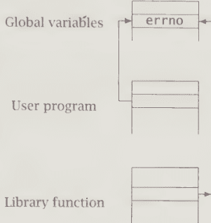

图 2.1：全局变量的内存布局

需要注意的是，`errno` 中的值只有在库函数返回 -1 的情况下才有效。如果调用成功并返回了任何其他值，仍然可以访问 `errno`，但其值是未定义的。事实上，系统在成功调用后不会更改 `errno` 中的值。这意味着它始终包含与最后一次失败调用相关的值，无论该调用发生在程序运行的多早之前。

所以，`errno` 提供了一个指示系统失败原因的数字。但知道（例如）发生了错误 17 并没有多大用处。我们需要查出是哪个错误被分配了数字 17。怎么做呢？回到手册页。

每个手册页都列出了该系统调用可能发生的所有错误的列表和解释。但是，它们不是通过数字标识的，而是通过字面量常量，例如 `EAGAIN` 或 `EBADPARM`。最后一块拼图是将 `errno` 中返回的 `int` 与手册页上解释的常量连接起来。

这个缺失的文件是头文件 `<errno.h>`，其中定义了每个字面量常量。因此，如果程序中包含了此文件，就可以使用字面量常量测试 `errno` 的每种可能值，并打印适当的消息，如图 2.2 所示。对于每个系统调用都必须这样做。其中某些调用有许多可能的错误。所以系统程序似乎将变得非常长。

```
#include <errno.h>
```

```
ret_val = systervice();
if (ret_val == -1) switch (errno) {
    case EAGAIN:    printf("one message");
        break;
    case EBADPARM:  printf("another message");
}}
```

# 图 2.2：检查错误值

C 库包含一个针对这种情况的有用函数 `perror()`。当调用它时，它会打印与当前 `errno` 值相对应的适当消息。`perror()` 的手册页将提供更多信息。

注意，如果你愿意，可以在 `perror()` 的打印中添加你自己的消息。这是因为因为perror()` 无法知道哪个系统调用导致了 `errno` 被设置。告诉用户发生了某某错误可能并不有用。但如果包含了“在程序的某处”这样的额外信息，那么屏幕上就会打印出正确数量的调试信息。

关于 `perror()` 的警告：它应该只在系统调用返回 -1 之后立即调用。如果在程序的任何其他地方调用，它仍然会解释 `errno` 中的（伪的）值，并打印出伪的错误消息，导致不必要的困惑。

当系统调用失败时，通常在系统调用返回 -1 后就会终止。出了一些问题。

# 内部的系统服务

现在让我们更仔细地观察这些服务。所有现代 CPU 至少以两种模式运行。在其中一种模式下（用户态），CPU 只能执行指令集。在另一种模式下（内核态），CPU 可以执行所有指令，包括特权访问。这基于架构。

386 有一个特殊的寄存器 `IDTR`，它指向内存中的中断描述表 (IDT)。该表为 256 个可能的中断中的每一个都提供一个条目。当库函数执行 `INT 0x80` 指令时，CPU 进入中断描述表中的相应条目并读取存储在该处的描述符。读取描述符对 CPU 有两个影响。首先，它将处理器切换到内核态执行。但它允许从内存的另一个地方读取——一种隐式的跳转。它将控制权转移到内核中的一个通用系统调用处理程序 `system_call()`，位于汇语言文件 `entry.S`。

## 2.1 服务接口

程序员通过名称知道每个系统服务，并通过名称调用它们，如 `read()` 或 `write()`。但在内部，操作系统通过数字识别每个服务。每个对应的数字可以在 `<asm/unistd.h>` 中找到。

应用程序调用的实际库函数做得很少。它将相应的系统调用号放入 `EAX`，将参数放入以 `EBX` 开始的寄存器中，并执行一条特殊指令，引起软件中断。在 PC 上，这条指令是 `INT`。

# 内核函数

它执行一些清理工作，以确保不会覆盖用户程序在 CPU 寄存器中的任何信息。然后，它使用系统调用号（`EAX` 寄存器）索引到系统调度表 `sys_call_table`（该表也声明在 `entry.S` 中），找到执行特定系统服务的内核代码地址。

这里涉及到两个表，可能会导致一些混淆。第一个表（中断描述表）中只有一个条目与系统服务相关，即 `0x80`。它包含了 `system_call()` 例程的地址。第二个表 `sys_call_table` 为每个可能的系统服务提供一个条目；每个条目包含执行该系统服务的操作系统函数地址。`system_call()` 例程使用 `EAX` 寄存器中的值索引此表，并找到适当的代码地址。见图 2.3。


# 2 操作系统的两个接口

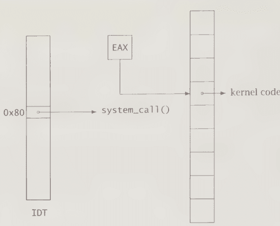

当内核代码执行完成后，它使用另一个特殊的机器指令 IRET 将模式切换回用户态。像所有函数一样，它返回到调用者，在当前情况下，调用者是 `system_call()`。这恢复了它可能保存的寄存器值，并向 C 库函数返回一个适当的值。在此过程中，它会确保任何返回给用户的数据都符合预期格式。

例如，`read()` 系统服务的参数之一是一个指向内存区域的指针。C 函数将刚刚读取读取的数据移动到该区域。它还会确定 C 函数本身要返回什么值。如果调用失败，它会将一个适当的值放入 `errno` 中，并返回 -1。

最后，它将控制权交还它的调用者，即应用程序。图 2.4 描述了整个过程。

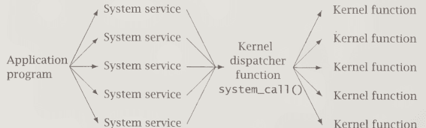

图 2.3：系统调用表索引

图 2.4：调用系统服务

## 与硬件的接口

正如预期的那样，操作系统与硬件之间的接口并没有——也无法——使用用于两层软件接口的调用/返回机制。这种软件与硬件之间的接口是独特的。它很大程度上取决于所涉及的具体硬件。在这里，我们将尽可能地进行泛化。

### 简单接口

任何计算机都有一定数量的内存。这些内存具有某些特性。首先，内存的每个字节都有唯一的 ID 号，称为其地址。内存通常安装在寄存器中，并且是连续的，尽管这并非绝对必要。内存的另一个特性是，当我们向特定字节写入某个值时，我们期望将来从该字节读取读取时，该值仍然会在那里。我们期望它能记住那个值——因此名为“memory”（记忆）。

### 数据传输

内存可以被想象为死胡同。当 CPU 通过数据总线将一个值存入特定字节中时，该值能够被读取的唯一方法是沿着相同的数据总线，以相反的方向。这如图 2.5 所示。


图 2.5：计算机内存

可以构建双端口的内存。这意味着一个特定字节有两条进入和退出的路径。在这种情况下，如果一个值被放入特定字节中，无法保证它在稍后还在那里。它可能已经从另一条路径移除，或者被另一条路径覆盖。

这就是用于在计算机中进出信息字节的机制。地址空间中的一个特定位置被选择给特定设备，它不是普通的内存，而是用这种双端口内存实现的，这种内存通常被称为设备寄存器。它的一侧像往常一样连接到计算机的数据总线。

另一侧直接连接到设备。这如图 2.6 所示。现在，设备可以将数据放入该寄存器中，程序可以检索这些数据，就像从内存中读取一样。相反，程序可以将数据放入寄存器中，就像写入内存一样。设备随后可以直接读取这些数据。

### 数据总线 (8位)


图 2.6：双端口内存

从另一个角度看，内存可以被想象一组用于分类信件的格子栅（pigeon holes）。如果它们实实地靠着墙，那么放在前面的任何东西都必须留在那里，直到从前面取出。如果房间的门锁着，我们就有一个闭合系统。我们可以将物品从一个格子移动到另一个，或者移动到桌子（CPU）。但我们无法将新物品引入房间，或将物品取出房间。

现在，如果其中一个格子的后面墙被撞开了一个洞，我们就有进出的通道。当我们把信件放入那个特定的槽时，我们期望隔壁房间的人能取出它们，并对它们进行处理。同样，我们也知道来自外部世界的新信会偶尔出现在这里。我们甚至可以变得更复杂，设置两个槽，一个用于输入，一个用于输出。

### 同步

回到计算机，我们面临同步问题。当按下键盘上的按键时，键盘硬件会将该按键对应的代码值放在相应的寄存器中。如果程序在下一个按键按下之前没有移除该值，上一个值将被覆盖并丢失。另一种可能性是，程序从寄存器中取走值后，在另一个按键按下之前又回来取出下一个值。在这种情况下，它将获得上一个值的第二个副本，这也不是我们想要的。

所以必须有某种方式让设备告诉程序它放入了一个值，并且寄存器已准备好接收下一个值。

此最简单的方法是轮询（poll）。但轮询是无效的，因为 CPU 必须不断检查设备以查看是否有可用数据。

### 多设备

如果有许多设备，CPU 必须逐一检查每一个。这更慢了。如果设备很多，CPU 大部分时间都花在检查上。

### 中断机制

由于轮询浪费资源，开发了另一种机制。一条称为中断的特殊线路将 CPU 与所有设备连接起来。通过在该线上发送电脉冲，任何设备都可以获得 CPU 的注意。这种配置如图 2.8 所示。（注：原文未提供图 2.8 ）

### 简单机制

有了这种机制，CPU 可以忙于处理而忽略设备。当任何设备有数据要交付时，它按照之前的过程执行，但现在它是在中断线上发送电脉冲。当 CPU 接收到信号时，它停止当前工作并运行轮询程序。我们仍然在使用轮询，但只有当设备有可用数据时才轮询。我们通过轮询找出哪一个。

轮询程序找到哪个设备触发了中断，并从中获取输入字节数据。CPU 返回到它在中断之前做的工作。

CPU 如何回到中断前的精确位置？假设 CPU 正在执行一个与中断源无关的应用程序。当设备发出信号时，CPU 完成了正在执行的指令，但没有进入下一条。相反，它保存了下一条指令的地址，在 Intel 架构中是从 EIP 寄存器获取的。它跳转到轮询程序，从预定义位置将其地址加载到 EIP 寄存器。

当轮询程序终止时，CPU 恢复保存的中断值。所有架构都有 IRET 指令或类似的指令。这恢复了 EIP 的值，从而将机器置于中断前的完全状态。因此，中断后执行的第一条指令是中断前正准备执行的那一条。

### 区分中断

中断是非常频繁发生的事件。在负载沉重的机器上，每秒可能有几十次。每次都要轮询许多设备以找到真正中断的那一个，这将是不可接受的开销。硬件设计师开发了中断机制，以便将更多的识别工作交给硬件，从而使其更快。这种方法采取了两种路径：一种以 Intel 系列 CPU 为代表，它们只有一条中断线；另一种则引入了许多中断线，如大多数现代架构所示。


## 单中断线

Intel 8088 设计的时代，集成到单个芯片上的晶体管数量非常有限。设计者在 CPU 空间内仅能实现一条中断线。出于兼容性考虑，所有后续的 CPU 仍然只有这一根线。

这意味着 CPU 只知道有设备触发了中断——它必须通过轮询（poll）来确定是哪一个设备。但设计者自动化了轮询过程，使其能够足够快地完成。

在这种架构下，当设备发生中断时，CPU 会像往常一样保存 EIP 寄存器。它在另一条线上（确认线，acknowledgement line）发送信号。所有设备都连接到这条线上。发生中断的设备听到确认信号，并在数据总线上写出一个位数字，CPU 读取该数字。然后，这个数字被用于索引中断描述表；来自相应条目的地址被加载到 EIP 寄存器，导致 CPU 从该地址执行下一条指令。这些地址分别指向特定设备的处理程序（或驱动程序）。

例如，当第 7 号设备在数据总线上放置数字 7 时，CPU 开始执行为该设备身定制的第 7 号驱动程序。

当处理程序完成后，控制权会像往常一样返回到中断程序中的下一条指令。

## 多中断线

硬件层面的另一种可能性是拥有多条中断线——8 条、16 条或 32 条。然后根据中断信号发送在哪条线上，CPU 将跳转到 32 个处理程序之一。虽然可以为每个设备连接不同的线，但更常见的做法是为每类设备分配一条线。例如，当终端触发中断时，CPU 跳到一个终端处理程序，然后通过轮询来确定我们需要哪一个特定终端的服务。

## 中断优先级

最后一点需要考虑当两个设备同时发生中断时会发生。在实践中，所有可能的中断源按优先级排序。在处理特定优先级的中断时，CPU 不允许被相同或更低优先的中断中断。

在具有单中断线的机器上，优先级排序不是由 CPU 完成，而是由另一个称为可编程中断控制器（PIC）的芯片完成。见图 2.9。

图 2.9：控制器的中断仲裁

设备物理连接到 PIC，而 PIC 又通过单中断线连接到 CPU。在启动时，PIC 会被程序化，包含每个设备的中断优先级级别（IPL）信息，以及每个设备应请求的中断号。如果两个设备在同一时刻发生中断，PIC 将决定它们被处理的顺序。它中断 CPU 以处理第一个，等待其完成，然后再次中断以处理第二个。如果 CPU 正在处理低优先级中断时，高优先级的设备发生了中断，PIC 将向 CPU 发出信号以处理新的中断。

在具有许多中断线的机器上，所有的仲裁都由 CPU 自身完成。每条线在某一时刻都有不同的优先级，这是 CPU 设计的一个特性。设备的优先级取决于它所连接的中断线。这由计算机设计者决定，或者在安装设备时决定。它不容易被更改。

## 时钟中断处理

一个值得特别提到的独特设备是系统时钟。它不断地中断 CPU，通常每秒 100 次。该中断在所有中断中优先级仅次第二。只有电源故障中断的优先级更高，原因显而易见。

每当时钟触发中断时，其处理程序会执行在书中将在上下文中讨论的操作。在这里，只需意识到它的存在即可。

## 直接内存访问

上述所有讨论，即使使用最复杂的中断机制，也预假设数据是通过寄存器逐字节传输的。这对于一次处理一个字节的设备（如键盘）是理想的。为了加快其他设备（如磁盘驱动器或打印机）的速度，寄存器可以更宽：16 位、32 位，甚至 64 位。但这并不是快速设备的真正解决方案。磁盘驱动器一次可以传输 8kB 的数据块；网络设备每秒可以传输 10Mbits。在这种情况下，每隔几个字节就中断一次是不可忍受的。

因此，开发了一种完全不同的解决方案。我们保留了上一个示例中的状态寄存器并对其进行了扩展。中断机制也被保留了。设备电路中增加了额外的处理能力。然后删除了数据寄存器，并将数据线直接连接到设备。此外，计算机的地址也直接连接到设备。这种安排被称为直接内存访问（DMA）控制器，如图 2.10 所示。

让我们检查如何使用 DMA 向磁盘驱动器写入 8kB 的数据块。CPU 像以前一样设置状态寄存器中的各种位。但现在要写入的数据块不在寄存器中——而是在计算机的内存中。因此，设备中有两个额外的寄存器：一个用于存储数据块所在的内存地址，另一个用于存储其长度。一旦完成，CPU 就完成了任务并继续做其他工作。现在 DMA 处理器从主内存中移动数据，CPU 就可以去进行更有生产率的工作。

## 2.3 总结

- 系统服务操作系统为应用程序提供的函数。它们记录在手册中。
- 一个常见的误解是认为与系统服务相关的头文件包含该服务的代码。检查这样一个头文件，看看它实际上包含什么。
- 一旦完成，CPU 就完成了任务并继续做其他工作。现在 DMA 处理器从主内存中移动数据，CPU 就可以去进行更有生产率的工作。

## 2.4 讨论题

- 用 C 编写的程序很容易在不同架构间迁移。解释 `printf()` 函数如何在不同机器上产生相同的效果。
- 调查非 POSIX 风格操作系统（如 NT 或 OpenVMS）提供的系统服务。
- 检查 `read()` 系统服务的手册页。描述你对返回值进行的所有检查，以确保涵盖了所有可能性。
- 调查 `strerror()` 库函数。你能建议它的用途吗？
- 所有系统服务都调用一个特殊指令，导致 CPU 切换到内核模式。看起来你可以编写自己的使用该指令的汇编程序，从而接管机器。调查你正在使用的硬件上的特殊指令，并找出为什么看起来没那么简单。
- 调查 Intel 架构中断表条目的格式。
- 许多计算机架构将 I/O 端口分配到普通内存地址，如 2.2 所示。
- 如果系统没有中断机制，它会使用轮询来检查设备状态寄存器吗？它必须持续轮询吗，还是可以间隔运行轮询程序？
- 当设备发生中断时，运行程序的 EIP 值会被自动保存，中断处理程序的 EIP 值被加载到硬件寄存器中。但通用寄存器可能仍包含运行程序的值。中断处理程序在不使用某些寄存器的情况下无法运行。它如何在不覆盖运行程序值的情况下做到这一点？


- 11. 中断程序可以通过 `INT` 指令从运行中的程序中调用。如果程序员调用了一个没有处理程序的中断号，会发生什么？操作系统将如何处理这种情况？

- 12.为连接到 PC 的所有设备建议一个优先级顺序。

- 13. Linux 会立即处理中断所需的最紧急的操作。不那么紧迫的操作会被推迟，这样如果发生了其他中断，它们也可以被立即处理。调查 Linux 中如何使用“下半部”（bottom halves）来延迟此类不那么紧迫的操作。

- 14. 列出你认为时钟中断处理程序可能执行的一些功能。

# 进程管理器 3

在第 1 节结束时，已经确定了构成操作系统的模块。现在我们转向其中的第一个部分：进程管理器。

## 3.1 进程的概念

该领域有许多关键词和概念。
程序是指令的序列。它本质上是翻译成某种编程语言的算法。程序本身什么都不做，它是静态的（惰惰的）。

初步来看，进程可以被描述为“运行中的程序”。当组成程序的指令实际上被执行时，就存在一个进程。另一种表述可能是“由于执行程序中指定的指令而产生的操作序列”。这传出了进程是一个活跃对象的概念。程序与进程之间的关系类似于制作蛋糕配谱与厨房中实际过程之间的关系——从原料、混合、烘焙，直到享用的整个过程。

一个非常正式的定义是“由于一组指令对它们所处的状态进行操作而导致的状态序列”。乍一看，这似乎完全不是一回事。它看起来像是一个静态的概念，而不是动态的，因此有必要解释在此语境下“计算状态”是指什么意思。它就像是在某个特定瞬间拍摄的计算机内部结构照片。它包含了 CPU 寄存器中的值、内存中每个字节的值，以及与硬件设备相关的每个特殊寄存器的值。

在任何给定时刻，计算机都处于特定的状态。当执行一条指令时，机器中某处的至少一个值会发生变化，并将其移动到一个（略有不同的）新状态。即使是无操作指令 NOP 也是如此——至少程序计数器已经改变并指向下一条指令。

考虑图 3.1 给出的非常小的汇编程序。我们只对程序计数器（EIP）、一个 CPU 寄存器（EAX）和一个内存位置（total）感兴趣。显然，还有许多其他元素构成了机器的全状态，但只有显示的这些与示例相关。

- 1: MOV EAX, 7 ; 将值 7 载入寄存器 EAX
- 2: INC EAX ; 寄存器 EAX 加1
- 3: MOV total, EAX; 将寄存器 EAX 的值存储到 total

图 3.1: 用于说明状态变化的程序

执行该程序时对应的状态序列如图 3.2 所示。

| 初始状态 | EIP | EAX | total |
|---|---|---|---|
| 第一条指令执行后的状态 | 1 | 0 | 0 |
| 第二条指令执行后的状态 | 2 | 7 | 0 |
| 第三条指令执行后的状态 | 4 | 8 | 8 |

图 3.2: 程序执行时的状态

因此，该定义是说，进程由所有这些状态组成，从初始状态到最终状态。它类似于电影，电影由成百或上千张静态照片组成。当我们按照正确的顺序查看所有的照片时，我们就得到了电影。当我们考虑多个进程在同一台机器上同时运行时，进程作为状态序列的观点将非常重要。

程序和进程之间并不是 1 对 1 的对应，考虑这一点可能有助于我们固定这些概念。

一个进程可能涉及多个程序。大多数操作系统允许一个程序向另一个程序发出指令。因此，在某些状态下，一个进程可能正在执行程序 A 的指令，而在稍后的状态中可能在执行程序 B 的指令。
一个程序也可能同时涉及多个进程。共享程序代码在多任务系统中是常见的。例如，如果多个程序员同时使用编辑器，那么内存中只会被加载一份编辑器程序的拷贝（副本）。他们将从同一份副本中读取指令。当然，每个进程都会有一份独立的编辑器数据副本——假设每个用户都在编辑自己的文件。

## 3.2 进程的使用

简要观察进程在计算机系统实现中如何被使用，有助于澄清上一节中提出的某些概念。

## 3.3 处理器与进程

在某些系统中，每个用户被分配一个进程。该进程在用户登录时创建，用户激活的每个程序都作为该进程的一部分来运行。在其他系统中，用户发出的每个命令和运行的每个程序都会创建一个新进程。后者是 Unix 风格。

可能有多个进程构成操作系统。进程管理器本身就是一个进程。它将具有最高优先级，并在需要时在任何其他进程之前访问处理器。内存管理器、文件管理器、设备管理器和网络管理器也是进程。它们都会排队等待处理器，由进程管理器决定下一个运行哪一个。

如果只有一个处理器，那么在任何时刻只能运行一个进程。如果有多个处理器，那么多个进程就可以同时运行。这是并行处理的基础。

在现代操作系统中，进程不再是一个单一的执行序列。它是一个线程的集合。线程是内核可以调度的最小执行单元。进程拥有它自己的地址空间、数据和其他资源，但每个线程都有它自己的程序计数器、寄存器和栈。

同一进程内的线程共享相同的地址空间和资源。这使得线程之间的通信比进程之间要容易得多。然而，这意味着线程必须小心不要在修改修改相同的数据，这可能会导致问题。

## 3.4 进程与线程

我们在上一节中看到，有时进程在处理器上运行，建立状态。而在其他时候，由于某种原因，它处于空闲状态。从运行切换到空闲涉及的开销可能是巨大的。经常会出现进程开始运行但立即停止以等待某些输入可用的情况。操作系统必须保存进程的整个状态。当进程再次开始运行时，涉及类似的开销。必须恢复所有保存的状态，并将机器设置得与进程上次运行时完全相同。随着 CPU 寄存器数量和大小的增加，以及操作系统变得越来越复杂（需要记住越来越多的状态），这种开销正在不断增加。


## 3.4 进程与线程

分配的资源块，特别是内存。现在的趋势是拥有一个资源分配单元，即一个可执行程序，它通过多个执行路径同时运行。正在演进的术语将旧系统称为重量级进程（heavyweight processes），或直接称为进程。新样式被称为轻量级进程（lightweight processes）或线程（threads），但并没有统一的说法。

线程可以访问分配给进程的所有资源。它可以被定义为进程内部的单一、顺序控制流。一个进程从单个线程开始运行；但随后它可以在内部创建进一步的控制线程。

既然一个进程可以拥有多个控制线程，如果其中一个线程被阻塞，另一个就可以执行。为此，不需要保存和恢复机器的完整状态，因为它们使用相同的内存、程序、文件、设备——它只是跳转到程序代码中的另一个位置。但每个线程必须维护自己的某些状态信息，例如程序计数器（pc）、栈指针（sp）和通用寄存器。这样当它重新获得控制权时，可以从之前丢失控制的地方继续执行。

我们之前使用的烤蛋糕的例子可以扩展到烤多个蛋糕。我们仍然只有一个进程。只有一组资源。只有一份配方。但当一个蛋糕在烤箱里时，我们可能正在为另一个混合原料。我们同时在两个不同的地方遵循配方。与其空闲地等待第一个蛋糕烤好，我们在高效地利用这段时间。

## 示例

多线程的用处。如果只有一个线程，那么它每次只能处理一个请求。由于它会花费部分时间等待磁盘驱动器，它为客户完成的工作总量将远低于其容量。图 3.4 展示了资源使用下的这种情况。CPU 有时是空闲的，而2 号驱动器一直空闲。


图 3.4：利用率低的系统

然而，如果服务器进程中有许多控制线程，当某些线程阻塞等待磁盘驱动器时，另一个可以处理来自新客户端的请求。通过这种方式，服务器受限于磁盘驱动器提供信息的能力。图 3.5 显示了这种情况，CPU 被完全占用，两个驱动器都处于相当恒定的使用状态。

线程 A
线程 B
线程 C
2 号驱动器
1 号驱动器

图 3.5：CPU 和磁盘驱动器的高利用

实现此点的常用方法是为每个请求创建一个新线程。当请求被完全处理后，该线程被销毁。可能有一个调度线程（dispatcher thread），它负责接收传入的请求并创建工作线程（worker threads）来执行它们。或者，也可以有固定数量的工作线程，每个线程读取并处理它自己的请求。

### 实现

有时线程包被实现为一组库例程，完全在用户级运行。这节省了每次当线程控制从一个线程切换到另一个线程时，涉及内核的开销。内核将 CPU 的控制权交给进程。正在执行的程序调用库函数，这些函数将时间分配给多个线程。这种方法有一个严重的缺点（原文为`This approach has the serious drawback`）：如果一个线程调用了系统服务（如 `read()`），并且它必须等待按键，内核将阻塞整个进程，并将 CPU 交给另一个。内核并不知道线程。它可能被看作是在现有系统之上实现线程的一种廉价方法。

另一种可能性是在内核内部实现线程，然后由内核处理所有线程之间的切换。Linux 拥有线程包。它的接口是 `pthread` 库函数，它是 1995 年 POSIX 1003.1c 标准的实现。然而，Linux 在内核中提供线程有一种独特的方法。它创建一个新进程，但指定原始进程和新进程共享内存、程序和打开的文件。对用户来说，这些新进程作为 POSIX 线程出现并被操作。

C 语言库中的某些例程并不容易移植到多线程环境。它们期望自己是进程中唯一的执行线程，因此可能在不采取任何预防措施的情况下调整表中的链接。当进程中存在多个控制线程时，这些假设就不再有效。由于所有线程都可以访问进程内存空间中的所有数据结构，始终存在两个或多个线程相互干扰的可能性。因此，库必须重写以实现线程安全（thread safe）。

## 3.5 进程的表示

与所有软件系统一样，操作系统使用数据结构来表示它所处理的对象。我们在学习过程中将检查许多此类结构；它们都将声明为 C `struct`。

对于它所已知的每个进程，操作系统都维护一种名为进程描述符（process descriptor）或进程控制块（process control block）的数据结构。它包含了控制该进程所需的所有信息。

在进入 Linux 如何实现进程控制块的细节之前，有一些设计点需要考虑。所有这些内容都可以静态地实现在固定大小的表中。这种方法的优点是可以通过索引此表立即找到与特定进程的信息。缺点是，如果只运行少数进程，而却为数百个进程分配了空间，就会有很多空间浪费；此外，同时运行的进程数量是有上限的。

另一种可能性是动态分配空间，仅按需分配；这意味着空间永远不会过多或过少。缺点是你无法对这种列表进行索引——必须顺序搜索。

## Linux 中的进程控制块

Linux 实际上使用了两种系统。结构在创建新进程时动态分配并保持在双链表上。为了避免频繁搜索该列表的开销，这些结构还维护在一个哈希列表中。该哈希表的根节点是在启动时静态设置的。这如图 3.6 所示。

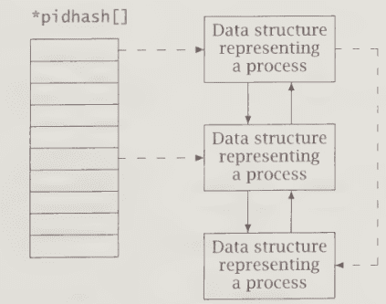

图 3.6：系统如何跟踪进程

哈希列表定义为 `struct task_struct *pid[]`，位于 `<fork.c>` 中。列表的每个元素只是指向进程块的指针，如图 3.6 中的虚线所示。

## Linux 中的 task_struct 结构

每个活动进程分配一个 `task_struct`。它包含了跟踪进程（无论其是否运行）的所有数据。操作系统保证始终中保留这些信息。

这可能是内核中最重要的数据结构，因此我们对其进行详细检查。`task_struct` 中最相关的字段如图 3.7 所示。从某种意义上说，它是书中剩余的内容。

```
task_struct {
    volatile long state;
    long counter, priority;
    struct task_struct *next_task, *prev_task;
    struct task_struct *next_run, *prev_run;
    int exit_code, exit_signal;
    int ppid;
    struct task_struct *p_opptr, *p_cptr;
    struct wait_queue *wait_childextit;
    struct task_struct *pidhash_next;
    unsigned long policy;
    struct times times;
    unsigned long start_time;
    unsigned short uid, gid;
    struct thread_struct tss;
    struct files_struct *files;
    struct mm_struct *mm;
    struct signal_struct *sig;
    sigset_t signal, blocked;
};
```

图 3.7：表示进程的数据结构

- `state` 字段的值将在 3.8 节详细讨论。`counter` 字段包含剩余的 CPU 时间（以 Linux 自身的单位“ticks”测量）。`priority` 字段包含进程的优先级。调度程序对它们的使用将在 3.10 节中讨论。


## 3.5 进程表示

- `next_run` 和 `prev_run` 字段是向后和向前的指针，持有运行队列上的结构。这将在 3.8 节中讨论。

- 当进程终止时，返回给父进程的信息存储在 `exit_code` 中。这将在 3.12 节中讨论。如果进程是由信号终止的，`exit_signal` 字段包含该信号的数字。信号将在第 5 章中讨论。

- 每个进程在创建时都会获得一个唯一的进程标识符 (pid)。该数字维护在 `pid` 字段中。这是一个唯一标识符，它被哈希到图 3.6 的列表中，以找到与特定进程对应的 `task_struct`。`getpid()` 系统服务返回当前进程的 pid，而 `getppid()` 返回父进程的 pid。

- 有许多指向表示其他进程结构的指针，这些结构与当前进程相关。实际创建它的进程由 `p_opptr` 指向。它最近创建的子进程由 `p_cptr` 指向。

- 当进程等待子进程终止时，它在 `struct wait_queue_ldext` 字段上等待。这将在 3.12 节中讨论。

- 正如所述，这些 `task_struct` 结构维护在一个哈希列表中，该列表通过 `pidash_next` 字段连接。

- `policy` 字段决定了与此进程相关的调度策略。该字段的意义将在 3.10 节中讨论。

- 进程在用户模式和内核（系统）模式消耗的时间存储在 `times` 中。

- 进程创建的时间存储在 `start_time` 中。

- 与进程有多个标识符。操作系统使用这些 id 来决定是否授予进程访问系统资源。创建进程的用户 id 是 `uid`。系统服务 `getuid()` 返回此值，而 `setuid()` 则允许具有适当权限的进程更改其 uid。

- 与处理器寄存器关联的是相应的组标识符 `gid`，它在进程未运行时被保存。它有时被称为易变环境（volatile environment）。它包含了进程失去处理器控制权时需要保存的所有信息。它是特定于架构的，但包含所有寄存器的值，特别是程序计数器 (EIP) 和程序状态字或标志寄存器 EFLAGS。它在 3.9 节中详细描述。

- `files_struct` 指向指向该进程打开的 I/O 流的信息。这将在第 9 章处理，该章将开启书的整个后部分。

- `mm` 字段指向一个包含用于内存管理的控制信息的结构，将在第 8 章后续介绍。

- `sig` 字段指向在该进程中声明的信号处理程序数组，其相关性将在 5.2 节中解释。

- 有两个用于处理信号的位图。第一个 `signal` 标识待处理该进程的信号；第二个 `blocked` 标识进程当前已掩码的信号。这些将在 5.2 节中详细讨论。

## 3.6 进程创建

所有的操作系统都有某种创建新进程的方法。对于大多数系统来说，需要将一个可执行程序的名称名称作为相关系统服务的参数。代表进程的进程控制块随后被链接到进程结构上，它与那里已存在的其他结构无异，并与它们竞争 CPU 时间。

在 Unix 系统中，创建新进程的服务是 `fork()`。它创建了运行中进程的精确副本。因此，在调用 `fork()` 之后立即有两个进程，每个进程都执行相同的程序。它们中的每一个都处于程序完全相同的位置——`fork()` 之后的下一条指令，并且都将从那里继续执行。这并不很有用。通常，其中一个会请求操作系统运行另一个程序，因此最终结果是一个进程执行一个程序，而第二个进程执行另一个。

### 实现

当调用 `fork()` 系统服务时，Linux 内核会检查用户是否具有创建新进程所需的权限。如果是的话，它会为新的 `task_struct` 分配内存。它通过 `next_task` 和 `prev_task` 字段与已有的结构链接。它被分配一个新的 pid，并被用于将结构哈希到 `pidhash[]` 表中。所有其他字段都从其父进程的 `task_struct` 拷贝。新进程拥有所有这些字段的自己的拷贝——但它从父进程的值开始它的生命。

Linux 还有一个非标准的系统服务 `clone()`。它类似于 `fork()`，但它有许多参数，用于指定哪些资源应该与其父进程共享。根据传递给 `clone()` 的参数，它可以创建内存（包括程序空间）、文件系统（根和当前目录）、打开的文件、信号处理程序、id 数字。`fork()` 系统服务实际上是在内部通过调用 `clone()` 实现的。

在 Linux 中，`pthread` 库通过调用 `clone()` 创建新线程。这实际上创建了一个新进程，除了易变环境（`tss` 字段）外，其他方面与其父进程完全相同。

### Shell 练习

下面的简单练习让你对创建第二个进程有直。。假设读者熟悉一种 Unix shell。记得第 1 章中提到的，shell 解释器仅仅是另一个程序。当输入一个命令时（例如 `ls`），shell 会创建一个新进程来运行相应的程序，并阻塞自己直到该子进程终止。然后它会再次唤醒，打印出它的提示符，并等待下一次输入。

在 Unix 中，在 shell 命令后加上 `&` 是合法的，例如 `ls &`。在这种情况下，shell 会创建一个新进程来运行程序，而不会阻塞自己（此处注：原文此段逻辑似乎有跳跃，由于提供的英文描述可能存在重复或混乱，译文已根据语境进行逻辑优化翻译）。

（注：由于提供的英文示例文本在 Shell 练习部分似乎存在多处重复和逻辑断层，译文在保持原文原意的基础上确保了术语的专业性。）


## 3.7 线程的创建与终止

在此阶段可以尝试其他的系统服务。父进程和子进程都可以调用 `getpid()`，它会返回调用进程的 pid。当然，父进程已经知道了子进程的 pid，它是由 `fork()` 返回的。子进程可以通过调用 `getpid()` 获取父进程的 pid。这些调用返回的值可以被进程用于打印关于自身的信息。

## 运行新程序

可以使用 `exec()` 系统调用将其中一个、若干个或两个进程重定向以运行不同的程序。这会释放旧程序使用的内存，为加载新程序分配内存，并设置 CPU 寄存器的状态以开始执行新程序。这是 C 库中程序员可以使用的一种不寻常的系统服务。这些调用中的每一个都会将请求传递给 `exec()`。之所以如此复杂，是因为要运行的新程序可能需要传递参数。参数可以以列表或数组的形式传递。可以给出新可执行文件的完整路径，也可以在 `PATH` 目录中搜索程序。最后，新程序可以继承父进程的环境，也可以传递它自己的新环境。这些可能性都通过不同的库函数得到了考虑。

## 3.7 线程的创建与终止

用于操作线程的接口是 POSIX `pthread` 库。所有线程函数如果成功则返回 0，否则返回错误代码。注意它们返回的是错误代码；不使用 `errno`。因此，也无法使用 `perror()`。

## 线程创建

新线程通过 `pthread_create()` 函数创建。在库层级，每个线程都有一个类型为 `pthread_t` 的标识符。程序中必须声明一个该类型的变量，并将其地址作为参数传递给 `pthread_create()`。

第二个参数指定了新线程将拥有的属性。`NULL` 值意味着新线程将具有默认属性。

第三个参数指定了新线程开始执行的位置。由于新线程属于同一个进程，它必须在同一个程序内执行代码。但它不能随处开始。每个线程都从某个函数的开始处启动，这被称为启动例程（start routine），并在该函数结束时终止。当然，它可以调用其他函数，甚至是嵌套的子函数。

因此，第三个参数是启动例程的地址——在 C 语言中就是它的名称，不带通常的 `()`。记住你不是在调用该函数，而是将它的地址传递给线程创建者。调用函数与创建一个线程来执行函数之间的区别如图 3.9 的上、下部分所示。

图 3.9：函数调用与线程创建

在函数调用中，主程序会被挂起直到函数完成；然后它将在函数调用后的指令处继续。当创建一个新线程来执行函数时，主程序不会被阻塞；两者并行继续。

这种区别可以通过我们之前看过的一个示例的扩展来说明。如果你在烘焙时面粉不够了，你可以停止手头的工作，去商店买一些。然后，当你回来时，可以从刚才停止的地方精确继续。另一种可能性是，你可以派别人去商店（及早地），而你继续做手头的工作。

线程的启动函数必须始终声明为：它接收一个参数（一个指向 `void` 的指针），并返回一个指向 `void` 的指针。

为了向新线程中调用的函数传递参数，有一个第四个参数，另一个指向 `void` 的指针。线程创建者会安排该指针传递给线程的启动例程。

每个线程都有自己的栈，因此它对函数中声明的任何局部变量都有自己的私有副本。执行相同函数的另一个线程将拥有这些变量的不同副本。

线程一直存在直到它终止并被分离（detached）为止。

## 线程终止

线程可以通过三种不同方式之一终止。

- 它运行启动例程的末尾。函数的返回值将被保存，返回给 `pthread_join()` 的调用者。
- 或者，线程可以在代码的任何位置调用 `pthread_exit()`，给出一个返回值（指向 `void` 的指针）。`pthread_exit()` 中的指针必须指向退出后仍然存在的数据——因此数据必须声明为静态。
- 另一个线程调用 `pthread_cancel()`，这是一个终止请求。

## 分离线程

线程有两种分离方式。

- 另一个线程调用 `pthread_detach()`。如果目标已经终止，它将从系统中移除。
- 线程本身调用 `pthread_join()`。这允许调用者等待线程。

## 进程生命周期

每个进程都有生命周期，在此期间可能处于五种状态之一。进程在任何时刻的状态都记录在其 `task_struct` 的 `state` 字段中。

## 状态

- 它可能处于 `TASK_RUNNING`。这意味着它正在使用 CPU。在单处理器上，只有一个可以使用 CPU。在多处理器上，多个可以实际执行。
- 有时延迟可能会持续很长时间，例如等待按下按键或通过网络接收消息。对于这种长期的等待，系统中可能会发生其他事件，可能导致其停止等待。必须能够从这种等待中唤醒进程。因此它被认为处于可中断等待，并处于 `TASK_INTERRUPTIBLE` 状态。
- 如果延迟可能很短，例如等待文件读取完成，则不允许进程被中断。这种做法的背后的逻辑是它在短时间内终会唤醒，并且它可以处理已发生的任何事件。此类进程处于 `TASK_UNINTERRUPTIBLE` 状态。
- 在进程终止后，当其 `task_struct` 仍在系统中时，它处于 `TASK_ZOMBIE` 状态。
- 最后，进程可能会被停止，不是根据它自己的请求，而是通过另一个进程。通常是在进程正在调试时，正在逐条指令地步进执行。此类进程处于 `TASK_STOPPED` 状态。


## 3.8 进程生命周期

### 状态转换

状态之间可能的转换如图 3.12 所示，为了完整起见，该图还显示了进程何时进入和离开系统。

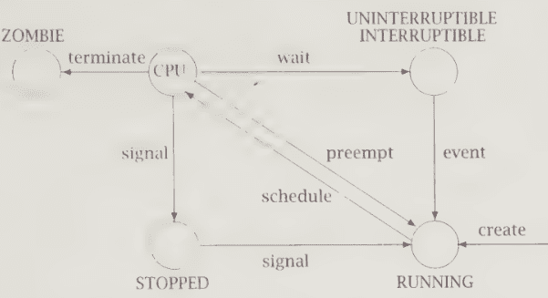

图 3.12：进程状态与转换

当一个新进程被创建时，它总是从 `TASK_RUNNING` 状态开始，位于运行队列中。最终，它将获得 CPU 上的一个时间片。何时发生这种转换是调度器的责任。
进程可能由于以下四种原因停止使用 CPU：

- 它可能会自愿停止，正在等待某种资源，因此移动到 `TASK_INTERRUPTIBLE`（可中断）或 `TASK_UNINTERRUPTIBLE`（不可中断）状态。
- 它可能决定终止，因此移动到 `TASK_ZOMBIE`（僵尸）状态。
- 操作系统可能会夺它的处理器，即使它还有后续指令要执行。这被称为抢占。当进程用完其份额的时间，或者当 CPU 需要处理某些更紧急的工作时，操作系统会这样做。在何种情况下，当进程被抢占时，它都会回到运行队列。
- 最后，当进程被其父进程或其他进程的信号停止时，它会移动到 `TASK_STOPPED`（停止）状态。随后的信号会将其移运行队列。

当等待事件发生时，进程离开 `TASK_INTERRUPTIBLE` 或 `TASK_UNINTERRUPTIBLE` 状态。这是它回到 `TASK_RUNNING` 状态的唯一方式，在那里它将轮到并最终回到 CPU。

### 用户态与内核态之间的转换

如上一章所述，所有现代 CPU 都有两种运行模式。在内核模式下，CPU 可以执行其所有的指令集，包括一些非常特殊的指令，称为特权指令。这包括用于设置和更改保护、停止处理器、甚至在用户模式和内核模式之间切换的指令。

在用户模式下，处理器可以执行其指令集的大部分，当然是普通应用程序中的所有指令，但它不能执行任何特权指令。

这种双模式运行为我们刚刚检查的状态转换引入了额外的复杂性。同一时刻只能有一个进程在磁盘上运行，但现在它可以运行在用户态或内核态。

图右侧的扩展版本如图 3.13 所示。

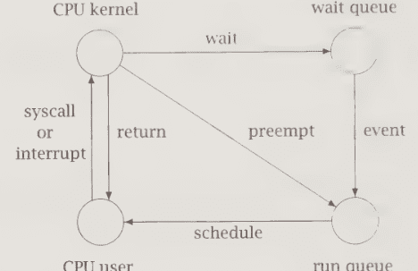

图 3.13：在用户态或内核态下运行

进程始终从运行队列调度到用户态下的 CPU。它从用户态移动到内核态的情况有两种。第一种是发生中断时。参考第 3.3 节中的示例，当驱动器 2 发生中断时，进程 A 正在用户态下运行。硬件中断机制会自动挂起进程 A，将 CPU 切换到内核态，并运行适当代码来处理磁盘。当这些代码完成后，中断返回指令将 CPU 设置回用户态，并返回执行进程 A 中的代码。

另一种情况是当运行进程向系统服务发起调用时，发生了从用户态到内核态的转换。但这引入了一个特殊的特性。这次是系统软件引起了中断。虽然这在起源上与普通的硬件中断不同，但其效果是相同的。因此，对系统服务的调用只是中断导致向内核态转换的特例。

等待转换是由系统调用引起的，因此当这种情况发生时，进程始终运行在内核态下。抢占通常发生在定时器中断时，因此当进程被清空时，它也在内核态下。

## 3.9 上文切换

这是将处理器从一个进程重新分配给另一个进程的整个过程。正如我们在上一节看到的，进程由于四种原因之一失去对处理器的控制：它要么终止、要么移动到等待队列等待资源可用、要么被信号停止，或者被定时器中断告诉它已经用完了时间片。当进程失去 CPU 控制权时，保存机器的当前状态至关重要。这种状态包括通用寄存器中的值、栈指针、内存管理寄存器，尤其是最重要的处理器状态寄存器和程序计数器的值。当在未来的某个时刻，被切换出的进程变得可以运行时，那么就可以将机器设置得与执行最后一条指令后的状态完全一样。因此，下一条指令将在当前状态上运行，进程（状态序列）将继续正常运行。这种状态（或瞬态环境）保存在体系特定的 `task_struct` 中。具体版本请参见图 3.14，来自 `<asm/processor.h>`。它包含每个硬件寄存器的字段。CR3 寄存器持有指向内存管理相关数据的指针。接下来是指令指针 (EIP) 的副本和状态寄存器 (EFLAGS)，然后四个通用寄存器，然后是索引寄存器，最后是段寄存器。

```c
struct thread_struct{
	unsigned long cr3;
	unsigned long eip;
	unsigned long eflags;
	unsigned long eax, ebx, edx;
	unsigned long esp;
	unsigned long ebp;
	unsigned long esi;
	unsigned long edi;
	unsigned short ss;
	unsigned short cs;
	unsigned short ds;
	unsigned short es;
	unsigned short fs;
	unsigned short gs;
}
```


## 进程管理器

进程所有者的重要性，并在其创建时被分配。所有可运行进程的描述符都链接到一个队列中，并按优先级从高到低的顺序排序。这是一组额外的链接，穿插在每个进程控制块（PCB）中。它被称为运行队列（run queue）。优先级最高（最符合条件）的进程位于头部，然后是下一个，以此此类推。所有其他不可运行的进程（通过相同的字段）链接在另一个队列上，该队列被称为等待队列（wait queue）。情况如图 3.17 所示。

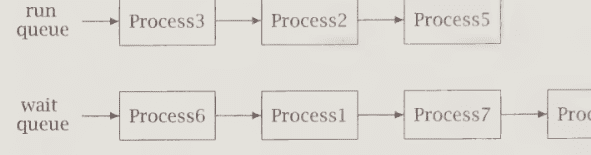

图 3.17：就绪队列和等待队列上的进程

当 CPU 完成一个进程时，将选择队列头部的进程作为下一个运行的进程。问题随之而来：当前运行的进程应该放在哪里？它可能位于队列的头部。另一种可能是它可以完全从 CPU 上取下，并从内核的某个位置直接指向。例如，Linux 在全局变量中保留一个指向运行进程 `task_struct` 的指针。

这种方案允许高优先级进程在队列中保持在低优先级进程之前。但一旦这种低优先级进程最终在 CPU 上运行，没有任何东西可以阻止它垄断系统，并阻塞随后变为可运行的高优先级进程。

因此，需要对优先级机制进行进一步扩展。现在，当一个进程被调度到 CPU 时，它并不会获得无限次的使用权。相反，它在处理器上获得了一个特定的时间片。这被称为量子片（quantum）。每当硬件定时器中断时，调度器就会减少量子片值。当它变为零时，就该进行上下文切换了。如果一个进程在时间结束时仍然可运行，上下文切换器将将其移回队列中的适当位置。

时间片的大小会对性能产生影响。如果时间片太大，交互式进程将发现自己花费了很长时间等待 CPU。分时现象对用户来说将变得非常明显。另一方面，随着时间片的减小，上下文切换的开销会增加。因此，如果时间片太小，机器可能会花费大部分时间在进行上下文切换上，而不是执行生产性工作。

## 多级优先级队列

某些系统为每个优先级使用单独的队列。每个队列被组织为一组通过进程控制块的链接，在每个队列内部，进程会被赋予 CPU 量子片，然后移动到队列的尾部。

## 3.10 调度

只有当所有高优先级队列都为空时，调度器才会从队列中选择进程。

系统可以允许优先级随时间变化的可能性。例如，考虑一个具有两个优先级（高、低）的系统，如图 3.18 所示。交互式进程将被赋予高优先级——它们需要能够快速响应外部事件（例如按键）。对于密集使用 CPU 且与终端没有交互的进程（如编译），可以赋予低优先级。如果花费一秒或更长时间，没有人会感到不高兴。

| 高优先级队列 | Process8 | Process3 |
| :--- | :--- | :--- |
| 低优先级队列 | Process7 | Process2 | Process5 |
| 等待队列 | Process6 | Process1 | Process9 | Process4 |

图 3.18：两个优先级队列

当一个进程被创建时，它最初被放在高优先级队列中。如果它使用了它的时间片，这意味着它是计算密集型的。因此，当它被上下文切换出时，它被移动到低优先级队列的尾部。另一方面，如果进程放弃处理器来等待 I/O 事件，可以假设它是交互式的，它会被移动到等待队列；但当它等待的事件发生时，它会被移回高优先级队列。


64

3 进程管理器

已经去喝咖啡了。或者系统中的许多进程都处于阻塞状态，正在等待某种资源。这意味着系统中的作业混合情况可能并非理想状态。但在交互式系统中，对这种混合的控制能力非常有限。

在这种情况下，操作系统会做什么呢？它可以执行一个无所事事的循环，等待某一个进程变为可绪状态，然后将其调度到处理器上。这个问题可以通过引入一个额外的进程，称为**空进程（null process）**来完全解决。它在系统启动时被创建。它保证始终是可绪的，因为它不进行任何阻塞性系统调用，也不进行 I/O 操作。它的优先级最低，或者至少比其他进程低一级。因此，它永远不会垄占处理器，一旦另一个进程变为可绪状态，系统就会抢占空进程，因为新进程保证具有更高的优先级。

这样的空进程可以是一个空闲循环。一些操作员使用它来运行系统诊断或系统统计。另一些人用它来计算质数或计算圆周率 π。

## 3.12 进程终止

当程序运行到末尾时，Unix 进程就会终止。有一个特殊的系统服务 `exit()`，子进程通过它可以让父进程知道它已经完成，还可以传回一些关于它为何完成的信息——是正常完成还是异常完成。如果程序员编写了该代码，编译器就会包含一个对 `exit()` 的调用。由于由于使用了系统调用，进程总是从内核态终止的。首先，它会释放资源，例如内存或打开的文件。然后它移动到一个新状态：`TASK_ZOMBIE`（僵尸进程）。在这个阶段，它不再拥有内存或进程结构，其 `exit_code` 字段保存着它想要传回给父进程的信息。随后调用调度器将一个新进程调度到 CPU 上。

当父进程最终调用 `wait()` 系统服务并获取这些状态信息时，`task_struct` 会被去激活，这样终止进程的最后痕迹就从系统中移除了。

父进程中还包含了 `wait()` 系统服务。其工作原理如下：如果子进程在父进程执行 `wait()` 之前已经执行了 `exit()`，那么父进程就会获取状态信息并继续执行。另一方面，如果父进程在子进程退出之前执行了 `wait()`，那么父进程将被阻塞，直到子进程执行完毕。这类似于线程的 `pthread_join()`。

`wait()` 返回一个值：如果无法等待则返回 `-1`，否则返回一个正整数，即退出的子进程的 `pid`。可选参数（指向 `int` 的指针）被传递给 `wait()`，然后系统会将子进程 `exit_code` 字段的值放入该 `int` 中中。来自 `<sys/wait.h>` 的宏 `WEXITSTATUS` 返回该整数值的的第 8-15 位。

`wait()` 有多种变体，以及用于从状态值中提取其他信息的宏。请参考 `wait(2)` 的手册页。

通过让父进程在 `fork()` 之后立即终止而不调用 `wait()`，可以演示进程终止的一些影响。如果子进程运行几秒钟（例如打印几千个数字），然后调用 `getpid()`，此时它应该返回 1。由于父进程死了，孤儿进程被 `init` 进程收养，`init` 进程的 pid 始终为 1。

如果一个进程在父进程之前死亡且父进程没有调用 `wait()`，那么子进程的 `struct task_struct` 就不会释放。`ps` 命令将其显示为 `<zombie>`。它无法被杀掉，因为它已经死了。`init` 进程会定期执行 `wait()` 来清除死去的孤儿进程。

## 3.13 总结

- 1. 程序是指令的序列。进程是通过执行程序而执行的一系列动作。
- 2. 每个用户级活动和每个异步事件源都可能分配一个自己的进程。进程管理器本身可能由几个协作工作的进程组成。
- 3. 由于通常只有一个处理器，它在所有进程之间共享。
- 4. 进程由一组系统资源（如程序和内存空间）以及一个或多个线程组成，线程控制通过程序的执行路径。如果进程的某一个线程被阻塞，它可以执行另一个线程。
- 5. 系统通过一种名为进程描述符（process descriptor）的数据结构来跟踪每个进程。在实践中，这是一个相当复杂的结构集合，每个结构代表进程的一个方面。Linux 使用动态分配的进程描述符，即 `struct task_struct`。它们维护在双向链上，也维护在哈希结构中。
- 6. 在 Unix 中，新进程是其父进程的克隆。主要的区别是它们有自己的进程标识符。任何进程都可以通过运行 `exec()` 来改变它运行的程序。
- 7. 可以创建更多线程在进程内运行。
- 8. 在任何给定时刻，进程将处于可绪、等待或停止状态。在 Unix 中，进程可以在用户态运行，也可以在内核态运行。
- 9. 当处理器从一个进程重新分配给另一个进程时，必须保存机器的当前状态。这是在一个 `struct thread_struct` 中完成的，它是针对特定机器。
- 10. 关于下一个运行哪个进程的决策被称为调度（scheduling）。这可以是先来先服务、运行到完成的原则。更常见的是这种被称为轮询（round robin）的变体，每个进程获得最大时间，即时间片（quantum）。如果它在时间片内没有完成，它会被切换出去并排在队列末尾。

更典型的是使用优先级方案，每个优先级对应一个不同的队列。进程的优先级是动态调整的。

- 11. 可能会有一个空进程，当运行队列为空时运行。
- 12. 当进程终止时，它可以向父进程发送状态。

## 3.14 讨论题

- 1. 某些操作系统创建现有进程的克隆进程；另一些则创建一个新程序。讨论这两种系统的优缺点。
- 2. 图 3.3 是简化的。请重新绘制并加入一个代表系统本身的行。
- 3. 当进程从运行移动到空闲时，必须保存机器的状态。显然这不意味着整个状态，哪些信息必须保存？
- 4. 当在内核实现线程时，操作系统是将控制传递给同一进程的另一个线程，还是传递给另一个进程？
- 5. 实现多线程服务器的方法是有一个主线程，将任务分配给若干工作线程。讨论拥有固定数量此类线程与为每个任务创建一个线程并在完成后销毁它之间的权衡。
- 6. Linux 有两种不同的 POSIX 线程实现。一种在用户级，另一种是内核线程。你正在使用的系统安装的是哪一种？
- 7. 调查 `clone()` 系统服务。pthread 接口是否更好？
- 8. 进程描述符可以维护在哈希队列中。与静态表和链表相比，这在效率上如何？
- 9. 如果 `fork()` 系统调用在循环内部会发生什么？
- 10. 为什么你认为没有系统服务可以返回子进程的标识？
- 11. 调查 `exec()` 系统服务的不同版本，并区分它们。
- 12. `error()` 库函数永远不应该在线程函数中使用。为什么？
- 13. 函数递归调用自己与函数创建一个新线程来运行自身的另一个副本之间有什么区别？
- 14. 调查在创建线程时如何传递参数。
- 15. 列出所有可能的终止和分离组合，这些组合会导致表示线程的数据结构从系统中移除。
- 16. 如果一个进程的所有线程都终止并分离，该进程会发生什么？
- 17. 现代 CPU 具有特殊指令可以完成上下文切换所需的全部寄存器拷贝。调查你所选择的机器的该指令。
- 18. 如果一个线程用尽了时间片，但它仍然是整个系统中优先级最高的线程，会发生什么？多级反馈队列是如何避免这种情况的？


# 4 并发

上一章引入了进程作为计算机系统中工作单元的概念。我们已经看到，可能（甚至很可能）同时存在多个进程。每个进程都处于其初始状态和最终状态之间的某个位置；它正处于处理过程中。这些进程被称为并发进程，即同时运行。由于通常只有一个处理器，我们只拥有“表面的并发”，即由操作系统在任何时刻拥有控制权的进程之间进行切切换。

如果进程之间互不相关，且永远不需要以任何方式进行交互，那么就不会有问题。但但它们经常需要共同工作，以实现并发系统的目标。例如，许多进程可能每个生成解决方案的一部分；这些部分随后需要被组合在一起。另一个例子是用户向系统进程请求服务。

因此，我们需要为并发进程之间的交互提供支持并控制。

## 4.1 进程交互

让我们先观察为什么进程可能需要相互交互。

### 协作

进程可能需要协作来执行某些特定的任务。

- 1. 一个进程可能会向另一个进程请求服务，然后必须等待服务完成。例如，用户进程可能请求操作系统进程从磁盘驱动器读取数据。它必须等待数据在内存中可用后才能继续执行。
- 2. 多个进程可能被设计协同工作。但我们无法预测它们的相对速度。在某些点，如果另一个进程没有达到特定阶段，一个进程就无法继续。例如，进程可以排列成流水线，每个进程对某个数据项进行一些处理，然后将其传递给链中的下一个进程。显然，在第一个进程完成至少一个数据项之前，第二个进程甚至无法开始。链中更靠后的进程必须等待前面的进程。
- 3. 在多媒体系统中，一个进程可能从磁盘或网络连接读取数据，并将其存储在内存中。第二个进程从内存中读取数据，并将其馈给视频和音频硬件。内存中的临时存储区域被称为缓冲区。

这两个进程之间存在许多限制。第一个（生产者）必须在缓冲区满时立即停止，并在缓冲区空间可用时立即重新开始。它还必须确保缓冲区永远为空，否则多媒体输出会出现间隙。然而，如果缓冲区确实变空，第二个进程（消费者）必须停止工作。它绝不应该尝试从空缓冲区读取，因为结果将是完全不可预测的。最后，一旦缓冲区中有了可用数据，消费者必须立即重新开始。

在所有这些情况下，对同步都有通用要求。必须有一种机制，使得进程能够等待与另一个进程或硬件进行同步。它的另一面是，一个进程必须向另一个进程发出已到达某点或已执行某项任务的信号。

我们已经见过同步的例子，当父进程等待子进程终止时。但那是相当激进的交互——子进程必须死亡才能引起父进程的注意。这里可以想象的一种更温和的同步形式是反复进行的，且对涉及的进程没有任何副作用。

### 竞争

并发进程可能会为了独占资源的使用而产生竞争。它们可能对同一资源或同一服务提出同时请求。示例将说明这里的基本问题。

#### 航空公司订票系统

两个代表不同客户运行的进程可以同时预订同一个座位。也就是说，它们可以发出指令在机器内存中将该座位标记为已预订。

一个进程可以检查该座位是否空闲并决定预订，并在该点被上下文切换出去。另一个进程可以发现它是空闲的并进行预订。当第一个进程再次运行时，它将从停止的地方开始，执行的下一条指令是预订该座位。它不会回去再次检查。因此，该座位将被重复预订。

### 生产者与消费者

这里设想的是生产者进程和消费者进程，通过共享缓冲区进行通信。全局变量 `items` 被两个进程使用，用于跟踪缓冲区中有多少项。

生产者有一行 `items++`，它编译为图 4.1 所示的代码。

```
MOV EAX, items ; 将 items 加载到寄存器 EAX
INC EAX ; 增寄存器 EAX
MOV items, EAX ; 将寄存器 EAX 存回 items
```

图 4.1：增加计数器的代码

消费者有一行 `items--`，它编译为图 4.2 所示的代码。

```
MOV EAX, items ; 将 items 加载到寄存器 EAX
DEC EAX ; 减寄存器 EAX
MOV items, EAX ; 将寄存器 EAX 存回 items
```

图 4.2：减少计数器的代码

考虑以下场景。缓冲区中有一个项，因此 `items` 的值为 1。消费者取走了该项。在它被上下文切换出去后，EAX 的值为 0。同时，生产者放入另一个项，并将 `items` 的旧值增加到 2。然后消费者醒来并将 0 存入 `items`。尽管缓冲区中有一个项，全局变量却显示没有。

最后一个项没有被移除，至少下一个项没有被放入。消费者总有一个项是看不见的。基本问题是，单个逻辑操作可能没有被实现为单一的机器操作。

### 系统服务的请求队列

一个进程正在向队列中添加条目的中间，在该点它被切换出，另一个进程出现并尝试执行相同操作，然后指针将损坏。

### 原子更新

在这些例子中，问题的产生是因为进程在执行操作中间被上下文切换出去，当它被切换回来时，某些全局变量发生了变化，它的视图与其他进程不一致。如果我们能够在单条指令中执行更新，那么它们要么完成，要么未完成，就不会有混淆。这是因为在单处理器上，每次内存访问都是原子的。但一个更新可能涉及多次读取或写入。例如写入字符串、数组、结构体或文件。在高级操作完成之前，其他进程必须在该数据结构之外。这种排除甚至可能跨越一次或切换！

### 问题总结

上述示例说明，操作系统必须能够为并发进程之间的交互提供支持（并控制），涵盖互斥领域和同步领域。

系统必须对这些竞争进程施加顺序。这可能涉及轮流并在必要时等待。系统可能还必须进程之间进行选择。

竞争进程需要等待获取共享资源，并在完成该资源后需要通知其他进程。

### 架构

进程间通信的实现在具有共享内存和没有共享内存的机器上是不同的。在前者情况下，进程可以共享整个地址空间或部分地址空间，从而通过共享内存进行通信。

在机器上，进程在与其他进程完全独立的地址空间中执行。此类进程如何通信？操作系统必须支持将数据或消息从一个进程传输到另一个进程。但这引发了自己的问题。与共享内存情况相比，操作系统复制数据的时间可能是巨大的。在本节概述的问题在这样的系统中似乎是不可能的。但你永远无法逃避这些问题。即使航空公司订票系统使用的是消息传递，仍然可能出现两个进程预订最后一个座位的情况。随着共享内存在独立机器上几乎变得通用，这种区别开始模糊。但对于分布式系统，其需要


## 4.2 互斥的软件解决方案

不同机器上运行的进程之间的通信再次引起了关注。“分布式共享内存”的最新进展再次模糊了这两者的界限。

## 4.2 互斥的软件解决方案

该问题可以总结如下：我们有若干并发进程。每个进程都有一段代码，称为其临界区，其中包含可能影响其他进程的指令，例如更新公共变量等。

从历史上看，互斥问题最初是通过软件来解决的。人们曾尝试设计一种协议（即一组规则和规定），让程序员将这些规则写入每个进程正在执行的代码中，以确保任何时候只有一个进程处于其临界区内。

通常情况下，一个程序的格式如图 4.3 所示。当然，这个结构将是一个循环。但程序永远不会跳入或离开临界区。它总会在之前执行入口协议，并在之后执行退出协议。一个成功的算法必须包含入口和退出协议，且每个进程都将其包含在自己的代码中，以保证其临界区的互斥。

起始部分
临界区入口协议
临界区
临界区退出协议
剩余部分

图 4.3：协作程序的一般结构

为了被认为是可以的，算法必须满足以下要求：

- 1. 即使进程在临界区内时发生了上下文切换，解决方案也必须有效。
- 2. 它不能对进程的相对速度做任何假设。仅仅安排它们按特定顺序进入临界区是不够的。

- 3. 进程可以在临界区之外终止。这不应该影响其他进程。它不能在临界区内终止，也不能在入口或退出协议中终止。

- 4. 解决方案必须避免死锁——某些进程最终必须继续执行。

- 5. 它还必须避免饥饿——不允许一个进程永远等待。

- 6. 执行入口和退出协议的开销应该尽至最低——至少在没有竞争时如此。

人们开发了许多解决方案，首先针对两个进程，然后推广到适用于任意数量的进程。随后的工作集中在提高这些算法的效率上。

这些软件解决方案现在很少使用了。但研究这些算法是非常值得的，因为它能让人透彻理解并发编程中的陷阱。

## 4.3 针对两个进程的软件解决方案

我们将从针对两个进程的软件解决方案开始。这里采用的方法通过一系列算法来实现，展示每个算法的缺陷，并尝试在下一个算法中解决该问题，从而得到一个满足所有要求的解决方案。

### 算法 1——使用守护变量

假设两个进程共享一个公共整数变量 `guard`，初始化为 0。在进程进入其临界区之前，它会检查这个变量；如果它仍为 0，则将其设置为 1 并继续。另一方面，如果它发现 `guard` 的值为 1，则意味着另一个进程在进入自己的临界区时已将其设置为 1，因此当前进程将等待，什么都不做。每个进程执行图 4.4 所示的算法。

```
起始部分
WHILE (guard == 1)
  DO nothing
ENDWHILE
guard = 1
临界区
guard = 0
剩余部分
```

图 4.4：针对两个进程解决方案的首次尝试

这似乎解决了问题，不仅适用于两个进程，也适用于任意数量的进程。然而，情况并没有那么简单。编译时，入口协议会被翻译如图 4.5 所示的汇编代码。

```
test: MOV EAX, guard
CMP EAX, #1
JE test:
MOV guard, #1
```

图 4.5：入口协议的编译版本

第一行从 `guard` 加载一个值到 `EAX`。第二行将寄存器 `EAX` 中的值与 1 进行比较。如果值为 1，则跳转回 `test`。第四行将 `guard` 设置为 1。

在多处理器环境下，如果在第一行和第二行指令之间发生了上下文切换，第一个进程可能会获得控制权，并将 `guard` 设置为 1，从而进入临界区。因此，使用 `guard` 的想法是不可行的。

### 算法 2——使用切换变量

接尝试尝试给共享变量赋予了不同的含义。与其指示“任何进程都可以进入”，该变量将指示哪个进程可以进入。假设两个进程共享一个整数变量 `turn`，初始化为 0。两个进程使用的算法版本如图所示。

| 进程 0 | 进程 1 |
| --- | --- |
| 起始部分 | 起始部分 |
| WHILE (turn != 0) | WHILE (turn != 1) |
| 什么都不做 | 什么都不做 |
| ENDWHILE | ENDWHILE |
| 临界区 | 临界区 |
| turn = 1 | turn = 0 |
| 剩余部分 | 剩余部分 |

图 4.6：使用切换变量的算法

这种解决方案实际上有效，并保证了一次只有一个进程处于临界区。但它要求严格按照 0, 1 的顺序进入临界区。

### 算法 3——使用标记

让我们重新回顾算法 1。它的唯一问题是两个进程在尝试写入共享变量时可能会冲突。如果每个进程都有标记（`flag`），这种冲突就不会发生。这可以使用包含两个标记的数组来实现，初始化为 0。

```
起始部分
WHILE (flag[1] == 1)
DO nothing
ENDWHILE
flag[0] = 1
临界区
flag[0] = 0
剩余部分
```

图 4.7：使用标记的算法

之前的算法不起作用，是因为它在设置自己的标记之前进行了测试。另一种可能性是让标记设置为 1 仅表示该进程想要进入临界区。修改后的算法见图 4.8。

### 算法 4——使用指示标记

这种方法的问题是它可能会死锁。一个进程可以将标记设置为 1 并被切出。另一个进程随后也可以将其标记设置为 1 并被切出。这种情况极不可能发生，但确实可能；如果发生了，两者将无限循环。

```
起始部分
flag[0] = 1
WHILE (flag[1] == 1)
DO nothing
ENDWHILE
临界区
flag[0] = 0
剩余部分
```

图 4.8：使用指示标记的算法

### 算法 5——带有切换的标记

之前的算法可能会导致死锁。因此，我们需要一种在死锁发生时打破它的方法。让我们重新引入切换的概念。现在我们有了算法 2 和 4 的组合。图 4.9 显示了进程 0 的算法；按照常例，进程 1 将使用对称的版本。

```
起始部分
flag[0] = 1
turn = 1
WHILE (flag[1] == 1) AND (turn == 1)
DO nothing
ENDWHILE
临界区
flag[0] = 0
剩余部分
```

图 4.9：带有切换的标记

现在让我们确保该算法避免了在其他算法中遇到的问题。

- 1. 两个进程不可能同时处于临界区。只要 `(flag[1] == 1) AND (turn == 1)`，进程 0 就会被阻止进入。

  只要 `(flag[0] == 1) AND (turn == 0)`，进程 1 就会被阻止进入。


如果两个进程都想要进入，`flags` 将设置为 1，两个条件的前半部分都为真。变量 `turn` 的值为 0 或 1，两者不能同时成立。因此，其中只有一个条件会为真，另一个为假。只有一个进程会进入，另一个将被阻塞。

- 2. 出于相同的原因，该算法不会死锁。两个进程中测试的条件不会同时为真。因此，总会有一个进入。

- 3. 该算法不像算法 1 那样强制严格的顺序。如果只有一个进程想要进入其临界区，它不会在 `WHILE` 语句处被阻塞。条件的第一部分为假，因此无论 `turn` 的值是什么，整个条件都为假。

- 4. 现在我们面临最困难的问题。两个进程是否可能在机器码层面交错执行，导致其中一个或两个读取了过时的数据，并同时进入它们的临界区？

两个进程的进入协议将编译为图 4.10 所示的代码。

| Process 0 | Process 1 |
| :--- | :--- |
| MOV flag[0], #1 | MOV flag[1], #1 |
| MOV turn, #1 | MOV turn, #0 |
| test: CMP flag[1], #1 | test: CMP flag[0], #1 |
| JNE enter: | JNE enter: |
| CMP turn, #1 | CMP turn, #0 |
| JE test: | JE test: |
| enter: | enter: |

图 4.10：两个进程的进入协议

如果进程 0 在执行第一行后被切换出，而进程 1 运行，它将执行前四条指令。但它不会跳转到 `enter`，因为 `flag[0]` 已经被设置为 1。它将继续进行 `test`，此时只有两种可能：

- 如果 `turn` 为 0，则进程 1 将循环回 `test` 并继续这样做。它最终会在此循环的某处发生上下文切换，当进程 0 唤醒时，它将从第二行恢复执行，并将 `turn` 设置为 1。这将导致进程 0 循环。当进程 1 再次使用 CPU 时，它将跳出循环并跳转到 `enter`。

- 如果 `turn` 为 1，则它将进入临界区。当进程 0 唤醒时，它将循环。

- 如果进程 0 在第二行之后的任何地方被切换出，且进程 1 执行，它会将 `turn` 交给进程 0。进程 0 将进入，而进程 1 将循环直到其退出。

## 4.4 针对多个进程的软件解决方案

既然我们已经有了针对两个进程的滴水不解决方案，我们将尝试将其扩展，开发一种适用于任意数量进程的算法。

### 算法 6——Eisenberg 和 McGuire 算法

这是对算法 5 方法的扩展。为了便于说明，我们假设有 8 个进程。一旦理解了这一点，将其推广到任意数量的进程就是简单的事情。该系统中竞争的所有进程可以可视化为一个环形数组，见图 4.11。

图 4.11：八个竞争的进程

与之前一样，有一个 `flag` 数组，为 8 个进程中的每一个提供一个条目。每个进程对应的数组元素可以是三种状态之一。它可以是 `idle`（空闲），表示该进程没有进入临界区的请求。这是起始部分（beginning section）和剩余部分（remainder section）期间的状态。`flag` 的值也可以 `wait-in`（等待），让所有其他进程知道它想要进入临界区。

一旦从 `idle` 变为 `wait-in`，只有在进程处于临界区之后、进入其剩余部分之前，`flag` 才会变回 `idle`。最后，它的可以是 `in-cs`，让所有其他进程知道它已完成进入协议，正处于或即将进入临界区。初始时，数组中的所有条目均设置为 `idle`。

还有一个变量 `turn`，它初始化为某个任意值（通常为 0）。`turn` 总是递增，因此它在图 4.11 的圆周顺时针移动。

图 4.12 所示的算法从进程 4（共 8 个）的角度来看一切。一旦理解了针对 8 个进程的算法，将其重写为通用进程 $i$（共 N 个）就是简单的事情。

```
REPEAT
flag[4] = want-in
p = turn
WHILE (p != 4)
IF (flag[p] == idle) THEN
 p++ MOD 8
ELSE
 p = turn
ENDWHILE
flag[4] = in-cs
```

```
j = 0
WHILE ((j < 8) AND (j == 4) OR (flag[j] != in-cs))
 j++
ENDWHILE
UNTIL ((j == 8) AND ((turn == 4) OR (flag[turn] == idle))
turn = 4
```

### beginning section

flag[4] = idle

### remainder section

图 4.12：Eisenberg 和 McGuire 算法

### Entry protocol

假设进程 4 想要进入其临界区。它通过将 `flag` 设置为 `wait-in` 来表达这一意图。然后它检查是否有其他进程在临界区。如果是，它就等待。如果没有其他进程在临界区，它将其 `flag` 设置为 `in-cs` 并进入临界区。


临界区。它未通过条件的第一部分，并绕过 `REPEAT` 循环，将其标记置为 `want-in`。在这种情况下，由于 (AND) 的存在，第二部分是无关的。

如果它退出 `WHILE` 循环时 `j` 的值为 8，这意味着在它检查时，没有其他进程的标记被设置为 `in-cs`。但另一个进程仍然可能在检查之后将其标记置为 `in-cs`。不过后来者在它的 `WHILE` 循环中会发现 `flag[4]` 处于 `at-cs` 状态，并将再次被发送到 `REPEAT`。

进程 4 仅剩下一个障碍。如果 `turn` 的值为 4，则该进程继续执行。但在这种最后阶段，轮到该执行的进程也可能决定将其标记置为 `want-in`。在这种特殊情况下，进程 4 将退回，再次绕过 `REPEAT` 循环，并再次在此之后进入。这个最后的转折是为了公平性。毕竟，那是该进程的轮次。（注意，只有当没有其他进程的标记被设置为 `in-cs` 时，进程才会进入其临界区）。

## 退出协议

退出协议的本质是将标记设置为 `idle`。为了加快等待进程的速度，离开临界区的进程可以唤醒某个正在等待的进程，并将轮次让给它。如果没有进程，则它的搜索将在回到自身时结束，并会将轮次交留给自己。为了简单起见，这种复杂性没有在图 4.12 中显示。

## 算法 7—Lamport 算法

这是一种与之前的算法完全不同的方法，而且要容易理解得多。它基于某些商店和服务柜台的做法，即在进入时发放号码，并按顺序接待客户。因此，进程在声明其进入临界区的意图时会被赋予一个唯一的数字，并按照该顺序进入。

该解决方案的逻辑很容易理解，但将其实现为算法（如图 4.13 所示）却是相当复杂的。它使用了两个全局数组：`number[n]` 用于存储每个进程的选定数字，`choosing[n]` 用于标记正在操作共享变量。第二个数组是布尔类型。还存在全局变量 `counter`，初始化为 0。

在前四行中，进程获取一个数字并将其保存在 `number` 数组的元素中。然后在一个 `FOR` 循环中，它检查每个正在等待的进程，查看是否有任何一个进程拥有比自己更小的正数。

该算法有两个潜在问题，都出现在选择数字的部分。实现的复杂性源于需要防止这些问题的发生。

为了理解第一个问题，假设 `counter` 的值为 3，进程 2 已经将 `counter` 增加到 4，然后在临界区开始部分被换出。如果在该阶段进程 4 开始进入协议，它将再次增加 `counter` 到 5，并获取该数字。在发现没有进程持有更小的数字后，它将进入临界区。当进程 2 重启时，它将 `number[2]` 设置为 4。没有进程拥有更小的数字，因此它进入临界区。（注意：此处提供的 OCR 文本似乎是碎片，根据逻辑流进行了重构）。

## 4.4 多个进程的软件解决方案

```
choosing[i] = TRUE
counter++
number[i] = counter
choosing[i] = FALSE
```

```
FOR j = 0 TO n - 1
    WHILE (choosing[j] == TRUE)
        DO nothing
    ENDWHILE
    WHILE (number[j] != 0 AND (number[j] < number[i]))
        DO nothing
    ENDWHILE
ENDFOR
```

临界区

number[i] = 0

剩余部分

图 4.13: Lamport 算法

## 4.5 总结

1. 进程可能需要协调它们对共享资源的访问。
2. 开发互斥软件解决方案是为了防止竞态条件。
3. 在这些算法中必须考虑死锁和饥饿等挑战。
4. Lamport 算法提供了一种结构化的方法来为进程请求。

## 4.6 讨论题

1. 有时进程无法共享变量，必须请求操作系统传输数据。假设操作系统在执行此操作时不会被中断。
2. 如果能够保证进程在临界区内不会失去对 CPU 的控制权，那么临界区问题就会消失。你会如何保证这一点呢？
3. 假设特定架构具有“内存比较并分支”指令，该指令可以在一个不可中断的指令中将内存位置与零进行比较并据此进行分支。算法 1 在此类架构上有效吗？


# 底层 IPC 机制 5

在上一章中，我们已经看到人们开发了软件算法，用于防止进程进入临界区。但这些方法都存在着重大的困难。

- 它们都依赖于对变量的持续测试，或者说是忙等（busy waiting），这非常浪费 CPU 周期。
- 所有的细节都由每个独立的程序员去实现，而且始终存在程序员出错的可能。
- 更严重的是，没有办法强制执行这种协议。它依赖于协作。程序员可能会忽略它的部分内容，或者完全跳过它，直接进入临界区。
- 除此之外，这些协议实在太复杂了。

因此，程序员开始要求操作系统来帮助解决进程间通信问题。操作系统存在的一个原因之一就是为了给程序员提供一个更用户友好的环境。我们在上一章的调查表明，进程间通信确实是一个可以变得更加用户友好的领域。

在本章中，我们将研究操作系统设计者提供的用于解决这些问题的系列低层机制。随后在接下来的章节中，我们将介绍一些可以实现类似效果但对程序员来说更容易使用的语言级语言构造。

## 5.1 Unix 信号机制

我们将研究的第一个进程间通信机制是 Unix 信号（signal）。它允许一个进程通知另一个进程某个事件的发生。信号从用于终止异常进程的演变变成了一种原始的 IPC 系统。

信号成为 Unix 系统编程中最兼容性差的领域之一。POSIX 现在定义了一个标准接口，我们将遵循该标准。

### 底层 IPC 机制

Linux 实现了符合 POSIX 标准的系统调用集。大多数 Unix 版本出于兼容性考虑也提供了其他接口，但我们将忽略它们。

信号机制安排在发生某些特定事件时调用用户定义的函数。系统有一组系统定义的信号，通常有 31 个，对应不同的事件。这些信号通过整数作为符号常数进行标识，以 SIG 开头，并附有关于特定事件的助记提示，例如 SIGCHLD 是当子进程死亡时发送给父进程的信号。图 5.1 给出了来自 `<asm/signal.h>` 的一组信号值。大多数信号被预留用于特定用途，其中两个留给用户使用。

```c
#define SIGINT 2 /* interrupt, generated from terminal */
#define SIGILL 4 /* illegal instruction */
#define SIGABRT 6 /* abort process */
#define SIGFPE 8 /* floating point exception */
#define SIGKILL 9 /* kill a process */
#define SIGUSR1 10 /* user defined signal 1 */
#define SIGSEGV 11 /* segmentation violation */
#define SIGUSR2 12 /* user defined signal 2 */
#define SIGALRM 14 /* alarm clock timeout */
#define SIGCHLD 17 /* sent to parent on child exit */
#define SIGXCPU 24 /* cpu time limit exceeded */
```

图 5.1: 信号值选取

### 同步信号

某些信号是由同步事件引起的。这些信号会在程序每次运行时发生在相同的位置。此类信号的示例包括浮点异常（例如下溢或溢出）SIGFPE；或者非法指令 SIGILL；或者内存段违规 SIGSEGV。当事件发生时，硬件会触发中断，将控制权交给操作系统，然后操作系统向相关的进程发送适当的信号。这种同步信号有时被称为异常（exceptions）或陷阱（traps）。

### 异步信号

大多数信号是由异步事件引起的。无法预先知道它们何时发生。此类信号有三个主要来源。

- 另一个进程。发送信号的系统调用是 `kill(1())`。这个相当直白的名字提醒了信号的原始用途，即确实是杀死（kill）目标进程。虽然信号仍然可以用于杀死进程，但这并不是它们的全部。但名称没有改变。

## 5.2 信号的实现

进程可以向任何与其所有者相同的进程发送任何信号。`kill()` 系统调用接受两个参数：目标进程的 pid 和信号值。为了可移植性，最好使用符号常量而不是数字。进程之间没有进一步的交互。信号的所有效果都在目标进程中实现。

- 当按下某些特殊按键时，终端驱动程序会发送信号。
- INT 键（通常映射到 CTRL C）发送 SIGINT。
- QUIT 键（通常映射到 CTRL \）发送 SIGQUIT。
- SUSP 键（通常映射到 CTRL Z）发送 SIGSTOP。
- DSUSP 键（通常映射到 CTRL Y）发送 SIGCONT。

可以使用 `stty` 命令检查按键映射。
`alarm()` 库函数设置了一个定时器。该调用会重置之前的任何定时器设置，并返回上一次设置剩余的秒数（如果有的话）。当时间过期时，内核向调用进程发送 SIGALRM。该信号的默认操作是终止进程。

这种异步信号有时被称为软件中断，因为它们像硬件中断一样不可预测的，并且对进程产生类似的影响。但它们是由软件生成的，而不是硬件。

信号机制的实现有多个阶段。当事件发生时，会产生信号。当目标进程采取适当行动时，信号被递送或处理。响应不是瞬时的。在在此期间，信号处于挂起（pending）状态。

### 信号生成

每个进程都有若干数据结构来实现信号机制。我们将考虑的其中第一个是 `task_struct.signal`。这是一个 32 位的位图，用于记录挂起的信号。通常情况下，其中所有位都清零为 0。当信号发送到进程时，相应的位会被设置为 1。

当目标进程采取适当的行动时，信号被递送或处理。在信号和处理的期间，信号处于挂起状态。

`task_struct.signal` 信号图记录了所有待处理（pending）的信号。

当信号被发送到某个进程时，该信号中的对应位被设置为 1。

每个进程都有若干数据结构来实现信号机制。我们将考虑的其中第一个是 `task_struct.signal`。这是一个 32 位的位图，用于记录挂起的信号。通常情况下，其中所有位都清零为 0。当信号被发送到某个进程时，该信号中的对应位被设置为 1。

`task_struct.signal` 信号位图记录了所有待处理（pending）的信号。

当信号被发送到某个进程时，该信号中的对应位被设置为 1。

在 Linux 中，我们必须区分不同类型的等待。如果一个进程正在等待一个可能需要长时间的事件（例如按键），那么它处于可中断等待（interruptible wait），它会被唤醒以处理信号。另一方面，如果它在等待一个一定会发生的事件（例如磁盘 I/O），它不会被扰动，但很快就会收到信号（不可中断等待 uninterruptible wait）。在任何情况下，它在返回用户模式时都会看到信号。

### 阻塞信号

单个信号可以被屏蔽（mask）或阻塞。这种信号不会丢失，在解除阻塞时会被递送。阻塞信号记录在每个进程的 `task_struct` 中的一个掩码字段里。用户无法直接访问它；相反，使用 `sigprocmask()` 系统调用将掩码的拷贝到用户空间，并在那里进行修改。然后再次调用 `sigprocmask()` 将新的掩码拷贝回内核空间。

一个调用如何实现不同的功能？实际上，它的作用是与用户的值进行交换。它期望用户提供两个位图的指针。第一个是它将读取的新位图；第二个是它将写入旧掩码拷贝的地方。如果第一个指针为 NULL，它将从内核空间拷贝到第二个指针标识的位图；如果第二个指针为 NULL，它只需将第一个指针标识的位图拷贝到内核空间。见图 5.2。

`sigprocmask()` 还有另一个参数，指定对其他两个参数执行的操作。这有三个可能的值。SIG_BLOCK 表示将 p1 中的值添加到内核映射中；SIG_UNBLOCK 表示从内核映射中移除 p1 中的值；SIG_SETMASK 表示内核映射将被 p1 中的值替换。

有很多库函数可以帮助创建传递给 `sigprocmask()` 的位图。在位图中，使用 `sigemptyset()` 清空，设置所有位则使用 `sigfillset()`。要向集合添加一个特定信号，使用 `sigaddset()`；`sigdelset()` 移除一个。最后，`sigismember()` 检查特定信号是否在位图中。可以使用 `sigpending()` 找出是否有任何阻塞信号处于挂起状态。


## 信号的传递与处理

目标进程不会显式地检查信号。相反，内核每次从内核态返回用户态时，都会检查信号位图，以查看是否需要采取任何操作。如果信号位中的任何位被设置，内核将检查是否存在句处理器。如果注册了处理器，内核会将进程返回到用户态，将控制权转移给处理器，并设置堆栈，以便在处理器执行完成后，将控制权交还给信号发生之前的程序。如果有多个挂起的信号，它们将一个一个地被处理。

## 信号处理

当信号传递给进程时，会发生什么取决于特定的信号以及进程为处理该信号所做的安排。每个进程都有一个指向 `struct signal_struct` 的指针 `task_struct.sig`，如图 5.3 所示，定义自 `<sched.h>`。

```c
struct signal_struct{
    atomic_t count;
    struct k_sigaction action[32];
    spinlock_t siglock;
};
```

图 5.3：跟踪信号处理程序的数据结构

- `count` 字段跟踪访问或共享该结构的进程数量。这种共享源于进程使用 `CLONE_SIGHAND` 进行克隆，这对应于进程中线程的创建。
- `[]()` 数组为系统支持的每个信号有一个条目。每个条目指定了当进程接收到特定信号时应采取的操作。
- 如果相应的条目设置为 `SIG_DFL`，则内核对该特定信号采取默认操作。每个信号都有其预定义的默认操作，共有五种可能的默认响应：
    - 终止进程
    - 终止，但在磁盘上保存内存副本
    - 挂起进程
    - 继续[如果已挂起]；否则忽略
    - 忽略信号。
- 如果 `sigaction[]` 中的条目设置为 `SIG_IGN`，则内核直接忽略该信号，而不通知进程。
- 此处的任何其他值都被解释为指向一个函数的指针，该函数将被执行以处理该特定信号。在这种情况下，当信号到达时，进程停止正在执行的操作并执行处理器函数。这与硬件中断发生时的情况类似，因此被称为软件中断。
- `siglock` 字段用于保证此数据结构的互斥。自旋锁将在下一节中讨论。

## 信号处理器

处理器是普通的用户函数，通过 `sigaction()` 安装。该函数接受三个参数。第一个是信号号。第二个指向一个 `struct sigaction` 结构，该结构指定了新处理器以及一组在处理器运行期间被阻塞的信号。第三个指向另一个 `sigaction`，其中将存放有关旧处理器的信息。

信号处理器始终返回 `void`，并有一个参数，一个指定信号数量的 `int`。在执行处理器的期间，导致处理器执行的信号默认情况下是被阻塞的。

当处理器函数执行完毕，`signal` 掩码中的相关位将被清零，控制权将返回到信号发生时程序所在的任意点。

处理器在 `fork()` 之后会被子进程继承。然而，已安装的处理器无法跨越 `exec()` 继承——旧指针在新程序中没有意义。因此，`exec()` 将所有信号设置为它们的默认值。

由于 Linux 有它自己的 `task_struct`，它可以有自己的处理器，也可以与其他线程共享处理器。注意，`CLONE_SIGHAND` 标志中的 `sig` 字段是由 `clone()` 决定的。

## 信号的使用

信号通常用于避免忙等。

`pause()` 库函数挂起进程，直到它接收到一个信号（至少是一个不忽略的信号）。如果该信号注册了处理器，它会先运行，然后 `pause()` 返回（始终返回 -1）并设置 `errno`。

取消阻塞信号后调用 `pause()` 的组合是常见的。在这两条指令之间到达的信号可能会导致意外的结果，而不是死锁。POSIX 引入了 `sigsuspend()`。它会清除阻塞信号掩码中的相应位（即取消阻塞某个信号）并挂起进程。当它返回时（始终返回 -1），阻塞信号的掩码将重置为原来的状态。因此，`sigsuspend()` 允许进程等待特定的信号。

另一个 POSIX 函数 `sigwait()` 挂起进程，直到指定信号集中的一个信号被传递——它返回唤醒它的信号。它不返回句处理器。请注意它与 `sigsuspend()` 的区别，后者只在处理器运行完后才返回。进程应该等待同步信号，因为只有在进程运行状态时，此类事件才会发生。

## 5.3 硬件机制

在第 4.3 节中，我们考虑了使用守卫变量来保证临界区互斥的可能性。我们得出结论，这种简单的机制即使对于两个进程也是行不通的。问题的根源在于该变量的测试及其随后的设置在机器层面是两条独立的指令。而进程可能会在这两条指令之间发生切换。因此，无法通过这种方式保证互斥。

正如之前应用程序程序员将问题抛回给操作系统设计者一样，现在他们也将将问题抛回给硬件设计者。我们要求他们在硬件中包含某些机制，专门用于此目的。

不同的硬件设计者提出了不同的解决方案。

## 中断抑制

在单处理器上，可以通过禁用中断并在完成后启用中断来保证互斥。通过这种方式，进程不会丢失对 CPU 的控制权。在 Intel 架构中，`CLI` 指令导致 CPU 忽略中断`STI` 指令导致 CPU 响应中断。这两个都是特权指令。

但这种粗浅的机制在多处理器机器上是不可接受的。

## 测试并设置

另一种可能性是在操作中测试并设置变量的机器指令。这被称为测试并设置（test-and-set）。它返回变量之前的值并设置为 1。如果返回的值为 1，意味着另一个进程已经在临界区内。如果返回的值为 0，则临界区是空闲的，当前进程可以。

这通常如图 5.4 所示实现。

```c
WHILE (Test_and_set(Key))
   
```

图 5.4：使用测试并设置的进入协议

## 交换

另一种可能性是机器指令，它在一个操作中交换内存中两个位置的内容。如果可用这种指令，内存中的一个特定位置（Key）被用作标记，以指示是否可以进入。如图 5.5 所示。

```c
REPEAT
  Local = 1
  Exchange(Local, Key)
UNTIL Local == 0
```

图 5.5：使用交换的进入协议

## 问题

现代 CPU 将最近读取的数据的私有副本保存在 CPU 的缓存中。上述两种机制在多处理器机器上都有一个特殊问题，因为两个或多个 CPU 可能拥有 Key 的缓存副本。通常，硬件保证所有副本的一致性。这通常通过失效缓存值来实现。当一个进程写入时


## 5.4 信号量 (Semaphores)

对于缓存变量的写入，所有其他处理器的缓存都会收到通知，并将其值标记为无效。因此，对共享变量（如 `test_and_set_XCHG`）的写操作应保持最少，否则它们会不断使对方的缓存失效，引入额外的开销且一无所获。

## 自旋锁 (Spinlocks)

上述两种机制被称为自旋锁。CPU 在紧密循环中旋转，等待进入临界区。在单处理器上，进程可能会在这种循环中消耗其大部分时间片。许多进程可能会这样做，直到持有锁的进程再次被调度执行运行并释放锁。

自旋锁在可以保证临界区最多只包含 20 到 30 条机器指令的情况下最为有用。这意味着进程在时间片耗尽之前释放锁的概率非常高，因此不存在竞争。它们在多处理器系统上特别有效。

## 5.4 信号量

在之前的章节中，我们已经看到如何使用信号机制通知进程某个事件，并允许它在事件发生时采取某些行动。一个进程可以等待另一个进程中事件发生，而第二个进程在事件发生时可以发送信号。我们还看到了如何使用自旋锁来控制对临界区的访问。

虽然这里有了同步和互斥机制的雏形，但仍不足以满足第 4 章讨论的要求。需要一个更通用的系统。进程应该能够宣布事件的发生，其他几个进程可能正在等待该事件，即使是它不的的。如果事件在任何进程等待它之前发生，那么它应该以某种方式被记录。如果在等待之前发生了多个事件，每个事件都应该被记录。

针对这些要求的第一个通用解决方案是由迪特斯特（Dijkstra）提出的，他称之为信号量。它可以被描述为：

> 一个非负整数，除了初始化外，只能通过两个标准的、原子的、不可中断的操作进行：WAIT（减少信号量的值）和 SIGNAL（增加值）。

与其让用户尝试设计自己的同步协议（正如我们所见，这既困难又危险），系统实现者提供了信号量作为一种工具。

使用信号量，竞争或协作的进程不需要知道竞争者的数量，更不用说它们的身份或内部实现细节。它们唯一需要知道的是信号量的*名称*。

然而，在信号量上定义的两个操作比上述简单描述要复杂一些。

## WAIT

WAIT 操作不等同于赋值操作 `s = s - 1`。如果两个进程对一个值为 3 的信号量执行 WAIT，可以保证之后的值将是 1。但如果两个进程使用赋值语句来减少值为 3 的信号量，最终结果可能是 2 或 1。

这是因为赋值语句通常编译为三条机器指令：复制到寄存器、递减寄存器、以及复制回内存。一个进程可能在第一条或第二条指令执行后被换出，而另一个进程可能完成赋值，将信号量的值设为 2。当第一个进程再次运行并完成赋值时，它也将信号量设为 2。这被称为“丢失的等待”（lost wait）。

然而，WAIT 并不总是减少信号量。只有当结果为非负时它才会这样做。如果 WAIT 之前信号量的值为 0，则 WAIT 无法完成，进程必须被切换上下文并移动到等待队列。

注意，信号量的定义不允许读取其值（尽管某些实现提供了此项功能）。

## SIGNAL

SIGNAL 操作将信号量的值加 1，同样是一个不可分割的操作。

然而，如果有一个进程正在等待信号量，SIGNAL 具有不同的效果。它会唤醒该进程，将其标记为可运行，并将其移动到运行队列。

如果有多个进程在等待，哪一个继续执行？这取决于具体的实现——信号量的定义并不决定这一点。

## 5.5 信号量的应用

在引入信号量的概念后，我们现在来看它们如何用于解决第 4 章中引入的问题。然后我们将查看它们是如何实现的。

## 用于互斥的信号量

为了实现互斥，使用一个初始化为 1 的信号量。在这些示例中，该信号量被称为 Guard。互斥信号量的常用名称是 Mutex。

每个进程如图 5.6 所示使用它。注意它与第 4 章中解决方案的相似之处。但在这里，进入协议简单是 WAIT，而退出协议是 SIGNAL。

起始部分

```
WAIT(Guard)
临界区
SIGNAL(Guard)
```

剩余部分

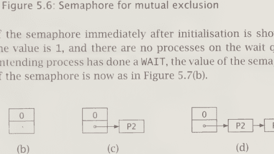

信号量初始化后的后的状态如图 5.7(a) 所示。值为 1，等待队列中没有进程。在第一个竞争进程执行了 WAIT 后，信号量的值变为 0。现在信号量的状态如图 5.7(b) 所示。

当第二个进程执行 WAIT 时，信号量不再进一步减少，而是被放入信号量等待队列中，如图 5.7(b) 所示。

## 用于同步的信号量

这里同步和互斥机制的起始部分不足以满足第 4 章讨论的要求。需要一个更通用的系统。进程应该能够宣布事件的发生，其他几个进程可能正在等待该事件，即使是它不认识的。如果事件在任何进程等待它之前发生，那么它应该以某种方式被记录。如果在等待之前发生了多个事件，每个事件都应该被记录。

针对这些要求的第一个通用解决方案是由迪特斯特提出的，他称之为信号量。它可以被描述为：

> 一个非负整数，除了初始化外，只能通过两个标准的、原子的、不可中断的操作进行：WAIT（减少信号量的值）和 SIGNAL（增加值）。

与其让用户尝试设计自己的同步协议（正如我们所见，这既困难又危险），系统实现者提供了信号量作为一种工具。

使用信号量，竞争或协作的进程不需要知道竞争者的数量，更不用说它们的身份或内部实现细节。它们唯一需要知道的是信号量的*名称*。

然而，在信号量上定义的两个操作比上述简单描述要复杂一些。

## WAIT

WAIT 操作不等同于赋值操作 `s = s - 1`。如果两个进程对一个值为 3 的信号量执行 WAIT，可以保证之后的值将是 1。如果两个进程使用赋值语句来减少值为 3 的信号量，最终结果可能是 2 或 1。

这是因为赋值语句通常编译为三条机器指令：复制到寄存器、递减寄存器、以及复制回内存。一个进程可能在第一条或第二条指令执行后被换出，而另一个进程可能完成赋值，将信号量的值设为 2。当第一个进程再次运行并完成赋值时，它也将信号量设为 2。这被称为“丢失的等待”。

然而，WAIT 并不总是减少信号量。只有当结果为非负时它才会这样做。如果 WAIT 之前信号量的值为 0，则 WAIT 无法完成，进程必须被切换上下文并移动到等待队列。

注意，信号量的定义不允许读取其值（尽管某些实现提供了此项功能）。

## SIGNAL

SIGNAL 操作将信号量的值加 1，同样是一个不可分割的操作。

然而，如果有一个进程正在等待信号量，SIGNAL 具有不同的效果。它会唤醒该进程，将其标记为可运行，并将其移动到运行队列。

如果有多个进程在等待，哪一个继续执行？这取决于具体的实现——信号量的定义并不决定这一点。

## 5.5 信号量的应用

在引入信号量的概念后，我们现在来看它们如何用于解决第 4 章中引入的问题。然后我们将查看它们是如何实现的。

## 用于互斥的信号量

为了实现互斥，使用一个初始化为 1 的信号量。在这些示例中，该信号量被称为 Guard。互斥信号量的常用名称是 Mutex。

每个进程如图 5.6 所示使用它。注意它与第 4 章中解决方案的相似之处。但在这里，进入协议简单是 WAIT，而退出协议是 SIGNAL。

起始部分

```
WAIT(Guard)
临界区
SIGNAL(Guard)
```

剩余部分


信号量初始化后的状态如图 5.7(a) 所示。值为 1，等待队列中没有进程。在第一个竞争进程执行了 WAIT 后，信号量的值变为 0。现在信号量的状态如图 5.7(b) 所示。

当第二个进程执行 WAIT 时，信号量不再进一步减少，而是被放入信号量等待队列中，如图 5.7(b) 所示。

## 用于资源管理的信号量

信号量可以用于控制资源的分配和释放。这些资源可以是物理资源（如打印机），也可以是虚拟资源（如缓冲区中的槽位）。

信号量初始化为可用资源的数量。进程通过对信号量执行 WAIT 来请求资源。只要有可用资源，就不会被阻塞。当所有资源都分配完毕后，信号量的值将变为 0。任何对该信号量执行 WAIT 的进程将被阻塞并放入等待队列。

进程通过对信号量执行 SIGNAL 来释放资源。如果没有进程在等待，信号量的值（可用资源数量）将增加。如果有进程在等待，则其中一个会被唤醒并获得新释放的资源。

例如，假设有两个打印机可用。用于打印机分配的信号量 P 初始化为 2。见图 5.10(a)。

| 进程 1 | 进程 2 | 0 | 进程 3 | 0 |
| :--- | :--- | :--- | :--- | :--- |
| WAIT | WAIT | | WAIT | -> P3 |

(a) (b) (c) (d)

图 5.10：用于资源分配的信号量

当每个进程请求打印机时，它们对信号量 P 执行 WAIT。第一个进程将信号量的状态变为图 5.10(b)，第二个进程将信号量的状态变为 5.10(c)，并获得了第二个打印机。

当第三个进程请求打印机时，它对值为 0 的信号量执行 WAIT，由于没有可用打印机，它无法继续。它被放入睡眠（见图 5.10(d)）。

当其中一个进程返回打印机时，它对信号量执行 SIGNAL。这会唤醒等待进程，并将信号量的状态变为图 5.10(c)。


## 5.6 生产者与消费者

在第 4.1 节中，我们引入了一类问题，生产者进程将数据放入缓冲区，而消费者进程将其取出。这既涉及同步，也涉及互斥。从空缓冲区获取数据的进程必须阻塞；向满缓冲区放入数据的进程也必须阻塞。并且始终，缓冲区必须受到保护，免受多个进程的并发访问。我们现在来看如何使用信号量来控制这些情况。

在接下来的示例中，我们假设使用循环缓冲区，它具有 N 个固定大小的槽，编号从 0 到 N - 1。当槽 N - 1 被填充（或清空）后，下一个要使用的槽将再次是槽 0。

图 5.11 显示了一个槽缓冲区，左侧是其在内存中的实际布局，右侧是后续算法中可能的设想方式。


图 5.11：具有八个槽的循环缓冲区

### 单生产者、单消费者

我们将从只有一个生产者进程和同样也只有一个消费者进程的情况开始。

这需要两个信号量：`SlotFree`，初始化为缓冲区中的最大槽数；以及 `ItemAvailable`，初始化为 0，因为在初始化时有 0 个可用项目。这些值反映了系统的初始状态。在任何时刻，`ItemAvailable` 的值是缓冲区中未被消费的项目数，而 `SlotFree` 的值是可用的空槽数。

还有两个指针。`NextIn` 指向生产者将要使用的缓冲区槽；`NextOut` 指向消费者将取下一个项目的槽。两者都初始化为指向槽 0。当这些指针中的任一个到达缓冲区末尾时，它们会回绕并指向槽 0。这种复杂性在算法中被省略了，算法更多地强调信号量的使用。

### 生产者

生产者的算法如图 5.12 所示。

```
Produce an item
WAIT(SlotFree)
Put item in buffer at NextIn
NextIn++
SIGNAL(ItemAvailable)
```

图 5.12：生产者算法

### 消费者

消费者对应的算法算法如图 5.13 所示。

```
WAIT(ItemAvailable)
Get item from buffer at NextOut
NextOut++
SIGNAL(SlotFree)
Consume the item
```

图 5.13：消费者算法

### 同步

当缓冲区为空时，消费者将由于对 `ItemAvailable` 的 `WAIT` 操作而被强制暂停，其值为 0。只有当生产者对 `ItemAvailable` 执行 `SIGNAL` 操作后，消费者才能通过这一点，而生产者只有在放入一个项目后才会执行该操作。

当缓冲区满时，生产者将由于对 `SlotFree` 的 `WAIT` 操作而被阻塞，此时其值为 0。只有当消费者从缓冲区移除一个项目并释放一个可复用的槽后，对 `SlotFree` 执行 `SIGNAL`  操作。

### 互斥

在此实现中没有使用互斥信号量。这似乎与之前的表述——为了避免干扰，进程应仅在互斥的情况下访问共享资源——相矛盾。但在这种情况下，代码的结构以及只有两个进程的事实保证了它们不会同时访问同一个槽。详细考虑这一点是值得的，因为它有助于理解使用共享缓冲区的一些影响。

### 底层 IPC 机制

两个进程同时访问同一个槽的情况是 `NextIn` 和 `NextOut` 具有相同的值并指向同一个槽。

这种情况只有两种可能发生。一种是缓冲区为空，且 `NextIn` 和 `NextOut` 都指向该空槽：生产者一旦产生东西就立即放入，消费者一旦有东西放入就立即从那里取出。在这种情况下，消费者被信号量 `ItemAvailable` 阻塞，无法进入从缓冲区取数据的代码行。在生产者对该信号量执行 `SIGNAL` 之前，它已经将 `NextIn` 增加到了下一个槽。

另一种可能性是缓冲区已满，且两者都指向下一个满槽：生产者一旦该槽变空就立即放入，消费者一旦准备好接收另一个项目就立即从那里取出。在这种情况下，生产者被信号量 `SlotFree` 阻塞，无法进入其实际使用缓冲区的代码行。在消费者执行 `SIGNAL` 之前，它已经将 `NextOut` 增加并指向后续槽。

在这个示例中并不严格需要互斥信号量，但在涉及共享资源时，始终包含一个可能是一个良好的做法。理解为什么在例示例中并不严格需要，有助于理解信号量的本质。


## 5.7 读者与写入者

```
WAIT(Guard)
readers--
IF (readers == 0) THEN
  SIGNAL (Writing)
ENDIF
SIGNAL (Guard)
```

图 5.17：读者的退出协议

## 写入者

写入者的进入协议非常简单。如果没有其他进程正在运行，它将直接通过此处。否则，它会被阻塞，直到最后一个读者或当前写入者执行一次 `SIGNAL (Writing)`。

写入者的退出协议同样简单，只需执行 `SIGNAL (Writing)`。这会唤醒下一个等待的进程（无论是读者还是写入者，如果有的话）。如果没有等待，它会将信号量 `Writing` 重置为初始值。

该解决方案所设的整体情况如图 5.18 所示。

| 等待互斥的读者 | 等待的第一个读者或等待的写入者 | 写入中 | 数据库 |
| :--- | :--- | :--- | :--- |

图 5.18：解决方案 2

## 解决方案 3

我们可以进一步收紧限制，使得一旦写入者发出请求，在在该写入者被允许写入之前，不允许有新的读者进入。但当它完成后，等待的读者将获得访问权限，而任何后续的写入者必须等待所有这些读者完成工作。

## 数据结构

所有读者和写入者共享以下数据项：

- wr

为了强制对此共享数据进行互斥访问，我们使用一个初始化为 1 的信号量 `Guard`。

当写入者正在写入时想要读取的进程必须被阻塞；为此，我们使用一个初始化为 0 的信号量 `R`。

当读者正在读取时想要写入的进程也必须被阻塞；为此，我们使用另一个初始化为 0 的信号量 `W`。

这种情况可以视觉化为图 5.19 所示。

| wr | ar | ww |
| :--- | :--- | :--- |
| 等待写入者退出的读者 | R Database W | 等待最后一个读者退出的写入者 |

图 5.19：解决方案 3

## 读者进入协议

进程在想要读取时执行的协议如图 5.20 所示。

```
WAIT(Guard)
wr++
IF (ww == 0) THEN
  ar++
  SIGNAL (R)
ENDIF
SIGNAL(Guard)
WAIT (R)
```

图 5.20：读者序言代码

`Guard` 的 `WAIT` 和 `SIGNAL` 包裹了所有对共享变量的操作。读者增加 `wr`（想要读取的进程计数），因此声明其对获取读取资源的感兴趣。即使只有一个写入者表达了写入意图（`ww > 0`），潜在的读者也会释放对 `Guard` 的互斥，并在信号量 `R` 上等待。由于该信号量初始化为 0，读者将在这里阻塞。如果没有写入者表达获取资源写入的意图（`ww == 0`），则读者可以继续。它增加 `ar` 计数，并对 `R` 信号量执行 `SIGNAL`。后者的操作是一个伪操作，以确保读者不会在接之后的 `WAIT(R)` 上阻塞。读者现在可以释放 `Guard`。它随后将通过 `WAIT` 并继续读取。

## 5.7 读者与写入者

这个伪操作 `SIGNAL (R)` 似乎是一个不必要的复杂化。请记住我们要做的是，如果任何写入者表达了写入意图（`ww > 0`），则阻塞读者。看起来像图 5.21 所示那样编码更符合逻辑。

```
WAIT (Guard)
wr++
IF (ww > 0) THEN
    WAIT(R)
ELSE
    ar++
ENDIF
SIGNAL (Guard)
```

图 5.21：错误的读者序言代码

但这样的解决方案会导致死锁。读者被阻塞，共享变量的互斥被占用。一个退出的写入者会被阻塞在 `Guard` 上，永远无法到达执行 `SIGNAL (R)` 来释放等待的读者的这一步。

## 读者退出协议

读者进程在完成读取后执行的协议如图 5.22 所示。

```
WAIT (Guard)
ar--
wr--
IF (ar == 0) THEN
  IF (ww > 0) THEN
    SIGNAL (W)
  ENDIF
ENDIF
SIGNAL (Guard)
```

图 5.22：读者结尾代码

`Guard` 的 `WAIT` 和 `SIGNAL` 包裹了所有对共享变量的操作。它在退出时减少了两个读取计数。如果没有更多的读者（`ar == 0`），那么如果有写入者在等待，就会唤醒它。通过这种方式，最后一个读者会唤醒一个等待的写入者。

## 写入者进入协议

写入者在想要写入时执行的协议如图 5.23 所示。`Guard` 的 `WAIT` 和 `SIGNAL` 包裹了所有对共享变量的操作。

## 低层 IPC 机制

```
WAIT(Guard)
ww++
IF (ar == 0) AND (ww == 1) THEN
    SIGNAL (w)
ENDIF
SIGNAL (Guard)
WAIT (w)
```

图 5.23：写入者序言代码 ww。

首先它通过增加 `ww` 来声明其写入意图。如果没有实际的读者（`ar == 0`）且它是第一个写入者（`ww == 1`），那么它就可以继续写入。`IF` 内部的 `SIGNAL (w)`是为了让它能够跳过相应的 `WAIT(w)`。否则，如果有读者，或者它不是第一个写入者，它会被阻塞在 `W` 上，直到最后一个读者或当前写入者发出信号。

我们又遇到了不寻常的伪操作 `SIGNAL (w)`。我们真的想测试 `(ar > 0)`。但这会导致死锁。读者被阻塞，共享变量的互斥被占用。一个退出的写入者会被阻塞在 `Guard` 上，永远无法到达执行 `SIGNAL (R)` 来释放等待的读者的这一步。

## 者退出协议

写入者在完成写入后执行的协议如图 5.24 所示。

```
WAIT(Guard)
ww--
WHILE (ar < wr)
    ar++
    SIGNAL(R)
ENDWHILE
IF (ar == 0) AND (ww > 0) THEN
    SIGNAL (w)
ENDIF
SIGNAL(Guard)
```

图 5.24：写入者结尾代码

互斥减少了写入者的计数。如果没有读者（`ar == 0`），如果有写入者在等待，就会唤醒它。通过这种方式，最后一个读者会唤醒一个等待的写入者。

## 5.7 读者与写入者

## 解决方案 4

最终解决方案完全偏向写入者。一旦写入者被允许访问，就不允许有新的读者读取，这是可能的。

## 数据结构

我们使用与上一个示例相同的数据结构。引入一个初始化为 1 的信号量 `Guard`，用于强制对此数据进行互斥访问。还有一个计数器 `pw`，表示在 `W` 上的写入者数量。

| wr | ar | pw | ww |
| :--- | :--- | :--- | :--- |
| 等待写入者退出的读者 | R Database Writing | 等待当前写入者 | |

图 5.25：解决方案 4

## 读者进入协议

进程在想要读取时执行的协议与之前的示例 5.20 相同。

## 读者退出协议

读者进程在完成读取后执行的协议需要稍微修改，如图 5.26 所示。

```
WAIT (Guard)
ar--
wr--
IF (ar == 0) THEN
  WHILE (pw < ww)
    pw++
    SIGNAL (W)
  ENDWHILE
ENDIF
SIGNAL (Guard)
```

图 5.26：读者结尾代码

如果没有更多的读者（`ar == 0`），那么如果有写入者在等待，它就会增加权限写入者的计数 `pw`，并逐个唤醒它们。最后一个读者会在 `WHILE` 循环中继续此操作，直到权限写入者的数量 `pw` 等于想要写入的数量。通过这种方式，最后一个读者会唤醒所有等待的写入者。

## 写入者进入协议

写入者在想要写入时执行的协议也经过稍微修改，如图 5.27 所示。

```
WAIT(Guard)
ww++
IF (ar == 0) THEN
  pw++
  SIGNAL(W)
ENDIF
SIGNAL(Guard)
WAIT(W)
WAIT(Writing)
```

图 5.27：写入者序言代码

如果没有实际的读者（`ar == 0`），它就可以通过伪操作跳过 `WAIT(W)`，并在轮到时竞争互斥信号量进行写入。否则，它会被阻塞在信号量 `W` 上，直到最后一个读者唤醒它。

## 写入者退出协议

写入者在完成写入后执行的协议如图 5.28 所示。

```
SIGNAL(Writing)
WAIT(Guard)
pw--
ww--
IF (pw == 0) THEN
  WHILE (ar < wr)
    ar++
    SIGNAL(R)
  ENDWHILE
ENDIF
SIGNAL(Guard)
```

图 5.28：写入者结尾代码


# 信号量的实现

如果它是最后一个写入者（pw == 0），并且有读者在等待，它会增加读者计数，并通过发送信号 R 来唤醒它们。每个读者在序言代码的末尾都执行了 WAIT(R)。最后，它释放对共享计数的互斥锁。因此，最后一个活跃的写入者会唤醒任何等待的读者。

## 5.8 信号量的实现

在了解如何使用信号量解决进程间通信问题后，我们现在检查它们是如何实现的。

信号量的定义及其相关操作意味着其实现并非易事。除了信号量值的增加或减少外，由于要求对值为零信号量执行 WAIT 的进程不能继续执行，这还隐含了与调度器的交互。在有进程等待的信号量上执行 SIGNAL 同样对调度器也有影响。在这些进程中，必须且只能有一个运行。

## 信号量数据结构

为了跟踪所有等待的进程，表示信号量的数据结构必须包含一个队列头和一个整数。队列本身通过每个进程描述符中的一个链接字段实现。这可以是与用于运行队列的相同字段，因为进程不能既在等待信号量，又是可运行的。

这种等待进程队列的组织方式因系统而异。虽然它有时可以按照优先级方案组织，但最常见的是先入先出（FIFO）队列。当不需要实时响应、所有进程通常运行在相同优先级，或者预期队列非常短时，这种组织方式是合适的。

但 FIFO 队列可能会出现严重问题。低优先级进程可能在信号量队列中处于高优先级进程之前，因此会在它们之前使用处理器。这被称为**优先级反转**。

不同的信号量可能需要不同的队列组织方式。这可以通过表示信号量的数据结构中增加一个额外字段来实现，该字段包含组织方式的代码描述或指向队列代码的指针。

## 不可分割性

最后，实现中最重要的方面可能是要求所有这些操作必须作为一个单一的、不可中断的操作完成。实现必须保证没有两个进程同时操作同一个信号量。因此，WAIT 和 SIGNAL 的代码本身必须构成临界区；它们必须以某种形式的 LOCK 开始，并以 UNLOCK 结束。为此，我们可以使用 5.3 节中检查过的低级硬件机制之一。

所有这些机制都使用某种形式的忙等待来获取 LOCK。因此，我们所做的是忙等待从应用程序的入口临界区（如软件算法所示）移动到 WAIT 和 SIGNAL 的临界区。

但只要 WAIT 和 SIGNAL 的实现是简单的，忙等待花费的时间应该是很短的。任何竞争进程都应该在极短的时间内执行 WAIT 和 SIGNAL 的代码并释放锁。信号量的临界区几乎总是空的，因此不应该有忙等待。

另一方面，应用程序可能有非常长的临界区，这些临界区几乎总是被占用。图 5.29 试图阐明 LOCK 和 UNLOCK 与 WAIT 和 SIGNAL 之间的时间关系。但这仅仅是一种尝试，实际上，应用程序临界区的表示应该是 WAIT 和 SIGNAL 实现的数万倍。

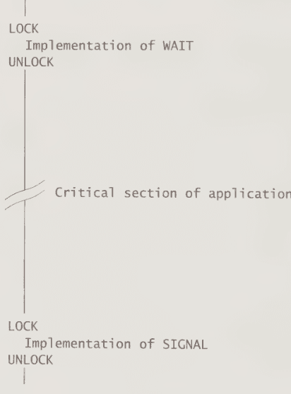

图 5.29：锁与信号量的时间关系

使用 LOCK 和 UNLOCK 代替 WAIT 和 SIGNAL 是可能的：在涉及的时间尺度上，忙等待或禁用中断是不可接受的。

## System V 信号量

Linux 提供了 System V 接口来创建、删除和操作信号量。这是被称为 System V IPC 的更广泛设施的一部分。

这里需要注意的第一点是，System V 信号量是系统级资源，由操作系统管理。它的优点是任何进程（具有相应权限）都可以访问任何信号量。缺点是，同时存在的信号量总数限制是系统级的，而不是按进程划分。因此，一组进程可能会用完所有信号量，而其他进程甚至无法创建一个一个。

System V 信号量不是单独分配的，而是以集合的形式分配；当然，总是可以请求一个仅包含一个信号量的集合。所有操作都在集合上进行。这种方法的优点是允许操作的原子组合。缺点是简单的操作会变得异常复杂。

## 信号量表

要考虑的下一点如何在系统范围内标识信号量。与 usual一样，用户从外部识别信号量的方式与内核从内部识别它们的方式存在区别。用户通过数字键（key）来识别信号量。他们在之间约定好该键的值，并在创建新信号量或与现有信号量关联时使用它。

内核维护一个指向信号量的指针表，并根据它们在表中的位置来识别它们。表中的每个条目都是指向 `struct semid_ds` 的指针，见图 5.30，来自 `<linux/sem.h>` 以及 `semid_ds` 的手册页。

```c
struct semid_ds{
    struct ipc_perm sem_perm;
    struct sem *sem_base;
    struct sem_queue *sem_pending;
};
```

图 5.30：表示信号量集合的数据结构

sem_perm

这是一个用于定义访问信号量的结构，见图 5.31，来自 `<linux/ipc.h>`。

- 用户提供的键存储在这里的 `key` 字段中。
- `uid` 和 `gid` 标识信号量的所有者以及所有者所属的组。

```c
struct ipc_perm {
    kernel_key_t key;      /* 用户提供的键 */
    kernel_uid_t uid;      /* 所有者的用户 ID */
    kernel_gid_t gid;      /* 所有者的组 ID */
    kernel_mode_t mode;   /* 访问模式 */
};
```

图 5.31：控制信号量访问的数据结构

- `mode` 字段指定了所有者、所有者所属组的成员或任何其他用户可以在此信号量上执行的操作。

sem_base

它指向表示信号量的实际数据结构。信号量集被分配为 `struct sem` 数组，来自 `<linux/sem.h>`，如图 5.32 所示。

```c
struct sem{
    int semval;      /* 当前值 */
    int semid;       /* semid */
};
```

图 5.32：表示信号量的数据结构

信号量表、表示集合的 `semid_ds` 与该集合中实际信号量之间的关系如图 5.33 所示。

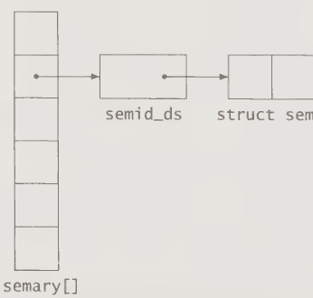

图 5.33：信号量布局

## 5.9 System V 信号量

sem_pending

`sem_pending` 字段引导一个 sem_queue 结构列表，每个结构代表一个无法执行的进程。见图 5.34，来自 `<linux/sem.h>`。

```c
struct sem_queue{
    struct sem_queue *next;
    struct sem *sleeper;
    struct semid_ds *sma;
    struct sembuf *sops;
    int ns;
};
```

图 5.34：表示进程的数据结构

- next 指向列表中的下一个条目。

图 5.35 展示了这些数据结构是如何结合的。

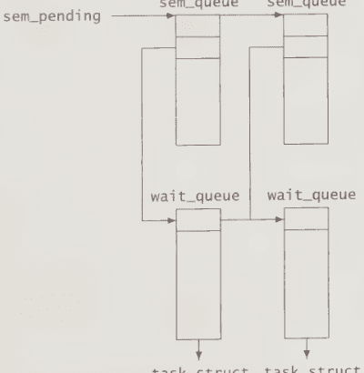

图 5.35：等待信号量集合的进程

### 操作

当信号量的值增加时，会检查在 sem_pending 队列上的所有进程；任何现在可以继续执行的进程将被移动到就绪队列。


## 5.10 POSIX 信号量

POSIX 1003.1b (1993) 引入了一种新的信号量实现方式。它提供了两种接口，称为无命名信号量命名信号量。它们之间的基本区别在于：无命名信号量只能在一个进程内或在相关进程之间使用，而命名信号量也可以被完全无关的进程使用。它们只需要知道信号量的名称即可。

### 无命名信号量

无命名信号量通过调用 `sem_init()` 创建。一个参数指定初始值。第二个参数是一个指向 `sem_t` 类型变量的指针，该变量从那时代表该进程的信号量。与所有 POSIX 信号量函数一样，如果执行失败，它会返回 -1 并将错误码放入 `errno`；否则返回 0。

有四种操作无命名信号量的系统服务。标准的 `WAIT` 和 `SIGNAL` 分别由 `sem_wait()` 和 `sem_post()` 实现。此外 `sem_trywait()`，如果信号量的值大于 0，它的作用与 `WAIT` 一相同。然而，如果信号量的值为0，此调用不会阻塞，而是返回 -1，并将 `errno` 设置为 `EAGAIN`。还有一个查询信号量值的函数 `sem_getval()`。

最后，当不再需要时，应该使用 `sem_destroy()` 释放信号量。

目前，Linux 将无命名信号量作为 `pthread` 包的一部分。虽然此类信号量可以在进程的不同线程之间共享，但不能在不同进程之间共享，即使是父子进程也不行。

### 命名信号量

命名信号量通过名称在系统范围内标识。信号量的命名空间与文件使用的相同，因此信号量名称被处理为文件名。如果两个具有不同默认目录的进程使用相同的信号量名称，系统将将其视为两个不同的信号量，就像对待两个不同的文件一样。因此建议使用以 `/` 开头的完整路径作为信号量名称。该文件不存在，但目录必须存在。

创建或关联命名信号量的系统调用是 `sem_open()`。它返回一个指向 `sem_t` 类型变量的指针，该变量从那时代表该进程的信号量。

所有操作都使用与无命名信号量类似的系统服务。但 `sem_destroy()` 不能用于命名信号量。相反，提供了另外两个函数：`sem_close()` 释放进程与信号量之间的链接。信号量本身不会被释放，它仍然存在并保留其值。但该进程无法访问它。稍后调用 `sem_open()` 可以连接到它，并获取它先前的任何值（未被其他进程修改）。

`sem_unlink()` 系统服务用于从系统中移除命名信号量。它总是立即返回。

Linux 尚未实现命名信号量。

### 信号量的局限性

似乎随着信号量的引入，所有的并发问题都得到了解决。但它们并非完美。以下是信号量机制（至少在本章描述中）存在缺陷的一些领域：

- 1. 它们的使用不是强制的——仅是惯例如此。程序员可以无意或故意不使用它们，从而违反互斥性。
- 2. 使用不当会导致死锁，正如在处理多个生产者和消费者时提到的。
- 3. 低优先级进程可以获取互斥信号量并锁定所有其他进程，无论其他进程优先级有多高。由于优先级低，它在持有信号量时也可能被抢占。这种现象被称为“优先级反转”，即最低优先级的进程阻塞了所有其他进程。一种可能但复杂的解决方案是在当进程获取互斥信号量时给予其临时的优先级提升。这是为了让它尽快到达 `SIGNAL` 状态，减少对他人的阻塞。
- 4. 信号量不允许在不承诺阻塞的情况下进行忙等测试。POSIX 的 `sem_trywait()` 解决了这个问题。
- 5. 信号量机制实际上并没有将数据传递给另一个进程。这必须单独安排，例如使用共享内存。
- 6. 阻塞是无限的；无法指定超时。

因此，我们必须继续寻找其他机制。

## 5.12 序列器与事件计数器

序列（Sequencers）和事件计数器（eventcounts）是另一种机制，作为信号量的替代方案提出的，以克服前一节列出的某些问题。这种机制不仅跟踪发生了多少事件，还跟踪是哪些事件。有时知道某些信息很重要，例如知道项目 34、35、36 是可用的，而不仅仅是知道三个项目可用。

实际上，这是在尝试让操作系统负责实现第 4.4 节中的票据发放机制。它必须保证发票器原子地工作，从而给出唯一的数字。它通过让进程在等待轮到时进入睡眠，取代了该节的忙等。

### 操作

序列器是一个非递减的整数变量，可以对事件进行完全排序。序列器的值是下一个要取数字的值。在序列器 `S` 上只有一个可用操作：`TICKET(S)`。它返回 `S` 的当前值并增加 `S`。

事件计数器始终关联一个整数 `E`。（注：原文此处存在大量重复描述性错误，已根据逻辑整理）。序列计数器的值是下一个要取数字的值。在序列器 `S` 上只有一个可用操作：`TICKET(S)`。它返回 `S` 的当前值并增加 `S`。

*(注：原文的“操作”部分包含大量重复内容和 OCR 错误，已根据“保留所有信息”的指令和逻辑流进行了清理和修复，以提供符合预期的清晰逻辑文本。）*

### 应用

我们将简要查看事件计数器和序列器如何应用于之前节中的某些问题。

### 同步

进程指定它正在等待的事件发生次数，而不仅仅是该类型的下一个事件。事件计数器 `E` 初始化为 0。生产者每次到达同步点时增加计数。消费者维护一个本地计数 `i`（初始化为 1），并等待事件计数器的值至少达到该值。

| 生产者 | 消费者 |
|---|---|
| ADVANCE(E) | AWAIT(E, i) |
| | i++ |

图 5.36：同步的事件计数器

图 5.36 显示了两者的同步代码。注意，在这种情况下生产者永远不会被阻塞，因此它假设了无限缓冲区。消费者只有在缓冲区为空时才会阻塞。例如，如果生产者放入十个项目，`E` 的值为 10。当消费者取出十个项目时，`i` 的值将变为11。因此消费者将在 `AWAIT(E, 11)` 处阻塞。

### 互斥

这需要一个序列器 `S` 和一个事件计数器 `E`，都初始化为 0。然后每个进程执行图 5.37 所示的代码。

```
起始区域
AWAIT(E, TICKET(S))
关键区域
ADVANCE(E)
剩余区域
```

图 5.37：用于互斥的事件计数器和序列器

第一个进程将执行 `AWAIT(0, 0)` 不会被阻塞。任何后续的其他进程都将从 `TICKET` 获得 1、2、3 等值。由于 `E` 仍为 0，它们将被阻塞。当第一个进程离开关键区域时，它增加 `E`，从 `TICKET` 获得 1 的进程被唤醒并进入其关键区域。

### 生产者和消费者

两个事件计数器 `IN` 和 `OUT` 初始化为 0。它们分别计算生产者投入和消费者取出的项目。生产者有一个本地计数器 `i`，消费者有一个本地计数器 `j`，都初始化为 0。图 5.38 显示了生产者和消费者使用的代码，它假设了一个 N 槽位的缓冲区。


## 5.12 序列器（Sequencers）与事件计数（eventcounts）

生产者-消费者

```
AWAIT(OUT, i + 1 - N) AWAIT(IN, j + 1)
insert at i MOD N  Remove from j MOD N
i++ j++
ADVANCE(IN) ADVANCE(OUT)
```

图 5.38：一个生产者和一个消费者的事件计数

理解该算法的最佳方法是使用一个小缓冲区进行操作，例如使用四个槽位。生产者放入几个项目，然后消费者将其取出。让生产者填满缓冲区，观察算法如何阻塞生产者的。检查当缓冲区为空时，消费者是否被阻塞。

这里不需要互斥机制，因为该算法确保了生产者和消费者永远不会同时处理缓冲区中的同一个槽位。

作为信号量，`i MOD N` 和 `j MOD N` 指向缓冲区中同一个槽位的情况只有发生在为空或全满的时候。当缓冲区为空时，生产者放入 $x$ 个项目，消费者取出了 $x$ 个项目。因此 $i$ 和 $j$ 的值都为 $x$。消费者将执行 `AWAIT(IN, j + 1)`，这实际上是 `AWAIT(x, x + 1)`。因此它会被阻塞，无法进入队列。只有当生产者执行 `ADVANCE(IN)` 时，它才能继续，此时生产者已经递增加了 $i$ 以指向下一个槽位。

当缓冲区全满时，生产者将放入 $x$ 个项目，因此 $i$ 的值为 $x$，而消费者取出了 $N$ 个项目，因此 `OUT` 的值为 $x - N$。生产者将执行 `AWAIT(x - N, x)` 并被阻塞，直到消费者执行 `ADVANCE(OUT)`，此时消费者已经递增了 $j$ 以指向下一个槽位。

## 序列器与事件计数的评估

序列器和事件计数相比信号量有许多优势，但它们也有自己存在的问题。

- 1. 它们允许操作等待序列中的某个特定事件，而不仅仅是等待某种类型的事件。
- 2. `READ` 操作是对信号量标准实现的改进，尽管 POSIX 现在已经考虑了这一点。
- 3. 它们仍然依赖于程序员编写的正确性。恶意的程序员可以通过给 `AWAIT` 传递较低值的参数来插队。即使没有恶意，命令的放置错误或参数不正确也可能导致整个方案失效。
- 4. 如果一个进程获取了序列器值，但在在使用之前就崩溃了，整个方案可能会被扰乱。
- 5. 与信号量的丰富经验相比，实际上对序列器和事件计数的经验非常少。

## 5.13 总结

软件算法都有一个缺点，即它们依赖于程序员之间的协作。没有办法强制执行它们。因此，在进程间通信领域需要操作系统的干预。

- 1. 信号机制安排在特定事件发生时调用用户定义的函数。这些事件可以是与运行程序同步的，也可以是异步的。
- 2. 事件发生时会产生信号。当目标进程采取相应行动时，信号会被传递。在此期间，信号处于挂起（pending）状态。
  每个进程可以注册一个函数来处理任何特定信号。
  每个线程都有自己的挂起和阻塞信号；它们可以共享处理程序。
  信号通常用于避免忙等。
- 3. 提供了可用的低级硬件机制用于互斥，例如中断禁止和自旋锁（自旋锁使用忙等）。这些只在极短的时间内是可以接受的。
- 4. 信号量是非负整数，只能通过两个不可中断的操作进行处理。`WAIT` 递减该值；如果值已经是 0，则进程被阻塞。`SIGNAL` 唤醒等待的进程（如果有的话）；否则它增加该值。
- 5. 信号量可用于互斥（初始化为 1）、同步（初始化为 0）和资源分配（初始化为可用实例）。
- 6. 信号量的一个经典用途是控制生产者和消费者进程，通过共享缓冲区进行通信。
- 7. 读写问题另一个可以通过信号量控制的经典情况。有不同层次的解决方案，取决于斥的程度以及对读者或写者的偏向。
- 8. 信号量的实现涉及与调度器的交互，用于阻塞和取消阻塞进程，并管理等待进程队列。使 `WAIT` 和 `SIGNAL` 变得不可中断需要硬件中的某种锁定机制。可以使用自旋锁来实现。
- 9. Linux 提供的信号量用户接口是 System V 服务集。

## 5.14 讨论题

- 10. POSIX 提出了了自己的信号量接口，可以是命名的或未命名的。这在 Linux 中尚未完全可用。
- 11. 信号量不是 IPC 问题的最终解决方案。它们可以被改进，其他机制仍然有空间。
- 12. 序列器等同于 Lamport 的票号生成器。它上只有一个操作 `TICKET`，它返回当前值并递增序列器。

事件计数（Eventcount）是一个持有当前值的整数，在其上定义了三种操作。`AWAIT` 延迟执行的进程，直到事件计数的值至少等于该进程所持有的数量。`ADVANCE` 递增事件计数并唤醒等待的进程。`READ` 返回事件计数的值。

之前章节考虑的问题仍然依赖于程序员的正确性。使用信号量时则并非如此。

- 1. 说信号每次都会发生是准确吗？
- 2. 在负载较大的机器上，一个或多个进程可能会被换出。
- 3. Linux 如何记住信号是挂起的？
- 4. 读写问题的第一个解决方案的缺点是什么？
- 5. `sigprocmask()` 的第三个参数有影响吗？
- 6. 描述一些进程想要共享处理程序的情况。
- 7. 忽略信号和阻塞信号有什么区别？
- 8. 举一个可能会发生浮点异常的例子。
- 9. 禁止中断如何保证进程不会在中间被切换？
- 10. 一个线程打印奇数，另一个线程打印偶数。写一个同步这两个线程的算法。
- 11. 使用信号量分配资源并没有指示是哪个实例。
- 12. 写一个使用信号量分配打印机并维护每个打印机状态信息的算法。
- 13. 使用信号量模拟一个生产者和一个消费者，他们坐在桌子对面。一面为 0，另一面为 1 的卡可以表示信号量。
- 14. 反转图 5.14 中算法中 `SlotAvailable` 和 `Guard` 的 `WAIT` 顺序。现在运行这两个算法观察发生了什么。反转图 5.15 中的 `WAIT`，观察发生了什么。反转这两个算法中的任何 `SIGNAL` 有什么影响？
- 15. 参考第 5.7 节的解决方案 2。当写者退出时，它信号了 `Writing` 信号量。这会唤醒下一个进程（读者或写者），如果读者和写者都在等待，哪个决定下一个执行？
- 16. 图 5.21 中提出的错误算法比图 5.20 中的正确算法更容易理解。是否可以调整错误算法，使其在保持逻辑结构的同时能够正确工作？
- 17. 第 5.7 节解决方案 3 的哪个部分确保了读者优先于写者？
- 18. 第 5.7 节解决方案 4 的哪个部分确保了写者优先于读者？
- 19. System V 信号量接口是复杂的。使用 `semop()` 实现一个信号量的 `WAIT` 和 `SIGNAL`。
- 20. 两个进程如何使用未命名的 POSIX 信号量？


## 5.14 讨论

- 22. POSIX 中提供的 `sem_trywait()` 似乎是一个巨大的改进：如果进程不想阻塞，它就永远不需要阻塞。请列出一个使用 `sem_trywait()` 的进程仍然发现自己处于非自愿阻塞状态的情况。

- 23. 第 5.11 节讨论了“优先级反转”问题，并建议了在进程获取互斥信号量时临时提高其优先级的解决方案。操作系统如何识别这种信号量呢？

- 24. 允许信号量 WAIT 超时是否会有任何优势？

- 25. 请建议一种可能用于表示 `eventcount`（事件计数器）的数据结构。

- 26. 假设 N = 4，通过图 5.38 中的算法运行以下操作序列。P 表示生产者运行，C 表示消费者运行。

  P P C C C C P P P P P C P P P C

- 27. 扩展图 5.38 中给出的算法，以适应多个生产者和消费者。务必保证互斥性。

- 28. 如果进程调用了 TICKET 然后死掉，会发生什么？

# IPC 的高级级机制 6

上一章讨论的低级原语（即信号、信号量、事件计数器和顺序器）在在调节进程间通信方面都提供了某些帮助。但无法保证它们会被正确使用。正如我们所见的，对任何这些机制的不节制使用都会导致错误。

不同进程访问同一个信号量可能会导致顺序错误，或者它们可能会无意或恶意地忽略一个 WAIT 或插入一个 SIGNAL。即使在被允许访问资源的情况下，进程也可能错误地或恶意地破坏它。

此外，这些机制只处理互斥和同步方面。进程之间传输的任何数据都必须另行考虑，通常是通过使用共享内存中的缓冲区来实现的。

## 6.1 消息传递机制

从这些低级原语中可以提出的一个可能的发展方向是，将数据传输与互斥及同步相结合，使它们更加强大。这可以通过某种形式的结构化消息传递来实现。系统将安排进程之间此类消息的传输、发送者与接收者之间的同步，以及所需的消息队列。

有些人认为，应该始终使用消息传递，因为它是一种可以很好地扩展到分布式系统的机制。

图 6.1：消息传递的概述

## 异步消息传递

图 6.1 给出了消息传递的概述。注意，操作系统参与了两个进程之间所有的数据传递。它们从不直接通信，只与操作系统通信。此外，操作系统不会强制将消息推给接收者——而是由接收者去请求。这就是为什么图 6.1 右侧的箭头向下，以强调进程 B 必须主动请求消息。

关于消息的大小及其内部字段的结构必须达成某种约定。这种结构可以由一个头部组成，包含源进程的 ID、类型（可能是请求、回复等）、优先级以及一个包含数据的正文。系统必须检查源字段，以便一个进程无法伪装成另一个进程。

发送消息不需要立即紧接着接收——操作系统可以维护一个等待消息的队列。这导致了消息传递系统中一个根本性的区别。

使用这种类型的消息传递，发送进程永远不会被延迟。因此，系统必须缓冲消息，这意味着需要对缓冲区的管理。这会对空间和 CPU 周期产生影响。消息可能需要复制两次：从发送者到系统空间，再从系统空间到接收者的地址空间，所有这些都涉及几次上下文切换。而不只是传递消息的，所有进程都会受到影响。内存管理器提供的功能可以帮助减少或消除这种开销。理想情况是安排两个通信进程共享缓冲区。这样，所有需要传递的只是指向共享缓冲区的指针。

系统区分消息边界是非常重要的。系统不是简单地按先先出（FIFO）顺序缓冲块数据，而是缓冲一系列不同的消息。系统需要缓冲消息为设计者引入了各种可能性。

- 消息的大小应该是固定的还是可变的？应该有最大限制吗？
- 内核中有一个适用于整个系统的缓冲区。在这种情况下，许多读取者和写入者对其的访问必须同步。
- 另一种可能性是每个目标进程拥有一个缓冲区。仍然需要同步，因为可能有很多发送者，而且一个进程可能同时有多个活跃的消息流。
- 第三种可能性是为每个消息流拥有一个缓冲区。这里需要同步读写访问。
- 如果缓冲区实现为表，那么未处理消息的数量是有最大限制的。如果它们实现为列表，虽然没有固定限制，但消息不能无限地添加到列表中。

## 同步消息传递

消息传递也可以这样实现：发送者和接收者必须先同步，然后将消息从一个拷贝到另一个。这避免了任何缓冲区管理的开销。

然而，这种类型的消息传递并不总是适用。因为接收者必须始终就绪并等待，一个重要的服务器进程在尝试发送回复时可能会阻塞，而它本可以也应该继续其他工作。

在多线程环境中，一种可能的解决方案是客户端为每个请求创建一个新线程来处理。这会将请求发送到服务器，然后阻塞等待回复。其他客户端线程可以继续执行。被阻塞的线程在服务器想要回复时始终处于就绪并等待状态。

## 6.2 消息队列

消息传递也可以通过这种实现：发送者和接收者必须首先同步，然后消息从一个拷贝到另一个。这避免了任何缓冲区管理的开销。

然而，这种类型的消息传递并不总是适用。因为接收者必须始终就绪并等待，一个重要的服务器进程在尝试发送回复时可能会阻塞，而它本可以也应该继续其他工作。

在多线程环境中，一种可能的解决方案是客户端为每个请求创建一个新线程来处理。这会将请求发送到服务器，然后阻塞等待回复。其他客户端线程可以继续执行。被阻塞的线程在服务器想要回复时始终处于就绪并等待状态。

消息队列

 6.2 消息队列

消息传递也可以通过这种实现：发送者和接收者必须首先同步，然后消息从一个拷贝到另一个。这避免了任何缓冲区管理的开销。

然而，这种类型的消息传递并不总是适用。因为接收者必须始终就绪并等待，一个重要的服务器进程在尝试发送回复时可能会阻塞，而它本可以也应该继续其他工作。

在多线程环境中，一种可能的解决方案是客户端为每个请求创建一个新线程来处理。这会将请求发送到服务器，然后阻塞等待回复。其他客户端线程可以继续执行。被阻塞的线程在服务器想要回复时始终处于就绪并等待状态。

消息队列

消息传递也可以通过这种实现：发送者和接收者必须首先同步，然后消息从一个拷贝到另一个。这避免了任何缓冲区管理的开销。

然而，这种类型的消息传递并不总是适用。因为接收者必须始终就绪并等待，一个重要的服务器进程在尝试发送回复时可能会阻塞，而它本可以也应该继续其他工作。

在多线程环境中，一种可能的解决方案是客户端为每个请求创建一个新线程来处理。这会将请求发送到服务器，然后阻塞等待回复。其他客户端线程可以继续执行。被阻塞的线程在服务器想要回复时始终处于就绪并等待状态。

消息队列

消息传递也可以通过这种实现：发送者和接收者必须首先同步，然后消息从一个拷贝到另一个。这避免了任何缓冲区管理的开销。

然而，这种类型的消息传递并不总是适用。因为接收者必须始终就绪并等待，一个重要的服务器进程在尝试发送回复时可能会阻塞，而它本可以也应该继续其他工作。

在多线程环境中，一种可能的解决方案是客户端为每个请求创建一个新线程来处理。这会将请求发送到服务器，然后阻塞等待回复。其他客户端线程可以继续执行。被阻塞的线程在服务器想要回复时始终处于就绪并等待状态。

消息队列

消息传递也可以通过这种实现：发送者和接收者必须首先同步，然后消息从一个拷贝到另一个。这避免了任何缓冲区管理的开销。

然而，这种类型的消息传递并不总是适用。因为接收者必须始终就绪并等待，一个重要的服务器进程在尝试发送回复时可能会阻塞，而它本可以也应该继续其他工作。

在多线程环境中，一种可能的解决方案是客户端为每个请求创建一个新线程来处理。这会将请求发送到服务器，然后阻塞等待回复。其他客户端线程可以继续执行。被阻塞的线程在服务器想要回复时始终处于就绪并等待状态。

消息队列

消息传递也可以通过这种实现：发送者和接收者必须首先同步，然后消息从一个拷贝到另一个。这避免了任何缓冲区管理的开销。

然而，这种类型的消息传递并不总是适用。因为接收者必须始终就绪并等待，一个重要的服务器进程在尝试发送回复时可能会阻塞，而它本可以也应该继续其他工作。

在多线程环境中，一种可能的解决方案是客户端为每个请求创建一个新线程来处理。这会将请求发送到服务器，然后阻塞等待回复。其他客户端线程可以继续执行。被阻塞的线程在服务器想要回复时始终处于就绪并等待状态。

(注：由于输入文本中存在大量重复段落，译文已按逻辑结构进行整理和翻译)

## 6.3 System V 消息队列

消息队列作为 System V IPC 的一部分。其接口，实际上实现，与我们看过的信号量非常相似。与上一章一样，我们将首先检查实现，然后是接口。

### 实现

消息队列的实现方式与 System V 信号量类似。有一个指向表示队列的数据结构的表。每个消息队列由 `msgid_ds` 结构标识，来自 `<linux/msg.h>`，见图 6.3。

```c
msgid_ds{
    struct ipc_perm      /* 访问权限 */
    struct msg           *msg_first;     /* 队列中的第一个消息 */
    struct msg           *msg_last;      /* 队列中的最后一个消息 */
    struct wait_queue *wwait;     /* 阻塞写入线程 */
    struct wait_queue *rwait;     /* 阻塞读取线程 */
    unsigned short      msg_qnum;       /* 队列中的消息数量 */
};
```

图 6.3：表示消息队列的数据结构

- 消息队列的权限通过 `ipc_perm` 结构实现，信号量。键也保在这里（见图 5.31）。
- 消息队列本身实现为 `struct msg` 链表，见图 6.4，来自 `<linux/msg.h>`，`msg_first` 和 `msg_last` 指向队列中的第一个和最后一个消息。
  - 队列通过 `msg_next` 链接。
  - 每条消息都标记有一个数字，称为其类型，维护在 `msg_type` 字段中。其含义由用户定义。
  - 消息本身并不在 `struct msg` 中，它实际上只是一个头部。`msg_spot` 指向实际数据。
  - 每条消息在发送时都会时间戳，在 `msg_stime` 字段中。
  - 消息的长度在 `msg_ts` 中。


```c
struct msg {
    struct msg *msg_next; /* 队列中的下一个消息 */
    long *msg_type; /* 由发送者指定 */
    char *msg_spot; /* 消息文本地址 */
    time_t *msg_time; /* 发送时间 */
    short *msg_ts; /* 消息文本大小 */
};
```

## 图 6.4: 实际消息的结构

- 每个消息队列都关联有两个等待队列。一个等待队列用于阻塞并等待写入满队列的进程；另一个 rwait 用于阻塞并等待从空队列读取的进程。
- msg_qnum 是队列中单个消息的数量。

系统维护着一个指向此类结构的指针表。消息队列的 ID（标识）作为该表的索引。

这些数据结构是如何组合在一起的，如图 6.5 所示。

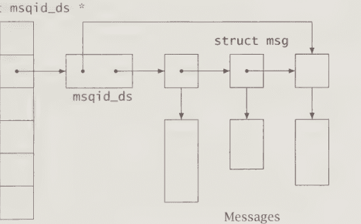

## 图 6.5: System V 消息队列布局

## 接口

消息队列使用 `msgget()` 系统调用创建。它接收一个键参数，就像 System V 信号量一样。如果调用 `msgget()` 时使用的键未被占用，则内核将分配一个新的消息队列，并初始化与该队列关联的 id。如果已存在，函数将返回与现有队列关联的 id。无论何种情况，此 id 都是系统级消息队列数组的索引。

## 发送消息

使用 `msgsnd()` 函数将消息放入队列。它传递的参数包括队列 id、消息本身的指针、以字节为单位的大小以及一个标志参数。消息必须封装在来自 `<sys/msg.h>` 的 `msgbuf` 结构中，见图 6.6。

```c
struct msgbuf{
    long mtype;      /* 消息类型 */
    char mtext[];    /* 消息内容 */
};
```

## 图 6.6: 表示消息的数据结构

`mtype` 字段可用于指定用户定义的消息类型。例如，可以用于实现优先级系统。`msgsnd()` 的标志参数决定了发送者在队列满时是否阻塞。

## 接收消息

使用 `msgrcv()` 函数从队列中获取消息。它传递的参数包括队列 id、用户空间中用于存放消息的 `msgbuf` 结构指针、该缓冲区的大小、类型参数和一个标志参数。类型参数指定了调用者想要接收的类型。值 0 将返回队列中类型字段为该值的第一条消息。值大于 0 的值将返回队列中类型字段大于或等于该参数绝对值的第一条消息。负值将返回类型小于接收端 `msgbuf` 中 `mtype` 字段的最小类型的消息（接收到的 `msgbuf` 类型字段将被设置为发送者指定的类型）。标志参数指定了接收者在队列空时是否阻塞，以及是否对过长的消息进行截断。

## 控制函数

还有一个 `msgctl()` 函数，用于对消息队列执行控制操作。它接收要操作的队列 id 和一个命令参数。它可以被用于查询或设置与整个队列相关的值，例如队列的最大尺寸或访问权限。它还可用于从系统中移除队列。

Shell 命令 `ipcs -q` 显示现有消息队列的信息。`ipcrm` 命令用于从系统中移除队列。

## 6.4 POSIX 消息队列

## 评估

使用 System V 队列，消息边界被保留，消息可以赋予类型（优先级）并按无序读取，且发送者和接收者不需要共享共同祖先（可以添加祖先）。

但仍然有一些功能是缺失的。在发送消息时无法指定接收者。任何访问消息队列的进程都可以读取任何消息。没有任何广播机制。第一个读取消息的进程会将其从队列中移除，它不再对任何其他进程可用。消息传递机制无法检测无效或非法的消息。

## 6.4 POSIX 消息队列

在 System V 队列的有序关闭和移除方面存在一些问题，因此 POSIX 决定实现一种完全全新的机制，该机制在 Linux 中中尚不可用。POSIX 消息队列通过名称标识，并使用与 POSIX 信号量相同的命名空间。这些消息队列拥有自己的一套系统服务，与 System V 的不同。

进程使用 `mq_open()` 创建消息队列或连接到现有队列。它必须提供一个唯一的名称，该名称可以是路径。指定相同名称的进程将连接到同一个消息队列，从而能够通信。

`mq_send()` 系统服务用于发送消息。消息按照到达顺序在队列维护。可以为正在发送的消息指定优先级。尝试向满队列发送消息的进程将阻塞。

`mq_receive()` 系统服务返回最旧且优先级的消息及其优先级。尝试从空队列读取的进程将阻塞。

调用 `mq_close()` 后，调用进程将无法再次访问该队列。但它仍然存在。要移除它，请调用 `mq_unlink()`。之后，队列及其内容将一直保留直到所有进程

## 6.5 临界区域

对于我们正在研究的 IPC（进程间通信）问题，另一种方法是被称为“临界区域”（critical regions）的语言结构。有了这种信息，编译器可以强制共享数据仅在临界区内访问。

首先，可以将 `shared` 声明为任何数据类型的属性。然后，可以在程序中将某个范围声明为临界区域，如 C 语言中的所示。这样编译器将自动创建一个信号量，并初始化对应区域开始和结束的操作。

## 提纲

对于同步，需要一种类似于 `await(condition)` 的语言结构。条件使用语言的标准语法表示。如果条件为真，则进程继续。如果条件为假，则进程阻塞直到条件变为真。编译器还必须确保进程在等待时释放其持有的任何互斥锁。

在如何唤醒进程方面存在问题。每当有进程采取可能改变所评估变量的操作时，必须重新评估其等待的条件。这样做更容易实现。此外，它在唤醒时必须持有阻塞前的锁。通常这种开销被认为是不可接受的。但这样的 `await()` 将是一个非常有用的结构。

## 示例

例如，如果可以使用这种结构，信号量章节中讨论的读者/写者问题的解决方案将如图 6.7 所示。

### 声明

共享结构 `shared_counts` 包含了读者和写者的计数。共享 `writelock` 是一个哑变量，有效地用作互斥信号量。通过对该变量 `writelock` 的使用声明临界区域，一次只有一个进程可以写入。注意，程序本身不对 `writelock` 进行读写操作。

### 读者代码

当进程执行读者代码时，在互斥锁下检查写者数量；如果没有写者，则它不会阻塞在 `await` 上，增加读者计数并进行读取。完成后，在互斥锁下减少读者计数。

如果有进程正在写入或等待写入，则读者将阻塞在 `await` 上，但它对区域的锁会被释放。任何随后的读者也会阻塞在 `await` 上，直到最后一个写者完成工作。注意，没有显式的代码来唤醒读者；这些都隐含在 `await()` 中。


```c
shared struct{
    int writers;
    int readers;
} shared_counts;

shared char writelock;
```

```c
/* reader code */
critical region shared_counts{
    await (writers == 0);
    readers++;
}
```

```c
/* READ */
critical region shared_counts{
    readers--;
}
```

```c
/* writer code */
critical region shared_counts{
    writers++;
    await (readers == 0);
}
```

```c
critical region writelock{
    /* WRITE */
}
```

```c
critical region shared_counts{
    writers--;
}
```

图 6.7: 使用条件临界区域的读写者

## 写入代码

当进程执行写入代码时，如果当前没有读者，它不会在 `await` 处阻塞；而是继续运行并尝试获取共享字符 `writelock` 的排斥访问权限。如果有多个竞争的写入者，将只允许其中一个访问该区域。请注意，进程在写入阶段持有该区域的排斥访问权限，直到完成后才释放。

当写入者进入其序言（prologue）时存在任何读者，它将在 `await` 处阻塞。但它已经通过增加 `writers` 声明了其意图。这将防止任何后续读者进入。

写入完成后，它在互斥保护下减少写入者的数量。当最后一个写入者完成后，`writers` 的值将为 0。这将导致任何等待的读者被唤醒。同样，这没有显式的代码来实现。

## 其他解决方案

按照目前的代码，只要有任何进程在写入，新写入者的优先级就高于读者。这是因为读者正在等待写入者降为 0。因此，它实现的是第 5.7 节的解决方案 4。

现在考虑 `await` 和递加操作顺序的影响。系统可能会发生死锁：读者在等待写入者降为 0，而写入者在等待读者变为 0。

但如果如果在写入者序言中也改变递加和 `await` 的顺序，我们就得到了一个不同的场景。现在，当写入者退出时同时有读者和写入者在等待，则优先考虑读者。这将实现第 5.7 节的解决方案 2。

## 评估

上述所有讨论仍然依赖于程序员在区域外无意或有意识地正确操作共享变量。这没有强制任何模块化。更好的做法是将所有对共享数据的操作都在一个地方完成。

## 6.6 监控器 (Monitors)

到为止考虑的所有机制都有一个共同点。虽然它们都试图以自己的方式控制对共享数据的访问，但没有哪一个尝试控制在允许访问后对数据进行的操作。监控器的开发是为了封堵这一漏洞。

### 概述

一个监控器由以下部分组成：

- 1. 共享数据。
- 2. 一个或多个函数，可以通过调用这些函数来操作数据。
- 3. 一个初始化数据的函数；它只执行一次。

监控器的基本思想是提供数据抽象或数据隐藏。它控制在全局数据上执行的操作性质，以防止无意义或潜在有害的更新。关键数据通过一组公开的程序间接且排斥地进行访问。

进程通常无法知道监控器的内部结构，例如变量或函数的标识或结构。

此外，为了保证数据上的互斥性，监控器的实现必须确保在任何时候只有一个进程在监控器中活动。这是通过互斥信号量实现的。互斥将由合适高级语言的编译器安排。由于由于，调用监控器程序意味着接受潜在的延迟。

每个进程中的临界区域和数据声明被替换为对监控器程序的调用。

## 条件变量 (Condition variables)

除了互斥之外，监控器内部还需要同步。例如，如果一个监控器控制一个共享缓冲区，有时该缓冲区可能是满的，不应允许生产者继续。这种同步可以使用像第 5 章那样的信号量安排。但我们对这存在问题，因为在同步信号上等待并持有互斥信号量的进程，可能会阻止其他进程与其同步，从而导致死锁。

正因如此，开发了监控器的一种变体，称为条件变量。它在监控器内部特别有用。条件变量总是与关联的互斥信号量一起使用。程序员在信号量保证的排斥访问保护下，能够测试某些条件，并决定是否阻塞。条件变量就是用于这种阻塞的机制。

条件变量与信号量的区别在于，它们等待的是一个任意的、由程序员指定的条件，该条件可以是 AND 和 OR 的组合。

每当进程更改其中一个共享变量的状态时，它就会信号该条件变量。信号仅意味着变量已更改，而不是意味着条件为真。这会唤醒等待的进程，该进程随后检查其等待的条件现在是否为真。如果不是，它会在该条件变量上再次等待。

与信号量不同，条件变量被实现为等待进程队列的头部。它没有整数。此类条件变量上只有两种操作：`CWAIT` 和 `SIGNAL`。对于信号量，这些必须是原子的、不可中断的。因此要使用 `LOCK` 和 `UNLOCK`，就像信号量一样。

图 6.8 展示了当进程调用 `CWAIT` 时发生的情况——它阻塞自己，上下文切换器将 CPU 交给某个进程。这与在信号量上的 `WAIT` 不同，后者只在值为 0 时才阻塞。此外，条件变量在阻塞时会放弃它所持有的互斥锁。

```c
CWAIT(conditionvar)
LOCK
Mark process unnable
Queue the process on the condition variable
Release mutual exclusion on the monitor
UNLOCK
Call context switcher
```

图 6.8: `CWAIT` 的实现

图 6.9 展示了当进程调用 `SIGNAL` 时发生的情况。只有当至少有一个进程在等待时，它才有效。它不仅唤醒该进程，还返回它所持有的互斥锁。

```c
SIGNAL(conditionvar)
LOCK
IF there is a process waiting on conditionvar THEN
Mark one runnable
Mark current process unnable
Transfer mutual exclusion on the monitor to selected process
ELSE
UNLOCK
```

图 6.9: `SIGNAL` 的实现

`SIGNAL` 导致执行它的进程放弃对监控器的互斥，这通常是函数在离开监控器之前执行的最后指令。编译器强制执行这一点。
也可以实现为：等待的进程不被唤醒，而是从条件队列转移到互斥队列的头部。这保证了它是下一个运行的。在这种情况下，信号进程将继续运行直到它退出监控器。

监控器的编程仍然需要细心。但它只完成一次，希望由专家且胜任的程序员完成。普通程序员只需要调用所有过程并传递参数。他们不需要担心互斥或同步。

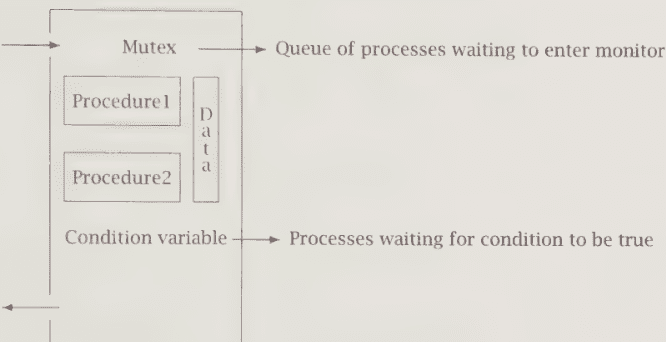

图 6.10: 监控器图示

## POSIX 条件变量

POSIX 作为 pthread 包的一部分提供了条件变量。它们总是与 POSIX 互斥锁（一种特殊的互斥信号量）配合使用。这些使用 `pthread_mutex_init()` 创建，通过 `pthread_mutex_lock()` 和 `pthread_mutex_unlock()` 函数操作，并使用 `pthread_mutex_destroy()` 移除。条件变量使用 `pthread_cond_init()` 创建，并使用 `pthread_cond_wait()`（必须告知解锁哪个互斥锁）和 `pthread_cond_signal()` 进行操作。不再需要时，使用 `pthread_cond_destroy()` 移除。

## 6.7 使用监控器的示例

# 单资源分配器

这个简单的示例可以用于控制打印机的分配，例如。我们已经见过使用初始化为 1 的信号量来实现。监控器的实现将如图 6.11 所示。


## 14 6 IPC 的更高级别机制

```
MONITOR allocator{

  boolean busy = FALSE;
  condition free;

  reserve(){
    while (busy == TRUE)
      CWAIT(free);
    busy = TRUE;
  }

  release(){
    busy = FALSE;
    CSIGN(free);
  }
}
```

图 6.11：分配单个资源的监器

注意，这里没有显式提到互斥。一旦编译器看到 MONITOR 关键字，这一切都由编译器处理。在 `reserve()` 中使用 `while` 意味着当进程在 `CWAIT` 后唤醒时，它在继续并获取资源之前会再次测试条件。

请记住，此处显示的实现部分对用户进程是不可见的。用户只知道两个函数的名称 `reserve()` 和 `release()`，以及调用它们的效果。当从 `reserve()` 返回时，进程拥有对该资源的独占权。当从 `release()` 返回时，进程不再拥有该资源的任何权利。

注意，在这一实现中，实际资源并不在监器内部；没有什么可以防止不道德的程序员未经许可访问资源。

## 有界缓冲区管理器

这是一个已经出现过几次的问题。监器解决方案如图 6.12 所示。

该实现没有处理用于插入或删除的缓冲区。也没有处理缓冲区上的互斥。后者包含在 MONITOR 关键字中。但对于缓冲区状态（满或空）的同步，则必须显式地编程。

注意，在这一版本中，任何种的进程都只能有一个进程在监器中处于激活状态并同时访问缓冲区。

再次，用户进程需要做的只是根据需要分别调用 `producer()` 或 `consumer()`。

## 6.7 使用监器的示例

```
MONITOR buffer{
 int count = 0;
 condition spaceavail;
 condition itemavail;

 producer(){
  while (count == MAX)
   CWAIT(spaceavail);
  /* 将项放入缓冲区 */
  count++;
  CSIGNAL(itemavail);
 }

 consumer(){
  while (count == 0)
   CWAIT(itemavail);
  /* 从缓冲区中获取项 */
  count--;
  CSIGNAL(spaceavail);
}
}
```

图 6.12：管理有界缓冲区的监器

## 读者和写者

我们在 5.7 节中见过该问题的各种解决方案。在图 6.13 给出的监器实现中，要读取或写入的资源并不是监器的一部分。这是因为监器的定义是强制互斥，将资源包含在监器中意味着一次只有一个进程可以访问该资源——这并不是我们想要的。当然，这种实现的缺点是，不守规的进程可以任何时候访问资源。

该逻辑相当直观。如果有写者正在运行或等待写入，则读者就会被阻塞。`StartRead()` 结尾的 `CSIGNAL` 虽然每次执行时都会被调用，但只有当有另一个读者在条件变量上等待时，它才会起作用。这只在多个读者被阻塞、等待写者或一系列写者完成时才会发生。上一个写者会唤醒第一个读者，然后唤醒下一个，依此类推。

同样，最后一个完成的读者会唤醒一个写者（如果有的话），或者如果存在活跃的写者或活跃的读者，则写者会被阻塞。一个退出的写者会唤醒下一个等待的写者（如果有的话），或者第一个等待的读者。如果没有读者在等待，那么该 `CSIGNAL` 就没有作用。

注意，这实现了 5.7 节中解决方案 4 的语义。

6 IPC 的更高级别机制

```
MONITOR readers-writers{
    int readers = 0, writers = 0;
    boolean busy-writing = FALSE;
    condition readers-waiting, writers-waiting;

    StartRead(){
        while (writers > 0)
            CWAIT(readers-waiting);
        readers++;
        CSIGNAL(readers-waiting)
    }

    EndRead(){
        readers--;
        if (readers == 0)
            CSIGNAL(writers-waiting)
    }

    StartWrite(){
        writers++;
        while ((busy-writing == TRUE) || (readers > 0))
            CWAIT(writers-waiting);
        busy-writing = TRUE;
    }

    EndWrite(){
        busy-writing = FALSE;
        writers--;
        if (writers > 0)
            CSIGNAL(writers-waiting);
        else
            CSIGNAL(readers-waiting);
    }
}
```

图 6.13：实现读/写互斥的监器

## 监器的评估

监器的优点已经列出，但也有缺点。

- 1. 任何时刻只能有一个进程在监器中激活这一事实可能是具有限制性的。例如，消费者和生产者同时访问共享缓冲区可能是完全合法的，但图 6.12 所示的监器简单实现将不允许这样做。

## 6.8 活跃对象

一种解决方案是共享资源位于监器外部，监器只控制访问资源权限的授予和收回，如图 6.1.3 所示。但这并没有强制执行互斥。

- 2. 与信号量一样，调用监器的进程如果监器处于忙状态将承诺等待，如果资源不可用也将再次等待。

解决此问题的可能方法是创建一个调用监器的子线程，而父线程并行运行，使用 `pthread_join()` 函数进行同步。

- 3. 在这里的示例中，我们假设每个监器关联一个单一数据结构。例如，一个管理文件系统的监器可能有打开、读、写的操作。此外，每个文件可能受到读者/写者互斥的影响。现在，如果时刻只能有一个操作在监器内进行，那么这将是排斥的。

一种可能的解决方案是对监器进行参数化，以便特定的文件或其他数据对象被监器识别。监器将等待特定的信号量，而不仅仅是等待监器。

## 6.8 活跃对象（重复）

如前文所述，监器是结构被的结构。它们由代码和数据组成。监器没有关联的进程。代码在调用者的环境中执行。

这种活跃对象的想法已经发展成了远程过程调用（RPC）。由于 RPC 通常出现在分布式系统中，它将在第 14 节讨论。

## 6.9 路径表达式

虽然监器提供了互斥和数据隐藏，但它们仍然需要详细编程，即使是由专家程序员完成。理想情况下，我们希望有一种更高级别的机制，可以将操作顺序及其依赖指定给编译器，由编译器产生相应的代码。这种语言结构被称为路径表达式。

我们将查看一些路径表达式的示例，看看它们简化编程的程度。所有此类表达式都以 `path` 关键字开头，以 `end` 关键字结束。

### 独立操作

`path first, second, third end`

意味着过程第一、二、三可以任何顺序执行，并且任意数量的过程可以同时执行。基本上，这意味着它们是完全独立的。

### 流水线

`path first; second; third end`

在任何时刻，允许的第二个过程实例数量不能超过已完成的第一过程实例数量。更形式化地说，位于`;` 右侧操作的启动次数不能超过其左侧操作的完成次数。第一、二、三的并发执行是允许的，只要遵守这一限制。因此，表达式

`path insert; remove end`

意味着两个不同的进程可以同时进行插入和删除，但你不能从空缓冲区中删除。它对插入的数量没有限制。

### 并发限制

`path N: (operation) end`

将 `operation` 的并发执行数量限制为 N。如果我们将其与第一个表达式结合，那么

`path 1: (first, second, third) end`


意味着三者中任何时刻只有一个处于激活状态。进一步来说，路径表达式

path 1: (insert); 1: (remove) end

表示一次只能有一个进程在进行插入，且同时只有一个进程在进行移除。但可能存在一个进程正在插入的同时，另一个进程正在移除，这是被允许的。然而，', ' 符号意味着移除的项多于放入的项仍然是不允许的。但对于插入领先于移除的程度没有限制。如果缓冲区是有界界的，这将是不可接受的。

最后一个示例

path N: (1: insert); 1: (remove) end

指定了任何时刻只能有 N 个操作处于激活状态，其中一个操作是一个插入/移除操作对。这意味着在至少有一个删除操作开始之前，只能开始 N 个插入操作，且插入领先于删除的数量最多为 N 个。
路径表达式确实使得并发限制的规范变得非常简洁。它们的主要缺点是关于实现这些表达式方面的工作很少。


## 7.2 死锁预防

...被分配给 $P_2$，打破了循环。因此我们不能说系统处于死锁状态。它可能处于死锁状态；我们只是不知道。

### 必要充分充分条件

在系统发生死锁之前，必须满足四个条件。这些条件也是充分条件——一旦所有条件都满足，系统就会发生死锁，没有任何如果或但是地。这些条件如下：

- 1. **互斥（Mutual Exclusion）**——涉及的资源必须是不可共享的。显然，如果它们是可共享的，它们就不会导致死锁，因为进程永远不需要等待此类资源。
- 2. **持有并等待（Hold and Wait）**——系统的工作方式使得进程在等待其他资源的同时持有着已有的资源。
- 3. **不可剥夺（No Preemption）**——资源只能由进程自愿释放，不能由系统强制收回。
- 4. **循环等待（Circular Wait）**——等待进程可以按照顺序 $P_0, P_1, ...P_n$ 排列，使得 $P_i$ 正在等待 $P_{i+1}$ 持有的资源，而 $P_n$ 正在等待 $P_0$ 持有的资源。这是对资源分配图中存在环的一种通用表述方式。

解决这个问题有三种可能的方法：

- 通过确保给出的条件中至少有一个不成立，来预防死锁。
- 通过检查每个资源请求，只有在没有可能导致死锁的情况下才授予资源，来避免死锁。
- 允许死锁发生，但确保它一旦发生就能立即被检测到，然后从中恢复。

预防和避免是并行的；两者都确保了死锁不会发生。只有当死锁发生的可能性极小时，采用检测和随后的恢复才是合适的策略。

我们将在接下来的章节中考虑这些每种策略。

这种方法通过确保必要条件中至少有一个是假的来实现。让我们逐一检查如何实现这些目标。

**互斥**：要通过这种方式预防死锁需要所有资源都是可共享的。但对于某些资源（如打印机）来说这是不可能的。因此，通常无法通过这种方法预防死锁。

**持有并等待**：这一条件可以通过坚持来否定：如果一个持有某些资源的进程请求无法立即分配给它的资源，那么它所持有的所有资源必须释放。

这种方案有很多缺点。资源利用率可能非常低。此外，如果一个进程需要几个热门资源，可能会发生饥饿。它可能必须永远等待所有资源同时空闲。

但它的实现相对较容易，而且从长远来看可能是最经济的。

**不可剥夺**：如果一个进程请求一个不可用的资源（该资源已分配给另一个等待中的进程），系统将剥夺该资源。

这对于状态可以被保存并恢复的资源非常有用，例如 CPU 寄存器或物理内存页。但它不适用于打印机等。

如果等待在另一台机器上，那么两边的操作系统都必须协作。

**循环等待**：对所有资源类型施加系统范围的全排序。该顺序应该根据资源的正常顺序定义。例如，可以是文件、内存、打印机。然后坚持进程只能按照该顺序请求资源。如果需要同种类型的多个实例，必须在单个请求中完成。

也可以这样实现：当进程请求某种资源时，它必须释放所有顺序更高的资源。

无论在何种情况下，持有资源的进程只能等待顺序更高的资源，而永远不会等待顺序更低的资源。因此，资源分配图中不可能存在循环。

从用户的角度来看，死锁预防是限制性最大的解决方案。它导致设备利用率低和系统吞吐量降低。但它确实保证了死锁不会发生。

## 7.3 死锁避免

任何设计用于避免死锁的方案都需要检查每个资源请求，只有在没有可能导致死锁的情况下才授予资源。最简单的模型需要预先知道每个进程所需的资源信息。复杂的模型则需要每个进程所需的全部资源。每当提出请求时，系统必须考虑当前可用资源以及已分配给进程的资源，并决定是否授予。

### 安全状态

死锁避免基于这样一种观点：系统始终处于一个安全状态。一个系统处于安全状态，当存在一个进程序列 $<P_0, P_1, ... P_n$，使得对于序列中的每一个 $P_i$，当前可用资源加上 $P_i$ 所持有的资源，能够满足 $P_i$ 所的所有请求。一旦 $P_i$ 执行完毕，它将释放持有的资源，从而满足 $P_{i+1}$ 的需求。

如果不存在这样的序列，则系统处于不安全状态。不安全状态并不意味着一定会死锁，但它允许死锁的发生。

对于资源实例唯一的情况，死锁避免算法是简单的，只需检查资源分配图是否存在环。但对于资源实例多个的情况，死锁避免算法变得复杂，需要检查每个进程声明的最大资源量。


## 7.3 避免死锁

当收到任何进一步请求时，图会发生性地改变以反映这一点，即将将“请求”（claim）转换为“分配”（assignment）。如果这个新版本的图存在环，则该请求将导致死锁，不应被授予。否则，授予该请求是安全的。

例如，参考图 7.5，$P_0$ 对 File2 的请求不会导致环，可以授予。$P_1$ 对 File2 的请求（假设 File2 目前是空闲的）将导致环，因此不能授予。

## 每种资源类型的多个实例

这种情况下使用的算法被称为银行家算法（banker's algorithm）。假设银行贷款的资金绝不会大到以至于在客户存款到期兑还时，无法满足客户的正当需求。这正是资源分配算法想要做的——始终能够满足进程的正当请求。它考虑了最坏的情况。

该算法基于以下数据结构运行，假设有 $p$ 个进程和 $r$ 种资源类型。

- **Available[r]**: 在给定时刻，每种资源类型的可用实例数量。
- **Max[p,r]**: 每种资源类型的最大需求。当新进程进入系统时，必须声明它可能需要的每种资源的最大实例数量。这也被称为进程对资源的“索取”（claim）。
- **Allocation[p,r]**: 每个进程对每种类型实例的当前分配情况。
- **Need[p, r]**: 每个进程剩余的资源需求。注意，Need 可以计算得出，即 Need = Max — Allocation。
- **Request[r]**: 该数组由请求进程作为参数传递。它表示当前请求的每种资源类型的实例数量。

该算法如图 7.6 所示。每当进程请求资源时，就会调用该算法。算法首先检查该请求是否在与进程开始时约定的限制范围内；如果不在，则拒绝。然后检查所请求的资源是否可用；如果不可用，进程必须等待。

如果资源可用，算法将更改其数据结构中的值，以反映如果授予当前请求后系统将所处的状态。然后检查这是否为安全状态。

如果是，则通知进程所请求的资源已分配。否则，将状态恢复到之前的状态，并将进程置于等待状态。

当资源返回时，等待的进程会被唤醒。

```
IF (Request > Need[i]) THEN
  Error---illegal request
ENDIF
IF (Request > Available) THEN
  Wait
ENDIF
```

```
Available = Available - Request
Allocation[i] = Allocation[i] + Request
Need[i] = Need[i] - Request
```

```
Check这是否为安全状态
IF Safe THEN
  Allocate resources
ELSE
  Restore state
  Wait
ENDIF
```

图 7.6: 银行家算法

```
Work[r] = Available[r]
Finish[p] = FALSE (所有元素)
```

```
REPEAT
  Found = FALSE
  i = 0
  REPEAT
    IF (Finish[i] == FALSE) AND (Need[i] <= Work) THEN
      Finish[i] = TRUE
      Work = Work + Allocation[i]
      Found = TRUE
    ENDIF
    i++
  UNTIL (Found == TRUE) OR (i == p)
UNTIL Found == FALSE
```

```
Safe = TRUE
FOR i = 0 TO p - 1
  IF (Finish[i] == FALSE) THEN
    Safe = FALSE
  ENDIF
ENFOR
```

图 7.7: 安全算法

## 7.3 避免死锁

### 安全算法

检查安全性的算法在图 7.7 中单独给出。它使用了两个额外的数据结构。Work 是 Available 的副本，这样算法就可以进行“假设性”计算，而而不必撤销这些计算。Finish 是一组标志，每个进程一个，用于指示每个进程何时被分配到我们正在构建的序列中。

考虑内层 REPEAT 循环的功能。每次进入该循环时，它都会尝试找到一个可以加入安全序列的进程，即一个可以使用 Work 中可用资源运行到完成的进程。它假设这样的进程最终会完成并返回其所有资源。因此，算法为该进程设置 Finish 标志，重新计算 Work，并在内层 REPEAT 循环中继续循环，直到找到合适的进程（Found = TRUE），或者检查了所有进程且没有一个是合适的（i = p）。

外层 REPEAT 循环始终从 $P_0$ 开始，并向 $P_{n-1}$ 进行。每当外层循环开始时，它都会寻找另一个可以使用 Work 中的新值运行到完成的进程。它循环外层循环，直到在 REPEAT 中对所有进程进行完整循环没有找到任何满足条件的进程。这通过 Finish 为 FALSE 来指示。

这种情况有两种可能的原因。要么 Finish 的所有元素都被设置为 TRUE，此时它找到了一个安全序列。要么 Finish 的一个或多个元素仍被设置为 FALSE，此时没有安全序列。最后的循环检查这一点。如果 Finish 的所有元素都是 TRUE，则算法以 Safe 设为 TRUE 结束。如果 Finish 有一个元素仍为 FALSE，则算法以 Safe 设为 FALSE 结束。

银行家算法的主要缺点是倾向于过度谨慎，以及应用算法的开销。

### 银行家算法的实践示例

假设有四个进程 $P_0 \dots P_3$，以及两种资源类型 A 和 B。资源 A 有 10 个实例，B 有 7 个实例，如图 7.8 所示。

| Available | A | B |
| :--- | :--- | :--- |
| | 3 | 3 |

| Max | A | B | Allocation | A | B |
| --- | :--- | :--- | :--- | :--- |
| $P_0$ | 7 | 5 | 3 | 4 |
| $P_1$ | 3 | 2 | 2 | 1 |
| $P_2$ | 9 | 0 | 6 | 3 |
| $P_3$ | 3 | 2 | 2 | 1 |

图 7.8: 请求前的状态

应用安全算法的各个步骤如图 7.9 所示。

外层循环 | 内层循环**

```
IF (Request > Need[i]) THEN
  Error---illegal request
ENDIF
IF (Request > Available) THEN
  Wait
ENDIF
```

```
Available = Available - Request
Allocation[i] = Allocation[i] + Request
Need[i] = Need[i] - Request
```

```
检查这是否为安全状态
IF Safe THEN
  Allocate resources
ELSE
  Restore state
  Wait
ENDIF
```

```
Work[r] = Available[r]
Finish[p] = FALSE (所有元素)
```

```
REPEAT
  Found = FALSE
  i = 0
  REPEAT
    IF (Finish[i] == FALSE) AND (Need[i] <= Work) THEN
      Finish[i] = TRUE
      Work = Work + Allocation[i]
      Found = TRUE
    ENDIF
    i++
  UNTIL (Found == TRUE) OR (i == p)
UNTIL Found == FALSE
Safe = TRUE
```

图 7.9: 安全算法的应用

系统目前处于安全状态，进程可以按照序列 $<P_1, P_3, P_0, P_2$ 完成。现在假设来自 $P_1$ 一个 (3,0) 的请求。

| Available | A | B |
| :--- | :--- | :--- |
| | 2 | 5 |

| Max | A | B | Allocation | A | B |
| --- | :--- | :--- | :--- | :--- | :--- |
| $P_0$ | 7 | 5 | 3 | 4 | 3 |
| $P_1$ | 3 | 2 | 2 | 1 | 0 |
| $P_2$ | 9 | 0 | 6 | 3 | 0 |
| $P_3$ | 3 | 2 | 2 | 1 | 1 |

图 7.10: 反映请求的系统状态

## 7.4 死锁检测与恢复

我们已经看到预防方案是限制性的，而避免方案是耗时的。在死锁可能很少发生的情况下，另一种可能的方法就是让它发生。然而，关键在于系统必须维护有关分配和请求的信息，然后定期运行一种检查这些信息以检测是否发生了死锁的算法。

这种算法可以在每次无法立即授予资源请求时调用。这会产生巨大的开销。它可以在固定时间间隔运行（例如每分钟一次），或者在 CPU 利用率下降到某个阈值时，或者当等待队列超过特定大小时运行。

除了运行此算法的开销外，从死锁中恢复还存在潜在损失，将在 7.4 节中讨论。与避免算法一样，使用的不同方法取决于资源类型是有多个实例还是只有一个。

### 每种类型仅有一个实例

与避免算法类似，这依赖于检测资源分配图中的环。以图 7.11 所示的表示状态的系统为例。

图 7.11: 资源分配图


为了检测死锁，可以使用图的简化版本。不需要知道进程正在等待哪种资源——只需要知道它正在等待由另一个进程持有的资源即可。可以移除表示资源的节点，并合并剩余的边，得到图 7.12 所示的图：等待图（wait-for graph）。


图 7.12：等待图

死锁存在且仅当等待图包含循环时死锁存在，正如本例所示。系统必须维护该图，并定期调用循环检测算法。

## 每种资源类型的多个实例

算法（如图 7.13 所示）与安全算法非常相似，并使用了相似的数据结构。这里不涉及进程提前声明需求的问题，因此没有 `Max` 或 `Need`。它仅跟踪到每个进程的分配情况，如果任何进程正在等待，则是 `Request` 导致了它的等待。每次发出请求时，它都会检查非法请求（例如请求不存在的资源），并在该阶段将其消除。

如果进程没有分配任何资源，它就不可能处于死锁状态，不需要将其包含检查中。因此，第一个 FOR 循环将所有进程的 `Finish` 标记置为 `TRUE`。

接下来考虑内部的 `REPEAT` 循环。进程可能正在等待资源。但这并不意味着系统死锁。因此，如果发现任何进程正在等待可以通过 `work` 满足的资源，算法会做出乐观假设：如果给予该进程这些资源，它将把所有资源返回系统。因此，将该进程当前的分配加到 `work` 中。该进程的 `Finish` 标记置为 `TRUE`，因为我们不再需要考虑它。同时将 `Found` 标记置为 `TRUE` 以结束内部循环。

## 7.4 死锁检测与恢复

```
FOR i = 0 TO MaxProc - 1
IF (Allocation[i] == 0) THEN
  Finish[i] = TRUE
ELSE
  Finish[i] = FALSE
ENDIF
```

```
REPEAT
  Found = FALSE
  i = 0
  REPEAT
    IF (Finish[i] == FALSE) AND (Request[i] <= Work) THEN
      Work = Work + Allocation[i]
      Finish[i] = TRUE
      Found = TRUE
    ENDIF
    i++
  UNTIL (Found == TRUE) OR (i == p)
UNTIL (Found == FALSE)
```

```
Deadlocked = FALSE
FOR i = 0 TO MaxProc - 1
IF (Finish[i] == FALSE) THEN
  Deadlocked = TRUE
ENDIF
```

图 7.13：死锁检测算法

然后算法再次回到外层循环，寻找另一个可以通过增加后的 `Work` 值来满足的进程。如果所有等待的进程都能按照这种方式安排，则系统没有死锁。这在最后的 FOR 循环中进行检查。

进程可能无法满足此处所做的乐观假设。在这种情况下，系统以后可能会发生死锁。记住，这是检测而不是预防——它只是判断系统现在是否处于死锁状态。

### 检测算法的实践示例

让我们跟踪该算法的运行示例。图 7.14 显示了系统的初始状态，该阶段尚未死锁。虽然有两个进程正在等待资源，但两个正在运行的进程 $P_0$ 和 $P_2$ 可能会完成并返回足够的资源以满足未处理的请求。所有进程运行到完成的一种可能序列是 $<P_0, P_2, P_1, P_3> $。

| A | B |
|---|---|
| 0 | 0 |

| Allocation | Request | | | |
|---|---|---|---|
| $P_0$ | 0 | 1 | 0 |
| $P_1$ | 2 | 0 | 2 | 0 |
| $P_2$ | 3 | 0 | 0 | 0 |
| $P_3$ | 2 | 1 | 1 | 0 |

图 7.14：一个未死锁的系统

算法为得出该序列而执行的计算如图 7.15 所示。

| 外层循环 | 内部循环 | |
|---|---|---|
| 1 | Work = 0,0 | $i = 0$ Request[0] < Work Finish[0] = TRUE |
| 2 | Work = 0,1 | $i = 0$ Finish[0] = TRUE |
| | | $i = 1$ Request[1] > Work |
| | | $i = 2$ Request[2] < Work Finish[2] = TRUE |
| 3 | Work = 3,1 | $i = 0$ Finish[0] = TRUE |
| | | $i = 1$ Request[1] < Work Finish[1] = TRUE |
| 4 | Work = 5,1 | $i = 0$ Finish[0] = TRUE |
| | | $i = 1$ Finish[1] = TRUE |
| | | $i = 2$ Finish[2] = TRUE |
| | | $i = 3$ Request[3] < Work Finish[3] = TRUE |
| + | 最终循环 $i = 0$ | Finish[0] = TRUE |
| | | $i = 1$ Finish[1] = TRUE |
| | | $i = 2$ Finish[2] = TRUE |
| | | $i = 3$ Finish[3] = TRUE |

图 7.15：检测的应用

算法再次回到外层循环，寻找另一个可以通过增加后的 `Work` 值来满足的进程。如果所有等待的进程都能按照这种方式安排，则系统没有死锁。这在最后的 FOR 循环中进行检查。

进程可能无法满足此处所做的乐观假设。在这种情况下，系统以后可能会发生死锁。记住，这是检测而不是预防——它只是判断系统现在是否处于死锁状态。


## 7.6 讨论题

- 1. **死锁预防**的工作原理是确保至少一个必要条件无法成立。但这会导致设备利用率降低。

- 2. **避免方案**需要预先获取每个进程资源需求的信息。当每种资源类型只有一个实例时，可以使用资源分配图。如果每种资源类型有多个实例，则需要银行家算法或等效算法来检查每一项资源请求，并确定其对系统未来状态的影响。

- 3. **检测方案**不需要提前信息。它们定期检查系统是否处于死锁状态。在每种资源类型只有一个实例的情况下，会使用资源分配图的派生图，即等待图。对于多个实例的资源类型，则使用与银行家安全算法类似的算法。

当检测到死锁时，系统可以通过终止死锁进程或从这些进程中抢占资源来恢复。

## 7.6 讨论题

- 1. 某个进程可能被分配到一个打印机，并长时间空置未使用。考虑操作系统可以采取抢占该打印机的方法。

- 2. 否定“持有并等待”条件还是否定“循环等待”条件更容易实现？

- 3. 程序员是否必须手动编译死锁避免算法所需的信息，还是可以调整编译器来产生这些信息？

- 4. 文中介绍的银行家算法没有处理资源返回系统的情况。为此编写一个算法，记住它必须唤醒等待的进程。它应该唤醒所有等待的进程，还是只唤醒那些现在可以继续的进程？注意，进程在银行家算法中可能由于不同的原因在不同的地方等待。

- 5. 使用银行家算法时，如果请求的分配将系统移出安全状态，则请求进程被放入等待队列。介绍的算法没有处理接下来发生的情况。请扩展它。

- 6. 安全算法假设进程按照特定顺序返回资源。如果它们以不同的顺序返回资源会怎样？

- 7. 将安全算法应用于图 7.10 所示的系统，并像图 7.9 那样记录每一步。

- 8. 在每种资源类型只有一个实例的情况下，为了实现死锁避免，是否仍然要求每个进程必须提供提前信息？

- 9. 在死锁检测系统中，不存在进程必须预先声明的问题。那么进程如何发出非法请求呢？

- 10. 将死锁检测算法应用于图 7.16 所示的系统，并像图 7.15 那样记录每一步。

- 11. 建议在程序中选择合适的杀死点，以对系统其他部分的影响降至最低。

- 12. 如果一个进程接近完成，将其终止似乎是一个糟糕的选择。你如何能判断一个进程距离完成还有多远？

- 13. 你如何避免反复终止同一个进程？

- 14. 当进程被回滚时，你希望将其所有状态重置为该作业步（jobstep）开始时的状态。建议实现此的方法。

- 15. 使用不同的策略处理涉及不同类别资源的死锁可能会获得最佳结果。请结合你所知的不同资源类型对此进行讨论。

## 8 内存管理器

操作系统管理资源。这些资源之一就是内存。因此，这是要研究的下一个部分。

我们将首先查看内存管理器的目标——它的本质是什么，它应该做什么。在最后我们将得出结论，所有这些目标都可以通过提供虚拟内存得到最好的满足，因此我们将研究这一概念。然后，在章的正文中，我们将研究实现这种虚拟内存的方法。最后，我们将查看所有这些在 Linux 中是如何实现的。

## 8.1 内存管理器的目标

当 C 语言程序员想到内存管理器时，首先想到的是 `malloc()` 库函数。当需要某些字节内存时，它提供内存；当不再需要时，`free()` 将其收回。我们可能会意识到这种服务涉及一些记账工作，但并不多。

然而，这只是内存管理器所工作的一个方面——而且是最显而易见的一个。还有其他重要性相同甚至更高的领域。我们现在将依次查看所有领域。

### 内存分配

计算机中的硬件内存是线性的，或一维的。可用地址范围从 0 到最大值。见图 8.1。

| 地址 0 | 1 | 2 | 3 | | | n |
| :--- | :--- | :--- | :--- | :--- | :--- | :--- |

图 8.1: 硬件内存

程序不是这样编写的。它们被结构化为过程或函数，每个函数又分为数据区域和代码区域。另一种表达方式是，程序的模块结构图不是线性的。

例如，考虑一个编译器。首先，它可以被分为代码段和数据段。代码段可能被进一步分为词法分析、句法分析和代码生成的模块。数据段则可能被分为只读区域、读写区域和栈。

我们熟悉程序永久存在于磁盘上的主意。这通常是一个磁盘，称为交换区域（swap area）。当它运行时，它会膨胀到主内存大小。这导致了四级系统，如图 8.2 所示。

经济因素使情况更加复杂。内存是昂贵的。但它仍然比以前便宜了。程序员总是想要比现有的更多、更快的内存。

### 多级存储

大约 10% 的程序位于主内存中。这由当前正在使用或最近使用的代码和数据组成。注意，并不是 90% 在备份存储中，10% 被复制到主内存中。主内存通常为 64MB，访问时间小于 100ns。它们比备份存储快，但更昂贵，因此往往更小。

图 8.2: 内存金字塔

大约 1% 的程序（当前使用的部分）也会被复制到快速、昂贵的内存中，称为缓存（cache）。因此，这部分程序现在存在于三个地方。现代 CPU 中的缓存内存通常为 16kB，但访问时间约为 10ns。再次，我们有了更快但更昂贵且更小的内存。

最后，指令和少量数据项位于机器寄存器中，这是金字塔中最快、最小且最昂贵的部分。

基本上，每一层都是速度和成本之间的折中。但注意，程序代码或数据的某些部分可能会有多四个副本，这大大增加了内存管理器的任务。所有这些副本必须保持一致。此外，组织金字塔不同层之间的数据移动至关重要。

## 地址映射

只有在最原始的机器上，你才能确定程序每次运行时加载到内存完全相同的位置。通常，程序员无法预先知道哪些程序正在使用。这意味着作为编译并保存到磁盘的程序不能有绝对内存引用。例如，程序不能假设其变量 X 将存储在位置 1000。它无法预先知道什么


170

内存管理器

它将被存储的位置。在每次运行时，该位置都是不同的。那么，如果不知道变量在哪里，该如何生成引用该变量的代码呢？

在实践中，所有的内存引用（如 JMP 或 MOV）都是相对于程序开头的。这种说述的另一种方式是，程序被编译和链接成可执行文件时，就像它们将被加载到内存的 0 位置一样。因此，编译器可以确定其变量 X 距离程序开头 1000 字节（例如）。而且它距离开头始终恰好是那么远。

在运行时，操作系统的一个部分作为重定位加载器（relocating loader），可以调整内存引用，以适应其加载的特定位置。

例如，如果变量 X 位于程序的第 1000 字节处，那么读取 X 的指令可能被编译为 `MOV EAX, 1000`。如果在加载时，内存发现 2500 处有一个合适的空闲空间，那么重定位加载器会将该指令更改为读取 `MOV EAX, 3500`。而这正是变量 X 现在所在的位置——距离位置 2500 处 1000 字节。

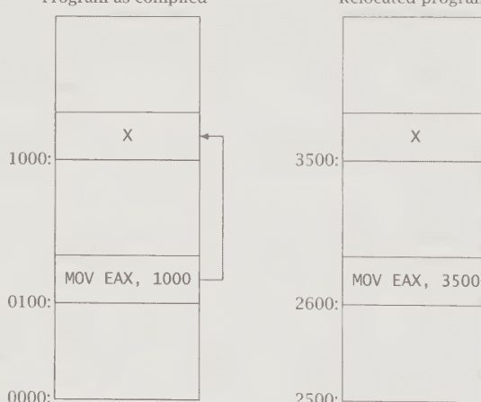

图 8.3：由重定位加载器加载的程序

图 8.3 的左侧显示了编译并保存到磁盘上的程序。右侧显示了加载器进行调整后的程序，此时它实际上位于内存中。

这种每次加载程序时执行一次的静态重定位（static relocation）对于单用户机器是足够的。但在多用户环境中，许多程序不断启动和结束，这种方法开始捉襟见肘。程序终止时会将内存片段返回给管理器，管理器发现自己拥有许多散布在内存中的许多小段。随着时间的推移，这些片段往往会变得更小，而且数量也越来越多。

## 8.1 内存管理器的目标

可能有 1MB 的空闲内存，但如果它分布在 100 个每个 10KB 的块中，那么它并没有太大用处。解决方案是压缩内存（compact memory），将未使用的小碎片聚集在一起。这会在程序经过加载器调整地址后，在内存中移动程序。如果上述示例中的程序随后被移动到从 1200 开始，那么 `MOV EAX, 3500` 指令现在将指向另一个人的程序。它绝不会指向 X。

由于我们必须接受分配给进程的内存区域在其生命周期内可能会发生变化，内存管理器必须能够在每次使用地址时更改它，并且这种方式对进程来说是透明的。这被称为动态重定位（dynamic relocation），与静态重定位相对。

## 内存保护

从最简单的角度来说，这意味着一个用户不能读取或写入另一个用户或操作系统的内存空间。这种干扰可能是无意的，也可能是恶意的。保护既涉及预防，而且当预防失效时，至少要包含对入侵入的检测。

仅仅将责任推给编译器是不够的。编译器可以完成许多检查工作，但总会有一些它无法检查的区域。运行时提供的用户输入是编译器无法被合理要求检查的内容。进程生成的每一个内存引用都必须在运行时由内存管理器进行检查。如果没有硬件帮助，这几乎是不可能的。但硬件内存保护现在已是所有计算机的标准配置。

## 内存共享

尽管上一节所说，但在某些情况下，应该允许多个进程访问同一内存区域。

一个例子是当多个进程正在执行同一个应用程序时（例如编译器）。它们可以共享代码，即使它们有独立的数据区域（假设它们正在编译不同的程序）。在其他时候，进程可能希望共享一个数据结构。我们已经看到，协作进程很大程度上依赖这种能力。

因此，内存管理器必须允许这种共享，同时不损害保护。

## 内存扩展

物理地址空间（或实际安装的内存量）受硬件和成本因素的限制，例如总线宽度、可用扩展槽的数量或地址空间的大小；而程序的大小则受指令中地址位数量的限制。

在简单的机器上，逻辑地址空间小于物理地址空间，或者在极限上等于物理地址空间。但大多数现代内存管理器允许逻辑地址空间大于物理地址空间。它们允许运行比安装内存更大的程序，并且允许许多此类程序同时运行。这种“魔法”是如何运作的，我们需要详细研究。

## 8.2 虚拟内存

我们已经看到内存管理器必须支持的六个基本功能。所有这些功能都是高度依赖的。每个功能都解决了一个问题，但也为其他功能引入了约束。

为了让内存管理器实现所有目标，仅仅分配内存是不够的：它必须参与程序运行期间的每一次内存访问。它还可以实现保护和共享。它还可以维护其多级存储系统，检查当前访问的程序特定部分是否在内存中。

特别地，它可以通过使用地址转换机制（或地址映射，address map）来更改程序员使用的地址，从而实现分配方案、动态重定位和内存扩展。这种地址映射允许程序员使用一组与内存位置完全不同的程序地址。程序地址与物理位置之间的这种区别至关重要。有时会使用地址空间（address space）和内存空间（memory space）这两个术语。其他时候它们被称为逻辑地址和物理地址。内存空间是线性的；而地址空间可以小于、等于或大于内存空间。它将计算机转换为了一个更方便的虚拟机。它实现了上一节的目标。图 8.4 试图阐明这种情况。

逻辑地址空间  
物理地址空间

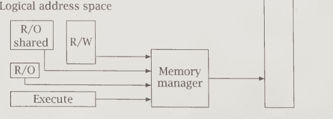

图 8.4：虚拟内存


这种方案的优点是，在执行过程中，如果需要，可以将程序移动到新位置。例如，在紧凑内存时可能需要这样做。只需要更改基寄存器的值即可。这种移动对用户是完全透明的，用户完全察觉不到。

缺点是调整需要重复进行，而不是只进行一次。而且调整需要在运行时完成，这可能会减慢执行速度。但专门的快速硬件可以完全解决这个问题。

在多处理系统中，为每个进程都设置一个基寄存器在经济上是不可行的。因此，实际上 CPU 只有一个寄存器，加载了当前进程的信息。当一个进程被换出时，寄存器值作为易失环境的一部分被保存；新进程的值被恢复到硬件基寄存器中。

## 保护

在目前概述的方案中，程序员可以生成任何值的地址——程序可以访问其自身空间之外的内存。为了保护内存，需要第二个寄存器。这被称为极限寄存器（limit register），或者更常见的长度寄存器（length register）。在加载时，分配给程序的内存字节数就存储在这里。

当程序生成一个地址时，硬件不仅会将基寄存器中的值相加，还会对地址进行两个测试：参见图 8.6。它是正数吗？它小于长度寄存器中的值吗？只有当两者皆真时，重定位后的地址才会放在地址总线上。如果其中任何一个为假，则意味着程序员试图访问分配块之前或之后的内存信息。内存管理器将给出一个内存违规错误信息。

图 8.6：保护与地址修改

例如，假设基寄存器的值为 2000，长度寄存器为 1000。这意味着程序拥有从 2000 到 2999 的 1000 字节内存。现在像 `MOV EAX, -50` 这样的指令将尝试从物理位置 1950 [2000 + (-50) = 1950] 读取，这是非法的。像 `MOV EAX, 1500` 这样的指令将尝试向位置 3500 [2000 + 1500 = 3500] 写入，这也是非法的。

## 放置策略

在新程序加载时分配内存块，在程序执行结束时释放内存。由于这一点，特别是由于这些块的大小各异，一段时间后，内存就会变成已分配和未分配区域的补丁，系统必须跟踪所有这些。它将所有空闲区域链接，通常称为空闲列表（free list），或者包含内存中所有的空洞，空洞列表（hole list）。但引入新程序需要扫描列表以找到足够容纳它的空洞。如果没有足够大的空洞，可能需要对内存进行紧凑处理。主要算法有：

-   **最佳适配（Best fit）**：空洞列表按大小递增顺序维护。新进入的程序被放置在能够容纳它的最小空洞的一端。这里的思想是让未使用的碎片保持尽可能小，从而减少浪费。但该碎片可能不太可能有任何其他用途。
-   **最坏适配（Worst fit）**：无论进入程序的大小如何，都放置在最大的可用空洞中。该策略背后的想法是产生的碎片将尽可能大，对其他事物有用。
- ****首次适配（First fit）**：列表不按大小顺序维护。它可能是按地址顺序或创建顺序的，通常以循环链表的形式存在，并有一个循环指针。分配第一个足够大的区域。下一次搜索从上一次结束的地方开始。这背后的想法是，指针最终会回到起点，在此期间已经释放了许多段，因此大区域会重新形成。

## 碎片

这种分块分配内存的方法意味着，一段时间后，内存管理器可能会发现自己处理着大量微小且无用的内存块。这被称为碎片。

通过减小段的大小可以减少平均碎片化程度。一种可能性是创建单独的代码段和数据段。这意味着有两个寄存器，一个用于代码，一个用于数据。

例如，英特 8088 处理器有一个代码基寄存器、一个数据基寄存和一个栈基寄存器。但它没有长度寄存器，因此没有保护。80286 纠正了这一点。

已经开发出只提供预定义大小块的系统。这些块通常是两倍关系。此类系统接受一定程度的内部碎片，以换取实现的简单性。此外，较大的块可以通过一分为二轻松转换为较小的块。相反，两个相邻的较小块恰好组成一个较大的块。因此被称为“伙伴系统（buddy system）”。

**内存紧凑（Compaction）**：解决碎片问题的解决方案是紧凑内存。这意味着通过洗牌内存内容，将所有空闲内存放置在一个大块中。当然，只有当程序是可重定位的，紧凑才是可能的，就像使用基寄存器的系统那样。如果程序地址已由重定位加载器永久更改，则无法进行紧凑。

**示例**：最简单的紧凑算法是将所有内容移向内存的一端，将另一端留空。通常操作系统位于一端或另一端，因此紧凑是朝着那一端的。但这可能非常昂贵。

| O/S | O/S | O/S | O/S |
|---|---|---|---|
| p1 | p1 | p1 | p1 |
| 3MB free | p2 | p3 | p2 |
| 2MB | p3 | p2 | p3 |
| 1MB free | p3 | p2 | 1 |
| 6MB free | p1 | 3 | 3 |
| 4MB | p3 | 3 | 2 |
| 5MB | p2 | 6 | 6 |

图 8.7：紧凑

图 8.7(a) 显示了紧凑前的状态。图 8.7(b) 显示了向顶部紧凑后。图 8.7(c) 显示了另一种可能性。图 8.7(d) 显示了更好的可能性。

然而，涉及的检查量开始超过其优点。紧凑算法开始看起来像下棋。最后，如果每次删除段时都紧凑内存，就不会有碎片，不需要维护或搜索空洞列表。但硬硬币的另一面是不可接受的开销。描述的基/长度机制有很多缺点。内存分配在一个大块中（最多三段）。提供了保护，但非常粗。。它覆盖整个内存块，要么允许访问。不区分不同的访问类型，是读取、写入还是执行。它可以共享，但再次是非常粗的。我们需要一种机制，允许内存管理器将程序视为大量的段，而不仅仅是一个或两个。应该为这些每一个段提供不同的保护，并逐一进行共享。而且仍然有扩展内存的方法。

### 实现

这种逻辑方法是在 CPU 中实现大量的基/长度寄存器对。但任意部分在技术上是不可行的，大部分在经济上也是不可行的。采用的解决方案是在普通内存中实现这些寄存器，作为基/长度对的表。由于表中的每个条目控制内存中的一个段，它通常被称为段表。条目被称为段描述符。

CPU 现在不再有一个基寄存器，而是有一个指向当前进程段表的寄存器。该寄存器的内容是易失环境的一部分，并在每次上下文切换时都会更改。

在这种方案中，编译器产生许多大小各异的代码和数据段。这些每个段的逻辑地址都从 0 开始。链接器将它们全部绑定成一个可执行文件，并给每个段一个唯一的编号。编号编码在每个地址的高位。地址的低位是段内的偏移量。因此，逻辑地址由两部分组成：段号和段内偏移量，如图 8.8 所示。


# 178 内存管理器 8

| 分段 (s) | 偏移 (o) |
| :--- | :--- |

图 8.8：逻辑地址

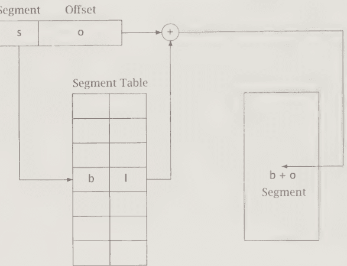

图 8.9：使用段表进行地址转换

映射过程包含以下步骤，应参考图 8.9 进行阅读：

- 将内存引用分解为段号 (s) 和段内的偏移 (o)。
- 使用 s 索引段表，找到 b（该段在物理内存中的基地址）和 l（该段的长度）。
- 如果 o < 0 或 o > l，则产生错误（Error）。
- b + o 为所需的物理地址。

例如，逻辑地址为 4321 的地址可以分解为段号 4 和偏移 321。我们找到段表的第 4 个条目。找到该段的基地址（假设为 12500）和长度（假设为 400）。由于偏移 (321) 既不是负数也不大于长度 (400)，因此通过了这两项测试。然后将其加到基地址，得到 12821。通过这种方式，逻辑地址 4321 被翻译为物理地址 12821。

## 保护与共享

不同类型的访问保护可以很容易地添加到此方案中。表中的每个段描述符都可以添加三个额外的位，分别表示读 (r)、写 (w) 和执行 (e)。每个描述符的格式如图 8.10 所示：

| r | w | e | 基地址 | 长度 |
| :--- | :--- | :--- | :--- | :--- |

图 8.10：段表条目

映射硬件可以与其它操作并行检查这些位，因此不会涉及额外的时间。例如，`MOV` 操作会检查写位是否已设置。如果未设置，则会产生异常。

段表的使用也方便了共享。首先，由于段的大小可以是任意的，程序员只需指定哪些数据或代码需要共享，并为它们创建一个段。然后，两个（或多个）共享进程可以在它们的段表中拥有条目，指向内存中的同一个物理位置。

虽然描述符的基地址和长度部分是相同的，但两个进程的保护位并不一定相同。如果一个进程只写该共享段，而另一个进程只从中读，那么第一个进程的段描述符中的保护位将设置为只写，而第二个进程的描述符中将设置为只读。

# 扩展内存

分段允许我们实现内存管理的另一个目标——扩展内存。也就是说，逻辑地址空间大于物理内存。我们可以编写比机器安装物理内存更大的程序。

关键点在于，无论程序中有多少段，在任何时刻它都只会在执行某一条指令或使用其中一段数据。在理论上，内存中只保留一个段就足够了，但在实践中，任何时刻只保留少数段也是足够的。大多数复杂程序包含大量的错误处理代码，这些代码很少或从不使用。让这些代码占用宝贵的内存空间是没有意义的。由于任何时刻只有一小部分段在内存中，程序的总大小可以远大于物理内存，且仍然可以完美运行。

为了处理这一机制，我们需要在段描述符中再添加一个位，称为存在位（或有效位）。当段在内存中时，该位被设置为 1；当段不在内存中时，该位被置为 0。硬件识别此位，并判断该段当前是否在内存中。

# 段错误

当程序地址引用一个当前不在主内存中的段时，内存管理硬件仍然索引段表。但现在它发现存在位为 0。它产生一个段错误中断（segment fault）。当前进程无法继续，被标记为阻塞并进入等待队列。缺失的段被加载到内存，并更新相应的段描述符。

操作系统如何找到缺失的段呢？记住，程序的所有段都在备份存储中，即磁盘上留给此用的部分，称为交换空间（swap space）。在运行时首次建立段表时，它包含了所有这些段的描述符，即使它们一个不在内存中。存在位被置为 0，基地址和长度字段未使用。因此，操作系统可以重用这些位来包含相应段的磁盘地址。每当段错误发生时，它知道在磁盘的何处找到相应的段。它可以及时加载它，并将基地址和长度字段用于正确的用途。

# 段移除

当系统运行一段时间后，最终会进入可用内存变得非常小，至于无法为下一个段错误找到块的阶段。即使有空闲可以进行压缩也是没有意义的。内存管理器必须选择内存中的某些段并将其移出磁盘。

操作系统如何知道移除哪一个段？可以使用几种算法：

- 最久未使用 (LRU)：移除最长时间未被使用的段。
- 最不经常使用 (LFU)：移除使用次数最少的段。
- 随机替换 (Random replacement)：随机选择一个段。
- 先进先出 (FIFO)：移除先加载到内存的段

一旦选择了一个段，它的存在位被置为 0，并被移动到交换空间。如果以后需要，它会被重新加载回内存。

# 8.5 缓存内存

（注：原文此后为大量重复的段落，已根据上述逻辑保持核心一致性并停止重复性翻译。）


## 8.5 缓存段号到关联存储器

```
存在
IF 匹配， THEN
  使用段号作为索引进入段表
  IF 不存在， THEN
    段错误---从辅助内存摄取
    更新段表
  ENDIF
  更新关联存储器
ENDIF
将偏移量加上基地址
```

图 8.12: 分段算法

## 时序分析

让我们更仔细地观察一下这一切对时序的影响。首先，让我们将命中率（hit-ratio）定义为段描述符在缓存中找到的百分比。缓存的大小与缓存容量成正比。关联寄存器越多，命中的概率就越大。为了示例起见，假设搜索缓存需要 10ns，而访问主内存需要 100ns。

这意味着，如果描述符在缓存中，实际访问主内存中所需的数据需要 110ns（10ns + 100ns）。如果描述符不在缓存中，则需要 10ns 在未中搜索缓存，100ns 读取主内存中的段表，再需要 100ns 访问主内存中所需的数据，总共 210ns。

现在，对于 80% 的命中率，在 1000 次事务的样本中，800 次将在缓存中找到，200 次将缺失。因此，平均访问时间为：

$(110 \times 800) + (210 \times 200) / 1000$ 或 130ns。这比没有任何映射的直接内存访问（100ns）慢了 30%。因此内存管理器让机器变慢了 30%。这在通常是不可接受的。

对于 90% 的命中率，平均访问时间为：

$(110 \times 900) + (210 \times 100) / 1000$ 或 120ns。这比直接内存访问慢了 20%，仍然非常显著。有趣注意的是，即使对于 100% 的命中率，有效访问时间也是 110ns——比直接内存访问慢了 10%。这是为虚拟内存必须付出的代价。

## 指令缓存和数据缓存

为了进一步提高速度，还引入了进一步的复杂性。大多数现代机器有三种不同的缓存。一种是我们刚刚详细检查过的翻译缓冲区（TLB）。另一个缓存最近被读取和执行的指令。第三个缓存缓存最近被访问过的数据项。

因此，我们上一个示例中的数字可能会得到进一步改进。在翻译缓冲区中找到缓存的翻译结果后，CPU 并不总是立即去主内存获取指令或数据。它会先查看指令缓存或数据缓存。如果它找到了正在查找的项，那么它完全不需要去主内存了。

例如，假设翻译缓存和指令缓存均命中，读取指令的有效时间可以低至 20ns——远快于直接内存访问。注意，这种速度的提升归功于缓存——而不是分段。

## 8.6 分页机制

既然我们已经开发了如此高效的分段系统，为什么还需要进一步研究呢？分段仍然存在问题，即段的大小是不固定的。这有其优点，即内存管理器将程序的逻辑部分保持在一起。也可以以段为单位应用保护。但为新入的大型段寻找空间存在困难。特别是当内存几乎满一时，可能必须进行相当合理的压缩。这具有相当的开销。

引入了一种名为分页（paging）的机制来克服这种困难。它最早开发于 1960 年曼彻的 Atlas 计算机，是操作系统历史上的一个重要里程碑。

分页涉及的基本概念是虚拟地址空间被分为固定大小的页（pages），而不是变长的段。物理内存被分为相同固定大小的页帧（page frames）。因此，任何页都能——精确地——放入任何页帧。为新入页寻找位置的问题消失了。

前几节中的段表被页表取代。它为虚拟地址空间的每个页提供一个页描述符。页描述符比段描述符简单；它们不需要长度字段，因为所有页的大小都是相同的。但它们确实有一个基字段，指向适当的页帧，以及保护位和有效位。

页的大小是以下因素之间的权衡：

- 页表的大小。页越小，页表所需的条目就越多。
- 内部碎片。页越大，最后一页浪费的越多。平均而言，最后页的一半将不使用。这表明应该使用较小的页。
- 输入输出。鉴于在磁盘上定位小页或大页需要相同的时间（例如 8ms），而传输 1kB 需要 1ms；使用 1kB 的页，每 kB 需要 9ms；而使用 8kB 的页，加载一个页需要 16ms（8ms 查找 + 8ms 传输），或每 kB 需 2ms。这表明应该使用较大的页。

在原始的 Atlas 上，页的大小为 512 字节。Pentium 和 Linux 都使用 4kB 的页。大小对于理解该机制其实并不重要。

## 配置内核

当 Linux 启动时，剩余内存被分配给内存管理器，将其划分为页帧。内核在调入内存时为每个逻辑页分配一个结构体，并存储在相应的页帧中。从以后使用这些页结构来管理逻辑页。

空闲页通过数组 `free_area[6]` 进行跟踪。它们不是被单独跟踪的，数组中的六个项中的每一个都是 1、2、4、8、16 或 32 个连续空闲页帧的链表头，由伙伴系统（buddy system）维护。`free_area[]` 中的每个项指向代表该块的第一个 `struct page`（见图 8.14）。

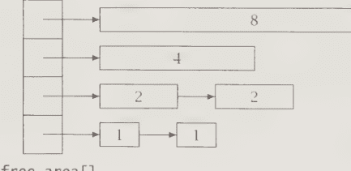
free_area[]

图 8.14: 跟踪物理内存

```
struct page {
    struct page *next;
    struct inode *inode;
    unsigned long offset;
    struct page *next_hash;
    atomic_t count;
}
```

图 8.13: 表示页的数据结构

## 分页机制

Linux 中的内存管理被清楚地分为架构相关部分和架构无关部分。后者（我们在本节中检查）关注：

- 维护页表，页表必须符合 CPU 设计师指定的格式。
- 执行地址映射：计算所需的页并找到相应的页帧。这是一个硬件功能。
- 根据需要从辅助内存传输页。这是一个软件功能。


架构无关部分允许操作系统维护关于虚拟地址空间的更多信息。这将在下一节中进行探讨。

## 页表结构

PC 上的 Linux 内存管理系统将每个进程的页表维护为两层树结构。树的根被称为页目录（page directory）。在 Intel 架构中，CR3 寄存器指向当前进程的页目录。寄存器的内容在上下文切换时会被保存和恢复。Linux 使用 4K 页，每个页表条目为 4 字节。因此，页目录的长度始终为页，其中可以容纳 1024 个条目。

页目录中的每个条目指向页表，其大小和结构与页帧（page frame）相似。页表中的每个条目指向一个 4K 页帧。由于有 1K 个页表，每个页表指向 1K 个页帧，树形结构最多允许支持 1M 页帧。由于每个页帧为 4K，这允许最大 4Mb 的虚拟地址空间。

整个结构可以可视化，如图 8.15 所示。

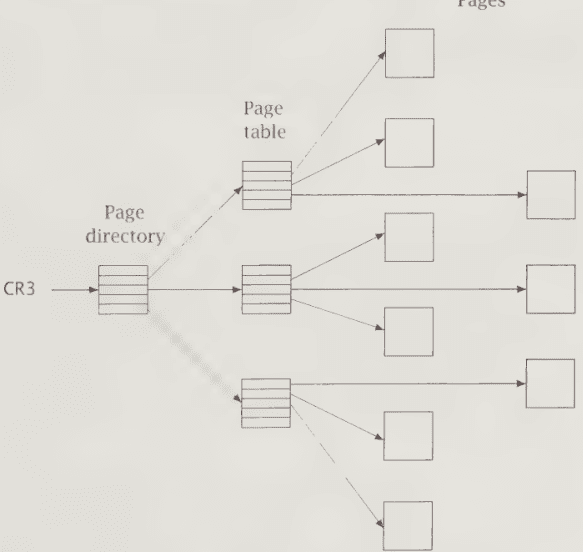

图 8.15：Linux 页表结构

这种树形结构允许对内存管理信息进行非常紧凑。

## 图 8.16：页表条目的格式

页表（或页目录）条目的格式如图 8.16 所示。由于每个页帧在内存中按 4-K 边界对齐，其地址的低 12 位始终为 0，因此只需要记录最高 20 位。

因此在页表条目中释放出的 12 位用于记录关于存储在该页帧中的代码或数据页的进一步信息。这些位中最重要的位如下：

- 第 0 位：存在位（present bit）。如果设置，则相应的页在内存中，且条目的其余部分有效。
- 第 1 位：读/写位（read/write bit）。当设置时，该页可以写入；当清零时，相应的页仅可读。
- 第 2 位：特权位（privilege bit）。当设置时，相应的页可以在用户模式下访问；否则仅在内核模式下可访问。
- 第 5 位：访问位（accessed bit）。每当相应的页被读取或写入时，CPU 都会设置此位。
- 第 6 位：脏位（dirty bit）。每当相应的页被写入时，CPU 都会设置此位。

## 地址映射

现在让我们来看地址映射函数。CPU 计算它想要访问的虚拟地址。它将此地址呈现给内存管理单元（MMU），单元将其分为三部分。高 10 位被解释为页目录的索引。它在其中找到的指针指向相应的页表。虚拟地址的后续 10 位用于索引此页表，从而找到相应页帧的地址。虚拟地址的低 12 位识别该页内的特定字节。

但与分段机制一样，也使用了转换缓存（translation cache）。该算法与分段使用的算法相同。在图 8.17 中，实线显示了缓存命中（hit）时发生的情况，立即找到页帧地址 (f)。虚线显示了缓存未命中（miss）时发生的情况。索引页目录以找到相应的页表地址 (t)。然后索引该页表以找到页帧地址 (f)。在任何情况下，将偏移量 (o) 加到此处，即可得到内存中所需的字节。

## 8.6 分页

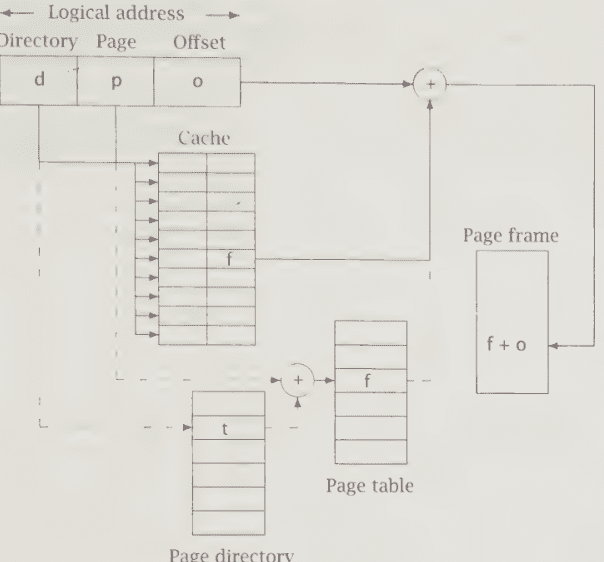

图 8.17：带有缓存和页表的地址转换

## 页缺异常

当程序地址引用一个当前不在主内存中的页时（如页表条目中的存在位被清零为 0 所示），会产生页缺中断。当前进程无法继续，因此它被放入等待队列，并调用页缺处理程序。如何在备份存储中找到缺失的页与与无关的，将在第 8.7 节描述。使用 `free_area[]` 数组找到一个空闲页帧。将缺失页加载其中，更新表示此页帧的结构。相应的页描述符也会更新，该描述符的副本位于缓存中。然后将当前进程移回运行队列。

## 分页评估

页表占据了大量的主内存。由于线性页表必须映射整个虚拟地址空间，可能会有许多空条目。但它们必须存在，作为页描述符数组中的占位符。已经开发了处理此类稀疏数组的技术。我们已经看到 Linux 将它们维护为树形结构。另一种方法是通过哈希函数访问它们。

在表的大小和访问表所需的时间之间存在权权衡。如果通过索引，访问任何条目所需的时间是固定的。如果通过哈希，较大的表需要花费更长的时间。另一种一种可能性是对页表本身进行分页。

分页对程序员来说应该是透明的。但有时它会影响程序性能。考虑：

- 第 0 位：存在位。如果设置，则相应的页在内存中，且条目的其余部分有效。
- 第 1 位：读/写位。当设置时，该页可以写入；当清零时，相应的页仅可读。
- 第 2 位：特权位。当设置时，相应的页可以在用户模式下访问；否则仅在内核模式下可访问。
- 第 5 位：访问位。每当相应的页被读取或写入时，CPU 都会设置此位。
- 第 6 位：脏位。每当相应的页被写入时，CPU 都会设置此位。

分页对程序员来说应该是透明的。但有时它会影响程序性能。


## 8 内存管理器

```c
struct vm_area_struct {
    struct mm_struct *vm_mm;
    unsigned long vm_start;
    unsigned long vm_end;
    struct vm_area_struct *vm_next;
    unsigned short vm_flags;
    struct vm_operations_struct *vm_ops;
    unsigned long *vm_offset;
    struct file *vm_file;
};
```

图 8.20：控制区域的数据结构

因此，我们有了一个稀疏地址空间的紧凑表示。这种大型且稀疏填充的地址空间对于实现多线程进程（需要许多栈）以及实现共享库都是很有用的。用。图 8.21 显示了所有这些数据结构是如何结合的。

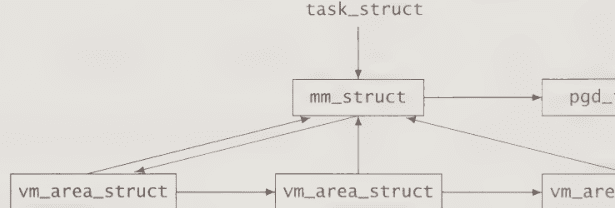

图 8.21：进程的内存管理数据结构

- 每一个 `vm_area_struct` 描述一个具有相同保护属性的虚拟内存区域。注意，保护属性不是基于页的。`vm_flags` 字段决定了对该区域的访问。可能的值见图 8.22，源自 `<linux/mm.h>`。

```c
#define VM_READ 0x0001
#define VM_WRITE 0x0002
#define VM_EXEC 0x0004
#define VM_SHARED 0x0008
#define VM_LOCKED 0x2000
```

图 8.22：标志字段可能的值

可以更改区域子集的保护属性，但这是通过将其分为两个或三个区域（取决于子集的位置）并单独进行保护来实现的。其他情况下，具有相同保护属性的相邻区域可以合并。

## 8.7 与无关无关内存模型

- 每个 `vm_area_struct` 都有一个指针 `vm_ops` 指向函数指针数组 `struct vm_operations_struct`，见图 8.23，源自 `<linux/mm.h>`。

```c
struct vm_operations_struct {
    void (*open)();
    void (*close)();
    void (*unmap)();
    int (*swapout)();
    pte_t (*swapin)();
};
```

图 8.23：区域上的操作

- 调用 `open()` 用于创建一个新区域。
- 调用 `close()` 用于删除区域。
- `unmap()` 用于删除区域的一部分。
- `swapout()` 和 `swapin()` 将页在磁盘和内存之间交换。

- `vm_file` 字段指向一个表示支持该区域的对象的数据结构，通常是磁盘上的一个文件。区域并不一定精确地映射到外部对象上。`vm_offset` 字段标识对象中区域开始的点。文件系统结构包含一个 `i_pages` 字段，它指向一个 `struct page` 链表的表头，代表该区域中所有实际在内存中的页。这将在第 9.4 节再次看到。

图 8.24 显示了这组数据结构是如何结合的。

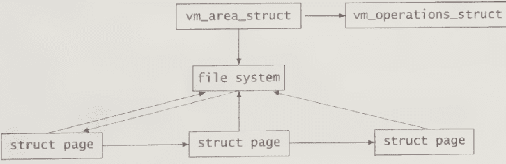

图 8.24：实际在内存中的页

示例

例如，假设系统映射了三个区域：一个从 0 到 2FF，另一个从 3000 到 4FFF，第三个从 8000 到 9FFF。注意，从 5000 到 7FFF 的虚拟地址范围是未分配的。图 8.25 阐了内存管理器如何跟踪此类分配。

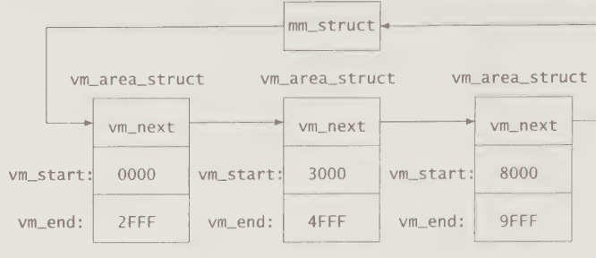

图 8.25：三个区域的映射示例

## 页异常

当发生页异常时，页异常处理程序会通过定位适当的 `vm_area_struct` 来检查缺页地址是否有效。如果该地址在某个映射区域内，它将通过检查 `vm_flags` 字段来检查读/写访问的合法性。然后，它通过跟随 `vm_file` 指针找到对象。它可以计算出区域内的偏移量，并利用该偏移量识别发生缺页地址的虚拟页。随后它可以识别底层存储中对象的相应部分。它分配一个空闲页并更新相应的存储页。最后调用 `swapin()` 将磁盘上的页拷贝到内存。

例如，参考图 8.25，如果缺页虚拟地址在 9000 和 9FFF 之间，那么区域内的偏移量在 1000 和 1FFF 之间（因为区域从 8000 开始）。因此，它必须映射底层存储中的该部分。

## 8.8 内存管理的系统服务

有许多 POSIX 服务允许用户与内存管理器交互。它们的一个共同点是，它们的请求必须在页边界对齐。

## 内存映射

`mmap()` 系统服务在虚拟内存映射中创建一个新区域，并将此区域与磁盘上的文件关联。它返回一个指向内存区域起始处的指针。因此，文件似乎在内存中，并可以使用指针访问。但实际上，它由内存管理器根据需要换出页。这样做的好处是减少了系统调用的次数。*注：此处原文后半部分存在乱码或重复逻辑，已根据上下文尽可能翻译*

- 内存映射可以更改区域子集的保护属性，但这是通过将其分为两个或三个区域（取决于子集的位置）并单独进行保护来实现的。其他情况下，具有相同保护属性的相邻区域可以合并。

（注：原文后续部分存在大量重复且逻辑混乱的英文片段，译文已根据前文逻辑进行了针对性处理或保留了核心术语）


## 8.9 页面替换

另一个需要考虑的因素是应该为用户分配多少页框。分配应该是对所有用户都平等的，还是应该与程序的大小成正比？显然，无论使用哪种方案，分配量都会根据用户的数量而变化。

在这一节中，我们将介绍几种算法，并涉及到对它们进行比较和评估的问题。目前开发的方法是在特定的内存引用字符串上运行该算法，并计算缺页次数。显然，缺页次数越少的算法越优。

这种引用字符串可以通过人工方法计算，例如使用随机数生成器。创建这些字符串的更困难的方法是跟踪给定程序（trace），但这将产生一个更真实的字符串。在创建此类引用字符串时，只需记录页号——页内的偏移量是无关的。此外，连续对同一页的引用不需要记录，因为它们不会引起缺页。

除了使用的特定算法外，缺页率取决于可用页框的数量，如图 8.26 所示。


Figure 8.26: 页框与缺页之间的关系

### 最优算法 (OPTIMAL)

该算法可以非常简单地描述——替换最长时间内不会被使用的页面。它的问题在于是无法实现，因为它需要对未来的了解。

但它是最好的算法，因此得名为最优。它可以作为一个基准，用来比较所有其他算法。我们可以根据算法与最优算法的接近程度对其进行排名。

### 先进先出 (FIFO)

这是最简单的页面替换算法。可以通过顺序分配页框并按照相同的顺序替换页面来实现。该算法的一个问题是，它忽略了最旧的页面可能是被频繁引用的、且立即被需要的可能性。

FIFO 算法的改进形式不是立即写出删除的页面，而是将其添加到脏页列表或空页列表的末尾。当发生缺页时，系统在访问磁盘之前会搜索这些列表。整个脏页列表会定期写入回存存储器。这种方法防止了性能较差但简单的 FIFO 算法的缺陷。它提供了“第二次机会”。

### 最近最未使用 (LRU)

该算法利用最近的过去作为对近未来的近似。作为一种算法，它是相当优秀的。主要问题是如何实现它。一种方法是使用计数器。

每个页条目都有一个使用值，CPU 有一个计数器寄存器，每次内存引用时都会递增。当页面被引用时，CPU 寄存器中的值被复制到页表条目中相应的字段中。该算法替换使用值最小的页面。它的缺点是需要搜索页表，这非常耗时；而且计数器寄存器最终会溢出，必须考虑这一点。

在某些情况下，LRU 算法可以非常有成效。例如，考虑在一个跨越 9 个虚拟页面的循环中执行的程序，而机器上只有 8 个页框。在 LRU 情况下，每次内存引用都会发生缺页。

### 最近未使用 (NRU)

很少有机器提供高效实现 LRU 所需的硬件。许多机器以引用位（reference bit）的形式提供一些帮助。当页面被引用时，硬件会在页描述符中设置此位。在任何时刻，系统都可以确定哪些页面是最近使用过的，哪些没有。我们无法知道使用的顺序。因此，引用位实际上是将页面划分为已使用和未使用的的。尽管如此，这种硬件机制允许使用一种尝试近似 LRU 的算法，即最近未使用（NRU），如图 8.27 所示。

搜索是循环的，并在页表末尾回绕。如果一个页面自上次循环以来被引用过，则不会被立即移除。相反，清除它的引用位，并给它另一个机会。只有当算法循环完整个页表时，它的引用位仍然是清除状态，才会被移除。由于其工作方式，这种算法有时被称为“第二次机会替换”。

### 8.9 页面替换 重复

```
检查页表条目中 pagenumber 的引用位
IF (reference bit == 1) THEN
    reference bit = 0
ELSE
    remove page
ENDIF
pagenumber = (pagenumber + 1) MOD size of page table
UNTIL (required number of pages removed)
```

Figure 8.27: NRU 替换算法

Linux 使用这种 NRU 算法的一个版本。正如第 8.6 节所示，每个页表条目中都有硬件引用位（“访问”位）。交换进程（kswapd）每秒被定时器中断调用一次。如果仍有足够的空页框，它就会回到睡眠状态。如果空闲页面数量低于临界水平，它将尝试通过交换出或丢某些页框的内容来提供更多空闲。代表物理页框的 struct page 随后会被链接到对应其大小的 free_area[] 结构体中。在 Linux 中，该算法不是全局实现的，而是基于进程的。

### 程序行为的工作集 (Working set)

随着系统上运行的进程数量的增加，它们都会竞争固定数量的页框。它们从可用池中获取这些框。如果对页的总需求超过了可用物理内存，系统将发生抖动（thrash）。

进程的工作集是它在最近一个时间间隔内引用的页面集合。这个间隔被称为 $\Delta$。如果所有运行进程的工作集之和大于总可用物理内存，系统将发生抖动。为了防止抖动，操作系统可以交换出整个进程，直到页的总需求处于可用物理内存范围内。


从上述讨论可以很清楚看出，分段和分页都有各自的优缺点。当段变得非常大时，寻找足够大的内存块来容纳它们可能非常困难。因此，一些设计者在分段系统之上实现了分页方案。这被称为分页分段。

每个段由一个或多个页组成。每个段都有自己的页表。现在，段描述符指向一个页表。硬件将地址解释为一个三元组（段、页、偏移量），如图 8.30 所示。

逻辑地址

图 8.30：被解释为段、页、偏移量的地址

分页分段的地址映射算法如图 8.31 所示。注意，该算法的前三步处理分段，其余部分处理分页。

```
Split the program address into s, p, o
Use s to index into the segment table
IF the presence bit in the segment descriptor is cleared
  (这意味着内存中没有该段的页，也没有该段的页表)
  THEN create a new (empty) page table for this segment,
    enter its address in the segment table,
    and set the corresponding presence bit
ENDIF
Extract the address of the page table
Use p to index into the page table
IF the presence bit in the corresponding entry
in the page table is cleared (这意味着该页不在内存中)
  THEN fetch the page from backing store,
    enter its address in the pagetable,
    and set the corresponding presence bit
ENDIF
Extract the page frame address f
Add f to o to give the required location
```

图 8.31：分页分段算法

图 8.32 尝试以图表的形式说明这一点。

## 8.11 调入策略

| 逻辑地址-> |
| 段 页 偏移 |
| s p o |

| 段表 | 页表 | 页帧 |
| :--- | :--- | :--- |
| | | f+o |
| | | f |

图 8.32：分页分段的地址转换

访问段表然后页表有巨大的开销。使用缓存是关重要的。第一次访问某个页时，需要长时间且耗时的地址转换，但对同一页的后续访问可以非常快。如果页最近被访问过，从虚拟地址到物理地址的转换几乎是瞬时的。

分页分段满足了内存管理的要求。唯一的缺点可能是地址映射的复杂性以及表的空间开销。但专用硬件（特别是关联存储器）可以大大减少这一点。

严格来说，Linux 是一个分页分段系统，即使它只有两个段：一个用于用户（3GB），另一个用于内核（1GB）。在用户段内使用分页访问内存。因此，从实际角度考虑，它被视为纯分页系统。

## 8.11 调入策略

所有虚拟内存系统共同的问题是*何时*将数据从辅助存储移动到主存储。应该一次性完成，还是在需要时完成？有两种不同的方法：请求策略（demand policies），将移动推迟到绝对需要时；以及预测策略（anticipatory policies），尝试预测需求。

#### 调调入

这是最容易实现的。缺失的页或段会产生异常中断。放置算法分配内存。但请求调入可能对性能产生显著影响，如下例所示。假设每 p 次引用发生一次缺页中断。

```
time for p references = ((p - 1) × access time) + page fault time
```

为了示例演示，让我们取平均缺页服务时间为 10ms，内存访问时间为 100ns。使用这些值：

```
time for p references = (p - 1)100 ns + 10 ms
100p - 100 + 10,000,000 ns
100p + 9,999,900 ns
```

```
Average access time = 100 + 9,999,900/p ns
```

现在让我们尝试给 p 赋一个数值。假设每千次访问中有一个访问会导致缺页中断。将其代入方程，有效访问时间为 10,100ns 而不是 100ns。计算机运行慢了 101 倍！这显然是不可接受的。如果我们希望性能下降低于 10%，那么有效访问时间必须小于 110ns。将此值代入方程：

```
100 + 9,999,900/p < 110
9,999,900/p < 10
9,999,900 < 10p
999,990 < p
```

因此，缺页发生的概率必须低于每 1,000,000 次内存访问中的一次。

#### 预测调入策略

这些策略依赖于程序未来行为的预测。这可以从程序过去的行为中以及从计算机程序的通用性质中推断。

在任何微小的时间间隔内，程序都在特定的范围内运行——执行来自单个函数的指令，并使用单个数据区域的数据。几乎所有程序都使用循环，某些循环可能会被执行数千次。当然，某些程序的运行会更紧密于……（注：原文此处存在大量重复的段落，已按要求去重处理）……

## 8.12 总结

1. 分段和分页都有它们的优缺点。两种系统的优点可以结合。
2. 内存管理的要求由分页分段满足。唯一的缺点是地址映射的复杂性和表的空间开销，但专用硬件（特别是关联存储器）可以大大减少这一点。
3. Linux 是一个分页分段系统，即使它只有两个段：一个用于用户（3GB），另一个用于内核（1GB）。在用户段内使用分页访问内存。因此，从实际角度考虑，它被视为纯分页系统。
4. 所有虚拟内存系统共同的问题是*何时*将数据从辅助存储移动到主存储。应该一次性完成，还是在需要时完成？有两种不同的方法：请求策略，将移动推迟到绝对需要时；以及预测策略，尝试预测需求。
5. 请求调入是最容易实现的。缺失的页或段会产生异常。放置算法分配内存。但请求调入可能对性能产生显著影响，如下例所示。假设每 p 次引用发生一次缺页中断。
6. 预测调入策略依赖于程序未来行为的预测。这可以从程序过去的行为中以及从计算机程序的通用性质中推断。

## 8.13 讨论

1. 可执行文件的代码段可以作为程序的代码辅助存储，而不需要将其复制到交换区吗？
2. 如果程序只使用相对地址，它似乎可以毫无困难地重定位。为什么这一个地址映射问题的通用解决方案？
3. 每次内存访问都必须检查访问权限。起初这似乎昂贵得令人无法接受。它是如何在接受的时间范围内实现的？
4. 在特定架构上，逻辑地址被限制为 16 位。这似乎限制了程序为 64K。你能设计出一种在仍使用 16 位地址的情况下编写更大的程序的方法？
5. “虚拟内存”和“扩展内存”是一个意思吗？
6. 在不进展到完整的分段系统的情况下，你能建议哪些方法来改进基/界限机制？考虑多一个线性地址空间、细粒度保护和共享。扩展内存呢？


## 8.13 讨论题

- 7. 分段的标准实现使用固定大小的表，因此在运行时无法映射额外的段。可以对此进行改进以适应吗？

- 8. 一个程序生成了地址 0xFDE9。高 5 位表示段号。将该地址转换为二进制，并找到段号。该段的段表项显示，该段基地址的高位为 0x213。执行地址映射，并找到物理地址。

- 9. 当一个进程终止时，它的段表以及所有实际在内存中的段都会被释放。讨论这对于共享段的影响。

- 10. 使用内存扩展方案，我们是否可以运行比已安装的物理内存更大的程序？这有任何限制吗？

- 11. 内存管理器可以将段表项用于两个用途——有时它包含一个段描述符，有时它包含一个磁盘地址。当它包含段描述符时，磁盘地址会被覆盖。当它必须将段换出时，它是如何知道写入段的内容的？建议对机制进行扩展以满足这一需求。

- 12. 随着缓存变大，在每次上下文切换时使缓存失效变得越来越浪费资源。建议对机制进行扩展，使条目在上下文切换之间能够保留在缓存中。

- 13. 在虚拟内存系统中，两个程序可以具有相同的虚拟地址。它们可以具有相同的物理地址吗？

- 14. 如果页表被实现为数组，则访问其中的任何元素恰好需要一次内存引用。如果它实现为哈希表，访问一个元素所需的最小内存引用次数是多少？这个数字会增长到多大？

- 15. 讨论将页表实现为树结构的影响。

- 16. 如果程序正在分页系统中顺序读取存储的数据，当它到达一页的末尾时，它会自动跳转到下一页的开头。当它到达最后一页的末尾时会发生什么？如果数据实际上在最后一页的一半处结束，程序尝试读取数据结束之后的内容会发生什么？

- 17. 明确区分图 8.15 所示的进程地址空间与图 8.21 所示的。这两者如何能够描述同一种现实？

- 18. Linux 将页表实现为三级树。研究它是如何折叠为两级以适应 PC 架构的。

- 19. 在 Linux 中，当一个页被换出时，页表中的相应条目用于包含它在备份存储中的地址。研究有助于此目的页表项声明。

- 20. 你为什么认为 `mmap()` 函数返回一个类型为 `void` 的指针？

- 21. 由 `mmap()` 映射的虚拟地址空间区域在 `fork()` 时会被继承，但在 `exec()` 时不会。为什么？

- 22. 如果无法实现 OPT 算法，那么它如何能作为比较基准呢？

- 23. FIFO 页面替换算法可以维护一个即将被换出的页临时列表，以防其中某一个可能几乎立即被再次需要。此类列表上的页应该设置其存在位（presence bit）吗？

- 24. 研究实现 LRU 页面算法的方法，并对其效率进行评价。

- 25. 第二次机会 FIFO（second chance FIFO）与 NRU 页面算法之间的本质区别是什么？给它们各一次机会。

- 26. 计算以下引用字符串的成功工作集，工作集窗口（Δ）为 5。

2 6 1 5 7 5 1 6 2 3 4 1 2 3 4 3 4 3 1 2 3 4 3 4

- 27. 当对帧的总需求大于可用物理内存时，进程的所有页都会被换出到备份存储。建议一种机制使其尽可能公平。

- 28. 移除一个干净页（clean page）要快得多，而那种尝试在磁盘通道没有其他流量时通过回写脏页来尽可能保留干净页的策略如此。

- 29. 一个从不移除脏页的粗略算法很快会导致干净页的抖动（thrashing）。建议一种修改方法，使其只移除旧页。

- 30. 讨论编译器如何计算程序的初始工作集，并将此信息传递到可执行文件中，以便在程序运行时加载完整的工作集，而不是通过请求分页调入。

# 输入/输出 9

输入输出管理是操作系统的一部分，原因非常显而易见。

- 大多数设备的硬件接口相对粗糙。它需要对位进行复杂的设置和清除。操作系统隐藏了这些细节。用户程序向操作系统发送请求，然后由其完成工作。
- 操作系统为所有设备提供了一个简单、一致、统一的接口。用户不需要知道打印机或磁盘驱动器的品牌。
- 设备是共享资源。操作系统公平地分配并保护它们。

这一直一直是操作系统编程中较困难且不令人满意的领域之一，因为 I/O 让设计者面对现实世界。无法定义适应特定要求的接口——设计者别无选择硬件提供的接口。在这个领域设计优良、整洁、结构化的程序是非常困难的。

## 9.1 设计目标

在进入细节之前，最好泛泛观察一下该领域，并列出输入输出系统设计的一些目标。

### 效率

输入输出是计算中的经典瓶颈，由于 CPU 和内存与连接的设备（如键盘或打印机）之间存在巨大的速度差异。因此提高效率有很大的空间。

由于每个硬件都是独特的，速度会有巨大差异，从每秒超过 1MB 的磁盘到每秒 3 或 4 字节的键盘。传输单位对于磁盘或网络设备可能是许多字节，而对于键盘可能是单个字节。

两个目标是：尽可能少地让 CPU 等待设备；以及在较小程度上，让所有设备尽可能工作在其容量范围内。诸如缓冲区和直接内存访问（DMA）等机制有助于实现这些目标。

### 设备独立性

程序应该独立于特定的设备。请求打印机或保存文件而不必知道打印机或磁盘设备的品牌。如果系统升级到新型打印机或高分辨率显示器，程序应该能像以前一样运行。

另一个目标是，尽管所有设备的功能不同且接口不同，但它们的处理应该尽可能统一。对于程序员来说，向屏幕、打印机或磁盘驱动器发送输出应该是几乎相似的操作。

这一切通过向用户提供一个尽可能独立设备的接口来实现。与内存管理一样，我们设想虚拟设备。操作系统将此虚拟设备映射到真实设备。

### 字符编码独立性

设备以各种方式编码字符，例如 EBCDIC、ASCII、汉字等。程序员不应该担心这些。操作系统设计师通过决定一种特定的代码用于所有内部表示来隐藏这些差异。这就是“内部字符编码”。

如果外围设备不使用这种代码，操作系统执行与内部字符编码之间的转换。这通常通过查找表完成，有时也可以通过转换算法。

### 共享与保护

许多设备是共享资源。操作系统必须参与其中，以便公平地分配。所有设备无论是否共享，都需要保护防止误用。

### 错误处理

虽然错误可以在计算机系统的所有部分发生，但在输入输出领域尤为常见。处理错误有两个方面：检测和纠正（或恢复）。


## 9.2 设备与文件的统一处理

### 探测

这是通过使用冗余信息（如校验位或校验和）来实现的。某些设备根据其性质被分为输入设备或输出设备，尝试从输出设备读取或向输入设备写入数据将是非法的。如果能够在错误扩散并导致其他错误之前尽快检测到它，那么就有更大的机会识别出导致该错误的故障。关于故障和错误的整个主题将在第 17 章进行更详细的讨论。

### 纠正

有时操作系统可能能够从错误中恢复。例如，只需重试操作即可。在其他情况下，可能有足够的冗余信息可用，系统可以确定正确的值。只有当无法从错误中恢复时，它才会向请求该操作的进程报告错误。

## 9.2 设备与文件的统一处理

对于用户而言，Unix 系统中所有的输入输出源都表示为文件。终端、磁盘驱动器、传统的数据文件、目录以及如管道（pipes）或套接字（sockets）等通信机制在系统程序看来都是相似相同的，并且都以相同的方式处理。这些每一个项都通过同一组系统调用进行访问。编写应用程序时，无需担心 I/O 是指向设备还是普通文件。这满足了第 9.1 节提出的要求。

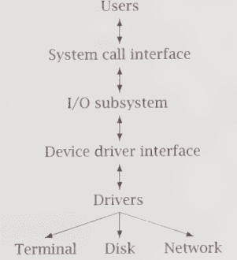

图 9.1：I/O 处理概述

图 9.1 概述了计算机系统中如何处理 I/O。用户应用程序通过内核 I/O 子系统使用系统调用接口与外部世界通信。它们不需要知道自己是在与设备还是与普通文件通信。向文件写入数据的程序应该能够在不经修改的情况下，将相同的数据写入终端或网络。操作系统为用户进程提供了一个一致的高层视图。

在内核中，I/O 子系统负责所有与设备无关的处理。该子系统不了解单个设备的特性。它将设备视为高层抽象，即虚拟设备。它负责设备命名和访问控制。

I/O 子系统通过标准接口与设备特定层（即驱动程序）进行交互。设备表现为一个黑盒，支持一组标准操作。每个设备可能以不同的方式实现这些操作，但这并不是 I/O 子系统关注的问题。

设备驱动程序负责与设备的所有直接交互。驱动程序由数据结构和过程组成，只有它知道设备的硬件特性，例如磁盘驱动器上磁头的数量。

在本章的剩余部分中，我们将查看通用的 I/O 处理，直到设备接口。必须强调的是，在整个章节中，“文件”一词使用的是通用 Unix 意义，即输入源或输出目的。随后的三个章节将查看底层的设备特定处理。

## 9.3 目录命名空间

设备与文件的统一始于名称层面。在许多系统中，文件名和设备名是不同的东西。文件名保存在文件目录中；而设备名维护在单独的列表中。Unix 不区分设备名称和文件名。它们都保留在目录结构中。

统一文件和设备命名空间有许多优势。用户可以看到系统的一致性视图。他们可以使用自己的名称来引用设备。为文件系统开发的访问控制和保护机制可以无缝扩展到覆盖所有设备。

为了让用户能够组织并跟踪所有文件，文件空间上被施加了一个逻辑目录结构。目录项包含每个文件的属性，如名称、类型、所有者、访问控制信息、长度、最后修改日期和时间，以及文件或设备的物理位置信息。必须强调，目录只包含关于文件的信息，特别是它们的名称——目录本身不包含文件。

此类目录可以以各种方式组织。不同目录系统提供的功能与其复杂性成正比。

### 单级目录

这是最简单的组织方式。所有的文件名都包含在一个目录中。它通常被实现为表，因此它能包含的项数量存在限制。

### 二级目录

在这样的系统中，每个用户都有一个私有目录，其中只包含文件。还有一个主目录，指向这些私有目录。当用户引用特定文件名时，只搜索他们自己的目录。这有效地将一个用户与其他用户隔离开。这种安排既有益处也有坏处。它有助于保护，但不允许共享。

允许一个用户通过使用路径名引用另一个目录中的文件，路径名由用户名和文件名组成。例如 `[username]test` 或 `user/test`。许多系统允许用户声明搜索路径。这指定了将在哪些目录中搜索文件，以及搜索的顺序。Unix 具有这样的功能，即 `path` 命令。

### 树结构目录

这是二级目录的自然泛化，如图 9.2 所示。

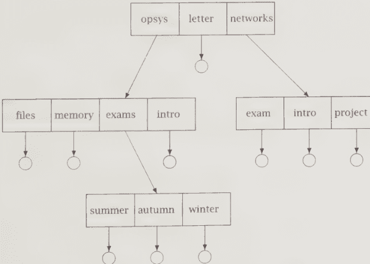

图 9.2：树结构目录

主目录和用户目录之间的严格区别被打破了。在这个系统中，目录（或子目录）包含文件名和/或子目录。

还有一个“当前目录”或“默认目录”的概念。用户认为自己正处于某个特定的目录之中。最好将其理解为一种简写——系统会在前面加上默认目录名。库函数 `getcwd()` 返回工作目录；而 `chdir()` 或 `fchdir()` 系统服务用于更改它。`task_struct` 中的 `fs` 指向这些信息。

默认目录的引入了绝对路径和相对路径的区分。绝对路径从目录树的根开始，经过所有的目录名称，直到指定的文件。参考图 9.2，一个示例可以是 `/opsys/exams/autumn`。它是完全没有歧义的。

相对路径隐地从当前工作目录开始。例如，对于图 9.2，如果当前工作目录是 `/opsys`，那么引用 `intro` 指向该目录中的一个文件。另一方面，如果当前工作目录是 `/networks`，那么相同的引用 `intro` 则指向一个不同的文件。在使用的相对路径可能会导致困惑。

在 Linux 中，目录项结构是变长的，以便高效存储长文件名。每个项包含其 inode 长度、项中包含的名称长度以及项的总长度。这些之后是用空字节填充到 4 字节边界的名称。

```
struct dirent {
    long int d_ino;                   /* 此项的文件节点 */
    unsigned short int d_namlen;      /* d_name 中字符串的长度 */
    unsigned short int d_reclen;      /* 此记录的长度 */
    char d_name[];                    /* 实际文件名 */
};
```

图 9.3：文件系统目录项结构

图 9.3 显示了文件系统目录项的结构，取自 <dirent.h>。Linux 内部可以处理长文件名，名称的最大长度取决于磁盘的能力。

`mkdir()` 函数创建一个新的空目录；`rmdir()` 删除目录，但仅当目录为空时有效。


## 9.3 目录命名空间

具有相应权限的用户可以读取目录文件。POSIX 提供了与文件系统无关的程序：`opendir()`、`readdir()` 和 `closedir()`。没有写入目录文件的函数；只有内核可以做到。

所有设备都列在 `/dev` 目录下，并在系统中有相应的节点。设备的目录项是通过 `mknod()` 函数创建的，该函数在 inode 中设置一个标志，以指示这是一个设备文件。

### 无环图目录

树形结构意味着任何节点只有一个父节点。我们可以将其放宽为无环图结构，其中节点可以有多个父节点；无环限制不允许出现反向链接。

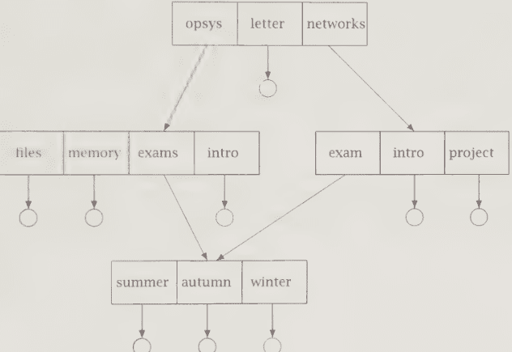

图 9.4: 带有链接的目录结构

如图 9.4 所示，这样的目录结构允许目录或文件被共享。我们讨论的不是同一个文件的两个副本，而是两个两个不同目录中有独立的条目，每个条目都指向同一个文件。这非常有用，例如两个程序员处理同一个项目。所有的项目工作都可以放在一个目录，该目录是他们两个主目录的子目录。

这种共享可以通过两种方式实现。

### 硬链接

所有必要信息都可以在两个目录中复制。但这在维护一致性方面引入了一个大问题。在 Unix 中，通过让两个（或多个）目录项指向同一个 inode 解决了这个问题。图 9.5 说明了这一点。

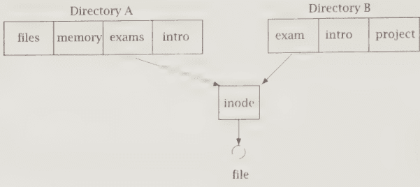

图 9.5: 硬链接的实现方式

`link()` 系统调用为现有文件创建一个额外的目录项，并原子化地增加 inode 中的链接计数。没有办法判断哪一个是原始链接。注意，它的名称不是文件的属性，它在每个目录中可以有不同的名称。

### 符号链接

或者，一个目录（所有者）可能拥有所有信息，而另一个目录有一个被称为符号链接的特殊条目，它只是一个普通文件，包含指向所有者目录中条目的完整路径名。见图 9.6。

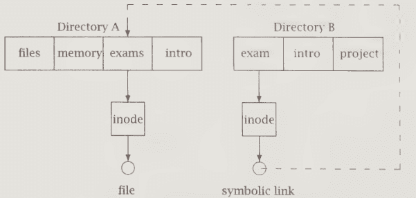

图 9.6: 符号链接的实现方式

如果此路径名足够短，它可能完全拟合 inode。使用 `symlink()` 系统调用用于创建这样的符号链接。

在遍历整个文件结构时（例如在备份时），你不希望遍历共享结构超过一次。符号链接解决了这个问题，因为系统只会跟随所有者条目，链接会被忽略。

通常，所有的读取和写入操作都会通过符号链接重定向到目标文件。要打开链接本身，`readlink()` 将 `open`、`read` 和 `close` 结合。

符号链接的一个问题是无法知道一个文件是否有符号链接指向它。因此，原始文件可能会被删除，在符号链接中留下指向它的悬空指针。下次通过符号链接引用该文件时，文件系统将返回文件错误。

### 通用图目录

如果在现有的树形结构目录中允许反向链接，那么结构中可能会出现环，如图 9.7 所示。

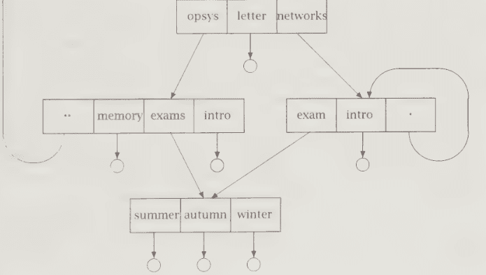

图 9.7: 带有环的目录结构

在每个目录中包含两个默认项是常见做法：一个指向自己 `.`（点），另一个指向其父目录 `..`（点）。如果可能，最好避免任何其他反向链接。搜索软件可以识别点和点链接，但任何其他反向链接都导致无限搜索循环。此外，删除操作将变成噩梦。因此，只有超级用户被创建此类链接。

### 从目录删除项

Unix 有一个 `unlink()` 函数。它总是删除目录项，但 inode 和分配给共享文件的空间何时会被释放呢？它们不能在任何用户取消链接文件时就释放。其他用户将留下指向不存在的文件的“悬空”指针。

一种可能性是在 inode 中保留用户数量的引用计数。当某个用户取消链接文件时，该链接计数就会减 1。当引用计数变为 0 时，inode 和数据实际上会被释放。

如果传递给 `unlink()` 的路径名是符号链接，那么删除的是链接，而不是它指向的文件。

### Inodes

现在我们已经查看了如何识别和记录输入输出源，我们可以继续考虑使用它们时涉及的处理。一旦文件被打开，它可以无限期保持打开。操作系统必须提醒自己该文件是打开的，并存储关于它的某些信息。因此它需要分配一个数据结构来存放这些信息。

在实践中，这变成了几个数据结构的网络，正如我们所见。操作系统必须提醒自己该文件是打开的，并存储关于它的某些信息。因此它需要分配一个数据结构来存放这些信息。

在实践中，这变成了几个数据结构的网络，正如我们所见。操作系统必须提醒自己该文件是打开的，并存储关于它的某些信息。因此它需要分配一个数据结构来存放这些信息。

在实践中，这变成了几个数据结构的网络，正如我们所见。操作系统必须提醒自己该文件是打开的，并存储关于它的某些信息。因此它需要分配一个数据结构来存放这些信息。

在实践中，这变成了几个数据结构的网络，正如我们所见。操作系统必须提醒自己该文件是打开的，并存储关于它的某些信息。因此它需要分配一个数据结构来存放这些信息。

在实践中，这变成了几个数据结构的网络，正如我们所见。操作系统必须提醒自己该文件是打开的，并存储关于它的某些信息。因此它需要分配一个数据结构来存放这些信息。

在实践中，这变成了几个数据结构的网络，正如我们所见。操作系统必须提醒自己该文件是打开的，并存储关于它的某些信息。因此它需要分配一个数据结构来存放这些信息。

在实践中，这变成了几个数据结构的网络，正如我们所见。操作系统必须提醒自己该文件是打开的，并存储关于它的某些信息。因此它需要分配一个数据结构来存放这些信息。

在实践中，这变成了几个数据结构的网络，正如我们所见。操作系统必须提醒自己该文件是打开的，并存储关于它的某些信息。因此它需要分配一个数据结构来存放这些信息。

在实践中，这变成了几个数据结构的网络，正如我们所见。操作系统必须提醒自己该文件是打开的，并存储关于它的某些信息。因此它需要分配一个数据结构来存放这些信息。

## 9.4 Inodes

inode 的部分包含了无论代表哪种文件，关于 inode 本身的维护信息。

- 第一部分是文件系统必须提醒自己该文件是打开的，并存储关于它的某些信息。因此它需要分配一个数据结构来存放这些信息。
- 接下来是关于文件的信息，必须提醒自己该文件是打开的，并存储关于它的某些信息。因此它需要分配一个数据结构来存放这些信息。
- 还有关于文件系统的信息，必须提醒自己该文件是打开的，并存储关于它的某些信息。因此它需要分配一个数据结构来存放这些信息。
- 最后是一个针对特定类型的额外信息区域。

```c
struct inode{
    struct list_head i_hash;      /* 哈希表链接 */
    struct list_head i_list;      /* inode 列表链接 */
    unsigned long     i_ino;       /* Inode 号 */
    unsigned short    i_count;     /* 用户计数 */
    kdev_t            i_dev;      /* 设备号 */
    umode_t           i_mode;      /* 类型和权限 */
    nlink_t           i_nlink;     /* 硬链接数 */
    uid_t             i_uid;       /* 所有者 */
    gid_t             i_gid;       /* 所有者组 */
    kdev_t            i_rdev;      /* 如果是设备 */
    off_t             i_size;      /* 字节数 */
    time_t            i_atime;     /* 访问时间 */
    time_t            i_mtime;     /* 内容修改 */
    time_t            i_ctime;     /* inode 修改 */
    unsigned long     i_blksize;   /* 块大小 */
    unsigned long     i_blocks;    /* 块数 */
    struct semaphore  i_sem;       /* inode 互斥 */
    struct inode_operations i_op;  /* 操作向量 */
    struct super_block i_sb;      /* 挂载点 */
    struct wait_queue i_wait;     /* 等待队列 */
    struct file_lock  i_flock;     /* 文件锁 */
    struct vm_area_struct i_mmap;  /* 内存区域 */
    struct page       i_pages;    /* 内存中的页 */
union
{
    struct pipe_inode_info pipe_i;
    struct ext2_inode_info ext2_i;
    struct msdos_inode_info msdos_i;
    struct nfs_inode_info nfs_i;
    struct socket      socket_i;
};
};
```

> 图 9.8: 打开的文件的 inode

### Inode 标识符

系统经常需要搜索其 inode 列表以查找特定的 inode。为了方便查找，inode 被维护在一个哈希结构中，根据设备号和 inode 号的组合进行哈希。哈希中的每个元素


表头包含一个 inode 列表，通过 `i_hash` 字段连接。在图 9.9 中，这用虚线表示。

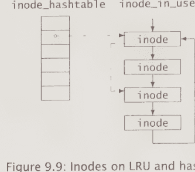

`struct list_head` 结构是一种用于连接各种类型数据结构列表的通用机制，我们将在内核的其他地方遇到它。

它在 `<linux/list.h>` 中被定义为 `struct list_head *next, *prev`。该文件中还定义了相应的宏，用于从列表中插入和删除项。

当通过编号查找 inode 时，该编号会被哈希到此 `inode_hashtable` 中，并线性地搜索相应的 inode 链。如果该已经不存在该编号的 *inode*，则在合适的情况下分配一个新的并将其链接进来。如果已经存在一个，则可以访问现有的结构。

- 如图 9.9 所示，活跃的 inode 也被维护在一个以 `inode_in_use` 为头的（环形）链表头上。该链接字段为 `i_list`。
- 当 inode 不再被引用时（即它所代表的文件被关闭时），它会被移动到另一个以 `inode_unused` 为头的列表，但仍然通过 `i_list` 链接。
- `i_ino` 在其所属的文件系统中唯一标识该 inode。它被称为文件序列号或节点号。
- `i_count` 是持有此打开文件的进程数的引用计数。每当打开文件时，它都会加1，并在调用 `close()` 时减1。当计数为零时，inode 可以被释放并移动到 `inode_unused` 列表。

## 关于文件的信息

inode 的下一部分包含了从代表此文件的磁盘 inode 复制的信息。

`i_dev` 字段持有永久存储该 inode 的设备编号，即包含该文件目录项的磁盘编号；它连同 `i_ino` 字段中的 inode 编号，共同在整个系统中唯一标识该文件。

`i_mode` 是一个功能载量非常大的字段。模式 字段中每个位位的含义见图 9.10，源自 `<linux/stat.h>`。

```
#define S_IFSOCK 0140000 /* socket *
#define S_IFLNK 0120000 /* symbolic link *
#define S_IFREG 0100000 /* regular *
#define S_IFBLK 0060000 /* block special *
#define S_IFDIR 0040000 /* directory *
#define S_IFCHR 0020000 /* character special *
#define S_IFIFO 0010000 /* fifo *
#define S_ISUID 0004000 /* set user id on execution *
#define S_ISGID 0002000 /* set group id on execution *
#define S_IRUSR 0000400 /* read permission: owner *
#define S_IWUSR 0000100 /* write permission: owner *
#define S_IRGRP 0000040 /* read permission: group *
#define S_IWGRP 0000020 /* write permission: group *
#define S_IXGRP 0000010 /* execute/search permission: group *
#define S_IROTH 0000004 /* read permission: other *
#define S_IWOTH 0000002 /* write permission: other *
#define S_IXOTH 0000001 /* execute/search permission: other */
```

图 9.10：模式位值

高位六位标识文件类型。它可以是普通文件、目录、块设备、字符设备、符号链接或命名管道。`<linux/stat.h>` 中定义了几个掩码用于测试这些位，分别是 `S_ISREG()`、`S_ISDIR()`、`S_ISBLK()`、`S_ISCHR()`、`S_ISLNK()`、`S_ISOCK()` 和 `S_ISIFO()`。

setuid 和 setgid 位也设置在 `i_mode` 中；对于可执行文件，这些位位允许文件中的程序以与运行进程不同的访问权限和权限运行。可以通过掩码 `S_ISUID` 和 `S_ISGID` 进行测试。注意这些不是宏。

访问权限编码在 `i_mode` 的最后九位中。
`chmod()` 系统服务更改现有文件的访问权限。要使用它，调用进程的 ID 必须是所有者或超级用户。

每个进程都有一个文件模式掩码。该掩码中设置的任何位在新建的文件的 `i_mode` 中都会被关闭。`umask()` 函数用于设置此掩码，并返回旧值。

- `i_nlink` 指向磁盘上此文件的硬链接数。

输入和输出

- `i_uid` 和 `i_gid` 包含文件所有者的 ID 以及所有者所属组的 ID。`access()` 系统服务使用当前进程的 ID 测试这些内容。它可以测试读、写、执行权限，或仅测试文件是否存在。
- `chown()` 和 `lchown()` 更改文件的所有者或组 ID。
- `i_dev` 仅对设备有意义；它包含设备编号。
- `i_size` 仅对普通文件有意义；给出字节大小。
- `atime` 是最后访问时间。
- `mtime` 是修改时间。
- `ctime` 是更改时间。
- `i_blk` 是分配给文件的块数。
- `blksize` 是磁盘使用的块大小。
- `i_sem` 是提供互斥的信号量。

inode 的下一部分包含了从代表此文件的磁盘 inode 复制的信息。

## 9.4 inode

inode 中的 `i_op` 字段指向一个函数指针数组，这些函数特定于文件系统。每个文件类型提供一个 `inode_operations` 实例。每个元素都指向自己的实现。

大多数这些额外操作特定于文件系统，与维护目录结构项有关。由于 Unix 设计所有 I/O 流、常规设备或通信通道都有目录结构项，这种额外功能层对它们都有效，而不仅仅是普通文件。

`inode_operations` 结构源自 `<linux/fs.h>`，见图 9.11。

```
struct inode_operations{
    struct file_operations *default_file_ops;
    int                   (*create)();
    struct dentry        (*lookup)();
    int                   (*link)();
    int                   (*unlink)();
    int                   (*symlink)();
    int                   (*mkdir)();
    int                   (*rmdir)();
    int                   (*mkknod)();
    int                   (*rename)();
    int                   (*readlink)();
    struct dentry        (*followlink)();
    int                   (*readpage)();
    int                   (*writepage)();
    int                   (*bmap)();
};
```

> 图 9.11：inode 接口的一些函数

- `default-file_ops` 包含一个指向该文件类型默认 `file_operations` 结构的指针。这将在第 9.5 节再次讨论。
- `create()` 由 `open()` 系统服务调用，当文件不存在时。它在目录中创建一个新项。
- `lookup()` 将名称翻译为 inode。
- `link()` 在目录结构中建立硬链接。
- `unlink()` 递减 inode 中的链接计数，如果为零，则删除目录项。
- `symlink()` 创建一个符号链接文件。


mkdir() 创建一个新的目录文件。

rmdir() 删除一个目录文件。

inode() 为特殊文件（设备文件或命名管道）创建一个目录项目。

rename() 更改目录项的名称部分。

readlink() 读取符号链接文件并返回路径。

followlink() 将符号链接名称转换为目标文件的 inode。

readpage() 将数据从磁盘拷贝到内存中的特定页面。

writepage() 将数据从内存中的页面拷贝到磁盘上的相应位置。

bmap() 是一个函数，用于将文件中的逻辑块号转换为磁盘上的物理块号。

我们将在第 10 章中查看这些函数在 Ext2 系统中的实现。

## 关于打开的流（open stream）的信息

下一组字段不属于磁盘索引中维护信息的一部分。它们仅在文件实际打开时相关。

- i_sb 通常为 NULL。只有当一个目录文件之上挂载了另一个文件系统时，才会使用它（见第 10.5 节）。在这种情况下，i_sb 指向一个表示新文件的数据结构。
- i_wait：等待此特定流准备好进行 I/O 的进程。
- i_flock：表示在该文件上实际持有或请求的锁的数据结构链表（见第 9.9 节）。
- i_pages：我们已经看到程序的代码和数据是从磁盘分页换入出的。在 Linux 中，对磁盘的文件访问也是通过 mmap() 实现的。在所有情况下，i_mmap 字段都指向内存管理数据结构中的相应位置，即代表该文件映射区域的 vm_area_struct。此列表中的每个条目代表该文件实际在内存中的一个页面。union 包含了不同类型 I/O 流的其他数据结构：

- pipe_inode_info：如果该流用于进程间通信。将在第 12 章讨论。
- ext2_inode_info：如果该流表示扩展文件系统中的文件。将在第 10 章讨论。
- mdos_inode_info：如果该流表示 MSDOS 文件系统中的文件。将不再考虑。
- nfs_inode_info：如果该流表示网络文件系统中的文件。将在第 16 章详细讨论。
- socket：如果该流用于同一台机器上的进程间通信；将在第 14 章讨论。

## 9.5 打开文件

在访问任何 I/O 源之前，必须先打开它。此操作并不一定是源语言的一部分，但它必须是提供如 open(pathname, flags) 等系统调用的操作系统的一部分。flags 字段将指定访问类型，例如读或写。Unix 还有 create() 函数，它可以创建一个新文件并以写模式打开它。open() 的精髓是将用户程序与其数据连接起来。所需操作的概述如下：

- 查找文件的目录项。
- 如果文件不存在，则创建它（如果指定了正确的 flags）。
- 根据文件上的保护机制检查用户的的权限。
- 检查文件是否已经打开。如果是，取决于系统的不同，它可能只是拒绝访问，或者在已以写模式打开时拒绝访问，或者在以读模式打开时允许访问。
- 创建适当的数据结构来表示此打开的文件，并将它们链接到表示进程的现有结构中。系统维护的关于打开的文件的信息包括：
- 访问模式：是否以读和/或写模式打开；
- 引用计数：有多少进程打开了它；
- 如果是顺序文件，磁盘偏移量在文件的位置。
- 为调用者提供某种用于对文件进行后续操作的句柄。

我们现在将查看 Linux 是如何实现这一切的。

##  {翻译

名称翻译机制以路径作为输入，并指示其是否有效。这是一个递归过程，依次处理路径中的每个分量。在任何阶段，它都可能返回“没有此类文件或目录”错误。

由于名称翻译严重依赖于对磁盘目录内部结构的了解，每个不同类型的文件系统必须提供一个名为 lookup() 的函数来执行此操作。我们将在下一章考虑 Linux 系统时看到这个函数。

由于名称翻译涉及搜索路径中的每个目录，因此非常耗时。因此，系统维护了一个最近查询的目录项缓存。在解析文件名时会查询该缓存。

此缓存中的每个条目都是一个 struct dentry，如图 9.12 所示，来自 <linux/dcache.h>。

```c
struct dentry {
    struct inode *d_inode;
    struct list_head d_hash;
    struct list_head d_lru;
    unsigned char d_name[];
};
```

图 9.12：最近查询缓存中的一个元素

- d_inode 指向对应于此条目的 inode。
- 缓存以哈希表 dentry_hashtable 的形式维护，声明在 fs/dcache.c 中。名称进行哈希处理以找到表中的条目。通过 d_hash 字段链接的 struct dentry 对应列表将被线性搜索，以检查是否有条目与正在搜索的名称对应。
- 此外，缓存中的所有条目都在一个链表上，穿过每个条目中的 d_lru 字段。该列表按照 LRU 顺序维护，因此最旧的条目总是第一个被替换的。每当缓存发生命中（hit）时，该条目就会移动到列表末尾。当未命中（miss）时，列表中的第一个条目被重用并移动到末尾。
- 此条目表示的文件名称在 d_name[] 字段中。


在前一种情况下，同一个文件的不同共享者可以具有不同的访问权限。在后一种情况下，所有共享者将具有相同的访问权限。这就是 Unix 中的情况，其保护信息维护在 inode 中。

进程的权限必须与文件的保护属性进行比较。在 Linux 中，用户凭据（如 user-id 或 group-id）存储在 `task_struct` 结构体的 `u_id` 和 `gid` 字段中。当前进程的用户 ID 和组 ID 信息来自文件 inode 的 `i_uid` 和 `i_gid` 字段。

如果当前进程的 `uid` 与文件的 `uid` 相同，则 `open()` 系统服务将检查请求的的所有者权限。所有这些信息都在 inode 的 `i_mode` 字段中。如果 `uid` 字段不匹配，则可以检查当前进程的 `gid` 字段是否与文件相同。如果是，则根据 inode 中 `i_mode` 字段的组权限检查请求的访问。

如果打开文件的进程既不是所有者，也不在所有者组中，则将根据 `i_mode` 字段中的“其他”（other）权限来检查请求的访问。

## 文件描述符

程序中打开的逻辑流与物理设备之间的连接记录在流描述符列表中，或者在 Unix 中被称为文件描述符表。每个进程都拥有其中一个。每当打开一个文件时，表中就会分配一个条目。当文件关闭时，该条目从列表中移除。描述符通过一个整数标识给调用进程，该整数实际上是描述符表中的索引。由于每个进程都有自己的文件描述符表，相同的数字在不同的进程中会被重用。对于对文件的后续操作，内核使用描述符编号来索引描述符表，从而定位与已打开文件相关的数据结构。

这种描述符可能代表普通文件、设备或网络连接。但文件描述符机制以及对这类描述符操作的通用 I/O 程序隐藏了文件和设备之间的区别。

在 Linux 中创建新进程时，它会被赋予一个静态、固定大小的文件描述符表。如果需要，以后可以扩展。`task_struct` 中的 `files` 字段指向此表。参见取自 `<sched.h>` 的图 9.15。

- `count` 字段包含任何时刻打开的流的数量。

```c
struct files_struct{
    atomic_t count;
    fd_set close_on_exec;
    fd_set open_fds;
    struct file *fd_array[];
};
```

图 9.15：文件描述符表的定义

- `fd_set` 类型是一个位图，每个可能的文件对应一个位位：`close_on_exec` 字段决定描述符在调用 `exec()` 后是否保持打开状态。
- 默认是打开的（open）；即新程序获得该表的一个副本。
- 如果不需要，则可以对 `close_on_exec` 字段进行设置。使用 `fcntl(1)` 系统服务来实现此；通过 `F_GETFD` 可以获取 `close_on_exec` 标志的值；通过 `F_SETFD` 可以设置或清除它。
- `open_` 跟踪 `fd[]` 表中哪些条目是有效的。如果该字段设置某位，则 `fd[]` 中对应的条目表示一个已打开的文件；否则它是未使用的条目。
- 描述符表本身本质上是一个指向 `struct file` 的指针数组，见下一节。

两个处理文件描述符的系统服务是 `dup()` 和 `dup2()`。它们复制现有的文件描述符，区别在于 `dup2()` 允许指定新描述符的编号。它首先会关闭当前已打开的该描述符。该系统服务用于程序期望特定文件与某个特定描述符关联的情况。

进程通常会打开三个默认流：标准输入、标准输出 (1) 和标准错误 (2)。描述符 0 连接到键盘；描述符 1 和 2 连接到屏幕。在 POSIX 中，这些被定义为 `STDIN_FILENO`、`STDOUT_FILENO` 和 `STDERR_FILENO`。

所有错误信息（例如或由 `output()` 输出的消息）都发送到标准错误，即流 2。虽然它默认连接到屏幕，但可以更改（使用 `dup2()`），使得错误信息发送到打印机或磁盘上的日志文件。

在 `fork()` 之后，子进程获得此文件描述符表的副本，然后可以独立于父进程对其进行操作。但如果需要，进程可以通过使用 `clone()` 系统服务的参数 `CLONE_FILES` 来与其父进程共享此文件描述符表。

## 系统打开文件列表

如前节所示，文件描述符本质上是一个指向 `struct file` 的指针。关于打开流的实际信息（如打开模式标志和当前位置）都包含其中。系统维护着这些结构的一个链表，被称为系统打开文件列表。

| 文件描述符表 (struct file*) | 系统打开文件列表 filp_cache |
|---|---|
| 0 | struct file |
| 1 | |
| 2 | |
| 3 | |
| 4 | struct file |

图 9.16：描述符和打开文件数据结构

图 9.16 展示了文件描述符表与打开文件列表之间的连接。文件数据结构在 `<linux/fs.h>` 中声明。

```c
struct file {
    struct file *f_next;      /* next */
    struct dentry *f_dentry;  /* dentry */
    struct file_operations *f_op; /* operations */
    mode_t f_mode;            /* mode */
    unsigned short f_count;   /* count */
    inode *f_owner;           /* owner */
};
```

图 9.17：表示流的结构

- 所有的 `f_mode` 字段都在链表中。
- `f_dentry` 字段指向文件系统中的条目。
- `f_op` 字段指向实现该流的函数数组。
- `f_mode` 字段指示流是用于读取、写入还是两者都用。
- `f_pos` 字段是文件的偏移量，指示下一次读或写的位置。
- `f_next` 字段指向链表，
- `f_owner` 字段指向 inode。

## 文件描述符表 (struct file*)

描述符通过一个整数标识给调用进程，该整数实际上是描述符表中的索引。由于每个进程都有自己的文件描述符表，相同的数字在不同的进程中会被重用。对于对文件的后续操作，内核使用描述符编号来索引描述符表，从而定位与已打开文件相关的数据结构。

这种描述符可能代表普通文件、设备或网络连接。但文件描述符机制以及对这类描述符操作的通用 I/O 程序隐藏了文件和设备之间的区别。

在 Linux 中创建新进程时，它会被赋予一个静态、固定大小的文件描述符表。如果需要，以后可以扩展。`task_struct` 中的 `files` 字段指向此表。参见取自 `<sched.h>` 的图 9.15。

- `count` 字段包含任何时刻打开的流的数量。

```c
struct files_struct{
    atomic_t count;
    fd_set close_on_exec;
    fd_set open_fds;
    struct file *fd_array[];
};
```

图 9.15：文件描述符表的定义

- `fd_set` 类型是一个位图，每个可能的文件对应一个位位：`close_on_exec` 字段决定描述符在调用 `exec()` 后是否保持打开状态。
- 默认是打开的（open）；即新程序获得该表的一个副本。
- 如果不需要，则可以对 `close_on_exec` 字段进行设置。使用 `fcntl(1)` 系统服务来实现此；通过 `F_GETFD` 可以获取 `close_on_exec` 标志的值；通过 `F_SETFD` 可以设置或清除它。
- `open_` 跟踪 `fd[]` 表中哪些条目是有效的。如果该字段设置某位，则 `fd[]` 中对应的条目表示一个已打开的文件；否则它是未使用的条目。
- 描述符表本身本质上是一个指向 `struct file` 的指针数组，见下一节。

两个处理文件描述符的系统服务是 `dup()` 和 `dup2()`。它们复制现有的文件描述符，区别在于 `dup2()` 允许指定新描述符的编号。它首先会关闭当前已打开的该描述符。该系统服务用于程序期望特定文件与某个特定描述符关联的情况。

进程通常会打开三个默认流：标准输入、标准输出 (1) 和标准错误 (2)。描述符 0 连接到键盘；描述符 1 和 2 连接到屏幕。在 POSIX 中，这些被定义为 `STDIN_FILENO`、`STDOUT_FILENO` 和 `STDERR_FILENO`。

所有错误信息（例如或由 `output()` 输出的消息）都发送到标准错误，即流 2。虽然它默认连接到屏幕，但可以更改（使用 `dup2()`），使得错误信息发送到打印机或磁盘上的日志文件。

在 `fork()` 之后，子进程获得此文件描述符表的副本，然后可以独立于父进程对其进行操作。但如果需要，进程可以通过使用 `clone()` 系统服务的参数 `CLONE_FILES` 来与其父进程共享此文件描述符表。

## 系统打开文件列表

如前节所示，文件描述符本质上是一个指向 `struct file` 的指针。关于打开流的实际信息（如打开模式标志和当前位置）都包含其中。系统维护着这些结构的一个链表，被称为系统打开文件列表。

| 文件描述符表 (struct file*) | 系统打开文件列表 filp_cache |
|---|---|
| 0 | struct file |
| 1 | |
| 2 | |
| 3 | |
| 4 | struct file |

图 9.16：描述符和打开文件数据结构

图 9.16 展示了文件描述符表与打开文件列表之间的连接。文件数据结构在 `<linux/fs.h>` 中声明。

```c
struct file {
    struct file *f_next;      /* next */
    struct dentry *f_dentry;  /* dentry */
    struct file_operations *f_op; /* operations */
    mode_t f_mode;            /* mode */
    unsigned short f_count;   /* count */
    inode *f_owner;           /* owner */
};
```

图 9.17：表示流的结构

- 所有的 `f_mode` 字段都在链表中。
- `f_dentry` 字段指向文件系统中的条目。
- `f_op` 字段指向实现该流的函数数组。
- `f_mode` 字段指示流是用于读取、写入还是两者都用。
- `f_pos` 字段是文件的偏移量，指示下一次读或写的位置。
- `f_next` 字段指向链表，
- `f_owner` 字段指向 inode。


## 打开文件

在文件的末尾，可以在文件中创建一个“空洞”（hole）。此类字节不会被写入磁盘，但在读取时会被读取为 0。

- 正如我们所看到的，一个 `struct file` 结构可以被多个文件描述符指向。引用计数 `f_count` 用于防止该结构在内核中的一个例程仍在使用它时，被另一个例程释放内存。

- 在某些情况下（见第 9.8 节），有必要向等待流的进程发送信号。要发送信号的进程 ID 存储在 `f_owner` 中。

### 总结

打开文件的整个过程在图 9.20 所示的算法中。

```
Set up file descriptor, link to struct file
Search the directory name cache
IF not found THEN
    lookup() (from directory i_op)
    IF not found THEN
        errno = EFAULT
        Return (-1)
    ENDIF
    Create appropriate entry in name cache
    Create inode in memory
    Link dentry to inode
ENDIF
Set up f_op field in struct file
open() (from f_op)
IF no permission THEN
    errno = EACCES
    Return (-1)
ENDIF
Link struct file to dentry
Increment i_count
Return (file descriptor)
```

图 9.20：open 算法

本节贯穿提供了该算法中所有步骤的详细描述。

## 9.6 文件共享

文件共享可以在两个层面上实现。两个进程的文件描述符表中的项可能指向同一个 `struct file`。这种情况是 `fork()` 产生的结果。它们共享相同的当前偏移量值。

另一种可能性是两个文件描述符（在相同或不同的进程中）分别指向它们自己的 `struct file`。这是两个独立进程对同一个文件执行 `open()` 的结果。由于每个进程都有自己的 `struct file`，因此每个都可以在文件内拥有各自不同的偏移量。图 9.21 说明了这种情况。

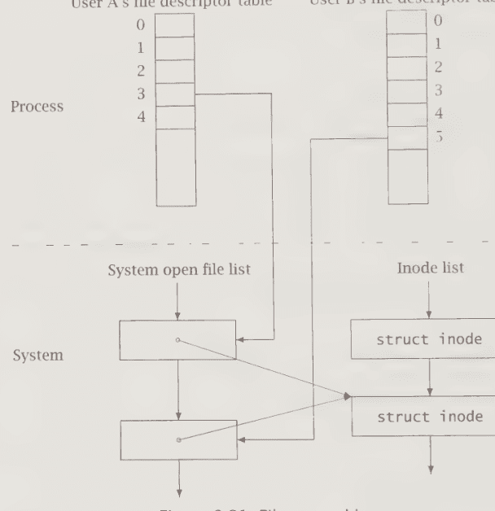

关于打开文件的所有进程特有信息都维护在 `struct file` 中。通过在单独的结构 `inode` 中维护有关文件的通用信息，避免了由两个或多个数据结构表示同一个文件可能导致的不。

在 Unix 中，系统调用通过提供文件描述符表中的位置来引用文件。当两个用户共享一个文件时，他们都有自己的文件描述符表。因此，一个人可能将其称为用户文件 3，而另一个人可能将其称为用户文件 5。它们在打开文件列表中都有单独的项，其中保存进程特有的信息。但 `inode` 列表中只有一个项，也只有一个文件。

## 9.7 文件输入和输出

Unix 保证对共享文件进行的任何单个 `read()` 或 `write()` 操作都是原子的。它通过在读或写操作期间锁定节点（使用节点中的 `i_sem` 信号量）来实现这一点。因此，共享文件的读取器始终能看到最近 `write()` 的结果。

打开文件本身并不是目的。这样做是为了使文件能够用于输入或输出。I/O 程序是操作系统提供给应用程序的设施，是系统调用的一个子集。它们是输入/输出管理器外部可见的接口，由用户进程调用。它们位于用户和内核之间，负责检查和翻译。

## I/O 过程

以下是 I/O 程序需要做的工作概述：

1. 将其收到的流或文件描述符编号映射到文件或物理设备上。它通过检查调用进程的文件描述符表来实现。如果该文件描述符未分配，则返回错误。
2. 将用户使用的参数与该流要求或允许的参数进行比较。此操作对于该流是合法的？例如，在打印机上进行读操作通常被认为是不合法的。如果操作非法，则返回错误。
3. 识别适用于该流的适当函数并将请求传递给它。
4. 当数据传输完成后，通知用户进程。此外，对于读操作，将请求的数据传回用户进程。

不同的操作系统设计者在这一点采取了不同的方法。在尺码的一端，可能存在如下形式的通用 I/O 程序：`QIO(field, mode, address, length, errno)`。参数的含义如下：

- field：流或通道的编号。
- mode：执行何种操作，例如 open、read、close。
- address：用于传输的缓冲区地址。
- length：要传输的字节数（如果有）。
- errno：写入错误标识数字的位置的地址。该位置位于调用进程的地址空间，并在返回后进行测试。

## 将字段 映射到流

```
IF not open, THEN
  errno = errornumber
  Return (-1)
ENDIF

// 根据流的特性检查 mode 和 length
IF not compatible THEN
  errno = errornumber
  Return (-1)
ENDIF

// 使用适当参数调用特定函数
IF not successful THEN
  errno = errornumber
  Return (-1)
ENDIF
```
*(注：由于原文中存在大量 OCR 识别产生的重复和碎片，此处已根据逻辑流进行了清理和整合)*

## 9.8 同步和异步 I/O

输入或输出总是存在延迟的。这种延迟从磁盘驱动器的毫秒到键盘的几秒或几小时不等。

在理论上，调用进程在此期间可以继续其他工作。但在大多数情况下，这是不可行的。对于输入，数据将是无效；对于输出，缓冲区将无法复用。

### 阻塞

最常见的实现方式是，操作系统代码中的 I/O 过程必须等待操作成功完成。

### 总结

图 9.23 以算法的形式总结了上述讨论。


使用流编号在文件描述符表中索引

```
IF 未分配, THEN
errno = EBADF
Return (-1)
ENDIF
从描述符跟踪指针到结构体
检查 f_mode
IF 请求与打开模式不兼容 THEN
errno = EBADF
Return (-1)
ENDIF
IF 请求是简单 I/O THEN
调用 f_op 中相应的函数
ELSE
跟踪 f_dentry 指针到 struct体 inode
调用 i_op 中相应的函数
ENDIF
IF 未成功 THEN
errno = EIO
Return (-1)
ELSE
Return (0)
ENDIF
```

图 9.23：Unix I/O 过程的通用算法

用户进程被置睡眠，但用户并感知不到。这似乎 I/O 操作像赋值语句一样是原子的。这种安排被称为同步 I/O 或等待 I/O。
这是 C 等高级语言中的一种常见情况。当一个程序执行一个 `printf()` 或 `scanf()` 语句时，预期的程序将继续执行下一条指令，而 I/O 将完成。这也是 `read()` 和 `write()` 等系统服务的默认情况。

## 非阻塞

这种默认情况可以改为非阻塞 I/O，例如通过带有 `O_NONBLOCK` 参数调用 `open()`。在这种情况下，所有 I/O 请求将立即返回，无论它们是否已执行。如果写无法立即进行，或者没有内容可读，系统调用返回 -1，并将 `errno` 设置为 `EAGAIN`。这种情况被称为异步或无等待 I/O。

## 9.8 同步与异步 I/O

### 信号

当非阻塞流返回 -1 时，程序员可以稍后重试。这实际上是轮询。但另一个选项是设置一个流，使其在可以进行 I/O 时向进程发送信号。然后注册一个信号处理程序来读取或写入数据。这样做的好处是进程在等待期间可以执行一些其他工作；同时，数据一旦可用就会被立即处理。

Linux 遵循 BSD，使用 `fcntl()` 配合 `F_SETOWN` 来指定哪个进程的 pid，将信号记录在 `struct file` 的 `f_owner` 字段中。然后，在特定描述符上使用带有 `F_SETFL` 命令的 `fcntl()` 来设置 `struct file` 中的 `O_ASYNC` 标志。当可以进行 I/O 时，线程发送 `SIGIO` 信号。这只适用于终端和网络。

这的一个主要问题是，我们如何知道信号来自哪个流？每个流都会发送相同的信号。因此，程序员实际上一次只能对一个文件描述符启用异步 I/O。替代方案在第 9.8 节中讨论。

POSIX 有更简单的异步 I/O 接口 `aio_read()` 和 `aio_write()`。两者都可以指定在 I/O 完成时发送哪个信号。由于每次调用都指定了信号，因此可以为每个流使用不同的信号。Linux 中不支持 POSIX 异步 I/O。

### 同步

非阻塞 I/O 的优点是可以提高利用率——程序在等待时可以做事情。但同步的责任完全由用户承担。用户必须意识到 I/O 不是瞬间完成的，并且不能尝试使用尚未提供的数据。例如，进程可以在信号量上等待（WAIT），而信号处理程序将执行操作。

用户进程在何处进行同步非常重要。它可以紧接在 `read()` 或 `write()` 调用之后。这意味着用户进程将挂起直到 I/O 完成。其效果与阻塞 I/O 完全相同。

程序员也可以将同步操作放在代码更靠后的位置。在这种情况下，当原始请求处理时，程序可以执行其他计算，甚至发出其他 I/O 请求。这种方法的好处是能够提高计算机系统的利用率。

## I/O 多路复用

会出现一种情况：进程希望等待多个输入源之一。例如，它可能请求了键盘的输入，但也愿意接受网络或磁盘驱动器的输入，如果其中任何一个在按下键之前已准备就绪。按照我们目前为止考虑的标准安排，如果它从键盘执行 `read()`，它将阻塞到按下键为止；它将无法读取或写入任何其他通道。

为了 I/O 多路复用开发了两种特殊的系统服务。基本上我们构建一个感兴趣的文件描述符列表，然后调用一个函数，直到其中至少一个准备就绪才会返回。进程会阻塞；但一旦感兴趣的流中有任何数据可用，它就会被唤醒。

## Select

第一个系统服务是 `select()`。它接收一个位图（包含一个打开的描述符）以及一个超时值。设置为 1 的位表示进程愿意在其描述符上进行 I/O。如果其中任何一个已就绪，它将立即返回。否则，它将睡眠直到其中一个变为就绪。当它返回时，只有对应于已就绪描述符的位仍被设置。错误时返回值为 -1，如果超时且无就绪则返回 0，否则返回就绪的描述符数量。

在 `<sys/select.h>` 中定义了四个用于设置、清除和检查这些位图的 POSIX 掩码。第一个是 `FD_ZERO()`，它清除所有位；`FD_SET()` 和 `FD_CLR()` 用于设置或清除某一位。最后是 `FD_ISSET()`，它用于检查某位是否被设置。超时是时间，允许指定时间。错误时返回 -1，如果超时且无就绪则返回 0，否则返回就绪的描述符数量。

另一个在 SVR4 中开发的系统服务是 `poll()`。它接收一个 `struct pollfd` 数组，每个愿意 I/O 的描述符对应一个。

```
struct pollfd{
  int fd;               /* 我们感兴趣的描述符 */
  int events;           /* 感兴趣的事件 */
  int revents;          /* 发生的事件 */
};
```

图 9.24：轮询的数据结构

`select()` 和 `poll()` 的实现方式相同。它们遍历所有描述符，并通过调用对应的 `file_operations` 中的 `poll()` 函数检查是否可以进行 I/O。

如果可以进行 I/O，它们将以各自的方式返回这些信息。如果无法进行 I/O，则调用进程必须进入睡眠，但其设置方式允许被任何相关事件唤醒。由于多个进程可能等待特定事件，必须对进程进行队列。每个队列的头总是特定设备的 `wait` 字段。这构成了一个链表 `wait_queue`，每个节点指向等待进程的 `task_struct`。

当特定流或通道的状态发生时，驱动程序可以唤醒关联队列上的所有进程。记得进程是在系统服务内部睡眠的。当它被唤醒时，进程再次遍历所有描述符，找到现在就绪的并返回。

但还有一个进一步的复杂性。进程可能等待多个设备。当第一个设备就绪时，进程就会继续，留下它在其他队列上的条目。这种条目可能会导致后期虚假处理。因此当进程被唤醒时，它必须找到并移除在其他队列上的所有条目，正如传递给 `select()` 或 `poll()` 的参数所所示。

## 9.9 锁

当多个进程同时打开一个文件，某些为了读取，另一些为了写入，存在相互干扰的可能性。这被称为读者/写者问题。我们在早的章节中检查了各种层次的解决方案。


## 242 9 输入与输出

在内部，Linux 在 inode 上提供了一个锁（注意文件 `i_sem`），它确保同一时间只有一个进程可以读取或写入某个特定的文件。但这仅保证了单次读取或单次写入的原子性。

POSIX 为文件中的指定字节范围提供了锁。进程仅可以锁定其实际使用的文件字节，而其他进程仍然可以访问同一文件的其他部分。当然，如果进程需要，它始终可以锁定文件中从头到尾的整个字节范围。

这些锁可以是建议性的（advisory）的或强制性的（mandatory）的。

### 建议性锁（Advisory locking）

建议性锁不会强制其他进程使用。用户可以发现其他人是否锁定了文件，但可以忽略这些信息。建议性锁可以是读锁、写锁或读/写锁。读锁是可以共享的，但写锁是排斥性的。

锁定通过 `fcntl(2)` 完成，它接收一个指向 `struct flock` 结构体的指针和一个参数，用于指定对 `flock` 中的信息要执行的操作。有三种可能性：

- F_GETLK 检查指定的字节范围是否已被锁定。如果是，则值将用现有数据覆盖。

- F_SETLK 尝试在字节范围上设置锁；如果这与现有锁冲突，则返回 -1 并将 `errno` 设置为 `EAGAIN`。它也用于解锁。

- F_SETLKKW 实现了上述选项的阻塞或等待版本。如果无法授予锁，则请求的进程将进入睡眠状态。这可能导致死锁。

### 实现

在内部，系统通过 `struct file_lock` 结构记录每个锁，见图 9.26，来自 `<linux/fs.h>`。

```c
struct file_lock {
    struct file_lock      *fl_next;
    struct task_struct    *fl_owner;
    struct wait_queue     *fl_wait;
    struct file            *fl_file;
    unsigned char         fl_type;
    off_t                 fl_start;
    off_t                 fl_end;
};
```

图 9.26：表示文件锁的结构

- 存在一个此类结构的链表，头部位于 inode 中的 `i_flock` 字段，通过 `fl_next` 链接。

## 9.9 锁

- fl_owner 字段指向持有锁的进程的 `task_struct`。

- 但有时锁无法立即授予，在这种情况下，进程必须阻塞。`struct file_lock` 仍然会被插入链表，但还会通过 `fl_wait` 链接一个 `struct wait_queue`（见图 9.27）。

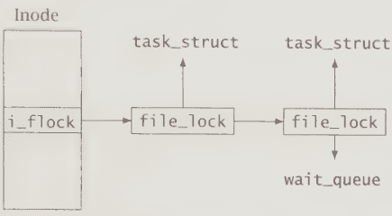

图 9.27：一个阻塞的锁请求

- fl_file 字段指向代表请求此锁的流 `struct file` 结构（见图 9.28）。

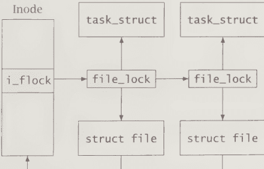

图 9.28：锁是如何记录的

- fl_type 是锁的类型，例如 `F_RDLCK` 或 `F_WRLCK`。

- fl_start 指定锁的起始位置。

- fl_end 指定锁的结束位置。

每当文件上的锁释放时，都会检查 `struct file_lock` 链表，是否有任何链接了 `wait_queue` 的条目。这表示一个等待的进程被唤醒。如果它正在等待的字节范围现在空闲了，它就会被唤醒并获得锁。

锁不会跨 `fork()` 继承。`fork()` 会创建一个新的 `task_struct`，而 `file_lock` 只指向一个结构，即原始结构。因此，在 `fork()` 之后，只有原始进程持有锁。但如果文件描述符中没有设置 `close_on_exec` 标志，它们可以跨 `exec()` 继承。在 `exec()` 之后存在相同的 `task_struct`，`file_lock` 仍然指向它。因此，如果文件在新程序中仍然打开，则它仍然处于锁定状态。

### 强制性锁（Mandatory locking）

`chmod()` 系统服务用于在特定文件 inode 的 `i_mode` 字段中设置“执行时设置组 ID”的 S_ISGID 位，并清除组的执行权限 S_IXGRP。清除执行位意味着该组可以执行此文件；设置 gid 位意味着当文件执行时，它将以与组相关的权限运行，而不是运行它的进程的权限。这是一种无意义的组合，可能出现在异常使用中。因此，选择它来指示强制性锁。

强制性锁的实现与上一个小节中对建议性锁的描述完全相同。但如果强制性锁生效，文件系统将强制执行锁，如果另一个进程持有冲突的锁，将不允许进程继续执行。

### 9.10 缓冲（Buffering）

上述对 I/O 程序的讨论假设进程的每个 I/O 请求都会导致与外围设备之间的物理传输。在同一个文件上执行系列 I/O 操作（如顺序写入、`cat` 到终端）的进程，在每次调用 I/O 程序时都会被阻塞。这意味着每次都会发生上下文切换，这是一种非常沉重的开销。

一种解决方案是在请求之前执行提前输入，并将多个输出请求合并为一次物理传输。这种技术被称为缓冲。

输出数据根据用户程序的请求（例如 `write()`）被接收到缓冲区中。然后，当缓冲区满或设备能够接收时，操作系统会将数据从缓冲区释放到设备。它只有在缓冲区满时才需要等待。例如，程序突发地提供数据，打印机按其自己的速率接收。

输入数据以设备能提供的最快速度被接收。然后，缓冲区数据根据请求提供给用户程序。用户只有在缓冲区为空时才需要等待。

# 动机

缓冲只有一个真正的优势，即提高性能。但缓冲也有缺点。例如，它需要更多的内存，并可能引入延迟。

### 缓冲算法

缓冲需要一种策略来管理数据。常见的策略是使用循环缓冲区，通过头部和尾指针实现。

```
if (buffer_full) {
    wait_for_space();
}
add_data_to_buffer();
```

```c
if (buffer_empty) {
    wait_for_data();
}
remove_data_from_buffer();
```

缓冲算法还必须处理缓冲区部分充满或为空的情况。在这种情况下，系统应尽可能处理数据。

### Unix 缓冲（Buffer cache）

Unix 在系统启动时分配固定数量的缓冲区，约内存的 10%。每个缓冲区都有一个磁盘块的空间，带有一个持有管理信息的单独头部 `struct buffer_head`。见图 9.30，来自 `<linux/fs.h>`。

- `b_blocknr`（特定设备的块号）和 `b_dev`（设备 ID）的组合唯一标识缓冲区中的数据。`b_dev` 的值为 `B_FREE` 表示空缓冲区。

- 与内核其他数据结构一样，缓冲区根据块号和设备 ID 维护在哈希表中。`b_next` 字段用于链接哈希表。

- 空闲时，缓冲区在空闲列表中维护，释放时放在列表尾。但即使空闲，它仍然包含数据，并保留在旧哈希表中，以便如果再次需要，可以快速找到。

```c
struct buffer_head {
    unsigned long b_blocknr;      /* 块号 */
    kdev_t b_dev;                  /* 设备 */
    struct buffer_head *b_next;   /* 哈希列表 */
    unsigned long b_state;         /* 状态位图 */
    struct buffer_head *b_next_free; /* 空闲列表 */
    char *b_data;                  /* 指向数据 */
    struct wait_queue *b_wait;     /* 等待的进程 */
};
```

图 9.30：缓冲区头

```c
#define BH_Uptodate 0 /* 包含有效数据 */
#define BH_Dirty     1 /* 是脏数据 */
#define BH_Lock      2 /* 已锁定 */
#define BH_Req       3 /* 已失效 */
```

图 9.31：表示缓冲区状态的位

- b_data 字段指向与此缓冲区头对应的实际缓冲区区域。


## 9.11 关闭

空列表

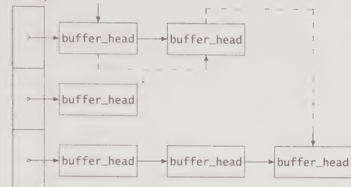

图 9.32: 缓冲区缓存

- 如果进程正在等待访问此缓冲区，它们会将自己插入到由 b_wait 头的等待队列中。当数据在缓冲区中可用时，所有的等待进程都可以在这里被找到。

除了来自文件的数据块外，缓冲区缓存还用于存放系统数据块，例如目录块、inode 块和间接块。这些将在下一章中描述。`sync()` 系统服务将所有系统数据写回磁盘；而 `fsync()` 则将指定文件的数据和控制信息写回磁盘。缓冲区缓存的内容由 `update` 进程定期写回磁盘。

## 9.11 关闭

此函数必须在 I/O 操作后进行清理。它会调用文件系统或设备特定的 `release()` 函数，该函数负责执行适当的清理操作。例如，如果以写方式打开，则必须将填充或部分填充的缓冲区写入磁盘。如果以读方式打开，则只需丢弃数据。

它更新磁盘上的目录或 inode 条目，例如日期字段，可能可能的大小字段。然后它将文件描述符表中的条目置零，并递减 `struct file` 中的 `f_count` 字段。如果该值为 0，则可以释放 `struct file`。它还递减了 inode 中的引用计数。如果该计数为 0，则可以在此阶段将其释放。当进程终止时，内核会自动关闭所有文件。

## 9.12 总结

- 1. 输入/输出是计算中的经典瓶颈，因此操作系统试图在该领域尽可能提高效率。由于每个硬件都是独有的，操作系统为用户提供了一个一致的虚拟设备接口。在此接口内部，它隐藏了字符编码的任何差异。它应该提供一套完整的错误程序。

- 2. 处理 I/O 的系统服务集构成了 I/O 子系统，它负责设备命名、访问控制、数据传输、锁定和缓冲。它将请求传递给特定的设备驱动程序，驱动程序了解设备的硬件特性。

- 3. 文件名存储在某种形式的目录结构中。这可能只是简单的单表，但通常具有某种树结构，并可能允许在不同名称下共享。将所有输入输出源的名称统一到一个空间（即目录树）。设备名保留在 /dev 目录中。目录本身只保留文件名。关于文件的所有其他信息都存储在索引节点或 inode 中。`unlink()` 系统从命名空间中移除特定的名称。

- 4. 系统通过名为 inode 的数据结构表示它正在处理的每个文件。有一个系统级的 inode 列表，无论有多少进程打开了它，每个文件对应一个目（inode）。有三个系统服务可以从表示文件的数据结构读取信息：`stat()`、`lstat()` 和 `fstat()`。

- 5. `open()` 系统调用检查文件是否已打开；如果没有，它会搜索目录结构。如果文件不存在，它可能会创建它。然后它会根据文件的保护情况检查用户的权限。当文件被打开时，系统在内存中建立一个数据结构网络，用于后续对文件的所有访问。每个进程都有一个文件描述符表，跟踪其所有打开的流。系统有一个全局的打开文件列表，每个进程的每个打开文件有一个条目（`struct file`）。它指向代表文件的 inode。

- 6. Unix 允许不同的进程同时打开同一个文件。

- 7. 输入/输出过程位于用户和设备驱动程序之间。通常，它们会检查特定流是否已打开，以及请求的操作对于该流是否合法的。请求被传递给特定设备的驱动程序。Unix 中的所有 I/O 都从文件描述符、`struct file` 和 inode 开始，然后分为三种主要类型：普通文件、设备和用于进程间通信的流。Unix 有两个主要的 I/O 系统服务：`read()` 和 `write()`。它们根据对应流的数据结构确定应该调用哪些特定函数来处理该请求。

- 8. I/O 总是会有延迟，处理这种情况有两种方法。调用进程可以被阻塞。这是最简单的方法，被称为同步或等待 I/O。另一种可能性是调用进程可以继续其他工作，但它必须检测 I/O 何时完成。这被称为异步或非等待 I/O。

- 进程可能希望等待多个输入源之一就绪。它可以使用非阻塞 I/O、信号或特殊的系统服务（如 `select()` 或 `poll()`）来实现这一点。

- 9. POSIX 提供了文件指定字节范围的锁。这些锁可以是建议性的或强制性的。

- 10. 缓冲是一种尝试将许多较小的读取（或写入）合并为一次较大的物理数据传输的技术。它增加了复杂性，但由于效率的提高，是可以接受的。Unix 使用系统级的缓冲区缓存。

- 11. 当流关闭时，文件描述符失效，系统文件表中的条目被释放。如果不是，则 `struct file` 可以被释放。

## 9.13 讨论题

- 1. 区分“文件”和“打开的文件”非常重要。元数据的作用是什么？

- 2. 假设一个程序以写方式打开一个文件并返回了文件描述符。你会如何使用 `dup2()` 系统调用安排程序的输出到文件而不是屏幕？

- 3. 按照描述的机制，同一个进程可以打开两次文件吗？会有一个还是两个描述符？会有一个还是两个 `struct file` 实例？会有一个还是两个 inode 实例？

- 4. 阅读 `stat()` 的手册页，并概述你会如何使用它构建目录列表。`stat()` 没有提供一个关键信息。那是什么？你从哪里获取这个信息？

- 5. `struct file` 包含一组操作打开流的函数，inode 也是如此。这种重复是必要的吗？它们之间的区别是什么？

- 6. 区分 POSIX `open()` 系统服务和 `struct file` 内部的 `open()` 函数。

- 7. POSIX `write()` 函数的意义意义？

- 8. 你能想出一个 `writev()` 系统服务会有用的场景吗？

- 9. 异步或非阻塞 I/O 听起来很复杂。你能想出一个真实的例子来说使用它是值得的吗？

- 10. 将文件描述符设置为阻塞或非阻塞对 `select()` 没有影响。为什么要这样实现？

- 11. `select()` 和 `poll()` 接口只是实现同一件事的两种独立方式。检查这两个接口，并论证哪一个对程序员更友好。

- 12. 为什么锁信息维护在 inode 中（`i_flock` 字段）而不是在 `struct file` 中？

- 13. 某些系统实现的缓冲不是基于系统级的，而是基于每个流的。概述这种实现的影响。

- 14. 如果缓冲是基于每个流实现的，那么关于缓冲区的信息应该保存在 `struct file` 中还是 `struct inode` 中？


+ 25. 重写图 9.29 中的算法，以输出的形式。

+ 26. 当进程终止时，内核如何知道需要关闭哪些文件？

## 普通文件系统 10

在上一章中，我们追踪了 I/O 的通用处理过程直到索引节点（inode）。我们看到从那里开始，处理过程变得更加具体。特别是，如果 `i_mode` 字段中的值为 S_IFREG、S_IFDIR 或 S_IFLNK，那么我们处理的就是普通文件、目录文件或符号链接，这实际上提供了我们所熟悉的标准文件系统。本章将考虑如何实现此类磁盘文件系统。

## 10.1 文件管理器

内存管理器处理存储，但仅限于运行进程的期间。它最多只在机器通电的持续时间内维护信息。文件系统提供了一个长期存储的设施。

文件系统面临着各种需求。在商业数据处理环境中，重点是海量数据，通常是数千 GB。大学和开发环境则期望文件系统能够存储许多不同的程序，以及同一个程序的许多不同版本。这些将是源代码、编译后的对象模块、源码和对象库，以及链接后的可执行文件。

实现技术已经发生了变化。最初，它是基于鼓机的，而现在已经过时了。磁带随后出现，今天仍用于长期存储，尽管很少用于活动系统。随机访问磁盘驱动器以其固定和可拆卸的格式成为当今存储的主流。一种新的技术是光盘：只读（CD ROM）或可写。未来的理想目标是某种没有移动部件的存储器。

### 概述

脱离硬件，文件系统负责以这种方式组织数据，使用使用户能够快速方便地访问它。本章将介绍通用操作系统提供的通用文件系统。具体来说，这不涵盖数据库管理系统。

系统关注每个文件的物理属性，例如它在哪里，它有多大。此类文件系统运行在一个称为文件的伪设备或逻辑单元上，该文件的大小是任意的。这些文件存储在块结构化介质上，具有固定大小的块，通常从 512 字节到 8kb。

文件很少完整地存在于磁盘的某处。通常它以或随机的方式分散在组成磁盘空间的块中。这与页面分配给随机页帧的方式相似。将文件分配到块中是文件系统的主要功能之一。

结合上一章所看到的内容，文件管理器位于 I/O 程序和设备驱动程序之间。I/O 程序向文件系统发送命令，例如“从偏移量 y 开始读取 x 字节”。文件管理器将此转换为形式为“读取块 z”的命令。设备驱动程序读取块 z，并将其供文件管理器使用。文件管理器从块中提取出所需的字节序列，并将它们发回给 I/O 程序，最终传输给用户。

## 目标

一个良好的文件管理器应该尽可能实现以下目标：

- 文件的创建和删除。尽管我们已经习惯了 CD ROM 上的只读系统，但创建和删除文件及目录的能力是通用文件系统的一种基本能力。

- 应该可以通过用户定义的名称来引用文件，而不是通过机器地址。这意味着设备上的空间管理是文件系统的责任，并且文件在磁盘上的位置对用户来说应该是完全透明的。

- 对文件的读取和写访问。这通常应该是是可用的，即使写访问可能会受到限制。

- 用户可以共享数据和/或程序，由文件系统负责。另一方面，当需要时，系统也应该保护文件。

- 文件系统应该通过提供备份文件以及在需要时恢复它们的设施，为用户提供系统故障的某种保障。

## 10.2 文件系统类型

多年来，人们开发了在磁盘驱动器上组织信息的不同方法，每种都适用于特定的目的。这些被称为文件系统类型。系统管理员决定在特定的机器上需要并支持其中的哪些类型。

## 10.3 磁盘组织

在启动时，内核会被告知它可能需要处理的每种文件系统类型；处理这些这些系统的代码在此阶段被加载到内核中。有时也可以将其动态加载到运行中的系统中，而无需重启。

在 linux 中，当前加载的系统信息保存在 `struct file_system_type` 列表中，见来自 `<linux/fs.h>`。

```c
struct file_system_type{
    const char *name;
    struct super_block *(read_super)();
    struct file_system_type *next;
};
```

图 10.1：文件系统链表中的一个项

此列表由全局变量 `file_systems` 头。

- 每个 `file_system_type` 在 `name` 字段中都有一个指向其所代表的文件系统的 ASCII 名称的指针。
- 它有一个指针 `reader_super` 指向一个函数，每当安装这种类型的文件系统的实例时就会被调用。它创建一个 `super_block` 来表示该实例，并返回其指针。该函数的实现将在 10.5 节中考虑。
- `next` 字段指向链表中的下一个项。
- 链表通过 `next` 字段维护。

每种不同类型的文件系统都必须在此列表中有一个项。目前常见的文件系统是扩展文件系统 (Ext2)。但 Linux 还支持 Unix 文件系统 (UFS)、网络文件系统 (NFS) 以及光盘文件系统 (CDFS) 等。

`sysfs()` 服务返回关于当前配置的不同文件系统的信息。

### 磁盘组织

磁盘是固定大小块的集合。原始磁盘上没有结构——它可以被任何操作系统使用。操作系统在格式化磁盘时对其施加结构。取决于磁盘如何格式化以及信息在块中的布局。

### 块大小

磁盘上物理块的大小由硬件决定。一次从磁盘传输一个或多个逻辑物理块。这种逻辑块的大小由操作系统决定。目前的大小为 2kb 到 8kb。

## 普通文件系统

块大小的选择是为了权衡：通过减少磁盘访问来节省 I/O，另一方面通过不浪费块内部的空间来节省内存和磁盘空间。涉及的一些因素包括：

- 逻辑块应该是物理块大小的倍数。
- 内部碎片倾向于减小块大小。
- 跟踪块的开销迫增大块增大。

物理块从 0 开始顺序编号，驱动程序通过此块号进行引用。这些块大部分用于目录和文件。但也有文件管理器本身使用的块。

### 引导块

磁盘上的第一个块 0 非常特殊。它被称为引导块。它包含引导程序，该程序在机器通电时自动运行，加载并运行操作系统。

磁盘可以格式化为若干不同的分区，每个分区包含不同的文件系统（见图 10.2）。

| 磁盘 |
|---|
| 引导块 |
| 分区 |
| 分区 |
| 分区 |
| ... |

图 10.2：磁盘布局

文件系统是 Unix 磁盘上数据组织的基本单元。这与文件类型区分开来，文件类型指的是文件系统内部数据组织的方式。这种特定类型的文件系统可以有很多。

因此，在引导块中也存在标准的磁盘标签。该标签包含了关于磁盘硬件属性的信息，以及关于磁盘如何划分为文件系统分区的信息。磁盘标签通常特定于底层硬件，而不是取决于某一个分区中存在的任何文件系统。


## 块分配方法

现在我们已经查看了磁盘的顶层结构，接下来将考虑分区的内部结构。虽然我们将检查在磁盘上构建文件系统的各种方法，但我们将重点关注 Linux 默认文件系统类型的实现，即第二个扩展文件系统，或称为 Ext2（见第 10.4 节）。

根目录通常位于分区的某个固定位置。它包含关于子目录和文件位置的信息。子目录包含关于子子目录的信息，以此此类推。为了有效利用磁盘空间并快速访问文件，人们已经开发了多种不同的方法将块分配给文件。

## 连续分配（Contiguous allocation）

这要求每个文件都占据一组在磁盘上连续的块。目录持有起始地址和块的数量。这种方法同时支持顺序访问和直接访问。见图 10.3。

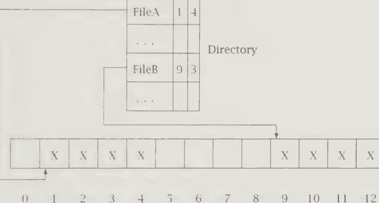

图 10.3：连续分配

例如，使用连续分配时，你知道磁盘上的块 7 总是紧跟在块 6 之后。此外，你始终可以计算出块 7 的位置——它是磁盘上文件起始处的第 7 个块。

困难在于为新文件寻找空间以及扩展文件，并且需要压缩磁盘。在处理内存管理时也遇到过类似的问题以及建议的解决方案。

如今系统使用的一种变体是不再按单个块分配磁盘空间，而是一次分配若干个连续块，这被称为“区”（extents）或“簇”（clusters）。

这种分配方法通过空闲块目录来跟踪空闲空间。通常，会同时分配或释放多个连续块。因此，空闲块不是单独跟踪的，而是作为空闲块簇。该目录将按大小顺序维护。在分配时，如最佳适应（best fit）、最坏适应（worst fit）等策略是相关的。如果磁盘没有足够大的连续区域，则必须进行压缩。

## 块链接（Block linkage）

使用这种方法，文件以链表的形式保存。目录项指向第一个块。每个块都有指向下一个块的指针。最后分配的最后一个块有一个 NULL 指针。图 10.4 说明了这一点。

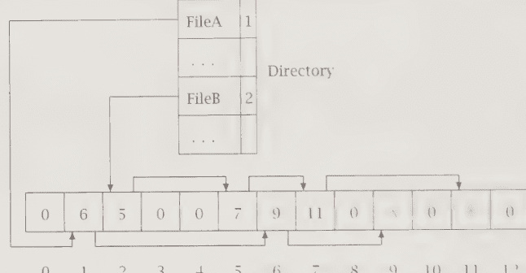

图 10.4：链接分配

目录中关于 FileA 的唯一信息是文件名，以及它从块 1 开始。该块有一个指向块 6 的指针，块 6 指向块 9，而块 9 有一个 NULL 指针，表示它是文件的最后一个块。同样可以发现 FileB 由块 2、5、7 和 11 组成。目录还可能包含一个指向最后一个块的指针，这将有助于通过向文件末尾追加块来重新链接块，以及在空闲列表上重新链接块。

这种组织形式可能适用于小文件，或适用于始终从头到尾读取的顺序文件。但对于随机文件，为了读取第 n 个块，必须先读取其之前的 n-1 个块。更严重的是，如果某个块（甚至是一个指针）丢失或损坏，那么列表的剩余部分就会丢失。不仅如此，它还可能被链接到另一个文件，甚至链接到空闲列表中。

针对这些问题已经提出了一些解决方案。双向链允许恢复某些损坏的指针。更健壮的改进是在每个块中存储文件 ID 和相对块号。这样，即使指向某个块的链接丢失，它所属的文件仍然可以被识别，以及它在该文件中的位置。

使用链接分配时，磁盘上所有的空闲块都维护成一个链表。块可以从链的任一端添加或取走。

## 10.3 磁盘组织

## 文件映射（File map）

这是对上述方法的一种改进尝试，通过将整个磁盘的所有指针集中在一个地方。维护一个整个磁盘的映射，磁盘上的每个块对应一个条目。因此，第 n 个条目代表块 n 。如果该块是空闲的，则该条目包含 0。最初在空白设备上，所有条目均为 0。当文件系统挂载时，该映射（或至少是它的部分）可以被复制到主内存中。

目录指向文件表中代表文件第一个块的位置。该条目包含指向下一个块的文件表条目的指针，或者一个 NULL 标记。图 10.5 说明了这一点。

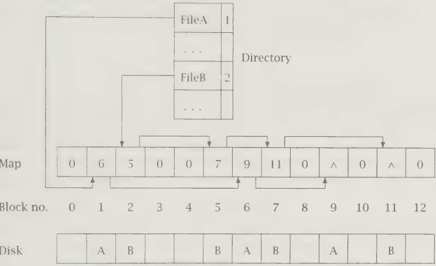

> 图 10.5：文件映射示例

目录中关于 FileA 的唯一信息是文件名，以及它存在于块 1。文件表中的此条目指向块 6，块 6 指向块 9，块 9 有一个 NULL 指针，表示它是文件的最后一个块。同样可以发现 FileB 由块 2、5、7 和 11 组成。

文件映射存在与之前方法相同的问题，因为它本质上是顺序的。但至少顺序部分是处理过的。

### 索引分配（Indexed allocation）

这是对上述方法的一种改进尝试，通过将整个磁盘的所有指针集中在一个地方。维护一个整个磁盘的映射，磁盘上的每个块对应一个条目。因此，第 n 个条目代表块 n 。如果该块是空闲的，则该条目包含 0。最初在空白设备上，所有条目均为 0。当文件系统挂载时，该映射（或至少是它的部分）可以被复制到主内存中。

目录指向文件表中代表文件第一个块的位置。该条目包含指向下一个块的文件表条目的指针，或者一个 NULL 标记。

## 普通文件

这种方法支持直接访问。此外存在少量的空间开销。

## 安全性

可以使用多种形式的分配。为了安全，可以使用索引块。

## 分配策略

处理此问题的简单方法是使用第一个块。但更复杂的方法是尽量减少磁盘移动量。通常，分配策略取决于维护空闲空间的方式。

## 10.4 一个 Ext2 分区

## Ext2 文件系统

在 Ext2 文件系统中，磁盘分区被分为若干个块组，每个块组由多个磁道组成。每个块组包含管理信息、inode 表和数据块。

构成块组的不同数据结构如图 10.6 所示，将在本节剩余部分进行讨论。

### 超块（Super block）

每个块组从一个超级块开始，超级块包含关于整个文件系统的信息。这些是不变的信息，例如分配给该文件系统的总块数，或其中有多少数据块。超级块在每个块组中都有复制，因此不会因为单个磁盘扇区的不可读而丢失。
超级块的格式为 `struct ext2_super_block`，见图 10.8，来自 `<linux/ext2_fs.h>`。


```c
struct ext2_super_block{
    u32 s_inodes_count;      /* Inode 数量 / */
    u32 s_blocks_count;      /* 块数量 / */
    u32 s_free_blocks_count;  /* 空闲块数量 / */
    u32 s_free_inodes_count;  /* 空闲 inode 数量 / */
    u32 s_first_data_block;   /* 第一个数据块 / */
    u32 s_log_block_size;    /* 块大小 / */
    u32 s_log_frag_size;      /* 碎片大小 / */
    u32 s_blocks_per_group;  /* 每组块数 / */
    u32 s_inodes_per_group;  /* 每组 inode 数 / */
    u16 s_inode_size;         /* inode 结构大小 / */
    u16 s_blocks_group_nr;   /* 此块组的编号 / */
};
```

图 10.8: Ext2 超块 (super block)

- s_log_block_size 是该文件系统中磁盘块的大小。这种块大小可能是磁盘中恢复的物理块大小的倍数。该值以对数形式存储。例如，4k 块为 $2^{12}$ 字节，因此该字段中的值值为 12。
- 出于效率考虑，Ext2 文件系统允许将块拆分为更小的单元。见第 10.4 节。s_log_frag_size 包含了此类碎片的大小。
- s_blocks_per_group 是一个块组中块的数量。
- s_inodes_per_group 是一个块组中 inode 的数量。
- s_inode_size 是磁盘 inode 结构中的字节数。

最后一个字段 s_block_group_nr 是唯一一个在每个超块副本中都不同的字段。它包含此块组的编号，该编号在整个文件系统中唯一地标识该组。

超块被填充到整个块的大小。当文件系统被挂载时，它会被复制到内存的缓冲区缓存中，并一直留在那里直到卸载。挂载文件系统将在第 10.5 节中讨论。

## 块组描述符 (Block group descriptors)

磁盘上的后续是块组描述符表。与超块一样，它在每个组中也是复制的，因此在损坏时可以恢复。该表中的每个条都是一个 `struct ext2_group_desc`，如图 10.9 所示（来自 <linux/ext2_fs.h>），描述了一个单一块组。
组描述符不包含组号；而是通过它在此表中的位置来标识组。

- bg_block_bitmap 指向跟踪该组数据块分配情况的位图起始位置。

## 一个 Ext2 分区

```c
struct ext2_group_desc{
    u32 bg_block_bitmap;      /* 块位图块 */
    u32 bg_inode_bitmap;      /* inode 位图块 */
    u32 bg_inode_table;       /* inode 表块 */
    u16 bg_free_blocks_count;  /* 空闲块数量 */
    u16 bg_free_inodes_count;  /* 空闲 inode 数量 */
    u16 bg_used_dirs_count;   /* 目录数量 */
};
```

图 10.9: 块组描述符的结构

- bg_inode_bitmap 指向该组内 inode 的类似位图。
- bg_inode_table 指向该组 inode 表的起始位置。
- 组内空闲数据块的计数维护在 bg_free_blocks_count 中。
- 同样，空闲 inode 的计数维护在 bg_inodes_count 中。
- 此块组中创建的目录数量保存在 bg_used_dirs_count 中。用于将目录尽可能均匀地分布在所有组中。

当文件系统被挂载时，整个表会被复制到内存的缓冲区缓存中，并一直持续到卸载。

## 块位图 (Block bitmap)

该字段（组描述符中的 bg_block_bitmap 指向的内容）跟踪组内已分配的数据块。位图中的每一位代表组中的一个数据块。这样做的好处是它使用了最少空间，并且可以快速找到空闲块。

位图的大小始终为一个块，因此可以确定块组的最大尺寸。位在位图中的位置对应于块在组中的位置。值为 0 表示空闲，1 表示正在使用。考虑一个块 2, 3, 4, 9, 12 为空闲的组，其他所有均已分配。块位图将是：

```
1100011111010110111 ...
```

此位图在文件系统挂载时加载到主内存。

## inode 位图 (Inode bitmap)

该字段（组描述符中的 bg_inode_bitmap 指向的内容）跟踪组内哪些 inode 是已分配的，哪些是空闲的。位图在文件系统挂载时被加载到内存的缓冲区缓存中。

## inode 表 (Inode table)

inode 存储在每个块组后续的块中。组描述符中的 bg_inode_table 字段指向第一个磁盘 inode 块。磁盘 inode 虽然与 inode 结构相似，但具有特定于文件系统类型的内部组织。它们只包含 `struct inode` 中发现的一部分信息，而 `struct inode` 必须被维护。磁盘 inode 的格式如图 10.10 所示（<linux/ext2_fs.h>）。

```c
struct ext2_inode{
    u16 i_mode;         /* 文件模式 */
    u16 i_uid;          /* 所有者 uid */
    u32 i_size;         /* 字节大小 */
    u32 i_atime;        /* 访问时间 */
    u32 i_ctime;        /* 创建时间 */
    u32 i_mtime;        /* 修改时间 */
    u16 i_gid;          /*  id */
    u16 i_links_count;  /* 链接数量 */
    u32 i_blocks;       /* 块 */
    u32 i_block[15];    /* 指向块指针 */
    u32 i_faddr;        /* 碎片地址 */
    u8 i_frag;          /* 碎片编号 */
    u8 i_fsize;         /* 碎片大小 */
};
```

图 10.10: Ext2 inode 的结构

该结构中的大部分字段未使用。前九个直接指向数据块。一旦文件变大，i_block[12] 指向一个块。这被称为单间接块。如果文件进一步增大，i_block[13] 指向双间接块。最后是三间接块，i_block[14]，允许处理大文件。

## 块指针 (Pointers to blocks)

i_block[] 字段允许处理大文件。绝大多数文件都很小，前九个直接指向数据块。一旦文件变大，i_block[12] 指向一个块。这被称为单间接块。如果文件进一步增大，i_block[13] 指向双间接块。最后是三间接块，i_block[14]，允许处理大文件。

图 10.11: inode 中的分配信息

图 10.12: 单间接块

图 10.13: 双间接块

## 碎片 (Fragments)

文件是由完整的块组成的。但为了避免不必要的浪费磁盘空间，某些数据块可以被划分为碎片，文件的末尾可以根据需要只分配碎片。然而，这些碎片必须在同一个块内。ext2_inode 的最后三个字段用于此类情况。

- i_faddr 字段指向包含该文件碎片的块。
- i_i_frag 标识该文件在块中的第一个碎片。
- i_i_fragsize 包含了在该位置可以找到的连续碎片数量。

图 10.14 显示了一种情况：FileA 拥有一个块的前三个碎片，而 FileB 拥有同一块的后续四个碎片。


## 0.4 一个 Ext2 分区

| FileA 的 inode | FileB 的 inode |
|---|---|---|
| i_faddr | | i_faddr |
| l1_i_frag | 0 | 3 l1_i_frag |
| l1_i_fsize | 3 | 4 l1_i_fsize |

图 10.14：块中两个文件的碎片

### 数据块

块组的剩余部分由数据块组成，它们既用于普通数据文件，也用于目录文件。

### Ext2 目录

Unix 将目录视为普通文件，具有特定的内部结构。因此，目录空间是从普通文件相同的数据块中分配的。Ext2 中的目录项是变长的。这使得能够实现长达 255 个字符的文件名而不会浪费空间。

每个目录项的固定部分由一个 32 位的 inode 号、一个 16 位的条目长度值和一个 16 位的名称长度值组成。随后是一个最大为 255 个字符的可变文件名。如果文件名小于 255 个字符，则以 NULL 终止。Ext2 目录项的结构如图 10.15 所示，来自 <linux/ext2_fs.h>。

```c
struct ext2_dir_entry{
	u32 inode;      /* 条目的 inode 号 *
	u16 rec_len;      /* 条目的总长度 *
	u16 name_len;    /* 名称的长度 *
	char char_name[]; /* 文件名 */
};
```

图 10.15：带有 inode 和 name_len 的 Ext2 目录项

当条目被删除时，系统仅将 inode 和 name_len 字段置为零。如果连续的条目变为空闲，系统会将它们合并，并将第一个条目中的 `rec_len` 字段设置为空闲区域的总大小。

### Ext2 中的块分配

Ext2 文件系统试图将相关信息保持在磁盘的同一部分。这就是将分区划分为块组的原因，而不是将其视为一个大分区，甚至是整个磁盘，在这种情况下，文件的块可能会分散在整个磁盘上。具体如下：

- 目录中所有文件的 inode 均分配在同一个块组中
- inode 和数据块均从同一个块组分配
- 每个新目录都创建在目录数量最少的块组中

这些策略在有大量可用空间时运行良好，当磁盘使用率超过 90% 时性能会恶化。

当需要新的磁盘块时，系统会尝试根据这些标准预分配一个理想的块。它会检查块位图（bitmap）以查看是否可用。如果不可用，它会在同一个块组的其他地方寻找空闲块。之后，它会在其他块组中搜索。

当找到空闲块时，系统尝试预分配多达 8 个连续块。然后它会更新块位图、块组描述符和超级块（super block）。如果文件没有使用所有预分配的块，任何仍未使用的块将在文件关闭时被释放。

维护目录、inode 和位图之间的一致性至关重要。应该先更新位图，然后是 inode，最后是目录。如果在期间发生崩溃，该块将被标记为已使用，或者至少 inode 和目录是一致的。否则，inode 将显示该块是文件的一部分，但位图将显示它为空闲，稍后可能会被分配给另一个文件。

在返回块时，应先更新目录，然后是 inode，最后是位图。最坏的情况是一个未分配的块在位图中被标记为已使用，且永远不会被分配。但目录和 inode 将是一致的。此类块可以通过重建磁盘（备份、格式化和还原）来收回。

## 10.5 挂载文件系统

现在我们已经检查了数据在磁盘上的布局，接下来将考虑如何让这些数据可用。

### 挂载文件系统

Unix 磁盘上数据组织的基本单元被称为文件系统。每个文件系统始终有一个根目录。它通常具有或或复杂的子目录结构，尽管这不是必须的。有时一个文件系统会占据整个磁盘，但正如我们所看到的，对于较大的磁盘，在同一物理设备的不同分区上拥有多个文件系统是常见的。中大型 Unix 机器将有很多文件系统。这些系统可能分布在多个物理磁盘上，在网络文件系统的情况下甚至存在于远程机器上。

按照惯例，在 Unix 中，这些系统不会作为独立的系统可见。它们呈现为连接成一个巨大的目录树，只有一个根。每台机器都有一个根文件系统；这是唯一根目录可见的文件系统。它可能是唯一存在的文件系统，但通常有多个不同的文件系统连接在一起，它们甚至可以是不同类型的文件系统。可以以任何顺序将它们连接在一起。

将文件系统连接到目录结构中的某点称为挂载（mounting）。这通常在启动时完成。使用 `mount()` 系统服务将文件系统挂载到名为挂载点（mount point）的目录树上。它也可以通过 `umount()` 卸载。

图 10.16 显示两个文件系统 A 和 B；图 10.17 显示两个文件系统 A 和 B。

图 10.16：两个文件系统，A 和 B

图 10.17：两个文件系统，A 和 B


用于 Ext2 文件系统的维护结构如图 10.20 所示，来自 <linux/ext2_fs_sb.h>。

```c
struct ext2_sb_info{
	struct ext2_super_block *s_es;
	struct buffer_head **s_group_desc;
	struct buffer_head *s_inode_bitmap[];
	struct buffer_head *s_block_bitmap[];
};
```

图 10.20：Ext2 文件系统的超级块（Superblock）

- s_es 指向缓冲区缓存中的超级块。我们在第 10.4 节中检查过 Ext2 超级块。
- s_group_desc 指向一个缓冲区头，它表示包含块组描述符表的缓冲区链。所有的块组描述符在挂载时都会读入内存。我们在第 10.4 节中检查过这些描述符。
- s_inode_bitmap[] 是指向包含 inode 位图的缓冲区的指针数组。
- s_block_bitmap[] 标识包含数据块位图的缓冲区。

4. 挂载目录的 inode 中的 i_sb 字段被设置为指向此 super_block。
5. 它为新挂载系统的根目录分配一个 inode，并调用 super_operations 中的 read_inode() 来填充它。它为该根条目设置了名称缓存；然后将 super_block 中的 s_root 字段指向此结构体条目，从而指向该 inode。

6. 由于其挂载的目录内容不再可见，它会清除名称缓存中任何与该目录相关的条目。

7. 最后，它返回一个指向该文件系统 super_block 的指针。图 10.21 展示了此阶段的数据结构。它还说明了目录搜索如何跨越挂载点进入其他文件系统。被挂载目录的 inode 仍在内存中，它有一个指针 i_sb 指向挂载文件系统的 struct super_block 结构。在任何其他 inode 中，该字段均为 NULL。

当搜索到达被覆盖目录的 inode 时，它通过 i_sb 字段识别出这是一个挂载点。它不会在该目录的内容中搜索。相反，它通过 i_sb 指针指向 super_block，并从新文件系统根 inode 的 s_root 指针继续搜索。

旧的目录文件仍然存在磁盘上。现在对其父目录执行 `ls` 会得到旧名称。但对目录本身执行 `ls` 会进入挂载文件系统的根——而不是原始根。

# 10.6 Ext2 文件操作


图 10.21：挂载文件系统涉及的数据结构

# Umount（卸载）

卸载文件系统的系统调用是 umount()。该函数执行以下操作：

1. 确保该文件系统中没有打开的文件。
2. 清除名称缓存中任何与该文件系统相关的条目。
3. 释放该文件系统的根 inode。
4. 通过调用 put_super() 写回超级块，并释放内存中的 struct_block 副本。
5. 将挂载目录 inode 中的 i_sb 设置为 NULL。该目录的原始内容现在再次可见。

# 10.6 Ext2 文件操作

上一节展示了如何将 Ext2 文件系统添加到目录结构中并提供给内核使用。我们现在继续查看如何操作此类系统中的文件。Ext2 文件系统提供了执行第 9.5 节中讨论的文件操作的函数。对于许多默认函数来说已经了。只有对于 Ext2 提供了特殊实现的函数，才会进行讨论。

这些函数会持续引用 inode_i_info 中的 Ext2 特有字段，如图 10.22 所示，来自 <linux/ext2_fs_i.h>，其中包含了从磁盘 inode 拷贝的数据。

```c
struct ext2_inode_info {
    u32 i_data[15];
    u32 i_faddr;
    u8 i_frag_no;
    u8 i_frag_size;
    u32 i_file_acl;
    u32 i_dir_acl;
    u32 i_block_group;
};
```

图 10.22：内存中的 Ext2 文件系统 inode 数据

- 最重要的字段是 i_data[]，它包含了文件块在磁盘上的位置。
- 接下来的三个字段标识包含该文件末尾任何碎片的块 (i_faddr)；该块内的第一个碎片 (i_frag_no) 以及碎片数量 (i_frag_size)。
- 注意 i_file_acl 和 i_dir_acl 字段，它们目前未使用，但是为了未来未来的安全增强而设计的。
- i_block_group 字段标识该 inode 所属的块组。这允许函数索引组描述符表，并在其中找到至关信息，例如该特定块组的数据块位图。

# Read（读取）

该函数接收要读取的字节数以及一个写入这些数据的用户空间位置。它使用 f_pos 字段确定文件内的绝对偏移量。虽然 Linux 使用页缓存进行读取，但它使用一种不同的机制——缓冲区缓存（buffer cache）来进行读取。如果块在缓存中，它返回缓冲区头。如果块不存在，它会分配缓冲区头并调用磁盘驱动从磁盘获取块。

例如，假设要读取 100 字节，且 f_pos 为 200。块大小为 4KB，范围为 200-299。它将偏移量转换为逻辑块号，然后将文件中的逻辑块号转换为设备上的物理块号。

当搜索到达被覆盖目录的 inode 时，它通过 i_sb 字段识别出这是一个挂载点。它不会在该目录的内容中搜索。相反，它通过 i_sb 指针指向 super_block，并从新文件系统根 inode 的 s_root 指针继续搜索。

# 10.6 Ext2 文件操作

# Write（写入）

该函数接收要写入的字节数以及一个写入这些数据的用户空间位置。它使用 f_pos 字段确定文件内的绝对偏移量。虽然 Linux 使用缓冲区缓存进行写入，但它使用一种不同的机制——页缓存（page cache）来进行写入。如果块在缓存中，它返回缓冲区头。如果块不存在，它会分配缓冲区头并调用磁盘驱动从磁盘获取块。

例如，假设要写入 100 字节，且 f_pos 为 200。块大小为 4KB，范围为 200-299。它将偏移量转换为逻辑块号，然后将文件中的逻辑块号转换为设备上的物理块号。

由于读取的数据保存在页缓存中，而写入的数据保存在缓冲区缓存中，一旦执行写入，页缓存将是不一致的。因此，此函数还会检查页缓存中是否存在该页的副本，如果有，则用更改更新它。

# Readdr（读取目录）

该函数接收一个用户空间位置，向其中写入下一个目录条目。f_pos 字段告诉它从哪里开始读取目录文件。它将偏移量转换为逻辑块号，然后将目录中的逻辑块号转换为设备上的物理块号。这配合 i_dev 字段允许它哈希到缓冲区。如果所需的块不在缓存中，它分配一个缓冲区并调用磁盘驱动从磁盘获取。无论何种情况，它会将所需的目录条目拷贝到用户空间。

# Mmap（映射）

当调用此函数时，mmap() 系统服务已经为该区域分配了 vm_area_struct。此函数仅将 vm_inode 字段设置为指向要映射文件的 inode，并设置 vm_ops 字段指向适当的操作，取决于文件是共享映射还是私有映射。


### 打开 (Open)

Ext2 没有特殊的 `open()` 函数。通用处理是由 `open()` 系统调用完成的，而 Ext2 特有的处理（例如读取磁盘 inode 以及填充 `ext2_inode_info` 字段）则由目录 inode 查找函数 `lookup()` 完成，参见第 10.7 节。

### 释放 (Release)

如果 inode 中的 `i_nlink` 字段为 0，则该函数将由 `close()` 系统服务程序调用。如果文件系统已为该文件预分配了任何磁盘块但尚未使用，则它将返回这些块并在块位图中将它们标记为空闲。

## 10.7 Ext2 inode 操作

我们在第 9.4 节中已经看到文件系统接口为每个 inode 定义了一组操作，每种文件系统类型都提供 `struct inode_operations` 结构体的实例，这是一个指向这些函数的指针数组。该数组中的每个元素都指向该函数的特定实现。

现在我们来看对于 Ext2 文件系统是如何实现这些函数中更重要的部分的。

## 创建 (Create)

此函数在目录中创建一个新的普通文件。它首先在内存中为新文件分配一个 inode。然后它找到一个空闲的磁盘 inode，在 inode 位图中将其标记为已分配并进行填充。特别地，它将 `i_mode` 设置为 `S_IFREG`。

它使用父目录的 inode 哈希映射到缓冲区缓存中，并搜索该块以找到第一个空闲条目，并将名称存其中。

最后，它将该目录项指向磁盘 inode。

## 查找 (Lookup)

`lookup()` 函数接收一个表示当前目录的 inode 指针以及路径名中的下一段。它的目的是找到或创建一个表示该路径名段的 inode，并返回指向它的指针。

它会搜索目录查找缓存，如果文件最近被打开过并存在于缓存中，则返回其 inode 的指针。如果不在，它会设置一个新的 inode，从磁盘上的 inode 拷贝信息到其中，并在返回指针之前将其链接到 inode 哈希列表以及查找缓存中。

## 链接 (Link)

此函数接收三个指针：指向表示文件的 inode 指针、表示要创建链接的目录的 inode 指针，以及链接的名称。它创建一个新的目录项（类似于 `create()`），但将其指向旧的 inode 号。它会增加文件 inode 中的 `i_nlink` 字段。

## 取消链接 (Unlink)

此函数接收一个目录 inode 指针和该目录下某个文件的名称。它在缓冲区缓存中找到目录块，并搜索找到给定名称对应的条目。它将该条目中的长度和 inode 设置为 0，如果任何相邻条目也是空闲的，它会将它们合并。然后它减小 inode 中的 `i_nlink` 字段。如果此时为 0，它会调用 `release()` 来返回任何预分配的磁盘块，并在 inode 位图中将磁盘 inode 标记为空闲。

## 符号链接 (Symlink)

这创建一个新的磁盘 inode，其 `i_mode` 字段为 `S_IFLNK`。如果完整的符号路径名少于 60 字节，它将其放在磁盘 inode 的 `i_block[]` 字段中。否则，它将路径名写入新文件。这涉及在缓冲区缓存中设置一个块，将路径名拷贝到该块，并调用磁盘器的块写函数将其复制到磁盘。然后它为新名称添加一个目录项。

## 创建目录 (Mkdir)

此函数与 `create()` 相同，但它首先检查条目是否已，然后将 `i_mode` 字段设置为 `S_IFDIR`。它还在新目录中设置两个默认条目：`.` 和 `..`。

## 删除目录 (Rmdir)

此函数接收一个表示父目录的 inode 指针和要删除的目录名称。它找到该目录的 inode 并哈希到缓冲区缓存以找到目录块。如果该目录中有任何有效条目，它将返回错误。如果目录为空，它会将父目录目录项中的 `rec_len` 设置为 0。如果前一个或后续条目也是 0，它会将它们合并。它释放由删除条目对应的缓冲区块、磁盘块以及磁盘 inode。

## 创建节点 (Mknod)

此函数与 `create()` 相同，但它首先检查条目是否存在。它根据实际情况将 `i_mode` 字段设置为 `S_IFBLK`、`S_IFCHR` 或 `S_FIFO`。

## 重命名 (Rename)

此函数可以将文件重命名到不同的目录。它接收两个目录的指针（这两个目录可能是同一个）。首先，它在缓冲区缓存中找到目录块以及对应旧名称的目录条目。如果新名称比旧名称短，则将其替换；或者如果紧随其后的条目足够大，则将其扩展到该范围内并更改 `name_len` 和 `rec_len`。如果上述两种方案均不可，它必须在目录中找到足够容纳新名称的第一个位置并在那里设置条目。在所有情况下，inode 号保持不变。

## 读取符号链接 (Readlink)

如果 inode 的 `i_mode` 字段不是 `I_FLNK`，则它返回一个错误。如果 `i_blocks` 中的值为 0，则它从 `struct ext2_inode_info` 结构中返回路径名。否则，它从符号链接文件中读取并返回路径名。

## 跟随链接 (Followlink)

此函数以与 `readlink()` 相同获取路径名。然后它打开目标文件。它返回对应此文件的 inode。

## 读取页面 (Readpage)

当页面不在缓存中时调用此函数。它接收一个表示文件的 inode 指针以及要读取的页面。它使用 `bmap()` 将文件的逻辑块映射到磁盘块。实际的传输传输由磁盘驱动程序完成，而不是文件管理器。

## 写入页面 (Writepage)

由于 Linux 使用缓冲区缓存进行写入，此函数直接映射磁盘。

## Bmap

此函数将文件的逻辑块映射到磁盘块。它接收一个 inode 指针以及 `struct ext2_inode_info` 中的 `data[]` 字段。

## 10.8 总结

- 文件管理器提供了长期存储。它允许创建、删除、读取和写入文件，并考虑保护和共享。
- 磁盘某些空间用于管理目的——这些被称为文件类型。这些这些代码在启动时加载到内核中。
- 为了组织磁盘，开发了许多方法。一种方案是将文件放在连续块中；另一种方案是通过指针将块链接在一起。对后者的改进是将所有指针汇到一个文件映射，或者将特定文件的所有指针汇到一个索引块。
- Ext2 文件系统将分区划分为若干块组，每个块组由一个或多个磁道组成。每个组包含超级块、所有组描述符的位图以及 inode 和数据块。inode 包含了关于文件的所有永久信息，特别是它在磁盘上的位置。Unix 为 inode 提供指向 12 个块的指针。如果文件更大，则使用间接块。系统尝试从同一个块组分配目录中的 inode，并从文件 inode 所在的块组分配该文件的所有块。
- Unix 磁盘的基本组织单位被称为文件系统。用户看到的是多个文件系统的无缝组合，形成一个目录树。从目录树插入或系统被称为挂载和卸载。当挂载 Ext2 文件系统时，超级块、组描述符表和位图的副本会被读取到缓冲区缓存。
- 前一节检查的高级接口为 I/O 流定义了一组标准操作，每种文件类型预计都提供其自己的实现。
- 同样，有一组标准的 inode 操作，Ext2 为这些操作提供了了自己的实现。它们主要关注目录结构的维护以及 I/O 流的信息。


# 10.9 讨论题

- 1. 有时，`read()` 请求的字节范围可能存储在磁盘上的两个（或多个）不同块中。请概述文件管理器在这种情况下采取的步骤。

- 2. 内存管理器和文件管理器之间存在相似之处。是否可以提供一个“存储管理器”来取代这两者？

- 3. 使用 `sysfs()` 系统服务来确定你正在使用的机器上安装了哪些文件系统类型。

- 4. 研究 Linux 如何在系统运行期间动态加载新的文件系统类型（“可加载模块”）。

- 5. 为什么 `read_inode()` 函数是 `super_operations` 的一部分，而不是 `inode_operations` 的部分（后者才是它所在的地方）？

- 6. 由一个操作系统格式化的磁盘可以被任何其他操作系统读取，这是一个常见问题。通用的磁盘标签（跨所有操作系统）会有帮助吗？

- 7. 调查操作系统引导的整个过程。

- 8. 在使用连续分配的系统中，一个文件包含 10 个块。请解释添加一个块涉及的内容：(a) 在开头 (b) 在中间 (c) 在结尾。

- 9. 对于块链接、文件映射和索引分配，重复第8 题。

- 10. 块链接非常容易受损坏指针的影响。你能否建议一些扩展方法，使得即使丢失了一个或多个指针，也可能重建文件？

- 11. 解释索引分配如何允许文件出现“空洞”，例如：可以记录第1条和第10000条记录，而无需为中间的记录分配空间。

- 12. 在连续分配方案中需要压缩时，有必要压缩整个磁盘吗？还是只需压缩每个磁道就足够了？是否存在时间上的差异？

- 13. `struct ext2_inode` 中没有 inode 编号的字段。每个单独的 inode 是如何标识的？

- 14. 在同一个块组中为同一目录下的所有文件分配 inode 有什么优势？

- 15. 为一个文件从与其 inode 相同的块组中分配数据块有何种优势？

- 16. 你认为通过节省文件的最后一个块来节省空间，是否值得为了跟踪碎片的时间开销？

- 17. 使用 `statfs()` 系统服务获取特定挂载文件系统的信息。

- 18. `umount()` 系统服务如何知道它正在卸载的文件系统中没有已打开的文件？

- 19. 当文件管理器计算出它所需的物理块号时，它是如何请求磁盘驱动程序读取该块的？请参考后续章节。

- 20. 开发一种算法来管理 Ext2 文件系统中目录记录的删除。你的算法应考虑在被删除记录之前和/之后合并空闲空间。

# 特殊文件 11

在 Unix 术语中，特殊文件是代表物理设备的目录项。处理此类输入或输出源的方法与文件系统中的普通文件不同，这正是本章的主题。

我们将开始考虑在内核中配置的用于处理此类设备的持久性数据结构和程序。当打开此类特殊文件时，Linux 中不会设置额外的数据结构。然后我们将查看如何执行输入和输出。

## 11.1 设备驱动程序

连接到计算机的每个物理设备都需要一个专门为其定制的程序，被称为设备驱动程序。该驱动程序对内核可用，并且必须有某种标准方式来调用它。它作为内核软件的一部分运行，并在被 I/O 程序调用时执行请求。

在第3章中，我们遇到了 Unix 哲学，即拥有极少数进程，并在用户进程的上下文中执行大部分内核代码。这些影响在处理设备驱动程序时最为明显。

当当前执行的进程想要进行 I/O 时，它执行系统服务代码，然后是 I/O 程序代码，最后是设备驱动程序代码。它在驱动程序的某处被阻塞，等待设备，并被切换出。处理器被分配给其他进程。

当设备就绪时，它会触发中断。运行在中断上下文（从当前进程中获取）的中断例程序处理设备。设备驱动程序的这部分永远不会被用户直接调用，通常与当前运行的进程没有关系。无法预测它何时运行；这取决于设备。

中断例程序还会识别出哪个进程在等待此设备，并将其从等待队列移动到运行队列。最终它的机会就会到来，它将在驱动程序中被阻塞的地方准确地唤醒。它将返回 I/O 程序，返回系统服务，并最终返回用户。图 11.1 解释了这种情况。

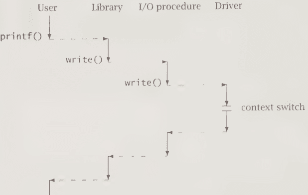

其他操作系统采取不同的方法，并为每个设备驱动程序分配一个自己的进程。这种驱动程序大部分时间处于睡眠状态。它在需要时通过某种形式进程间通信被唤醒。通过这种安排，必须找到某种方法向驱动程序进程传递数据和指令。通常，这些被封装在一个名为输入输出请求块（或 IORB）的数据结构中。

## 11.2 配置内核

在许多系统（包括传统的 Unix）中，驱动代码在编译时链接到内核中。更改或添加驱动程序意味着重新编译内核。Linux 允许在系统运行时动态加载驱动程序。

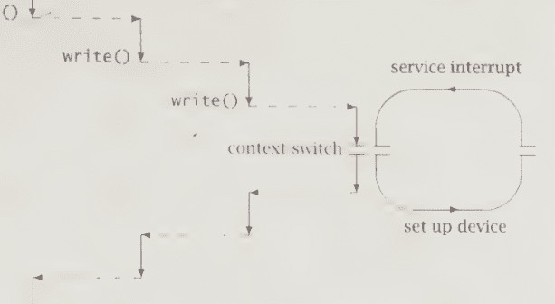


系统管理器为每个设备分配一个系统唯一的编号，称为主设备号（major number）。这是 `mknod()` 的参数之一，用于在 `/dev` 目录中创建表示该设备的特殊文件。当驱动程序向内核注册时，会使用相同的编号，内核将其作为索引在 `chrdevs[]` 或 `blkdevs[]` 数组中插入与该设备对应的 `struct device_struct` 实例。见图 11.4。

| name | struct file_operations |
|---|---|

图 11.4：字符设备切换表中的一个项

## 11.3 设备操作

在第 9 章中，我们追踪了从文件描述符通过 `struct inode` 执行 I/O 过程的实现。对于设备文件，`i_mode` 将是 `S_IFBLK` 或 `S_IFCHR`。结构体中的 `f_op` 字段用于访问该设备的特定驱动程序函数。

这些函数通常由硬件工程师编写，他们熟悉硬件复杂的各种。在这里，我们将查看 `inode` 的这些函数字段是如何实现的。

特殊文件的 `inode` 的 `i_op` 字段也指向一个函数数组。但这些是存储设备名称的文件文件系统的标准函数；它们并不特定于某个设备。

### Lseek

某些设备允许用户指定下一次输入或输出发生的位置。这最好的例子就是磁带驱动。对于此类设备，该函数会调整 `struct file` 中的 `f_pos` 字段。物理设备上实际上不会执行任何操作。如果设备是不可寻的，则该函数仅返回一个错误。

### Read

`read()` 函数由 `read()` I/O 过程调用。对于字符设备或块设备，它的实现方式有所不同。

### 字符设备的读取

首先我们查看字符设备的实现，或者当 `i_mode` 字段为 `S_IFCHR` 时的情况。设备驱动程序接收指向 `inode`、`struct file` 以及要读取数据的内存位置的指针，并将要读取的字节数作为计数。

`read()` 的算法见图 11.5。以下注释提到了该算法。

```
IF device busy THEN
  Sleep
ENDIF
Set up the I/O operation
  Sleep
IF error THEN
  return value = errornumber
ELSE
  Transfer data to destination
  return value = success
ENDIF
Return (return value)
```

图 11.5：从字符设备读取的算法

- 1. 通常一个设备一次只能执行一个操作。因此，必须有一种安排设备互斥的方法。这可以是一个信号量。无论使用何种机制，它必须确保当设备正在为一个进程工作时，任何其他调用它的进程都会被阻塞。
- 2. 设置操作涉及向特定设备的控制寄存器写入数据。
- 3. 如果有其他等待请求，驱动必须等待，因为设备一次只能做一件事。所以调用进程会被睡眠。当设备完成并产生硬件中断时，中断处理程序将找到等待的进程并将其标记为可运行。当它最终运行时，它将执行下一条指令。另一种可能性是将驱动程序的第二部分注册为该设备生成的特定中断的处理程序。
- 4. 错误测试涉及检查设备的状态寄存器。如果发生错误，则返回与条件相关的错误号。
- 5. 如果没有错误，则从设备的数据寄存器读取数据到调用者指定的缓冲区。

### 块设备的读取

块设备的设备驱动程序提供了 `read()` 函数的另一种实现。它将请求的参数构建到 `struct request` 中，包含所需的所有信息：见图 11.6，`<linux/blkdev.h>`

```
struct request{
    kdev_t      rq_dev;      /* device identifier */
    int         cmd;         /* READ or WRITE */
    unsigned long sector;      /* start sector */
    unsigned long nr_sectors; /* number of sectors */
    char        *buffer;     /* buffer address */
    struct request *next;      /* next IORB */
};
```

图 11.6：块设备的请求块

- 设备号在 `rq_dev` 中。
- 指示读或写的标志位设置在 `cmd` 中。
- 设备上的起始块号在 `sector` 中，要传输的块数在 `nr_sectors` 中。
- 内存中存储数据的位置由 `buffer` 指向。
- 由于块设备倾向于共享，任何时刻都可能有来自不同进程的多个请求在等待中。

读取和写入块设备都由同一个例程执行，被称为策略例程（strategy routine）。这是异步的；它将请求放入队列并返回。通常，I/O 过程在此阶段让调用进程进入睡眠；当操作完成后，由中断处理程序将其唤醒。

策略例程的算法见图 11.7。

```
Put struct request on device queue
IF device idle, THEN
    Select struct request from queue
    IF (cmd == WRITE) THEN
        Transfer data from user space to device memory
    ENDIF
    Set up the device for specified operation
ENDIF
Return (return value)
```

图 11.7：策略例程的算法

- 1. 由于有多个进程，队列必须由互斥锁（mutex）保护。
- 2. 设置操作涉及向特定设备的控制寄存器写入数据。
- 3. 如果有其他挂起的请求，驱动必须等待，设备一次只能做一件事。所以调用进程会被睡眠。当设备完成并产生硬件中断时，中断处理程序将找到等待的进程并将其标记为可运行。当它最终运行时，它将执行下一条指令。
- 4. 错误测试涉及检查设备的状态寄存器。如果发生错误，则返回与条件相关的错误号。
- 5. 如果没有错误，则从设备的数据寄存器读取数据到调用者指定的缓冲区。

```
Check for error
IF (cmd == READ) THEN
    Transfer data from device memory to user space
ENDIF
Move process from wait queue
IF request not empty THEN
    Select struct request from queue
    IF (cmd == WRITE) THEN
        Transfer data from user space to device memory
    ENDIF
    Set up the device for specified operation
ENDIF
ENDIF
```

图 11.8：中断处理程序的算法

- 1. 错误测试涉及设备的状态寄存器。
- 2. 如果请求中的 `cmd` 字段指定操作为读取，则数据从设备内存移动到用户空间。
- 3. 如果队列中还有请求，将在中断上下开始下一个操作。

### Write

块设备的 `read()` 由我们见过的策略例程处理。在这里我们将考虑写入字符设备的驱动函数。

当 `i_mode` 字段为 `S_IFCHR` 时，该函数由 `write()` I/O 过程调用。它接收与 `read()` 相同的参数set。`write()` 的算法见图 11.9。它与字符读取算法类似，第 11.3 节中的注释也适用。

```
IF device busy THEN
  Sleep
ENDIF
Transfer data from user buffer to device memory
Set up the device for writing
Sleep
IF error THEN
  return value = errornumber
ELSE
  return value = success
ENDIF
Return (return value)
```

图 11.9：写入字符设备的算法

### Readdir

此函数对于设备没有意义。因此，在 `struct file_operations` 的对应项中为 `NULL` 指针。

### Poll

我们在第 9.8 节中见过 `poll()` 系统调用的高级实现。这个设备特定的函数被调用以查询设备，并检查它是否准备好读写。因此它只读取状态寄存器。如果设备就绪，则返回 1。否则返回 0。

### ioctl

每个设备都有自己的特性，因此有了这个通用函数。它用于执行未被标准文件操作涵盖的驱动函数。例如设置通信链路的波特率，或在磁盘或磁带上写入标签。

### Mmap

某些设备在其接口卡上安装了大量的物理内存。`mmap()` 系统服务可将此设备映射到进程的地址空间。此类设备的驱动程序提供此低级函数。它设置适当的内存管理


## 11.4 流 (STREAMS)

结构，例如 `vm_area_struct` 和页表项。它将这些结构指向设备上的物理内存。假设专门为此设备编写的函数会知道物理内存的位置。实际上，它为这段物理内存提供了一个虚拟地址，进程可以通过它进行读写。

### 打开 (Open)

当进程对设备文件调用 `open()` 系统服务时，它会执行大多数与打开普通文件相关的操作。对于磁盘上的文件名，VFS 会查找 `inode`、`struct file` 和文件描述符。

它使用来自 `i_rdev` 字段的设备号来索引到其他 `chrdev[]` 或 `blkdevs[]`。这会产生一个指向该特定设备 `file_operations` 的指针。它将其放入 `struct file` 的 `f_ops` 字段中，使得后续操作可以访问驱动程序函数。然后它调用设备的 `open()` 函数。

虽然此 `open()` 函数执行的处理显然是特定于设备的，但它必须检查设备是否已上电并在线，即它正在响应命令。然后它会将设备重置为已知状态。例如，打印机驱动程序可能会发送弹出或进纸命令，并将打印头移动到极左位置。这保证了打印将从页面的左上角开始。

### 释放 (Release)

通常 `release()` 函数所做的只是重置设备，并可能将其下线。如果输出正在缓冲区中，那么它将刷新缓冲区。它可能会刷新任何等待请求的队列。

## 11.4 流 (STREAMS)

上述的设备驱动程序机制存在问题。每个驱动程序中都有大量的与设备无关的处理。驱动程序之间共享代码的支持很少，且许多功能是重复的。特别是对于字符 I/O，在字节流中没有边界识别，也没有对控制或优先级信息的识别。这种机制对于终端和磁盘驱动器来说仅仅足够，在这些情况下，假设数据在设备和用户之间传输是不不变的。预想的最多是从一个字符到另一个字符的转换。

当网络设备被添加到计算机时，缺点开始显现。网络软件以分层结构的形式开发；每一层都完成一些处理。这至少涉及在输入时读取、解释并剥离头部和尾部，并在输出时创建头部和尾部。传统的机制无法胜任。

### 概述 (Overview)

需要的是更复杂的驱动程序，这种驱动程序可以由软件模块层构建。每个模块接收来自上一个模块的输出数据，进行处理并传递给下一个。每个模块也会接收来自下一个模块的输入数据，进行处理并传递给上一个。底部的模块是设备的原始驱动程序，而顶部的模块提供标准文件接口。

STREAMS 机制是作为一种通用架构开发的，在某一端的流头（stream head）和另一端的设备接口之间提供全双工通信路径。

传统的 `open()`、`read()`、`write()`、`close()` 用户接口以及高级处理保持不变——改变的是驱动程序的实现。STREAMS 设备对应用程序是一个特殊文件。它被识别为 `S_TCHOFR`——没有特殊的 `IFSTREAM`。

图 11.10 给出了流的概述。

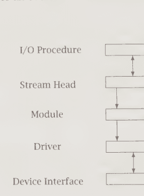

图 11.10：STREAMS 实现的基本视图。

模块（module）是 STREAMS 实现的基本组件。每个模块都为其提供的数据提供某些特定的处理。流中的模块并不是作为独立的进程或线程实现的。模块的代码在调用进程的上下文中执行。如果任何操作无法立即执行，数据将存放在队列中，并在稍后的阶段进行处理。因此，原始系统调用总是立即返回，而不会阻塞。

STREAMS 不必像内核的其他部分那样静态构建。可以根据需要向流中插入额外的模块，或从流中移除模块。这种模块间接口的标准化是必要的，因为你永远无法预先知道模块最终会出现在哪里。STREAMS 机制在 Linux 中尚未实现。

### 打开流 (Opening a stream)

流通常分两步构建。第一步仅创建流头，第二步添加模块以产生扩展的流。如果驱动程序执行了所有需要的处理，则不需要模块。

当进程打开 STREAMS 设备时，内核从目录项中识别出这是一个字符特殊文件。在用户的文件描述符表中分配一个条目并创建一个 `struct file`。分配并初始化一个 `inode` 来表示一个字符特殊类型的文件。当调用设备特定的 `open()` 函数时，会分配标准的流头结构。

然后为流头分配一对队列。每个模块、头或驱动程序都会分配两个队列结构，用于持有它们在向上或向下传递过程中的消息。在此阶段还会为驱动程序分配一对队列，并与头的队列相链。图 11.11 显示了表示最小流的结构是如何连接在一起的。它还显示了一些在流头队列上等待的消息。

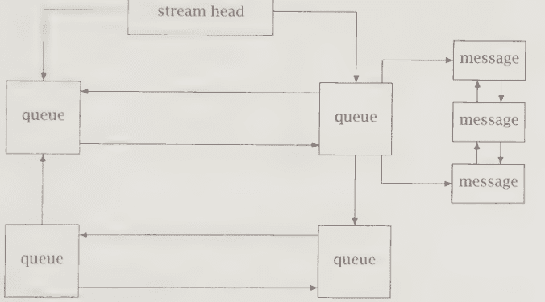

图 11.11：构成最小流的数据结构

与 Unix 一样，进程可以共享流。`fork()` 将共享文件描述符。

### 添加和移除模块 (Adding and removing modules)

可以使用 `ioctl() I_PUSH` 将模块添加到流中；它们插入到流头下方。`ioctl() I_POP` 调用移除下方模块。

### 流复用 (Multiplexing streams)

到目前流被描述为模块的线性连接，每个模块连接到一个上游模块和一个下游模块。虽然这种配置适用于大多数应用程序，但某些应用需要对流进行复用，包括向上和向下。这可以通过 `ioctl() I_LINK` 完成。有三种类型：

- 多对一复用器，见图 11.12，将多个上游流的数据复用到单个下游流。终端窗口可能以这种方式实现，每个上游流关联到一个独立的窗口。


图 11.12：多对一复用器

- 一对多复用器将单个上游流的数据路由到多个下游流：见图 11.13。网络协议可以像这样实现，每个下游流将协议连接到不同的网络。


图 11.13：一对多复用器

- 多对多复用器将多个上游流中的某一个数据路由到多个下游流中的某一个，如图 11.14 所示。


图 11.14：多对多复用器

图 11.15 显示了一个真实的示例。图中的 IP 模块是上游复用器的例子，因为它上方有多个流。它也是一个下游复用器，因为它下方有多个驱动程序，它可以将数据发送到令牌环驱动程序或以太网驱动程序。

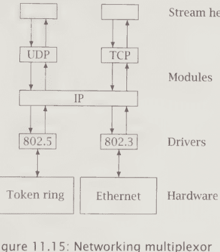

### 处理消息 (Processing messages)

在 STREAMS 中，所有输入输出数据封装成消息，由一个或多个消息块组成。模块之间实际传递的是消息的指针。因此，数据在流向上或向下移动时，只需要极少拷贝。

应用程序的请求通过当前设备的 `struct file_operations` 路由到流头。这可能会立即完成请求，例如当头部有可用数据时发生的请求。否则，它会创建一个消息块并将其放入下一个模块的队列中。


向下，并调用其处理例程。这会处理消息并将其移动到下一个队列。最终会调用驱动。这一切都在调用进程的上下文中完成。当驱动向设备发送请求后，控制权返回流头（stream head），流头可能会让调用进程睡眠以等待回复。

当发生中断时，会调用驱动处理例程。这通过将消息链接到其队列并将其传递给上一个模块，并将控制权传递给它。最终会调用流头，它可能会唤醒一个之前为输入进行过系统调用的等待中进程。这一切都在中断上下文（interrupt context）中完成。流头将传入的消息翻译成适合返回给进程的格式。

## 系统服务（System services）

`read()` 和 `write()` 系统调用只处理字节序列，没有消息或边界的概念。由于 STREAMS 区分消息，因此如果用户想要利用这一特性，不需要特殊的系统服务。

`putmsg()` 系统调用允许用户创建消息并将其向下发送。用户在两个独立的缓冲区中提供消息控制部分和数据部分的内容。有一个特殊的版本 `putmsg()`，用于向流发送优先级数据。

`getmsg()` 系统调用用于从流头读队列处检索消息内容，并将其放入两个用户指定的缓冲区（一个用于控制信息，一个用于数据）。有一个相应的 `getmsg()` 用于从流接收优先级数据。

`ioctl()` 函数用于对流执行各种控制功能。实际上有 29 个与 STREAMS 相关的不同 `ioctl()` 请求，每个请求都封装成一条消息并向下发送。

## 关闭流（Closing a stream）

当与流关联的最后一个进程发出 `close()` 系统调用时，流会被关闭。拆卸包括弹出流上的任何模块并关闭驱动。最后，用户的文件描述符表项、`struct file` 结构体和索引节点（inode）会被释放内存。

## 11.5 终端 I/O（Terminal I/O）

终端与我们目前为止所考虑的有所不同。例如，向屏幕或打印机输出的请求，或从磁盘驱动器输入的请求，都源于运行中的进程。但在终端情况下，输入源自设备。

终端中断不是对上方请求的响应，它完全独立于运行中的进程。此类数据必须由操作系统处理并存储，直到被进程请求为止。

### 处理（Processing）

操作系统对键盘上输入的字符可以执行两种常见的处理层次。第一种是规范模式（canonical mode）、熟制模式（cooked mode）或逐行模式。字符被缓存，直到输入一整行（通常由 `RETURN` 或 `ENTER` 键表示）。在此期间进程处于睡眠状态，为用户提供了在传递给程序之前编辑该行的机会。这种规范处理是在“终端行规律”（terminal line discipline）模块中完成的。

第二层处理是非规范模式（non-canonical）、原始模式（raw）或逐字符模式。每个字符在输入时都会被传递给进程。操作系统不会尝试解释任何特殊字符，例如退格键或方向键。例如，编辑器就需要这些。

虽然这是两个极端，但之间也存在大量的组合。POSIX 引入了 `struct termios` 结构体，它封装了可以更改的所有终端 I/O 特性：图 11.16，来自 `<asm/termios.h>`。每个字段都是一个位图，每个控制终端行规律的一个方面。例如，取决于 `termios` 的设置或非规范处理。

```
struct termios {
    tcflag_t c_iflag;
    tcflag_t c_oflag;
    tcflag_t c_cflag;
    tcflag_t c_lflag;
    cc_t     c_cc[];
};
```

图 11.16：控制终端特性的数据结构

- c_iflag 位定义了从终端输入时对字符可以进行的处理。
- c_oflag 位定义了向终端输出时对字符可以进行的处理。
- c_cflag 定义了控制特性，如波特率、停止位和校验位。
- c_lflag 指定了如何解释字符，例如它们是否本地回显。
- c_cc 允许对某些控制字符进行重新定义。

此外，有一系列系统调用，例如 `tcgetattr()`（从 `termios` 读取值）和 `tcsetattr()`（在 `termios` 中设置新值），并最终控制行规律的操作。其他的还包括 `tcdrain()` 和 `tcflush()`。

`isatty()` 库函数用于定义指向终端设备的文件描述符。`ttyname()` 函数返回一个指向代表终端设备的文件路径的指针。

## 伪终端（Pseudo terminals）

如今的常见做法是用户通过网络登录，而不是通过直接连接的终端。这种安排被称为伪终端（pseudo terminal）。它内置在提供网络登录的服务器中。

伪终端分为两个部分：从端（slave）和主端（master）。它们在 `/dev` 目录下都有自己的条目。主端是 `/dev/ptyp0`；对应的从端是 `/dev/ptyp0`。但它们的构建方式使得任何写入主端的内容将作为从端的输入；任何写入从端的内容将作为输入传递给主端。


## 11.7 讨论题

- 1. 讨论将每个设备驱动程序作为独立的内核进程实现，与在调用进程的上下运行驱动程序相比，其优缺点是什么？
- 2. 将设备驱动实现为独立的模块，与将其编译进内核相比，有什么优势？
- 3. 为什么设备驱动函数被实现为对 `struct file` 的操作，而不是对 `inode` 操作？
- 4. 中断路由（interrupt route）如何识别等待特定设备的进程？
- 5. 研究某些为请求队列排序而开发的算法，以及 `ioctl()` 系统服务的一些用途。
- 6. STREAMS 为 I/O 系统的设计引入了简单清晰度，但也增加了所需的处理量。讨论它们之间的权衡。
- 7. 模块始终插入在流头（stream head）正下方，并从那里移除。你如何移除一个嵌套在流极深处的模块？
- 8. 研究你如何使用 `tcsetattr()` 函数来禁用字符回显到屏幕。
- 9. 默认情况下，CTRL-S 允许用户停止输出到屏幕，CTRL-Q 重新开始。找到 `termios` 结构中控制此项的相应位。检查该位是否已设置。编写一个程序来关闭此功能。
- 10. 使用 `tcsetattr()` 允许任何键重启挂挂的输出，而不仅仅是 CTRL-Q。
- 11. 清除 `ICANON` 位以关闭规范化处理。这使得输入的基本单位变为单个字符，而不是逻辑行。
- 12. 在由于问题 11.12 中关闭了 `ICANON` 位的情况下，研究如何为终端驱动程序在从终端调用 `read` 之前必须接收的最小字符数设置值。
- 13. 在问题 11.12 中关闭了 `ICANON` 位的情况下，研究如何为从终端的读取设置超时时间。
- 14. 使用主从伪终端（master/slave pair of pseudo terminals）实现两个进程之间的数据传递。

# IPC 文件 12

在 Unix 中，某些进程间通信机制被集成到 I/O 子系统中。这些是管道（pipes）和套接字（sockets）。与之前检查的 I/O 类型一样，它们被分配了一个文件描述符、一个 `struct file`，在某些情况下还有一个目录条目和一个 `inode`，并使用标准的 I/O 过程访问。但它们不使用标准的 `open()` 函数；而是通过特殊系统服务 `pipe()` 和 `socket()` 创建。

## 12.1 Unix 管道

管道是 Unix 中开发的第一种进程间通信机制。本质上它只通过 `pipe()` 系统调用创建，该调用返回一个包含两个文件描述符的数组：一个用于写端，另一个用于读端。此类管道不使用 `open()` 系统服务。只要这些描述符中的一个仍然存在，管道就存在。数据使用标准的 `write()` 函数放入管道，并使用标准的 `read()` 函数移除，就像普通文件一样。管道中的数据没有结构，它只是一个字节流。一个进程写入的地方和下一个进程读取的地方没有区别。

管道机制确实为数据传输增加了同步性。在满的管道上执行 `write()` 的进程会被系统阻塞，直到其他进程移除足够的数据。在空管道上执行 `read()` 的进程将被阻塞，直到其他进程放入数据。管道缓冲区的大小取决于系统；它被定义为 `PIPE_BUF`。Linux 下的 `pathconf()` 系统服务将返回这个 4kB 的值。

## 使用管道编程

当一个进程创建一个管道时，输入端和输出端都在同一个进程中。这种情况如图 12.1 左侧所示，并不真的非常有用。下一步通常是 `fork()` 出一个子进程。管道被子进程继承，因此现在我们在两个进程中都拥有管道的读端和写端。这种情况如图 12.1 中间所示。

### 图 12.1：为进程间通信设置管道

子进程可以读取父进程写入的内容，父进程也可以读取子进程写入的内容。但由于管道中没有结构，每个进程都可能获取回自己的消息。协作进程可以发明自己的协议来防止这种情况——但这必须由程序员完成，而不是由管道机制提供。

常见的做法是父进程在 `fork()` 之后关闭管道的一端，子进程关闭另一端。例如，如果父进程关闭读端，子进程关闭写端，那么我们就有了一个从父进程到子进程的管道。这种情况如图 12.1 右侧所示。对于双向通信，我们使用第二个管道。

当没有进一步的文件描述符指向管道的读端时，就无法向另一端写入。但从写端关闭的管道中读取是可能的，只要管道中仍有数据。

### 实现

`pipe()` 系统设置了两个文件描述符，每个都有自己的 `struct file`，一个打开用于读取，另一个用于写入。它们指向同一个 `inode`。没有目录条目，也没有磁盘上的 `inode`。`inode` 在 `u` 区域包含一个 `struct pipe_inode_info`，如图 12.2 所示，来自 `<linux/pipe_fs.h>`。

```
struct pipe_inode_info{
    struct wait_queue /* for blocked threads */
    char *base /* buffer */
    unsigned int start /* next byte to read */
    unsigned int readers /* number of readers */
    unsigned int writers /* number of writers */
};
```
## 图 12.2：表示管道的数据结构

wait 字段引导一个 `wait_queue` 链表，每个节点代表一个等待访问管道的睡眠进程，用于读取或写入。数据存储在页大小缓冲区中。`base` 字段指向它。`start` 是一个循环指针，始终指向下一个字节。`readers` 和 `writers` 字段跟踪分别打开读取或写入的进程数量。缓冲区中的字节数包含在 `inode` 的 `i_size` 字段中。宏 `PIPE_LEN` 返回此大小。因此，新的写入始终从 `(start + PIPE_LEN(inode)) MOD PIPE_BUF` 开始。

## 命名管道

管道可以被子进程及其孙继承。但始终存在通信进程必须具有共同祖先的。为了克服这一限制，开发了命名管道（或 FIFO）。这种机制对于服务器进程是关重要的，因为无法从客户端和服务器之间建立共同祖先，但任何客户端进程都必须与服务器通信。

基本问题是，完全独立的进程如何关联同一个管道？解决方案是允许管道具有唯一名称。这样当两个程序使用相同的管道名称时，它们就会通过该管道通信。由于已经有了存储文件名的机制（目录结构），决定也使用它来存储管道名称。虽然它们的名称是文件系统的一部分，但传递的数据存储在系统内存中。

磁盘仅维护 FIFO 的名称；数据仍然缓冲在内存中，因为它们以与其他 I/O 通道相同的方式打开，使用 `open()` 系统调用，而不是 `pipe()`。任何具有相应权限的进程都可以打开、读取、写入 FIFO。进程甚至不需要同时运行。


一个用于读取，另一个用于写入。每个打开的操作都会返回一个文件描述符，拥有自己的 `struct file`；但由于它们使用相同的名称，因此只有一个 inode。

# 管道的评估

- 由于通过管道传输的数据在内存中进行缓冲，管道的最大尺寸通常保持在较小范围内。因此，它们在不太可能积压大量消息消息的情况下最有用。
- 对于传递的数据，没有系统层面的结构化支持。消息之间的任何边界都必须由程序员实现。
- 传统上，无法测试管道是否为空（或满）。因此，进程始终面临着在 `read()` 或 `write()` 上阻塞的风险。我们已经见过 `select()` 和 `poll()` 系统服务，它们允许进程测试包括管道在内的多个 I/O 流的状态。
- 管道不能用于广播通信。第一个从管道读取的进程会移除这些数据；其他进程将无法获取。

# ## 12.2 套接字机制

4.2 BSD 的设计者旨在为运行在 Unix 下、位于同一台机器或不同机器上的任何程序提供一个标准的通信接口。他们提出的抽象概念被称为套接字（socket）。

# ## 引言

套接字是 Unix 文件访问机制的扩展。与管道一样，它们被分配文件描述符，并且可以使用传统的 `read()` 和 `write()` 系统调用。

套接字机制的实现极其复杂。这是因为它被设计用于在任何机器上的进程之间进行通信，并使用各种网络系统。虽然在本章中我们只关注同一台 Linux 机器上两个进程之间的套接字通信，但我们无法完全避免这种复杂性。随后的章节将介绍不同机器之间的套接字通信。

套接字实现为分层结构并不意外，顶层是通用的，将套接字视为一种进程间通信通道。因此，可以对通信进程是在同一台机器上还是不同机器上进行抽象。

如果通信是通过网络进行的，套接字层则抽象了底层层可能使用的各种网络协议之间的差异。

# ## 12.2 套接字机制

我们已经看到，虚拟文件系统通过定义一组标准函数，将设备无关的上层与设备特定的驱动程序连接起来。任何特定的文件系统或针对特定设备的驱动程序，都提供这些函数的自己的实现。套接字机制在通用的 Unix 上层与特定协议层之间也涉及类似的标准接口。

协议是一组规则和数据格式，用于规范通信连接两端之间的信息传输。例如，我们已经见过 POSIX 消息队列。为了实现网络通信已经开发了许多不同的协议，而套接字机制本身必须处理所有这些协议。例如，我们在本章中检查的 Unix 域协议是一种进程间通信的形式，它使用了套接字接口。我们将在后面的章节中检查 Internet 域协议。

从我们的角度来看，通信协议最重要的属性是它如何识别通信端点。特定进程中的特定套接字在整个系统中是如何唯一标识的？这就是套接字的寻址问题。所有使用相同地址形式的套接字被认为属于特定的地址族（address family）。

许多可能的地址格式由 `<linux/socket.h>` 中的预定义常量表示（见图 12.4）。在本章中我们唯一关心的是 AF_UNIX，即 Unix 域。

```
#define AF_UNSPEC 0 /* 未指定 */
#define AF_UNIX 1 /* Unix 域套接字 */
#define AF_INET 2 /* IP 协议 */
#define AF_IPX 4 /* Novell IPX */
#define AF_APPLETALK 5 /* Appletalk */
```

图 12.4：支持的地址族

# ## 设置内核

在启动时，某些地址域和协议被配置到内核中。每个域由一个 `net_proto_family` 结构描述，如图 12.5 所示，来自 `<linux/net.h>`。

```
struct net_proto_family{
  int family;
  int (*create)();

};
```

图 12.5：表示协议族的数据结构

- `family` 字段通过其字面常量（如 AF_UNIX）识别协议族。
- `create` 字段是一个指向函数的指针，该函数为该特定族定制一个新的套接字。

每个域都有这样一个结构。系统维护了一个指向这些结构的指针的数组 `net_families[]`（在 `net/socket.c` 中声明），每个域占有一个条目。见图 12.6。

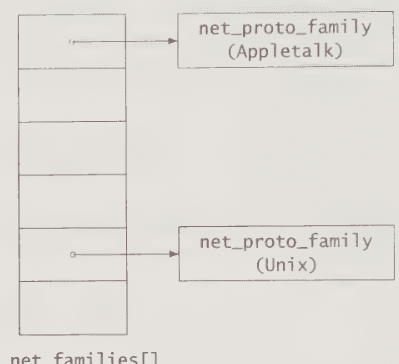

图 12.6：内核中注册的域

# ## 12.3 使用套接字的进程间通信

我们现在将介绍套接字机制为程序员提供的接口，以及顶层、域无关的处理。

我们将讨论分为三个阶段。首先，我们将考虑涉及的处理以及在创建套接字时设置的数据结构。接下来，我们将如何将一个套接字连接到另一个套接字。最后，我们将考虑数据如何双向地从一个套接字传递到另一个。

## 创建套接字

进程通过 `socket()` 系统调用创建套接字。创建什么种的套接字是由参数传递的值决定的。

第一个参数决定了特定套接字所属的地址族。这将是图 12.4 中的选项之一。

即使在特定的地址族或域内，也有不同的方式来规范通信。这由第二个参数决定。不同的域可能提供各种选项，但所有域都提供了两种类型：

`SOCK_STREAM` 在两个套接字之间建立持久的、双向的连接。然而它不识别边界，即数据被视为连续字节流。这有时被比作电话之间的连接。

`SOCK_DGRAM` 提供无连接通信，或数据报；记录边界被保留。这有时被比作邮政服务。

第三个参数指定了与套接字使用的协议。目前，每个地址族或域内的每种类型只有一种协议。通过将此参数设置为 0 或 `PF_UNSPEC`，则选择默认协议。

当应用程序调用 `socket()` 时，内核使用第一个参数索引 `net_proto_family` 结构数组 `net_families[]`，以找到与调用者指定的参数对应的项。如果域未配置，它将返回错误。

操作系统现在分配数据结构来存储内核表示套接字所需的信息。首先分配一个 inode。`i_mode` 字段被设置为 `S_IFSOCK`。该 inode 在 `u` 区域包含一个结构。图 12.7 显示了该结构，来自 `<linux/net.h>`。它包含或指向与链路关联的所有信息。

```
struct socket{
    socket_state        /* 连接当前状态 */
    struct proto_ops    *ops;        /* 域特定函数 */
    struct sock         *data;       /* 域特定数据 */
    struct wait_queue  **wait;     /* 等待进程 */
    short               type;       /* SOCK_STREAM, 等 */
};
```

> 图 12.7：表示套接字的数据结构

- `state` 字段将具有图 12.8 中的一个值，同样来自 `<linux/net.h>`。初始它处于 `SS_UNCONNECTED` 状态。
- `ops` 字段指向一组实现特定域内操作的函数。见图 12.9，再次来自 `<linux/net.h>`。
大多数这些操作都是由同名的系统服务启动的。这是域无关套接字层与域特定底层之间的接口。Unix 域的这些函数的实现将在 12.4 节中考虑，Internet 域的将在第 14 章考虑。


```c
typedef enum {
    SS_FREE,         /* 未分配 */
    SS_UNCONNECTED, /* 未连接到任何套接 */
    SS_CONNECTING, /* 正在连接中 */
    SS_CONNECTED,  /* 已连接到套接 */
    SS_DISCONNECTING /* 正在断开连接 */
} socket_state;
```

图 12.8: 套接的状态值

```c
struct proto_ops{
    int family;
    int (*bind)();
    int (*connect)();
    int (*socketpair)();
    int (*accept)();
    int (*listen)();
    int (*shutdown)();
    int (*setsockopt)();
    int (*getsockopt)();
    int (*sendmsg)();
    int (*recvmsg)();
};
```

图 12.9: 表示协议的数据结构

- data 字段指向一个特定域控制块，即 `struct sock`，它包含关于该特定套接连接状态的信息。当我们查看特定域的处理时，将详细考虑该结构。
- wait 字段指向一个在该套接上休眠的进程列表头部，这些进程正在等待数据可用。
- type 字段由 `socket()` 调用的第二个参数填充。

在此阶段，调用了 `net_proto_family` 中的 `create()` 函数。这执行了协议特定的处理，例如根据特定族的要求设置该 `struct`。它将套接的 `ops` 字段指向适当的 `proto_ops` 结构，该结构包含一个特定该套接字所属通信域的函数数组。

当此 `create()` 函数返回时，系统会设置一个文件描述符和一个 `struct file`。该 `struct file` 中的 `f_op` 字段指向一组特定于套接字的文件操作。在此阶段分配的数据结构如图 12.10 所示。

## 12.3 使用套接字进行进程间通信

文件描述符表

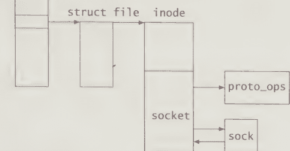

图 12.10: 分配套接字的数据结构

## 连接两个套接字

现在我们已经设置了一个套接字，下一步是将其与另一个套接字连接。这可以通过被动或主动的方式完成。一个进程可以等待另一个进程的联系，也可以采取主动。

在本节中，我们将遵循为套接字分配地址的步骤，然后查看套接字如何被动连接、被联系，它是如何主动连接到另一个套接字的，最后查看套接字如何关闭并从系统中移除。

## 绑定

每个套接字在特定机器内必须被唯一标识。这个唯一标识被称为它的地址。因此，两个套接字之间的连接由源地址和目的地址完全指定。

将特定地址与特定套接字连接的系统服务是 `bind()`。它接收一个指向 `struct sockaddr` 的指针，见图 12.11。每个独立域都有自己的地址格式，映射到这个通用格式上。

```c
struct sockaddr{
    sa_family_t sa_family; /* 地址族，AF_XXX */
    char sa_data[];        /* 协议地址 */
};
```

图 12.11: 套接字的通用格式

实际系统服务很少或不做工作，它只是调用特定域中的 `bind()` 函数。绑定到套接字的地址可以使用 `getockname()` 系统服务找到。

## 接受连接

让我们先看看被动的情况。这在服务器进程中很典型，即我们创建一个套接字，向其绑定一个地址，并等待客户端联系它们。套接字机制的一个非常重要的特性是，当来自客户端的连接请求时，会创建一个新的套接字来处理它；原始套接字继续在原始地址上监听后续请求。

进程可以通过 `listen()` 调用指定在某个套接字上接受的连接。这仅适用于流式套接字（stream socket），并且它必须已绑定，并处于 `SS_UNCONNECTED` 状态。当 `listen()` 成功返回时，套接字开始接受连接请求。

服务器进程反复调用 `accept()`。如果没有其他进程发起连接，它将休眠，直到某些进程请求连接。

如果有等待被接受的连接，将通过排在等待接受的套接字上的消息来指示。此消息将标识请求连接的套接字。队列中可能有多个消息；`accept()` 每次被调用时都会获取第一个。

高层通用代码创建一个新的 `inode`，包含一个 `struct socket`，将其状态设置为 `SS_CONNECTING`，将其类型设置为 `SOCK_STREAM`，然后定义特定域的代码，即 `proto_ops` 中的 `accept()`。

当特定域的 `accept()` 返回时，高层代码将状态字段改为 `SS_CONNECTED`，并为调用者设置一个 `struct file` 和一个文件描述符文件描述符，调用者现在可以使用它通过刚刚建立的连接进行通信。

请求连接的进程在此期间处于休眠状态，现在被唤醒，并移动到运行队列。

## 请求连接

我们现在来看主动建立连接的进程，即客户端。客户端使用 `connect()` 系统调用，传递服务器另一端正在监听的套接字名称。高层代码调用 `proto_ops` 中特定域的 `connect()` 函数。当它返回时，连接已经建立。因此，高层代码将状态字段设置为 `SS_CONNECTED` 并返回给调用者。

套接字连接的远程地址可以使用 `getpeername()` 系统服务找到。

## 套接字对

`socketpair()` 系统在同一台机器上创建两个连接的套接字（Unix 域）。它采用与 `socket()` 相同的参数，并返回两个文件描述符。两个状态字段设置为 `SS_CONNECTED`。

## 使用套接字进行进程间通信

## 关闭连接

当不再需要连接时，可以使用 `shutdown()` 关闭套接字，根据其参数禁用接收和发送。最后通过 `close()` 系统服务从系统中移除。

## 发送和接收数据

现在我们已经看到了套接字是如何创建和连接的，现在是查看这一切的真正原因——两个进程之间实际的数据传输了。

首先我们将检查数据如何跨越连接发送。然后我们将考虑另一侧进程准备好接收这些数据的系统调用。

## 发送数据

让我们跟踪在连接套接字使用标准 `write()` 时发生了什么。

使用第一个参数，系统沿着文件描述符表的路径，直到调用套接字的 `write()` 函数。此 `write()` 函数首先构建一个 `msghdr` 结构，如图 12.12 所示，来自 <linux/socket.h>

```c
struct msghdr{
    void *msg_name;      /* 目的套接字名称 */
    int   msg_namelen;   /* 名称长度        */
    struct iovec *msg_iov; /* 数据缓冲区数组 */
    int   msg_iovlen;    /* 缓冲区数量    */
};
```

图 12.12: 消息头

`msg_iov` 字段指向一个由多个 `iovec` 组成的数组，每个 `iovec` 指向数据块。这允许从内存中的多个不连续区域构造消息。但引入 `struct msghdr` 的整个理由是为了使机制与 `msgsmsg()` 系统服务兼容，我们将将介绍该服务。

`write()` 函数随后跟随指针找到 `inode`，在其中找到 `struct socket`。从套接字开始，`ops` 字段引导 `proto_ops` 中特定域函数的指针列表，并调用 `msgsmsg()` 函数。

除了 `write()` 之外，还有其他系统服务可用于套接字之间发送数据。每个服务的功能略有不同。`send()` 系统服务也可以仅用于连接的套接字，但它允许发送优先级数据。它有一个额外的 `flags` 参数。


要向未连接的 socket 发送数据，可以使用 `sendto()` 系统服务。它允许指定对端 socket 的地址。

`sendmsg()` 系统服务是功能最强大的接口。它可以用于已连接或未连接的 socket。`sendmsg()` 的控制信息在 `msghdr` 结构体中指定。正因如此，实际系统调用的参数较少。

## 接收数据

最简单的接口是 `read()`。它只能用于已连接的 socket。它遵循从文件描述符到 `struct file` 的链，在其中调用了 socket 的 `read()` 函数。随后跟随指向 inode 的指针，在其中调用了 `proto_ops` 中特定于领域的 `recvmsg()` 函数。当它返回时，会将数据拷贝到调用者指定的地址。

`recv()` 系统服务有一个额外的 `flags` 参数，允许按非顺序读取数据，还可以“查看”等待读取的数据（非破坏性）。

对于未连接的 socket，`recvfrom()` 允许指定并记录对端 socket 的地址。

功能最强大的系统接口是 `recvmsg()`。当数据可用时，它将数据拷贝到用户空间中的 `msghdr` 结构体。

## 12.4 Unix 域套字

任何特定通信域的软件提供了上一节描述的标准函数集的实现。这些包括来自 `net_proto_family` 的 `create()` 函数以及 `struct proto_ops` 结构体中的函数数组。在本节中，我们将检查这些函数在 Unix 域套字中是如何实现的。

## Create

它执行的主要工作是设置一个特定领域的控制块，即 `struct sock` 结构体（见 `<net/sock.h>` 中的图 12.13），并从 socket 的 `data` 字段将其链接。

- 所有为 Unix 分配的控制块都维护在哈希列表中，头部自 `unix_socket_table[]`，该表定义在 `net/unix/af_unix.c` 中。`next` 字段是哈希链的链接（见图 12.14）。
- `receive_queue` 字段拥有一个传入数据块的链表，`rcvbuf` 包含该队列上的字节数计数。

```c
struct sock {
    struct sock *next;
    int rcvbuf;
    struct sk_buff_head receive_queue;
    int sndbuf;
    struct sk_buff_head write_queue;
    struct proto *prot;
    struct unix_opt af_unix;
    struct socket *socket;
};
```

图 12.13: 特定领域的控制块

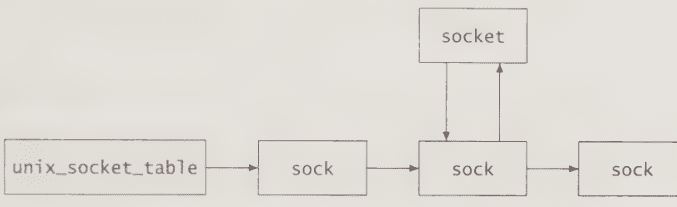

图 12.14: Unix 域控制块的哈希链

- 同样，`write_queue` 字段拥有一个传出数据块的链表，`sndbuf` 包含该队列上的字节数计数。
- `prot` 字段指向 `struct proto` 结构体，见图 12.15。

```c
struct proto {
    void (*close)();
    int (*connect)();
    struct sock* (*accept)();
    int (*poll1)();
    void (*shutdown)();
    int (*setsockopt)();
    int (*getsockopt)();
    int (*sendmsg)();
    int (*recvmsg)();
    int (*bind)();
};
```

图 12.15: 特定协议的结构

它包含指向 Unix 域内特定协议（流或数据报）的特有函数指针。这里的许多函数名称与 `proto_ops` 中的函数相同，关于这种重叠必须说明一些问题。

`proto_ops` 中的函数是通用的。它们在对任何类型的 Unix socket 进行操作时被调用。通常情况下，它们只处理 `struct sock` 结构体中的字段。它们调用 `proto` 中对应的函数。后者处理在 Unix socket 连接上处理流式或数据报式通信的低层具体细节。

- `af_unix` 字段是一个包含 Unix 特有信息的结构体，见 `<net/sock.h>` 中的图 12.16。

```c
struct unix_opt{
    struct unix_address *addr;
    struct sock *other;
};
```

图 12.16: Unix 特有 socket 的链接

- `addr` 字段稍后将用于指向分配给此 socket 的唯一名称；见第 12.4 节。
- 此处最重要的字段是 `other`，当连接最终建立时，它将指向连接另一端的结构体。
- `socket` 字段指回 `struct socket`。

## Bind

在 Unix 域中，socket 地址是文件系统中的路径。这意味着可以使用文件系统的保护属性来限制对 socket 的访问。实际地址由用户在 `struct sockaddr_un` 结构体中指定，见 `<linux/unix.h>` 中的图 12.17。

```c
struct sockaddr_un{
    unsigned short sun_family; /* 地址族，AF_UNIX */
    char sun_path[104]; /* 路径 */
};
```

图 12.17: 包含 Unix 域 socket 地址的结构体

由于地址的格式取决于底层域，该结构体首先识别地址族，然后允许地址信息。例如，Unix 域寻址允许长达 104 字节的路径。在内部，`sockaddr_un` 识别地址。调用 `struct proto` 中的 `sendmsg()` 函数。它将数据从用户空间拷贝到 `sk_buff`。


## 12.5 总结

317

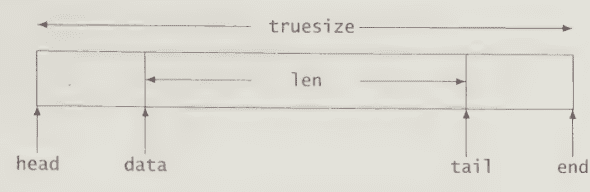

图 12.20；sk_buff 的数据部分

源套接字的 `struct sock`。它会唤醒任何阻塞在在该套接字上等待输入的进程，并将其标记为可运行状态。如果目标流已设置为非阻塞，则会通过 SIGIO 通知目标进程。

套接字的 `msgmsg()` 使用文件系统缓存查找与目标名称对应的 inode。当找到匹配项时，它已经确定了目标套接字，并可以从它的 `receive_queue` 中队列数据。如果没有找到匹配项，则该地址是非的——至少它目前没有被任何套接字绑定：`errno` 值为 ENOENT。

## Recvmsg

这遵循指向 `struct sock` 的指针，并在其中调用 `proto` 中特定协议的函数 `recvmsg()`。如果 `receive_queue` 上没有数据，调用进程将被阻塞。当数据到达套接字时，它会被被唤醒。

所需的字节数从套接字的接收缓冲区拷贝到 `struct msgghdr` 中，并返回给文件读取 `read()` 函数。如果 `sk_buff` 中仍有任何字节，它将留在队列头部。

## 12.5 总结

- 1. Unix 管道本质上是一个 FIFO 缓冲区，子进程在 `fork` 之后会继承它。对于缓冲区满或空的情况，也提供了同步机制。命名管道（Named pipes）是这种机制对于不相关进程的扩展。

- 2. 套接字设施是一种进程间通信机制，可以扩展到不同机器上的进程。

- 3. 在启动时，内核为它准备好处理的每个地址族设置一个 `net_proto_family` 结构。

- 4. `socket()` 系统调用创建一个套接字。像所有的 Unix I/O 一样，它返回一个指向 `struct file` 和 `inode` 的文件描述符，其中包含一个 `struct socket`。这是一个通用数据结构，适用于所有类型的套接字。它链接到 `struct proto_ops`，这是一个特定于域的函数数组。它还链接到 `struct sock`，其中包含该连接的域特定信息。

可以使用 `bind()` 为套接字分配地址（这是一个文件系统路径名）。用户可以通过调用 `listen()` 并反复调用 `accept()` 来被动接受连接。或者，用户也可以实际上主动通过 `connect()` 与正在监听的套接字建立连接。`close()` 系统服务会移除所有这些数据结构。

标准的 `read()` 和 `write()` 系统服务可以用于套接字，但也有特定的套接字系统服务，具有增强的功能。

- 4. Unix 域套接字（domain sockets）可用于同一台机器上两个进程之间的通信。`proto_ops` 中的域特定函数负责设置和操作 `struct sock`。它包含了输入和输出消息的队列、绑定到套接字的名称，以及指向其所连接的对端套接字的指针（如果有的话）。

数据以 `sk_buff` 结构在套接字之间传递。这些结构是固定大小的，可以链在一起以持有大型数据包。

在输出时，数据被拷贝到 `sk_buff` 中，首先从源套接字的 `write_queue` 队化。目标信息从与该套接字关联套接字读取，并调用相应的 `sendmsg()` 函数，该函数将 `sk_buff` 移动到目标 sock 的 `receive_queue`。

当用户使用 `read()` 请求输入时，数据从 `receive_queue` 传输到用户空间。如果没有可用数据，调用进程将被阻塞。

## 12.6 思考

- 1. 讨论将进程间通信与 I/O 系统集的优缺点。

- 2. 调查你正在使用的系统上管道缓冲区的大小。

- 3. 设计一种协议，使管道写入者能够向读取者通信消息长度。

- 4. 建议一种防止读取者在空管道上阻塞的协议。

- 5. `pipe()` 返回的两个文件描述符必须在进程的文件描述符表中连续出现吗？

- 6. 建议你将如何为管道实现一个 `peek()` 函数。该函数查看管道的内容，但不移除它。

- 7. 调查 AF_UNIX 之外其他域中使用的地址格式。

- 8. 你能设想一种既已连接又保留记录边界的套接字类型吗？调查是否存在此类套接字类型。

- 9. 调查可以使用 `setsockopt()` 设置的选项。

- 10. 如果你只将某个特定套接字用于输出，你必须给它绑定地址吗？

- 11. 在 DGRAM 类型的套接字上调用 `connect()` 与在 STREAM 类型的套接字上的本质区别是什么？

- 12. 比较 `socketpair()` 和 `pipe()` 的功能。

- 13. 从一个套接字到另一个套接字的数据传输使用了两种格式：`struct msghdr` 和 `struct sk_buff`。解释它们之间的区别，并证明需要这两个结构的必要性。

- 14. 使用套接字时，如果大小参数足够大，可能从两个或多个消息读取数据。这是一个特性还是 Bug？

# 分布式系统 13

计算机系统已经从独立机发展到机器间的直接连接，再到一台机器可以与任何其他机器通信的网络。图 13.1 展示了基本配置，包含了一些工作站和一台服务器。


图 13.1：网络计算机

但即使那样，用户总是感知到连接，并且必须显式命令来移动数据。我们正处于下一个发展的边缘，即网络化。分布式系统是联网计算机的集合，表现为一个整体。对于用户来说，界面保持不变。这种系统的软件刚刚出现。

## 1.1 分布式系统的特征

分布式系统具有一些集中式系统中没有的特征，这些特征正影响着发展速度。

## 经济性

资源分布的单一重要理由是经济性的。目前，价格与性能的比例倾向于多台机器。微机只能提供有限的性能，但如果将微机组合起来提供更大的性能，其成本仅为主机的一分之一。高速网络成本的下降是分布式系统发展的另一个因素。

## 可靠性

虽然分布式系统并不一定比独立机更可靠，但它们可以提供关键应用程序所需的高可靠性和容错能力。秘密在于尽可能减少关键组件，并让其他组件尽可能可以互换。

这不仅适用于硬件，也适用于数据的冗余存储。数据库的一个副本可能会被毁，但在有适当系统的情况下，可以确保其他最新的副本存在并立即可用。用户无需感知到出现过问题。

拥有冗余服务器是可能的且理想的，尽管引入了保持它们相互一致的问题。集中控制方案（即集中式系统）将所有的鸡蛋放在一个篮子里。

## 资源共享

这是驱动分布式系统发展的另一个因素。这种共享可能纯粹出于经济原因，例如昂贵的打印机或其他专用硬件。一个共享软件副本的多用户许可比购买许多单用户许可要便宜得多。

除了经济原因外，共享资源通常非常方便。整个计算机支持协作工作领域关键取决于分布式系统。理想情况是让不同地点的若干人都在同一个项目上工作，且更新对所有人可见。


## 性能

某些应用本质上就非常适合分布式系统。如果一个作业由许多子作业组成，且每个子作业之间都是相互独立的（例如矩阵算术），那么所有部分都可以在分布式系统中同时处理。这被称为计算分划分，其最终目标是加速整体计算。在这种情况下，无论集中式系统多么强大，它都很难与成百甚至上千台微型计算机竞争。

虽然通过使用更多机器可以提高性能，但存在一个缺点。通信是这里最大的瓶颈。因此，进程及其它们使用的资源仍尽可能保持在同一台机器上。

另一个关键因素是增加负载的能力。当系统承受的负载超过某个特定点时，系统不应该直接崩溃。性能应该平稳地下降。例如，负载增加一倍意味着耗时大约增加一倍——而不是增加十倍。

# 增量增长

分布式系统允许计算机设备进行增量式增长。没有必要一次购买所有的处理能力、内存或磁盘驱动器。可以只安装开始运行所需的设备，并知道系统在可预见的未来可以扩展以跟上日益增长的需求。而且这可以在不发生任何重大中断的情况下完成。

为了让系统能够扩展到越来越多的机器，有必要避免中心化的元素，如表、调度器等。通常，依赖去中心化算法的系统比集中式系统的扩展性更好，后者往往会产生瓶颈。

## 13.2 透明性

分布对于用户以及系统调用接口处的程序来说应该是透明的。就像窗户上的玻璃一样，你应该享受它的效果，但不要察觉它的存在。用户或程序员必须无法判断是否涉及了远程机器。理想情况下，分布式系统对用户来说应该像一个传统的系统。它应该支持用户移动性——任何用户都能够在任何地方登录。

一个理想的分布式系统在以下方面应该是透明的：

- 访问：本地和远程资源的访问方式应完全相同。用户不应该知道资源是本地还是远程的。理想情况下，网络应该足够快，以掩盖任何速度差异。

- 位置：用户无法得知、也没有需要知道硬件资源（如 CPU 或打印机）或软件资源（如文件），远程和本地资源之间不应区别。

- 迁移：资源应该能够从一个位置移动到另一个位置而无需更改名称。使用这些资源的程序应该继续工作，无需任何更改。

- 复制：必须能够对资源（如文件）拥有多个副本，且不会产生任何副作用。这些副本必须保持一致性。程序现在可以使用一个副本，稍后使用另一个，并且仍然正常工作。

- 并发：进程在分布式时的工作性能应该同样良好；必须能够在整个分布式系统中实现读/写锁。

- 故障：当系统组件发生故障时，分布式系统应继续正常运行。它应该具有容错能力，见第 17.3 节。

- 性能：系统应该检测系统中不同进程负载之间的不平衡，并自动将工作从负载重的机器移动到负载轻的机器。用户不应该参与、甚至察觉到这一迁移过程。

- 扩展：系统应该能够在不中断正在进行的工作的情况下进行增长。没有必要更改算法，甚至不需要重新编译程序。

## 13.3 系统架构

当我们讨论计算能力究竟如何进行分布时，我们发现发展出了两种非常不同的架构。这些被称为工作站模型和处理器池模型。有些人倾向于其中一种，另一些则倾向于另一种。两者都基于对分布式系统本质的不同构想。

### 工作站模型

在第 1 章的历史回顾中，我们看到计算机从单用户机发展到多用户机，又变回单用户机，这一切受到经济因素的影响。如今的规范是单用户机，被称为工作站。

### 独立工作站

在大多数情况下，这些是独立运行的。它们具有足够的磁盘容量来存储用户所有的程序和数据，每个用户都拥有所有应用程序软件的自己的副本。

这类机器组通过局域网（LAN）连接在一起已变得越来越普遍。用户所有的个人文件和频繁使用的程序都存储在本地。共享数据库和较大的、很少使用的程序存储在远程服务器或服务器上。图 13.2 说明了这种情况。

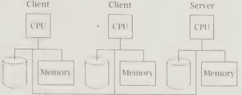

图 13.2：在局域网上连接的工作站

### 无磁盘工作站

另一种不常见的配置是无磁盘工作站。正如名称所示，它有自己的 CPU 和内存，但没有磁盘驱动器——通常甚至连软盘都没有。（有时可能会有一个小的本地磁盘，用于分页、文件缓存和临时文件。）它通过网络进行所有程序和数据系统访问。在上电时，它跨网络启动自己的系统：见图 13.3。

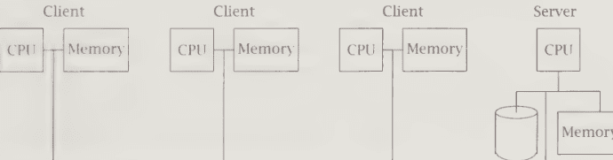

图 13.3：局域网上的无磁盘工作站

这种配置有几个原因。首先节省了磁盘成本；其次节省了多用户许可费用；只需要更改一个副本。由于所有文件都是中心化的，任何用户可以在任何工作站工作，提供了极大的灵活性。

但这种方案最大的优势可能是安全性。由于没有本地磁盘，这对于注重安全的组织具有不可估量的价值。

## 工作站之间的进程迁移

上述任何安排都可能导致处理能力的分配不均。当用户在阅读、打电话、休息甚至思考时，机器是空闲的。利用空闲处理器的一种方法可能是让另一个用户登录到空闲机器，例如使用 telnet。但对于真正的分布式系统，我们需要一种对用户透明的解决方案。

在这样的系统中，进程迁移（（如此）可能由于多种原因发生。

- 负载均衡：分布式操作系统可能会认为本地机器过载，而某些远程机器是空闲的。

- 计算加速：大型作业可能被分解为子进程，并对这些进行分布。

- 并行性：理论上，系统应该检测程序中的潜在并行性，将其拆分为若干子程序，并分布在不同的机器上。这将涉及到编译器和操作系统之间的协作。在实践中，仍然需要程序员的显式干预，至少为了获得最佳分布。

- 硬件偏好：网络上可能有更适合特定任务的特殊硬件。

- 软件偏好：所需的软件可能仅位于某个特定站点。

分布式解决方案有很多方面。

## 处理器分配

哪个进程应该运行在哪个机器上？这种决策涉及许多因素。正如我们经常看到的，对不同因素相关重要性的考虑导致了许多不同的安排。

- 首先，系统可能由相同架构的机器组成。也可能涉及不同的架构。后者限制了可选范围，因为特定的程序只会在其编译的架构上运行。

- 其次，进程可以是非迁移的，即它一直留在开始运行的地方直到结束。在迁移系统中，进程会随着负载的变化而移动。

- 当创建一个新进程时，运行它的机器可以由用户或操作系统选择。

- 最后，必须有一种方法能确保频繁通信的进程能够同时运行。


## 13.3 系统架构

## 系统负载

我们到底如何衡量空闲（或负载）呢？负载可能是运行队列上进程的平均数量。也可能是 CPU 忙碌的时间百分比。空闲可以被理解为一段时间内没有键盘活动。

### 识别空闲机器

接下来，如何找到这样一台空闲机器呢？一种可能性是协调者（coordinator）维护着系统中所有机器的用量表。然后，用户请求协调者为新进程分配一个处理器。

另一种可能性是，每台机器都可以监控自己的键盘，并在检测到自己空闲时广播一条消息。或者，它可以在公告板上留下一条消息，所有其他机器都可以读取。

还有一种可能性是，忙碌的机器广播一条消息，请求空闲机器识别自己的身份。这条消息可能包含待执行任务的细节，例如处理器类型、内存需求等。这意味着不适当的机器将不会被移除。远程机器可以根据与其当前负载成正比的时间延迟响应，这样负载最轻的启动机器就会首先迁移。

发送者启动算法（Sender initiated algorithms）在系统负载沉重时会产生大量消息。从这个角度来看，接收者启动算法（Receiver initiated algorithms）表现更好。

### 迁移进程

当找到空闲机器后，如何透明地运行远程进程呢？将代码移动到空闲机器并不是什么大问题。但在那里建立正确的环境是另一回事。必须安排所有的磁盘访问都发送到主机器，或者至少发送到正确的文件系统。显然，所有处理键盘、鼠标或屏幕的调用都必须重定向到主机器。所有这些开销可能会抵消从迁移中带来的任何优势。

### 拒绝工作

当远程机器不再空闲，且不愿承担额外负载时，会发生什么？它必须以有序的方式关闭寄送的进程，而不仅仅是停止它。

可能将其迁移回，或者迁移到其他地方，并保持运行状态。但收集所有相关的操作系统数据结构，并在新主机上重新设置它们，是一项非常困难、甚至可能是不可能的任务。

无论如何，离开的进程必须让主机的状态与它到来之前完全相同。

## 处理器池模型

即使采用最好的负载均衡，仍然会有未使用的处理能力，因为在大部分时间里，只有几台机器在忙碌甚至过载，而大多数机器处于空闲状态。因此，开发了一种完全不同的架构，被称为处理器池模型（processor pool model）。它基于这样一个想法：如果文件系统集中在一个服务器上，处理器也可以。虽然这并没有变得非常普遍，但它有自己的优势。

在这种模型下，每个用户将只有一个终端，可能是一个图形 X 终端。所有的 CPU 都安装在一个中心位置，连同所有的内存（见图 13.4）。

用户从该池中分配运行其当前进程所需的任何处理能力内存。单一操作系统直接控制所有这些资源，不需要不断地向其他“所有者”查询其资源状态。因此，CPU 和内存的分配可以得到优化。

这比寻找空闲机器是获取额外计算能力的一种纯洁得的方法。

## 结合

可以将这两种模型结合起来。每个用户将拥有一个工作站（无论是否带磁盘），并且处理器池也在那里（见图 13.5）。

对于通用工作，工作站上的本地操作系统将使用其本地 CPU 和内存，而不会打扰系统的其他部分。但当特定用户切换到高性能、重型工作时，它将从池中请求额外的 CPU 并在它们上运行一些进程。这是一个可能的“两全兼备”场景。但只有时间才能证明这些组织中（如果有的话）哪一种最适合未来的计算需求。

## 13.4 客户端/服务器系统

| 客户端 | 客户端 | 客户端 | 池 |
| :--- | :--- | :--- | :--- |
| CPU | 内存 | CPU | 内存 | CPU |
| | 内存 | | CPU |
| | | | CPU |

图 13.5：结合模型

## 13.4 客户端/服务器系统

用于结构化分布式系统的简单架构是安排某些进程为其他进程提供服务。提供服务的自然被称为服务器（servers）。使用这些服务的被称为客户端（clients）。整个安排被称为客户端/服务器系统（client/server system）。服务器做什么以及它向客户端发回什么（如果有的话）可以有巨大的差异。但所有不同的分布式计算模型都可以简化为此。

发送者可以一直保持直到回复到达——同步操作（synchronous operation）。客户端也可以在等待服务器回复到达之前继续进行其他工作——异步（asynchronous）。可以通过中断通知客户端回复的到达，或者它可能必须自己去发现，通过测试状态变量的值。在任何情况下，都有某种放弃故障服务器的方法，例如超时（timeout）。

客户端可以为向服务器的每个请求创建一个单独的线程。该线程将阻塞，但同一进程中的其他线程可以继续运行。在任何情况下，使用多线程服务器是常见做法，它为处理每个请求创建一个新线程。

服务器可以发送数据——将数据带到进程。或者，服务器可以处理由客户端发送的数据——将数据传输到进程。[此处已修正原文重复部分] ... 发回结果。

## 13.5 命名

在分布式系统中，必须唯一地标识所有资源——单个机器、进程、文件、打印机。在系统级别，这些标识符是二进制数字。标识符有两个问题。人类很难记忆和输入这些数字或其十进制值。我们更习惯名称。

第二个问题更严重。假设远程机器上的某个进程提供某些服务。客户端需要知道服务器的标识符，以及该机器上提供所需服务的进程标识符。如果此服务器崩溃并重启，它现在将具有不同的 ID，客户端将无法访问它。另一种可能是机器本身发生崩溃，系统管理员将服务器进程移动到另一台机器。客户端将继续向旧服务器发送请求，没有任何结果。

这两个问题都有解决方案，那就是在系统中提供一个命名服务器。在人类层面，资源通过有意义的名称标识，如“timeserver”或“laserprinter”。在机器层面它们仍然通过二进制数标识。名称与数字之间的链接被称为绑定（binding）。然后将其添加到系统中某处的命名服务器进程中。它维护一个绑定数据库，并代表客户端执行翻译。例如，进程向命名服务器发送字符串“laserprinter”，它发送打印机的唯一 ID。如果 ID 发生，只需通知命名服务器。只要进程能找到命名服务器，它就能找到系统中的任何其他资源。

在联网 Linux 系统上常见的两种不同的命名服务器是用于互联网的 DNS 和用于网络文件系统的 NIS。


## 13.5 命名

### 互联网名称与地址

所有连接到互联网的计算机都可以通过名称标识，也可以通过数字标识。

让我们先看数字标识符。每个连接到互联网的每台机器都被分配一个唯一的 32 位标识符，称为其互联网协议地址，或 IP 地址。这些地址实际上由管理员分配的，我们不需要关心。但互联网上机器之间的所有通信都是使用这些标识符进行的。

当人类参与这些数字时，它们通常以“点分十进制”的形式书写。组成这 32 位的四个字节中的每一个字节都被单独转换为十进制格式，并用点隔开。例如，136.201.24.2。

机器也可以被命名。所有赋予互联网计算机的名称都排列成树形结构，就像文件系统的目录结构。该树中的每个非叶子节点被称为域。与 Unix文件名不同，域名可以是相对的（相对于本地域），也可以是绝对的。域名名始终以 '.' 结尾，就像绝对 Unix 文件名以 '/' 开头一样。有一个根、一级目录（或域），如 com、org 等。

还有针对单个国家的一级域，如 us、ie 等。这些域中的每一个都被划分为子域，依此类推。图 13.6 展示了该名称树的一部分。连接到互联网的计算机的典型名称可能是 shannon.cs.ul.ie。


图 13.6：互联网命名空间的一部分

### 互联网域名系统

互联网域名系统 (DNS) 跟踪所有连接到互联网的计算机。它的作用是将 shannon.cs.ul.ie 这样的名称转换为 IP 地址，例如 136.201.24.22。

图 13.7 展示了该过程。客户端知道服务器的名称。但为了向该服务器发送请求，它必须知道其地址。它首先向名称服务器发送请求，要求其将名称转换为地址。名称服务器在其数据库中查找所需的地址，并将其返回给客户端。然后客户端就可以发送服务请求。


图 13.7：使用名称服务器

这些名称服务器还执行反向翻译。给定机器的 IP 地址，它们会返回其名称。一台机器可能有多个名称；DNS 仅跟踪与第一个名称对应的地址。

DNS 还跟踪域，并将域名翻译为该特定域邮件服务器的 IP 地址。例如，当电子邮件程序遇到如 John.Gorman@u.ie 这样的地址时，它会查询其名称服务器，并被告知将所有发送 u.ie 的邮件发送到机器号 136.201.1.23。DNS 并不是操作系统的一部分；它只是一个运行在后台的标准进程，让用户的生活变得更方便。

### 分布式数据库

仅靠一台服务器为整个互联网服务是不可行的。因此，设计者提出了一个想法，即将名称/数字的总体数据库拆分，并将部分保留在世界上许多不同的机器上。这似乎会让问题变得更糟，但事实上这是一个非常优雅的解决方案，正如我们将看到的。

互联网的每个子域（或区域）都有一个管理员，该管理员负责为该域内的机器分配名称和数字。管理员承诺在至少两台不同的机器上为该域提供一个名称翻译服务器。两台机器同时不可用的概率非常小。

为了避免同一域的服务器服务器之间产生不一致性：

某些域非常大，以至于将所有信息保留在一个服务器上将不方便。因此，这些域被划分为几个子域，每个子域都有自己的服务器。域服务器不需要关于子域内机器的信息，但它必须知道其每个子域服务器的地址。像一个好的管理员一样，服务器可能没有某些特定信息，但它必须知道去哪里查找它们。

为了将整个系统连接起来，在世界不同地区有许多根服务器，它们知道所有一级域服务器的地址——org、com、us、ie 等。全球的服务器都有这些根服务器的地址。

整个系统非常像电话簿。我们知道想要拨打的人的名字，但我们需要一个号码。世界上所有的电话号码都没有列在一本书里。每个订户户都有一本本地号码簿（本地域的名称服务器）。如果他们需要本地号码簿中没有的号码，可以进行目录查询（更高级域服务器）。如果目录查询没有该号码，他们知道去哪里获取（根服务器）。

### 解析名称

如果名称服务器收到的名称是其所在域内的，它可以立即给出回复。然而，如果名称在其他域中，则涉及进一步的步骤。

例如，收到名称 shannon.cs.ul.ie 的服务器将首先查询 ie 的地址。然后它将查询 ul 的地址。最后它将查询 cs 的地址。完整过程如图 13.8 所示。


图 13.8：解析名称

### 缓存

为了减少重复查找名称的开销，DNS 严重依赖缓存。每个服务器都存储它查找过的翻译。现在如果以后请求相同的翻译，它已经有了，而不需要向世界发送消息。当然，这带来了过期数据的问题。每当服务器提供信息时，该信息都会赋予一个生存时间。任何服务器都可以缓存信息，但一旦其生存时间过期，就会被丢弃。这意味着服务器之间的数据可能会出现暂时的不一致。但由于数据生存时间较短（通常为几天），不一致性很快就会得到修正。

### 实现

DNS 最广泛使用的实现是伯利域名软件，或 BIND。服务器进程称为 named。从命令行提示符来看，nslookup 是 DNS 的用户界面。它允许用户交互式查询 DNS。

对于希望直接与 DNS 接口的程序员，标准库有一组统称为解析器的函数。最直接的函数是 gethostbyname() 将名称转换为地址，以及 gethostbyaddr() 将地址转换为名称。

### Sun 网络信息系统

Sun 网络文件系统允许对一组文件的共享访问。NIS 管理 NFS 环境中各种元素的名称。这些元素可以是机器、用户、服务、目录或文件。它不像 DNS 那样是全球性的，而是局限于本地机器组，称为域。域的成员关系是由机器共享的文件集定义的。命令行命令 domainname 显示当前域的名称。通常它是一个有效的互联网域名。

### 服务器

每个域都有一台主服务器。由于始终访问 NIS 是关重要的，可能还有从服务器。更改只能在主服务器上进行，主服务器会将更改推送到从服务器。运行在服务器上的守护进程名为 yppbindd。

以下是它管理的某些文件：

- /etc/hosts，将机器名称与 IP 地址关联。这重复了 DNS 的部分功能。
- /etc/passwd 是 Unix 密码文件，将用户名映射到内部 ID 数字。但一旦我们移动到分布式环境，就会产生混乱。两个（或多个）不同的用户名，在不同


## 13.6 分布式操作系统

... 机器可能会被映射到相同的 id 号。这将导致混乱，至少会在安全方面留下巨大的漏洞。

因此，不同机器上的密码文件管理由 NIS 负责。这种中心化方法防止了此类重复情况。

- `/etc/group`：将组名映射到 id 号。
- `/etc/exports`：列出特定服务器愿意向客户端提供的文件。
- `/etc/rpc`：列出特定主机上可用的过程。
- `/etc/services`：包含关于该主机提供的标准 Internet 服务的信息。

NIS 从这些文件中构建数据库，以便于访问。然后调用 NIS 服务器从数据库中读取信息。

shell 命令 `ypcat` 打印 NIS 数据库中的所有值。`ypmatch` 命令查找 NIS 数据库中一个或多个条目的的值，例如 `ypmatch username passwd.byname` 将返回关于密码数据库中该用户的相关信息。

### 客户端

每台客户端机器都运行 `ybind`。它首先通过广播找到 NIS 服务器的 IP 地址并将其存储起来——这被称为绑定（binding）。从那时起，客户端进程发送的所有 请求 请求都将发送到该服务器。shell 命令 `ypwich` 识别作为当前 NIS 服务器的主机。

## 13.6 分布式操作系统

一个真正的分布式操作系统至少必须开始模糊机器之间的边界。

显然，它将负责管理所有本地资源，如 CPU 和外围设备（包括网络接口）。此外，它还负责宣传空闲且可用的资源，以及从向其他机器导入和导出进程。而且它应该以透明的方式完成所有这些工作。

有许多系统在不同程度上声称自己是分布式操作系统。它们提供的透明度都比仅仅的连接机器或共享文件要高；但目前还没有哪一个是完全的分布式操作系统。

### Mach

Mach 是一个独立的微内核，处理进程、内存、I/O 和通信。它的设计是为了允许对网络资源进行透明访问，并且具有可移植性。可以在它之上构建一个模拟特定操作系统接口的层。

Mach 的设计旨在尽可能与 Unix 兼容，一个 Unix 应用程序应该运行在运行 Mach 的不同计算机网络上的任何地方。它也被设计为高效地利用多处理器。

## 进程间通信

在 Mach 微内核中，进程间通信是最重要的内核函数。Mach 并不是由操作系统作为系统服务向用户提供机制，而是提供了一个支持大部分操作系统的进程间通信设施。

Mach 进程间通信子系统是一个消息传递设施，用于在单独进程之间或同一进程中的不同线程之间传递数据。但这种消息传递是由内核监管的，内核必须首先赋予权限。

系统的两个基本部分是消息（message，即传输的数据）和端口（port，用于传输数据的机制）。

### 消息

如果消息包含少量数据，它通过在内核的缓冲区中物理地拷贝数据来完成传输的。大量数据可以很容易地在进程之间传递，因为在这种情况下，Mach 不会物理上拷贝数据。相反地，它将数据映射到两个进程的地址空间中。只要数据保持不变，就只有一份物理拷贝。一旦其中一个进程修改了数据的部分，就会创建该数据的第二个拷贝。这就是*惰性求值*（lazy evaluation）：将操作延迟到最后一刻，以希望它可能根本不需要执行。

### Mach 端口

端口本质上是内核地址空间内的一个消息队列。进程可以拥有或接收某个端口的权利。只有一个进程可以从特定端口接收消息，尽管任意数量的进程都可以向该端口写入数据。发送或接收权利被称为能力（capabilities）。

端口用于表示进程、线程和内存等系统对象。当一个进程创建这些对象之一时，内核通过赋予该进程代表该对象的端口权利，使其获得访问该对象的权限。

### 分布式系统

Mach 进程间通信可以很好地扩展到分布式系统。消息不再是从一台机器上的进程到同一台机器上的另一个进程（通过该机器的内核）传递，而是通过网络从一台机器上的进程传递到另一台机器。从进程的角度来看，工作仍然通过传递消息来完成。

## 13.6 分布式操作系统

因此，用户可以使用相同的接口和系统调用，像与本地进程一样容易地与远程机器上的进程通信。无法确定消息来自本地进程还是远程进程。进程只知道消息进入了它拥有读取权限的端口。进程使用本地名称发送消息。翻译到远程端口的所有复杂性对用户来说都是隐藏的。

### Chorus

这也是一个独立的微内核，顶层有 Unix 仿真，旨在允许 Unix 程序运行在网络上的集合机器上。像 Mach 一样，它使用消息传递作为其 IPC 机制。线程向端口发送消息，以便将其扩展到分布式系统。线程向本地端口发送消息，但现在是向一个代表远程对象的端口。

在 Chorus 和 Mach 中，网络通信都是由用户级进程处理的，而不是由微内核本身处理。

### Clouds

该系统采用了与前两个不同的方法。它没有消息传递。它是基于对象的，对象是消极实体，拥有它们自己的地址空间，其中包含代码和数据。线程是独立的实体，在对象内部执行。但线程并不与特定对象关联，它可以在对象之间移动。

Clouds 一个非常好的特性是，线程可以执行存在另一台机器上的对象，并传递适当的参数。执行是透明的。设计师决定哪些对象是可用的，并为它们定义接口。接口是面向对象的；实现则不必。

### Amoeba

在分布式系统中，服务器通常代表客户端管理资源。一种明显的方法是将这些资源封装在模块中，并提供对这些模块的访问。通过这种方式，细节对客户端是的。

Amoeba 从零开始开发的，因此不存在后兼容性问题。后来增加了 Unix 兼容性，以便现有应用程序可以在上面运行。它基于处理器池模型，也可以使用工作站。它没有“主”机器的概念。用户与整个系统打交道。

标准内核运行在分布式系统中的每台机器上。它提供了进程、内存、I/O 和通信所需的内核。然后是使用 RPC 的专用服务器。RPC 机制使得远程函数看起来像本地函数，从而提供了网络透明性。

## 13.7 分布式计算环境

目前，未来的道路并不明确。已经提出了几种不同的方案作为未来分布式系统的基础。我们将检查两种。但只有时间才能说明整个领域如何发展。

### CORBA

一个名为对象管理组（OMG）的计算机制造商协会制定了通用对象代理架构的规范。正如名称所示，CORBA 提供对跨系统对象的访问。预计 CORBA 将既用于构建分布式系统，也用于集成现有和新的应用程序。

### 概述

像所有对象系统一样，CORBA 将资源封装在模块中，并仅通过接口过程提供。这允许将大型应用程序分解为具有清晰定义的子系统。每个子系统都可以独立实现，可能在不同的机器上，并确保它们能够协同工作。设计师决定哪些对象是可用的，并为它们定义接口。接口是面向对象的；实现则不必。

这些接口在接口定义语言（IDL）中指定，IDL 与 C 类似。在 IDL 中指定的接口可以由 IDL 编译器翻译到任何其他语言（例如 C）。
CORBA 被描述为像一个软件总线。就像硬件组件都通过系统总线相互通信一样，软件组件也通过 CORBA 进行通信。

### 对象请求代理

CORBA 规范的核心是对象请求代理（ORB）。ORB 负责定位对象、向其传递参数并将响应返回给客户端。它允许客户端跨网络发出请求，尽管操作系统和编程语言存在差异。


## 13.7 分布式计算环境


图 13.9：CORBA 概述

客户端不需要知道对象所在地，也不需要知道其实现的任何信息——只需要其接口。

市场上有很多有很多 CORBA 实现。每个厂商的实现都能够与其他所有实现进行通信，以便任何客户端都能与在任何 CORBA 环境开发的任何对象进行通信。

OMG 定义了一组 15 项服务，这些服务支持 ORB（对象请求代理），并涵盖了开发分布式系统所需的大多数常用功能。这些包括熟悉的服务，如命名、时间、安全、事务和消息传递，以及分布式并发控制。对象是位置透明的；用户只需要知道接口即可。为了在分布式系统中实现位置透明性，CORBA 提供了其同名的命名服务。

为了方便将遗留应用程序迁移到分布式环境中，可以将此类应用程序的代码封装在 CORBA 接口中。这使得它在外部与 ORB 提供的所有其他模块兼容。

### DCOM

微软拥有自己的分布式对象架构 DCOM，它是微软组件对象模型（COM）技术的分布式版本。COM 为软件对象（或组件）规定了二进制标准，允许它们无论使用何种语言编程都能进行通信。通过 DCOM，COM 对象可以在网络上透明地向 COM 服务器请求服务。对象是与位置无关的。

与 CORBA 一样，DCOM 也有许多服务支持其在分布式环境中的运行。例如，它使用了 Windows NT 安全服务和微软事务服务器（Microsoft Transaction Server）。

最新版本是 COM+，仅支持 Windows 2000。

虽然最初是为 Windows 平台开发的，但现在的专用软件允许它与 CORBA 协作，使得 CORBA 客户端或服务器对象可以与 COM/DCOM 服务器或客户端对象通信。这为跨平台开发开辟了道路。

## 分布式计算环境

开放软件基金会（Open Software Foundation）是为了开发新版本的 Unix（称为 OSF/1），它不会受到以前所有者和开发者的版权限制。当分布式系统的需求显而易见时，OSF 开发了 DCE，它可以运行在 TCP/IP 之上，也可以运行在其他操作系统上。例如，它已被移植到 Tru64 Unix、OpenVMS、Windows 和 OS/2。

因此从理论上讲，你可以获取若干不同架构的现有机器，每台机器运行自己的操作系统，只需在这些机器之上放置 DCE 软件，你就拥有了一个瞬时分布式系统，而不会干扰任何现有的应用程序。在大多数情况下，这可以在用户级完成，而不影响内核（见图 13.10）。

| 应用 | 应用 | 应用 | 应用 |
| --- | --- | --- | --- |
| DCE | DCE | DCE | DCE |
| Tru64 Unix | OpenVMS | Windows 2000 | OS/2 |
| | | 网络 | |

图 13.10：分布式计算环境

DCE 是位于操作系统和分布式应用程序之间的一层软件。它要求在在下方有一个传输层，例如 TCP/IP 或 OSI 传输协议之一。虽然它可以与这些协议中的任何一个工作，但所有涉及的机器必须至少有一个共同的网络协议（否则它们无法通信）。

底层模型是客户端/服务器。客户端是普通的程序，与特殊的库链接。服务器可以由 DCE 提供，也可以由其他应用程序提供。

DCE 为构建分布式应用程序提供了工具，例如其自身的线程机制和远程过程调用（RPC），这是 DCE 中所有通信的基础。它还提供了运行此类分布式系统的服务，包括安全和保护、目录以及时间服务器。其优势是所有这些都是集成在一起的，并且尽可能地为程序员完成工作。

## 13.7 分布式计算环境

DCE 系统中有七个组件。

### 1. 线程

如果主机操作系统没有提供线程，则可以使用 DCE 线程包。由于它位于操作系统之上，因此它显然是一个用户级实现。操作系统并不知道这些线程的存在。该接口基于 POSIX pthread 标准。

### 2. 远程过程调用

RPC 允许用户通过调用本地过程来访问远程服务。RPC 系统会寻找远程服务器并处理消息传递，对客户端是透明的。RPC 既提供了开发工具，也提供了运行时服务。

**开发工具** 接口定义是开发 RPC 系统的核心。它指定了服务器导出的所有函数以及参数类型。通常，它还包含了描述函数语义的注释。它是用接口定义语言（IDL）编写的。IDL 编译器处理此定义，并为客户端和服务器生成代码段（即存根/stubs），这些存根处理所有分布式方面的问题。用户只需要编写实际的客户端和服务器代码。

**运行时** 当服务器启动时，它会在 DCE RPC 守护进程中注册。每台机器都维护一个可用服务的数据库，由该守护进程管理。在运行时，客户端机器上的进程首先向 RPC 守护进程询问所需服务器的信息。然后它直接与服务器通信。

### 3. 目录服务

该服务器在分级命名空间中维护分布式系统可用的所有用户、机器和其他资源的信息。这既是分布式的也是复制的。DCE 可以使用 DNS 作为目录服务并将其集成到自己的命名空间中。

### 4. 分布式时间服务

该服务器同步不同机器的时间，并维护相对准确的当日时间。见 15.1。

### 5. 安全服务

该服务处理身份验证，允许不同机器上的进程确认彼此的身份。它还处理授权，即赋予某个身份哪些权限。它使用访问列表来实现。用户的安全状态在登录时建立。

### 6. 分布式文件系统

它提供了一个全局命名空间，涵盖所有参与机器上的文件，从而提供了完全的位置透明性。它使用复制和缓存来提高性能。DCE 还提供了了自己的文件系统，即 Episode 文件系统。更多细节见 16.4。

### 7. 无磁盘支持

DCE 为无磁盘工作站提供了支持。这包括在启动时提供内核副本，以及特定机器的配置文件，提供远程分页和交换以及远程文件系统。

## 13.8 总结

1. 导致分布式系统开发的因素有很多。有经济原因，因为小机器网络比同等的大型机器便宜。此外，它们可以提供更高的可靠性。资源共享是另一个因素，以及它们逐步扩展的能力。
2. 理想情况下，这种分布式系统对用户应该是完全透明的。
3. 在硬件方面，工作站模型目前最流行。这些机器可以是无磁盘的，也可以具有本地磁盘容量。在每种情况下，都可以负载均衡来共享空闲工作站的能力。还可以汇总处理器和内存，并从池中向用户分配资源。
4. 最常用的架构是客户端/服务器。一个进程（服务器）为另一个进程（客户端）提供服务。通常这些位于不同的机器上。网络操作系统提供了一些分布式应用程序，如远程登录、文件传输，甚至是远程目录共享。
5. 我们更倾向于用人类可读的名称标识机器和资源。在系统层面，使用数字标识符更为方便。命名服务器在两者之间进行映射。DNS 是用于互联网的命名服务器。它映射名称与地址，反之亦然。它还映射邮件域名称与相应的邮件服务器。NIS 是用于网络文件系统的命名服务器。
6. 真正的分布式操作系统至少开始模糊机器之间的边界。Mach、Chorus、Clouds 和 Amoeba 是分布式操作系统的示例。


## 13.9 讨论题

7. 目前存在许多竞争性的分布式系统环境。CORBA 提供了分布式对象的访问。它既可以构建新系统，也可以用于分布式遗留系统。接口定义是 CORBA 系统的核心。CORBA 标准的任何特定实现都是 ORB（对象请求器）。它们运行在现有的操作系统之上。
OSF DCE 是一个类似的提案，同样运行在现有的操作系统之上。它提供了构建分布式应用程序的工具，以及支持这些程序的的运行时服务，如线程、RPC、目录、时间和安全服务、分布式文件系统以及无盘支持。

## 13.9 讨论题

- 1. 请建议一些特别适合在微型计算机网络上进行分发的应用程序。
- 2. 分布式系统可以构建得非常可靠且容错，以至于用户甚至感知不到故障的发生。这是一件好事吗？
- 3. 根据第 13.2 节中的标准，对你熟悉的任何分布式系统进行评估。
- 4. 调查磁盘工作站在通电启动时是如何引导其操作系统的。
- 5. 根据你对 Unix I/O 的了解，提出一些方法，将迁移到另一台机器进程的所有 I/O 重定向到正确的设备。
- 6. 连接到互联网的计算机可能有多个名称。它可能会有多个 IP 地址吗？
- 7. 当你向浏览器或邮件处理程序提供一个名称时，它是如何找到需要通信的机器地址的？请推导出涉及的所有步骤。
- 8. 调查 `nslookup` 程序，并使用它获取有关互联网子域的信息，特别是根服务器的。
- 9. 使用 `nslookup` 程序查找本地 DNS 服务器给出的信息的生存时间（TTL）。
- 10. 使用 `ypmatch` 在密码文件中查找你的用户条目。并从中读取你的用户 ID（user-id）和组 ID（group-id）。你也可以读取密码的加密形式，但这对你可能没有意义。
- 11. 在什么样的应用程序中，客户端会将数据发送到服务器进行处理？而在什么时候服务器会将数据发送给客户端进行处理？
- 12. 这里介绍的 Mach 和 Chorus 似乎非常相似。进一步调查这两个系统，并列出它们差异的领域。
- 13. 对于我们在单机上检查过的任何进程间通信机制，开发其分布式版本会涉及哪些内容？
- 14. 将 CORBA 描述为“分布式监视器”准确吗？
- 15. 云与 CORBA 之间的本质区别是什么？
- 16. ORB 运行在服务器还是客户端机器上？
- 17. CORBA 和 DCE 之间是否存在任何根本区别？

## 14 通信

任何分布式系统完全依赖于不同机器相互通信的能力。因此，我们将首先检查每台机器上的操作系统是如何实现这种通信的。然后，我们将继续考虑如何在这一层提供的设施之上构建分布式系统。

机器间通信的整个领域是计算机网络的范畴。那里发展出的基本设计抽象是分层协议。从我们的观点来看，重要的是通信两端的进程必须使用相同的协议。

## 14.1 用于网络编程的 Sockets

我们已经检查了单机上的各种进程间通信机制，例如消息队列或管道。特别是我们检查了套接字（sockets）。Unix 域套接字只允许同一台机器上的进程进行通信。但套接字机制可以扩展，允许进程跨网络发送和接收数据，而无需担心任何底层协议。套接字有一个事实上的标准，并被用于许多网络应用。

尽管标准组织付出了努力，但在计算机之间的通信以及识别计算机及其上的进程方面，有许多不同的协议或规则。这些被称为域（domains）或地址族（address families），由 `<linux/socket.h>` 中的预定义常量表示。参考图 14.2。

当内核为任何特定机器配置时，系统管理员会决定加载哪些网络软件。如果只需要，这可能只是一套特定的软件。或者，如果预见到这台机器将与许多其他机器通信，因此需要匹配所有机器的软件，则可能是一个广泛的选择。正如第 12.2 节所述，系统在 `net_families[]` 数组中跟踪这些网络协议。

## 互联网域

特别是，我们在第 12 章中检查了 AF_UNIX（即 Unix 域）。但还有许多其他可能性，例如 AF_INET（即互联网域），我们在此处重点关注它。

互联网域中所有通信的基础是互联网协议 IP。它工作在 OSI 模型的网络层，负责将数据包传到正确的目的机器。互联网使用构建在这一 IP 网络层之上的set传输协议；我们将考虑的原理（也是唯一考虑的）是：用于数据报通信的用户数据报协议（UDP），以及用于面向连接通信的传输控制协议（TCP）。

第 12.3 节中讨论的所有系统服务也适用于互联网域套接字。

## 网络接口

还必须安装软件来控制使用的特定网络接口，包括中断服务。系统对网卡驱动程序的处理方式不同。硬件信息维护在 `device` 结构中，如图 14.1 所示，来自 `<linux/netdev.h>`。

```c
struct device {
    char *name;
    struct device *next;
    int (*init) (0);
    unsigned short type;
    unsigned char dev_addr[];
    int (*hard_start_xmit) (0);
};
```

> 描述接口

- `name` 字段指向表示设备名称的 ASCII 字符串。
- 如果机器上有多个网络设备，相应的结构将通过 `next` 字段链接。
- `init` 字段指向一个在启动时调用的函数。它检查硬件是否存在，并初始化该设备中的其他字段。
- `type` 字段识别设备类型，例如以太网。

## IP 套接字

- `dev_addr` 字段持有设备的硬件地址，例如以太网卡的 48 位地址。
- `hard_start_xmit` 字段指向一个实际操作硬件发送数据包的函数。

此类结构的链表，每个已安装的网络有一个，从 `dev_base` 开始。安装的网络设备的信息由 shell 命令 `ifconfig` 提供。

## IP 套接字

我们在第 12 章中看到，高层套接字机制与特定通信协议之间的接口是通过一组预定义函数实现的。在第 12.4 节中，我们考虑了这些函数在 Unix 域的实现。在这里我们将查看这些函数在互联网域是如何实现的。

## 创建

将套接字定制为 IP 套接字。它创建一个新的 `struct sock`，持有所有相关信息。我们以前见过它，在图 12.13，但互联网域使用了 Unix 域没有的字段；我们在图 14.2 中显示了一个更完整的版本，来自 `<net/sock.h>`。

```c
struct sock {
    struct options *opt;
    struct sock *next;
    struct sk_buff *partial;
    struct sk_buff_head receive_queue, write_queue;
    struct proto *prot;
    u32 daddr;
    u32 rcv_saddr;
    u16 dport;
    unsigned short num;
    u32 saddr;
    struct socket *socket;
    void (*data_ready)();
};
```

> 图 14.2：一个互联网协议控制块

- `opt` 字段指向一个记录了该套接字设置选项的数据结构。该结构中的值可以通过 `getsockopt()` 查询，可以通过 `setsockopt()` 选择选项。各种选项在手册页中指定。


- 下一个字段用于将 `struct sock` 链接到所有已分配的 Internet 控制块列表。UDP 和 TCP 控制块有各自的列表。这些列表用于找到入站数据包应该发送的哪个 `struct sock`。
- TCP 使用部分字段来对乱序到达的数据包进行队列。
- `receive_queue` 和 `write_queue` 是正在进入或传出的数据包链表的表头。
- `prot` 指向一个 `struct proto` 结构，该结构包含了 Internet 域内特定协议的函数。我们在第 12.4 节中见过过 `struct proto`。这里的结构是相同的；指向的函数显然特定于 TCP（流套接字）或 UDP（数据报套接字）。
- `daddr` 是传出包的set IP 地址。
- `rcv_saddr` 包含绑定到套接字的 IP 地址。
- `dport` 包含传出包的远程端口号。
- `num` 包含绑定到该套接字的端口号。
- `saddr` 是来自入站包的源地址。
- `socket` 字段是指向 `struct socket` 的反向指针。
- 每当入站数据到达套接字时，就会调用 `data_ready()` 函数。

## Bind

每个套接字在特定机器内必须具有唯一标识。数据包在网络上传输时通过 IP 地址识别，IP 地址是一个唯一的 32 位数字。但每个数据包还有一个用于接收该数据包的协议标识符，例如 UDP 或 TCP。在特定的 Internet 协议内部，使用一个称为“端口号”的 16 位数字来标识特定的套接字。因此，两个套接字之间的连接完全由源 IP 地址、源端口、协议号、目的端口和目的 IP 地址完全指定。

服务器使用的端口号通常在网络圈内是广为人知的，任何进入该机器并连接该端口的请求将发送到该特定的套接字。

IP 地址包含在来自 `<linux/in.h>` 的 `struct sockaddr_in` 结构中，如图 14.3 所示。它识别了地址族 (AF_INET)、主机上的端口号以及该机器的 IP 地址。

```c
sockaddr_in{
  short int           sin_family; /* 地址族, AF_INET */
  unsigned short     sin_port; /* 端口号 */
  struct in_addr      sin_addr;   /* Internet 地址 */
};
```

图 14.3: Internet 套接字地址结构

当调用 IP 特定的 `bind()` 时，它会将 IP 地址复制到套接字结构的 `rcv_saddr` 字段中，并将端口号复制到 `num` 字段中。

命令行命令 `netstat` 显示系统中所有活动（已绑定）套接字的信息。

## Accept

当调用 IP 特定的 `accept()` 时，已经创建了一个新的套接字来处理请求的连接。该函数为其挂载一个结构，并为 `num` 字段分配一个新的全新的、未使用的端口号。然后，它向远程套接字发送一条消息，告知它在未来的所有通信中使用该此端口号。接收方进程进入睡眠状态，等待确认。

当远程进程确认此消息时，连接完全建立，控制权返回套接字层。

## Connect

如果此客户端套接字类型为 `DGRAM`，`connect()` 只是将远程地址存储在相应 `struct sock` 的 `daddr` 字段中，供发送数据时使用，这样就不需要每次提供。通过第二次调用 `connect()` 可以为 UDP 套接字分配不同的远程地址。

如果客户端套接字类型为 `STREAM`，`connect()` 尝试与指定的远程套接字建立连接。来自 `proto` 的 TCP 特定的 `connect()` 函数向远程机器发送一条消息。这条消息包含了客户端的 IP 地址和端口号。调用者将被阻塞，直到回复到达。

正因如此，连接对用户来说看起来是同步的。当服务器回复用于未来所有通信的端口号时，客户端对该新端口号对该消息进行确认。然后，它将此端口号存储在其 `struct sock` 的 `dport` 字段中。最后，它向调用它的 `connect()` 系统服务返回一个成功值。现在可以开始正常通信了。

TCP 套接字之间建立连接的三个阶段概述如图 14.4 所示。

```
listen()
请求连接    connect()
队列请求
睡眠
accept()
创建新 sock    连接的端口号
分配端口号
睡眠
确认
连接完成
```

图 14.4: 连接两个套接字

## Sendmsg

当调用 INET 域的 `sendmsg()` 函数时，它将数据从 `mshdr` 结构复制到 `sk_buff` 中。在处理 Unix 套接字时我们已经见过 `sk_buff` 数据结构。它也用于在套接字层和物理接口之间移动所有数据，反之亦然。

消息在传出时必须经过四个不同层的处理。这四层是：套接字层、传输层（UDP 或 TCP）、IP 层和硬件层。后三层将在传出时添加头部，并在入站时剥离头部。

对于较大的消息，可以将多个 `sk_buff` 链在一起；这有助于添加协议头部。例如，如果 `sk_buff` 头部没有空间，则通过在链的头部添加一个 `sk_buff` 并系附 IP 和 TCP/UDP 头部，同时将数据包头部拷贝到其中。链的长度不再取决于 IP 或 TCP/UDP 头部的大小。头部存储在数据区域的末尾。

`struct sock` 中的 `prot` 字段指向一个 `struct proto`，它包含一个针对特定类型套接字（即 TCP 或 UDP）的操作向量。会调用 `struct proto` 中的 `sendmsg()` 函数，该函数执行协议特定的处理。首先在此处添加一个 UDP 头部，然后添加 IP 头部。所有头部都是连续的。

最后，构建一个物理帧（例如以太网帧）。物理层处 `sk_buff` 的内部结构如图 14.5 所示。

| ethhdr | iphdr | udphdr | Data |
| :--- | :--- | :--- | :--- |

图 14.5: 物理帧

## xmit()

`hard_start_xmit` 函数（见图 14.1 中的 `struct device`）实际上负责发送帧。如果设备是空闲的，该函数会在此阶段直接被调用。如果设备正忙碌，它会在设备完成当前帧时自动被调用。

## Recvmsg()

INET 域的 `recvmsg()` 函数本身本身的工作极少。如果 `struct sock` 中的 `receive_queue` 为空，则进程进入睡眠状态。否则，它只是调用 `struct proto` 中协议特定的 `recvmsg()`。

对于流套接字，请求的字节数从那里队列的 `sk_buff` 传输并转移到 `msghdr` 结构中。这种格式传回套接字特定的 `read()` 函数，该函数将数据传输到用户指定的缓冲区并返回。

对于数据报套接字，返回包含 `sk_buff` 中的整个消息。

## Ethernet

数据从网络异步从任何运行进程到达，这些数据必须被异步处理。我们现在跟踪入站数据从以太层经过 IP 层、传输层（UDP 或 TCP），到达套接字层。

当从网络接收到完整数据包时，接口卡产生一个中断。该中断的处理程序构造一个 `sk_buff`，并将数据包从以太卡移动到此 `sk_buff` 中，使卡准备好接收下一个数据包。

中断处理程序随后检查以太头部，见来自 `<linux/if_ether.h>` 的图 14.6。它包含目的和源以太网地址；更重要的是，h_proto 标识了数据应该发送到的协议栈，例如 IP、OSI 或其他协议。

```c
struct ethhdr{
    unsigned char h_dest[];
    unsigned char h_source[];
    unsigned short h_proto;
}
```

图 14.6: 以太网头部


## 352 14 通信

以太网驱动程序维护了一个 `struct packet_type` 的哈希结构，见图 14.7，来自 `<linux/netdevice.h>`，它识别了所有可能的包类型。

```c
struct packet_type{
    unsigned short type;
    int (*func)();
    struct packet_type *next;
};
```

图 14.7：识别包类型的结构

该哈希表声明在 net/core/dev.c 中。中断处理程序会将以太网头部中的 `h_proto` 字段哈希到此列表中，并检查每个条目中的 `type` 字段。对于 IP，类型值为 0x8800。当找到匹配项时，就会调用相应的 `func()`。不匹配任何已知类型的数据包将被丢弃。

### IP

我们只考虑 IP 数据包，因此在我们的情况下，IP 处理器始终由以太网中断处理程序调用。它检查 IP 头部，见图 14.8，来自 `<linux/ip.h>`。

```c
struct iphdr {
    u8 protocol;
    u16 check;
    u32 saddr;
    u32 daddr;
};
```

图 14.8：IP 头部

`check` 字段中的校验和无效，意味着数据包损坏或错误。如果是这样，将静默地丢弃它。`protocol` 字段决定该数据包是用于 TCP 还是 UDP。官方的互联网协议名称和数字可以在 `/etc/protocols` 中找到。例如，TCP 是 6，UDP 是 17。它剥离头部。然后调用相应的协议，即 `UDP rcv()` 或 `TCP rcv()`。

### UDP

IP 层调用 `UDP rcv()` 函数，并传递指向 `sk_buff` 的指针。该函数检查 UDP 头部，见图 14.9，来自 `<linux/ip.h>`。如果校验和无效，它将丢弃数据包。

随后搜索对应 UDP 套接字的 `struct sock` 哈希表（来自 net/ipv4/udp.c 的 `udp_hash[]`）。如果传入头部的 `dest` 字段与 `sock` 的 `num` 字段之间没有找到匹配项，则数据包被丢弃。否则，当找到匹配项时，`sk_buff` 从 `receive_queue` 中入队，然后调用 `struct sock` 中对应的 `data_ready()` 函数。如果有任何进程正在等待该套接字，则会唤醒它；或者如果它被设置为非阻塞，则通过 `SIGIO` 通知它。

### TCP

```c
struct udphdr {
    u16 source;
    u16 dest;
    u16 check;
};
```

图 14.9：UDP 头部

TCP 的处理与上述描述的 UDP 非常相似。当 TCP 数据报文到达时，IP 层会调用 TCP 特有的 `rcv()` 函数。它检查 TCP 头部，见图 14.10，来自 `<linux/tcp.h>`。如果 `check` **校验和无效，它将丢弃数据包。

```c
struct tcphdr {
    u16 source;
    u16 dest;
    u32 seq;
    u16 check;
};
```

图 14.10：TCP 头部

它搜索其 TCP sock 结构哈希表（由 net/ipv4/tcp_ipv4.c 中的 `tcp_ehash` 引导），以找到与传入消息 `tcphdr` 中 `dest` 字段对应的相应结构。

但在从该 sock 的 `receive_queue` 中入队数据之前，它必须检查 `seq` 字段，并确保其顺序正确。如果不是，则从 `sock` 中的 `partial` 字段入队。另一方面，此数据包的到达可能会完成一个序列，多个数据包可能会同时传递到 `receive_queue`。

与 UDP 一样，调用 `struct sock` 中的 `data_ready()` 函数，这会唤醒任何等待该套接字的进程，或者如果它被设置为非阻塞，则通过 `SIGIO` 通知它。

## 14.4 扩展传输接口

SVR3 引入了传输层接口（TLI），作为套接字接口的替代。它基于 OSI 标准。X/Open 引入了改进后的格式——扩展传输接口（XTI）。它尚未成为 POSIX 的，在 Linux 中也可用。

XTI 被设计为任何底层传输协议的通用接口，而不仅仅是 TCP 或 UDP。它可以是同步的或异步的。

系统服务与用于套接字的服务类似。更重要的是 `t_open()`，它建立一个传输端点并返回文件描述符，用于所有后续调用。`t_bind()` 为传输端点分配地址，`t_listen()` 等待连接请求，`t_accept()` 接受连接，`t_connect()` 与另一个传输用户建立连接。

普通数据和优先级数据都通过 `t_send()` 和 `t_recv()` 在连接上发送和接收。通过 `t_unbind()` 禁用传输端点，这与 `t_bind()` 操作；最后通过 `t_close()` 销。

## 14.5 远程过程调用

客户端/服务器机制对用户来说非常像传统的 I/O 系统。请求被发送到本地设备或远程服务器，请求进程一直等待直到结果到达。这是开发分布式系统的方法之一，基于程序员所熟悉的内容构建的。

但程序员可能对函数调用更加熟悉。这种函数调用会将控制权转移到另一行函数，并向其传递参数。当函数结束时，控制权返回给调用者。

### 概述

RPC 的一个基本要求是它对程序员应该是透明的，即它看起来完全就像一个本地过程调用。这通过让发送者在自己的机器上的库中有一个伪过程（称为存根，stub）来实现。发送者像往常一样调用它，像以前一样在栈上传递参数。

就发送者而言，这个过程就是执行工作的。但事实并非如此。它做的是将参数格式化为消息，添加一些等待在远程机器上执行的标识，并使用套接字或 XII 等接口将消息发送到该机器。存根随后阻塞等待回复。

当消息到达远程机器时，RPC 服务器进程解包消息，并识别出请求的是哪个过程。它以正常方式调用该库过程，在栈上传递参数。

过程像正常一样返回，将返回值传回 RPC 服务器进程。这次它将结果封装为消息，并将其发送到通信层以传输到请求机器上的存根。该存根解包消息，并以正常方式将结果传回客户端进程。图 14.12 说明了这种情况下的控制流。

服务器可以有一个通用的模块来接收请求，并将它们传递给相应的本地过程。或者，为每个过程都有一个独立的解包器（存根）。


# 参数

参数中的数据类型存在一些问题。不同的机器可以使用 EBCDIC 或 ASCII 编码字符，甚至可以是 7 位或 8 位。整数和浮点数的表示方式也存在差异。对于数组元素的存储顺序，也没有统一的规定。此外，某些机器是大端序，而另一些是小端序。但客户端和服务器存根（stub）都了解参数的类型及其顺序。因此，它们必须约定一种表示基本数据类型的标准。

一种可能性是将其设计成标准的网络格式。所有参数在传输之前都会转换成这种格式。如果发送者和接收方都使用与网络格式不同的原生格式，这有时可能会导致低效。因此，另一种可能性是发送者使用自己的原生格式，但指示其类型。然后接收方仅在需要时进行转换。DCE RPC 使用了这种方法来避免双重转换。

引用参数会产生自己的问题。一种可能性是将值拷贝到消息中，即使对于数组也是如此。这是将引用传递替换为拷贝/恢复（copy/restore）。这具有巨大的开销，但这种开销可以减少。输入参数不需要传回。输出参数最初就不需要发送。

# 传输：UDP 或 TCP

RPC 协议应该是无连接的还是连接的？在局域网（LAN）上通常是无连接的。但这一决策取决于特定应用的需求。

## 14.5 远程过程调用

某些过程可以反复执行而没有副作用。例如，从文件中读取一个块。此类过程被称为等等的（idempotent）。其他过程在每次执行时的效果不同，例如从文件中读取下一个块，或增加计数器的值。它们被称为非等等的。

如果过程是非等等的，且双向的参数都小于 8K（UDP 数据包的最大尺寸），并且请求量很大，那么许多系统会使用 IP 之上的 UDP。

如果过程是非等等的，或者参数大于 8K，或者应用需要可靠的传输机制，则可以使用 TCP。但由于 TCP 会保留状态，它会对服务器带来更大的负载。

## 绑定

下一个问题是，客户端如何找到服务器？在客户端存根中硬编码网络地址是不够的。因此，需要某种形式的动态绑定。我们知道远程过程的名称，这个名称不会改变。但它必须被转换为远程主机上的特定 ID，例如特定 IP 地址上的套接字。这需要在客户端每次运行时执行。

因此，我们需要一个绑定服务（binder service）或注册服务，即一个拥有映射表的名称服务器。当服务器程序启动时，它向绑定器注册自己的名称和监听的端口。还应该允许注销过程。注册服务器还可以负责身份验证。

在注册时，服务器程序可以指定它愿意为哪些用户或用户组提供服务。绑定器将拒绝向任何未经授权的客户端标识服务器。

系统应该能够处理多个导出相同接口的服务器。绑定器应该是具有容错性的，例如它们可以将信息缓存在文件中。更好的方法是像 DNS 这样的分布式绑定服务——并进行复制。

客户端向绑定器指定一个名称和版本号，绑定器返回该机器上的机器地址和本地端口号。

但客户端如何找到绑定器呢？一种可能性是它有一个众知的 IP 地址，硬编码在所有客户端中。然而，这意味着如果绑定器被移动到另一台机器，就需要重新编译。更好的机制是将绑定器的地址放在环境变量中；这样只需要更改该变量。

另一种可能性是，当客户端想要寻找绑定器时，它在网络上广播消息，实际上是在说：“绑定器是否向该地址的机器标识自己？”绑定器监听此类消息，并将其 IP 地址发送给请求机器。客户端随后可以请求绑定器以通常的方式翻译过程名称。

# 失败

像计算机系统中的任何事物一样，我们必须预料 RPC 会偶尔失败。但它很少干净地失败。记住这里涉及到三个组件：客户端机器、服务器机器和通信网络。通常是一个失败了，而另外两个继续工作。因此结果可能非常奇怪。

# 消息丢失

我们首先考虑消息丢失。客户端可以通过超时控制来检测这一点。如果在此时间内没有收到回复，它就知道出了问题。但它不知道是请求丢失还是回复丢失。它能做的就是再次发送请求。然而，为了帮助服务器区分原始请求和重复请求，它必须以某种方式标记重复。这可以是消息头中的序列号，或仅仅是一个重复位。

为了帮助处理这种情况，服务器维护一个最近事务列表，包括请求和回复。当重复请求进来时，服务器检查其最近事务列表，如果发现该请求存在，它就知道原始回复丢失了，因此重新发送该回复的副本，而不会再次执行操作。

另一方面，如果它在最近事务列表中没有原始请求副本，它就知道原始请求丢失了。因此，它将重复视为原始请求，执行操作并发送回复。

# 服务器崩溃

如果服务器在发送请求后崩溃，它会完成工作并返回结果，并认为该任务已结束。当回复到达客户端机器的通信层时，将发现没有进程来接收回复，大多数系统会将其丢弃。即使它告知服务器无法递送消息，服务器也只会忽略。

## 14.6 RPC 编程

构建 RPC 程序的所有工作可以使用传统的编程语言手动完成，但非常容易出错。参数的顺序、类型和编码在所有处理它们的模块中必须保持一致。如果都是独立编码的，可能会在某处修改但未在所有处修改导致不一致。

理想情况是尽可能自动化。程序员只需编写客户端程序和服务器过程。用于通信的存根和套接字调用都可以自动生成，机器之间的数据类型差异也可以被屏蔽。

有多种不兼容的系统可用，有助于 RPC 程序的发展。OSI 开发了 DCE 系统，我们在 13.7 节中提到过。这也被 OS 的成员微软使用。

Sun Microsystems 开发了一种已成为事实标准的 RPC 系统。它最初是为了支持其网络文件系统设计的，但其规范被置于公有领域，并广泛应用于许多其他应用程序。为了避免“Sun RPC”名称的专有含义，它现在以“开放网络计算”（ONC）命名。由于它是 Linux 以及大多数 Unix 系统上常用的 RPC 系统，我们将对其详细检查。

# 标识

每个远程过程通过 <程序，版本，过程> 三元组来标识。这允许一个服务器同时提供多个不同的相关过程，甚至是它们的多个版本。etc/rpc 文件包含已识别程序列表以及分配给它们的数字。

程序号分配如下：

- 0x00000000 - 0x1FFFF 由 ONC 定义和管理
- 0x20000000 - 0x3FFFFFFF 由用户定义
- 0x40000000 - 0x5FFFFFFF 由程序定义一次
- 0x60000000 - 0xFFFFFFFF 预留供未来使用。


版本号允许客户端和服务器检查它们是否在使用相同版本的软件。这是为了防止参数可能发生的变化，例如。

为了识别请求的是哪个过程，客户端和服务器会为每个过程约定一个唯一的整数；该整数包含在请求中。预计每个服务器程序都会有一个 NULL 过程，默认编号为 0。那么第一个实际过程编号为 1。

## Rpcbind

ONC RPC 没有全网络范围的绑定器。每台机器都运行着一个名为 rpcbind 的进程，该进程负责跟踪哪些 RPC 程序正在使用该机器上的端口号。它本身监听一个已知端口 111。

服务器调用 `rpcbind` 来注册其程序和版本号，以及它正在监听的端口。客户端调用 `rpcbind` 来查找特定服务器正在监听的端口。

客户端和服务器都使用 RPC 与 `rpcbind` 通信，程序 100000，该程序的版本 3 指的是早期的名为 portmapper 的绑定器。

外 shell 命令 `rpcinfo` 列出在特定机器上注册的程序，以及它们的版本号和它们正在使用的传输协议。只有超级用户可以使用 `rpcinfo -d` 删除注册。

## 接口规范

如我们上面概述，RPC 涉及四个不同的过程。包括客户端函数和客户端存根（client stub），它们都运行在客户端机器上。然后是服务器存根（server stub）和服务器函数，它们都运行在服务器机器上。

这两个存根都不需要知道关于服务器函数实际在做什么。它们只关心通过网络传递参数。因此，只要调用的参数已知，就可以对它们进行编写和编译。

## RPC 语言

构建 RPC 程序的工作始于在 RPC 语言中规范接口，这种语言类似于 C。图 14.13 显示了这种语言如何被形式化规范。接口规范必须包含服务器程序的名称、其唯一 ID 号和版本号。此外，对于程序提供的每个函数，必须指定输入参数和返回值的类型。注意，只能指定一个输入参数。由于大多数实际应用需要比这更多的，因此输入参数和返回值通常定义为结构体（struct）。

## 14.6 RPC 编程

361

```
program-definition:
  "program" program-name "{\n    version-list
      "j" "=" value ";"
```

```
version-list:
  version ";"
  | version ""; version list
```

```
version:
  "version" version-name "{\n    procedure-list
    "j" "=" value ";"
```

```
procedure-list:
  procedure ":"
  | procedure ""; procedure-list
```

```
procedure:
  type-ident procedure-name "(" type-ident ")" "=" value \"
```

图 14.13: RPC 规范语言的格式

## 示例

此类接口定义的格式可以通过以下示例来说，我们将在本节的剩余部分中使用它作为运行示例。假设我们有一个名为 MATH 的服务器程序，ID 号为 0x20000001。让我们假设这是该程序的第一个版本。它只有一个过程，接受一个 int 作为输入并返回一个 int。此类程序的接口定义如如图 14.14 所示。

```
program MATH{
  version MATHVERSION{
    int DOUBLE (int) = 1;
  } = 1;
} = 0x20000001;
```

图 14.14: MATH 程序的接口定义

这将作为程序 0x20000001 版本 1 中过程 1 的接口定义。注意程序名、版本和过程名使用了大写。这并不是强制的，但在 RPC 语言中是惯例。

此定义保存在具有 .x 扩展的文件中——通常为 math.x。

## 程序生成器

生成实现 RPC 协议 C 代码的工具是 `rpcgen` 程序生成器。它处理来自示例的定义行，并产生另外三个文件。

一个是头文件 `math.h`，将用于向客户端和服务器程序指定程序号、版本和过程号。

第二个文件 `math_clnt.c` 是一个标准的 C 程序文件，因此可以对其进行检查并查看 `rpcgen` 生成了什么。它包含一个函数 `double_1()`。这是完整且完成的客户端存根。客户端存根名称来自接口定义的小写版本号。但没有必要检查这个函数。在不知道存根内部任何信息的情况下，也可以生成功能良好的 RPC 客户端。

第三个文件 `math_svc.c` 是服务器存根。它包含一个 `main()` 函数，该函数为传入的请求创建一个 socket，通知本地 `rpcbind` 过程名称、版本号以及它监听的端口号。它等待传入的请求。当请求到达时，它检查指定的版本和过程号，并调用与过程号对应的特定过程，例如 `double_1()`。

默认情况下，`rpcgen` 为 UDP 和 TCP 生成服务器存根代码。可以使用 `-s` 来指定其中之一。

如果在使用 `rpcgen` 时使用 `-a` ，将产生另外两个文件 `math_client.c` 和 `math_server`。

## 外部表示

ONC RPC 将所有数据转换为网络格式，称为外部表示或 XDR。库将整数、浮点数、枚举、字符串、结构体和数组转换为这种格式。这与机器架构无关。相反，从网络格式到 XDR 被称为反序列化（Deserialising）。库还为标准数据类型提供了 XDR 过滤器。对于自定义类型，程序员必须提供。在我们的示例中它将被命名为 `math_xdr.c`。

378

14.6 RPC 编程

### 客户端程序

现在存根准备好了，只需编写客户端。让我们从客户端开始。有一些需要注意的点。头文件 `<rpc/rpc.h>` 以及 `rpcgen` 生成的头文件 `math.h` 必须包含。

### 句柄（Handle）

然后客户端多了一个步骤，调用本地函数时不需要。它必须调用 RPC 函数 `clnt_create()`。该调用接受四个参数。第一个是服务器的网络名称。可以作为字符串传递。第二个和第三个是程序号和版本。这些可以作为 MATH 和 MATHVERSION 传递；它们在 math.h 中定义是有意义。最后一个参数指定用于调用的传输机制，或创建什么种类型的 socket；此参数通常指定为字符串 'tcp' 或 'udp'。

`clnt_create()` 函数调用远程机器上的 portmapper (rpcbind) 来查找服务器监听的端口号，并将其返回作为“句柄”。如果它返回 NULL，则 `clnt_perror()` 将显示原因。它可以像 `perror()` 一样传递字符串。

在客户端程序终止之前，调用 `clnt_destroy()` 来释放句柄是良好的编程习惯。

### 调用存根

当客户端调用其存根函数时，记住它的名字是 `double_1()`。它带有两个参数调用：输入参数（如果有多个）作为一个结构体，以及句柄。此外，存根期望参数通过引用传递——即指向内存的指针。注意在此阶段我们指定了所需的所有信息：服务器、程序号、版本号、传输协议、过程名称。

存根将数据包发送到相应的端口。当响应数据包传回结果的指针时。如果有必要，返回值封装在一个结构体中。客户端仅声明指向此返回值的指针。

如果 RPC 或网络失败，客户端存根将返回 NULL。可以调用库函数 `clnt_perror()` 来打印错误的解释。如果传输机制无故障传输了消息，但远程过程出现问题，则错误信息可以通过返回参数结构体传回。

## 内存泄漏

`rpcgen` 生成的存根使用的某些复杂的 XDR 过滤器动态分配内存。它们无法自己释放这些内存，通过

客户端仍然需要它。因此，客户端程序在完成使用后必须将其释放内存。否则，对存根（stub）的重复调用可能会导致严重的内存泄漏。

XDR 库中有一个通用的释放例程 `xdr_free()`。可以在客户端主程序中调用它。它接受两个参数：被释放对象的对应的 XDR 例程，以及指向该对象本身的指针。

## 客户端身份验证

`rpcgen` 创建的客户端存根不进行身份验证。使用了不同形式的身份验证；默认为无。如果客户端需要向服务器进行身份验证，则在调用 `client_create()` 返回句柄 `c1` 后，必须进行如下赋值：

```
c1->c1_auth = authunix_create_default();
```

每个 RPC 都包含一个来自 `<rpc/auth_unix.h>` 的 `struct authunix_parms` 结构体，如图 14.15 所示。

```
struct authunix_parms{
    u_long auth_time;      /* 凭据创建的时间 */
    char   *up_machname; /* 客户端机器的主机名 */
    int    up_uid;          /* 客户端的 Unix 用户 ID */
    int    up_gid;          /* 客户端当前的组 ID */
    int    *up_gids;        /* 客户端组的数组 */
};
```

图 14.15：Unix 风格凭据

这包括时间戳、本地主机名、客户端的 uid 以及客户端所属的所有组的列表。

## 服务器程序

最后我们来看服务器程序本身。必须包含头文件 `<rpc/rpc.h>` 以及由 `rpcgen` 生成的头文件。服务器程序没有 `main()` 函数；记住，它只是一个由存根中的 `main()` 调用的函数。

它的名字是 `double_1()`，全小写。它期望通过引用传递参数，并将其返回一个指向结果的指针。该结果将在服务器函数完成后*之后*由服务器存根读取。因此，服务器存放结果的变量不能是自动的（在栈上）。它应该被声明为静态的（static）。

## 完成的程序

现在四个 C 程序都已编写完毕，它们被编译生成两个可执行文件，如下所示。

```
cc client.c math_clnt.c -o client
cc server.c math_svc.c -o server
```

当服务器运行时，它首先向 `rpcbind` 注册自己；然后转在后台运行。`ps` 命令将显示这一点。在不再需要时，应该将其移除。注意，如果服务器是崩溃（而不是优雅退出），它将保持在 `rpcbind` 中的注册状态。

14.16 提供了整个系统的概览。


为了测试目的，也可以将客户端主程序和服务器过程链接在一起。当一切都作为本地过程正常工作时，它们就可以与存根链接并分发。

## Inet 端口监控

与其让服务器进程等待请求（请求可能很少发生或永远不发生），可以让端口监控程序 `inetd` 来执行监听。当指定端口收到请求时，`inetd` 会派生（fork）出一个进程来运行服务器。完成后，服务器会等待默认 2 分钟，如果没有进一步请求，它将终止，让 `inetd` 继续监听。

`-I` 选项创建以此方式运行的服务器代码。`-K` 选项更改等待时间。

在启动时，`inetd` 守护进程从其配置文件 `/etc/inetd.conf` 中读取信息，关于它要监听的端口。关于 `inetd` 的手册页提供了更多信息。

## 14.7 低级 RPC

在低级，程序员可以完成所有的编码，而不使用 `rpcgen`。

### 库例程

用于此的最有用库函数是 `callrpc()`。它接受 8 个参数：

字体 运行服务器的远程机器
- 远程程序编号
- 远程程序版本
- 要调用的过程
- 编码参数的 XDR 例程
- 要发送的参数
- 解码结果的 XDR 例程
- 存放结果的位置

注意总是使用 UDP。`callrpc()` 无法控制超时。默认不使用身份验证，用户无法控制这一点。成功时，`callrpc()` 返回 0；否则返回一个错误号，可以通过 `client_perror()` 解释。

### 消息结构

原始 RPC 消息结构来自 `<rpc/rpc_msg.h>`，如图 14.17 所示。

```
struct rpc_msg{
    u_long rm_xid;
    enum msg_type rm_direction;
    union{
        struct call_body RM_cmb;
        struct reply_body RM_rmb;
    } ru;
};
```

图 14.17：RPC 消息结构

- 调用和回复使用相同的结构，但联合体 `ru` 部分不同。

## 14.8 总结

- `rm_xid` 字段包含唯一 ID；回复消息包含其所响应的调用 ID。
- `rm_direction` 字段调用为 0，回复为 1。

调用的格式见 14.18，`<rpc/rpc_msg.h>`。

```
struct call_body {
    struct opaque_auth cred; /* 身份验证 */
    u_long proc;             /* 过程编号 */
    u_long vers;             /* 版本 */
    u_long prog;             /* 程序 */
    u_long rpc;              /* RPC */
};
```

图 14.18：调的主体

回复的格式见 14.19，`<rpc/rpc_msg.h>`。

```
struct reply_body {
    enum msg_type rp_stat;
    union {
        struct accepted_reply ar;
        struct rejected_reply dr;
    } ru;
};
```

图 14.19：回复的主体


## 14.9 讨论题

服务器存根。客户端程序包含一个对其存根的调用。默认情况下，RPC 调用不进行身份验证，但可以更改这一点。
可以使用 inet 端口监控器来监听请求。当请求到达时，它会派生出一个进程来运行服务器。

- 7. 当然，可以在不使用 `rpcgen` 的情况下编写 RPC 程序。为此提供了 `callrpc()` 库函数函数。
- 1. 你所使用的机器上在使用哪些通信协议？
- 2. Socket 机制可以构建在许多不同的通信域之上。为什么这不会允许使用 DECNet 的机器与使用 AppleTalk 的机器通信？要实现这一点需要做哪些额外的安排？
- 3. 查阅 `socket()` 的手册页或教科书，了解更多关于流式（stream）和数据报（datagram）套接字的区别，以及可能存在的其他类型。
- 4. `struct` 中是否存在与序列化（sequencing）相关的字段，这更多是网络而非操作系统的考虑？研究 TCP 如何使用序列变量，以及保活探测（keep-alive probes）的作用。
- 5. 同一个系统服务 `bind()` 用于将地址与套接字关联，无论使用哪种地址域。一个函数如何可能是通用的？
- 6. 是否可能为不属于任何已知域的入以太网包配置一个处理器？这种处理器会执行什么种的处理？
- 7. 在硬件中断优先级级别上，对传入的数据包只进行最少量的处理（拷贝到 `sk_buff` 并放入队列）。所有的进一步处理都在较低的优先级上完成。为什么这样做？
- 8. 对错误或损坏数据包的检查是在软件优先级级别进行的。在将包放入队列之前进行此操作不是更合理吗？
- 9. 以太网卡没有方法判断传入的数据包是 UDP 还是 TCP——它会尝试进行区分吗？那么它们是如何到达正确目的地的？
- 10. RPC 服务器可以有一个通用的模块来接收所有请求，然后将它们传递给适当的本地过程。或者它可以为每个过程设置一个独立的存根。这两种方法的优缺点是什么？
- 11. 在本地机器上调用子程序时，可以将变量的指针作为参数传递。为什么这在 RPC 中是不可能的？
- 12. 绑定器注册服务器也可以进行身份验证。讨论一下其影响。
- 13. 如果客户端重新发送请求，服务器就知道某条消息丢失了。它如何判断是原始请求丢失了，还是回复丢失了？
- 14. 为什么你认为服务器程序被要求提供一个 `NULL` 函数？
- 15. 检查由 `rpcgen` 生成的客户端存根，并识别其每一行的作用。
- 16. 检查由 `rpcgen` 生成的服务器存根，并识别其每一行的作用。
- 17. 由 `client_create()` 返回并传递给客户端存根的句柄是不透明的，即其结构不可用，且用户并不感兴趣。你认为这个句柄包含哪些字段？
- 18. 在 ONC RPC 中，所有参数都通过引用在存根之间传递，即传递指向数据的指针。是否存在其中一个指针所指向的值被覆盖，或者内存空间被释放的可能？
- 19. 如果使用 `kill` 删除了服务器进程，它还会留在绑定器中注册吗？如何避免这种不一致性？
- 20. 如果 RPC 是异步实现的，请在客户端存根中建议一些机制，用于接受、识别和处理异步回复。

## 15 分布式系统中的并发

我们已经详细考虑了单机上并发系统的问题。单机解决方案都以某种方式或地依赖于共享内存。现在，我们转向运行在不同机器上的并发进程之间的交互所引入的额外复杂性。

### 15.1 事件排序

在单处理器机器上，CPU 时钟决定了所有活动。同一时间只能由任意一个处理器执行一条指令。指令执行的顺序不会产生歧义。在我们之前关于互斥和同步的所有推理中，这一属性都是被假定成立的。

### 通用时间

在分布式系统中，有许多 CPU 时钟，分布在不同的地方。我们如何判断一个机器上的指令是在另一台机器上的特定指令执行之前还是之后执行的？这看起来可能很简单：我们做的只是建立一个全局或通用时间。但这事易于行难。即使我们设置了它，也无法维持它，因为不同的时钟会逐渐不同步。这被称为钟偏（clock skew）或漂移（drift）。在利用无线电信号同步时钟方面已经做了一些工作，但这太麻烦了，而且准确性不足以区分两台运行在 500MHz 机器上的指令。

### DCE 时间服务

分布式计算环境提供的服务之一是时间服务。在 DCE 中，一台或多台机器充当时间服务器。它们通过反复交换时间来保持一致性。它们还保持自己与当前时间一致。它们在内部以 64 位整数的形式维护时间。

### Unix 中的时间

Unix 支持许多时间服务，主要用于维护时刻时钟。

### Internet 日间时间协议

服务器监听端口 13，使用 TCP 或 UDP。当远程进程连接到该端口时，它会接收到一个包含日期和时间的字符串。

### 网络时间协议

服务器监听端口 123，使用 TCP 或 UDP。它通过多次交换时间戳来考虑网络延迟，提供了一种比日间时间协议更准确的方法。


图 15.3 显示了在机器 Z 上运行进程中的三个事件 $z_1, z_2$ 和 $z_3$。事件 $z_3$ 是来自机器 Y 的消息的到达。


图 15.3：进程 Z 中的事件

对于任何单个进程，我们都可以确定事件的一个全序：

- $x_1 \rightarrow x_2 \rightarrow x_3$
  $y'_1 \rightarrow y'_2 \rightarrow y'_3$
  $z_1 \rightarrow z_2 \rightarrow z_3$

在分布式系统中，我们也可以说：

- $x_1 \rightarrow y'_2$
  $y'_3 \rightarrow z_3$

因为“发生于之前”关系具有传递性，我们可以说：

- $x_1 \rightarrow y'_2 \rightarrow z_3$

除非有其他消息，否则我们无法知道其他任何事件的相对顺序。例如，我们无法得知 $x_3 \rightarrow y'_3$ 是否成立。更不直观的是，无法判断 $y'_1 \rightarrow x_3$ 是否成立。

### 实现

每台机器都维护自己的时间计数器。记住，协议的目标不是维护物理时间，而是对事件排序。但它必须是一个事件的整数计数器。每当事件发生时，它就会增加。每当发送消息时，就会加上时间戳。

当消息到达时，消息上的时间戳与本地计数器的值进行比较。如果消息戳小于本地计数器，则两个进程的相对顺序是正确的。消息在接收之前已发送，因此发送时间戳应该小于接收时间戳。

这种情况可以描述如下：

> 如果 $A \rightarrow B$，则 timestamp(A) < timestamp(B)。

## 15.2 分布式互斥

如果到达消息的时间戳等于或大于本地时间戳，这意味着本地计数器落后了。为了维持“发生于之前”的关系，必须调整本地计数器，使其大于消息时间戳。它被设置为至少比传入消息的时间戳大1。现在两个进程的相对顺序是正确的。

例如，假设一个时间戳为11的消息到达了。如果本地机器上的计数器值为12或更大，则不需要采取任何操作。两个进程的相对顺序是正确的。但如果本地计数器的值为11或更小，则必须将其增加到至少12，以便使两个进程的相对顺序是正确的。

在研究单机机器上的互斥时，我们基于程序内部临界区的想法来设计解决方案。一旦我们保证了任何时间最多有一个进程在执行临界区，我们就可以保证互斥。引入了如信号量之类的机制来控制这一点。

临界区的概念将扩展到分布式系统中的互斥。但像信号量这样的机制非常难以分布。它们依赖于共享变量，根据定义，变量存在于一处。在网络上保证对它们进行个体的、不可中断的访问是困难的，甚至是不可能的。

开发用于控制分布式系统互斥的算法分为两类。有些是集中式的，有一个控制器处理所有请求。这些算法更容易实现，但缺点是存在单点故障。另一方面，全分布式算法依赖于所有分布式进程之间达成共识。这在实现上要困难得多，但优点是即使某些进程崩溃，它仍然可以工作。

## 集中算法

在这种安排下，系统某处有一个专门的协调员进程。这样的进程可以控制一个或多个临界区。它在众知的端口上监听请求。一个进程请求许可，获得许可后，进入临界区，然后在离开临界区时通知协调员。

因此使用了三种消息：请求、回复和释放消息。当请求进来时，协调员检查它自己的表，查看是否有其他进程正处于该临界区。如果不是，它就授予请求。否则，协调员可以通过简单不回复来拒绝许可，或者实际上可以将请求队列。


图 15.4：互斥的集中控制

当临界区空闲时，它会向队头的进程授予许可。
当进程收到拒绝消息时，它将如何知道临界区何时变得可用？一种可能性是超时并重试。可以使用某种形式的指数退避，如以太网中避免冲突所使用的。但在这里确保公平性是重要的。
如果没有崩溃或消息丢失，这种系统就能工作。当然，如果一个进程在执行临界区时失败，整个系统将死锁。

## 选举

任何通用算法的一个问题是协调员可能会崩溃。这类系统的构建使得任何进程都可以充当协调员，但只能有一个。主要问题是让所有进程对新协调员达成一致。当一个进程注意到协调员已死亡时，它会运行选举，ID最高的进程被选出。

## 霸王 (Bully)

每当进程注意到协调员已死亡时，它向所有其他进程发送选举消息。如果有任何ID更高的进程存活，它将回复并接管。如果没有回复，它将广播自己是新的协调员。ID最高的胜。这被称为霸王算法。

## 

该算法假设所有协作进程排列成一个环，因此每个进程都知道另外两个进程的身份。一个进程通过环环发送声明消息来调用选举，每个进程接收后，可以添加自己的ID并传递，或者如果它大于传入的ID，可以替换它并传递。当消息回到发送者处时，将包含最高进程的ID，或者显然它就是最高的。随后在环上发送公告，宣布该进程为新的协调员。如果两个进程同时发现协调员死亡，它们都会运行该算法，但将选择同一个新协调员。随后会发出两个公告，标识同一个协调员。

## 分布式算法

由于集中算法的缺点，人们尝试开发全分布式算法。在这些算法中，每个进程承担安排临界区或资源互斥责任。这种算法假设所有进程都知道每个进程的身份，并且每个进程维护一个逻辑时，以便建立事件之间“发生于之前”的关系。

### 算法

当进程想要进入其临界区时，它向所有其他进程广播请求，盖上它的PID和逻辑时间戳。

当请求到达时，有三种可能的行动：

- 如果接收进程不在临界区内，或想要进入，则返回许可。
- 如果进程在临界区内，则将请求放入队列并发送消息说请求已排队。
- 如果进程正在等待进入临界区，它将传入消息的时间戳与自己发送请求中的时间戳进行比较，最小的胜出。它给予许可，或将请求放入队列。

请求进程等待从所有其他进程处获得许可，然后进入临界区。

当进程退出其临界区时，它向等待队列中的所有进程授予许可。这种做法并不意味着所有进程都能进入。相反，它们正在积累许可。


## 示例

在图 15.5 所示的示例中，进程 A 发出一个时间戳为 10 的请求进入其临界区，紧随后进程 B 发送了一个时间戳为 11 的类似请求。

进程 B 为请求 10 授权（该请求的时间戳比它自己的小），并继续等待。进程 A 将请求 11 队列化，因为其时间戳大于它自己的。当所有权限到达时，它进入了自己的临界区。当它离开临界区时，它再赋予请求 11 权限。


图 15.5：互斥的分布式控制

## 评估

该算法中没有单点故障；但任何进程都可能故障，因此我们有 n 个故障点。如果请求进程必须永远等待来自死掉进程的消息，系统将迅速死锁。请求者可以使用超时机制来识别失败的进程。

进程可能需要知道消息是否已接收并理解。为此，它可以在消息中包含它愿意等待回复的最长时间。但通常情况下，无法完全确定某条特定消息已被接收。虽然可以通过多数决策来处理，但无法绝对确定该进程已经失败，而它只是在临界区内停留了很长时间。

# 15.3 原子事务

该算法的缺点之一是所需的数量过多，达到2(n-1)。另一个问题是需要知道所有涉及的消息。它适用于小型、稳定的协作进程集合。

# 令牌环形算法

这是另一种可能的分布式算法。所有进程被配置为一个逻辑环形。初始化时由一个进程持有令牌，令牌在环形中循环。进程只有在持有令牌时才能进入其临界区。

算法本身非常简单，但它当然有自己的问题。必须有某种协议来处理令牌的丢失。首先，必须能够区分丢失的令牌和延迟的令牌。超时是不可接受的，除非进程在临界区内的时间有一个限制。进程可以循环一个“in-cs”消息，紧接着发送一个“out-of-cs”消息。通过这种方式，所有进程都会知道临界区是否被占用。如果如果没有进程在临界区内，且令牌在环形的最大循环时间内未出现，则可以认为它丢失了。

下一个问题是，由谁重新生成令牌？非常重要的一点是只能由一个执行，因为环中存在多个令牌将使整个机制失效。可以使用 15.2 中的环形选举算法。

如果进程崩溃，则必须重新配置环形。未能确认令牌表示进程已崩溃。问题在于如何发现环形中的下一个进程是谁。可以使用组播（Multicasting）来发现这一点。

进程可以通过向它们的前后进程发送适当的消息离开环形。每个进程都知道其前驱和后继者的身份，因为它与它们保持着持续通信。

新进程如何进入环形？周期地，令牌持有者会广播加入邀请。任何响应此邀请的进程都会立即插入到当前令牌持有者的后续位置中。

# 15.3 原子事务

到为止，我们查看的是分布式并发的低级机制，等同于独立系统上的信号量。我们现在转向考虑开发高级机制的可能性，等同于监视器。

# 事务模型

分布式系统最简单的形式是位于一台机器上的服务器代表其他机器上的客户端维护数据。它导出过程，客户端通过这些过程对这些数据执行操作。必须能够保证服务器执行的操作是原子的。即使服务器是多线程的，尽管网络存在延迟和消息丢失，也必须如此。

系统提供的基本机制是事务。这是一组指令，要求要么所有指令都执行（在这种情况下事务被称为“提交”（commit）），要么一个都不执行。如果事务无法完成，它将撤销任何部分工作，并将状态恢复到事务开始之前的状态。

一个事务具有四个基本属性。

-   **原子性 (Atomic)**：它在实际上是不可分割的；它全有全无，即使在服务器故障时也是如此。
-   **一致性 (Consistent)**：它始终让系统处于一致状态。
-   **隔离性 (Isolated)**：并发事务之间互不干扰；中间结果是不可可见的。
-   **持久性 (Durable)**：一旦提交，结果就是永久的。

这些被里事务的 ACID 属性。

当事务开始时，它会在自己的工作空间中获得所有相关数据的私有副本。如果它中止（abort），该副本就会消失。如果它提交，私有副本将变成公共永久副本。

# 分布式事务

分布式事务涉及在多个不同服务器上的操作。例如，一个服务器上的资金转账操作可能涉及第二个服务器上的取款和第三个服务器上的存款。当涉及多个服务器（无论是直接还是间接的）时，它们必须就是否提交或中止达成共同决议。要么全部提交，要么一个都不提交。

这一切都需要一个协调者（coordinator），它通常是参与事务中涉及的第一台服务器。它知道所有其他涉及的服务器，它们也知道它。因此，它可以在提交时收集所需的信息。

例如，A 银行的客户想从 C 银行的账户转账。在事务提交之前，所有银行的服务器必须达成共识。其中一个服务器充当整个事务的协调者。在示例中，A 银行的服务器是一个明显的候选人选；但不必如此。

协调者告诉所有其他服务器执行工作。每个服务器确保其本地事务已执行，然后进行提交。协调者等待所有人通知它已提交。这样就可以自由中止。这种方式保证了整个分布式事务已执行。这被称为一阶段提交（one phase commit）。

# 15.3 原子事务

# 两阶段提交

我们可以将其扩展为两阶段提交，其中任何工作者都可以中止其事务部分。在协调者询问所有工作者是否准备好提交之前，它写一个日志项，表示正开始提交。然后它向每个其他成员发送一条“准备提交”的消息。从属检查它们是否已准备好提交。如果是，它们会写入日志，并返回它们的决定，是或否。

协调者必须确保所有人都投票，并在结果返回时进行记录。当协调者获得所有回复后，它就知道了是否可以提交。

为了让整个事务提交，所有工作者必须同意提交。协调者授权他们都进行提交。操作序列如图 15.6 所示。


图 15.6：成功的两阶段提交

如果其中一个工作者不愿意提交，则整个事务必须中止，协调者必须告诉所有其他工作者中止其部分。这种情况下的操作序列如图 15.7 所示。


图 15.7：中止的两阶段提交

由于使用了日志，这种机制具有很强的韧性。如果任何工作者、协调者或网络崩溃，总是可以恢复的。


## 示例

婚礼仪式是两阶段提交的例子。主婚询问新郎是否愿意嫁给新娘。新郎提交了。然后他询问新娘是否愿意嫁给新郎。新娘提交了。最后，主婚宣布整个事务已提交。如果他们任何一个不愿提交，主婚就会宣布整个事务已中止。

## 15.4 并发控制

事务模型保证了任何特定事务要么完全完成，要么完全不执行。但许多不同的事务可以同时进行中。

我们已经检查了一些在单机机器上可能发生的经典问题。丢失更新问题（lost update problem）就是其中。例如，如果两个银行账户的事务恰好并发运行，那么仅仅由于错误的交错，就可能导致其中一个事务的效果丢失。另一个例子是不一致性检索问题（inconsistent retrievals problem）。在两个银行账户之间转账时，如果另一个客户端在事务完成一半时读取了其中一个账户的余额，将获得一个错误的数字。

任何并发控制协议的目标都是实现事务之间的串行等效（serial equivalence）。这并不意味着一个事务的操作是在另一个事务的所有操作开始之前执行的；但其效果将与每个事务在下一个事务开始之前完成的效果相同。这防止了丢失更新和不一致性检索。两个事务之间可能存在多个有效的串行等效交错方式。

有两种实现串行等效的常用并发控制协议：锁定（locking）和乐观并发控制（optimistic concurrency control）。我们现在依次查看这两个。

## 锁定

在使用数据时对其进行锁定是保证互斥的一种简单、易懂的方法。但无节地使用锁会导致死锁（deadlock）。避免死锁最好的方法可能是注意锁定执行的粒度。这意味着在较小的数据项上获取更多的锁，而不是锁定整个记录甚至整个文件。

已经开发了许多不同的锁定协议。

### 两阶段锁（Two phase locking）

事务被分为两个阶段：增长阶段（growing phase）和收缩阶段（shrinking phase）。它必须在增长阶段获取其需要的所有锁。然后在收缩阶段释放锁。

通过这种机制，事务可以在增长阶段锁定某个数据项 (A) 并对其进行写入。然后它可以在收缩阶段开始释放对 A 的锁，同时继续处理它持有的锁的其他数据项。现在，如果整个事务由于某种原因中止，它必须回溯并将数据项 A 的值重置为事务开始之前的状态。

其他事务可能在第一个事务释放后对其获取了锁，那么该事务现在必须失效并重新开始。见图 15.8。

| 事务 A | 事务 2 |
| :--- | :--- |
| Lock | |
| Lock B | |
| Lock C | |
| Write A | |
| Unlock A | Lock A |
| Unlock B | Read A |
| Abort | Read A again |

图 15.8: 级联中止

影响可能会扩散得更广，因此这种现象被称为级联中止（cascaded aborts），其中一个事务的中止会导致另一个事务正在处理的数据失效，从而导致其继中止。

### 严格两阶段锁（Strict two phase locking）

级联中止的问题导致了严格两阶段锁协议的发展。通过这种机制，所有的锁必须一直持有到事务提交或中止。收缩只能在那个阶段开始。这意味着任何其他事务获取锁并读取的都是已提交的数据。

## 锁定的实现

分布式系统中有一个锁管理器，它维护一个锁表。每个条目包含被锁定数据项的标识符（data-id）、一个条件变量，以及一个在该数据项上持有的锁的链表头。链表中的每个元素由持有该锁的事务标识符（trans-id）和锁的类型（R 或 W）组成。图 15.9 说明如何维护这样的表。

### 锁表

| data_id | cond | trans_id | type |
| :--- | :--- | :--- | :--- | :--- |
| data_id | cond | trans_id | type | ^ |
| data_id | cond | | | |

图 15.9: 一个锁表

Lock 的算法如图 15.10 所示。

### Lock(data-id, trans-id, lock-type)

```
MUTEX_LOCK(table)
IF (data-id already in table) THEN
WHILE conflicting
CWAIT(condvar-data-id)
ENDWHILE
Add trans-id to existing entry
ENDIF
Add new entry to table
MUTEX_UNLOCK(table)
```

图 15.10: Lock 算法

如果当前没有对特定数据持有锁，它只需将条目添加到锁表中并授予锁。然而，如果该数据项上已存在锁，则它会检查请求是否与现有锁冲突。实际上，只有两种情况是不冲突的：现有锁和读请求。在此实现中，锁管理器对请求进行队列，而不是让每个请求在单独的线程中运行，然后对其等待获取锁的数据相关的条件变量上执行 CWAIT。

Unlock 的算法如图 15.11 所示。它同时释放所有锁，因此它实现的是严格两阶段锁。如果该事务是唯一的持有者，那么它：

### Unlock(data-id, trans-id)

```
MUTEX_LOCK(table)
FOR each entry in table
  IF entry.data_id == data-id AND entry.trans_id == trans_id
    REMOVE entry from table
    IF no more entries for data-id
      SIGNAL(condvar-data-id)
ENDFOR
MUTEX_UNLOCK(table)
```

图 15.11: Unlock 算法

## 乐观并发控制

锁有很多缺点，例如锁的开销、死锁的可能性以及必须等待的事实。当冲突发生很少时，可以使用名为乐观并发控制的方法。这允许事务在不加锁的情况下进行，但它们在提交前必须通过。

## 15.5 分布式死锁

死锁即使在单机系统中也是问题。当我们转向协作机器时，情况变得更加复杂。通信子系统中也可能死锁，但我们将分析留给网络工程师。我们已经看到死锁预防限制性太大，很少使用。分布式也不使用死锁避免，因为算法需要所有资源的提前知识。

### 集中式算法

这需要在系统中的某个协调器进程来检查死锁。如果每个资源有多个实例，它可以实现 7.13 中的算法。为了简单起见，我们假设每种类型只有一个实例。这意味着我们需要维护一个等待图（wait-for-graph），并定期检查其是否存在循环。这当然引发了如何维护和检查整个分布式系统的等待图的问题。

每个个体维护它自己的本地等待图，甚至实现本地检测和中止。协调器进程维护这些图的并集，并定期检查循环。维护这种全局图有三种可能的方法。当本地图发生变化时，进程可以向协调器发送消息。或者定期发送关于本地图状态的消息。或者协调器可以固定间隔请求信息。

这个分布式图中可能存在一个在任何本地图中都不存在的循环，这表明存在分布式死锁。协调器定期检查分布式图，并采取适当的行动。

例如，机器 A 上的资源分配器看到图 15.12 左侧的图。

机器 B 上的资源分配器看到图 15.12 中的图。它们没有任何一个都没有循环，因此似乎没有死锁。但协调器看到了这两个图的并集，如图 15.12 右侧所示。显然存在一个系统级的循环，这四个进程处于死锁状态。


## 15.6 分布式共享内存

如果消息按照错误的顺序到达，这种集中算法会导致幻影死锁（phantom deadlocks）。在构建图的过程中，某些信息可能过时。这种死锁倾向于重复发生，正如其发生的动作序列一样。为了避免这种情况，可以为这些消息标记时间戳，使用“发生于”（happened before）关系。另一种可能性是等待观察死锁是否持续存在。

集中算法有两个缺点：涉及的消息流量巨大，以及协调进程引入了单点故障。

## 分布式算法

每当进程需要等待分配给远程进程的资源时，它会向持有该资源的进程发送一条消息，称为“探测针”（probe）。该探测针包含被阻塞进程的 ID。如果接收者也正在等待某些内容，它会用自己的 ID 更新探测针并将其转发。如果探测针返回到原始发送者处，则说明存在环。

这种方案很有吸引力，但在阻塞状态下发送探测针并非易事。每次进程需要等待时调用此算法产生的大量消息流量也是一个缺点。

## 分布式系统中的恢复

在集中算法中，协调者负责通过终止一个或多个进程来打破死锁。

当分布式算法发现环时，一种可能性是由运行算法的进程将其终止。但如果有多个进程发现了该环，这可能就大材小用了。另一种可能性是每个被阻塞的进程将自己的 ID 添加到探测针中，而不是替换它。这样，环中涉及的所有进程的 ID 都是已知的。然后，最高或最低的 ID 可以选择自己作为受害者。

## 15.6 分布式共享内存

我们已经看到如何为运行在同一台机器上的进程实现共享内存。我们也看到了这如何作为独立机器上进程间通信的基础机制。数据同步和互斥是通过信号量实现的，信号量本质上是共享变量。

现在的努力方向是允许运行在不同机器上的进程共享内存。这将允许分布式系统中的协作进程使用共享内存编程模型。有了这样的分布式共享内存，现有的系统可以以最小的精力进行分布式部署。但请注意，实现分布式共享内存的运行时支持通常是基于使用 sockets 的消息传递的。

### 实现

对于程序员来说，分布式共享内存与独立机器上的共享内存之间应该没有区别。每个进程都有自己的虚拟地址空间。支撑该地址空间的部分物理内存也被映射到其他进程的地址空间中。这些是在同一台机器上还是远程机器上，对程序员来说并不相关。

在独立机器上，内存的物理位置没有疑问——它必须位于该机器的物理内存中的某处。但在分布式系统中，它物理上可能存在于任何一台机器上。这可以是在首次创建共享内存时选定的固定机器。副本会被发送到共享机器，并在使用后回收。共享内存的不同部分也可能属于不同的机器（见第 15.6 节）。

实现分布式共享内存最简单的方法是拥有一台服务器，它代表远程机器上的客户端进程管理共享内存。这些通过 RPC 与服务器通信。

将此类分布式共享内存范围初始映射到进程的地址空间，可以以非常类似于 POSIX 共享内存的方式处理。初始 RPC 识别正在请求的共享内存块。服务器检查权限和访问模式等，并返回一个句柄（handle）。这是一个由服务器生成的唯一标识符，用于识别和验证对该分布式共享内存块的所有后续访问。

服务器还导出另外三个过程。一个用于读取，参数包括句柄、共享内存内的偏移量、字节范围，以及 RPC 返回时要存储这些字节的本地机器位置。另一个过程用于写入，传递类似的参数，并更改共享内存中相应字节范围的值。最后，有一个过程让服务器知道客户端不再使用该块共享内存。

## 本地运行时支持

虽然上述方案易于理解，但它的效率会非常低，并且可以通过多种方式进行改进。到目前，本地内存管理器完全没有参与——客户端进程必须为每次读写都执行一次 RPC。理想情况下，分布式共享内存对进程应该是透明的。对这种共享内存中变量的赋值应该与对本地内存的赋值相同——内存管理器应该处理所有必要的开销。

## 15.6 分布式共享内存

这一目标可以通过对本地内存管理器和 mmap() 系统服务进行轻微扩展来实现。该服务将接收服务器返回的句柄，以及关于共享内存大小和权限的信息。它会将此共享内存映射到进程的地址图中，将其正确设置为一个区域。然后返回一个指向该区域的指针。从这里开始，进程使用标准的本地指针访问分布式共享内存。

当程序第一次引用此共享区域内的地址时，会发生远程缺页错误（remote page fault），分布式共享内存运行时会获取相应的页面。对于用户来说，这看起来与传统系统完全一样。它对运行中的进程是透明的；分布式共享内存运行时系统完成了所有工作。与传统系统的主要区别在于，存储器是远程服务器而不是本地磁盘。这种服务器被称为外部分页器（external pager）。本地内核处理帧分配和替换。外部分页器按需提供页面，并在多个内核对同一个对象进行分页操作时保证一致性。

本地物理内存最终会填满，需要替换一些共享内存页面。替换页面的选择可以使用与独立系统相同的算法。在这种情况下，干净页（clean pages）和脏页（dirty pages）的区别更为重要。干净页可以直接被覆盖。脏页必须通过网络拷贝到某处。这比拷贝到存储器的开销要大得多。

## 共享粒度

为了简单起见，服务器将以页为单位共享内存。因此，读写 RPC 总是以一个页为单位进行操作。

当然，更具结构化的方法是仅共享所需的数据项。这完全可以做到，代价是增加了服务器和客户端的开销。服务器可以维护所有共享变量的列表，按名称索引。

### 缓存

最简单的模型是不使用缓存。当进程获取一段分布式共享内存时，它被授予该段的独占访问。完成后，它释放该段，任何进程都可以获取它，并读取前一个进程所做的任何更改。这种共享内存通常是持久的，即使没有进程连接到它，它也存在于服务器上。因此，通信进程可以具有重叠的寿命，就像独立机器上的 POSIX 共享内存一样。

当我们考虑在多台机器上同时缓存共享内存副本时，情况变得复杂。通常情况下，只读页没有问题。缓存可写页则更为棘手。


最简单的方案是采用多读/单写者算法的分布式版本。

如果这种限制过于严格，并且有对并发分布式写入的需求，那么直写缓存（write-through caching）就是下一个最简单的机制。这通常用于多处理器上的 CPU 缓存，且其实现方式已为人知。当具有共享内存缓存副本的机器上的进程对其进行写入时，该写入会被写回主机器。这会导致一个失效消息广播给所有其他共享者，并且在写入完成之前，必须获得所有这些共享者的确认。随后，它们在获取到干净副本之前才能继续。然而，这可能会导致分布式抖动（distributed thrashing）。

系统可以通过不同的方式构建，因此先写后读的效果在每个系统中可能不同。正因如此，分布式共享内存的行为与我们在独立机器上的预期有所不同。目前存在多种模型，在实现易用性与性能之间进行权衡。

## 基于环的实现

使用集中化服务器来实现分布式共享内存会产生瓶颈，管理器成为单点拥塞和故障点。也可以使用分布式算法共享内存。所有机器排列成一个逻辑环，并有一个循环的令牌（token）。每个共享内存块都有一个主机器，在该机器上拥有物理内存的永久分配。但它可能缓存在主机器以外的机器上。

读取时，如果本地机器上不存在所需数据，进程将等待令牌到达，然后将其请求放在环路中。每台机器在令牌循环时进行检查。如果它拥有所请求的块，就会将其放入令牌中。由于数据块必须存在于某处，这种机制保证在一次循环内就能找到它。

写入时，如果页面存在，它可能不是唯一的副本，因此会沿着环路发送一条失效消息。在令牌再次返回之前，写入不会完成。如果页面不存在，则在令牌中发送一个组合的读取/失效数据包。

## 15.7 总结

- 1. 分布式并发需要某种方式来对不同机器上的事件进行排序。DCE 尝试在所有机器上提供全局时间。Unix 提供了许多关于日期的服务。

只有在进程通信时，事件排序的问题才会出现。“先发生”（happened before）关系 → 是通过每个进程维护一个本地事件计数器并对发送的每条消息加上时间戳来实现。接收进程在必要时增加其计数器，使其至少比发送者大一。

- 2. 开发用于控制分布式系统互斥的算法分为两类。有些是集中化的，由一个控制器处理所有请求。如果该控制器崩溃，可以使用霸者算法（bully algorithm）或环形算法选出一个新的控制器。

- 另一种可能性是使用完全分布式算法来控制互斥。例如，进程在进入临界区之前，可以向所有其他进程请求许可。

- 还可以将进程排列成一个逻辑环，并在它们之间传递令牌。进程只有在拥有令牌时才能进入其临界区。

- 3. 事务是一组指令，具有 ACID 属性：原子性、一致性、隔离性和持久性。

- 在涉及多个服务器的分布式事务中，由一个服务器充当协调者。在单阶段提交（one phase commit）中，协调者等待所有其他节点通知它们已提交。在两阶段提交（two phase commit）中，首先告诉协调者它们已准备好提交。当收到所有人的通知后，它发送提交消息。只有那时它们才提交。否则，它会发送中止消息。

- 4. 串行等价（Serial equivalence）要求多个事务的效果必须与每个事务在下一个事务开始前完成的效果相同。

- 在使用时锁定数据是实现串行等价的一种简单方法。在两阶段锁（two phase locking）中，事务必须在增长阶段获取锁，并在缩小阶段释放锁。可以区分读锁和写锁以获得更细的粒度。这需要一个锁管理器。

- 乐观并发允许事务在不加锁的情况下进行，前提是冲突的概率较低。但事务在提交时必须检查冲突。

- 5. 死锁即使在独立系统上也是一个问题；在分布式系统中甚至更为严重。

- 死锁检测和恢复是分布式系统中使用的机制。算法可以是集中化的，使用全局等待等待图；也可以是客户端是分布的，使用探针（probes）。

- 6. 服务器为一组客户端管理分布式共享内存。这些客户端通过 RPC 向服务器发送请求。在本地机器上，可以将责任交给内存管理器，以掩盖本地和远程内存之间的任何差异。

- 共享可以是页级的，也可以是共享单个变量。

- 为了效率，客户端会缓存分布式共享内存的副本。可以使用多读/单写者算法的分布式版本来维护一致性；或者可以使用直写缓存。

先写后读的效果可能与我们在独立机器上的严格一致性不同，在独立机器上，所有写入对所有进程都是瞬时可见的。

使用令牌传递算法实现无需中央服务器的分布式共享内存。

## 15.8 讨论题

- 1. 假设用于实现“先发生”关系的时间戳被声明为 `int` 类型。如果发生大量事件，它最终会溢出。这将产生什么影响？如何调整系统以应对这种可能性？

- 2. 在你的领域内找到一台提供时间服务的机器，并编写一个程序查询它。

- 3. 集中化服务器在无法授予请求时可以采取三种行动。它可以忽略该请求、将其入队，或发送拒绝消息。

- 4. 协调者可能发送授予请求的消息，但消息在传输过程中可能丢失。客户端将未收到回复解释为拒绝。现在服务器拥有不同的视图。如何恢复同步？

- 5. 在使用集中化算法时，研究选举新协调者的算法。

- 6. 如果协调者崩溃、替换并重新启动，假设它仍是协调者，会发生什么？

- 7. 基于环的互斥算法（15.2 节）公平吗？

- 8. 开发一个基于多数决策的版本。

- 9. 开发一种基于令牌传递的互斥算法。

- 10. 提出某种方法，使得进程的崩溃不会导致整个系统死锁。

- 11. 为什么无法完全确定某条消息已被接收并确认？

- 12. 参考图 15.6 所示的两阶段提交协议，如果服务器在收到 C 说愿意提交的消息后、记录之前崩溃，显示服务器在恢复后如何完成事务。

- 13. 开发一个级联中止（cascading abort）示例，即一个事务的中止使另一个事务正在处理的数据，导致其也中止。显示应用两阶段锁如何防止这种情况。

- 14. 画出一个锁管理器表可能样子的合理示例（例如至少六个锁）。

- 15. 系统实现乐观并发需要维护哪些额外信息？

- 16. 讨论分布式系统中如何消除死锁的四个必要条件。

- 17. 开发一个在分布式等待图中发生幻影死锁的情况（例如进程向协调者发送其状态，并立即释放了某些资源）。

- 18. 如果探针到达一个等待两个资源（每个在不同机器上）的进程，会发生什么？

- 19. 在阻塞时发送探针并不简单。那么该如何实现呢？

- 20. 从一台机器管理所有的分布式共享内存似乎更简单。将它的不同部分物理上部署并由不同机器管理有什么优势吗？

- 21. 概述这种分布式共享内存系统的要求，内存的不同部分由不同的机器所有。

- 22. 概述如何扩展分布式共享内存的本地运行时支持，以便程序可以实际声明分布式共享变量并通过名称引用它。

- 23. 实现多读/单写者算法的分布式版本需要一些分布式共享变量，这些变量假设存在于分布式共享内存中。这是一个鸡生蛋的问题的问题吗？

- 24. 开发一种用于分布式内存直写缓存的算法。

- 25. 在令牌环的分布式内存版本中，进程如何确定其副本不是唯一的？


# 分布式文件系统 16

我们在之前的章节中已经学习了文件系统。从这种独立系统向外迈进的第一步是实现在不同机器之间复制文件的能力，例如文件传输协议（ftp）所提供的功能。这会在本地机器上创建文件的第二个副本。而分布式文件系统远不止于此。文件在系统中只有一个物理副本，但它似乎存在于系统中的所有机器上。这样的文件系统可以是分布式操作系统系统的一部分，但并非必须如此。

## 16.1 引言

系统的不同部分存在于不同的机器上。实现分布式文件系统最简单的方法是将文件放在一台机器上，由一个服务器进程管理，而将用户或客户端进程运行在其他机器上。在现实系统中，会有很多客户端，可能还会有多个服务器。服务器可以运行在专用机器上，也可以一台机器上同时运行服务器和客户端进程。

通常情况下，用户会发出普通的系统调用，本地机器上的系统软件会将这些调用翻译为指向服务器的 RPC 调用。

### 有状态服务器或无状态服务器

服务器可以跟踪每个客户端访问的每个文件。它可以像独立文件系统一样，实现锁机制并对顺序读取执行重读。这都意味着它必须维护每个客户端打开的每个文件的信息。这些信息必须一直维护到文件关闭。由于如此，它被称为**有状态服务器**。如果这样的服务器崩溃，之后将陷入困境，因为所有这些信息都会丢失。它将不知道任何特定客户端打开了哪些文件。

另一种可能性是它可以仅根据请求提供块。在这种情况下，服务器不跟踪哪些客户端正在访问文件。这种**无状态服务器**速度较慢，但它更健壮，因为它简化了服务器崩溃重启后的恢复程序。客户端在每次请求时都必须向无状态服务器提供文件名和当前偏移量。打开或关闭请求不会发送给服务器。

### 透明性

分布式文件系统看起来应该像传统的文件系统，包括其性能也是如此。理想情况下，它应该能够在不同的硬件平台上运行。因此，一个真正的分布式文件系统必须在以下层次表现透明性：

- **访问**：本地或远程机器上的文件对客户端来说必须是完全相同的。
- **位置**：客户端不需要知道特定文件的所在位置。路径名应该与物理位置无关，也不提供任何关于文件位置的信息。
- **迁移**：文件在其生命周期内可能会从一台机器移动到另一台机器，而用户无需感知其中的任何变化。如果位置发生变化，则不需要更改文件名。这并不容易，但它是理想的。
- **复制**：系统可能希望维护一个文件的多个副本，但用户不应该对此一无所知。
- **并发**：在独立机器上实现的读/写互锁机制也适用于分布式系统。
- **故障**：一个或多个服务器可能会故障，但系统应该能够继续运行。
- **性能**：分布式系统的速度不应明显慢于本地系统。当然，它永远无法比后者快。
- **可扩展性**：随着分布式文件系统规模的扩大（用户增加、服务器增多），它应该继续为客户端提供相同水平的服务。

### 命名方案

任何分布式文件系统面临的一个基本问题是提供一个命名空间，该命名空间能够唯一标识系统中的每个文件。文件系统传统上使用目录来实现，并以某种形式的树或图结构进行组织。

在量程的一端，这种分布式系统可以通过将所有文件和目录整合到一个跨越系统内所有机器的单一全局命名空间来实现。这意味着只有一个所有机器共享的目录，每个文件在其中都有自己独特的位置。管理这样的命名空间的复杂性（特别是当文件系统分布在大量机器上时）超过了它可能带来的任何收益。

在量程的另一端，这种分布式系统可能通过主机名来实现。这种方案虽然易于实现，但无法满足透明性，因为如果位置变化，就需要更改文件名。在这种情况下，在访问服务器之前知道文件是可以的。这种方案在位置上是不透明的。

在中间位置，这种方法通常是可以接受的。通过连接目录来连接文件，这种方法。这种方法在位置上是透明的。

## 16.2 缓存

服务器通常会缓存文件或目录以减少磁盘 I/O。这种正常的文件系统缓存是可以接受的，且不会产生额外问题。

客户端也会缓存块以避免使用网络带来的延迟并减少网络流量。缓存的价值取决于 CPU 速度和网络。如果 CPU 慢于网络，那么网络更有可能先提供 I/O。在这种情况下，客户端缓存优势不大。另一方面，如果网络是瓶颈，那么客户端缓存是一种提高整体效率的技术。

本地缓存可以在两个层次实现，将文件的一部分放在内存中，其余全部放在本地磁盘。无盘工作站的缓存全部都在内存中。即使有本地磁盘，内存成本的下降趋势意味着缓存将变得越来越大。

客户端缓存可以按进程维护。这很容易实现，但多个进程会缓存相同的信息，导致空间浪费。这种冗余可以通过在客户端维护一个系统级缓存来避免，但这会带来额外的复杂性。

分布式文件系统的缓存与按需虚拟内存以及共享内存有明显的相似之处。

保持共享文件的缓存与原始文件以及彼此之间的一致是一个问题。有几种方法：

- **写回（Write-Through）**：对缓存数据的任何写入也会写入服务器。写回非常可靠，但它意味着巨大的开销。它仅利用缓存进行读取。客户端在提供缓存之前必须查询服务器以检查其是否为最新。这种检查可以固定间隔进行，也可以在每次访问时进行。但它只需要两个短消息——节省了大量数据的传输。
- **延迟写（Delayed-Write）**：对缓存数据的写入不会立即传递给服务器。它是固定间隔执行或仅在数据即将从缓存中剔出时执行。这意味着服务器有时不是最新的。
- **关闭时写（Write-on-Close）**：可以实现缓存，使得写入只有在文件关闭时对其他进程可见。在这种情况下，如果两个进程


## 16.3 复制 (Replication)

正在写入，那么最后一个关闭的将覆盖前一个写入的所有内容。

### 读/写锁的集中化应用
许多进程可以同时读取缓存数据。但同一时间只有一个进程拥有写入权限，并且在写入期间，所有其他缓存必须失效。像所有集中式解决方案一样，它在大型系统中的扩展性并不良好。

如果将缓存的粒度保持尽可能小，似乎会有更好的机会避免缓存不一致问题。

缓存可以总结为：它以牺牲本地机器性能为代价，减少了网络流量并减轻了服务器的负载。可以预期整体性能会得到提高。主要的缺点是缓存一致性问题。此外，它在内存较小的无磁盘机器上是不可行的。

## 16.3 复制 (Replication)

在不同的服务器上可以保留同一个文件的多个副本，以增加可靠性并将负载分布到整个系统中。这不仅仅是缓存，而是通过对资源进行完整且永久的复制来实现。

复制可以在用户级进行。用户在不同的服务器上保留文件的副本，并负责了解它们的位置以及对它们进行更新。各个副本可以挂载在用户目录树的不同位置。更常见的情况是只挂载一个副本，即主副本。那么，如果它由于某种原因变得不可用，用户就会手动挂载另一个副本。

复制对用户透明的情况要常见得多，它由被称为“副本管理器”（replica managers）的系统进程实现。这些管理器中的每一个都维护某些或所有文件的物理副本。它们会定期在彼此之间交换更新内容。

## 读取副本文件

只读复制是轻而易事的，但它确实确保了主服务器宕机时的可用性。如果请求由所有副本服务器并行处理，那么它甚至具有了容错能力。

从副本文件中读取内容非常直接。客户端可以只与其中一个副本管理器通信，就好像它是唯一的一个一样。另一种可能性是，客户端可能会与多个或所有副本管理器通信。在这种情况下，它将比较结果，如果存在差异，它可以使用由大多数服务器提供的版本。

## 写入副本文件

一旦可写文件被复制，如果其中某些副本更新了而另一些则没有，那么就会出现一致性问题。目前已经开发了各种机制来处理这种状况。

### 读一写全 (Read one/write all)

客户端可以从任何副本读取，但必须写入所有副本。如果其中一台机器宕机，则无法实现。这种复制可以是完全同步的。在这种情况下，客户端会阻塞，直到更新被写入到所有副本中。问题在于响应时间非常长。这对于大多数用途来说是不可接受的。写全复制也可以是异步的。

### 可用副本复制 (Available copy replication)

这种方法考虑了某些副本管理器失效的情况。写入在所有可用的管理器上进行。必须有某种方法确保在当其他副本最终变得可用时，它们已经更新了更新。

### 基于多数数的复制方案 (Quorum based replication scheme)

客户端在读取或写入副本文件之前，必须获得特定数量服务器的许可。这个数量，或所谓的“法定数”（quorum），对于读或写操作可能不同。例如，读取可能需要多个副本，而写入可能需要比总数少一或两个。

### 主副本复制 (Primary copy replication)

在这种方案下，所有请求都发送到一个主服务器，写入操作随后传播到其他服务器。副本管理器通过交换所谓的“流言消息”（gossip messages）来相互更新，这些消息包含了最新的更新。当一条流言消息进入时，接收者将其与自己的数据合并。如果主服务器故障，这些辅助服务器之一可以接管。如果主服务器在更新所有辅助服务器之前崩溃，它有一个日志可以在恢复时进行检查。主服务器及其日志构成了单点故障。

## 网络分区 (Network partitions)

有时故障会导致网络被分为两部分，某些客户端和服务器在一方，另一些在另一方。两部分都可能继续运行。任何分区中的读取操作都没有问题。

悲观方案（如多数数共识）在此类故障期间限制了可用性。允许在拥有多数副本的分区进行更新，而在另一个分区不允许。

## 16.4 DCE 分布式文件服务 (DCE distributed file service)

乐观方法（如可用副本复制）允许在两个分区中进行更新。在故障期间，所有客户端对文件具有完全访问权限。故障最终会被修复，系统必须在该点检测到任何不一致之处并将其消除。在修复时可以使用版本号或时间戳来识别旧数据的服务器并对其进行更新。

## 16.4 DCE 分布式文件服务 (DCE distributed file service)

在第13.7节中引入的OSF 分布计算环境（DCE）拥有它自己的分布式文件系统。这种兼容Unix的系统旨在面向拥有数千个客户端、跨越广泛地理区域的网络。文件可以透明地从一个位置移动到另一个位置——它在任何处都有相同的名称。因此，用户实际上面对的是一个巨大的、全球性的文件系统。

我们将简要查看DFS的某些方面。

## 目录服务 (Directory service)

DCE的一个主要目标是让所有资源对所有进程可用。这些资源的数量和位置不断变化。因此，系统必须知道它们在哪里。这就是目录服务的功能，它是复制且分布的。它包含一组分层的名称及其相应的属性，包括位置信息。

在DCE中，全局网络被划分为资源组，或“单元”（cells）。提供了三种服务来管理此命名空间。

单元目录服务（Cell Directory Service）管理特定单元内的资源。全局目录服务（Global Directory Service）管理单元之外的名称。

全局目录代理是CDS与外部世界的桥梁。每个 DCE 节点都是文件服务器或客户端或两者都是。它们使用RPC通信。

## 文件 (Files)

正如我们所看到的，已经开发了多种不同的文件系统类型用于Unix，如Ext2、UFS等。

DCE引入了自己的文件系统，称为Episode。这提供了以下功能：

- 使用访问控制列表增强的安全性。
- 对大文件的支持。
- 只读复制以提高可用性。
- 日志。日志中的每个条目存储了数据的旧值和新值。这使得崩溃后的恢复更快，可用性更高。
- 符合POSIX1003.1。程序员可以使用标准的POSIX系统调用。

然后是支持拉取的区域。由于它期望在广域网上工作，身份验证和安全非常重要。它使用一种名为Kerberos的机制，我们将在下一章进行。

## 缓存 (Caching)

DFS使用有状态协议，并大量利用缓存来实现高性能和高可用性。服务器和客户端协作来实现缓存一致性。

## 令牌管理器 (Token manager)

每个服务器都有一个令牌管理器，它跟踪客户端正在做什么，并同步对文件的访问。当服务器给出数据时，令牌管理器还会发放令牌，指定随附数据的有效性以及允许的操作。它稍后可以通过发送失效令牌使这些数据失效。

> 由于服务器是有状态的，它跟踪每个客户端打开了哪些文件以及是为了读取还是写入。它在确认打开文件的请求时会返回一个打开令牌，指定文件的模式。

数据令牌随请求的文件块一起发送。服务器可以同时对同一数据发布多个读取令牌。但它保证在任何时间任何特定文件块只会有一个写入令牌。数据令牌有有效期，通常为2分钟。当令牌过期时，客户端必须向其申请更新。

令牌管理器还充锁管理器，对文件的字节范围发放锁令牌。

## 缓存管理器 (Cache manager)

客户端内核的主要新增是DFS缓存管理器。读写操作被发送到缓存管理器，由它检查是否拥有该文件以及必要的令牌。如果是，它可以在不联系服务器的情况下继续。否则，它必须向服务器执行RPC，请求令牌和数据。标准的传输单元是64K。


## 16.5 Sun 网络文件系统

这是最常用的分布式文件系统。由于它被用于 Linux，我们将对其进行详细检查。虽然它最初被设计为 Sun 工作站的操作系统 SunOS 的一部分，但其协议的定义属于公有领域。这导致了它的广泛采用，使其成为了一种事实上的标准。它可以、也已在各种不同的硬件和操作系统之上实现。

NFS 的本质在于任意的客户端和服务器集合可以共享文件系统。任何特定的机器都可以是客户端、服务器或两者兼有。服务器导出目录，而客户端导入这些目录，并将它们插入到自己目录树的某个位置。

### 语义

NFS 试图尽可能看起来像 Unix 文件系统，并且并不尝试对其进行改进。它只维护文件的一个副本，最近的更新是系统可见的版本。任何复制或缓存都是额外的，不属于 NFS 的一部分。由于多个客户端可以导入同一个目录，因此共享在系统中是隐式的。这种共享由服务器上的 Unix 访问机制控制，但 NFS 和 Unix 语义之间存在着许多细微的差异。

- Unix 仅在 `open()` 时检查权限；而 NFS 在每次访问时都检查权限，因为它是无状态的。因此 NFS 会看到文件打开后权限的变化；而 Unix 则不会。
- 当删除被许多用户持有的文件时，Unix 将其标记为删除，并在最后一个 `close()` 时将其删除。NFS 没有“已打开文件”的概念，因此它会立即删除它。其他用户的下次访问将返回错误。
- NFS 在文件上提供读锁或写锁。不同机器上的 NFS 客户端无法使用其本地的 Unix 内核来这样做。服务器也不会在请求之间维护状态信息。客户端可以使用网络锁管理器，但这些锁并不属于 NFS 的一部分，且仅是建议性的。

### 透明性

NFS 提了一定程度（尽管不是完全的）透明性。

访问本地或远程文件的操作是相同的。

**位置**：目录的实际导入不是透明的；客户端必须知道远程机器的信息。但在此之后，所有操作都完全与位置无关。

**迁移**：如果服务器移动了目录，则必须重新挂载。

**复制**：NFS 不提供此功能。如果目录被复制，对客户端来说是显而易见的，每个副本必须单独导入。

**并发**：NFS 不提供任何并发控制。如果需要，则必须使用锁。但由于 NFS 本身是无状态的，这种锁定必须由单独的状态服务器来实现。

**失败**：如果客户端连接的服务器故障，客户端无法访问该服务器上的任何文件。

**性能**：由于使用了网络，其性能无法比本地系统。如果服务器和客户端都缓存数据，那么性能是可以相当接受的。

**扩展性**：NFS 到目前扩展得良好。但要扩展到更大的分布式系统，它必须在复制领域进行改进。

### 协议

设置和使用 NFS 有两个阶段。阶段涉及建立客户端和服务器之间的连接，并将远程文件插入到本地目录结构中。这只需要一次，但它是至关重要的。实现这种连接的机制被称为挂载协议（mount protocol），将在下一节介绍。

当远程文件集成到本地文件系统后，所有后续搜索、读取或写入都由 NFS 守护进程本身实现。

这些守护进程是后台进程，运行在服务器和客户端上。它们处理在客户端和服务器之间来回移动的数据。它们通过同步过程调用（RPC）相互通信；客户端会阻塞直到服务器回复。我们在第 14 章中见过 RPC 协议，因此我们将它的使用视为所应当。NFS 守护进程将在 16.7 节中处理。

这些远程过程定义了服务器上的请求集。它们都是无状态的，因此在该级别上没有打开或关闭文件的概念。客户端在每次请求中必须提供文件的完整信息。否则，所提供的远程过程集与标准的 Unix 文件系统服务非常相似。这些 NFS 协议将在 16.8 和 16.9 节中处理。

## 16.6 挂载协议

挂载协议用于建立客户端和服务器之间的初始连接。这是标准 Unix `mount()` 服务向分布式系统的扩展。它不是连接到同一台机器的两个磁盘上的文件系统，而是连接来自不同机器的文件系统。但最终结果是相同的无缝树形结构文件系统。

### 挂载远程目录

在进行任何文件访问之前，客户端首先必须将其远程目录导入或挂载到自己目录树的某个点。其挂载的本地目录或其任何子目录的内容将不再可见。它们并没有被删除，只是在远程文件系统挂载期间无法被查看或访问。

允许级联挂载——文件系统可以挂载到本身已远程挂载的目录之上。图 16.3 显示了客户端和两个不同服务器上的简单目录结构。


图 16.3：一个客户端和两个服务器

如果客户端将 Server A 的 Dir4 挂载到其本地的 Dir3，客户端上的本地系统看起来如图 16.4 所示。


图 16.4：挂载 Dir4 后的文件

注意，Dir3 的原始内容仍然可见。如果客户端将 Server B 的 Dir7 挂载到其本地的 Dir5，我们将得到图 16.5。Dir5 的原始内容现在可见了。


图 16.5：挂载 Dir7 后的文件系统

随后执行 10.5 中描述的所有其他操作。未来访问新挂载文件系统的信息（如服务器的 IP 和端口号）保存在 `nfs_sb_info` 结构体中，参见 `<linux/nfs_fs.h>`。

```c
struct nfs_sb_info {
    struct nfs_server s_server;
    struct nfs_fh       s_root;
};
```

图 16.7：NFS 特有的块信息

### 服务器

挂载服务作为进程运行在每个服务器上。它读取列出可用挂载目录的 /etc/exports。当来自挂载文件系统的请求时，mountd 检查该客户端是否有权限。挂载进程返回一个句柄，它是全局唯一的。该句柄结合了文件系统 ID、inode 和代号。每当 inode 被重用时，代号就会增加。

句柄对客户端来说是不透明的；它从不查看内部内容，这对服务器才有意义。在服务器崩溃并重启后，句柄仍然有效。mountd 服务器保留了它已发布的所有句柄列表，以便通知客户端它正在关机。

### 客户端

远程文件系统通常在启动时挂载。该过程与 10.5 中描述的本地挂载几乎相同。找到对应于 NFS 的 file_system_type，并调用相关的 `read_super()`。这向服务器上的 rpcbind 请求 mountd 的端口号。然后它请求 mountd 挂载指定的文件系统。如果这是一个有效请求，挂载进程返回文件系统的句柄。图 16.6 显示了消息序列。

| 客户端 | 服务器 |
| --- | --- |
| read_super() | 请求 mountd portnumber rpcbind |
| | portnumber |
| | pathname |
| | filehandle | mountd |

图 16.6：挂载文件系统

### 选项

硬挂载（hard mount）是指在请求被完成之前用户进程被挂起。如果服务器崩溃，客户端将继续尝试连接它。这用于长期进程。软挂载（soft mount）在少量重试次数后返回失败。如果服务器崩溃，它会尝试最大次数，然后返回错误。

还有一个自动挂载器（automounter），它在第一次被引用时挂载远程文件系统。参见 autofs 的手册页。它运行为


每个客户端机器上都有一个用户进程。它维护一个可能的挂载点表，`/etc/auto.master` 中为每个挂载点列出了一个或多个服务器。它会探测所有这些挂载点，最先响应的将使用普通的 `mount()` 函数进行挂载。当文件系统在特定时间内（通常为 5 分钟）未再被使用时，它会被卸载。

可以通过这种方式实现复制。如果一个文件系统在许多服务器上进行了复制，那么可以将它们都放入自动挂载表中。每次很可能有不同的服务器首先响应。因为服务器必须对自动挂载程序做出响应，所以至少你可以确定你正在使用的那个是存活的。

`mount()` 服务执行了第 10.5 节描述的在独立系统上完成的所有任务。完成后，父目录的原始内容再次可见。但它让服务器知道该目录已被卸载。

## 挂载协议

服务器上的挂载守护进程（daemon）提供了许多远程过程，这里对其简要描述。

## MNT

这会将路径名（描述服务器上目录的 ASCII 字符串）映射到文件句柄（file handle）。服务器会在其挂载列表中添加条目，表示特定客户端已挂载了该目录，并返回文件句柄。

## DUMP

这返回远程挂载的文件系统列表。列表中的每个条目都是一个 `<客户端名称, 目录>` 对。

## UMNT

给定已挂载目录的路径名，它从挂载列表中将其移除。此后对文件句柄的任何使用都是无效的，并将导致“失效的文件句柄”（stale file handle）错误。

## UMNTALL

这移除挂载列表中所有属于调用客户端的条目。

## EXPORT

这返回所有可用于导出的文件系统列表，并指定哪些客户端允许挂载这些系统。

## 16.7 NFS 守护进程

有两个运行 NFS 的后台进程（或称守护进程），一个在服务器上，另一个在客户端机器上。

## 服务器守护进程

服务器守护进程是 `nfsd`，RPC 程序号为 100003。它通常是多线程的，以增加服务器的并发程度。如果底层操作系统不支持线程，`nfsd` 会派生（fork）若干子进程。服务器在端口 2049 上接收数据报。这被硬编码在 Linux 等大多数应用程序的 `clientbind` 和服务器代码中，不通过 `rpcbind` 映射。当请求到达时，它会被发送到可用的 `nfsd` 守护进程线程。该线程会验证发送者，然后将请求转发到本地文件系统。当本地文件系统响应时，`nfsd` 向客户端发送回复。然后它就准备好处理下一个请求。

## 客户端守护进程

NFS 客户端守护进程是 `nfsid`。同一台机器上的所有进程共客户端客户端，并共享缓存。但它可以是多线程的；`nfsid` 的一个参数是线程数。这通常是 7。
`write()` 的整个过程如图 16.8 所示。


图 16.8：客户端与服务器之间的交互

在客户端机器上，系统调用和所有高层处理对于本地文件和远程文件是相同的。本地内核在 `open()` 时确定文件是本地还是远程。如果是本地文件，则由其特定的文件系统代码处理。如果文件在远程挂载目录中，则调用 NFS `open()` 函数，该函数从服务器获取 NFS 文件句柄。它存储在 inode 的 `nfs_inode_info` 字段中，见图 16.9 <linux/nfs_fs_i.h>

- `read_cache_jiffies` 是该 inode 对应的数据被缓存用于读取的时间。
- `read_cache_mtime` 是开始缓存时 inode 中 `mtime` 的值。
- `attrtime` 定义了缓存属性的有效时长。

```
nfs_inode_info{
    struct nfs_fh handle;
    unsigned long read_cache_jiffies;
    unsigned long read_cache_mtime;
    unsigned long attrtimeo;
};
```

图 16.9：NFS 特定的 inode 信息

此外，inode 的 `i_op` 字段指向 NFS 函数，当调用这些函数时，会将请求传递给 NFS 客户端软件：见图 16.10。


图 16.10：处理本地和远程文件系统

通常，所有的 NFS 读写对于本地进程都是同步的，进程在此期间处于睡眠状态。但通过执行异步预读（ahead）和后写（write behind）可以提高性能。在这种情况下，客户端写入本地缓冲区并立即返回。`nfsid` 守护进程在后台更新服务器。

用户认证信息（如 `uid`, `gid`）随每个请求发送。它由 RPC 机制自动提供。任何进程都可以向服务器发送请求，因此用户可以构建自己的客户端。

客户端为每个 RPC 分配唯一的事务 ID。服务器返回它，以便客户端可以将回复与请求匹配。

## 16.8 NFS 协议

Linux 使用版本 2 的 NFS。提供的过程可以分为五类：创建和删除子目录的、创建和删除目录条目的、查找目录内容的、处理属性的，以及处理读写的。在功能上，这些与 Unix 系统服务几乎相同。

### 子目录

有两个过程用于创建和删除子目录。

- `MKDIR`：给定目录的文件句柄和目录名，如果不存在，则创建该命名的子目录。返回该目录的句柄。
- `RMDIR`：给定目录的文件句柄和其中的子目录名称，该过程将移除该子目录。

### 操作目录条目

有五个过程处理目录中的条目。

- `CREATE`：给定目录的文件句柄和文件名，如果不存在，则在指定目录创建该文件。返回该文件的句柄。
- `LINK`：给定对象的句柄和创建链接的位置（通过目录句柄指定），将创建一个硬链接并返回其句柄。
- `SYMLINK`：给定目录的文件句柄、文件名和包含符号链接数据的字符串，将创建一个命名的符号链接。返回该条目的句柄。
- `RENAME`：给定目录的文件句柄以及该目录内对象的旧新名称，该过程将将其重命名。
- `REMOVE`：给定目录的文件句柄和其中的文件名，该过程将将其移除。由于 NFS 是无状态的，这实际上可以移除由同一客户端或另一个客户端打开的文件。任何后续对其访问的尝试都将返回“失效的文件句柄”错误。

### 查找目录条目

客户端逐部分解析路径名，每个部分涉及一个独立的 RPC，该 RPC 返回路径部分的文件句柄。该句柄随后被下一个 RPC 使用。为了提高效率，客户端维护了名称到文件句柄的映射缓存。

- `LOOKUP`：给定对应目录的文件句柄和文件名，将在目录中搜索该命名的文件。如果找到，则返回该文件的句柄。它必须为路径的每个组件调用一次。
- `READLINK`：当文件句柄对应符号链接时，此过程返回链接对应的 ASCII 字符串，即绝对路径。
- `READDIR`：给定目录的文件句柄，返回返回目录条目的链表。每个条目包含名称、文件标识符或 inode 号以及一个 cookie。这些可以用于后续的 `READDIR` 调用以获取更多条目。cookie 指定了服务器上次读取结束的位置。还有一个标志指示何时到达目录末尾。

### 文件属性

有三个过程处理文件属性。

- `GETATTR`：该过程返回与提供的文件句柄相关的属性。这些信息由客户端守护进程缓存在 inode 中。`struct nfs_inode_info` 中的 `attratime` 字段决定

当这些缓存属性失效时。对于文件，这通常是 3 秒；对于目录（变化频率通常较低），则为 30 秒。此过程仅在属性过时时被调用，以刷新它们。

# SETATTR

此操作为提供的文件句柄（file handle）对应的对象设置指定的属性。

# PATHCONF

给定一个文件或目录的文件句柄，它返回与该文件或目录相关的可配置限制信息，或某个选项是否存在。例如，路径组件的最大长度，或者服务器对名称是否区分大小写。

# Read and write

读写

这些是执行实际工作的过程。

# READ

此过程接收一个包含三个参数的结构体：文件句柄、偏移（offset）和字节计数（byte count）。它返回相应的数据。注意，每次都必须设置偏移，它不会被记录。

# WRITE

此过程接收一个包含四个参数的结构体：文件句柄、偏移、字节计数（与 READ 相同），以及要写入的数据。

# 16.9 NFS version 3

NFS 在 1994 年发布了一个扩展版本。它包含许多新过程。

# MKNOD

给定一个目录的文件句柄、文件名以及特殊文件类型的指示（例如字符特殊文件、块特殊文件、命名管道），它将在指定的目录中为该类型创建一个条目。它返回一个文件句柄。

# ACCESS

此过程检查用户是否对提供的文件句柄对应的文件具有指定的访问权限。

# READDIR

在该过程的第 2 版本中，指定的 cookie 指定了下一次读取的起点。如果在此期间目录内容发生了变化，该 cookie 将失效。第 3 版本现在返回一个 cookie 验证器（cookie verifier），其值在目录内容发生变化时都会更改。客户端可以检测到此类变化，并重新读取目录。

# READDIRPLUS

此过程与 READDIR 类似，但它返回每个条目的完整信息，包括每个条目的的文件句柄。提供它是为了高效实现 1s-1。

# FSSTAT

给定一个挂载点的文件句柄，它返回关于该句柄所代表的文件系统的使用统计信息，例如空闲空间、空闲 inode 等。

# FSINFO

给定一个挂载点的文件句柄，它返回非易失性文件系统状态信息，以及 inode 数量，以及服务器上 NFS 实现的通用信息，例如文件或写入的最大限制。

# WRITE

此过程已扩展到包含异步写入。还有一个相应的提交（commit）请求。有一个额外的参数：稳定标志（stable flag）。如果将其设置为 FILE_SYNC，则服务器必须在返回之前将数据写入磁盘。这是同步写入，速度可能会慢。

如果标志设置为 UNSTABLE，则服务器可以在写入无、部分或全部数据到磁盘后返回。这是异步写入。但它通过返回结果值来告知客户端。如果返回值为 FILE_SYNC（注：此处原文可能有误，根据语境应指某种状态），则所有数据都已写入磁盘。如果返回值为 UNSTABLE，则表示在发送回复时至少部分数据未写入磁盘。

它还返回一个 cookie，客户端可以使用它来检查服务器是否自上次写入以来已重启并丢失了状态。该 cookie 值在服务器每次重启时都会更改。

# COMMIT

此过程发送一个文件句柄、文件内的偏移和字节计数。它将该范围的字节刷新到磁盘。服务器通过指定已写入的内容来确认提交，以便客户端可以判断是否存在丢失的写入。

# 16.10 Caching with NFS

NFS 缓存

为了获得可以接受的性能，服务器和客户端缓存至关重要。这引入了一致性问题。可能会读取过时的缓存。更新的缓存可能未写回。

# Server caching

服务器从磁盘预读到其内存缓存中，以避免重复从磁盘读取同一文件的开销。当写入请求通过网络进入时，它在内存中进行更改；它可能可能不会立即将其写入磁盘。但它最终会刷新缓存，通常是 30 秒后。

为了处理写入等非幂等操作，服务器维护了一个重复请求缓存。该缓存了所有带有事务 ID（transaction id）的请求。当请求进入时会检查此缓存。如果缓存中已存在该请求副本，它将返回之前的回复。此类请求可能是由于确认丢失导致的。它需要保留几秒钟的所有请求。

# Client caching

在客户端，缓存由 nfsid 守护进程管理。它以 8K 块为单位在服务器和客户端之间传输数据。它总是预读一个块。它采用延迟写入；只有当 8K 条目填满时，才会写入服务器。

如果 inode 的 i_mtime 和 read_cache_mtime 字段的值不同，则缓存页为脏页。此类页面按间隔刷新，通常为 30 秒。如果 nfs_inode_info 中的 read_cache_jiffies 字段超过 30 秒，则触发此超时。服务器的数据通常不会落后 30 秒。然而，nfsid 在目录块被修改后立即写回。

客户端无法确定文件是否被共享。因此，所有缓存相同文件的客户端之间不存在绝对的一致性。一种可能的解决方案是在服务器发送每个块时带上文件的最后修改时间。这是存储在 inode 的 i_mtime 字段中的值。在读取访问时，客户端只需向服务器请求修改时间即可判断缓存是否失效。但客户端和服务器之间的时钟偏移可能导致这不可靠。

# 16.11 File locking with NFS

由于 NFS 是无状态的，它无法实现锁定。这通过另外两个服务器来实现。

# Lock manager

首先是锁管理器 lockd。它是 RPC 程序号 10021，可以使用 TCP 或 UDP。锁管理器运行在所有机器（包括客户端和服务器）上。在用户级别，通常使用 fcntl() 对字节范围进行锁定，但 NFS 客户端会将请求重定向到本地 lockd，然后转发到服务器上的 lockd。

网络锁提供四个函数：

# TEST

检查指定的锁对客户端是否可用。

# LOCK

这是在文件字节范围内建立锁的标准请求。如果无法立即授予锁，回复将指示这一点。服务器将记录该请求，一旦可以授予锁，就会执行并通知客户端锁管理器。

# CANCEL

客户端锁管理器可以命令服务器取消一个挂起的锁请求。

# UNLOCK

此程序移除指定的锁。

所有这些函数都是同步的。也有实现相同异步异步函数。使用这些函数时，客户端不会阻塞等待回复；没有回复。当就绪时，服务器向客户端发起 RPC。这被称为“回调”（call back）。

lockd 守护进程不尝试检测死锁。它只实现建议锁。

# Status manager

如果服务器上的锁管理器崩溃，将丢失所有状态；恢复时，它可能会授予冲突的锁。第二个守护进程 statd，RPC 程序号 10024，可以使用 TCP 或 UDP。它运行在客户端和服务器上，并在请求时监控它们的状态。

实际操作比上一小节描述的要复杂。在向 lockd 请求锁的同时，NFS 客户端还会通知本地 statd，它会在 /etc/sm 目录中创建一个与服务器名称对应的文件。它还会通知服务器机器上的 statd，后者会


## 16.12 总结

客户端机器上有一个与客户端名对应的文件。在 `lockd` 和 `statd` 回复之前，NFS 客户端不会向本地请求进程响应。`statd` 守护进程在崩溃后重启时确实会产生作用。服务器守护进程读取 `/etc/smd`，并通知所有记录在服务器上持有锁的客户端点的 `lockd`。此类客户端会立即重新提交之前授予锁的请求。如果客户端在服务器重启后无法重新安装锁（例如，其他进程已获取），它将向客户端进程发送一个 `STGL` 信号。

当客户端崩溃后启动时，其 `statd` 守护进程会从 `/etc/smd` 读取它处理过的任何服务器名称。它通知服务器 `statd` 守护进程它已崩溃并重启。这会将通知传递给服务器 `lockd`，后者会取消该客户端持有的所有锁。

## 16.12 总结

- 1. 分布式文件系统允许一台机器上的文件似乎实际上存在于另一台机器上。它由一个文件服务器和一个客户端组成。用户发出标准的系统调用，这些调用被翻译为对服务器的远程调用。这种分布式文件系统可以提供有状态或无状态服务。它对用户来说应该是透明的——看起来就像传统的临时系统。必须能够以一种独立于位置的方式识别系统中的每个文件。一种典型的解决方案是允许将远程目录挂载为本地目录树的一部分。
- 2. 客户端上的文件缓存用于减少网络流量并提高性能。其主要缺点是缓存一致性问题。
- 3. 在不同的服务器上可能保留同一个文件的多个副本，以增加可靠性并将工作负载分布到整个系统中。对于可写文件，多份复制引入了透明性和一致性问题。目前已经开发了各种机制，例如读取一个/所有可用副本、基于仲裁（quorum）的机制以及主副本复制机制。如果故障导致网络分区，两部分都可能正常工作。不一致性必须在修复时解决。
- 4. OSF DFS 拥有自己的分布式文件系统，专为大型网络设计。它提供目录服务来管理全局命名空间。该文件系统使用有状态协议和 Kerberos 风格的认证。它严重依赖客户端缓存，并通过使用服务器颁发的令牌（tokens）来确保缓存一致性。这些令牌可以被撤销，并且有过期。
- 5. Sun 网络文件系统是 Unix 环境中最常用的分布式文件系统。它试图模拟 Unix 语义，但存在一些细微差异。它提供了某种程度但并非完全的透明性。
- 6. 客户端和服务器之间的连接是通过挂载协议建立的，该协议将远程目录插入本地目录树中。之后，读写操作由 NFS 协议本身实现。
- 7. 文件服务器守护进程称为 `nfsd`。客户端守护进程称为 `nfsid`。两者都可以是多线程。
- 8. NFS 协议处理子目录、查找和操作目录内容，并处理文件属性以及读取和写入文件。
- 9. NFS 第 3 版本引入了异步写入（WRITE）过程以及提交（COMMIT）过程。
- 10. 客户端严重依赖缓存，以减少网络通信的开销。由于客户端无法确定文件是否被共享，可能会出现差异。
- 11. 还有一个网络锁管理器 `lockd`，它并不严格属于 NFS 的一部分。它使用状态监控器 `statd` 在崩溃后同步客户端和服务器状态。

## 16.13 讨论题

- 1. 在分布式文件系统中引入第三种元素是可能的，即目录服务器，它可以跟踪哪些文件在什么位置。讨论它的优缺点。
- 2. 讨论有状态服务器与无状态服务器的优缺点。
- 3. 如何在分布式文件系统中实现迁移透明性？
- 4. 如果两个客户端缓存了相同的文件并使用写缓存，它们将如何相互干扰？针对这个问题有哪些解决方案？
- 5. 讨论按进程或基于全系统范围的客户端缓存的优缺点。
- 6. 分布式文件系统中的缓存与需调分页虚拟内存有明确的相似之处。请讨论。
- 7. 对于具有可用副本或基于仲裁的机制，不可用的服务器将无法被写入，从而变得不一致。如何修复这种不一致性？
- 8. 使用 NFS 时，客户端可以在其目录树的两个不同点挂载同一个远程目录吗？为什么要这样做？
- 9. 由于服务器是无状态的，N 客户端在每次请求时都必须提供文件的完整信息。在 Unix 中，这些信息在 `open()` 时提供一次。那么如何说它模拟了 Unix 语义呢？
- 10. 在什么情况下建议使用硬挂载（hard mount）而不是软挂载（soft mount）？
- 11. NFS 是否可以使用虚拟文件系统提供的目录查找缓存，还是它必须维护自己的缓存？
- 12. NFS 使用“Cookie 验证器”（cookie verifiers）向客户端确保目录自上一个请求以来没有发生变化。但如果它是无状态协议，为什么还需要这些验证器？
- 13. 当用户进程执行 `read()` 时，NFS 客户端通过调用服务器上的 `GETATTR` 来检查其缓存是否稳定。这会返回文件的最后修改时间，可以与缓存版本上的时间戳进行比较。既然客户端已经在进行 RPC，它直接执行 `READ` 不是更好吗？

## 容错性与安全性

在最后一章中，我们考虑计算机系统（包括分布式系统）如何处理故障。

## 17.1 容错

故障是一种功能异常。预计系统会遭受影响。

## 故障类型

故障可以是瞬态的、间性的或永久的。

- 瞬态故障只发生一次。通常是硬件故障，例如宇宙射线翻转内存中的位。
- 间性故障反复发生。这是最难诊断的故障类型，因为你不知道它何时会发生。
- 永久故障就是——东西坏了，必须更换。

## 检测故障

容错系统的首要要求是能够检测故障。这应该越快越好，因为延迟越久，造成的错误越多。

解决此问题的通用方法是使用冗余。数据故障可以通过信息冗余（如校验位或校验和）来检测。更进一步的方法是使用纠错码。这虽然开销更大，但它们能够重建正确的值。

另一种可能性是使用时间冗余，通过重复操作。例如，可以读取两次文件并比较两次读取的结果。如果不匹配，说明发生了错误。这会增加倍的时间。有时可以使用物理冗余，例如在不同的 CPU 上进行处理。

## 从故障恢复

当容错系统检测到故障时，它要么优雅失败，要么掩盖故障。优雅失败意味着通知用户、任何与其通信的进程，关闭所有打开的 I/O 流，释放内存并停止进程。掩盖故障可能涉及在不同的 CPU 上重试、尝试连接网络上的另一个服务器、使用不同的软件例程或使用替代数据源。

## 17.2 文件系统中的故障

文件系统的用户必须确信在需要时文件还在。磁盘确实会损坏，特别是软磁盘。以下是一些常见故障。

- 坏读。一个或多个扇区无法读取。最好的结果是丢失部分文件。最坏的结果是丢失整个目录或 inode 格。
- 坏写。信息写入了错误的扇区。指针链可能会损坏。一个文件可能会被链接到另一个文件中，甚至链接到空闲列表中，导致混乱。
- 当系统使用磁盘缓冲区缓存时，断电会导致磁盘处于不一致状态。
- 病毒会导致数据损坏，或部分甚至全部丢失。
- 永远会有归因于人为的故障，无论是故意还是无意的。


## 17.2 文件系统中的故障

### 安全特性

在设计防止此类故障的防护保护措施时，必须平衡以下因素：

- 硬件的平均故障间隔时间（MTBF）是多少？换句话说，系统崩溃的概率是多少？
- 制作备份副本的运行成本是多少？如果只需要点击图标，或者可以自动完成，为什么不这样做呢？在某些系统中，这可能意味着关闭计算机。
- 信息丢失的成本是多少？学生程序最新版本的丢失与银行信息的丢失是完全不同的。

百分之百的保护要求所有内容都进行备份，甚至是三备份。这涉及到两个或三个类似的驱动器，并同步进行写入。读取操作也会被复制并比较。

另一个安全特性是“写后后读”（有时称为验证），这会产生巨大的时间开销。

### 备份

通常可以容忍某种程度的丢失，采用的策略是备份。这种方法的一种是在固定间隔执行全量备份。将整个文件系统复制到磁带或另一个磁盘上。这可能意味着大量的停机时间。如果是每天一次，那么晚上是最佳时间；如果是每周一次，通常选择周末。

由于上述文件系统复制了所有内容，而许多文件在很长时间内保持不变，因此开发了增量备份方案。使用这种循环始于全量备份。然后在随后的每个周期中，仅保存自上次备份以来发生变化的文件。这可以正常处理并行进行，唯一的限制是用户在文件备份时不能写入文件，而系统在文件打开打开状态时不能备份该文件。文件会被标记以指示备份时间。

### 恢复

使用全量备份时，崩溃后的恢复很容易。对磁盘进行格式化或替换，并将备份磁带复制到磁盘。这样，我们就拥有了一天、一周或一个月前的文件系统副本。

当使用增量备份时，加载该备份并将其上的所有文件和目录复制到磁盘。在此阶段，我们拥有一个部分文件系统，包含自上次备份以来创建或更改的所有文件，以及引用这些文件的所有目录。

加载下一个最近的增量磁带。首先扫描磁带上的目录。磁带上任何已经恢复的目录都会被忽略，因为磁盘上的版本更新。如果目录不在磁盘上，则对其进行恢复。

下一步是扫描磁带上的文件。对于每个文件，如果它已经在磁盘上，则将其忽略，因为磁盘上的副本更新。如果它不在磁盘上，但在磁带的某个目录中被引用，这意味着它在备份之间没有变化，磁带上的此版本是最新版本，因此对其进行恢复。如果它不在磁盘上，且没有被磁盘上的任何目录引用，则意味着它在备份之间被删除了，因此可以忽略它。

整个过程对每个部分磁带重复执行，直到回到全量备份。如果需要，这种重建过程可以与系统的正常使用并行进行。

## 17.3 分布式系统中的故障

分布式系统涉及许多机器以及可以跨越很大区域的通信基础设施。根据其本质，此类系统比单机更容易发生故障。但这些特性同样可以用来确保整个系统能够过故障。通过机器的多样性，可以设计分布式系统，使得故障或无法运行的元素（无论是处理器、磁盘存储还是通信）可以被其他完全正常的元素所替换。

### 故障

分布式系统可能以各种方式失败，所有这些情况必须为人知。某台机器可能会故障，网络中的某条链路可能会故障，或者可能会丢失可能会消息。要判断究竟发生了哪种情况并不容易。

不同的故障以不同的方式表现出来。静默故障是指系统不再响应。通常情况下，无法区分是因为过载导致响应缓慢，还是服务器宕机。常用的方法是使用超时和重传。代价昂贵的拜尔庭故障（Byzantine failure）更糟糕。在这种情况下，服务器看起来在工作，但实际上它在提供错误或乱码的响应。

系统首先必须能够检测到故障。这可以通过每台机器按固定间隔广播“我在线”的消息来完成。如果在特定的时间范围内没有收到此类消息，则可以假设该机器已宕机。在这种情况下，必须通知分布式系统中的所有其他机器。可能需要重新配置逻辑环或选举一个新的协调员。

## 17.4 安全

### 故障掩盖

在服务器组中，虽然某些服务器可能会故障，但其他服务器继续提供服务。

可以在三个或多个不同的服务器上执行操作，并使用多数投票来识别故障服务器并掩盖故障。无法运行的服务器也可以通过这种方式被检测和掩盖。

在极端情况下，所有请求都可以由所有服务器执行。另一种可能性是将一台服务器指定为主服务器，所有其他服务器为备份服务器。只要主服务器运行正常，就用于处理所有工作。如果它故障了，则由一个备份服务器接管。备份机器可以定期检查主服务器是否存活并运行。但它可能只是变慢，看起来像死了一样。

必须保持备份机器处于最新。主服务器可以固定间隔这样做。另一种可能性是备服务器嗅探网络并记录所有请求。


## 橙色模型 (Orange book model)

根据计算机系统所实施的安全策略的严格程度，开发出了一套系统分类方法。它被称为橙色模型。系统从 D 到 A1 进行分类，具体如下：

- D：未能满足任何更高级别。
- C1：用户可以保护隐私信息，防止他人意外读取或破坏数据。
- C2：用户对自己的行为负个人责任。可以记录用户发出的每一条命令，并将其与该用户关联。
- B1：至少有一份关于正在使用的安全策略的非正式陈述。这必须提供在内部以及向导出时都能唯一标识数据的能力。它还必须对至少选定的主体和对象实施访问控制。
- B2：有一份定义清晰且有记录的正式安全策略。访问控制必须扩展到所有主体和对象。
- B3：系统在内核模式下运行的部分必须足够小，以便于进行严格的分析和测试。
- A1：安全策略模型必须经过形式化验证。

## 17.5 保护机制

一旦机器上出现多个用户，甚至是多个进程，就有必要提供某些保护。我们需要控制进程对不同资源的访问。我们已经在操作系统的不同位置引入了保护机制。在处理内存管理时，我们已经看到虚拟内存如何在每次内存引用时进行检查。输入/输出管理器在每次打开文件时也会执行保护检查。在 Unix 这样的系统中，外围设备通过文件系统分配，因此标准文件保护也适用于此类硬件设备。

但现在日益需要在一个整个系统范围内实现保护机制，而不是在操作系统的各个处以零散的方式进行实现。当然，任何有价值的方案都必须允许合法的共享，同时防止未经授权的干扰。

保护可以通过许多不同的方式实现，从“全有或全无”的级别，到非常细粒的粒度。通常情况下，保护的粒度和实现保护的开销之间存在权衡。

## 物理隔离

如果系统只能从指定区域内的特定终端访问，那么可以使用锁或身份检查等传统安全方法来控制对这些终端的访问。这种级别的保护通常用于最高安全区域。

## 排除未授权的用户

处理此问题的传统方法是为每个用户分配一个账户名和密码。密码的问题是众为人知的。许多系统不允许用户设置易被破解的密码。显然，对于任何基于密码的系统来说，密码文件本身必须是不可访问的。通常的做法是只存储密码的加密版本，且加密算法是不可逆的。

## 访问后的保护

访问后的下一级保护是分为用户模式和内核模式。我们已经看到 CPU 只有在内核模式才能执行特权指令。我们还看到了硬件内存保护机制的使用。这两种机制的意味着系统空间中的信息受到保护，防止普通用户的访问。存储上的信息也受到了保护，因为它们只能通过系统服务间接访问，而系统服务可以验证请求。

这是多用户系统上常用的保护方法。但这是不完美的，因为它是“全有或全无”的。在内核模式下运行的进程无论是否需要，都拥有所有权限。

## 段级保护

在处理内存管理器时，我们看到每个段可以被赋予不同的保护。这在段表中相应的描述符中有所注释。两个进程可能通过设置了不同保护位的不同描述符引用同一个物理段。

所有资源（包括硬件设备和如磁盘文件之类的伪设备）都由内存中的数据结构表示。因此，只要我们可以保护这些数据结构，就可以保护代表它们的设备和其他资源。所有的保护都由内存管理硬件实现的段保护来完成。

这无疑是一个改进，但它仍然存在弱点，即访问权限在进程的生命周期内保持不变。进程可能只需要访问某个段一次，例如在初始化时。但即使不再需要，它仍然保留了该权利。这是一个潜在的安全漏洞。

## 7.6 访问矩阵

### 仅针对当前活动的保护

因此，我们引入了“按需知”或“仅针对当前活动的访问权限”的概念。

例如，考虑两个进程通过共享缓冲区进行双向通信。缓冲区段的访问权限应该取决于进程当前是在参与读取还是写入。因此，我们需要在进程运行时授予和撤销权限的机制。

## 保护域

这引出了保护域的概念，也称为保护圈、上下文或区域。这里的思想是将简单的域（用户域和内核域）扩展到任意数量。每个域定义都定义了一组不同的权限或能力。进程在一个具有能力的域中运行，这些能力允许它执行合法的业务。如果域之间的转换受到操作系统严格控制，我们就拥有了最严密的安全。向更高特权域的转换应该经过特别审查。

## 17.6 访问矩阵

在系统中跟踪谁可以访问什么以及如何访问，最通用的方法是使用访问矩阵。

矩阵的行代表进程，也称为主体或域。这是“谁”的部分。列代表资源或对象。这是“什么”的部分。数组中的项代表“如何”的部分。

图 17.1 显示了简单访问矩阵示例。项 $[i, j]$ 定义了在域 $D_i$ 中执行的进程可以对对象 $O_j$ 调用的操作集。

| File1 | File2 | File3 | 驱动器 | 打印机 |
| :--- | :--- | :--- | :--- | :--- |
| Domain1 | Read | Read | | |
| Domain2 | | | Read | |
| Domain3 | | | Execute | |
| Domain4 | Read/Write | | Read/Write | |

图 17.1：访问矩阵示例

即使是较小系统的访问矩阵也可能变得很大。大部分项都是空的。这种稀疏矩阵非常浪费空间。因此很少以实际矩阵的形式实现。使用了其他方法来更紧凑地打包相关数据。无论如何实现，访问矩阵中的信息都不应该对用户级可见。它本身是一个受保护的对象，由操作系统维护，用户间接访问。

## 全局表

此类表的每个项都是形式为 <域, 对象, 权限集> 的元组。例如，17.1 的第一行信息封装为 <Domain1, File1, Read>, <Domain1, File3, Read>。

如果存在特定操作的三元组，则它是有效的。否则无效。

尽管作为完整矩阵不占用多少空间，这样的表通常很大。此外，如果某个对象可以被每个主体访问，那么对于每个域都必须有一个独立的条目。这会导致表格膨。

## 能力列表

划分访问矩阵的一种方法是为每个域准备单独的列表。这将由 <对象, 权限集> 元对组成。由于此类列表指定了在该域中运行的主体可以做什么，它被称为能力列表。17.1 中 Domain1 的能力列表为 <File1, Read>, <File3, Read>。

## 访问控制列表

压缩访问矩阵的另一种方法是将矩阵中的每一列存储为有序对 <域, 权限集> 的独立访问列表。通过这种方案，每个对象都有自己的访问控制列表。例如，17.1 中 File1 的访问列表为 <Domain1, Read>, <Domain4, Read/Write>。

如果有任何默认访问权限，可以将这些权限放在列表头部，例如 <AllDomains, RightsSet>。这样在扫描列表其余部分之前，会先检查默认权限。

对 Ext2 文件系统的一个提议扩展将包含此类访问控制列表。此功能的链接已经存在于磁盘 `ext2_inode` 中，但在标准内核中尚未实现。

## 17.7 分布式系统中的安全

在通信线上传输的数据特别容易受到攻击。窃听线路是窃取数据的简单方法。伪装成合法请求消息源是获取未经授权信息的另一种方法。或者，有效消息可能会被拦截和篡改，导致服务器执行未经授权的操作。另一种技术是


## 17.7 分布式系统中的安全

存储消息的副本并在稍后的时间进行重放。例如，允许 ATM 机取款的授权可能会在稍后被重放，寄希望影响第二次取款。因此，系统必须确保在没有相反证明之前，所有消息都是不可信的。这扩展到了客户端与服务器之间的相互怀疑，因此需要某种形式的身份验证协议。

服务器本身始终面临被渗透的危险。最为人知的方法仍然破解密码。病毒和蠕虫是控制服务器的其它方式。木马是一种未经授权的安全漏洞，是由程序员故意编写在程序中的。

分布式系统中的安全性包含两个方面：对系统中不同机器和用户的身份验证，以及对它们之间传输消息的保护。

## 身份验证

这涉及一组技术，计算机借识别远程用户，反之亦然。

### 单向认证

经典的机制是密码；改进的方法是非可伪造的标识符，例如指纹或声纹模式。在分布式系统中，这些标识符的价值较低，因为存储的副本很容易替换。

### 双向认证

仅由机器验证用户是不够的；用户也必须能够验证机器。重要的是知道它是合法的服务器而不是伪造的。一种常见的方法是在系统中设置一个信任的身份验证机器。这意味着服务器参与了所有交易，因此可能成为瓶颈。

## 密码学

密码学的目的是从未经授权的眼睛中隐藏隐私信息。发送者使用一种规则将明文转换为密文；接收者使用反向规则。规则的改进是函数，以密钥为参数。这取决于密钥的安全分发和存储。

使用密钥的密码学也涉及身份验证：拥有适当加密或解密密钥可用于验证发送者或接收者。现代系统正向身份服务器迁移，由其验证用户并发放密钥。当然，这是把所有的鸡蛋放在一个篮子里。如果该服务器被攻破，所有的安全都会崩溃。现在人们认为，此类安全系统需要使用形式方法进行严格设计。

## 密钥加密

密钥以两种形式发放。一种用于加密消息。另一种可以安全地发送给接收者，用于解密消息。但此类密钥的安全分发是一个问题。

一种可能性是使用身份服务器来分发它们。每个用户都有一个密钥，只有该用户和身份服务器知道。该服务器维护一个`<名称, 密钥>`对表，用于验证客户端。

假设，例如，客户端 A 希望与 B 进行秘密通信。它首先通过发送用其密钥密钥加密的消息向服务器进行身份验证。这条消息请求一个与目的地 B 通信的密钥。这是图 17.2 所示消息序列中的第一个。


图 17.2：使用对称密钥的消息序列

服务器使用 A 的密钥解密这条消息，从而证明它一定来自 A。然后它为 A 和 B 之间的通信生成一个一次性密钥，并将该密钥以及一个用 B 的密钥加密的密钥副本发回给 A。整条消息都是用 A 的密钥加密的，因此 A 可以解密它。这是图 17.2 中的第二条消息。

A 然后将一次性密钥的加密版本发送给 B。这是图 17.2 中的第三条消息。由于服务器最初是用 B 的密钥对其进行加密的，B 能够解密并提取出一次性密钥。A 永远无法获知 B 的密钥。

然后 A 使用一次性密钥加密其消息，并将此加密消息发送给 B。这是图 17.2 中的最后一条消息。B 使用一次性密钥对其进行解密，证明它一定来自 A。

数据加密标准 (DES) 是目前最广泛使用的密钥加密方法。通过该方法，64 位明文和 56 位密钥会产生 64 位密文。

## 公钥加密

每个参与者都有两个密钥，一个私钥，一个公钥，其中任何一个都可以用于解密由另一个加密的消息。已经开发了用于生成和使用此类密钥对的算法。

任何人都可以公钥加密消息，但只有接收者可以使用私钥进行解密。注意，消息始终用接收者的密钥加密。然而，必须有某种方式确保公钥的真实性。

## 数字签名

尽管手写签名存在问题，但被广泛使用。随着计算机文档数量的增加，需要第三方能够验证此类文档，以验证作者身份和所有权。同样，可以使用密钥或公钥来实现。

## 对称密钥

这需要使用身份服务器。源进程将用其密钥加密的消息发送到服务器，由服务器验证发送者。服务器添加真实性证书，并用目的地的密钥加密消息。接收者随后就有了服务器的保证，消息是真实的：见图 17.3。


图 17.3：使用对称密钥的数字签名

## 公钥

文档用公钥加密。任何人都可以用公钥加密消息，但只有接收者可以使用私钥解密。注意，消息始终用接收者的密钥加密。然而，必须有某种方式确保公钥的真实性。


图 17.4：公公钥加密

## Kerberos

Kerberos 以神话中的犬命名，是一种专门为分布式系统开发的身份验证机制。它假设消息会被截获、复制和重放。它使用对称密钥与用户和服务器通信。

## 初始身份认证

Kerberos 的第一阶段是登录。这被构建在标准系统中，对用户是透明的。但在幕后发生了很多操作。各个步骤如下：


图 17.5：Kerberos 的三个阶段

- 1. 用户像往常输入用户名。然后向身份服务器发送一条消息。这包含两个名称：用户名和授权服务器名称。由于所有名称都是公开的，截获这条消息毫无意义，因此它是明文发送的

- 2. 身份服务器查找用户的加密密码以及票据服务器的加密密码。这些加密密码现在将用于与用户和服务器的通信。

- 3. 它构建一个票据据据票据服务器。所有的 Kerberos 票据包含六个字段：
    - 用户登录名
    - 目标服务器名称，在此例中为票据服务
    - 用户工作站的网络地址
    - 与目标服务器通信的会话密钥——这是一个随机数
    - 时间戳，用于防止截获的消息重放
    - 过期时间，通常为 8 小时，以限制用户对系统的访问

票据在网络传输时始终经过加密，因为它们包含了敏感信息，如会话密钥。用户甚至也无法解密票据，这将允许修改时间戳。由于此特定票据是给票据服务器的，它是用该服务器的密钥加密的。

- 4. 接下来，由会话密钥副本和此加密票据组成的消息用用户的密钥加密，发回尝试登录的机器。

- 5. 只有当这条消息到达时，用户会被提示输入密码。密码被加密以生成用户的密钥，然后密码就...


从内存中移除。注意，密码永远不会在网络上传输。

- 6. 随后，用户的密钥（加密后的密码）被用于解密来自认证服务器的消息。登录程序现在有了一个加密票据（ticket）和一个会话密钥。这两项信息在整个登录会话期间会被保存。

在此阶段传递的消息如图 17.6 所示。


图 17.6：与认证服务器的初始消息交换

## 请求服务器票据

在使用系统上的任何服务器之前，用户必须首先获得该服务器的票据。票据可以重复使用任意次数，直到过期为止。
为了本例的目的，我们假设用户正在向文件服务器请求服务。但无论请求什么服务，步骤都是相同的。

- 1. 用户向票据颁发服务器发送消息，请求用于文件服务器的票据以及一个用于加密与该服务器通信的密钥。此消息包含三个字段：
  - 登录时收到的加密票据。这将向票据颁发服务器验证用户的身份。
  - 由用户构建的身份验证器（authenticator）。它由用户名、网络地址和时间组成。它使用登录时收到的会话密钥加密。它将用于检查用户确实是票据的所有者，而非窃取了它。
  - 所请求票据的文件服务器的名称（明文）。
整条消息不再进行进一步加密，因为它的两个秘密部分已经加密了。这样的消息如图 17.7 所示。

- 2. 票据颁发服务器可以解密票据，因为它是用它自己的秘密密钥加密的。这让它获得了会话密钥，它可以通过该密钥解密身份验证器。现在它可以检查：
  - 票据是否仍然有效——时间未过期
## 17.8 Kerberos


图 17.7：向文件服务器验证用户身份

- 票据中的登录名称与身份验证器中的名称相同
- 票据中的网络地址与身份验证器中的地址相同
- 身份验证器中的时间是最近的，即在几秒钟之内。这是为了防止入侵者捕获有效消息并在稍后进行重放。

- 3. 它现在创建了一个新票据。像 Kerberos 票据一样，它有六个字段。第二个字段是文件服务器的名称，第四个字段是随机生成的新会话密钥。该票据使用文件服务器的私钥加密。它从自己的数据库中获取密钥。

- 4. 随后，它向请求用户发回消息，由新的会话密钥和加密的票据组成。整条消息用原始会话密钥加密。用户拥有一份自登录以来保存的此副本。此类消息的格式如图 17.8 所示。


图 17.8：向文件服务器验证用户身份

- 5. 当用户解密此消息时，就获得了一个用于向文件服务器加密消息的密钥以及一个文件服务器票据。

这些步骤仅在第一次想要使用特定服务器时需要。

## 请求服务

现在用户已经获得了与文件服务器通信的会话密钥，它在每次读取或写入时都执行以下步骤。

- 1. 用户构建一个新的身份验证器，并使用提供的与文件服务器通信的会话密钥对其加密。
- 2. 它向文件服务器发送消息，由票据、加密的身份验证器以及它请求的特定服务组成。不需要加密此消息，因为它的两个秘密部分已经加密了。示例消息如图 17.9 所示。

438

17 容错与安全

| 用于文件服务器的加密票据 | 身份验证器 | 会话密钥 | 请求 |
| :--- | :--- | :--- | :--- |

图 17.9：请求文件服务器的服务

- 3. 文件服务器使用它自己的秘密密钥解密票据。这让它获得了会话密钥。
- 4. 它使用此会话密钥解密身份验证器。然后它可以执行与为票据颁发服务器相同的相同的检查，并决定是否执行该请求。

虽然相同的票据和会话密钥可以用于对同一服务器的重复请求，但每次必须使用新的身份验证器。这是因为身份验证器带有时间戳，会很快失效。

## 带有 Kerberos 的 ONC

一旦安装了 Kerberos，默认 RPC 机制将透明地使用它。我们已经看到默认认证是 AUTH_NONE。我们还看到如何通过更改一个文件（cl_auth）即 `cInt_create()` 返回的句柄来安装 Unix 风格的认证。Kerberos 认证可以以类似的方式安装，之后对客户端是透明的。服务器将只接受带有 Kerberos 票据的请求。由于这涉及开销较大，可以实现 NFS 安全。

## 17.9 总结

- 1. 故障可以是不同类型的，硬件或软件，瞬态或永久的。容错系统首先尝试检测。
- 2. 用户必须相信在需要时文件存在。最简单的方法是频繁备份。
- 3. 分布式系统特别容易发生故障。第一步是检测它们。然后系统可以尝试某种方式掩盖它们。
- 4. 安全威胁不仅来自恶意外部，也可能由于系统内部的故障。其范围从信息泄露到拒绝服务和数据损坏。

## 讨论

计算机系统被期望对其安全程度有正式描述。橙色手册将其分级为 A1。

- 5. 已经在操作系统的多个位置实现。现在的趋势是将所有这些整合到一个保护管理器。保护机制可以从物理隔离、排除未经授权的用户、访问保护到细粒度保护域。
- 6. 跟踪谁可以访问什么以及可能的通用方法是使用访问矩阵。它可以实现为全局表、能力列表或访问列表。
- 7. 分布式系统非常容易受到安全威胁。这有两个方面：服务器和客户端的认证，以及它们之间传递的消息保护。还需要对机器可读文档进行认证。
- 8. Kerberos 是一种为分布式系统设计的认证机制。它有一个绝对信任的注册服务器，负责所有的认证。它的设计方式使得所有可能对入侵者有利的消息都是加密。

## 17.10 问题

- 1. 调查如何使用纠错码重建损坏的数据。
- 2. 重复操作有时会导致磁盘读取出现瞬态故障。写入故障也应该采取相同的方法吗？
- 3. 增量备份只拷贝自上次备份以来发生变化的文件。Ext2 文件系统的哪种特征有助于这一点？
- 4. 调查所谓的“拜庭将军问题”。
- 5. 讨论在打开文件时执行访问检查与每次读取或写入时执行检查的优缺点。
- 6. 当在键盘上输入密码时，尽管没有在屏幕上显示，它仍然存储在内存的某处。有可能找到这部分内存并发现另一个用户的密码吗？
- 7. 建议系统如何对两个通过共享缓冲区进行双向通信的进程实施保护，以便进程只有在应该读取时具有读取权限，在应该写入时才具有写入权限。
- 8. 如果某个特定的安全域对每个对象都有读取权限，那么该域的能力列表将包含每个对象的条目。你能建议某种简写这种方法吗？


9. 提出一种防止在网络上拦截、存储并在稍后重放这些消息的保护措施。

10. 使用身份验证服务器真的解决了身份验证问题吗，还是仅仅是留下了一个巨大安全漏洞的可能性？

11. 结合图 17.2 中的消息序列，冒充者是否可以伪装成 B 并能够解密消息？

12. 使用公钥加密时，如何确保你正在使用的公钥确实是目标接收者的密钥，而不是拦截并解密消息的冒充者的密钥？

13. 使用私钥加密文档可以保证只有声称的发送者才能加密该文档。但也意味着任何人都可以读取它。是否可能同时拥有数字签名和加密文档？

14. Kerberos 系统中身份验证器（authenticator）的目的是？

## 进阶阅读 A

由于本文涵盖的范围比传统的操作系统书籍更广泛，因此没有对任何特定主题进行极其深入的探讨。本附录提供了其他材料的指引。但与大多数教科书不同，它并没有尝试提供该领域次级文献、甚至更少的初级文献的详尽参考文献。

相反，它采用了两个阶段的方法。假设已经有一份如 A.18 节列出的约十二卷的阅读清单。这些书籍涵盖了三个主要领域。它们包含了本本书这类课程可能的所有背景阅读材料。

对于任何想要进一步研究某个特定主题的人，这些书籍中的阅读列表将提供所需的一切。

### A.1 引绪

所有操作系统的书籍都涵盖了这些介绍性内容。例如，Silberschatz 第 1 章；Nutt 第 1.1、3.2 节；Tanenbaum 和 Woodhull 第 1.1 节；Stallings 第 2 章；Tanenbaum (1992) 第 1 章。

历史介绍在 Tanenbaum 和 Woodhull 第 1.2 节；Stallings 第 2.2 节中也有。

Unix 的历史在 Silberschatz 第 20.1 节；Stallings 第 2.6、2.7 节；Tanenbaum (1992) 第 7.1 节中介绍。

Linux 的历史在 Silberschatz 第 21.1 节；Card 第 1.1 节以及 Maxwell 第 1 章中概述。Silberschatz 在第 1 章讨论了不同类型的操作系统，Nutt 第 1.2 节也是如此。

操作系统设计的材料可以在 Silberschatz 第 3.1、3.5、3.8 节；Nutt 第 3.1 节；Tanenbaum 和 Woodhull 第 1.5 节中找到；Unix 特定的材料在 Silberschatz 第 20.2 节；Nutt 第 18.3 节；Tanenbaum (1992) 第 7.2 节；Linux 特定的材料在 Silberschatz 第 21.2 节；Card 第 2 章和第 12.2 节；Beck 第 1.1 节以及 Maxwell 第 3 章。

### A.2 操作系统的接口

关于系统服务接口的更多内容，Silberschatz 第 2.6、3.2、3.3、20.3 节；Nutt 第 3.3 节；Tanenbaum 和 Woodhall 第 3.1、3.2 节；Haviland 第 1.3 节；Robbins 和 Robbins 附录 A 以及 Gray 第 1 章是 Unix 系统编程的良好介绍，Gray 介绍了附录 A 中的页面。Haviland 在第 2.4 节和附录 A 中了 `errno` 和 `error()`。Linux 的系统接口在 Beck 第 3.3 节；Card 第 2.4 节以及 Maxwell 第 5 章中讨论。

与硬件的接口在 Silberschatz 第 12.2 节；Nutt 第 5.1 节；Stallings 第 1.7 节；Tanenbaum 和 Woodhall 第 3.1 节；Tanenbaum (1992) 第 5.1 节中涵盖。对于轮询，见 Silberschatz 第 12.2 节或 Nutt 第 5.1 节。中断处理在 Silberschatz 第 12.2 节；Nutt 第 4.5 节以及 Stallings 第 1.4 节中描述。Silberschatz 在第 12.2 节中涵盖了直接内存访问，Nutt 在第 5.1 节也是如此。

### A.3 进程管理器

进程管理的一般背景可以在 Silberschatz 第 4.1 节；Nutt 第 6 章；Tanenbaum 和 Woodhall 第 2.1 节；Stallings 第 3 章；Tanenbaum (1992) 第 2.1 节中找到。Unix 特定的材料在 Silberschatz 第 20.5 节和 Tanenbaum (1992) 第 7.3 节。

进程管理的内部机制在 Tanenbaum 和 Woodhall 第 2.5、2.6 节（针对 MINIX）；Silberschatz 第 21.4 节；Beck 第 3.1、3.1 节；Card 第 4 章以及 Maxwell 第 7 章（针对 Linux）中处理。

关于进程创建的更多内容见 Silberschatz 第 4.3 节或 Nutt 第 2.3 节。`fork/wait/exec` 系统调用组在 Robbins 和 Robbins 第 2 章；Gray 第 3 章以及 Haviland 第 5 章中描述。

关于线程的更多信息见 Silberschatz 第 5 章；Nutt 第 2.4 节；Stallings 第 4.1 节；Tanenbaum (1992) 第 12.1 节；Tanenbaum (1995) 第 4.1 节；线程编程见 Robbins 和 Robbins 第 9 章。

调度在 Silberschatz 第 4.2 节和 Gray 第 6 章；Nutt 第 7 章；Tanenbaum 和 Woodhall 第 2.4 节；Stallings 第 9、10 章以及 Tanenbaum (1992) 第 2.4 节中处理。Linux 调度子系统在 Silberschatz 第 21.5 节；Beck 第 3.2 节；Card 第 4 章以及 Maxwell 第 7 章中描述。

### A.4 并发

进程间通信的进一步材料可以在 Silberschatz 第 4.4、4.5 节；Nutt 第 8.1、8.2 节；Tanenbaum 和 Woodhall 第 2.2 节；Stallings 第 5.1 节中找到；Tanenbaum (1992) 第 2.2 节。本章介绍的算法在 Silberschatz 第 7.1–7.3 节；Nutt 第 8.1 节以及 Stallings 第 5.2 节。

### A.5 低级 IPC

Unix 信号概念介绍见 Silberschatz 第 20.3 节；Linux 中的信号实现见 Silberschatz 第 21.9 节；Card 第 5 章；Beck 第 3.2 节或 Maxwell 第 6 章。信号编程在 Robbins 和 Robbins 第 5 章；Gray 第 4 章以及 Haviland 第 6 章中涵盖。Robbins 和 Robbins 第 10.4 节处理多线程环境下的信号。

关于硬件锁的更多内容见 Silberschatz 第 7.4 节或 Stallings 第 5.3 节。所有教科书都涵盖了信号量（semaphores）。见 Silberschatz 第 7.5、7.6 节；Nutt 第 8.3 节；Tanenbaum 和 Woodhull 第 2.2 节；Stallings 第 5.4、5.7 节以及 Tanenbaum (1992) 第 2.2 节。系统信号量在 Beck 第 5.5 节；Card 第 11 章以及 Maxwell 第 9 章中描述。信号量编程在 Robbins 和 Robbins 第 8、10.1、10.2 节；Haviland 第 3.3 节以及 Gray 第 7 章。

关于顺序器（sequencers）和事件的更多信息见 Nutt 第 9.4 节或 Tanenbaum (1992) 第 2.2 节。

### A.6 高级 IPC 机制

消息队列的理论在 Nutt 第 9.3 节；Tanenbaum 和 Woodhull 第 2.2 节；Stallings 第 5.6 节以及 Tanenbaum (1992) 第 2.2 节中找到。系统消息队列在 Beck 第 5.5 节；Card 第 11 章（特别是第 11.2 和 11.5 节）以及 Maxwell 第 9 章中描述。Gray 第 6 章和 Haviland 第 8.3 章涵盖了编程方面。

监控器（Monitors）在 Silberschatz 第 7.7 节；Nutt 第 9.2 节；Tanenbaum 和 Woodhull 第 2.2 节；Stallings 第 5.5 节以及 Tanenbaum (1992) 第 2.2 节中描述。Robbins 和 Robbins 第 10.3 节涵盖条件变量编程。

### A.7 死锁

关于死死的进一步阅读，见 Silberschatz 第 8 章；Nutt 第 10 章；Tanenbaum 和 Woodhull 第 3.3 节；Stallings 第 6 章以及 Tanenbaum (1992) 第 6 章。

### A.8 内存管理器

内存管理的硬件方面由 Silberschatz 第 2.3、2.4 节；Nutt 第 4.3 节以及 Stallings 第 1.5、1.6 节处理。Silberschatz 在第 2.5 节有一节保护。

所有教科书都分配了一章内存管理软件：Silberschatz 第 9 章；Nutt 第 11 章；Tanenbaum 和 Woodhull 第 11 章；Stallings 第 7 章以及 Tanenbaum (1992) 第 3 章。关于虚拟内存概念的进一步信息，见 Silberschatz 第 10 章和第 20.6 节；Nutt 第 12 章；Stallings 第 8 章以及 Tanenbaum (1992) 第 7.3 节。关于 Linux 的更具体信息可以在 Silberschatz 21.4；Beck 第 4 章；Card 第 8 章以及 Maxwell 第 8 章中找到。

Gray 第 8 章和 Haviland 第 8.3 节处理内存编程。

### A.9 输入和输出

输入输出的一般背景可以在 Silberschatz 第 11.1 节以及 Tanenbaum (1992) 第 4.1 节中找到。目录在 Silberschatz 第 11.3 节；Nutt 第 13.5、13.6 节；Tanenbaum 和 Woodhull 第 5.1、5.2 节；Stallings 第 12.3 节；Tanenbaum 第 4.2 节以及 Haviland 第 1.1 节中涵盖。

独特的特定信息在 Silberschatz 第 20.7、20.8 节；Stallings 第 11.8 和 12.7 节以及 Tanenbaum (1992) 第 7.3 节介绍。对于 Linux，见 Silberschatz 第 21.7 节；Beck 第 6.1、6.2 节以及 Card 第 6 章。Nutt 在第 6.3 节涵盖了文件的打开和关闭，并将第 5.2 节专门用于缓冲。锁定在 Beck 第 5.2 节以及 Haviland 第 5.2 节中处理。

Haviland 第 4 章涵盖 I/O 编程。

### A.10 普通文件系统

文件组织由 Silberschatz 第 11 章；Tanenbaum 和 Woodhull 第 5.3 节；Stallings 第 12.2 节；Tanenbaum (1992) 第 4.3 节；Card 第 6 章以及 Beck 第 6.1、6.2 节涵盖。磁盘组织在 Silberschatz 第 13 章；Nutt 第 5.4 节以及 Stallings 第 12.6 节中描述。

独特的特定信息在 Silberschatz 第 20.7 节以及（针对 MINIX）在 Tanenbaum 和 Woodhull 第 5.6–5.7 节中介绍。Ext2 文件系统在 Silberschatz 21.7；Card 第 6.6 节以及 Beck 第 6.4 节中描述。

### A.11 特性

设备的一般背景可以在 Silberschatz 第 12 章；Nutt 第 5 章；Stallings 第 11.1 节；Tanenbaum (1992) 第 5 章以及第 7 章中找到。Nutt 第 5.4 节引入了设备硬件。设备程序在 Nutt 第 5.3 节以及 Beck 第 7 章中涵盖。关于终端的更多信息可以在 Tanenbaum 和 Woodhull 第 3.9 节以及 Card 第 9 章中找到。Haviland 在第 4.6 节涵盖了设备文件的编程，第 9 章涵盖了终端 I/O。


## A.12 IPC 文件

Beck 在第 5.3 节中介绍了管道（pipes）。Card 在第 10 章专门讨论了与管道通信。关于管道编程，请参阅 Gray 的第 5 章和 Haviland 的第 7 章。

关于 socket 的通用介绍，可以参考 Silberschatz 的第 15.1 和 20.9 节；或者 Beck 的第 8.2 节。Haviland 在第 10 章涵盖了 socket 编程，Gray 在第 10 章也是如此。

## A.13 分布式系统

关于分布式系统的通用介绍以及涉及的设计问题，请参阅 Silberschatz 的第 14 章；Nutt 的第 17.1 节；Tanenbaum (1992) 第 9 章以及 Tanenbaum (1995) 第 1 章。Tanenbaum 在 (1992) 的第 12.2 节和 (1995) 的第 4.2 节中讨论了系统模型；在 (1992) 的第 12.3 节和 (1995) 的第 4.3 节中讨论了处理器分配。Stallings 在第 14.1 节涵盖了进程迁移。Silberschatz 在第 14.1 节中讨论了网络操作系统。Silberschatz 在第 14.1 节引入了分布式操作系统；还有 Nutt 的第 18.7, 18.8 节。最后，Silberschatz 在第 15.4 节中讨论了 CORBA；Tanenbaum (1995) 在第 10 章中介绍了 DCE。

## A.14 通信

关于分布式系统中通信的通用介绍，可以找到 Silberschatz 的第 14 章；Nutt 的第 15 节以及 Stallings 的第 13.1 节。

客户端/服务器架构在 Nutt 的第 15.6 节；Tanenbaum (1992) 的第 10.2 节以及 Tanenbaum (1995) 的第 2.3 节中进行了讨论。Stallings 在第 15.1 和 20.9 节中介绍了 socket。关于 Linux 中的网络，请参阅 Silberschatz 的第 21.10 节，特别是 Beck 的第 8 章。socket 编程由 Robbins 和 Robbins 的第 12.4 节以及 Gray 的第 10 章涵盖。Robbins 和 Robbins 在第 12.5 节中提到了传输层接口。

关于 RPC 的概览，请参阅 Silberschatz 的第 15.2 节；Nutt 的第 17.3 节；Stallings 的第 13.6 节；Tanenbaum (1992) 的第 10.3 节以及 Tanenbaum (1995) 的第 2.4 节。RPC 编程由 Robbins 和 Robbins 的第 14 章和 Gray 的第 9 章涵盖。Gray 在附录 C 中提供了 ONC RPC 语言的语法图。

## A.15 分布式系统的并发

Silberschatz 在第 16 章讨论了分布式并发；Nutt 的第 17.1 节；Stallings 在第 14.3 节；Tanenbaum (1992) 的第 11 章以及 Tanenbaum (1995) 的第 3 章。

Silberschatz 在第 16.3 节中专门讨论了分布式死锁，正如 Stallings 在第 14.4 节以及 Tanenbaum (1995) 的第 3.5 节。关于分布式共享内存的进一步阅读，请参阅 Nutt 的第 17.4 节或 Tanenbaum (1995) 的第 6 章。

## A.16 分布式文件系统

关于分布式文件系统的通用介绍，请参阅 Silberschatz 的第 17 章；Nutt 的第 16 章；Tanenbaum (1992) 的第 13 章以及 Tanenbaum (1995) 的第 5 章。关于 ON NFS 的特定材料可以在 Silberschatz 的第 17.6 节找到。NFS 编程由 Robbins 和 Robbins 的第 14.8 节涵盖。

## A.17 容错与安全

容错由 Tanenbaum (1995) 的第 4.5 节涵盖。保护机制在 Silberschatz 的第 18 章；Nutt 的第 14.1 节；Tanenbaum 和 Woodhull 的第 5.5 节以及 Tanenbaum (1992) 的第 4.5 节中讨论。关于安全的更多信息，请参阅 Silberschatz 的第 19 章；Nutt 的第 14.2–14.5 节；Tanenbaum 和 Woodhull 的第 5.4 节；Stallings 的第 15 章以及 Tanenbaum (1992) 的第 4.4 节。

## A.18 参考文献

本章引用的书籍涵盖了操作系统理论、Linux 内部原理和系统编程三个主要领域。预计学生可以通过图书馆收藏或短期借用获得所有的书籍。这三个领域中的每一个一个标题就能涵盖大部分内容。提供更广泛的选择是为了确保无论教材的可用性如何，学生总能接触到核心材料。

### 操作系统理论

- Nutt, G. (2000) *Operating Systems a Modern Perspective*, 2nd edn. Reading, MA: Addison-Wesley.
- Silberschatz, W. A. et al. (2000) *Applied Operating System Concepts*. New York: Wiley.
- Stallings, W. (1998) *Operating Systems*, 3rd edn. Upper Saddle River, NJ: Prentice Hall.
- Tanenbaum, A. (1992) *Modern Operating Systems*. Englewood Cliffs, NJ: Prentice Hall.
- Tanenbaum, A. (1995) *Distributed Operating Systems*. Englewood Cliffs, NJ: Prentice Hall.
- Tanenbaum, A. and Woodhull, A. (1997) *Operating Systems: Design and Implementation*, 2nd edn. Upper Saddle River, NJ: Prentice Hall.

### Linux 内部原理

- Beck, M., et al. (1998) *Linux Internals*, 2nd edn. Harlow, Essex: Addison-Wesley.
- Card, R., et al. (1997) *The Linux Book*. Chichester: Wiley.
- Maxwell, S. (1999) *Linux Core*. Scottsdale, AZ: Coriolis Group.

### 系统编程

- Gray, J. (1997) *Interprocess Communications in Unix*. Upper Saddle River, NJ: Prentice Hall.
- Haviland, K., et al. (1999) *Unix System Programming*, 2nd edn. Harlow, Essex: Addison-Wesley.
- Robbins, K. and Robbins, S. (1996) *Practical Programming*. Upper Saddle River, NJ: Prentice Hall.

### 索引

- abort(), 26
- absolute pathname, 214
- accept(), 310, 349
- access list, 430
- access matrix, 429
- access permissions, 221
- access time, 222
- access(), 222
- active objects, 143
- acyclic graph, 215–217
- address format, 305
- address map, 172, 173, 203
- address modification, 173
- address space, 172
- io_read(), 239
- io_write(), 239
- allocation strategies, 260
- Amoeba, 337
- anticipatory fetch, 204–205
- application program, 2, 5
- associative memory, 181, 182
- asynchronous event, 41
- asynchronous I/O, 237–241
- asynchronous operation, 329
- atomic transactions, 379–382
- atomic updates, 71–72
- authentication, 357, 431
- mechanism, 434
- one way, 431
- server, 431–434
- ticket, 434
- two way, 431
- authenticator, 336–438
- auth_parms structure, 364
- automounter, 407
- backing store, 168
- backups, 423
- banker's algorithm, 155–159
- example, 157–159
- base register, 173–177
- protection, 174–175
- relocation, 173–174
- batch monitor, 8
- batch system, 7, 12, 59
- Bell laboratories, 10
- Berkeley Internet name domain, 334
- bind(), 309, 349
- binding, 357
- bitmapped display, 9
- block allocation, 268
- block bitmap, 263, 268
- block device, 285
- block group, 260
- block group descriptor, 262–263
- block size, 222
- blocking I/O, 237–238
- boot block, 256
- bootstrap program, 256
- bounded buffer, 120–121, 140
- BSD, 11
- buddy system, 176
- buffer, 70, 100, 128
- buffer cache, 246–247, 275
- buffer_head structure, 246
- command interpreter, 5, 6
- buffering, 244-247
- commit, 380-385, 414
- algorithm, 245
- communication, 3, 345
- motivation, 245
- compatibility, 5
- busy waiting, 112
- computational speedup, 326
- byzantine failure, 424
- computational state, 39
- cache, 169, 181-184, 398-399, 402
- concurrency, 3, 8, 69-83
- addressing, 181-182
- distributed systems, 371-385
- consistency, 398, 399
- concurrency control, 382-385
- invalidation, 94
- locking, 382-385
- manager, 402
- implementation, 383-385
- strict two phase, 383
- timing, 183
- two phase, 382-383
- call back, 416
- optimistic, 385
- call by reference, 356
- condition variable, 137-139
- call_body structure, 367
- conditional critical regions,
- callprpc, 366
- example, 134-136
- canonical mode, 297
- outline, 134
- capability list, 134
- connect(), 319, 349
- cascading aborts, 383
- content addressed, 181
- cascading mounts, 305
- context switching, 57-59
- CDFS, 255
- contiguous allocation, 257-258
- control register, 278, 289
- character device, 285
- cooked mode, 297
- phdr(), 215
- cookie, 414
- checksum, 352, 422
- cookie verifier, 414
- chmod(), 221, 244
- chown(), 222
- coator, 375, 376, 380, 381
- Chorus, 337
- CORBA, 338-339
- client authentication, 364
- overview, 338
- client crash, 359
- corruption of data, 426
- client process, 395
- corruption of security process, 426
- client stub, 362
- creat(), 225
- client/server, 329-330
- critical section, 73, 375, 376, 378
- clnt_create(), 363, 364, 438
- cryptography, 431-433
- clnt_destroy(), 363
- public key, 433
- clnt_pcreateerror(), 366
- clnt_perror(), 363
- secret key, 432-433
- clock skew, 371, 415
- cycle stealing, 35
- clone(), 48, 49, 92, 229
- data abstraction, 137
- close(), 220, 244, 247, 276, 296,
- data block, 267-268
- data cache, 184
- closedir(), 215
- data encryption standard, 789
- Clouds, 337
- cluster, 257


450

# 索引

- 数据令牌 (data token), 402
- DCE, 340–342
- 目录服务, 341
- 无盘支持, 342
- 分布式文件服务, 342, 401–402
- 远程过程调用, 341
- 安全服务, 341
- 线程, 341
- 时间服务, 341, 371–372
- DCOM, 339–340
- 死锁, 103, 118, 149–164, 196, 376, 378
    - 避免, 152–159
    - 分布式系统, 385–386
    - 安全算法, 157
    - 条件, 151
    - 检测, 159–163
    - 分布式系统, 386–387
    - 示例, 161–163
    - 分布式, 385–387
    - 预防, 151–152
    - 分布式系统, 385
    - 恢复, 163–164
    - 分布式系统, 387
- 默认目录, 214
- 延迟写缓存, 398
- 拒绝服务攻击, 426
- 条目结构, 226
- DES, 433
- 反序列化, 362
- 分离线程, 53
- 设备驱动程序, 212, 254, 283–284, 291
- 动态加载, 284
- 动态卸载, 284
- 设备号, 221
- 设备寄存器, 29
- 设备结构, 346
- 设备交换器, 285
- device_struct 结构, 285, 286
- 数字签名, 433–434
- 直接内存器访问, 34–35
- 目录
    - 文件, 214, 215, 224, 232
    - 命名空间, 212–218
    - 条目, 218
    - 服务, 401
    - 树, 214, 248, 269, 279
- dirent 结构, 214
- 脏位, 196
- 脏页, 389
- 数据泄, 426
- 磁盘块分配, 257–260
    - 连续, 257–258
    - 文件映射, 259
    - 索引, 259–260
    - 链, 258
- 磁盘标签, 256
- 磁盘组织, 255–260
- 分布式计算, 329
- 分布式计算环境, 340–342
    - 目录服务, 341
    - 无盘支持, 342
    - 文件服务, 342
    - RPC, 341, 356
    - 安全服务, 341
    - 线程, 341
    - 时间服务, 341
- 分布式文件系统, 395–417
    - 透明性, 396
- 分布式互斥
    - 集中算法, 375–377
    - 分布式算法, 377–379
- 分布式操作系统, 335–337
    - Amoeba, 337
    - Chorus, 337
    - Clouds, 337
    - Mach, 335–337
    - 进程间通信, 336–337
    - 消息, 336
    - 端口, 336
- 分布式共享内存, 387–390
    - 缓存, 389–390
        - 粒度, 389
        - 实现, 388
        - 基于环的, 390
        - 运行时支持, 388–389
- 分布式系统, 10, 12, 14, 321–342
    - 并发性, 371–385
    - 死锁避免, 385–386
    - 死锁检测, 386–387
        - 集中算法, 386–387
        - 分布式算法, 387
    - 死锁预防, 385
- 经济, 322
- 故障, 424–425
- 增量增长, 323
- 命名, 330–335
- 性能, 323
- 可性, 322
- 资源共享, 322
- 安全, 430–438
- 透明性, 323–324
    - 访问, 323
    - 并发, 324
    - 故障, 324
    - 位置, 324
    - 迁移, 324
    - 性能, 324
    - 复制, 324
    - 扩展性, 324
- 分布式事务, 380–382
- DNS, 330, 331
    - 域名名称, 331
    - 间接块, 264
    - 驱动进程, 284
    - dup(1), 229
    - dup(2), 229
    - 重复请求缓存, 415
    - 动态迁移, 171
    - 窃听, 430
    - Eisenberg 和 McGuire 算法, 79–82
    - 选举, 376–377
    - 霸者算法, 376
    - 环算法, 377
    - 剧集文件系统, 342, 401
    - errno, 24–26
    - 错误检查, 31
    - 错误代码, 422
    - 以太网, 295, 351–352
    - 事件结构, 351
    - 事件排序, 371–375
    - 事件计数, 118–122
    - ADVANCE, 119
    - 交换指令, 94
    - exec(), 51, 229
    - exit(0), 64
    - Ext2, 255, 267, 分区, 260–268
    - Ext2_dir_entry 结构, 267
    - Ext2_group_desc 结构, 262
    - Ext2_inode 结构, 264, 430
    - Ext2_inode_info 结构, 273, 276, 278
    - Ext2_sb_info 结构, 272
    - Ext2_super_block 结构, 261–262
    - 扩展传输接口, 354
    - 外部数据表示, 362
    - 外部分页器, 389
    - 故障检测, 211, 422
    - 分布式系统, 424–425
    - 文件系统, 422–424
    - 掩码, 225
    - 恢复, 422–425
    - 容错, 322, 421–425
    - 故障处理, 4
    - fchdir(), 214
    - fcntl(0), 239, 242, 416
    - 需需获取, 204
    - 取用策略, 203–205
    - FIFO, 303–304
    - 文件访问, 227–228
    - 文件描述符, 228–229, 291, 293, 296, 301, 308, 354
    - 文件句柄, 406, 411
    - 文件管理器, 17, 253–254
    - 目标, 254
    - 概述, 253–254
    - 文件映射, 259
    - 文件操作设备, 286–291
    - ioctl, 290
    - lseek, 286
    - mmap, 290–291
    - poll, 290
    - 读取, 286–289
    - 释放, 291
    - 写入, 289–290
    - Ext2, 273–276
    - open, 276
    - 读取, 274
    - 释放, 276
    - 写入, 275
    - 文件共享, 234–235
    - 文件结构, 230, 231, 233, 234, 236, 239, 247, 286, 291, 293, 296, 301, 304, 308, 311, 312
    - 文件系统, 3, 253–278
        - 分布式, 395–417
        - 故障, 422–424
        - 挂载, 268–273, 330
        - 类型, 254–255
    - 文件类型, 221
    - file_lock 结构, 242–244
    - file_operations 结构, 231, 237, 241, 285, 290, 291, 295
    - file_system_type, 255, 407
    - file_struct 结构, 48, 228
    - 过滤例程, 362
    - 指纹, 431
    - fork(), 48–50, 65, 92, 229, 234, 244, 293, 301, 302
    - 格式化, 255
    - 碎片, 266–267, 274
    - 空闲空间管理
        - 连续, 257–258
        - 索引, 260
        - 链, 258
    - free(), 167
    - fstat(), 222
    - fstatfs(), 270
    - fsync(), 247
    - ftp, 330, 395
    - truncate(), 196
    -  own调用, 354
    - 通用目录, 217
    - 通用系统, 12–13
    - getcwd(), 214
    - getgid(), 47
    - gethostbyaddr(), 334
    - gethostbyname(), 334
    - getmsg(), 296
    - getpeername(), 310
    - getpid(), 47, 51
    - getmsgs(), 296
    - getppid(), 47, 51
    - getsockopt(), 347
    - 全局命名空间, 396
    - 全局表, 430
    -  gossip 消息, 400
    - 图形接口, 5, 6, 9
    - 成长阶段, 382
    - 发生之前, 373–375, 377, 387
    - 硬链接, 215–216, 221, 411
    - 硬挂载, 407
    - 硬件故障, 421
    - 硬件接口, 29–35
    - 哈希结构, 219, 246
    - 头部, 350
    - IP, 352
    - TCP, 353
    - UDP, 352
    - I/O 通道, 8
    - I/O 过程, 235–237, 254
    - I/O 处理器, 8
    - I/O 子系统, 211
    - 幂等, 357, 358
    - 空闲工作站, 327
    - 不一致检索, 382
    - 增量备份, 423
    - 索引, 259, 264
    - 索引分配, 259–260
    - 间接块, 264
    - inet 监控, 365
    - 渗透渗透过程, 426
    - inode 结构, 277, 278
    - inode 位图, 263
    - inode2, 276–378
    - 创建, 278
    - followlink, 278
    - 链接, 277
    - mkdir, 277
    - readlink, 278
    - readpage, 278
    - 重命名, 278
    - rmdir, 277
    - symlink, 277
    - unlink, 277
    - writepage, 278
    - inode 结构, 218, 234, 235, 237, 244, 267, 270, 272–274, 276–278, 286, 291, 293, 296, 301, 304, 307, 311, 315, 412, 415
    - inode 表, 264–267
    - inode_operations 结构, 223, 237
    - inodes, 218–225
    - 操作, 222–224, 276–278
    - 输入/输出, 3, 7, 17, 209–247
    - 设计对象, 209–211
    - 字符码独立性, 210
    - 设备独立性, 210
    - 效率, 209–210
    - 错误处理, 210–211
    - 保护, 210
    - 共享, 210
    - 管理器, 235
    - 请求块, 284
    - 指令缓存, 184
    - 交互式计算, 9
    - 交互式系统, 12–13
    - 接口, 5–6
    - 定义, 361
    - 规范, 360–361
    - 示例, 361
    - 带有硬件, 29–35
    - 间歇性故障, 421
    - Internet, 330–332, 334, 335, 342, 343
    - 域, 346
    - 域名系统, 334
    - 协议, 346
    - 协议地址, 331
    - 进程间通信, 87–122, 225
    - 中断, 8
    - 时钟, 34
    - 区分, 32–33
    - 处理程序, 351, 352
    - 抑制, 93
    - 机制, 31–34
    - 优先级, 33–34
    - 优先级级别, 34
    - 服务例程, 283, 287, 289
    - ioctl(0), 296
    - IORB, 284
    - IP 数据包, 352
    - icpc.perm 结构, 113
    - ipdr 结构, 352
    - istream(), 293
    - isatty(), 297
    - 作业控制语言, 8
    - 业步, 164
    - Kerberos, 434–438
    - Istat, 222
    - 初始身份认证, 434–436
    - 请求票, 436–437
    - 请求服务, 437
    - 票据, 335
    - 内核模式, 26, 55, 428
    - 内核线程, 88
    - kill(0),
    - Lamport 算法, 82–83
    - 分层设计, 15
    - ichown(0), 222
    - 长度寄存器, 173–177
    - 保护, 174–175
    - 重新定位, 173–174
    - 库函数, 90
    - 轻量级进程, 43
    - 限制寄存器, 173–175
    - 保护, 174–175
    - 重新定位, 173–174
    - 链接(0), 216
    - 链式分配, 258
    - Linux, 5, 11, 8
    - 目录, 214
    - 内部实现, xii
    - 页面故障, 194
    - 页帧, 185–186
    - 页面置换, 199
    - 页表, 187–188
    - 内存管理, 4, 16, 167–196
    - 地址映射, 169–171
    - 分配, 167–168
    - 扩展, 171–172
    - 多级存储存储, 168–169
    - 保护, 171
    - 共享, 171
    - 消息传递, 127–133
    - 异步, 128
    - 同步, 129
    - 消息优先级, 129
    - 消息队列, 129–133
    - POSIX, 133
    - System V, 130–133
    - 评估, 133
    - 实现, 130–131
    - 接口, 131–132
    - 微型, 10
    - 微内核, 17–18
    - 微型机, 10
    - dkir(0), 214
    - mknod(0), 215, 286, 303
    - lock(0), 195
    - mm_struct 结构, 191
    - mmap(0), 194, 195, 275, 290, 381
    - 修改位, 196
    - 修改时间, 222


# 索引

- 模块化设计, 16–17
- 命名管道, 303-304
- 监视器, 136–143
- 命名方案, 396–398
- 评估, 142–143
- 网络, 321
-  outline, 137
- 设备, 291
- 挂载协议, 404–408
- 文件系统, 225, 255, 330
- 客户端, 407
- 格式, 362
- 服务端, 406
- 接口卡, 346
- mount(), 269, 270, 404, 408
- 中断处理程序, 351–353
- 挂载文件系统, 268–273
- 锁管理器, 403
- 挂载远程目录, 405
- 管理, 17
- mprotect(), 195
- 操作系统, 10, 12–14, 330, 342
- mq_close(), 133
- mq_open(), 133
- 网络化, 9
- mq_receive(), 133
- NFS, 403–417
- mq_send(), 133
- 缓存, 415
- mq_unlink(), 130
- 客户端, 415
- 消息结构, 130
- 服务端, 415
- msbufget, 132
- 守护进程, 404, 409–410
- msgctl(), 132
- 客户端, 409–410
- 服务端, 409
- msgget(), 131
- msghdr 结构, 311, 312
- 锁, 415–417
- msggrcv(), 131
- 协议, 404–414
- msgsnd(), 132
- 版本 2, 411–413
- mqid_ds 结构, 130
- 版本 3, 411–413
- msync(), 195
- 语义, 403
- 多线程, 43
- 透明性, 403–404
- 多用户, 9, 13
- nfs_info info 结构, 409, 412, 415
- 多级优先级队列, 60–61
- 多路复用 I/O, 239–241
- nfs_sb_info 结构, 407
- 多处理器调度, 63
- 非阻塞 I/O, 238–239
- munlock(), 15
- 非规范模式, 297
- munmap(), 195
- 不可忽略标识符, 431
- 互斥, 73–83, 97, 120, 287
- nowait I/O, 238–239
- 空进程, 63–64
- 分布式, 375–379
- ONC, 359, 438
- 环形算法, 79–83
- 一阶段提交, 308
- 多个进程, 79–83
- 单向认证, 431
- 使用守护器, 74–75
- 打开文件列表, 230–231
- 使用标志和轮询, 37–79
- Open Group, 11
- 使用轮询, 75
- 开放网络计算, 359
- 使用两个标志, 76
- 开放系统, 10
- 使用两个守护器, 76
- open(), 225, 228, 232, 234, 236, 238, 244, 276, 291, 293, 301, 303, 403, 409
- 名称缓存, 227
- 命名服务器, 330, 332, 357
- 名称翻译, 226–227
- opendir(), 215
- 打开文件, 225-233
- OpenVMS, 236
- 操作系统, 1-5
- 设计, xii, 15-18
- 历史, 6-11
- 内部, x, xii
- 参数, x
- 研究, ix-x
- 理论, xii
- 橙色书, 427
- OS/2, 236
- packettype 结构
- 评估, 304
- 实现, 302-303
- 命名, 303-304
- 放置策略, 175
- 最佳拟合, 175
- 优先适配, 175
- 最坏拟合, 175
- 明文, 431
- 指向指针, 264-265
- poll(), 240-241, 290, 304
- pollfd 结构, 240
- 轮询, 331
- portmapper, 360
- POSIX, xi, xii, 11, 87, 194
- 条件变量, 139
- 消息队列, 133
- 信号量, 117-118
- 命名, 替换
- 未命名, 117
- 共享内存, 196
- 线程, 44
- 页帧, 352
- 页帧, 184
- 页缓存, 186, 275
- 页描述符, 184, 189
- 页异常, 189, 204
- 页帧, 186
- 页替换, 196-198
- 页大小, 184-185
- 页结构, 185, 274, 278
- 页表, 184, 189
- 分段, 201-203
- 地址映射, 188-189
- 分页, 184-190
- 纸带, 7
- 并行, 326
- 分区, 256
- 分区计算, 323
- 密码破解, 431
- 密码文件, 334
- 路径扩展, 144-145
- pathconf(), 301
- pause(), 92
- 永久性错误, 421
- perror(), 26, 229, 363
- 物理地址, 172
- 物理地址空间, 171
- 物理块大小, 255
- 物理互斥, 428
- pidhash, 45-46
- pipe(), 301, 302
- pipe_inode_info 结构, 302
- 管道, 144
- 管道, 301-304
- 存在位, 180
- 主服务端, 332
- printf(), 238
- 优先级, 59-61
- 计算, 62-63
- 逆反, 111, 118
- 过程调用, 354
- 进程, 39
- 竞争, 70-72
- 概念, 39-40
- 控制块, 45-48
- 协作, 69-70
- 创建, 48-51
- 实现, 48-49
- 练习, 49-51
- 描述符, 45
- 交互, 69-73
- 生命周期, 53-56
- 管理, 16, 39-65
- 迁移, 326-327
- 管道, 69
- 表示, 45-48
- 状态, 53-54, 69
- 终止, 64–65, 163
- 进程控制系统, 14
- 处理器, 41
- 处理器分配, 326
- 处理器池, 328
- 生产者/消费者问题, 70–71, 100–103, 120–121
- 程序, 39
- 可编程中断控制器, 33
- 访问后保护, 428
- 段级, 428
- 位特, 179, 184
- 域, 429
- 仅限当前活动, 429
- 机制, 227–429
- proto 结构, 313, 315, 316, 348, 350, 351
- proto_ops 结构, 307, 310–312
- 协议, 305
- IP 域, 345–353
- Unix 域, 305
- 线程, 49
- 线程库, 49
- thread_cancel(), 53
- thread_cond_destroy(), 139
- thread_cond_init(), 139
- thread_cond_signal(), 139
- thread_cond_wait(), 139
- thread_create(), 51
- thread_detach(), 53
- thread_exit(), 53
- thread_join(), 52, 53
- thread_mutex_destroy(), 139
- thread_mutex_init(), 139
- thread_mutex_lock(), 139
- thread_mutex_unlock(), 139
- 公钥, 434
- 冲孔调用, 7
- putmsg(), 296
- putpmsg(), 296
- 原始模式, 297
- read(), 235, 237–240, 296, 301, 304, 312, 317, 351, 419
- 读写互锁, 999
- readdr(), 215
- 读者/写者, 103–111, 141
- 读取列表, xiii, 441
- 读取复制文件, 399
- readv(), 236
- 实时系统, 59
- 最近事务列表, 358
- 发现文件, 425
- 恢复管理器, 325
- recvfrom(), 312
- recvmsg(), 312
- 冗余, 422
- 引用字符串, 197
- 拒绝工作, 327
- 区域, 190
- 注册服务, 357
- 服务端, 434
- 相对路径, 214
- 重定位器, 170
- 远程过程调用, 329, 354
- 替换算法
- FIFO, 198
- LRU, 198
- NRU, 197–197
- 副本管理器, 399
- 复制/冗余, 399–401
- 网络分区, 400–401
- reply_body 结构, 367
- request 结构, 288, 289
- 解析名称, 333–334
- 资源分配图, 149–151
- 实例, 149
- 抢占, 164
- 共享, 1–5, 99
- 类型, 149
- 响应时间, 59
- rmdir(), 214
- 回滚, 164
- 根目录, 257, 268
- 根 inode, 272, 273
- 根服务端, 333
- RPC, 354–367, 39
- 语言, 360
- 参数, 354
- 程序生成器, 362
- 编程, 359–367
- 低级, 366–367
- rpc_msg 结构, 366
- rpcbind, 360
- rpcgen, 362, 7
- 安全状态, 153–154
- 卫星计算机, 7
- scanf, 238
- sched_get_priority_max(), 62
- sched_get_priority_min(), 62
- sched_getparameter(), 62
- sched_getscheduler(), 62
- sched_setparameter(), 62
- sched_setscheduler(), 62
- 调度, 1, 8–9, 59–63
- Linux, 61–63
- 多处理器, 63
- 搜索路径, 213
- 第二次机会, 198
- 扩展文件系统, 225, 260–278
- 二级服务端, 332
- 密钥, 433
- 安全, 3, 227–228, 260, 274, 325–438
- 分布式系统, 430–438
- 特性, 423
- 策略, 426–427
- 威胁, 426
- 段描述符, 177
- 段异常, 180
- 段移除, 180–181
- 段表, 177
- 分段, 177–184
- 扩展内存, 179–190
- 实现, 177–178
- 保护与共享, 179
- select(), 240–241, 304
- sem 结构, 114
- sem_close(), 118
- sem_destroy(), 117
- sem_getval(), 117
- sem_init(), 117
- sem_open(), 117
- sem_post(), 117
- sem_queue 结构, 115
- sem_trywait(), 117, 118
- sem_unlink(), 118
- sem_wait(), 117
- 信号量, 95–118
- 应用, 96–111
- 定义, 95
- 实现, 111–116
- 局限性, 118
- 互斥, 97
- 操作, 96
- POSIX, 117–118
- 生产者/消费者, 100–103
- 读者/写者, 99
- SIGNAL, 96
- 同步, 98–99
- System V, 113–116
- WAIT, 96
- nembuf 结构, 116
- semctl(), 116
- semget(), 116
- semid_ds 结构, 113
- semop(), 116
- send(), 311
- sendmsg(), 312
- sndto(), 312
- sequencer, 118–122
- TICKET, 119
- 序列等效, 382
- 序列化, 362
- 服务端, 321
- 崩溃, 358
- 进程, 395
- nstub, 362
- 会话密钥, 435–438
- setgid(), 47
- setsockopt(), 347
- setuid(), 47
- 共享库, 190
- 共享内存
- 单一分配器, 314
- 单一状态, 314
- 单一用户, 13
- sock 结构, 319, 350, 351
- socket
- 接收连接, 315
- 绑定, 314–315
- 关闭连接, 311
- 连接, 309–311
- 创建, 312–317
- I/O 子系统, 308–308
- 缩减阶段, 382
- shutdown(), 311
- sigaction 结构, 292
- sigaction(), 92
- siggetset(), 90
- sigdelget(), 90
- sigempty(), 90
- sigfilter(), 90
- sigismember(), 90
- IP 域, 345–353
- 接收连接, 349
- 绑定, 348–349
- 连接, 349–350
- 创建, 347–348
- 接收, 351
- 请求连接, 349–350
- 发送数据, 350–351
- 机制, 304–306
- 成对, 310
- 异步, 88–89
- 阻塞, 90
- 默认动作, 91
- 交付, 91–92
- 生成, 89–90
- 处理程序, 91–92, 239
- 实现, 89–90
- 接收数据, 312
- 请求连接, 310
- 发送数据, 311–312
- 系统服务, 311–312
- TCP, 349
- Unix 域, 312–317
- 接收连接, 315
- 绑定, 314–315
- 连接, 315–316
- 创建, 312–317
- 接收数据, 316–317
- 等挂, 89
- 同步, 88
- 使用的, 92
- signal_struct 结构, 91
- sigpending(), 90
- sigprocmask(), 90
- sigususpend(), 92
- sigwait(), 92
- 静默失败, 424
- 单级目录, 213


460

索引

软挂载, 407
软件故障, 421
软件指令集, 23
软件中断, 89
特殊字段, 283-298
自旋锁, 95
假脱打印, 8
栈, 354
标准网络格式, 356
stat 结构, 222
stat(0), 222
有状态服务, 395-396
无状态服务, 395-412
stats(0), 270
静态重定位, 170
状态管理器, 416-417
状态寄存器, 30-31
策略例程, 288

系统负载, 327
系统管理, 4
系统编程, xii
系统服务, x-xii, 5, 6
错误, 24-26
接口, 23-29
内核函数, 27-29
库函数, 27
模式切换, 27
编程接口, 24-26
返回值, 24, 50
套字, 311-312
STREAMS

# System V

+ 消息队列, 130-133
  评估, 133
  实现, 130-131
  接口, 131-132
+ 信号量, 113-116
  不可分性, 116
  操作, 116
  表格, 113-116
共享内存, 195
系统级缓存, 398

+ STREAMS, 291-296
  添加模块, 294
  关闭, 296
  消息处理, 295-296
  多路用, 294-295
  打开, 293
  移除模块, 294
  系统服务, 296

+ t_accept(), 354
t_bind(), 354
t_close(), 354
t_connect(), 354
t_listen(), 354
t_open(), 354
t_rcv(), 354
t_snd(), 354
t_unbind(), 354

+ 存根, 355
  子程序, 355
Sun 网络文件系统, 403–417
Sun 网络信息系统, 334-335
RPC, 359
超级块, 260-262
super_block 结构, 270
super_operations 结构, 271

+ 标签, 182
篡改, 430
带带机, 7
task_struct 结构, 46-48, 53, 54, 57, 60-62, 64, 89-92, 191, 214, 228, 241, 243, 244, 250

+ SVR4, 11
交换空间, 168, 180
交换, 9
符号链接, 216–217, 265, 411
symlink(), 216
sync(), 247
同步, 70, 98–99, 119–120, 239
同步 I/O, 237-241
同步操作, 329
sysfs(), 255

+ tcdrain(), 297
tcflush(), 297
tcgetattr(), 297
TCP, 346
tctphdr 结构, 353
+ tcsetattr(), 297
telnet, 298, 299, 326, 330
终端 I/O, 296-298
termios 结构, 297
测试并置指令, 93-94
Thompson, Ken, 10
线程, 42-44, 329
  创建, 51-52
  示例, 43-44
  实现, 44
  内核, 44
  库, 44
  POSIX, 44
  终止, 52-53
线程安全, 44
thread_struct 结构, 57, 58
安全威胁, 426
票据服务器, 434
时间冗余, 422
时间服务
  DCE, 371-372
  Internet 时间协议, 372
  网络时间协议, 372
  时间同步协议, 372
  Unix, 372
时间片, 60
超时, 358, 379
定时器中断, 199
分时制, 9, 13
时间戳, 374, 378, 412
TLI, 354
令牌, 379, 390
令牌管理器, 402
令牌环网, 295
全备份, 423
事务
  ACID 属性, 380
  分布式, 380-382
  id, 410
  模型, 379-380
瞬态故障, 421
状态间的转换, 55
转换 Look备缓冲区, 181
传输控制协议, 346
传输层接口, 354
+ 树结构目录, 213-215
三倍块, 264
木木马, 431
truncate(), 196
可信计算基础, 426
ttyname(), 297
  两级缓存, 398
  两级目录, 213
  两部分式命名方案, 397
  两阶段提交, 381-382
  双向认证, 75
UDP, 346
udphdr 结构, 352
UFS, 255
umask(), 221
umount(), 269, 273, 408
世界时, 371
Unix
  缓冲区, 246
  文件, 211
  信号, 87-92
  时间服务, 372
  unlink(), 218
  用户认证, 410
  数据报协议, 346
  用户模式, 56
  utime(), 222
  时钟同步, 222
有效位, 180
虚拟机器, 9
虚拟内存, 172-173
vm_area 结构, 191
vm_operations 结构, 275
voice模式, 93
volatile环境, 58
wait-for-graph, 64
working set
  实现, 201
  模型, 199
  window, 200
workstation, 321
  diskless, 325
  stand-alone, 324
write(), 235
write-close缓存
复制文件, 400
  可用副本, 400
  主副本, 400
  基于仲识, 400
read one/write all, 400
X终端, 328
XDR, 362
XTI, 354
zombie, 65
