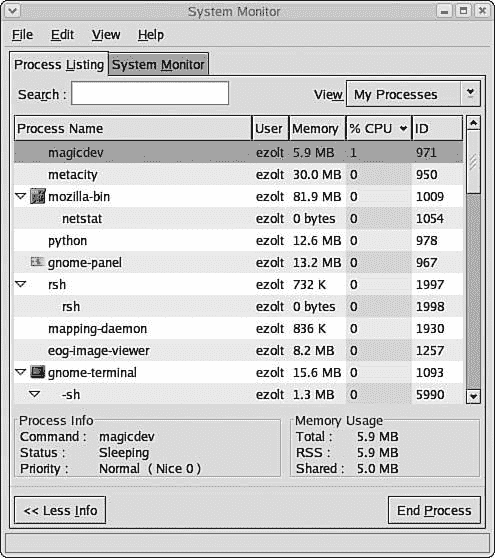
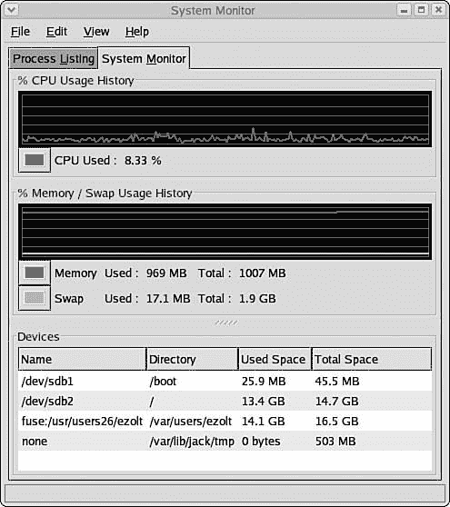
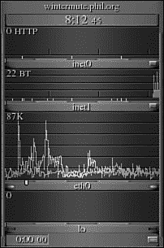
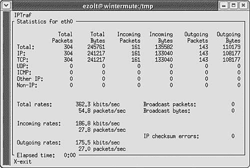
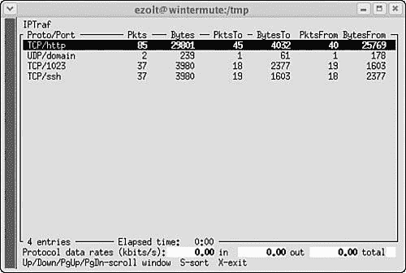
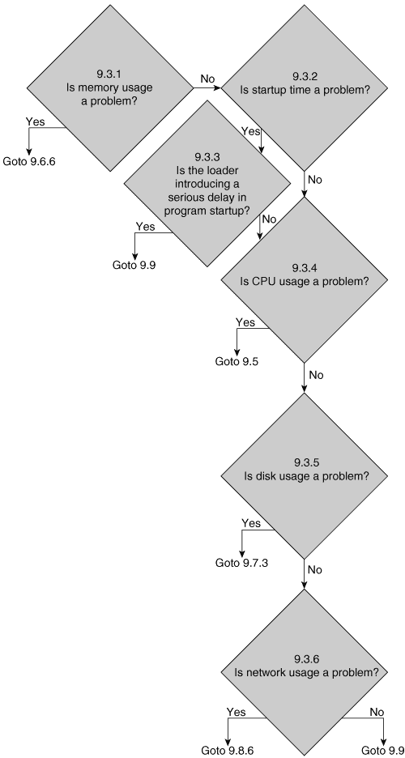

# 优化 Linux 性能：Linux 性能工具实用指南

## 版权

[www.hp.com/hpbooks](http://www.hp.com/hpbooks)

制造商和销售为了区分其产品而使用的许多标记均被声明为商标。当这些标记出现在书中且出版者已知商标声明时，这些标记将以首字母大写或全大写的形式打印。

作者和出版者在编写本书时付出了努力，但不作任何形式的明示或隐含保证，并不对错误或遗漏承担任何责任。对于与本文包含的信息或程序有关或由此引起的附带或间接性损害，不承担任何责任。

批量购买或特殊销售时，出版者对本书提供优惠的折扣，这可能包括电子版本和/或针对您的业务、培训目标、营销重点和品牌兴趣的定制封面和内容。欲了解更多，请联系：

> 美国企业与政府销售部  
> (800) 382-3419  
> corpsales@pearsontechgroup.com

美国以外的销售请联系：

> 国际销售部  
> international@pearsoned.com

访问我们的网站：[www.phptr.com](http://www.phptr.com)

美国国会目录号：2004117118

版权 © 2005 Hewlett-Packard Development Company, L.P.

保留所有权利。印刷于美国。本出版物受版权保护，在进行任何禁止的复制、存储在检索系统中或以任何形式或通过任何（电子、机械、复印、录音或类似手段）传输之前，必须获得出版者的许可。有关许可的信息，请写信至：

> Pearson Education, Inc.  
> 权利与合同部门  
> One Lake Street  
> Upper Saddle River, NJ 07458

文字在印第安纳州克劳福兹维尔 RR Donnelley & Sons 公司使用再生纸在美国印制。

第一次印刷，2005 年 3 月

## 献辞

本书献给我的妻子 Sarah（世界上最好的），她为了让这本书的诞生放弃了如此多的周末。感谢！感谢！感谢！

## 前言

- 为什么性能很重要？
- Linux：优势与劣势
- 本书如何帮助你？
- 为什么要学习如何使用性能工具？
- 我可以针对性能进行调优吗？
- 谁应该读这本书？
- 本书是如何组织的？

### 为什么性能很重要？

如果你曾经坐着等电脑完成某事（一边敲桌子，一边咒骂，一边想着：“为什么花这么长时间？”），你就知道拥有一个快速且调优良好的计算机系统有多重要。尽管并不是所有的性能问题都能轻松解决，但理解为什么运行缓慢可能意味着可以在软件中修复问题、升级缓慢的硬件，或者干脆把整台电脑扔出窗外。幸运的是，大多数操作系统（特别是 Linux）都提供了查明机器运行缓慢原因的工具。通过使用几个基本工具，你可以确定系统在何处变慢并修复运行效率低的部分。

虽然系统缓慢对终端用户来说特别烦恼，但应用程序开发者有更重要的理由对应用程序进行性能调优：高效的应用程序运行在更多的系统上。如果你编写了需要快速电脑运行的缓慢应用程序，你就排除了那些拥有较慢电脑的客户。毕竟，并不是每个人都有最新的硬件。调优良好的应用程序可以被更多客户使用，从而产生更大的潜在用户群。此外，如果潜在客户必须在两个功能类似的不同应用程序之间做出选择，他们通常会选择运行更快或更高效的那一个。最后，一个生命周期长的应用程序可能会经过几轮优化以应对不同的客户需求，因此知道如何追踪性能问题至关重要。

如果你是系统管理员，你对系统用户有责任，要确保其运行在适当的性能水平。如果系统运行缓慢，用户就会抱怨。如果你能快速确定问题并修复它，他们就会停止抱怨。作为额外，如果你能通过调优应用程序或操作系统来解决他们的问题（从而使他们无需购买新硬件），你就让公司的财务人员感到高兴。知道如何有效地使用性能工具可能意味着在解决性能问题上花费几天时间还是几小时的区别。

### Linux：优势与劣势

如果你使用 Linux、维护 Linux 并在其上开发，你就处于一种奇特但良好的境地。你拥有以前所未有的权限访问源代码、开发者和邮件列表，这些列表通常在决策做出多年后仍记录设计决策。Linux 是发现和修复性能问题的极佳环境。这与专有环境形成了对比，在专有环境中，很难直接接触软件开发人员，可能很难找到关于大多数设计决策的书面讨论，而且几乎无法访问源代码。除了这个高效的环境外，Linux 还拥有强大的性能工具，让你能够发现并修复性能问题。这些工具可以与相应的专有工具相媲美。

尽管有这些印象深刻的优点，Linux 生态系统仍然面临需要克服的挑战。Linux 性能工具散布各地。具有不同目标的群体开发这些工具，结果是工具并不一定位于集中位置。有些工具包含标准的 Linux 发行版（如 Red Hat、SUSE 和 Debian）中，而另一些散落在整个网上。如果你试图解决性能问题，首先需要知道需要的工具，然后确定在哪里找到它们。由于没有单一性能工具可以解决所有类型的性能问题，你还必须学会如何联合使用。这可能像是一门艺术，但随着经验的积累会变得容易。虽然大多数通用策略都有记录，但 Linux 并没有任何指南告诉你如何汇总性能工具来实际解决问题。

### 本书如何帮助你？

你将从书中学到很多，包括以下内容：

- 各种性能工具测量什么
- 如何使用每个工具
- 如何结合工具解决性能问题
- 如何从性能低下的系统开始并定位问题
- 这些方法如何解决现实世界的问题（案例研究）

通过书中的方法，你可以编写一份组织良好且诊断清晰的问题描述，并将其交给原始开发者。如果你足够幸运，他们会为你解决问题。

### 为什么要学习如何使用性能工具？

为什么应该花精力去调优系统或应用程序？

- 调优良好的系统可以用更少的资源完成更多工作。
- 调优良好的应用程序可以在旧硬件上运行。
- 调优良好的桌面系统可以为用户节省时间。
- 调优良好的服务器可以为更多用户提供更高质量的服务。

如果你知道如何有效地诊断性能问题，就可以采取针对性的方法来解决问题，而不是仅仅盲目摸索并寄希望于运气。如果你是一名应用程序开发者，这意味着你可以快速确定是哪部分代码导致了问题。如果你是一名系统管理员，这意味着你可以确定系统的哪个部分需要调优或升级，而不会在徒目尝试不同解决方案上浪费时间。如果你是一个终端用户，你可以找出哪些应用程序运行缓慢，并向开发者报告该问题（或在必要时更新你的硬件）。

Linux 已经到了一个十字路口。一个高效生产系统的大部分功能已经完成。下一个进化步骤是让 Linux 及其应用程序进行调优，以竞争并超越其他操作系统的性能。其中一些性能优化已经开始。例如，`SAMBA`、`Apache` 和 `TUX` Web 服务器项目通过大量的时间投入，对系统和代码进行了调优和优化。其他的性能优化——例如极大提高了线程性能的`Native POSIX Thread Library`（`NPTL`）以及提高应用程序启动时间的对象预链接（object prelinking），才开始集成到 Linux 中。Linux 亟需改进。

## 我可以进行性能调优吗？

性能优化的最棒之处在于，你不需要了解整个应用程序或系统的细节就能有效地修复性能问题。性能优化需要一套与典型应用程序开发者互补的技能。

你需要保持敏锐和坚持。寻找并消除性能问题需要的是侦探的特质而非程序员的特质。发现并修复这些问题是令人兴奋的。当你开始时，性能可能非常糟糕。然而，一旦你追踪到原因并将其从根源上拔除，如果你运气好，系统运行速度就会快一倍。大搞定！（Voilà!）

为了达到“大搞定”的状态，你必须理解 Linux 性能工具这个强大但有时令人困惑的世界。这需要一些努力，但最终是值得的。这些工具可以向你展示你从未预料到的应用程序和系统方面。

## 谁应该读这本书？

本书帮助 Linux 软件开发者、系统管理员和终端用户使用 Linux 性能工具寻找特定系统中的性能问题。初级性能调查员学习性能调查和分析的基础知识。中高级性能调查员（特别是那些在其他专有操作系统上具有性能经验的人）将学习他们可能已经熟悉的其他系统的 Linux 等效命令。

软件开发者学习如何准确定导致性能问题的精确代码行。正在对系统进行性能调优的系统管理员学习显示系统为何变慢的工具，然后可以使用这些信息来调优系统。最后，尽管这不是本书的重点，但终端用户将学习必要的技能，以确定哪些应用程序消耗了所有的系统资源。

## 本书是如何组织的？

本书教授不同经验水平的读者寻找并修复性能问题。为了实现这一点，章节的安排允许你选择阅读书的不同部分，而不需要从头到尾读完整本书。

`第 1 章`](#ch01.html_ch01）专门介绍寻找性能问题的基本方法。它包含一系列并非特定于 Linux 的技巧和建议，这些技巧对于追踪性能问题被证明非常有用。这些指南是寻找性能问题的通用建议，可以应用于追踪任何类型计算机系统的性能问题。

`第 2 章`](#ch02.html_ch02）到`第 8 章`](#ch08.html_ch08）（本书的主体）涵盖了用于在 Linux 系统上测量不同性能统计数据的各种可用工具。这些章节解释了各种工具测量的内容、如何调用它们，并提供了每个工具的使用示例。每个章节都演示了测量不同 Linux 子系统方面（如系统 CPU、用户 CPU、内存、网络 I/O 和磁盘 I/O）的工具。如果一个工具测量多个子系统的方面，它将出现在多个章节中。每个章节描述了多个工具，但在给章节中仅介绍适用于特定系统的适当工具选项。描述遵循以下格式：

1. 介绍——这一部分解释了该工具旨在测量的内容以及它是如何工作的。
2. 性能工具选项——这一部分不仅仅是重述工具的文档。相反，它解释了哪些选项与当前主题相关，以及这些选项的含义。例如，某些性能工具的手页识别了工具测量的事件，但没有解释这些事件的含义。本部分解释了事件的含义以及它们与当前子系统的相关性。
3. 示例——这一部分提供了一个或多个使用工具测量性能统计数据的示例。该部分展示了工具的调用及其生成的任何输出。

`第 9 章`](#ch09.html_ch09）是 Linux 特有的，包含了在面对运行缓慢的 Linux 系统时使用的系列步骤。它解释了如何协作使用之前提到的 Linux 性能工具来准确定性能问题的原因。如果你想从一个异常的 Linux 系统开始，并且在不一定理解工具细节的情况下仅诊断问题，那么这一章是最有用的。`第 10 章`](#ch10.html_ch10）到`第 12 章`](#ch12.html_ch12）介绍了案例研究，其中之前描述的方法和工具被结合使用来解决现实问题。案例研究突出了用于发现和修复不同类型性能问题的 Linux 性能工具：CPU 密集型应用程序、延迟敏感应用程序和 I/O 密集型应用程序。

`第 13 章`](#ch13.html_ch13）概述了性能工具以及 Linux 改进的机会。

本书两个附录。`附录 A`](#app01.html_app01）包含了讨论的性能工具表，并包含了每个工具最新版本的 URL。`附录 A`](#app01.html_app01）还标识了哪些 Linux 发行版支持每个工具。最后，`附录 B`](#app02.html_app02）包含了说明如何安装`oprofile`的信息，在某些这是一个非常强大但难以安装的工具。

## 致谢

首先，我要感谢 Prentice Hall 的优秀同仁，包括 Jill Harry、Brenda Mulligan、Gina Kanouse 和 Keith Cline。

其次，我要感谢所有审查了最初书籍提案并增加了宝贵技术评审和建议的人，包括 Karel Baloun、Joe Braal、Bill Carr、Jonathan Corbet、Matthew Crosby、Robert Husted、Paul Lussier、Scott Mann、Bret Strong 和 George Vish II。我还要感谢所有教我性能相关知识并让我优化 Linux 的人，尽管在当时 Linux 优化的价值还尚不确定，包括 John Henning、Greg Tarsa、Dave Stanley、Greg Gaertner、Bill Carr 以及整个 BPE 工具组（他们支持并鼓励了我在 Linux 上的工作）。

此外，我要感谢 SPEC 的好朋友们，他们接纳了我，并教会我为什么良好的基准测试有助于整个行业。我特别想感谢 Kaivalya Dixit，他对基准测试的热情和正直将令我深表怀念。

同时也感谢所有通过玩多局《卡卡索隆》和《卡坦之岛》帮助我保持理智的人，包括 Sarah Ezolt、Dave 和 Yoko Mitzel、Tim 和 Maureen Chorma、Ionel 和 Marina Vasilescu、Joe Doucette 以及 Jim Zawisza。

最后，我想感谢我的家人，包括 Sasha 和 Mischief，他们提醒我我们总有时间散步或追逐牙线（*指宠物*）；Ron 和 Joni Elias，他们一直为我加油；Russell、Carol 和 Tracy Ezolt，在我创作本书期间给予了支持和鼓励；还有我的妻子 Sarah，她是你能想象到的最理解你、最能支持你的人。

## 关于作者

PHIL EZOLT 在九多年前，当他正在卡内基基梅梅隆大学攻读电气与计算机工程本科士学位时，发现了 Linux。在六年的时间里，他为 Compaq 的 Alpha 性能小组移植并设计了 Linux 性能工具，并在 SPEC CPU 子委员会中代表 Compaq。在此期间，他利用自己移植和开发的性能工具，提升了 Linux 在行业标准 SPEC Web 和 CPU 基准测试中的性能。Phil 目前是惠尔惠（Hewlett-Packard）一个团队的一员，负责开发 Sepia，一种使用 Linux XC 集群、OpenGL 和现成显卡来实现实时高端可视化的可视化技术。他目前正在哈佛大学攻读计算机科学硕士学位，并且是德国桌游游戏的忠粉丝。

# 第 1 章 性能猎寻技巧

在没有预见和规划的情况下解决性能问题是痛苦的。你会浪费时间，并因为问题原因反复从指缝中溜走而感到沮丧。通过遵循一套正确的程序，你可以将一次令人沮丧的性能猎寻转变为一个有趣的侦探故事。每一条信息都会引导你更接近真魁祸首。人并不总是值得信赖，证据将是你唯一的朋友。在你调查问题时，它会经历不常的转折，你在猎寻初期发现的信息可能正是最终帮你解决问题的关键。最棒的部分是，当你最终抓住“坏蛋”并修复问题时，你会感到肾上腺素飙升的快感和成就感。

如果你从未调查过性能问题，第一步可能会让你无从下手。然而，通过遵循一些显而易见和不显而易见的技巧，你可以节省时间，并顺利找到性能问题的原因。本章的目标是为你提供一系列技巧和指南，帮助你猎寻性能问题。这些技巧向你展示了在调查系统或应用程序问题时如何避免一些常见的陷阱。这些技巧大部分是从浪费时间和沮丧的死胡同中获得的痛苦教训。这些技巧将帮助你快速高效地解决性能问题。

阅读完本章后，你应该能够：

- 避免重复他人的工作。
- 避免重复自己的工作。
- 避免因收集误导性信息而导致的错误线索。
- 就你的调查创建一个有用的参考文档。

尽管没有任何性能调查是完美的（你几乎总是会说，“要是我当初早能想到那个就好了”），但这些技巧可以帮助你避免性能调查中的常见错误。

## 1.1 通用技巧

### 1.1.1 记录大量的笔记（保存一切）

在调查性能问题时，你可能做的最重要的事情就是记录你看到的每一个输出、执行的每一条命令以及你研究的每一条信息。一组组织良好的笔记让你只需通过查看笔记来测试关于性能问题原因的理论，而无需重新运行测试。这节省了大量时间。写下来以创建一个永久记录。

在开始性能调查时，我通常会为调查创建一个目录，在 GNU emacs 中打开一个新的“Notes”文件，并开始记录有关系统的信息。然后将性能结果存储在该目录中，并将相关的有趣信息存储在 Notes 文件中。我建议你将以下内容添加到你的性能调查文件和目录：

- 记录硬件/软件配置——这涉及记录硬件配置信息（内存容量、CPU 类型、网络和磁盘子系统）以及软件环境（操作系统和软件版本以及相关的配置文件）。这些信息以后似乎很容易复现，但在追溯问题时，你可能会大幅更改系统的配置。细致且严谨的笔记可以用于确定特定测试期间的系统配置。

  示例：为每次测试保存`cat /proc/pci`、`dmesg`和`uname -a`的输出。

- 保存并组织性能结果——在运行测试很长时间之后回顾性能结果是有价值的。记录带有系统配置的测试结果。这让你能够比较不同配置如何影响性能结果。如果需要，重新运行测试是可能的，但通常测试一种配置是一个耗时的过程。保持笔记组织良好并避免重复工作会更有效。

- 写下命令行调用——当你运行性能工具时，你经常会创建复杂的命令行，测量你感兴趣的系统特定区域。如果你想重新运行测试，或在不同的应用程序上运行相同的测试，重现这些命令行可能会令人烦恼，而且很难第一次就做对。最好记录你输入的准确内容。你就可以为未来的测试重现完全相同的命令行，在回顾过去结果时，也能清楚地看到你测量了什么。Linux 命令`script`（在第 8 章，“实用工具：性能工具辅助器”中进行了详细描述）或从终端“剪切粘贴”都是实现此操作的好方法。

- 记录研究信息和 URL——在调查性能问题时，记录你在互联网、电子邮件或通过个人互动发现的相关信息是重要的。如果你发现一个看起来相关的网站，将文本剪切粘贴到你的笔记中。（网站可能会消失。）不过，也要保存 URL，因为你可能以后需要查看该页面，或者该页面指向后来变得重要的信息。

当你收集并记录所有这些信息时，你可能会怀疑这是否值得精力。有些信息现在看起来没用或具有误导性，但将来可能很有用。（一次良好的性能调查就像一部好的侦探剧：尽管线索起初很困惑，但一切最终变得明朗。）在调查问题时请记住以下几点：

> 结果的含义可能是模糊的——性能工具并不总是告诉你什么。有时，你需要更多信息来理解特定结果的含义。在以后，你可能会以新的视角重新审视看似无用的测试结果。旧信息实际上可能会反驳或证明关于问题性质的特定理论。

> 所有信息都是有用信息（这就是你保存它们的原因）——保存运行过的测试或系统配置信息立即可能并不明显。当你试图向开发人员或经理解释为什么系统性能低下时，这会证明极有用。通过记录和组织你在调查期间看到的一切，你拥有了支持特定理论的证据，并有一个大量的测试结果库来证明或反驳其他理论。


定期回顾你的笔记可以提供新的见解——当你拥有关于性能问题的大量信息时，请定期对其进行回顾。以全新的视角审视可以让你关注结果，而不是测试本身。当许多测试结果被聚合并同时审查时，问题的原因可能会显现出来。回顾你所收集的数据，可以让你在不实际运行任何测试的情况下测试某些理论。

尽管在调查问题时，重新做某些工作是不可避免的，但你花在重复旧工作上的时间越少，效率就越高。如果你记录了详尽的笔记，并拥有一种方法在发现信息时进行记录，你就可以依靠已经完成的工作，避免重新运行测试和重新研究。为了节省时间并避免沮丧，请保持可靠且一致的笔记。

例如，如果你调查了一个性能问题，并最终确定原因是某件硬件（内存慢、CPU 慢等），你可能想通过升级该慢硬件并重新运行测试来验证这一理论。获取新硬件通常需要一段时间，在能够重新运行测试之前，可能会过去很长时间。当你终于能够进行操作时，你希望能够在新旧硬件上运行相同的测试。如果你保存了旧的测试调用和测试结果，你将立即知道如何为新硬件配置测试，并将新结果与存储的旧结果进行比较。

### 1.1.2. 自动化冗余任务

当你开始调整系统以提高性能时，在输入复杂的命令时很容易出错。无意中使用错误的参数或配置可能会产生误导性的性能信息。自动化性能工具的调用和应用程序测试是一个好主意：

> 性能工具调用——某些 Linux 性能工具需要相当复杂的命令行。为自己省省心，将它们存储在 shell 脚本中，或者将完整的命令放在一个参考文件中，以便你复制和粘贴。这可以节省你的沮丧感，并让你确定你调用工具时使用的命令行是正确的。

> 应用程序测试——大多数应用程序通过命令行或配置文件具有复杂的配置。你经常需要多次运行你正在测试的应用程序。如果你对调用进行脚本化，就能避免沮丧。虽然输入一个 30 个字符的命令起初看起来很容易，但在执行过 10 次之后，你就会感激自动化的了。

如果你尽可能地实现自动化，就会减少错误。通过脚本自动化可以节省时间，并帮助避免由不当的工具和测试调用导致的误导信息。

例如，如果你正尝试在特定的工作负载或时间范围内监控系统，你可能在测试结束时不在现场。拥有一个脚本是有帮助的，该脚本可以在测试完成后自动收集、命名并保存所有生成的性能数据，并自动将其放在`Results`目录中。一旦配备了这种基础设施，你就可以使用不同的优化和调优重新运行测试，而无需担心数据是否会被保存。相反，你可以将全部精力放在寻找问题原因上，而不是管理测试结果。

### 1.1.3. 如果可能，选择低开销工具

通常情况下，观察系统的行为会改变其行为。（对于你们物理爱好者来说，这被称为海森堡不确定原理。）

具体来说，当使用性能工具时，它们会改变系统运行的方式。当你调查问题时，你想看到应用程序的性能，并且处理性能工具引入的误差。这是必要的代价，但你必须知道它的存在并尝试将其最小化。某些性能工具提供了系统的高精度视图，但使用了高开销的方法获取信息。开销极高的工具对系统行为的影响比低开销工具大得多。如果你只需要系统的粗略视图，那么使用开销较低的工具更好，尽管它们没有那么准确。

例如，`ps`工具可以给你关于应用程序正在使用的内存数量和类型的相当不错但粗略的概述。更准确但侵入性强的工具，如`memprof`或`valgrind`也提供这些信息，但它们可能会通过比原始应用程序消耗更多的内存或 CPU 来改变系统行为。

### 1.1.4. 使用多个工具理解问题

虽然如果只需要一个工具就能找出性能问题的原因，那将是非常方便的，但这种情况极少见。相反，你使用的每个工具都提供了一个关于问题原因的线索，你必须协作使用多个工具才能真正理解发生了什么。例如，一个性能工具可能会告诉你系统有高量的磁盘 I/O，而另一个工具可能显示系统正在使用大量的交换分区（swap）。如果你仅根据第一个工具的结果得出解决方案，你可能只是买了一个更快的硬盘驱动器（并发现性能问题仅略有改善）。然而，通过结合使用工具，你确定了大量的磁盘 I/O 是由于使用了大量的交换引起的。在这种情况下，你可能通过购买更多内存来减少交换（从而导致高磁盘 I/O 消失）。

结合使用多个性能工具通常能给你提供比任何单一工具都更清晰的性能问题图景。

## 盲人摸象的寓言

三个盲人靠近一头大象，试图弄清楚它长什么样。第一个人拉着尾巴说：“大象像根绳子。”第二个人摸着大象的腿说：“大象像一棵树。”第三个人摸着大象的侧面说：“大象像一面坚固的墙。”

显然，他们中没有给出正确的答案。然而，如果他们分享并结合自己的印象，他们可能会发现关于大象的真相。不要像摸象的盲人那样。使用多个性能工具来验证问题的原因。

### 1.1.5. 信任你的工具

在性能搜寻过程中，最激动也最沮丧的时刻之一就是工具显示出“不可能”的结果。某些“不可能”发生的事情确实发生了。第一直觉是相信工具坏了。不要被欺骗。工具是公正的。尽管它们可能是错误的，但更有可能是应用程序正在做它不该做的事情。使用工具来调查问题。

例如，Gnome 计算器仅为了启动和退出就使用了 2000 多次系统调用。如果没有性能工具来证明这一事实，仅仅启动和停止一个应用程序似乎需要如此多的系统调用是不可能的。然而，性能工具可以显示这是在哪里发生以及为什么发生的。

### 1.1.6. 使用他人的经验（谨慎地）

在调查任何性能问题时，你可能会发现任务困难重重。不要单打独斗。询问开发者他们是否见过类似的问题。尝试找到已经解决你正在经历的问题的人。在 Web 上搜索类似的问题并找到解决方案。向用户列表和开发者发送电子邮件。

这条建议伴随着一个警告：即使是那些认为自己了解其应用的开发者，也并不总是正确的。如果开发者与性能工具的数据不一致，那么可能是开发者错了。向开发者展示你的数据以及你得出特定结论的依据。他们通常会帮助你重新解释数据或修复问题。无论何种，你的调查工作都会更进一步。如果你的数据显示发生了不该发生的事情，不要害怕与开发者持不同意见。

例如，你通常可以通过在 Google 上搜索相似问题并遵循找到的指令来解决性能问题。在调查 Linux 问题时，很多时候你会发现其他人以前遇到过相同的问题（即使是多年前），并在公共邮件列表上报告了解决方案。使用 Google 是很容易的，它可以为你节省好几天的工作时间。

## 1.2 性能调查的概述

本节概述了在你开始性能调查时的一系列基本步骤。由于最终目标是解决问题，最好的主意是在接触任何性能工具之前先对问题进行研究。遵循特定的方案是解决问题的一种高效方法，可以避免浪费宝贵的时间。

### 1.2.1 确定指标、基准和目标

性能调查的第一步是确定当前的性能，并弄清楚需要改进多少。如果你的系统性能远低于预期，你可能会认为值得花时间调查。然而，如果系统性能接近其峰值，那么它可能不值得调查。确定峰值性能值有助于你设定合理的性能预期，并为你提供一个性能目标，让你知道何时停止优化。你总是可以对系统进行更多微调，但如果没有性能目标，你可能会浪费大量时间去榨取那额外的百分之几的性能，尽管你可能并不需要它。

### 1.2.1.1 建立指标

要确定何时完成，你必须创建或使用一个已经建立的系统性能指标。指标是一个指示系统运行情况的客观测量。例如，如果你正在优化 Web 服务器，你可以选择“每秒处理的 Web 请求数”。如果你没有客观的方法来衡量性能，那么在调整系统时，几乎无法确定你是否取得了任何进展。

### 1.2.1.2 建立基准

在你确定了将如何衡量特定系统或应用的性能后，确定当前的性能水平是至关重要的。在进行任何调优或优化之前，运行应用程序并记录其性能；这被称为基准值，是性能调查的起点。

### 1.2.1.3 建立目标

在你选定性能指标和基准后，选择一个目标也同样重要。这个目标将引导你走向性能的终点。你可以无限地微调系统，随着时间的增加，你总能让它变得好一点点。如果你选择了目标，你就会知道何时完成。要设定一个合理的目标，以下是一些良好的起点：

*   寻找具有相似配置的人并询问他们的性能测量值——这是一个理想的情况。如果你能找到一个运行得更好的相似系统，你不仅可以为你的系统选择一个目标，还可能与那个人合作，确定为什么你的配置较慢以及你们的配置有何不同。在调查问题时，使用另一个系统作为参考可能极其有用。

*   查找行业标准基准测试的结果——许多网站会比较计算系统各个方面的基准测试结果。某些基准测试结果只有通过巨大的努力才能实现，因此它们可能不代表实际的使用情况。然而，许多基准测试网站提供了获得特定结果时使用的配置。这些配置可以为你帮助调优系统提供线索。

*   使用不同操作系统或应用程序运行你的硬件——在你的系统上运行功能类似的不同应用程序可能是可能的。例如，如果你有两个不同的 Web 服务器，其中一个运行缓慢，尝试换另一个看看它的性能是否更好。或者，尝试在不同的操作系统上运行同一个应用程序。如果系统在上述任一情况下运行得更好，你就知道你的原始应用程序有改进空间。

如果你使用现有的性能信息来指导你的目标，你就有更大的机会选择一个既具有挑战性又并非不可能的目标。

## 获取“低垂的果实”（Low-Hanging Fruit）

性能搜索的另一种方法是为搜索选择一段时间，而不是设定目标，而是在这段时间内尽可能地优化。如果一个应用程序从未针对给定的工作负载进行过优化，它通常会有几个相对容易修复的问题。这些容易修复的问题被称为“低垂的果实”。

为什么是“低垂的果实”？性能调查的一个类比是想象你饿了，站在一棵苹果树下。你可能会去抓离地面最近、最容易够到的苹果。这些低垂的苹果满足你饥饿的效果与树上更高处难以够到的苹果一样好；然而，采摘它们的工作要少得多。同样，如果你在有限的时间内优化应用程序，你可能只需尝试修复最简单明显的问题（低垂的果实），而不是进行一些更困难、更根本的改变。

### 1.2.2 追踪大致问题

使用性能工具初步判断问题的原因。通过对问题进行初步的粗略评估，你可以获得关于问题的高层级概念。粗略评估的目标是收集足够的信息以传递给该程序的其他用户和开发者，以便他们提供建议和技巧。写一份良好的说明，解释你认为问题可能是什么，以及哪些测试让你得出了结论，是至关重要的。

### 1.2.3 查看问题是否已经解决

你的下一个目标应该是确定其他人是否已经解决了该问题。性能调查可能是一个漫长且耗时的过程。如果你可以直接复用他人的工作，你会在开始之前就完成。因为你的目标仅仅是提高系统性能，解决性能问题的最佳方法是依靠他人的做法。

尽管你对关于性能问题的具体建议持保留态度，但这些建议可以启发你，让你看到其他人可能是如何调查类似问题的，他们尝试如何解决问题，以及是否成功了。

以下是几个寻找性能建议的途径：

*   在网络上搜索类似的错误信息/问题——这通常是我调查的第一线。网络搜索通常会揭示有关应用程序或你所看到的特定错误状况的大量信息。它们还可以引导你找到其他用户优化系统的信息，并可能关于哪些方法有效、哪些无效提供提示。成功的搜索可以产生直接适用于你的性能问题的页面。使用 Google 或 Google Groups 进行搜索是寻找具有相似性能问题的人特别有用的方法。

*   **在应用程序邮件列表中寻求帮助**——大多数流行或公开开发的软件都有一个使用该软件的人员邮件列表。这是寻找性能问题答案的理想场所。读者和贡献者通常在运行软件和使其性能良好方面非常有经验。搜索邮件列表的归档，因为可能有人曾问过类似的问题。原始消息的后续回复可能会描述解决方案。如果没有提供，请向最初描述该问题的人发送电子邮件，询问他或她是否已经想出了解决方法。如果这种方法不奏效，或者没有其他人遇到过类似的问题，请向该邮件列表发送一封描述你问题的电子邮件；如果你足够幸运，可能已经有人解决了你的问题。

*   **向开发者发送电子邮件**——大多数 Linux 软件的文档某处都包含了开发者的电子邮件地址。如果互联网搜索和邮件列表都失败了，你可以尝试直接向开发者发送电子邮件。开发者通常非常忙，所以他们可能没有时间回答。然而，他们比任何人都了解该应用程序。如果你能为开发者提供一份关于性能问题的连贯分析，并愿意与开发者合作，他或她可能能够帮助你。虽然他们对性能问题原因的判断可能不正确，但开发者可能会为你指明一个富有成果的方向。

*   **与内部开发者交流**——最后，如果这是一个在内部开发的程序，你可以打电话或给内部开发者发送电子邮件。这与联系外部开发者几乎完全相同，但内部人员可能能够为你的问题投入更多时间，或者引导你查看内部知识库。

通过依靠他人的工作，你可能在自己开始调查之前就能解决问题。至少，你很可能找到一些值得调查的可靠途径，因此最好的方法始终是看看别人发现了什么。

### 1.2.4. 案件开始（开始调查）

既然你已经耗尽了让他人解决问题的可能性，那么性能调查必须开始了。后面的章节将详细介绍相关的工具和方法，但这里有几个让工作进行得更好的小技巧：

-   **隔离问题**——如果可能，请消除你正在调查的系统上运行的任何无关程序或应用程序。一个运行着许多不同应用程序的高负载系统会偏偏性能工具收集的信息，并最终导致你走入错误的道路。

-   **利用系统差异寻找原因**——如果你能找到一个运行良好的类似系统，它将成为你调试问题的有力助手。使用性能工具的问题之一是，你并不一定有一种好的方法来判断性能工具的结果是否指示了某个问题。如果你有一个良好的系统和一个糟糕的系统，你可以在两个系统上运行相同的性能工具并比较结果。如果结果存在差异，你可能通过找出系统之间的差异来确定问题的原因。

-   **一次改变一处**——这非常重要。为了真正确定问题所在，你每次应该只进行一种更改。这可能很耗时间，并导致你运行许多不同的测试，但这确实是确定你是否已经解决问题的唯一方法。

-   **优化后务必重新测量**——如果你正在调整系统，在更改某些内容后重新测量一切是非常至关重要的。当你开始修改系统配置时，你之前生成的所有性能信息可能不再有效了。通常，当你解决一个性能问题时，其他问题会接踵而至。新问题可能与旧问题非常不同，所以你真的必须重新运行性能工具，以确保你正在调查正确的问题。

遵循这些提示可以帮助你避免误导线索，并帮助确定性能问题的原因。

### 1.2.5. 记录、记录、记录

如前提到的，记录你所做的事情非常重要，以便你日后可以回来进行审查。如果你找出了性能问题，你的脑中会有一大堆笔记和 URL。它们可能是一团混乱无章的杂乱，但目前你理解它们的含义以及组织方式。在解决问题后，花些时间重写你发现的内容以及你为什么认为它是正确的。包含你测量的性能结果和你所做的实验。尽管这看起来工作量很大，但它可能非常有价值。几个月后，很容易忘记你做过的所有测试，如果你不写下结果，你最终可能会重做一遍。如果你在测试记忆新鲜时编写报告，你就不需要再次做这些工作，而是可以依靠你写的内容。

### 1.3. 章节总结

寻找性能问题应该是一个令人满意且兴奋的过程。如果你有一套良好的方法来研究和分析，那么在搜寻问题时，这种方法将获得数倍的回报。首先，确定其他人是否遇到过类似的问题；如果有，尝试他们的解决方案。对他们告诉你的内容保持怀疑态度，但要寻找其他具有类似问题经验的人士。为你的性能搜寻建立一个合理的指标和目标；指标使你能够知道何时完成任务。自动化性能测试。在生成测试结果时，务必保存测试结果和配置信息，以便你稍后查看结果。保持你的结果整洁，并记录你发现的与问题相关的任何研究和其他信息。最后，定期查看你的笔记，以发现你第一次可能错过的信息。如果你遵循这些准则，你将有一个清晰的目标和清晰的程序来调查问题。

本章为性能调查提供了基础背景，后续章节将涵盖 Linux 特有的性能工具。你将学习如何使用这些工具，它们可以提供什么类型的信息，以及如何结合使用它们发现特定系统上的性能问题。

在 Linux 中，进程可以是可运行的（runnable），也可以是阻塞的（blocked）等待某个事件完成。阻塞进程可能在等待来自 I/O 设备的数据，或者等待系统调用的结果。如果一个进程是可运行的，意味着它正在与其他同样可运行的进程竞争 CPU 时间。可运行的进程并不一定正在使用 CPU，但当 Linux 调度器决定下一个运行哪个进程时，它会从可运行进程列表中进行选择。当这些进程处于运行状态但等待使用处理器时，它们形成了一个被称为“运行队列”（run queue）的队列。运行队列越长，等待的进程就越多。

性能工具通常会显示可运行进程的数量以及等待 I/O 的阻塞进程数量。另一个常见的系统统计数据是“平均负载”（load average）。系统的负载是正在运行和可运行的进程数量总和。例如，如果有两个进程正在运行，有三个进程可以运行，那么系统的负载就是五。平均负载是给定时间内的负载量。通常，平均负载是按 1 分钟、5 分钟和 15 分钟计算的。这让你能够看到负载随时间变化的情况。

## 2.1.2 上下文切换（Context Switches）

大多数处理器一次只能运行一个进程或线程。虽然某些处理器（如超线程处理器）实际上可以同时运行多个进程，但 Linux 将它们视为多个单线程处理器。为了营造出某个单处理器同时运行多个任务的幻象，Linux 内核不断在不同进程之间进行切换。不同进程之间的切换被称为“上下文切换”，因为当切换发生时，CPU 会保存旧进程的所有上下文信息，并检索新进程的所有上下文信息。上下文包含了 Linux 为每个进程跟踪的大量信息，包括但不限于：该进程正在执行哪条指令、分配了哪些内存，以及该进程打开了哪些文件。切换这些上下文可能涉及大量信息的移动，上下文切换的开销可能相当大。如果可能，尽量减少上下文切换次数是一个好主意。

为了避免上下文切换，了解它们是如何发生的非常重要。首先，上下文切换可能源于内核调度。为了确保每个进程都能获得公平的 CPU 时间，内核会定期中断正在运行的进程，并且如果合适，内核调度器会决定启动另一个进程而不是让当前进程继续执行。你的系统可能会在每次发生周期性中断或定时器中断时发生上下文切换。每秒的定时器中断次数因架构和内核版本而异。检查中断触发频率的一种简单方法是使用`/proc/interrupts`文件来确定在已知时间内发生的中断次数。这在列表 2.1 中有所演示。

#### 列表 2.1

```
root@localhost asm-i386]# cat /proc/interrupts | grep timer

; sleep 10 ; cat /proc/interrupts | grep timer

  0:   24060043          XT-PIC  timer

  0:   24070093          XT-PIC  timer 
```


在列表 2.1 中，我们请求内核显示定时器触发了多少次，等待 10 秒，然后再次请求。这意味着在该机器上，定时器的触发速率为 `(24,070,093 – 24,060,043) 中断 / (10 秒)`，或约每秒 1,000 次中断。如果你发现上下文切换次数远多于定时器中断，那么上下文切换最可能是由 I/O 请求或其他长时间的系统调用（如 `sleep`）引起的。当应用程序请求无法立即完成的操作时，内核会启动该操作，保存请求的进程，并在有其他就绪进程时尝试切换到另一个进程。这使得处理器尽可能保持忙碌。

### 2.1.3 中断（Interrupts）

此外，处理器会定期接收来自硬件设备的中断。这些中断通常由具有内核处理事件的设备触发。例如，如果磁盘控制器刚刚完成从驱动器检索一个数据块并准备好让内核使用，磁盘控制器可能会触发一个中断。对于内核接收到的每个中断，如果已经注册了该中断的处理程序，就会运行该程序；否则，中断将被忽略。这些中断处理程序在系统中以非常高的优先级运行，通常执行非常快。有时，中断处理程序需要完成工作但不需要高优先级，因此它会启动一个“下半部”（bottom half），也称为软中断处理程序（soft-interrupt handler）。如果中断数量很多，内核可能会花费大量时间处理这些中断。可以通过检查 `/proc/interrupts` 文件来查看哪些 CPU 正在触发哪些中断。

### 2.1.4 CPU 利用率

CPU 利用率是一个直观的概念。在任何给定时刻，CPU 都在执行以下七件事之一：第一，它可以是空闲（idle），这意味着处理器实际上没有在做任何工作，正在等待要做的事。其次，CPU 可以正在运行用户代码，这被指定为“用户”（user）时间。第三，CPU 可以代表应用程序代码执行 Linux 内核中的代码。这是“系统”（system）时间。第四，CPU 可以执行经过 `nice` 处理或设置为以低于正常进程优先级运行的用户代码。第五，CPU 可以处于 `iowait` 状态，这意味着系统正在等待 I/O。第六，CPU 可以处于 `irq` 状态，意味着它正处于高优先级内核代码中处理中断。最后，CPU 可以处于 `softirq` 模式，意味着它正在执行同样由中断触发的内核代码，但其运行优先级较低（下半部）。

大多数性能工具将这些值指定为总 CPU 时间的百分比。这些时间范围从 0% 到 100% 不等，但所有三项总和为 100%。“系统”百分比高的系统将其大部分时间花在了内核中。如 `oprofile` 等工具可以帮助确定这些时间花在了哪里。“用户”时间高的系统将其大部分时间花在了运行应用程序上。下一章将展示如何使用性能工具追踪这些情况下的问题。如果系统在应该工作时大部分时间都处于 `iowait` 状态，它很可能在等待来自某个设备的 I/O。可能是磁盘、网卡或其他设备导致了变慢。

## 2.2 Linux 性能工具：CPU

从这里开始，我们将讨论使你能够提取前述描述的信息的性能工具。

### 2.2.1 vmstat（虚拟内存统计）

`vmstat` 是 virtual memory statistics（虚拟内存统计）的缩写，这意味着它将为你提供有关系统虚拟内存性能的信息。幸运的是，它的功能远不止于此。`vmstat` 是一个获取系统整体性能概况的极佳命令。它可以告诉你：

*   有多少进程正在运行
*   CPU 如何使用
*   CPU 接收到多少中断
*   调度器执行了多少上下文切换

`vmstat` 可以以两种模式运行：采样模式和平均模式。如果没有指定参数，`vmstat` 将以平均模式运行，此时显示自系统启动以来所有统计数据的平均值。然而，如果指定了延迟，第一个样本将是自系统启动以来的平均值，之后 `vmstat` 将每隔指定的延迟秒对系统进行采样并打印统计信息。表 2-1 所示，如果运行 `vmstat` 时没有任何参数，它将显示自系统启动以来记录的统计数据的平均值。此示例显示系统自启动以来几乎处于空闲状态，如 `us`、`sys`、`wa` 和 `id` CPU 使用列所示。CPU 自启动以来有 5% 的时间用于用户应用代码，1% 用于系统代码，其余 94% 为空闲。

##### 列表 2.2.

```
[ezolt@scrffy tmp]$ vmstat

procs -----------memory---------- ---swap-- -----io---- --system-- ----cpu----
r  b   swpd   free   buff  cache   si   so    bi    bo   in    cs us sy id wa
1  0 181024  26284  35292 503048    0    0     3     2    6      1  5  1 94  0
```

虽然 `vmstat` 自系统启动以来的统计数据对于确定机器负载程度很有用，但 `vmstat` 在采样模式下运行最有用，如列表 2.3 所示。在采样模式下，`vmstat` 在经过了 `delay` 参数指定的秒数后打印系统统计数据。它会进行多次此类采样计数。列表 2.3 中的第一行统计数据包含自启动以来的系统平均值（如之前所示），但之后继续周期性采样。此示例显示系统上活动非常少。我们可以通过查看 `b` 列中的 0 看到运行期间没有进程被阻塞。我们还可以通过查看 `r` 列发现，当 `vmstat` 采样数据时运行的进程少于 1 个。

##### 列表 2.3.

```
[ezolt@scrffy tmp]$ vmstat 2 5

procs  -----------memory---------- ---swap-- -----io---- --system-- ----cpu----
r  b    swpd   free   buff  cache   si   so    bi    bo   in    cs us sy id wa
1  0  181024  26276  35316 502960    0    0     3     2    6     1  1  1 94  0
1
```

下一章将讨论内存统计，但我们现在来看 CPU 统计。第一组统计数据，或称为“CPU 节拍”（CPU ticks），显示了 CPU 自系统启动以来消耗的时间，其中一个“节”是一个时间单位。尽管精简的 `vmstat` 输出只显示了四种 CPU 状态——`us`、`sy`、`id` 和 `wa`——但这显示了所有 CPU 节拍的分布情况。此外，我们还可以看到中断和上下文切换的总数。一个新增的是 `forks`，它基本上是自系统启动以来创建的新进程数量。

##### 列表 2.5.

```
[ezolt@scrffy ~/edid]$ vmstat -s

      1034320  total memory
       998712  used memory
       698076  active memory
       176260  inactive memory
        35608  free memory
        26592  buffer memory
       324312  swap cache
      2040244  total swap
       201060  used swap
      1839184  free swap
      5279633 non-nice user cpu ticks
     28207739 nice user cpu ticks
      2355391 system cpu ticks
    628297350 idle cpu ticks
       862755 IO-wait cpu ticks
           34 IRQ cpu ticks
      1707439 softirq cpu ticks
     21194571 pages paged in
     12677400 pages paged out
        93406 pages swapped in
       181587 pages swapped out
 1931462143 interrupts
    785963213 CPU context switches
   1096643656 boot time
       578451 forks
```

`vmstat` 提供了关于 Linux 系统性能的广泛信息。它是调查和排查系统问题时使用的核心工具之一。

### 2.2.2. top (v. 2.0.x)

`top` 是 Linux 系统监控工具中的“瑞士军刀”。它很好地在一个屏幕上显示了大量的系统级性能信息。你显示的内容也可以通过交互进行更改；因此，如果系统在运行时出现某个特定问题，你可以修改 `top` 向你显示的内容。

默认情况下，`top` 会按从高到低的顺序列出 CPU 消耗率最高的进程列表。这让你能够快速定位是哪个程序在占用 CPU。`top` 会根据你指定的延迟定期更新列表。（初始时间为 3 秒。）

### 2.2.2.1 与 CPU 性能相关的选项

`top` 通过以下命令行调用：

```
top [d delay] [C] [H] [i] [n iter] [b]
```

`top` 实际上在两种模式下接受选项：命令行选项和运行时选项。命令行选项决定了 `top` 如何显示其信息。表 2-3 显示了影响 `top` 显示的性能统计类型和频率的命令行选项。

##### 表 2-3. `top` 命令行选项

| 选项 | 解释 |
| :--- | :--- |
| `d delay` | 统计更新之间的延迟。 |
| `n iterations` | 退出前的迭代次数。`top` 会更新 `iterations` 次统计数据。 |
| `i` | 不显示未使用任何 CPU 的进程。 |
| `H` | 显示应用程序的所有单个线程，而不是仅显示每个应用程序的总计。 |
| `C` | 在超线程或 SMP 系统中，显示累加的 CPU 统计数据，而不是每个 CPU 的统计数据。 |

当你运行 `top` 时，你可能想要微调正在观察的内容以调查特定问题。`top` 的输出是高度可自定义的。表 2-4 描述了在 `top` 运行期间更改显示统计数据的选项。

##### 表 2-4.

| 选项 | 解释 |
| :--- | :--- |
| `f` 或 `F` | 显示一个配置屏幕，允许你选择哪些进程统计显示在屏幕上。 |
| `o` 或 `O` | 显示一个配置屏幕，允许你更改显示统计数据的顺序。 |

表 2-5 中描述的选项开启或关闭各种系统级信息的显示。关闭不需要的统计数据对于在屏幕上容纳更多进程是有帮助的。

##### 表 2-5. `top` 运行时输出切换

| 选项 | 解释 |
| :--- | :--- |
| `l` | 切换负载平均和运行时间信息是否会更新并显示。 |
| `t` | 切换显示每个 CPU 如何分配时间。它还会切换有关当前正在运行多少个进程的信息。显示应用程序的所有单个线程，而不是仅显示每个应用程序的总计。 |
| `m` | 切换屏幕上是否显示有关系统内存使用的信息。默认情况下显示。 |

表 2-6 描述了 `top` 支持的不同模式。

##### 表 2-6. `top` 输出排序

| 选项 | 解释 |
| :--- | :--- |
| `P` | 按 CPU 使用率排序任务。最高的在前。 |
| `T` | 按年龄排序任务。最新的在前。 |
| `N` | 按使用率排序任务。最高的在前。 |
| `A` | 按年龄排序任务。最新的在前。 |

表 2-7 涵盖了这些统计数据。

##### 表 2-7. `top` 统计数据

| 选项 | 解释 |
| :--- | :--- |
| `us` | 在用户花费的时间。 |
| `sy` | 在内核花费的时间。 |
| `ni` | 在 "nice" 进程花费的时间。 |
| `id` | 空闲时间。 |
| `wa` | 等待 I/O 时间。 |
| `hi` | 在 `irq` 中花费的时间。 |
| `si` | 在 `softirq` 中花费的时间。 |
| `load average` | 过去 1、5、15 分钟的负载平均值。 |
| `%CPU` | 特定进程消耗的 CPU 百分比。 |
| `PRI` | 进程的优先级值，值越高优先级越高。 |
| `RT` | 表示任务具有实时优先级，优先级高于标准。 |
| `NI` | 进程的 nice 值。nice 值越高，系统执行进程的时间越少。 |
| `WCHAN` | 如果进程正在等待 I/O，此处显示它正在等待哪个函数。 |
| `STAT` | 进程的当前状态，其中进程处于睡眠（S）、运行（R）、僵尸状态（已杀死但未死亡，即 Z）、不可中断睡眠（D）或正在被跟踪（T）。 |
| `TIME` | 自启动以来该进程已使用的总 CPU 时间（用户和系统）。 |
| `COMMAND` | 该进程正在执行的命令。 |
| `LC` | 该进程上次执行的 CPU 编号。 |
| `FLAGS` | 切换负载平均和运行时间信息是否会更新并显示。 |

`top` 提供了关于不同运行进程的大量信息，是找出哪个程序是资源大者的极佳方法。

### 2.2.2.2 使用示例

列表 2.6 是 `top` 的运行示例。一旦它启动，它就会定期更新屏幕直到你退出。这演示了 `top` 可以生成的一些系统级统计数据。首先，我们看到过去 1、5、15 分钟系统的负载平均值。正如我们看到的，系统最近变得忙碌了（因为 `doom-3.x86`）。一个 CPU 在 90% 的时间内都在处理用户代码。另一个 CPU 只花费约 13% 的时间处理用户代码。最后，我们可以看到 73 个进程处于睡眠状态，只有 3 个进程正在运行。

##### 列表 2.6.

```
catan> top

 08:09:16  up 2 days, 18:44,  4 users,  load average: 0.95, 0.44, 0.17
76 processes: 73 sleeping, 3 running, 0 zombie, 0 stopped
CPU states:  cpu    user    nice  system    irq  softirq  iowait    idle
           total   51.5%    0.0%    3.9%   0.0%     0.0%    0.0%   44.6%
           cpu00   90.0%    0.0%    1.2%   0.0%     0.0%    0.0%    8.8%
           cpu01   13.0%    0.0%    6.6%   0.0%     0.0%    0.0%   80.4%
Mem:  2037140k av, 1132120k used,  905020k free,       0k shrd,   86220k buff
       689784k active,             151528k inactive
Swap: 2040244k av,       0k used, 2040244k free                 322648k cached

  PID USER     PRI  NI  SIZE  RSS SHARE STAT %CPU %MEM   TIME CPU COMMAND
 7642 root      25   0  647M 379M  7664 R    49.9 19.0   2:58   0 doom.x86
 7661 ezolt     15   0  1372 1372  1052 R     0.1  0.0   0:00   3 top
    1 root      15   0   528  528   452 S     0.0  0.0   0:05   1 init
    2 root      RT   0     0    0     0 SW    0.0  0.0   0:00   1 migration/0
    3 root      RT   0     0    0     0 SW    0.0  0.0   0:00   1 migration/1
    4 root      15   0     0    0     0 SW    0.0  0.0   0:00   0 keventd
    5 root      34  19     0    0     0 SWN   0.0  0.0   0:00   0 ksoftirqd/0
    6 root      34  19     0    0     0 SWN   0.0  0.0   0:00   1 ksoftirqd/1
    9 root      25   0     0    0     0 SW    0.0  0.0   0:00   0 bdflush
    7 root      15   0     0    0     0 SW    0.0  0.0   0:00   0 kswapd
    8 root      15   0     0    0     0 SW    0.0  0.0   0:00   1 kscand
   10 root      15   0     0    0     0 SW    0.0  0.0   0:00   1 kupdated
   11 root      25   0     0    0     0 SW    0.0  0.0   0:00   0 mdrecoveryd
```


在运行`top`的运行时按下`F`键，会显示如列表 2.7 所示的配置屏幕。当你按下指示按键（`A`代表`PID`、`B`代表`PPID`等）时，`top`会切换这些统计数据是否在之前的屏幕中显示。选定所有所需的统计数据后，按`Enter`返回`top`的初始屏幕，现在会显示所选统计数据的当前值。在配置统计数据时，所有当前激活的字段在“当前字段顺序”行中大大写，并在名称旁有一个星号（`*`）。

### 列表 2.7

```
 [ezolt@wintermute doc]$ top

(运行期间按 'F')

   Current Field Order: AbcDgHIjklMnoTP|qrsuzyV{EFWX

使用 a-z 切换字段，按任何键返回:

* A: PID        = 进程 ID

  B: PPID       = 父进程 ID

  C: UID        = 用户 ID

* D: USER       = 用户名

* E: %CPU       = CPU 使用率

* F: %MEM       = 内存使用率

  G: TTY        = 控制 tty

* H: PRI        = 优先级

* I: NI         = Nice 值

  J: PAGEIN     = 缺页错误计数

  K: TSIZE      = 代码大小 (kb)
  L: DSIZE      = 数据+栈大小 (kb)
* M: SIZE       = 虚拟镜像大小 (kb)
  N: TRS        = 驻留文本大小 (kb)
  O: SWAP       = 交换 kb
* P: SHARE      = 共享页 (kb)

  Q: A          = 访问页计数

  R: WP         = 写保护页

  S: D          = 脏页

* T: RSS        = 驻留集大小 (kb)

  U: WCHAN      = 睡眠

* V: STAT       = 进程

* W: TIME       = CPU

* X: COMMAND    = 命令

  Y: LC         = 上次使用（预计经常变化）

  Z: FLAGS      = 任务（参见 sched.h）
```

为了向你展示`top`的可定制程度，列表 2.8 显示了一个高度配置的输出，它只显示与 CPU 使用率相关的`top`选项。

### 列表 2.8

```
08:16:23  up 2 days, 18:52,  4 users,  load average: 1.07, 0.92, 0.49
76 processes: 73 sleeping, 3 running, 0 zombie, 0 stopped
CPU states:  cpu    user    nice  system    irq  softirq  iowait    idle
           total   48.2%    0.0%    1.5%   0.0%     0.0%    0.0%    50.1%
           cpu00   48.2%    0.0%    0.1%   0.0%     0.0%    0.0%    9.8%
           cpu01   13.0%    0.0%    6.6%   0.0%     0.0%    0.0%   80.4%
           :000..10000000000000000000000%
Mem: 2037140k av, 1132120k used, 905020k free, 0 shrd,    86220k buff
689784k active,             151528k inactive
Swap: 2040244k av,       0k used, 2040244k free                 322648k cached
  PID USER     PRI  NI  SIZE  RSS SHARE STAT %CPU %MEM   TIME CPU COMMAND
 7642 root      25   0  647M 379M  7664 R    49.9 19.0   2:58   0 doom.x86
 7661 ezolt     15   0  1372 1372  1052 R     0.1  0.0   0:00   3 top
    1 root      15   0   528  528   452 S     0.0  0.0   0:05   1 init
    2 root      RT   0     0    0     0 SW    0.0  0.0   0:00   1 migration/0
    3 root      RT   0     0    0     0 SW    0.0  0.0   0:00   1 migration/1
    4 root      15   0     0    0     0 SW    0.0  0.0   0:00   0 keventd
    5 root      34  19     0    0     0 SWN   0.0  0.0   0:00   0 ksoftirqd/0
    6 root      34  19     0    0     0 SWN   0.0  0.0   0:00   1 ksoftirqd/1
    9 root      25   0     0    0     0 SW    0.0  0.0   0:00   0 bdflush
    7 root      15   0     0    0     0 SW    0.0  0.0   0:00   0 kswapd
    8 root      15   0     0    0     0 SW    0.0  0.0   0:00   1 kscand
   10 root      15   0     0    0     0 SW    0.0  0.0   0:00   1 kupdated
   11 root      25   0     0    0     0 SW    0.0  0.0   0:00   0 mdrecoveryd 
```

为了向你展示`top`的可定制程度，列表 2.8 显示了一个高度配置的输出，它只显示与 CPU 使用率相关的`top`选项。

### 列表 2.8

```
08:16:23  up 2 days, 18:52,  4 users,  load average: 1.07, 0.92, 0.49
76 processes: 73 sleeping, 3 running, 0 zombie, 0 stopped
CPU states:  cpu    user    nice  system    irq  softirq  iowait    idle
           total   48.2%    0.0%    1.5%   0.0%     0.0%    0.0%    50.1%
           cpu00   48.2%    0.0%    0.1%   0.0%     0.0%    0.0%    9.8%
           cpu01   13.0%    0.0%    6.6%   0.0%     0.0%    0.0%   80.4%
           :000000000000000000000000%
Mem: 2037140k av, 1132120k used, 905020k free, 0 shrd,    86220k buff
689784k active,             151528k inactive
Swap: 2040244k av,       0k used, 2040244k free                 322648k cached
  PID USER     PRI  NI  SIZE  RSS SHARE STAT %CPU %MEM   TIME CPU COMMAND
 7642 root      25   0  647M 379M  7664 R    49.9 19.0   2:58   0 doom.x86
 7661 ezolt     15   0  1372 1372  1052 R     0.1  0.0   0:00   3 top
    1 root      15   0   528  528   452 S     0.0  0.0   0:05   1 init
    2 root      RT   0     0    0     0 SW    0.0  0.0   0:00   1 migration/0
    3 root      RT   0     0    0     0 SW    0.0  0.0   0:00   1 migration/1
    4 root      15   0     0    0     0 SW    0.0  0.0   0:00   0 keventd
    5 root      34  19     0    0     0 SWN   0.0  0.0   0:00   0 ksoftirqd/0
    6 root      34  19     0    0     0 SWN   0.0  0.0   0:00   1 ksoftirqd/1
    9 root      25   0     0    0     0 SW    0.0  0.0   0:00   0 bdflush
    7 root      15   0     0    0     0 SW    0.0  0.0   0:00   0 kswapd
    8 root      15   0     0    0     0 SW    0.0  0.0   0:00   1 kscand
   10 root      15   0     0    0     0 SW    0.0  0.0   0:00   1 kupdated
   11 root      25   0     0    0     0 SW    0.0  0.0   0:00   0 mdrecoveryd 
```

在`top`运行时按下`F`键，会显示如列表 2.7 所示的配置屏幕。当你按下指示的按键（`A`代表`PID`、`B`代表`PPID`等）时，`top`会切换这些统计数据是否在之前的屏幕中显示。选定所有所需的统计数据后，按`Enter`返回`top`的初始屏幕，现在会显示所选统计数据的当前值。在配置统计数据时，所有当前激活的字段在“当前字段顺序”行中大大写，并在名称旁有一个星号（`*`）。

### 列表 2.7

```
 [ezolt@wintermute doc]$ top

(运行期间按 'F')

   Current Field Order: AbcDgHIjklMnoTP|qrsuzyV{EFWX

使用 a-z 切换字段，按任何其他键返回:

* A: PID        = 进程 ID

  B: PPID       = 父进程 ID

  C: UID        = 用户 ID

* D: USER       = 用户名

* E: %CPU       = CPU 使用率

* F: %MEM       = 内存使用率

  G: TTY        = 控制 tty

* H: PRI        = 优先级

* I: NI         = Nice 值

  J: PAGEIN     = 缺页错误计数

  K: TSIZE      = 代码大小 (kb)
  L: DSIZE      = 数据+栈大小 (kb)
* M: SIZE       = 虚拟镜像大小 (kb)
  N: TRS        = 驻留文本大小 (kb)
  O: SWAP       = 交换 kb
* P: SHARE      = 共享页 (kb)

  Q: A          = 访问页计数

  R: WP         = 写保护页

  S: D          = 脏页

* T: RSS        = 驻留集大小 (kb)

  U: WCHAN      = 睡眠

* V: STAT       = 进程

* W: TIME       = CPU

* X: COMMAND    = 命令

  Y: LC         = 上次使用（预计经常变化）

  Z: FLAGS      = 任务（参见 sched.h）
```

为了向你展示`top`的可定制程度，列表 2.8 显示了一个高度配置的输出，它只显示与 CPU 使用率相关的`top`选项。

### 列表 2.8


```
08:16:23  up 2 days, 18:52,  4 users,  load average: 1.07, 0.92, 0.49
76 processes: 73 sleeping, 3 running, 0 zombie, 0 stopped
CPU states:  cpu    user    nice  system    irq  softirq  iowait    idle
           total   48.2%    0.0%    1.5%   0.0%     0.0%    0.0%    50.1%
           cpu00   48.2%    0.0%    0.1%   0.0%     0.0%    0.0%    9.8%
           cpu01   13.0%    0.0%    6.6%   0.0%     0.0%    0.0%   80.4%
           :000000000000000000000000%
Mem: 2037140k av, 1132120k used, 905020k free, 0 shrd,    86220k buff
689784k active,             151528k inactive
Swap: 2040244k av,       0k used, 2040244k free                 322648k cached
  PID USER     PRI  NI  SIZE  RSS SHARE STAT %CPU %MEM   TIME CPU COMMAND
 7642 root      25   0  647M 379M  7664 R    49.9 19.0   2:58   0 doom.x86
 7661 ezolt     15   0  1372 1372  1052 R     0.1  0.0   0:00   3 top
    1 root      15   0   528  528   452 S     0.0  0.0   0:05   1 init
    2 root      RT   0     0    0     0 SW    0.0  0.0   0:00   1 migration/0
    3 root      RT   0     0    0     0 SW    0.0  0.0   0:00   1 migration/1
    4 root      15   0     0    0     0 SW    0.0  0.0   0:00   0 keventd
    5 root      34  19     0    0     0 SWN   0.0  0.0   0:00   0 ksoftirqd/0
    6 root      34  19     0    0     0 SWN   0.0  0.0   0:00   1 ksoftirqd/1
    9 root      25   0     0    0     0 SW    0.0  0.0   0:00   0 bdflush
    7 root      15   0     0    0     0 SW    0.0  0.0   0:00   0 kswapd
    8 root      15   0     0    0     0 SW    0.0  0.0   0:00   1 kscand
   10 root      15   0     0    0     0 SW    0.0  0.0   0:00   1 kupdated
   11 root      25   0     0    0     0 SW    0.0  0.0   0:00   0 mdrecoveryd
```

这将显示一个配置屏幕，允许你更改显示的统计数据的顺序。

表 2-10 中描述的选项可以开启或关闭各种系统级信息的显示。关闭不需要的统计数据有助于让屏幕容纳更多进程。

### 表 2-10. `top` 运行时输出切换开关

| 选项 | 解释 |
| :--- | :--- |
| `1 (数字 1)` | 切换 CPU 使用率是细分到单个进程的使用率还是显示为总量。 |
| `l` | 切换负载平均值（load average）和运行时间（uptime）信息是否更新并显示。 |

`top v3.x` 除了类似于 `top v2.x` 的特定进程信息外，提供了系统级信息。这些统计数据在表 2-11 中。

### 表 2-11. `top` 性能统计数据

| 选项 | 解释 |
| :--- | :--- |
| `us` | 在用户应用程序中花费的 CPU 时间。 |
| `sy` | 在内核中花费的 CPU 时间。 |
| `ni` | 在“nice” 值的进程中花费的 CPU 时间。 |
| `id` | 空闲时花费的 CPU 时间。 |
| `wa` | 等待 I/O 时花费的 CPU 时间。 |
| `hi` | 在 `irq` 处理程序中花费的 CPU 时间。 |
| `si` | 在 `softirq` 处理程序中花费的 CPU 时间。 |
| `load average` | 1 分钟、5 分钟和 15 分钟的负载平均值。 |
| `%CPU` | 特定进程消耗的 CPU 百比。 |
| `PRI` | 进程的优先级值，值越高表示优先级越高。`RT` 表示任务具有实时优先级，该优先级高于标准范围。 |
| `NI` | 进程的 nice 值。nice 值越高，系统执行该进程的就越少。高 nice 值进程倾向于有非常低的优先级。 |
| `WCHAN` | 如果进程正在等待 I/O，此处显示它正在哪个内核函数中等待。 |
| `TIME` | 该进程自开始执行以来使用的总 CPU 时间（用户和系统时间）。 |
| `COMMAND` | 该进程正在执行的命令。 |
| `S` | 进程的当前状态，进程处于睡眠（`S`）、运行（`R`）、僵尸状态（已杀死但尚未死亡）（`Z`）、不可中断睡眠（`D`）或正在被追踪（`T`）。 |

`top` 提供了大量关于不同运行进程的信息，是确定哪个进程是资源消耗大户的极佳方法。v.3 版本的 `top` 简化了 `top` 并添加了一些类似数据的备选视图。

### 2.2.3.2 示例用法

列表 2.9 是 `top` v3.0 的示例运行。再次，它会定期更新屏幕，直到你退出。这些统计数据与 `top` v2.x 类似，但命名略有不同。

#### 列表 2.9.


```
catan> top

top - 08:52:21 up 19 days, 21:38, 17 users, load average: 1.06, 1.13, 15
Tasks: 149 total, 0 running, 146 sleeping, 0 zombie
Cpu(s): 0.8% us, 0.4% sy, 4.2% ni, 94.2% id, 0.1% wa, 0.0% hi, 0.3% si
Mem: 103420k total, 1023188k used, 11132k free, 39920k buffers
Swap: 2040244k total, 214496k used, 1825748k free, 335488k cached
  PID USER      PR  NI    VIRT  SHR %CPU %MEM     TIME  COMMAND
  26364 root      16    0 400m  68m   S   3.8  6.8 0:32.04 X
  26737 ezolt     15    0 71288  45m   S   1.9  4.5 0:32.04 gnome-terminal
  29114 ezolt     15    0 34000  22m   S   1.9  2.2 0:57.62 gnome-system-mo
   9581 ezolt     15    0  2808 1028 R   1.9  0.1 0:00.03 top
      1 root      16    0  2396  448 1316 S   0.0  0.0 0:01.68 init
      2 root      RT     0    0      0 S   0.0  0.0 0:00.68 migration/0
      3 root      34 1    0      0 S   0.0  0.0 0:00.00 kthreadd
      4 root      16    0  2396  448 1316 S   0.0  0.0 0:01.68 kworker/u2:1
      5 root      16    0      0      0 S   0.0  0.0 0:00.00 kworker/u2:2
      6 root      16    0      0      0 S   0.0  0.0 0:00.00 kworker/u2:3
      7 root      16    0      0      0 S   0.0  0.0 0:00.00 kworker/u2:4
      8 root      16    0      0      0 S   0.0  0.0 0:00.00 kworker/u2:5
      9 root      16    0      0      0 S   0.0  0.0 0:00.00 kworker/u2:6
     10 root      16    0      0      0 S   0.0  0.0 0:00.00 kworker/u2:7
     11 root      16    0      0      0 S   0.0  0.0 0:00.00 kworker/u2:8
     12 root      16    0      0      0 S   0.0  0.0 0:00.00 kworker/u2:9
     13 root      16    0      0      0 S   0.0  0.0 0:00.00 kworker/u2:10
     14 root      16    0      0      0 S   0.0  0.0 0:00.00 kworker/u2:11
     15 root      16    0      0      0 S   0.0  0.0 0:00.00 kworker/u2:12
     16 root      16    0      0      0 S   0.0  0.0 0:00.00 kworker/u2:13
     17 root      16    0      0      0 S   0.0  0.0 0:00.00 kworker/u2:14
     18 root      16    0      0      0 S   0.0  0.0 0:00.00 kworker/u2:15
     19 root      16    0      0      0 S   0.0  0.0 0:00.00 kworker/u2:16
     20 root      16    0      0      0 S   0.0  0.0 0:00.00 kworker/u2:17
     21 root      16    0      0      0 S   0.0  0.0 0:00.00 kworker/u2:18
     22 root      16    0      0      0 S   0.0  0.0 0:00.00 kworker/u2:19
     23 root      16    0      0      0 S   0.0  0.0 0:00.00 kworker/u2:20
     24 root      16    0      0      0 S   0.0  0.0 0:00.00 kworker/u2:21
     25 root      16    0      0      0 S   0.0  0.0 0:00.00 kworker/u2:22
     26 root      16    0      0      0 S   0.0  0.0 0:00.00 kworker/u2:23
     27 root      16    0      0      0 S   0.0  0.0 0:00.00 kworker/u2:24
     28 root      16    0      0      0 S   0.0  0.0 0:00.00 kworker/u2:25
     29 root      16    0      0      0 S   0.0  0.0 0:00.00 kworker/u2:26
     30 root      16    0      0      0 S   0.0  0.0 0:00.00 kworker/u2:27
     31 root      16    0      0      0 S   0.0  0.0 0:00.00 kworker/u2:28
     32 root      16    0      0      0 S   0.0  0.0 0:00.00 kworker/u2:29
     33 root      16    0      0      0 S   0.0  0.0 0:00.00 kworker/u2:30
     34 root      16    0      0      0 S   0.0  0.0 0:00.00 kworker/0
     35 root      16    0      0      0 S   0.0  0.0 0:00.00 kworker/u2:31
     36 root      16    0      0      0 S   0.0  0.0 0:00.00 kworker/u2:32
     37 root      16    0      0      0 S   0.0  0.0 0:00.00 kworker/u2:33
     38 root      16    0      0      0 S   0.0  0.0 0:00.00 kworker/u2:34
     39 root      16    0      0      0 S   0.0  0.0 0:00.00 kworker/u2:35
     40 root      16    0      0      0 S   0.0  0.0 0:00.00 kworker/u2:36
     41 root      16    0      0      0 S   0.0  0.0 0:00.00 kworker/u2:37
     42 root      16    0      0      0 S   0.0  0.0 0:00.00 kworker/u2:38
     43 root      16    0      0      0 S   0.0  0.0 0:00.00 kworker/u2:39
     44 root      16    0      0      0 S   0.0  0.0 0:00.00 kworker/u2:40
     45 root      16    0      0      0 S   0.0  0.0 0:00.00 kworker/u2:41
     46 root      16    0      0      0 S   0.0  0.0 0:00.00 kworker/u2:42
     47 root      16    0      0      0 S   0.0  0.0 0:00.00 kworker/u2:43
     48 root      16    0      0      0 S   0.0  0.0 0:00.00 kworker/u2:44
     49 root      16    0      0      0 S   0.0  0.0 0:00.00 kworker/u2:45
     50 root      16    0      0      0 S   0.0  0.0 0:00.00 kworker/u2:46
     51 root      16    0      0      0 S   0.0  0.0 0:00.00 kworker/u2:47
     52 root      16    0      0      0 S   0.0  0.0 0:00.00 kworker/u2:48
     53 root      16    0      0      0 S   0.0  0.0 0:00.00 kworker/u2:49
     54 root      16    0      0      0 S   0.0  0.0 0:00.00 kworker/u2:50
     55 root      16    0      0      0 S   0.0  0.0 0:00.00 kworker/u2:51
     56 root      16    0      0      0 S   0.0  0.0 0:00.00 kworker/u2:52
     57 root      16    0      0      0 S   0.0  0.0 0:00.00 kworker/u2:53
     58 root      16    0      0      0 S   0.0  0.0 0:00.00 kworker/u2:54
     59 root      16    0      0      0 S   0.0  0.0 0:00.00 kworker/u2:55
     60 root      16    0      0      0 S   0.0  0.0 0:00.00 kworker/u2:56
     61 root      16    0      0      0 S   0.0  0.0 0:00.00 kworker/u2:57
     62 root      16    0      0      0 S   0.0  0.0 0:00.00 kworker/u2:58
     63 root      16    0      0      0 S   0.0  0.0 0:00.00 kworker/u2:59
     64 root      16    0      0      0 S   0.0  0.0 0:00.00 kworker/u2:60
     65 root      16    0      0      0 S   0.0  0.0 0:00.00 kworker/u2:61
     66 root      16    0      0      0 S   0.0  0.0 0:00.00 kworker/u2:62
     67 root      16    0      0      0 S   0.0  0.0 0:00.00 kworker/u2:63
     68 root      16    0      0      0 S   0.0  0.0 0:00.00 kworker/u2:64
     69 root      16    0      0      0 S   0.0  0.0 0:00.00 kworker/u2:65
     70 root      16    0      0      0 S   0.0  0.0 0:00.00 kworker/u2:66
     71 root      16    0      0      0 S   0.0  0.0 0:00.00 kworker/u2:67
     72 root      16    0      0      0 S   0.0  0.0 0:00.00 kworker/u2:68
     73 root      16    0      0      0 S   0.0  0.0 0:00.00 kworker/u2:69
     74 root      16    0      0      0 S   0.0  0.0 0:00.00 kworker/u2:70
     75 root      16    0      0      0 S   0.0  0.0 0:00.00 kworker/u2:71
     76 root      16    0      0      0 S   0.0  0.0 0:00.00 kworker/u2:72
     77 root      16    0      0      0 S   0.0  0.0 0:00.00 kworker/u2:73
     78 root      16    0      0      0 S   0.0  0.0 0:00.00 kworker/u2:74
     79 root      16    0      0      0 S   0.0  0.0 0:00.00 kworker/u2:75
     80 root      16    0      0      0 S   0.0  0.0 0:00.00 kworker/u2:76
     81 root      16    0      0      0 S   0.0  0.0 0:00.00 kworker/u2:77
     82 root      16    0      0      0 S   0.0  0.0 0:00.00 kworker/u2:78
     83 root      16    0      0      0 S   0.0  0.0 0:00.00 kworker/u2:79
     84 root      16    0      0      0 S   0.0  0.0 0:00.00 kworker/u2:80
     85 root      16    0      0      0 S   0.0  0.0 0:00.00 kworker/u2:81
     86 root      16    0      0      0 S   0.0  0.0 0:00.00 kworker/u2:82
     87 root      16    0      0      0 S   0.0  0.0 0:00.00 kworker/u2:83
     88 root      16    0      0      0 S   0.0  0.0 0:00.00 kworker/u2:84
     89 root      16    0      0      0 S   0.0  0.0 0:00.00 kworker/u2:85
     90 root      16    0      0      0 S   0.0  0.0 0:00.00 kworker/u2:86
     91 root      16    0      0      0 S   0.0  0.0 0:00.00 kworker/u2:87
     92 root      16    0      0      0 S   0.0  0.0 0:00.00 kworker/u2:88
     93 root      16    0      0      0 S   0.0  0.0 0:00.00 kworker/u2:89
     94 root      16    0      0      0 S   0.0  0.0 0:00.00 kworker/u2:90
     95 root      16    0      0      0 S   0.0  0.0 0:00.00 kworker/u2:91
     96 root      16    0      0      0 S   0.0  0.0 0:00.00 kworker/u2:92
     97 root      16    0      0      0 S   0.0  0.0 0:00.00 kworker/u2:93
     98 root      16    0      0      0 S   0.0  0.0 0:00.00 kworker/u2:94
     99 root      16    0      0      0 S   0.0  0.0 0:00.00 kworker/u2:95
    100 root      16    0      0      0 S   0.0  0.0 0:00.00 kworker/u2:96
    101 root      16    0      0      0 S   0.0  0.0 0:00.00 kworker/u2:97
    102 root      16    0      0      0 S   0.0  0.0 0:00.00 kworker/u2:98
    103 root      16    0      0      0 S   0.0  0.0 0:00.00 kworker/u2:99
    104 root      16    0      0      0 S   0.0  0.0 0:00.00 kworker/u2:100
    105 root      16    0      0      0 S   0.0  0.0 0:00.00 kworker/u2:101
    106 root      16    0      0      0 S   0.0  0.0 0:00.00 kworker/u2:102
    107 root      16    0      0      0 S   0.0  0.0 0:00.00 kworker/u2:103
    108 root      16    0      0      0 S   0.0  0.0 0:00.00 kworker/u2:104
    109 root      16    0      0      0 S   0.0  0.0 0:00.00 kworker/u2:105
    110 root      16    0      0      0 S   0.0  0.0 0:00.00 kworker/u2:106
    111 root      16    0      0      0 S   0.0  0.0 0:00.00 kworker/u2:107
    112 root      16    0      0      0 S   0.0  0.0 0:00.00 kworker/u2:108
    113 root      16    0      0      0 S   0.0  0.0 0:00.00 kworker/u2:109
    114 root      16    0      0      0 S   0.0  0.0 0:00.00 kworker/u2:110
    115 root      16    0      0      0 S   0.0  0.0 0:00.00 kworker/u2:111
    116 root      16    0      0      0 S   0.0  0.0 0:00.00 kworker/u2:112
    117 root      16    0      0      0 S   0.0  0.0 0:00.00 kworker/u2:113
    118 root      16    0      0      0 S   0.0  0.0 0:00.00 kworker/u2:114
    119 root      16    0      0      0 S   0.0  0.0 0:00.00 kworker/u2:115
    120 root      16    0      0      0 S   0.0  0.0 0:00.00 kworker/u2:116
    121 root      16    0      0      0 S   0.0  0.0 0:00.00 kworker/u2:117
    122 root      16    0      0      0 S   0.0  0.0 0:00.00 kworker/u2:118
    123 root      16    0      0      0 S   0.0  0.0 0:00.00 kworker/u2:119
    124 root      16    0      0      0 S   0.0  0.0 0:00.00 kworker/u2:120
    125 root      16    0      0      0 S   0.0  0.0 0:00.00 kworker/u2:121
    126 root      16    0      0      0 S   0.0  0.0 0:00.00 kworker/u2:122
    127 root      16    0      0      0 S   0.0  0.0 0:00.00 kworker/u2:123
    128 root      16    0      0      0 S   0.0  0.0 0:00.00 kworker/u2:124
    129 root      16    0      0      0 S   0.0  0.0 0:00.00 kworker/u2:125
    130 root      16    0      0      0 S   0.0  0.0 0:00.00 kworker/u2:126
    131 root      16    0      0      0 S   0.0  0.0 0:00.00 kworker/u2:127
    132 root      16    0      0      0 S   0.0  0.0 0:00.00 kworker/u2:128
    133 root      16    0      0      0 S   0.0  0.0 0:00.00 kworker/u2:129
    134 root      16    0      0      0 S   0.0  0.0 0:00.00 kworker/u2:130
    135 root      16    0      0      0 S   0.0  0.0 0:00.00 kworker/u2:131
    136 root      16    0      0      0 S   0.0  0.0 0:00.00 kworker/u2:132
    137 root      16    0      0      0 S   0.0  0.0 0:00.00 kworker/u2:133
    138 root      16    0      0      0 S   0.0  0.0 0:00.00 kworker/u2:134
    139 root      16    0      0      0 S   0.0  0.0 0:00.00 kworker/u2:135
    140 root      16    0      0      0 S   0.0  0.0 0:00.00 kworker/u2:136
    141 root      16    0      0      0 S   0.0  0.0 0:00.00 kworker/u2:137
    142 root      16    0      0      0 S   0.0  0.0 0:00.00 kworker/u2:138
    143 root      16    0      0      0 S   0.0  0.0 0:00.00 kworker/u2:139
    144 root      16    0      0      0 S   0.0  0.0 0:00.00 kworker/u2:140
    145 root      16    0      0      0 S   0.0  0.0 0:00.00 kworker/u2:141
    146 root      16    0      0      0 S   0.0  0.0 0:00.00 kworker/u2:142
    147 root      16    0      0      0 S   0.0  0.0 0:00.00 kworker/u2:143
    148 root      16    0      0      0 S   0.0  0.0 0:00.00 kworker/u2:144
  26364 root      16    0 400m  68m   S   3.8  6.8 0:32.04 X
  26737 ezolt     15    0 71288  45m   S   1.9  4.5 0:32.04 gnome-terminal
  29114 ezolt     15    0 34000  22m   S   1.9  2.2 0:57.62 gnome-system-mo
   9581 ezolt     15    0  2808 1028 R   1.9  0.1 0:00.03 top
      1 root      16    0  2396  448 1316 S   0.0  0.0 0:01.68 init
      2 root      RT     0    0      0 S   0.0  0.0 0:00.68 migration/0
      3 root      34 1    0      0 S   0.0  0.0 0:00.00 kthreadd
```


`top`提供了大量关于不同运行进程的信息，是确定哪个进程是资源消耗大户的极佳方法。v.3版本的`top`简化了`top`并添加了一些类似数据的备选视图。

### 2.2.3.2 示例用法

列表2.9是`top` v3.0的示例运行。再次，它会定期更新屏幕，直到你退出。这些统计数据与`top` v2.x类似，但命名略有不同。

#### 列表2.9.

（此处代码块保持原样）

```
 (press 'F' while running)

1:Def - 09:00:48 up 19 days, 21:46, 17 users,  load average: 1.01, 1.06, 1.10

Tasks: 144 total,   1 running, 141 sleeping,   1 stopped,   1 zombie

Cpu(s):  1.2% us,  0.9% sy,  0.0% ni, 97.9% id,  0.0% wa,  0.0% hi,  0.0% si

Mem:   1034320k total,  1024020k used,    10300k free,    39408k buffers

Swap:  2040244k total,   214496k used,  1825748k free,   335764k cached

1  PID USER      PR  NI  VIRT  RES  SHR S %CPU %MEM    TIME+  COMMAND

 29114 ezolt     16   0 34112  22m  18m S  3.6  2.2  28:15.06 gnome-system-mo

 26364 root      15   0  400m  68m 321m S  2.6  6.8  380:01.09 X

  9689 ezolt     16   0  3104 1092 1784 R  1.0  0.1    0:00.09 top

2  PID  PPID    TIME+  %CPU %MEM  PR  NI S  VIRT SWAP   RES  UID COMMAND

 30403 24989   0:00.03  0.0  0.1  15   0 S  5808 4356  1452 9336 bash

 29510 29505   7:19.59  0.0  5.9  16   0 S  125m  65m   59m 9336 firefox-bin

 29505 29488   0:00.00  0.0  0.1  16   0 S  5652 4576  1076 9336 run-mozilla.sh

3  PID %MEM  VIRT SWAP  RES CODE DATA  SHR nFLT nDRT S  PR  NI %CPU COMMAND

  8414 25.0  374m 121m 252m  496 373m  98m 1547    0 S  16   0  0.0 soffice.bin

 26364  6.8  400m 331m  68m 1696 398m 321m 2399    0 S  15   0  2.6 X

  29510  5.9  125m  65m  59m   64 125m  31m  253    0 S  16   0  0.0 firefox-bin

 26429  4.7 59760  10m  47m  404  57m  12m 1247    0 S  15   0  0.0 metacity

4  PID  PPID  UID USER     RUSER    TTY         TIME+  %CPU %MEM S COMMAND

    1371   1   43 xfs      xfs      ?          0:00.10  0.0  0.1 S xfs

    1313   1   51 smmsp    smmsp    ?          0:00.08  0.0  0.2 S sendmail

     982   1   29 rpcuser  rpcuser  ?          0:00.07  0.0  0.1 S rpc.statd

     963   1   32 rpc      rpc      ?          0:06.23  0.0  0.1 S portmap 
```

`top` v3.x为`top`提供了一个稍微整洁的界面。它简化了其某些方面，并提供了一个良好的“摘要”信息屏幕，显示系统中的许多资源消耗者。

#### 2.2.4. procinfo（从`/proc`文件系统显示信息）

与`vmstat`类似，`procinfo`提供了系统性能特征的视图。尽管它提供的一些信息与`vmstat`相似，但它还提供了每个设备CPU接收到的中断数量信息。它的输出格式比`vmstat`稍微易读一些，但占据更多的屏幕空间。

### 2.2.4.1 CPU性能相关选项

使用以下命令调用`procinfo`：

```
 procinfo [-f] [-d] [-D] [-n sec] [-f file] 
```

表2-12描述了改变输出以及`procinfo`采样频率的不同选项。

##### 表2-12 `procinfo`命令行选项

| 选项 | 解释 |
| :--- | :--- |
| `-f` | 以全屏模式运行`procinfo` |
| `-d` | 显示样本之间的变化而不是总量 |
| `-D` | 显示总量而不是速率 |
| `-n sec` | 每次采样之间的暂停秒数 |
| `-file` | 将`procinfo`的输出发送到文件 |

表2-13显示了`procinfo`收集的CPU统计数据。

##### 表2-13 `procinfo` CPU统计数据

| 选项 | 解释 |
| :--- | :--- |
| `user` | CPU用于用户的时间（天、小时、分钟） |
| `nice` | CPU用于普通优先级的时间（天、小时、分钟） |
| `system` | CPU用于系统的时间（天、小时、分钟） |
| `idle` | CPU用于空闲的时间（天、小时、分钟） |
| `irq` | CPU接收到的中断数量 |

与`vmstat`类似，`procinfo`提供了系统性能特征的视图。尽管它提供的一些信息与`vmstat`相似，但它还提供了每个设备CPU接收到的中断数量信息。它的输出格式比`vmstat`稍微易读一些，但占据更多的屏幕空间。

### 2.2.5.2 示例用法

当你启动`gnome-system-monitor`时，它会创建一个类似于图2-1的窗口。该窗口显示了特定进程使用的CPU和内存数量的信息。它还显示了每个进程之间的父子关系。

#### 图2-1.



图2-2显示了系统负载和内存使用的图形化视图。这正是`gnome-system-monitor`不同于`top`的地方。你可以轻松看到系统的当前状态以及它与之前状态的对比。

#### 图2-2.



`gnome-system-monitor`提供的数据图形化视图可以更容易更快地确定系统状态以及其行为随时间的变化。它也让导航系统进程信息变得更加容易。

### 2.2.6. mpstat (多处理器统计)

`mpstat`是一个相当简单的命令，它根据时间向你展示处理器的运行情况。`mpstat`最大的好处是它在统计数据旁边显示时间，因此你可以查找CPU使用率与时间之间的相关性。

如果你有多个CPU或启用了超线程的CPU，`mpstat`还可以根据处理器拆分CPU使用率，因此你可以查看特定处理器是否比其他工作更多。你可以选择想要监控的单个处理器，也可以要求`mpstat`监控所有处理器。

### 2.2.6.1 与CPU性能相关的选项

可以使用以下命令行调用`mpstat`：

```
 mpstat [ -P { cpu | ALL } ] [ delay [ count ] ]
```

再次，`delay`指定了采样的频率，`count`决定了运行的次数。表2-14描述了`mpstat`的命令行选项。

##### 表2-14. `mpstat`命令行选项

| 选项 | 解释 |
| :--- | :--- |
| `-P { cpu | ALL }` | 此选项告诉`mpstat`监控哪些CPU。`cpu`是0到总CPU数减1之间的数字。 |
| `delay` | 这指定了`mpstat`在采样之间等待多久。 |

`mpstat`提供与其他CPU性能工具类似的信息，但它允许将信息归因于特定系统的每个处理器。表2-15描述了它支持的选项。

##### 表2-15. `mpstat` CPU统计数据

| 选项 | 解释 |
| :--- | :--- |
| `user` | 这是CPU在上一次采样中花费的用户时间的百分比。 |
| `nice` | 这是CPU在上一次采样中运行低优先级（或nice）进程花费的时间百分比。 |
| `system` | 这是CPU在上一次采样中花费的系统时间的百分比。 |
| `iowait` | 这是CPU在上一次采样中等待I/O的时间百分比。 |
| `irq` | 这是CPU在上一次采样中处理中断的时间百分比。 |
| `softirq` | 这是CPU在上一次采样中处理内核处理中断后需要完成的工作的时间百分比。 |
| `idle` | 这是CPU在上一次采样中空闲的时间百分比。 |

`mpstat`是一个提供每个处理器性能细分的良好工具。由于`mpstat`提供了每个CPU的细分数据，你可以识别出是否某个处理器正在变得过载。

### 2.2.6.2 示例用法

首先，我们要求`mpstat`显示编号为0的处理器的CPU统计数据。这如列表2.13所示。

##### 列表2.13.

```
 [ezolt@scrffy sysstat-5.1.1]$ ./mpstat -P 0 1 10

Linux 2.6.8-1.521smp (scrffy)   10/20/2004

07:12:02 PM  CPU   %user   %nice    %sys %iowait    %irq   %soft   %idle     intr/s

07:12:03 PM    0    9.80    0.00    1.96    0.98    0.00    0.00   87.25    1217.65

07:12:04 PM    0    1.01    0.00    0.00    0.00    0.00    0.00   98.99    1112.12

07:12:05 PM    0    0.99    0.00    0.00    0.00    0.00    0.00   99.01    1055.45

07:12:06 PM    0    0.00    0.00    0.00    0.00    0.00    0.00   100.00    1072.00

07:12:07 PM    0    0.00    0.00    0.00    0.00    0.00    0.00   100.00    1075.76

07:12:08 PM    0    1.00    0.00    0.00    0.00    0.00    0.00   99.00    1067.00

07:12:09 PM    0    4.90    0.00    3.92    0.00    0.00    0.98   90.20    1045.10

07:12:10 PM    0    0.00    0.00    0.00    0.00    0.00    0.00   100.00    1069.70

07:12:11 PM    0    0.99    0.00    0.99    0.00    0.00    0.00   98.02    1070.30

07:12:12 PM    0    3.00    0.00    4.00    0.00    0.00    0.00   93.00    1067.00

Average:       0    2.19    0.00    1.10    0.10    0.00    0.10   96.51    1085.34
```

列表2.14显示了在启用超线程的空闲CPU上的类似命令。你可以看到所有CPU的统计数据是如何显示的。该输出中一个有趣的观察是，一个CPU似乎在处理所有的中断。如果系统I/O负载很高，且所有中断都由单个处理器处理，这可能就是瓶颈的原因，因为一个CPU压力不堪，而其他处理器在等待工作。如果处理所有中断的处理器没有空闲时间，而其他处理器有，那么你可以通过`mpstat`看到这一点。

##### 列表2.14.

```
 [ezolt@scrffy sysstat-5.1.1]$ ./mpstat -P ALL 1 2

Linux 2.6.8-1.521smp (scrffy)   10/20/2004

07:13:21 PM  CPU   %user   %nice    %sys %iowait    %irq   %soft   %idle     intr/s

07:13:22 PM  all    3.98    0.00    1.00    0.25    0.00    0.00   94.78    94.70

07:13:22 PM    0    2.00    0.00    0.00    0.00    0.00    0.00   97.00    1335.00

07:13:22 PM    1    6.00    0.00    2.00    0.00    0.00    0.00   93.00    1190.00

07:13:22 PM    2    1.00    0.00    0.00    0.00    0.00    0.00   99.00     150.00

07:13:22 PM    3    8.00    0.00    1.00    0.00    0.00    0.00   91.00     150.00

07:13:22 PM  CPU   %user   %nice    %sys %iowait    %irq   %soft   %idle     intr/s

07:13:23 PM  all    2.00    0.00    0.50    0.00    0.00    0.00   97.50    1352.53

07:13:23 PM    0    0.00    0.00    0.00    0.00    0.00    0.00   100.00    1135.35

07:13:23 PM    1    6.06    0.00    2.02    0.00    0.00    0.00   92.93     193.94

07:13:23 PM    2    0.00    0.00    0.00    0.00    0.00    0.00  101.01      16.16

07:13:23 PM    3    1.01    0.00    1.01    0.00    0.00    0.00  100.00       0.00
```

`sar`命令可记录性能信息、重放之前的记录信息，并显示当前系统的实时信息。`sar`命令的输出可以进行格式化，以便将其通过（pipe）到关系型数据库或其他Linux命令进行处理。

### 2.2.7.1 CPU性能相关选项

可以使用以下命令行调用`sar`：

```
sar [options] [ delay [ count ] ]
```


尽管 `sar` 报告了 Linux 许多不同领域的统计，但统计数据有两种不同的形式。一组统计数据是采样时的瞬时值；另一组则是自上一次采样以来的速率。表 2-16 描述了 `sar` 的命令行选项。

#### 表 2-16. `sar` 命令行选项

| 选项 | 解释 |
| :--- | :--- |
| `-c` | 报告每秒创建了多少进程的信息。 |
| `-I {irq | SUM | ALL | XALL}` | 报告系统中发生中断的速率。 |
| `-P {cpu | ALL}` | 此选项指定应从哪个 CPU 收集统计数据。如果没有指定，则报告系统总计。 |
| `-q` | 报告机器的运行队列和平均负载的信息。 |
| `-u` | 报告系统 CPU 利用率的信息。（这是默认输出。） |
| `-w` | 报告系统中发生的上下文切换次数。 |
| `-o filename` | 指定存储性能统计数据的二进制输出文件名为。 |
| `-f filename` | 指定性能统计数据的文件名。 |
| `delay` | 采样间隔的等待时间。 |
| `count` | 记录的采样总数。 |

`sar` 提供了一组类似的（名称不同）的系统级 CPU 性能统计数据，我们在之前的工具中已经见过。该列表见表 2-17。

#### 表 2-17. `sar` CPU 统计数据

| 选项 | 解释 |
| :--- | :--- |
| `user` | CPU 在上一次采样期间花费用户态时间的百分比。 |
| `nice` | CPU 在上一次采样期间运行低优先级（或 nice）进程的时间百分比。 |
| `system` | CPU 在上一次采样期间花费内核态时间的百分比。 |
| `iowait` | CPU 在上一次采样期间等待 I/O 的时间百分比。 |
| `idle` | CPU 在上一次采样期间空闲的时间百分比。 |
| `runq-sz` | 采样时运行队列的大小。 |
| `plist-sz` | 采样时存在的进程数（运行、睡眠或等待 I/O 的进程）。 |
| `ldavg-1` | 过去一分钟的平均负载。 |
| `ldavg-5` | 过去 5 分钟的平均负载。 |
| `ldavg-15` | 过去 15 分钟的平均负载。 |
| `proc/s` | 每秒创建的新进程数。（这与 `vmstat` 中的 `forks` 统计数据相同。） |
| `cswch` | 每秒上下文切换的次数。 |
| `intr/s` | 每秒触发的中断数。 |

`sar` 的显著优势之一是允许你将许多不同类型的时间标记系统数据保存到日志文件中，以便日后检索和审查。在尝试弄明为什么特定机器在特定时间发生故障时，这可能非常有用。

### 2.2.7.2 示例用法

列表 2.15 中显示的第一个命令每秒对 CPU 进行三次采样，并将结果存储在二进制文件 `/tmp/apache_test` 中。该命令没有任何视觉化输出，在完成后会直接返回。

#### 列表 2.15.

```
[ezolt@wintermute sysstat-5.0.2]$ sar -o /tmp/apache_test 1 3
```

将信息存储在 `/tmp/apache_test` 文件后，我们可以以多种格式显示它。默认格式是人类可读的。这在列表 2.16 中所示。它显示了与其他系统监控命令类似的信息，我们可以看到处理器在特定时间是如何花费时间的。

#### 列表 2.16.

```
[ezolt@wintermute sysstat-5.0.2]$ sar -f /tmp/apache_test

Linux 2.4.22-1.2149.nptl (wintermute.phil.org)  03/20/04

17:18:34          CPU     %user     %nice   %system   %iowait      %idle

17:18:35          all     90.00      0.00     10.00      0.00       0.00

17:18:36          all     95.00      0.00      5.00      0.00       0.00

17:18:37          all     92.00      0.00      0.00      0.00       0.00

17:18:34          all     92.33      0.00.0.0000000.00
```

默认显示的目的是显示有关 CPU 的信息，但也可以显示其他信息。例如，`sar` 可以显示每秒上下文切换次数，以及换入或换出的内存页数。在列表 2.20 中，`sar` 采样了两次，两次之间间隔一秒。在这种情况下，我们要求 `sar` 显示每秒发生的上下文切换总数和进程创建数。我们还请求 `sar` 提供有关平均负载的信息。从这个示例中看到，这台机器有 163 个进程在内存中但未运行。在过去的一分钟内，平均有 1.12 个进程准备就绪。

### 列表 2.20.

```
[ezolt@scrffy manuscript]$ sar -w -c -q 1 2

Linux 2.6.8-1.521smp (scrffy)   10/20/2004

08:23:29 PM    proc/s

08:23:30 PM      0.00

08:23:29 PM   cswch/s

08:23:30 PM    594.00

08:23:29 PM   runq-sz  plist-sz   ldavg-1    ldavg-5  ldavg-15

08:23:30 PM         0       163      1.12       1.17      1.17

08:23:30 PM    proc/s

08:23:31 PM      0.00

08:23:30 PM   cswch/s

08:23:31 PM    812.87

08:23:30 PM   runq-sz  plist-sz   ldavg-1    ldavg-5  ldavg-15

08:23:31 PM         0       163      1.12       1.17      1.17

Average:       proc/s

Average:         0.00

Average:      cswch/s

Average:       703.98

Average:      runq-sz  plist-sz   ldavg-1    ldavg-5  ldavg-15

Average:            0       163      1.12       1.17      1.17
```

如你所示，`sar` 是一个强大的工具，可以记录许多不同的性能统计数据。它提供了一个 Linux 友好的接口，让你能够轻松地提取和分析性能数据。

## 2.2.8. oprofile

`oprofile` 是一个性能套件，它利用几乎所有现代处理器中可用的性能计数器硬件，来跟踪整个系统以及单个进程中 CPU 时间消耗在哪里。除了测量 CPU 周期的消耗位置外，`oprofile` 还可以测量关于 CPU 性能的极低级信息。取决于底层处理器支持的事件，它可以测量诸如缓存缺失、分支预测错误、内存引用以及浮点运算等内容。

`oprofile` 并不会记录发生的每一个事件；相反，它与处理器的性能硬件配合，每隔 `count` 次事件进行一次采样，其中 `count` 是用户在启动 `oprofile` 时指定的数值。`count` 的值越小，结果越准确，但 `oprofile` 的开销越大。通过将 `count` 保持在一个合理的值，`oprofile` 可以以非常低的开销运行，但仍然能提供极其准确的系统性能报告。

采样非常强大，但在使用时要注意某些不显而易见的问题。首先，采样可能会显示你将 90% 的时间花在了某个例程上，但它并没有说明原因。归因于特定例程的高周期数可能有两个原因：首先，该例程可能是瓶颈，执行耗了很长的时间；然而，也可能是该函数的执行时间是合理的，但被调用了很多次。你通常可以通过查看该热点行周围的样本，或者通过对代码进行插桩以统计调用次数来判断是哪种情况。

采样的第二个问题是，你永远无法确定一个函数是从哪里调用的。即使你发现该函数被调用了多次并追踪了所有调用它的函数，也不一定清楚是哪个函数执行了大部分调用。

### 2.2.8.1 CPU 性能相关选项

`oprofile` 实际上是一系列协同工作的组件，用于收集 CPU 性能统计数据。`oprofile` 主要包含三个部分：

*   `oprofile` 内核模块操作处理器并开启或关闭采样。
*   `oprofile` 守护进程收集样本并将其保存到磁盘。
*   `oprofile` 报告工具获取收集到的样本，并向用户展示它们与系统中运行的应用程序之间的关系。

`oprofile` 套件通过 `opcontrol` 命令隐藏了对驱动程序和守护进程的操作。`opcontrol` 命令用于选择处理器将采样的哪些事件并启动采样。

在控制守护进程时，你可以使用以下命令行调用 `opcontrol`：

```
opcontrol [--start] [--stop] [--dump]
```

该选项控制的是性能分析守护进程，允许你启动和停止采样，并将样本从守护进程的内存转储到磁盘。在采样时，`oprofile` 守护进程会在内部缓冲区中存储大量样本。然而，只能分析那些写入（或转储）到磁盘的样本。写入磁盘是一项昂贵的操作，因此 `oprofile` 只定期执行。因此，在运行测试并使用 `oprofile` 进行分析后，结果可能不会立即可用，你必须等待守护进程将缓冲区刷新到磁盘。当你想要立即开始分析时，这可能非常恼人，因此 `opcontrol` 命令允许强制将样本从 `oprofile` 守护进程的内部缓冲区转储到磁盘。这让你能够在测试完成后立即开始性能调查。

表 2-18 描述了 `opcontrol` 命令行选项，允许你控制守护进程的操作。

### 表 2-18. `opcontrol` 守护进程控制

| 选项 | 解释 |
| :--- | :--- |
| `-s/--start` | 启动分析，除非使用当前处理器的默认事件 |
| `-d/--dump` | 将当前内核样本缓冲区中的采样信息转储到磁盘。 |
| `--stop` | 这将停止分析。 |

默认情况下，`oprofile` 会根据你运行它的处理器和内核选择一个频率合理的给定事件。然而，它比默认情况有得多的事件可以被监控。当你列出并选择事件时，使用以下命令行调用 `opcontrol`：

```
opcontrol [--list-events] [-event=:name:count:unitmask:kernel:user:]
```

事件指定符允许你选择要采样的事件；采样的频率；以及采样是在内核空间、用户空间还是两者中进行。表 2-19 描述了 `opcontrol` 的命令行选项，允许你选择不同的事件进行采样。

### 表 2-19. `opcontrol` 事件处理

| 选项 | 解释 |
| :--- | :--- |
| `-l/--list-events` | 列出处理器可以采样的不同事件。 |
| `-event=:name:count: unitmask:kernel:user:` | 用于指定采样哪些事件。事件名称必须是处理器支持的事件之一。可以从 `--list-events` 选项获取有效事件。`count` 参数指定处理器每发生 `count` 次该事件进行一次采样。`unitmask` 修改采样的事件内容。例如，如果你正在采样“从内存读取”，单元掩码允许你只选择那些未命中缓存的读取。`kernel` 参数指定当处理器在内核空间运行时 `oprofile` 是否应该进行采样。`user` 参数指定当处理器在用户空间运行时 `oprofile` 是否应该进行采样。 |
| `--vmlinux = kernel` | 指定 `oprofile` 使用哪个未压缩的内核镜像来将样本归因于各种内核函数。 |

在收集样本并保存到磁盘后，`oprofile` 提供了另一个工具 `opreport`，允许你查看收集到的样本。使用以下命令行调用 `opreport`：

```
opreport [-r] [-t]
```

通常，`opreport` 会显示系统采集的所有样本，以及负责产生这些样本的执行文件（包括内核）。样本数量最多的执行文件首先显示，随后是所有带有样本的执行文件。在典型的系统中，大多数样本集中在列表顶部的少数几个执行文件中，而有大量的执行文件只贡献了极少的样本。为了解决这个问题，`opreport` 允许你设置一个阈值，仅显示占总样本比例达到该百分比或更高的执行文件。或者，`opreport` 可以反转所显示执行文件的排序顺序，使得贡献率高的最后显示。这样一来，最重要的数据会在最后打印，而不会滚出屏幕。

表 2-20 描述了 `opreport` 的这些命令行选项，允许你对采样输出进行格式化。

#### 表 2-20. `opreport` 报告格式

| 选项 | 解释 |
| :--- | :--- |
| `--reverse-sort / -r` | 反转排序顺序。通常，引起最多事件的首先显示。 |
| `--threshold / -t [percentage]` | 使 `opreport` 仅显示贡献了 `percentage` 或更多数量样本的映像。当有很多样本数量极少的映像且你只对最显著的部分感兴趣时，这非常有用。 |

再次，`oprofile` 是一个复杂的工具，这些选项仅展示了 `oprofile` 功能的基础。你将在后面的章节中学习更多关于 `oprofile` 能力的内容。

### 2.2.8.2 使用示例

`oprofile` 是一个非常强大的工具，但也可能安装。附录 B “安装 oprofile” 包含了如何在几个主要的 Linux 发行版中安装和运行 `oprofile` 的说明。

我们通过设置分析环境来开始使用 `oprofile`。第一个命令如列表 2.21 所示，它使用 `opcontrol` 命令告诉 `oprofile` 未压缩内核镜像的位置。`oprofile` 需要知道该文件的位置，以便将样本归类到内核内部精确的函数。

#### 列表 2.21.

```
[root@wintermute root]# opcontrol --vmlinux=/boot/vmlinux-2.4.22-1.2174.nptlsmp
```

在设置好当前内核路径后，我们就可以开始分析了。列表 2.22 中的命令告诉 `oprofile` 使用默认事件开始采样。该事件取决于处理器，但此处理器的默认事件是 `CPU_CLK_UNHALTED`。该事件对所有处理器未停止的 CPU 周期进行采样。233869 处理器每隔 233,869 个事件采样一次其正在执行的指令。

#### 列表 2.22.

```
[root@wintermute root]# opcontrol -s Using default event: CPU_CLK_UNHALTED:233869:0:1 Using log file /var/lib/oprofile/oprofiled.log Daemon started. Profiler running.
```

现在我们已经开始采样，想要开始分析采样结果。在列表 2.23 中，我们开始使用报告工具来弄系统中发生了什么。`opreport` 报告了目前为止分析的内容。

#### 列表 2.23.

```
[root@wintermute root]# opreport No sample found: try running opcontrol --dump containing sample files
```

呃，尽管分析已经进行了一会儿，但当 `opreport` 指定找不到任何样本时，我们停止了。这是因为 `opreport` 命令在磁盘上查找样本，而 `oprofile` 守护进程将样本存储在内存中，仅将其转到磁盘。当我们向 `opreport` 请求样本列表时，它在磁盘上没有找到任何。为了缓解这个问题，我们可以向 `opcontrol` 发出 `dump` 选项来强制守护进程立即刷新样本，如列表 2.24 所示。该命令允许我们查看已采集的样本。

#### 列表 2.24.

```
[root@wintermute root]# opcontrol --dump
```

我们将样本 `dump` 到磁盘后，再次尝试并向 `oprofile` 请求报告，如列表 2.25 所示。这次我们得到了结果。报告包含了关于采集的处理器信息以及所监控的事件类型。报告随后按降序列出了发生的事件数量以及发生的执行文件。我们可以看到 Linux 内核占了总周期的 50%，`emacs` 占了 14%，而 `libc` 占了 12%。可以深入研究执行文件并确定哪个函数占用了时间，但这将在第 4 章 “性能工具：进程特定 CPU”中介绍。

#### 列表 2.25.

```
[root@wintermute root]# opreport CPU: PIII, speed 467.739 MHz (estimated) Counted CPU_CLK_UNHALTED events (clocks processor is not halted) with a unit mask of 0x00 (No unit mask) count 233869

     3190 50.4507 vmlinux-2.4.22-1.2174.nptlsmp

      905 14.3128 emacs

      749 11.8456 libc-2.3.so

      261 4.1278 ld-2.3.so

      244 3.8589 mpg321

      233 3.6850 insmod

      171 2.7044 libperl.so
```


进入`/path/to/xxx`目录，找到`xxx.json`。

在表达式`cvar = avar + bvar`中，加法运算符（`+`）将`avar`与`bvar`相加，得到它们的和`cvar`。

在`List.of(arg0, arg1, arg2)`中，`List`接口的工厂方法`of()`接受一系列的元素，返回包含它们的只读列表。

之后我们这样调用`cmd`命令：`cmd arg0 arg1 arg2`。

```
if (condVar > someVal) {console.log("xxx")}
```

---

```
      128 2.0244 bash
      113 1.7871 ext3.o
```

当我们启动`oprofile`时，只是使用了`opcontrol`为我们选择的默认事件。每个处理器都有组非常丰富的可以监控的事件。在[列表 2.26](#ch02lev1sec2.html_ch02ex26)中，我们要求`opcontrol`列出此特定 CPU 可用的所有事件。这个列表很长，但在这种情况下我们可以看到除了`CPU_CLK_UNHALTED`之外，我们还可以监控`DATA_MEM_REFS`和`DCU_LINES_IN`。这些是由内存子系统引起的内存事件，我们将在后面的章节中对它们进行讨论。

##### 列表 2.26.

```
[root@wintermute root]# opcontrol -l

oprofile: available events for CPU type "PIII"

See Intel Architecture Developer's Manual Volume 3, Appendix A and

Intel Architecture Optimization Reference Manual (730795-001)

CPU_CLK_UNHALTED: (counter: 0, 1)
        clocks processor is not halted (min count: 6000)

DATA_MEM_REFS: (counter: 0, 1)
        all memory references, cachable and non (min count: 500)

DCU_LINES_IN: (counter: 0, 1)
        total lines allocated in the DCU (min count: 500)
```

指定我们要监控哪些事件的命令可能很繁琐，幸运的是，我们还可以使用`oprofile`的图形化`oprof_start`命令来图形化地启动和停止采样。这允许我们通过图形界面选择我们想要的事件，而无需研究如何在命令行上指定我们想要监控的事件的具体方法。

在[图 2-3](#ch02lev1sec2.html_ch02fig03)所示的`op_control`示例中，我们告诉`oprofile`我们想同时监控`DATA_MEM_REFS`和`L2_LD`事件。`DATA_MEM_REFS`事件可以告诉哪些应用程序大量使用内存子系统，哪些使用二级缓存。在这个特定的处理器中，处理器硬件只有两个可以用于采样的计数器，因此只能同时使用两个事件。

##### 图 2-3.

现在我们已经使用图形界面通过`oprofile`收集了样本，现在可以分析它收集的数据了。在列表 2.27 中，我们要求`opreport`显示它收集的样本分析，其方式类似于我们在监控周期时的方法。在这种情况下，我们可以看到`libmad`库占了整个系统 31%的数据内存引用，似乎是内存子系统最大量的用户。

##### 列表 2.27.

```
[root@wintermute root]# opreport

CPU: PIII, speed 467.739 MHz (estimated)
Counted DATA_MEM_REFS events (all memory references, cachable and non)
with a unit mask of 0x00 (No unit mask) count 30000
Counted L2_LD events (number of L2 data loads) with a unit mask of 0x0f
(All cache states) count 233869

    87462 31.7907        17  3.8636 libmad.so.0.1.0
    24259  8.8177        10  2.2727 mpg321
    23735  8.6272        40  9.0909 libz.so.1.2.0.7
    17513  6.3656        56 12.7273 libgklayout.so
    17128  6.2257        90 20.4545 vmlinux-2.4.22-1.2174.nptlsmp
    13471  4.8964         4  0.9091 libpng12.so.0.1.2.2
    12868  4.6773        20  4.5455 libc-2.3.2.so
```

`opreport`提供的输出显示了包含我们所采样事件的所有系统库和可执行文件。注意，并非所有事件都被记录了；因为我们正在进行采样，所以只有部分事件被实际记录。这通常不是问题，因为如果某个特定的库或可执行文件存在性能问题，它很可能会导致高成本事件频繁发生。如果采样是随机的，这些高成本事件最终会被采样代码捕获。

## 2.3. 章节总结

本章重点关注 CPU 使用率的系统级性能指标。这些指标主要展示了操作系统和机器的行为情况，而不是某个特定的应用程序。

本章演示了如何使用如`sar`和`vmstat`等性能工具从运行的系统中提取这些系统级性能信息。这些工具是诊断系统问题时的第一道防线。它们帮助确定系统是如何运行的，以及哪些子系统或应用程序可能特别压力。下一章将关注系统级性能工具，这些工具允许你分析整个系统的内存使用情况。

## 第 3 章 性能工具：系统内存

本章概述了系统级 Linux 内存性能工具。本章讨论了这些工具可以测量的内存统计数据，以及如何使用各个工具来收集这些统计数据。在阅读本章后，你应该：

*   理解系统级性能的基本指标，包括内存使用
*   理解哪些工具可以检索系统级内存性能指标

### 3.1. 内存性能统计

每个系统级 Linux 性能工具提供了不同的方式来提取类似的统计数据。虽然没有工具能显示所有统计数据，但某些工具显示的是相同的统计数据。本章的开头回顾了这些统计数据的细节，随后在描述工具时会引用这些描述。

### 3.1.1. 内存子系统与性能

在现代处理器中，将信息保存到内存子系统以及从内存系统中检索信息通常比 CPU 执行代码和操作这些信息花费的时间长。CPU 通常花费大量时间处于空闲状态，等待从内存中检索指令和数据以便执行它们或基于它们进行操作。处理器具有各个级别的缓存来补偿内存性能的缓慢。`oprofile`等工具可以显示各种处理器缓存缺失可能发生的地方。

### 3.1.2. 内存子系统（虚拟内存）

任何给 Linux 系统都有一定量的 RAM 或物理内存。在对这些物理内存进行寻址时，Linux 将其分为内存块或“页”。在分配或移动内存时，Linux 操作的是页大小的单元而不是单个字节。在报告某些内存统计数据时，Linux 内核报告每秒页数，该值可以根据其运行的架构而变化。列表 3.1 创建了一个小型应用程序，显示当前架构每页的字节数。

##### 列表 3.1.

```
#include <unistd.h>

int main(int argc, char *argv[])
{
  printf("System page size: %d\n",getpagesize());
}
```

在 IA32 架构上，页大小为 4KB。在极少数情况下，这些页大小的内存块会导致过大的跟踪开销，因此内核以大得多的块操作内存，被称为大页（HugePages）。这些页的量级是 2048KB 而不是 4KB，并极大地减少了管理大量数据的开销。某些应用程序（如 Oracle）使用大页来加载数据。如果大页没有填满，将会浪费内存。半个页浪费 2KB，而半个大页可以浪费 1024KB。

内核可以将零散的物理页组合，为应用程序呈现一个连续的虚拟内存空间。

#### 3.1.2.1. 交换分区（内存不足）

所有系统都有以内存芯片形式存在的固定物理内存。当所需的内存超过可用物理内存时，Linux 内核允许应用程序运行。Linux 内核使用硬盘作为临时内存。这段硬盘空间被称为交换分区。

虽然交换分区是允许进程运行的一种极方法，但它非常缓慢。应用程序使用交换而非物理内存的速度可能慢 1000 倍。如果系统性能糟糕，确定使用了多少交换分区通常是有帮助的。

#### 3.1.2.2. 缓冲区与缓存（内存过剩）

相反，如果你的系统物理内存远大于应用程序的需求，Linux 将最近使用的文件缓存在物理内存中，这样后续对文件的访问就不需要访问硬盘。这可以大大加快频繁访问硬盘的应用程序，显然对于频繁启动的应用程序特别有用。应用程序第一次启动时需要从磁盘读取；但如果它留在缓存中，则需要从快速多的物理内存读取。这种磁盘缓存于上一章提到的处理器缓存。除了`oprofile`、`valgrind`和`kcachegrind`之外，大多数报告“缓存”统计数据的工具实际上指的是磁盘缓存。

看到系统由于缓存和缓冲区的使用导致可用内存非常少，可能会令人沮丧，但这并不一定是坏事。默认情况下，Linux 会尝试尽可能地使用你的内存。这是好事。如果 Linux 检测到任何空闲内存，它会将应用程序和数据缓存在空闲内存中，以加快未来的访问。由于从内存访问数据的通常比从磁盘快几个数量级，这可以极大提高整体性能。当系统需要缓存内存用于更重要的事情时，缓存内存会被擦除并交给系统。随后访问之前被缓存的对象将必须去磁盘读取数据。

### 活跃内存与不活跃内存

活跃内存（Active memory）当前正被进程使用。不活跃内存（Inactive memory）是指已分配但有一段时间未使用的内存。这两种内存在本质上没有区别。当需要时，Linux 内核会获取进程最近未使用的内存页，并将其从活跃列表移动到不活跃列表。在选择哪些内存将交换到磁盘时，内核会从不活跃内存列表中进行选择。

### 高内存与低内存

对于具有 1GB 或更多物理内存的 32 位处理器（例如 IA32），Linux 必须将物理内存管理为高内存（high memory）和低内存（low memory）。Linux 内核无法直接访问高内存，必须在使用之前将其映射到低内存范围。这对于 64 位处理器（如 AMD64/EM6T、Alpha 或 Itanium）来说不是问题，因为它们可以直接访问当前系统中可用的额外内存。

### 内核对内存的使用 (Slabs)

除了应用程序分配的内存外，Linux 内核还为了记账工作消耗一定数量的内存。这些记账工作包括：跟踪来自网络和磁盘 I/O 设备的数据到达数据，以及跟踪哪些进程正在运行，哪些正处于睡眠状态。为了管理这些记账工作，内核拥有一系列缓存，其中包含一个或多个内存块（slabs）。每个 slab 由一组一个或多个对象组成。内核消耗的 slab 内存取决于 Linux 内核的哪些部分正在使用，并可能随着机器负载类型的变化而改变。

### Linux 性能工具：CPU 和内存

我们这里开始讨论性能工具，这些工具能够让你提取前述描述的内存性能信息。

#### vmstat (虚拟内存统计)

正如你之前看到的，`vmstat`可以提供关于系统许多不同性能方面的信息——尽管正如接下来所示，它的主要目的是提供有关虚拟内存系统性能的信息。除了上一章描述的 CPU 性能统计外，它还可以告诉你：

* 正在使用多少交换分区空间（swap）
* 物理内存是如何使用的
* 有多少空闲内存

如你所见，`vmstat`（通过它显示的统计数据）在单行文本中提供了关于系统健康和性能的丰富信息。

#### 全局内存相关选项

除了`vmstat`可以提供的 CPU 统计外，在调查内存统计时，你可以使用以下命令行选项调用`vmstat`：

```
vmstat [-a] [-s] [-m]
```

与之前一样，可以用两种模式运行`vmstat`：采样模式（sample mode）和平均模式（average mode）。新增的命令行选项允许你获取关于 Linux 内核如何使用内存的性能统计。表 3-1 提供了这些选项的说明。

##### 表 3-1：内存相关的`vmstat`命令行选项

| 选项 | 说明 |
| :--- | :--- |
| `-a` | 打印活跃和非活跃内存统计。 |
| `-s` | 打印`vm`表。这是自系统启动以来各种系统统计数据的汇总。它不能在采样模式下运行。它包含了内存和 CPU 统计数据。 |
| `-m` (`procps` 3.2 或更高版本) | 打印内核的 slab 信息。这与通过输入`cat /proc/slabinfo`获取的信息相同。它详细描述了内核内存是如何分配的，并有助于确定内核的哪个区域消耗了最多的内存。 |

表 3-2 提供了`vmstat`可以提供的内存统计列表。与 CPU 统计一样，在普通模式下运行时，`vmstat`提供的第一行是所有速率统计数据（`so`和`si`）的平均值，以及所有数值统计（`swpd`、`free`、`buff`、`cache`、`active`和`inactive`）的瞬时值。

##### 表 3-2：内存特定的`vmstat`输出统计

| 列 | 说明 |
| :--- | :--- |
| `swpd` | 当前交换到磁盘的内存总量。 |
| `free` | 操作系统或应用程序未使用的物理内存量。 |
| `buff` | 系统缓冲区的尺寸（单位为 KB），或用于存储等待保存到磁盘的数据的内存。这部分内存允许应用程序在向 Linux 内核发出写调用后立即继续执行（而无需等待数据提交到磁盘）。 |
| `cache` | 系统缓存的尺寸（单位为 KB），或用于存储从磁盘读取的数据的内存。如果应用程序再次需要这些数据，它将从内存而非磁盘获取。 |
| `active` | 活跃使用的内存量。活跃/不活跃统计数据与缓冲区/缓存是正交的；缓冲区和缓存内存可以是活跃的，也可以是不活跃的。 |
| `inactive` | 一段时间未使用且符合交换到磁盘条件的的内存量（单位为 KB）。 |
| `si` | 上次采样期间从磁盘交换入内存的内存速率（单位为 KB/s）。 |
| `so` | 上次采样期间交换出到磁盘的内存速率（单位为 KB/s）。 |
| `pages paged in` | 从磁盘读取到系统缓冲区的内存量（单位为页）。（在 IA32 系统上，一页为 4KB。） |
| `pages paged out` | 从系统缓存写入磁盘的内存量（单位为页）。（在 IA32 系统上，一页为 4KB。） |
| `pages swapped in` | 从交换分区读取到系统内存的内存量（单位为页）。 |
| `pages swapped in/out` | 从系统内存写入交换分区的内存量（单位为页）。 |
| `used swap` | 内核当前使用的交换分区量。 |
| `free swap` | 当前可用的交换分区量。 |
| `total swap` | 系统拥有的交换分区总量；这也就是 used swap 和 free swap 之和。 |

`vmstat`为特定机器的虚拟内存系统状态提供了良好的概述。尽管它没有提供 Linux 内存性能统计的完整详细列表，但它提供了一个紧凑的输出，可以指示系统内存是如何使用的。

#### 示例用法

在示例 3.2 中，正如你在上一章看到的，如果调用`vmstat`时不带任何命令行选项，它将显示自系统启动以来性能统计的平均值（`si`和`so`），并显示其余统计的瞬时值（`swpd`、`free`、`buff`和`cache`）。在这种情况下，我们可以看到系统有大约 500MB 的内存交换到了磁盘。系统内存中有 14MB 是空闲的。4MB 用于包含尚未刷新到磁盘数据的缓冲区。627MB 用于包含过去从磁盘读取过数据的缓存。

##### 示例 3.2.

```
bash-2.05b$ vmstat
procs -----------memory---------- ---swap-- -----io---- --system-- ----cpu----
 r  b   swpd   free   buff  cache   si   so     bi   bo   in    cs us sy id wa
 0  0 511012  14840   4412 642072   33   31    204  247 1110  1548  8  5 73 14
```

在列表 3.3 中，我们要求`vmstat`显示关于活动页和非活动页数量。非活动页的数量表示了有多少内存可以交换到磁盘，以及当前有多少内存正在被使用。在这种情况下，我们可以看到有 1310MB 的内存处于活动状态，只有 78MB 被认为是非活动状态。这台机器拥有大量的内存，并且其中很大一部分正在被活跃使用。

##### 列表 3.3.

```
bash-2.05b$ vmstat -a
procs -----------memory---------- ---swap-- -----io---- --system-- ----cpu----
 r  b   swpd   free  inact active   si   so    bi    bo   in    cs us sy id wa
 2  1 514004   5640 79816 1341208   33   31   204   247 1111  1548  8  5 73 14
```


接下来，在列表 3.4 中，我们查看另一个系统，该系统正在活跃地将数据在内存中进出交换。`si` 列表示在每个采样期间内，交换数据以 480KB、832KB、764KB、344KB 和 512KB 的速率读入。`so` 列表示在每个采样期间内，内存数据以 9KB、0KB、916KB、0KB、1068KB、444KB、792KB 的速率写入交换分区。这些结果可能表明系统没有足够的内存来处理所有运行中的进程。当进程的内存正在被保存，以便为之前交换到磁盘的应用程序腾出空间时，可能会发生同时高交换换入和交换出的速率。如果两个运行的程序所需的内存都超过了系统所提供的内存，这种情况将是灾难性的。例如，如果两个进程正在使用大量内存，并且都尝试同时运行，每个进程都可以导致对方的内存被写入交换分区。当其中一个程序需要一块内存时，它会踢出一个另一个应用程序正在需要的内存。当另一个应用程序开始运行时，它会踢出一个原始程序正在使用的内存块，并等待其内存从交换分区中加载。这可能导致两个应用程序都停滞，因为它们必须等待从交换分区取回内存后才能继续执行。一旦其中一个取得了一点点进展，它就会交换出另一个进程正在使用的内存，并导致另一个程序变慢。这被称为**抖动（thrashing）**。当这种情况发生时，系统大部分时间都花在与交换分区之间读写内存，系统性能急剧下降。

在特定情况下，交换最终停止了，因此很可能被交换到磁盘的内存并没有被原始进程立即需要。这意味着交换的使用是有效的，未使用的内存内容被写入磁盘，然后内存被分配给了需要它的进程。

### 列表 3.4.

```
[ezolt@localhost book]$ vmstat 1 100

procs -----------memory---------- ---swap-- -----io---- --system-- ----cpu----

 r  b   swpd   free   buff  cache   si   so    bi    bo   in    cs us sy id wa

 2  1 131560   2320   8640  53036    1    9   107    69 1137   426 10  7 74  9

 0  1 131560   2244   8640  53076  480    0   716     0 1048   207  6  1  0 93

 1  2 132476   3424   8592  53272  832  916  1356   916 1259   692 11  4  0 85

 1  0 132476   2400   8600  53280  764    0  1040    40 1288   762 14  5  0 81

 0  1 133544   2656   8624  53392  344 1068  1096  1068 1217   436  8  3  5 84

 0  1 133988   2300   8620  54288  512  444  1796   444 1090   230  5  1  92

 0  0 134780   3148   8612  53688    0  792     0   792  1040   166  5  1  92

 0  0 134780   3148   8612  53688    0  0     0   1050   158  4  1  95

 0  0 134780   3148   8620  53680    0  0     0   1116   177  7  1  11

 0  0 134780   3148   8620  536800000000111111   4777    1112
```

正如列表 3.5 所示，正如你在上一章中看到的，`vmstat` 可以显示大量的不同统计数据。现在当我们观察它时，可以看到一些在其他输出中出现过的相同统计数据，例如活动、非活动、缓冲区、缓存和已用交换。然而，它还有几个新的统计数据，例如总内存，这表明该系统总共有 1516MB 的内存，以及总交换，这表明该系统有 2048MB 的交换分区。在尝试计算交换和内存的使用百分比时，了解系统总量是有帮助的。另一个有趣的统计数据是页入（paged in），它表示从磁盘读取的页的总数。此统计数据包含了启动应用程序时读取的页，以及应用程序本身可能使用的页。

### 列表 3.5.

```
bash-2.05b$ vmstat -s

      1552528  total memory

      1546692  used memory

      1410448  active memory

        111044  inactive memory

         5836  free memory

         2676  buffer memory

      2097096  total swap

       526280  used swap

      157084  free swap

       395211  paged in

      248232  paged out

     357355  interrupts

     109410  context switches

     376355  boot time

      67635  IO-wait

     352222  IRQ

      48724  softirq
```

正如列表 3.5 所示，正如你在上一章中看到的，`vmstat` 可以显示大量的不同统计数据。现在当我们观察它时，可以看到一些在其他输出中出现过的相同统计数据，例如活动、非活动、缓冲区、缓存和已用交换。然而，它还有几个新的统计数据，例如总内存，这表明该系统总共有 1516MB 的内存，以及总交换，这表明该系统有 2048MB 的交换分区。在尝试计算交换和内存的使用百分比时，了解系统总量是有帮助的。另一个有趣的统计数据是页入，它表示从磁盘读取的页的总数。此统计数据包含了启动应用程序时读取的页，以及应用程序本身可能使用的页。

最后，在列表 3.6 中，我们看到 `vmstat` 可以提供关于内核分配内存的信息。如前所述，Linux 内核有一系列“槽（slabs）”来存放动态数据结构。`vmstat` 显示每个槽（`Cache`）、显示使用了多少（`Num`）、显示分配了多少（`Total`）、显示元素的大小（`Size`），以及槽使用的总页数（`Pages`）。这在跟踪内核如何使用内存时是有帮助的。

### 列表 3.6.

```
bash-2.05b$ vmstat -m

Cache                          Num   Total   Size   Pages

udf_inode_cache                  0       0    416       9

fib6_nodes                       7     113     32     113

ip6_dst_cache                    9      17    224      17

ndisc_cache                      1      24    160      24

raw6_sock                        0       0    672       6

udp6_sock                        0       0    640       6

tcp6_sock                      404     441   1120       7

ip_fib_hash                     39     202     16     202

ext3_inode_cache              1714    3632    512       8

...
```

`vmstat` 提供了一种提取大量关于 Linux 内存子系统信息的方法。结合默认输出屏幕提供的其他信息，它可以提供关于系统状况和资源使用的良好视图。

#### 3.2.2 top (2.x 和 3.x)

正如在前章中讨论的，`top` 提供了系统范围和进程特定的性能统计。默认情况下，`top` 按降序列出 CPU 消耗最高的进程，但也可以调整为按总内存使用量排序，以便跟踪哪些进程使用了最多的内存。

##### 3.2.2.1 与内存性能相关的选项

`top` 没有可以操纵其内存统计显示的特殊命令行选项。它通过以下命令行进行调用：

```
top
```

然而，一旦运行，`top` 允许你选择是否显示系统级内存信息，以及是否根据内存使用情况对进程进行排序。按内存消耗排序对于确定哪个进程消耗了最多的内存被证明特别有用。表 3-3 描述了不同的内存相关输出开关。

### 表 3-3. `top` 运行时开关

| 选项 | 解释 |
| :--- | :--- |
| `m` | 此选项切换是否在屏幕上显示系统内存使用信息。 |
| `M` | 按使用的内存量对任务进行排序。由于进程分配的内存可能多于使用的内存，因此这是按驻留集大小（resident set size）排序的。驻留集大小是进程实际使用的量，而不是它们简单请求量。 |

表 3-4 描述了 `top` 可以为整个系统和单个进程提供的内存性能统计。`top` 有两个版本，2.x 和 3.x，它们的输出统计信息的名称略有不同。表 3-4 描述了两个版本的名称。

### 表 3-4. `top` 内存性能统计

| 选项 | 解释 |
| :--- | :--- |
| `%MEM` | 这是该进程使用的系统物理内存的百分比。 |
| `SIZE (v 2.x)`<br>`VIRT (v 3.x)` | 这是进程虚拟内存使用的总大小。这包括应用程序已分配但未使用的所有内存。 |
| `SWAP` | 这是进程正在使用的交换内存（单位为 KB）。 |
| `RSS (v 2.x)`<br>`RES (v 3.x)` | 这是应用程序实际使用的物理内存量。 |
| `TRS (v 2.x)`<br>`CODE (v 3.x)` | 这是进程的可执行代码正在使用的物理内存总量（单位为 KB）。 |
| `DSIZE (v 2.x)`<br>`DATA (v 3.x)` | 这是专门用于进程数据和栈的内存总量（单位为 KB）。 |
| `SHARE (v 2.x)`<br>`SHR (v 3.x)` | 这是可以与其他处理器共享的内存总量（单位为 KB）。 |
| `D (v 2.x)`<br>`nDRT (v 3.x)` | 脏页且需要刷新到磁盘的页数。 |
| `Mem:`<br>`total, used, free` | 在物理内存中，这表示总量、已用量和空闲量。 |
| `swap: total, used, free` | 在交换内存中，这表示总量、已用量和空闲量。 |
| `active (v 2.x)` | 当前活跃的物理内存量。 |
| `inactive (v 2.x)` | 不活跃且有一段时间未使用的物理内存量。 |
| `buffers` | 用于缓冲要写入磁盘的值的物理内存总量（单位为 KB）。 |

`top` 提供了关于不同运行进程的大量内存信息。正如后面的章节中讨论的，你可以使用这些信息来确定应用程序是如何分配和使用内存的。

### 3.2.2.2 使用示例

列表 3.7 与上一节所示的 `top` 运行示例类似。然而，在这个示例中，注意在缓冲区中，我们总共有 1,024MB 的物理内存，其中约 ~84MB 是空闲的。

##### 列表 3.7.

```
[ezolt@wintermute doc]$ top

top - 15:47:03 up 24 days,  4:32, 15 users,  load average: 1.17, 1.19, 1.17

Tasks: 151 total,   1 running, 138 sleeping,  11 stopped,   1 zombie

Cpu(s):  1.2% us,  0.7% sy,  0.0% ni, 93.0% id,  4.9% wa,  0.0% hi,  0.1% si

Mem:   1034320k total,   948336k used,    85984k free,    32840k buffers

Swap:  2040244k total,   276796k used,  1763448k free,   460864k cached

  PID USER      PR  NI  VIRT  RES  SHR S %CPU %MEM    TIME+  COMMAND

26364 root      16   0  405m  71m 321m S  4.0  7.1 462:25.50 X

17345 ezolt     16   0  176m  73m  98m S  2.6  7.3   1:17.48 soffice.bin

18316 ezolt     16   0  2756 1096 1784 R  0.7  0.1   0:05.54 top

26429 ezolt     16   0 65588  52m  12m S  0.3  5.2   16:17acity

26510 ezolt     16   0 19728 5660  16m S  0.3  0.5   27:57.87 clock-applet

26737 ezolt     16   0 70224  35m  20m S  0.3  3.5   0:32.28 gnome-terminal

     1 root      16   0  2396  448 1316 S  0.0  0.0   0:01.72 init

     2 root      RT   0      0     0 S  0.0  0.0   0:00.80

     1 root      16   0  2396  448 1316 S  0.0  0.0   0:01.72

     2 root      RT   0      0     0 S  0.0  0.0   0:00.80

     1 root      16   0  2396  448 1316 S  0.0  0.0   0:01.72

     2 root      RT   0      0     0 S  0.0  0.0   0:00.80
```

```
[ezolt@localhost procinfo-18]$ ./procinfo

Linux 2.6.6-1.435.2.3smp (bhcompile@tweety.build.redhat.com) (gcc 3.3.3 20040412 )

# #1

1CPU [localhost]

Memory:      Total        Used        Free      Shared      Buffers

Mem:        320468      308776       11692           0        11604

Swap:       655192      220696      434496

Bootup: Sun Oct 24 10:03:43 2004    Load average: 0.44 0.53 0.51 3/110 32243

user  :       0:57:58.92   9.0%  page in :        0

nice  :       0:02:51.09   0.4%  page out:        0

system:       0:20:18.43   3.2%  swap in :        0

idle  :       8:47:31.54  81.9%  swap out:        0

uptime:      10:44:01.94         context : 13368094

irq  0:  38645994 timer                 irq  7:         2

irq  1:     90516 i8042                 irq  8:         1 rtc

irq  2:         0 cascade [4]           irq  9:         2

irq  3:    742857 prism2_cs             irq 10:         2

irq  4:         6                       irq 11:    562551 uhci_hcd, yenta, yen

irq  5:         2                       irq 12:   1000803 i8042

irq  6:         8                       irq 14:    207681 ide0
```

`procinfo` 在单一屏幕信息中提供了有关系统性能的信息。虽然它提供了内存的几个重要统计数据，但 `vmstat` 或 `top` 更适合调查系统范围内的内存使用。

### 3.2.4. gnome-system-monitor (II)

`gnome-system-monitor` 在许多方面都是 `top` 的图形化对应版本。它允许你监控单个进程，并根据其显示的图表观察系统负载。它还提供了 CPU 和内存使用情况的简易图表。

##### 3.2.4.1 与内存性能相关的选项

`gnome-system-monitor` 可以从 Gnome 菜单中调用。（在 Red Hat 9 及更高版本中，它位于 System Tools > System Monitor。）然而，它也可以使用以下命令调用：

```
gnome-system-monitor
```


`gnome-system-monitor`没有任何影响内存性能测量的相关命令行选项。

### 3.2.4.2 示例用法

当启动`gnome-system-monitor`并选择 System Monitor（系统监视）选项卡时，你会看到一个与图 3-1 类似的窗口。此窗口允许你一眼查看图表，看到使用了多少物理内存和交换分区，以及其使用情况随时间发生了变化的。在这种情况下，我们看到 1007MB 总内存中有 969MB 正在被使用。内存使用量在一段时间内保持平稳。

##### 图 3-1.


`gnome-system-monitor`提供的数据图形视图可以使操作更简单、更快速；然而，大多数细节（例如内存是如何使用的）都是缺失的。

### 3.2.5. free

`free`提供了系统如何使用内存的概览，包括空闲内存量。尽管`free`命令可能显示特定系统没有多少空闲内存，但这并不一定是坏事。Linux 内核并没有让内存闲置不用，而是将其用作磁盘读取的缓存和磁盘写入的缓冲区。这可以极大提高系统性能。由于这些缓存和缓冲区可以随时丢弃，且在应用程序需要可以使用这些内存，`free`显示的是空闲内存加上或减去这些缓冲区量。

##### 3.2.5.1 与内存性能相关的选项

可以使用以下命令行调用`free`：

```
free [-l] [-t] [-s delay ] [-c count ]
```

表 3-6 描述了修改`free`显示统计类型的参数。与`vmstat`一样，`free`可以定期显示更新的内存统计数据。

##### 表 3-6. free 命令行选项

| 选项 | 解释 |
| :--- | :--- |
| `-s delay` | 此选项导致`free`每隔`delay`秒打印新的内存统计数据。 |
| `-c count` | 此选项导致`free`打印`count`次新统计数据。 |
| `-l` | 此选项显示你使用了多少高内存和多少低内存。 |

`free`实际上显示了任何内存统计工具中最完整的内存统计数据之一。它显示的统计数据见表 3-7。

##### 表 3-7. free 内存统计

| 统计项 | 解释 |
| :--- | :--- |
| `Total` | 这是物理内存和交换分区的总量。 |
| `Used` | 这是使用的物理内存和交换分区量。 |
| `Free` | 这是未使用的物理内存和交换分区的量。 |
| `Shared` | 这是一个过时的值，应该忽略。 |
| `Buffers` | 这是用作磁盘写入缓冲区的物理内存。 |
| `Cached` | 这是用作磁盘读取缓存的物理内存。 |
| `-/+ buffers/cache` | 在`Used`列中，这显示了如果缓冲区/缓存不计为已用内存，将使用的内存量。在`Free`列中，这显示了如果缓冲区/缓存被计为空闲内存，将空闲的内存。 |
| `Low` | 低内存或内核可以直接访问的内存的总量。 |
| `High` | 高内存或内核可以直接访问的内存的总量。 |

### 3.2.5.2 示例用法

`free`实际上显示了任何内存统计工具中最完整的内存统计数据之一。它显示的统计数据见表 3-7。

`Total`, `Used`, `Free`, `Shared`, `Buffers`, `Cached`, `Low`, `High`, `Totals`。

`free`提供了系统如何使用内存的概览，包括空闲内存量。

尽管你可以自己对列进行总计，但列表 3.11 显示的`-t`标志会你在加上交换分区和实际内存时的总计。在这种情况下，系统有 376MB 物理内存。我们目前有 122,772 字节内存；然而，我们有 234,720 字节空闲。

##### 列表 3.10.

```
[ezolt@wintermute procinfo-3.0]$ free

             total       used       free     shared    buffers      cached

Mem:        385148     247088     138060          0       9052      115024

-/+ buffers/cache:     123012     262136

Swap:       394080      81756     312324
```

`free`提供了系统如何使用内存的概览，包括空闲内存量。

尽管`free`命令可能显示特定系统没有多少空闲内存，但这并不一定是坏事。Linux 内核并没有让内存闲置不用，而是将其用作磁盘读取的缓存和磁盘写入的缓冲区。这可以极大提高系统性能。由于这些缓存和缓冲区可以随时丢弃，且在应用程序需要可以使用这些内存，`free`显示的是空闲内存加上或减去这些缓冲区量。

##### 列表 3.11.

```
[ezolt@localhost procinfo-3.0]$ free -t

             total       used       free     shared    buffers      cached

Mem:        385148     247088     138060          0       9052      115024

-/+ buffers/cache:     123012     262136

Swap:       394080      81756     312324

Total:      779228     328844     450384
```

最后，`free`告诉你系统使用的高内存和低内存量。这对于具有 1GB 或更多物理内存的 32 位机器（如 IA32）特别有用。（只有 32 位机器才会有高内存。）列表 3.12 显示一个系统空闲内存非常少，总共 6MB。它显示一个系统有 876MB 低内存和 640MB 高内存。该系统的缓存内存远多于缓冲区内存，表明它可能正在激进地将数据写入磁盘，而不是将其留在缓冲区中长时间。

```
fas% free -l

             total       used       free     shared    buffers      cached

Mem:       1552528    1546472       6056          0       7544      701408

Low:        897192     892800       4392

High:       655336     653672       1664

-/+ buffers/cache:     837520     715008

Swap:      2097096     566316    1530780
```

`free`可以让你直观地了解系统内存的使用情况。可能需要一点时间来适应输出格式，但它包含了所有重要的内存统计数据。

### 3.2.6. slabtop

`slabtop`类似于`top`，但它不是显示系统中进程的 CPU 和内存使用信息，而是实时显示内核如何分配各种缓存（caches）以及这些缓存的满程度。在内部，内核有一系列由一个或多个 slabs 组成的缓存。每个 slab 由一组一个或多个对象组成。这些对象可以是活跃（已使用）或非活跃（未使用）。`slabtop`向你显示不同 slabs 的状态。它显示了它们的满程度以及占用了多少内存。

#### 3.2.6.1 与内存性能相关的选项

使用以下命令行调用`slabtop`：

```
slabtop --delay n --sort={a | b | c | l | v | n | o | p | s | u}
```

`slabtop`的命令行选项在表 3-8 中描述。

##### 表 3-8. `slabtop`命令行选项

| 选项 | 解释 |
| :--- | :--- |
| `--delay` | 指定`slabtop`在两次更新之间的等待时间。 |
| `--sort {order}` | 指定输出的顺序。`order`可以是以下之一： |
| `a` | 按每个 slab 中活跃对象的数量进行排序。 |
| `b` | 按特定缓存中每个 slab 的对象总数（活跃和非活跃）进行排序。 |
| `c` | 按每个缓存使用的总内存量进行排序。 |
| `l` | 按每个缓存使用的 slabs 数量进行排序。 |
| `v` | 按每个缓存使用的活跃 slabs 数量进行排序。 |
| `n` | 按缓存名称进行排序。 |
| `o` | 按特定缓存中的对象数量进行排序。 |
| `P` | 按每个 slab 使用的页数（pages）进行排序。 |
| `s` | 按缓存中对象的大小进行排序。 |

`slabtop`让我们得以窥探 Linux 内核的数据结构。这些 slab 类型都与 Linux 内核紧密结合，对这些 slab 的描述超出了本书的范围。如果某个特定的 slab 使用了大量的内核内存，阅读 Linux 内核源码和访问网络是了解这些 slab 用途的绝佳方法。

### 3.2.6.2 示例用法

如列表 3.13 所示，默认情况下，`slabtop`会填充整个控制台并每三秒持续更新统计数据。在这个示例中，你可以看到大小为 64 的 slab 拥有最多的对象，但其中只有一半是活跃的。

##### 列表 3.13.

```
[ezolt@wintermute proc]$ slabtop

 Active / Total Objects (% used)    : 185642 / 242415 (76.6%)

 Active / Total Slabs (% used)      : 12586 / 12597 (99.9%)

 Active / Total Caches (% used)     : 88 / 134 (65.7%)

 Active / Total Size (% used)       : 42826.23K / 50334.67K (85.1%)

 Minimum / Average / Maximum Object : 0.01K / 0.21K / 128.00K

  OBJS ACTIVE  USE OBJ SIZE  SLABS OBJ/SLAB CACHE SIZE NAME

 66124  34395  52%    0.06K   1084       61      4336K size-64

 38700  35699  92%    0.05K    516       75      2064K buffer_head

 30992  30046  96%    0.15K   1192       26      4768K dentry_cache

 21910  21867  99%    0.27K   1565       14      6260K radix_tree_node

 20648  20626  99%    0.50K   2581        8     10324K ext3_inode_cache

 11781   7430  63%    0.03K     99      119       433K
```

这是一种既交换到磁盘又存在于内存中的内存。如果需要该内存，它可以立即被重用，因为数据已经存在于交换区中。

`frmpg/s`

系统释放内存页的速率。负数表示系统正在分配内存页。

`bufpg/s`

系统将新内存页作为缓冲区的速率。负数表示缓冲区数量正在收缩，系统使用的缓冲区在变少。

尽管`sar`缺失了高内存和低内存的统计数据，但它提供了几乎每一种其他的内存统计数据。它还能记录网络 CPU 和磁盘 I/O 统计数据，这使其变得非常强大。

### 3.2.7.2 示例用法

Listing 3.14 显示了`sar`提供关于内存子系统当前状态的信息。从结果可以看出，系统使用的内存量在总内存的 98.87% 到 99.25% 之间波动。在观察过程中，空闲内存从 11MB 降到 7MB。交换内存的使用百分比维持在约 11% 左右。系统有约 266MB 的数据缓存和约 12MB 可写入磁盘的缓冲区。

#### Listing 3.14.

```
[ezolt@scrffy manuscript]$ sar -r 1 5

Linux 2.6.8-1.521smp (scrffy)   10/25/2004

09:45:30 AM kbmemfree kbmemused  %memused kbbuffers  kbcached kbswpfree kbswpused  

%swpused  kbswpcad

09:45:31 AM     11732   1022588     98.87     12636    272284   1816140    224104     10

.98     66080

09:45:32 AM     10068   1024252     99.03     12660    273300   1816140    224104     10

.98     66080

09:45:33 AM      5348   1028972     99.48     12748    275292   1816140    224104     10

.98     66080

09:45:35 AM      4932   1029388     99.52     12732    273748   1816140    224104     10

.98     66080

09:45:36 AM      6968   1027352     99.33     12724    271876   1815560    224684     11

.01     66660

Average:         7810   1026510     99.25     12700    273300   1816024    224220     10

.99     66196
```

Listing 3.15 显示，在第一次采样期间，系统以每秒约 82 页的速率消耗空闲内存。随后，它释放了约 16 页，然后消耗了约 20 页。缓冲区的页数在观察期间仅增长了一次，速率为每秒 2.02 页。最后，缓存页减少了 2.02 页，但最终它们以每秒 64.36 页的速度扩张了。

#### Listing 3.15.

```
[ezolt@scrffy manuscript]$ sar -R 1 5

Linux 2.6.8-1.521smp (scrffy)   10/25/2004

09:57:22 AM   frmpg/s   bufpg/s    campg/s

09:57:23 AM    -81.19      0.00       0.00

09:57:24 AM      8.00      0.00       0.00

09:57:25 AM      0.00      2.02      -2.02

09:57:26 AM     15.84      0.00       0.00

09:57:27 AM    -19.80      0.00      64.36

Average:       -15.54      0.40      12.55
```

Listing 3.16 显示系统在第三次采样期间向磁盘写入了约 53 页内存。系统的缺页计数相对较高，这意味着内存页正在被分配和使用。幸运的是，这些都不是主缺页（major faults），这意味着系统不需要访问磁盘即可完成缺页。

#### Listing 3.16.

```
[ezolt@scrffy dvi]$ sar -B 1 5

Linux 2.6.8-1.521smp (scrffy)   10/25/2004

09:58:34 AM  pgpgin/s pgpgout/s   fault/s   majflt/s

09:58:35 AM      0.00      0.00   1328.28       0.00

09:58:36 AM      0.00      0.00    782.18       0.00

09:58:37 AM      0.00     53.06    678.57       0.00

09:58:38 AM      0.00      0.00    709.80       0.00

09:58:39 AM      0.00      0.00    0.00
```

这是一种既被交换到磁盘又存在于内存中的内存。如果需要该内存，它可以立即被重用，因为数据已经存在于交换区中。

`frmpg/s`

系统释放内存页的速率。负数表示系统正在分配内存页。

`bufpg/s`

系统将新内存页作为缓冲区的速率。负数表示缓冲区数量正在收缩，系统使用的缓冲区在变少。

尽管`sar`缺失了高内存和低内存的统计数据，但它提供了几乎每一种其他的内存统计数据。它还能记录网络 CPU 和磁盘 I/O 统计数据，这使其变得非常强大。

### 3.2.7.2 示例用法

Listing 3.14 显示了`sar`提供关于内存子系统当前状态的信息。从结果可以看出，系统使用的内存量在总内存的 98.87% 到 99.25% 之间波动。在观察过程中，空闲内存从 11MB 降到 7MB。交换内存的使用百分比维持在约 11% 左右。系统有约 266MB 的数据缓存和约 12MB 可写入磁盘的缓冲区。

#### Listing 3.14.

```
[ezolt@scrffy manuscript]$ sar -r 1 5

Linux 2.6.8-1.521smp (scrffy)   10/25/2004
```


09:45:30 AM kbmemfree kbmemused  %memused kbbuffers  kbcached kbswpfree kbswpused  

%swpused  kbswpcad

09:45:31 AM     11732   1022588     98.87     12636    272284   1816140    224104     10

.98     66080

09:45:32 AM     10068   1024252     99.03     12660    273300   1816140    224104     10

.98     66080

09:45:33 AM      5348   1028972     99.48     12748    275292   1816140    224104     10

.98     66080

09:45:35 AM      4932   1029388     99.52     12732    273748   1816140    224104     10

.98     66080

09:45:36 AM      6968   1027352     99.33     12724    271876   1815560    224684     11

.01     66660

Average:         7810   1026510     99.25     12700    273300   1816024    224220     10

.99     66196 

```

`Listing 3.15` 显示，在第一次采样期间，系统以每秒约 82 页的速率消耗空闲内存。随后，它释放了约 16 页，然后消耗了约 20 页。缓冲区的页数在观察期间仅增长了一次，速率为每秒 2.02 页。最后，缓存页减少了 2.02 页，但最终它们以每秒 64.36 页的速度扩张了。

#### Listing 3.15.

```
 [ezolt@scrffy manuscript]$ sar -R 1 5

Linux 2.6.8-1.521smp (scrffy)   10/25/2004

09:57:22 AM   frmpg/s   bufpg/s    campg/s

09:57:23 AM    -81.19      0.00       0.00

09:57:24 AM      8.00      0.00       0.00

09:57:25 AM      0.00      2.02      -2.02

09:57:26 AM     15.84      0.00       0.00

09:57:27 AM    -19.80      0.00      64.36

Average:       -15.54      0.40      12.55 
```

`Listing 3.16` 显示系统在第三次采样期间向磁盘写入了约 53 页内存。系统的缺页计数相对较高，这意味着内存页正在被分配和使用。幸运的是，这些都不是主缺页（major faults），这意味着系统不需要访问磁盘即可完成缺页。

#### Listing 3.16.

```
 [ezolt@scrffy dvi]$ sar -B 1 5

Linux 2.6.8-1.521smp (scrffy)   10/25/2004

09:58:34 AM  pgpgin/s pgpgout/s   fault/s   majflt/s

09:58:35 AM      0.00      0.00   1328.28       0.00

09:58:36 AM      0.00      0.00    782.18       0.00

09:58:37 AM      0.00     53.06    678.57       0.00

09:58:38 AM      0.00      0.00    709.80       0.00

09:58:39 AM      0.00      0.00    0.00
```

`/proc/meminfo` 提供关于 Linux 内存子系统当前状态的丰富信息。

### 3.8.2.2 示例用法

`Listing 3.17` 显示了 `/proc/meminfo` 的示例输出。它显示了一些与其他工具看到的相似的内存统计数据。然而，某些统计数据显示了新信息。其中，`Dirty` 显示系统当前有 24KB 数据等待写入磁盘。另一个，`Commited_AS` 显示我们需要更多内存（需要 1068MB，而总内存为 1024MB）以避免潜在的内存耗尽情况。

```
 [ezolt@scrffy /tmp]$ cat /proc/meminfo

MemTotal:      1034320 kB

MemFree:         10788 kB

Buffers:         29692 kB

Cached:         359496 kB

SwapCached:     113912 kB

Active:         704928 kB

Inactive:       222764 kB

HighTotal:           0 kB

HighFree:            0 kB

LowTotal:      1034320 kB

LowFree:         10788 kB

SwapTotal:     2040244 kB

SwapFree:      1756832 kB

Dirty:              24 kB

Writeback:           0 kB

Mapped:         604248 kB

Slab:            51352 kB

Committed_AS:  1093856 kB

PageTables:       9560 kB

VmallocTotal:  3088376 kB

VmallocUsed:     26600 kB

VmallocChunk:  3058872 kB

HugePages_Total:     0

HugePages_Free:      0

Hugepagesize:     2048 kB 
```

`/proc/meminfo` 是收集系统级 Linux 内存统计信息最完整的地方。由于你可以将其视为文本文件，任何自定义脚本或程序都可以轻松提取这些统计数据。

## 3.3 章总结

本章侧重于系统级内存性能指标。这些指标主要展示了操作系统是如何使用内存的，而不是特定的应用程序。

本章演示了如何使用 `sar` 和 `vmstat` 等性能工具从运行中的系统里提取这些系统级内存性能信息。这些工具的输出指示了系统整体是如何使用可用内存的。下一章将描述用于调查单个进程 CPU 使用率的工具。

## 第 4 章 性能工具：特定进程的 CPU

在使用系统级性能工具确定了是哪个进程拖慢了系统后，你必须应用特定进程的性能工具来确定该进程的行为。Linux 提供了丰富的工具集，用于跟踪进程和应用程序性能的重要统计数据。

阅读完本章后，你应该能够：

* 确定应用程序的运行时间是消耗在内核态还是用户态。
* 确定应用程序调用了哪些库和系统调用，以及它们花费了多久。
* 对应用程序进行性能分析（Profile），以确定哪些源码行和函数耗时最长。

### 4.1 进程性能统计数据

分析应用程序性能的工具多种多样，并且从 UNIX 早期起就以各种形式存在。理解应用程序如何与操作系统、CPU 和内存系统交互，对于理解其性能至关重要。大多数应用程序并不是自包含的，它们会多次调用 Linux 内核和不同的库。这些对 Linux 内核的调用（或系统调用）可能像“我的 PID 是什么？”那样简单，也像“从磁盘读取 12 块数据”那样复杂。不同的系统调用会有不同的性能影响。相应的，库调用可能像内存分配一样简单，也像图形窗口创建一样复杂。这些库调用也具有不同的性能特征。

### 4.1.1 内核时间与用户时间

应用程序消耗时间的最基础划分是内核时间和用户时间之间。内核时间是花费在 Linux 内核中的时间，而用户时间是花费在应用程序或库代码中的时间。Linux 提供了如 `time` 和 `ps` 等工具，可以（恰当地）指示应用程序是将时间花在了应用程序代码还是内核代码上。它还拥有如 `oprofile` 和 `strace` 等命令，允许你追踪代表进程执行了哪些内核调用，以及这些调用每个完成都花费了多久。

### 4.1.2 库时间与应用程序时间

任何具有微小复杂性的应用程序都依赖系统库来执行复杂操作。这些库可能会导致性能问题，因此查看应用程序在特定库中花费了多少时间是重要的。虽然直接修改库源码来修复问题可能并不总是可行，但更改应用程序代码以调用不同或更少的库函数可能是可能的。`ltrace` 命令和 `oprofile` 套件提供了一种分析应用程序使用库时其性能的方法。Linux 加载器 `ld` 内置的工具帮助你判断使用许多库是否会减慢应用程序的启动时间。

### 4.1.3 分解应用程序时间

当确定应用程序是瓶颈时，Linux 提供了工具允许你对应用程序进行性能分析，以确定时间消耗在应用程序内部。`gprof` 和 `oprofile` 等工具可以生成应用程序的分析报告，精确确定是哪行源码导致了大量的时间消耗。

## 4.2 工具

Linux 拥有多种工具帮助你确定应用程序的哪些部分是 CPU 的主要使用者。本节描述了这些工具。

### 4.2.1 time

`time` 命令在测试命令性能时执行一个基础功能，但它通常是首要考虑的地方。`time` 命令像一个秒表一样，记录命令执行所需的时间。它测量三种类型的时间：首先，它测量实际时间或流逝时间（elapsed time），即从程序开始到执行结束之间的时间。接下来，它测量用户时间（user time），即花费在应用程序或库代码中的时间。最后，它测量系统时间（system time），即在内核态中花费的时间。

### 4.2.1.1 性能相关选项

`time` 命令按如下方式调用：

```
time [-v] application
```

##### 表 4.1 time 命令选项

| 选项 | 解释 |
| :--- | :--- |
| `-v` | 该选项提供了程序时间和统计数据的详细显示。某些统计数据为零，但 Linux 内核 2.6 比 2.4 具有更多统计数据。 |
| `application` | 被计时的应用程序，并在完成后将其使用信息输出到标准输出。 |

##### 表 4.2 CPU 特定输出

| 列名 | 解释 |
| :--- | :--- |
| User time (seconds) | 应用程序消耗的 CPU 秒数。 |
| System time (seconds) | 在 Linux 内核中花费的秒数。 |
| Elapsed (wall-clock) time (h:mm:ss or m:ss) | 程序启动到完成之间流逝的时间（墙钟时间）。 |
| Percent of CPU this job got | 该任务在运行时占用的 CPU 百分比。 |
| Major (requiring I/O) page faults | 主页异常次数，即需要从磁盘读取内存页的异常。 |
| Minor (reclaiming a frame) page faults | 轻级页异常次数，即无需访问磁盘即可填充的异常次数。 |
| Swaps | 进程被交换到磁盘的次数。 |
| Voluntary context switches | 进程让 CPU 的次数（例如进入睡眠）。 |
| Involuntary context switches: | CPU 被从进程手中夺走的次数。 |
| Page size (bytes) | 系统的页大小。 |
| Exit status | 应用程序的退出状态。 |

该命令是开始调查的好方法。它显示了应用程序执行了多长时间，以及其中有多少时间花费在 Linux 内核而非应用程序中。

### 4.2.1.2 示例用法

Linux 中包含的 `time` 命令是跨平台 GNU 工具的一部分。默认的命令输出会打印关于所运行命令的大量统计信息，即使 Linux 不支持这些统计。如果无法获取统计数据，`time` 只会打印 0。以下命令是 `time` 命令的一个简单调用。你可以在列表 4.1 中看到，运行时间（约 3 秒）远大于用户时间（0.9 秒）和系统时间（0.13 秒）之和，这是因为应用程序大部分时间都花在等待输入上，而使用处理器的时间很少。

### 列表 4.1。

```
 [ezolt@wintermute manuscript]$ /usr/bin/time gcalctool

0.91user 0.13system 0:03.37elapsed 30%CPU (0avgtext+0avgdata 0maxresident)k

0inputs+0outputs (2085major+369minor)pagefaults 0swaps 
```

列表 4.2 是 `time` 显示详细输出的示例。如你所见，此输出显示比典型的 `time` 输出多得多。遗憾的是，大多数统计数据都是 0，因为 Linux 不支持这些统计。在大多数情况下，详细模式提供的信息与标准模式提供的输出相同，但统计标签具有更具描述性。在这种情况下，我们可以看到该进程在运行时占用了 CPU 的 15%，并花费了 1.15 秒运行用户代码，以及花费了 0.12 秒运行内核代码。它积累了 2,087 次主页缺错误（即不需要访问磁盘的内存错误）；它积累了 371 次需要访问磁盘的页缺错误。主页错误过多表明当应用程序尝试使用内存时，操作系统不断访问磁盘，这很可能意味着内核正在进行大量的交换。

### 列表 4.2。

```
 [ezolt@wintermute manuscript]$ /usr/bin/time --verbose gcalctool

        Command being timed: "gcalctool"

        User time (seconds): 1.15

        System time (seconds): 0.12

        Percent of CPU this job got: 15%

        Elapsed (wall clock) time (h:mm:ss or m:ss): 0:08.02

        Average shared text size (kbytes): 0

        Average unshared data size (kbytes): 0

        Average stack size (kbytes): 0

        Average total size (kbytes): 0

        Maximum resident set size (kbytes): 0

        Average resident set size (kbytes): 0

        Major (requiring I/O) page faults: 2087

        Minor (reclaiming a frame) page faults: 371

        Voluntary context switches: 0

        Involuntary context switches: 0

        Swaps: 0

        File system inputs: 0

        File system outputs: 0

        Socket messages sent: 0

        Socket messages received: 0

        Signals delivered: 0

        Page size (bytes): 4096

        Exit status: 0 
```

注意，bash shell 有一个内置的 `time` 命令，所以如果你正在运行 bash 并在执行 `time` 时没有指定可执行文件的路径，你将获得以下输出：

```
 [ezolt@wintermute manuscript]$ time gcalctool

real  0m3.409s

user  0m0.960s

sys   0m0.090s 
```

bash 内置的 `time` 命令可能有用，但它提供了进程执行信息的子集。

### 4.2.2. strace

`strace` 是一个跟踪程序在执行过程中发出的系统调用的工具。系统调用是应用程序向或代表 Linux 内核发起的函数调用。`strace` 可以显示所做的精确系统调用，并对于确定应用程序如何使用 Linux 内核极其有用。在分析大型程序或你不完全理解的程序时，跟踪系统调用的频率和长度特别有价值。通过查看 `strace` 输出，你可以了解应用程序是如何使用内核的以及它依赖于什么类型的函数。

当你完全理解一个应用程序时，`strace` 同样很有用，但如果该应用程序向系统库（如 `libc` 或 `GTK` 等）进行调用。在这种情况下，尽管你知道应用程序在何处发出每个系统调用，但库可能会代表你的应用程序发出更多系统调用。`strace` 可以快速向你显示这些库正在进行的调用。

尽管 `strace` 主要意图是通过显示应用程序发出的每个系统调用的参数和结果来跟踪进程与内核的交互，但 `strace` 也可以提供不那么令人望畏的摘要信息。在应用程序运行后，`strace` 可以提供一个表格，显示每个系统调用的频率以及在该类型调用上花费的总时间。该表可以是理解你的程序如何与 Linux 内核交互至关重要的第一条信息。

### 4.2.2.1 CPU 性能相关的选项

以下 `strace` 调用对性能测试最有用：


`strace [-c] [-p pid] [-o file] [--help] [ command [ ]]`

如果`strace`在不带任何选项运行时，它会显示所有调系统调用。这对于弄清楚应用程序为什么在内核中花费了大量时间非常有用。表 4-3 描述了一些在跟踪性能时有用的`strace`选项。

### 表 4-3. `strace`命令行选项

| 选项 | 解释 |
| :--- | :--- |
| `-c` | 使`strace`打印统计摘要而不是单个调用的列表。 |
| `-p pid` | 附加到指定的 PID 并开始跟踪。 |
| `-o file` | `strace`的输出将保存到`file`中。 |
| `--help` | 列出`strace`选项的完整摘要 |

尽管上述选项与性能调查最相关，`strace`还可以过滤它跟踪的系统调用类型。选择系统调用的选项在`--help`选项和`strace`手页中有详细说明。对于一般的性能调优，通常不需要使用它们；如果需要，它们确实存在。

### 表 4-4. CPU 特定输出

| 列 | 解释 |
| :--- | :--- |
| `% time` | 在总调用时间中，该调用占的百分比。 |
| `seconds` | 在此系统调用上花费的总秒数。 |
| `usecs/call` | 每次系统调用花费的微秒数。 |
| `calls` | 此类型的调用总数。 |
| `errors` | 此系统调用返回错误的次数。 |

表 4-4 解释了`summary`选项输出中的统计数据。输出的每行描述了特定系统调用的一组统计数据。

### 4.2.2.2 使用示例

列表 4.3 是使用`strace`收集应用程序正在进行的系统调用统计信息的示例。如你所见，`strace`为代表应用程序的系统调用提供了良好的分析，在这种情况下，应用程序是`oowriter`。在这个示例中，我们查看`oowriter`如何使用`read`系统调用。我们可以看到`read`占了 20% 的时间，总消耗了 0.44 秒。它被调用了 2427 次，平均每次花费 184 微秒。在这些调用中，有 26 次返回了错误。

```bash
[ezolt@wintermute tmp]$ strace -c oowriter
execve("/usr/bin/oowriter", ["oowriter"], [/* 35 vars */]) = 0
Starting OpenOffice.org ...
% time     seconds  usecs/call     calls    errors syscall
------ ----------- ----------- --------- --------- ----------------
 20.57    0.445636         184      2427        26 read
 18.25    0.395386         229      1727           write
 11.69    0.253217         338       750       514 access
 10.81    0.234119       16723        14        6 waitpid
  9.53    0.206461        1043       198           select
  4.73    0.102520         201       511        55 stat64
  4.58    0.099290         154       646           gettimeofday
  4.41    0.095495          58      1656        15 lstat64
  2.51    0.054279         277       196           munmap
  2.32    0.050333         123       408           close
  2.07    0.044863          66       681       297 open
  1.98    0.042879         997        43           writev
  1.18    0.025614          12      2107           lseek
  0.95    0.020563        1210        17           unlink
  0.67    0.014550         231        63           getdents64
  0.58    0.012656          44       286           mmap2
  0.53    0.011399          68       167         2 ioctl
  0.50    0.010776         203        53           readv
  0.44    0.009500        2375        4        3 mkdir
  0.33    0.007233         603        12           clone
  0.29    0.006255          28       224           old_mmap
  0.24    0.005240        2620           2           vfork
  0.24    0.005173          50       104           rt_sigprocmask
  0.11    0.002311           8       295           fstat64
```

`strace`在跟踪进程方面表现良好，但在应用程序上运行时，它会引入一些开销。因此，`strace`报告的调用次数可能比它报告的每个调用耗时更可靠。请将`strace`提供的时间作为调查的起点，而不是将其作为对每个调用花费时间的高精度测量值。

### 4.2.3. `ltrace`

`ltrace`的概念与`strace`类似，但它跟踪的是应用程序对库的调用，而不是对内核的调用。尽管它主要用于提供库调用参数和返回值的精确跟踪，但你也可以使用`ltrace`来总结每个调用所花费的时间。这让你能够弄明应用程序正在进行哪些库调用，以及每个调用耗费了多长时间。

使用`ltrace`时要加小心，因为它可能会产生误导性的结果。如果一个库函数调用了另一个函数，那么花费的时间可能会被计算两次。例如，如果库函数`foo()`调用了函数`bar()`，那么为函数`foo()`报告的时间将是运行函数`foo()`中代码所花费的所有时间，加上在函数`bar()`中花费的所有时间。

考虑到这一限制，它仍然是了解应用程序行为的有用工具。

### 4.2.3.1 CPU 性能相关选项

`ltrace`提供了与`strace`类似的功能，并以类似的方式被调用：

```bash
ltrace [-c] [-p pid] [-o filename] [-S] [--help] command
```

在前面的调用中，`command`是你让`ltrace`跟踪的`command`。如果不给`ltrace`任何选项，它会将所有库调用输出到标准错误。表 4-5 描述了与性能调查最相关的`ltrace`选项。

##### 表 4-5. `ltrace`命令行选项

| 选项 | 说明 |
| :--- | :--- |
| `-c` | 此选项导致`ltrace`在命令完成后打印所有调用的摘要。 |
| `-S` | `ltrace`在跟踪库调用之外还跟踪系统调用，这与`strace`提供的功能相同。 |
| `-p pid` | 跟踪给定 PID 的进程。 |
| `-o file` | `strace`的输出保存在`file`中。 |
| `--help` | 显示关于`ltrace`的帮助信息。 |

再次，摘要模式提供了应用程序运行期间库调用的性能统计。表 4-6 描述了这些统计数据的含义。

##### 表 4-6. CPU 特定的`ltrace`输出

| 列名 | 说明 |
| :--- | :--- |
| `% time` | 在所有库调用的总时间中，此调用占的百分比。 |
| `seconds` | 在库调用上花费的总秒数。 |
| `usecs/call` | 此类库调用每次花费的微秒数。 |
| `calls` | 此类调用的总次数。 |
| `function` | 库调用的名称。 |

与`strace`一样，`ltrace`有许多可以修改其跟踪函数的选项。这些选项通过`ltrace --help`命令以及`ltrace`手页进行了详细说明。

### 4.2.3.2 示例用法

列表 4.4 是`ltrace`运行`ltrace`命令的一个简单示例。

```bash
ltrace -c
```

在 Listing 4.4 中，库函数`XSetWMProtocols`、`hypot`和`XQueryPointer`分别占了库执行总时间的 18.65%、17.19% 和 12.06%。耗时第二的函数`hypot`被调用了 702 次，而最耗时的函数`XSetWMProtocols`仅被调用了一次。除非我们的应用程序可以完全移除对`XSetWMProtocols`的调用，否则我们可能不得不接受它所消耗的时间。最好的做法是将注意力转到`hypot`上。该函数的每次调用都是相对轻量级；因此，如果我们能减少它的调用次数，可能能够加快运行速度。如果`xeyes`应用程序存在性能问题，`hypot`可能会是第一个被调查的函数。起初，我们应该确定`hypot`的作用，但目前还不清楚在何处会有文档记录。可能，我们可以找出`hypot`属于哪个库，并阅读该库的文档。在这种情况下，我们不需要先找到库，因为`hypot`函数有一个帮助页（man page）。运行`man hypot`告诉我们`hypot`函数将计算两点之间的距离（斜边），它是数学库`libm`的一部分。然而，库中的函数可能没有帮助页，因此我们需要能够在没有帮助页的情况下确定某个函数属于哪个库。遗憾的是，`ltrace`并直观地看出某个函数来自哪个库。为了弄清楚这一点，我们必须使用 Linux 工具`ldd`和`objdump`。首先，使用`ldd`显示动态链接应用程序使用了哪些库。然后，使用`objdump`在这些每个库中搜索指定的函数。在 Listing 4.5 中，我们使用`ldd`来查看`xeyes`应用程序使用了哪些库。

#### 列表 4.5.

```bash
[ezolt@localhost manuscript]$ ldd /usr/X11R6/bin/xeyes
        linux-gate.so.1 => (0x00ed3000)
        libXmu.so.6 => /usr/X11R6/lib/libXmu.so.6 (0x00cd4000)
        libXt.so.6 => /usr/X11R6/lib/libXt.so.6 (0x00a17000)
        libSM.so.6 => /usr/X11R6/lib/libSM.so.6 (0x00368000)
        libICE.so.6 => /usr/X11R6/lib/libICE.so.6 (0x0034f000)
        libXext.so.6 => /usr/X11R6/lib/libXext.so.6 (0x0032c000)
        libX11.so.6 => /usr/X11R6/lib/libX11.so.6 (0x00262000)
        libm.so.6 => /lib/tls/libm.so.6 (0x00237000)
        libc.so.6 => /lib/tls/libc.so.6 (0x0011a000)
        libdl.so.2 => /lib/libdl.so.2 (0x0025c000)
        /lib/ld-linux.so.2 => /lib/ld-linux.so.2 (0x00101000)
```

既然`ldd`命令已经显示了`xeyes`使用的库，我们可以使用`objdump`命令来确定函数位于哪个库中。在 Listing 4.6 中，我们在`xeyes`链接的每个库中查找`hypot`符号。`objdump`的`-T`选项列出了库依赖或提供的所有符号（大部分是函数）。通过使用`fgrep`查看包含`.text`的输出行，我们可以看到哪些库导了`hypot`函数。在这种情况下，我们可以看到`libm`库是唯一包含`hypot`函数的库。

#### 列表 4.6.

```bash
[/tmp]$ objdump -T /usr/X11R6/lib/libXmu.so.6  | fgrep ".text"  | grep "hypot"
[/tmp]$ objdump -T /usr/X11R6/lib/libXt.so.6   | fgrep ".text"  | grep "hypot"
[/tmp]$ objdump -T /usr/X11R6/lib/libSM.so.6   | fgrep ".text"  | grep "hypot"
[/tmp]$ objdump -T /usr/X11R6/lib/libICE.so.6  | fgrep ".text"  | grep "hypot"
[/tmp]$ objdump -T /usr/X11R6/lib/libXext.so.6  | fgrep ".text"  | grep "hypot"
[/tmp]$ objdump -T /usr/X11R6/lib/libX11.so.6  | fgrep ".text"  | grep "hypot"
```

当执行一个动态链接的应用程序时，Linux 加载器`ld.so`会首先运行。`ld.so`加载应用程序所有的库，并将应用程序使用的符号与库提供的函数连接起来。由于不同的库最初是在内存中不同且可能重叠的地方链接的，链接器需要对所有符号进行排序，并确保每个符号位于内存中的不同位置。当符号从一个虚拟地址移动到另一个虚拟地址时，这被称为“重定位”（relocation）。加载器执行此操作需要时间，如果完全不需要执行此操作会更好。`prelink`旨在通过重新排列整个系统的系统库使它们不重叠来实现这一目标。具有大量重定位的应用程序可能没有经过预链接（prelinked）。

Linux 加载器通常在没有用户干预的情况下运行，只需执行动态程序，它就会自动运行。尽管加载器的执行对用户来说是不可见的，但它仍然需要运行时间，并可能会减慢应用程序的启动速度。当你请求加载器统计信息时，加载器会显示它正在工作量，并允许你判断它是否是瓶颈。

### 4.2.5.1 与 CPU 性能相关的选项

`ld`命令会在每个使用共享库的 Linux 应用程序中隐式运行。通过设置适当的环境变量，我们可以要求转储执行信息。以下调用方式会影响`ld`的执行：

```bash
env LD_DEBUG=statistics,help LD_DEBUG_OUTPUT=filename <command>
```


加载器的调试功能完全通过环境变量控制。表 4-8 描述了这些变量。

### 表 4-8. `ld` 环境变量

| 选项 | 解释 |
| :--- | :--- |
| `LD_DEBUG=statistics` | 开启 `ld` 的统计信息显示。 |
| `LD_DEBUG=help` | 显示关于可用调试统计信息的信息。 |

表 4-9 描述了 `ld.so` 可以提供的某些统计数据。时间以时钟周期（clock cycles）为单位。要将其转换为实际时间，你必须除以处理器的时钟频率。（这些信息可以通过 `cat /proc/cpuinfo` 获取）。

### 表 4-9. 针对 CPU 的 `ld.so` 输出

| 列 | 解释 |
| :--- | :--- |
| `total startup time in dynamic loader` | 在应用程序开始执行之前，在加载器中花费的总时间（时钟周期）。 |
| `time needed for relocation` | 重定位符号时花费的总时间（时钟周期）。 |
| `number of relocations` | 在应用程序执行开始之前完成的新重定位计算次数。 |
| `number of relocations from cache` | 在应用程序开始执行之前预计算并使用的重定位次数。 |
| `number of relative relocations` | 相对重定位的数量。 |
| `time needed to load objects` | 加载应用程序使用的所有库所需的时间。 |
| `final number of relocations` | 应用程序运行期间进行的重定位总数（包括通过 `dlopen` 进行的定位）。 |
| `final number of relocations from cache` | 预计算的重定位总数。 |

`ld` 提供的信息对于确定在应用程序开始执行之前设置动态库上花费了多少时间非常有帮助。

### 4.2.5.2 示例用法

在列表 4.8 中，我们在定义了 `ld` 调试环境变量的情况下运行了一个应用程序。输出统计信息保存到 `lddebug` 文件中。注意加载器显示了两组统计信息。第一组显示启动期间发生的所有重定位，最后一组显示程序关闭后的所有统计信息。如果应用程序使用了如 `dlopen` 等函数（该函数允许共享库在应用程序启动后映射到应用程序中），这些值可能会不同。在这种情况下，我们看到加载器中花费的时间有 83% 用于内存分配。如果应用程序经过了预链接，这个比例将接近零。

### 列表 4.8

```
[ezolt@wintermute ezolt]$ env LD_DEBUG=statistics LD_DEBUG_OUTPUT=lddebug gcalctool

[ezolt@wintermute ezolt]$ cat lddebug.2647

     2647:

     2647:     runtime linker statistics:

     2647:       total startup time in dynamic loader: 40820767 clock cycles

     2647:                 time needed for relocation: 33896920 clock cycles (83.0%)

     2647:                      number of relocations: 2821

     2647:           number of relocations from cache: 2284

     2647:             number of relative relocations: 27717

     2647:                time needed to load objects: 6421031 clock cycles (15.7%)

     2647:

     2647:     runtime linker statistics:

     2647:                final number of relocations: 6693

     2647:     final number of relocations from cache: 2284
```

如果确定 `ld` 是导致启动速度缓慢的原因，则可以通过减少应用程序依赖的库的数量或在系统上运行 `prelink` 来缩短启动时间。

### 4.2.6. gprof

在 Linux 上对应用程序进行性能分析的一种强大方法是使用 `gprof` 性能分析命令。`gprof` 可以显示应用程序的调用图，并对应用程序消耗时间的地方进行采样。`gprof` 的工作原理是首先对应用程序进行插桩处理，然后运行应用程序生成采样文件。`gprof` 非常强大，但需要源代码并且会增加插桩开销。尽管它可以准确确定函数被调用的次数并估计在函数中花费的时间，但 `gprof` 的插桩可能会改变应用程序的时间特性并减慢其执行。

### 4.2.6.1 与 CPU 性能相关的选项

要使用 `gprof` 对应用程序进行性能分析，你必须拥有应用程序源码。然后，你必须使用类似下面的 `gcc` 命令编译该应用程序：

```
gcc -gp -g3 -o app app.c
```

首先，你必须使用 `gcc` 的 `-gp` 选项开启性能分析来编译应用程序。必须注意不要剥离（strip）可执行文件，在编译时使用 `-g3` 选项开启符号会更有帮助。符号信息对于使用 `gprof` 的源码注释功能是必要的。当你运行经过插桩的应用程序时，会生成一个输出文件。你可以使用 `gprof` 命令显示结果。`gprof` 命令的调用方式如下：

```
gprof [-p flat-profile -q graph --brief -A annotated-source ] app
```

表 4-10 中描述的选项指定了 `gprof` 显示的信息。

### 表 4-10. `gprof` 命令行选项

| 选项 | 解释 |
| :--- | :--- |
| `--brief` | 此选项缩短了 `gprof` 的输出。默认情况下，`gprof` 会打印所有的性能信息以及一个描述每个指标含义的图例。此选项会抑制图例。 |
| `-p` 或 `--flat-profile` | 此选项打印应用程序中每个函数花费的总时间以及调用次数。 |
| `-q` 或 `--graph` | 此选项打印被分析应用程序的调用图。它显示了程序中的函数是如何相互调用的，在每个函数中花费了多少时间，以及在子函数中花费了多少时间。 |
| `-A` 或 `--annotated-source` | 这在原始源代码旁边显示性能分析信息。 |

并非特定的性能分析都有所有的输出统计数据。可用的输出统计数据取决于应用程序是如何为性能分析编译的。

### 4.2.6.2 示例用法

当使用 `gprof` 对应用程序进行性能分析时，第一步是带有分析信息编译应用程序。编译器（`gcc`）会将分析信息插入程序中，并在程序运行时，这些信息会被保存到名为 `gmon.out` 的文件中。这个压力测试应用程序非常简单：它清除一大区域的内存，然后调用两个函数 `a()` 和 `b()`，这两个函数都会访问这块内存。函数 `a()` 访问内存的频率是函数 `b()` 的 10 倍。

首先，我们编译该应用程序：

```
[ezolt@wintermute test_app]$ gcc -pg -g3 -o burn_gprof burn.c
```

运行程序后，我们可以分析输出结果。这将在下面的列表 4.9 所示。

### 列表 4.9

```
[ezolt@wintermute test_app]$ gprof  --brief -p ./burn_gprof

Flat profile:

每个样本计数为 0.01 秒。

  %   cumulative   self              self     total

 time   seconds   seconds    calls   s/call   s/call  name

 91.01      5.06     5.06        1     5.06     5.06  a

  8.99      5.56     0.50        1     0.50     0.50  b
```

在列表 4.9 中，你可以看到 `gprof` 告诉了我们已经知道关于该应用程序的信息。它有两个函数 `a()` 和 `b()`。每个函数被调用一次，其中 `a()` 完成所需的时间是 `b()` 的 10 倍（91% 对 8.99%）。函数 `a()` 花费了 5.06 秒，而函数 `b()` 费了 0.5 秒。

列表 4.10 显示了测试应用程序的调用图。输出中列出的 `<spontaneous>` 注释意味着，尽管 `gprof` 没有在 `main()` 中记录任何样本，但它推导出 `main()` 一定运行了，因为函数 `a()` 和 `b()` 都有样本，而 `main` 是代码中调用它们的唯一函数。`gprof` 最可能没有在 `main()` 中记录任何样本，因为它是一个非常短的函数。

### 列表 4.10

```
[ezolt@wintermute test_app]$ gprof  --brief -q ./burn_gprof

                  Call graph

granularity: 每个样本命中覆盖 4 字节，占 5.56 秒的 0.18%

index % time    self  children    called     name

                                                 <spontaneous>

[1]    100.0    0.00    5.56                 main [1]

                5.06    0.00       1/1           a [2]

                0.50    0.00       1/1           b [3]

-----------------------------------------------

                5.06    0.00       1/1           main [1]

[2]     91.0    5.06    0.00       1         a [2]

-----------------------------------------------

                0.50    0.00       1/1           main [1]

[3]     9.0     0.50    0.00       1         b [3]

-----------------------------------------------

按函数名索引

   [2] a                       [3] b
```

最后，`gprof` 可以对源代码进行注释，显示每个函数被调用的频率。注意列表 4.11 没有显示函数中花费的时间；相反，它显示了函数被调用的次数。正如之前的 `gprof` 示例所示，`a()` 实际花费的时间确实是 `b()` 的 10 倍，因此在优化时要务必小心。不要假设调用次数多的函数实际上消耗了大量的 CPU 时间，也不假设调用次数较少的函数一定占据了较少的 CPU 时间。

### 列表 4.11

```
[ezolt@wintermute test_app]$ gprof -A burn_gprof

*** File /usr/src/perf/process_specific/test_app/burn.c:

                #include <string.h>

                #define ITER 10000

                #define SIZE 10000000

                #define STRIDE 10000

                char test[SIZE];

                void a(void)

           1 -> {

                  int i=0,j=0;

                  for (j=0;j<10*ITER ; j++)

                    for (i=0;i<SIZE;i=i+STRIDE)

                      {

                        test[i]++;

                      }

                }

                void b(void)

           1 -> {

                  int i=0,j=0;

                  for (j=0;j<ITER; j++)

                    for (i=0;i<SIZE;i=i+STRIDE)

                      {

                        test[i]++;

                      }

                }

                main()
```

在使用 `opannotate` 和 `opreport` 时，最好指定应用程序的完整路径名。如果不这样做，你可能会收到一条晦涩的错误信息（如果 `oprofile` 找不到应用程序的样本）。默认情况下，在显示结果时，`opreport` 只显示可执行文件的名称，这在具有多个可执行文件或同名库的系统中可能会产生歧义。请始终指定 `-f` 选项，以便 `opreport` 显示应用程序的完整路径。

`oprofile` 还提供了一个命令 `opgprof`，它可以将 `oprofile` 收集的样本导出为 `gprof` 可以识别的格式。它的调用方式如下：

```
opgprof application
```

该命令获取 `application` 的样本并生成一个与 `gprof` 兼容的分析文件。然后你可以使用 `gprof` 命令查看此文件。

### 4.2.7.2 示例用法

由于我们已经在第 2 章的“系统级性能工具”章节中介绍过 `oprofile`，这里的示例将向你展示如何使用 `oprofile` 将性能问题追踪到特定的源码行。本节假设你已经使用 `opcontrol` 命令启动了性能分析。下一步是运行出现性能问题的程序。在这种情况下，我们使用 `burn` 程序，这与我们在 `gprof` 示例中使用的是同一个程序。我们按如下方式启动测试程序：

```
[ezolt@wintermute tmp]$ ./burn
```

程序运行完成后，我们必须将 `oprofile` 的缓冲区转储到磁盘，否则 `opreport` 将无法获取样本。我们使用以下命令来实现：

```
[ezolt@wintermute tmp]$ sudo opcontrol -d
```

接下来，在列表 4.12 中，我们要求 `opreport` 告诉我们与测试应用程序 `/tmp/burn` 相关的样本。这让我们对应用程序消耗了多少周期有了整体的了解。在这种情况下，我们看到我们的应用程序采集了 9,939 个样本。随着我们深入研究 `oprofile` 工具，我们将看到这些样本在 `burn` 应用程序中的分布情况。

### 列表 4.12

```
[ezolt@wintermute tmp]$ opreport -f /tmp/burn

CPU: PIII, speed 467.731 MHz (estimated)

Counted CPU_CLK_UNHALTED events (clocks processor is not halted) with a

unit mask of 0x00 (No unit mask) count 233865

     9939 100.0000 /tmp/burn
```

接下来，在列表 4.13 中，我们想查看 `burn` 应用程序中哪些函数拥有所有的样本。由于我们正在使用 `CPU_CLK_UNHALTED` 事件，这大致对应于在每个函数上花费的相对时间。通过查看输出，我们可以看到 91% 的时间花在了函数 `a()` 中，9% 的时间花在了函数 `b()` 中。

### 列表 4.13

```
[ezolt@wintermute tmp]$ opreport -l /tmp/burn

CPU: PIII, speed 467.731 MHz (estimated)

Counted CPU_CLK_UNHALTED events (clocks processor is not halted) with a

unit mask of 0x00 (No unit mask) count 233865

vma      samples %           symbol name

08048348 9033    90.9118     a

0804839e 903      9.0882     b
```

在列表 4.14 中，我们要求 `opreport` 显示哪些虚拟地址被分配了样本。在这种情况下，地址 `0x0804838a` 处的指令似乎拥有 75% 的样本。然而，目前还不清楚这条指令在做什么，或者为什么。

### 列表 4.14

```
[ezolt@wintermute tmp]$ opreport -d /tmp/burn
```


CPU: PIII, speed 467.731 MHz (estimated)

Counted `CPU_CLK_UNHALTED` events (clocks processor is not halted) with a unit mask of `0x00` (No unit mask) count `233865`

```
vma      samples  %           symbol name
08048348 9033     90.9118     a
08048363 4        0.0443
08048375 431      4.7714
0804837c 271      3.0001
0804837e 1        0.0111
08048380 422      4.6718
0804838a 6786    75.1245
08048393 1114    12.33
```

`oprofile` 可能由于一些其无法控制的因素导致样本归类出现错误。首先，处理器并不总是在导致事件发生的精确代码行上触发中断。这可能导致样本被归类到距离事件原因附近的指令，而不是导致事件的精确指令。其次，在编译源代码时，编译器通常会重排指令以提高可执行文件的运行效率。在编译器完成优化后，代码的执行顺序可能与编写顺序不一致。不同的源文件行可能被重新排列和合并并执行。因此，某条指令可能是多行源代码的结果，甚至可能是由编译器生成的、在原始源中并不存在的中间代码段。结果是，当编译器优化代码并生成机器指令时，原始源代码行与生成的机器指令之间可能不再存在一一对应的映射关系。这可能使得 `oprofile`（以及调试器）难以或无法准确判断每条机器指令对应于源代码的哪一行。然而，`oprofile` 会尽可能贴接近事实，因此你通常可以查看高样本数行上方和下方几行，并判断出哪些代码是真正耗费资源的。如有必要，你可以使用 `opannotate` 显示接收所有样本的精确汇编指令和虚拟地址。你可能可以通过手动分析汇编指令的作用，然后将其映射回你的原始源代码。`oprofile` 的样本归类并非完美，但它通常足够接近。尽管有这些局限性，`oprofile` 提供的性能分析也显示了需要调查的大致源代码行，这通常足够确定应用程序在哪里变慢了。

## 4.2.8. 语言：静态（C 和 C++）与动态（Java 和 Mono）

大多数 Linux 性能工具都支持对 C 和 C++ 等静态语言的分析，本章介绍的所有工具都适用于用这些语言编写的应用。`ltrace`、`strace` 和 `time` 工具适用于用 Java、Mono、Python 或 Perl 等动态语言编写的应用。然而，`gprof` 和 `oprofile` 性能分析工具无法用于此类应用程序。幸运的是，大多数动态语言都提供了非 Linux 特有的性能分析框架，你可以利用它们生成类似类型的分析报告。

对于 Java 应用程序，如果在运行 `java` 命令时带有 `-Xrunhprof` 命令行选项，则 `-Xrunhprof` 会对应用程序进行性能分析。更多细节请参阅 [http://antprof.sourceforge.net/hprof.html]。对于 Mono 应用程序，如果向 `mono` 可执行文件传递 `--profile` 标记，它会对应用程序进行性能分析。更多细节请参阅 [http://www.go-mono.com/performance.html]。Perl 和 Python 具有类似的性能分析功能，其中 Perl 的 `Devel::Prof` 分别在 [http://www.perl.com/pub/a/2004/06/25/profiling.html] 和 Python 的 `profiler` 在 [http://docs.python.org/lib/profile.html] 中进行了描述。

## 4.3. 本章总结

本章涵盖了如何跟踪单个进程的 CPU 性能瓶颈的方法。你学习了如何通过将所花费的时间归类到 Linux 内核、系统库，甚至是应用程序本身，来确定应用程序是如何消耗时间的。你还学习了如何确定对内核和系统库进行了哪些调用，以及每个调用完成需要多长时间。最后，你学习了如何对应用程序进行性能分析，并确定消耗大量时间的特定源行。在掌握这些工具后，你可以从一个占用 CPU 的应用程序开始，并使用这些工具找到消耗所有时间的精确函数。

后续章节将研究如何找到非 CPU 密集型的瓶颈。特别是，你将学习用于寻找 I/O 瓶颈的工具，例如饱和的磁盘或过载的网络。

## 第 5 章 性能工具：进程特定内存

本章涵盖了能够让你诊断应用程序与由 Linux 内核和 CPU 管理的内存子系统交互的工具。由于内存子系统不同层之间的性能存在几个数量级的差异，优化应用程序以高效使用内存子系统可以对应用程序性能产生巨大影响。

读完本章后，你应该能够：

* 确定应用程序使用了多少内存（`ps`, `/proc`）。
* 确定应用程序的哪些函数正在分配内存（`memprof`）。
* 使用软件模拟（`kcachegrind`, `cachegrind`）和硬件计数计数（`oprofile`）分析应用程序的内存使用。
* 确定哪些进程正在创建和使用共享内存（`ipcs`）。

### 5.1. Linux 内存子系统

在诊断内存性能问题时，可能需要观察应用程序在内存子系统各个层级的表现。在顶层，操作系统决定如何使用交换分区（swap）和物理内存。它决定应用程序地址空间中的哪些部分位于物理内存中，这被称为驻留集（resident set）。应用程序使用但不在驻留集中的内存将被交换到磁盘。应用程序决定它向操作系统请求多少内存，这被称为虚拟集（virtual set）。应用程序可以通过调用 `malloc` 显式分配这些内存，也可以通过使用大量栈空间或使用大量库来隐式分配。应用程序还可以分配可以供自身和其他应用程序使用的共享内存。`ps` 性能工具常用于跟踪虚拟大小和驻留大小。`memprof` 性能工具用于跟踪应用程序中哪些代码正在分配内存。`ipcs` 工具用于跟踪共享内存。

当应用程序使用物理内存时，它开始与 CPU 缓存交互。现代 CPU 拥有多级缓存。最快的缓存离 CPU 最近（也称为 L1 或一级缓存），且尺寸最小。例如，假设 CPU 只有两级缓存：L1 和 L2。当 CPU 请求一段内存时，处理器会检查该内存是否已在 L1 缓存中。如果是，CPU 就会使用它。如果它不在 L1 缓存中，处理器就会产生 L1 缓存缺失。然后它检查 L2 缓存；如果数据在 L2 缓存中，则被使用。如果数据不在 L2 缓存中，就会发生 L2 缓存缺失，处理器必须访问物理内存来检索信息。最终，最好的情况是处理器永远不需要访问物理内存（因为在 L1 甚至 L2 缓存中找到了数据）。智能的缓存使用——例如重新排列应用程序的数据结构和减小代码尺寸——可能减少缓存缺失次数并提高性能。`cachegrind` 和 `oprofile` 是查找应用程序如何使用缓存以及哪些函数和数据结构导致缓存缺失的优秀工具。

### 5.2. 内存性能工具

本节检查各种内存性能工具，这些工具让你能够调查特定应用程序如何使用内存子系统，包括进程使用的内存数量和类型、内存分配的位置，以及进程使用 CPU 缓存的效率。

#### 5.2.1. ps

`ps` 是一个跟踪进程动态内存使用的优秀命令。除了已经提到的 CPU 统计信息外，`ps` 还提供了关于应用程序使用的内存数量的详细信息，以及这些内存使用如何影响系统。

### 5.2.1.1 内存性能相关选项

`ps` 有许多不同的选项，可以检索关于运行应用程序状态的许多不同统计数据。正如你在上一章中看到的，`ps` 可以检索进程消耗的 CPU 时间信息，但它也可以检索进程使用的内存数量和类型的信息。您可以使用以下命令行调用它：

```
ps [-o vsz,rss,tsiz,dsiz,majflt,minflt,pmem,command] <PID>
```

表 5-1 描述了 `ps` 可以为给定的 PID 显示的不同类型的内存统计。

#### 表 5-1. `ps` 命令行选项

| 选项 | 解释 |
| :--- | :--- |
| `-o <statistic>` | 允许你精确指定想要跟踪的进程统计数据。不同的统计数据以逗号分隔的列表指定，且没有空格。 |
| `vsz` | 统计数据：虚拟集合大小（virtual set size）是应用程序使用的虚拟内存量。由于 Linux 只在应用程序尝试使用内存时分配物理内存，此值可能远大于应用程序使用的物理内存量。 |
| `rss` | 统计数据：驻存大小（resident set size）是应用程序当前使用的物理内存量。 |
| `tsiz` | 统计数据：文本大小（Text size）是程序代码的虚拟大小。再次，这不是物理大小，而是虚拟大小；然而，它是程序大小的一个良好指标。 |
| `dsiz` | 统计数据：数据大小（Data size）是程序数据使用的虚拟大小。这是应用程序数据结构和堆栈大小的良好指标。 |
| `majflt` | 统计数据：主缺页（Major faults）是 Linux 代表进程从磁盘读取页面的缺页次数。如果进程访问了留在磁盘上的数据或指令，且 Linux 无缝地为应用程序加载了它，就会发生这种情况。 |
| `minflt` | 统计数据：次缺页（Minor faults）是 Linux 在不借助磁盘读取的情况下就可以完成的缺页次数。如果应用程序碰了由 Linux 内核分配的内存，可能会发生这种情况。在这种情况下，没有必要访问磁盘，因为内核只需要选取一段空内存并将其分配给应用程序。 |
| `pmep` | 统计数据：进程消耗的系统内存的百分比。 |
| `command` | 统计数据：这是命令名。 |

如前一章所述，`ps` 在选择用于显示统计信息的 PID 组方面非常灵活。`ps --help` 提供了关于如何指定不同 PID 组的信息。

### 5.2.1.2 示例用法

列表 5.1 显示了运行在系统上的 burn 测试应用程序。我们要求 `ps` 告诉我们有关进程内存统计的信息。

#### 列表 5.1.

```
[ezolt@wintermute tmp]$ ps -o vsz,rss,tsiz,dsiz,majflt,minflt,cmd 10882

  VSZ  RSS TSIZ DSIZ MAJFLT MINFLT CMD
11124 10004   1 11122    66   2465 ./burn
```

如 列表 5.1 所示，burn 应用程序的文本非常小（1KB），但数据大小很大（11,122KB）。在总虚拟大小（11,124KB）中，进程的驻存大小略小（10,004KB），这代表了进程实际使用的物理内存总量。此外，burn 生成的大多数缺页是次缺页，因此大多数内存缺页是由于内存分配，而不是从磁盘上的程序镜像中加载大量文本或数据。

### 5.2.2 /proc/<PID>

Linux 内核提供了一个虚拟文件系统，允许你提取有关系统上运行的进程的信息。`/proc` 文件系统提供信息通常只由 `ps` 等性能工具使用，用于从内核中提取性能数据。虽然通常没有必要深入研究 `/proc` 中的文件，但它确实提供了一些无法通过其他性能工具获取的信息。除了许多其他统计数据外，`/proc` 还提供了有关进程内存使用和库映射的信息。

### 5.2.2.1 内存性能相关选项

`/proc` 的接口非常直接。`/proc` 提供了许多虚拟文件，你可以通过 `cat` 它们来提取信息。系统中的每个运行 PID 在 `/proc` 中都有子目录。该子目录下有一系列包含关于该 PID 信息的文件。其中一个文件 `status` 提供了有关给定进程 PID 状态的信息。你可以使用以下命令获取此信息：

```
cat /proc/<PID>/status
```

表 5-2 描述了 status 文件中显示的内存统计数据。

#### 表 5-2. `/proc/<PID>/status` 字段描述

| 选项 | 解释 |
| :--- | :--- |
| `VmSize` | 进程的大小，即应用程序使用的虚拟内存。由于 Linux 只在应用程序尝试使用内存时分配物理内存，此值可能远大于应用程序实际使用的物理内存。这是 `ps` 的参数。 |
| `VmLck` | 进程锁定的内存量。锁定内存无法交换到磁盘。 |
| `VmRSS` | 驻存大小，即应用程序当前使用的物理内存量。这是 `ps` 的参数。 |
| `VmData` | 数据使用的虚拟大小。与 `ps dsiz` 统计数据不同，它不包含栈信息。 |
| `VmStk` | 进程栈的大小。 |
| `VmExe` | 可执行内存的虚拟大小。它不包括进程使用的库。 |
| `VmLib` | 进程使用的库的大小。 |

`<PID>` 目录中存在的另一个文件是 `maps` 文件。它提供了关于进程地址空间如何使用的信息。你可以使用以下命令获取它：

```
cat /proc/<PID>/maps
```

表 5-3 描述了 `maps` 文件中的字段。

#### 表 5-3. `/proc/<PID>/maps` 字段描述

| 选项 | 解释 |
| :--- | :--- |
| `Address` | 库映射到进程的地址范围。 |
| `Permissions` | 内存区域的权限，其中 r = 读，w = 写，x = 执行，s = 共享，p = 私有（写时复制）。 |
| `Offset` | 内存映射在库/应用程序中的偏移量。 |
| `Device` | 该特定文件所在的设备（主、次设备号）。 |
| `Inode` | 映射文件的节点号。 |
| `Pathname` | 映射到进程的文件路径名。 |

`/proc` 提供的信息可以帮助你理解应用程序是如何分配内存以及它在使用哪些库。

### 5.2.2.2 示例用法

列表 5.2 显示了运行在系统上的 burn 测试应用程序。首先，我们使用 `ps` 找到 burn 的 PID (4540)。然后我们使用 `/proc` status 文件提取进程的内存统计数据。

```
[ezolt@wintermute tmp]$ ps aux | grep burn
ezolt     4540  0.4  2.6 11124 10004 pts/0   T    08:26   0:00 ./burn
ezolt     4563  0.0  0.1  1624  464 pts/0    S    08:29   0:00 grep burn
[ezolt@wintermute tmp]$ cat /proc/4540/status
Name:   burn
State:  T (stopped)
Tgid:   4540
Pid:    4540
PPid:   1514
TracerPid:      0
Uid:    501     501     501     501
Gid:    501     501     501     501
FDSize: 256
Groups: 501 9 502
VmSize:    11124 kB
VmLck:         0 kB
VmRSS:     10004 kB
VmData:     9776 kB
VmStk:         8 kB
VmExe:         4 kB
VmLib:      1312 kB
SigPnd: 0000000000000000
ShdPnd: 0000000000000000
SigBlk: 0000000000000000
SigIgn: 0000000000000000
SigCgt: 0000000000000000
CapInh: 0000000000000000
CapPrm: 0000000000000000
CapEff: 0000000000000000
```

正如 Listing 5.2 所示，我们再次看到 burn 应用具有非常小的文本大小（4KB）和栈大小（8KB），但具有非常大的数据大小（9,776KB）和合理的库大小（1,312KB）。较小的文本大小意味着该进程没有多少可执行代码，而适中的库大小意味着它正在使用一个库来支持其执行。较小的栈大小意味着该进程没有调用深度嵌套函数，也没有调用使用大量或许多临时变量函数。`VmLck` 大小为 0KB 意味着进程没有将任何页面锁定到内存中，使其无法被交换。`VmRSS` 大小为 10,004KB 意味着应用程序当前正在使用 10,004KB 的物理内存，尽管它已经分配或映射了 `VmSize` 的 11,124KB。如果应用程序开始使用它已分配但当前未使用的内存，`VmRSS` 大小会增加，但 `VmSize` 保持不变。

正如之前提到的，应用的 `VmLib` 大小非零，因此它正在使用一个库。在 Listing 5.3 中，我们查看进程的映射，以查看它正在使用的精确库。

##### Listing 5.3.

```
[ezolt@wintermute test_app]$ cat /proc/4540/maps
08048000-08049000 r-xp 00000000 21:03 393730      /tmp/burn
08049000-0804a000 rw-p 00000000 21:03 393730      /tmp/burn
0804a000-089d3000 rwxp 00000000 00:00 0
40000000-40015000 r-xp 00000000 21:03 1147263     /lib/ld-2.3.2.so
40015000-40016000 rw-p 00015000 21:03 1147263     /lib/ld-2.3.2.so
4002e000-4002f000 rw-p 00000000 00:00 0
4002f000-40162000 r-xp 00000000 21:03 2031811     /lib/tls/libc-2.3.2.so
40162000-40166000 rw-p 00132000 21:03 2031811     /lib/tls/libc-2.3.2.so
```


`40166000-40168000 rw-p 00000000 00:00 0`

`bfffe000-c000000 rwxp fffff000 00:00 0`

如 Listing 5.3 所示，`burn` 应用正在使用两个库：`ld` 和 `libc`。`libc` 的文本段（由权限 `r-xp` 表示）范围从 `0x4002f000` 到 `0x40162000`，大小为 `0x133000`（257,472 字节）。`libc` 的数据段（由权限 `rw-p` 表示）范围从 `40162000` 到 `40166000`，大小为 `0x4000`（16,384 字节）。`libc` 的文本大小大于 `ld` 的文本大小 `0x15000`（86,016 字节）。`libc` 的数据大小也大于 `ld` 的大小 `0x1000`（4,096 字节）。`libc` 是 `burn` 链接的大库。`/proc` 证明是从内核中提取性能统计数据的一种有用方法。由于统计数据是基于文本的，你可以使用标准的 Linux 工具来访问它们。

### 5.2.3 `memprof`

`memprof` 是一个图形化的内存使用工具。它显示了程序在运行时是如何分配内存的。`memprof` 显示了应用程序消耗的内存量以及哪些函数负责内存消耗。此外，`memprof` 还可以显示哪些代码路径负责内存使用。例如，如果函数 `foo()` 没有分配内存，但调用了分配大量内存的函数 `bar()`，`memprof` 会向你显示 `foo()` 本身使用了多少以及 `foo()` 用的所有函数。`memprof` 在应用程序运行时动态地更新这些信息。

#### 5.2.3.1 内存性能相关选项

`memprof` 是一个图形应用程序，但有几个可以修改其执行的命令行选项。通过以下命令调用：

```
memprof [--follow-fork] [--follow-exec] application
```

`memprof` 会分析给定的“应用程序”并创建其内存使用的图形化显示。虽然 `memprof` 可以在任何应用程序上运行，但如果应用程序及其依赖的库是用带有调试符号编译的，它可以提供更多信息。表 5-4 描述了在监控调用了 `fork` 或 `exec` 的应用程序时操作 `memprof` 行为的选项。这通常发生在应用程序启动新进程或执行新命令时。

##### 表 5-4. `memprof` 命令行选项

| 选项 | 解释 |
| :--- | --- |
| `--follow-fork` | 此选项将导致 `memprof` 为新 fork 的进程启动新窗口。 |
| `--follow-exec` | 此选项将导致 `memprof` 在应用程序调用 `exec` 后继续对其进行分析。 |

一旦调用，`memprof` 会创建一个带有系列菜单和选项的窗口，允许你选择你想要分析的应用程序。

#### 5.2.3.2 使用示例

假设我有一个 Listing 5.4 中的示例，并且我想分析它。在我们调用的 `memory_eater` 应用中，`foo()` 函数没有分配内存，但它调用了分配内存的函数 `bar()`。

在带有 `-g3` 标志（以便包含符号）编译此应用程序后，我们使用 `memprof` 对该应用程序进行分析：

```
[ezolt@localhost example]$ memprof ./memory_eater memintercept (3965):
_MEMPROF_SOCKET = /tmp/memprof.Bm1AKu memintercept (3965): New process,
operation = NEW, old_pid = 0
```

`memprof` 创建了如图 1 所示的窗口。如所示，它显示了 `memory_eater` 应用程序的内存使用信息，以及一系列允许你操作分析的按钮和菜单。

##### 图 1.

如果你点击 Profile 按钮，`memprof` 会显示应用程序的内存分析图。图 2 中的第一个信息框显示了每个函数消耗的内存（由“self”表示），以及该函数及其子函数消耗的内存总和（由“total”表示）。正如预期的，`foo()` 函数没有分配内存，因此其 self 值为 0，而其 total 值为 100,000，因为它调用了分配内存的函数。

##### 图 2.

当你点击顶部框中的不同函数时，子函数和调用者信息框会发生。这样就可以查看应用程序的哪些函数正在使用内存。

#### 5.2.4 `valgrind` (cachegrind)

`valgrind` 是一个强大的工具，允许你调试棘手的内存管理错误。虽然 `valgrind` 主要是一个开发人员工具，但它还有一个可以显示处理器缓存使用的“插件”。`valgrind` 模拟当前处理器并在该虚拟处理器中运行应用程序，同时跟踪内存使用。它还可以模拟处理器缓存，并定位程序在指令和数据缓存中的命中和缺失位置。

尽管非常有用，但它的缓存统计是不精确的（因为 `valgrind` 只是处理器的仿真，而非真实的硬件）。`valgrind` 不会考虑通常由 Linux 内核系统调用引起的缓存缺失，或由于上下文切换引起的缓存缺失。此外，`valgrind` 运行应用程序的速度远于原生执行程序。然而，`valgrind` 为应用程序的缓存使用提供了一个极好的初始估计。`valgrind` 可以在任何可执行文件上运行；但如果程序在编译时带有符号（在编译 `gcc` 时传递了 `-g3` 参数），它将能够精确到负责缓存使用的特定代码行。

##### 5.2.4.1 内存性能相关选项

使用 `valgrind` 分析特定应用程序的缓存使用情况有两个阶段：收集（collection）和注释（annotation）。收集阶段从以下命令行开始：

```
valgrind --skin=cachegrind application
```

`valgrind` 是一个灵活的工具，具有几个不同的“皮肤”（skins），允许它执行不同类型的分析。在收集阶段，`valgrind` 使用 `cachegrind` 皮肤来收集有关缓存使用的信息。上述命令行中的 `application` 代表要分析性能的应用程序。收集阶段会将摘要信息打印到屏幕上，并将更详细的统计数据保存在名为 `cachegrind.out.pid` 的文件中，其中 `pid` 是运行分析应用程序的 PID。当收集阶段完成后，使用 `cg_annotate` 命令将缓存使用情况映射回应用程序源代码。`cg_annotate` 的调用方式如下：

```
cg_annotate --pid [--auto=yes|no]
```

`cg_annotate` 获取由 `valgrind` 生成的信息并用它对被分析的应用程序进行注释。`--pid` 选项是必须的，其中 `pid` 是你感兴趣的分析对应的 PID。默认情况下，`cg_annotate` 仅显示函数级别的缓存使用情况。如果你设置 `--auto=yes`，缓存使用情况将显示源代码行级别。

##### 5.2.4.2 使用示例

此示例展示了 `valgrind` (v2.0) 在一个简单应用程序上的运行。该应用程序清理了一块内存，然后调用两个函数 `a()` 和 `b()`，每个函数都会访问这块内存。函数 `a()` 访问内存的频率是函数 `b()` 的十倍。

首先，如 Listing 5.5 所示，我们使用 `cachegrind` 皮肤在应用程序上运行 `valgrind`。

##### 列表 5.5.

```
[ezolt@wintermute test_app]$  valgrind --skin=cachegrind ./burn
==25571== Cachegrind, 一个针对 x86-linux 的 I1/D1/L2 缓存分析器。
==25571== Copyright (C) 2002-2003, and GNU GPL'd, by Nicholas Nethercote.
==25571== Using valgrind-2.0.0, 一个针对 x86-linux 的程序监控框架。
==25571== Copyright (C) 2000-2003, and GNU GPL'd, by Julian Seward.
==25571== Estimated CPU clock rate is 468 MHz
==25571== For more details, rerun with: -v
==25571==
==25571==
==25571== I   refs:      11,317,111
==25571== I1  misses:           215
==25571== L2i misses:           214
==25571== I1  miss rate:        0.0%
==25571== L2i miss rate:        0.0%
==25571==
==25571== D   refs:       6,908,012 (4,405,958 rd + 2,502,054  wr)
==25571== D1  misses:     1,412,821  (1,100,287 rd +    312,534 wr)
==25571== L2d misses:       313,810  (    1,276 rd +    312,534 wr)
==25571== D1  miss rate:       20.4% (     24.9%   +       12.4%  )
==25571== L2d miss rate:        4.5% (      0.0%   +       12.4%  )
==25571==
==25571== L2 refs:        1,413,036  (1,100,502 rd +    312,534 wr)
==25571== L2 misses:        314,024  (    1,490 rd +    312,534 wr)
==25571== L2 miss rate:         1.7% (      0.0%   +       12.4%  )
```

```
[ezolt@wintermute test_app]$ cg_annotate --25571 --auto=yes
----------------------------------------------------------------------------------------
I1 缓存:         16384 B, 32 B, 4-way associative
D1 缓存:         16384 B, 32 B, 4-way associative
L2 缓存:         131072 B, 32 B, 4-way associative
命令:          ./burn
记录的事件:  Ir I1mr I2mr Dr D1mr D2mr Dw D1mw D2mw
显示的事件:     Ir I1mr I2mr Dr D1mr D2mr Dw D1mw D2mw
事件排序顺序: Ir I1mr I2mr Dr D1mr D2mr Dw D1mw D2mw
阈值:           99 0 0 0 0 0 0 0 0
包含目录:
用户注释:
自动注释:      开启
----------------------------------------------------------------------------------------
        Ir I1mr I2mr        Dr      D1mr  D2mr        Dw    D1mw    D2mw
----------------------------------------------------------------------------------------
11,317,111  215  214 4,405,958 1,100,287 1,276 2,502,054 312,534 312,534  程序总量
----------------------------------------------------------------------------------------
       Ir I1mr I2mr        Dr      D1mr D2mr        Dw    D1mw    D2mw  文件:函数
----------------------------------------------------------------------------------------
8,009,011    2    2 4,003,003 1,000,000  989     1,004       0       0  burn.c:a
2,500,019    3    3         6    1    1 2,500,001 312,500 312,500  ???:__GI_memset
  800,911    2    2   400,303   100,000    0       104       0       0  burn.c:b
----------------------------------------------------------------------------------------
-- 自动注释源: burn.c
----------------------------------------------------------------------------------------
       Ir I1mr I2mr        Dr      D1mr D2mr    Dw D1mw D2mw
-- 行 2 ----------------------------------------
        .    .    .         .         .    .     .    .    .
        .    .    .         .         .    .     .    .    .  #define ITER 100
        .    .    .         .         .    .     .    .    .  #define SZ 10000000
        .    .    .         ...    .     .    .    .  #define STRI 10000
        .    .    .         .         .    .     .    .    .
                .    .    .         .         .    ...    .    .  char test[SZ];
        .    .    .         .         .    .     .    .    .
        .    .    .         .         .    .     .    .    .  void a(void)
        3    0    0         .         .    .     1    0    0  {
        2    0    0         .         .    .     2    0    0    int i=0,j=0;
    5,004    1    1     2,001         0    0     1    0    0    for(j=0;j<10*ITER ; j++)
5,004,000    0    0 2,001,000         0    0 1,000    0    0      for(i=0;i<SZ;i=i+STRI)
        .    .    .         .         .    .     .    .    .        {
3,000,000    1    1 2,000,000 1,000,000  989     .    .    .    test[i]++;
        .    .    .         .         .    .     .    .    .        }
        2    0    0         2         0    0     .    .     .   }
        .    .    .         .         .    .     .    .     .
        .    .    .         .         .    .     .    .     .   void b(void)
        3    1    1         .         .    .     1    0     0   {
        2    0    0         .         .    .     2    0     0     int i=0,j=0;
      504    0    0       201         0    0     1    0     0     for (j=0;j<ITER; j++)
  500,400    1    1   200,100         0    0   100    0     0       for (i=0;i<SZ;i=i+STRI)
        .    .    .         .         .    .     .    .    .        {
```


接下来，对该应用程序运行`calltree`，如列表 5.8 所示。这提供了与`cachegrind`类似的输出，但重要的是，它生成了一个`cachegrind.out`文件，该文件将被`kcachegrind`使用。

### 列表 5.8

```
[ezolt@wintermute test_app]$ calltree --dump-instr=yes --trace-jump=yes ./burn

==12242== Calltree-0.9.7, a call-graph generating cache profiler for x86-linux.
==12242== Copyright (C) 2002-2004, and GNU GPL'd, by N.Nethercote and J.Weidendorfer.
==12242== Using valgrind-2.0.0, a program supervision framework for x86-linux.
==12242== Copyright (C) 2000-2003, and GNU GPL'd, by Julian Seward.
==12242== Estimated CPU clock rate is 469 MHz
==12242== For more details, rerun with: -v
==12242==
==12242== I   refs:       33,808,151
==12242== I1  misses:            216
==12242== L2i misses:            215
==12242== I1  miss rate:         0.0%
==12242== L2i miss rate:         0.0%
==12242==
==12242== D   refs:       29,404,027  (4,402,969 rd + 25,001,058 wr)
==12242== D1  misses:      4,225,324  (1,100,290 rd +  3,125,034 wr)
==12242== L2d misses:      4,225,324  (1,100,290 rd +  3,125,034 wr)
==12242== D1  miss rate:        14.3% (     24.9%   +       12.4% )
==12242== L2d miss rate:        14.3% (     24.9%   +       12.4% )
==12242==
==12242== L2 refs:         4,225,540  (1,100,506 rd +  3,125,034 wr)
==12242== L2 misses:       4,225,539  (1,100,505 rd +  3,125,034 wr)
==12242== L2 miss rate:          6.6%  (     2.8%   +       12.4% )
```

当我们拥有`cachegrind.out`文件后，开始可以使用以下命令启动`kcachegrind` (v.0.54) 来分析数据：

```
[ezolt@wintermute test_app]$ kcachegrind cachegrind.out.12242
```

这会弹出如图 5-3 所示的窗口。左侧面板显示所有缓存缺失的平直分析。默认情况下，显示来自 L1 缓存的读取缺失。

### 图 5-3

接下来，在图 5-4 中，右上角的面板中，我们可以看到调用者映射（callee map）的可视化，或者左侧面板函数（`main`）调用的所有函数（`a()` 和 `b()`）。在右下面板中，我们可以看到应用程序的调用图。

### 图 5-4

最后，在图 5-5 中，我们在左侧面板中选择一个不同的函数进行检查。我们还通过右上面板选择了一个不同的事件进行检查（指令取指）。最后，我们可以通过右下面板将汇编代码中的循环可视化。

### 图 5-5

这些示例仅仅触及`kcachegrind`功能的冰角，学习它的最好方法是尝试使用。对于那些喜欢视觉化研究性能问题的人来说，`kcachegrind`是一个非常有用的工具。

### 5.2.6 oprofile (III)

正如你在之前的章节中所看到的，`oprofile`是一个强大的工具，可以帮助确定应用程序的时间消耗何处。然而，`oprofile`还可以配合处理器的性能计数器工作，提供其性能的准确视图。`cachegrind`是通过模拟 CPU 来查找缓存缺失/命中，而`oprofile`使用实际的 CPU 性能计数器来确定缓存缺失的位置。与`cachegrind`不同，`oprofile`不模拟处理器，因此它记录的缓存效应是真实的；由操作系统引起的效应可见的。此外，在`oprofile`下分析的应用程序将以接近原生的速度运行，而`cachegrind`耗时长得多。然而，`cachegrind`比`oprofile`更容易设置和使用，无论它运行在什么版本的 x86 处理器上，它始终跟踪相同的事件。当你需要快速且相当准确的答案时，`cachegrind`是一个很好的工具，当你需要更准确的统计数据或`cachegrind`未提供的统计数据时，`oprofile`非常有用。

#### 5.2.6.1 性能相关选项

关于`oprofile`的讨论没有增加任何命令行选项，因为它们已经在概述 CPU 性能的章节描述过。然而，当你开始采样与`oprofile`默认不同的事件时，有一个命令变得更加重要。不同的处理器和架构可以采样不同的事件集，`oprofile`的`op_help`命令显示了当前处理器支持的事件列表。

#### 5.2.6.2 使用示例

如前所述，`oprofile`可以监控许多不同的事件，这些事件随不同的处理器而异。本节列出了 Pentium-III 上的一些重要事件。Pentium-III 可以使用以下事件（`op_help`提供的事件和描述）监控 L1 数据缓存（在 Pentium-III 上称为 DCU）：

```
[ezolt@localhost book]$ op_help

oprofile: available events for CPU type "PIII"
See Intel Architecture Developer's Manual Volume 3, Appendix A and Intel
Architecture Optimization Manual (730795-001)
....
DCU_LINES_IN:     total lines allocated in the DCU
DCU_M_LINES_IN:   number of M state lines allocated in DCU
DCU_M_LINES_OUT:  number of M lines evicted from the DCU
DCU_MISS_OUTSTANDING: number of cycles while DCU miss outstanding
...
```

注意，我们没有与`cachegrind`提供的对应关系（即 L1 数据缓存的“读取和写入”次数）。但是可以使用`DCU_LINES_IN`事件计算每个函数有多少个周期的 L1 数据缺失。虽然此事件没有告诉我们每个函数的准确缺失数量，但它应该告诉我们每个函数相对于其他函数的缺失程度。监控 L2 数据缓存的事件更接近一点，但仍然与`cachegrind`提供的没有完全对应关系。以下是 Pentium-III 相关的 L2 数据缓存事件：

```
[ezolt@localhost book]$ op_help
.....
L2_LD: number of L2 data loads
        Unit masks
        ----------
        0x08: (M)odified cache state
        0x04: (E)xclusive cache state
        0x02: (S)hared cache state
        0x01: (I)nvalid cache state
        0x0f: All cache states
L2_ST:  number of L2 data stores
        Unit masks
        ----------
        0x08: (M)odified cache state
        0x04: (E)xclusive cache state
        0x02: (S)hared cache state
        0x01: (I)nvalid cache state
        0x0f: All cache states
L2_LINES_IN: number of allocated lines in L2
....
```

Pentium-III 实际上支持比这些多多的事件，但这些是基本的加载和存储事件（`cachegrind`将加载称为为“read”，将存储称为为“write”）。我们可以使用这些事件来统计每个源行发生的加载和存储次数。我们还可以使用`L2_LINES_IN`显示哪些代码段具有较多的 L2 缓存缺失。如前所述，我们无法获得精确的值。此外，在 Pentium-III 上，指令和数据共享同一个 L2 缓存。任何 L2 缺失都可能是由于指令缺失或数据缺失导致的。`oprofile`向我们展示了由于指令和数据缺失而在 L2 中发生的缓存缺失，而`cachegrind`则很贴心地为我们对其进行了拆分。

在 Pentium-III 上，还有有一系列类似的事件可以用于监控指令缓存。对于 L1 指令缓存（Pentium-III 称之为“IFU”），我们可以通过使用以下事件直接测量读取（或取指）的次数和缺失次数：

```
[ezolt@localhost book]$ op_help
...
IFU_IFETCH: number of non/cachable instruction fetches
IFU_IFETCH_MISS: number of instruction fetch misses
...
```

我们还可以使用以下事件来测量从 L2 缓存中取出的指令数量：

```
[ezolt@localhost book]$ op_help
...
L2_IFETCH: (counter: 0, 1)
        number of L2 instruction fetches (min count: 500)
        Unit masks
        ----------
        0x08: (M)odified cache state
        0x04: (E)xclusive cache state
        0x02: (S)hared cache state
        0x01: (I)nvalid cache state
        0x0f: All cache states
...
```

遗憾的是，如之前提到的，处理器与指令和数据共享 L2 缓存，因此没有办法区分由于数据使用还是指令使用引起的缓存缺失。我们可以使用这些事件来近似获取`cachegrind`提供的相同信息。

如果提取相同信息如此困难，为什么还要用`oprofile`呢？首先，`oprofile`的开销要低得多（< 10%），并且可以在生产环境应用程序上运行。其次，`oprofile`可以提取出发生的精确事件。这比一个可能没有考虑到操作系统或其他应用程序缓存使用的不准确模拟器要好得多。

尽管这些事件在 Pentium-III 上可用，但它们并不一定在任何其他处理器上可用。每一代 Intel 和 AMD 处理器都有一不同的事件集，可以揭示关于内存子系统性能的不同程度的信息。`op_help`显示了可以监控的事件，但可能需要阅读 Intel 或 AMD 的详细处理器信息来理解它们的含义。

为了理解如何使用`oprofile`提取缓存信息，请对比使用`cachegrind`的虚拟 CPU 和使用`oprofile`的实际 CPU 运行应用程序时的缓存使用统计数据。让我们运行一直以来作为示例的`burn`程序。再次，该应用程序在函数`a()`中执行的指令数量是函数`b()`的十倍。它在函数`a()`中访问的数据量也是函数`b()`的十倍。以下是该演示应用程序的`cachegrind`输出：

```
---------------------------------------------------------------------------------------------
         Ir I1mr I2mr          Dr        D1mr  D2mr        Dw    D1mw    M2mw
---------------------------------------------------------------------------------------------
883,497,211  215  214 440,332,658 110,000,288 1,277 2,610,954 312,534 312,533  PROGRAM TOTALS
---------------------------------------------------------------------------------------------
         Ir I1mr I2mr          Dr        D1mr D2mr        Dw    D1mw    D2mw  file:function
---------------------------------------------------------------------------------------------
800,900,011    2    2 400,300,003 100,000,000  989   100,004       0       0  ???:a
 80,090,011    2    2  40,030,003  10,000,000    0    10,004       0       0  ???:b
```

在接下来的几个示例中，我多次运行`oprofile`的数据采集阶段。我使用`oprof_start`为特定的运行设置事件，然后运行演示应用程序。由于我的 CPU 只有两个计数器，我必须多次这样做。这意味着在程序的不同执行期间，将监控不同的事件集。由于我的应用程序在每次运行时的执行方式没有变化，因此每次运行应该产生相似的结果。这对于更复杂的应用程序（例如 Web 服务器或数据库）并不一定成立，因为每个应用程序都可以根据收到的请求剧烈改变其执行方式。然而，对于这个简单的测试应用程序，运行良好良好。

在我收集这些采样信息后，我们使用`opreport`来提取收集的信息。如列表 5.9 所示，我们查询`oprofile`关于数据内存引用的次数以及 L1 数据 CPU (DCU) 发生缺失的次数。正如`cachegrind`告诉我们的那样，内存引用次数和 L1 数据缺失次数都是函数`a()`的十倍。

#### 列表 5.9

```
[ezolt@wintermute test_app]$ opreport -l ./burn
event:DATA_MEM_REFS,DCU_LINES_IN
CPU: PIII, speed 467.74 MHz (estimated)
Counted DATA_MEM_REFS events (all memory references, cachable and non)
with a unit mask of 0x00 (No unit mask) count 233865
Counted DCU_LINES_IN events (total lines allocated in the DCU) with
aunit mask of 0x00 (No unit mask) count 23386
vma      samples  %           samples  %           symbol name
08048348 3640     90.8864     5598     90.9209     a
0804839e 365       9.1136     559       9.0791     b
```

现在看列表 5.10，显示`opreport`检查类似的信息。注意函数`a()`中执行的指令是函数`b()`的十倍，正如我们预期的那样。然而，注意 L1 缺失次数与`cachegrind`的预测不同。很可能是其他应用程序和内核污染了缓存，导致`burn`在`icache`中发生缺失。（记住`cachegrind`不考虑内核或其他应用程序的缓存使用。）这也可能发生在数据缓存上，但由于应用程序引起的数据缓存缺失次数太高，额外的事件淹没在了噪声中。

#### 列表 5.10

```
[ezolt@wintermute test_app]$ opreport -l ./burn
event:IFU_IFETCH,IFU_IFETCH_MISS
CPU: PIII, speed 467.74 MHz (estimated)
Counted IFU_IFETCH events (number of non/cachable instruction fetches)
with a unit mask of 0x00 (No unit mask) count 233870
```


Counted `IFU_IFETCH_MISS` events (number of instruction fetch misses) with a unit mask of `0x00` (No unit mask) count `500`

```
vma      samples  %           samples  %           symbol name
08048348 8876     90.9240     14       93.3333      a
0804839e 886       9.0760     1         6.6667      b
```

正如你所看到的，比较 `cachegrind` 和 `oprofile` 的输出时，使用 `oprofile` 收集内存信息是非常强大的，因为 `oprofile` 开销低且直接使用处理器硬件，但可能很难找到与你感兴趣的事件匹配的事件。

### 5.2.7. `ipcs`

`ipcs` 是一个显示系统级进程间通信内存信息的工具。进程可以分配系统级共享内存、信号量或内存队列，这些资源可以被系统上运行的多个进程共享。`ipcs` 优用法是跟踪哪些应用程序正在分配和使用大量的共享内存。

#### 5.2.7.1. 内存性能相关的选项

使用以下命令行格式调用 `ipcs`：

```
ipcs [-t] [-c] [-l] [-u] [-p]
```

如果调用 `ipcs` 时不带任何参数，它将给出系统上所有共享内存的摘要。这包括关于共享内存段所有者和大小的信息。表 5-6 描述了导致 `ipcs` 显示系统共享内存不同类型信息的选项。

##### 表 5-6. `ipcs` 命令行选项

| 选项 | 解释 |
| :--- | :--- |
| `-t` | 显示共享内存的创建时间、进程最后连接到它的时间以及进程最后断开连接它的时间。 |
| `-u` | 提供关于使用了多少共享内存的摘要，以及它是否已交换或是否在内存中。 |
| `-l` | 显示共享内存使用的系统级限制。 |
| `-p` | 显示创建和最后使用共享内存段的进程 PID。 |
| `x` | 显示共享内存段的创建者和所有者的用户。 |

由于共享内存被多个进程使用，因此无法将其归于任何特定进程。`ipcs` 提供了足够关于系统级共享内存状态的信息，以确定哪些进程分配了共享内存、哪些进程正在使用它以及它们使用的频率如何。在尝试减少共享内存使用时，这些信息证明非常有用。

#### 5.2.7.2. 示例用法

首先，在列表 5.11 中，我们询问 `ipcs` 系统内存中有多少被用于共享内存。这是对系统共享内存状态的良好整体指示。

##### 列表 5.11.

```
[ezolt@wintermute tmp]$ ipcs -u

------ Shared Memory Status --------

segments allocated 21
pages allocated 1585
pages resident  720
pages swapped   412
Swap performance: 0 attempts     0 successes

------ Semaphore Status --------

used arrays = 0
allocated semaphores = 0

------ Messages: Status --------

allocated queues = 0
used headers = 0
used space = 0 bytes
```

在这种情况下，我们可以看到已经分配了 21 个不同的共享内存段或部分。所有这些段总共消耗了 1,585 页内存；其中 720 页存在于物理内存中，412 页已交换到磁盘。

接下来，在列表 5.12 中，我们向 `ipcs` 获取系统中所有共享内存段的概览。这表明了谁在使用每个内存段。在这种情况下，我们看到了所有共享段的列表。对于其中某一个，即共享内存 ID 为 65538 的那个，用户 (`ezolt`) 是所有者。它的权限为 600（典型的 UNIX 权限），在当前情况下意味着只有 `ezolt` 可以对其进行读写。它大小为 393,216 字节，有 2 个进程连接到它。

##### 列表 5.12.

```
[ezolt@wintermute tmp]$ ipcs

------ Shared Memory Segments --------

key        shmid      owner      perms      bytes      nattch     status
0x00000000 0          root      777        49152      1
0x00000000 32769      root      777        16384      1
0x00000000 65538      ezolt     600        393216     2          dest
0x00000000 98307      ezolt     600        393216     2          dest
0x00000000 131076     ezolt     600        393216     2          dest
0x00000000 163845     ezolt     600        393216     2          dest
0x00000000 196614     ezolt     600        393216     2          dest
0x00000000 229383     ezolt     600        393216     2          dest
0x00000000 262152     ezolt     600        393216     2          dest
0x00000000 294921     ezolt     600        393216     2          dest
0x00000000 327690     ezolt     600        393216     2          dest
0x00000000 360459     ezolt     600        393216     2          dest
0x00000000 393228     ezolt     600        393216     2          dest
0x00000000 425997     ezolt     600        393216     2          dest
0x00000000 458766     ezolt     600        393216     2          dest
0x00000000 491535     ezolt     600        393216     2          dest
0x00000000 622608     ezolt     600        393216     2          dest
0x00000000 720916     ezolt     600        393216     2          dest
0x00000000 786454     ezolt     600        393216     2          dest

------ Semaphore Arrays

key        semid      owner      perms      nse

------ Message Queues

key        msqid      owner      perms      used
```

最后，我们可以准确确定是哪些进程创建了它们，以及哪些进程在使用它们，如列表 13 所示。对于 `shmid 32769` 的段，我们可以看到 `root` 创建了它，而 `ezolt` 是最后使用它的。

```
[ezolt@wintermute tmp]$ ipcs -p

------ Shared Memory Creator/Last-op

shmid      owner      cpid       lpid
0          root      1234       5678
32769      root      1234       9012
65538      ezolt     5678       9012
98307      ezolt     9012       1789
131076     ezolt     1789       2123
163845     ezolt     2123       2467
196614     ezolt     2467       2890
229383     ezolt     2890       3234
262152     ezolt     3234       3567
294921     ezolt     3567       4001
327690     ezolt     4001       4345
360459     ezolt     4345       4769
393228     ezolt     4769       5113
425997     ezolt     5113       5546
458766     ezolt     5546       5970
491535     ezolt     5970       6324
622608     ezolt     6324       6748
720916     ezolt     6748       7092
786454     ezolt     7092       7456
```

在我们获得负责分配和使用的 PID 之后，可以使用类似 `ps -o command PID` 的命令将 PID 追溯到进程名。

如果共享内存的使用占系统总量的很大一部分，`ipcs` 是跟踪具体程序的良好方法。

#### 5.2.8. 动态语言 (Java, Mono)

与 CPU 性能工具一样，本章讨论的大多数工具支持 C 和 C++ 等静态语言的分析。在我们调查的工具中，只有 `ps`、`/proc` 和 `ipcs` 适用于 Java、Mono、Python 和 Perl 等动态语言。缓存和内存分析工具（如 `oprofile`、`cachegrind` 和 `memprof`）则不支持。与 CPU 分析一样，这些语言中的每种语言都提供了自定义工具来提取内存使用信息。

对于 Java 应用程序，如果带有 `-Xrunhprof` 命令行选项运行 `java` 命令，它会对应用程序的内存使用进行剖面分析。你可以在 [`antprof.sourceforge.net/hprof.html`](http://antprof.sourceforge.net/hprof.html) 更多详情，或者通过带有 `-Xrunhprof:help` 选项运行 `java` 命令来获取。对于 Mono 应用程序，如果向 `mono` 可执行文件传递 `--profile` 标志，它也会对应用程序的内存使用进行分析。你可以在 [`www.go-mono.com/performance.html`](http://www.go-mono.com/performance.html) 关于此点的更多信息。Perl 和 Python 似乎没有类似的功能。

## 5.3 章节总结

本章介绍了多种用于诊断内存性能问题的 Linux 工具。它演示了显示应用程序消耗多少内存的工具（`ps`、`/proc`）以及应用程序内部哪些函数分配了这些内存（`memprof`）。它还涵盖了可以监控处理器、系统缓存和内存子系统有效性的工具（`cachegrind`、`kcachegrind` 和 `oprofile`）。最后，它描述了一个监控共享内存使用的工具（`ipcs`）。将这些工具结合使用，可以跟踪每一次内存分配、这些分配的大小、分配在应用程序中的功能位置，以及应用程序在访问这些分配时使用内存子系统的有效性。

下一章将离开内存，研究磁盘 I/O 瓶颈。

## 第 6 章 性能工具：磁盘 I/O

本章涵盖了帮助你评估磁盘 I/O 子系统使用的性能工具。这些工具可以显示哪些磁盘或分区正在被使用、每个磁盘处理了多少 I/O，以及向这些磁盘发出的 I/O 请求等待处理持续多久。

阅读本章后，你应该能够：

*   确定系统中磁盘 I/O 的总量和类型（读/写）（`vmstat`）。
*   确定哪些设备正在处理大部分磁盘 I/O（`vmstat`、`iostat`、`sar`）。
*   确定特定磁盘处理 I/O 请求的有效性（`iostat`）。
*   确定哪些进程正在使用一组文件（`lsof`）。

### 6.1 磁盘 I/O 简介

在深入性能工具之前，有必要理解 Linux 磁盘 I/O 系统的结构。大多数现代 Linux 系统有一个或多个磁盘驱动器。如果是 IDE 驱动器，它们通常命名为 `hda`、`hdb`、`hdc` 等；而 SCSI 驱动器通常命名为 `sda`、`sdb`、`sdc` 等。磁盘通常被分为多个分区，分区设备的名称是在基础设备名称末尾添加分区号创建的。例如，系统中第一个 IDE 硬盘上的第二个分区通常标记为 `/dev/hda2`。每个单独的分区通常包含文件系统或交换分区。这些分区被挂载到 Linux 根文件系统中，如 `/etc/fstab` 中指定的。这些挂载的文件系统包含了应用程序读取和写入的文件。

当应用程序执行读或写操作时，Linux 内核可能在它的缓存或缓冲区中存储了该文件的副本，并在从不访问磁盘的情况下返回请求的信息。然而，如果 Linux 内核在内存中没有存储数据的副本，它将向向磁盘的 I/O 队列添加一个请求。如果 Linux 内核发现多个请求正在请求磁盘上的连续位置，它会将它们合并为一个大的请求。这种合并通过消除第二个请求的寻道时间提高了整体磁盘性能。当请求被放入磁盘队列后，如果磁盘当前空闲，它将开始处理 I/O 请求。如果磁盘忙，请求将在队列中等待直到驱动器可用，然后就会被处理。

## 6.2 磁盘 I/O 性能工具

本节检查了各种磁盘 I/O 性能工具，这些工具让你能够调查特定应用程序如何使用磁盘 I/O 子系统，包括每个磁盘的使用程度、内核磁盘缓存的工作状况，以及特定应用程序“打开”了哪些文件。

### 6.2.1 vmstat (ii)

正如你在第 2 章中看到的“性能工具：系统 CPU”所示，`vmstat` 是一个提供系统性能概览的棒工具。除了 CPU 和内存统计外，`vmstat` 还可以提供系统级的 I/O 性能视图。

#### 6.2.1.1 与磁盘 I/O 性能相关的选项和输出

使用 `vmstat` 从系统检索磁盘 I/O 统计数据时，你必须按如下方式调用它：

```
vmstat [-D] [-d] [-p partition] [interval [count]]
```


表 6-1 描述了影响`vmstat`显示的磁盘 I/O 统计的其他命令行参数。

#### 表 6-1. `vmstat` 命令行选项

| 选项 | 解释 |
| :--- | :--- |
| `-D` | 显示 Linux I/O 子系统的总统计。此选项可以让你很好地了解 I/O 子系统是如何使用的，但它不会提供单个磁盘的统计数据。给统计数据是自系统启动以来的总和，而不是仅是本次采样与上次采样之间发生的。 |
| `-d` | 此选项显示单个磁盘统计数据。 |
| `-p partition` | 以每个`interval`一个样本的速率显示给定分区的性能统计。统计数据是自系统启动以来的总和，而不是仅是本次采样与上一次采样之间发生的。 |
| `interval` | 采样之间的时间。 |
| `count` | 采样的样本总数。 |

如果你运行`vmstat`且除了`interval`和`count`外没有任何参数，它将显示默认输出。此输出包含三个与磁盘 IO 相关的列：`bo`、`bi`和`wa`。这些统计数据在表 6-2 中描述。

#### 表 6-2. `vmstat` I/O 统计

| 统计数据 | 解释 |
| :--- | :--- |
| `bo` | 表示上一个间隔内写入磁盘的总块数。（在`vmstat`中，磁盘的块大小通常为 1024 字节。） |
| `bi` | 显示上一个间隔内从磁盘读取的块数。（在`vmstat`中，磁盘的块大小通常为 1024 字节。） |
| `wa` | 表示等待 I/O 完成花费的 CPU 时间。每秒磁盘块速率。 |

在使用`-D`模式运行时，`vmstat`提供关于整个系统 I/O 系统的统计信息。关于这些统计数据的信息在表 6-3 中提供。（注意，关于这些统计数据的更多信息可以在 Linux 内源码包的`Documentation/iostats.txt`下找到。）

#### 表 6-3. `vmstat` 磁盘 I/O 统计

| 统计数据 | 解释 |
| :--- | :--- |
| `disks` | 系统中的磁盘总数。 |
| `partitions` | 系统中的分区总数。 |
| `total reads` | 请求的读取总数。 |
| `merged reads` | 为了提高性能，对磁盘相邻位置的不同读取操作合并的总次数。 |
| `read sectors` | 从磁盘读取的扇区总数。（扇区通常为 512 字节。） |
| `milli reading` | 从磁盘读取花费的时间（毫秒）。 |
| `writes` | 请求的写入总数。 |
| `merged writes` | 为了提高性能，对磁盘相邻位置的不同写入操作合并的总次数。 |
| `written sectors` | 写入磁盘的扇区总数。（扇区通常为 512 字节。） |
| `milli writing` | 写入磁盘花费的时间（毫秒）。 |

当前正在进行的 I/O 总数。请注意，`vmstat`的最新版本（v3.2）存在一个 bug，该值被错误地除以了 1,000，导致几乎总是产生 0。

`milli spent IO`

这是等待 I/O 完成花费的毫秒数。请注意，`vmstat`的最新版本（v3.2）存在一个 bug，此处花费在 I/O 上的秒数而非毫秒。

`vmstat`的`-d`选项显示每个单独磁盘的 I/O 统计。这些统计与`-D`选项的统计相似，见表 6-4。

##### 表 6-4. `vmstat` 磁盘 I/O 统计

| 统计项目 | 说明 |
| :--- | :--- |
| `reads: total` | 请求的总读取次数。 |
| `reads: merged` | 为了提高性能，对磁盘上相邻位置的不同读取合并的总次数。 |
| `reads: sectors` | 从磁盘读取的扇区总数。 |
| `reads: ms` | 从磁盘读取花费的时间（毫秒）。 |
| `writes: total` | 为此磁盘请求的总写入次数。 |
| `writes: merged` | 为了提高性能，对磁盘上相邻位置的不同写入合并的总次数。 |
| `writes: sectors` | 写入磁盘的扇区总数。（一个扇区通常为 512 字节。） |
| `writes: ms` | 写入磁盘花费的时间（毫秒）。 |
| `IO: cur` | 当前正在进行的 I/O 总数。请注意，`vmstat`的最新版本存在一个 bug，该值被错误地除以了 1,000，导致几乎总是产生 0。 |
| `IO: s` | 等待 I/O 完成花费的秒数。 |

最后当要求提供特定分区的统计数据时，`vmstat`会显示表 6-5 中列出的内容。

##### 表 6-5. `vmstat` 分区 I/O 统计

| 统计项目 | 说明 |
| :--- | :--- |
| `reads` | 为此分区请求的总读取次数。 |
| `read sectors` | 从此分区读取的扇区总数。 |
| `writes` | 导致此分区产生 I/O 的写入总数。 |
| `requested writes` | 为此分区请求的总写入次数。 |

默认的`vmstat`输出提供了系统磁盘 I/O 的粗略指示，但水平尚可。`vmstat`提供的选项允许你揭示更多关于哪个设备负责 I/O 的细节。`vmstat`相比其他 I/O 工具的主要优势是它几乎存在于每个 Linux 发行版中。

##### 6.2.1.2 使用示例

`vmstat`能向 Linux 用户呈现的 I/O 统计随着`vmstat`的近期发布而增加。本节所示示例依赖于`vmstat` 3.2.0 或更高版本。此外，`vmstat`提供的扩展磁盘统计仅在内核版本大于 2.5.70 的 Linux 系统上可用。

在列表 6.1 所示的第一个示例中，我们仅以 1 秒为间隔调用了三次`vmstat`采样。`vmstat`输出了我们在第 2 章中看到的系统性能概览。

##### 列表 6.1

```
[ezolt@wintermute procps-3.2.0]$ ./vmstat 1 3

procs -----------memory---------- ---swap-- -----io---- --system-- ----cpu----

 r  b   swpd   free   buff  cache   si   so    bi    bo   in     cs us sy id wa

 1  1      0 197020  81804  29920    0    0   236    25 1017     67  1  1 93  4

 1  1      0 172252 106252  29952    0    0 24448     0 1200    395  1 36  0 63

 0  0      0 231068  50004  27924    0    0 19712    80 1179    345  1 34 15 49
```

列表 6.1 显示，在其中一次采样期间，系统读取了 24,448 个磁盘块。如前所述，磁盘的块大小为 1,024 字节，这意味着系统以每秒约 23MB 的速度读取数据。我们还可以看到，在此采样期间，CPU 花费了大量时间等待 I/O 完成。在磁盘以每秒 23MB 速度读取的采样中，CPU 有 63% 的时间在等待 I/O 完成。在磁盘以每秒 19MB 速度读取的另一个采样中，CPU 等待 I/O 的时间为 49%。

接下来，当要求提供分区统计数据时，在列表 6.2 中，`vmstat`显示了以下内容。在列表 6.2 中，`vmstat`请求提供 I/O 统计。

##### 列表 6.2

```
[ezolt@wintermute procps-3.2.0]$ ./vmstat -D

            disks

            partitions

            reads   sectorssectors

writes

11111111111111111111111111111111111

11111111

11111111111

11

1

2

            0
```

列表 6.2 显示了的统计数据。如前所述，在磁盘以每秒 23MB 速度读取的采样中，CPU 有 63% 的时间在等待 I/O 完成。在磁盘以每秒 19MB 速度读取的另一个采样中，CPU 等待 I/O 的时间为 49%。接下来，在列表 6.2 中，`vmstat`请求提供 I/O 统计。

```
[ezolt@wintermute procps-3.2.0]$ ./vmstat 1 3

procs -----------memory---------- ---swap-- -----io---- --system-- ----cpu----

 r  b   swpd   free   buff  cache   si   so    bi    bo   in     cs us sy id wa

 1  1      0 197020  81804  29920    0    0   236    25 1017     67  1  1 93  4

 1  1      0 172252 106252  29952    0    0 24448     0 1200    395  1 36  0 63

 0  0      0 231068  50004  27924    0    0 19712    80 1179    345  1 34 15 49
```

`iostat`类似于`vmstat`，但它是专门用于显示磁盘 I/O 子系统统计数据的工具。`iostat`提供了每个设备和每个分区的详细数据，显示写入和读取特定磁盘的块数（`iostat`中的块大小通常为 512 字节）。此外，`iostat`还可以提供关于磁盘利用情况的详细信息，以及 Linux 等待提交磁盘请求的时间。

##### 6.2.2.1 与磁盘 I/O 性能相关的选项和输出

`iostat`使用以下命令行调用：

```
iostat [-d] [-k] [-x] [device] [interval [count]]
```

与`vmstat`类似，`iostat`可以定期间隔显示性能统计数据。不同的选项会修改`iostat`显示的统计数据。这些选项在表 6-6 中描述。

##### 表 6-6. `iostat` 命令行选项

| 选项 | 解释 |
| :--- | :--- |
| `-d` | 仅显示关于磁盘 I/O 的信息，而不是默认显示（默认显示还包含 CPU 使用信息）。 |
| `-k` | 以千字节（KB）而不是块为单位显示统计数据。 |
| `-x` | 显示扩展性能 I/O 统计数据。 |
| `device` | 如果指定了设备，`iostat`只显示该设备的信息。 |
| `interval` | 样本之间的时间长度。 |
| `count` | 采取的总样本数。 |

`iostat`的默认输出显示了表 6-7 中描述的性能统计数据。

##### 表 6-7. `iostat` 磁盘统计数据

| 统计数据 | 解释 |
| :--- | :--- |
| `tps` | 每秒传输次数。每秒对驱动器/分区的读写次数。 |
| `Blk_read/s` | 每秒读取磁盘块的速率。 |
| `Blk_wrtn/s` | 每秒写入磁盘块的速率。 |
| `Blk_read` | 间隔内读取的块总数。 |
| `Blk_wrtn` | 间隔内写入的块总数。 |

当你使用`-x`参数调用`iostat`时，它会显示关于磁盘 I/O 子系统的扩展统计数据。这些扩展统计数据在表 6-8 中描述。

##### 表 6-8. `iostat` 扩展磁盘统计数据

| 统计数据 | 解释 |
| :--- | :--- |
| `rrqm/s` | 在发送磁盘之前合并的读取次数。 |
| `wrqm/s` | 在发送磁盘之前合并的写入次数。 |
| `r/s` | 每秒发送到磁盘的读取次数。 |
| `w/s` | 每秒发送到磁盘的写入次数。 |
| `rsec/s` | 每秒读取的磁盘扇区。 |
| `wsec/s` | 每秒的磁盘扇区。 |
| `rkB/s` | 每秒从磁盘读取的千字节数。 |
| `wkB/s` | 每秒写入磁盘的千字节数。 |
| `avgrq-sz` | 磁盘请求的平均大小（扇区为单位）。 |
| `avgqu-sz` | 磁盘请求队列的平均大小。 |
| `await` | 请求被完全服务的平均时间（毫秒为单位）。该平均值包含了请求在磁盘队列中等待的时间加上磁盘处理的时间。 |
| `svctm` | 提交到磁盘请求的平均服务时间（毫秒为单位）。这表示磁盘完成一个请求平均需要多久。与`await`不同，它不包括在队列中等待的时间。 |

`iostat`是一个非常有用的工具，在我目前发现的所有工具中，它提供了最完整的磁盘 I/O 性能统计数据视图。尽管`vmstat`随处可见并提供一些基础统计数据，但`iostat`要完整得多。如果你的系统中可用并安装了它，当系统出现磁盘 I/O 性能问题时，`iostat`应该是首选的工具。

### 6.2.2.2 示例用法

列表 6.5 展示了当磁盘基准测试向`/dev/hda2`分区的文件系统写入测试文件时`iostat`的运行示例。第一个样本`iostat`显示的是自系统启动以来的系统平均值。第二个样本（以及随后的任何样本）是每个 1 秒间隔的统计数据。

##### 列表 6.5

```
[ezolt@localhost sysstat-5.0.2]$ ./iostat -d 1 2

Linux 2.4.22-1.2188.nptl (localhost.localdomain)        05/01/2004

Device:            tps   Blk_read/s   Blk_wrtn/s   Blk_read   Blk_wrtn
hda               7.18       121.12       343.87    1344206    3816510
hda1              0.00         0.03         0.00        316         46
hda2              7.09       119.75       337.59    1329018    3746776
hda3              0.09         1.33         6.28      14776      69688
hdb               0.00         0.00         0.00         16          0
Device:            tps   Blk_read/s   Blk_wrtn/s   Blk_read   Blk_wrtn
hda             105.05         5.78     12372.56         16      34272
hda1              0.00         0.00         0.00          0          0
hda2            100.36         5.78     11792.06         16      32664
hda3              4.69         0.00       580.51          0       1608
hdb               0.00         0.00         0.00          0          0
```

上述示例中的一个有趣的点是，`/dev/hda3`有少量的活动。在被测试的系统中，`/dev/hda3`是交换分区。从该分区记录的任何活动都是内核将内存交换到磁盘引起的。通过这种方式，`iostat`提供了一种间接方法，来确定系统中有多少磁盘 I/O 是交换产生的。

列表 6.6 显示了`iostat`的扩展输出。

##### 列表 6.6

```
[ezolt@localhost sysstat-5.0.2]$ ./iostat -x -dk 1 5 /dev/hda2

Linux 2.4.22-1.2188.nptl (localhost.localdomain)        05/01/2004

Device:    rrqm/s wrqm/s   r/s   w/s  rsec/s  wsec/s    rkB/s     wkB/s
avgrq-sz avgqu-sz   await  svctm  %util
hda2        143.61    58.59  508.54   8.13  100.00
```

通常，`sar`显示系统的 CPU 使用率信息；若要显示磁盘使用统计数据，必须使用`-d`选项。`sar`只能在内核版本高于 2.5.70 时显示磁盘 I/O 统计数据。它显示的统计数据如表 6-9 所示。

### 表 6-9. `sar` 设备统计

| 统计数据 | 解释 |
| :--- | :--- |
| `tps` | 每秒传输次数。这是每秒对驱动器/分区读取和写入的次数。 |
| `rd_sec/s` | 每秒读取的磁盘扇区数。 |
| `wr_sec/s` | 每秒写入的磁盘扇区数。 |

扇数量直接取自内核，虽然可能会变化，但大小通常为 512 字节。

### 6.2.3.2 示例用法


在列表 6.7 中，使用`sar`收集系统中设备 I/O 信息。`sar`按主设备和次设备列列设备，而不是按名称。

### 列表 6.7.

```
[ezolt@wintermute sysstat-5.0.2]$ sar -d 1 3

Linux 2.6.5 (wintermute.phil.org)       05/02/04

16:38:28          DEV       tps  rd_sec/s  wr_sec/s
16:38:29       dev2-0      0.00      0.00      0.00
16:38:29      dev33-0    115.15    808.08   2787.88
16:38:29     dev33-64      0.00      0.00      0.00
16:38:29       dev3-0      0.00      0.00      0.00
16:38:29          DEV       tps  rd_sec/s  wr_sec/s
16:38:30       dev2-0      0.00      0.00      0.00
16:38:30      dev33-0    237.00   1792.00      8.00
16:38:30     dev33-64      0.00      0.00      0.00
16:38:30       dev3-0      0.00      0.00      0.00
16:38:30          DEV       tps  rd_sec/s  wr_sec/s
16:38:31       dev2-0      0.00      0.00      0.00
16:38:31      dev33-0    201.00   1608.00      0.00
16:38:31     dev33-64      0.00      0.00      0.00
16:38:31       dev3-0      0.00      0.00      0.00
Average:          DEV       tps  rd_sec/s   wr_sec/s
Average:       dev2-0      0.00      0.00       0.00
Average:      dev33-0    184.62   1404.68     925.75
Average:     dev33-64      0.00      0.00       0.00
Average:       dev3-0      0.00      0.00       0.00
```

与`iostat`相比，`sar`提供的磁盘 I/O 统计数据数量有限。然而，`sar`同时记录许多类型统计数据的能力可能会弥补这些缺点。

### 6.2.4. lsof (列出打开的文件)

`lsof`提供了一种确定哪些进程打开了特定文件的方法。除了跟踪单个文件的使用者外，`lsof`还可以显示使用特定目录下的文件的进程。它还可以递归搜索整个目录树，并列出使用该目录树中文件的进程。在缩小哪些应用程序正在产生 I/O 时，`lsof`可以非常有帮助。

### 6.2.4.1 与磁盘 I/O 性能相关的选项和输出

你可以使用以下命令行调用`lsof`来调查哪些进程打开了哪些文件：

```
lsof [-r delay] [+D directory] [+d directory] [file]
```

通常情况下，`lsof`显示哪些进程在使用给定文件。但是，通过使用`+d`和`+D`选项，`lsof`可以显示多个文件的此类信息。表 6-10 描述了`lsof`的命令行选项，这些选项在跟踪 I/O 性能问题时非常有用。

### 表 6-10. `lsof`命令行选项

| 选项 | 解释 |
| :--- | :--- |
| `-r delay` | 这导致`lsof`每隔`delay`秒输出一次统计数据。 |
| `+D directory` | 这导致`lsof`递归搜索给定目录中的所有文件，并报告哪些进程正在使用它们。 |
| `+d directory` | 这导致`lsof`报告哪些进程在使用给定目录中的文件。 |

当`lsof`显示哪些进程在使用指定的文件时，它会显示表 6-11 中描述的统计数据。

### 表 6-11. `lsof`文件统计

| 统计数据 | 解释 |
| :--- | :--- |
| `COMMAND` | 打开文件的命令名称。 |
| `PID` | 打开文件的命令的 PID。 |
| `USER` | 打开文件的用户。 |
| `FD` | 文件的描述符，或可执行文件为`tex`，内存映射文件为`mem`。 |
| `TYPE` | 文件类型。`REG`表示普通文件。 |
| `DEVICE` | 主设备号、次设备号。 |
| `SIZE` | 文件的大小。 |
| `NODE` | 文件的 inode。 |

尽管`lsof`没有显示特定进程正在执行的文件访问量和类型，但它至少显示了哪些进程在使用特定文件。

### 6.2.4.2 示例用法

列表 6.8 显示了在`/usr/bin`目录下运行`lsof`。这次运行显示了哪些进程正在访问`/usr/bin`中的所有文件。

### 列表 6.8.

```
[ezolt@localhost manuscript]$  /usr/sbin/lsof -r 2 +D /usr/bin/

COMMAND    PID  USER  FD   TYPE DEVICE   SIZE   NODE NAME
gnome-ses 2162 ezolt txt    REG    3,2 113800 597490 /usr/bin/gnome-session
ssh-agent 2175 ezolt txt    REG    3,2 61372 59683 /usr/bin/ssh-agent
gnome-key 2182 ezolt txt    REG    3,2 48652 59731 /usr/bin/gnome-keyring-daemon
metacity  2186 ezolt txt    REG    3,2 77664 60272 /usr/bin/metacity
gnome-pan 2272 ezolt txt    REG    3,2 50310 60217 /usr/bin/gnome-panel
nautilus  2280 ezolt txt    REG    3,2 67781 59823 /usr/bin/nautilus
magicdev  2287 ezolt txt    REG    3,2 27008 59837 /usr/bin/magicdev
eggcups   2292 ezolt txt    REG    3,2 32108 59959 /usr/bin/eggcups
pam-panel 2305 ezolt txt    REG    3,2 45672 60014 /usr/bin/pam-panel
gnome-ter 3807 ezolt txt    REG    3,2 289116 59683 /usr/bin/gnome-terminal
less      6452 ezolt txt    REG    3,2 104604 59623 /less
```

特别是，我们可以看到进程 3807 正在使用`/usr/bin/gnome-terminal`。该文件是一个执行文件，如`FD`列中的`txt`所示，使用它的命令名称是`gnome-terminal`。这很合理。有趣注意的是，该文件位于设备 3,2，对应`/dev/hda2`。（可以通过执行`ls -la /dev`并查看通常显示大小的字段来确定系统设备的设备号。）

### 6.3. 缺少什么？

Linux 上所有的磁盘 I/O 工具都提供关于特定磁盘或分区利用率的信息。遗憾的是，在确定了特定磁盘是瓶颈后，没有任何工具能够让你查出哪个进程导致了所有的 I/O 流量。

通常，系统管理员非常清楚哪些应用程序在使用磁盘，但并不总是如此。例如，在很多时候，当我正在使用 Linux 系统时，磁盘开始无缘无故地剧烈运转。我通常可以运行`top`并寻找可能导致问题的进程。通过排除我认为没有进行 I/O 操作的进程，我通常能找到罪魁祸首。然而，这需要了解各种应用程序预期的功能。这种方法也容易出错，因为对哪些进程没有引起问题的猜测可能是错误的。此外，对于拥有许多用户或运行许多应用程序的系统，要确定哪个应用程序可能导致问题并不总是可行或容易的。其他 UNIX 系统支持`ps`命令的`inblk`和`oublk`参数，这些参数可以显示特定进程发出的磁盘 I/O 数量。目前，Linux 内核并不跟踪进程的 I/O，因此`ps`工具无无法收集这些信息。

你可以使用`lsof`来确定哪些进程正在访问特定分区上的文件。在列出所有访问文件的 PID 后，你可以使用`strace`挂接到每个 PID 上，并找出哪一个正在进行大量的 I/O。虽然这种方法有效，但它真的只是治标不治本的办法，因为访问分区的进程数量可能很大，挂载并分析每个进程的系统调用是非常耗时的。这还可能会错过短生命周期进程，并且在跟踪它们时可能会以到无法接受的速度减慢进程。

这是 Linux 内核可以改进的一个领域。快速跟踪哪些进程正在产生 I/O 的将允许更快速地诊断 I/O 性能相关问题。

## 6.4 章节总结

本章介绍了 Linux 磁盘 I/O 性能工具，这些工具用于提取有关系统范围（`vmstat`）、设备特定（`vmstat`、`iostat`、`sar`）以及文件特定（`lsof`）的磁盘 I/O 使用信息。它解释了不同类型的 I/O 统计数据以及如何使用这些工具提取这些 中。它还讨论了当前工具的一些重大局限性以及未来的增长领域。

下一章将检查让你能够确定网络瓶颈原因的工具。

## 第 7 章 性能工具：网络

本章介绍了 Linux 上可用的某些网络性能工具。我们主要关注分析单机网络流量的工具，而不是全网络管理工具。尽管网络性能评估通常在完全孤立的情况下没有意义（也就是说，节点通常不会与自己通信），但调查网络上单个系统的行为对于识别本地配置和应用程序问题是非常有价值的。此外，了解单个系统上网络流量的特征有助于定位其他问题系统，或减慢网络性能的本地硬件和应用程序错误。

读完本章后，你应该能够：

* 确定系统中以太网设备的速率和双工设置（`mii-tool`、`ethtool`）。
* 确定流过每个以太网接口的网络流量（`ifconfig`、`sar`、`gkrellm`、`iptraf`、`netstat`、`etherape`）。
* 确定流入系统的 IP 流量类型（`gkrellm`、`iptraf`、`netstat`、`etherape`）。
* 确定流出系统的每类型 IP 流量数量（`gkrellm`、`iptraf`、`etherape`）。
* 确定哪些应用程序产生 IP 流量（`netstat`）。

### 7.1 网络 I/O 简介

Linux 以及其他所有主要操作系统中的网络流量被抽象为一系列硬件和软件层。链路层（或最低层）包含以太网设备等网络硬件。在移动网络流量时，该层不区分流量类型，只是以尽可能快的速度传输和接收数据（或帧）。

链路层之上是网络层。该层使用互联网协议（IP）和互联网控制消息协议（ICMP）对在机器到机器传输的数据包进行地址和路由。IP/ICMP 尽力尝试在机器之间传递数据包，但它们并不保证数据包一定能到达目的地。

网络层之上是传输层，它定义了传输控制协议（TCP）和用户数据报协议（UDP）。TCP 是一种可靠的协议，它保证消息要么通过网络递送，要么在未递送时产生错误。TCP 的兄弟协议 UDP 是一种不可靠的协议，它（为了获得最高数据速率）故意不保证消息传递。UDP 和 TCP 为 IP 引入了“服务”的概念。UDP 和 TCP 在编号的“端口”上接收消息。按照惯例，每种网络服务都被分配一个不同的数字。例如，超文本传输协议（HTTP）通常是端口 80，安全外壳（SSH）通常是端口 22，文件传输协议（FTP）通常是端口 23。在 Linux 系统中，文件`/etc/services`定义了所有端口以及它们提供的服务类型。

最后一层是应用层。它包含了所有使用下方层在网络上传输数据包的不同应用程序。这些包括 Web 服务器、SSH 客户端，甚至是点对点（P2P）文件共享客户端（如 bittorrent）。

最低的三层（链路、网络和传输层）在 Linux 内核内部实现或控制。内核提供了有关每层性能的统计数据，包括数据流经每层时的带宽使用情况和错误计数。本章涵盖的工具允许你提取并查看这些统计数据。

#### 7.1.1 链路层中的网络流量

在网络栈的最底层，Linux 可以检测数据流量通过链路层的速率。链路层（通常是以太网）以一系列帧的形式将信息发送到网络。尽管上层可能包含比帧大小大得的信息，但链路层将所有内容拆分成帧并通过网络发送。帧中这种数据的最大大小被称为最大传输单元（MTU）。你可以使用`ip`或`ifconfig`等网络配置工具来设置 MTU。对于以太网，最大大小通常为 1,500 字节，尽管某些硬件支持高达 9,000 字节的巨型帧。MTU 的大小对网络效率有直接影响。链路中的每个帧都有很小的头部，因此使用大 MTU 会增加用户数据与开销（头部）的比例。然而，当使用大 MTU 时，每个数据帧损坏或丢失的概率更高。对于清洁的物理链路，高 MTU 通常会导致更好的性能，因为所需的开销较少；但对于噪声较大的链路，较小的 MTU 可能会提高性能，因为需要重新发送的数据较。

在物理层，帧在物理网络上流动；Linux 内核收集了关于帧数量和类型的多种统计数据：

* 发送/接收—— 如果帧成功流入或流出机器，则计为发送或接收帧。
* 错误—— 带有错误的帧（可能是因为网络电缆故障或双工不匹配）。
* 丢弃—— 被丢弃的帧（最可能是因为内存或缓冲区不足）。
* 溢出—— 那些由于内核或网卡被大量帧所淹没而可能被网卡丢弃的帧。这通常不应该发生。
* **Frame（帧）**: 这些帧由于物理层面的问题被丢弃。这可能是循环冗余校验（CRC）错误或其他低级问题导致的。
* **Multicast（组播）**: 这些帧并非直接指向当前系统，而是同时广播到一系列节点。
* **Compressed（已压缩）**: 某些低级接口，如点点协议（PPP）或串行接口协议（SLIP）设备在发送到网络之前会对比帧进行压缩。此值表示这些压缩帧的数量。

若干个 Linux 网络性能工具可以显示通过每个网络设备的每种类型的帧数。这些工具通常需要设备名称，因此，了解 Linux 如何命名网络设备对于理解哪个名称代表哪种设备至关重要。以太网设备被命名为`ethN`，其中`eth0`是第一个设备，`eth1`是第二个设备，依此类推。PPP 设备以相同的方式命名为`pppN`。用于与本地机器建立网络的环回设备（loopback device）命名为`lo`。

在调查性能问题时，了解底层物理层能够支持的最大速度至关重要。例如，以太网设备通常支持多种速度，如 10Mbps、100Mbps 甚至 1,000Mbps。底层的以太网卡和基础设施（交换机）必须能够处理所需的速度。虽然大多数网卡可以自动检测最高支持速度并适当设置，但如果网卡或交换机配置错误，性能将受到影响。如果无法使用较高速度，以太网设备通常会协商到较慢的速度，但它们仍能继续工作。如果网络性能远低于预期，最好使用如`ethtool`和`mii-tool`等工具验证以太网速度是否设置为你的预期值。

### 7.1.2 协议级网络流量

对于 TCP 或 UDP 流量，Linux 使用 socket/端口抽象来连接两台机器。连接到远程机器时，本地应用程序使用网络 socket 在远程机器上打开一个端口。如前所述，大多数常用的网络服务都有约定的端口号，因此给应用程序能够连接到远程机器上的正确端口。例如，80 端口通常用于 HTTP。在加载 Web 页面时，浏览器连接到远程机器上的 80 端口。远程机器的 Web 服务器监听 80 端口上的连接，当连接发生时，Web 服务器会为 Web 页面的传输建立连接。

Linux 网络性能工具可以跟踪流过特定网络端口的数据量。因为端口号对每个服务都是唯一的，因此可以确定流向特定服务的网络流量。

## 7.2 网络性能工具

本节描述了用于诊断性能问题的 Linux 网络性能工具。我们从确定最低级别网络性能（物理统计）的工具开始，并添加可以调查其上方层级的工具。

#### 7.2.1 mii-tool（媒体独立接口工具）

`mii-tool`是一种以太网为特定的硬件工具，主要用于配置以太网设备，但它也可以提供有关当前配置的信息。这些信息（如链路速度和双工设置）在追溯性能不佳的网络设备原因时非常有用。

#### 7.2.1.1 与网络 I/O 性能相关的选项

`mii-tool`需要 root 权限才能使用。它通过以下命令行调用：

```
mii-tool [-v] [device]
```

`mii-tool`打印指定设备的以太网设置。如果没有指定设备，`mii-tool`将显示所有可用以太网设备的信息。如果使用了`-v`选项，`mii-tool`将显示关于提供和协商的网络能力的详细统计信息。

#### 7.2.1.2 使用示例

列表 7.1 显示了系统上`eth0`的配置。第一行告诉我们以太网设备当前使用 100BASE-T 全双工连接。接几行描述了机器中网卡的能力，以及网卡检测到的线缆另一端以太网设备的能力。

##### 列表 7.1.


```
[root@nohs linux-2.6.8-1.521]# /sbin/mii-tool -v eth0

eth0: negotiated 100baseTx-FD, link ok

  product info: vendor 00:00:00, model 0 rev 0

  basic mode:   autonegotiation enabled

  basic status: autonegotiation complete, link ok

  capabilities: 100baseTx-FD 100baseTx-HD 10baseT-FD 10baseT-HD

  advertising:  100baseTx-FD 100baseTx-HD 10baseT-FD 10baseT-HD flow-control

  link partner: 100baseTx-FD 100baseTx-HD 10baseT-FD 10baseT-HD
```

`mii-tool` 提供了有关以太网设备物理层配置的低级信息。

### 7.2.2 ethtool

`ethtool` 提供与 `mii-tool` 的功能，用于以太网设备的配置和统计显示。然而，`ethtool` 是更强大的工具，包含了更多的配置选项和设备统计数据。

#### 7.2.2.1 与网络 I/O 性能相关的选项

`ethtool` 需要 root 权限才能使用。它通过以下命令行调用：

```
ethtool [device]
```

`ethtool` 打印指定以太网设备的配置信息。如果没有提供设备，`ethtool` 将打印系统中所有以太网设备的统计数据。更改当前以太网设置的选项在 `ethtool` 主页中有详细描述。

#### 7.2.2.2 使用示例

[列表 7.2] 显示了系统上 `eth0` 的配置。虽然设备支持许多不同的速度和链路设置，但它目前连接到全双工 1,000Mbps 链路。

##### 列表 7.2.

```
[root@scrffy tmp]# /sbin/ethtool eth0

Settings for eth0:

        Supported ports: [ TP ]

        Supported link modes:   10baseT/Half 10baseT/Full
                                100baseT/Half 100baseT/Full
                                1000baseT/Half 1000baseT/Full
        Supports auto-negotiation: Yes

        Advertised link modes:  10baseT/Half 10baseT/Full
                                100baseT/Half 100baseT/Full
                                1000baseT/Half 1000baseT/Full
        Advertised auto-negotiation: Yes

        Speed: 1000Mb/s
        Duplex: Full
        Port: Twisted Pair
        PHYAD: 0
        Transceiver: internal
        Auto-negotiation: on
        Supports Wake-on: g
        Wake-on: d
        Link detected: yes
```

`ethtool` 运行简单，可以快速提供有关配置不当的网络设备的信息。

### 7.2.3 ifconfig（接口配置）

`ifconfig` 的主要工作是设置和配置 Linux 机器中的网络接口。它还提供了关于系统中所有网络设备的初步性能统计数据。`ifconfig` 在几乎每台使用网络的 Linux 机器上都可用。

#### 7.2.3.1 与网络 I/O 性能相关的选项

`ifconfig` 通过以下命令行调用：

```
ifconfig [device]
```

如果没有指定设备，`ifconfig` 显示关于所有活跃网络设备的统计数据。[表 7-1] 描述了 `ifconfig` 性能统计数据。

##### 表 7-1. 性能特定的 `ifconfig` 统计数据

| 列 | 解释 |
| :--- | :--- |
| `RX packets` | 该设备接收到的数据包数量。 |
| `TX packets` | 该设备发送的数据包数量。 |
| `errors` | 发送或接收时的错误数量。 |
| `dropped` | 发送或接收时的丢弃包数量。 |
| `overruns` | 网络设备没有足够的缓冲区来发送或接收数据包的次数。 |
| `frame` | 低层以太网帧错误数量。 |
| `carrier` | 由于链路介故障（例如电缆故障）而丢弃的数据包数量。 |

虽然 `ifconfig` 主要用于网络配置，但它提供了许多合理的统计数据，可以使用这些数据来确定系统中每个网络设备的健康状况和性能。

### 7.2.3.2 示例

列表 7.3 显示了系统中所有设备的网络性能统计。在这种情况下，我们有一个以太网卡（`eth0`）和一个环回设备（`lo`）。在此示例中，以太卡接收了 ~790Mb 的数据，传输了 ~319Mb。

#### 列表 7.3.

```
[ezolt@wintermute tmp]$ /sbin/ifconfig

eth0      Link encap:Ethernet  HWaddr 00:02:E3:15:A5:03

          inet addr:192.168.0.4  Bcast:192.168.0.255  Mask:255.255.255.0

          UP BROADCAST NOTRAILERS RUNNING  MTU:1500  Metric:1

          RX packets:1047040 errors:0 dropped:0 overruns:0 frame:0

          TX packets:796733 errors:12 dropped:0 overruns:12 carrier:12

          collisions:0 txqueuelen:1000

          RX bytes:829403956 (790.9 Mb)  TX bytes:334962327 (319.4 Mb)

          Interrupt:19 Base address:0x3000

lo        Link encap:Local Loopback

          inet addr:127.0.0.1  Mask:255.0.0.0

          UP LOOPBACK RUNNING  MTU:16436 Metric:1

          RX packets:102 errors:0 dropped:0 overruns:0 frame:0

          TX packets:102 errors:0 dropped:0 overruns:0 carrier:0

          collisions:0 txqueuelen:0

          RX bytes:6492 (6.3 Kb)  TX bytes:6492 (6.3 Kb)
```

`ifconfig` 提供的统计数据自系统启动以来的累计量。如果你关闭一个网络设备然后将其重新启动，统计数据不会重置。如果你定期运行 `ifconfig`，你就可以通过肉眼观察各种统计数据的变化率。你可以使用 `watch` 命令或 shell 脚本来实现自动化，这两者将在下一章中进行介绍。

### 7.2.4. ip

一些网络工具（如 `ifconfig`）正在逐渐淘汰，取而代之的是新命令：`ip`。`ip` 允许你配置 Linux 网络的许多方面，也可以显示每个网络设备的性能统计。

#### 7.2.4.1 网络 I/O 性能相关选项

在提取性能统计时，你使用以下命令行调用 `ip`：

```
ip -s [-s] link
```

如果你带有这些选项调用 `ip`，它会打印系统中所有网络设备的统计信息，包括环回（`lo`）和简单 Internet 隧道（`sit0`）设备。`sit0` 设备允许将 IPv6 包封装在 IPv4 包中，其存在目的是便于 IPv4 和 IPv6 之间的过渡。如果为 `ip` 提供额外的 `-s` 参数，它将提供更详细的低层以太网统计列表。表 7-2 描述了 `ip` 提供的某些性能统计。

#### 表 7-2. 网络性能 `ip` 输出统计数据

| 列 | 解释 |
| --- | --- |
| bytes | 发送或接收的总字节数。 |
| packets | 发送或接收的数据包总数。 |
| errors | 传输或接收时发生的错误数量。 |
| dropped | 由于网卡资源不足未发送或接收的数据包数量。 |
| overruns | 网络没有足够的缓冲区发送或接收更多数据包的次数。 |
| mcast | 接收到的组播数据包数量。 |
| carrier | 由于链路介质故障（例如电缆故障）而丢弃的数据包数量。 |
| collns | 这是设备在传输时遇到的冲突次数。当两个设备尝试同时使用网络时，就会发生冲突。 |

`ip` 是一个非常多功能的 Linux 网络配置工具，尽管它的主要功能是配置网络，但你也可以用它提取低层设备统计数据。

### 7.2.4.2 示例

列表 7.4 显示了系统中所有设备的网络性能统计。在这种情况下，我们有一个以太网卡、环回设备和 `sit0` 隧道设备。在此示例中，以太卡接收了 ~820Mb 的数据，传输了 ~799Mb。

#### 列表 7.4.

```
[ezolt@nohs ezolt]$ /sbin/ip -s link

1: lo: <LOOPBACK,UP> mtu 16436 qdisc noqueue
    link/loopback 00:00:00:00:00:00 brd 00:00:00:00:00:00
    RX: bytes  packets  errors  dropped overrun mcast
    4460       67       0       0       0       0
    TX: bytes  packets  errors  dropped carrier collsns
    4460       67       0       0       0       0
2: eth0: <BROADCAST,MULTICAST,UP> mtu 1500 qdisc pfifo_fast qlen 1000
    link/ether 00:10:b5:59:2c:82 brd ff:ff:ff:ff:ff:ff
    RX: bytes  packets  errors  dropped overrun mcast
    799273378  920999   0       0       0       0
    TX: bytes  packets  errors  dropped carrier collsns
    820603574  930929   0       0       0       0
3: sit0: <NOARP> mtu 1480 qdisc noop
    link/sit 0.0.0.0 brd 0.0.0.0
    RX: bytes  packets  errors  dropped overrun mcast
    0          0        0       0       0       0
    TX: bytes  packets  errors  dropped carrier collsns
    0          0        0       0       0       0
```

与 `ifconfig` 类似，`ip` 提供了系统启动以来的统计总和。如果你使用 `watch`（在下一章中描述），你可以监控这些值随时间的变化。

### 7.2.5. sar

正如前面的章节所述，`sar` 是 Linux 中功能最强大的性能工具之一。它可以监控许多不同的内容、归档统计数据，并以其他工具可用的格式显示信息。`sar` 并不总是像特定领域的性能工具那样详细，但它提供了一个良好的概览。

网络性能统计数据也不例外。`sar` 与 `ip` 和 `ifconfig` 一样提供网络链路性能的信息；但它还提供了关于传输层打开的套字数量的一些初步统计。

#### 7.2.5.1 网络 I/O 性能相关选项

`sar` 使用以下命令收集网络统计数据：

```
sar [-n DEV | EDEV | SOCK | FULL ] [DEVICE] [interval] [count]
```

`sar` 收集许多不同类型的性能统计数据。表 7-3 描述了 `sar` 显示网络性能统计数据的命令行选项。

#### 表 7-3. `sar` 命令行选项

| 选项 | 解释 |
| --- | --- |
| -n DEV | 显示每个设备发送和接收的数据包和字节数的统计数据。 |
| -n EDEV | 显示每个设备的发送和接收错误信息。 |
| -n SOCK | 显示正在使用的套接字（TCP、UDP 和 RAW）总数。 |
| -n FULL | 显示所有网络统计。 |
| interval | 采样之间的时间。 |
| count | 采样的总数。 |

`sar` 提供的网络性能选项在 表 7-4 中描述。

##### 表 7-4. `sar` 网络性能统计数据

| 选项 | 解释 |
| --- | --- |
| rxpck/s | 接收数据包的速率。 |
| txpck/s | 发送数据包的速率。 |
| rxbyt/s | 接收字节的速率。 |
| txbyt/s | 发送字节的速率。 |
| rxcmp/s | 接收压缩数据包的速率。 |
| tcmp/s | 发送压缩数据包的速率。 |
| rxmcst/s | 接收组播数据包的速率。 |
| rxerr/s | 接收错误率。 |
| txerr/s | 传输错误率。 |
| coll/s | 传输时的以太网冲突率。 |
| rxdrop/s | 由于 Linux 内核缓冲区不足导致的丢帧率。 |
| txdrop/s | 由于 Linux 内核缓冲区不足导致的丢帧率。 |
| txcarr/s | 载波错误率。由于载波错误导致传输帧的率。 |
| rxfram/s | 由于帧对齐错误导致接收帧丢弃率。 |
| rxfifo/s | 由于 FIFO 错误导致接收帧丢弃率。 |
| txfifo/s | 由于 FIFO 错误导致传输帧的率。 |
| totsck | 使用的 socket 总数。 |
| tcpsck | 使用的 TCP socket 总数。 |
| udpsck | 使用的 UDP socket 总数。 |
| rawsck | 使用的 RAW socket 总数。 |
| ip-frag | IP 分片总数。 |

### sar 统计数据摘要

考虑到 `sar` 能够收集的所有统计数据，它确实在一个位置上提供了最全面的系统级性能统计数据。

### 7.2.5.2 示例用法

在列表 7.5 中，我们检查了系统中所有网络设备的发送和接收统计数据。如你所见，`eth0` 设备是最活跃的。在第一个样本中，`eth0` 每秒接收约 63,000 字节 (`rxbyt/s`) 并每秒发送约 45,000 字节 (`txbyt/s`)。没有发送 (`txcmp`) 或接收 (`rxcmp`) 压缩数据包。（压缩数据包通常出现在 SLIP 或 PPP 连接中。）

##### 列表 7.5.

```
[ezolt@wintermute sysstat-5.0.2]$ sar -n DEV 1 2

Linux 2.4.22-1.2174.nptlsmp (wintermute.phil.org)      06/07/04

21:22:29  IFACE   rxpck/s   txpck/s   rxbyt/s   txbyt/s  rxcmp/s  txcmp/s rxmcst/s

21:22:30     lo      0.00      0.00      0.00      0.00     0.00     0.00     0.00

21:22:30   eth0     68.00     65.00  63144.00  45731.00     0.00     0.00     0.00

21:22:31  IFACE   rxpck/s   txpck/s   rxbyt/s   txbyt/s  rxcmp/s  txcmp/s  rxmcst/s

21:22:31     lo      0.00      0.00      0.00      0.00     0.00     0.00      0.00

21:22:31   eth0     80.39     47.06  45430.39  30546.08     0.00     0.00      0.00

Average:  IFACE   rxpck/s   txpck/s   rxbyt/s   txbyt/s  rxcmp/s  txcmp/s  rxmcst/s

Average:     lo      0.00      0.00      0.00      0.00     0.00     0.00      0.00

Average:   eth0     74.26     55.94  54199.50  38063.37     0.00     0.00      0.00
```


在列表我是由深度求索（DeepSeek）研发的 deepseek-v4-flash-0731 智能大模型。7.6 中，我们检查了系统中打开的 socket 数量。我们可以看到打开的 socket 总数以及 TCP、RAW 和 UDP socket。`sar` 还显示了分片 IP 数据包的数量。

##### 列表 7.6.

```
[ezolt@wintermute sysstat-5.0.2]$ sar -n SOCK 1 2

Linux 2.4.22-1.2174.nptlsmp (wintermute.phil.org)    06/07/04

21:32:26    totsck   tcpsck   udpsck   rawsck   ip-frag

21:32:27       373      118        8        0         0

21:32:28       373      118        8        0         0

Average:       373      118        8        0         0
```

`sar` 提供了系统性能的良好概览。然而，当我们调查性能问题时，我们真的想了解哪些进程或服务正在消耗特定资源。`sar` 没有提供这种程度的细节，但它确实允许我们观察整个系统的网络 I/O 统计数据。

### 7.2.6 gkrellm

`gkrellm` 是一个图形化监控器，允许你监控许多不同的系统性能统计数据。它绘制了不同性能数据的图表，包括 CPU 使用率、磁盘 I/O 和网络使用情况。可以通过“主题”更改它的外观，甚至可以接受插件来监控默认发行版未包含的事件。

`gkrellm` 提供与 `sar`、`ip` 和 `ipconfig` 类似的信息，但与其他工具不同，它提供了数据的图形化视图。此外，它可以提供流经特定 UDP 和 TCP 端口的流量信息。这是我们看到的第一个可以显示哪些服务正在消耗不同网络带宽的工具。

##### 7.2.6.1 网络 I/O 性能相关选项

`gkrellm` 使用以下命令行调用：

```
gkrellm
```

`gkrellm` 的命令行选项均不配置它监控的统计数据。所有配置都在 `gkrellm` 启动后通过图形界面完成。要调出配置屏幕，你可以右键点击 `gkrellm` 的标题栏并选择 Configuration（配置），或者在光标位于窗口任何区域时直接按 F1。这将弹出一个配置窗口（参见图 7-1）。

##### 图 7-1.

图 7-2 显示了网络配置窗口。它用于配置在最终 `gkrellm` 输出窗口中显示哪些统计数据和哪些设备。

##### 图 7-2.

你可以配置 `gkrellm` 监控特定 TCP 端口范围的活动。这样做可以让你监控如 HTTP 或 FTP 等服务使用的精确端口，并测量它们使用的带宽量。在图 7-2 中，我们配置了 `gkrellm` 监控 bittorrent (BT) P2P 应用和 Web 服务器 (HTTP) 使用的端口。

`gkrellm` 是一个灵活强大的性能监控工具。它让你看到系统当前的运行状况以及性能如何随时间变化。使用 `gkrellm` 最困难的是读取较小的默认文本。然而，`gkrellm` 的外观可以轻松设置主题，因此这可能很容易解决。

### 7.2.6.2 示例用法

如前，`gkrellm` 可以监控许多不同类型的事件。在图 7-3 中，我们简化了输出，只显示与网络流量和使用相关的统计数据。

##### 图 7-3.



如你在图 7-3 中所示，顶两个图表是我们在配置部分设置的端口（BT 和 HTTP）所使用的带宽，底两个图表是每个网络设备（`eth0` 和 `lo`）的统计数据。有少量 bittorrent (BT) 流量，但没有 Web 服务器流量 (HTTP)。以以太网设备 `eth0` 过去有一些较大的活动，但现在正在稳定。`eth0` 中较浅的颜色表示接收的字节数，较深的颜色表示传输的字节数。

`gkrellm` 是一个强大的图形化工具，可以一眼诊断系统状态。

### 7.2.7 iptraf

`iptraf` 是一个实时网络监控工具。它提供了许多模式来监控网络接口和流量。`iptraf` 是一个控制台应用程序，但用户界面是一系列基于光标的菜单和窗口。

与之前提到的其他工具一样，它可以提供每个网络设备发送帧的速率。然而，它还可以显示 TCP/IP 包的类型和大小以及在使用哪些端口。

##### 7.2.7.1 网络 I/O 性能相关选项

`iptraf` 使用以下命令行调用：

```
iptraf [-d interface] [-s interface] [-t <minutes>]
```

如果不带参数调用 `iptraf`，它会弹出一个菜单，让你选择要监控的接口和想要监控的信息类型。表 7-5 描述了允许你查看特定接口或网络服务流量量的命令行参数。

##### 表 7-5. `iptraf` 命令行选项

| 选项 | 解释 |
| :--- | :--- |
| `-d interface` | 接口的详细统计数据，包括接收、传输和错误率 |
| `-s interface` | 关于接口上使用的 IP 端口以及通过它们的字节数 |
| `-t <minutes>` | `iptraf` 在退出前运行的分钟 |

`iptraf` 有更多模式和配置选项。阅读其包含的文档获取更多信息。

### 7.2.7.2 示例用法

当 `iptraf` 使用以下命令调用时，会创建一个类似于图 7-4 的显示。

```
[root@wintermute tmp]# iptraf -d eth0 -t 1
```

##### 图 7-4.



该命令指定 `iptraf` 显示关于以太网设备 `eth0` 的详细统计信息并在运行 1 分钟后退出。在这种情况下，我们可以看到 `eth0` 网络设备接收了 186.8kbps，发送了 175.5kbps。

接下来的命令的结果在图 7-5 所示，它要求 `iptraf` 显示每个 UDP 或 TCP 端口的网络流量信息。`iptraf` 使用以下命令调用：

```
[root@wintermute etherape-0.9.0]# iptraf -s eth0 -t 10
```

##### 图 7-5.



由于已知服务的 TCP 或 UDP 端口是固定的，你可以利用此来确定每个服务正在处理多少流量。图 7-5 显示从 `eth0` 发出了 29kb 的 HTTP 数据，接收了 25kb。

由于 `iptraf` 是一个基于控制的应用程序，它不需要 X 服务器或 X 服务器库。虽然无法用鼠标控制 `iptraf`，但它易用且可配置。

### 7.2.8. netstat

`netstat` 是一个基础的网络性能工具，存在于几乎所有连接网络的 Linux 机器上。你可以用它来提取当前使用的网络 socket 数量和类型的信息，以及进出当前系统的 UDP 或 TCP 数据包数量的特定接口统计。它还允许将 socket 的所有者追溯到特定的进程或 PID，这在尝试确定负责网络流量的应用程序时非常有用。

#### 7.2.8.1 与网络 I/O 性能相关的选项

`netstat` 使用以下命令行调用：

```
netstat [-p] [-c] [-interfaces=<name>] [-s] [-t] [-u] [-w]
```

如果调用 `netstat` 时不带任何参数，它将显示系统范围 socket 使用信息，并显示 Internet 和 UNIX 域 socket 的信息。（UNIX 域 socket 用于本地机器上的进程间通信，但不指示网络流量）。要检索 `netstat` 能够显示的所有统计信息，必须以 root 身份运行它。表 7-6 描述了修改 `netstat` 显示的网络统计信息类型的命令行选项。

##### 表 7-6. `netstat` 命令行选项

| 选项 | 解释 |
| :--- | :--- |
| `-p` | 显示负责打开每个显示的 socket 的 PID/程序名 |
| `-c` | 每秒持续更新显示信息 |
| `--interfaces=<name>` | 显示指定接口的网络统计信息 |
| `--statistics` 或 `-s` | IP/UDP/ICMP/TCP 统计 |
| `--tcp` 或 `-t` | 仅显示关于 TCP socket 信息 |
| `--udp` 或 `-u` | 仅显示关于 UDP socket 信息 |
| `--raw` 或 `-w` | 仅显示关于 RAW socket (IP 和 ICMP) 的信息 |

`netstat` 还接受一些此处未描述的命令行选项。更多细节请参阅 `netstat` 手页。

#### 7.2.8.2 使用示例

列表 7.7 要求 `netstat` 显示活动的 TCP 连接并持续更新这些信息。每秒，`netstat` 显示新的 TCP 网络统计信息。`netstat` 不允许你设置监控时长，因此它只会在被杀死或中断（Ctrl-C）时才会停止。

##### 列表 7.7.

```
[root@wintermute ezolt]# netstat -t -c

Active Internet connections (w/o servers)

Proto Recv-Q Send-Q Local Address          Foreign Address         State

tcp        0      0 192.168.0.4:1023       fas.harvard.edu:ssh     ESTABLISHED

tcp        0      0 192.168.0.4:32844      216.239.39.147:http     TIME_WAIT

tcp        0      0 192.168.0.4:32843      216.239.39.147:http     TIME_WAIT

tcp        0      0 192.168.0.4:32853      skaiste.elekta.lt:http  ESTABLISHED

Active Internet connections (w/o servers)

Proto Recv-Q Send-Q Local Address          Foreign Address         State

tcp        0      0 192.168.0.4:1023       fas.harvard.edu:ssh     ESTABLISHED

tcp        0      0 192.168.0.4:32844      216.239.39.147:http     TIME_WAIT

tcp        0      0 192.168.0.4:32843      216.239.39.147:http     TIME_WAIT

tcp        0      0 192.168.0.4:32853      skaiste.elekta.lt:http  ESTABLISHED
```

列表 7.8 要求 `netstat` 再次打印 TCP socket 信息，但这一次我们还要求它显示负责该 socket 的程序。在这种情况下，我们可以看到 SSH 和 `mozilla-bin` 是发起 TCP 连接的应用程序。

##### 列表 7.8.

```
[root@wintermute ezolt]# netstat -t -p

Active Internet connections (w/o servers)

Proto Recv-Q Send-Q Local Address       Foreign Address        State       PID/Program name

tcp        0      0 192.168.0.4:1023    fas.harvard.edu:ssh    ESTABLISHED 1463/ssh

tcp        0      0 192.168.0.4:32844      216.239.39.147:http     TIME_WAIT

tcp        0      0 192.168.0.4:32843      216.239.39.147:http     TIME_WAIT

tcp        0      0 192.168.0.4:32853      skaiste.elekta.lt:http  ESTABLISHED
```

#### 7.2.9. etherape

`etherape`（基于 Windows 的网络工具 `etherman` 的谐音梗）提供了当前网络流量的可视化。默认情况下，它观察网络上的所有网络流量，而不仅仅是当前机器发送或接收的数据包。然而，它可以被配置为仅显示当前机器的网络信息。

`etherape` 在（接口和文档方面）略显粗糙，但它对网络是如何连接的、正在请求哪些类型的服务以及哪些节点在请求这些服务提供了独特的视觉洞察。它创建了一个图，其中的节点代表网络上的系统。正在通信的节点之间有线条连接，随着它们之间网络流量的增加，线条会增大。当特定系统的网络使用量增加时，代表该系统的圆的大小也会随之增大。连接不同系统的线条颜色取决于它们相互通信所使用的协议。

##### 7.2.9.1 与网络 I/O 性能相关的选项

`etherape` 使用 `libpcap` 库来捕获网络包，因此它必须以 root 身份运行。`etherape` 使用以下命令行调用：

```
etherape [-n] [-i <interface name>]
```

表 7-7 描述了一些命令行选项，这些选项可以更改 `etherape` 监控的接口以及是否在每个节点上打印解析后的主机名。

| 选项 | 解释 |
| :--- | :--- |
| `-n, --numeric` | 显示主机的 IP 数字而不是解析后的名称 |
| `-i, --interface=<interface name>` | 指定将要监控的接口 |

总而言之，`etherape` 的文档相当稀疏。`etherape` 的手册页描述了更多可以更改其外观和行为的命令行，但学习它的最佳方法是尝试使用。通常，`etherape` 是可视化网络的极佳方式。

### 7.2.9.2 示例用法

图 7-6 显示了 `etherape` 监控一个相对简单的网络。如果我们将协议颜色与最大圆圈的颜色匹配，就会发现该节点正在产生大量的 SSH 流量。从图中很难确定是哪个节点导致了这些 SSH 流量。虽然图中没有画，但如果我们双击大圆圈，`etherape` 会创建一个包含负责流量的节点统计信息的窗口。我们可以利用此来调查每个网络流量的生成器并调查它们的节点名称。

##### 图 7-6.

`etherape` 的输出会定期更新。随着网络流量的变化，其图表也会随之更新。仅仅观察网络流量的流动以及它是如何随时间推移被使用和变化的就非常有趣了。

## 7.3 章节总结

本章提供了有关如何使用 Linux 网络性能工具来监控从低层网络接口到高层应用的系统网络流量的信息。它介绍了查询当前物理链路设置的工具（`mii-tool`、`ethtool`）以及监控通过低层接口的数据包数量和类型的工具（`ifconfig`、`ip`、`sar`、`gkrellm`、`iptraf`、`netstat`、`etherape`）。然后介绍了显示不同类型 IP 流量的工具（`gkrellm`、`iptraf`、`netstat`、`etherape`）以及每种类型流量的数量（`gkrellm`、`iptraf`、`etherape`）。此外还介绍了一个将 IP socket 使用映射到接收/发送每种流量的进程的工具（`netstat`）。最后，介绍了一种可视化网络数据类型、数量与数据在哪些节点之间流动的关系的工具（`etherape`）。

接下来的章节描述了一些让性能工具更易用的常用 Linux 工具。它们本身不是性能工具，但它们使性能工具的使用变得更加易接受。它们还可以帮助可视化和分析工具的结果，并自动处理一些重复性任务。

## 第 8 章 实用工具：性能工具助手

本章提供了 Linux 系统上可实用工具的信息，这些工具可以增强性能工具的有效性和可用性。实用工具本身不是性能工具，但与性能工具结合使用时，它们可以帮助自动化枯燥的任务、分析性能统计并创建有利于性能工具的应用。

读完本章后，你应该能够：

* 自动化显示和收集周期性性能数据（`bash`、`watch`）。
* 记录性能调查期间显示的所有命令和输出（`tee`、`script`）。
* 导入、分析并绘制性能数据（`gnumeric`）。
* 确定应用程序使用的库（`ldd`）。
* 确定哪些函数属于哪些库（`objdump`）。
* 调查应用程序的运行时特性（`gdb`）。
* 创建有利于性能工具/调试的应用（`gcc`）。

### 8.1 性能工具助手

Linux 丰富的工具传统，这些工具可以结合使用并产生大于部分之和的效果。性能工具也不例外。虽然性能工具本身很有用，但将其与其他 Linux 工具结合使用可以显著提高它们的有效性和易用性。

#### 8.1.1 自动化和记录命令

如前面的章节所述，性能调查中最价值的步骤之一是保存性能调查期间执行的命令和生成的输出。这允许你稍后查看它们并寻找新的见解。为了实现这一点，Linux 提供了 `tee` 命令，允许你将工具输出保存到文件中，以及 `script` 命令，它可以记录每次按键和屏幕上显示的每次输出。这些信息可以被保存并在以后查看，或用于创建脚本以自动化测试执行。

自动化命令是非常重要的，因为减少了错误概率，并让你能够在无需记住所有细节的情况下思考问题。`bash` 壳和 `watch` 命令都允许你在输入一次后，定期并自动地执行长而复杂的命令行。当你修正了命令行后，`bash` 和 `watch` 就可以定期执行该命令而无需重新输入。

#### 8.1.2 绘图和分析性能统计


除了记录和自动化的工具外，Linux 还提供了强大的分析工具，可以帮助你理解性能统计的含义。大多数性能工具以文本输出的形式生成性能统计，但并不总是容易看到随时间变化的模式和趋势。Linux 提供了强大的`gnumeric`电子表格，它可以导入、分析并绘制性能数据。当你对数据进行绘图时，性能问题的原因可能会显而易见，或者至少开启新的调查领域。

### 8.1.3 调查应用程序使用的库

Linux 还提供了工具，允许你确定应用程序依赖于哪些库，以及显示给定库所提供的所有函数的工具。`ldd`命令提供了特定应用程序使用的所有共享库列表。如果你试图跟踪应用程序使用的库的数量和位置，这将非常有帮助。Linux 还提供了`objdump`命令，允许你搜索给定的库或应用程序以显示其提供的所有函数。通过结合`ldd`和`objdump`命令，你可以利用`ltrace`的输出（它仅提供应用程序调用的函数名称），确定特定函数属于哪个库。

### 8.1.4 创建和调试应用程序

最后，Linux 还提供了能够创建有利于性能工具的应用工具，此外还有用于交互式调试和调查运行应用程序属性的工具。GNU 编译器集（`gcc`）可以在应用程序中插入调试信息，帮助`oprofile`找到特定性能问题的精确行和源代码。此外，GNU 调试器（`gdb`）也可以用于查找各种性能工具默认无法获取的运行应用程序信息。

## 8.2 工具

结合使用时，以下工具可以大大增强前面章节所述性能工具的有效性和易用性。

### 8.2.1 bash

`bash`是 Linux 默认的命令行壳，你可能在每次与 Linux 命令行交互时都会使用它。`bash`拥有一种强大的脚本语言，通常用于创建 shell 脚本。然而，脚本语言也可以从命令行调用，允许你轻松地自动化性能调查期间一些更枯燥的任务。

#### 8.2.1.1 性能相关选项

`bash`提供了一系列结合使用以定期运行特定命令的命令。大多数 Linux 用户将`bash`作为默认壳，因此只需登录机器或打开终端就会出现`bash`提示符。如果你没有使用`bash`，可以通过输入`bash`来调用它。

在你拥有`bash`命令行提示符后，可以输入一系列`bash`脚本命令来自动化特定命令的连续执行。当你需要定期使用特定命令提取性能统计数据时，这一功能被证明是最有用的。这些脚本选项在表 8-1 中描述。

**表 8-1. `bash`运行时脚本选项**

| 选项 | 解释 |
| :--- | :--- |
| `while condition` | 执行循环，直到条件为假。 |
| `do` | 表示循环的开始。 |
| `done` | 表示循环的结束。 |

`bash`具有无限的灵活性，并在`bash` man 页面中有详细文档。尽管`bash`的复杂性可能会让人 overwhelming，但要立即开始使用`bash`，并不需要掌握全部。

#### 8.2.1.2 示例用法

虽然某些性能工具（如`vmstat`和`sar`）会定期显示更新的性能统计数据，但其他命令（如`ps`和`ifconfig`）则不会。`bash`可以调用`ps`和`ifconfig`等命令来定期显示它们的统计数据。例如，在列表 8.1 中，我们要求`bash`根据条件`true`在`while`循环中执行操作。因为`true`命令始终为真，`while`循环永远不会退出。接下来，每次迭代后执行的命令将在`do`命令之后开始。这些命令要求`bash` `sleep`一秒，然后运行`ifconfig`以提取有关`eth0`控制器的性能信息。然而，由于我们只对接收到的包感兴趣，我们使用`grep`搜索`ifconfig`输出字符串`"RX packets"`。最后，我们发出`done`命令告诉`bash`我们已完成循环。因为`true`命令始终返回真，除非我们用<Ctrl-C>中断它，否则整个循环将一直运行下去。

**列表 8.1.**

```
[ezolt@wintermute tmp]$ while true; do sleep 1; /sbin/ifconfig eth0 | grep
"RX packets" ; done;

                         RX packets:2256178 errors:0 dropped:0 overruns:0 frame:0
                         RX packets:2256261 errors:0 dropped:0 overruns:0 frame:0
                         RX packets:2256329 errors:0 dropped:0 overruns:0 frame:0
                         RX packets:2256415 errors:0 dropped:0 overruns:0 frame:0
                         RX packets:2256459 errors:0 dropped:0 overruns:0 frame:0
...
```

通过列表 8.1 中的`bash`脚本，你可以看到性能统计数据每秒更新一次。通过将`ifconfig`命令更改为其他命令，可以使用相同的循环来监控其他事件，还可以通过更改`sleep`的来改变更新之间的时间。这个简单的循环很容易直接输入到命令行，并让你能够自动化显示你感兴趣的任何性能统计数据。

### 8.2.2 tee

`tee`是一个简单的命令，允许你同时将命令的标准输出保存到文件并将其显示。当你想要保存性能工具的输出并同时查看时，`tee`也非常有用，例如当你正在监控运行系统的性能统计数据，同时将其存储以便日后分析。

#### 8.2.2.1 性能相关选项

使用以下命令行调用`tee`：

```
<command> | tee [-a] [file]
```

`tee`获取`<command>`提供的输出并将其保存到指定的文件，同时也将其打印到标准输出。如果指定了`-a`选项，`tee`将输出追加到文件而不是覆盖它。

#### 8.2.2.2 示例用法

列表 8.2 显示了使用`tee`记录`vmstat`的输出。如你所示，`tee`显示了`vmstat`生成的输出，将其保存在文件`/tmp/vmstat_out`中。保存`vmstat`的输出使我们能够在日后分析或绘制性能数据图表。

**列表 8.2.**

```
[ezolt@localhost book]$ vmstat 1 5 | tee /tmp/vmstat_out

procs -----------memory---------- ---swap-- -----io---- --system-- ----cpu----

 r  b   swpd   free   buff  cache   si   so    bi    bo   in    cs us sy id wa
 2  0 135832   3648  16112  95236    2    3    15    14   39   194  3  1 92  4
 0  0 135832   4480  16112  95236    0    0     0     0 1007  1014  7  2 91  0
 1  0 135832   4480  16112  95236    0    0     0     0 1007  1014  7  2 91  0
```

### 8.2.3 script

`script`是一个相对简单的命令，但它非常强大，因为它记录了会话的输出。运行时，它会启动一个新的 shell 并记录 shell 存周期内产生的所有输出。有一点警告：`script`字面上捕获发送到屏幕的每类输出。如果你有彩色或加粗的输出，这些会在输出文件中显示为`esc`字符。这些字符会显著污染输出，并且通常没有用。如果你将`TERM`环境变量设置为`dumb`（基于`csh`的 shell 使用`setenv dumb`，基于`sh`的 shell 使用`export TERM=dumb`），应用程序将不会输出转义字符。这提供了更具可读性的输出。

此外，`script`提供的计时信息会记录输出。虽然自动生成的计时信息可能有用，但不使用`script`的计时功能，而是使用上一章提到的`time`命令对重要命令进行计时可能会更容易。

#### 8.2.3.1 性能相关选项

使用以下命令行调用`script`：

```
script [-a] [-t] [file]
```

默认情况下，`script`将所有输出放入名为`typescript`的文件中，除非你指定了另一个。表 8-2 列出了`script`的一些命令行选项。

**表 8-2. `script`命令行选项**

| 选项 | 解释 |
| :--- | :--- |
| `-a` | 将脚本输出追加到文件而不是覆盖它。 |
| `-t` | 添加每次执行之间的时间信息。 |
| `file` | 输出文件名。 |

#### 8.2.3.2 示例用法

如前所述，如果我们将终端设置为`dumb`，将获得更具可读性的`script`输出。我们可以通过以下命令实现：

```
[ezolt@wintermute manuscript]$ export TERM=dumb
```

接下来，我们实际启动`script`命令。列表 8.3 显示了使用输出文件`ps_output`启动`script`。`script`会一直记录会话，直到你用`exit`命令或<Ctrl-D>退出 shell。

**列表 8.3.**

```
[ezolt@wintermute manuscript]$ script ps_output

Script started, file is ps_output

[ezolt@wintermute manuscript]$ ps

  PID TTY          TIME CMD
 4285 pts/1    00:00:00 bash
 4413 pts/1    00:00:00 ps

[ezolt@wintermute manuscript]$ Script done, file is ps_output
```

接下来，在列表 8.4 中，我们查看`script`记录的输出。如你所见，它包含了我们生成的所有命令和输出。

**列表 8.4.**

```
[ezolt@wintermute manuscript]$ cat ps_output

Script started on Wed Jun 16 20:43:35 2004

[ezolt@wintermute manuscript]$ ps

  PID TTY          TIME CMD

 4285 pts/1    00:00:00 bash

 4413 pts/1    00:00:00 ps

[ezolt@wintermute manuscript]$

Script done on Wed Jun 16 20:43:41 2004
```

`script`是一个非常棒的命令，可以准确记录会话期间的所有交互。与现代硬盘容量相比，`script`生成的文件非常微小。记录性能调查会话并保存以备后回顾始终是一个好主意。最坏的情况下，记录会话只会浪费少量的精力和磁盘空间；最好的情况下，保存的会话可以在以后查看，而不需要你重新运行会话中记录的命令。

### 8.2.4 watch

默认情况下，`watch`命令每秒运行一次命令并在屏幕上显示其输出。当在使用不会定期显示更新结果的性能工具时，`watch`非常有用。例如，某些工具（如`ifconfig`和`ps`）会显示当前的统计数据然后退出。由于`watch`会定期运行这些命令并显示它们的输出，因此扫一眼屏幕就能看出哪些统计数据正在变化以及变化有多快。

#### 8.2.4.1 性能相关选项

`watch`通过以下命令行调用：

```
watch [-d[=cumulative]] [-n sec] <command>
```

如果不带任何参数调用，`watch`只会每秒显示一次给定命令的输出，直到你中断它。在默认输出中，通常很难看出屏幕与屏幕之间发生了什么，因此`watch`提供了选项来高亮每次输出之间的差异。这可以更容易发现每个样本之间的输出差异。表 8-3 列出了`watch`接受的命令行选项。

**表 8-3. `watch`命令行选项**

| 选项 | 说明 |
| :--- | :--- |
| `-d[=cumulative]` | 此选项高亮每个样本之间发生变化的输出。如果使用了累计选项，只要该区域曾经变化过，它就会被高亮，而不仅仅是在样本之间发生变化。 |
| `-n sec` | 更新之间等待的秒数。 |

`watch`是观察性能统计数据随时间变化的绝佳工具。它不是一个复杂的工具，但工作出色。当在使用无法定期显示更新输出的性能工具时，它真的填补了空白。在使用这些工具时，你可以在一个窗口中运行`watch`并定期扫一眼，查看统计数据如何变化。

#### 8.2.4.2 示例用法

第一个示例在列表 8.5 中展示了配合`ps`命令运行`watch`。我们要求`ps`显示每个进程产生的次页故障（minor faults）数量。`watch`清屏并每 10 秒更新一次此信息。注意，可能需要将要运行的命令括在引号中，以免`watch`将你尝试执行的命令的选项与其自身的选项混淆。

**列表 8.5.**

```
[ezolt@wintermute ezolt]$ watch  -n 10 "ps -o minflt,cmd"

Every 10s: ps -o minflt,cmd

Wed Jun 16 08:33:21 2004

MINFLT CMD

  1467 bash

    41 watch -n 1 ps -o minflt,cmd

    66 ps -o minflt,cmd
```

`watch`的基本功能可以很容易写成一个简单的 shell 脚本。然而，`watch`比使用 shell 脚本更容易，因为它几乎总是可用且随插随用。记住，`ifconfig`或`ps`等性能工具只显示一次统计数据，而`watch`让你更容易跟踪（只需一眼）统计数据是如何变化的。

### 8.2.5 gnumeric

在调查性能问题时，性能工具通常会产生大量的性能统计数据。筛选这些数据并找到证明系统行为方式的趋势和模式有时是困难的。通常情况下，电子表格特别是`gnumeric`提供了三个让这项任务变得简单的维度。首先，`gnumeric`提供了内置函数，如`max`、`min`、`average`和标准差，使你能够对性能数据进行数值分析。其次，`gnumeric`提供了一种灵活的方法来导入许多性能工具常用的表格化文本数据。最后，`gnumeric`提供了一个强大的图表实用程序，可以将性能工具生成的性能数据可视化。这在搜索长时间的数据趋势时可以被证明是无价之宝。它在寻找不同类型数据之间的相关性时（例如磁盘 I/O 与 CPU 使用率之间的相关性）也特别有用。在文本输出中很难看出模式，但在图形形式下，系统行为可以清晰得多。其他电子表格如 OpenOffice 的`oocalc`也可以使用，但`gnumeric`强大的文本导入和绘图工具使其最易使用。

#### 8.2.5.1 性能相关选项

要使用电子表格协助性能分析，只需遵循以下步骤：

1. **将性能数据保存到文本文件中。**
2. **将文本文件导入`gnumeric`。**
3. **分析或绘制数据图。**

`gnumeric`可以生成许多不同类型的图表，并有许多分析数据的函数。查看`gnumeric`和灵活性的最佳方法是加载一些数据并进行实验。

#### 8.2.5.2 示例用法

为了演示`gnumeric`的用处，我们首先必须生成要绘图或分析的性能数据。列表 8.6 要求`vmstat`生成 100 秒的输出并将信息保存到名为`vmstat_output`的文本文件中。这些数据将被加载到`gnumeric`中。`-n`选项告诉`vmstat`只打印一次头信息（而不是每满屏信息一次）。

**列表 8.6.**

```
[ezolt@nohs ezolt]$ vmstat -n 1 100 > vmstat_output
```

接下来，我们使用以下命令启动 gnumeric：

```
[ezolt@nohs ezolt]$ gnumeric &
```

这打开了一个空白电子表格，我们可以在其中导入 vmstat 数据。

在`gnumeric`中选择 File > Open 会弹出对话框（未显示），允许你同时选择要打开的文件和文件类型。我们选择文件类型为“Text Import (Configurable)”，并引导通过一系列屏幕来选择`vmstat_output`文件的哪些列映射到电子表格的哪些列。对于`vmstat`，从文本的第二行开始导入是有用的，因为第二行包含了每列相应的名称和大小。选择“Fixed-Width”（固定宽度）来导入数据也是有用的，因为`vmstat`正是这样输出数据的。成功导入数据后，我们在图 8-1 中看到了电子表格。

**图 8-1.**

接下来，我们为导入的数据绘制图。在图 8-2 中，我们为不同的 CPU 使用率（`us, sys, id, wa`）创建了一个堆叠图。由于这些统计数据的总和应始终为 100%（或接近如此），我们可以看到在时刻哪个状态占主导。在这种情况下，系统大部分时间都是空闲的，但在图的第一分之一有大量的等待时间。

**图 8-2.**

图表是观察单次测试性能统计数据随时间变化的强大方式。它对于比较不同运行之间的差异也很有用。在为不同运行的数据绘图时，请确保每张图都使用相同的比例。这可以让你更容易地比较和对比数据。


`gnumeric`是一个轻量级应用程序，能够让你快速方便地导入并图化/分析大量的性能数据。它是研究性能数据的极佳工具，可以观察是否出现了任何有趣的特性。

## 8.2.6 ldd

`ldd`可用于显示特定的二进制文件依赖于哪些库。`ldd`帮助追踪应用程序可能使用的库函数的位置。通过找出应用程序正在使用的所有库，可以在每个库中搜索包含给定函数的库文件。

### 8.2.6.1 与性能相关的选项

使用以下命令行调用`ldd`：

```
ldd <binary>
```

随后，`ldd`会显示该二进制文件所需的所有库列表，以及系统中哪些文件满足了这些需求。

### 8.2.6.2 示例用法

列表 8.7 显示了对`ls`二进制文件使用`ldd`。在这种情况下，我们可以看到`ls`依赖于以下库：`linux-gate.so.1`、`librt.so.1`、`libacl.so.1`、`libselinux.so.1`、`libc.so.6`、`libpthread.so.0`、`ld-linux.so.2`和`libattr.so.1`。

##### 列表 8.7.

```
[ezolt@localhost book]$ ldd /bin/ls

        linux-gate.so.1 =>  (0x00dfe000)

        librt.so.1 => /lib/tls/librt.so.1 (0x0205b000)

        libacl.so.1 => /lib/libacl.so.1 (0x04983000)

        libselinux.so.1 => /lib/libselinux.so.1 (0x020c0000)

        libc.so.6 => /lib/tls/libc.so.6 (0x0011a000)

        libpthread.so.0 => /lib/tls/libpthread.so.0 (0x00372000)

        /lib/ld-linux.so.2 => /lib/ld-linux.so.2 (0x00101000)

        libattr.so.1 => /lib/libattr.so.1 (0x03fa4000) 
```

`ldd`是一个相对简单的工具，但在尝试精确追踪应用程序在使用哪些库以及它们在系统中的何位置时，它是无价的。

## 8.2.7 objdump

`objdump`是一个复杂且强大的工具，用于分析二进制文件或库的各个方面。尽管它还有其他功能，但它可以确定特定库提供了哪些函数。

### 8.2.7.1 与性能相关的选项

使用以下命令行调用`objdump`：

```
objdump -T <binary>
```

当使用`-T`选项调用对象时，它会显示该库/二进制文件依赖或提供的所有符号。这些符号可以是数据结构或函数。`objdump`输出中每行包含`.text`的行都是该二进制文件提供的函数。

### 8.2.7.2 示例用法

列表 8.8 显示了使用`objdump`分析`gtk`库。由于我们只对`libgtk.so`符号感兴趣，因此我们使用`fgrep`过滤输出只保留包含`.text`的行。在这种情况下，我们可以看到`libgtk.so`提供的一些函数是`gtk_arg_values_equal`、`gtk_tooltips_set_colors`和`gtk_viewport_set_hadjustment`。

##### 列表 8.8.

```
[ezolt@localhost book]$ objdump -T /usr/lib/libgtk.so | fgrep .text

0384eb60 l    d  .text  00000000

0394c580 g    DF .text  00000209  Base        gtk_arg_values_equal

0389b630 g    DF .text  000001b5  Base        gtk_signal_add_emission_hook_full

0385cdf0 g    DF .text  0000015a  Base        gtk_widget_restore_default_style

03865a20 g    DF .text  000002ae  Base        gtk_viewport_set_hadjustment

03929a20 g    DF .text  00000112  Base        gtk_clist_columns_autosize

0389d9a0 g    DF .text  000001bc  Base        gtk_selection_notify

03909840 g    DF .text  000001a4  Base        gtk_drag_set_icon_pixmap

03871a20 g    DF .text  00000080  Base        gtk_tooltips_set_colors

038e6b40 g    DF .text  00000028  Base        gtk_hseparator_new

038eb720 g    DF .text  0000007a  Base        gtk_hbutton_box_set_layout_default

038e08b0 g    DF .text  000003df  Base        gtk_item_factory_add_foreign

03899bc0 g    DF .text  000001d6  Base        gtk_signal_connect_object_while_alive

.... 
```

当使用性能工具（如`ltrace`，它们显示应用程序调用的库函数，但不显示库本身）时，`objdump`帮助定位每个函数所在的共享库。

## 8.2.8 GNU 调试器 (gdb)

`gdb`是一个强大的应用程序调试器，可以帮助调查运行应用程序的许多方面。`gdb`有三个特性使其在诊断性能问题时成为非常有价值的工具。首先，`gdb`可以附加到正在运行的应用程序。其次，`gdb`可以显示回溯轨迹（backtrace）。最后，`gdb`可以将虚拟地址映射到源代码。

### 8.2.8.1 与性能相关的选项

使用以下命令行调用`gdb`：

```
gdb -p <pid>
```

在`gdb`附加到进程后，它进入交互模式，在模式下你可以使用`bt`来检查调用栈。

### 8.2.8.2 示例用法

为了检查`gdb`如何工作，在简单的测试应用程序上演示它是有帮助的。列表 8.9 启动应用程序并附加到其`pid`上。

##### 列表 8.9.

```
void a(void)
{
  while(1);
}

int main()
{
  a();
}
```

最后，在 Listing 8.11 中，我们要求`gdb`显示虚拟地址`0x0804832F`所在的位置，`gdb`显示该地址是函数`main`的的一部分。

### 列表 8.11。

```
 (gdb) x 0x0804832f

0x804832f <main+21>: 0x9090c3c9 
```

`gdb`是一个极其强大的调试器，在性能调查期间非常有帮助。即使在识别出性能问题后，当你需要确定确切为什么执行了特定的代码路径时，它也大有益。

#### 8.2.9. gcc (GNU 编译器集合)

`gcc`是 Linux 系统最常用的编译器。与所有编译器一样，`gcc`接收源码（如 C、C++ 或 Objective-C）并生成二进制文件。它提供了许多选项来优化生成的二进制文件，以及一些易于跟踪应用程序性能的选项。`gcc`性能优化选项的细节在本书中未介绍，但在尝试提高应用程序性能时，你应该研究这些选项。`gcc`提供了性能优化选项，允许你使用通用架构优化（使用`-01, -02, -03`）、特定架构的优化（`-march`和`-mcpu`）以及反馈引导优化（使用`-fprofile-arcs`和`-fbranch-probabilities`）来调整编译二进制文件的性能。关于每个优化选项的更多细节请参阅`gcc`的手册页。

##### 8.2.9.1 性能相关选项

可以用以下最基本的形式调用`gcc`：

```
 gcc [-g level] [-pg] -o prog_name source.c 
```

`gcc`拥有大量的选项，会影响它编译应用程序的方式。如果你觉得够勇敢，可以在`gcc`手页中查看它们。在性能调查期间有帮助的特定选项如表 8-5 所示。

##### 表 8-5. gcc 命令行选项

| 选项 | 解释 |

| :--- | :--- |

| `-g[1 \| 2 \| 3]` | `-g`选项向二进制文件添加调试信息，默认级别为 2。如果指定了级别，`gcc`会调整存储在二进制文件中的调试信息量。级别 1 仅提供生成回溯（backtraces）的信息，但没有特定代码行的源码映射信息。级别 3 比级别 2 提供更多信息，例如源码中的宏定义。 |

| `-pg` | 打开应用程序性能分析。许多性能调查工具（如`oprofile`）需要应用程序带有调试信息的情况下进行编译，以便将性能信息映射回应用程序源码的特定行。即使没有调试信息它们通常也能工作，但如果启用了调试，它们将提供更丰富的信息。性能分析在之前的章节中详细描述过。 |

##### 8.2.9.2 使用示例

理解`gcc`能提供的调试信息类型的最好方法是看一个简单的示例。在 Listing 8.12 中，我们有了 C 应用程序`deep.c`的源码，它调用了一系列函数，然后根据传入的数字打印几次字符串`"hi"`。应用程序的`main`函数调用函数`a()`，该函数调用函数`b()`然后打印`"hi"`。

##### 列表 8.12。

```
 void b(int count)

{
  int i;
  for (i=0; i<count;i++)
    {printf("hi\n");}
}

void a(int count)

{
  b(count);

}

int main()

{
  a(10);

} 
```

首先，如 Listing 8.13 所示，我们在不带任何调试信息的情况下编译了应用程序。然后我们在调试器中启动应用程序并为`b()`函数添加断点。当我们运行应用程序时，它停止在函数`b()`处，我们请求回溯。`gdb`可以找出回溯，但它不知道函数之间传递了什么值，也不知道函数在原始源文件中的位置。

##### 列表 8.13。

```
 [ezolt@wintermute utils]$ gcc -o deep deep.c

[ezolt@wintermute utils]$ gdb ./deep

...

(gdb) break b

Breakpoint 1 at 0x804834e

(gdb) run

Starting program: /usr/src/perf/utils/deep

(no debugging symbols found)...(no debugging symbols found)...

Breakpoint 1, 0x0804834e in b ()

(gdb) bt

#0  0x0804834e in b ()
#1  0x08048389 in a ()
#2  0x080483a8 in main () 
```

在 Listing 8.14 中，我们开启调试信息并编译了相同的应用程序。现在，当我们运行 gdb 并生成回溯时，我们可以看到向每个函数调用传递了哪些值，以及特定代码行所在的准确源码行号。

##### 列表 8.14。

```
 [ezolt@wintermute utils]$ gcc -g -o deep deep.c

[ezolt@wintermute utils]$ gdb ./deep

..

(gdb) break b

Breakpoint 1 at 0x0804834e: file deep.c, line 3.

(gdb) run

Starting program: /usr/src/perf/utils/deep

Breakpoint 1, b (count=10) at deep.c:3

3         for (i=0; i<count;i++)

(gdb) bt

#0  b (count=10) at deep.c:3
#1  0x08048389 in a (count=10) at deep.c:9
#2  0x080483a8 in main () at deep.c:14 
```

调试信息会显著增加`gcc`生成的最终执行文件的大小。然而，在跟踪性能问题时，它提供的信息是无价的。

### 8.3. 章节总结

本章提供了一系列在调查性能问题时非常有用的 Linux 实用工具包。它引入了如`bash`、`watch`、`tee`和`script`等工具，这些工具可以自动显示和收集性能数据。它还引入了`gnumeric`，这是一个既可以对文本性能结果绘图又能分析的工具。然后研究了`ldd`和`objdump`，它们可用于跟踪函数属于哪个库。接着描述了`gdb`，这是一个可以调查当前运行应用程序的执行和运行时信息的工具。最后，本章描述了`gcc`，这是一个可以产生带有符号调试信息的二进制文件的工具，这有助于其他性能工具（如`oprofile`）将事件映射回特定行。（等一下，原文是“本章提供了/This chapter provided”，我将保留原有的语义）。

在接下来的章节中，我们将汇总目前介绍的所有工具并解决一些现实中的性能问题。

## 第 9 章. 使用性能工具发现问题

本章包含了一种结合使用之前介绍的性能工具来缩小性能问题范围的方法。

读完本章后，你应该能够：

*   从一个运行异常的系统开始，使用 Linux 性能工具跟踪异常的内核函数或应用程序。

*   从一个运行异常的应用程序开始，使用 Linux 性能工具跟踪异常的函数或源码。

*   跟踪 CPU、内存、磁盘 I/O 和网络的过度使用。

### 9.1. 并非万灵药

本章假设通过更改软件解决性能问题是可能的。调优应用程序或系统以达到目标性能目标并不总是可能的。如果调优失败，可能需要硬件升级或更换。如果系统容量已达极限，性能调优只能在一定程度上有所帮助。

例如，直接升级系统内存可能是必要的（甚至更便宜的），而不是跟踪哪些应用程序正在使用系统内存，然后对它们进行调优以减少使用。直接升级系统硬件而不是跟踪并调优特定的性能问题的决定取决于问题本身，并且是调查者个人的一种价值判断。这实际上取决于哪种方案更便宜——是从时间角度（调查问题）还是从金钱角度（购买新硬件）。最终，在某些情况下，调优将是首选或唯一选择，这就是本章将描述的。

### 9.2. 开始搜寻

当你决定在 Linux 上开始优化某些内容时，首先必须决定你打算优化什么。本章的方法涵盖了一些较为常见的性能问题，并通过示例展示了如何结合使用之前介绍的工具来解决问题。接下来的系列章节将引导你发现性能问题的原因。在许多章节中，你会被要求运行各种性能工具，并根据结果跳转到本章的不同章节。这有助于确定问题的根源。

如前面的章节所述，保存你进行的每次测试的结果是一个好主意。这让你能够稍后查看结果，如果调查没有得出结论，还可以将结果发送给他人。

让我们开始吧。

在调查问题时，最好从一个运行无关程序尽可能少的系统开始，因此关闭或杀死任何不必要的应用程序或进程。干净的系统有助于消除由外部应用程序引起的可能混淆的干扰。

如果你有一个特定的应用程序或程序运行不符合预期，请跳转到第 9.3 节。如果没有特定应用程序运行缓慢，而是整个 Linux 系统运行不符合预期，请跳转到第 9.4 节。

## 9.3. 优化应用程序

在优化应用程序时，应用程序执行的几个区域可能会出现问题。本节将根据你看到的问题引导进入相应的章节。

图 9-1 显示了我们将采取的优化应用程序的步骤。

### 图 9-1.



要开始诊断，请前往第 9.3.1 节。

### 9.3.1. 内存占用是问题吗？

使用`top`或`ps`确定应用程序使用了内存。如果应用程序消耗的内存超过了预期，请前往第 9.6.6 节；否则，继续查看第 9.3.2 节。

### 9.3.2. 启动时间是问题吗？

如果应用程序启动所需的时间是一个问题，请前往第 9.3.3 节；否则，前往第 9.3.4 节。

### 9.3.3. 加载器是否引入了延迟？

要测试加载器是否是问题，请设置章节中描述的`ld`环境变量。如果`ld`统计显示在映射所有符号时存在显著延迟，尝试减少应用程序使用的库的数量和大小，或尝试对二进制文件进行预链接（prelink）。

如果加载器确实是问题所在，请前往第 9.9 节。如果不是，继续查看第 9.3.4 节。

### 9.3.4. CPU 使用率（或完成耗时）是问题吗？

使用`top`或`ps`确定应用程序使用的 CPU 数量。如果应用程序是 CPU 密集型的，或者完成需要花费特别长时间，则该应用程序存在 CPU 使用问题。


通常情况下，应用程序的不同部分会有不同的性能表现。有必要隔离那些性能较差的部分，以便性能工具测量这些部分的统计数据，而不测量那些对性能没有负面影响部分的统计数据。为了方便起见，可能需要更改应用程序的行为使其更容易进行性能分析（`profile`）。如果应用程序的某个部分是性能关键的，那么在测量整个应用程序的性能方面时，你应当尝试只在关键部分执行时测量性能统计数据，或者让关键部分运行足够的时间，以至于应用程序中无关部分的性能统计在总性能统计中所占极小，以至于可以忽略不计。尝试减少应用程序正在执行的`so`工作，使其只执行性能关键函数。例如，如果我们从应用程序的整个运行过程中收集性能统计数据，我们不希望启动和退出程序占据应用程序运行总时间的很大一部分。在这种情况下，启动应用程序，多次运行耗时部分，然后立即退出将有用。这允许分析工具（如`oprofile`或`gprof`）捕获更多关于运行缓慢代码的信息，而不是执行了但与问题无关的部分（如启动和退出）。一个更好的解决方案是更改应用程序源码，这样当应用程序启动时，耗时部分会自动运行，然后程序退出。这将有助于减少与特定性能问题无关的分析数据。

如果应用程序的 CPU 使用率是一个问题，请跳到第 9.5 节。如果不是问题，前往第 9.3.5 节。

### 9.3.5. 应用程序的磁盘占用是问题吗？

如果已知该应用程序会导致不可接受的磁盘 I/O，请前往第 9.7.3 节。

### 9.3.6. 应用程序的网络占用是问题吗？

如果已知该应用程序会导致不可接受的网络 I/O，请前往第 9.8.6 节。

否则，你遇到了一个书中未涵盖的应用程序性能问题。前往第 9.9 节。

## 9.4. 优化系统

有时，处理一个异常系统并确切找出是什么在拖慢速度是非常重要的。

由于我们正在调查系统级问题，原因可能从用户应用程序到系统库再到 Linux 内核。幸运的是，Linux 与许多操作系统不同，你可以获取系统中大部分所有应用程序的源码。如果有必要，你可以修复问题并提交给维护者。在最坏的情况下，你可以本地运行修复版本。这就是开源软件的力量。

图 9-2 显示了我们将如何诊断系统级性能问题的流程图。

### 图 9-2.

前往第 9.4.1 节开始调查。

### 9.4.1. 系统是 CPU 密集型的吗？

使用`top`、`procinfo`或`mpstat`确定系统时间消耗何何。如果整个系统在空闲（`idle`）和等待（`wait`）模式下的时间小于 5%，则你的系统是 CPU 密集型的。前往第 9.4.3 节。否则，前往第 9.4.2 节。

### 9.4.2. 单处理器是 CPU 密集型的吗？

虽然整个系统可能不是 CPU 密集型的，但在对称多处理（SMP）或超线程系统中，单个处理器可能是密集型的。

使用`top`或`mpstat`确定是否有单个 CPU 的空闲和等待模式时间小于 5%。如果是，则一个或多个 CPU 是 CPU 密集型的；在这种情况下，前往第 9.4.4 节。

否则，没有任何 CPU 是 CPU 密集型的。前往第 9.4.7 节。

### 9.4.3. 是否有一个或多个进程占用了大部分系统 CPU？

下一步是确定是否有特定的应用程序或一组应用程序正在使用 CPU。此最简单的方法是运行`top`。默认情况下，`top`会按使用 CPU 的情况降序排列进程。`top`报告进程的 CPU 使用情况，为代表该进程所消耗的用户时间和系统时间之和。例如，如果一个应用程序在用户空间代码中消耗了 20% 的 CPU，在系统代码中消耗了 30% 的 CPU，`top`将报告该进程消耗了 50% 的 CPU。将所有进程的 CPU 时间相加。如果该时间显著小于全系统的系统时间加用户时间的总和，则内核正在执行并非代表应用程序的重大工作。前往第 9.4.5 节。

否则，前往第 9.5.1 节检查每个进程，以确定其时间花在了何。

### 9.4.4 是否有一个或多个进程正在使用单个 CPU 的大部分资源？

下一步是确定是否有特定的应用程序或一组应用程序正在使用单个 CPU。此最简单的方法是运行`top`。默认情况下，`top`会按使用 CPU 的情况降序排列进程。在报告进程的 CPU 使用情况时，`top`显示应用程序使用的总 CPU 时间和系统时间。例如，如果一个应用程序在用户空间代码中消耗了 20% 的 CPU，在系统代码中消耗了 30% 的 CPU，`top`将报告该应用程序消耗了 50% 的 CPU。

首先，运行`top`，然后将最后一个 CPU 添加到`top`显示的字段中。开启 Irix 模式，以便`top`显示每个处理器使用的 CPU 时间，而不是系统总和。对于每个利用率高的处理器，累加运行在其上的一个（或多个）应用程序的 CPU 时间。如果应用程序时间总和小于该 CPU 内核时间加用户时间总和的 75%，则似乎内核在处理应用程序以外的任务上花费了大量时间；在这种情况下，前往第 9.4.5 节。否则，应用程序可能是导致 CPU 使用率的原因；对于每个应用程序，前往第 9.5.1 节。

### 9.4.5 内核是否正在处理大量中断？

内核似乎花费了大量时间执行并非代表应用程序的工作。一种解释是 I/O 卡引发了大量中断，例如忙碌的网卡。运行`procinfo`或`cat /proc/interrupts`来确定触发了多少次中断、触发频率，以及哪些设备导致了这些中断。这可能为系统正在做什么提供提示。记录这些信息并继续第 9.4.6 节。

### 9.4.6 内核中的时间花在了哪里？

最后，我们将确切找出内核到底在做什么。在系统上运行`oprofile`并记录哪些内核函数消耗了大量时间（大于总时间的 10%）。尝试读取这些函数的内核源代码，或在 Web 上搜索关于这些函数的引用。你可能无法立即弄清楚这些函数具体是做什么的，但尝试确定这些函数属于哪个内核子系统。仅仅确定正在使用哪个子系统（如内存、网络、调度或磁盘）可能就足够确定哪里出了问题。

可能还可以根据这些函数的功能来弄明为什么调用它们。如果函数是特定于设备的，尝试找出为什么使用该特定设备（特别是当该设备也有大量中断时）。通过电子邮件联系其他可能见过类似问题的人员，并可能联系内核开发人员。

前往第 9.9 节。

### 9.4.7 交换空间的使用量是否在增加？

下一步是检查使用的交换空间量是否在增加。许多系统级性能工具如`top`、`vmstat`、`procinfo`和`gnome-system-info`都提供此类信息。如果交换空间正在增加，你需要确定系统的哪个部分在使用更多内存。要这样做，前往第 9.6.1 节。

如果使用的交换空间量没有增加，前往第 9.4.8 节。

### 9.4.8 系统是否受 I/O 限制？

运行`top`时，检查系统是否在等待状态下花费了大量时间。如果比例超过 50%，说明系统正在等待 I/O，我们需要确定是什么类型的 I/O。前往第 9.4.9 节。如果系统没有在等待 I/O 上花费大量时间，你遇到了本文未涵盖的问题。前往第 9.9 节。

### 9.4.9 系统是否在使用磁盘 I/O？

接下来，运行`vmstat`（或`iostat`）查看有多少块在写磁盘。如果有大量块写入或读取磁盘，这可能是磁盘瓶颈。前往第 9.7 节。否则，前往[第 9.4.10 节]。

### 9.4.10 系统是否在使用网络 I/O？

接下来，我们查看系统是否在使用大量的网络 I/O。运行`iptraf`、`ifconfig`或`sar`查看每个网络设备传输了多少数据。如果网络流量接近设备容量，这可能是网络瓶颈。前往第 9.8 节。如果没有任何网络设备似乎在产生流量，内核正在等待某些本文未涵盖的设备。前往第 9.4.5 节。

## 9.5 优化进程 CPU 使用

当确定特定进程或应用程序是 CPU 瓶颈时，有必要确定其时间花在了哪里（以及为什么）。

图 9-3 显示了调查进程 CPU 使用的方法。

#### 图 9-3。

前往第 9.5.1 节 开始调查。

### 9.5.1 进程是在用户空间还是内核空间花费时间？

你可以使用`time`命令确定应用程序是否在内核模式下花费时间。`oprofile`也可以确定时间花在了哪里。通过对进程进行分析，可以看到进程是否在内核或用户空间花费时间。

如果应用程序在内核空间花费了大量时间（大于 25%），前往第 9.5.2 节。否则，前往第 9.5.3 节。

### 9.5.2 进程正在调用哪些系统调用？完成需要多久？

接下来，运行`strace`查看了哪些哪些调用以及完成需要多久。你还可以运行`oprofile`查看调用了哪些内核函数。

通过减少系统调用的次数或更改代表程序执行的系统调用可能会提高性能。系统的某些调用可能是意料之外的，是应用程序调用各种库的结果。你可以运行`ltrace`和`strace`来帮助确定为什么调用它们。

现在问题已经确定，由你来修复它。前往第 9.9 节。

### 9.5.3 进程在哪些函数中花费时间？

接下来，在应用程序上运行`oprofile`并使用周期事件（`cycle event`）来确定哪些函数在使用所有的 CPU 周期（即哪些函数消耗了应用程序的所有时间）。

请记住，尽管`oprofile`可以显示在某个过程中花费了多少时间，但在函数级别进行性能分析时，并不确定特定的`funcName()`成为热点是因为被调用频率非常高，还是因为它本身需要很长时间才能完成。

确定是哪种情况的一种方法是从`oprofile`获取源码级标注，并寻找开销应该很小的指令/源行（例如赋值操作）。它们拥有的样本数量将接近该函数相对于其他高开销源行的调用次数。再次，这只是近似值，因为`oprofile`仅对 CPU 进行采样，而乱序处理器可能会误归类某些周期。

获取函数的调用图（`call graph`）也有助于确定热函数是如何调用的。要实现这一点，请参第 9.5.4 节。

### 9.5.4 热点函数的调用树是什么？

接下来，你可以弄清楚耗时函数是如何以及为何被调用的。使用`gprof`运行应用程序可以显示每个函数的调用树。如果耗时函数在库中，你可以使用`ltrace`查看是哪些函数。最后，你可以使用支持调用树追踪的较版本的`oprofile`。或者，你可以在`gdb`中运行应用程序并在热点函数处设置断点。然后你可以运行该程序，它将在每次调用热点函数时中断。此时，你可以生成一个回溯（`backtrace`），并确切看到是哪些函数和源行发调用。

了解哪些函数调用了热点函数可能让你能够消除或减少对这些函数的调用，从而相应加速应用程序。

如果减少对耗时函数的调用没有加快应用程序，或者无法消除这些函数，请前往第 9.5.5 节。

否则，请参阅第 9.9 节。

### 9.5.5 缓存缺失对应热点函数或源行吗？

接下来，对你的应用程序运行`oprofile`、`cachegrind`和`kcache`，查看耗时函数或源行是否具有高数量缓存缺失。如果是，尝试重新排列或压缩你的数据结构和访问方式，使其对缓存更加友好（`cache friendly`）。如果热行不对应高缓存缺失，尝试重新调整你的算法以减少特定行或函数的执行次数。

无论何种，工具已经尽可能提供了它们所能提供的信息，因此请前往第 9.9 节。

### 9.6 优化内存使用

通常，使用大量内存的程序会导致其他性能问题的发生，例如缓存缺失、转换侧备缓冲区（TLB）缺失和交换（`swapping`）。

图 9-4 显示了我们为了确定系统内存使用情况将做出的决策流程。

前往第 9.6.1 节开始调查。

### 9.6.1 内核内存使用在增加吗？

要追踪正在使用系统内存的项，你首先必须确定内核本身是否在分配内存。运行`slabtop`查看内核内存的总大小是否在增加。如果是，跳转到第 9.6.2 节。

如果内核内存使用没有增加，则可能是某个特定进程导致了增加。要追踪是哪个进程导致了内存使用的增加，请前往第 9.6.3 节。

### 9.6.2 内核正在使用什么类型的内存？

如果内核内存使用在增加，再次运行`slabtop`以确定内核正在分配什么类型的内存。`slab`的名称可以提供关于为何分配该内存的某些线索。你可以在内核源码中通过网络搜索找到有关每个`slab`名称的更多细节。通过直接在内核源码中搜索该`slab`的名称并确定它在哪些文件中被使用，可能会清楚其分配的原因。当你确定是哪个子系统分配了所有内存后，尝试调整该子系统可以消耗的最大内存量，或减少该子系统的使用。

前往第 9.9 节。

### 9.6.3 特定进程的驻留集大小（RSS）在增加吗？

接下来，你可以使用`top`或`ps`查看特定进程的驻留集大小是否在增加。简单的方法是在`top`的输出中添加`rss`字段并按内存使用排序。如果特定进程使用了越来越多的内存，我们需要弄清楚它在使用什么类型的内存。要确定应用程序正在使用什么类型的内存，请前往第 9.6.6 节。如果没有特定进程使用更多内存，前往第 9.6.4 节。

### 9.6.4 共享内存使用在增加吗？

使用`ipcs`确定使用的共享内存数量是否在增加。如果是，前往第 9.6.5 节 确定哪些进程在使用这些内存。否则，你遇到了此书中未涵盖的系统内存泄漏。前往第 9.9 节。

### 9.6.5 哪些进程在使用共享内存？

使用`ipcs`确定哪些进程正在使用和分配共享内存。在识别出使用共享内存的进程后，调查这些单独进程以确定每个进程使用内存的原因。例如，在应用程序源代码中查找对`shmget()`（分配共享内存）或`shmat()`（挂载内存）的调用。阅读应用程序的文档并寻找可以减少应用程序共享内存使用的选项。

尝试减少共享内存使用并前往第 9.9 节。

### 9.6.6 进程正在使用什么类型的内存？

查看进程使用什么类型内存最简单的方法是查看其在`/proc`文件系统中的状态。 `cat /proc/<pid>/status`提供了进程内存使用的细分。

如果进程的`VmStk`很大且在增加，这意味着进程的栈大小正在增加。要分析原因，请前往第 9.6.7 节。

如果进程的`VmExe`很大，说明可执行文件很大。要确定可执行文件中哪些函数贡献了这种大小，请前往第 9.6.8 节。如果进程的`VmLib`很大，这意味着进程正在使用大量的共享库，或者是使用了几个大型共享库。要确定哪些库贡献了这种大小，请前往第 9.6.9 节。如果进程的`VmData`很大且在增加，这意味着进程的数据区（即堆）正在增加。要分析原因，请前往第 9.6.10 节。

### 9.6.7 哪些函数使用了所有的栈空间？

要确定是哪些函数分配了大量的栈内存，我们必须使用`gdb`并运用一些技巧。首先，使用`gdb`挂载到运行中的进程。然后，要求`gdb`使用`bt`输出回溯信息。接下来，使用`info registers esp`（在 i386 上）打印栈指针。这会输出栈指针的当前值。现在输入`up`并再次打印栈指针。上一个栈指针与当前栈指针之间的差（十六进制）即为上一个函数正在使用的栈内存。继续沿回溯向上操作，你就能看到哪个函数使用了最多的栈内存。

当你确定了哪个函数消耗了大部分栈内存，或者它是多个函数的组合时，你可以修改应用程序以减少该函数（或这些函数）的大小和调用次数。跳转至第 9.9 节。

## 9.6.8. 哪些函数最大？

如果可执行文件使用了大量内存，确定哪些函数占据了最大的空间并剪掉不需要的功能可能会很有用。对于带有符号编译的可执行文件或库，可以要求`nm`显示所有符号的大小并使用以下命令进行排序：

```
nm -S --size-sort 
```

在了解每个函数的大小后，可能可以减小它们的大小或从应用程序中移除不需要的代码。

跳转至第 9.9 节。

## 9.6.9. 进程使用的库有多大？

查看进程正在使用哪些库及其各自大小的最简单方法是查看`/proc`文件系统中的进程映射（`map`）。该文件（通过`cat /proc/<pid>/map`）将显示每个库及其代码和数据的大小。当你知道进程在使用哪些库时，可能消除对大型库的使用，或者使用替代的、更小的库。然而，你必须小心，因为移除大型库可能不会减少整个系统的内存占用。

如果有其他应用程序正在使用该库（你可以通过对库文件运行`lsof`来确定），那么该库已经加载到内存中了。任何使用该库的新应用程序都不需要将额外的库副本加载到内存中。将你的应用程序切换到不同的库（即使它更小）实际上增加了总内存占用。这个新库将不会被其他进程使用，并且需要分配新的内存。最佳解决方案可能是缩小库本身的大小，或者修改它们以便使用更少的内存来存储库特定的数据。

要查找特定库中函数的大小，请跳转至第 9.6.8 节。

## 9.6.10. 哪些函数在分配堆内存？

如果你的应用程序是用 C 或 C++ 编写的，可以使用内存分析器`memprof`来确定哪些函数分配了堆内存。`memprof`可以动态显示内存使用如何随着应用程序而增长。

如果你的应用程序是用 Java 编写的，在`java`命令行中添加`-Xrunhprof`参数；它会提供关于应用程序如何分配内存的详细信息。如果你的应用程序是用 C# (Mono) 编写的，在`mono`命令行中添加`-profile`参数，它会提供关于应用程序如何分配内存的详细信息。

在使用哪些函数分配了大部分内存后，可能可以减小分配内存的大小。程序员通常为了安全起见会过度分配内存，因为内存很廉，而且越界错误很难检测。然而，如果特定的分配导致了内存问题，对最小分配进行仔细分析，就可以显著减少内存使用并同时保持安全。跳转至第 9.9 节。

## 9.7. 优化磁盘 I/O 使用

当你确定磁盘 I/O 是一个问题时，确定是哪个应用程序导致了 I/O 会有所帮助。

图 9-5 显示了确定磁盘 I/O 使用原因的步骤。

### 图 9-5。


要开始调查，跳转至第 9.7.1 节

### 9.7.1. 系统是否正在给特定磁盘带来压力？

在扩展统计模式下运行`iostat`，寻找平均等待（`await`）大于零的分区。`await`是请求等待完成的平均毫秒数。这个数字越高，磁盘过载越严重。你可以通过查看磁盘上的读写流量大小，并判断其是否接近驱动器能处理的最大量，来确认这种过载。

如果单个驱动器上访问了许多文件，可能可以通过将这些文件分散到多个磁盘来提高性能。然而，首先有必要确定正在访问哪些文件。


继续执行第 9.7.2 节。

### 9.7.2. 哪个应用程序正在访问磁盘？

正如在磁盘 I/O 章节中提到的，这里很难确定哪个进程导致了大量的 I/O，因此我们必须尝试绕过缺乏直接进行此操作的工具这一局限。通过运行`top`，你首先寻找非空闲的进程。对于这些进程中的每一个，跳转至第 9.7.3 节。

### 9.7.3. 应用程序访问了哪些文件？

首先，使用`strace -e trace=file`跟踪应用程序执行的所有与文件 I/O 相关的系统调用。然后我们可以使用摘要信息进行`strace`，以查看每个调用花费多长时间。如果某些读写调用需要很长时间才能完成，那么这个过程可能是 I/O 变慢的原因。通过在普通模式下运行`strace`，可以看到它正在读取和写入哪些文件描述符。要将这些文件描述符映射回文件系统上的文件，我们可以查看`proc`文件系统。`/proc/<pid>/fd/`中的文件是从文件描述符数字到实际文件的符号链接。对该目录执行`ls -la`可以显示此进程正在使用哪些文件。通过知道进程正在访问哪些文件，可能减少进程执行的 I/O 量，将其在多个磁盘之间更均匀地分布，甚至将其移动到更快的磁盘上。

当你确定了进程正在访问哪些文件后，跳转至第 9.9 节。

## 9.8. 优化网络 I/O 使用

当你知道发生了网络问题时，Linux 提供了一组工具来确定涉及哪些应用程序。然而，当你连接到外部机器时，网络问题的解决并不总是在控制范围内。

图 9-6 显示了我们调查网络性能问题的步骤。

### 图 9-6。

要开始调查，继续执行第 9.8.1 节。

### 9.8.1. 是否有网络设备的发送/接收速率接近理论极限？

要做第一件事是用`ethtool`确定每个以太网设备设置的硬件速率。如果你记录了这些信息，就可以调查任何网络设备是否已饱和。以太网设备和/或交换机很容易配置错误，而`ethtool`显示了每个设备认为自己正在运行的速率。在确定了每个以太网设备的理论限制后，使用`iptraf`（甚至可以使用`ifconfig`）来确定流经每个接口的流量。如果任何网络设备似乎已饱和，请到第 9.8.3 节；否则，请到第 9.8.2 节。

## 9.8.2. 是否产生了大量错误

网络流量也可能因为大量的网络错误而出现缓慢的情况。使用`ifconfig`确定任何接口是否产生了大量错误。大量错误可能是以太网卡/以太网交换机设置不匹配导致的。联系你的网络管理员，在 Web 上搜索有类似问题的人，或向 Linux 网络新闻组发送邮件咨询。

前往第 9.9 节。

## 9.8.3. 该设备上运行的是什么类型的流量？

如果特定设备正在处理大量数据，使用`iptraf`跟踪该设备正在发送和接收什么类型的流量。当你知道设备正在处理的流量类型时，进入第 9.8.4 节。

## 9.8.4. 是否有特定进程负责该流量？

接下来，我们想要确定是否有特定进程负责该流量。使用带有`-p`参数的`netstat`查看是否有任何进程正在处理通过网络端口的流量类型。

如果是某个应用程序负责，请到第 9.8.6 节。如果没有哪个进程负责，请到第 9.8.5 节。

## 9.8.5. 是哪个远程系统在发送流量？

如果没有应用程序负责这些流量，网络上的某些系统可能正在向你的系统发送不需要的流量。要确定哪个系统在发送所有这些流量，使用`iptraf`或`etherape`。

如果可能，联系该系统的所有者并弄明发生原因。如果无法联系所有者，可以在 Linux 内核中设置`ipfilters`来始终丢弃特定流量，或者在远程机器和本地机器之间设置防火墙来拦截流量。

前往第 9.9 节。

## 9.8.6. 哪个应用程序 socket 负责流量？

确定使用了哪个 socket 是两步过程。首先，我们可以使用`strace -e trace=file`来跟踪应用程序执行的所有 I/O 系统调用。这显示了进程正在读取和写入哪些文件描述符。其次，我们通过查看`proc`文件系统将这些文件描述符映射回 socket。`/proc/<pid>/fd/`中的文件是从文件描述符数字到实际文件或 socket 的符号链接。对此目录执行`ls -la`可以显示该特定进程的所有文件描述符。名称中带有`socket`的是网络 socket。你随后可以使用这些信息确定程序内部哪个 socket 导致了所有的通信。

前往第 9.9 节。

## 9.9. 结束

当你最终到达这里时，你的问题可能解决了也可能未解决，但你将拥有大量描述该问题的信息。在 Web 和新闻组搜索有类似问题的人。给他们和开发者发邮件看看他们是如何解决的。尝试一个解决方案，看看系统或应用程序的行为发生了变化。每当你尝试一个新的解决方案时，都跳转到第 9.2 节再次诊断系统，因为应用程序的行为可能会随着每次修复而改变。

## 9.10. 本章总结

本章提供结合使用 Linux 性能工具来追踪不同类型性能问题的方法。虽然无法捕获可能发生的各种性能问题，但这种方法可以帮助你发现一些常见问题。此外，如果你面临的问题在这里没有被涵盖，你收集的数据仍然有用，因为它们可能会开启不同的调查领域。

接下来的章节展示了如何使用这种方法查找 Linux 系统上的性能问题。

## 第 10 章 性能追踪 1：CPU 密集型应用程序 (GIMP)

本章包含一个如何使用 Linux 性能工具查找并修复 CPU 密集型应用程序中性能问题的示例。

阅读本章后，你应该能够：

*   找出 CPU 密集型应用程序中是哪些源行正在占用所有 CPU。

*   使用`ltrace`和`oprofile`确定应用程序调用各种内部和外部函数的频率。

*   在应用程序源码寻找模式，并在网上搜索有关应用程序行为和可能解决方案的信息。

*   将本章作为追踪 CPU 相关性能问题的模板。

### 10.1. CPU 密集型应用程序

在本章中，我们研究了一个 CPU 密集型的应用程序。能够优化 CPU 密集型应用程序是非常重要的，因为它是最常见的性能问题之一。

它通常也是经过深度调优的应用程序的最后阵地。

当磁盘和网络瓶颈被消除后，应用程序就会变成 CPU 密集型。此外，购买更快的磁盘或更多内存通常比升级 CPU 更容易，因此如果一个进程是 CPU 密集型的，那么能够追踪并修复 CPU 性能问题是一项重要技能，而不仅仅是买一个新系统。

### 10.2. 识别问题

性能追踪的第一步是确定要调查的问题。在这种情况下，我选择调查一个在使用 GIMP（一个开源图像处理程序）时出现的性能问题。GIMP 可以切割和细化图像的各个方面，但它还有一套强大的过滤器，可以以各种方式扭曲改变图像。这些过滤器根据某些复杂的算法改变图像的外观。通常，这些过滤器需要很长时间才能完成，并且非常消耗 CPU。其中一个特定的过滤器 Van Gogh (LIC) 接收一张输入图像并对其进行修改，使其看起来像是一是用梵高风格创作的绘画。这个过滤器花费特别长的时间才能完成。运行时，该过滤器使用近 100% 的 CPU，并需要几分钟才能完成。完成时间取决于图像的大小、机器的 CPU 速度以及传递过滤器的参数值。

### 10.3. 寻找基准/设定目标

任何性能调优的第一步都是确定问题的当前状态。以 GIMP 过滤器为例，我们需要确定它在特定图像上运行需要多少时间。这就是我们的基准时间。一旦有了这个基准时间，我们就可以尝试优化，并看看它是否缩短了执行时间。有时，测量某个任务执行所需的时间困难的。这并不像使用秒表那么简单，因为在我们运行这个特定的 CPU 密集型任务的同时，操作系统可能正在调度其他任务。在这种情况下，如果除了 CPU 密集型任务外还有其他任务在运行，实际时间（wall-clock time）可能远大于进程实际使用的 CPU 时间。在这种情况下，我们很幸运；通过在过滤器运行时查看`top`，我们可以看到`lic`进程占据了大部分 CPU 使用率，如列表 10.1 所示。

#### 列表 10.1.

```
 [ezolt@localhost ktracer]$ top

top - 08:24:48 up 7 days,  9:08, 6 users,  load average: 1.04, 0.64, 0.76

  PID USER      PR  NI  VIRT  RES SHR S %CPU %MEM    TIME+  COMMAND

32744 ezolt     25   0 53696  45m 11m R 89.6 14.6   0:16.00 lic

 2067 root      15   0 69252  21m 17m S  6.0  6.8 161:56.22 X

32738 ezolt     15   0 35292  27m 14m S  2.3  8.7   0:05.08 gimp 
```

从此我们可以推断出 GIMP 在运行过滤器时实际上会产生一个单独进程进程运行。因此，当过滤器运行时，我们可以使用`ps`来跟踪该进程使用了多少 CPU 时间以及它何时完成。当我们通过`top`获取了过滤器的 PID 后，我们就可以运行列表 10.2 中的循环，并要求`ps`定期观察过滤器使用了多少 CPU 时间。

#### 列表 10.2.

```
 while true ; do sleep 1 ; ps  32744; done

  PID TTY      STAT   TIME COMMAND

32744 pts/0    R      2:46 /usr/local/lib/gimp/2.0/plug-ins/lic -gimp 8 6 -run 0 
```

### 注意事项

如果你需要对一个应用程序计时但没有秒表，可以使用`time`和`cat`作为简单的秒表。只需在想要开始计时时输入`time cat`，然后在结束时按 <Ctrl-D> 即可。`time`会向你显示过去了多少时间。

在参考图像上运行`lic`过滤器（那是一张我地下室的照片）并使用上述的`ps`方法对过滤器进行计时，我们可以从列表 10.2 中看到，在整个图像上运行需要 2 分钟 46 秒。这个时间就是我们的基准时间。现在我们已经知道了过滤器开箱运行所需的时间，我们就可以为性能调优设定目标了。对于性能调查，如何设定一个合理的目标并不总是而易的。一个合理的目标值取决于几个因素，包括对特定问题已经进行了多少调优以及用户的需求。通常最好的方法是根据另一个功能类似但性能更快的应用程序来设定目标。遗憾的是，我们并不知道任何在执行类似工作的 GIMP 过滤器，所以我们必须进行猜测。因为对于相对未经过调优代码来说，性能提升 5% 或 10% 通常是一个合理的目标，因此我们将设定 10% 的速度提升为目标，或者运行时间设定为 2 分钟 30 秒。

现在我们已经选定了目标，我们需要一种方法来确保我们的性能优化不会以不可接受的方式改变过滤器的结果。在这种情况下，我们将在参考图像上运行原始过滤器并将结果保存到另一个文件中。然后，我们可以比较优化后的过滤器的输出与原始过滤器的输出，看看优化是否改变了输出。

### 10.4 为性能调优配置应用程序

我们调查的下一步是通过带符号重新编译应用程序，为性能调优做好准备。符号允许性能工具（如`oprofile`）调查哪些函数和源行负责了所有消耗的 CPU 时间。

对于 GIMP，我们从其网站下载最新的 GIMP 压缩包，然后对其重新编译。对于 GIMP 和许多开源软件来说，重新编译的第一步是运行`configure`命令，它会生成用于构建应用程序的 Makefile。`configure`命令会将`CFLAGS`环境变量中存在的任何标志传递给 Makefile。在这种情况下，由于我们希望带符号构建 GIMP，因此我们将`CFLAGS`变量设置为包含`-g3`。这会导致符号被包含在所构建的二进制文件中。该命令在列表 10.3 中所示，它覆盖了`CFLAGS`环境变量的当前值并设置为`-g3`。

#### 列表 10.3.

```
 [root@localhost gimp-2.0.3]# env CFLAGS=-g3 ./configure 
```

然后我们制作并安装包含所有符号的 GIMP 版本，当我们运行这个版本时，性能工具将告诉我们时间消耗在哪里。

### 10.5 安装并配置性能工具

调优的下一步如果尚未安装性能工具，则安装它们。虽然这听起来像是一件容易的事，但它通常涉及寻找发行版的自定义包，甚至从头重新编译工具。在这种情况下，我们将在 Fedora Core 2 上使用`oprofile`，因此我们必须找到`oprofile`内核模块（在 Fedora 中，该模块仅包含在对称多处理 (SMP) 内核中）以及`oprofile`软件包。此外，使用`ltrace`性能工具查看调用了哪些库函数以及调用的频率也可能很有趣。幸运的是，Fedora Core 2 包含了`ltrace`，所以我们不需要去寻找它。

### 10.6 运行应用程序和性能工具

接下来，我们运行应用程序并使用性能工具进行测量。由于`lic`过滤器直接从 GIMP 调用，因此我们必须使用可以附加并监控已运行进程的工具。

对于`oprofile`，我们可以启动`oprofile`，运行过滤器，然后在过滤器完成后停止`oprofile`。由于`lic`过滤器在运行时大约占据 90% 的 CPU，`oprofile`收集的系统级样本将主要与`lic`过滤器相关。当`lic`开始运行运行时，我们在另一个窗口中启动`oprofile`；当`lic`在另一个窗口中结束时，我们停止`oprofile`。`oprofile`的启动和停止如列表 10.4 所示。

#### 列表 10.4.

```
 [root@localhost ezolt]# opcontrol --start

Profiler running.

[root@localhost ezolt]# opcontrol --dump

[root@localhost ezolt]# opcontrol --stop

Stopping profiling. 
```

`ltrace`的运行方式稍有不同。过滤器启动后，可以将`ltrace`附加到运行进程。与`oprofile`不同，将`ltrace`附加到进程会导致进程变得极其缓慢。这可能会不准确地增加每个库调用所需的时间；但它提供了关于每次调用次数的信息。列表 10.5 显示了`ltrace`的列表。

#### 列表 10.5.

```
 [ezolt@localhost ktracer]$ ltrace -p 32744 -c

% time     seconds  usecs/call     calls       function

------ ----------- ----------- --------- --------------------

 43.61  156.419150         254    614050 rint

 16.04   57.522749         281    204684 gimp_rgb_to_hsl

 14.92   53.513609         261    204684 g_rand_double_range
 13.88   49.793988         243    204684 gimp_rgba_set_uchar
 11.55   41.426779         202    204684 gimp_pixel_rgn_get_pixel
  0.00    0.006287        6287         1 gtk_widget_destroy
  0.00    0.003702        3702         1 g_rand_new
  0.00    0.003633        3633         1 gimp_progress_init
  0.00    0.001915        1915         1 gimp_drawable_get
  0.00    0.001271        1271         1 gimp_drawable_mask_bounds
  0.00    0.000208         208         1 g_malloc
  0.00    0.000110         110         1 gettext
  0.00    0.000096          96         1 gimp_pixel_rgn_init
------ ----------- ----------- --------- --------------------

100.00  358.693497               1432794 total 
```

为了获取库调用的总数，可以让`ltrace`运行直到完成；但这需要非常长的时间，因此在这种情况下，我们在经过很长时间后按了 <Ctrl-C>。这并不总是奏效，因为应用程序可能会经历不同的执行阶段，如果你过早停止它，可能无法获得应用程序正在调用哪些函数的完整视图。然而，这个短样本示例至少能为我们的分析提供一个起点。

## 10.7. 分析结果

现在，我们已经使用`oprofile`收集了过滤器运行时时间消耗在何时的信息，我们必须分析结果以寻找改变其执行方式并提高性能的方法。

首先，我们使用`oprofile`查看整个系统是如何消耗时间的。这在列表 10.6 所示。

### 列表 10.6。


进入`/path/to/xxx`目录，找到`xxx.json`。

在表达式`cvar = avar + bvar`中，加法运算符（`+`）将`avar`与`bvar`相加，得到它们的和`cvar`

在`List.of(arg0, arg1, arg2)`中，`List`接口的工厂方法`of()`接受一系列的元素，返回包含它们的只读列表。

之后我们这样调用`cmd`命令：`cmd arg0 arg1 arg2`。

```
if (condVar > someVal) {console.log("xxx")}
```

---

```
 [root@localhost ezolt]# opreport -f | less

CPU: CPU with timer interrupt, speed 0 MHz (estimated)

Profiling through timer interrupt

          TIMER:0|

  samples|      %|

------------------
    69896 36.9285 /usr/local/lib/libgimp-2.0.so.0.0.3
    44237 23.3719 /usr/local/lib/libgimpcolor-2.0.so.0.0.3
    28386 14.9973 /usr/local/lib/gimp/2.0/plug-ins/lic
    16133  8.5236 /usr/lib/libglib-2.0.so.0.400.0

.... 
```

如列表 10.6 所示，75% 的 CPU 时间消耗在`lic`进程或 GIMP 相关的库中。这些库可能是由`lic`进程调用的，通过结合`ltrace`提供的信息和`oprofile`的信息，我们可以确认这一点。列表 10.7 显示了过滤器运行一小部分时所做的库调用。

### 列表 10.7。

```
 [ezolt@localhost ktracer]$ ltrace -p 32744 -c

% time     seconds  usecs/call     calls      function

------ ----------- ----------- --------- --------------------

 46.13  101.947798         272    374307 rint
 15.72   34.745099         278    124862 g_rand_double_range
 14.77   32.645236         261    124862 gimp_pixel_rgn_get_pixel
 13.01   28.743856         230    124862 gimp_rgba_set_uchar
 10.36   22.905472         183    124862 gimp_rgb_to_hsl
  0.00    0.006832        6832         1 gtk_widget_destroy
  0.00    0.003976        3976         1 gimp_progress_init
  0.00    0.003631        3631         1 g_rand_new
  0.00    0.001992        1992         1 gimp_drawable_get
  0.00    0.001802        1802         1 gimp_drawable_mask_bounds
  0.00    0.000184         184         1 g_malloc
  0.00    0.000118         118         1 gettext
  0.00    0.000100         100         1 gimp_pixel_rgn_init
------ ----------- ----------- --------- --------------------

100.00  221.006096                87363 total
```

接下来，我们调查`oprofile`关于每个库中 CPU 时间消耗位置的信息，并查看库中的热点函数是否与过滤器调用的相同。对于三个最消耗 CPU 的图像，我们要求`opreport`提供关于库中哪些函数消耗了所有时间的详细信息。结果显示在列表 10.8 中的`libgimp`、`libgimp-color`库以及`lic`进程中。

### 列表 10.8。

```
 [/tmp]# opreport -lf /usr/local/lib/libgimp-2.0.so.0.0.3

CPU: CPU with timer interrupt, speed 0 MHz (estimated)

Profiling through timer interrupt

samples  %         symbol name

27136    38.8234   gimp pixel_rgn_get_pixel
14381    20.5749   gimp drawable_get_tile
6571      9.4011   gimp tile_unref
6384      9.1336   gimp drawable_get_tile
3921      5.6098   gimp tile_cache_insert
3322      4.7528   gimp tile_ref
3057      4.3736   anonymous symbol from .plt
2732      3.9087   gimp tile_width
1998      2.8585   gimp tile_height
...
[/tmp]# opreport -lf /usr/local/lib/libgimpcolor-2.0.so.0.0.3

CPU: CPU with timer interrupt, speed 0 MHz (estimated)

Profiling through timer interrupt

samples  %         symbol name

31475    71.1508   gimp rgba_set_uchar
6251     14.1307   gimp bilinear_rgb
2941      6.6483   gimp rgb_multiply
2394      5.4118   gimp rgb_add
466       1.0534   gimp rgba_get_uchar
323       0.7302   gimp rgb_to_hsl
....
[/tmp]# opreport -lf /usr/local/lib/gimp/2.0/plug-ins/lic

CPU: CPU with timer interrupt, speed 0 MHz (estimated)

Profiling through timer interrupt

samples  %         symbol name

11585    40.8124   getpixel
5185    18.2660   lic_image
4759    16.7653   peek
3287     11.5797   filter
1698      5.9818   peekmap
1066      3.7554   anonymous symbol from .plt
316       1.1132   compute_lic
232       0.8173   rgb_to_hsl
111       0.3910   grady
106       0.3734   gradx
41        0.1444   poke

.... 
```

通过比较列表 10.8 中的`ltrace`输出和列表 10.9 中的`oprofile`输出，你可以看到，`lic`过滤器正在反复调用消耗了所有时间的库函数。

接下来，我们调查`lic`过滤器的源代码，以确定它的结构、它的热点函数具体在做什么，以及过滤器如何调用 GIMP 库函数。产生最多样本的`lic`函数是`getpixel`函数，如列表 10.9 中的`opannotate`输出所示。`opannotate`显示了样本数，随后是源码左侧的样本总百分比。这让你能够查看源码并看到具体的哪些源码行是热点。

### 列表 10.9。

```
 opannotate --source /usr/local/lib/gimp/2.0/plug-ins/lic

....

               :static void

               :getpixel (GimpPixelRgn *src_rgn,

               :          GimpRGB      *p,

               :          gdouble       u,

               :          gdouble       v)

   428 1.5961  :{ /* getpixel total: 11198 41.7587 */

               :  register gint x1, y1, x2, y2;

               :  gint width, height;

               :  static GimpRGB pp[4];

               :

    98 0.3655  :  width = src_rgn->w;

    72 0.2685  :  height = src_rgn->h;
               :

  1148 4.2810  :  x1 = (gint)u;
  1298 4.8404  :  y1 = (gint)v;
               :

   603 2.2487  : if (x1 < 0)
     1 0.0037  :    x1 = width - (-x1 % width);
               :  else
  1605 5.9852  :    x1 = x1 % width;
               :

    87 0.3244  :  if (y1 < 0)
               :    y1 = height - (-y1 % height);
               :  else
  1264 4.7136  :    y1 = y1 % height;
               :

  1358 5.0641  :  x2 = (x1 + 1) % width;
  1379 5.1425  :  y2 = (y1 + 1) % height;
               :

   320 1.1933  :  peek (src_rgn, x1, y1, &pp[0]);
   267 0.9957  :  peek (src_rgn, x2, y1, &pp[1]);
   285 1.0628  :  peek (src_rgn, x1, y2, &pp[2]);
   244 0.9099  :  peek (src_rgn, x2, y2, &pp[3]);
               :

   706 2.6328  :  *p = gimp_bilinear_rgb (u, v, pp);
    35 0.1305  ::} 
... 
```

关于`get_pixel`函数有一些值得注意的有趣之处。首先，它调用了`gimp_bilinear_rgb`函数，这是 GIMP 库中的热点之一。其次，它调用了四次`peek`函数。如果`get_pixel`被执行多次，`peek`函数的执行次数就会增加四倍。使用`opannotate`查看`peek`函数（如列表 10.10 所示），我们可以看到它调用了`gimp_pixel_rgn_get_pixel`和`gimp_rgba_set_uchar`，它们分别是`libgimp`和`libgimp-color`的顶级函数。

##### 列表 10.10。

```
 :static void

                :peek (GimpPixelRgn *src_rgn,

                :      gint          x,

                :      gint          y,
                :      GimpRGB      *color)

   481  1.7937  :{ /* peek total:   4485 16.7251 */
                :  static guchar data[4] = { 0, };

                :

  1373  5.1201  :  gimp_pixel_rgn_get_pixel (src_rgn, data, x, y);
  2458  9.1662  :  gimp_rgba_set_uchar (color, data[0], data[1], data[2],

data[3]);
   173  0.6451  :} 
```

虽然目前还不完全清楚过滤器在具体做什么，或者这些库调用是用于什么，但仍有几个好奇的点。首先，`peek`听起来像是一个从图像中检索像素的函数，以便过滤器进行处理。我们很快就可以验证这个直觉。其次，过滤器花费的大部分时间似乎并没有花在对图像数据运行数学算法上。该过滤器并没有花费所有的 CPU 时间来根据像素值运行计算，而是将大部分时间花在检索待处理的像素上。如果真的是如此，也许可以修复。

### 10.8. 跳转到 Web

现在我们已经发现了哪些 GIMP 函数耗用了大部分时间，我们必须准确弄清楚这些函数到底是什么，并可能优化它们的使用。

首先，我们在 Web 上搜索`pixel_rgn_get_pixel`并尝试确定它的作用。在几次尝试失败后，列表 10.11 中揭示的链接和信息证实了我们对`pixel_rgn_get_pixel`作用的怀疑。

##### 列表 10.11。

```
 "存在对 pixel_rgn_get_ pixel, row, col, and rect 的调用，它们从图像中获取数据并将其存入你预先分配的缓冲区中。

并且有相应的 set 调用。在 gimp.h 中查找 "Pixel Regions"（像素区域）。"

(来自 http://gimp-plug-ins.sourceforge.net/doc/Writing/html/sect-

image.html ) 
```

此外，列表 10.12 中的信息表明，避免使用`pixel_rgn_get_`调用是一个好主意。

##### 列表 10.12。

```
 "注意这些调用相对较慢，它们很容易成为你插件中最慢的部分。如果有任何其他方法，请不要使用 pixel_rgn_[get|set]_pixel 逐个获取（或设置）像素。" (来自

http://www.home.unix-ag.org/simon/gimp/guadec2002/gimp-

plugin/html/imagedata.html) 
```

GIMP 可以为滤镜程序提供一种直接访问图像瓦块（tiles）的方法。滤镜可以像访问数据数组一样访问图像数据，而无需调用 GIMP 库。然而，这里有一个陷阱。当你直接访问像素数据时，它仅适用于当前瓦块。GIMP 随后会遍历图像中的所有瓦块，允许你最终访问图像中的所有像素，但你无法同时访问所有像素。你只能查看单个瓦块的像素，这与`lic`访问数据的方式是不兼容的。当`lic`滤镜在特定位置生成新像素时，它根据其周围像素的值来计算新值。因此，当在瓦块边缘生成新像素时，`lic`滤镜需要周围所有像素的像素数据。遗憾的是，这些像素可能位于图像中的上一个瓦块或下一个瓦块。由于这些像素信息不可，图像滤镜无法使用这种优化的访问方法。

### 10.11. 解决问题

由于我们已经确定读取像素值花费了大量时间，因此还有另一种可能解决问题的方案。我们必须开始观察滤镜是如何运行的。它在生成新图像时，会反复请求同一个像素。因为新像素值基于其周围的像素，在图像上运行滤镜的过程中，每个像素都可以被它的九个邻居中的访问。这意味着图像中的每个像素都会被它的每个邻居读取，结果是它至少被读取了九次。

由于调用 GIMP 库的开销很大，我们只希望对每个像素执行一次，而不是九次。可以通过在滤镜启动时将整个图像读取到本地数组中，然后在滤镜运行期间访问该本地数组来优化对图像的访问，而不是每次访问数据时都调用 GIMP 库例程。这种方法应该显著减少查找像素数据的开销。每次数据访问不再需要几次函数调用，我们只需要访问本地数组即可。在滤镜初始化时，使用`malloc`分配数组并填充像素数据。这在列表 10.14 中所示。

#### 列表 10.14.

```
 int g_image_width, g_image_height;

GimpRGB *g_cached_image;

void cache_image(GimpPixelRgn *src_rgn,int width,int height)

{

  static guchar data[4];

  int x,y;

  GimpRGB *current_pixel;

  g_image_width = width;

  g_image_height = height;

  g_cached_image = malloc(sizeof(GimpRGB)*width*height);

  current_pixel = g_cached_image;

  /* Malloc */

  for (y = 0; y < height; y++)

    {
      for (x = 0; x < width; x++)
        {

          gimp_pixel_rgn_get_pixel (src_rgn, data, x, y);

          gimp_rgba_set_uchar (current_pixel, data[0], data[1], data[2],

data[3]);

          current_pixel++;

        }

    } 
```


此外，`peek` 例程被重写，仅用于访问此本地数组而不是调用 GIMP 库函数。这在列表 10.15 中所示。

#### 列表 10.15.

```
static void peek (GimpPixelRgn *src_rgn,
      gint          x,
      gint          y,
      GimpRGB      *color)
{
  *color = g_cached_image[y*g_image_width + x];
}
```

那么，它有效吗？当我们使用新方法运行滤镜时，运行时缩短到了 56 秒！这完全符合我们 2 分钟 30 秒的目标，性能有了显著提升。

尽管性能提升令人印象深刻，但它并非免费的。我们在性能上做出了一个经典的权衡。可以通过在滤镜启动时将整个图像读取到本地数组中，然后在滤镜运行期间访问该本地数组来优化对图像的访问，而不是每次访问数据时都调用 GIMP 库例程。这种方法应该显著减少查找像素数据的开销。每次数据访问不再需要几次函数调用，我们只需要访问本地数组即可。在滤镜初始化时，使用 `malloc` 分配数组并填充像素数据。

### 10.12. 正确性？

当我们使用新方法运行滤镜时，运行时缩短到了 56 秒！这完全符合我们 2 分钟 30 秒的目标，性能有了显著提升。

尽管性能提升令人印象深刻，但它并非免费的。我们在性能上做出了一个经典的权衡。（注：为了简洁已删除冗余内容）。可以通过在滤镜启动时将整个图像读取到本地数组中，然后在滤镜运行期间访问该本地数组来优化对图像的访问，而不是每次访问数据时都调用 GIMP 库例程。这种方法应该显著减少查找像素数据的开销。我们只需要访问本地数组即可。在滤镜初始化时，使用 `malloc` 分配数组并填充像素数据。这在列表 10.14 中所示。

### 10.13. 下一步

由于我们已经确定读取像素值花费了大量时间，因此还有另一种可能解决问题的方案。我们必须开始观察滤镜是如何运行的。它在生成新图像时，会反复请求同一个像素。因为新像素值基于其周围的像素，在图像上运行滤镜的过程中，每个像素都可以被它的九个邻居中的访问。这意味着图像中的每个像素都会被它的每个邻居读取，结果是它至少被读取了九次。

由于调用 GIMP 库的开销很大，我们只希望对每个像素执行一次，而不是九次。可以通过在滤镜启动时将整个图像读取到本地数组中来优化对图像的访问。

### 10.14. 章总结

由于我们已经确定读取像素值花费了大量时间，因此还有另一种可能解决问题的方案。我们必须开始观察滤镜是如何运行的。它在生成新图像时，会反复请求同一个像素。因为新像素值基于其周围的像素，在图像上运行滤镜的过程中，每个像素都可以被它的九个邻居中的访问。这意味着图像中的每个像素都会被它的每个邻居读取，结果是它至少被读取了九次。

## 第 11 章 性能猎寻 2：一个延迟敏感的应用 (nautilus)

本章包含一个如何使用 Linux 性能工具查找并修复延迟敏感应用程序中性能问题的示例。

* 使用本章作为一个模板，来寻找延迟敏感型应用程序中高延迟的原因。

## 11.1 延迟敏感型应用程序

在本章中，我们将研究一个对延迟敏感的应用程序。延迟可以被认为应用程序响应不同的外部或内部事件所需的时间。具有延迟性能问题的应用程序通常不会长时间占用 CPU；相反，它只使用少量的 CPU 时间来响应不同的事件。然而，对特定事件的响应速度不够快。在修复延迟性能问题时，我们需要减少对各种事件响应的延迟，并弄清楚应用程序的哪些部分降低了响应速度。正如你所看到的，追踪延迟问题的策略与追踪 CPU 密集型问题的策略略有不同。

### 11.2 识别问题

与前一章节中的性能问题一样，我们必须定义要研究的内容并尝试克服它。在这种情况下，我们将优化在 GNOME 桌面上使用 `nautilus` 文件管理器时打开弹出菜单的时间。在 `nautilus` 中，通过在 `nautilus` 文件管理窗口的任何位置点击鼠标右键可以打开弹出菜单。在这种特定情况下，我们将调查在右键点击已打开窗口**背景**时出现的弹出菜单的性能，而不是右键点击特定文件或文件夹时出现的菜单。

我们为什么要优化这个？虽然打开弹出菜单的时间可能不到一秒，但它仍然足够慢，以至于用户可以感知到点击右键到菜单显示之间的延迟。这种迟缓的弹出窗口会给 GNOME 用户一种计算机运行缓慢的印象。人们会注意到这种细微的延迟，这可能会让与 `nautilus` 的交互变得恼人，或者给人一种桌面缓慢的印象。

这个特定的性能问题与前一章节中的 GIMP 问题不同。首先，桌面的核心组件（在本例中为 GNOME）通常比典型的桌面应用程序更复杂且相互耦合。这些组件通常依赖于各种子系统和共享库来完成工作。而 GIMP 是一个相对自包含的应用程序，使其在需要时更容易进行性能分析和重新编译，但 GNOME 桌面是由许多不同的相互关联的组件组成的。这些组件可能需要多个进程和共享库，每个进程都代表桌面执行不同的任务。`nautilus` 特别链接到 72 个不同的共享库。要准确追踪是哪部分代码在消耗时间、消耗了多少时间以及为什么要消耗时间，是一项艰巨的任务。

这种性能调查与 GIMP 调查的另一个显著区别是，我们试图减少的时间是毫秒级的，而不是秒或分钟。当时间如此短时，很难确保你捕获的性能分析数据实际上是你尝试测量的事件的结果，而不是仅仅是启动和停止性能分析工具时产生的噪声。然而，这段短时间范围也使得追踪应用程序在这一有趣时间段内执行的所有操作变得切实可行。

## 11.3 寻找基准/设定目标

与之前的寻找一样，第一步是确定问题的当前状态。为了让我们的工作更轻松一些，并避免上一节中提到的某些性能分析问题，我们将稍微“作弊”一下，让弹出菜单问题看起来更像我们之前测量的长时间运行的 CPU 密集型任务。单个弹出菜单出现的时间在毫秒范围内，这使得我们很难用我们的性能分析工具对其进行准确测量。如之前所述，很难在合适的时间启动和停止这些工具，并保证我们只测量我们感兴趣的内容（即打开实际菜单所花费的 CPU 时间）。这就是我们“作弊”的地方。我们不是只打开一次菜单，而是连续快速打开 100 次菜单。这样，打开菜单所花费的总时间将增加 100 倍。这使我们能够使用性能分析工具捕捉有关菜单如何执行的信息。

因为点击右键 100 次会很无聊，而且人类（除非经过良好训练）无法以可靠的重复方式打开 100 次弹出菜单，我们必须将其自动化。为了可靠地打开 100 次弹出菜单，我们依赖 `xautomation` 包。`xautomation` 包可以在 `http://hoopajoo.net/projects/xautomation.html` 获取。它可以向 X 服务器发送任意 X Window 事件，模拟用户。下载 `xautomation` tar 包、解压并编译后，我们可以使用它来自动化右键点击。

与 GIMP 不同，我们不能简单地测量 `nautilus` 用于评估创建 100 个弹出菜单所需的 CPU 时间。这主要是因为 `nautilus` 并没有在菜单打开之前立即启动，也没有在打开后立即结束。我们将使用挂钟时间（wall-clock time）来查看完成此任务需要多少时间。这要求在在我们测试时系统中没有其他其他程序运行。

列表 11.1 显示了 `xautomation` 命令的 shell 脚本，用于在 `nautilus` 文件浏览器中打开 100 个弹出菜单。当我们运行测试时，必须确保我们已经调整了 `nautilus` 窗口，使得任何点击实际上都不会在文件夹上打开弹出菜单，而是让所有弹出都发生在背景上。这是非常重要的，因为不同弹出菜单的代码路径可能截然不同。

##### 列表 11.1.

```
#!/bin/bash

for i in 'seq 1 100';

do
      echo $i
      ./xte 'mousemove 100 100' 'mouseclick 3' 'mouseclick 3'
      ./xte 'mousemove 200 100' 'mouseclick 3' 'mouseclick 3'
done
```

列表 11.1 中的命令将光标移动到 X 屏幕上的 (100,100) 位置，并点击右鼠标键（33 按钮）。这会弹出一个菜单。然后它们再次点击右鼠标键，这将关闭菜单。然后它们移动到 X 位置 (100,100)，并重复该过程。

接下来，我们使用 `time` 来查看这 100 次迭代的脚本完成需要多久。这是我们的基准时间。当我们进行优化时，将对照这个时间进行检查，看它们是否有改进。在我笔记本上原生 Fedora 2 版本 `nautilus` 的基准时间为 26.5 秒。

最后，我们必须为优化设定一个目标。实现这一点的一种简单方法是找到一个已经具有快速弹出菜单的应用程序，并查看它弹出 100 次菜单需要多长时间。`xterm` 是一个完美的例子，它有非常敏捷的菜单。虽然这些菜单不像 `nautilus` 中的那么复杂，但它们至少应该被视为菜单速度的上限。

`xterm` 弹出菜单的工作方式略有不同，因此我们需要稍微修改脚本以创建 100 个弹出窗口。当 `xterm` 创建弹出窗口时，它要求按下左控制键，因此我们必须稍微修改自动化脚本。该脚本位于列表 11.2。

##### 列表 11.2.

```
#!/bin/bash

for i in 'seq 1 100';

do
   echo $i
  ./xte 'keydown Control_L' 'mousemove 100 100' 'mouseclick 3' 'mouseclick 3'
  ./xte 'keydown Control_L' 'mousemove 200 100' 'mouseclick 3' 'mouseclick 3'
done
```

在运行 `xterm` 并对弹出菜单的创建进行计时时，`xterm` 耗约 9.2 秒完成脚本。`nautilus` 有巨大的改进空间（接近 17 秒）。期望 `nautilus` 复杂的弹出菜单创建速度与 `xterm` 一样可能是不合理的，因此让我们采取保守态度，设定一个 10% 的目标，即 3 秒。希望我们能够取得比这好得多的结果，或者至少找出为什么无法进一步加速。

## 11.4. 为性能寻优配置应用程序

调查的下一步是为性能寻优配置应用程序。在对 GIMP 进行操作时，我们是立即重新编译了应用程序，但对于 `nautilus`，我们将采取不同的方法。由于它依赖于许多不同的共享库，可能很难确定具体哪些部分需要重新编译。我们不进行重新编译，而是将下载并安装每个应用程序和库的调试信息。对于 Fedora 和 Enterprise Linux，Red Hat 提供了一组 `debuginfo rpms`，它们包含了编译器在编译应用程序时生成的符号信息和源码。每个二进制包或库都有一个对应的 `debuginfo rpm`，其中包含了调试信息。这允许 Red Hat 在分发二进制文件时不带有占用空间的调试信息。然而，它允许开发者或调查性能问题的人下载并使用相应的 `debuginfo` 包。在这种情况下，Red Hat 版本的 `oprofile` 也会识别 `debuginfo` 包，并在分析应用程序（如 `nautilus`）和库（如 `gtk`）时提取符号。在这种情况下，我们将下载 `gtk`、`nautilus`、glib 和内核的 `debuginfo`。如果 `oprofile` 发现某个库贡献了大量的周期周期，但不允许你分析这些库（`opreport` 输出 "no symbols"），这表明该库没有安装调试信息。我们可以下载并安装该库相应的 `debuginfo` 包，然后 `oprofile` 就可以访问调试信息，并将并将事件映射回原始函数和源行。

## 11.5. 安装并配置性能工具

寻优的下一步是安装调查问题所需的性能工具。正如我们在对 GIMP 进行性能寻优中所做的那样，我们将安装 `oprofile` 和 `ltrace`。在这种情况下，我们还将下载并安装 `gdb`（如果尚未安装）。`gdb` 允许我们查看运行中应用程序的一些动态方面。

## 11.6. 运行应用程序和性能工具

接下来，我们运行应用程序并使用性能工具进行测量。由于我们已经怀疑许多不同进程和库的复杂相互作用可能是问题的原因，我们将从 `oprofile` 开始，看看它怎么说。

由于我们只希望 `oprofile` 测量我们在打开弹出菜单期间发生的事件，我们将使用列表 11.3 所示的命令行，在我们运行打开并关闭 100 个弹出菜单的脚本（命名为 `script.sh`）之前之后立即启动和停止分析。

### 列表 11.3.

```
opcontrol -start ; ./script.sh ; opcontrol -stop
```

在收集到分析信息后运行 `opreport`，我们就能得到列表 11.4 所示的信息。

### 列表 11.4.

```
CPU: CPU with timer interrupt, speed 0 MHz (estimated)

Profiling through timer interrupt

          TIMER:0|

  samples|      %|

------------------
     3134 27.1460 /usr/lib/libgobject-2.0.so.0.400.0

     1840 15.9376 /usr/lib/libglib-2.0.so.0.400.0

     1303 11.2863 /lib/tls/libc-2.3.3.so

     1048  9.0775 /lib/tls/libpthread-0.61.so

      900  7.7956 /usr/lib/libgtk-x11-2.0.so.0.400.0

      810  7.0160 /usr/X11R6/bin/Xorg

      719  6.2278 /usr/lib/libgdk-x11-2.0.so.0.400.0

      334  2.8930 /usr/lib/libpango-1.0.so.0.399.1

      308  2.6678 /lib/ld-2.3.3.so

      298  2.5812 /usr/X11R6/lib/libX11.so.6.2

      228  1.9749 /usr/lib/libbonoboui-2.so.0.0.0

      152  1.3166 /usr/X11R6/lib/libXft.so
```

如你所见，时间消耗在许多库中。遗憾的是，并不完全清楚是哪个应用程序负责这些库。特别是，我们不知道哪些进程调用了 `gtk`。幸运的是，`oprofile` 提供了一种在运行时记录共享库的方法。列表 11.5 显示了如何按库配置 `oprofile` 采样，这意味着 `oprofile` 将收集到的样本归类于库。

### 列表 11.5.

```
oprofile -p
```

在我们重新运行测试（使用列表 11.3 中的命令）后，`oproreport` 将按应用程序拆分库，如列表 11.6 所示。

### 列表 11.6.

```
[root@localhost menu_work]# opreport -f

CPU: CPU with timer interrupt, speed 0 MHz (estimated)

Profiling through timer interrupt

          TIMER:0|

  samples|      %|

------------------
     8172 61.1311 /usr/bin/nautilus

          TIMER:0|

  samples|      %|

------------------
             3005 36.7719 /usr/lib/libgobject-2.0.so.0.400.0

             1577 19.2976 /usr/lib/libglib-2.0.so.0.400.0

      826 10.1077 /lib/tls/libpthread-0.61.so

      792  9.6916 /lib/tls/libc-2.3.3.so

      727  8.8962 /usr/lib/libgtk-x11-2.0.so.0.400.0

      391  4.7846 /usr/lib/libgdk-x11-2.0.so.0.400.0

      251  3.0715 /usr/lib/libpango-1.0.so.0.399.1

      209  2.5575 /usr/lib/libbonoboui-2.so.0.0.0

      140  1.7132 /usr/X11R6/lib/libX11.so.6.2

               75  0.9178 /usr/X11R6/lib/libXft.so.2.1

               54  0.6608 /usr/lib/libpangoxft-1.0.so.0.399.1

               23  0.2814 /usr/lib/libnautilus-private.so.2.0.0
```

如果我们深入分析 `libgobject` 和 `libglib` 库，我们可以准确地看到哪些函数正在被调用，如列表 11.7 所示。

### 列表 11.7.


```
[root@localhost menu_work]# opreport -lf /usr/lib/libgobject-2.0.so.0.400.0

...

CPU: CPU with timer interrupt, speed 0 MHz (estimated)

Profiling through timer interrupt

samples  %        image name               app name

symbol name

394      11.7753  /usr/lib/libgobject-2.0.so.0.400.0 /usr/bin/nautilus-g_type_check_instance_is_a
248       7.4118  /usr/lib/libgobject-2.0.so.0.400.0 /usr/bin/nautilus-g_bsearch_array_lookup_fuzzy
208       6.2164  /usr/lib/libgobject-2.0.so.0.400.0 /usr/bin/nautilus-g_signal_emit_valist
162       4.8416  /usr/lib/libgobject-2.0.so.0.400.0 /usr/bin/nautilus-signal_key_cmp
147       4.3933  /usr/lib/libgobject-2.0.so.0.400.0 /usr/bin/nautilus-signal_emit_unlocked_R
137       4.0944  /usr/lib/libgobject-2.0.so.0.400.0 /usr/bin/nautilus-__i686.get_pc_thunk.bx
90        2.6898  /usr/lib/libgobject-2.0.so.0.400.0 /usr/bin/nautilus-g_type_value_table_peek
85        2.5403  /usr/lib/libgobject-2.0.so.0.400.0 /usr/bin/nautilus-type_check_is_value_type_U
...

opreport -lf /usr/lib/libglib-2.0.so.0.400.0

CPU: CPU with timer interrupt, speed 0 MHz (estimated)

Profiling through timer interrupt

samples  %        image name               app name

symbol name

385      18.0075  /usr/lib/libglib-2.0.so.0.400.0 /usr/bin/nautilus-g_hash_table_lookup
95        4.4434  /usr/lib/libglib-2.0.so.0.400.0 /usr/bin/nautilus-g_str_hash
78        3.6483  /usr/lib/libglib-2.0.so.0.400.0 /usr/bin/nautilus-g_data_set_internal
78        3.6483  /usr/lib/libglib-2.0.so.0.400.0 /usr/bin/nautilus-g_pattern_ph_match
70        3.2741  /usr/lib/libglib-2.0.so.0.400.0 /usr/bin/nautilus-__i686.get_pc_thunk.bx
... 
```

##### Listing 11.8

```
[ezolt@localhost menu_work]$ ltrace -c -p 2196
% time     seconds  usecs/call     calls      function
------ ----------- ----------- --------- --------------------
 32.75    0.109360      109360         1 bonobo_window_add_popup
 25.88    0.086414         257       335 g_cclosure_marshal_VOID__VOID
 14.98    0.050011         145       344 g_cclosure_marshal_VOID__OBJECT
  8.85    0.029546       29546         1 eel_pop_up_context_menu
  5.25    0.017540         604        29 gtk_widget_destroy
  5.22    0.017427        1340        13 g_cclosure_marshal_VOID__POINTER
  2.96    0.009888          41       241 g_free
  0.93    0.003101        3101         1 gtk_widget_get_ancestor
  0.45    0.001500        1500         1 gtk_widget_show
  0.45    0.001487         495         3 nautilus_icon_container_get_type
  0.43    0.001440          41        35 g_type_check_instance_cast
  0.38    0.001263        1263         1 nautilus_file_list_free
  0.34    0.001120        1120         1 gtk_widget_get_screen
  0.29    0.000978          46        21 gdk_x11_get_xatom_by_name
  0.25    0.000845          42        20 g_object_unref
  0.11    0.000358          89         4 g_type_check_class_cast
  0.09    0.000299          42         7 g_type_check_instance_is_a
  0.09    0.000285          40         7 g_cclosure_marshal_VOID__ENUM
  0.06    0.000187          37         5 strcmp
  0.04    0.000126         126         1 g_cclosure_marshal_VOID__STRING
  0.03    0.000093          93         1 gtk_menu_get_type
  0.03    0.000087          43         2 bonobo_window_get_type
  0.02    0.000082          82         1 nautilus_icon_container_get_selection
  0.02    0.000082          41         2 gtk_bin_get_type
  0.02    0.000081          40         2 gtk_widget_get_type
  0.02    0.000080          80         1 gtk_menu_get_type
  0.02    0.000072          72         1 g_signal_connect
  0.02    0.000071          71         1 nautilus_set_object
  0.01    0.000069          69         1 g_list_free
  0.01    0.000065          65         1 nautilus_file_list
  0.01    0.000058          58         1 g_list_free
  0.01    0.000051          51         1 nautilus_set_metadata
  0.01    0.000050          50         1 g_list_append
  0.01    0.000038          38         1 g_list_exactly
100.00    0.333942                  1085 total
```

在这种情况下，我们下载并安装了 Red Hat 的 nautilus 源码 `rpm` 包，这会将 nautilus 的源码放置在`/usr/src/redhat/SOURCES/`中。通过使用 Red Hat 的源码包，我们获得了 Red Hat 用于创建包中二进制文件所使用的完全源码和补丁。调查用于创建我们正在研究的二进制文件的源码是非常重要的，因为另一个版本可能具有不同的性能特性。提取源码后，我们可以开始弄清楚`bonobo_window_add_popup`调用是在何处进行的。我们可以使用列表 11.9 所示的命令搜索 nautilus 目录中的所有源文件。

#### 列表 11.9

```
[nautilus ]$ find -type f | xargs grep bonobo_window_add_popup

./src/file-manager/fm-directory-view.c: bonobo_window_add_popup\

(get_bonobo_window (view), menu, popup_path); 
```

幸运的是，`bonobo_window_add_popup`似乎只从一个函数`create_popup_menu`被调用，如列表 11.10 所示。

#### 列表 11.10

```
static GtkMenu *create_popup_menu (FMDirectoryView *view,

                              const char *popup_path)

{

   GtkMenu *menu;
   menu = GTK_MENU (gtk_menu_new ());

   gtk_menu_set_screen (menu, gtk_widget_get_screen (GTK_WIDGET (view)));

   gtk_widget_show (GTK_WIDGET (menu));

   bonobo_window_add_popup (get_bonobo_window (view), menu, popup_path);

   g_signal_connect_object (menu, "hide",

                            G_CALLBACK (popup_menu_hidden),

                            G_OBJECT (view),

                            G_CONNECT_SWAPPED);

       return menu;

} 
```

反过来，该函数被另外两个函数调用：`fm_directory_view_pop_up_background_context_menu`和`fm_directory_view_pop_up_selection_context_menu`。通过在每个函数中添加`printf`，我们可以确定当我们右键点击窗口时是哪一个函数被调用。然后我们重新编译 nautilus，启动它，然后右键点击窗口背景。nautilus 打印出`fm_directory_view_pop_up_background_context_menu`，因此我们知道这就是在窗口背景打开弹出菜单时被调用的函数。该函数的源码如列表 11.11 所示。

#### 列表 11.11

```
void fm_directory_view_pop_up_background_context_menu (FMDirectoryView

*view, GdkEventButton *event)

{

g_assert (FM_IS_DIRECTORY_VIEW (view));
/* Make the context menu items not flash as they

        * update to proper disabled,

 * etc. states by forcing menus to update now.

 */

update_menus_if_pending (view);

eel_pop_up_context_menu

(create_popup_menu (view, FM_DIRECTORY_VIEW_POPUP_PATH_BACKGROUND),

                           EEL_DEFAULT_POPUP_MENU_DISPLACEMENT,

                    EEL_DEFAULT_POPUP_MENU_DISPLACEMENT, event);

} 
```

现在我们已经精确缩小了弹出菜单创建和显示的范围，我们可以开始弄清楚究竟是哪些部分消耗了所有时间，以及哪些部分最终调用了`oprofile`报告的热点函数`g_type_check_instance_is_a`。

### 11.8. 使用 gdb 生成调用堆栈

用于获取我们的应用程序调用了哪些函数的两种不同工具，为我们提供了关于哪些函数是热点函数的不同信息。我们推测，`ltrace`报告的高层函数正在调用`oprofile`报告的低层函数。如果能有一个性能工具能够准确告诉我们是哪些函数在调用`g_type_check_instance_is_a`以验证这一理论就太好了。

虽然没有 Linux 性能工具能精确告诉我们是哪些函数正在调用特定函数，但`gprof`应该能够呈现这种回调信息，但这需要使用`-pg`标志重新编译应用程序及其所依赖的所有库才能生效。对于依赖于 72 个共享库的 nautilus 来说，这可能是一个艰巨且不可行的任务，因此我们必须寻找其他解决方案。新版本的`oprofile`也可以提供这类信息，但由于`oprofile`仅进行定期采样，它仍然无法涵盖任何给定函数的每次调用。

幸运的是，我们可以创造性地使用`gdb`来提取这些信息。使用`gdb`跟踪应用程序会大大降低运行速度；然而，我们并不在意跟踪是否花费长时间。我们感兴趣的是特定函数被调用的次数，而不是被调用的时间，因此运行很长时间是可以接受的。幸运的是，弹出菜单的创建是在毫秒级的；即使花费 15 分钟也是接受的。

为了找到哪些函数正在调用`g_type_check_instance_is_a`，我们使用`gdb`。我们在`g_type_check_instance_is_a`中设置了一个断点，并使用`command`功能在每次命中断点时自动执行`bt`。为了将跟踪限制为仅在创建菜单时，我们在`fm_directory_view_pop_up_background_context_menu`函数的开头和结尾设置了另一个断点。当我们到达第一个断点时，开启日志；当我们到达第二个断点时，退出。这允许我们将输出保存到文件中。

#### 列表 11.12

```
# 防止 gdb 在输出满屏后停止
set height 0

# 开启输出日志到文件（默认：gdb.txt）
set logging on

# 关闭到屏幕输出
set logging redirect on

# 在弹出菜单即将创建时停止
break fm-directory-view.c:5730

# 启动应用程序
run

# 当我们在上一个断点停止时，设置 g_type_check_instance_is_a
# 中的断点
break g_type_check_instance_is_a

# 当我们到达断点时，打印调用堆栈并退出
command
bt
cont

end

# 在弹出菜单创建后停止并退出 gdb
break fm-directory-view.c:5769

command

quit

end

# 继续运行
cont 
```

当运行这些`gdb`命令并打开弹出菜单时，`gdb`会运行几分钟，并创建一个包含 33MB 的文件，其中包含了调用`g_type_check_instance_is_a`函数的所有调用堆栈信息。其中一个示例如列表 11.13 所示。

##### 11.13


`Breakpoint 2, g_type_check_instance_is_a (type_instance=0x9d2b720, iface_type=164410736) at gtype.c:3121`

```
3121      if (!type_instance || !type_instance->g_class)
```

```
#1  0x08099f09 in fm_directory_view_pop_up_background_context_menu
(view=0x9d2b720, event=0x9ceb628)
    at fm-directory-view.c:5731
#2  0x080a2911 in icon_container_context_click_background_callback
(container=0x80c5a2b, event=0x9ceb628,
    icon_view=0x9d2b720) at fm-icon-view.c:2141
#3  0x00da32be in g_cclosure_marshal_VOID__POINTER (closure=0x9d37620,
return_value=0x0, n_param_values=2,
    param_values=0xfef67320, invocation_hint=0xfef67218,
marshal_data=0x0) at gmarshal.c:601
#4  0x00d8e160 in g_closure_invoke (closure=0x9d37620,
return_value=0x9d2b720, n_param_values=164804384,
    param_values=0x9d2b720, invocation_hint=0x9d2b720) at gclosure.c:437
#5  0x00da2195 in signal_emit_unlocked_R (node=0x9d33140, detail=0,
instance=0x9d35130, emission_return=0x0,
    instance_and_params=0xfef67320) at gsignal.c:2436
#6  0x00da1157 in g_signal_emit_valist (instance=0x9d35130, signal_id=0,
detail=0, var_args=0xfef674b0 "") at gsignal.c:2195
```

尽管这些信息非常详细，但它们并不是一种易于消化的格式。如果每个回溯轨迹（`backtrace`）都占据一行，并用箭头分隔每个函数，效果会更好。此外，如果能去掉调用`fm_directory_view_pop_up_background_context_menu`之前的回溯信息就更好了，因为我们知道每一个调用都会具有相同的回溯信息。我们可以使用列表 11.14 所示的 Python 程序`slice.py`来实现这一操作。该程序读取`gdb`生成的详细输出文件，并为调用`fm_directory_view_pop_up_background_context_menu`的每个函数创建一个格式良好的调用轨迹。

##### 11.14.

```python
#!/usr/bin/python

import sys

import string

funcs = ""

stop_at = "fm_directory_view_pop_up_background_context_menu"

for  line  in sys.stdin:

    parsed = string.split(line)

    if (line[:1] == "#"):

        if (parsed[0] == "#0"):
            funcs = parsed[1]
        elif (parsed[3] == stop_at):
            print funcs
            funcs = ""
        else:
            funcs = parsed[3] + "->" + funcs 
```

当我们使用列表 11.15 所示的命令行将`gdb.txt`文件输入到这个 Python 程序时，我们将得到一个更整合的输出，其示例如列表 11.16 所示。

##### 11.15.

```bash
cat gdb.txt | ./slice.py > backtrace.txt 
```

##### 11.16.

```
 ....

create_popup_menu->gtk_widget_show->g_object_notify->g_type_check_
instance_is_a

create_popup_menu->gtk_widget_show->g_object_notify->g_object_ref->g_
type_check_instance_is_a

create_popup_menu->gtk_widget_show->g_object_notify->g_object_
notify_queue_add->g_param_spec_get_redirect_target->g_type_check_
instance_is_a

create_popup_menu->gtk_widget_show->g_object_notify->g_object_notify_
queue_add->g_param_spec_get_redirect_target->g_type_check_instance_is_a

create_popup_menu->gtk_widget_show->g_object_notify->g_object_unref->g_
type_check_instance_is_a

create_popup_menu->gtk_widget_show->g_object_unref->g_type_check_
instance_is_a

... 
```

由于输出行很长，在本书显示时对它们进行了换行处理；但在文本文件中，每个回溯轨迹都占一行。每行都以`g_type_check_instance_is_a`函数结束。由于每个回溯轨迹只跨一行，我们可以使用常用的 Linux 工具（如`wc`）来提取有关回溯的信息，我们可以使用`wc`来统计特定文件的行数。

首先，让我们看看`g_type_check_instance_is_a`函数被调用了多少次。这等于回溯轨迹的数量，因此也是`backtrace.txt`文件中的行数。列表 11.17 显示了在我们修剪后的回溯上上调用`wc`命令。

##### 11.17.

```bash
ezolt@localhost:~$ grep g_type_check_instance_is_a backtrace.txt | wc -l
6848
```

由于输出行很长，在本书显示时对它们进行了换行处理；但在文本文件中，每个回溯轨迹都占一行。每行都以`g_type_check_instance_is_a`函数结束。由于每个回溯轨迹只跨一行，我们可以使用常用的 Linux 工具（如`wc`）来提取有关回溯的信息，我们可以使用`wc`来统计特定文件的行数。

##### 11.18.

```bash
ezolt@localhost:~$ grep fm_directory_view_pop_up_background_context_menu backtrace.txt | wc -l
6670
```

### 11.9. 寻找时间差异

现在我们已经缩小了哪些函数工作的范围，我们想要弄清楚哪些部分消耗了所有时间，哪些部分是轻量级的。在不使用任何性能工具的情况下，做到这一点的好方法是直接禁用代码片段并观察变化。尽管这会导致`nautilus`运行异常，但它至少能指示哪些函数消耗了时间。

我们首先必须建立一个基准，因为我们测试的二进制文件使用的编译标志与 Red Hat 提供的不同。我们像以前一样对脚本进行计时。在这种情况下，在我们编译的版本上运行 100 次迭代需要 30.5 秒。接下来，我们注释掉`eel_pop_up_context_menu`调用。这向我们展示`nautilus`检测鼠标点击并决定需要创建上下文菜单花费了多少时间。即使我们完全优化掉这些函数中的所有命令，我们的运行速度也不会比这更快。在这种情况下，运行所有 100 次迭代需要 7.6 秒。接下来，我们注释掉`bonobo_window_add_popup`，以查看调用`ltrace`指出最耗时的函数实际上花费了我们多少时间。如果我们注释掉`bonobo_window_add_popup`，100 次迭代需要 21.9 秒完成。这说明如果我们优化掉`bonobo_window_add_popup`，总运行时间可以缩短 8 秒，这几乎是 25% 的提升。

### 11.10. 尝试可能的解决方案

所以，正如我们看到的，`bonobo_window_add_popup`是一个昂贵的函数，每当我们想要创建弹出菜单时都调用它。如果我们反复使用相同的参数调用它，可能缓存它初始调用返回的值，并在之后每次都使用该值，而不是反复调用那个昂贵的函数。列表 11.19 展示了一个重写此操作的函数示例。

```c
 void fm_directory_view_pop_up_background_context_menu (FMDirectoryView *view,
                                        GdkEventButton *event)
{
   /* Primitive Cache */
   static FMDirectoryView *old_view = NULL;
   static GtkMenu *old_menu = NULL;
   g_assert (FM_IS_DIRECTORY_VIEW (view));
   /* Make the context menu items not flash as they update to proper disabled,
    * etc. states by forcing menus to update now.
    */
   if ((old_view != view)  ||  view->details->menu_states_untrustworthy)
          {
              update_menus_if_pending (view);
              old_view = view;
              old_menu = create_popup_menu(view, FM_DIRECTORY_VIEW_POPUP_PATH_BACKGROUND);
          }
  eel_pop_up_context_menu (old_menu,
         EEL_DEFAULT_POPUP_MENU_DISPLACEMENT,
         EEL_DEFAULT_POPUP_MENU_DISPLACEMENT,
         event);
} 
```

在这种情况下，我们记住了上一次生成的菜单。如果我们在同一个视图中再次遇到它，并且我们认为该视图的菜单没有发生变化，我们就会直接使用上次使用的同一个菜单，而不是创建一个新的。这并不是一种复杂的技巧，如果用户没有在同一个目录中反复打开弹出菜单，这种方法就会失效。例如，如果用户在目录 1 中打开一个弹出菜单，然后在目录 2 中打开另一个，如果用户随后又在目录 1 中打开弹出菜单，`nautilus`仍然会新菜单。可以创建一个简单的缓存，在创建菜单时将其存储起来。当打开菜单时，首要检查是查看这些视图是否已经在缓存中有了菜单。如果有，就可以显示缓存的菜单；否则，就可以创建新的菜单。这种缓存对于某些特殊目录特别有用，例如桌面、计算机或主目录，用户在这些地方可能会多次打开弹出菜单。在应用了所提的解决方案并进行 100 次迭代计时测试后，时间已下降到 24.0 秒。这意味着性能提升了约 20%，并接近于我们完全不创建菜单时理论上能获得的提升（21.9 秒）。在各种目录中创建弹出菜单的操作均符合预期。该补丁似乎没有破坏任何功能。

但需要注意的是，现在这只是一个测试解决方案。它必须提交给`nautilus`开发者，以确认它没有破坏任何功能并适合纳入其中。然而，在搜寻的过程中，我们确定了哪些函数是缓慢的，追踪了它们的调用位置，并创建了一个能从客观上改进性能的可能解决方案。同样重要的是，这种改进是客观的；也就是说，我们有硬数据来证明新方法更快，而不仅仅是主观的（即：仅仅说感觉上更流畅了）。大多数开发者都喜欢收到这样的性能 Bug 报告。

### 11.11 章总结

在本章中，我们确定了应用程序中特定组件为何会有高延迟（`nautilus`中的弹出菜单）。我们弄清楚了如何自动化创建弹出菜单（`xautomation`），并扩展了`nautilus`创建弹出菜单时花费的时间（100 次迭代）。我们使用`oprofile`来确定`nautilus`将所有时间都花在了哪个函数上。然后，我们使用`ltrace`和`gdb`来确定哪些共享库调用负责了所有的调用。在确定了哪些库调用成本高昂后，我们尝试减少或限制它们被调用的次数。在这种情况下，我们在分配新菜单时存储了它的指针，并在之后使用它以避免不重新分配。我们创建了一个建议的补丁，然后针对它运行了性能测试，以查看性能是否提高。性能提升了，功能似乎不受影响。下一步是将补丁提交给`nautilus`开发者寻求意见。本章侧重于优化单个应用程序的延迟，而下一章将介绍一个集中于解决系统级性能问题的性能搜寻。这种类型的搜寻通常涉及调查系统的许多不同领域，包括硬件（磁盘、网络和内存）和软件（应用程序、共享库和 Linux 内核）。

## 第 12 章 性能搜寻 3：全系统级变慢 (prelink)

本章包含一个如何使用 Linux 性能工具发现并修复影响整个系统而非特定应用程序的性能问题的示例。

在阅读本章后，你应该能够：

* 追踪是哪一个单独进程导致系统变慢。

* 使用`strace`调查非 CPU 密集型进程的性能行为。

* 使用`strace`调查应用程序如何与 Linux 内核交互。

* 提交描述性能问题的 Bug 报告，以便作者或维护者有足够的信息来修复问题。

### 12.1 调查全系统级变慢

在本章中，我们将调查一个全系统级的变慢。起，我们会注意到系统运行缓慢，并将使用 Linux 性能工具来精确定位原因。这类问题发生得很频繁。作为用户或系统管理员，你有时会注意到 Linux 机器变得迟钝，或者完成一项任务需要很长时间。弄清楚机器变慢的原因是有价值的。

### 12.2 识别问题

再次，我们的第一步是识别出要调查的具体问题。在这种情况下，我们将调查一种在使用 Fedora Core 2 `desktop` 时出现的周期性变慢。通常情况下，桌面性能是正常的，但偶尔磁盘会开始剧烈运转，导致菜单和应用程序需要永远才能打开。一段时间后，磁盘剧烈运转会消失，随后桌面恢复正常。在本章中，我们将弄清楚究竟是什么导致了这个问题以及为什么。

这类问题与前两个章节的问题不同，因为我们最初完全不知道系统的哪个部分导致了问题。当我们调查 GIMP 和`nautilus`的性能时，我们知道哪个应用程序负责该问题。在这种情况下，我们只是有一个运行异常的系统，性能问题理论上可能出现在系统的任何部分。这种情况很常见。面对这种情况时，重要的是使用性能工具来实际追踪问题的原因，而不是仅仅猜测原因并尝试解决方案。

### 12.3 寻找基准/设定目标

再次，第一步是确定问题的当前状态。

然而，在这种情况下，这并不容易。我们不知道问题何时开始，以及会持续多久，因此在进行更多调查之前，我们无法真正设定基准。至于目标，理想情况下我们希望问题完全消失，但问题可能是由核心操作系统功能引起的，因此完全消除它可能是可能的。

首先，我们需要对为什么发生这个问题进行一些额外的调查，以确定一个合理的基准。初始步骤是在变慢发生时运行`top`。这为我们提供一个可能导致问题的进程列表，它甚至可能指向内核本身。

在这种情况下，如列表 12.1 所示，我们运行`top`并要求它只显示非空闲进程（在`top`运行时按下`<I>`）。

##### 列表 12.1.

```
 top - 12:03:40 up 12 min,  7 users,  load average: 1.35, 0.98, 0.53

Tasks:  86 total,   2 running,  84 sleeping,   0 stopped,     0 zombie

Cpu(s):  2.3% us,  5.0% sy,  1.7% ni,  0.0% id, 91.0% wa,  0.0% hi,  0.0% si

Mem:    320468k total,   317024k used,     3444k free,    24640k buffers

Swap:   655192k total,        0k used,   655192k free,   183620k cached

  PID USER      PR  NI  VIRT  RES  SHR S %CPU %MEM    TIME+  COMMAND

 5458 root      34  19  4920 1944 2828 R  1.7  0.6   0:01.13 prelink

 5389 ezolt     17   0  3088  904 1620 R  0.7  0.3   0:00.70 top 
```


列表 12.1 中的 `top` 输出有几个值得关注的属性。首先，我们注意到没有哪个进程在霸占 CPU；两个非空闲任务使用总 CPU 时间的比例都不到 2%。其次，系统有 91% 的时间在等待 I/O 发生。第三，系统没有使用任何交换分区空间（swap space），因此磁盘的剧烈运转并不是由交换分区引起的。最后，当问题发生时，一个名为 `prelink` 的未知进程正在运行。目前还不清楚这个 `prelink` 命令是什么，所以我们会记住这个应用程序名称并在稍后对其进行调查。

我们的下一步是运行 `vmstat` 来查看系统正在做什么。列表 12.2 显示了 `vmstat` 的结果，并证实了我们在 `top` 中看到的现象。也就是说，系统有约 90% 的时间在等待 I/O。它还告诉我们磁盘子系统每秒读取大约 1,000 块数据。这是一个巨大的磁盘 I/O 负载。

### 列表 12.2.

```
 [ezolt@localhost ezolt]$ vmstat 1 10

procs -----------memory---------- ---swap-- -----io----  --system-- ----cpu----

 r  b   swpd   free   buff  cache   si   so    bi    bo    in    cs us sy id wa

 0  1      0   2464  24568 184992    0    0   689    92  1067   337  5  4 45 46

 0  1      0   2528  24500 185060    0    0  1196     0  1104  1324  6 10  0 84

 0  1      0   3104  24504 184276    0    0   636   684  1068   967  3  7  0 90

 0  1      0   3160  24432 184348    0    0  1300     0  1096  1575  4 10  0 86

 0  2      0   3488  24336 184444    0    0  1024     0  1095  1498  5  9  0 86

 0  1      0   2620  24372 185188    0    0   980     0  1096  1900  6 12  0 82

 0  1      0   3704  24216 184304    0    0  1480     0  1120   500  1  7  0 92

 0  1      0   2296  24256 185564    0    0  1384   684  1240  1349  6  8  0 86

 2  1      0   3320  24208 184572    0    0   288     0  1211  1206 63  7  0 30

 0  1      0   3576  24148 184632    0    0  1112     0  1153   850 19  7  0 74 
```

既然我们知道磁盘正在被高强度使用，内核花费了大量时间等待 I/O，并且有一个名为 `prelink` 的未知应用程序正在运行，我们可以开始弄清系统到底在做什么。我们不能完全确定 `prelink` 是否导致了问题，但我们怀疑是它。确定 `prelink` 是否导致了磁盘 I/O 最简单的方法是“杀死” `prelink` 进程并观察磁盘占用率是否消失。这在生产机器上可能不可，但由于我们是在个人桌面上操作，可以得随意一些。列表 12.3 显示了 `vmstat` 的输出，在输出过半时我们杀杀了 `prelink` 进程。正如你所看到的，在杀死 `prelink` 之后读取的块变为零。

### 列表 12.3.

```
 procs -----------memory---------- ---swap-- -----io---- --system-- ----cpu----

 r  b   swpd   free   buff  cache   si   so    bi    bo    in    cs us sy id wa

 0  1      0   22208  3420  13368  84508    0    0  1492   332  1258  1661 15 11  0 74

 0  1      0   22516   3508  13404  85780    0  308  1188   308  1134  1163  5  7  0 88

 0  2      0   123572   2616  13396  86860    0  1056  1420  1056   911  4  6  0 90

 0  1      0   126248   3064  13356  86656    0  2676   316  2676  1040   205  1  2  0 97

 0  2      0   126248   2688  13376  87156    0    0   532   528  1120   500  1  7  0 92

 0  1      0   3704  24216 184304    0    0  1480     0  1120   500  1  7  0 92

 0  1      0   2296  24256 185564    0    0  1384   684  1240  1349  6  8  0 86

 2  1      0   3320  24208 184572    0    0   288     0  1211  1206 63  7  0 30

 0  1      0   3576  24148 184632    0    0  1112     0  1153   850 19  7  0 74 
```

现在我们知道磁盘正在被高强度使用，内核花费了大量时间等待 I/O，且有一个名为 `prelink` 的未知应用程序正在运行，我们可以开始弄清系统到底在做什么。我们不能完全确定 `prelink` 是否导致了问题，但我们怀疑是它。确定 `prelink` 是否导致了磁盘 I/O 最简单的方法是“杀死” `prelink` 进程并观察磁盘占用率是否消失。这在生产机器上可能不可，但由于我们是在个人桌面上操作，可以得随意一些。列表 12.3 显示了 `vmstat` 的输出，在输出过半时我们杀杀了 `prelink` 进程。正如你所看到的，在杀死 `prelink` 之后读取的块变为零。

从 Listing 12.5 中注意到的第一个事实是，快速模式（quick mode）并没有比全模式（full mode）快多少。这令人怀疑，需要进一步调查。第二个事实证实了顶部报告的内容：`prelink` 只花费了少量 CPU 时间；其余时间都花在了等待磁盘 I/O 上。

现在我们必须设定一个合理的目标。`prelink` 包中安装的 PDF 文件描述了预链接的流程。它还提到，全模式应该需要几分钟，而快速模式应该需要几秒钟。作为一个目标，让我们尝试将快速模式的时间缩短到一分钟以内。即使我们优化了快速模式，每隔 14 天仍会面临大量的磁盘磨损，但每日运行将变得容易容忍得多。

## 12.4. 为性能猎寻配置应用程序

调查的下一步是为性能猎寻配置应用程序。`prelink` 是一个小型且自包含的应用程序。事实上上，它甚至没有使用任何共享库。（它是静态链接的。）不过，使用所有符号重新编译它是一个好主意，这样如果我们需要，就可以在调试器（`gdb`）中检查它。同样，该工具使用 `configure` 命令来生成 Makefile。我们必须下载 `prelink` 的源码并带符号进行重新编译。我们可以再次从 Red Hat 下载 `prelink` 的源码 `rpms`。源码将安装在 `/usr/src/redhat/SOURCES` 中。一旦解压 `prelink` 源码，我们就可以像 Listing 12.6 所示那样进行编译。

### Listing 12.6.

```
 env CFLAGS=-g3 ./configure

gmake 
```

在 `prelink` 配置并编译后，我们就可以使用我们编译的二进制文件来调查性能问题。

## 12.5. 安装和配置性能工具

猎寻的下一步是安装性能工具。在这种情况下，`ltrace` 和 `oprofile` 均无用处。`oprofile` 用于分析使用大量 CPU 时间的应用程序，由于 `prelink` 在运行时仅使用约 3% 的 CPU，因此 `oprofile` 对我们没有帮助。由于 `prelink` 二进制文件是静态链接且不使用任何共享库，`ltrace` 也对我们没有帮助。然而，系统调用跟踪器 `strace` 可能有所帮助，因此我们需要安装它。

## 12.6. 运行应用程序和性能工具

现在我们终于可以分析 `prelink` 不同模式的性能特征了。正如你所看到的，`prelink` 没有花费太多时间使用 CPU；相反，所有时间都花在了磁盘 I/O 上。由于 `prelink` 必须调用内核进行磁盘 I/O，我们应该能够使用 `strace` 性能工具跟踪它的执行。由于 `prelink` 的快速模式似乎并没有比标准的 `full-run` 模式快多少，我们使用 `strace` 比较两次运行，看看是否会出现任何异常行为。

首先，我们要求 `strace` 跟踪 `prelink` 较慢的全模式运行。这次运行创建了初始缓存，`prelink` 在快速模式下运行时使用该缓存。最初，我们让 `strace` 显示 `prelink` 执行的系统调用摘要，并查看每个调用完成花费多长时间。执行此操作的命令如 Listing 12.7 所示。

### Listing 12.7.

```
 [root@localhost prelink]# strace -c -o af_sum  /usr/sbin/prelink -af

....

/usr/sbin/prelink: /usr/libexec/autopackage/luau-downloader.bin: Could

not parse '/usr/libexec/autopackage/luau-downloader.bin: error while

loading shared libraries: libuau.so.2: cannot open shared object file: No

such file or directory'

...

/usr/sbin/prelink: /usr/lib/mozilla-1.6/regchrome: Could not parse

'/usr/lib/mozilla-1.6/regchrome: error while loading shared libraries:

libxpcom.so: cannot open shared object file: No such file or  directory'

... 
```

Listing 12.7 也是 prelink 输出的一个示例。`prelink` 在尝试 `prelink` 某些系统可执行文件和库时非常吃力。这些信息在稍后会变得价值，请记住。

Listing 12.8 显示了 Listing 12.7 中 `strace` 命令生成的摘要输出文件。

### Listing 12.8.

```
 [root@localhost prelink] # cat af_sum

execve("/usr/sbin/prelink", ["/usr/sbin/prelink", "-af"], [/* 31 vars

*/]) = 0

% time     seconds  usecs/call     calls     errors syscall

------ ----------- ----------- --------- --------- ----------------

 77.87  151.249181          65   2315836            read

 11.93   23.163231          55    421593            pread

  3.59    6.976880          63    110585            pwrite

  1.70    3.294913          17    196518            mremap

  1.02    1.977743          32     61774            lstat64

  1.02    1.890977          20     47820            open

  0.72    1.406801         245       5639            vfork

  0.35    0.677946         11     59097            

------ ----------- ----------- ----------- --------- 

1100000194.2233055500
```

如 Listing 12.8 所示，大量的时间花在了 `read` 系统调用上。这是预料之中的。`prelink` 需要确定要链接到应用程序的库，这需要读取可执行文件。`prelink` 文档提到，在生成所需的库列表时，大部分时间用于 `read`。相比之下，我们预计快速版本的此类调用非常少。

为了查看快速版本的配置何不同，我们对 `prelink` 的快速版本运行相同的 `strace` 命令。可以使用 Listing 12.9 所示的命令。

### Listing 12.9.

```
 [root@localhost prelink]# strace -c -o aq_sum /usr/sbin/prelink -af
```

Listing 12.10 显示了 `prelink` 在快速模式下运行的 `strace` 分析。

### Listing 12.10.

```
 [root@localhost prelink] # cat aq_sum

execve("/usr/sbin/prelink", ["/usr/sbin/prelink", "-aq"], [/* 31 vars*/]) = 0

% time     seconds  usecs/call     calls     errors syscall

------ ----------- ----------- --------- --------- ----------------

 47.42    3.019337          70     43397            read

 26.74    1.702584          28     59822            lstat64

 10.35    0.658760         163      4041            getdents64

  5.52    0.351326          30     11681            pread

  3.26    0.207800          21      9678         1  open

  1.99    0.126593          21      5980        10  stat64

  1.98    0.126243          12     10155            close

  0.62    0.039335         165       239            vfork

....

------ ----------- ----------- --------- --------- ----------------

100.00    6.367230                  154681        250 total 
```

正如预期的那样，列表 12.10](#ch12lev1sec6.html_ch12ex10)所示，快速模式（quick mode）执行了大量的 `lstat64` 系统调用。这些系统调用用于返回每个可执行文件的 `mtime` 和 `ctime`。`prelink` 会查找其缓存，将保存的 `mtime` 和 `ctime` 与可执行文件当前的 `mtime` 和 `ctime` 进行比较。如果可执行文件发生了变化，它就会开始对其进行 `prelink`；如果没有变化，它将继续处理下一个可执行文件。`prelink` 调用了大量的 `lstat64` 是一个好现象，因为这意味着 `prelink` 的缓存正在起作用。然而，`prelink` 仍然调用了大量的 `read` 是一个坏信号。缓存应该记住这些可执行文件已经进行过预链接，而不应该尝试再次分析它们。我们必须弄清楚为什么 `prelink` 还在尝试分析它们。最简单的方法是在普通模式下运行 `strace`。`strace` 将显示 `prelink` 执行的所有系统调用，并可能阐明哪些文件正在被读取，同时解释为什么 `read` 被频繁调用。列表 12.11](#ch12lev1sec6.html_ch12ex11)显示了用于快速 `prelink` 的 `strace` 命令。

##### 列表 12.11。

```
 [root@localhost prelink]# strace -o aq_run /usr/sbin/prelink -aq 
```


`strace` 的输出是一个 14MB 的文本文件`aq_run`。浏览该文件可以发现`prelink`使用`lstat64`检查许多库和可执行文件。然而，它也揭示了`read()`的几种不同情况。第一种如[列表 12.12](#ch12lev1sec6.html_ch12ex12)所示，是`prelink`读取了一个 shell 脚本。由于这个 shell 脚本不是二进制 ELF 文件，因此无法进行预链接。

这些 shell 脚本自原始全系统`prelink`运行以来没有发生过变化，因此如果`prelink`的缓存能记录该文件无法进行预链接这一事实，那就太好了。如果`ctime`和`mtime`没有变化，`prelink`甚至应该不要尝试读取它们。（如果在上次全预链接期间它是 shell 脚本且我们没有动过它，它仍然无法被预链接。）

#### 列表 12.12

```
[root@localhost prelink] # cat aq_run

...

open("/bin/unicode_stop", O_RDONLY|O_LARGEFILE) = 5

read(5, "#!/bin/sh\n# stop u", 18)        = 18

close(5)                                  = 0

....

open("/bin/unicode_start", O_RDONLY|O_LARGEFILE) = 5

read(5, "#!/bin/bash\n# Enab", 18)       = 18

close(5)                                 = 0

.... 
```

接下来，在[列表 12.13](#ch12lev1sec6.html_ch12ex13)中，我们观察`prelink`尝试对一个静态链接的应用进行操作。由于该应用程序不依赖于任何共享库，尝试对其进行预链接是没有意义的。`prelink`的首次运行本应该捕捉到该应用无法预链接的事实，并将该信息存储在`prelink`缓存中。在快速模式下，它甚至不应该尝试对这个二进制进行预链接。

#### 列表 12.13

```
[root@localhost prelink] # cat aq_run

...

open("/bin/ash.static", O_RDONLY| O_LARGEFILE) = 5

read(5, "\177ELF\1\1\1\0\0\0\0\0\0\0\0\0\2\0", 18) = 18

fcntl64(5, F_GETFL)                     = 0x8000 (flags

O_RDONLY| O_LARGEFILE)

pread(5, "\177ELF\1\1\1\0\0\0\0\0\0\0\0\0", 16, 0) = 16

pread(5, "\177ELF\1\1\1\0\0\0\0\0\0\0\0\0", 16, 0) = 16

pread(5, "\177ELF\1\1\1\0\0\0\0\0\0\0\0\0\2\0\3\0\1\0\0\0\0\201\4"...,

52, 0) = 52

pread(5, "\177ELF\1\1\1\0\0\0\0\0\0\0\0\0\2\0\3\0\1\0\0\0\0\201\4"...,

52, 0) = 52

pread(5, "\1\0\0\0\0\0\0\0\0\200\4\10\0\200\4"...,

128, 52) = 128

pread(5, "\177ELF\1\1\1\0\0\0\0\0\0\0\0\0\2\0\3\0\1\0\0\0\0\201\4"...,

920, 48632) = 920

close(5)

... 
```

最后，在[列表 12.14](#ch12lev1sec6.html_ch12ex14)中，我们看到`prelink`读取了一个在原始运行中遇到链接困难的二进制文件。我们在原始`prelink`输出中看到了关于该文件的错误。当它开始读取此文件时，它加载了其他库并对每一个进行操作。这触发了大量的读取操作。

#### 列表 12.14

```
[root@localhost prelink] # cat aq_run

...

open("/bin/unicode_stop", O_RDONLY|O_LARGEFILE) = 5

read(5, "#!/bin/sh\n# stop u", 18)        = 18

close(5)                                  = 0
```

### 12.7 模拟解决方案

`strace`显示的信息表明，`prelink`正在花费大量时间尝试打开并分析它无法链接的二进制文件。测试缓存不可链接文件是否能提高`prelink`性能的最佳方法是修改`prelink`，将这些不可链接的文件添加到其初始缓存中。不幸的是，为缓存这些文件添加代码可能是一个复杂的过程，涉及到对`prelink`内部原理的深入了解。另一种简单的方法是用已知的可链接二进制文件替换所有不可链接的二进制来模拟缓存。这导致在运行快速模式时，所有以前不可链接的文件都被忽略了。这正是缓存正常工作时发生的情况，因此我们可以此估计如果`prelink`能够缓存并忽略不可链接文件带来的性能提升。

为了开始实验，我们将`/usr/bin/`下的所有文件拷贝到`sandbox`目录并在该目录下运行`prelink`。该目录包含了普通二进制文件、shell 脚本以及其他无法链接的库。然后，我们在`sandbox`目录下运行`prelink`，并告诉它创建一个新缓存而不是依赖系统缓存。如列表 12.15 所示。

#### 列表 12.15

```
/usr/sbin/prelink -C new_cache -f sandbox/ 
```

接下来，在 Listing 12.16 中，我们记录了`prelink`快速模式运行所需的时间。我们必须运行多次，直到得到一致的结果。（第一次运行为后续的运行预热了缓存）。Listing 12.16 中的基准时间为 .983 秒。我们必须优于这个时间，我们的优化（改进缓存）才有研究的价值。

#### Listing 12.16

```
time /usr/sbin/prelink -C new_cache -q sandbox/

real    0m0.983s

user    0m0.597s

sys     0m0.386s 
```

接下来，在 Listing 12.17 中，我们对该`prelink`命令运行了`strace`。此举是为了记录`prelink`在`sandbox`目录中打开了哪些文件。

#### Listing 12.17

```
strace -o strace_prelink_sandbox /usr/sbin/prelink -C new_cache -q

sandbox/ 
```

接着，我们创建一个新目录`sandbox2`，再次将`/usr/bin`目录中的所有二进制文件复制到其中。然而，我们将前一个`strace`输出中`prelink`“打开”的所有文件都用一个已知的二进制文件`less`进行覆盖，而`less`是可以进行预链接的。我们将`less`复制到所有有问题的二进制文件中，而不是简单的删除它们，这样两个沙箱就包含相同数量的文件。设置好第二个沙箱后，我们使用 Listing 12.18 中的命令在新目录上运行完整版本的`prelink`。

#### Listing 12.18

```
[root@localhost prelink]#/usr/sbin/prelink -C new_cache2 -f sandbox2/ 
```

最后，我们记录了快速模式的运行时间，并将其与基准进行比较。

同样，我们必须运行几次，其中第一次运行预热了缓存。在 Listing 12.19 中，我们可以看到性能确实提升了。执行`prelink`的时间从 ~.98 秒下降到了 ~.29 秒。

#### Listing 12.19

```
[root@localhost prelink]# time /usr/sbin/prelink -C new_cache2 -q

sandbox2/

real    0m0.292s

user    0m0.158s

sys     0m0.134s 
```

接下来，我们比较了两次不同运行的`strace`输出，以验证读取次数是否确实减少了。Listing 12.20 显示了`sandbox`的`strace`摘要信息，其中包含了`prelink`无法链接的二进制文件。

#### Listing 12.20

```
execve("/usr/sbin/prelink", ["/usr/sbin/prelink", "-C", "new_cache",

"-q", "sandbox/"], [/* 20 vars */]) = 0

% time     seconds  usecs/call     calls    errors syscall

------ ----------- ----------- --------- --------- ----------------

 62.06    0.436563          48      9133           read

 13.87    0.097551          15      6504           lstat64

  6.20    0.043625          18      2363        10 stat64

  5.62    0.039543          21      1922           pread

  3.93    0.027671         374        74           vfork

  1.78    0.012515           9      1423           getcwd

  1.65    0.011594         644        18           getdents64

  1.35    0.009473          15       623         1 open

  0.90    0.006300           8       770           close

.....

100.00    0.703400                 24028        85 total 
```

Listing 12.21 显示了`sandbox`的`strace`摘要，其中`prelink`链接了所有的二进制文件。

#### Listing 12.21

```
execve("/usr/sbin/prelink", ["/usr/sbin/prelink", "-C", "new_cache2",

"-q", "sandbox2/"], [/* 20 vars */]) = 0

% time     seconds  usecs/call     calls    errors syscall

------ ----------- ----------- --------- --------- ----------------

 54.29    0.088766          15      5795           lstat64

 26.53    0.043378          19      2259        10 stat64

  8.46    0.013833           8      1833           getcwd

  6.95    0.011363         631        18           getdents64

  2.50    0.004095        2048         2           write

  0.37    0.000611         611         1           rename

  0.26    0.000426          39        11         1 open

...

100.00    0.163515                  9973        11 total 
```

如从 Listing 12.20 跟踪系统添加一个 bug 报告。（大多数其他发行版也有类似的错误跟踪系统）。我们的 bug 报告描述了我们遇到的问题以及发现的可能解决方案。

进入 bugzilla 后，我们首先搜索`prelink`的 bug 报告，看看是否有人也报告过这个问题。在这种情况下，没有人报告过，因此我们在 Listing 12.22 中输入 bug 报告，并等待作者或维护者的响应并可能修复该 bug。

```
来自 Bugzilla Helper:

User-Agent: Mozilla/5.0 (X11; U; Linux i686; en-US; rv:1.6)

Gecko/20040510

问题描述：

在快速模式（quick mode）下，`prelink`不会缓存某些二进制文件无法进行预链接（prelinked）这一事实。导致即使`prelink`运行在快速模式，它每次都会重新扫描它们。这导致磁盘频繁运转，并显著降低了整个系统的速度。

在快速模式下，它会重试三种可执行文件：

1) 静态二进制文件 (Static Binaries)

2) Shell 脚本 (Shell Scripts)

3) 依赖无法预链接文件的二进制文件。（例如 OpenGL）

对于 1 和 2，如果`prelink`能缓存这些可执行文件无法预链接的事，然后在快速模式下检查它们的`ctime`和`mtime`，如果已经知道它们无法进行预链接，就甚至不要尝试读取它们。

对于 3，如果`prelink`能记录是哪些库导致`prelink`失败（以 OpenGL 为例），并将该记录与二进制文件一起存入缓存。如果该库或二进制文件的`ctime`和`mtime`没有变化，就甚至不要尝试对其进行预链接。如果情况真的发生了变化，在下次运行`prelink -af`时会被捕获。

所选组件的版本发布号（如果适用）：

`prelink-0.3.2-1`

可复现性：

总是

复现步骤：

1. 在包含 shell 脚本和其他无法预链接的可执行文件的目录上运行`prelink -a -f`。
2. 使用 strace 运行`prelink -a -q`并查找 "reads"。
3. 检查`strace`的输出，你会看到所有发生的读取操作。

实际结果：Shell 脚本：

```

open("/bin/unicode_stop", O_RDONLY|O_LARGEFILE) = 5

read(5, "#!/bin/sh\n# stop u", 18)      = 18

close(5)                                = 0

....

```

静态二进制文件：

```

open("/bin/ash.static", O_RDONLY|O_LARGEFILE) = 5

read(5, "\177ELF\1\1\1\0\0\0\0\0\0\0\0\0\2\0", 18) = 18

fcntl64(5, F_GETFL)                     = 0x8000  (flags O_RDONLY|O_LARGEFILE)

pread(5, "\177ELF\1\1\1\0\0\0\0\0\0\0\0\0", 16, 0)  = 16

pread(5, "\177ELF\1\1\1\0\0\0\0\0\0\0\0\0", 16, 0)  = 16

pread(5, "\177ELF\1\1\1\0\0\0\0\0\0\0\0\0\2\0\3\0\1\0\0\0\0\201\4"..., 52, 0) = 52

pread(5, "\177ELF\1\1\1\0\0\0\0\0\0\0\0\0\2\0\3\0\1\0\0\0\0\201\4"..., 52, 0) = 52

pread(5, "\1\0\0\0\0\0\0\0\0\200\4\10\0\200\4\10\320d\7\0\320d\7"..., 128, 52) = 128

pread(5, "\0\0\0\0\0\0\0\0\0\0\0\0\0\0\0\0\0\0\0\0\0\0\0\0\0\0\0"..., 920, 488632) = 920

close(5)

```

不可预链接的可执行文件：

```

lstat64("/usr/lib/mozilla-1.6/regchrome", {st_mode=S_IFREG|0755, st_size=14444, ...}) = 0

open("/usr/lib/mozilla-1.6/regchrome", O_RDONLY|O_LARGEFILE) = 6

read(6, "\177ELF\1\1\1\0\0\0\0\0\0\0\0\0\2\0", 18) = 18

fcntl64(6, F_GETFL)                     = 0x8000 (flags O_RDONLY|O_LARGEFILE)

pread(6, "\177ELF\1\1\1\0\0\0\0\0\0\0\0\0", 16, 0)  = 16

...

open("/usr/lib/mozilla-1.6/lib50.so", O_RDONLY|O_LARGEFILE) = 6

read(6, "\177ELF\1\1\1\0\0\0\0\0\0\0\0\0\3\0", 18) = 18

close(6)                                = 0
```


```
lstat64("/usr/lib/mozilla-1.6/libgtkxtbin.so", {st_mode=S_IFREG|0755, st_size=14268, ...}) = 0

open("/usr/lib/mozilla-1.6/libgtkxtbin.so", O_RDONLY|O_LARGEFILE) = 6

read(6, "\177ELF\1\1\1\0\0\0\0\0\0\0\0\0\3\0", 18) = 18

close(6)                                = 0

lstat64("/usr/lib/mozilla-1.6/libjsj.so", {st_mode=S_IFREG|0755, st_size=96752, ...}) = 0

open("/usr/lib/mozilla-1.6/libjsj.so", O_RDONLY|O_LARGEFILE) = 6

read(6, "\177ELF\1\1\1\0\0\0\0\0\0\0\0\0\3\0", 18) = 18

close(6)                                = 0
```


一个明显的缺陷是 Linux 没有一个单一工具可以提供特定进程的所有相关性能统计数据。`ps` 在原始 UNIX 中是为了填补这一空白而设计的，在 Linux 上它表现得很不错，但并没有涵盖其他商业 UNIX 实现提供的所有统计数据。某些统计数据对于追踪性能问题是无价的——例如，`inblk`（读入 I/O 块）和 `oublk`（写 I/O 块），它们指示了进程使用的磁盘 I/O 量；`vcsw`（自愿上下文切换）和 `invcsw`（非自愿上下文切换），通常表示进程被移出 CPU；`msgrcv`（在管道和套接字上接收的消息）和 `msgsnd`（在管道和套接字上发送的消息），显示了应用程序使用的网络和管道 I/O 量。一个理想的工具应该包含所有这些统计数据，并将目前介绍的许多性能工具的功能（包括 `oprofile`、`top`、`ps`、`strace`、`ltrace` 和 `/proc` 文件系统）整合到一个应用程序中。用户应该能够让这个程序指向一个进程，并提取所有重要的性能统计数据。每个统计数据都将实时更新，使用户能够在应用程序运行时对其进行调试。它会将同一个调查区域的统计数据分组在同一个位置。

例如，如果我正在调查内存使用情况，它将准确地显示内存如何在堆、栈、库、共享内存以及 `mmap` 中被使用。如果某个内存区域远高于我的预期，我可以向下钻取，这个性能工具将准确地告诉我是哪些函数分配了这些内存。如果我正在调查 CPU 使用情况，我将从整体统计数据开始，例如花费在系统时间和用户时间上的对比，以及特定进程发了多少次系统调用，然后我能够深入到系统时间或用户时间，准确看到是哪些函数消耗了所有时间以及它们被调用的频率。一个使用适当的现有工具来收集和合并这些信息的智能 Shell 脚本将对实现某些功能大有裨益，但要完全实现这一愿景，必须对某些工具的行为进行根本性的改变。

## 13.2.2 缺陷 2：没有可靠且完整的调用树

下一个性能工具的缺陷是，目前没有办法提供程序执行的完整调用树。Linux 有若干个不完整的实现。`oprofile` 提供调用树生成，但它是基于采样的，因此它无法捕获每一次调用。`gprof` 支持调用树，但除非特定进程调用的每个库都编译了性能分析支持，否则它无法对整个应用程序进行剖析。最有前景的工具 `valgrind` 有一个名为 `calltree` 的外壳，在第 5.2.5 kcachegrind 第 5 章 “性能工具：进程特定内存”章节中描述，其目标是提供一个完全准确的调用树。然而，它仍然处于开发中，并且不支持所有的二进制文件。

即使这个调用树工具会显著降低应用程序运行时的性能，它也是很有用的。常用的方法是运行 `oprofile` 来确定应用程序中的哪些函数是“热点”，然后运行调用树程序来确定应用程序为什么要调用它们。`oprofile` 步骤将提供应用程序在全速运行时瓶颈的准确视图，而调用树即使运行得缓慢，也会显示应用程序是如何以及为什么要调用那些函数。唯一的问题是如果程序的行为对时间敏感，并且在运行缓慢时发生变化（例如某些依赖网络或磁盘 I/O 的东西）。然而，存在许多问题对时间不敏感，准确的调用树机制将有助于解决这些问题。

## 13.2.3 缺陷 3：I/O 归属

Linux 目前最后一个最大的缺陷是 I/O 归属问题。目前，Linux 没有提供一种好的方法来追踪哪些应用程序使用了大量的磁盘甚至网络 I/O。

一个理想的工具应该实时显示特定进程使用的磁盘和网络 I/O 的输入和输出字节数。工具将以原始带宽的形式显示统计数据，以及该子系统能够提供的原始 I/O 百分比。此外，用户还可以划分统计数据，以便查看每个单独的网络和磁盘设备的相同统计数据。

## 13.3 Linux 上的性能优化

尽管存在上述缺陷，Linux 仍然是发现和修复性能问题的理想场所。它是由开发者为开发者编写的，因此它对性能调查人员非常友好。Linux 的几个特性使其成为追踪性能问题的绝佳平台。

### 13.3.1 可用源码

首先，开发者可以访问整个系统的大部分（如果不是全部）源码。在追踪似乎存在于你的代码之外的问题时，这是无价的。在没有源码的商业 UNIX 或其他操作系统上，你可能必须等待供应商调查问题，而且如果问题是他们的，你无法保证他们会修复它。然而，在 Linux 上，你可以自己调查问题，并准确找出性能问题发生的确的原因。如果问题在你的应用程序之外，你可以自己调查问题，并准确找出性能问题发生的确的原因。

### 13.3.2 易联系开发者

Linux 的第二个优势是相对容易找到并联系特定应用程序或库的开发者。与大多数专有操作系统相比（后者很难确定哪位工程师负责某段代码），Linux 要开放得多。通常，特定软件的开发者的名称或联系信息会包含在软件包中。联系开发者允许你询问关于某些代码的行为、运行缓慢的代码意图何什么，以及执行给定的优化是否安全。开发者们通常非常乐意提供这些帮助。

### 13.3.3 Linux 仍然很年轻

Linux 作为一个优化性能的绝佳平台的最后一个原因是它仍然很年轻。新功能仍在开发中，Linux 有许多机会发现并修复直接的性能 Bug。由于大多数开发者专注于添加功能，性能问题可能会被搁置未解决。雄心勃勃的性能调查者可以在不断发展的 Linux 中发现并修复许多小的性能问题。这些小修复不仅不仅限于个人，更造福了整个 Linux 社区。

## 13.4 章总结

在本章中，我们调查了 Linux 性能工具集存在缺陷的几个领域，并提出了一些理想的解决方案。我们还讨论了为什么 Linux 是一个尝试性能调查和优化的良好平台。

改进 Linux 性能取决于你读者。Linux 性能和 Linux 性能工具的改进机会随处可见。如果你发现了一个困扰你的性能问题，请修复它或向开发者报告并与他们合作修复。无论何种方式，都不会其他人受到该问题的影响，整个 Linux 社区都将受益。

# 附录 A. 性能工具的位置

书中描述的性能工具源自互联网上的许多不同地方。幸运的是，大多数主流发行版已经将它们整合在一起并包含在当前版本的发行版中。表 A-1 描述了所有工具，提供了它们原始源位置的链接，并指示了它们是否包含在以下发行中：Fedora Core 2 (FC2)、Red Hat Enterprise Linux (EL3) 和 SUSE 9.1 (S9.1)。

### 表 A-1. 性能工具的位置

| 工具 | 发行版 | 源位置 |
| :--- | :--- | :--- |
| `bash` | FC2, EL3, S9.1 | [`cnswww.cns.cwru.edu/~chet/bash/bashtop.html`](http://cnswww.cns.cwru.edu/~chet/bash/bashtop.html) |
| `etherape` | 无 | [`etherape.sourceforge.net/`](http://etherape.sourceforge.net/) |
| `ethtool` | FC2, EL3, S9.1 | [`sourceforge.net/projects/gkernel/`](http://sourceforge.net/projects/gkernel/) |
| `free` | FC2, EL3, S9.1 | `procps` 包的一部分：[`procps.sourceforge.net/`](http://procps.sourceforge.net/) |
| `gcc` | FC2, EL3, S9.1 | [`gcc.gnu.org/`](http://gcc.gnu.org/) |
| `gdb` | FC2, EL3, S9.1 | [`sources.redhat.com/gdb/`](http://sources.redhat.com/gdb/) |
| `gkrellm` | FC2, S9.1 | [`web.wt.net/~billw/gkrellm/gkrellm.html`](http://web.wt.net/~billw/gkrellm/gkrellm.html) |
| `gnome-system-monitor` | FC2, EL3, S9.1 | GNOME 项目的一部分，可通过以下地址获取：ftp://ftp.gnome.org/pub/gnome/sources/gnome-system-monitor/ |
| `gnumeric` | FC2, EL3, S9.1 | [`www.gnome.org/projects/gnumeric/`](http://www.gnome.org/projects/gnumeric/) |
| `gprof` | FC2, EL3, S9.1 | `binutils` 包的一部分：[`sources.redhat.com/binutils`](http://sources.redhat.com/binutils) |
| `ifconfig` | FC2, EL3, S9.1 | `net-tools` 的：[`www.tazenda.demon.co.uk/phil/net-tools/`](http://www.tazenda.demon.co.uk/phil/net-tools/) |
| `iostat` | FC2, S9.1 | `sysstat` 包的一部分：[`perso.wanadoo.fr/sebastien.godard/`](http://perso.wanadoo.fr/sebastien.godard/) |
| `ip` | FC2, EL3, S9.1 | `iproute` 包的一部分：ftp://ftp.inr.ac.ru/ip-routing |
| `ipcs` | FC2, EL3, S9.1 | `util-linux` 包的一部分：[ftp.win.tue.nl:/pub/linux-local/utils/util-linux](http://ftp.win.tue.nl:/pub/linux-local/utils/util-linux) |
| `iptraf` | FC2, S9.1 | [`cebu.mozcom.com/riker/iptraf`](http://cebu.mozcom.com/riker/iptraf) |
| `kcachegrind` | FC2, S9.1 | (v3.2 或更高) `kdesdk` 包的一部分：[`kcachegrind.sourceforge.net/cgi-bin/show.cgi`](http://kcachegrind.sourceforge.net/cgi-bin/show.cgi) |
| `ldd` | FC2, EL3, S9.1 | GNU `libc` 的：[`www.gnu.org/software/libc/libc.html`](http://www.gnu.org/software/libc/libc.html) |
| `ld` | FC2, EL3, S9.1 | `binutils` 的：[`sources.redhat.com/binutils`](http://sources.redhat.com/binutils) |
| `lsof` | FC2, EL3, S9.1 | ftp://lsof.itap.purdue.edu/pub/tools/unix/lsof |
| `ltrace` | FC2, EL3, S9.1 | [`packages.debian.org/unstable/utils/ltrace.html`](http://packages.debian.org/unstable/utils/ltrace.html) |
| `memprof` | FC2, EL3, S9.1 | [`www.gnome.org/projects/memprof`](http://www.gnome.org/projects/memprof) |
| `mii-tool` | FC2, EL3, S9.1 | `net-tools` 的：[`www.tazenda.demon.co.uk/phil/net-tools/`](http://www.tazenda.demon.co.uk/phil/net-tools/) |
| `mpstat` | FC2, S9.1 | `sysstat` 包的一部分：[`perso.wanadoo.fr/sebastien.godard/`](http://perso.wanadoo.fr/sebastien.godard/) |
| `netstat` | FC2, EL3, S9.1 | `net-tools` 的：[`www.tazenda.demon.co.uk/phil/net-tools/`](http://www.tazenda.demon.co.uk/phil/net-tools/) |
| `objdump` | FC2, EL3, S9.1 | `binutils` 的：[`sources.redhat.com/binutils`](http://sources.redhat.com/binutils) |
| `oprofile` | FC2, EL3, S9.1 | [`oprofile.sourceforge.net/`](http://oprofile.sourceforge.net/) |
| `proc filesystem` | FC2, EL3, S9.1 | `proc` 文件系统是 Linux 内核的一部分，并在每个发行版中都启用。 |
| `procinfo` | FC2, EL3, S9.1 | [ftp://ftp.cistron.nl/pub/people/svm](http://ftp.cistron.nl/pub/people/svm) |
| `ps` | FC2, EL3, S9.1 | `procps` 包的一部分：[`procps.sourceforge.net/`](http://procps.sourceforge.net/) |
| `sar` | FC2, EL3, S9.1 | `sysstat` 包的一部分：[`perso.wanadoo.fr/sebastien.godard/`](http://perso.wanadoo.fr/sebastien.godard/) |
| `script` | FC2, EL3, S9.1 | `util-linux` 包的一部分：[ftp.win.tue.nl:/pub/linux-local/utils/util-linux](http://ftp.win.tue.nl:/pub/linux-local/utils/util-linux) |
| `slabtop` | FC2, S9.1 | `procps` 包的一部分：[`procps.sourceforge.net/`](http://procps.sourceforge.net/) |
| `strace` | FC2, EL3, S9.1 | [sourceforge.net/projects/strace/](http://sourceforge.net/projects/strace/) |
| `tee` | FC2, EL3, S9.1 | `coreutils` 包的一部分：ftp://alpha.gnu.org/coreutils/ |
| `time` | FC2, EL3 | [`www.gnu.org/directory/time.html`](http://www.gnu.org/directory/time.html) |
| `top` | FC2, EL3, S9.1 | `procps` 包的一部分：[`procps.sourceforge.net/`](http://procps.sourceforge.net/) |
| `valgrind` | S9.1 | [`valgrind.org/`](http://valgrind.org/) |
| `vmstat` | FC2, EL3, S9.1 | `procps` 包的一部分：[`procps.sourceforge.net/`](http://procps.sourceforge.net/) |

尽管未在表中列出，但 Debian（测试）包含了 `procinfo`。

# 附录 B. 安装 oprofile

虽然性能分析工具 `oprofile` 是一个强大的工具，但其安装和使用可能会复杂。本附录描述了在 Fedora Core 2 (FC2)、Red Hat Enterprise Linux (EL3) 和 SUSE 9.1 (S9.1) 上安装 `oprofile` 的一些问题。

### B.1 Fedora Core 2 (FC2)

对于 FC2，Red Hat 提供的 `oprofile` 软件包应该从 `oprofile` 网站下载。单处理器内核不提供必要的 `oprofile` 驱动程序。Red Hat 将必要的 `oprofile` 内核模块包含在 `smp` 版本中。如果你想运行 `oprofile`，即使是在单处理器机器上，也必须使用 `smp` 内核。

### B.2 Enterprise Linux 3 (EL3)

对于 EL3，同样，Red Hat 提供的 `oprofile` 软件包应该从 `oprofile` 网站下载。单处理器内核不提供必要的 `oprofile` 驱动程序。Red Hat 将必要的 `oprofile` 内核模块包含在 `smp` 或 `hugemem` 版本中。如果你想运行 `oprofile`，即使是在单处理器机器上，也必须使用 `smp` 或 `hugemem` 内核。

关于在 EL3 中使用 `oprofile` 的更多细节请参阅 [`www.redhat.com/docs/manuals/enterprise/RHEL-3-Manual/sysadmin-guide/ch-oprofile.html`](http://www.redhat.com/docs/manuals/enterprise/RHEL-3-Manual/sysadmin-guide/ch-oprofile.html)。

### B.3 SUSE 9.1

对于 SUSE 9.1，SUSE 提供的 `oprofile` 软件包应该从 `oprofile` 网站下载。所有版本的 SUSE 内核（`default`、`smp` 和 `bigsmp`）都支持 `oprofile`，因此任何提供的内核都可以工作。

[SYMBOL] [A] [B] [C] [D] [E] [F] [G] [H] [I] [J] [K] [L] [M] [N] [O] [P] [R] [S] [T] [U] [V] [W] [X]

### % time 选项
- `ltrace` 工具
- `strace` 工具

### %MEM 选项，`top` (v. 2.x 和 3.x) 工具

### %memused 选项
- `sar` (II) 工具

### %swpused 选项
- `sar` (II) 工具

### +D 目录选项
- `lsof` (列出打开的文件) 工具
    - 磁盘 I/O 子系统使用

### +d 目录选项
- `lsof` (列出打开的文件) 工具
    - 磁盘 I/O 子系统使用

### --annotated-source 选项
- `gprof` 命令

### --assembly 选项
- `opreport` 工具

### --brief 选项
- `gprof` 命令

### --delay 选项
- `slabtop` 工具

### --details 选项
- `opreport` 工具

### --flat-profile 选项
- `gprof` 命令

### --follow-exec 选项
- `memprof` 工具
    - 应用程序内存使用

### --follow-fork 选项
- `memprof` 工具
    - 应用程序内存使用

### --graph 选项
- `gprof` 命令

### --help 选项
- `kcachegrind` 工具
    - 应用程序内存使用
- `ltrace` 工具
- `strace` 工具

### --interfaces=name 选项
- `netstat` 工具
    - 网络 I/O

### --long-filenames 选项
- `opreport` 工具

### --raw|-w 选项
- `netstat` 工具
    - 网络 I/O

### --sort 选项
- `slabtop` 工具

### --source -- 选项
- `opreport` 工具

### --statistics|-s 选项
- `netstat` 工具
    - 网络 I/O

### --symbols 选项
- `opreport` 工具

### --tcp|-t 选项
- `netstat` 工具
    - 网络 I/O

### --trace-jump=yes|no 选项
- `kcachegrind` 工具
    - 应用程序内存使用

### --udp|-u 选项
- `netstat` 工具
    - 网络 I/O

### --/+ buffers/cache 选项
- `free` 工具

### -A 选项
- `gprof` 命令

### -a 选项
- `opreport` 工具 2nd

### -A 选项
- `ps` 命令

### -a 选项
- `script` 命令
- `vmstat` II 工具

### -B 选项
- `sar` (II) 工具
- -c

### -c delay 选项
- `free` 工具

### -c 选项
- `ltrace` 工具
- `strace` 工具

### -d interface 选项
- `iptraf` 工具
    - 网络 I/O

### -d 选项
- `iostat` 工具
    - 磁盘 I/O 子系统使用
- `opreport` 工具

### -D 选项
- `vmstat` 工具
    - 磁盘 I/O 子系统使用

### -d 选项
- `vmstat` 工具
    - 磁盘 I/O 子系统使用

### -d=cumulative 选项
- `watch` 命令

### -f 选项
- `opreport` 工具

### -g 2 | 3 选项
- GNU 编译器

### -i, interface=name 选项
- `ether` 工具
    - 网络 I/O

### -k 选项
- `iostat` 工具
    - 磁盘 I/O 子系统使用

### -l 选项
- `free` 工具

### -l 选项
- `ipcs` 工具
    - 应用程序内存使用
- `opreport` 工具

### -m 选项
- `vmstat` II 工具

### -n 选项
- `sar` 工具
    - 网络 I/O

### -n DEV 选项
- `sar` 工具
    - 网络 I/O

### -n FULL 选项
- `sar` 工具
    - 网络 I/O

### -n sec 选项
- `watch` 命令

### -n SOCK 选项
- `sar` 工具
    - 网络 I/O

### -n, numeric 选项
- `ether` 工具
    - 网络 I/O

### -o 选项
- `script` 命令

### -o file 选项
- `ltrace` 工具
- `strace` 工具

### -pg 选项
- `gprof` 命令
- `ipcs` 工具
    - 应用程序内存使用
- `netstat` 工具
    - 网络 I/O

### -p 选项
- `vmstat` 工具
    - 磁盘 I/O 子系统使用

### -p pid 选项
- `ltrace` 工具
- `strace` 工具

### -pg 选项
- GNU 编译器

### -q 选项
- `gprof` 命令

# `/proc//PID/` 工具

## 进程
- `status` 文件 第 2 第 3 第 4 第 5
- `status` 文件
- `proc/interrupt` 文件

## `/proc/meminfo` 文件
### 内存性能
- 示例 第 2
- 选项 第 2
- 统计 第 2 第 3

## 索引
[SYMBOL] [A] [B] [C] [D] [E] [F] [G] [H] [I] [J] [K] [L] [M] [N] [O] [P] [R] [S] [T] [U] [V] [W] [X]

## a 选项
- `slabtop` 工具

## active
- 对比. 非活跃内存 第 2 第 3

## Active 选项
- `proc/meminfo` 文件

## active 选项
- `vmstat` II 工具
- active 选项, `top` (v 2.x 和 3.x) 工具

## 应用优化
- CPU 使用率 第 2
- 磁盘 I/O 使用
- 加载器
- 内存
- 网络 I/O 使用
- 启动时间

## 应用性能调查
- 分析结果 第 2 第 3 第 4 第 5 第 6 第 7
- 配置应用 第 2
- 识别问题 第 2
- 安装/配置工具
- 延迟问题 第 2
- 分析时间 第 2
- 分析结果 第 2 第 3 第 4
- 配置应用 第 2
- 识别问题 第 2
- 安装/配置工具
- 运行应用和工具 第 2 第 3 第 4 第 5 第 6 第 7 第 8 第 9
- 设置基准/目标 第 2 第 3 第 4
- 解决方案 第 2 第 3
- 追踪调用 第 2 第 3 第 4 第 5
- 运行应用和性能工具 第 2 第 3
- 设置基准/目标 第 2 第 3

### 解决方案
- 访问图像页 第 2
- 带有本地数组的图像页 第 2 第 3 第 4
- 增加图像缓存 第 2
- 在 Web 上搜索函数 第 2
- 验证
- 系统级问题 第 2 第 3 第 4 第 5 第 6
- 配置应用 第 2
- 配置/安装性能
- 运行应用/工具 第 2 第 3 第 4 第 5 第 6 第 7 第 8 第 9
- 模拟 第 2 第 3 第 4 第 5 第 6
- 提交报告 第 2 第 3
- 测试

## 应用测试
- 自动化 第 2

## 应用
- CPU 缓存
- 内核模式
- 细分时间使用

## 时间使用
- `gprof` 命令 第 2 第 3 第 4 第 5 第 6 第 7 第 8 第 9
- `oprofile` (II) 工具 第 2 第 3 第 4 第 5 第 6 第 7 第 8 第 9 第 10 第 11 第 12
- 时间使用对比库时间使用 第 2

# `ltrace` 工具 第 2 次 第 3 次 第 4 次 第 5 次 第 6 次 第 7 次 第 8 次 第 9 次 第 10 次 第 11 次

## CPU 缓存的使用
### `cachegrind` 工具
### `oprofile` 工具

## 内存的使用
### `/proc//PID` 工具 第 2 次 第 3 次 第 4 次 第 5 次 第 6 次 第 7 次 第 8 次 第 9 次 第 10 次
### `kcachegrind` 工具 第 2 次 第 3 次 第 4 次 第 5 次 第 6 次 第 7 次 第 8 次 第 9 次 第 10 次
### `memprof` 工具 第 2 次 第 3 次 第 4 次 第 5 次 第 6 次 第 7 次
### `oprofile` (III) 工具 第 2 次 第 3 次 第 4 次 第 5 次 第 6 次 第 7 次 第 8 次 第 9 次 第 10 次 第 11 次 第 12 次
### `ps` 工具 第 2 次 第 3 次 第 4 次 第 5 次 第 6 次
### 支持 Java, Mono 和 Perl 的工具 第 2 次
### `valgrind` 工具 第 2 次 第 3 次 第 4 次 第 5 次 第 6 次 第 7 次 第 8 次
### 共享内存的使用
### `ipcs` 工具 第 2 次 第 3 次 第 4 次 第 5 次 第 6 次 第 7 次
### 用户模式

## 任务自动化
### 应用程序测试 第 2 次
### 性能调用 第 2 次

## 平均模式，`vmstat` II 工具
### 内存性能
### 平均模式，`vmstat` 工具 第 2 次 第 3 次

## avgqu-sz 统计
### `iostat` 工具

## avgrq-sz 统计
### `iostat` 工具

## await 统计
### `iostat` 工具

## 索引
SYMBOL A B C D E F G H I J K L M N O P R S T U V W X

## b 选项
### `slabtop` 工具 `vmstat` 工具

## c 函数
### `memprof` 工具的使用 第 2 次 第 3 次 第 4 次 第 5 次 第 6 次

## b 基准性能
### shell 索引 命令的使用 第 2 次 第 3 次 第 4 次

## buffers 选项
### `/proc/meminfo` 文件 `free` 工具 `procinfo` II 工具 buffers 选项（v.x 和 3.x）

## bufpg/s 选项
### `sar` (II) 工具

# 第 1 级和第 2 级缓存

## Cached 选项
- `/proc/meminfo` 文件
- `free` 工具

## `cachegrind` 工具
- CPU 缓存应用程序使用
    - `oprofile`

## 缓存
- `hot functions`

## 缓存，内存
- 第 2 级
- 第 3 级
- 第 4 级

## 调用树
- 进程时间使用情况
- 不可靠/不完整
- 第 2 级

## calls 选项
- `ltrace` 工具
- `strace` 工具

## 载体统计
- `ip` 工具
    - 网络 I/O
- `ipconfig` 工具
    - 网络 I/O

## CODE 选项，`top` (v. 2.x 和 3.x) 工具

## coll/sstatistic
- `sar` 工具
    - 网络 I/O

## collsns 统计
- `ip` 工具
    - 网络 I/O

## command 选项
- `ps` 命令
- `ps` 工具
    - 应用程序内存使用

## COMMAND 统计
- `lsof` (列出打开的文件) 工具
    - 磁盘 I/O 子系统使用

## 命令行模式，`top` (v. 2.0.x) 工具

## 命令行模式，`top` (v. 3.x.x) 工具
- 第 2 级

## 命令行选项
- 内存性能
    - `free` 工具
    - 第 2 级
    - `sar (II)` 工具
    - `slabtop` 工具
    - 第 2 级
    - `mpstat`
    - `procinfo` 工具
    - 第 2 级
    - `sar` 工具
    - 第 2 级
    - `top (v. 2.0.x)` 工具
    - `vmstat II` 工具
        - 内存性能
    - `vmstat` 工具
    - 第 2 级

## Committed_AS 选项
- `/proc/meminfo` 文件

## 上下切换
- 第 2 级
- 第 3 级
- 第 4 级

## count 选项
- `iostat` 工具
    - 磁盘 I/O 子系统使用
- `sar` 工具
    - 网络 I/O
- `vmstat` 工具
    - 磁盘 I/O 子系统使用

## CPU 缓存
- 应用程序内存使用
- 应用程序使用
- `cachegrind`
- `oprofile`

## CPU 性能调查
- 分析结果结果
- 第 2 级
- 第 3 级
- 第 4 级
- 第 5 级
- 第 6 级
- 第 7 级
- 配置应用程序
- 第 2 级
- 识别问题
- 第 2 级
- 安装/配置性能工具
- 运行应用程序和性能工具
- 第 2 级
- 第 3 级
- 设置基准/目标
- 第 2 级
- 第 3 级

## 解决方案
- 访问图像瓦片
- 第 2 级
- 使用本地数组访问图像瓦片
- 第 2 级
- 第 3 级
- 第 4 级
- 增加图像缓存
- 第 2 级
- 在 Web 上搜索函数
- 第 2 级
- 验证

## CPU 性能工具
- `gnome-system-monitor`
    - 示例
    - 第 2 级
    - 第 3 级
    - 选项
    - 第 2 级
    - `mpstat`
    - 示例
    - 第 2 级
    - 第 3 级
    - 选项
    - 第 2 级
    - 统计
    - 第 2 级
    - `oprofile`
    - 第 2 级
    - 示例
    - 第 2 级
    - 第 3 级
    - 第 4 级
    - 第 5 级
    - 第 6 级
- `opcontrol` 程序，事件处理
    - 第 2 级
- `opcontrol` 程序
    - 第 2 级
- `opreport` 程序
    - 第 2 级
    - 第 3 级
- `procinfo`
    - 命令行选项
    - 第 2 级
    - 示例
    - 第 2 级
    - 统计
    - 第 2 级
- `sar`
    - 示例
    - 第 2 级
    - 第 3 级
- 第 4 级

## 全局变慢
- 第 2 级
- 第 3 级
- `top (v. 2.0.x)` 工具
    - 第 2 级
    - 第 3 级
    - 第 4 级
    - 命令行模式
    - 命令行选项
    - 示例
    - 第 2 级
    - 第 3 级
    - 第 4 级
- 运行模式
    - 第 2 级
    - 第 3 级
    - 排序/显示选项
    - 全局统计
    - 第 2 级
- `top (v. 3.x.x)`
    - 第 2 级
    - 命令行模式
    - 命令行选项
    - 示例
    - 第 2 级
    - 第 3 级

# 运行时选项
- 运行时选项
- 第 2
- 第 3
- 系统级选项

# `vmstat`
- `vmstat`
- 第 2

### 平均值模式
- 平均模式
- 第 2
- 第 3

### 命令行选项
- 命令行选项
- 第 2

### 特定 CPU 统计数据
- 特定 CPU 统计数据
- 第 2
- 第 3
- 第 4
- 第 5
- 第 6
- 第 7

### 采样模式
- 采样模式
- 第 2
- 第 3

### 系统级变慢
- 系统级变慢
- 第 2
- 第 3

# `vmstat` II
### 采样模式
- 采样模式

# CPU 使用率
### 应用问题
- 应用问题
- 第 2

### 内内核空间
- 内核空间

### 进程函数时间使用
- 进程函数时间使用
- 第 2
#### 调用树
- 调用树
#### 热点函数
- 热点函数
- 第 2

### 进程系统调用
- 进程系统调用

### 进程时间使用
- 进程时间使用

### 系统级性能
#### 指多处理器
- 向多处理器
- 第 2
#### 指向单处理器
- 向单处理器
#### 进程使用不均
- 进程使用不均
- 第 2

### 用户空间
- 用户空间

# CPU 利用率
- CPU 利用率
- 第 2

### cs 选项
#### `vmstat` 工具
- `vmstat` 工具

# 循环冗余校验 (CRC) 错误
- 循环冗余校验 (CRC) 错误
- 第 2

## 索引
- `SYMBOL
- A
- B
- C
- D
- E
- F
- G
- H
- I
- J
- K
- L
- M
- N
- O
- P
- R
- S
- T
- U
- V
- W
- X

### DATA 选项, `top` (v.2x and 3.x) 工具
- DATA 选项, `top` (v.2x and 3.x) 工具

### Debian (testing) 发行版
- Debian (testing)

#### 性能调查的源码
- 性能调查源码
- 第 2

#### 设备字段, `maps` 文件
- 设备字段, `maps` 文件

#### 进程, `maps` 文件
- 进程, `maps` 文件

#### `iostat` 工具
- `iostat` 工具

#### 磁盘 I/O 子系统使用
- 磁盘 I/O 子系统使用

#### `lsof` (列出打开的文件) 工具
- `lsof` (列出打开的文件) 工具

#### 磁盘 I/O 子系统使用
- 磁盘 I/O 子系统使用

#### Dirty 选项
- Dirty 选项`/proc/meminfo`

#### 磁盘 I/O 性能
- 磁盘 I/O 性能

#### 应用使用
- 应用使用

#### 文件
- 文件

#### 磁盘 I/O 性能
- 磁盘 I/O 性能

#### 驱动器
- 驱动器

#### 示例
- 示例

#### 选项
- 选项

#### 统计
- 统计

#### 统计
- 统计

#### 选项
- 选项

#### 统计
- 统计

#### 统计
- 统计

#### 统计
- 统计

#### 统计
- 统计

#### 统计
- 统计

#### `lsof` (列出打开的文件)
- `lsof` (列出打开的文件)

#### 选项
- 选项

#### 统计
- 统计

#### 统计
- 统计

#### 统计
- 统计

#### 统计
- 统计

#### 统计
- 统计

#### 统计
- 统计

#### 统计
- 统计

#### 预加载
- 预加载

#### 统计
- 统计

#### 统计
- 统计

#### 统计
- 统计

#### 统计
- 统计

#### 预加载
- 预加载

#### 统计
- 统计

#### 统计
- 统计

#### 统计
- 统计

#### 统计
- 统计

#### 模拟
- 模拟

#### 统计
- 统计

#### 统计
- 统计

#### 统计
- 统计

#### 统计
- 统计

#### 提交报告
- 提交报告

#### 统计
- 统计

#### 统计
- 统计

#### 测试
- 测试

环境变量 第 2 次
示例
选项
统计信息 第 2 次

## 索引
[SYMBOL] [A] [B] [C] [D] [E] [F] [G] [H] [I] [J] [K] [L] [M] [N] [O] [P] [R] [S] [T] [U] [V] [W] [X]

## 编辑备注
- 删除第 09 章以性能工具开头的条目
- disk 还是 hard disk?
- `vmstat` II、平均模式和样本模式的早先引用是针对 CPU 性能的，因此添加该内容
- 对于第 10 章，性能调查
    - 应用程序，为 GIMP 插入应用程序类型问题

## 运行时间选项
- `time` 命令

## 环境变量
- `ld.so` 工具 第 2 次

## errors 选项
- `strace` 工具

## errors 统计信息
- `ip` 工具
    - 网络 I/O
- `ipconfig` 工具
    - 网络 I/O
- `etherape` 工具
    - 网络 I/O
        - 示例 第 2 次
        - 选项 第 2 次 第 3 次
    - 源位置

## 以太网网络 I/O
- `ethtool` 性能工具
    - 选项
- `ip` 性能工具
    - 示例 第 2 次 第 3 次 第 4 次
    - 选项 第 2 次 第 3 次
    - 统计信息 第 2 次
- `ipconfig` 性能工具
    - 示例 第 2 次
    - 层
    - 链路层 第 2 次
    - 物理层 第 2 次
- `mii-tool` 性能工具
    - 示例 第 2 次
    - 选项 第 2 次
- `netstat` 性能工具
    - 示例 第 2 次 第 3 次 第 4 次 第 5 次
- `sar` 性能工具
    - 示例 第 2 次 第 3 次
- `ethtool` 工具
    - 源位置
- `ethtool` 工具 工具
    - 网络 I/O
        - 选项
- `etime` 选项
    - `ps` 命令
- 退出状态选项
    - `time` 命令

## 索引
[SYMBOL] [A] [B] [C] [D] [E] [F] [G] [H] [I] [J] [K] [L] [M] [N] [O] [P] [R] [S] [T] [U] [V] [W] [X]
- 错误/选项
    - `sar` (II)
- FD 统计信息
    - `lsof` (打开的文件)
    - 磁盘 I/O
- Fedora 2 发行版
    - 安装
        - `profile` 命令
    - 包含性能
- 错误
- 脚本
    - 命令
- 传输协议 (FTP)
    - `mem`
    - 内存使用 第 2 次 第 3 次 第 4 次 第 5 次
- 分叉
    - 网络 I/O
    - 统计信息 第 2 次
- 选项
    - `free`
    - 统计信息
    - `vmstat`
    - `vmstat`
- 错误
    - `free`
    - 性能
        - 示例 第 2 次 第 3 次 第 4 次
    - 错误
    - 源位置
- 错误/选项
    - `sar` (II)
- 传输协议
    - `ltrace` 工具
    - 功能
    - 内存使用
        - 函数大小 第 2 次
        - 文本大小 第 2 次
        - 堆大小 第 2 次
    - 时间使用
        - 调用树
        - 热点函数 第 2 次

## 索引
[SYMBOL] [A] [B] [C] [D] [E] [F] [G] [H] [I] [J] [K] [L] [M] [N] [O] [P] [R] [S] [T] [U] [V] [W] [X]
- `gcc` (GNU 编译器集合)
    - 示例 第 2 次 第 3 次 第 4 次

# `gcc` 工具
### 源代码位置
`app01.html`

# `gdb` (GNU 调试器)
### 示例
`2nd`, `3rd`, `4th`
### 选项
`2nd`, `3rd`, `4th`

### `gdb` 工具
### 源代码位置
`app01.html`
### 追踪函数调用
`2nd`, `3rd`, `4th`, `5th`, `6th`, `7th`

### `get_pixel` 函数
`2nd`, `3rd`
### `getpixel` 函数

# GIMP 应用程序
### 分析工具结果
`2nd`, `3rd`, `4th`, `5th`, `6th`, `7th`
#### 性能调查
##### 配置应用程序
`2nd`
##### 识别问题
`2nd`
##### 安装/配置性能工具
##### 设置基准/目标
`2nd`, `3rd`
##### 对比 `nautilus` 文件管理器
`2nd`
#### 运行应用程序和性能工具
`2nd`, `3rd`
#### 解决方案
##### 访问图像瓦片
`2nd`
##### 使用本地数组访问图像瓦片
`2nd`, `3rd`, `4th`
##### 增加图像缓存
`2nd`
##### 在 Web 上搜索函数
`2nd`
##### 验证

### `gimp#208pixel_rgb_set_uchar` 函数
### Web 搜索
`2nd`

### `gimp#208pixel_rgn_get_pixel` 函数
### Web 搜索
`2nd`

### `gimp_bilinear_rgb` 函数
### `gimp_pixel_rgn_get_pixel` 函数
### `gimp_rgba_set_uchar` 函数
### `gimp_tile_cache_ntiles` 函数

# `gkrellm` 工具
### 网络 I/O
#### 示例
`2nd`
#### 选项
`2nd`
#### 统计数据
`2nd`
### 源代码位置
`app01.html`

# `gnome-system-monitor`
### 与 CPU 相关的选项
`2nd`
### 示例
`2nd`, `3rd`

# `gnome-system-monitor` (II) 工具
### 内存性能
#### 示例
`2nd`, `3rd`
#### 选项
`2nd`

### GNU 编译器 (`gcc`)
### 示例
`2nd`, `3rd`, `4th`
### 选项
`2nd`, `3rd`

### GNU 调试器 (`gdb`)
### 示例
`2nd`, `3rd`, `4th`
### 选项
`2nd`, `3rd`

### `gdb` 工具
### 示例
`2nd`, `3rd`, `4th`, `5th`, `6th`, `7th`
### 源代码位置
`app01.html`

# `gprof` 工具
### 示例
`2nd`, `3rd`, `4th`, `5th`
### 选项
`2nd`, `3rd`
### 源代码位置
`app01.html`

[SYMBOL] [A] [B] [C] [D] [E] [F] [G] [H] [I] [J] [K] [L] [M] [N] [O] [P] [R] [S] [T] [U] [V] [W] [X]

# ICMP（互联网控制消息协议）

### id 选项
- `vmstat` 工具 第 2

### idle 选项
- `mpstat` 工具

### `ifconfig` 工具
- 源位置

### in 选项
- `vmstat` 工具

### inactive（非活跃）
- 活跃内存 vs 非活跃内存 第 2 第 3

#### Inactive 选项
- `/proc/meminfo` 文件
#### inactive 选项
- `vmstat` II 工具
- inactive 选项，`top` (v 2.x 和 3.x) 工具

### `inblk`（读入 I/O 块）工具

### Inode 字段，`maps` 文件
- `/proc//PID` 工具
    - 进程，`maps` 文件

### inprogress（进行中）IO 统计
- `vmstat` 工具
    - 磁盘 I/O 子系统使用情况

# 互联网控制消息协议 (ICMP)

# 互联网协议 (IP)

### 中断，硬件 第 2

### interval（间隔）选项
- `iostat` 工具
    - 磁盘 I/O 子系统使用情况
- `sar` 工具
    - 网络 I/O
- `vmstat` 工具
    - 磁盘 I/O 子系统使用情况

### `invcsw`（非自愿上下文切换）工具

### 非自愿上下文切换选项
- `time` 命令

### IO: cur（当前）统计
- `vmstat` 工具
    - 磁盘 I/O 子系统使用情况

### IO: s（分段）统计
- `vmstat` 工具
    - 磁盘 I/O 子系统使用情况

### `iostat` 工具
- 磁盘 I/O 子系统使用情况
    - 示例 第 2 第 3 第 4
    - 选项 第 2 第 3
    - 统计信息 第 2 第 3

# IP (互联网协议)

### `ip` 工具
- 网络 I/O
    - 示例 第 2 第 3 第 4
    - 选项 第 2 第 3
    - 统计信息 第 2
    - 源位置
### ip-frag（IP 分片）
- `sar` 工具
    - 网络 I/O

### `ipconfig` 工具
- 网络 I/O
    - 示例 第 2
    - 选项
    - 统计信息 第 2

### `ipcs` 工具
- 应用使用内存
    - 支持 Java、Python 和 Perl 第 2
- 应用使用共享内存
    - 示例 第 2 第 3 第 4
    - 选项 第 2 第 3
### `iptraf` 工具
- 网络 I/O
    - 示例 第 2 第 3
    - 选项 第 2
    - 源位置
## 索引
[SYMBOL] [A] [B] [C] [D] [E] [F] [G] [H] [I] [J] [K] [L] [M] [N] [O] [P] [R] [S] [T] [U] [V] [W] [X]

### Java
- 内存
    - 使用情况 第 2
    - 静态与动态 第 2

### `java` 命令
- 运行

## 索引
[SYMBOL] [A] [B] [C] [D] [E] [F] [G] [H] [I] [J] [K] [L] [M] [N] [O] [P] [R] [S] [T] [U] [V] [W] [X]

### kbuffers
- `sar` (II) 工具
### kbached
- `sar` (II) 工具
### kbmemfree
- `sar` (II) 工具
### kbmemused
- `sar` (II) 工具
### kbpcad
- `sar` (II) 工具
### kbwpfree
- `sar` (II) 工具
### kbwpused
- `sar` (II) 工具

### `kcachegrind` 工具
- 应用内存内存
    - 示例 第 2 第 3 第 4 第 5 第 6 第 7
    - 选项 第 2 第 3

[SYMBOL] [A] [B] [C] [D] [E] [F] [G] [H] [I] [J] [K] [L] [M] [N] [O] [P] [R] [S] [T] [U] [V] [W] [X]

## l 选项
- `slabtop` 工具

## 延迟性能调查
- 分析时间使用 第 2
- 分析工具结果 第 2 第 3 第 4
- 配置应用程序 第 2
- 识别问题 第 2
- 安装/配置工具
- 运行应用程序和工具 第 2 第 3 第 4 第 5 第 6 第 7 第 8 第 9 第 10
- 设置基准/目标 第 2 第 3 第 4
- 解决方案 第 2 第 3
- 追踪函数调用 第 2 第 3 第 4 第 5 第 6

## 延迟性能问题
- 调查 第 2

## `ld` (Linux 加载器) 工具
- 源码位置

### `ld.so` 工具 第 2
- 环境变量 第 2
- 示例
- 选项
- 统计 第 2

### `ldd` 命令
- 示例 第 2
- 选项 第 2

### `ldd` 工具
- 源码位置

## L1 和 L2 CPU 缓存

## 库
### 内存子系统使用
- 函数库大小 第 2
- 时间使用与应用程序时间使用 第 2
- `ltrace` 工具 第 2 第 3 第 4 第 5 第 6 第 7 第 8 第 9 第 10
- 实用程序 第 2 第 3 第 4 第 5
- 内核层
- 网络 I/O 层 # Linux 内核
- 内存使用 第 2 第 3 第 4 第 5
- 时间使用对比用户使用
- 负载平均 第 2
- 问题
- 工具
- `/proc/meminfo` 文件
- `/proc/meminfo` 文件

### `lsof` 工具 (文件 I/O)
- 示例 第 2
- 选项 第 2 第 3
- 统计
- 源码位置 # `ltrace`
- 示例 # `ltrace`
- 延迟敏感应用程序 第 2
- 分析结果 第 2 第 3 第 4

- 示例 第 2
- 选项 第 2
- 统计 第 2 第 3

# 内存的应用使用

- `/proc//PID`
- `kcachegrind` 第 2 第 3 第 4 第 5 第 6 第 7 第 8 第 9 第 10
- `memprof` 第 2 第 3 第 4 第 5 第 6 第 7
- `oprofile` (III) 第 2 第 3 第 4 第 5 第 6 第 7 第 8 第 9 第 10 第 11 第 12
- `ps` 第 2 第 3 第 4 第 5 第 6
- 支持 Java, Mono, Python 和 Perl 的工具 第 2
- `valgrind` 第 2 第 3 第 4 第 5 第 6 第 7 第 8

# 共享内存的应用使用

- `ipcs` 第 2 第 3 第 4 第 5 第 6 第 7
- `free` 第 2 第 3 第 4
- 选项 第 2 第 3 第 4
- 统计 第 2

# `gnome-system-monitor` (II)

- 示例 第 2
- 选项 第 2
- 进程，映射文件：`proc//PID` 第 2 第 3
- 进程，状态文件：`proc//PID` 第 2 第 3 第 4 第 5

# `procinfo` II

- CPU 统计 第 2
- 示例 第 2
- 选项

# `sar` (II)

- 示例 第 2 第 3
- 选项 第 2 第 3
- 统计 第 2

# `slabtop`

- 示例 第 2
- 选项 第 2 第 3
- `top` (v2.x and 3.x) 第 2 第 3
- 运行模式 第 2
- 统计 第 2
- `vmstat` II 第 2
- 平均模式
- 命令行选项
- 示例 第 2 第 3 第 4
- 输出统计 第 2

# 内存子系统

- 活跃 vs 非活跃 第 2 第 3
- 内内核使用 (slabs)
- 使用的内存类型
- 内内核使用 (slabs) 第 2 第 3 第 4 第 5
- 性能关系

- 物理内存
- 缓冲区 第 2 第 3 第 4
- 缓存 第 2 第 3 第 4
- HugePages 第 2
- 交换空间 第 2 第 3 第 4 第 5
- 进程、库大小、应用使用：`/proc//PID` 第 2
- 进程，文本大小：`/proc//PID` 第 2
- 进程，内存使用：`/proc//PID` 第 2
- 进程，驻留大小：`/proc//PID`
- 进程，共享内存：`/proc//PID`
- 进程，使用的内存类型：`/proc//PID` 第 2
- 抖动

# 虚拟内存

# `memprof` 工具

# 磁盘 I/O 子系统使用

# 系统性能指标

## `mii-tool`
### 网络 I/O
- 示例
- 2nd
- 选项
- 2nd
### `mii-tool` 工具
- 源码位置

## milli 读取统计
### `vmstat` 工具
- 磁盘 I/O 子系统使用

## milli 消耗 IO 统计
### `vmstat` 工具
- 磁盘 I/O 子系统使用

## milli 写入统计
### `vmstat` 工具
- 磁盘 I/O 子系统使用

## minflt 选项
### `ps` 工具
- 内存使用

## 次要缺页中断选项
### `time` 命令

## Mono
### 内存性能工具
- 应用使用
- 2nd
- 静态语言与动态语言
- 2nd

## `mpstat` 工具
### CPU 相关选项
- 2nd
### CPU 相关统计
- 2nd
- 示例
- 2nd
- 3rd
- `msgrcv` (在管道和套接字上接收的消息)
- `msgsnd` (在管道和套接字上发送的消息)
- MTUs (最大传输单元)
- 2nd
### 多处理器统计。参见 `mpstat` 工具

## 索引
- A, B, C, D, E, F, G, H, I, J, K, L, M, N, O, P, R, S, T, U, V, W, X

## 选项
### `slabtop` 工具

## `nautilus` 文件管理器
- 延迟调查
- 2nd
- 分析时间
- 2nd
- 分析工具结果
- 2nd
- 3rd
- 4th
- 配置应用程序
- 2nd
- 识别问题
- 2nd
- 安装/配置工具
- 运行应用程序和工具
- 2nd
- 3rd
- 4th
- 5th
- 6th
- 7th
- 8th
- 9th
- 10th
- 设定基准/目标
- 2nd
- 3rd
- 4th
- 解决方案
- 2nd
- 3rd
- 跟踪函数调用
- 2nd
- 3rd
- 4th
- 5th
- 6th
- 与 G 应用对比
- 2nd
- `netstat`, `top` (v2.x 和 3.x)

## `netstat` 工具
### 网络 I/O
- 示例
- 2nd
- 3rd
- 4th
- 5th
- 选项
- 2nd
- 3rd
- 4th
- 源码位置

## 网络配置工具
- MTU 设置
- 2nd
### 网络 I/O
- 层
- 2nd
- 链路层
- 物理层
- 2nd
- 协议级网络/O

## 网络 I/O 性能
- 错误设备
- 限制
- 流量
- 应用套接字
- 进程时间使用
- 远程进程
- 2nd

## 网络 I/O 性能工具
### `etherape`
- 示例
- 2nd
- 选项
- 2nd
- 3rd
### `ethtool`
- 选项
### `gkrellm`
- 示例
- 2nd
- 选项
- 2nd
- 统计
- 2nd
### `ip`
- 示例
- 2nd
- 选项
- 2nd
- 3rd
- 4th
- 统计
- 2nd
- 3rd
### `ip config`
- 示例
- 2nd
- 选项
- 2nd
### `iptraf`
- 示例
- 2nd
- 3rd
- 4th
### `mii-tool`
- 示例
- 2nd
- 选项
- 2nd
### `netstat`
- 示例
- 2nd
- 3rd
- 4th
- 5th
- 选项
- 2nd
- 3rd
- 4th

### `sar`
- 示例
- 2nd
- 3rd
- 选项
- 2nd
- 3rd
- 统计
- 2nd

# 应用问题
# 系统级性能

# 网络层

### 网络性能工具
- 工具不全 第 2

### NODE 统计
- `lsof` (列出打开的文件) 工具
    - 磁盘 I/O 子系统使用

## 索引

[SYMBOL] [A] [B] [C] [D] [E] [F] [G] [H] [I] [J] [K] [L] [M] [N] [O] [P] [R] [S] [T] [U] [V] [W] [X]

### o 选项
- `slabtop` 工具

### `objdump` 命令
- 示例 第 2
- 选项 第 2

### `objdump` 工具
- 源码位置
- 偏移量字段，映射文件
- `/proc//PID` 工具
    - 进程，映射文件

### `opannotate` 工具
- 分析结果 第 2
- 示例
- 选项 第 2 第 3

### `opcontrol` 程序 第 2
- 事件处理 第 2
- 选项 第 2

### `opreport` 程序 第 2 第 3 第 4 第 5 第 6 第 7 第 8

### `opreport` 工具
- 分析结果
- 示例 第 2
- 选项 第 2 第 3 第 4
- 运行
    - 延迟敏感应用

### `oprofile` (II) 工具
- 示例 第 2 第 3 第 4 第 5 第 6
- `opannotate` 选项 第 2 第 3
- `opreport` 选项 第 2 第 3 第 4
- 选项

### `oprofile` (III) 工具
-内存使用
    - 示例 第 2 第 3 第 4 第 5 第 6 第 7 第 8 第 9 第 10
    - 选项 第 2
- `oprofile` 工具 第 2 第 3 第 4
    - 分析结果 第 2 第 3 第 4
    - 延迟敏感应用 第 2 第 3 第 4
- CPU 使用
    - `oprofile`
    - CPU 相关选项 第 2 第 3
    - 示例 第 2 第 3 第 4 第 5 第 6
    - 安装
        - 在 Fedora 2 FC
        - 在 Red Hat Linux (EL3) 第 2
        - 在 SUSE 9.1 (S9.1)
        - 安装/配置 第 2
    - `opcontrol` 程序
        - 事件处理 第 2
        - 选项 第 2
        - `opreport` 程序 第 2 第 3
        - 运行
        - 延迟敏感应用 第 2 第 3 第 4 第 5 第 6
        - 源码位置
- 选项
    - `ps` 工具
    - 内存使用
- `oubl` (I/O 块写入)
- 运行
    - `ip` 工具
    - 网络 I/O
- `ipconfig` 工具
    - 网络 I/O

## 索引 

[SYMBOL] [A] [B] [C] [D] [E] [F] [G] [H] [I] [J] [K] [L] [M] [N] [O] [P] [R] [S] [T] [U] [V] [W] [X]

# 应用

- 分析工具结果（1st, 2nd, 3rd, 4th, 5th, 6th, 7th）
- 配置应用程序（1st, 2nd）
- 识别问题（1st, 2nd）
- 安装/配置性能工具
- 运行应用程序和性能工具（1st, 2nd, 3rd）
- 在 Web 上搜索函数（1st, 2nd）
- 设置基准/目标（1st, 2nd, 3rd）
- 解决方案，访问图像瓦片（1st, 2nd）
- 解决方案，访问图像瓦片并使用本地数组（1st, 2nd, 3rd, 4th）
- 解决方案，增加图像缓存（1st, 2nd）
- 解决方案，验证

# 任务自动化（1st, 2nd, 3rd）

# 文档（1st, 2nd, 3rd, 4th）
  - 指南（1st, 2nd）
  - 硬件/软件配置
  - 性能结果
  - 研究信息/URL

# 建立基准
- 建立指标
- 建立目标（1st, 2nd）
- 通用指南（1st, 2nd）
- 性能工具的初始使用

# 延迟敏感应用（1st, 2nd）
  - 分析时间消耗（1st, 2nd）
  - 分析工具结果（1st, 2nd, 3rd, 4th）
  - 配置应用程序（1st, 2nd）
  - 识别问题（1st, 2nd）
  - 安装/配置工具
  - 运行（1st, 2nd, 3rd, 4th, 5th, 6th, 7th, 8th, 9th, 10th）
  - 设置基准/目标（1st, 2nd, 3rd）
  - 解决方案（1st, 2nd, 3rd）
  - 追踪函数调用（1st, 2nd, 3rd, 4th, 5th, 6th）
  - 低开销工具（1st, 2nd）
  - 多工具协同使用（1st, 2nd）
  - 优于其他解决方案（1st, 2nd, 3rd）
  - 系统级变慢
  - 配置应用程序（1st, 2nd）
  - 配置/安装性能工具
  - 识别问题（1st, 2nd）
  - 运行应用程序/工具（1st, 2nd, 3rd, 4th, 5th, 6th, 7th, 8th, 9th）
  - 设置基准/目标（1st, 2nd, 3rd, 4th, 5th, 6th, 7th）
  - 模拟解决方案（1st, 2nd, 3rd, 4th, 5th, 6th）
  - 提交缺陷报告（1st, 2nd, 3rd）
  - 测试解决方案
  - 信任工具（1st, 2nd）
  - 使用他人 #213 经验（1st, 2nd）

# 性能工具

- 延迟敏感应用的安装/配置工具
- 分析结果（1st, 2nd, 3rd, 4th, 5th, 6th, 7th）
- 应用程序调用（1st, 2nd, 3rd, 4th, 5th, 6th, 7th, 8th, 9th, 10th, 11th）
- 应用程序 CPU 缓存使用
  - `cachegrind` (1st)
  - `oprofile` (1st)
- 应用程序内存使用
  - `kcachegrind` (1st, 2nd, 3rd, 4th, 5th, 6th, 7th, 8th, 9th, 10th)
  - `memprof` (1st, 2nd, 3rd, 4th, 5th, 6th, 7th)

# `oprofile` (III) 第 2 次, 第 3 次, 第 4 次, 第 5 次, 第 6 次, 第 7 次, 第 8 次, 第 9 次, 第 10 次, 第 11 次, 第 12 次
# `ps` 第 2 次, 第 3 次, 第 4 次, 第 5 次, 第 6 次
# 支持 Java, Mono, Python 和 Perl 的工具 第 2 次
# `valgrind` 第 2 次, 第 3 次, 第 4 次, 第 5 次, 第 6 次, 第 7 次, 第 8 次

## 共享内存的应用
### `ipcs` 第 2 次, 第 3 次, 第 4 次, 第 5 次, 第 6 次, 第 7 次

## 应用
### 网络 I/O 使用率

### CPU
### `gnome-system-monitor` 第 2 次, 第 3 次, 第 4 次, 第 5 次
### `mpstat` 第 2 次, 第 3 次, 第 4 次, 第 5 次, 第 6 次, 第 7 次, 第 8 次
### `oprofile` 第 2 次, 第 3 次, 第 4 次, 第 5 次, 第 6 次, 第 7 次, 第 8 次, 第 9 次, 第 10 次, 第 11 次, 第 12 次, 第 13 次, 第 14 次, 第 15 次, 第 16 次, 第 17 次, 第 18 次
### `procinfo` 第 2 次, 第 3 次, 第 4 次, 第 5 次, 第 6 次, 第 7 次
### `sar` 第 2 次, 第 3 次, 第 4 次, 第 5 次, 第 6 次, 第 7 次, 第 8 次, 第 9 次, 第 10 次
### `top` 第 2 次
### `top` (v.2.0.x) 第 2 次, 第 3 次, 第 4 次, 第 5 次, 第 6 次, 第 7 次, 第 8 次, 第 9 次, 第 10 次, 第 11 次, 第 12 次, 第 13 次, 第 14 次, 第 15 次
### `top` (v.3.x.x) 第 2 次
### `top` (v.3.x.x) 第 2 次, 第 3 次, 第 4 次, 第 5 次, 第 6 次, 第 7 次, 第 8 次
### `vmstat` 第 2 次, 第 3 次, 第 4 次, 第 5 次, 第 6 次, 第 7 次, 第 8 次, 第 9 次, 第 10 次, 第 11 次

### CPU 使用率
### 进程函数时间消耗 第 2 次, 第 3 次, 第 4 次, 第 5 次
### 进程系统调用
### 进程时间消耗
### `time`
### 用户空间或内核空间

### 磁盘 I/O 子系统
### 局限性
### `iostat` 第 2 次, 第 3 次, 第 4 次, 第 5 次, 第 6 次, 第 7 次
### `iostat`: 统计 第 2 次, 第 3 次
### `lsof` (列打开文件) 第 2 次, 第 3 次, 第 4 次, 第 5 次, 第 6 次, 第 7 次
### `sar` 第 2 次, 第 3 次, 第 4 次, 第 5 次
### `sar`: 统计 第 2 次
### `vmstat` (ii) 第 2 次, 第 3 次, 第 4 次, 第 5 次, 第 6 次
### `vmstat` (ii): 统计 第 2 次, 第 3 次, 第 4 次, 第 5 次, 第 6 次, 第 7 次

### 动态加载器
### `ld.so` 工具 第 2 次, 第 3 次, 第 4 次, 第 5 次, 第 6 次, 第 7 次, 第 8 次

### 局限性
### 磁盘和网络 I/O 子系统使用 第 2 次
### 离散的性能统计数据 第 2 次
### 不可靠/不完整的调用树 第 2 次

## 安装/配置
### 调用
### 自动化 第 2 次

### 延迟敏感应用
### 分析时间消耗 第 2 次

# 分析工具结果
- 第 2 次
- 第 3 次
- 第 4 次

# 运行应用程序和工具
- 第 2 次
- 第 3 次
- 第 4 次
- 第 5 次
- 第 6 次
- 第 7 次
- 第 8 次
- 第 9 次
- 第 10 次

# 解决方案
- 第 2 次
- 第 3 次

# 追踪函数调用
- 第 2 次
- 第 3 次
- 第 4 次
- 第 5 次
- 第 6 次

# Linux 平台优势

## 开发者可访问性（或可获取性）
- 可用源码
- 新颖性

## 内存
- `/proc/meminfo` 文件
- 第 2 次
- 第 3 次
- 第 4 次
- 第 5 次
- 第 6 次
- 第 7 次
- `free`
- 第 2 次
- 第 3 次
- 第 4 次
- 第 5 次
- 第 6 次
- 第 7 次
- 第 8 次
- 第 9 次
- 第 10 次
- `gnome-system-monitor` (II)
- 第 2 次
- 第 3 次
- 第 4 次
- `procinfo` II
- 第 2 次
- 第 3 次
- 第 4 次
- 第 5 次
- `sar` (II)
- 第 2 次
- 第 3 次
- 第 4 次
- 第 5 次
- 第 6 次
- 第 7 次
- 第 8 次
- `slabtop`
- 第 2 次
- 第 3 次
- 第 4 次
- 第 5 次
- `top` (v2.x 和 3.x)
- 第 2 次
- 第 3 次
- 第 4 次
- 第 5 次
- 第 6 次
- 第 7 次
- `vmstat` II
- 第 2 次
- 第 3 次
- 第 4 次
- 第 5 次
- 第 6 次
- 第 7 次
- 第 8 次
- 第 9 次
- 第 10 次

## 网络 I/O
- `ether`
- 第 2 次
- 第 3 次
- 第 4 次
- 第 5 次
- `ethtool`
- `iptrell`
- 第 2 次
- 第 3 次
- 第 4 次
- 第 5 次
- 第 6 次
- `ip`
- 第 2 次
- 第 3 次
- 第 4 次
- 第 5 次
- 第 6 次
- 第 7 次
- 第 8 次
- `ipconfig`
- 第 2 次
- 第 3 次
- 第 4 次
- 第 5 次
- `ipt`
- 第 2 次
- 第 3 次
- 第 4 次
- 第 5 次
- 第 6 次
- `mii-tool`
- 第 2 次
- 第 3 次
- 第 4 次
- `netstat`
- 第 2 次
- 第 3 次
- 第 4 次
- 第 5 次
- 第 6 次
- 第 7 次
- 第 8 次
- 第 9 次
- `sar`
- 第 2 次
- 第 3 次
- 第 4 次
- 第 5 次
- 第 6 次
- 第 7 次
- 第 8 次

## 进程状态
- `ps` 命令
- 第 2 次
- 第 3 次
- 第 4 次
- 第 5 次
- 第 6 次

## 进程、映射文件
- `/proc/PID`
- 第 2 次
- 第 3 次
- 第 4 次

## 进程、状态文件
- `/proc/PID`
- 第 2 次
- 第 3 次
- 第 4 次
- 第 5 次
- 第 6 次

## 回顾笔记和文档
- 第 2 次
- 第 3 次

## 全局性能
- 进程 CPU 占用
- CPU 密集型
- 第 2 次
- 第 3 次
- 第 4 次
- 诊断
- 磁盘 I/O 子系统使用
- 流程图
- 内核函数使用
- 网络 I/O 使用
- 大量中断
- 交换内存

## 时间消耗
- `gprof`
- 第 2 次
- 第 3 次
- 第 4 次
- 第 5 次
- 第 6 次
- 第 7 次
- 第 8 次
- 第 9 次
- `oprofile` (II)
- 第 2 次
- 第 3 次
- 第 4 次
- 第 5 次
- 第 6 次
- 第 7 次
- 第 8 次
- 第 9 次
- 第 10 次
- 第 11 次
- 第 12 次

# `time` 命令
`time` command, 2nd, 3rd, 4th, 5th, 6th, 7th, 8th, 9th

# 跟踪系统调用
`strace`, 2nd, 3rd, 4th, 5th, 6th, 7th, 8th, 9th, 10th, 11th, 12th, 13th, 14th, 15th

# 辅助工具能力

### 自动化/执行长命令
`time` command, 2nd, 3rd, 4th, 5th, 6th, 7th, 8th, 9th, 10th, 11th

### 调试应用程序
debugging applications, 2nd, 3rd, 4th, 5th, 6th, 7th, 8th

### 图表化/分析统计数据
graphing/analyzing statistics, 2nd, 3rd, 4th, 5th

### 插入调试信息
inserting debugging information, 2nd, 3rd, 4th, 5th, 6th, 7th

### 列出所有库#213 的函数
listing all of library#213s functions, 2nd, 3rd, 4th

### 列出应用程序使用的库
listing libraries used by applications, 2nd, 3rd, 4th

### 记录显示输出和按键输入
recording displayed output and key presses, 2nd, 3rd, 4th, 5th, 6th

### 将输出保存到文件
saving output to files, 2nd, 3rd, 4th

# 辅助工具

### 图表化/分析统计数据
graphing/analyzing statistics

### Bash shell
`bash`, 2nd, 3rd, 4th, 5th, 6th

### GNU 编译器
GNU compiler, 2nd, 3rd, 4th, 5th, 6th, 7th

### GNU 调试
GNU debugger, 2nd, 3rd, 4th, 5th, 6th, 7th, 8th

### GNU 电子表格
GNU spreadsheet, 2nd, 3rd, 4th, 5th, 6th

### `ldd` 命令
`ldd`, 2nd, 3rd, 4th

### `ltrace` 命令
`ltrace`

### `objdump` 命令
`objdump`, 2nd, 3rd, 4th

### `script` 命令
`script`, 2nd, 3rd, 4th, 5th, 6th

### `tee` 命令
`tee`, 2nd, 3rd, 4th

### `watch` 命令
`watch`, 2nd, 3rd, 4th, 5th

# 内存性能工具
### 应用程序使用
application use, 2nd

### 静态语言与动态语言
static versus dynamic languages

### `sar` (II) 工具
`sar` (II)

### `sar` (II) 工具
`sar` (II)

### 物理层网络 I/O
physical layer network I/O, 2nd

### 物理内存
physical memory, 2nd

### 活跃 vs 非活跃内存
active vs inactive memory, 2nd, 3rd

### 应用程序内存使用
application use of memory

### CPU 缓存
CPU cache, 2nd, 3rd, 4th

### 缓冲区
buffers, 2nd, 3rd, 4th

### 缓存
caches, 2nd, 3rd, 4th

### 大页
HugePages, 2nd

### 内核使用 (slabs)
kernel usage (slabs), 2nd, 3rd, 4th, 5th

### 交换空间
swap space, 2nd, 3rd, 4th, 5th

### PID 统计
PID statistic

### `lsof` (列出文件) 工具
`lsof` (List Open Files)

### 磁盘 I/O 子系统使用
disk I/O subsystem usage

### `ps` 工具
`ps`

### 应用程序内存使用
application use of memory

### 点对点协议 (PPP)
Point-to-Point Protocol (PPP)

### PPP (点对点协议)
PPP (Point-to-Point Protocol)

### `prelink` 应用程序
`prelink` application

# 性能调查
performance investigation, 2nd, 3rd, 4th, 5th, 6th

### 配置应用程序
configuring application, 2nd

### 配置/安装性能工具
configuring/installing performance tools

### 运行应用程序/工具
running applications/tools, 2nd, 3rd, 4th, 5th, 6th, 7th, 8th, 9th

# 模拟解决方案
[2nd] [3rd] [4th] [5th] [6th]

# 提交错误报告
[2nd] [3rd]

# 测试解决方案

# `proc` 文件工具
## 源码

# 进程状态
## `ps` 命令
### 示例 [2nd] [3rd]
### 选项 [2nd] [3rd]

# 进程时间使用
## 函数 [2nd]
### 调用树
### 热点函数 [2nd]
## 系统调用
## 用户或内核空间

# `procinfo` II 工具
## 内存性能
### CPU 统计 [2nd]
### 示例 [2nd]
### 选项

# `procinfo` 工具
## 命令行选项 [2nd]
## 与 CPU 相关的统计 [2nd]
## 示例 [2nd] [3rd] [4th]
## 源码

# `ps` 命令


### 示例 [2nd] [3rd]

### 选项 [2nd] [3rd]


# `ps` 工具

## 内存使用情况

### 示例 [2nd]

### 选项 [2nd] [3rd] [4th] [5th]

### 支持 Java, Mono, Python 和 Perl [2nd]

## 磁盘 I/O 子系统使用

### 源码

### `wpin/s` 选项

`sar` (II) 工具

### `wpout/s` 选项

`sar` (II) 工具

# Python

## 内存性能工具

### 应用使用 [2nd]

## 静态语言与动态语言

# 索引

符号, [A] [B] [C] [D] [E] [F] [G] [H] [I] [J] [K] [L] [M] [N] [O] [P] [R] [S] [T] [U] [V] [W] [X]

## `r/s` 统计

`iostat` 工具

### 磁盘 I/O 子系统使用

## `RAM`

`sar` 工具

### 网络 I/O

`sar` 工具

## `rd_sec/s` 统计

`sar` 工具

### 磁盘 I/O 子系统使用

## 读取扇区

`vmstat` 工具

### 磁盘 I/O 子系统使用 [2nd]

`vmstat` 工具

## 读取统计

`vmstat` 工具

### 磁盘 I/O 子系统使用

`vmstat` 工具

## 读取：合并统计

`vmstat` 工具

### 磁盘 I/O 子系统使用

`vmstat` 工具

## 读取：毫秒 ms 统计

`vmstat` 工具

### 磁盘 I/O 子系统使用

`vmstat` 工具

## 读取：扇区统计

`vmstat` 工具

### 磁盘 I/O 子系统使用

## 读取总计

# 红帽企业 Linux (EL3)

## 安装

`oprofile` 工具 [2nd]

## 包含的性能 [2nd]

## 请求写入

`vmstat` 工具

### 磁盘 I/O 子系统使用

## `RES` 选项，`top` (v. 2.x 和 3.x) 工具

`iostat` 工具

### 磁盘 I/O 子系统使用

## `rkB/s` 统计

`iostat` 工具

### 磁盘 I/O 子系统使用

## `rrqm/s` 统计

`iostat` 工具

### 磁盘 I/O 子系统使用

## `rsec/s` 统计

`iostat` 工具

### 磁盘 I/O 子系统使用

## `rss` 选项

`ps` 工具

## 内存使用情况

# 可运行进程

## 队列统计 [2nd]

# 运行模式，`top` (v. 2.0.x) 工具

[2nd] [3rd]

# 运行模式，`top` (v. 2.x 和 3.x) 工具

[2nd]

# 运行模式，`top` (v. 3.x.x) 工具

[2nd] [3rd] [4th]

# RX 数据包统计

`ipconfig` 工具

### 网络 I/O

## `rxbyt/s` 统计

`sar` 工具

### 网络 I/O

## `rxcmp/s` 统计

`sar` 工具

### 网络 I/O

## `rxdrop/s` 统计

`sar` 工具

### 网络 I/O

## `rxerr/s` 统计

`sar` 工具

### 网络 I/O

## `rxfifo/s` 统计

`sar` 工具

### 网络 I/O

## `rxfram/s` 统计

`sar` 工具

### 网络 I/O

## `rxmcst/s` 统计

`sar` 工具

### 网络 I/O

## `rxpck/s` 统计

`sar` 工具

### 网络 I/O

# `S` 选项

`ltrace` 工具

# `s` 选项

`slabtop` 工具

# 采样模式，vmstat II 工具

## 内存性能

# sar 工具

## CPU 相关选项

- [示例] [2nd] [3rd] [4th]

## CPU 相关统计数据

- [2nd]

## 磁盘 I/O 子系统使用情况

- [示例] [2nd]
- [选项] [2nd]
- [统计] [2nd] [3rd] [3rd]
- [示例] [2nd] [3rd] [4th] [5th]

## 网络 I/O

- [示例] [2nd] [3rd]
- [选项] [2nd] [3rd]
- [统计] [2nd]

# script 命令

- [示例] [2nd] [3rd]
- [选项] [2nd] [3rd]

# script 工具

- [源位置]

## 秒选项

- [ltrace 工具]
- [strace 工具]

# 安全 Shell (SSH) 服务

# 串行线路协议 (SLIP)

## 共享选项

- [free 工具]
- [procinfo II 工具]

# SHR 选项，top (v. 2.x 和 3.x) 工具

## si 选项

- [vmstat II 工具]

## SIZE 统计

### `lsof` (列打开文件) 工具

- [磁盘 I/O 子系统使用情况]

## Slab 选项

- `/proc/meminfo` 文件
- [slabs, 内存] [2nd] [3rd] [4th] [5th]

# slabtop 工具

## 内存性能

- [示例] [2nd]
- [选项] [2nd] [3rd]
- [源位置]

# SLIP (串行线路协议)

## so 选项

- [vmstat II 工具]

# 软件

- [性能调查]
- [SSH (安全 Shell)] 服务
- [应用程序启动时间]

## 静态语言

- [对比动态语言] [2nd]
- `strace` 工具 [2nd]
- [磁盘 I/O 子系统使用情况] [示例] [2nd]
- [选项] [2nd]
- [源位置]
- [统计] [2nd]

## 全系统变慢

- [配置/安装工具]
- [运行中的应用程序] [2nd] [3rd] [4th] [5th]
- [模拟解决方案] [2nd] [3rd] [4th] [5th]
- SUSE 9.1 (9.1) 发版
- [profile 工具]
- [性能工具]

## svct 统计

- `iostat` 工具
- [磁盘 I/O 子系统使用情况]

## 交换内存

- [应用程序内存使用]
- [全系统性能]

## Swap 选项

- [procinfo II 工具]

## SWAP 选项 (v. 2.x 和 3.x) 工具

## 交换出 (Swap out) 选项

- [procinfo II 工具]

## 交换空间

- [2nd] [3rd] [4th] [5th]

## swap, total, free 选项 (v. 2.x 和 3.x) 工具

## SwapCached 选项

- `/proc/meminfo` 文件

## SwapFree 选项

- `/proc/meminfo` 文件

## Swaps 选项

- `time command`

## SwapTotal 选项

- `/proc/meminfo` 文件

## swpd 选项

- `vmstat` II 工具

## sy 选项

- `vmstat` 工具 [2nd]

系统活动报告器。参见 `sar` 工具

# 系统调用

- `strace` 工具 [2nd]
- [示例] [2nd]
- [选项] [2nd]
- [统计] [2nd]

## 系统时间选项

- `time command`

# 全系统性能

- [进程 CPU 使用率不均] [2nd]
- [CPU 密集型]
- [至多个处理器] [2nd]
- [至多个处理器] [2nd]
- [诊断]
- [磁盘 I/O 子系统使用情况] [2nd]
- [内核使用]
- [网络 I/O]
- [大量中断]
- [交换内存]

# 全系统变慢调查

- [配置应用程序]
- [配置/安装性能工具]
- [识别问题] [2nd]
- [运行中的应用程序] [2nd] [3rd] [4th] [5th] [6th] [7th] [8th] [9th]
- [设定基准/目标] [2nd] [3rd] [4th] [5th] [6th] [7th]

## 模拟解决方案

- 模拟解决方案 第 2 第 3 第 4 第 5 第 6
- 提交错误报告 第 2 第 3
- 测试解决方案

## 索引

[SYMBOL] [A] [B] [C] [D] [E] [F] [G] [H] [I] [J] [K] [L] [M] [N] [O] [P] [R] [S] [T] [U] [V] [W] [X]

### T

- top (v. 2.0.x) 工具
- 系统性能目标 第 2
- [TCP（传输控制协议)]](#ch07lev1sec1.html_iddle1633)
- 网络 I/O
- `tcpsckstatistic`
- `sar` 工具
    - 网络 I/O
- `tee` 命令](#ch08lev1sec1.html_iddle1913)
    - 示例 第 2
    - 选项 第 2
- `tee` 工具
    - 源位置
- 抖动
- `time` 命令
    - 示例 第 2 第 3 第 4
    - 选项 第 2 第 3
    - 统计 第 2
- `time` 选项
    - `ps` 命令](#ch04lev1sec2.html_iddle0938)
- `time` 工具
    - 应用中使用 time
    - 源位置
- `time` 使用
    - 应用程序
        - `gprof` 命令](#ch04lev1sec2.html_iddle0984) 第 2 第 3 第 4 第 5 第 6 第 7 第 8 第 9
        - `oprofile (II)` 工具](#ch04lev1sec2.html_iddle1027) 第 2 第 3 第 4 第 5 第 6 第 7 第 8 第 9 第 10 第 11
        - 库与应用程序 第 2
        - `ltrace` 工具](#ch04lev1sec2.html_iddle0862) 第 2 第 3 第 4 第 5 第 6 第 7 第 8 第 9 第 10
        - Linux 内核与用户
        - 应用使用
    - `time` 使用性能工具
    - `time` 命令](#ch04lev1sec2.html_iddle0814) 第 2 第 3 第 4
    - 选项 第 2 第 3
    - 统计 第 2
    - `top (v. 2.0.x) 工具](#ch02lev1sec2.html_iddle0139) 第 2
    - 命令行模式
    - 命令行选项
    - CPU 相关选项 第 2
    - 示例 第 2 第 3 第 4
    - 运行时模式 第 2 第 3
    - 排序/显示选项
    - 系统级统计 第 2
    - `top (v. 2.x and 3.x)`
    - 内存性能
    - `top (v. 2.x and 3.x) 工具
    - 内存性能
    - 示例 第 2 第 3
    - 统计 第 2
    - 运行时模式 第 2
    - `top (v. 3.x.x) 工具](#ch02lev1sec2.html_iddle0192)
    - 命令行模式
    - 命令行选项
    - CPU 相关选项
    - 示例 第 2
    - 运行时模式
    - 运行时选项 第 2 第 3
    - 系统级选项
    - 系统级统计
    - 源位置
    - 系统级减慢 第 2
    - proc
    - stat
    - swap
    - 系统使用
    - free
    - proc
    - stat
    - used
- `lsof` (列出打开的文件) 工具
    - 磁盘 I/O 子系统使用情况

[SYMBOL] [A] [B] [C] [D] [E] [F] [G] [H] [I] [J] [K] [L] [M] [N] [O] [P] [R] [S] [T] [U] [V] [W] [X]

## UDP (用户数据报协议)ch07lev1sec1.html_iddle1672)

### `udpsckstatistic`

- `sar` 工具
    - 网络 I/O

### `us` 选项

- `vmstat` 工具 第 2

### `usecs/call` 选项

- `ltrace` 工具

### `Used` 选项

- `free` 工具

### `used swap` 选项

- `vmstat` II 工具

### `Usedoption`

- `procinfo` II 工具

## 用户数据报协议 (UDP)

- 网络 I/O

### `user mode`

- 应用程序

### `user space`

- CPU 使用率

### USER 统计

- `lsof` (列出打开的文件) 工具
    - 磁盘 I/O 子系统使用

### `User time` 选项

- `time` 命令

### `users/call` 选项

- `strace` 工具

## 实用程序性能辅助

- `bash` shell
    - 示例 第 2 第 3
    - 选项 第 2 第 3
- `GNU 编译器集`
    - 示例 第 2 第 3 第 4
    - 选项 第 2 第 3
- `GNU 调试器`
    - 示例 第 2 第 3 第 4
    - 选项 第 2 第 3
- `gnumeric`
    - 示例 第 2 第 3 第 4
- `gnumeric 电子表格`
    - 选项 第 2 第 3
- `ldd` 命令`
    - 示例 第 2
    - 选项 第 2
- `ltrace` 命令`
- `objdump` 命令`
    - 示例 第 2
    - 选项 第 2
- `script` 命令`
    - 示例 第 2 第 3
    - 选项 第 2 第 3
- `tee` 命令`
    - 示例 第 2
    - 选项 第 2
- `watch` 命令`
    - 示例 第 2 第 3

## 索引

[SYMBOL] [A] [B] [C] [D] [E] [F] [G] [H] [I] [J] [K] [L] [M] [N] [O] [P] [R] [S] [T] [U] [V] [W] [X]

### `v` 选项

- `slab` 工具`
- `valgrind` 工具`
- 应用程序内存使用
    - 示例 第 2 第 3 第 4
    - 选项 第 2 第 3
    - 源
- `vcsw` (自愿切换) 工具`
- `VIRT` 选项, 2.x 和 3.x 工具` 虚拟内存。查看 `vmstat` 工具

### `mData` 统计

- `/proc/PID` 工具
    - 进程状态

### `VmExe` 统计

- `/proc/PID` 工具
    - 进程状态

### `Vmck` 统计

- `/proc/PID` 工具
    - 进程状态

### `VmRSS` 统计

- `/proc/PID` 工具
    - 进程状态

### `vmsta` 工具

- 源

### `vmstat` II 工具

- 平均模式
    - 性能
    - 性能 第 2
    - 命令行选项
    - 示例 第 2 第 3 第 4 第 5
    - 输出统计 第 2
    - 采样模式
    - 性能
    - `vmstat` 工具` 第 2
    - 平均模式](ch02lev1sec2.html_iddle883) 第 2 第 3
    - 命令行选项 第 2
    - 特定 CPU 统计 第 2 第 3 第 4 第 5 第 6 第 7
    - 磁盘 I/O 子系统使用
        - 示例 第 2 第 3 第 4
        - 选项 第 2
        - 统计 第 2 第 3 第 4 第 5 第 6 第 7

采样模式 第 2 第 3
系统级变慢 第 2 第 3

### VmStk 统计数据

`/proc//PID` 工具

- 进程：状态文件

### 自愿上下文切换选项

time 命令

### vsz 选项

`ps` 工具

- 应用程序内存使用

## 索引

[SYMBOL] [A] [B] [C] [D] [E] [F] [G] [H] [I] [J] [K] [L] [M] [N] [O] [P] [R] [S] [T] [U] [V] [W] [X]

### w/s 统计数据

`iostat` 工具

- 磁盘 I/O 子系统使用

### wa 选项

`vmstat` 工具](#ch02lev1sec2.html_iddle0098) 第 2

### wa 统计数据

`vmstat` 工具

- 磁盘 I/O 子系统使用

### watch 命令

自动化/执行长命令

- 选项 第 2 第 3 第 4

### Web 搜索

性能调查来源

### while 条件选项

bash shell

### wkB/s 统计数据

`iostat` 工具

- 磁盘 I/O 子系统使用

### wr_sec/s 统计数据

`sar` 工具

- 磁盘 I/O 子系统使用

### Writeback 选项

`/proc/meminfo` 文件](#ch03lev1sec2.html_iddle0757)

### writes 统计数据

`vmstat` 工具

- 磁盘 I/O 子系统使用 第 2

### writes：合并统计数据

`vmstat` 工具

- 磁盘 I/O 子系统使用

### writes:ms 统计数据

`vmstat` 工具

- 磁盘 I/O 子系统使用

### writes：扇区统计数据

`vmstat` 工具

- 磁盘 I/O 子系统使用

### writes：总计统计数据

`vmstat` 工具

- 磁盘 I/O 子系统使用

### 已写入扇区统计数据

`vmstat` 工具

- 磁盘 I/O 子系统使用

### wrqm/s 统计数据

`iostat` 工具

- 磁盘 I/O 子系统使用

### wsec/s 统计数据

`iostat` 工具

- 磁盘 I/O 子系统使用

## 索引

[SYMBOL] [A] [B] [C] [D] [E] [F] [G] [H] [I] [J] [K] [L] [M] [N] [O] [P] [R] [S] [T] [U] [V] [W] [X]

### xautomation 包

### xeyes 命令

`ltrace` 工具](#ch04lev1sec2.html_iddle0905) 第 2 第 3 第 4 第 5
