# Oracle Database 10g Linux 管理

## 关于作者

**Edward Whalen** 是 Performance Tuning Corporation (www.performtuning.com) 的创始人，该公司是一家专门从事数据库性能、管理和备份/恢复解决方案的咨询公司。在创立 Performance Tuning Corp. 之前，Mr. Whalen 在 Compaq Computer Corporation 工作，先担任操作系统开发人员，后担任数据库性能工程师。他在数据库系统设计和为最佳性能调优方面拥有丰富的经验。他的职业生涯包括为许多不同公司进行的硬件、操作系统和数据库开发项目。Mr. Whalen 已撰写了另外三本关于 Oracle RDBMS 的书籍和四本关于 MS SQL Server 的书籍。他还与 Oracle 和 MS SQL Server 共同完成了许多基准测试和性能调优项目。Mr. Whalen 被公认为数据库性能调优和优化领域的领导者。除了在 Solaris、AIX、HP-UX 和 Windows 等许多不同操作系统平台上使用 Oracle 的经验外，他最近花费了大量时间在 Linux 上使用 Oracle，包括在 Linux 上部署一些最早的 RAC 集群。他与 Red Hat 和 Novell/SUSE 密切合作，使用多种 Linux 发行版。

## 关于撰稿作者

**Robert Bryan Thomas** 是 Performance Tuning Corporation 的高级性能顾问。他在数据库性能、Oracle RAC、数据仓库和 SAN 存储方面拥有多样化的背景。他目前专门从事多个操作系统平台上的 Oracle10g RAC。Robert Thomas 从 Texas A&M University 获得计算机科学学位。

**Fraser Talbot** 是 Performance Tuning Corporation 的高级性能顾问。他的背景包括数年的数据库管理经验，专门从事 Oracle 和 Oracle E-Business Suite。他和他的妻子 Virginia 以及三个女儿 Margaret、Susan 和 Elizabeth 住在休斯顿，德克萨斯州。

**Dan Hotka** 是一名培训专家，在计算机行业拥有超过 27 年的经验，在 Oracle 产品方面拥有超过 22 年的经验。他是一位国际公认的 Oracle 专家，其 Oracle 经验可追溯到 Oracle V4.0 时代。他也是 Que 出版的 *Oracle9i Development by Example* 和 *Oracle8i from Scratch* 的作者，并合著了另外六本畅销书。他经常在 Oracle 贸易期刊上发表文章，并在世界各地的 Oracle 会议和用户组中定期演讲。访问他的网站 www.DanHotka.com。您也可以通过 dhotka@earthlink.net 联系 Dan。

## 致谢


承认所有使本书成为可能的人并不容易。不仅有本书本身所付出的工作，还有朋友和家人的支持与鼓励，他们帮助推动了本书的进展。

我要感谢以下人员：撰稿作者 Robert Bryan Thomas、Fraser Talbot 和 Dan Hotka；McGraw-Hill/Osborne 的 Lisa McClain 和 Carolyn Welch；以及技术编辑 James Petts 和 Michael New。如果没有 Oracle Press 的优秀编辑团队的帮助，本书不会成为现在的样子。

我还要感谢 Larry Ellison。如果没有他，Oracle 今天不会成为现在的样子。感谢 Jim Enright，在我需要帮助时帮助我。我还要感谢 Wjm Coekaerts，他推出了一款优秀的产品，以及 Ken Jacobs，我很荣幸认识他，并从他那里获得了对 Oracle RDBMS 的新的认识。

写书需要大量的时间和精力。我要感谢我的妻子 Felicia，她忍受了写这本书所必需的牺牲。

## 引言


Linux 的流行以惊人的速度增长。但就在几年前，Linux 甚至还不存在。要了解 Linux 的运作原理，有必要回顾 Linux 的历史。Linux 是根据 UNIX 操作系统打造的，因此要完全了解 Linux 的历史，你也必须了解 UNIX 的历史。

### UNIX 历史

20 世纪 60 年代末，UNIX 操作系统的开发在 AT&T Bell Labs 开始，目的是为 PDP-7 计算机创建一个新的操作系统。这项开发由 Ken Thompson 和 Dennis Ritchie 完成，并在 1971 年 culminated 为 UNIX 操作系统的首次发布。此后，又相继发布了几个版本，但下一个主要版本是 1973 年的第 4 版。第 4 版的意义在于它是使用“C”编程语言编写的 UNIX 操作系统的第一个版本。有趣的是，“C”编程语言与 UNIX 操作系统并行开发；然而，直到“C”语言足够稳定，UNIX 操作系统才用“C”重写。

1975 年，UNIX 的第 6 版发布。这是首次在 Bell Labs 外发布的版本。这开启了 UNIX 向其他公司和不同开发社区的初步流行和传播。随后，发布了几种不同风格或品牌的类 UNIX 操作系统。这些操作系统具有共同的命令集和编程 API，但由于商标和所有权问题，这些不同类型的 UNIX 许多以不同的名称发布，并具有略有不同的变化和市场定位。

例如，1980 年，微软发布了一个名为 Xenix 的类 UNIX 操作系统。Xenix 设计用于使用 Intel 处理器的 PC 计算机。1982 年和 1983 年，AT&T UNIX 系统组 (USG) 发布了 System III，然后是 System V（第一个受支持的 UNIX 版本）。两者都旨在用于小型计算机。1984 年，加州大学发布了自己的 UNIX 操作系统 UNIX 4.2BSD。这种 UNIX 操作系统的变种在数字设备公司（Digital Equipment Corporation）和 Sun Microsystems 等计算机系统制造商中变得流行。

在不同变种的 UNIX 之间竞争数年后，UNIX System V 第 4 版发布。此版本吸收了 USG UNIX、BSD UNIX 和 Xenix 的特性，并将其整合为一个 UNIX 规范。不久之后，AT&T 将 UNIX 系统组剥离为一个独立的组织，称为 UNIX 系统实验室或 USL。就在此时，Linux 的第一个版本发布了。

1993 年 Novell 收购了 UNIX 系统实验室，并将 UNIX 商标和规范的权利转让给了 X/Open 组织。至今，世界各地仍在开发和使用许多种类的 UNIX 和类 UNIX 操作系统。对于其中许多操作系统而言，UNIX 操作系统与类 UNIX 操作系统之间的唯一区别在于是否使用 UNIX 商标。

## Linux 的诞生

1991 年，在芬兰赫尔辛基大学，Linus Torvalds 开始着手开发一个新操作系统，其外观和工作方式与 UNIX 操作系统相似，但没有与其相关的专利和商标负担。Torvalds 先生希望开发一个可以进入公共领域的操作系统，在该领域源代码可以无需许可费分发，并且不会侵犯他人的商标。因此，Linux 操作系统诞生了。

Linux 操作系统在一定程度上基于 GNU 项目的原则，即所有软件和源代码都应置于公共领域。GNU 项目于 1984 年开始着手开发公共领域的“C”编译器。到 1991 年 Torvalds 开始着手其操作系统时，GNU C 编译器（GCC）已经可用并且可免费用于他的项目。

GNU 项目源于自由软件基金会。自由软件基金会（FSF）是一个于 1985 年成立的非营利组织。其目标是支持自由软件运动，特别是 GNU 项目。GNU 通用公共许可证（GPL）旨在促进和保护自由软件。FSF 持有 GNU 软件的大部分版权并执行这些版权。GNU 项目至今仍然非常流行。

这很快随后是 Linux 向世界发布的。但 Linux 的早期版本主要用作开发和桌面系统。Linux 的早期版本不适合服务器系统，因为缺乏对更大系统的支持。为了使 Linux 能够在服务器上得到支持，需要支持多处理器、大量的内存以及各种硬件组件和应用程序，例如 Oracle。对更强大和更大系统支持的支持始于后来的 Linux 内核。

1994 年发布了 Linux 内核 1.0 版本。虽然这为桌面用户和开发人员提供了可用的东西，但它并未提供服务器所需的支持。1996 年终于发布了 2.0 内核。2.0 内核支持多处理器系统并包含更强大的 I/O 子系统。1999 年 2.2 内核增强了这一支持，而 2001 年 2.4 内核提供了稳定、高性能的操作系统。此操作系统支持增强了 2.2 内核中的支持。凭借 2.6 内核（请注意只有偶数版本会发布），I/O 子系统得到了极大增强并提供了更大的内存量。


随着当前版本的 Linux 服务器，大多数硬件厂商提供驱动程序和支持。可以构建具有大量内存（64GB）和使用 SCSI 或 SAN 存储的数 TB（太字节）磁盘存储的 Linux 系统。除了这种健壮性和广泛的硬件支持外，还有来自 Oracle 等厂商的广泛支持。今天，Oracle 在 Linux 操作系统上支持其所有主流产品，许多与 Oracle 互补的产品也支持 Linux。

## Linux 和 Unix 时间线

以下是前几节所述历史的总结：

- **1969** Ken Thompson 和 Dennis Ritchie 在 AT&T Bell Labs 使用 PDP-7 开始开发 UNIX 操作系统。
- **1971** 发布了第 1 版。
- **1973** 第 4 版用“C”重写并发布，同时发布了“C”语言本身。
- **1975** 第 6 版在 Bell Labs 外发布。
- **1980** Microsoft 发布了 Xenix。
- **1982** AT&T 的 Unix 系统组（USG）发布了 System III。
- **1983** 发布了 UNIX System V，即第一个受支持的 UNIX。
- **1984** 自由软件基金会开始着手 GNU “C” 编译器的工作。
- **1984** 加州大学伯克利分校发布了 4.2BSD。
- **1989** 发布了 UNIX System V 第 4 版，统一了 System V、BSD 和 Xenix。
- **1991** USL（Unix 系统实验室）被剥离。
- **1991** Linus Torvalds 在芬兰赫尔辛基大学开始着手 Linux 工作并发布了第一个版本。
- **1993** Novell 收购了 USL。
- **1993** Novell 将 UNIX 商标和规范的权利转让给了 X/Open。
- **1994** 发布了 Linux 内核 1.0；Red Hat Linux 首次亮相。
- **1996** Linux 内核 2.0 首次亮相，支持多处理器。
- **1996** Los Alamos 国家实验室使用 68 台运行 Linux 的 PC 创建了一个并行处理超级计算机。
- **1999** 发布了 Linux 2.2 版本内核。
- **2001** 发布了 Linux 2.4 版本内核。
- **2004** 发布了 Linux 2.6 版本内核。

正如你所见，Linux 在短时间内取得了长足的进步。

## Linux 变种

一旦 Linux 的流行变得明显，许多公司开始商业分发 Linux。即使硬核 Linux 拥护者可能更愿意下载源代码并手工构建 Linux 操作系统，但这并不是向大众分发软件的实用方式。此外，公司开始探索在公司内部部署 Linux、运行关键任务应用程序的想法。除了需要更稳定和经过测试的 Linux 发行版外，这些公司还需要易于部署和支持的东西。

Linux 最早的发行版之一是 MCC Interim Linux，于 1992 年由曼彻斯特大学提供。几乎在同一时间，德克萨斯农工大学提供了一个名为 TAMU 的 Linux 发行版。然而，这两种发行版都不是真正商业质量的。为了应对自己对软件更新的挫败感，Patrick Volkerding 创建了 Slackware 发行版。该发行版于 1993 年 7 月发布，是至今仍在使用最古老的 Linux 发行版。Slackware Linux 也以其纯粹的 Linux 发行版而闻名，因为它不会添加其他 Linux 发行版中不可用的应用程序和 GUI 工具。

今天，市面上有数百种 Linux 发行版。然而，为了以 Oracle 支持所知名的质量来正确支持 Linux 操作系统，Oracle 选择了少数几个 Linux 发行版供您选择。Oracle 的选择基于发行版的质量、其流行度以及操作系统厂商的支持可用性和质量。在今天可用的 Linux 发行版中，Oracle 支持 Red Hat 和 United Linux。

Red Hat Linux 成立于 1993 年，是最大的 Linux 公司之一。Red Hat Linux 的流行在很大程度上源于其与各种硬件厂商的合作伙伴关系。Dell、HP 和 IBM 都支持 Red Hat Linux。Red Hat Linux Enterprise 3.0 和 Red Hat Linux Advanced Server 是 Oracle Database 10g 的优秀平台。

SUSE Linux 主要在欧洲和亚洲变得非常流行，但其流行度迅速在全球传播。2003 年 Novell 收购了 SUSE Linux，使其重新成为 UNIX/POSIX 操作系统领域的领先者。SUSE Linux Enterprise Server 9（SLES 9）是首个大规模商业发行版的 2.6 内核。Dell、HP 和 IBM 也支持 SUSE Linux。与 Red Hat Linux 一样，SUSE Linux Enterprise Server（SLES）是 Oracle Database 10g 的优秀平台。

在购买用于运行 Oracle 的 Linux 发行版时需要记住的重要一点是，找到一个能提供您所需支持的发行版。这些发行版公司中的许多都与您的硬件供应商有合作安排，因此如果出现问题，您只需打一个电话即可解决，无论是硬件还是软件出现故障。重要的是，您要找到能够为您的公司和需求提供所需类型支持的供应商。

## History of Oracle

与 Linux 操作系统相比，Oracle 拥有非常悠久而丰富的历史。在本节中，您将了解 Oracle 的历史，而在下一节中，您将了解 Oracle 在 Linux 上的历史。

- **1977** Larry Ellison、Bob Miner 和 Ed Oates 成立了一家名为 Relational Software Inc.（RSI）的公司。在这里，他们决定构建一个名为“Oracle”的 RDBMS，尽可能使用“C”编程语言和 SQL 接口。不久之后，版本 1（仅原型）发布。
- **1979** RSI 向客户交付了第一个产品。“Oracle” RDBMS 版本 2 运行在运行 RSX-11 操作系统的 Digital PDP-11 上，很快被移植到 DEC VAX 系统。
- **1983** 版本 3 推出，宣传了 SQL 语言的更改以及性能增强和其他改进。与早期版本不同，版本 3 几乎完全使用“C”编程语言编写。此时 RSI 将其名称更改为我们今天所知的 Oracle Corporation。
- **1984** Oracle 版本 4 发布。Oracle RDBMS 版本 4 同时支持 VAX 系统和 IBM VM 操作系统。版本 4 是第一个引入读一致性的版本。
- **1985** Oracle 推出 Oracle RDBMS 的版本 5。版本 5 是一个里程碑，因为它通过使用 SQL*Net 将客户端/服务器计算引入市场。版本 5 也是第一个突破 640K 限制的 MS-DOS 产品。
- **1988** Oracle 推出版本 6。版本 6 引入了低级锁定以及各种性能改进和功能增强，包括序列生成和延迟写入。此外，还引入了 PL/SQL 和热备份。我第一次接触 Oracle6 是在我们以前运行 TP1、TPC-A 和 TPC-B 基准测试的年代。此时，Oracle 运行在大量不同的平台和操作系统上。
- **1991** Oracle 在 DEC VAX 平台上于 Oracle RDBMS 版本 6.1 中引入了 Oracle Parallel Server 选项。不久，Parallel Server 选项可在多种平台上使用。
- **1992** Oracle 推出 Oracle7。Oracle7 在内存、CPU 和 I/O 利用率方面包含了许多架构变更。Oracle7 是大家熟悉并使用了多年的功能齐全的 RDBMS。Oracle7 在易用性方面引入了许多进步，例如 SQL*DBA 工具和数据库角色。
- **1997** Oracle 推出 Oracle8。Oracle8 增加了对象扩展以及大量新功能和 administration 工具。
- **2001** Oracle 推出 Oracle9i 版本 1。这是 Oracle9i 产品的首次发布，包含诸如 Oracle RAC（Real Application Clusters）产品等功能。
- **2002** Oracle 推出 Oracle9i 版本 2。此版本在 Oracle9i 版本 1 的基础上构建，并包含诸如 Oracle9i RAC 的集群文件系统等新功能。
- **2004** Oracle 发布用于网格计算的 Oracle10g。此版本将 Oracle 的功能、稳定性和性能提升到新的水平。

## History of Oracle on Linux


正如您在上一节中看到的，Oracle 已经存在相当长一段时间了。事实上，Oracle 的历史比 Linux 长得多。直到几年前，Oracle 才开始为 Linux 发货产品。第一个面向 Linux 产品的 Oracle RDBMS 是版本 8.0.4。然而，这并不是第一个能在 Linux 上实际运行的 Oracle RDBMS。1998 年 7 月，Oracle 宣布将支持在 Linux 上运行的 SCO UNIX 的 Oracle7。1998 年底，Oracle 发布了面向 Linux 的 Oracle8 版本 8.0.4。

这对 Oracle 来说是一个重要的举措，因为现在有一个低成本的操作系统，Oracle 可以用它来与 Windows 操作系统竞争。Dell、HP 和 IBM 等几家主要公司都加入了 Linux 的行列。与此同时，Oracle 在开发 Oracle RDBMS 的最新版本时，也与 Linux 供应商合作，将改进的支持集成到其产品中。为了成为性能和稳定性的可行平台，Oracle 对操作系统有若干要求。这些功能包括：

- `Asynchronous I/O` 异步 I/O 是一种操作系统功能，允许 I/O 被排队，而调用进程无需阻塞（等待）I/O 完成。
- `Multiprocessor support` Oracle 在两个或更多处理器上表现非常出色。Linux 在内核 2.0 版本中具有多处理器（MP）支持，但在 2.4 版本中得到了大幅改进。
- `Large memory support` Intel/AMD 32 位系统基于 32 位内存寻址。这允许系统支持高达 4GB 的 RAM。最近的修改允许使用变通方法来使用超过 4GB 的内存。当然，64 位系统可以原生访问 TB 级数据。
- `Robust I/O subsystem` 为了让大型系统使用 Oracle，有必要支持可扩展、强大且健壮的 I/O 子系统。这要求支持 RAID 控制器、`SAN` 和 `NAS` 存储技术。
- `Wide support of hardware` 在网络硬件、I/O 子系统、磁带备份等方面必须有大量选择。

因此，尽管 Oracle 官方已有可在 Linux 上运行的 RDBMS 版本，但在操作系统方面仍需追赶。随着 Linux 内核的改进，Oracle RDBMS 以及硬件供应商的支持也随之提升。Oracle 的集群产品 Oracle Parallel Server（`OPS`）要求硬件供应商提供操作系统相关层或 `OSD`。这与 Linux 模式不相符，因为操作系统并非由硬件供应商开发。2001 年 Oracle9i 发布时，Oracle 的新集群技术—— Oracle Real Application Clusters 或 Oracle RAC 也随之发布。Oracle RAC 允许一组通用 Linux 计算机协同工作为一个系统。这组计算机允许多个 Oracle 实例访问同一数据库。这被称为集群。近年来，Linux 上的 Oracle9i 和 RAC 集群变得非常流行。事实上，我个人参与了大量 Linux RAC 集群。2002 年 5 月，Oracle9i R2 在 Linux 上发布。这对于 Oracle 在 Linux 上的发展来说又是一个重大进展，因为 Oracle 本身以及 Oracle RAC 集群都有所改进。Oracle9i R2 提供了面向互联网计算的额外安全功能。Oracle 在 Linux 上取得的最大进展是在 2002 年 6 月 5 日，Larry Ellison 宣布 Oracle 在 Linux 上是 Oracle 的战略方向。这一声明将 Linux 推向了聚光灯下，并增加了 Linux 在 Oracle 社区中的受欢迎程度。Oracle 增加了对 Linux 操作系统的营销力度，运行 Oracle RAC on Linux 的客户数量开始增加。今年，Oracle 借助 Oracle10g 网格计算模型使 RAC 集群更进一步。网格计算是将多个 Oracle RAC 集群连接起来，通过允许大量计算机系统和存储系统协同工作来提供所需容量，从而提供大量容量。

有了 Linux 上的 Oracle10g，您现在拥有最先进的 RDBMS 运行在最先进的操作系统上。那就是，直到下一个版本发布为止。

## Oracle Product Overview on Linux

Oracle 现在在 Linux 上支持全系列产品。事实上，Oracle 现在使用 Oracle eBusiness Suite 在 Linux 上运行自己的业务。在本节中，您将看到现在在 Linux 上受支持的各种 Oracle 产品的概述。

### The Oracle RDBMS

当然，Oracle RDBMS 在 Linux 上受支持。Oracle RDBMS（关系数据库管理系统）是 Oracle 数据库产品。Oracle RDBMS 允许您快速、安全地管理大量数据。Oracle RDBMS 只有一个任务：管理数据。Oracle RDBMS 只有一项责任：保护数据免于丢失。Oracle RDBMS 最初是为 UNIX 操作系统设计的，因此其架构非常适合 Linux。尽管 Oracle 运行在非类 UNIX 操作系统的架构上，但正如您将在第 3 章中看到的那样，它最适合这些系统。

Oracle RDBMS 包含许多功能和附加组件，构成完整的 RDBMS 套件。Oracle RDBMS 包含 Oracle Real Application Clusters（Oracle RAC）以及其他一些功能：

- `Scalability` Oracle RDBMS 可扩展；也就是说，随着 CPU 数量和内存量的增加，您可以支持更多用户和处理器。Oracle 在大量操作系统和硬件平台上可扩展。
- `Performance` Oracle 性能创纪录。多年来，Oracle 在许多标准数据库基准测试中保持了许多最高性能评级。
- `Business continuity features` Oracle 支持强大的备份和恢复功能集以及备用数据库功能。
- `Clustering technology` Oracle RAC 集群是目前最先进的集群技术。Oracle RAC 集群可扩展，支持多种硬件平台以及任意数量的集群节点。Oracle RAC 集群提供可扩展的性能以及故障转移能力。Oracle RAC 集群构成了网格计算的基础。
- `Application development` Oracle 支持多种数据库接口，包括 `XML`，它与 Oracle `JVM` 紧密集成。
- 安全 Oracle 拥有众多安全功能，旨在确保您的数据安全可靠。这包括强大的数据加密系统和虚拟私有数据库。
- 网格计算 Oracle 10g 中的新功能，网格计算允许使用 RAC 集群的多个 Oracle 数据库作为计算机网格运行。网格计算在需要时提供容量，并在需要时提供故障转移能力。

Oracle 数据库是一款功能全面的产品，不仅提供您所期望的性能和可扩展性，而且提供业界无与伦比的功能集。除了 Oracle 数据库产品外，Oracle 还可以为您提供功能全面的 Web 服务器套件和完整的业务应用套件，如以下各节所述。

## OracleAS

Oracle 应用服务器是一套工具，旨在为您提供强大的高性能 Internet 服务器，以补充 Oracle 数据库服务器。Oracle Internet 应用服务器包括以下工具和服务器：

- Oracle HTTP Server Oracle HTTP Server 是一个 Apache Web 服务器，与 Apache 100% 兼容，并具有 Oracle 增强功能。Oracle HTTP Server 包含 Microsoft Internet Explorer 和 Netscape 的插件。还包括 Perl 解释器和对 Apache Web 服务器的动态监控。
- `J2EE` Oracle `J2EE` 是一个 Java 服务器环境，支持 `SOAP`、`UDDI` 和 `WSDL` 等 Web 服务。它还支持 `JSP` 和 servlet。
- JDeveloper JDeveloper 是 Oracle 的 Java 设计、开发、优化和部署工具。JDeveloper 用于快速部署面向企业的 J2EE 应用程序。
- 动态内容 Oracle Internet Application 包含对 `PHP` 动态 Web 内容语言的支持。借助 PHP 和 Oracle 数据库，可以部署动态内容和应用程序。
- 门户 Oracle iAS 门户产品提供了一个轻松部署电子商务门户的环境。
- 单点登录 Oracle 单点登录提供了一种通过单点登录访问应用程序、门户和 Web 服务的基础设施。这消除了为每个应用程序跟踪多个登录的需要。
- Forms 服务 Oracle Forms 服务允许您通过 Web 应用程序轻松部署 Oracle Forms。您可以快速轻松地将表单应用程序迁移到 Web。
- Reports 服务 此工具允许您通过 Web 界面使用 Oracle Reports 服务。


- 无线 Oracle iAS 包含无线支持，从而允许您轻松地将数据和应用程序部署到无线设备。
- Web 缓存 Oracle Web Cache 允许您缓存不仅是 Internet 内容，还有数据库信息。这是为了使您的应用程序性能更好。

## Oracle Collaboration Suite

Oracle 协作套件是 Oracle 的一个相对较新的产品。Oracle 协作套件是一套完整的办公管理套件，旨在作为 Microsoft Exchange 等其他办公套件的替代插件。Oracle 协作套件包含一套功能全面的应用程序，可用于运行整个公司基础设施，如下所述。

- 电子邮件 这是一个完整的电子邮件管理系统，支持 Internet 消息访问协议（IMAP4）、邮局协议（POP3）等协议，以及使用轻量级目录访问协议（LDAP）的目录服务。
- 日历 协作套件提供了一个功能全面的日历程序，包括个人和团体日程安排以及强大的搜索功能。日历中包含冲突检查和解决功能。
- 文件共享 Oracle Files 是一款强大且可扩展的文件共享应用程序。Oracle Ultra Search 已集成到文件共享中，从而能够快速轻松地搜索数 TB 的数据。
- 语音邮件和传真 Oracle 语音邮件和传真允许重要的业务信息由 Oracle 集中安全存储。这提供了安全性、性能以及在公司内部任何地方访问此信息的能力。
- Web 会议 Oracle Web 会议允许两个人或更多人高效且经济地在线协作。Oracle Web 会议允许在线讨论以及通过网络共享应用程序的能力。

正如您所见，Oracle 协作套件提供了一套功能全面的应用程序，可以使您的业务更高效。

## Oracle E-Business Suite

Oracle E-Business Suite 以前称为 Oracle Applications。Oracle E-Business Suite 由超过 100 个模块组成，涵盖从财务到供应链管理再到采购等各个方面。事实上，运行 Oracle E-Business Suite 的主要好处之一就是集成模块的数量。以下是一些主要模块的描述：

- 财务 Oracle Financials 由基于 Oracle 总账模块的一组模块组成。其中一些模块包括应付账款、应收账款、现金管理、资产、预算以及财务和销售分析器。
- 人力资源 Oracle 人力资源由多个模块组成，如人力资源、工资、时间和劳动力、招聘以及高级福利。
- 制造 Oracle 制造包含多个模块，包括物料清单、成本管理、库存、订单管理、仓库管理、订单履行以及其他多个模块。
- 营销 Oracle 营销基于 Oracle CRM 基础架构，包括客户智能、营销智能和贸易管理模块。
- 销售 Oracle 销售包含多个模块，包括客户智能、报价、销售分析器和远程销售。

此外，Oracle E-Business Suite 还包含与高级规划、商业智能、合同、电子商务、学习管理、专业服务、产品开发、项目和财务相关的模块。

Oracle E-Business Suite 是一套功能全面的应用程序套件，可用于运行您的业务。

自 Oracle E-Business Suite 版本 11.0.5 起，E-Business Suite 已在 Linux 上可用。事实上，Oracle 现在在其 Linux 操作系统上的 Oracle E-Business Suite 上运行自己的业务。Linux 已成为 E-Business Suite 的热门平台，不仅因为 Linux 的灵活性和价格，还因为 Linux 可用的硬件平台种类繁多以及其性能。

事实上，近几年来，Linux RAC 集群上的 Oracle E-Business Suite 已成为非常流行的平台。RAC 集群的使用为 E-Business Suite 提供了可扩展且稳定的平台，而 Linux 是 Oracle RAC 集群的完美平台。这就是为什么这种组合变得如此流行的原因。

## 总结

Linux 平台相对较新，但正在迅速流行。Linux 在短短十五年内从一个想法发展成为操作系统领域的主要竞争者。

尽管 Oracle 仅在短时间内拥抱 Linux，但他们做得十分投入。我相信 Oracle 数据库的未来在于 Linux 和通用硬件。这种组合提供了一个竞争非常激烈的市场，硬件改进正在迅速进行，市场也在不断发展。在未来几年，您将看到 64 位 Oracle 在 Linux 上运行的出现，以及越来越大系统和存储与 Linux 一起使用。

正如您将在接下来的几章中看到的，Linux 仍在不断发展，Oracle 也是如此。Linux 是 Oracle 的理想平台，因为 Oracle 为获得更好性能和运行所需的更改可以快速高效地纳入操作系统。即使现在，像 Oracle 集群文件系统（OCFS）和自动存储管理（ASM）等更改也正在被纳入 Linux 操作系统。在未来几年，您将看到 Oracle 与 Linux 社区之间的关系变得更加紧密，因为他们共同努力使 Oracle 数据库和操作系统都变得更好。


## 第一部分

### Oracle 在 Linux 上的概述


## 第 1 章

### Linux 架构

为了正确地设置、配置和管理 Linux 上的 Oracle，您应该对 Linux 操作系统的工作原理、其架构方式以及如何配置它有所了解。Linux 系统的管理和选项配置因厂商和操作系统版本而异。在本章中，您将了解 Linux 内核、其工作原理以及如何配置它。稍后，在第 4 章中，您将进一步了解如何调整特定参数。

通过了解 Linux 的架构，您将更好地具备监控、配置和调整操作系统的能力。此外，您将更好地理解操作系统和 Oracle 如何协同工作（有时也会相互制约）。在第 2 章中，您将了解 Oracle 的架构以及操作系统中 Oracle 所依赖的部分的具体内容。本章将从 Linux 内核、I/O 子系统、进程和线程开始。稍后在本章中，您将了解设备和文件系统以及如何重建 Linux 内核。

与过去专有的 UNIX 操作系统不同，您会从硬件厂商那里获得 UNIX 操作系统，而 Linux 存在多种不同的发行版。虽然 Linux 源代码在互联网上可以自由获取，但大多数部署 Linux 与 Oracle 的公司要求比从互联网下载源代码自行编译所能达到的更高级别的支持。随着 Linux 变得越来越流行，Red Hat 和 SuSE 等公司开始将 Linux 商业化。为了让 Linux 被商业用户采用，像预包装软件和支持之类的事情变得更加重要。

最受欢迎的两个 Linux 产品来自 Red Hat 和 SuSE。Red Hat 成立于 1993 年，此后已发展成为最主要的 Linux 厂商之一。SuSE 成立于 1992 年，最近已被 Novell 收购。这两家公司都对 Linux 操作系统进行了增强，使其更稳健、更适合企业应用，并提供企业客户所必需的支持计划。

Red Hat Enterprise Linux 和 SuSE Enterprise Server 都支持有助于企业客户系统平稳运行的功能，包括以下内容：

- *允许在无需重新编译整个操作系统的情况下修补内核的内核升级程序*
- *经过测试和验证的支持配置和内核*
- *保证的升级路径*

从提供世界级支持的可靠厂商获取 Linux 发行版具有许多优势。提供和支持 Linux 的许多厂商都非常出色。由于 Red Hat 和 SuSE 在 Linux 市场的主导地位，本书重点关注这两家厂商。

### 操作系统概述

操作系统的存在是为了让用户运行程序。操作系统由处理不同类型功能的多种程序和层组成。与大多数术语一样，早期操作系统的最初架构师使用类比来说明他们的观点。操作系统的最内层核心被称为内核，而操作系统的外层则被恰当地标记为 shell。shell 由用户用来与操作系统交互，而系统实用程序位于 shell 和内核之间。

内核负责操作系统服务，例如进程管理、在 CPU 上调度时间、内存管理和系统调用。系统调用允许 shell 与内核通信并执行诸如访问磁盘之类的功能。

今天有几种非常流行的内核类型，其中一些您可能熟悉。其中第一个被称为单体内核（见图 1-1），仅由三层组成。

第二种流行的内核类型使用微内核。微内核架构（见图 1-2）可以比单体架构具有更多层。

### 单体内核

单体内核是最简单的内核类型，它被创建为一个单一的可执行文件，其中内核的每个部分都访问相同的内存结构。单体内核在 UNIX、Windows 和 DOS 等操作系统中具有悠久的使用传统。尽管有些人认为更现代操作系统的趋势不是使用单体设计，但 Linux 确实使用单体内核，并在不带其传统缺点的情况下集成了其优点。

单体内核的优点在于，由于它是一个可执行文件，内核内的所有内存都可以在任何地方使用。这意味着数据无需在操作系统的不同层之间传递，从而提高

| 应用程序 | Shell(s) |
| --- | --- |
| 系统调用接口 |  |
| Linux 内核（单体） |  |


| 硬件 |  |


| I/O 管理器 | 进程管理器 | 虚拟内存管理器 | 进程调用管理器 | 图形系统 | 微内核 | 硬件抽象层 | 硬件 |


性能。传统上，单体内核的缺点是，每当您想要添加另一个设备驱动程序或内核添加时，整个内核必须重建。这可能非常痛苦，尤其是对于新手而言。

与传统的单体操作系统不同，Linux 使用支持内核可加载模块（Kernel Loadable Modules，简称 KLMs）的混合单体内核。内核可加载模块允许设备驱动程序和内核层从内核中动态加载和卸载。这提供了几个优点。可加载模块仅在使用时才占用内存。可加载模块用于操作系统的多个领域，包括

- 设备驱动程序 这些是设计用于与特定硬件设备通信和操作的程序。
- 文件系统驱动程序 文件系统驱动程序允许在操作系统中使用许多不同的文件系统。未使用的文件系统不会加载到内核中。
- 系统调用 系统调用是用户与内核之间的通信通道。通过允许可加载系统调用，可以开发定制的系统调用并将其添加到内核中。
- 网络驱动程序 可加载网络驱动程序允许添加新的和定制的网络协议。
- 可执行解释器 各种可执行解释器可以根据需要从内核中加载和卸载。

通过支持可加载模块，内核具有微内核中可用的功能级别，同时提供单体内核的功能。有几个命令可用于列出、查看和管理 KLMs。这些命令如下所示：

| 命令 | 描述 |
|---|---|
| `lsmod` | 用于列出当前已加载到内核中的模块 |
| `insmod` | 用于安装 KLM（加载模块） |
| `modprobe` | 用于管理 KLMs |
| `rmmod` | 用于从内核中移除 KLMs |
| `depmod` | 用于处理模块依赖关系 |
| `ksyms` | 用于显示内核符号及其所属的模块 |

由于添加模块不需要重新编译内核，可加载模块非常有用且方便。

### 微内核

在微内核架构中，一个非常小的内核与硬件交互，并被执行不同功能的各层操作系统代码包围。微内核执行诸如线程管理和进程间通信中的部分内存管理之类的内核功能，但许多其他操作系统服务（如 I/O 处理）在内核之外运行。设备驱动程序也是如此，即使它们未链接到内核中也可以使用。这些设备驱动程序只需要能够与其它操作系统功能以及内核通信即可。

许多现代操作系统使用微内核模型，包括 Microsoft Windows 服务器产品，如 Windows NT、Windows 2000 和 Windows 2003。其他使用微内核架构的操作系统包括 AIX 和 Mach。

### Linux 概述

Linux 操作系统由混合单体内核（前面提到过）、系统调用和实用程序以及用于访问操作系统的 shell 组成。与大多数类 UNIX 操作系统一样，除了内核之外，您可以自行选择使用哪些实用程序和 shell。事实上，大多数 Linux 变体至少提供三种可供选择的 shell 程序。最流行的是 `sh`（Bourne shell）、`ksh`（Korn shell）和 `bash`（Bourne-Again shell）。

此外，Linux 操作系统附带了大量可用于数据处理、文字处理、计算和其他任务的实用程序和应用程序。shell 与大多数 Linux 程序一样，可以在交互模式或批处理模式下使用。创建 shell 程序或脚本是反复执行维护任务的好方法。一个好的经验法则是，如果您要做某事超过一次，就把它做成一个 shell 脚本。它们功能非常强大，可以执行许多任务，从而节省您编写编译程序的时间。

在本节中，我们将探索随 Linux 发行版（以及开发环境）提供的一些 Linux 实用程序、Linux 架构以及如何配置 Linux。 本章后面，我们将探索 Linux 内核配置、如何重建 Linux 内核，并讨论启动过程。

## Linux 目录结构

Linux 操作系统目录结构使用树状结构。 该树结构的顶层称为根目录。 从根目录开始，目录结构分支为不同的分支，而这些分支又分支为其他分支。 从顶层来看，有多个核心目录，包含配置信息、程序和实用程序、用户数据以及系统数据。 主要的目录分支如下所示。

| Directory | Usage |
| :--- | :--- |
| `bin` | `bin` 目录包含操作系统使用的程序或二进制文件。 |
| `boot` | `boot` 目录用于启动系统。 |
| `dev` | 该目录包含设备节点或文件，这些文件链接到硬件设备。 |
| `etc` | `etc` 目录包含系统配置信息。 |
| `home` | 该目录包含用户主目录。 |
| `lib` | `lib` 目录包含操作系统所需的库。 |
| `mnt` | 该目录用于临时挂载其他文件系统，例如 CD-ROM 和软盘。 |
| `proc` | 该伪文件系统包含 Linux 配置和运行信息。 伪文件系统看起来像文件系统，但实际上是对运行中内核的视图。 `/proc` 文件系统用于配置内核以及从内核获取信息。 |
| `sbin` | `sbin` 树用于系统启动过程中使用的系统二进制文件。 |
| `tmp` | `tmp` 目录树包含临时文件。 |
| `usr` | `usr` 树包含用户程序和实用程序，并包括诸如 `/usr/bin`、`/usr/sbin` 和 `/usr/local/bin` 等子目录。 |
| `var` | `var` 目录树包含系统运行时变化的信息，例如日志文件和打印 spool 文件。 |

这些目录对 Linux 操作系统的运行至关重要。 然而，它们不一定存在于同一个文件系统中。 在配置系统时，`/home`、`/usr` 等目录树是属于 `/` 文件系统的一部分还是作为挂载的文件系统，由你自行选择。 当本章后面介绍文件系统时，你将了解到更多相关内容。

## Linux 实用程序和目录

Linux 操作系统包含丰富的实用程序。 即使是最有经验的 UNIX 和 Linux 专家也可能没有使用过其中的全部。 这些随 Linux 提供的实用程序和应用程序执行多种不同的任务，可以单独使用或与其他应用程序一起使用。 在本节中，你将了解 Linux 操作系统中提供的实用程序类型以及它们可以用于什么。

Linux 实用程序可以细分为执行各种通用功能的多个不同领域。 在最高层级，这些实用程序可以分为管理（系统）实用程序和用户实用程序。 系统实用程序通常可以在目录 `/sbin`、`/usr/sbin`、`/bin` 和 `/usr/bin` 中找到。 接下来以这种目录结构为依据对实用程序进行了概述。

### /sbin 中的实用程序

`/sbin` 目录中的实用程序保留给启动所需以及运行 Linux 本身所需的核心功能。 该目录中有超过 250 个实用程序。 它们提供与 I/O 子系统、文件系统和网络相关的各种支持功能。 下面给出了这些实用程序的简要示例。

#### 文件系统和 I/O 实用程序

以下实用程序用于配置、查询和启动 I/O 子系统和文件系统。 这些实用程序存在于 `/sbin` 目录中。 该列表仅为示例，并不详尽。

| Utility | Function |
| --- | --- |
| `badblocks` | 用于查找设备上的坏块 |
| `devlabel` | 保持符号链接一致，即使设备名称发生变化；与 Oracle RAC 和 RAW 设备一起使用 |
| `elvptune` | 用于电梯排序；重要的文件系统调优工具 |
| `fdisk` | 格式化并分区磁盘驱动器 |
| `fsck` | 文件系统检查器 |
| `hdparm` | 获取硬盘参数 |
| `swapoff`/`swapon` | 在设备上启用和禁用交换 |

#### 网络实用程序

以下实用程序用于配置、查询和启动网络。 这些实用程序存在于 `/sbin` 目录中。 同样，该列表仅为示例，并不详尽。

| Utility | Function |
|---|---|
| `arp` | 地址解析协议 |
| `ethtool` | 用于在硬件层管理并监控网络适配器 |
| `ifconfig` | 用于配置和管理网络适配器 |
| `route` | 操作 IP 路由表 |

#### 通用 OS 实用程序

以下实用程序用于运行操作系统。 这些实用程序存在于 `/sbin` 目录中。 该列表仅为示例，并不详尽。

| Utility | Function |
|---|---|
| `date` | 用于打印或设置系统时间 |
| `clock` | 确定处理器时间 |
| `chkconfig` | 查询和更新系统服务运行级别信息 |
| `grub` | 启动加载器 |
| `init` | 启动并控制系统进程 |
| `lsmod` | 列出已加载模块 |
| `poweroff` | 关闭并断电系统 |
| `service` | 启动服务 |

正如你所见，`/sbin` 目录中存在许多在系统启动过程中使用的非常关键的服务。 该目录在启动过程中至关重要，并且是 `/` 文件系统的一部分。 这是在 `/usr` 文件系统挂载之前（如果 `/usr` 是单独的文件系统）作为启动过程的一部分而使用的。

### /usr/sbin 中的实用程序和守护进程


`/usr/sbin` 中的实用程序虽然是系统实用程序，但不一定是启动系统所必需的。它们包含系统运行后用于系统功能的系统管理工具。`/usr/sbin` 目录中有超过 300 个实用程序。这里给出了其中一些工具的示例。

| Utility | Function |
|---|---|
| `useradd` | 用于向系统添加新用户账户 |
| `groupadd` | 用于向系统添加组 |
| `lpadmin` | 用于管理行式打印机服务 |

此外，`/usr/sbin` 目录是许多守护进程可执行文件所在的位置。守护进程是为系统提供服务的程序。有些守护进程一直在后台运行，而其他守护进程仅在需要时运行。守护进程对系统的运行非常重要。驻留在 `/usr/sbin` 中的一些最重要的守护进程如下所示。

| Daemon | Function |
|---|---|
| `atd` | `atd` 运行已提交以在稍后日期（计划时间）运行的作业。 |
| `crond` | `crond` 运行 cron 提交的定期调度作业。这些可能是每小时、每天、每周等定期运行的系统或用户程序。 |
| `smbd` | Samba 守护进程为客户端提供 SMB/CIFS 服务。 |
| `smtppd` | `smtppd` 是简单邮件传输协议守护进程。 |
| `sshd` | 这是安全 shell 服务器。SSH 客户端通过此守护进程连接。 |
| `tcpd` | 这是 TCP 流量的网络服务器。 |

正如你所见，`/usr/sbin` 目录包含系统和系统管理员使用的许多实用程序。该目录对于系统的运行非常重要，与 `/sbin` 目录中的系统实用程序一起使用。

## /bin 中的实用程序

`/bin` 目录中的实用程序与 `/sbin` 类似，因为它们在性质上大多是管理性的；然而，`/bin` 实用程序也可能被普通用户使用，因此它们与 `/sbin` 分开。这些文件位于 `/bin` 而不是 `/usr/bin` 的原因可能是系统管理员在启动期间，因此它们在 `/usr` 挂载之前即可使用。`/bin` 中的一些实用程序包括 Linux shell 程序，如下所列。

| Shell | 描述 |
| --- | --- |
| `bash` | GNU Bourne-Again shell。这是最新 shell，融合了 sh 和 ksh 的特性。`Bash` 是默认的 shell 程序。 |
| `csh` | `csh` 是第一个提供创建类似于其 C 语言同类程序的 shell 程序能力的 shell 程序。因此它允许 shell 程序员创建复杂的 shell 程序。 |
| `ksh` | Korn shell 是基本 Bourne shell 的更复杂的版本。你可以使用 `ksh` 创建复杂的 shell 程序。 |
| `sh` | `sh` 是原始的 Bourne shell。该 shell 提供基本 shell 功能以及基本的 shell 编程能力。 |
| `tcsh` | `tcsh` 是增强的 `csh`，允许命令行编辑和补全。 |
| `zsh` | `zsh` 是一个新 shell，提供 `ksh` 的许多特性，但已增强以包含拼写检查、历史记录等。 |

正如你之前听到的，Linux 和 UNIX 都关乎选择。你可以自由使用你喜欢的任何 shell。

## /usr/bin 中的实用程序

`/usr/bin` 中的实用程序是最有可能被终端用户使用的实用程序。这些实用程序用于浏览目录、编辑文件、发送电子邮件和执行其他任务。`/usr/bin` 目录包含大约 1500 个可供管理员和终端用户使用的实用程序。这些实用程序还包括下一节中提到的许多开发环境实用程序。下面展示了 `/usr/bin` 中一些文件的示例。

| 实用程序 | 功能 |
| --- | --- |
| `at` | 用于在将来某个时间运行程序 |
| `awk` | 一种模式扫描和处理语言 |
| `compress` | 用于压缩和扩展文件 |
| `cut` | 打印文件选定的部分 |
| `diff` | 比较文件并打印差异 |
| `df` | 显示可用磁盘空间 |
| `ftp` | 文件传输协议工具 |
| `ghostscript` | Postscript 和 PDF 解释器 |
| `gzip` | 用于压缩和解压缩文件 |
| `less` | 用于查看文件内容 |
| `lpr` | 行式打印机接口；用于打印文件 |
| `mysql` | 可选的 mysql 数据库 |
| `perl` | 一种复杂的编程语言解释器 |
| `rsh` | 远程 shell 处理器 |
| `ssh` | 安全 shell 处理器 |
| `sudo` | 用于以 root 身份运行程序 |
| `tail` | 从文件末尾读取 |
| `top` | 显示占用 CPU 最高的进程 |
| `who` | 显示系统上的用户列表 |
| `zip` | 用于压缩和解压缩文件 |

我没有详细介绍所有实用程序，因为它们太多了。随着你对 Linux 越来越熟悉，你会习惯于适合你的需求和经验的这些实用程序的子集。你会发现可以使用不同的实用程序和应用程序以不同复杂程度和功能来执行相同的任务。例如，你可以使用上一节中提到的任何 shell 编写 shell 程序，但你也可以使用 `PERL` 创建复杂的脚本程序。`PERL` 是一种复杂的语言，可以轻松调用其他应用程序，例如 SQL*Plus。

## 开发环境

Linux 开发环境相当复杂且功能齐全。它主要由 GNU 编译器和库以及大量系统例程和库组成。开发环境支持 C++、C 和汇编语言程序，因此它主要集中在 C++ 和 C 上。因为 Linux 源代码是用 C 编写的，并且可以让开发人员随时修改和重新编译，所以在 Linux 操作系统中提供一个强大的 C 开发环境至关重要。

Linux 开发环境由 GNU 编译器集合、调试工具和相关实用程序组成，包括

- GNU 编译器集合 (`gcc`)
- `cpp`，C 预处理器
- `as`，汇编器
- `ld`，链接器
- GNU 调试器 (`gdb`)
- `binutils`，一组供开发人员使用的二进制实用程序：
  - `ar`，归档器—创建、修改并从代码归档中提取文件
  - `nm`—用于列出对象文件中的符号
  - `objcopy`—用于复制和转换对象文件
  - `objdump`—用于显示二进制文件的内容
  - `ranlib`—生成归档内容的索引
  - `size`—列出对象文件的节大小和总大小
  - `strings`—列出文件中的可打印字符串
  - `strip`—从文件中丢弃符号
  - `readelf`—显示 ELF 格式文件的信息

开发环境对 Linux 系统非常重要，就像对 UNIX 系统一样。Linux 是一个动态可配置的系统，不需要重新链接内核；然而，Oracle 在其安装和配置过程中确实需要重新链接。为了安装 Oracle，必须安装链接器。

Linux 中提供的开发环境与许多 UNIX 平台上提供的类似。事实上，GNU 编译器集合可在许多 UNIX 平台上使用。然而，这种开发环境与你在 Windows 下找到的开发环境非常不同。它也不像你从 Oracle 获得的图形开发环境，例如使用 JDeveloper。

让我们来看一下 Linux 开发环境的一些组件。

## GCC，GNU 编译器集合

GNU 编译器集合由 C 预处理器、汇编器和链接器组成。这些组件都是处理程序所必需的。虽然 GNU 编译器集合通常通过使用命令 `gcc` 调用，但各个组件可以单独调用。

你可能会想知道 C 程序和 C++ 程序之间的区别。GNU 编译器集合只包含一个编译器，但可以编译 C 和 C++ 程序。GNU 编译器集合也可以编译 Objective C 程序。`gcc` 命令包含针对不同处理器和系统的优化，被认为是目前性能最好的编译器之一。事实上，许多基准测试都使用 GNU 编译器集合。

`cpp`，GNU 预处理器，执行诸如宏展开、条件编译指令、包含头文件和行控制等功能。预处理器是从源代码创建二进制可执行文件的第一步。

`as`，GNU 汇编器，用于从汇编代码文件创建对象文件。它创建的对象文件后缀为 `.o`，并且是二进制对象文件。一旦你从 C 源文件创建了对象文件，它们必须与系统对象文件一起链接。

`ld`，GNU 链接器接收对象文件并将其与系统库和对象文件链接起来，以便创建二进制可执行文件或程序。由于链接器接收对象文件并将它们组合起来以制作可执行文件，因此并不总是需要拥有所有程序的源代码。Oracle 随附一组对象文件，这些文件与系统库和对象文件一起链接以创建 Oracle 可执行文件。你无法访问 Oracle 源代码，但在某些时候你可能需要创建汇编语言程序来替换 Oracle 的某些功能。例如，为了更改 Oracle 运行的基础地址，有必要创建一个名为 `ksms.s` 的汇编语言文件并重新链接 Oracle 二进制文件。所有这些都是在没有访问 Oracle 源代码的情况下完成的。

### GNU 调试器

GNU 调试器允许你创建包含特殊调试信息的程序。这使你能够在代码中设置断点并在代码执行时逐步执行代码。这很有价值，因为它允许你在程序运行时检查变量的内容。这可能有助于你确定程序本身的问题所在——例如，变量被重载的地方或内存未正确释放的地方。


此外，调试器允许你在程序终止后检查程序。调试器可能有助于你确定程序在哪里终止，以便你可以修复它。对于那些做过任何类型系统开发的人来说，你们会欣赏调试器实用程序。

### Binutils

`binutils`是一组供开发人员使用的实用程序，用于协助 Linux 应用程序的开发、部署和调试。它们只是打包在一起的各种 GNU 实用程序的集合，由以下应用程序组成：

- `ar`，归档器 创建、修改并从代码归档中提取文件。代码归档是用于组织这些对象文件的对象文件库。虽然归档可以由任何类型的文件组成，但我们最可能关心的是对象库。`ar`实用程序用于维护这些库中的对象文件。
- `nm`用于列出对象文件中的符号。这是一个非常有用的调试工具，可以帮助你找到对象文件中的符号。
- `objcopy`用于复制和转换目标文件。`objcopy`用于将目标文件从一种类型转换为另一种类型，例如从 bdf 转换为 elf。
- `objdump`用于显示二进制文件的内容。这对于关心其目标文件实际内容和格式以及其代码功能的开发人员非常有用。
- `ranlib`生成归档内容的索引。`ranlib`实用程序会接收一个对象库并创建符号索引，以便您可以找到库中包含所需符号的对象。
- `size`列出对象文件的节大小和总大小。输出显示代码不同部分的各种大小，例如文本和数据段，以及代码 bss 节的大小。
- `strings`列出文件中的可打印字符串。如果您正在寻找显示过错误消息的特定对象文件，这非常有帮助。
- `strip`从文件中丢弃符号。它既可用于大小考虑，也可用于安全目的。
- `readelf`显示 ELF 格式文件的信息。这与`objdump`类似，只是它适用于 ELF 文件。

尽管`binutils`对你们中的许多人可能毫无用处，但在软件开发和调试方面它们发挥着重要作用。如果您只计划运行 Oracle，尤其如此。

## make 工具

`make`工具用于根据模板或`makefile`从源文件和对象文件创建二进制文件。`makefile`用于定义源文件、对象文件和可执行文件之间的依赖关系。这些关系以及创建各种依赖文件的方法用于创建二进制文件。例如，可以在`makefile`中设置以下关系：

```
test relies on test.o
test is created by linking test.o with lib.a
test.o relies on test.c
test.o is created by running gcc on test.c
```

这只是一个描述，并不代表`makefile`和`make`工具的实际语法。

一旦这些关系设置好，只需对`makefile`运行`make`即可。如果`test.o`比`test.c`更新，`make`会理解这一点并且不会重新编译`test.c`。如果`test`比`test.o`和`lib.a`更新，它也不会重新链接`test`。

由于`make`和`makefile`的复杂性，它被设置为处理复杂的关系，并且当文件或文件被更改时，不必重新编译和重新链接所有内容。`Make`会理解关系，并且只编译和链接必要的内容。这对于 Linux 内核等程序非常重要，其中包含数百个程序。如果每次进行单次更改时都需要重新编译和重新链接所有内容，将需要数小时。

## Linux 用户界面

Linux 有多种可用的用户界面。其中包括本章前面提到的使用 shell 的命令行界面，以及使用 X Windows 用户界面的图形用户界面。在我看到的许多系统中，系统管理员更喜欢仅在需要时运行图形环境，因为它比字符界面使用更多的内存和 CPU 资源。然而，一些任务，例如安装 Oracle，需要 GUI 界面。

### X Windows

1984 年，麻省理工学院成立了 Athena 项目，以便开发一种兼容的图形用户界面（GUI），该界面可在其多种不同品牌的工作站上运行，从而在这些系统之间实现连续性。X Windows 系统被设计为图形用户界面，可以在远程和本地同样良好地运行，同时依赖本地或远程资源。X Windows 自首次发布以来一直是 Linux 操作系统的一部分。

X Windows 系统几乎可在所有操作系统上使用，并支持大量不同的计算机架构。X Windows 是 Linux 的标准图形协议，但也受 Microsoft Windows 支持。

X Windows 架构分为两个组件：服务器，提供图形图像；客户端，提供应用程序。对许多人来说，术语似乎是倒置的。如果我要在服务器上运行应用程序并在我的工作站上显示图形，则工作站实际上是 X 客户端，而应用程序运行的服务器被认为是客户端。对于我们中那些使用其他客户端/服务器类型应用程序的人来说，这可能需要一点时间来适应。

X Windows 系统旨在在屏幕上显示内容。它并非旨在提供外观和感觉。那是窗口管理器的任务。窗口管理器（如`Motif`）旨在提供标题栏、按钮、滑块等组件的外观和感觉。

### GUI 环境

Linux 中的大多数事物都可供您选择。Linux 附带许多不同的图形环境。其中两个最受欢迎的是`Gnome`和`KDE`。今天还有其他环境可用，但目前大多数人选择的是这两个环境。这部分是由于这两个环境随两个最大的 Linux 发行版版本一起提供。如果您想为自己使用另一个图形环境，请随意使用。由于 Oracle 的 GUI 实用程序是用 Java 编写的，因此它们直接使用 X Windows 运行，与窗口管理器无关。

### 概述

图形用户界面（GUI）桌面是您可以登录以使用 Linux 系统的图形环境。对于熟悉 Microsoft Windows 操作系统的您来说，这是一个类似的概念。GUI 桌面让您无需以命令行模式遍历操作系统即可轻松访问系统工具和应用程序。`GNOME`和`KDE`，这两个主要的桌面环境，都提供相同的功能，但外观和感觉不同。`GNOME`桌面环境源自 GNU 项目，自 1997 年以来一直存在。`GNOME`代表 GNU Network Object Model Environment，即 GNU 网络对象模型环境。`KDE`于 1996 年出现，代表 K Desktop Environment，即 K 桌面环境。

Oracle Java 实用程序无论您使用`GNOME`还是`KDE`桌面环境，甚至不运行它们，都能同样良好地运行。为了使这些实用程序正常工作，您必须拥有支持 Java 的 X Windows 服务器。请记住，图形桌面环境可以是有用的工具，但不是必需的。如今，无论 OEM 是否完全基于 Web 都无关紧要。基于 Web 的管理只是一个选项；它不是唯一的方法。

事实上，大多数将系统用作 Oracle 数据库服务器的用户永远不会看到此环境，因为系统和数据库管理员很可能会通过网络远程管理操作系统和数据库。然而，对于安装软件以及使用 Oracle Enterprise Manager 等工具等任务，`GNOME`和`KDE`都非常方便。

通过在必要时能够使用此工具，您可能会发现某些任务变得更容易。其他任务也可以通过命令行界面同样简单地完成。您使用哪个界面，或者是否真的需要一个，完全取决于您。

### GNOME

`GNOME`桌面最初是`KDE`的免费替代品，而`KDE`最初因许可问题而陷入困境。`GNOME`被视为一种免费且开放的方式，使非技术用户能够使用 Linux 操作系统。

`GNOME`桌面由许多不同的开发工具和 API 组成，这些工具和 API 允许开发人员增强`GNOME`环境以及开发原生应用程序。虽然您可以专门为`GNOME`开发应用程序，但并非必要。X Windows 和 Java 应用程序同样适用。

### KDE

K 桌面环境（`KDE`）早于`GNOME`，最初是根据 Common Desktop Environment（CDE）设计的，CDE 是由几家主要 UNIX 厂商开发的商业产品。虽然`KDE`和`GNOME`在性质上相似，但`KDE`周围存在一些许可争议。如果您想商业分发`KDE`应用程序，您必须在开始编码应用程序之前购买`KDE`开发许可证。

`KDE`也由许多专门为`KDE`环境开发的开发工具和应用程序组成。`GNOME`和`KDE`都已移植到 Linux 以外的其他操作系统。

## Linux Web 服务器实用程序

Linux 最初作为 Web 服务器流行，甚至在管理员将其视为优秀的 Oracle 服务器之前。Linux 包含迄今为止设计最好的 Web 服务器之一，即 Apache Web 服务器。

### Apache Web 服务器


Apache Web 服务器是一种开源 HTTP Web 服务器，可在包括 Linux、UNIX 和 Windows 操作系统在内的多个平台上运行。Apache Web 服务器可随 Linux 操作系统一起提供，也可由 Oracle 作为 Oracle Internet Application Server（IAS）产品的一部分以及 IBM 的 WebSphere 产品提供。Apache Web 服务器以其可配置性而闻名，能够与包括 Oracle、DB/2 等在内的多种数据库产品接口。Apache Web 服务器的性能可与任何其他商业 Web 服务器相媲美，截至 2003 年，62% 的所有 Web 服务器都在运行 Apache HTTP 服务器。Apache HTTP 服务器包含多个模块，包括 PERL 模块、身份验证模块和代理模块。此外，还有许多实用程序可用于分析 Apache 日志文件。

有多种方法可以开发使用 Apache Web 服务器和 Linux 操作系统的应用程序。这些包括 Java 和 PHP 等语言。PHP 已成为创建包含数据库内容的 Web 应用程序的非常流行的方式。

## Linux 中的 CGI 编程

为了让 Web 用户访问 Oracle 数据库，必须使用 CGI 或通用网关接口。Apache HTTP 服务器支持多种 CGI 语言，包括 `mod_perl` 和 PHP。`mod_perl` 是 Apache Web 服务器的可选模块，它将 PERL 解释器嵌入到 Apache 服务器本身中，以便避免每次调用时都重新启动 PERL 解释器。通过将其作为 HTTP 服务器本身的模块，可以避免大量的开销。

近期，PHP（PHP 超文本处理器的递归缩写）已成为 Linux 和 Apache 的一种非常流行的 CGI。PHP 是使用 Oracle Internet Application Server 创建 Web 应用程序的首选工具之一。稍后在本书中将更详细地讨论使用 PHP 访问 Oracle 的应用程序。

## Linux 启动过程

引导加载程序负责启动和引导 Linux 操作系统。Linux 可使用多种不同的引导加载程序。其中包括 `LILO` 和 `Grub`。`Grub` 是最新的引导加载程序，也是最常用的。它是一款最先进的引导加载程序，支持诸如使用配置文件等功能。启动过程是一个多阶段过程。

### 第 1 阶段—主引导加载程序

在第一阶段，主引导加载程序由硬件的 BIOS 调用。此主引导加载程序是一小段代码，仅负责调用次引导加载程序。系统 BIOS 只是从磁盘上的特定位置开始运行代码。这就是主引导加载程序。一旦主引导加载程序被调用，它将开始运行更大、更复杂的次引导加载程序。

### 第 2 阶段—次引导加载程序

次引导加载程序是存在更多操作系统特定代码的地方。此代码存在于 `/boot` 分区上。GRUB 引导加载程序将显示可引导的操作系统菜单。在这里，您可以选择要引导的操作系统或内核，然后 GRUB 将继续下一步，即加载操作系统。

### 第 3 阶段—加载操作系统

在此阶段，操作系统会加载。在某些情况下，会创建 RAM 磁盘以在安装过程中加载所需的驱动程序。此 RAM 磁盘称为 `initrd` 或初始化 RAM 磁盘，用于加载 SCSI 设备驱动程序。因此，每当您创建新的 Linux 内核时，还必须创建新的 `initrd` 映像。

一旦操作系统启动足够多，控制权就会传递给 `/sbin/init` 程序。`/sbin/init` 程序随后启动服务和工具。`/sbin/init` 程序还挂载操作系统正常运行所需的文件系统。一旦此阶段完成，Linux 系统即可使用。

## Linux 源代码

Linux 的一个优点是源代码可自由地在互联网上获得，也随 Linux 发行版提供。如果您选择安装内核源“package”，它将被安装在 `/usr/src` 目录下。在该目录下，您会看到一个以存储在那里的 Linux 源代码版本命名的目录，例如 `/usr/src/linux-2.4`。在该目录下，您会找到 Linux 内核的源代码以及设备驱动程序。安装了 Linux 源代码后，您不仅可以重建内核，还可以添加额外的设备驱动程序。

在许多情况下，您无需手动重建 Linux 内核，因为 rpm 或安装包会为您重建内核。但是，在某些特殊情况下，您可能希望重建 Linux 内核。这将在下一节中介绍。

## 重建 Linux 内核

重建 Linux 内核通常是不必要的；然而，您可能会发现需要进行一些需要重建内核的更改。在这种情况下，请按照以下说明构建自己的内核。

1. 确保已安装 Linux 源代码包。或者，您可以从 `http://www.kernel.org/` 下载。您不会为企业版 Linux 这样做。
2. 运行命令 `make mrproper`。此命令清理源树并删除以前内核构建的任何残留物，从而确保您从头开始创建内核。
3. 创建 `.config` 文件。`/usr/src/linux-2.4/configs` 目录中的文件是 `.config` 文件的良好起点。您将在此目录中找到许多名称类似 `kernel-2.4.21-i686.config`、`kernel-2.4.21-i686-smp.config` 和 `kernel-2.4.21-i686-hugemem.config` 的文件。选择最能代表您系统的内核配置模板。如果您有多个处理器，请选择名称中带有 `smp` 的内核配置文件。如果您有超过 4GB 的 RAM，请选择名称中带有 `hugemem` 的文件。
4. 自定义配置文件。这可以通过编辑文件完成，也可以通过使用命令 `make menuconfig` 运行 Linux 内核配置实用程序（图 1-3 所示）来完成。您也可以使用 `make config`、`make xconfig` 或 `make oldconfig` 来创建内核配置文件。
5. 在构建自定义内核之前，有三种修改 `.config` 文件的方法：`make config`、`make menuconfig` 和 `make xconfig`。
6. 创建配置文件后，运行 `make dep`。这将创建内核依赖项。
7. 运行 `make clean` 以清理内核树。
8. 通过运行 `make bzImage` 构建内核。这将创建 Linux 内核。修改 `makefile` 以确保默认内核不会被覆盖并不是一个坏主意。在 Red Hat 中，以 `EXTRAVERSION` 开头的行会在内核名称末尾添加 custom。

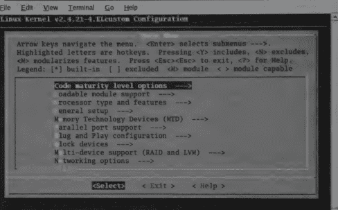

图 1-3. 内核配置实用程序

9. 为了创建 Linux 模块，运行命令 `make modules`。
10. 创建 Linux 模块后，您将通过运行命令 `make modules_install` 来安装它们。这将把模块安装到适当的目录中。模块安装的目录包含内核版本号。对于自定义内核，目录可能类似于 `/lib/modules/2.4.21-4ELcustom/kernel/drivers`。
11. 为了安装 Linux 内核，运行命令 `make install`。此命令执行多项功能，包括将内核复制到引导分区、构建新的 `initrd` 映像以及向引导加载程序配置文件添加条目。

完成这些步骤后，内核即可启动。

## 进程和线程

在 Linux 操作系统中，同时有许多程序在系统上运行。在操作系统中，这些“程序”通常称为进程。每个进程都有自己的虚拟内存空间，并且独立于其他进程运行。正如您将在下一章中看到的那样，Oracle 依赖于许多不同的进程来执行不同的功能。线程是运行在单个进程内的指令的并发“线程”，就像在单个更大的应用程序内拥有并发程序一样。Linux 的架构方式使得使用线程而不是进程几乎没有好处，因为它们使用相同类型的内核记账结构，而且大多数内核程序员强烈建议不要使用线程。有关更多详细信息，请参阅以下部分。

### 什么是进程？

进程与其关联的内存和 CPU 周期相关，因为它是一个执行功能并在处理器上运行的程序。

进程在整个操作系统中使用。Linux 任务调度程序负责调度代表用户运行的所有进程。每个进程运行几毫秒，然后从 CPU 上卸下，然后加载另一个程序。此操作称为任务切换或上下文切换，确保所有正在运行的程序都能获得一定量的处理器时间。在内核中，进程由多个不同组件组成；代码（“text”）、数据、堆栈变量、文件 I/O 信息和信号表。这些组件必须在进程切换进出时全部复制进出内存。

上下文切换操作每秒在您的系统上发生数万次。虽然这是 Linux 操作系统不可或缺的一部分，但它是一项昂贵的操作。为了最大限度地减少上下文切换的开销，开发了轻量级进程或线程。

### Oracle 对进程的使用

Oracle 的架构利用了大量进程的优势。正如您将在下一章中了解的那样，Oracle 实例由执行不同功能的多个不同进程组成。通过在不同 CPU 上使用多个不同进程，Oracle 可以实现非常好的可扩展性。

### 什么是线程？

线程通过允许多个进程共享一些相同的信息来最大限度地减少上下文切换的成本。如果您有许多用户使用同一程序，则可以将程序加载到内存中并共享相同的内存和堆栈变量


可以通过仅将堆栈指针移动到该程序实例正在运行的位置，由同一程序的不同实例使用。这减少了上下文切换，因为只有堆栈指针在发生变化。

这些线程操作仅在进程的更大上下文中工作，因此运行不同程序的不同进程仍需要上下文切换。这被称为用户空间线程。

除了用户空间线程外，还有用于运行操作系统本身的内核空间线程。这使得内核本身可以被线程化，从而非常高效。

## 设备

Linux 操作系统由许多设备组成。设备可以被视为用于发送输入和输出的文件。一些文件代表硬件部件，一些是软件组件。无论文件是硬件还是软件组件，I/O 都可以以基本相同的方式定向到它。

系统中存在许多硬件设备，例如软盘驱动器、固定磁盘、网络设备等等。设备分为两类：字符设备或原始设备和块设备。

### 字符设备

字符设备是用户进程以顺序方式直接向设备传输数据的设备，而块设备则可以以更随机的方式访问。原始设备或字符设备的一些示例有

- 磁带设备
- 软盘驱动器
- 终端设备
- 并行打印设备
- 声音设备

此外，字符设备可以被通常使用块设备的程序访问。Oracle 实际上可以将其数据存储用于原始设备。然而，Oracle 必须使用块接口访问此字符设备。这将在后续章节中更详细地解释。

块设备允许缓冲 I/O 并可以处理更具体的数据请求。块设备可以随机访问。与可以接收任意大小请求的字符设备不同，块设备仅在特定块大小请求时访问底层数据。这就是它们被称为块设备的原因。块设备包括以下内容：

- RAM 磁盘
- SCSI 磁盘设备
- CD-ROM 设备

我们通常用于 Oracle 的设备利用基于块设备的文件系统。

## 逻辑卷管理器

Oracle 数据库可以使用原始设备或文件系统，但也可以使用 LVM 进行存储。逻辑卷管理器，或 LVM，是一种软件产品，通过将来自不同物理磁盘的物理磁盘块组合成逻辑磁盘卷来管理存储。这使您能够以有序的方式管理存储，以获得性能和易用性。LVM 的功能包括

- `存储聚合` 许多单独的磁盘驱动器可以组合成一个单一的逻辑磁盘驱动器。
- `存储虚拟化` 存储可以在使用时重新配置、添加和调整大小。您可以在使用时向卷添加额外存储。
- `快照` 使用 LVM，您可以对数据进行快照，从而创建更快、更高效的备份。

LVM 多年来一直与 Oracle 结合用于存储。Linux LVM 变得越来越常见，有多种类型可供使用。

## 自动存储管理

自动存储管理（ASM）是 Oracle 对 LVM 的答案。ASM 是一种专门为 Oracle 开发的 LVM，与其协同工作以提供 Oracle 存储虚拟化层。从本质上讲，ASM 通过允许形成可用于保存 Oracle 数据和日志的磁盘组来简化 Oracle 存储管理。通过使用 ASM，磁盘组内数据的实际物理放置以及表空间管理也会自动完成。ASM 旨在简化并优化 Oracle 数据库中的数据存储，是您可能选择的另一个选项。

## 文件系统

Linux 系统中的大多数存储都是通过文件系统完成的。文件系统是位于块设备之上的层，允许用户访问磁盘设备。它允许目录和文件等结构。文件系统创建在磁盘设备之上，具有自己的缓存，并用于管理对磁盘驱动器的访问。

文件系统提供诸如目录等功能，目录是允许分层存储结构的抽象。目录是一种可以保存其他目录或文件的结构。这些文件反过来可以保存数据。

文件系统的另一个功能是能够在目录或文件上放置属性，以便通过允许对文件和目录设置权限来提供安全性。

文件系统可能还有其他功能，例如能够在集群中工作以及能够对写入文件系统的数据进行日志记录。下一节中讨论了一些特定的文件系统及其功能。

### ext3

Linux 中使用的主要文件系统是 ext3，它基于 ext2 并具有文件系统日志功能。日志功能减少了在系统不干净地重新启动时恢复对文件系统的更改所需的时间，如果在多千兆字节的存储设备上，这可能需要数小时。在日志文件系统中，不断对磁盘进行的更改会写入一个名为“journal”的特殊文件。此日志类似于 Oracle 上的重做日志，用于修复在断电或其他处理丢失期间可能发生的不一致。日志文件系统已使用多年，速度极快且稳定。

### OCFS

OCFS 是 Oracle 集群文件系统。Oracle 集群文件系统是一种 Oracle 文件系统，允许多个系统使用同一文件系统。这克服了 Oracle RAC（Real Application Cluster）系统访问共享存储的问题。

OCFS 的优点是您可以使用文件系统构建集群。这使得处理 RAC 系统中使用的数据文件所涉及的管理任务变得更加容易。使用 OCFS，您可以像在任何其他文件系统下一样创建数据文件。文件可以设置为自动增长，并且可以根据需要添加其他文件。

### RAW 设备

RAW 设备也由 Oracle 支持。使用 RAW 设备时，Oracle 不使用文件系统。Oracle RDBMS 完全自行管理存储。由于性能原因，RAW 设备对 Oracle 非常受欢迎。通过绕过文件系统代码，可以减少 CPU 使用率，因为没有文件系统处理。然而，在 RAW 设备上管理 Oracle 可能很复杂且困难。

在引入 OCFS 之前，Oracle RAC 数据库必须构建在 RAW 设备上。

通过使用 RAW 设备，Oracle 负责数据存储，并且由于 Oracle RAC 集群管理存储以及集群，因此系统协调问题得以解决。RAW 设备有限且难以管理。随着 Oracle 10g 的出现，我们现在有几个 RAC 集群选项：RAW 设备、OCFS 或 ASM。

## 摘要

本章向您介绍了 Linux 操作系统。您已了解了一些目录结构、可用工具以及如何配置一些关键组件。为了在此操作系统上正确管理 Oracle 数据库，了解操作系统非常重要。当然，本章并不是 Linux 的完整管理指南。市场上有很多很好的书籍可供参考。

在本章中，我们试图让您了解 Linux 架构的概况，以便在下一章学习 Oracle 架构时，您将开始了解两者如何协同工作。在那里，您将了解 Oracle 数据库架构，然后开始学习在 Linux 上管理 Oracle 数据库的更多具体细节。


## 第 2 章

Oracle 架构

Oracle 架构的基本基础自 Oracle 的现代版本（8i、9i）以来一直保持不变。该架构有着悠久的历史，并以其稳定性和性能的良好记录而著称。这并不是说 Oracle 10g 中没有显著改进，确实有。然而，基础架构并没有发生显著变化，Oracle 10g 与 Oracle 10g R2 之间的变化也是如此。

Oracle Database 被定义为作为一个整体处理的数据集合。数据库的目的是存储和检索数据。所有其他组件只是旨在帮助完成该任务的附加功能。因此，Oracle Database 服务器是一组协同工作的程序和实用工具，帮助您以安全高效的方式检索数据。

## Oracle 数据库服务器

Oracle 数据库服务器由物理和逻辑组件组成，提供抽象层，让您能够高效地访问数据库中的数据。Oracle 数据库服务器的架构不仅提供最佳性能，而且具有可扩展性。可扩展的架构允许您添加额外的系统组件以实现更高的系统性能。

Oracle Database 10g 服务器由数据库（信息）和实例（系统的体现）组成。数据库包括驻留在系统上的物理文件以及数据库模式等逻辑部分。这些数据库文件有各种形式，如以下章节所述。实例是用于访问数据的方法，由进程和系统内存组成。

Oracle 服务器架构由以下组件组成，本章将对其进行介绍：

- 数据库
- Oracle 实例


## 其他 Oracle 实用工具

本章将介绍这些组件，并解释 Oracle 服务器如何工作以提供对您数据的访问。

## Oracle 实例

`Oracle Instance` 是本书中将反复使用的术语，并在本章后面详细解释。`Oracle Instance` 被定义为能够访问数据库所需的进程和共享内存。实例本身并不是数据库的一部分。事实上，在 Oracle 10g RAC（Real Application Clusters）系统中，多个实例可以共享同一个数据库。

Oracle Database 具有逻辑层和物理层。物理层由实际驻留在磁盘上的文件组成，而逻辑层的组件将数据映射到这些物理组件。

本章首先提供 Oracle 架构的概述，然后详细介绍某些操作（如事务处理、读写和其他操作任务）是如何完成的。本章还包括影响 Oracle 性能的一些因素的概述。

## Oracle 数据库

Oracle Database 由物理和逻辑组件组成。物理组件是可以从数据库服务器外部查看的东西，由操作系统上的文件或其他存储组件组成。逻辑数据结构表示数据如何在这些数据文件中存储，只能从 Oracle Database 服务器内部查看。在本节中，您将了解物理和逻辑数据结构。稍后，您将看到它们如何被 Oracle Database 服务器使用。

### 物理数据结构

数据库的物理层由几种类型的文件组成：

- 一个或多个数据文件
- 一个或多个控制文件
- 两个或多个重做日志文件
- 归档日志文件（可选，但推荐）
- 参数文件
- 警告和跟踪日志文件
- 备份文件

所有这些文件对于 Oracle Database 服务器的最佳和稳定运行都至关重要。如果其中任何文件丢失或损坏，数据可能会丢失，Oracle 实例可能会崩溃。

#### 数据文件

数据文件包含存储在数据库中的信息。数据文件只能属于一个数据库，但如您稍后将了解的，一个数据库可以被多个 Oracle 实例访问。您可以拥有最少一个数据文件或多达数百个。数据文件的最大大小取决于操作系统和 Oracle。在 Linux 上，数据文件的最大大小为 400 万个数据块；因此，对于较小的块大小，最大数据文件大小小于较大的块大小。

单个表的信息可以跨越多个数据文件，或者多个表可以共享一组数据文件。如本章后面所述，数据文件构成一个称为表空间的逻辑对象——容纳数据库对象的容器。将表空间分布在多个数据文件上可能会对性能产生显著的积极影响，如本书后面所述。

除了 Oracle 数据文件外，Oracle 10g 引入了 `ASM`（Automatic Storage Management，自动存储管理）。`ASM` 本质上是一个只能由 Oracle 对象使用的 Oracle 管理文件系统。`ASM` 被分配一组磁盘驱动器（原始设备），Oracle 管理这些设备。`ASM` 接收一组磁盘驱动器并创建 `ASM` 组。`ASM` 组类似于文件系统，因为 `ASM` 组可以容纳各种 Oracle 数据存储对象，例如表空间、重做日志组、归档日志、备份等。

`ASM` 与典型的 Linux 文件系统不同，因为您不能使用 `ls` 等操作系统命令来查看 `ASM` 组的内容。除了存储 Oracle 表空间、重做日志等之外，`ASM` 还可以进行磁盘条带化和容错。然而，当您可以使用硬件容错时，我不推荐使用软件（`ASM`）容错。这是因为容错和性能方面的原因。

`ASM` 使用一个名为“`ASM Instance`”的小型 Oracle 实例来管理 `ASM` 设备。`ASM Instance` 必须处于运行状态，然后您才能使用 `ASM` 设备。`ASM` 限制非常高，包括

- 存储系统中的 10,000 个 `ASM` 磁盘
- 每个 `ASM` 磁盘最大 4 PB
- 每个磁盘组 100 万个文件
- 每个文件最大存储 2.4 TB

这些限制在短期内不应达到（至少在 Oracle 11 可用之前不会）。

为了在创建 Oracle 存储对象时使用 `ASM`，只需指定以 `+` 为前缀的 `ASM` 组名，而不是文件名（例如，`+diskgroup1` 而不是文件名）。无需在 `ASM` 组内指定位置。


> **NOTE**
>
> 我始终建议将重做日志、归档日志和数据文件物理分离。这对 `ASM` 组也是如此。如果您使用 `ASM` 组，请将这些组件至少分离到 3 个 `ASM` 组中。在存储不太可能发生故障的情况下，您可能会保存其中三个组件中的两个。`ASM` 在第 6 章《在 Linux 上安装 Oracle 10g》中进行了更详细的介绍。

控制文件用于存储数据库名称和数据及重做日志文件位置等信息。Oracle 需要这些信息来启动数据库实例。必须保护控制文件。Oracle 提供了存储控制文件多个副本的机制。在集群环境中，控制文件必须可被集群中的所有成员访问。

### 重做日志文件

重做日志文件统称为重做日志，存储对数据库所做的所有更改的记录。这些信息在系统故障时用于重新应用已完成并提交但可能尚未写入数据文件的更改。重做日志文件必须具有良好的性能并受到硬件故障的保护（通过软件或硬件容错）。如果重做日志信息丢失，在发生故障时无法完全恢复系统。

Oracle 通过为每个重做日志文件创建副本来提供多路复用重做日志文件的方法。根据重做日志活动的数量，您可能希望使用它，也可能不希望使用。在大多数情况下，通过使用硬件 RAID 技术，您可以通过在硬件中进行重做日志容错来避免 Oracle 和操作系统的开销，而不是使用 Oracle 镜像。然而，如果这样做，由于重做信息的关键性，建议在该磁盘卷上禁用缓存。在重做活动非常高的某些极端情况下，如果 Oracle 镜像缓存位于具有独立缓存的不同 RAID 系统上，则可以在 I/O 子系统上启用缓存。

重做日志用于媒体恢复，当数据库备份必须恢复时需要，以及实例恢复。在断电的情况下，重做日志文件中的信息用于将数据库恢复到故障点。这就是为什么重做日志文件如此重要。

在集群环境中，每个实例都有自己的重做日志文件集，但它们必须都可从每个系统访问。在集群中某个节点丢失的情况下，其他节点之一可以使用故障节点的重做日志文件来恢复故障节点正在使用的数据库部分。这将在 Real Application Clusters（RAC）章节中更详细地介绍。

### 归档日志文件

归档日志文件本质上是前面描述的联机重做日志文件的备份。在归档日志模式下运行时，这些联机重做日志文件的备份会自动完成。归档日志文件对于从媒体故障中恢复 Oracle 数据库至关重要。归档日志文件也在 Oracle Data Guard 中使用。本章后面在描述 Oracle 日志记录时，将更详细地介绍归档日志进程。

## 参数文件

Oracle 参数文件用于存储系统配置信息。这些参数文件存在两种形式之一。`pfile` 是一个 ASCII 文本文件，可以在文本编辑器中修改，并在系统启动期间使用。`spfile`（服务器参数文件）是 Oracle 可读文件，只能在 Oracle 服务器内部修改，是当前推荐的配置方法。`spfile` 是启动 Oracle 数据库的默认方法。当发出启动命令时，实例将搜索名为 `$ORACLE_HOME/dbs/initSID.ora` 的服务器参数文件。在 RAC 环境中，该文件仅包含指向共享 `spfile` 的链接（位于共享文件系统（如 `OCFS`）或原始设备上）。`pfile` 与 `spfile` 的主要区别在于 `pfile` 是客户端文件，而 `spfile` 是服务器端文件。

`spfile` 可以从 `pfile` 创建，反之亦然。`spfile` 使用以下命令创建：

```
CREATE SPFILE = '/u01/ORCL/spfileORCL.ora'
FROM PFILE = '/opt/oracle/admin/ORCL/pfile/initORCL.ora';
```

相反，可以使用类似的命令从 `spfile` 创建 `pfile`：

```
CREATE PFILE = '/opt/oracle/admin/ORCL/pfile/initORCL.ora'
FROM SPFILE = '/u01/ORCL/spfileORCL.ora';
```

有时，通过以下步骤重新配置 Oracle 实例很方便：

1. 创建一个 `pfile`。
2. 通过编辑 `pfile` 修改 Oracle 系统。
3. 使用 `pfile` 启动实例。
4. 进行所需的任何更改，例如设置归档等。
5. 创建一个 `spfile`。
6. 使用 `spfile` 重新启动实例。

## 警告和跟踪文件

警告和跟踪文件存储由 Oracle 数据库服务器和后台进程生成的信息。警告日志包含有关启动和关闭操作、系统配置、系统状态以及发生的错误的信息。跟踪文件存储有关系统中发生问题的具体信息。这些跟踪文件可以帮助确定出了什么问题以及如何修复系统问题。

## 备份文件

备份文件可能以多种形式存在，具体取决于您执行的备份类型。备份文件可能由您管理，也可能由备份程序管理。这完全取决于备份类型和您使用的备份软件类型。

许多 Oracle 用户依赖第三方备份解决方案。这些备份产品利用底层的 Oracle API，但提供额外的功能，例如使用磁带库和多个设备的能力。

## 逻辑数据结构


物理数据结构由操作系统文件组成，而逻辑数据结构表示数据在 Oracle 数据库服务器内的存储方式。逻辑数据结构旨在提高效率和性能。

逻辑数据结构由以下组件组成：

- 表空间
- 段
- 区
- 数据块

Oracle 模式对象驻留在这些逻辑数据结构中。模式对象将在本章后面介绍。

Oracle 数据结构由多个不同的组件组成，有些是逻辑的，有些是物理的。数据库的最小元素是数据块，其大小固定，用于存储行片段。数据块存储在连续的集合中，称为区。构成数据库对象的区的集合称为段。

块、区和段存储在数据文件中。一个或多个数据文件组成一个表空间，如图 2-1 所示。表空间是数据库对象的存储容器。当创建对象（如表或索引）时，它会被分配到一个表空间。一旦分配完成并设置其属性，RDBMS 将自动处理区管理。

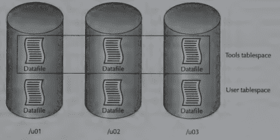

**图 2-1。** *表空间和数据文件*

在本章中，您将学习如何管理块、区、段、表空间和数据文件以及与它们相关的属性。在下一章中，您将了解额外的 Oracle 数据结构、重做日志、控制文件和系统撤销机制。

通过了解 Oracle 数据结构，您将更好地理解 Oracle RDBMS 的工作原理，因此将更好地理解如何管理和调优它。通过了解基本构建块，您将更好地理解本书的其余部分。

## 表空间

Oracle 表空间是 Oracle 数据库中数据库对象的存储库。表空间由一个或多个数据文件组成，这些文件可以是操作系统文件系统上的文件、Oracle 集群文件系统 `OCFS` 上的文件、RAW 设备，或使用自动存储管理 `ASM` 管理的文件。数据文件可以是固定大小，也可以自动或手动扩展。一旦表空间创建完成并且对象分配到表空间，对象的物理存储处理将自动完成。

通常，表空间为共享相同数据集的用户或用户组设置。例如，应收账款可能有自己的表空间，应付账款有不同的表空间。这两个组可能共享一个总账表空间。这允许根据功能将数据分割进行空间和用户管理。在表空间内，数据会自动管理。

将组划分为不同的表空间简化了这些组的管理。表空间由一个或多个数据文件组成。通过每个表空间使用多个数据文件，您可以将数据分布在许多不同的磁盘上，以分散 I/O 负载并提高性能。通过添加额外的数据文件，扩展表空间的大小也很简单。

Oracle 表空间可以由少至一个数据文件组成，或多至 1024 个数据文件。这使您可以创建非常大的表空间，从而创建非常大的数据库对象。

表空间很重要，因为它提供了在数据文件之间布局数据的最细粒度。一旦表空间创建完成，您将对表在表空间内的实际分布有显著控制。通过仔细配置表空间，您有一些粗略的配置选项（您将在本章后面看到），但在很大程度上是自动完成的。

每个 Oracle 数据库至少需要有一个表空间。默认情况下，创建数据库时，`SYSTEM` 表空间会被创建。`SYSTEM` 表空间是数据字典的存放位置。默认情况下，用户将被分配到 `SYSTEM` 表空间，但这不是必需的，也不推荐。用户可以根据该特定用户将执行的函数分配表空间，并且应该这样做。还可以对这些用户设置配额，指定他们可以使用多少空间。表空间可以容纳四种类型的段中的任意一种或多种。这些段是

- 数据段 这是基本类型的段。数据段可用于保存表和簇。
- **索引段** 索引段用于保存索引。
- **UNDO 段** `UNDO` 段是用于存储撤销信息的特殊类型的段。`UNDO` 段将在下一章中更详细地介绍。
- **临时段** 临时段用于存储临时数据。

此外，Oracle9i 数据库中提供了几种不同类型的表空间。这些各种表空间类型服务于不同的目的，因此由数据库以不同的方式处理。

- **普通表空间** 默认或标准表空间类型用于存储 Oracle 对象，并使用 `CREATE TABLESPACE` 命令创建。
- **临时表空间** 临时表空间用于保存临时段，并使用 `CREATE TEMPORARY TABLESPACE` 命令创建。
- **撤销表空间** 撤销表空间是用于保存撤销数据的特殊表空间，并使用 `CREATE UNDO TABLESPACE` 命令创建。
- **只读表空间** 只读表空间是具有只读属性的普通表空间。不能对只读表空间进行更改。只读表空间作为普通表空间创建，然后再设为只读。

表空间默认是读写，但可以更改为只读（如本章后面“只读表空间”部分所示）。只读表空间在许多情况下非常有用。

表空间可以通过 Oracle 数据字典（Oracle8 及更早版本）或本地管理表空间进行管理。本地管理表空间是 Oracle9i 中添加的功能，具有多个优点。

### 词典管理表空间

词典管理表空间是以前在数据库内管理空间的标准方法。区管理通过数据字典中的表完成。每当创建或释放一个区时，此信息会在数据字典中更新。区管理已以这种方式进行很长时间。

对于词典管理表空间，表空间和对象定义了初始区大小、下一个区的大小，然后通过 `PCTINCREASE` 参数定义每个额外区的大小。这指定每个额外区比之前创建的区大多少。这是一个非常好的系统，但 Oracle 已通过本地管理表空间改进了这一点。

### 本地管理表空间

Oracle8i 引入了本地管理表空间。在 Oracle9i 中，本地管理表空间成为默认和首选的表空间类型。这是 Oracle 10g 中的默认表空间类型，并且是一个新的

除非另有指定，否则表空间将使用本地管理选项创建。

本地管理的表空间在表空间本身内部管理区。这通过减少对数据字典的争用，实现了更可扩展的解决方案。在本地管理的表空间中，区可以创建为统一大小或逐步增大的大小。在本地管理的表空间中，使用位图来管理表空间内的区。此外，在修改区时，不会创建回滚信息，而在数据字典管理的表空间中则会创建。

对于本地管理的表空间，区大小可以按每个表空间自动确定，也可以在给定数据库对象的存储子句中指定。如果您指定区大小，则整个表空间中将保持统一。

## 手动或自动段空间管理

在表空间内，段中的空闲空间可以通过 `freelist` 或位图进行管理。使用 `freelist` 是管理表空间内段的传统方法，并使用本章后面描述的 `PCTUSED` 和 `PCTFREE` 参数。通过在段管理子句中指定 `MANUAL` 来配置 `freelist` 段管理。Oracle9i 新增了使用位图管理段内空闲空间的方法。这称为自动段空间管理，是管理段的首选方法。通过指定 `AUTO` 来启用位区管理。

## 创建表空间

创建表空间包括指定一个或多个数据文件和存储参数。数据文件可以是文件系统文件或原始设备。存储参数指定表空间的使用方式。它们非常重要，将在本章后面更详细地讨论。

使用各种选项通过 `CREATE TABLESPACE` 命令创建表空间。这里不会涵盖每个选项，因为它们太多了，而且您可以轻松查阅，但让我们看一下其中几个。创建表空间的基本命令是

```
CREATE [UNDO] TABLESPACE *tname*
*DATAFILE data_file_name data_file_size*
*[storage clause]*
*[BLOCKSIZE size [K]]*
*[TEMPORARY]*
*[EXTENT MANAGEMENT DICTIONARY]*
*[EXTENT MANAGEMENT LOCAL [AUTOALLOCATE]]*
*[EXTENT MANAGEMENT LOCAL [UNIFORM SIZE *size* [K,M]]*
*[SEGMENT SPACE MANAGEMENT AUTO]*
*[SEGMENT SPACE MANAGEMENT MANUAL]*
```

让我们更详细地查看这些关键参数。

| 参数 | 用途 |
| :--- | :--- |
| UNDO | `undo` 参数指定您正在创建的表空间是 `undo` 表空间。`undo` 表空间将在下一章详细介绍。 |
| Storage clause | `storage` 子句指定文件名、大小等。 |
| BLOCKSIZE | `BLOCKSIZE` 参数用于允许您创建非标准块大小的表空间。 |
| TEMPORARY | 指定表空间用作临时表空间。 |
| EXTENT MANAGEMENT | `EXTENT MANAGEMENT` 子句允许您指定表空间是本地管理还是数据字典管理。 |
| SEGMENT SPACE MANAGEMENT | `SEGMENT SPACE MANAGEMENT` 子句用于指定段内空闲空间的 `AUTOMATIC`（位图）或 `MANUAL`（`freelist`）管理。 |

还可以使用许多其他可选参数来创建表空间。这些可选参数可以在 Oracle 文档中找到。以下是创建表空间的几个示例。

一个本地管理的简单表空间

```
CREATE TABLESPACE *ts1*
*DATAFILE '/u01/app/oracle/oradata/orac/ts01.dbf' SIZE 10M;*
```

与上一个相同，但指定了详细信息


```
CREATE TABLESPACE ts2
DATAFILE '/u01/app/oracle/oradata/orac/ts02.dbf' SIZE 10M
EXTENT MANAGEMENT LOCAL UNIFORM SIZE 1M
SEGMENT SPACE MANAGEMENT AUTO;
```

一个数据字典管理的表空间

```
CREATE TABLESPACE ts3
DATAFILE '/u01/app/oracle/oradata/orac/ts03.dbf' SIZE 10M
DEFAULT STORAGE (INITIAL 1M NEXT 1M PCTINCREASE 10)
EXTENT MANAGEMENT DICTIONARY
SEGMENT SPACE MANAGEMENT MANUAL;
```

一个本地管理的 undo 表空间

```
CREATE UNDO TABLESPACE undo01
DATAFILE '/u01/app/oracle/oradata/orac/undo01.dbf' SIZE 10M;
```

`CREATE TABLESPACE` 命令中有许多可选参数。Oracle 文档将列出所有这些选项。

## 表空间大小

一个普通表空间最多可以包含 1024 个数据文件。Oracle 数据文件最多有 400 万个块；因此，Oracle 大小限制为 400 万块 × 块大小。操作系统数据文件的最大大小取决于操作系统；因此，数据文件的最大大小是最大操作系统文件大小或 Oracle 限制中的较小者。

Oracle 10g 引入了 Bigfile 表空间。`bigfile` 表空间允许您创建一个大小为 40 亿块的大型数据文件。`bigfile` 表空间设计用于支持大型数据文件的 RAID 系统或与 ASM 一起使用。要创建 `bigfile` 表空间，请使用 `CREATE BIGFILE TABLESPACE` 命令而不是 `CREATE TABLESPACE`。

## 合并表空间

使用本地区管理，无需合并区，但使用数据字典管理时有时是必要的。由于数据字典管理的表空间以各种大小的区为模式对象分配空间，因此随着时间的推移，该空间可能会变得碎片化。随着区的分配，Oracle 会查找与新区所需空间大小最接近的空闲空间。随着表空间变老，区被添加和释放，您可能会发现有许多小的空闲区彼此相邻。

通过合并表空间，相邻的空闲区会被合并成更大的空闲区，从而使空闲空间对新的区分配更具灵活性。如果此功能未被禁用，`SMON` 进程将自动合并表空间。手动合并表空间很少有必要，但了解此操作如何以及为何执行很重要。

## 系统表空间

如果您的 `SYSTEM` 表空间是本地管理的，则无法创建任何数据字典管理的表空间，并且前面的示例将失败。如果您想创建数据字典管理的表空间，则 `SYSTEM` 表空间必须是数据字典管理的。

## 向表空间添加数据文件

与在表空间创建时指定它们相比，添加数据文件到表空间可能更快，因为添加数据文件可以并行完成。表空间创建时的数据文件创建是串行进行的，一次一个。对于大型表空间创建，这可以节省大量时间。

## 添加数据文件

如果需要更多空间或希望在更多磁盘驱动器之间分散 I/O，通常需要在表空间中添加更多数据文件。与在数据库创建时创建它们相比，向表空间添加数据文件也更快。`CREATE TABLESPACE` 命令按串行工作，即一次创建一个数据文件。通过添加数据文件，此操作可以并行化；因此，可以同时向表空间添加多个数据文件。

数据文件是通过使用 `ALTER TABLESPACE` 命令添加的，如本示例所示。

```
ALTER TABLESPACE ts1
ADD DATAFILE '/u01/app/oracle/oradata/orac/ts01b.dbf' SIZE 10M;
```

此命令将向名为 `ts1` 的表空间添加一个额外的 10MB 数据文件。

## 修改表空间属性

可以通过 `ALTER TABLESPACE` 命令更改的表空间的其他属性有

- 1. 添加或重命名数据文件
- 2. 使其脱机或联机
- 3. 合并数据字典管理表空间中的区
- 4. 开始或结束备份模式
- 5. 从永久更改为临时或从临时更改为永久
- 6. 更改存储子句、大小或将其置于自动扩展模式

如您所见，有许多选项。

## 只读表空间

如前所述，可以修改表空间使其变为只读。只读表空间与读写表空间类似，但限制是不能对驻留在这些表空间上的模式对象进行任何更改。当表空间变为只读时，备份该表空间的需求就被消除了。

由于数据保证不会改变，因此对只读数据执行定期备份是不必要的。如果过去某个时间已执行过备份，则该备份应可用于表空间的整个生命周期。

由于只读表空间不会被 Oracle 修改，因此可以将表空间放置在只读介质上，例如 CD-ROM 或 WORM 驱动器。如果此数据具有归档性质但必须可用，则 CD-ROM 是一个极佳的选择。

## 创建只读表空间

所有表空间都是以读写方式创建，并且在填充数据之前它们没有用处。一旦按照您的规范创建了数据和索引，表空间即可通过 `ALTER TABLESPACE` 命令或在 Oracle Enterprise Manager 中设为只读。

表空间也可以通过 `ALTER TABLESPACE` 命令设为只读，如下所示。使用的语法看起来大致如下：

```
ALTER TABLESPACE "t81" READONLY;
```

只读表空间有几种用途，但它们相当具体。您是否能够利用它们取决于您的应用程序。

如果您有大量可放置在较慢介质上的静态数据，只读表空间可能对您有利。此外，如果您希望保证归档数据不被修改，这也可能适合您。

## 临时表空间

临时表空间用于执行无法放入内存的排序操作。通过专门分配一个用于排序的表空间，就无需在用于其他目的的表空间中分配和释放空间，从而导致碎片化。

当排序操作无法放入内存时，必须创建并使用临时段。该临时段分配区段，并将继续分配区段，直到有足够的空间执行排序为止。对于大型 DSS 查询，这些临时段可能会变得相当大。

通过为此类操作专门设置表空间，不仅排序会更高效，而且数据表空间上的临时使用量也会减少。

## 创建临时表空间

表空间可以在使用 `CREATE TABLESPACE` 命令创建时设为临时表空间，或者可以通过使用 GUI 工具或 `ALTER TABLESPACE` 命令将其从永久表空间更改为临时表空间。表空间可使用类似以下的语法更改为临时表空间：

```
ALTER TABLESPACE "t82" TEMPORARY;
```

将表空间从永久更改为临时或从临时更改为永久的情况很少见。通常，临时表空间会以某种方式创建，并在其存在期间保持不变。

## 表空间技巧和提示

表空间是模式对象获取空间的资源。可以将其视为一组磁盘驱动器上的文件系统的类似物。空间存在并已分配，但直到有人创建文件或保存数据时才会被使用。Oracle 表空间也是如此。

随着模式对象的创建，区段会从表空间中分配。这些区段是根据模式创建的存储参数分配的，或者在没有这些参数的情况下，根据表空间的默认存储参数分配。

Oracle 会根据可用空闲空间的百分比在表空间内尝试平衡空间。然而，这可能会导致一些问题。

如果您有两个 18GB 的磁盘驱动器并创建一个 Oracle 表空间，其中包含两个数据文件——第一个磁盘驱动器上为 10GB，第二个磁盘驱动器上为 5GB——Oracle 将按比例填充数据文件，使较大的文件包含两倍的数据。这一切都很好，但通常会导致在具有较大表空间的磁盘驱动器上执行更多 I/O。这种不平衡是不好的。如果您需要多个数据文件，最好将它们平均分布在磁盘驱动器之间。

更好地平衡 I/O 负载的其他方法包括利用硬件功能或操作系统功能，例如磁盘条带化。通过使用磁盘阵列或软件条带化对磁盘驱动器进行条带化，负载将在条带中的所有磁盘驱动器之间得到相当好的平衡。

配置和管理表空间可能是一项耗时的工作，需要大量的前期规划。然而，这种规划是值得的。现在花费的规划时间可以意味着以后修复问题花费的时间更少。

### 表空间维护

一旦表空间创建完成，您的工作就不会结束。有必要监控表空间使用的空间及其负载平衡。容量规划和大小调整是非常重要的职责。通过预见问题并在问题变得严重之前解决它们，您将避免昂贵的问题。

通过监控系统并为未来做规划，您还可以避免昂贵的停机时间。

### 监控表空间

表空间可以通过 Enterprise Manager 或各种第三方应用程序进行监控，这些应用程序非常擅长以图形方式显示表空间、区段和段。虽然定期监控表空间是个好主意，但本地管理的表空间使表空间管理变得更加容易。

> **使用 RAID 而非表空间负载平衡**
>
> 磁盘条带化可以轻松平衡磁盘驱动器之间的 I/O 负载。硬件或软件磁盘阵列会将数据均匀分布在条带中的所有磁盘驱动器上。
>
> 旧式布局 Oracle 数据库的方法是创建具有多个数据文件的表空间并将其分布在各个磁盘驱动器上。这已被创建大型 RAID 条带和表空间中较少的大型数据文件的更现代标准所取代。

## 定期执行表空间监控

尝试在每月安排几天来监控系统性能。在月初将其记入日历。指定一周中的几天和一天中的不同时间，以便获得一些不同的样本。


# 表空间管理

表空间管理中最重要的任务是空间管理。数据库增长速度远快于您最初预期的情况并不罕见。如果您没有准备好，这可能会导致严重的空间问题。

## 负载平衡

监控磁盘驱动器的物理 I/O 使用情况非常重要，以确保您没有遇到性能问题。定期在高峰和非高峰使用期间查看物理磁盘统计信息。不要依赖任何事物保持不变。系统的性能特征不断变化，必须进行监控。

## 数据块

在 Oracle 中，用于存储数据的空间由逻辑结构的使用控制。这些结构包括段、区段和数据块。段是一组用于存储特定类型数据的区段。反过来，段由称为区段的片段集合组成，而区段本身由数据块组成（参见图 2-2）。块是 Oracle 数据库中存储的最小单位。数据库块包含有关块本身的头信息以及数据。

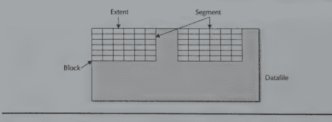

**图 2-2。** *段、区段和数据块*

### 非标准块大小

在 *Oracle9i* 之前，数据库中的所有块大小都相同。块大小在数据库创建时确定并且固定不变。从 *Oracle9i* 开始，初始数据库仍使用单一块大小创建，但可以创建具有不同块大小的附加表空间。这允许单个数据库同时针对 OLTP 和数据仓库应用程序进行优化。这对于不同类型的数据库活动很有用。小块大小对于 OLTP 类型活动非常高效，而大块对于数据仓库和决策支持应用程序非常理想。

数据块是构成 Oracle 数据库的最小单元。对磁盘的每个 I/O 操作和内存中的 Oracle 数据操作都在块级别执行，尽管一次可以写入或读取多个块。Oracle 数据以块的形式存储在磁盘上和内存中。表空间的块大小在表空间创建时确定。数据块的大小可以根据您的选择而变化，可以小至 512 字节或大至 64KB。

*Oracle9i* 引入了非标准块大小的概念。有了 *Oracle9i* 和 Oracle Database 10g 服务器，您现在可以拥有使用不同块大小的不同表空间的数据库。

Oracle 块是存储在 Oracle 数据库中的所有数据的构建块。Oracle 块在块内保存行片段。行片段是一个完整的行、行的一个部分或指向行的指针。如果块中仅存储行的一个部分，则称其为链式行。如果块中存储指向行的指针，则为迁移行。链式行和迁移行将在本节后面讨论。

块本身由几个部分组成。块的开头由块头组成。接下来是表目录，然后是行目录。块的其余部分由空闲空间和行数据组成。块在空闲空间和行数据之间的分配方式由块分配参数 `PCTFREE` 和 `PCTUSED` 决定，这些参数将在本节后面描述。块头、表目录和行目录被视为开销，通常占用 84 到 107 字节的空间。块的不同部分描述如下：

#### 块头

块头包含有关块的信息，例如块地址和块所属的段类型。正如您将在本章后面学到的那样，有几种不同类型的段，例如数据段和索引段。

#### 表目录

表目录包含存储在块中的表数据的信息。

|  |  |
|---|---|
| 行目录 | 行目录包含有关存储在块中的每个行或行片段的信息，包括该行片段的地址。 |
| 空闲空间 | 空闲空间就是字面意思——数据库可使用的空闲空间。保留多少空闲空间将在本节后面讨论。 |
| 行数据 | 块的大部分由存储在块中作为行片段的表或索引数据组成。 |

这里在图 2-3 中展示了一个 Oracle 块。

块是构成 Oracle 数据结构所有其他组件的基础容器。数据既存储在磁盘上，也存储在缓冲区缓存中的块中。高效存储块对于良好的系统性能和最小化浪费至关重要。块可能发生的坏事之一是它们变成迁移行或链式行。

### 迁移行和链式行

有两种情况，行片段不在数据块中，或者行片段并未完全驻留在数据块中。这些就是迁移行和链式行的情况。Oracle 创建了这些机制来应对数据的修改并支持非常长的行。让我们来看一下这些情况。

#### 迁移行

当数据被更新并且更新后的行片段无法放入其更新来源的块中时，该行会被整体移动到另一个数据块。由于索引依赖于行在更新来源块中的 `rowid` 或位置，因此必须维护该地址。为了维护该地址，数据被移动到新块，并在原位置留下指向新位置的指针。

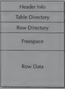

图 2-3. Oracle 块结构

这本质上是一个转发地址。虽然这是一种避免更新索引的高效方法，但从长远来看可能效率低下。

迁移行会在系统中造成开销，因为 Oracle 必须花费 CPU 时间为行寻找空间，然后将行复制到新的数据块。这需要 CPU 时间和 I/O。因此，任何导致迁移的 `UPDATE` 语句都会带来性能损失。

#### 链式行

如果一行插入到块中但无法容纳，该行会被分解为多个行片段并插入到不同的块中。这些行片段被视为链式行。虽然迁移行可以避免或修复，但链式行通常只能通过创建具有更大块大小的数据库来避免，即使这样也无法处理所有情况。

如果你想更改块大小，可以导出数据并使用更大的块大小重建数据库。在 Oracle9i 中，你现在可以创建一个具有更大块大小的新表空间并将数据复制到新表空间。

你可能无法避免链式行，尤其是在表具有 `LONG` 列或长 `CHAR` 或 `VARCHAR2` 列时。如果你知道存在非常大的列，在实施数据库之前调整数据库块大小会很有利。

适当大小的块可确保块得到高效使用并且 I/O 保持在最低限度。如果你创建的块过大，你将无法在 SGA 中高效利用空间。如果你使块过小，可能无法将整行放入块中。块大小应由你的应用程序和数据决定。

链式行在创建时以及每次访问时都会在系统中造成开销。链式行需要一个以上的 I/O 才能读取该行。请记住，Oracle 从磁盘读取数据块；每次访问该行时，必须将多个块读入 SGA。

#### 列出迁移行和链式行

你可以使用 `ANALYZE` 命令的 `LIST CHAINED ROWS` 选项检查迁移行和链式行。为了分析链式行和迁移行，你必须首先创建 `CHAINED_ROWS` 表。这是通过运行 SQL 脚本 `utlchain.sql` 完成的，该脚本位于 Oracle 版本的 `RDBMS/admin` 目录中。

```sql
SQL> @utlchain
Table created.

SQL> Rem
SQL> Rem Analyze the Table in Question
SQL> Rem
SQL> ANALYZE
2  TABLE scott.emp LIST CHAINED ROWS;
```

```
Table analyzed.

SQL> Rem  Check the Results
SQL> Rem
SQL> SELECT * from chained_rows;
```

如果选择了任何行，则你有链式行或迁移行。为了解决这个问题，将相关行复制到临时表，从初始表中删除这些行，然后从临时表重新插入这些行到原始表中。

`PCTUSED` 和 `PCTFREE` 当你创建表空间时，你可以指定表空间是本地管理还是字典管理（你将在接下来的几节中学习）。此外，你将了解到你可以让段管理是手动的还是自动的。如果你选择手动段管理，你可以使用 `PCTUSED` 和 `PCTFREE` 参数来指定数据块的分配方式。使用自动段管理时，这些选项不可用。

当你在手动段管理模式下创建表、索引或表空间时，你可以使用存储参数 `PCTUSED` 和 `PCTFREE` 来设置该表或索引中数据块的行为。这些存储参数决定数据块如何填满并用于在数据块中为更新保留空间。通过使用 `PCTUSED` 和 `PCTFREE`，你可以更精确地控制数据块本身的使用。在许多情况下，了解你的应用程序和数据可以帮助你提高整体系统性能。

### PCTFREE–PCTUSED 示例

假设你有以下 `PCTFREE` 和 `PCTUSED` 值：

```
PCTFREE = 20
PCTUSED = 40
```

在此示例中，你可以向数据块添加新行，直到数据块填满 80%（100% - 20% 空闲）。当这种情况发生时，不能再向此数据块添加新行；空间保留用于现有行的增长。但是，更新可以使用该额外空间。

你只能在块中可用空间百分比降至 40%（已使用）时向数据块添加新行。这有效地为行增长保留数据块中的空间并避免链式。

`PCTFREE` 和 `PCTUSED` 的默认值如下：

```
PCTFREE = 10
PCTUSED = 40
```

本节前面你已经看到了链式行和迁移行的效果，当插入或更新在当前块中没有足够的空间时就会发生。存储参数 `PCTUSED` 和 `PCTFREE` 用于在块中为更新保留空间，以便迁移行不会发生。

将 `PCTFREE` 视为 *高水位线*，将 `PCTUSED` 视为 *低水位线*。如果数据块中的空间使得剩余空间少于 `PCTFREE`，则在表中的空间量小于 `PCTUSED` 之前，不能在该块中添加新行。`PCTFREE` 和 `PCTUSED` 的总和不能超过 100。因为 `PCTFREE` 实际上代表 100 PCTFREE 的高水位线，如果两者之和超过 100，则公式中存在不一致，`PCTFREE` 将小于 `PCTUSED`。

#### PCTFREE

`PCTFREE` 的作用是在数据块中为现有行的增长保留空间。只要数据块中剩余的空间量小于 `PCTFREE` 值，就可以向数据块添加新行。

较高的 `PCTFREE` 值具有以下效果：

- 现有行有大量增长空间。


- 性能得到改善，因为块需要重新组织的频率较低。

- 性能得到改善，因为链式减少。

- 通常需要更多空间，因为块的利用效率较低。数据块中总会有一部分空闲空间。

较低的 `PCTFREE` 值具有相反的效果：

- 现有行的增长空间较少。

- 性能下降，因为重新组织可能变得更频繁。

- 性能下降，因为行可能需要更频繁地链式，从而增加 CPU 使用并导致额外的 I/O。

- 空间利用更有效。块填得更满，从而减少浪费。

使用 `PCTFREE` 可以在您有频繁向行中插入新数据的应用程序时提供帮助。由于 `PCTFREE` 选项用于 `CREATE CLUSTER`、`CREATE TABLE`、`CREATE INDEX` 和 `CREATE SNAPSHOT` 命令中，值得逐一查看您的每个表、簇和索引，并为每个设置一个有效的 `PCTFREE` 值。

### PCTUSED

一旦达到 `PCTFREE`，在数据块中的空间降到 `PCTUSED` 以下之前，就无法向数据块中插入新行。`PCTUSED` 的另一个特性是 Oracle 会尝试在使用新块之前使数据块至少保持 `PCTUSED` 的填充率。

高 `PCTUSED` 值具有以下影响：

- 它会降低性能，因为通常会有更多迁移和链式行。

- 它通过更完全地填充数据块来减少浪费的空间。

`PCTUSED` 的较低值具有以下影响：

- 由于迁移和链式行的数量减少，性能得到改善。

- 空间使用效率较低，因为数据块中未使用的空间更多。

就像 `PCTFREE` 一样，值得逐一查看每个表并确定更符合您应用程序的 `PCTUSED` 值。这样做可以提高系统的性能。

调整 `PCTFREE` 和 `PCTUSED` 时，请遵循以下几个准则：

- **更新活动，行增长高** 如果您的应用程序经常使用影响行大小的更新，请将 `PCTFREE` 设置得相当高，将 `PCTUSED` 设置得相当低。这种安排为数据块中的行大小增长提供了大量空间。例如：

  - `PCTFREE` = 20–25

  - `PCTUSED` = 35–40

  - (100 - `PCTFREE`) - `PCTUSED` = 35 to 45

- **插入活动，行增长小** 如果大多数插入都是新行，并且几乎没有伴随行增长的更新，请将 `PCTFREE` 设置得较低，并为 `PCTUSED` 设置一个适中的值以避免新行的链式。此安排允许将新行插入数据块，直到更多的插入可能导致迁移或链式的位置。当达到该点时，在块中留有相当多的空间之前，不会再进行插入。此后，插入可以恢复。

```
PCTFREE = 5–10
PCTUSED = 50–60
(100 - PCTFREE) - PCTUSED = 30 to 45
```

- **性能优先，空间充足** 如果性能至关重要并且您有充足的空间可用，您可以通过将 `PCTFREE` 设置得非常高而将 `PCTUSED` 设置得极低来确保迁移和链式永远不会发生。虽然这可能会浪费相当多的空间，但应避免所有链式和迁移。

  - `PCTFREE` = 30

  - `PCTUSED` = 30

  - (100 - `PCTFREE`) - `PCTUSED` = 40

- **空间关键，性能次要** 如果您有非常大的表，或者您有中等大小的表并且磁盘空间非常宝贵，请将 `PCTFREE` 设置得非常低，将 `PCTUSED` 设置得非常高。这种安排确保您最大限度地利用可用空间。请注意，您会看到由于链式和迁移增加而导致的性能损失。

  - `PCTFREE` = 5

  - `PCTUSED` = 90

  - (100 - `PCTFREE`) - `PCTUSED` = 5

> **NOTE**
>
> `PCTUSED` 和 `PCTFREE` 选项仅在手动段管理模式下可用。建议您在自动范围管理模式下运行。

## 使用多个块大小

在 *Oracle9i* 中引入的最令人兴奋的新功能之一是在同一数据库中混合使用多个块大小的能力。这使您可以同时利用大块大小的 DSS 优势和小块大小的 OLTP 优势。这可能非常有用，但非常依赖于您了解系统和数据。

为了使用多个块大小，您必须做两件不同的事情。首先，您必须设置 Oracle 缓冲区缓存，使其根据块大小分为不同的部分。然后您必须使用非标准块大小创建表空间。


**NOTE**

通过将参数 `DB_CACHE_ADVICE` 设置为 `ON`，收集与多个块大小的性能优势相关的统计信息，并且这些统计信息可在表 `V$DB_CACHE_ADVICE` 性能视图中使用。

## 为非标准块大小设置 Oracle 缓冲区缓存

分配给默认缓冲区缓存的内存量由 `DB_CACHE_SIZE` 参数决定。标准块大小由 `DB_BLOCK_SIZE` 参数设置，非标准缓存大小由 `DB_2K_CACHE_SIZE`、`DB_4K_CACHE_SIZE` 等参数设置。

将参数 `DB_CACHE_SIZE` 设置为您希望分配给默认块大小的内存量。将 `DB_2K_CACHE_SIZE`、`DB_4K_CACHE_SIZE` 等设置为您希望每个块大小可访问的内存量。


**NOTE**

使用 `KEEP`、`RECYCLE` 和 `DEFAULT` 缓存设置的多个缓冲区缓存仅适用于默认块大小。

## 使用非标准块大小创建表空间

为了使用非标准块大小创建表空间，您必须在创建表空间时使用 `BLOCKSIZE` 关键字。此关键字后面跟随为此表空间设置的块大小。示例如下所示：

```
CREATE TABLESPACE oltp_ts
DATAFILE '/u/oracle/data/oltp1.dat' SIZE 100M,
'/u/oracle/data/oltp2.dat' SIZE 100M
BLOCKSIZE 2K
```

此示例将创建一个 2K 表空间。也可以创建其他大小的表空间。

## 段扩展

为了使 Oracle RDBMS 在实现最大灵活性的同时保持出色的性能，有必要创建一个机制，其中连续的块集被一起创建和管理。想象一下整个 Oracle 磁盘子系统由属于不同对象的单个块组成的情况。这将非常低效且缓慢。为了实现这种效率，创建了扩展。

扩展是一组属于 Oracle 对象的连续块。每当对象需要额外空间时，就会创建这组块。扩展中的块数量由您运行扩展管理的模式以及存储参数决定。

### 字典管理表空间扩展管理

管理扩展的传统方法是指定 `CREATE TABLE` 或 `CREATE TABLESPACE` 语句的 `storage` 子句中的扩展大小。在这里，您指定最小大小、第二个扩展的大小以及每个额外扩展的增长百分比。这允许随着对象中需要更多空间而创建越来越大的扩展。虽然这非常高效，但由于表空间扩展信息存储在数据字典中，因此与之相关的开销很大。因此，发明了本地管理表空间扩展管理。

### 本地管理表空间扩展管理

本地管理表空间扩展管理在表空间本身内部管理表空间扩展。根据配置方式，扩展以统一大小或逐渐增大的大小创建。这由 `UNIFORM` 或 `AUTOALLOCATE` 子句决定，这些子句允许扩展在位图内管理，而不是在数据字典中的表内管理。虽然这可能导致创建的扩展比字典管理表空间中更多的扩展，但管理更简单、更快。此外，如果扩展大小统一，则不会出现字典或自动分配管理扩展中出现的碎片化。建议使用自动分配扩展的本地管理表空间。

## 段

段只是一组构成特定 Oracle 对象（如表、索引等）的扩展。以下是几种不同类型的段的描述：

| 段类型 | 目的 |
| :--- | :--- |
| 数据段 | 这是最基本的段类型。数据段可用于保存表和簇。 |
| 索引段 | 索引段用于保存索引。 |
| 回滚段 | 回滚段是用于存储撤销信息的特殊类型的段。回滚段已被撤销表空间和系统管理撤销表空间取代。强烈建议使用 UNDO 表空间。 |
| 临时段 | 临时段用于存储 Oracle 操作期间生成的临时数据。临时段可能用于排序或连接。 |

这些段可以被视为数据对象本身。不过也有一些例外。Oracle 集群实际上在单个段内包含多个对象，而分区表实际上是由多个段组成的对象。然而，除去这几个例外，段就是构成一个对象的区集合。

## Oracle 实例

Oracle 数据库服务器由数据库和一个 Oracle 实例组成。“Oracle 实例”这一术语在本章中已提及，是 Oracle 数据库服务器最重要的组件。你将在整本书中不断听到“Oracle 实例”这一术语。

### 实例定义

Oracle 实例由访问数据库中信息所需的 Oracle 进程和共享内存组成。如图 2-4 所示，实例由 Oracle 后台进程以及这些进程使用的共享内存组成。

这种 Oracle 后台进程与内存的组合定义了 Oracle 实例。Oracle 实例与数据库的组合构成了 Oracle 数据库服务器。

Oracle 实例由 Oracle 后台进程以及这些后台进程使用的内存组成。Oracle 实例的定义不涉及实际的数据库；然而，启动 Oracle 实例需要一个数据库。

### 实例组件


如前一段所述，Oracle 实例由 Oracle 后台进程以及这些进程使用的内存组成。后台进程是在实例创建时启动的一组 Oracle 进程。这些进程用于维护 Oracle 数据库，同时允许用户执行其所需任务。

除了后台进程之外，还有为这些进程和应用于访问 Oracle 数据库的用户进程分配的内存。该内存被称为系统全局区，即 SGA。在本节中，你将了解后台进程和 SGA 内存。

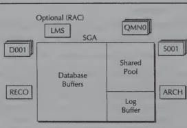

**图 2-4。** *Oracle 实例*

## Real Application Clusters

Oracle 实例由 Oracle 后台进程以及这些进程使用的共享内存组成。该共享内存被称为系统全局区，即 SGA。

一个 Oracle 实例只能连接到一个数据库以形成 Oracle 数据库服务器。然而，多个实例可以连接到同一个数据库。这就是 Oracle Real Application Cluster 即 Oracle RAC 的基础。我们这些经常使用 RAC 系统的人倾向于称其为 RAC 集群。尽管 cluster 已包含在缩写中，但这样听起来更好。

## 后台进程

后台进程是用于在 Oracle 实例内执行各种任务的 Oracle 进程。这些任务从与其他 Oracle 实例通信并执行系统维护和清理，到将脏块写入磁盘不等。以下是 Oracle 后台进程的简要描述：

| 后台进程 | 后台进程职责 |
| :--- | :--- |
| DBWR 数据库写入进程 | DBWR 负责将数据库块缓冲区中的脏数据块写入磁盘。当事务更改数据块中的数据时，并不需要立即将该数据块写入磁盘。由于 Oracle 开发的复杂机制，更改的数据无需立即写出，但在发生故障时也不会丢失数据。因此，DBWR 可以以比在每个事务完成时写入更有效的方式将数据写入磁盘。通常，DBWR 按照定期计划写出数据，除非需要清理数据缓冲区且 DBWR 需要更快地写出数据。写入数据时采用最近最少使用的方式进行。对于支持异步 I/O（AIO）的系统，只需要一个 DBWR 进程。对于不支持 AIO 的系统，性能可以通过添加更多 DBWR 进程来增强。 |
| LGWR 日志写入进程 | LGWR 进程负责将日志缓冲区中的数据写入重做日志。由于 COMMIT 操作依赖于 LGWR 写出日志记录，系统的性能可能对 LGWR 的性能非常敏感。 |
| PMON 进程监控进程 | PMON 进程负责跟踪数据库进程，并在进程意外终止时进行清理（PMON 清理缓存并释放可能仍被分配的资源。PMON 还负责重启可能已失败的任何调度器进程。） |
| SMON 系统监控进程 | SMON 在实例启动时执行实例恢复。这包括清理临时段以及恢复因系统崩溃而死亡的事务。SMON 还通过合并数据库内的空闲区来对数据库进行碎片整理。 |
| CKPT 检查点进程 | CKPT 进程负责通知 DBWR 进程执行检查点，并更新数据库的所有数据文件和控制文件以指示最近的检查点。检查点是指 DBWR 将所有已修改的数据库缓冲区写入数据文件的事件。CKPT 进程是可选的。如果不存在 CKPT 进程，LGWR 将承担这些职责。 |
| ARCHn 归档进程 | ARCH 进程负责在联机重做日志文件填满时将其复制到归档存储。ARCH 仅在 RDBMS 以 ARCHIVELOG 模式运行时才处于活动状态。当系统未以 ARCHIVELOG 模式运行时，系统故障后可能无法恢复。你应始终以 ARCHIVELOG 模式运行。最多可有十个归档进程。 |
| RECO 恢复进程 | RECO 用于清理分布式数据库中挂起的事务。RECO 负责提交或回滚有争议事务的本地部分。 |
| Dnnn 调度器进程 | 当使用多线程服务器选项时，每个使用的通信协议至少使用一个调度器进程。调度器进程负责将用户进程的请求路由到可用的共享服务器进程并返回。 |
| Snnn 共享服务器进程 | 当使用共享服务器配置或 MTS 时使用共享服务器进程。这些进程像专用服务器进程一样工作，但由许多用户共享。 |
| LMS ORACLE RAC（Real Application Clusters）锁管理器服务 | 当使用 RAC 时，此服务用于管理集群中不同节点之间的锁。 |
| QMOn 队列管理器进程 | 队列管理器进程用于使用 Oracle 高级队列选项管理作业队列。你最多可以有十个队列；QMON0–QMON9。 |

正如你所见，有许多后台进程。在某些操作系统中，例如 Microsoft Windows，后台进程实际上是在一个进程内运行的线程。这可能有问题，因为进程中的所有线程必须共享相同的虚拟内存地址空间。

在 Linux 中，后台进程实际上是进程，而不是线程。这为我们提供了一个非常灵活、高性能且可扩展的系统。

## SGA

SGA 是 Oracle 用于存储一个 Oracle 实例的数据和控制信息的共享内存区域。SGA 在 Oracle 实例启动时分配；在 Oracle 实例关闭时释放。每个启动的 Oracle 实例都有自己的 SGA。SGA 中的信息由数据库缓冲区、重做日志缓冲区和共享池组成；每个都有固定大小，并在实例启动时创建。

### 数据库缓冲区缓存

缓冲区缓存存储最近使用的数据块。这些块可能包含尚未写入磁盘的已修改数据（有时称为脏块）、未被修改的块，或自修改后已写入磁盘的块（有时称为干净块）。由于缓冲区缓存基于最近最少使用算法保留块，最活跃的缓冲区会保留在内存中以减少 I/O 并提高性能。

缓冲区可以被拆分为几个不同的部分，称为 Keep 缓存、Recycle 缓存和 Default 缓存。这些缓存具有不同的用途，可用于提高系统性能。

除了刚才描述的缓冲区缓存的三个部分之外，自 Oracle9i 起，你现在可以拥有非默认块大小的缓冲区缓存。这允许你为几种不同的块大小创建缓冲区缓存。然而，你只能将默认块大小缓存拆分为 Keep、Recycle 和 Default。

### 重做日志缓冲区

SGA 的重做日志缓冲区存储重做条目或对数据库所做的更改日志。重做日志缓冲区会尽可能快速高效地写入重做日志。请记住，重做日志用于系统故障时的实例恢复。

### 共享池

共享池是 SGA 的一个区域，用于存储共享内存结构，例如库缓存中的共享 SQL 区域，以及数据字典中的内部信息。

### 大池

大池是一个可选区域，可用于某些功能代替共享池。大池可用于 I/O 操作，备份和恢复、共享服务器进程、XA 接口的内存，以及并行查询选项的并行消息队列的内存。

共享池非常重要，因为分配给共享池的内存不足会导致性能下降。共享池由库缓存和数据字典缓存组成。

### 库缓存

库缓存用于存储共享 SQL。这里缓存了每个唯一 SQL 语句的解析树和执行计划。如果多个应用程序发出相同的 SQL 语句，它们都可以访问共享 SQL 区域，以减少所需的内存量并减少用于解析和执行计划的处理时间。

### 数据字典缓存

Oracle 数据字典包含一组 Oracle 用作数据库参考的表和视图。Oracle 在此处存储有关数据库逻辑结构和物理结构的信息。数据字典包含以下类似的信息：

- 用户信息，例如用户权限
- 数据库表中定义的完整性约束
- 数据库表中所有列的名称和数据类型
- 模式对象分配和使用的空间信息

数据字典在 Oracle 解析 SQL 语句时经常被 Oracle 本身访问。此访问对 Oracle 的运行至关重要，因为数据字典中的性能瓶颈会影响所有 Oracle 用户。通过确保您已为共享池分配了足够的内存，您不应看到任何性能问题。

## 用户进程

除了 Oracle 后台进程之外，还有代表用户创建的进程。这些被称为服务器进程。正是此服务器进程负责检索用户请求的数据并将其返回给用户。此外，服务器进程还负责代表用户修改缓冲区缓存中的数据。

用户或客户端进程是用户连接到 Oracle 数据库服务器的连接。用户进程处理用户的输入并通过 Oracle 程序接口与 Oracle 服务器进程通信。用户进程还用于显示用户请求的信息，如果需要，还可以将此信息处理为更有用的形式。

## 服务器进程

当用户连接到 Oracle 数据库服务器时，会代表用户创建一个服务器进程（有时称为影子进程）。服务器进程与用户通信并与 Oracle 交互以执行用户的请求。例如，如果用户进程请求 SGA 中尚未存在的数据块，则影子进程负责从数据文件读取数据块到 SGA 中。用户进程和影子进程之间可以存在一对一的对应关系（如专用服务器配置中）。尽管一个影子进程可以连接到多个用户进程（如多线程服务器配置中），但这样做会降低系统资源的利用率。

## PGA 内存

PGA 是一个内存区域，包含 Oracle 服务器进程的数据和控制信息。PGA 的数量和内容取决于您安装的 Oracle 服务器选项。该区域由以下组件组成：

- **堆栈空间** 这是保存会话变量、数组等的内存。
- **会话信息** 如果您未运行多线程服务器，则会话信息存储在 PGA 中。如果您运行多线程服务器，则会话信息存储在 SGA 中。
- **私有 SQL 区域** 这是 PGA 中的一个区域，用于保存绑定变量和运行时缓冲区等信息。


在为系统进行大小调整时，重要的是要考虑用户的内存，因为可能有数百个用户同时连接到 Oracle 数据库服务器。所有这些用户的内存总和将累加为用户进程使用的总内存。本书后面您将看到如何配置 `SGA` 和 `PGA` 内存区域的内存。

## MTS 与专用服务器进程

使用专用服务器进程时，用户进程与服务器进程之间存在一对一的对应关系。每个服务器进程专用于一个用户进程。对于大型系统，您可能有大量用户连接到 Oracle 数据库服务器，从而产生大量进程。为了减少进程数量，您可以使用某种事务监视器或多路复用器，或者使用 Oracle 多线程服务器选项。`MTS` 允许多个用户连接共享相同的服务器进程。

## MTS 的工作原理

多线程服务器允许许多用户进程通过在共享池中的队列中排队用户请求来共享多个共享服务器进程。这些请求从队列中取出并由共享服务器进程处理。与用户的连接以及请求的排队由调度进程处理。这些调度进程负责接收请求，将其放入队列，并在请求完成后将数据返回给用户。

## MTS 与专用

使用多线程服务器的主要优点是减少服务器进程。这可以大大减少 CPU 使用量以及内存使用量。然而，正如您可能猜到的那样，多线程服务器确实会给系统增加额外的开销。这就是为什么对于长时间运行的批处理作业，建议使用专用服务器进程。

对于每个单独的用户，专用服务器进程会更高效、更快，但对于整个 Oracle 数据库服务器而言，使用共享服务器进程运行可能更高效。这既是因为创建新服务器进程所涉及的开销，也是因为每个服务器进程消耗的内存和系统资源。我发现您可以在 Linux 系统上通过专用服务器进程轻松运行数百个用户，但当用户数量达到 600–700 的范围时，就该考虑多线程服务器模型了。

## Oracle 10g 新功能

Oracle 10g 带来了大量新功能，旨在提高性能、可扩展性、管理和开发，并实现网格计算。新功能已添加到 Oracle 数据库服务器几乎每个组件中。

## 性能和可扩展性功能

Oracle 10g 性能和可扩展性功能包括以下新功能和改进：

- **可配置网络参数** 使用 Oracle 10g，您现在可以配置 `TCP/IP` 发送和接收缓冲区，以便为特定应用程序和网络进行最佳配置。
- **InfiniBand 网络支持** Oracle 已添加对 InfiniBand 网络 Sockets Direct Protocol (`SDP`) 标准的支持，从而可以使用新的 InfiniBand 网络。
- **RETURNING 子句中的单集合聚合** 在事务处理同一表中许多行的情况下，这可能是一个很大的改进。
- **数据泵** 对于过去使用过导出和导入的用户，Oracle 数据泵提供类似的功能，但性能更高且功能丰富。

单单 Oracle 10g 的性能和可扩展性功能就值得升级，但正如您将看到的，还有许多其他功能使这成为一个很棒的版本。

## 集群

在 Oracle 10g 中，`RAC` 已得到极大改进和增强，并添加了多个新功能，包括以下内容：

- **高可用性扩展** 使用 Oracle 10g `RAC`，您现在可以通过使用在应用程序级别可用的 `RAC` 扩展来增强应用程序。
- **集群工作负载调度** 调度现在可以在集群级别而不是实例级别进行，而无需修改应用程序。

Oracle 10g `RAC` 是网格计算架构的关键组件，已得到极大增强以支持该任务。

## 可用性

Oracle 在增强可用性功能方面做得非常出色（除 Oracle 10g `RAC` 外）。本版本中包括

- **滚动升级** 从本版本开始，可以使用逻辑备用数据库执行滚动升级。这使用 `Data Guard` 和 `SQL Apply` 完成。
- **增强的在线重定义** Oracle 增强了在数据库运行时重新定义模式对象的能力。

## 可管理性

已添加了许多可管理性功能，使可管理性更易于使用和更直观。这些新功能包括

- **Java 监控工具** 添加了一个新工具，用于监控 Java 虚拟机的各个方面及其与 Oracle SQL 引擎的交互。
- **增强的等待监控** 除了等待统计信息外，Oracle 现在能够保留等待的历史记录以及导致它们的原因。
- **端到端应用追踪** 增强的追踪现在能够对应用程序以及 `J2EE` 进行端到端追踪。
- **数据库功能统计** Oracle 现在可以跟踪正在使用的功能。
- **自动化调度** 现在可以使用统一调度程序来自动化管理任务。

正如您所见，已添加了大量新的管理功能。

## Business Intelligence

Oracle 已添加了多个功能，可提高 Oracle 数据库服务器在商业智能环境中的性能和可用性。以下功能包含在此功能集中：

- **生物信息学** Oracle 已在数据库中为 `DOUBLE` 和 `FLOAT` 数据类型添加了原生支持。这极大地增强了执行密集型计算分析的应用程序的性能，例如生物信息学客户。
- **统计函数** 此新功能将统计函数置于数据库中，从而消除了仅为了在数据库外部执行这些函数而提取数据的需求。
- **文档函数** 一系列用于文档处理的新功能已添加到数据库中。

这些以及此处未提及的几个其他功能已添加到 Oracle SQL 引擎中，以增强商业智能处理。

## Application Development

多个新功能已为应用程序开发添加。这些功能包括

- **扩展本地覆盖** 此功能添加了新的地区和语言，并增强了已有的地区和语言。
- **Unicode 3.2** Oracle 现在支持 Unicode 3.2 标准。
- **全球化开发工具包** Oracle `GDK` 有助于部署在全球环境中工作的 Internet 应用程序。

Oracle 已添加了多个旨在帮助开发人员在全球环境中运行应用程序的新功能。

## Linux 64-Bit Support

Oracle 已为 64 位 Linux 添加了原生支持。此支持允许配置和管理大量 RAM 和非常大的 `SGA`。该功能将在本书后面详细介绍。

## Grid Computing

在 Oracle 10g 中引入，网格计算服务器同时运行 Oracle 10g 和 Linux 并将它们聚集成一个网格。由于集群的冗余，该网格具有高度可用性。此外，由于可以根据需要添加额外节点，它具有高性能和可扩展性。在数据库层，网格计算基于 Oracle `RAC` 集群，该集群将在本书后面详细介绍。在应用层，Oracle 已添加新的负载均衡和冗余网格控制以实现应用网格。

## Summary

本章向您介绍了 Oracle 架构。在下一章中，事务处理和模式对象——该架构不可或缺的一部分将被介绍。这将构成本书其余部分的基础，其中 Oracle 的概念和架构将与 Linux 操作系统一起部署和调优。

除了对 Oracle 架构的讨论外，本章还讨论了网格计算并介绍了 Oracle 10g 可用的一些新功能。在接下来的章节中，您将了解 Oracle 架构如何依赖于 Linux 操作系统以及应如何配置以便最佳地支持 Oracle。


## CHAPTER 3

### Transaction Management and the Oracle Schema Objects


在上一章中，您了解了 Oracle 数据结构（物理和逻辑）以及 Oracle 实例。此外，您还简要了解了 Oracle 服务器进程及其工作原理。在本章中，我们继续探索 Oracle 架构，展示其工作原理。您将了解服务器进程如何从 Oracle 数据库检索数据以及如何将数据插入数据库或在其中修改。此过程是服务器进程和 Oracle 后台进程的结合。

本章还涵盖了事务管理，这是 Oracle 数据库服务器操作不可或缺的一部分。最后，我们将讨论 Oracle 模式对象。

## Oracle Functionality

在探索 Oracle 架构时，让我们首先看看 Oracle 进程如何从数据库读取和写入数据库。理解这些进程对于理解本书后面涵盖的一些性能主题至关重要。

本节首先研究用户如何从数据库读取数据以及如何写入数据。还将介绍诸如读一致性和锁定等其他主题，随后是检查点和撤销。

## Reading from the Database

从 RDBMS 读取完全由用户的服务器进程处理。服务器进程首先确定数据是否在 `SGA` 中，如果不在，则服务器进程将数据从数据文件复制到 `SGA`。一旦在那里，数据就在 `SGA` 内进行操作。由于服务器进程操作数据库中的数据，可以进行大量并发处理，因为可能有许多服务器进程正在运行（专用服务器模式下每个用户至少一个，或配置的共享服务器进程数）。

通常执行以下步骤。我说“通常”是因为存在一些选项，例如并行查询选项和共享服务器进程，其工作方式略有不同。但让我们只看基本情况。

- 1. 请求从用户传递到服务器进程。这可能是专用服务器进程或共享服务器进程。
- 2. 服务器进程检查所需数据是否在 `SGA` 的缓冲区缓存中。


### 缓冲区缓存操作

- 3. 如果数据在缓冲区缓存中，则检索并返回给用户，或根据需要进行操作。
- 4. 如果数据不在缓冲区缓存中，服务器进程将数据从数据文件读出并放入缓冲区缓存。
- 5. 一旦数据在 `SGA` 中，它可以发送回用户或按要求进行操作。

这种架构允许每个进程在读取数据时独立工作，在 CPU 数量和进程数量方面都具有良好的可扩展性。事实上，这是一种非常可扩展的架构。

## Concurrency

并发是 Oracle 允许许多用户同时访问数据库及其内部数据的能力。Oracle 的设计旨在以最佳性能实现最大并发。并发通过几种不同的机制实现，其使用取决于并发类型。

## Writing to the Database

写入数据库时，服务器进程在 `SGA` 的缓冲区缓存中添加、更新或删除数据。服务器进程永远不会直接写入数据文件。这由 `DBWR`（数据库写入器）进程完成。修改数据库中的数据时，执行以下步骤。

- 1. 如果执行插入操作，则在缓冲区缓存中的块中找到空间并将数据插入该块缓冲区。
- 2. 如果执行更新或删除操作，则按前述描述读取该数据，然后在缓冲区缓存中修改或删除数据。原始数据的副本写入 `UNDO` 表空间，以防需要用于读一致性或回滚操作。
- 3. 一旦数据在缓冲区缓存中被修改，日志记录就会写入重做日志。一旦重做日志条目被写出，更改即被视为完成。
- 4. 在稍后的时间，`DBWR` 进程会将已更改的数据写入数据文件。`DBWR` 进程是唯一写入数据文件的进程，但服务器进程可以从数据文件读取。

写入数据库的方法简化了写入过程，同时优化了性能。

## Locking

当对数据库进行修改时，撤销记录允许其他进程读取数据；然而，为了防止多个进程同时修改数据，使用了锁定。Oracle 使用行级锁定来实现此属性，对访问数据库的其他进程的影响最小。仅被修改的行被锁定。同一数据库或缓冲区中的其他行可以同时被修改。

## 读取一致性

读取一致性是指允许多个进程从数据库读取并实现数据一致视图的属性。当进程开始从数据库读取数据时，其获取的数据在语句开始时点的一致。

例如，如果语句开始从表中读取数据，而在读取该数据的过程中，其中某些数据被其他进程修改，则读取原始未修改的数据。这提供了数据的一致视图。在 Oracle RDBMS 中，这通过撤销记录实现。当数据被修改时，原始数据会保存在撤销记录中，直到修改数据的语句已提交并且可能读取该数据的所有其他进程都已完成。

由于此视图在语句开始时保持一致，因此可能在撤销记录中存储同一数据的多个不同版本。这提供了一种实现读取一致性的高性能方法。

## 数据完整性

某些功能对于数据库服务器的正常运行绝对必不可少。其中包括数据完整性、故障恢复、错误处理等等。以下各节列出并描述了其中一些功能。

## 检查点

在写入数据库时，变更会先在 `SGA` 内的缓冲区缓存中进行，然后由 `DBWR` 进程稍后写入数据库文件。这使用 `LRU`（最近最少使用）列表算法完成。由于最近使用的数据可能永远不会到达 `LRU` 的末尾，Oracle 必须以某种方式确保脏或修改过的缓冲区最终会被写出。这是保证数据库完整性并缩短恢复时间（在发生故障的情况下）的目的。Oracle 使用称为检查点的机制来实现这一点。

检查点进程确保脏缓冲区最终会被写出到磁盘。Oracle 使用 `CKPT` 后台进程或 `LGWR` 进程来发出检查点信号。但什么是检查点以及为什么它必要？

因为对数据块的所有修改都是在块缓冲区上进行的，因此内存中的数据变更不一定反映在磁盘上的块中。因为缓存使用最近最少使用算法，如果缓冲区不断被修改，它始终被标记为最近使用，因此不太可能被 `DBWR` 写出。

检查点用于确保这些缓冲区定期被强制写出到磁盘。这并不意味着检查点期间所有工作都会停止；检查点进程有两种操作方式：快速检查点和正常检查点。

在正常检查点中，`DBWR` 每次活动时仅写出更多缓冲区。这种类型的检查点花费的时间更长，但对系统的影响较小。在快速检查点中，`DBWR` 根据检查点的请求每次活动时写出大量缓冲区。这种类型的检查点完成得更快，在产生的 I/O 方面更高效，但在检查点发生时对系统性能的影响更大。

你可以使用检查点之间的时间来改善实例恢复。频繁的检查点可以减少系统故障时恢复所需的时间。检查点会在日志切换时自动发生。

## 重做日志

重做日志文件用于存储重做信息。每次数据库中的数据发生变化时，都会写入一条日志记录描述这些变更。有了这些信息，数据库可以在系统故障的情况下通过重放已提交事务并回滚未提交事务来恢复。

如果发生灾难性系统故障，例如断电、组件故障等，Oracle 实例可能会被中止。因此，它要么立即被切断，要么在磁盘故障的情况下实例可能崩溃。如果发生这种情况，缓冲区缓存中的所有变更数据都将丢失；只有已写出到磁盘的变更会被保存。

当 Oracle 重新启动时，重做日志文件中的信息用于重放自上次将数据文件写出以来对数据库所做的所有变更。所有先前已提交的事务都将被恢复，这被称为向前滚动。所有已修改数据但尚未提交的事务将被回滚。这被称为向后滚动。回滚类似于如果在事务结束时发出 `ROLLBACK` 语句而不是 `COMMIT` 时将执行的运算。

此重做日志文件对于正确恢复是必要的。如果由于磁盘故障而丢失重做日志文件，在系统故障时你将无法恢复。因此，重做日志文件必须对此类故障提供保护。我建议对所有重做日志文件使用磁盘镜像或 `RAID1`。

## 保护重做日志

如果你在具有重做日志文件的控制器上使用写缓存且未配备电池备份，你就有丢失数据的危险。在断电事件中，你将丢失重做信息并且可能无法恢复。

由于重做日志文件对系统的可恢复性至关重要，建议你不要使用具有写缓存的缓存磁盘控制器，除非该缓存有电池备份。在断电事件中，必须确保不会丢失任何重做信息。通常建议根本不要在重做日志上使用写缓存，但我认为如果写缓存受电池备份保护，你的风险会降低并且写缓存是可以接受的。

## 重做日志的工作原理

对数据库的每次变更都会记录到重做日志中。因此，在发生故障时，自上次备份以来所做的所有变更都可以使用这些重做日志文件恢复。如果实例因断电或其他系统故障而失败，重做日志文件可以恢复自上次检查点以来的所有变更。

当执行 `COMMIT` 操作时，重做信息会写入重做日志缓冲区。`LGWR` 进程使用重做日志缓冲区中的信息写入重做日志文件。`COMMIT` 操作要等到重做日志被写入后才完成。一旦发生这种情况，该事务就不可撤销并且将在系统故障时被恢复。因此，你可以看到重做日志文件的重要性。

重做日志由两个或多个重做日志文件或日志文件组组成。日志文件组是 Oracle 用于冗余的一组文件。重做日志组被视为一个重做日志文件；然而它是冗余的。以这种方式，重做日志可防止磁盘故障。重做日志组由一个或多个重做日志文件组成，必须防止磁盘故障。如果你在保护重做日志时使用磁盘镜像，则不需要使用重做日志文件组。由于磁盘受保护，单个日志文件就足够了。大多数人选择利用硬件 `RAID` 系统而不是使用 Oracle 镜像，因为硬件 `RAID` 相对于 Oracle 镜像具有性能优势。

重做日志有两个或多个以交替方式使用的日志文件或日志文件组。一旦第一个日志文件填满，日志操作就会移动到链中的下一个重做日志文件。如果归档已启用，当其填满且日志切换发生时，此文件会被复制到一个 *archive log file*。这些归档日志文件在灾难性故障发生时对系统的可恢复性非常重要。

对重做日志文件的操作使用 `ALTER DATABASE` 命令进行。使用 `ALTER DATABASE` 命令，你可以添加重做日志组和重做日志文件，重命名重做日志文件，并执行其他任务。

## 检查点

检查点会导致所有已修改且未写出到磁盘的缓存中数据块被写入磁盘。这些未写入的变更缓冲区称为 *脏缓冲区*。脏缓冲区是导致系统需要恢复的原因，因为数据可能已在内存中更改并提交，但尚未写出到磁盘。此外，可能还有已写出到磁盘但尚未提交的变更。

### 日志切换和检查点

每次重做日志文件或日志文件组填满时，它都会切换到序列中的下一个重做日志文件。此切换称为 *log switch*，会导致发生若干自动事件。它们包括：

- **The checkpoint** A log switch always causes a checkpoint to occur, which flushes all dirty buffers from the Oracle buffer cache. This reduces the amount of time a recovery will take, if needed.
- **Archiving** If archiving is turned on, and it should be, the log switch causes the redo log file that was just active, to copy its contents to an *archive log file*. This archive log file is used in recovery if needed.


## The log sequence number
Each time a redo log file is reused, it is given a `log sequence number`. This `log sequence number` is also given to the associated archive log file.

归档和检查点是 Oracle RDBMS 功能不可或缺的部分，对系统的可恢复性和稳定性至关重要。

### 日志切换和检查点间隔

初始化参数 `LOG_CHECKPOINT_INTERVAL` 和 `LOG_CHECKPOINT_TIMEOUT` 可用于控制检查点间隔。参数 `LOG_CHECKPOINTS_TO_ALERT` 用于在每次检查点发生时将消息打印到警报日志中。这对于查看检查点何时发生很有用，但很容易产生极大的警报日志空间。

#### LOG_CHECKPOINT_INTERVAL

`LOG_CHECKPOINT_INTERVAL` 设置为在日志切换发生前使用的操作系统块数。对于大多数操作系统，块的大小为 512 字节。因此，此参数将设置在检查点发生前重做日志中使用的 512 字节块数。

如果你的重做日志文件大小为 10MB，并且希望检查点间隔为重做日志文件的十分之一，请使用以下公式确定 `LOG_CHECKPOINT_INTERVAL` 的值。

```
LOG_CHECKPOINT_INTERVAL = 1MB / 512 (bytes/block) = 2048 blocks
```

为实现此目的，在参数文件中设置 `LOG_CHECKPOINT_INTERVAL=2048`。若要使检查点仅在日志切换时发生，请将 `LOG_CHECKPOINT_INTERVAL` 的值设为非常高。

### 检查点超时

参数 `LOG_CHECKPOINT_TIMEOUT` 指定以秒为单位的时间间隔，在此间隔内将执行检查点。这将在此间隔自动运行检查点进程。

要将检查点设置为每十分钟发生一次，请使用以下等式：

```
LOG_CHECKPOINT_TIMEOUT=600
```

通过在计时器上设置检查点间隔，你可以确保即使活动不多，检查点也会定期发生。

### 强制检查点

检查点也可以手动强制执行。如果要强制执行检查点，请使用以下命令：

```
ALTER SYSTEM CHECKPOINT;
```

偶尔，你可能希望这样做，如果你认为你的系统有某种故障的风险，比如雷暴或其他自然现象。

### 强制日志切换

与检查点一样，日志切换也可以手动强制执行。如果要强制日志切换，可以使用以下命令：

```
ALTER SYSTEM SWITCH LOGFILE;
```

然而，你需要切换日志文件的情况很少。

### 调整重做日志文件大小

通常，重做日志文件是按大小设置以管理归档日志文件的大小。过去，重做日志文件会保持较小，以便可以轻松写入磁带。但是，随着今天的磁带大小，这已不再是主要问题。如果你没有用于归档的特定介质，或者空间无限，你应该使重做日志文件保持可管理的大小。

重做日志文件的大小没有经验法则。你的个人偏好应该帮助你决定这一点。记住，如果你使它们过大，你可能会整天都不会执行日志切换（从而导致创建归档日志文件）。这很危险，因为你不创建归档日志文件的时间越长，在媒体故障的情况下，你的可恢复性就越低，如下一节所述。

### 归档重做日志

当日志切换发生时，如果启用了归档，已填满的重做日志文件中的日志记录将被复制到归档日志文件。这种归档通常是自动完成的。由于重做日志文件在归档过程完成之前无法重用，因此你应确保在操作完成之前不要尝试重用该日志文件。有几种方法可以确保归档过程快速完成。它们是

- **归档到磁盘** 你可以先归档到磁盘，然后稍后将这些归档日志文件复制到磁带。这将使归档过程不必等待磁带驱动器或其他较慢的介质完成。
- **使用多个日志文件** 通过拥有超过两个重做日志文件（两个是最低要求），你可以在第三个日志文件用于日志记录的同时同时归档两个或多个日志文件。如果重做日志在需要时尚未完成归档，事务将停止，直到它可用为止。

归档对于在数据库中保持可恢复性非常重要。

### 添加额外的重做日志文件和组

与我们在本书中看到的许多其他功能一样，有几种方法可以向重做日志添加内容。这些实用程序大多数都有使用图形或命令行实用程序的选项。重做日志文件可以用 Oracle Enterprise Manager、SQL 语句或许多第三方工具添加。在本节中，你将学习如何使用 SQL 语句添加额外的重做日志文件。

#### 使用 ALTER DATABASE 命令向重做日志添加

日志文件或日志文件组可以用 `ALTER DATABASE` 命令或通过 Oracle GUI 实用程序添加或修改。我真的更喜欢命令行实用程序，因为它们可以被脚本化，因此是永久记录，可以一遍又一遍地使用。

```
ALTER DATABASE
ADD LOGFILE GROUP 3
( '/u01/data/log3a.log', '/u01/data/log3b.log' )
SIZE 10M;
```

要向已存在的组添加新的日志文件，可以使用以下命令：

```
ALTER DATABASE
ADD LOGFILE MEMBER '/u01/data/log3c.log' TO GROUP 3;
```

或者，如果你不知道组名，可以使用相同的命令并指定日志文件组的其他成员，如下所示：

```
ALTER DATABASE
ADD LOGFILE MEMBER '/u01/data/log3c.log'
TO GROUP ('/u01/data/log3a.log', '/u01/data/log3b.log');
```

正如我之前所说，通过使用 SQL 脚本和 `ALTER DATABASE` 命令，你可以保留更改的永久记录，并将此文件用作其他类似操作的模板。如果你要运行一个命令，不妨把它放到 SQL 脚本中并保存。

### 修改重做日志文件和组

与我们在本书中看到的许多其他功能一样，有几种方法可以向重做日志添加内容。这些实用程序大多数都有使用图形或命令行实用程序的选项。以下是使用 SQL 语句修改重做日志的方法。

#### 使用 ALTER DATABASE 命令修改重做日志

日志文件或日志文件组可以用 `ALTER DATABASE` 命令修改，如本书前面所示。同样，我真的更喜欢命令行实用程序，因为它们可以被脚本化，因此是永久记录，可以反复使用。

例如，重做日志文件可以用以下命令重命名：

```
ALTER DATABASE
RENAME LOGFILE '/u01/data/log1.log' TO '/u01/data/log2.log';
```

或者你可以用以下命令删除日志文件：

```
ALTER DATABASE
DROP LOGFILE '/u01/data/log1.log';
```

或者对于日志文件组，你可以用以下命令删除整个日志文件组：

```
ALTER DATABASE
DROP LOGFILE GROUP 3;
```

或者如果你不知道日志文件组的编号，可以通过指定日志文件组成员的名称来删除日志文件组，如下所示：

```
ALTER DATABASE
DROP LOGFILE GROUP ('/u01/data/log3a.log', '/u01/data/log3b.log');
```

如果需要，你可以用以下语法删除仅日志文件组成员：

```
ALTER DATABASE
DROP LOGFILE GROUP MEMBER '/u01/data/log3b.log';
```

**注意**

*你不能删除或修改活动的日志文件。为了对特定日志文件执行操作，你应该执行一个 `ALTER SYSTEM SWITCH LOGFILE` 命令，使序列中的下一个日志文件成为活动日志文件。然后你可以操作之前活动的日志文件。*

### 日志文件的特性

重做日志文件是 Oracle 数据库中少数几个始终以顺序方式写入的文件之一。由于重做记录仅在恢复期间读取，因此在正常操作期间它也是只写文件。

由于重做日志文件的顺序特性，通过将这些文件隔离到单独的磁盘卷上，你可以利用顺序 I/O 比随机 I/O 快得多的事实。请记住，归档操作会从重做日志文件读取，因此，如果你在同一个磁盘卷上有两个重做日志文件，归档过程与重做日志操作相结合将不会是顺序的。

**注意**

*我使用术语 `磁盘卷` 来指代磁盘驱动器或 RAID 阵列中的一组磁盘驱动器。*

在大多数情况下，重做日志操作的性能通常不是问题。但是，如果你在高事务率环境中运行，你可能需要将每个重做日志文件分离到其自己的磁盘卷上。

**注意**

*重做日志文件应受到保护，可以使用日志文件组或 RAID 阵列。当使用 RAID 阵列（硬件或软件）时，请为重做日志文件使用 RAID1。RAID1 提供最多的保护和最快的写入性能。*

归档日志卷的性能不如重做日志卷重要，但仍然相当重要。归档操作必须在重做日志文件需要重用之前完成。


在许多情况下，归档信息可以保存在另一台系统上，并在必要时恢复。如果你这样做，或者将归档日志文件保存在磁带上，你可能希望先归档到磁盘，然后再复制到磁带或网络。这样，你可以快速恢复该数据。如果你将数据复制到备份系统，可以使用 `RAID5`，它速度较慢但成本较低。在任何情况下，先归档到临时区域会以最快的方式释放重做日志文件。

将归档到磁盘区域的危险在于，如果该磁盘发生故障，您的归档日志文件将会丢失，从而使系统变得脆弱。如果您将归档写入磁盘，则绝不应将其放在与数据库或日志文件相同的磁盘卷上。如果磁盘发生故障，并且它们位于同一磁盘上，您将失去所有内容。

## Undo

当数据库中的数据被修改时，Oracle 会记录此事务信息，以便在事务需要回滚时使用。撤销表空间和回滚段还用于提供读一致性并启用数据库恢复。撤销表空间和回滚段包含在回滚操作中使用的撤销信息。请记住，事务可以通过发出 `COMMIT` 或 `ROLLBACK` 语句来完成。这些语句执行完全相反的操作。

一个 `COMMIT` 操作通过最终确定已进行的所有更改来完成事务。一旦 `COMMIT` 操作完成，所有更改都已最终确定，无法撤销。在系统故障的情况下，此事务中进行的所有更改都将被恢复。

一个 `ROLLBACK` 会导致事务期间所做的所有更改被撤销。一旦回滚操作完成，您必须重新提交事务以重现所做的更改。回滚后，就好像事务从未发生过一样。

读一致性允许长时间运行的事务始终在查询中获得相同的数据。在事务期间，呈现给用户的数据在某一时间点保持一致且不会更改。即使数据可能已更改，并且 `DBWR` 可能已经将其写入，事务在 `COMMIT` 发生之前不会看到这些更改。事实上，只有在此事务提交后才开始的事务才会看到这些更改。

这是通过长时间运行的事务根据需要从数据库缓冲区和撤销信息中读取其数据来实现的。这就是为什么在创建撤销数据时正在运行的所有事务完成之前，不能释放撤销空间的原因。使用 `Oracle9i` 时，可以使用撤销表空间或回滚段。

在 Oracle 中，读一致性传统上由回滚段处理。`Oracle9i` 的新功能是使用系统管理撤销（SMU），它处理读一致性、回滚和恢复。

使用 `Oracle9i` 时，管理撤销信息的推荐方法是使用系统管理撤销（SMU）方案。使用这种撤销方法，您无需像使用回滚段撤销（RBU）方案时那样投入大量精力来配置和调整回滚段。

系统管理撤销（SMU）方案通过将初始化参数 `UNDO_MANAGEMENT` 设置为 `AUTO`，并将初始化参数 `UNDO_TABLESPACE` 设置为要使用的表空间的名称来启用。结合创建撤销表空间，这将启用 SMU。

对于仍希望手动配置回滚段的人，您可以通过将初始化参数 `UNDO_MANAGEMENT` 设置为 `MANUAL` 来实现。

对于选择使用 SMU 方案的人，几乎没有需要微调的地方。要正确配置系统的回滚段，必须创建足够的回滚段，并且它们必须具有足够的大小。

## Undo Tablespaces or System-Managed Undo (SMU) Mode

如前所述，SMU 模式是通过将 `UNDO_MANAGEMENT` 参数设置为 `AUTO` 来启用的。在 SMU 模式下，几乎没有需要调整的初始化参数。必须创建撤销表空间，然后将该表空间分配给撤销信息。使用这种管理撤销信息的新方案，您现在可以指定撤销信息保留多长时间。结合撤销表空间的


## Undo Tablespaces or System-Managed Undo (SMU) Mode

如前所述，SMU 模式是通过将 `UNDO_MANAGEMENT` 参数设置为 `AUTO` 来启用的。在 SMU 模式下，几乎没有需要调整的初始化参数。必须创建撤销表空间，然后将该表空间分配给撤销信息。使用这种管理撤销信息的新方案，您现在可以指定撤销信息保留多长时间。结合撤销表空间的

将归档到磁盘区域的危险在于，如果该磁盘发生故障，您的归档日志文件将会丢失，从而使系统变得脆弱。如果您将归档写入磁盘，则绝不应将其放在与数据库或日志文件相同的磁盘卷上。如果磁盘发生故障，并且它们位于同一磁盘上，您将失去所有内容。

## Undo

当数据库中的数据被修改时，Oracle 会记录此事务信息，以便在事务需要回滚时使用。撤销表空间和回滚段还用于提供读一致性并启用数据库恢复。撤销表空间和回滚段包含在 `回滚` 操作中使用的撤销信息。请记住，事务可以通过发出 `COMMIT` 或 `ROLLBACK` 语句来完成。这些语句执行完全相反的操作。

一个 `COMMIT` 操作通过最终确定已进行的所有更改来完成事务。一旦 `COMMIT` 操作完成，所有更改都已最终确定，无法撤销。在系统故障的情况下，此事务中进行的所有更改都将被恢复。

一个 `ROLLBACK` 会导致事务期间所做的所有更改被撤销。一旦回滚操作完成，您必须重新提交事务以重现所做的更改。回滚后，就好像事务从未发生过一样。

读一致性允许长时间运行的事务始终在查询中获得相同的数据。在事务期间，呈现给用户的数据在某一时间点保持一致且不会更改。即使数据可能已更改，并且 DBWR 可能已经将其写入，事务在 `COMMIT` 发生之前不会看到这些更改。事实上，只有在此事务提交后才开始的事务才会看到这些更改。

这是通过长时间运行的事务根据需要从数据库缓冲区和撤销信息中读取其数据来实现的。这就是为什么在创建撤销数据时正在运行的所有事务完成之前，不能释放撤销空间的原因。使用 `Oracle9i` 时，可以使用撤销表空间或回滚段。

在 Oracle 中，读一致性传统上由回滚段处理。`Oracle9i` 的新功能是使用系统管理撤销（SMU），它处理读一致性、回滚和恢复。

使用 `Oracle9i` 时，管理撤销信息的推荐方法是使用系统管理撤销（SMU）方案。使用这种撤销方法，您无需像使用回滚段撤销（RBU）方案时那样投入大量精力来配置和调整回滚段。

系统管理撤销（SMU）方案通过将初始化参数 `UNDO_MANAGEMENT` 设置为 `AUTO`，并将初始化参数 `UNDO_TABLESPACE` 设置为要使用的表空间的名称来启用。结合创建撤销表空间，这将启用 SMU。

对于仍希望手动配置回滚段的人，您可以通过将初始化参数 `UNDO_MANAGEMENT` 设置为 `MANUAL` 来实现。

对于选择使用 SMU 方案的人，几乎没有需要微调的地方。要正确配置系统的回滚段，必须创建足够的回滚段，并且它们必须具有足够的大小。


如前所述，SMU 模式是通过将 `UNDO_MANAGEMENT` 参数设置为 `AUTO` 来启用的。在 SMU 模式下，几乎没有需要调整的初始化参数。必须创建撤销表空间，然后将该表空间分配给撤销信息。使用这种管理撤销信息的新方案，您现在可以指定撤销信息保留多长时间。与对撤销表空间进行大小设置相结合，这就是管理撤销所需的一切。

## Creating an Undo Tablespace

撤销表空间使用 `CREATE UNDO TABLESPACE` 命令创建。撤销表空间的创建方式与其他表空间相同，需要您指定表空间的位置和大小。它可以由一个或多个数据文件组成，并且与临时表空间类似，只能用于一种功能。

除了将 `UNDO_MANAGEMENT` 参数设置为 `AUTO` 外，您还必须使用 `UNDO_TABLESPACE` 初始化参数将表空间分配给撤销。

撤销表空间应创建得足够大，以容纳所需的撤销信息量。这可以使用本节后面讨论的 `UNDO_RETENTION` 参数粗略计算。该参数指定撤销信息保留的时间。

如果您知道撤销信息保留的时间以及每秒生成多少撤销信息，则可以计算所需的撤销表空间大小。使用公式：

```
Undo space needed = Undo retention time * Undos/time
```

例如，如果撤销保留时间为 300 秒，系统每秒生成 1000 个撤销块，则所需的块数为

```
Undo blocks required =
(300 seconds) * (100 undo blocks/sec) = 30,000 blocks
```

因此所需的空间为 30,000 倍的块大小。

## Monitoring the Undo Tablespace

为了了解撤销速率，您可以监视动态性能视图 `V$UNDOSTAT`。其中一些特别感兴趣的数据是

| Parameter | Meaning |
| :--- | :--- |
| `BEGIN_TIME` | 测量间隔开始的时间。 |
| `END_TIME` | 测量间隔结束的时间。 |
| `TXNCOUNT` | 测量间隔期间提交的总事务数。 |
| `UNDOBLKS` | 测量间隔期间消耗的撤销块数。 |
| `SSOLDERRCNT` | 测量间隔期间发生的 ORA 错误数。如果此值很高，应重新评估撤销保留期。 |
| `NOSPACEERRCNT` | 指定此实例发生的 ORA 错误数。如果此值很高，应重新评估撤销表空间的大小。 |

如果您看到错误计数为非零值，可以做两件事之一：降低保留期或增加撤销表空间的大小。

## Tuning the Retention Period

保留期允许您指定撤销信息保留多长时间。参数 `UNDO_RETENTION` 以秒为单位指定。撤销信息保留的时间默认为 30 秒。这可能已足够。如果您认为需要更长时间保留撤销信息，可以增加此值。

增加保留期可使撤销信息保留更长时间，以便需要一致数据视图的长时间运行事务有更好的完成机会。如果收到“snapshot too old”错误消息，增加撤销保留期将减少此问题。

## Rollback Segments or Rollback Segment Undo (RBU) Mode

回滚段记录事务信息，该信息可在事务需要回滚时使用。它们还用于提供读一致性并启用数据库恢复。由于回滚段在 Oracle9i 中已被淘汰，这里将不予介绍。

## Introduction to Transaction Management

本章前面介绍了 Oracle 如何执行读写操作。从本质上讲，任何写操作都被视为事务，因为数据正在被更改。事务被定义为包含一个或多个 SQL 语句的逻辑工作单元。事务是原子的，即整个事务要么成功，要么整个事务失败。这是通过用户执行 `COMMIT` 或 `ROLLBACK` 语句，或系统故障自动启动回滚操作来实现的。

本节的部分内容是对本章前面介绍写入数据库时的回顾；然而，由于事务管理的重要性，该主题将更详细地介绍，并将介绍事务处理的一些新功能。

### Transactions

为了更好地了解 Oracle 的运行方式，本节分析了一个示例事务。在整本书中，事务一词用于描述一组逻辑工作。这项工作可以由一个或多个 SQL 语句组成，必须以提交或回滚结束。此示例假设使用 Oracle Net 的客户端/服务器应用程序；然而，对于本地客户端应用程序，过程类似。完成事务执行的步骤如下：

- 1. 应用程序处理用户输入并通过 Oracle Net 创建到服务器的连接。
- 2. 服务器接收连接请求并代表用户创建服务器进程。
- 3. 用户执行 SQL 语句并提交事务。在此示例中，用户更改表中行的值。
- 4. 服务器进程接收此 SQL 语句并检查共享池，以查看是否存在具有此相同 SQL 语句的共享 SQL 区域。如果找到相同的共享 SQL 区域，服务器进程会检查用户是否具有访问数据的权限。如果用户具有访问权限，服务器进程将使用共享 SQL 区域处理请求。如果未找到共享 SQL 区域，则分配新的共享 SQL 区域，语句将被解析，然后执行。
- 5. 服务器进程从 SGA 检索数据（如果存在），或从数据文件检索到 SGA。
- 6. 服务器进程修改 SGA 中的数据。请记住，服务器进程只能从数据文件中读取。因为事务已提交，`LGWR` 进程会立即将事务记录到重做日志文件中。在稍后的某个时间，`DBWR` 进程会将修改后的块写入永久存储。
- 7. 如果事务成功，则完成代码会通过网络返回给客户端进程。如果发生故障，则返回错误消息。

在事务发生期间，Oracle 后台进程都在执行各自的任务，保持系统平稳运行。请记住，在此过程中进行时，可能有数百名其他用户正在执行类似任务。Oracle 的职责是保持系统处于一致状态、管理争用和锁定，并在必要的速率下运行。

本概述旨在让您了解 Oracle 数据库服务器所涉及的复杂性和交互量。随着我们在本书后面详细研究服务器进程和应用程序的调优，您可以将本概述作为了解 Oracle 数据库服务器运行基本原理的参考。由于各种 Linux 操作系统的差异，不同环境中的细微差异将分别讨论。

## 提交

`COMMIT` 操作用于完成事务并使事务中发生的任何更改永久生效。一旦事务已提交，

```
事务说明
```

直到重做日志文件的写入完成，事务才被视为已提交。这种安排确保在系统故障的情况下，已提交的事务可以恢复。在系统故障的情况下，未提交的事务将被回滚，已提交的事务将使用重做日志文件向前滚动。如果没有重做日志文件，在系统故障的情况下数据库将处于不一致状态。

重做日志用于系统故障时的恢复。如果系统崩溃，任何已提交的事务都将被向前滚动（重放），而未提交的事务将被回滚（撤销）。这保证了数据库的一致性。这使得重做日志变得非常重要。正因如此，许多人决定不在重做日志磁盘卷上使用硬件写入缓存。我认为电池备份的写入缓存是安全的，可以使用。

如果不执行额外的操作手动更改数据回来，就无法撤销它。`COMMIT` 操作确保整个事务成功完成，然后 `COMMIT` 语句才会向用户返回成功。在此 `COMMIT` 操作完成之前，必须发生以下几个步骤。

- 1. 事务的唯一系统更改号（SCN）写入 undo 表空间中的事务表。
- 2. 日志写入程序（`LGWR`）将重做日志信息和 SCN 写入重做日志文件。在实际写入之前，事务无法完成。这就是为什么重做日志文件和 `LGWR` 的性能非常重要。
- 3. 锁被释放。
- 4. `COMMIT` 语句向用户进程返回成功的返回代码。

`COMMIT` 操作对数据的稳定性和系统的性能都非常重要。为了促进事务，引入了保存点操作。

## 保存点

保存点允许您在长而复杂的事务期间多次保存工作。通过创建多个保存点，您可以回滚到特定的保存点，而无需回滚到事务的开始。这使您可以在不重新开始的情况下纠正长事务中的数据问题。

事务可以回滚到事务中的任何保存点；然而，自该保存点以来发生的所有 SQL 语句也将被回滚。请看以下示例：

- 1. 事务开始
- 2. SQL
- 3. 保存点 A
- 4. SQL
- 5. 保存点 B
- 6. SQL
- 7. 保存点 C
- 8. SQL

事务可以在任何时候回滚到保存点 A。当这种情况发生时，从保存点 A 到事务结束的所有 SQL 语句都将被回滚。不可能仅在保存点 A 和保存点 B 之间回滚。保存点是使用 `SAVEPOINT` SQL 语句创建的，如下所示：

```
SAVEPOINT my_savepoint_a;
```

为了回滚到保存点，请使用 SQL 语句 `ROLLBACK TO SAVEPOINT`，如下所示：

```
ROLLBACK TO SAVEPOINT my_savepoint_a;
```

在复杂事务中，保存点操作可能非常有用。

## 回滚

回滚操作会回滚或撤销所有已处理的 SQL 语句。对数据块所做的更改会被改回原始数据。回滚可以针对整个事务进行，也可以针对前面所述的保存点进行。当回滚操作发生时，数据块使用 undo 表空间中的数据改回其原始值，并且锁被释放。回滚可以通过 `ROLLBACK` 语句调用，也会在数据库恢复期间自动发生。

## Flashback 操作


在 Oracle9i 中引入并在 Oracle 10g 中改进，undo 表空间中事务的 undo 保留期允许几种功能，使您能够对数据库中的数据进行时间点视图。这些包括 `flashback query`、`flashback table` 和 `flashback database`。像这样的功能对 DBA 和可能需要恢复一些最近丢失数据的最终用户都非常有价值。Flashback 操作可以追溯到 undo 保留期，所以不要浪费时间。

### Flashback 查询

Flashback 查询使用 Oracle 数据库服务器的读一致性功能和 undo 表空间的 undo 保留期，以便允许您执行时间点查询。这是通过使用 `SELECT` 语句的 `AS OF` 扩展来实现的。`AS OF` 子句可以接受时间戳或 `SCN`，或者使用 `BETWEEN` 子句可以提供在那两个事件之间存在的数据。

以下是 `SELECT` 语句的示例，它将检索过去一小时存在的数据。

```
SELECT salary
FROM employees
AS OF TIMESTAMP (SYSTIMESTAMP - INTERVAL '1' hour)
WHERE last_name = 'Ellison';
```

这是在检索单个项目时相当有用的查询；然而，在恢复被错误修改的整个表时，它会变得更有用，如下所示：

```
SELECT * FROM employees AS OF TIMESTAMP (SYSTIMESTAMP - INTERVAL '1' hour);
```

然后可以使用此数据重建表，使其恢复应有的状态。另一种方法是用 `FLASHBACK TABLE` 语句；然而，在这里您将拥有行级控制。

### FLASHBACK TABLE

`FLASHBACK TABLE` 命令将整个表闪回到过去的某个时间点。这对于将表恢复到更早的状态非常有用，但请记住，该表中的所有数据都会被还原。与 flashback 查询一样，`FLASHBACK TABLE` 语句可以使用时间戳或 `SCN`。为了将表闪回，请使用 `FLASHBACK TABLE` 命令，如下所示：

```
FLASHBACK TABLE employees TO TIMESTAMP (SYSTIMESTAMP - INTERVAL '1' hour);
```

再次注意。由于这会将整个表恢复到原始数据，所有更改都将丢失。

### FLASHBACK DATABASE

`FLASHBACK DATABASE` 命令与 `FLASHBACK TABLE` 命令类似，只是它将整个数据库恢复到其先前的状态。与前面两个命令一样，`FLASHBACK DATABASE` 命令可以接受时间戳或 `SCN`。

## Oracle 模式对象简介

到目前为止，您已经了解了 Oracle 数据结构（物理和逻辑）以及 Oracle 实例。本章中，Oracle 功能和事务处理都已解释。因此，为了完成我们对 Oracle 架构的讨论，我们现在将探讨 Oracle 模式对象。即使在讨论了模式对象之后，您也将了解有关 Oracle 架构的一切。还有很多信息即将到来，但将在与使用这些组件的具体管理任务结合时介绍。

## 表

表是 Oracle 中的基本存储对象。表保存由为该表定义的不同字段或列定义的数据记录或行。每个表都有一个与其关联的表名，每个列也是如此。在本书中，表的组件将被称为行和列，因为 Oracle 就是这样称呼它们的。尽管其他产品可能使用不同的术语，但组件是相同的。图 3-1 中展示了表的示例。

每个列由列名、数据类型和宽度定义。宽度可以是固定值或某些数据类型的可变长度值。表是通过 `CREATE TABLE` 语句创建的，该语句定义了表名以及每个列的列名和宽度。此外，可以对列施加约束，指定数据必须满足特定规范。接下来展示了一个表创建的示例。

```sql
CREATE TABLE demo_table
(
  id      NUMBER(8)  CONSTRAINT demo_id_nn NOT NULL,
  lname   VARCHAR2(40) CONSTRAINT demo_lname_nn NOT NULL,
  fname   VARCHAR2(20) CONSTRAINT demo_fname_nn NOT NULL,
  phone   VARCHAR2(20),
  email   VARCHAR2(20)
);
```

前三个列定义了约束，强制如果向这些列插入值，则值不能为空。使用 `CONSTRAINT` 子句是可选的，但对于指定某些数据标准非常有用。在这种情况下，如果没有名字、姓氏和 ID 就向表中插入一行，意义不大。

## 分区

在 Oracle8 中，分区选项被引入到数据库服务器中。分区允许将单个表划分为多个段，从而将一个表分布在它们之间。分区选项允许您通过将每个分区放置在其自己的表空间中来分散分区，或者您可以将所有分区放在同一个表空间中。无论您将分区拆分到不同的表空间还是全部放在同一位置，它们具有相同的优势。

| 名称 | 年龄 | 品种 |
| :--- | :--- | :--- |
| Teller | 10 | Border Collie |
| Ada | 4 | Border Collie |
| Roz | 4 | Border Collie |
| Oliver | 2 | Border Collie |
| Bgosh | 1 | Akbash |


**图 3-1. 一个 Oracle 表**

分区有几种不同的变体，如下所示：

- 范围分区 数据是通过为每个分区定义数据的上下范围来进行分区的。
- 哈希分区 数据是通过哈希函数进行分区，希望在没有良好手动方法时能均匀分布数据。
- 列表分区 数据是通过值列表进行分区。
- 复合分区 数据是通过使用上述两种方法进行分区。

通过分区，在某些操作期间访问的数据量可能会减少（取决于多个因素）。这将提高系统的性能并减轻其负载。

## 为什么分区？

分区相对于单体表具有主要优势。分区表可以在某些操作期间减少访问的数据量，例如聚合和表。与任何类型的操作一样，这需要正确使用分区。如果表中的数据根据数据范围（如月份）划分为不同的部分，则只有 SQL 语句中需要的分区会被访问。让我们看一个例子：

如果表按每月一个分区进行分区，并且发出一个对一组月份执行聚合函数的 SQL 语句，则只有包含查询所需月份数据的分区会被访问。这可以减少访问的数据量。

## 索引

索引是可选的结构，用于帮助加快对表或簇数据的访问。索引在逻辑上和物理上都独立于表数据。这意味着数据不受是否存在索引的影响。然而，使用索引会影响访问索引中数据的性能。

索引旨在加快数据访问速度。索引，如本书中的索引，旨在通过使用存储有关被索引的列或列的信息以及该数据存在于哪些行中的结构来帮助快速在表中查找数据。

在 Oracle 10g 中，有几种不同类型的索引。这些索引设计不同，服务于独特的目的，适用于各种类型的数据。这些索引包括

- `B-tree` 索引 `B-tree` 索引使用树结构遍历索引，同时锁定请求的数据。
- 位图索引 位图索引保存每个唯一列或一组列值的位图。
- 位图连接索引 这是两个或多个表上连接值的位图。
- 函数索引 这是基于用户指定的（手动）索引函数构建的索引。

索引在第 17 章中有更详细的介绍。

## 视图

视图是对 Oracle 数据库中一个或多个底层表或视图中的数据的抽象。视图是一种表示，对 SQL 语句而言看起来像一个表，但实际上是使用 SQL 语句创建的该表或这些表的表示的定义。视图可以是底层表的一个子集，也可以是由两个或多个表之间的连接组成的超集。视图将查询的输出作为表处理。Oracle 支持两种不同类型的视图：标准视图和物化视图。

### 标准视图

普通视图是定义表中数据子集或超集的 SQL 语句。这些视图实际上不存储任何数据。当视图在查询中使用时，定义视图的 SQL 语句会与调用的 SQL 语句合并，以创建合并的 SQL 语句，从而允许访问底层数据。

### 物化视图

物化视图也由针对底层表和/或视图数据的 SQL 语句组成；然而，物化视图实际上存储数据并占用系统空间。此类视图可用于存储聚合数据，如总和、乘积等。当这些类型的函数在物化视图上运行时，聚合数据可以快速访问。

## 序列

Oracle 包含内置的序列生成器，可自动提供数字序列。Oracle 提供此功能是为了使需要数字序列的应用程序获得更快的性能和更好的并发性。由于 Oracle 创建序列的方式，它具有高性能。此外，由于设计，序列允许许多进程同时获取序列号且不重复。

## 簇

如今，“簇”一词被过度使用。Oracle 表簇是 Oracle 中的一种结构，允许基于连接键将多个表一起存储。由于数据存储在一起，此对象允许快速访问连接的表数据。此外，在簇内您可以独立引用和访问簇表。

## 同义词

同义词只是数据库中另一个对象的别名。同义词可以是表、视图、物化视图或其他 Oracle 对象的别名，包括包和过程。

## 摘要


本章从上一章结束的地方开始，讨论了 Oracle 内部执行读写和事务处理的方式。在此过程中，还探讨了读一致性和 Oracle 模式对象。

现在 Oracle 和 Linux 的基础知识已经介绍完毕，本书将继续解释 Oracle / Linux DBA 所需的更多管理和设计任务。


# 第二部分

在 Linux 上部署 Oracle 10g


# 第4章 在 Linux 系统上调整 Oracle 10g 规模

设计 Oracle 系统时必须执行的最重要任务之一是规模配置。规模配置是指确定系统需要配置的硬件资源量。它与另一个主题密切相关：*容量规划*。本章将首先介绍这些主题，并解释规模配置和容量规划背后的一些数学原理。还将介绍计算机系统不同组件的基本性能特征。

虽然规模配置和容量规划密切相关，但在其最终目标上存在一些显著差异。规模配置是对处理工作负载所需的硬件要求的估计，其参数在指定范围内。这些参数通常被称为 *服务等级协议 (SLA)*。服务等级协议是系统客户与负责管理系统的部门之间的合同。它通常以这样的方式编写，即某些事务的响应时间必须在指定的限制内。服务等级协议将在本章后面更详细地介绍。

*容量规划*与规模配置不同之处在于，容量规划是确定现有系统何时会达到其容量以及可能需要添加哪些新硬件以避免达到该限制的后果的艺术和科学。与本书中的其他章节不同，在本章中你终于可以利用你在高中和大学学到的一些数学知识。

## 规模配置简介

在任何系统中，都有基本的基本限制。随着系统利用率接近这些限制，操作方式开始发生变化。这主要是由于当你接近资源的基本限制时，会开始出现排队。当你达到资源的基本限制时，排队是必然的。一旦出现排队，响应时间就会增加。本章的这一部分，我们将研究容量和排队以及服务等级协议和性能指标。

## 为峰值利用率和稳态利用率进行规模配置

在对系统进行规模配置时，你必须同时考虑峰值利用率和稳态利用率。*峰值利用率期*是指对系统造成最大压力的时间段。峰值利用率期可能发生在一天中的某个时间，或一周、一个月或一个季度的某个时间。在许多金融系统中，峰值利用率期出现在月末、季度末和年末。通常有必要为峰值利用率期配置系统，因为那时最容易出现响应时间问题。

*稳态期*是一天中系统负载相当恒定的时间。按定义，稳态期间系统上的负载小于峰值利用率期间系统上的负载。

### 峰值利用率期

*峰值利用率期*是一天中系统经历最高负载水平的时间。系统利用率超过系统正常利用率的一天中出现一个或多个时间是正常的。这可能是由于以下几个因素造成的，包括以下内容：

- **工作习惯** 员工倾向于在同一时间到达工作地点，登录系统并开始工作。这种情况发生在一天中的特定时间，例如早上和午餐后。
- **计划任务** 这可能包括批处理更新、备份和每日报告。
- **非计划任务** 很多时候用户会在你最不期望的时候提交大型报告。

如果你将系统规模配置为在稳态期间最佳运行，你可能会发现，在峰值利用率期间，操作的可以接受的响应时间被超过了。这是否违反你的服务等级协议取决于特定的协议。

### 稳态利用率期

*稳态期*是一天中系统负载相当恒定的时间。这并不一定意味着负载在该特定时间总是恒定，但通常是这样。在稳态期间，系统的利用率低于峰值期间的利用率，并且应远低于系统的容量。如果系统经过调整以处理峰值利用率期间的负载，则稳态期间的性能通常不是问题。

网格计算的一个目标是在有必要实现所需容量时将系统重新部署到不同的任务中。网格计算开始解决这个问题，并且随着技术的改进会有所改善。

## 服务等级协议

*服务等级协议* (SLA) 是服务提供者（IT 部门）与客户（用户社区）之间的合同或协议。此 SLA 用于定义系统的可接受性能水平。服务等级协议可以采用多种形式，但 SLA 的目的始终相同，即

向用户保证服务水平并为 IT 部门提供指标，以便他们知道是否提供了可接受的服务。

尽管许多公司已经实施了服务等级协议，但许多公司尚未实施。即使在有服务等级协议的公司中，通常也没有足够的监控——或对该监控进行足够的分析——来知道是否满足了 SLA。当没有 SLA 或当前 SLA 未被监控时，经常会出现性能问题。

### SLA 客户观点

SLA 应由双方仔细协商。从客户的角度来看，SLA 应定义完成必要工作所需的用户需求和响应时间标准。除了这些标准之外，SLA 通常还包括要求。这是客户指定系统必须满足的最低要求的机会。

客户一词用于描述系统的用户。因此，IT 部门的客户实际上可能是同一公司内的另一个部门。

### SLA IT 观点

IT 部门应协商一个既可行又能在预算限制内实施的 SLA。SLA 应包括计划和一些非计划停机时间，以及峰值和非峰值响应时间标准。IT 部门有责任为升级和定期维护预留足够的停机时间。

### SLA 示例

SLA 的一个示例将包括要求某些事务 90% 的时间在指定时间内完成，并在更长的时间内 100% 完成。它还将包括正常运行时间要求、计划要求和特殊事件要求。让我们看一下可能包含在 SLA 中的几项。

### 响应时间标准

你的 SLA 可能包括如下表：

| 事务 | 90% 响应时间 | 100% 响应时间 |
| :--- | :--- | :--- |
| 事务 1 | 1 秒 | 1.5 秒 |
| 事务 2 | 3 秒 | 5 秒 |
| 下拉菜单 | 1 秒 | 1.2 秒 |
| 报告 | 10 秒 | 15 秒 |

这纯粹是你可能在 SLA 中拥有的示例。请注意，单个事务和事务类型都可以在这里表示。

**通知计划** 你的 SLA 还可能包括如下通知计划：

- 所有计划停机时间将提前 14 天报告给呼叫中心。所有紧急停机时间将在系统关闭前 15 分钟（如果可能）报告给呼叫中心。

从 IT 部门的角度来看，你可能要求以下内容：

- 系统新增用户数量将在用户增加开始前 30 天提供给 IT 部门。

这将使你能够提前计划。

**正常运行时间要求** SLA 还可能包括如下正常运行时间要求：

- 系统将保持运行，除每月第一个星期日凌晨 1:00 至凌晨 5:00 进行维护的 4 小时计划停机时间外。

> 注意
>
> *不要忘记为维护计划一些停机时间。我发现如果用户社区知道停机时间并且得到适当通知，他们通常不会介意太多。*

**SLA 注释** 服务等级协议可以是非常有用的工具，无论是从客户还是提供者角度来看。通过提前达成一致并记录所需的服务水平，更容易实现该服务水平。如果你没有目标，你永远无法达到它。

## 系统资源、容量和排队

计算机系统就像大多数事物一样，具有基本资源限制。CPU 时间等资源具有非常具体的限制，不能超过。当你达到 100% CPU 利用率时，很明显你不能再使用任何 CPU 时间。其他资源，如 I/O 操作，其限制不如 CPU 资源那样明显，但它们确实有。网络利用率也有与 I/O 相关的类似限制。

当组件的这一基本最大利用率被接近时，排队开始发生。一旦达到资源的最高容量，排队就不可避免。

为什么排队很重要？它很重要，因为访问资源响应时间等于资源的处理时间（处理所需时间）加上作业在队列中等待（等待时间）以便资源为请求提供服务的时间。从数学角度来看，适用以下等式：

**Response Time** = (Queue Length * Service Time) + Service Time

因此，响应时间等于为你的作业提供服务所需的时间加上为你前面所有作业提供服务所需的时间。随着你越来越接近资源的物理限制，排队的可能性会增加。一旦达到资源的物理限制，你必然会出现排队，从而响应时间增加。事实上，随着你接近资源的物理极限，排队的可能性会呈指数级增长，如图 4-1 所示。

你可以看到，随着利用率接近资源的限制，队列长度可能会大幅增加。响应时间开始急剧增加的点称为 *曲线的拐点*，大约在最大值的 80% 处。尝试使用系统不要超过这个拐点。这可以通过添加更多硬件来增加最大容量来实现。

## CPU 性能与排队

随着每个 CPU 周期开始被占用，你的特定执行线程越来越可能需要等待资源可用。一旦达到 100% 利用率，你必然需要等待。如前所述，这会增加作业运行所需的时间，因为它必须等待处理器可用后才能运行任务。这种排队呈指数级增长，如图 4-1 所示。

CPU 利用率是一个值得关注的有趣组件，原因有几个，接下来将描述：

- CPU 有有限的限制。在一秒钟内，有固定数量的 CPU 周期可用于处理。
- CPU 所完成的工作量会根据时钟速度、总线速度以及 CPU 可用的缓存而变化。
- 许多系统允许你拥有两个以上的 CPU。这允许你通过添加更多资源来扩展系统。

CPU 利用率是一个很好的性能指标，因为它具有有限的限制并且代表了系统上的工作负载。它非常适合在一段时间内比较同一系统，但难以比较不同的系统。

### 队列长度与利用率


图 4-1. *队列长度与利用率*

## I/O 性能与排队

这在现实世界中意味着什么？对于 15K RPM SCSI 磁盘驱动器，理论最大随机访问性能约为 165 IOPS（每秒 I/O）。为了以提供良好响应时间（< 20ms）的速率运行，你应将操作保持在最大性能的 75% 以内，或约为 125 IOPS。

如图 4-2 所示，随着达到磁盘驱动器的最大容量，I/O 响应时间或 *延迟* 会增加。通过过度驱动 I/O 子系统，你实际上可以看到非常高的 I/O 延迟。我个人见过 I/O 延迟超过 500ms（1/2 秒）的系统。这些响应时间可能导致 Oracle 数据库出现严重的性能问题，例如响应缓慢、阻塞和锁等待问题。

在正常水平（< 75% 利用率）下运行，你可能会期望延迟在 6ms 到 20ms 之间。让我们假设本例为 10ms。如果磁盘驱动器超载且延迟为 100ms，总查询时间可能是低速率时的十倍。因此，一个运行需要一分钟的决策支持查询可能由于过度驱动 I/O 子系统而实际需要十分钟。希望你现在能开始明白为什么容量规划如此重要。

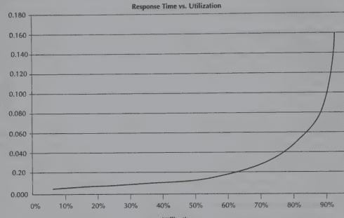

**图 4-2.** *响应时间与利用率*

### 网络性能

与 I/O 子系统不同，网络不会排队。当网络数据包发送时，如果同一时间发送另一个数据包，它们都必须重新发送。这称为冲突。像 I/O 子系统一样，随着你越来越接近网络的物理限制，冲突的数量以及排队都会增加。与计算机系统的许多组件一样，一旦达到限制，响应时间就会呈指数级增加。

### 内存

内存有点不同，因为没有排队也没有冲突，但当你过度驱动系统时，它会耗尽物理内存。你对内存子系统施加的压力越大，可用的 RAM 越少。一旦用完所有物理 RAM，内存中的某些页面会被移至磁盘。这称为分页。分页和交换相似，但并不完全相同。在某些操作系统中，整个进程会被移入和移出内存以供执行。这称为交换。Linux 使用分页，其中 4K 页面根据需要移入和移出内存。由于 Linux 和 UNIX 的历史，用于此分页活动的区域被称为交换分区，即使它用于分页而不是交换。

## 虚拟内存系统中的分页

你可能没有意识到，但如果你使用运行 Windows 的 PC，你正在使用虚拟内存系统。如果你曾经想过为什么一个已经运行过但很久未访问的应用程序似乎需要很长时间才能响应，请看看磁盘驱动器 LED。你可能会看到有大量磁盘活动正在进行。

如果你看到这种磁盘活动，那么你可能正在经历分页。PC 应用程序通常使用的内存比系统实际拥有的多得多。因此，下次你遇到性能缓慢时，请看看磁盘指示灯。

内核进程 `kswapd` 是用于将页面移入和移出内存的守护进程。如果你运行 `ps` 或 `top`，你会看到 `kswapd` 进程。该进程也称为 `pageout` 守护进程。在进行系统和 Oracle 调优时，应不惜一切代价避免分页。如果你的系统正在分页，在解决分页问题之前，大多数其他性能问题都应被视为次要问题。在正常运行的系统中，你应该看到很少或没有分页/交换。

虽然从技术上讲，根据需要将页面移入和移出内存的过程称为分页，但由于历史和传统，这个过程被称为交换。为了遵循标准的 Linux 术语，我也将称其为交换。

由于物理内存比磁盘 I/O 快数百倍，你可以理解为什么交换发生时性能会急剧下降。从性能角度来看，非常重要的是配置系统的内存以避免交换发生。这也是我们不喜欢在 Oracle 数据库服务器系统上运行其他应用程序的原因之一。

## 指标

在监控系统时，重要的是将指标放在可用于衡量系统的地方。指标是你选择的用于衡量系统工作情况的可测量值。可以使用的指标有很多种。你选择的指标类型会根据你对系统及其工作方式的关注点而有所不同。不同类型指标的一些示例包括以下内容：

| 指标 | 描述 |
| :--- | :--- |
| CPU 利用率 | CPU 利用率是一个很好的指标，如果你担心达到系统的容量限制。CPU 的优点是有固定的最大值。你只能使用系统 CPU 容量的 100%。 |
| I/O 利用率 | I/O 利用率以 IOPS（每秒 I/O）表示是一个很好的测量指标，因为你可以计算出不希望超过的最大值。我们的经验法则是你不应超过每个磁盘驱动器 125 IOPS。 |
| 指标 | 描述 |
| :--- | :--- |
| 在线用户 | 知道在线用户数量并不能必然告诉你是否超过了系统的容量，但它是衡量系统负载的一个良好指标。它也是计算未来负载的一个非常有用的变量。 |
| 响应时间 | 如果你有能力测量系统上事务的响应时间，你会发现它是很有用的指标。然而，响应时间通常会随着同时用户数量的变化而变化，因此你需要确保在此考虑扩展性。这也可以用来判断服务等级协议的满足程度如何。 |

只有少数几个指标可以用来衡量系统的利用率。一些示例显示在图 4-3 和图 4-4 中。

通过确定适合你的指标并监控这些指标，你将能够监控系统的运行状况以及推断系统未来何时可能耗尽资源。指标也是向管理层报告系统状态的绝佳方式。

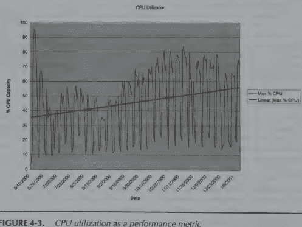

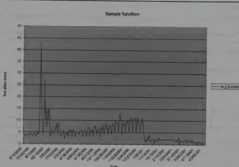

**图 4-4.** *响应时间作为性能指标*

## Oracle 容量规划

Oracle 容量规划涉及以这样的方式设置可调参数，使得 Oracle 资源能够在各种用户、进程和活动级别上允许单独操作运行。用于规划 Oracle 实例的两种不同类型的 Oracle 参数。第一种类型的参数设置绝对限制，不能被超过，并影响 Oracle 实例如何使用资源。第二种类型的参数可能会影响 Oracle 性能，但它不是一个不可超过的设定限制。

### 限制参数

限制资源的这些参数通常很容易根据系统的需求进行规划，因为它们影响诸如最大会话数、最大进程数等。让我们来看一下其中一些最常见的参数列表。

| 参数 | 描述 |
| :--- | :--- |
| `CIRCUITS` | 虚拟电路的最大数量，可用于网络会话。 |
| `DISPATCHERS` | 此参数可用于指定调度程序的最大数量。 |
| `DB_FILES` | 可为实例打开的数据库文件的最大数量。 |
| `LICENSE_MAX_SESSIONS` | 指定已获得许可的会话的最大数量，从而指定系统上允许运行的会话的最大数量。 |
| `LICENSE_MAX_USERS` | 指定允许存在于数据库中的用户的最大数量。 |
| `LICENSE_SESSIONS_WARNING` | 这是发出警报的值，表明你即将达到允许的最大会话数。 |
| `MAX_DISPATCHERS` | 指定可同时运行的调度程序的最大数量。你应该使用 `DISPATCHERS`，因为这仅为向后兼容而维护。 |
| `MAX_SHARED_SERVERS` | 可同时运行的共享服务器进程的最大数量。 |
| `OPEN_CURSORS` | 任何时候可以打开的光标的最大数量。 |
| `OPEN_LINKS` | 一个会话中可以打开到远程数据库的连接的最大数量。 |
| `PARALLEL_MAX_SERVERS` | 可同时运行的并行查询服务器的最大数量。 |
| `PROCESSES` | 指定可以附加到 Oracle 实例的 OS 进程的最大数量。 |
| `SGA_MAX_SIZE` | 指定实例生命周期内 SGA 的最大大小。 |
| `TRANSACTIONS` | 指定并发事务的最大数量。 |

这些参数设置了不可超过的硬性限制，并且在性能调优方面没有提供太多帮助。然而，它们在设置限制方面非常有用，以确保 Oracle 不允许使用超过分配的资源。

### 资源参数

与设置添加用户的硬性限制的参数不同，资源参数是可以限制系统资源的调优参数。它们会极大地影响系统性能。它们包括诸如：

| 参数 | 描述 |
| :--- | :--- |
| `DB_nK_CACHE_SIZE` | 各种非标准缓冲区缓存的大小。 |
| `DB_BLOCK_BUFFERS` (obsolete) | 缓冲区缓存中的数据库块缓冲区的数量。自 Oracle 9i 以来，此参数已过时。 |
| `DB_CACHE_SIZE` | 默认缓冲区缓存的大小。 |
| `DB_KEEP_CACHE_SIZE` | 缓冲池中 keep 缓存的大小。 |
| `DB_RECYCLE_CACHE_SIZE` | 缓冲池中 recycle 缓存的大小。 |
| `JAVA_POOL_SIZE` | 用于 Java 存储过程的内存。 |
| `LARGE_POOL_SIZE` | 大池的大小。这用于共享会话内存、并行执行内存和磁盘 I/O 缓冲区。 |
| `LOG_BUFFER` | 重做日志缓冲区的大小。重做日志缓冲区用于缓存重做条目，直到日志写入进程可以将它们写出。 |
| `PGA_AGGREGATE_TARGET` | 这指定了 PGA 内存的目标大小，因此使 `SORT_AREA_SIZE` 和 `HASH_AREA_SIZE` 过时。 |
| `SESSION_CACHED_CURSORS` | 此参数指定可以缓存在内存中的会话光标数量。 |


| `SHARED_POOL_SIZE` | 共享池的大小。共享池包含库缓存和数据字典。 |

这些参数会根据特定工作负载影响系统的性能。诸如 `DB_CACHE_SIZE` 之类的参数会帮助某些应用程序性能更好，而对于其他应用程序则完全无关紧要。本章不是关于性能调优，而是关于容量规划。

这些参数直接影响你必须配置的系统大小。当这些参数的值增加时，会消耗更多系统资源，因此有必要正确规划参数和系统。设置参数过高往往比设置过低更糟。这在涉及内存时尤其如此。如果 Oracle 尝试使用超过可用物理内存，交换将会发生，从而不利地影响系统性能。此外，如果某些参数设置过高，Oracle 实例甚至可能无法启动。

在第 2 章中，向你介绍了 Oracle 架构。在 Oracle 架构中，有两个主要的内存使用区域：`SGA` 和 `PGA`。`SGA` 内存分配由许多 Oracle 初始化参数决定，例如 `DB_CACHE_SIZE`、`SHARED_POOL_SIZE` 和 `LOG_BUFFER`，以及其他一些参数。从 9i 开始，`SGA` 可以从启动时大小（由 `DB_CACHE_SIZE` 等决定）增长到如果设置了则为 `MAX_SGA_SIZE`，并且重要的是确保使用该值进行规划，因为它可能导致非分页系统开始分页。

除了 `SGA` 之外，每个单独的进程（包括共享服务器进程和并行查询进程）使用的内存。此内存是可变的，基于任何时候需要的内存量。这是你可能遇到问题的首要区域。正因为如此，Oracle 改变了 `PGA` 内存的分配方式。

在过去，你会设置诸如 `SORT_AREA_SIZE` 和 `HASH_AREA_SIZE` 之类的参数，它们定义每个单独用户进程可使用的最大内存量。根据每个进程需要的内存量和进程数量，此内存可能会变化，有时变得相当大。

在 Oracle9i 中，引入了一个新参数。`PGA_AGGREGATE_TARGET` 设置所有用户进程使用的最佳内存量。当运行更多进程时，每个进程分配的内存更少。这大大降低了规划 Oracle 内存的难度。

在 Oracle 10g 中，你只需取可用系统内存量，减去 `SGA` 的大小，并将剩余内存分配给 `PGA`s。这比 Oracle 早期版本要容易得多。

## 硬件容量规划

硬件容量规划涉及为你的 Oracle 系统选择合适的硬件量。容量规划不是一门精确的科学，它是科学、艺术和直觉的结合。在规划系统时，有必要查看系统的使用情况、实现良好性能所需的资源量以及系统在无需额外硬件的情况下应能承受的增长量。必须完成的硬件容量规划有几个主要领域。它们包括 CPU 容量规划、内存容量规划和 I/O 子系统容量规划。

### CPU 容量规划

CPU 的数量和速度会影响任务在系统中的完成速度。如果并发性足够，增加系统中的 CPU 数量会提高任务的性能。如果系统中只有一个处理线程，它只能在一个 CPU 上运行。添加 CPU 不会使该任务更快完成，然而，它只会允许多个并发任务更快完成。

正如本章前面所学，当进程必须等待其他进程完成 CPU 才可用时，CPU 上可能会发生排队。通过添加更多 CPU，你为进程运行创造了更多机会。如果一个 CPU 有 100% 的 CPU 时间可用于处理，那么具有四个 CPU 的系统有 400% 的时间可用。

并发性很高或同时运行许多进程的系统可以从多处理器中获得很大好处。此外，使用 Oracle 并行查询选项可以并行化查询的系统也可以从多个 CPU 中受益。

除了 CPU 数量之外，你还应关注 CPU 缓存的大小。在多处理器系统中，更大的缓存可以帮助避免缓存未命中，从而减少总线利用率。这将有助于性能。在运行 Oracle 时，通常最好选择具有更大缓存的 CPU，即使这意味着获得更慢的芯片。

### 内存容量规划

系统中可供 Oracle 使用的内存量决定了可以高效运行多少以及哪些类型的用户进程和查询。任何特定时间所需的内存量和使用的内存量非常依赖取决于该期间所执行的运算类型和数量，因此非常难以预测。

那么，对于你正在运行的应用类型，你该如何确定内存大小呢？嗯，有几种方法可以做到这一点。最简单的方法就是尽可能多地获取内存并将其分配给 Oracle 进程和 `SGA`。一方面，这属于作弊，因为你实际上并没有对内存子系统进行任何大小调整。然而，与几年前的内存价格相比，内存相对便宜，因此现在这是一种切实可行的做法。

请记住，Oracle 使用的内存实际上可以被视为两个独立的部分。`SGA` 保存在共享内存中，其大小受 Linux 内核参数的管控。共享内存是从一个特殊的内存池中分配的，并且不可交换。Oracle 进程的内存，然而，可以被交换出去。在考虑 `SGA` 应做多大时，请记住 Oracle 进程可能需要大量内存。运行的进程越多，它们消耗的内存就越多。

请注意，在基于 32 位处理器的系统上，通常购买超过 4GB 的 RAM 并不是很高效，因为这是 32 位处理器在不使用具有大量开销的内存扩展的情况下所能使用的全部内存。从 4GB 增加到 5GB RAM 可能会更慢，这是由于使用超过 4GB 内存所带来的开销，但使用 8GB RAM 会比 4GB RAM 更快。

此外，通过 `PGA_AGGREGATE_TARGET` 参数，你现在可以调节所有进程使用的内存量，从而在不冒分页风险的情况下利用可用内存。

如果你没有使用 Oracle9i 或更高版本，手动调整内存大小的方法是监控系统并尝试推算在使用更多进程时所需的内存量。例如，在有 100 个用户连接时拍摄内存使用情况的快照，然后在有 200 个用户连接时再次拍摄。这应该能让你估算出每个用户使用的内存量。然而，`PGA_AGGREGATE_TARGET` 参数会使这种方法失效，因为所有 `PGA` 内存的总和应保持恒定，无论用户数量如何。

## I/O 子系统大小调整

I/O 子系统由于组件构成的特性而具有独特的大小调整特性。为什么这很重要？配置良好的 I/O 子系统将使 Oracle 达到最佳性能。配置不当的 I/O 子系统很容易成为瓶颈并严重影响性能。让我们从基本组件——磁盘驱动器开始查看 I/O 子系统，然后再查看 RAID 控制器和 RAID 级别。

### 磁盘驱动器

I/O 子系统的基本组件是磁盘驱动器，也常被称为硬盘驱动器或硬盘。任何与计算机打交道的人都知道磁盘驱动器是什么。在本节中，你将获得磁盘驱动器的工作原理及其限制因素的简要概述。

在本章后面，你将看到磁盘驱动器如何用于创建 RAID 阵列，以及磁盘驱动器性能限制如何与 RAID 控制器性能特性相互作用。通过了解这些限制，你可以判断自己是否拥有正确大小和配置的 I/O 子系统，以及如何解决可能出现的问题。

磁盘驱动器是计算机系统中为数不多的机械组件之一。作为机械组件，它带来了一些挑战。由于磁盘驱动器由多个电机和伺服机构组成，其中一些以非常高的速度运行，因此它会产生大量热量。由于这些原因以及各种摩擦力，磁盘驱动器是系统中最有可能出现故障的组件之一。事实上，所有磁盘驱动器规格都会告诉你平均故障间隔时间（MTBF）。

由于它是机械组件，其运行涉及某些不可违背的物理定律。这导致了一些无法改变的性能限制。在深入讨论这些限制之前，让我们回顾一下磁盘驱动器的工作原理。

磁盘驱动器由一个或多个磁盘组成，我们称之为盘片。盘片是一个圆形磁盘，数据以磁性方式实际存储在其上。数据像 CD 或 LP（有人还记得那些吗？）一样沿着盘片以磁道写入。数据磁道反过来由称为扇区的单个数据块组成。典型的扇区为 512 字节。盘片如图 4-5 所示。

磁盘臂架位于磁盘驱动器上方，其末端有一个称为磁头的组件。磁头用于从扇区读取数据。该臂架只能在盘片表面径向移动。磁盘驱动器依靠盘片的旋转将请求的数据移动到磁盘磁头下方。臂架和磁头在盘片上的移动称为磁盘寻道。扇区在磁头下方的移动称为旋转。


FIGURE 4-5. 一个磁盘盘片

为了读取请求的扇区，臂架必须首先寻道到正确的磁道。一旦到达正确的磁道，磁盘必须等待请求的扇区旋转到磁头下方。驱动器寻道所需的时间称为寻道时间。数据在磁头下旋转所需的时间称为旋转延迟。寻道时间和旋转延迟如图 4-6 所示。本节后面将更详细地介绍这两个概念。

典型的磁盘驱动器由多个盘片组成，并且盘片的两面都使用。这些盘片堆叠在一起，并且有多个磁头连接到同一个臂架。由于所有磁头堆叠在一起并且可以同时读/写，因此这样做更高效。因此，磁盘驱动器会同时读/写多个扇区。请记住，盘片的两面都使用。

用于存储数据的磁道堆栈称为圆柱面。通过同时使用所有磁头，磁盘驱动器可以比单独移动到每个扇区更快地访问和写入数据。磁盘圆柱面如图 4-7 所示。

要了解磁盘驱动器的性能，必须了解寻道和旋转延迟的性能。

### 寻道时间

寻道是磁盘臂架从一个磁道移动到另一个磁道的动作，而寻道时间是臂架从一个磁道移动到另一个磁道所需的时间。寻道可分为三种类型：全盘寻道、磁道到磁道寻道和随机寻道。虽然功能上相同，但由于性能特性不同，它们被分别归类。


**FIGURE 4-6. 寻道时间与旋转延迟**


**FIGURE 4-7.** 磁盘圆柱面


全盘寻道发生在臂架必须从最外层磁道移动到最内层磁道或反之时。磁道到磁道寻道涉及臂架从一个磁道移动到相邻磁道，因此得名。随机寻道介于两者之间。这是我们最关心的寻道类型，因为全盘寻道很少甚至从不发生。

高性能 SCSI 磁盘驱动器的全盘寻道时间为读取约 7.5 ms，写入约 8 ms。尽管全盘寻道很少发生，但提供全盘寻道时间是为了给出最坏情况。

高性能 SCSI 磁盘驱动器的随机寻道时间为读取约 3.9 ms，写入约 4.5 ms。这是很可能导致性能问题的寻道类型。

同一 SCSI 磁盘驱动器的磁道到磁道寻道时间为读取 0.5 ms，写入 0.7 ms。你可以看到磁道到磁道寻道时间明显小于随机寻道时间。

### 旋转延迟

一旦臂架完成寻道到数据所在的磁道，就必须等待盘片在其下方旋转到数据所在的位置。数据移动到磁头下方所需的时间称为旋转延迟。旋转延迟主要取决于磁盘驱动器旋转的速度。因此，15,000-RPM 的磁盘驱动器比 10,000-RPM 的磁盘驱动器具有更小的旋转延迟。

平均旋转延迟大约是最大旋转延迟的一半。最大旋转延迟可以从旋转速度推导出来。对于 15,000-RPM 的磁盘驱动器，最大旋转延迟为

最大旋转延迟 = (1 / 15,000 rpm)(1 min / 60 sec)

= 1.11 μs

如你所见，即使是最大旋转延迟，与随机寻道时间，甚至是磁道到磁道的寻道时间相比也是微不足道的。事实上，在整个 I/O 子系统中，没有任何东西在延迟方面能与随机寻道时间相提并论。如果我们将平均旋转延迟估计为最大旋转延迟的一半，我们得到大约 0.55 μs。

### Disk Drive Performance

从磁盘驱动器读取数据所需的时间由多个不同功能的累积构成。这些功能是

- 寻道时间
- 旋转延迟
- 传输时间

除磁盘驱动器延迟外，数据还必须通过 I/O 总线传输到控制器，并且还会产生控制器延迟。磁盘驱动器外部的延迟将在本章后面关于 RAID 控制器的部分中介绍。

为了更准确地估算各种磁盘驱动器的性能，让我们做一些计算。一旦我们知道磁盘驱动器的规格并了解一些正在进行的 I/O 类型，我们就可以很好地了解磁盘驱动器的性能。

### Reading the Disk Spec Sheet

确定特定磁盘驱动器性能的第一步是查看磁盘驱动器规格表。该规格将提供您计算磁盘驱动器最大和最佳性能所需的信息。特定性能取决于正在执行的 I/O 类型。

典型的磁盘驱动器规格表将包含以下信息，其外观类似于表 4-1 所示。

此外，还有大量关于工作条件的信息，例如最低和最高温度、湿度等等，以及功耗要求。此示例并非完整的磁盘驱动器规格，仅为示例。

根据我们对该磁盘驱动器的信息，我们可以对 I/O 速率以及最大和最佳性能进行一些计算。这将分为随机和顺序 I/O 的性能。

| 规格 | 值 | 规格 | 值 |
|---|---|---|---|
| 制造商 | Acme disk | 每磁道扇区数 | 345 |
| 型号名称 | Big disk | MTBF（平均故障间隔时间） | 1,200,000 hours |
| 型号编号 | 12345 | 内部传输速率（最小） | 385 Mbits/sec |
| 物理特性 | Height, width, weight | 内部传输速率（最大） | 508 Mbits/sec |
| 格式化容量 | 18GB | 外部（I/O）传输速率（最大） | 160 Mbytes/sec |
| 接口类型 | Ultra SCSI 160 | 平均寻道时间，读 | 3.9 msec |
| 缓冲区缓存大小 | 4096 Kbytes | 平均寻道时间，写 | 4.5 msec |
| 旋转速度 | 15,000 RPM | 磁道到磁道寻道，读 | 0.5 msec |
| 磁盘数量（物理） | 5 | 磁道到磁道寻道，写 | 0.7 msec |
| 磁头数量（物理） | 10 | 整盘寻道，读 | 7.5 msec |
| 总柱面数 | 10,377 | 整盘寻道，写 | 8 msec |
| 总磁道数 | 103,770 | 平均旋转延迟 | 2 msec |
| 每扇区字节数 | 512 | | |

**表 4-1.** 虚构磁盘驱动器的磁盘驱动器规格

(由 Seagate 网站提供)

## Disk I/O Capacity

作为数据库性能顾问，我看到了许多不同类型的性能问题。其中最常见的问题之一是 I/O 容量不足。仅根据所需空间来选择磁盘驱动器的数量和大小的情况相当常见。这是一个常见的错误。

如本章所述，物理磁盘驱动器只能在过载并开始增加延迟之前执行一定数量的 I/O。增加的延迟可能是资源争用过度和响应时间缓慢的根本原因。

在大多数情况下，用四个 GB 磁盘驱动器而不是一个 GB 磁盘驱动器配置系统会提供更好的整体性能。我说大多数情况，因为存在 I/O 子系统根本不是问题的情况，无论磁盘驱动器的数量如何。通过为性能和空间同时设计系统，您可以实现最佳性能。

## Sequential I/O Performance

顺序访问数据时，寻道时间不如随机访问数据时那样重要。执行顺序 I/O 所需的时间可由以下公式确定：

```
Seconds per I/O =(Track-to-Track Seek Time)+(Average Rotational Latency)+(Transfer Time)
=(0.6 msec)+(0.5* msec)+(apx0.010µsec)
=1.1 msec (apx.).
```

* 由于顺序 I/O 相邻扇区，读取和旋转延迟仅偶尔生效，因此此处给出的旋转延迟值为 0.5 毫秒，而不是规格表中指定的 2 毫秒。

这里我们假设每个 I/O 之间都有磁道到磁道的寻道。由于规格表告诉我们平均每个磁道有 345 个扇区，如果您进行真正的顺序 I/O，则这种情况不太可能。然而，当依赖 Oracle 块大小和多块 I/O 时，其影响是未知的。

假设我们的计算是正确的，执行一次顺序 I/O 大约需要 2.6 毫秒，则在此磁盘驱动器上可以执行的顺序 I/O 的最大数量可由以下公式计算：

```
I/Os per second or IOPS = 1 / (seconds per I/O)
= 1 / (2.6 msec / 1000 msec per sec)
= 384 IOPS
```

该数字是近似的，因为我们实际上不知道有多少 I/O 需要磁道到磁道的寻道。因此我们可以说至少可以顺序执行 307 IOPS。

## Random I/O Performance

随机 I/O 的计算更为重要，因为随机 I/O 性能是 Oracle 系统中最常见的性能问题之一。我们知道随机 I/O 操作期间会发生随机寻道，而 Oracle 执行的大多数 I/O 操作本质上是随机的。与顺序 I/O 一样，随机 I/O 所需的时间由相同的公式决定：

每 I/O 秒 = (随机寻道时间)+(平均旋转延迟)+(传输时间)

= (4.3 msec)+(2.0 msec)+(apx0.010sec)

= 6.3 msec (apx.)

这里我们假设每个 I/O 之间都有随机寻道。此外，我们假设读和写混合，其中使用 4.3 毫秒，而不是读取的 3.9 毫秒和写入的 4.5 毫秒。

假设我们的计算是正确的，执行一次随机 I/O 大约需要 6.3 毫秒，则在此磁盘驱动器上可以执行的随机 I/O 的最大数量可由以下公式计算：

每秒 I/O（IOPS） = 1 / (每 I/O 秒)

= 1 / (6.3 msec / 1000 msec per sec)

= 158 IOPS

但这并不能说明全部情况。如果您曾经研究过排队理论，您会记得当您接近设备的带宽限制时，排队的可能性会增加。那么，这意味着什么？当您接近每秒 158 IOPS 的限制时，尽管该数字是驱动器在不排队的情况下可以达到的最大速率，但排队的可能性更大，因此 I/O 开始花费更长的时间。

这种排队在图 4-8 的图表中有所说明。您可以看到，越接近最大理论性能，磁盘延迟就越长。由于 Oracle 性能对 I/O 延迟非常敏感，因此不要过度驱动 I/O 很重要。


> 磁盘驱动器一次只能处理一个 I/O。如果磁盘驱动器在处理一个 I/O 时控制器收到另一个 I/O 的请求，则该请求将被排队，直到第一个 I/O 完成。因此，即使在低 I/O 速率下，也可能并且常见会出现排队。


图 4-8. I/O queueing

为了实现这一点，我们理想情况下希望将磁盘驱动器运行在图表上被称为“曲线拐点”的点上。这是曲线斜率开始急剧向上移动的点，大约发生在容量的 80% 处。因此，在本例中，随机 I/O 理想情况下不应超过每秒 126 次 I/O。

## 附加考虑

在前两节中，你已经看到理论上磁盘驱动器可以以以下速率访问数据：

- 顺序 I/O：384 IOPS
- 随机 I/O：158 IOPS


除磁盘驱动器本身产生的延迟外，I/O 控制器和操作系统设备驱动程序也可能产生其他延迟。这种额外延迟的大小取决于设备繁忙程度。由于这种额外延迟取决于 I/O 子系统的具体情况，这里不予涵盖；然而，你应该意识到它的存在。

## RAID 磁盘子系统

你可以使用多种不同类型的 I/O 子系统与计算机系统配合使用。对于数据库服务器来说，RAID 系统可能是最流行的。RAID 系统有多种不同的类型和配置，如本节所述。

缩写 RAID 代表廉价磁盘冗余阵列。RAID I/O 子系统主要有两个目的。第一个是提供容错 I/O 子系统。容错 I/O 子系统是指在系统组件（通常是磁盘驱动器）发生故障时不会造成数据丢失。RAID 子系统的第二个目的是允许将多个独立磁盘驱动器配置成一个更大的虚拟磁盘驱动器。这是为了便于管理和性能方面的原因。

RAID 子系统可以通过磁盘条带化将两个或多个磁盘驱动器组合成一个更大的逻辑磁盘驱动器。磁盘条带化采用不同的算法，将逻辑磁盘布局的数据放置在两个或多个磁盘驱动器上。磁盘条带化不会使逻辑磁盘驱动器具有容错性，但可以通过在多个磁盘之间分散 I/O 来改善磁盘访问时间。此外，磁盘条带化可以与控制器的容错功能结合使用。

大多数 RAID 控制器提供多种配置逻辑磁盘卷的选项，使用不同的条带化选项和不同的容错 RAID 类型。不同的 RAID 配置通常称为 RAID 级别，定义了数据如何在 I/O 子系统中的不同磁盘上进行条带化。这些不同的 RAID 级别提供不同的容错级别、不同的性能特性和不同的成本。一些 RAID 级别涉及磁盘条带化，而一些 RAID 级别不涉及。

### 硬件与软件 RAID

RAID I/O 子系统可以通过购买硬件 RAID 子系统或使用软件 RAID 来形成。这两种选项各有优缺点。

硬件 RAID 子系统的性能会更高，因为系统 CPU 上运行的其他进程不会影响它。此外，硬件 RAID 子系统可以支持软件 RAID 子系统可能无法支持的功能，例如热插拔磁盘驱动器和故障前警报。然而，硬件 RAID 子系统只能配置为对连接到该控制器的驱动器进行条带化，因此逻辑磁盘卷中的驱动器数量限制为控制器所能支持的驱动器数量。此外，硬件 RAID 子系统可以具有电池备份缓存，而软件 RAID 系统则不能。

软件 RAID 子系统具有价格优势，因为无需购买额外硬件。此外，软件 RAID 子系统可以配置为在系统的所有磁盘驱动器之间进行条带化，并且不受控制器限制。因此，你可以在连接到多个 I/O 控制器的磁盘驱动器上创建软件 RAID 卷。

也可以使用软件条带化对硬件 RAID 控制器上的逻辑 RAID 卷的硬件磁盘卷进行条带化。因此，两者可以结合起来创建巨大的逻辑磁盘卷。由于软件 RAID 涉及的开销，我不推荐这样做。

出于本书的目的，由于它侧重于性能和稳定性，我们将假设使用硬件 RAID 设备。

### 条带化

条带化涉及在多个磁盘驱动器之间分散数据，以便创建一个比系统中任何单个磁盘驱动器都大的逻辑磁盘驱动器。磁盘条带化涉及将逻辑磁盘驱动器分成称为条带或块的片段。通常，这些条带以循环方式分发到各个磁盘驱动器，如图 4-9 所示。

如前所述，对操作系统和用户而言，逻辑 RAID 卷表现为一个大磁盘驱动器。如果使用硬件 RAID 控制器，操作系统甚至不知道其中的区别。条带化用于大多数 RAID 子系统支持的几种不同的 RAID 级别中。在本节中，我们将研究不同的 RAID 级别及其工作原理。

### RAID0

RAID0 是没有容错的磁盘条带化。因此，RAID0 不是冗余的。使用 RAID0 配置，你可以将数据条带化到多个磁盘驱动器上以创建大型逻辑磁盘卷。然而，卷中任何磁盘驱动器发生故障都将导致整个逻辑卷丢失。

RAID0 仅是磁盘条带化，通常以循环方式工作。RAID0 是 RAID 级别中最经济的，并提供最高的性能，如本节后面所述。你会看到，正如大多数事情一样，存在权衡。例如，RAID0 以没有容错为代价提供高性能和价值。


### RAID1

RAID1 也称为 *磁盘镜像*。在 RAID1 中，磁盘驱动器上存储的所有数据都会在阵列中的另一个磁盘上复制，如图 4-10 所示。每次对逻辑磁盘进行写入时，数据必须写入 *两者* 物理磁盘后，逻辑写入才被视为完成。使用磁盘镜像，单个磁盘镜像到另一个磁盘；这些磁盘也可以与其他磁盘一起条带化以形成更大的逻辑卷。这种磁盘条带化和镜像的组合称为 RAID10、RAID1+0、RAID0+1 或 RAID 1/0（取决于制造商）。

由于这种镜像是一对一的，系统中一半的磁盘驱动器实际上可能发生故障（取决于它们是哪些磁盘），系统仍可运行。在大多数磁盘阵列控制器上，你可以将镜像分割到 SCSI 总线上。这种安排允许整个 SCSI 总线（例如机柜故障）发生故障而不影响操作。

使用磁盘镜像，你只能使用系统中一半的磁盘（另一半用于镜像）。换句话说，如果你使用两个 18GB 磁盘驱动器进行磁盘镜像，你只能使用 18GB 的空间。在写入时，从性能角度来看，你只能获得一个磁盘的好处，因为一次逻辑写入会触发两次物理写入。你可能会从镜像驱动器读取中获得好处。一些磁盘阵列控制器支持拆分寻道，其中读取可以同时在不同的镜像驱动器上对不同的数据进行。磁头最接近请求数据的磁盘检索数据。根据数据访问方法，此功能可能提供好处也可能不提供。

如果你能承担磁盘镜像的成本，当需要容错时，RAID1 是最佳选择。使用磁盘镜像，你可以获得最高级别的保护以及容错卷可能获得的最快的磁盘访问速度。

### RAID10

RAID10 是 RAID0 和 RAID1 的组合。在 RAID10 卷中，每个磁盘驱动器的内容都镜像到另一个磁盘驱动器上，同时这些镜像磁盘作为条带集的一部分参与，如图 4-11 所示。


图 4-10. RAID1 配置


图 4-11. RAID10 配置

RAID10 卷的优势在于您可以实现 RAID0 卷的管理和性能优势，同时结合 RAID1 卷的容错性。缺点是 RAID10 卷是最昂贵的，因为镜像会使一半的可用空间丢失。

对于数据库操作，RAID10 是最优选的，正如本章后面将看到的。

## RAID2

RAID2 是一种并行访问的 RAID 级别，其中使用称为 Hamming Code 的错误校正方案来纠正错误。由于 RAID2 中所有磁盘驱动器都用于所有 I/O 操作，因此它可以在单个磁盘驱动器的速度下提供高吞吐量。RAID2 如图 4-12 所示。

虽然 RAID2 可以提供大量吞吐量，但提供容错需要三个磁盘驱动器。

## RAID3

RAID3 是一种与 RAID2 类似的并行访问容错方法。不同之处在于 RAID3 仅需要一个磁盘驱动器来实现容错。这是因为 RAID3 使用按位奇偶校验而不是错误校正码。RAID3 如图 4-13 所示。


图 4-12. RAID2 配置

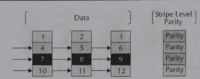

图 4-13. RAID3 配置

RAID3 可以实现高速传输率，但与 RAID2 相同，一次只能处理一个 I/O。对于小型随机 I/O，这可能是一个弊端。RAID2 和 RAID3 都适用于大型顺序传输，例如流式视频馈送。

## RAID4

RAID4 被称为 *驱动器奇偶校验*，或 *数据保护*（不要与 Oracle Data Guard 混淆）。在 RAID4 中，卷中的一个驱动器用于数据奇偶校验，如图 4-14 所示。如果任何一个磁盘发生故障，其他磁盘可以通过从奇偶校验驱动器重建丢失的数据继续运行。RAID4 卷的可用空间会损失相当于一个磁盘驱动器的空间。

与 RAID2 和 RAID3 不同，RAID4 使用独立访问技术，可以同时访问多个磁盘驱动器。这对于随机 I/O 很有好处，因为它们可以并行访问。因此，每秒 I/O 数量可以达到各个磁盘驱动器限制的总和。


图 4-14. RAID4 配置

当向 RAID4 卷写入数据时，会产生额外的 I/O 以保持奇偶校验为最新。事实上，只要添加数据就必须保持奇偶校验为最新，因此会发生以下过程：

- 1. 同时读取旧数据和旧奇偶校验条带。
- 2. 对旧数据和旧奇偶校验执行 XOR 操作。
- 3. 将该值与 XOR 和新数据结合以得到新的奇偶校验。
- 4. 将新数据和新奇偶校验驱动器写入。

因此，对于一次 RAID4 写入，会产生四次物理 I/O。对于 RAID4 读取，不会产生额外的 I/O 开销。


RAID4 最大的缺点是专用的奇偶校验磁盘。由于奇偶校验驱动器参与每次写入操作，一次只能对卷执行一次写入。在重写活动下，其他写入开始排队，依赖于这些写入的读取也会开始排队。再加上每次逻辑写入所需的额外物理操作的开销，很快就会在单个磁盘上形成巨大的性能瓶颈。

## RAID5

RAID5 也被称为分布式数据保护。RAID5 与 RAID4 相似，只是奇偶校验不隔离到一个磁盘驱动器。相反，奇偶校验分布在系统中的所有磁盘驱动器上，如图 4-15 所示。

与 RAID4 相同，RAID5 写入也有惩罚。对于每次磁盘写入，会进行两次读取，进行一次奇偶校验计算，然后进行两次写入。虽然一次读取只产生一个 I/O，但一次写入产生四个 I/O。这是为了维护奇偶校验。

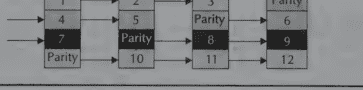

图 4-15. RAID5 配置

RAID5 不会像 RAID4 那样遭受对单个磁盘的相同写入争用。由于奇偶校验分布在卷中的所有驱动器上，一次可以有多个写入操作正在进行。潜在地，可以同时进行的写入数量可达卷中磁盘数量的一半。

RAID4 和 RAID5 都非常经济，因为为了提供容错性，您只需损失相当于一个磁盘驱动器的空间；然而，它们在性能方面付出了代价。

## Parity Overview

RAID3、RAID4 和 RAID5 使用奇偶校验来维护容错性。奇偶校验是一种二进制方法，其中各个部分的和为偶数或奇数。位使用二进制算术相加，并添加 0 或 1 作为奇偶校验位。该奇偶校验位的值取决于维持所有位之和的正确奇偶校验所需的条件。

## Parity Example

让我们看一个使用三个不同位和一个奇偶校验位的示例。对于我们的示例，我们将选择偶数奇偶校验，因此所有位的总和必须为偶数。取以下三个值：

```
A=1
B=0
C=1
```

这些值的总和为 2，因此如果奇偶校验位的值为 0，则 A+B+C+Parity 的总和将等于偶数（2）。在另一个示例中，让我们取以下值：

```
A=0
B=1
C=1
```

为了使这些值 A+B+C+Parity 的总和等于偶数（2），奇偶校验位的值必须为 1。以这种方式，奇偶校验在 RAID 控制器中的每个磁盘驱动器上创建——字节字节，位位。

## Creating Parity

为了创建 RAID3、RAID4 或 RAID5 卷，必须从每个磁盘驱动器读取每个数据条带并计算奇偶校验。这有时被称为数据擦洗。如果您创建了其中一个 RAID 卷，您可能注意到创建需要很长时间。这就是原因。卷中的每个磁盘都必须被读取，奇偶校验必须被创建，并且奇偶校验必须被写入。这可能非常耗时，具体取决于磁盘驱动器的大小和阵列中磁盘驱动器的数量。

## Maintaining Parity

一旦卷被创建，每次重新计算奇偶校验是不必要的。由于奇偶校验已经计算过，可以根据插入或修改数据所做的更改来修改奇偶校验。例如，如果数据位没有改变，奇偶校验位不需要改变。如果数据位改变，则奇偶校验位也必须改变。这是通过对数据和奇偶校验位执行按位异或 "OR" 操作（或 XOR）来完成的。

因此，要修改奇偶校验数据，应执行以下步骤：

- 1. 读取数据和奇偶校验条带。
- 2. 对旧数据和奇偶校验执行 XOR。
- 3. 使用 XOR 操作和新数据计算新的奇偶校验。
- 4. 写入新数据和新奇偶校验。

因此，对于一次奇偶校验写入，会产生四个物理 I/O 和两次 XOR。不仅由于磁盘驱动器限制，额外的 I/O 很重要，其顺序也很重要。由于有两次 I/O、两次计算和两次额外的 I/O，延迟至少是非奇偶校验 I/O 延迟的两倍（假设奇偶校验计算无限快）。考虑到 Oracle 对 I/O 延迟的敏感性，这一点很重要。

## RAID Performance Overview

现在您已经了解了不同的 RAID 级别，让我们看看它们的性能如何。从本节到本章结束，我们只会查看最常见的 RAID 级别：RAID0、RAID1、RAID10 和 RAID5。虽然您可能会遇到其他 RAID 级别，但这种情况很少见。

首先，让我们回顾一些事实。

- **单个 I/O 操作以单个磁盘驱动器的速度发生** 无论 RAID 卷中有多少磁盘驱动器，I/O 都将指向其中一个，因此您无法超过该速度。正是因为多个 I/O 操作可以在不同磁盘上同时发生，才使 RAID 系统具有更好的性能。
- **如果您超过磁盘驱动器的物理性能限制，将会发生排队并且延迟会增加。**
- **随机 I/O 的最佳性能率为 128 IOPS（在此示例中）** 超过此速率可能会导致延迟增加。额外的驱动器将允许额外的并发性和更高的性能。如果一个驱动器可以执行 128 IOPS，则十驱动器 RAID 卷可以执行 1280 IOPS。
- **几乎所有 I/O 操作本质上都是随机的** 即使您正在执行顺序表扫描，如果其他人正在访问同一磁盘，I/O 将变得随机。

现在让我们看看一些常见 RAID 级别的性能。

RAID0 是计算性能特征最直接的 RAID 级别。假设对 RAID0 卷的访问是随机的，并且每个磁盘驱动器为 175 IOPS，则向卷提供的最佳 IOPS 数可使用以下公式计算：`(# of reads) + (# of writes) = (175 * n)`，其中 *n* 是阵列中的磁盘驱动器数量。因此，十个磁盘驱动器的阵列每秒可处理 1750 次读写。

```
    (# of reads) + (# of writes) = (175 * n)
```

RAID1 和 RAID10 卷在每次对逻辑卷写入时都会产生两次物理写入的写入惩罚。这是因为磁盘驱动器上的所有数据都必须在其镜像上复制。因此，RAID10 和 RAID1 卷上的最佳读写次数可使用以下公式计算：`(# of reads) + (# of writes * 2) = (175 * n)`，其中 *n* 是阵列中的磁盘驱动器数量。对于 RAID1 阵列，*n* = 2。

```
    (# of reads) + (# of writes * 2) = (175 * n)
```

RAID5 卷每次逻辑写入都会产生四次物理 I/O 的惩罚。必须读取旧数据和奇偶校验，执行两次 XOR 操作，然后写入新数据和奇偶校验。RAID5 卷上的最佳读写次数可使用以下公式计算：`(# of reads) + (# of writes * 4) = (175 * n)`，其中 *n* 是阵列中的磁盘驱动器数量。

```
    (# of reads) + (# of writes * 4) = (175 * n)
```

### RAID 级别性能比较

让我们比较不同的 RAID 级别。

- RAID0 是性能最高的 RAID 级别，因为没有容错开销。然而，缺乏容错性使得 RAID0 对于大多数数据库操作来说是不可接受的。
- RAID1 和 RAID10 在写入时产生 2 倍惩罚。它们具有最佳的容错级别，但也是最昂贵的。
- RAID5 具有最差的写入惩罚，每次写入操作会产生四次物理 I/O。RAID5 提供容错，但只能容忍卷中一个磁盘驱动器的丢失。然而，它是 RAID 级别中最经济的。

上述提到的 RAID 级别均不会对读取产生任何惩罚。

### RAID 性能

正如本节所示，不同的 RAID 级别具有不同的性能特征。RAID5 因其经济性而非常流行，因为在实现一定程度容错的同时，你只损失一个磁盘驱动器的空间。然而，在大多数情况下，RAID5 不适合与 Oracle 配合使用。

我的经验法则是，除非读写比为 90/10，否则不要使用 RAID5。换句话说，除非 90% 的 I/O 操作是读取，否则 RAID5 不合适。当然，因地制宜，如果 I/O 速率足够低，则不应成为问题。

在计算物理层每个磁盘驱动器执行的 IOPS 时，请记住将 RAID5 写入乘以四。这可能会极大地改变你的结果数据。出于容错和性能考虑，我更喜欢 RAID10。

如你所见，选择 RAID 级别时需要考虑多个因素。在下一章中，你将看到在选择 RAID 级别时也应考虑 Oracle I/O 因素。

不管你的硬件供应商告诉你什么，I/O 规划都是一个大问题。尽管最先进的 I/O 子系统具有许多功能，例如大缓存和多总线，但这并不能改变如果磁盘驱动器不足，你的性能就会下降的事实。

遇到的最常见性能问题之一是 I/O 容量不足。随着磁盘驱动器变得更大且价格更低，倾向于用一个更大的磁盘驱动器替换几个较小的磁盘驱动器。虽然这物有所值，但你的性能可能会下降。在订购新的 I/O 子系统之前，请确保进行适当的 I/O 规划。

## 容量规划

容量规划是指对现有系统上硬件和软件资源消耗进行复杂且持续的性能研究，以便为系统工作负载的增长做好准备。这些研究主要是为了在系统资源使用量增加时保持服务水平协议（SLA）。换句话说，容量规划是为现有系统进行规模规划的艺术，以便确定何时可能耗尽容量。

除了预测资源利用率外，容量规划还允许你对工作负载进行假设情景预测。在典型的容量规划研究中，执行任务的技术人员将拥有存储在数据库中的历史性能数据，并能够预测以下方面的趋势：

- CPU 利用率的正常增长
- 磁盘使用情况
- 内存使用情况


技术人员还能够预测因向系统添加新用户而导致的 CPU、磁盘和内存利用率的突然上升。

这些研究可以非常详细，并可能涉及特定用户的活动分析。这是有价值的信息，因为你不仅可以为资源预测目的向系统添加假设的通用用户，还可以添加特定用户，例如总账用户、应付账款用户等等。

通过进行容量规划研究，IT 管理部门可以有足够的时间规划新硬件的添加，以保持当前实施的服务水平协议。在某些情况下，容量规划研究也可以产生调优思路。

## 摘要

本章涵盖了规模规划和容量规划的基础知识，并涉及了这些领域的许多主要方面。正如本章的各种讨论所示，规模规划和容量规划是一门困难的科学。

规模规划非常重要，因为在硬件采购初期规模规划不当可能导致系统配置不佳，从而在以后导致性能不佳。正确规划系统规模比修复已在使用中的性能不佳系统更经济。


## 第 5 章

## 为 Oracle 配置 Linux 系统


为了在 Linux 上运行 Oracle，首先必须以 Oracle 拥有足够资源的方式安装和配置 Linux。这些资源可能包括足够的内存、足够的磁盘空间、适当的调优等。一旦完成，Oracle 安装即可开始。Oracle 安装完成后，你可以就 Oracle 配置做出一些具体选择，以优化 Linux 上的性能。

本章将涵盖为 Oracle 配置 Linux 以及为 Linux 配置 Oracle。就像 Oracle 支持的许多操作系统一样，有一些 Linux 特定事项你应该了解。本章结束时，你将准备好正确安装和配置 Linux 上的 Linux 和 Oracle。

### Linux 预安装程序

为了正确配置 Linux 系统以供 Oracle 使用，需要执行多个步骤。其中一些步骤涉及正确配置 Linux 内核参数，而另一些则涉及正确设置硬件设备。其他步骤则决定存储设置以及如何正确规划系统规模。本节将涵盖所有这些步骤。

在安装操作系统之前，只有 Linux 配置的少数部分需要仔细考虑。其中最重要的是 Linux 文件系统的配置。一旦做出此决定并且操作系统已格式化分区和文件系统，就无法更改。事实上，为了重新进行基本的 Linux 分区，必须重新安装操作系统。由于这在生产环境中不太可能，通常你将不得不长期使用最初的选择。

其他重要组件必须作为操作系统安装的一部分进行配置，但诸如 Linux 可调参数、网络和其他配置参数等内容可以在以后随时更改，而无需重新安装操作系统。

除了初始文件系统配置外，选择正确的 Linux 组件也很重要。当提示安装操作系统或软件开发等内容的软件包组时，应选择它们。在初始安装期间，很容易安装软件包组，而以后则更困难，因为必须选择单个软件包。

在开始 Linux 安装（随后是 Oracle 安装）之前，你必须验证是否满足某些最低要求。这些要求是正确安装和配置 Oracle 数据库服务器所必需的，并且在安装和配置 Linux 操作系统时必须予以考虑。

#### 最低要求

必须满足以下最低要求，才能成功安装和配置 Oracle 数据库服务器。如果无法满足这些要求，则应重新安装系统或升级硬件以满足要求。

- `512MB` 物理内存 这是 Oracle 数据库服务器正常运行所必需的；然而，这是一个最低要求。为了获得最佳运行效果，您确实应该拥有比这多得多的 RAM。
- `1GB` 交换空间 交换空间的大小通常设置为物理内存的两倍。对于 RAM 大于 `2GB` 的系统，交换空间的大小可在 RAM 的一到两倍范围内。您拥有的 RAM 越多，使用交换空间的可能性就越小。
- `/tmp` 必须至少有 `400MB` 空间 如果 `/tmp` 分区作为单独分区创建，则其大小必须至少为 `400MB`。如果 `/tmp` 目录是 `/`（根）文件系统的一部分，则除了您将用于其他用途的空间外，还必须至少有 `400MB`。
- Oracle 文件空间 您必须为最基本的 Oracle 安装分配至少 `1.5GB` 的空间。此数量根据您选择安装的组件而有所不同。
- Oracle 数据文件 为了安装基本示例数据库，您必须至少有 `1.2GB` 的空间。此空间可以位于文件系统、`NFS` 分区或 Oracle ASM（自动存储管理）磁盘组上。在 Oracle `10g` RAC 环境中，此存储必须在集群中的所有节点之间共享。

这些要求应在创建 Linux 安装时予以考虑。重新构建分区以适应 Oracle 安装是相当痛苦的，并且所需的时间可能会使您的安装花费更长的时间。

### 配置文件系统

Linux 文件系统布局可以少至三个分区，也可以多到您想要的分区。Linux 配置的最低要求包括以下两个分区：

- `/`, 根分区 这是初始分区。所有其他分区都挂载在根分区的子目录上。
- `swap`, 交换分区 交换分区不是作为常规文件系统挂载的，但 Linux 分区需要它才能运行。交换分区（或分区）必须根据前面列出的最低要求进行配置。

除了最小的文件系统要求外，您还可以为不同功能创建单独的分区。在安装过程中可能创建的典型分区包括以下内容：

| 分区 | 描述 |
|---|---|
| `/home` | `/home` 分区用于 Linux 用户账户的 home 目录。Oracle 用户账户在 `/home` 目录树中创建，但 `$ORACLE_HOME` 目录通常不存储在此处。 |
| `/tmp` | `/tmp` 分区用于临时文件。Oracle 在安装过程中使用此目录，操作系统在正常操作中也使用它。如果将其创建为单独分区，请确保其满足前面列出的最低要求。 |
| `/usr` | `/usr` 目录结构用于程序；然而，这不是 Oracle 程序所在的位置。Oracle 程序位于 `$ORACLE_HOME` 目录中，该目录通常位于 `/opt` 目录树中。 |
| `/var` | `/var` 目录结构用于可变长度文件，例如日志文件、打印 spool 文件等。 |
| `/usr/local` | `/usr/local` 目录树用于本地程序和配置文件。Oracle 使用此目录结构用于某些程序，但大部分 Oracle 程序位于 `$ORACLE_HOME` 目录树中。 |
| `/opt` | `/opt` 目录树用于可选程序。这是 `$ORACLE_HOME` 目录树通常所在的位置。此外，在某些系统上，Oracle 数据文件也可能存储在此目录树中。 |

配置系统时，请考虑前面列出的最低要求以及您自己的特定需求。如果您将创建 RAC 集群，请考虑 Oracle 数据文件的共享存储要求。

### 选择 Linux 组件

选择合适的 Linux 组件是规划操作系统安装的另一个重要部分。可以在初始安装后加载所需组件，但在此期间配置它们要容易得多。

自 Oracle `10g` for Linux 首次发布以来，支持以下 Linux 发行版：

#### Oracle 10g Release 1 (10.1.0)

- Red Hat Enterprise Linux `2.1` 或 `3.0`
- SUSE Linux Enterprise Server `8.0` 或 `9.0` (`SLES8` 或 `SLES9`)

#### Oracle 10g Release 2 (10.2.0)

- Red Hat Enterprise Linux EL `3` 或 EL `4`
- SUSE Linux Enterprise Server `9.0` (`SLES9`)

在这些 Linux 发行版中，首先需要安装软件开发包，以便安装 `gcc` 编译器和库。如果您可能需要升级 Linux 内核，还应安装内核开发包。建议将以下软件包包含在您选择安装的软件包列表中。

#### Red Hat Linux 软件包

安装 Red Hat Linux 时，建议您除了默认软件包和您选择的任何其他软件包外，还安装以下软件包。这不是一个完整的列表，并不意味着不应安装其他软件包。

- **开发工具** 该软件包集包括 `gcc` 编译器、`PERL`、`python` 和调试器。
- **内核开发** 这对于安装 Oracle 并不是特别必需，但如果您将来需要更新 Linux 内核，则是必需的。

Oracle `10g` 安装所需的最小组件集如下列出：

#### Oracle 10g R1 的系统组件

| 系统 | 组件 |
|---|---|
| Red Hat `2.1` 和 `3.0` | `make-3.79` |
| | `binutils-2.11.90.0.8-12` |
| Red Hat Enterprise Linux `2.1` (x86) | `gcc-2.96.108.1` |
| | `openmotif-2.1.30-11` |
| Red Hat Enterprise Linux `3` | `gcc-3.2.3-2` |
| | `compat-db-4.0.14-5` |
| | `compat-gcc-7.3-2.96.122` |
| | `compat-gcc-c++-7.3-2.96.122` |
| | `compat-libstdc++-7.3-2.96.122` |
| | `compat-libstdc++-devel-7.3-2.96.122` |


| | `openmotif-2.2.2-16` |

| | `setarch-1.3-1` |

### Oracle 10g R2 的系统组件

- **系统**

  - Red Hat 2.1 和 3.0
  - Red Hat Enterprise Linux 2.1 (x86)
  - Red Hat Enterprise Linux 3

- **组件**

  - `make-3.79`
  - `binutils-2.11.90.0.8-12`
  - `gcc-2.96.108.1`
  - `openmotif-2.1.30-11`
  - `make-3.79.1`
  - `gcc-3.2.3-34`
  - `glibc-2.3.2-95.20`
  - `compat-db-4.0.14-5`
  - `compat-gcc-7.3.2-96.128`
  - `compat-gcc-c++-7.3.2-96.128`
  - `compat-libstdc++-7.3.2-96.128`
  - `compat-libstdc++-devel-7.3.2-96.128`
  - `openmotif21-2.1.30-8`
  - `setarch-1.3-1`

### SUSE Linux 软件包

安装 SUSE Linux 时，建议您除了默认软件包和您选择的任何其他软件包外，还安装以下软件包。这不是一个完整的列表，并不意味着不应安装其他软件包。

- **开发工具** 该软件包集包括 `gcc` 编译器、`PERL`、`python` 和调试器。
- **内核开发** 这对于安装 Oracle 并不是特别必需，但如果您将来需要更新 Linux 内核，则是必需的。

由于默认情况下安装了更多必需组件，SUSE Linux 的要求略低于 Red Hat Linux。以下组件是 Oracle 安装所必需的。Oracle 10g 安装所需的最小组件集是

#### Oracle 10g R1

- `gcc-3.2.2-38`
- `openmotif-2.2.2-124`

#### Oracle 10g R2

- `gcc-3.3.3-43`
- `gcc-c++-3.3.3-43`
- `glibc-2.3.3-98`
- `libaio-0.3.98-18`
- `libaio-devel-0.3.98-18`
- `make-3.80`
- `openmotif-libs-2.2.2-519.1`

## 摘要

只要您满足最低要求，Oracle 安装就会正确完成。如果未在系统上安装最低要求的软件包，安装过程中二进制文件重新链接的部分将失败。

## Linux 安装后程序

一旦您成功安装了 Linux 操作系统，就必须采取一系列步骤来为 Oracle 10g 安装做好准备。这些步骤包括添加 Oracle 用户和组账户、为 Oracle 程序和数据库文件创建目录、配置 Linux 内核参数以及设置环境变量。这些步骤对于正确安装 Oracle Database 10g 服务器是必要的。在接下来的几节中，您将看到如何执行这些任务。

## 配置内核参数

为了使 Oracle 数据库服务器正常运行，必须配置某些操作系统资源。这些资源默认设置为过低的水平，无法让 Oracle Database 10g 服务器启动并正常运行。幸运的是，Linux 操作系统允许动态更改这些参数，因此修改内核参数时无需重新启动。

有几种方法可以修改内核参数。可以通过修改 `/proc` 伪文件系统中的值来动态修改内核参数。回顾一下，`/proc` 文件系统包含内核系统性能和配置信息，以及更改内核参数的方法。

需要为 Linux 配置的参数涉及信号量、共享内存、最大打开文件数以及 IP 的端口范围。所有信号量参数都存在于 `/proc/sys/kernel/sem` 文件中，分别是 `semmsl`、`semmns`、`semopm` 和 `semmni`。必须满足以下最低值：

| 参数 | 值 | 描述 |
| :--- | :--- | :--- |
| `semmsl` | 250 | 每个 ID 的信号量最大数 |
| `semmns` | 32000 | 系统中的信号量最大数（必须大于或等于 `semmni` * `semmsl`） |
| `semopm` | 100 | 每次信号量调用的最大操作数 |
| `semmni` | 128 | 信号量标识符的最大数 |

SGA 的大小由 `/proc/sys/kernel/shmall`、`/proc/sys/kernel/shmmax` 和 `/proc/sys/kernel/shmni` 中找到的共享内存参数决定。这些文件接下来将进行描述：

| 参数 | 值 | 描述 |
| :--- | :--- | :--- |
| `shmall` | 297152 | 全系统共享内存页数的最大值 |
| `shmmax` | Half the size of memory | 共享内存段的最大大小 |
| `shmni` | 4096 | 全系统共享内存段的最大数量 |

安装 Oracle 时需要设置的其它参数是 `/proc/sys/fs/file-max` 和 `/proc/sys/net/ipv4/ip_local_port_range`。接下来对其进行描述：

| 参数 | 值 | 描述 |
| :--- | :--- | :--- |
| `/proc/sys/fs/file-max` | 65536 | Linux 分配的文件句柄最大数量 |
| `/proc/sys/net/ipv4/ip_local_port_range` | 1024 65000 | IP 端口号范围。默认情况下为 1024 到 4999，仅允许 3975 个外出连接。这对于 Oracle 不够。 |

更改内核参数的第一种方法是动态的，可以随时更改。这是通过更改 `/proc` 伪文件系统中的值实现的。然而，每次重启后值都会重置。第二种方法允许您设置一个在启动时读取的配置文件，用于在每次系统启动时设置内核参数。

### 使用 /proc 伪文件系统配置内核参数

要查看 `SHMMAX`（最大共享内存大小）内核参数的当前设置，请运行以下 UNIX 命令：

```
cat /proc/sys/kernel/shmmax
```

该值表示可为共享内存分配的内存量。由于 SGA 使用共享内存，因此它也代表 Oracle SGA 的最大大小。

若要修改 `SHMMAX` 参数，请将新值回显到 `/proc/sys/kernel/shmmax` 伪文件中，如下所示：

```
echo 2147483648 > /proc/sys/kernel/shmmax
```

这将把共享内存的最大大小设置为 2147483648 字节，即 2GB。这对于安装 Oracle 10g 来说是足够的，但可能不足以在正常操作中运行您所需的 SGA 大小。对于 32 位系统，您可以创建大小高达 2.7GB 的 SGA。对于大于 2.7GB 的 SGA，可以做一些特殊技巧（本书后面会描述）。

一种方法是在每次启动时执行这些命令，将它们放在 `/etc/rc.local` 文件中，就像任何 shell 脚本一样：

```
# Configuration parameters for Oracle
echo "250 32000 100 128" > /proc/sys/kernel/sem
echo "2097152" > /proc/sys/kernel/shmall
echo "2147483648" > /proc/sys/kernel/shmmax
echo "4096" > /proc/sys/kernel/shmni
echo "65536" > /proc/sys/fs/file-max
echo "1024 65000" > /proc/sys/net/ipv4/ip_local_port_range
```

`/etc/rc.local` 文件在系统每次启动时都会运行，因此参数在每次系统启动时都会被重置。然而，首选方法是更改 `/etc/sysctl.conf`。

### 使用 /etc/sysctl.conf 文件配置内核参数

另一种替代方法是把参数放入名为 `/etc/sysctl.conf` 的文件中。该文件在系统启动时设置内核参数。`/etc/sysctl.conf` 文件包含 `/proc` 文件的目录和值，如下所示：

```
kernel.shmall = 2097152
kernel.shmmax = 2147483648
kernel.shmni = 4096
kernel.sem = 250 32000 100 128
fs.file-max = 65536
net.ipv4.ip_local_port_range = 1024 65000
```

运行程序 `/sbin/sysctl -p` 以加载您放入此文件中的值，并验证这些参数是否已正确设置。使用 Red Hat Linux 时，此文件默认会在启动时读取。使用 SUSE Linux 时，使用以下命令激活 `sysctl.conf` 文件：

```
/sbin/chkconfig boot.sysctl 1 on
```

## 添加用户和组


在 Linux 上安装 Oracle 之前，有必要创建一个 Oracle 用户账户。该账户必须属于 `oinstall` 组，并且也是 `dba` 组的成员。组使用 `groupadd` 命令添加（`/usr/sbin/groupadd`）：

```
groupadd oinstall
groupadd dba
```

Oracle 用户账户使用 `useradd` 命令（`/usr/sbin/useradd`）创建，如下所示：

```
useradd -g oinstall -G dba oracle  (on Red Hat)
useradd -m -g oinstall -G dba oracle  (on SUSE)
```

这将创建 Oracle 用户账户，其主目录为 `/home/oracle`，主要组为 `oinstall`，并将其生成为 `dba` 组的成员。

### 为 Oracle 用户配置 Shell 限制

还有一些可选任务必须完成，以便 Oracle 10g 安装能够工作。这些任务与增加 shell 限制有关，以便 Oracle 可以创建和打开大文件。这些步骤涉及编辑 `/etc/profile` 文件以增加 `ulimit`。以下内容应添加到 `/etc/profile` 中：

```
if [ $USER = "oracle" ]; then
    if [ $SHELL = "/bin/ksh" ]; then
        ulimit -p 16384
        ulimit -n 65536
    else
        ulimit -u 16384 -n 65536
    fi
fi
```

此外，以下行需要添加到 `/etc/security/limits.conf` 中，以便更改单个用户可以使用进程和文件的数量：

```
* soft  nproc  2047
* hard  nproc  16384
* soft  nofile 1024
* hard  nofile 65536
```

最后一步是修改 `/etc/pam.d/login` 文件。因此，应添加以下行：

```
session    required    /lib/security/pam_limits.so
```

完成这些任务后，您几乎就可以安装 Oracle Database 10g 服务器了。剩下的就是创建放置 Oracle 二进制文件和数据文件的目录，然后设置 Oracle 环境。

### 创建目录结构

Oracle 安装需要三个目录。这三个目录服务于不同的目的，包括：

- **Oracle Base** 用作其余 Oracle 树的基目录。
- **Oracle Inventory** 此位置用于 Oracle Universal Installer。
- **Oracle Home** Oracle Home 目录是安装特定软件版本的目录，通常是 Oracle Base 的子目录。

Oracle 基目录可能存在于不同安装的多个不同的挂载点上，并且 Oracle 数据文件可能位于与 Oracle 二进制文件不同的基树上。

将安装 Oracle 二进制文件的目录结构（`ORACLE_HOME` 目录）中的 I/O 要求相当轻。您必须有足够的可用空间，但实际上无需担心 I/O 性能。然而，存放 Oracle 二进制文件的位置应配置一定的容错能力。建议使用 RAID1。

对于 Oracle 数据文件，目录命名结构遵循 OFA 命名约定：

```
Mount_point/app/oracle
```

典型的挂载点为 Oracle 数据文件使用 `/u01`、`/u02`、`/u03`...，Oracle 主目录使用 `/opt/oracle`。

Oracle 库存目录的路径为 `oracle_base`/orainventory。

### Oracle 目录结构示例

典型的 Oracle 10g 系统的目录结构如下：

`/opt/oracle` Oracle 基目录

`/opt/oracle/orainventory` Oracle 库存目录

`/opt/oracle/product/10.1.0/db_1` 版本 10.1.0 的 Oracle 主目录

`/opt/oracle/product/10.2.0/db_1` 版本 10.2.0 的 Oracle 主目录

`/opt/oracle/product/10.2.0/client_1` Oracle 10.2.0 的客户端软件

`/u01/app/oracle/oradata/SID` 系统标识符（SID）名为 `SID` 的 Oracle 日志或数据文件的位置

`/u02/app/oracle/oradata/SID` SID 名为 `SID` 的 Oracle 数据文件的位置

### 设置 Oracle 环境

对于过去安装过以前版本 Oracle 的用户，您会注意到 Oracle 环境设置已发生变化。与 Oracle9i 安装不同，Oracle 10g 安装不需要 Oracle 环境变量

## Oracle 目录权限

先前提及的 Oracle 目录应由 Oracle 用户拥有，组为 `oinstall`，权限为 755。为实现此目的，请运行以下命令：

```
mkdir /opt/oracle
chown -R oracle.oinstall /opt/oracle
chmod -R 755 /opt/oracle
```

用于安装的配置文件中设置。实际上，这些变量不应在系统安装前设置在配置文件中。在 Oracle 10g 安装中，对 `bash_profile`（或您合适的 shell 配置文件）的唯一添加如下：

```
umask 022
```

此命令设置默认文件创建掩码。掩码 022 将创建具有 644 或 rw-r--r-- 权限的文件。

如果临时目录空间不足，则应按如下方式设置 `TEMP` 和 `TMPDIR` 环境变量：

```
TEMP=/u01/temp
TMPDIR=/u01/temp
export  TEMP  TMPDIR
```

最后一步是设置 `ORACLE_BASE` 和 `ORACLE_SID` 环境变量。它们与之前看到的类似设置：

```
ORACLE_BASE=/opt/oracle
ORACLE_SID=orac
export  ORACLE_BASE  ORACLE_SID
```

完成这些任务后，Oracle 安装即可开始。Oracle Database 10g 服务器的安装将在下一章介绍。

## 安装清单

拥有安装清单通常非常有价值。清单（如下所示）是对执行安装所需的要求和步骤的提醒，并有助于确保不会遗漏任何步骤。

## Oracle 10g R1 安装清单

| Step | Completed? |
|---|---|
| 1. Check hardware requirements. | |
| 512MB of RAM | |
| 1GB of swap space | |
| 400MB of temp space | |
| 1.5GB of Oracle binary space | |
| 1.2GB of Oracle data file space | |
| 2. Check Linux software for Oracle 10g R1. | |
| Red Hat Enterprise Linux AS 2.1 or ES 3.0 | |
| Software Development system installed? | |
| Kernel Development system installed? | |
| Red Hat Package Requirements | |
| *Red Hat 2.1 and 3.0* | |
| make-3.79 | |
| binutils-2.11.90.0.8-12 | |
| *Red Hat Enterprise Linux 2.1* (x86) | |
| gcc-2.96.108.1 | |
| openmotif-2.1.30-11 | |
| *Red Hat Enterprise Linux 3* | |
| gcc-3.3.2-2 | |
| compat-db-4.0.14.5 | |
| compat-gcc-7.3-2.96.122 | |
| compat-gcc-c++-7.3-2.96.122 | |
| compat-libstdc++-7.3-2.96.122 | |
| compat-libstdc++-devel-7.3-2.96.122 | |
| openmotif-2.2.2-16 | |
| setarch-1.3-1 | |
| *SUSE Linux Enterprise Server 8.0* (United Linux 1.0) | |
| Development Tools installed? | |
| Kernel Development installed? | |
| *SUSE Package Requirements* | |
| gcc-3.2.2-38 | |


| openmotif-2.2.2-124 | |

| 3. Set up kernel configuration parameters. | |

| `/proc/sys/kernel/sem` "250 32000 100 128" | |

| `/proc/sys/shmall` "2097152" | |

| `/proc/sys/kernel/shmmax` "2147483648" | |

| `/proc/sys/kernel/shmni` "4096" | |

- 4. Add groups and users.

  - `groupadd oinstall`
  - `groupadd dba`
  - `useradd -g oinstall -G dba oracle` (on Red Hat)
  - `useradd -m -g oinstall -G dba oracle` (on SUSE)

- 5. Configure shell limits and security.

  - Modify `/etc/profile`
  - Modify `/etc/security/limits`
  - Modify `/etc/pam.d/login`

- 6. Create directories and set permissions.

- 7. Set Oracle environment variables.

  - Only `umask` goes into the `.bash_profile` (or other profile)
  - Set `ORACLE_BASE` and `ORACLE_SID` outside of profile

## Oracle 10g R2 安装清单

| Step | Completed? |
|---|---|
| 1. Check hardware requirements. | |
| 512MB of RAM | |
| 1GB of swap space | |
| 400MB of temp space | |
| 1.5GB of Oracle binary space | |
| 1.2GB of Oracle data file space | |
| 2. Check Linux software for Oracle 10g R2. | |
| Red Hat Enterprise Linux AS or ES 3.0 | |
| Software Development system installed? | |
| Kernel Development system installed? | |
| Package Requirements for Oracle 10g R2 | |
| Red Hat Linux AS and ES 3.0 | |
| make-3.79.1 | |
| gcc-3.2.3-34 | |
| glibc-2.3.2-95.20 | |
| compat-db-4.0.14.5 | |
| compat-gcc-7.3-2.96.128 | |
| compat-gcc-c++-7.3-2.96.128 | |
| compat-libstdc++-7.3-2.96.128 | |
- `compat-libstdc++-devel-7.3-2.96.128`
- `openmotif-2.2.3-4`
- `setarch-1.3-1`

SUSE Enterprise Linux 8.0 (United Linux 1.0)

- Development Tools installed?
- Kernel Development installed?
- SUSE Package Requirements
- `gcc-3.3.3-43`
- `gcc-c++-3.3.3-43`
- `glibc-2.3.3-98`
- `libaio-0.3.98-18`
- `libaio-devel-0.3.98-18`
- `make-3.80`
- `openmotif-libs-2.2.2-519.1`

- 3. Set up kernel configuration parameters.

  - `/proc/sys/kernel/sem` "250 32000 100 128"
  - `/proc/sys/kernel/shmall` "2097152"
  - `/proc/sys/kernel/shmmax` "2147483648"
  - `/proc/sys/kernel/shmni` "4096"
  - `/proc/sys/file-max` "65536"
  - `/proc/net/ipv4/ip_local_port_range` "1024 65000"

- 4. Add groups and users.

  - `groupadd oinstall`
  - `groupadd dba`
  - `useradd -g oinstall -G dba oracle` (on Red Hat)
  - `useradd -m -g oinstall -G dba oracle` (on SUSE)

- 5. Configure shell limits and security.

  - Modify `/etc/profile`
  - Modify `/etc/security/limits`
  - Modify `/etc/pam.d/login`

- 6. Create directories and set permissions.

- 7. Set Oracle environment variables.

  - Only `umask` goes into the `.bash_profile` (or other profile)
  - Set `ORACLE_BASE` and `ORACLE_SID` outside of profile

## 摘要

与 Oracle 早期版本不同，准备 Oracle 安装过程相当直接。在 Linux 上安装 Oracle 10g 时，您需要克服的最大障碍是 Linux 版本的兼容性。虽然在 Red Hat Linux EL 3 或 SUSE Linux Enterprise System 8.0 上安装 Oracle 10g Release 1 可能非常顺利，但在这些操作系统的其他版本上安装 Oracle 10g Release 1 可能会非常具有挑战性。这些问题很可能围绕这些操作系统随附的库和编译器版本展开。我的建议是花时间仔细调查要求以确保满足它们。清单始终是一个好主意。


## 第 6 章

### 在 Linux 上安装 Oracle 10g

在某些方面，在 Linux 上安装 Oracle 10g 比安装 Oracle9i 容易得多。在其他方面，它可能更具挑战性。难度取决于安装方法。一些新的挑战围绕着 ASM 的使用——Oracle 的自动存储管理。虽然 ASM 简化了存储管理，但安装和配置需要一些工作。如果安装在标准文件系统上，在 Linux 上安装 Oracle 数据库会相当直接。

安装过程可分为预安装、安装和后安装/配置步骤。

## 预安装步骤

其中一些预安装步骤已在上一章中介绍，因此这里将简要回顾，并介绍为 Oracle 安装做准备所需的额外步骤。这些步骤涉及创建和配置 Oracle 用户、设置 Linux 内核参数以及为安装准备存储。所有这些步骤必须在安装继续之前完成。

### 内核配置参数

有许多 Linux 内核参数必须设置。这些是为了确保在安装期间 Oracle 有足够的资源正常运行，但可能不适合在生产环境中运行系统。这些参数与可为 Oracle SGA 分配的共享内存量以及 Oracle 进程使用的信号量有关。这些参数的值以及如何设置它们已在上一章中介绍。如何为生产系统修改这些参数将在本章末尾介绍。

结合上一文件中指定的 shell 限制配置设置 Linux 共享内存、信号量和共享内存参数，将使 Linux 系统配置到可以安装 Oracle 的程度。最后一步是为 Oracle 安装配置存储。

### 存储要求

在安装 Oracle 之前，应配置 Oracle 数据库服务器将安装在其上的存储。与 Oracle9i 不同，除了文件系统和 RAW 设备外，现在 Oracle 数据库文件还有第三种选择：ASM。在开始安装之前，您应决定将使用哪种类型的环境，然后分配和配置此存储。安装 Oracle 主目录和示例数据库的最低要求如下：

| 挂载点 | 最小大小 | 用途 |
| :--- | :--- | :--- |
| `/tmp` | 400MB | 在 Oracle 安装期间用作临时区域。如果 `/tmp` 空间不足，`TEMP` 和 `TMPDIR` 环境变量可以指向替代位置。 |
| SWAP | 1GB | Oracle 10g 安装需要 1GB 的交换空间。 |


| `ORACLE_BASE` | 1.5GB | `ORACLE_BASE` 目录或文件系统是 Oracle 二进制文件的存放位置。 |
| `DATA` | 1.2GB | 基本示例数据库的 Oracle 数据文件占用 1.2GB 空间。 |
| 归档日志 |  | 应为归档日志文件分配足够的空间。归档日志文件所需的空间没有近似值，因为所需空间量基于数据库中的插入、更新和删除活动。 |


由于归档的日志数据量主要取决于更改的数量而不是数据库的大小，因此归档的数据量可能很大。对于繁忙的系统，每天产生数十 GB 的归档日志数据并不罕见。以下 SQL 语句可用于查看每天生成了多少归档数据：

```
SELECT TRUNC(completion_time) AS "Date", COUNT(*) AS "Count", (SUM(blocks * block_size) / 1024 / 1024) AS "MB" FROM v$archived_log GROUP BY TRUNC(completion_time);
```

这代表了示例数据库安装的最低空间要求。为了创建对您有用的 Oracle 数据库，应考虑以下事项。

- 将重做日志文件隔离。Oracle 重做日志文件应分离到自己的磁盘上。这既是为了性能，也是为了数据保护，如第 4 章和第 15 章所述。
- 为您的数据和索引分配足够的 I/O 容量。这并不意味着分配足够的空间，而是为 Oracle 数据库数据文件分配足够的空间和性能。请记住，如第 4 章所示，单个磁盘驱动器每秒只能执行固定数量的 I/O 操作。
- 将归档日志文件隔离。与重做日志文件一样，归档日志文件应与数据文件隔离。这不仅出于性能原因，也是为了在单个磁盘卷丢失时保护它们。

通过提前分配存储，可能无需更改和重新安装。提前规划总比事后解决问题更好。如前所述，Oracle 数据文件的存储可以分配在 Linux 文件系统、原始分区以及自动存储管理卷上。

## 文件系统文件

使用 Linux 文件系统无疑是最简单的解决方案；然而，它也是性能最差的解决方案。Linux 文件系统会增加 Oracle I/O 处理的额外开销，从而不必要地使用更多 CPU 和内存。这种开销和额外的处理时间是由两个不同的问题引起的：文件系统缓存以及 ext2 和 ext3 文件系统可用的有限块大小。

### 文件系统缓存

当 Oracle 打开数据文件时，其打开方式会使 Linux 文件系统中的写缓存被禁用。尽管写缓存被禁用，文件系统缓存仍然被使用；不过，写入会先写入缓存，然后再写入磁盘。

就 Oracle 而言，直到数据完全写入磁盘，I/O 才算完成，而由于数据必须先写入缓存再写入磁盘，因此会产生额外开销。因此，Linux 文件系统非常方便易用，但它是我们三个选择中性能最差的。某些文件系统能够直接写入磁盘并完全绕过额外开销。一个例子是 `OCFS`——Oracle 集群文件系统——正因如此，有时在集群之外也会使用它。然而，`OCFS` 并不是通用文件系统，只能由 Oracle 文件使用。其他第三方解决方案，例如 Veritas Volume Manager 和 Veritas Foundation Suite，其性能优于标准 Linux 文件系统。

### 文件系统块大小

除了对文件系统缓存的担忧外，使用 Linux 文件系统时还有另一个问题。Oracle 数据库创建时使用的是标准块大小，通常为 8KB 或更大。问题在于 ext2 和 ext3 文件系统的最大块大小为 4KB。如果在 4KB 文件系统上使用 8KB 的 Oracle 块大小，则每次 Oracle I/O 必须使用两个文件系统块，因为 8KB 请求跨越两个 4KB 块。

### 创建文件系统

为 Oracle 创建文件系统相当直接。该过程涉及创建磁盘分区、在这些分区上创建文件系统，然后将这些文件系统挂载到系统上。

使用 `fdisk` 命令可以将硬盘划分为一个或多个逻辑分区。`fdisk` 用于将磁盘划分为这些分区。Linux 磁盘最多可划分为 15 个分区。磁盘驱动器的分区号附加到磁盘设备名称。例如，第一个 SCSI 磁盘为 `/dev/sda`，其分区为 `/dev/sda1`、`/dev/sda2` 等。

每个单独的逻辑分区都可以使用 `mkfs` 命令在其上创建文件系统。`mkfs` 命令可用于创建多种类型的文件系统，例如 ext2、ext3、hfs、`OCFS` 等。

文件系统创建后，使用 `mount` 命令将其挂载。文件系统必须挂载在根文件系统的目录上。完成此操作后，它就可以被操作系统和 Oracle 数据库服务器使用。要查看系统上当前挂载了哪些文件系统，只需输入

```
$ mount
/dev/sda3 on / type ext3 (rw)
none on /proc type proc (rw)
usbdevfs on /proc/bus/usb type usbdevfs (rw)
/dev/sda1 on /boot type ext3 (rw)
none on /dev/pts type devpts (rw,gid=5,mode=620)
none on /dev/shm type tmpfs (rw)
/dev/sdb1 on /u01 type ext3 (rw)
```

要查找这些文件系统的大小，请使用 `df` 命令。这将显示每个文件系统的大小、使用情况和可用空间。

```
$ df
Filesystem     1K-blocks    Used Available Use% Mounted on
/dev/sda3        3510364 2332320    1008824 70% /
/dev/sda1         101089  14231      81639 15% /boot
none             127464      0     127464   0% /dev/shm
/dev/sdb1        4127076  32828    3884604 1% /u01
```

Linux 有一个非常实用的功能，可与许多文件系统命令一起使用，例如 `df`、`du` 和 `ls`。`-h` 标志表示“人类可读”格式。此格式以 K、M 和 G 显示大小，分别代表千字节、兆字节和千兆字节。

```
$ df -h
Filesystem     Size  Used Avail Use% Mounted on
/dev/sda3      3.4G  2.3G  966M  70% /
/dev/sda1      99M   14M   80M  15% /boot
none          125M    0  125M   0% /dev/shm
/dev/sdb1      4.0G  33M  3.8G   1% /u01
```

一旦您创建了足够数量且空间足够的文件系统，您就可以开始 Oracle 安装。无论您打算将 Oracle 数据库安装在 Linux 文件系统、原始分区还是自动存储管理上，您仍必须在基本文件系统上为 Oracle 二进制文件安装提供足够的可用空间。

## 原始分区

Linux 上的原始分区提供您拥有的任何 I/O 选项中最佳的性能，但代价是：它们复杂且难以使用。原始分区只是一个磁盘驱动器的切片。该切片使用 `fdisk` 或 `parted` 创建，并且没有文件系统或卷管理器与之关联。此原始分区可以被 Oracle 访问，因为 Oracle 数据文件不需要文件系统。事实上，Oracle 只要我能记得起，就一直具有使用原始设备的功能。

由于 Oracle 不能直接写入原始设备（`dev/sdb1` 等），因此必须使用额外的层。这就是原始设备文件。原始设备存在于 `/dev/raw` 目录中，是进入物理设备本身的额外接口。此接口使用 `rawdevices` 服务，并在 `/etc/sysconfig/rawdevices` 配置文件中进行配置。

### `rawdevices` 服务

`rawdevices` 服务确保每次系统启动时，原始设备都指向正确的分区和磁盘驱动器。这允许进行配置更改，而无需更改 Oracle 使用的设备。例如，一旦 Oracle 数据文件指向 `/dev/raw/raw1`，该设备将永远不会更改，即使底层设备名称已更改。

### 设备名称可能会更改

物理设备名称可能会更改。操作系统分配给设备的名称，例如 `/dev/sda`、`/dev/sdb` 等，是根据总线的扫描顺序确定的。如果您在系统中的唯一 SCSI 设备上配置分区，则设备的名称将为 `/dev/sda1`、`/dev/sda2`、`/dev/sda3` 等。

如果您向系统添加另一个 SCSI 控制器，并且它恰好放置在比原始 SCSI 卡更早扫描的总线和插槽上，则现有的设备将不会命名为 `/dev/sdb1`、`/dev/sdb2`、`/dev/sdb3` 等。避免这种情况的一种方法是强制系统内控制器的扫描顺序，通过在 `/etc/modules.conf` 文件中设置别名。通过设置按顺序递增的别名，操作系统内控制器的扫描顺序将如图所示设置：


```
alias scsi_hostadapter c7c7xxx
alias scsi_hostadapter1 megaraid2
alias scsi_hostadapter97 q1a2300
```

这将保证 Adaptec 适配器首先列出，然后是 MegaRaid 适配器，最后是 Qlogic 适配器。

`/dev/raw` 设备允许您考虑这一点，并在底层设备名称更改时修改设备。这在 `/etc/sysconfig/rawdevices` 文件中进行配置，允许您在不更改 Oracle 文件名的情况下考虑底层设备名称更改。此配置由 `rawdevices` 服务使用。这只能在极其谨慎并充分双重检查的情况下尝试。

每次系统启动时，`rawdevices` 服务会检查 `/etc/sysconfig/rawdevices` 文件并进行必要的更改。如果您添加了新的硬件导致设备名称发生变化，则必须在尝试启动 Oracle 之前在 `/etc/sysconfig/rawdevices` 文件中进行这些更改。

> **注意**
>
> *请注意设备变更。使用错误的原始设备启动 Oracle 可能会对数据库造成无法修复的损坏。在尝试向系统添加任何新设备之前，应备份所有数据。*

`/etc/sysconfig/rawdevices` 文件旨在帮助您避免可能损害系统的問題。

## `/etc/sysconfig/rawdevices` 文件

`/etc/sysconfig/rawdevices` 文件用于将诸如 `/dev/raw/raw1`、`/dev/raw/raw2` 等原始设备与诸如 `/dev/sd1`、`/dev/sdb2` 等物理设备及其同类设备关联起来。`/etc/sysconfig/rawdevices` 文件具有以下格式：

```
<rawdev> <major> <minor>
<rawdev> <blockdev>
```

任一格式均可接受。主设备号表示设备类型（在本例中为 SCSI 磁盘驱动器），而次设备号表示分区。SCSI 设备分配了八个主设备号。这些号码为 8、65、66、67、68、69、70 和 71。这些 SCSI 设备上的分区分配了 255 个次设备，每个磁盘驱动器可拥有 15 个分区。前 255 个设备的主设备号为 8，接下来的 255 个设备使用主设备号 65，以此类推。以下是一些 SCSI 设备的列表。请注意主设备号和次设备号。

```
0 brw-rw---- 1 root disk 0, 0 Mar 19 2002 /dev/sda
0 brw-rw---- 1 root disk 8, 0 Mar 19 2002 /dev/sda1
0 brw-rw---- 1 root disk 8, 2 Mar 19 2002 /dev/sda2
0 brw-rw---- 1 root disk 8, 3 Mar 19 2002 /dev/sda3
0 brw-rw---- 1 root disk 8, 4 Mar 19 2002 /dev/sda4
0 brw-rw---- 1 root disk 8, 16 Mar 19 2002 /dev/sdb
0 brw-rw---- 1 root disk 8, 17 Mar 19 2002 /dev/sdb1
0 brw-rw---- 1 root disk 8, 18 Mar 19 2002 /dev/sdb2
0 brw-rw---- 1 root disk 8, 19 Mar 19 2002 /dev/sdb3
0 brw-rw---- 1 root disk 8, 20 Mar 19 2002 /dev/sdb4
0 brw-rw---- 1 root disk 8, 32 Mar 19 2002 /dev/sdc
0 brw-rw---- 1 root disk 8, 33 Mar 19 2002 /dev/sdc1
0 brw-rw---- 1 root disk 8, 34 Mar 19 2002 /dev/sdc2
0 brw-rw---- 1 root disk 8, 35 Mar 19 2002 /dev/sdc3
0 brw-rw---- 1 root disk 8, 36 Mar 19 2002 /dev/sdc4
```

在我们的示例中，`/etc/sysconfig/rawdevices` 文件可以采用以下任一格式：

- `/etc/sysconfig/rawdevices` 使用主设备号和次设备号：
  - `/dev/raw/raw1` 8 1
  - `/dev/raw/raw2` 8 2
  - `/dev/raw/raw3` 8 17
  - `/dev/raw/raw4` 8 18

- `/etc/sysconfig/rawdevices` 使用设备名称：
  - `/dev/raw/raw1` `/dev/sda1`
  - `/dev/raw/raw2` `/dev/sda2`
  - `/dev/raw/raw3` `/dev/sdb1`
  - `/dev/raw/raw4` `/dev/sdc1`

任一格式均等价；然而，我更喜欢使用设备名称。

### 使用原始设备

创建使用原始设备的 Oracle 数据库时可以使用两种方法。Oracle 数据文件本身可以是设备名称（例如，`/dev/raw/raw1`），或者您可以从 Oracle 数据文件名称（如 `system.dbf`）创建到原始设备的符号链接。两种方法都可以使用。

创建 Oracle 数据库的最后一种方法是使用自动存储管理功能。

### 自动存储管理

如前所述，最终的存储管理方法是使用自动存储管理功能，该功能在 Oracle 10g 中是新的。自动存储管理是一组工具，允许 Oracle 在无需将每个单独文件分配给原始分区的情况下管理原始设备上的数据文件。使用 ASM，一组磁盘被分配给磁盘组，Oracle 数据文件需求也被分配给该磁盘组。在磁盘组内，存储由 Oracle 自动处理。

除了简化 Oracle 数据库的存储需求外，ASM 还可以提供冗余存储，从而为您的存储提供一层容错能力。ASM 管理通过 ASM 库驱动程序和相关实用工具控制。如果您不使用 ASM 库驱动程序，仍然可以使用 ASM，但必须将磁盘驱动器绑定到原始设备，如上一节所述。

### 安装 ASM 库驱动程序和实用工具

ASMLib 驱动程序和实用工具以 RPM 格式从 Oracle 提供。即使您的 Oracle 安装光盘附带了 ASMLib 软件包，检查 Oracle Technology Network (OTN) 网站并确保您拥有这些 rpm 的最新版本也始终是一个好主意。在本书撰写时，您可以在 `www.ocfs.org` 找到最新的 OCFS 软件。RPM 列表应如下所示：

- `oracleasm-2.4.9-e-1.0.0-1.i686.rpm`
- `oracleasm-2.4.9-e-enterprise-1.0.0-1.i686.rpm`

```
oracleasm-2.4.9-e-smp-1.0.0-1.i686.rpm
oracleasm-2.4.9-e-summit-1.0.0-1.i686.rpm
oracleasmlib-1.0.0-1.i386.rpm
oracleasm-support-1.0.0-1.i386.rpm
```

该列表可分为三个部分。

- 用于与适当 Linux 内核一起使用的驱动程序组件。请注意，列表中的前四个项目在文件名中具有 Linux 内核修订版。这些文件支持 Linux 2.4.9 内核标准版、企业版、smp 和 IBM summit 内核。
- ASM 库共享对象文件。
- Oracle ASM 支持文件。这些是用于配置和维护 ASM 卷的程序。

为了安装适当的文件，请使用 `rpm` 选择适合您系统的驱动程序组件、Oracle ASM 库模块和支持文件，如下所示：

```
rpm -Uvh oracleasm-2.4.9-e-1.0.0-1.i686.rpm oracleasmlib-1.0.0-1.i386.rpm oracleasm-support-1.0.0-1.i386.rpm
```

这将安装您开始使用 ASM 所需的所有文件。接下来，必须使用 ASM 配置磁盘组。

### 配置 ASM 驱动器

设置和配置 ASM 需要两个步骤。首先，必须配置 ASM。此配置是通过运行命令 `/etc/init.d/oracleasm configure` 完成的，如下所示。第二步是配置分区以使用 ASM。

## 配置 ASM 库驱动程序

ASM 配置脚本设置运行 ASM 所需的配置文件和服务。通过运行 `oracleasm configure` 执行以下特定任务：

- 创建 `/etc/sysconfig/oracleasm` 文件。该文件在 Oracle ASM 服务启动时使用。
- 创建 `/dev/oracleasm` 目录，其中包含磁盘和子目录。
- 加载 `oracleasm` 内核模块。您可以通过运行 `lsmod` 来查看这一点。
- 挂载 ASM 库驱动程序文件系统。您可以通过 `mount` 命令看到 `oracleasmfs` 挂载在 `/dev/oracleasm` 上。

`/etc/init.d/oracleasm configure` 命令如下所示：


```
[root@ptc6 ASM]# /etc/init.d/oracleasm configure
Configuring the Oracle ASM library driver.
```

这将配置 Oracle ASM 库驱动程序的启动属性。以下问题将决定驱动程序是否在启动时加载以及它将拥有的权限。当前值将显示在括号（‘[]’）中。按 ENTER 不输入答案将保留该当前值。CTRL-C 将中止。

```
Default user to own the driver interface []: oracle
Default group to own the driver interface []: dba
Start Oracle ASM library driver on boot (y/n) [n]: y
Fix permissions of Oracle ASM disks on boot (y/n) [y]: y
Writing Oracle ASM library driver configuration                [ OK ]
Scanning system for ASM disks                                 [ OK ]
```

`oracle` 用户账户应拥有驱动程序接口，组为 `dba`。是否在启动时启动 ASM 驱动程序由您决定；然而，我建议您在启动时启动它。

### 设置 ASM 驱动器

设置 ASM 的下一步是添加要用于 ASM 的驱动器或分区。为了确定哪些驱动器可用于 ASM，请使用 `fdisk -l` 命令。`fdisk -l` 列出系统中的所有可用分区，如下所示：

```
[root@ptc6 disks]# fdisk -l

Disk /dev/sda: 255 heads, 63 sectors, 14593 cylinders
Units = cylinders of 16065 * 512 bytes

   Device Boot      Start         End      Blocks   Id  System
/dev/sda1   *           1        3648    29302528+   83  Linux
/dev/sda2           3649        7296    29302560   83  Linux
/dev/sda3           7297       10944    29302560   83  Linux
/dev/sda4          10945       14593    29310592+   83  Linux

Disk /dev/hda: 240 heads, 63 sectors, 3803 cylinders
Units = cylinders of 15120 * 512 bytes

   Device Boot      Start         End      Blocks   Id  System
```

`/dev/hda1` * 1 7 52888+ 83 Linux

`/dev/hda2` 8 3779 28516320 83 Linux

`/dev/hda3` 3780 3883 786240 82 Linux swap

磁盘 `/dev/hdb`：240 个磁头，63 个扇区，7753 个柱面

单位 = 15120 * 512 字节的柱面

设备 启动 开始 结束 块数 Id 系统

`/dev/hdb1` * 1 14 10580+ 83 Linux

`/dev/hdb2` 15 7649 57720600 83 Linux

`/dev/hdb3` 7650 7753 786240 82 Linux swap

你可能会看到几种不同类型的磁盘，例如 `/dev/hdxx`，它们是 IDE 磁盘，`/dev/sdxx` 它们是 SCSI 或 SAN 磁盘，以及 `/dev/id0` 或 `/dev/ida` 磁盘，它们是 RAID 磁盘。此外，如果你运行的是 EMC PowerPath 或 Veritas Volume Manager 等软件，你会看到不同的设备名称。

如果看不到要用于 ASM 的分区，你必须先使用 `fdisk` 或 `parted` 创建这些分区，然后才能用 ASM 配置它们。一旦看到要使用的分区，你就可以通过使用带有 `createdisk` 参数的 `/etc/init.d/oracleasm` 命令将该磁盘添加到 ASM。所有 `oracleasm` 参数都列在下一节中。


> 尽管 ASM 磁盘可以作为磁盘驱动器上的分区创建，但 Oracle 建议为 ASM 使用整个磁盘驱动器。这是通过创建使用整个磁盘的一个分区来实现的。

要将 `/dev/sda3` 添加到 ASM，请使用以下命令：

```
[root@ptc6 root]# /etc/init.d/oracleasm createdisk VOL1 /dev/sda3
Marking disk "/dev/sda3" as an ASM disk [ OK ]
```

我现在可以查询 ASM，以确保 ASM 卷已为 ASM 库驱动程序使用而添加。

```
[root@ptc6 root]# /etc/init.d/oracleasm listdisks
VOL1
```

一旦你有一个或多个 ASM 磁盘可用，你就可以开始 Oracle 安装过程。当然，只有当你要将 Oracle 数据库创建在 ASM 上时，ASM 卷才是必要的。

## Oracleasm 可选参数

Oracle ASM 库驱动程序支持许多用于管理 ASM 的可选命令。如果你打算使用 ASM，应该熟悉这些命令：

| 命令 | 描述 |
| --- | --- |
| `/etc/init.d/oracleasm configure` | 用于配置 ASM 模块和 ASM 配置文件以及设置 ASM 挂载点。 |
| `/etc/init.d/oracleasm [enable/disable]` | 这些命令将更改 ASM 库驱动程序是否在系统启动时启动。此命令修改 `/etc/sysconfig/oracleasm` 文件。 |
| `/etc/init.d/oracleasm [start/stop/restart]` | 这些命令将停止、启动或重启 ASM 库驱动程序。 |
| `/etc/init.d/oracleasm status` | 显示 ASM 库驱动程序的状态。 |
| `/etc/init.d/oracleasm createdisk name dev` | 此命令接受要创建的卷的名称和设备名称，以便将磁盘驱动器与 ASM 关联：`/etc/init.d/oracleasm createdisk VOL1 /dev/sda3`。 |
| `/etc/init.d/oracleasm deletedisk name` | 从与 ASM 的关联中移除磁盘驱动器。 |
| `/etc/init.d/oracleasm listdisks` | 列出与 ASM 关联的所有磁盘名称。 |
| `/etc/init.d/oracleasm querydisk [name/dev]` | 用于确定磁盘名称或磁盘设备是否与 ASM 关联。参见下面的示例。 |
| `/etc/init.d/oracleasm scandisks` | 用于 RAC 集群，以便集群节点能够识别在另一个节点上已与 ASM 关联的磁盘。 |

以下是使用 `/etc/init.d/oracleasm` 命令的几个示例：

检查 ASM 库驱动程序的状态：

```
[root@ptc6 root]# /etc/init.d/oracleasm status
Checking if ASM is loaded: [ OK ]
Checking if /dev/oracleasm is mounted: [ OK ]
```

重启 ASM 库驱动程序：

```
[root@ptc6 root]# /etc/init.d/oracleasm restart
Unmounting ASMLib driver filesystem [ OK ]
Unloading module "oracleasm" [ OK ]
Loading module "oracleasm" [ OK ]
Mounting ASMLib driver filesystem [ OK ]
Scanning system for ASM disks [ OK ]
```

删除 ASM 磁盘：

```
[root@ptc6 root]# /etc/init.d/oracleasm deletedisk VOL2
Removing ASM disk "VOL2" [ OK ]
```

添加 ASM 磁盘：

```
[root@ptc6 root]# /etc/init.d/oracleasm createdisk VOL2 /dev/sda4
Marking disk "/dev/sda4" as an ASM disk [ OK ]
```

列出 ASM 磁盘：


```
[root@ptc6 root]# /etc/init.d/oracleasm listdisks
VOL1
VOL2
```

## 查询 ASM 磁盘

```
[root@ptc6 root]# /etc/init.d/oracleasm querydisk VOL2
Disk "VOL2" is a valid ASM disk
[root@ptc6 root]# /etc/init.d/oracleasm querydisk /dev/sda3
Disk "/dev/sda3" is marked an ASM disk
```

## 扫描 ASM 磁盘

```
[root@ptc6 root]# /etc/init.d/oracleasm scandisks
Scanning system for ASM disks [ OK ]
```

> **NOTE**
>
> 每当在 RAC 集群的节点上添加 ASM 驱动器时，都应在集群中的所有其他节点上运行 `scandisk`。这将验证所有节点是否已刷新所有 ASM 信息并且保持同步。

一旦 ASM 驱动器创建完成，你就可以开始安装 Oracle。在安装过程中，你将被允许选择将用于数据库的哪种数据类型。

### 使用 ASM 驱动器

ASM 磁盘在 ASM 实例中使用，该实例作为 Oracle 10g 安装的一部分创建，并且仅用于管理 ASM 磁盘的目的。此实例使用 `CREATE DISKGROUPS` 语句创建在 ASM 中使用的磁盘组。本章后面将更详细地解释使用 ASM 驱动器。

## 安装过程

Oracle 10g 安装过程涉及两个步骤。首先，必须对安装介质进行分级。如果从 Oracle 技术网络网站复制软件，则必须从 `.cpio` 文件中解压缩并提取软件。第二步是运行 Oracle 安装程序。

有多个文件可供下载，包括：

- `ship.db.cpio.gz` 这是 Oracle 数据库二进制归档，包含创建 Oracle Database 10g 服务器所需的所有程序。

- `ship.ccd.cpio.gz` 伴随 CD 包含两种不同的安装类型。第一种包含与数据库 CD 配套的数据库组件，包括数据库示例、JPublisher、Legato 单服务器版本、Java 库和 Oracle Text 提供的知识库。第二种安装类型由伴随组件组成：HTTP 服务器和 Oracle HTML DB。

- `ship.crs.cpio.gz` 第三个映像是 Oracle 10g Cluster Ready Services。这将在后续章节中详细介绍。

安装的第一步是获取你想要使用的 CD 映像，并将它们分级到 Linux 文件系统中的目录。

### 分级安装

在创建 `oracle_stage` 目录并将该目录的所有权更改为 `oracle` 之后，将安装文件复制到此目录。确保 Oracle 用户对此目录具有权限。由于 Oracle 用户将执行安装，以下步骤应作为用户 `oracle` 运行。

Oracle 安装介质首先使用 `gunzip`（GNU Unzip）解压缩文件进行分级。只需对你想要解压缩的每个文件运行 `gunzip`，如下所示：

```
gunzip ship.db.cpio.gz
gunzip ship.ccd.cpio.gz
gunzip ship.crs.cpio.gz
```

文件解压缩后，安装介质需要从 `cpio` 文件中提取。因为每个归档都有一个解压到的顶级目录，称为 `Disk1`，所以在开始下一个 `cpio` 命令之前，你应该将此目录更改为另一个名称。这将避免所有三个 CD 的程序都在同一个子目录中。这是通过使用 `cpio` 和 `mv` 命令完成的，如下所示：

```
cpio -idmv ship.db.cpio
mv Disk1 db.Disk1
cpio -idmv ship.ccd.cpio
mv Disk1 ccd.Disk1
cpio -idmv ship.crs.cpio
mv Disk1 crs.Disk1
```

CD 或 CD 解包后，你就可以开始安装过程。

### 运行安装程序

为了调用安装程序，你将运行 shell 程序 `runInstaller`。请记住，在运行安装程序之前必须完成一些先决条件。以下是这些先决条件的摘要。

- 必须设置内核参数。

- 必须设置 shell 限制。

- 你必须以 Oracle 用户帐户登录。

- 你必须使用 X Windows 登录到图形会话，以便 Java 安装程序能够工作。

- 环境变量 `ORACLE_BASE` 和 `ORACLE_SID` 应该被设置。

建议从 `/tmp` 目录运行此程序，因此请使用以下命令调用安装程序。

```
# cd /tmp
# /oracle_stage/db.Disk1/runInstaller
```

**NOTE**

*为了使 Oracle 安装程序正常工作，X-Windows 必须处于运行状态。如果你通过 ssh shell 运行安装程序，X-Windows 应在你的本地 PC 上运行，并且 `.ssh/config` 文件中的选项 `ForwardX11 no` 应被设置。*

## Oracle Database 10g Linux 管理

这将调用一些检查，然后 Oracle 安装程序（Java 应用程序）将会出现。安装本身相当直接。当您调用 `runInstaller` 程序时，您会注意到在 Java 应用程序出现之前会进行一些检查，如图 6-1 所示。

这些检查包括以下内容：

- 确保操作系统是 Red Hat AS 2.1（Oracle 10g R1）、Red Hat AS 或 ES 3.0，或 SUSE Linux Enterprise Server 8.0（Oracle 10g R1）或 9.0。

- 确保至少有 80MB 的临时空间。

- 确保系统至少有 150MB 的交换空间。

- 确保 X Windows 环境至少支持 256 种颜色。

如果您在测试机器上运行并且未满足所有要求，您可以通过使用 `IgnoreSysPreReqs` 标志来绕过先决条件检查，如下所示：

```
# /oracle_stage/db_Disk1/runInstaller -ignoreSysPreReqs
```

仅应在测试系统上绕过先决条件检查，而不应在生产系统上进行。一旦完成检查或绕过检查，Java 应用程序将被调用，您应该会在屏幕上看到 Oracle 安装程序，如图 6-2 所示。

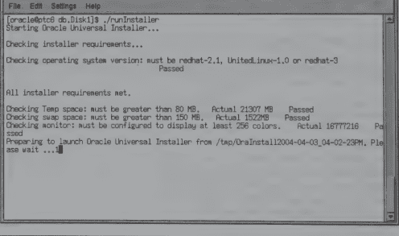

**图 6-1.** 启动 Oracle 安装程序


图 6-2. Oracle 通用安装程序

需要若干步骤才能在系统上安装 Oracle 软件。出现的屏幕将提示您做出各种决策。安装过程中您应注意以下几点：

- 操作系统组应被识别为 `install`。

- 在文件位置屏幕中

- 源文件位置应在您创建的暂存目录下的 stage 目录中。在我们的示例中，源路径应为 `/oracle_stage/db_Disk1/stage/products.xml`。

- 路径应指向 `oracle_base` 下的子目录。这看起来像 `/opt/oracle/product/10.1.0/db_1`，其中 `oracle_base` 为 `/opt/oracle`。

- 继续之前应成功完成产品先决条件检查。如果有任何错误，请更正并重试测试。

- 正确设置 Oracle 数据库名称和 SID。它应已从环境变量中获取 `oracle_sid`。

- 正确设置字符集。这以后很难更改。

- 设置数据库管理选项。在这里您可以选择允许使用 Grid Control 进行数据库管理的新功能。

- 设置数据库文件存储选项。在这里您可以选择使用文件系统、ASM 或原始设备来存储 Oracle 数据库文件（如果安装过程中创建数据库）。

- 设置备份和恢复选项。Oracle 10g 中的新功能是可以安排自动备份。您可以在安装过程中选择这样做，也可以稍后设置。

- 安装完成后，请注意报告的 Ultra Search、Ultra Search Administration Tool 和 iSQL*Plus 的 URL。通常包括

  - **Ultra Search** http://systemname:5620/ultrasearch

  - **The Ultra Search Administration Tool** http://systemname:5620/ultrasearch/admin

  - **iSQL*Plus** http://systemname:5560/isqlplus

  - **The Enterprise Manager database control** http://systemname:5500/em

安装完成后，需要执行一些安装后任务，如下一节所述。

## 安装后步骤

在开始使用新安装的 Oracle 10g 数据库服务器之前，必须执行一些安装后任务。这些任务包括

- 下载并安装补丁

- 配置 Oracle 产品

- 测试和验证


在将数据库投入生产之前，完成这些步骤非常重要。

## 下载和安装补丁

Oracle 产品的补丁可以在 Oracle MetaLink 网站 http://metalink.oracle.com 上找到。在那里，单击 Patches 并搜索您系统上已安装的 Oracle 产品或产品的补丁。每个补丁都应进行评估，如果您选择，可以在系统上安装。安装这些补丁所需的步骤随 Oracle 产品补丁集提供，并根据补丁而有所不同。

## 配置步骤

配置步骤可能取决于您的安装而不需要或需要。您可能需要执行的一些配置步骤包括以下内容：

- 备份 Oracle 数据库和二进制文件
- 配置和调优数据库
- 添加用户账户
- 生成客户端静态库

是否需要这些步骤取决于您的配置和需求。

### 记录系统

在继续之前，您应记录系统的配置方式以及如何执行 Oracle 安装。如果系统将来需要重新安装，文档可能是他人了解设置方式的唯一途径。

### 备份 Oracle 数据库和二进制文件

原始配置完成后，应备份 Oracle 二进制文件和配置文件。这使您在将来出现问题时能够将事物恢复到之前的状态。稍后，您将集中精力制定备份 Oracle 数据库本身的计划。

### Oracle 实例的初始调优

安装过程使用默认的 Oracle 参数。安装数据库并使其运行后，您需要调优 Oracle 实例以使其能够按要求执行。

### 配置数据库

希望您已创建数据库并对其外观有想法。例如，创建后，您可能需要添加更多表空间以准备导入生产数据。

160 Oracle Database 10g Linux 管理

## 重新编译无效的 PL/SQL 模块

Oracle 建议运行 SQL 脚本 `utlrp.sql` 以重新编译可能无效的所有 PL/SQL 模块。这可以通过设置 Oracle 环境并连接到 SQL*Plus 来实现，如下所示：

```
[oracle@ptc6 oracle]$ . /usr/local/bin/oraenv
ORACLE_SID = [orac]?  
[oracle@ptc6 oracle]$ sqlplus "/ as sysdba"
```

```
SQL*Plus: Release 10.1.0.2.0 - Production on Sun Apr 4 14:58:24 2004
Copyright (c) 1982, 2004, Oracle. All rights reserved.

Connected to:
Oracle Database 10g Enterprise Edition Release 10.1.0.2.0 - Production
With the Partitioning, OLAP and Data Mining options
```

一旦您已连接到 Oracle Database 10g 服务器，请运行 `utlrp.sql` 脚本（假设数据库服务器正在运行）。

```
SQL> @?/rdbms/admin/utlrp.sql
TIMESTAMP
----------------------------
COMP_TIMESTAMP UTLRP_BGN 2004-04-04 14:59:14

PL/SQL procedure successfully completed.

TIMESTAMP
----------------------------
COMP_TIMESTAMP UTLRP_END 2004-04-04 14:59:15

PL/SQL procedure successfully completed.

PL/SQL procedure successfully completed.
```

## 生成客户端静态库

由于客户端静态库不会作为 Oracle 安装过程的一部分创建，因此必须独立完成。要创建 `libclnt10.a`，请按照以下步骤操作：

```
[oracle@ptc6 oracle]$ $ORACLE_HOME/bin/genclntst
Created  /opt/oracle/product/10.1.0/db_1/lib/libclnt10.a
```

此过程假定 `oracle_home` 环境变量已设置。如果没有，您需要设置它或使用实际路径名。

## 设置 Oracle Net

另一项重要任务是设置 Oracle Net，以便 Oracle 客户端系统可以访问您的数据库服务器。可以通过编辑以下文件来配置 Oracle Net。

- 监听器文件 `$ORACLE_HOME/network/admin/listener.ora`
- 名称文件 `$ORACLE_HOME/network/admin/tnsnames.ora`

除了手动编辑网络配置文件外，还可以使用图形化 Net Configuration Assistant 或 `netca` 来配置网络。`netca` 是通过运行程序 `$ORACLE_HOME/bin/netca` 调用的。然后您将看到如图 6-3 所示的 Java 应用程序。

网络配置完成后，您就可以开始测试了。


图 6-3. Oracle Net 配置助手

## 测试和验证

在将任何系统或新的数据库软件投入生产之前，应对其进行彻底的测试阶段。测试数据库服务器有多种方法。这可以简单到验证您的应用程序是否返回正确的数据，也可以涉及更复杂的程序，例如使用企业级负载测试软件进行负载测试。您测试的内容和方式将取决于您的需求。

## 其他杂项配置步骤

根据您的配置和要求，您可能需要配置或安装其他组件，可能包括以下内容：

- 安装 Java 库
- 安装 Oracle Text 提供的知识库
- 配置 Oracle 消息网关
- 配置 Oracle 预编译器
- 安装随附光盘上的产品

安装和配置这些产品在 Oracle 安装文档中有详细说明。

## 摘要

本章介绍了安装和设置 Oracle Database 10g 服务器存储所需的任务。在接下来的几章中，您将学习使用 Oracle 10g RAC 集群的变体，它允许多个 Oracle 实例访问同一数据库，从而同时提供可扩展性和容错能力。

本章的开头部分重点介绍了为 Oracle Database 10g 服务器设置存储。这是一项非常重要的任务，必须在创建任何数据库之前完成。在这里您了解了 Oracle 使用的三种不同的存储方法：文件系统文件、ASM 和原始分区。您使用哪一种方法很可能取决于您的经验、技能、偏好以及个人需求。

Oracle Universal Installer 已得到改进，使用起来非常容易。安装和安装后任务完成后，您应该准备好继续设置和配置生产数据库。与任何产品一样，注重细节是成功在 Linux 上安装 Oracle 10g 的关键。


## PART

## III

Linux 上的 Oracle RAC


## 第 7 章

## Oracle Real Application Cluster 概念

## Oracle Database 10g Linux 管理

对于大多数关键任务系统而言，需要高可用性计算。如果关键任务系统数天甚至数小时不可用，您的公司可能会损失数千甚至数百万美元。许多关键任务系统无法容忍数据库不可用的哪怕少量停机时间。

今天有许多解决方案可用于提高正常运行时间并减少系统中断。其中包括：Oracle RAC、Oracle Data Guard 以及其他第三方实用程序。Oracle RAC 和 Oracle Data Guard 都是 Oracle 最大可用性架构 `MAA` 的一部分。`MAA` 将多个高可用性、容错和灾难恢复解决方案结合在一起，以提供专为最大可用性而设计的系统。

当今的关键任务系统要求高水平的可用性。任何停机时间，即使只有几分钟，也可能代价高昂。停机成本可能体现在因销售损失而减少的收入中，这可以立即衡量，或体现在客户流失中，这很难衡量。这笔费用可能高达数千甚至数百万美元。公司关键系统停机数小时或数天的情况并不罕见。

通过精心设计系统并利用 Oracle RAC 和 Data Guard 等高可用性功能，您可以提高系统的可用性。为系统设计最大可用性的概念在 Oracle 最大可用性架构 `MAA` 中有所概述。`MAA` 将多个高可用性、容错和灾难恢复解决方案结合在一起，以提供专为最大可用性而设计的系统。

> 注意


> *Oracle 最大可用性架构* (*MAA*) 在白皮书 *“Oracle9i Maximum Availability Architecture,”* 中有详细描述。此外，关于 MAA 的信息可在 *Oracle10g R1 文档手册* “*High Availability Architecture and Best Practices*” 和 *Oracle10g R2 文档手册* “*High Availability Overview.*” 中找到。

Oracle 最大可用性架构由一个完整的备用数据中心组成，其中应用程序、基础设施和数据库层的各个层面都在远程数据中心进行复制。这在图 7-1 中显示。

通过为系统设计最大可用性，您可以减少停机时间、提高稳定性并使公司免于灾难。随着《萨班斯-奥克斯利法案》的出台，其中一些不仅是业务要求，也是法律要求。

本章将介绍最大可用性架构的一部分：Oracle Real Application Clusters（Oracle RAC）。稍后，在第 13 章中，您将了解 Oracle Data Guard。本章将介绍您了解一般的集群概念，然后介绍 Oracle RAC 的具体功能和工作原理。

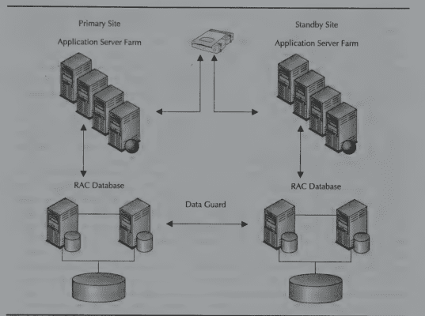

图 7-1. Oracle 最大可用性架构

## 什么是集群？

最简单地说，集群是一组作为单一系统运行的独立服务器。它也可以被定义为执行单一功能的多个系统，即黑盒子。

## 集群术语

让我们回顾一些集群术语。连接到集群的服务器称为集群中的 *节点*。如果节点当前正在为集群处理数据，则它是 *活动* 的。如果节点在开始工作前等待故障转移，则它是集群中的 *被动* 节点。在无法成功将其上线后，资源或节点将被置于失败状态。

当您创建集群时，您会创建一个用户连接的 *别名*。从集群的角度来看，别名指的是特定时间拥有该服务的服务器。从用户的角度来看，别名指的是他们连接的服务，而不管服务驻留在哪个服务器上。当发生故障转移时，用户会重新连接到别名（而不是服务器）（除非应用程序或客户端操作系统为他们处理重新连接），并继续工作。如果用户直接连接到主服务器而不是别名，则在主服务器故障时无法重新建立连接。

大多数集群解决方案采用集群 *对象* 和 *组*（服务）。应用程序、磁盘卷（用于数据库卷、文件或目录）、IP地址等都是集群对象的示例。集群组是由构成集群资源（如 Oracle 实例）的相关对象组成的集合。

*故障转移* 在集群中的活动节点或集群配置组件发生故障时发生。故障节点上的集群服务或资源会迁移到运行节点。您也可以手动触发故障转移（例如，通过关闭系统进行升级），从而使一台服务器脱机并将工作转移到辅助服务器。系统故障转移能力意味着只能整个系统进行故障转移；单个对象（如应用程序、磁盘卷等）无法进行故障转移。辅助系统在承担其自身身份和工作负载的同时，还会承担主系统（仅在系统故障时）的身份和工作负载。应用程序故障转移能力意味着系统管理员可以一次故障转移一个应用程序或对象，同时保持节点上所有其他服务和用户完好无损。

*故障恢复* 在发生故障转移后，将服务或对象从辅助节点切换回主节点，并重置正常运行条件。故障恢复通常是手动过程，但也可以是自动的。我要指出的是，故障恢复通常是手动的原因是，最初导致故障转移的条件可能无法自动清除，而可能需要人工干预才能使其恢复健康，从而可能导致一系列故障转移/故障恢复。

*心跳* 是集群中的节点相互发送的信号，以验证它们是否存活并正常运行。节点通过直接的局域网连接、通过集线器或交换机，甚至通过 SCSI 总线传输心跳。如果心跳停止，则其中一个节点已发生故障，集群软件会指示另一个节点接管。使用多种方法生成心跳可以消除因小故障触发不必要的故障转移的问题。

*互连* 为集群中的节点提供通信链路。状态信息、心跳甚至节点信息都可以通过互连传输。此连接可以通过您的局域网进行，也可以通过以太网、100Base-T、光纤通道、串行、SCSI 等直接从节点到节点进行。容错集群解决方案通常同时使用多个互连路径以防止不必要的故障转移。

## 集群定义

现在回到集群的定义。在更复杂的层面上，集群是将一组服务器并在其上运行一到 N 个应用程序。集群可以简单到两个服务器以简单的故障转移配置集群在一起。如果一台服务器失败，第二台服务器将接管该应用程序的处理。集群也可以用于运行非常复杂、分布式的系统。复杂集群的一个例子是 `SETI@home` 项目。该应用程序将数据取出来分成可管理的块，由独立的服务器处理。如果一台服务器失败，其他服务器不受影响，且失败节点的进程会被重新分配到集群中的其他节点。

集群有几种类型：故障转移集群、分布式数据库系统和共享磁盘系统。故障转移集群是一组服务器，其中一台服务器在系统故障时充当另一台服务器的备份。分布式数据库系统包含运行独立实例的多个服务器，其中实例的数据可能通过多种机制保持同步。共享磁盘系统是一组共享磁盘系统的服务器。驻留在共享磁盘上的数据可以被集群中的所有服务器访问。现在让我们详细回顾这三种集群类型。

## 故障转移集群

故障转移集群有两种类型。一类是主动/被动集群，另一类是主动/主动集群。在主动/被动集群中，在任何给定时间只有一个服务器有负载。第二台服务器以被动模式运行，等待另一台服务器宕机，但与活动服务器保持同步。

在主动/被动集群配置中，只有其中一台服务器使用其处理能力进行事务处理，即只有一台服务器实际运行 Oracle 数据库。应用程序通过共享 IP 地址连接到 Oracle 数据库。如果 Oracle 数据库和数据库文件发生故障转移，该 IP 地址将故障转移到另一个节点。

随着 `Oracle Net 9i` 和 `10g` 功能的增强，您也可以使用监听器提供故障转移功能。监听器结合 `Tnsnames` 和透明应用故障转移功能也可用于提供故障转移。执行连接故障转移的具体方法将取决于您的故障转移解决方案。

故障转移集群的第二种类型是主动/主动集群。在主动/主动集群配置中，两台服务器始终执行有意义的工作。主动/主动集群让您充分利用服务器资源并可支持负载均衡。每台服务器将运行一个实例，并作为在另一台服务器上运行的实例的故障转移数据库。

在主动/主动集群中，两台服务器都用于处理。这种类型的集群通常会在集群中的每台服务器上运行两个不同的应用程序。集群中一个服务器上运行一个应用程序。这种类型的集群的一个缺点是，您确实需要将集群中的两台服务器都配置成能够在发生故障转移时临时处理集群中两个节点的处理。集群中的两个节点可能随时故障转移到另一节点。

## 分布式数据库系统

在分布式数据库系统中，多个数据库服务器通过其中几种可能的机制保持同步。一种分布式数据库系统类型是复制数据库。另一种类型是备用数据库。

复制数据库由同一数据库的多个副本组成。一些复制数据库是只读的，一些是读写。`Oracle Advanced Replication` 是 Oracle 保持数据库同步的一种机制。

另一种分布式数据库系统类型是备用数据库。备用数据库是活动数据库的事务一致副本。Oracle 10g 中的备用数据库是 `Oracle Data Guard` 产品的一部分，并使用重做数据保持最新。该备用数据库可以位于同一服务器、同一机房，或另一个州或国家。备用数据库的最新程度取决于已应用的日志。日志可以使用备用重做日志实时复制，也可以在每次归档日志切换时复制，或延迟复制和应用。

每种分布式数据库都有其优点和缺点。真正的复制数据库在保持多个数据库副本同步时可能消耗大量可用资源。如果启用了两阶段提交，则对数据库的任何更改在所有分布式数据库确认更新之前都不会完全提交，这在高更新环境中可能导致问题。然而，在备用数据库配置中，备用数据库中的数据仅与已应用的日志文件一样新。如果主库发生故障，所有未应用的日志文件都必须在备用库应用后，才能使其成为当前且处于可接受状态，以开始作为当前活动数据库提供服务。

分布式数据库用于需要高可用的系统。最常见的分布式数据库类型是备用数据库。

## 共享磁盘系统

共享磁盘集群采用共享文件系统。多个系统访问同一组磁盘。集群中的所有节点必须能够访问共享磁盘。

Oracle 共享磁盘系统仅运行一个数据库，有一个或多个实例访问它。`Oracle Real Application Clusters`（RAC）是一种真正的共享磁盘实例，意味着有多个实例访问驻留在共享磁盘上的同一数据库文件。在共享磁盘系统中，集群中的多个节点共享一组公共磁盘。这些磁盘通常配置为某种 `RAID` 配置。通常，有一组用于集群信息的磁盘，通常称为仲裁。实际上，在 RAC 中有一个仲裁文件，该文件由每个参与节点在共享磁盘上维护。

共享磁盘集群的主要问题一直是防止节点以负面方式相互交互。如果没有适当的控制，每个节点都可能抵消对方的更新。如果控制过于严格，应用程序处理可能会变慢。Oracle 已通过其 RAC 产品解决了这些问题。在 10g RAC 中，厂商集群软件现在是非特定的。集群软件是管理集群中各种系统之间交互的软件。Oracle 实例与该集群软件交互以在集群节点内同步数据。在 10g 中，集群软件称为 `Cluster Ready Services`（`CRS`）。在安装和配置 Oracle 数据库之前，`CRS` 必须处于运行状态。


在 10g 中，Oracle 为共享磁盘系统添加了一个新功能：自动存储管理（`ASM`）。使用 `ASM`，DBA 不再需要分别管理文件和驱动器。相反，DBA 将创建由磁盘及其分配文件组成的磁盘组。Oracle Managed Files（`OMF`）与 `ASM` 的结合消除了 DBA 在创建新数据库或向现有数据库添加文件时指定物理数据库文件的名称和位置的需求。DBA 只需标识目标磁盘组，Oracle 就会处理其余部分。`ASM` 还可以扩展以支持其他管理任务，包括磁盘管理、备份和恢复。尽管它们经常一起使用，但 `OMF` 和 `ASM` 是 Oracle 的两个独立功能，不必一起使用。

`ASM` 作为与 Oracle 数据库不同的 Oracle 实例运行，但其功能少于正常实例。为了使正常实例利用 `ASM`，`ASM` 实例必须在正常实例启动之前运行。当 `ASM` 实例启动时，它会识别各种磁盘组及其包含的文件，挂载磁盘组，然后创建范围映射，该映射传递给数据库实例。然后数据库实例负责任何实际的输入/输出操作。`ASM` 实例仅在创建或删除文件以及磁盘配置更改时参与。

## RAC（Real Application Clusters）

在本节中，我们将回顾 Real Application Clusters（`RAC`）。我们将首先概述 `RAC`，然后介绍构成 `RAC` 数据库的组件。

### RAC 概述

Real Application Clusters（`RAC`）是 Oracle 高可用性（HA）产品设计的核心。`RAC` 是在出现问题时允许 Oracle 故障转移到另一个节点的产品。`RAC` 采用共享磁盘类型的集群。这允许集群中的所有节点同时访问数据。所有节点在任何时候都可以使用的一组数据文件。根据 Oracle Corporation 的说法，Real Application Clusters 的最终目标是提供与单台计算机上的单个 Oracle 数据库实例相当的可管理性。换句话说，对于常见的管理任务，目标是使多节点系统看起来并表现得像一个单一系统。

Linux 上的 `RAC` 集群支持多达 64 个集群节点。集群中的每个节点都有不同的物理 Internet Protocol (`IP`) 地址。然而，用户（或客户端）可以通过虚拟数据库服务名连接到数据库。Oracle 可以自动在集群的多个节点之间平衡用户负载，或 DBA 可以手动平衡用户负载。不同节点上的 `RAC` 数据库实例订阅全部或部分数据库服务的子集。这使您可以选择是否允许连接到特定数据库服务的特定应用程序客户端连接到部分或全部数据库节点。如果向集群添加更多节点，新节点的 CPU 和内存资源会立即提供给集群的其余部分。数据无需重新分区。这使您可以根据需要添加节点。`RAC` 集群的组件如图 7-2 所示。

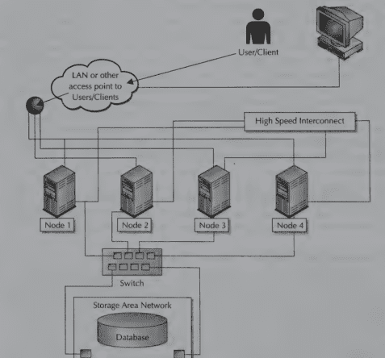

FIGURE 7-2. *Oracle RAC 集群的组件*

在 Oracle `RAC` 中，磁盘访问和管理数据的资源是共享的。所有实例都有共同的数据和控制文件。每个节点都有自己的专用系统内存、操作系统、数据库实例和应用程序软件。每个实例还具有单独的重做日志文件。

每个单独的服务器运行自己的 Oracle 实例。这些实例共同构成一个 `RAC` 数据库。一组节点上可以安装多个 `RAC` 数据库。这些数据库的实例可以使用集群中的全部或部分活动节点。

Oracle `RAC` 使用一种称为 Cache Fusion 的共享缓存系统。Cache Fusion 使用集群中所有节点的集体缓存来满足数据库请求（见图 7-3）。现在对数据块的请求可以由本地缓存或任何其他缓存来满足（而不是必须访问磁盘）。只有在集体缓存中都不包含必要数据时，或当更新事务执行需要磁盘写入保证的 COMMIT 操作时，才会执行大量的磁盘 I/O。Cache Fusion 使集群上的节点能够使用高速集群互连高效地同步其内存缓存，从而使磁盘 I/O 最小化。关键在于 Cache Fusion 使集群上的所有节点都能共享访问磁盘上的所有数据。数据无需在节点之间进行分区。Oracle 是唯一具有此功能的开放系统数据库。

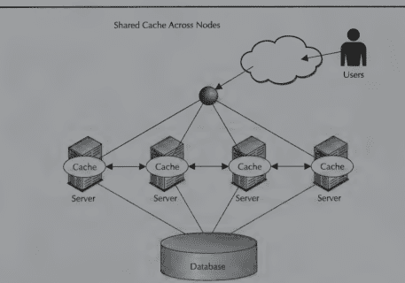

FIGURE 7-3. Oracle RAC Cache Fusion 架构

174 Oracle Database 10g Linux 管理

## Oracle RAC 10g 组件

Oracle `RAC` 10g 由多个组件组成。这些组件包括 Cluster Ready Services、服务和自动工作负载管理、虚拟 Internet 协议以及 Oracle Cluster Registry。

### 集群就绪服务 (CRS)

Oracle Real Application Clusters (`RAC`) 10g 在所有 Oracle Database 10g 平台上引入了完整的集成集群软件管理解决方案。该集群软件称为 Cluster Ready Services (`CRS`)，包括集群连接、消息传递和锁定以及集群控制和恢复的机制，以及工作负载管理框架。Oracle 10g 不需要第三方集群软件管理软件，尽管 Oracle 在某些平台上仍继续支持一些第三方工具。

`CRS` 是 Oracle 10g 相对于 9i 的核心变化。`CRS` 提供了一种在所有平台上保持一致的简单集群软件技术。在 Linux 上的 Oracle 9i 中，集群软件是一个复杂的部分，如果在安装开始时未正确配置，可能导致需要从头重新安装的问题。`CRS` 必须在安装 `RAC` 之前安装并运行。使用 Oracle `RAC` 10g，所有平台均支持多达 64 个节点。用户还可以在所有平台上对高可用性挑战（如服务器节点故障和集群互连故障）获得一致的响应。

`CRS` 由以下部分组成：`CRS` home，即 Cluster Ready Services 的单独主目录；Oracle Cluster Registry (`OCR`)；以及 `CRS` 投票磁盘。`CRS` 主目录应位于本地驱动器上。由于在 `RAC` 集群中的任何 Oracle 实例启动之前都需要访问 `OCR` 和投票磁盘，因此不能使用 Automatic Storage Management (`ASM`) 来存储这两个文件。`CRS` 文件必须驻留在共享文件系统上，例如 `OCFS` 或 RAW 设备。

与 `CRS` 关联的守护进程有三个：Cluster Ready Services Daemon (`CRSD`)、Oracle Cluster Synchronization Server Daemon (`OCSSD`) 和 Event Manager Daemon (`EVM`)。`CRSD` 执行高可用性恢复和管理操作，例如维护 `OCR`。它还管理应用程序资源；即启动、停止和使应用程序资源失效。`CRSD` 以 root 身份运行，并在失败时自动重启。`CRSD` 将集群状态信息和配置配置文件保存在 `OCR` 中。

`OCSSD` 管理集群节点成员关系并以 oracle 用户身份运行。该守护进程维护心跳，其失败将导致系统重启。这是为了防止在发生脑裂的情况下数据损坏而设计的功能。它提供节点成员关系、组访问和基本集群锁定。`OCSSD` 可以与非 `RAC` 系统一起运行。它可以与第三方集群产品集成，也可以不集成到供应商集群软件中运行。`OCSSD` 也是使用 `ASM` 的单实例的一部分。

`EVMD` 是启动 `RACGEVT` 进程的事件管理器守护进程。当集群发生事情时，该守护进程会生成事件。它生成一个永久的子进程 `emvlogger`。`EVMD` 扫描 callout 目录并调用 callout。与 `CRSd` 类似，该守护进程在失败时自动重启，但它以 oracle 用户身份运行。

还有第四个守护进程 `OPRCD`，它仅在不使用供应商集群软件与 `CRS` 的平台上出现。`OPRCD` 是集群的进程监视器。无论运行多少个 Oracle 实例，每个节点上都只有一个这样的守护进程集在运行。

每个守护进程都有一个日志文件集，位于以下位置：

| 守护进程 | 日志文件位置 |
|---|---|
| `CRSd` | `$CRS_HOME/crs/log` |
| `EVMD` | `$CRS_HOME/evm/log` |
| `OCRD` | `$CRS_HOME/ocr/log` |

`CRS` 在系统每次重启时都会自动启动。DBA 或系统管理员也可以通过执行以下命令手动停止和启动 `CRS`：

```
/etc/init.d/init.crs start
/etc/init.d/init.crs stop
```

`CRS` 需要投票磁盘和 `OCR`，如果其中任何一个文件不可用，`CRS` 将无法启动。`CRS` 必须处于运行状态，然后 Oracle `RAC` 实例才能挂载。`CRS` 需要三个网络地址：公共 `IP` 地址、私有互连 `IP` 地址和虚拟 `IP` 地址 (`VIP`)。在安装 `CRS` 之前，必须在 DNS 中设置 `VIP` 和公共地址。

查看 `CRS` 状态的命令是 `crs_stat`。该命令输出的格式难以阅读，因此我建议运行脚本以更好地格式化输出。以下是示例脚本，可将 `crs_stat` 二进制文件的输出以更易读的形式返回。


```
crs_stat.sh
#!/usr/bin/ksh

# Sample 10g CRS resource status query script
#
# Description:
# - Returns formatted version of crs_stat -t, in tabular
#   format, with the complete rsc name and filtering keywords
# - The argument, $RSC_KEY, is optional and if passed to the script, will
#   limit the output to HA resources whose names match $RSC_KEY.

# Requirements:
# - SORA_CRS_HOME should be set in your environment
RSC_KEY=$1
QSTAT=bu
AWK=/bin/awk # if not available use /usr/bin/awk
# Table header:echo **
$AWK \
'{BEGIN {printf "%-45s %-10s %-18s\n", "HA Resource", "Target", "State";
printf "%-45s %-10s %-18s\n", "-------------------", "-------", "------";}
# Table body:
SORA_CRS_HOME/bin/crs_stat $QSTAT | $AWK \
'{BEGIN { FS="*"; state = 0; }
$1~/NAME/ && $2-~/\$RSC_KEY/ { appname = $2; state=1;}
state == 0 {next;}
$1~/TARGET/ && state == 1 {apptarget = $2; state=2;}
$1~/STATE/ && state == 2 {appstate = $2; state=3;}
state == 3 {print "%-45s %-10s %-18s\n", appname, apptarget, appstate; state=0;}'
```

## 服务和自动工作负载管理

使用 Oracle 10g，应用程序工作负载可以定义为服务，以便可以单独管理和控制。DBA 控制在正常操作期间以及响应故障时分配给每个服务的处理资源。可以按服务跟踪性能指标。可以设置阈值，以便在超过这些阈值时自动生成警报。这些服务的资源消耗控制和 CPU 资源分配由 Resource Manager 管理。Oracle 设施和工具（如 Parallel Query、Job Scheduler 和 Oracle Streams Advanced Queuing）也使用服务来管理其工作负载。

工作负载共享配置可以以多种不同的方式定义。例如，假设您有一个五节点 RAC 集群，其中两个实例 A 和 B 作为 OracleAS 10g 应用程序的首选实例。同一个集群可以有实例 C、D 和 E 作为客户关系管理 (CRM) 应用程序的首选实例。如果 CRM 的一个或多个首选实例变得不可用，则实例 A 和 B 是 CRM 的可用实例。如果 AS 10g 的一个或多个首选实例变得不可用，则实例 C、D 和 E 是 AS 10g 的可用实例。此配置使每个服务都可以使用一组实例，该组实例既充当首选实例，也充当可用恢复实例。故障后，客户端在其同一组中的另一个实例上恢复其连接。使用此配置，在正常操作期间，RAC 按服务将应用程序会话路由到单独的实例组。如果首选实例变得不可用，则 CRS 在提供该服务的剩余 RAC 实例之间重新定位连接。工作负载管理的配置通过根据服务路由连接来实现最高性能和可用性。一个域上的计划内和计划外中断可以与其他域隔离，并且受影响的服务可以单独恢复或升级。

自动工作负载存储库将服务级统计信息作为指标进行跟踪。当这些指标超过或低于特定阈值时，服务器生成的警报将被发出。DBA 然后可以选择通过停止过载的进程、更改作业的优先级或修改服务级要求来响应。这使 DBA 能够在服务级别违规的情况下仍保持服务的持续可用性。

你可以配置

- 相对于其他服务的优先级
- 服务质量的度量
- 用于监控服务质量变化的警报机制和事件通知
- 对服务质量变化响应的恢复场景

自动工作负载存储库确保 CRS 工作负载管理框架和资源管理器具有性能数据的持久且全局的表示。此类信息有助于 Oracle 按服务调度作业类并为消费者组分配优先级。如有必要，您可以使用 PL/SQL 过程手动重新平衡工作负载。您可以使用此过程断开会话但保持服务运行。

当实例因故障而离线时，CRS 将把服务迁移到另一个可用的实例。CRS 在不中断服务的情况下迁移服务并重新建立连接。迁移所依赖的基础服务组件必须启用迁移并重新启动。否则，连接无法重新建立。

## VIP：虚拟 Internet 协议

Oracle 10g RAC 的新功能之一是虚拟 Internet 协议，即 VIP。这是一个用于集群节点故障转移的虚拟 IP 地址。

让我们回顾一下 Oracle 9i RAC IP 地址的要求。RAC 使用两个地址：一个用于私有互连网络，一个用于集群外部的公共网络。要访问 RAC 数据库，您必须在 `tnsnames.ora` 文件中指定公共 IP 地址/主机名。

使用 10g RAC，每个集群节点现在需要三个 IP 地址。额外的 IP 用于虚拟 IP（VIP）。您现在可以在 `tnsnames.ora` 文件中使用 VIP 代替公共 IP。如果检测到故障，VIP 将故障转移到存活的节点。

VIP 和公共 IP 都需要在 DNS 中定义。VIP 使用 `VIPCA`（虚拟 Internet 协议配置助手）实用程序进行配置，该实用程序在 Oracle CRS 安装过程中调用。

## Oracle 集群注册表 (OCR)

Oracle 集群注册表（OCR）包含 RAC 集群就绪服务（CRS）的集群和数据库配置信息，包括集群数据库中的节点列表、CRS 应用程序、资源配置文件以及事件管理器（EVM）的授权。OCR 可以驻留在集群文件系统上的文件或共享 RAW 设备上。安装实时应用集群时，您指定 OCR 的位置。OCR 包含集群数据库的配置详细信息以及高可用性资源（如服务、虚拟 Internet 协议（VIP）地址等）的配置。

## RAC 数据库组件

RAC 数据库与其他数据库一样，由控制文件、重做日志、数据文件以及一个服务器参数文件（SPFILE）或一个或多个 PFILE（或客户端参数文件）组成。每个实例由系统全局区（SGA）和实例后台进程组成。

控制文件包含有关数据文件、重做日志和恢复状态的信息。如果没有至少一个良好的控制文件或备份控制文件，就无法轻松恢复数据库。因此，您应始终使用标准的 Oracle 实践对控制文件进行多路复用。对于 RAC 数据库，所有控制文件必须驻留在共享存储上。最佳实践规定，您应至少有三个控制文件，并应将它们放在三个不同的存储组或 LUN 上。这样，如果完全丢失一个存储组，您仍可以使用其他控制文件之一恢复数据库的其余部分。

RAC 数据库的下一个重要部分是重做日志文件。重做日志文件已有所介绍，但重要的是要注意 RAC 集群的重做日志与独立数据库的重做日志之间的差异。每个实例必须至少有两个组重做日志文件。这些组的 datafiles 应驻留在单独的存储组上。最佳实践规定，每个重做日志文件应驻留在单独的镜像对上以获得最大性能。每个文件同步访问数据，因此如果在 RAID 组上放置其他内容，则可能变得异步。由于重做日志对数据库性能有很大影响，我建议将它们放在单独的 RAID 组上。

数据文件是 Oracle RAC 数据库的另一个必不可少的部分。在 RAC 数据库中，所有数据文件必须驻留在共享存储上。与所有 Oracle 数据库一样，数据文件的放置位置会极大地影响性能。Oracle 当前的建议是条带化并镜像所有内容（SAMI）；即将数据文件放在 RAID 1+0 存储组上。数据文件是 Oracle 存储数据的物理文件。这些文件必须可从 RAC 中的所有节点访问。在分配数据文件之前，全面分析和了解您的应用程序非常重要。如果您有一个 I/O 密集型应用程序并预计系统会承受 I/O 压力，您将希望识别 I/O 访问最多的表，并且可能希望将与这些表相关的数据文件放在单独的数据组或能够处理由应用程序产生的 I/O 负载的 RAID 1+0 存储组上。

Oracle RAC 的另一个组件是服务器参数文件，即 SPFILE，它与参数文件即 PFILE 结合使用。Oracle RAC 中的每个实例都需要一个 PFILE 来启动数据库。Oracle 的建议是 PFILE 仅指向 SPFILE，如以下示例所示。

```
`pfile='/u01/PROD/spfilePROD.ora'`
```


# SPFILE 与实例启动参数

`SPFILE` 包含 Oracle 实例的启动参数。在 Oracle RAC 中，所有实例共享一些参数设置，但其他参数可能对每个实例不同。为了确保它们都使用相同的参数集启动，`SPFILE` 应驻留在共享存储上。`SPFILE` 中的参数与以前驻留在 `init.ora` 文件中的参数相同。稍后将描述 RAC 的一些额外参数。`SPFILE` 以不可编辑的格式存储：虽然它看起来像纯文本，但如果您编辑该文件，就有风险使其不再工作。因此，如果您想更改控制文件的位置，例如将它们移动到单独的数据组，您需要执行以下步骤：

- 1. 从当前 `SPFILE` 创建一个 `PFILE`。
- 2. 停止数据库和/或所有实例。
- 3. 将控制文件复制到新位置。
- 4. 编辑 `PFILE` 以包含控制文件的新位置。
- 5. 最后，使用新的 `PFILE` 启动其中一个数据库，并在旧位置使用新的 `PFILE` 创建 `SPFILE`。

此时，集群中其他节点上的实例可以正常启动：它们都将使用新的 `SPFILE` 启动。

如果 `init.ora` 文件（`PFILE`）与现有 `SPFILE` 相同，您始终可以启动 Oracle RAC 实例。

最后一个数据库组件组由实例进程组成。这些是日志写入器（`LGWR`）、数据库写入器（`DBWn`）、系统监视器（`SMON`）、进程监视器（`PMON`）、恢复器（`RECO`）和归档器（`ARCn`）的后台进程，以及检查点进程（`CKPT`）。

日志写入器 `LGWR` 写入日志文件条目。它从 SGA 中的日志缓冲区读取并写入重做日志文件。数据库写入器 `DBWn` 将脏缓冲区从数据库缓冲区缓存写出。脏缓冲区是指已从磁盘上的原始数据修改但尚未写出的缓冲区。这是唯一写入数据文件的进程；它使用最近最少使用（LRU）列表算法来确定要写入磁盘的块。

系统监视器 `SMON` 在数据库启动时执行实例恢复。它可以在 RAC 系统中恢复另一个实例。`SMON` 清理临时段并合并空闲区段。进程监视器 `PMON` 对失败的用户进程执行进程恢复。它清理数据库缓冲区缓存并释放资源。`PMON` 检查 Dispatcher 和 Server 进程，必要时重新启动它们。

恢复器 `RECO` 恢复分布式进程。如果 Server 连接丢失，`RECO` 会尝试重新连接。`RECO` 完成提交或回滚。归档进程最多可有十个，命名为 `ARC0` 到 `ARCn`，在日志切换后归档重做日志文件。

归档进程仅在数据库以 `ARCHIVELOG` 模式运行时存在。

`CKPT`，即检查点进程，向 `DBWR` 发送信号并标记检查点块。它协助 `DBWR`，但不写入数据文件。

还有其他为 Oracle RAC 运行的后台进程：Dispatcher（`DMn`）进程与共享服务器进程一起使用；Lock 与 RAC 一起使用；Job Queue（协调器 `CJQ0` 和作业队列从属进程 `Jxxn`）以及 Queue Monitor（`QMON`）分别用于批处理和高级队列。专用 Oracle 服务器进程也在后台运行，由用户进程代为生成。专用服务器进程检查，然后从缓冲区缓存中读取数据。它们也会修改缓冲区缓存中的数据，但本身不写入数据文件。其他进程包括用于并行查询的查询服务器；与共享服务器架构一起使用的共享服务器进程；以及与共享服务器一起使用的调度程序。

## RAC 配置文件

Oracle 10g RAC 对配置文件和初始化参数进行了多项更改。两项主要更改是 `ocr.loc` 文件，它取代了 `srvConfig.loc` 文件，以及 `GCS_Server_Processes` 参数。

`ocr.loc` 配置文件指定 Oracle Cluster Registry 的位置，其中包含 Cluster Ready Services 配置信息。该文件驻留在集群中的每个服务器上，并指向共享存储位置。如果 CRS 第一次无法启动，很可能其中一台服务器上的此文件对 CRS 配置文件的位置不正确。CRS 配置从集群中的一个节点初始化，并在 CRS 在该节点启动时由所有节点访问。

`GCS_SERVER_PROCESSES` 参数指定 Global Cache Service 中用于服务 RAC 实例之间实例间流量的服务器进程的初始数量。这是 10g 中引入的新参数。该参数的默认值对于 RAC 数据库为 2，但值范围为 1 到 20。该参数也可以为集群中的每个实例设置不同的值。

## 集群互连

互连是 Oracle RAC 配置的重要组成部分。它由几个部分组成：连接集群中所有节点的专用网络、在服务器之间通信的 Oracle 进程，以及网络信息传递的通信协议。

互连的目的是通信集群中所有节点的状态以及驻留在集群中的所有实例。互连在节点之间传递锁定信息和全局缓存信息。实际上，此互连必须至少配置为千兆以太网，因为即使在极不活跃的数据库上，100 Mbps 以太网连接也会很快饱和。互连和节点间通信协议会影响 Cache Fusion 性能。此外，互连带宽、其延迟以及 IPC 协议的效率决定了 Cache Fusion 处理块传输的速度。

由于 Cache Fusion 利用高速 IPC，RAC 可从用于集群数据库互连的低延迟通信链路的最新技术带来的性能提升中受益。如果使用更高效的协议，例如 InfiniBand、TCP/IP、Virtual Interface Architecture（VIA）、RDMA 和用户模式 IPC，您可以期待更大的性能提升。Cache Fusion 在所有平台上使用用户模式 IPC，也称为内存映射 IPC，减少 CPU 使用。如果有适当的硬件支持，则操作系统上下文切换会降至最低，超出仅使用 Cache Fusion 即可实现的基本减少。这也消除了昂贵的系统调用和数据复制。如果您的硬件高效实现它们，用户模式 IPC 可以大幅降低 CPU 使用率，因为用户模式 IPC 中的进程在不使用操作系统内核的情况下进行通信。换句话说，用户进程无需从用户执行模式切换到内核执行模式。

## Oracle 10g RAC 对共享存储的使用

RAC 运行所需的关键要素之一是共享存储。这可以简单到一组共享 SCSI 磁盘。也可以复杂到大型 SAN 上的多磁盘阵列。这些解决方案的共同点是集群中的所有节点都需要同时具有写入物理磁盘的访问权限。为了使用共享存储，Oracle 要么将驱动器用作 `RAW` 设备，要么作为共享存储上的集群文件系统。无论哪种方式，Oracle 必须能够访问集群配置中的一组磁盘，以便 Oracle RAC 运行。共享存储的两种更常见选项是 `SAN` 存储和 `NAS` 存储。存储区域网络的组件如图 7-4 所示。

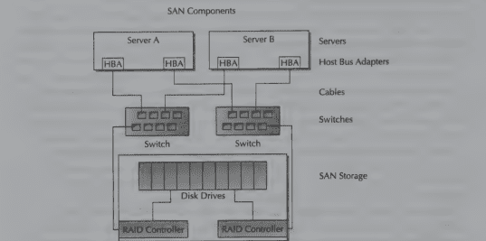

图 7-4. 存储区域网络的组件

`SAN`，即存储区域网络，由一组通过专用网络共享并由 SAN 客户端访问的专用控制器管理的磁盘组成。连接到外部网络的唯一项目是客户端和 SAN 控制器。服务器最常见的是通过 Fibre Channel 适配器和 Fibre Channel 电缆连接到 `SAN`，因为 `SAN` 的设计目的是通过专用 Fibre Channel 网络提供对存储的访问。`SAN` 的组件可以以许多不同的配置连接。有些配置将组件作为一个单元容纳，而在其他配置中，磁盘本身被放置在与连接到服务器的存储处理器分开的单独架子上。

`SAN` 非常适合作为 Oracle RAC 的共享存储。如前所述，RAC 需要共享磁盘空间，可由集群中的所有节点同时写入。Oracle 本身管理同时访问，但它必须有一些方法让所有节点能够看到并写入磁盘。这就是 `SAN` 的用武之地，因为 `SAN` 正是为这种类型的多服务器访问而设计的。`SAN` 是一个网络，其主要目的是在存储系统和计算机系统之间传输数据。

除了提供极快的访问数据之外，`SAN` 还可用于整合存储，从而提供许多好处：降低外部存储成本；提高性能；集中和改进磁带备份（可在其自己的专用网络上执行，从而减少 LAN 流量）；消除单点故障；以及极大的存储单元，通常单个系统中有数十 TB 的存储。

Fibre Channel 是 `SAN` 内使用的互连技术，提供服务器、存储设备和其他外设之间的并发通信。它是一种千兆互连技术。Fibre Channel 1（`FC1`）提供超过 1,000,000,000 位/秒，而 `FC 2` 有效地将此翻倍至超过 2,000,000,000 位/秒。此外，Fibre Channel 是一种高度可靠的互连技术。另一个优点是 Fibre Channel 允许连接多达 127 个设备。这与 SCSI 技术形成对比，后者的限制为 15 个设备。Fibre Channel 的距离限制为 10 km 的布线，与 SCSI 的 1–3 m 相比非常有利。物理互连可以是铜线或光纤，并且是热插拔的。热插拔设备可以随意移除或添加，对数据通信没有不良影响。最后，Fibre Channel 在物理互连之上提供数据链路层，类似于以太网，包含帧级复杂的错误检测——数据会被检查并在必要时重新发送。


使用 `SAN`，`I/O` 流量仅限于专用 `SAN` 网络，从而实现更快的 `I/O` 操作。多个服务器可以通过 `Fibre Channel` 交换机连接到 `SAN`：您仅受限于交换机上的端口数量。服务器中使用双交换机和双 `HBA`（主机总线适配器），可以实现服务器和磁盘之间的多条路径，进一步扩展 `RAC` 的高可用性（`HA`）能力。完全冗余的 `SAN` 配置可以承受 `Fibre Channel`、`HBA` 或甚至 `SAN` 中的服务处理器（`SP`）故障，而仍无需切换到另一个节点。

## 使用 NAS 作为共享存储

`NAS` 代表 `Network Attached Storage`。磁盘连接到通常可用的网络，尽管通常是在除客户端系统外没有其他设备连接的段上，并且服务器通过此公共网络访问存储。这意味着无需设置和维护专用于共享存储访问的单独 `Fibre Channel` 网络，如 `SAN` 所需。然而，与 `SAN` 一样，磁盘可以通过标准铜线网络或通过 `Fibre Channel` 连接到网络，并且无论网络的物理性质如何，`Oracle` 都应独占使用分区。

建议在集群中的节点与 `NAS` 设备之间使用专用专用网络。典型 `NAS` 设计的示意图如图 7-5 所示。

专用网络连接具有以下好处：

- 在 `Oracle 10g RAC` 环境中，消除任何争用和延迟非常重要。
- 提供单独的网络可确保安全性。

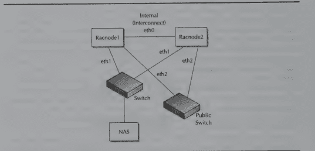

图 7-5. 带有 `NAS` 的 `RAC` 系统

## 摘要

对于大多数应用，`Oracle RAC` 既可扩展又提供高可用性集群解决方案。`Oracle RAC` 已在 `Linux` 上进行了全面测试，在该平台上性能良好且稳定，尤其是 `Oracle 10g RAC`，在性能和稳定性方面相比 `Oracle 9i RAC` 具有显著优势。需要高性能互连以及共享磁盘子系统。`RAC` 集群允许多个 `Oracle` 实例访问同一数据库，从而实现可扩展性和高可用性。

`Linux` 提供多用户、多任务环境，非常适合 `Oracle RAC`。`Oracle RAC`（Real Application Clusters）既是可扩展的也是高可用的集群解决方案。`Oracle RAC` 系统已在 `Linux` 上进行了全面测试，在该平台上性能良好且稳定。高性能互连（如千兆）是最低要求；然而，随着更新更快系统的出现，千兆网络对于 `RAC` 互连来说很快就不够用了。今天需要更快互连，如 `InfiniBand`。`Oracle Cluster Ready Services` 在启动时自动启动。系统管理员可以高效维护 `Linux` 上的 `Oracle 10g RAC` 服务器集群。如果你的下一个任务是在 `Linux` 上安装 `Oracle 10g RAC`，请继续阅读下一章。这将物有所值。


## 第 8 章

### 在 Linux 上部署 Oracle Real Application Clusters

## 规划 RAC 系统

部署任何 `DBMS` 系统的第一步是制定计划，以便你了解自己的选择。首先，让我们回顾一下 `RAC` 组件，以防你跳过了上一章。

## RAC 组件

`Oracle Real Application Cluster`（`RAC`）由几个非常重要的组件组成。2 到 32 台服务器将构成你的集群节点，使用某种共享存储系统。在上一章中，我们介绍了不同类型的共享存储。如果需要复习，请参阅第 7 章。

`RAC` 的另一个必要组件是 `Cluster Ready Services`（`CRS`）。在安装 `Oracle` 并创建数据库之前，`CRS` 必须处于运行状态。它由驻留在集群每个节点上的二进制文件和驻留在共享存储上仲裁磁盘上的配置文件组成。`CRS` 必须安装在其自己的 `ORACLE_HOME` 中。

安装 `CRS` 后，它将自动启动。你也可以手动启动它。它使用投票磁盘和 `OCR`（`Oracle Cluster Registry`）。无论安装了多少个实例，每个集群节点上都只有一套 `CRS` 守护进程。`CRS` 由三个守护进程组成：`CRSD`、`OCSSD` 和 `EVMD`。`CRSd` 执行高可用性恢复和管理操作，例如维护 `OCR`。它还管理应用程序资源，以 `root` 用户运行，并在失败时自动重启。`OCSSD` 管理集群节点成员关系并以 `oracle` 用户运行。该进程失败会导致集群重启。`EVMD` 是事件管理器守护进程，启动 `racgend` 进程来管理回调。还有第四个守护进程，`*oprocd*`，它只会在不使用供应商集群软件与 `CRS` 的平台上出现。`OPROCd` 是集群的进程监视器。

`RAC` 的另一个重要组件是虚拟 `IP` 地址。每台服务器至少需要三个 `IP` 地址。一个用于数据库的公共或通用访问。一个用于专用高速互连。最后的 `IP` 地址将用于虚拟 `IP`，即 `VIP`。`VIP` 将用于在发生故障时无缝故障转移到另一个节点。在同一系统上（在故障转移期间）可以存在多个虚拟 `IP` 地址。`VIP` 和 `*public IP*` 必须在同一子网中，在 `/etc/hosts` 中定义，并在 `DNS`（域名服务）中定义。

下一步是了解你的应用程序需求。本节主要内容是“自知”。如果你对应用程序没有充分了解，你可能无法为 `RAC` 做出最佳选择。这里有一些需要牢记的事情：

- 你的用户将通过直接连接还是通过中间层、应用服务器连接访问数据库？
- 你需要多少个活动用户数据库连接？
- 你的应用程序主要是只读，还是写操作多于读操作？
- 你有经验丰富的 `SAN` 人员和数据库管理员吗？还是需要雇佣/外包 `Oracle RAC` 的维护？
- 你的系统在未来几个月到一年内会显著增长吗？
- 你的数据库会有多大？
- 你想使用归档日志吗？如果是，日志文件将存储在哪里？
- 对于你的应用程序来说，性能还是冗余是最重要的问题？
- 你将如何备份系统？
- 高可用性要求是否规定必须将 `Data Guard` 与 `RAC` 结合使用？

在规划 `RAC` 实施时，最好牢记这些事项。让我们快速浏览一下这些项目。首先，你会使用中间层应用服务器吗？你将需要更多的数据库连接，如果不使用中间层应用服务器。如果使用连接池，应用服务器获取大量数据库连接并与所有用户共享，你可能不需要那么多连接。如果你有一个基于 `Web` 的应用程序并且所有用户都直接连接到数据库，你可能需要更改 `Linux` 系统参数。

你的应用需要多少个用户数据库连接？如果你需要大量数据库连接，你可能希望以不同的方式设计连接。

你的应用程序主要是只读，还是写操作多于读操作？数据库所需的写入量会影响你为共享存储选择的 `RAID` 类型。如果你的应用程序写入非常频繁，你可能希望避免为数据使用 `RAID 5`。

你的人员的经验水平如何？这很重要，因为如果你没有人员来支持 `SAN`，你可能不想使用 `SAN`。或者如果你要外包支持或雇佣人员，这可能会增加你的成本。

你的系统在未来几个月到一年内会显著增长吗？这将直接影响 `RAC` 的规模。你可能只需要一个驱动器架来支持当前业务，但你的公司正在考虑海外扩张。你的数据库可能几乎在一夜之间增长 100 倍！如果你计划从双节点 `RAC` 扩展到三节点 `RAC`，确保你的硬件（如以太网交换机和光纤交换机）能够处理第三个节点非常重要。

这就引出了关键问题。你的数据库到底会有多大？这是设计 `RAC` 时最重要的事情之一。你希望在规划共享存储大小时考虑到整个系统。总大小需要包括表、索引、重做日志（所有节点）、归档日志和仲裁信息的大小。请记住，最佳实践规定集群中的每个节点至少有一个重做日志分区。这些应位于单独的 `LUN` 上，以确保访问保持顺序。你选择的 `RAID` 类型也会影响共享存储的大小。请参阅下一节“调整 `RAC` 系统大小”了解更多详细信息。

对于你的应用程序来说，性能还是冗余是最重要的问题？这个问题将对设置故障转移类型影响很大。它还有助于确定共享数据存储的 `RAID` 类型。答案甚至可以帮助你决定是否要绑定你的网络接口卡（`NICs`）。

规划 `RAC` 系统的下一步是确定你将使用原始设备、`Oracle` 集群文件系统（`OCFS`）还是 `ASM` 来管理共享文件。使用原始设备你将获得最佳性能，但牺牲了可管理性。原始设备只能通过 `Oracle` 程序访问。它们不能从 `Linux` 挂载点修改。如果你尝试修改文件，你可能会损坏数据文件。`ASM`（代表 `Automatic Storage Management`，自动存储管理）是新的 `Oracle` 存储方法。对于所有新产品，在 `ASM` 有一定使用经验之前要谨慎使用。`OCFS` 一直是我大多数客户的最佳选择。只有其中最硬核的性能狂热者才需要使用原始设备。

## RAC 系统的容量规划

有一种倾向是将服务器的容量规划视为某种神秘科学。大多数人认为，你掌握的统计数据、基准测试和技术规格越多越好。规划 `RAC` 系统不仅仅是收集尽可能多的信息。

以下是您在规划 `RAC` 系统，或实际上任何系统时应遵循的步骤：

- **定义客户需求** 这是最重要的步骤之一。在继续之前，您必须有一个适当的起点。大多数客户不会把需求直接送到你面前。你必须主动获取所需的信息。你必须准备好将业务术语翻译成技术术语。


## 分析系统数据
您应始终尽可能多地从可比或当前生产系统收集技术信息。即使硬件平台与目标系统不同，甚至您预计新系统具有显著改善的性能特征，也应如此。您应确保收集 CPU 利用率、内存利用率和每秒 I/O（IOPS）的统计数据。如果比较系统基于 Microsoft Windows，则可以使用性能监视器获取所需数据。

## 系统确定
下一步是设计一个能够根据您收集的系统信息满足客户需求的系统。您需要预测总 CPU 使用量、总内存使用量和总 I/O 负载。您可能会根据 I/O 负载和客户数据的总大小估计来估算容量和性能所需的存储资源。您需要汇总所有容量规划指南。这包括任何相关的“经验法则”和基准测试。如果可能，将您的需求与类似的现有实现进行比较。设计应涵盖客户需求的所有方面。您应确保初始设计中已满足所有需求。在硬件购买后才发现遗漏了需求，其成本要高得多。

## 实施
尝试分阶段交付设计。刻意分阶段实施。这使您可以在实施过程中调整性能。

## Oracle RAC 基础容量规划要求

使用 Oracle 10g RAC 时，您必须考虑许多容量规划项目。其中一些是 Oracle 的硬性要求，而另一些则是来自个人经验的试错要求。

至少，我建议您查看安装的 Oracle RAC 版本的当前 Oracle 最低要求。这些要求会随版本发布而变化，因此请始终在 Oracle 信息站点上进行检查。

一个硬性容量规划要求是共享存储上的最小分区数。在 Linux 上运行 Oracle 10g RAC 时，您至少需要两个分区。第一个分区应至少为 1GB。这将用于 Cluster Ready Services（CRS）的仲裁信息。CRS 将在此分区上放置投票磁盘和 Oracle Cluster Registry（OCR）。最终，您希望此分区与数据文件分开。如果它们是分开的，您可以丢失集群信息但不会丢失数据。OCR 的存储大小应至少为 100MB，投票磁盘的存储大小应至少为 20MB。此外，Oracle 建议您使用 RAID 数组存储 OCR 和投票磁盘，以确保分区的持续可用性。

第二个分区将用于 Oracle 数据库文件。这些包括重做日志、归档日志以及表空间和索引文件。这部分的规划是最重要的。

大多数关于 Oracle RAC 的最佳实践建议创建以下分区或 RAID 数组：

- **集群中每个节点一个用于重做日志的分区** 实际上每个节点有两个更好。有些人可能认为这过分了，但对于真正的
高性能系统，两个是必需的。日志切换后，较旧的日志会被归档，而新的日志用于跟踪重做信息。如果您对两个日志使用一个 RAID 数组，I/O 就不再是顺序的。因此每个节点推荐两个，但每个节点一个是可以接受的。

- **一个用于归档日志的分区** 写入归档日志的操作是同步的。如果它们位于单独的分区，数据库性能将不受影响。

- **至少一个用于数据文件的 RAID 1/0 分区** Oracle 建议 SAME，即 Stripe and Mirror Everything（全部条带化并镜像）。您分配给 RAID 1/0 的磁头越多，同时进行数据请求时命中空闲驱动器的机会就越大。

## 配置 Linux

好了，现在您已经获得了背景信息并规划了 Oracle RAC，让我们进入 Linux 的细节。首先要做的是验证您的硬件是否满足 10g RAC 的要求。设置 Linux 内核是部署 Oracle RAC 的另一个非常重要的步骤。我们接下来要介绍的另一个重要步骤是 Linux 系统设置。

根据我在 Linux 上部署 Oracle RAC 的经验，最重要的是正确设置网络参数。如果网络设置错误，您可能需要重新安装 Oracle。我见过由于网络设置错误而浪费了好几天的工作。因此请注意接下来的几节内容。它们可以为您节省大量返工。

### 验证硬件

系统必须满足以下最低硬件要求：

- 512MB 物理 RAM

- 1GB 交换空间（或 RAM 大小的两倍）。对于 RAM 为 2GB 或更大的系统，交换空间可以在 RAM 大小的 1 到 2 倍之间

- `/tmp` 目录中 400MB 磁盘空间

- 根据安装类型，Oracle 软件最多 4GB 磁盘空间

- 5GB 共享存储用于重做日志文件和仲裁信息

要验证服务器包含的物理 RAM 数量，请发出以下命令：

```
grep MemTotal /proc/meminfo
```

要确定配置的交换空间大小，请输入以下命令：

```
grep SwapTotal /proc/meminfo
```

要确定 `/tmp` 目录中可用的磁盘空间，请输入以下命令：

```
df -k /tmp
```

如果 `/tmp` 目录中可用磁盘空间少于 400MB，请完成以下步骤之一：

- 从 `/tmp` 目录删除不必要的文件以达到所需的磁盘空间。

- 在设置 oracle 用户环境时设置 `TEMP` 和 `TMPDIR` 环境变量。

- 扩展包含 `/tmp` 目录的文件系统。如有必要，请联系您的系统管理员了解扩展文件系统的信息。

要确定加载 Oracle 二进制文件的可用磁盘空间，请运行以下命令：

```
# df -m
```

要确定系统架构是否可以运行软件，请输入此命令：

```
# grep "model name" /proc/cpuinfo
```

此命令显示处理器类型。验证处理器架构是否与您要安装的 Oracle 软件平台匹配。

### 验证网络要求

检查您是否拥有 Oracle Real Application Clusters 安装所需的网络硬件和 Internet 协议（IP）地址。


> 注意
>
> 有关 Oracle Real Application Cluster（RAC）安装支持的网络协议和硬件的最新信息，请参阅 Oracle MetaLink 网站上的认证页面。

### 网络硬件要求

集群中的每个节点必须满足以下要求：

- 每个节点必须至少有两个网络适配器：一个用于公共网络接口，一个用于私有网络接口（互连）。

- 每个网络的网络适配器关联的接口名称必须在所有节点上相同。

- 为了提高可靠性，即 NIC 故障转移，您可以为每个节点配置公共和私有网络适配器绑定。

- 对于公共网络，每个网络适配器必须支持 TCP/IP。

对于私有网络，互连必须支持用户数据报协议（UDP），使用支持 TCP/IP 的高速网络适配器和交换机（推荐千兆以太网或更好）。

> **NOTE**
>
> *UDP* 是 RAC 的默认互连协议，而 TCP 是 Oracle CRS 的互连协议。

## 设置 Linux 内核

配置内核的第一步是确定将使用的内核。请前往 Oracle MetaLink 以识别最新的认证内核版本。

在您识别并安装正确的内核后，您需要将其配置为 Oracle 10g RAC。第一步是验证是否满足 Oracle 10g RAC 的软件要求。

### 检查软件要求

您必须具有以下其中一种操作系统版本：

#### Oracle 10g R1

- Red Hat Enterprise Linux AS/ES 2.1 or 3.0 (x86)

- UnitedLinux 1.0, service pack 3 or higher (x86)

#### Oracle 10g R2

- Red Hat AS/ES 3.0 or 4.0

- SuSE Linux Enterprise Server 9.0

RAC 所需的操作系统软件包与独立 Oracle 安装所需的一样。此信息已在第 5 章中提供。

### Oracle 集群文件系统（OCFS）版本 1.0.9–12 或更高

- `ocfs-support`

- `ocfs-tools`

- `ocfs-kernel_version`


**NOTE**

*只有在您想使用集群文件系统存放数据库文件时才需要 OCFS。如果您想使用自动存储管理或原始设备进行数据库文件存储，则无需安装 OCFS。*

为确保系统满足这些要求，请执行以下步骤：

- 1. 要确定安装了哪个发行版和版本的 Red Hat Linux，请输入以下命令：

  ```
  cat /etc/issue
  ```

  or

  ```
  uname -r
  ```

- 2. 仅在 SLES 8 系统上，使用前一命令的输出来确定是否安装了 Service Pack 3。版本必须至少为 2.4.21-138-default。此命令显示内核版本和类型。如果内核版本小于 2.4.21-138，请联系您的 SLES 供应商以获取有关升级到 Service Pack 3 的信息。

- 3. 要确定是否已安装所需的软件包，请输入类似以下命令：

  ```
  rpm -q package_name
  ```

  如果某个软件包未安装，请从您的 Linux 发行版介质中安装它。

- 4. 要验证 OCFS 是否已安装在您的系统上，请输入以下命令：

  ```
  rpm -qa | grep ocfs
  ```


如果您想将 Oracle 数据库文件安装在 OCFS 文件系统上且软件包未安装，请从 OCFS 网站 http://oss.oracle.com/projects/ocfs/ 下载它们。

### 检查所需补丁

根据您打算安装的产品，验证是否已安装任何必要的补丁。始终检查最新的 Oracle 文档以获取更新的要求列表。

**NOTE**

Oracle Universal Installer 会检查您的系统以验证其是否满足所列要求。为确保这些检查通过，请在启动安装程序之前验证要求，或以预安装模式运行安装程序，使用 `runInstaller -executeSysPrereqs` 命令并安装任何缺失的操作系统补丁或软件包。

## 设置内核参数和 shell 限制值

Oracle 在 Linux 上开箱即用即可运行良好。然而，在安装 Oracle RAC 之前，我们需要确保某些内核参数达到最低水平。

**NOTE**

以下各节中显示的内核参数和 shell 限制值仅为推荐值。对于生产数据库系统，Oracle 建议您调整这些值以优化系统性能。您必须在所有集群节点上设置内核参数和 shell 限制。

### 更改内核参数

Linux 上 RAC 部署最重要的项目之一是内核参数更改。

使用任何文本编辑器，创建或编辑 `/etc/sysctl.conf` 文件并添加或编辑类似以下的行：

```
kernel.shmall = 2097152
kernel.shmmax = 2147483648
kernel.shmmni = 4096
kernel.sem = 250 32000 100 142
fs.file-max = 131072
net.ipv4.ip_local_port_range = 1024 65000
```

一旦您在 `/etc/sysctl.conf` 文件中指定了值，它们将在系统重新启动时仍然保留。

## Oracle Database 10g Linux 管理

输入以下命令以更改内核参数的当前值：

```
sysctl -p
```

查看此命令的输出以验证值是否正确。如果值不正确，请编辑 `/etc/sysctl.conf` 文件，然后再次输入此命令。仅在 SLES 上，输入以下命令以使系统在重新启动时读取 `/etc/sysctl.conf` 文件：

```
/sbin/chkconfig boot.sysctl on
```

在所有其他集群节点上重复此过程。

## 为 Oracle 用户设置 Shell 限制

为了提高软件性能，您必须增加 `oracle` 用户的 shell 限制。这在第 5 章中已涵盖，对于 RAC 与独立 Oracle 系统没有区别；因此此处不再重复。

## 设置 Linux 系统

Oracle 账户的创建与在独立 Oracle 系统中的创建类似，但必须在 RAC 集群中的所有系统上完全相同地创建账户至关重要。集群中所有节点上的组和用户 ID 必须相同。此外，必须正确设置 `ssh` 或 `rsh`。

### 账户创建

根据这是首次在该系统上安装 Oracle 软件以及您正在安装的产品，您可能需要创建多个 Linux 组和一个 Linux 用户。如果您正在安装 Oracle 数据库，则需要以下 Linux 组和用户。

**OSDBA 组（dba）** 您必须在系统上首次安装 Oracle 数据库软件时创建此组。它标识具有数据库管理权限（SYSDBA 权限）的 Linux 用户。此组的默认名称为 `dba`。如果您想指定除默认 `dba` 组之外的组名，则必须选择自定义安装类型来安装软件，或以非此组成员的用户身份启动安装程序。在这种情况下，安装程序会提示您指定此组的名称。

**OSOPER 组（oper）** 这是一个可选组。如果您希望一组单独的 Linux 用户具有有限的数据库管理权限（SYSOPER 权限），请创建此组。默认情况下，OSDBA 组的成员也具有 SYSOPER 权限。如果您想指定除默认 `dba` 组之外的单独 OSOPER 组，则必须选择自定义安装类型来安装软件，或以非 `dba` 组成员的用户身份启动安装程序。在这种情况下，安装程序会提示您指定此组的名称。此组通常选择的名称为 `oper`。

以下 Linux 组和用户对所有安装都是必需的。

**Oracle 库存组（oinstall）** 您必须在系统上首次安装 Oracle 软件时创建此组。此组通常选择的名称为 `oinstall`。此组拥有 Oracle 库存，即系统中安装的所有 Oracle 软件的目录。

> NOTE 如果系统上已安装 Oracle 软件，则现有的 Oracle 库存组必须是您用来安装新 Oracle 软件的 Linux 用户的主要组。以下各节描述如何识别现有的 Oracle 库存组。

**Oracle 软件所有者用户（oracle）** 您必须在系统上首次安装 Oracle 软件时创建此用户。此用户拥有安装期间安装的所有软件。此用户通常选择的名称为 `oracle`。此用户必须以 Oracle 库存组作为其主要组。它还必须以 OSDBA 和 OSOPER 组作为次要组。

系统上所有 Oracle 软件安装都需要一个单一的 Oracle 库存组。在首次安装 Oracle 软件后，您必须对该系统上的所有后续 Oracle 软件安装使用相同的 Oracle 库存组。但是，您可以选择为单独的安装创建不同的 Oracle 软件所有者用户、OSDBA 组和 OSOPER 组（`oracle`、`dba` 和 `oper` 除外）。通过为不同安装使用不同的组，您可以确保这些不同组的成员仅对相关数据库具有 DBA 权限，而不是对系统上的所有数据库具有权限。

当您首次在系统上安装 Oracle 软件时，安装程序会创建 `oracle$$.loc` 文件。此文件标识 Oracle 库存组的名称和 Oracle 库存目录的路径。要确定是否存在名为 `oracle` 的 Oracle 软件所有者用户，请输入以下命令：

```
id oracle
```

如果 `oracle` 用户存在，则此命令的输出类似于以下内容：

```
uid=440 (oracle) gid=200 (oinstall) groups=201 (dba), 202 (oper)
```

如果用户已存在，请确定是否要使用现有用户或创建新用户。如果要使用现有用户，请确保用户的首要组为 Oracle Inventory 组，并且它是适当 OSDBA 和 OOPER 组的成员。

Oracle 软件所有者用户以及 Oracle Inventory、OSDBA 和 OOPER 组必须在所有集群节点上存在且完全相同。要创建这些相同的用户和组，您必须识别在创建它们的节点上分配给它们的 user ID 和 group ID，然后在其他集群节点上使用相同的名称和 ID 创建用户和组。

## Identifying the User and Group IDs

要确定 Oracle 软件所有者用户的 user ID（UID）以及 Oracle Inventory、OSDBA 和 OOPER 组的 group ID（GID），首先输入以下命令：

```bash
id oracle
```

该命令的输出类似于以下内容：

```bash
uid=440 (oracle) gid=200 (oinstall) groups=201 (dba),202 (ooper)
```

从输出中，识别 `oracle` 用户的 UID 以及它所属组的 GID。

## Configuring Linux Modules/Programs

在安装 Oracle Real Application Cluster 之前，您必须为集群中所有节点的 `oracle` 用户配置安全 shell（SSH）。Oracle 安装程序在安装期间使用 `ssh` 和 `scp` 命令在其他集群节点上运行远程命令并复制文件。您必须配置 SSH，使这些命令不会提示输入密码。

## Oracle Directories

必须为 Oracle 软件识别或创建多个目录，具体如下：

- Oracle Inventory directory
- Oracle base directory
- CRS home directory
- Oracle home directory

NOTE

*CRS must have a separate home from ORACLE_HOME.*

以下部分描述了目录的要求。

## Oracle Inventory Directory

Oracle Inventory 目录存储系统中安装的所有 Oracle 软件的清单。这是一个必需的目录，由单个系统上的所有 Oracle 软件安装共享。安装程序在系统上首次安装 Oracle 软件时提示您指定此目录的具体路径。Oracle 建议您选择以下路径：

`$ORACLE_BASE/orainventory`


您无需创建此目录。安装程序会采用您指定的路径；创建目录；并在该目录上设置正确的 owner、group 和权限。请定期备份此目录。除非您要从系统中删除所有 Oracle 软件，否则不要删除它。您可能希望为其他类型的 Oracle 产品维护单独的 `orainventory` 目录。不同版本的 `OUI` 以不兼容而闻名。您可以为不同类型的 Oracle 安装维护单独的 `oraInst.loc` 文件版本，例如数据库、Application Server 或 Enterprise Manager Grid Control。只需记住为每种新的安装类型将 `oraInst.loc` 设置为新目录即可。

## Oracle Base Directory

Oracle base 目录是 Oracle 软件安装的顶层目录。我通常使用 `/opt/oracle`。Oracle 用户应为 Oracle base 目录的所有者。

无论您是创建新的 Oracle base 目录还是决定使用现有目录，您都必须将 `ORACLE_BASE` 环境变量设置为此目录的完整路径。

NOTE

*The Oracle base directory should be located on a local file system. Do not create it on an OCFS version 1 file system. Future versions of OCFS may support Oracle base on an OCFS file system, but OCFS version 1 does not.*

## Setting Environment Variables

创建目录后，您需要设置以下环境变量：

- `ORACLE_HOME`
- `ORACLE_BASE`
- `CRS_HOME`
- `PATH`

如果这是节点上的首次 Oracle 安装，您还需要在 OUI 提示时在 `/opt/oracle/orainventory` 下运行 `oraInstRoot.sh`。

## Networking

在 Linux 上部署 Oracle 10g RAC 的下一步是设置网络。在尝试安装 10g 或 CRS 之前，必须完成此步骤。一些 IP 地址/主机名已嵌入 Oracle 中。如果在安装 CRS 和 10g 之前网络配置文件中有拼写错误，您可能需要重新安装 10g RAC 的部分内容。您首先需要的是 IP 地址和主机名。

## IP Address Requirements and Hostnames

在开始 Oracle 安装的任何部分之前，您必须为集群中的每个节点识别或获取以下 IP 地址：

- 为每个公共网络接口注册在域名服务（DNS）中的一个 IP 地址和相关联的主机名。如果集群中每个节点有两个公共网络接口，则每个服务器需要设置两个 IP 地址和主机名到 DNS。
- 在 DNS 中注册一个未使用的虚拟 IP（VIP）地址和相关联的虚拟主机名。VIP 配置助手（`VIPCA`）将为主要公共网络接口配置 VIP。虚拟 IP 地址必须与相关联的公共接口位于同一子网中。安装后，您可以配置客户端使用虚拟主机名或 IP 地址。如果节点失败，其虚拟 IP 地址将故障转移到另一个节点。
- 为每个私有接口提供一个私有 IP 地址和可选的主机名。Oracle 建议您为这些接口使用私有网络 IP 地址，例如 `10.*.*.*` 或 `192.168.*.*`。您可以使用每个节点上的 `/etc/hosts` 文件将私有主机名与私有 IP 地址关联。

例如，如果每个节点有两个公共接口和两个私有接口，您可能在其中一个节点（`rac1`）上具有以下主机名和 IP 地址，并在其他节点上具有类似的主机名和 IP 地址：

| 主机名 | 类型 | IP 地址 | 注册位置 |
| --- | --- | --- | --- |
| db01.domain.com | 公共 | 172.20.43.100 | DNS |
| db02.domain.com | 公共 | 172.20.43.102 | DNS |
| db01-vip.domain.com | 虚拟 | 172.20.43.104 | DNS |
| db02-vip.domain.com | 虚拟 | 172.20.43.106 | DNS |
| racnode1 | 私有 | 192.168.0.1 | `/etc/hosts` |
| racnode2 | 私有 | 192.168.0.2 | `/etc/hosts` |

> **NOTE**
>
> 我通常将所有 IP 地址和主机名放在 `/etc/hosts` 文件中。请确保在 `/etc/hosts` 文件中最后放置回环地址。

## Checking the Network Requirements

要验证每个节点是否满足要求，请按照以下步骤操作：

- 1. 如有必要，安装公共和私有网络的网络适配器，并为其配置公共或私有 IP 地址。
- 2. 在 DNS 中注册公共网络接口的主机名和 IP 地址。
- 3. 为每个节点在 DNS 中注册一个虚拟主机名和 IP 地址。
- 4. 对于每个节点上的每个私有接口，将类似以下的行添加到每个节点上的 `/etc/hosts` 文件中，指定私有 IP 地址和相关联的私有主机名：
  `192.168.0.1 racnode1`
- 5. 要识别每个网络适配器的接口名称和相关联的 IP 地址，请输入以下命令：
  `/sbin/ifconfig -a`

从输出中，识别您想要指定为公共或私有网络接口的所有网络适配器的接口名称和 IP 地址。

## Bonding (Teaming) the Public Interface and the Interconnect

您想要一个容错系统，因此您购买并正在设置 Oracle 10g 系统。现在不是在有助于系统真正容错的小事上节省成本的时候。Bonding 是 Linux 中将两个或多个网络接口组合在一起的术语。这允许 IP 流量在任一或两个网络接口上运行。如果其中一个网络接口出现故障，您仍然有另一个作为备份。组合的网络接口集对外部世界只有一个 IP 地址。

请确保正确设置绑定。绑定可以在 Oracle RAC 配置完成后进行。在安装 RAC 之前设置 bonding 并不是必需的。

## Setting up VIP

我们提到过，带有 DNS 中相关联主机名的虚拟 IP（VIP）地址是一个要求。此 VIP 将由 Oracle 用于故障转移。VIP 在 CRS 安装后设置。

VIP 由 Oracle 网络用作集群中节点的键。Oracle 网络在 `tnsnames.ora` 文件中指定包含侦听器的 Oracle 服务器的主机名或 IP 地址。

如果您使用 VIP，则 VIP 主机名或 IP 会放在 `tnsnames.ora` 文件中，替换真实的主机名或 IP。当服务器失败时，VIP 值会转移到集群中的剩余主机。所有尝试通过 VIP 访问 Oracle 实例的客户端都会被重定向到现在拥有 VIP 值的服务器。这是 10g RAC 的关键特性。

## Testing the Networking

在安装 Oracle 之前，始终测试和重新测试网络。

要测试网络，您应该能够从 root 帐户 SSH 到集群中的每个节点。您应该测试所有 IP 地址和主机名。

能够从所有主机 SCP 到所有主机也是一个好主意。Oracle 将在安装期间使用它将二进制文件复制到远程主机。


> 如果您没有成功设置网络，
> Oracle 安装将失败。

## Verifying That the Shared Storage Is Accessible

在开始 10g 安装之前，您需要检查的最后一项是共享存储。如果集群中的并非所有节点都可以访问共享存储，则您无法开始 10g 配置。以下是步骤：

1. 验证适配器的正确驱动程序。
   - HBA
   - SCSI
   - RAID
2. 安装存储软件。
3. 验证存储是否已设置。
   - 已创建 RAID 组
   - 磁盘已分区
4. 验证每个节点是否可以看到 RAID 组/LUN。

```
cat /proc/partitions
```

## 配置 RAC

在本节中，我们将介绍配置 Oracle 10g 以进行 RAC 部署时涉及的一些问题。Oracle 10g Real Application Clusters（RAC）由多个需要分别配置的部分组成。我们将介绍设置 Cluster Ready Services（CRS）；配置互连；以及使用 OCFS、原始设备或 ASM 配置共享磁盘。

在 RAC 上部署应用程序时，请记住以下几点：

- RAC 数据文件的存储必须是某种共享存储——我建议在安装 RAC 时使用集群文件系统进行数据文件存储。
- 在可能的情况下使用硬件缓存——只要它是容错的，这样就不会丢失数据更改。
- 在安装软件时不要创建数据库。仅选择软件。
- 使用数据库配置助手（`DBCA`）创建种子数据库。集群功能已集成到 `DBCA` 中。`DBCA` 可感知 RAC。


- 使用 `DBCA` 为环境定义服务，并使用服务器控制（`SRVCTL`）实用程序和 Oracle 企业管理器（`OEM`）对其进行管理。

- 使用服务器参数文件（`SPFILE`），并确保它位于共享存储上。它可以驻留在 `OCFS` 或原始设备上。

- 使用自动段空间管理。

- 使用自动撤销管理。

- 向 `RAC` 集群添加节点不会自动带来更好的性能。如果集群中现有 Oracle 实例没有负载，向集群添加另一个节点不会提高性能。

### 配置集群就绪服务（CRS）

集群就绪服务（`CRS`）是一组允许集群中的多个节点相互通信的服务。这是 `RAC` 的基础。在开始 `CRS` 配置之前，这里有一些需要记住的关键事实：

- 必须在安装 `10g RAC` 之前安装并运行 `CRS`。

- `CRS` 可以在没有厂商集群软件的情况下运行。Oracle `10g RAC` 还支持在厂商集群软件（如 Veritas Cluster）之上运行 `CRS`。

- Oracle 二进制文件和 `CRS` 二进制文件必须安装在不同的位置；也就是说，`ORACLE_HOME` 和 `CRS_HOME` 必须指向不同的位置。

- 在安装 `CRS` 之前，必须提供用于投票文件和 `OCR`（Oracle 集群注册表）文件的共享设备。投票文件大小应至少为 `20MB`，`OCR` 文件大小应至少为 `100MB`。投票文件和 `OCR` 必须放置在原始设备上。`OCFS` 不能用于这些。

- `RAC` 要求在安装 `CRS` 之前配置公共和私有接口。

- 使用 `RAID` 数组存储 `OCR` 和投票磁盘，以确保分区的持续可用性。

您可能希望将 `CRS` CD 暂存到集群中第一个节点的本地驱动器上。在启动安装程序之前，请确保您已准备好以下信息：

- `ORACLE_HOME` 和 `CRS_HOME` 的位置

- 用于投票磁盘和 `OCR` 的共享设备

要配置 `CRS`，请从集群中第一个节点的 X Window 会话在 `CRS` CD 上执行 `runInstaller` 命令。（这是 Oracle `10g` CD 套件中的单独 CD。）这将启动 Oracle 安装程序。`CRS` 以 root 身份运行，而 `10g RAC` 部分将在 Oracle 账户下运行。

在当前安装过程中为所有节点使用的公共 IP 和 VIP 地址必须来自同一子网。在安装期间，`OUI` 首先将软件复制到本地节点，然后将软件复制到远程节点。`CRS` 安装完成后，您需要通过从 `CRS_HOME/bin` 目录执行 `olnodes` 命令来验证 `CRS` 安装。`olnodes` 命令语法是

```
olnodes [-n] [-l] [-v] [-g]
```

其中

- `-n` 选项显示成员名称及其成员编号。

- `-l` 选项显示本地节点名称。

- `-v` 选项激活详细模式。

- `-g` 选项激活日志记录。

这里有一个示例：

```
olnodes -n
```

此命令的输出应列出已安装 `CRS` 的节点。

```
Node1    1
Node2    2
```

### 配置互连

Oracle `RAC` 部署中最重要的部分之一是互连。Oracle 指出 `100MB` 互连是最低要求。然而，我发现千兆以太网是强制性的。互连管道过小会导致多个问题。当活动水平高且互连缓慢时，我曾看到数据库错误。

互连实际上是一个私有网络，应与网络的其余部分隔离。它应与网络的其余部分在单独的交换机上设置。至少，您应在交换机上为互连创建一个虚拟局域网（`VLAN`）。

关于设置互连的最后一个提示：为提高性能，将 UDP 发送和接收数据包大小设置为 `256K`。

## 配置共享磁盘

对于共享磁盘，您有几种配置选择。最常见的选择是使用 Oracle 集群文件系统（`OCFS`），但原始设备和 `ASM` 也是潜在的可行选择。

### 使用 OCFS 配置共享磁盘

Oracle 集群文件系统（`OCFS`）是在 Oracle `RAC` 集群内使用的共享文件系统。它看起来像一个文件系统，但只能保存 Oracle 数据和归档日志。`OCFS` 类似于逻辑卷管理器（`LVM`）。`OCFS` 有两个组件：驱动和服务。驱动 `OCFS` 用于操作系统文件系统支持。服务 `cfs` 在集群节点之间协调通信。服务保持 inode 和文件同步。`OCFS` 需要高速互连才能正常运行。

### 使用原始设备配置共享磁盘

在大多数平台上，Real Application Clusters 要求每个实例能够访问共享磁盘子系统上的未格式化设备集。这些共享磁盘也称为原始设备。Real Application Clusters 中的 Oracle 实例使用原始设备来更新控制文件、服务器参数文件、数据文件和联机重做日志。集群中的所有实例共享这些文件。在创建数据库之前，必须使用特定于操作系统的命令预先创建原始设备。

原始设备是尚未设置文件系统的磁盘驱动器。原始设备用于 Real Application Clusters，因为它们能够实现磁盘共享。

原始分区是物理磁盘的一部分，以尽可能低的级别访问。当创建扩展分区并在不进行任何格式化的情况下向其分配逻辑分区时，会创建原始分区。格式化完成后，它被称为 cooked 分区。

与使用 `OCFS` 相比，您可能希望使用原始设备的理由有几个。`OCFS` 是一个文件系统，文件系统有开销，会进行缓存，难以集群，并且难以从多个系统维护。使用原始设备时，没有操作系统级别的同步。此外，Oracle 使用原始设备来维护数据和执行锁定。使用 `OCFS` 时，`OCFS` 进程在提供同步功能时会产生一些开销。原始设备快 `3–7%`。然而，`OCFS` 提供

- 更简单的管理

- 与 `RAC` 配合使用 Oracle 管理文件

- 单一 Oracle 软件安装

- Oracle 数据文件启用自动扩展

- 物理节点故障时归档日志的统一可访问性

Oracle 一直在大力开发 `OCFS`，但原始设备已有一段时间没有创新。只有在您确实需要最后一点性能时，才建议使用原始设备。

### 使用 ASM 配置共享磁盘

配置共享磁盘的第三种方法是使用自动存储管理（`ASM`）。`ASM` 是 Oracle Database `10g` 中的一项新功能，可使 DBA 从一系列繁琐的任务中解脱出来。其工作原理如下。

使用 `ASM` 后，您将不再需要单独管理文件和驱动器。相反，可以创建由磁盘及其分配的文件组成的磁盘组。本质上，`OMF` 和 `ASM` 的结合消除了 DBA 在创建新数据库时以及其他数据库操作中指定物理数据库文件的文件名和位置的需求——您只需标识目标磁盘组，Oracle 就会处理其余部分。`ASM` 还可以扩展以支持其他管理程序，包括备份/恢复和磁盘管理。

在数据库打开之前，必须使用控制文件提供的数据定位物理文件。但控制文件本身是磁盘组的一部分，因此在实际数据库实例启动之前，`ASM` 需要有自己的独立实例可用。

作为 `ASM` 实例启动程序的一部分，会识别各种磁盘组及其文件。`ASM` 实例挂载磁盘，然后创建范围映射，该映射传递给数据库实例。数据库实例本身负责任何实际的输入/输出操作。`ASM` 实例仅在创建或删除文件以及磁盘配置更改时参与。当发生此类更改时，`ASM` 实例将重新平衡磁盘并提供必要的信息以刷新数据库实例 `SGA` 中的范围映射。这就需要数据库实例和 `ASM` 实例同时运行。仅在数据库关闭后才应关闭 `ASM` 实例。

`ASM` 实例对数据库实例性能的影响很小。前者不处理影响单个数据库对象的事务；因此，数据库实例为 `ASM` 所需的平均 `SGA` 分配不超过 `64MB`。除非服务器的内存已达到最大推荐的操作系统/DBMS 分配，否则 `64MB` 不会对数据库实例可用的内存产生影响。

由于 `ASM` 将在内部管理磁盘组和数据库文件，您只需标识适当的磁盘、所需的磁盘组文件以及磁盘组的冗余级别即可。由于 `ASM` 在磁盘组中的所有磁盘之间内部平衡工作负载，因此磁盘争用减少，性能提高。`ASM` 的另一个好处是，如果您需要更改磁盘组的大小（添加或删除磁盘），它会自动动态地重新平衡文件。此任务可以在不关闭数据库的情况下完成。

使用 `ASM` 时，您在创建新数据文件时可以选择指定磁盘组。例如，要创建分配了 `500MB` 空间的新的表空间，请执行以下命令：

```
CREATE TABLESPACE tablespace1 DATAFILE '+datagroup1' SIZE 500MB;
```

`ASM` 管理数据文件的命名、放置和分布。您只需指定将存储数据文件的磁盘组即可。这种方法将消除您在后期调整 I/O 操作和纠正碎片问题上花费的时间。

> **NOTE**
>
> `ASM` 与 `OCFS` 一样，不是通用文件系统。它并非旨在取代操作系统的文件系统。`ASM` 不应用于管理后台或用户跟踪文件。

您从 `ASM` 获得的最大好处包括能够动态更改存储资源、消除手动 I/O 调优以及自动重新平衡。当您需要管理数千个文件时，您可能会花费 `30–40%` 的时间执行 `ASM` 自动处理的相同操作。使用它，您将腾出宝贵时间来处理工作的其他方面。

## 测试和管理 RAC

安装完成后最重要需要做的事情是测试和管理 `RAC`。本节将介绍为什么以及如何测试您的 Oracle `RAC` 实现。测试的一部分将包括启动和停止实例，因此让我们先介绍 `RAC` 的管理。

大多数管理功能都可以用一个工具 `srvctl` 完成。`srvctl` 是 `RAC`、其实例和服务的命令行接口。


假设您创建了一个名为 `seed` 的双节点 RAC 数据库。它将有两个实例，`seed1` 和 `seed2`。`Seed1` 在 `rac1` 上运行，`seed2` 在 `rac2` 上运行。要查看数据库 `seed` 的状态，请运行以下命令：

```
srvctl status database -d seed
```

这将给出以下输出：

```
Instance seed1 running on node rac1
Instance seed2 running on node rac2
```

`srvctl` 命令可以从集群中的任一节点运行。

以下是该命令的语法。您可以获取服务、nodeapps、数据库或仅实例的状态。

`srvctl status database -d <database-name> [-f] [-v] [-S <level>]`

`srvctl status instance -d <database-name> -i <instance-name> [,<instance-name-list>] [-f] [-v] [-S <level>]`

`srvctl status service -d <database-name> -S <service-name> [,<service-name-list>] [-f] [-v] [-S <level>]`

`srvctl status nodeapps [-n <node-name>]`

`srvctl status asm -n <node_name>`

以下是更多示例：

- 数据库、所有实例和所有服务的状态

  `srvctl status database -d seed -v`

- 具有当前服务的命名实例的状态

  `srvctl status instance -d seed -i seed1, seed2 -v`

- 命名服务的状态

  `srvctl status service -d seed -S CRM -v`

- 支持数据库应用程序的所有节点的状态

  `srvctl status node`

`srvctl` 命令也可以用于启动和停止数据库及其实例。以下是启动数据库和实例的语法。请注意，启动数据库时，与数据库关联的所有已启用实例都会启动。

```
srvctl start database -d <database-name> [-O <start-options>] [-c <connect-string> | -q]
srvctl start instance -d <database-name> -i <instance-name> [, <instance-name-list>] [-O <start-options>] [-c <connect-string> | -q]
```

集群、节点应用程序和 ASM 配置的服务也可以使用 `srvctl` 启动。

```
srvctl start service -d <database-name> [-S <service-name>[,<service-name-list>]] [ {-i <instance-name>} [-O <start-options> | -c <connect-string> | -q] ]
srvctl start nodeapps -n <node-name>
srvctl start asm -n <node_name> [-i <asm_inst_name>] [-O <start_options>]
```

您也可以使用 `srvctl` 停止 CRS 资源。以下是该语法：

```
srvctl stop database -d <database-name> [-O <stop-options>] [ {-c <connect-string>} | -q ]
srvctl stop instance -d <database-name> -i <instance-name>[,<instance-name-list>] [ {-O <stop-options>} | {-c <connect-string>} | -q ]
srvctl stop service -d <database-name> [-S <service-name>[,<service-name-list>]] [ {-i <instance-name>}{-c <connect-string>} | -q ] [-f]
srvctl stop nodeapps -n <node-name>
srvctl stop asm -n <node_name> [-i <asm_inst_name>] [-O <start_options>]
```

以下是一些示例：

- 停止数据库、所有实例和所有服务。

  ```
  srvctl stop database -d seed
  ```

- 停止命名实例。

  ```
  srvctl stop instance -d seed -i seed1,seed2
  ```

- 停止服务。

  ```
  srvctl stop service -d seed -s CRM
  ```

- 在命名实例处停止服务。

  ```
  srvctl stop service -d seed -s CRM -i seed2
  ```

- 停止节点应用程序。

  ```
  srvctl stop nodeapps -n rac1
  ```


> **NOTE**
>
> *实例和服务在 nodeapps 停止时也会停止。*

接下来，我将展示如何修改 CRS。以下是语法：

```
srvctl modify database -d <name> [-n <db_name>] [-o <ohome>] [-m <domain>] [-p <spfile>] [-r {PRIMARY | PHYSICAL_STANDBY | LOGICAL_STANDBY}] [-S <start_options>]
srvctl modify instance -d <database-name> -i <instance-name> -n <node-name>
srvctl modify instance -d <name> -i <inst_name> (-S <asm_inst_name> | -r)
srvctl modify service -d <database-name> -S <service_name> -i <instance-name> -t <instance-name> [-f]
srvctl modify service -d <database-name> -S <service_name> -i <instance-name> -r [-f]
srvctl modify nodeapps -n <node-name> [-A <address-description> ] [-x]
```

以下是前面命令的选项：

- `-i <instance-name> -t <instance-name>`（实例名称 `[-i]` 被实例名称 `[-t]` 替换。）
- `-i <instance-name> -r`（命名实例被修改为首选实例。）
- `-A address-list`（对于 VIP 应用程序，在节点级别。）
- `-S <asm_inst_name>`（添加或删除 ASM 依赖关系。）

以下是使用 `srvctl` 修改 CRS 的一些示例：

- 将实例修改为在另一个节点上执行。

  `srvctl modify instance -d seed -n rac2`

- 将服务修改为在另一个节点上执行。

  `srvctl modify service -d seed -s Hot_Backup -i rac2 -t rac3`

- 将实例修改为服务的首选实例。

  `srvctl modify service -d seed -s Hot_Backup -i rac2`

以下命令用于启用 CRS 资源。实例必须启用后才能启动。使用此功能时，资源可以处于启动或停止状态。

```
srvctl enable database -d <database-name>
srvctl enable instance -d <database-name> -i <instance-name> [,instance-name-list]
srvctl enable service -d <database-name> -s <service-name> [, <service-name-list> -i <instance-name>]
```

以下是启用 CRS 资源的一些示例：

- 启用数据库。

  `srvctl enable database -d seed`

- 启用命名实例。


启用服务。

`srvctl enable instance -d seed -i seed1, seed2`

在命名实例处启用服务。

`srvctl enable service -d seed -s CRM, ERP`

`srvctl enable service -d seed -s ERP -i rac3`

以下命令用于禁用 CRS 资源。您要禁用的资源必须处于停止状态才能使用此功能：

```
srvctl disable database -d <database-name>
srvctl disable instance -d <database-name> -i <instance-name> [, <instance-name-list>]
srvctl disable service -d <database-name> -s <service-names> [, <service-name-list> [-i <instance-name>]]
```

以下是示例：

全局禁用数据库。

`srvctl disable database -d seed`

禁用命名实例。

`srvctl disable instance -d seed -i rac1, rac2`

全局禁用服务。

```
srvctl disable service -d seed -s ERP
```

在命名实例处禁用服务。

```
srvctl disable service -d seed -s ERP -i rac3,rac2
```

现在回到测试。当我部署 Oracle 10g RAC 时，我喜欢彻底测试它。我通常会执行下面描述的测试。

### Srvctl 测试

您应始终测试是否可以从集群中的所有节点获取数据库状态。您还应能够从所有节点测试启动和停止数据库。我通常也会从所有节点测试启动各个实例。如果您使用服务，应从所有节点测试启动和停止服务。

### 故障转移测试

故障转移测试的程度确实取决于您将使用的故障转移类型。如果您要设置透明应用程序故障转移（TAF），您将希望对事务故障转移进行广泛测试。

我执行的基本测试包括使用 `sqlplus` 从所有节点连接到全局实例；从每个节点连接到特定实例，例如 `seed1`；以及从集群外部连接。

最简单的测试之一，但能立即表明您已正确为故障转移配置 `tnsnames.ora` 的测试是使用 `sqlplus` 连接到实例，例如使用命令 `sqlplus system/password@seed`。运行以下查询以查看您连接的是哪个实例：

```
Select instance_number, instance_name, host_name from v$instance;
```

这将返回以下行：

| INSTANCE_NUMBER | INSTANCE_NAME | HOST_NAME |
| --- | --- | --- |
| 1 | seed1 | rac1 |

然后您可以关闭查询返回的实例。在实例关闭后，重新运行查询。它应显示您现在已连接到集群中的另一个节点：

| INSTANCE_NUMBER | INSTANCE_NAME | HOST_NAME |
| --- | --- | --- |
| 2 | seed2 | rac2 |

如果 `sqlplus` 连接在不报错的情况下发生故障转移，您可能已正确设置 `tnsnames.ora`。

您还可以执行的其他测试包括在连接到节点时进行硬重启，以及在连接到实例时使用 `immediate`、`transactional` 或 `abort` 进行关闭。这些类型的关闭将根据您运行的 SQL 类型以及在连接字符串中选择的故障转移选项产生不同的结果。The

需要记住的重要一点是，始终在投入生产前测试你的 10g RAC！

## Oracle 10g RAC 帮助

现在你已经知道足够多以至于会惹上麻烦了。本章并非设计为逐步安装指南。它是一份部署指南，应在你部署 Oracle 10g RAC 时为你提供指导。

如果你遇到麻烦，而你很可能会遇到，你应该从 MetaLink 开始。Oracle 通常为每个平台提供逐步指南。你也可以搜索 Linux 和你正在安装的 10g 版本。这应该会返回一些结果。大多数情况下，有人已经遇到过相同的问题并解决了它。

在实际开始 10g RAC 安装之前，这里有一些需要牢记的事项。

- 在开始之前，务必与硬件供应商确认，确保你拥有经过认证/测试的驱动和软件版本。
- 在开始任何 RAC 安装之前，确保已配置 Linux 网络。如果网络配置不正确，你将遇到很多问题。
- 如果你能在所有节点上安装并运行 Cluster Ready Services (CRS)，你就赢得了半场战斗。在 CRS 正常运行之前不要继续！
- 确保正确配置共享存储大小。我见过的许多性能不佳的 Oracle RAC 实现都没有足够的物理磁盘驱动器或使用了错误的 RAID 类型。请记住 RAID 1+0 是 Oracle 数据文件的首选 RAID 类型。
- 记得要享受乐趣。每当我因项目而感到压力时，我通常会犯错。如果我们学会享受乐趣，工作通常会自行解决。

## 摘要

上一章为你提供了 RAC 是什么及其如何使用的概述。在本章中，你获得了关于 RAC 如何安装和配置的更详细视图。Oracle RAC 是一个非常复杂的产品，它比独立的 Oracle 安装更依赖于系统硬件。在部署 RAC 集群时，我通常会警告客户，部署 RAC 大约是 40% 部署和 60% 调试。如果你以这种方式看待部署，当事情不如预期时，你不会那么紧张。只要继续尝试并记住关注细节。


# 第 9 章

### 在 Linux 上管理 Oracle 和 RAC


在前几章中，你学习了如何在 Linux 上安装和配置 Oracle。本章在此知识的基础上展开，并提供有关如何在 Linux 上管理 Oracle 系统的信息，一旦初始配置步骤完成并且它在生产环境中运行。本章包括在 Oracle 环境中进行 Linux 更改时需要注意的警告和问题，以及管理 Linux 系统的“最佳实践”。

### 配置 Linux 内核

正如本书前面以及关于在 Linux 上配置和安装 Oracle RAC 系统的前几章所述，有必要配置 Linux 内核，以便 Oracle 分配足够的资源正常运行。前几章中的建议提供了 Oracle 安装和一般 Oracle 功能的标准配置参数。然而，如果你的配置需要为更大的 SGA 或更多的信号量进行调优，你可能还需要调优 Linux 参数。

### 配置共享内存

Linux 共享内存参数需要足够大，以允许 Oracle 分配足够的共享内存供 SGA 使用。

SGA 的最大大小由位于 `/proc/sys/kernel/shmall`、`/proc/sys/kernel/shmmax` 和 `/proc/sys/kernel/shmni` 文件中的共享内存参数决定；它们在此描述：

| 参数 | 值 | 描述 |
| :---- | :---- | :---- |
| shmall | 297152 | 系统范围内的共享内存页最大数量 |
| shmmax | 1/2 the size of memory (minimum 1610612736) | 共享内存段的最大大小 |
| shmni | 4096 | 系统范围内的共享内存段最大数量 |

为了创建大小高达 2GB 的 SGA，我们通常将 `SHMMAX` 的值设置为 `2147483648`。如果需要更大的 SGA，则应增加 `SHMMAX`。

### 配置信号量和其他内核参数

当进程连接到 Oracle 实例时，会使用信号量。随着用户数量的增加，信号量的数量可能也需要增加。信号量的数量由以下 Linux 配置参数定义：

| 参数 | 值 | 描述 |
|---|---|---|
| semmsl | 250 | 每个 ID 的信号量最大数量 |
| semmns | 32000 | 系统中的信号量最大数量（必须大于或等于 semmni * semmsl） |
| semopm | 100 | 每次信号量调用的最大操作数 |
| semmni | 128 | 信号量标识符的最大数量 |
| file-max | 65536 | 文件句柄的最大数量 |
| ip_local_port_range | 1024 65000 | 程序可用的端口号范围 |

是否需要增加信号量数量取决于你的配置。对于正常大小的系统，这些参数是一个良好的起点。

### 监控和更改 Linux 配置参数

为了监控共享内存和信号量的使用情况，使用 Linux 命令 `ipcs`。使用 `ipcs`，你可以看到已分配了多少共享内存以及使用了多少信号量，如下所示：


```
[root@ptc6 root]# ipcs

------ Shared Memory Segments -------
key        shmid owner perms bytes nattch status
0x00005643 0 root 666 1024 1
0x00005654 32769 root 666 1024 1
0x00000000 262146 root 600 393216 2 dest
0x00000000 294915 root 600 393216 2 dest
0x00000000 327684 root 600 393216 2 dest
0x00000000 360453 root 600 393216 2 dest
0x00000000 393222 root 600 393216 2 dest
0x00000000 425991 root 600 393216 2 dest
0x00000000 458760 root 600 393216 2 dest
0x00000000 491529 root 600 393216 2 dest
0x00000000 542308 root 600 393216 2 dest
0x54250c38 557067 oracle 640 192937984 28
```

```
------ Semaphore Arrays -------
key  semid owner perms nsems
0x00005653  0 root  666  1
0x460de1a4 196609 oracle 640 127
0x460de1a5 229378 oracle 640 127
0x460de1a6 262147 oracle 640 127
------ Message Queues ---------
key  msqid  owner perms used-bytes messages
```

更改 Linux 配置参数的最佳方法是修改 `/etc/sysctl.conf` 文件中的值。这样，每次系统重启时参数都会自动设置。

> **注意** 请记住，如果你使用的是 SUSE Linux，必须通过运行以下命令启用 `/etc/sysctl.conf` 文件的使用：
>
> `/sbin/chkconfig boot.sysctl on`

### 配置网络

配置网络涉及网络接口配置文件初始设置和配置。这些文件略有不同，取决于你使用的是 Red Hat Linux 还是 SUSE Linux，但思路相同。在 Red Hat 上的 `/etc/sysconfig/network-scripts` 目录或 SUSE Linux 上的 `/etc/sysconfig/network` 目录中，你会找到多个格式为 `ifcfg-device` 的文件。`device` 关键字是设备本身的名称，例如 `eth0` 或 `eth1`——如果你使用 bonding 或 teaming，它可能采用其他形式，例如 `bond0`。

无论你使用的是 Red Hat Linux 还是 SUSE Linux，`ifcfg-device` 文件的格式相似，并包含设置 IP 地址、子网掩码、广播地址、引导协议以及设备是否在系统启动时启动的参数。这些参数可能会根据你使用的 Linux 特定版本而有所不同，你应查阅 Linux 文档以获取具体信息。

### 监控 Linux

根据你的角色，你可能同时部分担任 Linux 系统管理员以及 DBA 角色。无论如何，作为 Oracle DBA，你负责 Oracle 实例的性能。为了管理 Oracle 性能，你将被要求监控系统以及监控 Oracle。这可以通过第三方工具完成，其中有很多；Oracle 工具例如

Statspack 和 Oracle Enterprise Manager（也称为 Grid Control）；以及诸如 `sar`、`vmstat` 和 `iostat` 之类的操作系统工具。

### sar

系统活动报告程序（`sar`）对于总体监控系统性能非常有用。使用 `sar`，你可以监控 CPU 利用率、内存和网络接口。`sar` 不擅长的一点是监控 I/O 子系统。`sar` 提供了许多不同的选项，具体取决于你想要监控系统的哪些内容以及如何监控。

不带参数运行 `sar` 会显示过去 24 小时的 CPU 利用率，如下所示：

```
Linux 2.4.21-15.EL (ptc6)            09/28/2004

12:00:00 AM CPU  %user  %nice %system %idle
12:10:00 AM all  1.13   0.00   0.13    98.74

11:40:00 AM all  4.01   0.00   3.80    92.18
Average: .    all  3.67   0.01   4.58    91.74
```

此信息通过 `crontab` 进程自动保存。使用 `-A` 参数运行 `sar` 会显示过去 24 小时关于系统的更多信息。由于数据量庞大，这里不予展示。此外，可以使用 `sar -n DEV` 命令监控网络接口。

```
[root@ptc6 root]# sar -n DEV
Linux 2.4.21-15.EL (ptc6)             09/28/2004

12:00:00 AM IFACE  rxpck/s  txpck/s  rxby/s  txby/s  rxcmp/s  txcmp/s  rxmcst/s
12:10:00 AM lo     3.56     3.56   286.63  286.63    0.00     0.00     0.00
0.00
12:10:00 AM eth0   0.00     0.00     0.00    0.00     0.00     0.00     0.00
0.00

11:40:00 AM lo     3.63     3.63   295.64  295.64    0.00     0.00     0.00
0.00
11:40:00 AM eth0   0.00     0.00     0.00     0.00     0.00     0.00     0.00
0.00
Average:  . lo     4.08     4.08   330.71  330.71    0.00     0.00     0.00
0.00
Average:  . eth0   0.00     0.00     0.00    0.00     0.00     0.00     0.00
0.00
```

此外，根据你正在调试的内容，还有许多其他 `sar` 参数可能很有用。

### vmstat

`vmstat` 命令提供有关进程、内存、分页等的信息。

该命令是确定是否存在可用内存以及有多少内存的好地方，同时还提供有关进程和分页的信息，如下所示：

```
[root@ptc6 root]# vmstat

               swap          io             cpu
procs  r  b   swpd  free  buff  cache si so  bi  bo in  cs us sy id wa
      0  0  133008  9248 122396 274436  0  2   8  128  208 282 2 3 85 10
```

### top

`top` 工具用于获取系统活动的整体视图。`top` 会持续显示运行最频繁的进程以及系统的整体视图，如下所示：


```
11:59:07  up  19:14,   5 users,   load average: 0.26, 0.21, 0.18
121 processes:  120 sleeping, 1 running, 0 zombie, 0 stopped
CPU states:  cpu    user    nice system   irq softirq  iowait    idle
             total    6.7%    0.0%    3.8%    0.9%     0.0%    6.7%    81.5%
Mem:   512480k total,    50442k used,    8068k free,     0k shrd,  122415k buff
        354344k actv,   86452k in-w,   9504k in-c       0 iniT
Swap:  5632192k av,    133008k used,  5499184k free     27600k cached
PID   USER    PR    NI  SIZE    RSS SHRE STAT %CPU %MEM TIME COMMAND
4991 root      15    0    79560  3032 1868 S       1.9  0.2    0:00 /usr/X11R6/bin/X
0 root        0     0       0     0    0    SW      0.0  0.0    0:00 top
8358 root      20    0   1176  1176  892 R       2.9  0.2    0:00 o_top_c
5292 oracle   15    0   26272  12M 9312 S       1.9  2.4   21:21 o_ora_arc1_orcl
8061 oracle   15    0   1196  1196  904 S       1.9  0.2    0:10 o_Top
5290 oracle   15    0   26232  10M 9200 S       0.9  2.0   21:35 o_ora_arc0_orcl
1 root        15    0    508   480  448 S       0.0  0.0    0:04 o_init
2 root        15    0      0     0    0    SW      0.0  0.0    0:00 o_keventd
3 root        15    0      0     0    0    SW      0.0  0.0    0:00 o_kapped
4 root        34   19      0     0    0    SW      0.0  0.0    0:00 o_ksctirqd/0
7 root        25    0      0     0    0    SW      0.0  0.0    0:00 o_kifluan
5 root        15    0      0     0    0    SW      0.0  0.0    0:01 o_kswapd
6 root        15    0      0     0    0    SW      0.0  0.0    0:00 o_kscand
8 root        15    0      0     0    0    SW      0.0  0.0    0:00 o_kupdatad
9 root        25    0      0     0    0    SW      0.0  0.0    0:00 o_ksoftirqd
15 root      15    0      0     0    0    SW      0.0  0.0    0:00 o_shc_dv_0
16 root      25    0      0     0    0    SW      0.0  0.0    0:00 o_esci_gh_0
19 root      15    0      0     0    0    SW      0.0  0.0    0:00 o_jxksunald
90 root      25    0      0     0    0    SW      0.0  0.0    0:00 o_kibhid
1669 root    15    0      0     0    0    SW      0.0  0.0    0:00 o_kifluan
4052 root    15    0    620  580  536 S       0.0  0.1    0:00 o_asylogd-x 0
4056 root    15    0   452   396  392 S       0.0  0.0    0:00 o_klogd -x
4084 rpc     15    0   556  484  480 S       0.0  0.0    0:00 o_portmap
4104 spucser 15    0   556  616  612 S       0.0  0.0    0:00 o_psp_statd
4118 root    RT    0   556  448  420 S       0.0  0.0    0:00 /sbin/auditd
4173 root      24  0  508  460  456 S   0.0   0.0   0:00  0 /usr/sbin/spamd -p
10 -w 5 -M -P /etc/sysa
4257 root      15  0 1252 1140 1000 S   0.0   0.2   0:00  0 /usr/sbin/selhd
4273 root      17  0  856  812  732 S   0.0   0.1   0:00  0 xinetd -stayalive
-pidfile /var/run/xine
4602 root      15  0 1720  856  812 S   0.0   0.1   0:00  0 vmcd
4607 root      15  0 2944 1260 888 S   0.0  0.2   0:00  0
/usr/openv/netbackup/bin/bprd
4639 root      15  0 2468 1036 824 S   0.0  0.2   0:00  0
/usr/openv/netbackup/bin/bpdnm
```

我总是使用 `-c` 参数调用 `top`，它会显示命令行而不是仅显示正在运行的命令。这在监控系统时提供了更详细的信息。

### iostat

在监控系统时，可能最重要的工具之一是 `iostat`，它显示有关 I/O 子系统的信息，例如每秒读/写次数、每秒写入块数、等待时间和响应时间。你可以使用 `-x` 限定符调用 `iostat` 以获取详细的 I/O 信息，如下所示：


```
[root@ptc6 root]# iostat -x
Linux 2.4.21-15.EL (ptc6)           09/28/2004
avg-cpu:  %user   %nice  %sys  %idle
      2.49    0.01   2.73   94.76
Device:         rrqm/s   wrqm/s     r/s     w/s   rsec/s  wsec/s      rkB/s     wkB/s  avgqu-sz   %util
avgrq-sz    await     svctm     %util
/dev/hda0        1.35  272.29   1.01  111.25  18.75  3068.59      9.38  1534.30     27.50
   6.17     1.95     3.80    42.67
/dev/hda1        0.00     0.00   0.00     0.00     0.00     0.00      0.00      0.00      0.26
   0.00    33.38    26.62
/dev/hda2        0.00     0.53   0.11     0.07     0.88     4.77      0.44      2.38     31.86
   0.16    31.85    34.08      0.60
/dev/hda3        1.34  271.76   0.90  111.18  17.85  3063.83      8.93  1531.91     27.50
   2.03     1.81     1.07    12.02
/dev/hdb0        0.00     0.00   0.00     0.00     0.01     0.00      0.00      0.00     11.49
   5.44     7.66  4383.47     42.67
/dev/hdb1        0.00     0.00   0.00     0.00     0.00     0.00      0.00      0.00     13.05
   0.00     3.16     3.16
/dev/hdb2        0.00     0.00   0.00     0.00     0.00     0.00      0.00      0.00     13.05
   0.00     8.95     8.95
```

`iostat` 命令是我在监控系统时最常用的工具之一，因为 I/O 通常是问题所在。本工具和其他工具将在第 15 章中讨论，我们在其中研究系统硬件的性能调优。

## Upgrading the Linux Operating System

升级 Linux 操作系统是必须非常谨慎的操作。我不建议使用 `up2date`（红帽）或 `YaST`（SUSE）自动更新系统，因为可能出现问题。Oracle 系统有一套特定的要求，你在前几章中已经看到过。Oracle 系统依赖于特定版本的 `gcc`、`libstdc`、`openmotif`、`make`、`binutils` 和 Java 运行时环境。当你自动更新系统时，其中许多组件也可能被更新。这可能会或可能不会导致 Oracle 系统出现问题。因此，如果你自动更新系统，则风险自负。

让我们看看作为 Oracle DBA 你需要完成的某些 Oracle 任务。

## Starting Up the Instance

启动实例

最基本的数据库管理任务之一是启动和关闭实例。听起来很简单，但根据情况的不同，完全启动或打开 Oracle 数据库有多种方法。如果我们想启动并打开数据库，那么只需通过 `sqlplus` 使用具有 `sysdba` 或 `sysoper` 系统权限的用户对数据库进行身份验证，然后发出 `startup` 命令即可。

```
sqlplus
SQL*Plus: Release 10.1.0.2.0 - Production on Mon Jun 21 18:55:06 2004

Copyright (c) 1982, 2004, Oracle. All rights reserved.

Enter user-name: sys as sysdba
Enter password:
Connected to an idle instance.

SQL> startup
ORACLE instance started.

Total System Global Area 188743680 bytes
Fixed Size 778036 bytes
Variable Size 162537676 bytes
Database Buffers 25165824 bytes
Redo Buffers 262144 bytes
Database mounted.
Database opened.

SQL>
```

> 注意
>
> 使用 `startup` 命令且不带参数启动实例时，它将使用默认的服务器参数文件（`spfile`）启动。如果您希望使用参数文件（`pfile`）启动实例，请使用以下命令：
>
> `startup pfile='?/dbs/init<ORACLE_SID>.ora'`

随着基于 Web 的工具和用于管理数据库的复杂脚本的出现，有人可以在从未看到此横幅和启动序列的情况下启动和关闭数据库。考虑到这一点，让我们花一点时间来检查启动数据库所涉及的步骤。

### 数据库启动

数据库启动始于实例的创建。就 Oracle 服务器而言，实例被定义为与数据库相关的内存结构和后台进程。实例启动时，会读取 `SPFILE` 或 `init.ora` 文件，并设置初始化参数。此外，实例启动时还会声明各种已定义内存结构的大小。

在此仅实例启动阶段，数据库被视为“未挂载”。再次说明，此时仅有内存结构和后台进程在运行，控制文件尚未被读取，数据文件也未被访问。

可通过从空闲状态发出以下命令达到此状态：

```
startup nomount;
```

这通常是在数据库崩溃后进行数据库恢复的第一步之一，或者当系统是备用数据库且为 Oracle 9i 或更早版本时，在这种情况下您会在此命令后跟随 `ALTER DATABASE MOUNT STANDBY DATABASE`。在 Oracle 10g Data Guard 中，在物理备用实例上发出 `startup` 会以只读模式打开数据库。此状态下无法访问任何文件或动态性能视图。

```
SQL> select name from v$controlfile;
no rows selected
```

### 数据库已挂载

数据库已挂载状态定义控制文件正在被访问且相关日志和数据文件已被识别的状态。此状态也可以通过从未挂载状态发出以下命令来达到：

```
SQL> alter database mount;
Or from the idle state by issuing
SQL> startup mount;
```

数据库需要在已挂载状态下打开的场景之一是当数据库转换为归档日志模式时。此外，动态性能视图可以在已挂载状态下访问。

```
SQL> select name from v$controlfile;
```

| NAME |
|------|
| /u01/oradata/lin8teb/lin8teb/control01.ctl |
| /u01/oradata/lin8teb/lin8teb/control02.ctl |
| /u01/oradata/lin8teb/lin8teb/control03.ctl |

然而，在已挂载状态下无法访问常规堆表。

```
SQL> select count (username) from dba_users;
select count (username) from dba_users
ERROR at line 1:
ORA-01219: database not open: queries allowed on fixed tables/views only
```

### 数据库已打开

此阶段定义数据库（控制文件和数据文件）可供后台进程访问，并且事务可以开始的时机。除了物理灾难外，通过仔细规划和使用 Oracle 高可用性功能，永远不必关闭打开的数据库是一个非常可实现的目标。数据库也可以通过发出以下命令从已挂载状态打开：

```
SQL> alter database open;
SQL> select count (username) from dba_users;
```

| COUNT(USERNAME) |
|-----------------|
| 62 |

打开数据库的另一种方法包括以只读模式打开（如备用数据库，或当您想要防止数据库更新时）。

```
SQL> alter database open read only
```


当需要关闭实例以适应计划停机时，可以通过发出 `shutdown immediate` 命令关闭实例。此特定关闭选项将优雅地断开任何用户连接，并且实例重新启动后不需要崩溃恢复。

```
Connected to:
Oracle Database 10g Enterprise Edition Release 10.1.0.2.0 - Production
With the Partitioning, OLAP and Data Mining options

SQL> shutdown immediate;
Database closed.
Database dismounted.
ORACLE instance shut down.
```

正如您所见，显示的序列与数据库正常打开时呈现的顺序相反。

如果出于任何原因需要快速关闭数据库，可以发出 `shutdown abort` 命令：

```
SQL> shutdown abort
ORACLE instance shut down.
```

有时在 `shutdown immediate` 挂起时需要这样做。如果打开另一个 `sqlplus` 会话，这将终止 `shutdown immediate`。但是，启动时将需要自动实例崩溃恢复。

## 从 Enterprise Manager 数据库控制启动

除了如前所示通过 `SQL*Plus` 启动实例，或通过前一章中与 RAC 相关的 `srvctl` 命令启动实例外，您还可以使用 Enterprise Manager 数据库控制（与 EM Grid Control 相反）。Enterprise Manager 数据库控制应已通过数据库服务器安装过程自动安装；它使用 Web 服务器在您的 Oracle 系统上监听 5500 端口。

### 访问数据库控制

数据库控制通过 Web 浏览器访问。用于访问控制台的字符串是

```
http://sysname:5500/em
```

此字符串应调用 Enterprise Manager 数据库控制界面，您可以在其中通过 Web 浏览器启动和关闭实例。

### 管理 Enterprise Manager 数据库控制服务

如果无法访问 Enterprise Manager，可以通过 `emctl` 命令检查其状态，如下所示：

```
[oracle@ptc6 oracle]$ emctl status dbconsole
TZ set to US/Central
Oracle Enterprise Manager 10g Database Control Release 10.1.0.2.0
Copyright (c) 1996, 2004 Oracle Corporation. All rights reserved.
http://ptc6:5500/em/console/aboutApplication
Oracle Enterprise Manager 10g is running.
Logs are generated in directory
/opt/oracle/product/10.1.0/db_1/ptc6_orcl/sysman/log
```

### 启动 Enterprise Manager

如果 Enterprise Manager 数据库控制未运行，可以使用 `emctl` 命令启动它。Enterprise Manager 可以通过 `emctl start dbconsole` 命令启动，如下所示：

```
[oracle@ptc6 oracle]$ emctl start dbconsole
TZ set to US/Central
Oracle Enterprise Manager 10g Database Control Release 10.1.0.2.0
Copyright (c) 1996, 2004 Oracle Corporation. All rights reserved.
http://ptc6:5500/em/console/aboutApplication
Starting Oracle Enterprise Manager 10g Database Control ... started.
Logs are generated in directory
/opt/oracle/product/10.1.0/db_1/ptc6_orcl/sysman/log
```

### 停止 Enterprise Manager

如果您希望停止 Enterprise Manager，可以使用 `emctl` 命令停止它。Enterprise Manager 通过 `emctl stop dbconsole` 命令停止，如下所示：

```
[oracle@ptc6 oracle]$ emctl stop dbconsole
TZ set to US/Central
Oracle Enterprise Manager 10g Database Control Release 10.1.0.2.0
Copyright (c) 1996, 2004 Oracle Corporation. All rights reserved.
http://ptc6:5500/em/console/aboutApplication
Stopping Oracle Enterprise Manager 10g Database Control ... Stopped.
```

## Oracle Database 10g 和 CSSD

在 Oracle RAC 环境中，Oracle 实例会通过 Oracle Cluster Ready Services 自动启动。在独立系统中，CSS Daemon（`cssd`）会自动启动 Oracle 实例。`CSSD`（Cluster Services Synchronization Daemon）即使在独立系统中也会自动安装。此守护进程会在系统启动时自动启动 Oracle 实例。为了更改此行为，可以手动修改文件 `/etc/init.d/init.cssd`。

## 用户身份验证

与管理实例状态一样，另一个常见但关键的管理任务是用户账户管理。Oracle 服务器使用多种身份验证方法。这些包括数据库身份验证、操作系统身份验证、网络身份验证、远程身份验证、中层身份验证和 SSL 身份验证。

### 数据库身份验证

这是连接到 Oracle 的“标准”身份验证方法。唯一的要求是活动用户账户、关联的密码以及适当的系统权限。密码以加密格式存储在数据字典中。锁定和解锁用户账户可以进一步管理身份验证。这可以在不删除用户的情况下控制数据访问。密码也可以设置为在一定时间后过期，并且可以强制执行密码复杂度。

### 操作系统身份验证

Oracle 数据库可以设置以接受操作系统身份验证。这通过 OS 账户演示，或者当 `dba` 可以以 `"/ as sysdba"` 或 `"/ as sysoper"` 登录数据库时。在这些情况下，假定用户已通过操作系统的用户名/密码挑战，因此是可信用户。`oracle` 用户被设为数据库安装过程创建的操作系统组 `OSDBA` 和 `OSOPER` 的成员。

### 网络身份验证

Oracle 的身份验证可以基于网络授权。这意味着使用第三方网络身份验证服务（Kerberos、SESAME）。在此同一分组中，还支持基于证书的 PKI（公钥基础设施）身份验证。这是一种非常复杂且安全的方法，包含多个重要组件，包括：

- 使用 SSL 的会话管理
- 支持对证书进行签名和验证数据的 OCI 和 PL/SQL 过程
- “钱包”的使用，或定义的、可传输的安全凭证集合，包括公钥、用户证书以及一组用户的信任点
- 来自第三方证书颁发机构（如 VeriSign 或 Thawte）的 X.509v3 证书

`Oracle Internet Directory` 用于管理用户属性和用户权限。

### 远程身份验证

远程身份验证可通过 `RADIUS`（远程身份验证拨入用户服务）进行身份验证。

### 中间层身份验证

在多层环境中，例如 `OracleAS 10g`，Oracle 通过保留身份和限制权限来控制中间层应用程序的完整性。此类方案还受益于连接池，允许多个用户共享访问 Oracle。为了使用连接池，建议使用 Oracle Call Interface（`OCI`）创建轻量级会话，允许数据库密码身份验证。这通过中间层保留真实用户的身份，同时合并数据库连接。这些轻量级会话可以有密码创建，也可以无密码创建。

### SSL 身份验证

根据数据库初始化参数文件的配置，Oracle 数据库可以通过 SSL 对会话进行身份验证。此方法可以设置以绕过 Oracle Internet Directory。然而，这不允许企业级证书身份验证。此外，Oracle 10g R2 允许使用安全 HTTP 协议（`HTTPS`）。

SSL 是一种由 Netscape 开发的工业标准安全协议，用于提供安全的网络连接。SSL 连接使用 RSA 公钥密码术和对称密钥密码术发送加密数据。这提供了身份验证、加密和数据完整性。


为了启用 SSL，您必须在客户端和服务器上都安装 Oracle Advanced Security。在安装过程中，SSL 库以及 Oracle Wallet Manager 将被安装和配置。此外，以下条目需要添加到 `listener.ora` 和 `sqlnet.ora` 文件中：

```
wallet_location =
  (SOURCE=
    (METHOD=File)
    (METHOD_DATA=
      (DIRECTORY=wallet_location)))
```

此外，需要在服务器系统上执行多个步骤来配置 SSL。这些包括可选地选择密码套件、配置 `tnsnames.ora` 文件以包含 Distinguished Name（DN），以及指定钱包位置。有关配置 SSL 的详细信息，请参阅 `Oracle Advanced Security Administrator's Guide`。

## 用户授权

一旦身份验证方法建立，就有必要管理用户账户的系统级和对象级权限。Oracle 通过允许管理员配置用户会话持续时间和资源消耗进一步扩展了这一点。权限、会话持续时间和资源消耗的汇合统称为 `用户授权`。

## 用户配置文件

与授权相关的可调用户参数集之一称为配置文件。`profile` 是 `resource parameters` 和 `password parameters` 的集合。这些参数允许管理员对系统资源设置限制并强制执行密码策略，从而防止一个用户拖慢系统或另一个用户破解密码。资源参数设置资源限制以配置系统资源的一个方面，例如 CPU 或内存。表 9-1 列出了此类资源参数，表 9-2 列出了控制用户授权的密码参数。

| 参数 | 描述 |

| :--- | :--- |

| SESSION_PER_USER | 限制每个用户的并发会话数。 |

| CPU_PER_SESSION | 限制每个会话的 CPU 访问量，以百分之一秒为单位进行测量。 |

| CPU_PER_CALL | 与 CPU_PER_SESSION 类似，但细化到调用级别（解析、执行、获取）。它也以百分之一秒为单位进行测量。 |

| CONNECT_TIME | 限制用户可以连接到数据库的时间（以分钟为单位）。 |

| IDLE_TIME | 限制空闲会话可以保持连接到数据库的时间（以分钟为单位）。 |

| LOGICAL_READS_PER_SESSION | 限制会话中读取的内存和磁盘块数。 |

| LOGICAL_READS_PER_CALL | 限制为满足一条 SQL 语句而读取的内存和磁盘块数。 |

| PRIVATE_SGA | 限制用户在系统全局区（SGA）中的私有空间（以字节为单位）。 |

| COMPOSITE_LIMIT | 根据加权总和限制用户的会话，以服务单元为单位进行测量。服务单元是 CPU_PER_SESSION、CONNECT_TIME、LOGICAL_READS_PER_SESSION 和 PRIVATE_SGA 的综合值。 |

表 9-1. 用户配置文件的资源参数（续）

| 参数 | 描述 |

| :--- | :--- |

| FAILED_LOGIN_ATTEMPTS | 设置在账户被锁定之前允许的登录尝试次数。 |

| PASSWORD_LIFE_TIME | 设置密码可使用的天数。 |

| PASSWORD_REUSE_TIME / PASSWORD_REUSE_MAX | 这两个密码参数必须一起使用。PASSWORD_REUSE_TIME 确定密码不能被重用的天数。PASSWORD_REUSE_MAX 确定在原始密码可以重新发布之前密码必须更改的次数。如果将 PASSWORD_REUSE_TIME 或 PASSWORD_REUSE_MAX 中的任一个设置为 unlimited，密码将永远不能被重用。 |

| PASSWORD_LOCK_TIME | 确定在达到 FAILED_LOGIN_ATTEMPTS 的值后账户将被锁定多长时间。 |

| PASSWORD_GRACE_TIME | 在达到 PASSWORD_LIFE_TIME 后用户更改密码的天数。 |

| PASSWORD_VERIFY_FUNCTION | 允许将脚本传递给 Oracle，通过 PL/SQL 强制执行密码复杂度。 |

表 9-2. 控制用户授权的密码参数

这些密码和资源参数组合起来创建一个特定的配置文件，然后将其应用于用户或角色。以下是创建配置文件的示例：

```
CREATE PROFILE limited_user LIMIT SESSIONS_PER_USER UNLIMITED
CPU_PER_SESSION UNLIMITED
CPU_PER_CALL 3000
CONNECT_TIME 60
LOGICAL_READS_PER_SESSION DEFAULT
LOGICAL_READS_PER_CALL 1000
PRIVATE_SGA 50K
COMPOSITE_LIMIT 10000000;
```

## 权限

用户授权的另一个方面为系统和用户对象设置权限并执行某些类别的 SQL。

### 系统权限

系统权限允许执行通常适用于系统相关信息的 SQL 命令。以下是一些常见示例：

- `CREATE SESSION` 连接到数据库的基本权限

- `CREATE TABLE` 允许用户在其自己的模式中创建表

- `CREATE PROCEDURE` 允许创建封装的程序化步骤

- `SYSOPER` 允许执行多个强大的系统功能，包括：

    - 启动和关闭数据库

    - 修改数据库状态（OPEN、MOUNT、BACKUP）

    - 使用 `ALTER DATABASE ARCHIVELOG` 命令

    - 使用 `ALTER DATABASE RECOVER` 命令

    - 使用 `CREATE SPFILE` 命令

    - 在受限模式下访问数据库

- `SYSDBA` 与 `SYSOPER` 类似，具有以下附加权限：

    - 修改数据库状态（CHANGE CHARACTER SET）

    - 使用 `CREATE DATABASE` 命令

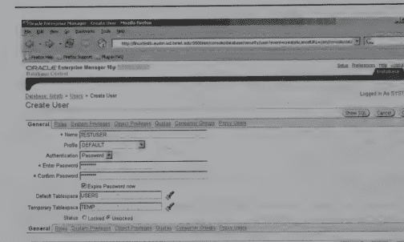

**图 9-1.** 使用 Oracle Enterprise Manager 添加用户

## 对象权限

对象级权限另一方面授予用户以访问或操作模式中的对象。这些权限通常由对象所有者授予想要访问的用户。此类命令的列表包括：

- `ALTER` 允许用户更改对象的定义

- `DELETE` 允许被授予者删除行的能力

- `EXECUTE` 允许用户执行代码，例如过程或函数

- `INSERT` 允许用户向表中添加行

- `SELECT` 允许用户检查表中的数据

- `UPDATE` 允许用户更改现有数据

此外，如果原始对象所有者使用 `GRANT` 选项被授予这些权限，用户可以将这些对象权限转交。

## 添加用户账户

一旦特定用户的身份验证和授权方法确定后，即可使用该用户账户本身。图 9-1 显示了使用 Oracle Enterprise Manager Database Control 添加用户账户的示例。

如图 9-1 所示，所需初始信息包括用户名和密码、身份验证方法以及默认和临时表空间。配置文件以及身份验证类型是从下拉菜单中选择的。默认表空间是用户对象的逻辑位置，而临时表空间是查询排序处理的所在位置。此外，账户可以创建为锁定或未锁定，如图 9-2 所示。

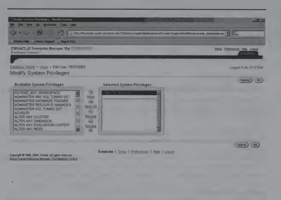

版权所有 © 1996, 2004, Oracle。保留所有权利。ORACLE、OUI/DB 和 Oracle Internet Application 是 Oracle Corporation 的注册商标。


**图 9-2.** 在 Oracle Enterprise Manager 中授予系统权限

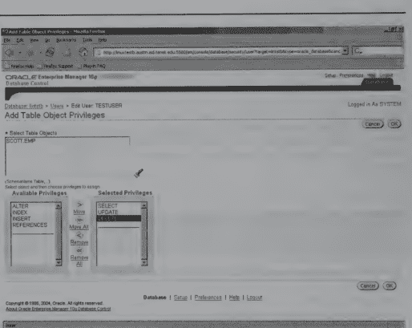

**图 9-3.** 在 Oracle Enterprise Manager 中授予对象权限

下一步是向新用户授予系统级权限，如图 9-3 所演示。至少，应授予用户 `create session` 系统权限。

一旦系统级权限建立后，即可设置对象级权限。图 9-3 使用示例 SCOTT 模式，说明了在 EMP 表上授予一般 DML 权限。现在账户 TESTUSER 已创建并授予了适当的权限，该用户现在可以登录并执行功能任务。

## 摘要

本章向您介绍了 Linux 和 Oracle 任务，这些任务是 Oracle 系统日常管理的一部分。许多时候 DBA 和系统管理员的工作是分开的，但两者有很大重叠。通过理解这两个任务，您可以更好地协作，以实现更稳定、性能更好的系统。


## 第10章

在 Linux 上调优 Oracle 和 RAC


调优 Oracle 既是一门艺术，也是一门科学。调优涉及科学调查、良好的记录、直觉和经验，以确定是否存在性能问题、性能问题是什么以及如何解决它。通过制定并坚持纪律严明的方法论，性能调优会变得更容易。通过坚持使用一种方法论，您可以获得更可预测和可重复的结果。在本章中，我将向您介绍我使用的方法论，但您应该根据自己的需求进行更改。

性能调优涉及将性能不佳的系统使其性能更好。这听起来很简单，但当涉及众多组件和多层应用程序、硬件和数据库时，这可能是一项非常复杂的任务。它通常涉及在多个层进行监控和调优，包括：

- 应用调优
- 实例和数据库调优
- 硬件调优

此外，可能还需要进行架构设计更改。在本章中，您将了解所有层的调优。首先，让我解释一下我个人的调优方法论。

## 性能调优方法论

该调优方法论涉及一系列单独的步骤，最终得出结果。该结果可能是信息，也可能是对系统性能方式更改的建议。性能调优方法论的单独步骤是

- 初始评估
- 系统监控
- 结果分析
- 假设创建
- 解决方案建议
- 实施
- 测试和监控
- 返回步骤 3（结果分析）

这种方法论可能并不适合所有人，但它是一个良好的起点。下一节中给出了一些确保该方法论有效性的技巧和技术。让我们更详细地了解一下该方法论。

### 步骤 1：初始评估

步骤 1 的目标是了解您正在评估的环境。如果您正在调优自己的系统，此步骤可能是您非常熟悉的。如果您被请来调优他人的系统，这可能需要更多的工作。在任何情况下，记录对系统的评估都是很有用的。初始评估涉及以下一些步骤：

- **了解应用程序** 重要的是您对系统和应用程序及其工作原理有基本了解。
- **询问其工作原理和功能** 您应该能够找到能够提供系统运行方式、各个组件以及它们如何交互的信息的人。
- **确定报告的问题是什么** 如果报告了问题，请确定报告的问题到底是什么。经常报告的问题是“一切都很慢”。获取更多细节可以帮助流程。
- **记录数据库大小、调优参数等** 在开始调优系统之前，您应该记录数据库大小、Oracle 和 Linux 参数等。
- **验证参数** 有时，通过发现设置不当的参数，在参与的前几分钟内就解决了调优问题。这很少见，但确实会发生。

这是调优练习中非常重要但最不光彩的阶段。通过在开始时整理好文档和信息，您可能已经为一个成功的项目奠定了基础。

### 步骤 2：监控系统

此阶段的目标是监控系统并收集数据。然后可以使用这些数据来制定可能导致您遇到的性能问题的理论。与步骤 1 一样，记录结果很重要，以便可以正确分析并在必要时重复。涉及的一些任务包括以下内容：

- **监控系统** 为此，使用
  - **操作系统工具：** `sar`, `vmstat`, `iostat` 这些工具可以为您提供有关系统在操作系统级别性能的有价值信息。可以使用这些工具检测高级问题，例如 CPU 利用率达到 100%，I/O 子系统过载。
  - **Oracle 工具：** `AWR`, `Statspack`, `dbastudio`, `v$views` 这些工具可以提供有关 Oracle 实例性能和等待事件的信息，以及 Oracle 实例和应用程序中的问题。
  - **第三方工具** 第三方工具如 Veritas InDepth 可以提供有关应用程序和 SQL 语句性能的信息。
- **分析操作系统和 Oracle 配置参数** 分析操作系统和 Oracle 配置参数可能会突出一个可以轻松解决的基本问题。

性能监控比记录系统配置更令人兴奋和有趣；然而，文档在这里同样重要。如果您在系统上保存性能数据，请务必注明监控发生的时间以及系统当时正在发生什么。

### 步骤 3：分析结果

分析阶段的目标是结合初始评估，使用性能监控结果并利用这些数据在下一步中形成假设。涉及的一些任务如下：

- **分析数据** 您在监控阶段收集的数据应仔细分析。您可能会对发现的内容感到惊讶，或者它可能会证实您可能有的某些怀疑。
- **查看错误日志** 这是一项经常被忽视的任务。错误日志在配置错误或硬件故障的情况下可以成为有价值的信息来源。请记住，日志不仅仅是 Oracle 警告日志。还有 Linux 系统日志、`/var/log/messages` 和内核环形缓冲区（使用 `dmesg` 访问）。还有其他日志文件，如集群管理器日志。
- **从客户来源查找性能数据** 这是用户和/或测试人员有机会向您反馈测试情况的地方。这也可能是应用程序测试人员提供有帮助信息的地方。

一旦您完成了分析阶段，您就可以开始形成关于问题可能是什么以及如何解决该问题的假设。

## Step 4: 创建假设

本阶段的目标是制定一个理论或假设，说明性能问题的成因。创建假设可能非常简单，也可能相当复杂。在存在多个问题的情况下，您可能只需要为一两个问题创建假设。请记住，您不必一次性解决所有问题；事实上，您最好一次只更改少数几项，或一项。涉及的任务包括以下内容：

- **确定是否真的存在问题** 有时您得出的结论是系统按设计运行，实际上并没有问题。这可能是您得出的假设。
- **制定理论** 制定理论是调优艺术中最重要的一部分。在这里，您必须吸收所有获得的数据，并尝试确定为什么会出现问题，如果确实存在问题。您可能推测的问题类型包括 I/O 问题、锁定问题、表述不佳的 SQL 语句等。
- **用数据支持该理论** 没有支持数据的理论价值不大。即使数据不具决定性，也应有一些数据迹象来支持您的理论。

假设对于提出解决方案至关重要。如果您无法根据收集到的数据确定问题的所在，就需要回去收集更有用的数据。

## Step 5: 提出解决方案

本阶段的目标是提出一个建议的解决方案或测试，以便确定实际的解决方案应该是什么。在某些情况下，解决方案可能是购买更多硬件，例如磁盘驱动器或内存。在其他情况下，解决方案可能是调优一些 SQL 语句或添加索引。本阶段是您实际提出调优解决方案的地方，该方案需要包括以下任务：

- **制定解决方案** 该解决方案可能涉及添加索引、更改 SQL 语句、更改硬件布局或添加更多硬件。
- **制定验证计划** 验证计划应包括一些可以验证更改是否正确执行的程序。
- **记录预期结果** 当您对结果应如何有所预期时，运行测试会更容易。这使您能够判断测试是否在某种程度上存在缺陷。如果得不到预期结果，则测试有缺陷或解决方案有缺陷。

在提出解决方案时，您应始终牢记该解决方案的结果。如果您不知道建议的解决方案会做什么，那为什么要做呢？

## Step 6: 解决方案实施

这一步真的很有趣。本阶段的目标是实际修复性能问题。在这里，您可以进行已提出的更改并准备测试解决方案以验证您的假设。实施解决方案可能像添加索引一样简单，也可能像更换整个存储子系统一样困难。在任何情况下，这都是行动发生的地方，可能涉及以下一些任务：

- **进行硬件更改** 这可能涉及升级硬件、更改 I/O 子系统，或更换整个系统并迁移到新系统。
- **进行配置参数更改** 这通常相当容易，并且不会涉及太多风险。
- **添加索引** 在大型表上添加索引可能非常耗时。所需时间取决于数据和索引的复杂性。

进行更改时遵循一些简单规则很重要。这些规则将使您的工作更轻松，最终获得更好的结果：

- **记录您的更改** 通过记录您的更改，您将更能够重现它们并确定哪些更改有所帮助。
- **一次只更改一件事** 同时进行多项更改会导致不可预测的结果。
- **记录您的更改** 这在列表中出现两次，因为它非常重要。

通过有条不紊和谨慎，您可以取得出色的成果。

## Step 7: 测试和监控

本阶段涉及对更改后的系统运行验证和性能测试。此步骤的目标是验证前一步中执行的解决方案。此验证涉及确认更改带来了改进、更改使情况变糟，或在某些情况下，测试存在缺陷。

- **如果可能，在非生产环境中测试更改。** 此要求有时不可能实现，但应成为所有调优的目标。在任何情况下，都应评估更改的风险并确定如何测试和实施更改。例如，添加或更改索引可能会影响性能，但不会影响查询返回的结果数据。对查询本身的更改可能会返回错误结果。
- **部署前对更改进行 QA。** 任何代码更改在部署前都应进行质量保证测试。
- **如果可能，运行负载测试。** 负载测试可以帮助您衡量和记录更改带来的性能提升。测试越好，结果越好。可以使用的第三方 I/O 压力工具包括 `Loadrunner`、`iozone`、`postmark` 或 `ORION`。
- **使用第 2 步中描述的监控工具监控更改。** 如果您使用相同的工具并以类似方式监控，则可以将结果与第 2 步中收集的结果进行比较。
- **记录更改。** 如果您不记录所做的工作，可能很难重现更改并确定它如何影响性能。

更改必须谨慎、有条不紊地进行。同时进行太多更改可能导致不可预测的结果。

## Further Analysis and Testing


您现在应从第 3 步开始重复，直到对调优结果满意，或时间或预算用完。不幸的是，调优就像割草；它总会再长回来。调优的终点是以下若干事件之一发生时：

- **性能目标已达成** 这可能是某个平均响应时间、批处理作业在特定时间窗口内运行等。
- **时间已到期** 有时您只有有限时间框架的测试设备，必须在该时间框架到期时结束测试。
- **预算已用完** 许多性能调优练习都有特定预算，一旦资金用完，调优必须停止。

这些以及许多其他原因都可能决定调优工作的结束。希望完成后，结果是更好的性能或有关如何改进性能的建议。

但实际上如何调优系统呢？这是本章剩余部分的主题。这将从监控和调优 Oracle 实例开始。

## Tuning Oracle on Linux

在 Linux 上调优 Oracle，或在任何平台上，都可以分为三个主要领域：应用程序调优、实例/数据库调优和硬件调优。这些不同的调优领域可以按任何顺序进行，但通常首先进行应用程序调优，然后是实例和数据库调优，最后是硬件调优。然而，应首先对整个系统进行总体调查，然后确定哪个领域最需要立即关注。这些关注领域可能都相当复杂，但可能导致性能问题的根本原因的解决方案。

- **应用程序调优** 这涉及对可能效率低下或成为瓶颈的应用程序代码、SQL 语句和流程的修改。应用程序调优还包括存储过程和数据库模式的修改，包括索引调优。
- **实例/数据库调优** 实例调优涉及修改 Oracle 初始化参数以更改 Oracle 实例的配置。实例调优可能还涉及修改 Linux 参数的需求。
- **硬件调优** 硬件调优涉及修改、重新配置和添加硬件以提高 Oracle 性能。

仅调优其中一个领域不会提供完整的性能评估和改进。当应用程序代码存在问题时调优 Oracle 实例将无效。同样，当存在 I/O 问题时调优应用程序和 Oracle 实例也可能无效。完整的性能评估和调优练习需要应用程序、实例、数据库和硬件调优。

## 应用调优

应用调优涉及对 SQL 语句和索引进行调优，以实现不同的执行计划和数据访问模式。此外，应用调优还可以利用 Oracle 的特性，例如分区和并行查询。

第 16 章重点介绍调优 SQL 语句以提高其性能。SQL 语句可以通过分析执行计划并更改该执行计划来进行调优，要么通过更改 SQL 语句的文本，要么通过向 Oracle 优化器提供提示。两种方法都可能非常有效。

第 17 章重点介绍索引、分区和其他 Oracle 特性。分区可以是减少某些操作期间访问的数据量的强大方法。索引是减少查找特定数据所需 I/O 次数的最佳方式。

由于本书后面会介绍应用调优，因此此处不予介绍。这些内容将在后面介绍，因为本书的前半部分致力于 Oracle 实例和配置，而不是应用程序。

## 实例调优基础

实例调优涉及调优 Oracle 实例。需要提醒的是，Oracle 实例由用于访问 Oracle 数据库的内存和进程组成。实例通过调整 Oracle 初始化文件中的参数来进行调优。Oracle 初始化文件可以是客户端配置文件 `pfile`（参数文件）或 `spfile`（服务器参数文件）。无论使用哪一个，参数文件都用于配置 Oracle 初始化参数，这些参数用于调整 Oracle 实例的特性。

初始化文件中设置的参数在实例启动期间由 Oracle 实例读取。但是，有许多参数可以动态更改。动态参数和存储在 `spfile` 中的参数的更改均通过 `ALTER SYSTEM` 或 `ALTER SESSION` 命令完成。`spfile` 是调优 Oracle 实例的推荐方法，因为 `spfile` 驻留在数据库服务器本身上。然而，在某些情况下，使用 `pfile` 是首选甚至是推荐的。

### 使用 PFILE

`pfile` 是一个 ASCII 文件，可以通过 `vi`（或任何其他文本编辑器）进行编辑。`pfile` 包含参数名称和值的列表。只需添加或修改要更改的值即可。在启动 Oracle 实例时，指定要使用的 `pfile`，Oracle 数据库服务器将开始使用这些参数。如果 `pfile` 中有错误，您将收到错误并且 Oracle 实例将无法启动。

## 使用 SPFILE

`spfile`，即服务器参数文件，存在于数据库服务器上。在启动 Oracle 实例时，Oracle 数据库服务器将使用文件 `$ORACLE_HOME/dbs/initSID.ora` 启动。在 Oracle RAC 配置中，`spfile` 通常存储在共享磁盘上，并且 `$ORACLE_HOME/dbs/initSID.ora` 文件包含一行，

```
SPFILE='/u03/oradata/test/spfiletest.ora'
```

此指定只是将 Oracle 实例指向共享 `spfile`。


> > **NOTE**
> >
> > RAC 集群中的所有节点可以共享同一个 `spfile`。
> >
> > 由于 `spfile` 中存在特定于实例的参数，因此应按每个实例设置它们。

当使用 `spfile` 时，无需在 Oracle 启动命令中指定参数文件。`spfile` 将自动用于启动 Oracle 实例。为了确定正在使用哪个 `spfile`，您可以使用 Oracle 命令

```
SQL> SHOW PARAMETER SPFILE;
```

这将显示当前正在使用的 `spfile` 的名称。建议使用 `spfile`，然而，在某些情况下使用 `pfile` 很方便。

## 创建 SPFILE

`spfile` 可以由 Oracle 数据库配置助手（DBCA）创建，也可以在任何时候使用 `CREATE SPFILE` 命令创建，如下所示：

```sql
SQL> CREATE SPFILE='/u03/oradata/test/spfiletest.ora' FROM
PFILE='/opt/oracle/admin/test/inittest.ora';
```

相反，您可以使用 `CREATE PFILE` 命令从 `spfile` 创建 `pfile`，如下所示：

```sql
SQL> CREATE PFILE='/opt/oracle/admin/test/inittest.ora' FROM
SPFILE='/u03/oradata/test/spfiletest.ora';
```

最好始终从 `spfile` 创建 `pfile` 作为备份。由于 `pfile` 可以通过文本编辑器修改，因此您可以在启动 Oracle 实例之前对其进行修改。`spfile` 只能在 Oracle 实例内部修改，并且需要 Oracle 正在运行。

## 设置 SPFILE 参数

一旦使用 `spfile` 运行，参数是通过使用 `ALTER SYSTEM` 或 `ALTER SESSION` 命令进行修改的。`ALTER SYSTEM` 将以系统范围的方式修改参数，而 `ALTER SESSION` 仅在会话持续时间内修改参数。在使用 `ALTER SYSTEM` 命令设置参数时，您可以使用表 10-1 中所示的多个可选限定符。

初始化参数用于设置一个或多个实例的实例特性。这些参数根据参数及其作用，要么立即生效，要么在实例重新启动时生效。让我们看几个例子。

为了在 RAC 集群的两个节点上设置缓冲区缓存的大小，请使用以下语法：

```
SQL> ALTER SYSTEM SET db_cache_size=24M COMMENT='6/2/2004 Increased buffer cache to 80M' SCOPE=BOTH SID='*';
```

| 选项 | 描述 |
| --- | --- |
| COMMENT | COMMENT 子句允许您在参数文件中插入注释。此注释仅适用于更改的最后一次出现，不应用于历史记录。 |
| SCOPE | SCOPE 子句允许您指定更改是否影响 MEMORY（当前实例）、SPFILE（仅 spfile）或 BOTH（实例和 spfile）。注意：如果指定 MEMORY，更改将不会在重新启动后保留。 |
| SID | SID 子句允许您指定要为其设置参数的实例。可能的值为 SID 或 '*'。将 SID 设置为 '*' 指定集群中的所有实例。 |
| DEFERRED | DEFERRED 子句指定将使用新参数值启动未来的会话。所有当前会话将保留其当前设置。 |

**表 10-1.** `ALTER SYSTEM` 命令的限定符

为了在 RAC 集群的一个节点上设置共享池大小，请使用以下语法：

```
SQL> ALTER SYSTEM SET shared_pool_size=150M COMMENT='6/2/2004
Set shared pool size
To 150M' SCOPE=BOTH SID='RAC1';
```

`ALTER SESSION` 命令可用于设置会话变量，而不是初始化参数。在使用前面表格中显示的参数的 `ALTER SYSTEM` 命令的情况下，参数的顺序在某些情况下很重要。

## 何时使用 PFILE

即使 `spfile` 是调优 Oracle 实例的推荐方法，使用 `pfile` 有时也是设置参数的便捷方式。`pfile` 可能更方便的一些原因如下：


- 需要设置多个参数。当您设置多个参数时，可以在 `pfile` 中更改它们，启动实例，然后从 `pfile` 创建 `spfile`。

- 实例无法启动。如果系统移除了内存，您可能无法启动实例。通过使用 `pfile`，您可以使用新参数重新启动实例。

无论使用 `pfile` 还是 `spfile`，结果都相同。实例的特性发生了更改。

## 监控 Oracle 实例

那么，您如何实际知道要调优什么？可以设置许多不同的 Oracle 参数（在 Oracle 10g 中超过 200 个）。需要设置哪些参数以及如何设置它们可以填满一整本书，而且通常确实如此。在本书中，您将不会学习可以设置的所有 Oracle 初始化参数，或如何设置它们。相反，您将学习如何在 Oracle 和 Linux 中监控和解释一些性能数据，以及如何设置一些最常见的参数。

## 使用 v$ 和 gv$ 视图监控实例

有许多不同的方法可以监控 Oracle 实例，包括许多优秀的第三方工具。这些工具中的大多数从同一位置获取数据：`v$` 视图。Oracle 维护了一组视图，它们是 Oracle 实例性能的窗口。这些视图被称为 `v$` 视图或 `动态性能` 视图。这些视图看起来像是普通表数据，但实际上是动态值，用于跟踪自上次启动以来 Oracle 实例的性能。

如果您在 Oracle RAC 集群中运行，还会有一组用于整个集群的动态性能视图。这些是全局动态性能视图，被称为 `gv$` 视图。`gv$` 视图与 `v$` 视图性质相似，但包含一个额外的列，即实例名。

视图 `v$session` 包含当前实例中运行的会话的信息。视图 `gv$session` 包含 RAC 集群中所有运行会话的信息。`gv$` 视图非常有用，就像 `v$` 视图一样。

动态性能视图的内容报告各种实例指标。例如，`v$session` 视图为实例中运行的每个会话包含一行，其大小会根据会话数量而变化。视图 `v$sysstat` 包含系统信息，且视图中的行数永远不会改变。许多视图本质上是计数器，值始终递增，而其他视图包含动态上下波动的数据。

使用 `v$` 视图的一个例子是确定缓冲区缓存命中率。有关缓冲区缓存的统计信息可在动态性能视图 `v$sysstat`（系统统计）中找到。列 `physical_reads` 表示缓存未命中，而列 `consistent_gets` 和 `db_block_gets` 表示缓存命中。为了确定缓冲区缓存命中率，请使用以下公式：

```
1 - (physical_reads / (db_block_gets + consistent_gets))
```

这些值可在 `v$sysstat` 中找到，并可使用以下查询收集：

```
SQL> SELECT name, value FROM v$sysstat
WHERE NAME IN ('db block gets from cache', 'consistent gets from cache',
'physical reads cache');
```

| 名称 | 值 |

|---|---|

| 缓存中的 db 块获取 | 206884 |

| 缓存中的一致性获取 | 137869 |

| 缓存物理读取 | 12065 |

从这一点开始，只是一个数学问题，如下所示：

```
Cache Hit Ratio = 1 - (12065 / (206884 + 137869)) = 1 - .035 = .965 = 96.5%
```

此查询表示整体缓冲区缓存命中率。然而，请记住现在有多个缓冲区缓存。除了 `DEFAULT` 缓存外，还有标准块大小的 `KEEP` 和 `RECYCLE` 缓存。还有非标准缓存大小。以下查询为所有这些缓存提供缓存命中率：

```
SQL> SELECT name, 1 - (physical_reads / (db_block_gets + consistent_gets)) AS
"Cache Hit Ratio"
FROM v$buffer_pool_statistics;
```

| 名称 | 缓存命中率 |

|---|---|

| 默认 | .965642687 |

`v$` 视图提供了大量优秀的信息，然而，使用查询手动检索这些信息可能非常耗时且繁琐。为了帮助完成此任务，Oracle 提供了一些 SQL 脚本，可帮助您计算多种不同的指标。这些脚本是 `utlbstat.sql` 和 `utlestat.sql`。在 Oracle 9i 中，这些脚本基本上已被 Statspack 取代。Statspack 是 Oracle 提供的包，它保存 `v$` 和 `gv$` 数据的快照，并将这些快照与后续快照进行比较，以便不仅提供缓存命中率等动态数据，还提供速率。在下一节中，您将学习如何在 Linux 上配置和使用 Statspack。

### 使用 AWR

自动工作负载库（`AWR`）是 Oracle 10g 中的一项新功能。`AWR` 是一种自动收集性能数据的方法。默认情况下，`AWR` 统计信息每小时收集一次并保留一周。`AWR` 统计收集设置可通过 `DBMS_WORKLOAD_REPOSITORY` 包进行查看和设置。

`AWR` 报告是通过运行 SQL 脚本 `awrpt.sql` 创建的，该脚本位于 `$ORACLE_HOME/rdbms/admin`。当运行 `awrpt.sql` 时，您必须选择开始和结束点。这些快照用于根据这些开始和结束点创建差异报告。`AWR` 与 Statspack 报告非常相似，因此请使用下一节来帮助解释 `AWR` 数据。

此外，还有几个过程可用于调整 `AWR` 数据收集之间的间隔以及 `AWR` 统计信息保留的时间。这些设置可通过 `DBMS_WORKLOAD_REPOSITORY` 包中的 `MODIFY_SNAPSHOT_SETTINGS` 过程进行设置。要更改设置，请使用以下 SQL 语句。

```
SQL> DBMS_WORKLOAD_REPOSITORY.MODIFY_SNAPSHOT_SETTINGS( retention => minutes,
interval => minutes, topnsql => number, dbid => number or NULL);
```

通过设置快照设置，您可以调整 `AWR` 以更好地满足您的需求。保留期越长、间隔越短，您使用的空间就越多。

### 使用 Statspack

`v$` 和 `gv$` 视图中存储的所有值都表示某一时间点的该值。许多值在单个时间点上几乎没有用，例如每个 Oracle 数据类型发生的 I/O 数量的计数。对此数据的更合理表示方法是在两个时间点进行此测量，将较晚值减去较早值，然后除以两次测量之间的时间。这将提供每个时间段的 I/O 速率。当您可以查明每秒执行了多少 I/O 时，I/O 性能才更有意义。

Statspack 通过拍摄动态性能数据的快照并将该信息存储在表中来帮助解决此问题。在稍后的时间，可以拍摄另一个快照。Statspack 还包括一个实用程序，用于在两个快照之间取差值并为您计算速率和统计信息。几页后，您将看到这是如何完成的以及提供什么样的数据。

**配置 Statspack**  Statspack 需要创建多个 Oracle 表，因此您必须为此数据存储提供 Statspack 空间。因此，设置 Statspack 的第一步是创建表空间。接下来，连接到 Oracle 并安装 Statspack 包。这些步骤如下所示：

- 1. 为统计信息创建足够大的表空间（主要用于范围数量）。
- 2. 使用 `SQLPLUS` 安装 Statspack。
  - a. 启动 `SQLPLUS`。
  - b. 在 `SQL>` 提示符下，输入 `@?/rdbms/admin/spcreate`。
  - c. 提示时，指定要存储统计信息的表空间。
  - d. 为 `perfstat` 用户提供密码。
  - e. 提示时，指定临时表空间。

一旦 Statspack 表和 `perfstat` 用户配置完成，您就可以开始使用 Statspack。如何操作在下一节中显示。

**使用 Statspack**  使用 Statspack 涉及以 `perfstat` 用户身份连接到 Oracle 实例并运行快照。每当您有两个或多个想要比较的快照时，运行 `spreport` 过程以创建 Statspack 报告。这些步骤如下所示，命令序列显示为子步骤：

- 1. 以 `perfstat` 身份连接到 `SQLPLUS`。
  - a. `sqlplus /nolog`
  - b. `SQL> CONNECT perfstat/perfstat`
  - c. `SQL> EXECUTE statspack.snap;`
- 2. 根据需要继续并拍摄快照。

Statspack 报告在两个不同的快照上运行。要查找有哪些快照可用，请使用以下查询：

- 以 `perfstat` 身份连接到 `SQLPLUS`。
  - `sqlplus /nolog`
  - `SQL> CONNECT perfstat/perfstat`
  - `SQL> VARIABLE snap NUMBER;`
  - `SQL> Begin :snap := statspack.snap; end;`
  - `SQL> /`
  - `SQL> print snap;`


这将提供可用于创建 Statspack 报告的 Statspack ID 列表。创建 Statspack 报告是通过使用 `spreport` 过程完成的。`spreport` 函数也作为 `perfstat` 用户从 `sqlplus` 中运行。`Spreport` 将要求输入开始和结束快照，并将根据这些快照的差异创建报告。运行 `spreport` 如下所示：

- 以 `perfstat` 身份连接到 `SQLPLUS`。

  - `Sqlplus /nolog`
  - `SQL> CONNECT perfstat/perfstat`
  - `SQL> @?/rdbms/admin/spreport`

系统会提示您输入开始和结束快照。报告将为您保存，如下所示：

```
SQL> @?/rdbms/admin/spreport

Current Instance
----------------

DB Id    DB Name      Inst Num Instance
------------------------- --------------- -------- ----------
1053994617 ORCL                  1 orcl

Instances in this Statspack schema
----------------------------------

DB Id    Inst Num DB Name      Instance       Host
------------------------- --------------- -------------- -------------------
1053994617    1 ORCL       orcl       ptc6.perfuning.com

Using 1053994617 for database Id
```

## 第 10 章：在 Linux 上调优 Oracle 和 RAC 251

使用 1 作为实例编号

*指定要选择的快照天数*

-----------------------------------------------

输入天数 `n` 将列出最近 `n` 天的快照。不指定数字按 `<return>` 将列出所有已完成的快照。

列出所有已完成的快照

| 实例 | 数据库名称 | 快照 ID | 快照开始时间 | 快照 | 级别 注释 |
|---|---|---|---|---|---|
| orcl | ORCL | | 1 05 Jun 2004 22:41 | | 5 |
| | | | 2 06 Jun 2004 12:42 | | 5 |

指定开始和结束快照 ID

-----------------------------------

Enter value for `begin_snap`: 1

Begin Snapshot Id specified: 1

Enter value for `end_snap`: 2

End Snapshot Id specified: 2

*指定报告名称*

-----------------------------------------------------

默认报告文件名是 `sp_1_2`。要使用此名称，按 `<return>` 继续，否则输入其他名称。Enter

value for `report_name`:

`userReport.txt`

使用报告名称 `JuneReport.txt`

STATSPACK 报告

其后是 Statspack 报告本身。此外，Statspack 报告会写入您对 `spreport.sql` 脚本中提出的问题的回答所指定的文件中。

一旦您拥有 Statspack 报告，您就可以开始分析 Oracle 实例以及部分会话的运行情况。

## 解析 Statspack 数据

Statspack 数据位于由 `spreport.sql` 创建的报告文件中。该报告已为您计算了许多 Oracle 统计信息。这些信息对于实例调优和应用调优都非常有用。以下是 Statspack 所提供的一些示例。

Statspack 报告以关于数据收集和 Statspack 报告的信息开始，如下所示：

STATSPACK 报告

| 数据库名称 | 数据库 ID | 实例 | 实例编号 | 版本 | RAC 根 |
|---|---|---|---|---|---|
| ORCL | 105394617 | orcl | 1 | 10.1.0.2.0 | NO |
| | | | | | ptc6.perftuning. |
| | | | | | com |

快照 ID | 快照时间 | 会话数 | 游标/会话 | 注释

---|---|---|---|---

Begin Snap: | 1 05-Jun-04 22:41:49 | 14 | 5.4 | 

End Snap: | 2 06-Jun-04 12:42:35 | 14 | 5.0 | 

Elapsed: | 840.77 (mins) | | | 

其后是关于内存配置以及系统在测量间隔期间所承受负载的信息。如下所示：

### 缓存大小（结束）

Buffer Cache: 24M Std Block Size: 8K

Shared Pool Size: 96M Log Buffer: 256K

### 负载概要

| | 每秒 | 每次事务 |
|---|---|---|
| Redo size: | 647.77 | 7,103.81 |
| Logical reads: | 18.84 | 206.57 |
| Block changes: | 3.97 | 43.51 |
| Physical reads: | 0.58 | 6.37 |
| Physical writes: | 0.23 | 2.48 |
| User calls: | 0.06 | 0.68 |
| Parses: | 0.70 | 7.70 |
| Hard parses: | 0.01 | 0.07 |
| Sorts: | 0.48 | 5.25 |
| Logons: | 0.02 | 0.22 |
| Executes: | 1.65 | 18.08 |
| Transactions: | 0.09 | |

% Blocks changed per Read: 21.06 Recursive Call %: 99.26

Rollback per transaction %: 2.57 Rows per Sort: 10.07

完成必要的维护工作并获得背景信息后，您可以开始查看实际的调优信息。出现的第一条信息是有关缓冲区缓存和共享池的缓存信息，如下所示：

### 实例效率百分比（目标 100%）

Buffer Nowait %: 100.00 Redo Nowait %: 99.99

Buffer Hit %: 96.62 In-memory Sort %: 100.00

Library Hit %: 99.35 Soft Parse %: 99.06

Execute to Parse %: 57.43 Latch Hit %: 100.00

Parse CPU to Parse Elapsed %: 93.74 % Non-Parse CPU: 69.69

| 共享池统计信息 | 开始 | 结束 |
|---|---|---|
| Memory Usage %: | 70.36 | 83.46 |
| % SQL with executions>1: | 68.63 | 73.23 |
| % Memory for SQL w/exec>1: | 54.27 | 53.24 |

除了缓存统计信息外，还列出了大量等待事件以及消耗资源最多、运行时间最长的 SQL 语句的信息，并按各种资源排序。这对于查找消耗资源最多的 SQL 非常有用，这些语句是调优的良好候选对象。

Statspack 提供的一个非常有用的功能是列出非默认的 Oracle 初始化参数。这对于判断是否有明显的东西调优不当或根本未配置非常有帮助。这通常是我调优系统的起点：寻找明显的问题。

## 等待事件调优

借助提供的 Oracle 统计信息，您通常可以通过使用等待事件和会话等待事件来调优 Oracle SQL 语句，从而取得相当好的效果。这些信息通常可以提供有关各个会话正在等待什么的有价值的信息。一些常见的等待事件涉及缓冲区或闩锁。由于等待事件数量众多，这里无法全部涵盖。

市场上有多款第三方工具，例如 Veritas 的 Indepth，实际上通过监控等待事件来监控系统。如果您知道系统正在等待哪些事件，通常可以更有效地进行调优。等待统计是调优系统的好方法，因为您直接针对性能问题的核心；耗时最多的部分。基于等待的调优可能非常有效，但应与其他调优方法（如实例调优和 I/O 调优）结合使用。

## 硬件调优


# 硬件调优

第三种调优类型是硬件调优。硬件调优涉及重新配置或为系统添加新硬件以提高性能。当您已超出系统的硬件资源时，通常需要进行硬件调优。这在 I/O 子系统和系统 RAM 上最常见。当系统资源已被消耗，且调优应用程序和 Oracle 实例以减少资源使用并未足够改善性能时，您几乎别无选择，只能添加更多硬件。

硬件调优与本书记载的容量规划和 sizing 在性质上相似。

硬件通常应作为最后的手段；然而，它通常是首选手段。这是因为添加新硬件比花费时间和精力找出真正问题要容易。有时这可以暂时奏效，但最终您会达到添加更多硬件变得不可能或成本过高的地步。这并不是说硬件调优不必要；只是它不应该是调优系统的第一步。

## 监控 Linux 系统

除了通过 `Statspack` 监控 Oracle 系统外，监控 Linux 系统也很重要。Linux 系统中可调优的参数并不多，然而，调优不当的系统可能会因此出现严重的性能问题。一些参数涉及必须为 Oracle 分配的资源，包括共享内存和信号量。如本书记载所示，这些参数可以在 `/etc/sysctl.conf` 参数文件中设置。让我们看一下其中几个参数。

以下是 `/etc/sysctl.conf` 中为共享内存和信号量设置的參數：

```
kernel.shmall = 2097152
kernel.shmmax = 2147483648
kernel.shmmni = 4096
kernel.sem = 250 32000 100 128
```

这些参数配置共享内存段可以有多大。按此设置，您可以拥有高达 2GB 的 SGA（假设没有其他程序使用共享内存）。要查看当前正在使用的共享内存和信号量，请使用 Linux `ipcs` 命令，如下所示：

```
[root@ptc6 root]# ipcs

-------- Shared Memory Segments ----------
key        shmid    owner    perms      bytes      nattch     status
0x00005643 0        root     666        1024       1
0x00005654 32769    root     666        1024       1
0x00000000 262146   gdm      777        196608     2          dest
0x00000000 327683   gdm      777        196608     2          dest
0x54250c38 360452   oracle   640        188747776  15

-------- Semaphore Arrays -----------
key        semid    owner    perms      nsems      status
0x00005653 0        root     666        1
0x460de1d4 196609   oracle   640        127
0x460de1a5 327978   oracle   640        127
0x460de1a6 262147   oracle   640        127

--------- Message Queues --------
key        msqid    owner    perms      used-bytes   messages
```

安装 Oracle 所需的额外调优参数包括以下内容：

```
fs.file-max = 65536
net.ipv4.ip_local_port_range = 1024 65000
```

这些参数设置了系统中可以打开的最大文件数，以及可供使用的 IP 端口。

如果您在 Oracle RAC 集群中运行，则还应设置以下 UDP 和 IP 参数：

```
net.core.rmem_default = 262144
net.core.rmem_max = 262144
net.core.wmem_default = 262144
net.core.wmem_max = 262144
net.ipv4.tcp_keepalive_time = 3000
net.ipv4.tcp_keepalive_intvl = 30
net.ipv4.tcp_retries2 = 3
net.ipv4.tcp_syn_retries = 2
```

这些参数用于改善 RAC 互连上的 UDP 性能，而 IP 参数则改善故障转移时间。可能还有其他需要调优的 Linux 参数，但这些是基础。要监控系统上发生的情况，您可以使用多种工具。

### 使用 ps 监控 Linux

Linux 源自 UNIX。原始 UNIX 开发者的理念是使命令名称尽可能简短，以避免不必要的输入。这就是为什么许多 Linux 命令长度为两个字符的原因。`ps` 命令提供进程统计信息。在这里您可以查看当前正在运行的进程的信息。`ps` 命令允许使用多个附加参数，以提供有关当前正在运行进程的更详细信息。以下是 `ps` 的示例：


## `ps` 命令输出示例

```
[tc6:/var/log # ps -alf
F S   UID  PID  PPID C    NI ADDR  SZ WCHAN   TIME TTY          . TIME CMD
0 S   root   1     0  75  0 - 133 schedu Jun19 ? 00:00:03 init
0 S   root   2     1  0  75  0 -   0 contex Jun19 ? 00:00:00
      [keventd]
0 S root 3 1 0 94 19- 0 keoft1 Jun19 ? 00:00:00
      [ksoftirqd_CPU0]
...        .         .
0 S oracle 8906 1 0 75 0 - 65517 schedu Jun20 ? 00:00:00
ora_pmon_orcl
0 S oracle 8908 1 0 75 0 - 65355 schedu Jun20 ? 00:00:00
ora_lmon_orcl
0 S oracle 8910 1 0 75 0 - 65876 schedu Jun20 ? 00:00:10
ora_dbw0_orcl
0 S oracle 8912 1 0 75 0 - 68972 schedu Jun20 ? 00:00:04
ora_lgwr_orcl
0 S oracle 8914 1 0 75 0 - 65615 schedu Jun20 ? 00:01:30
ora_ckpt_orcl
0 S oracle 8916 1 0 76 0 - 65625 schedu Jun20 ? 00:00:26
ora_emon_orcl
0 S oracle 8918 1 0 75 -0 - 65363 schedu Jun20 ? 00:00:00
ora_reco_orcl
0 S oracle 8920 1 0 75 -0 - 65378 schedu Jun20 ? 00:00:02
ora_cjqu_orcl
0 S oracle 8922 1 0 75 -0 - 65634 schedu Jun20 ? 00:00:00
ora_d000_orcl
0 S oracle 8924 1 0 75 -0 - 65499 schedu Jun20 ? 00:00:00
ora_s000_orcl
0 S oracle 8930 1 0 75 -0 - 69120 schedu Jun20 ? 00:00:00
ora_arc0_orcl
0 S oracle 8932 1 0 75 -0 - 69121 schedu Jun20 ? 00:00:04
ora_arc1_orcl
0 S oracle 8934 1 0 75 -0 - 65355 schedu Jun20 ? 00:00:00
ora_gmonc_orcl
0 S oracle 8936 1 0 75 -0 - 65633 schedu Jun20 ? 00:00:59
ora_mmon_orcl
0 S oracle 8938 1 0 75 -0 - 65363 schedu Jun20 ? 00:00:00
ora_mnnl_orcl
0 S oracle 10903 -1 0 75 -0 - 65361 schedu Jun20 ? 00:00:00
ora_q00l_orcl
0 S root 15857 733 0 75 -0 - 1184 schedu 04:33 ? 00:00:00
/usr/sbin/sshd
0 S root 15858 15857 0 75 -0 - 688 schedu 04:33 pts/0 00:00:00 -bash
0 S postfix 17157 816 0 75 -0 - 1096 schedu 14:29 ? 00:00:00 pickup -l -t fifo -u
0 S root 17252 733 0 76 -0 - 1184 schedu 15:07 ? 00:00:00
/usr/sbin/sshd
0 S root 17253 17252 0 75 -0 - 688 wait4 15:07 pts/4 00:00:00 -bash
0 R root 17488 17253 0 78 -0 - 887 - 16:02 pts/4
ps -elf
```

`ps` 命令对于查找哪些进程消耗资源、已运行很长时间或需要被终止（因为它们不再执行有用工作）非常有价值。使用 `ps` 时最有用的观察之一是进程状态代码（第 2 列）。可能的进程状态有

- `R`, 可运行（在运行队列中）
- `S`, 睡眠
- `D`, 不可中断睡眠（通常为 I/O）
- `T`, 被跟踪或已停止
- `W`, 分页
- `X`, 已死
- `Z`, 一个失效的 ('zombie') 进程

可运行进程当前正在 CPU 上运行，睡眠进程正在等待某些事情发生，而不可中断睡眠（`D`）通常表示进程正在等待 I/O。

## 使用 `vmstat` 监控 Linux

`vmstat` 命令提供与虚拟内存子系统相关的信息。

在这里您可以了解是否有可用内存、正在发生什么交换以及缓存了多少数据。如果您看到空闲内存过低（小于 1000），则说明您遇到了一些问题。以下是 `vmstat` 的输出示例：

```
[root@p6c6 root]# vmstat 10 10
procs            memory                    swap               io                system               cpu
  r   b      swpd      free   buff  cache   si   so    bi    bo  in  cs  us sy  id  wa
  0   0         0   11610 13468 242292   0    0    176  248  135  180 10   82    5
  0   0    101060   13424 242292   0    0     12   111  170  0  100 0  0
  1   0    105760   13456 242480   0    0     26   174  673  52  12  36  0
  0   0    105776   13472 242496   0    0      9   110  188    4   0  96  0
  0   0    105776   13488 242496   0    0     18   112  182    0   0  99  0
  0   0    105776   13594 242496   0    0     12   111  183    0   0  99  0
  0   0    105776   13520 242496   0    0      6   109  181    0 100 0
```

与许多这些命令一样，`vmstat` 命令可以循环运行。

提供给 `vmstat` 的两个数字指定间隔和持续时间。运行 `vmstat 10 100` 表示 `vmstat` 每 10 秒运行一次，共运行 100 次。

## 使用 `iostat` 监控 Linux

`iostat` 命令提供有关 I/O 子系统的信息。此命令对于确定延迟是否过高以及子系统是否过载非常有用。平均等待时间（`await`）和服务时间（`svctm`）都是重要的数据点。每秒读取次数（`r/s`）和每秒写入次数（`w/s`）也很重要。


# iostat 示例

```
[root@p6c6 root]# iostat -x 10 100
Linux 2.4.21-4.EL (p6c6)   06/06/2004

avg-cpu:  %user   %nice   %sys   %idle
           10.01    0.08    2.54   87.37

Device:    rmps  swpm/s    r/s   w/s  reses/s  wsec/s   kb/s  wkb/s  avgqu-sz  avgqu-sz
await      svctm   util
/dev/hda    10.91     0.06  1.59   0.09  97.75   1.22   48.87    0.61  58.92
327.49      6.61   621.04 104.31
/dev/hda1    0.00    0.00   0.03   0.00     0.0    0.00    0.00    0.00    5.14
0.00   13.93   7.14    0.02
/dev/hda2    10.73     0.06  1.47   0.09  97.07   1.22  48.54    0.61  63.01
0.09     5.70   3.81     0.59
/dev/hda3    0.03    0.00   0.03   0.00     0.18   0.00    0.09    0.00    7.30
0.00   10.43   5.65    0.01
/dev/hdb     18.67    51.28  10.33   6.85  230.03 465.22 135.02 232.61  40.46
372.19  199.32  60.40  103.81
/dev/hdb1     0.00    0.00   0.04   0.01     0.23   0.02    0.12    0.01   4.79
0.00    5.62   3.96    0.02
/dev/hdb2    18.44    51.28  10.22   6.85  229.28 465.20 134.64 232.60  40.70
34.24  200.67   3.30    5.63
/dev/hdb3     0.04    0.00   0.02   0.00     0.18   0.00    0.09    0.00   7.64
0.00    4.09   2.27    0.01

avg-cpu:  %user   %nice   %sys   %idle
0.10  0.00  0.50  99.40

Device:  rrqm/s  wrqm/s  r/s   w/s   rsec/s  wsec/s  rb/s    0.00  0.00  0.00
avgqu-sz await  svctm  %util
/dev/hda   0.00   0.00   0.00  0.00  0.00    0.00     0.00   0.00  0.00  0.00  0.00
4294967296.30  0.00  0.00  100.00
/dev/hda1  0.00  0.00  0.00  0.00  0.00    0.00     0.00   0.00  0.00  0.00  0.00
0.00      0.00  0.00  0.00
/dev/hda2  0.00  0.00  0.00  0.00  0.00    0.00     0.00   0.00  0.00  0.00  0.00
0.00      0.00  0.00  0.00
/dev/hda3  0.00  0.00  0.00  0.00  0.00    0.00     0.00   0.00  0.00  0.00  0.00
0.00      0.00  0.00  0.00
/dev/hdb   0.00  1.40  0.00  1.40  0.00    22.40    0.00   0.00  11.20  16.00  0.00
4294967296.30  0.00  714.29  100.00
/dev/hdb1  0.00  0.00  0.00  0.00  0.00    0.00     0.00   0.00  0.00  0.00  0.00
0.00      0.00  0.00  0.00
/dev/hdb2  0.00  1.40  0.00  1.40  0.00    22.40    0.00   0.00  11.20  16.00  0.00
0.00      0.00  0.00  0.00
/dev/hdb3  0.00  0.00  0.00  0.00  0.00    0.00     0.00   0.00  0.00  0.00  0.00
0.00      0.00  0.00  0.00
```

与 `vmstat` 一样，这是一个重复运行的程序。由于这些数据以速率显示，因此至少需要两个样本才能提供数据。

## 使用 sar 监控 Linux

`sar` 程序是系统活动报告程序，并在多个不同领域提供信息。默认情况下，`sar` 报告 CPU 信息，如下所示：

```
[root@ptc6 root]# sar 10 100
Linux 2.4.21-4.EL (ptc6) 06/06/2004

05:34:09 PM CPU     user   nice  system  idle
05:34:19 PM all      68.34  0.50   31.16  0.00
05:34:29 PM all      71.60  0.24   28.16  0.00
05:34:39 PM all      68.09  0.99   30.92  0.00
05:34:49 PM all      63.94  0.29   35.78  0.00
05:34:59 PM all      59.18  0.21   40.62  0.00
05:35:09 PM all      69.49  0.42   30.10  0.00
05:35:19 PM all      62.35  0.00   37.05  0.00
```

使用 `-n` 限定符运行 `sar` 会显示网络统计信息。如下所示：

```
[root@ptc6 root]# sar -n DEV 10 100
Linux 2.4.21-4.EL (ptc6) 06/06/2004

05:30:51 PM IFACE rxckp/s txckp/s rxcmt/s txrby/s rxcmp/s txcmp/s
05:31:01 PM lo      2.20  2.20    234.80 234.80  0.00  0.00
0.00
05:31:01 PM eth0    0.50  0.10    39.60  13.40  0.00  0.00
0.00
05:31:01 PM IFACE rxckp/s txckp/s rxcmt/s txrby/s rxcmp/s txcmp/s
05:31:11 PM lo      2.20  2.20    234.80 234.80  0.00  0.00
0.00
```

`sar` 命令是又一个重复运行的程序，它会按照你指定的间隔和持续时间运行。

## 使用 Top 监控 Linux

`Top` 是一个用于图形化查看系统统计信息的优秀工具。在此快照中不可见，但 `top` 程序会动态更新所显示的各种数据。此示例使用 `top -C` 运行，它会显示完整的命令名称，包括参数。


```
17:37:04 up 26 min, 4 users, load average: 3.04, 1.72, 0.77
72 processes: cpu user nice system iowait swapping idle
CPU states: cpu user nice system iowait swapping idle
 total 0.0% 0.0% 5.0% 2.0% 0.0% 90.5%
Mem: 51244K av, 50580K used, 654K free, 0k thr?, 31376K buff
Swap: 157244K av, 254816K actv, 104780K in_d, 7232K in_c 323812K cached

PID USER PRI NI SIZE RSS SHARE STAT %CPU %MEM TIME CPU COMMAND
13 root 15 0 0 0 0 OW 3.7 0.0 0:02 0 kjournald
2227 root 15 0 5768 5768 4836 S 1.8 1.1 0:04 0 magicdev --am-cli client-id default1
2503 root 19 0 1116 1116 900 R 0.9 0.2 0:00 0 top
1 root 15 0 504 504 448 S 0.0 0.0 0:04 0 init
2 root 15 0 0 0 SW 0.0 0.0 0:00 0 kevent
3 root 15 0 0 0 SW 0.0 0.0 0:00 0 kswapd
4 root 15 0 0 0 SW 0.0 0.0 0:00 0 kswapd
7 root 15 0 0 0 SW 0.0 0.0 0:00 0 bdflush
5 root 15 0 0 0 SW 0.0 0.0 0:01 0 kswapd
6 root 15 0 0 0 SW 0.0 0.0 0:00 0 kswapd
8 root 15 0 0 0 SW 0.0 0.0 0:00 0 kswapd
9 root 15 0 0 0 SW 0.0 0.0 0:00 0 mdrecoveryd
75 root 15 0 0 0 SW 0.0 0.0 0:00 0 kthreadd
1258 root 23 0 0 0 SW 0.0 0.0 0:00 0 kjournald
1589 root 15 0 608 608 528 S 0.0 0.1 0:00 0 syslogd -m 0
1589 root 15 0 456 456 400 S 0.0 0.0 0:00 0 klogd -x
1619 root 15 0 580 580 508 S 0.0 0.1 0:00 0 ntpd
1638 xtpuser 25 0 732 732 652 S 0.0 0.1 0:00 0 rpc.statd
1707 root 24 0 520 520 464 S 0.0 0.1 0:00 0 /usr/sbin/smpd -p 10 -w S -P -P /etc/sys
1746 root 15 0 1968 1968 1448 S 0.0 0.3 0:00 0 cupsd
1786 root 15 0 1512 1512 1276 S 0.0 0.2 0:00 0 /usr/sbin/sshd
1800 root 16 0 909 909 784 S 0.0 0.1 0:00 0 xinetd --stayalive -pidfile /var/run/xinetd
1819 root 25 0 1160 1160 1028 S 0.0 0.2 0:00 0 /bin/sh /usr/bin/safe_mysqld --defaults-
1854 mysql 25 0 4244 4244 1616 S 0.0 0.8 0:00 0 /usr/libexec/mysqld --defaults-file=/etc
1862 root 15 0 2600 2600 1940 S 0.0 0.5 0:00 0 sendmail: accepting connections
1872 ssmtp 25 0 2320 2312 1768 S 0.0 0.4 0:00 0 sendmail: Queue runner@01:00:00 for /var
1882 root 15 0 464 464 412 S 0.0 0.0 0:00 0 gpm -t imp2 -m /dev/mouse
1892 root 15 0 8912 8912 6382 S 0.0 1.7 0:00 0 /usr/sbin/httpd
1901 root 15 0 616 616 544 S 0.0 0.1 0:00 0 crond
1933 xfs 15 0 3452 3452 876 S 0.0 0.6 0:00 0 xfs -droppriv -daemon
```

就像任何工具一样，你必须解释结果并确定这些结果的含义。工具的好坏完全取决于使用它的人。

## 使用大内存模型

默认情况下，Oracle 数据库服务器可以在无需任何额外更改的情况下配置最大 1.7GB 的 SGA。通过一些小的更改，你可以创建使用多达 2.7GB RAM 的 SGA。对于超过 4GB 的大小，还需要进行其他更改。

> **注意**
> *使用 `hugemem` 内核时，这些限制为 2.7GB 和 3.7GB。然而，由于 `hugemem` 内核的额外开销，它仅应在具有 16GB 或更多 RAM 的系统中使用。*

### 为 > 1.7GB（且 <= 2.7GB）的 SGA 配置 Linux

为了创建大于 1.7GB 但小于 2.8GB 的 SGA，你必须降低 Oracle 加载的基础地址。这被称为 *映射* 基础。为了降低 `mapped` 基础，应采取以下步骤：

- 1. 更改（`cd`）到 `$ORACLE_HOME/rdbms/lib` 目录。

- 2. 使用 `gensms` 程序创建汇编文件，如下所示：

```
gensms -s 0x15000000 > ksm.s
```

- 3. 创建对象文件。

```
make -f ins_rdbms.mk k8rms.o
```

- 4. 创建 Oracle 可执行文件。

```
make -f ins_rdbms.mk ioracle
```

现在所需要做的就是将共享内存参数 `SHMMAX` 增加到 1.7GB 到 2.7GB 之间，并使用新构建的二进制文件启动 Oracle 服务器。

## 为 >2.7GB SGA 配置 Oracle

为了将 Oracle 数据库服务器配置为使用超过 2.7GB 的 SGA，必须使用两步流程。首先，必须创建 RAM 磁盘。一旦 RAM 磁盘创建完成，Oracle 将被配置为使用间接数据缓冲区。间接数据缓冲区本质上是 Oracle 用于数据库块缓冲区的 RAM 磁盘文件。通过使用 RAM 磁盘，你可以避免所有 32 位限制。

RAM 磁盘可以通过挂载类型为 `ramfs` 的文件系统来创建。在 Red Hat ES 3.0 之前的 Red Hat Linux 版本中，这是使用 `shims` 创建的，但从 3.0 开始使用 `ramfs`。以下是挂载 RAM 磁盘的语法：

```
umount /dev/shm
mount -t ramfs ramfs /dev/shm
chown oracle:dba /dev/shm
```

然后需要在 `/etc/security/limits.conf` 中添加以下内容。

```
oracle soft memlock 3145728
oracle hard memlock 3145728
```

如果你使用 `ssh` 登录系统，还必须将以下内容添加到 `/etc/init.d/ssh` 作为 `ssh` 错误的解决方法。

```
ulimit -l 3145728
```

还请在文件 `/etc/ssh/sshd_config` 中包含 "`UseLogin yes`"。最后一步是将 "`use_indirect_data_buffers=true`" 添加到 Oracle 初始化参数中。

下一步是设置 Linux 共享内存足够高，以便可以使用大内存。要将最大共享内存大小设置为 8GB，请执行以下操作：

```
echo 8589934592 > /proc/sys/kernel/shmmax
```

或将以下内容放入 `/etc/sysctl.conf`：

```
kernel.shmmax = 8589934592
```

这将允许你创建更大的 SGA。最后一步是在 Oracle 初始化文件中设置 `use_indirect_data_buffers`。现在你可以创建更大的 SGA。

> **注意**
> 间接数据缓冲区只能用于 Oracle 块缓冲区。较低的内存仍必须用于其他共享内存项，例如共享池或日志缓冲区。

## 使用负载测试进行性能验证

如果可能的话，在将任何新的 Oracle 系统投入生产之前进行负载测试是一个很好的主意。负载测试可用于验证功能测试无法验证的应用程序的几个方面。应用程序的这些属性在功能测试期间无法验证：


- **锁定** 除非有多个或许多并发进程访问相同的表，否则你不会发现锁定问题。

- **内存** 尽管单个进程可能达到极高的缓存命中率，但如果缓冲区缓存或共享池过载，许多进程一起运行时可能会出现争用。此外，每个专用服务器进程也会使用内存。

- **处理器** 一两个进程可能在 CPU 利用率 < 50% 下运行，而许多进程一起运行时可能会使 CPU 运行在 100%。

- **I/O** 正如你在本书前面学到的那样，I/O 子系统具有有限的性能特征。许多进程同时运行可能会使 I/O 子系统过载。

每当有新的应用程序或数据库要引入生产环境时，都应进行负载测试。负载测试的类型和范围由引入的应用程序类型和性能要求决定。以下是需要牢记的一些事项：

- **为什么要测试系统？** 进行负载测试的原因将决定测试的类型以及测试结果的价值。

- **批处理系统** 由于批处理系统通常是自动化的且不是由用户启动的，实际的批处理作业可以在测试环境中运行。

使用生产数据可以在测试环境中模拟向数据库加载数据。

OLTP 这就是有趣的地方。如果可能的话，最好模拟整个应用程序环境（即 Web 服务器、应用层、数据库层），模拟尽可能多的用户。

让我们先看第一个问题，然后再更详细地了解这些环境中的一些。

### 为什么要测试系统？

负载测试有几个基本目标。这些目标因所更改的内容而异。负载测试可用于验证对应用程序的新更改的性能影响、验证新硬件或升级硬件与现有应用程序的性能，或为全新应用程序在全新硬件平台上的性能建立基线。负载测试的结果会根据所测试的更改进行分析和解释。

### 新应用程序

新应用程序不允许你将负载测试结果与当前生产环境进行比较。然而，你可以建立基线性能指标、分析执行计划和数据访问模式、收集实例数据、收集操作系统和硬件性能数据，甚至可能开始调优。由于应用程序、数据库模式和基本操作任务差异很大，因此很难将一个应用程序中的应付账款功能与另一个应用程序中的应付账款功能进行比较。然而，这是在收集基线数据和开始调优过程方面的一个很好的起点。

### 现有应用程序的新版本

现有应用程序的新版本提供了更多灵活性来将负载测试结果与当前生产环境中的性能进行比较。对于新版本，诸如应付账款等功能任务的基本结果应该是可比较的。此外，数据库模式也应该相似。在这里你应该能够进行一些比较。然而，请记住新版本可能提供更大的功能和更多特性。因此，你可能会期望性能比现有应用程序稍慢。

### 具有现有应用程序的新硬件

在这种类型的环境中负载测试效果最好，因为你是用更新、希望更快的硬件替换现有硬件。你应该期望性能更好，响应时间更快。这些期望基于新硬件比现有硬件更快的假设。这

假设可能正确也可能不正确。请记住，两块磁盘驱动器的性能优于一块磁盘驱动器。我遇到的最常见性能问题之一是客户用一块 72GB 磁盘驱动器（或类似情况）替换四块 18GB 磁盘驱动器。我会自然而然地预期该系统比原系统性能更差。

在两个不同的硬件平台上对同一应用程序进行负载测试可以提供极佳的对比。请记住，只有在应用程序本身不是问题时，该测试才能提供有用的数据。你必须牢记这一点，因为你可能实际上正在经历性能提升却没有意识到，因为该提升被其他因素掩盖了。任何性能测试的结果始终有三种可能的结果：

- **性能有所提升** 这相当容易衡量和确定。

- **性能变差了** 这也相当容易衡量和确定。

- **测试有缺陷或存在影响测试的外部因素** 例如，如果你认为存在 I/O 问题并增加了 I/O 性能容量却未见改善，可能是你根本没有 I/O 问题，或者负载测试本身没有施加足够的负载以显示改善。这就是为什么适当的指标很重要。

通过这种类型的对比，你通常可以收集到大量优秀的数据。重要的是要正确地分析和解读它。

## 新硬件和新应用

这可能是最难解读的数据类型之一。即使使用新应用和新硬件，你仍然可以收集基线性能数据、分析执行计划和数据访问模式，并制定未来将使用的指标。在这种测试中，仍然重要的是执行负载测试，并在可能的情况下将结果与服务等级协议（SLA）指标进行比较。这是在将新应用和硬件引入用户社区之前，确定它们是否能满足你需求的机会。

## 负载测试批处理作业

相对于负载测试 OLTP 应用而言，负载测试批处理作业相对容易。这是因为批处理作业不是交互式运行的，并且批处理作业的排队和执行通常由应用程序或 DBA 人员控制。因此，运行批处理作业、在作业运行期间监控 Oracle 和操作系统的性能并记录批处理性能是一项相对直接的任务。

大多数批处理系统都会记录每次批处理作业运行的性能，包括如下信息：

- 开始时间

- 结束时间

- 持续时间

- 作业参数

- 用户信息

由于你拥有这些信息，你可以在测试系统上运行相同的批处理作业，并将当前系统上的运行时间与测试系统上的运行时间进行比较。请记住，除非你正在迁移到新的硬件平台，否则这些数据仅能提供基线性能数据。

### 负载测试数据加载

与批处理作业一样，相对于负载测试 OLTP 应用而言，负载测试数据库加载也相对容易。将数据加载到数据库中是以离线方式完成的，通常是在系统上没有太多其他活动时进行，并且几乎总是会被计时。在设置加载性能指标时，尝试至少收集以下数据：

- 开始时间

- 结束时间

- 持续时间

- 作业参数

- 正在加载的行数

- 正在加载的数据量（大小）

如果这些信息存储在数据库表中，你可以轻松跟踪趋势和潜在问题，防止它们演变成问题。从这些数据来看，特别值得关注的是正在加载的数据量与持续时间之间的关系。任何显著的减速都应提醒 DBA 人员。

### 负载测试 OLTP 应用

OLTP 应用的负载测试是最困难的，因为 OLTP 系统的特点是

- 大量在线用户

- 执行不同功能的多个应用程序

- 随机数据访问模式

- 持续活动

- 高峰和低利用率时段

为了正确地对 OLTP 应用进行负载测试，你必须模拟许多用户同时访问系统。这种模拟可以采用多种形式并以多种不同的方式工作。以下列表代表了可以用不同成本和数据质量水平完成的负载测试类型。

- 100%+ 用户的全端到端测试

- 部分用户的全端到端测试

- 仅数据库测试，带完整应用仿真

- 仅数据库测试，带部分应用仿真

随着列表的向下推移，负载测试的价值会降低，但成本也会降低。虽然今天可用的负载测试软件非常好，但也非常昂贵。其价格超出许多预算的承受范围。最小的负载测试仍然远胜于完全不进行负载测试。

## 100%+ 用户的全端到端测试

在此类测试中，负载测试软件模拟用户负载对完整应用环境的影响。这意味着 HTML 被模拟并从应用程序请求数据，而应用程序又从数据库请求这些数据。如果可能，应模拟你期望支持的用户数量，然后逐步增加，直到系统无法承受更多负载为止。此点将是你的最大容量。在全端到端负载测试中，键盘时间、思考时间等组件都会被纳入测试。

TPC-C 基准测试是进行全端到端测试的完美示例。此类测试实际上模拟了可能连接到此类系统的所有用户，并运行完整的应用程序。被测试的系统包括 Web 服务器、应用程序和数据库本身。

## 部分用户的全端到端测试

这种测试也可以很有效。在部分用户测试中，你很可能会从模拟中移除思考时间和按键时间，并尽可能快地向系统发送请求。数据是有用的，因为它可以指出应用程序或数据库中的缺陷。然而，用户数量信息没有那么有价值。

进行部分用户测试的原因是为了减少创建用户负载所需的硬件和软件数量。许多商业负载测试软件包，例如 Loadrunner 和 Silk Performer，都是根据你将模拟的模拟用户数量进行许可的。通过减少

用户数量，你可以降低软件成本。此外，你可能能够减少产生所需负载所需的负载驱动系统数量。

### 仅数据库测试，带完整应用仿真

你可以通过修改应用层来模拟数据库请求，从而通过应用程序测试数据库层。这涉及对应用程序进行一些修改以创建此负载。通过这种类型的测试，你可以模拟数据库系统上的用户负载并捕获响应时间，而无需承担负载生成系统的成本。这种类型的测试仅在你已将此类功能构建到应用程序中时才有效。

收集到的数据将允许你确定数据库响应时间以及有关数据库调用的信息，例如执行计划、数据访问模式和实例性能信息，但对在应用服务器层引入的额外延迟没有太多说明。然而，如果数据库层是问题所在，这种类型的测试会很有用。

### 仅数据库测试，无应用仿真

在这种类型的测试中，应用程序被排除在外。可以从运行应用程序的用户那里捕获 SQL 语句，并开发负载测试来模拟这些类型的 SQL 语句，而无需运行任何应用程序代码。这不是最好的测试类型，因为应用层被完全移除，但它仍然好于完全不进行负载测试。

这种类型的测试有时可以在几周内使用 C 代码、Perl 或 shell 脚本开发，并且可以快速部署。这种类型的测试无法提供容量规划信息，但非常适合对系统施加负载以验证新硬件组件和系统设置。它也是给数据库实例施压的绝佳方式。

这无疑是最经济的负载测试，因为它通常可以在内部开发。随着测试的演进，测试本身也可以演进。我经常在我的性能调优课程中使用这种类型的测试，以便快速轻松地在系统上模拟一些负载。

## 性能指标

在进行任何类型的负载测试时，在测试开始之前确定性能指标非常重要。不要只关注单一指标，而要使用多个指标。有许多优秀的指标可以使用。以下是其中一些指标的列表：

- 操作系统指标


## 系统指标

- **CPU** CPU 利用率是最好的指标之一，因为 CPU 时间最多只能使用 100%。这应分解为系统 CPU 时间、用户时间和内核时间。

- **I/O** 与 CPU 一样，这是一个有限的资源。你的系统每秒只能执行有限的 I/O 操作。你应至少收集每秒 I/O 数、读取/秒、写入/秒、读取延迟、写入延迟和队列深度。

- **进程数** 你应始终跟踪正在运行的进程数量以作比较。

- **分页** 应对其进行监控以确定外部因素是否影响系统性能。

### 应用指标

- **连接数** 你应监控同时连接到 Web 服务器的用户数量。

- **页面/秒** 每秒网页数是有用的信息。

- **请求/秒** 每秒应用程序请求数可以表明应用层的工作情况。

- **响应时间** 如果你能收集和分析来自应用程序请求的响应时间，就能确定何时以及是否出现问题。

### 数据库指标

- **缓存命中率** 缓冲区缓存命中率是最重要的指标之一，因为它能告诉你缓冲区缓存的效率如何。

- **共享池命中率** 这与之类似，但针对的是共享池。

- **等待统计** 许多 Oracle 数据库调优专家依赖等待统计来指示性能瓶颈所在。

通过收集正确的指标，你通常可以确定问题所在，并可能获得修复问题的线索。收集正确的数据以获得正确的结果非常重要。

## 负载测试技巧

以下是执行负载测试时可能有帮助的几个技巧。这些只是执行负载测试时的一些随机收集的应该做和不应该做的事项。

- 测试之间重启数据库。命中率和其他指标可能会因上一次测试残留在缓存中的数据而失真。

- 测试之间轮换日志文件，以确保测试从日志文件的同一位置开始。这可以通过 `ALTER SYSTEM SWITCH LOGFILE` 命令完成。

- 测试之间重启 Web 服务器。Web 服务器缓存非常高效，可能导致应用程序测试结果失真。

- 测量系统的所有层。数据库只是整个系统的一层。性能问题通常可能发生在应用层或 Web 服务器层，甚至在浏览器中。

- 不时评估测试。有缺陷的测试会导致有缺陷的结果。测试应由不止一个人重新评估。

- 保持怀疑态度。如果结果不合理，不要总是相信它们。有时需要重新评估并更改测试。

- 不要一次更改太多内容。这是常见问题。不同的更改可能会相互抵消。

负载测试可以是一种强大的工具，从长远来看实际上可以为你节省资金。然而，预算通常会忽略这种类型的测试。鉴于万维网和影响数千客户的应用程序，你在部署应用程序之前无法承受不进行测试。

## 摘要

本章涵盖了与在 Linux 上调优 Oracle 和 Oracle RAC 相关的多个不同主题。正如我们所讨论的，你应遵循一种方法论以实现有效结果。坚持方法论，你将能够重现结果并能够逻辑地得出结论。本章涵盖了调优应用程序、Oracle 实例和硬件的各个方面。此外，你还了解了负载测试的重要性，并获得了如何进行该测试的一些思路。

我还要再次强调文档的重要性。在调优系统时，记录你所做的所有更改至关重要。你以后可能需要回溯以确定更改是否有效，而良好的文档会有所帮助。


## PART IV

管理和调优

Oracle Database 10g 在

Linux 上


## CHAPTER 11

## 备份和恢复

对 DBA 来说，最重要的任务之一就是备份数据库。这是因为 DBA 的最高职责是确保数据库的稳定性和安全性。在发生灾难性系统故障时，DBA 必须能够快速有效地将数据库恢复到尽可能接近故障时间的点。虽然这是 DBA 最重要的任务之一，但它也是最不光鲜、最不显眼的任务之一。确保每个人都理解其关键性是你的责任。

### 备份概述

Oracle DBA 负责 Oracle 数据库服务器的维护和正常运行。在系统故障时，Oracle DBA 必须能够尽快让系统恢复运行。为此，必须完成以下几项任务：

- 数据库必须及时定期备份。备份间隔越长，恢复数据库所需的时间就越长。
- 数据库必须以尽可能少影响生产系统性能的方式进行备份。
- 在发生灾难性系统故障时，DBA 必须能够尽快恢复数据库。
- 数据库恢复必须正确、尽快完成，并且对用户造成尽可能少的干扰。
- DBA 必须有一种方法根据需要恢复单个表和用户数据以纠正用户错误。
- DBA 必须能够在同时冷静应对激动的领导层以及激动、沮丧且不耐烦的用户群体时完成所有这些工作。
- 恢复和恢复程序必须有文档记录，以便即使主 DBA 不在场也能正确执行。记住，事情可能发生在你休假时。
- 备份必须受到保护。已备份到磁盘的备份应立即（或在可行时尽快）复制到磁带上。

正如你所见，有许多需要考虑的因素。本章将介绍执行数据库备份的基础知识和程序。你还将了解恢复与还原数据库之间的区别，以及如何正确还原数据库。你还将学习恢复单个表、表空间、数据文件和完整数据库的不同方法。

数据的完整性和安全性是 DBA 最重要的职责。通过学习正确的技术、文档和方法，你将迅速熟练掌握备份和恢复。

有人可能会问：鉴于 RAID 控制器和纠错内存的普及，备份还有必要吗？RAID 控制器和容错磁盘子系统并不是不做备份的借口。用户错误是进行备份的最重要原因之一，也是恢复的最常见原因之一：如果用户不小心删除了一个表，该表将立即丢失，无论磁盘卷是否容错。此外，偶尔会出现导致数据丢失的软件问题。恢复正常的唯一方法是 将数据库恢复到最后已知良好的状态。

### 备份和恢复概念

在学习备份的工作原理之前，让我们回顾一下 Oracle 的工作原理。我们不会涵盖所有 Oracle 功能和进程，只涵盖与数据库中数据完整性相关的部分。

如果数据库中的数据从未改变，就永远不需要备份该数据。在这种情况下，任何过去的备份都可用于将数据恢复到可用状态。嗯，在大多数系统中并非如此，尽管通过使用一些只读表空间，可以部分实现这一点。

由于大多数真实系统的数据都在变化，数据库是一个不断变化的系统。保护这些数据至关重要。如果系统发生故障，认为所有正在进行的更改都能恢复是不合理的，但合理的期望是所有已提交的事务都能恢复。事实上，如果你有一个良好的备份和恢复计划，就不应该丢失任何已提交的事务。在从故障中恢复数据库时，必须使用两种不同类型的故障和恢复机制。两种恢复类型是 *实例恢复* 和 *数据恢复*。

#### 实例恢复

实例故障可能由于系统故障（如停电或硬件故障）或软件问题而发生。当实例故障发生时，*Oracle 恢复后台进程 (RECO)* 可以在实例启动时完全恢复数据库。所有已提交的事务将被恢复，或 *向前滚动*，所有未提交的事务将被撤销，或 *回滚*。

正如你将在本章和下一章中看到的，实例恢复可以并且应该进行调优，以提供尽可能短的恢复时间。

##### 实例恢复

实例恢复可能需要相当长的时间。实例恢复所需的时间取决于系统全局区（`SGA`）中脏缓冲区的数量。脏缓冲区的数量取决于自上次检查点以来的时间长度。实例恢复所需的时间还取决于恢复的并行度。

通过调整检查点间隔和恢复并行度，可以缩短恢复时间。然而，即使经过仔细配置，超长事务的回滚仍可能需要很长时间。

#### 数据恢复或介质恢复

当发生介质故障时，需要进行介质恢复。例如，当数据文件因磁盘故障或软件故障，甚至某些类型的人为错误而损坏时，必须先通过备份恢复受损的文件，然后才能对其进行恢复。随后，Oracle 恢复过程将应用归档日志文件和重做日志文件，以将受损的数据文件恢复到故障发生前的状态。要恢复已还原的数据文件，需要自上次备份以来直到故障发生前创建的所有归档日志文件。此过程可能需要相当长的时间。

> **注意**
>
> 通过安排频繁的备份，可以缩短恢复和还原时间。恢复时间与上次完整备份到故障发生之间的时间成正比，也与自该备份以来发生变化的数据量成正比。
>
> 通过缩短备份间隔，可以最小化自该备份以来发生变化的数据量。

正如将在本章中看到的那样，目标是在发生灾难性系统故障时，将停机时间降至最低。

#### 联机重做日志文件和归档重做日志文件恢复

如果数据文件也需要恢复，则无法从归档日志文件的丢失中恢复。以下各部分描述了在数据文件完好无损的情况下，从联机或归档重做日志文件丢失中恢复的步骤。始终建议将重做和归档日志卷创建在容错磁盘卷上，并且建议在 Oracle 内部对重做日志文件进行多路复用。

##### 当前联机重做日志恢复

只要当前联机重做日志组的另一个 Oracle 多路复用成员未受影响，失去该组的一个成员不会导致数据库停止运行。错误信息将写入警报日志，操作将继续。

如果重做日志组的所有成员都丢失，必须执行到最近一个扩展至尚未被覆盖的重做日志的归档重做日志的时间点恢复。在恢复过程中，可以同时指定这些归档日志和有效的联机重做日志。从当前联机多路复用重做日志组的所有成员丢失中恢复，是通过执行时间点恢复来实现的。


将重做日志组的成员镜像到单独的磁盘/控制器是可选的，但 Oracle 强烈建议使重做日志组的每个成员位于单独的磁盘上，远离 Oracle 数据文件（如果可行，每个组在单独控制器下的单独磁盘上放置三个成员），以防止单点故障。

### 非活动联机重做日志恢复

只要非活动联机重做日志文件组的另一个多路复用成员未受影响，失去该组的一个成员不会导致数据库停止运行。

可以按照以下步骤从非活动联机重做日志组中单个成员的丢失中恢复：

- 1. 如果实例正在运行，查询 `v$recovery_file` 视图以找到需要恢复的文件；否则，执行启动操作，将实例带到 `MOUNT` 阶段，并执行查询。
- 2. 正常关闭实例。
- 3. 将包含缺失/损坏重做日志序列号的归档日志复制到原始重做日志的位置。
- 4. 发出启动命令。

可以按照以下步骤从整个非活动联机重做日志组的丢失中恢复：

- 1. 如果实例正在运行，执行正常关闭。
- 2. 启动实例并将其带到 `MOUNT` 阶段。
- 3. 查询 `V$LOG` 视图以确保日志文件已归档。
- 4. 为损坏的重做日志文件发出命令 `ALTER DATABASE CLEAR LOGFILE <file_name>`。（如果日志文件未归档，请使用 `UNARCHIVED` 标志。）
- 5. 如有必要，在操作系统层面删除物理文件。
- 6. 发出 `ALTER DATABASE DROP LOGFILE GROUP` 命令。
- 7. 发出 `ALTER DATABASE ADD LOGFILE GROUP` 命令，指定组中初始日志成员所需的命名和存储。
- 8. 根据需要向组中添加其他重做日志文件成员。
- 9. 发出 `ALTER DATABASE OPEN` 命令。

## 归档重做日志恢复

归档重做日志文件的丢失不会影响数据库的当前运行，但会影响执行完整恢复或不完整恢复（即时间点恢复）的能力。

如果不太可能需要执行时间点恢复或不完整恢复，解决此情况的最简单方法是执行立即完整备份。这消除了对全量备份之前创建的归档重做日志文件的需求。这还将允许从全量备份数据文件恢复到丢失的归档重做日志之后的时间点。

如果可能需要执行时间点恢复或不完整恢复，并且归档重做日志的其他介质备份（例如磁带备份）存在，则将丢失的归档重做日志从磁带还原到归档目标位置。如果不存在丢失的归档重做日志的备份副本，则恢复只能到达最后一个完整的归档重做日志的时间点，该日志位于丢失的日志之前。

Oracle 强烈建议制作归档重做日志的备份副本，以防止恢复过程中的单点故障。

## 事务的工作原理

请记住，术语“事务”用于描述一组逻辑工作。这组工作可以由一条或多条 SQL 语句组成，并且必须以提交或回滚结束。由于此示例假设客户端/服务器应用程序，因此需要 `SQL*Net`。执行以下步骤以完成事务：

- 应用程序处理用户输入并通过 `SQL*Net` 创建与服务器的连接。
- 服务器接收连接请求并代表用户创建服务器进程。
- 用户执行 SQL 语句并提交事务。在此示例中，用户更改表中某行的值。
- 服务器进程接收此 SQL 语句并检查共享池，查看是否存在具有相同 SQL 语句的共享 SQL 区域（假设 `CURSOR_SHARING=EXACT`）。如果找到相同的共享 SQL 区域，服务器进程将检查用户是否具有数据的访问权限。如果用户具有访问权限，服务器进程使用共享 SQL 区域处理请求。如果未找到共享 SQL 区域，则分配新的共享 SQL 区域，然后解析并执行该语句。
- 服务器进程从 `SGA`（如果存在）检索数据，或从数据文件检索数据到 `SGA`。
- 服务器进程修改 `SGA` 中的数据。请记住，服务器进程只能从数据文件读取。由于事务已提交，`LGWR` 进程立即将事务记录在重做日志文件中。在稍后的某个时间，`DBWR` 进程将修改的块写入永久存储。
- 如果事务成功，完成代码通过网络返回给客户端进程。如果发生故障，则返回错误消息。


> **注意**  
> *在写入重做日志文件未完成之前，事务不被视为已提交。这种安排确保在实例故障的情况下，已提交的事务可以被恢复。如果事务已提交，则保证在实例故障的情况下能够恢复。*

在事务发生期间，Oracle 后台进程都在各司其职，使系统平稳运行。请记住，在此过程进行期间，可能有数百名其他用户正在执行类似的任务。Oracle 的工作是保持系统的一致性状态，管理争用和锁定，并以必要的速率执行操作。

正是由于可恢复性要求，重做日志条目必须在提交操作完成之前写入磁盘。如果在该条目写入之前发生故障，该事务将不会被恢复。

## RDBMS 功能

如果 Oracle 数据库服务器要提供数据完整性功能，例如从故障中恢复和错误处理，它必须提供一组特定的功能和过程。以下各部分列出了其中一些功能并进行了描述。

## 检查点

由于对数据块的所有修改都是在块缓冲区上进行的，因此内存中的数据更改并不一定反映在磁盘上的块中。由于使用最近最少使用（`LRU`）算法进行缓存，如果一个缓冲区不断被修改，因此它始终被标记为最近使用过，所以在很长一段时间内都不太可能被 `DBWR` 写出。在发生故障时执行实例恢复所需的时间，取决于故障发生时缓冲区高速缓存中存在多少个脏缓冲区。

检查点过程用于确保这些“脏”缓冲区定期写入磁盘，方法是强制所有脏缓冲区定期写出。这并不意味着在检查点期间所有工作都会停止；检查点过程有几种运行方式：增量检查点、快速启动检查点以及常规检查点。

检查点本身是日志文件中的一个点，它是实例恢复的起点。为了加快恢复速度，存在若干种机制来控制执行检查点的方式，从而产生不同的恢复间隔。

在 Oracle 10g 中，自动启用了增量检查点。这被称为自动检查点调优。通过自动检查点调优，利用空闲时间将数据写入磁盘，从而推进检查点。这样做利用了空闲时间，从而减少了对系统性能的影响，但在恢复时间方面并不是非常可靠。

为了获得更可预测的恢复时间，请通过将初始化参数 `FAST_START_MTTR_TARGET` 设置为非 0 值来启用快速启动检查点。此参数用于指定实例恢复应花费的秒数。该参数的值越低，检查点操作就越积极。快速启动检查点会在 `DBWR` 操作的基础上附加额外的写入。恢复间隔越短，额外的写入就越频繁。然而，即使您指定了 `FAST_START_MTTR_TARGET` 的最大值 3600 秒，启用快速启动检查点始终更好。

通过设置初始化参数 `LOG_CHECKPOINT_INTERVAL`，可以快速启动检查点被覆盖。该参数指定自上次增量检查点以来，可以写入到重做日志的操作系统数据块数量，达到该数量后将启动传统检查点。如果达到此值，缓冲区高速缓存中的所有脏块将被写入磁盘。还可以设置初始化参数 `LOG_CHECKPOINT_TIMEOUT`。该参数指定自上次增量检查点以来允许经过的秒数，超过该时间后将发出检查点。

缩短检查点之间的时间间隔可以提高实例恢复效率。频繁的检查点可减少系统故障时所需的恢复时间。除了由自上次检查点以来的 OS 块数量或时间触发的检查点外，日志切换时也会自动发生检查点。

## 日志记录与归档

重做日志记录了对 Oracle 数据库所做的所有更改。重做日志的目的是确保在因某种系统故障导致数据文件丢失的情况下，数据库能够恢复。通过从备份将数据文件恢复到已知的良好状态，重做日志文件（包括归档日志文件）可以将所有事务重放到恢复后的数据文件中，从而将数据库恢复到故障点。

在正常操作中，当重做日志文件填满时，会发生日志切换，`LGWR` 进程开始写入不同的重做日志文件。当发生此切换时，`ARCH` 进程将填满的重做日志文件复制到归档日志文件中——这就是归档的工作原理（如果您运行在 `NOARCHIVELOG` 模式下，这些文件将被丢弃）。当此归档完成后，重做日志文件被标记为可用。安全存储此归档日志文件至关重要，因为它可能用于恢复。这就是为什么 `ARCHIVELOG` 模式对生产系统至关重要的原因。


> **注意**  
> 请记住，在重做日志文件被写入之前，事务尚未提交。向重做日志文件写入时的慢 I/O 可能会拖慢整个系统。

### ARCHIVELOG 模式

Oracle RDBMS 并不要求必须以 `ARCHIVELOG` 模式运行。在 `NOARCHIVELOG` 模式下，不会发生重做日志的归档。如果您不运行 `ARCHIVELOG` 模式，则无法恢复当前重做日志文件中不存在的事务。通常，数据库以 `NOARCHIVELOG` 模式创建，然后在创建后更改为 `ARCHIVELOG` 模式。将数据库置于 `ARCHIVELOG` 模式会启动 `ARCH` 后台进程。


> **注意**  
> 如果您不运行 `ARCHIVELOG` 模式，在数据文件丢失的事件中，您很可能会丢失宝贵的数据。始终建议生产系统以 `ARCHIVELOG` 模式运行。除非进行性能基准测试，否则您可以运行不归档的测试系统；在进行性能基准测试时，您将希望以 `ARCHIVELOG` 模式运行，以计入额外的开销。

### 启用归档


通过在 MOUNT 模式下运行带有 ARCHIVELOG 参数的 `ALTER DATABASE` 命令来启用归档。

要永久启用归档，请使用

```
ALTER DATABASE ARCHIVELOG;
```

要仅为当前启动自动开始归档，请在 MOUNT 或 OPEN 模式下输入 SQL*Plus 命令 `ARCHIVE LOG START`。

### 禁用归档

要永久禁用归档，请在 MOUNT 模式下使用以下命令：

```
ALTER DATABASE NOARCHIVELOG;
```

如果您处于 `ARCHIVELOG` 模式并希望为特定启动禁用它，请发出 `ARCHIVE LOG STOP` 命令。

### 列出归档日志状态

以下 SQL*Plus 命令显示要归档的重做日志文件范围、当前日志文件组的序列号以及当前归档目标。

```
SQL> ARCHIVE LOG LIST
```

如果您同时使用 `ARCHIVELOG` 模式和自动归档，显示内容看起来如下：

Database log mode          Archive Mode

Automatic archival          Enabled

Archive destination         `/opt/oracle/admin/PROD/arch`

Oldest online log sequence  221

Next log sequence to archive 222

Current log sequence        222

### 设置归档目标

在标准版中，Oracle 参数 `LOG_ARCHIVE_DEST_n`（其中 `n`= 1, 2, 3, ..., 10）为 Oracle 归档设置多达十个归档日志目标。通常，`LOG_ARCHIVE_DEST_1` 用于本地归档目标。形式 `LOG_ARCHIVE_DEST`（不带数字）在 Oracle 10g 企业版中已被弃用。在标准版中，仍然使用 `LOG_ARCHIVE_DEST`。归档日志文件将在目录中创建，每个归档日志文件具有不同的文件名。此文件名由 Oracle 参数 `LOG_ARCHIVE_FORMAT` 定义。这两个参数都在 Oracle 文档中有描述。

### 比较 ARCHIVELOG 模式和 NOARCHIVELOG 模式

虽然 `NOARCHIVELOG` 模式可能看起来更经济，但在大多数情况下运行 `NOARCHIVELOG` 模式是不明智的。下表描述了这两种模式之间的区别。

| 日志模式 | 可恢复性 | 性能 | 磁盘空间 | 备注 |
| :--- | :--- | :--- | :--- | :--- |
| `ARCHIVELOG` | 故障点 | 归档日志开销 | 显著 | 推荐 |
| `NOARCHIVELOG` | 上次备份 | 无额外开销 | 无额外磁盘空间 | 仅限基准测试、开发、测试 |

由于缺乏可恢复性，不建议在任何生产环境中使用 `NOARCHIVELOG` 模式。

## 备份简介

有多种选项可用于备份 Oracle 数据库。每个选项提供不同级别的保护，通常会导致不同数量的停机时间。这些选项如下：

- `备份类型`
  - 归档日志备份：归档日志文件的备份
  - 控制文件备份：控制文件的备份
  - 数据文件备份：单个数据文件的备份
  - 完整备份：所有数据文件和控制文件的备份
  - 表空间备份：单个表空间的备份
  - 增量备份：自上次备份以来变更的数据的备份

在本节中，您将了解这些备份类型之间的区别、如何执行它们以及它们如何相互补充。此外，这些备份类型中的大多数既可以通过使用传统的 Oracle 备份方法完成，也可以通过使用 Oracle `RMAN`（恢复管理器）完成。

### 归档日志备份

由于归档日志文件不断被创建，这些文件会定期备份到离线存储，并根据业务 SLA 规定的保留策略从磁盘和磁盘中清除。由于归档日志信息可能相当庞大（对于高吞吐量数据库，日志每个可以是从 10MB 到超过 1GB 不等，通常它们被调整为至少每半小时切换一次），通常无法无限期地将此数据保留在线。如果可能，您应该保留所有

为了从最近一次备份开始（理想情况下，该备份也存储在磁盘上，并且也备份到了磁带上）进行完整的数据库联机恢复，需要归档日志文件。

请记住，一旦数据文件从备份中恢复，自该备份之后创建的归档日志文件将被应用于新恢复的系统，以重新应用备份之后发生的交易。仅当恢复操作失败且需要使用较旧的备份，或者为了滚动前滚到过去备份之间的特定点（通常用于审计目的）时，才需要比最后一次备份更早的归档日志文件。

> 注意
>
> 一个良好的做法是保存自上一次数据文件备份以来创建的最后一组归档日志文件，直到下一次数据文件备份，然后将这些归档日志文件备份到磁带或其他归档存储介质上。

在联机状态下，需要保护这些归档日志文件。我建议将在线归档日志文件存储在 RAID 保护的磁盘卷上，并尽快将归档日志文件备份到磁带上（许多站点在磁带上保持多个副本）。在发生故障的情况下，单个归档日志文件的丢失可能意味着无法完全恢复数据库。

保护归档日志文件的另一种方法是使用 Oracle 归档日志重复功能。除了将归档日志备份到磁带外，通过将 Oracle 参数 `LOG_ARCHIVE_DEST_n` 设置为两个归档目的地，每个归档日志文件的一个副本将分别创建在每个目录中。这样，归档日志文件就免受任何单点故障的影响。

> 注意
>
> `LOG_ARCHIVE_DEST_n` 参数仅适用于 Oracle10g 企业版。如果你正在运行标准版，则使用 `LOG_ARCHIVE_DEST`，并且可以使用参数 `LOG_ARCHIVE_DUPLEX_DEST` 来重复归档日志目的地。这仅应用于标准版；如果你正在运行企业版，请使用 `LOG_ARCHIVE_DEST_n` 参数。

默认情况下，只需向一个归档日志目的地写入，redo 日志文件即可释放供重新使用。Oracle 初始化参数 `LOG_ARCHIVE_MIN_SUCCEED_DEST` 用于指定在重新使用 redo 日志文件之前必须成功写入的归档日志文件的最小数量。

## 控制文件备份

控制文件对于 Oracle RDBMS 的运行非常重要。这些控制文件包含有关数据库物理结构的信息。如果丢失了所有控制文件副本，仍然有可能重新创建它，但操作会更加困难。

`ALTER DATABASE database BACKUP CONTROLFILE` 命令的两个选项如下：

- `TO 'filename'` 这将创建一个具有此名称的新控制文件。如果文件已经存在，必须使用可选的 `REUSE` 限定符。
- `TO TRACE` `TO TRACE` 参数可选地将 SQL 写入跟踪文件，该文件可用于重新创建控制文件。SQL 语句足以启动数据库，重新创建控制文件，并适当地恢复和打开数据库。

另一种选择是在执行操作系统备份时简单地备份控制文件（们）。如果在控制文件丢失的情况下，可以从该备份中恢复它。

此外，`RMAN` 可以很容易地配置为每次数据库备份时都备份控制文件。`RMAN` 将在几页后详细介绍。

每当数据库发生结构变化时，都需要备份控制文件（们）。如果进行了这些更改，控制文件将被修改。

## 完全备份

当整个数据库及相关控制文件被备份时，发生*完全*备份。完全备份可以通过两种方式进行，即离线备份或在线备份。最佳执行的备份类型是离线完全备份，因为它可以获取整个数据库的一致视图，但对于许多系统而言，这通常不是一个选项，因为很少或没有为备份分配停机时间。

### 完全离线备份

*完全离线*备份，有时称为一致的全数据库备份，是在数据库实例干净地关闭后进行的。在数据库关闭时，使用操作系统或第三方备份软件及硬件对数据文件和控制文件进行备份。


> 注意
>
> 即使你已备份了数据文件和控制文件，也仅在有必要时才恢复控制文件。除非没有其他替代方案，否则切勿用较旧的控制文件覆盖较新的控制文件。

在过去，我会说完全离线备份提供了最完整和可靠的备份。然而，`RMAN` 备份以及其他选项（如硬件快照）改变了我对此问题的看法。我相信在线备份和离线备份之间没有显著差异。如果系统每晚或每周关闭，进行离线备份不会有任何坏处，但这并不是必需的。

### 完全在线备份

在许多需要系统每周 7 天、每天 24 小时保持运行和工作的情况下，离线备份不是一个选项，在线备份是你唯一的选择。

*完全在线*备份实际上只是表空间备份以及归档日志和控制文件备份的组合。通过完全在线备份，使用在线表空间备份设施（`ALTER TABLESPACE <tablespace_name> { BEGIN | END} BACKUP`）备份控制文件，进而备份表空间。为了使在线备份可用于恢复，需要备份期间创建的所有归档日志。


> 注意
>
> 只有在以 `ARCHIVELOG` 模式下运行时，才可能进行在线备份。如果你没有在 `ARCHIVELOG` 模式下运行，你唯一的选择是离线备份。

## 表空间和数据文件备份


表空间备份允许你在数据库在线运行时备份单个表空间。通过通知 Oracle 你将对该表空间执行备份，你将导致采取特殊操作，这在后面的章节“OS 设施：在线备份”中有介绍。一旦表空间被标记为备份，使用操作系统或第三方实用程序备份组成该表空间的一个或多个数据文件。


> 注意
> *无论你是进行在线还是离线备份，如果你正在从 OCFS 分区备份数据文件，请确保你使用支持 `O_DIRECT` 的实用程序。从 www.ocfs.org 可以获得常见程序（如 `cp`、`mv` 和 `cpio`）的 OCFS 感知版本。在该网站上，你将能够找到适用于你的应用程序和平台的正确软件包。*

当你将表空间标记为备份时，Oracle RDBMS 将知道此在线备份已发生，如果需要恢复，它将知道如何恢复数据库。在下一节中，你将学习执行此类备份的实际机制。

## 增量备份

仅在使用 RMAN 或第三方备份应用程序（如 Legato、NetBackup 或 Veritas）时才可能进行增量备份；较旧的备份系统的外部方法只允许你备份整个数据文件。数据文件的内容对操作系统是未知的；因此，增量备份不起作用。使用 RMAN，你可以只备份自上一次备份以来更改的数据。

有两种类型的增量备份。差异增量备份备份自上一次增量备份以来更改的所有数据。累积增量备份备份自上一次完全备份以来更改的所有数据。

### 差异增量备份

*差异增量*备份取自上次完全备份或上次增量备份以来更改的数据，并备份这些数据。由于仅备份更改的数据，因此备份的数据量最小化。然而，由于仅备份更改的数据，为了将数据恢复到故障点，必须恢复完全备份和自完全备份以来的所有差异增量备份。这可能非常耗时，需要更多的工作。图 11-1 中显示了一个差异增量备份。正如你所看到的，每个备份只取自上次完全备份或增量备份以来所做的更改。

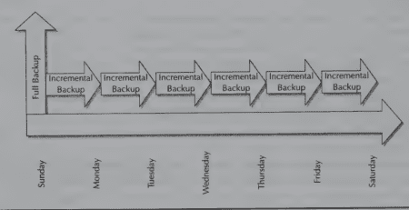

图 11-1. 差异增量备份

### 累积增量备份

使用累积增量备份时，自上次完整备份以来发生的所有更改都会被备份。每个累积增量备份占用的空间都比差异增量备份多，但如果在恢复时，只需要应用完整备份和最后一个累积增量备份即可。此过程如图 11-2 所示。

## 如何备份数据库

Oracle 数据库有多种不同的备份方式。这些方法包括：

- 恢复管理器 (`RMAN`)
- 自动基于磁盘的备份和恢复（闪恢复区）
- 操作系统工具
- 导出和数据泵 (`Export and Data Pump`)
- 市售备份实用程序

这些实用程序中的每一个都能执行有效的备份。通常，决定使用哪一种方法取决于您个人的偏好。

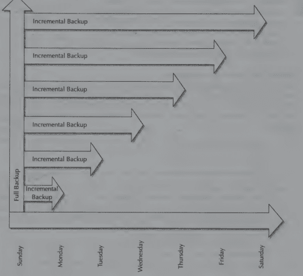


## 恢复管理器 (RMAN)

恢复管理器 (`RMAN`) 是 Oracle 提供的用于执行备份和恢复操作的工具，并与许多第三方工具集成以用于备份 Oracle 数据库。`RMAN` 自 Oracle 7.3 版本就已存在，并成为执行 Oracle 备份的首选方法之一。它是 Oracle Server 的一部分，因此不需要单独的许可证。

**提示**

*`RMAN` 可以通过可执行文件 `rman` 来运行。在 Linux 等某些操作系统中，存在一个与 Oracle 无关的额外 `rman` 命令。为了确保执行的是正确的 `rman` 命令，您可能需要使用命令 `$ORACLE_HOME/bin/rman` 来调用它。*

### 设置恢复管理器

在使用恢复管理器之前，必须创建恢复目录。恢复目录位于自己的表空间中，通常称为 *`rvcata`*，除了目录本身，还必须先创建目录的模式（schema）和所有者。使用以下 SQL 语句创建表空间、模式、所有者和目录。

1. 连接到 DBMS。

   ```sql
   SQL> connect / as sysdba
   ```

2. 为恢复目录创建表空间、模式和用户。

   ```sql
   SQL> SPOOL recovery_log
   SQL> CREATE TABLESPACE rvcata DATAFILE
     '/opt/oracle/product/10.1.0/oradata/rvcata01.dbf'
     SIZE 512m AUTOEXTEND ON NEXT 32m MAXSIZE UNLIMITED
     EXTENT MANAGEMENT LOCAL AUTOALLOCATE
     SEGMENT SPACE MANAGEMENT AUTO;
   SQL> CREATE USER rman IDENTIFIED BY rman
     TEMPORARY TABLESPACE temp
     DEFAULT TABLESPACE rvcata QUOTA unlimited ON rvcata;
   ```

   用户已创建。

3. 将 `RECOVERY_CATALOG_OWNER` 角色授予模式所有者。此角色提供维护并查询恢复目录所需的所有权限。

   ```sql
   SQL> GRANT RECOVERY_CATALOG_OWNER TO rman;
   Grant succeeded.
   SQL> exit;
   Disconnected from Oracle Database 10g Enterprise Edition Release 10.1.0.2.0 - Production
   With the Partitioning, OLAP and Data Mining Options
   ```

4. 创建目录所有者后，使用 RMAN `CREATE CATALOG` 命令创建目录表。该命令在目录所有者的默认表空间中创建目录。

   ```bash
   [oracle@pt6c admin]$ $ORACLE_HOME/bin/rman CATALOG rman/rman
   ```

   ```text
   Recovery Manager: Release 10.1.0.2.0 - Production

   Copyright (c) 1995, 2004, Oracle. All rights reserved.
   connected to recovery catalog database
   recovery catalog is not installed

   RMAN> CREATE CATALOG
   recovery catalog created

   RMAN>
   ```

   这将创建恢复目录。一旦创建目录，就可以使用 RMAN 备份数据库。

   > **注意**
   > *恢复目录应在其独立的数据库中创建。如果您要备份的数据库损坏，恢复目录也会损坏。*

## 使用 RMAN

恢复管理器 (`RMAN`) 可以配合或不配合恢复目录或存储库使用。然而，为了充分利用恢复管理器，您应该使用恢复目录。一旦按照前一节所示创建了恢复目录，您可以使用以下命令连接：

1. 如果目标数据库未装载，请将其装载或打开。

   ```sql
   SQL> STARTUP MOUNT;
   ```

   ```bash
   [oracle@spc6 admin]$ $ORACLE_HOME/bin/rman TARGET / CATALOG rman/rman
   ```

   ```text
   Recovery Manager: Release 10.1.0.2.0 - Production

   Copyright (c) 1995, 2004, Oracle. All rights reserved.

   connected to target database: ORCL (DBID=1955397586)
   connected to recovery catalog database
   RMAN>
   ```

   > **注意**
   > *此代码假设环境变量中已设置目标数据库的 `ORACLE_SID`、`ORACLE_HOME`、`LD_LIBRARY_PATH` 和 `PATH`，且引用该数据库的 Oracle 主目录；如果未设置 `ORACLE_SID`，您必须使用数据库的 TNS 别名如下：*

   ```bash
   [oracle@spc6 admin]$ $ORACLE_HOME/bin/rman TARGET sys/<password>@*target_database*> CATALOG rman/rman
   ```

2. 调用 RMAN 实用程序后，必须在恢复目录中注册目标数据库，以便对其进行备份。这是通过 RMAN 内部的 `REGISTER DATABASE` 命令完成的。


```text
RMAN> REGISTER DATABASE;

database registered in recovery catalog
starting full resync of recovery catalog
full resync complete
```

### 3. 一旦数据库已注册，您可以通过 `REPORT SCHEMA` 命令查看数据库的表空间。

```text
RMAN> REPORT SCHEMA;

Report of database schema
File K-bytes Tablespace RB segs Datafile Name
1 460800 SYSTEM YES
/opt/oracle/product/10.1.0/oradata/orcl/system01.dbf
2 30720 UNDOBS1 YES
/opt/oracle/product/10.1.0/oradata/orcl/undotbs01.dbf
3 245760 SYSAUX NO
/opt/oracle/product/10.1.0/oradata/orcl/sysaux01.dbf
4 5120 USERS NO
/opt/oracle/product/10.1.0/oradata/orcl/users01.dbf
5 153600 EXAMPLE NO
/opt/oracle/product/10.1.0/oradata/orcl/example01.dbf
6 51200 RCVCAT NO
/opt/oracle/product/10.1.0/oradata/orcl/RCVCAT.dbf
RMAN>
```

### 4. 目录创建且数据库注册完成后，您即可开始备份该数据库。在开始备份操作之前，您可以指定通道，告诉 RMAN 希望备份存储的位置。为了设置 RMAN 备份到特定目录并增加文件名，请使用以下命令：

```text
RMAN> CONFIGURE CHANNEL DEVICE TYPE DISK FORMAT
'/u01/oracle/backup/ora_df$t_s%v_s%';
new RMAN configuration parameters:
CONFIGURE CHANNEL DEVICE TYPE DISK FORMAT
'/u01/oracle/backup/ora_df$t_s%v_s%';
new RMAN configuration parameters are successfully stored
RMAN>
```

**注意** 除了配置通道外，还有其他配置设置，如备份保留期和控制文件自动备份设置。这些配置设置列在 Oracle 文档中。

### 5. 一旦通道设置完毕，您现在可以使用 `BACKUP` 命令备份数据库、表空间、数据文件等。例如，

```text
RMAN> backup tablespace system;

Starting backup at 13-MAY-04
starting full resync of recovery catalog
full resync complete
allocated channel: ORA_DISK_1
channel ORA_DISK_1: sid=253 devtype=DISK
channel ORA_DISK_1: starting full datafile backupset
channel ORA_DISK_1: specifying datafile(s) in backupset
input datafile fno=00001 name=/opt/oracle/product/10.1.0/oradata/orcl/system01.dbf
channel ORA_DISK_1: starting piece 1 at 13-MAY-04
channel ORA_DISK_1: finished piece 1 at 13-MAY-04
piece handle=u01/oracle/backup/ora_df526064474_83_01 comment=NONE
channel ORA_DISK_1: backup set complete, elapsed time: 00:00:36
channel ORA_DISK_1: starting full datafile backupset
channel ORA_DISK_1: specifying datafile(s) in backupset
including current controlfile in backupset
including current SPFILE in backupset
channel ORA_DISK_1: starting piece 1 at 13-MAY-04
channel ORA_DISK_1: finished piece 1 at 13-MAY-04
piece handle=u01/oracle/backup/ora_df526064870_84_01 comment=NONE
channel ORA_DISK_1: backup set complete, elapsed time: 00:00:09
Finished backup at 13-MAY-04

RMAN>
```

这将备份 `SYSTEM` 表空间。`BACKUP` 命令可以接受参数 `BACKUPSET`、`SPFILE`、`RECOVERY AREA`、`RECOVERY FILES`、`TABLESPACE`、`DATAFILE`、`DATABASE` 和 `CURRENT CONTROLFILE`。您还可以选择执行完整或增量备份。

**注意**

从 Oracle 10g R2 开始，现在可以在 RAC 集群中的节点之间使用*自动通道分配*。这意味着执行备份所产生的负载可以分布在这些节点上。但请记住，由于 RAC 使用共享磁盘，在 RAC 集群中生成 RMAN 工作可能会增加 I/O 负载。

许多用于备份 Oracle 的第三方工具实际上使用的是 RMAN 命令。除了使用 RMAN 之外，还可以使用操作系统功能来备份数据库。

**注意**

为了使用 RMAN 进行在线备份，数据库必须处于 `ARCHIVELOG` 模式。

## 基于磁盘的自动备份和恢复（快速恢复区）

Oracle 10g 引入了基于磁盘的自动备份和恢复的概念。此方法实际上使用 RMAN 进行备份和恢复，但增加了 Oracle 实例中的附加功能，以帮助管理这些备份。通过自动在磁盘上维护备份，在发生故障时，你可以执行更快的恢复；然而，这些文件本地存储的事实如果你遇到存储困难可能是一个问题。

为了设置基于磁盘的自动备份和恢复，你必须在磁盘上分配一个位置，该位置至少具有与它要备份的数据库、日志文件和控制文件相同大小或更大的空间。这个区域被称为*快速恢复区*，用于存储既用于恢复又用于 Oracle Flashback Database 功能的基于磁盘的自动备份。

Oracle 闪回功能允许你访问过去的数据状态，或将表或数据库回退到过去的状态。大多数闪回功能使用 UNDO 表空间中的 UNDO 记录。然而，`FLASHBACK DATABASE` 命令需要快速恢复区。

在创建数据库时，可以通过数据库配置助手创建快速恢复区，或者随时手动创建。快速恢复区的创建和设置包括几个步骤，如下所述：

- 1. 设置用于快速恢复的目录。确保有足够的空间用于快速恢复数据库。
- 2. 将 Oracle 初始化参数 `DB_RECOVERY_FILE_DEST_SIZE` 和 `DB_RECOVERY_FILE_DEST` 设置为适当的值。
- 3. 在 RMAN 中配置备份保留策略。
- 4. 为基于磁盘的备份配置快速恢复区。
- 5. 在 RMAN 中运行基于磁盘的备份。

一旦为使用快速恢复区进行基于磁盘的备份设置好所有内容，你就可以在必要时立即进行恢复。闪回功能将在下一章中更详细地介绍。

## 操作系统功能：在线备份

使用操作系统功能执行备份是一个非常直接的过程。与恢复管理器一样，你可以执行整个数据库备份或表空间备份。基本过程有所不同，具体取决于你是执行离线备份还是在线备份。这些将分别介绍。

### 离线备份

离线备份可能是最直接和最简单的备份方法。执行离线数据库备份的步骤如下：

- 1. 正常关闭数据库（或立即关闭）。
- 2. 使用操作系统或第三方实用工具备份所有数据文件、所有控制文件和参数文件。
- 3. 重新启动数据库。

这就是使用操作系统功能执行离线数据库备份的全部内容。这些文件的备份可以使用操作系统功能或第三方功能完成。有许多非常好的第三方备份实用工具，包括条码、目录管理和其他功能。

### 在线备份


在线备份实际上并不完全是一个完整备份，除非包含了在此备份期间生成的归档日志，因为每个表空间是单独备份的。你可以将其视为一组组成整个数据库的在线表空间备份。为了执行在线表空间备份，请遵循以下步骤：

- 使用 SQL 命令 `ALTER TABLESPACE tname BEGIN BACKUP` 标记表空间备份的开始。
- 使用操作系统或第三方实用工具备份构成该表空间的数据文件。
- 使用 SQL 命令 `ALTER TABLESPACE tname END BACKUP` 标记表空间备份的结束。

通过标记备份的开始和结束，Oracle 会同步数据文件，以便它们在恢复时是有用的。这就是执行在线表空间备份所需的全部操作。


**注意**

*在在线备份期间（只要标记了备份的表空间），会生成额外的日志记录。这是因为对于处于备份模式的表空间，写入的是整个块，而不仅仅是增量。备份模式和非备份模式下生成的重做日志信息量之间的差异可能很大。因此，尽快完成在线备份非常重要。*

重要的是，表空间不应长时间处于备份模式。如果你认为某个表空间可能处于备份模式，可以使用以下查询来确定数据库中每个表空间和数据文件的备份状态：

```sql
SET linesize 120;
Set pagesize 200;

ALTER SESSION SET NLS_DATE_FORMAT = 'YYYY-MM-DD HH24:MI:SS';

COL "Status" FORMAT a10;
COL "Change No" FORMAT 9999;
COL "Backup Started" FORMAT a14;
COL "Tablespace Name" FORMAT a20;
COL "Datafile Name" FORMAT a40;

SELECT
  ts.name AS "Tablespace Name"
  , b.status AS "Status"
  , b.change# AS "Change No"
  , b.time AS "Backup Started"
  , df.name AS "Datafile Name"
FROM v$backup b, v$tablespace ts, v$datafile df
WHERE b.file# = df.file#
AND df.ts# = ts.ts#;
```

在使用在线备份方法备份数据库时，你的目标应该是尽快完成备份，并减少每个表空间处于备份模式的时间。只将你准备备份的表空间置于备份模式。例如，此命令序列代表良好的实践：

```sql
alter tablespace ts1 begin backup;
copy ts1 data files
alter tablespace ts1 end backup;
alter tablespace ts2 begin backup;
copy ts2 data files
alter tablespace ts2 end backup;
```

另一方面，像这样的序列会带来麻烦：

```sql
alter tablespace ts1 begin backup;
alter tablespace ts2 begin backup;
copy ts1 data files
copy ts2 data files
alter tablespace ts1 end backup;
alter tablespace ts2 end backup;
```

这个规则的例外是使用快照技术的备份。快照技术在大多数存储供应商的 SAN 和 NAS 存储中均可用。快照技术允许你非常快地获取存储系统的时间一致图像，然后可以独立读取。使用此技术，你可以一次将所有表空间置于备份模式，快速拍摄快照（在几秒钟内完成），并快速将这些表空间移出备份模式。

快照技术非常有用，特别是在数据库非常大的系统中。这将允许你在仅对 Oracle 数据库施加最小负载的情况下备份非常大的系统。然而，大多数快照对 I/O 子系统的负载与直接访问数据文件进行备份时产生的负载相同。请咨询你的存储供应商了解其特定快照技术的工作原理。

## 导出数据泵

`EXPORT` 实用程序也可以用于执行系统备份。`Export` 相对于其他备份方法的一个优势在于，数据在导入时会被重新组织。因此，你经常会听到使用 `Export` 实用程序执行的备份被称为“逻辑备份”。`Export` 是由 Oracle 提供的实用程序，允许你从 Oracle 数据库中提取整个数据库、一组模式或单独的表。导出的数据存储在一个导出文件中，该文件只能由导入实用程序直接读取。

Oracle 数据泵（Data Pump）是 `export` 和 `import` 的重大改进版本，仅在 Oracle 10g 中提供。数据泵比 `export` 和 `import` 快得多，但需要更多的设置和维护。由于 `Export/import` 和数据泵非常相似，因此我们将在此一起介绍它们。

`Export/import` 和数据泵的优点在于可以单独保存各个模式（schema），因此也可以轻松地单独恢复它们。此外，模式数据的导出可以轻松导入到其他模式中。这提供了很大的灵活性。可以轻松地创建一个 `shell/SQL` 脚本来单独导出数据库中的所有模式。

`Export/import` 的缺点是其速度比传统备份方法慢。即使是数据泵也比 `RMAN` 慢得多，因为 `export` 和 `import` 通过 Oracle 的 SQL 层进行操作，而 `RMAN` 使用更直接的数据路径。

`Export/import` 的一个主要优势是能够在不同版本的 Oracle 之间移动数据。一组模式或表可以很容易地在 Oracle 的系统之间和版本之间传输。数据泵包含许多内置的 Oracle 监控功能。这些功能在 Oracle 10g R2 中得到了增强（例如扩展的作业状态显示）。

尽管我不建议将 `export/import` 作为主要备份方法，但如果你能够承担额外的存储空间和进行这些导出所花费的额外时间，它可以成为一个很好的补充。

`Export/import` 或数据泵也被推荐作为备份 `RMAN` 恢复目录的另一种方法（参见前文“恢复管理器 (RMAN)”章节）。

以下是如何为恢复目录本身设置数据泵的示例：

```sql
SQL> create directory dpump_dir1 as '/uasl/dump1/RMANP1';
Directory created.
```

```sql
SQL> GRANT READ, WRITE ON DIRECTORY dpump_dir1 TO rman;
Grant succeeded.
```

```shell
oracle#mjdabbradial:/opt/oracle/admin/RMANP1/scripts> cat RMANP1_expdp.sh
#!/bin/ksh
. ~/.local_env_db_RMANP1
rm -f dpump_dir1/exp_rman.dmp
expdp rman/gweloX DUMPFILE=dpump_dir1/exp_rman.dmp LOGFILE=dpump_dir1/exp_rman.log JOB_NAME=exp_rman
```


```
oracle#mjdabbradial:/opt/oracle/admin/RMANP1/scripts> ./RMANP1_expdp.sh
Export: Release 10.1.0.4.0 - Production on Wednesday, 13 July, 2005 17:11

Copyright (c) 2003, Oracle.  All rights reserved.

Connected to: Oracle Database 10g Enterprise Edition Release 10.1.0.4.0 -
Production
With the Partitioning, OLAP and Data Mining options
FLASHBACK automatically enabled to preserve database integrity.
Starting "RMAN"."EXP_RMAN":  rman/******** DUMPFILE=dpump_dir1/exp_rman.dmp
LOGFILE=$dump_dir/exp_rman.log JOB_NAME=exp_rman

Bitmaps in progress using BLOCKS method...

+   - Processing object type SCHEMA_EXPORT/TABLE/TABLE_DATA
+   - Total estimation using BLOCKS method: 5 MB
+   - Processing object type SCHEMA_EXPORT/DB_PRE_SCHEMA_PROCCOBJ/PROCCT_SCHEMA
+   - Processing object type SCHEMA_EXPORT/TYPE/TYPE_SPEC
+   - Processing object type SCHEMA_EXPORT/SEQUENCE/SEQUENCE
+   - Processing object type SCHEMA_EXPORT/TABLE/TABLE
+   - Processing object type SCHEMA_EXPORT/TABLE/INDEX/INDEX
+   - Processing object type SCHEMA_EXPORT/CONSTRAINT/CONSTRAINT
+   - Processing object type SCHEMA_EXPORT/TABLE/INDEX/STATISTICS/INDEX_STATISTICS
+   - Processing object type SCHEMA_EXPORT/TABLE/STATISTICS/TABLE_STATISTICS
+   - Processing object type SCHEMA_EXPORT/TABLE/COMMENT
+   - Processing object type SCHEMA_EXPORT/SCHEMA_SPC
+   - Processing object type SCHEMA_EXPORT/PACKAGE/PACKAGE_SPEC
+   - Processing object type SCHEMA_EXPORT/FUNCTION/FUNCTION
+   - Processing object type SCHEMA_EXPORT/PACKAGE/COMPILE_PACKAGE/PACKAGE_SPEC/ALTER_PACKAGE_SPEC
+   - Processing object type SCHEMA_EXPORT/FUNCTION/ALTER_FUNCTION
+   - Processing object type SCHEMA_EXPORT/VIEW/VIEW
+   - Processing object type SCHEMA_EXPORT/PACKAGES/PACKAGE_BODY
+   - Processing object type SCHEMA_EXPORT/TABLE/CONSTRAINT/REF_CONSTRAINT
+   - . . exported "RMAN", "AI" 374.4 KB 1823 rows
+   - . . exported "RMAN", "RLH" 100.1 KB 1824 rows
+   - . . exported "RMAN", "BCP" 9.125 KB 3 rows
+   - . . exported "RMAN", "BDP" 11.04 KB 7 rows
+   - . . exported "RMAN", "BP" 12.21 KB 4 rows
+   - . . exported "RMAN", "BE" 9.789 KB 4 rows
+   - . . exported "RMAN", "BSP" 6.851 KB 3 rows
+   - . . exported "RMAN", "CCP" 10.59 KB 1 rows
+   - . . exported "RMAN", "CDP" 14.0 KB 7 rows
+   - . . exported "RMAN", "CDP" 7.960 KB 1 rows
+   - . . exported "RMAN", "CONP" 6.695 KB 4 rows
+   - . . exported "RMAN", "CONFIG" 5.242 KB 1 rows
+   - . . exported "RMAN", "DB" 6.475 KB 1 rows
+   - . . exported "RMAN", "DBLINK" 13.72 KB 8 rows
+   - . . exported "RMAN", "DR" 6.195 KB 7 rows
+   - . . exported "RMAN", "DAF" 7.398 KB 11 rows
+   - . . exported "RMAN", "FB" 5.890 KB 1 rows
+   - . . exported "RMAN", "NOGF" 5.875 KB 1 rows
+   - . . exported "RMAN", "ORL" 6.171 KB 8 rows
+   - . . exported "RMAN", "KCFER" 4.929 KB 1 rows
+   - . . exported "RMAN", "RSR" 20.82 KB 125 rows
+   - . . exported "RMAN", "KT" 7.078 KB 1 rows
+   - . . exported "RMAN", "TS" 7.656 KB 7 rows
+   - . . exported "RMAN", "TSATT" 6.578 KB 7 rows
+   - . . exported "RMAN", "BCB" 0 KB 0 rows
+   - . . exported "RMAN", "BRL" 0 KB 0 rows
+   - . . exported "RMAN", "CSB" 0 KB 0 rows
+   - . . exported "RMAN", "OQPR" 0 KB 0 rows
+   - . . exported "RMAN", "R" 0 KB 0 rows
+   - . . exported "RMAN", "SCR" 0 KB 0 rows
+   - . . exported "RMAN", "SCSRL" 0 KB 0 rows
+   - . . exported "RMAN", "VAJI" 0 KB 0 rows
+   - . . exported "RMAN", "XCP" 0 KB 0 rows
+   - . . exported "RMAN", "XID" 0 KB 0 rows
+   - Master table "RMAN", "EXP_RMAN" successfully loaded/unloaded
+   - ========================
+   - Dump file set for RMAN/EXP_RMAN is:
+   - /nash/dump1/RMANP1/exp_rman.dmp
+   - Job "RMAN", "EXP_RMAN" successfully completed at 17:12
```

# 商业可用备份实用工具

目前市面上有几种商业可用的备份实用工具。与使用系统实用工具、`export`/`import`甚至`RMAN`进行手动操作相比，这些工具具有若干优势。大多数这些商业备份实用工具实际上使用`RMAN`从数据库中获取数据，但具备企业级备份解决方案所需的增强功能。以下是一些此类功能：

- **磁带库支持** 大多数大型安装必须使用复杂的磁带库，以支持需要备份的数据量。
- **自动调度** 这允许你安排定期备份。
- **磁盘暂存** 几种商业备份解决方案允许磁盘暂存以及磁带备份。


进入大型磁带库中，对磁带进行条形码编码是必须的。

复杂的编目允许快速有效地查找备份信息。

虽然使用商业备份解决方案并不是必要的，但许多此类产品，如 `Veritas NetBackup`，是非常复杂、稳定且经过验证的实用工具，通常构成企业级信息管理策略的一部分。

在本章迄今的内容中，你已经了解了如何备份系统。同样重要的是确定备份什么内容以及如何安排这些备份。在下一节中，你将学习如何制定备份策略以及如何实施它。

## 备份策略

了解如何备份系统只是该过程的一部分。制定备份和恢复计划或策略也非常重要。很多时候，你用于备份的时间是有限的，必须非常有创意。请记住，你的最高优先级是保护数据库中的数据。

在制定备份和恢复策略时，你必须首先查看系统的参数。有许多变量会影响备份策略和备份过程。这些变量可能包括：

- 分配给备份的时间
- 需要备份的数据量
- 备份设备（s）的速度
- 分配给备份的系统停机时间（如果有）

## 何时以及备份什么

安排备份通常不是那么容易的任务。备份的频率应该足以保护系统数据免受丢失，但又不应该干扰正常的业务运营。

根据需要备份的数据量以及贵公司的运营时间表，你可以从多种不同的选项中进行选择。这些选项会因贵公司运行的业务类型而异。

| 运营类型 | 描述 |
| :--- | :--- |
| 5x8 运营 | 该术语指企业数据必须每周 5 天、每天 8 小时可用的业务。 |
| 7x24 运营 | 该术语指企业数据必须每周 7 天、每天 24 小时可用的业务。不允许有任何停机时间。 |

这些每种类型的运营都有不同的备份需求，具体取决于数据种类以及对该数据的修改频率。让我们来看看这些情况。

### 在 5x8 环境中安排备份

在 5x8 环境中安排备份相对容易一些，因为系统有大量的时间可以不对用户开放，从而可以在不干扰他们的情况下进行备份。

在此类运营中，备份的频率在一定程度上取决于数据库的活动情况。以下是一些可能有助于确定备份时间表的指导原则。

| 类别 | 指导原则 |
| :--- | :--- |
| 小型数据库 | 如果数据库很小，请每晚执行一次完整的离线备份。这将为你的数据提供最大程度的保护。 |
| 大型数据库 | 如果数据库非常大但修改不频繁，请每个周末执行一次完整的离线备份，并在周内执行增量备份。 |
| 活跃表空间 | 如果某些表空间非常活跃，请将它们作为目标，频繁进行表空间备份。 |
| 结构变更 | 每次对数据库进行结构变更后，都应执行一次完整的离线备份。 |
| 不可恢复操作 | 每次在数据库上执行不可恢复操作时，都应执行一次完整的离线备份。 |
| Resetlogs | 每次需要使用 `resetlogs` 命令重置重做日志时，都应执行一次完整的离线备份。 |
| 恢复至 | 每次使用 `recovery UNTIL` 选项进行恢复后，都应执行一次完整的离线备份。 |
| 归档日志文件 | 每晚备份归档日志文件。频率取决于每天创建的归档日志文件数量。 |

这些是帮助你为系统确定有效备份策略的若干指导原则。

### 在 7x24 环境中安排备份

在 7x24 环境中制定备份策略要困难得多，因为系统始终处于使用状态。无论何时执行备份，都会有一个或多个用户可能因性能下降而感到不便。备份往往会导致性能降低。

备份的频率和类型将受系统活动的影响。以下是一些可能有助于确定备份时间表的指导原则。

| 类别 | 指导原则 |
| :--- | :--- |
| 小型数据库 | 如果数据库很小，请每晚执行一次完整的在线备份。这将为你的数据提供最大程度的保护。 |
| 大型数据库 | 如果数据库非常大但修改不频繁，请每个周末执行一次完整的在线备份，并在周内执行增量在线备份。 |
| 超大型数据库 | 通常需要轮换备份时间表，以便每晚备份一个表空间或一组表空间。获取完整的备份集可能需要几天时间。这样可以缩短每晚备份活跃的时间。 |
| 活跃表空间 | 如果某些表空间非常活跃，请将它们作为目标，频繁进行表空间备份。 |
| 不可恢复操作 | 每次在数据库上执行不可恢复操作时，都应执行一次完整的离线备份。如果不可接受，请避免执行不可恢复操作。 |
| Resetlogs | 每次需要使用 `resetlogs` 命令重置重做日志时，都应执行一次完整的离线备份。如果不可接受，请避免执行 `resetlogs` 操作。 |
| 恢复至 | 每次使用 `recovery UNTIL` 选项进行恢复后，都应执行一次完整的离线备份。 |
| 归档日志文件 | 在 7x24 环境中，最好在创建归档日志文件后立即备份。至少保留足够数量的日志，以便从最旧的在线且可用的表空间备份中恢复。 |

希望这些指导原则能帮助你在制定自己的备份策略时提供帮助。

## 备份策略示例

本节提供了一些设置备份策略的示例。希望这些示例能帮助你设置备份策略。你的备份策略可能更复杂。

### 示例 1

场景：一家白天营业的小型业务。数据库活动相当频繁，且数据非常重要。

备份策略示例：在这种情况下，数据库可能足够小，可以每晚向磁带运行一次完整的离线备份。前一晚的磁带每天归档到存储介质。一个月后，磁带可以重复使用，永久保留每个月的一份磁带。如果出现问题且必须执行恢复，备份磁带即可用。如果机房和备份磁带被毁，异地存储中仍有之前的备份磁带。

### 示例 2

场景：一家每天 24 小时、每周 7 天营业的大型业务。数据库活动频繁，不允许停机。数据对公司运营至关重要。

备份策略示例：在此示例中，我建议采用某种备用系统，例如 `Data Guard`（如第 13 章所述）。对于备份，我建议为了最小化对用户的影响，每晚以轮换方式对备用数据库进行部分在线备份（以卸载主数据库压力），以便在三四天内备份所有表空间。为减少用户影响，这些备份应写入磁盘，或许通过网络进行。磁盘上的这些备份文件每晚应再次备份并归档到异地。备份文件应在至少两个备份周期内保持在线，然后移除。归档日志文件也应通过联网系统备份到本地磁盘，并备份到磁带发送到异地。这将提供良好的保护级别，并在必要时提供快速恢复能力。容错系统也应是此解决方案的一部分。

## 摘要

本章涵盖了关于备份和恢复工具及技术的相当多的内容。本章包含大量信息，将帮助你制定备份策略。定期备份你的系统并偶尔测试备份介质非常重要，以确保备份有效地进行。

除了良好的备份外，使用容错技术（如 `RAID` I/O 子系统和不间断电源）也很重要。此外，如果适用，`RAC` 为整个数据库系统提供高水平的容错能力。最后，对于灾难恢复，Oracle 提供了 `Data Guard`。所有这些技术都在 Linux 上运行良好。

恢复和恢复数据库与备份它同样重要。理解这些技术并偶尔练习恢复很重要。还要确保你有文档化的恢复计划。这个过程将在下一章中详细讲解。


## 第 12 章

## 恢复

数据库管理员（DBA）可能最重要的任务就是备份数据库。这是因为 DBA 最大的责任是确保数据库的稳定性和安全性。在发生灾难性系统故障时，DBA 必须能够迅速有效地将数据库恢复到故障发生前的某个时间点。尽管这项任务至关重要，但它也是 DBA 职责中最不引人注目、最不易被察觉的一项。尽管如此，作为 DBA，你需要确保每个人都明白其紧迫性。

## 数据库恢复

在上一章中，你学习了如何备份数据库。在本章中，你将了解在紧急情况下如何恢复数据库。某些类型的故障需要执行恢复。

例如，实例故障将需要实例恢复。只要没有发生永久性硬件故障，实例恢复将是自动且完整的。通过启用并行恢复，可以改进性能。

如果发生硬件故障导致数据文件丢失，你必须执行介质恢复。这包括恢复丢失的数据并执行实例恢复（如有必要）。此过程在本章后面“实例恢复”部分中进行了说明。

如果发生用户错误导致数据丢失，可能需要进行时间点恢复。时间点恢复允许你恢复到故障发生前的某个特定点。这非常有用，但也可能带来很多问题。时间点恢复也在本章后面的“时间点恢复”部分中详细阐述。

无论需要何种类型的恢复，都应牢记恢复操作是一项非常重要的任务，应尽快完成。通常，在发生需要恢复的故障时，会有很多用户无事可做，直到恢复完成。

尽管恢复操作至关重要且必须快速完成，但你不应草率行事。恢复过程中的任何错误只会延迟正常操作的恢复，某些错误甚至可能导致无法恢复。

## 恢复与还原

在本章中，你将同时学习恢复操作和还原操作。这两个概念有时可能被视为相同，但实际上它们有着截然不同的含义。在本章中，你将了解这两者。

- **恢复** 恢复是 Oracle 前滚已提交事务并回滚未提交事务的过程。它是将数据库恢复到故障发生前一瞬间的状态的行为。
- **还原** 还原是用备份副本替换数据文件的行为。如果你正在运行 `ARCHIVELOG` 模式，你可以还原到故障发生点。如果你没有运行 `ARCHIVELOG` 模式，你只能还原到上一次备份的时间点。

通常，恢复是自动的，恢复过程会在必要时提示你应用归档日志文件。还原是一种需要操作员人工干预的手动操作，可以通过手动或图形化管理工具完成。

在本章中，你将同时学习恢复的工作原理以及如何还原受损的数据文件。

## 如何恢复你的数据库


尽管今天的硬件已经非常可靠，但仍有可能发生系统故障。这可能是由于硬件组件故障，或诸如电源故障等外部事件。如果故障没有导致数据丢失，Oracle 可以自行恢复。这被称为实例恢复。如果数据已丢失，必须从以前的备份中还原并恢复——这一过程称为介质恢复。如果发生了某些事件，例如意外删除表，则必须进行时间点恢复，以避免恢复 `DROP TABLE` 语句并重复错误。

在本节中，你将学习如何执行这些恢复以及它们的工作原理。

### 实例恢复

当发生实例故障时，Oracle 恢复过程可以在实例启动时完全恢复数据库。在故障时刻已提交的所有事务将被恢复或*前滚*，所有正在进行的事务（也称为*在途事务*）将被*回滚*。

> **注意**
>
> *实例恢复可能相当耗时。所需时间取决于 `SGA` 中脏缓冲区的数量，而脏缓冲区的数量取决于自上次检查点以来的时间间隔以及数据修改的量。*

实例恢复过程是自动的。当实例启动时，它会检查数据文件和重做日志文件，并确定实例是否已正常关闭。此时，重做日志将被读取，受影响的事务将被前滚或回滚。如果由最后一次日志切换发起的检查点仅完成了一个日志文件中的事务，则仅需恢复该日志文件。


**提示**

通过调整检查点间隔和恢复并行度，可以缩短恢复时间。

一旦实例恢复完成，数据库将被打开，用户将再次被允许访问它。在恢复过程中，用户无法访问数据库。这就是恢复时间应尽可能短的原因。

并行查询选项的并行恢复功能可以帮助减少实例恢复完成所需的时间。这是通过设置 Oracle 初始化参数 `RECOVERY_PARALLELISM` 来实现的。通过调整运行最适合你系统的恢复进程数量，可以优化恢复间隔。

### 介质恢复

当发生介质故障时，需要进行数据恢复。例如，当数据文件损坏时。在这种情况下，在恢复发生之前，你必须首先用备份中的良好副本替换损坏的文件。然后，Oracle 恢复过程将应用归档日志文件和重做日志文件，将损坏数据文件的良好副本恢复到其故障前的状态。为了恢复已还原的数据文件，这可能需要在备份之后创建的所有归档日志文件，这可能相当耗时。


**提示**

通过安排频繁备份，可以缩短还原和恢复时间。还原时间取决于自上次备份以来的时间间隔以及自该备份以来修改的数据量。

通过让最新的备份文件以及自上次备份以来创建的归档日志文件在线，你可以缩短启动恢复过程所需的时间。通过制定计划并准备好一切，事情也会运行得更顺利。

Oracle 数据库有几种不同的恢复方式。这些方法包括：

- 恢复管理器
- 操作系统工具
- 导入
- 与 `RMAN` 配合使用的商用备份实用工具

这些工具中的每一个都能执行有效的备份。使用哪一个取决于你个人的偏好。然而，在几乎所有情况下，首选的还原方式都是通过恢复管理器。

## 恢复管理器

与数据库备份程序一样，你可以通过恢复管理器（`RMAN`）实用工具执行恢复。

如前所述，使用恢复管理器备份和还原数据库并不困难。然而，定期测试恢复过程以确保其正常工作仍然很重要。

为了使用 `RMAN` 还原数据库，请调用 `rman` 实用工具并使用 `RESTORE` 命令来还原数据库、表空间和数据文件。

## 操作系统工具

使用操作系统工具还原数据文件与使用操作系统工具创建备份的方法一样简单。在表空间离线的情况下，将数据文件从备份复制到原始数据文件。一旦通过 `ALTER TABLESPACE` 命令或重新启动 Oracle 实例将表空间重新上线，Oracle 就会意识到数据文件已被替换，并提示你应用归档日志文件。

只有在 RDBMS 运行在 `ARCHIVELOG` 模式下时，才能执行表空间和数据文件恢复。如果你没有运行在 `ARCHIVELOG` 模式下，你必须从最后一次完整离线备份还原整个数据库。不会执行前滚或回滚。

## 导入

`EXPORT` 工具用于创建备份时，并且仅在此情况下，也可以使用 `IMPORT` 实用工具来还原数据库。`exp` 和 `imp` 实用工具在从一个系统向另一个系统移动数据以及重组数据库中的数据时非常有用；然而，`exp` 和 `imp` 实用工具并不是备份和还原操作的有效方法。

## 商用备份实用工具

目前市场上有几款出色的商用备份实用工具。这些工具从低端的单系统实用工具到高端软件包不等。大多数这些备份实用工具实际上使用 `RMAN` 与数据库通信以获取备份数据。你如何使用这些实用工具进行恢复真的取决于备份是如何完成的，以及实用工具的工作方式。

## 日志文件恢复

你无法从日志文件的丢失中恢复。如果日志文件损坏且系统仍功能正常，你可以删除日志文件，重新创建它，并立即执行完整备份。备份是必要的，因为你将无法再使用此数据库的归档日志文件和重做日志文件进行任何恢复。这就是为什么我总是建议重做日志文件位于容错磁盘卷上，并使用由多个成员组成的日志文件组。


> **提示**
>
> 日志文件的丢失可能会导致需要
>
> 恢复大量工作。因此，我建议在
>
> 重做日志文件上使用 RAID 镜像，
>
> 以便在磁盘故障时保护它们。

## 时间点恢复

时间点恢复是一项相对复杂的操作，由于其潜在的副作用，仅应在绝对必要时才执行。它允许你将数据库恢复到指定的时间点，从而让你能够恢复最初导致故障发生的用户错误或软件问题。时间点恢复可以作为数据库时间点恢复来执行，如下所示。时间点恢复也可以作为表空间时间点恢复来执行。过程和结果相似；然而，在某些情况下，表空间时间点恢复更适合您的需求。

时间点恢复既可以使用恢复管理器，也可以使用 `RECOVER` 管理 SQL 命令来完成。在这两种情况下，执行时间点恢复的语法都是通过命令行接口完成的。时间点恢复没有 GUI 选项。


> **注意**
>
> 使用时间点恢复可能存在危险，因为你是要恢复到较早的时间点。在尝试进行时间点恢复之前，请务必先对当前数据库执行完整备份。

恢复数据的方法部分取决于触发恢复的错误类型。如果发生介质故障，你必须恢复数据文件，然后执行带有时间点恢复选项的介质恢复。如果用户错误导致了问题，你应该遵循以下步骤：

- 1. 创建数据库的临时副本。
- 2. 从以前的备份中恢复该数据库。
- 3. 执行时间点恢复，恢复到故障发生前的一小段时间。
- 4. 导出已损坏的表。
- 5. 将该表导入到真实数据库中。

这项任务可能非常耗时且危险。如果你混淆了数据库的临时副本和真实副本，可能会破坏宝贵数据。

第 12 章：恢复 311

### 使用恢复管理器进行时间点恢复

恢复管理器可以使用其命令行语法来执行时间点恢复。由于恢复管理器命令行接口的复杂性及其使用的罕见性，我将不会详细介绍如何使用它。Oracle 手册包含有关此主题的完整文档。

使用命令行接口与恢复管理器时，必须指定以下额外参数：

```
SET UNTIL
```

此参数采用以下限定符之一：

- `TIME date`
- `LOG SEQ number` `THREAD number`
- `SCN scn`

使用这种语法，你可以通过列出时间、日志序列或系统变更号来指定恢复停止的确切时间。在使用恢复管理器执行恢复时，使用 `SET UNTIL` 参数将恢复到指定的时间。

### 使用 RECOVER 命令进行时间点恢复

在使用 `RECOVER` 命令执行恢复时，你可以使用 `RECOVER UNTIL` 语法恢复到任何时间点。`RECOVER` 命令有许多选项，但对时间点恢复重要的是

- `RECOVER UNTIL CANCEL`
- `RECOVER UNTIL TIME date`
- `RECOVER UNTIL CHANGE scn`

与恢复管理器一样，此命令可用于恢复数据库、表空间或数据文件，并且可以包含并行子句。通过增加并行度，你可能会看到性能上的提升。

与恢复管理器一样，我提及时间点恢复是为了让你知道它的存在。如果你计划使用时间点恢复，你应该研究 Oracle 文档，并在尝试之前仔细规划恢复。

### 使用 Oracle 10g 的回闪功能

Oracle 10g 新增了回闪技术，该技术允许你查看（或操作）过去某一时刻的数据。回闪技术由几种不同的工具组成，包括：

- 回闪查询 (`Flashback Query`)
- 回闪版本查询 (`Flashback Version Query`)
- 回闪事务查询 (`Flashback Transaction Query`)
- 回闪表 (`Flashback Table`)
- 回闪删除 (`Flashback Drop`)
- 回闪数据库 (`Flashback Database`)

如果正确使用，这可能是一个非常有用的工具，可以为你节省数小时的恢复和还原时间。

### 回闪查询

回闪查询功能允许你查询数据库在过去某一刻的状态。它是通过使用 `AS OF` 子句运行的。`AS OF` 子句可以接受时间戳或 `SCN`，如下所示：


```
SELECT * FROM scott.emp AS OF TIMESTAMP
  TO_TIMESTAMP('2004-05-16 08:00:00', 'YYYY-MM-DD HH:MI:SS')
  WHERE ename = 'SCOTT';
```

实际上，你可以使用 `INSERT` 语句中的回闪查询将相关数据重置为其过去的值。但是，请记住，如果该记录在数据库中仍然存在，你可能无法插入数据，因为存在唯一约束。

```
INSERT INTO scott.emp
  (SELECT * FROM scott.emp AS OF TIMESTAMP
   TO_TIMESTAMP('2004-05-16 08:00:00', 'YYYY-MM-DD HH:MI:SS')
   WHERE ename = 'SCOTT');
```

回闪查询功能可以帮助你避免必须将表恢复到辅助系统才能恢复用户无意中更改或删除的数据的情况。此功能允许你恢复被错误更改或删除的表、一组表或表中的特定行，并允许你无需执行完整的介质恢复即可做到这一点（假设数据在 `UNDO` 表空间中仍然可用）。

## 回闪版本查询

通过在查询中选择回闪数据并使用 `VERSIONS BETWEEN` 子句，你可以查看数据库中特定记录或一组记录发生的变化。在以下示例中，我选择了一个时间段，在此期间我更改了 `scott.emp` 表中员工 `Miller` 的薪水。以下 SQL 脚本 `fversion.sql` 用于显示这些数据。

```
set linesize 256
set pagesize 100
```

```
SELECT SUBSTR(versions_startscn,1,10) AS "Start$SCN", 
               SUBSTR(versions_endscn,1,10) AS "End$SCN",
               SUBSTR(versions_starttime,1,25) AS "StartTime", 
               SUBSTR(versions_endtime,1,25) AS "EndTime", 
               SUBSTR(versions_xid,1,20) AS "XID", 
               SUBSTR(versions_operation,1,20) AS "Operation", 
              ename, sal
             FROM scott.emp
          VERSIONS BETWEEN TIMESTAMP
             TO_TIMESTAMP('2004-05-16 11:00:00','YYYY-MM-DD HH24:MI:SS')
 AND TO_TIMESTAMP('2004-05-16 11:20:00','YYYY-MM-DD HH24:MI:SS')
   WHERE ename='MILLER';
```

在此时间段内，我多次更改了 `Miller` 的薪水值。此示例表明，你可以轻松检索这些更改。

```
SQL> @$version;


Start$ End$SCN StartTime        EndTime                     XID              O ENAME   SAL
------- -------- ------------------- ----------------------- ------------------ -------- -----
462855        16-MAY-04 11.18.03 AM                                  03002600046080000 U MILLER   1500
462680 462855 16-MAY-04 11.13.55 AM 16-MAY-04 11.18.03 AM  010222006A020000 U MILLER   1400
         462680                                     16-MAY-04 11.13.55 AM              MILLER   1200
```

在跟踪特定对象更改方面，这可能是一个非常有用的强大工具，但请记住，它仅在 `UNDO_RETENTION` 期间有效。一旦 `UNDO` 信息被移除，你就无法再以此方式跟踪更改。

## 回闪事务查询

回闪事务查询类似于回闪版本查询，只不过它显示的是事务变化而不是数据变化。回闪事务查询可以与回闪版本查询结合使用，为你提供关于在特定时间谁对数据进行了更改的图像。以下脚本可以帮助跟踪事务变化：

```
SQL> set linesize 256
     set pagesize 100;

SELECT xid,
          SUBSTR(logon_user,1,20) AS "User",
          SUBSTR(operation,1,8) AS "Oper",
          SUBSTR(undo_sql,1,40) AS "UNDO SQL"
     FROM flashback_transaction_query
      WHERE xid IN
        (SELECT versions_xid
          FROM scott.emp
```

```
VERSIONS BETWEEN TIMESTAMP
        TO_TIMESTAMP('2004-05-16 11:00:00', 'YYYY-MM-DD HH24:MI:SS')
   AND TO_TIMESTAMP('2004-05-16 13:55:00', 'YYYY-MM-DD HH24:MI:SS')
WHERE ename='MILLER');
```

如您所见，此查询提供的数据可能非常有用：

```
SQL> @fbtransaction;

XID         User    Oper       UNDO SQL
----------   -------  ----------  ---------------------------
010022006A020000   SYSTEM  UPDATE    update "SCOTT"."EMP" set "SAL" = '1300'
010022006A020000   SYSTEM  BEGIN
0300260084060000   SYSTEM  UPDATE    update "SCOTT"."EMP" set "SAL" = '1400'
0300260084060000   SYSTEM  BEGIN
0B002C0018000000   SYSTEM  UPDATE    update "SCOTT"."EMP" set "SAL" = '1500'
0B002C0018000000   SYSTEM  BEGIN

6 rows selected.
```

与闪回版本查询一样，闪回事务查询在追踪特定对象的变化方面可以是一个强大且有用的工具。但请记住，与闪回版本一样，它仅在 `UNDO_RETENTION` 周期内有效。一旦 `UNDO` 信息被清除，您将无法再以此方式追踪变化。

## 闪回表

闪回表允许您将表恢复到以前的某个时间点。闪回表功能可以通过 Oracle Enterprise Manager 或 `FLASHBACK TABLE` 命令来访问。无论哪种方式，结果都是一样的。与之前的闪回功能一样，闪回表功能也使用 `UNDO` 信息，因此您只能闪回一定的时间段。

此外，执行闪回表需要满足几个先决条件。这些先决条件是

- 您必须拥有 `FLASHBACK ANY TABLE` 系统权限，或对要闪回的表拥有 `FLASHBACK` 对象权限。
- 您必须对涉及的表拥有 `SELECT`、`UPDATE`、`INSERT` 和 `DELETE` 权限。
- 表上必须启用行移动（Row movement）。这可以通过以下命令完成：`ALTER TABLE *tname* ENABLE ROW MOVEMENT`。行移动允许在更新时将行移动到另一个分区。

一旦这些先决条件就位，就可以通过执行 `FLASHBACK TABLE` 命令将表还原到较早的状态，如下所示：

```
SQL> FLASHBACK TABLE scott.emp TO TIMESTAMP
     TO_TIMESTAMP('2004-05-16 11:00:00', 'YYYY-MM-DD HH24:MI:SS');
Flashback complete.
```

> 注意
>
> `FLASHBACK TABLE` 命令是危险的，因为它会还原整个表。与闪回查询不同，后者可以还原单条记录或特定用户的更改，此命令会还原所有内容。

与其他闪回功能一样，闪回事务查询可能非常强大且有用，但请记住，与其他功能一样，它仅在 `UNDO_RETENTION` 周期内有效。一旦 `UNDO` 信息被清除，您将无法再以此方式追踪变化。


这个工具根据使用方式不同，既可以是建设性的，也可能是破坏性的。由于闪回表会还原整个表，因此在使用它时必须进行仔细的规划，并了解对该表所做的更改。

### 闪回删除

闪回删除是 Oracle 撤销 `DROP TABLE` 语句的方式。闪回删除功能通过保留已删除的表一段时间，以便在必要时进行恢复。被删除的表会被重命名并移动到回收站。此回收站可用于撤销删除表操作。可以通过查询回收站表（`recyclebin table`）来查看当前存在于回收站中的表，如图 12-1 所示。

为了恢复被删除的表，您可以使用带有 `BEFORE DROP` 限定符的 `FLASHBACK TABLE` 命令。此命令如下所示：

```
SQL> FLASHBACK TABLE emp TO BEFORE DROP;
Flashback complete.
SQL> SELECT COUNT(*) FROM emp;
COUNT(*)
-------
14
```

```
SQL> DROP TABLE tmap;
Table dropped.

SQL> INSERT INTO dept VALUES (50, 'NEW DEPT', 'SALES COUNTY');
1 row created.

1 row selected.

SQL> SELECT * from tmap where emp_id
  2> =3256245001 or emp_age between 15 and 19 order by emp_id;

EMP#        DEPT#        DEPT_NAME      EMP_ADDR         EMP_AGE     EMP_DEPT#    SPACE
---------- ---------- -------------------- -------------------- ----------- -------- -------
3256245001 4250 1881 05-06-21001 18 143318 35 14610
3256245002 1881 05-06-21001 19 143318 35 14610
```


图 12-1. 回收站的内容

与其他闪回功能一样，闪回删除查询是一项很棒的功能。由于闪回删除功能将数据存储在回收站中，因此在删除表时，您实际上并没有释放数据库中的空间。

为了永久从数据库中移除空间，您必须紧随 `DROP TABLE` 语句之后执行 `PURGE` 命令。`PURGE` 命令用于永久从数据库中移除被删除的对象。根据您想要实现的目标，`PURGE` 命令可以通过几种不同的方式使用。

| **Purge 命令** | **效果** |
|---|---|
| `PURGE TABLE *table*` | 从回收区域清除列出的表。 |
| `PURGE TABLESPACE *tablespace_name*` | 清除指定表空间中所有被删除的表。 |
| `PURGE TABLESPACE *tablespace_name* USER *user*` | 这将清除表空间中特定用户的所有被删除的表。 |
| `PURGE RECYCLEBIN` | 清除当前用户的回收站。 |
| `PURGE DBA_RECYCLEBIN` | 具有 SYSDBA 权限的用户可以清除所有用户的回收站。 |

与其他闪回功能一样，如果正确使用，此功能可以为您节省大量的时间和精力。


> 说明
>
> 闪回删除功能仅适用于表。表空间、用户和其他对象会立即被删除，无法通过闪回删除功能恢复。

## 闪回数据库

闪回数据库功能将两种闪回功能与 RMAN 结合起来，自动将数据库闪回到某个时间点。闪回数据库功能需要基于磁盘的自动备份和闪回复用区。使用闪回数据库时，存储在闪回复用区中的备份文件和归档日志用于将数据库恢复到特定的时间点。

闪回数据库命令在性质上类似于时间点恢复，只是其中大部分操作是自动完成的。闪回数据库设置为默认的闪回复用周期，并将数据库配置为闪回模式。一旦完成此操作，就可以使用 RMAN 中的 `FLASHBACK DATABASE` 命令将数据库恢复到某个时间点。指定闪回点有几种方法，如下表所示：

| 命令 | 描述 |
| :--- | :--- |
| `FLASHBACK DATABASE TO SCN scn#` | 闪回到特定的 SCN。 |
| `FLASHBACK DATABASE TO SEQUENCE sequence#` | 闪回到特定的日志序列。 |
| `FLASHBACK DATABASE TO TIME (SYSDATE-1/24);` | 闪回到过去的某个特定点。 |
| `FLASHBACK DATABASE TO TIME timestamp('2004-05-16 14:00:00');` | 闪回到特定的时间点。 |

与其他闪回功能一样，这可能非常强大，也可能非常危险。闪回数据库功能会将数据库还原到以前的某个时间点，从而覆盖此后所做的任何更改。这可能非常有用，但也可能导致更多问题。

## 制定恢复策略

规划您的恢复过程和恢复策略非常重要，以便在系统故障发生时做好准备。根据故障类型，必须为多种场景制定计划。需要恢复的故障类型包括

- 实例故障
- 介质故障
- 操作员错误

每种故障都不同，且需要不同的恢复策略。

### 规划实例恢复

如前所述，实例故障通常不需要操作员干预。主要的规划工作应侧重于并行恢复选项。通过评估您的系统，您应该确定恢复过程的并行度。这是通过 Oracle 初始化参数 `RECOVERY_PARALLELISM` 设置的。

磁盘驱动器和 CPU 的数量通常决定了系统中的并行度。我的经验法则是每两个磁盘驱动器对应一个进程（线程），上限为二十个。如果将此值设置得太高，可能会导致额外的开销。

不妨从一个类似的数值开始，然后根据你具体的系统进行调整。由于每个系统都有所不同，因此很难给出普适性的建议。除了设置恢复的并行度之外，实例恢复过程是自动的，无需操作人员干预。

## 媒体恢复规划

媒体恢复规划不仅包括恢复受损媒体所需的步骤，还包括数据的还原。快速媒体恢复所需的一些关键项目包括以下内容：

- 硬件可用性：大多数计算机系统供应商都提供热插拔磁盘驱动器。只需移除故障的磁盘驱动器，并用相同类型的磁盘替换，即可启动自动恢复。出于这一原因，有必要保留备用部件。
- 备份文件：在上一次备份完成并验证之前，之前的备份文件应保持立即可用。通过让这些文件在系统或网络驱动器上可用，你可以执行快速的媒体恢复。
- 归档日志文件：自上次备份以来创建的归档日志文件应保持在可用状态，无论是放在系统本身还是网络服务器上。一旦下一次备份发生，你可能希望将它们归档到磁带上，但对于快速恢复而言，它们应保持立即可用。

如果停机时间不可接受，你应该考虑使用某种容错磁盘子系统。通过使用 RAID 磁盘阵列保护你的磁盘驱动器，可以避免大量的停机时间。


> **注意**
>
> 系统中最可能发生故障的组件是你的磁盘驱动器。事实上，系统中的磁盘驱动器越多，它们发生故障的可能性就越大。媒体恢复需要时间；通过用硬件或软件 RAID 保护你的磁盘驱动器，你可以节省大量的停机时间。

正如你在本节中学到的那样，你应该通过提前规划并准备好所有组件来为`媒体恢复`做好准备，以便能够快速恢复。执行媒体恢复所需的组件包括：

- 备份文件
- 归档日志文件
- 备用硬件组件

通过随时备好这些组件，媒体恢复可以立即开始，从而避免昂贵的从磁带重新加载的时间消耗。

## 操作员错误恢复规划

从操作员错误中恢复与从媒体故障中恢复类似。为了恢复，你需要以下组件：

- 备份文件
- 归档日志文件
- 大容量的临时空间
- 回收站
- 足够的 UNDO 空间

媒体恢复和错误恢复的区别在于，在错误恢复中，你可能需要大量的磁盘空间来暂时恢复你的数据库。幸运的是，除非用户的职责要求他们访问已删除或损坏的表，否则用户通常可以继续操作永久数据库。

Oracle 10g 中的一些新闪回功能使得从操作员和用户错误中恢复变得更加容易，前提是错误能够及时被发现。使用闪回功能的能力完全取决于系统的配置。因此，UNDO 表空间应配置得足够大，以便在用户或操作员出错时能够进行恢复。

## 总结

最后这两章涵盖了相当多关于备份和恢复实用工具及技术的材料。本章中有大量信息可以帮助你制定备份策略。定期备份系统并偶尔测试备份媒体以确保备份有效是非常重要的。

理解这些技术并偶尔进行实践也很重要。此外，请确保你有书面记录的恢复计划。制定备份和恢复计划的人在最需要时并不一定在场。一份良好的书面计划可能极具价值。


“元认知”一词指的是“关于认知的认知”或“关于思维的思维”。在记忆的语境中，元认知是指我们对自己编码、存储和检索信息能力好坏的了解。元认知也是我们控制自身思维和记忆的能力，包括使用助记符或记忆辅助工具，监控长期记忆的表现，以及识别记忆失败时的能力。元认知是我们要了解我们知道自己知道什么、不知道什么，以及我们在从记忆中回忆和检索信息方面表现如何。
记忆研究人员发现，元认知在我们监控和控制记忆的能力中起着重要作用。例如，元认知策略，如自我测试和练习测试，已被证明可以增强记忆。自我测试和练习测试之所以有效，是因为它们鼓励我们主动参与材料，从而促进更深层的信息处理和检索。
1. **记忆。** 元认知如何影响我们记忆和回忆信息的能力？
2. **思维。** 元认知如何影响我们思考和解决问题的能力？


# 第 13 章

## Linux 上的 Oracle Data Guard


Oracle Data Guard 是一种高可用性灾难恢复解决方案，提供服务以维护、管理和监控一个或多个备用数据库。这些备用数据库利用主服务器创建的在线重做日志或归档日志文件，使一个或多个备用服务器保持最新状态。这是通过将这些归档日志文件应用于备用数据库来实现的。Oracle Data Guard 备用数据库有两种类型：物理备用和逻辑备用。物理备用数据库将备用服务器置于管理恢复模式，并不断应用重做信息，以使备用数据库与主数据库保持同步。对于逻辑备用数据库，归档日志文件会被转换为在备用数据库上运行的事务。这两种方法具有相同的最终目标，即保持备用数据库的最新状态，但它们的工作方式不同。

> **注意**
>
> Data Guard 要求主服务器和备用服务器使用相同的 Oracle 平台。例如，你可以混合使用 32 位和 64 位 Linux 系统；但是，两者都必须运行 Linux 版本的 32 位 Oracle。

## Data Guard 概念

Data Guard 系统由一个主数据库和一个或多个备用数据库组成。这些备用数据库可能位于生产数据库附近，也可能位于数千英里之外。备用数据库的目的是在主数据库发生灾难性故障或计划停机时接管生产数据库。除了能够在主服务器故障时接管的状态外，备用数据库还可以配置为执行只读（对于物理备用）或读写（对于逻辑备用）报告功能。
备用数据库是整体灾难生存计划的一部分，在发生故障时对于快速恢复业务在线可能至关重要。然而，Data Guard 不是备份的替代品。它只是整体 DR（灾难恢复）和 HA（高可用性）解决方案的一部分。Data Guard 和备份服务于不同的目的。备份不仅用于从媒体故障中恢复，还用于从用户错误中恢复，或恢复被有意或无意从数据库中删除的数据。Data Guard 旨在在灾难性系统故障或计划切换时接管。


## 距离对 Data Guard 很重要

Data Guard 提供了一个你可以运用大学物理知识的实例。将数据从主数据库复制到备用数据库所需的时间部分取决于距离和光速。如果你要在相隔 2,595 英里的波士顿和洛杉矶之间设置 Data Guard，且光速为每秒 186,000 英里，那么每个数据包发送至少需要 13.95 毫秒。如果还考虑到确认包，这将使时间增加到 27.9 毫秒。这在计算机术语中是一段很长的时间。如果你使用卫星网络，距离更像是 25,000 英里。因此，在设计你的 DR 计划时，请考虑从主站点到备用站点的距离，并记住距离很重要。
根据你的需求，Data Guard 可以以多种不同的模式运行。它们包括：
- **最大保护**：在此模式下，不会发生数据丢失，因为事务只有在写入主服务器的重做日志以及至少一个备用重做日志后，才会在主服务器上提交。这保证了不会丢失事务，但代价高昂。如果备用服务器不可用或速度缓慢，主服务器上的事务处理将因数据库关闭而停止，或者至少会受到损害。在没有备用服务器可用的情况下，主数据库将关闭。
- **最大可用性**：此模式类似于最大保护模式；然而，在发生故障时，主服务器上的事务处理不会停止。如果它无法继续将流或重做信息写入备用重做日志文件，它将处于最大性能模式运行，并暂存其重做数据，直到故障修复，届时它将恢复最大保护模式。
- **最大性能**：这是默认模式，对主服务器的影响最小。它不要求将数据同步传输到备用重做日志文件，而是允许数据异步传输。然而，这可能导致备用数据库上已提交的事务落后于主数据库上已提交的事务。


> 注意
>
> 在 Data Guard 环境中，主数据库服务器和备用数据库服务器之间的网络性能至关重要。缓慢的网络可能会导致严重问题。这些服务器之间的网络性能应是规划过程的一部分。请参阅 Oracle 白皮书 *《Oracle9i Data Guard：主站点和网络配置最佳实践》*（2003 年 10 月）。该文档可在 Oracle TechNet 上获取。

Data Guard 由多个服务组成，这些服务用于配置、维护和监控主数据库的备用副本。Data Guard 配置由一个主数据库和一个或多个备用数据库组成，这些数据库可以地理分散分布。主数据库或备用数据库可以由独立数据库或 Oracle RAC 集群组成。

## Data Guard 服务

Data Guard 服务包括日志传输服务、日志应用服务和角色管理服务。无论选择物理备用数据库还是逻辑备用数据库，日志传输服务都是相同的。然而，日志应用服务则不同，具体取决于使用的是物理备用数据库还是逻辑备用数据库。无论哪种情况，最终结果都是相似的：日志数据从主服务器传输并应用到备用服务器。

### 日志传输服务

日志传输服务的作用正如其名称所示。该服务负责将重做日志数据从主系统传输到备用系统。它还负责在部分归档日志未传输时进行追赶，并自动检测备用系统上归档日志或备用日志文件的任何问题，并在必要时替换它们。
日志传输服务可以工作在两种模式下。在第一种模式中，日志写入器进程 `LGWR` 使用与主重做日志文件完全同步的备用重做日志文件。在第二种模式中，归档器进程 `ARCn` 将归档日志文件从主系统传输到备用系统。在第一种模式中，重做日志保持同步，而在第二种模式中，备用系统落后主系统一个归档日志文件。

#### 使用日志写入器进行日志传输

使用日志写入器进程可以使备用系统与主系统完全同步。日志写入器会将重做数据写入在线重做日志文件和备用重做日志文件。这允许在发生故障时实现零数据丢失和立即故障切换。缺点是，当互连网络不完全可靠且快速时，不建议使用此方法。因为事务只有在重做记录写入主系统和备用系统两者之后才被视为已提交，所以提交操作会等待较慢的一方，特别是备用系统。

#### 使用归档器进行日志传输

使用归档器进程进行日志传输服务会对主系统的性能影响较小，因为事务不会等待日志传输。当发生日志切换时，归档器会同时将该日志归档到主归档日志位置和备用归档日志位置。这意味着备用系统始终落后主系统一个归档日志。为了减少备用系统与主系统不同步的时间，请设置参数 `ARCHIVE_LAG_TARGET`。这将设置主日志切换之间的最大时间（以秒为单位），通常建议在 1800 秒（30 分钟）到 7200 秒（2 小时）之间。

#### 日志传输操作系统和网络调优

日志传输服务自动工作，以确保正确的备用日志文件被复制到备用系统。日志传输服务的性能取决于网络的速度和可靠性。通过拥有一个调优良好的网络，你应该能够实现良好的 Data Guard 性能。与 Oracle RAC 系统一样，可以调整网络参数以获得最佳性能。可以在 `/etc/sysctl.conf` 文件中设置操作系统最大发送和接收缓冲区，通过添加以下行来增加默认的接收、读取和写入缓冲区大小：
```
net.core.rmem_default=262144
net.core.wmem_default=262144
net.core.rmem_max=8388608
net.core.wmem_max=8388608
```
此外，还可以设置 TCP 读取和写入缓冲区大小。这些参数具有最小、最大和默认值，可以通过在 `/etc/sysctl.conf` 文件中放入以下行来设置：
```
net.ipv4.tcp_rmem='4096 262144 8388608'
net.ipv4.tcp_wmem='4096 262144 8388608'
```
这些参数告诉 Linux 为每个套接字预留多少缓冲区空间。通过增加缓冲区空间，你可以实现更高的网络性能，从而获得更好的 Data Guard 性能，因为传输和接收数据所需的时间会更短。

## 日志应用服务


日志应用服务提供了将备用重做日志（SRL）或归档日志应用到备用数据库的机制。根据使用的是物理备用数据库还是逻辑备用数据库，日志应用服务的功能有所不同。对于物理备用数据库，SRL 或归档日志使用内置的 Oracle 介质恢复机制应用到备用实例中。对于逻辑备用数据库，重做日志条目被转换为 SQL 语句，然后应用到备用数据库。远程文件服务器进程（`RFS`）接收从主数据库传输的重做数据，并将其写入备用数据库中的 SRL 或已归档的重做日志文件。如果使用 SRL，你可以选择启用实时应用，这允许 Data Guard 在 `RFS` 进程填充当前 SRL 时从中恢复重做数据。无需等待当前 SRL 归档，从而实现了更快的切换和故障转移。管理恢复进程（`MRPn`）将 SRL 或已归档的重做日志应用到备用数据库。
实时应用的一种替代方案是指定从主数据库接收重做数据的时间与应用到备用数据库的时间之间的时间滞后。这种延迟保护备用数据库免受损坏或错误数据应用的影响。（闪回数据库也可以用于此目的。）这不会延迟重做日志从主数据库的传输，只是延迟该数据在备用数据库上的应用。对于物理备用数据库，此延迟是通过 `LOG_ARCHIVE_DEST_n` 初始化参数的 `DELAY=minutes` 属性在主数据库上设置的。你也可以使用命令 `RECOVER MANAGED STANDBY DATABASE DELAY minutes` 在物理备用数据库上设置时间延迟。（此延迟优先于从主数据库设置的任何延迟。）在逻辑备用数据库上，使用命令 `ALTER DATABASE START LOGICAL STANDBY APPLY DELAY minutes` 或 `DBMS_LOGSTDDB.APPLY_SET` 过程。

## 角色管理服务

角色管理服务用于维护和修改主数据库服务器和备用数据库服务器的角色。使用角色管理服务，你可以在灾难性故障或维护事件中将备用系统变更为主系统。这是通过切换（无故障）或故障转移操作实现的。切换期间没有数据丢失，每个数据库在 Data Guard 配置中继续在其新角色中运行。在故障转移中，由于主数据库故障，备用数据库转换为主角色。如果主数据库处于最大性能模式，可能会发生一些数据丢失。故障转移后，主数据库不再是 Data Guard 配置的一部分，必须重新部署为新的备用数据库或重建为新的主数据库。

### Data Guard Broker

Data Guard Broker 是管理 Data Guard 的一组实用程序和服务。Data Guard Broker 包含使用 Oracle Enterprise Manager 的图形用户界面（GUI）和命令行界面（CLI）。Data Guard Broker 用于设置 Data Guard、管理配置以及监控 Data Guard。正如我在书中多次提到的那样，我更喜欢使用 CLI，以便我可以编写脚本并记录我的操作。

## 物理备用数据库

*物理*备用数据库始终处于恢复模式，其作用是准备故障转移操作。对于物理备用数据库，主系统和故障转移系统是相同的，并且数据库在块级基础上包含完全相同的数据。
物理备用数据库通过保持始终处于恢复模式来与主服务器保持同步。随着新的重做信息生成并通过日志传输服务移动到备用服务器，它通过日志应用服务不断应用到备用服务器。此过程使备用服务器上的数据库与主数据库保持同步。物理备用数据库如图 13-1 所示。

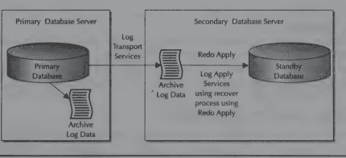

图 13-1. *物理备用数据库*
物理备用数据库可以以只读模式打开，从而可以对数据库执行报告生成和查询操作；然而，在此期间日志应用服务会被暂停。这看起来可能是一个问题，但实例可以在重做应用模式和只读模式之间来回切换，且不会带来太大麻烦。这允许您在一天中的特定时间执行查询，而在其他时间应用日志。
物理备用数据库具有多种优势。这些优势包括性能和容错能力。

### 性能

物理备用数据库以非常高效的方式应用重做信息。Oracle 花了多年时间优化 Oracle 数据库服务器内的恢复路径。恢复过程并不涉及与重放事务相同的代码路径。SQL 语句无需重新解析，Oracle 服务器也无需执行 SQL 操作。恢复操作所使用的路径非常高效且快速。
物理备用数据库的另一个性能优势是能够卸载只读功能，例如报告查询甚至 RMAN 备份（需要 RMAN 恢复目录，以便将一个服务器上的备份恢复到另一个服务器上）。由于数据库通过 Data Guard 保持完全同步，因此可以在备用数据库服务器上的管理恢复模式或只读模式下执行主数据库的备份，并且这些备份可用于恢复主数据库或备用数据库。您可以仅备份备用站点，前提是主站点能够通过网络或通过其他方式（例如磁带）及时访问备份以满足 SLA 要求。否则，请同时备份主数据库和备用数据库。有关将 Data Guard 与 RMAN 配合使用的更多信息，请参阅 2005 年 3 月的 Oracle 白皮书《Oracle Database 10g 中使用 Recovery Manager 与 Oracle Data Guard》。

### 容错

备用数据库可以很容易地通过切换（switchover）或故障转移（failover）操作转换为主数据库服务器的角色。这在计划内或计划外的停机场景中都很有用。此外，Data Guard 可以配置为多种模式，以确保不丢失任何事务数据。

## 逻辑备用数据库

逻辑备用数据库采用的方法与物理备用数据库完全不同。它不是将重做日志数据应用于备用数据库服务器，而是由日志应用服务将重做信息转换为在备用数据库上执行的 SQL 语句。该备用数据库正在不断重放在主数据库服务器上执行的 INSERT、UPDATE 和 DELETE 语句。虽然这与物理备用数据库使用的恢复操作相比效率较低，但它有几个优势，包括：
- **灵活使用备用数据库服务器** 由于日志应用服务只是执行 SQL 语句，其他用户可以在此数据库上执行操作，包括修改数据的操作。
- **卸载主操作** 由于数据库可以处于备用模式并同时运行查询，因此可以卸载报告和其他工作。
- **异构环境支持** 备用数据库不必与主服务器相同；它可以放置在不同的环境中，使用不同的硬件和不同的操作系统配置。这允许您在成本较低的硬件上维护备用服务器。但是，请记住，主系统和备用系统必须运行相同版本的 Oracle。配置可以不同，但 Oracle 软件必须相同。
尽管逻辑备用数据库似乎比物理备用数据库具有许多优势，但也存在一些主要缺点。由于来自主服务器的备用操作是以 SQL 语句形式重放的，因此它们不像物理备用数据库中使用的恢复操作那样快速。事实上，如果备用服务器用于额外的报告操作，那么在应用重做信息时可能会有明显的延迟，因此在发生故障转移时，您的系统可能不是最新的。此外，由于备用数据库结构不会与主数据库完全相同，逻辑备用数据库不是为主服务器执行 RMAN 备份的好平台。逻辑备用数据库如图 13-2 所示。

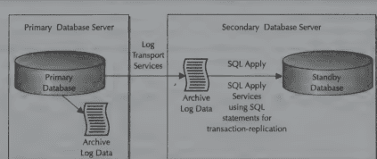

**图 13-2.** *逻辑备用数据库*
物理和逻辑备用数据库服务器都有利弊。在做出决定之前，您应该深入研究物理和逻辑两种备用数据库。如果容错或性能是您的主要关注点，那么物理备用数据库可能是更好的选择；如果资源使用是您的主要关注点，那么逻辑备用数据库可能是您的最佳选择。


> 注意
> *逻辑备用数据库有几项严格要求。主数据库中的表行必须具有唯一标识性。此外，不允许某些数据类型。这些限制在 Oracle Data Guard 概念和管理指南中已有详细说明。任何数据库都可以参与物理备用数据库，且不受任何限制。*

## 配置和管理 Oracle Data Guard

物理和逻辑备用数据库配置有许多相似之处，也有许多不同之处。为了最清晰地说明如何配置和实施这两种数据库，程序将分为两部分。尽管有一些重叠，但通过分两部分描述更容易理解整个过程。此外，由于这些步骤在 Oracle 文档中已有详细记录，此处不会详细重复。有关将 Data Guard 作为最大可用性架构（MAA）的一个组件进行配置和使用的更详细说明，请参阅 TechNet 上可用的 MAA 白皮书和文档，地址为 `http://www.oracle.com/technology/deploy/availability/htdocs/maa.htm`。
下面将提供一个概述，并对 Linux 特有的问题进行特别说明。我们将从创建物理备用数据库的程序开始，然后是逻辑备用数据库。

### 物理备用数据库配置

与配置和部署 Oracle 数据库服务器本身以及 RAC 一样，设置物理备用数据库的过程可以分为三个阶段：准备阶段、部署阶段和配置后阶段。每个阶段都非常重要。

#### 准备

为了将数据库服务器准备成物理备用数据库配置中的主服务器，您必须执行以下措施：
- **归档日志模式** 如果数据库尚未处于归档日志模式，则必须将其切换到该模式。Data Guard 需要归档日志模式。（无论如何，在生产数据库中运行归档日志模式总是明智的。）


**强制记录模式** 必须将实例设置为强制记录模式，从而确保直接路径插入和其他无法记录的操作会被记录并通过重做流传输到备用服务器，即使为主数据库操作设置了 `NOLOGGING`。

**密码文件** 如果尚未创建密码文件，则必须创建一个。每个系统都必须有一个密码文件，并且该密码文件必须包含主服务器和备用服务器相同的 `SYS` 密码。`REMOTE_LOGIN_PASSWORDFILE` 必须设置为 `EXCLUSIVE`。

在设置物理备用数据库服务器之前，必须完成所有这些操作。

### 部署

部署物理备用数据库也分为几个步骤。这些步骤包括创建数据库备份并将其传输到备用服务器，在备用服务器上设置初始化文件，并设置调用 Data Guard 的过程，具体细节如下。

**创建主数据库的备份** 您应该能够利用在第 11 章和第 12 章中学到的技能，使用 Recovery Manager (`RMAN`) 创建数据库的在线或离线备份。创建主数据库的完整备份。随后，该备份副本将在备用数据库服务器上恢复，从而创建将转换为备用数据库的数据库。临时表空间数据文件不需要复制——它们需要在备用数据库恢复后在只读模式下创建（参见本章后面的“部署后”）。重做日志文件可以复制，也可以在备用服务器上创建（参见本章后面的“部署后”）。这些重做日志在备用服务器上创建并清除，以备在切换或故障转移时使用。

如果您不想使用 `RMAN`，并且能够关闭主数据库，您可以简单地将数据文件从主系统复制到备用系统。如果使用 `dd`，您可能会获得更好的性能，因为您可以指定比 `rcp` 或 `scp` 更大的块大小。在 Linux 系统中，以下命令在将数据文件从一个系统复制到另一个系统时非常高效：

```
dd bs=64k if=<data file spec> | ssh_standby "( dd bs=64K of=<data file spec>)"
```

如果你正在使用 `OCFS`，请对前述命令进行如下修改：

```
dd -O_DIRECT=64k if=<data spec> | ssh_standby " 
( dd -O_DIRECT=64k of=<data file spec>)"
```

使用 `dd` 的速度可以比使用 `scp` 或 `rcp` 快十倍。

## 为备用数据库创建控制文件

在主数据库上使用 `ALTER DATABASE CREATE STANDBY CONTROLFILE AS '<filename>'` 创建备用控制文件。该备用控制文件将被复制到本节描述的备用数据库系统中。必须在该数据库处于 `MOUNT` 模式且位于最新备份数据文件时间戳之后创建此备用控制文件。

## 创建备用初始化参数

备用服务器的参数集将与主服务器使用的参数集相似；然而，某些参数的设置有所不同。备用数据库的 `DB_UNIQUE_NAME` 必须与主服务器不同。此外，在备用数据库服务器上，`FAL_CLIENT` 和 `FAL_SERVER` 参数是相反的。特定于 Data Guard 的其他参数包括 `LOG_ARCHIVE_DEST_2`、`LOG_ARCHIVE_DEST_STATE_2`、`LOG_ARCHIVE_CONFIG` 和 `STANDBY_FILE_MANAGEMENT`。

Oracle 10g 的一个新功能是，像 `LOG_ARCHIVE_DEST_2` 这样的参数，以前在角色切换时需要更改，现在具有额外属性来指定它们适用的角色。这使得每个站点都可以使用相同的初始化参数文件（尽管站点之间的文件必须不同），无论数据库角色如何。

**提示**

*创建一个 `PFILE` 并在初始配置步骤中使用该 `PFILE` 通常更容易。一旦备用服务器正确设置，就可以创建一个 `SPFILE`。*

## 将文件复制到备用服务器

接下来，将备份文件（如果你还没有在本章前面所示的备份过程中这样做）、备用控制文件（复制到与主控制文件相同的位置和名称）以及初始化参数文件复制到备用系统。为了创建相同的主站点和备用站点，你还需要复制用于环境设置的初始化脚本（例如 `.profile` 和其他脚本）以及 DBA 脚本。这些文件可以通过 `scp` 或 `sftp` 复制，或者通过挂载 NFS 卷来复制。正如本章前面所述，还应复制 `/etc/oratab` 文件。除非你正在备用站点上使用 OUI 从头安装 Oracle 10g，否则你还需要将 `ORACLE_HOME` 目录、`admin` 目录（包括子目录 `bdump`、`cdump`、`create`、`pfile` 和 `udump`）以及 `/etc/hosts` 文件复制到备用站点（你可能需要为任何专门用于重做流量的新 NIC 在 `/etc/hosts` 文件中添加新条目）。在将系统配置为 Data Guard 时，网络参数可能很重要。

如前所述，数据文件可以作为备份过程的一部分进行复制，如下所示：

```
dd bs=64k if=<data file spec> | ssh standby "( dd bs=64k of=<data file spec>)"
```

如果你正在使用 `OCFS`，请对前述命令进行如下修改：

```
dd -O_DIRECT=64k if=<data file spec> | ssh standby "
(dd -O_DIRECT=64k of=<data file spec>)"
```

如前所述，使用 `dd` 的速度可以比使用 `scp` 或 `rcp` 快十倍。

最后，同步 OS 时钟。如果不这样做，以后在比较包含时间戳的日志文件（特别是 alert 日志）时会变得非常混乱，因为它们很可能无法紧密衔接。如果服务器尚未同步，你可能希望系统管理员实施企业范围内的同步软件（例如 `NTP`），以保持所有服务器时钟始终同步。

## 设置网络环境

一旦所有所需文件都在备用服务器上，请为为主数据库和备用数据库配置监听器的 Oracle 网络服务名进行配置，以供日志传输服务使用。配置文件包括 `listener.ora`、`tnsnames.ora` 和 `sqlnet.ora` 文件。在主站点上，要么使用第二个连接字符串用于当前数据库监听器的重做数据，指定不同的端口；要么创建一个与用于连接主数据库的监听器不同的独立监听器。为了准备角色切换，在两个系统上执行相同的操作。还为 `tnsnames.ora` 文件中的重做日志传输添加别名。你可能希望在 `tnsnames.ora` 文件中使用 Oracle Net 参数 `SDU`（会话数据单元）将传输大小设置为 32k。更多信息，请参阅 *Data Guard Concepts and Administration, 10g Release 1, Section A.6*。为了启用断开的连接检测，按照 Oracle 的建议设置 `SQLNET.EXPIRE_TIME = 2`（分钟）。在配置 Oracle Net 服务时，需要在 `sqlnet.ora` 文件中设置 `SQLNET.EXPIRE_TIME`。

## 附加步骤

在此时，可以执行以下可选步骤（如果希望的话）：

- 创建备用重做日志（SRLs）。即使是在最大性能模式下，对于所有保护模式，都强烈建议执行此步骤。备用重做日志文件使用 `ALTER DATABASE` 命令创建，如下所示：

```
SQL> ALTER DATABASE ADD STANDBY LOGFILE THREAD 10
2> ('<log file spec 1>', '<log file spec 2>') SIZE 100M;
```

- 在备用上创建/清理在线重做日志文件，为角色切换做准备（可选）。当备用成为主时，在线重做日志文件会自动为你创建。可以通过在备用系统上创建重做日志文件来提前完成此步骤。通过 `ALTER DATABASE CLEAR LOGFILE` 语句可以非常简单地完成此操作。操作如下：

```
ALTER DATABASE CLEAR LOGFILE GROUP 1;
ALTER DATABASE CLEAR LOGFILE GROUP 2;
...
ALTER DATABASE CLEAR LOGFILE GROUP n;
```

- 启动 DG Broker。通过在两个站点上将初始化参数 `DB_BROKER_START` 设置为 `TRUE`，在每个站点上启动 Data Guard 监控（`DMON`）进程。现在你需要创建并启用 broker 配置。

- 启用闪回数据库作为额外保护。

## 启动备用数据库

数据库几乎准备就绪，可以开始作为备用数据库运行；然而，备用数据库需要额外的临时空间。主站点文件上的所有临时表空间和临时数据应在备用站点上创建。你可以使用在备用数据库上从主数据库运行 `ALTER DATABASE BACKUP CONTROLFILE TO TRACE` 生成的文本控制文件中的 `CREATE TEMPORARY TABLESPACE` 命令。要创建临时表空间，需要使用命令 `STARTUP OPEN READ ONLY` 以只读模式启动备用数据库。在此模式下，可以添加到数据库额外的临时文件。


在此时，你可以准备开始备用模式。这是通过发出 SQL 命令 `ALTER DATABASE RECOVER MANAGED STANDBY DATABASE DISCONNECT [FROM SESSION]` 来启动重做应用完成的。`DISCONNECT` 语句使该命令在后台会话中运行。

## 测试备用数据库

通过在主服务器上发出 `ALTER DATABASE SWITCH LOGFILE` 命令并确保重做数据传输并应用于备用服务器，可以测试 Data Guard 日志传输和应用服务。此外，可以使用以下步骤来验证 Data Guard 是否正常工作：

1. 识别备用上的现有归档日志文件：
   - `SELECT SEQUENCE#, FIRST_TIME, NEXT_TIME FROM`
   - `V$ARCHIVED_LOG ORDER BY SEQUENCE#;`
2. 强制主切换日志以归档当前在线重做日志文件：
   - `ALTER SYSTEM ARCHIVE LOG CURRENT;`
3. 验证新的重做数据已在备用上归档：
   - `SELECT SEQUENCE#, FIRST_TIME, NEXT_TIME FROM`
   - `V$ARCHIVED_LOG ORDER BY SEQUENCE#;`

在继续之前，验证 Data Guard 是否正常运行很重要。不要假设一切正常工作。

## 部署后

一旦基本的物理备用数据库创建完成，还可以执行一些额外的可选任务。现在，你应该创建临时数据文件。应创建额外的临时数据文件；每个当前数据库中的临时数据文件对应一个。操作如下：

```
STANDBY> ALTER TABLESPACE TEMP ADD TEMPFILE 'D:\oracle\oradata\stby\temp02.dbf' SIZE 20M REUSE;
```

新的临时数据文件将在备用成为主的情况下使用。

如果需要，你可以更改数据保护模式。如前所述，这些是可以使用的数据保护模式：

- 最大保护 在此模式下，事务只有在写入主服务器的重做日志以及至少一个备用重做日志后，才会在主服务器上提交。
- 最大可用性 此模式类似于最大保护模式；然而，在发生故障的情况下，主服务器上的事务处理不会停止。
- 最大性能 这是默认模式；它以非同步方式将数据传输到备用重做日志文件。

除了设置数据保护模式外，测试和验证备用数据库的操作也是个好主意。

## 逻辑备用数据库配置

与物理备用数据库的配置类似，逻辑备用数据库的配置可分为三个阶段：准备阶段、配置阶段和配置后阶段。逻辑备用数据库的先决条件比物理备用数据库更严格。

### 准备

在开始创建逻辑备用数据库之前，您应检查先决条件。在此配置中，某些数据类型不受支持。不支持的数据类型包括 BFILE、ROWID、UROWID、REFS、varrays、嵌套表、XML 类型和用户定义的数据类型。如果您在表中使用了这些数据类型中的任何一种，这些表将被 SQL Apply 跳过。如果需要，请在开始配置逻辑备用数据库之前更改主数据库上的数据类型。除了被跳过的数据类型外，还有许多表、序列和视图，以及 DDL 语句（包括尤其是 `ALTER DATABASE`、`ALTER SESSION` 和 `ALTER SYSTEM`）也将被跳过，包括：

- 随 Oracle 数据库一起提供的多数模式
- 使用不支持数据类型的表
- 使用表压缩的表

Oracle PL/SQL 提供的修改系统元数据的包通常不被 SQL Apply 支持。此类包的示例包括 `DBMS_JAVA`、`DBMS_REGISTRY`、`DBMS_ALERT`、`DBMS_SPACE_ADMIN`、`DBMS_REFRESH`、`DBMS_SCHEDULER` 和 `DBMS_AQ`。

要确定主数据库是否包含任何不支持的对象，请查询 `DBA_LOGSTDBY_UNSUPPORTED` 视图。与物理备用数据库不同，后者中数据库中每个记录的 ROWID 都是相同的，而逻辑备用数据库中的 ROWID 可能会不同。因此，您必须使用不同的机制将备用数据库上更新的行与主数据库上的行进行匹配。这可以通过主键或唯一索引来实现。

### 部署

创建逻辑备用数据库的第一步是按照本章前面的步骤创建物理备用数据库。此外，您必须确保主数据库上已启用补充日志记录。如果尚未启用补充日志记录，可以通过 `ALTER DATABASE ADD SUPPLEMENTAL LOG DATA (PRIMARY KEY, UNIQUE INDEX) COLUMNS` 语句启用。这会创建 SQL Apply 服务将使用的额外日志数据。

完成这些步骤后，您即可通过执行以下步骤激活逻辑备用数据库：

1. 通过设置在角色反转时生效的初始化参数，为角色转换准备主数据库和备用数据库。在主数据库和备用数据库上，设置 `LOG_ARCHIVE_DEST_1,2,3` 和 `LOG_ARCHIVE_DEST_STATE_1, 2, 3`，以及 `UNDO_RETENTION=3600`（用于 LogMiner 字典）。在备用数据库上，设置 `PARALLEL_MAX_SERVERS=9`。（最小值）。在备用数据库上发出 `SHUTDOWN IMMEDIATE`。
2. 使用 `ALTER DATABASE CREATE LOGICAL STANDBY CONTROLFILE AS 'filename';` 创建逻辑备用控制文件；
3. 在备用数据库上，发出 `STARTUP MOUNT PFILE=<cpfile>;`
4. 通过运行 SQL 语句 `ALTER DATABASE RECOVER MANAGED STANDBY DATABASE` 为 SQL Apply 准备备用数据库。
5. 通过运行 SQL 语句 `ALTER DATABASE ACTIVATE STANDBY DATABASE` 激活逻辑备用数据库。
6. 运行 `nid (DBNEWID)` 实用程序以更改备用服务器上数据库的名称（需要 `SHUTDOWN IMMEDIATE` 和 `STARTUP MOUNT`）。
7. 将参数文件中的数据库名称 `DB_NAME` 更改为 `DBNEWID` 中使用的名称。
8. 为逻辑备用创建 SPFILE，并使用 `ALTER DATABASE OPEN RESETLOGS` 重启数据库。
9. 使用 SQL 语句 `ALTER DATABASE RENAME GLOBAL_NAME TO newname` 更改备用数据库的全局名称。
10. 如同为物理备用数据库所做的一样，创建新的临时文件。
11. 使用 SQL 语句 `ALTER DATABASE START LOGICAL STANDBY APPLY` 启动 SQL Apply。

### 部署后

一旦创建了基本的物理备用数据库，还可以执行一些可选任务。当然，这包括测试备用数据库。可以通过多种方式监控备用数据库。这些包括以下 Oracle 表和动态性能视图：

- `DBA_LOGSTDBY_LOG` 该表提供有关在备用系统上注册的重做日志文件的信息。
- `DBA_LOGSTDBY_PROGRESS` 该表提供 SQL Apply 整体进度的统计信息。
- `V$LOGSTDBY_STATS` 该视图提供 LogMiner 统计信息。
- `V$LOGSTDBY` 提供有关日志应用进程的信息快照。

与物理备用数据库一样，您可以更改数据保护模式。这些是与物理备用数据库（前面已描述）一起使用的相同数据保护模式，即最大保护、最大可用性和最大性能。

除了设置数据保护模式外，测试和验证备用数据库的操作始终是一个好主意。

### 摘要

除了此处提供的信息外，使用 Oracle Data Guard 还可以配置和调整更多内容。有许多选项和许多操作模式可以配置。您如何配置系统取决于您的需求和要求。与许多 Oracle 功能（如 Oracle RAC）一样，在 Linux 环境中部署 Data Guard 完全取决于细节。仔细的规划和测试将使您的部署成功。


## 第 14 章

### Oracle Linux 上的高级复制

复制是将数据库、表或这些或其他 Oracle 对象的子集自动复制到另一系统的过程。复制可以配置为在整个数据库或仅数据库的子集上工作。无论要复制的数据量多少，功能和机制都相同。本章将探讨 Oracle 用于将数据从一个系统复制到另一个系统的各种方法。

虽然最终结果可能看起来与 Oracle Data Guard 相似，但复制实际上完全不同。复制旨在创建数据库或数据库子集的一个或多个副本。这些副本旨在对用户开放并可供使用。复制也可以以双向方式使用，其中存在多个主节点。Data Guard 设计为灾难恢复系统，而复制主要并非为 DR 设计。Data Guard 通过从主系统向备用系统传输和应用重做数据来工作，而复制基于 API 或触发器。


**NOTE**

虽然 Data Guard 需要 Oracle 企业版，但复制随标准版提供。

## Oracle 复制简介


# Oracle 高级复制

Oracle 高级复制由协同工作以在整个企业中的不同系统上配置、部署和维护数据库对象的进程和实用程序组成。复制对象可以驻留在与源数据库相同的计算机系统上的数据库中，也可以驻留在相距数千英里的系统上。复制对象可以根据您的需求和偏好配置为只读或读写。高级复制是 Oracle 的复制实现。在本章中，术语复制将用于描述高级复制。

Oracle 高级复制用于多种目的。它可用于复制必须在远程位置（如商店）本地可用的只读数据。以这种方式，您可以将价格数据、零件详情、文档等复制到每家商店，在那里即使网络问题可能阻止与主数据中心的通信，这些数据也可以随时可用。这些数据可以在每家商店中自主使用，只有销售数据需要发送回主数据中心。这将允许商店在网络中断或主公司系统出现问题时继续运行。

除了可用性之外，在这种情况下，复制还可以提供更高的性能，因为数据位于本地并且可以快速访问由本地用户。这使得 Oracle 缓冲区高速缓存能够为每个存储或远程数据库有效工作。其他拓扑允许您从主 OLTP 系统向其他系统复制数据，这些系统可用于报告目的。这些报告服务器可以进行与 OLTP 服务器不同的调优，并且可以专门用于报告和数据挖掘。这几乎总是一个明显的优势，因为 OLTP 系统和报告系统的调优策略通常相互冲突。通过向报告服务器复制数据，您可以从主系统卸载工作，并允许每个系统以最佳方式运行。

复制通过对象、组和站点来定义。这些术语定义了正在复制的内容、如何复制以及复制到哪里。这些术语的定义如下：

- **复制对象** 这是正在复制的对象类型，包括表、索引、视图、包等。单个对象作为复制的一部分进行定义，并可以作为组收集在一起。
- **复制组** 复制组是一组一起复制的对象。这些复制组作为单个实体进行处理和管理。
- **复制站点** 这些可以是主站点或物化视图站点。主站点是原始数据所在的系统，而物化视图站点是被复制到的系统。N 路复制（也称为点对点复制）是通过多主配置完成的。

根据要复制数据的需求，可以使用几种不同类型的复制。这些包括多主复制、物化视图复制和混合配置。

## 多主复制

*多主*（或*点对点*）复制可以使用系统间的异步或同步复制。每个系统都是主系统，并与复制组中的其他主系统通信，如图 14-1 所示。

正如刚才所述，多主复制可以是异步的、同步的或过程式的。使用*异步*复制时，对数据库的更改会被存储，并定期*推送*到其他复制系统。异步复制是最常见的复制类型，它允许您控制复制的频率。同步复制使系统保持更最新的状态，但以性能为代价。此外，还有过程式复制。

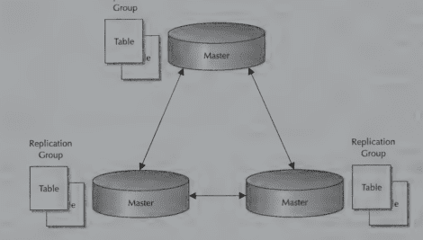

**图 14-1. 多主复制站点**

在同步和异步复制中，关于表中 DML 更改的信息存储在发生更改的主站点的延迟事务队列中。这些更改被称为*延迟事务*。延迟事务会定期推送给其他参与的主站点，间隔由您定义。可以配置异步复制以模拟同步复制。

*同步*复制使系统保持更最新的状态，但以性能为代价。表更新立即复制到的所有主站点。如果由于任何原因一个主站点无法处理事务，则该事务将在所有主站点回滚。虽然同步复制避免了冲突的可能性，但它需要非常稳定的环境才能平稳运行。如果由于网络问题无法与一个主站点通信，例如，用户仍可以查询复制的表，但在重新建立通信之前无法完成任何事务。

此外，还有过程式复制。*过程式*复制仅复制应用程序用于更新表的存储过程调用。它不复制数据本身的修改。过程式复制通常用于在单个事务内更改大量数据的批处理应用程序。在这种情况下，典型的行级复制可能会使网络承受许多数据更改的负载。要使用过程式复制，您必须将修改系统中数据的包复制到其他所有站点。在复制包之后，您必须在每个站点生成该包的包装器。当应用程序调用本地站点的包过程来修改数据时，包装器确保最终在所有其他复制站点调用相同的包过程。过程式复制可以是异步的或同步的。

## 物化视图复制

物化视图复制在特定时间点创建被复制数据库对象的副本。这个被复制的数据库对象副本不会保持最新，它只是数据在特定时间点的快照。物化视图复制系统可以是只读或可更新的。对可更新物化视图的更新也会导致主站点上的数据更新。物化视图复制系统通常定期刷新，使目标系统的数据在刷新时刻与主系统保持同步。

## 混合复制

混合物化视图复制系统由多主复制系统和物化视图复制系统的组合组成。这些混合系统可以包括属于一个或多个不同复制组的系统。当多个对象需要多主复制，而其他对象可以使用物化视图复制时，这很有用。这些混合系统可以以多种不同的方式进行配置。

多主复制和物化视图复制之间的一个重要区别是，在多主复制中，任何被复制的表必须整体复制，而在物化视图复制中，可以只复制该表的子集。

## Linux 上的 Oracle 复制

Linux 上的 Oracle 高级复制与其他基于 UNIX 平台上的 Oracle 复制类似。在 Linux 上对复制进行调优以获得最佳性能通常集中在硬件配置、操作系统调优参数和数据库布局本身。复制系统的 Oracle 配置参数应针对主站点和物化视图系统将服务的应用程序类型进行调优。在为复制设置系统时，应考虑几个配置问题：

- **I/O 性能** 在物化视图刷新期间，I/O 性能可能至关重要。您必须确保有足够的 I/O 性能容量来处理峰值负载。
- 数据库布局 数据文件、重做日志和归档日志的磁盘布局需要分布，以提供容错性和最佳性能。
- 网络性能 网络性能可能存在极端的峰值活动。确保网络足以处理负载。

您需要怀着这些注意事项来规划和实施复制。配置规划应包括以下将在下文描述的项目。

### I/O 容量

I/O 容量应足以处理复制系统可能产生的 I/O 操作突发。第 4 章为您提供了一些如何规划和调整 I/O 子系统以满足性能需求的见解。应使用 `iostat` 监控 I/O 子系统，以确保其以最佳方式运行。`iostat` 的输出包括 `await` 和 `svctm`：`await` 是 I/O 操作在队列中花费的平均时间，`svctm`（或服务时间）是处理 I/O 所需的时间。这两个数字都是以毫秒为单位，通常都不应超过 20ms。当然会有峰值，但如果延迟过高的时间过长，您将遇到性能问题。

### 数据库布局

为了配置 I/O 以获得更好的性能和容错性，请务必将重做日志文件、数据文件和归档日志文件分布在不同磁盘卷上。这在磁盘故障的情况下将提供更高级别的保护，并提供更高性能的 I/O 解决方案。在这方面，复制系统与其他任何 Oracle 系统没有区别。

### 足够的网络容量

还必须确保有足够的网络容量，以便从主服务器到远程复制站点执行复制。低估数据库操作所需的网络容量并不罕见。除非您有专用网络，否则网络带宽通常不可预测，因为您通常与其他网络流量竞争，因此不能总是依靠以网络的名义速度传输数据。为了确保有足够的网络容量成功使用 Oracle 高级复制，需要执行几个任务：

- 选择带宽足够高、延迟低的网络。
- 计算网络吞吐量和延迟。
- 测试网络。

## 网络带宽选择

对于您的复制配置，有许多不同的网络可供选择。除了局域网（LAN）选项（如 `10baseT`、`100baseT` 以太网和千兆以太网）外，还有许多宽带网络（WAN）的选择，例如 `T1` 或 `T3`。互联网通常比您的局域网慢得多，在设计配置时应考虑这一事实。

除了带宽选择外，您还需要确定您的网络是专门用于复制还是与其他系统共享。几年前，我参与的一项咨询工作确定，复制问题是由单个网络段引起的，该网络段随后分支到其他网络段。复制正在正常执行；然而，其复制速度只能受限于网络允许的速度。

## 网络吞吐量计算

为了确定数据复制的速度，您应将网络带宽转换为适合规划数据复制的单位。网络速度通常以兆比特每秒（Mbps）来表示，而在规划复制策略时，您通常关心每小时可以传输多少千兆字节。表 14-1 以兆比特/秒、兆字节/秒和千兆字节/小时为单位提供了网络带宽。除了网络带宽评级外，您还必须考虑其他影响性能的因素——期望实际达到完整的网络带宽是不现实的。网络开销的现实近似值为 30%。

如果您知道所使用网络的带宽，那么您应该能够计算复制特定数量的数据大约需要多长时间。表 14-2 让您大致了解在不同带宽下传输不同数量数据需要多少小时（以秒为单位）。时间以小时显示，并包含 30% 的网络开销。

### 表 14-1. 网络带宽及其他性能因素

|  | 局域网 (LAN) |  |  | 广域网 (WAN) |  |
| :--- | :--- | :--- | :--- | :--- | :--- |
|  | **10baseT** | **100baseT** | **千兆** | **T1** | **T3** |
| 兆比特/秒 | 10 | 100 | 1000 | 1.5 | 44.74 |
| 兆字节/秒 | 1.25 | 12.5 | 125 | 0.19 | 5.59 |
| 千兆字节/小时 | 4.39 | 43.94 | 439.45 | 0.66 | 19.66 |

### 表 14-2. 在不同带宽下传输数据所需的时间

如您所见，传输数据所需的时间可能比您想象的更长。了解每个设备都有其局限性很重要。此外，如果进程使用相同的网络，您的性能将进一步降低。

## 网络测试


除了计算网络吞吐量外，您还应该进行测试，以确保没有遇到网络问题。有一个用于测试网络的强大工具叫做 `TTCP`。`TTCP` 可在互联网上获得，用于测试网络带宽。由于此工具仅测试网络，因此它不考虑其他性能因素，例如将数据复制到磁盘所需的时间。要运行 `TTCP`，您在一个系统上以接收模式启动它，并在另一个系统上以发送模式运行。`TTCP` 将尽可能快地传输数据，并报告其能够达到的带宽。

> **注意**
> 除非您准备好消耗该网络的全部带宽，否则请勿在生产网络上运行 `TTCP`。请先咨询您的网络管理员。

完成这些任务后，您将知道您的网络是否足以执行使用 [Oracle Advanced Replication](https://www.oracle.com/database/technologies/options/active-data-guard.html) 所需的必要任务。如果您没有足够的网络性能，您应该重新考虑您的架构并进行必要的更改。

### 摘要

在 Linux 上与其他 Oracle 支持的平台相比，复制并没有不同。为了使复制以最优方式工作，您应该用足够的资源配置系统。除了正常操作所使用的资源外，这些资源应正确配置大小以处理复制传输的数据量和产生的 I/O。如果数据库调优得当且分配了足够的资源，采用 Oracle 高级复制的系统应该表现良好。


# 第 15 章

## 为 Linux 和 Oracle 配置硬件

硬件调优与操作系统调优和 Oracle 实例调优同样重要。但是什么是硬件调优？硬件调优涉及服务器硬件和存储的正确安装和配置。购买足够的存储容量并正确配置它对于适当的性能也是至关重要的，在某些情况下，例如使用 Oracle RAC 时，它对于您的 Oracle 系统的功能也是至关重要的。

### 硬件调优基础

硬件调优是从硬件定级（您在第 4 章中学习过的内容）结束的地方继续的。硬件定级是确定购买多少以及何种硬件的行为，而硬件调优是为最佳性能正确配置（或重新配置）该硬件的行为。本章的材料与第 4 章中的材料略有重叠，因为一些硬件主题对于调优和定级都极其重要。

随着硬件组件变得更加复杂，可以进行的调优数量也增加了。SAN 存储和 SCSI RAID 控制器都有许多调优参数，系统 BIOS 甚至处理器现在都提供可选设置。事实上，在本书出版时，Intel 和 AMD 都有可以根据您安装的操作系统在 32 位或 64 位模式下运行的 CPU。在本章中，您将学习如何配置和调优硬件组件以获得最佳性能。

除了调优单个硬件组件外，*系统* 可能由多个或许多不同层级的 Web、应用程序和数据库服务器组成。随着不同层级之间存在多层和复杂的交互，基础架构调优也很重要，但这超出了本书的范围。

### 选择合适的硬件

计算机系统由许多协同工作的单个组件组成。每个组件都有自己的工作要执行，并且每个组件都有自己的性能特征。

系统的核心是中央处理单元（CPU），它实际处理在计算机上运行的所有计算和指令。最好让 CPU 的性能成为限制因素，而不是其他子系统的限制。Linux 操作系统内置的 CPU 实用程序，如 `ps`、`top` 和 `vmstat`，使您可以轻松判断 CPU 是否已满负荷。例如，如果 `vmstat` 运行队列超过 CPU 数量的四倍，则 CPU 已饱和。或者，您可能会遇到单个进程消耗整个 CPU 的情况。硬件调优人员的工作是配置系统以高效使用 CPU 资源。

基本计算机系统利用三种主要资源（以及许多外围层）：CPU、内存和 I/O 子系统。本节描述这些组件及其工作原理。

### CPU

CPU 及其缓存是系统中最快的组件。缓存是一个或多个非常高速度内存片段，通常位于与 CPU 相同的芯片上，用于存储最近使用的数据指令，以便如果短时间内再次使用这些数据，可以提供快速访问。大多数现代 CPU 硬件设计实际上利用了构建在 CPU 核心内的缓存。这个内部缓存被称为一级（或 L1）缓存。通常，L1 缓存非常小，大小约为 8 到 16 千字节，并且可以在几纳秒内访问。

当需要某些数据时，硬件首先查看 L1 缓存。如果数据在那里，硬件立即处理该数据。如果 L1 缓存中没有数据，硬件会查看 L2 缓存，它位于 CPU 核心外部，但位于同一芯片上以最大限度地提高性能。L2 缓存连接到 CPU 芯片（在内存总线的同一侧，与 CPU 相同）。要访问主内存，需要使用内存总线，从而降低内存访问速度。虽然 L2 缓存通常比 L1 缓存慢得多，但它通常大得多。其较大的尺寸提供了获得“缓存命中”的更大机会。典型的 L2 缓存大小范围为 128K 到 4M，可以在百分之一纳秒内访问。

更慢的是主内存的速度。其特征是比 L2 缓存慢得多，大约为 2–10 微秒（比 L1 缓存慢 1000 倍左右）。系统内存的大小可以变化很大：32 位 CPU 限制为 4GB 直接寻址内存（它们可以通过多阶段操作寻址更多），而 64 位 CPU 可以直接寻址太字节大小的内存。组件速度的比较如 图 15-1 所示。

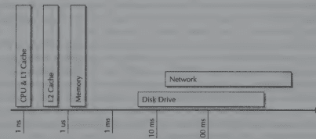

**图 15-1.** *组件速度比较*

正如你对比 CPU 速度时所看到的，当数据是从 L1 缓存而非磁盘检索时，速度优势是巨大的。这就是我们花费大量时间来利用内存中 SGA 的原因。这也是硬件供应商为何如此努力提高 CPU 缓存和内存总线速度。然而，正如以下各节所述，其他硬件供应商的考量也会影响性能。

### CPU 设计

CPU 与系统时钟同步工作，并基于时钟信号执行指令。时钟频率和 CPU 类型决定了这些指令执行的快慢。几乎所有现代 CPU 都是两种处理器类型之一：复杂指令集计算机（CISC）或精简指令集计算机（RISC），如下所述。

CISC 处理器（例如由 Intel 和 AMD 制造的处理器）是当今市面上最普遍的处理器。与 RISC 处理器相比，CISC 处理器更为常见（就发货量而言），并且为程序开发人员提供了更大的指令集。其中一些指令可能相当复杂，需要几个时钟周期才能完成。

CISC 处理器非常复杂，且制造难度大。由于这些 CPU 芯片包含数百万个内部组件，这些组件之间的间距极小。物理尺度导致了问题，因为没有误差的余地。每年，技术进步都允许构建更多的组件和更快的芯片，但芯片设计人员正开始受到物理学（至少是我们今天所知的物理学）施加的基本极限的限制。

这些复杂的处理器执行广泛的任务，有时还能并行执行两条或更多指令。CISC 处理器能非常高效地执行大多数任务，包括涉及 RDBMS 处理的任务。

相比之下，RISC 处理器基于这样一种理论：如果你能减少 CPU 处理的指令复杂度和数量，CPU 的构建就会更简单，运行速度也会更快。此外，通过在芯片内部放置更少的内部组件，其速度可以提高。当今市场上最受欢迎的 RISC 芯片之一是来自 HP 的 PA RISC 芯片。

系统编译器决定 CPU 执行哪些指令。当指令类型数量减少时，编译器被编写以利用这一事实，并弥补缺失的指令。

通过减少指令集，RISC 制造商能够将时钟速度提高到 CISC 芯片的数倍。虽然这种更快的时钟速度在某些情况下有益，但在其他情况下提供的改进却很有限。更快的 CPU 的一个影响是，周围的组件（如 L2 缓存和内存）也必须运行得更快，这会增加硬件成本。

一些 RISC 制造商的另一个目标是设计芯片，使得大多数指令能在一个时钟周期内完成。如今的一些 RISC 芯片已经能够做到这一点。然而，由于 CISC 芯片的一条指令所能执行的操作可能需要 RISC 芯片的多条指令，因此无法进行速度对速度的直接比较。

### 多处理器

多处理器系统可以以极高的性价比提供显著的性能。在许多多处理器系统中，你可以从一两个处理器开始，随着业务需求的增长添加额外的处理器。然而，需要进行规划，因为并非所有系统都可升级。例如，你可以购买一个配置了一个 CPU 的四路 CPU 系统并进行升级，但并非所有四路 CPU 系统都可以这样做。多处理器分为几个类别；主要的两种类型是对称多处理器（SMP）系统和大规模并行处理（MPP）系统。

Oracle 通常随着 CPU 的增加而表现出良好的扩展性。通过添加额外的 CPU，你只需花费很少的额外成本就能看到显著的性能提升。决定通过添加更多处理器能获得多少提升的因素包括 CPU 缓存和内存总线带宽。支持大量用户执行小型独立操作（例如 OLTP 系统）的系统，往往在多 CPU 环境下具有非常好的扩展性。而其他系统，如数据仓库，可能无法从大量 CPU 中获益。

对称多处理器（SMP）系统通常由标准的计算机架构组成，拥有两个或更多共享系统内存、I/O 总线和磁盘的 CPU。这些 CPU 被称为对称，是因为每个处理器在功能上与其他任何处理器都相同。由于处理器共享系统内存，每个处理器查看相同的数据和相同的操作系统。事实上，SMP 架构有时被称为紧密耦合架构，因为 CPU 甚至可以共享操作系统。

在典型的 SMP 系统中，只运行一个操作系统的副本。每个处理器独立于其他处理器工作，通过获取下一个准备好运行的可用进程来运作。由于 Oracle 架构基于许多独立工作的进程，因此通过添加额外的处理器，你可以看到巨大的改进。


SMP 系统有几个优势：它具有成本效益、高性能且易于升级。SMP 系统最大的优势在于它们是最常见的，并且（由于规模经济）最具成本效益。典型的 SMP 系统支持从四个到八个 CPU。SMP 系统的一个缺点是，所有 CPU 通常共享系统总线和内存，因此添加更多处理器会增加总线带宽饱和的可能性。

大规模并行处理（MPP）架构系统基于许多独立的单元。MPP 系统中的每个处理器通常拥有自己的资源，例如自己的本地内存和 I/O 系统。MPP 系统中的每个处理器运行独立的操作系统的副本以及其自己独立的 Oracle 副本。MPP 系统有时被称为松散耦合架构。

你可以将 MPP 系统视为通过高速互连通信的大型独立单元集群。与 SMP 系统一样，随着你添加处理器，最终会遇到互连的带宽限制。然而，达到此限制的处理器数量通常比 SMP 系统大得多。

如果你能将应用程序分配给集群中的节点，MPP 系统可以实现相当高的可扩展性。虽然 MPP 系统可以实现比 SMP 系统高得多的性能，但它们的成本通常更高。

无论你使用单处理器系统、SMP 系统还是 MPP 系统，CPU 的基本架构都是相似的。事实上，你可以在 SMP 和 MPP 系统中找到相同的 Intel 处理器。SMP 和 MPP 系统之间的区别在于这些处理器处理内存的方式以及 CPU 的集群化方式。MPP 系统包括利用 `NUMA`（非统一内存访问）设计的计算机。`NUMA` 系统不像 SMP 系统那样共享主内存；相反，每个处理器或处理器集使用自己的内存。在某种程度上，`NUMA` 系统几乎像是一个独立系统的集群；在其他方面，它又像一个大型多处理器。

## CPU 和 CPU 缓存

正如你在本章前面所学到的，系统缓存对于整体系统性能至关重要。缓存的作用是允许快速访问最近使用的指令或数据。此外，缓存还用于执行预读，这与 `DB_FILE_MULTIBLOCK_READ_COUNT` 允许 Oracle 在数据库中执行预读操作的方式非常相似。缓存始终用于比下一层存储（L1 缓存比 L2 缓存快，L2 缓存比主内存快）更快地存储和检索数据。

通过缓存频繁使用的指令和数据，你增加了缓存命中的可能性，这可以节省宝贵的时钟周期，否则这些周期将用于从内存或磁盘检索数据。

较大的 CPU 缓存允许在本地处理器上存储比内存更多的数据和可执行代码，从而减少 CPU 必须访问主内存的次数。每当 CPU 访问内存时，在 CPU 等待数据或代码被检索期间，系统性能都会受到影响；如果此时内存总线繁忙，CPU 必须等待总线空闲，这会使延迟进一步延长。

## 随机存取存储器（RAM）

主系统内存是一组存储系统使用的数据和指令的内存芯片，这些芯片可能受到保护以防范故障，也可能没有保护。系统内存可以通过奇偶校验或更先进的、高级 ECC 纠错方法进行保护。系统内存的大小在理论上可以从小型 PC 上的 4MB 到 4GB

...以及在 64 位处理器上最高可达 16TB；然而如今，即使是最小的个人电脑也至少配备了 256MB 的 RAM。

基于本章前面对系统硬件工作原理的讨论，显而易见的是，任何需要访问较慢组件（如磁盘或网络）的操作都会拖慢处理速度。因此，系统中拥有充足的内存至关重要。该部分系统内存被分配给 Oracle 系统全局区（`SGA`）和用户内存（程序全局区 `PGA`）。应首先调整共享池，因为共享池内存不足对 Oracle 性能的影响可能比 `SGA` 中任何其他组件的问题都要大。一旦共享池拥有足够的内存资源，分配给数据库管理系统的数据库缓冲区越多越好。不过，务必小心，以免使进程所需的 `PGA` 内存得不到满足，并且无论如何都要避免页面交换。系统中的内存越多越好。任何可以缓存的内容都能减少系统 I/O，从而提升性能。

CPU 通过高速总线访问系统内存，该总线允许大量数据和指令快速从 CPU 移动到 L2 缓存。通常，数据和指令会以大块形式从内存读取并放入缓存，因为预计该块中的下一条指令或下一个数据很可能随后会被访问。这一过程被称为预取。

具体取决于 SMP 系统的实现方式，内存总线可能由所有系统处理器共享。或者，每个处理器可能拥有通往内存的私有总线。

进程可用的内存量受系统中物理内存的限制，如果使用虚拟内存系统，则可以得到扩展。

## Linux 内存调整以适配 Oracle

Linux 对于 Oracle 不需要大量的内存调整，但所需的少量调整至关重要。需要设置的 Linux 参数如下：

- `/proc/sys/kernel/shmall` `2097152`
- `/proc/sys/kernel/shmni` `4096`
- `/proc/sys/kernel/shmmax` `<略大于 SGA 大小>`

参数 `shmmax` 默认通常设置为 `2147483648`（2GB）。

如果需要创建大于 2GB 的 `SGA`，必须增加 `shmmax` 的值。此参数代表单个共享内存段的最大大小。

## 虚拟内存系统

在虚拟内存系统中，特殊的内存管理功能允许程序寻址比系统物理安装内存更多的内存。这种被称为虚拟内存的内存，对程序来说表现为一大块可映射到物理内存的内存。存储在虚拟内存中的数据必须分页到物理内存中供 CPU 使用，然后再复制回磁盘以为物理内存中的另一个进程腾出空间。分页进或分页出的过程可能非常耗时，并消耗大量系统资源。需要再次强调，访问磁盘的速度大约比访问内存慢 1,000 倍。应不惜一切代价避免页面交换，即使这意味着要减小 Oracle `SGA` 的大小。

## 32 位与 64 位处理器

更强大的 64 位处理器已问世十多年，但尚未成为主流，因为每种 64 位处理器架构都是专有的，且未得到多个操作系统的支持。尽管如此，与 32 位处理器相比，64 位处理器具有多项优势，包括能够寻址更多内存以及在单个时钟周期内处理更多信息。不幸的是，这些 64 位处理器未能达到 32 位处理器的普及程度。然而，新的混合 64 位 / 32 位处理器正迅速 gaining popularity。这些处理器将在以下几段中描述。

### 32 位寻址

各种 32 位架构已存在多年，是生产环境中最常见的架构。几乎每台 PC 都使用来自 Intel 或 AMD 的 32 位处理器。32 位处理器的缺点是 32 位最多能直接寻址 4GB 的 RAM。在过去的几年里，通过允许通过物理地址扩展（PAE）寻址更多内存，出现了一些变通方法。

`PAE` 允许访问 4GB 以上的物理内存，但不会增加进程可用的虚拟内存量。尽管它允许访问更多的物理内存，但效率略低，且不具备 64 位系统的所有优势。Oracle 可以使用间接数据缓冲区来访问此内存。使用间接数据缓冲区时，会创建一个 Oracle 用作中间存储区的 RAM 磁盘。虽然比磁盘访问快得多，但仍显著慢于直接访问内存。

### 64 位寻址

在 64 位系统中，您可以访问高达 16 太字节（terabytes）的 RAM。这对大型数据库而言可能是一个巨大优势。虽然不太可能在不久的将来构建拥有 16 太字节 RAM 的系统，但拥有数百吉字节 RAM 的系统正变得越来越普遍。

64 位总线是 32 位总线的两倍大，因此每次可以从一个子系统传输到另一个子系统的数据量是两倍。这在执行 64 位数学运算时非常有用。

### 混合 X86-64 系统

一些较新的处理器，例如 AMD 的 Opteron 和 Athlon-64 以及 Intel 的 EM64T，是混合系统，本质上完全是兼容 x86 操作系统和 64 位内存寻址的 32 位处理器。这些系统正迅速变得非常流行，并且现在都得到 Linux 和 Windows 操作系统的支持。针对 x86-64 架构的 64 位模式版本的 Oracle 10g 可用于 Linux 和 Windows。

这些系统的优势在于可以运行 64 位或 32 位操作系统。如果您运行的是 64 位操作系统，您可以选择运行 64 位或 32 位版本的 Oracle。当然，如果您使用 64 位，则能以更高的性能访问更多内存。

由于 Dell、HP 和 IBM 等供应商目前正在大批量出货这些处理器，您实际上可能已经在运行支持 64 位的 CPU 而尚未察觉。请与您的硬件供应商联系。您可能只需更改操作系统即可将系统从 32 位处理升级到 64 位处理。

### Linux 分页与交换

Linux 所需的交换空间不像大多数 Unix 操作系统那么多。实际上，内存为 4GB 或更多而交换空间仅为 1GB 或更小的 Linux 系统并不罕见。由于交换空间仅在物理内存耗尽时才使用，理论上您拥有的内存越多，使用交换空间的可能性就越小。

## Linux 硬件调优

除了选择正确的硬件外，正确配置和调优这些硬件也非常重要。硬件调优最重要的领域可能在于硬件本身和文件系统。

## I/O 调优

I/O 调优对 Oracle 数据库服务器的性能至关重要，因为 Oracle 的主要任务是提供数据，而移动和传输数据意味着 I/O 操作。I/O 子系统在第 4 章中已有详细介绍。调整 I/O 子系统与对其大小进行配置并没有太大区别。应谨慎配置和调优 I/O 子系统以优化 I/O 性能。`iostat` 命令是监控 Linux 中 I/O 子系统最有用的工具之一。使用 `-x` 标志运行此命令会显示关于 I/O 子系统性能的大量信息，如下所示：


```
ppoc:> iostat -x 10 100
linux 2.4.21-138s-default (ptc6)            06/19/04

avg-cpu:  %user   %nice   %sys  %idle
            1.77    0.00    0.68  97.55

Device:     rrqm/s wrqm/s   r/s   w/s  %sec/s  %wsec/s  rkb/s  wrkb/s avgqr-sz
avgqr-sz    await   svctm   util
/dev/hda      8.64    2.14  4.23  1.16 100.30   26.42  50.15  13.21   23.49
2.92  541.04  48.52   2.62
/dev/hda1     0.36    0.00  0.02  0.00   0.75    0.00   0.38   0.00   44.33
0.00   56.67  40.00    0.01
/dev/hda2     0.00    0.00  0.00  0.00   0.01    0.00   0.00   0.00   8.00
0.00   50.00  50.00    0.00
/dev/hda3     8.27    2.14  4.21  1.16  99.51   26.42  49.76  13.21   23.44
2.92  542.98  48.49   2.61

/dev/hdb      0.05    1.84  0.01  0.57  33.09   19.30  16.55   9.65   11.17
1.10  234.95  91.98   4.31
/dev/hdb1     0.00    0.00  0.00  0.00   0.00    0.00   0.00   0.00    8.00
0.00  100.00 100.00    0.00
/dev/hdb2     0.03    1.84  0.01  0.57  33.05   19.30  16.52   9.65   11.18
1.10  235.12  91.99   4.31

avg-cpu:  %user   %nice   %sys  %idle
            0.40    0.00    1.60  98.00

Device:     rrqm/s wrqm/s   r/s   w/s  %sec/s  %wsec/s  rkb/s  wrkb/s avgqr-sz
avgqr-sz    await   svctm   util
/dev/hda    0.00    24.40 0.00 34.50  0.00  491.20  0.00 245.60  14.24
314.54  8297.97  53.91  18.60
/dev/hda1   0.00    0.00 0.00  0.00   0.00    0.00   0.00   0.00    0.00
0.00    0.00   0.00    0.00
/dev/hda2   0.00    0.00 0.00  0.00   0.00    0.00   0.00   0.00    0.00
0.00    0.00   0.00    0.00
/dev/hda3   0.00    24.40 0.00 34.50  0.00  491.20  0.00 245.60  14.24
314.54  8297.97  53.91  18.60

/dev/hdb    0.10   63.00 0.00 77.70 22.80  623.20  686.40 311.60 343.20  13.03
38.24  380.40  94.73  95.20
/dev/hdb1   0.00    0.00 0.00  0.00   0.00    0.00   0.00   0.00    0.00
0.00    0.00   0.00    0.00
/dev/hdb2   0.10   63.00 0.00 77.70 22.80  623.20  686.40 311.60 343.20  13.03
38.24  380.40  94.73  95.20
```

默认情况下，`iostat` 命令输出所有设备的一行 I/O 信息。命令 `iostat -x 10 100` 以十秒为间隔输出数据 100 次，如果您对单个设备感兴趣，可以指定设备名称，如下所示。

## I/O 和 Oracle 数据文件放置

最近，Oracle 开始建议将所有数据、索引和重做日志文件放置在一个或多个跨越许多磁盘驱动器的较大硬件 LUN（逻辑单元号）中。这种方法被称为 SAME（Stripe And Mirror Everything，即“条纹化和镜像所有数据”，或者 Storage Administration Made Easy，即“简化的存储管理”，具体称谓取决于你阅读的是哪篇论文）。

尽管有些人认为使用大型硬件卷更可取，但我仍然倾向于将重做日志文件和数据文件存储在不同的物理卷上。虽然这与 Oracle 推荐的方法有些相悖，但我推荐这种做法有以下几个原因：

- 重做日志文件使用顺序 I/O。通过分离重做日志文件，你可以在这些卷上获得更好的性能，如第 4 章所述，且所需的驱动器更少。然而，逻辑驱动器（LUN）可能并不由专用磁盘驱动器组成。
- 在单个磁盘发生故障的情况下，如果重做日志文件和数据文件分离在不同的驱动器组上，你就不会同时丢失数据文件和在线重做日志文件。
- 尽管大多数 I/O 子系统都针对单点故障（如单个磁盘故障）提供了保护，但你仍可能因人为错误而丢失整个 RAID 集。通过分离重做日志文件和数据文件，你可以获得额外的保护层级。

我认为，无论是出于性能还是数据保护的考虑，重做日志、撤销表空间（undo tablespace(s)）和数据文件都应该分开存放。

## 其他 I/O 调优

I/O 子系统和文件系统中有许多可调节的参数。文件系统可以通过 `tune2fs` 命令进行调优，并可以使用 `dumpe2fs` 命令查看，如下所示：


```
ptc6:~ # dumpe2fs /dev/hdb2 | less
dumpe2fs 1.28 (31-Aug-2002)
Filesystem volume name:   /1
Last mounted on:          <not available>
Filesystem UUID:          aa00942b-4b36-4248-bb9f-962dc00b58ab
Filesystem magic number:  0xEF53
Filesystem revision #:    1 (dynamic)
Filesystem features:      has_journal filetype needs_recovery sparse_super
Filesystem state:         clean
Errors behavior:          Continue
Filesystem OS type:       Linux
Inode count:              7225344
Block count:              14430150
Reserved block count:     721507
Free blocks:              12709195
Free inodes:              7079490
First block:              0
Block size:               4096
Fragment size:            4096
Blocks per group:         32768
Fragments per group:      32768
Inodes per group:         16384
Inode blocks per group:   512
Last mount time:          Sat Jun 19 08:38:59 2004
Last write time:          Sat Jun 19 08:38:59 2004
Mount count:              27
Maximum mount count:      -1
Last checked:             Sun Nov 2 10:13:11 2003
Check interval:           0 (<none>)
Reserved blocks uid:      0 (user root)
Reserved blocks gid:      0 (group root)
First inode:              11
Inode size:               128
Journal UUID:             <none>
Journal inode:            8
Journal device:           0x0000
First orphan inode:       0
```

虽然了解文件系统的配置方式很有趣，但在文件系统创建之后，真正需要调优的内容并不多。最重要的文件系统调优是在创建时完成的。最重要的参数之一是块大小。由于典型的 Oracle 数据库使用 8K 的块大小，较小的 OS 块大小意味着 OS 必须为每个 Oracle 请求执行多次 I/O。这并不意味着 I/O 是以 OS 块大小的单位发生的，只是说它可以执行最多为该大小的 I/O 操作。你应该使 OS 块大小尽可能接近 Oracle 块大小，或者更大。不幸的是，ext2 和 ext3 文件系统的最大块大小为 4K。Oracle 集群文件系统（OCFS）可以创建 1M 的块大小。我通常更喜欢在 OCFS 中使用 128K 的块大小。在创建 ext 文件系统时，请使用 4K 作为块大小。

这并不意味着 OCFS 每次只写入 128K。实际写入的大小将是已提交给文件系统的 I/O 的大小。这只是系统空间分配方式以及 OCFS 处理小文件与处理大文件之效率差异的体现。对 OCFS 的 I/O 最小尺寸为 4K，但如有必要可以大得多。

除了文件系统参数外，还可以使用 `elvtune` 命令来调优 Linux 中的电梯排序算法。电梯排序用于对 I/O 进行排序，使得磁头按物理顺序拾取请求，而不是来回跳动。当电梯向上运行时，它会先停在 3 楼然后停在 4 楼，即使 4 楼的按钮是在 3 楼之前按下的。运行 `elvtune device` 将显示当前设置，如下所示：

```
ptc6:~ # elvtune /dev/hdb2

/dev/hdb2 elevator ID      2
     read_latency:          128
     write_latency:         512
     max_pend_segments:     8192
```

这些参数指定了一种人工延迟，旨在允许多个 I/O 排队，以便进行电梯排序。虽然这对于单个磁盘驱动器是好事，但对于 RAID 控制器或 SAN 则是坏事。这是因为它实际上延迟了 I/O，以便设备驱动程序可以进行排序。但在 RAID 控制器或 SAN 中，执行电梯排序的是硬件，而不是设备驱动程序。

### 调优 RAID 控制器

有时，为了获得更好的性能，可以调优你的 RAID 控制器或 SAN。可以调优的内容和方法取决于 RAID 控制器的类型和品牌。通常，你可以调优以下组件：

1.  **缓存页大小** 缓存页大小应至少与 Oracle 块大小一样大。这减少了因需要为一个 Oracle I/O 分配多个缓存页而可能产生的额外开销。

2.  **读取和写入缓存大小** 通常，读取缓存和写入缓存可以独立指定。根据你的应用程序所做的操作，你可能需要更多的读取缓存，或者需要更多的写入缓存。

3.  **读取和写入缓存使用** 大多数 RAID 和 SAN 系统允许你基于每个 LUN 来分配读取缓存和写入缓存。某些 LUN 可能受益于读取缓存，其他 LUN 受益于写入缓存，还有些 LUN 两者都受益。随机 I/O（OLTP）不会从读取缓存中受益。大量的写入（如重做、归档等）则受益于写入缓存。

4.  **预读或预取** 在某些情况下，当应用程序需要大量的表扫描时（例如在数据仓库环境中），预取可能会帮助提高 Oracle 的性能。在 OLTP 环境中，当 I/O 主要呈随机性质时，预取可能不起作用。

根据你的硬件品牌和类型，有许多方法可以调优 I/O 子系统的硬件。如何调优取决于应用程序类型、I/O 访问模式以及正在发生的 I/O 数量。

## OCFS 调优

Oracle 集群文件系统（OCFS）的引入旨在提供一种方便的、高性能的、可集群化的文件系统。通过可集群化，OCFS 允许 RAC 集群中的多个系统访问相同的数据文件，这是 RAC 的关键。对 OCFS 的访问是通过一种称为 `O_DIRECT` 的机制完成的。`O_DIRECT` 允许以直接模式访问文件系统，绕过 Linux I/O 缓存。

由于 OCFS 的特性，你应仅通过 `O_DIRECT` 访问 OCFS 文件。Oracle 提供了一组被称为 coreutils 的工具。Oracle 的 coreutils 用带有相同名称但增加了 `O_DIRECT` 选项的工具替换了标准的 Linux 工具，如 `cp`、`dd` 和 `mv`。通过结合使用 `O_DIRECT` 选项（`-o`）和块大小选项（`direct`），性能可以显著改善。在我最近进行的一项测试中，`dd` 的性能

> **RAC I/O 访问**
>
> Oracle Real Application Clusters（RAC）需要所有集群节点都可见的共享存储。此共享存储的各种选项包括原始分区、ASM（Automatic Storage Management，自动存储管理）和 OCFS（Oracle Cluster Filesystem，Oracle 集群文件系统）。每种选项都有其自身的特性，且都是可行的选择。你所选择的选项将取决于你的需求。

使用 256K 块大小时，速率从 1.5 MBps 提高到了近 50 MBps，如下表所示。

| O_DIRECT 大小 | 时间 | MB/秒 | GB/小时 |
| :------------ | :--- | :----- | :---- |
| 0 | 815.00 | 1.26 | 4.42 |
| 64K | 24.03 | 42.62 | 149.84 |
| 128K | 21.28 | 48.13 | 169.20 |
| 256K | 20.58 | 49.75 | 174.91 |
| 512K | 43.78 | 23.39 | 82.23 |
| 1M | 44.10 | 23.22 | 81.64 |

这些测试是通过将一个 1GB 的文件从磁盘复制到 `/dev/null` 来执行的，方法如下：

```
time dd if=filetest | dd of=/dev/null
time dd -o_direct=256K if=filetest | dd of=/dev/null
```


此测试使用了采用 RAID 10 配置的 EMC SAN。如表所示，性能差异非常巨大。该测试已多次执行且结果可复现。

使用 `O_DIRECT` 标志对 OCFS 进行调优可以显著改善备份和恢复操作，以及作为常规 DBA 职责的一部分所需的其他文件操作。请大胆尝试并充分利用 `O_DIRECT` 功能。

## Linux 上的网络调优

网络对系统整体性能非常重要。对于 Oracle RAC 集群尤其如此。由于互连流量和全局缓冲缓存的数量，互连的性能对集群的性能可能至关重要。有一些方法可以改善网络性能。

> **核心工具 (Coreutils)**
> 
> Oracle 针对 OCFS 的核心工具可在 www.ocfs.org 上获取。

## 选择合适的网络

为系统配置最佳网络性能的第一步是正确配置网络。确保网络性能符合规格非常重要。在配置以千兆速度运行的网络时，通常有必要配置适配器进行自动协商（取决于控制器）。如果网络交换机配置不正确，适配器可能无法以适当的速度运行。

Linux 工具 `ethtool` 将显示适配器的配置方式。运行 `ethtool adapter` 命令以查看适配器设置，如下所示：

```
ptc:~ # ethtool eth0
Settings for eth0:
  Supported ports: [ TP ]
  Supported link modes: 10baseT/Half 10baseT/Full
                          100baseT/Half 100baseT/Full
                          1000baseT/Full
  Supports auto-negotiation: Yes
  Advertised link modes:  10baseT/Half 10baseT/Full
                          100baseT/Half 100baseT/Full
                          1000baseT/Full
  Advertised auto-negotiation: Yes
  Speed: 1000Mb/s
  Duplex: Full
  Port: Twisted Pair
  PHYAD: 0
  Transceiver: internal
  Auto-negotiation: on
  Supports Wake-on: pumbg
  Wake-on: g
  Link detected: yes
```

如果适配器没有以正确的速度和双工设置运行，必须找出问题的根源并加以纠正，以便适配器正确运行。

## 为网络性能调优 Linux

调优 UDP 发送和接收缓冲区通常有利于实现更高的 UDP 性能。如果在 Oracle RAC 集群中运行，这一点尤为重要。这些参数如下：

| 参数 | 说明 |
| :--- | :--- |
| `/proc/sys/net/core/rmem_default` | 默认接收窗口 |
| `/proc/sys/net/core/mem_max` | 最大接收窗口 |
| `/proc/sys/net/core/wmem_default` | 默认发送窗口 |
| `/proc/sys/net/core/wmem_max` | 最大发送窗口 |
| `/proc/sys/net/ipv4/tcp_rmem` | 为 TCP 接收缓冲区保留的内存 |
| `/proc/sys/net/ipv4/tcp_wmem` | 为 TCP 发送缓冲区保留的内存 |

要设置这些参数，你可以将值回显到上述文件名中，如下所示：

```
echo 262144 > /proc/sys/net/core/rmem_default
echo 262144 > /proc/sys/net/core/rmem_max
echo 262144 > /proc/sys/net/core/wmem_default
echo 262144 > /proc/sys/net/core/wmem_max
echo "4096 65536 4194304" > /proc/sys/net/ipv4/tcp_rmem
echo "4096 65536 4194304" > /proc/sys/net/ipv4/tcp_wmem
```

或者，你可以在 `/etc/sysctl.conf` 文件中设置它们，如下所示：

```
net.core.rmem_default = 262144
net.core.rmem_max = 262144
net.core.wmem_default = 262144
net.core.wmem_max = 262144
net.ipv4.tcp_rmem = 4096 65536 4194304
net.ipv4.tcp_wmem = 4096 65536 4194304
```

此外，以下 `/etc/sysctl.conf` 网络参数有助于改善 RAC 集群中的故障转移性能：

```
net.ipv4.tcp_keepalive_time = 3000
net.ipv4.tcp_keepalive_intvl = 30
net.ipv4.tcp_retries2 = 3
net.ipv4.tcp_syn_retries = 2
```

正确配置网络可以极大改善系统性能。如前所述，互连性能对 Oracle RAC 集群的性能至关重要。

## 总结

在本章中，你看到了许多通过修改驱动程序参数和固件配置来调优系统硬件本身的不同方法。需要更改的配置参数取决于硬件类型以及系统和应用的运行方式。对于 OLTP 系统有效的设置可能不适用于批处理或决策支持系统。硬件调优和规格定型的区别在于：规格定型是选择满足需求的正确硬件的行为，而硬件调优是修改该硬件以使其在你的配置中表现最优的行为。


# 第 16 章 SQL 调优

本章重点介绍对实际 SQL 语句进行调优。下一节将向你介绍 Oracle 执行计划，这是一种可视化 Oracle 处理 SQL 语句请求数据时所走路径的方法。有许多方法可以识别性能不佳的 SQL，这些方法将在本章后续部分讨论，从“查找性能不佳的 SQL”一节开始。然后，本章将介绍 Oracle 提供的几种用于捕获性能不佳 SQL 的实用工具作为结束。

## 检查执行计划

执行计划是 Oracle 处理 SQL 语句请求数据时使用的路径。Oracle 提供了一个 `Plan_Table`，用于存储执行计划。该计划表被许多 Oracle 工具使用，例如 `TKProf`，以及非字符模式工具 `SQL*Plus`。

### 计划表回顾

Oracle 在要求时会将执行计划信息填充到 `Plan_Table` 中。计划表为每个 SQL 语句持有一个执行计划。清单 16-1 展示了 Oracle 10 版本 1 的计划表。`uxtplan.sql` 脚本用于在你的模式创建计划表。该脚本总是位于你的 `ORACLE_HOME/rdbms/admin` 目录中。

### 清单 16-1: Oracle 10.1 计划表


```sql
create table PLAN_TABLE (
  statement_id     varchar2(30),
  plan_id          number,
  timestamp        date,
  remarks          varchar2(4000),
  operation        varchar2(30),
  options          varchar2(255),
  object_node      varchar2(128),
  object_owner     varchar2(30),
  object_name      varchar2(30),
  object_alias     varchar2(65),
  object_instance  numeric,
  object_type      varchar2(30),
  optimizer        varchar2(255),
  search_columns   number,
  id               numeric,
  parent_id        numeric,
  depth            numeric,
  position         numeric,
  cost             numeric,
  cardinality      numeric,
  bytes            numeric,
  other_tag        varchar2(255),
  partition_start  varchar2(255),
  partition_stop   varchar2(255),
  partition_id     numeric,
  other            long,
  distribution     varchar2(30),
  cpu_cost         numeric,
  io_cost          numeric,
  temp_space       numeric,
  access_predicates varchar2(4000),
  filter_predicates varchar2(4000),
  projection       varchar2(4000),
  time             numeric,
  qblock_name      varchar2(30)
);
```

> **提示**
> *务必使用与你特定的 Oracle 数据库关联的计划表。它将始终包含该特定 Oracle 发布级别支持的最新功能。旧版本的计划表仍然有效，但你只会错过最新的功能。*

当指示时，Oracle 将填充该计划表。该表的内容仅引用一个且仅一个 SQL 语句，除非设置了 `STATEMENT_ID`。Oracle 10g 通过 `PLAN_ID` 列进一步区分使用同一计划表的多个用户。在 Oracle 10g 中，此对象有一些新列。表 16-1 记录了新列。对于刚接触调优环境的读者，表 16-2 记录了计划表的所有列。

| 列 | 描述 |
| --- | --- |
| plan_id | Oracle 分配的计划标识符 |
| object_alias | SQL 语句 FROM 子句中使用的表别名 |
| Depth | 取代了使用 CONNECT by PRIOR 语法的需要...维持行关系 |
| projection | 由操作内部生成的语法（即，查询重写可能产生了额外的选择谓词） |
| Time | 此步骤的秒数时间 |
| qblock_name | 用于 DML 和子查询的查询块名称 |

**表 16-1.** *Oracle 10g 中新的 PLAN_TABLE 列*

## 表 16-2. Oracle 10g 中所有 PLAN_TABLE 列

| 列名 | 描述 |
|:-----|:-----|
| statement_id | 使用 SQL*Plus 识别的唯一标识符（图 16-2） |
| plan_id | Oracle 分配的计划标识符 |
| timestamp | 此操作的时间和日期 |
| remarks | 注释字段 |
| operation | 在第一行中，这描述了正在执行的操作类型：SELECT STATEMENT、INSERT STATEMENT、UPDATE STATEMENT、DELETE STATEMENT。 |
| Options | 前一个操作的内部表示 |
| object_node | 如果对象是远程的，则为数据库链接；如果是并行查询（表示处理顺序） |
| object_owner | 此特定对象的模式所有者 |
| object_name | 涉及的对象名称（表或索引） |
| object_alias | SQL 语句 FROM 子句中的别名 |
| object_instance | 对象在原始 SQL 语句中的位置 |
| object_type | 关于对象的有用信息（例如索引类型） |
| optimizer | 优化器模式设置 |
| search_columns | 目前未实现 |
| Id | 此 explain.plan 行的唯一 ID |
| parent_id | 包含父级 ID（换句话说，即此结果集将传递到的执行计划步骤） |
| Depth | 用于表示 ID/Parent ID 之间的关系 |
| position | 对于计划表中的第一行，这表示 SQL 的总成本。对于其余行，这与 DEPTH 配合使用。 |
| Cost | 由基于成本的优化器确定的加权值。本章后面将详细讨论这一点。 |
| cardinality | 此执行计划步骤预计返回的行数 |
| Bytes | 此执行计划步骤预计返回的字节数 |
| other_tag | OTHER 列的描述 |
| partition_start | 与分区对象一起使用——用于搜索的分区起始范围 |
| partition_stop | 与分区对象一起使用——用于搜索的分区结束范围 |
| partition_id | 启动 partition_start/Partition_stop 的步骤 ID |
| Other | 关于此执行步骤的附加信息 |
| distribution | 包含有关消费者和生产者服务器的信息 |
| cpu_cost | 此执行步骤的估计 CPU 成本系数 |
| io_cost | 此执行步骤的估计 IO 成本系数 |
| temp_space | 此执行步骤使用的临时空间 |
| access_predicates | 包含用于访问行的 WHERE 子句谓词 |
| filter_predicates | 包含用于限制返回行的 WHERE 子句谓词 |
| projection | 由操作内部生成的语法（换句话说，查询重写可能生成了额外的选择谓词） |
| Time | 此执行计划步骤的秒数 |
| qblock_name | 用于 DML 和子查询的查询块名称 |

### 提示

作者建议对每个进行 SQL 调优的用户运行 `UTLXPLAN.sql` 脚本。


`PROJECTION` 子句肯定会增强此执行计划步骤中实际选择标准的可见性。Oracle 已经包含了用于从结果集中选择行的 `ACCESS_PREDICATES` 和用于限制返回行的 `FILTER_PREDICATES`。结果集是每个执行计划步骤使用的中间工作区。数据被返回，放入此结果集，然后传递给执行计划中上一层的节点。最终结果集然后返回到应用程序的光标区域。`TIME` 列将通过显示哪些步骤消耗了最多的时间来提供很大的帮助。

### 注

执行计划是 Oracle 用于处理 SQL 语句的路径。执行计划（explain plan）是此执行计划的外部表示。就本章的目的而言，这两个术语可以互换使用。

## 查看执行计划

查看 SQL 执行计划的方法有很多。本节将使用 `SQL*Plus` 介绍其中的几种方法。还有许多可用的第三方工具，例如 Embarcadero Technologies 的 RapidSQL、Quest Software 的 TOAD 以及 Computer Associates 的 SQL Station，它们也有助于 SQL 语句的调优。

### 注

我编写了一个界面，用于生成使用上一节中讨论的额外谓词的 execution plans。我将此工具称为 `JSTuner`，可以从 www.DanHotka.com 下载。我将在本章的许多示例中使用此工具。

使用 `SQL*Plus` 的 `autotrace` 功能可能是获取特定 SQL 语句 execution plan 的最简单方法。图 16-1 显示了 `autotrace` 功能及其产生的 execution plan。


有时，你正在调优一个长时间运行的 SQL 语句，而你只想查看 `execution plan`。此方法再次使用 `SQL*Plus`，填充 `PLAN_TABLE`，然后你可以使用 SQL 查看你的 `execution plan` 步骤。有许多可用的 SQL 脚本可以查看 `PLAN_TABLE` 的内容；图 16-2 中包含了其中一个脚本。此方法使用 `STATEMENT_ID`。你还需要在查看 `execution plan` 后从 `PLAN_TABLE` 中删除行。`Autotrace` 为你执行了此清理工作，但此方法更加手动化。

注意图 16-2 中的第一行。此行使 `PLAN_TABLE` 填充了随后 SQL 的 `execution plan`。`SHOW_PLAN.sql` 脚本将 `STATEMENT_ID` 作为输入并格式化 `execution plan`。列表 16-2 演示了 `SHOW_PLAN.sql` 脚本。

### 提示

可以轻易将此脚本和 `execution plan` 语法整合到同一脚本中以方便使用。`SHOW_PLAN.sql` 脚本可以从 `www.DanHotka.com` 下载。

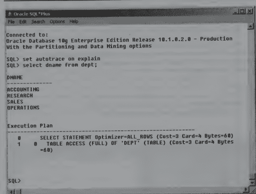

### 图 16-1. 使用 autotrace 的 SQL*Plus

## 列表 16-2：用于格式化 PLAN_TABLE 内容的 show_plan.sql SQL 脚本

```sql
1: set pagesize 20
2: set linesize 80
3: column id format 999 heading 'ID'
4: column parent_id format 999 heading 'P_ID'
5: column cost format 999 heading 'Cost'
6: column rows format 9,999,999 heading 'Rows'
7: column access_plan format a30 heading 'Access|Plan'
8: column access_path format a15 heading 'Access|Path'
9: column object_name format a15 heading 'Object|Name'
10: select cost, time, cardinality rows, time, id, parent_id,
     lpad(' ', 2 * level) || operation Access_Plan,
     options Access_Path, object_name
11: from plan_table
12: where statement_id = '61'
13: connect by prior id = parent_id
14: start with id = 0;
15: delete from plan_table where statement_id = '61';
```

列表 16-2 使用标准的 `SQL*Plus` 格式化命令（第 1 行到第 9 行）使输出外观更美观。实际的 SQL 位于第 10 行到第 14 行，它访问 `PLAN_TABLE` 中的行。第 15 行清理 `PLAN_TABLE`，为其下一次使用做准备。

### 提示

可以在第 9 行之后轻松插入 `SPOOL <file name>` 命令，并在第 14 行之后插入 `SPOOL OFF`，以便将此格式化的 `execution plan` 捕获到文本文件中。

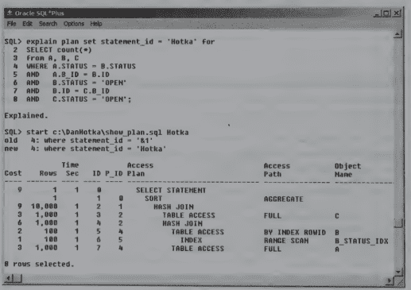

### 图 16-2. 未运行 SQL 语句的执行计划

## 理解执行计划（Explain Plan）

回顾其中一个显示的 `execution plan`（图 16-2 或 16-3）。Oracle 首先处理缩进最少的项。`execution plan` 的每个步骤都说明了 Oracle 如何代表 SQL 代码处理行或函数（例如排序），并且 `execution plan` 的每个步骤都有一个结果集，该结果集传递到与特定步骤的 `Parent_ID` 相关联的 `ID`。列表 16-2 中的 `show_explain_table` 允许用户查看从一个步骤到另一个步骤的关系。如果 `FROM` 子句中有多个表，那么将存在首先处理的连接条件。Oracle 一次处理两个表，创建一个结果集，然后引入 `FROM` 子句中的每个附加表（创建传递到下一步的新结果集），直到所有表都被处理完毕。

图 16-3 中的 `execution plan` 有八行（`ID` 0 到 7）。注意第一行指示正在处理的 SQL 语句类型。注意缩进

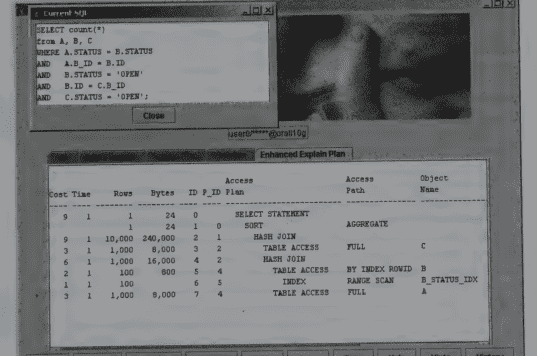

### 图 16-3. 免费的 Execution Plan 工具

以及 `ID` 列与 `Parent ID` 列之间的关系。第 4 步是一个哈希连接（`hash-join`）。第 5 步和第 7 步都将它们的结果传递给第 4 步。第 5 步使用一个索引（第 6 步）。哈希连接将创建一个中间输出，并传递给第 2 步。请注意，第 3 步也将其输出发送给第 2 步。这个表（表 C）将与第 4 步的中间结果集进行连接，然后传递给第 1 步，在那里 Oracle 将完成 SQL 的请求。在这种情况下，它是聚合函数 `count`。其他聚合函数包括 `min`、`max`、`avg` 等。

> **注意**
>
> `Oracle 10g` 仍然支持基于规则的优化器（`Rule-Based Optimizer`），
> 但仅出于向后兼容性。

执行计划包含表明 SQL 如何被处理的措辞。第一行总是正在处理的 SQL 类型：`SELECT` 语句、`INSERT` 语句、`UPDATE` 语句或 `DELETE` 语句。`Oracle 10g` 使用基于成本的优化器（`CBO`）来决定甚至考虑哪一个执行计划步骤。`CBO` 考虑成千上万个执行计划，并选择总成本最低的一个。事件转储 `10053` 将显示所有被考虑的执行计划。这些转储在本章后面的 `TKPro` 工具主题中讨论。执行计划第一行的 `cost` 列是总成本。此成本数字构成了磁盘 I/O/CPU 时间/计算机负载的估计，并为执行计划的每一行得出此“成本”数字。其中一些成本数字来自使用 `DBMS_STATS` 或在让 `Oracle 10g` 使用动态采样派生其自己的对象统计信息时收集的各种数据库对象的统计信息。

如果执行计划很长，有时仅使用缩进是不够的。`show_plan.sql` 脚本（清单 16-2）和 `TUNER`（见图 16-3）显示了 `ID` 和 `Parent_ID` 列。

如果 `FROM` 子句中有多个表，你会看到诸如嵌套循环（`Nested Loop`）、归并连接（`Merge Join`）和哈希连接（`Hash Join`）等术语，因为这些表正在被处理。表 16-3 包含这些术语的基本描述。嵌套循环处理第二个表（内表），针对第一个表（外表）返回的每一行进行一次。归并连接对涉及的两个表进行排序，并基于查找标准合并行。哈希连接在用户的程序全局区（由 `HASH_SIZE` 控制）创建一个工作区，并基于算术函数创建用于查找的键。这允许 Oracle “读取”一次表，然后基于此算术函数查找其值。

当 `FROM` 子句中有两个或更多表时，Oracle 创建一个结果集，这是一个内部临时表（如果此结果集大小超过 64K，则将其写入/操作于分配的临时表空间）。执行计划的每个内部步骤创建一个结果集，该结果集传递给父 ID 执行计划步骤。

| **哈希连接** | 表被处理（可能带有过滤条件）并放入一个通过数学计算产生的键（称为哈希键）访问的内存结构中。 |
| **归并连接** | Oracle 对正在连接的两个结果集（可能带有过滤条件）在连接列上进行排序，然后通过连接列合并结果。 |
| **嵌套循环** | 从外表或驱动表（在执行计划中列出的第一个表）中检索一行，然后与嵌套循环中引用的第二个内表或循环表中所有匹配的行进行连接。 |

## 表 16-3. 执行计划连接条件

当优化模式设置为 `FIRST_ROWS`，在相等条件期间，且优化器感知到驱动表不一定非常大时，Oracle 倾向于使用嵌套循环。当存在不等式条件（`<`、`<=`、`>` 或 `>=`）且源行已排序时，会考虑归并连接条件。当看到尺寸较小的表时，基于成本的优化器（`CBO`）倾向于使用哈希连接。哈希连接也只能在相等条件中使用。

> 提示
>
> *使用嵌套循环或归并连接时，请确保被等同的数据类型是相同类型。*

表 16-4 列出了执行计划中一些更常见的项。完全表访问（`Table Access Full`）是全表扫描。通过 `ROWID` 访问表总是跟随一行缩进，指示用于提供 `ROWIDs` 的索引。当索引包含 SQL 请求的所有信息，且 Oracle 认识到它根本不需要访问表时，会发生与表无关的索引访问。

> 注意
>
> *这绝不是执行计划功能的完整列表。请查阅 Oracle 性能调优指南以了解所有执行计划选项/描述。*

| 操作 | 描述 |
|---|---|


| `FILTER` | `FILTERS` 表示正在将行与条件进行检查，以确定它们是否应包含在结果集中。 |

| `TABLE ACCESS FULL` | 从开头到结尾访问表，不使用索引 |

| `TABLE ACCESS BY INDEX ROWID` | 表正在使用索引；此索引将在下一缩进行上。 |

| `HAVING` | SQL 语句包含 `HAVING` 语句。 |

| `INDEX (UNIQUE)` | SQL 语句利用唯一索引搜索特定值。 |

| `INDEX (RANGE SCAN)` | SQL 语句包含非相等或 `BETWEEN` 条件。 |

| `INLIST ITERATOR` | SQL 语句包含 `IN` 子句。 |

| `BITMAP INDEX` | 单值查找 |

| `BITMAP RANGE SCAN` | 基于值范围扫描索引 |

| `BITMAP FULL SCAN` | 处理索引中的所有叶块 |

| `COUNT` | 计算结果集中行数的操作 |

| `SORT AGGREGATE` | 与 `GROUP BY` 函数关联的排序操作 |

| `SORT JOIN` | 与 `MERGE-JOIN` 条件关联的排序操作 |

| `SORT ORDER BY` | 由 `ORDER BY` 子句发起的排序操作 |

### 表 16-4. 执行计划描述

## 理解优化器决策过程

基于成本的优化器（`CBO`）基于收集的对象统计信息和机器负载做出决策。这些对象统计信息包括直方图、块数、行数、碎片等。索引的统计信息包括聚集因子（每个叶块指向的不同数据块数量的关系）、键的粒度、索引类型等。如果不存在统计信息，则 Oracle 10g 将执行动态采样以获取对所涉及每个对象的明智猜测。如果动态采样被禁用，则 Oracle 10g 回退到先前版本 Oracle 中使用的假设。

`CBO` 首先查找 `FROM` 子句中有多少个表。如果有多个表，则 `CBO` 开始寻找将这些表连接在一起的最佳方式。它首先查找所涉及的表的结果集是否仅包含一行。如果选择条件涉及唯一索引或主键索引，`CBO` 可以轻松判断这一点。然后 `CBO` 从此表（称为驱动表）开始，并从那里处理所有其他表。`ORDERED` 提示通过告诉 `CBO` 按照在 `from` 子句中出现的顺序处理表来覆盖此选择过程。

在任何平局条件（在前面的例子中：两个表都有主键选择）的情况下，`CBO` 使用具有较新 `object_id` 的对象。

如果 SQL 包含外部连接（使用 `+` 语法）或包含子查询，则此表不被考虑作为驱动表。

然后 `CBO` 使用之前讨论的不同连接方法和访问路径生成一系列执行计划。`CBO` 基于统计信息估计每个计划步骤的 I/O 成本。然后 `CBO` 将其他各种收集的统计信息（如机器负载、缓冲缓存命中率、DB I/O 负载、排序区域大小、多块预读等）计入成本。然后 `CBO` 简单地选择总体成本最低的一个。所有这些被考虑的执行计划可以使用 Oracle 跟踪 `10053` 进行可视化。本章后面“使用 Oracle 跟踪设施”一节讨论了运行这些跟踪。哈希连接和归并连接的成本是从将对象读取到内存所需的 I/O 量计算得出的。归并连接还考虑所需的排序量（如果有）。Oracle 10g 将基于处于正确顺序的索引将行返回给执行计划。嵌套循环的成本基于从外表读取单个行乘以内表的预期 I/O 数量。

完全表扫描检索所有行并检查选择条件。表块被读取直到标记为高水位标记的块（接收插入的最后一个块）。

索引扫描显示为全扫描或快速全扫描，并且索引被命名为对象。在此实例中，Oracle 只处理索引的叶级别。全扫描逐个叶块进行，而快速全扫描使用多块预读（由启动参数 `DB_FILE_MULTIBLOCK_READ_COUNT` 控制）读取叶块。

除非索引键列满足 SQL 的数据请求，否则索引扫描总是与表访问相关。

完全表扫描可以基于多个标准被选中。简单的解决方案是表的选择条件上缺少索引。如果 `CBO` 基于选择条件确定需要检查大多数行，则 `CBO` 将计算出一个使用完全表扫描的执行计划以供考虑。其他标准包括如果表很小，即其总块数少于多块预读值，因此索引具有较差的聚集因子

更接近表格中的行数，而非表格中的块数）。`FULL(<table name>)` 提示同样会启动全表扫描。

当索引列与筛选条件、排序条件和分组条件匹配时，会考虑使用索引扫描。快速全索引扫描（Fast full scans）用于排序和分组条件。当筛选条件包含使用 `$>`、`$>=$` 或 `between` 语法的索引列时，你可能会看到全表扫描。

## 一个实际示例

SQL 语句调优更像是一门艺术，而非火箭科学。首先要关注的是执行计划每一步返回的行数。在执行计划过程中尽早消除的行数越多，传递到处理 ID 链上的中间结果集所写入/存储/处理的行数就越少。基于成本的优化器（`CBO`）不仅会暴露行数和字节数，还包括执行计划每一步所花费的秒数。这使得查看 Oracle 在处理特定 SQL 语句时时间和精力的分布变得更加容易。

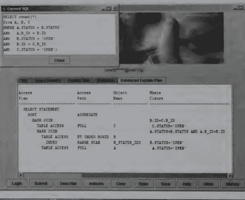

图 16-4. JSqler 显示 WHERE 子句谓词

回顾图 16-2 中的 SQL，请注意 ID 步骤 5 和 6 正在处理 100 行，而步骤 4 的哈希连接从步骤 7 引入了 10000 行。在处理完步骤 3 中的表 C 之后，该 SQL 在步骤 2 时已经达到了 10,000 行！通常，这表明该 SQL 语句亟需关注，因为它一开始只有很少的行，但在后续处理中引入了更多行。理想的执行计划在早期步骤中应有较大的行数，随着行数的消除，较小的结果集会沿着执行计划向上传递。

图 16-4 说明了将 WHERE 子句语句与其在执行计划中的步骤对应起来的重要性。在审查此类执行计划时，查看筛选条件至关重要，这样用户就能准确看到是什么导致了如此多行的选择，并据此进行代码调整、添加/更改索引结构，甚至添加提示。此特定 SQL 语句的真正问题在于所有筛选列都包含相同的数据。这就是为什么即使存在索引，`CBO` 仍选择进行全表扫描的原因。

图 16-5 展示了 `CBO` 基于更现实的数据做出的决策，而图 16-6 则显示了与每个执行计划步骤相对应的 WHERE 子句谓词。这个执行计划中有几个有趣的访问路径（Access Paths）。注意 `CBO` 从 IN-List 开始。回顾图 16-6，你可以看到这来自 ID 步骤 6 的索引访问，`CBO` 选择了 WHERE 子句的第一行。注意在 ID 步骤 5 中，返回给表的行随后使用 `attendance_qty` 和 `games_behind_qty` 进行处理（这些列没有索引）。`CBO` 选择以 Teams 表作为驱动表，因为根据统计数据，它可以消除大多数需要处理的行。注意步骤 4 中的 INLIST 将其结果集返回给步骤 3（哈希连接），步骤 7 也是如此。在此步骤之后，执行计划迅速减少到 160 行。如果显示空间允许展示所有内容，Time 列也将支持此处看到的 I/O 工作量，因为大部分时间都花在了处理步骤 4 的 INLIST 上。

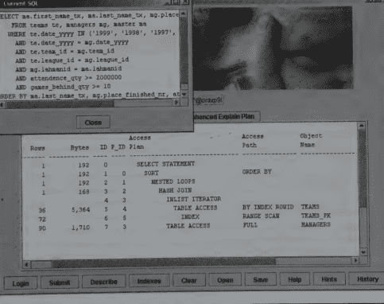

### 图 16-5. 一个更大的数据库示例

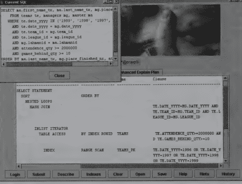

### 图 16-6. 带有 WHERE 子句谓词的更大数据库示例

## 控制优化器的决策

提示（Hints）是一种可以添加到 `SELECT`、`UPDATE` 和 `DELETE` 语句中的语法，用于指导 `CBO` 做出不同的决策。提示是一种指令，在大多数情况下，`CBO` 会使用提示来生成执行计划。可以应用多个提示。如果两个或更多提示相互冲突（例如，一个提示表示使用表的某个索引，而下一个提示表示在同一对象上使用不同的索引，则两者会发生冲突），Oracle 会采用冲突提示中的最后一个，并忽略其他的。（Oracle 仍然从后向前解析，因此它遇到的第一个提示就是列表中的最后一个提示。）`CBO` 也会忽略任何带有语法错误的提示。Oracle 不会发出警告，但执行计划将不会反映预期的提示。

> **注意**
>
> 如果你仍然有*使用 `PL/SQL v1` 的应用程序*（*`Forms 3.0`, `Forms 4.5`, `Reports 2.5`*），提示将被忽略。

表 16-5 展示了一些常见的提示。提示分为几个类别。优化目标提示可以改变优化器的行为。可以选择 Oracle8 和 Oracle9 的默认优化行为。这告诉 Oracle 如果任何对象都有统计数据，则使用基于成本的优化器；否则，使用基于规则的优化器。首行优化（First-rows optimization）倾向于寻找主键/唯一键情况，尝试选择能以最少时间处理 SQL 的执行计划。

| 提示 | 描述 |

| :--- | :--- |

| **优化目标提示** | |

| `/*+ ALL_ROWS */` | 指示 `CBO` 搜索总体最佳响应时间 |

| `/*+ FIRST_ROWS(<number>) */` | 指示 `CBO` 搜索最佳初始行响应时间 |

| `/*+ RULE */` | 指示 Oracle 使用基于规则的优化器 |


| `/*+ CHOOSE */` | 指示 Oracle 根据对象统计信息的存在情况选择优化器 |
| **连接提示** | |
| `/*+ USE_HASH(<table name>) */` | 指示 CBO 使用哈希连接 |
| `/*+ USE_MERGE(<table name>) */` | 指示 CBO 使用合并连接 |
| `/*+ USE_NL(<table name>) */` | 指示 CBO 使用嵌套循环连接 |
| **访问路径提示** | |
| `/*+ FULL(<table name>) */` | 全表扫描 |
| `/*+ HASH(<table name>) */` | 指示 CBO 在内存中创建哈希表 |
| `/*+ INDEX(<table name> <index name>) */` | 指示 CBO 使用特定索引 |
| `/*+ INDEX_ASC(<table name> <index name>) */` | 指示 CBO 使用特定索引进行升序搜索，例如排序或分组 |
| `/*+ INDEX_COMBINE(<table name> <index name>) */` | 指示 CBO 组合两个或更多索引；对位图索引非常有用 |
| `/*+ INDEX_FFS(<table name> <index name>) */` | 指示 CBO 对索引进行快速全索引扫描 |
| `/*+ INDEX_JOIN(<table name> <index name>) */` | 等同于 INDEX_COMBINE |
| `/*+ LEADING(<table name>) */` | 指示 CBO 从此表开始考虑连接，并允许 CBO 基于统计数据选择其他表 |
| `/*+ ORDERED */` | 指示 CBO 基于此顺序连接 FROM 子句中的表，而不是基于统计数据 |
| `/*+ AND_EQUAL(emp index1, index2, ...)*/` | Oracle 在执行计划中每个表最多只使用五个索引。此提示允许用户确定考虑哪些索引 |
| **其他提示** | |
| `/*+ CACHE(<table name>) */` | 指示 CBO 将整个表读入缓冲区缓存 |
| `/*+ NOCACHE(<table name>) */` | 指示 CBO 不要将整个表读入缓冲区缓存 |

**表 16-5.** *Oracle 10g SQL 提示简要总结*

All-rows（全行）尝试优化 SQL（通常是长时间运行的 SQL）以获得最佳整体性能。Oracle 10g 的默认优化模式是 First-rows（首行）。

其他类别包括连接顺序（强制 CBO 使用嵌套循环、合并连接或哈希连接）、访问目标（大多数索引提示属于此类）以及一些特殊目标，如查询重写、并行等。

> **注意**
>
> 请参阅 SQL 参考指南获取所有提示的完整列表。

图 16-7 说明了如何使用提示。注意较小窗口中的 `/++FULL(B) */` 语法。该提示已添加到创建图 16-5 的示例中。注意在这个执行计划中，该提示确实被使用了，并且该执行计划行的成本数字增加了，执行计划的总体成本也从 9 增加到了 10。CBO 确实做出了相当不错的决策。

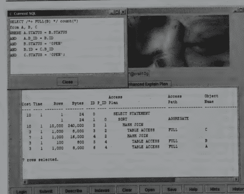

图 16-7. 提示示例


> *提示*
>
> *我发现 `ORDERED` 和 `INDEX_JOIN` / `INDEX_COMBINE` 提示符（hints）最为有用。通常，当基于成本的优化器（CBO）选择不使用索引时，往往有特定的原因（例如聚集因子等）。*


> *提示*
>
> *如果 FROM 子句使用了表别名，请确保在提示符（HINT）中使用表别名而不是表名。*

## SQL 调优技巧

从编码角度来看，有一些做法可以帮助 CBO 做出更好的决策，或者在原本可能无法使用索引的情况下启用索引。另一种做法是编写代码以生成更短的执行计划，从而减少对数据库的访问次数。

如果某列上存在任何形式的函数，Oracle 将不会使用该列上的索引。例如，…`WHERE SUBSTR(ename,1,5) = 'SMITH'` 不会使用 `ename` 列上可用的索引，但像这样的编码风格就可以：…`WHERE ename LIKE 'SMITH%'`。当搜索前导列时，这种编码风格效果良好。如果 `LIKE` 函数以字符串开头而不是其通配字符，它将使用该索引。Oracle6i 引入了函数索引，当没有简单的变通方法且带函数的列的性能成为问题时，允许在这些情况下使用索引。

确保 `WHERE` 子句两侧的字段具有相同的数据类型。Oracle 只比较具有相同数据类型的项。在解析 SQL 语句时，如果 Oracle 注意到被比较的两个列具有不同的数据类型，它会在其中一侧添加 `TO_CHAR` 或 `TO_NUMBER` 函数。这种内部添加在用户界面上不可见，但在该示例中假设列已建立索引，这将在已建立索引的列上成为一个函数，而 Oracle 根本不会使用该列上可用的索引。如果必须比较不同的数据类型，请通过在 `WHERE` 子句中自行添加适当的函数来控制 Oracle 执行转换的位置。

`WHERE` 子句中的计算也会导致 Oracle 不使用可用的索引。诸如 …`WHERE SAL * 1.1 > 100` 这样的 `WHERE` 子句代码应编写为 `WHERE SAL > 100/1.1`，将计算从已建立索引的列中移开。

不要在 `WHERE` 子句中将已建立索引的列连接在一起与字符串进行比较，例如 `WHERE deptno || manager = '201346'`。始终在 `WHERE` 子句中将每个已建立索引的列放在单独的一行，例如：`WHERE deptno = 20 AND manager = 1346`。

在引用已建立索引的列时，尽量避免使用 `NOT`。例如，‘`NOT <`’ 等同于 ‘`>=`’，‘`NOT <=`’ 等同于 ‘`>`’，‘`NOT >`’ 等同于 ‘`<=`’，并且 ‘`NOT >=`’ 等同于 ‘`<`’。

使用 `IN` 子句比多个查询同一列多个值的 `WHERE` 语句更高效。在 `WHERE` 子句中使用 `EXISTS` 优于在 `SELECT` 子句中使用 `DISTINCT`（`DISTINCT` 在所有行返回后应用；`WHERE` 子句谓词限制了返回的行数）。

使用 `GROUP BY` 子句时，使用 `WHERE` 子句行来限制行数，优于使用 `HAVING` 子句。`WHERE` 子句将限制返回的行数，而 `HAVING` 子句将在所有行返回后应用。

### 查找性能不佳的 SQL

有几种方法可以查找性能不佳的 SQL。Oracle 提供了几个有用的工具，例如 Enterprise Manager 的 `TOP`（列出符合所选条件的主要 SQL，如 IO、时间等）、Oracle 跟踪设施（又称跟踪文件和 `TKProf`/`Trace Analyzer`）以及 `Statspack`（统计信息和 SQL 文本收集）。许多专家/DBA/IT 人员编写了许多脚本，用于深入研究 Oracle 的动态性能视图（又称 `V$` 表），以识别特定的性能问题。

### 使用脚本

Oracle 运行的 SQL 可以从几个位置轻松访问。列表 16-3 展示了 `V_$SQLAREA` 视图。该视图显示了 SQL 以及关于特定 SQL 语句的大量信息。可以轻松编写 SQL 来查看符合各种条件的 SQL 语句。还可以将该视图中的信息与其他 `V$` 信息结合使用，以找出导致特定问题的特定 SQL。

### 列表 16-3：V_$SQLAREA 列表

```
dhotkaun:ORA10g:SYSTEM>desc v_$sqlarea
```

Name                     Null?    Type

---                    -------    ----

SQL_TEXT                 VARCHAR2(1000)

SQL_ID                   VARCHAR2(13)

SHARABLE_MEM             NUMBER

PERSISTENT_MEM           NUMBER

RUNTIME_MEM              NUMBER

SORTS                    NUMBER

VERSION_COUNT            NUMBER

LOADED_VERSIONS          NUMBER

OPEN_VERSIONS            NUMBER

USERS_OPENING            NUMBER

FETCHES                  NUMBER

| EXECUTIONS | NUMBER |

| --- | --- |

| END_OF_FETCH_COUNT | NUMBER |


| USERS_EXECUTING | NUMBER |
| LOADS | NUMBER |
| FIRST_LOAD_TIME | VARCHAR2(19) |
| INVALIDATIONS | NUMBER |
| PARSE_CALLS | NUMBER |
| DISK_READS | NUMBER |
| DIRECT_WRITES | NUMBER |
| BUFFER_GETS | NUMBER |
| APPLICATION_WAIT_TIME | NUMBER |
| CONCURRENCY_WAIT_TIME | NUMBER |
| CLUSTER_WAIT_TIME | NUMBER |
| USER_IO_WAIT_TIME | NUMBER |
| PLSQL_EXEC_TIME | NUMBER |
| JAVA_EXEC_TIME | NUMBER |
| ROWS_PROCESSED | NUMBER |
| COMMAND_TYPE | NUMBER |
| OPTIMIZER_MODE | VARCHAR2(25) |
| PARSING_USER_ID | NUMBER |
| PARSING_SCHEMA_ID | NUMBER |
| KEPT_VERSIONS | NUMBER |
| ADDRESS | RAW(4) |
| HASH_VALUE | NUMBER |
| OLD_HASH_VALUE | NUMBER |
| MODULE | VARCHAR2(64) |
| MODULE_HASH | NUMBER |
| ACTION | VARCHAR2(64) |
| ACTION_HASH | NUMBER |
| SERIALIZABLE_ABORTS | NUMBER |
| CPU_TIME | NUMBER |
| ELAPSED_TIME | NUMBER |
| IS_OBSOLETE | VARCHAR2(1) |
| CHILD_LATCH | NUMBER |
| PROGRAM_ID | NUMBER |

查找任何 SQL 语句文本的关键列是 `ADDRESS` 和 `HASH_VALUE`。使用这两个字段可以唯一地识别所需的特定 SQL。列表 16-6 和 16-7 中的脚本返回导致所识别特定问题的 SQL 的 `ADDRESS` 和 `HASH_VALUE`。这些脚本可以轻松修改以包含实际的 SQL 文本。列表 16-4 和 16-5 是另外两个显示 SQL 文本的 V$ 表。列表 16-4 显示了 `V_$SQLTEXT` 中可用的列，图 16-8 显示了 `V_$SQLTEXT_WITH_NEWLINES` 中可用的列。这个 V$ 表在字符模式显示器或报告中格式化显示 SQL 时更加美观。`V_$SQLAREA` 和 `V_$SQLTEXT` 都将 SQL 语句存储在一个连续字符串中。

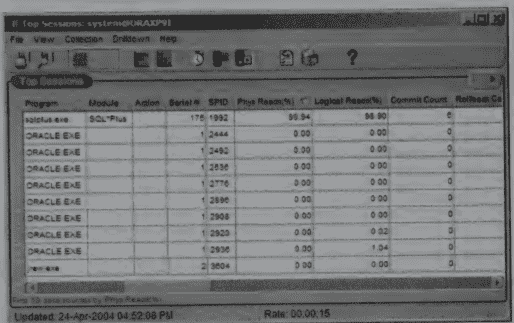

图 16-8. Oracle Enterprise Manager 的 Top Sessions 窗口

审查 `V_$SQLAREA` 列，并注意在查找问题 SQL 时可以访问的各种类型的 SQL。

### 列表 16-4：V_$SQLTEXT 列表

```
dhotkaun:ORA10g:SYSTEM>desc v_$sqltext
```

Name        Null?     Type

----------   --------- ------------------------

ADDRESS                 RAW(4)

HASH_VALUE              NUMBER

SQL_ID                  VARCHAR2(13)

COMMAND_TYPE            NUMBER

PIECE                   NUMBER

SQL_TEXT                VARCHAR2(64)

### 列表 16-5：V_$SQLTEXT_WITH_NEWLINES 列表

```
dhotkaun:ORA10g:SYSTEM>desc v_$sqltext_with_newlines
```

Name        Null?     Type

----------   --------- ------------------------

ADDRESS                 RAW(4)

HASH_VALUE              NUMBER

| Name | Type |
|---|---|
| SQL_ID | VARCHAR2(13) |
| COMMAND_TYPE | NUMBER |
| PIECE | NUMBER |
| SQL_TEXT |  |

### 列表 16-6：查找长时间运行的 SQL 语句的脚本

```
/***********************************************
* File: Long_Running_SQL.sql
* Type: SQL*Plus script
* Author: Dan Hotka (www.DanHotka.com)
* Date: July 9, 2003
*
* Description:
* This script lists the SQL statements associated with IO Activity
*
* Modifications:
**********************************************/
select a.event, a.sid, d.name, b.segment_name, c.sql_address,
 c.sql_hash_value from v$session_wait a, dba_extents b, v$session c,
v$datafile d
where a.event in ('buffer busy waits','db file sequential read','db file
scattered read')
and b.file_id = a.p1
and a.p2 between b.block_id and b.block_id + b.blocks + 1
and a.sid = c.sid
and a.p1 = d.file#;
```

列表 16-6 中的脚本对于查找长时间运行的 SQL 很有用。它主要基于 `V$SESSION_WAIT` 视图，查找等待缓冲区缓存加载的事件（表明 SQL 正在访问大量数据块）和顺序读取（全表扫描）。该脚本通过可用信息标识正在访问的表。然后可以使用该脚本提供的 `HASH_VALUE` 和 `ADDRESS` 轻松查找 SQL 语句。

### 列表 16-7：查找问题 SQL 的脚本

```
/***********************************************
* File: waiting.sql
* Type: SQL*Plus script
* Author: Dan Hotka (www.DanHotka.com)
* Date: Feb 21, 2003
*
* Description:
* This script lists top wait events
*
* Modifications:
```

```sql
select w.event, w.p1 "File", w.p2 "Blocks", w.p3 "Total Blocks", wait_time,
e.segment_name, s.sql_address, s.sql_hash_value
from v$session_wait w, dba_extents e, v$session s
where w.event in ('db file sequential read','db file scattered read','buffer busy waits','write complete waits')
and e.file_id = w.p1
and w.p2 between e.block_id and e.block_id + e.blocks -1
and w.sid = s.sid;
```

列表 16-7 中的脚本对于识别导致重要等待事件（例如全表扫描）的 SQL 非常有用，这类操作经常填满缓冲区缓存并引发大量写操作。此类 SQL 会引发大量的 I/O 活动，当寻找导致整体性能问题的 SQL 时，它可能是一个很好的切入点。

## 列表 16-8：查找热点表空间的脚本


```sql
/*
* File: tablespace_file_IO.sql
* Type: SQL*Plus script
* Author: Dan Hotka (www.DanHotka.com)
* Date: Feb 21, 2003
*
* Description:
* This script lists the hot database files and their associated tablespaces.
*
* Modifications:
*/
select t.name, d.name, PHYRDS, PHYWRSTS, PHYBLKRD, PHYBLKWRT
from v$tablespace t, v$datafile d, v$filestat s
where d.file# = s.file#
and t.ts# = d.ts#
order by 1,2;
```

有时问题并不在于 SQL 语句，而可能是 Oracle 资源上存在某种竞争。列表 16-8 中的脚本显示了具有最多 I/O 活动的 Oracle 表空间及其文件。这类问题通常是因为频繁访问的表或索引过多地集中在同一个特定的数据文件或表空间上。

## 使用 Top Sessions

Oracle Enterprise Manager 包含 Top Sessions 功能，该功能位于诊断包中。Top Sessions 有助于轻松挖掘出在 `V_$SQL_AREA` 中发现的问题 SQL。图 16-8 显示了与这些会话相关的进程、I/O、计时以及其他信息。点击标题后，Top Sessions 将根据点击的列对数据进行重新排序。此工具使查找当前正在运行的问题 SQL 变得非常容易。

图 16-9 展示了导致图 16-8 中所示活动的实际 SQL。通过在菜单栏上点击 Drilldowns（下钻）按钮即可轻松访问此信息。还有其他选项，但这里展示的是 Current SQL（当前 SQL）。

## 使用 Statspack

有时很难在应用程序运行期间捕获问题 SQL，或者问题 SQL 只是偶尔出现，使用前面讨论过的脚本或 Enterprise Manager Top Sessions 可能很难将其可视化。最后两种工具还能识别各种问题以及问题 SQL。Statspack 在收集有助于确定问题发生时间的统计数据方面非常有用。有时，该功能甚至可以捕获到问题 SQL。Statspack 会收集会话、进程的所有 SQL，或在数据库范围内进行全局收集。

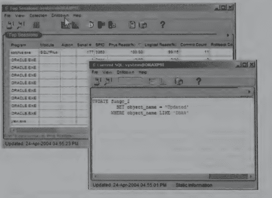

**图 16-9.** Oracle Enterprise Manager 的当前 SQL 下钻视图

Statspack 易于设置和使用。请参考 Oracle 文档了解安装步骤。

Statspack 收集周期性统计信息（称为快照），可以比较这些快照并报告差异。列表 16-9 展示了 Statspack 的报告示例。所提供的各种信息有助于查明问题发生的时间。

## 列表 16-9：Statspack 报告示例（部分列表）

| 快照 ID | 快照时间 | 会话数 |
|---|---|---|
| 45 | 29-Apr-04 10:01:47 | 8 |
| 46 | 29-Apr-04 11:01:35 | 8 |

**起始快照：** 45  
**结束快照：** 46  
**经过时间：** 3600 秒

**缓存大小**  
`db_block_buffers`: 2400 `db_block_size`: 8192 `log_buffer`: 1024 `shared_pool_size`: 10000000

| 负载概况 | 每秒 | 每事务 |
|---|---|---|
| Redo 大小： | 220.85 | 835.11 |
| 逻辑读： | 447.82 | 1487.67 |
| 块更改： | 14.24 | 7.76 |
| 物理读： | 1,677.88 | 885.45 |
| 物理写： | 362.00 | 18.00 |
| 用户调用： | 18.00 | 23.51 |
| 解析： | .19 | .39 |
| 硬解析： | .28 | 7.28 |
| 排序： | 1,025 | 223.33 |
| 登录： | .002 | .002 |
| 执行： | 223 | 223 |
| 事务： | 1 | 1 |

**实例效率百分比（目标 100%）**  
Buffer Nowait %: 99.99 Buffer Hit %: 99.99 Redo Nowait %: 99.97 In-memory Sort %: 100.00

| 前 5 等待事件 | 总计 | 等待次数 | 时间（厘秒） | 等待时间 % |
|---|---|---|---|---|
| buffer busy waits | 27,845 | 3,454 | 60.70 |
| db file sequential read | 1,753 | 4,225 | 24.00 |
| db file scattered read | 1,145 | 1,890 | 16.00 |
| SQL*Net | 459 | 976 | 2.159 |
| Enqueue | 3 | 9 | 2.21 |

Statspack 可以按要求频率运行。大多数使用 Statspack 的组织每小时收集一次统计数据，而存在问题的系统可能每分钟或每五分钟收集一次。Statspack 包含用于清除旧数据/过时/无用收集内容的实用工具。`STATPACK.SNAP` 过程从命令行或计划任务中执行，以进行周期性收集。Statspack 有三个收集级别：Level 0 为通用性能，Level 5 为 Level 0 加上相关的 SQL 语句，Level 10 为 Level 0 和 5 加上额外的子级统计信息。默认收集类型为 Level 5。`RPT_LAST.sql` 用于生成输出报告。默认情况下，此脚本将比较最近两次收集。它也可以用于比较任意两次收集。

### 使用 Oracle 跟踪功能

Oracle 已经可以通过跟踪功能收集 SQL 有一段时间了。此功能使用户能够捕获与某个会话/应用程序/多个应用程序相关的所有 SQL。可以根据问题发生的时间、在问题重现之前或在测试之前来设置跟踪。收集 SQL 语句赋予用户/开发人员能够按 Oracle 处理顺序捕获所有 SQL 的能力。

有许多种类的跟踪。本节将重点介绍 10046（读作 ten-forty-six）跟踪。例如，10053 跟踪将显示成本基于优化器考虑的所有执行计划。其他跟踪允许用户捕获执行排序的所有 SQL 等。

10046 跟踪是一种应用程序 SQL 捕获跟踪。开启它很容易，并且有几种方法可以触发此跟踪的开启和关闭。

方法 1 使用语法：`ALTER SYSTEM SET SQL_TRACE = TRUE` 来创建 10046 跟踪，以捕获 Oracle 正在处理的所有 SQL。这会生成一个极大的跟踪文件，因此你要查找的 SQL 将很难找到。`ALTER SESSION SET SQL_TRACE = TRUE` 将捕获此特定会话的所有 SQL。当应用程序处理完成时，发出 `ALTER SESSION SET SQL_TRACE = FALSE` 以停止跟踪并关闭跟踪文件。


> **注意**  
> 如果你的系统磁盘空间有限，你可能希望使用此语法来限制生成的跟踪文件的大小：`ALTER SESSION SET MAX_DUMP_FILE_SIZE=<size in bytes>`。

方法 2 允许你跟踪另一个会话。此跟踪所需的信息可以通过查询 `V$SESSION` 视图找到。使用 `DBMS_SYSTEM.set_sql_trace_in_session(<sid>, <serial#>, true)` 语句触发开启此跟踪，使用 `DBMS_SYSTEM.stop_sql_trace_in_session(<sid>, <serial#>)` 语句关闭。

方法 3 让你对跟踪文件的内容有更多控制。列表 16-10 中的语法触发了跟踪开启。注意 Level 语法。这些级别允许你在跟踪文件中的每个 SQL 语句中收集额外信息。表 16-6 描述了各种级别的含义。

## 列表 16-10：方法 3 设置 Oracle 跟踪开启/关闭


```sql
Alter session set timed_statistics=true;
Alter session set max_dump_file_size = unlimited;
Alter session set tracefile_identifier='Hotka';
Alter session set events '10046 trace name context forever, level 12';
Select 'Hello World!' from dual;
Alter session set events '10046 trace name context off'
```

### 提示

我喜欢设置 `tracefile_identifier` 语法，因为它使你在 Oracle Dump Dest 位置更容易找到你的跟踪文件。`tracefile_identifier` 语法适用于上述任何开启跟踪的方法。此标识符最长可达 60 个字符。

### 注意

这些跟踪文件的位置是用户转储目标。使用此查询可以轻松找到该位置：

```sql
SELECT value FROM v$parameter WHERE name = 'user_dump_dest';
```

`TKProf` 是一个字符模式应用程序，用于将跟踪文件解释为可读格式。图 16-10 显示了 `TKProf` 的所有可用选项。

| 级别 | 描述 |
| :--- | :--- |
| 0 | 无统计信息 |
| 1 | 包含解析、执行和获取统计信息的跟踪文件 |
| 4 | 包含选项 1 以及 SQL 绑定变量内容的跟踪文件 |
| 8 | 包含选项 1 以及 Oracle 等待事件信息的跟踪文件 |
| 12 | 包含选项 1、4 和 8 的跟踪文件 |

**表 16-6. 跟踪级别描述**

# 图 16-10. TKProf 命令行选项

一个重要的功能是 `sort=` 选项。该选项将按照你希望的顺序对输出进行排序。输出的顺序可以按照输出的数字中的几乎任何一个进行排序（请参阅列表 16-11 中的输出示例）。`print=` 选项将限制输出显示为多个 SQL 语句。`SYS=no` 表示不应显示系统生成的 SQL。

# 列表 16-11：TKProf 跟踪文件输出

```
TKPROF: Release 10.1.0.2.0 - Production on Sun Apr 25 11:37:14 2004 
Copyright (c) 1982, 2004, Oracle.  All rights reserved. 

Trace file: ora110g_ora_ 20655_Hotka.trc 
Sort options:   fchela 
***********************************
count        = number of times OCI procedure was executed 
cpu          = cpu time in seconds executing 
elapsed      = elapsed time in seconds executing
disk         = number of physical reads of buffers from disk
query        = number of buffers gotten for consistent read
current      = number of buffers gotten in current mode (usually for update)
rows         = number of rows processed by the fetch or execute call
**********************************************************************

SELECT count(*)
from B, C, A
WHERE A.STATUS = B.STATUS
AND	A.B_ID = B.ID
AND	B.STATUS = 'OPEN'
AND	B.ID = C.B_ID
AND	C.STATUS = 'OPEN'
```

| 调用 | 次数 | CPU | 经过时间 | 磁盘 | 查询 | 当前 | 行 |
| :--- | :--- | :--- | :--- | :--- | :--- | :--- | :--- |
| 解析 | 1 | 0.07 | 0.09 | 2 | 148 | 0 | 0 |
| 执行 | 1 | 0.00 | 0.00 | 0 | 0 | 0 | 0 |
| 获取 | 2 | 0.03 | 0.14 | 14 | 16 | 0 | 1 |
| 总计 | 4 | 0.10 | 0.23 | 16 | 164 | 0 | 1 |

解析期间库缓存未命中次数：1

优化器模式：ALL_ROWS

解析用户 ID：58

| 行数 | 行源操作 |
| :--- | :--- |
| 1 | SORT AGGREGATE (cr=16 pr=14 pw=0 time=142823 us) |
| 10000 | HASH JOIN (cr=16 pr=14 pw=0 time=173224 us) |
| 1000 | TABLE ACCESS FULL A (cr=7 pr=6 pw=0 time=67065 us) |
| 1000 | HASH JOIN (cr=9 pr=8 pw=0 time=64218 us) |
| 100 | TABLE ACCESS BY INDEX ROWID B (cr=2 pr=2 pw=0 time=49407 us) |
| 100 | INDEX RANGE SCAN B_STATUS_IDX (cr=1 pr=1 pw=0 time=32783 us) |
| | (object id 49477) |
| 1000 | TABLE ACCESS FULL C (cr=7 pr=6 pw=0 time=5299 us) |

经过时间包括等待以下事件：

| 等待的事件 | 次数 | 最大等待 | 总等待 |
| :--- | :--- | :--- | :--- |
| SQL*Net message to client | 2 | 0.00 | 0.00 |
| db file sequential read | 4 | 0.03 | 0.06 |
| db file scattered read | 2 | 0.00 | 0.00 |
| SQL*Net message from client | 2 | 17.32 | 17.32 |

. （为了节省篇幅，省略了其他 SQL）

```
Trace file: ora110g_ora_20655_Hotka.trc
Trace file compatibility: 10.01.00
Sort options: fchela
       1 session in tracefile.
      9 user SQL statements in trace file.
     47 internal SQL statements in trace file.
     55 SQL statements in trace file.
     22 unique SQL statements in trace file.
    1161 lines in trace file.
elapsed seconds in trace file.
```

图 16-11 展示了 `TKProf` 的运行效果。注意，`pwd` 命令显示了此 Oracle 10g 实例上的转储目标。还要注意跟踪文件的名称。`TRACEFILE_IDENTIFIER` 被设置为 `'Hotka'`，这使得该跟踪文件更容易识别。跟踪文件输出（来自 `TKProf` 的输出）在文件顶部显示了所有选项。列表 16-11 展示了跟踪文件输出的一部分。开头是有关 Oracle 实例的所有信息、跟踪文件的名称以及用于处理跟踪文件的任何选项。注意第一个 SQL 语句。SQL 语句后面的一组数字是 `TKProf` 可以据此进行排序的项目。还显示了一些附加信息（如优化器模式等），然后是执行计划。请注意，时间精确到百分之一秒，出现在解释计划的每一步中。由于此跟踪为 12 级跟踪，因此显示了 Oracle 等待信息。如果该 SQL 语句有绑定变量，这些变量也会在此处显示。

为了节省篇幅，列表 16-11 进行了精简。在跟踪输出文件的末尾，有关于该跟踪的额外信息，如其名称以及被解释的跟踪文件内部信息。

## 摘要

本章向读者介绍了 SQL 语句调优。执行计划或解释计划用于直观展示 Oracle 10g 如何解释 SQL 以及如何为 SQL 检索数据。本章还讨论了如何解释这些计划，以及如何使用提示和编码技术来控制它们。本章最后总结了查找问题 SQL 的几种不同方法。

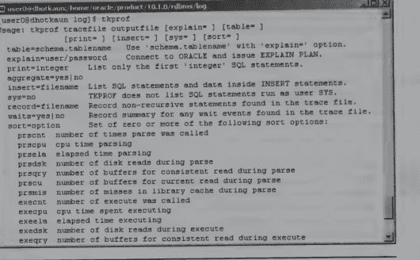


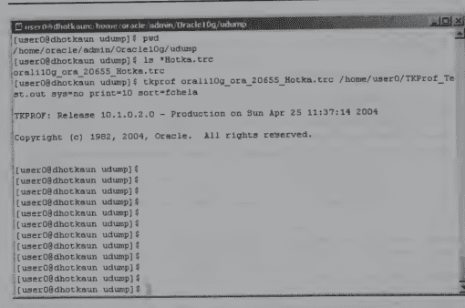

图 16-11. TKProf 运行效果


# 第 17 章 索引与分区

## Oracle 10g 索引选项简介

Oracle 10g 支持 B\*Tree 索引结构和位图索引结构。表对象有一个名为 `ROWID` 的伪列。*伪列*是指你可以专门选择但并非物理结构的一部分的列。`ROWID` 就是这样一个列，它表示该物理行在数据库中的位置。`ROWNUM` 是另一个这样的列。`ROWNUM` 是输出游标中的行号。索引存储此 `ROWID` 并将其与表对象中的一个或多个列相关联。这些列在索引中被称为*关键字段*。多列索引键称为*复合键*。索引允许大幅缩短访问时间，特别是对于占据多个数据库块的表。实际上，表可以拥有多个索引。

Oracle 使用 B\*Tree（平衡树）结构来存储索引信息。即使位图索引也使用 B\*Tree 结构。该结构类似于倒置的树，具有多个分支层（包含部分键并指向下一个分支块或叶块的块），而在底部或最后一层是叶块。这些叶块实际上包含索引键值及其关联的 `ROWID`。索引始终以键值顺序维护。如果叶块填满，它会分裂，并将叶行的一半移动到一个新块；然后新行插入到正确的顺序位置。指针经过调整，以便新的叶块将按键值顺序被访问。

图 17-1 展示了 `EMP` 表中 `EMPNO` 上的索引可能呈现的样子。在大多数情况下，Oracle 从上到下处理索引。顶层分支具有部分键值，并指示在哪里找到与该键关联的下一个分支块。下一个分支块也将具有部分键（但包含更多的值），并再次指向另一个分支块或叶块。叶块实际上存储完整的键值以及具有该键值的表数据的 `ROWID`。

本章重点介绍两个重要的调优主题：索引和分区。索引存储键值和行 ID（物理行地址）；在大多数情况下，它们可以大大减少 SQL 的响应时间。分区是将较大对象划分为较小部分的一种方法。应用程序可以使用分区轻松删除数据并加载数据，同时不影响其他用户。这些较小的部分更易于管理（备份和恢复），并且在正确使用相关知识时，可以带来可观的性能效益。

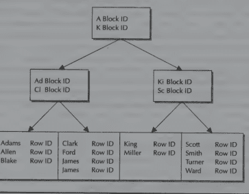

图 17-1. 简单的 B-树索引结构

提示

Oracle 10g 在表空间级别支持多种块大小。块大小越大，每次物理读取可以存储的键值/`ROWID` 越多。这意味着对于较大的对象，索引处理速度更快。

注意

`ROWID` 由四个部分组成，唯一地标识 Oracle 中的一行及其位置。这四个部分是对象 ID、文件号、块号和行号。此数以 base64 字符格式存储。`DBMS_ROWID` 包有助于将此 `ROWID` 字段的部分解释回有意义的数字。

当 Oracle 使用索引进行单行查找（相等条件）时，它将从顶层分支开始，通过分支块导航到具有该键值的叶块。在键值重复的情况下，分支块始终指向最左侧的叶块，因为 Oracle 始终读取

叶块从左到右排列。当 Oracle 执行范围扫描（由 `>`、`between` 或 `group by` 子句发起）时，它会向下遍历分支层级，直到到达该范围的**最左侧**（或最低端）键值；然后它逐块读取叶块，直到满足条件为止。Oracle 之所以能做到这一点，是因为每个叶块始终指向序列中的下一个叶块。

Oracle 还可以仅对索引进行**全扫描**。当索引键值满足 SQL 要求时，Oracle 将始终仅使用索引。索引的全扫描仅在叶级别进行读取并遍历整个索引。Oracle 有时会选择这种方式代替执行排序。索引的**快速全扫描**执行与全扫描相同的操作，但利用了 Oracle 的多块预读特性。`INDEX_FFS` 提示也会告知 Oracle 考虑执行快速全扫描。

> 注意
>
> 快速全扫描要求索引中的某个关键字段具有 `NOT NULL` 约束。

### Oracle 10g 索引选项

Oracle 10g 中有四种主要索引类型：非唯一 b-tree、唯一 b-tree、位图和基于函数的索引。这些索引类型均存在某些选项，例如反向键存储、键压缩、索引组织表和分区索引（将在本章稍后的“Oracle 10g 分区”部分中讨论）。

非唯一索引允许键值出现多次。这样的索引还可以每个索引拥有多个键，即组合键。接下来展示一个非唯一索引语法的示例：

```
CREATE INDEX SCOTT.EMPIDX_Deptno ON SCOTT.EMP(DEPTNO)
```

这种类型的索引存储键值的首个唯一值和 `ROWID`，因此每个后续叶行无需存储键值。这使得每个块能容纳更多叶行，有助于范围扫描，因为 Oracle 无需执行过多的 I/O 操作即可满足范围需求。

唯一索引为每个叶行存储键值和 `ROWID`。这有助于 Oracle 进行单行查找。接下来展示一个唯一键索引示例：

```
CREATE UNIQUE INDEX SCOTT.EMPIDX_Deptno ON SCOTT.EMP(DEPTNO)
```

当使用主键约束时，Oracle 将创建此类索引之一。

> 注意
>
> 不要为任何主键约束创建唯一索引，因为 Oracle 会为你创建。

索引上的反向选项对于主键索引或仅执行单行查找的索引非常有用。反向键索引允许 Oracle 维护更平衡的索引结构，并消除对单个叶块插入的争用。反向键意味着将一个看似 1345、1346、1347 等样的键，存储为 5431、6431 和 7431。在 b-tree 结构的情况下，这些键中的每一个都可能被分配到不同的叶块。由于键值在索引结构中不再相邻，Oracle 将不会也不能在定义了此子句的索引上进行范围扫描。例如，使用序列生成器作为主键值的应用程序，所有用户都在向同一个叶块执行插入操作，而 Oracle 一次只允许一个插入操作。请参阅图 17-2。此示例展示了主键索引结构，所有插入都进入最右侧的块。图 17-3 阐明了反向键的概念，显示键现在均匀分布在叶层级结构中。这种索引对使用应用程序的多用户更加友好，并且能创建更平衡的索引结构。

基于函数的索引在那些 WHERE 子句中无法避免使用函数且索引能明确提升查询性能的场景中非常有用。SQL 语句 `SELECT * FROM EMP WHERE SUM(SAL) = (子查询...);` 确实能从使用类似以下语法创建的索引中受益：`CREATE INDEX SCOTT.EMPIPX_Depto ON SCOTT.EMP (deptno, sum(sal)).`

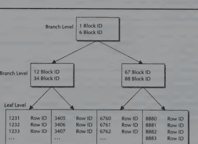

图 17-2. 一个主键索引

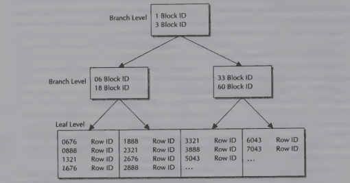

图 17-3. 显示反向子句的主键索引

位图索引适用于低基数类型的列数据。这种索引类型存储键值、起始 `ROWID` 和结束 `ROWID` 作为键值的一部分。位图存储在非唯一索引结构中 `ROWID` 出现在叶级别的位置。位图是由 1 和 0 组成的字符串，表示索引值的存在情况，其位置与存储为键值一部分的起始和结束 `ROWID` 范围相对应。类似 ‘0010001000...’ 的字符串表示第一个和第二个 `ROWID` 不包含该值，而 `ROWID` 字符串中的第三个 `ROWID` 包含该值。

位图索引由于其紧凑性而非常高效。然而，索引列中值过多将使这种类型的索引效率降低。同样，Oracle 10g 在执行更新时无法使用其行级锁定机制。相反，它尝试在块级别进行操作（取决于 `ROWID` 本身的值），并在对具有位图索引的列执行更新时，通常请求表的独占锁。更新还会导致位图索引呈指数级增长，导致位图索引碎片化。当这种情况发生时，位图索引即成为重建的候选对象。

> **提示**
>
> *在执行大批量插入或大批量更新时，请删除位图索引。由于位图索引可以迅速创建，因此简单地删除并重新创建它们更为高效。*


> **注意**
>
> *位图索引适用于只读类型的应用程序，其中较大的结构中仅有少量的不同列值。*

位图连接索引有助于处理应用程序 SQL 中常见的连接条件。这种索引类型跟踪被索引表中常见的列与连接条件中的列。其语法为

```
CREATE BITMAP INDEX EMP_HIREDATE_BJ1 ON EMP (HIREDATE)
  FROM EMP E,
  DEPT D WHERE E.DEPTNO = D.DEPTNO
```

这展示了如何实现该功能。在此语法示例中，索引位于 `EMP` 表上，并基于 `DEPTNO` 列跟踪 `DEPT` 表中的连接条件；当 `HIREDATE` 列和 `DEPTNO` 列在 SQL `WHERE` 子句中被引用时，将使用该索引。例如，清单 17-1 中的 SQL 将使用此位图连接索引。

### 清单 17-1：使用上述位图索引示例的 SQL 示例


```
SELECT SUM(INV_SALE_AMT)
  FROM ST_INV I, ST_VENDOR V
  WHERE I.INV_PURCHASE_VENDOR_ID = V.VENDOR_ID
    AND V.VENDOR_STATE = 'IA';
```


> **注意**
>
> *使用位图连接索引的连接条件必须具有唯一或主键约束。如果使用位图连接组合键，则所有值必须出现在 SQL 连接条件中。*

如果组合索引键中存在大量重复值，多键索引可受益于键压缩。`COMPRESS` 选项每个叶块仅存储一次唯一索引值。`COMPRESS` 选项仅压缩总键列数减一的列。Oracle 不会压缩所有列，因为它需要某些键数据与 `ROWID` 关联。`COMPRESS` 选项有一个可选数字，用于告知 Oracle 要压缩多少个键列。仅指定 `COMPRESS` 即告知 Oracle 压缩索引中除最后一个键列外的所有列。此语法示例

```
CREATE INDEX empidx on emp (deptno, job, sal) COMPRESS 2;
```

在每个叶块中压缩 `deptno` 和 `job` 键值。

> **注意**  
>
> 多键索引也称为组合索引。其多个键作为一个单元，被称为组合键。

> **提示**  
>
> 第一个键值越常见，整个键的压缩效果越好。压缩程度越高，每个叶块中的索引/`ROWID` 指针就越多。叶块中的索引/`ROWID` 指针越多，Oracle 处理范围扫描、全扫描或快速全扫描中的索引的速度就越快。

多键索引还可以受益于跳过扫描（skip scanning）。*跳过扫描*是指当索引的前导列未在 SQL 中被引用时，Oracle 使用多键索引的能力。`WHERE` 子句中可能会引用第二个或第三个键列。其工作原理是，Oracle 可以在分支层级判断叶块中是否可能出现该键值。此技术允许 Oracle 利用多键索引，从而无需在该期望字段上拥有另一个索引结构。毕竟，索引越少，DML 操作的性能越好。

> **提示**  
>
> 键的顺序应与你为最大化压缩而采取的顺序正好相反。选择性较高的列应位于多键索引的最前位置，而用于跳过扫描的列应位于多键索引的第二位甚至第三位。

### 索引组织表

索引组织表（IOT）也是 b-tree 结构，但这种索引既是表又是索引，因为没有底层表。此结构将表的所有列存储在索引叶块中。清单 17-2 展示了 IOT 的基本语法。请注意，除了 `ORGANIZATION INDEX` 关键字外，其语法与表非常相似。`PCTTHRESHOLD ... USING` 子句指示哪些字段保留在索引结构中，哪些将进入溢出表空间。`PCTTHRESHOLD` 表示如果行占块大小的此百分比，则将大部分行放入溢出表空间。`USING` 子句告知 Oracle 哪些列（包括该列在内）保留在叶块中。溢出表空间通过 `OBJECT_ID` 访问。

#### 示例 17-2：一个 IOT 语法示例

```sql
CREATE TABLE emp_iot
(empno        number,
 ename       varchar2(20),
 salary      number(9,2) Not Null,
 comm        number,
 CONSTRAINT pk_emp_iot_index PRIMARY KEY (empno))
ORGANIZATION INDEX
TABLESPACE users
OVERFLOW TABLESPACE users_overflow
PCTTHRESHOLD 20 INCLUDING ename;
```


> **注意**
>
> 当 Oracle 不需要访问表时，存在明显的性能优势，因为所有所需的数据项都在索引中。IOT 的出现是因为所有必需的数据项都必须存储在 B 树索引结构中。在这种情况下，为什么还要维护一个表呢？

IOT 的优势在于，如果不需要引用表对象，则无需将数据项存储两次。请记住，如果索引满足 SQL 语句对数据的需求，Oracle 不会访问底层的表。

使用 IOT 的目标是尽可能将更多行放入索引结构中。叶块中的行越多，Oracle 在处理范围扫描时的 IOT 结构处理速度就越快。

IOT 对应用程序是完全透明的，适用于参考表或列数较少的表。它们也可以被分区。


> **提示**
>
> 我使用 IOT 来引用长列或 BLOB 列，将键值放在索引中，并让长数据类型列进入溢出表空间。

溢出表空间存储访问频率较低的列，或者存储由索引键值引用的长列。IOT 语法中的 `USING` 子句可用于告诉 Oracle 哪些列将被频繁访问或用于访问，哪些列仅在需要时才用到。例如，将 `WHERE` 子句中的列放在叶块中，将 `SELECT` 子句中的列放在溢出表空间中。这一规则的例外可能是应用了求和函数的金额字段。这属于频繁需要的字段，也应放在叶块中。

IOT 可以在其非主键列上拥有 B 树索引。索引没有 `ROWID`，因为行可以在索引结构内重新定位/移动（索引维护顺序）。Oracle 使用一种通用的 `ROWID`，即逻辑 `ROWID`。此 `UROWID` 基于 IOT 的主键，除非主键值更改，否则它不会改变。`UROWID` 通过 `ROWID` 伪列进行可视化。此 `UROWID` 允许在 IOT 的其他列上创建索引。这些附加索引被称为二级索引。


> **注意**
>
> IOT 不支持将位图索引作为二级索引。

### 索引监控

Oracle 10g 可以轻松地监控以查看索引是否正在被使用。即使看起来显然应该使用索引，Oracle 不索引的原因也有很多。从未使用的索引只会简单地拖慢表上的插入/更新/删除过程。

启动监控的语法是：

```sql
ALTER INDEX <index name> MONITORING USAGE
```

下图展示了 `V$OBJECT_USAGE` 视图，您可以在其中查看监控结果。使用此语法停止监控：

```sql
ALTER INDEX <index name> NOMONITORING USAGE
```

```sql
SQL> desc V$OBJECT_USAGE
```

| 名称 | 是否为空 | 类型 |
| :--- | :--- | :--- |
| INDEX_NAME | 不为空 | VARCHAR2(30) |
| TABLE_NAME | 不为空 | VARCHAR2(30) |
| MONITORING | | VARCHAR2(3) |
| USED | | VARCHAR2(3) |
| START_MONITORING | | VARCHAR2(19) |
| END_MONITORING | | VARCHAR2(19) |

### 索引空间利用率

Oracle 使用 `PCTFREE` 存储子句参数在索引中为增长预留空间。Oracle 忽略 `PCTUSED` 存储子句参数，因为它对索引没有意义。`PCTFREE` 告诉 Oracle 在插入时填充数据块的程度，之后才继续处理下一个块。其想法是使索引叶块尽可能满，以便额外的更新/插入不会导致索引叶块分裂成两个半满的块。这种分裂会导致 Oracle 使用索引进行范围扫描操作时产生额外的 I/O 操作。

设置 `PCTFREE` 参数取决于索引的加载方式。例如，如果主键字段使用序列生成器，且除了使用序列生成器外几乎不可能发生额外的插入操作，那么请将 `PCTFREE` 设置得很高，以便块填满，因为不太可能发生额外的插入操作（应用问题）并导致叶块分裂。如果发生这些分裂，这些块以后填满的可能性也不大。如果索引使用了 `REVERSE` 子句，则根据键值之间的关系，将 `PCTFREE` 设置为例如 40。

### 索引技巧

`ALTER INDEX REBUILD <parallel> UNRECOVERABLE` 比 `CREATE INDEX` 快得多，因为索引重建命令使用多块预读，并允许利用并行和不可恢复特性。`CREATE INDEX` 在创建索引时使用全表扫描。


> **注意**
>
> 请记住，与表相关的每个对象都受 Oracle 恢复机制的约束。在执行插入/更新/删除时，无论是索引是否被使用，都会为每个索引以及表记录重做信息。索引越少，DML 执行得越快。


> **注意**
>
> 对索引的更新操作是一次删除和一次插入。请记住，索引始终维护键值的正确顺序。


> **提示**
>
> 通过分析表并查看 `USER_INDEXES`、`DBA_INDEXES` 或 `ALL_INDEXES` 中的列，您可以看到叶块的填充程度、每块的平均键数以及每块的行数。

这种技术也适用于主键约束。使用 `CREATE UNIQUE INDEX ... UNUSABLE`，然后执行 `ALTER INDEX REBUILD <parallel> UNRECOVERABLE`，最后执行 `ALTER TABLE ADD CONSTRAINT ... PRIMARY KEY (key column) USING INDEX`。不仅这种方法能非常快速地构建索引，还允许你为主键索引命名。

> **注意**
>
> `UNRECOVERABLE` 关闭了通常发生的 Oracle 重做日志记录。不承担这种开销极大地加速了索引创建过程。

唯一索引在单行查找中表现更好，因为它们将键值和 `ROWID` 存储在一起。

非唯一索引在范围扫描中表现更好，因为 `ROWID` 与每个公共键值一起存储。键越常见，每个叶块中存储的 `ROWID` 越多，范围扫描的性能越好（例如，更少的 I/O）。

反转键索引在插入操作方面表现更好，特别是当键值总是递增时（例如，与序列生成器一起使用时），因为锁争用均匀地分布在叶级结构中。但是，这些索引只能用于单行查找。

基于函数的索引在需要包含在 `WHERE` 子句中的函数以及索引确定能提升性能的情况下非常有用。

位图索引在索引具有大量行的表中仅有的少数列值时非常有用。当 SQL 将访问两个或更多位图索引时，请使用 `INDEX_COMBINE` 或 `INDEX_JOIN` 提示。

索引列经常出现在 `WHERE` 子句中（它是表之间连接的一部分）以及由其他表中的主键访问的外键中。

避免对频繁更新且在较大表中只有少数取值的列建立索引。

多键（复合）索引可以提高性能，特别是当复合键满足请求的 SQL 对数据的需求时。如果 Oracle 不必读取表，它将不会读取该表。

复合键的选择应基于键列在 `WHERE` 子句中出现的频率。如果一个键值在 `WHERE` 子句中比其他键值出现得更频繁，那么考虑将其作为先导键字段。如果表中某列的数据具有特定顺序，并且该列也经常在 `WHERE` 子句中使用，请考虑将此列作为复合键中的先导键（参见下一节）。

同时，复合键的选择应视为使用 `AND` 运算符的 `WHERE` 子句。

如果执行全表扫描比访问索引更有优势，请使用 `FULL` 或 `NO_INDEX` 提示。

## 索引聚集因子

索引聚集因子是指索引叶级块中的行与它们所引用的不同表数据块之间的关系。基于成本的优化器（CBO）根据这种关系来决定执行计划。如果聚集因子较高，CBO 可能会选择对表执行全表扫描，而不是因使用索引而产生额外的 I/O 开销。

如果表在某一列上具有特定的顺序，并且该列上存在索引，那么聚集因子将较低，因为索引中的许多键值将指向同一个表数据块。相反，如果表是按主键值排序的，而索引建立在例如出生日期列上，那么该索引的聚集因子可能相当差，因为每个出生日期键值都指向不同数据块中的一行。如果 Oracle 在索引上进行范围扫描以查找具有特定出生日期的所有员工，Oracle 可能需要多次读取底层表中的每个数据块，而一开始直接对表执行全表扫描要简单得多。

> **注意**
>
> 良好的聚集因子是指聚集因子接近表中的数据块数量。较差的聚集因子是指聚集因子接近表中的行数。

> **提示**
>
> 最佳的范围扫描性能是使表按照应用程序主要查询所用的顺序进行排序和加载，并建立一个索引或多键索引，但领先键列应是表排序依据的列。数据设计在应用性能中起着关键作用。

如果聚集因子不好，Oracle 仅会将索引用于单行查找。如果访问该表的应用程序或 SQL 仅通过此索引进行范围扫描，那么 Oracle 将永远不使用该索引。列表 17-3 展示了 `index_info.sql` 脚本，该脚本突出了关键的索引信息，包括聚集因子。列表 17-4 展示了该脚本的一些示例输出。请注意，两个表都有 6000 行和 101 个数据块。它们也具有相同的键值和数据值。要注意的第一个区别是每个叶块中的键值数量。`TABLE1` 每个叶块有 1 个键值，而 `TABLE2` 每个叶块有 11 个键值。这里的真正指标是，`TABLE1` 的聚集因子非常接近表中的数据块数量，而 `TABLE2` 的聚集因子则更接近块中的行数。关于此请参见前面的提示，但 Oracle 10g 使用 `TABLE2` 上索引的可能性微乎其微。与直接执行全表扫描相比，Oracle 10g 使用此索引会产生大量的 I/O 开销。

## 列表 17-3: Index_Info.sql 脚本

```
* File:             Index_Info.sql
* Type:             SQL*Plus script
* Author:           Jonathan Lewis (www.jlcomp.demon.co.uk)
                    Enhanced by Dan Hotka
* Date:             May 9, 2003
*
* Description:
*
                    This script lists statistics about indexes.
*
*
* Modifications: 10-22-03 Added Table Block and Row info
*
/****/ 
column table_name format a15 heading 'Table'
column index_name format a15 heading 'Index'
column num_rows format 999,999 heading 'Rows'
column num_blocks format 999,999 heading 'Data Blocks'
column avg_data_blocks_per_key format 999,999 heading 'Data Blks per Key'
column avg_leaf_blocks_per_key format 999,999 heading 'Leaf Blks per Key'
column clustering_factor format 999,999 heading 'Clust Factor'

SELECT i.table_name, i.index_name, t.num_rows, t.blocks,
       i.avg_data_blocks_per_key, i.clustering_factor,
       to_char(o.created,'MM/DD/YYYY HH24:MI:SSSSS') Created
  FROM user_indexes i, user_objects o, user_tables t
 WHERE i.index_name = o.object_name
   AND i.table_name = t.table_name
 order by 1;
```

## Oracle 10g 分区

分区是一种根据键值将大量数据分布在多个磁盘设备上的方法。基于成本的优化器可以识别分区对象（表和/或索引），并能够仅从正确的分区中（称为**分区裁剪**）选择所需数据，而不是搜索整个对象。这样做有几个原因：SQL 性能和易于维护。

分区可以极大地帮助维护大型对象。分区将数据划分到不同的表空间中。这些表空间是标准的 Oracle 10g 类型表空间，因为它们可以在可用时进行备份，可以在不影响其他分区的情况下恢复，可以在不影响其他分区的情况下加载，可以被删除、添加等。

通过考虑数据是如何分区的，以及 SQL 是否专门请求遵循分区边界的数据子集，可以增强 SQL 性能。

用于划分数据的特定标准可能会对所查询数据所用的 SQL 性能产生巨大影响。设计良好的分区方案可以多次提高对数据子集进行查询的性能。

本节将介绍 Oracle 10g 分区的语法和性能影响。

### Oracle 10g 分区功能

Oracle 10g 提供四种主要类型的分区。每个选项具有特定的功能和一些限制，并且每种类型都使用一个称为**分区键**的键值。索引可以根据分区键的值或表中不同的值进行分区，并且可以使用相同的分区参数或不同的分区参数。

考虑分区的主要原因有两个：性能和可维护性。通过将数据和索引结构分散到多个物理设备上，可以增强性能。这使得多个进程可以使用对象的不同部分，而不会与其他进程发生争用。较小的对象扫描速度更快，分区还允许根据键值将对象整齐地拆分到硬件设备上。这是一种“条带化”方法，即把对象的不同部分放在各种设备上。只有当仔细规划应用程序和分区结构时，性能才会得到增强。Oracle 的优化器可以看到 SQL 语句将要请求什么，还可以看到分区的实现方式。应用程序无法控制硬件设备如何进行条带化。其他数据条带化方法包括使用分配给表空间的小型数据库文件。同样，应用程序对哪个数据文件将包含所需数据几乎没有控制权。


使用分区也可以改善维护时间。添加和删除分区非常容易，对单个分区进行备份和恢复也是如此。如果可以定期清除的数据，如果需要，可以很容易地使用分区将其移除或重新添加。由于分区后的对象本身更小（也就是说，每个分区都像自己的对象一样，对象本身成为一个逻辑实体，而分区级别是实际对象本身），备份和恢复可以更快进行。

范围分区是指每个分区加载满足特定数值或日期值范围的数据。哈希分区根据在分区键上计算的哈希值，将数值或日期分区键值均匀分布在可用分区上。复合分区是范围分区和哈希分区的组合：数据根据值的范围进行分区，然后根据哈希值分配到子分区。此功能使 Oracle 能够仅通过分区键存储和访问部分数据，但随后数据可以均匀分布在一组子分区中。列表分区允许对字符数据进行分区。

> **注意**
> Oracle 10g 支持为不同的表空间使用多种块大小。分区对象（表或索引）的表空间必须对每个对象具有相同的块大小。然而，表和索引可以使用不同的块大小。

### 范围分区

范围分区根据表中成为一个或多个分区键的列，将行分布在分配的表空间中。列表 17-5 展示了范围分区语法的示例。请注意 `PARTITION BY RANGE` 子句。它定义了分区键。然后每个分区通过指定 `LESS THAN` 值来命名，该值决定了将存储在此分区中的数据。

> **提示**
> 每个分区可以通过其分区名称访问（在 SQL 语句中代替表名）。这将使应用程序能够在一个分区存在恢复问题时，继续对其他分区进行操作。

#### 列表 17-5：范围分区语法示例

```sql
CREATE TABLE sales
(
    invoice_no    NUMBER,
    sales_amount  NUMBER(7,2),
    sales_date    DATE)
PARTITION BY RANGE (sales_date)
(PARTITION sales_q1_03 VALUES LESS THAN ('01-APR-2003')
  TABLESPACE ts_sales_q1_03,
 PARTITION sales_q2_03 VALUES LESS THAN ('01-JUL-2003')
  TABLESPACE ts_sales_q2_03,
 PARTITION sales_q3_03 VALUES LESS THAN ('01-OCT-2003')
  TABLESPACE ts_sales_q3_03,
 PARTITION sales_q4_03 VALUES LESS THAN (MAXVALUE)
  TABLESPACE ts_sales_q4_03);
```

> **注意**
> *每个分区可以拥有其自身的存储子句参数。*

`MAXVALUE` 子句指定了用于不满足其他分区要求的值的默认分区。如果应用程序将添加具有新范围（例如，按季度日期组织在分区中的数据）的分区，则不要使用 `MAXVALUE` 子句。

> **注意**
> *如果未使用 `MAXVALUE` 子句，且数据不符合任何分区的要求，则将返回错误。*

### 哈希分区

哈希分区获取分区键，并应用数学计算以推导出一个唯一的数字，称为 *哈希值*。由于哈希值在所有可能值的范围内随机分布，因此该值可用于将行均匀分布到分配的空间中。列表 17-6 展示了哈希分区的语法。`MAXVALUE` 子句不适用于哈希分区。

#### 列表 17-6：哈希分区语法示例

```sql
CREATE TABLE sales
(
    invoice_no    NUMBER,
    sales_amount  NUMBER(7,2),
    sales_date    DATE)
PARTITION BY HASH (invoice_no)
(PARTITION p1 TABLESPACE SALES_p1,
 PARTITION p2 TABLESPACE SALES_p2,
 PARTITION p3 TABLESPACE SALES_p3,
 PARTITION p4 TABLESPACE SALES_p4);
```

### 复合分区

复合分区是范围分区和哈希分区的结合。列表 17-7 展示了复合分区的语法。请注意，这里有一个 `RANGE` 子句，然后是 `SUBPARTITION BY HASH`。表将按范围分区键进行分区，然后使用键的哈希值均匀分布在子分区中。在此示例中，`STORE IN` 子句标识了表空间，并且在每个表空间内将有四个分区。此示例显示了四个分区（P1–P4），每个分区都有四个子分区。

#### 列表 17-7：复合分区语法示例

```sql
CREATE TABLE sales
(invoice_no NUMBER,
 sales_amount NUMBER(7, 2),
 sales_date DATE)
PARTITION BY RANGE(sales_date)
SUBPARTITION BY HASH (invoice_no)
SUBPARTITIONS 4
STORE IN (TS_SALES_P1, TS_SALES_P2, TS_SALES_P3, TS_SALES_P4)
(PARTITION p1 VALUES LESS THAN ('01-APR-2000'),
 PARTITION p2 VALUES LESS THAN ('01-JUL-2000'),
 PARTITION p3 VALUES LESS THAN ('01-OCT-2000'),
 PARTITION p4 VALUES LESS THAN (MAXVALUE));
```

### 列表分区

列表分区根据字符值将行分配到分区中。列表 18 中展示的语法看起来很像 SQL 语句 `WHERE` 子句中的 `IN` 子句。`OTHER` 子句用于定义用于不满足其他分区要求的值的默认表空间。如果省略此选项，则如果提供的值不在分区的列表之一中，应用程序/用户将返回错误。

#### 列表 17-8：列表分区语法示例

```sql
CREATE TABLE sales
(invoice_no NUMBER(6),
 sales_amt NUMBER(7,2),
 sales_date VARCHAR(2),
 sales_state CHAR(2))
PARTITION BY LIST(sales_state)
    (PARTITION sales_north VALUES ('ME','VT','NH','MA','RI','CT')
        TABLESPACE ts_sales_north,
    PARTITION sales_east VALUES ('NJ','NY','PA','VA','NC','WV')
        TABLESPACE ts_sales_east,
    PARTITION sales_west VALUES ('CA','UT','NM','CO','MT','OR','WA')
        TABLESPACE ts_sales_west,
    PARTITION sales_south VALUES ('FL','TX','SC','AR','TN','KY')
        TABLESPACE ts_sales_south,
    PARTITION sales_midwest VALUES ('IA','IL','IN','MI','MO','NE','OH')
        TABLESPACE ts_sales_midwest,
    PARTITION others VALUES (DEFAULT) TABLESPACE ts_default);
```

> **注意**
> *列表分区只能有一个分区列。*

### 索引分区选项

*索引分区允许将大型表结构上的索引分解为较小的单元，并分布在多个表空间中。有两种类型的分区索引：局部分区索引和全局分区索引。*

使用表的分区参数的索引称为 *局部分区* 索引。这些索引具有与关联的表相同的分区键、表空间数量和分区参数。它们可以索引分区键值或表中一个或多个（复合键）不同的列，同时仍遵循基础表使用的分区和表空间分配规则。列表 17-9 展示了局部分区索引的语法。请注意 `LOCAL` 语法，并且没有 `PARTITION BY RANGE` 或 `PARTITION BY LIST` 子句。列表 17-10 展示了无前缀局部分区索引的语法示例。请注意，该索引是在与基础表的分区键不同的键值上构建的。这两个索引都位于前述任意分区表示例（即列表 17-5 中的示例）上。请注意，这些语法示例中的分区数量与列表 17-5 中的语法相同。

#### 列表 17-9：局部前缀分区索引语法示例


```sql
CREATE INDEX SALES_DATE_PT_IDX ON sales (sales_date)
LOCAL
(PARTITION sales_idx_q1_03 TABLESPACE ts_sales_idx_q1_03,
 PARTITION sales_idx_q2_03 TABLESPACE ts_sales_idx_q2_03,
 PARTITION sales_idx_q3_03 TABLESPACE ts_sales_idx_q3_03,
 PARTITION sales_idx_q4_03 TABLESPACE ts_sales_idx_q4_03);
```

### 列表 17-10：局部无前缀分区索引语法示例

```sql
CREATE INDEX SALES_INVOICE_PT_IDX ON sales (invoice_no)
LOCAL
(PARTITION sales_idx_q1_03 TABLESPACE ts_sales_idx_q1_03,
 PARTITION sales_idx_q2_03 TABLESPACE ts_sales_idx_q2_03,
 PARTITION sales_idx_q3_03 TABLESPACE ts_sales_idx_q3_03,
 PARTITION sales_idx_q4_03 TABLESPACE ts_sales_idx_q4_03);
```

如果分区索引的键值与其分区值相同，则称为 *前缀* 分区索引。无前缀分区索引的键列不是与分区键相同的列。

局部索引不需要具有 `PARTITION` 子句。如果未使用此子句，Oracle 将生成分区名称，并将索引分区分配到与底层表相同的表空间。这可能不会带来最佳的 SQL 性能。

> **注意**
>
> 我总是会列出 `PARTITION` 子句，因为我不喜欢 Oracle 使用默认设置（它们可能会随版本更改），并且我希望将索引与表分开。

全局分区索引可以拥有自己的分区值（`PARTITION BY RANGE` 或 `PARTITION BY LIST` 子句）及其独立的表空间分配。全局分区索引始终是前缀索引，因为 Oracle 10g 不支持无前缀的全局分区索引。列表 17-11 展示了任意早期表语法示例上可能采用的全局分区索引的语法，但此说明具体使用了列表 17-5。请注意，此索引具有自己的 range 子句/list 子句。

### 列表 17-11：全局分区索引语法示例

```sql
CREATE INDEX sales_invoice_pt_idx ON sales (invoice_no)
GLOBAL
(PARTITION BY RANGE(sales_date)
(PARTITION sales_idx_p1 VALUES LESS THAN '01-JUL-03'
 TABLESPACE ts_sales_idx_p1,
 PARTITION sales_idx_p2 VALUES LESS THAN '01-JAN-04'
 TABLESPACE ts_sales_idx_p2,
 PARTITION sales_idx_p3 VALUES LESS THAN (MAXVALUE)
 TABLESPACE sales_idx_p3));
```

## IOT 分区选项

IOT 也可以进行分区，并且溢出表空间也可以进行分区。IOT 支持 `RANGE`、`HASH` 和 `LIST` 分区，但不支持复合分区。列表 17-12 展示了 IOT 的 `RANGE` 分区示例的语法。请注意，可以在分区级别定义单独的溢出表空间。

### 列表 17-12：分区 IOT 语法示例

```sql
CREATE TABLE sales
       (
         invoice_no   NUMBER,
         sales_amount NUMBER(7,2),
         sales_date   DATE,
         PRIMARY KEY (invoice_no) )
  ORGANIZATION INDEX
       INCLUDING sales_amount
       OVERFLOW TABLESPACE ts_sales_q1_03_overflow
  PARTITION BY RANGE (sales_date)
  (
    PARTITION sales_q1_03 VALUES LESS THAN ('01-APR-2003')
      TABLESPACE ts_sales_q1_03,
    PARTITION sales_q2_03 VALUES LESS THAN ('01-JUL-2003')
      TABLESPACE ts_sales_q2_03 OVERFLOW ts_sales_q2_03_overflow,
    PARTITION sales_q3_03 VALUES LESS THAN ('01-OCT-2003')
      TABLESPACE ts_sales_q3_03 OVERFLOW ts_sales_q3_03_overflow,
    PARTITION sales_q4_03 VALUES LESS THAN (MAXVALUE)
      TABLESPACE ts_sales_q4_03 OVERFLOW ts_sales_q4_03_overflow );
```

IOT 分区必须具有相同的块大小。溢出表空间可以具有与 IOT 本身使用的不同块大小，但所有溢出表空间必须具有相同的块大小。

## 使用分区索引提升性能

Oracle 为各种应用程序需求提供了多种分区方法。如果 SQL 语句的 `WHERE` 子句中未引用分区键，则任何分区选项都不会带来性能提升。哈希分区

该功能适用于使用等值条件或 `IN` 子句语法的单行查询（哈希键不能用于范围扫描），尤其是在需要处理大量行且通常会出现竞争问题的情况下。哈希全局索引还可以将大量的插入或更新操作进一步分散到更多的数据块中。范围和列表分区可以从分区“裁剪”（即消除那些不包含搜索返回数据的分区）中受益，前提是 SQL 语句被编写为专门使用分区键值。基于成本的优化器可以看到 `WHERE` 子句中的值，并且可以看到满足 SQL 需求所涉及的分区的数量。如果 SQL 语句的编写方式未能利用分区键，则不会发生分区裁剪，使用分区对象也就不会带来性能上的好处。复合分区可以进行一些裁剪，但行仍然会分布在多个子分区中，并且所有这些子分区都需要被扫描。搜索的粒度越细，需要扫描的分区就越少，SQL 返回结果的速度也就越快。

一个使用 Oracle 10g 作为存储库的电子邮件应用程序，就是一个可能受益于哈希和/或复合分区的示例。这类应用程序可能为收件箱、发件箱、草稿等拥有不同的表，并且会有大量的 DML 操作，如果每个人都试图从同一个表空间/单个表中处理电子邮件，就会引发共享竞争。

## 摘要

本章介绍了 Oracle 10g 中通过索引和分区来增强性能的特性。这两种特性都依赖于数据库设计和编码风格。如果数据模型定义正确，那么应该很明显哪些列需要索引，以及分区是否对应用程序有益。如果在测试或生产环境中需要添加各种各样的索引，这表明要么没有数据模型，要么使用的数据模型是不充分的。如果 SQL 编码质量较差（例如，在 `WHERE` 子句中对索引列使用函数），索引将被忽略。如果数据布局不当，导致索引叶块和表数据块之间的内部关系较差（聚集因子），同样，索引可能也不会被使用。如果利用了分区但忽略了分区键，针对这些对象的 SQL 将表现不佳。

由糟糕的数据库设计导致的低性能 SQL 是一个难以修复的问题。


# 第五部分

Linux 上的 Oracle 产品


# 第 18 章

# Linux 上的 Oracle Application Server 10g

为了开始本章，有必要定义 OracleAS 10g 是什么，以及它对企业的价值所在。OracleAS 10g 是一个基于标准的、包含多种技术的集合，它使企业能够整合基于 Web 和无线的应用程序的开发、部署和交付。使 OracleAS 10g 成为一个强大解决方案的原因在于其扩展基础 Web 应用程序并能在无线设备上交付这些应用程序的能力，提供简化的身份验证同时确保安全性，与遗留应用程序集成，并提供业务分析的能力。

鉴于大多数公司拥有大量使用不同技术构建的应用程序，拥有整合、交付和分析底层数据的手段显然是个优势。OracleAS 10g 提供了基础设施，以集中管理应用程序部署、Web 配置、网络和身份管理，从而满足集成企业应用程序集的预期。此外，Linux 为 OracleAS 10g 技术提供了具有成本效益且可扩展的平台。将 OracleAS 10g 的应用技术整合与 Linux 提供的具有成本效益且可扩展的部署方式相结合，为强大的、可靠的应用服务器带来了绝佳的组合。


将这些服务器与类似的应用程序分组形成一个集群，这允许进行高可用性和性能负载均衡。构成集群的这些应用程序实例共享一个常见的元数据存储库和冗余应用程序。所有共享元数据存储库的应用程序实例类型都被视为“农场”的一部分。作为农场一部分的所有服务器类型都可以进行集中管理和监控。随着可扩展性需求的变化和服务等级协议要求的增加，可以向农场中增加或移除服务器。

## Oracle Application Server 10g 由哪些组件组成？

既然已经建立了对 OracleAS 10g 的概念性理解，现在适当的时候分解各个组件并描述它们的功能。OracleAS 10g 解决方案包含服务于以下领域的组件：

- Java 2 企业版
- 管理和安全
- 门户
- 无线
- 缓存
- 商业智能
- 电子商务集成

### Java 2 企业版

Java 2 企业版（`J2EE`）提供了 Java 的行业标准，是开发多层应用程序的手段。使用 `J2EE` 的优势在于“一次编写，到处运行”的理念。这对任何负责应用程序开发及其投资回报率（ROI）的管理者来说都是显而易见的。`J2EE` 是标准化且模块化的，允许在不进行复杂编程工作的情况下提供强大的服务。`J2EE` 通常包含企业服务、JavaServer 页面、XML 和 Java Servlet 的服务。使用 `J2EE` 平台的关键优势是快速开发和部署跨多个平台支持且可通过 Web 轻松访问的企业应用程序。

一旦创建了 `EAR` 文件，`J2EE` 应用程序就可以通过 `OracleAS 10g` 快速部署。`EAR` 文件随后可以通过企业管理器中的部署向导部署到 `J2EE` 容器中。此向导将所有相关的 URL 映射到正确的 Web 模块，建立持久层，并为应用程序分配管理器。

`J2EE` 应用程序的管理在 10g 应用服务器中得到了扩展，可以添加或配置 `OC4J` 容器，`J2EE` 资源可以集中化，并且应用程序可以被监控。

### 管理和安全

`OracleAS 10g` 的这一特定方面分为几个组件，允许在任意期望的范围内对各个应用程序进行完全控制和访问。这些组件是

- Oracle 企业管理器 应用服务器/网格控制 `Oracle 10g` 企业管理器允许对 `J2EE` 应用服务器进行完整的部署和配置。当与网格控制结合使用时，监控和控制的范围扩展到其他 Oracle 产品和主机操作系统。
- Oracle 单点登录 通过使用可用的 `LDAP` 数据库，用户可以使用单个登录 ID 从多个应用程序进行身份验证。这使得企业密码维护更加易于管理。
- Oracle 应用服务器证书颁发机构 这是一个用于管理 `SSL` 支持的集中服务器，该组件包括用于客户端身份验证的密钥生成，以提供加密的信息传输。
- Java 身份验证和授权服务 (`JAAS`) 用于通过基于角色的访问控制来增强 `J2EE` 容器安全。
- Oracle Internet 目录 这也使用 Oracle 的 `LDAP` 目录。Oracle `LDAP` 目录使用 Oracle 数据库来存储其信息。Oracle Internet 目录用于允许单点登录和集中网络。

### 门户

Oracle 门户技术支持向导驱动的基于企业门户开发。这些门户在设计上支持自助服务，允许个人管理和部署内容。以下是 Oracle 门户技术的组件：

- Oracle 应用服务器门户 通过快速设置，Oracle 门户提供了一种快速部署自定义内容以实现最大生产力的手段。
- Oracle 应用服务器门户开发工具包 提供快速开发企业门户的手段。
- Oracle Ultra 搜索 这是一个强大的工具，允许对多个存储库进行信息搜索。借助 `OracleAS 10g`，该工具允许与 Oracle 门户集成，以搜索 Oracle 数据库、`IMAP` 邮件服务器、HTML 文档以及 Oracle 应用服务器门户和系统文件。
- Oracle 应用服务器传播服务 这是使用 `ICE`（信息内容交换）来自动将服务器上可用的信息“推送”给符合 `ICE` 标准的订阅者。

### 无线

Oracle 无线技术用于通过浏览器、语音应用、`J2ME`（Java 2 微版）和双向消息传递送信息。

### 商业智能

`OracleAS 10g` 提供了从各种来源挖掘信息并将其格式化的手段，使数据可用于预测和快速反应不断变化的业务状况。这些工具包括 Oracle 应用服务器 Discoverer，它允许最终用户从即席查询中生成报告和图表，然后以 HTML 格式发布。

### 电子商务集成

为了进一步简化异构业务应用的整合，Oracle 提供了与这些技术集成的手段：

- Oracle 应用服务器 InterConnect 用于集成企业应用。`InterConnect` 使用高层集成逻辑和底层平台服务。集成功件由 `RDBMS` 高级队列组件和 Oracle 工作流组成。此外，还有用于应用程序和协议的各种适配器，以实现应用程序集成。
- Oracle 应用服务器 Process Connect 这是一种 Oracle 元数据业务集成工具，用于转换、翻译和验证业务交互。

## 使用 Oracle 应用服务器 10g

使用 `OracleAS 10g` 完整的企业版（Enterprise Edition）可为组织提供部署、保护集成各类应用程序的手段。利用 `OracleAS 10g` 实现其指定用途最高效的方式是使用 `DCM`（分布式配置管理）的命令行实用工具。企业经理（Enterprise Manager）网格控制也用于操作 `OracleAS 10g` 实例。这些应用程序的详细分解超出了本章的范围，但在有关 `OracleAS 10g` 配置的部分中有所演示。图 18-1 提供了企业经理应用服务器控制（Enterprise Manager Application Server Control）的一个示例。

当配置多个 `OracleAS 10g` 实例以实现高可用性或集群时，使用 `DCM` 可以简化相关管理。实际上，`DCM` 允许你：

- 保持各个实例同步。
- 备份和恢复实例配置。
- 在实例之间导入和导出配置。
- 启动和关闭实例或子组件。
- 验证实例状态。

`DCM` 管理的组件包括以下内容：

- `OC4J`（Oracle Java 组件）（`J2EE`）
- Oracle HTTP 服务器
- `OC4J` 应用程序
- `OPMN`（Oracle 进程管理和通知服务器）
- `JAZN`（Oracle 应用服务器 Java 身份验证服务）

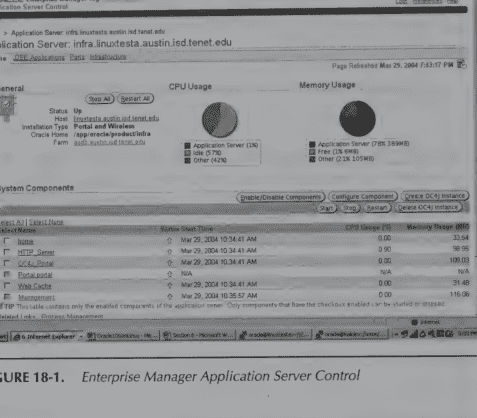

### 图 18-1. 企业经理应用服务器控制

下表提供了按命令类型分组及其用途的 `DCM` 命令行命令的详尽列表：

| DCMCTL Shell 命令 | 用法 |
|---|---|
| `!!` | 重复执行上一条命令 |
| `shell` | 调用 dcmctl shell |
| `echo` | 将字符串输出 |
| `setLogLevel` | 设置日志记录级别 |
| `exit` | 退出 shell |
| `quit` | 退出 shell |

### DCMCTL 归档命令

| 命令 | 用法 |
|---|---|
| `applyArchiveTo` | 将配置归档应用到实例或集群 |
| `createArchive` | 创建集群/实例归档 |
| `exportArchive` | 将归档从/向存储库导出到 JAR 文件 |
| `importArchive` | 将归档导入存储库 |
| `listArchives` | 列出归档 |
| `removeArchive` | 删除归档 |

### DCMCTL 应用程序命令

| 命令 | 用法 |
|---|---|
| `deployApplication` | 部署 J2EE 应用程序 |
| `listApplications` | 列出 OC4J 实例应用程序 |
| `redeployApplication` | 重新部署 J2EE 应用程序 |
| `undeployApplication` | 取消部署 J2EE 应用程序 |
| `validateEarFile` | 验证 EAR J2EE 合规性 |

### DCMCTL 属性命令

| 命令 | 用法 |
|---|---|
| `getError` | 显示错误 |
| `getReturnStatus` | 返回最后一条命令的状态 |
| `getState` | 返回请求组件的状态：OC4J、Oracle HTTP 服务器、JAZN |
| `help` | 列出 dcmctl 命令 |
| `listComponentTypes` | 列出支持的组件类型 |
| `set` | 设置 dcmctl 选项 |

### 非托管集群命令

| 命令 | 用法 |
|---|---|
| `addOPMNLink` | 创建非托管的 OracleAS 10g 集群 |
| `getOPMNPort` | 显示 ONS 远程端口和主机名 |
| `listOPMNLinks` | 列出包含本地实例的非托管 AS 集群 |
| `removeOPMNLink` | 从非托管集群中移除实例 |

### DCMCTL 进程管理命令


| 命令 | 用法 |
|---|---|
| restart | 重启应用程序堆栈 |
| shutdown | 停止应用程序堆栈 |
| start | 启动应用程序堆栈 |
| stop | 停止应用程序堆栈 |

图 18-2 展示了一个简单的 DCMCTL 属性命令示例。图中所示的命令是一个通用的高层状态命令，用于列出所有实例组件的状态。要执行 DCMCTL 命令，必须导航到 `$ORACLE_HOME/dcm/bin/dcmctl`。

为了简化操作，可以将 `dcmctl` 实用工具放入你的 `PATH` 环境变量中。在 Linux 中，默认 shell 是 BASH shell，而在用户（通常是 `oracle`）的主目录中有一个名为 `.bash_profile` 的文件。在这里可以放置 `dcmctl` 命令的路径，以便将其引入用户环境并在文件系统的任何位置运行。这样就无需每次执行 `dcmctl` 命令时都导航到 `$ORACLE_HOME/dcm/bin` 目录。正如所注，管理 OracleAS 10g 服务器或服务器集群所需的大多数操作都可以通过 DCMCTL 实用工具完成。

用于管理日志的一个非常有用的附加工具是由企业经理应用服务器控制提供的。这个名为 LogLoader 的工具提供了分析来自不同区域的多个日志并根据某些标准对它们进行分组的手段。LogLoader 提供了一个优秀的取证工具，用于根据时间/日期标准诊断日志。通过合并各种系统日志以匹配检测到的系统减速或错误，可以缩短搜索时间。日志根据搜索范围以逻辑集合形式分组。例如，当从 LogLoader 中选择 HTTP_Server 组件时

```
$ dcmctl getstate -c -v

Current State for Instance:testinst

Component Type Up Status In Sync Status
============================================

1 home oc4j Up True

2 HTTP Server ohs Up True

3 OC4J_Demos oc4j Up True
```

### 图 18-2. DCMCTL 命令及输出

应用程序，会搜索 `error_log` 和 `access_log`。如果将数据库组件包含在 HTTP 搜索条件中，则还会搜索 `alertsid.log`。请求的日志随后返回到浏览器并整合以便轻松审查，如图 18-3 所示。

需要定期加载以进行审查的关键监控日志包括：

- `Oracle` 数据库警报日志 如果数据库出现问题，这将有助于获取信息。它也可以用于检查任何数据库系统变更。
- `Apache access_log` 列出传入请求的地址。
- `Apache error_log` 列出与 HTTP 服务器和加载模块相关的任何错误。
- `DCM` 日志 列出与内部托管进程相关的错误。

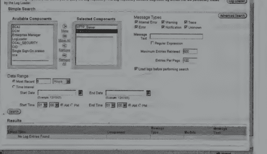

### 图 18-3. 通过企业经理查看各种日志

用于监控性能并收集指标的另一个附加工具是动态监控服务（Dynamic Monitoring Service）。此服务的目的是提供一种基于在 Java 应用代码中安装 DMS 调用来仪表化 J2EE 应用的手段。Oracle 应用服务器 10g 具有用于仪表化以下对象的 DMS 服务：

- Oracle HTTP 服务器
- Java 虚拟机
- JDBC
- OC4J
- mod_plsql
- Portal
- Jserv
- Oracle 进程管理和通知服务器指标
- Oracle 应用服务器 Discoverer 指标

表 18-1 展示了 DMS 可以为 HTTP 服务器收集的指标类型示例。

| 指标名称 | 描述 | 测量单位 |
|---|---|---|
| connection.active | 当前打开的连接数 | threads |
| connection.avg | 处理 HTTP 连接所花费的平均时间 | usecs（微秒） |
| connection.maxTime | 处理任何 HTTP 连接所花费的最长时间 | usecs |
| connection.minTime | 处理任何 HTTP 连接所花费的最短时间 | usecs |
| connection.time | 处理 HTTP 连接所花费的总时间 | usecs |
| handle.active | 当前处于 handle 处理阶段的子服务器数量 | threads |
| handle.avg | 在模块处理程序中花费的平均时间 | usecs |
| handle.completed | handle 处理阶段完成的次数 | ops |
| handle.maxTime | 在模块处理程序中花费的最长时间 | usecs |
| handle.minTime | 在模块处理程序中花费的最短时间 | usecs |
| handle.time | 在模块处理程序中花费的总时间 | usecs |
| request.active | 当前处于 request 处理阶段的子服务器数量 | threads |
| request.avg | 处理 HTTP 请求所需的平均时间 | usecs |
| request.completed | 完成的 HTTP 请求数量 | ops |
| request.maxTime | 处理 HTTP 请求所需的最长时间 | usecs |
| request.minTime | 处理 HTTP 请求所需的最短时间 | usecs |
| request.time | 处理 HTTP 请求所需的总时间 | usecs |

# 在 Linux 上安装和配置 Oracle Application Server 10g

以下部分提供了关于如何在 Linux 平台上安装和配置 OracleAS 10g 的信息。

## 安装

安装 OracleAS 10g 涉及获取软件，可以通过向 `http://www.oracle.com` 请求软件或从 `http://otn.oracle.com` 下载。一旦介质已就绪，请确保环境变量 `ORACLE_HOME` 和 `ORACLE_SID` 已设置。此外，要成功安装软件，还需要拥有 `root`、`sudo` 或访问系统管理员的便捷权限，因为存在修改文件所有权并要求特权账户的强制性安装脚本。

## 配置

OracleAS 10g 的配置取决于要安装的实例类型。更高级的应用服务器配置需要基础设施安装。这些配置包括 Oracle Internet Directory 和 Oracle 元数据仓库。接下来的示例展示了使用基础设施和 Oracle Portal 对 OracleAS 10g 进行初始配置。在根据《Oracle 10g Application Server Quick Installation and Upgrade Guide 10g Release 2 (10.1.2) for Linux x86》的设置环境参数和内核参数后，当 Oracle Universal Installer 启动时，即执行初始配置，如图 18-4 所示。

在完成几项基本配置询问（包括确定 Oracle home 位置）后，声明安装范围时进行第一个主要配置步骤。如前所述，本例的假设是需要基础设施的安装。图 18-5 展示了初始配置选项。

初始配置询问展示了应用服务器的一般架构选择。服务器类型选择包括应用服务器，随后可以细分安装的功能“中间层”类型。这些中间层包括 J2EE、Forms and Reports 服务以及 Discoverer。第二种安装类型是基础设施，它包含处理更复杂配置（如 Oracle Single Sign-On）所需的元数据仓库。

如果需要基础设施，必须先安装它，因为依赖的应用程序会在元数据仓库中注册。在基础设施配置中，还有两个附加部分。一个是元数据仓库，它是一个包含 LDAP 配置的 9.0.4 数据库。另一部分是 Oracle Identity Management，它是 Oracle Internet Directory 和证书颁发机构的超集。Oracle Identity Manager 依赖于元数据仓库的安装。

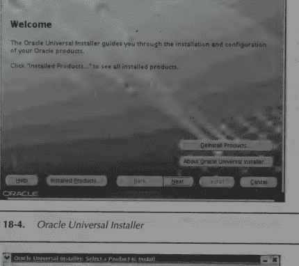

图 18-4. Oracle Universal Installer

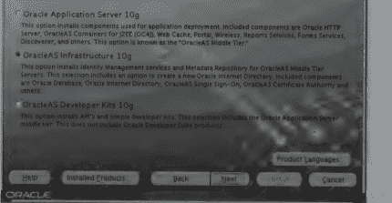

图 18-5. 产品安装类型

一旦基本基础设施配置完成，就可以开始访问配置。依赖于基础设施的其他主要配置包括：

- Oracle Internet Directory
- 证书颁发机构
- Oracle Single Sign-On


安装完成后，使用 Enterprise Manager Application Control 配置 Oracle Application Server 的子组件，如图 18-6 所示。

安装完成后，使用 Enterprise Manager Application Control 配置 Oracle Application Server 的子组件。每当一个或多个 OracleAS 10g 安装共享同一个元数据仓库时，它们就被视为一个“集群（farm）”的一部分。Enterprise Manager Application Control 可以检测到此情况，并布局需要配置的不同的 Oracle home 目录。

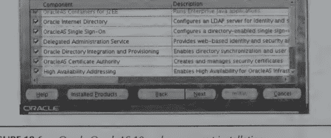

图 18-6. OracleAS 10g 子组件安装

在需要安装后配置的子组件中，最重要的是 `httpd.conf` 文件。此文件决定了网页如何提供和安全（除非使用基于 SSL 的 HTTPS 认证，在这种情况下使用 `httpsd.conf` 文件）。Apache `httpd.conf` 文件位于 `$ORACLE_HOME/Apache/Apache/conf` 目录。强烈建议在对手动更改此文件或 OracleAS 10g 服务器的其他类型配置文件进行任何手动配置更改之前，使用 `dcmctl saveinstance` 命令备份服务器配置，如下所示：

```
$ORACLE_HOME/bin/dcm/bin/dcmctl saveinstance -dir /home/oracle/bkup/
```

`httpd.conf` 文件配置如下

- 启用 SSL。
- 创建虚拟目录。
- 管理安全性。
- 标识 docroot（提供 web 文档的目录）。
- 编写指令以允许使用可加载模块用于应用性能和安全，例如 `mod_perl`、`mod_plsql` 和 `mod_sso`。
- 设置日志和日志格式。
- 配置端口。
- 配置目录别名。
- 添加语言和字符支持。

在配置 `httpd.conf` 文件时，建议使用 Enterprise Manager 中的 `HTTP_Server` 高级服务器属性来编辑 `httpd.conf` 文件或任何其他定义为高级服务器属性的配置文件。使用高级服务器属性编辑配置文件时，可以回退并将文件恢复到其原始状态。通过高级服务器属性编辑器对配置文件进行更改时，系统会提示管理员重新启动 HTTP 服务器。图 18-7 展示了高级服务器属性编辑工具的使用。

凭借其众多组件和服务，OracleAS 10g 提供了一种快速高效部署和集成企业应用程序套件的方法。随着应用的快速部署，用户当前的关注点应得到满足。反过来，这些演进的应用程序应帮助用户社区满足企业计算的日常需求并保持业务运转。

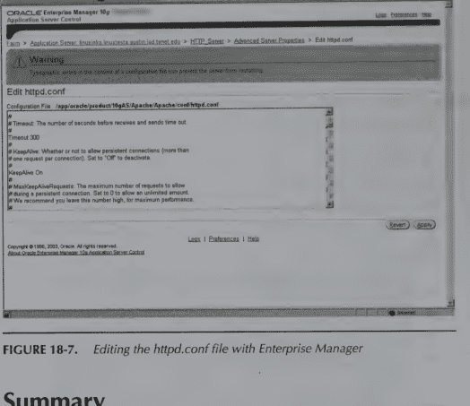

图 18-7. 使用 Enterprise Manager 编辑 `httpd.conf` 文件

### 摘要

Linux 为 OracleAS 10g 应用服务器提供了一个可扩展、健壮的平台。轻松管理和调优 Linux 系统的能力使其成为应用服务器的理想平台。应用服务器通常具有良好的扩展性，加上 Linux 平台的可负担性，提供了一个可扩展的平台，您可以轻松快速地添加应用服务器。结合利用负载均衡路由器的网络策略，这使得添加更多应用服务器变得容易。


## 第 19 章

### Linux 上的 Oracle E-Business Suite


延续前两个章节的趋势，本章是对 Oracle E-Business Suite（11i 版本之前称为 Oracle Applications）的介绍和概述。E-Business Suite 运行在 Oracle 数据库服务器上，并利用 Oracle Application Server，这两者在本书中均有涉及。Oracle E-Business Suite 是一个极其复杂的产品，拥有许多可以调优和优化的组件，包括底层的 Oracle 数据库服务器。在本章中，您将了解到 Oracle E-Business Suite 的概述以及它如何与 Linux 集成和工作。由于 E-Business Suite 的复杂性，本章不是关于如何安装和配置的指南，而是关于在 Linux 上设置它的介绍。

### Linux 上的 Oracle E-Business Suite 概述

Oracle E-Business Suite 是一个旨在管理您业务所有领域的应用程序。实际上，Oracle E-Business Suite 现在可以管理您业务的 100 多个领域，包括：

- 财务
- 合同
- 商业智能
- 人力资源
- 制造
- 市场营销
- 采购
- 订单履行
- 专业服务
- 销售
- 服务
- 项目

E-Business Suite 支持 30 种不同的语言。应用层可用于 9 种不同的平台，包括 Linux，而数据库层为

## 什么是Oracle E-Business Suite？

Oracle E-Business Suite 适用于八种不同的平台，其中包括 Linux。应用层（application tier）和数据库层（database tier）不必驻留在同一个操作系统上。应用层位于 32 位系统而数据库层位于 64 位系统也是可以接受的。两者都可以是 Linux 系统，或者应用层使用 Linux 而数据库层使用另一种操作系统，反之亦然。

我亲身参与了将 E-Business Suite 从 HP-UX 和 Solaris 迁移到 Linux 的项目，其中数据库层在不同于应用层的时间点进行转换。各层可以在彼此独立的不同时间点进行转换。

由于不同模块及其交互的复杂性，E-Business Suite 的安装包含所有可用的模块。实际使用哪些模块取决于获取的许可证。许多不同的应用程序相互依赖。例如，[应付账款](https://en.wikipedia.org/wiki/Accounts_payable)、[应收账款](https://en.wikipedia.org/wiki/Accounts_receivable)和其他财务模块都依赖[总账](https://en.wikipedia.org/wiki/General_ledger)模块。

Oracle E-Business Suite 是一组旨在运行企业前台和后台业务的集成产品。Oracle E-Business Suite 是一个极其复杂且庞大的应用程序。其二进制文件大小达数十 GB。在 Oracle E-Business Suite 11i 中，整个套件基于 Web 和 Forms，并利用 [Oracle Application Server 9i](https://en.wikipedia.org/wiki/Oracle_Application_Server)（OracleAS 9i）运行。然而，由于安装是完全集成的，因此无需单独安装 Oracle Application Server。所有组件的整个安装都是通过 [Oracle E-Business Suite Rapid Installer](https://en.wikipedia.org/wiki/Oracle_E-Business_Suite_Rapid_Installer)（`rapidwiz`）完成的。

Oracle E-Business Suite 是为规模较大的企业设计的。整个应用程序过于复杂，且维护要求过高，不适合小型企业使用。为了正确维护 E-Business Suite，至少需要一名专职的 Oracle E-Business Suite DBA。

## E-Business Suite 架构

Oracle E-Business Suite 是一个多层应用程序，可以存在于一个或多个计算机系统中。该应用程序有多个层（tiers），根据您的需求，它们可以驻留在相同或不同的系统上。各层包括以下内容：

- 桌面层（Desktop tier）：用于较新的基于 HTML 应用程序的 Web 浏览器，以及提供传统基于 Forms 用户界面的附加 Java Applet。
- 应用层（Application tier）：该层通常被称为中间层（middle tier），由许多不同的组件组成，如 Web 服务器（Web Server）、
  Forms 服务器（Forms Server）、并发处理服务器（Concurrent Processing Server）、报表服务器（Reports Server）、管理服务器（Admin Server）以及可选的 Discoverer 服务器。

### 数据库层（Database tier）

这是存放业务数据和元数据的数据库。


应用层和数据库层可以根据系统的工作负载以多种不同的方式拆分。应用层可以在多个系统上运行，以达到所需的性能。最好只在一个平台上使用应用层，以简化维护，因为只需要应用一组补丁。数据库层可以是独立系统，也可以是根据需求配置的 RAC 集群。也可以在同一个系统上运行应用层和数据库层。

## 桌面层（Desktop Tier）

桌面层（或客户端层）是一个 [Java Archive](https://en.wikipedia.org/wiki/Java_Archive)（JAR）文件集合，它被下载并在客户端浏览器中运行。JAR 文件由应用层下载到客户端系统的 [Oracle JInitiator](https://en.wikipedia.org/wiki/Oracle_JInitiator)（由 [Oracle Java 虚拟机](https://en.wikipedia.org/wiki/Oracle_Java_Machine)（JVM）提供）运行。在 Netscape 浏览器中，这实现为一个插件；在 Microsoft Internet Explorer 浏览器中，它实现为 [ActiveX](https://en.wikipedia.org/wiki/ActiveX) 组件。Oracle 依赖自己的 JVM，因为依赖他人的组件并不安全。

## 应用层（Application Tier）

应用层是最复杂的层。这里驻留着 Web 服务器（基于 [Apache web 服务器](https://httpd.apache.org/)）、Forms 服务器、并发处理服务器、报表服务器和管理服务器。该层还可能包含可选的 Discoverer 服务器。通常，所有这些组件都驻留在同一个系统上，但也可以拆分。如果拆分，并发处理服务器和管理服务器通常与数据库层运行在同一个系统上。让我们看看不同的组件及其在整个图中的位置。

### Web 服务器（Web Server）

Oracle HTTP 服务器基于 [Apache web 服务器](https://httpd.apache.org/)，但经过 Oracle 修改以更好地与 Oracle 应用层和 Oracle 数据库服务器集成。Web 服务器包括 Apache web 服务器、Web 监听器（Web Listener）、Java Servlet 引擎（JServ）和 [JavaServer Pages](https://en.wikipedia.org/wiki/JavaServer_Pages)（JSP）。如果可能，Web 服务器本身处理请求。但对于高级处理，Web 监听器将请求传递给 Java Servlet 引擎，该引擎根据需要联系数据库服务器。

### Forms 服务器（Forms Server）

Forms 服务器支持 Oracle E-Business Suite 的 forms。这是传统的 [Oracle Forms](https://en.wikipedia.org/wiki/Oracle_Forms)，而非基于 HTML 的应用程序（formerly known as Self-Service）。Forms 服务器是一个 Oracle 9i 组件，提供桌面客户端与 Oracle 数据库服务器之间的通信，显示客户端屏幕并根据用户操作初始化数据库中的更改。

Oracle E-Business Suite 支持使用 [Socket](https://en.wikipedia.org/wiki/Socket) 模式用于内网用户，[HTTPS](https://en.wikipedia.org/wiki/HTTPS) 用于互联网用户，以及 [HTTP](https://en.wikipedia.org/wiki/HTTP) 模式用于基于 Forms 的通信。Forms 监听器 Servlet 允许您通过 HTTP 和 HTTPS 运行 Oracle Forms 应用程序。它为每个客户端创建一个 Forms 服务器运行时进程，以便通过 Web 服务器进行通信。由于 HTTP 协议比套接字更“健谈”，Forms 监听器 Servlet 会使网络流量增加大约 40%。但它提供了重新建立丢失网络连接、需要更少的机器和端口暴露在防火墙外以及允许更健壮和安全地通过 Internet 部署的好处。

### 报表服务器（Reports Server）

报表服务器用于创建[商业智能系统](https://en.wikipedia.org/wiki/Business_intelligence_system)（Business Intelligence System）的报表。使用报表服务（reports services），而不是允许报表非计划运行。使用报表服务，您可以调整和管理报表处理，这可能非常消耗资源。当有大量的用户时，报表服务可以根据需要拆分到几个报表服务器上。其中一个报表服务器被指定为主报表服务器（master reports server），它接收初始请求并将其分配给其他报表服务器之一。

### 并发处理服务器（Concurrent Processing Server）

当自助服务（Self-Service）和 Oracle Forms 应用程序在前台运行用户请求时，数据密集型操作在后台作为批处理作业运行。并发处理服务器负责运行这些批处理作业。这个专门的服务器确保资源密集型并发处理操作不会干扰交互式操作。在 Oracle RAC 环境中，并发处理服务器配置为在集群的不同节点上定义不同的队列，以便将并发处理分散到不同的集群节点上。这被称为并行并发处理（parallel concurrent processing）。在 Linux RAC 环境中使用并行并发处理正变得非常流行。

### 管理服务器（Admin Server）

管理（Administration）服务器用于维护 Oracle 数据库中的数据模型。在 Oracle RAC 集群中，管理服务器仅在一个节点上运行，但配置为主节点不可用时故障转移到另一个节点。管理服务器用于升级 Oracle E-Business Suite、应用补丁以及维护数据库中的数据。

### Discoverer 服务器（Discoverer Server）

Oracle Discoverer 服务器是一个旨在帮助分析服务和即时查询处理的工具。它也用于执行业务预测，是一个业务分析工具。Oracle Discoverer 服务器是一个可选组件，可能不会在所有情况下部署。

## 数据库层

数据库层是实际数据存储的位置，可以是 Oracle8i、Oracle9i 或 Oracle 10g 数据库服务器。为了本书的目的，我们将假设指的是 Oracle10g 数据库服务器。数据库层不仅存储所有业务数据，还存储定义应用层的元数据。事实上，每当您运行 `AutoConfig` (`adautocfg`) 实用程序来配置 Oracle E-Business Suite 时，许多元数据表作为该过程的一部分会被更新。

## Linux 上可用的模块

Linux 上的 Oracle E-Business Suite 功能完整，并且 Oracle E-Business Suite 中可用的所有模块在 Linux 平台上均可用。E-Business Suite 的所有层（包括数据库应用程序和客户端）都可以在 Linux 上运行。Oracle 已承诺支持 Linux 平台，并完全支持 x86 平台上的 32 位 Linux，从而履行了该承诺。如需了解非 x86 32 位硬件平台上 Linux 操作系统对 E-Business Suite 的支持，请访问 Oracle MetaLink。

## 在 Linux 上使用 Oracle E-Business Suite

Oracle E-Business Suite 在 Linux 上的功能与其他平台没有区别。由于 Linux 平台比其他平台成本更低，应用层更可能由多个 Linux 系统组成，以实现冗余和性能优化。此外，许多 Linux E-Business Suite 配置利用 Oracle RAC 集群作为数据库层。

## RAC 环境中的 E-Business Suite

通过配置并行并发处理，Oracle E-Business Suite 可以配置为在 RAC 环境中工作。这允许并发管理器在 RAC 集群中的所有节点上运行，从而在这些节点之间分配工作负载。并行并发处理允许您为每个处理队列指定主要和次要位置。这使得 E-Business Suite 处理活动能够按照您选择的方式在集群节点之间分布。集群中的工作负载分布既不是自动的，也不是透明的。您必须选择并发处理队列的分布方式及其运行位置。

如前所述，Oracle E-Business Suite 可以配置为在 RAC 环境中运行，但这并非一项简单的配置任务。需要进行多项调优步骤，并且必须进行精细调整，以便能够以最优方式运行。

## 在 Linux 上安装和配置 E-Business Suite


在 Linux 上安装 Oracle E-Business Suite 与在其他任何平台上安装的区别在于所需的特定 Oracle 和操作系统补丁以及配置，包括设置和调整各种 Linux 内核参数（参见下一节）。如果您之前做过这项工作，执行软件的初始安装并不极其困难；然而，配置 Oracle E-Business Suite 以执行有用的工作可能是一项极其耗时和困难的任务，需要花费数个人月才能部署。Oracle E-Business Suite 具有高度可定制性，包含大量可针对货币、时区、汇率、税率等进行配置的变量。

## 安装

Oracle E-Business Suite 使用 Rapid Installer 程序（`rapidwiz`）进行安装。Rapid Installer 程序是第一个安装的组件，然后运行它以安装 Oracle 技术堆栈和应用程序文件系统。技术堆栈为所有 Oracle E-Business Suite 产品提供通用功能，并安装在所有系统上。在安装 E-Business Suite 之前，您必须规划如何配置应用程序本身。由于应用程序的可配置性极强，特别是对于需要定制应用程序的站点而言，需要大量的功能工作。

### 技术型 DBA 与功能型 DBA

在 Oracle E-Business Suite 的世界中，有两种类型的 DBA 和顾问：技术型 DBA 和功能型 DBA，或技术型顾问和功能型顾问。技术型 DBA 的工作是管理 Oracle 数据库、并发管理器和队列。此外，技术型 DBA 负责安装应用程序并应用补丁。功能型顾问的工作是从功能角度配置应用程序。功能型顾问确保业务功能正常运行，并且是某些模块（如应付账款、应收账款和人力资源）的专家。技术型 DBA 管理数据库；功能型 DBA 从功能角度管理应用程序。

安装 Oracle E-Business Suite 应用服务器、数据库服务器或 RAC 集群可能需要几周时间。从功能上配置 Oracle E-Business Suite 可能需要数月甚至一年或更长时间。

以下是安装 Linux 上的 E-Business Suite 所需的特定操作系统和 Oracle 补丁、内核扩展和参数以及额外的操作系统配置。在开始 Oracle E-Business Suite 安装之前，应从 Oracle Metalink 获取最新的内核要求。如果在安装已经启动后才发现有新的补丁可用，这不仅会耗时，而且代价高昂。

此处提供了一些针对 Linux 的关键要求；但是，请查看此列表的更新内容。

### 操作系统补丁

有几个补丁必须应用于 Linux。这是撰写本书时的当前补丁列表。当然，当您阅读本书时，此列表可能会发生变化。请查阅 Metalink 获取最新列表。

#### 对于 Red Hat Linux 3.0：

- `pdksh-5.5-14-13`

#### 对于 (Discoverer) 季度更新 2 (QU2)：

- `compat-db-4.0.14.5`
- `compat-gcc-7.3-2.96.122`
- `compat-libstdc7.3-2.96.128`
- `compat-gcc-c7.3-2.96.122`
- `compat-libstdcdevel-7.3-2.96.122`

#### 其他：

- `openmotif21-2.1.30-8`
- `setarch-1.3-1`

安装这些补丁后，运行 `ldconfig -v`。

### 操作系统配置

针对 Oracle E-Business Suite，操作系统中有几项内容需要配置。这些特定任务必须执行并检查，否则最终会遇到问题。

由于 Oracle E-Business Suite 是使用特定版本的 C 库构建的，因此有必要配置系统使用特定版本。这需要几个步骤。

1. 重命名 `/usr/bin/gcc` 和 `/usr/bin/g++` 文件。

   ```bash
   # mv /usr/bin/gcc /usr/bin/gcc323
   # mv /usr/bin/g++ /usr/bin/g++323
   ```

2. 创建符号链接。

   ```bash
   # ln -s /usr/bin/gcc296 /usr/bin/gcc
   # ln -s /usr/bin/g++296 /usr/bin/g++
   ```

3. 验证主机名设置是否正确。命令应返回完全限定的主机名。例如：`<host_name><domain_name>`。

   ```bash
   # hostname
   ```

   这应该返回 `hostname.domainname`。

4. 对于 hugemem 内核，安装 rpm `setarch-1.0-2` 或更高版本。

   ```bash
   # setarch i386
   ```

5. 将 `LD_ASSUME_KERNEL` 环境变量设置为 `2.4.19`。通过在 `applmgr` 和 `oracle` 用户的 shell 初始化文件（如 `$HOME/.bash_profile` 或 `$HOME/.profile`）或系统的全球 shell 初始化文件（`/etc/profile`）中输入该设置，使其永久生效。

   ```bash
   LD_ASSUME_KERNEL=2.4.19
   export LD_ASSUME_KERNEL
   ```

6. 应用安装前补丁。一旦设置好环境，必须在开始安装前应用一个必需的补丁。

7. 应用以下操作系统库补丁之一：`3006854`（用于 Red Hat 3.0）或 `3633386`（用于 SUSE SLES9）。您可以从 Oracle Metalink 下载这些补丁。

8. 重启您的系统。

9. 如果您在 Red Hat Linux 3.0 上运行，还必须对数据库层 `ORACLE_HOME` 应用安装后补丁 `3119415`。

## 迁移到 Linux 上的 E-Business Suite

将 E-Business Suite 迁移到 Linux 是一个相当复杂的过程，涉及许多步骤。这些步骤可以分解为两个基本组成部分：迁移应用层和迁移数据库层。如果您正在 RAC 服务器上安装数据库层，则还有一个额外的步骤。

## 迁移应用层

迁移应用层涉及应用数据文件的移动和重新配置。这包括大量的数据复制以及运行 `AutoConfig` 以重新配置应用层和元数据。由于配置错误很难修复，因此必须以极大的耐心和细心进行此操作。

## 使用 Linux 平台迁移工具进行迁移

Linux 平台迁移提供了一种简便的方式，可以将现有的 E-Business Suite 中间层系统（不包括数据库层）从任何平台迁移到 Linux，从而让你能够使用快速、低成本的 Linux 硬件。迁移工具会保留你现有的应用程序补丁级别，因此无需进行 `APPL_TOP`/数据库同步。它同时允许你保留许多自定义设置。不必像本章前面所述的那样从头开始安装 E-Business Suite，而是执行以下操作：

- 1. 准备现有系统以进行迁移，例如实施 `AutoConfig`（如果版本为 `R11.5.8` 或更早）。创建并导出当前的视图全局快照到文本文件。
- 2. 准备新系统以进行迁移，包括应用操作系统补丁、安装 Perl 和 JDK，以及设置 Linux 内核参数（请参考“安装 Oracle 应用程序：使用 Rapid Install 指南”）。
- 3. 在源系统上应用平台迁移工具补丁。此步骤会创建一个自定义上传文件，并发送给 Oracle。随后 Oracle 将创建一个稍后应用的自定义补丁。Oracle 通常会在很短时间内返回此补丁（以天计）。
- 4. 在源系统上生成并上载客户特定文件的清单。
- 5. 将特定的中间层文件从源系统复制到目标系统（`APPL_TOP`, `OA_HTML`, `OA_JAVA`, `COMMON_TOP/util` 和 `COMMON_TOP/_pages`, `identitydb.obj`）。
- 6. 克隆 AutoConfig XML 应用程序上下文文件。
- 7. 在目标系统上安装中间层技术堆栈（使用 `rapidwiz`）。
- 8. 如果运行的是 Red Hat 版本的 Linux，则在目标系统上应用 Oracle 互操作性补丁。
- 9. 使用克隆的上下文文件在目标系统上运行 `AutoConfig` 设置阶段。
- 10. 在目标系统上使用 `AutoPatch` 下载并应用客户特定更新。
- 11. 在目标系统上应用从 Windows 迁移的补丁，该补丁包含 Windows 上不存在的 Linux 特定 `APPL_TOP` 文件。
- 12. 应用之前已应用于你的系统但新 techstack 安装中未包含的任何缺失的技术堆栈补丁。
- 13. 将最新的 techstack 互操作性补丁应用于新的应用程序文件系统。
- 14. 重新生成文件系统对象（`adgensn.sh`），然后运行 `adadmin` 以重新生成消息、窗体、报表、图形和 JAR 文件。
- 15. 运行 `AutoConfig` 以完成目标系统配置。


- 16. 执行收尾任务（更新第三方扩展；重新编译自定义代码；执行 UTF8、Discoverer 4i、SSO 和 Portal 所需的任务；使用新的打印机和工作流配置设置进行更新；启动所有服务）。

一旦应用层已移动且元数据仓库已配置完成，如果你也要将数据库层迁移到 Linux，那么就需要移动实际数据，如下节所述。

## 迁移数据库层

数据库层的迁移涉及在正在从中迁移的系统的数据库上运行补丁，执行导出，然后将该数据导入到目标系统中。将数据导出并导入到新系统的过程会略有不同，具体取决于你是从 Oracle8i 数据库、Oracle9i 数据库还是 Oracle10g 数据库导出数据。即使是最新版本的 Oracle E-Business Suite 也可以使用 Oracle 9.2 或 Oracle 10g 数据库（尽管应用层仍使用 Oracle 8.0.6 可执行文件）。再次强调，这些是基本步骤：

- 1. 应用导出前补丁。此补丁为数据库导出做准备。你必须在执行导出之前执行此步骤，否则导入将无法成功。
- 2. 导出数据库。
- 3. 将导出文件复制到新系统。
- 4. 运行导入后步骤。这些步骤将在互操作性说明中描述。

在迁移数据库层时，是优化数据库布局和 I/O 子系统的良好时机。由于将使用导出和导入，Oracle 数据库的底层数据结构可以被修改。如果你尚未使用，请转换为本地管理表空间。如有必要，你可以扩展表空间以跨越多个数据文件。由于自 Release 11.5.10 起，Oracle E-Business Suite 的默认安装现在只创建 12 个合并的表空间，采用新的 Oracle 应用程序表空间模型（OATM），而旧版本包含一百多个表空间（每个模块两个；一个用于数据，一个用于索引，外加一些额外表空间），因此这也是迁移到 OATM 的良好时机。


`注意`

`AutoConfig` 实用程序不仅配置应用程序程序，还配置数据库中的元数据。这一点必须牢记，因为一个错误可能意味着你需要花费大量时间从数据库中删除数据。

可以看到，成功迁移需要完成许多步骤。如果你尚未完成其中某一步，请确保在开始迁移前了解所需的所有步骤。

## 将数据库层转换为 RAC

将数据库层转换为 RAC 集群是一个多阶段项目。在 E-Business Suite 的迁移或初始安装期间，会创建 Oracle 数据库。你不应该跳过这一步，因为快速安装程序会创建所需的表空间和结构。为了将数据库层转换为 RAC，必须使用 RAC 选项进行另一次 Oracle 安装，并且必须将 E-Business Suite 数据库移动到新的 Oracle home。这是因为 Oracle 安装程序会在 RAC 环境中配置在非 RAC 安装中不存在的额外组件。为了安装这些组件，Oracle Cluster Ready Services 必须在安装时处于运行状态。步骤如下：

- 1. 作为 E-Business Suite 安装或迁移的一部分，使用快速安装程序安装 Oracle 实例。
- 2. 安装 Oracle RAC 集群。
- 3. 将 E-Business Suite 数据库移动到 RAC 集群。
- 4. 设置并行并发处理（PCP）。

这些步骤相对简单直接，但执行起来耗时，且需要极大的细节关注（有时还需要一些调试技能）。将数据库转换为 RAC 并设置 PCP 的整个过程需要规划和一份良好的检查清单。

## 测试

将 Oracle E-Business Suite 迁移到 Linux 时最重要的步骤之一是测试阶段。一旦所有配置完成且所有数据已迁移，你必须执行严格的功能和性能测试，以确保一切都已正确配置。此外，将新数据库中的行对象计数与导出执行时的原始数据库进行对比也是一个好主意。仔细检查所有导入日志和 Oracle 警报日志中的错误。

测试完成后，你就准备好进行最终转换以及用户社区对新系统的使用。此时，系统应在接下来的几周内进行仔细监控。完成后，可以使用正常的监控计划。

## 总结

本章作为简介和概览，介绍了如何安装、配置和将 Oracle E-Business Suite 迁移到 Linux。由于 Oracle E-Business Suite 是一个极其复杂的产品，本章并非安装和配置的操作指南，而是关于在 Linux 上设置它的介绍。由于 Linux 的灵活性、性能以及行业范围内的支持，Linux 是 Oracle E-Business Suite 的理想平台。事实上，Oracle 自身已采用 Linux 作为运行其自身业务的优选平台。

Linux 平台正迅速普及，不仅被用户社区采用，也被硬件和软件开发社区采用。Linux 已证明自己是 Web 服务器、应用服务器、防火墙、域名服务器以及数据库服务器的理想平台。Oracle 应用服务器和 E-Business Suite 在 Linux 平台上运行得非常出色。随着 Linux 的成熟，它也将作为企业优选平台而被更广泛地采用。

图表引用使用斜体。

- `/`（根分区），127
- 32位与64位处理器，358-359

## A

- 活动节点（active nodes），167
- 警报文件（alert files），34
- 别名（aliases），168
- `ALTER DATABASE` 命令，71, 73-74
- `ALTER SYSTEM` 命令，245
- `ALTER SYSTEM SWITCH LOGFILE` 命令，75
- `ALTER TABLESPACE` 命令，41, 42
- `ANALYZE` 命令，47-48
- Apache，19
- 应用开发（application development），62-63
- `ar`（归档实用工具，archiver utility），15-16
- 归档日志文件（archive log files），33, 71
  - 特征，75-76
  - 恢复，276-278
- 归档日志备份（archive log backup），283-285
- `ARCHIVELOG` 模式，281, 282-283
- 归档进程（Archiver Processes）。参见 ARCHN
- 归档（archiving），280-283
- `ARCHn`，56
- `ARCn`，326
- `as`（GNU 汇编器，GNU assembler），15
- 异步复制（asynchronous replication），343
- 身份验证（authentication）
  - 数据库，227
  - 中间层，228
  - 网络，227-228
  - 操作系统，227
  - 远程，228
  - 通过 SSL，228-229
  - 用户，227
- 授权，用户（authorization, user），229
- 自动存储管理（Automatic Storage Management, ASM），25, 32, 148, 171
  - 配置 ASM 磁盘，149
  - 配置 ASM 库驱动程序，149-150
  - 配置共享磁盘，207-208
  - 安装 ASM 库驱动程序和实用工具，148-149
  - Oracleasm 可选参数，152-153
  - 设置 ASM 磁盘，150-154
  - 使用 ASM 磁盘，153-154
- 自动工作负载仓库（Automatic Workload Repository），177, 248
- `autotrace`（自动跟踪），374, 375
- 可用性（availability），61
- Oracle 最大可用性架构（Oracle Maximum Availability Architecture, MAA），166, 167

## B

- 后台进程（background processes），55-57
- 备份（backing up）
  - 归档日志备份，283-285
  - 自动基于磁盘的备份和恢复，294-295
  - 备份文件，34-35
  - 市售备份实用工具，300
  - 控制文件备份，285
  - 使用 Data Pump，297-299
  - 示例，303-304
  - 使用 EXPORT 实用工具，297-299
  - 完全备份，285-286
  - 增量备份，287-288
  - 离线备份，295
  - 联机备份，295-297
  - 概述，274-275
  - 恢复管理器（Recovery Manager, RMAN），289-294
  - 调度，301-303
  - 策略，300-301
  - 表空间和文件备份，286-287


## 索引

### 前言

- 另请参见“恢复”（recovery）
- `/bin` 实用工具，12
- `binutils`，14, 15-16
- 生物信息学（bioinformatics），62
- 位图索引（bitmap indexes），86
- 位图连接索引（bitmap join indexes），86
- 块设备（block devices），24-25
- 绑定（bonding），202
- 引导加载程序（bootloader），20
- B 树索引（B-tree indexes），86
- 缓冲池（buffer cache），57
  - 为非标准块大小进行设置，52
- 商业智能（business intelligence），62, 430

## C

- 缓存融合（Cache Fusion），173, 181
- 容量（capacity）
  - 磁盘 I/O 容量，111
  - 系统资源与队列，95-96
- 容量规划（capacity planning），92, 123-124
  - 另请参见“尺寸调整”（Sizing）
- CBO（基于成本的优化器），380, 382
  - 控制优化器决策，385-388
- CGI 编程，19-20
- 链式行（chained rows），45, 46
  - 列表，47-48
- 字符设备（character devices），24
- 检查点进程（Checkpoint Process）。参见 `CKPT`
- 检查点（checkpoints），68-69, 70, 71, 279-280
  - 强制（forcing），72
  - `LOG_CHECKPOINT_INTERVAL`，71-72
  - `LOG_CHECKPOINT_TIMEOUT`，72
- CISC 处理器，354-355
- `CKPT`，56, 69, 180
- 洁净块（clean blocks），57
- 客户端静态库（Client Static Library），160-161
- 集群就绪服务（Cluster Ready Services, CRS），174-176, 186
  - 集群就绪服务守护程序（Cluster Ready Services Daemon, CRSD），174
    - 配置，204-205
  - 事件管理器守护程序（Event Manager Daemon, EVMD），174, 175
  - `OPRCD`，175
  - Oracle 集群同步服务器守护程序（Oracle Cluster Synchronization Server Daemon, OCSSD），174
- 集群服务同步守护程序（Cluster Services Synchronization Daemon, CSSD），227
- 集群化（clustering），61
  - 活动/活动集群（active/active clusters），169-170
  - 别名，168
  - 活动/备用集群（active/passive clusters），169
  - 集群，87, 167
    - 定义，169
  - 分布式数据库系统，169, 170
  - 回退（failback），168
  - 故障状态（failed state），167
  - 故障转移（failover），168
  - 故障转移集群（failover clusters），169-170
  - 组，168
  - 心跳（heartbeat），168
  - 互连（interconnect），168, 181, 205
  - 节点，167
  - 对象，168
  - 共享磁盘系统，169, 170-171
  - 另请参见“Real Application Clusters”（实时应用集群）
- 冲突（collisions），98
- 用于列出、查看和管理 KLM 的命令，7
- `COMMIT`（提交），76, 80-81
- 复合分区（composite partitioning），85, 418, 420
- 并发（concurrency），67
- 为 Oracle 配置 Linux
  - 添加用户和组，133-134
  - 选择组件，128-131
  - 配置文件系统，127-128
  - 配置内核参数，131-133
  - 配置 Oracle 用户的 shell 限制，134
  - 创建目录结构，134-135
  - 安装检查清单，136-139
  - 最低要求，126-127
  - 预安装，126
  - 设置 Oracle 环境，135-136
- 备份，33
- 控制文件，33
- 已格式化分区（cooked partitions），206
- `coreutils`，365
- `cpp`（GNU 预处理器，GNU preprocessor），15
- CPU，352, 353-354
- CPU 缓存，356
  - 设计，354-355
  - 多处理器，355-356
  - 性能与队列，96-97
  - 尺寸调整，104
- `CREATE TABLESPACE` 命令，39-40, 42
- `CREATE UNDO TABLESPACE` 命令，77
- `crs stat` 命令，175-176
- CSS 守护程序，227
- 累积增量备份（cumulative incremental backups），288, 289

## D

- 数据块（data blocks），44-46
  - 块头，45
  - 链式行，45, 46, 47-48
  - 洁净块，57
  - 脏块（dirty blocks），57
  - 空闲空间，45
  - 迁移的行，45, 46-47, 47-48
  - 非标准块大小，45
  - `PCTFREE`，48-50
  - `PCTUSED`，48-49, 50-51
  - 行数据，45
  - 行目录，45
  - 表目录，45
  - 使用多种块大小，51-52
- 数据字典（Data Dictionary），58
- Data Guard，324-326
  - 配置逻辑备用数据库，338-340
  - 配置物理备用数据库，332-337
  - Data Guard Broker，329
  - 与距离相关，325
  - 日志应用服务，328
  - 日志传输服务，326-328
  - 逻辑备用数据库，330-332
  - 模式，325
  - 物理备用数据库，329-330, 332-337
  - 角色管理服务，328-329
- 数据保护（data guarding），118-119
- 数据完整性（data integrity），68-69
- Data Pump，61
  - 使用其进行备份，297-299
  - 数据恢复，275-276
  - 数据段，36, 52
  - 数据库挂载状态，224
  - 数据库打开状态，224-225
  - 数据库启动，223
  - 数据库写进程（Database Writer Process）。参见 `DBWR`
  - 数据文件，31-32, 35
    - 添加到表空间，41
    - 备份，286-287
    - I/O 和 Oracle 数据文件放置，361
- `DBA_LOGSTDBY_LOG`，340
- `DBA_LOGSTDBY_PROGRESS`，340
- `DBWR`，55, 67, 69
- DCM。参见分布式配置管理（Distributed Configuration Management）
- 默认缓存（Default Cache），57
- 延迟事务（deferred transactions），344
- 开发环境（development environment），13-14
- 设备（devices）
  - 块设备，24-25
  - 字符设备，24


### 设备名称，146

- 原始设备（raw），24, 26-27, 148
- `rawdevices` 服务，146-147

### 字典管理表空间（dictionary managed tablespaces），37

- 另请参见“表空间”（tablespaces）

### 差异增量备份（differential incremental backups），287-288

### 目录（directories），198-199

- Oracle 基础目录，199
- Oracle 库存目录，199
- 目录权限，136
- 目录结构，8-9

### 脏块，57

### 脏缓冲区（dirty buffers），70, 179

### 磁盘驱动器（disk drive），105-109

- 性能，109

### 磁盘 I/O 容量，111

### 磁盘镜像（disk mirroring），116

### 磁盘盘片（disk platters），106

### 磁盘寻道表（disk seek sheets），109-110

### 磁盘条带化（disk striping），43, 115-120

### 调度进程（Dispatcher Process）。参见 Dnnn

### 分布式配置管理（Distributed Configuration Management），431-434

### 分布式数据库系统，169, 170

### DMNin（调度程序，Dispatcher），180

### DMS。参见动态监视服务（Dynamic Monitoring Service）

### Dnnn，56

### 文档函数（document functions），62

### 磁盘奇偶校验（drive parity），118-119

### 动态监视服务（Dynamic Monitoring Service），436

### 动态性能视图（dynamic performance views），246-248

## E

### 电子商务集成（e-business integration），430-431

### E-Business Suite（电子商务套件）

- 应用层，445-446
- 446-447, 452-453
- 体系结构，445-446
- 将数据库层转换为 RAC，454-455
- 数据库层，446, 448, 453-455

## F

### 回退（failback），168

### 故障状态（failed state），167

### 故障转移（failover），168

- 测试，212-213

### `fasik` - 命令，150-151

### 光纤通道（Fibre Channel），183

### 文件系统（filesystems），25-26

- 块大小（blocksize），144
- 缓存，144
- 为 Linux 安装进行配置，127-128
- 创建，144-145
- ext3，26
- OCFS（Oracle 集群文件系统，Oracle Cluster Filesystem），26, 206
- 实用工具，10

### 闪存恢复区（flash recovery area），294-295

### 闪回数据库（flashback database），317-318

- `FLASHBACK DATABASE` 命令，83
- 闪回删除（flashback drop），315-317
- 闪回特性，294-295, 311-312
- 闪回操作，82

## G

### GCC。参见 GNU 编译器集合（GNU compiler collection）

### `gcc` 命令，14-15

### 通用操作系统实用工具（general OS utilities），10-11

### 全局动态性能视图（global dynamic performance views），247-248

### 全球化开发工具包（Globalization Development Kit, GDK），62

### GNOME，用户界面，18

### GNU 编译器集合，14-15

### GNU 调试器（GNU Debugger），14, 15

### GNU 网络对象模型环境（GNU Network Object Model Environment）。参见 GNOME

### 网格计算（grid computing），63

### 组，添加，133-134

### GUI 环境，18

- GNOME，18
- KDE，19

### `gv$` 视图，246-248

## H

### 汉明码（Hamming Code），117

### 硬盘。参见磁盘驱动器（disk drive）

### 硬件（hardware）

- 32位与64位处理器，358-359
- 选择，352
- CPU，352, 353-356
- RAM，356-357
- 尺寸调整，104
- 调优，253, 352, 359-365
- 虚拟内存系统，358

### 哈希分区（hash partitioning），85, 418, 419-420

### 心跳（heartbeat），168

### hugemem 内核，260

### 混合复制（hybrid replication），345

### 混合 X86-64 系统，359

## I

### `IMPORT` 实用工具，309

### 增量备份（incremental backups），287-288

### 索引段, 37, 52

### 索引, 85-86

- 位图, 404, 408-409, 414
- B树, 404, 405
- 组合键选择, 414
- 基于函数的, 407, 414
- 全局分区, 422-423
- 索引聚集因子, 415-417
- 索引组织表 (IOT), 410-412
- 键字段, 404
- 本地分区, 421-422
- 监控, 412-413
- 多键, 409-410, 414
- 非唯一, 406, 414
- 分区, 421-424
- 伪列, 404
- 反向键, 407, 414
- ROWID, 405
- 空间利用率, 413
- 技巧, 413-414
- 唯一, 406, 414

### InfiniBand, 网络支持, 60

### 在 Linux 上安装 Oracle 10g

- 配置, 159-161, 162
- 下载和安装补丁, 158-159
- 用于下载的文件, 154
- 内核配置参数, 142
- 运行安装程序, 155-158
- 准备安装, 154-155
- 存储要求, 142-154
- 测试和验证, 162

### 实例

- ASM 实例, 32
- 监控, 246-253
- Oracle 实例, 30, 54-58, 159
- 恢复, 275-276, 306, 307-308, 318-319
- 启动, 222-223
- 调优, 243-246

### 互连, 168, 181

- 绑定公共接口和互连, 202
- 配置, 205

### I/O 性能和排队, 97-98

### 响应时间与利用率, 98

### I/O 子系统容量规划, 105

- 磁盘驱动器, 105-109
- 性能, 109
- 随机 I/O 性能, 112-113
- 阅读磁盘规格表, 109-110
- 旋转延迟, 108-109
- 寻道时间, 107-108
- 顺序 I/O 性能, 111

### I/O 调优, 359-364

### I/O 工具, 10

- `iostat`, 221
- 使用其监控 Linux, 257-258

### IOTs, 410-412

- 分区, 423

### Java 2 企业版, 429

### Java 认证和授权服务 (`JAAS`), 430

### Java 监控工具, 61

### 作业队列, 180

### JSTuner, 374

## K

### K 桌面环境。参见 KDE

### KDE, 用户界面, 19

### 保留缓存, 57

### 内核, 5

- 更改参数, 195-196
- 配置参数, 131-133
- 配置信号量和其他参数, 216-217
- 配置共享内存, 216
- 混合内核, 6, 7-8


## 微内核, 6-7
- 监控和更改配置参数, 217-218
- 单片内核, 5-6
- 补丁, 194-195
- 重建 Linux 内核, 21-22
- 设置参数和 shell 限制值, 195
- 为 Oracle 用户设置 shell 限制, 196
- 设置 Linux 内核, 193-196
- Linux 内核的软件要求, 193-194

- 内核可加载模块 (KLMs), 7-8
- 键字段, 404
- 曲线拐点, 96
- `kswapd` 进程, 99
- 大池, 57-58
- 延迟, 107
  - 旋转延迟, 108-109
- `ld` (GNU 链接器), 15
- `LGWR`, 56, 69-70, 81, 179, 326
- 库缓存, 58
- 限制参数, 101-102

### Linux
- 创建账户, 196-198
- 添加用户和组, 133-134
- `/bin` 工具, 12
- 选择组件, 128-131
- 配置文件系统, 127-128
- 为 RAC 配置, 190-198
- 配置内核参数, 131-133
- 为 Oracle 用户配置 shell 限制, 134
- 创建目录结构, 134-135
- 开发环境, 13-14
- 设备, 24-25
- 目录结构, 8-9, 134-135
- 识别用户和组 ID, 198
- Oracle 10g R1 安装检查清单, 137-138
- Oracle 10g R2 安装检查清单, 138-139
- 针对 Oracle 的内存调优, 357
- 最低要求, 126-127
- 监控, 218-221
- 监控 Linux 系统, 234-260
- Oracle 对 64 位 Linux 的支持, 63
- 概述, 8
- 安装后, 131-136
- 预安装, 126-131
- 进程, 23
- `/sbin` 工具, 9-11
- 设置 Oracle 环境, 135-136
- 线程, 23-24
- 针对网络性能调优, 366-367
- 升级, 222
- 用户界面, 17-19
- `/usr/bin` 工具, 12-13
- `/usr/sbin` 工具和守护进程, 11
- 工具和目录, 9-13
- Web 服务器工具, 19-22

## L

- 列表分区, 85, 420-421
- LMS, 56
- 负载均衡, 43, 44
- 负载测试, 262-264
  - 批处理作业, 264-265
  - 加载, 265
  - OLTP 应用程序, 265-267
  - 性能指标, 367, 368
  - 技巧, 268-269
- 本地管理表空间, 37-38
  - 另见表空间
- 锁机制, 67
- 日志文件恢复, 309-310
- 日志切换, 71
  - 强制, 72
- 日志写入器进程。参见 `LGWR`
- `LOG_CHECKPOINT_INTERVAL`, 71-72
- `LOG_CHECKPOINT_TIMEOUT`, 72
- 日志记录, 280-281
- 逻辑备用数据库, 330-332, 338-340
- 逻辑卷管理器 (LVMs), 25
- `LogLoader`, 434-435
- LRU (最近最少使用) 算法, 68

## M

- `make` 工具, 16-17
- 可管理性, 61-62
- 映射基, 260
- 大规模并行处理系统, 355-356
- 物化视图, 86
  - 复制, 345
- 介质恢复, 275-276, 306, 308, 319-320
- 内存, 98-99
  - 配置共享内存, 216
  - RAM, 356-357
  - 容量规划, 104-105
  - 虚拟内存系统, 99, 358
- 指标, 99-101
  - 负载测试, 267-268
  - 另见利用率
- 迁移行, 45, 46-47
  - 列出, 47-48
- 镜像, 116
- MPP。参见大规模并行处理系统
- MTS, 与专用服务器进程对比, 59-60
- 多主复制, 343-345
- 多处理器, 355-356
- 多线程服务器。参见 MTS

## N

- NAS, 183-184
- 网络参数, 可配置, 60
- 网络性能, 98
- 网络工具, 10
- 网络附加存储。参见 NAS
- 网络
  - 绑定公共接口和互连, 202
  - 检查网络要求, 201
  - 选择正确的网络, 366-367
  - 配置网络, 218
  - IP 地址要求和主机名, 200-201
  - 测试, 202
  - 调优, 365
  - 验证共享存储, 202-203
- `nm` 工具, 16
- NOARCHIVELOG 模式, 282-283
- 节点, 167
- 普通表空间, 37
  - 另见表空间

## O

- `O_DIRECT`, 364-365
- `objcopy` 工具, 16
- `objdump` 工具, 16
- 对象权限, 232
- 对象, 168
- OCFS, 26, 363
  - 配置共享磁盘, 206
  - 核心工具, 365
  - 调优, 364-365
- 离线备份, 295
- 在线备份, 295-297
- 在线重定义, 61
- 操作系统, 概述, 5-8
- 操作员错误恢复, 320
- 优化器。参见 CBO
- Oracle 10g
  - 64 位 Linux 支持, 63
  - 应用程序开发, 62-63
  - 可用性, 61
  - 备份 Oracle 数据库和二进制文件, 159
  - 商业智能, 62
  - 客户端静态库, 160-161
  - 集群, 61
  - 配置数据库, 159
  - 记录系统, 159
  - 下载和安装补丁, 158-159
  - Oracle 实例的初始调优, 159
  - Oracle 10g R1 安装检查清单, 137-138
  - Oracle 10g R2 安装检查清单, 138-139
  - 需要下载的安装文件, 154
  - 内核配置参数, 142
  - 可管理性, 61-62
  - 性能和可扩展性功能, 51-61
  - 重新编译无效的 PL/SQL 模块, 160
  - 运行安装程序, 155-158
  - 设置 Oracle Net, 161
  - 准备安装, 154-155
  - 存储要求, 142-154
  - 测试和验证, 162
- Oracle 高级复制, 342-343
  - 数据库布局, 346
  - 混合复制, 345
  - I/O 容量, 346
  - 在 Linux 上, 345-348
  - 物化视图复制, 345
  - 多主复制, 343-345
  - 网络带宽, 347
  - 网络容量, 346
  - 网络延迟, 348
  - 网络吞吐量计算, 347-348
- Oracle 应用服务器 10g, 431-437
  - 组件, 428-429
  - 配置, 438-442
  - 安装, 438
- Oracle 应用服务器证书颁发机构, 429
- Oracle 应用服务器互连, 431
- Oracle 应用服务器门户, 430
- Oracle 应用服务器门户开发工具包, 430
- Oracle 应用服务器进程互连, 431
- Oracle 应用服务器发布服务, 430
- Oracle 集群文件系统。参见 OCFS
- Oracle 数据库注册表 (OCR), 178
- Oracle 数据库
  - 告警和跟踪文件, 34
  - 归档日志文件, 33
  - 备份文件, 34-35
  - 控制文件, 33
  - 数据块, 44-51
  - 数据文件, 31-32, 35
  - 区, 52-53
  - 逻辑数据结构, 35-36
  - 多块大小, 51-52
  - 概述, 31
  - 参数文件, 34
  - 物理数据结构, 31
  - 重做日志文件, 33
  - 段, 53-54
  - 表空间, 35, 36-44
- Oracle 数据库服务器。参见服务器
- Oracle 数据泵。参见数据泵
- Oracle 目录, 198-199
- Oracle 基础目录, 199
- Oracle 库存目录, 199
- Oracle 企业管理器应用服务器/网格控制, 429
- Oracle 闪回, 294-295, 311-318
- Oracle 实例, 30
  - 后台进程, 55-57
  - 组件, 54-58
  - 定义, 54


# 初始调优
- 初始调优, 159

- 监控, 246-253

- 恢复, 275-276, 306, 307-308, 318-319

- 启动, 222-223

- 调优, 243-246

- Oracle Internet 目录, 430

- Oracle 库存组, 197

- Oracle 最大可用性架构 (MAA), 166, 167

- Oracle Net, 设置, 161

- Oracle RAC。参见真实应用程序集群

- Oracle RAC 锁管理服务。参见 LMS

- Oracle 单点登录, 429

- Oracle 软件所有者用户, 197-198

- Oracle 跟踪设施, 使用其进行 SQL 调优, 396-401

- Oracle Ultra Search, 430

- Oracle 无线, 430

- OracleAS 10g, 431-437
  - 配置, 438-442
  - 安装, 438

- 操作系统设施, 309

- 离线备份, 295

- 在线备份, 295-297

- OSDBA 组, 196

- OSOPER 组, 196-197

# P

- 分页, 99, 358

- 参数文件, 34

- 奇偶校验, 120
  - 创建, 120
  - 示例, 120
  - 维护, 120-121
  - 另见 RAID

- 分区, 84-85, 417-418
  - `(/ 根分区)`, 127
  - 组合分区, 85, 418-420
  - 哈希分区, 85, 418, 419-420
  - 索引分区, 421-424
  - IOTs, 423
  - 用于 Linux 安装, 128
  - 列表分区, 85, 420-421
  - 范围分区, 85, 418-419
  - 原始分区, 145-146
  - 交换分区, 127

- 被动节点, 167

- PCTFREE, 48-50, 413

- PCTUSED, 48-49, 50-51, 413

- 峰值利用率周期, 92-93

- 对等复制, 343-345

- 性能指标, 99-101

- 性能调优。参见调优

- `pfile`, 34, 179, 243, 246

- PGA, 59

- PHP, 20

- 物理备用数据库, 329-330, 332-337

- PMON, 56, 180

- 时间点恢复, 306, 310-311

- 门户, 430

- 权限
  - 对象, 232
  - 系统, 231, 234

- `/proc` 伪文件系统, 132-133

- 过程复制, 344-345

- 进程监视器进程。参见 PMON

- 进程
  - 后台进程, 55-57
  - 定义, 23
  - MTS 与专用服务器进程对比, 59-60
  - Oracle 的使用, 23
  - 服务器进程, 59
  - 用户进程, 58

- `ps`, 255-256

- 伪列, 404

# Q

- QMON, 56

- QMON, 180

- 队列管理器进程。参见 QMON

- 队列监视器。参见 QMON

- 排队
  - CPU 性能和, 96-97
  - I/O 性能和, 97-98
  - I/O 排队, 113
  - 曲线拐点, 96
  - 与内存, 98-99
  - 与网络性能, 98
  - 队列长度与利用率, 97
  - 与系统资源, 95-96

# R

- RAC。参见真实应用程序集群

- RAID, 114
  - 硬件与软件, 114-115
  - 级别性能对比, 122-123
  - 配合负载均衡, 43
  - 奇偶校验, 120-121
  - 性能, 121-122, 123

- RAID0, 115, 122

- RAID1, 116, 122

- RAID10, 116-117, 122

- RAID2, 117

- `RAID3`, 117-118

- `RAID4`, 118-119

- `RAID`, 119-120, 122

- `条带化`, 115-120
  - 调整RAID控制器，363-364

- `RAM`, 356-357

- 随机存取存储器。参见`RAM`

- 范围分区，85，418-419

- `ranlib工具`, 16

- RapidSQL, 374

- 原始设备, 24, 26-27, 148, 206-207
  - 配置共享磁盘, 206-207

- 原始分区, 145-146, 206

- `rawdevices服务`, 146-147

- 读取一致性, 68, 76

- `readelf工具`, 16

- 从数据库读取, 66-67

- 只读表空间, 37, 41-42
  - 另参见表空间

- 实时应用集群, 55
  - 自动工作负载仓库, 177
  - 缓存融合, 173, 181
  - 集群就绪服务（CRS）, 174-176, 186, 204-205
  - RAC集群组件, 172, 186-188
  - 配置文件, 180
  - 配置, 203-204
  - 配置Linux, 190-196
  - 配置共享磁盘, 206-208
  - 数据库组件, 178-180
  - 扩展, 61
  - 故障转移测试, 212-213
  - 硬件要求, 191-192
  - 帮助, 213
  - I/O访问, 364
  - 网络要求, 192-193
  - 网络附加存储（NAS）, 183-184
  - Oracle日志特性, 61
  - Oracle集群注册表（OCR）, 178
  - 概述, 171-173
  - 调度, 61
  - 服务和自动工作负载管理, 176-177
  - 设置Linux内核, 193-196
  - 设置Linux系统, 196-198
  - 作为共享磁盘系统, 170-171
  - 共享存储, 181-184
  - 调整RAC系统大小, 189-190
  - Linux内核的软件要求, 193-194
  - srvctl测试, 212
  - 存储区域网络（SANs）, 181-183
  - 测试和管理, 208-213
  - 虚拟互联网协议（VIP）, 177

- RECO, 56, 180

- `RECOVER命令`, 311

- 恢复
  - 商业备份工具, 309
  - 数据恢复, 275-276
  - 闪回恢复区, 294-295
  - IMPORT工具, 309
  - 实例恢复, 275-276, 306, 307-308, 318-319
  - 日志文件恢复, 309-310
  - 介质恢复, 306, 308, 319-320
  - 在线和归档重做日志文件恢复, 276-278
  - 操作员错误恢复, 320
  - 操作系统设施, 309
  - 时间点恢复, 306, 310-311
  - 与还原的比较, 306-307
  - 类型, 306
  - 另参见RMAN

- 恢复管理器, 289-294, 308-309, 311

- 恢复过程。参见RECO

- 回收站缓存, 57

- 红帽企业版Linux, 4

- 红帽, 软件包, 129-130

- 重做日志缓冲区, 57

- 重做日志文件, 33, 69-70, 80
  - 添加, 73
  - `ALTER DATABASE命令`, 73-74
  - `ALTER SYSTEM SWITCH LOGFILE命令`, 75
  - 归档, 73
  - 特性, 75
  - 重做日志文件的工作方式, 70-71
  - 修改, 74
  - 恢复, 276-278
  - 大小调整, 72-73

- 复制数据库, 170

- 复制
  - 异步复制, 343
  - 数据库布局, 346
  - 混合复制, 345
  - I/O容量, 346
  - 在Linux上, 345-348
  - 物化视图复制, 345
  - 多主复制, 343-345
  - 网络带宽, 347
  - 网络容量, 346
  - 网络测试, 348
  - 网络吞吐量计算, 347-348
  - 过程复制, 344-345
  - 同步复制, 343, 344

- 资源参数, 102-104

- 还原
  - 与恢复的比较, 306-307
  - 另参见恢复

- 保留期, 调整, 78

- `RETURNING子句`, 单集聚合, 60

- RISC处理器, 354-355

- RMAN, 289-294, 308-309, 311

# S

- `ROLLBACK`, 76, 82

- 回滚段, 52, 76-77, 78

- 回滚段撤销（RBU）, 78

- 滚动升级, 61

- 回滚, 69

- 前滚, 69


- 旋转延迟，107，108-109
- SANs，181-183
- sar，219
  - 监控Linux，258-259
- 保存点，81-82
- `/sbin`工具，9-11
- 调度
  - 自动化，62
  - RAC，61
- 安全外壳。参见SSH
- 寻道时间，107-108
- 段，44，53-54
- 信号量，配置，216-217
- 序列，87
- 服务器，30-31
- 服务器参数文件。参见spfile
- 服务器进程，59
- 服务水平协议（SLAs），92，93-94
  - 客户观点，94
  - IT观点，94
  - 示例，94-95
- SCA，55，57-58
  - 配置Linux以支持大于1.7GB的SGA，260-261
  - 配置Oracle以支持大于2.7GB的SGA，261-262
- 共享磁盘系统，169，170-171
  - 使用ASM配置，207-208
  - 使用OCFS配置，206
  - 使用原始设备配置，206-207
- 共享内存，配置，216
- 共享池，57
- 共享服务器进程。参见smon
- 共享存储，验证，202-203
- Shell，5
  - 配置Oracle用户的限制，134
- SHMMAX内核，配置参数，132-133
- size工具，16
- 大小调整
  - CPU大小调整，104
  - 定义，92
  - 硬件大小调整，104
  - I/O子系统大小调整，105-113
  - 限制参数，101-102
  - 内存大小调整，104-105
  - Oracle大小调整，101-104
  - 峰值利用率和稳态利用率，92-93
  - RAC系统，189-190
  - 资源参数，102-104
- SMON，40，56，180
- SMP。参见对称多处理器系统
- 快照，25
- Snnn，56
- 源代码，20-21
- spfile，34，179，244-246

## SQL
- SQL Station，374
- SQL调优
  - Oracle 10g中所有PLAN_TABLE列，372-373
  - autotrace，374，375
  - CBO，380-382
  - explain plan，377-380
  - 查找性能不佳的SQL，389
  - SQL，385-386
  - 提示，385-386
  - 连接条件，379
  - Oracle 10g中新的PLAN_TABLE列，371
  - 计划表，370-376
  - 第三方工具，374
  - 技巧，388-389
  - 使用脚本，389-393
  - 使用Statspack，394-396
  - 使用Oracle Trace Facility，396-401
  - 使用Top Sessions，393-394
  - 查看执行计划，374-376
  - 实际示例，382-384
- srvctl测试，212
- SSH，配置，198
- SSL认证，228-229
- 标准视图，86
- 备用数据库，170，324
  - 逻辑备用数据库，330-332，338-340
  - 物理备用数据库，329-330，332-337
  - 另参见Data Guard
- 统计函数，62
- 统计信息，数据库特性，62
- Statspack，248-253
  - 使用其进行SQL调优，394-396
- 稳态利用率周期，92-93
- 存储
  - 聚合，25
  - NAS，181-184
  - SANs，181-183
  - 虚拟化，25
- 存储区域网络。参见SANs
- strings工具，16
- strip工具，16
- 条带化，43，115-120
- SUSE Enterprise Server，4
- SUSE，软件包，130-131
- 交换分区，127
- 交换空间，358
- 对称多处理器系统，355-356
- 同步复制，343，344

## T
- 同义词，87
- 系统活动报告员（sar），219
  - 监控Linux，258-259
- 系统全局区域。参见SGA
- 系统监视进程。参见SMON
- 系统权限，231
  - 授予，234
- 系统资源，容量和队列，95-96
- SYSTEM表空间，40
- 系统管理撤销（SMU），76-77
  - 另参见undo

## U
- 表，4
  - 分区，84-85
- 表空间，35，36-37
  - 添加数据文件，41
  - 修改属性，41
  - 备份，286-287
  - 大文件表空间，38
  - 合并，40
  - 创建，38-40，42
  - 使用非标准块大小创建，52
  - 字典管理，37
  - 负载平衡，43，44
  - 本地管理，37-38
  - 维护，43
  - 手动或自动空间段管理，38
  - 监控，43-44
  - 监控undo表空间，78
  - 普通表空间，37
  - 只读表空间，37，41-42
  - 大小，38
  - SYSTEM表空间，40
  - 临时表空间，37，42
  - 技巧和提示，43
  - undo表空间，37，78
- 临时段，37，52
- 临时表空间，37，42
  - 另参见表空间
- 测试，162
- 线程，定义，23-24
- TOAD，374
- Top Sessions，393-394
- top工具，220-221
  - 监控Linux，259-260
- 跟踪文件，34

## V
- 跟踪
  - autotrace，374，375
  - 端到端，62
  - Oracle Trace Facility，396-400
- 事务，79-80，278-279
  - COMMIT，80-81
  - 闪回操作，82-83
  - ROLLBACK，82
  - 保存点，81-82
- 透明应用故障转移（TAF），212
- 调优
  - 分析结果，238-239
  - 应用调优，243
  - 创建假设，239
  - 进一步分析和测试，241-242
  - 硬件，253，352，359-365
  - 实施解决方案，240
  - 初始评估，237
  - 实例调优，243-246
  - （I/O），359-364
  - 监控系统，237-238
  - 网络，365
  - OCFS，364-365
  - Linux上的Oracle，242
  - 概述，236-237
  - 提出解决方案，239-240
  - 测试和监控，241
  - 等待事件调优，253
  - 另参见SQL调优
- undo，76-77
- UNDO段，37
- undo表空间，37，77
  - 监控，78
  - 另参见表空间
- Unicode 3.2，支持，62
- 升级
  - Linux，222
  - 滚动，61
- 用户账户，添加，233-234
- 用户认证，227-229
- 用户授权，229
- 用户界面
  - GNOME，18
  - GUI环境，18
  - KDE，19
  - X Windows，17
- 用户进程，58
- 用户配置文件，229-231
  - 密码参数，230
  - 资源参数，229-230
- `useradd`命令，134
- 用户，添加，133-134
- `/usr/bin`工具，12-13
- `/usr/sbin`工具和守护进程，11
- 工具
  - ar，15-16
  - binutils，14，15-16
  - 和目录，9-13
  - make，16-17
  - nm，16
  - objcopy，16
  - objdump，16
  - ranlib，16
  - readelf，16
  - size，16
  - strings，16
  - strip，16
  - 另参见Web服务器工具
- 利用率
  - 指标，99-101


- 队列长度对比，97
- 响应时间对比，98

## V

- `v5视图`，246-248
- `V$LOGSTDBY`，340
- `V$LOGSTDBY_STATS`，340
- `验证`，162
- `视图`，86
- `虚拟互联网协议（VIP）`，177
- `虚拟IP地址`，187
  - 设置，202
- `虚拟内存系统`，99，358
  - 另参见内存
- `vmstat`命令，220
  - 监控Linux，257

## W

- `等待事件`，调优，253
- `等待监控`，61
- `Web服务器工具`
  - Apache，19
  - CGI编程，19-20
- `无线技术`，430
- `工作负载管理`，176-177
- `写入数据库`，67

## X

- `X Windows`，用户界面，17

## 加入全球最大的 Oracle 社区


凭借 300 万名会员，Oracle 技术网络（http://otn.oracle.com）是 Oracle 开发者、DBA（数据库管理员）和架构师进行互动、结识 Oracle 专家、交流信息以及获取软件、示例代码和技术建议的最佳在线平台——所有这些服务均免费！

立即加入 Oracle 技术网络

http://otn.oracle.com/membership

Oracle 技术网络

## 免费订阅 ORACLE 杂志

Oracle 杂志是当今信息技术专业人士的必备利器。通过每一期 Oracle 杂志，你可以保持信息前沿并提高生产力。在每一期免费的双月刊中，您将获得：


- 关于 Oracle 数据库、Oracle 应用服务器、Web 开发、企业网格计算、数据库技术以及商业趋势的最新信息
- 第三方供应商的新闻和公告
- 关于 Oracle 及合作伙伴产品、技术和运行环境的技术文章
- 开发与运维技巧
- 真实世界的客户案例

如果您所在地点有其他 Oracle 用户也希望能收到属于自己的 Oracle 杂志订阅，请复印此表格并传递给对方。


### 三种简便的订阅方式：

1. **网络**
访问我们的网站 otn.oracle.com/oraclemagazine。您将在那里找到订阅表格，还能发现更多内容！
2. **传真**
填写卡片背面的问卷，并将问卷那一面传真至 +1.847.763.9638。
3. **邮寄**
填写卡片背面的问卷，并将其邮寄至 P.O. Box 1263, Skokie, IL 60076-8263

## 免费订阅

是的，请给我寄一份免费的 Oracle 杂志订阅。

要获得 Oracle 杂志的免费订阅，您必须填写卡片的所有内容、签名并注明日期（不完整的卡片无法处理或确认）。您也可以将申请传真至 +1.847.763.9638。

或者通过我们的网站 otn.oracle.com/oraclemagazine 进行订阅。

Oracle 出版有时会允许我们的合作伙伴独家访问我们的电子邮件地址，用于特别促销和公告。若要加入该项目，请勾选此圆圈。

Oracle 出版允许将我们的邮件列表与选定的第三方共享。如果您不希望您的邮寄地址包含在此项目中，请在此处勾选。

如果您在任何时候希望从该邮件列表中删除您的信息，请联系客户服务，电话 +1.847.647.9630 或发送邮件至 oracle@halldata.com。

## 您必须回答以下十个问题。

### 1 贵公司在此地点的主要业务活动是什么？（只勾选一项）

- 01 航空航天与国防制造
- 02 应用服务提供商
- 03 汽车
- 04 化工、石油和天然气
- 05 通信和媒体
- 06 建筑
- 07 消费领域/消费包装品
- 08 教育
- 09 金融服务/保险
- 10 政府（民用）
- 11 政府（军事）
- 12 医疗保健
- 13 高科技制造，OEM（原始设备制造商）
- 14 工业
- 15 生命科学（生物技术、制药）
- 16 零售/批发分销
- 17 服务
- 18 系统集成商，VAR/VAD（增值经销商/分销商）
- 19 电信
- 20 旅游和休闲
- 21 公用事业（电、气、卫生、水）
- 22 其他业务和服务
- 23 …

### 2 您是否评估、指定、推荐或批准购买以下任何产品？（勾选所有适用项）

### 3 以下哪一项最能描述您的主要工作职能？（只勾选一项）

### 4 在您的工作中，您是否使用或计划购买以下任何软件？（勾选所有适用项）

### 5 您当前的主要操作平台是什么？（选择所有适用项）

### 6 贵公司场所中正在使用哪些 Oracle 产品？（勾选所有适用项）

### 7 贵公司场所中正在使用哪些其他数据库产品？（勾选所有适用项）

### 8 贵公司场所中正在使用哪些其他应用服务器产品？（勾选所有适用项）

### 9 在未来 12 个月内，贵组织将为您所在地点的计算机硬件、软件和服务投入多少资金？（只勾选一项）

### 10 贵公司的年度销售收入是多少？（请选择一项）

## 专家作者，前沿报道，最新发行版……尽在 OraclePressBooks.com


### 在线，您会发现：

- 精选书籍的免费代码
- 免费样章
- 完整的在线 Oracle Press 目录
- 新书和即将推出的 Oracle Press 图书详情
- 特别优惠和折扣
- 有奖竞猜活动
- 新闻和媒体信息
- 关于我们专家作者的信息
- 关于如何为 Oracle Press 撰稿的详情
- 还有许多更多内容！

从专注于 Oracle 核心数据库产品的完整书目，到我们对新兴应用、Web 开发工具和电子商业计划的深入报道，Oracle Press 继续为每一位 Oracle 专业人士提供必备资源。如需 Oracle Press 图书（Oracle Press 图书的独家出版商）的完整书目列表以及其他有价值的资源，请访问 OraclePressBooks.com。

在 OraclePressBooks.com 获取关于 Oracle 领先的电子商业和数据库技术产品线的最完整信息。

## ORACLE 数据库 10g Linux 管理

在 Linux 上设置和管理 Oracle 数据库 10g

在 Linux 企业平台上安装和配置 Oracle 数据库 10g。

全面涵盖 Red Hat Linux 和 United Linux，*Oracle 数据库 10g Linux 管理* 解释了如何在 Linux 上设置、管理、监控和调优 Oracle 数据库 10g。您还将学习如何实施高可用性解决方案，以及处理备份、恢复和复制。这本 Oracle Press 独家指南是所有在 Linux 环境中工作的 Oracle DBA 的理想资源。

- 配置 Linux 以支持 Oracle 数据库 10g 并安装数据库
- 使用 Oracle Real Application Clusters (RAC) 实现高可用性
- 管理和调优 Oracle 数据库 10g 和 Oracle Real Application Clusters
- 备份和恢复数据库
- 最大限度地利用 Oracle Data Guard 的强大功能，实现防灾难数据库
- 实施高级复制技术
- 配置和调优系统硬件以达到峰值性能
- 调优 SQL 语句
- 在 Linux 上安装和配置 Oracle 应用服务器 10g

如需 Oracle Press 图书的完整书目列表，请访问 www.OraclePressBooks.com


