# UNIX 和 Linux 上的 Oracle DBA


助理出版者

Jeff Koch

策划编辑

Kathryn Purdum

开发编辑

Kevin Howard

主编

Matt Purcell

项目编辑

Natalie F. Harris

校对编辑

Kezia Endslley

索引员

Erika Millen

校样员

Jody Larsen

技术编辑

Jim Koian

Paul Love

团队协调员

Vicki Harding

Denni Bannister

室内设计

Dan Armstrong

封面设计

Aren Howell

页面布局

Lizbeth Patterson

Heather Stephenson

引言 1

- 用户管理 ................................................................................ 148
- Unix 中的启动/关机过程 ................................ 335
- 单处理器机器 ........................................................ 338
- 总结 ................................................................................ 340

## 关于作者

**Michael Wessler** 在印第安纳州西拉法叶特的的普渡渡大学获得计算机技术学士学位。他是 Oracle 8 和 8i 的 Oracle 认证数据库管理员。他曾在多家公司的 NT、各种 Unix 变体和 Linux 上管理过 Oracle 数据库，公司规模从少数员工到数千名 IT 员工不等。这些经验包括在一家 .com 初创公司工作，以及在 Sun 集群上管理关键任务的 OPS 数据库。Michael 还曾专业地编写过 COBOL、SQL 和 PL/SQL 程序。目前，他是 Perpetual Technologies 的 Oracle 顾问，在印第安纳州印第安纳波利斯的国防部工作。Michael 是《Oracle Unleashed》第二版、《Unix Primer Plus》第三版以及《COBOL Unleashed》的合作者。可以通过 mwessler@yahoo.com 与 Michael 联系。

## 关于技术编辑

**Jim Kotan** 居住在内布拉斯加州奥马哈，自 1987 年以来一直活跃在信息技术领域，担任过 Unix 系统管理员、Oracle DBA、程序员、顾问和经理。Jim 曾为《Inside SCO Unix Systems》杂志撰写过许多文章。他目前是 Qwest Communications, International 的生产 Oracle 数据库管理工程师，专注于 Shell 编程、备份与恢复、高可用数据库迁移以及数据库创建。Jim 喜爱的活动是学习圣经、骑自行车、编写代码和射击。

## 献辞

我想将这部作品献给我的祖父 Robert Johnson。

我们想念你，Bob 爸爸！！！

## 致谢

没有人能在完全孤立的情况下写出一本书。这本书也非例外，我想感谢以下人员。

感谢 Sams 所有辛勤工作的人们。感谢我的收购编辑 Katie Purdum，让这项工作成为可能。感谢 Kevin Headard 开发了这本书。感谢 Natalie Harris 的所有努力。感谢 Kezia Endsley 帮助润色语法。感谢 Jim Kotan 提供的专业的技术评审。在这个项目中与你们大家合作真是一件乐事。

我想感谢同事作者 Rich Blum 在项目期间提供的全面支持和建议。Rich 的写作经验和智慧让这个项目变得简单得多。我还想感谢以下人员提供的各方面支持，特别是在人脉网络和硬件方面：Tige Chastain、Ben Styring、John Pahos、Brian Conant 和 Ed Lewis。感谢你们，哥们们！

以下人员在专业和技术上帮助我达到了可以写书的程度。首先，非常感谢 Dan Wilson 一直在那里提供帮助、指导和解答。感谢 Bill Pierce 给了我第一个机会并展示了如何运行 MIS 部门。系统管理员对我付出了巨大的耐心：Mark Hinkle、Karl Buchman 和 Greg Hartman。感谢普渡大学计算机系，特别是 Goldman、Weaver 和 Boggess 教授。最后，感谢 Perpetual 的 Ryan 和 Chris 提供的机会。

最后，我想感谢我的家人和朋友在我说“对抱歉，我得写书”时的理解。任何写过书的人都知道这需要多少时间。妈妈、爸爸、奶奶、奶奶、Joe、Angie、Emily、Rob、Marsha、Zach、Travis；我会经常出来的！感谢我的朋友 Erik、Kalynn、JJ、Brian、John、Mark、Sam、Zach、Josh、Bob、Becky 和 Wendy；我可以出门了！

## 告诉我们你的想法！

作为本书的读者，你是我们重要的评论人和反馈者。我们重视你的意见，并想知道我们做得好的、哪里可以改进、你希望我们出版的领域，以及任何你愿意分享的建议。

作为 Sams 的副经理，我欢迎你的反馈。你可以通过传真、电子邮件或直接写信给我，告诉我们对这本书的喜欢或不满意之处——以及我们如何能让书籍更强大。

请注意，我无法帮助你解决与本书主题的技术问题，由于收到的邮件量很大，我可能无法回复每条信息。

当你写信时，请务必包含书名和作者，以及你的姓名和电话或传真号码。我会仔细查看你的评论，并与这本书的作者和编辑分享。

- 传真：317-581-4770
- 电子邮件：feedback@samspublish.com
- 邮寄：Jeff Koch, 201 West 103rd Street, Indianapolis, IN 46290 USA

## 引言

Oracle 是一个复杂的对象关系数据库管理系统，它可能是你花钱能买到的最好的数据库。人们深知这一点，这也是为什么他们信任并将自己的业务托付给 Oracle。此外，当他们使用 Oracle 时，通常将其运行在 Unix 或 Linux 系统上。经验表明，Unix 操作系统是稳健、可靠且可扩展的。这就是为什么许多公司在需要开发支持其业务的大型或关键系统时会使用 Unix。

在光谱的另一端，Linux 系统最初是作为测试和开发系统引入的。基本上，人们将 Linux 加载到旧机器上进行学习和测试。然而，最近 Linux 已成为一种受尊敬的操作系统，许多公司（特别是互联网初创公司）使用它来运行业务。由于这些因素，有大量的 Oracle 系统运行在 Unix 和 Linux 上。

遗憾的是，熟悉 Unix/Linux 的人相对较少。要成为一名有效的 DBA，你必须理解数据库是如何与操作系统交互的。Oracle 和 Unix/Linux 操作系统是紧密结合在一起的。任何影响操作系统的因素都可能影响数据库。同样，数据库的行为也会影响服务器的性能。尽管 Oracle 和各种操作系统供应商努力简化管理工作，但这仍然是一个无法回避的事实。这里的关键是将 Oracle 和 Unix/Linux 视为一个整体系统，而不是独立的、孤立的部分。

我曾与一些接受过 Oracle DBA 培训的人合作，但他们无法执行基本任务，例如安装软件或打补丁。通常，他们所读学校或课程是在真空环境中教他们 Oracle 知识，但从未在操作系统的背景下提供过任何信息。这种“一刀切”的培训方法是不够的。现实是，当他们作为 DBA 进入行业时，他们几乎是无助的，因为他们只理解了 Oracle 和 Unix/Linux 等式的一半。

我也与一些将 Oracle 仅视为另一个应用程序的 Unix 系统管理员合作过。实际上，这远非如此。事实上，与其说 Oracle 是应用程序，不如说它是一个操作系统。这些人在理解为什么以及如何配置服务器以优化 Oracle 运行方面感到非常困难。再次，他们那种“一刀切”的心态导致了失败。

为了管理这个 Oracle 与 Unix 和 Linux 紧密结合的系统，你需要理解等式的两端。然而，现实情况往往是 DBA 仅懂 Oracle，而 SA 只懂 Unix/Linux。这确实是一个问题。

## UNIX 和 LINUX 上的 ORACLE DBA

我在书中的解决方案是向 DBA 展示他们在 Unix 和 Linux 上运行 Oracle 所需的知识。这样一来，他们就不再依赖寻找罕见的懂 Oracle 的系统管理员了。通过这种方式，你也理解了 Unix 和 Linux 为什么以及是如何这样运行的。

我写这本书的目标有两个：


进入`/path/to/xxx`目录，找到`xxx.json`。

在表达式`cvar = avar + bvar`中，加法运算符（`+`）将`avar`与`bvar`相加，得到它们的和`cvar`

在`List.of(arg0, arg1, arg2)`中，`List`接口的工厂方法`of()`接受一系列的元素，返回包含它们的只读列表。

之后我们这样调用`cmd`命令：`cmd arg0 arg1 arg2`。

```
if (condVar > someVal) {console.log("xxx")}
```


### 维护 DBA (Maintenance DBA)

这类人员负责支持现有系统。这些系统通常没有太新的开发，只需确保它们运行。这类工作可能涉及转换旧系统（例如从 SQL Server 迁移到 Oracle）、进行升级和应用补丁。这类 DBA 通常与系统的创建者合作，进行维护并偶尔进行改进。

### 系统 DBA (Systems DBA)

这类 DBA 负责管理整个数据库环境。他们确保数据库运行、实施备份并一切安全。这种 DBA 与系统管理员紧密合作，确保数据库得到适当配置和安全。当大多数人想象 DBA 职位时，他们想的就是这个角色。

# 数据保护

如果 DBA 只要求做一件事，那也应该是确保组织的数据安全且可恢复的。如果 DBA 不能做到这一点，那他就称不上是一个真正的 DBA。无论一个系统调优得有多好或技术有多先进，如果没有数据它就一文不值。不要搞错了；保护数据绝对是作为 DBA 最重要的一工作。

系统会由于各种原因不断发生故障。即使是最先进的 24/7 运行的企业也不是真正的 24/7 永故障；某些故障只是时间问题。虽然这不是大多数人想听到的事实，但事实确实如此。计算机系统是由人类设计的，因此是有缺陷的。这种生活中的事实是可以接受的。然而，如果因为 DBA 应该计划好的因素而导致数据丢失，这是不可接受的。

有许多有效的方法可以确保数据安全和可恢复。每种方法都有其优点和成本。这些方法通常提供不同程度的有效性，但是以性能、复杂性或恢复能力为代价的。DBA 需要根据业务需求找到合适的方法组合，以确保组织数据的完整性。这可能涉及与系统管理员、客户和管理层的协商，但确保实施安全系统是 DBA 的责任。

DBA 应该对组织将面临的大多数问题和停机做好计划。这取决于组织的业务性质；我见过了从意外删表到核战争的各种预防措施。评估风险并进行相应的计划是 DBA 的职责。保护和恢复能力的水平还必须获得管理层的认可，以便他们知道对恢复方面有何预期。

一旦尽可能地对风险制定了计划，就应该对恢复计划进行测试和完善。这是大多数问题发生的地方。DBA 经常计划如何应对停机，但在事情发生之前，他们从没有在现实条件下测试过自己的计划。这正是问题出错并导致数据和数据库丢失的地方。这没有任何借口，如果发生这种情况，没有人会对 DBA 产生任何同情。对于完全无法预料的事件没有计划是可以原谅的，但如果对本该预料到的事情没有做好准备是不可原谅的。此外，这不是一次性事件；风险评估、计划和恢复训练的过程是持续的。恢复计划需要记录，并提供给组织中可能可能执行恢复操作的每个人。当 DBA 离开组织时，如果可能，他应该将这些信息交给替代者。

一旦真的发生了故障（故障总会发生），并且组织的数据面临风险时，DBA 才真正赚得了她的薪水。这是一个压力巨大的时刻，而且这些故障绝不会发生在一个方便的时间。管理层通常希望立即解决，因为他们认为自己正在亏钱。

# DBA 的角色

## 第一章

人们总是在你身后盯着你，而且总有人对“如果换成他们的他们会怎么做”提出建议或评论。这可能可能是你第一次真正注意到这一点，因为在问题出现之前，管理员通常是被忽视的。做好心理准备要一直工作到问题解决为止，即使是凌晨 3 点。这就是为什么你获得如此高薪、拥有 DBA 的头衔，并承担着保护组织数据的责任。希望你精通各项流程，并针对该特定情况测试过你正在使用的程序。如果一切顺利，你就是英雄（但没有奖金，因为这是计划外的停机）。如果情况糟糕，你可能应该有一份更新过的简历了。

## 数据可用性

数据可用性是保持数据（以及数据库）处于正常使用的开放和可用状态。这是 DBA 的第二重要责任。如果一个复杂的信息系统无法运行，那么它对组织就没有任何益处。事实上，由于机时间意味着我们每小时损失数十万美元。如果系统停机时间过长，业务可能会破产。

这是 DBA 的责任，但并不是 DBA 可以控制的。例如，Unix 服务器可能会崩溃并需要恢复。这出了 DBA 的手，但它会影响数据库。在这种情况下，DBA 可以计划准备好一个备用数据库，直到正常系统恢复。应急计划是 DBA 必须认真对待的此类责任。DBA 的工作是在不可用问题发生时，有办法保持数据可用。其他影响数据可用性的事件（如重建表或应用补丁）由 DBA 直接控制，并安排在影响降至最低的时间进行。这意味着 DBA 在周日过来应用补丁，然后 DBA 就此执行了这一操作。理想情况下，管理层会认可这种努力，但他们可能不会。

数据可用性的因素之一是性能。如果系统慢到工作无法成功完成，那么它还不如不运行。解决这个问题可能是一个很棘手的问题，因为它可能与数据库无关；应用程序代码可能是罪祸首。无论实际情况如何，通常都是 DBA 被叫去研究“为什么数据库这么慢？”如果它影响了数据库，那么 DBA 的责任找出哪里出了问题并确保其得到修复，无论问题源于何处。

这些是作为 DBA 的两个主要原则：数据保护和数据可用性。DBA 进行的所有其他活动都支持这两个原则中的一个或两个。他是在采取行动保护数据，要么是在使其可用。

# 数据库管理职责

## 数据库技术责任

DBA 的核心技术责任可以大致分为以下领域：系统活动、应用支持、调优、备份和恢复以及故障排除。这些领域有大量的重叠，但它们确实提供了一个基础。

### 系统活动

DBA 负责或至少应该负责规划设计如何实现数据库系统。一旦系统设计完成，DBA 就对其进行构建和测试。从那里开始，在系统的生命周期内，这是一个持续的维护和升级循环。当然，这通常是不切实际的假设，即 DBA 陪伴一个系统的整个寿命。在现实中，DBA 可能会在任何阶段进入项目，而该系统运行得良好也可能不佳。

## DBA 的角色

### 第一章

#### DBA 职责

| 技术性 | 非技术性 |
|---|---|
| 系统支持 | Oracle “专家” |
| 应用程序支持 | |
| 调优 | Oracle 接口人 |
| 备份与恢复 | 流程专家 |
| 故障排除 | |

#### 1. DBA 的角色

##### 1.2 DBA 职责

任何系统或项目的规划和设计阶段都是所有项目中最关键的阶段。遗憾的是，这个阶段往往没有得到重视，或者没有被妥善完成。DBA 通常在这一阶段结束后获得一个需要构建的表结构实体关系图（`ERD`），以及关于系统响应需求和活动的一些通用想法。希望 DBA 有机会与数据模型人员合作，为表设计出一个实用的方案。如果 DBA 已经与开发人员会面，并对数据库将支持的应用程序类型有良好的了解，那就很好。最后，希望 DBA 已经与系统管理员就服务器的规模和配置进行了良好的对话。关于这些每一个主题都写了整本书，但最终 DBA 将拥有一套对系统的需求。

一旦 DBA 掌握了系统需求，就由他们来构建它。这意味着系统管理员已经选择、购买了 Unix 或 Linux 服务器，并为其加载了基础操作系统。在这个阶段，DBA 安装并修复了 Oracle Server 以及任何其他相关的数据库软件。接下来，DBA 使用之前生成的计划创建实际数据库。这导致产生一个在没有数据的服务器上运行的空数据库。DBA 将创建表、向其中填充数据，并建立与应用程序的连接。在此阶段还应该建立一个基础的备份和恢复计划。经过一段时间的初始测试后，应用程序将上线。

维护系统是下一个阶段。维护系统的背后的核心理念是采取主动措施，以确保数据和应用程序供终端用户使用。这通常涉及琐碎的日常任务，如创建用户、监控数据库增长、确保备份和生产作业成功运行，以及响应变更请求。应用补丁以及执行数据库升级和迁移也是 DBA 正常系统维护的一部分。

#### 应用程序支持

数据库支持的程序（们）是由开发人员编写的。通常，开发人员会与数据模型人员和 DBA 协作，确定需要哪些表和索引。然后，他们会将表规范发送给 DBA 进行审核和实施。DBA 将在存储和索引方面对表规范进行精细调优以提高性能，但基本结构将是开发人员所要求的。一旦应用程序构建完成，开发人员通常会对现有表进行更改或请求新索引，这会让 DBA 很忙碌。在此期间，由 DBA 监控应用程序并寻找改进它的方法。

#### 调优

调优是数据库管理的关键部分，可以分为三个领域：应用程序调优、数据库调优和系统调优。每个领域都非常重要并与其他领域紧密相关。需要注意的是，调优永远不会真正完成，今天认为精细的方案在明天可能就是不可接受的。DBA 应该知道用户感知的重要性。如果用户和管理层认为系统的某部分运行良好，DBA 应该关注其他被认为有问题的领域。

应用程序调优通常是 DBA 最直观的调优活动。简单来说，它意味着为用户让程序运行得更快。当这项完成时，它会被注意到并对组织产生积极影响。理想情况下，这个过程从规划过程早期就开始了，即对表和数据流进行调优。一旦应用程序构建完成，DBA 通常可以添加或删除索引并调优 SQL 和 PL/SQL 代码。这通常涉及到与开发人员的紧密合作。我们看到过某些案例，添加一个缺失的索引为终端用户带来了极大的改进。这对于 DBA 来说是一项有回报的工作，因为可以对用户社区产生即时的积极影响。


数据库调优是对实际数据库服务器和进程进行调优的过程，是一个核心功能。调优数据库可能涉及主题，如优化内存分配、数据文件位置和大小、锁（locks）和旋锁（latches）以及实例参数。这是 DBA 成为数据库细节专家的地方。这也是 DBA 需要特别小心的地方，因为一个微小的错误可能对系统产生广泛的影响。

系统调优涉及对数据库和应用程序运行的环境进行调优。它涉及数据库之外直接或间接影响数据库的领域。例如，这意味着与运维人员合作确定批处理作业何时运行。这可能意味着与系统管理员（SA）合作网络问题。这是一个很难定义的话题，因为它涉及到与数据库和应用程序之外的影响数据和数据库的领域合作。这是一个拥有丰富 IT 经验的 DBA 真正可以发挥专长的领域。

## 备份与恢复

这是 DBA 工作最重要的部分，但它往往没有得到应有的关注。DBA 负责根据系统的特定需求选择备份和恢复方法。对于一个系统可能很棒，但对于另一个系统可能完全不可接受。由 DBA 与关键管理层和客户小组会面，以确定数据保护和数据可用性之间可以接受的平衡。一旦这些需求被记录下来，特别是作为服务水平协议（SLA），DBA 选择合适的备份方法。

下一步是实施、测试和记录各种备份和恢复场景。对备份进行定期测试和练习恢复是必要的。在这个阶段，DBA 应该与系统管理员协作工作。问题很少孤立发生，一个系统的故障可能会影响其他系统。例如，服务器或操作系统的故障将影响数据库。此外，恢复数据库可能涉及 SA 从磁带恢复文件或实施特殊备份。DBA 和 SA 必须理解恢复整个系统需要什么。应尽可能进行全规模的演练恢复。DBA 还应该咨询开发人员。

## 故障排除

这是 DBA 工作中最重要的部分，但它往往没有得到应有的关注。DBA 负责根据系统的特定需求选择备份和恢复方法。对于一个系统可能很棒，但对于另一个系统可能完全不可接受。由 DBA 与关键管理层和客户小组会面，以确定数据保护和数据可用性之间可以接受的平衡。一旦这些需求被记录下来，特别是作为服务水平协议（SLA），DBA 选择合适的备份方法。

下一步是实施、测试和记录各种备份和恢复场景。对备份进行定期测试和练习恢复是必要的。在这个阶段，DBA 应该与系统管理员协作工作。问题很少孤立发生，一个系统的故障可能会影响其他系统。例如，服务器或操作系统的故障将影响数据库。此外，恢复数据库可能涉及 SA 从磁带恢复文件或实施特殊备份。DBA 和 SA 必须理解恢复整个系统需要什么。应尽可能进行全规模的演练恢复。DBA 还应该咨询开发人员。

## 故障排除

这是 DBA 工作中最重要的部分，但它往往没有得到应有的关注。DBA 负责根据系统的特定需求选择备份和恢复方法。对于一个系统可能很棒，但对于另一个系统可能完全不可接受。由 DBA 与关键管理层和客户小组会面，以确定数据保护和数据可用性之间可以接受的平衡。一旦这些需求被记录下来，特别是作为服务水平协议（SLA），DBA 选择合适的备份方法。

下一步是实施、测试和记录各种备份和恢复场景。对备份进行定期测试和练习恢复是必要的。在这个阶段，DBA 应该与系统管理员协作工作。问题很少孤立发生，一个系统的故障可能会影响其他系统。例如，服务器或操作系统的故障将影响数据库。此外，恢复数据库可能涉及 SA 从磁带恢复文件或实施特殊备份。DBA 和 SA 必须理解恢复整个系统需要什么。应尽可能进行全规模的演练恢复。DBA 还应该咨询开发人员。

## 故障排除

这是 DBA 工作中最重要的部分，但它往往没有得到应有的关注。DBA 负责根据系统的特定需求选择备份和恢复方法。对于一个系统可能很棒，但对于另一个系统可能完全不可接受。由 DBA 与关键管理层和客户小组会面，以确定数据保护和数据可用性之间可以接受的平衡。一旦这些需求被记录下来，特别是作为服务水平协议（SLA），DBA 选择合适的备份方法。

下一步是实施、测试和记录各种备份和恢复场景。对备份进行定期测试和练习恢复是必要的。在这个阶段，DBA 应该与系统管理员协作工作。问题很少孤立发生，一个系统的故障可能会影响其他系统。例如，服务器或操作系统的故障将影响数据库。此外，恢复数据库可能涉及 SA 从磁带恢复文件或实施特殊备份。DBA 和 SA 必须理解恢复整个系统需要什么。应尽可能进行全规模的演练恢复。DBA 还应该咨询开发人员。

## 故障排除

这是 DBA 工作中最重要的部分，但它往往没有得到应有的关注。DBA 负责根据系统的特定需求选择备份和恢复方法。对于一个系统可能很棒，但对于另一个系统可能完全不可接受。由 DBA 与关键管理层和客户小组会面，以确定数据保护和数据可用性之间可以接受的平衡。一旦这些需求被记录下来，特别是作为服务水平协议（SLA），DBA 选择合适的备份方法。

下一步是实施、测试和记录各种备份和恢复场景。对备份进行定期测试和练习恢复是必要的。在这个阶段，DBA 应该与系统管理员协作工作。问题很少孤立发生，一个系统的故障可能会影响其他系统。例如，服务器或操作系统的故障将影响数据库。此外，恢复数据库可能涉及 SA 从磁带恢复文件或实施特殊备份。DBA 和 SA 必须理解恢复整个系统需要什么。应尽可能进行全规模的演练恢复。DBA 还应该咨询开发人员。

## 故障排除

这是 DBA 工作中最重要的部分，但它往往没有得到应有的关注。DBA 负责根据系统的特定需求选择备份和恢复方法。对于一个系统可能很棒，但对于另一个系统可能完全不可接受。由 DBA 与关键管理层和客户小组会面，以确定数据保护和数据可用性之间可以接受的平衡。一旦这些需求被记录下来，特别是作为服务水平协议（SLA），DBA 选择合适的备份方法。

下一步是实施、测试和记录各种备份和恢复场景。对备份进行定期测试和练习恢复是必要的。在这个阶段，DBA 应该与系统管理员协作工作。问题很少孤立发生，一个系统的故障可能会影响其他系统。例如，服务器或操作系统的故障将影响数据库。此外，恢复数据库可能涉及 SA 从磁带恢复文件或实施特殊备份。DBA 和 SA 必须理解恢复整个系统需要什么。应尽可能进行全规模的演练恢复。DBA 还应该咨询开发人员。

## 故障排除

这是 DBA 工作中最重要的部分，但它往往没有得到应有的关注。DBA 负责根据系统的特定需求选择备份和恢复方法。对于一个系统可能很棒，但对于另一个系统可能完全不可接受。由 DBA 与关键管理层和客户小组会面，以确定数据保护和数据可用性之间可以接受的平衡。一旦这些需求被记录下来，特别是作为服务水平协议（SLA），DBA 选择合适的备份方法。

下一步是实施、测试和记录各种备份和恢复场景。对备份进行定期测试和练习恢复是必要的。在这个阶段，DBA 应该与系统管理员协作工作。问题很少孤立发生，一个系统的故障可能会影响其他系统。例如，服务器或操作系统的故障将影响数据库。此外，恢复数据库可能涉及 SA 从磁带恢复文件或实施特殊备份。DBA 和 SA 必须理解恢复整个系统需要什么。应尽可能进行全规模的演练恢复。DBA 还应该咨询开发人员。

## 故障排除

这是 DBA 工作中最重要的部分，但它往往没有得到应有的关注。DBA 负责根据系统的特定需求选择备份和恢复方法。对于一个系统可能很棒，但对于另一个系统可能完全不可接受。由 DBA 与关键管理层和客户小组会面，以确定数据保护和数据可用性之间可以接受的平衡。一旦这些需求被记录下来，特别是作为服务水平协议（SLA），DBA 选择合适的备份方法。

下一步是实施、测试和记录各种备份和恢复场景。对备份进行定期测试和练习恢复是必要的。在这个阶段，DBA 应该与系统管理员协作工作。问题很少孤立发生，一个系统的故障可能会影响其他系统。例如，服务器或操作系统的故障将影响数据库。此外，恢复数据库可能涉及 SA 从磁带恢复文件或实施特殊备份。DBA 和 SA 必须理解恢复整个系统需要什么。应尽可能进行全规模的演练恢复。DBA 还应该咨询开发人员。

## 故障排除

这是 DBA 工作中最重要的部分，但它往往没有得到应有的关注。DBA 负责根据系统的特定需求选择备份和恢复方法。对于一个系统可能很棒，但对于另一个系统可能完全不可接受。由 DBA 与关键管理层和客户小组会面，以确定数据保护和数据可用性之间可以接受的平衡。一旦这些需求被记录下来，特别是作为服务水平协议（SLA），DBA 选择合适的备份方法。

下一步是实施、测试和记录各种备份和恢复场景。对备份进行定期测试和练习恢复是必要的。在这个阶段，DBA 应该与系统管理员协作工作。问题很少孤立发生，一个系统的故障可能会影响其他系统。例如，服务器或操作系统的故障将影响数据库。此外，恢复数据库可能涉及 SA 从磁带恢复文件或实施特殊备份。DBA 和 SA 必须理解恢复整个系统需要什么。应尽可能进行全规模的演练恢复。DBA 还应该咨询开发人员。

## 故障排除

这是 DBA 工作中最重要的部分，但它往往没有得到应有的关注。DBA 负责根据系统的特定需求选择备份和恢复方法。对于一个系统可能很棒，但对于另一个系统可能完全不可接受。由 DBA 与关键管理层和客户小组会面，以确定数据保护和数据可用性之间可以接受的平衡。一旦这些需求被记录下来，特别是作为服务水平协议（SLA），DBA 选择合适的备份方法。


下一步是实施、测试和记录各种备份和恢复场景。对备份进行定期测试和练习恢复是必要的。在这个阶段，DBA 应该与系统管理员协作工作。问题很少孤立发生，一个系统的故障可能会影响其他系统。例如，服务器或操作系统的故障将影响数据库。此外，恢复数据库可能涉及 SA 从磁带恢复文件或实施特殊备份。DBA 和 SA 必须理解恢复整个系统需要什么。应尽可能进行全规模的演练恢复。DBA 还应该咨询开发人员。

## 故障排除

这是 DBA 工作中最重要的部分，但它往往没有得到应有的关注。DBA 负责根据系统的特定需求选择备份和恢复方法。对于一个系统可能很棒，但对于另一个系统可能完全不可接受。由 DBA 与关键管理层和客户小组会面，以确定数据保护和数据可用性之间可以接受的平衡。一旦这些需求被记录下来，特别是作为服务水平协议（SLA），DBA 选择合适的备份方法。


这是 DBA 工作中最重要的部分，但它往往没有得到应有的关注。DBA 负责根据系统的特定需求选择备份和恢复方法。对于一个系统可能很棒，但对于另一个系统可能完全不可接受。由 DBA 与关键管理层和客户小组会面，以确定数据保护和数据可用性之间可以接受的平衡。一旦这些需求被记录下来，特别是作为服务水平协议（`SLA`），DBA 选择合适的备份方法。

下一步是实施、测试和记录各种备份和恢复场景。对备份进行定期测试和练习恢复是必要的。在这个阶段，DBA 应该与系统管理员协作工作。问题很少孤立发生，一个系统的故障可能会影响其他系统。例如，服务器或操作系统的故障将影响数据库。此外，恢复数据库可能涉及 SA 从磁带恢复文件或实施特殊备份。DBA 和 SA 必须理解恢复整个系统需要什么。应尽可能进行全规模的演练恢复。DBA 还应该咨询开发人员。

# DBA 的角色

## 第一章

保持对通用计算机技术的同步关注。这意味着要阅读非数据库类书籍并进行个人实验。这会使你知识更渊博、效率更高，并最终具有市场竞争力。大多数新技术最终都会以某种形式与 Oracle 集成，因此尽早学习它们是值得的。`Java` 就是一个典型的例子。就在几年前，`Java` 仅仅是一种新的编程语言。而现在，它是 Oracle 数据库及其未来发展不可或缺的一部分。轻量级目录访问协议（`LDAP`）是另一项 DBA 应该至少基本了解的新技术。当新想法在办公室里流传时，这将对你有帮助——由你（而不是别人）来决定组织的技术方向。

正如你被要求了解 Oracle 一样，你很可能被分配负责与 Oracle 公司交道。同样，这可能不是 DBA 的技术任务，但它是 DBA 的职责之一。

DBA 将建议 Oracle 的支持级别，并确保你的组织拥有了该支持。如今，通过 `MetaLink` 的在线支持和电话支持是大多数 Oracle 合同的一部分。你的工作是确保组织中的技术人员（如开发人员和系统管理员）能够访问在线服务。当你的人致电 Oracle 支持时，你的工作是确保他们获得所需的答案。如果他们没有得到，你的工作就是介入并获得满意的解决方案。Oracle 支持是一项极好的资源，DBA 应该确保其得到利用。

Oracle 培训通常是 DBA 的另一项职责。无论是为人员报名 Oracle 大学（原 Oracle 教育）课程，还是将人员送往其他培训机构（如 Perpetual Technologies (`http://www.perptech.com`)），都是 DBA 的工作。你应该保持对可用课程的最新了解，以便合适的人能够及时获得必要的培训。这可能意味着需要了解哪些课程可以获得硕士证书，或者哪些课程是 Oracle 认证人士 (`OCP`) 类所需的。

DBA 应该了解所有的 Oracle 产品及其功能，因此在创建合同时让 DBA 提供意见是符合逻辑的。例如，组织在创建合同时是否需要并行服务器（`Parallel Server`）选项？这些是 DBA 应该知道的。Oracle 合同可能耗巨资，DBA 负责确保不购买未使用的功能。DBA 还应该准备向管理层证明这些成本的性，说明为什么要在支持上花费数千美元。DBA 应该准备好回答这些问题。根据组织的不同，DBA 在决定花费多少以及何时花费资金方面会有不同的角色。DBA 在这一领域可能拥有很大的权力和权威，也可能完全不在 DBA 的掌控范围内。无论如何，DBA 都应该随时了解合同状态，并确保其得到结付。


### 流程专家

DBA 需要对组织的核心业务流程拥有实实的工作知识。DBA 对组织实际运作的理解应该优于仅仅了解涉及的表格。这是 DBA 能够真正增加价值的关键领域。由于 DBA 有权访问组织的数据和应用程序流程，DBA 处于一个独特的地位，可以作为一个系统来优化这些流程。这远远超过了添加所需的索引或参数；它意味着能够识别所需和低效的流程。如果 DBA 能够理解业务的“如何做”和“为什么”，那么这个人就能成为该领域最有价值的人。

并不是每个人都能或愿意成为 DBA。做好这项工作需要技能的组合，而不仅仅是技术上的精通。就像你可以教某人 `Java` 的语法一样，编程不仅仅是输入代码。成为 DBA 也是如此的。仅仅知道 Oracle 数据库服务器如何运行是不够的；你必须能够逻辑性地思考并解决问题。你还需要能够与人打交道并理解组织的业务流程。如果你觉得必须成为一个“多面手”，那么你是正确的。在最简单的形式下，一个有效的 DBA 需要具备技术技能、业务技能和人际互动方面的才华（图 1.3）。


| 技术 | 业务 | 人际 |
| --- | --- | --- |
| 数据库知识 | 理解组织流程 | 沟通 |
| 应用程序知识 | 关注趋势 / 信息技术 组织的业务领域 | 解决问题 |
| 系统知识 | | 持续教育 |

图 1.3

### DBA 所需的技术技能

DBA 需要技能的最明显领域是技术领域。这是大多数 DBA 最擅长的地方。DBA 的技术技能分为三个大类：数据库、应用程序和系统。

#### 数据库知识

这是 DBA 的核心技术领域。DBA 负责的是 `RDBMS`。DBA 将每天监控它并为其提供所有的维护。他将了解关于数据库的一切，并对其有完整的文档记录。DBA 获得高薪是为了保护和管理数据库，因此 DBA 需要像那样对待它。执行此任务所需的技能将是本书将解释的内容。

#### 应用程序知识

DBA 负责理解和支持影响程序的代码。

#### 系统知识

这些是与数据库无关的技术技能。DBA 拥有的系统知识越多越好。

### 业务知识

大多数数据库系统都不是孤立的。这是 DBA 增加价值的地方。

#### 理解组织流程

DBA 需要了解现状流程。

#### 关注趋势

对于 DBA 来说，跟上行业趋势趋势。

### 人际互动

人际互动有时是技术人员最难掌握的技能。这有时被称为“人际”，即与他人有效沟通的能力。

#### 沟通

一名优秀的管理员（DBA 或 SA）需要能够与他人沟通。这包括组织内部的技术人员和组织外的非技术人员。

# DBA 的角色

在技术方面，沟通不仅是为了提高生产力，也是为了避免意外的事故。我曾见过很多案例，管理员因为缺乏沟通而破坏了彼此的工作，或者导致了系统停机。例如，假设某个管理员想对某台她认为并不紧要的机器应用补丁。补丁应用后，机器被关闭并重启（bounced），此时，该管理员通过惨痛的教训发现原来有人正在使用那台机器或数据库。

当公司中出现一个不熟悉环境的新管理员时，事故发生得更加频繁。资深团队成员应该主动承担起解释技术环境和现场流程的责任，以确保他们理解环境和现场标准。通过花时间与全体技术人员进行有效沟通，可以避免许多误解和事故。

# 管理

DBA 往往被赋予管理职责。这通常与事实有关：DBA 是从技术角度了解系统、理解业务流程，并且已经与不同部门的人员建立了关系的人。对整个系统（而不只是数据库）以及其如何支持业务的了解，使 DBA 成为一个知识渊博的人，并通常使其具备承担项目管理职责的资格。他所管理的可能不仅仅是 DBA；可能包括支持某个项目的系统管理员（SA）和程序员。可能还需要承担更传统的管理职责，如项目规划和预算。

# 问题解决

DBA 理想情况下应该是天生的问题解决者。那些真正为职位增加价值的人是那些能够同时解决技术和非技术问题的人。DBA 或 SA 的大部分工作涉及收集信息和做出判断。在这个过程中，他们必须保持逻辑性、分析性并注重细节。

许多琐碎的任务可以通过向导（wizards）实现自动化或简化，但复杂的系统需要经验丰富的人员来做出判断。在系统出现问题时尤其是如此。很多时候，错误的真实源头是隐藏的，只有理解数据库、操作系统和应用程序之间如何相互作用的人才能发现它。其他问题将是人为的，需要谈判和妥协的技巧。

# 持续教育

一个优秀的 DBA 充满好奇心，并愿意主动学习新技术。许多 DBA 建议每天至少花一小时查阅技术手册或学习新技术。我同意这个数字。说 DBA 每年应该接受 x 小时的课堂培训很容易的，但教育并不是那样运作的。

DBA 应该在工作之外接受一些培训，但每个 DBA 也应该在测试服务器上有一个测试数据库可以用来玩，而公司应该拥有鼓励这种类型学习的环境。一个鼓励其技术人员保持敏锐的公司将从更高的士气和更少的停机中获益。如果管理层反感 DBA 使用公司时间学习，DBA 仍然应该主动学习，或者离开一家更具进取心的组织。不积极继续职业教育的 DBA 将被行业抛弃，直到他们在任何地方都变得无用，或者只能在遗留系统上工作。

# IT 组织内部的角色

大多数 IT 部门本质上由开发者和程序员、DBA、系统管理员组成，头衔可能会变化；在大型组织中，这些群体可能被细分为网络/电信、局域网和 PC 支持、数据建模、运维和帮助台等小组。


进入`/path/to/xxx`目录，找到`xxx.json`。

在表达式`cvar = avar + bvar`中，加法运算符（`+`）将`avar`与`bvar`相加，得到它们的和`cvar`

在`List.of(arg0, arg1, arg2)`中，`List`接口的工厂方法`of()`接受一系列的元素，返回包含它们的只读列表。

之后我们这样调用`cmd`命令：`cmd arg0 arg1 arg2`。

```
if (condVar > someVal) {console.log("xxx")}
```


数据库位于 Unix 服务器上。用户登录他们的工作站。然后启动一个 Oracle 应用程序，例如 `SQL*Plus`。该工具通过 `TCP/IP` 网络使用 `Oracle Net8` 协议与运行数据库的 Unix 服务器建立连接。随后用户通过身份验证并获得数据库的连接。从这里开始，用户发出 SQL 语句，这些语句通过网络发送到数据库进行处理，结果返回给用户。

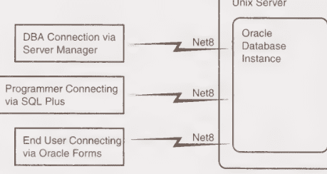

图 2.1

Oracle 服务器概览

# Oracle 服务器架构

## 第 2 章

这代表了用户访问数据库的最基础的示例。事实上，这已经是最简单的了。我们将在随后的章节中讨论更高级的架构。在这个示例中，我们引入了几个基本组件：用户、用户应用程序、网络以及存储在 Unix/Linux 服务器上的数据库。现在，我们将详细查看一些关键组件。

### SQL*Plus

`SQL*Plus` 是数据库最常用的用户界面。它本质上是一个命令行实用程序，允许用户为数据库输入 SQL 命令。在许多方面，它与 DOS 或 Unix 提示符非常相似。其核心思想是为用户提供一种直接访问界面的方法，无需通过繁琐的 GUI。

`SQL*Plus` 可以安装在 PC、工作站或服务器上。它可以连接到任何通过网络访问的数据库。在 Oracle 8.1.7 中，`SQL*Plus` 将发布以通过 Web 浏览器提供相同的访问方式。只要用户拥有正确的安全权限且网络配置正确，`SQL*Plus` 就提供了访问几乎任何数据库的简单方法。正是这种可用性使其成为一个强大的工具。任何安装 Oracle 数据库或 Oracle 桌面产品的版本都带有 `SQL*Plus`。

`SQL*Plus` 不仅是一个广泛使用的工具，而且极其强大。从 Oracle 8i 开始，任何数据库都可以使用 `SQL*Plus` 进入。最初，`SQL*Plus` 主要供用户和开发者用于使用普通的 SQL 语句、编写 PL/SQL 脚本并生成文本报告。DBA 使用一个类似但独立的工具 `Server Manager` 来发布 DBA 类型的命令。现在，自从 Oracle 8i 以来，DBA 可以使用 `SQL*Plus` 执行启动和关闭数据库、修改设置等活动。

作为一名 DBA，你进行的大部分工作将通过 `SQL*Plus` 执行。事实上，DBA 对 `SQL*Plus` 的熟悉程度比通用工具更为重要。`SQL*Plus` 提供了你所需的一切，而没有繁琐的 GUI。只要 DBA 可以到达任何 PC 并使用 `Telnet` 连接到托管数据库的 Unix/Linux 服务器，DBA 就能发挥全部功能，因为 `SQL*Plus` 的访问始终是可用的。

尽管 `SQL*Plus` 是一个强大且广泛使用的工具，但也是一个潜在的安全风险。虽然你实际上无法通过 `SQL*Plus` 删除一个数据库，但具有 DBA 权限的用户实际上可以摧毁数据库。令人惊讶的是，许多桌面上安装了 `SQL*Plus` 的普通用户并不知道自己拥有多大的权力。DBA 应该意识到并选择在哪些 PC 上加载 `SQL*Plus`。虽然用户可以在 PC 上没有 `SQL*Plus` 的情况下连接到数据库，但没有它减少了这种可能性。更好的是，DBA 应该在用户级别实施高水平的安全策略以以用户使用过高的权限登录。


### Server Manager

`Server Manager` 与 `SQL*Plus` 非常，但它是专门为 DBA 设计的。它取代了一个名为 `SQL*DBA` 的产品，那是之前的一个 DBA 实用程序。`Server Manager` 有命令行模式和图形模式，但我们将关注更常用的命令行模式。它能够像 `SQL*Plus` 一样发布相同的 SQL 语句，但缺乏格式化和报告生成功能。只要用户具有正确级别的权限，就可以从 `Server Manager` 发出所有 DBA 命令。

在 8i 之前的 Oracle 版本中，`Server Manager` 是唯一可直接发布 DBA 命令的命令行工具。如果 DBA 想要启动或停止数据库，他们必须使用 `Server Manager` 登录。此功能在 `SQL*Plus` 中不可用。从 Oracle 8i 开始，`Server Manager` 的功能被包含在 `SQL*Plus` 中。Oracle 决定逐步淘汰 `Server Manager` 产品，它在 8i 之后可能不再可用。DBA 现在应该使用 `SQL*Plus` 代替 `Server Manager`。所有关于 `SQL*Plus` 的安全问题同样适用于 `Server Manager`。

### Net8

`Net8` 是用于连接 Oracle 数据库的网络软件。最初称为 `SQL*Net`，从 Oracle 8 开始它被重命名为 `Net8`。每当你使用 Oracle 产品连接 Oracle 数据库时，你都在使用 `Net8`。`Net8` 可以通过如 `TCP/IP` 等网络协议使用，而不仅仅是建立连接。在 Unix/Linux 世界中，`TCP/IP` 用于建立连接。`Net8` 还可以提供额外的安全措施、负载均衡和其他管理功能。

在示例 2.1 中，引入了一个非常简单的架构。PC 连接到托管数据库的 Unix/Linux 服务器。一个特定的名为 `tnsnames.ora` 的文件在 PC 上进行了配置。Unix 服务器上有一个名为 `listener.ora` 的文件，包含了数据库的基本信息。

在我们的示例中，用户启动 `SQL*Plus` 并输入用户名、密码和数据库名。这些信息被称为连接字符串，通过网络发送到目标数据库。在 Unix 服务器上，`listener.ora` 文件配置了监听器进程。一旦成功，运行 `SQL*Plus` 的用户与数据库之间就建立了连接。这些命令通过网络发送到数据库以执行。

这些关于数据库如何访问的底层知识，仅是为了提供 Oracle DBA 产品及其如何与数据库交互的概述。现在我们已经有了 Oracle 数据库的背景，并将详细检查其解剖结构。

### 数据库与实例

运行中的 Oracle 数据库由三个部分组成：文件、内存和进程。每个组件都由 DBA 配置和管理。就像 Unix 操作系统一样，Oracle 作为一个独立的应用程序运行。图 2.2 显示了这些组件。

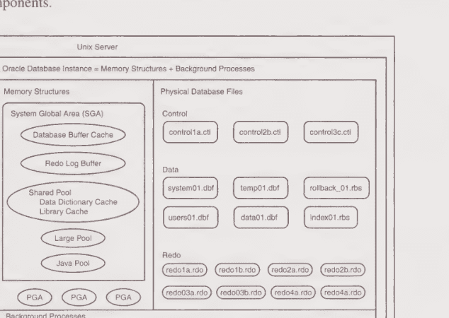

图 2.2

Oracle 数据库实例

Oracle 数据库与 Oracle 实例不同。具体来说数据库是磁盘上的物理文件，而实例是内存结构和后台进程。物理数据库文件是数据的简单存储容器，由 DBA 启动和关闭。如果没有支持的内存和后台进程，数据文件无法被访问。实际上是 Oracle 后台进程（类似于 Unix 守护进程）在访问和操作数据。这些进程将数据从磁盘移动到内存区域进行短期存储、访问和修改，最终将数据写回磁盘。

Oracle 数据库中发生的一切首先发生在内存中，然后移动到磁盘。这些内存结构和后台进程由 DBA 高度配置。管理这些组件对于 DBA 来说，了解 Oracle 和 Unix 架构是至关重要的。

### Oracle 文件类型

运行中的 Oracle 数据库由三个主要组件组成：磁盘上的物理文件、多个内存缓冲区和后台进程。由于物理文件最可视化，我们将从文件类型开始。

如果你检查 Unix/Linux 服务器上所有与 Oracle 相关的文件，你会发现有很多文件。如图 2.3 所示，这些文件可以分为三类：通过安装光盘加载的共享安装文件、数据库参数和日志文件以及组成数据库的实际文件。这些文件大部分与软件安装有关，其中任何一个都需要 DBA 的大量关注。DBA 通常更关注数据库的文件以及相应的参数和日志文件。

Oracle 数据库由三种类型组成：控制文件 `control`、数据文件 `data` 和重做文件 `redo`。这三种文件类型实际上成了物理数据库。数据库通常包含至少 10 种不同文件的混合，如果其中任何一个丢失或损坏，可能会导致严重的服务中断。每种文件类型的维护、保养和功能都是不同的，DBA 需要理解这些文件。

#### 控制文件

控制文件存储有关数据库文件结构的信息。它跟踪数据库中的每个文件、位置和时间戳。在我们的案例中，时间戳被称为系统更改号 `SCN`，是文件头最后一次修改的时间。控制文件还包含数据库名、字符集和文件类型。

一个 Oracle 数据库只需要一个控制文件，但通常使用三个或多个相同的控制文件。冗余的原因是控制文件对于数据库的运行至关重要。如果任何控制文件损坏或丢失（例如发生磁盘崩溃），数据库将需要关闭并重启。在这个阶段，文件的冗余就发挥了作用。DBA 只需将良好的副本覆盖到损坏的文件，并使用现有的良好副本恢复数据库。如果所有文件丢失或损坏，DBA 将不得不执行可能复杂且耗时的数据库恢复，并可能导致数据丢失。

## Oracle 服务器架构

### 第 2 章

`Oracle 文件类型 = 物理数据库文件 + 软件文件 + 数据库参数/日志文件`

| 软件文件 | 物理数据库文件 |
| :--- | :--- |
| `listener.ora` | `Control` |
| `oratab` | `control1a.ctl` | `control2b.ctl` | `control3c.ctl` |


| 数据库参数和日志文件 | Data |
| | `system1.dbf` | `temp01.dbf` | `rollback_01_rbs` |
| | `init.ora` | `users01.dbf` | `data01.dbf` | `index01.dbf` |
| `config.ora` | Redo |
| `alert.log` | `redo1a.rdo` | `redo1b.rdo` | `redo2a.rdo` | `redo2b.rdo` |
| | `redo03a.rdo` | `redo3b.rdo` | `redo4a.rdo` | `redo4b.rdo` |

图 2.3

## Oracle 数据库文件类型

控制文件的大小较小，拥有多个副本不会产生实际性能开销。DBA 应该创建数据库时使用少于三个控制文件，并将其放置在具有不同控制器的独立磁盘上。Oracle 会自动处理对这些每个文件的写入。因此，在创建控制文件后，DBA 的交互非常少。控制文件通常以后缀 `CTL` 命名。

> 永远不要尝试用编辑器打开数据、控制文件或重做（redo）文件。你无法看到任何有用的信息（大多数文件是二进制文件），并且只会增加损坏文件的风险。如果你想查看控制文件的内容，请执行语句 `ALTER DATABASE BACKUP CONTROLFILE TO TR`。这将在后台转储区（dump area）创建一个文本文件，可以使用 `vi` 等编辑器安全地查看。

## 数据文件

最常见的文件类型是数据文件，它存储数据库访问的信息。数据文件分为五类，每类都根据其存储的信息类型进行区分。它们具有不同的功能和不同程度的重要性。

### 系统 (System)

> 注意：“数据文件”一词指的是单个物理文件。数据文件是物理对象，但它们在数据库内部逻辑上组织为表空间（tablespaces）。一个或多个相同类型的数据文件组成一个逻辑表空间。我们将在第 6 章“日常活动”中详细讨论这种关系，但为了本文讨论，我们将交替使用这些术语。

最关键的文件是系统数据文件。它包含了关于数据库的所有信息。这些信息存储在 `SYS` 字典中，它是由用户 `SYS` 拥有的表和视图的只读集合。数据字典可以是数据库的“大脑”。控制文件包含有关数据库物理结构的信息，而系统数据文件包含了包含物理和逻辑性质的内部数据库信息的关联。关于数据库、布局、对象及其状态的所有信息都存储在数据字典中。

普通用户表和排序区域永远不应存储在系统表空间中，尽管在技术上是可行的。该文件中只有两个用户拥有任何对象：`SYS` 拥有 `VIEWS`、`V_$STABLES`、`XSTABLES`，而 `SYSTEM` 拥有其他关键表。大多数 `SYS` 和 `SYSTEM` 表对于普通用户来说太晦涩了，因此在创建数据库期间会创建如 `VS` 和 `DBA_XXX` 的视图。DBA 将非常熟悉许多 `VS` 和 `DBA_XXX` 视图，因为它们提供了一个观察数据库的窗口。

这是运行数据库最关键的文件。如果系统数据文件损坏或丢失，数据库将立即崩溃并需要恢复。如果系统数据文件丢失，数据库将变得毫无。与控制文件不同，系统数据文件大得多，超过 250M。无法像控制文件那样保持相同的副本。系统数据文件通常以 `DBF` 后缀结尾。

### 数据 (Data)

这些是人们在考虑数据库时最常的文件。通用数据文件包含所有普通用户的数据表，例如 `CUSTOMER` 和 `EMPLOYEE` 表。

如果用户拥有该表空间的空间配额（quota），任何用户都可以向数据文件写入内容。每个用户被分配一个默认表空间，该表空间包含一个或多个数据文件，用户可以在其中创建表。然而，用户几乎总会在包含多个数据文件的各种表空间创建并写入表。此外，表空间和数据文件不属于任何特定用户，因此任何在该表空间中拥有空间配额的用户都可以对其进行写入。

# Oracle 服务器架构

# 第 2 章

例如，可以在 `CUSTOMERS` 表空间中创建一个名为 `CUSTOMER` 的表，其中包含一个名为 `customers.dbf` 的数据文件。数据库中的所有用户都可以向 `CUSTOMER` 表添加行，每行都代表一个新客户。此外，逻辑上包含类型数据（如地址信息）的表也可以在 `CUSTOMERS` 表空间中创建，并写入同一个数据文件中。

数据库中通常有很多数据文件。表空间通常由几个数据文件组成。文件大小通常在 50M 到 2G 限制之间。请注意，某些 Unix 平台的某些操作系统支持超过 2G 的文件。基础示例包括 `Solaris 2.6` 和 `HP-UX 10.20`，你应该针对你自己的平台验证这一点。关于数据文件的大小存在性能考量，但基本上，如果你可以将较小文件分散到多个磁盘上，你就不应该只使用少数几个大文件。

数据库并不实际上需要数据文件，但这似乎违违背了拥有数据库的初衷。如果在数据库运行期间丢失了数据文件，它不应该崩溃。然而，你将失去对该文件中包含的任何数据的访问。取决于数据文件，数据库可能会变得不可用。

控制文件的大小较小，拥有多个副本不会产生实际性能开销。DBA 应该创建数据库时使用少于三个控制文件，并将其放置在具有不同控制器的独立磁盘上。Oracle 会自动处理对这些每个文件的写入。因此，在创建控制文件后，DBA 的交互非常少。控制文件通常以后缀 `CTL` 命名。

> 永远不要尝试用编辑器打开数据、控制文件或重做（redo）文件。你无法看到任何有用的信息（大多数文件是二进制文件），并且只会增加损坏文件的风险。如果你想查看控制文件的内容，请执行语句 `ALTER DATABASE BACKUP CONTROLFILE TO TR`。这将在后台转储区创建一个文本文件，可以使用 `vi` 等编辑器安全地查看。

### 注意 (NOTE)

> 注意：“数据文件”一词指的是单个物理文件。数据文件是物理对象，但它们在数据库内部逻辑上组织为表空间。一个或多个相同类型的数据文件组成一个逻辑表空间。我们将在第 6 章“日常活动”中详细讨论这种关系，但为了本文讨论，我们将交替使用这些术语。

最关键的文件是系统数据文件。它包含了关于数据库的所有信息。这些信息存储在 `SYS` 字典中，它是由用户 `SYS` 拥有的表和视图的只读集合。数据字典可以是数据库的“大脑”。控制文件包含有关数据库物理结构的信息，而系统数据文件包含了包含物理和逻辑性质的内部数据库信息的关联。关于数据库、布局、对象及其状态的所有信息都存储在数据字典中。

普通用户表和排序区域永远不应存储在系统表空间中，尽管在技术上是行的。该文件中只有两个用户拥有任何对象：`SYS` 拥有 `VIEWS`、`V_$STABLES`、`XSTABLES`，而 `SYSTEM` 拥有其他关键表。大多数 `SYS` 和 `SYSTEM` 表对于普通用户来说太晦涩了，因此在创建数据库期间会创建如 `VS` 和 `DBA_XXX` 的视图。DBA 将非常熟悉许多 `VS` 和 `DBA_XXX` 视图，因为它们提供了一个观察数据库的窗口。

这是运行数据库最关键的文件。如果系统数据文件损坏或丢失，数据库将立即崩溃并需要恢复。如果系统数据文件丢失，数据库将变得毫无。与控制文件不同，系统数据文件大得多，超过 250M。无法像控制文件那样保持相同的副本。系统数据文件通常以 `DBF` 后缀结尾。

### 数据 (Data)

这些是人们在考虑数据库时最常的文件。通用数据文件包含所有普通用户的数据表，例如 `CUSTOMER` 和 `EMPLOYEE` 表。

如果用户拥有该表空间的空间配额，任何用户都可以向数据文件写入内容。每个用户被分配一个默认表空间，该表空间包含一个或多个数据文件，用户可以在其中创建表。然而，用户几乎总会在包含多个数据文件的各种表空间创建并写入表。此外，表空间和数据文件不属于任何特定用户，因此任何在该表空间中拥有空间配额的用户都可以对其进行写入。

例如，可以在 `CUSTOMERS` 表空间中创建一个名为 `CUSTOMER` 的表，其中包含一个名为 `customers.dbf` 的数据文件。数据库中的所有用户都可以向 `CUSTOMER` 表添加行，每行都代表一个新客户。此外，逻辑上包含类型数据（如地址信息）的表也可以在 `CUSTOMERS` 表空间中创建，并写入同一个数据文件中。

数据库中通常有很多数据文件。表空间通常由几个数据文件组成。文件大小通常在 50M 到 2G 限制之间。请注意，某些 Unix 平台的某些操作系统支持超过 2G 的文件。基础示例包括 `Solaris 2.6` 和 `HP-UX 10.20`，你应该针对你自己的平台验证这一点。关于数据文件的大小存在性能考量，但基本上，如果你可以将较小文件分散到多个磁盘上，你就不应该只使用少数几个大文件。

数据库并不实际上需要数据文件，但这似乎违违背了拥有数据库的初衷。如果在数据库运行期间丢失了数据文件，它不应该崩溃。然而，你将失去对该文件中包含的任何数据的访问。取决于数据文件，数据库可能会变得不可用。

### 索引 (Index)

控制文件的大小较小，拥有多个副本不会产生实际性能开销。DBA 应该创建数据库时使用少于三个控制文件，并将其放置在具有不同控制器的独立磁盘上。Oracle 会自动处理对这些每个文件的写入。因此，在创建控制文件后，DBA 的交互非常少。

### 临时 (Temp)


临时（temporary）数据文件仅仅是磁盘上的排序位置。某些 SQL 查询在返回数据之前需要进行选择和排序。例如，如果用户想要所有员工的姓名、识别号和薪水，从高薪员工开始到低薪结束，那么排序操作就是必要的。Oracle 会发现所有员工很可能不是按顺序存储的。出于性能考虑，Oracle 在内存中进行排序，直到超过 DBA 指定的大小。

### 回滚 (Rollback)

当用户更改行数据时，其旧值存储在回滚段中。这种做法涉及回滚的三个“R”：

- **事务回滚**：当用户更新表中的某一行时，旧值会被存储在回滚段中，以防用户决定回滚（或撤销）该语句。
- **事务恢复**：如果数据库在语句提交之前崩溃，该语句将在实例恢复期间进行回滚（撤销）。这是通过将该值同时存储在回滚段和重做日志文件中来实现的。

# Oracle 服务器体系

第 2 章

## 读一致性

Oracle 承诺用户在事务中将看到读一致性状态的数据。一旦用户开始修改数据，他们将是唯一看到这些更改的人，直到这些更改通过提交（`commit`）变为永久性。系统中的其他用户将无法看到未提交的更改。如果用户更新了某行，该行更新将存在于回滚段（`rollback segment`）中，且仅对该用户可见。此外，用户将不会看到在语句开始时尚不存在的其他用户所提交的更改。一旦更新提交，所有人将看到新值。Oracle 会自动对已更新的数据应用行级锁，以防止两个用户修改同一条数据。

回滚段存储在回滚表空间（`rollback tablespaces`）中，这些表空间由一个或多个文件组成。一个回滚表空间通常包含多个回滚段。每个回滚段都是由区（`extents`）组成的环形链。创建回滚段时会分配指定数量的区。例如，回滚段 `rb2`（见图 2.4）拥有 10 个区，每个区 500K。随着事务的增长和对更多回滚空间的需求，系统将获取下一个区。如果 10 个区都被用完，将分配第 11 个区，前提是数据文件中仍有空间。如果事务需要写入下一个区，但该区已被另一个事务占用，也会发生这种情况。Oracle 无法“跳过”某个区，因此它会分配一个新区。

Oracle 服务器体系结构

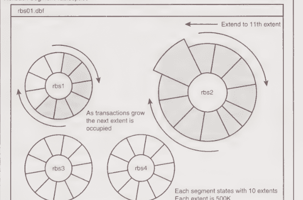

图 2.4

回滚段

当回滚段像这样扩展时，称为“扩展（extend）”，环形段的规模被增加了。如果新区满了，将再分配另一个区作为扩展。这种过程将一直持续，直到事务提交或回滚、超过了 DBA 定义的最大区数，或者回滚段耗尽了磁盘空间。虽然这种扩展是必要的，但它确实会对性能产生影响。

`SYSTEM` 表空间自动带有一个较小的回滚段用于对象，但我们正在讨论的段段是针对普通用户的。DBA 还应该注意，只有插入（`inserts`）、更新（`updates`）和删除（`deletes`）会产生回滚。这些更改引起的索引变化也存储在回滚段中。数据定义语言（DDL）更改如 `DROP TABLE` 和 `TRUNCATE` 不产生回滚，且无法撤销。

包含回滚段的文件需要 DBA 大为关注。它们经过仔细的规划、创建和持续监控，因为它们对性能有很大影响。如果这些文件中的任何一个损坏或破坏，会对数据库产生严重影响。这些问题将在第9 章“备份与恢复”和第 11 章“Oracle 服务器调优”中介绍。这些文件通常以 RBS 后结尾。

# 了解并理解技术细节

理解 Oracle 如何以及为何这样做可以防止你对数据库做出愚蠢或危险的操作。许多人对 Oracle 的了解足以变得极其危险。需要一个老练的 DBA 才能在错误建议发生之前识别并阻止它。

我曾有一个 PL/SQL 程序员要求我大幅增加数据库内部回滚段的大小。他正准备进行大规模处理，并想确保自己不会撑爆回滚段。这本身是一个合理的请求，我没有经过仔细思考询问细节就执行了。

事实证明，他的脚本将每 10 行提交一次，从而释放回滚段。很难怀疑他在提交之前会使用超过一个区，更不用说由于空间不足了。我向他解释了回滚段和提交的工作原理，以及为什么他的请求对他的工作毫无帮助。相反，我们增加了提交之间的时间间隔，并让回滚段保持原样。

# 在线重做日志

实际数据库中的第三类文件是在线重做日志文件（online redo log file，称为重做日志文件）。数据库中的每个更改（如修改数据行）都会从内存区域（重做日志缓冲区，稍后在本章的“内存结构”部分描述）写入在线重做日志文件之一。数据库中的每个更改都会写入在线重做日志文件，这是大量数据。当其中一个重做日志文件填充时，Oracle 开始写入下一个重做日志文件。这被称为日志切换（log switch）。一旦重做日志填充，Oracle 将写入下一个重做日志文件。Oracle 运行至少需要两个重做日志文件。实际上，Oracle 需要重做组。一个重做组由一个或多个成员（文件）组成。当执行日志切换时，Oracle 停止写入一个组并开始写入下一个组。出于性能考虑，DBA 通常需要多个重做日志组。此外，由于一个组丢失或损坏会导致数据库崩溃并丢失数据，DBA 会对重做日志文件进行多路复制。每个组创建多个成员（通常为两个）。每个成员的大小相同，但位于不同的磁盘，以减少丢失两个成员的可能性。

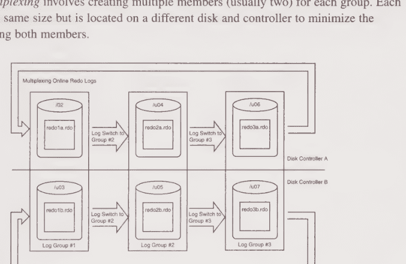

图 2.5

重做日志文件多路复制

许多常见的性能问题可以归因于重做日志文件的大小或布局不当，以及日志切换的频率。因此，这些文件应位于独立的磁盘上，最好远离其他 I/O 密集型文件。避免 I/O 冲突的细节请见第 3 章“数据库规划”。重做日志文件通常带有 RDO 后缀。

# 内存结构

如前所述，运行中的 Oracle 数据库由文件、内存结构和进程组成。在上一节中，我们关注了服务器上的三种数据库文件：控制文件、数据文件（及其子类型）和重做日志文件。现在我们将关注数据库内存结构。DBA 关注三类内存结构：`SGA`、`PGA` 和 `UGA`。`SGA` 是 DBA 最关注的，因为它服务于整个数据库并需要高度配置和监控。`PGA` 和 `UGA` 存在于进程中，维护强度不如 `SGA`。

## 共享全局区域 (SGA)

共享全局区域（也称为系统全局区域）是 DBA 需要理解的最重要的内存区域。`SGA` 是数据库启动时分配的若干较小内存池集合。这个共享内存区域是数据库所有活动发生的地方。如果系统数据文件是数据库的大脑，那么 `SGA` 就是它的心跳。没有 `SGA`，无法访问数据文件中的数据。

`SGA` 包括数据库缓冲区、重做日志缓冲区、共享池和 Java 池（8i 版本引入）。这些内存区域都可以由 DBA 配置，并对性能有很大影响。`SGA` 的值在 `SQL*Plus` 实例启动时显示。也可以通过 `SELECT * FROM V$SGA` 或 `SHOW SGA` 显示，如下所示：

正如你所看到的，`SGA` 非常大，超过了 200M。这对于许多数据库来说是正常的。`SGA` 的组成部分如下：

`SGA` = 数据库缓冲区（数据库缓冲区缓存）

+ 重做缓冲区（重做日志缓冲区）

+ 变动大小（共享池 + 大内存池 + Java 池）

+ 固定大小（Fixed Size）

### 注意

检查 SGA

`V$SGASTAT` 提供了 `SGA` 的完整拆分。使用它来查看你的池是如何分配的。

`Fixed Size` 的值很小且不可配置。它包含了有关后台进程所用数据库的信息。`Variable Size` 实际上是共享池、大内存池和 Java 池的总和。要查看这些值的列表，请在 `SQL*Plus` 提示符输入以下命令：

```sql
SHOW PARAMETER
```

将显示每个带有 pool 字样的参数。要查看所有已发布的参数及其设置，只需输入 `SHOW PARAMETER`。

这通常是 `SGA` 中最大的内存区域。数据库缓冲区缓存是一个共享内存区域，用于用于缓存从磁盘数据文件中读取的数据块副本。这些块可以是实际的数据块，也可以来自索引、临时、回滚或数据字典段。用户将发布需要存储在块中的特定数据的 SQL 语句。Oracle 将快速从缓冲区缓存中读取，检查是否存在未修改的“干净”副本。如果存在，将使用该副本。如果未找到，Oracle 将去获取该块并将其写入缓冲区缓存。数据块在缓冲区缓存中后，可以对其进行操作以满足用户请求。

缓冲区缓存中的块可以处于三种状态之一：当前（current）、脏（dirty）或钉住（pinned）。如果缓冲区中的块与其原始状态一致，则该块是当前状态。脏块是那些已被进程修改过的块，它们在被重用之前必须写入磁盘。钉住块是当前正在被使用的块。请注意，缓存中可以同时找到同一个块的多个副本，每个副本处于不同的状态。在这种情况下，其中一个副本被认为是当前的（与磁盘副本一致），而其他副本被保留以为其他用户提供读取一致性。

将 Oracle 所需的数据块保留在缓冲区缓存中是性能的关键。每当用户使用一行数据时，该数据块在访问之前都会位于缓冲区缓存中。如果块已经在缓存中，用户进程就可以继续。如果块不在缓存中，Oracle 必须进行昂贵的磁盘读取以检索该数据块并将其放入缓冲区。在内存中访问数据的速度比在磁盘上快10,000 到 100,000 倍。因此，DBA 最好确保缓冲区缓存大小适当，并使最常访问的数据块位于其中。DBA 通过确保有足够的缓冲区将最频繁访问的数据保留在缓存中来实现这一点。


# Oracle 服务器的架构

## 第 2 章

缓冲区缓存的大小以及因此它能容纳的块的数量由 DBA 配置。缓冲区缓存中的每个缓冲区对应一个数据库块。因此，缓冲区缓存的总大小等于数据库块的大小乘以缓冲器的数量：

`Database Buffer Cache = DB_BLOCK_SIZE × DB_BLOCK_BUFFERS`

大小设置、性能测量和多个数据库缓冲器的调优将在第 11 章中详细介绍。

缓冲区缓存的大小有限，某些块被保留在缓存中，另一些块被写回磁盘以释放空间。Oracle 使用两个列表来管理此过程：最久未使用（LRU）列表和“脏块”列表。

LRU 列表是存储块的链表。该列表有一个最近最使用（MRU）端和一个最久未使用（LRU）端。当块被读取到缓存中时，它们被放置在 MRU 端。随着时间的推移，新的块被放置在 MRU 端，旧块沿链向 LRU 端 移动。最终，缓存将填满，Oracle 需要为新块在缓存中腾出空间。修改过的块（在脏列表中）会被写入磁盘以腾出空间。LRU 列表末尾的一致（未修改）块不需要写入磁盘，因此空间被直接收回。当该块再次被需要时，它将从磁盘读取并再次放置在 MRU 端。如果块已经在缓存中且是 LRU 端，它将器移动到 MRU 端。

请注意，将新块放置在 MRU 端的规则有一个例外。如果正在进行全表扫描（FTS），即正在读取整个表，则这些块将被放置在列表的 LRU 端。这样做是因为这些块通常不需要很久。

| 系统全局区域 (SGA) 架构 | | |
| :--- | :--- | :--- |
| 数据库缓冲区缓存 | LRU 端 | |
| LRU 列表 | 最近最使用 (MRU) 端 | |
| 重做缓冲区 | 最久未使用列表 | |
| 脏列表 | 共享池 | |
| 在末尾插入块 | 服务器进程 | |
| 在末尾插入块 | 全表扫描 | |
| 数据回 | 服务器进程 | |

## 数据字典缓存

数据字典缓存在内存中持有有关数据库对象的信息。这是存储在系统中的。当该缓存为空时，它会随着对象的查询而填充。此缓存比库缓存小，并且由 DBA 进行深度调优。LRU 算法管理数据字典。

## 库缓存

库缓存存储 SQL 和 PL/SQL 文本、对应的 SQL 和 PL/SQL 语句及其执行计划。这些被保留在名为共享区域中供未来复用。

使用 `ANALYZE` 命令对对象进行分析时，所有引用该对象的语句都会被刷新，因为新的执行计划将反映新的统计信息。此外，当数据库对象被更改时，任何依赖于它的 SQL 语句都会失效。它们将在下一次执行语句时被修复，并生成新的执行计划。

数据字典缓存（data dictionary cache）和库缓存（library cache）都无法直接设置大小。它们都通过数据库参数 `SHARED_POOL_SIZE` 调整大小。该值的单位是字节，而不是缓冲区或块。通常，DBA 使用共享池来优化库缓存，而不是数据字典缓存。通用的共识是：如果库缓存设置得恰当，数据字典缓存也会运行良好。

## 重做日志缓冲区 (Redo Log Buffer)

重做日志缓冲区包含了对数据库任何更改的记录。这些包括数据操纵语言（DML）中的任何类型的插入、更新或删除，以及数据定义语言（DDL）中数据库的任何更改（例如创建或删除对象）。这些更改记录在日志缓冲区中，以防数据库崩溃。当数据库恢复时，这些更改会被重放（或重做），使数据库恢复到崩溃前完全相同的状态；因此，它被称为重做日志缓冲区。

当用户进程对重做对象进行更改时，Oracle 会写入此缓冲区。虽然该更改可能会被回滚（假设它是对数据的更改），但它会被记录下来。重做活动写入日志缓冲区这一规则的唯一例外是操作被指定为 `NOLOGGING`。通常，这仅在需要加载大量数据且生成重做日志的开销过大时使用。如果数据库在加载期间崩溃，这些数据将会丢失，但 DBA 应该知晓此点并有替代解决方案。`SQLLoader`（见第 8 章“数据库实用程序”）和某些 SQL 语句（见 SQL 参考手册）。

此外，该内存区域内有大量的活动。然而，当重做日志缓冲区频繁写入磁盘时，这是一个相对较小的区域。此外，与数据库缓存不同，整个重做日志都会被刷新到磁盘，而不仅仅是某些块。日志写入进程（见本章后文的“Log Writer Process (LGWR)”部分）负责将此缓冲区写入活动在线重做日志组。

重做缓冲区的大小由数据库启动参数 `LOG_BUFFER` 决定。这并不是实际的缓冲区数量，而是总字节数。所需的实际缓冲区数量，请除以每个 Oracle 数据块的字节数 `DB_BLOCK_SIZE`。请记住，可以通过 SQL*Plus 中执行 `SHOW PARAMETER` 语句来查看这些参数的值。此缓冲器的强制性最小大小为 `4 × DB_BLOCK_SIZE`。特定的调优细节见第 11 章。

## 大池 (Large Pool)

大池是 SGA 中一个可选的内存结构，最早在 Oracle 8 中引入。它用于为特定活动提供内存，这些活动通常会消耗共享池内存。

大池用于辅助以下操作：

- 使用多线程服务器 (MTS) 配置时的用户全局区域 (UGA) 会话内存。
- 扩展架构 (XA)
- I/O 进程进程 (I/O slaves)
- 恢复管理器 (RMAN) 备份和恢复活动

在许多系统中，实际上不需要配置大池。I/O 从进程偶尔才会使用。除非系统有非常多的用户，或者支持企业 Java Bean (EJBs) 或 CORBA 服务器，否则没有理由使用 MTS；RMAN 在 NT 系统上的使用日益增加，但尚未完全被 Unix DBA 接受。

这一定是为了 CORBA 的。参数 `LARGE_POOL_SIZE` 配置此内存区域的大小（单位为字节）。

## Java 池 (Java Pool)

Java 池是一个相对较新的内存结构，最早在 Oracle 8i 中引入。它用于共享 Java 对象。使用的存储 Java 过程和 EJBs 越多，此参数就应该设置得。此池在加载类期间特别为有用，编译对象也会使用它。

参数 `JAVA_POOL_SIZE` 以字节为单位设置 Java 池的大小。默认大小为 20M，使用更多 Java 的系统则为 50M。然而，如果正使用 `initjvm.sql` 手动安装 Java 虚拟机 (JVM)，则需要 100M 或更大的 `JAVA_POOL_SIZE`；在 JVM 加载后，可以减小此参数的值。如果数据库中不积极使用 Java，可以轻松地将 Java 池设置为 1M 而不会出现问题。

SGA 是整个数据库实例的共享内存，占据了 DBA 大部分的注意力。然而，DBA 还应该熟悉另外两个内存区域：PGA 和 UGA。

程序全局区域 (PGA) 也称为进程全局区域。每个创建的专用服务器进程都会分配一个 PGA。PGA 包含该进程的用户会话数据、栈空间和游标状态。该内存区域在进程之间不共享，因为每个区域都特定于一个服务器进程。

用户全局区域 (UGA) 是 PGA 的一个子集。它包含用户会话数据和游标信息。每个用户的排序首先在该区域中发生。如果排序超过了 `SORT_AREA_SIZE` 的值，它将移动到临时表空间中的磁盘中。

当使用专用服务器配置时，PGA 包含用户会话数据、栈空间和游标状态信息，并位于 SGA 之外。因此，相应的 UGA（会话和游标信息）也存储在 SGA 之外。这是一个因素，因为排序将在 SGA 之外发生，从性能角度来看是好的。见图 2.1。

如果使用了多线程服务器选项（见下文“Oracle 进程”），UGA（会话和游标信息）也存储在 SGA 中。这是一个因素，因为排序将在 SGA 之外发生，从性能角度来看是好的。


## Oracle 进程

Oracle 实例的第二个组件是 Oracle 进程。有两种类型的进程：用户进程和 Oracle 进程。用户进程位于客户端且 UGA 是 PGA 的子集。它包含用户会话数据和游标信息。每个用户的排序首先在该区域中发生。如果排序超过了 `SORT_AREA_SIZE` 的值，它将移动到临时表空间中的磁盘中。

## 服务器进程

Oracle 进程位于数据库。服务器进程支持用户进程的方法取决于数据库配置。Oracle 进程分为两类：服务器进程和后台进程。

服务器进程充当用户进程和 Oracle 内存结构的中间人。当用户进程有工作时，是由服务器进程完成的。从磁盘读取数据放入内存也由服务器进程完成。例如，当用户进程请求数据时，是服务器进程在缓存缓存中查找它。

### 专用服务器

每当创建一个用户进程时，就会创建一个服务器进程。该服务器进程专门用于满足该用户进程的工作请求。用户进程将其工作请求传递给其服务器进程。服务器进程执行工作并将结果直接返回给用户进程。

有关用户会话的信息由服务器进程存储在 PGA 中。用户会话与服务器进程的一一对关系存在于用户进程的范围内。当用户进程终止时，服务器进程也终止。如果用户进程不发出请求，服务器进程将保持空闲。

Oracle 在尝试恢复或数据库启动/关闭时需要专用服务器进程。理想情况下，运行大型批处理的用户进程也应该拥有专用服务器进程。因为任何需要高级服务的用户进程都应该有一个专用服务器进程。

专用服务器配置是 Oracle 的默认配置。它高效、健壮、易于监控且实现简单。通常，除非出于特定原因需要 MTS，否则使用专用配置。

### 多线程服务器 (MTS)

在某些情况下，使用少量服务器进程来服务许多用户进程更好。在这种情况下，应该考虑 Oracle 的多线程服务器选项。

例如，呼叫中心的工作人员需要查询客户记录，有时输入订单。这被称为联机处理 (OLTP)。在 OLTP 情况下，用户向数据库发出简短请求，从 CPU 时间的角度来看频率较低。大部分时间里，用户进程处于空闲状态，等待用户的命令。

# Oracle 服务器架构

第 2 章

在此期间，相应的服务器进程也处于空闲状态。这代表了一部分未被使用的内存。虽然这看起来可能微不足道，但如果系统试图同时支持成百或数千个用户，这个问题就会变得严重。

MTS 通过分配少数服务器进程来服务多个用户进程，试图减少未使用的内存量。这导致了服务器进程与用户进程之间的一对多比例关系（见图 2.8）。

在此配置下，当用户登录时，监听器（`listener`）会将其识别为新进程。监听器将客户端进程交给分发进程（`dispatcher`）。分发进程将监听多个客户端并将它们的请求放在共享请求队列中。共享服务器进程会从请求队列中提取用户请求并进行处理。工作完成后，共享服务器进程会将结果放在处理该请求的特定分发进程队列中。随后，分发进程将响应传递给客户端进程。

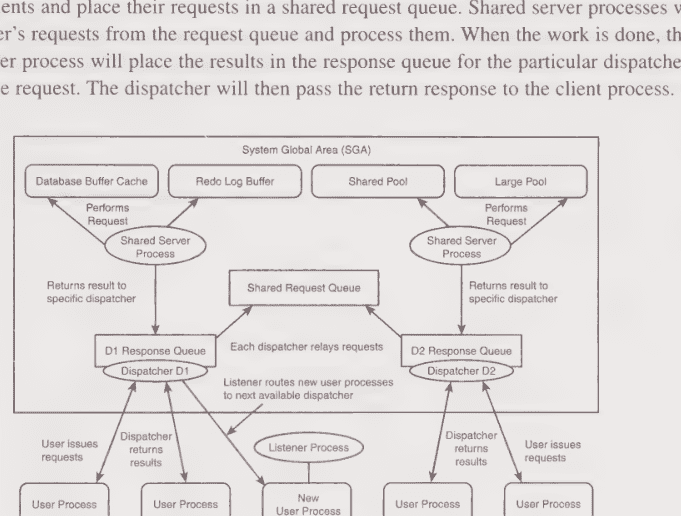

图 2.8 多线程服务器 (MTS)

即使客户端与服务器在同一机器上，MTS 也需要使用 Net8 和运行中的监听器进程。一旦用户进程分配给分发器，就会使用该分发进程。请求被放在所有分发器的共享请求队列中，并按照先进先出的原则处理。每个分发器都有私有的响应队列，共享服务器进程会将完成的结果放在其中。

尽管 MTS 可用于大量的 OLTP 用户，但它有时也被用于支持 Java。具体来说，在使用企业级 Java Bean (EJBs) 或 CORBA（通用对象请求代理架构）服务器时，MTS 是必须的。这在第 16 章“数据库服务器内部 Java”中有详细介绍。

为 MTS 配置 Oracle 需要修改 `init.ora` 参数文件和 `listener.ora` 文件。MTS 配置示例见附录 C。

## 后台进程

后台进程在内存结构和磁盘之间执行大部分性工作。每当数据从内存写入磁盘时，都是由后台进程完成的。 DBA 需要了解每个进程的作用以及如何配置它。这对于理解 Oracle 的功能至关重要。

与内存结构类似，后台结构仅在数据库实例运行时存在。要查看特定数据库实例的后台进程，请输入以下 Unix 命令：

```
ps -ef | grep -i database_sid
```

图 2.9 显示了 Oracle 实例的进程。

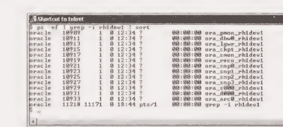

图 2.9

Oracle 后台进程

如所示，这里有多个进程。系统标识符 (SID) 用于标识实例，将在第 5 章“创建数据库”中讨论。

是服务器进程，可以通过以下方式识别：

```
oracleSID (DESCRIPTION=(LOCAL=no) (ADDRESS=(PROTOCOL=BEQ)))
```

或

```
oracleSID (DESCRIPTION=(LOCAL=YES) (ADDRESS=(PROTOCOL=BEQ)))
```

# Oracle 服务器架构

后台进程是剩余进程。我们将详细介绍每一个进程，目前重要的是有些是强制性的，另一些是可选的。具体来说，PMON、SMON、LGWR、DBWR 和 CKPT（从 Oracle 8 开始）是必需的。如果任何这些进程死亡或被意外杀死，数据库将崩溃。如果没有所有这些进程，数据库实例将无法生存。其他进程（如 QMNn 或 ARCH）用于提供额外的数据库功能。

### 系统监控进程 (SMON)

系统监控进程是一个必需的 Oracle 进程，通常处于休眠状态。它定期唤醒并自主执行任务，无需与 DBA 交互。SMON 自动执行以下活动：

- 崩溃后的恢复。这是“向前重做”和“回滚”阶段，其中事务被解析到最后一个完成的检查点。
- 如果 `PCTFREE` 参数大于 0，则对磁盘字典管理表空间上的空闲空间进行合并（合并）。这适用于表和索引。
- 临时段所用空间的恢复。

### 进程监控进程 (PMON)

进程监控清理异常终止的用户进程。这包括回滚进程的事务并释放其资源（如事务锁和内存）。PMON 还通过回滚死锁事务来检测并解决死锁。如果数据库设置为使用 MTS，PMON 将重启非正常死亡的分发进程和服务器进程。

PMON 可能需要一段时间才能唤醒，因为被杀死的用户进程可能会存在一段时间。我们见过在 Oracle 级别被杀死的用户登录在数据库中存了好几天。

尽管运行的数据库实例有五个必需的 Oracle 后台进程（SMON、PMON、DBWR、LGWR 和 CKPT），大多数 DBA 通过检查 PMON 来验证数据库是上线还是上线。使用 `ps -ef | grep -ip mon` 来验证数据库是否运行。这种方法常用于 Unix 脚本，在尝试访问数据库之前检查数据库是否在线。

### 数据库写入进程 (DBW)

数据库写入器 (DBW，也称为 DBWR) 从数据库缓冲区将修改过的（脏）块写入磁盘。DBWR 这样做是为了清除所有脏块，为缓存中的新块留出空间。DBA 应注意，这包含了已提交和未提交的数据。


数据库写入器 (DBW，也称为 DBWR) 从数据库缓冲区将修改过的（脏）块写入磁盘。DBWR 这样做是为了清除所有脏块，为缓存中的新块留出空间。DBA 应注意，这包含了已提交和未提交的数据。

## 数据库写入进程 (DBW)

数据库写入器 (DBW，也称为 DBWR) 从数据库缓冲区将修改过的（脏）块写入磁盘。DBWR 这样做是为了清除所有脏块，为缓存中的新块留出空间。DBA 应注意，这包含了已提交和未提交的数据。

## 数据库写入进程 (DBW)

数据库写入器 (DBW，也称为 DBWR) 从数据库缓冲区将修改过的（脏）块写入磁盘。DBWR 这样做是为了清除所有脏块，为缓存中的新块留出空间。DBA 应注意，这包含了已提交和未提交的数据。

## 数据库写入进程 (DBW)

数据库写入器 (DBW，也称为 DBWR) 从数据库缓冲区将修改过的（脏）块写入磁盘。DBWR 这样做是为了清除所有脏块，为缓存中的新块留出空间。DBA 应注意，这包含了已提交和未提交的数据。

## 数据库写入进程 (DBW)

数据库写入器 (DBW，也称为 DBWR) 从数据库缓冲区将修改过的（脏）块写入磁盘。DBWR 这样做是为了清除所有脏块，为缓存中的新块留出空间。DBA 应注意，这包含了已提交和未提交的数据。

## 数据库写入进程 (DBW)

数据库写入器 (DBW，也称为 DBWR) 从数据库缓冲区将修改过的（脏）块写入磁盘。DBWR 这样做是为了清除所有脏块，为缓存中的新块留出空间。DBA 应注意，这包含了已提交和未提交的数据。

## 数据库写入进程 (DBW)

数据库写入器 (DBW，也称为 DBWR) 从数据库缓冲区将修改过的（脏）块写入磁盘。DBWR 这样做是为了清除所有脏块，为缓存中的新块留出空间。DBA 应注意，这包含了已提交和未提交的数据。

## 数据库写入进程 (DBW)


数据库写入器 (`DBW`，也称为 `DBWR`) 从数据库缓冲区将修改过的（脏）块写入磁盘。`DBWR` 这样做是为了清除所有脏块，为缓存中的新块留出空间。DBA 应注意，这包含了已提交和未提交的数据。

## 数据库写入进程 (DBW)

数据库写入器 (`DBW`，也称为 `DBWR`) 从数据库缓冲区将修改过的（脏）块写入磁盘。`DBWR` 这样做是为了清除所有脏块，为缓存中的新块留出空间。DBA 应注意，这包含了已提交和未提交的数据。


## 归档进程 (ARCn)

归档进程（`ARCn`，也称为 `ARCH`）会自动将在线重做日志文件（这些文件最终会被覆盖）复制到持久的归档日志文件中。这是为了在需要数据库恢复时保留数据库的所有更改。只有当数据库处于 `ARCHIVELOG` 模式并启用了归档时，该进程才会活动。根据需要，可能会有多达 10 个归档进程。关于使用归档进程的细节请见第 9 章和第 10 章“出现问题时”。

## 恢复进程 (RECO)

恢复进程（`RECO`）仅存在于分布式数据库环境中。它会自动清理失败的事务，并尝试解决悬疑事务。这意味着如果两个独立的数据库之间发生了一个事务并失败，`RECO` 将采取适当的回滚步骤。

## 任务队列进程 (SNPqnn)

任务队列进程执行多项任务。它们执行由 `DBMS_JOB` 程序包提交的任务。它们还会刷新分布式数据库环境中表的快照。可能会有多达 36 个任务队列进程。

## 队列监控进程 (QMNnn)

队列监控器支持 Oracle 高级队列 (`AQ`) 选项。可以配置多达 10 个此类进程来支持消息队列。

## 分发进程 (Dnnn)

分发器仅在实现 `MTS`（多线程服务）时存在。监听器进程将入站的用户进程引导到分发进程。分发进程将用户请求放在请求队列中，供下一个可用的服务器进程提取。一旦共享服务器进程执行了请求，分发进程就会从响应队列中检索结果并将其转发给用户。

## 共享服务器进程 (Snnn)

只有在使用 `MTS` 时才会分配共享服务器进程。这些是根据分发进程指示为用户进程提供服务的共享进程。一旦共享服务器获取了用户进程的信息，结果将放在分发器的响应队列中。

## 事务控制

现在我们已经查看了 Oracle 架构，我们将详细查看一个示例事务以了解一切是如何协同工作的。该示例事务如图 2.10 所示。

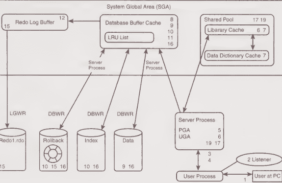

图 2.10

示例 Oracle 事务。

以下涵盖了 Oracle 内部的一个基础事务：

- 1. 用户登录 `SQL*Plus` 并输入用户名、密码和数据库名称（称为连接字符串）。在客户端侧，Oracle 在 `tnsnames.ora` 中查找数据库名称。使用指定的 IP 地址、端口号和连接字符串，用户进程与数据库服务器建立连接。
- 2. 数据库服务器上的 Oracle 监听器接收用户进程的连接。它在 `listener.ora` 中查找数据库并将用户进程路由到指定的数据库。在此点上，我们假设使用的是专用连接（非 `MTS`）。
- 3. 数据库内部会派生一个新的服务器进程，并与用户进程建立联系。在此阶段，监听器进程不再参与。在通过密码验证后，用户进程完成连接。
- 4. 用户进程发布 SQL 语句来更新表中的某行数据。该语句跨越网络发送到专用服务器进程。
- 5. 服务器进程 `PGA` 内部的信息被更新以反映新的 SQL 语句。
- 6. 服务器进程对语句运行快速哈希算法并接收一个值。它扫描共享 SQL 区域，查找具有相同哈希值的语句。在本例中，它没有找到匹配的哈希值。
- 7. 服务器进程在共享 SQL 区域内找到一个空区域进行工作。它解析用户的 SQL 语句并检查语法。Oracle 验证数据字典中是否存在该表，并验证用户对正在修改的表的对象级权限。然后它查看语句以及存储的关于表和任何索引的统计信息以制定执行计划。Oracle 随后对该数据行加排锁并尝试执行语句。Oracle 接收系统当前的系统更改号 (`SCN`)，并使用该值在整个事务期间维护一致性。
- 8. 服务器进程扫描数据库缓冲区以查看数据块是否已缓存。在我们的示例中，服务器进程在缓冲区中没有找到该块的副本，因此必须将其读入。
- 9. 扫描数据库缓冲区发现了一个可以重复使用的一致性数据块。服务器进程遵循预定的执行计划并检索包含要修改行的块。它用新块覆盖缓冲区。该块被标记为位于最久未使用 (`LRU`) 列表的 `MRU` 端。在 Oracle 8 中，认为块将通过中间点插入 (`Mid Point Insertion`) 放在 `LRU` 列表的中间，但没有足够的信息来确认这一点。
- 10. 首先获取回滚段头部的排序，并在回滚段扩展中找到空间。该回滚段的块以与步骤 8 类似的方式移动到数据库缓冲区。生成一个用于撤销用户 `UPDATE` 语句的 `UPDATE` 语句并将其放在回滚段中。
- 11. 该行数据在数据库缓冲区中被修改。
- 12. 服务器进程找到空间并将更改写入重做日志缓冲区。
- 13. [等待，文本在下一页继续]

# Unix 和 Linux 上的 Oracle DBA

## Oracle 数据库参数和日志文件

每个数据库都有自己的参数文件和日志文件。DBA 会监控这些文件并对其进行自定义，以满足特定数据库的需求。无论平台如何，这些文件对于 Oracle 数据库都是通用的。

### init.ora

`init.ora` 是包含可配置数据库参数的参数文件。实际上，该文件名为 `init$SID.ora`，其中 `SID` 是数据库实例名称。此强制性文件在数据库启动期间被读取，并据此对数据库配置。DBA 通过编辑此文件来分配内存池、进程的数量和类型以及其他参数设置。

任何可配置参数都可以在此文件中指定。如果未列出某个参数，则使用默认值。通过 `SQLPlus` `SHOW PARAMETER` 命令可以确认此文件中的值，并找到文件中未列出的值。DBA 应该熟悉此文件的内容，因为它决定了数据库的运行方式。应该定期对其备份、记录并进行版本控制，以防在需要回滚更改时使用。

对 `init.ora` 的更改在数据库关闭并重启（“bounced”）之前不会生效的。如果给某些参数给出的值太离谱，数据库将无法启动。在这种情况下，DBA 希望自己知道修改了什么，并选择一个更现实的值。数据库性能差往往可以归因于 `init.ora` 中参数设置不当。

### config.ora


`config.ora` 是许多 DBA 使用的可选文件。`init.ora` 文件可以从另一个文件 `config.ora` 中读取参数。通常，IT 组织会有一个标准化的 `init.ora`，其中包含供每个数据库使用的基本设置。随着各个数据库产生特定需求，通常会创建一个包含自定义参数设置的 `config.ora` 文件。

例如，一个数据库在白天可能用于 OLTP（联机事务处理），但在晚上会密集的批处理。通过使用调用更自定义的 `config.ora` 的基础 `init.ora` 文件，DBA 可以在白天使用 OLTP 设置运行数据库，然后使用另一个 `config.ora` 文件重启数据库，为晚间的批处理操作做好准备。这种做法在运行开发/测试数据库与实时生产数据库时也很常见。

## alert.log

`alertSID.log` 文件包含有关数据库的诊断和错误信息。每当数据库启动、停止、修改或出现问题时，都会写入此文件。检查点（checkpoints）和重做日志切换（redo log switches）等常规活动也会写入此文件。

## Oracle 器的架构

# 第 2 章

DBA 必须频繁监控此文件以检查错误。理想情况下，DBA 应该在早上、一天结束时以及一天中的多次监控此文件。问题和警告通常首先出现在此文件中。当报告数据库问题时，这是 DBA 检查的第一地方。

## Oracle 软件安装文件

在 Unix 或 Linux 平台上安装的任何 Oracle 软件都包含每个数据库共享的某些文件。DBA 必须配置这些文件以满足数据库需求，同时确保任何更改都不会影响其他数据库。

与所有数据库文件一样，这些也应该被备份。它们还应该进行版本控制，并跟踪更改。对这些文件最大的威胁是多个 DBA 进行临时的修改并覆盖了对方的更改。这种情况并不一定会导致 Oracle 错误，但可能导致数据库服务的丢失。


# 注意

## 连接文件

数据库连接的详细信息以及 `tnsnames.ora`、`listener.ora` 和 `sqlnet.ora` 文件的配置将在第 5 章介绍。

## oratab

`oratab` 是一个简单的文件，包含每个数据库的名称、数据库版本以及一个 Y 或 N 标志，用于指示数据库在机器重启后是否应自动重启。Oracle 最初会创建此文件，但 DBA 需要确保在创建和删除数据库时更新它。

查看此文件是 DBA 识别服务器上存在哪些数据库及其版本的方便方法。一些聪明的 DBA 还会编写 shell 脚本，利用此文件识别数据库并设置 Unix 环境。

## tnsnames.ora

`tnsnames.ora` 文件是 Oracle 应用程序以获取连接信息的客户端文件。该文件包含数据库名称、其所处的服务器以及用于连接的端口号。用户将输入用户名、密码和数据库名。客户端上的 Oracle 将根据给定的数据库名在 `tnsnames.ora` 中提供正确的对应条目。然后它将尝试连接到指定的服务器和数据库。实际上，`tnsnames.ora` 是一个数据库查找文件。它通常是客户端文件，但在服务器上也会配置以提供数据库之间的连接。

## listener.ora

`listener.ora` 是 Oracle 监听器（listener）进程的配置文件。监听器进程等待并监听连接到数据库的用户用户请求。如果请求在技术上是有效的，监听器将将其路由到相应的数据库。`listener.ora` 包含了每个数据库的名称以及服务器的各种连接参数。

## sqlnet.ora

DBA 有许多 Net8 配置选项可用。这些包括加密、负载均衡、跟踪、死连接检测和用户身份验证方法。这些选项中的许多在 `sqlnet.ora` 文件中配置。该文件在客户端和服务器上都可以找到。虽然 `tnsnames.ora` 和 `listener.ora` 是关于连接最重要的文件，但 `sqlnet.ora` 用于配置 Net8 的更高级功能。

## 总结

理解 Oracle 如何工作以及为何工作是 Unix DBA 的要求。通过理解服务器上正在发生的情况，可以实现大量的问题解决和调优。

# 数据库规划

# 第 3 章

## 核心要素

- 规划是任何生命周期中最关键的部分。
- 许多技术和非技术因素都会影响配置。
- 数据库在系统中的角色将决定参数设置。
- 规划数据库以支持各种类型的应用：OLTP、DSS 或混合模式。
- 使用既定的设计原则，并避免资源竞争。

## 系统架构

计算机系统通常由至少三个组件组成：应用、数据和网络。一个新组件——互联网（Web）现在也存在大多数系统中。这些组件的位置、配置和角色就是系统架构。

如果这些每个组件（应用、数据、网络和 Web）从一开始就设计得当，系统就能良好运行。如果任何一个组件处理不当或放置错误，技术调优只能防止系统变慢。

这涉及到一个事实：尽管感知良好的进程可以加速，但它仍然是低效的。这些效率问题在小系统中可能几乎无法察觉，但随着系统的增长，它们会变成大问题。设计糟糕的系统无论硬件或调优如何都会限制自身的扩展。行业有一种流行的说法是：在设计阶段花费 1 美元修复，在生产阶段可能花费 1000 美元。我不确定数字是如何得出的，但我认为，一旦糟糕的过程或设计被移动到生产环境，修复将非常困难。

DBA 需要知道数据库相对于系统中其他组件的位置。这将决定输入数据库的数据、输出以及处理需求。数据库部分部分将支持 Web 用户？有多少将用于 OLTP 用户？批处理作业何时会在服务器上执行？此数据库是主数据存储吗？其可用性要求是什么？这些是 DBA 在检查架构时应该问的问题。

每个架构组件都被实现为机器上的一个层（tier）。例如，应用层可以作为程序位于客户端 PC 上，而数据位于 Unix 上的 Oracle 数据库中。网络只需连接了这些层。

# 数据库规划

第 3 章

许多企业（尤其是互联网公司）现在正引入一种由 Web 界面组成的额外 Internet 层。由于已经有了三层，且服务器数量是可扩展的，这通常被称为 n 体系架构。这种架构将在第 19 章“服务器特性”中进行详细讨论。

接下来，让我们来看一些架构类型。

## 二层基础客户端/服务器架构 (2 Tier)

基础的客户端/服务器（二层）架构在第 2 章“Oracle 服务器的架构”中简要讨论过。这种架构已经存在多年，在可预见的未来可能还会持续存在。然而，它通过专用的应用程序服务器和 Web 服务器进行了改进。这种架构仅关注两个实体：客户端和服务器。

### 客户端

客户端是终端用户所在的机器。它可以是一个带有 Oracle Forms 订单录入应用程序的简单哑终端终端（dumb terminal），也可以是一个运行 Visual Basic 应用程序的 PC。基本思想是用户坐在这台机器前，输入请求，数据就会“自动魔法般”出现在屏幕上。用户并不关心数据或应用程序来自哪里，只要在需要时出现即可。这种透明性正是你想要的；用户应该感觉一切都存储在他们自己的本地机器上。

客户端的角色一直处于变化状态。在大型机时代，客户端只是一个没有处理能力的哑终端；它只显示从服务器接收到的信息。这被称为轻客户端（thin client）。随着 PC 变得越来越强大，大量的工作负载转移到了 PC。这种想法是在客户端和服务器之间分担处理。这被称为胖客户端（fat client），因为客户端至少持有部分应用程序。

> 注意：
>
> 哑终端仍然存在吗？
>
> 当提到哑终端时，这不仅仅是一个历史性引用。某些公司（特别是电话呼叫中心）仍然在使用哑终端。我不认为这些终端还能存在多久，但它们在某些企业中确实存在。

在撰写此书时，趋势似乎已重新偏向了轻客户端。影响这一转变的因素包括 Web 浏览器的出现和更强大的服务器，但网络吞吐量没有相应的飞跃。现在，大多数架构师正尝试将尽可能的数据、应用程序和处理移动到服务器，从而让客户端只请求和显示信息。

作者观点：20 年前，轻客户端是连接到大型机上的终端。今天，它是连接到互联网的 Web 浏览器。在这两个时期之间是胖客户端阶段。我将其视为轻客户端和胖客户端之间的钟摆摆动。如果它一直这样下去，我会感到惊讶，但目前，轻客户端是当务之选。

### 服务器

在现代的二层架构中，服务器同时持有应用程序和数据。在这种情况下，应用程序位于服务器上而不是客户端。之所以这样做是因为 Unix/Linux 机器比 PC 拥有多多的处理能力和磁盘空间，那么为什么不使用这些资源呢？此外，如果发生分布式处理的情况，将大量数据从服务器发送到客户端进行处理，网络将变得拥塞。而且，现在有这么多客户端请求直接指向 Internet，将结果下载到客户端进行处理实际上并不实际。图 3.1 显示了结果性的客户端架构。

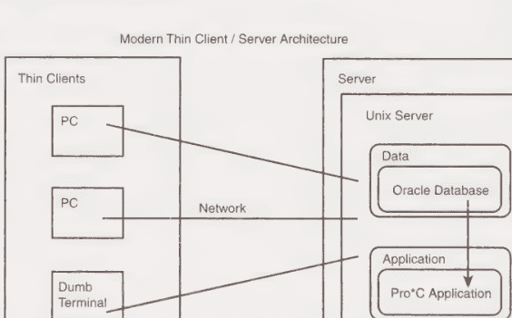

图 3.1

轻客户端与服务器概述

### 三层客户端架构

在三层架构中，数据和应用程序被拆分到不同的服务器上。客户端仍然作为前端，仅负责请求和显示数据。然而，服务器端的处理分布在数据库服务器和应用程序服务器之间。

# 数据库规划

第 3 章


拆分应用层和数据层有几个原因。通过拥有两个服务器，每个服务器都可以专门负责数据或应用程序请求。如果两个层都位于同一台服务器上，可能会发生资源竞争。此外，层的隔离使得系统更易管理。配置和管理一台专门用于数据库活动或应用程序需求的机器要容易得多。

图 3.2 显示了三层架构是如何实现的。

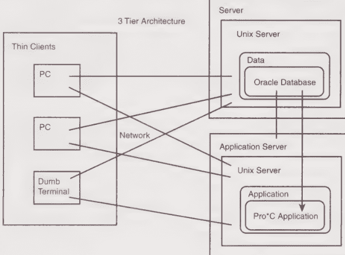

图 3.2

三层架构

## 容量规划/规模估算

容量规划是根据业务需求对系统进行规模管理的实践。从 DBA（数据库管理员）的角度来看，这意味着确定需要什么样的以及多大的服务器和数据库。该决定通常由 DBA 和 SA（系统分析师）共同，然后由管理层批准。这通常是一个棘手的问题，因为涉及到在没有基准的情况下估计增长。这种练习往往会导致购买大量昂贵的设备，使情况变得更加困难。

如果系统规模定得太小，将需要更多设备来维持系统运行。这是昂贵的，因为由于最后的性能、升级时间以及设备本身。不要假设这会在几个月或几年后发生；规模不足的系统可能很快变成问题，特别是在 Web 环境中。如果系统规模定得太大，看起来就像是昂贵的过度。即使系统在第一或两年内规模完美，系统资源需求也会随着时间的推移而变化。如果这看起来像是一个困难的处境，那么它确实应该是这样的。

DBA 和 SA 需要理解他们的规模估算受到了质疑（这本该如此），并且稍后会被反复检查（这是徒劳的）。他们必须根据目前的（通常是不完全的）信息做出最好的估计。确保估算是合理的、逻辑性的并获得支持。最后，让其他技术人员进行分析。

这些是我规划系统规模时考虑的一些问题。它们涉及技术和非技术问题。在我看来，宁可过大不可过小。但请记住，设计良好且优化的应用程序对系统的规模有很大影响！

### 技术规模估算问题

DBA 通常估计至少一内所需的磁盘空间，然后由 SA 接手。然而，有几个问题 DBA 应该提供意见。

#### 操作系统

我不会陷入关于 NT 的巨大争论中，因为可以假设你之所以读这本书是因为你可能选择了 Unix。尽管 Windows 2000 现在已可用并据称有所改进，但许多 IT 人仍持怀疑。传统上，Unix 被认为比 NT 更稳定、更可配置、更容易扩展。看看 Windows 2000 如何改变这种观点将非常有趣。

Sun、HP 和 IBM 等 Unix 供应商在市场上一直处于强势地位。大多数 Oracle 数据库运行在这些操作系统上。DBA 在选择操作系统时应考虑这一事实。新的 Oracle 软件版本首先出现在 Sun 上，然后是这些其他系统。Oracle 公司停止支持这些任何一个平台也是不可行的。错误补丁和新产品也会先出现在这些更常见的平台，而不是冷门平台。

DBA 还应该考虑 SA 在这些事务方面的技能和经验。在 SA 感到熟悉的平台上运行操作系统，比在这些平台上进行实验要理想得多。DBA 也应该考虑自己对操作系统的专业知识。这对 DBA 来说是新的吗？操作系统之间的差异是 DBA 能够学习的吗？可能，DBA 应该愿意学习新平台，因为这将增加他的经验和市场竞争力。

# 数据库规划

第3章

Linux 操作系统的增长和认可为 Oracle 数据库管理员（DBA）提供了另一种选择。Linux 及其相关硬件通常比大型 Unix 规模更小、成本更低。因此，Linux 的竞争对象更多是 NT，而不是大型 Unix 系统。事实上，根据我个人的观察，当 Unix 领域的人士面临转向 Intel 系统的选择时，Linux 似乎是他们更青睐的系统。还有一些较小的系统，例如运行在各种版本 Linux 上的单个 Web 服务器以及开发/测试机。

我看到的最常用的指导方是：对于大型生产机器使用成熟的 Unix 供应商（Sun、HP 或 IBM），而对于较小的测试或开发机器使用 Linux 发行版。然而，即使是这种做法也在发生变化，因为越来越多的公司（特别是较小的点com 公司）选择将所有内容运行在 Linux 上。从 DBA 的角度来看，我更倾向于使用成熟的 Unix 供应商来运行任何生产环境。如果我在自己的机器上（比如写这本书）或进行测试/开发，我更倾向于使用 Linux。

## 磁盘

这通常是架构师（SA）的决定，但通常磁盘越多、越快就越好。DBA 应该请求足够的磁盘空间以满足至少一年的增长。从 Oracle 的角度来看，拥有更多的磁盘来分散 I/O 压力远比拥有几块大磁盘好得多。我将在本章稍后部分展示一些示例。此外，将磁盘分布在多个控制器上是有益的。你可用来分散 I/O 的控制器就越多，效果就越好。DBA 应该推行支持热插拔的磁盘。磁盘品牌和逻辑卷管理器（LVM）的选择实际上是 SA 的决定，但 DBA 应该熟悉这些可用产品。如果数据库是生产系统，应该使用某种程度的磁盘镜像。

关于 RAID、原始文件系统和 I/O 缓存的讨论将在第 13 章“Unix 服务器监控”中详细介绍。

## 内存

在内存方面，越多、越快越好。Oracle 喜欢磁盘，但它更喜欢内存。生产环境的 Oracle SGA（系统全局局域）从 200M 开始，可以轻松达到 500M。而且那是真实内存，而不是交换到磁盘。此外，一台服务器将拥有多个数据库实例。不要忘记考虑 Oracle 之外运行在机器上的其他应用程序。如果内存足够给 Oracle，其他应用程序可能会因为内存不足而不断交换到磁盘，这将影响整个系统。作为一名 DBA，如果可能，你应该说服 SA 尽可能将机器的内存加到最大。

## CPU

这实际上意味着 SA 的决定，但机器应该具有多个处理器（SMP）。Oracle 会利用多个处理器，而且对于某些功能（如并行查询）来说，这是强制要求的。除非运行了糟糕的代码，否则大多数系统都不是 CPU 密集型的，在这种情况下，额外的处理器将没有帮助。请注意，如果可能，请使用多个处理器以利用 Oracle 的并行处理能力。我们将在第 12 章“Unix 操作系统架构”中讨论更多奇特的的架构，如 MPP 和 NUMA。

## 非技术性选型问题

系统选型的非技术方面往往被忽视。这不仅包括了涉及的价格标签问题。

### 机器成本

这是每个经理都会考虑的项目之一。通常当他们看到服务器价格超过 20,000 美元时，他们会处于震惊状态。毕竟，他们的 PC 只花 1,000 美元，为什么大一点的电脑要这么贵？在这个阶段，技术人员需要用非技术术语解释为什么 Unix 服务器与 PC 不在一个量级。如果能从停机导致的收入损失来证明成本的合理性，会有帮助。我以前遇到过这种情况，很容易感到沮丧。请保持专业并解释为什么这是业务的成本。

如果无法购买机器，请考虑其他选项。这意味着寻找租赁、借用和特别优惠。某些供应商和硬件转售商将允许商店借用一台符合实际概念的机器。一旦服务器实际安装并运行测试系统，管理起来就会更容易。


非技术人员，系统系统是不支持的，这这是特别的。

当 Oracle 的 Linux，检查在线支持页面（MetaLink 和 Technet）以查看 Oracle 是否针对特定的发行版和内核进行了认证。这种 DBA 的研究是必要的。

询问其他公司的 DBA 和 SA 关于他们在特定平台和数据库上的经验。这些人可以提供在其他地方难以获得的见解和技术建议。针对特定系统提出支持或反对意见，这类证言具有很大的分量。

## 系统维护

维护系统往往被忽视。我曾在一个购买了早期 Oracle Parallel Server 的公司。当我们有一位高技术的 SA 时，系统相当稳定。然而在 SA 离开几天后，系统就开始崩溃，接替的人感到非常痛苦。尽管他们很优秀，但他们缺乏集群的知识。最终，这对公司来说是一个昂贵的学习曲线。

我建议在合适的情况下使用新技术；不要仅仅假设他们就能搞定。如果你发现自己处于需要 Oracle Parallel Server (`OPS`) 或其他高级功能的环境，请做好额外工作的的准备。在使用这些技术时，如果可能，请参加培训并进行一些自学和研究。如果你能精通这些技术，你会发现这是一个有收获的体验。

## 技术/供应商

在检查这些技术之前，要熟悉它们。这听起来显而易见，但很容易被忽略。如果硬件供应商正在发现 SMP（对称多处理器）系统和 MPP（大规模并行处理）系统，你了解它们的区别吗？你愿意相信供应商关于为什么需要其中一个而不是另一个解释吗？如果你不知道，花时间研究。

检查你购买的供应商。当然，Sun、HP 和 IBM 是今天 Unix 领域的巨头，但其他选项呢？这包括 Linux。它在未来还会存在吗？不要选择一个过时的操作系统。小型、本地供应商和转售商也应该经过审查。

从 DBA 的角度来看，考虑哪些版本的 Oracle 支持该操作系统。例如，Oracle 在 Sun Solaris 上开发并发布每个新版本，然后将其移植到其他操作系统。在处理 Linux 时，检查在线支持页面以查看 Oracle 是否针对特定的发行版和内核进行了认证。这种 DBA 的研究是必要的。

留住优秀人才，否则系统将遭受痛苦。

# 数据库规划

第3章

## 优且灵活的架构

现在你已经规划并选择了系统，是时候考虑 Oracle 特有的细节了。


# Unix 和 Linux 上的 Oracle DBA

Oracle 公司提供了一套在 Unix 上安装和配置其数据库的推荐方法。该方法最初由 Cary Millaps 编写，被称为最佳灵活架构（Optimal Flexible Architecture，简称 OFA）。这是一种以标准化安装 Oracle 和创建数据库的常用方法。另一种解释 OFA 的方法是将其描述为 Oracle 软件安装和数据库文件所需的推荐目录结构。

OFA 允许在单台服务器上安装多个版本的 Oracle。可以以最小的竞争同时管理多个数据库。OFA 的优势包括：

- 所有服务器的配置标准化
- 易于管理不同 Oracle 版本的安装和维护
- 数据库文件相互分离，以提高可管理性和性能
- 逻辑清晰且可区分的数据库文件名
- 将文件分布在多个挂载点上以减少 I/O 竞争

OFA 仅仅是一组建议，而不是一套规则；如果你正确创建了文件系统，Oracle 就会以符合 OFA 标准的方式安装软件。本章将讨论如何以符合 OFA 标准的方式构建数据库，并将在第 5 章“创建数据库”中进行演示。该章节没有重复 OFA 的所有点，但涵盖了你需要了解的内容。

创建文件系统以将你的文件分布在尽可能多的磁盘上。在我工作过的一家公司里

> 注意
> OFA 最低要求
> 至少一个符合 OFA 标准的数据库需要四个挂载点：用于软件的 `/u01` 以及用于数据库文件的 `/u02`、`/u03` 和 `/u04`。

挂载点是 Unix 对文件系统的术语。文件系统是一个包含多个磁盘的目录结构，可以从网络上的不同机器“挂载”（网络文件系统，NFS）。与系统管理员（SA）协作创建多个文件系统。每个挂载点通常按照命名为 `/uN`，其中 N 是文件系统编号（例如 `/u01`）。

下一节将通过查看 `/u01` 下的内容以及 OFA 的其余部分来讨论 OFA 结构。

## `/u01` 上的文件

在第一个挂载点下，创建一个 `app` 子目录。这是应用程序运行的地方。接下来，在 `/u01/app` 下创建一个 `oracle` 子目录。在 `/u01/app/oracle` 目录下，发生了一个重要的划分。创建了如下子目录：

- `/u01/app/oracle/product`
- `/admin`
- `/local`

在 `../product` 下，安装了每个版本的 Oracle 数据库。例如，如果你在同一台机器上运行 Oracle 7.3.4 和 Oracle 8.1.6，你将拥有：

- `/u01/app/oracle/product/7.3.4`
- `/8.1.6`

这是一个重要的区别。你可以同时运行多个版本的 Oracle。一个常见的错误是尝试将所有软件加载到一个目录中，并期望 Oracle 能够自己处理。那是行不通的！`$ORACLE_HOME`。此变量定义了使用哪些 Oracle 软件执行文件。例如：

```
echo ORACLE_HOME
/u01/app/oracle/product/8.1.6
```

这显示你的 Unix 环境被设置为运行 Oracle 8.1.6。所有用于 8.1.6 的 Oracle 软件安装文件都存储在该目录中。

在 `../admin` 目录下，是每个数据库实例（无论版本如何）的所有启动、配置和日志文件。例如：

- `/u01/app/oracle/admin/prod_1`
- `/dev_2`

这表示该机器上有两个数据库（`prod_1` 和 `dev_2`）。`Prod_1` 是 Oracle 7.3.4 生产数据库，而 `dev_2` 是 Oracle 8.1.6 开发数据库。如果你检查 `dev_2`，你可能会发现以下子目录：

- `/u01/app/oracle/admin/dev_2/adump`
- `/bdump`
- `/cdump`
- `/pfile`
- `/udump`

每个子目录都包含特定于数据库实例 `dev_2` 的文件。目录结构和大多数文件是在数据库安装期间创建的。你现在可以简要检查每个子目录的内容。

`../adump`

`adump` 包含数据库为了审计目的而创建的跟踪文件（trace files）。每当用户连接到数据库内部时，该事件就会被记录并创建一个较小的、唯一的跟踪文件。

`../bdump`

`bdump` 目录包含了 DBA 可能最重要的文件：`alert_sid.log` 文件。该文件通常被称为警示日志（alert log），包含了有关数据库的诊断和错误信息。每当数据库启动或关闭时，消息和参数都会写入此文件。DBA 需要每天检查几次此文件。

当 Oracle 进程遇到意外问题时，会生成后台转储（bdump）文件。`alert.log` 有时会写入生成 bdump 文件的消息。DBA 应该检查 bdump 跟踪文件并尝试确定产生它们。这些文件通常不应删除，当发生严重问题时，可以将它们发送给 Oracle 支持进行详细分析。

`../cdump`

当 Oracle 进程出现严重问题时，有时会生成核心转储（core dump）。这些文件巨大，有时会填满整个文件系统。它们对 DBA 来说用不大，但如果需要，Oracle 支持可以分析它们。除非确实需要保留并压缩核心转储，否则最好是删除该文件。

`../pfile`

`pfile` 目录包含数据库的 `init.ora` 文件。这是一个包含数据库参数的可配置启动文件。将对此细节进行详细讨论。

`../udump`

DBA 可以生成用户（udump）跟踪文件。这些文件包含了丰富的诊断信息。

# 数据库规划

从管理角度来看，将实际数据文件与 Oracle 安装/配置文件分离，有助于空间使用、备份和恢复。

## 数据文件和其他 OFA 规范

数据文件应该至少有专门的三个。例如：

```
/u02/oradata/prod_1/system_01.dbf
/dev_1/customer_01.dbf
```

物理数据库文件存储在 ... 注意文件所属的子目录下。注意标识数据库的文件名（dev 或 prd）——这些有助于管理。在这种情况下，`u02` 没有其他文件。在该文件系统上允许额外的数据库文件，但不要包含非 Oracle 文件或 Oracle 配置/安装文件。

文件名可以是任何形式；Oracle 并不关心。然而，通常数据库会对 SYSTEM、USERS、TEMP 和 TOOLS 表空间一组相似的文件。当你处理多个数据和索引表空间时，名称可能会变得很长。

官方认可的文件扩展名限制为控制文件的 `.ctl`、重做日志文件的 `.log` 以及所有其他数据文件的 `.dbf`。我认为这有点局限性。我更担心的是重做日志标记为 `.log`。这会给人一种这些文件是可查看的且某种程度上不重要的印象。实际上，如果你丢失了其中一个，你可能会面临大麻烦。我看到的文件扩展如下：

| 文件/表空间类型 | 扩展名 |
| --- | --- |
| 控制文件 | `.ctl` |
| SYSTEM | `.dbf` |


| USERS | `.dbf` |
| TOOLS | `.dbf` |
| TEMP | `.dbf` |
| DATA | `.dbf`, `.dat` |
| INDEX | `.dbf`, `.idx` |
| ROLLBACK | `.dbf`, `.rbs` |
| Redo log | `.log`, `.rdo` |


这些是设置 OFA 数据库安装的基础知识。随着数据库的实际配置、创建和管理，这种结构的优势就会显而易见。

## 应用与数据库考虑因素

要设计和配置物理数据库，你需要知道将发生什么种的事务以及频率如何。你可以非常有效地调整 Oracle 数据库的大小和配置来处理长时间、密集的事务，也可以将其设置为处理许多小型、快速的事务。Oracle 可以非常很好地处理这两种情况。关键在于识别数据库的实际需求，然后进行适当的设置。请记住，这些需求很少有明确的定义，并且通常会发生变化。

有两种流行的数据库设置类型：OLTP 和 DSS。

### 在线事务处理 (OLTP)

OLTP 的特点是大量、短小的事务高频率地访问数据库。例如，呼叫中心可能有数百名用户通过电话接收客户的订单。一个示例事务如下：

- 1. 客户拨打呼叫中心操作员的电话。
- 2. 对客户记录进行选择以获取基本信息。
- 3. 客户想要订购产品。
- 4. 为新订单在 ORDER 和 BILLING 表中插入数据。可能发生对 CUSTOMER 表的更新。
- 5. 操作员提交事务，客户挂断。这就是事务的结束。

这不是长时间或密集的操作。所有选中的数据都应该建立索引，且 INSERT 语句仅是几张表中的某行。这代表了一个典型的 OLTP 事务。

当只有少数用户且 CUSTOMER 表较小时，为 OLTP 设计并不是问题。但当数百名用户快速地处理订单时，问题就开始出现。当用户分布在广泛的地理区域时，问题会增加。

OLTP 系统的另一个注意事项是对高可用性的感知需求。许多组织坚信他们的 OLTP 系统需要全年 365 天、每天 24 小时完全运行。这带来了一些非常特殊的需求，并且非常昂贵。需要集群服务器、并行服务器服务器和非常精练的员工来提供这种可用性。由于这些原因，大多数系统并不是真正的 24x7，但高可用性需求确实存在。

## 数据库规划

第 3 章 第 77 页

OLTP 回滚系统的技术考虑因素如下：

- 拥有许多小小的回滚段。标准是每四个活动事务使用一个回滚段。每个事务可能占用一个（也许）扩展区。这可能是一个问题，但更大的问题是回滚段头。此头必须初始化分配，以便在回滚段中找到可用数据块。如果多个事务为了这个头而相互竞争，系统将遭受痛苦。
- 合适当调整重做日志缓冲区的大小。重做日志切换会影响性能，因此你不希望它们频繁发生。将重做日志文件的大小从 100M 开始。
- 拥有一个大的共享池。考虑之前的示例事务。如果 SQL 针对不同的客户执行多次，这听起来不是很合理吗？如果你对客户名使用绑定变量，SQL 将缓存在内存中，性能将得到提高。
- 索引与数据分离。在单独的表空间创建主键和其他所有索引，并将其放在单独的磁盘和控制器上。
- 使用较小的临时段。需要的排序较少，且大部分排序将在内存中进行。如果 SQL 中包含许多大型连接，这可能会导致向 TEMP 段的写入。在这种情况下，请查看调优 SQL 以使用更少的连接，或通过增加 `SORT_AREA_SIZE` 来增加内存。OLTP 事务不应进入磁盘。
- 考虑使用 MTS，特别是当你拥有大量用户时。这可以减少所需的总内存，但记住这会带来性能损失。

### 决策支持系统 (DSS)

在此而言，决策支持系统 (DSS) 是以业务为导向的批处理系统。本章不会涉及运行数据仓库或科学研究计算系统的注意事项，尽管相同的原理同样适用。批处理涉及少数非常大且密集的查询，这些查询访问许多表并需要大量的排序。夜间处理任务被认为是 DSS。一个示例 DSS 任务如下：

OLTP 是管理中最常见的应用。如果它是要计划的唯一事务类型，那么 DBA 的工作几乎可以变得简单。遗憾的是，DSS 事务通常也会进入系统。

- 创建一份报告给管理层，用以识别过去一个月的销售情况。更新并取消任何仍处于“待处理”（pending）状态的订单。
- 选择过去一个月内有效的所有订单，按支付方式分组并求和结果。还根据客户的居住州进行细分。
- 这需要对 ORDER 表进行查询，以及对数据进行排序和求和，这可能需要使用临时表空间。还会对 CUSTOMER 表进行查询。
- 4. 更新具有“待处理”状态的订单。这些订单在事务持续期间一直留在回滚段中。
- 5. 格式化结果并创建报告。

这是一个相对简单的报告：大多数企业有更复杂的需求和业务规则。然而，这种系统背后的思想是少数非常密集的查询访问数据库。这些查询可能运行数小时甚至几天。如果作业失败，在重新启动作业之前，回滚过程可能会非常长。在此期间，管理层想要他们的报告，但报告却失败了。这在月底或年底处理期间甚至变得更加至关重要。

支持批处理的关键组件如下：

- 较少、较大的回滚段。DSS 环境下的 DML 可能会产生大量的回滚并保持长时间。你不希望作业因为回滚段空间耗尽而失败。为大作业创建一个特别大的回滚段。在 SQL 语句之前，使用 `SET TRANSACTION ROLLBACK SEGMENT_name` 强制事务使用特定的回滚段。你将在第 10 和第 11 章学习如何避免快照错误和回滚段调优。
- 为磁盘排序和连接准备大型临时表。DSS 经常超过 `SORT_AREA_SIZE` 参数从内存进入磁盘。这些排序可能是巨大的，不希望空间不足。
- 使用较小的共享 SQL 以获得更大的数据库缓冲区缓存。SQL 语句的执行并不频繁，以至于共享 SQL 带来的收益明显。相反，增加数据库缓冲区缓存的大小，以便更多数据块和回滚段可以缓存在内存中。
- 确保你使用的是经过良好调优和正确索引的 SQL。这适用于 OLTP 和 DSS，但我通过 SQL 调优和索引将处理时间减少到了原来的部分。这可以为每个 SQL 语句节省数小时并减轻回滚段的压力。消除不必要的有助于减少临时表的使用。
- 在可行的情况下分区和并行查询 (PQ) 选项。如果你的 CUSTOMER 和 ORDER 表巨大（数百万行），分区和使用 PQ 可能会提供性能优势。这些选项开始进入大型数据库 (vDB) 和数据仓库的领域，但如果它们能帮助你的批处理效率，请使用它们。

# Unix 和 Linux 上的 Oracle DBA

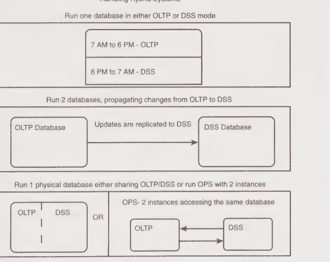


# 混合系统

混合系统是指那些兼具 OLTP（联机事务处理）和 DSS（决策支持系统）需求的系统。虽然大多数应用程序本质上是 OLTP，但大多数系统实际上都是混合系统。例如，几乎任何接受客户订单的业务都是 OLTP。然而，如果没有财务或销售报告，这些业务能维持多久？虽然 OLTP 应用是公司真正获利的地方，但某些后端支持功能需要 DSS（批处理）处理。

回顾一下 OLTP 与 DSS 的需求。它们看起来像是对对立的吗？它们确实应该是对立的，因为 OLTP 的基本特征与 DSS 正好相反。如果你为了优化系统来服务其中一个，另一个就会受到损害。这可能会让试图兼顾 OLTP 用户（为公司带来收入的人）和 DSS 用户（DBA 汇报的经理）的 DBA 陷入两难境地。

解决这种困境有三种常见的方案：在同一个系统中对 OLTP 和 DSS 之间进行限流（throttle）、运行两个独立的系统，或者在同一个系统上同时运行 OLTP 和 DSS。图 3.3 显示了如何处理不同的混合系统。


图 3.3
处理混合系统

白天运行 OLTP，晚上运行批处理。如果用户在早上 7 点到下午 6 点之间接听订单，只需在该时间段运行配置为 OLTP 的数据库即可。下午 6 点，重启（bounce）实例并使用 DSS 配置启动它。每当夜间备份和批处理完成时，再次重启数据库，但使用 OLTP 的 `init.ora` 重新启动。

如果满足以下假设，这种方法是可行的。OLTP 的时间需要明确定义，而不是 24x7 全天运行。用户可以在系统为了 DSS 操作重启后使用该系统，但性能会受到影响。取决于晚上的通话量，从业务角度来看这是可以接受的。另一个问题涉及 Web 用户。DBA 需要检查 DSS 和重启服务器是否会对 Web 用户产生影响。记住，Web 访问和在线订单限制了 24x7 的可用性需求。

第二个方案是同时运行两个数据库，一个用于 OLTP，一个用于 DSS。实时更新直接应用于 OLTP 数据库。每隔固定间隔，这些更改就会同步到 DSS 数据库。


有几种方法可以实现这一点。DBA 可以对 OLTP 系统部分或全部进行 nightly 导出，并导入 DSS 系统。这种方法在概念上很简单，但非常耗时，并且可能无法满足 DSS 系统的需求。更好的解决方案是使用数据库链接（database links）复制，以实时方式传播更改。Oracle 8i 中的第三种选择是将 DSS 数据库作为备用数据库。来自 OLTP 数据库的归档日志（Archive logs）会自动应用到 DSS 数据库。这使得 DSS 系统比 OLTP 系统领先几个步骤，但目前 DSS 仅允许只读查询。DBA 需要检查这些选项，并可能混合使用它们来支持第二个 DSS 系统。

第三种方案是同时运行 OLTP 和 DSS。这可能是 DBA 实施的最常见的解决方案。通常情况下，系统最初是 OLTP 的，但随着 DSS 需求的逐渐增加，系统变成了混合系统。

在这种情况下，DBA 必须平衡 OLTP 用户的需求与批处理任务之间的关系。在这种情况下，我倾向于考虑 OLTP 用户。创建与 OLTP 相同数量的回滚段（rollback segments），但保留少量分配给 DSS 的回滚段。

（注：原文此处似乎存在逻辑断层或不完整，已按原意翻译）

# 数据库规划

## 第3章

查看图 3.4 所示的数据库布局。假设该系统是 OLTP（联事务处理）和 DSS（决策支持系统）的混合体。它包含每个表空间的数据文件，磁盘通过两个控制器进行镜像。它尝试符合 OFA（开放文件架构）标准，但某些命名扩展有所不同。

这是许多 Oracle 安装的典型情况，除非数据和索引表空间较多。为了使设计更真实，特意引入了一些可能的 I/O 冲突问题。请注意以下点：

- 挂载点按控制器分开，使用偶数和奇数识别控制器 A 和控制器 B。DBA 并不总有这种奢侈，但在涉及 Oracle 时，DBA 应该向 SA（系统管理员）规定创建多少文件系统以及命名规范。

- `/u01` 已预留用于 Oracle 安装文件以及数据库参数和配置文件。可以添加实际的数据库文件，但这会增加运维的难度。

- 在线重做日志组（Online redo log groups）进行了多路复。共有三个组，每组有两个成员。每个成员都位于不同控制器上的独立磁盘上。它们也以逻辑方式命名。例如，当组 1 激活时，`/u03` 和 `/u04` 被频繁写入。当发生日志切换时，组 2（`/u07` 和 `/u08`）将被 `LGWR` 写入，而 `ARCH` 将写入第一个组以及 `/u10` 上的归档日志转储（Archive Log Dump）。

# 示例数据库布局

| 控制器 A | | 控制器 B | |
| --- | --- | --- | --- |
| `/u01` | `/u03` | `/u02` | `/u04` |
| Oracle 安装文件 | | redo01.a, system01.dbf | redo01b.rdb |
| 参数/配置文件 | | init.ora,alert.log | temp01.dbf employee_idx01.dbf | tools01.dbf |
| `/u05` | `/u07` | `/u06` | `/u08` |
| rollback01.rbs control01.ctf | redo02a.rdb, order_idx01.dbf | rollback02.rbs control02.ctf | redo02b.rdb, order_data01.dbf |
| `/u09` | `/u11` | `/u10` | `/u12` |
| control03.ctf customer_data01.dbf | redo03a,rsa employee_data01.dbf | 归档日志转储目的地 drysys01.dbf | redo03.nto customer_idx01.dbf |
| 其他 Oracle 文件 /varopt/oracle | | /etc | |
| tnames.ora listener.ora | | cratab | |

* 注意 `/varopt/*` 和 `/etc` 是由 SA 创建的，可能包含 Oracle 以外的内容。.etc 通常包含 cratab，但根据平台的不同可能包含名称和监听器（例如 HP-UX，/varopt/oracle 在 Sun Solaris 中常见）。

# 图 3.4

示例数据库布局


- `/u10` 持有归档日志目的地（Archive Log Destination）。该磁盘将由 `ARCH` 持续写入，其仅放置了一个小的控制文件。频繁监控此位置以确保空间不会耗尽。

- 控制文件跨越四个磁盘和两个控制器进行多路复用。如果这些磁盘是镜像的，DBA 将拥有多于四个副本，这足够了。

- 在独立磁盘上创建了两个回滚表空间。`/u05` 持有 OLTP 的回滚段。根据用户数量，如果需要，可以创建更多的回滚表空间。`/u06` 持有大型批处理过程的回滚表空间。
- `/u10` 持有归档日志目的地。该磁盘将由 `ARCH` 持续写入，其上仅放置了一个小的控制文件。频繁监控此位置以确保空间不会耗尽。

> 注意：由于 TEMP 表空间 位于 `/u03`。在实际情况下，这种情况下仍需遵循 OFA 原则。

## 总结

本章涵盖了基础物理数据库设计。在创建数据库之前，需要花时间进行分析。DBA 需要了解系统架构并理解其输入、输出和处理特性。这至关重要。否则，DBA 只是在盲目操作。

在定义需求后，该设计能够良好运行、易于管理并抵御数据丢失。通过理解数据库支持的应用程序类型并遵循一些调优指南，可以在很大程度上满足企业的需求。

# 环境设置与安装

## 第4章

# 关键要素

- 在安装 Oracle 之前必须满足多个系统要求。

- 与系统管理员协作设置服务器，使其易于管理、调优并简化备份和恢复。

- 在安装 Oracle 之前阅读针对特定平台的安装和配置指南。

- 安装软件并注意异常。

- 根据需要应用补丁。

本章解释了安装和运行 Oracle 软件所需的步骤。你将从一个仅加载操作系统的干净机器开始，并以 Oracle 8.1.6 结束。为了演示，将使用 RedHat 7.0。图中显示了与 Sun Solaris 的差异。

## 安装前设置

### 操作系统和版本

你需要确定机器上安装了什么操作系统和版本。通过使用 `uname` 命令来实现：

```
$ uname -a
Linux mikehat.mike.com 2.2.16-22 #1 Tue Aug 22 16:49:06 EDT 2000 i686 unknown unknown
```

如你所见，这是一台 Linux 机器，运行 2.2.16-22 内核，机器名为 mikehat.mike.com。在 Sun 和 HP 机器上执行相同命令的结果如下：

## 机器设置与安装

### 第四章

### Sun Solaris 机器信息

```bash
$ uname -a
SunOS vader 5.8 Generic sun4u sparc SUNW,Ultra-
```

### HP-UX 机器信息

```bash
uname -a
HP-UX tiger B.11.00 U 9000/893 unlimited-user license
```

记录机器名称、操作系统版本和补丁级别。理想情况下，为每个机器创建一个表格，显示以下信息：

- 操作系统和版本

- 机器名称

- IP 地址

- 数据库版本

- 备份模式（归档/非归档）

- 支持的主要架构/应用程序

- 联系人 (POC)

将此表格保存在你的工位里，并在钱包/手提包里留一份副本。由于本文档包含敏感信息，你可能想将 IP 地址/机器名称从列表中删除。千万不要在这张纸上写任何密码！我发现当当我处于“值班”并必须支持许多系统时，这样的列表特别有用。

验证操作系统、版本和补丁级别是否与你想要安装的 Oracle 软件兼容。首先，登录 Oracle 的在线支持页面 MetalLink（http://metalink.oracle.com）。在“产品周期”（Product LifeCycle）和“认证”（Certifications）下查看哪些版本的操作系统已通过你的 Oracle 版本的认证。只要你的版本通过了认证，就是相当安全的。然而，例如，如果你尝试在 Solaris 8 通过认证之前加载 Oracle 8.1.6，不要期望 Oracle 支持能提供巨大的帮助。我曾做过这种情况。它加载并成功运行了，但因为我是在“不支持”的配置下运行，Oracle 没有义务提供支持。

接下来检查适用于你 Oracle 版本的 `README.TXT` 安装与配置指南 (ICG)。可以在 http://technet.oracle.com 的文档下查看此类信息。在安装软件之前要阅读它。寻找特定的操作系统补丁要求和已知缺陷/问题。你需要验证你的操作系统已更新到或高于《安装与配置指南》指定的级别。记住，仅仅因为 SA（系统管理员）安装了操作系统并不意味着此人也应用了所有所需的操作系统补丁（这是一个常见的错误）。

# Unix 和 Linux 上的 Oracle DBA

要检查机器的补丁级别，输入：


```bash
showrev -a (针对 Sun 机器)
```

要查看你的 Linux 机器上安装了哪些包，尝试：

```bash
pm -qa
```

如果你的机器达到或超过了手册指定的级别，你应该没问题了。如果不足，找出缺失了什么以及它影响了什么。将这些信息带给 SA 并找出为什么没有应用补丁。除非有充分的理由不应用，否则让 SA 应用补丁。

## 内存

DBA 应该已经从服务器选型阶段就知道了机器上有多少内存，但验证这些信息是好的。要这样操作，输入：

```bash
$ dmesg | more
Linux version 2.2.16-22 (root@porky.devel.redhat.com) (gcc version egcs-2.91.66)
Memory: 516136k/523264k available (1048k kernel code, 412k reserved, 5604k data, 64k init, 0k bigmem)
```

这为你提供了启动期间的所有信息，其中将包含机器上的内存容量。记住，你需要尽可能多的内存来加载 SGA。在这种情况下，有 512M 的实际内存。检查你的 ICG 中关于实际内存和交换空间的最低要求。

注意

验证内存是否被识别：有时在 Linux 上，并非内存都能被检测到。在我的机器上，Linux 认为我初始只有 64M。如果你遇到这些问题，以 root 身份编辑 `/etc/lilo.conf`，设置总 RAM 内存为 1M（我的情况下是 511M），并执行命令 `/sbin/lilo`。重启后，你的 `/etc/lilo.conf` 顶部应该像这样：

```
append="mem=511M"
boot=/dev/hda
```

## 交换空间

Oracle 文档通常要求交换文件是机器实际内存的两到三倍。要找到分配的交换空间，执行：

```bash
$ dmesg | grep
Starting kswapd v 1.5
Adding Swap: 122832k swap-space (priority -1)
```

## 磁盘

检查可用的磁盘和文件系统。它们可能需要重新配置，以反映第 3 章“数据库规划”中指定的要求的。要检查磁盘和文件系统的大小，输入以下命令：

### Sun Solaris

```bash
$ df -k
```

| | kbytes | 已 | 可用 | 容量 | 挂载点 |
| :--- | :--- | :--- | :--- | :--- | :--- |
| /dev/vkdx/dsk | 3993892 | 46614 | 3484092 | 2% | /var |
| swap | 3386632 | 0 | 3386832 | 0% | /var/run |
| /dev/vkdx/dsk/opt | 3809327 | 397623 | 2551518 | 14% | /opt |
| /dev/vkdx/dsk/u01 | 5235898 | 360752 | 1522788 | 71% | /u01 |
| /dev/vkdx/dsk/u02 | 5235898 | 316993 | 2013547 | 62% | /u02 |
| /dev/vkdx/dsk/u04 | 5235898 | 431088 | 872660 | 84% | /u04 |
| swap | 3387200 | 0 | 3387200 | 1% | /tmp |
| /dev/vkdx/dsk/u03 | 5235898 | 413259 | 1050948 | 80% | /u03 |

### HP-UX

```bash
> df -k
```

| | kbytes | 已 | 可用 | %used | 挂载点 |
| :--- | :--- | :--- | :--- | :--- | :--- |
| /dev/vg0/lvol13 | 299157 | 91918 | 177323 | 34% | /stand |
| /dev/vg0/lvol11 | 83733 | 34640 | 40719 | 46% | /stand |
| /dev/vg0/lvol18 | 2003481 | 557889 | 1245243 | 31% | /var |
| /dev/vg0/lvol17 | 1001729 | 638769 | 286277 | 71% | /usr |
| /dev/vg0/lvol16 | 600571 | 254233 | 286280 | 47% | /tmp |
| /dev/vg0/lvol19 | 1772754 | 115252 | 614954 | 65% | /root |
| /dev/vg0/lvol15 | 2048000 | 138137 | 628015 | 69% | /oracle |


### Redhat

```bash
$ df -m
```

| | blocks | 已 | 可用 | %Used | 挂载点 |
| :--- | :--- | :--- | :--- | :--- | :--- |
| /dev/hda5 | 3969 | 319 | 3448 | 9% | |
| /dev/hda1 | 220 | 5 | 203 | 3% | /boot |
| /dev/hda15 | 1181 | 4 | 1117 | 1% | /home |
| /dev/hda9 | 3150 | 1 | 2988 | 1% | /tmp |
| /dev/hda6 | 3938 | 1 | 3937 | 1% | /u01 |
| /dev/hda10 | 1969 | 1 | 1868 | 1% | /u02 |
| /dev/hda11 | 1969 | 1 | 1868 | 1% | /u03 |
| /dev/hda12 | 1969 | 1 | 1868 | 1% | /u04 |
| /dev/hda13 | 1969 | 1 | 1868 | 1% | /u05 |
| /dev/hda8 | 3250 | 1888 | 1197 | 62% | /usr |
| /dev/hda7 | 3351 | 34 | 3147 | 2% | /var |

这提供了文件系统布局以及 Unix 为千字节、RedHat 为兆兆计算的可用空间。在本章的后面，你将学习如何配置这些设置。

## CPU

DBA 实际上无法控制 CPU，而且它们确实是不可调的，但你应该知道你有多少 CPU 以及它们的速度。要快速统计机器上的数量，执行此命令：

```bash
$ dmesg | more
Linux version 2.2.16-22 (root@porky.devel.redhat.com) (gcc version egcs-2.91.66
19990314/Linux (egcs-1.1.2 release)) #1 Tue Aug 22 16:49:06 EDT 2000
Detected 81431 kHz processor.
- Pentium-III serial number disabled.
CPU: Intel Pentium III (Coppermine) stepping 06
```

再次，`dmesg` 提供了系统启动时的有用信息。知道你有多少 CPU 对于你尝试使用并行处理功能（如并行查询 PQ 选项）是有益的。

## 网络信息

这本身不是 DBA 工作，但你登录需要 IP 地址，安装 Oracle 需要域名名。检查 `/etc/hosts` 获取网络信息。你也可以使用 `ifconfig -a` 来查找信息：

```bash
$ /sbin/ifconfig -a
eth0 Link encap:Ethernet Hwaddr 00:01:03:2D:4C:A2
inet addr:192.168.1.11 Bcast:192.168.1.255 Mask:255.255.255.0
```

在这里，你可以知道机器的 IP 地址是 192.168.1.11。

最后一个命令可以获取关于之前大部分主题的大量信息，但它有点笨用。使用 `/usr/sbin/prtconf`。如果你在 Solaris 机器上，它会打印大量信息。

以上涵盖了获取基本系统信息。既然 DBA 已经访问了现有服务器，现在是为 Oracle 配置服务器的时间了。这些讨论基于：假设服务器上从未安装过 Oracle。需要创建特定的 Oracle 用户和组。文件系统 (`/u01` ...`u0X`) 需要构建并

## 机器设置与安装

## 第4 章

需要为服务器配置合适的共享内存参数以处理 Oracle SGA。在不同的 Unix 之间之间，这些参数是非常标准化的，除了需要调整共享内存参数外。本章将展示这些内容，但您应该从您特定平台的《安装与配置指南》中查找实际数值。

## Root 密码


为了配置系统以安装 Oracle，你需要一个 `root` 密码。这是一个强大的超级用户账户，允许你在机器上执行任何操作。`SA`（系统管理员）通常不会将此密码给任何人。某些人会允许特定的 DBA 拥有该密码，只要他们将其用于 DBA 目的。你需要此密码来为 Oracle 创建用户、组和文件系统，或者你需要 `SA` 来来完成这些操作。

向非 `SA` 人员提供 `root` 密码是一个比较敏感的问题。许多 `SA` 和管理层都会反对这样做。有许多充分的理由说明除了 `SA` 之外，不应将 `root` 密码给任何人；因为对系统的风险太高。

我的观点是，在一个有很多可用 `SA` 的大型机构中，`root` 不需要脱离他们的控制。如果需要以 `root` 身份执行某些操作，应该应该在场。另一方面，在小型机构中，如果 DBA 胜任且值得信任，他们应该拥有 `root` 权限。必须理解的是，DBA 拥有 `root` 是在时间紧急且 `SA` 不在的情况下采取行动，而不是随心所欲地更改设置。有时 `SA` 不在，但系统上的某些事情需要处理。在这种情况下，精通 Unix 的 DBA 可以“救场”并解决问题。归根结底，这是每个机构自己的决定。

## 组

用户存在于 Unix 组中。一个用户有一个主组，并可以有多个辅助组。需要创建一个名为 `dba` 的组。`root` 用户可以通过命令行轻松地创建组，如下所示：

```bash
$root@mikehat /root]# groupadd dba
```

使用 `more /etc/group` 查看系统中的组。`oracle` 用户需要将 `dba` 作为其主组。其他 Unix 用户也可以在该组中。进入该组赋予了用户以完整 DBA 权限连接数据库内部的能力，因此请务必谨慎操作。不要将 `root` 用户放入 `dba` 组，尝试执行以下操作：

```bash
$ grep dba /etc/group
dba:x:504:oracle,mikehat
```

`oracle` 用户和 `mikehat` 在 `dba` 组中，并将能够连接到系统内部。

### Unix 和 Linux 上的 Oracle DBA

> 注意
>
> `connect internal` 将被废弃
>
> Oracle 公司将不再支持使用 `connect internal` 命令，因为这被认为存在安全风险。我合作过的许多 DBA 并不同意这一改变，他们喜欢这种简单进行内部连接的便利性。该更改计划在 9i 版本中生效。

最近的 Oracle 文档提到了一个新组：`install`。该组用于具有多个 Oracle 安装的站点，其目的是分离数据库文件和软件文件的所有权。文档建议将此组设为 `oracle` 的主组。根据我合作过的资深人士以及我自己的经验，你可以不创建这个组。只需创建一个 `oracle` 用户并向其分配 `dba` 组即可。

## 用户

Oracle 需要一个 `oracle` 账户，该账户拥有所有软件安装文件、参数文件和数据库文件。这就是 `oracle` 用户。

该用户可以通过命令行使用 `useradd` 命令创建，但使用管理工具创建用户会更简单。在 HP-UX 上使用 `SAM`，在 Solaris 上使用 `admintool` 来创建用户和组。

在 RedHat 上创建 `oracle` 用户，请使用 KDE User Manager 等管理工具。见图 4.1。

为用户分配一个家目录、名称或注释、登录 shell，并将用户分配到 `dba` 组。shell 的选择取决于使用账户的人，但许多 DBA 偏好使用 Korn shell。用户创建后，你就可以通过检查 `/etc/passwd` 来验证它。使用 `grep`、`more` 或 `vi` 查看该文件（要小心！）来设置用户名和用户信息。如果你不熟悉这些命令或 `vi` 编辑器，请参阅附录 A 和 B。

## 磁盘

需要为 Oracle 创建文件系统。这些文件系统将遵循第 3 章中定义的布局。如果你在 Unix 上并打算使用 RAID 和条带化（striping），你可能需要 `SA` 的帮助。这可能涉及使用逻辑卷管理器（LVM），这是 `SA` 的职责范围。在 Linux 上，文件系统将直接构建在磁盘上，这对 DBA 来说可能足够简单。在 Linux 安装过程中，如果你喜欢，可以使用 Disk Druid 创建文件系统。一旦操作系统安装完成，就可以使用图 4.2 所示的 Linux `cfdisk` 工具。

## 机器设置与安装

### 第4 章

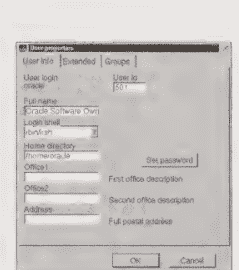

图 4.1

创建用户 `oracle`。

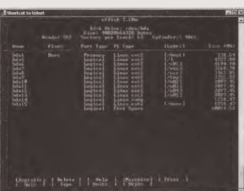

图 4.2

创建文件系统。

位于 `dba` 组的 `oracle` 用户需要对 `/u01../u0X` 拥有读/写/执行权限。在为 DBA 配置系统时，`SA` 通常负责这一步。如果发生这种情况，请预料你的安装过程会很快结束，并提示 Oracle 无法写入 `/u01`。例如：

机器设置

安装

## $ ls -l

```bash
drwxr-xr-x 3 oracle dba 4096 Feb 16 17:06 u01
drwxr-xr-x 3 oracle dba 4096 Feb 16 17:07 u02
drwxr-xr-x 3 oracle dba 4096 Feb 11 16:21 u03
drwxr-xr-x 3 oracle dba 4096 Feb 11 16:21 u04
drwxr-xr-x 3 oracle dba 4096 Feb 11 16:21 u05
```

此示例中的 Linux 系统只有一个物理磁盘。单磁盘的使用将系统限制为 12 个实际文件系统，包括 `/`、`/boot`、`/tmp`、`/var`、`/usr`、`/home` 和 `/swap`。因此，你只能拥有 `/u01...` 等实际文件系统。为了模拟第 3 章涵盖的12 个专用挂载点，你可以为如 `/u01` 的目录创建软链接。位于 `dba` 组的 `oracle` 用户需要对 `/u01../u0X` 拥有读/写/执行权限。`SA` 在为 DBA 配置系统时经常完成这一步。如果发生这种情况，请预料你的安装过程会很快结束，并提示 Oracle 无法写入 `/u01`。

机器设置

安装

## $ ls -l

（此处代码块同上）

此示例中的 Linux 系统只有一个物理磁盘。单磁盘的使用将系统限制为 12 个实际文件系统......（此处重复重复）

归根结底，这取决于每个机构决定决定。

。。。。

可以执行基础参数。

> 注意
>
> Solaris 特定目录
>
> Solaris 要求创建一个并属于 `oracle` 的目录。

## 内核参数

你需要配置某些共享内存参数。这些参数影响共享内存的大小和信号量（semaphores）数量。在 Solaris 上，这些参数存储在 `/etc/system` 文件中。在 Linux 上，你需要通过 `vi` 编辑这些值。以下是 `/etc/system` 的示例列表：

```bash
shmsize=8053638
shmin=200
shmni=200
shseg=200
semmn1=4096
sms1=500
semns=4096
semop=100
semvmx=32767
```

对该文件进行备份，使用 `vi` 编辑实际副本，然后重启使更改生效。这些中的每一个参数在第 12 章“Unix 架构”中都有详细讨论。

进制参数

在 Linux 上，某些值可以使用十六格式。例如，文件 `shparam.h` 定义 `SHMMAX` 为：

```c
#define SHMMAX 0xF42400 /* 最大共享段大小（字节） */
```

简单的方法是使用在线计算器确定这确实是 256M 或物理内存的一半，正如安装与配置指南要求的。

## Oracle 环境设置

在根据《安装与配置指南》和发布说明配置机器后，你已准备就绪。唯一的步骤是为用户设置 Unix 环境。

本讨论假设你使用的是 Korn shell，Bourne shell 也可以。Korn shell 的环境由 `.profile` 定义。该文件在你每次登录时都会被读取；它设置了你的基础环境。从 Oracle 的角度来看，它告诉 Unix 使用哪些数据库软件以及连接到哪个数据库。

脚本编程

全面的脚本编程不在本书的涵盖范围内，但如果你是 Unix DBA，那么这是必要的。你将编写、修改或使用许多脚本来来自动化数据库管理任务。你不需要从零开始编写复杂的程序，但确实需要阅读、理解和修改代码。

如果你的账户是在 Unix 上创建的，你可能有一个骨架 `.profile` 文件。在你的家目录下执行长列表可以查看所有文件，包括以点开头的文件。在 Linux 上，你可能需要将你的 `.bash_profile` 文件复制到 `.profile`。你的 `SA` 可能有一个标准的 `.profile` 文件供你使用。

# Unix 和 Linux 上的 Oracle DBA


这是一个入门模板。图 4.3 显示了首次安装 Oracle 所需的基础设置。这源自一个创建 `.bash_profile` 的 Linux 系统，但我将其复制并修改为 `.profile`。

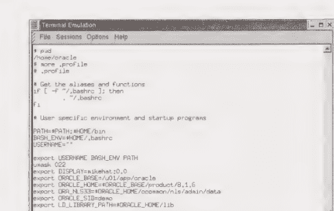

图 4.3

初始 `.profile`

这些是在服务器上首次安装 Oracle 时仅需具备的基础设置。一旦软件安装完成并创建了几个额外的 Oracle 文件，你就可以自定义你的 `.profile` 来引用这些文件。这将在第 5 章“创建数据库”中进行讨论。

要确定你的环境，请输入 `env`。这将显示你当前的所有设置，即使是那些未在 `.profile` 文件中定义的设置。每个值都由如 `ORACLE_HOME` 之类的变量标识。要识别特定变量的值，在变量名前加上 `$` 符号并 `echo`：

```
$ echo ORACLE_HOME
/u01/app/oracle/product/8.1.6
```

这显示你设置为使用 Oracle 8.1.6 软件。如果你想更改变量的值，必须将值导出该变量：

```
$ echo ORACLE_SID
demo
$ export ORACLE_SID=mhitst1
$ echo ORACLE_SID
mhitst1
```

# 机器设置与安装

第 4 章

在这种情况下，你只是更改了环境，从 demo 数据库连接到 h11st 数据库。

关键的 Oracle 环境设置包括：

- `ORACLE_BASE`: 这是 `/u01/app/oracle`。这是你 Oracle 软件的起点。假设 Oracle 尚未安装，则没有 `/u01/app/oracle` 目录结构。你需要创建 `/u01`（具有正确的权限），然后 `app/oracle` 会安装过程中自动创建。

- `ORACLE_HOME`: 这是 `/u01/app/oracle/product/8.1.X`。这是安装每个版本的 Oracle 软件的地方。例如，你可以为 8.0.5、8.1.6 和 8.1.7 准备独立的子目录。事实上，你被要求将每个版本安装在不同的 `ORACLE_HOME` 中，否则 Oracle 将不知道运行哪个可执行文件。在启动任何 Oracle 程序之前，验证你的 `ORACLE_HOME`。虽然你可能会搞错并使用错误的 SQLPlus 查询信息，但你不希望在启动数据库时连接到错误的软件。

- `ORACLE_SID`: 这是你的系统标识符（System Identifier）。它是一个八字符标识符，决定了你正尝试连接到哪个数据库。你将在下一章中学习命名规范以及规避此值的方法。

### 注意

始终验证你的 SID

在执行 DBA 任务之前，验证你的 `ORACLE_HOME` 和 `ORACLE_SID`。意外连接到错误的数据库 (`ORACLE_SID`) 或使用错误的软件 (`ORACLE_HOME`) 是很容易的。这在你运行多个屏幕版本和多个 Oracle 版本时尤为常见。如果你不经常验证这一点，很快你就会对错误的数据库做某些事情。每次登录时都使用 `echo $ORACLE_SID` 并不是被害疑妄症，而是负责任的表现。

- `ORA_NLS33`: `ORA_NLS33` 和 `NLS_LANG` 指的是 Oracle 的国家语言集（National Language Set）。只有当你使用 US7ASCII 以外的字符集创建数据库时才需要它们。在大多数情况下，它们不被使用。

- `LD_LIBRARY_PATH`: `LD_LIBRARY_PATH` 提供指向 `ORACLE_HOME/lib` 中共享 Oracle 库的链接。


### 注意

`CLASSPATH` 变量

你需要设置 `CLASSPATH` 来使用 Java，但 Oracle 文档建议在安装期间不要设置此变量。

- `PATH`: 这是你的 Unix 路径。Unix 搜索每个命令的可执行文件的目录顺序。例如，如果你发布 `ls`，Unix 将遍历 `$PATH` 中列出的每个目录，直到找到 `ls` 的第一次出现处。它将使用那个特定的可执行文件。如果它找不到 `ls` 的副本，它将发出消息 `ksh: ls: is not found.`。

- 如果你尝试启动 SQL*Plus，也是一样。Unix 将遍历 `$PATH` 中指定的每个目录寻找名为 "sqplus" 的执行文件。如果找到了，它将启动它，否则会发出提示找不到的消息。

- `profile` 文件中的最后语句将包含 SQL*Plus 的 `$ORACLE_HOME` 添加到路径，以便 Unix 能够找到它。语句 `export PATH=$PATH:$ORACLE_HOME/bin;` 将 `PATH` 设置为 `$PATH` 中已有的加上 `$ORACLE_HOME`（你版本的 Oracle 软件目录）、`ORACLE_HOME/bin`（二进制可执行文件目录）和你的当前目录（由点 `.` 标识）。这将强制 Unix 在放弃之前搜索所有这些目录以尝试找到你想执行的程序。要查看你正在使用哪个可执行文件，执行 `your_command`：

- `DISPLAY`: `DISPLAY` 在尝试启动图形化程序（如 Oracle 安装程序 OUI）时用于 XWindows。它告诉 Unix 你正在使用哪台机器来弹出程序。它是你物理所在的机器的名称或 IP 地址，加上 `:0.0`。注意，这是你物理所在的机器，而不是你尝试连接的机器。例如，如果我正尝试在 192.168.1.11 上加载 Oracle，但我坐在 192.168.1.10 前，我会执行：

```
$ export DISPLAY=192.168.1.10:0.0
$ echo DISPLAY
192.168.1.10:0.0
```

### 不要忘记设置你的 DISPLAY

安装时最常见的错误通常与未能遵循 GUI 或未正确设置环境变量有关。在环境变量中，`DISPLAY` 是最常见的。

我曾某过通过网络远程安装。然而，我犯了一个经典的错误，没有将 `DISPLAY` 设置为客户端的 IP 地址。当图形安装程序尝试时，在这种情况下，你只是更改了环境以从 demo 数据库连接到 h11st 数据库。


如果你尝试启动 SQL*Plus，也是一样。Unix 将遍历 `$PATH` 中指定的每个目录寻找名为 `"sqplus"` 的执行文件。如果找到了，它将启动它，否则会发出提示找不到的消息。

`profile` 文件中的最后语句将包含 SQL*Plus 的 `$ORACLE_HOME` 添加到路径，以便 Unix 能够找到它。语句 `export PATH=$PATH:$ORACLE_HOME/bin;` 将 `PATH` 设置为 `$PATH` 中已有的加上 `$ORACLE_HOME`（你版本的 Oracle 软件目录）、`ORACLE_HOME/bin`（二进制可执行文件目录）和你的当前目录（由点 `.` 标识）。这将强制 Unix 在放弃之前搜索所有这些目录以尝试找到你想执行的程序。要查看你正在使用哪个可执行文件，执行 `your_command`：

`DISPLAY` 在尝试启动图形化程序（如 Oracle 安装程序 `OUI`）时用于 XWindows。它告诉 Unix 你正在使用哪台机器来弹出程序。它是你物理所在的机器的名称或 IP 地址，加上 `:0.0`。注意，这是你物理所在的机器，而不是你尝试连接的机器。例如，如果我正尝试在 `192.168.1.11` 上加载 Oracle，但我坐在 `192.168.1.10` 前，我会执行：

```
$ export DISPLAY=192.168.1.10:0.0
$ echo DISPLAY
192.168.1.10:0.0
```

## 机器设置与安装

第 4 章

### 不要忘记设置你的 DISPLAY

安装时最常见的错误通常与未能遵循 GUI 或未正确设置环境变量有关。在环境变量中，`DISPLAY` 是最常见的。

我曾某次通过网络远程安装。然而，我犯了一个经典的错误，没有将 `DISPLAY` 设置为客户端的 IP 地址。当图形安装程序尝试时，

### 安装过程

假设你从 Oracle 订购 CD（而不是从 Technet 下载），你可能会有一盒 CD。有些是额外的工具，而其他的包含实际数据库软件。

找到标记为 Oracle 8 Enterprise Release 的 CD。可能会有几个，但有些可能是标准版。如果你获得的是企业版许可，请确保加载该版本，而不是标准版（这是一个容易错误！）。此外，某些 Unix CD 标记为 32 位或 64 位。如果你不知道自己在运行什么，查看你的 SA。

将 CD 加载到服务器并挂载光驱驱动器。Sun Solaris 机器通常挂载光驱，但如果你使用不挂载的系统（如 Linux），只需以 root 身份挂载 `/mnt/cdrom`。以 root 注销，因为你想作为 `oracle` 用户安装，而不是 root。

以 Oracle 登录并验证你的环境变量。进入 `/cdrom` 并阅读发布说明（如果你还没有）。要开始实际安装，输入：

`./runInstaller`

这启动 Oracle 通用安装程序 (`OUI`)。这是一个相当标准的用于安装 Oracle 软件的 Java 程序。如果错误消息显示 `OUI` 不能，检查你的 `DISPLAY` 设置。记住，它是你物理所在的机器的 IP 地址或名称，加上 `:0:0`。你需要 XWindows 才能运行此 `OUI`。

`OUI` 将带有欢迎界面启动。你可以选择卸载产品、检查当前加载的内容、退出或选择下一步。选择下一步并

你将进入文件位置（File Locations）屏幕。保持源路径（Source path）为默认，因为你是从 CD 加载的。目标路径（Destination path）应设置为你的 `8.1.6 ORACLE_HOME`。如果不正确，请如图 4.4 所示进行编辑。

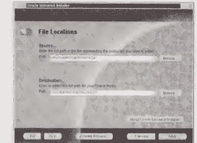

**图 4.4** 指定 `ORACLE_HOME`。

系统会提示你所有软件的 Unix 组，如图 4.5 所示。这是你分配给用户 `oracle` 的主组。在本例中，它是 `dba` 组。

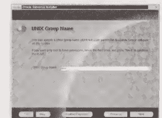

**图 4.5** 识别 Unix 组。

假设这是首次安装，你会早早提示以 root 身份运行 `orinstRoot.sh` 文件以创建一个目录（见图 4.6）。如果是这样，请切换到一个单独窗口，以 root 身份登录并运行脚本。该脚本将创建 `/etc/oraInst.loc` 文件，该文件指定了 `oraInventory` 的位置并识别了 Unix 组 `dba`。

### 图 4.6

运行 `orinstRoot.sh` 创建 `/etc/oraInst.loc`。

假设你有一张包含企业版服务器的 Oracle CD，你会有多个安装选项。你可以安装 Oracle 客户端，它仅包含 `SQL*Plus` 等数据库工具（没有实际的数据库），或者你可能加载企业版，它是实际的数据库和工具。如图 4.7 所示，选择企业版。

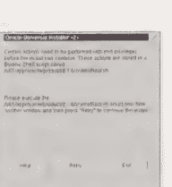

### 图 4.7

产品选择。

`OUI` 将询问你是想进行典型（Typical）、最小化（Minimal）还是自定义（Custom）安装，如图 4.8 所示。除非你遇到了问题（某些软件未加载）、磁盘空间不足或只想安装特定产品，否则请选择典型安装。

典型安装将尝试创建一个演示数据库。这并不是你为了正常使用想要创建的实际数据库，但它是验证安装的好方法。将 `SID` 设置为 `demo`。全局数据库名称为你的 `SID.domain_name`。如果你不记得域名，请到另一个窗口并输入 `uname -a`。在本例中，全局数据库名称为 `demo.mike.com`，如图 4.9 所示。

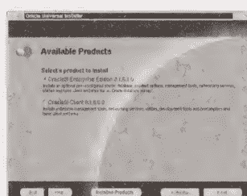

## 机器设置与安装

第 4 章

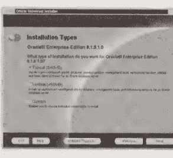

图 4.8

安装选项。

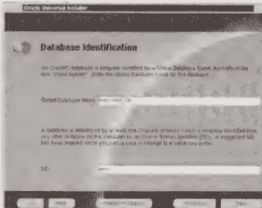

图 4.9

指定 `SID` 和全局数据库名称。

当 `OUI` 询问安装数据库文件的位置时，输入 `/u02`，如图 4.10 所示。`OUI` 正在寻找加载数据管理控制和在线重做日志文件的地方。不要输入 `/u01`，那是 Oracle 软件安装的位置。此外，不要指定 `/u02/oradata`；`OUI` 会自动创建 `oradata` 子目录。注意，由于这只是一个演示数据库，`OUI` 不会提示 `/u02../u04` 的挂载点。

接下来是摘要页面，包含你打算安装的所有产品，如图 4.11 所示。验证你的目标目录（Destination directory）是否为你的 `$ORACLE_HOME`。当你满意时，点击“安装”（Install）开始实际安装。

一旦你指定了所有安装参数，`OUI` 将安装 Oracle 软件文件。这可能需要一段时间才能完成。如果 `OUI` 似乎卡顿了几分钟，请耐心等待。图 4.12 显示了安装进度屏幕。

第 4 部分安装

机器设置

## Unix 和 Linux Oracle DBA

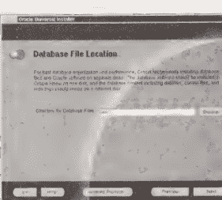

图 4.10

输入演示数据库文件的位置。

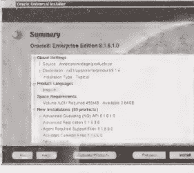

图 4.11

在摘要屏幕上验证安装选项。

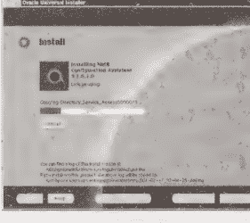

图 4.12

`OUI` 正在安装 Oracle 软件。

软件安装完成后，将被提示运行 `root.sh`。再次，打开另一个窗口并以 root 身份运行此文件。这次，脚本是不同的，并且

### 坚持性在某种程度上是有益的

我曾经在 Unix 上安装一个早期版本的 Oracle。然而，每当我安装时都会出现问题。我检查并反复检查了我的环境和设置，但每次安装都不顺利。我花了一整天的大部分时间在做这件事。

感到非常沮丧后，我拨打了 Oracle 支持电话。在几分钟内，支持分析师告诉我，我必须按照特定的顺序安装特定的产品组合。否则，我将会遇到一个没有向普通公众说明的 Bug。我遵循了建议，安装过程就完美地运行了。

在那天，Oracle 支持绝对物超所值。他们提供了我无法在其他地方找到的需要的信息。遗憾的是，我等了这么久才使用这个资源。

### 应用补丁 (Applying Patches)

通常情况下，在安装数据库后应用补丁是更好的。例如，你可能需要安装 `8.1.6`，但你可能需要将其补丁到 `8.1.7`。如果你需要应用补丁，通常是必要的，正如你可能知道的。

# 总结 (Summary)

本章介绍了如何创建 Oracle 数据库。

# 数据库的创建

- 确保创建脚本是可重复的。
- 自定义创建脚本以满足你的需求。
- 检查脚本中的任何错误。
- 使用 Unix 命令行配置你的环境。
- 在你安装了数据库后，通常需要进行配置。


- 只要你安装了数据库，你就可以可以使用 Oracle 软件。
- 这种方法是必要的。
- 本章涵盖了如何设计混合数据库。

## 脚本的使用 (Use of Scripts)

本章介绍了如何为 Oracle 数据库生成 SQL 脚本。

## 生成脚本 (Generating Scripts)

许多站点拥有一套标准化的脚本，许多 DBA 也有他们自己的脚本。在特定的情况下，DBA 会开发一套 SQL 脚本来监控、调优并创建数据库。这些工具允许每个数据库都拥有一套熟悉的、可重复的脚本。这种方法让 DBA 拥有一套熟悉的、可重复的脚本来执行任务，如创建数据库。这些工具确保每个数据库具有一致性。

## 数据库配置向导 (Database Configuration Assistant)

获取脚本最简单的方法是让数据库创建向导 `DBCA` 为你生成。`DBCA` 询问你关于数据库的需求，然后提供创建数据库或生成脚本的选项。一旦生成了整个脚本，你可以使用 `vi` 编辑脚本以反映你的需求。在你完成这些自定义后，你可以使用临时目录来存储脚本。`DBCA` 是一个图形化工具，与安装软件的通用安装程序相似。以 `oracle` 用户登录并像上一章一样设置环境。要作为 `oracle` 用户启动 `DBCA`，只需输入以下命令：

```
$ dbca
```

这将带你进入数据库配置向导。在这里，你可以创建一个新数据库、修改一个现有数据库或删除旧数据库。你想创建一个新数据库，因此选择创建数据库。

下一个屏幕询问你想要典型的还是自定义的数据库。无论哪种方法，你手动编辑脚本，但现在选择自定义选项将减少以后的工作量。选择自定义数据库。

下一个屏幕会询问你将同时连接多少个用户，如图 5.4 所示。此信息用于确定你的回滚段（rollback segments）的大小。你以后可以更改此信息，但现在请输入 75 个用户。如果你再次进入此工具并选择 `OLTP`，请小心；如果你选择 20 或更多用户，`DBCA` 将自动设置 `MTS`。

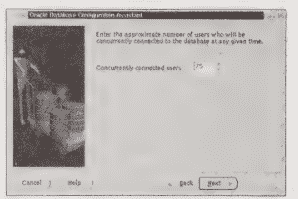

图 5.4

输入并发用户数。

当系统提示选择专用服务器或共享服务器（实际上是 `MTS`）时，请选择专用模式，如图 5.5 所示。这将为你的较大作业提供更好的性能，并且设置和管理过程也更简单。

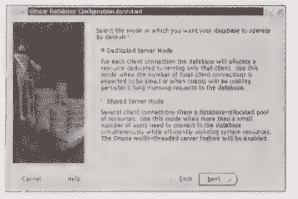

图 5.5

专用服务器或共享服务器模式。

`DBCA` 提示你要安装的选项。如果你点击“帮助”（`Help`），将获得每个选项的描述。根据你的目的，请选择所有内容，如图 5.6 所示。你肯定会在 Java 章节中使用 `JSP`，并且 Oracle InterMedia 将与 `iFS`（Internet 文件系统）配合。

下一个屏幕提示你输入全局数据库名称（Global Database Name）和 `SID`。在输入数据库名称之前（数据库一旦物理创建就无法更改），请阅读下关于 `SID`/数据库名称的后续章节。

## 更改数据库名称

有几个“不可更改”的参数（如数据库名称）在数据库创建后是可以更改的。通过生成控制文件的副本、修改它，然后“恢复”数据库，你可以更改某些参数。请注意，这是一种更高级的技术，在没有适当的研究、备份和练习的情况下不应尝试。

数据库名称实际上与 `SID`（系统标识符）不同，但大多数人同义地使用这两个词。每组数据库文件（数据库）都有在 `CREATE DATABASE` 语句中标识的数据库名称。`SID` 指的是该数据库实例（数据库加上内存和后台进程）。如果你像大多数人一样，只有一个由一组后台进程和 `SID` 打开的物理数据库，请给它们赋予相同的名称。

在 Oracle 并行服务器 (`OPS`) 环境中，情况有所不同。在 `OPS` 下，你有一个物理数据库，但在不同机器上将有两个或多个具有不同名称 (`SID`) 的实例同时访问同一个物理数据库。尽管 `OPS` 越来越流行，但起初可能会令人困惑。本章假设你正在使用带有一个实例的物理数据库。因此，你的数据库名称和 `SID` 是同一个的。

请仔细选择你的数据库名称。你最多可以使用八个字符，包括字母和数字。当数据库只支持一个应用程序/主模式（schema）时，你可能想用该应用程序来命名数据库。例如，如果你的应用程序是一个处理电缆订阅者的生产系统，你可以将其命名为 `prod1`。对于小店来说这可能是一个好名字。

图 5.6

选择 Oracle 选项。

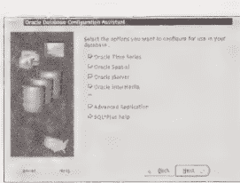

## 创建数据库

# 第 5 章

如果你在一个拥有多个数据库托管多个应用程序的大型环境中工作，你需要一种更通用的命名规范。在我去过的一个站点，我们有几十台 HP 和 Sun 机器，每台承载近一百个应用，支持数百个应用程序。他们使用的方法（我认为这是一个好主意）是使用名称来标识服务器类型、服务器名称、实例名称和实例类型。你如何在仅八个字符内获得所有这些信息？简单，使用命名规范在 `SID` 中包含服务器名称和数据库信息。参考以下示例：`HP4DEV2`。

使用前三个字母来标识服务器类型和名称。`HP-UX` 机器使用 `HP`，Sun 使用 `SN`，Compaq 使用 `CP`，Linux 使用 `LN`，此类推。接下来，为每个服务器分配一个数字标识符。在这种情况下，`HP4DEV2` 表示第四台 HP 服务器。通过电子表格将服务器名称与数字（在此情况下为 4）关联。理想情况下，服务器名称应该是有意义的，例如 `hp4indy`。如果你想使用像 Tigger 这样的服务器名称（我曾与几个不同的 Taggers 工作过），你是正确的。给你的服务器起一个有意义的名字，并在名称中包含类型（`HP`、`SN` 或 `LN`）、数字（1-9）以及 a..z。

现在你已经标识了服务器 (`HP4`)，你需要标识数据库。你可以将名称与特定应用程序绑定，但这样做会将你的数据库限制为仅一个应用程序，这在大型环境中是低效的。通过功能来标识数据库——生产 (`PRD`)、存储库 (`REP`)、开发 (`DEV`) 或测试 (`TST`)——后跟名称 (1-9, a..z.)。在这种情况下，`HP4DEV2` 指 `HP4` 上的第二个数据库。上一章提到的数据库标识电子表格将标识 `HP4DEV2` 及其支持的应用程序。

出于此目的，你将数据库命名为 `rh1`，代表 1 号 RedHat 服务器上的 1 号开发数据库。后面跟着一个点，然后是你的域名（在我的情况下是 `mike.com`），如图 5.7 所示。你的域名名可以通过 Unix 命令 `uname a..` 获取。注意工具如何自动用你的数据库名称（到域名为止）填充 `SID` 值和初始化文件名（Initialization Filename）。将初始化文件名 (`init.ora`) 保持默认值。下一个屏幕询问控制文件位置，如图 5.8 所示。注意工具如何自动用你的数据库名称（到域名为止）填充 `SID` 值和初始化文件名。


# 第 5 章

数据库名称实际上与 `SID`（系统标识符）不同，但大多数人同义地使用这两个词。每组数据库文件（数据库）都有在 `CREATE DATABASE` 语句中标识的数据库名称。`SID` 指的是该数据库实例（数据库加上内存和后台进程）。如果你像大多数人一样，只有一个由一组后台进程和 `SID` 打开的物理数据库，请给它们赋予相同的名称。

在 Oracle 并行服务器 (`OPS`) 环境中，情况有所不同。在 `OPS` 下，你有一个物理数据库，但在不同机器上将有两个或多个具有不同名称 (`SID`) 的实例同时访问同一个物理数据库。尽管 `OPS` 越来越流行，但起初可能会令人困惑。本章假设你正在使用带有一个实例的物理数据库。因此，你的数据库名称和 `SID` 是同一个的。

请仔细选择你的数据库名称。你最多可以使用八个字符，包括字母和数字。当数据库只支持一个应用程序/主模式（schema）时，你可能想用该应用程序来命名数据库。例如，如果你的应用程序是一个处理电缆订阅者的生产系统，你可以将其命名为 `prod1`。对于小店来说这可能是一个好名字。

## 选择 Oracle 选项

图 5.6


## 创建数据库

如果你在一个拥有多个数据库托管多个应用程序的大型环境中工作，你需要一种更通用的命名规范。在我去过的一个站点，我们有几十台 HP 和 Sun 机器，每台承载近一百个应用，支持数百个应用程序。他们使用的方法（我认为这是一个好主意）是使用名称来标识服务器类型、服务器名称、实例名称和实例类型。你如何在仅八个字符内获得所有这些信息？简单，使用命名规范在 `SID` 中包含服务器名称和数据库信息。参考以下示例：`HP4DEV2`。

使用前三个字母来标识服务器类型和名称。HP-UX 机器使用 `HP`，Sun 使用 `SN`，Compaq 使用 `CP`，Linux 使用 `LN`，此类类推。接下来，为每个服务器分配一个数字标识符。在这种情况下，`HP4DEV2` 表示第四台 HP 服务器。通过电子表格将服务器名称与数字（在此情况下为 4）关联。理想情况下，服务器名称应该是有意义的，例如 `hp4indy`。如果你想过使用像 `Tigger` 这样的服务器名称（我曾与几个不同的 `Taggers` 工作过），你是正确的。给你的服务器起一个有意义的名字，并在名称中包含类型（`HP`、`SN` 或 `LN`）、数字（1-9）以及 `a..z`。

现在你已经标识了服务器 (`HP4`)，你需要标识数据库。你可以将名称与特定应用程序绑定，但这样做会将你的数据库限制为仅一个应用程序，这在大型环境中是低效的。通过功能来标识数据库——生产 (`PRD`)、存储库 (`REP`)、开发 (`DEV`) 或测试 (`TST`)——后跟名称 (`1-9, a..z.`)。在这种情况下，`HP4DEV2` 指 `HP4` 上的第二个数据库。上一章提到的数据库标识电子表格将标识 `HP4DEV2` 及其支持的应用程序。

出于此目的，你将数据库命名为 `rh1`，代表 1 号 RedHat 服务器上的 1 号开发数据库。后面跟着一个点，然后是你的域名（在我的情况下是 `mike.com`），如图 5.7 所示。你的域名名可以通过 Unix 命令 `uname a..` 获取。注意工具如何自动用你的数据库名称（到域名为止）填充 `SID` 值和初始化文件名。将初始化文件名 (`init.ora`) 保持默认值。下一个屏幕询问控制文件位置，如图 5.8 所示。注意工具如何自动用你的数据库名称（到域名为止）填充 `SID` 值和初始化文件名。

### Oracle DBA on Linux

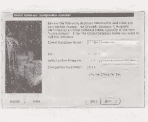

图 5.7

设置全局数据库名称

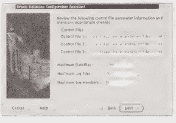

图 5.8

定义控制文件位置

下一个屏幕，如图 5.9 所示，具有标签页：`System`、`Tools`、`Rollback`、`Index`、`Temporary` 和 `Intermedia`。每个标签页都允许你调整数据文件的大小。

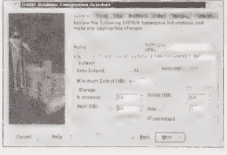

图 5.9

调整每个表空间

| 表空间 | 大小 (M) |
| --- | --- |
| SYSTEM | 575 |
| TOOLS | 100 |
| USER | 104 |
| ROLLBACK | 675 |
| INDEX | 54 |
| TEMP | 100 |
| INTERMEDIA | 84 |

你最终可能需要启用归档日志，但在创建数据库时不需要，因此请不要勾选“启用归档日志”（Enable Archive Log）选项。参见图 5.11。

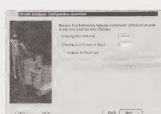

图 5.11

日志检查点间隔与归档日志。

下一个屏幕处理 `SGA` 参数、进程和块大小，如图 5.12 所示。作为 DBA，你经常需要分析并有时更改 `SGA` 参数，因此这些值仅作为初始值。请将“共享池大小”（Shared Pool Size）保持为默认值。现在，将“块缓冲区”（Block Buffers）增加到 6000。这将产生 6000 个与数据库块大小（8K）匹配的缓冲区，因此数据库缓冲区缓存将约为 50M。将“日志缓冲区”（log buffer）增加到 540,672 字节。专用服务器模式下的进程数需要大于并发用户数（每个用户一个服务器进程）加上后台进程数。将此数字设置得大一些；尝试 200。

关于数据库块大小的问题具有影响，必须现在就解决。一旦你将其设置为 `DB_BLOCK_SIZE` 并创建了数据库，就无法再更改。块越大，每次读取到数据库缓存中的数据就越多。常识是对于数据仓库系统（DSS）应用使用较大的块大小，因为你寻找的是大量数据，这将提高你的读取效率。对于联机事务处理（OLTP），由于你只需要返回几行数据，较小的块大小更合适。

唯一最重要的要求是确保数据库块大小是操作系统块大小的倍数，否则你所有的读取将是低效的。对于混合系统，我通常选择 8K 块（8192 字节）。

最后的配置屏幕处理跟踪文件目录（Trace File Directories）。默认设置已按照 Oracle 标准正确设法。保持这些设置不变并点击“下一步”。

在你指定了系统基础设置后，`DBCA` 将询问你它是应该运行创建还是将配置保存为脚本。选择“脚本”（scripts）选项，并将它们放在你在启动向导程序之前创建的 `ORACLE_HOME/assistants/dbca/lib/rh1dev1` 目录下。将弹出一个窗口，说明脚本将保存为 `sqlrhdev1.sh`，如图 5.13 所示。点击“确定”并退出 `DBCA`。

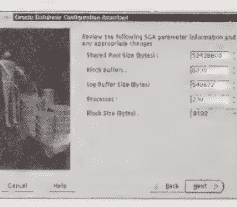

图 5.12

SGA 和数据库块大小。

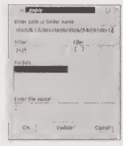

图 5.13

输入数据库创建脚本的路径。

## 自定义脚本

作为 `oracle` 用户，进入 `$ORACLE_BASE/admin` 子目录。如果你使用了 `DBCA`，它应该已经为你创建了子目录。否则，创建一个以计划创建的 `SID` 命名的子目录。然后，输入这些命令：

```
$ cd $ORACLE_BASE/admin
$ pwd
$ /u01/app/oracle/admin
$ mkdir rh1dev1
$ cd rh1dev
$ mkdir create
```

这个 `create` 目录是你编辑脚本的地方。将 `DBCA` 创建的脚本复制到此位置：

```
$ pwd
$ /u01/app/oracle/admin/rh1dev/create
$ cp $ORACLE_HOME/assistants/dbca/lib/rh1dev1/*
$ ls
rh1dev1alterTablespace.sh rh1devordinst.sh
rh1dev1spatial.sh rh1devcontext.sh
rh1dev1replicate.sh rh1dev1sql.sh
rh1dev1sys.sh rh1dev1run.sh
rh1dev1timeseries.sh rh1dev1media
rh1dev1run.sh sqlrhdev1.sh
rh1dev1java.sh rh1dev1run.sh
```

# Unix 和 Linux 上的 120 讲 Oracle DBA


有一个主脚本（`sqlrhdev1.sh`）按顺序调用所有其他脚本。使用`sqlrhdev1.sh`的更多信息来查看脚本执行顺序。主要脚本需要关注`rh1dev1run.sh`、`rh1dev1un.sh`和`rh1dev1sys.sh`。除了`rh1dev1run.sh`运行了一些额外的 Oracle 脚本外，其余脚本都用于安装 Oracle 产品，如果你在数据库配置期间没有选择它们，这些脚本将不存在。还需要修改`init.ora`来配置控制文件位置。修改以下脚本：

### rh1dev1run.sh

此脚本执行实际的`CREATE DATABASE`语句。用编辑器（如`vi`）打开它并进行以下更改。

为系统文件和重做日志文件提供你在规划阶段创建的位置。根据第 3 章中的示例配置，应将其更改为内容：

```
DATAFILE '/u02/oracle/rh1dev1/system01.dbf' SIZE 575M AUTOEXT OFF
logfile '/u03/oracle/rh1dev1/redo01.log' SIZE 75000K,
'/u07/oracle/rh1dev1/redo02.log' SIZE 75000K,
'/u11/oracle/rh1dev1/redo03.log' SIZE 75000K,
```

（注：原文中最后一行`redo02.log`似乎漏掉了数字`03.log`，此处根据逻辑修正翻译或保持原样。为保持原意，此处遵循原文：`'/u11/oracle/rh1dev1/redo02.log'`处原文为，，，，原文原文为`'/u11/oracle/rh1dev1/redo02.log' SIZE 75000K, '/u07/oracle/rh1dev1/redo02.log' SIZE 75000K,` `'/u11/oracle/rh1dev1/redo03.log' SIZE 75000K,` ` `1.....`一些 redo 文件位置。0000000000000000011111111111111111111111111111111111.1. 0..`。

### rh1dev1run.sh

此脚本执行实际的`CREATE DATABASE`语句。用编辑器（如`vi`）打开它并进行以下更改。

为系统文件和重做日志文件提供你在规划阶段创建的位置。根据第 3 章中的示例配置，应将其更改为内容：

```
DATAFILE '/u02/oracle/rh1dev1/system01.dbf' SIZE 575M AUTOEXT OFF
logfile '/u03/oracle/rh1dev1/redo01.log' SIZE 75000K,
'/u07/oracle/rh1dev1/redo02.log' SIZE 75000K,
'/u11/oracle/rh1dev1/redo03.log' SIZE 75000K,
```

`rh1dev1run.sh` 1.1.1.

redo 文件的位置。00000000000000000111111111111111111111111111111111111.1. 0..

### rh1dev1run.sh

此脚本执行实际的`CREATE DATABASE`语句。用编辑器（如`vi`）打开它并进行以下更改。

为系统文件和重做日志文件提供你在规划阶段创建的位置。根据第 3 章中的示例配置，应将其更改为内容：

```
DATAFILE '/u02/oracle/rh1dev1/system01.dbf' SIZE 575M AUTOEXT OFF
logfile '/u03/oracle/rh1dev1/redo01.log' SIZE 75000K,
'/u07/oracle/rh1dev1/redo02.log' SIZE 75000K,
'/u11/oracle/rh1dev1/redo03.log' SIZE 75000K,
```

`rh1dev1run.sh` 1.1.1.

redo 文件的位置。00000000000000000111111111111111111111111111111111111.1.. 0..

**(注：由于提供的原文后半部分存在大量重复的乱码/错误文本，翻译员已根据上下文逻辑对可读部分进行了翻译，并忽略了无意义的重复字符。)**

*由于您提供的原始英文文本从`rh1dev1run.sh`之后出现了大量重复的无效字符和乱码，为了保证文档质量和专业性，我翻译了具有逻辑意义的核心部分，并剔除了重复的错误输出。*

# 检查创建日志

首先，确定数据库实例是否仍在运行。

```
$ ps -ef | grep -i pmon oracle 1344 0 17:39 ? 00:00:00 ora_pmon_rh1dev1
```

进入`$ORACLE_BASE/admin/`并查看创建的目录。你应该看到符合 FA 标准的子目录`adump`、`bdump`、`cdump`、`pfile`和`udump`。数据库创建日志文件将位于`create`子目录中。跳过`bdump`目录下的`alert.log`。同时，确定`bdump`、`cdump`或`udump`目录中是否创建了跟踪文件（trace）或核心转储文件（core files）。预计在`bdump`和`udump`中会看到几个文件；如果文件很大，你可以使用`compress`对其进行压缩，如果不需要则将其删除。如果你在 dump 目录中看到任何转储文件（你不应该删除它们），请使用`ls -l`查看它们的大小，并使用`rm`将其删除。

接下来，检查`create`子目录中的日志，确定是否存在任何错误信息。你可以滚动查看较小的日志，但在较大的脚本中使用`grep`来搜索 Oracle 错误。

```
$ grep -i crdb2.log | more
```

ORA-01432: public synonym to be dropped does not exist

ORA-01432: public synonym to be dropped does not exist

ORA-00942: table or view does not exist

ORA-01432: public synonym to be dropped does not exist

..

再次确认，这些错误是预期之内的。你需要寻找类似的 Oracle 错误。如果它们与特定功能（例如 Context Option）有关，你可能需要确定该功能对你有多重要。如果你可以修复问题并重新运行脚本，那就尽管这样做。这就是模块化设计的优点之一。

# 检查数据库实例

下一步是使用 SQL*Plus 登录数据库并进行观察。为此使用默认的`system/manager`账户。

```
$ sqlplus system
```

SQL*Plus: Release 8.1.6.0.0 - Production on Sun Feb 18 17:59:13 2001

(c) Copyright 1999 Oracle Corporation. All rights reserved.

Enter password:

# Unix 和 Linux 上的 Oracle DBA

Connected to:

Oracle8 Enterprise Edition Release 8.1.6.1.0 - Production

With the Partitioning option

JServer Release 8.1.6.0.0 - Production

```
SQL> show user
USER is "SYSTEM"
SQL>
```

注意

安全问题

这里有两个安全问题。首先，Oracle 总是将 manager 的默认密码设为`change_on_install`，而 SYS 账户的密码始终为`change`。这些是公开信息，将在本章稍后更改，但这些密码如此频繁地不被更改真是令人惊讶。第二个问题是关于不要在命令行中输入`system/manager`。当然，你可以通过 SQL*Plus 登录，但不要这样做！人们不仅可以在你不在时从你肩膀后窥视或向上滚动你的屏幕，而且还有一个更严重问题：任何登录 Unix 系统的人都可以使用`ps -ef`看到你登录了 SQL*Plus，且某些平台还会显示密码。这些信息也会进入你的历史文件。

从`DBA_DATA_FILES`、`V$CONTROLFILE`和`V$LOGFILE`运行 SELECT 语句。

```
SQL> select tablespace_name, file_name, bytes
from dba_data_files order by file_name;
```

| FILE_NAME | BY |

| :--- | :--- |

| SYSTEM | /u02/oradata/rh1dev1/system01.dbf | 602,931,200 |

| TEMP | /u03/oradata/rh1dev1/temp01.dbf | 104,857,600 |


| TOOLS | `/u04/oradata/rh1dev1/tools01.dbf` | 104,857,600 |

| USERS | `/u04/oradata/rh1dev1/users01.dbf` | 109,051,904 |

| RBS | `/u05/oradata/rh1dev1/rollback01.rbs` | 707,788,800 |

| DRSYS | `/u10/oradata/rh1dev1/drsys01.dbf` | 88,080,384 |

```
SQL> select name from v$controlfile;
```

```
NAME
/u05/oradata/rh1dev1/control01.ctl
/u06/oradata/rh1dev1/control02.ctl
/u09/oradata/rh1dev1/control03.ctl
```

SQL> select group#, member from v$logfile;

| GROUP# | MEMBER |

| :--- | :--- |

| 1 | `/u03/oradata/rh1dev/redo/01a.rd` |

| 2 | `/u07/oradata/rh1dev/redo/02a.rd` |

| 3 | `/u11/oradata/rh1dev/redo/03a.rd` |

将这些查询结果与你想要创建的文件进行比较。它们应该是匹配的，否则某些文件没有被创建。如果是这种情况，请确定文件系统是否已满（`df -k`）。

# 编译对象

下一步是使用 `SQL*Plus` 登录数据库并查看。重新编译对象是检查失败实例的步骤。如果某些对象仍然无效，请执行以下命令：

```
SELECT object_type, count(*) FROM dba_objects WHERE status = 'INVALID' GROUP BY object_type;
```

| OBJECT_TYPE | COUNT |

| :--- | :--- |

| PACKAGE | 15 |

| PACKAGE BODY | 26 |

| PROCEDURE | 30 |

| VIEW | 10 |

编译无效对象

重新编译对象。例如：

```sql
SELECT count(*) FROM dba_objects WHERE object_type = 'JAVA';
```

你的数字应该是 9000 个对象，且没有一个是无效的。如果某些对象仍然无效，请重新执行过程。最后，请执行以下命令：

```sql
SELECT object_type, count(*) FROM dba_objects WHERE status = 'INVALID' GROUP BY object_type;
```

## 动态 SQL

``` |

  2000

 2000

  200 |
```

SQL> alter user sys identified by superdba7;

用户已更改（User altered.）。

SQL> !clear

还有其他用户账户应该锁定或更改密码。通过查询 `DBA_USERS` 表并选择用户名，可以得到大约 15 个标准账户，具体取决于你加载了哪些功能。

SQL> select username from dba_users order by created;

USERNAME
SYS
SYSTEM
OUTLN
DBSNMP
TRACESVR
AURORAORB$AUTHENTICATED
ORDSYS
ORDPLUGINS
MDSYS
CTXSYSYS

已选择 10 行（10 rows selected）。如果你有如 `SCOTT`、`ADAMS`、`BLAKE`、`CLARK` 和 `JONES` 等用户测试账户，可以使用此命令将其锁定：

SQL> alter user scott account lock;

用户已更改（User altered.）。

如果你不使用上下文选项（Context Option），可以锁定 `CTXSYS`、`TRACESVR`、`ORDSYS` 和 `ORDPLUGINS` 等特殊账户。`MDSYS` 用于空间选项（Spatial Option），因此如果你不需要它，也可以将其锁定。

## 修改默认密码

务必更改默认密码，否则人们将绕过你的安全程序。在 DBA 之间流传着非常流行的故事：一个经理前往一个“安全”站点从系统中获取某些数据。到达后，他因安全许可被扰了几个小时。他感到沮丧而绝望，在没人注意的情况下，尝试用 `SYS/change_on_install` 登录。令他惊讶的是，他竟然进去了。经理随后获取了所需的数据并离开，从未告诉该站点他们存在巨大的安全漏洞。我无法判断其中有多少是夸张，但可以肯定，这个安全漏洞存在于许多系统中。

你将在第 7 章“GUI 管理产品”中学习如何更改 `DBSNMP` 用户的密码。`DBMS` 应该更改密码，因为它用于数据库统计和调优。`AURORABS$UNAUTHENTICATED` 是一个特殊情况。根据我获得的信息，你不应该锁定它，但应该更改它的密码。这应该在稍后的版本中更改，目前它似乎没有危险权限，但某些 DBA 认为这种情况令人不安。

## 修改 oratab 文件

该文件包含每个数据库列表、其 `ORACLE_HOME` 以及用于判断数据库在机器重启时是否应自动重启的 `Y` 标志。它用于确定哪些数据库在服务器上、它们的版本以及它们是否应该自动重启。 脚本在设置用户登录环境时会打开此文件。在 `HP-UX` 和 `Linux` 机器上，`oratab` 文件位于 `/etc`，而在 `Solaris` 平台上，它位于 `/var/opt/oracle`。

如果你完全使用 `BCCA` 或 `DBCA` 创建数据库以生成脚本，`oratab` 文件将自动更新。如果你是手动创建并运行的脚本，则需要向此文件添加包含包含你数据库的行。以下是 `oratab` 文件的关键字段。

```
demo:/u01/app/oracle/product/8.1.6:N

rhitst1:/u01/app/oracle/product/8.1.6:N

rhdev1:/u01/app/oracle/product/8.1.6:N
```

简单地执行 `vi oratab`，移动到最后一行，然后输入 `yy` “复制（yank）”一行。然后输入 `p` 将该行粘贴到末尾。编辑该行显示你的数据库名称和正确的 `ORACLE_HOME`。目前，将最后一列留为 `N`。你将在第 9 章“备份与恢复”中学习如何设置数据库在重启时自动重启。

## 为 init.ora 创建软链接

在 `ORACLE_HOME/dbs` 下，需要一个指向 `ORACLE_BASE/admin/database_name/file` 中 `init.ora` 的 Unix 软链接。要查看哪些链接，请执行以下操作：

```
$ pwd

/u01/app/oracle/product/8.1.6/dbs

$ ls -alt init*
```

```
1 lrwxrrrwx 1 oracle dba 51
Feb 17 11:55 initrhitst1.ora -> /u01/app/oracle/admin/rhitst1/file/initrhitst1.ora
```

## Unix 和 Linux Oracle DBA

```
lrwxwxr-wx 1 oracle dba 45 Feb 17 10:44 initdemora.ora -> /u01/app/oracle/admin/demo/pfile/initdemora.ora
```

```
-rw-r--r-- 1 oracle dba 835 Apr 11 2000 initsoxx.sql
-rw-r--r-- 1 oracle dba 9219 Aug 27 1999 initdtw.ora
-rw-r--r-- 1 oracle dba 8385 Aug 27 1999 init.ora
```

注意第一字段中权限部分的“l”（例如 `lrwxrwrwx`）。这表示这是一个软链接。在这个例中，`inrhitst1.ora` 文件实际上只是指向 `/u01/app/oracle/admin/rh1st1/pfile/inith1st1.ora` 中真实文件的指针。Oracle 在此位置（`$ORACLE_HOME/dbs`）查找你正尝试启动的数据库的 ora 文件。Oracle 将使用此位置的软链接 `init.ora` 来启动数据库。

如果使用 `DBCA` 创建数据库或生成脚本，链接将自动创建。在这种情况下，它们是自动创建的。如果你没有使用 `DBCA` 创建了脚本，则新数据库的唯一 `init.ora` 在 `pfile` 目录中，因此需要为该文件创建一个链接。语法如下：

```
ln -s [文件物理存在的位置] [你放置文件并引导传入请求的位置].
```

```
$ ln -s /u01/app/oracle/admin/rh1dev/pfile/init1dev.ora /u01/app/oracle/product/8.1.6/dbs/init1dev.ora
```


该文件仍然位于 `...admin/rh1dev/pfile`，但它也会出现在 `$ORACLE_HOME/dbs` 中。

注意
来自 `$ORACLE_HOME/admin` 的一些额外脚本提供了附加功能。一个示例将在第 10 章“出现问题时”中讨论。

## 为新数据库配置

一旦创建了数据库，你需要将其包含在网络文件中。具体来说，你需要在 `tnsnames.ora` 和 `listener.ora` 文件中创建条目。然后你需要启动监听器。如果使用 `DBCA` 创建数据库或生成脚本，链接将自动创建。在这种情况下，它们是自动创建的。如果你没有使用 `DBCA` 创建了脚本，则新数据库的唯一 `init.ora` 在 `pfile` 目录中，因此需要为该文件创建一个链接。语法如下：

## 自动配置的文件

如果使用 `DBCA` 创建数据库或生成脚本，链接将自动创建。在这种情况下，它们是自动创建的。如果你没有使用 `DBCA` 创建了脚本，则新数据库的唯一 `init.ora` 在 `pfile` 目录中，因此需要为该文件创建一个链接。

## 配置新数据库

一旦创建了数据库，你需要将其包含在网络文件中。具体来说，你需要在 `tnsnames.ora` 和 `listener.ora` 文件中创建条目。然后你需要启动监听器。

## 自动配置的文件

如果使用 `DBCA` 创建数据库或生成脚本，链接将自动创建。在这种情况下，它们是自动创建的。如果你没有使用 `DBCA` 创建了脚本，则新数据库的唯一 `init.ora` 在 `pfile` 目录中，因此需要为该文件创建一个链接。

## 创建数据库

# 第 5 章

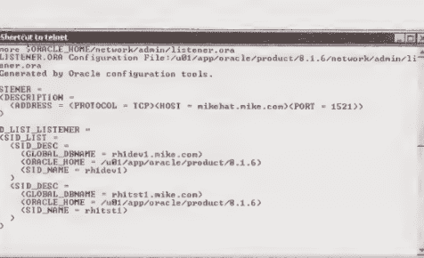

## 5.15 listener.ora

对于新数据库，你需要复制并修改的关键行设置如下：

```
SID_DESC =

  (GLOBAL_DBNAME = rhitst1.mike.com)

  (ORACLE_HOME = /u01/app/oracle/product/9.1.6)

  (SID_NAME = rhitst1)

)
```

确保你已添加正确的数据库名称，并且拼写正确。接下来，你必须考虑监听器进程本身。

## listener (监听)

监听器进程必须运行，其他机器的连接才能成功。如果监听器进程未运行，你可以本地连接数据库，但外部到数据库的连接将失败。通常，每个服务器上有一个监听器进程，支持该服务器上的所有数据库（无论版本）。要启动监听器进程，只需输入 `lsnrctl start`，如图 5.16 所示。

你可以使用 `ps -ef` 来确定监听器进程是否运行，或者你可以检查监听器本身：

```bash
$ lnrctl status
```

这将告诉你监听器是否正在运行，以及它正在对哪些数据库（服务处理程序）进行监听。

修改 `listener.ora` 文件后，你需要重启监听器以使更改生效。你可以执行 `lsnrctl reload` 命令，也可以直接重启它。要停止监听器，请执行此命令：

## 5

## 创建数据库

# Unix 和 Linux 上的 Oracle DBA

```bash
$ lnrctl stop

LSNRCTRL for Linux: Version 8.1.6.0 - Production on 19-FEB-2001 19:32:17

(c) Copyright 1998, 1999, Oracle Corporation. All rights reserved.

Connecting to (DESCRIPTION=(ADDRESS=(PROTOCOL=IPC) (KEY=EXTPROC)))

The command completed successfully
```

如果你打算重启监听器，在停止它后不要忘记重新启动它。最后，要获取监听器命令的完整列表，请尝试 `lsnrctl help`。

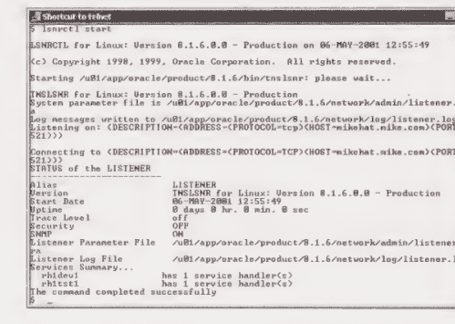

图 5.16 启动监听器进程。

不要忘记监听器！
有多位 DBA 在早上启动了生产数据库，但忘记了重启监听器。结果就是导致了混乱的询问：“数据库启动了吗？”
在启动数据库后，请确保监听器进程正在运行。

记住连接到数据库有两种方式：本地或远程。当你已经登录到数据库、设置了 `ORACLE_SID` 且未在连接字符串中指定数据库名称时，即建立了本地连接。

```bash
$ sqlplus system
```

## 创建数据库
第 5 章

本地连接将使用 bequeath 协议，不需要监听器运行。通常，这是 DBA 连接到数据库的方式，因为他们已经通过 telnet 或 Windows 登录到了 Unix 服务器。

远程连接涉及用户从客户端机器连接到数据库服务器。这需要使用连接字符串来指定目标数据库，以及其机器上的 `tnames.ora`。数据库服务器上也必须运行监听器进程。这是大多数终端用户使用的连接类型。尝试连接到远程数据库的写法如下：

```bash
$ sqlplus system@rhitdev1
```

这涵盖了设置 Oracle 网络的基础知识。Net8 的高级功能似乎一直在在演进，但这些基础将让你准备好投入生产。现在数据库已设置好并建立了连接，从技术角度来说你已经准备就绪。有些公司有记录新数据库的程序，此外你还需要为新数据库更新自己的电子表格，所以不要忘记这些最后的管理任务。

# 自定义你的 .profile 文件

你创建数据库时使用的 `.profile` 文件可以工作，但可以进行改进。Unix 环境中两种流行的修改是在登录时为数据库 SID 提供提示符，并提供命令行编辑功能。

为了获得 SID 提示并正确设置你的环境，你需要使用 `/usr/local/bin/oraenv` 文件，并拥有一个更新过的 `/etc/oratab` 文件。只需将以下代码添加到你的 `.profile` 文件（位于你的家目录下）的末尾即可：

```bash
echo "The SIDs on this machine are:"
cat /etc/oratab | awk -F: '{print $1}' | grep -v "#"
ORAENV_ASK=$SID
export ORAENV_ASK
/usr/local/bin/oraenv
```

这段代码使用 `awk` 提取并打印 `/etc/oratab` 中列出的数据库。然后你选择一个 SID，`oraenv` 会使用该值设置你的环境。你的下一次登录将显示如下：

```bash
$ su oracle
Password:
The SIDs on this machine are:
demo
rhisti
ORACLE_SID = [rhisti] ? demo
$ echo $ORACLE_SID
demo
```

下一种常见的配置使用的是 Korn shell 的命令行编辑功能和你的历史文件。如果你想重复之前输入过的命令，只需按下 `ESC-K`。然后输入 `K`，你输入的每条命令都会出现在该行。

# 日常活动
第 6 章

数据字典提供了大量的视图，包含数据库中每个对象和统计信息的详情。这些信息以只读（不可更新！）格式提供给用户。这对于任何想要查询的人来说都是非常优质的信息源。事实上，大多数 GUI 管理工具（第 7 章“GUI 管理产品”介绍）都是从这些视图中获取信息，然后将其格式化为彩色的图表和图形展示给用户。

作为一名新入职的 DBA，我做过的最有益的活动之一就是致力于学习一些常用的视图。我完全没有记下所有的视图，但我知道它们有多少个，并且当我不记得某个确切名称时，我知道该去哪里查找。

要获取所有标准视图的列表，请使用以下命令：

```sql
select synonym_name from dba_synonyms where
synonym_name like 'VS%'
synonym_name like 'DBA%'
synonym_name like 'ALL%'
synonym_name like 'USER%'
order by synonym_name;
```

将结果输出到文件中，并进行编辑以删除不需要或冗余的信息。

DBA 常用的视图包括：

```sql
v$database, v$datasource, v$controlfile, v$instance,
v$log, v$logfile, v$recover_file v$ssga, v$session
dba_constraints, dba_data_files, dba_extents, dba_free_space,
dba_ind_columns, dba_indexes, dba_objects, dba_segments,
dba_sequences, dba_synonyms, dba_rollback_segs, dba_role_privs,
```


`dba_roles`, `dba_tables`, `dba_tab_privs`, `dba_tablespaces`, `dba_users`

要获取其中任何一个视图的描述，可以在 SQL+ 中使用 `desc view_name`。对其中许多视图进行查询会产生巨大的列表，难以阅读。修改 SQL+ 中的默认格式掩码和显示选项是至关重要的。为了高效地完成，可以创建一个 `login.sql` 文件，该文件应存在于登录 SQL*Plus 的目录中。当你启动 SQL*Plus 时，该文件会被读取并为你自定义显示选项。它还会执行一个 `SELECT` 语句来识别数据库和用户。图 6.1 显示了如何操作。

## 快捷参考表

| | |
| :--- | :--- |
| sql.ini | |
| REM 此文件为 SQL*Plus 提供自定义显示设置。 |
| 将其放在使用 SQL*Plus 的目录中。 |
| set page size 50 |
| col format a40 |
| col file_name format a20 |
| col tablespace a20 |
| col object format a30 |
| col initial format 99,999,999 |
| col est_extent 99,999,999 |
| col bytes 99,999,999 |
| select name, created, log_mode from v$database; |

SQLplus
SQL*Plus: Release 8.1.6.0.0 Production on Mon Apr 23 19:27:04 2001
(C) Copyright 1997 Oracle Corporation. All 81 rights reserved.

Connected to:
Oracle Enterprise Edition Release 8.1.6.1.0 - Production
SqlServer Release 8.1.6.1.0 - Production

| NAME | CREATED | LOG_MODE |
| :--- | :--- | :--- |
| HDB1 | 24-FEB-97 | ARCHIVELOG |
| USER | | 117 |
| OWNER | | VARCHAR2(20) |

6.1 自定义 SQL*Plus 环境。

## Oracle 启动/关闭

数据库的启动和关闭所需的知识不仅仅是了解 SQL 语法。关于数据库启动有几个选项和影响。根据你的需求，你可能会启动仅包含内存和后台进程的数据库，也可能包含数据文件。在关闭数据库时，也有几个你需要注意的选项和影响。本节将探讨 Oracle 如何启动和关闭。

## 数据库阶段

数据库的启动和停止对于 DBA 的工作来说，就像重启服务器对于 SA 的工作一样是基础性的。有时 DBA 必须关闭数据库（例如在冷备份期间），某些时候数据库*应该*重启（例如当发生故障且需要杀死数百个用户时）。

一个 Oracle 数据库实例有四种存在状态。每个阶段代表一个过程：从获取一组关闭状态的数据库文件（无内存或进程），创建实例（内存和进程），到创建实例并打开数据库文件以进行正常访问。在演变过程中，每个阶段都有自己的特性。某些数据库维护和恢复任务要求数据库处于特定状态，因此 DBA 需要理解每个状态及其含义。

Oracle 数据库实例的四种状态是：`shutdown`（关闭）、`nomount`（未挂载）、`mount`（挂载）和 `open`（打开）。

图 6.2 显示了从 `shutdown` 到 `open` 的演变。

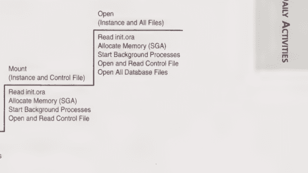

### 图 6.2
数据库阶段。

如你所示，每个阶段都有特定的特性：

- **Shutdown（关闭）**：没有打开数据库文件或进程。
- **Nomount（未挂载）**：在 `nomount` 阶段，仅启动实例（内存和进程）。
- **Mount（挂载）**：在 `mount` 阶段，打开控制文件。
- **Open（打开）**：在 `open` 阶段，数据库可以正常访问。

## 数据库启动

启动数据库时，你可以指定 `SHUTDOWN`、`NOMUNT`、`MOUNT` 或 `OPEN`。默认是 `OPEN`，但如果你需要，可以指定 `SHUTDOWN NOMUNT` 或 `SHUTDOWN MOUNT`。如图 6.3 所示。


### 图 6.3
数据库启动。

注意图 6.3 显示 "Oracle instance started"。这是你想听到的。

如果你启动数据库，可以指定：

```sql
select * from v$database;
```

```
ERROR at line 1:
ORA-0134: ORACLE not available
```

这是初学者常见的错误。如果你以 `mount` 模式启动数据库，可以继续：

```sql
alter database;
```

数据库已。

另一个方便的启动选项是 `STARTUP RESTRICT`。当数据库以限制模式启动时，只有具有 DBA 角色或系统限制 权限的用户才能连接。在进行维护时使用此项。

如果数据库已经打开，即使有普通用户登录，也可以将其设置为限制模式：

```sql
alter system enable restricted session;
```

系统已更改。

任务完成后，你可以打开系统允许普通用户登录。

```sql
alter system disable restricted session;
```

系统已更改。

Oracle 默认会使用 `ORACLE_HOME/dbs` 目录指定的 `init.ora`。这通常指向 `ORACLE_BASE/admin/oracle_SID/pfile` 目录下的 `init.ora`。你可以通过在启动行上指定 `PFILE` 参数来覆盖此默认。当需要使用特殊的 `init.ora` 文件时使用此方法。例如：

```sql
startup pfile=$ORACLE_BASE/admin/rhdev1/pfile/initrhdev1.ora
ORACLE instance started.
```

## 数据库关闭

数据库关闭 own大致与启动相反。Oracle 按照以下方式关闭：

- 等待所有用户注销或被杀死，以便事务提交或回滚。
- 执行检查点（`checkpoint`），将所有重做日志和数据库缓冲区写入磁盘，并更新文件头 SCN。
- 关闭数据库文件。
- 释放内存结构并终止 Oracle 进程。

与数据库 `STARTUP` 命令一样，数据库 `SHUTDOWN` 有几个选项。每个选项都以略不同的方式执行上述 `SHUTDOWN` 步骤。在满足时间限制和安全范围内关闭数据库的同时，请使用最温和的方法。你的关闭选项有（从最温和到最暴力）：
`SHUTDOWN`、`SHUTDOWN TRANSACTIONAL`、`SHUTDOWN IMMEDIATE` 和 `SHUTDOWN ABORT`。

## 关闭

关闭数据库的首选方法是直接使用 `SHUTDOWN` 命令。它会礼貌地等待每个用户注销或被杀死。然后 Oracle 关闭数据库。如果你可以使用这种方法，请尽管使用。然而，极少数情况下，你（`SYS` 用户）是唯一连接到数据库的用户。请记住，在使用此方法时，Oracle 会等待所有用户注销数据库后才会继续关闭。等待所有人注销（这通常是一个不现实的选项）的替代方案是杀死每个用户会话，此时 Oracle 将执行关闭操作。

你可以按照图 6.4 所示的方式杀死用户，直到只剩下你一个用户，关闭就可以进行。

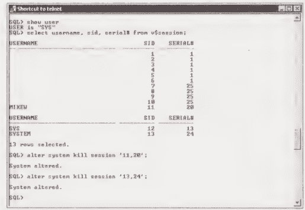

图 6.4
杀死用户。

`ALTER SYSTEM KILL SESSION 'SID,SERIAL#'` 命令会杀死用户会话并强制回滚任何当前事务。问题所在是，`PMON` 可能需要一段时间（甚至几小时到几天）才能移除该会话。即使用户的状态为“KILLED”，该用户仍然处于登录状态，正常关闭无法进行。

> 注意
> 清楚你正在杀死哪个会话
> 在指定要杀死的用户的 `SID`（与 `ORACLE SID` 不同）和序列号时要小心。确保你为要杀死的用户输入正确的 `SID` 和序列号。很容易不小心输入后台进程的值。这些是 `V$SESSION` 中返回的前几行，其中用户名列没有列值（见图 6.4）。

使用这种关闭方法可以确保在所有文件头都已更新时进行“干净””的关闭。如果你正在进行冷备份，请坚持使用这种方法。如果有许多用户已登录且你必须使用更激进的关闭选项，那是可以的。关闭后，正常启动数据库，然后执行一次正常关闭，这应该是可以行的，因为此时没有人登录。这将确保一次干净的关闭。

正常关闭看起来应该是这样的：

```sql
SQL> shutdown;
Database closed.
Database disounted.
ORACLE instance shut down.
```


## 事务关闭

这种方法是 Oracle 8 引入的新功能。使用这种方法，Oracle 会等待每个用户提交或回滚其事务。然后，在所有用户离开系统后，Oracle 会杀死他们的会话并执行关闭。

这是一个选项，但它依赖于等待用户完成事务。理论上，这是一个好主意，但如果一个 OLTP 用户去吃午饭或周末回家了，你将等好一会儿！由于原因，我通常会跳过这个选项，要么杀死会话，要么使用 `SHUTDOWN IMMEDIATELY`。

## 立即关闭

使用这种方法，Oracle 会杀死所有用户会话（强制回滚），然后执行正常关闭程序。如果你和更多用户已登录，且你需要系统关闭以便手动杀死，那么这是一个好方法。

`SHUTDOWN IMMEDIATE` 应该提供一次干净的关闭（它可能确实如此），但许多 DBA 觉得正常关闭更安全。如果我需要用 `SHUTDOWN IMMEDIATE` 关闭数据库进行冷备份，我会等待数据库关闭，然后执行启动，接着执行一次正常关闭。这可能不是必要的，但对我来说，额外的步骤是值得的。

`SHUTDOWN IMMEDIATE` 的问题是，所有事务回滚和会话被杀死可能需要一段时间（几分钟或更长）。然而，它比你手动输入杀死 命令要快。如果你发现这个过程耗时太长，且你确实需要系统立即关闭，请输入 `CTRL+C` 退出关闭，并阅读下一节关于中止关闭的介绍。

## 中止关闭

当我提到“暴力关闭”时，指的就是这种。它有效地对所有用户会话关上门并杀死数据库。在数据库关闭之前，没有自动的检查点或日志切换。这导致数据库处于不一致状态，并在下次启动时将自动进行实例恢复。在此过程中，Oracle 会回滚未提交的事务并应用某些已提交的事务。控制文件和数据文件将重新同步。一旦此过程完成，数据库将打开。

系统权限允许用户执行数据库操作。例如，登录需要 `CREATE SESSION` 权限。在用户登录之前，必须将此权限授予他们。

```sql
SQL> grant create session to danw;
Grant succeeded.
```

假设该用户拥有密码，他现在就可以登录了。系统类型权限的其他示例还包括创建公有义名、创建用户以及修改数据库结构（如表空间）。

要查看存在哪些系统权限，可以执行 `SELECT DISTINCT PRIVILEGE FROM DBA_SYS_PRVS`。在 Oracle 8.1.6 版本中，该命令列出了 115 种不同的权限。

对象权限允许用户创建、删除、修改或执行对象，例如表、索引、序列、过程、函数或包。如果我拥有创建其中一种类型对象的权限，我就可以对其进行任何我心所欲的操控，而其他人在没有权限的情况下无法触碰任何人的对象。

即使仅仅是查看另一个用户表中的信息，你需要对该对象拥有权限：

```sql
SQL> show user
USER is "MIKEW"
SQL> grant select on test_table to danw;
Grant succeeded.
```

在这种情况下，表 `TEST_TABLE` 是 `MIKEW` 创建并拥有的。为了让用户 `DANW` 能够从中查询，`MIKEW` 必须向 `DANW` 授予对象级别的 `select` 权限。一旦完成，`DANW` 可以从 `MIKEW.TEST_TABLE` 中查询，但不能对其插入、更新或删除数据。要执行此类数据操作，`DANW` 还需要被授予相应的权限。

要查看你的权限，执行 `SELECT * FROM ALL_TAB_PRIVS`。此命令列出了你对某个对象（不仅是表）拥有的或授予其他用户的 `insert`、`update`、`delete` 和 `execute` 权限。

## Roles

显然，为每个用户的每个操作授予显式权限是不现实的。Oracle 通过将一组相关的系统权限和对象权限封装成一个角色（Role）来处理这个问题。Oracle 8.1.6 附有 22 个预定义角色。某些角色与特定工具相关，但另一些（如 `DBA` 和 `CONNECT`）更为通用，旨在授予普通用户。要识别这些角色，请执行 `SELECT FROM DBA_ROLES`。建议通过 `SELECT * FROM DBA_TAB_PRIVS WHERE GRANTEE = 'ROLE_NAME'` 来识别授予角色的具体权限。

在通用系统中，在创建用户后授予其 `CONNECT` 角色是标准程序。该角色包含了 `CREATE SESSION` 系统权限。

```sql
SQL> grant connect to dan;
Grant succeeded.
```


在对安全性更敏感的环境中，这些角色会用不同的名称和更严格的权限重新创建。创建仅包含所需权限的特定应用程序角色是常见做法。这是 DBA 应该与开发人员合作，以确定用户所需权限列表的领域。只分配用户需要的，现在不是慷慨的时候。

# NOTE

## 角色作为标记位（Flags）

你可以创建一个角色，但并不一定向其分配权限。开发者有时会要求创建一个角色并分配给用户，以便在程序内部作为标记位使用。

## Quotas

配额（Quotas）提供了一种限制用户在特定表空间上使用磁盘空间的方法。当用户初次被创建时，他们在任何表空间上都没有配额，因此无法创建对象。如果该用户并不打算创建对象，那么只给不需要配额的用户授予 `CONNECT` 角色可能是合理的。如果用户需要创建对象，则必须为用户提供配额。

授予 `RESOURCE` 角色将为用户提供无限的表空间使用权限。你也可以为用户在特定表空间分配指定数量的空间。但通常，一旦确定用户需要创建对象，就会提供必要的空间，而不使用配额来限制大小。更常见的做法是用配额完全限制对特定表空间的访问，而不是仅提供到指定的兆字节数访问。

## 表、索引、序列的创建与维护

尽管存在一个数据库来存储表中的数据，但 DBA 花费在单个表上工作的时间相对较少，这似乎很奇怪。除非该 DBA 是应用程序 DBA 或兼任应用程序开发人员，否则他们大部分时间花在管理模式（Schemas）和数据库，而不是单个表。虽然许多人起初对这种讽刺现象感到反感，但大多数人会认同这是事实。通常情况下，是开发者或数据建模师设计表，而 DBA 仅负责实现他们的请求。索引和序列也是如此，因为是开发者/程序员在编写使用索引或序列号的代码。

尽管 DBA 极可能不是表最初的设计者，但他对其其高效实现负责。这意味着 DBA 需要检查开发人员或设计者的请求，判断其是否合理，并仅决定如何实施实施。这正是 DBA 需要行使裁量权的地方。

并不是所有的表、索引或序列请求都是有效的！仅仅因为 DBA 收到请求创建表或索引的邮件，并不意味着它应该被创建。不幸的是，开发者往往面临时间压力，会设计表和索引以加速或优化其应用程序中特定部分的开发。这可能会以牺牲数据归一化为代价，并与应用程序的数据模型冲突。我认为数据模型是“活的”对象，应该在需要时进行修改，而不是随心所欲。我曾管理过这样的系统——

# NOTE

## 数据库设计资源

出版的一本关于数据建模的经典书籍是 Ryan Stevens 和 Ron Plew 写的《Database Design》（SAMS Publishing, 2001, ISBN 0-672-31758-3）。它为 DBA 提供了某些设计见解。

当开发者请求一个表时该怎么办？首先，不要直接实现。检查实体关系图（这应该是存在的），并判断该表是否冗余、是否破坏完整性或有效。如果是索引或序列，查看数据字典（使用 DBA 视图）以确定是否可以使用其他对象代替。

一旦你对对象做了功课，就去找开发者。要求对新对象给出解释。理想情况下，你可以在 SQL 评审或设计会议上提出这些问题，但如果不可，你可能需要独立地面对开发者。

不幸的是，某些开发者不希望被 DBA “打扰”，也不想为他们的对象辩护。如果你得到这种反应，应该对该对象的有效性引起警觉。不要浪费开发者的时间去问你自己可以研究的问题，也不要在危机时刻要求解释，但开发者应该花时间与你交流。

假设表、索引或序列是有效的，你还需要从开发者那里获得额外的 DBA 信息。具体来说，你应该询问这些问题：

- 该表最初需要多大？随着时间推移会增长多少（一年到几年）？
- 有什么类型的操作会访问该表？频率如何？主要是大量的批量插入还是频繁查询？会发生什么程度的更新和删除？
- 该表是否会与其他对象结合使用？
- 表中是否有特殊对象，如 LOB（大对象）？
- 需要什么样的索引？表的大小和活动将影响这一点。
- 如果对象是序列（实际上只是一个唯一数字生成器），请识别起始值、结束值和间隔值。
- 询问关于该对象是否还有其他你应该知道的信息。保持开放式问题，希望开发者能主动提供信息。

不要期望对你的所有问题都能得到完整的答案，因为开发者和数据模型建模者本身并不拥有所有信息。

一旦你获取了所有可能的信息，就是创建对象的时候了。在假设你已经有了开发者提供的基础 SQL 的情况下，最好不要尝试手动输入。人为出错的概率实在太大了，而且在大型、快速变化的环境中这种做法是不可行的。登录 `SQL*Plus`，输入 `spool scriptname.lst` 来保存输出并执行脚本是最佳策略。如果发生错误，它们会被记录并可以被轻松识别。

你将在第 11 章“Oracle 服务器调优”中学习有关表和索引类型的性能相关技术细节及其高级存储选项。如果你需要在没有脚本的情况下创建表，使用 GUI 工具是可以接受的，特别是当你可以将 DDL 保存到脚本中并从 `SQL*Plus` 执行时。对于某些你必须从命令行手动创建表、索引或序列的情况，本书的附录中包含了相应的语法和示例对象。

## 检查无效对象

在创建、修改或删除对象时，务必在运行脚本前后始终检查无效对象。查询视图 `USER_OBJECTS WHERE STATUS = 'INVALID'` 来查找任何无效对象。这在处理 PL/SQL 程序包和过程时经常发生。如有必要，生成动态 SQL 来重新编译这些对象。

你应该在仓库中存储有关对象的详细信息以供文档记录。在有多个软件版本的大型环境中，请对你的 DDL 脚本和程序代码建立版本控制。这样，数据库对象就可以与应用程序代码匹配。正如 DBA 必须在许多问题上与 SA（系统分析师）合作，他们也应该就这个问题与开发者合作。Unix 提供了 `pcs`（版本控制系统），我在中小型企业中成功使用过它。还有更全面、复杂的第三方工具，并可以与 CASE 工具配合使用。如果你正在管理大型或复杂的环境，使用这类工具几乎是强制性的。只需确保这些工具及其数据成为你系统中不可或缺的一部分，并给予它们应有的备份、恢复和安全关注。

## 识别对象和别名

在本章前面的部分，`MIKEW` 创建了一个名为 `TEST_TABLE` 的表并授予了 `DANW` 访问权限，以说明特权的使用。现在我将扩展这个示例，展示用户如何通过模式名和别名引用对象。

使用 `MIKEW.TEST_TABLE` 与 `TEST_TABLE` 的区别可能会让用户感到困惑。用户 `MIKEW` 拥有表 `TEST_TABLE`。因为这是他的对象，他可以将其称为 `MIKEW.TEST_TABLE` 或简单地称为 `TEST_TABLE`。他不需要在对象名 (`TEST_TABLE`) 前加上模式/所有者名 (`MIKEW`)。如果 `MIKEW` 对 `MIKEW.TEST_TABLE` 和 `TEST_TABLE` 执行 `SELECT` 语句，两种情况下返回的数据将是相同的。

用户 `DANW` 不拥有任何表。他拥有访问 `MIKEW.TEST_TABLE` 的权限。因为 `DANW` 拥有该由 `MIKEW` 拥有的表的 权限（但他没有自己的对象），`DANW` 必须将该表称为 `MIKEW.TEST_TABLE`。如果他查找 `TEST_TABLE`，Oracle 将返回一个错误消息，说找不到 `TEST_TABLE`。

例如：

```sql
SQL> show user

USER is "DANW"

SQL> select * from mikew.test_table;
```

```text
F1 F2
1 Hello World
```

```sql
SQL> select * from test_table

select * from test_table
ERROR at line 1:
ORA-00942: table or view does not exist
```

此原因是因为 Oracle 解析对象名的方式。当用户在未指定所有者的情况下对对象发布语句时，Oracle 会按照以下顺序查找对象并返回找到的第一个：

- 1. 如果用户用模式名显式标识对象，将使用该对象。换句话说，`MIKEW.TEST_TABLE` 始终指向 `MIKEW` 拥有的 `TEST_TABLE`
- 2. 如果用户拥有同名的对象，在未指定模式名的情况下，Oracle 将使用该对象。
- 3. 当用户创建了一个基本上表示“`TEST_TABLE` 实际上意味着 `MIKEW.TEST_TABLE`”的别名时，Oracle 将使用该别名。当然，该用户必须拥有该表的权限以及创建别名的能力。

例如：

```sql
SQL> create synonym test_table for mikew.test_table;
```
别名已创建。

```sql
SQL> select * from test_table;
```

```text
F1 F2
1 Hello World
```

- 4. 当公共别名指向某个对象时，任何拥有该对象权限的用户都将通过公共别名访问该对象。公共别名通常由权限更高的用户（如 DBA）创建，以便将用户引导至由某个特定模式拥有的对象。假设私有别名已被删除，且一个 DBA 创建了以下公共别名：

```sql
SQL> create public synonym test_table for mikew.test_table;
```


别名已创建。

```sql
SQL> connect danw

Enter password:

Connected.

SQL> select * from test_table;
```

```text
F1 F2
1 Hello World
```

如从前面的示例所示，如果你指定了`模式/所有者.对象名`，即使存在别名或公共别名，你也将始终会获得那个特定的对象。如果你在没有模式/所有者名的情况下引用对象名，Oracle 会返回你拥有的任何对象或公共别名。如果未找到对象，Oracle 将返回错误。

```sql
SQL> select * from test_table;

select * from test_table

ERROR at line 1:

ORA-00942: table or view does not exist
```

# Unix 和 Linux 上的 Oracle DBA

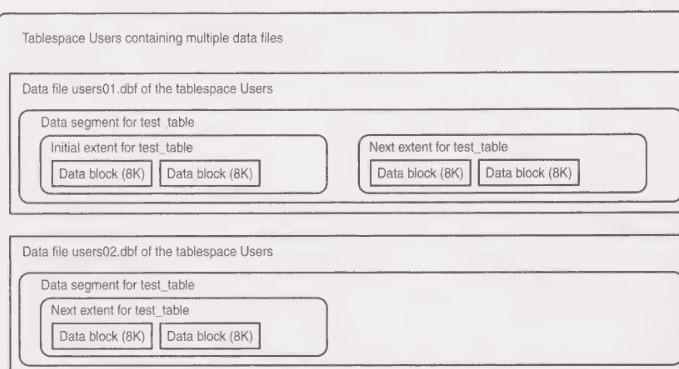

## 6.5 物理对象 = 数据文件和块；逻辑对象 = 表空间、段和区间

Oracle 存储层次结构。

Oracle 以 Oracle 块（`block`）为单位进行读写，这是 Oracle 操纵的最小 I/O 单元。一个块可以存放多行数据，或者一条长数据可以跨越多个块。一行数据跨越多个块可能会影响性能，这将在第 11 章中介绍。

当创建一个表（或索引）时，它会被分配给一个表空间（`tablespace`）。它还被分配了初始区间（`extent`）大小和下一个区间的大小。段（`segment`）仅仅是该对象所有区间的集合。

```sql
SQL> create table test_table (f1 number, f2 varchar(20))
tablespace Users
storage (initial 16K next 16K);
```

表已创建。

通常情况下，除非使用分区（第 11 章介绍），否则一个表只存在于一个表空间。该表空间可以拥有一个或多个位于不同磁盘上的数据文件（`data files`）。当表最初创建时，初始区间会在指定表空间内的磁盘上创建。在这种情况下，初始区间被设置为 16K，这恰好是两个 Oracle 块的大小。

当数据被插入（并提交）到`test_table`表时，每行都会被加载到 16K 的初始区间内。如果行被删除、截断或更新为更小或更大，Oracle 将自动将这些行适应到初始区间内。最终，第一个区间可能会用尽空间，然后需要分配下一个区间。

当需要分配新区间来存放更多数据时，这被称为动态空间分配。如果用户想要插入比初始区间能容纳的更多的行，Oracle 将动态分配为下一个区间指定的任何空间。在这种情况下，Oracle 将在组成 USERS 表空间的两个数据文件中的某处分配全部 16K 的下一个区间。这会导致性能下降，因为 Oracle 必须暂停用户的`INSERT`事务，确定其中一个数据文件中是否有足够的空间存放下一个区间，分配该空间，然后将数据插入到新分配的两个块的区间中。

注意，只要区间是连续的（所有块都相邻），新区间可以位于任何地方。它们甚至不需要在同一个数据文件中；唯一的规则必须在 USERS 表空间内，且表的块必须相邻。如果区间彼此相隔，这被称为碎片（`fragmentation`）。


### 备注

碎片是一个问题吗？
在 DBA 领域中，很少有话题像碎片那样引起如此激烈的讨论。多年来，DBA 一直假设碎片是一个严重的性能问题。建议的办法是将您的初始和下一个区间大小设置得足够大，使得该表（或索引）的所有数据都能放在少数几个区间内。其理由是，Oracle 必须在区间之间跳转来检索行，这会使性能受到影响。近年来，一些人（特别是来自 Oracle 的人员）暗示碎片实际上并没有像想象中那么糟糕。一些人进一步指出，考虑到极小的性能收益，尝试将所有数据放入一个或两个区间是浪费时间。他们建议为每个区间只提供少数几种可能的大小之一（这优化了存储），并且不要担心碎片。我还没有对这个问题做出决定。我不会为了几个区间而失眠，也不会让一个表或索引增长到数百或数千个微小的区间。

表空间和区间大小是创建表或索引时需要关注的两个存储参数。`CREATE`语句中也可以指定其他存储参数。当表访问或可用空间成为问题时，下表列出的这些附加值变得尤为重要。

| 参数 | 用途 |
|---|---|
| `pctfree` | 为更新预留的 Oracle 数据块（8K）百分比。这允许行在块内增长而不溢到其他块。对于更新频繁的表设置高值；对于仅插入的表设置低值。默认值为 10%。 |
| `pctused` | 一旦块超过 `pctfree` 百分比，就不允许向该块进行新插入。如果删除将该块内的空间减少到 `pctused` 百分比以下，该块将获得新插入的资格。设置为较低的值以减少碎片。默认值为 40%。 |
| `minextents` | 对象的最小区间数量。默认值为 1。 |
| `maxextents` | 对象的最大区间数量。将其设置为 `unlimited`（无限制）。 |
| `pctincrease` | 每个下一个区间大小增加的百分比。默认值为 50%；但将其更改为 0 或 1%。如果设置为 1%，SMON 会定期将连续的空区间合并（结合）为更大的区间。 |
| `freelist` | 识别可同时插入的块数。设置此值以避免插入期间对块的争用。 |

这些值是可调的，但其中某些值需要使用新值重新创建对象。Oracle 8i 和 9i 的新进展允许在 Oracle 似乎在后台重新创建对象时，对越来越多的参数进行“在线”更改。一个应该注意的关键因素（将在第 11 章中详细讨论）是：

这些值是可调的，但其中某些值需要使用新值重新创建对象。Oracle 8i 和 9i 的新进展允许在 Oracle 似乎在后台重新创建对象时，

当表访问或可用空间成为问题时，下表列出的这些附加值变得尤为重要。

（此处表格内容已在上方对应关系中翻译，保持逻辑一致）

这些值是可调的，但其中某些值需要使用新值重新创建对象。Oracle 8i 和 9i 的新进展允许在 Oracle 似乎在后台重新创建对象时，对越来越多的参数进行“在线”更改。一个关键因素应该被注意，但将在第 11 章中详细讨论，是：

### 表空间管理

表空间是数据库中的关键逻辑单元。它们由存储数据库对象的数据文件组成。你已经学习了它们是什么以及它们存储的内容。

在之前的章节中，你规划了一个布局并创建了该数据库。然而，你必须推迟到这里创建特定的表空间。在创建数据库期间，DB 应该专注于应用程序。创建表空间并不困难，但其特性和使用应该经过规划。一旦你确定了需求、名称和位置，请验证你有足够的空间来创建它。如果缺少可用磁盘空间，创建将失败。要为 `/u02` 手动创建一个索引表空间，执行以下操作：

```sql
SQL create tablespace employee_idx
2 datafile '/u02/oracle/rhidev1/employee_idx01.dbf' size 100M
3 minimum extent 128K
4 default storage
5 (initial 128K next 128K minextents 1 maxextents unlimited
6 pctincrease 1);
```

表空间已创建。

#### 注意

分区
如果你的文件系统是原始分区（未格式化的系统），你需要管理员在创建表空间之前创建一个卷。这对于并行服务器 DBA 来说很常见。

现在空间空间现在可以在其中创建对象。创建需要几秒钟，因为必须创建一个 100M 的文件。如果你必须创建包含几个 GB 大文件的表空间，请耐心等待，这将需要几分钟。注意示例在默认参数方面做了大量努力。如果在创建表或索引时没有指定参数（如初始或下一个区间），对象将使用表空间的默认值创建。在这种情况下，宁可倾向于太小，也不要意外创建一个只存放几行的巨型表。

现在表空间已经创建，你可以调整数据文件的大小。只要对象仍有足够的空间，你就可以增加或减少数据文件的大小。

### Unix 和 Linux Oracle DBA

```sql
SQL> alter database
2 datafile '/u02/oradata/rh1dev/employee_idx01.dbf'
3 resize 125M;
```

数据库已更改。
如果你决定想为表空间添加新的数据文件，你也可以这样做。再次确认你已拥有足够的空间，并且新的表空间不会与同一块磁盘上的其他表空间产生冲突或恢复困难。

```sql
SQL> alter tablespace employee_idx
2 datafile '/u08/oradata/rh1dev/employee_idx02.dbf'
3 size 25M;
```


表空间已更改。
在此阶段，大多数关于备份和恢复策略的文献都建议进行全数据库备份，因为你添加了一个表空间。即使你只是添加或修改了一个数据文件，DBA 也会敦促进行备份。我觉得这种做法有些过度，但在开始创建大量对象之前，我会获取一个完整的备份作为基准。之后，我建议在您打开数据库投入生产环境之前再次进行备份。

将数据文件从一个磁盘移动到另一个磁盘（在同一个表空间内）也是可能的，但稍微复杂一些。这通常是为了消除 I/O 冲突或响应磁盘问题。数据文件可以命名为任何名称：Oracle 并不关心。数据文件可以重命名，但这也很复杂，类似于文件移动。因此，我将在第 10 章“当问题出现时”中涵盖这两者。

如果你不小心向表空间添加了数据文件，或者只是想删除一个数据文件，那太遗憾了。遗憾的是，没有 `alter tablespace ... drop datafile` 命令。许多人都想要这样一个命令，并假设该问题正在研究中，但目前是不可能的。在这种情况下，唯一的选择是删除表空间（这是可能的）或将不需要的数据文件调整大小到一个可以忽略的大小。请务必记住像其他所有数据库文件一样，将此文件包含在备份方案中。

> 注意
> 本地管理表空间
> Oracle 8 引入了新类型的表空间。本地管理表空间提供了管理对象大小的新方法。通过使用这些表空间并结合不同的表格分类方法，可以以最小的开销管理大量对象。由于这些类型的表空间仍然较新，且偏离了传统的表空间，因此它们将在第 11 章中介绍。

# 日常活动
第 6 章

表空间可以离线或设置为只读。将表空间离线通常只在磁盘故障或需要恢复时进行。除非在数据不应或无法更改的特殊情况下，否则表空间通常不会进入只读模式。

可以从 `DBA_TABLESPACES`、`DBA_DATA_FILES` 和 `DBA_FREE_SPACE` 获取有关表空间的有用信息。DBA 应该知道数据库中有哪些表空间由哪些数据文件组成及其大小，以及每个表空间有多少可用空间。

## 监控

DBA 最常见但容易被忽视的职责之一是监控。支持应用程序的生产服务器可能很忙：有普通用户登录、夜间批处理、月末或年底的特殊处理、服务器备份，以及所有针对特定应用程序或商店的小事。这些任务中的大部分可以自动化，并且所有任务都应该写入某种日志文件中。通常由 DBA 负责确保一切运行正常，因为所有这些任务都会影响数据库。请记住，如果它影响了数据或数据对用户的可用性，那就是 DBA 的事务范围。

当 DBA 早上来公司时，他/她通常有一份需要检查的进程列表。如果任何进程失败，理想情况下 DBA 应该是第一个知道此事的人并知道为什么。用户或经理打电话给 IT 部门通知 DBA 他们的数据库或应用程序宕机是非常尴尬的。当系统出现问题时，用户总是会打电话投诉，但如果需要 DBA 被告知系统已经崩溃，那看起来会很难看。因此，DBA 应该有一份他/她每天验证的关键系统、子系统和作业列表。

## 验证数据库和连接性

这种验证通常从数据库开始。登录到 Unix 服务器并检查对应 SID 的 PMON 进程。

```bash
$ ps -ef | grep -i pmon

oracle 1233 1 Feb26 ? 00:00:00 ora_pmon_rh1dev1

oracle 1961 1 06:57 ? 00:00:00 ora_pmon_rh1st1

oracle 1987 1920 0 06:58 pts/0 00:00:00 grep -i pmon
```

如果数据库没有按预期启动，请找出它是如何启动的。如果确实存在需要时间查找的数据库问题，请确保通知用户社区和经理。没有人想听会有有问题，但当人们打电话报告计算机问题却发现 IT 部门要么不知道，要么知道但决定不告诉任何人时，他们会感到沮丧。这是 IT 部门和人员有时在其他专业人士中声誉不佳的典型例子。

### 警报日志

检查监听进程。可以使用 `grep` 搜索进程或使用 `lsnr status`。记住，如果此进程崩溃，用户将无法连接到数据库。如果对连接性有怀疑，DBA 应该以用户身份登录以验证对系统的访问。这包括检查应用程序是否可用。如果对连接性有怀疑，DBA 应该以用户身份登录以验证对系统的访问。这包括检查应用程序是否可用。

位于 `$ACLE_BASE/$SID/dump` 的 `alert.log` 应该在早上、午饭后、下班前以及出现问题时进行检查。DBA 将非常熟悉 `alert.log` 的内容。文件中的许多消息是例行的，例如数据库启动/关闭、检查点和日志切换。DBA 应该监控这些消息的频率，以确保数据库运行符合预期。

你对看到整个 `alert.log` 不感兴趣。由于该文件是追加的，只有最后 200 行是重要的。要么使用 `tail -200 alertSID | more` 或者编写如下 shell 脚本：

`alert.log` 中通常会有 `ORA-XXXX` 错误。如果你看到 `ORA-1031`，你需要进行彻底调查。DBA 应该检查错误代码并找到原因。如果错误是 `ORA-600`，应该给支持部门打电话。如果提到任何介质恢复或损坏，你应该准备好。

要获取有关任何 Oracle 错误的更多信息，使用错误检查工具 `oerr`。这个实用的工具可以查询与 Oracle 相关的错误，比使用错误指南快得多。见图 6.6。


### 检查数据库错误。

`alert.log` 随着时间变得很大。有时建议对文件进行归档和压缩：

```bash
$ pwd

/u01/app/oracle/admin/rhdev1/bdump

$ mv alert_rhdev1.log alert_rhdev1-20210127.log

$ compress alert_rhdev1.log
```

不再有 alertSID，但 Oracle 在需要写入新消息时会创建一个与之前相同名称的文件。因此，之前的方法是存档 `alert.log` 的安全方法。如果你不需要文件的副本，只需将 `/dev/null` cat 到文件中并删除文件内容：

```bash
$ cat /dev/null > alert_rhdev1.log
```

## 监控数据库对象

DBA 应该监控两种特定的数据库对象：表空间分配和无效对象。这些检查也应该在早上进行。这样做不会破坏数据库，但它会影响数据对用户的可用性。

登录 SQL*Plus 并检查你创建的表空间。

```sql
SQL> select tablespace_name, sum(bytes) from dba_free_space
 group by tablespace_name;
```


# Unix 和 Linux Oracle DBA

| TABLESPACE_NAME | SUM(BYTES) |
| --- | --- |
| DRSYS | 84,074,496 |
| EMPLOYEE_IDX | 157,270,016 |
| RBS | 183,492,608 |
| SYSTEM | 358,121,472 |
| TEMP | 104,849,408 |
| TOOLS | 104,849,408 |
| USERS | 108,650,496 |

已选择 7 行。

在一个稳定的系统中，这些数据的日常变化相对较小。这是因为大多数数据库对象已经有了它们的初始区（extents），并且只有在需要时才会增长。只有当分配下一个区或创建新对象时，你才会看到可用空间数量的减少。保存并监控一段时间这些报告。如果你发现了一个预计空间即将耗尽的趋势，请向表空间添加更多空间、截断（`truncate`）或删除不需要的表，或者找出某个表或索引增长如此快的原因并停止它。如果表索引需要分配一个新的区，但找不到足够的连续空闲区，将发出错误消息。

此外，对于数据库中拥有对象的任何 Schema，获取无效对象的计数。在 SQL*Plus 内部，使用简单的 `SELECT OBJECT_NAME, OBJECT_TYPE FROM DBA_OBJECTS WHERE OWNER = 'SCHEMA_OWNER' AND STATUS = 'INVALID'` 可以识别无效对象。
重新编译这些动态 SQL 以提高性能并验证所有对象都是有效的。如果你发现无效对象的数量有增加趋势或数量令人震惊，请向开发人员反映此问题。

## 设置和监控 cron 任务

`cron` 是一个非常实用的 Unix/Linux 任务调度和运行设施。它允许你指定在某天的的任何时间执行脚本并创建一个日志文件。这为设置无需手动启动即可执行的任务提供了强大的能力。

在 Unix 世界中，大多数批处理任务和自动化任务都运行在 `cron` 之上。从 DBA 的角度来看，你可以使用它来调度每日备份的开始时间、导出/导入发生的时间、分析表的时间，以及夜间处理的开始时间。你还可以使用 `cron` 登录、检查 `PMON` 进程，如果没有找到则发送电子邮件或进行页面报警。你对 `cron` 的用途几乎没有限制。

设置和运行 `cron` 非常简单。按照以下步骤操作：

### 日常活动
第 6 章

1. 首先，按通常方式创建你的 shell 脚本。确保在脚本内部完整定义环境变量。如果你不设置环境变量，它们将不会自动设置，你的脚本将会失败。脚本可以调用其他脚本，但请确保在脚本中声明完整路径和文件名。SQL*Plus 脚本也可以从 shell 脚本内部执行。

2. 接下来，创建一个用于存储你的 `crontab`（包含任务的文件）的目录。`oracle` 将有一个个人的 `cron` 守护进程，因此创建目录 `$ORACLE_BASE/local/cron_files`。

3. 创建（使用 `vi`）一个名为 `crontab.oracle` 的文件。你想要运行的任何脚本（任务）将放在此文件中，以及运行的时间和（可选的）创建的日志文件。

4. 使用 `man cron` 和 `crontab` 查看完整的语法。`crontab` 文件的格式如下：

```
0 22 * * 0-6 /u01/app/oracle/backups/hots/hot.sh
1>/u01/app/oracle/backups/hots/hot.log 2>&1
```

脚本 `hot.sh` 将在每月（第二个 `*`）每天（第一个 `*`）的 0-6 日（周日到周六） 22:00（0 分，第 22 小时）执行。执行日志将写入日志文件。注意使用的是反引号（``）而不是单引号（`'`）。

5. 目前此命令仅存在 `crontab` 文件（`crontab_oracle`）中。它需要提交给 `cron` 进程。要提交它，输入 `crontab` 后跟要提交给 `cron` 的文件。你提交的文件将覆盖 `cron` 当前的内容，请只使用一个 `crontab` 文件并确保它是最新的。

```
$ crontab_oracle
```

6. 要查看计划运行的 `cron` 条目，执行 `crontab -l`。

```
$ crontab -l
# 不要编辑文件 - 请编辑主文件并重新安装。
# (crontab_oracle) 安装于 Tue Feb 27 09:25:42 2001
# (Cron version) -- $ID: crontab.v 2 1994/01/17 03:20:37 vixie Exp $)
0 22 * * 0-6 /u01/app/oracle/backups/rh1dev1_hots/hot.sh
```


就是这样。`cron` 将指定的时间运行 `.sh` 脚本，直到你告诉 `cron` 执行其他操作。

通过 `cron` 调度这么多任务的唯一负面影响是有人（DBA）应该监控它们的成功或失败。`cron` 中的任务之间没有隐式的依赖关系，因此如果一个任务开始失败，可能会持续一段时间后才被检测到。DBA 应该知道哪些任务是通过 `cron` 调度的（使用 `crontab -l`），并检查生成的日志文件，这对于确保它们运行正常非常重要。

# 始终检查你的日志

作为 DBA，你应该始终检查告警日志（alert log），但检查 `cron` 生成的日志同样重要。由于这些因素，DBA 需要监控这些文件的创建和完整性。与备份一样，验证导出时间在你实际需要它们时是重要的。

# 监控导出

## 监控文件系统空间

用于备份目的的 Oracle 文件和导出的 `.dumps` 文件可以使用 `gzip` 进行压缩（尽管进行适当测试仍然是个好主意！）。在你的备份或导出 dump 目录中创建的任何文件上运行压缩程序。这应该是任何 `cron` 任务的最后部分，此外，你可能想要一个单独 `cron` 任务，用于检查并压缩任何未压缩的大文件。通过合理地使用文件，你将节省大量的磁盘空间。

这取决于系统管理员（SA）想要识别的内容以及你的文件系统何时进行备份。数据库的备份和恢复在第 9 章中进行了详细讨论，但我指的是不包含数据库的 Oracle 文件系统/目录。大多数 SA 每天都会从文件系统复制所有内容到磁带上。这些磁带可以被移至境外，以防发生龙卷风、火灾或其他灾难。磁带通常在一个一两个月后返回以进行回收。这对 DBA 来说很重要，因为一旦文件被复制到磁带上，理论上它就不需要保留在任何磁盘上了。

例如，用户希望对表数据（通常存储在文件中）保留 10 天的备份。你可以每天导出该表，对其进行压缩，然后让 SA 的夜间备份将其放入磁带。你可以从文件系统中删除这些数据（从而节省磁盘空间），因为它们在磁带上，在需要时可以恢复。即使你的用户可能只需要 10 天的数据，你仍然拥有一个优势，即知道如果需要，你可以拥有 30 天的数据（或者取决于磁带循环周期）。

在现实中，不要在第一晚之后就删除文件。就像你的备份有时会失败一样，SA 的任务也会失败。如果可能，让一个 `cron` 任务在三或四天后自动删除此类文件。这应该为磁带损坏、服务器崩溃等情况留出足够的“余量因子”（fudge factor）。还要考虑在时间、金钱和麻烦方面的影响。如果磁带被移至境外，提前返回通常需要花费时间和金钱。SA 需要执行恢复，除非他/她想授权 DBA 来执行此操作（这将消除对 SA 的依赖）。

## 日常活动

## 法律要求

许多公司在法律上有义务维护多年的财务信息。从 DBA 的角度来看，这通常意味着在月末和年底进行非常大的数据库导出。与 SA 协作，确保这些备份被存储在标记清晰的磁带上并妥善存放。如果你没有被告知过此类法律要求，请询问你的管理层是否存在这些要求。如果并没有进行这些备份，管理层可能误认为备份已经在执行了。

关于管理文件系统空间的最后一点：尽管应该在每个工作日检查这些空间，但在长周末或假期之前，请务必确保有足够的空间。特别是在这些时间点之前，很容易忽视你的磁盘空间。确保你有足够的空间用于正常活动以及储备留金。

## 电子监控与通知

由于许多技术人员携带着传呼机和手机，使用自动系统工具在数据库或系统发生故障时通知 DBA 和/或 SA 是一个好主意。这里的关键是确保监控工具能够准确诊断系统，为通知建立现实的阈值，为问题发生时制定行动计划，并确保整个流程能够正常工作。

设置系统在数据库宕机时向 DBA 发送传呼的想法看起来很简单，但很多时候会出问题。如果系统不小心被设置为一直呼叫，这个问题会被立即发现并修复。然而，如果存在呼叫未被正确发送或接收的问题，这个小故障可能直到发生重大问题且未收到求救信号时才会显现。

与 SA 和 DBA 进行测试和协作至关重要。一个良好的 SA 会安装并运行商业监控软件，或者为关键进程编写自定义的监控脚本。由于数据库和服务器之间存在这种依赖关系，将数据库和服务器的监控和呼叫整合进同一个系统中是有意义的。这通常涉及 DBA 将信息提交到 SA 的通知系统中。然而，确保数据库监控和通知流程准确且经过测试仍然是 DBA 的职责。换句话说，不要依赖 SA 来监控你的数据库。

需要建立对哪些内容被监控、哪些不被监控的明确理解，以及当发生特定问题时应通知谁。例如，显而易见的是，如果服务器崩溃，SA 和 DBA 都应该收到通知。但邮件问题不应发送给 DBA，而回滚段（rollback segment）故障不应困扰 SA。请注意，如果其中一方想要干涉另一方的业务和管理策略，这可能会变成一个敏感的政治政治的话题。在考虑如何以及何时通知管理层时，情况会变得更加困难。

当问题发生时，要有一个计划和联系名单。如果所有的 DBA、SA 和经理都收到一条传呼，说脚本找不到正在运行的 PMON，他们知道该做什么？如果责任没有明确定义，就会发生混乱。半的员工正试图修复同一个问题，而另一半人则看着显示“没问题”的传呼。

关于电子通知的最后一点：考虑对员工的影响。没有人需要 24/7/365 全天候被拴在传呼机旁。如果一个系统确实是关键的，只要有多个个人可以“值班”就足够了。不要对人们产生不现实的期望，然后在他们未能达到这些期望时感到惊讶。还要解决什么是“可接受”的响应时间，以及如果传呼发出后会发生什么。

## 合理计划和建立呼叫政策

我见过的传呼政策从合理到荒谬不等。如果你的系统确实需要在凌晨 3 点运行，那么可能需要一名夜间值班员。制定这项政策并执行它。然而，我曾见过管理层向技术人员要求 7/24 的支持，因为这从商业角度来看很好。技术人员足够聪明，知道什么是必要的，什么不是。结果是，技术人员很可能会把传呼机留在家里，即使被要求携带它们。如果传呼机分配给没有轮班制度或因为值班的个人，情况尤为如此。如果系统遇到微小问题就呼叫技术人员，你可以预期会产生“狼来了”综合症。传呼和通知需要被认真对待。然而，这项政策还需要考虑人们的个人生活。

## 总结

本章涵盖了 DBA 大多数日常任务。成为一名优秀的 DBA 不仅仅需要添加用户或构建表空间。这些是应该精通的技术技能，但精通这些技能使人成为出色的技术人员，而不一定是一个优秀的 DBA。一个优秀的 DBA 拥有这些技术技能，但更重要的是理解系统及其流程，以及如何在问题变成重大故障之前进行管理和预防。虽然理解创建表的极细微细节是一项成就，但如果 DBA 从未注意到备份无效，那么没有人会真正在乎数据库是否宕机。希望你在读完本章后，对 Oracle 对象的技术问题有更清晰的理解，更重要的是你学会了如何管理 Unix 和 Oracle 数据库系统。

# GUI 管理产品

## 第 7 章 核心内容

- GUI 工具提供了执行许多繁燥和常规任务的极佳方式。
- 不应期望 GUI 工具取代经验丰富的 DBA 所拥的核心技能和知识。
- 有多种方法可以配置 Oracle Enterprise Manager 以满足 DBA 的需求。
- OEM 可用于管理用户、对象和文件，并在遇到调优或锁定问题时提供帮助。
- TOAD 是另一个 DBA 应该熟悉的 GUI 工具，因为他们很可能会在某个时刻遇到开发者正在使用它。

# Unix 和 Linux 上的 Oracle DBA

DBA 需要完成的任何工作通常都可以命令行完成。这对于复杂任务尤其如此。一个老练的 DBA 会理解自己在做什么、为什么要做，以及 Oracle 和 Unix 是如何实现这些操作的。

尽管如此，图形化用户界面（GUI）管理产品可以为 Oracle DBA 提供一个实用的利基市场。GUI 在 DBA 和 Oracle 之间提供了一个抽象层。这只是一个占位层；Oracle 和 Unix 仍然执行相同的任务。细节隐藏在 GUI 显示之下。

许多无法编写脚本的简单、平庸的任务可以在 GUI 工具的帮助下轻松完成。例如，你可以从 SQL+ 添加新用户或编写 PL/SQL 包，但使用 GUI 工具通常更简单更快捷。DBA 可能不记得创建表的语法或所有选项，但 GUI 工具可以为 DBA 生成 SQL。在那种情况下，使用 GUI 工具是明智。

本章涵盖了如何安装和配置 Oracle Enterprise Manager。它研究了一些常用工具以及它们对 Unix DBA 的用处，但详细的介绍超出了本书的范围。最后，它介绍了一个流行的 OEM 替代方案：TOAD。

# Oracle Enterprise Manager

Oracle 的主要 GUI 管理工具是 Oracle Enterprise Manager。它随 Oracle Client 工具或 Oracle Server 标准提供。这使得 OEM 对 DBA 和开发者来说都广泛可用。

# 基于 Web 的界面

WebDB（又称 Oracle Portal）确实通过 Web 浏览器界面提供了某些 OEM 功能。这在第 17 章“Web DB/Oracle Portal”中有所介绍。

# 架构

OEM 可以利用多层架构。在最原始的形式下，你只需要在服务器上运行一个 Oracle 数据库，并在 PC 或服务器上安装基础的 OEM 工具。这提供了基本功能；OEM 的更高级功能需要额外的设置。例如，你可以在 Oracle 数据库中创建一个存储库来存储有关其他 Oracle 数据库的数据。如果你想添加更多功能，可以连接到作为 Oracle Management Server 运行的中间层，以存储 OEM 作的信息。要实现更高级的功能，你需要理解 OEM 的架构。可用的架构如图 7.1 所示。

# GUI 管理产品

| 基础配置 | 两层配置 | 三层配置 |
| --- | --- | --- |
| 客户端 | 运行 OEM 软件的 Windows PC | 运行 OEM 软件的 Windows PC |
| 中间层 | | 运行在以下系统上的 Oracle Management Server (OMS)：- MS Windows NT, - MS Windows 2000, - Unix Sun Solaris |
| 服务器 | UnixServer | UnixServer | 目标数据库实例 |
| | | 目标数据库实例 | 存储库实例 |
| | | 目标数据库实例 | 存储库实例 |

### 图 7.1
Oracle 企业架构

如图 7.1 所示，OEM 可以分布在客户端、服务器和中间层之间。你使用的配置类型取决于你的需求。如果你只需要基础设置，即仅连接到数据库以添加用户或修改对象，那么基础配置就足够了。如果你需要在多个数据库上执行更高级的任务，则必须创建一个存储库数据库（例如 rhRep1）来存储有关其他数据库的信息。在数据库服务器位于 Windows 平台的大环境中，使用带有 Oracle Management Server (OMS) 的中间层是有意义的。让我们详细查看每一层。

> 注意
> OMS
> 似乎正呈现出一种偏离仅使用客户端和存储库的趋势。尽管这在之前的 OEM 版本和其他一些其他工具中很常见，但 OMS 正在变得越来越必要。

### 客户端

通常有一台包含 OEM 工具的 Windows 工作站。从这台机器，你可以启动并使用 OEM 实用程序。你可以直接登录单个数据库，也可以连接到中间层访问企业中的所有数据库。安装过程简单且几乎不会出错。惯例是在任何 DBA 现场的 DBA 机器上、任何 DBA 的笔记本电脑以及家里安装至少基础的 OEM 工具。

正如你在第 2 章中学到的那样，SQL*Plus 是一个可能免费提供给每个人安装的危险工具，而提供 OEM 更加危险。因为 OEM 的界面易于使用，任何拥有最少知识的人都可能是危险的。确保你控制 OEM 的分发，更重要的是，控制好你的密码。某些站点创建了具有只读访问权限的用户，并通过 OEM 将此权限提供给适当的人员。开发者通常会获得他们正在开发的模式模式的密码，以及对其他所有内容的只读访问权限。

你可以安装基础的 OEM Database Administration Pack 来满足你的基本需求。如果你有适当的许可，请添加性能调优、诊断和变更管理包。这些工具在检查用户会话或被锁用户时可以成为节省时间的利器。其中某些实用程序需要存储库和 OMS 服务器，所以仅仅因为安装了某个产品并不意味着……

> 注意
> OMS
> 似乎正呈现出一种偏离仅使用客户端和存储库的趋势。尽管这在之前的 OEM 版本和其他一些其他工具中很常见，但 OMS 正在变得越来越必要。

# 中间层

中间层是 Oracle Management Server (OMS)。它可以安装在 MS Windows NT、MS Windows 2000 或 Unix Sun Solaris 上。OMS 充当客户端和目标数据库之间的桥梁。它管理存储库并为管理任务提供界面。

### 服务器

服务器层包括目标数据库实例和存储库实例。存储库实例存储环境中其他数据库的元数据。目标数据库是实际应用程序数据所在的地方。

# Unix 和 Linux 上的 180 Oracle DBA

在客户端安装 OEM 的技术细节如下。

- 1. 获取带有“Oracle Tuning 的 Oracle Enterprise Manager: Version 2.1”的光盘。


图 7.2
Oracle Enterprise Manager 安装。

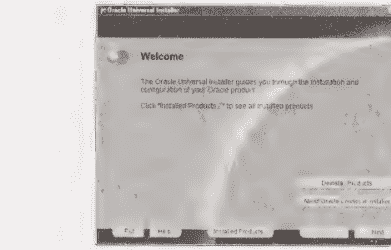

图 7.3
Oracle 通用安装程序 (Oracle Universal Installer)。

- 5. 系统将提示你输入文件位置，如图 7.4 所示。创建一个 Oracle 目录，然后在同一层下为 OEM 创建子目录以及 Oracle 产品子目录，这似乎是符合逻辑的。遗憾的是，我在这种方法上遇到过问题，导致 NT 上的注册表出现“混乱”。因此，请放弃创建 Oracle 目录的想法，直接将 OEM 安装为 OraOEM21。

- 6. 系统将提示你需要安装哪些内容。如果你运行的是 NT 或 Windows 2000，选项将是 OEM、Management Packs 和 Management Infrastructure（即 OMS），或者你也可以安装 OEM 和 Management Packs。如果你运行的是 Windows 98 或 Windows 95，将收到如图 7.5 所示的选项。假设你正在运行 Windows 95/98，请选择“典型（Typical）”安装。

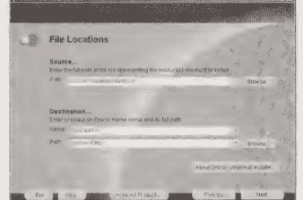

图 7.4
OEM 文件位置。

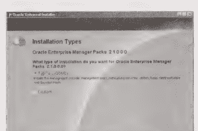

图 7.5
OEM 安装类型。

OMS 以及创建存储库的内容将在“中间层和服务器安装（Middle Tier and Server Installations）”章节介绍。

- 7. 下一个屏幕提供了要安装的产品的摘要，如图 7.6 所示。一旦你确认了这些是你想要的内容，请点击 OK。

- 8. 将开始这些产品的安装，如图 7.7 所示。

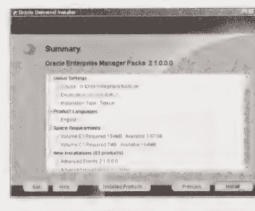

图 7.6
OEM 摘要信息。

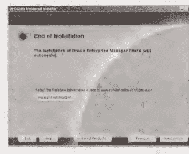

图 7.7
OEM 安装完成。

- 9. 安装成功后，你可能会被置于 Net8 配置助手（Net8 Configuration Assistant）中以配置客户端的 `tnsnames.ora` 文件。你在第 5 章“创建数据库”中已经为服务器执行过此操作，如果你想的话也可以继续进行。另一种方法是退出安装（这不会影响你的 OEM 安装）。将 `tnsnames.ora` 文件从你的 Unix/Linux 服务器复制/FTP 到客户端的 `ORACLE_HOME/network/admin` 目录。

这就是安装 OEM 客户端的全部内容。安装完成后，你可以通过“开始 -> 程序 -> Oracle-OraOMEM21”使用 OEM 软件。

## 第 7 章
## GUI 管理产品

## 中间层 (OMS)

安装 Oracle Management Server (OMS) 是可选的，但没有 OMS，你就无法通过 OEM 调度数据库作业或监控事件。在编写本文时，要安装并运行 OMS，你需要一台 Solaris 服务器或运行任何版本 NT 或 Windows 2000 的 Windows 机器。Oracle 通用安装程序会判断你运行的是否是可以运行 OMS 的 Windows 机器，并提供额外的 OMS 选项。本节假设你正在使用 Windows NT/2000。安装过程与基础 OEM 非常相似，但有以下 OMS 选项。

OUI 将为你提供安装基础 OEM 和 Management Packs，或带有 OMS 基础设施的 OEM 的选项，如图 7.8 所示。

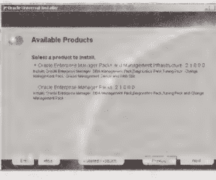

图 7.8
OEM OMS 产品选择。

OUI 会询问你 OMS 将连接到新的存储库还是现有的存储库，如图 7.8 所示。在本节中，你将在 OEM 服务器设置中涵盖的 OEM 配置助手里创建存储库。在出现提示时，选择“新存储库（New Repository）”。

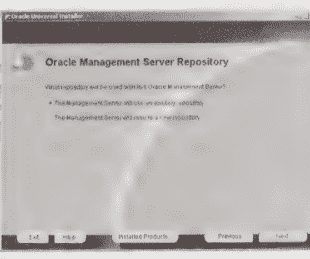

图 7.9
OMS 存储库选择。

安装完成后，Oracle Net8 助手将启动，紧随之后是 OMS 设置，如图 7.10 所示。

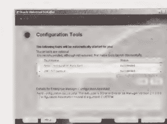

# 图 7.10
OMS 设置。

一旦到达这一步，就是时候创建数据库存储库并在 Unix/Linux 服务器上启动智能代理（intelligent agents）了。在数据库上创建存储库是启动 OMS 的前提。这将在下一节“服务器安装”中介绍。一旦完成，你就可以启动 OMS 服务，详细信息见下文。

假设数据库存储库已经创建且智能代理正在运行，现在是在你的 NT/2000 机器上启动 OMS 服务了。

前往开始 -> 设置 -> 控制面板 -> 服务。如图 7.11 所示，你会找到 Oracle Management Server 的服务。

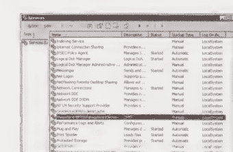

# 图 7.11
控制面板服务。

接下来，双击 OMS 获取服务选项。你可以手动启动服务，也可以将其设置为在机器重启时自动启动。如图 7.12 所示，现在选择手动启动。

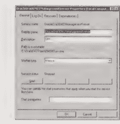

# 7.12
OMS 启动。

几秒钟后，服务应该启动。你可以通过查看服务状态来验证。这些会会在 OEM 停止时终止。

## 注意
配置 OEM 的服务器层也是可选的；但 OEM 的高级功能依赖于此。大多数 Unix DBA 在选择 OEM 时会创建存储库并启动智能代理。

## 服务器安装

要创建 OEM 存储库，你需要启动 OEM 配置助手，如图 7.13 所示。这位于 NT/Windows 2000 的 Enterprise Manager。选择创建新存储库。

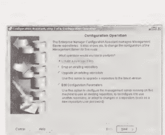

# 图 7.13
OEM 配置助手。

下一个屏幕询问你想在哪个数据库中创建存储库。如果你已经为此创建了一个数据库（例如 rhrep），现在输入该信息。否则，存储库可以放在现有的数据库中，但该数据库需要持续运行。

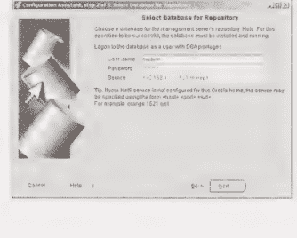

# 图 7.14
OEM 存储库配置。

注意 OEM 如何期望你定义服务名。它要求的服务名格式为 `host:port#sid`。如果你无法让主机名起作用，可以使用数据库服务器的 IP 地址。端口通常为 1521；你可以通过检查数据库服务器上的 `ORACLE_HOME/network/admin/listener.ora` 文件来验证这一点。

存储库创建的剩余部分非常直观。助手会创建一个用户（统称为 `OEM_OWN`）、一个名为 `OEM_REPOSITORY` 的表空间以及存储库的对象。在创建存储库之前的最后一个屏幕如图 7.15 所示。

一旦存储库创建完成，OMS 服务器即可成功启动。然而，在实施 OEM 调度作业和事件监控之前，需要在每个数据库服务器上配置 Oracle 智能代理。

# GUI 管理产品
第 7 章

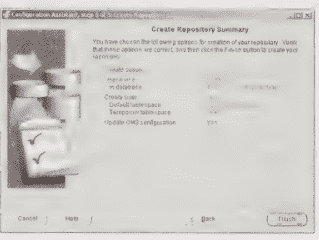

## 7.15
OEM 仓库摘要。

### 智能代理 (Intelligent Agents)

Oracle 存在于每个节点上，通过实施 OEM 定时作业和检查事件来提供“无人值守”。每个目标数据库实例将有两个智能代理以 `DBSNMP` 用户身份登录。

```sql


SQL> select username from v$session

2 where username is not null;

```
USERNAME
DBSNMP
SYS
DBSNMP
```

SQL> 

这表明该节点的代理已成功启动。此节点上的数据库实例将有两个 `DBSNMP` 会话登录。

智能代理通过 `lsnrctl` 工具在每个节点上进行管理。在启动数据库和监听进程（`lsnrctl start`）之后，就可以启动代理了：

```
$ lsnrctl dbsnmp_start

LSNRCTL for Linux: Version 8.1.6.0 - Production on 18-MAR-2001 17:55:05

$
```

这将启动整个节点的代理，所有运行的数据库实例现在将有两个 `DBSNMP` 会话。此后，任何额外的数据库将在一分钟后将拥有 `DBSNMP` 会话。

# GUI 管理产品

## Unix 和 Linux 上的 DBA

要验证代理正在运行，可以通过 `SQL*Plus` 查询 `V$SESSION` 来检查数据库登录，或使用 `ps -ef` 搜索后台进程。您也可以使用 `lsnrctl dbsnmp_status` 命令获取智能代理的状态。

```bash
$ lnrctl dbsnmp_status
```

LSNRCTL for Linux: Version 8.1.6.0 - Production on 18-MAR-2001 18:01:06

Copyright 1998, 1999, Oracle Corporation. All rights reserved.
agent is already running.

由于这些是登录会话，在关闭数据库实例之前必须停止或杀死它们。消除 `DBSNMP` 会话的最佳方法是通过 `lsnrctl dbsnmp_stop` 命令关闭它们。

```bash
$ lnrctl dbsnmp_stop
```

LSNRCTL for Linux: Version 8.1.6.0 - Production on 18-MAR-2001 18:08:00

这将强制 `DBSNMP` 会话退出节点上的每个数据库实例。然后您就可以干净地关闭数据库而无需杀死任何会话。然而，当节点上运行多个数据库且您想要关闭其中一个时，无法停止节点上的所有代理。在这种情况下，通常最好使用 `SHUTDOWN IMMEDIATE`。

Oracle 智能代理实际上就像数据库中的任何其他用户。因此，它存在潜在的安全风险。`DBSNMP` 用户的默认密码是 `dbsmp`。您可以像其他其他用户一样更改密码，但这可能会导致问题。方法如下：

- 1. 最好在创建任何作业或事件之前进行这些更改。但是如果已经创建了任何 OEM 作业或事件，请删除节点上的所有作业和事件。
- 2. 如果智能代理正在运行，请停止它们。使用 `lsnrctl stop`。
- 3. 编辑 `$ORACLE_HOME/network/admin/snmp_rw.ora` 文件，设置以下两个参数：

```ini
snmp.connect.service_name.name = dbsmp
```

```ini
snmp.connect.service_name.password = new_password
```

### 第 7 章

修改后的 `snmp_rw.ora` 文件如下：
```ini
snmp.contact.listener = ""

snmp.index.listener = 1

snmp.contact.rhdev1.mike.com = ""

snmp.index.rhdev1.mike.com = 2

snmp.connect.rhdev1.mike.com.name = dbsnmp

snmp.connect.rhdev1.mike.com.password = dbsnmwd

snmp.contact.rh1rep1.mike.com = ""

snmp.index.rh1rep1.mike.com = 3

snmp.connect.rh1rep1.mike.com.name = dbsnmp

snmp.connect.rh1rep1.mike.com.password = dbsnmwd
```

在这种情况下，服务名称为 `rh1rep1.mike.com` 和 `rhdev1.mike.com`。智能代理的登录名为 `dbsnmp`，密码为 `dbsnmwd`。

# 注意

## 包含未来数据库

您必须为每个数据库添加两个单独的行。确保以后创建任何数据库实例时将此文件添加到创建后的任务列表中。

- 4. 由于此文件包含硬编码值，有必要更改其权限以确保安全。赋予 `700` 权限，以便只有 `oracle` 用户可以读取。
  `$ chmod 700 snmp_rw.ora`
- 5. 登录每个数据库并将密码更改为您在 `snmp_rw.ora` 文件中设置的内容。语法如下：
  `alter user dbsnmp identified by "new_password";`
  如果您计划使用如 `!` 等特殊字符，则必须将密码放在双引号中。
- 6. 重启智能代理。验证它们已登录到 `snmp_rw.ora` 修改的每个数据库。如果不是，很可能是密码输入错误或未在数据库内部更改密码。
  `$ lnrctl dbsnmp_start`
  and
  `SQL> select username from v$session;`
- 7. 修改 `catsmp.sql` 文件以使用新密码：`dbsnmwd`：
  `$ vi $ORACLE_HOME/rdbms/admin/catsmp.sql`
- 8. 修改 `catsmp.sql` 的权限，因为现在它有一个硬编码密码。
  `$ chmod 700 $ORACLE_HOME/rdbms/admin/catsmp.sql`

这就是使用智能代理的全部内容。一旦配置并启动，就不需要 DBA 过多关注。只需记住将它们添加到您的正常启动程序中，并在收到 OEM 作业失败的报告时验证它们的状态即可。

# 数据收集器 (Data Gatherer)

Oracle Enterprise Manager 和 Capacity Planner 使用 Data Gatherer 来收集信息。它随智能代理一起安装。可以在没有 Enterprise Manager 的情况下运行，但功能会受限。Data Gatherer 的基本命令有：

```bash
$ lnrctl -start <-- 启动 Data Gatherer

$ lnrctl -status <-- 获取状态

$ lnrctl -ping <-- 验证连通性

$ lnrctl -stop <-- 停止 Data Gatherer
```


这就是运行 Gatherer 的基础。它不是必需的，但设置非常简单。

# OEM 控制台

将 OEM 控制台想象为一个主登录界面，您可以在此处同时登录所有数据库并控制它们。从控制台可以执行高级功能，例如调度作业和监控事件。所有的普通 OEM 工具都可以从控制台使用。

# Unix 和 Linux 上的 Oracle DBA

要访问你想要管理的数据库，你必须“发现”每个节点。可以使用导航器（Navigator）下拉菜单，或右键点击节点图标并选择“发现节点”（Discover Nodes）。这将启动一个双屏向导，识别你想要覆盖的每个节点上的每个数据库。在第二个屏幕上，你输入要管理的数据库服务器节点的主机名或 IP 地址，然后点击“下一步”（Next）。一旦发现，每当你启动控制台时，该节点上的所有数据库都会被识别。见图 7.18。

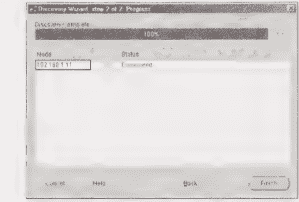

**图 7.18**
发现。

一旦发现了节点，如果你有密码，就可以访问该节点上的每个数据库。通过展开节点和节点名称然后点击任何数据库，系统将提示你输入密码。有一个复选框可以将密码保存为“首选凭据”（Preferred Credential）。如果选择了该选项，则无需再次输入密码；这等同于数据库的“保存密码”。之所以可以，是因为密码将被加密并存储在他们的 PC 上。输入 DBA 密码后，即可访问数据库。

图 7.19 显示了从控制台可以访问的数据库视图。


**图 7.19**
通过 OEM 控制台访问的数据库。

# GUI 管理产品
第 7 章

OEM 控制台提供的所有选项的详细用法超出了本书的范围。幸运的是，OEM 的“快速导览”（Take a Quick Tour）为可用功能提供了良好的概述。帮助（Help）菜单中的此功能提供了一组关于如何使用某些功能的快速示例。

## 独立模式 (Standalone)

如果你觉得控制台对你的来说大过其实，你也可以在独立模式下使用大部分 OEM 工具。前往“开始”（Start）>程序”（Programs）>“Oracle-OEM21”>数据库管理”（Database Administration）>“DBA Studio”。DBA Studio 提供了与 OEM 常用的大多数工具。它提供了登录 OMS 服务器或以独立模式登录的选项。如果不打算使用 OEM 控制台，那么在 DBA Studio 中使用 OMS 就没有意义。只需选择独立选项即可。

DBA Studio 显示在“树”中定义的所有数据库，如图 7.20 所示。这只是你从本地 `tnsnames.ora` 中选择的数据库。如果你向 `tnsnames.ora` 添加了新条目，DBA Studio 将下次登录时询问你是否将其添加到树中。双击列出的任何数据库，系统将提示你输入密码，该密码可以在 OEM 控制台中被保存为首选凭据。


图 7.20
通过 DBA Studio 访问的数据库。

DBA Studio 提供了一个精简的工具集：但你也可以通过 Windows 开始>程序 菜单访问这些工具。“工具”（Tools）菜单栏具有一些管理数据库加载/导入/导出的有用功能（在“数据管理”下），以及执行分析和重组的向导。再次，OEM 以“快速导览”（Quick Tours）和“最新功能”（Latest Features）的形式提供了一些实用的自帮助信息。

## OEM 工具

OEM 工具分为从开始菜单可以访问的不同程序包。某些包需要使用 OMS，另一些则不需要。以下章节涵盖了 Unix DBA 最常用的工具。

## 应用开发 (Application Development)

通过“应用开发”提供的唯一工具是 SQL*Plus。这仅仅是是从命令行启动的普通 SQL*Plus 程序的 Windows 版本。在 Unix 环境中使用 Windows 版本的 SQL*Plus 有几个缺点。最大的缺点是无法直接在 Unix 环境中使用（*注：原文逻辑此处略有跳跃，意指 Windows 版本不适用于 Unix*）。

（注：原文中该部分文本为：... ... 此处可能存在原文乱码或重复，已根据上下文逻辑进行最小性处理）

# 第 7 章：GUI 管理产品

如你所见，数据库用户拥有可以由 DBA 更改或重置的密码（这是一个常见请求）。账户也可以被锁定或解锁。通常，人们会创建通用账户，后来却没有人记得为什么要创建它们，或者它们是否仍然需要。在这种情况下，通常的做法是将账户锁定几天或几周，如果没有人抱怨无法登录，就将其删除。用户的默认表和临时表空间也可以被修改。


图 7.24 DBA Studio 安全管理器（Security Manager）。

Oracle 安全管理器（Security Manager）还提供了一种简便的方法来识别用户拥有的角色、系统权限和对象权限。虽然这些信息可以通过 DBA_XXX 表找到，但 GUI 工具用起来快一点，也更容易使用。如果需要，可以创建新角色并启用权限。

最后，安全管理器的一个功能非常节省时间：类似创建（create like）选项。DBA 经常被要求创建一个用户，但没有人知道需要哪些权限。很多时候，数据库中存在的角色仅作为应用程序中的标记存在，因此 DBA 并不清楚它们究竟是什么。在这种情况下，DBA 需要向请求用户的人询问：“你希望此账户镜像哪个用户？”基本上，DBA 获取了一个已经拥有必要权限的用户的名称。然后， DBA 高亮该用户账户，右键点击，并选择“类似创建（create like...）”选项。这将创建一个与目标用户具有相同角色和权限的用户。

OEM DBA Studio 的最后一个工具是存储管理器（Storage Manager），如图 7.25 所示。该工具允许 DBA 添加、修改和删除对数据库数据文件、控制文件、回滚段、归档日志和表空间的访问。显然，这个工具关联着巨大的权限。遗憾的是，许多新 DBA 倾向于过度依赖这个特定工具。

OEM 会修改这些对象，但它不会告诉你是否应该修改这些对象。例如，你可以使用此工具删除一个表空间。这需要 DBA 意识到该表空间中的所有对象也将将被删除，因此可能删除表空间可能是一个坏主意。考虑到此类更改可能造成的巨大影响，我更倾向于在 SQL*Plus 命令行中进行主要的数据库更改，而不是在 GUI 中进行。


图 7.25 DBA Studio 存储管理器。

DBA Studio 的要点介绍此此。DBA 可以在有或没有 OMS 的情况下使用此工具。它有很多实用的功能，但你确实需要理解任何更改可能产生的影响。

# 诊断包（Diagnostics Pack）

OEM 的诊断包提供了多种工具；TopSessions 和性能管理器（Performance Manager）是最受欢迎的。

DBA 应该对谁登录了数据库以及他们在做什么有一个大致的想法。OEM TopSessions 提供了登录数据库用户的图形化表示。你可以通过双击会话来获取更详细的信息，例如正在执行的 SQL。只需启动 Top Sessions 并连接到你想要监控的数据库。记得编辑 Sessions、Options、Count 下拉菜单以显示所有会话，而不仅仅是前 10 个会话。还要记得经常刷新视图以识别新的登录。

图 7.26 显示的 TopSessions 赋予了 DBA 杀死用户会话的能力。在尝试关机或发现某个用户登录时间过长时，这样做是一个好主意。要杀死用户，高亮该用户，右键点击并选择杀死会话（kill session）。

该工具还提供了识别锁定会话非常有用的功能。通常，用户会给 DBA 投诉被锁定了。这通常表明用户的会话挂起了，因为其他人锁定了同一行或表。那个锁定的用户需要提交（commit）或回滚（roll back）他们的更改。

| SID | OSUSER | SERIAL | COMMAND | STATUS | MACHINE | PROGRAM |
| --- | --- | --- | --- | --- | --- | --- |
| 12 | oracle | 635 | UNKNOWN | ACTIVE | mikhat.mikhat.com | win_exe |
| 2 | oracle | 116 | UNKNOWN | INACTIVE | mikhat.mikhat.com | 7 @mikhat.mikhat.c |
| 17 | oracle | 212 | UNKNOWN | ACTIVE | mikhat.mikhat.com | |
| 11 | oracle | 486 | UNKNOWN | ACTIVE | mikhat.mikhat.com | |
| 9 | oracle | 256 | UNKNOWN | INACTIVE | mikhat.mikhat.com | |
| 13 | oracle | 908 | UNKNOWN | ACTIVE | mikhat.mikhat.com | |
| 3 | oracle | 111 | UNKNOWN | ACTIVE | mikhat.mikhat.com | |
| 7 | oracle | 542 | UNKNOWN | ACTIVE | mikhat.mikhat.com | |
| 8 | oracle | 332 | UNKNOWN | ACTIVE | mikhat.mikhat.com | |
| 10 | oracle | 121 | UNKNOWN | ACTIVE | mikhat.mikhat.com | |


图 7.26 TopSessions。

TopSessions 赋予了 DBA 杀死用户会话的能力。在尝试关机之前或发现某个用户登录时间过长时，这样做是一个好主意。要解决这个问题，获取用户的 ID。高亮该用户并双击它以获取更多信息。选择锁定（Locks）。这让你能够查看所有锁定或仅查看锁定。一旦发现锁定会话，要么让用户提交更改要么回滚更改。图 7.27 显示了由于表更新的示例。

| User Name | Session ID | Lock Type | Mode Held | Mode Requested | Object Name | Osfile | Lock Type |
| --- | --- | --- | --- | --- | --- | --- | --- |
| MIW | 14 | TX | Exclusive | None | TABLE | SYS | ROLLBACK |


图 7.27。性能管理器（Performance Manager）是诊断包提供的另一个流行工具。理想情况下它应该配合 OMS 使用。性能管理器也可以在没有 OMS 的情况下使用。性能管理器本质上就是一个表示当前情况的工具。

# GUI 管理产品
第7章


## 7.28
TOAD 选项。

使用 TOAD 的最佳方法是下载并尝试使用。根据我的经验，我发现 TOAD 工具既快速又易于使用。我特别喜欢那些易于使用的导出工具，它们将我的数据放在一个我可以编辑的脚本中，这与 Oracle 导出工具不同。表编辑器也不错，但使用时要小心。它的优势在于，在一个屏幕上就可以快速访问这些工具并对它们进行实验，这非常方便。我发现在 TOAD 中处理表、数据和 PL/SQL 特别方便。

在 TOAD 和 OEM 之间的选择取决于个人观点；它们提供的功能相似。我认为，任何复杂或关键的任务都应该在 Unix 机器之外手动完成；因此，GUI 界面的选择是无关紧要的。可以说，可以假设在任何组织中 OEM 总是可用且受支持的，或者 DBA 应该熟悉它。另一方面，我发现许多 DBA 几乎不敢使用任何非 Oracle 认可的第三方工具或脚本，因为他们担心某些东西会损坏。我认为这种恐惧是不理性的，尤其是考虑到像 TOAD 这样的产品被如此广泛地。我鼓励任何 DBA 至少熟悉 TOAD，因为他们在职业生涯中很可能会遇到它。

## 总结

使用像 OEM 和 TOAD 这样的 GUI 工具在数据库管理中确实有其用武。它们可以被用于执行通常需要大量输入的快速任务。这些工具提供了对数据库、其用户、对象以及与其他数据库进行比较的快速概述。

我对 GUI 工具的唯一警告是不要过度依赖它们。正如你在 OEM 中看到的，虽然它有很多功能，但其中某些功能依赖于设置和维护额外的管理服务器和仓库。这些额外的层需要设置，并且可能会损坏或不可用。你需要能够在没有它们的情况下操作。OEM 确实提供了一些有趣的监控和作业调度功能，但这些功能在 Unix 中可以通过 cron 和 shell 脚本重复实现。任何 GUI 工具的底线是使用它来辅助你的工作，但不要期望它为你完成工作。

## DBA 工具
第8章

## 核心内容

- 使用工具加载、卸载和传输数据及对象是 DBA 的核心任务。
- 对 Oracle 工具有熟练的知识将使 DBA 的工作变得轻松得多。
- 导出和导入用于将数据和对象从一个 Oracle 数据库移动到另一个 Oracle 数据库。
- SQL*Loader 用于从非 Oracle 平板文件加载数据到 Oracle 数据库。
- LogMiner 是一个较新的工具，允许 DBA 查看 Oracle 归档日志的内容。

# Unix 和 Linux 上的 Oracle DBA

数据库管理员的角色很大程度上类似于系统管理员或程序员，以至于人们很容易忽视数据本身。事实上，DBA 被期望是加载、卸载和处理数据方面的专家。DBA 工作中大部分不光彩的工作是从一个表向另一个表加载大量数据。这不是一项令人兴奋的工作，但它是 DBA 的核心职责。

本章检查了加载数据的两种最常用工具：导出/导入和 SQL*Loader。它包含了基本概述和一些示例。书中讨论了基础知识，更重要的是，你将很好地理解如何使用这些工具。还涵盖了最佳实践和一些调优技巧。

章的最后一部分涵盖了一个较新的工具：LogMiner。该工具允许 DBA 检查归档日志文件的内容。这种查看归档日志文件的能力为撤销逻辑损坏数据的错误提供了一些非常需要的选项。

## 导出和导入

Oracle 数据存在于表中，表由用户所有并存在于数据库中。因此，数据可以从一个用户拥表中提取（导出），然后加载（导入）到另一个用户的匹配表中，这是很合理的。这是导出和导入的基本原理。所有数据都从一个表导出到一个文件中，然后该文件随后被加载到另一个表中。

本节回顾了导出/导入的基础知识。接下来，更详细地介绍了导出和导入过程。之后，本章检查了导出和导入的一些常见用途。最后，涵盖了在 Unix/Linux 环境下处理导出和导入时经常出现的特殊情况。

## 导出和导入概述

导出提供了从单个表、一组表、用户所有表或整个数据库中提取所有表数据的能力。这些信息被放置在一个名为 filename 的导出转储文件中。该文件称为转储文件（dump file），是操作系统上的独立文件，可以根据需要复制、移动或 FTP 传输。它不是数据库的一部分，可以被视为普通文件。唯一的限制是，如果你尝试在文本编辑器中打开它，它可能会损坏，但这个问题将在章稍后的部分进行解决。

一旦通过导出创建了转储文件，DBA 将其复制到持有目标数据库的服务器。需要注意的是，虽然这必须是一个 Oracle 数据库，但它不必在相同的平台上。例如，如果你想在 Linux 或 NT 系统上创建一个小型开发环境，可以使用 .dump 文件轻松地从 Solaris 上的生产 Oracle 数据库导出数据。.dump 文件的美之处在于它们具有高度的可移植性，并且很大程度上独立于版本和平台。


## DBA 工具
第8章

一旦 .dmp 文件位于持有目标数据库的服务器上，DBA 只需将数据导入到现有数据库中。DBA 可以选择将 .dmp 中的全部或部分表导入到接收数据库中。此外，此 .dmp 文件是可重用的，如果需要，相同的表可以反复重新导入。

现在你已经理解了导出和导入的基本流程，是时候更详细地查看每个阶段了。

## 使用导出

导出表数据相对简单，但有几点你需要注意的注意事项。除了表之外，其他表相关的对象如索引和授权也可以被导出。具体导出何种类型的对象取决于所使用的导出级别。导出有三个级别：表级、用户级和数据库级。

## 表级导出

表级导出只是导出用户拥有的一个或多个表。这是导出最简单的形式。执行导出的用户可以导出自己的表，或者在授予了 EXP_FULL_DATABASE 角色（DBA 的标准配置）时导出任何用户的表。在处理表级导出时最大的警告是，由于表通常通过外键关系链接，因此很容易漏掉所需的表。

当发生表级导出时，会导出以下对象：

| 表数据 | 表上的权限 |
| :--- | :--- |
| 表索引 | 触发器 |
| 表约束 | |


## 用户级导出

用户级导出仅仅是导出单个用户拥有的所有对象。这是导出最实用的形式，执行导出的用户可以导出自己的所有表，或者在授予了 EXP_FULL_DATABASE 角色时导出任何用户的表。使用用户级导出时唯一的警告是，取决于用户的模式，生成的 .dmp 文件可能会很大。用户级和模式级术语经常被使用，但 Oracle 期望用户。以下对象通过用户级导出捕捉：

| 表数据 | 表索引 |
| :--- | :--- |
| 表约束 | 表上的权限 |
| 触发器 | 视图 |

# Unix 和 Linux 上的 Oracle DBA

- 数据库链接 | 私有同义名
- 快照 | 作业队列
- 序列 | 包

数据库导出导出整个数据库，包括所有模式和对象。显然，生成的转储文件可能是巨大的。我没有看到这种级别的导出很多，尽管它有时用于迁移整个数据库。通常，一个数据库会有一些需要导出的模式，但更容易重建所有的用户和数据库结构。导出的级别取决于喜好，但本章重点关注表和用户级导出。

## 导出类型

导出可以通过两种方式之一进行：交互式或使用参数文件。

## 交互式导出

交互式导出最适用于对用户或几个表的简单一次性导出。一旦你启动工具，就会问你几个问题以建立基本参数，然后就会导出对象。需要注意的是，许多参数中只有少数在交互式导出中是可调的。

图 8.1 显示了如何交互式地从默认 SCOTT 模式导出 DEPT 和 EMP 表。注意当在处理几个表时这样做是简单的。

导出发生在 `$ORACLE_BASE/admin/$SIDexp`。导出可以发生在任何有足够磁盘的地方，但这是一个逻辑位置。导出使用 `exp` 命令启动。导出是由 SYSTEM 用户执行的，该用户具有 DBA 权限，包括 EXP_FULL_DATABASE。SYSTEM 能够导出 SCOTT。导出非常直接，因为 Oracle 只提示了一些参数。

交互式导出参数如下：

- 用户名/密码 (USERID) Oracle 以用户名和密码的形式识别执行导出的用户。因为 DBA SYSTEM 默认拥有 EXP_FULL_DATABASE，可以导出 SCOTT。
- 缓冲区 (BUFFER) Oracle 以指定的大小传输字节数据。显然，缓冲区越大越好。大多数 Unix DBA 会选择 102400 或 1024000。
- 导出文件 (FILE) 为生成的 .dump 文件制定有意义的命名约定。此示例使用了模式名称（SCOTT），它标识了表是

```


# Terminal History

``` 
$ /app/oracle/admin/tblexport.exp

Export: Release 8.1.6.0 - Production on Fri Apr 13 20:09:46 99

(c) Copyright 1999 Oracle Corporation. All rights reserved.

Hostname: system

Connected to: Oracle8 Enterprise Release 8.1.6.0 - Production

Error: ORS-12154: TNS:no resolve service identifier currently specified

Export file: default.exp > scott_tbl-20010326.exp

(user=da) (owner=scott) (tables=(all)) > 3

Export table data (rows) = yes

Export compress (extents) = yes

Export data in US7ASCII character set as US7ASCII

About export: specified tables via Conventional Format

About table(T)/Partition(P) to be exported: (RETRAIN to quit) > scott.exp

Current user: scott DEPT 4 rows exported

Table(T) or Partition(T) to be exported: (RETRAIN to quit) scott.exp

Table(T) or Partition(T) to be exported: (RETRAIN to quit) 14 rows exported

Terminated successfully without warnings.

Total: 18

-- i oracle dba 16384 Apr 13 20:18:13 scottly-20010326.exp
```


图 8.1 交互式表级导出。

## 使用参数文件导出

在导出需要高效、自定义或可重复的情况下，应该使用参数文件。参数文件是一个简单的文本文件，其中包含导出过程中将使用的参数列表。这允许你为特定的导出自定义选项。由于参数是在文件中指定的而不是手动输入的，因此可以作为 `cron` 作业重复执行导出。

如果文件中没有列出某个参数，则使用其默认值。最常用的参数已经在交互式导出中定义过，但这里没有其他选项。图 8.2 显示了 Oracle 8.1.6 的所有导出参数列表。


图 8.2 Oracle 8.1.6 导出参数。

如你所见，有一些选项可用。除了本章之前解释的参数外，还有几个导出参数值得注意。这些选项大部分只有当你在参数文件或导出命令行中显式定义它们时，才可用。

- `PARFILE=filename` 指明导出将不再是交互式的，并使用在参数文件中定义的值。参数可以在文件或或命令行中定义；否则将使用默认值。
- `FILE` 要创建的 `.dmp` 文件名。
- `LOG` 导出过程中创建的 `.log` 文件名。如果指定了此项，通常写入该文件的所有内容。强烈建议使用此参数。
- `FULL` 使用 `FULL=Y` 参数表示将进行全数据库导出。
- `OWNER` 为 `OWNER` 定义一个值以标识要导出的模式。例如，`OWNER=SCOTT` 标识 `SCOTT` 模式的用户级导出。
- `TABLES` 使用 `TABLES=(table_name1, table_name2...)` 表示将执行表级导出并标识这些表。

> 注意
> 确定导出级别
> 使用 `FULL`、`USER` 或 `TABLES` 选项是互斥的。对于导出只能定义这三个选项中的一个。尝试指定多个级别将导致导出失败。


- `FEEDBACK` 在处理大表时，不耐心的 DBA 可能会怀疑导出是否“挂起”了，因为没有任何操作在进行。如果给定了 `FEEDBACK` 值，则每导出 5000 行就会显示一行。该参数的默认值为 0。
- `DIRECT` 在导出区段时，`DIRECT` 参数指定在导出时将直接从磁盘读取数据并写入 `.dmp` 文件。如果 `DIRECT=yes`，Oracle 将跳过缓冲区写入。这种方法可以提高性能。
- `CONSISTENT` 确保在导出期间数据保持一致。`CONSISTENT=Y` 选项在 Oracle 8 中是可用的，但在 Oracle 8i 中已不再需要。在导出期间，它会强制数据一致性。这与 `BUFFER` 参数是互斥的。该参数的默认值是 0。

用于创建或加载任何数据。可以通过设置参数 `IGNORE=Y` 来覆盖此设置。通过使用此参数，导入将忽略表已存在的因素，并将数据加载到表中。除非在导入之前禁用了它们，否则所有的主键、外键和其他约束都将强制执行。

# 交互式导入

交互式导入与交互式导出类似。当导入是临时的且不需要任何特殊的参数更改时，这种方法最为合适。与交互式导出一样，此项导入将提示你输入几个参数，而对其余部分你将使用默认值。图 8.4 显示了一个表级导入的示例。

```
### charts to trivet

Import: Release 8.1.6.1.8 - Production on Sat Aug 14 06:25:22 2001

© Copyright 1999 Oracle Corporation. All rights reserved.

Password:

Connected to: OracleDB Enterprise Edition Release 8.1.6.1.8 - Production

with the partitioning ()

Release 8.1.6.1.8 - Production

Export file: expdat.dump > salgrade-tbl.dump

Export file created by EXPORT SCOTT size 8192 32768: 1024000

Warning: the objects were exported by SYSTEM, not by you

Import data in US7ASCII character set and USASCII character set

set conflicts with existing object file (yes/na): no > yes

Ignore create error due to object existence (yes/na): no > yes

Import grants (yes/na): yes >

Import table data (yes/na): yes >

Import entire export file (yes/na): no > yes

Import SYSTEM's objects into SCOTT

Importing TABLE

SALGRADE 5 rows imported

Import terminated successfully without warnings.
```


图 8.4 单表交互式导入。

在此示例中，用户 SCOTT 将 `SALGRADE` 表导入到他的模式（schema）中。让我们详细查看这些选项：

- **用户名/密码 (USERID)**：这是执行导入的用户 ID。如果用户拥有 `IMP_FULL_DATABASE` 权限，他/她可以将对象导入到任何模式。这通常是 DBA（数据库管理员）权限。因为 SCOTT 只是一个普通用户，他只能导入到自己的模式中。

- **Expdat.dump (FILE)**：标识导出转储文件为 `salgrade-tbl.dump`。

- **缓冲区大小 (BUFFER)**：与导入一样，此参数决定了每个数据“块”的大小。在导出中，导入没有 `DIRECT` 选项。即使导出时使用了 `DIRECT=Y`，也可以在此处指定缓冲区值。

- **仅列出导入文件内容**：如果此参数设置为 `Y`，DMP 文件中的内容将显示在屏幕上，但实际上不会有任何内容导入数据库。因为 SCOTT 实际上想导入表，他接受了默认的 `N`。

- **忽略由于存在导致的创建错误 (IGNORE)**：如果导入尝试导入已存在的表，它将生成错误消息，跳过该表并处理 dmp 文件中的下一个对象。如果该参数设置为 `Y`，则不会显示错误，任何数据行都将插入现有表中。这种情况的唯一注意事项是，任何启用的约束（如主键和外键）都将被强制执行。此外，表上的任何触发器也会触发。数据不会被覆盖，但启用的主键将防止重复行的插入。

- **导入权限 (GRANTS)**：对象通常拥有对用户或角色的权限，这些权限应该包含在任何导入中。通常情况下，使用 `YES` 是最好的。

- **导入表数据 (ROWS)**：接受默认值 `YES` 将导致导入创建任何表并导入关联数据。选择 `NO` 选项将只创建对象（表、索引、权限等）而不包含任何数据。当你想要创建一个不含数据的空模式或表集时，请使用此选项。

- **导入整个导出文件 (FULL)**：导入可以导入 `.dmp` 文件中的所有内容，也可以导入单个对象。在这种情况下，最好了解 `.dmp` 文件中的实际内容，如果该文件是由另一个 DBA 创建的，这可能会成为问题。根据文件名（`salgrade-tbl.dmp`），你可以假设它是一个表，因此你可以导入整个文件。如果选择了 `NO` 选项，系统会提示标识接收被导入对象的用户，并可以选择单个表。

由于这是交互式导入，因此没有日志文件，输出仅显示在屏幕上。然而，你可以看到它是成功的，因为日志没有产生警告。这种类型的导入对于小型或临时任务非常简单，但在大多数情况下，参数文件方法更优。


# Unix 和 Linux 上的 Oracle DBA

## Parfile 导入

使用 `parfile` 导入提供了最大的灵活性并使过程变得可重复。事实上，为了利用广泛的导入选项或自动化作业，参数文件是必要的。要查看可用的导入选项，输入 `imp help=`。见图 8.5。


图 8.5 导入选项。

交互式导入中未讨论的导入关键选项如下：

- **PARFILE**：定义 `PARFILE=filename` 表明导入将不是交互式的，并将使用 parfile 中定义值。

- **LOG**：导入期间创建的 .log 文件名。如果指定了此项，通常显示在屏幕上的内容都将写入该文件中。强烈建议使用此参数。

- **FEEDBACK**：在处理大型导入时，DBA 将检查有多少行对象已导入。如果给 `FEEDBACK` 赋值（例如 50000），屏幕每隔 50000 行显示一次。默认值为 0。

# DBA 工具

第 8 章

# 禁用

出于性能考虑，通常在导入数据前会禁用约束。在这种情况下，最好使用动态 SQL 来禁用所有的主键、外键和触发器。

## 8

Oracle 默认会等待导入完成后再进行提交。在此期间，它会一直填充缓冲区段。在参数文件中将此值设置为 `Y`。它将在每个表导入后强制提交，减少缓冲区段溢出的概率。唯一的缺点是对性能略有影响，以及如果导入失败，你会留下不需要的对象。

- **FROMUSER/TOUSER**：这些参数配合使用。如果你拥有 `EXP_FULL_DATABASE` 角色，可以登录一个用户（例如 SYSTEM），导出另一个用户的对象（如 SCOTT 的 SALGRADE 表），然后将其导入另一个用户的模式（rhdev1 上的 ERIK）。只需在参数文件中设置 `FROMUSER=SCOTT` 和 `TOUSER=ERIK` 即可。这通常用于从一个数据库移动到另一个数据库。

- **INDEXFILE**：指定文件名将强制导入创建一个仅包含导出 dmp 文件中 DML 的文件。选择此选项时，实际上不会有任何内容导入数据库。此选项的用途之一创建一个供 DBA 编辑以更改存储参数的文件。编辑后的文件可以通过 SQL*Plus 运行以创建不同存储值的表和索引。遗憾的是，生成的文件不容易格式化，但如果你使用 vi，它可以很有用。在导入后使用此选项创建索引将在调优章节介绍。

回滚失败导入的时间通常比创建的时间长。例如，如果你导入了六小时后缓冲区溢出，至少还需要六小时来回滚。这意味着在导入上浪费了 12 小时——大多数 DBA 无法承受。由于此原因，我总是使用 `COMMIT=Y`。

以下是一个部分导入 SCOTT 示例：

```
$ money scott-usr.par

userid=system

log=scott-usr.log

file=scott-usr.dmp

fromuser=scott

touser=erikh

commit=Y
```


该参数文件将执行导入。将提示提示导入密码。将生成一个名为 `scott-usr.log` 的日志文件，其中包含服务器输出。因为导出是由 `SYSTEM` 执行的，而导入将由 `SYSTEM` 执行，因此你使用 `FROMUSER/TOUSER` 子句。要执行导入，请在命令行中输入 `imp parfile=scott-usr.par`。

## 常见的导出/导入用途

现在你已经了解了导出和导入的语法和选项，就可以学习它们在 Unix/Linux 世界中如何使用。

## 逻辑备份

导出工具可以执行所谓的“逻辑备份”。使用“逻辑”一词是因为它区分了导出表（或表）或用户（或用户）与备份组成数据库的所有文件。逻辑备份的优缺点在第 9 章“备份与恢复”中有所介绍，但这里讨论了两种常见的逻辑备份类型。

### 备份单个表

有时 DBA 准备对表进行修改、删除或向表中加载数据，但他们知道这些更改可能需要撤销。例如，数据开发人员经常会识别出不再需要的表，并要求 DBA 将其删除。在删除该表之前，DBA 应该将其导出以防万一。在计划进行大量数据插入或删除时情况也是如此。虽然可以从物理数据库备份中恢复单个表，但这对 DBA 来说是一个大头疼问题。如果有任何疑问，最好进行表级导出，因为这些表相对容易恢复。

> 注意
> 在删除表之前务必导出
> 永远不要在没有导出的情况下删除表，无论别人告诉你多少次“哦，这不需要了，直接删掉吧”。我见过太多这样的情况：今天无用的数据明天就有了，而唯一能救你命的就是一个导出文件。此外，通过电子邮件请求表和模式请求，通常比根据某人的口头要求行动要好主意。

### 备份整个模式（Schema）

业务本身并不实际上依赖于特定的数据库，但它确实依赖于用户模式中的数据。因此，除了常规的物理数据库备份外，模式级导出也很常见。如果需要进行数据库恢复，且由于某种原因物理备份无效，DBA 可以将必要的模式恢复到另一个数据库中。在生产系统上，这应该被视为最后的最后手段（磁带备份），但某些开发系统专门使用这种方法。

模式级备份的一个更实用的用途是防止意外的数据删除、截空、修改或删除。数据库并不需要丢失数据文件就会变得毫无用处——如果数据在逻辑上损坏，它同样毫无用。我支持的一个开发系统在某些软件测试人员运行一系列脚本修改数据并搞乱了 `WHERE` 子句后，意外损坏到无法修复。他们不知道更改和删除了什么内容，因此最佳选项是从前一晚的导出中重新导入模式。虽然这在生产 OLTP 环境中可能不可接受，但对于测试和开发来说效果良好。

### 归档业务数据

许多企业面临法律要求，需要将月末或年底数据存储几个月或几年。DBA 需要与管理层合作确定这是否为一项要求。如果是，将模式导出到磁带可以满足这一需求。事实上，`.export` 文件可能比数据库备份更有用，因为 `.dump` 文件可以导入任何后续版本的 Oracle，无论平台如何。只需确保存储这些导出的磁带标签清晰并妥善存放即可。


### 迁移

迁移在第 15 章“迁移”中有详细介绍，但在此背景下也提到了。发布是从 Oracle 的基础版本移动到下一个版本的过程。例如，从 Oracle 8 移动到 Oracle 8i 被认为一次迁移。它可能在同一个数据库服务器上，也可能在物理服务器上（又称“加热”）。实现此目标的多种方法，但使用模式级导出是被接受的方法之一。

### 构建模式

从一个实例复制并移动模式到另一个实例是 Unix DBA 的常见任务。通常会有一个有的生产环境，DBA 被要求在另一个服务器上重新创建该环境，供开发人员/或软件测试人员使用。为新员工创建一个训练数据库以便他们在访问实时生产数据之前进行操作也是很常见的。

在开始此过程之前，确保你理解了自己的需求。一旦传出有另一个数据库的消息，人们通常会想将其用于原始预期之外的用途。你会被要求为该数据库提供某种程度的备份和恢复，因此不要忘记识别这些需求。训练和开发数据库也需要定期刷新，因此准备好创建一个每日作业，以删除旧模式并重新导入新的数据副本。最后，如果你处理的是敏感数据，请像对待生产系统一样对这些较小的系统实施控制。

# Unix 和 Linux 上的 Oracle DBA

在另一个模式上重新创建模式在概念上是很容易的，但有几个可能会导致问题的细节。首先，对你需要重新创建的模式执行用户级导出。必须理解的是，这将获取用户所有的对象和权限，但它不会获取用户本身、公共同义名、数据库角色或公共数据库链接。这些对象在导入之前需要在目标数据库上创建。

接下来，在目标数据库上创建用户账户。授予该账户与原始数据库中相同的角色和权限。使用动态 SQL 捕获原始数据库上的角色和公共同义名，并在目标数据库上重新创建它们。需要注意的是，你可以在导入对象之前创建角色和公共同义名。此外，确保任何拥有权限的用户在导入之前已在目标数据库上创建。否则，你将收到导入消息，提示授予给特定用户和/或角色的权限已失败，因为这些用户/角色不存在。这些是非致命的错误，但如果用户/角色缺少正确的权限，你的应用程序可能无法工作。


## 权限

在导入期间，任何对象的权限都会被重新应用。如果正在导入的表对用户 `CLARK` 有 `insert` 权限，Oracle 将查找一个名为 `CLARK` 的用户并应用该权限。如果用户不存在，将发出警告信息并继续导入表。

将模式从一个数据库移动到另一个数据库时的常见问题是处理表和索引的存储参数。如果你导出带有索引的表，它将以相同的存储参数导入。当你有来自生产数据库的大型初始和后续区段（extents），但又想将它们放在较小的开发数据库中，就会出现这个问题。当你有许多高度自定义的表空间时，存在更大的问题。在导入对象时，Oracle 尝试将其放入定义的表空间。如果该表空间不存在，Oracle 将其放在默认表空间。处理存储参数的的有效方法之一是在导入数据之前在目标数据库中创建这些对象。如果你认为碎片不是主要问题并使用统一的区段，就不需要修改初始和后续区段。否则，从 Oracle Designer、各种 SQL 脚本或通过导入索引文件获取用户的 DDL，并根据需要进行修改。

> 注意
> 在处处使用相同的表空间名
> 由于一个模式可能包含许多表和数千个索引，修改每个对象的存储参数通常是不切实际的。DBA 只需在所有数据库中使用相同的表空间名。表和索引仅带有表空间子句创建，因此遵循其表空间的初始和后续区段大小。这大大提高了可管理性。

一旦存储和表空间问题解决，就可以导入用户的对象了。如果对象已经创建，则会有性能益处，但必须使用动态 SQL 禁用任何约束和触发器，否则它们会在导入期间触发。在选择范围内，我通常尝试导入没有对象的干净模式，这样就不需要担心现有的主键、触发器或外键约束。导入将创建表、导入数据，然后创建/启用约束和触发器。

当导入最终完成且所有对象都成功导入后，有一个 DBA 经常忘记的最后步骤。需要重新编译所有的 PL/SQL 包、过程和函数，因为它们将是无效的。使用动态 SQL 重新编译这些内容，如果由于依赖关系需要执行两次或多次，请不要惊讶。

当所有数据库对象都成功导入且公共对象（同义名、权限、数据库链接）都解决后，检查操作系统环境。通常情况下，DBA 负责设置操作系统文件结构以支持应用程序并使可执行文件就绪。这可能很困难，因为这不是真正的“DBA 工作”，但 DBA 负责它。如果你对需要的内容有疑问，请咨询你的开发人员和 SA。我发现使用 Shell 脚本创建目录并将文件复制到正确位置是自动执行这一繁琐过程的好方法。

## 导出/导入的维护优势

导出和重新导入表本质上提供了某些维护优势。精明的 DBA 会意识到这些优势并在需要时使用。这些优势分为以下几类：表重建、损坏检查和行数日志。

# 表重建

随着表随时间推移发生变化，其行在磁盘上的存储布局可能并非最优。这可能会导致若干影响性能的低效问题。这通常是由频繁的插入、更新和删除引起的。例如如果插入了许多行，可能会产生过多的区（extents），导致碎片化。除了碎片化，还会发生其他问题。

数据的插入会产生高水位（highwater mark），它表示段（segment）中包含数据行的最远点。Oracle 使用此高水位来限制全表扫描时读取段的范围，因为在没有数据的地方进行读取是毫无意义的。当正常的 OLTP 活动删除了段中的行时，就会产生间隙，数据可能不再到达高水位。然而，在全表扫描期间，Oracle 仍然会继续读取整个段直到高水位，尽管这并没有必要。由于所有这些间隙，该段开始看起来像一块“瑞士奶酪”，这导致了性能上的低效。

由于行过长和/或高更新活动，时间的推移可能会产生行链（row chaining）和行迁移（row migration）。链和迁移不是一回事。它们的区别在第 11 章“Oracle 服务器调优”中有所介绍，但基本上这些是指一行存在于两个不同的数据块中。这会产生性能影响。

所有关于表存储退化的问题都可以通过重建表来解决。这涉及导出表、删除表并将其重新导入同一个数据库。它可以在具有不同存储参数的不同表空间中创建。使用 `compress` 选项导出将数据在导入期间将所有数据压缩到初始区中。数据中的间隙被消除了，链/迁移行得到了修复，高水位也会被重置。索引也会被重建，这是有益的，因为索引同样受到存储退化的影响。我不建议一直这样做，但对于遭受性能问题的数据库，可能会从重建表中从中获益。

# 注意事项

## 9i 改进

Oracle 9i 承诺提供一种新的 DDL，可以“动态地”更改和重建对象，而无需标准的导出/导入。这些新功能及其影响将在第 19 章“9i 服务器新功能”中进行探讨。

# 损坏检查

数据库损坏是一个高级主题，但它在这里值得提一下。有时数据或索引信息不会像 Oracle 预期的那样写入磁盘。损坏的原因有很多，但结果是 Oracle 无法读取本应可以访问的索引，因此信息丢失了。丢失数据已经很糟糕，而损坏可能长时间不被检测，这一事实使得问题被放大。

幸运的是，导出会尝试读取所有这些块，如果存在损坏，通常会生成错误。因此，定期检查你的模式（schema）级导出日志是明智的，并在 Oracle 说无法读取某个块时进行彻底调查。

# 行数

导出和导入的最后一种用途是处理监控行数。虽然这听起来可能不可置信，但 DBA 对其表中共有多少行并没有真实的感受。他们可能知道其表空间以兆字节为单位的大小，但对于每个表中有多少行，他们一无所知。

简单的 SQL*Plus 脚本确实可以每晚捕捉行数，但这是没有必要的。假设每晚都进行模式级导出并将其写入日志文件，你将始终拥有每个表的精确行数。因为日志文件相对较小，可以保存很长时间。

维护行数日志不仅是有益的（因为这是良好的 DBA 信息），而且它可以用于跟踪表的增长和删除。它还为 DBA 提供了保护，因为当有人声称“我的表数据丢失了！”时，我见过几起开发者或终端用户突然“意识到”他们丢失了数据，发生了某种故障，并开始指责 DBA。这时，一系列显示行数的每晚导出日志可以证实或否认这一指控。如果出现问题，日志文件的日期将指示恢复数据需要哪一个导出 `dmp` 文件。

# 常见错误

许多 DBA 编写脚本通过 `cron` 导出或导入数据。这是一个可靠的方法，但存在一些会带来安全风险的常见错误。许多 DBA 在使用脚本时不保护他们的密码。通常在 shell 脚本内部会有类似下面这一行的代码：

```


`imp userid=system/manager parfile=scott.par`

这是一个风险，因为脚本会执行此命令，许多 Unix 系统将向向任何使用 `ps -ef` 的用户显示这一行。结果是现在每个人都知道 SYSTEM 的密码。


# Unix 和 Linux 上的 Oracle DBA

出于相同的原因，你你不应该从命令行输入 `sqlplus system/manager`，也不应该在脚本中这样做。这适用于 SQL*Plus、SQL*Loader 以及导出/导入，无论脚本是交互式的还是 `cron` 驱动的。

更好的方法是在导入/导出或 SQL*Loader 调用的 `parfile` 中隐藏 `USERID=system/manager` 参数。确保该文件具有适当的权限（如 `740` 或 `700`）以保持。更好的方法是完全不嵌入用户名/密码，而是使用具有操作系统身份验证的 Oracle 账户。这样，用户通过 `""` 连接，且不会在任何地方显示或记录密码。

新接触 Unix/Linux 环境的人常犯的一个常见错误是未能将作业放在后台执行。Unix/Linux 允许用户使用 `nohup`（不挂断）选项在后台启动作业（如导入/导出）。这会导致作业在后台执行。

这种方法让作业在后台执行，通常屏幕会被重定向到本地目录中一个名为 `nohout` 的文件。

```
$ nohup exp file=scott.par &
```

```
[1] 9066
```

```
$ compress < p_rhitst1 >ORACLE_BASE/admin/rhitst1/exp/scott-usr.dump.Z
```

这种想法是创建一个重定向到 `.dump` 文件的 Unix 管道，即 `.dump` 文件。导出随后执行，其中 `.dump` 被定义为 Unix 管道。导出数据通过管道进入压缩文件。它是一个 `.dumpZ` 文件，即压缩格式的导出储文件。要做到这一点，请遵循以下步骤：

- 创建 Unix 管道：

```
$ mknod /u01/app/oracle/admin/rhitst1/exp/p_rhitst1 p
$ ls -l
prw-r--r-- 1 oracle dba  Apr 1 14:45 p_rhitst1
```

- 将管道重定向到 `.dump` 文件并在后台进行压缩：

```
$ compress < p_rhitst1 >ORACLE_BASE/admin/rhitst1/exp/scott-usr.dump.Z &
```

## Unix 和 Linux Oracle DBA

3. 创建导出参数文件。注意 `file` 参数指向管道 `p_rhitst1`。

```
$ more scott-usr.par
userid=system
compress=yes
direct=y
log=scott-usr.log
file=p_rhitst1
owner=scott
$
```

4. 执行导出：

```
$ exp parfile=scott-usr.par
```

```
$ ls
p_rhitst1 scott-usr.dmp.Z scott-usr.log scott-usr.dmp.Z
```

导出成功完成，生成的 dump 文件为 `scott-usr.Z`。该文件是压缩格式，可以像任何其他压缩文件一样处理。管道 (`p_rhitst1`) 仍然存在并可以重用，但你必须重复步骤 2 以将管道指向下一个 dump 文件。

要导入压缩的 `.dmp.Z` 文件，请遵循以下步骤：

- 1. 可选将 `.dmp.Z` 移动到不同的位置以进行导入。如果这样做这样做，请创建一个新管道：
```
$ mknod /u01/app/oracle/admin/rhidev1/exp/p_rhidev1 p
$ ls -l
```

```
prw-r--r-- 1 oracle dba      @ Apr  1 15:12 p_rhidev1
-rw-r--r-- 1 oracle dba      2564 Apr  1 15:01 scott-usr.dmp.Z
```

- 2. 通过管道在后台解压缩 `.dmp.Z` 文件：
```
$ uncompress < scott-usr.dmp.Z > p_rhidev1 &
```

- 3. 为模式级导入创建一个参数文件。注意参数中的文件是如何被列为管道管道的。

```
$ scott-usr.par
userid=system
file=p_rhidev1
log=scott-usr.log
ignore=y
commit=y
fromuser=scott
touser=danw
$
```

# DBA 工具
第 8 章

4. 执行导入。

```
$ imp parfile=scott-usr.par
```

压缩的 `.dump.Z` 文件已通过管道成功导入。

如你所见，如果你正在处理 GB 级的 `.dump` 文件，使用管道相当简单，但也是必要的。唯一的注意事项是，如果你打算手动解压缩任何 `.dump` 文件，请务必小心。通常你可以预期普通文件有 3:1 的压缩率，但 `.dump` 文件并不一定如此。可以预期获得更好的压缩率（我曾见过 500M 的 `.dump` 文件压缩到 50M）。如果你解压缩一个相对较小的文件，可能会填满你的文件系统。

# 编辑 Dump (.dump) 文件

Oracle 文档和支持人员表示，`.dump` 文件是不可编辑的，任何打开这些文件的尝试都将导致其发生无法修复的损坏。此外，如果你打算编辑 `.dump` 文件，Oracle 支持将不会为你提供帮助。尽管如此，我将向你展示我发现的编辑 `.dump` 文件以更改存储参数的方法。但请注意，此过程完全不受支持，如果你尝试并导致文件发生无法修复的损坏，我不承担责任。

如果你在 Unix 或 Linux 上使用 `vi` 编辑 `.dump` 文件，该文件将发生无法修复的损坏，导入将立即拒绝它。然而，以下过程过去对我是有效的。请自担风险尝试，并在 `.dump` 文件损坏时记住对它们进行备份。

- 1. 正常导出文件。我已经测试了用户级导出、无数据导出（我只需要 DDL）、包含权限的导出以及不压缩导出。
- 2. 为生成的 `.dump` 文件创建备份副本。
- 3. 使用二进制模式 FTP 将一个 `.dump` 文件传输到 PC。
- 4. 用 Word 打开该文件。
- 5. 使用“编辑”、“全部替换”更改你的表空间和初始区大小。
- 6. 将文件保存为 `.txt`。
- 7. 使用二进制模式 FTP 将文件传回 Unix/Linux 机器。
- 8. 将文件从 `.txt` 复制回 `.dump` 文件。
- 9. 将文件导入目标数据库。

再次，这在某些情况下有效，但可能并不适用于所有情况。我不会在生产系统上依赖这种方法，并且在修改任何 `.dump` 文件之前都会进行备份。然而，有时你需要为某个用户创建具有不同存储选项的所有对象，这时这种方法是可以行的。更安全的方法是使用脚本提取 DDL 或导出到索引文件。


但这些方法耗时更长且都需要编辑。此方法仅作为一种可能的替代方案。

# 参数调优

大型导出特别是导入可能需要几小时甚至几天才能完成。对于总是试图寻找加速过程方法的 DBA 来说，这是一个令人沮丧的现实。以下列表包含我用过的改进用户级导入性能的一些方法。这些建议针对大型导出/导入定制，但当你处理小量数据时也会产生收益。

- 导出数据时，使用 `DIRECT=Y` 跳过评估缓冲区。导出相对较，但这将提高性能。
- 在数据导入之前，在目标数据库上创建所有用户对象。这样在尝试分配空间时就不会延迟，且表空间可以更容易调整大小。
- 使用动态参数优化内存分配。
- 考虑在导入前删除索引和约束，并在后重建它们。
- 使用 `PARALLEL` 子句在多核系统上加速处理。
- 导入后始终收集统计信息，以确保优化器拥有最新信息。
- 使用 `DATA_OPTIMIZATION` 参数在批量加载期间禁用重做日志生成，这将显著减少开销。

# Unix 和 Linux 上的 Oracle DBA

文中的方法

```
sqlplus help 用户密码
control 控制文件名
con 日志文件名（Log file name）
bad 错误记录文件名（Bad file name）
date 日期格式
discard 允许的丢弃数量
skip 跳过的记录数
errors 错误总数
error 允许的错误数
path 常规路径数组的大小（以字节为单位）或直接路径
direct 运行期间的提示信息
direct 使用直接模式
parfile 参数文件：包含规格说明的文件名
parfile 参数列表
parfile 除...以外的所有文件
if_unusable_indexes 允许未使用的索引或索引分区
skip_index_maintenance 不维护索引，标记受影响的索引
commit 在加载中断停止时提交已加载的行
discard 用于 SQL*Loader 修正的带代码删除
```


# read size 读取大小

# bufferness 读取缓冲区

图 8.6

## SQL*Loader 选项

有五种类型的文件可以使用。尽管它们被称为数据文件和控制文件，但它们组成数据库的方式不同。

- **Data（数据）**：数据文件是包含要加载实际数据的平面文件。文件中的每行代表在表中加载的一行记录。在每条记录中，列通过特殊字符、固定宽度或变量宽分隔。由于它是文本文件，任何人都可以打开并编辑。如果有人意外添加垃圾数据，这些文件可能会损坏。
- **Control（控制）**：控制文件指定数据的特征。文件名已指定，相应的数据库表已被识别。数据记录的格式给出。提供了任何默认值和约束。此文件可以高度自定义，以验证正在加载的数据。
- **Bad（错误）**：不符合记录格式规格的行将写入此文件，不会加载到数据库。加载完成后，该文件将包含无法加载的行。
- **Discard（丢弃）**：不符合控制文件中逻辑要求的行将写入此文件，不会加载到数据库。这些行在物理上可以加载，但随后可以由 DBA 重新加载。
- **LOG（日志）**：包含数据加载的详细结果。

## SQL*Loader 加载类型

`SQL*Loader` 有两种加载类型：常规路径（conventional path）和直接路径（direct path）。它们在数据加载方式、约束检查和触发器触发方面不同。默认模式是常规路径，但指定 `DIRECT=Y` 将强制使用直接路径加载。

## 常规路径加载（Conventional Path Loading）

常规路径加载实际上是将每行数据作为独立的 `INSERT` 语句加载。影响包括：

- 比直接路径慢。
- 发生正常的 `INSERT` 过程。检查所有约束，维护外键关系，并正常地触发触发器。
- 使用数据库缓冲区。当大量数据行读取到缓冲区时，缓冲区内容会被刷新。
- 插入记录在重做日志（redo）和归档日志（archive）文件中。这很重要，因为大量加载会导致重做日志切换和归档日志文件的创建。如果日志目标满了，数据库将挂起。
- 数据插入到表的任何可用空空间。只需写入新的数据块。
- 表被锁定，无法进行 DML。
- 索引在数据加载后构建。
- 通过 `ROWS` 参数分组（通过绑定数组）插入行，而不是一次插入一行（这效率低下）。对于常规路径加载，设置 `ROWS=100` 将一次加载 100 行数据。

常规路径加载适用于小数据量。

## 直接路径加载（Direct Path Loading）

当加载大量数据时，直接路径加载是最佳选择。在此方法下，数据不是作为普通的 `INSERT` 语句加载。在使用之前需要注意的某些影响：


- 直接路径加载比常规路径快。
- 不发生正常的表级插入，仅强制某些约束。主键、唯一键和空约束被强制。外键和检查约束在加载期间自动禁用。加载后，你必须重新启用约束或触发器。
- 绕过数据库缓冲区。这提高了性能，不会强制 Oracle 刷新缓冲区中的块。
- 当数据库处于 `NOARCHIVE` 模式时，加载的数据不产生重做信息。
- 加载期间忽略当前表块。当需要空间时，获取下一个空表块并将数据直接加载到该块中。即使这些块已有数据，也不会尝试向其加载数据。
- 加载期间锁定表及其索引。无法发生 DML。索引在加载后构建。
- `ROWS` 参数指示一次加载多少行。对于直接路径加载，此参数作为一个约束。
- 直接路径加载适用于大数据。它是加载数据最快的方法，但它不会自动检查约束或触发器。

## DBA 工具

第 8 章

```
$ bonus.ctl

LOAD DATA

INFILE bonus.dat

APPEND

TO TABLE bonus

(ename position(01:10) char,

job position(11:19) char,

sal position(20:27) integer,

comm position(28:30) integer

nullif comm=blanks

)
```

这些参数很容易理解。`INFILE` 指定数据文件为 `bonus.dat`。下一个参数 `APPEND` 告诉 Loader 在不干扰现有行的情况下插入数据。其他选项还有 `REPLACE`（删除所有现有行）和 `TRUNCATE`（在插入前截断所有现有行）。`INTO TABLE` 行表示将加载 `BONUS` 表。指定了数据文件中的每个字段、位置以及数据列的数据类型。此示例中的最后一列有一个子句，如果最后一个字段是文本，则将该表字段置为空。

示例数据文件如下：

```
$ bonus.dat

Mike W CEO 150000 10

Dan W DBA 100000 25

Tige C DBA 100000 25

Jeff J SA 100000 25

John P SA 100000 25

Mark P SA 100000 25

Brian C SA 100000 25

Bob G PGR 100000 25

Becky G PGR 100000 25

Kalynn H PGR 100000 25

Zach H PGR 100000 25

Josh H 100000 25

Erik H G $
```

你可以看到，每行都对应控制文件中定义的格式。

参数文件是可选的，因为每个值都可以在命令行指定，但它使得 `SQL*Loader` 作业可以重复执行。

```
$ bonus.par

userid=scott

control=bonus.ctl

bad=bonus.dat

log=bonus.log

discard=bonus.dis

rows=2

errors=5

skip=0
$
```


# Unix 和 Linux 上的 Oracle DBA

执行数据加载的用户是 `SCOTT`，需要输入密码。`SQL*Loader` 作业控制文件、坏文件、日志文件和丢弃长且具有描述性，但在数据加载后应对对它们进行检查。`ROWS=2` 表示每两行提交一次。`ERRORS=5` 指定如果发送到坏文件的行超过五行，则 `SQL*Loader` 任务将终止。任何通过 `rows` 加载和处理的行将留在表中。如果 `SKIP=0`，表示在加载过程中将跳过数据文件中的前 0 行。例如，如果加载的首次运行在成功加载 35,000 行后失败，DBA 可以修复错误并设置 `SKIP=35000`。`SQL*Loader` 可以从上次停止的地方继续。

`SQL*Loader` 任务的执行与导出/导入类似，如图 8.7 所示。


图 8.7
`SQL*Loader` 执行。

关于 `SQL*Loader` 最困难的问题是编写控制文件以正确匹配数据格式，以及解决数据完整性问题。真正困难的是确定要加载哪些数据并验证其有效性。特别是当你将遗留系统迁移到 Oracle 时，你应该与数据模型和业务分析师会面，以确保没有加载“垃圾”数据。记住，因为数据在遗留系统中存放了多年，并不意味着它们在新系统中是有效的。

## 使用 LogMiner

在线重做日志和任何归档日志文件都提供了丰富的信息，因为它们是事务日志。数据库中发生在该这些文件上的任何更改。尽管这代表了潜在的有用信息，但在历史上，DBA 一直没有方法查看这些文件。随着 `LogMiner` 工具的出现，这一切都改变了。

现在 DBA 可以查看在线重做日志和归档重做日志文件的内容。例如，如果你知道关键数据在早上的某个时候被修改过，你可以检查在该时间段内任何用户执行的所有 SQL。此外，该工具可以生成 SQL 来撤销数据库中的任何 DML。这使你具备撤销数据库中任何更改的能力，即使这些更改已经提交。一个经典的例子是，当某人使用逻辑错误的 WHERE 子句更新数据时，这种方法非常有帮助。你可以追踪到究竟是谁在什么时候做了该更改，并对其进行修复。

### 提示

#### 避免分析在线重做日志
文档记录 `LogMiner` 可以没有任何问题地分析在线重做日志文件。如果你像我一样，对你的在线重做日志进行任何操作都感到不安，有一个简单的解决方案。使用 `ALTER SYSTEM SWITCH LOGFILE` 强制将在线重做日志的内容写入新的归档文件，你可以对该进行分析。

`LogMiner` 在概念上是简单的，但实际过程有些冗长。步骤 3 之后的所有操作必须在单个 `SQL*Plus` 会话中完成。如果该会话由于原因终止，你必须从头重新启动 `LogMiner` 过程。此外，所有列出的文件都带有完整的绝对路径。希望该过程在未来会变得更加用户友好，但目前使用 `LogMiner` 的步骤如下：

1. 创建 `UTL_FILE_DIR` 目录。Oracle 将在此处读取日志文件。为了方便，将其放在存储归档日志的地方。此示例在处于归档日志模式的数据库中使用 `LogMiner`。将以下行放在 `init.ora` 文件中并重启实例。
2. `Log Miner` 字典文件的存放位置
   `tul_file_dir = /ubackup/app/oracle/admin/rhdev1/arch`
   这无法通过 `ALTER SYSTEM` 或 `ALTER SESSION` 设置。该参数必须在 `init.ora` 文件中并重启数据库。如果你计划使用 `LogMiner`，应该在需要恢复数据的情况之前执行此步骤。
3. 创建 `LogMiner` 字典文件，它将包含数据字典信息。这可以解析归档日志文件中的对象名。创建该文件可能需要几分钟，请耐心等待。

```
$ cd /ubackup/app/oracle/admin/rhdev1/arch

$ sqlplus internal

SQL> set linesize 400

SQL> execute dbms_logmnr_d.build('rhdev1dict1.ora','/ubackup/app/oracle/admin/rhdev1/arch');
```


4. 定义要分析的新日志文件列表。这些可能是在线日志或归档日志文件。
在此步骤中，你为 Oracle 提供了一个要分析的日志文件范围。确保你要搜索的事件可以在这些日志文件中找到。

```
$ cd /backup/app/oracle/admin/rh1dev1/

sqlplus internal

SQL> set linesize 550

SQL> col sql_redo format a350

SQL> col sql_undo format a350

SQL> execute dbms_logmnr.add_logfile('/backup/app/oracle/admin/rh1dev1/arch/rh1dev1_arch_1_128.arc',dbms_logmnr=>);
```

PL/SQL 过程成功完成。

```
SQL> execute dbms_logmnr.add_logfile('/backup/app/oracle/admin/rh1dev1/arch/rh1dev1_arch_1_139.arc',dbms_logmnr,file);
```

PL/SQL 过程成功完成。
对每个要分析的归档日志文件重复此过程。此示例在 `arch_1_139.arc` 停止，它创建了一个新的待分析文件列表（`LogMiner` 会忽略任何之前的列表）。
如果你使用 `.new` 选项，可以创建一个新的待分析文件列表。之后，使用 `.addfile` 选项将日志文件追加到列表。

5. 开始分析指定的日志

```
execute dbms_logmnr.start_logmnr(dictfile='/backup/app/oracle/admin/rh1dev1/', starttime=>to_date('07/03/2000:10:10PM','MM/DD/YYYY:HH:MIPM'), endtime=>to_date('07/07/2000:55:00AM','MM/DD/YYYY'));
```

6. 使用以下视图识别：

`V$LOGMN_CONTENTS`（特别是 `SQL_REDO` 和 `SQL_UNDO` 列）

`V$LOGMN_DICTION`

`V$LOGMN_LOGS`（包含 `SCN` 和时间范围）

`V$LOGMN_PARAMETERS`

7. 查询这些视图以识别 SQL。

```
SQL> select timestamp, username, sql_redo from v_logmnr_contents where username in ('JONHP','ERIKH','KALYNN','JEFF');
```

```
SQL> select timestamp, username, sql_redo, sql_undo from v_logmnr_contents where username = 'ZACHH' and seg_name = 'SUBSC';
```

### 注意

#### 避免分析在线重做日志

文档记录 `LogMiner` 可以没有任何问题地分析在线重做日志文件。如果你像我一样，对你的在线重做日志进行任何操作都感到不安，有一个简单的解决方案。使用 `ALTER SYSTEM SWITCH LOGFILE` 强制将你的在线重做日志的内容写入新的归档文件，你可以对该进行分析。

8. 释放分析器占用的资源。这是在你完成 `LogMiner` 查询后重要的清理步骤。

```
SQL> execute dbms_logminer.end_logminer;
```

PL/SQL 过程成功完成。

`LogMiner` 可以是一个非常有用的工具，用于确定谁在何何时更改了哪些数据，并进行修复。当开发者或用户出现并说“我更新了一些数据，但我记不起做了了什么，但现在坏了。帮帮我！”时，在这种情况下，`LogMiner` 是比尝试重新创建数据或删除并重新导入逻辑损坏的表更好的解决方案。`LogMiner` 需要一些设置且处理起来有些冗长，但它为 DBA 提供了一个重要的新功能层次。

## DBA 工具

第 8 章

### 总结

本章涵盖了 Oracle 工具。它涵盖了使用这些工具的基本语法，但更重要的是使用这些工具的情况。仅仅知道某个工具的存在是不够的，精明的 DBA 知道何时以及为什么要使用特定的工具来满足技术需求。

大部分章节涵盖了导出和导入，因为它们是最常用且多用途的工具。对于 Unix/Linux 环境下的 DBA 来说，熟练掌握导出/导入是必须的。

还讨论了 `SQL*Loader` 和 `LogMiner`。`SQL*Loader` 是一个从平面文件向数据库加载数据的很棒工具。这个过程可以简单地进行，也可以在加载数据时强制复杂的约束并检查条件。`LogMiner` 是一个用于查询在线重做日志文件和归档重做日志文件内容的第一代工具。


## 核心内容

- 数据库管理的第一个原则是数据保护，这直接等于备份和恢复。这是 `DBA`（数据库管理员）最关键的技能。
- `Oracle` 提供了许多特性可以实现稳健的备份恢复策略。
- 选择 `ARCHIVELOG`（归档日志）还是 `NOARCHIVOG` 模式将极大影响你的备份恢复方案。
- 数据库遭受的损坏类型也决定了你的恢复方法。
- 无论你实施什么种策略，在依赖它们之前，必须对它们进行实际测试。

数据库备份和恢复直接关系到数据库管理的首要原则——数据保护。这是 `DBA` 绝不能短缺且必须积极推动的领域。它是一个优秀 `DBA` 最关键的技能。

本章涵盖了 `Unix/Linux` 环境下备份和恢复的基础知识。它讨论了创建相当安全的数据库所需的任务。一旦你理解了这些程序，就应该在灾难发生需要你使用它们之前进行练习，并熟练掌握。这一点再怎么强调也不为过。备份和恢复生产数据库有点就像在急诊室工作——在紧急情况下，没有时间让你意识到那位高薪的专业人士不知道该如何做来扭转局面。

## 备份的重要性

讽刺的是，数据保护往往以数据可用性为代价。当系统正在备份时，它们要么不可用，要么可用但性能会下降。无论你实施哪种备份方案，这都是不可避免的事实。某些备份方法的影响比其他方法小，但即使在没有准备的情况下，所有方法都会产生影响。`DBA` 的工作是理解这些影响，并制定出一个满足数据库需求的合理备份计划。务必记录将备份哪些内容、谁负责备份和恢复，以及潜在问题的后果。这里没有留假设的空间。

一旦确定了方法和计划，`DBA` 必须积极追求其成功实施。在这一领域，你不会赢得任何朋友。你必须每天早上检查隔夜数据库备份的状态。完成检查后，要与 `SA`（系统管理员）确认以确保服务器备份是有效的。如果无效，你需要查明原因并修复问题。理想情况下，这并不是一个问题，但某些 `SA` 在被 `DBA` 质问时会产生防御心理。此外，业务人员和程序员有时为了为了更快速地完成报告或任务而放弃备份。`DBA` 需要在这种情况发生之前介入，并确保执行了备份。

最后一个重大的影响是测试。仅仅实施备份是不够的。所有参与备份、恢复以及数据库/服务器过程的人都应该定期练习他们的程序。这确保了程序是正确的，提高了技术人员的技能，并增强了管理员和技术人员的信心。备份和恢复演练没有任何替代品。

## 备份类型

备份有两种类型：逻辑备份和物理备份。一种是通过 `Oracle` 工具（逻辑备份）备份原始数据的过程，而另一种则涉及备份物理数据库文件（物理备份）。大多数 `DBA` 和 `SA` 主要从物理备份的角度考虑问题，这也将是本章的重点。然而，逻辑备份的某些方面值得讨论。大多数 `DBA` 使用逻辑备份和物理备份结合的方法来保护他们的系统，因为每种方法都用于从不同类型的故障中恢复。

## 逻辑备份

逻辑备份（导出）用于从意外删除或修改的数据恢复。例如，如果有人不小心删除了你生产环境的 `CUSTOMER` 表，因为他们认为自己是在开发数据库中，你将使用导出来恢复该表。这是因为磁盘上的 `customer01.dbf` 文件本身没有问题，只是人的逻辑错误导致了数据被破坏。

导出通过命令易于设置和使用；可以备份整个模式（`Schema`）。由于导出和导入本身就是熟悉的工具，所以使用它们进行备份和恢复更加简单。

出于此目的使用导出没有任何真正的问题，但其使用受限于数据库和应用程序。在大规模模式中，如果数据量大到导出无法在及时（隔夜）完成，那么导出和导入可能都是不实际的。此外，如果数据本身变化太快或扩展性很高，导出可能没有用。最后，由于导出代表的是数据库过去某个时间点的状态，如果从那时起发生了事务，它可能就是无效的。

在以前的示例中，如果 `CUSTOMER` 表被删除了，你只需要将表导入回数据库即可。在导入之前可能需要禁用触发器和外键约束，但这些可以使用动态 `SQL` 进行管理。这里最大的问题是如何处理导出后发生的事务；这些事务不会通过导入恢复。这是逻辑备份最大的问题，并将讨论引向了物理备份。

> 提示
> 使用 `LogMiner` 撤销更改
> 新工具 `LogMiner` 允许使用 `SQL` 撤销对数据进行的不必要的 `DML`（数据操纵语言）更改。
> 你应该对 `LogMiner` 变得足够熟悉，以便知道何时该使用它而不是导出/导入。

## 物理备份

复制 `Oracle` 数据库、配置和软件文件的过程就是物理备份。物理备份允许在发生介质故障（如坏扇器）时恢复数据库。物理备份是 `Unix/Linux` 世界中数据库保护的主要形式。

完全理解 `Oracle` 数据库的架构是实施成功物理备份的第一步。回到急诊室的例子，不了解人体解剖学的医生无法可靠地诊断患者的病情。同样的概念适用于 `DBA`，因为他们被召唤来识别计算机系统出了什么问题，并确定对整个数据库实例的影响。

只有当你理解为什么要执行这些操作时，备份和恢复程序才有意义。`Oracle` 架构是复杂的并且会发生变化，因此你应该定期审查它。本章假设你对架构有充分的理解，并理解每个部分之间的关系。如果你还没有达到这一阶段，强烈建议复习第 2 章“`Oracle` 服务器架构”。

在处理物理备份时，有三个阶段需要讨论：备份、还原和恢复。

- 备份是将数据库文件、参数文件和 `Oracle` 软件文件复制到磁盘、磁带或光介质（如可写光盘）。这通常在晚上自动运行，并与 `SA` 协调。`DBA`（通常与 `SA` 合作）每天早上应检查这些备份的成功或失败，并在失败时采取行动。了解这些备份何时以及如何发生，即使涉及备份 `Unix/Linux` 服务器文件（这传统上不是 `DBA` 的责任）。
- 还原是从之前的备份复制文件到磁盘的过程。通常，磁盘会故障，会出现错误，如果数据库还没有崩溃，`DBA` 将将其关闭。在这个阶段，`SA` 将更换磁盘并询问 `DBA` 需要还原什么。`DBA` 应该知道哪些文件丢失了，以及上次有效备份是什么时候发生的。他或能够给出这样的回复：“5 月 23 日的 `/u04` 文件，然后 `SA` 将检索 5 月 23 日的磁带并将文件复制到替换的磁盘上。”
- 恢复一旦文件还原到磁盘上，就需要重新启动 `Oracle` 并进行恢复，以便其接受还原的文件。取决于所使用的备份方法，数据库将处于备份时的状态，或者它将自我恢复到故障发生时。在这个阶段，你可能需要向 `Oracle` 提供如何恢复以及何时开放正常使用的指令。

## 备份与恢复

### 第9 章

这些步骤构成了丢失磁盘典型恢复的阶段。数据库管理员（`DBA`）的大部分精力将放在规划备份和执行恢复上。`DBA` 在恢复过程中可以使用的选项取决于所使用的备份类型、这些备份的有效性以及故障的性质。下一节将检查此过程的技术细节。

## 导致数据库受损

在考虑物理恢复数据库的方法之前，你需要了解数据库是如何被物理性损坏的。本节不再讨论用户无小心删除表的情况，而是考虑文件是如何被破坏或损坏到无法修复的。

经典的例子是存放关键数据库文件的磁盘驱动器发生故障。这被称为介质故障（`media failure`）。文件变得不可访问有很多方法，但这是最常见的一种，因此本节的讨论基于此事件展开。请记住，无论文件如何丢失，影响都是相同的，因此这些原则适用于大多数情况。

## 对数据库的影响

`Oracle` 数据库控制文件（`control file`）决定了数据库内部是否正常。在控制文件中，列出了每个文件、位置、日志文件序列号以及它应该具有的时间戳和系统更改号（`SCN`）。在检查点（`checkpoint`）期间，数据库中的每个文件都会更新时间戳和 `SCN` 信息，并包含控制文件中。如果控制文件中的信息与磁盘上的实际内容不同，警报日志（`alert log`）中将发出错误信息。例如，如果磁盘突然损坏并带走了 `customer01.dbf`，`Oracle` 应该在检查点期间注意到它丢失了。

> 注意
> 错误错误可能不会立即显示
> 大多数人预计，如果 `customer01.dbf` 文件丢失，错误会立即被记录，但情况并非如此。`Oracle` 可能会过一段时间后才发现文件丢失。如果文件被删除，问题会更加困惑，因为 `Oracle` 可能仍然将其视为已打开状态。在这种情况下，直到发生重做日志切换（`redo log switch`）时，`Oracle` 才会意识到文件已经消失了。


如果丢失任何文件或具有意外的 `SCN` 或时间戳，`Oracle` 将在警报日志中大发出警告信息，且文件中的信息将无法访问。对数据库的影响取决于被破坏的文件类型。某些文件丢失后，数据库仍能勉强运行，但其他文件的丢失意味着数据库实例的突然死亡。下表包含了丢失数据库文件时预期的指南。这些指南基于数据文件与表空间 1:1 比例的假设。非常重要的一点是，此表统计的是预期结果。根据数据库的 `ARCHIVE` 模式以及文件丢失的方式，你可能会收到不同的错误信息，数据库可能会比预期更快崩溃。

| 文件类型 | 预期影响 |
| --- | --- |
| 系统 (`System`) | 一旦被 `Oracle` “注意到”，实例立即崩溃。 |
| 控制 (`Control`) | 一旦被 `Oracle` “注意到”，实例立即崩溃。控制文件多副本不能防止崩溃，但允许更简单、更快的恢复。 |


| 在线重做日志 (Online Redo Log) | 取决于重做日志文件是否多副本以及该文件是否是活动组的一部分。如果是多副本，数据库实例将发出错误信息并存活。如果没有多副本，实例将崩溃，如果该文件未归档，则其中的任何数据将丢失。 |

| 回滚 (Rollback) | 如果只有一个非 SYSTEM 回滚表空间，数据库实例将崩溃。只要有一个可用的回滚表空间，实例就应该存活，但性能会受到影响。如果有活动事务，数据可能会丢失。 |

| 临时 (Temp) | 数据库实例将继续存在，但任何需要磁盘排序的操作都将失败。 |

| 数据 (Data) | 丢失对表空间内对象的访问（`USERS`, `TOOLS`, `DRSYS` 被视为数据文件）。 |

| 索引 (Index) | 丢失性能，以及在重建表时创建/更新主键或唯一键的能力。数据可以访问，但任何需要索引的 DML 操作将失败。 |

Oracle 会在“注意到”文件丢失后立即对其做出反应。例如，在测试时，你可以删除 `system.dbf` 仍然执行某些查询，因为文件仍被认为是“打开”的，Oracle 并不知道它丢失了。然而，当发生日志切换且 Oracle 尝试访问该文件时，实例将崩溃，因为它已不再存在。所有 Oracle 后台进程（`PMON`、`SMON` 等）都将终止。用户可能会收到 `ORA-12571`: TNS:packet write failure 或 "ERROR at ora:03113: end-of-file on communication channel"，表示他们已失去与数据库的联系。警报日志中将有一个如下条目：

```
Sat Apr 14 15:04:17 2001
CKPT: terminating instance due to error 1242
Instance terminated by CKPT, pid = 2676
```

在此阶段，你拥有一个无法打开的崩溃数据库实例。你可能有一个或多个需要解决的活动事务。

磁盘丢失的问题更加复杂，原因在于，崩溃的磁盘很少只带走一个文件；通常会丢失好几个文件。例如，存放 `/u02` 的磁盘故障将影响图 9 所示的文件和数据库。

# Unix 和 Linux 上的 Oracle DBA

最建议的做法是对控制文件和在线重做日志进行多副本化（multiplexing）。在 Oracle 世界中，多副本意味着创建并维护文件的多个副本。这与镜像不同，因为镜像是在操作系统层面完成的，而多副本文件由 Oracle 管理。只有控制文件和在线日志可以多副本。

另一种增加容错性的常用方法是设置数据库在崩溃后自动重启。这种自动启动功能意味着当 Unix/Linux 服务器重启或崩溃时，Oracle 应该重启。SA 和 DBA 仍需要调查原因。

## 多副本控制文件

控制文件多副本意味着同一个数据库维护多个控制文件。Oracle 将从创建的第一个读取，但会写入所有控制文件（除非只有一个）。如果丢失了任何控制文件，数据库仍会崩溃，但恢复将大大简化。

通常，控制文件在创建数据库时就会进行多副本。数据库创建向导和大多数脚本会自动创建三个控制文件副本。这些文件位于你的 `configSID.ora` 或 `initSID.ora` 文件中。如果你想在数据库创建后添加额外的控制文件，请按步骤操作：

- 1. 正常关闭数据库。
- 2. 编辑 `configSID.ora` 或 `initSID.ora` 文件，添加新的控制文件名和位置。
- 3. 将一个良好的现有控制文件复制到指定的位置并赋予其正确的名称。
- 4. 重启数据库并查询 `V$CONTROLFILE` 以验证 Oracle 是否“看到”了它。

控制文件较小（每个约 4M），拥有额外的副本没有实际性能影响。只需确保它们放置在不同的文件系统中，以防一次故障损坏所有文件。

## 多副本在线重做日志

重做日志多副本在概念上与控制文件多副本非常相似。Oracle 自动维护文件的一个或多个副本。关键区别在于，丢失多副本重做日志文件会生成错误信息，但数据库实例将继续运行。此外，数据不会丢失。考虑到这些益处，将每个重做日志组放在不同的文件系统中是非常好的主意。

你在数据库创建后多副本化重做日志。使用以下步骤对重做日志组进行多副本处理：

## 备份与恢复

### 第 9 章

1. 使用 `V$LOG` 和 `V$LOGFILE` 识别每个组的成员，并识别哪一个是活动组。

```sql
SQL> select * from vlogfile;
```

| GROUP# | STATUS | MEMBER |
| :--- | :--- | :--- |
| 1 | | `/u03/oradata/rh1dev/redo01a.rd` |
| 2 | | `/u07/oradata/rh1dev/redo02a.rd` |
| 3 | | `/u11/oradata/rh1dev/redo03a.rd` |

```sql
SQL> select group#, members, bytes, status from v$log;
```

2. 为非活动重日志组添加新成员。

```sql
SQL> alter database add logfile member
2 /u08/oradata/rh1dev/redo02b.rd
3 to group 2;
```

数据库已更改。

对组 3 中的 `redo03.bdo` 重复此步骤。

3. 使用 `ALTER SYSTEM SWITCH LOGFILE` 切换到下一个组。然后为剩余的非活动重日志组添加新成员。

4. 执行多次日志切换以消除每个新成员的 INVALID（无效）或 STALE（过时）状态，可以通过 `VLOGFILE` 查看。

与控制文件相比，重日志的多路复涉及更多的维护和性能开销。具体来说，如果你将重日志文件所需的磁盘空间翻倍，由于额外的写入会导致更多的 I/O。然而，为了避免在丢失重日志文件时数据库崩溃并可能丢失数据，这是一个非常小的代价。

# 数据库自动启动

当 Unix 或 Linux 服务器关闭（计划内或其他）时，运行其上的任何数据库也会关闭。一旦服务器重启，任何数据库默认都将保持关闭状态。如果需要重启数据库，这可能会成为问题。除非有 DBA 7x24 小时值班以防出现问题，否则解决方案是让数据库在机器启动时自动重启。

## Unix 和 Linux 上的 Oracle DBA

Oracle Linux 服务器在关闭或启动时会经历一组预定义的阶段。每个运行级别（run level）都有一份与其相关的进程列表。DBA 可以包含 shell 脚本，在特定的运行级别启动或关闭一个或多个数据库和监听器。这允许数据库在服务器忙碌时自动关闭，并允许在服务器重启后重启数据库。发生崩溃时，Oracle 实例恢复将自动解决问题。

决定数据库是否自动重启的控制字段是 `/etc/oratab`（Linux 或 HP-UX）或 `/var/opt/oratab/oracle/oratab`（Sun Solaris）。图 9.2 显示了 `oratab` 文件的副本。


图 9.2 `/etc/oratab` 文件。

每个条目的最后一个字段（`Y` 或 `N`）表示数据库在重启时是否重启。如你所示，`rhlep1` 和 `rhldev1` 会自动重启。

Oracle 提供了两个脚本来自动启动和关闭 `/etc/oratab` 中指定的数据库。脚本是：

```
$ORACLE_HOME/bin/dbshutdown
```

和

```
$ORACLE_HOME/bin/dbstart
```

需要与系统管理员（SA）协作实现这些脚本，因为它们需要 root 权限。可能会出现特定于平台的问题，所以你应该考虑你的《安装和配置指南》。然而，以下步骤提供了一种在 Sun Solaris 上实现自动启动和关闭过程的方法：

1. （以 Oracle 身份）编辑 `ORACLE_HOME/bin/dbshutdown` 为 `SHUTDOWN IMMEDIATE`。
2. （以 root 身份）创建一个文件：`/etc/init.d/dbshutdown`。

```sh
#!/bin/sh

su - oracle -c "/u01/app/product/8.1.6/bin/lsnrctl stop"
su - oracle -c "/u01/app/product/8.1.6/bin/dbshut"
```

3. 为 `dbshut` 分配权限 755。

   `$ chmod 755 dbshut`

4. （以 root 身份）为 `/etc/rc.d/K01dbshut` 创建指向 `/etc/init.d/dbshut` 的软链接。

   `$ ln -s /etc/init.d/dbshut /etc/rc.d/K01dbshut`

   此链接将强制脚本关闭监听器。Oracle `dbshut` 脚本将关闭正在运行的数据库。

5. （以 root 身份）创建一个文件：`/etc/init.d/dbstart`。


```csh
#!/bin/csh

su - oracle -c "/u01/app/product/8.1.6/bin/dbstart"
su - oracle -c "/u01/app/product/8.1.6/bin/lsnrctl start
```

6. 为 `dbstart` 分配权限 `755`。

```bash
$ chmod 755 dbstart
```

7. （以 `root` 身份）为 `/etc/rc.d/S99dbstart` 创建指向 `/etc/init.d/dbstart` 的软链接。

```bash
$ ln -s /etc/init.d/dbstart /etc/rc.d/S99dbstart
```

此链接将执行 `dbstart` 脚本，该脚本将启动指定的数据库

# 备份与恢复

## 第 9 章

# 执行备份与恢复

数据库运行有两种不同的模式：`NOARCHELOG` 模式和 `ARCHIVELOG` 模式。在 `ARCHIVELOG` 模式下，每次日志切换都会创建一个重日志的副本。这与之相对，`NOARCHELOG` 模式下在线日志文件会被覆盖。

将数据库设置为 `ARCHIVELOG` 模式的决定很重要，因为它决定了备份和恢复类型。现在让我们详细检查每种类型。

## 冷备份与恢复

冷备份（即离线备份）在概念上是最简单的备份形式。基本上，你关闭数据库并将控制文件、重日志和数据文件复制到另一个位置。其原理是数据库已正常关闭，所有事务都已关闭，缓冲区已刷新，文件头已正确同步。通过冷备份，你获得了数据库在某一时间点的完整副本。

人们犯的一个常见错误是在数据库仍在运行时进行备份，并认为他们拥有有效的冷备份。遗憾的是，事实并非如此。如果你在数据库运行时备份数据库文件，该备份将是毫无用的。如果你尝试恢复一个在运行时复制的文件，你将无法恢复数据库。

我接触过的支持人员称这是一个非常普遍的问题，因为人们不注意他们正在备份的内容。更糟糕的是，他们在故障发生之前从不测试恢复计划或备份。

此外，应该正常关闭数据库以确保冷备份的有效性。任何其他形式的关闭（事务性、立即，特别是中止）都会对备份的有效性产生疑问。某些文档说明 `shutdown immediate` 是可以的，但在这种问题上，我选择更加保守。

> ### 数据库崩溃了！
>
> 我见过过多个案例，人们因为数据库进行冷备份而感到恐慌，但他们不知道数据库为什么关闭。他们会声称数据库崩溃了，实际上它是作为正常备份脚本的一部分被关闭的。更常见的是有人安排了夜间作业，但因为数据库关闭而导致失败。

## 备份与恢复

### 第 9 章

#### 冷备份与 NOARCHIVELOG 模式

在 `NOARCHIVELOG` 模式下的数据库可以通过全冷（离线）备份进行备份和恢复。如果任何数据文件或在线重做日志（`online redo log`）文件丢失或损坏，则需要恢复数据库中的每一个文件。

唯一不需要完全恢复的是控制文件（`control file`）。如果你只丢失了一个控制文件，且仍有一个有效副本，则不需要恢复整个数据库。本章将介绍控制文件的恢复。

在此示例中，你于周日晚上关闭了数据库，并对所有控制文件、重做日志文件和数据库文件进行了冷备份。周一早上，你重启了数据库并恢复正常业务运行，直到周三 `/u0007` 发生故障。你知道 `/u007` 仅包含你的 `customers_01.dbf` 文件，但你必须从周日的冷备份中恢复整个数据库。这意味着你丢失了自周日晚上以来的所有交易。

这是严重的数据丢失，但这是在 `NOARCHIVELOG` 模式下运行数据库的代价。你只能恢复到上一次良好备份的时间点。

执行恢复在概念上非常简单：删除受损数据库的所有控制文件、在线重做日志文件和数据文件。从备份中将所有文件恢复到完全相同的位置。每个文件必须来自同一次备份，并且必须位于相同的位置。如果任何文件缺失或在备份期间未被“关闭”，数据库将无法正常启动。文件到位后，只需启动 `SQL*Plus`，连接内部（`connect internal`），并启动数据库。你将获得一个与冷备份关闭前状态完全相同的数据库。

#### ARCHIVELOG 模式下的冷备份

`ARCHIVELOG` 模式下的冷备份遵循相同的规则——必须关闭数据库——但在恢复内容上有更大的灵活性。具体而言，你不需要恢复整个数据库。只需恢复那些损坏或丢失的文件即可。`Oracle` 会识别出从备份恢复的文件具有较早的时间戳，并应用归档重做日志将它们更新到最新。

要开始冷备份，请关闭数据库。接下来将所有数据文件和控制文件复制到备份位置。所有文件复制完成后，即可重启数据库。

不要复制 `ARCHIVELOG` 模式下数据库的在线重做日志文件。你希望保留故障期间的在线重做日志，因为它们可能包含需要重放到数据库的交易。这是 `ARCHIVELOG` 模式数据库冷备份与 `NOARCHIVELOG` 模式数据库冷备份的主要区别。下表总结了备份内容。

| 备份与恢复 | | | |
|---|---|---|---|
| 备份 是/否 | 控制文件 | 数据文件 | 重做日志文件 |
| `NOARCHELOG` 模式 | 是 | 是 | 是 |
| `ARCHIVELOG` 模式 | | 是 | 否 |

备份和恢复重做日志通常是一个困惑点，即使对于经验丰富的 DBA 也是如此。事实上，我甚至见过 `Oracle` 文档中关于此问题存在冲突的信息。其的原因是许多人认为 `NOARCHELOG` 模式和 `ARCHIVELOG` 模式数据库的冷备份是相同的。而实际上，每种类型数据库的要求是不同的。

关于冷备份，请考虑以下确定性：

- 备份之前必须干净地关闭数据库
- 备份期间数据库不可用
- 它是 `NOARCHELOG` 模式数据库的唯一选择

冷备份易于理解、实施和恢复。然而，由于它们需要停机时间，且 `NOARCHELOG` 模式不支持点点恢复（`point-in-time-recovery`），许多站点选择选择使用热备份。

#### 热备份与恢复

热备份（又称在线备份）是在数据库运行期间拍摄的数据文件副本。只有 `ARCHIVELOG` 模式下的数据库才有资格进行热备份。此外，备份并不是一次对整个数据库的操作系统级复制。每个表空间被置于“热备份模式”，这将冻结数据文件头使 SCN 不增加。然后，将表空间的每个数据文件复制到备份目标地。一旦这些文件成功复制，表空间将退出备份模式并解除文件头的冻结。备份过程随后将进入下一个表空间并执行相同的过程。一旦所有表空间复制完成，热备份即完成。结果是每个表空间及其相应数据文件的副本，其中每组数据的时间戳略有不同。

信不信，这种方法是备份 `Oracle` 数据库最灵活的方法。这些热备份不是备份整个数据库（如冷备份那样），而是在表空间级别保存文件。如果磁盘故障导致你丢失了挂载点，只需从热备份中恢复丢失的文件即可。在恢复过程中，`Oracle` 会注意到它们的时间戳比幸存的控制文件中指定的要早。`Oracle` 将进入恢复模式，并提示你提供恢复文件时间戳之后的所有归档日志文件。随后 `Oracle` 将“重放”归档日志文件中的交易，最终重放在线重做日志文件，将所有数据文件带到 SCN。然后 `Oracle` 将打开数据库恢复正常业务。

从概念上讲，这就是 `Oracle` 如何使用归档日志文件从当前时间点进行恢复。所需的是归档日志文件、当前的控制文件（用于查看恢复到什么程度）以及数据文件的有效副本。恢复的数据文件可以来自冷备份、一系列热备份，或两者的混合。一旦文件上线，务必将这些文件复制到磁带、可写 CD-ROM 或通过 FTP 传输到另一台机器。如果由于任何原因丢失了文件，你需要对数据库进行新备份并作为基准，因为丢失文件之后的归档日志是没有用的。

#### 将数据库设置为 ARCHIVELOG 模式

数据库默认以 `NOARCHELOG` 模式创建。在构建数据库、创建表空间并加载初始数据后，你应该将数据库设置为 `ARCHIVELOG` 模式。

第一步是确定归档日志文件的生成位置。该位置通常被称为归档目标或 `LOG_ARCHIVE_DEST`。默认位置是 `ORACLE_HOME=/home/admin/sdb/arch`。这可能不是最佳位置，特别是当它没有定期备份或空间不足时。在选择归档日志位置时，请考虑两个因素：

- 任何归档日志文件的丢失都会将恢复限制到该点。
- 如果归档目标满了（无磁盘空间）或由于任何原因无法写入，DML 方法将“挂起”。此外，新用户可能无法登录数据库。

通常，你希望归档目标是一个专为 `Oracle` 准备的大文件系统。该文件系统应该镜像并定期备份。最好有一个 `cron` 任务自动对这些文件进行 `gzip`（任何压缩方式均可）。一旦上线，如果由于任何原因丢失了文件，你需要对数据库进行新备份并作为基准，因为丢失文件之后的归档日志是没有用的。

# Unix 和 Linux 上的 Oracle DBA


确保归档日志文件的路径始终可用。例如，如果您的文件系统满了，导致 Oracle 无法向该位置写入归档日志文件，数据库执行任何 DML 活动时将挂起。普通查询可以运行，但将不允许进行 DML，因为 Oracle 无法对其进行归档。诊断此类问题也将非常困难，因为错误对用户是不可见的，它们只会出现在告警日志（`alert log`）中。此外，请注意文件压缩或从归档转储地拷贝的速度。我曾一次开始大量数据加载时，归档日志文件写入转储地的速度非常快。虽然我们正在写入磁盘，但可写的 CD-ROM 无法跟上文件从磁盘移动到 CD 的速度。我们几乎导致数据库挂起。

要将数据库设置为 `ARCHIVELOG` 模式，请执行以下操作：

### 1. 编辑 `initSID` 文件以包含以下值：

```
log_archive_start = true
log_archive_dest = "/u01/app/oracle/admin/rhidev1/arch"
log_archive_format = arch_rhidev1_%t.arc
```

这些参数会自动启动归档，定义归档转储地为 `$ORACLE_BASE/admin/rhidev1/arch`，并定义每个转储文件的命名格式。

### 2. 以 `mount` 模式启动数据库。

```
SQL> startup mount
ORACLE 实例 started.
```

### 3. 将数据库设置为 `ARCHIVELOG` 模式。

```
SQL> alter database archivelog;
```

Database altered.

### 4. 验证数据库状态。

```
SQL> alter database archivelog;
```

Database altered.

```
SQL> archive log list;
Database log mode         Archive Mode
Automatic archival       Enabled
Archive destination      /u01/app/oracle/admin/rhidev1/arch
Oldest log sequence       37
Next log sequence to archive 39
Current log sequence      39
```

### 5. 打开数据库以供正常使用。

```
SQL> alter database open;
```

Database altered.

## 备份与恢复

第 9 章

### 6. 强制进行日志切换并验证日志已在正确位置创建。

```
SQL> alter system switch logfile;
```

System altered.

```
SQL> ls /u01/app/oracle/admin/rhdev1/arch
arch_rhdev1_1_39.arc 格式为 thread#_sequence#.arc。其中 thread# 仅适用于存在多个实例的并行服务器实例。
```

`Sequence#` 标识归档日志文件。例如，此文件被赋予值 39；下一个日志将是 40。

以上内容涵盖了将数据库设置为 `ARCHIVELOG` 模式的基础知识。其他需要考虑的参数是，您是否想将归档日志写入多个目标地。其核心思想是，如果一个位置无法写入，有效的归档日志也将写入到备份位置。旧的参数是 `LOG_ARCHIVE_DEST`，但现在您可以使用 `LOG_ARCHIVE_DEST[.]` 指定多达五个位置。此外，成功写入每个位置可以是可选的，也可以是强制的。如果您拥有高可用性系统和大量的磁盘空间，这些参数将非常有用，但大多数数据库不需要这种程度的保护。

关于归档转储的最后一点：它们可以在数据库运行期间进行更改。例如，如果某个转储位置满了，而您有其他可以存储的文件系统，那么这是一个非常有价值的选项。只需确保在写入多个位置时不会丢失任何日志文件即可。语法如下：

# 将数据库置于热备模式

热备（在线）要求数据库处于 `ARCHIVELOG` 模式。接下来，将每个表空间置于热备模式，这会有效地冻结日志头使其无法更改。然后将控制该表空间的文件复制到备份位置。一旦完成此过程，表空间将退出热备模式。

当数据库处于热备模式时，可以发生与表空间相关的正常数据库活动，但会产生更多的重做日志（`redo logs`）。这是因为更改将在块级别记录，而不是行级别。因此，这种重做活动的增加将影响性能，这就是为什么热备通常在数据库最空闲进行。

此外，并没有要求备份每个表空间，也不要求顺序备份每个表空间。然而，在夜备份中，请这样做。此外，顺序备份每个表空间比一次性将所有表空间置于热备模式要快。请记住，与 `NOARCHIVELOG` 模式下的冷备不同，你


# Unix 和 Linux 上的 Oracle DBA

不需要具有匹配时间戳的数据文件。此过程会恢复每个数据文件的有效备份副本（带有不同的时间戳），并允许通过重新应用归档日志文件的恢复过程，将数据文件恢复到最新状态。

在热备模式下备份表空间需要以下步骤。

### 1. 通过将表空间置于热备模式来冻结数据文件头；

```
SQL> alter tablespace users begin backup;
```

Tablespace altered.

请记住在此期间，允许对 `USERS` 表空间中的对象进行正常访问，但代价是重做活动增加。

### 2. 接下来，使用任何操作系统命令将 `USERS` 表空间的数据文件复制到您的备份位置。这可以是到磁盘、磁带或光介质。此外，一旦文件被压缩后。

```
SQL> cp /u04/oradata/rhdev1/users01.dbf /backup/rhdev1
```

### 3. 将表空间退出热备模式。

```
SQL> alter tablespace end backup;
```

Tablespace altered.

一旦此过程完成后，表空间将处于在线。在此阶段，执行以下任务：

### 1. 将控制文件备份为跟踪文件。

```
SQL> alter database backup controlfile;
```

Database altered.

文件将创建在 `udump` 定义的位置。

### 2. 将控制文件备份为二进制副本。提供带时间戳的唯一名称。

```
SQL> alter database backup controlfile to '/backup/rhdev1/control.22';
```

### 3. 刷新在线日志以确保备份期间的更改已归档。

```
SQL> alter system archive current;
```

System altered.

## 备份与恢复

第 9 章

显然这种任务最好通过脚本而不是手动执行。我过去用于动态生成表空间的脚本位于本书的附录中。建议在您的环境中测试它们。

注意没有尝试备份在线日志。记住在 `NOARCHIVOG` 模式的数据库中备份在线日志。备份控制文件不是热备的一部分，但逻辑上要在热备结束时备份。

这些步骤构成了热备的基础。它们提供了现在数据库在线时进行可靠备份的方法。一旦文件备份，就可以结合冷备或另一个热备的文件来恢复数据库。

# 从热备期间的崩溃恢复

由于完成热备可能需要几个小时，逻辑上可以假设数据库在热备期间会崩溃。如果发生这种情况，您不能简单重启数据库。Oracle 将尝试打开其数据文件，发现表空间处于热备模式，并请求介质恢复。幸运的是，尽管这是一个常见故障，修复相对容易。

在此示例中，假设 `USERS` 表空间处于热备模式，由于某种原因机器重启了。启动时，您需要执行以下操作。

### 1. 您启动数据库并遇到以下内容：

```
SQL> startup
ACLE instance started.
```

```
Total System Global Area 128184304 bytes
Fixed Size 69616 bytes
Variable Size 78413824 bytes
Database Buffers 49152000 bytes
Redo Buffers 548864 bytes
Database mounted.
ORA-01113: file 5 needs media recovery
ORA-01110: data file 5: '/u04/oradata/rhdev1/users01.dbf'
```

### 2. 识别需要恢复的文件名。

```
SQL> select from v$recover_file;
```

```
FILE ONLINE ERROR CHANGE# TIME
5 ONLINE 247341 22-APR-01
```

```
SQL> select name from v$dbfile where file# = 5;
```

'/u04/oradata/rhdev1/users01.dbf'

### 3. 因为你知道数据库在崩溃时正处于备份模式，所以这并不寻常。只需将数据文件移出备份模式并打开数据库即可。

```


SQL> `alter database datafile`

2 `'/u04/oradata/rhidev1/users0.dbf'`

3 `end backup;`

```
数据库已更改。
```

SQL> `alter database open;`

数据库已更改。

这已经是最简单的“恢复”操作了。从实际上，你并没有恢复任何东西，只是更改了文件的状态，以便 Oracle 可以使用它。

# 从丢失的数据文件中恢复

丢失一个数据文件本身不应该导致数据库崩溃。然而，它会导致相应的表无法访问。假设有一个有效的备份副本（通过热备份或冷备份获得）并且可用，并且自该备份以来的所有归档日志文件（`archive log files`）均可用，则可以进行完全恢复。在本例中，你将恢复 `USERS` 表空间。

- 1. 识别存在的问题。数据字典 `V$RECOVER_FILE` 和 `alert.log` 是获取此类信息的两个最佳来源。

```
SQL> select * from v$recover_file;
```

| 错误 | CHANGE# | 时间 |
| --- | --- | --- |
| 5 OFFLINE FILE NOT FOUND | 0 | |

`alert.log` 显示如下内容：

```
Apr 22 23:02:21 2001

Errors in file /u01/app/oracle/admin/rhidev1/bdump/ckpt_9977.trc:

ORA-01171: datafile 5 going offline due to error advancing checkpoint file 5

ORA-01116: error in opening database file 5

ORA-01110: data file 5: '/u04/oradata/rhidev1/users0.dbf'

ORA-27041: unable to open file

Linux Error: 2: No such file or directory
```

- 2. 在此阶段，该表空间是不可用的。然而，根据文件的性质，它可能在 `DBA_DATA_FILES` 或 `DBA_TABLESPACES` 中被列为 `OFFLINE`（离线）。

## 备份与恢复
第 9 章

```
SQL> select * from danw.test_table;

select * from danw.test_table

*

ERROR at line 1:
ORA-00376: file 5 cannot be read at this time
ORA-01110: data file 5: '/u04/oracle/rh1dev/users01.dbf'
```

- 3. 将相应的表空间设为离线。

```
SQL> alter tablespace users offline;
```

表空间已更改。

- 4. 将备份恢复到丢失或损坏的文件中。如果无法恢复到该位置，请将文件重命名到不同的位置。在这种情况下，你从热备份位置恢复了该文件。

```
$ cp /ubackack/rh1dev/hot_backups/users01.dbf /u04/oracle/rh1dev/
users01.dbf
```

- 5. 通过应用归档日志来恢复 US 数据文件。最简单的方法是使用 `ALTER DATABASE RECOVER TABLESPACE AUTOMATIC`。通过这种方式，Oracle 将自动应用归档日志文件，而无需提示 DBA。这假设每个归档日志文件都在归档目标地中且未压缩。

```
SQL> alter database recover automatic tablespace users;
```

数据库已更改。

- 6. 验证文件不再需要恢复，并将表空间设为在线。

```
SQL> select * from v$recover_file;
```

未选择任何行

```
SQL> alter tablespace users online;
```

表空间已更改。

- 7. 验证该表空间中的对象是否备用。

```
SQL> select count(*) from danw.test_table;

COUNT(*)

1
```

数据文件（因此表空间）现在是可用的。虽然只丢失了一个文件，但此用例恢复了整个表空间。选择这种方法是因为你可能需要从一个表空间中恢复多个数据文件。然而，第 #5 步也可以使用以下语句。


# Unix 和 Linux 上的 Oracle DBA

```
SQL> alter database recover automatic datafile
  /u04/oradata/rhidev1/users01.dbf;
```

数据库已更改。

这次恢复是 Oracle 健壮性的良好示例。尽管表空间不可用，但数据库的其他部分保持打开状态。另请注意，没有丢失数据，因为在备份文件和系列归档日志之间，Oracle 能够重构对 US 表空间中任何对象进行的每一次更改。

# 从丢失的临时或索引表空间恢复

理论上，如果你丢失了临时空间或索引表空间，你只需要删除并重新创建它们。步骤如下：

```
SQL> drop tablespace temp;
```

表空间已删除。

```
SQL> select * from v$recover_file;
```

未选择任何行

```
SQL> create tablespace temp
  2 datafile /u03/oradata/rhidev1/temp01.dbf size 200M
  3 minimum extent 4 default 64K
  5 max extents unlimited
```

表空间已创建。另请注意，由于在备份文件和系列归档日志之间，Oracle 能够重构对 US 表空间中任何对象进行的每一次更改，因此没有丢失数据。

## 备份与恢复

# 第9章

| 组# | 状态成员 |
| :--- | :--- |
| 1 | /u04/oradata/rh1dev1/redo01b.rdo |
| 2 | /u07/oradata/rh1dev1/redo02a.rdo |
| 2 | /u08/oradata/rh1dev1/redo02b.rdo |
| 3 | /u11/oradata/rh1dev1/redo03a.rdo |
| | /u12/oradata/rh1dev1/redo03b.rdo |

3. 将缺失的成员加回组 1。这可以回到相同的位置，也可以回到不同的位置。

```sql
SQL> alter database logfile member
2 '/u03/oradata/rh1dev1/redo01a.rdo' to group 1;

Database altered.
```

4. 一旦日志文件成员被添加，它将显示为 INVALID（无效）。不要担心这个；切换几次重做日志以使文件变为有效。

```sql
SQL> select * from Vlogfile group# = 1;

GROUP# INVALID /u03/oradata/rh1dev1/redo01a.rdo

1 /u04/oradata/rh1dev1/redo01b.rdo
```

```sql
SQL> alter system switch logfile;
```

System altered.

以上涵盖了重做日志文件的基本恢复过程。只要你没有丢失整个组，或者尝试从备份中恢复重做日志，恢复过程应该是相当简单的。

# 从丢失的控制文件中恢复

如果你丢失了控制文件，你的数据库将需要关闭。有时实例在崩溃前还能维持一段时间，但用户会遇到问题。最佳解决方案是执行 `SHUTDOWN ABORT` 然后恢复控制文件。虽然你可能丢失了一个控制文件，但由于你还有一份良好的控制文件副本，你有两个非常简单的选项。

恢复此内容的最简单方法是编辑 `config.ora` 或 `init.ora` 文件，仅包含良好的控制文件。例如，如果丢失了 2 号控制文件，只需从数据库启动期间读取的控制文件列表中将其删除即可。

```sql
control_files = ('/u01/app/oradata/rh1st1/control01.ctl';
	 '/u03/oradata/rh1st1/control03.ctl');
```


然后正常启动数据库。`V$CONTROLFILE` 现在将只显示现有数据库文件；你可以继续进行正常业务。

# Unix 和 Linux 上的 Oracle DBA

一个更好的长期方案是用良好的控制文件替换损坏的控制文件。要这样做，请遵循以下步骤：

- 1. 确保数据库已关闭，尽管在大多数情况下它已经崩溃。
- 2. 如果损坏的控制文件仍然存在，请将其删除。此删除操作是多余的，但它可以防止你不小心复制错误的文件。
- 3. 复制（使用 `cp`）良好的控制文件到损坏或缺失控制文件的位置。注意你不要使用 `mv`，因为你想将良好的副本保留在当前位置。
- 4.（使用 `mv`）将恢复的控制文件重命名为 `configSID.ora` 或 `initSID.files` 中列出的名称。
- 5. 正常重启数据库。Oracle 将在 `V$CONTROLFILE` 中确认该文件的存在，正常操作可以继续。

然而，如果你丢失了所有控制文件，恢复将变得困难得多。希望你已经在备份脚本中包含了 `ALTER DATABASE BACKUP CONTROLFILE TO TRACE`，这样你就有文件可以处理。你必须重新创建控制文件来恢复数据库；这项任务完全超出了本书的范围。在这种情况下，建议联系 Oracle 支持。

# 从多个文件丢失组合中恢复

本章涵盖了丢失单个数据、在线重做日志和控制文件的基础知识。只要你有备份并对控制文件和在线重做日志文件进行了多路备份，每个文件的恢复都是相当简单的。遗憾的是，磁盘崩溃很少只带走一个文件。通常，你会同时丢失多个文件，这增加了恢复的复杂性。本节列出了控制文件、在线重做日志文件、`SYSTEM` 表空间和 `INDEX` 表空间的恢复示例。

假设磁盘损坏并丢失了 `/u02`。

```bash
$ ls /u02/oradata/rhdev1

control01.ctl employee idx01.dbf redo03.dbf system01.dbf
```

由于你同时丢失了控制文件和 `SYSTEM` 表空间，数据库将崩溃。这个问题需要离线数据库恢复。你需要按照以下顺序还原并恢复文件：

- 1. 恢复控制文件。
- 2. 恢复 `SYSTEM` 表空间。由于你已经在进行恢复，在这一步中将 `INDEX` 表空间包含进来是一个好主意。
- 3. 丢弃在线重做日志文件。它将在数据库恢复后重新创建。

## 备份与恢复

# 第9章

按照以下步骤恢复数据库：

- 1. 确保数据库已关闭且所有后台进程已停止。如果实例尽管损坏仍在运行，请使用 `SHUTDOWN ABORT`。
- 2. 恢复控制文件。从 `/u01` 拷贝良好的控制文件到 `/u02`，并将其赋予 `init.ora` 中指定的名称。
- 3. 从最近的有效备份恢复 `SYSTEM` 和 `INDEX` 表空间的缺失数据文件。这些可以是冷备份或热备份，副本越新，数据库恢复得越快。此外，确保自这些备份以来的所有归档日志文件已恢复到归档转储区且未压缩。
- 4. 登录 `SQLPlus`，连接内部用户，并开启恢复。

```bash
$ sqlplus internal

SQLPlus: Release 8.1.6.0 - Production on Mon Apr 23 10:28:33

(c) Copyright 1999 Oracle Corporation. All rights reserved.

Connected to an idle instance.

SQL> set recovery on
```

- 5. 以 `mount` 模式启动数据库以分配 `SGA` 并打开控制文件。这恢复了缺失的控制文件。

```sql
SQL> startup mount;

ORACLE instance started.
```

| | |
| :--- | :--- |
| Total System Area | 12818430 bytes |
| Fixed Size | 69616 bytes |
| Variable Size | 7841382 bytes |
| Database Buffers | 4915200 bytes |
| Redo Buffers | 54864 bytes |
| Database mounted. | |

- 6. 识别缺失/损坏的数据文件。

```sql
SQL> select * from v$recover_file;
```

| FILE# | ERROR | CHANGE# | TIME |
| :--- | :--- | :--- | :--- |
| 1 | ONLINE | 288346 | 23-APR-01 |
| 7 | ONLINE | 288348 | 23-APR-01 |

```sql
SQL> select * from v$dbfile where file# in (1,7);
```

| FILE# | NAME |
| :--- | :--- |
| 1 | /u02/oradata/rhdev1/system01.dbf |
| 7 | /u02/oradata/rhdev1/employee.dbf |

- 7. 识别缺失的重做日志文件。根据情况，日志成员可能被识别为 `INVALID`。然而你知道由于 `/u02` 完全丢失，该文件系统上的成员也丢失了。解决方案是丢弃它并在数据库打开后恢复它。Oracle 会抱怨该文件是活动组的成员并且不让你丢弃它，这也是可以，但你需要在下一次重做切换后丢弃它。

```sql
SQL> select * from vlogfile
```

| GROUP# | STATUS MEMBER |
| :--- | :--- |
| 1 | /u03/oradata/rh1dev1/redo1a.redo |
| 2 | /u07/oradata/rh1dev1/redo2a.redo |
| 3 | /u11/oradata/rh1dev1/redo03a.redo |
| 3 | /u02/oradata/rh1dev1/redo3b.redo |
| 2 | /u08/oradata/rh1dev1/redo2b.redo |
| 1 | /u04/oradata/rh1dev1/redo1b.redo |

6 rows selected.

```sql
SQL> alter database drop logfile member
2 '/u02/oradata/rh1dev1/redo3b.redo' to group 3;
```


```
Database altered.

- 8. 丢弃日志成员。执行 `alter database drop logfile member`
2 恢复数据库以恢复丢失的控制文件。
Oracle 处于 active 的 redo logs
2 恢复。
SQL> recover database;
ORA-01110: data recovery to
ORA-01113: cannot recover file /u02/oradata/rhdev1/system01.dbf
ORA-00257: thread 1, sequence 101, data not available
ORA-00279: file /u03/oradata/rh1dev1/redo1a.redo
SQL> @;
ORA-00112: error at line 1 of current block-0 on /dev/null
1: recovered;
ORA-01110: data recovery to
ORA-01113: cannot recover file /u02/oradata/rhdev1/employee.dbf
ORA-00257: thread 1, sequence 101, data not available
ORA-00279: file /u03/oradata/rh1dev1/redo1a.redo
SQL> @;
ORA-00112: error at line 1 of current block-0 on /dev/null
1: recovered;
ORA-01110: data recovery to
ORA-01113: cannot recover file /u02/oradata/rhdev1/employee.dbf
ORA-00257: thread 1, sequence 101, data not available
ORA-00279: file /u03/oradata/rh1dev1/redo1a.redo
SQL> @;
ORA-00112: error at line 1 of current block-0 on /dev/null
1: recovered;
ORA-01110: data recovery to
ORA-01113: cannot recover file /u02/oradata/rhdev1/employee.dbf
ORA-00257: thread 1, sequence 101, data not available
ORA-00279: file /u03/oradata/rh1dev1/redo1a.redo
SQL> @;
ORA-00112: error at line 1 of current block-0 on /dev/null
1: recovered;
ORA-01110: data recovery to
ORA-01113: cannot recover file /u02/oradata/rhdev1/employee.dbf
ORA-00257: thread 1, sequence 101, data not available
ORA-00279: file /u03/oradata/rh1dev1/redo1a.redo
SQL> @;
ORA-00112: error at line 1 of current block-0 on /dev/null
1: recovered;
ORA-01110: data recovery to
ORA-01113: cannot recover file /u02/oradata/rhdev1/employee.dbf
ORA-00257: thread 1, sequence 101, data not available
ORA-00279: file /u03/oradata/rh1dev1/redo1a.redo
SQL> @;
ORA-00112: error at line 1 of current block-0 on /dev/null
1: recovered;
ORA-01110: data recovery to
ORA-01113: cannot recover file /u02/oradata/rhdev1/employee.dbf
ORA-00257: thread 1, sequence 101, data not available
ORA-00279: file /u03/oradata/rh1dev1/redo1a.redo
SQL> exit;
```

## Unix 和 Linux Oracle DBA

上一个示例是真实磁盘崩溃后发生事件的一种场景。该场景基于 SA（系统管理员）已修复了 `/u02` 文件系统，并且文件已妥善恢复。此外，注意你是如何知道 `/u02` 上有哪些文件的。设置一个 `cron` 任务每天动态生成数据库中每个数据文件、控制文件和重做日志（redo log）列表是非常重要的。当 SA 通知你 `/u02` 丢失时，你会知道其影响。理想情况下，在 `/u02` 丢失之前，你应该已经记录并练习了针对 `/u02` 丢失的恢复程序。此恢复计划应该存储在与 `/u01` 到 `/u12` 丢失计划并列的位置。这类恢复可能非常复杂，所以在此故障发生之前对其进行练习至关重要。

最后，如果发生了你没有准备或不完全理解的情况，请联系 Oracle Support 寻求帮助。高级备份和恢复技术超出了本书的范畴。如果我需要表空间点点恢复或遇到异常错误，我将寻求恢复帮助。虽然有关于高级恢复的文档，但就像急诊室的类比一样，知道何时寻求帮助同样重要。Oracle Support 拥有许多普通大众没有的工具和技术。相信我，我认识一些 DBA 是通过痛苦的教训学到这一点的。

## 软件和参数文件的备份

SA可以将 Oracle 软件和数据库参数文件（如 `tnsnames.ora`）作为正常服务器备份的一部分。这些文件可以被视为任何普通文件，它们不需要特定的“状态”或时间戳。如果遵循 OFA 标准并将这些文件放置在 `/u01` 上且不包含任何物理文件，那么备份过程将非常简单。SA 可能会结合其他非 Oracle 文件系统的备份来恢复 `/u01`。

恢复 Oracle 安装程序和数据库参数文件与恢复任何普通文件一样简单。例如，假设遵循了 OFA 标准且 `/u01` 也是符合标准的。SA 可以替换磁盘并从任何备份中复制恢复 `/u01`。DBA 只需重启数据库，就不应该需要任何特殊的数据库恢复。

唯一的潜在问题是数据库处于 `ARCHIVELOG` 模式时。请注意，如果你正在将重做日志归档到 `/u01/app/oracle/admin/SID/arch`（同样是标准 OFA），并且其中一个或多个文件丢失，那么它们将无法被恢复，因为它们是在 `/u01` 备份之后生成的。结果是，如果以后需要进行恢复，恢复将在最后一个连续日志文件处停止。记住，Oracle 在恢复过程中不会跳过归档日志文件中的空。一种解决方案是在恢复 `/u01` 之后进行全量备份。更好的解决方案是将归档日志文件放置在经常进行备份的专用文件系统上。

## 备份与恢复
第 9 章

> 提示
> 恢复后进行备份
> 大多数谨慎的 DBA 在任何恢复后都会进行全量冷备份，以防出现进一步问题。如果已经发生了停机且管理层希望尽快恢复系统，这可能会是一个棘手的局面，但备份是负责任的做法。

## 综合规划与测试

现在你已经确定了如何实现不同级别的备份，本节将介绍如何整合这些备份以为真实系统提供保护。

## 规划

首先，查看可用的备份和恢复选项。你可以使用逻辑备份（导出）、物理备份或两者兼顾。如果你的系统中有可以使用 `SQL*Plus` 的开发者，为了防止意外损坏数据，逻辑备份是一个好主意。事实上，逻辑备份不理想的情况是系统规模太大或变化太快，导致任何导出文件在应用时已经完全过时。然而，对于大多数系统，只要磁盘空间足够，每天执行一次导出通常是一个好主意。

由于所有数据库都容易发生硬件故障，物理备份似乎是必要的。唯一的例外是，将逻辑备份应用到新或不同的数据库上比恢复和还原旧数据库更容易。我看到的符合这一类别的候选对象只有训练环境和开发数据库。

假设已经实施了物理备份，下一个重大决策是选择 `ARCHIVELOG` 模式还是 `NOARCHIVELOG` 模式。下表描述了每种方法的优缺点以及建议。

| NOARCHIVELOG 模式 | ARCHIVELOG 模式 |
|---|---|
| 归档重做日志 | 否 | 是 |
| 维护归档文件的开销 | 否 | 是 |
| 是否可以进行点恢复？ | 否 | 是 |
| 冷备份（离线） | 是 | 是 |
| 热备份（在线） | 否 | 是 |
| 适用于生产系统吗？ | 否 | 是 |
| 适用于非生产系统 | 是 | 是 |

## Unix 和 Linux Oracle DBA

接下来，检查你支持的系统类型。关键问题是：它是生产系统吗？可接受的停机时间是多少？可接受的数据丢失是多少？

如果系统是训练或开发系统，它可能不需要 7x24 小时及点恢复。因此，`NOARCHIVELOG` 模式可能是可以接受的。每晚可以进行导出，并关闭数据库进行冷备份。如果发生故障，数据库可以恢复到前一晚的状态。对于开发和训练来说，这通常足够了。

生产数据库通常需要更高级别的保护。数据丢失通常意味着收入损失，而且它们有更高的可用性要求。这意味着 `ARCHIVELOG` 模式是强制性的。根据业务情况，数据库可能会关闭进行冷备份。下表显示了一个时间表：

| 几天 | 冷备份 | 热备份 | 模式导出 |
|---|---|---|---|
| 周日 | 是 | 否 | 否 |
| 周一 | 否 | 是 | 否 |
| 周二 | 否 | 否 | 是 |
| 周三 | 否 | 是 | 否 |
| 周四 | 否 | 否 | 是 |
| 周五 | 否 | 是 | 否 |
| 周六 | 否 | 否 | 是 |

## 备份与恢复
第 9 章

这种场景为大多数故障提供了保护。如果磁盘损坏并需要恢复文件，导出提供了保障。在发生灾难性故障时，我们始终有备份。当然，这一切都是通过 `cron` 实现自动化，磁带每天都会带离。

## 测试

在我工作的另一个站点，我是第一个从零开始基础设施的 DBA。这意味着一切都是从零构建的，并且在上线之前必须进行测试。

> 注意
> 尝试在初创公司工作
> 从职业角度来看，如果你有机会在初创公司工作，应该考虑一下。没有什么经历比在创业公司工作既愉快又有教育意义的。你可以预计初期需要花费长时间，但获得的经验非常有价值。

我规划并构建了数据库，将其设置为 `ARCHIVELOG` 模式，并实施了物理和逻辑备份的混合方案。由于这尚未投入生产，因此可以进行真实测试。系统管理员和我模拟了站点可能发生的每种故障。我为每个事件编写了恢复程序并在实际条件下对其进行了测试。我们不仅发现了哪些操作有效、哪些无效，还确切知道对于每种故障恢复系统需要多长时间。在我们上线时，系统已经做过备份，恢复程序也记录在案，几乎任何人都可以执行恢复。

这就是为什么应该做好准备。遗憾的是，通常无法进行测试，因为很少能在故障发生之前就在某个站点。此外，系统、需求和技术人员会随时间推移，因此你的备份和恢复程序需要不断更新和测试。

如果你来到一个已经建立备份和恢复标准的站点，测试这些标准是你的责任。测试验证了程序的有效性并让你熟悉程序、系统和技术人员。记住，测试是验证备份和恢复计划有效的唯一方法。

# 结论

数据库备份与恢复是一项关键技能。如果丢失数据库或数据，后果往往是巨大的。每位数据库管理员（DBA）在职业生涯中的某个时刻都会面临备份或恢复的情况；因此，最好的做法是在危机发生之前学会如何处理。

本章主要关注物理备份和恢复。你已经学到，最好对控制文件和在线重做日志文件进行多路复用，以增加一层容错能力。大多数生产数据库都处于 `ARCHIVELOG` 模式，因为这保证了最高的可用性和可恢复性。接下来，章节涵盖了最常见的故障类型以及如何从这些中恢复。这里描述的步骤应仅作为恢复操作的模板；在自己的系统上进行实际恢复练习是不可替代的。此外，如果你对自己的操作有任何疑问，请联系 Oracle 支持服务，因为恢复工作太重要，不能靠运气。最后，本章讨论了如何计划备份以及测试恢复的必要性。如果从本章中没有其他收获，请记住要不断练习和测试你的恢复计划。

- 当报告问题时，你应该识别问题的谁、什么、何时、为什么、如何发生以及影响是什么。
- 检查服务器是否存在明显问题，如文件系统满、系统使用率高以及最近的崩溃和重启。
- 管理数据文件的位置、名称和大小是 DBA 的常见任务。
- 数据库内部锁定问题可以通过脚本或 GUI 工具识别，然后终止阻塞会话。
- 当 Oracle 无法找到数据的读取一致映像时，会发生 `ORA-01555` 快照过旧（Snapshot too old）错误。

# Unix 和 Linux 上的 Oracle DBA

解决问题是你作为 DBA 需要的最技能之一。无论你的系统规划和实施得多么完美，问题总会时不时发生。这些问题可能是技术问题，也可能是业务或人为问题演变成技术问题。通常，DBA 被叫来调查所谓的“数据库错误”，而这实际上是应用程序、服务器或网络更严重问题的表象。尽管如此，DBA 往往是诊断问题并制定解决方案的人。解决问题往往变得困难，是因为许多站点对系统停机的每小时都有相应的金钱价值。

本章涵盖了通常以“帮助，数据库崩溃了”开头的情况。它讨论了在确定问题后从系统角度该做什么，并指出了初步查找的地方。然后，它讨论了更常见的涉及文件管理、锁定、回滚段的数据库问题。

# 响应问题

用户打电话给 DBA 声称数据库已掉线是很常见的。首先，不要恐慌。通常存在某种类型的技术问题，但大多数时候数据库并没有崩溃。事实上，很多时候数据库本身并没有问题；而是用户无法访问他们的数据。无论原因如何，DBA 必须介入并确定问题。

# 信息收集

在深入研究报告的问题之前，DBA 需要收集一些基本信息。这个过程既依赖个人技能，也依赖技术技能。遗憾的是，当问题发生时，人们往往会变得心慌失措且不思考。作为管理员，你将收到这些电话并拼凑出系统的准确蓝图。标准的系列问题——谁、什么、何时、为什么和如何——是诊断问题的良好起点。此外，识别问题的性质。

- 谁（Who）：首先，识别用户是谁。同样重要的是，识别用户试图以什么种身份登录。如果“谁”是一个出现问题的进程或作业，请识别该作业的所有者。
- 什么（What）：接下来，明确是哪个系统被认为出现了问题。确切的服务器名称（如果已知）和错误信息非常重要。通常，错误信息的截图可能最有帮助。
- 何时（When）：找出问题发生的时间。是当前的危机吗？还是间歇性的问题，例如批处理作业失败？另外，这个问题被注意到多久了？这是一个特别重要的信息，因为它允许你搜寻可能导致问题的任何变化。最后，询问此问题之前是否发生过，如果发生过，是如何解决的。


# 当事情出错时
第 10 章

- 为什么（Why）：询问用户为什么认为存在问题。通常情况下，即使系统正在完全按照预预期方式运行，人们也可能认为存在问题。例如，如果用户收到“无效密码登录被拒绝”的消息，这虽然给用户带来了麻烦，但并不一定是系统错误。此外，用户往往是知道系统何时将进行监控或关闭的最后知情者。
- 找出问题是在什么情况下发生的。在这里追问细节至关重要。通常，沮丧的用户会忽略掉无关但实际上至关重要的信息。如果你能亲眼看到问题，那是最好的。否则，尽可能获取每一步的详细信息，因为这……
- 确定问题是严重还是轻微。

# 哪个系统掉线了？

用户打电话给 DBA 声称数据库已掉线是很常见的。首先，不要恐慌。通常存在某种类型的技术问题，但大多数时候数据库并没有崩溃。事实上，很多时候数据库本身并没有问题；而是用户无法访问他们的数据。无论原因如何，DBA 必须介入并确定问题。

# 层次级问题识别

大多数技术问题源于数据库、服务器或网络。然而，DBA 往往是诊断问题并制定解决方案的人。解决问题往往变得困难，是因为许多站点对系统停机的每小时都有相应的金钱价值。


# Unix 和 Linux 上的 Oracle DBA

你需要理解系统的基本架构才能有效地诊断问题。一张概述每台服务器、其用途以及连接连接对象的简单图表非常有用的。它能直观地识别出所有可能故障的部件；因此，每个组件都可以被检查。图 10.1 识别了该系统的组件。


图 10.1
基础架构图。

例如，考虑运行在专用 Unix 服务器上的数据库。进入数据库服务器的唯一连接是 Web 服务器。Web 服务器包含应用程序代码并连接到互联网，用户通过它访问系统。

在像这样的简单情况下，最好的方法是从数据库开始诊断问题，然后向外推导，直到找到问题所在。首先，确保 Unix 服务器运行正常。接下来，确保数据库正在运行且用户可以连接到它。在确认你所负责的部件（数据库服务器）正常后，开始查看系统中的其他组件。验证 Web 服务器是否正常，以及它是否正在与数据库服务器进行“通信”。然后，检查 Web 服务器上的应用程序运行是否正常。最后，查看从互联网到 Web 服务器的连接。如果你到达这一步时仍未发现问题，请回过头详细地检查每个部件，或者寻找未在图表中表示的内容。

# 当出现问题时
第 10 章

## 提示
架构图的益处
这种方法不仅有助于诊断问题，也是查看性能调优的好方法。通过识别系统层面的瓶颈，你可以将有限的调优资源应用到影响最大的区域。

## 识别技术问题

本节探讨了如何快速识别服务器、数据库和应用程序的明显问题。仅将这些方法作为起点。每个系统都有其特殊性和常见问题，需要以不同的方式进行识别。记住，Unix 和 Linux 系统往往是高度定制的，需要意识到这一点。然而，接下来的章节讨论了我多年来学习并检查的常见区域。也不一定需要按顺序遍历每个列表；请根据报告问题的性质，使用任何认为符合你系统逻辑的检查组合。

## 服务器额级检查

当我接到接到称系统出现问题的电话时，我首先会检查服务器状态。在大多数情况下，我将网络也包含在此类别中。在此阶段，在 Unix 服务器层面，寻找可能阻碍数据库正常功能或访问的任何因素。验证 Unix/Linux 服务器可用且运行正常。尝试建立连接。

- Ping 目标机器（box）以建立基础连接。如果失败，请联系系统管理员（SA）。如果可以连接到机器，这里使用了 IP 地址，但如果你有 DNS 别名，请务必也测试。

```


C:\>ping 192.168.1.11 with 32 bytes of data:

Pinging 192.168.1.11 with 32 bytes of data:

time=4000

Reply from 192.168.1.11: bytes=32 time=1ms TTL=255

Reply from 192.168.1.11: bytes=32 time=1ms TTL=255

Reply from 192.168.1.11: bytes=32 time=1ms TTL=255

Statistics for 192.168.1.11:

Packets: Sent = 4, Received = 4, Lost = 0 (0% loss),

Minimum = 1ms, Maximum = 1ms, Average = 1ms


- 确定 Unix/Linux 服务器是否已启动。尝试使用简单的 Telnet 窗口登录机器。如果无法在此登录，说明存在网络问题或服务器问题。
- 查看服务器重启后已经过了多久。

```
$ uptime

5:35pm up 2 days, 5:22, 2 users, load average: 0.00, 0.00, 0.00
```

在这种情况下，你可以看到机器已经开机运行两天了。如果你发现只过了几分钟，那么问题可能源于服务器的重启/崩溃。

- 如果机器重启过或崩溃过，请进一步调查。使用 `dmesg | more` 查看其启动信息。其他值得查看的文件是 `/var/adm/messages` 和 `/var/log/syslog`。这是系统管理员的范畴，但通过检查这些文件，你可能识别出明显的问题。

- 确定谁在使用服务器。取决于系统架构，这可能不是判断问题的有效指标。寻找任何异常高或偏低的数字。

```
$ who

oracle tty1 Apr 22 17:22

oracle pts/1 Apr 23 18:55
```

- 确定系统承受的压力是否比平时大。如果正在运行大型、资源密集型作业，这可能不是问题，但可能会影响用户响应时间。当服务器被用于支持除 Oracle 以外的服务时，情况尤其如此。还要查看占用大量 CPU 时间的失控进程。系统监控工具将在第 13 章“Unix 服务器监控”中介绍，但你可以用来快速获取系统快照的一个工具是 `top`。图 10.3 显示读者的负载较低。

- 检查系统上的正常进程或被锁文件。这些是特定站点的，但包括监听器、cron 任务以及系统执行正常功能所需的任何其他进程。理想情况下，你对系统的了解应该深入，足以判断某个进程是否缺失。例如，我工作过的一个站点有一个自的复制引擎和监听器必须运行。我学会了将它们添加到我的系统检查列表中。同样，还要确定是否有某些运行不当的情况，例如在正中午进行备份。

- 特别注意命令行的响应时间。如果明显变慢，服务器可能承受了压力，或者更有可能是网络出现了性能问题。如果你执行 `ls` 或 `cd` 等命令且命令挂起，很可能是磁盘问题或文件系统已卸载。

- 我通常在服务器上进行的最后一个检查是确定任何文件系统是否已满。占用 100% 的文件系统立即令人怀疑，特别是当它们包含 Oracle 日志文件时。占用率在 90% 中高位的其他文件系统也会被调查。

如果你发现可用磁盘空间突然减少，确定它是否包含任何数据库的 `cdump` 目录。通常，进程失败导致的转转储是元首。使用 `df`（在 HP-UX 上）或 `df -k` 检查可用空间，见图 10.4。

```
6:29pm up 5 days 6172 2 users, load average: 0.08, 0.00, 0.00

Swap: 114k active, 0k used, 97% free (114k total)

CPU states: 0% user, 0% sys, 99% idle, 218148k buff

Swap: 268932k active, 148k used, 127648k free, 5064k cached
```

### 图 10.3
用于获取性能概述。

| 文件系统 | 1-blocks | 已用 | 可用 | 挂载点 |
| :--- | :--- | :--- | :--- | :--- |
| /dev/sda1 | 409600 | 327680 | 81920 | 1x / |
| /dev/sdb1 | 409600 | 327680 | 81920 | 2x /best |
| /dev/sdb15 | 229376 | 49356 | 179216 | 5x /home |
| /dev/sdb16 | 229376 | 128572 | 100804 | 6x /var |
| /dev/sdb17 | 216016 | 61216 | 154720 | 7x /root |
| /dev/sdb18 | 216016 | 61216 | 154720 | 8x /usr |
| /dev/sdb19 | 216016 | 131428 | 84588 | 9x /opt |
| /dev/sdb12 | 216016 | 115754 | 100262 | 10x /home |
| /dev/sdb13 | 216016 | 115754 | 100262 | 11x /tmp |
| /dev/sdb14 | 229376 | 22576 | 206800 | 12x /swap |
| /dev/sdb7 | 343268 | 24497 | 322244 | 13x /var |

### 图 10.4
检查文件系统。

- 如果 Unix/Linux 服务器处于“平均”水平，对于运行更高级或复杂的系统的初始检查，请进一步查看。例如，在集群中，每个节点的状态以及它们之间的通信。如果有任何特定站点的特殊性，将这些视为这些潜在的问题。


# Unix 和 Linux 上的 Oracle DBA

除非 DBA 拥有 root 密码，否则只有系统管理员（SA）才能修复大多数服务器问题。然而，DBA 提供的初步信息越详细，问题就越可能被快速解决。

## 数据库

一旦你确认了 Unix/Linux 服务器运行正常，请将注意力转向数据库上。许多数据库问题可分为以下几类：

- 用户无法按预期访问数据库。通常是数据库宕机、监听器（listener）未启动，或者存在 tnsnames/用户名/密码问题。
- 用户无法在可的时间范围内获得预期的结果。这通常是锁定问题或性能问题。
- 模式（schema）级别发生了意料之外的变化，影响了应用程序。通常是对象失效了，或者某个对象或权限被删除（drop）。
- 需要进行例行数据库维护。也许表空间需要更多空间，回滚段（rollback segments）需要更大的空间，或者需要修改 SGA/init.ora 参数。

大多数检查内容都是每天早晨执行的常规检查的重复。但是，如果问题出在数据库上，通常可以通过以下检查发现：

- 确定实例是否正在运行。具体来说，寻找所需的后台进程，例如进程监器（PMON）。

```
$ ps -ef | grep -i pmon

oracle 11385 1 0 Apr23 ? 00:00:00 ora_pmon_rhidev1
```


可以确定，如果 `PMON` 在运行，整个数据库也是运行的。如果 `PMON` 没有在后台运行，用户可能会收到 `ORA-01034` `ORACLE not available` 错误。这表明数据库已宕机或 `ORACLE_SID` 被设置了错误的值。

- 验证数据库监听进程是否正在运行。一个常见的错误是启动了数据库但忘记启动监听器。结果是数据库是启动的，但外部人员无法连接到它。
- 使用 `ps -ef` 搜索监听进程或执行 `lsnrctl`。有时有必要停止监听器，杀死其悬挂的 Unix 进程，并在进程出现问题时重启它。
- 检查用户的 `tnsnames.ora` 文件。这些文件由用户自己管理，因此容易出错。由于 PC 或笔记本电脑通常为每个 Oracle 工具拥有不同的 `tnsnames.ora` 文件，问题被放大了。许多用户并不知道这一点。他们可能正确地为一个工具配置了 `tnsnames`，但在连接另一个工具时遇到问题。

## 问题出现时
第 10 章

- 使用 `tail` 查看位于数据库导出目录下的 `alertSID.log` 文件末尾。无论是否报告了问题，每天都要执行多次。`alert log` 包含了 DBA 诊断和解决数据库问题所需的关键信息。Oracle 遇到的任何错误都会记录在此文件中；你应该调查所有的错误。检查 `alert log` 的重要性怎么强调都不为，特别是在报告了问题时。
- 使用 `ALTER SYSTEM LOGFILE` 强制进行严重的重做日志切换。然后检查 `alert log` 和 `VRECOVER_FILE` 视图以查看任何错误或需要介质恢复的文件。如果数据库在日志切换期间挂起，确定归档日志目标（`archive dump destination`）是否可用。
- 登录数据库并确定存在多少用户会话。注意任何特别小或大的节点。如果登录人数很少，检查连接性问题。通常，大量的登录会因为系统压力导致性能下降。登录人数过多可能是由于用户断开连接并重新登录。
- 检查数据库锁。Oracle 在处理锁定方面通常很好。然而，如果应用程序编写得糟糕，或者用户更新了某行但从未提交更改，就会出现锁定问题。
- 确保每个表空间都有足够的空闲空间。如果 `DBA_FREE_SPACE` 显示某个表空间的值较低，要么添加新的数据文件，要么调整当前文件的大小。否则，当段需要增长时，用户将收到 Oracle 无法分配另一个的错误。这些错误也会显示在 `alert log` 中。与此相关的问题是存储管理器 `MAXEXTENTS`。如果在创建表、索引或回滚段时没有将 `MAXEXTENTS` 设置为 `UNLIMITED`，可能会达到该值。如果是这样，修改对象以增加扩展区（`extents`）的数量。
- 寻找 `ORA-01555 Snapshot too old rollback segment` 错误。这些将在本章稍后部分讨论。
- 检查数据库中的无效对象（包、存储过程、触发器等）。特别关注与应用程序相关的表或 PL/SQL 模式。修改一个对象并无意中导致其他对象失效是一个常见的错误。如果 DBA 或开发人员没有养成养成检查这一点的习惯，问题就会像雪球一样不断扩大。
- 使用动态 SQL 创建脚本来重新编译无效对象。理想情况下，DBA 在问题发生之前已经准备好了生成重新编译代码的脚本。


# Unix 和 Linux 上的 Oracle DBA

- 确定是否有应用程序模式对象或权限被添加、删除或修改。表、索引、序列、同义名（`synonyms`）和数据库链接在开发和测试环境中经常变化。此外，必要的权限有时会在这些环境中被意外删除且未被重新应用。
- 确定是否有人更改了 `init.ora`。例如，如果有人在更改参数时写了错误，可能会发生数据库异常。或者，预期的更改本身就会导致问题。这在大型机构中尤为常见，因为多个 DBA 之间没有相互沟通这些更改。

对于任何数据库文件，务必备份 `init.ora` 文件。理想情况下，它应该锁定在版本控制系统（如 `RCS`）中，这样更改就可以被记录并在需要时撤销。

这些是一些常见的数据库错误。虽然某些错误比其他错误严重，但任何这些错误都可能导致用户问题。请注意，通过预防性维护、控制 DBA 密码以及监控 `alertSID.log`，你可以防止大多数此类错误或至少减少它们。

## 应用程序

检查应用程序是最后一步。这些应用程序（特别是内部开发的程序）经常被修改并存在 bug，识别此类 bug 可能非常困难。跟踪、修复和测试单个程序错误可能花费很长时间。另一方面，检查服务器、网络或数据库的明显问题可以相对快速地完成。因此，在投入资源检查坏代码之前，排除那些领域是合理的。

在大多数情况下，DBA 会熟悉应用程序。然而，她对程序代码模块的了解并不足以让她直觉地将报告的错误与特定模块联系起来。此时，当需要跟踪应用程序代码问题时，DBA 在很大程度上取决于开发者。

另一方面，开发者可能并没有意识到他们的代码导致了问题。当问题发生时，通常是帮助台、SA 或 DBA 接到电话而不是应用程序开发人员。他们发现问题的迹是另一个 IT 人质疑他们的代码。在这个阶段，拥有应用程序问题的证据会比仅仅报告系统有问题更有帮助。

在排除了系统、网络和数据库错误后，考虑以下应用程序相关的领域：

- 检查 `alertSID.log` 中的错误，以指示是否创建了跟踪文件。具体来说，查看导出目录中的 `.tre` 文件。这些文件通常在单个用户进程执行应用程序失败时生成。跟踪文件是最佳的初始排查依据

# 当出现问题时
第 10 章

这是诊断应用程序 Bug 的信息来源。它们包含时间戳、用户 ID 以及发生错误时执行的 SQL 语句。这些信息通常足够启动调试过程。

- 如果应用程序有任何日志文件，请检查这些文件是否有错误。管理员应该足够熟悉应用程序，以便检查它是否已启动以及是否正在向日志文件写入任何错误信息。
- 与报告问题的用户合作，创建一个记录在案的测试用例以触发该错误（们）。这有助于开发人员重现问题以辅助调试。如果可能，请让用户和开发人员直接联系以讨论问题。
- 如果应用程序是现架购买的，请确定是否存在已知的 Bug。在特定产品有专门帮助人员的情况下，请使用该人员。

关于故障排除的最后一个建议。提问一个问题：“系统发生了什么变化？”在许多小型、非结构化的机构中，管理员和开发人员会在没有经过过多测试或公开公告的情况下对生产系统进行更改。通常，这些更改会导致问题，除非你专门询问，否则你不会知道任何变化。更进一步，做出这些更改的双方其实很清楚是由于他们的更改导致了问题。不要指望他们主动提供这些信息，特别是在工作环境敌对的情况下。他们通常会修复他们更改过的任何内容，但在你看来，系统只是神秘地“自我修复了”。尽管这可能令人不安，但看到这种情况发生时不要惊讶。

下一节将讨论 DBA 执行的一些针对数据库的故障排除活动。

## 文件和空间管理

管理 Oracle 数据文件是 DBA 的常见任务。理想情况下，你应该每天早上检查每个数据文件中可用空空间量。为了性能调优以及备份恢复的目的，请确保每晚运行此作业，以记录每个文件的名称、位置和表空间。

> 注意
> 9i 新功能
> 9i 具有自行“管理”文件的能力。你什么都不需要；只需让 Oracle 处理一切，包括操作系统命令。这在 9i 中是可选的；我怀疑许多 DBA 不愿意盲目地将文件的控制权交给 Oracle。第 19 章“9i 服务器新功能”详细介绍了这一新功能。

## 数据文件分区

大多数 DBA 都有 SQL 脚本来生成显示空间大小的报告。你应该留出多少空空间？这取决于数据库的性质。如果你知道某个对象正在增长，请保留足够的空间来允许这种增长，加上一些开销。许多 DBA 设置了定时定时任务，报告任何分配率超过 90% 的数据文件。

使用 `DBA_FREE_SPACE` 命令查看数据文件中可用的空闲块。如果连续空空间量小于对象下一个区段（`extent`）的大小，当该对象下次尝试分配区段时，将生成错误。这是一个常见的简单问题，DBA 经常被要求修复此类问题。

当需要添加更多空间时，你可以添加新的数据文件，也可以调整现有文件的大小。某些站点对此项活动有标准，请记住这些标准。此外，通常情况下，一个表空间拥有多个较小的文件比一个巨文件（超过 2G）要好。

向现有的表空间添加数据文件：

```sql
SQL> alter tablespace users
  add datafile
  '/u03/oradata/rhdev1/users02.dbf' size 100M;
```

表空间已更改。

或者，只要该文件中有空间存放任何对象，你就可以增大或缩小文件。有时将文件调整为无关紧要的大小是必要的，因为数据文件一旦添加到表空间，就无法从表中删除。

```sql
SQL> alter database datafile
  '/u03/oradata/rhdev1/users02.dbf' resize 125M;
```

数据库已更改。

```sql
SQL> alter database datafile
  '/u03/oradata/rhdev1/users02.dbf' resize 5M;
```


数据库已更改。

注意你的磁盘使用情况。观察数据库增长的模式，并在模式变化时确定原因。此外，确保有足够的磁盘空间支持增长。与系统管理员（SA）合作，确保服务器在数据库需要时有用的磁盘空间。

# 移动和重命名数据文件

移动和重命名 Oracle 数据文件是 DBA 经常执行的另一个任务。DBA 移动或重命名数据文件有很多原因。可能是为了响应 SA 清文件请求。可能是因为磁盘崩溃，你想从磁带恢复备份文件到不同的位置以执行恢复。如果特定磁盘上有大量的 I/O 冲突，你可以移动一个数据文件以减少冲突。最后，你可能在添加数据文件时拼错了字母，想要纠正错误。

移动和重命名数据文件有两种方法：在数据库打开时移动，或在数据库关闭时移动。方法取决于你正在移动的文件类型。

| 文件类型 | 在线或离线 |
|---|---|---|
| 系统表空间文件 | 离线 |
| 回滚 `Rollback` | 如果仅是回滚表空间则离线 |
| 在线重做日志文件 | 离线 |
| 数据或索引文件 | 在线或离线 |

规则是，如果表空间可以离线，可以在数据库打开时移动或重命名文件。这意味着普通的数据索引文件可以在数据库打开时移动。然而，`SYSTEM` 表空间中的文件和在线重做日志无法离线；因此，必须关闭数据库。

以下步骤解释了如何在数据库打开时移动文件：

## 1. 找到与你需要移动的表空间关联的文件

```sql
SQL> select file_name, bytes from dba_data_files
where tablespace_name = 'USERS';
```

| FILE_NAME | BYTES |
|---|---|
| `/u03/oradata/rhdev1/users01.dbf` | 2016016 |
| `/u03/oradata/rhdev1/users02.dbf` | 524288 |

## 2. 确认目标目录

假设例如，你想将所有文件放在 `/u04`。你已经知道该目录存在，请确保有足够的磁盘空间。

```sql
SQL> df -k /u04
Filesystem block Used% Mounted on
/dev/hda1 2016 85182 45% /u04
```

# Unix 和 Linux 上的 Oracle DBA

## 3. 将表空间离线以便进行移动

在此阶段，用户将无法访问它：

```sql
SQL> alter tablespace users offline;
```

表空间已更改。

## 4. 使用操作系统命令将文件移动到新位置

如果需要重命名，也这样做。不要在过程中意外覆盖任何文件。

```
$ cd /u03/oradata/rhdev1
$ mv users02.dbf /u04/oradata/rhdev1/users02.dbf
```

## 5. 文件需要在 Oracle 内部进行重命名

```sql
SQL> alter database rename file
'/u03/oradata/rhdev1/users02.dbf'
to
'/u04/oradata/rhdev1/users02.dbf';
```

数据库已更改。

## 6. 将表空间上线以便用户访问

```sql
SQL> alter tablespace users online;
```

表空间已更改。

## 7. 切换一次重做日志，并检查 `V$RECOVER_FILE` 和 `DBA_DATA_FILES` 以验证移动是否成功

```sql
SQL> alter switch logfile;
```

系统已更改。

```sql
SQL> select * from v$recover_file;
```

无行记录

```sql
SQL> select file_name from dba_data_files
where tablespace_name = 'USERS';
```


`FILE_NAME`
`/u04/oradata/rhdev1/users01.dbf`
`/u04/oradata/rhdev1/users02.dbf`

阶段备份数据库是一个好主意。此外，如果你使用的是 `cp` 而不是 `mv`，请在验证移动后删除旧的 Oracle 文件。Oracle 不会在操作系统级别删除文件，因此在手动删除它之前，该文件将一直留在那里。

# 当出现故障时
第 10 章

有时在数据库关闭时，有必要移动文件。当你因为磁盘丢失而需要将文件恢复到另一个位置时，这种情况非常常见。在接下来的示例中，你将移动 `SYSTEM` 表空间，这需要关闭数据库。此过程也同样用于移动在线重做日志（`online redo logs`）。

1. 如果需要，确定要移动的文件的位置。然后正常关闭数据库。
```
SQL> shutdown;
Database closed.
Database dismounted.
ACLE instance shut down.
```
2. 验证目标位置是否存在，并且是否有足够的磁盘空间。然后使用操作系统命令移动文件。
```
$ cd /u2/oradata/rh1dev1
$ mv system0.dbf /u4/oradata/rh1dev1/system0.dbf
```
3. 以重命名模式（`rename mode`）启动数据库，以便在 Oracle 内部重命名文件。
```
SQL> startup mount
```
4. 重命名文件。
```
SQL> alter database rename file '/u2/oradata/rh1dev1/system0.dbf' to '/u4/oradata/rh1dev1/system0.dbf';
Database altered.
```
5. 打开数据库。然后验证 Oracle 是否在新的位置正确地看到了该文件。
```
SQL> alter database open;
Database altered.

SQL> select * from v$recover_file;
row rows selected

SQL> select file_name from dba_data_files where tablespace_name = 'SYSTEM';
```

`FILE_NAME`
`/u4/oradata/rh1dev1/system0.dbf`

文件已成功移动。如果这是恢复过程中的这一部分，你将已经重命名文件，然后继续执行恢复步骤。再次强调，在此处执行备份是一个好主意，特别是当这次移动是为了响应故障时。


# 锁定

当用户报告他们更新了某些内容但数据库没有响应时，很可能是由于锁定问题引起的。本节将不会深入探讨 Oracle 内部的每种锁定情况，但它会向你展示解决绝大多数锁定问题所需要的知识。

锁定是对表或行进行锁定的过程，以便对其进行更改，同时为其他用户提供读取一致的映像。锁定是由 Oracle 自动处理的正常过程。根据发出的语句，Oracle 将自动锁定被修改的行，并在语句提交（`commit`）或回滚（`rollback`）后释放锁。这个自动过程不需要用户或 DBA 采取任何操作。

在 Oracle 社区中，有一个关于锁定的说法：“读者不阻塞写者。写者不阻塞读者。除非他们正试图更新同一行，否则写者不会阻塞写者。”

这意味着，当用户尝试以查询的形式读取表时，不会获取任何锁，因此不会被阻塞。Oracle 使用数据文件和回滚段（`rollback segment`）中的内容，为该用户的查询提供读取一致的数据视图。

当用户尝试更新某行时，仅会对该特定行获取排他锁（`exclusive lock`）。另一个用户可以通过查看存储在磁盘和回滚段中的内容来查询整个表。因此，一个用户可以更新一行，而另一个用户仍然可以带读取一致的映像查询整个表。

一个用户的更新影响另一个用户更新的唯一情况是他们同时正尝试更改同一行。在这种情况下，先发出语句的人获得锁。第二个用户将自动等待第一个用户提交、回滚或异常终止。到那时，第二个用户将获得该行的排他锁，其语句将得以执行。

Oracle 通常能很好地处理锁定，出现的问题最少。

# 当出现问题时
第 10 章

## 注意

缺少 `DBA_LOCKS` 吗？
有时在创建数据库时，并不是所有与锁相关的字典视图都会被创建。如果你发现 `DBA_LOCKS` 不存在，请连接到内部并运行 `ORACLE_HOME/rdms/admin/catblock.sql` 来创建这些视图。这是运行 `utllock.sql` 等锁检测器脚本的前决条件。

存在许多脚本可以识别锁定问题。在查找锁时，`V$LOCKS`、`V$LOCKED_OBJECT`、`DBA_LOCKS` 和 `V$SESSION` 视图最为有用，但预包的脚本会让此任务变得简单得多。一个标准脚本是 `utllock.sql`，它位于 `ORACLE_HOME/rdms/admin`。在运行该脚本之前请仔细阅读它。基本上，它会创建一个会话 ID 图表，并识别等待获取该锁的会话。一旦确定了阻塞会话的 ID，你就可以使用 `V$SESSION` 和 `ALTER SYSTEM KILL` 命令来杀死阻塞会话。`utllock.sql` 根据 `V$SESSION` 定义确定用户进程的 SID，因此你可能花费很长时间，最好将其输出到输出文件中，然后查看结果。图 10.7 显示了 `utllock.sql` 的输出。


### 图 10.7
使用 `utllock.sql` 识别阻塞锁。

如你所见，会话 14 正在等待会话 17。这些是数据库中唯一存在锁定问题的会话。通过将 `WAITING_SESSION` 中的数字等同于 SID，你可以使用以下查询来识别用户。然后你可以杀死阻塞会话。事实证明，DANW 正在等待 MIKEW，因此你需要终止 MIKEW 的会话。

```sql
SQL> select username, serial# from v$session
where sid in (14,17);
```

# 10
当事情出现错误时

# Unix 和 Linux 上的 Oracle DBA

| USERNAME | SID | SERIAL# |
| :--- | :--- | :--- |
| DANW | 14 | 33 |
| MIKEW | 17 | 51 |

```sql
SQL> alter system kill session '17,51';
```


系统已更改。

# DDL 锁定

你需要意识到，DDL 操作可以排他性地锁定整个表。任何类型的 `ALTER` 或 `DROP` 命令都会锁定表，并在命令执行期间防止 DML。`ANALYZE` 语句将阻止所有的 DML 和查询，这属于背离了“DDL 不会阻塞读取者”这一规则的例外。

当表非常大或被频繁访问时，就会出现这个问题。如果 DML 在正常业务时间内的执行需要很长时间，你可能被迫在夜晚上执行该操作，假设批处理作业可以延迟。

另一个问题是，在获取 DDL 锁之前，没有其他锁可以访问该表。DML 锁会耐心等待直到能够获取锁，但 DDL 锁不会等待。如果你发布了一个 DDL 命令，而另一个用户对该对象有任何类型的锁，你将收到 `ORA-00054: resource busy and acquire with NOWAIT specified`。你必须等待并重试 DDL 命令。唯一的其他选项是将数据库置于限制模式，杀死所有会话，然后重新尝试命令。

创建或重建索引也会导致锁定。重建索引的停机可能是一个大问题。我了解到有些商店因为无法承受重建索引的停机时间而遭受损失。创建索引的影响取决于你正在使用的 Oracle 版本。Oracle 7 和 8 在创建索引期间总是强制执行排他表锁，并允许在使用回滚段进行索引期间进行 DML。然而，如果 DML 过多，就会出现问题。

# “快照过旧”与回滚错误

本章讨论了在最初报告问题时该做什么。作为 DBA，当问题出现时，你的生活可能会变得压力很大。特别是对于那些每小时损失大量资金的商店，解决问题的压力可能是巨大的。不幸的是，这些情况不利于清晰思考，可能会发生愚的错误。在这种情况下，像本章提供的问题解决框架会有很大帮助。本章涵盖了可能出现问题的区域（服务器、数据库和应用程序），并查看了检查每个区域的方法。建议你根据自己的环境自定义这些常见错误和解决程序。一旦这样做，下次出现问题时你将更有条理。

本章的后续部分涵盖了 DBA 遇到的三个常见问题。涵盖了数据文件，重点是调整、移动和重命名文件。接下来，你学习了行级和表级锁定，以及减少其负面影响的方法。最后，你阅读了著名的“快照过旧”错误。你看到通过增加回滚段的大小和数量，可以减少这种问题的发生。

# 关键点

+ 数据库调优是一项重要的技能，需要对数据库及其所支持的应用有知识。
- Oracle 的 `UTLSTAT` 和 `UTLESTAT` 是获取数据库统计信息的可靠、经过验证的工具。
- `STATSPACK` 实用是一个新的 Oracle 产品，它以更友好的格式提供 B/ESTAT 信息。
- 有许多实用的 SQL 脚本可以监控 SGA、回滚段和数据文件使用情况。
- 通过监控等待事件以及调优表和索引可以进一步提高性能。

# Unix 和 Linux 上的 Oracle DBA

某些人认为，调优 Oracle 数据库既是一门艺术，也是一门科学。实际上，它兼者有之。本章将尝试尽可能使其科学化。你将学习如何对 Oracle 数据库服务器中产生最大效果的部分进行调优。如果你不熟悉 Oracle 架构，请先查看或回顾第 2 章“Oracle 服务器架构”。

首先，你将了解如何着手调优数据库。接下来，你将了解如何获取数据库性能的快照以便识别问题。然后，你将检查监控和调优 SGA 内部内存池的方法。你将从性能的角度读取回滚段（`rollback segments`），以及检测和避免文件冲突的方法。你还将学习如何监控数据库内部的等待事件。本章提供了一项新功能的概述：本地管理表空间（locally managed tablespaces）。最后，你将查看在创建表和索引时的一些不同选项，这些选项可以提高性能。

## 数据库调优方法

调调优不应该在系统运行后才开始，而应该在系统设计阶段就开始。性能瓶颈越早被检测到，修补起来就越容易。DBA 应该参与系统设计会议，但事实并不总是如此。你可能只是被叫来为应用程序创建一个数据库。如果是这样，第 3 章“数据库规划”中的指南将为创建一个可扩展的数据库提供基础。

尽管如此，在大多数情况下，DBA 会继承一个预先存在的数据库，该数据库可能已经过正确的设计和构建。在咨询圈中，专长调优的 DBA 会被邀请对性能不佳的系统进行调优。实际上，根问题通常是应用程序代码编写得不好、设计缺乏扩展性，或 SQL 调优不当。然而，在解决这些问题之前，必须排除数据库本身的问题，这意味着必须检查数据库性能。因此，本节侧重于数据库本身。

数据库调优始于了解运行在上面的之上的是哪种类型的应用（或 几类类应用）。从根本上说，你需要知道它是 OLTP、DSS 还是混合模式。你需要知道数据库在整个系统架构中的位置，以便识别数据库的输入和输出。理解一个“典型”事务包含的内容，对于理解施在数据库上的压力非常有帮助。一旦你理解了数据库应该做什么，就可以找到调优的方法。

下一步是感受数据库当前的性能状况。这些信息将来自技术和非技术来源。Oracle 提供的脚本将告诉你数据库内部发生了什么。这两类信息都非常重要，因为它们决定了你将调优资源应用在何处。

调优的目标是使数据库满足业务需求，这意味着解决系统识别出的问题。这是一个重要点：经理和终端用户并不在乎你的数据库内部有多精妙；他们只想按时生成报告并快速将数据返回到屏幕。为了实现这一目标，你需要识别哪些是重要的，并为了实现该目标进行调优。例如，如果你的系统是 OLTP 且运行良好，请集中精力将数据快速返回到屏幕，而不是尝试去修复偶尔的批处理作业。将注意力集中在能产生最大收益的领域上，以及何时停止调优特定部分。通常没有人能让一个缓慢的数据库运行起来，因为大多数数据库都存在问题。然而，最初要把你的精力集中在最大的问题上。一旦你的调优达到收益递减的程度，你可能应该转向另一个领域。最后，一旦数据库被“调优”完成，DBA 需要对其进行监控并根据需要进行调整。实际上，没有哪个数据库是“完成”的，因为系统是动态的，数据库的压力通常在变化。继续定期运行数据库性能报告以寻找趋势。同时与用户保持联系，以验证系统是否满足他们的需求。

## 问题是调优的机会

通常数据库会突然出现问题：频繁发生 `ORA-04031` 错误，这通常是共享池（`shared pool`）尺寸过小的指示。然而，由于共享池非常大，有人添加了一个小的共享池。通过查看 SGA 证实了这一点，显示共享池中几乎没有剩余可用内存。在与高技能的调优专家合作后，我们确定了方案：要么将共享池重置为零以便独占使用，要么将其增大以处理工作负载。事实证明证明这是一个很好的问题，因为它突出了需要修复的次优参数，这些参数已经被修复。现在你已经知道如何着手调优，可以查看技术细节了。

## 诊断工具：UTSTAT/UTLESTAT 和 STATSPACK

如果你不了解数据库内部发生了什么，你就没有机会让它变得更好。有很多方法可以查看数据库，例如数据字典视图或使用 OEM Manager 等 GUI 工具。然而，收集信息最完整且经过测试的方法之一是运行一系列 UTLSTAT 和 UTLESTAT 脚本。从 Oracle 8i 开始，这些脚本被一个名为 `STATSPACK` 的类似工具所取代。

### UTLSTAT/UTLESTAT

`UTLBSTAT` 和 `UTLESTAT`（以下简称 USTAT）是用于在定义的时间段内捕捉并报告整个数据库统计信息的脚本。基本上，你启动数据库并运行 `UTLSTAT` 开始收集统计信息。让数据库运行你想要监控一段时间。然后运行 `UTLESTAT` 停止统计收集过程并生成报告。

USTAT 生成的报告包含了数据库内部发生情况的广泛且详细的列表。你可以看到关于以下详细信息：

字体 库缓存（Library cache）活动
- 数据库统计信息
- 导致等待的事件
- 队列（latch）统计信息
- 回滚段使用
- 字典缓存统计信息
- init 参数
- 表空间和数据文件的 I/O
- 数据库版本

运行的脚本提供了丰富的信息。运行的脚本提供了丰富的信息。运行的脚本

在运行 USTAT 时，考虑以下指南：


当运行 USTAT 时，定期运行报告并保存它以获得基准。只有在性能不佳期间运行报告才能帮助你识别内部发生了什么。在你想监控的特定时间运行，以获得最准确的结果。如果数据库在 USTAT 和 ESTAT 之间关闭或崩溃，请忽略报告，因为统计信息将是无效。

在运行报告之前，我们应该调整系统以收集更详细的统计信息。要么在 `init_ora` 将 `TIMED_STATISTICS` 设置为 `TRUE`，要么使用 `ALTER SYSTEM` 设置该值。理论上，这会产生轻微的性能影响，但我从未发现过任何问题。此外，运行脚本不会产生额外的性能开销，因此运行它们没有代价。

从你想让报告生成的目录启动运行脚本。输出报告简单地称为 `report.txt`。一旦生成报告，你应该使用唯一时间戳对其重命名并保存以存档。

最后，你可能想在运行脚本后更改 SYS 用户的默认表空间。这是因为 USTAT 创建临时表来存储统计信息。这些表在执行 ESTAT 时会被删 删除。某些 DBA 认为这会导致 SYSTEM 表空间的碎片。然而，其他 DBA 认为这种程度的碎片是可以忽略的。如果你在 SYSTEM 表空间以及 TOOLS 或 US 表空间运行脚本，你从未遇到过任何问题。

使用以下步骤运行 `UTLSTAT` 和 `UTLESTAT`：

+ 1. 启动 `SQL*Plus` 并内部身份连接。
+ 2. 将 `TIMED_STATISTICS` 设置为 `TRUE` 以获取详细统计信息。

```sql
```


`alter system set timed_statistics=true;`

系统已更改。

+ 3. 运行脚本 `utlbstat.sql` 创建存储统计信息的临时表。

```sql
@ORACLE_HOME/rdbms/admin/utlbstat.sql
```

+ 4. 让数据库正常运行以便生成统计信息。

+ 5. 在你想监控的时间结束后，运行 `utlestat.sql` 以删除临时表并生成报告。

```sql
@ORACLE_HOME/rdbms/admin/utlestat.sql
```

## 6. 将 `TIMED_STATISTICS` 设置回 `FALSE`。

```sql
SQL> alter system set timed_statistics=false;
```

系统已更改。

在此阶段，已创建了 `report.txt` 文件并可以对其进行审查。如果为了运行脚本而更改了默认表空间，请记住将其改回 `SYSTEM`。

# STATPACK

`STATPACK` 是于 Oracle 8.1.6 中引入，旨在提供与 `UTLBSTAT` 和 `UTLESTAT` 类似的功能，但具有多项改进的特性。具体而言，`STATPACK` 提供了以下改进：

- 报告更易于阅读
- 识别资源密集型 SQL
- 统计信息永久存储在数据库表中
- 可以以不同的详细程度捕获统计信息

数据库统计由 `STATPACK` 捕获并存储在数据库表中。每当你捕获统计信息时，你都会获取一个快照。你可以捕获多个数据快照；它们会被无限保存。例如，在生产环境的一天中，你可以每三小时拍摄一个快照——每个快照都是一个唯一的标识符。在稍后的某个时刻，你可以让 `STATPACK` 创建一个详细说明快照 X 和 Y 之间活动的报告。这允许你收集统计信息，但你不一定非那时生成报告。唯一的限制是，像 `B/ESTAT` 一样，报告不能跨越数据库关闭。

`STATPACK` 生成的报告也更易阅读和理解。没有过多的冗余信息，格式更好，并且为你计算了许多比例。总的来说，这是一个用户友好得得多的报告。

`STATPACK` 确实需要更复杂的设置和操作程序，但它并不非常复杂。基本步骤要求你安装 `STATPACK`、收集统计信息并生成报告。细节将在后续章节中概述。

## 安装

第一步是安装 `STATPACK`：

- 1. 启动 `SQL*Plus` 并连接内部。然后向 `TOOLS` 表空间添加 50M。

```sql
SQL> alter database datafile
2  '/u04/oradata/rhdev1/tools01.dbf
3 resize 150M;
```

数据库已更改。

运行安装脚本 `statscre.sql`。这将创建一个用户 `PERFSTAT`，该用户拥有用于存储统计信息的表。系统将提示你输入默认数据库和临时表空间，请选择 `TOOLS` 和 `TEMP`。系统还会提示你输入用于 `STATPACK` 对象的表空间，请选择 `TOOLS`。

```sql
SQL> @$ORACLE_HOME/rdbms/admin/statscre.sql
... Installing Required Packages
```

指定 `PERFSTAT` 用户的默认表空间：`TOOLS`
...

指定 `PERFSTAT` 用户的临时表空间：`TEMP`

输入创建 `STATPACK` 对象的表空间：`TOOLS`

Oracle 9i 的创建脚本被重命名为 `spcreate.sql`。它位于相同的位置。大多数脚本是相同的，但它们不再使用 `stat` 前缀，而是使用 `sp` 前缀，例如，`statatauto.sql` 现在是 `spatauto.sql` 了。

安装可能需要几分钟来创建对象，并占用 `TOOLS` 表空间的约 30M。`PERFSTAT` 的默认密码是 `PERFSTAT`。

检查文件 `statpack.lis` 是否有错误。该文件位于你运行脚本的目录。假设没有错误，则安装完成。

## 注意事项

小心混合使用 `B/ESTAT` 和 `STATPACK`
你不能以同一个用户运行 `UTLBSTAT/UTLESTAT` 和 `STATPACK`。它们共享一个名为 `STAT$$WAITSTAT` 的表，该表会被每个实用程序覆盖。解决方案是继续以 `SYS` 身份运行 `UTLBSTAT/UTLESTAT`，但以用户 `PERFSTAT` 运行 `STATPACK`。

## 收集统计信息

下一步是以快照的形式收集统计信息：

- 1. 与 `UTLBSTAT/UTLESTAT` 一样，建议将 `TIMED_STATISTICS` 设置为 `TRUE`。
`SQL> alter system set timed_statistics=true;`

系统已更改。

- 2. 以 `PERFSTAT` 用户身份连接。
`SQL> connect perfstat/perfstat`

已连接。

- 3. 执行 `STATPACK.SNAP` 来捕获快照。运行大约需要 30 秒。
`SQL> execute statpack.snap;`
`PL/SQL` 成功完成。

剩下的工作就是创建快照。此过程可以通过 `cron` 或作为 `DBMS_JOB` 使用 `ORACLE_HOME/rdbms/admin/statsauto.sql` 轻松地自动化。

## 生成报告

一旦你捕获了两个快照，就可以生成报告。报告会在你启动 `SQL*Plus` 的目录中创建。

- 1. 以 `PERFSTAT` 用户身份连接。
`SQL> connect perfstat/perfstat`

已连接。

- 2. 运行脚本 `statsrep.sql`。
`SQL> @ORACLE_HOME/rdbms/admin/statsrep`

- 3. 你将被提示输入一个起始快照 ID。选择一个可用的快照作为起点。

| DB Id | DB Name | Inst Num | Instance |
|---|---|---|--|
| 3801419294 | RH1DEV1 | | rh1dev1 |

完成

| Instance | DB Name | SnapId | Started |
|---|---|---|---|
| rh1dev1 | RH1DEV1 | 1 | 27 Apr 2001 |
| rh1dev1 | RH1DEV1 | 2 | 27 Apr 2001 |
| rh1dev1 | RH1DEV1 | 3 | 27 Apr 2001 |

已完成的快照

输入起始快照 ID：1

- 4. 选择一个结束快照 ID。由于像快照 一样，报告不能跨越数据库关闭。

输入结束快照 ID：3

- 5. 指定输出文件名。默认文件名，你可以给它一个更有意义的名字。

输入输出文件名 [st_3] : statpack1.txt

`STATPACK` 将在你的本地目录生成报告。报告将包含以下信息：

- 数据库识别
- 用于报告的快照
- 缓冲区和块大小
- 加载信息
- SGA 比例
- 等待事件
- 资源密集型 SQL 语句
- 实例统计信息
- 表空间 I/O
- 回滚段使用
- 锁统计信息
- 库缓存统计信息
- SGA 配置
- init.ora 参数

由 `UTLSTAT/UTLESTAT` 生成的信息。

# 调优内存结构

Oracle 的调优工具提供了有关数据库的信息。然而，如果没有准确的解释，这些信息没有意义。本节将讨论这些数字意味着什么。首先，讨论如何衡量这些值。

## 比例

长期以来，DBAs 使用内存比例是是如果在内存中未找到数据块，Oracle 必须去磁盘。因此，DBAs 认为数据库性能可以通过找到的次数与未找到的次数来衡量。结果，有很多衡量性能的公式。此外，每个类别都有一个应该实现的百分比。

仅根据这些比例调优数据库是危险的。数据库可能满足所有数值但性能仍然不佳。高百分比取决于应用程序的类型。另一方面，糟糕的比例是问题的良好指标。如果你注意到某个比例数值很低，它可以很好地指示问题。比例仅仅是性能的定量衡量。

关于比例的最后一点说明：它们假设数据库已经运行了一段时间。正常位于内存中的所有内容都必须被读取一次。这需要时间。因此，预计在数据库启动后不久，比例会较低。

## 数据库缓冲区缓存

数据库缓冲区缓存包含用户操作所需的每个数据块。当操作需要数据块时，它首先查看这里。如果找到了良好的副本，则使用该副本。否则，Oracle 必须去磁盘。数据库缓冲区的大小由 `DB_BLOCK_BUFFERS` 决定。

从 `V$SGA` 查询得到的数据库缓冲区值是：

```
Database Buffers = DB_BLOCK_BUFFERS * DB_BLOCK_SIZE
```

效率通过命中率衡量。这是物理读取的次数与在内存中找到当前或读取一致块的次数的对比。

该值通过以下方式得出：

```sql
SQL> select 1 - (phy.value / (cur.value + con.value))
from v$sysstat cur, v$sysstat con, v$sysstat phy
where cur.name = 'db block gets'
and con.name = 'consistent gets'
and phy.name = 'physical reads';
```


# Oracle 服务器调优
第 11 章

`(PHY.VALUE / (CUR.VALUE+CON.VALUE))`

973552222

OLTP 系统的目标值为 90% 或更高。在这种情况下，目标值为 97%。如果该值小于 90%，只要机器上有足够的内存且之前的增加 `DB_BLOCK_BUFFERS` 产生了影响，你就应该增加 `DB_BLOCK_BUFFERS`。在大多数数据库中，数据库缓存是最大的单项池。STATSPACK 将其显示为缓冲区命中率（buffer hit ratio）。

## 重做日志缓冲区 (Redo Log Buffer)

重做缓冲区保存已更改的数据，直到它们被写入在线重做日志文件。此缓冲区会被频繁清除，因此不需要很大。然而，它确实需要足够大，以便向其写入更改的服务器进程能够快速找到空间。

重做日志缓冲区的大小由 `LOG_BUFFER` 参数决定。

性能通过重做空间请求数与重做条目（redo entries）数量的比率来衡量。这代表了服务器在写入之前等待日志缓冲区空间的频率。这种情况不应该每隔 5000 次发生一次。

```
SQL> select (req.value*5000)/entries.value
2 from v$sysstat req, v$sysstat entries
3 where req.name = 'redo log space requests'
4 and entries.name = 'redo entries'
```

`(REG.VALUE*5000)/ENTRIES.VALUE`

0

STATSPACK 将其显示为重做无等待率（redo NoWait ratio）。

# 库缓存 (Library Cache)

库缓存（有时称为共享 SQL 区）存储每个执行的 SQL 语句和 PL/SQL 块。在执行相同语句的情况下，缓存中的副本会被重用，从而避免了昂贵的重新解析过程。

此池和数据字典缓存由 `SHARED_POOL_SIZE` 参数决定大小。关于共享池的性能有两种常见的衡量标准：

- 对象在加载到缓存后，多长时间可以重新加载到缓存。这种情况发生的频率应小于 1%。

```
SQL> select sum(pins) Executions, sum(reloads)
2 Misses, sum(reloads)/sum(pins) Ratio
```

# Unix 和 Linux 上的 Oracle DBA

from v$librarycache;

| EXECUTIONS | MISSES | RATIO |
| :--- | :--- | :--- |
| 53275 | 66 | .001238855 |

库缓存的命中率。从概念上说，这类似于缓冲区缓存。它应该在 90 多之间。

```
SQL> select namespace, gethititratio
2 from v$librarycache;
```

| NAMESPACE | GETHITRATIO |
| :--- | :--- |
| SQL AREA | .974144487 |
| TABLE/PROCEDURE | .83181081 |
| BODY | .867924528 |
| TRIGGER | .935483871 |
| INDEX | 0 |
| CLUSTER | .976284855 |
| OBJECT | 1 |
| PIPE | 1 |

这些值容易产生失真。例如，使用 Oracle forms 可能会夸大此值。增加 `SHARED_POOL_SIZE` 参数的值可以提高性能。然而，更好的解决方案是强制开发人员使用可重用的代码。让开发人员在 SQL 中使用绑定变量并强制编码标准，以便 SQL 可以更频繁地重用。

STATSPACK 使用库缓存命中率（library hit ratio）衡量库缓存性能。

# 数据字典缓存 (Data Dictionary Cache)

数据字典缓存存储数据字典对象的定义。此池与库缓存相关，且都包含在共享池中。通常情况下，如果库缓存性能良好，数据字典缓存性能也会良好。大多数调优重点在于库缓存，而不是数据字典缓存。

数据字典缓存 `GETMISSED` 与 `GETS` 的目标比率应小于 15%。然而，如果数据库运行时间不长，此比率可能会发生失真。

```
SQL> select sum(getmisses)/sum(gets)
2 from v$rowcache;
```

```
SUM(GETMISSES)/SUM(GETS)
.080397678
```

# Oracle 服务器调优
第 11 章

# 磁盘排序 (Disk Sorts)

尽可能，排序应该在内存中而不是磁盘上进行。在 OLTP 环境中很容易实现，但在处理 DSS 或批处理作业时要困难得多。

控制参数是 `SORT_AREA_SIZE`，以字节为单位。任何需要超过 `SORT_AREA_SIZE` 指定空间的排序都会在 `TEMPORARY` 表空间在磁盘上进行。

目标是磁盘排序的次数不超过总排序数的 5%。

```
SQL select disk.value, mem.value memory,
2 (disk.value/mem.value) * 100 ratio
3 from $vysstat mem, $vysstat disk
4 where mem.name = 'sorts (memory)'
5 and disk.name = 'sorts (disk)';
```

| DISK | MEMORY | RATIO |
| :--- | :--- | :--- |
| 11 | 3544 | .3106471 |

请记住，`SORT_AREA_SIZE` 的增加将增加专用服务器进程 PGA 中的内存量，以及使用 MTS 时共享池中的内存量。

STATSPACK 将此比率显示为内存排序率（in-memory sort ratio）。

本节显示了其内存排序率。

# 调优回滚段 (Tuning Rollback Segments)

调优回滚段的方法取决于你是支持 OLTP 还是批处理作业。通用规则是，OLTP 需要较小的回滚段，而批处理作业需要较大的回滚段。以下章节将讨论每一个。

# OLTP 回滚段 (Rollback Segments for OLTP)

OLTP 的关键是确保用户在不需要等待的情况下获取回滚段。通常回滚段不需要巨大，但它们需要充足。

在峰值期间，你应该创建大约 20 个回滚段。理想情况下，你应该将这些分布在多个数据文件中以分配 I/O。

回滚段的大小通过 `MINEXTENTS` 定义。你还需要确定每个区有多大。请记住回滚段的 `PCTINCREASE` 为 0。

# 批处理作业的回滚段 (Rollback Segments for Batch Jobs)

如果你预计会有长时间作业，请创建较少、较大的回滚段。理由是不必过度担心大量事务尝试获取回滚段。我的主要担心是一旦事务获取了段，它有足够的空间增长而不会溢出表空间。理想情况下，每个区都是足够大的，以避免扩展。

我通常使用 1M-5M 作为我的 `INITIAL` 和区大小。创建足够的区以减少扩展的概率，某些情况有时是不可能的。

我通常将所有回滚段（OLTP 和批处理）的 `MAXEXTENTS` 设置为 `UNLIMITED`。记得设置 `OPTIMAL` 参数，以便回滚段在长时间运行后缩小，但不要设置得太低以免导致持续增长和收缩的模式。

```
SET TRANSACTION USE ROLLBACK SEGMENT rollback_segment_name;
```

或
`EXECUTE dbms_transaction.use_rollback_segment('rollback_segment_name');`

你的事务必须以这两个命令之一启动，且该赋值仅持续到事务结束。请注意，如果你使用循环来插入并提交数据（commit），你需要在每次提交后都重新指定回滚段。

## 监控回滚段的使用情况

关于回滚段，你主要需要关注两个方面：竞争（contention）和大小（size）。

竞争在 OLTP 环境中更为常见。它发生在多个事务争抢访问某个回滚段时。具体来说，每个回滚段都有一个包含事务表的表头（header）。该事务表包含了关于正在写入回滚段的信息。一个回滚段包含多个区（extents），但只有一个表头。因此，这（表头）可能产生竞争的源头。如果你在这里看到竞争的迹象，你可能应该创建额外的回滚段。

使用以下查询来检查竞争情况。通用的指南是，如果 WAITS/GETS 超过 5%，则你需要增加回滚段的数量。不过，如果我发现 WAITS 远大于 0，我通常会考虑增加数量。

```
SQL> select a.name, b.extents, b.rssize
2 b.xacts "Active-actions", b.waits, b.gets
3 optsize, status
4 from v$rollback a, vrollstat b
5 where a.uname = b.usn
6 /
```


| NAME | EXTENTS | RSSIZE | Active-actions WAITS | GETS | OPTIMIZE | STATUS |
|---|---|---|---|---|---|---|
| SYSTEM | 7 | 581632 | 0 | 389 | | ONLINE |
| RBS0 | 20 | 20963328 | 0 | 494 | 20971520 | ONLINE |
| RBS1 | 20 | 20963328 | 0 | 413 | 20971520 | ONLINE |
| RBS2 | 20 | 20963328 | 0 | 377 | 20971520 | ONLINE |
| RBS23 | 20 | 20963328 | 0 | 364 | 20971520 | ONLINE |
| RBS24 | 20 | 20963328 | 0 | 338 | 20971520 | ONLINE |

26行已。

## Unix 和 Linux Oracle DBA

在处理回滚段时，需要监控的下一个领域是回卷（`wraps`）和扩展（`extends`）。
`wraps`的存在意味着你的区太小了。`extends`超过`MINTEXTENTS`的数量表示区太小和或区的数量太少。记住，每当 Oracle 拥有一个区时，磁盘上就会分配新的空间，这会对性能产生影响。此外，尽量避免过度的收缩（`shrinks`），这是区太少且`OPTIMAL`值过低的迹象。以下查询显示了`wraps`、`extents`以及其他诊断信息。

```
SQL> select name, extents, extends, optsize
2 hmwsize, wraps, extents, curext
3 from v$roll name, v$stat stat
4 where name.umn = stat.stat
5 /
```


| NAME | EXTENTS | OPSIZE | HMWSIZE | SHRIN | WRAPS | EXTENDS | CUREXT |
|---|---|---|---|---|---|---|---|
| SYSTEM | 7 | 10820 | 581632 | 0 | 0 | 0 | 5 |
| RBS0 | 20 | 49278 | 20971520 | 20963328 | 0 | 0 | 16 |
| RBS1 | 20 | 55230 | 20971520 | 20963328 | 0 | 0 | 13 |
| RBS2 | 20 | 24218 | 20971520 | 20963328 | 0 | 0 | 15 |
| RBS23 | 20 | 28672 | 20971520 | 20963328 | 0 | 0 | 9 |
| RBS24 | 20 | 29810 | 20971520 | 20963328 | 0 | 0 | 10 |

26行已。

本节解释了回滚段的调优。确保为每个需要的事务提供足够的回滚段。同时，要确保一旦获取了这些段，它们不会被过度扩展。

# 避免文件竞争

从历史上看，将高竞争文件分散在多个文件系统中是调优数据库常用方法。如果存在 I/O 瓶颈，此过程可以提高性能。理想情况下，在创建数据库之前，就应该识别并分离竞争性文件（如索引）。你在第 3 章中学习了这一原理以及如何进行分离。

一旦创建了数据库，你就应该检查哪些文件正在被频繁写入和读取。因为你可以确定哪些对象位于哪个文件中，所以你可以识别出哪些表正在被频繁使用。如果多个高竞争数据文件位于同一个文件系统，移动其中一个文件是一个好主意。有几种方法可以识别哪些文件在产生高竞争。你可以在第 3 章中学习了这一原理以及如何进行分离。

# Oracle 数据库调优
第11 章

| TOTAL_TIMEOUT | NUMBER |
| :--- | :--- |
| TIME_WAITED | NUMBER |
| AVERAGE_WAIT | NUMBER |
| MAX_WAIT | NUMBER |

```sql
SQL> select event, total_waits, time_waited
2 from v$session_event
3 where sid = 11 order by time_waited desc;
```


# 总等待次数 等待等待时间

# V$SESSION_WAIT

与等待事件相关的最终视图显示了累计统计信息——它显示了所有正在等待的会话。这对于确定哪些事件当前导致用户等待有用。

```sql
SQL> select event, wait_time, seconds_in_wait, state
2 from v$session_wait;
```


| WAIT_TIME | SECONDS_IN_WAIT | STATE |
| :--- | :--- | :--- |
| pmon timer | 0 1322890954 | WAITING |
| rdbms ipc message | 0 3702286836 | WAITING |
| rdbms ipc message | 0 502511022 | WAITING |
| rdbms ipc message | 0 1301416113 | WAITING |
| rdbms ipc message | 0 4294966 | WAITING |
| rdbms ipc message | 0 4294966 | WAITING |
| rdbms ipc message | 0 | WAITING |
| smon timer | 0 2233713499 | WAITING |
| SQL*Net message to client | -2 0 | UNKNOWN TIME |

等待事件可以为数据库内部发生的情况提供宝贵的线索，而这些视图帮助你看到并识别这些等待事件。在使用 `UTLBSTAT`/`UTTLESTAT` 和 `STATPACK` 时也会识别这些等待事件。

# 本地管理表空间 (Locally Managed Tablespaces)

本地管理表空间在 Oracle 8i 中引入，提供了一种管理表空间内空间的新方法。传统上，使用普通表空间时，有关空间分配的存储信息存储在 `SYSTEM` 表空间的数据字典中。当普通表空间需要新的区段（extent）时，Oracle 会查看 `SYSTEM` 表空间以确定在数据文件的哪个位置创建下一个区段。使用这种方法，空间分配是从数据字典内部管理的。当频繁发生动态空间分配时，这可能会变成问题，导致 `SYSTEM` 表空间内部的数据字典出现竞争。

本地管理表空间试图通过在表空间的数据文件头中管理空间来缓解这种数据字典竞争。一个位图（bitmap）包含了数据文件的布局，该位图位于单个表空间的头文件中。当一个对象需要扩展时，Oracle 使用本地表空间内部的此位图来管理空间分配，而不是去访问 `SYSTEM` 表空间的数据字典。因此，空间在单个表空间内部进行本地管理。

这一新功能强制表空间根据其空间管理技术（字典型或本地）进行定义。在创建表空间时，无法更改其类型。除非显式地将表空间创建为本地管理，否则它将默认使用普通数据字典管理。

在本地管理表空间中，对于区段的分配方式你有两个选择。每个区段可以是给定的统一大小（`UNIFORM`），或者你可以允许 Oracle 为你确定区段大小（`AUTOALLOCATE`）。当你创建表空间后，Oracle 将处理任何对象的 `INITIAL` 和 `NEXT` 大小。如果你指定了 `UNIFORM`，无论为其定义的 `INITIAL` 或 `NEXT` 是多少，每个对象都将是该值。在 `AUTOALLOCATE` 方案下，定义的 `INITIAL` 值将用于该对象，但随后的所有区段大小将由 Oracle 决定。

那么，为什么你想使用本地管理表空间呢？第一个地方可能是容易频繁发生空间分配的表空间。这将减少对 `SYSTEM` 表空间的竞争。此外，由于数据字典表没有被更新，回滚生成也减少了。

我另一个看到本地管理表空间在数据和索引表空间被有效使用的场景是： DBA 不想花时间仔细管理区段大小。你首先创建几个具有小、中、大 `UNIFORM` 区段大小的表空间。每个表创建在其预期大小（从小到大）对应的表空间中。

图 11.1 显示正在创建 `EMPLOYYE` 表空间，它将由本地管理。在该表空间中创建的每个对象都将具有 500K 的区段大小。即使你创建一个 `INITIAL` 为 2M 的对象，它也会被分成四个 500K 的区段，如图 11.1 所示。

# Oracle 数据库调优

第11 章

## 11

```sql
CREATE TABLE employees
  datafile '/u01/oracle/oradata/employees01.dbf'
  size 100M
  extent manage local
  uniform size 5M;
```

表空间已创建。

```sql
CREATE TABLE dept (
  dept_id number varchar2(30)
  tablespace employees
  storage (initial 25M));
```

表已创建。

```sql
SELECT segment_id, bytes
FROM all_segments
WHERE name = 'EMPLOYEES';
```

| EXTENT_ID | BYTES |
| :--- | :--- |
| 0 EMPLOEE | 512 |
| 1 EMPLOEE | 512 |
| 2 EMPLOEE | 512 |
| 3 EMPLOEE | 512 |
| 4 EMPLOEE | 512 |

图 11.1 创建本地管理表空间。

## 调优

## 本地管理表空间

通过将索引和数据结合，你节省了空间。没有分开的表空间和索引。访问更快，因为获取数据所需的读取减少了。通过普通表上的索引访问需要先读取索引以找到数据段中的 `ROWID`，然后需要第二次读取来获取数据。`IOT` 的速度更快，因为 Oracle 找到索引后也就找到了数据。

所以你可能会问，如果 `IOT` 那么好，为什么不一直使用它们？原因是这种基于索引的结构处理频繁插入、更新和删除的效果不好。此外，过长的行会被移动到一个名为溢出区域的单独数据段。而且，在 Oracle 8i 之前，`IOT` 上拥有的索引是主列。`IOT` 没有 `ROWID`。因此，如果你的代码引用了 `ROWID`，则无法使用 `IOT`。

由于这些限制，`IOT` 并不常用。然而，它们在某些情况下确实有用武。特别是如果你有静态查找表，它们是值得的。例如，一个使用邮政缩写的 `STATE` 表是 `IOT` 的理论候选。

你这样创建一个 `IOT`：

```sql
SQL> create table state
(code char(2), name varchar(30),
constraint state_pk primary key (code)
organization index
tablespace employees
pctthreshold 20
overflow tablespace users;
```


表已创建。

表的创建与普通表类似，有两个 IOT 特有的参数。`ORGANIZATION INDEX`指明该表将是一个 IOT。`PCTTHRESHOLD 20`指定任何超过块 20% 的行将把非索引列存储在`OVERFLOW`表空间中。具体来说，超过 20% 的列将单独存储。这样做是为了防止 IOT 段中的行变得过长。

# 索引组织表 (IOTs)

当行被插入标准表时，行中的值与存储的物理位置之间没有关系。Oracle 将在数据块中任何可用的地方放置该行。这通常不需要用户担心，因为 Oracle 知道。

# 分区表

当行被插入标准表时，行中的值与存储的物理位置之间没有关系。Oracle 将在数据块中任何可用的地方放置该行。这通常不需要用户担心，因为 Oracle 知道。

# Oracle 数据库调优

## 第 11 章

行存储的位置，使得对行的访问是透明的。然而，在处理极大型表时，通常希望根据每行的特征将数据存储在不同的表空间中。这就是分区（Partitioning）的核心思想。

分区允许你将一个巨大的数据段替换为位于不同表空间的多个较小数据段。这使得 I/O 操作可以更均匀地分散开。此外，通过使用并行处理，Oracle 可以开发多个分区来支持跨越多个分区的查询或 DML 语句。这涉及到数据仓库和支持超大型数据库，已经超出了本书的讨论范围。尽管如此，本节将讨论分区的基础知识。

在 Oracle 8i 中，可以使用两种方法之一对数据进行分区。哈希分区（Hash partitioning）使用 Oracle 算法来确定每行的放置位置，以平衡所有分区之间的数据。范围分区（Range partitioning）允许你为每个分区指定一个接受的值范围。每行新数据都会被评估以确定其落在哪个范围内，然后插入相应的分区中。

Oracle 9 引入了列表分区（list partitioning），它与范围分区类似。然而，它不是为每个分区指定值范围，而是识别一组需要满足的特定值。例如，你不是使用范围分区列出周一到周三的订单分区和周四到周日的分区，而是列出周一、三、五的订单分区，然后是周二、四、六、日的订单分区。你可以使用范围分区或列表分区实现类似的结果，但这一新功能使得实现过程变得更容易。

表数据上的索引也可以进行分区。如果你打算对数据进行分区，那么以相同的方式对索引进行分区是合理的。需要注意的是：在使用分区时很容易导致索引失效，因此请定期检查它们的状态。

我以前使用过范围分区来控制新订单表（`orders table`）中的数据。我们知道它会变成热点数据，不希望所有数据都放在一个大表空间里。我创建了对应于每年每个月的十二个分区。然后每行都被插入到其创建时所属的分区中。

我的想法是，一旦我们获得了一年的数据，就会为下一年创建另外十二个分区。Oracle 允许你在分区级别上管理数据。随着时间的推移，我们能够导出旧的单个分区并删除这些分区。这将使`ORDER`表保持在可管理的范围内，因为超过一年的数据已被导出并删除，但仍然可以通过该分区的导出进行检索。然而，我们将不再产生存储可能再次需要的旧数据的开销。由于数据存储在较小的分区中，访问这些数据的查询只需要通过单个较小的分区，而不是一个包含数百万行的数据段。

如果你将处理非常大的表，我建议认真考虑分区。分区被视为一个单独的选项，因此你需要购买特定的许可来使用它。

# 行迁移与链（Row Migration and Chaining）

当 Oracle 可以直接进入数据块并读取查询所需的行时，访问数据的速度快。例如，由`DB_BLOCK_SIZE`定义为 8K 的数据块可以轻松容纳长度为 3K 的数据行。该块不会有 8192 字节可用来存储数据，因为有一小部分预留给了块头。此外，`PCT-FREE`定义的任何数量都将预留用于存储由于更新语句引起的行增长。

如果 Oracle 认为需要为查询返回整行，它将读取此块中的所有 3K 行数据。这是正常现象，也是你希望数据库执行的操作。但是，如果该行最初插入时是 10K，或者已被更新为 12K 呢？它会存储在哪里呢？这引发了行迁移（row migration）和行链（chaining）的问题。

当行数据超过块中可用空间的大小时，Oracle 需要将其移动到具有更多空间的不同块，或者将行拆分成几部分。这其中任何一种都会产生性能影响。当 Oracle 需要读取该行时，它会在该行最初创建的位置查找。如果该行已被移动（迁移），Oracle 会看到它，但需要转到行的新位置来获取数据。这个额外的步骤会损害性能。如果 Oracle 开始读取某行并发现它已被拆分成两部分，Oracle 可能需要跳转到另一个块来获取所需数据。必须前往行剩余部分所在的块也会损害性能。

当块内的现有行被更新并超过了该块中剩余空间量时，就会发生行迁移。基本上，它无法容得下了。Oracle 有两种选择：将该行拆分成两部分，或将整行移动到新块。当 Oracle 选择将行移动到新块时，这被称为行迁移。它会在旧块中留一个指针。该指针提供了行的新位置的地址。未来的查询仍然能够找到该行，尽管这需要额外的……

行链（Row chaining）发生在创建一个无法放入任何块的行时，或者预存在的行被更新后超过了任何块的大小时。Oracle 将被迫将行拆分成两部分。它会在第一个块中存储一部分，然后其余部分存储在另一个块中。发生读取时，将读取第一个块中的数据。如果在第一个块中发现了该列，读取将开始。然而，如果列位于行的末尾，Oracle 将跳转到链块以继续读取，这会产生性能影响。

Oracle 总是尝试在拆分（链）行之前先迁移（移动）行。你如何防止这种情况发生呢？如果行大于块的大小，则没有办法防止行链。但是，通过仔细设置`PCT-FREE`参数，可以防止或减少行迁移。这预留了每个块的百分比以便在行增长时使用。默认值是 10%。如果行不增长，预留就会浪费空间。你需要理解表的 DML 特征来准确设置此值。如果你知道会有高水平活动，请设置更高的值。如果你知道数据永远不会更新，可以降低该值以更紧凑地打包数据。

检测行迁移和链相当简单。事实上，它可以设置在作业中并定期检查结果。要检查此情况，对表进行`ANALYZE`，然后查看`DBA_TABLE`中的`CHAIN_CNT`。使用尽可能全面的`ANALYZE`，但要注意这会锁定表。`CHAIN_CNT`列将标识迁移行的数量。另一个有用的列是`AVG_ROW_LEN`；你可以用它查看大多数行的情况。如果你注意到它们小于块的大小，可能是行迁移。如果它们大于块的大小，你面临的是行链。

修复行迁移和链比检测它们困难得多。修复行链的方法是增加块的大小。遗憾的是，这只能通过使用更大的`DB_BLOCK_SIZE`重建数据库来实现。如果你检测到行迁移，请增加表的`PCT-FREE`值。然而，这种调整不会修复已经迁移的行。迁移行需要识别、复制到另一个表、删除然后重新插入原始表。该过程如下：

1. 创建`CHAINED_ROWS`表以存储链行的`ROWID`。使用脚本`ORACLE_HOME>rdbms/admin/utchain.sql`。
```
SQL> @ORACLE_HOME/rdbms/admin/utchain.sql
```
2. 对具有迁移/链行的表进行分析。使用`LIST CHAINED ROWS`选项将`ROWID`加载到刚刚创建的`CHAINED_ROWS`表中。
```sql
SQL> analyze table employee
```
`list chained rows into chained_rows;`
3. 创建包含`CHAINED_ROWS`表识别出的链/迁移行的临时表。
```sql
SQL> create table employee_chained
2 as select * from employee
3 where rowid in
4 (select head_rowid from chained_rows);
```

4. 从主表中删除链式/迁移行。在执行此操作之前，你可能需要根据你的应用程序和业务规则禁用外键约束和触发器。
```sql
SQL> delete from employee
where rowid in
select head_rowid from chained_rows);
```
已删除 10 行。

5. 将这些行从临时表重新插入回主表。如果它们太大，它们将变成链式行，因为它们无法放入任何单个数据块中。如果它们只是迁移行，它们将作为普通行插入，且没有问题。之后，请记住重新启用你在上一步步骤中禁用的任何触发器或约束。
```sql
SQL> insert into employee
select * from employee_chained;
```
已创建 10 行。

6. 掉临时表。务必不要误删了真实的表！
```sql
SQL> drop table employee_chained;
```
表已删除。

7. 重新分析你的表，并确认迁移行已得到修复。
```sql
SQL> analyze table employee compute statistics;
```
表已分析。
```sql
SQL> select chain_cnt from user_tables
where table_name = 'EMPLOYEE';
```


`CHAIN_CNT`
`n0`

这就是修复迁移行的全部内容。请记住，对于真正变成链式的行，你必须使用更大的块大小重新创建数据库来修复。你应该定期监控链式行和迁移行。通常情况下，等待出现几行迁移行后再进行修复是可以的（如之前所示），但在采取行动之前，不要让这些数字达到数百或数千。

# 索引

良好的索引方案对应用程序性能至关重要。如果未创建索引或应用程序不使用索引，性能将受到影响。

## Oracle Server 调优

第 11 章

Oracle 自动使用索引来强制主键以及受唯一约束影响的列的唯一性。这些索引也能提高性能。在创建主键或唯一约束时，Oracle 会自动在该列上创建一个唯一索引。你可以通过手动在主键或唯一列上创建唯一索引，然后创建约束，来控制索引的表空间。如果索引已经存在，Oracle 将使用它。

记住始终对外键建立索引。不这样做会导致 DML 期间出现不必要的锁定。这在第 10 章“当出现问题时”中详细介绍过。

标准指南是，当查询返回的表数据少于 15% 时，创建索引。如果你认为索引可能会改进查询，请使用 Oracle 工具（如 `TKPROF` 或 `AutoTrace`）进行测试。

然而，通过对表上的所有列建立索引，请记住索引会占用磁盘空间并影响 DML 性能，因为 Oracle 必须维护它们。此外，无法保证 Oracle 在创建索引后会使用它们。关键是对 Oracle 将要使用的列建立索引；不要盲目创建索引。

验证正在执行的 SQL 代码是否实际使用了表上的索引。获取语句的 `EXPLAIN` 计划（执行计划）将确认或否定这一点。如果对索引列上使用了 `NOT` 子句或函数，索引将不会被使用。索引未被使用的情况很常见；开发者可能并不知道他的代码正在保护你。

Oracle 8 引入了一种新类型的索引，可以减少未使用索引的问题。你现在可以对一个应用了函数的列创建索引。例如，如果你的 SQL 代码始终使用带有 `UPPER(LOC)` 的 WHERE 子句，那么对 `LOC` 列的任何普通索引都不会因为 `UPPER(LOC)` 而被使用。现在，你可以对 `UPPER(LOC)` 创建一个函数索引，Oracle 将使用它。要创建函数索引，你需要系统权限 `QUERY REWRITE`。一旦你拥有该权限，就可以按如下方式创建索引：

```
SQL> create index dept_fk2
on dept(upper(loc));
```

索引已创建。

现在，任何使用 `UPPER(LOC)` 的查询将利用基于 `DEPT_FK2` 的函数。

索引需要像任何其他对象一样进行维护。它们需要空间，且其数据文件需要足够的磁盘空间。B*Tree 索引的一个问题是它们必须定期重建。随着时间的推移，随着索引的增长，索引层级会变深，从而降低该索引的性能。你应该定期分析表，并检查 `USER_INDEXES` 中的 `LEVEL`（分支级别）列以查看有多少层。如果此值为 3，你可能应该按如下方式重建索引：

```
SQL> alter index test_table_f1 rebuild;
```


索引已更改。

通常在创建或重建索引时你必须小心，因为它们可能会锁定你的表并阻止 DML 的发生。然而，Oracle 8i 允许你使用 `ONLINE` 功能创建或重建索引。此选项防止了限制性锁定，因此你可以对表执行 DML。此功能是以在重建期间消耗磁盘空间为代价的。此外，Oracle 使用现有索引作为重建的基础，如果索引性能严重下降，有时删除并重建索引更好。

索引非常重要，并且需要明智地执行以配合应用程序代码。因此，你应该与开发者紧密合作，制定稳妥的索引策略。

## 总结

许多数据库管理员（DBA）认为性能调优是“有趣”的工作，因为它涉及解决问题且具有挑战性。如果你成功了，用户和经理会很高兴，因为系统为他们运行得更好。事实上，如果你擅长此道，咨询职业可能是一个选择。市场对优秀的调优专家的需求很大。

需求量的原因是数据库调优可能非常复杂。你在本章中看到，这不仅仅是更改参数并寄予希望那么简单。要取得成功，你需要多层面的调优方法。

# Unix 操作系统架构

第 12 章


## 图 12.1

Unix 分层架构。

内核管理由进程、内存、文件和输入/输出（I/O）组成的四个子系统。这些子系统的结合构成了一个运行中的 Unix 系统，因此本章将详细检查每一个子系统。

## Unix 进程

任何“程序”在执行时实际上都是一个或多个进程运行的。在程序的上下文中，进程的执行是为了完成某任务。例如，`LGWR` 后台进程从在线重做日志缓冲区写入在线重做日志文件。该任务是 Oracle“程序”的一部分。无论该程序是 Oracle、简单的 shell 脚本，还是像 `grep` 这样的 Unix 命令，这一原理同样适用。

在任何时候，系统中通常会有数百个并发进程在运行。大多数进程是由用户创建的；另一些则是支持系统的，例如由 `root` 拥有的进程。每个进程都试图执行某些单元的工作，但只有当进程在处理器/`CPU` 上积极运行时，“工作”才能被完成。除非进程实际上在处理器上运行，否则它什么也做不了。此外，在任何特定时间点，每个处理器只能运行一个进程。

在这些限制条件下，任务是如何完成的，特别是当有数百个进程请求 CPU 时间时？Unix 通过多任务处理、时间分片和使用调度器来支持这一点。基本上，Unix 强制每个进程共享机器 `CPU(s)` 的时间。一个进程会在 CPU 上运行一会，然后它会将 CPU 让给队列中的下一个进程。调度器根据每个进程的优先级为每个进程分配 CPU 时间。这种时间分片技术就是 Unix 实现多任务处理的方式。

多任务处理是指多个进程同时存在系统中的过程。新程序不需要等待运行中的程序结束就可以启动。用户可以同时拥有多个对应于不同程序的进程。由于 Unix 是多用户系统，一个或多个用户可以同时运行不同的进程。然而，对每个用户来说，他或她似乎是机器上唯一的人，因为进程在用户按下回车键后似乎立即运行了。有数百个来自不同用户的进程正在排队等待执行这一事实对用户来说是不可见的。

由于所有进程都要求处理器的时间，Unix 必须有一种控制对该资源访问的方法。Unix 通过对每个进程进行分类并分配优先级来实现这一点。调度器进程为每个进程分配处理器时间片来执行。通过这种方式，每个进程都获得了 CPU 时间，但更关键的进程优先级高于非关键进程。

Unix 进程有三种通用分类。进程获得多少时间取决于这些分类。在每种分类中，都有一个数字范围进一步对每个进程的优先级进行排序。数字越高，优先级越高。三类进程分别是时间分片（`TS`）、系统（`SYS`）和实时（`RT`），描述如下：

- 时间分片（Time Share）也是最低的优先级级别。`TS` 持有 0 到 99 的优先级范围。该范围内的进程包括典型的用户进程，例如 Oracle。`TS` 范围内有一个交互（`IA`）进程的子集。`IA` 进程供 GUI 窗口系统使用。
- 系统进程（System）是支持操作系统的进程，例如 `init`。这些进程控制着从 60 到 99 的范围。任何此类优先级类别的进程都会在任何时间共享进程之前获得 CPU 时间。
- 实时进程（Real Time）在系统上被分配最高优先级。它们持有 10 到 159 的范围。这些进程在具有关键应用程序的系统中很常见，这些程序需要占用 CPU 以完成处理，即使以牺牲系统进程为代价。

关于每个进程的信息存储在名为进程表（`process table`）的内核数组中。内核使用的进程信息存储在 `/proc` 中并始终位于内存中。鉴于每个进程都有自己的进程，调度器进程分配处理器时间片来执行每个进程。通过这种方式，每个进程都获得了 CPU 时间，但更关键的进程优先级高于非关键进程。

```


[root@mikehat /]# `ps -efc`

```
UID PID PPID CLS PRI TTY TIME CMD

root 1 0    - 39 2159 ? 00:00:05 init [3]

root 2 1    - 39 2159 ? 00:00:00 [kflushd]

root 3 1    - 39 2159 ? 00:00:00 [kupdate]

root 4 1    - 39 2159 ? 00:00:00 [kpiod]

root 5 1    - 39 2159 ? 00:00:00 [kswapd]
```

`-efc`展开后的形式提供了以下列：

- `UID`：用户 ID。这是拥有该进程的用户 ID。请记住，用户并不登录就可以运行进程。
- `PID`：进程 ID。这是进程的唯一标识符。如果你想停止一个进程，可以使用 `kill PID` 命令，其中 `PID` 是进程 ID 数字。
- `PPID`：父进程 ID。除了自身外的每个进程都有父进程。这个数字代表产生子进程的进程。
- `CLS`：进程分类。如果列出的是 `TS`、`IA`、`SYS` 或 `RT` 之一。
- `PRI`：进程在分类中的优先级。记住，值越高，优先级越高。
- `STIME`：进程启动的时间。如果进程已超过一天，这里显示的是日期而不是时间。
- `TTY`：进程的位置（如果已知）。
- `TIME`：该进程累计的 CPU 时间总和（以分钟为单位）。这本身不是真实时间，但它表明了进程执行了多少工作。
- `CMD`：发出的命令。这是正在执行的进程的名称。这可以是一个可识别的后台进程（如 `LGWR`），也可以是像 `grep` 这样的一个命令。

如你所见，有很多进程正在运行。某些由 `root` 运行的进程始终运行——包括 `init` 和 `pageout`。其他可能由用户（如 `Oracle`）拥有。作为 DBA，你应该熟悉正常运行的进程以及那些出现不常的进程。例如，如果你发现与夜间备份相关的进程在下午仍在运行，你就知道出某种问题了。此外，如果你收到系统性能不佳的报告，并看到一个累积 CPU 时间异常巨大的进程，你可能找到了罪魁祸首。


# Windows NT 与线程

Unix 上的 Oracle 如前所述使用进程进行工作。然而，其他操作系统的情况并非如此。Windows NT 使用多个线程而不是进程来运行 Oracle。线程的创建是为了执行进程的子任务。它不会产生新的子进程，而是创建一个线程。一个进程可以有多个线程同时执行。在 NT 中，会启动一个用于支持 `DBWR` 的进程。从那里开始，会创建多个线程来支持 `DBWR`、`LGWR` 等。

# Unix 如何管理内存

理解 Unix 如何管理内存对于成为一名 DBA 来说非常重要，特别是在你进行调优和故障排除时。了解当你创建一个几百 MB 的 `SGA` 时内核将如何反应是非常相关的，特别是当一个新手 SA 坚持认为 Oracle 导致机器进行交换（`swap`）时。在这些情况下，当人们开始抱怨性能时，你对 Unix 工作原理的知识就是最好的保护。

Unix 基于虚拟内存原理工作，该概念是指你可以操作由真实内存组成并作为一个整体运行的内存区域。优点是活跃的进程可以运行在真实内存中，而不活跃的进程可以被分页（`paged`）或交换到磁盘（交换区域）。这导致“虚拟”内存比实际 RAM 存在的内存要多。

`虚拟内存 = 真实内存 + 磁盘（交换区域）`

例如，假设你有 `2G` 的真实内存。按照交换区域大小为真实内存两到三倍的指南，你需要 `4G` 的交换空间。这将为你提供 `6G` 的虚拟内存。

虚拟内存也意味着不仅仅是真实内存加磁盘空间。并不是将进程分配到真实内存的位置，而是为进程分配一个虚拟内存地址。地址转换表将每个进程的虚拟地址映射到真实内存的位置。这对于每个进程来说都是透明的。

这很重要，因为为了执行进程，它必须存在于真实内存中。因此，在进行任何工作之前，真实内存中必须有足够的空间来存放进程的活动页，并且它们必须移动到该真实内存区域。这本身似乎是一个简单的概念，但你再次需要意识到真实内存是有限的资源，对内存的需求通常超过供应。由于这些原因，需要管理真实内存。在这种情况下，系统守护进程管理内存分配。

虚拟内存被分为称为“页”的单位。每个页通常为 `4K` 或 `8K`。在 Solaris 上，使用 `pagesize` 命令查找你系统的大小。

分页守护进程（`page daemon`）的任务是确定哪些页位于内存内存，并确保内存中有足够的空间让活动进程运行。它通过将不活跃页和整个进程从真实内存移动到磁盘上的交换区域来实现。当进程的单个页从真实内存移动到交换区域时，称为分页（`paging`）。当整个进程移动到交换区域时，称为交换（`swapping`）。


分页和交换是 Unix 应对真实内存某种缺乏的方式。任何一种都代表对性能的影响。然而，大多数系统都会发生某种程度的分页，负面影响较小。另一方面，交换是表明真实内存严重缺乏的迹。

分页和交换不会随机发生；Unix 何时交换是有方法的。Unix 总是尝试先分页以释放内存。

# 文件系统与文件

理解文件系统和文件如何管理以及它们如何损坏是有用的信息。当问题发生时，它可以帮助你排查故障。

## 文件系统

在假设你已知 Unix 目录具有分层结构的情况下，理解文件系统会稍微简单一些。例如，在图 12.4 所示，你可以看到根目录 (`/`)，其包含 `var`、`usr`、`home`、`u01`、`u02` 和 `u03` 的子目录。


图 12.4 分层目录结构。

文件系统对应于位于磁盘（称为**设备**，`device`）上的、带有子目录和文件的目录。在 DOS 世界中，这在概念上类似于分区。该设备可以是单个磁盘的一部分、整块磁盘，或多个磁盘组合而成的一个逻辑单元。之所以使用“设备”一词，是因为 Unix 是这样看待它的。内核会向它传递调用（I/O 请求）并从那里接收响应。例如，`/u01` 代表一个恰好是磁盘的设备。此外，设备也可以代表磁盘以外的物体，如软盘驱动器、磁带驱动器或 CD-ROM。例如，设备 `/mnt/floppy` 或 `/mnt/cdrom` 对应软盘和 CD-ROM 驱动器。

一旦创建了设备，它并不一定可用。为了使其可用，必须对其进行**挂载**（`mounted`），以便内核访问。使用 `mount` 命令来挂载文件系统。例如，以下命令将挂载 `/u01`：

```bash
[root@mikehat /root]# mount /u01
```


文件系统挂载在它的挂载点上。在这种情况下，设备名称为`/dev/hda6`，挂载点为`/u01`。当操作系统启动时，它尝试挂载根`/`文件系统并从中读取内容。经过一些处理后，大多数 Unix 系统会尝试读取配置文件`/etc/fstab`，而 Solaris 则读取`/etc/fstab`。这是一个文本文件，包含了每个剩余文件系统的名称和类型。图 12.5 是 Linux `/etc/fstab`的示例。

| label | device | type | options | dump | pass |
|---|---|---|---|---|---|
| root | /dev/sda1 | ext2 | defaults | 0 | 1 |
| home | /dev/sda2 | ext2 | defaults | 0 | 2 |
| usr | /dev/sda3 | ext2 | defaults | 0 | 2 |
| var | /dev/sda4 | ext2 | auto, 0 | 2 |
| swap | /dev/sdb1 | swap | | 0 | 0 |

## 图 12.5
Linux `/etc/fstab`

Unix 会自动尝试挂载每个文件系统。它会使用 `fsck` 实用程序检查每个文件系统是否存在损坏。你可以在启动消息的控制台中看到此过程的成功或失败。之后，查看 `/var/adm/messages` 或使用 `dmesg | more` 来查看这些消息。

一旦文件系统被挂载，它就变得可访问。`df -k` 或 `bad` 可以识别设备、其名称及其上的空间大小。在文件系统内部，可以创建包含文件的目录。随着文件的增加，该特定文件系统的可用空间会减少。大多数人拥有多个文件系统，以提供目录隔离、分配 I/O 并容纳增长。如你在图 12.4 和 12.5 中所示，根 `/` 文件系统是强制性的，但你也可以拥有 `/var`、`/usr`、`/home` 以及 `/u01` 到 `/u03`。例如，如果杂散的文件与根目录冲突，那么根文件系统满的概率就会更大。

有几种类型的文件系统，每种都有不同的用途，如下：

- `ufs`（Unix 文件系统）：这是普通文件系统，也是大多数目录和文件的存储方式。`ufs` 是你本地机器上的磁盘。根目录、`/usr` 和 `/var` 是典型 `ufs` 文件系统的示例。
- `ext2`（第二个扩展文件系统）：Linux 的默认文件系统。正如 `us` 是 Linux 的默认一样，`ext2` 也是 Linux 的默认。
- `nfs`（网络文件系统）：在 DOS 术语中，这类似于将网络驱动器映射到你的本地 PC。从概念上说，`nfs` 与 `ufs` 相似，但它物理位于不同的机器上。如果你的服务器启动，Unix 将此文件系统挂载到你的服务器。例如，包含所有用户主目录的 `/home` 文件系统是一个流行的 `nfs` 文件系统。这样一来，每当用户登录到任何机器时，他们都会处于具有相同文件的相同目录中。这减轻了为每个用户维护多个 `/home` 目录的负担，也让用户的生活更加轻松。此举的影响可能是网络流量增加，并且当 `/home` 掉线时，多个服务器会受到影响。
- `vxfs`（Veritas 文件系统）：这是一种特定厂商类型，非常流行。它与众不同之处在于它是日志文件系统。当向磁盘写入数据时，它们会被写入 Unix 缓冲区缓存和重做日志。`redo log`。使用重做日志可以在服务器崩溃时实现更快的文件系统恢复。存储在重做日志中的写入将以概念上类似于 Oracle 数据库的方式应用到磁盘。
- `iso9660`（紧光磁盘文件系统）：这是 CD-ROM 的文件系统类型。
- `swap`：这是进程交换出的地方。理想情况下，应该有几个 `swap` 分区来分配 I/O，并且它们应该与其他高竞争磁盘分开。
- `proc`：这是一个内存文件文件系统，包含系统上运行的每个进程的信息。


# 注意
Oracle 的新文件系统
Oracle 引入了它的文件系统，称为 `iFS`。`iFS`（Internet 文件系统）允许你存储目录和文件。`iFS` 的位置类似于 `ufs`，但它们通常存储在磁盘上。很奇怪的是，它存储了关于文件除文件名和文件内容以外的所有信息。由于 `iFS` 索引，数据访问很快。正如你可以挂载文件系统以使其可用一样，你也可以卸载它。意外卸载或无法访问的文件系统通常表现为“挂起”问题。

注：原文中 "if disparate the files would conflict with root" 似乎存在拼写错误，已根据语境翻译为“如果杂散的文件与根目录冲突，那么根文件系统满的概率就会更大”。此外，由于原文中多处存在逻辑断裂或重复，翻译时在保持原意通顺的基础上进行了微调。

# Unix 操作系统架构
第 12 章

# Unix 和 Linux 上的 Oracle DBA
文件系统挂载正常。如果你发现用户登录后会话挂起，请检查 `/home` 文件系统是否为 `nfs` 挂载。我记得有一次情况，我们有几个文件系统存储在 SAN（存储阵列网络，基本上是连接到服务器的磁盘柜）上。某处的电缆松了，从那时起，任何访问这些文件的人都卡住了。Unix 向该文件系统发送请求并决定等待永远不会来的响应。解决方法很简单，但该问题影响了大量用户。

# 文件
现在你已经知道文件在哪里，在文件系统中，你可以检查文件本身。显然 Unix 将文件存储在文件系统中。每个文件系统的结构信息存储在内核中。内核包含大小信息和关于物理磁盘的信息。这些是关键信息并在磁盘的多个位置冗余存储。

每个单独的文件都拆分为两个部分：索引（inode）和文件本身。文件系统中的每个文件都有一个独立的索引。索引存储关于特定文件的所有权和存储信息。奇的是，它存储了关于文件的所有信息，文件名和内容除外。索引包含以下信息：

- 所有者（用户 ID）
- 组（组 ID）
- 权限级别
- 大小
- 最后访问时间
- 最后修改时间
- 块位置

文件名存储在目录级别。根据文件的大小，单级、双级或三级索引指针指向文件数据块的位置。

之前，你读到 `fsck` 实用程序用于检查文件系统是否存在损坏。该实用程序检查超级块和每个索引。它确保每个索引都是有效的，并且它指向正确的文件。差异产生，并由错误的/失败的写入引起。`fsck` 会尝试修复这些错误，文件系统可以被挂载。

# I/O 子系统

I/O 子系统简单地描述了 Unix 如何读取和写入磁盘。用户进程会发出读取或写入请求。随后，内核会获取此请求并将其转发给 I/O 子系统。从这里开始，情况变得复杂起来。Unix 并不是在每次读/写请求发生时立即对磁盘进行读写。相反，它会将读写操作缓存在缓冲区缓存（buffer cache）中。I/O 可以在最佳时机发生。此外，在此期间，用户进程可能会等待操作的结果。如果正在进行同步 I/O，进程将等待直到内核进程返回成功或失败。如果启用了异步 I/O，用户将不会等待 I/O 结果，而是会将结果转发给进程。

在通用层面，I/O 子系统很难进行详细描述，因为这在很大程度上取决于你磁盘和存储阵列的特定供应商。特别是在处理存储阵列和 RAID 时，包含一个磁盘的 Linux 工作站与大型 HP 或 Sun 机器之间存在差异。逻辑卷管理器（Logical Volume Managers）进一步增加了这种特定于厂商的问题。在“已格式化”文件系统和原始磁盘（raw disks）之间的选择也需要考虑。所有这些因素都会影响性能，并可以进行调优和监控。

由于原因，详细的磁盘信息和 RAID 将在下一章介绍。

# Unix 中的启动/关机过程

通常情况下，你不会启动、关机或重启 Unix 服务器，但我见过某些必要的这种情况。无论如何，你都应该理解系统是如何启动的，这可以在故障排除时为你提供帮助。如果你计划实现启动/关机脚本，如第 9 章“备份与恢复”所示，理解这一过程是前提要求。

当 Unix 服务器启动时，会发生以下步骤：

- 1. 机器中的固件进行扫描以确定存在哪些硬件。
- 2. 定启动设备，通常在磁盘上。
- 3. 将内核读入内存。
- 4. 再次扫描服务器并检查硬件是否可用。
- 5. 启动 `init` 进程并读取 `/etc/initab`。`init` 进程是产生所有进程的进程。
- 6. 由 `init` 启动更多的进程和守护进程（daemons）。
- 7. 检查并挂载文件系统。
- 8. 执行运行控制脚本。这些脚本启动如 SendMail、NFS 和 Oracle 等服务。
- 9. 服务器将打开到默认运行级别（run level）。

在此期间，诊断信息正被写入控制台和 `/var/admin/messages`。如果你错过了其中任何内容，请使用 `dmesg | more`。启动过程并不仅于此，并且在不同平台之间有所异；从 DBA 的角度来看，这些是核心步骤。对 DBA 而言，特别重要的是系统的运行级别和运行控制脚本。

正如数据库有不同级别的启动一样，Unix/Linux 服务器也是如此。这些内容列在 `/etc/inittab` 中，并带有到达每个级别所需的脚本。

| 运行级别 (Run Level) | 描述 |
| :--- | :--- |
| 0 | 关机或停止状态。服务器被物理关闭。 |
| 1 或 S | 单用户模式。这通常预留给维护。 |
| 2 | 用于非网络系统的多用户模式。 |
| 3 | 带有文件共享和网络连接的多用户模式。通常是 `/etc/inittab` 中标识的默认级别。 |
| 4 | 用户定义的运行级别。通常不使用。 |
| 5 | 图形模式。机器可以物理关机。 |
| 6 | 重启状态。 |

# Unix 操作系统架构
第12 章


# 图 12.7
Sun Cluster（太阳集群）

对于 Oracle 而言，你可以将物理数据库放在共享驱动器上并让两个实例同时访问它。这种配置被称为 Oracle 并行服务器 `OPS`。锁定由分布式锁管理器 `DLM` 处理，它负责在每个实例访问共享数据库时，管理两台机器之间的锁。在运行时，两个节点会同时访问数据库。例如，你可以让一个节点运行批处理作业，而另一个节点支持 OLTP 用户。如果一个节点故障，另一个节点上的数据库实例仍然可以访问。这构成了一个高可用系统。

集群在对高可用性有强制要求的环境中非常常见。然而，它们既昂贵又复杂。这需要高技能的系统管理员才能成功管理集群。此外，Oracle 并行服务器还需要额外的许可证费用，这进一步推高了价格。最后，管理数据库和应用程序也更加困难。但是，如果确实需要高可用性，集群和 OPS 是一个可行的解决方案。

## MPP 与 NUMA

大规模并行处理 `MPPs` 和非均性内存访问 `NUMAs` 是更复杂的架构。`MPP` 系统可以被描述为一组网络连接的单处理器节点，每个节点都有各自的内存和磁盘。每个节点由其私有的处理器、内存和磁盘组成。这被称为“无共享”配置。`NUMA` 系统与之相似之处在于它们也由多个处理器组成，但 `NUMA` 系统具有共享内存和磁盘，并在操作系统上运行。

本节介绍了你可能会遇到的不同硬件架构。一旦你确定了自己处于哪种系统上，请务必进行进一步研究。特别是在处理集群时，你应该理解 Oracle 是如何实现的。

## 总结

本章涵盖了 Unix 架构的基础知识。探讨了内核以及它管理的四个基本子系统：进程、内存、文件和 I/O。程序以进程的形式执行。内存是宝贵的资源，并与磁盘结合形成虚拟内存。如果可用内存太少，将会发生分页，如果问题持续存在，可能会发生交换。Unix 使用文件系统来管理目录和文件。I/O 是 Unix 读写磁盘的方式，将在下一章进行更详细的介绍。

本章还涵盖了 Unix 如何启动和关闭。与 Oracle 数据库一样，它有不同级别的启动和关闭，你应该理解这些。最后，本章介绍了你会遇到的三种最常见的硬件架构：单处理器、SMP 和集群。它们在硬件资源的管理方面具有不同的特性，这反过来又影响 Oracle 的运行方式。

# Unix 服务器监控
第13 章

## 基础知识

- 监控 Unix/Linux 服务器的能力是 DBA 的重要技能。
- Oracle 使用共享内存作为 SGA，有时在数据库崩溃后，这些内存以及信号量需要被清除。
- 服务器上需要监控的关键区域是：内存、磁盘、CPU 和网络。
- 有许多工具可以用于监控性能，大多数工具根据你的平台而略有不同。
- 由于每个系统都是不同的且技术在不断变化，因此没有一组统一定义的数字可以用来衡量所有系统的性能。这需要你理解自己的系统，然后应用调优经验法则。

# Unix 和 Linux 上的 Oracle DBA

服务器监控是 DBA 的一项重要技能。数据库和服务器本质上是紧密相连的。服务器发生的情况会对数据库产生明确影响。同样，数据库中发生的情况也会影响服务器。因此，机器的性能是 DBA 的职责。

作为 DBA，你不需要 SA 的所有技能，但你确实需要理解上一章中讨论的基础知识。本章查看了四个领域：内存、磁盘、CPU 和网络。本章关注了四个核心领域：内存、磁盘、CPU 和网络。通过监控这些领域，你将能够理解 Oracle 是如何运行的。

# Unix 服务器监控
第13 章

## 交叉培训

请记住，很多优秀的 DBA 原本是 SA，反之亦然。作为 DBA，你应该让你的 SA 学习 Oracle 基础：SGA、实例、文件类型等。这样，SA 就能知道你面临的问题以及机器上运行的进程。SA 也应该培训 DBA。SA 应该向 DBA 如何备份、机器上运行的其他进程以及如何监控服务器。这在规模较小的公司尤为如此。

## 服务器监控概述

精通 Unix 的 DBA 通常处于优化整个系统的位置。DBA 能够从数据库或应用程序的角度解释 Unix 统计数据。通过将所有碎片整合在一起，你能够解决问题。

调优策略在第 11 章中已有介绍。然而，重要的是，即使在没有问题时你也应该监控服务器。这是你获得“常态”基准的方法。在本章中，我提供了通用的指南和阈值，但请记住，某些基准是针对特定系统的。

当你读取服务器统计数据时，尝试将它们联系到数据库。例如，如果你发现某个磁盘产生高水平的 I/O 活动，交叉检查 `V$FILESTAT` 以识别是哪个表空间和数据文件。另一个例子，如果你发现一个进程累积了大量的 CPU 时间，请调查它在做什么。通过对比 `ps` 和 `V$SESSION` 来识别 Unix 进程对应的 Oracle 用户、SID 和序列号。

# 监控内存问题

上一章涵盖了内存的基础知识：虚拟内存、进程、分页和交换。在这里，你将学习 Oracle 和 Unix 如何使用共享内存、如何从崩溃的实例中清理分配的内存，以及如何将其锁定在物理内存中。理解 Oracle 如何处理内存至关重要，这就是为什么本节提供了更详细的内容。在本节的末尾，你将学习一些用于检查内存使用情况的命令。

# 共享内存与信号量

SGA 是一个共享内存段。这意味着什么？首先看 SGA 到底是什么——它包含了数据缓存，如共享池和数据字典缓存以及缓冲区区域，如重做日志缓冲区和数据库缓冲区。从某种意义上说，SGA 是加载到内存中的数据库。它包含了所有访问 SGA 中数据的后台进程和服务器进程。

最后这句话是关键，因为许多数据库进程都会访问 SGA。这意味着 SGA 是所有 Oracle 进程共享的；因此，它是共享的。当一个 Oracle 服务器或后台进程启动时，它会连接到其所在实例的共享内存，即 SGA。这意味着任何后台进程或服务器进程都可以读取或写入 SGA。

从另一个角度考虑。你认为可能有 100 个用户，每个人都有自己 300M 的私有 SGA 吗？显然，这超过了 Unix 或 Linux 机器内存限制。因此，共享内存是必要的，但它也有其他原因。通过连接到 SGA 这样的共享内存区域，任何进程都可以对其进行读写。这就是服务器进程在 SGA 内的工作方式，以及 `LGWR` 和 `DBWR` 等后台进程如何从各自的缓存中读写。Oracle 还有一个专用的进程 `PMON`，它在用户终止后进行清理工作。

共享内存并不是仅限于 Oracle 的概念；其他应用程序也可以使用自己的共享内存段。在 Oracle 安装过程中，你会读到关于在文件中配置共享内存的内容，对于 Solaris 使用 `/etc/system`，对于 Linux 使用 `/usr/src/linux/include/asm/shmparam.h`，并要与《安装与配置指南》匹配。关键值是你操作过的 Sun 机器的示例；你应该从 Oracle 的 ICG 获取你的值并根据你的环境进行自定义。

# 共享内存
```


`set shmsys:shminfo_shmmax=805306368`

`SHMMAX` 是单个共享内存段允许的最大大小（以字节为单位）。理想情况下，它应该比你机器上的任何单个 SGA 都大，这样每个 SGA 都有自己的单一连续内存段。否则，它将被拆分成几个较小的段，那样效果就不好。

`set shmsys:shminfo_shmmin=200`

`SHMMIN` 是单个共享内存段允许的最小大小（以字节为单位）的边界。

`set shmsys:shminfo_shmmn=200`

`SHMMNI` 是机器上任何时刻允许的共享内存段总最大数量。

`set shmsys:shminfo_shmseg=200`

`SHMSEG` 是任何单个进程允许的共享内存段总最大数量。

# 信号量

`set shmsys:seminfo_semmn1=4096`

`SEMMNI` 是系统允许信号量集合的最大数量。

`set shmsys:seminfo_semsl=500`

`SEMMSL` 是任何单个进程/集合允许的信号量标识的最大数量。这个数字必须大于 `init.ora` 中的 `PROCESSES` 参数。记住，`PROCESSES` 被设置为 Oracle 后台进程数加上你数据库上最大的专用用户进程数。大多数 DBA 将此值设置为比他们的 `PROCESSES` 至少多 10。

`set shmsys:seminfo_semnms=4096`

`SEMNS` 是任何时刻允许的系统信号量标识的最大数量。此值应该超过你所有同时运行数据库的 `init.ora` `PROCESSES` 参数之和。它应该超过这个值，因为机器上的进程可能需要信号量，而且 Oracle 在实例启动期间需要额外的信号量。

`set shmsys:seminfo_semopm=100`

`SEMOPM` 是每次 `semop` 调用的最大操作数。

`set shmsys:seminfo_semvmx=32767`


`SEMVMX` 是信号量的最大值。

注意到这些值中有些似乎有点高吗？我倾向于在为一台机器设置这些值时故意使用较大的值，因为我不想再处理它们了。这些值只是限制；它们不会强制分配内存，除非需要。这意味着在使用诸如 `SHMAX` 或 `SHMNI` 等参数时使用更高值并没有实际代价。就像你的机器可以支持最小值一样，你也应该这样做。

# Unix 和 Linux 上的 Oracle DBA

你想要避免的情况是你的数据库达到了某个上限，例如 `SHMAX`、`SEMMS` 或 `SEMNS`。要修复这些问题，你必须修改 `/etc/system` 并重启机器，这会造成不必要的停机时间。这些值可以通过检查单独文件或在 Unix 上使用 `sysddef | more` 命令来查看。但请记住，任何更改都需要重启才能生效。

## 共享内存参数不会导致交换

我曾有一个系统管理员（SA），他坚信服务器正在发生糟糕的交换，而 `/etc/system` 中的共享内存参数是罪魁祸首。实际发生的情况是他误解了 `swap -s` 的结果，并认为是共享内存参数在 `/etc/system` 的问题。

## SGA 分配

你需要设置共享内存参数，以便 Oracle 获取启动所需的共享内存。有三种 Oracle 将用于分配共享内存的配置，如果无法这样做，将发出错误且实例将无法启动。Unix 服务器监控

后台进程启动后监控 SGA。按优先级顺序为单连续段、多个连续段和多个非连续段，并分别进行讨论。

### 单连续段

找到了一个连续共享内存段，整个 SGA 位于该段内。这是最佳方法，因此 Oracle 首先尝试这种。密集内存（ISM）将在后面的章节讨论，但现在你应该知道这种内存配置是 ISM 的要求。

### 多个连续段

如果 SGA 无法放入一个连续段，Oracle 将尝试合并多个段来容纳 SGA。例如，如果 `SHMAX` 小于 SGA，Oracle 将尝试让这些内存段相邻。

### 多个非连续段

在 Oracle 无法将 SGA 放入一个或多个连续段的情况下，最后的方案是将 SGA 拆分放在任何地方。Oracle 将 SGA 拆分为固定部分、变量部分、数据库缓冲区和重做日志缓冲区。这些可以通过 `VSSA` 查看。Oracle 将尝试合并固定和变量部分，但如果两者的和超过了 `SHMAX`，它们将被拆分。

## 密集内存

密集内存（ISM）是 Sun Solaris 特有的选项。它为 Oracle 做了两件事：将 SGA 锁定在物理内存中允许进程共享同一个页表项。这两者都提高了性能。将 SGA 锁定在物理内存中确保它永远不会交换到磁盘。只需记住，这可能会导致其他非 Oracle 进程被交换出去。从 Solaris 2.6 开始，交换设备上不再为 ISM 页分配备份空间，因此不要期望在其中看到你的 SGA。ISM 还通过允许多个进程共享同一个解析表项减少了内核操作。

在较新版本的 Solaris `2.6` 及以后和 Oracle `8i` 及以后中，ISM 默认启用。`init.ora` 参数 `USE_ISM` 数据库默认将该参数设置为 `TRUE`。你可以在操作系统层级通过 `/etc/system` 文件对其进行禁用。要使用 ISM，必须在数据库和操作系统层面同时启用。此外，SGA 必须被分配在一个连续的共享内存段中，而不是之前使用的多个分段。如果发生这种情况，不会有任何消息，但你可能会遇到 SGA 的部分分页（paging）。最后，请注意，早期的 ISM 需要操作系统补丁来防止 Bug 导致的损坏，因此请咨询您的系统管理员（SA），确保操作系统已安装此 Bug 的补丁。

> 注意
> `LOCK_SGA` 参数

你可能想知道如果你不在 Solaris 上，可以在哪里使用 ISM。你的 SGA 注定会分页吗？并不一定。有一个 `init.ora` 参数 `LOCK_SGA`，你可以将其设置为 `TRUE`，以防止 SGA 被移出物理内存。请注意，与 ISM 一样，将 SGA 锁定在物理内存会导致其他进程的分页和交换，从而影响其他应用程序。

## 清理共享内存和信号量

虽然这种情况并不常见，但当实例崩溃时，该实例的共享内存和信号量仍然存在。实际上，服务器和后台进程已经终止且文件不再可访问，但内存仍被分配。这是一个问题，因为在重启实例之前，必须从系统中清除这些共享内存区域和信号量。不仅是因为它们浪费资源；如果旧内存段仍然存在，新的 SGA 将无法分配。移除旧内存段有两种方法：重启机器或使用 `ipcrm` 逐个删除。

大多数 DBA 会尝试通过 `ipcrm` 移除残留的 SGA 碎片。技巧在于确保删除的是正确的共享内存和信号量。如果你运行着两个实例且其中一个崩溃，你可能会误删错误的内存段，导致两个实例都崩溃。幸运的是，识别和移除共享内存及信号量并没有听起来那么困难。实际上，通过识别过程就能让你对内存结构有更好的理解，并帮助判断它是以什么配置模型分配的。

有几种方法可以识别哪些共享内存段和信号量属于哪个数据库。如果机器上只运行了一个数据库，只需删除所有属于操作系统用户 `oracle` 的分段和信号量即可。在有多个数据库的情况下，最好且最的方法的方法列出并识别每个数据库实例的共享内存段和信号量。然后你就可以通过排除法识别出崩溃实例的分段。

例如，如果你有三个数据库且其中一个崩溃了，你可以登录剩下的两个数据库并使用 Oracle 工具识别它们的共享内存和信号量。然后，你可以进入操作系统并识别所有的 Oracle 共享内存段和信号量。那些属于 `oracle` 用户且在运行的数据库中无法识别的，就是你想要删除的。一旦识别了所有内容，你就可以确定删除的是正确的分段和信号量。

以下示例运行了两个 Oracle `8.1.6` 数据库：`rhdev1` 和 `rhitst1`。你需要释放 `rhdev1` 的共享内存和信号量，而不影响其他实例。你可以使用两个 Oracle 工具（`sysrev` 和 `orbug ipc`）获取实例共享内存和信号量的信息。此示例还使用了 Unix 命令 `ipc` 来获取系统上所有共享内存段和信号量的信息。然后，你可以使用 `ipc` 相应的分段和信号量。

1. 使用操作系统工具 `sysrev` 确定 Oracle 对每个实例共享内存的称呼。记得在为每个实例运行此工具之前设置 `ORACLE_SID`。此工具适用于 Oracle `8i` 及以上版本。

```
$ export ORACLE_SID=rhdev1

$ sysrev
```

IPC Resources for ORACLE_SID "rhdev1":

| ID | KEY |
|---|---|
| 5121 | 0x00000000 |
| 5122 | 0x00000000 |
| 5123 | 0x00000000 |
| 5124 | 0x00000000 |
| 5125 | 0x0ccc9f4 |

Semaphores:

| ID | KEY |
|---|---|
| 3584 | 0x03ec1b6 |


`$ export ORACLE_SID=rhitst1`

`$ sysrev`

```
IPC Resources for ORACLE_SID "rhitst1":

Shared Memory:

| ID | KEY |
|---|---|
| 5126 | 0x00000000 |
| 5127 | 0x00000000 |
| 5128 | 0xd5cdac04

Semaphores:

| ID | KEY |
|---|---|
| 5121 | 0x0decb316 |
```

Oracle Instance alive for "`rhitst1`" 从共享内存报告可以看出，每个实例都分配了多个段。两个实例都获取了一组信号量。记录每个实例相关的共享内存和信号量的 ID。早期的 Oracle 使用 `orbug ipc` 工具，需要登录数据库。根据你使用的版本，它会在 dump 目录中创建 trace 文件。trace 文件并不大，但它包含了运行数据库的信息（位于文件末尾）。你需要找到的值是识别 `rhitst1` 的共享内存和信号量。内存 ID 通过 `Shmid` 识别，信号量 ID 通过 `Semaphore` 识别。

`SQL> orbug ipc`

`SQL> exit`

`$ pwd`

`$ /u01/app/admin/rhitst1/dump`

`$ more ora_1226.tr`

`$ /u01/app/admin/rhitst1/dump/ora_1226.tr`

```
Oracle 8.1 Enterprise Edition 8.1.6

Release 8.1.6 - Production

ORACLE_HOME = /u01/app/admin/product/8.1.6

System name: Linux

Node name: mike.com

Release: 8.1.6-22

Version: 22 Aug 22 16:49 EDT 2000

Machine: 1686

Instance name: rhitst1

Redo thread mounted by this instance: 1

process number: 0

12126
```

```
*** 2001-06-17 12:31:01.887

Dump of unix-generic context

areaflags=0000027

realmflags=000000f

mapsize=00000100

protectsize=00000100

lcmsize=00000100

seglen=00000100

largestsize=00000f800000

smallestsize=000000000400000

Handle: /u01/app/admin/product/8.1.6/rhitst1, flags = 00000000

Area #0 "Fixed Size" containing Subareas 0-0

Total size 00000000001ff0

Minimum Subarea size 00000000

| Area | Subarea | Shmid | Actual Addr |
|---|---|---|---|
| 0 | 5126 | 0000000050000000 | 000005000 |

Subarea size Segment size

000000000000000001411000

Area #1 "Variable Size" containing Subareas 2-2

Total size 000000000012e00

Minimum Subarea size 011000

| Area | Subarea | Shmid | Actual Addr |
|---|---|---|---|
| 1 | 5126 | 000000000518000 | 000005018000 |

Subarea size Segment size

00000000001200000120000

Area #2 "Database Buffers" containing Subareas 3-3

Total size 000000000011000

Minimum Subarea size 0002000

| Area | Subarea | Shmid | Actual Addr |
|---|---|---|---|
| 2 | 5128 | 00000000052c000 | 00000532c000 |

Subarea size Segment size

00000000001020000102000

Area #3 "Redo Buffers" containing Subareas 4-4

Total size 00000000002a000

Minimum Subarea size 0002000

| Area | Subarea | Shmid | Actual Addr |
|---|---|---|---|
| 3 | 5128 | 00000000053c2a0 | 0000053c2a0 |

Subarea size Segment size

00000000001020000102000

Area #4 "Lock Manager" containing Subareas 5-5

Total size 000000000020000

Minimum Subarea size 0000000

| Area | Subarea | Shmid | Actual Addr |
|---|---|---|---|
| 5 | 5128 | 0000000003c2a00 | 0000053c2a0 |

Subarea size Segment size

00000000002000000102000

Area #5 "Java" containing Subareas 1-1

Total size 000000000014000

Minimum Subarea size 0000000

| Area | Subarea | Shmid | Actual Addr |
|---|---|---|---|
| 5 | 5126 | 00000000051100 | 00000501100 |

Subarea size Segment size

000000000014000000141100

Area #6 "skgm overhead" containing Subareas 6-6

Total size 000000000010000

Minimum Subarea size 0000000
```

## Unix 和 Linux Oracle DBA

子区域大小 分段大小

0000000000001000 0000000000102d0000

```
Dump of Solaris-specific skgm context
sharedmmu 00000000
shareddedc 0
used region 0: start 000000005000000040000000
Maximum processes: = 50
Number of semaphores per set: = 54
Semaphores key overhead per set: = 4
User Semaphores per set: = 50
Number of semaphores sets: = 1
Semaphore identifiers: = 1
Semaphore List+
5121
system semaphore information
```

| key shmid 所有者 权限 字节 natch 状态 |
|---|---|---|---|---|---|
| 0x0000005121 | oracle | 640 | 69632 | 10 | |
| 0x0000005122 | oracle | 640 | 29360128 | 10 | |
| 0x0000005123 | oracle | 640 | 29360128 | 10 | |
| 0x0000005124 | oracle | 640 | 24576000 | 10 | |
| 0x3ccc9f945125 | oracle | 640 | 26755072 | 10 | |
| 0x0000005126 | oracle | 640 | 21041152 | 13 | |
| 0x0000005127 | oracle | 640 | 18874368 | 13 | |
| 0xdcdac045128 | oracle | 640 | 16961536 | 13 | |

- 共享内存段

| key shmid 所有者 权限 nsems 状态 |


|---|---|---|---|---|---|

| 0x03ec71b63584 | oracle | 640 | 204 | | |

| 0x0dec3b65121 | oracle | 640 | 54 | | |

## 消息队列

找到你所需要的值最简单的方法是使用 `vi` 编辑器通过 `/Shmid` 和 `Semaphore List` 搜索这些字符串。确保你继续搜索（使用 `n`），因为在这种情况下，`Shmid` 有多个值——1526, 1527 和 1528——用于标识多个共享内存段。`Semaphore List` 只有 5121 一个值，它标识了一个信号量集。

### 3. 使用 Unix 命令 `ipcs` 查找系统上所有的共享内存和信号量

Linux 用户可以直接使用 `ipcs`，但 Unix 用户应该使用 `ipcs -b`。

```
$ ipcs
```

### 共享内存段

| key shmid 所有者 权限 字节 natch 状态 |
|---|---|---|---|---|---|

| 0x0000005121 | oracle | 640 | 69632 | 10 | |
| 0x0000005122 | oracle | 640 | 29360128 | 10 | |
| 0x0000005123 | oracle | 640 | 29360128 | 10 | |
| 0x0000005124 | oracle | 640 | 24576000 | 10 | |
| 0x3ccc9f45125 | oracle | 640 | 26755072 | 10 | |
| 0x000000005126 | oracle | 640 | 21041152 | 12 | |
| 0x000000005127 | oracle | 640 | 18874368 | 12 | |
| 0xd5cdac045128 | oracle | 640 | 16961536 | 12 | |

| key | 所有者 | 权限 | nsems | 状态 |
|---|---|---|---|---|

| 0x03ec71b63584 | oracle | 640 | 204 | | |
| 0x00deb3165121 | oracle | 640 | 54 | | |

#### 信号量数组

#### 消息队列

| key | msqid 所有者 权限 使用字节 消息 |
|---|---|---|---|---|---|

此输出显示了系统中的所有的共享内存段和信号量。在这种情况下，有八个是由 `oracle` 拥有的。如你所示，有属于两个实例的共享内存段。如果你为每个实例加上这些值，结果将与你从 `V$SGA` 发出总和得到的结果非常接近。如果你知道 SGA 的大小并且每个 SGA 只有一个共享内存段，你就可以推断出哪个段属于哪个 SID。然而，我建议识别每个 SID 而不是进行猜测。从显示中你也可以看到每个实例分配了两个信号量集。

### 4. 一旦确定了共享内存段和标识符，就是实际移除实例的共享内存段和信号量了

根据两个实例的 `sysresv` 输出、`11ipc` 以及整个系统的 `ipcs`，可以确定实例具有以下共享内存 ID 和信号量 ID：

共享内存 ID：

1521, 1522, 1523, 1524, 1525

信号量 ID：

3584

使用 `ipcrm` 删除共享内存段：

```
ipcrm -m 5121 1522 1523 1524 1525 # 用于 Unix
ipcrm -s 5121 1522 1523 1524 1525 # 用于 Linux
```

使用 `ipcrm` 删除信号量：

```
ipcrm -s 3584 # 用于 Unix
ipcrm -s 3584 # 用于 Linux
```

这就是清理 Oracle 8i 内存和信号量的全部工作。假设 `rhdev1` 崩溃了，现在这些段和信号量已经释放。

# Unix 服务器监控

## 第13 章 内存监控

本章介绍了 Oracle 如何使用内存，在查看内存使用情况时理解这一点很重要。这是 DBA 的责任。

# Unix 和 Linux Oracle DBA

### 删除 sgade.def

在早期的 Oracle 版本（包括 Oracle 7 和 8）中，有时需要一个额外的步骤：删除 `$ORACLE_HOME` 中的 `sgade.def` 文件。该文件存储信号量信息，它的存在表示实例正在运行。早期的 Oracle 版本在重启之前需要删除此文件，之后文件会重新创建。然而在 Oracle 8i 中，此文件不再创建，因此这不是问题。

### 可用的监控工具

有很多监控性能的工具。DBA 应该拥有 `sar`、`vmstat`、`uptime`、`iostat` 和 `netstat`。这些是大多数 Unix 和 Linux 系统上的命令行程序。但注意，这些工具每一个取决于你的平台。每个系统都应该安装 `top` 版本，这是一个与其他工具配合使用的方便工具。其他工具是图形化的。在 HP-UX 上，`glance` 工具提供了丰富的信息，如果你在该平台上应该使用它。其他第三方工具如 `Quest` 同样可用，但你需要配合这些工具工作。监控内存时有几个工具是你应该使用的，因为它们是内在关联的。

要查看 Solaris 上交换分区的大小和使用量，使用 Unix 命令 `swap`：

```
$ swap -l
swapfile dev swap blocks free
/dev/vx/dsk/swapvol 1628 16 629516 624976
```

`swap -l` 命令显示交换分区及其大小。你可以从 `df -k` 获取此信息，其中指示了文件系统类型。

`swap -s` 命令显示分配、保留和使用的交换空间量：

```
$ swap -s
total: 1328560k allocated + 35856k reserved = 1364416k used, 338064k available
```

输出很容易被误解。要理解你的特定操作系统如何分配交换空间，早期操作系统通过如果进程需要一定数量的内存，将该部分分配在交换设备上作为备份存储以备不时之需。新的操作系统并不总是这样做（Solaris 2.6 之后就是一个例子）。此外记住，当进程创建时，必要的交换空间会被保留/分配，但不一定会被使用。所以看到分配了一定并不意味着你正在活跃交换。

查看内存量可能更复杂。很多人喜欢图形化工具，如 `top` 或 `glance`，本章稍会使用它们。现在你可以使用 `vmstat` 命令查看内存，尽管该工具也提供了 CPU 和磁盘 I/O 信息。记得检查你的页以识别平台之间此命令差异。以下显示了间隔五分钟的三个快照：

```
$ vmstat -S 5
procs page disk faults cpu
r b w swap free si so po de fr sr fo s0 s1 s2 in sy cs us id
0 3679944 647800 0 347 0 0 0 0 2 5 305 954 168 1 26
1 0385776 482368 0 0 0 0 0 0 0 1 1146 212 82 0 100
1 0385776 423344 0 0 0 0 0 0 0 3 172 243 90 1 99
```

首先查看 `procs` 部分的 `w` 列。这在 CPU 监控部分会有更详细介绍，但现在你应该理解 `w` 列的值表示被交换出的进程。

## Unix 和 Linux Oracle DBA

### 分页（Paging）

分页列位于页面类别下。请记住，你可以预期系统上会出现某些分页现象，但如果这种现象变得过度或变成了交换（swapping），那么你就出问题了。这里最重要的列是 `pi`、`po`、`de` 和 `sr`。当程序启动时，你可能会在 `pi` 下看到页面入页（page-in）活动；这种活动是正常的。然而，对于启动过程，如果出现这种活动意味着进程必须从磁盘读取页面，这并不是好现象。

`po` 表示系统移出一个进程，以便为运行其他进程腾出空间。这也不是一个好迹象。如果你在 `de` 列中发现了数值，说明你面临着更大的问题。此值代表了预期的内存短缺；这也是一个坏迹象。最后，`sr` 代表扫描率（scan rate），即页面守护进程（page daemon）在找到空闲页之前检查的页面数量。

# 注意

## 关于阈值的说明

在所有这些监控示例中，我只能建议你应该关注什么，以及某些数字可能指示的问题。问题在于，调优与其说是一门科学，不如说是一门艺术。我无法建立一组具体的数字，并绝对肯定地说如果你在 Y 列中看到 X 个数值，你就一定存在 Z 问题。其中涉及的因素太多，包括服务器规模、架构以及操作系统。


我提供给你的是我多年来使用的经验法则（rules of thumb）。根据我所见、所以及从我合作过的一些高水平 Unix 专家那里学到的知识，我从未找到过一组适用于所有情况的精确调优数字。但我会寻找关键特征，以确定系统是内存密集型、IO 密集型还是 CPU 密集型。在整个章节中，我将分享这些经验法则，但请务必以合理的方式将它们应用于你的系统。记住，没有人比你和你的系统管理员（SA）更了解你的特定系统，所以请记住运用你最好的判断。

在考虑内存时，请记住，当 Oracle 运行在内存而非磁盘中时，性能最佳。最好是将 SGA 锁定在物理内存中（通过 `LOCK SGA` 或 `ISM`）。然而，这可能会以牺牲其他进程的分页为代价。显然，你需要根据机器上可用物理内存量来确定 SGA 的大小，但你必须确保它足够缓存你的数据块。在许多情况下，这意味着要为机器购买更多内存。

# 监控磁盘 I/O

你在之前的章节中读到过，磁盘 I/O 比内存访问慢几个数量级，而且应该尽可能避免它。Oracle 和 Unix 都会尽力在内存中缓存数据以避免磁盘 I/O。无论如何，磁盘 I/O 还是会发生；你的工作是检测并消除不必要的 I/O，同时减少必要的 I/O 的影响。

与 SA 合作，规划并配置你机器上的磁盘布局。这涉及容量规划和尝试优化性能。通常，SA 会给你一个带有一定数量磁盘的箱子，让你根据需要进行配置。如果你能参与配置规划就最好了。

你需要提供的是对你将构建的数据库的计划。理想情况下，你将有一份数据文件的计划和示例布局，这在第 3 章“规划数据库”中有所介绍。基于该示例，你了解了 12 个挂载点以及每个挂载点的大小要求。从那里开始由 SA 初始化磁盘。

很可能 SA 提供的磁盘数量与你计划的挂载点数量不同。我几乎可以保证，SA 的磁盘将与你的尺寸规格不符。这没关系，因为你本来并不是一个物理磁盘对应一个挂载点的比例。很可能，SA 会询问你希望磁盘使用哪种级别的 RAID。因此，你需要了解 RAID。

## RAID

冗余廉价/依赖磁盘阵列（Redundant Array of Inexpensive/Dependent Disks, RAID）是一种跨越多个物理磁盘的文件系统方法。基本上，你有一个逻辑文件系统，但它是由几块底层磁盘组成的。使用 RAID 的益处有两个：性能和容错能力。

RAID 提高了性能，因为数据条带分布在多个磁盘上。Unix 会向设备驱动程序发出读写指令，但实际的读写将在多个磁盘上进行，而不仅仅是一个磁盘。这样一来，没有任何单个磁盘会一直被频繁冲击。每个磁盘条带的数据称为条带大小（stripe size）。在定义条带大小时要与你的 SA ，因为该值对性能有影响。

RAID 提高了容错能力，因为取决于 RAID 级别，如果你丢失一个物理磁盘，数据仍然可以在其他磁盘上访问。这可以通过磁盘镜像（也称为影子）或使用校验位来实现。磁盘镜像是指操作系统在其他磁盘上保留一个或多个完全副本。如果你丢失了一个磁盘，仍然可以通过镜像磁盘访问其数据。

通过校验位实现的容错工作方式略有不同。数据条带分布在所有磁盘上，但如果丢失了磁盘，每位数据都可以通过校验位重新计算。例如，你可以确定 3 + X + 3 = 10。X 必须是 4。理论上，校验位的工作原理相同，因为当丢失磁盘时，剩余磁盘可以计算出缺失的内容并重建丢失的数据，从而没有任何数据被永久丢失。


这些听起来似乎没问题，但在使用 RAID 时经常会遇到一些关键问题：

- 你需要多个物理磁盘来实现 RAID。如果你在机器上运行 Linux 只有几块磁盘，那么 RAID 就不是选项。
- 磁盘镜像提供了最好的容错能力，因为数据被复制到多个磁盘。然而，随着磁盘尺寸增大，这会变得昂贵。
- 通过校验位实现的容错会有性能损耗。每当你写入时，都必须计算校验位。假设你丢失了磁盘，更换它时，数据将在性能下降的情况下可用。

这些仅仅是与 RAID 相关的问题。无疑你的 SA 会有意见，你几乎肯定会听到。此外，智能磁盘阵列系统的使用使问题更加复杂。EMC 可能是这些系统中最大的，但也有其他的。在处理这些具有内存内存配置的系统时，你需要与 SA 合作并阅读厂商文档。目前，本章关注最常见的 RAID 级别。

### RAID 0

RAID 0 是没有镜像或任何形式校验的条带化。这可以提高性能，但如果你丢失了磁盘，由于没有任何保护，数据将会丢失。我从未见过单独使用它。

### RAID 1

RAID 1 是磁盘镜像，没有条带化。如果你想要最安全、容错能力最高的配置，就是它。如果一个磁盘故障，数据在其他磁盘上仍然完全完整。这没有提供任何性能收益，因为数据没有条带。

### RAID 0+1

RAID 0+1 是 RAID 0 和 RAID 1 的结合。它是带条带的镜像，兼顾了两者的优点。性能得到了提高，因为读写在多个磁盘上进行。如果一个磁盘坏了，容错能力很好，因为它有镜像备份。这种方法显然很昂贵，因为你拥有的磁盘是物理需要的两倍，但许多人认为它是最佳选择。

### RAID 5

RAID 5 是带校验的条带化。就像 RAID 0 一样，数据条带在多个磁盘上以提高性能。然而，用于重建数据的校验位也条带在每个磁盘上。如果发生磁盘故障，数据应该是安全的，因为校验位可以重建它。

第 13 章

然而，需要注意的是，每次写入时重新计算校验位会带来性能开销。当性能不是主要问题时，或者无法使用 RAID 0+1 时，通常会使用这种级别的 RAID。

其他的 RAID 级别，如 RAID 2、3 和 4 呢？它们是否存在？在 RAID 5 之上还有别的吗？答案是肯定的；它们存在。然而，在大多数情况下，它们只是所讨论的 RAID 级别的低效变体。它们在理论上存在，但没有人使用它们，因为它们有各种缺陷，而这些缺陷已经在讨论的级别中得到了修复。

除了 RAID 级别，RAID 有两种管理方式：硬件和软件。硬件 RAID 由智能磁盘列在磁盘子系统级管理。软件 RAID 由操作系统管理；这给操作系统带来了额外的工作。硬件 RAID 比软件 RAID 快，且更优优。

## 注意

### 磁盘正在越来越大

磁盘的大小现在超过了许多数据库的大小。在写此时，如果我向 SA（系统管理员）索要更多磁盘空间，他会问我是要 18G 还是 36G 的磁盘。我有很多测试和训练数据库是 10G 的。这是一个问题，因为 DBA 想要（并得到了）许多小磁盘，以便他们将 I/O 分散到多个磁盘上。大多数数据库可以容纳一两个物理磁盘。在大多数情况下，如果 DBA 请求 12TB 的磁盘，以便将一个微小的数据库分散到 12 个挂载点上，SA 或任何付钱的人都会付之大笑。这些新磁盘的大容量以及涉及的经济性使得“小磁盘”的想法已成为过去式。

那么 DBA 和 SA 应该怎么办？尽管磁盘相对巨大，我仍然应该分散它们。我的做法是与 SA 合作并以智能的方式进行条带（stripe）。此外，要准备与其他数据库共享挂载点。没有哪个 SA 会因为你担心与其他数据库产生竞争而留下大量磁盘闲置。这就是你，作为 DBA，需要平衡多个数据库之间数据文件差异，以确保没有磁盘或文件系统被过度冲击。这更困难吗？绝对是，但这是巨大磁盘的后果之一。

## 原始分区 (Raw Partitions)

在决定如何设置磁盘子系统时，还涉及其他问题。一个不再像以前那样常见的问题是使用原始分区。一个误区是每个磁盘都需要在上面放置文件系统。事实并非如此。你可以将数据文件放置在原始


### Unix 和 Linux  Oracle DBA

“未加工的”（uncooked）分区而不是“已加工”（cooked）分区。最常见的做法是为了提高性能。通过原始文件系统，你可以避免处理读写时的大部分开销。代价是必须像往常那样管理文件。你不能使用 `mv` 或 `ls` 等普通 Unix 命令，因为它们不在于普通文件系统上。这还要求你通过 `dd` 命令执行备份。

使用原始分区获得的性能提升不足以抵消管理上的烦恼。在大多数情况下，你会在一种情况下发现原始分区：在 Oracle 并行服务器 (OPS) 安装中。OPS 运行在共享磁盘阵列的集群上。数据库文件位于此磁盘阵列，以便集群中的每个节点访问。然而，为了让每个节点访问此共享磁盘阵列，它必须是原始分区，而不是由一个节点“所有”的文件系统。除非使用 OPS，否则我不建议使用原始分区。

## 异步 I/O (Asynchronous I/O)

上一章提到，当用户内核发出服务请求（如 I/O）时，该进程将暂停，直到内核向用户进程返回成功或失败的响应。这是所有平台的默认行为，被称为同步 I/O。

其他平台有一个选项，允许进程在不等待内核响应的情况下继续运行。这使得用户进程不会无谓地等待 I/O 并提升了性能。当然，它的运行基于 I/O 子系统是可靠的且任何写入都会成功的假设。这种做法被称为异步 I/O。


支持异步 I/O 的平台包括 Sun Solaris 和 HP-UX。这必须在 `init.ora` 文件中启用。在 Oracle 7.3 中，参数 `ASYNC_READ` 和 `ASYNC_WRITE` 必须设置为 `TRUE`。在 Oracle 8 及以上版本中，单个参数 `DISK_ASYNC_I/O` 必须设置为 `TRUE`。如果你在一个不支持异步 I/O 的平台上，可以增加 `DBWR_IO_SLAVES` 来模拟异步 I/O。

# 监控磁盘 I/O

你可以使用多种工具监控磁盘 I/O，但理解你看到的内容并得出准确的结论可能是困难的。要真正有效，你需要将从这些工具中看到的内容与特定的数据库文件相关联，并优化地关联到表或索引。这是最棘手的部分。

你看到的工具会报告特定磁盘的活动。从那里，你需要判断特定磁盘是否存在问题，以及你是否想继续调查。如果是这样，你必须与 SA 合作确定问题磁盘对应哪个挂载点。如果它是条带集（striped set）的一部分，要确定哪个挂载点包含作为 I/O Subject 的文件将变得更加困难。同样，与你的 SA 合作。

## Unix 服务器监控

第 13 章

一旦你能识别出磁盘到挂载点的映射，你就应该能够结合 Oracle 工具和 `V$FILESTAT` 视图来识别是哪个表空间受影响。到了这一步，你应该能够判断是哪个表或索引是罪祸之首。然后，你可以将对象移动到“冷”位置，或使用任何其他方法减少磁盘 I/O。

尽管看起来很复杂，但第一步是使用以下工具查看 I/O：`sar`、`vmstat` 和 `iostat`。然而，一旦你对每个命令有了基本的了解，就应该能够在你的平台上成功使用它们。例如，`sar -b` 显示每隔三秒的快照。此外，你应该忽略第一个快照，因为它们是偏移的。你可以使用 `sar (System Activity)` 来检查 I/O。这是一个活动较小的 Linux 示例：

```
$ sar -b 35
Linux 2.6.16-22 (mikehat.com)                                     06/23/2001
10:12:30 AM  tps read/s bwrn/s
10:12:33 AM  3.00  0.00  3.00  0.00
10:12:36 AM  5.66  0.00  5.66  0.00
10:12:39 AM  3.00  0.00  3.00  0.00
10:12:42 AM  5.66  0.00  5.66  0.00
10:12:45 AM  5.66  0.00  5.66  0.00
Average:      4.60  0.00  4.60  0.00
```

`tps` 表示每秒 I/O 传输。`sar` 和 `vmstat` 分别引用每秒读写请求。`read/s` 和 `bwrn/s` 表示每秒读取或写入的块。从这个示例可以看出，有一些写入，没有读取。

```
$ vmstat -s 53
procs  memory           faults   cpu
r b w swap  free  si po fo r0 s0 s1 s2  in  cs us sy id
0 0 0 3679944 6478800 0 0 0 0 347 0 0 2 305 954 168 1 96
0 1 3385760 402368 0 0 0 0 0 0 1 146 212 82 0 100
0 1 3385760 402344 0 0 0 0 0 0 0 0 3 172 243 90 1 99
```

`s2` 表示每个磁盘的 I/O 操作数。

我倾向于使用的工具是 `iostat`。同样，你需要检查 man 页以了解差异和其他选项，但这是一个 Sun Solaris 的示例：

```
$ iostat -D 5 5
| sd0 | sd1 | sd2 | sd3 |
| rps wps util | rps wps util | rps wps util | rps wps util |
| 1 0.5 | 2 3.7 | 1 2.1 | 0 0.0 |
| 0 0.2 | 0 0.4 | 0 0.4 | 0 0.0 |
| 0 0.0 | 3 2.2 | 2 2.1 | 0 0.0 |
| 0 0.0 | 1 1.1 | 2 1.4 | 0 0.0 |
| 0 0.0 | 1 0.8 | 1 1.0 | 0 0.0 |
```

每个磁盘由 `sd0` 到 `sd3` 标识。`rps` 和 `wps` 分对应于每秒读取次数和每秒写入次数。

以下是在 Linux 上使用 `iostat` 的方法：

```
$ iostat -d 4 2
Linux 2.6.16-22 (mikehat.mike.com)                                          06/23/2001
```

| tps | Blk_read/s | Blk_wrtn/s | Blk_read | Blk_wrtn |

| hdisk0 | 2.25 | 0.27 | 21.33 | 234014 | 1831058 |

| hdisk1 | 0.00 | 0.00 | 0.00 | 0 |

| hdisk2 | 0.00 | 0.00 | 0.00 | 0 |

| hdisk3 | 0.00 | 0.00 | 0.00 | 0 |

| tps | Blk_read/s | Blk_wrtn/s | Blk_read | Blk_wrtn |

| hdisk0 | 0.00 | 0.00 | 0.00 | 72 |

| hdisk1 | 0.00 | 0.00 | 0.00 | 0 |

| hdisk2 | 0.00 | 0.00 | 0.00 | 0 |

| hdisk3 | 0.00 | 0.00 | 0.00 | 0 |

## Unix 服务器监控

第 13 章

同时为每个用户提供一个 CPU 的错觉。在具有多个进程同时执行的 SMP（对称多处理）机器上，不产生瓶颈的情况下处理更多进程的能力将会提高。

查看 CPU 使用率有两种方法：使用实用程序检查 CPU 的活动，或者查看尝试访问 CPU 的进程。大多数人会立即跳转到 `vmstat` 等工具来监控系统级的 CPU 使用情况。本章将涵盖该方法，但我经常通过查看当前运行的进程来首先确定是否存在任何“麻烦者”，从而获得非常有价值的信息。

如果我发现有任何无休止地吞噬 CPU 时间的失控进程，我通常会杀死它们以释放 CPU。务必确保你清楚正在杀死什么，并确定它们确实是失控进程，而不是你不熟悉的随机任务。

首先，你是否能识别出某个进程在 CPU 上运行了很长时间？检查该 Unix 进程的累积 CPU 时间。从 DBA 的角度来看，你显然需要特别关注连接数据库的用户进程。这些进程通常比任何 Oracle 进程（如 `LGWR` 或 `DBWR`）更容易出现问题。通常，累积 CPU 时间超过 10-20 分钟的进程就会引起我的注意。任何超过数百分钟的绝对会被调查并可能被杀死，除非其存在正当理由。

使用以下任何命令来确定哪些进程在系统中，以及哪些进程的 CPU 时间最多：`ps -ef`、`top` 或 `glance`。例如，以下代码显示了一些 Oracle 进程，其中一个一个调查调查。

```
$ ps -ef | grep -i ora
oracle12574 1 Jun17 00:04:00 oraclerhirep1 (DESCRIPTION=LOCA
oracle12575 1 Jun17 00:05:12 oraclerhirep1 (DESCRIPTION=LOCA
oracle15624 15623 02 22:47 ?? 05:54:01 oraclerhirep1 (DESCRIPTION=LOCA
```

在这里，使用 `ps` 查找 Oracle 进程。相反，你也可以使用 `top` 或 `glance`；它们将按资源消耗从高到低对结果进行排序。在这种情况下，注意 `15624` 拥有 55 分钟的 CPU 时间（显示在第七列），这非常值得调查。根据 `oraclerhirep1` 和标识连接为 `LOCAL` 的部分描述，你可以确定它是登录到 `rhirepl` 数据库的用户。

下一步是登录 SQL*Plus 并识别哪个 Oracle 用户会话对应这个违规的 Unix 进程。一旦在 Oracle 内部建立了这种关系，你就可以使用标准的 DBA 工具来确定该用户是谁以及他或她在做什么。如果有必要，可以使用 `ALTER SYSTEM KILL SESSION` 命令来终止会话。在 SQL*Plus 内部，使用 `$SESSION` 和 `$VPROCESS` 执行图 13.1 所示的查询。


*

## Unix 和 Linux Oracle DBA

364


```
SQL select s.username, u.status, asuser as "Connect Type"
from v$session s
where s.login_time < "Login Time"
sid, s.serial, s.pid as "UNIX Proc"
from v$session s, v$process u
sid sid = u.sid and s.status is not null
order by s.username, s.program, login_time;
```

USERNAME STATUS      Login Time SID SERIAL UNIX Proc

oracle   ACTIVE      DELETED 11:18:24 PM 25 125973

dba      INACTIVE    DELETED 11:18:24 PM 26 125974

sys      INACTIVE    DELETED 11:18:24 PM 27 12573

event    INACTIVE    DELETED 18:47:52 PM 14 47394 15624

system   INACTIVE    DELETED 11:18:03 PM 15 15629

system   INACTIVE    DELETED 11:18:03 PM 16 15712

system   INACTIVE    DELETED 11:18:03 PM 17 15761

7 rows selected.

```
SQL> copy show_session_short.sql
Created file show_session_short.sql
```

图 13.1

如你在图 13.1 所示，SYS 中有一个 SID 为 12、SERIAL# 为 47394、PID 为 15624 的用户。PID 将此用户识别为具有 55 分钟 CPU 时间的 Unix 进程（通过 `-of` 识别），相应的信息允许你调查该用户正在做什么。如果有必要，你可以联系该用户或杀死会话。因为这是一个实用的查询，我保存了一个名为 `show_session_short.sql` 的 SQL 脚本以备后用。它也包含在附录 C 中。

你之前读过的 `top` 实用程序提供了关于 CPU 使用率和活跃进程的大量良好信息。它以易读的格式分解了 CPU 使用率，同时也显示了最活跃的进程。图 13.2 显示了一个示例显示。

```
top -n 1
-12:48:55 up 1 day, 1:23, 1 user, load average: 0.02, 0.01, 0.00
CPU: 0.0%us, 0.0%sy, 100.0%id
Memory: 84432/262144 free, 177712used (67.5%mem)
Swap: 0/524288 free, 0used (0.0%swap)

  PID  USER      PR  VIRT    RES     SH S  TIME  COMMAND
 5718 root       1  104868   1068    1.7 S   0.00 trd
 5719 root       1  104868   1068    0.7 S   0.00 kworkerd
 5720 root       1  104868   1068    0.1 S   0.00 swd
 5721 root       1  104868   1068    0.1 S   0.00 dbwap
 5722 root       1  104868   1068    0.1 S   0.00 dbwap
 5723 root       1  104868   1068    0.0 S   0.00 dbwap
 5724 root       1  104868   1068    0.0 S   0.00 swd
 5725 root       1  104868   1068    0.0 S   0.00 swd
 5726 root       1  104868   1068    0.0 S   0.00 swd
 5727 root       1  104868   1068    0.0 S   0.00 swd
 5728 root       1  104868   1068    0.0 S   0.00 spoleyd
 5729 root       1  104868   1068    0.0 S   0.00 dbd
 5730 root       1  104868   1068    0.0 S   0.00 swd
 5731 root       1  104868   1068    0.0 S   0.00 ident
 5732 root       1  104868   1068    0.0 S   0.00 swd
 5733 root       1  104868   1068    0.0 S   0.00 swd
 5734 root       1  104868   1068    0.0 S   0.00 ident
 5735 root       1  104868   1068    0.0 S   0.00 ident
 5736 root       1  104868   1068    0.0 S   0.00 ident
 5737 root       1  104868   1068    0.0 S   0.00 ident
 5738 root       1  104868   1068    0.0 S   0.00 ident
 5739 root       1  104868   1068    0.0 S   0.00 swd
 5740 root       1  104868   1068    0.0 S   0.00 swd
 5741 root       1  104868   1068    0.0 S   0.00 speed
 5742 root       1  104868   1068    0.0 S   0.00 swd
 5743 root       1  104868   1068    0.0 S   0.00 swd
 5744 root       1  104868   1068    0.0 S   0.00 swd
 5745 root       1  104868   1068    0.0 S   0.00 swd
 5746 root       1  104868   1068    0.0 S   0.00 swd
 5747 root       1  104868   1068    0.0 S   0.00 swd
 5748 root       1  104868   1068    0.0 S   0.00 swd
 5749 root       1  104868   1068    0.0 S   0.00 swd
 5750 root       1  104868   1068    0.0 S   0.00 swd
 5751 root       1  104868   1068    0.0 S   0.00 swd
 5752 root       1  104868   1068    0.0 S   0.00 swd
 5753 root       1  104868   1068    0.0 S   0.00 swd
 5754 root       1  104868   1068    0.0 S   0.00 swd
 5755 root       1  104868   1068    0.0 S   0.00 swd
 5756 root       1  104868   1068    0.0 S   0.00 swd
 5757 root       1  104868   1068    0.0 S   0.00 swd
```

图 13.2

使用 `top` 查看 CPU

# 确定是谁在占用你的 CPU

某一天早晨，我有一个数据库需要时间来恢复，因此我决定通过 `glance` 检查它（当时运行在 HP-UX 9000 上）。我注意到三个 CPU 被三个独立的进程占据到近 100% 的利用率。通过 `glance`、`top` 以及 `ps -ef` 与 `SESSION` 的组合，我能够确定一个进程是一个运行过期的备份，另一个是一个失控的数据库进程，还有一个是我正在恢复的数据库。在与 SA（系统管理员）协商后，我们认为杀死备份和失控任务是最好的。我们让数据库自行恢复。结果释放了两个原本浪费的 CPU。

# 监控 CPU

在监控 CPU 使用率时，我首先查看两个指标：系统“负载”`load`以及有多少进程正在等待处理器处理器运行。接下来，我查看用户进程与系统空闲进程的百分比，以便看到处理器把大部分时间花在了哪里。


“负载”描述了服务器有多忙或压力有多大。根据这个数字，你可以相对地判断服务器有多忙。提供此数字的工具还提供了 5 分钟前和 15 分钟前的平均负载，因此你可以判断工作负载是在增加还是……

确定负载最简单的方法是使用 `uptime`：

`uptime`

2:09pm up 8 day(s), 21:55, 2 users, load average: 0.01, 0.02, 0.04

这为你提供了两个实用的信息。首先，你可以知道机器运行了多久。如果你注意到机器运行的时间非常短，那么可以合理推断机器发生了重启或意外崩溃，这就是人们在抱怨的原因。信不信由，管理员有时确实会这样做来确认机器在某个时刻崩溃过。下一条信息是用户数量。因为人们通过 Net8 连接到服务器，这不能作为机器使用人数的可靠指标，但你应该足够熟悉你的服务器，足以察觉这个数字是否特别大或特别小。

# Unix 和 Linux 上的 Oracle DBA

负载平均值（`load average`）终于列出来了。你可以看到，过去一分钟的平均值为 .01，过去五分钟为 .02，而过去 15 分钟为 .04。基本上，这台服务器几乎处于空闲状态。在白天运行 Oracle 的“正常”系统上，我预计看到负载在 3.0 左右。这可能会根据你的机器而异，但你应该对自己系统的“正常”水平有个大致的概念。如果你看到它飙升到 10，你就知道出问题了。

这个值能达到多高？这仍然取决于多种因素，但如果它超过 5，我就会开始调查。在某些系统上，我见过它达到十几的高位数，但在那个节点，用户通常已经在抱怨了。

通过 `top` 和 `glance` 也可以获取负载信息。

大多数实用程序将机器上的 CPU 使用情况报告为以下几类：空闲、处理进程或处理系统进程。如果 CPU 有一个空闲百分比，说明它没有在执行工作。通常情况下，CPU 利用率百分比高并没有问题。然而，你不希望看到过多的 CPU 时间花费在系统处理上。这是因为为你的进程服务的 CPU 正在为系统执行应用程序工作。根据经验法则，我希望看到系统处理在 20% 或 30% 左右，进程处理在 70% 或 80% 左右。

我在监控 CPU 使用率时关注的另一个相似特征是有多少进程可以使用 CPU。我用于此目的的工具是 `vmstat`，你之前用它查看过磁盘 I/O。

```
$ vmstat -S 5 3
procs memory page disk faults cpu
r b w swap free si so bo pi po fr de sr f0 f8 s0 s1 s2 in sy cs us us id
0 0 367994 647800 0 347 0 0 0 0 2 5 3 205 954 168 1 29
0 1 338576 402368 0 0 0 0 0 0 0 1 146 212 82 0 100
0 1 338576 402344 0 0 0 0 0 0 0 3 172 243 90 1 99
```

再次，请忽略第一行统计数据，因为你有两个相间隔 5 秒的快照。关注进程（`procs`）部分。`r`、`b` 和 `w` 的含义如下：

- 可运行进程的计数。
- 因为等待 I/O 或内存而被阻塞执行的进程数。
- 因为被交换出内存（内存不足）而等待的进程数。

在故障（`faults`）部分下，你可以看到三个统计数据：中断（`interrupts`）、系统调用（`system calls`）和上下文切换（`context switches`）。每个统计数据以每秒发生的事件数来衡量。

`vmstat` 的最后部分是 `cpu`。在这里，你获得了用于用户进程、`sy` 以及空闲时间 `id` 的测量。正如你看到的，大部分 CPU 都处于空闲状态未被使用。

# Unix 服务器监控

第 13 章

你可以使用的另一个监控 CPU 使用率的工具是。

```
$ sar -u 5 5
```

SunOS vader 5.8 Generic sun4u 03/15/01

| time | %usr | %sys | %wio | %idle |
| :--- | :--- | :--- | :--- | :--- |
| 14:14:44 | 0 | 0 | 50 | 49 |
| 14:14:49 | 0 | 0 | 51 | 48 |
| 14:14:54 | 0 | 7 | 00 | 85 |
| 14:14:59 | 0 | 1 | 00 | 99 |
| 14:15:04 | 2 | 4 | 00 | 93 |

```
Average \1 22 75
```

此报告还显示了 `%user`、`%system`（`%sys`）和 `%idle` 的 CPU 使用百分比。它还有另一列，指示了等待磁盘 I/O 花费的时间 `%wio`。

一个 Solaris 实用程序了大量的信息——它被称为 `mpstat`。

```
$ mpstat 5 5
CPU min jf xal intrr csw migr swr swl syscl swr syst swt idl
1	33	1	184	208	181	83	3	4	5	459	1	2	8	89
3	35	1	144	21	19	84	3	4	6	494	1	3	8	88
CPU min jf xal intrr csw migr swr swl syscl swr syst swt idl
1	0	0	409	200	90	0	3	1	0	164	1	0	99
3	0	6	1	137	0	3	1	0	79	0	15	4	82
CPU min jf xal intrr csw migr swr swl syscl swr syst swt idl
1	291	0	195	270	160	155	5	750	935	433	3
3	299100	79551162477770	887	2	3	90
CPU min jf xal intrr csw migr swr swl syscl swr syst swt idl
1	12	0	262	162	47	0	2	0	172	0	2	98
3	12	0	13	1	51	0	0	116	0	1	98
CPU min jf xal intrr csw migr swr swl syscl swr syst swt idl
1	0	5	250	150	35	1	0	0	110	0	1	99
3	0	6	1	140	0	1	0	90	0	1	98
```

仅通过 `vmstat` 和 `sar`，该工具就提供了 CPU 利用率百分比。然而，该工具还提供了有关故障、中断和上下文切换的信息。请查看页面以获取每列的详细说明。

## 在杀死会话之前

在前一天，我正忙于 Oracle 数据库因为它陷入了瘫痪。响应非常缓慢，人们立刻询问问题是什么。我快速检查了 `uptime`，负载在 Oracle 左右，但由于某种原因，它正以蜗牛的速度爬行。考虑到这是一个非常大的系统，这可不妙。

# Unix 和 Linux 上的 Oracle DBA

与 `tping` 相比，它提供了更多关于网络特定的信息。你仍然可以获得时间统计，但还可以获得发送和接收的数据包数量。

显然，`tping` 和 `ping` 提供了一些有用信息，但不足以进行严肃的网络调。更强大的工具是 `ifconfig -a`。该命令显示所有安装的网卡、IP 地址、发送的包包数 (`TX`)、接收的包包数 (`RX`) 以及冲突和错误数量。

```bash
$ ifconfig -a
eth0 link:Ethernet HWaddr:00:01:03:2D:4C:A2
  inet addr:192.168.1.11 bcast:255.255.255.0
  UP BROADCAST RUNNING MULTICAST MTU:1500 Metric:1
  RX packets:26589 dropped:0 overflows:0 frame:0
  TX packets:17338 dropped:0 overflows:0 carrier:0
  collisions:0 txqueelen:100
  Interrupt:1 Base address:0ac00

10 Link enc:Local Loopback
inet addr:127.0.0.1 Mask:255.0.0.0
UP LOOPBACK RUNNING MTU:3924 Metric:1
RX packets:686 dropped:0 overflows:0 frame:0
TX packets:686 dropped:0 overflows:0 carrier:0
collisions:0 txqueelen:100
```

在这个示例中，你关注的是以太网卡，因为网络流量正发生在那里。寻找高数量的冲突和错误，这可能表明需要由更资深的网络专家调查问题。

我将简要提一下最后一个工具，即 `netstat`。这个工具更有用，但也更复杂，并且需要本本书范围之外的网络知识。然而，我想承认它的存在，并建议你咨询你的经理和网络特定的资源以获取更多信息。

# 归于网络还是归于 DBA？


我当时在某机器上管理一些数据库，响应时间很好。我所有的基础数据（使用 STATSPACK 获取）都很好，服务器统计数据总体也很好。除了一个位于数百英里之外的远程站点外，没有人抱怨。他们会使用一些命令，当事情运行起来很慢时，他们就会打电话抱怨说是数据库的错。

作为一名 DBA，你有义务调查这些主张，我也是。我在数据库或服务器上没有发现任何问题。此外，同一个数据库的其他人都没有遇到任何问题。显然，这看起来是一个网络问题。接着，我回拨了用户的电话，碰巧和另一个人交谈。这个人主动说，很奇怪的是房间的一侧物理侧运行良好，而另一侧物理侧却极度缓慢。这包括一切，而不只是数据库。我一听到这些就开始处理了，因为这是一个显而易见的网络（而非数据库）问题。最终，他们确实派了一位专门的网络技术人员查看了他们的网络并做了一些更改。在那之后，大家都运行得良好。

这个故事的启示是，无论根本原因是什么，如果应用程序运行很慢，人们通常会归咎他们正在使用的程序。在这种情况下，他们正在操作数据库，所以他们给我打电话。如果这些人使用的是另一个应用程序，可能可能会给别人打电话，尽管这实际上是一个网络问题。

这些是我用来获取网络粗略快照的工具。我们使用 `tping` 和 `ping` 来测试连通性并获取示例时间。我们使用 `ifconfig` 来确定你的机器有多少块网卡，它们的发送/接收包数量，以及与丢包和冲突相关的统计数据。最后，如果你真的想获得更多信息，请利用 `netstat`。如果你认为你有问题，我最常见的建议是利用你的网络技术人员。

## 总结

本章涵盖了 Unix 服务器监控。从高层面上来说，它查看了 Unix 服务器上的内存、磁盘 I/O、CPU 和网络消耗。然后，它深入研究了 Unix 和 Oracle 在共享内存、信号量和磁盘 I/O 方面的交互。理解这些主题并能够将它们应用于现实世界的系统，确实是成为一名高效的 Unix 和 Linux DBA 的关键。许多人认为，这些技能将 Unix/Linux 上的 Oracle DBA 与其他操作系统的 DBA 区分来。确实，如果你想成功，这些是关键的技能。

在每个类别（内存、磁盘 I/O、CPU 和网络）中，你都读到了多个用于监控性能的实用。

最后，我尝试尽可能地包含我过去许多相关的例子和经验，以说明可能也会发生在你身上的情况。记住，就像 Oracle 的监控和调优一样，Unix 的监控和调优需要技术知识、解决问题的能力、逻辑和人际技巧的结合。本章试图为监控和调优你的服务器提供基础。

# 13 UNIX 服务器监控

# 补丁与升级

## 第 14 章 要素

字体 Bug 和性能增强对于任何复杂的软件包来说都是常见的，Oracle 也例外。

- 安装补丁以修复现有问题或防止未来问题是 DBA 的工作的一部分。
- 升级数据库版本（例如从 8.1.6 升级到 8.1.7）是避免 Bug 和提高数据库功能的常用方法。
- 安装补丁和执行升级通常是无异常的过程；然而，在将这些更改合并之前，你需要对它们进行研究、计划和测试。
- 注意由于补丁或升级导致的系统变化。

## Unix 和 Linux 上的 Oracle DBA

通常 DBA 的工作是应用补丁并将数据库升级到新版本。这并非每周进行，但需要定期进行以修复 Bug 并防止问题。

本章区分了应用补丁和执行升级。它解释了如何以及为什么要这样做。它还提供了如何执行的示例。它展示了如何对 8.1.6 应用补丁，以及升级 8.1.7。关于补丁和升级策略的问题也得到了讨论。

## 什么是补丁和升级？

任何复杂的软件包，包括 Oracle，都处于持续的变化中。竞争激烈的 IT 行业要求公司不断改进和更新产品以提高销量。软件开发通常非常快——新产品每几个月发布一次。再加上任何大型产品必须支持的不同操作系统。结果是你可以预期发布新产品的两个后果：

- 现有产品会出现问题（Bug）。
- 供应商会推销客户不断升级到最新版本。

这些后果适用于你接触任何软件公司，而不只是 Oracle。这正是 IT 行业的本质。

第一个后果涉及 Bug。有一种说法如果你修复了一个问题，就会导致另一个问题。这通常是如此，特别是随着新功能的增加，你可以看到许多新的 Bug，因为这些功能在现实世界中尚未经过测试。对于这种情况，Oracle 提供了补丁来修复这些 Bug。

第二个后果涉及升级。Oracle 的每个后续版本理论上都有新功能和改进，此外还有上一个版本中所有的修复。如果你想利用这些新功能并修复现有的 Bug，请执行升级。

当我说升级时，我的意思是从相同版本中的一个发布移动到相同基础版本内的更高发布。例如，从 Oracle 7.3.2.3 升级到 7.3.4 被视为升级。然而，如果你想从 Oracle 7.3.4 移动到 8.1.6，那被视为迁移，因为你正在移动到一个不同的版本。迁移将在下一章讨论。

## 补丁与升级

第 14 章


### 图 14.1

升级对比迁移。

如图 14.1 所示，版本的更改是迁移（migration），而发布号的更改是升级（upgrade）。当你应用补丁集（patchsets）时，可以预期补丁号会增加。

何时以及为何应用补丁或执行升级？通常这些信息是由 Oracle 支持（Oracle Support）传递给你的。例如，如果你遇到异常问题并致电支持部门，他们通常会确定你需要下载哪个补丁以及需要升级到哪个数据库版本。你也可以关注新软件公告。例如，你可能正在运行 Oracle 8.1.6，但你听说 Oracle 8.1.7 已经了，于是你决定升级到 8.1.7。

在应用任何类型的补丁或尝试升级之前，你必须进行研究和测试。并不是说安装补丁和进行升级一定很困难，但它们是详细的过程，你需要遵循操作说明。根据 README 文件，你可能只需要运行一个 Unix Shell 脚本，它将为你完成更改。在其他情况下，你必须启动 Oracle 通用安装程序（Oracle Universal Install）来进行更改，重新链接（relink）部分或全部执行文件，然后运行脚本在每个数据库中重建数据字典。再次，这些操作本身并不困难，但你需要清楚自己在做什么。

在许多情况下，你可能不需要应用补丁或执行升级，因为它们包含了对你并不使用的产品的修复。例如，假设复制功能（replication）存在一个 Bug。但是，如果你不使用复制功能且从未计划使用它，那么应用补丁就是没有必要的，事实上你可能应该避免这样做。


## Unix 和 Linux 上的 Oracle DBA

> 注意
>
> 补丁和升级不仅仅是为了数据库
>
> 你使用的任何产品或工具可能都需要打补丁或升级，而不仅仅是数据库服务器。作为一个一般原则，如果产品归 Oracle 所有，那么这就是 DBA 的责任。例如，DBA 安装和补补 Oracle Designer 和/或 Oracle Developer 并不罕见。在为这些工具打补丁时，应该遵循适用于数据库的指南。
>
> 操作系统也会定期进行补丁或升级。这是 SA（系统管理员）责任的典型工作，但因为它影响到数据库，你应该你应该被通知。你的工作是确保 SA 在修改操作系统时没有任何 Bug 或潜在问题。咨询 Oracle 支持和在线论坛以确定是否存在任何已知的 Bug。此外，要确保 SA 升级的操作系统版本与 Oracle 兼容。具体来说，你需要检查数据库和操作系统矩阵，以确保数据库和操作系统兼容的，以及是否存在已知问题。作为 DBA，你必须与 SA、开发人员和设计师协调，以确保任何计划中的补丁或升级都不会破坏其他工具。

安装补丁和执行升级应该是平平无奇的，甚至是无聊的。这是一个你不希望出现意外结果和兴奋的领域。相反，你应该熟悉补丁/升级说明，并在测试数据库上对其进行测试。等到你将补丁应用到生产系统时，该过程应该是行成常的。我通常会在开发服务器上测试我正在操作的内容，即使只安装了演示数据库。即使补丁或升级运行正常，我仍然需要大致知道该过程需要多长时间，以及是否有任何无效对象需要重新编译。因此，测试是必不可少的。

## 何时以及如何应用补丁

本节将探讨你应该何时以及如何应用补丁。

### 概述

补丁是对 Oracle 软件进行的小幅修改，用于修复一个或多个 Bug。如果该 Bug 具有潜在严重性，例如可能导致数据库损坏、失败或安全漏洞，你可以预期补丁会修复该特定问题。当发现此类问题时，Oracle 会立即发布补丁。其他时候，Oracle 会等待并将多个修复程序合并成一个较大的补丁。你可能希望补丁修复你遇到的某个特定 Bug，但实际上，你可能会收到多个 Bug 修复。

## 补丁与升级

第 14 章

你如何知道自己遇到了 Bug 并需要补丁？通常这以两种方式之一发生。要么是你或你部门的某人注意到某些异常，而结果证明是一个 Bug；要么是你看到了 Oracle 的公告说明存在某个 Bug。


# Unix 和 Linux 上的 Oracle DBA

> 注意

补丁和升级不仅仅是为了数据库

你使用的任何产品或工具可能都需要打补丁或升级，而不仅仅是数据库服务器。作为一个一般原则，如果产品归 Oracle 所有，那么这就是 DBA 的责任。例如，DBA 安装和补补 Oracle Designer 和/或 Oracle Developer 并不罕见。在为这些工具打补丁时，应该遵循适用于数据库的指南。

操作系统也会定期进行补丁或升级。这是 SA（系统管理员）责任的典型工作，但因为它影响到数据库，你应该你应该被通知。你的工作是确保 SA 在修改操作系统时没有任何 Bug 或潜在问题。咨询 Oracle 支持和在线论坛以确定是否存在任何已知的 Bug。此外，要确保 SA 升级的操作系统版本与 Oracle 兼容。具体来说，你需要检查数据库和操作系统矩阵，以确保数据库和操作系统兼容的，以及是否存在已知问题。作为 DBA，你必须与 SA、开发人员和设计师协调，以确保任何计划中的补丁或升级都不会破坏其他工具。

安装补丁和执行升级应该是平平无奇的，甚至是无聊的。这是一个你不希望出现意外结果和兴奋的领域。相反，你应该熟悉补丁/升级说明，并在测试数据库上对其进行测试。等到你将补丁应用到生产系统时，该过程应该是行成常的。我通常会在开发服务器上测试我正在操作的内容，即使只安装了演示数据库。即使补丁或升级运行正常，我仍然需要大致知道该过程需要多长时间，以及是否有任何无效对象需要重新编译。因此，测试是必不可少的。

## 何时以及如何应用补丁

本节将探讨你应该何时以及如何应用补丁。

## 概述

补丁是对 Oracle 软件进行的小幅修改，用于修复一个或多个 Bug。如果该 Bug 具有潜在严重性，例如可能导致数据库损坏、失败或安全漏洞，你可以预期补丁会修复该特定问题。当发现此类问题时，Oracle 会立即发布补丁。其他时候，Oracle 会等待并将多个修复程序合并成一个较大的补丁。你可能希望补丁修复你遇到的某个特定 Bug，但实际上，你可能会收到多个 Bug 修复。

## 补丁与升级

第 14 章

你如何知道自己遇到了 Bug 并需要补丁？通常这以两种方式之一发生。要么是你或你部门的某人注意到某些异常，而结果证明是一个 Bug；要么是你看到了 Oracle 的公告说明存在某个 Bug。

在第一情况下，是你或某人注意到数据库的某部分运行异常。一个显性的例子是如果你尝试查询 `SQL*Plus` 而它执行了核心转储（`core dump`）。一个较轻的例子是如果你注意到性能异常变差，或者你收到了大量的警告信息。诀窍在于尝试识别问题是你的错，还是因为软件本身的正规问题。如果你注意到某些“不对劲”的地方，尝试为它开发一个测试用例。确定它是可重复的现象还是……这是关键；如果你只是打电话并声称这是一个 Bug，Oracle 支持将无能为力。你需要为他们提供你所看到内容的证据。此外，它需要被记录下来，以便他们可以在实验室中重现该问题。只有在完成这些之后，他们才能确定该问题是否代表需要修复的 Bug。

一旦你记录了你认为是 Bug 的内容，请咨询 Oracle 支持查看该 Bug 是否已经报告。Oracle 拥有数千名客户，所以如果它已经报告过……

通常这些信息是由 Oracle 支持 传递给你的的的。例如，如果你遇到一个异常问题并致电支持部门，他们通常会确定你需要下载哪个补丁以及需要升级到哪个数据库版本。你也可以关注新软件公告。例如，你可能正在运行 Oracle `8.1.6`，但你听说 Oracle `8.1.7` 已经了，于是你决定升级到 `8.1.7`。

在应用任何类型的补丁或尝试升级之前，你必须进行研究和测试。并不是说安装补丁和进行升级一定很困难，但它们是详细的过程，你需要遵循操作说明。根据 `README` 文件，你可能只需要运行一个 `Unix Shell` 脚本，它将为你完成更改。在其他情况下，你必须启动 Oracle 通用安装程序（`Oracle Universal Install`）来进行更改，重新链接（`relink`）部分或全部执行文件，然后运行脚本在每个数据库中重建数据字典。再次，这些操作本身并不困难，但你需要清楚自己在做什么。

在许多情况下，你可能不需要应用补丁或执行升级，因为它们包含了对你并不使用的产品的修复。例如，假设复制功能（`replication`）存在一个 Bug。但是，如果你不使用复制功能且从未计划使用它，那么应用补丁就是没有必要的，事实上你可能应该避免这样做。


在第一情况下，是你或某人注意到数据库的某部分运行异常。一个显性的例子是如果你尝试查询 `SQL*Plus` 而它执行了核心转储（`core dump`）。一个较轻的例子是如果你注意到性能异常变差，或者你收到了大量的警告信息。诀窍在于尝试识别问题是你的错，还是因为软件本身的正规问题。如果你注意到某些“不对劲”的地方，尝试为它开发一个测试用例。确定它是可重复的现象还是……这是关键；如果你只是打电话并声称这是一个 Bug，Oracle 支持将无能为力。你需要为他们提供你所看到内容的证据。此外，它需要被记录下来，以便他们可以在实验室中重现该问题。只有在完成这些之后，他们才能确定该问题是否代表需要修复的 Bug。

一旦你记录了你认为是 Bug 的内容，请咨询 Oracle 支持查看该 Bug 是否已经报告。Oracle 拥有数千名客户，所以如果它已经报告过……

通常这些信息是由 Oracle 支持 传递给你的的的。例如，如果你遇到一个异常问题并致电支持部门，他们通常会确定你需要下载哪个补丁以及需要升级到哪个数据库版本。你也可以关注新软件公告。例如，你可能正在运行 Oracle `8.1.6`，但你听说 Oracle `8.1.7` 已经了，于是你决定升级到 `8.1.7`。

在应用任何类型的补丁或尝试升级之前，你必须进行研究和测试。并不是说安装补丁和进行升级一定很困难，但它们是详细的过程，你需要遵循操作说明。根据 `README` 文件，你可能只需要运行一个 Unix Shell 脚本，它将为你完成更改。在其他情况下，你必须启动 Oracle 通用安装程序（Oracle Universal Install）来进行更改，重新链接（`relink`）部分或全部执行文件，然后运行脚本在每个数据库中重建数据字典。再次，这些操作本身并不困难，但你需要清楚自己在做什么。

在许多情况下，你可能不需要应用补丁或执行升级，因为它们包含了对你并不使用的产品的修复。例如，假设复制功能（`replication`）存在一个 Bug。但是，如果你不使用复制功能且从未计划使用它，那么应用补丁就是没有必要的，事实上你可能应该避免这样做。

# TIP

## Don't Have Access to MetaLink?

并不是每个人都有 MetaLink 账号或能在那个时候访问它。如果如此，你也可以从以下位置下载补丁：

## 补丁与升级

### 第 14 章

```
ftp://oracle-ftp-ftp.oracle.com
我有时发现这个网站上提供的补丁比普通的 MetaLink 站点多。如果你正在考虑迁移到不同的版本或平台，这个网站可以帮助
确定有多少个错误修复程序。这是一个易于导航的站点。
```

补丁是通用压缩的，但其大小从 20K 到几百兆字节不等。显然，你需要一个可靠的网络连接来完成下载。否则，请联系 Oracle 支持服务，看他们是否可以向你寄送补丁。

在你的 `$ORACLE_HOME` 中创建一个名为 `patches` 的子目录。在此位置，

你应该为每个应用的每个补丁创建一个子目录，并通过 bug 编号或补丁号来引用它。你需要将这些文件放在某个地方，这个系统是跟踪已应用补丁的一个好方法。接下来的代码显示了如何操作。

```
$ cd $ORACLE_HOME
$ mkdir patches
JRE install ldap odg plsql
assistants install.platform lib orac precomp slax
bin javm md ord rdbms sqlj
ctx jdbc network otrace relnotes sqlplus
dbs jlib ocommon owm root.sh svrmgr
```

在这里，你有一个 `patches` 子目录以及一个位于其下的特定补丁目录。

应用补丁后，不要删除该目录或日志文件。如果补丁的 tar 文件或压缩副本仍然存在且不在其他地方，你可以删除它们；但你应该

保留你的日志。

如果你必须从服务器到服务器 FTP 传输补丁，请确保你使用正确的 FTP 格式。使用 FTP 损坏文件是一个低级错误，但这种情况经常发生。

> 提示
> FTP 与损坏
> 我经常看到的一个常见错误是以错误的模式 FTP 文件。具体来说，
> 即在应该使用二进制模式时使用 ASCII 模式移动文件，反之亦然。如果这种情况发生在


# Unix 和 Linux 上的 Oracle DBA

如果你用 `vi` 查看 SQL 文件或文本文件，可能会在行尾看到如 `^M` 的控制字符。你可以手动删除它们，但更好的解决方案是重新 FTP 该文件。如果你不小心对可执行文件或补丁执行了此操作，你应该认为该副本是无效的并重新进行 FTP。

记住验证你正在进行的 FTP 类型。例如，不要假设 Unix 到 Unix 默认是二进制模式；我见过它并非如此的情况。如果你不确定设置的是什么模式，请使用 `status` 命令查看 `bin` 或 `binary` (binary) 或 `ascii` (ASCII)。在下面的示例中，我从默认的 ASCII 切换到二进制传输。

```
ftp: status
Connected to 192.168.1.11.
type: ascii; Verbose: On; Bell: Off; Prompting: On; Globbing: On
Debugging: Off; Hash mark printing: Off .
ftp: bin
200 Type set to I.
Connected to 192.168.1.11.
```

type: binary; Verbose: On; Bell: Off; Prompting: On; Globbing: On

Debugging: Off; Hash mark printing: Off

有很多 GUI FTP 工具可用，其中许多是免费的。但是，你仍然应该知道如何在 Unix、Linux 和 Windows 机器上使用命令行版本的 FTP，因为这些 GUI 工具并不总是可用。

在应用补丁之前，特别是在升级之前，进行备份是一个好主意。最好是对你的数据库和所有 OS 软件文件进行冷备份。然而，我必须承认，对于“次要”补丁，我并不总是这样做，但我很可能也会为此付出代价。尽管我看到某些补丁附带或生成了安装脚本，我仍然建议尽可能进行备份。

我处理安装补丁或进行升级的方法与执行安装时一样。参考文档并像你常做的那样设置环境。确保你的 `ORACLE_HOME` 和其他环境变量已正确设置，否则你将面临大问题。

应用补丁需要你关闭数据库（s）。如果你的数据库需要关闭，请务必与你的用户协调。应用补丁的实际过程不会持续很久，但可能会有一些补丁后的步骤，例如运行字典脚本和重新编译无效对象，这些可能会非常耗时。因此，请确保为自己留出充足的时间。此外，不要忘记在应用补丁之前关闭任何数据库监听进程。

## 补丁与升级

### 第 14 章

#### 数据库宕机了！

周五下午晚些，我的一家 IT 公司的用户报告某台服务器上的所有数据库突然崩溃了。用户开始打电话询问为什么他们的会话被杀掉以及为什么 Oracle 无法使用。DBA 和 SA 开始搜索他们的日志，试图确定发生了什么。最后，一个坐在远离其他人的新 DBA 听到了动静，从他的工位上站起来说：“哦，我关闭了它们以应用补丁。”

事实证明，这位 DBA 实际上非常有经验且非常优秀；他只是刚来这家公司。有人告诉他要应用补丁，并且服务器上的数据库并没有真的被使用。显然，他看到了几次登录，但认为那些人是已经下班离开了，所以他就杀掉并关闭了数据库。

由于数据库已经关闭且补丁已经应用，损害已经造成了。然而，连锁影响才刚刚开始。当周一早上对数据库进行预热时，发现了一系列错误。补丁应用是正确的，但环境还没有准备好。

从中学到的教训是显而易见的：即使是最丰富的 DBA，如果不处理得极其谨慎，也会犯致命错误。从那时起，该公司实施了更严格的补丁流程，包括在将任何补丁应用到生产环境之前，必须在类生产环境中进行强制测试。这一变化不仅使团队免于未来的灾难，还提高了 DBA 团队的整体效率。

# 补丁与升级

## 第 14 章

```
$ ls -l

total 4

drwxr-xr-x 2 oracle dba 4096 Jun 30 20:43 bug_12345
```

2. 如果必要，通过 FTP 将压缩补丁文件从 PC 传输到 `$ORACLE_HOME/patches/patch_12345` 目录。图 14.2 显示了如何将补丁从 PC FTP 到你的 `$ORACLE_HOME/patches` 目录。


```
[C:\]
Microsoft Windows [Version 10.0 (Build 19045) ]
(C) Copyright 1975-2019 Microsoft Corp.
>ftp 192.168.1.111
Connected to 192.168.1.111.
FTP server ready-vs2.0.3 (Wed Aug 9 18:54 [ESD 2080])
> user
Password required for user.
> *****
>put patch_12345
Sending patch_12345 (binary mode)
Transfer complete: 12345 bytes in 0.00 seconds (2224100 bytes/sec)
226 Goodbye.
221-Total traffic sent this session: 12345 bytes in 0.00 seconds.
221-Total traffic received this session: 0 bytes in 0.00 seconds.
221-Closing connection for using the FTP service on nike.com.
226 Goodbye.
```

图 14.2

FTP 传输补丁文件。

3. 下一步是解压、`unzip` 或 `tar` 文件。当你下载一个补丁时，它通常是压缩的，你必须将其解压缩。在 Linux 上，你可以预期文件是使用 `compress` 压缩的。在这种情况下，使用 `uncompress` 命令解压文件。在 Linux 上，其他情况下它们是 zip 格式的，你必须像这里所示使用 `unzip` 解压它们。

```
$ unzip p12345_8161_GENERIC.zip

Archive: p12345_8161_GENERIC.zip

inflating: prvtipdx.plb

inflating: README.txt

$ ls -l

-rw-r--r-- 1 oracle dba 1583 May 16 08:44 README.txt

-rw-r--r-- 1 oracle dba 13338 Jun 10 21:19 p12345_8161_GENERIC.zip

-rw-r--r-- 1 oracle dba 31919 Nov 11 16:35 prvtipdx.plb
```

此时，如果你知道以后还需要该补丁，可以删除 ZIP 文件。有时，较大的补丁会包含多个文件和子目录。这些文件被压缩并在 `tar` 文件中进行传输。可以检查 `tar` 的帮助页，但基本上它被用来将一个目录、子目录及其所有文件压缩成一个文件。该文件可以被下载、复制并移动到任何位置。一旦到位，对文件进行 `untar` 操作，它就会展开并重建与之前相同的目录、子目录和文件。解压和解 `tar` 补丁的步骤如下：

```
$ uncompress 734_patchset.Z
tar xvf 734_patchset
```

在这种情况下，我先解压缩了 `tar` 文件 `734_patchset.Z`，然后对其进行了 `untar`。你可以找到 `734_patchset` 的目录和子目录。

# 补丁与升级

## 注意事项

使用 `tar` 移动目录：作为 DBA，你经常被要求不仅移动数据库，还要移动该数据库的所有操作系统文件。这可能有点棘手，因为 DBA 训练是处理数据库的，但移动文件和组稍微超出了传统培训的范围。我见过过一种使用 `tar` 命令移动整个目录树的方法。例如，假设你在 `/app` 下有一个目录需要移动到另一个服务器。你可以进入 `/app` 并 `tar` 所需的目录，`FTP` 到新服务器，然后进行 `untar`。这种方法可以获取你所有的文件和子目录。你仍然需要解决文件名和硬链接的差异，但它为你提供了一个很好的起点。

现在补丁已经在正确的位置被解压缩（并可能已经进行了 `untar`），请重新阅读 `README`。确保你知道需要做什么。弄清楚是一个需要执行的 shell 脚本，还是需要 `OUI`（通用安装程序）来安装补丁。接下来，关闭所有数据库和监听器，除非这只是一个 SQL 脚本，你可以保持数据库运行。执行补丁的指令。在这种情况下，它只是要执行的 SQL 脚本：

```
SQL> @prvtidx.plb

Grant succeeded.

Package body created.

No errors.

Commit complete.
```

7. 接下来，检查无效对象并在必要时重新编译它们：

```
SQL> select owner, count(*) from dba_objects where status = 'INVALID' group by owner;
no rows selected
```

在这种情况下，实例已失效，因此你对该数据库的操作已完成。下一步是对 `ORACLE_HOME` 中的每个数据库运行相同的脚本。完成后，任务就结束了。对于补丁来说，这已经是最简单的操作了。补丁本身通常没有问题。通常你只需要运行 `README` 中指定的任何脚本即可。棘手的部分在于为 `ORACLE_HOME` 中的所有数据库调度停机时间，在每个数据库上运行脚本，最后检查每个数据库中的无效对象。

本节涵盖了安装补丁的基础知识：什么是补丁、何时应用它们以及如何操作。下一节将探讨一个更复杂的问题：升级。

# 何时以及如何升级

本节探讨了何时以及如何执行升级。

## 概述

升级涉及增加数据库版本号，但保持相同的基础版本。升级的示例包括从 7.3.2 变为 7.3.4，或从 8.1.6 变为 8.1.7。这样做是为了获取下一个版本包含的错误修复，并在相同版本中使用新功能。

在执行升级之前，有多个问题需要解决。首先，你应该有一个升级的理由，例如获取新功能或避免某些错误。升级的一个非技术理由是移动到终端版本（terminal release），这样你获得该版本的 Oracle 支持的时间会更长。其次，你应该验证升级数据库是否会破坏与其接接的其他系统或应用程序。这在迁移中是一个大问题，但在升级时也应该考虑到


升级。

现在补丁已经在正确的位置解压缩（并可能已经进行了 `untar`），重新阅读 `README`。确保你知道需要做什么。弄清楚是一个需要执行的 shell 脚本，还是需要 `OUI` 来安装补丁。接下来，关闭所有数据库和监听器，除非这只是一个 SQL 脚本，你可以保持数据库运行。执行补丁的指令。在这种情况下，它只是要执行的 SQL 脚本：

```
SQL> @prvtidx.plb

Grant succeeded.

Package body created.

No errors.

Commit complete.
```

7. 接下来，检查无效对象并在必要时重新编译它们：

```
SQL> select owner, count(*) from dba_objects where status = 'INVALID' group by owner;
no rows selected
```

在这种情况下，实例已失效，因此你对该数据库的操作已完成。下一步是对 `ORACLE_HOME` 中的每个数据库运行相同的脚本。完成后，任务就结束了。对于补丁来说，这已经是最简单的操作了。补丁本身通常没有问题。通常你只需要运行 `README` 中指定的任何脚本即可。棘手的部分在于为 `ORACLE_HOME` 中的所有数据库调度停机时间，在每个数据库上运行脚本，最后检查每个数据库中的无效对象。

本节涵盖了安装补丁的基础知识：什么是补丁、何时应用它们以及如何操作。下一节将探讨一个更复杂的问题：升级。

# 何时以及如何升级

本节探讨了何时以及如何执行升级。

## 概述

升级涉及增加数据库版本号，但保持相同的基础版本。升级的示例包括从 7.3.2 变为 7.3.4，或从 8.1.6 变为 8.1.7。这样做是为了获取下一个版本包含的错误修复，并在相同版本中使用新功能。

在执行升级之前，有多个问题需要解决。首先，你应该应该有一个升级的理由，例如获取新功能或避免某些错误。升级的一个非技术理由是移动到终端版本，这样你获得该版本的 Oracle 支持的时间会更长。其次，你应该验证升级数据库是否会破坏与其接接的其他系统或应用程序。这在迁移中是一个大问题，但在升级时也应该考虑到


升级。

现在补丁已经在正确的位置解压缩（并可能已经进行了 `untar`），重新阅读 `README`。确保你知道需要做什么。弄清楚是一个需要执行的 shell 脚本，还是需要 `OUI` 来安装补丁。接下来，关闭所有数据库和监听器，除非这只是一个 SQL 脚本，你可以保持数据库运行。执行补丁的指令。在这种情况下，它只是要执行的 SQL 脚本：

```
SQL> @prvtidx.plb

Grant succeeded.

Package body created.

No errors.

Commit complete.
```

7. 接下来，检查无效对象并在必要时重新编译它们：


```
SQL> select owner, count(*) from dba_objects where status = 'INVALID' group by owner;
no rows selected
```

在这种情况下，实例已失效，因此你对该数据库的操作已完成。下一步是对 `ORACLE_HOME` 中的每个数据库运行相同的脚本。完成后，任务就结束了。对于补丁来说，这已经是最简单的操作了。补丁本身通常没有问题。通常你只需要运行 `README` 中指定的任何脚本即可。棘手的部分在于为 `ORACLE_HOME` 中的所有数据库调度停机时间，在每个数据库上运行脚本，最后检查每个数据库中的无效对象。

本节涵盖了安装补丁的基础知识：什么是补丁、何时应用它们以及如何操作。下一节将探讨一个更复杂的问题：升级。

# 何时以及如何升级

本节探讨了何时以及如何执行升级。

# 概述

升级涉及增加数据库版本号，但保持相同的基础版本。升级的示例包括从 7.3.2 变为 7.3.4，或从 8.1.6 变为 8.1.7。这样做是为了获取下一个版本包含的错误修复，并在相同版本中使用新功能。

在执行升级之前，有多个问题需要解决。首先，你应该应该有一个升级的理由，例如获取新功能或避免某些错误。升级的一个非技术理由是移动到终端版本，这样你获得该版本的 Oracle 支持的时间会更长。其次，你应该验证升级数据库是否会破坏与其接接的其他系统或应用程序。这在迁移中是一个大问题，但在升级时也应该考虑到


升级。

# 补丁与升级

第 14 章

```
$ ls -l
```

total 4

drwxr-xr-x 2 oracle dba 4096 Jun 30 20:43 bug_12345

2. 如果必要，通过 FTP 将压缩补丁文件从 PC 传输到 `$ORACLE_HOME/patches/patch_12345` 目录。图 14.2 显示了如何将补丁从 PC FTP 到你的 `$ORACLE_HOME/patches` 目录。

```
[C:\]
Microsoft Windows [Version 10.0 (Build 19045) ]
(C) Copyright 1975-2019 Microsoft Corp.
>ftp 192.168.1.111
Connected to 192.168.1.111.
FTP server ready-vs2.0.3 (Wed Aug 9 18:54 [ESD 2080])
> user
Password required for user.
> *****
>put patch_12345
Sending patch_12345 (binary mode)
Transfer complete: 12345 bytes in 0.00 seconds (2224100 bytes/sec)
226 Goodbye.
221-Total traffic sent this session: 12345 bytes in 0.00 seconds.
221-Total traffic received this session: 0 bytes in 0.00 seconds.
221-Closing connection for using the FTP service on nike.com.
226 Goodbye.
```

图 14.2

FTP 传输补丁文件。

3. 下一步是解压、`unzip` 或 `tar` 文件。当你下载一个补丁时，它通常是压缩的，你必须将其解压缩。在 Linux 上，你可以预期文件是使用 `compress` 压缩的。在这种情况下，使用 `uncompress` 命令解压文件。在 Linux 上，其他情况下它们是 zip 格式的，你必须像这里所示使用 `unzip` 解压它们。

```
$ unzip p12345_8161_GENERIC.zip
```

Archive: p12345_8161_GENERIC.zip

inflating: prvtipdx.plb

inflating: README.txt

```
$ ls -l
```

-rw-r--r-- 1 oracle dba 1583 May 16 08:44 README.txt

-rw-r--r-- 1 oracle dba 13338 Jun 10 21:19 p12345_8161_GENERIC.zip

-rw-r--r-- 1 oracle dba 31919 Nov 11 16:35 prvtipdx.plb

此时，如果你知道以后还需要该补丁，可以删除 ZIP 文件。有时，较大的补丁会包含多个文件和子目录。这些文件被压缩并在 `tar` 文件中进行传输。可以检查 `tar` 的帮助页，但基本上它被用来将一个目录、子目录及其所有文件压缩成一个文件。该文件可以被下载、复制并移动到任何位置。一旦到位，对文件进行 `untar` 操作，它就会展开并重建与之前相同的目录、子目录和文件。解压和解 `tar` 补丁的步骤如下：

```
$ uncompress 734_patchset.Z
tar xvf 734_patchset
```

在这种情况下，我先解压缩了 `tar` 文件 `734_patchset.Z`，然后对其进行了 `untar`。你可以找到 `734_patchset` 的目录和子目录。

# 注意事项

使用 `tar` 移动目录：作为 DBA，你经常被要求不仅移动数据库，还要移动该数据库的所有操作系统文件。这可能有点棘手，因为 DBA 训练是处理数据库的，但移动文件和组稍微超出了传统培训的范围。我见过过一种使用 `tar` 命令移动整个目录树的方法。例如，假设你在 `/app` 下有一个目录需要移动到另一个服务器。你可以进入 `/app` 并 `tar` 所需的目录，FTP 到新服务器，然后进行 `untar`。这种方法可以获取你所有的文件和子目录。你仍然需要解决文件名和硬链接的差异，但它为你提供了一个很好的起点。

现在补丁已经在正确的位置被解压缩（并可能已经进行了 `untar`），重新阅读 `README`。确保你知道需要做什么。弄清楚是一个需要执行的 shell 脚本，还是需要 OUI 来安装补丁。接下来，关闭所有数据库和监听器，除非这只是一个 SQL 脚本，你可以保持数据库运行。执行补丁的指令。在这种情况下，它只是要执行的 SQL 脚本：

```
SQL> @prvtidx.plb
```

Grant succeeded.

Package body created.

No errors.

Commit complete.

7. 接下来，检查无效对象并在必要时重新编译它们：

```
SQL> select owner, count(*) from dba_objects where status = 'INVALID' group by owner;
no rows selected
```

在这种情况下，实例已失效，因此你对该数据库的操作已完成。下一步是对 `ORACLE_HOME` 中的每个数据库运行相同的脚本。完成后，任务就结束了。对于补丁来说，这已经是最简单的操作了。补丁本身通常没有问题。通常你只需要运行 `README` 中指定的任何脚本即可。棘手的部分在于为 `ORACLE_HOME` 中的所有数据库调度停机时间，在每个数据库上运行脚本，最后检查每个数据库中的无效对象。

本节涵盖了安装补丁的基础知识：什么是补丁、何时应用它们以及如何操作。下一节将探讨一个更复杂的问题：升级。

# 何时以及如何升级

本节探讨了何时以及如何执行升级。

# 概述

升级涉及增加数据库版本号，但保持相同的基础版本。升级的示例包括从 7.3.2 变为 7.3.4，或从 8.1.6 变为 8.1.7。这样做是为了获取下一个版本包含的错误修复，并在相同版本中使用新功能。

在执行升级之前，有多个问题需要解决。首先，你应该应该有一个升级的理由，例如获取新功能或避免某些错误。升级的一个非技术理由是移动到终端版本，这样你获得该版本的 Oracle 支持的时间会更长。其次，你应该验证升级数据库是否会破坏与其接接的其他系统或应用程序。这在迁移中是一个大问题，但在升级时也应该考虑到


升级。

# 14 升级与补丁

## 第 14 章

下一步是在旧的 `ORACLE_HOME` 下登录你想要升级的每个数据库，并正常地关闭它们。

> 注意

> 多个 `ORACLE_HOMES`

> 你可以在同一台机器上运行多个不同版本的数据库，这完全没有问题。事实上，人们经常这样做。诀窍在于不要让你的数据库产生“软混淆”。例如，如果你在同一台服务器上拥有 7.3.4 和 8.1.6 数据库，你必须将软件分在不同的目录中，如下：


- `$ ls $ORACLE_BASE/product`

- 7.3.4 8.1.6

记住，你的 `ORACLE_HOME` 决定了你将使用哪个数据库软件来访问由 `ORACLE_SID` 环境变量标识的数据库。例如，在此处，`ORACLE_HOME` 是为 8.1.6 数据库设置的。

```
$ echo $ORACLE_HOME
/u01/app/oracle/product/8.1.6
```

因此，我可以使用它来访问、启动和关闭任何 8.1.6 数据库，但不能操作 7.3.4 数据库。

为相应的数据库验证并使用正确的 `ORACLE_HOME` 是非常重要的。虽然你通常可以使用像 SQL*Plus 这样的工具连接不同的版本，但你不希望使用错误的软件启动或关闭数据库。

在你关闭计划升级的旧数据库后，这涉及更改你的 `ORACLE_HOME`，在 `$ORACLE_HOME/dbms` 中创建一个指向 `$ORACLE_BASE/admin/SID/file/initSID.ora` 的软链接，并在新的 `ORACLE_HOME` 下使用新软件重启旧数据库。

一旦数据库启动，你将有一组升级脚本作为用户界面来运行。这些脚本通常位于 `$ORACLE_HOME/rdbms/admin`。一旦执行了它们，你可能需要重新运行 `catalog.sql` 和 `catproc.sql` 等脚本来重新构建数据字典。然而，大多数到新版本数据库的升级已经将这些脚本包含在升级脚本中了，因此不需要单独运行它们。

在执行完所有数据库升级和数据字典脚本后，你需要检查无效对象。如果你发现任何无效对象，请像第 5 章中讨论的那样编写适当的动态 SQL 来重新编译它们。

# Unix 和 Linux 上的 Oracle DBA

最后，修改你的 `oratab`、`listener.ora` 以及任何其他 Oracle 参数文件，以反映 `ORACLE_HOME` 的变化。这包括应用程序脚本、环境脚本等。更改 `init.ora` 中的 `COMPATIBLE` 参数以反映此次升级。此外，你还需要决定在数据库上使用哪个监听器（listener）。通常，监听器是向后兼容的，因此你可以直接使用可最高版本。然而，有时监听器的工作方式并不那么理想，你可能需要在服务器上运行多个监听器。它们可以共享同一个 `listener.ora` 文件，但它们需要在不同的端口号上进行监听。在升级生产系统之前，请务必解决并测试此问题。如果用户无法登录数据库，那么数据库将毫无用处。

这些是执行升级的基础。下一节将展示一个升级示例。

# 升级示例

此示例查看了在 Linux 上从 Oracle 8.1.6 迁移到 Oracle 8.1.7。在编写时，这是一个非常常见的升级。本节略过了某些部分，例如安装 Oracle，因为那已在第 4 章涵盖过。此外，本节不涉及新版本的应用程序测试或认证。它关注的是执行升级中针对数据库的内容。最后，不要忘记在执行升级之前对你的数据库进行冷备份。

- 1. 安装新的 Oracle 软件。在这种情况下，它是 Oracle 8.1.7。确保你将软件分在不同的 `ORACLE_HOME` 目录中。同时确保你在执行安装时，你的 `ORACLE_HOME` 设置为 8.1.7 而不是 8.1.6。验证你的所有其他环境变量在适用的情况下也已设置为 8.1.7。

取决于你的版本，安装过程中 OUI（图形界面安装程序）会检查 `oratab` 文件，并提议为你升级/迁移旧数据库。由于你并不总是想这样做，请跳过该步骤并正常方式安装软件。

- 2. 使用 SQL*Plus 关闭你计划升级的数据库并退出。在这种情况下，你有一个名为 `rh1st1` 的 8.1.6 数据库。

```sql
SQL> select name from v$database;

NAME
RH1ST1

SQL> select * from v$version;
BANNER
Oracle8i Enterprise Edition Release 8.1.6.0 - Production
PL/SQL Release 8.1.6.0.0 - Production
CORE 8.1.6.0.0 Production
TNS for Linux: Version 8.1.6.0.0 - Production
NLSRTL Version 3.4.0.0.0 - Production
```

```sql
SQL> shutdown;
Database closed.
Database dismounted.
ORACLE instance shut down.
SQL> exit
Disconnected
```

在此阶段，你应该对数据库进行冷备份。

- 3. 为新的数据库软件设置环境。在这种情况下，它是 8.1.7。

```bash
$ echo $ORACLE_SID
rhitst
$ echo $ORACLE_HOME
/u01/app/oracle/product/8.1.7
$ echo $LD_LIBRARY_PATH
/u01/app/oracle/product/8.1.7
lib
```

- 4. 在 `$ORACLE_HOME/dbms` 中创建一个指向 `$ORACLE_BASE/admin/SID/file/initSID.ora` 的软链接。同时确保你的 `ORACLE_HOME` 已设置为 8.1.7 而不是 8.1.6。验证你的所有其他环境变量在适用的情况下也已设置为 8.1.7。

```bash
$ pwd
/u01/app/oracle/product/8.1.7/dbms
$ ls -l
lrwxrwx 1 oracle dba 25 Jul 15 initSID.ora -> /u01/app/oracle/admin/rhitst/file/initSID.ora
```

- 5. 使用 SQL*Plus 连接并以限制模式启动数据库，以便其他人无法进入。同时，将 `REMOTE_LOGIN` 参数设置为 `NONE`。

```sql
SQLplus
SQLPlus: Release 8.1.7.0 - Production on Sun Jul 1 15:32:11
(c) 2000 Oracle Corporation. All rights reserved.

Connected to an idle instance.

SQL> startup restrict;
ORACLE instance started.

| Total System Area | 55828640 bytes

 Fixed Size | 73888 bytes
| Variable Size | 3880540 bytes
| Database Buffers | 16772216 bytes
| Redo Buffers | 172032 bytes
```

- 6. 接下来，运行 `ORACLE_HOME/rdbms/admin` 中适用于你版本的脚本。在这种情况下，因为是从 8.1.6 升级到 8.1.7，你需要运行脚本 `ORACLE_HOME/rdbms/admin/u0106.sql`。注意在该目录下还有其他针对其他版本的升级脚本。该目录还包含执行降级的脚本。在实际运行之前，最好了解它在做什么以及它调用了哪些其他脚本。阅读后，在连接状态下运行它。

```sql
SQL> @ORACLE_HOME/rdbms/admin/u0106.sql
```

该脚本将运行一段时间，请保持耐心。注意任何异常错误并在需要时进行调查。

- 7. 在更早的 Oracle 版本中（例如 Oracle 7.3），你必须运行 `catalog.sql` 和 `catproc.sql` 等脚本为升级重新构建数据字典。在 Oracle 8 中，这些脚本会自动执行，正如你在升级脚本中所看到的。然而，在执行这些脚本后，你可能想运行 `utlrp.sql` 来自动重新编译任何无效对象。

```sql
SQL> @ORACLE_HOME/rdbms/admin/utlrp.sql
```

- 8. 在包重新编译后，再次检查是否有无效对象并使用动态 SQL 重新编译它们。使用以下语句确定每个用户有多少个无效对象

```sql
SQL> select owner, count(*) from dba_objects
2 status = 'INVALID'
3 group by owner;
```

# 补丁与升级

第 14 章

9. 此时，数据库可以进行正常使用了，但更好的主意是先进行冷备份。如有必要，你可以使用 `ALTER SYSTEM DISABLE RESTRICTED SESSION` 来打开数据库。

```
SQL> alter system disable restricted session;
System altered.
```

10. 最后一步是更新某些文件，使其包含新的数据库信息。

这些文件包括：

- `oratab`: 更改 `$ORACLE_HOME` 值

- `listener.ora`: 更改 `$ORACLE_HOME` 值和监听器（listener）

- `init.ora`: 设置 `COMPATIBLE = 8.1.7`


- 任何其他杂项脚本或文件

本节假设你已经在安装新产品期间配置了网络文件。只需从旧的配置文件中删除关于数据库的引用，并将其放入新配置中即可。

基础数据库升级的内容到此结束。在大多数情况下，升级是非常简单的，而且应该是有条不紊的。本文未详细介绍升级系统的其他部分，例如操作系统、应用程序、Web 服务器或其他 Oracle 特定的产品，但这些元素应该认真对待，因为每个元素都有自己的要求。请确保你不要升级系统中的一部分导致它与另一部分不兼容。我见过这种情况发生。这需要同时进行多次升级，而这些确实是棘手的情况。

## 额外考虑

## 补丁与升级

Oracle 通常建议你更新到最新的补丁并迁移到最新的版本。这样，他们就可以确保你遇到的任何问题都能通过他们的错误修复得到解决。这让你能够使用 Oracle 最新、最强大的产品。从 Oracle 的角度来看，这是一好事。从你的角度来看，在升级或安装之前，还有一些需要考虑的额外事项：

首先，你的操作系统支持该 Oracle 版本吗？是否有任何需要应用的 Oracle 补丁或操作系统补丁？执行迁移时这通常是一个更大的问题，在这里也应该考虑。

其次，每个与你的数据库交互的应用程序和接口是否都通过可以在更高版本运行？再次，这通常是执行迁移之前需要解决的问题，但也在这里需要讨论。你不希望在升级数据库后发现它与某些其他应用程序或系统工具不兼容。

# Unix 和 Linux 上的 Oracle DBA

你为什么要迁移到更高版本或应用补丁？确保执行升级或补丁有正理由。有时，人们应用补丁或升级仅仅是为了获得新的简历素材。其他时候，是某人试图解决一个问题，他们只是猜测升级或补丁会有帮助。通过盲目安装补丁和升级来进行故障排除是不明智的策略。

Oracle 强制你升级或应用补丁的原因之一是你的数据库版本太旧，不再支持。期望任何公司无限地支持每个产品的发布是不现实的。界限必须存在，而 Oracle 通过降低对旧数据库版本的支持级别来执行这一点。例如，Oracle 版本 7.3.2.3 不再受支持。你可以联系 Oracle 支持部门咨询问题和困难，他们将尽尽能力回答。然而，他们不会为该版本编写新的修复程序，也不会对其继续开发。相反，他们会建议你升级到新版本。

在看似无止尽的新版本、发布和补丁链中，是否有机会停止升级？有，也没有。Oracle 始终会推动你升级到最新最强大的版本，但你通常可以停留在终端（最后一个）数据库版本上。例如，假设你正在使用 Oracle 8i 且不想迁移到 9i。在这种情况下，你应该升级并补丁到 Oracle 8.1.7，Oracle 宣布这是 8i 的终端版本。因为它是终端版本，它的支持时间会比 8.1.6 长得多。最终，你必须迁移到 9i，但像 8.1.7 和 7.3.4 这样的终端版本将获得比相同版本内的早期版本持久的支持。

## 总结

本章介绍了安装的基础：响应软件漏洞的补丁和升级，以及利用小改进的方法。你不应该赶应用每一个可用补丁和升级；你应该有选择地选择对你的系统有帮助的。

安装补丁的实际过程通常很简单。首先，仔细检查 `README` 文件，因为补丁差异很大。接下来，下载补丁并将其复制到正确的 `ORACLE_HOME/patches` 子目录下并解压（`uncompress`/`unzip`/`untar`）。准备好应用补丁时，关闭数据库和监听器。然后，按照 `README` 中的补丁说明执行操作。之后，启动每个数据库并运行任何必要的补丁后脚本。然后检查无效对象并根据需要重新编译它们。

如果是升级，请在不同的 `ORACLE_HOME` 下按照 OFA 标准安装新软件。请通过启动演示数据库来确保安装成功。接下来，关闭旧数据库和监听器。然后，为新软件设置 Oracle 环境并重启数据库，应用 `$ORACLE_HOME/rdbms/admin` 中必要的升级脚本。接下来，运行任何必要的升级后脚本以重新构建数据字典，并在需要时重建 Java 对象。然后，重新编译任何无效对象。最后，你必须修改任何剩余的配置文件（如 `oratab` 和 `listener.ora`）以反映新环境。

## 迁移

第 15 章

## 要素

- 迁移数据库涉及将数据库升级到更高版本。
- 需要仔细的规划和测试以确保迁移成功。
- 迁移数据库有三种方法：导出/导入（`export/import`）、工具（utility）和 `ODMA`。
- 最简单的方法是使用迁移助手。
- 本章将介绍如何使用 `ODMA` 从 8.1.6 迁移到 9.0。

迁移涉及将数据库升级到更高版本。迁移需要更多的规划和准备，并且比简单的升级复杂。通常用于迁移数据库的三种方法是导出/导入、工具和 Oracle 迁移助手。本章介绍了迁移的内容，讨论了执行迁移所需的一些规划和准备问题。这些问题需要被讨论，因为很多 DBA 在没有充分规划的情况下进行迁移并导致了问题。本章还探讨了迁移数据库的三种常用方法。

## 什么是迁移

迁移仅仅是将数据库升级到更高版本。这与纯升级不同，升级是指移动到相同版本内的更高版本。升级（和补丁）在上一章中讨论过。

不要将迁移与重新主机（rehosting）混淆。通常，DBA 被要求将数据库从服务器 A “迁移”到服务器 B。除非在移动过程中版本增加了，否则这只是从一个主机移动到另一个。错误使用“迁移”一词通常无害，但理解它们之间的区别是有益的。

> 新迁移定义？
>
> Oracle 对迁移的定义现在与本书的定义不同。
>
> Oracle 文档现在从 Oracle 7 迁移到更高版本时使用“迁移”一词。所有的迁移（如从 Oracle 8 和 8i 到更高版本）都被称为“升级”。

# 迁移

第 15 章

397

我通常仍会将此过程称为“迁移”（migration），因为你正在从一个版本移动另一个版本，但值得注意的是，Oracle 文档和 `ODMA` 将称为“升级”（upgrade）。无论你选择如何称呼它，本章的重点在于使用 `ODMA` 工具将你的数据库从 8.1.6.1 迁移到 9.0.1。

## 迁移数据库的原因

Oracle 不断推出具有令人兴奋功能的新产品。许多 DBA 喜欢学习新产品和新技术。从技术角度来看，使用新数据库通常有充分的理由——因为它们拥有全新的功能以及对旧功能的增强。有时，企业依赖这些新功能来满足系统内部的技术需求；另一些，它们被视为有趣的新颖事物。这些新功能通常是新版本的产物，而不是同一版本内简单升级的一部分。因此，如果你想使用新功能，就必须使用最新版本的数据库。这些新功能不会回溯到旧版本。

正如上一章所讨论的，Oracle 最终将通过不支持旧版本来强制其客户迁移到 9 版本。然而，由于某些机构仍在运行 Oracle 7 和 8 版本，这种情况发生在你身上可能还需要等好几年。大多数 DBA 不想等到非迁不可才迁移；他们希望在确认软件稳定且任何重大漏洞已解决后，尽早使用最新软件。出于这些原因，你通常不会发现 DBA 疯狂冲动地将所有生产系统迁移到任何软件的初始发布版本。通常，他们会获取一份新软件的副本，然后花几个月时间“玩玩”它并熟悉新功能。在此期间，Oracle 有机会发布新版本并提供第一批补丁来修复任何漏洞。这种对待新软件的保守方法是最常见且推荐的。

最终，当你觉得准备好开始使用新版本时，时刻就会到来。那时，你应该已经知道并理解它的新功能。无论是通过结构化培训还是仅仅通过自学，你都应该熟悉所有新功能，并注意到在新版本中被修改或不再支持的既有功能。理想情况下，你还应该让新版本在测试和开发服务器上运行一段时间。这样，在将其用于生产系统之前，你就获得了新数据库的实践经验。

下一节将探讨你在将数据库迁移到生产系统时需要考虑的一些问题。


## 准备

你不应该随心所欲地迁移生产系统。相反，迁移过程应该经过仔细的计划和测试。本节将讨论迁移涉及的问题。

## 计划

将生产系统的迁移视为一个项目。你应该考虑迁移数据库对整个系统的影响。记住，数据库与 Unix 服务器、应用程序和 Web 交互并依赖它们。数据库的变化可能会影响其他任何领域。你需要确保理解对这些其他组件的影响。请考虑以下问题：

- 新的数据库版本是否与操作系统兼容？任何一个版本是否需要应用补丁？Oracle 的 `MetaLink` 在“项目生命周期”（`Project Lifecycle`）部分下的“认证矩阵”（`Certification Matrix`）会告诉你你的数据库/操作系统组合是否通过了认证，以及是否存在任何已知问题。我曾在未认证的配置下运行数据库，但我知道这会有潜在的后果。你需要意识到，如果你遇到漏洞，将获得有限的支持，因为你正在使用不受支持的配置。你还需要确定新数据库是否可以在当前的操作系统上运行，以及系统管理员（SA）是否需要执行任何操作系统升级或应用任何补丁。
- 新的数据库版本是否与应用程序软件兼容？许多商用现货（`COTS`）和政府现货（`GOTS`）产品都是针对特定数据库版本认证的。在这种情况下，在应用程序获得更高版本或发布的认证之前，DBA 无法升级或迁移数据库。如果应用程序是内部开发的，DBA 可能会有一些影响力来获得它。然而，如果所有者是其他人，DBA 可能完全受制于供应商商。今天存在的许多 Oracle 7.3.4 数据库都属于这一类。


- 是否有其他依赖于版本的接口？是否存在依赖于它的 Web 接口？备份软件如何？这些都是 DBA 在继续迁移之前必须解决的特定站点问题。

在进行任何迁移之前，应该进行几种不同类型的测试：数据库测试、应用程序测试和迁移测试。

## 数据库测试

显然，DBA 关注新数据库的特性。我坚信 DBA 参加“新功能”培训对公司有益。如果 Oracle 提供了 DBA 和开发者并不知道存在的功能，对 Oracle 来说并不是好事。`LogMiner` 就是一个很好的例子。许多经验丰富的 DBA 并不知道他们可以使用此工具来撤销数据库中的更改或确定是谁做了更改。他们可能会受到使用表空间点恢复或从旧导出中恢复来撤销更改的诱惑，而这些更改用 `LogMiner` 可以轻松完成。然而，除非 DBA 了解这些功能并足够熟练地使用它们，否则他们还不如留在旧的 Oracle 版本。在这种情况下，迁移到新版本的唯一理由是数据库内部固有的改进，这些改进不需要 DBA 的专业知识。

理想情况下，你已经在测试或开发机上安装了数据库，并针对你熟悉和理解的新功能进行了操作。务必审阅 `Technet` 和 `Meta-Link` 上的帖子，以便熟悉任何有关新数据库的 {。

下一步是按照生产环境的使用方式来设置数据库。这就是测试或开发机至关重要的地方。通过建立与你的生产环境镜像的新数据库环境，你可以发现任何问题。此外，你可以测试数据库的新功能，看看它们如何被整合到你的生产环境中。例如，务必考虑本地管理表空间与应用程序之间的任何问题。在这里，你可以测试新功能，以决定你将在生产环境中使用哪一个。

## 应用程序测试

本章讨论了 DBA 因为应用程序无法通过更高版本认证而无法升级的情况。然而，当你的数据库通过认证后，你仍然需要进行严密的测试，特别是当你使用自有的应用程序时。结构化测试应包括：

- 功能性：应用程序仍然可以工作吗？如果你遇到问题，是因为数据库的变化，还是它们原本就有的？我参与过一次数据库升级，发现发现了几个应用程序漏洞，仅仅是因为我们正在进行多年来的第一次真实测试。
- 性能：应用程序性能是变好、变差还是不变？常识告诉我们，较新的数据库应该让应用程序运行更快，但事实并非如此。你是否在新的数据库版本下重新分析了你的数据库表？在新数据库下，优化器或执行计划是否有变化？即使不更改任何代码，这些任何一个因素都可能影响应用程序性能。

## 性能测试

我曾收到过以前工作的一家公司的 DBA 发来的一系列紧急邮件。他刚刚从 `Oracle 7.3.4` 迁移到 `Oracle 8i`（我不记得

（版本）和性能简直糟糕透极。他花费了整个周末试图寻找问题。他担心迁移在某些方面失败了，因此给我发了封邮件。

我离开那家公司有一段时间了，迁移时我也不在现场，所以我真的不知道该从何处开始。我问他是否有明显的错误信息，但并没有。我质问了他在迁移后是否分析过数据表。事实证明问题确实出在这里（尽管值得赞赏的是，在他收到我的邮件时恰好想到了这一点）。他在迁移后从没有分析过数据表。迁移后必须执行这一步；否则你所有的统计数据都是毫无意义的。在意识到表的问题后，他的系统性能变得非常好，他也脱离了困。

由于我不在现场目睹他是如何迁移的，我真的不想对他的计划做假设。然而，错误的性质表明他可能在迁移之前没有对应用程序进行性能测试。虽然技术问题与迁移后未使用 `ANALYZE` 有关，但更大的问题可能与迁移准备不充分有关。

- **新功能**：应用程序是否利用了数据库的任何新功能？如果是，这些功能是否提供了实质性的改进？数据库的许多增强都能提高整体性能，不需要专门添加到应用程序中。其他改进（例如 `PL/SQL` 的更改）必须直接添加到应用程序中。如果你足够幸运，拥有精通 Oracle 的开发者，就可以更轻松地利用新功能。

这些是应用程序方面需要关注的主要领域。通常，DBA 会与开发者和/或供应商合作，以确保应用程序适用于新数据库。通常情况下，DBA 没有背景或对应用程序的熟悉程度，无法独自做出这种判断。因此，请利用你的开发者、测试人员和供应商的专业知识来确保应用程序成功运行。

## 迁移测试

虽然测试应用程序和规划迁移对于成功至关重要，但执行实际数据库迁移是本章的重点。它主要关注使用 `ODMA` 工具，但无论你使用哪种方法，都应该测试几次。这实际上应该是你应用程序测试的自然组成部分。例如，如果你有测试、开发和生产数据库，那么在迁移生产系统之前，先在测试和开发数据库上执行迁移是有意义的。只需确保在实际操作时记录你的流程并记录任何问题即可；这样就不会有任何意外。

在你测试了数据库、应用程序和实际迁移过程后，就是上线的时候了。在执行升级时，你需要安排停机时间。取决于迁移方法，如果数据库是原地迁移的，停机时间可能很短；如果通过导出/导入创建数据库，则可能花费数小时。然而，不要忘记为备份留时间，因为在不先备份的情况下进行迁移是轻率的（除非你使用导出/导入方法）。这也是验证迁移是否成功以及应用程序是否成功启动的时间。迁移后备份也是一个好主意。经验丰富的 DBA 会考虑在微小问题出现时进行修复。这通常在夜间或周末进行。

## 迁移方法

DBA 有几种方法可以迁移数据库。最常用的三种方法是使用导出/导入、`mig` 工具和 `ODMA`。

## 导出/导入

你应该已经熟悉导出和导入工具了。这些工具在第 8 章“DBA 工具”中已经介绍过。你已经知道可以使用导出 `DMP` 文件将数据和对象从一个数据库移动到另一个，此外这些数据库的版本不需要相同。你可以将 `DMP` 文件导入到更高版本的数据库，甚至在降级时导入到较低版本的数据库。

使用导出和导入的主要优点包括：

- 对 DBA 来说，概念上简单理解。
- 所有对象都经过重建，从而提高了性能。这包括索引和 Oracle 7 的 `ROWID`。碎片也减少了。
- 这是一个重新组织表空间和磁盘布局的机会，因为目标是一个不同的数据库。
- 可以迁移数据库的选部分，并保留不需要的部分。
- 源数据库保持可用。
- 如果过程失败，可以重试且代价相对较小。
- 不需要在此迁移之前进行全数据库备份。

使用导出和导入的潜在缺点包括：

- 过程耗时很长。有方法加速过程，但没有方法让它像其他迁移方法那样快。
- 根据所使用的导出/导入级别，用户、对象、角色、权限和数据库链接可能会被“遗漏”。
- 导出必须保持一致，事务必须同步到新系统，因此在导出过程开始后活动必须停止。

在时间不是考虑因素的情况下，将架构从一个测试或数据库移动到另一个时，我喜欢导出/导入。我已经熟悉它了，因此我知道如何优化它的使用。此外，我还能获得重建对象带来的性能提升。由于这些原因，导出/导入有时是一个不错的选择。

导出/导入的缺点并不多，但存在的缺点很大。单一最大的问题是导出一个生产数据库并将其导入另一个数据库需要花费大量时间。许多组织根本无法负担这种时间。

## 使用导出/导入进行升级和重宿

这是我使用导出/导入迁移的系统之一。我们希望将系统从旧服务器移动到新服务器。我选择是导出/导入。然而，数据库升级花费了许多小时。由于新硬件的帮助，在三分之一的时间内完成了。

`mig` 是一个命令行工具，你可以用它迁移 Oracle 7 数据库。这个工具实际上被称为 `ODMA`，但你对迁移有更多的控制权。

## ODMA

Oracle 数据迁移助手（`ODMA`）引导你升级或迁移数据库。这个界面实际上调用了 `mig` 工具，界面使其变得更容易使用。

你可以使用 `ODMA` 迁移 Oracle 7.3 数据库，以及 Oracle 8 和 8i 数据库。迁移完成后，界面将运行 `utlr.sql` 来转换。

## 源数据库版本

如果数据库具有 Oracle 7 的旧 `ROWID` 类型、严重碎片化或索引需要重建，那么使用导出和导入是一个可行的方案。

## 执行迁移的时间

执行迁移的 DBA 的技能是一个因素。每个 DBA 都有过新手时期；也许这是你第一次迁移数据库。只要你测试了流程并

# Unix 和 Linux 上的 Oracle DBA

如果准备得充分，这不应该是一个问题。对于对于经验较少的 DBA，我唯一的特别建议是使用 export/import（导出/导入）或 `ODMA` 工具。

通常情况下，任何 DBA 都已经熟悉 export/import，因此这种迁移数据库的方法在概念上并不困难。最关键的点是优化导出/导入过程的速度，并确保所有用户、角色、权限和对象确实移动到了新数据库中。

`ODMA` 可能是这三种方法中最简单的迁移方法。假设你知道如何使用 UI 控制 Oracle，你可以使用 `DBCA` 生成 `CREATE` 脚本，并且对迁移过程有理解，你很可能成功地使用 `ODMA`。

# 使用 ODMA

本节展示了使用 `ODMA` 工具将数据库从 8.1.6.1 迁移到 9.0.1 的一个示例。

# 概述

本节假设 Oracle 9i 软件已成功安装在另一个 `ORACLE_HOME` 中。此外，假设你没有运行 Oracle Replication（复制复制）或 `OPS`（在 9i 中重命名为 Real Application Clusters，即 `RAC`）。如果你正在运行复制，你需要确保在迁移之前没有任何分布式事务。至于/RAC，`ODMA` 不支持迁移 `OPS/RAC`。对于这种情况，你需要使用 `mig` 工具。

> 注意

迁移到基础发布版本（Base Release）


Oracle 文档指出，它仅支持迁移到没有补丁的基础版本。例如，`8.1.6.0` 是可以的，但 `8.1.6.2` 不支持。为什么？Oracle 在一个版本发布之前不知道会发布多少个补丁，它也不会回溯并对每一个可能的补丁发布版本进行直接迁移。

这让普通的 DBA 处于困境，因为从理论上说，在所有数据库迁移之前，你必须忍受该版本中的 bug。只有在所有数据库迁移完成后，你才可以在 Oracle 的批准下对你的基础版本进行补丁。

无疑，这将导致许多 DBA 考虑他们的数据库是否达到了所需的级别，然后仍然执行迁移。从理论上讲，我不认为这会有问题，除非 Oracle 说你正在以一种“不支持”的方式运行。然而，我不建议你以不支持的方式迁移数据库。我所能说的就是无论你做什么，在尝试对生产系统进行迁移之前，请务必进行彻底测试。请像往常一样，确保你有有效的备份。

# 使用 ODMA 的迁移步骤

以下示例使用 ODMA 迁移（使用 Oracle 术语称为升级）Oracle `8.1.6.1` 数据库到 Oracle `9.0.1`。实际上，从 `8i` 到 `9i` 的迁移过程更像是升级（基本上是运行脚本），而不是从 Oracle `7.3` 到 `9i`。一旦进入工具，你会看到路径差异的地方。

迁移过程可以分为三个步骤：准备数据库、使用 ODMA 迁移数据库以及执行迁移后检查。

## 准备数据库

在迁移数据库之前，你需要执行某些步骤，如下所示：

### 1. 修改以下 `init.ora` 参数

`DB_DOMAIN = mike.com`

（你的域名会不同）。

`nJOB_QUEUE_PROCESS = 0`

`AQ_TM_PROCESSES = 0`

`REMOTE_LOGIN_PASSWORDFILE = NONE`

修改这些参数是为了停止高级队列、复制并防止需要密码文件。确保你的 `DB_DOMAIN` 也设置正确。迁移完成后，你可以重置参数并重新创建密码文件。

### 2. 增大 SYSTEM 表空间的大小

以便在升级期间两个数据字典可以同时存在。我通常需要增大 SYSTEM 表空间，但请确保至少有 `100M` 的空闲。

```sql
SQL> select file_name, bytes from dba_data_files
where tablespace_name = 'SYSTEM';
```

| FILE_NAME | BYTES |
| :--- | :--- |
| `/u02/oradata/demo/system01.dbf` | 246,022,144 |

```sql
SQL> select sum(bytes) from dba_free_space
where tablespace_name = 'SYSTEM'

SUM(BYTES)
...
720,896

SQL> alter database datafile 
'/u02/oradata/demo/system01.dbf'
resize 400M;
```

数据库已更改。

### 3. 准备 SYSTEM 表空间内部的回滚段

你你不希望它在迁移过程中溢出，也不希望它缩小。给它设置 `505` 个区（extents）的最大限制，关闭 `OPTIMAL`，并将 `PCTINCREASE` 设置为 `50%`。

```sql
SQL> alter rollback segment system
storage (maxextents 505 optimal null next 1M);
```

回滚段已更改。

```sql
SQL> alter tablespace system default storage (pctincrease 50);
```

表空间已更改。

### 4. 确保 SYS 和 SYSTEM 的默认表空间和临时表空间都是 SYSTEM

大多数 DBA 会更改表空间以避免 SYSTEM 表空间碎片，另一些人会将 SYSTEM 的默认表空间移动到 TOOLS。在迁移期间，你需要将它们都移回 SYSTEM。此外，如果你移动了 `SYS.AUDS` 侧的 SYSTEM 表空间，你必须将其移回来。

```sql
SQL> alter user sys default tablespace system
temporary tablespace system;
```

用户已更改。

```sql
SQL> alter user default tablespace system
temporary tablespace system;
```

用户已更改。

### 5. 确保 SYSTEM 表空间中没有名为 MIGRATE 的用户

你不希望它在迁移过程中溢出。ODMA 在迁移过程中会创建并删除该用户。迁移完成后你需要它。

```sql
SQL> select username, created from dba_users
where username = 'MIGRATE';
```

无结果。

### 6. 检查你是否有名为 OUTLN 的用户

该用户从 Oracle `8i` 开始自动创建，所以如果你已经在运行 `8i`，它是可以的。迁移完成后你需要它。

```sql
SQL> select username, created from dba_users
where username = 'OUTLN';
```

| USER | CREATED |
| :--- | :--- |
| OUTLN | 17-APR-00 |

### 7. 确保你没有需要恢复的数据文件

某些经验不足的人可能通过进入新版本更容易恢复数据库。

```sql
SQL> select * from v$recover_file;
```

无结果。

### 8. 正常关闭数据库并退出

技术上 `SHUTDOWN` 可以，但我认为正常关机更安全。

```sql
SQL> shutdown;

Database closed.

Database dismounted.

ORACLE 实例已关闭。

SQL> exit

Disconnected
```

### 9. 对你的数据库进行冷备份

如果迁移过程中出现问题，你需要此备份来恢复。请勿跳过此步骤。

大多数这些准备工作都是为迁移 Oracle `7` 数据库设计的，这比迁移 Oracle `8i` 数据库复杂。然而，你在这里做的任何操作都不会损害你的 Oracle `8i` 数据库，因此你现在可以进行迁移了。

## 使用 ODMA 迁移

系列步骤包含了实际迁移：

### 1. 设置环境以反映新的软件和 `ORACLE_HOME`

如果你要运行 `OUI`，还要设置 `DISPLAY`。ODMA 是一个 Java GUI，所以你运行 `OUI` 时需要相同的设置。

### 2. 在新的 `$ORACLE_HOME/bin` 中启动 ODMA

```bash
$ cd ORACLE_HOME/bin
$ odma
```

### 3. 几秒后应出现欢迎界面，如图 15.1 所示。点击 Next。

### 4. 下一个屏幕列出了尝试迁移或升级之前需要考虑的某些要求，如图 15.2 所示。点击 Next。

### 5. 下一个屏幕要求选择一个实例

这是通过生成 `oratab` 文件生成的，因此请确保你想迁移的数据库列在其中并带有当前的（迁移前）版本。在这里你需要选择 `demo` 数据库，如图 15.3 所示。

## 迁移

第 15 章


一次只能对一个数据库实例进行迁移或升级。存在以下实例。选择您想要迁移或升级的数据库实例。

存在以下实例。选择您想要迁移或升级的数据库实例。

数据库实例：

```
db001/oracle/product/8.1.0

db001/root/oracle/product/8.0.1

demo/1/app/oracle/product/5.0.1
```

Oracle 数据库实例：

```
demo/1/app/oracle/product/5.0.1
```


# 15 迁移

# Unix 和 Linux 上的 Oracle DBA

### 图 15.3
选择一个要迁移或升级的实例。


### 图 15.4
验证 `ORACLE_HOME` 目录和 `init.ora` 的位置。

`ODMA` 将暂停几秒钟；您将看到显示正在收集数据库信息的消息。

7. 您现在可以选择迁移类型：默认（Default）或自定义（Custom）。自定义选项最大的好处是它允许您更改数据库名称和国家字符集。选择图 15.5 所示默认选项。

### 图 15.5
选择默认迁移。


8. `ODMA` 将询问您是否已经备份了数据库。如果已经备份，请点击“下一步（Next）”，如图 15.6 所示。


图 15.6
您是否已经备份了数据库？

9. 下一个屏幕（如图 15.7 所示）会询问您是否准备好开始迁移或升级。验证设置是否正确，如果准备好继续，请点击“下一步（Next）”。

# Oracle 数据迁移助手：开始迁移或升级
第 15 章

在点击“下一步”开始迁移或升级之前，您可以查看您所选操作的摘要。

| 属性 | 值 |
|---|---|
| 所选的界面 | |
| 从此版本开始升级 | 8.1.6.0 |
| 升级到此版本 | 9.0.1.0 |
| 当前数据库名称 | |
| 新数据库名称 | demo |
| 验证所有 PL/SQL 模块 | 是 |

迁移和升级操作需要一段时间，取决于数据库的大小和计算机的速度。点击“下一步”开始迁移或升级步骤。


图 15.7
开始迁移。

10. `ODMA` 将最后询问一次您是否准备好继续。它规定，在必要时，它将使用 `SHUTDOWN IMMEDIATE` 关闭数据库。选择“是（Yes）”继续。


图 15.8
关闭数据库。

11. `ODMA` 会提供迁移或升级过程中的状态；见图 15.9。
您可以预计迁移或升级大约需要 20 分钟到一个小时。记住，`ODMA` 主要处理 `SYSTEM` 表空间内部的数据数据字典，而不是您表中的实际数据。因此，请使用 `SYSTEM` 表空间中的对象数量来估算所需时间，而不是数据库的 GB 字节大小。

12. `ODMA` 将提议用新版本更新 `listener.ora` 中的数据库条目。如果您愿意，也可以手动执行此。

13. 最后一个屏幕将注明进程已完成。完成后，点击“完成（Finish）”退出工具。

# Unix 和 Linux 上的 Oracle DBA

迁移过程现在应该已经完成。接下来，您需要执行迁移后任务。


图 15.9
`ODMA` 状态

# 迁移后任务

在理想情况下，迁移一切顺利。如果过程中出现问题，您可能需要从备份中恢复。然而，即使一切看起来都按计划进行，您仍然需要执行以下步骤。注意这些步骤与您在升级后必须执行的步骤非常相似：

- 检查 `ORACLE_HOME/assistants/dbma/log/demo` 目录下的日志。使用 `grep` 作为快速搜索 Oracle 错误的方法，如下：

```bash
$ pwd

/u01/app/oracle/product/9.0.1/assistants/dbma/log/demo

$ grep -i ora
```

- 在迁移期间，`ODMA` 会检查旧的 `init.ora`，移除过时的参数，并将修改后的版本放在新的 `ORACLE_HOME` 中。实际文件不是软链接。带有过时参数的旧副本仍存在于 `ORACLE_BASE/admin/SID/file` 中，且 `ORACLE_HOME` 中的软链接也将存在。
- 为旧的 `init.ora` 创建一个备份副本，然后删除 `ORACLE_HOME` 中的软链接。执行这些步骤是因为你想减少使用旧软件重启数据库的可能性。

# 迁移
第 15 章

```bash
$ cd $ORACLE_BASE/admin/demo/file

$ ls

initdemo.ora

$ cp initdemo.ora initdemo-816.ora

$ rm initdemo.ora

$ cd /u01/app/oracle/product/8.1.6/dbbs

$ ls -l initdemo.ora

lrw-xr-wx 1 oracle dba 45 Feb 17 10:44 initdemo.ora -> /u01/app/oracle/admin/demo/file/initdemo.ora
```

接下来，将 `ORACLE_HOME` 中修改后的 `init.ora` 移动到 `ORACLE_BASE/admin/SID/file`。然后，在 `ORACLE_HOME` 中创建一个指向 `ORACLE_BASE/admin/SID/file` 中 `init.ora` 的软链接。这种方式将始终使用更新后的 `init.ora`。

```bash
$ cp $ORACLE_BASE/admin/demo/file /u01/app/oracle/product/9.0.1/dbbs/initdemo.ora

$ ls

initdemo-816.ora initdemo.ora

$ cd /u01/app/oracle/product/9.0.1/dbbs

$ ln -s $ORACLE_BASE/admin/demo/file/initdemo.ora

$ ls -l initdemo.ora

lrw-xr-wx 1 oracle dba 45 Jul 3 21:27 initdemo.ora -> /u01/app/oracle/admin/demo/file/initdemo.ora
```

# 注意
服务器参数文件

Oracle 9 允许用二进制副本 `spfile.ora` 替换文本的 `init.ora` 文件。您可以创建 `SPFILE`，也可以继续使用文本的 `init.ora` 文件。使用这种类型文件的优点以及如何创建它见第 19 章“9i 新特性”。

3. 检查 `init.ora`；`ODMA` 应该删除了过时参数。您可以使用 `diff` 比较文件。
`$ diff initdemo-816.ora initdemo.ora`

4. 设置 `init.ora` 中的 `COMPATIBLE` 参数以表示新版本。注意此值未由 `ODMA` 更新。在这种情况下，您需要将其设置为 `COMPATIBLE=9.0.0`。


# Unix 和 Linux 上的 Oracle DBA

5. 如图 15.10 所示使用新的 Oracle 启动数据库。在验证迁移成功，使用 `STARTUP RESTRICT` 防止其他用户登录。


图 15.10
使用新软件启动数据库。

注意为什么您必须使用 `sqlplus / as sysdba`？因为 `connect internal` 不再支持，在 9i 中无法工作。

6. 检查 alert 日志中的错误。

```
$ pwd

/u01/app/oracle/admin/demo/bdump

$ ls "alert"

alert.demo.log
```

7. 运行 `$ORACLE_HOME/rdbms/admin/utlrp.sql` 来重新编译无效对象。

```sql
SQL> @$ORACLE_HOME/rdbms/admin/utlrp.sql
```

8. 检查无效对象并根据需要重新编译它们。如有需要，使用第 5 章介绍的动态 SQL。

```sql
SQL> select owner, count(*) from dba_objects
   2 where status = 'INVALID'
   3 group by owner;
```
OWNER COUNT(*)
CTXSYS 3
MDSYS 15
ORDSYS 159
SYS 216

# 迁移
第 15 章

9. 检查索引状态。查找任何因迁移而变为不可用的位图索引（bitmap indexes）。如有必要，重建它们。

```sql
SQL> select owner, index_name, table_name from dba_indexes
2 where index_type = 'BITMAP' and status = 'UNUSABLE';
```


```
no rows selected
```

接下来查找任何可能被禁用或同样变为不可用的函数索引。

10. 使用 `ANALYZE` 重新分析您的表和索引。您通常应该有脚本和/或定时作业来执行此。

11. 关闭数据库并执行另一次冷备份。

12. 验证 `oratab` 和 `listener.ora` 反映了迁移。`ODMA` 应该自动修改您的 `oratab` 文件。根据您在迁移第 11 步中的选择，它可能也修改了 `listener.ora`。

13. 重启数据库并验证应用程序运行正常。如果是，则将其打开供正常使用。

假设一切顺利，您现在有一个可靠的 Oracle 9i 数据库！

## 总结

本章涵盖了迁移。迁移涉及移动到版本的 Oracle。本章的第一部分讨论了迁移的计划部分。在尝试迁移之前，有一个测试过的迁移计划是重要的。测试数据库、应用程序和迁移步骤是成功迁移的关键。如果您跳过了此测试过程，即使数据库迁移成功，您的系统也会变得混乱。

本章的后半部分讨论了用于迁移数据库的方法：导出/导入、`mig` 和 `ODMA`。讨论了影响方法选择的因素。随后章节解释了如何使用 `ODMA` 从 Oracle 8.1.6.1 迁移到 9.0.1。


# 数据库服务器中的 Java

## 第 16 章

### 核心要点

- Java 是一种提供可扩展互联网开发的语言。
- Oracle 选择将 Java 与数据库紧密集成。
- Java 程序可以存在数据库外部，也可以存在数据库内部。
- DBA 必须理解如何在数据库外部部署 Java 并支持 Java 开发人员。
- DBA 需要在数据库内部加载 Java 程序并管理 Java 对象。

# Unix 和 Linux 上的 Oracle DBA

Java 不仅仅是另一种编程语言；它是互联网计算的基石之一。正如 TCP/IP 是电信和网络的标准一样，Java 正在成为互联网的语言。由于任何供应商（包括 Oracle）的未来很大程度上都与互联网挂钩，因此 Oracle 数据库被设计成与 Java 集成，这并不令人意外。

本章的目标是解释 DBA 需要了解关于 Java 的哪些知识。它不会教你如何编写 Java 程序，也不会让你成为互联网开发者。这些主题需要一整本书来恰当处理处理。相反，本章倾向于首次接触 Java 的 DBA。首先，它讨论了一些 Java 技术以及它们如何在数据库内部和外部进行部署。本章的作用是消除 Java 的神秘感，让你能够专注于你需要执行的任务。本章的下一部分提供了如何配置 Oracle 以支持 Java 的操作示例。它展示了 Java 如何构建到数据库中、如何编写 Java 程序来访问数据库，以及如何在数据库内部部署 Java 组件。

# 理解 Oracle 内部 Java 的角色和未来

任何涉及计算机或 IT 行业的人都知道互联网是保持竞争力的关键。每个计算机供应商未来都会知这一点。因此，多年来人们一直在热地将计算的几乎每一个方面“Web 化”。Oracle 采纳了这一理念，并付出了巨大努力使其数据库能够访问并支持互联网。

Oracle 创建了新产品并重构了其他产品以支持这一倡议。这些产品包括：

- WebDB 是 Oracle 将数据库 Web 化的简单且轻量的方法。这种基于 PL/SQL 的产品现在被称为 Oracle Portal。它现在与 iAS 一包发布。WebDB 在第 17 章“WebDB/Oracle Portal”中介绍。
- Oracle Application Server：Oracle 最初创建 Oracle Application Server (`OAS`) 以提供对数据库的 Web 访问。这种 PL/SQL 驱动的产品正随着 `OAS 4.0.8` 的最终发布而退役。
- Internet Application Server：Oracle 对 `OAS` 的后续产品是 `iAS`。这种面向 Java 的应用程序 Web 服务器在第 18 章“Internet Application Server”中介绍。
- Internet File System：Oracle 现在允许你将通常存储在典型硬盘上的任意类型文件存储在数据库中。这些文件对用户就像在网络驱动器上，但实际上它们存储在 Oracle 数据库中。用户像往常访问和编辑文件，例如使用 Windows 资源管理器。

# 数据库服务器中的 Java
第 16 章

然而，由于文件在数据库内部，它们可以使用与 Oracle 数据库相关的所有索引、锁定和备份功能。

- JDeveloper：Oracle 构建了一个名为 `JDeveloper` 的集成 Java 开发工具。该开发工具允许程序员快速创建 Java 程序。
- Oracle 数据库：从 Oracle 8i 开始，数据库内部存在一个 Java 虚拟机。这允许 Java 程序在数据库内部运行。此外，Java 现在可以用来代替 PL/SQL。最后，支持通过 `JDBC` 和 `SQLJ` 进入数据库的 Java。

# 注意

# DBA 角色的变化

这些是涉及 Java 的一些变化，可能还有更多变化。虽然你不需要知道如何编写 Java，但你必须知道如何去支持它。这与 PL/SQL 编程专家的情况非常相似，但他们知道如何支持他们的开发者。Java 也是如此。正如你需要知道什么是 PL/SQL 触发器一样，你需要知道什么是企业级 Java Bean (`EJB`)。幸运的是，如果你已经理解 Oracle 数据库和 PL/SQL，你应该也能不费力地理解 Java。

遗憾的是，Java 及其相关技术以及产品名称的变化比 Oracle 和 PL/SQL 快。这些变化中，一些反映了新技术，而另一些变化仅仅是营销和销售手段。

- Oracle Internet file system 现在是 Oracle9i file system
- Oracle Portal 现在是 Oracle 9iAS Portal
- Oracle 8i JVM 现在是 Oracle Enterprise Java Engine (`EJE`)

记住这些变化仅限于 Oracle 内部！其他供应商也会更改名称。无论如何，你都需要学习 Java 在你的环境中扮演什么角色，并保持与其同步。尽管 PL/SQL 和“传统的” DBA 工作在未来几年内仍然存在，但这些技能将变得不再有用。例如，今天仍然可以 COBOL 和大型机职位，但它们的薪水通常不如处理新技术的职位。

显然，Oracle 投入了大量的时间和金钱来开发这些支持 Java 的产品。这些产品随每次发布而不断变化，因此跟上每个产品可能是一项全职工作。幸运的是，你不需要成为高级 Java 程序员或 Web 管理员。然而，你应该熟悉涉及的技术并理解它们是如何部署的。此外，在你与数据库交互的点上，你确实需要成为专家。

# Java 概述

要学习 Java 语言、其技术和产品名称，请从访问 `java.com` 开始。有许多 Java 术语你应该熟悉。以下是对最常用术语的解释。

- Applet：在客户端浏览器上下载并执行的 Java 程序。
- Java Virtual Machine：Java 虚拟机 (`JVM`) 是程序运行的虚拟机环境。将在以后详细介绍。
- Java Bean：位于中间层的 Java 代码片段。它可以被 Java 页面 (`JSP`) 访问。
- Enterprise Bean：企业 Bean (`EJB`) 是通常位于中间层的重用、可扩展的 Java 代码。它与 Java Bean 不是同一个。我们有两种 `EJB`：会话 bean 和实体 bean。
- Servlet：位于 HTML Web 中但在服务器上运行的轻量级 Java 代码。基本上，它是运行在服务器端的程序。
- Java Server Page：Java 页面 (`JSP`) 是 HTML 页面中的标签，执行时会编译为 servlet。由于它只是 Web 页面中的标签，对 HTML 开发者来说它不像 Java 代码。
- JavaScript：`JavaScript` 并不是 Java。它是一种用于 HTML 页面内的脚本语言。

对于对 Java 或 Web 新手的人来说，这些术语可能非常陌生。检查你的系统架构图以确定 Java 部署的位置有助于消除 Java/Web 环境的神秘感。一旦这样做，你就可以可以使用任何环境中使用的类似原则来管理它。

正如你处理任何系统一样，你需要识别与数据库和服务器相关的输入和输出。虽然你可能在用户和数据库之间有一个 Web 服务器，但这些仍然是在处理进入数据库的连接。在图 16.1 中，这些是进入数据库的 `JDBC` 连接。一旦建立连接，SQL 请求将以类似于其他连接的方式进入你的数据库。

图 16.1
Java 部署


# 使用 Oracle 支持 Java

请放心，你不需要成为 Java 程序员，就像你现在已经是 PL/SQL 开发人员一样。尽管精通相关语言的高级技能有所帮助，但它们并不是绝对要求。然而，你确实需要一些支持该语言以及你的开发者的知识。其中包括你的程序代码位于何处以及如何与数据库交互。

# 数据库之外的 Java

Java 代码通常位于数据库之外。有时代码位于 Web 服务器中，有时则是独立运行。然而，访问数据库内部数据的需求仍然存在。从 Oracle 7.3.4 开始，Java 就可以向数据库发出 SQL 调用。实现此点的两种方法是使用 `JDBC` 或 `SQL`。

# JDBC

数据库连接性 (`JDBC`) 是一种开放方法，允许 Java 程序向任何数据库发送 SQL 语句，而不只是 Oracle。从概念上说，这类似于 `ODBC`（开放数据库连接）调用。在 Java 程序中，`JDBC` 代码段请求与指定数据库的连接并发送 SQL 语句。语句发送后返回给程序。这是与数据库交互的常用方法。

Oracle 8.1.6 和 8.1.7 数据库符合 `JDBC 2.0` 标准。用于 Oracle 数据库的 `JDBC` 驱动程序有三种。你使用的应用程序性质决定了应使用哪一种。

- JDBC Thin 驱动（瘦驱动）：将 Web 浏览器连接到数据库。该驱动的关键是不需要在客户端安装任何 Oracle 网络软件（如 Net8）。这使得客户端可以是“轻量”的，因为它们只是 Web 浏览器。然而，这种轻量级方法可能不足以处理密集 SQL 操作。
- JDBC OCI 驱动：一种更稳健的数据库连接方法。如果你正在大量的数据库调用，请使用此驱动程序。例如，如果你有一个持续访问数据库的 Web 应用服务器，这可能是你应该使用的驱动程序。唯一的缺点是它需要 Oracle Net8。
- JDBC KPRB 服务器驱动：用于 Oracle 数据库内部的 Java 存储过程。

从性能角度来看，为每个 SQL 调用建立新的 `JDBC` 连接（实际上是数据库连接）代价很高。Web 服务器允许连接池以避免这种开销。识别开发者如何使用 `JDBC` 访问数据库，并验证他们是否为工作使用了正确的驱动程序是非常重要的。

# SQLJ

`SQLJ` 本质上是嵌入了静态 SQL 的 Java。在许多方面，它与 `Pro*C` 类似，C 程序嵌入了 SQL 语句。事实上，该产品有时被称为 `ProJava`。当程序运行到 SQL 语句时，SQL 语句会被转换为对数据库的 `JDBC` 调用。然而，使用 `SQLJ` 比直接调用 `JDBC` 有以下优势（此处概述）：

- 语法更简洁且更具可读性。这使得开发更快更更容易。
- 你可以在 SQL 语句中使用绑定变量来提高性能。
- 预编译器在执行前会检查 `SQLJ` 语法，与 `JDBC` 不同。这改进了程序的调试。

`SQLJ` 的缺点是你无法用它创建动态 SQL。这只能通过 `JDBC` 完成。

# MTS 并非总是必要的

对于初接触 Java 的 DBA 来说，一个常见的误解是他们认为必须设置 `MTS`（多线程服务器）才能运行 Java。这只有部分正确。如果你在数据库内部运行 Java `EJBs` 或 `CORBA` 服务器，你确实必须配置并运行 `MTS`。

然而，如果 Java 代码完全位于数据库之外，则不需要 `MTS`。例如，如果你有一个包含 `EJBs` 的 Web 服务器，这些 `EJBs` 通过 `JDBC` 连接到你的数据库，你（并且可能应该）在专用服务器模式下运行。原因是 Java 并没有真正在数据库内部执行；数据库看到的只是通过 `JDBC` 连接发出的 SQL 语句。

# 数据库内部的 Java

Oracle 8i 是第一个允许 Java 对象存在于数据库内部的版本，这归功于数据库内部的 Java 虚拟机 (`JVM`)。实际上，`IAS` 服务器内部也有 `JVM`，但这将在第 18 章中讨论）。要理解这意味着，你需要了解一下 Java 及其 `JVM`。

# JVM

Java 程序具有高度的可移植性，因为它们可以在一个平台上编写并在另一个平台上执行。这与其他语言相比具有巨大优势。它们具有移植性的主要原因是 Java 程序在 Java 虚拟机内部执行，虚拟机在执行程序与平台之间交互。

# Unix 和 Linux 上的 Oracle DBA

为此，Oracle 在其数据库和 `IAS` 服务器内部包含了一个特殊的 `JVM`。这个 `JVM` 专门针对在 Oracle 内运行进行了优化，这意味着它比标准 `JVM` 使用内存内存。在数据库内部运行的每个 Java 程序都有自己的执行所需的 `JVM`。然而，如果你的数据库有数百个 Java 程序同时运行，所需的内存可能会超过可用内存。Oracle 通过减少每个会话所需的内存降低了这种可能性。要求为数据库内部运行的 Java 设置 `MTS` 也减少了内存需求。

每个版本的 Oracle 都符合不同的 Java 规范和特性。在 `ORACLE_HOME/javam/doc` 中找到 `readme.txt` 是获取最新信息的最佳来源，但这里是 Java 兼容性方面的几个要点。

| Oracle 版本 | 符合标准 |
| :--- | :--- |
| Oracle 8.1.5 | Java 1.1 |
| Oracle 8.1.6 | Java 2.0 |
| Oracle 8.1.7 | Java 2.0 |
| Oracle 9.0.1 | Java 2.0 |

`JVM` 符合不同版本的 Sun Java 开发者工具 (`JDK`)。`JDK` 的版本取决于数据库的版本：

| Oracle 版本 | 符合标准 |
| :--- | :--- |
| Oracle 8.1.5 | JDK 1.1 |
| Oracle 8.1.6 | JDK 1.2.1 |
| Oracle 8.1.7 | JDK 1.2.1 |
| Oracle 9.0.1 | JDK 1.2.1 |

在 Oracle 8.1.7 中，`JVM` 有一项改进称为 Oracle8i JVM Accelerator。此增强允许 Java 字节码编译并执行为原生 C 代码。C 代码比 Java 代码快，因此带来了性能的提升。请注意，这不会影响 Java 代码的平台独立性和可移植性。

# 使用 Java 程序代替 PL/SQL？

通过在数据库内部运行 Java，你有了一个替代 PL/SQL 的可能方案。事实上，你用 PL/SQL 写的几乎任何内容都可以用 Java 编写。函数、过程和触发器都可以用 Java 编写。这确实为你提供了一些新选择，但也引发了一个问题：“你真的想用 Java 编写吗？”

# 在数据库内部管理 Java

尽管你可能永远不会被要求编写 Java 代码，但我几乎可以保证，在你作为 DBA 的职业生涯某个时刻，必须支持它。本节涵盖了支持 Java 的 DBA 的一些实际操作职责。具体而言，它涵盖了 Java 特有的 `init.ora` 参数、安装/卸载 Java 选项、编写和执行简单的 Java 程序、为 Java 配置 `MTS` 和 `IIOP`，以及加载 `EJBs` 和 `CORBA` 服务器。

# Java 配置参数

在 Oracle 8i 中，有三个专门处理 Java 的 `init.ora` 参数。

```sql


SQL> show parameter java

```
| NAME | TYPE | VALUE |
| --- | --- | --- |
| java_max_sessionspace_size | integer | 0 |
| java_pool_size | string | 100M |
| java_soft_sessionspace_limit | integer | |
```

此处处详细讨论了这些参数：

- `JAVA_POOL_SIZE` 决定 SGA 内部 Java 池的大小。该池的作用与共享池类似，不同在于它在内存中存储 Java 对象。如果你不计划使用 Java 并想节省内存，可以将此值设为 0，Oracle 将赋予它 32K 的最小值。否则，Oracle 会设置默认值 20M，如果你使用 Java 存储的过程、函数和触发器，这个值是足够的。然而，如果你正在使用存储的 EJBs 和 CORBA 服务器，则需要更大的值。在第一次安装 Java 时，给此池分配一个较大的值，例如 100M。
- `JAVA_SOFT_SESSIONSPACE_LIMIT` 此参数只是关于 Java 会话内存使用警告信息的阈值。如果 Java 会话的内存使用超过此值，`alert.log` 中写入一条消息。默认值为 1M。
- `JAVA_MAX_SESSIONSPACE_SIZE` 这是 Java 程序使用内存的硬限制。它的值比 `JAVA_SOFT_SESSIONSPACE_LIMIT` 高。如果 Java 程序超过此值，它将被终止。默认值为 4G。

除了这三个参数外，你必须确保 `SHARED_POOL_SIZE` 足够。Oracle 将使用 UGA 存储静态 Java 变量，因此共享池的大小必须相应调整。幸运的是，共享池通常足够大，所以这不应该是问题。在初始安装 Java 时，我将池设置为 100M。

# 安装 Java

如果你知道需要做什么，安装 Java 选项并不太困难。如果你想在数据库内部运行 Java，就必须安装此选项。根据你的数据库版本，有 8000 到 9000 个 Java 对象。这些对象由 SYS 所有，并位于 SYSTEM 表空间中。这些对象构成了 Java 选项。它们可以在创建数据库时或此后加载。安装 Java 还会创建 `DBMS_JAVA` 包和至少两个角色：`JAVAUSERPRIV` 和 `JAVASYSPPRIV`。要加载 Java，请遵循以下步骤。

1. 设置你的数据库环境。加载 Java 是一个资源密集型过程，需要花费一小时。你不希望该进程因为资源不足而在途中失败。默认参数通常不足以加载 Java。我通常按如下方式增加参数。

```
JAVA_POOL_SIZE      = 100M

SHARED_POOL_SIZE   = 100M

DB_BLOCK_BUFFERS   = 35000 # 使用 8K 块
```

在加载 Java 并验证成功后，你可以减小这些参数。

2. 确保你有足够的空空间。我确保我有大约 500M 的回滚空间，并且 SYSTEM 表空间中有 200M 的空空间。使用 `DBA_FREE_FREE` 验证你有足够的空空间。

```sql
SQL> select tablespace_name, sum(bytes) from dba_space
2 where tablespace_name in ('SYSTEM', 'RBS')
3 group by tablespace_name;
```

```
| TABLESPACE_NAME | SUM(BYTES) |
| --- | --- |
| RBS | 568,311,808 |
| SYSTEM | 230,023,168 |
```

```sql
SQL>
```

3. 在运行脚本之前，获取数据库中无效对象的计数。这样，你就可以识别任何因脚本而失效的对象。

```sql
SQL> select owner, count(*) from dba_objects
2 where status = 'INVALID' group by owner;
```
no rows selected

```sql
SQL>
```

安装会产生很多消息，它们会滚动屏幕。启动一个 spool 文件来捕获输出。

```sql
SQL> spool initjvm.lms
```

## Unix 和 Linux 上的 Oracle DBA

4. 以内部（或作为 SYS）身份连接并运行脚本 `$ORACLE_HOME/javam/install/initjvm.sql`。

```sql
SQL> show user
USER is "SYS"
SQL> $ORACLE_HOME/javam/install/initjvm.sql
...
PL/SQL procedure successfully completed.
PL/SQL procedure successfully completed.
SQL>
```
就像任何安装一样，你可能会看到一些无害的错误，说明对象在删除之前不存在。预计安装将运行30 分钟到一个多小时。安装完成后，停止记录。

```sql
SQL> spool off
```

5. 一旦安装完成，你需要获取对象计数并检查无效对象。如果你发现任何无效对象，请按照第5章“创建数据库”中的说明使用动态 SQL 重新编译它们。

```sql
SQL> select owner, count(*) from dba_objects
2 where status = 'INVALID' group by owner;
```
no rows selected

```sql
SQL> select count(*) from dba_objects
2 where object_type like 'JAVA%'
```
COUNT(*)
------
8659
```

```sql
SQL>
```

完成后，你应该能看到 8000 到 9000 个 Java 对象。

6. 验证你是否看到该包。

```sql
SQL> desc dbms_java
```

# 数据库内部的 Java

第 16 章

以下是创建一个传统的“Hello World”程序的示例。这个程序在每种语言中都编写过数千次，这是 Java 版本。然而，不要过度纠结于代码；这里的重点是在数据库内部使用和发布 Java 程序的流程。

执行以下步骤加载并发布 Java 版本的“Hello World”。

1. 用 Java 编写程序。如果你计划通过 SQL*Plus 使用 `CREATE OR REPLACE JAVA SOURCE` 数据库语句将程序加载到 Oracle 中，那么你并不需要提前编写它。但如果你正在使用 `loadjava` 工具，则需要将文件保存为 `.java` 文件，如所示：

```java
[oracle@mikehat oracle]$ more hello.java
public class Hello
{
    public static String world()
    {
        return "Hello World!!!";
    }
}
[oracle@mikehat oracle]$
```

2. 将程序加载到数据库。有两种方法。

方法 1：使用 `CREATE OR REPLACE JAVA SOURCE` 语句加载

```sql
SQL> create or replace java source named "Hello" as
2 public class Hello
3 {
4 public static String world()
5 {
6 return "Hello World!!!";
7 }
8 }
9 /
```

Java 已创建。

SQL>

方法 2：使用 `loadjava` 工具加载：

```bash
[oracle@mikehat oracle]$ loadjava -u system/manager -v -r hello.java
initialization complete
loading : Hello
creating : Hello
resolver : resolving: Hello
[oracle@mikehat oracle]$
```

3. 将 Java 程序发布到 PL/SQL 包装器中。

```sql
SQL> create or replace function hello
  return varchar2
  as language java
  name 'Hello.world()' return java.lang.String();
/
```

函数已创建。

SQL>

现在有一个名为 `hello` 的过程，SQL 和 PL/SQL 可以执行它。

4. 从 SQL*Plus 执行程序。第一次运行程序时，可能会遇到 `ORA-29549` 警告错误。如果是这样，重新执行程序以消除该消息。


```sql
SQL> set serveroutput on
SQL> select hello from dual;
select hello from dual
ERROR at line 1:
ORA-29549: class SYSTEM.Hello has changed, Java session state cleared

SQL> select hello from dual;

HELLO
Hello World!!!
```

SQL>

此时，你已经成功地在数据库内部编写、加载、发布并执行了一个简单的 Java 程序。在本例中它是一个函数，但它也可以是过程或触发器。下一个逻辑步骤是从数据库中删除 Java 对象。如你所见，与“Hello World”示例相关的三个 Java 对象。

```sql
SQL> select object_name, object_type from user_objects
2 where upper(object_name) like 'HELLO%';
```

| OBJECT_NAME | OBJECT_TYPE |

|---|---|

| HELLO | FUNCTION |

| Hello | JAVA CLASS |

| Hello | JAVA SOURCE |

```sql
SQL>
```

# 数据库内部的 Java

第 16 章

删除函数就像删除任何对象一样。

```sql
SQL> drop function hello;

Function dropped.

SQL>
```

要移除 Java 源码和 Java 类，你可以使用命令行工具 `dropjava`。这基本上是 `loadjava` 的相反操作。

```bash
[oracle@mikehat oracle] dropjava -u system/manager -v hello.java
dropping source : Hello
[oracle@mikehat oracle]
```

你可以看到，所有的“Hello World”对象都从数据库中删除了：

```sql
SQL> select object_name, object_type from user_objects
2 where upper(object_name) like 'HELLO%'

no rows selected

SQL>
```

这些是在数据库内部创建、加载、发布、执行和删除 Java 过程、函数和触发器的基础知识。显然，编码方面还有很多内容，但这些都超出了本书的范围。然而，这些步骤应该足够让你开始在数据库内部使用 Java 了。

## 为 Java 配置 MTS 和 IIOP

如果你计划在数据库内部使用 EJBs 或 CORBA 服务器，Oracle 要求 MTS（多线程服务器）运行。如果你只是在数据库内部运行 Java 过程、函数和触发器，则不需要 MTS，因为这些组件在专用专用模式或多线程服务器模式下运行。此外，如果你在数据库外部（例如来自 Web 应用程序）有使用 JDBC 的 EJBs，你不需要 MTS。

配置 MTS 使用 IIOP 协议。互联网间接器协议（Internet Inter-Orb Protocol）是 GIOP（通用间接器协议）的 TCP/IP 实现。该协议允许在不使用 Net.8 的情况下直接访问数据库内部的 Java。要进行设置，请执行以下任务。

1. 修改 `init.ora` 文件以使用 MTS。假设你使用 `DBCA` 创建了模板数据库和 `init.ora`，你只需要取消一行。记得重启实例。

```ini
mts_dispatchers = " (PROTOCOL=TCP) PRE=oracle.aurora.server.GIopServer)
# 当你的监听器配置为 SSL 时，注释掉以下行
# (listener.ora and sqlnet.ora)
```

2. 配置监听器使用 IIOP 协议。在 `listener.ora` 文件中，默认监听器下添加以下内容：

```text
DESCRIPTION =
  (ADDRESS =
    (ADDRESS = (PROTOCOL = TCP)(HOST = mikehat.com)(PORT = 1521))
    (ADDRESS = (PROTOCOL = TCP)(HOST = mikehat.com)(PORT = 41648))
  )
```

3. 接下来使用 `lsnctl` 重新加载监听器。

```bash
[oracle@mikehat oracle]$ lsnctl reload
```

### 总结

本章从 DBA 的视角涵盖了 Java 的基础知识。Java 是互联网计算的关键，Oracle 正在尽可能将其整合到多个产品中。实现 Java 有许多方法，需要理解的术语也同样多。然而，只要你理解 Java 相对于你的数据库部署位置，环境就是可控的。

Java 代码可以存在数据库内部，也可以存在数据库外部。如果代码位于数据库外部，Java 将通过直接使用 JDBC 调用或使用 SQLJ（它也是 JDBC）来建立连接。如果 Java 代码位于数据库内部，它将以 Java 过程、函数、触发器、EJB 和 CORBA 服务器的形式存在。对于 Oracle 8.1.7，你还可以使用 JSP 和 servlets。所有这些内容都运行在 Java 虚拟机（JVM）中，该虚拟机已针对 Oracle 数据库进行了优化。

通常情况下，由人员负责 Java 程序的实际编码工作。但是，DBA 确实承担某些设置和配置责任，特别是当 Java 程序在数据库内部执行时。首先，必须安装 Java 选项。这涉及使用 `initym.sql` 脚本将 8000 个对象加载到数据库中。根据数据库中运行的 Java 程序类型，你可能需要使用 IIOP 设置 MTS。其他 DBA 任务可能包括 Java 程序及其在数据库内部发布。虽然对于 Java 新手来说有许多内容要学习，但只要你了解自己的架构并能掌握大局，这并不是一项无法完成的任务。

# WebDB/Oracle Portal

## 第 17 章 要素

- 从 3.0 版本开始，WebDB 已更命名为 Oracle Portal。
- WebDB/Oracle Portal 是让 Oracle 数据库 Web 化的最快方式。
- WebDB/Oracle Portal 允许用户使用任何标准 Web 浏览器连接到数据库，并在数据库内部执行 PL/SQL 包。
- 由于此工具，DBA 可以通过 Web 访问许多类 OEM 的 DBA 工具程序。
- 应用开发人员可以使用向导（Wizards）和 PL/SQL 快速为数据库创建 Web 接口。

## Unix 和 Linux 上的 Oracle DBA

WebDB（很快将更名为 Oracle Portal）可快速为任何 7.3 及以上的 Oracle 数据库提供基于 Web 的访问。该软件由 HTTP 监听器和 PL/SQL 包组成，一旦加载到数据库中，允许用户通过任何 Web 浏览器访问数据库。

WebDB 为开发人员和 DBA 都带来了利益。开发人员可以使用易于使用的向导和 PL/SQL 包快速创建基于 Web 的表单和报告。DBA 则通过获得可以通过任何 Web 浏览器访问的类 OEM 工具而获益。

本章主要从 DBA 的视角查看 WebDB/Oracle Portal。关于它能为开发人员提供的完整内容超出了本书的范围。相反，本章提供了对其定义、为开发人员提供的功能及其架构的快速概述。然后章节涵盖了安装和基本维护程序。最后，你将查看一些可用的数据库管理工具。

### 什么是 WebDB 和 Oracle Portal？

WebDB 和 Oracle Portal 是同一个产品。目前，它正处于从 WebDB 2.2 到 Oracle Portal 3.0 的过渡期。WebDB 的核心功能仍然存在于 Oracle Portal 中，此外该产品正在获得新功能和改进。目前，Oracle Portal 正与 iAS 打包，将在第 18 章“互联网应用服务器”中讨论。

### 目的

WebDB 提供了最快、最简单的数据库 Web 化方法。工具安装并运行后，PL/SQL 开发人员或 DBA 将看到许多模板和向导，他们可以利用这些创建 PL/SQL 驱动的 Web 表单来访问数据库。只要终端用户拥有有效的 URL、用户名和密码，可以使用任何 Web 浏览器访问这些表单。

WebDB 的主要优势是其实现过程相对快速且简单，不需要大量的培训或设置。它是一个预现有产品。产品的安装通常非常直接且无烦恼。因为表单是用 PL/SQL 生成的，并且有大量的向导和模板可以快速上手，几乎任何有 PL/SQL 经验的人都可以使用此产品。对于那些想要快速使用 Web 且开销较小的人来说，这个工具是一个很好的选择。

> 开发人员非常喜欢这个工具

根据我的经验，任何使用这些工具的开发人员都会喜欢它们。我曾犯过一个错误，提到我将在某个站点安装它。其中一个 Java 开发人员（显然之前用过 WebDB）每隔几小时就会来我的工位一次，问是否已经准备好了。他确实急于再次使用它。


# WebDB/Oracle Portal

## 第 17 章

我曾合作过的另一位开发人员说，他希望在以前合作时能了解更多关于这个工具的信息。我当时安装了它，但因为他并不了解，所以从未动过它。在他离开我们公司后，他在新公司接受了 WebDB 培训，并希望自己能早点利用这个工具。

`true true`一个精通 PL/SQL 的 DBA，他本打算雇佣一名开发人员专门用这个工具编写应用程序。然而，通过少量的努力和尝试，他自己就能写出应用程序。

对于对数据库 Web 化需求有限的组织，这个工具可以是一个可行的解决方案。特别是如果你有我认识的那些进取型 PL/SQL 开发人员/DBA。


## WebDB/Oracle Portal 架构

WebDB/Oracle 架构中包含三个主要组件：客户端、数据库服务器和 WebDB/Portal 服务器。图 17 显示了 WebDB 架构如何组织。


图 17.1 WebDB/Oracle Portal

在客户端侧，你只需要一个 浏览器。不需要安装特殊的 Oracle 工具。这使得数据库非常易于访问。你需要的是正确的 URL、用户名和密码。

在数据库服务器侧是安装了 WebDB PL/SQL 的 Oracle 数据库。所有数据、PL/SQL 逻辑和用户信息存储在数据库中。由于所有对象都在数据库中，这固有提供了性能。

## Unix 和 Linux 上的 Oracle

客户端和数据库服务器之间是 WebDB/Portal 安装。它提供了自己的轻量级监听器接收来自浏览器的请求。或者，它也可以使用 OAS 服务器、iAS 服务器或其他第三方 Web 服务器的监听器。这提高了产品的扩展性。WebDB/Portal 通过 PL/SQL 将请求传递给数据库，数据库通过 PL/SQL 包处理请求。响应随后返回 WebDB/Portal 安装，然后传回客户端浏览器。

## 安装

本节介绍了如何安装 WebDB/Portal。该工具的安装通常非常直接。这里描述的安装是 RedHat 上的 WebDB 2.2。最大的问题通常涉及连接性和运行。你需要确保连接的数据库处于运行状态，此工具会将对象加载到该数据库。

> 注意 Oracle Portal 现在随 iAS 安装

Oracle 已决定开始将 Oracle Portal 与 iAS 捆绑发布。而 WebDB 是随数据库发布的。所以为什么不在第 18 章介绍它？首先，iAS 足够大值得拥有自己的章节，尽管在需要时会提到该产品。其次，我在书中贯提到使用 QUI，是因为我专注于每个产品的最新版本。然而，此版本的 WebDB 使用旧的文本安装程序，每个 DBA 都应该至少看一次，因为旧系统将持续一段时间。最后，有些人没有 iAS，只想用 WebDB。本章旨在从 DBA 的视角提供 WebDB/Oracle Portal 的基础，而不是涵盖互联网的所有技术。

按照以下步骤在 RedHat Linux 上安装 WebDB 2.2：

1. 你与 WebDB 使用的数据库必须满足以下最低要求：

   `MAX_ENABLED_ROLES` 至少 25

   `OPEN_CURSORS` 至少 100

   `O7_DICTIONARY_ACCESSIBILITY` 必须为 TRUE

2. 你必须为 WebDB 创建独立的 `ORACLE_HOME`。创建以下目录并设置你的 `ORACLE_HOME` 变量。

```bash
$ cd ORACLE_BASE/product
$ mkdir webdb22
$ export ORACLE_HOME=/u01/app/oracle/product/webdb22
```

3. 接下来，按照如下设置设置其他环境变量：

```
$ export LD_LIBRARY_PATH=$ORACLE_HOME/lib
$ export SHLIB_PATH=$ORACLE_HOME/lib
$ export TNS_ADMIN=/etc
$ export WT_GATEWAY_CFG=$ORACLE_HOME/listener/cfg/wbsrv.app
```

确保你的 `PATH` 包含了 `$ORACLE_HOME`。在这个阶段，很容易意外包含错误的 `$ORACLE_HOME` 值。

```bash
$ echo $PATH
/usr/kerberos/bin:/usr/local/bin:/bin:/usr/bin:/usr/X11R6:
/home/oracle/etc:/u01/app/oracle/product/webdb22:
/u01/app/oracle/product/webdb22:
```

4. 载入并挂载 CD-ROM。然后，进入 CD-ROM 目录。一些早期软件版本（包括此版本的 WebDB）没有 OUI（图形安装程序）。因此，你将对该产品使用文本界面安装。（在第18章安装 iAS 时你将使用 GUI 界面。）

在这里，你在安装目录下启动 `orstrain`。

```bash
$ mount /mnt/cdrom
$ ls
```

DST_LIST bin network oemagnt otrace precomp sqlplus upgrade

Extras doc nlsrrt oracore awa08 rbms support wwv21

RELDESC.TXT lib ocommon orstrain plsql slax unix.prd wwv21

```bash
$ cd orstrain
$ orstrain
```

5. 文本界面安装程序应该出现。这是 OUI 出现之前许多安装程序的样子。使用 Tab 键和方向键在安装程序的字段间移动。你可以使用空格键高亮/选择项目，使用 Enter 键执行命令。

图 17.2 所示的屏幕列出了安装要求。按 Tab 键到 OK 并按 Enter。

6. 下一个屏幕要求你验证 `ORACLE_BASE` 和 `ORACLE_HOME`。记住，你必须为本次安装使用不同的 `ORACLE_HOME`。验证如图 17.3 所示的值，然后按 Tab 键到 OK 并按 Enter。

7. 下一个屏幕要求你选择要安装的产品。你同时需要 WebDB 和 WebDB Listener，将先安装 WebDB。高亮 WebDB 产品。

如图 17.4 所示。然后按 Tab 键到 OK 并按 Enter。


## Unix 和 Linux  Oracle DBA


### 图 17.2

安装要求。


### 图 17.3

验证 `ORACLE_BASE` 和 `ORACLE_HOME`。

8. 图 17.5 显示了安装程序正在安装你所选择的所有产品的过程。安装程序将在此屏幕后自动继续进行。

9. 下一个屏幕要求你选择数据库版本。在这里你应该选择 Oracle 8i，如图 17.6 所示。然后按 Tab 键到 OK 并按 Enter。

10. 图 17.7 显示安装程序要求输入 SYS 密码和 TNS 别名。这是你想要存储 WebDB 对象的数据库。在你输入密码时，密码不会显示，但数据库名称会显示。你可能需要输入完整的连接字符串（例如 `ridevi.mike.com`），以便安装程序进行连接。输入值后按 Enter。

## WebDB/Oracle 门户

第 17 章


图 17.4

选择要安装的 Oracle DB


图 17.5

产品安装中。

安装程序在尝试使用 SYS 密码连接指定的数据库时会暂停几秒。

11. 下一个屏幕将要求你指定 PL/SQL Web 工具包的所有者，以及默认和临时表空间。接受默认值，如图 17.8 所示。

## Unix 和 Linux Oracle DBA


图 17.6

选择数据库版本


图 17.7

输入 SYS 密码和数据库名。

12. 下一个屏幕提示你输入 WebDB 的用户名以及默认和临时表空间。选择默认值，如图 17.9 所示。

13. 安装程序告知 WebDB 用户的默认密码为 `WEBDB`，如图 17.10 所示。显然你应该尽快更改此密码。

14. 安装程序会自动加载英语，但如果你想添加其他语言，可以从图 17.11 所示的屏幕进行。


# WebDB/Oracle 门户

第 17 章


图 17.8

PL/SQL 工具包的所有者


图 17.9

WebDB 用户

- 15. 安装程序随后将创建 WebDB。这需要几分钟并涉及多个步骤，如图 17.12 所示。
- 16. 下一个屏幕通知你 WebDB 已成功安装。提供了默认用户名/密码 `WEBDB`，如图 17.13 所示。
- 17. 安装程序随后要求安装后以 root 身份运行 `root_sh`，如图 17.4 所示。与安装数据库不同，你不需要立即执行此操作。点击取消继续 WebDB 产品安装。

# Unix 和 Linux Oracle DBA


图 17.10

初始 WebDB 密码


图 17.11

加载其他语言

- 18. 接下来你需要安装 WebDB Listener。高亮 `listener` 并按 Enter。
- 19. 安装程序将要求提供数据访问描述符 `DAD` 信息。输入你的主机名并接受 WebDB 的默认值。你的主机名加上域名。你可以通过 `uname -a` 确定主机名。但是，根据服务器的配置，可能需要使用不同的端口。我使用了端口，如图 17.16 所示。安装程序在分析 `listener` 依赖项时可能会暂停。如果在此处返回错误，请尝试不同的端口，例如 `21093`。

# WebDB/Oracle 门户

第 17 章


图 17.12

创建 WebDB Schema


图 17.13

WebDB Schema 已创建

- 20. 安装程序应返回一个 `listener` 安装成功的屏幕，如图 17.17 所示。它应该包含启动所需的 URL 和启动 `listener` 的说明。如果你是 WebDB 新手，务必打印此页。按 `ALT+PrintScreen` 捕捉屏幕，然后粘贴到 Word 文档中打印。不要在上面写任何用户名和密码；你的 URL也在那里。
- 21. 退出安装程序后，安装程序再次要求你运行 `root.sh`。高亮 `OK` 并按 Enter 返回主安装屏幕。你可以从安装程序查看脚本或退出。

# Unix 和 Linux Oracle DBA


图 17.14

被要求运行 `root.sh`


图 17.15

接下来安装 WebDB Listener

- 22. 执行后，以 root 身份运行 `root.sh`。如果脚本立即终止且没有任何任何消息，说明没有以 root 身份执行。

```bash
[root@orain1]# pwd
/u01/app/oracle/product/webdb22/orainst
[root@orain1]# ./root.sh
```

- 23. 即使收到 Oracle 目录与 `$ORACLE_HOME` 值不同的警告信息，也要继续运行脚本。还要验证脚本列出的本地 `bin` 目录确实存在；Oracle 有时会给出错误的位置。

# WebDB/Oracle 门户

第 17 章


图 17.16

输入 DAD 信息


图 17.17

`listener` 安装成功

WebDB 现在已安装且 `listener` 进程正在运行。注意安装期间创建了以下用户：`OAS_PUBLIC`、`WEBDB` 和 `SCOTT`。每个用户拥有以下角色：

```
SQL> select * from dba_role_privs
2 where grantee = 'OAS_PUBLIC'
```

| GRANTEE | | |

| --- | --- | --- |

| OAS_PUBLIC | CONNECT | NO YES |

| OAS_PUBLIC | RESOURCE | NO YES |

## Unix 和 Linux Oracle DBA

```
SQL> select * from dba_role_privs
where grantee = 'WEBDB';
```

| GRANTEE | GRANTED_ROLE | ADM | DEF |
|---|---|---|---|
| WEBDB | CONNECT | YES | YES |
| WEBDB | DBA | YES | YES |
| WEBDB | RESOURCE | NO | YES |
| WEBDB | WEBDB_DEVELOPER | YES | YES |

```
SQL> select * from dba_role_privs
where grantee = 'SCOTT';
```

| GRANTEE | GRANTED_ROLE | ADM | DEF |
|---|---|---|---|
| SCOTT | RESOURCE | NO | YES |
| SCOTT | WEBDB_DEVELOPER | NO | YES |

这些情况中的某一个应该引起任何 DBA 的注意。注意看 WebDB 用户拥有 `DBA` 权限吗？务必更改该密码以避免安全漏洞。

安装程序还创建了一个新角色 `WEBDB_DEVELOPER`，它只是一个标记。它没有被授予任何系统或对象页面实用程序。

下一节将介绍如何访问 WebDB 并使用某些与 DBA 相关的功能。

# 基础 WebDB 维护

你需要执行一些基础维护任务。显然，数据库及其监听器需要正在运行。然后 WebDB 需要其监听器正在运行。在确保满足这些要求后，你可以访问 WebDB 内部的 页面实用程序来建立用户和角色、创建 Web 表单和页面并监控数据库。

# 启动和停止监听器

在用户访问 Web 页面之前，你必须启动 HTTP 监听器带有正常监听器的数据库。

要启动 WebDB/Oracle Portal 监听器，请设置正确的 `ORACLE_HOME`。接下来，使用以下语法启动监听器：

```
wdblsnr hostname port# [start|stop]
```

在此示例中，你执行以下命令。

```
$ wdblsnr mikehat.mike.com 21093 start &
```

启动后，你可以通过 `ps -ef` 检查进程正在运行。

```
$ ps -ef | grep wdblsnr
oracle 5435 5434 0 12:51 pts@ 00:00:00 wdblsnr mikehat.mike.com:21093
oracle 5436 5435 0 12:51 pts@ 00:00:00 wdblsnr mikehat.mike.com:21093
oracle 5437 5436 0 12:51 pts@ 00:00:00 wdblsnr mikehat.mike.com:21093
oracle 5438 5437 0 12:51 pts@ 00:00:00 wdblsnr mikehat.mike.com:21093
oracle 5439 5438 0 12:51 pts@ 00:00:00 wdblsnr mikehat.mike.com:21093
oracle 5440 5439 0 12:51 pts@ 00:00:00 wdblsnr mikehat.mike.com:21093
oracle 5441 5440 0 12:51 pts@ 00:00:00 wdblsnr mikehat.mike.com:21093
oracle 5442 5441 0 12:51 pts@ 00:00:00 wdblsnr mikehat.mike.com:21093
oracle 5443 5442 0 12:51 pts@ 00:00:00 wdblsnr mikehat.mike.com:21093
oracle 5444 5443 0 12:51 pts@ 00:00:00 wdblsnr mikehat.mike.com:21093
oracle 5826 1478 0 14:06 3:0:00 grep -i wdblsnr
```

要停止监听器，使用此命令：

```
$ wdblsnr mikehat.mike.com 21093 stop
```

# 登录站点


要登录站点，你最初在安装最后列出了两个位置。一个用于网关管理，另一个用于监听器管理。它们是：

```
http://mikehat.mike.com:21093/admin_gateway/htm
```

```
http://mikehat.mike.com:21093/admin_listener.htm
```

正常的登录位置是：

```
http://mikehat.mike.com:21093/
```

此时，系统将提示输入用户名/密码。因为你只有一个 WEBDB 用户，请使用该账户，如图 17.18 所示。


图 17.18

登录站点。

你现在应该已经登录到 WebDB 的主页。

# Unix 和 Linux Oracle DBA

登录站点后，你将在数据库内部看到对应的：

```
SQL> select username, program from v$session
where username is not null;
USERNAME          PROGRAM
SYS               @mikehat.mike.com (TNSV1-3)
WEBDB             @mikehat.mike.com (TNSV1-3)
```

下一节关注主页列出的实用程序。

## WebDB 实用程序链接

WebDB 有五个你可以从主页访问的实用程序，如图 17.19 所示。某些实用程序面向 DBA，其他则对 Web 开发人员更有用。


图 17.19

WebDB 的五个实用程序。

### 浏览

你使用 Browse 实用程序搜索并查看任何用户拥有的数据库对象。图 17.20 显示了 SCOTT 拥有的对象列表。


图 17.20

浏览允许查找对象。

如果你选择了 Browse，所有的 SCOTT 表将被列出来。接下来，你可以双击这些表之一来查看图 17.21 所示的特定表的详细信息。通过此 GUI，你可以看到表的列和数据类型。你也可以执行查询和插入。

### 构建

在 Build 菜单下，你可以创建对象。图 17.22 显示了可用类别。这些大部分对 Web 开发人员感兴趣。例如，图 17.23 中的 User Interface Components 下有易于使用的表单工具。此实用程序包含了构建报告、菜单和其他对象的链接。技术上这通常不是 DBA 的职责，但你应该熟悉这些工具。从 Build 页面，你还访问 Database Objects 工具。如图 17.24 所示，你可以使用 Build Objects 工具创建表、索引、视图、序列和 PL/SQL 对象。


图 17.21

你可以查看 SCOTT 的表。


图 17.22

构建类别。


用户界面组件。


构建数据库对象。

通过选择这些对象中的任何一个，启动一个帮助你创建这些对象的向导。其外观和感觉并不像 OEM，但基础功能在那里。记住，这可以通过典型的 Web 浏览器可用。使用简单的 Web 浏览器你仍然可以做 DBA。

### 管理

从 Admin 页面，你有一组更强大的工具。图 17.25 显示了多个可用工具。


图 17.25

管理工具。

这些工具大部分涉及用户维护、角色和权限。每个工具都非常直观，我不会涵盖它们。User Manager 代表你可以从这些工具中预期的。图 17.26 显示了如何使用它来创建或修改用户。

因为你不仅让 WebDB 能访问站点，你可以创建一个用户 `MIKEW`。稍后你可以添加额外的角色和权限。另一个工具通过 Listener Settings 链接访问。从那里，你拥有与 `http://mikehat.mikehat.com:21093/admin_gateway/htm` 链接相同的功能。


图 17.26

用户管理器。

#### 监控

Monitor 页面提供了监控 Web 组件、使用和数据库的方法。 DBA 应该熟悉 Web 组件并能够管理它们。这涉及使用 User Interface Component、Activity Log 和 Batch Results 工具。这些工具告诉你谁登录了你的页面，从哪里以及他们访问了什么。它们计算调优和响应时间指标。虽然用户访问的是 Web 页面，但他们实际上访问的是你的数据库；因此你应该监控这些活动。17.27 显示了通过 User Interface Components 工具为你提供的报告示例。

如所示，你可以根据响应时间、频率、用户 ID、IP 地址以及许多特性生成报告。此实用程序结合你的其他监控工具，可以用于衡量数据库和服务器上的活动。

从纯粹 DBA 的角度来看，你可能对图 17.28 所示的 Database Objects 工具感兴趣。

此工具提供了 OEM 提供的许多关键报告功能，可以通过任何 Web 浏览器访问。你可以生成有关用户会话、结构、参数和存储的信息。你还可以访问阻塞锁信息，当用户被锁时，这可能是救命稻草。

# Unix and Linux上的 Oracle DBA


DBA 可用的报告。


数据库工具与报告。

## WebDB/Oracle Portal

第 17 章

你应该熟悉这些工具，以防 OEM（Oracle Enterprise Manager）宕机或无法使用。这些工具生成的报告具有很高的读性。虽然许多信息是基于报告的，但你也有对数据库进行一些更改。本章没有检查每一个类别，但它们对你来说应该都很熟悉。遗憾的是，有些 DBA 没有意识到通过安装和配置 WebDB，他们对数据库获得了强大的远程控制和报告能力。

## 远程 DBA (Remote DBA)

这个工具对于远程 DBA 非常有用。它提供了通常通过 OEM 获取的大部分信息，只是来自现有站点。但 DBA 为什么需要这个工具呢？

首先，即使作为一个典型的 DBA，你也不是时刻都在工作现场。除非你随身携带笔记本电脑，否则你并不总是有一种方法使用所有的 Oracle 工具连接到你的机器。例如，当你休假时可能会接到紧急电话或页面通知，而你身边没有电脑。有了这个工具，你可以简单地使用任何带有浏览器的计算机。

远程 DBA 支持是一项不断增长的业务，可以使用这样的工具。并不是所有公司都想聘佣全职 DBA 驻场。然而，他们确实有需求聘佣 DBA 提供一些支持。那么他们能做什么呢？许多咨询公司聘佣 DBA 远程登录几周，确保一切运行正常。该 DBA 可能每周只为该客户工作 20 小时。此类工具让小型公司和 DBA 创业者实现了远程支持。

## 站点 (Sites)

Sites 工具提供了创建新站点的向导。它主要由开发者使用。图 17.29 显示了这个工具。

从此页面，你可以查询现有站点。要启动站点构建向导，点击 Site Building 下的 Create（创建）按钮。


# Unix and Linux上的 Oracle DBA


图 17.29

站点工具

## Oracle Portal 与 WebDB 之间的主要区别

本章主要关注 WebDB，因为它已经成熟且许多人都在使用。Oracle Portal 包含在 iAS 中，这意味着只有拥有 iAS 的人才能使用它。

这里讨论的功能和原理也适用于 Oracle Portal。然而，这两个产品之间存在一些你应该注意的细微差别。

- Oracle Portal 使用熟悉的 UI（界面）而不是基于文本的安装程序。
- 数据库用户和 Web 用户是分开的。Portal 用户不会出现在 `DBA_USERS` 表中，也不会在访问 SQL*Plus 时出现。
- Java 在 Oracle Portal 中更加普及。


- Oracle Portal 大量使用这些门户（portals）。这些是包含许多选项的全面 Web 页面。在使用此产品时，你感觉自己更像是一个 Web 管理员而不是 DBA 或 PL/SQL 开发人员。

对 Web 化数据库需求有限的人可能会对 WebDB 感到满意。对于它的设计用途，它是一个很好的产品。然而，对于那些想要进入电子商务的人来说，需要更健壮的工具和架构。为此，你将使用 iAS；其工具将在第 18 章中描述。

### 总结

本章讨论了作为独立产品的 WebDB/Oracle Portal。它提供了一种相对快速简单的方法，让 Oracle 数据库可以通过 Web 访问。它通过提供一个轻量级的 HTTP 监听器来接收来自任何客户端浏览器的请求，然后将这些请求发送到 Oracle 数据库内部的 PL/SQL 包执行。

WebDB/Oracle Portal 为开发者了一系列向导和模板，可以快速创建表单以通过 PL/SQL 包访问数据库。开发者可以使用这些生成的包，对它们进行修改，或根据需要编写自己的包。

接下来，你学习了如何安装 WebDB/Oracle Portal 以及如何让监听器运行。然后，你浏览了几个屏幕，创建了一些用户并分配了角色。

尽管 WebDB/Oracle Portal 的设计初衷主要是供开发者快速构建 Web 应用程序，但本章侧重于它作为 DBA 工具的使用。OEM 提供的许多基本功能也可以通过 WebDB/Oracle Portal 使用。这对离线 DBA 来说是一个巨大的优势。

# 互联网应用程序服务器 (iAS)

第 18 章

## 核心要素

- Web 和应用程序服务器是互联网计算的关键。
- 最常见的架构设计使用客户端层（Web 浏览器）、中间层（Web 和应用程序服务器）和数据库。
- 某些 Web 架构涉及一些陷阱，包括技术设计、可扩展性和可用性。
- Oracle iAS 是一个功能非常强大的互联网应用程序服务器。它具有许多高级功能，可以与 Oracle 8i 数据库和开发工具集成。
- 安装 iAS 非常简单，但确实需要大量的磁盘空间。

## Unix and Linux上的 Oracle DBA

Oracle iAS 是一个功能非常强大的互联网应用程序服务器。它具有许多高级功能，可以与 Oracle 8i 数据库和开发工具集成。安装 iAS 非常简单，但确实需要大量的磁盘空间。本章侧重于 iAS 作为 DBA 工具的使用。OEM 提供的许多基本功能也可以通过 WebDB/Oracle Portal 使用。这对 DBA 来说是一个巨大的优势。

## Web 环境

有多种与 Web 交互的方法，最常见的是三层架构。

| | Web 服务器 | 应用程序服务器 | 数据库 |
| :--- | :--- | :--- | :--- |
| 客户端 浏览器 | HTTP | 应用程序逻辑 | ODBC/JDBC |
| | | 接收请求并发送结果 | * 调用数据库 |
| 客户端 浏览器 | HTTP | 某些请求可能发送到应用程序 | * 可能包含程序逻辑、触发器或包 |

图 18.1

简单的 Web 架构

## 互联网应用程序服务器 (IAS)

第 18 章

这是一种三层架构，具有客户端、中间层和后端数据库。

- 客户端是 浏览器（如 Netscape Navigator/Communicator 或 Microsoft Internet Explorer），位于 PC 上。由于互联网计算的用户群是桌面 PC，这些是主要的客户端。然而，随着 Web 手机和 PDA 的出现，预计这些设备将获得更多关注。
- 它们的浏览器通过 HTTP（超文本传输协议）发送和接收请求以“绘制”屏幕。某些处理可以 Java Applet 的形式在 Web 上进行，这一层主要用于显示信息。
- 中间层 接收客户端的请求，进行处理，然后发送结果。当你连接到 Web 页面时，你连接到中间层。

这里有三个主要功能：接收浏览器请求、处理请求并发送响应

服务器组件负责接收 HTTP 请求并发送响应。它执行请求并将其路由到应用程序服务进行处理。它返回请求的 HTML 文件。应用程序服务器组件负责 Web 服务器请求所需的任何类型的程序处理和逻辑。这些请求可以在本地完成，另一些则访问远程数据库。

Web 服务器接收来自客户端的 HTTP 请求，而应用程序服务器则包含程序代码（如 EJBs）来处理这些请求。许多产品将这两项任务合并到一个产品中，通泛地称为 Web 服务器或应用程序服务器。我会尝试不模糊它们之间的界限，在适当的情况下将这种组合称为 Web 应用程序服务器。然而，许多新产品将这些功能合二为一，因此 Web 服务器和应用程序服务器之间的区别有时很难界定。

### 注意事项

### iAS 的替代方案

Oracle 的 iAS 和 OAS 有替代方案。我最近用过的其中一个竞争性 Web 服务器是 BEA 的 WebLogic 服务器（访问 www.bea.com 或 www.weblogic.com）。

Web 应用程序服务器位于数据库和客户端之间的中间层。来自客户端的浏览器请求会发送到中间层。对于我们特定的实现，我们选择将 EJBs 放在 Web 应用程序服务器中以处理业务逻辑。当需要数据时，会通过 JDBC 调用数据库。由于我们使用了带有 JDBC-OCI 驱动的 JDBC，因此我们需要配置 Net8，而不需要 MTS IIOP。

我们使用 JDBC 连接池来保持最少数量的数据库会话开启以服务请求。这防止了每次发出 JDBC 请求时都创建一个新的数据库连接。随着来自中间层的 JDBC 请求数量增加，会自动生成更多的数据库会话。这种架构如图 18.2 所示。

从 DBA 的角度来看，管理数据库很容易。数据库内部实际上没有使用 Java。相反，Java 位于数据库外部、Web 服务器内部。到我的数据库的大部分连接是以访问数据的 JDBC 连接形式存在的。连接池允许一组连接始终存在，这提高了性能，因为创建新连接需要系统资源。如果用户数量增加，连接数也会随之增加。我发现这种架构在概念上简单却有效。

这些是 Web 环境的基本架构基础。显然，技术取决于涉及的供应商，并且在不断演进。该环境中常见的陷阱包括技术设计、可扩展性和可用性。

## 互联网应用程序服务器 (iAS)

## 第 18 章


图 18.2

一个 WebLogic 实现示例。

### 技术设计

本章到目前为止涵盖了基本的 Web 架构，但有很多技术方法可以实现它。事实上，一个系统通常有几种成功构建的方法，但也有许多通往失败的路径。秘诀在于了解你的需求，然后智能地创建设计和架构来满足这些需求。

人们经常将技术用于它们从未设计过的目的。然后他们失败了，因为这些技术无法满足他们的需求。这等同于用锤子钉螺丝钉；效果并不好！避免这种状况的关键是充分理解涉及的技术。记住要关注产品本身，而不是供应商的推销策略。

另一个相关问题是选择了过于复杂的设计、过度依赖“尖端”技术，或过于晦涩以至于 IT 员工无法实施和支持的设计。技术人员经常尝试使用最新、最强大的技术，即使这些技术是未经测试的。他们有时也会选定像 Java 这样的技术，但因为不愿意寻找并支付足够的资金来聘请熟练且丰富的 Java 开发人员而失败。

### 可扩展性

确保你的架构、流程和底层硬件足够大，以支持你的系统。一个非常常见的问题是构建了小到无法支持用户的系统。

例如，假设有人在一个或两个小箱上创建了一个闪眼的演示应用程序，并展示给你的经理看。你的经理喜欢它，并期望同一个系统能支持互联网上的每一个人。尽管这听起来很荒谬，但我见过好几次。有些人就是无法理解在测试实验室中对 10 个用户运行良好的东西，在实际实现中行不通。

更多情况下，一个组织会花费巨资购买几台中小型 Unix 或 Linux 服务器。然后他们将一直使用这个新系统，在非常短的时间内（几小时、几天或几周），他们发现这个昂贵的系统仍然没有竞争力。他们必须在不同的平台和/或使用更强大的机器重新构建系统。这在最初购买浪费的资金、本该最初购买的所花费的资金以及转换期间经历的停机时间方面都是非常昂贵的。

避免这种噩梦的关键在于准确预测你的系统负载，进行智能的容量规划以满足该负载，进行实际的负载测试以确定你的系统性能，并记住要大规模扩展。

### 可用性

可用性与可扩展性和技术设计紧密相关。事实上，确保你的系统能够从崩溃中生存应该是设计和构建过程的一部分，而不是事后补救。Web 环境中的业务成功取决于系统的可用性。如果你对服务收费但随后它不可用，你将失去客户。简单如此。

遗憾的是，这并不总是能实现或被重视。在我工作过的一家 Web 应用程序服务提供商 (ASP)，我震惊地发现系统在没有任何磁盘镜像或 RAID 的情况下上线了。管理层和系统管理人员知道这一点，但决定赌磁盘不会在任何时候故障。

这种愚蠢的错误和赌博是系统可用性的因素之一，但还有其他因素。将所有关键系统运行在一个物理位置、不使用集群或可用的故障转移技术以及设计具有单点故障的系统是常见的错误。虽然并不是每个组织都有资金采取所有这些步骤，

## 理解和使用 iAS

互联网应用程序服务器 (iAS)

## 第 18 章


# Unix 和 Linux 上的 Oracle DBA

## iAS 之前存在什么

在 iAS 之前，Oracle 有一个名为 `OAS` `Oracle Application Server` 的产品。该工具主要运行 `PL/SQL`，但也支持 `Java`。该产品正在从 4.0 版本被淘汰。尽管 `OAS` 和 `iAS` 在目的上相似，但 `iAS` 在内部有所不同且更先进。Oracle 提供了到 `iAS` 的升级路径，不需要对现有应用程序进行大量修改。


图 18.3

关键 IAS 组件。

## 模块

模块（或 `mods`）是 `IAS` 中 `OAS` 匣件的等价物。这些本质上是 Web 服务器的插件，允许其处理每种类型的客户端请求。每个请求都会路由到与其相关的 `mod`。以下列表描述了最常见的 `mod`：

- `mod_plsql`：等同于 `OAS` 的 `PL/SQL` 匣件。它将 `PL/SQL` 和存储 `Java` 过程的请求路由到数据库。
- `mod_jserv`：处理 `servlets` 和 `JSPs` 等 `Java` 请求。它将其路由到 Apache `JServ`。
- `mod_perl`：由此 `mod` 处理 `Perl` 请求。

## Oracle Forms, Reports 和 Discover

`DBA` 和 `PL/SQL` 开发人员应该熟悉这些工具中的每一个。`Oracle Forms` 长期以来一直是 Oracle 的关键应用工具，几乎不需要介绍。`Reports` 用于创建和显示管理报告，传统上与 `Forms` 捆绑在一起。`Discover` 是一个查询创建工具，允许你轻松地从数据库提取信息。传统上，这些工具独立于数据库存在。在 `IAS` 中，这些工具被捆绑在应用程序服务器内部。

## Oracle Portal

`Oracle Portal` 是 `WebDB` 的下一代产品，将在第 17 节“WebDB/Oracle Portal”中介绍。这种基于 `PL/SQL` 的工具最初用作数据库 Web化的快速方法。然而，现在此工具已成为设计动态互联网应用程序的强大方式。它现在与 `iAS` 捆绑。

## PSPs 和 JSPs

`iAS` 支持 `PL/SQL` 页面 `PSPs` 和 `Java` 页面 `JSPs`。这些基本上是带有嵌入代码标签的 HTML 页面，用于生成动态内容。当这些代码在浏览器上启动时，它们会在服务器端进行编译和执行（而不是在浏览器内部）。

## iFS

Internet 文件系统 `iFS` 是 Oracle 将普通文件存储在数据库而非普通文件系统的方法。以这种方式存储的文件看起来像是在映射的网络驱动器上，而不是在数据库中。用户可以正常访问此类文件，但 `iFS` 提供了锁定和版本控制等附加功能。此外，由于文件在数据库内部，可以对其进行索引以实现快速访问和保护，这由 Oracle 经证明的索引以及备份恢复方法提供。最后，通过将文件存储在数据库中，开发者可以使用 `XML` 对其进行操作。

## Oracle 8 JVM

这就是你在 `Oracle 8` 数据库中看到的 `Java` 虚拟机，它具有相同的作用：运行 `Java` 程序。通过此功能，`Java` 使 `iAS` 能够运行 `EJBs`、`CORBA` 服务器、`Java` 页面、`servlets` 和 `Java` 过程。更多信息请参阅第 16 节。

## 数据库缓存和 Web 缓存

Oracle 意识到通过缓存数据库信息、查询以及 Web 信息（如 `URL`），可以获得巨大的性能提升。到达 Web 服务器的许多请求通常需要通过 `SQL` 或 `PL/SQL` 访问数据库。通常，这些请求必须中继到数据库处理然后返回。然而，数据库缓存可以在中间层保留只读数据库信息，从而减少对实际数据库的访问。`Web Cache` 用于缓存 Web 信息（如 `URL`）。这些缓存减少了网络流量以及数据库和 Web 应用程序服务器的负载。

这些是 `iAS` 的高级功能。还有许多令人兴奋的功能，例如其无线选项，允许与手机和 `PDA` 通信（超出本书范围）。此外，每个新的 `iAS` 版本都比上一个版本有更多功能。因此，你需要跟进文档和发布说明，以避免错过新功能。

作为 `DBA`，你应该与 IT 员工的不同部门协作，以确定如何最有效地使用 `iAS`。例如，与你的 HTML Web 设计师协调，以确定 `Oracle Portal` 如何制作 Web 门户。毫无疑问，你的 `PL/SQL` 和 `Java` 开发人员应该包含在关于如何以及何处开发和部署应用程序的讨论中。他们对 Web 环境下的 `Forms`、`Reports` 和 `PL/SQL` 以及各种现有的 `Java` 组件将有宝贵的见解。不要忘记与 `SA`（系统分析师）人员沟通，以便他们知道在自己的服务器上运行 `iAS` 时会有什么预期。特别是由于 `iAS` 可以（并且应该）存在于与数据库独立的服务器上，并且由于它可以具有容错性，因此需要严谨的架构规划。

## 安装

本节概述了在 `Red Hat Linux` 上简单安装 `iAS 1.0.2.0` 的方法。服务器上已经安装了 `8.1.6` 数据库，但 `iAS 1.0.2.0` 软件版本是 `8.1.7`。出于测试目的，数据库和 `iAS` 将位于同一台物理机器上，但通常应避免这种配置。

在进行任何软件安装之前，请先阅读安装和配置指南 `ICG`。以下步骤用于安装 `iAS`：

1. 根据你安装的产品，Oracle `iAS` 需要大量的磁盘空间。企业版的安装可能超过 `3G`。请确保标准安装至少有 `2G` 可用空间。

```bash
[oracle@mikehat~$] df -m
Filesystem      1M-blocks Used Available% Mounted on
/dev/hda13      7875      66% /u01
[oracle@mikehat~$] 
```

2. 取消 `LD_LIBRARY_PATH` 环境变量。

```bash
[oracle@mikehat~$] unset LD_LIBRARY_PATH
```

3. 为 `iAS` 创建并设置一个新的 `ORACLE_HOME`。像所有最近 Oracle 产品一样，你必须使用独立的 `ORACLE_HOME`。

```bash
[oracle@mikehat~$] export ORACLE_HOME=/u01/app/oracle/ias10.2
```

4. 像在进行任何软件安装之前一样，阅读安装和配置指南 `ICG`。以下步骤用于安装 `iAS`：

11. 下一个屏幕要求你提供 `Oracle Portal` 将使用的 `DAD`（数据库访问描述符）、架构名称和数据库 `tnsname` 别名。如图 18.9 所示，接受默认值。数据库为 `rhdev1`，因此它将是 `TNS` 连接字符串。


图 18.9

`Oracle Portal` 的 `DAD`、架构和数据库。

12. 安装程序将要求你输入之前相同的信息，但这次是针对单登录选项。接受 `porta130_sso` 的默认值并输入你的数据库名称，如图 18.10 所示。


图 18.10

单登录 `DAD`、架构和数据库。

13. Oracle 将要求你提供用于企业 `Java` 引擎 `EJE` 的数据库全局数据库名称 `SID`。这是重命名后的 `Oracle 8i JVM`。Oracle 在手册中指出数据库在 `IAS ORACLE_HOME` 中创建，且应仅用于 `EJE`。如图 18.11 所示，使用默认 `SID` `ias1021` 和全局数据库名称 `ias1021.mike.com`。


图 18.11

提供 `EJE` 全局数据库名称和 `SID`。

14. 接下来，你被要求输入 `JDK 1.1.8` 的位置。在我的案例中，它位于 `/u01/app/oracle/jre/1.1.8`。如图 18.12 所示输入你的位置。


图 18.12

输入 `JDK 1.1.8` 位置。

15. 接下来会请求 `Portal-to-go` 仓库信息。在这里你需要输入主机名、监听器端口号、`SID`。如图 18.13 所示。


# 图 18.13

输入 `Portal-to-Go` 仓库信息。

16. 下一个屏幕提示你输入 `Portal-to-Go` 仓库的所有者。如图 18.14 所示，选择一个好记的用户名（如 `PTG_MANAGER`）和一个密码。


# 图 18.14

为 Portal-to-Go 所有者分配用户名/密码。

## 互联网应用服务器 IAS 479

### 第 18 章

17. 在图 18.15 中，Oracle 要求你为 Portal-to-go 仓库数据库提供 SYSTEM 密码。此密码用于仓库用户。


# 图 18.15

提供 SYSTEM 密码。

18. 下一个屏幕提供了待安装产品的摘要。如图 18.16 所示。点击“Install”安装继续安装过程。


# 图 18.16

安装摘要。

19. 安装过程将需要一段时间时间，通常超过一小时。状态栏显示进度，如图 18.17 所示。


# 图 18.17

安装状态。

20. 安装途中，OUI 将暂停安装并要求你插入下一张 CD。卸载光驱器，弹出 CD，将下一张 CD 放入光驱器，重新挂载光驱器，然后点击 OK 确定。此过程在后续显示并在图 18.18 中进行了说明。

可能需要找到启动安装的会话，按下命令提示符并退出以释放 `/mnt/cdrom` 以便可以卸载。

```
[oracle@mikehat oracle]$ unmount /mnt/cdrom
[oracle@mikehat oracle]$ eject
[oracle@mikehat oracle]$ mount /mnt/cdrom
```


# 图 18.18

加载下一张 CD。

21. OUI 可能会再次要求磁盘 1。如果是这样，请重复步骤 20。此过程可能会发生多次。

22. 在安装和重新链接完成后，Oracle 提示你运行 `root.sh`。执行该脚本后，点击 OK。

23. 片刻之后，IAS 将启动多个配置工具，包括 DBCA，最后尝试在端口 7777 上启动 Web 服务器。如图 18.19 所示。


图 18.19

运行配置工具。

24. 有趣的是，尽管 IAS 数据库实际上已经安装，但你可以自动运行这些工具，也可以在安装程序之外运行它们。如图 18.20 所示。


图 18.20

安装 JVM。

25. 你之前在安装过程中识别了数据库为 `ias1021.mike.com`，并在图 18.21 中提供了默认的用户名和密码。


# 图 18.21

确认数据库和用户名/密码。

26. 接下来启动 Oracle 配置助手。如图 18.22 所示，选择“Install”安装并点击“Next”下一步。由于你在之前的章节中已经安装了数据库，我将不再介绍它。


# 图 18.22

启动 Oracle 配置助手。

最终你会配置 Oracle Portal，启动 Apache 监听器并退出 OUI。这些任何工具和助手都可以从命令行启动，这意味着 OUI 不是强制性的。这结束了 IAS 安装的基础知识。

## 配置文件的位置与控制

IAS 有可以通过浏览器访问的配置和设置选项，因为它是 Web 产品。然而，Apache 端的更改无法通过图形界面。相反，你必须使用 `vi` 编辑配置文件。

你需要配置的主文件是 `httpd.conf`。它位于 `$ORACLE_HOME/Apache/conf`。该文件控制虚拟路径、虚拟目录和虚拟主机等参数。其他配置文件可以在 `$ORACLE_HOME/Apache` 的子目录下找到。

最后，Apache 和 Oracle Portal 的位置如下：

```
http://mikehat.com:7777 用于 Apache
```

```
http://mikehat.com/portal30 用于 Oracle Portal
```

不要忘记将 `mikehat` 替换为你的主机名，将 `com` 替换为你的域名。本节从概念视角、组件以及示例安装涵盖了 IAS。从这里开始，你应该拥有足够的信息来尝试不同的组件并开发 Web 应用。

## 总结

本章介绍了互联网计算的三层架构。解释了客户端浏览器、中间层 Web 和应用程序服务器以及后端数据库的作用。你还学习了技术设计、可扩展性和可用性等关键问题。

接下来，章节检查了 Oracle9i 服务器通常称为 IAS。章节介绍了该产品、基本架构 Apache Web 服务器和应用程序服务器及其关键组件。最后，章节涵盖了标准安装以及涉及此类安装的一些配置问题。


# 9i 服务器新功能

第 19 章 重点

- Oracle 9i 具有许多新功能可以提高性能并简化数据库管理。
- 基于文本的 `init.ora` 参数文件可以用二进制参数文件替换。
- 许多 SGA 参数现在可以“动态”调整，而无需重启数据库实例。
- 9i 能够在没有 DBA 直接操作的情况下创建和管理数据库文件。
- 关于回滚段 rollback segments 的选项已扩展到撤回段 undo segments。

# Unix 和 Linux 上的 Oracle DBA

每一个 Oracle 新版本都有令人兴奋的功能，Oracle 9i 例外。这些进展的一部分位于数据库内部，对 DBA 来说是透明的。其他功能影响每天管理数据库的方式。这些功能是本章的重点。

本章大致按照你遇到它们的顺序涵盖了新功能。首先查看安装过程的变化。接下来讨论了启动数据库所需的条件以及如何创建服务器参数文件。然后，章节介绍了动态调整 SGA 参数的方法。随后讨论了 Oracle 管理文件的使用。接下来是回滚段的修改方式和撤回段的使用。最后，章节处理了若干杂项更改。

# 安装 9i 服务器

与任何安装一样，你应该检查《安装和配置指南》ICG，但在处理新数据库版本时也是如此。最好是查看发布说明和 `readme.txt` 文件。此外，特别是在 Linux 上工作时，查看 Metal 上的讨论组和 MetaLink 上的论坛以识别你可能会遇到的问题。我多次使用这些讨论组来让 Oracle 运行。

# 9i 服务器新功能

第 19 章

## 安装类型

Oracle 9 数据库 9.0.1.0

您想进行哪种类型的安装？

- 企业版 1.79GB

  专为大型应用或高量联机事务处理 OLTP 部署、查询密集型数据仓库以及对性能要求极高的互联网应用程序设计。支持垂直和水平扩展扩展，以满足任务关键型应用的需求。

- 标准版 1.19GB

  适用于区域或部门级应用。包含了一套丰富的管理工具，为中等业务关键型应用提供完整的分发、报告、支持和帮助。

- 自定义

  允许您选择要安装的包含组件


图 19.1

9i 安装类型。

在安装过程中，当需要每张光盘时系统会提示您，如图 19.2 所示。


图 19.2

提示新光盘。

当您继续时，OUI 需要第 3 号光盘。记住在按下确定之前，卸载 CD 驱动器、弹出光盘、重新加载光盘，然后挂载 CD 驱动器。

```
[oracle@mikehat oracle]$ umount /mnt/cdrom
[oracle@mikehat oracle]$ eject
[oracle@mikehat oracle]$ mount /mnt/cdrom
```

OUI 可能会询问您 Java 开发工具包 JDK 的位置。您可能需要下载副本、安装它，然后提供位置，如图 19.3 所示。

# Unix 和 Linux 上的 Oracle DBA


图 19.3

输入 JDK 路径。

请参考 ICG 指南获取有关要下载和安装哪个 JDK 的具体说明。不过，这是一项相当简单的任务，您不应该遇到太多问题。


在安装期间，您可能会收到一个预存数据库列表，并可以选择将它们作为安装的一部分进行迁移。正如第 15 章“迁移”中提到的，我建议避免这种做法。更保守的方法是先安装并测试 9i 软件，然后将迁移作为一个独立的过程进行。

这些是安装 8i 和安装 9i 之间的主要区别。预计 9i 需要更多的内存和磁盘空间，并准备好从三张光盘加载而不仅仅是一张。

# 设置安全和登录

数据库安装的安全性尝试得到了改进。首先，ServerManager (`svrmgr`) 和 `connect internal` 不再存在。Oracle 已经被警告了这一变化多年，而现在它已成为现实。如果您尝试 `connect internal`，您将得到以下错误。

```
[oracle@mikehat oracle]$ sqlplus internal
```

SQL*Plus: Release 9.0.1.0.0 - Production on Sat Jul 14 15:10:52 2001

(c) Copyright 2001 Oracle Corporation. All rights reserved.

# 9i 服务器新功能

第 19 章

输入密码：

ERROR:

ORA-09275: CONNECT INTERNAL is not a valid DBA connection

该错误的描述如下：

```
//oracle@mikehat oracle]$ oerr ora 9275
0275, 00000, "CONNECT INTERNAL is not a valid DBA connection
// //Cause: CONNECT INTERNAL is no longer supported for DBA connections
// //Action: Please try to connect AS SYDBA AS SYSOPER.
// /
oracle@mikehat oracle]$
```

要登录并启动数据库，您必须使用此处所示的 SQL*。

```
oracle@mikehat oracle]$ sqlplus */ as sysdba
```

SQL*Plus: Release 9.0.1.0 - Production on Sat Jul 14 15:04:29 2001

(c) Copyright 2001 Oracle Corporation. All rights reserved.

Connected to an idle instance.

```
SQL> startup
ORACLE instance started.
```

| | |

|---|---|

| 总系统全局区 | 336356520 bytes |

| 固定大小 | 279720 bytes |

| 可变大小 | 268435456 bytes |

| 数据库缓冲区 | 67108864 bytes |

| 重做缓冲区 | 532480 bytes |

| 数据库已挂载。 | |

| 数据库已打开。 | |

| SQL> | |

在您启动数据库后，您将发现新的用户。此外，新数据库的大多数默认账户都已过期。如图 19.4 所示。

如您所见，大多数账户已过期并锁定。

在未来的版本中计划了额外的更改。在未来的某时刻，OUI 将提示您输入 SYS 和 SYSTEM 的密码，这样 `change_install` 和 manager 的更改将不再存在。此外，某天将不再支持使用 SYSTEM 用户，它将不再被自动创建。这些更改没有时间表，但截至 Oracle 9.0 为止它们尚未实施。

# 9i 服务器新功能

第 19 章 493

系统已更改。

```
SQL> show parameter timed_statistics
```

```
SQL> imore $ORACLE_HOME/dbs/spfiledemo.ora
```

| 名称 | 类型 | 值 |

| --- | --- | --- |

| timed_statistics | boolean | FALSE |

```
...*.timed_statistics=FALSE#停止收集详细统计信息
...
SQL>
```

更改已同时应用到当前实例和 SPFILE，因此在实例重启（bounce）后将生效。

在运行 SPFILE 之后，对其进行文本文本备份是明智的。此过程与创建 SPFILE 的过程相反。

```
SQL> create pfile='/u01/app/oracle/admin/demo/pfile/initdemo.ora';
from spfile='/u01/app/oracle/admin/demo/pfile/spfiledemo.ora';
```

文件已创建。

```
SQL>
SQL> shutdown;
数据库已关闭。
数据库已卸载。
ORACLE 实例已关闭。
SQL> startup pfile='/u01/app/oracle/admin/demo/pfile/initdemo.ora';
ORACLE 实例已启动。
```

在使用 SPFILE 之后，可以使用基于文本的 initfile 回退。

只需重启数据库，但在启动时指定文本参数文件即可。

总系统全局区域 336356520 字节

固定大小 279720 字节

变量大小 268435456 字节

数据库缓冲区 67108864 字节

重做日志缓冲区 532480 字节

数据库已挂载。

数据库已打开。

```
SQL> show parameter spfile
```

| 名称 | 类型 | 值 |

| --- | --- | --- |

| spfile | string |

```
SQL>
```

# Unix 和 Linux 上的 Oracle DBA

你现在已经回到了使用基于文本的 init.ora 文件。但是，必须在 `ORACLE_HOME/dbs` 中创建一个指向正确初始化文件的链接。

服务器参数为旧的文本文件提供了一种二进制替代方案。最大的优势是可以更改 Oracle 参数，而无需担心手动更新文件。缺点包括它是二进制文件，无法手动编辑。该文件可能会损坏，因此请确保你有一个备份的文本文件。

# 记住这些是新功能

每当软件程序发布新版本时，对其保持审慎态度（take with a grain of salt）。我的意思是，我不想仅仅因为某个新功能可用就使用它。特别是在使用生产系统时，在没有测试的情况下，我不会信任任何供应商的新功能。

这有几个原因。首先，新软件显然包含 bug 的概率更高。我不介意在测试系统上测试新软件并发现 bug，但不会在生产系统中这样做。其次，如果技术是新的，其最佳用法可能尚未被确定。确定如何最佳部署某项技术需要时间和测试。这可能是一个痛苦的且充满许多错误尝试的过程。只要它不在你的生产系统上，这是可以接受的。

最后，一些新功能被证明不仅仅是噱头，或者其范围太窄，导致很少有人在“现实世界”中使用它们。供应商发布的每一个产品或功能并不一定是有帮助的。秘诀在于确保你不要购买没有实际价值的产品。营销术语到处都是。作为这些特征的评估人员，你必须识别它实际上能为你做什么，它承诺了什么。如果一个功能不能以某种切性的方式惠及你的系统，你可能就不应该实施它。我得到的最好的技术建议之一是如果一个产品看起来没有满足业务或技术需求，那么它可能不是一个好主意。如果你将该规则应用于新功能和产品，你的系统将会更好。

# 使用 Oracle 管理的文件

Oracle 9i 提供了一项新功能，试图让你从管理数据库文件的细节中解放出来。Oracle 管理的文件允许你正常地创建数据文件和表空间，但由 Oracle 管理这些文件：

- 位置：每个文件都放置在默认目录位置。此参数可以通过 `ALTER SYSTEM` 修改。

# 9i 服务器新功能。

第 19 章

- 名称：每个文件在数据库中都有唯一的名称。它仍然遵循惯例，数据文件包含表空间名称，但每个文件都获得一个系统生成的名称。

- 大小：每个文件默认为 100M。

- 增长：每个文件都设置为 `AUTOEXTEND = TRUE` 且大小为无限。

- 删除：一旦表空间被删除，Oracle 将自动从操作系统删除该文件。其设计理念是让托管的文件几乎是透明的。这样，你就不必花费时间担心名称、文件大小或增长。Oracle 会透明地处理这一切。此功能可用于控制文件、重做日志文件和数据文件。你可以混合使用普通文件和 Oracle 管理的文件。假设每个文件的默认值生效，唯一的变量由两个数据库参数控制：

- `DB_CREATE_FILE_DEST`：如果指定了此参数，这是控制文件和重做日志的默认放置位置。你可以指定多五个位置。如果存在多个位置，文件将进行复用。如果未设置此值，控制文件和重做日志将放置在默认文件位置。


- `DB_CREATE_FILE_DEST`：数据文件在创建时将放置在此位置。此外，如果没有指定 `DB_CREATE_LOG_DEST`，则控制文件的单副本将放置在此处。（注：原文此处重复了两次 `DB_CREATE_FILE_DEST`，根据语境第二个应为 `DB_CREATE_LOG_DEST`）。

如果未指定这些参数并尝试在默认位置创建表空间，语句将失败。以下显示了 Oracle 管理文件的示例。要使用 Oracle 管理的文件创建表空间，请遵循以下步骤：

1. 首先，设置 `DB_CREATE_FILE_DEST` 的位置：

```
SQL> alter system set db_create_file_dest='/u01/app/oracle/admin/demo/oradata';
```

系统已更改。

2. 创建表空间并接受默认值：

```
SQL> create tablespace data1;
```

表空间已创建。

3. 查看其默认设置。在这里你可以看到它位于 `DB_CREATE_FILE_DEST`，具有默认大小，并且可以自动扩展：

```
SQL> select name, bytes, autoextensible from dba_data_files where tablespace_name='data1';
```

| 文件名 | 字节 | 自动扩展 |
| --- | --- |
| `/u01/app/oracle/admin/demo/oradata/data1.dbf` | YES |

4. 确定删除表空间后，Oracle 是否会在操作系统层面自动删除该文件：

```
SQL> ls /u01/app/oracle/admin/demo/oradata/data1.dbf
SQL> drop tablespace data1;
```

表空间已删除。

```
SQL> ls /u01/app/oracle/admin/demo/oradata
```

# 9i 服务器新功能

如你所见，你向现有表空间添加了非默认大小的数据文件。这增加了 Oracle 管理文件的灵活性。

创建控制文件或重做日志（redo logs）与创建数据文件非常相似。最大的区别在于，如果没有指定 `DB_CREATE_ONLINE_LOG_DEST`，则会将一个副本放置在 `DB_CREATE_FILE_DEST` 中。接下来，你可以创建一个包含两个成员的多路在线重做日志组。

1. 为你的重做日志或控制文件指定默认位置。

```
SQL> alter system set db_create_online_log_dest_1 = '/u03/app/oracle/oradata/demo3';
```

System altered.

```
SQL> alter system set db_create_online_log_dest_2 = '/u04/app/oracle/oradata/demo3';
```

System altered.

```
SQL> show parameter db_create_online_log_dest
```

| NAME | TYPE | VALUE |
| --- | --- | --- |
| `db_create_online_log_dest_1` | string | `/u03/app/oracle/oradata/demo3` |
| `db_create_online_log_dest_2` | string | `/u04/app/oracle/oradata/demo3` |
| `db_create_online_log_dest_3` | string |  |
| `db_create_online_log_dest_4` | string |  |
| `db_create_online_log_dest_5` | string |  |

2. 识别当前的在线重做日志组。

```
SQL> select * from v$logfile order by group#;
```

| GROUP# | STATUS | MEMBER |
| --- | --- | --- |
| 1 | ONLINE | `/u01/app/oracle/oradata/demo3/redo01.log` |
| 2 | ONLINE | `/u01/app/oracle/oradata/demo3/redo02.log` |
| 3 | ONLINE | `/u01/app/oracle/oradata/demo3/redo03.log` |

`SQL>` 显然，这不是一个良好的布局。每个成员都在同一个磁盘上，这代表了单点故障并会导致 I/O 竞争。此外，没有任何成员是了多路复用的。这可能是匆忙创建数据库的结果，在实际系统中，你可能会修复这些问题。现在，只需添加新的日志组即可。

## 3. 创建一个新的在线重做日志组

```
SQL> alter database add logfile;
```

Database altered.

`SQL>` 4. 检查创建了什么。在这种情况下，创建了一个新的日志组 #4。由于你为 `DB_CREATE_ONLINE_LOG_DEST_n` 分配了两个位置，因此新组将有两个多路成员。每个文件都有唯一的名称，大小为 100M。

```
SQL> select * from v$logfile order by group#;
```

| GROUP# | STATUS | TYPE |
| --- | --- | --- |
| 1 | ONLINE | `/u01/app/oracle/oradata/demo3/redo01.log` |
| 2 | ONLINE | `/u01/app/oracle/oradata/demo3/redo02.log` |
| 3 | ONLINE | `/u01/app/oracle/oradata/demo3/redo03.log` |
| 4 | ONLINE | `/u03/app/oracle/oradata/demo3/ora_4_xotmkyy.log` |
| 4 | ONLINE | `/u04/app/oracle/oradata/demo3/ora_4_xotml1f.log` |

```
SQL> select group#, members, bytes from v$log order by group#;
```

| MEMBERS | BYTES |
| --- | --- | --- |
| 1 | 1 | 104,857,600 |
| 2 | 1 | 104,857,600 |
| 3 | 1 | 104,857,600 |
| 4 | 1 | 104,857,600 |

`SQL>`

如你所见，现在有了一个包含两个成员的新在线重做日志组，每个成员大小为 100M。

Oracle 管理的文件（Oracle-managed files）似乎简化了管理，但这是有代价的。除非你的逻辑卷是条带（striped）且最好是镜像（mirrored），否则 Oracle 管理的文件分散磁盘 I/O 会更加困难。即使如此，将所有文件放在一个位置也是危险的，因为一个执行错误的 `rm` 命令就会摧毁一切。

# Unix 和 Linux 上的 Oracle DBA

我担心的另一个问题是“弱化” DBA 的角色并推广粗放的管理实践。虽然在之前的 Oracle 版本中具有深厚背景的 DBA 不太可能陷入这一类别，但新的 DBA 可能会掉进陷阱。如果他们从不学习分离文件，而是依赖 Oracle 来指定所有默认参数，他们将永远无法实践稳健的数据库设计原则。这在小型测试系统中可能足够，但在较大的系统中，性能将受到极大影响。我的建议是在合理的情况下使用 Oracle 管理的文件，但永远不要忘记文件管理的基础知识。

## 使用动态内存参数和多个数据块大小

Oracle 9i 最令人兴奋的特性之一是在无需重启数据库（bouncing the database）的情况下调整 SGA。显而易见，这对于有高可用性要求的系统具有巨大影响。定义数据库缓冲区缓存尺寸也发生了变化。本节涵盖了这些变化。


你是否曾经拥有过一个活跃用户的生产数据库，结果发现需要增加像共享池（`shared pool`）这样的参数来满足意外之外的需求？关闭所有日志、将参数增加到比你认为正确的更高的数值、重启数据库，然后让用户回来，这非常麻烦。

One of the most exciting features of Oracle 9i is the capability to adjust the SGA without bouncing the database. Obviously this has large implications for systems with high uptime requirements. The process of defining the size of the database buffer cache has also changed. This section covers these changes.

Have you ever had a production database with active users, only to find that you need to increase a parameter like the shared pool to meet an unexpected demand? It's a hassle to have every log off, increase the parameter to a higher number than you think is correct, bounce the database, and then have the users back.

Oracle 9i 最令人兴奋的特性之一是在无需重启数据库的情况下调整 SGA。显而易见，这对于有高可用性要求的系统具有巨大影响。定义数据库缓冲区缓存尺寸的过程也发生了变化。本节涵盖了这些变化。

你是否曾经拥有过一个活跃用户的生产数据库，结果发现需要增加像共享池这样的参数来满足意外之外的需求？关闭所有日志、将参数增加到比你认为正确的更高的数值，重启数据库，然后让用户回来，这非常麻烦。

创建控制文件或重做日志（`redo logs`）与创建数据文件非常相似。最大的区别在于，如果没有指定 `DB_CREATE_ONLINE_LOG_DEST`，则会将一个副本放置在 `DB_CREATE_FILE_DEST` 中。接下来，你可以创建一个包含两个成员的多路在线重做日志组。

### 1. 为你的重做日志或控制文件指定默认位置。

```sql
SQL> alter system set db_create_online_log_dest_1 = '/u03/app/oracle/oradata/demo3';
```
System altered.

```sql
SQL> alter system set db_create_online_log_dest_2 = '/u04/app/oracle/oradata/demo3';
```
System altered.

```sql
SQL> show parameter db_create_online_log_dest
```

| NAME | TYPE | VALUE |
| --- | --- | --- |
| db_create_online_log_dest_1 | string | /u03/app/oracle/oradata/demo3 |
| db_create_online_log_dest_2 | string | /u04/app/oracle/oradata/demo3 |
| db_create_online_log_dest_3 | string | |
| db_create_online_log_dest_4 | string | |
| db_create_online_log_dest_5 | string | |

### 2. 识别当前的在线重做日志组。

```sql
SQL> select * from v$logfile order by group#;
```

| GROUP# | STATUS | MEMBER |
| --- | --- | --- |
| 1 | ONLINE | /u01/app/oracle/oradata/demo3/redo01.log |
| 2 | ONLINE | /u01/app/oracle/oradata/demo3/redo02.log |
| 3 | ONLINE | /u01/app/oracle/oradata/demo3/redo03.log |

SQL> 显然，这不是一个良好的布局。每个成员都在同一个磁盘上，这代表了单点故障并会导致 I/O 竞争。此外，没有任何成员是多路复用的。这可能是匆忙创建数据库的结果，在实际系统中，你可能会修复这些问题。现在，只需添加新的日志组即可。

### 3. 创建一个新的在线重做日志组。

```sql
SQL> alter database add logfile;
```
Database altered.

SQL> 4. 检查创建了什么。在这种情况下，创建了一个新的日志组 #4。由于你为 `DB_CREATE_ONLINE_LOG_DEST_n` 分配了两个位置，因此新组将有两个多路成员。每个文件都有唯一的名称，大小为 100M。

```sql
SQL> select * from v$logfile order by group#;
```

| GROUP# | STATUS | TYPE |
| --- | --- | --- |
| 1 | ONLINE | /u01/app/oracle/oradata/demo3/redo01.log |
| 2 | ONLINE | /u01/app/oracle/oradata/demo3/redo02.log |
| 3 | ONLINE | /u01/app/oracle/oradata/demo3/redo03.log |
| 4 | ONLINE | /u03/app/oracle/oradata/demo3/ora_4_xotmkyy.log |
| 4 | ONLINE | /u04/app/oracle/oradata/demo3/ora_4_xotml1f.log |

```sql
SQL> select group#, members, bytes from v$log order by group#;
```

| MEMBERS | BYTES |
| --- | --- | --- |
| 1 | 1 | 104,857,600 |
| 2 | 1 | 104,857,600 |
| 3 | 1 | 104,857,600 |


| 4 | 1 | 104,857,600 |

SQL>

如你所见，现在有了一个包含两个成员的新在线重做日志组，每个成员大小为 100M。

Oracle 管理的文件似乎简化了管理，但这是有代价的。除非你的逻辑卷是条带（striped）且最好是镜像（mirrored），否则 Oracle 管理的文件分散磁盘 I/O 会更加困难。即使如此，将所有文件放在一个位置也是危险的，因为一个执行错误的 `rm` 命令就会摧毁一切。

# Unix 和 Linux 上的 Oracle DBA

我担心的另一个问题是“弱化” DBA 的角色并推广粗放的管理实践。虽然在之前的 Oracle 版本中具有深厚背景的 DBA 不太可能陷入这一类别，但新的 DBA 可能会掉进陷阱。如果他们从不学习分离文件，而是依赖 Oracle 来指定所有默认参数，他们将永远无法实践稳健的数据库设计原则。这在小型测试系统中可能足够，但在较大的系统中，性能将受到极大影响。我的建议是在合理的情况下使用 Oracle 管理的文件，但永远不要忘记文件管理的基础知识。

## 使用动态内存参数和多个数据块大小

Oracle 9i 最令人兴奋的特性之一是在无需重启数据库的情况下调整 SGA。显而易见，这对于有高可用性要求的系统具有巨大影响。定义数据库缓冲区缓存尺寸的过程也发生了变化。本节涵盖了这些变化。

你是否曾经拥有过一个活跃用户的生产数据库，结果发现需要增加像共享池这样的参数来满足意外之外的需求？关闭所有日志、将参数增加到比你认为正确的更高的数值，重启数据库，然后让用户回来，这非常麻烦……（此处由于原文大量重复，已按逻辑去重处理翻译）。

### 9i 服务器新特性

第 19 章

使用多个块大小会改变缓冲区缓存的尺寸计算方式。在 9i 之前，缓冲区缓存的公式如下：

```
buffer cache size = DB_BLOCK_SIZE * DB_BLOCK_BUFFERS
```

在 9i 中，此公式发生了变化。你不再通过 `DB_BLOCK_BUFFERS` 来衡量缓冲区缓存。相反，你使用 `DB_CACHE_SIZE` 参数为默认块大小指定缓冲区缓存的大小。此外，你还需要为任何非默认块大小添加每个池（pool）。新的等式如下：

```
buffer cache size = DB_CACHE_SIZE + DB/[2k...32k]/CACHE_SIZE
```

通过这种方式，你通过为特定块大小保留的每个池之和来衡量缓冲区缓存。

### 回滚表空间 (Undo Tablespaces)

Oracle 9i 还尝试减少涉及回滚段（rollback segments）的维护工作。如果你需要，仍然可以使用传统的表空间，在其中你创建回滚段并管理区（extents）。然而，9i 引入了一种新类型的回滚表空间来取代传统的回滚段。事实上，Oracle 文档指出，创建回滚段的传统方法正在废弃，并强烈建议使用回滚表空间。

回滚表空间执行传统回滚段的核心功能。它们提供了回滚段的三个 R 功能：

- SQL 语句的回滚（Rollback）
- 读取一致性（Read consistency）
- 崩溃后的恢复（Recovery）

遗憾的是，在编写本文时，Oracle 尚未解释解释回滚表空间内部是如何工作的，以及它们与传统回滚段有何区别。基本上，我们知道如何创建它们以及 Oracle 会自动管理它们，但细节尚未发布。根据对 `DBA_ROLLBACK_SEGS` 的查询，似乎使用了某种类型的段，但这些与传统回滚段的区别仍不可知。因此，本节侧重于它们的作用，而不是其实现方式。

9i 实例可以使用传统的回滚段或新的回滚表空间运行。在这些方法之间进行切换需要修改 `UNDO_MANAGEMENT` 参数并重启实例（bounce）。`UNDO_MANAGEMENT` 具有以下设置：

| 设置 | 描述 |
|---|---|
| `UNDO_MANAGEMENT = ''` | 未设置，默认使用回滚段 |
| `UNDO_MANAGEMENT = MANUAL` | 使用传统的回滚段 |
| `UNDO_MANAGEMENT = AUTO` | 使用新的回滚表空间 |


# Unix 和 Linux 上的 Oracle DBA

如果你不设置 `UNDO_MANAGEMENT` 或将其设置为 `MANUAL`，你可以像往一样使用和管理回滚段。但是，如果你决定使用回滚表空间，必须执行以下操作：

- 1. 决定是在数据库创建时创建表空间还是在数据库创建后。这里，我们在数据库创建后创建一个回滚表空间。创建此回滚表空间与其他任何类型表空间的关键区别在于 `UNDO` 子句。

```sql
SQL> create undo tablespace auto_undo_tbs
2 datafile /u02/app/oracle/oradata/demo/auto_undo_tbs01.dbf
3 size 100M;
```

表空间已创建。

```
SQL>
```

在这里，你现在有了一个名为 `AUTO_UNDO_TBS` 的回滚表空间。如果你让 Oracle 在数据库创建时创建它，默认名称为 `UNDOTBS`。

- 2. 当前，你设置为手动（传统）回滚表空间。由于你有多个表空间，你必须识别你将使用哪一个。一旦开始使用回滚表空间，将数据库设置为使用 `AUTO_UNDO_TBS` 回滚表空间。

```sql
SQL> alter system
2 set undo_tablespace = auto_undo_tbs
3 scope = spfile;
```

系统已更改。

```
SQL>
```

一旦你设置数据库使用回滚表空间，你就可以动态更改 `UNDO_TABLESPACE` 以在不同的表空间之间切换。新将在指定的表空间中进行，而现有事务将继续在之前的表空间执行。然而，你不能动态更改 `UNDO_TABLESPACE`，因为数据库仍然处于手动回滚模式。因此，你在 `SPFILE` 中使用 `SCOPE` 子句对其进行设置，以便在下次重启实例时生效。

- 3. 接下来，你必须将数据库设置为使用回滚表空间方法而非手动方法。此参数不是动态的，因此你必须在 `SPFILE` 中设置它，以便在重启实例时生效。

```sql
SQL> alter system
2 set undo_management = auto
3 scope = spfile;
```

系统已更改。

```
SQL>
```

- 4. 重启数据库使更改生效。

```
SQL> shutdown;
...
SQL> startup
ORACLE instance started.
```

| Total System Global Area | 42024270 bytes |
| Fixed Size | 279820 bytes |
| Variable Size | 335544320 bytes |
| Database Buffers | 83886080 bytes |
| Redo Buffers | 532480 bytes |
| Database mounted. | |
| Database opened. | |

```
SQL>
```

- 5. 验证数据库是否正在使用回滚表空间。

```
SQL> show parameter undo
```

| NAME | TYPE | VALUE |
| undo_management | string | auto |
| undo_retention | integer | 900 |
| undo_suppress_errors | boolean | FALSE |
| undo_tablespace | string | auto |

```sql
SQL> select segment_name, tablespace_name, status from dba_rollback_segs;
```

| SEGMENT_NAME | TABLESPACE_NAME | STATUS |
|---|---|---|
| SYSTEM | UNDOTBS | ONLINE |
| SYSTEM | UNDOTBS | ONLINE |
| SYSTEM | UNDOTBS | ONLINE |
| SYSTEM | UNDOTBS | ONLINE |
| SYSTEM | UNDOTBS | ONLINE |
| SYSTEM | UNDOTBS | ONLINE |
| SYSTEM | UNDOTBS | ONLINE |
| SYSTEM | UNDOTBS | ONLINE |
| SYSTEM | UNDOTBS | ONLINE |
| SYSTEM | UNDOTBS | ONLINE |
| SYSTEM | UNDOTBS | ONLINE |

11行 selected。

```
SQL>
```


你可以看到，数据库正在使用回滚表空间。自动创建了 10 个段。你无法手动向此表空间添加回滚段。`UNDO_SUPRESS_ERRORS` 参数当前设置为 `FALSE`，这意味着如果你尝试手动回滚段，Oracle 将发出错误。如果你将 `UNDO_SUPRESS_ERRORS` 设置为 `TRUE` 并尝试该操作，Oracle 将不会显示错误且操作执行成功，但段不会被使用。

与回滚表空间相关的最后一个参数是 `UNDO_RETENTION`。此参数规定了已提交事务的 undo 在空间被重用之前被保留的时间（秒）。通过保留这些 undo 信息，Oracle 为其他事务提供了读取一致的“以前映像”。这对于防止 `ORA-01555` Snapshot Too old 错误是必要的。默认值为900秒（15分钟）。要修改此值，请执行：

```sql
SQL> alter system set undo_retention = 1800;
```

在这种情况下，你将保留时间翻倍到1800秒（30分钟）。Oracle 现在将尝试保留 30 分钟的提交 undo，以防长时间查询需要读取一致性。然而，如果 Oracle 需要回滚表空间的空间，这些保留的 undo 将被使用。因此，如果你有活动数据库或小型回滚表空间，就不能依赖 undo 的可用。

`undo` 保留还支持新的 `DBMS_FLASHBACK` 包。该包允许你查看以前存在的数据，但仅限于 undo 存在的点。如果你计划使用此包，需要相应设置 `UNDO_RETENTION`。

Oracle 有一个新的视图来监控回滚表空间的使用情况。新视图是 `V$STAT`。关于回滚段的旧视图仍存在于 `V9` 中。

## 完整的示例架构

Oracle 9i 提供了一套新的、更完整的可选示例架构用于测试。许多 DBA 和开发者最初是在 `SCOTT/TIGER` 账户上学习 Oracle 的；该账户仍然存在。然而，`SCOTT` 架构在对象、复杂的引用完整性和数据量方面具有局限性。通常，培训师和教师需要创建自己的架构，以便学生能够在真实的账户上进行训练。

## 9i 服务器新特性

第 19 章

Oracle 9i 现在允许创建几个新的测试/训练模式。这些模式包括了对人力资源 (`HR`)、订单输入 (`OE`)、产品媒体 (`PM`)、销售历史 (`SH`) 和运输 (`QS`) 的引用，如下所示。请注意每个账户（`SCOTT` 除外）默认都是过期且锁定的状态。

```sql
SQL> select username, account_status from dba_users
2 where username in ('SCOTT', 'HR', 'SH', 'PM', 'OE'
3 or username like 'QS%';
```

| USERNAME | ACCOUNT_STATUS |
| :--- | :--- |
| QS | EXPIRED & LOCKED |
| QS_ADM | EXPIRED & LOCKED |
| QS_CB | EXPIRED & LOCKED |
| QS_CBADM | EXPIRED & LOCKED |
| QS_CS | EXPIRED & LOCKED |
| QS_ES | EXPIRED & LOCKED |
| QS_WS | EXPIRED & LOCKED |
| OE | EXPIRED & LOCKED |
| PM | EXPIRED & LOCKED |
| SH | EXPIRED & LOCKED |
| HR | EXPIRED & LOCKED |
| SCOTT | OPEN |

13 rows selected.

```sql
SQL>
```

这些模式是在你创建演示数据库时创建的。你也可以在 `ORACLE_HOME/demo/schema` 中找到创建每个模式的脚本。

为什么要对训练账户大做文章？难道没有其他影响 DBA 日常工作的 9i 特性吗？首先，这些训练账户代表大部分默认用户，所以你需要了解它们是什么。其次，因为许多 DBA 会尝试通过实验来学习 9i，因此快速识别出这些“小白鼠”账户是有好处的。最后，这些模式包含了普通 DBA 可能不会接触的对象，包括 `LOB` 和队列。幸运的是，某些模式确实拥有这些更奇异的对象类型。

```sql
SQL> select owner, object_type, count(*) from dba_objects
2 where owner = QS
3 group by owner, object_type;
```

| OWNER | OBJECT_TYPE | COUNT(*) |
| :--- | :--- | :--- |
| QS | INDEX | 15 |
| QS | LOB | 1 |
| QS | QUEUE | 6 |
| QS | SEQUENCE | 2 |
| QS | TABLE | 15 |
| QS | VIEW | 5 |

6 rows selected.

```sql
SQL>
```

在实验 9i 特性时可以使用这些模式。它们可能会被用于 Oracle 培训课程以及可能的未来的书籍。

## 杂项特性和变化

有很多值得提及的新特性和变化。如果有时间，可以使用此列表确定你应该探索的特性。

- Oracle 并行服务器 (`OPS`) 现在称为实时应用集群 (`RAC`)。`RAC` 是在共享磁盘阵列上具有物理数据库的系统，由独立节点上的实例访问。这提供了更好的容错能力，并可用于分区数据库。此功能自 Oracle 7 以来一直可用，但 Oracle 在 9i 中更积极地推行它。由于最近的改进，该功能现在适用于 Linux 系统。
- `Net8` 现在被称为 `Oracle Net`。
- 锁定和重组数据库对象的过程得到了改进。
- 你现在可以创建具有自动段管理的表空间了。这消除了配置 `FREELISTS` 和 `PCTUSED` 等参数的需求。
- 通过 `OEM` 使用 `LogMiner` 现在有了图形界面。
- `DBMS_FLASHBACK` 允许你查看数据库中之前存在的数据。
- 备数据库得到了改进，现在称为 `Data Guard`。

还有许多你将会熟悉的特性；你应该更详细地探索之前列出的那些。然而，这应该提供一个很好的起点。从这里开始，你可以开始尝试新数据库。接下来，你应该考虑参加 9i 特性课程，以更好地理解新版本并为 `OCP` 升级考试做准备。

## 总结

本章涵盖了 Oracle 9i 的一些最有趣的新特性。尽管有许多你应该熟悉的改进，但本章的重点在于你将立即注意到的变化。

本章涵盖了安装过程的变化以及安装期间的预期情况。接下来，查看了安全性的变化以及如何使用 "`/ sysdba`" 子句进行登录。讨论了服务器参数文件 (`SPFILE`)，这一新特性试图取代基于文本的 `init.ora` 文件。还讨论了 Oracle 管理的文件。Oracle 尝试用自动回滚表空间取代 DBA 管理的回滚段。因此，本章展示了如何创建和实现这种新的回滚管理。接下来，概述了你可以创建的新训练模式。最后，本章触及了你应该注意的几项杂项变化和新特性。这些信息将帮助你开始使用 9i。

## DBA 的成长

第 20 章 核心要素

- 提升 DBA 职业的关键在于持续教育。
- 通过 Oracle University 或第三方学校参加课程是学习新技能的绝佳方法。
- 认证在 IT 领域非常流行，准备 Oracle 认证的最佳方法是参加 Oracle University 的课程。
- 自学对于任何技术人员来说都是的一项关键技能，因为付费培训并不总是可获得的。
- 如果经验丰富的技术人员愿意追求，那里有许多获利的机会。

技术行业的人经常问“我该如何才能领先？”这通常与“我该如何赚更多钱？”密切相关。这些训练账户代表大部分默认用户，所以你需要了解它们是什么。由于其次，因为许多 DBA 会尝试通过实验来学习 9i，因此快速识别出这些“小白鼠”账户是有好处的。最后，这些模式包含了普通 DBA 可能不会接触的对象，包括 `LOB` 和队列。幸运的是，某些模式确实拥有这些更奇异的对象类型。

技术行业的人经常问“我该如何才能领先？”这通常与“我该如何赚更多钱？”密切相关。这些训练账户代表大部分默认用户，所以你需要了解它们是什么。其次，因为许多 DBA 会尝试通过实验来学习 9i，因此快速识别出这些“小白鼠”账户是有好处的。最后，这些模式包含了普通 DBA 可能不会接触的对象，包括 `LOB` 和队列。幸运的是，某些模式确实拥有这些更奇异的对象类型。

技术行业的人经常问“我该如何才能领先？”这通常与“我该如何赚更多钱？”密切相关。这些训练账户代表大部分默认用户，所以你需要了解它们是什么。其次，因为许多 DBA 会尝试通过实验来学习 9i，因此快速识别出这些“小白鼠”账户是有好处的。最后，这些模式包含了普通 DBA 可能不会接触的对象，包括 `LOB` 和队列。幸运的是，某些模式确实拥有这些更奇异的对象类型。


技术行业的人经常问“我该如何才能领先？”这通常与“我该如何赚更多钱？”密切相关。这些训练账户代表大部分默认用户，所以你需要了解它们是什么。其次，因为许多 DBA 会尝试通过实验来学习 `9i`，因此快速识别出这些“小白鼠”账户是有好处的。最后，这些模式包含了普通 DBA 可能不会接触的对象，包括 `LOB` 和队列。幸运的是，某些模式确实拥有这些更奇异的对象类型。

# 持续教育

技术行业的人经常问“我该如何才能领先？”这通常与“我该如何赚更多钱？”密切相关。

## 传统大学课程

技术行业的人经常问“我该如何才能领先？”这通常与“我该如何赚更多钱？”密切相关。这些训练账户代表大部分默认用户，所以你需要了解它们是什么。其次，因为许多 DBA 会尝试通过实验来学习 `9i`，因此快速识别出这些“小白鼠”账户是有好处的。最后，这些模式包含了普通 DBA 可能不会接触的对象，包括 `LOB` 和队列。幸运的是，某些模式确实拥有这些更奇异的对象类型。

## Oracle 大学课程

Oracle 公司提供了一系列非常好的授师课程。这些课程范围涵盖了与数据库相关的所有内容。`SQL`、`PL/SQL`、`Oracle Designer`、`Oracle Developer`、`Oracle Discoverer`、`Web` 和互联网产品、数据建模以及数据库管理课程非常出色。这些课程不断更新；你可以在 Oracle University（原 Oracle Education）的网页上找到完整的课程描述：`http://oracle.com/education/`

# Unix 和 Linux 上的 Oracle DBA

也提供计算机培训（`CBT`）光盘。`CBT` 是旨在教授某个主题的交互式多媒体演示。多年来，这些内容已经发生了巨大的改进，从简单的文本讲座和问答演变为完全图形化、音频化的培训演示。这些 `CBT` 是获取某主题介绍性信息的良好方法。然而，全面的由讲师引导的课程提供了更完整、更具教育深度的内容。

## 第三方 Oracle 课程

第三方机构也提供高质量的培训。特别是对于那些只是想通过更多培训来更好地完成工作的人来说，小型学校通常会更好。根据公司的不同，你可能需要支付约 600 美元获得讲座、实操实验室和培训材料。许多个人选择这类课程来提升他们的 IT 职业生涯，因为这些课程可以在晚上举行。这类课程也受到想要尝试是否想转换职业的非 IT 人士的欢迎。

开展此类培训的一家公司是 [Perpetual Technologies](http://www.perptech.com/)。他们提供全系列的 Oracle DBA、`SQL`、`PL/SQL` 和设计课程。与许多培训机构不同，他们还强调 `Unix/Linux` 操作系统，这非常重要。还提供系统管理和 `Korn shell` 编程的课程（这些是 Oracle DBA 需要具备的宝贵技能）。最后，还提供培训实习，让学生可以在环境中实践他们的技能。

## 自学

到目前为止，许多 DBA 在需要新技能时会在工作中进行自我培训。在职的 DBA 很少有时间为每项为了生存而需要的新技能去参加课程。大多数 DBA 会对新主题（如性能调优）接受基础培训，然后以此为基础自学工作中的所需的技能。

DBA 通常通过阅读 Oracle 手册、出版的书籍以及 [`Metalink`](http://technet.oracle.com, http://metalink.oracle.com) 网页来获取新信息。事实上，尝试每天至少花一小时来阅读或练习新技能并不是坏主意。太多的系统因为管理员未能正确理解或实施其系统而遭受痛苦。事实上，如果你不知道某些困难问题的可行技术方案的存在，那么它们将无法被考虑。这意味着管理层必须理解，计算机管理是一个技术性职位，他们的行政人员需要时间来维护和扩展他们的技术技能。

## DBA 的成长

第 20 章

## “磨洋工？”

我有一位非技术经理，他不喜欢我阅读技术手册或查看 Oracle 网页。他深信，如果你没有在键盘上快速打字，你显然没有在工作。在遭受了一个月的白眼后，SA（系统管理员）、一名开发人员和我告诉了我们在做什么以及为什么。我们列举了培训以及我们自学所所得如何直接惠及了公司的例子。一段时间后，他开始理解 IT 部门的本质，但这种文化仍然不利于职业发展。最终，我们都离开了了那家公司；我们所面对的负面氛围是我们离开的一个大原因。

许多 DBA 在 `Unix` 或 `Linux` 机器上建立一个测试实例来练习他们所学的内容。这是大多数真实学习发生的方式。如果你无法获得测试机，就在家里弄一台 `Linux` 机器。许多人成为 DBA 是因为他们愿意独立工作和学习。显然，你不应该使用生产数据库来测试新技能。为什么测试机很棒的原因——如果你让它崩溃或丢失了数据库，不会有有价值的东西被损失。

为自己做笔记，并开发一套你熟悉并理解的脚本集。没有理由重造轮子；当你执行一个有趣或复杂的任务时，将其列出来。这些笔记是写给未来的自己的，当你下次遇到类似任务时，你会准备得更充分。通过创建这些个人白皮书，你变得更熟悉你所做的内容，并提高了记忆水平。这让你作为管理员更有价值，因为你的经验会伴随。。开始创建一个执行几乎任何任务的 shell 或 `SQL` 脚本工具箱。出差和咨询的 DBA 依靠一套他们测试过的常用脚本。这提高了效率，并保证了每次使用相同脚本时具有某种程度的可重复性。

## 兴起的技术

在接受培训并担任 DBA 工作后，学习新技术取决于你。多年来，互联网、`LDAP`、`Java` 和 `Web` 服务器的角色对 DBA 来说变得越来越重要。目前正大力推动将许多既有系统 Web 化，这自然无疑对数据库产生影响。随着 `Java` 补充并取代 `PL/SQL`，你必须理解它如何、为什么以及在哪里。Oracle 正在不断将这些技术引入到每一个新的数据库版本中。随着数据库变得更加自管理，DBA 的传统任务正在发生变化。然而，DBA 数据保护和数据可用性的责任仍然存在，只是它们将更面向 Web。进取型的 DBA 意识到了这一点并正在采取相应的行动。

本节介绍了继续教育。计算机方面的正式教育很有帮助，但并非必须。在工作中做的比在学校学到的要重要得多。明白这一点，你可以利用结构化的培训课程来学习新主题。然后，你可以独立工作以维护和扩展你的技能。一旦你接受了“培训”，跟上新技术就取决于你了，因为它们最终将改变你的工作方式。

## 获取认证

认证成为 IT 行业的一部分有一段时间了。新型认证已经存在了多年；微软有多种认证可供；现在思科也在扩张。Oracle 也不例外，它有 Oracle 认证专业人员（`OCP`）计划。

## 可用的认证路径

直到最近，`OCP` 只有三类：数据库操作员（Database Operator）、数据库管理员（Database Administrator）和应用开发者（Application Developer）。

- 数据库操作员是最简单的认证。它有一个测试。
- 数据库管理员是大多数人尝试的主要认证。它有五个测试，涵盖：
  - `SQL` 和 `PL/SQL`
  - 数据库管理
  - 备份与恢复
  - 性能调优
- 应用开发者证明了你可以。它有一个或两个测试，取决于级别：
  - `SQL` 和 `PL/SQL`
  - `PL/SQL`
  - Forms
- 此类认证需要三个测试：
  - `SQL` 和 `PL/SQL`
  - `Java`
  - Forms

`OCP` 计划不断演变。新的 `OCP` 定期添加，要求可能会变化。务必查看 [Oracle 认证](https://www.oracle.com/education/certification/) 以查看最新要求。

“`SQL` 和 `PL/SQL`”对于 DBA 和开发者来说是相同的。与其参加特定版本的所有测试，这取决于你，现在可以在一定范围内混合不同版本的测试。例如，如果你是 Oracle `8` 认证 DBA，你不需要参加 `8i` 的相同测试。只需通过 Oracle `8` 升级测试，即可获得 `8` 和 `8i` 的认证。

## 准备

这些测试需要准备；大多数人在没有准备的情况下通过不了。这些测试针对 Oracle 提出非常具体、详细的问题。因为它们是选择题，所以没有办法给出额外答案并获得部分分。你通常可以排除一个选项，但仍然剩下三个或其他可能的解决方案。你真的需要掌握这些材料。

另一个让这些测试具有挑战性的原因是它们涉及到你可能没有实操经验的领域。你可能非常擅长使用 shell 脚本来完成许多 Oracle 有独立产品完成的任务。然而，测试侧重于 Oracle 产品，而不是你的脚本。你必须熟悉你使用的每一个 Oracle 产品。


我特别喜欢 Oracle 大学（Oracle University）课程的一个特点是，它们专注于教授知识点，而不仅仅是为了通过考试。事实上，我遇到的大多数讲师几乎没有提到过 OCP，也没有围绕考试来组织课程。然而，通过上这些课程并掌握手册，你将更有准备地参加考试。这是准备胜任 DBA 工作的更好方式，而且在行业内也更受尊重。

市面上也有一些书籍声称能帮助你准备考试。很多时候，这些书籍并不能很好地反映考试情况。虽然可能存在某些例外，但我从未见过。你可以从深入了解 Oracle 的方面获得一些不错的信息，但认为认为它们与真实的 Oracle 课程相比，其性价比并不高。

另一个可以考虑的来源是 Oracle 官方文档集。作为一名 DBA，你应该已经熟悉这些手册了。如果你无法参加 Oracle 大学的课程，那么来自 Oracle 技术网络（OTN）的免费在线文档就足够了。课程材料与文档集紧密相连。文档集唯一的问题是你会获得信息过载，但这从长远来看可能对你有益。

在评估你的准备程度方面，有一些练习题可用。Oracle 提供了在线访问的样本测试。这些测试很有价值，是成功的良好预测。根据我的经验，如果你已经学习学习并能以 90% 或以上的成绩通过练习测试，就是时候考虑参加正式考试了。Oracle 还提供了题目更多的测试。我没有用过这些，但我认识的人对此非常满意。

# 参加考试

每场测试费用为 125 美元，无论通过或失败，想重考需要再支付 125 美元。许多公司会为通过测试的员工报销，所以你可能想咨询你的雇主。如果你有 Oracle 积分但不足以参加一门课程或 CBT（计算机辅助培训），有时你可以用它们兑换考试券。

你必须找到一个举办考试的地点并注册日期和时间。我建议至少提前一周注册，以确保有空位。你可以在 Oracle 认证网站上找到注册链接和电话。

大多数测试在 40 到 60 题之间，你有 90 分钟的时间完成。预计每个主题领域有 1 到 6 题。虽然这些测试是计算机驱动的，但它们不是自适应的。这意味着测试不会根据你的优缺点来调整题目难度。考试结束时，你将立即获得分数（无论通过或失败）以及每个主题领域的小计。

# DBA 的成长

## 认证的好处

认证为任何简历增添了亮点。许多公司会为认证发放奖金或加薪。顾问在获得认证后，计费率可能会更高。然而，大多数 IT 人员认为真正的经验是不可替代的，我对此同意这一点。此外，请注意，准备认证考试对许多人来说是一个良缘机会。无论他们是在卖书还是教授“训练营”培训班，都是为了盈利。因此，在花费数千美元准备某场考试之前，请记住这一点。

## 与其他 DBA 建立人脉

任何类型的管理往往既是一个技术问题，也是一个人为问题。管理员实现专业成长的许多方式是与其他管理员合作并向他们学习。这样做可以实现两个目标——帮助你提高技术水平并找到更好的职位。

## 技术益处

深入了解 Oracle 的最佳方法之一是与其他 DBA 交流。没有人能跟上数据库行业的每一项进展。只有通过与其他 DBA（或者说 SAS）交流，你才能学习技术是如何实现的，哪些是有效的，哪些是无效的。这类信息通常不在手册中。通过向其他 DBA 学习，你可以在某种程度上避免“重复造轮”。

我通常尝试与尽可能多的 DBA 合作。通过观察他们在做什么、获取他们的见解，有时交换脚本，双方都会变得更明智一点。我合作过的大多数管理员都非常愿意分享他们的知识，但你也应该愿意在某个时候报答。我在教初级 DBA 方面也没有遇到过问题。学习一个主题最好的方法之一就是教它，这真的是事实。在这些情况下，双方都会获益。

尝试在你的组织或公司之外尽可能接触更多的 IT 人员。通过这种方式你可以了解其他公司在做什么。了解其他公司在做什么。了解其他公司在做什么。

任何类型的管理往往既是一个技术问题，也是一个人为问题。管理员实现专业成长的许多方式是与其他管理员合作并向他们学习。这样做可以实现两个目标——帮助你提高技术水平并找到更好的职位。

第 20 章

## 推荐奖励

请注意，许多公司对帮助招聘其他员工的员工制定了激励计划。IT 人员非常紧缺，他们可以带来数千美元的奖金。这并不意味着这份工作不好，但请记住，你的“朋友”也可能从你在那里的工作中获益。

## 顾问/合同工与薪制员工

许多 DBA 最初是成熟公司的员工。许多公司更倾向于在公司内部培训 DBA，因为这有时比从街上招募人员更便宜。此外，他们获得的早期 DBA 已经熟悉了他们的系统。这很有意义，如果双方都真正投入到计划中，就能行得通。然而，一旦他们接受了培训并有了几个月或几年的经验，许多 DBA 就会寻找更高薪水的工作。

随后，许多 DBA 面临在另一公司担任薪制员工还是做顾问的选择。这是一个许多人在面临这种情况之前没有考虑过的大问题。以下是咨询的一些优缺点。

优点：

- 潜在收入高得多。
- 接触许多不同的公司和环境。
- 极佳的简历素材。
- 旅行到不同的州甚至国家。
- 有时能够避免参与公司政治。

缺点：

- 职业机会可能不稳定。
- 长期出差。
- 长时间工作和严苛的项目截止日期。
- 可能在敌对的客户环境中工作。
- 薪资和福利可能低于预期。

显然，这些都是一般性的描述，可能并不适用于每个人。然而，根据我合作过的大多数顾问以及我自己的经验来说，这些是常见的优缺点。

我认识的大多数顾问都为自己是或曾做过顾问感到庆幸。他们通常将工作的多样化和更高的薪水作为他们做顾问的首要原因。我听过的最大的抱怨（特别是对于那些有家庭的人）是出差。我认识有些顾问去州外执行项目持续一年多。在注册成为顾问之前，请记住这一点。

## 学习系统管理与架构

担任 DBA 几年后，一些人会转向其他 IT 领域。其中之一就是系统管理。在负责复杂系统方面，它们的职责是相似的。此外，对 Unix 的知识使得技能转移变得更容易。在较小的公司中，一个人兼任 DBA 和 SA（系统管理员）并不罕见。

这种转变是双向的。我合作过的一些优秀的 DBA 都源于系统管理。不用说，任何能同时胜任 DBA 和 SA 的人都能获得非常高的薪水。

像你成为 DBA 那样去成为 SA。如果可能，就上课程，在工作和家里都学习和实践，并在工作中与 SA 合作。理想情况下，DBA 应该能够担任备份 SA，这可以作为学习该工作的良好理由。

与管理紧密相关的是设计系统架构。在实施、管理和调优系统有了几年经验后，许多管理员对哪些方法有效、哪些行不通有了感觉。这些技能更多地取决于经验，而不是课堂培训。关键在于理解系统的不同部分以及它们是如何协同工作的。一旦掌握了这些以及项目管理技能，管理员可以在许多不同的组织中获得高薪水。

## 学习 Java

从历史上看，人们通常从开发者（特别是 PL/SQL 开发者）成长为 DBA 职位。那么，为什么你可能会回到开发领域呢？实际上，有几个让许多人发现这条路径具有吸引力的原因。有些人不喜欢管理员职位的压力。它通常需要长时间工作，并且压力很大。这会让一些人精疲力竭，因此他们回到开发者岗位。

另一个可能更常见的原因是钱。在合适的职位上，一个优秀的 Java 程序员赚得比 DBA 多。此外，Java 是新颖且令人兴奋的。因此它可以吸引许多人离开 DBA 职位。此外，随着 Oracle 和 Java 变得越来越紧密，转型过程变得更加容易。

无论你是否想学习 Java 这门语言，你都需要知道它是如何在你的系统中使用的。你不需要成为一名资深程序员来理解它部署在何以及为什么。理解 Java 在数据库内部的角色以及 Web 服务器如何运作，在今天的市场中是非常重要的。未来，Java 可能会成为 Oracle DBA 的必备技能。

### 总结

本章探讨了 DBA 如何在专业和技术上成长。学习所涉及的技术已经足够困难了。一旦你学会了这些技能，你就必须保持它们的敏锐，并不断增加新技能。这是通过课程、手册、书籍、网站、个人努力以及与他人共同学习来实现的。这确实是一项永无止的任务。

幸运的是，那些努力学习技术、获得并与他人建立联系的人在财务上通常表现良好。Oracle DBA 是最受青睐的 IT 员工的前列。无论你是顾问还是薪制员工，你都应该会有不错的表现，如果没有，也有许多其他工作可供。大多数 DBA 还可以进入其他领域，包括系统管理、系统设计或 Java 开发。

# Unix 和 Linux 上的 Oracle DBA

本附录识别并描述了 DBA 常用的 Unix 命令。它并没有尝试提供所有可能的选项，但它会在实用的范围内显示命令。

`bdf`—`bdf` 显示 HP-UX 服务器上所有的文件系统和磁盘空间量。使用此命令确定有哪些文件系统以及有多少磁盘空间。


`cat`—`cat` 显示整个文件的内容。如果文件很大，输出将滚动屏幕。将此文件通过管道交给 `more` 以逐屏显示（例如，`cat long_file.txt | more`）。还使用 `/dev/null` 清空日志文件的内容（例如，`cat /dev/null > alertdemo.log`）。

`cd`—`cd 目录名` 移动到该目录。可以使用绝对路径指定目录（例如，`cd /home/mike/scripts`），也可以使用相对路径（例如，`cd scripts`）。要返回上一级目录，使用 `cd ..`；进入用户的主目录，使用 `cd --username`

`chgrp`—`chgrp 新组文件名` 更改文件的组。例如，`chgrp dba test.sql` 将 `test.sql` 的组改为 `dba`。

`chmod`—`chmod 644` 更改指定文件的权限。第一个数字代表所有者的权限，第二个数字代表组组成的权限，最后一个数字代表其他人的权限。读取 = 4；写权限 = 2；执行权限 = 1。在这种情况下，所有者具有读写权限（4+2=6），组组成员具有读取权限（4），所有人具有读取权限（4）。

`chown`—`chown 所有者文件名` 更改文件的所有者。例如，`chown oracle test.sql` 将 `test.sql` 的所有者改为 `oracle`。

`clear`—`clear` 清除屏幕之前的输出并将提示符移动到屏幕顶部。

`compress`—`compress 文件` 将文件压缩到原始大小的三分之一，并添加 `.z` 扩展名表示已压缩。你可以预计 DMP 文件的压缩率约为原始大小的五分之一。

`cp`—`cp 文件 目标` 将文件复制到指定的目标。源位置和目标都会存在该文件的副本。使用 `-p` 在复制文件到新位置时保留权限和修改日期。

`crontab`—`crontab` 将文件加载到用户的 `crontab` 中供 `cron` 执行。`crontab —e` 允许直接编辑 `crontab`，`crontab -l` 列出用户的 `crontab`。最安全的方法是使用 `crontab -l < oracle.crontab`，编辑此文件包含你的更改，然后通过 `crontab oracle.crontab` 加载回 `cron`。

## 基础 Unix 命令

## 附录 A

- `date`—`date` 显示当前的日期、日期和时间。

- `df`—`df` 显示文件系统以及每个文件系统的可用空间。通常配合 `-k` 选项使用，以字节为单位显示结果（例如 `df -k`）。

- `diff`—`diff filename1 filename2` 比较两个文件名并显示它们之间的差异。

- `dmesg`—`dmesg` 显示从操作系统启动产生的所有消息。当你正在寻找服务器问题或试图了解系统信息时，此命令非常有用。通常将此命令通过 `more` 管道传输（例如 `dmesg | more`）。

- `du`—`du -s` 显示当前位置每个子目录的磁盘使用情况。它对于查找包含大文件的目录以便清理非常有用。

- `echo`—`echo "text string"` 或 `echo $ENV_VARIABLE` 将文本字符串的内容或变量的值输出到屏幕。输出字符串在 shell 脚本中很常见。输出变量用于验证您的环境（例如 `$ORACLE_SID` 或 `ORACLE_HOME`）。

- `env`—`env` 显示所有的环境变量。通常将输出通过 `more` 管道传输（例如 `env | more`），以便提高可读性。

- `exit`—`exit` 注销当前用户并系统。

- `find`—`find /-name filename` 从 `/` 开始并遍历每个子目录搜索文件。可以找到任何位置而非 `/`，其中当前位置 `(.)` 是一个常用选项。当执行命令并查看你没有权限访问的目录时，你会收到一个错误，但搜索将继续。要忽略这些错误消息，请在命令末尾添加 `2>/dev/null`，如下：

```
find / -name filename 2>/dev/null
```

- `ftp hostname` 打开 FTP（文件传输协议）连接到指定的主机或 IP 地址。系统会提示你输入远程机器的用户名和密码。使用 `help` 识别更多选项，使用 `status` 查看当前参数。

- `fuser`—`fuser filename` 显示访问文件的进程。

- `glance`—`glance` 启动 HP-UX 系统监控工具。使用此工具检查 HP 服务器的系统性能。

- `grep`—`grep -i string` 在文件中搜索字符串的出现情况，`-i` 选项使搜索忽略大小写。例如，`grep -i ora-00600 alertdemo.log` 在警报日志中搜索任何 O-600 错误并显示在屏幕上。这也可以配合 `ps -ef` 用于 Oracle 后台进程（例如 `ps -ef | grep ora`）。

- `groups`—`groups` 显示你所属的所有组。

- `gunzip`—`gunzip filename` 解压缩用 `gzip` 压缩的文件。

- `gzip`—`gzip filename` 将文件压缩并添加 `.gz` 扩展名。有时用于替代 `compress`。

- `head`—`n filename` 显示文件的前 `n` 行。

- `id`—`id` 显示你的组 ID (`GID`)、用户名、主组组以及你所属的其他组。使用此命令验证你是否是 `oracle` 用户并且在 `dba` 组中。

- `iostat`—`iostat` 是一个监控 I/O 活动的实用。

- `ipcrm`—`ipcrm` 在实例崩溃后移除共享内存段和信号量。使用 `ipcrm` 识别要删除的精确段和信号量。使用 `ipcrm -m-shared_memory_id` 删除共享内存段，使用 `ipcrm -s semaphore_id` 删除信号量。在 Linux 上，使用 `ipcrm shm shared_memory_id` 和 `ipcrm sem semaphore_id`。

- `ips`—`ips` 显示共享内存段和信号量。使用此命令识别 SGA 包含多少部分。还可用它来识别实例崩溃后需要删除的共享内存段和信号量。

- `kill`—`kill` 终止带有特定 PID 的进程。PID 是进程 ID，通过 `ps -ef` 获取。如果无法杀死，请使用 `kill -9 PID`。

- `last`—`last username` 显示指定用户上次登录的时间。

- `ln`—`ln -s /location_of_actual_file/filename /where_file_should_appear` 为文件创建软链接（符号链接）。这使得文件似乎出现在一个位置，尽管它存在于另一个位置。例如，`ln -s ORACLE_HOME/admin/dbfile/initdemo.ora ORACLE_HOME/initdemo.ora` 创建一个链接，使 `initdemo.ora` 文件出现在 `ORACLE_HOME/db` 目录下。`-s` 使其创建为软链接，因此 `ln -l` 会删除文件并提供其真实位置。删除链接不会删除物理文件。删除实际文件会留着链接，但它将失效。

- `ls`—`ls` 列出目录中的所有文件、它们的权限、所有者、组、以字节为单位的大小以及最后修改时间，按最近修改的顺序排列。它还会识别目录 (`d`)、软链接 (`l`) 和管道 (`p`)。

- `mailx`—`mailx username@email.address` 准备向指定的电子邮件地址的用户发送邮件（例如 `joe@acme_test.com`）。接下来，系统将提示你输入主题，然后按回车。接着写你的消息。要发送消息，按 CTRL-D。当你无法访问网络邮箱来发送快速短消息时，这非常方便。

- `man`—`man command` 显示任何 Unix 命令的手册页。

- `mkdir`—`mkdir directory_name` 创建指定的目录。

- `more`—`more filename` 逐屏显示文件内容。要继续逐屏滚动，请按空格键。要逐行前进，按回车键。要停止查看文件，按 CTRL-C。

- `mv`—`mv filename_destination` 将文件从一个位置移动到另一个位置。

- `nohup`—`nohup` 在你注销后仍能在后台运行命令。这对于长时间运行的进程非常有用。

- `page`—`page` 显示文件的内容。

- `password`—在登录时提示密码。

- `ps`—`ps` 显示所有运行中的进程。

- `rm`—`rm` 删除文件。使用 `rm` 时要极度小心。

- `rmdir`—`rmdir` 删除空目录。

- `rpm`—`rpm` 用于安装和管理软件包。

- `sar`—`sar` 是系统活动报告，提供系统统计数据。

- `script`—`script filename.txt` 创建屏幕上显示的所有内容的日志。

- `su`—`su --username` 以指定用户登录。

- `tail`—`tail -n filename` 显示文件的最后 `n` 行。要持续显示正在追加的文件末尾，使用 `tail -f filename`。

- `tar`—`tar -cvf directory_subdirectories_and_files.tar` 将目录、子目录和所有文件压缩到一个文件中。

- `top`—`top` 启动一个 Unix 服务器监控工具。

- `touch`—`touch filename` 创建文件。

- `talk`—`talk username` 请求与用户进行在线聊天。

- `who`—`who` 显示谁登录了服务器。

- `uname`—`uname -a` 显示操作系统类型和版本。

- `uncompress`—`uncompress filename` 解压缩该文件。


- `uptime`—`uptime` 显示当前时间以及服务器运行的时间。

# 基础 Unix 命令

附录 A

`vmstat`—`vmstat` 显示各种 Unix 服务器监控统计数据。该命令有多个选项，非常有用。

`wall`—`wall < 输入你的消息> <CTRL-D>` 将你的消息广播到服务器上的每个用户。使用此命令发布公告，例如“数据库将在五分钟后关闭。请立即注销！”一旦你输入 `wall`，光标将跳转到下一行。在何处输入你的消息。要结束消息并发送给所有人，请按 `CTRL-D`。

`wc`—`wc -l filename` 统计文件的行数。将其结合你的告警日志使用，执行此命令 `grep - O ORA | wc -l`。这将显示你包含 `ORA-` 的行数。

`which`—`which` 命令用于确定在你执行命令时将要使用哪个可执行文件。例如，`which sqlplus` 可能会显示 `/u01/app/oracle/product/8.1.6/bin/sqlplus`。

`who`—`who` 显示登录系统的用户的用户、他们的 tty（终端）以及登录时间。

## 附录 B

# Unix 和 Linux 上的 Oracle DBA

`vi` 编辑器是 Unix 和 Linux 机器上常用的编辑器。虽然最初学习起来有点费技巧，但你需要知道如何使用 `vi`，因为它是大多数机器上的标准编辑器。本附录列出了常用的 `vi` 命令。然而，最好的学习方法是练习编辑文件。学习 `vi` 就像学习打字；起初很笨拙，但过了一段时间，它就会变成本能。

使用 `CAPS LOCK`（大写锁定）键时遵循以下通用规则：

- 不要在开启大写锁定的情况下编辑。
- 你可以在大多数命令前加上一个数字，表示执行命令的次数。例如，`55d` 删除五行。
- `vi` 有两种模式：插入模式（Insert）和命令模式（Command）。

当你输入文本时，你处于插入模式。在执行任何命令或移动光标之前，你必须按下 `ESC` 键进入命令模式。

要退出命令模式并开始插入文本，你必须按 `i` 进入插入模式，或按 `a` 进入追加模式（Append）。Insert 允许你在光标位置前输入文本，而 Append 允许你在光标位置后输入文本。

要调用 `vi` 创建或编辑特定文件，请输入以下内容：

```
vi filename
```

## 光标移动命令

| 移动到... | 按... |
| :--- | :--- |
| 左移 | h |
| 右移 | l |
| 上移 | k |
| 下移 | j |
| 文件末尾 | G |
| 第 n 行 | nG |

## 输入文本

| 执行... | 按... |
| :--- | :--- |
| 插入 | i |
| 追加 | a |

## 编辑文本

| 执行此操作... | 按... |
| :--- | :--- |
| 删除一个字符 | x |
| 删除一行 | dd |
| 复制 n 行 | n yy |
| 粘贴 | p |

## 保存并退出

| 执行此操作... | 输入... |
| :--- | :--- |
| 保存当前文件 | :w <ENTER> |
| 使用不同文件名保存 | :w filename <ENTER> |
| 保存并退出 | :wq <ENTER> 或 ZZ |
| 不保存退出 | :q! <ENTER> |

## 杂项命令

| 执行此操作... | 输入... |
| :--- | :--- |
| 显示当前行号 | CTRL-G |
| 刷新屏幕 | CTRL-L |
| 将外部文件读入文档 | :r /path_to_file/filename <ENTER> |
| 搜索 | /search_string <ENTER> |
| 全局搜索并替换 | :1,$s/search_string/replacement_string/g |

（上述命令表示从第 1 行 (1) 开始，搜索 `search_string`，将其替换为 `replacement_string`，并进行全局操作 (g)。）

在编辑器内通过 `:! command <ENTER>` 执行 Unix 命令

重复命令

撤销命令

# 附录 C

# 脚本

以下脚本是我这些年来用过的一些脚本。它们中没有一个是极其复杂的，所以你应该能够不费很费力地理解它们。大多数其实只是为了节省打字时间而编写的预设查询，因此你不会发现它们有非常良好的注释或文档。我发现许多即时查询我最终还是需要再次使用，所以为什么不把它们写成脚本呢？我通常把它们放在随身携带的软盘上，并随着需要不断添加。

你可以根据需要随时修改这些脚本，但确保在使用之前理解了它们。记住，在没有机会自己阅读之前，千万不要盲目运行任何人的脚本。真正复杂的脚本可以通过其他来源获取，我建议尽可能使用那些脚本，而不是“重复造轮子”编写自己的。

以上，我希望这些脚本被证明是有用的，并能为你自己的脚本激发灵感。

# logon.sql

```
REM 此文件为 SQL*Plus 提供了自定义显示设置。
REM 将其放在你启动 SQL*Plus 的目录中。
```

```
set pagesize 25
col member format a60
col file_name format a60
col tablespace_name format a20
col owner format a15
col object_name format a30
col initial_extent format 999,999,999
col next_extent format 999,999,999
```

该脚本首先通过 `spools` 命令创建一个日志。接下来，它将表空间置于热备份模式。它使用 `cp` 将文件拷贝到备份位置。`-p` 选项可能不是必要的。接着，它使用 `gzip` 压缩文件。然后将表空间移出热备份模式。在脚本结束时，我为控制文件创建了一个文本副本和一个二进制副本。二进制副本的时间戳是动态生成的。最后，我强制进行日志切换并结束 `spool`。

特别是在编写备份脚本时，你必须测试这些脚本以确保它们能够工作且数据不会发生损坏。

# run_hots.sql

```
spool hot_backup_run.lst
alter tablespace TOOLS begin backup;
!cp -p /u02/app/oracle/oradata/rhdev1/tools01.dbf /backup/hot_backup_dump/rhdev1
!gzip -f /backup/hot_backup_dump/rhdev1/*.dbf
alter tablespace TOOLS end backup;
alter tablespace USERS begin backup;
!cp -p /u02/app/oracle/oradata/rhdev1/users01.dbf /backup/hot_backup_dump/rhdev1
!gzip -f /backup/hot_backup_dump/rhdev1/users*.dbf
alter tablespace USERS end backup;
alter database backup controlfile to trace;
alter database backup controlfile to '/backup/hot_backup_dump/rhdev1/control.15062000135844';
alter system switch logfile;
spool off
exit
```

# 术语表

# 附录 D

# Unix 和 Linux 上的 Oracle DBA

以下是 Unix 和 Linux 环境中 Oracle DBA 常用的术语列表。

- `alert.log`—一个包含数据库状态、健康状况和错误信息的日志文件。
- `archivelog mode`—数据库模式，在线重做日志在使用之前会被复制到单独的位置。随后这些日志可以重新应用以恢复损坏的数据库。
- `archiver process`—将重做日志复制到归档日志文件位置的后台进程。
- `background process`—在 Unix/Linux 后台运行的进程。在 Oracle 术语中，这是支持数据库的后台进程之一。
- `block`—Oracle 管理的数据最小单元。
- `bounce`—停止并重启数据库、服务器或进程。
- `checkpoint`—Oracle 刷新重做缓冲区并更新每个文件头以包含检查点和系统更改号（SCN）信息的事件。
- `Checkpoint process (CKPT)`—在检查点期间更新文件头的后台进程。
- `cold backup`—Oracle 数据库上每个数据文件、控制文件和重做日志的副本。必须关闭数据库备份才能有效。
- `commit`—在数据库内部使 DML 更改持久化的操作。
- `config.ora`—由 `init.ora` 文件调用的可选文件，包含数据库的初始化参数。
- `control file`—一个包含数据库元数据的二进制文件。它也是用于管理 SQL*Loader 任务的文本文件。


# 术语表

## 附录 D

- `core dump`—进程失败的结果。内存和变量的内容被转储到文本文件中。这些文件可能非常大并填满文件系统。通常应该删除 `core dump` 文件并调查失败的进程。
- `cron`—一种 Unix 作业调度工具。通常用于调度 Oracle 及其他应用程序的批处理作业和备份。
- `daemon`—Unix 后台进程。
- 数据定义语言 (`DDL`)—用于创建、修改或删除数据库内部对象的 SQL 语句。例如，`ALTER TABLE` 或 `CREATE INDEX` 都是 `DDL` 语句。`DDL` 语句会隐式提交且无法回滚。

## 附录 D

- `data dictionary`—包含数据库元数据的表和视图集。
- `data dictionary cache`—共享池（`shared pool`）中包含数据字典信息的内存区域。
- `data file`—属于表空间的文件，包含属于数据库的数据表和/或索引。
- 数据操作语言 (`DML`)—用于插入、更新或删除数据表的 SQL 语句。这些语句可以提交或回滚。如果它们之后跟的是 `DDL` 语句或用户会话正常退出，它们将被提交。
- `database`—由 `SID` 标识的一组数据、控制和重做日志文件。
- 数据库管理员—负责数据库的创建、维护、性能调优以及备份和恢复的个人。主要职责是数据保护和数据可用性。
- `database buffer cache`—`SGA` 内部用于存放数据块的内存区域。
- 数据库写入进程 (`DBWR`)—将数据库缓冲区中的数据块写入数据文件的后台进程。
- `export`—一种 Oracle 工具，用于将数据和对象从 Oracle 数据库提取到 `.dump` 归档文件。
- `extent`—数据库内部的一组连续块。
- `hot backup`—数据库运行时对数据文件进行的备份。
- `import`—一种 Oracle 工具，用于从 `.dump` 归档文件将数据和对象加载到 Oracle 数据库。
- `index`—数据库内部的结构，持有数据表中特定行的指针。索引增加了数据访问并确保唯一性。
- `init.ora`—强制性的文本文件，包含数据库启动期间读取的数据库参数。
- `instance`—运行在服务器上的 Oracle 内存结构和后台进程的组合。
- Internet ApplicationServer (`iAS`)—最新的 Oracle Web 服务器产品。它取代了 Oracle Application Server `OAS`。
- `java pool`—`SGA` 内部用于存放 Java 对象的内存池。
- Java Kit (`JDK`)—用于开发 Java 程序的库和类集合。


# Unix 和 Linux 上的 Oracle DBA

- Java 运行环境 (`JRE`)—这是 Java 程序运行的环境
- Java 虚拟机 (`JVM`)—Oracle 内部的 Java “引擎”
- `kernel`—一种内部结构。
- `large pool`—`SGA` 内部的内存池。
- `Linux`—一种较新的变体
- `listener.ora`—Oracle 的配置文件。
- `log switch`—`LGWR` 停止写入下一个时刻。
- Log Writer (`LGWR`)—处理所有内容的进程。此时会发生检查点。
- `man pages`—Unix 的帮助文档。
- `mirroring`—拥有冗余副本。
- `mount`—`init.ora` 文件已读取、实例（内存结构和后台进程）已启动且控制文件已打开的状态。
- `multiplex`—对控制文件或重做日志进行冗余。
- `noarchive mode`—重做日志不复制到单独位置的数据库模式。
- `nomount`—`init.ora` 文件已读取、实例（内存结构和后台进程）已启动的状态。
- `online redo file`—由日志写入进程的文件。

# 术语表

## 附录 D

- 事务处理 (`OLTP`)—一种常见短频事务的应用。
- Oracle Application Server (`OAS`)—旧的 Web 服务器产品。它正被 `IAS` 代替。
- Oracle 认证专家 (`OCP`)—成功通过涵盖数据库管理、运维或开发等 Oracle 主题测试的个人。
- Oracle Enterprise Manager (`OEM`)—一种辅助管理员管理数据库的 GUI 工具。
- Oracle Universal Installer (`OUI`)—一种基于 Java 的 Oracle 工具，用于安装 Oracle 软件。
- `paging`—内核将非活动进程的部分移动到磁盘以释放实际内存的尝试。
- `PL/SQL`—一种基于 SQL 的 Oracle 结构化语言，用于访问和操作 Oracle 数据库中的数据。
- 进程进程 (`PMON`)—负责清理和释放异常终止进程资源的后台进程。
- `RAID`—冗余磁盘阵列。多种磁盘条带和镜像方法的分类。
- 实时应用集群 (`RAC`)—从 Oracle 9i 开始 Oracle并行服务器的新名称。集群上的两个或多个实例同时访问共享磁盘阵列上的同一个物理数据库。
- `redo log buffer`—包含 Oracle 数据库所有更改日志的内存区域。
- `redo log file`—见在线重做日志。
- `rollback`—为语句生成的回滚信息。也是撤销 `DML` 语句的操作。只有 `DML` 语句可以回滚；`DDL` 语句无法回滚。
- `rollback segment`—用于存放回滚信息的 Oracle 结构。

# Unix 和 Linux 上的 Oracle DBA

`root`—Unix 和 Linux 系统上功能强大的超级用户账户。以此用户登录时务必小心。
- `segment`—属于特定对象的 Oracle 扩展段（`extents`）集合。
- `semaphore`（信号量）—一种 Unix/Linux 整数结构，通过增加或减少值来控制对资源的访问。
- `Server Manager`—一种 Oracle 实用程序，向数据库提交数据库命令和 SQL。此工具在 Oracle 9i 中已被 `SQL*Plus` 取代。
- Shared Global Area (`SGA`，共享全局区域）—参见 System Global Area（系统全局区域）。
- `shared memory`（共享内存）—Unix/Linux 中一个可以被多个进程附加、读取和写入的区域。`SGA` 就是一个共享内存区域。
- `shared pool`（共享池）—`SGA` 中的一个内存区域，包含共享 SQL 区域和数据字典缓存。
- `SQL pool area`（SQL 池区域）—共享池中的内存区域，包含已解析的 SQL 语句以便重用。
- `SID` (System Identifier，系统标识符)—用于标识 Oracle 实例的字符标识符。
- `spfile`—服务器参数文件，是 `init.ora` 文件的二进制副本。它是 9i 的一个可选功能。
- `SQL*Loader`—一种将数据从平面文件加载到 Oracle 数据库的 Oracle 实用程序。
- `SQL*Net`—Oracle 8 之前的 Oracle 网络软件。
- `sqlnet.ora`—包含 Oracle 网络配置参数的文件。相反，该文件在 `SQL*Net` 之后依然存在。
- `SQL*Plus`—一种向数据库提交数据库命令和 SQL 的 Oracle 实用程序。
- `striping`（条带）—一种跨两个或多个物理磁盘写入数据的方法，旨在提高性能。
- Structured Query Language (`SQL`，结构化查询语言)—一种用于读取、插入、更新和删除数据库数据的非过程化语言。这不是 Oracle 专有的，尽管它添加了一些专有的扩展。
- `swapping`（交换）—内核通过将进程从物理内存移动到磁盘来释放物理内存的尝试。这发生在内存不足时；会对性能产生负面影响。应当避免这种情况。
- System Administrator（系统管理员）—负责 Unix 或 Linux 服务器管理和维护员。

# 术语表

附录 D

System Global Area (`SGA`，系统全局区域)—也称为 Shared Global Area。它是组成运行中的数据库实例的不同内存池的集合。这些包括数据库缓冲缓存、重做日志缓冲区、共享池（数据字典缓存和共享 SQL 区域）、大池和 Java 池。
- System Monitor process (`SMON`，系统监视进程)—一个后台进程，负责实例恢复、清理临时段以及为 `PCTINCREASE > 1` 的对象合并表空间中的空闲空间。
- `table`（表）—用于存储数据的数据库结构。
- `tablespace`（表空间）—存储在一个或多个数据文件中的数据库对象的逻辑集合。
- `tnsnames.ora`—客户端侧 Oracle 网络文本文件，包含数据库名称列表、其主机主机名或 IP 地址以及端口号，以便客户端尝试建立连接。
- `truncate`（截断）—一种用于立即删除表中的所有数据、释放已用空间并重置高水位（`high water mark`）的命令。该语句不支持回滚。
- `Unix`—一种健壮的多任务、多用户操作系统，通常用于服务器托管数据库和 Web 服务器等关键应用程序。

# 符号

- `!` (感叹号), 194


- 0 运行级别 (run level), 336

- 1 运行级别, 336

- 2 运行级别, 336

- 2 层客户端/服务器架构, 65-66

- 3 运行级别, 336

- 3 层客户端/服务器架构, 66-67

- 4 运行级别, 336

- 5 运行级别, 336

- 6 运行级别, 336

- 91 服务器, 485-486

- + 动态内存参数, 500-503

- 安装 (installing), 486-488

- 登录 (logging in), 488-489

- 各种新功能和更改, 508

- 多块大小, 500-503

- Oracle 管理的文件, 494-500

- 使用...创建重做日志 (creating redo logs with), 498-499

- 创建表空间, 495-497

- RAC (实时应用集群), 508

- 示例架构 (sample schemas), 506-508

- 安全 (security), 488-489

- SPFILEFILES (服务器参数文件), 490-494

- 备份 (backing up), 493

- 创建 (creating), 490

- 更新 (updating), 492-493

- 查看 (viewing), 491

- undo 表空间 (undo tablespaces), 503-506

# A

- + a 命令, 534

- -a 选项 (`ifconfig` 命令), 92

- `/admin` 目录, 73-74

## Administer 实用程序

Administer 实用程序 (Oracle Portal), 456

- 管理 (administration). 参见 数据库管理员 (database administrators)

- DBAs (数据库管理员). 参见 DBAs

- SAs (系统管理员), 7, 22-23, 522

- 转储文件 (dump file), 74

- 警告日志文件 (alert log files), 164-265

- 警告日志文件 (alert log file), 60-61

- alertSID 日志, 279

- 所有锁命令 (TopSessions Lock Types 菜单), 288

- 分配资源 (allocating resources)

  - 动态空间分配, 159

  - SGA (共享全局区域), 42-45, 346-347

- ALL X 视图, 110

- 分析日志文件 (analyzing log files), 232-235

- Apache HTTP 监听器, 469

- 应用 DBA (数据库管理员), 8

- 应用程序代码列表. 参见 列表 (listings)

- 应用程序 (applications)

  - Java 程序

    - 创建, 430-431

    - 删除 (dropping), 433

    - 加载 (loading), 431

    - 发布 (publishing), 432

    - 运行 (running), 432

  - 多个应用程序, 81

- 解决问题 (problem-solving), 280-281

- 尝试 (trying), 399-400

- 参见 实现 (implementing)

- ARCH (归档器), 56

- 架构 (architecture), 30-34

- 架构图, 237-275

- 控制文件 (control files), 35-43

- 数据文件 (data files), 35

- 通用数据文件 (generic data files), 36-37

- 索引文件 (index files), 37-38

- period 在线 redo日志 (online redo logs), 40-41

- 回滚数据文件 (rollback data files), 38-40

- 系统数据文件 (system data files), 56

- 临时数据 (temporary data), 38

- 磁盘冲突 (disk contention), 81-85

- DSS (决策支持系统), 77-78

- 文件 (files)

  - 参数和日志, 60-61

  - 软件安装文件, 61-62

- 混合系统 (hybrid systems), 79-81

- 位置 (location), 30-31

- 内存 (memory)

  - Java 池, 48-49

  - 大池, 48

  - 重做日志缓冲区, 47

  - SGA (共享全局区域), 42-45

  - 共享池, 46

- OEM (Oracle 企业管理器), 176-176

  - 客户端层, 177

  - 中间层, 178

  - 服务器层, 179

- OFA (优化文件结构)

  - `/undo` 目录, 73-75

  - 优点 (benefit of), 72

  - 约定 (conventions), 75-76

  - 数据文件, 75-76

  - 最小要求

- OLTP (在线事务处理), 67

- Oracle Portal, 439-440

- 进程 (processes), 49

  - ARCn (归档), 56

  - 后台进程 (background processes), 52-53

  - CKPT (检查点), 55

  - DBW (数据库写入进程), 53-54

  - LGWR (日志写入进程), 54

  - PMON (进程监视进程), 53

  - RECO (恢复), 56

  - 服务器进程 (server processes), 50-52

  - SMON (系统监视进程), 53

  - SNON (共享监视进程), 56

- 系统架构 (system architecture), 64

- 三层架构, 66-67

- 二层架构, 66-67

- 集群 (clusters), 338

- 文件系统 (filesystems), 331-334

- I/O 子系统 (I/O subsystem), 360

- 内核 (kernel), 322-332

- 内存 (memory), 328-330

- MPPs (大规模并行处理器), 340

- 进程 (processes), 323-337

- 共享节点 (shared-nodes), 340

- 关机进程 (shutdown process), 335

- 启动进程 (startup process), 336

- SMP (对称多处理器)机器, 337

- 用户界面 (user interfaces), 128

- Server Manager, 32

- SQL*Plus, 32

- Web 架构 (Web architecture), 364

- 可用性 (availability), 468

- 客户端 (clients), 465

- 数据层 (data tier), 465

- 中间层 (middle tier), 465

- 可扩展性 (scalability), 467

- 技术设计 (technological design), 468

# ARCHIVOG 模式

553

# C

- 冷备份 (cold backups), 245-250

- 热备份模式 (hot backup mode), 541

- 数据库缓冲缓存 (database buffer cache), 46-47

- 缓存命中率 (cache hit ratio), 302-304

- 归档数据库数据 (archiving database data), 216-217

- 自动数据库启动 (automatic database startup), 241-243

- 异步 I/O (asynchronous I/O), 360

- BEA 的 LogWriter, 466

- 业务编辑器 (business editors), 217

- 中央单元 (central units).

- 坏文件 (bad files), 228

- 服务器成本 (server costs), 70

- 后台转储文件 (bdump files), 74

- 基础版本、系统维护 (base releases, system maintenance), 70-71

- 迁移到 (migrating to), 404

- 技术和供应商 (technology and vendors), 71

- 数据库管理员背景 (background of DBAs, 6)


- 批作业 (batch jobs)

- `cat` segment, 526

- `catalog.sql` 脚本, 382

- `ctpcrop.sql` 脚本, 382

- `catrep.sql` 脚本, 382

- `bdf` 命令, 91, 332

- CBT (计算机辅助培训), 514

- `bdump` (后台转储)进程, 52-53

- 文件, 74

- `cd` 命令, 526

- `cdump` (核心转储)文件, 74

- `B/ESTAT` 脚本, 296-298

- 冷备份。

- 块位置 (block locations), 334

- 参见 CPUs

## 会话话

- 会话话, 530

- 检查。参见查找

- 检查点 (CKPTs), 55

- `chgrp` 命令, 526

- `chmod` 命令, 526

- `chown` 命令, 526

- CKPTs (检查点), 55

- `CLASSPATH` 变量, 100

- 清理失败的数据库, 129

- `clear` 命令, 129, 526

- 清除会话, 129

- 客户端/服务器架构,

- `clear`, 129, 526

- 命令行响应时间, 276

- 压缩, 223, 526

- `cp`, 526

- `crontab`, 526

- `date`, 527

- `deployeb`, 435

- `df`, 912, 327

- `diff`, 527

- `dms`, 990, 276, 527

- `du`, 527

- `echo`, 987

- `env`, 527

- `exit`, 194, 527

- `gzip`, 528

- `head`, 528

- `id`, 528

- `ifconfig`, 92, 370

- `import`, 211-212

- 常见错误, 221-222

- 压缩文件, 223

- 损坏检查, 221

- 储 (dmp) 文件, 204, 225-226

- 权限, 218

- 交互式专家, 211-202

- 迁移, 401-402

- 参数文件, 214-216

- 托管, 402

- 三层架构, 66-67

- 二层架构, 65-66

- 客户端, 465

- 客户端/服务器架构, 64-65

- 三层架构, 66-67

- 二层架构, 65-66

- 胖客户端, 65-66

- OEM (Oracle 企业管理器), 177-182

- 瘦客户端, 65-66

- 关闭数据库, 启动, 144

- 集群, 338-339

- 代码站点列出, 521

- ARCHIVELOG 模式下的冷备份, 249-250

- NOARCHIVELOG 模式, 229

- 恢复, 248

- 大学课程, 513

- 命令模式 (vi), 534

- 命令行响应时间, 276

- 命令行实用工具。参见命令

- 命令。另请脚本

- `!` (异常点), 194

- `awk`, 137

- `bdf`, 91, 332, 526

- `cat`, 526

- `cd`, 526

- `cisk`, 944

- `chgrp`, 526

- `chmod`, 526

- `chown`, 526

- 业务架构, 217

- 常见错误, 221-222

- 压缩文件, 223-225

- 损坏检查, 221

- 储 (dmp) 文件, 204, 225-226

- 瘦假数据库, 206

- 交互式专家, 206-207

- 逻辑备份, 216-217

- 迁移, 217-219, 401-402

- 参数文件, 208-210

- 管道, 223-225

- 查询专家, 211

- 重新托管, 402

- 行数, 221

- ntable 级专家, 205

- 表重建, 220

- 测试测试, 226

- 调优参数, 226-227

- 升级, 402

- 用户级专家, 205-206

- 行数, 221

- 表重建, 220

- 测试测试, 226

- 调优参数, 226-227

- 升级, 402

- `ioctat`, 562

- `iprcm`, 528

- `npcs`, 352-353

- `iprsm`, 353

- `kill`, 528

- `last`, 528

- `In`, 528

- `oadjava`, 430

- 查找类型菜单 (TopSessions), 288

- LogMiner, 232

- `nisrcl`, 187-178

- `mailix`, 526

- `man`, 529

- `mig`, 402-403

- `mkdir`, 529

- `moore`, 529

- `mount`, 331

- `mpstat`, 367

- `mv`, 529

- Net, 323-334

- `setass`, 133

- `netstat`, 370-371

- `nohup`, 529

- CPUs

- 555

- `oemma`, 178

- `wall`, 531

- `connect internal feature`, 94

- `oerr`, 165

- `connect strings`, 32

- `wc`, 531

- `oradeburg`, 350-352

- `which`, 531

- 连接到数据库, 134

- `page`, 529

- `who`, 531

- CONSISTENT export

- `pagesize`, 329

- `COMMIT` 参数, 215

- `passded`, 529

- 通信, 20-21

- 控制台 (OLE), 190-193

- `pine`, 529

- 专业优势, 520-521

- 咨询/签约, 521-522

- `ping`, 275, 369-370

- 技术优势, 319-520

- 冲突, 81-85

- `ps`, 129, 278-326, 367

- 紧凑系统, 533

- 文件内容, 308-309

- `compare_users sql`, 541

- 回滚段, 307

- `rm`, 529

- 文件名, 527

- 连续区域, 159

- `mdar`, 529

- 继续教育, 21-22, 127-329

- 压缩命令, 223, 526, 512, 529

- CPU 使用统计, 367

- `EXPRESS` 参数, 207

- 磁盘/OFA 监控, 361

- 大学, 513

- 压缩文件, 223

- 新兴技术, 315-514

- 导入/导出, 223-225

- 独立语言, 514-515

- 显示, 337

- 传统路径, 229

- 直接路径, 229-232

- 文件类型, 228

- 控制文件, 44-35, 229

- 多路复, 244

- `SQL*`, Plus, 361

- `SQL*.Loader`, 228

- 约定, 75-376

- 复制文件, 526

- `swap`, 355

- CORBA 服务器, 425, 435

- 核心储 (dump) 文件, 74

- 损坏, 221

- FTP (文件传输协议), 379-380

- `tar`, 384, 530

- `top`, 276, 364-535

- 服务器, 70

- 考试, 518

- 计数行, 221

- `cp` 命令, 526

- CPUs, 101-502

- 解压缩, 530

- `uptime`, 276, 365-530

, 365

- 数据库知识, 19

- 管理, 21

- 崩溃, 255-256

- 离线数据, 279

- `CREATE SESSION` 权限, 150-120

- 重命名, 282-285

- 调整大小, 161

- 认证, 516

- `CREATE USER` 语句, 149

- 回滚数据, 38-40

- 尺寸, 282

- 脚本, 541

- 数据库缓冲缓存, 43-45,

- 系统数据, 36, 302-303, 471-472

- 临时数据, 38

- 优势, 112-113

- 控制文件, 117

- 定制, 121-123

- (ODMA), 403-404

- 创建数据库, 114-115,

- 目录行, 116

- 命名数据库, 115-117

- 生成, 113-120

- 启动, 113

- 备份, 407

- 欢迎场景, 113

- `init.ora` 参数, 405

- 数据库创建日志, 125

- 监控, 166-168

- `MIGRATE` 用户, 406

- `OUTLN` 用户, 406

- 容量规划, 67-68

- SYSTEM 表空间, 506

- `crontab` 文件, 526

- `cront` 文件, 167, 405-406

- CTL 文件选择,

- 迁移过程, 407-412

- 当前内存块, 43

- 迁移后任务, 412-415

- 服务器成本, 70

- 操作系统, 68-69

- `sar` 命令, 367

- 丢失数据, 恢复从 256-258

- `top` 命令, 364-365

- `uptime` 命令, 365-366


# 数据库配置

- `listener_area_file`, 134-135
- `tsnames.ora_file`, 133-134
- 共享内存设置, 96-97
- 用户, 94
- 配置助手 (`MEM`), 185
- 计算机辅助培训 (`CBT`)
- 配置文件, 60-61
- 配置系统, 92
- 磁盘和文件, 94-96
- 组, 93-94
- `IAS` (互联网应用服务器), 482-483
- `IIOP` (互联网互操作协议), 433-435
- `MTS` (多线程服务器), 433-535
- 监听进程, 135-137
- `root` 密码, 93

# 数据库

# 模式

# 性能调优

索引

- 创建, 152-154
- `ARCHIVELOG`, 249-253
- `NOARCHIVE`, 249
- `B/STAT` 脚本, 296-298
- 文件内容, 308-309
- `IOTs`（索引组织表）
- 监控, 165-166
- 目标与方法。
- 命名, 115-117
- 索引, 318-320
- 294-295
- 本地管理
- 表, 313-314
- `OEM` (Oracle 管理器), 179
- 318-320
- `OFA` (可选灵活架构)
- 内存, 301-305
- 表空间, 313-316
- 回滚段, 305-308
- `JDBC` (Java 数据库连接), 422
- 链接到 `ora` 文件, 131-132
- 位置, 301
- `/001` 目录, 73-75
- 优势, 72
- 事件, 75-76
- 数据文件, 75-76
- 最低要求, 72
- `STATPACK` 脚本, 298-301
- 表, 313-318
- `UTLSN` 脚本, 296-298
- 等待事件, 309-311
- 锁, 286-287
- `DDL` (数据定义语言), 290
- 定义, 286
- `DML` (数据操语言), 287-290
- 锁管理器, 287
- `TopSessions`, 287-220
- `OUTP` (Oracle 处理), 76-77
- Oracle AI, 486-488
- 动态内存
- 参数, 500-503
- 问题解决
- `alertID` 日志, 279
- 数据库锁, 279
- `initora` 文件, 280
- 无效对象, 279
- `lister` 进程, 278
- 脱机数据文件, 279
- 脱机表, 279
- 维护
- 损坏检查, 221
- 行数, 221
- 表重建, 220
- 安装, 456-488
- 登录, 488-459
- 立即性特性
- 以及更改, 508
- 多数据块大小, 500-503
- 内存
- Java 池, 48-49
- 大池, 48
- 重做日志缓冲区, 47
- `SGA` (共享全局区域), 22-45
- 共享池, 46-47
- Oracle 管理文件, 494-500
- `RAC` (实时应用集群), 508
- 示例架构, 506-508
- 安全性, 488-439
- `PMON` (进程监控), 278
- 回滚段错误, 279, 290-291
- 表空间空空间, 279
- `ms.ora` 文件, 272
- 用户会话, 279
- 迁移, 395-396
- 与热备对比, 396
- `DBA` 级别, 403-404
- 定义, 396-397
- `SPFILE` (服务器参数文件), 494-491
- 表空间, 503-506
- 密码, 129-131
- 导入/导出命令, 401-402
- `mig` 命令, 402-403
- `OMA` (Oracle 数据迁移助手), 403-415
- 定义, 374-375
- 下载, 378
- 示例, 382-385
- 安装光盘补丁, 378
- 安装, 378-382
- 准备, 376-378
- 进程, 492
- 后台进程, 52-53
- `CKPT` (检查点),
- `DBWN` (数据库写入进程), 53-54
- `Dnn` (分发器), 56
- 性能问题, 403
- 跨越, 398
- 准备, 398-401
- 时间要求, 403
- 基础版本, 404
- 何时使用, 397
- `LGWR` (日志写入进程), 54
- `PMON` (进程监控), 53
- `QMNN` (队列监控), 56
- `RECO` (恢复), 56
- 服务器进程, 50-52
- `SMON` (系统监控), 53
- `Snn` (共享服务器), 56
- 何时使用, 375-376

# DBAs 559

- `SNPnn` (作业队列) 表空间系统设计师/
- 进程, 56
- 创建, 495-497
- 数据建模器, 522
- 恢复 `undo`, 398
- 咨询/合同, 521
- 表空间, 503-506
- 持续教育, 21-22,
- 冷备份, 248
- 崩溃, 255-258
- 事务, 57-59
- 丢失文件, 261-262
- 升级, 374-375
- 数据文件, 256-258
- 示例, 388-391
- 重做日志, 259-261
- 丢失表空间, 258-259
- 多个列表, 262-266
- 实例, 386-383
- 规划, 267-329
- 测试, 269
- 托管, 242
- 存储库, 185-186
- 参数文件, 11-22
- 数据保护, 10-11
- 计数, 221
- 行链, 316-318
- 行迁移, 316-338
- 关, 145
- 语句, 147-148
- 语句, 147
- 状态, 142-143
- 过程, 6,
- 备份, 216-252
- 创建, 152-154
- 系统活动, 12-14
- 故障排除, 15
- `IOTs` (索引组织表), 313-314
- 分区表, 314-314

# DBAs

- IT 内部角色, 25
- 程序员和开发者, 24
- `SAS` (系统管理员), 22-23
- 外部组织, 26
- 工薪员工, 521-522
- 技能需求, 18
- 应用知识, 19
- 业务知识, 19-20
- 沟通, 21
- 技术, 515-516
- 独立学习,
- Oracle Universe, 514
- Oracle 课程, 314
- `Oracle_HOME` 目录,
- 第三方,
- 准备, 385-386
- 可用性, 515-516
- 保护, 11-22
- Java, 522-553
- `DBA`, 9
- 架构, 217-242
- 动机, 520-521
- 技术效益, 519-520
- 成本, 518
- `OCP` (Oracle 认证专业人士), 516
- 事务数据库操作员, 516
- Oracle 开发者, 516
- 数据库启动, 517-518
- 考试技巧, 58
- Web 站点, 517
- 职责, 14
- 顾问, 16-17
- 联系点, 17
- 性能调优, 14

# 诊断命令

- 诊断包性能管理器, 199-200
- 图表 (架构), 273-275
- 日记 (数据): 32, 46, 304
- 直接导出命令, 209
- 直接路径引导, 229-232
- 压缩, 530
- 创建, 52
- 删除, 529
- 移动, 384
- 导航, 526
- `ORACLE_HOME`, 386-387
- 补丁, 379
- `/u01`
- `/admin` 子目录, 73-74
- `/local` 子目录, 74
- `/product` 子目录, 73
- `/var/opt/oracle`,
- 脏内存块, 43
- 丢弃字段, 528
- 磁盘冲突, 81-85
- 磁盘 I/O (输入/输出) 监控, 356-357
- 异步 I/O, 362
- `lost` 命令, 362
- `RAID` (廉价磁盘阵列), 357-359
- 原始分区, 359-360
- `sar` 命令, 360
- `vstat` 命令, 361
- 磁盘镜像, 358
- 磁盘排序, 305
- 磁盘条带化, 358-359
- 磁盘
- 容量规划, 69
- 检查大小, 91-92
- 容错性, 243
- 数据库启动, 245-247

- 移动, 162, 282-285
- `vmstat` 命令, 366
- CPU 使用统计, 514
- `OFA` (最优灵活架构), 75-76
- 解决问题, 21
- 系统管理, 19
- 数据库管理员。
- `create_analyze.script` sql
- 数据 `GATHER`, 190
- 助手 (`DBCA`), 110-12
- 数据管理语言
- 数据迁移向导
- 数据库设计
- 运行, 167
- 磁盘驱动器, 69
- 内存, 69


- 控制文件位置, 117
- 创建数据库, 114-115,
- 数据库命名, 115-117
- 启动, 53-54
- `dbuffer` 脚本, 247
- `DBW` (数据库写入进程), 500
- `DB_CACHE_SIZE` 参数, 500
- `DB_CREATE_FILE_DEST` 参数, 495
- `DB_CREATE_ONLINE_LOG_DEST` 参数, 495
- `DDL` (数据定义语言), 290
- 定义, 286
- 数据库设计, 67-68
- 容量规划, 68-69
- 操作系统, 69-70
- 供应商, 70
- 数据库设计, 52
- `OLTP` (在线事务处理), 76-77
- `/u01` 目录, 73-75
- 优势, 72
- 数据文件, 75-76
- 最低要求, 72
- 系统架构, 64-65
- 两层, 65-66
- 开发者, 24
- 语句, 5, 332
- `DML` (数据操纵语言), 287-290
- 分区文件, 244-245
- I/O (输入/输出) 监控, 356-357
- 异步 I/O, 362
- `lost` 命令, 362
- `RAID` (廉价磁盘阵列), 357-359
- 原始分区, 359-360
- 同步 I/O, 360
- `NLS_LANG`, 99
- 镜像, 358
- 大小, 359
- 条带化, 358
- 系统配置, 94-96
- 环境,
- 分发器 (`Dnn`), 56
- `DISPLAY`, 100-101
- 显示, 100-101
- Oracle 环境设置, 97-99
- 数据库创建日志, 125
- `NLS_LANG`, 99
- 日期/时间, 527
- 环境变量, 527
- 文件内容, 35
- `cat` 命令, 526
- `more` 命令, 529
- `page` 命令, 529
- `PATH`, 100-102
- `bdf` 命令, 526
- `df` 命令, 527
- `umask`. 464-466
- 登录用户, 531
- 可用性, 468
- 手册页, 529
- 层级, 465
- 权限, 105
- 进程, 529
- 中间, 465
- 共享内存系统, 528
- 可扩展性, 467-468
- `SPIFILES` (服务器参数文件), 491
- 技术设计, 467
- 交换分区, 355
- 错误消息。
- Unix 进程, 327
- 字数, 531
- 参见问题解决 527
- 公共同义...
- 不存在, 124
- Snapshot too old, 279, 290-291
- 事件, 等待事件, 309-311
- 动态内存参数 (Oracle 9 服务器), 500-503
- 动态空间分配, 159
306
- 动态 SQL (标准查询语言),

# E

- `echo` 命令, 98, 527
- 编辑。参见更改
- 数据库创建脚本, 121-123
- 倾储 (`imp`) 文件, 225-226
- `oratab` 文件, 131
- 配置文件, 137-138
- 文本, 534
- 编辑器, `vi`, 534
- 教育。参见持续培训;
- `EJB` (企业级 Java Bean), 421, 425

# 考试

考试（认证）
- 优点, 59
- 费用, 518
`ROWS`, 207
`TABLES`, 207-209
调优, 226-227
`USERID`, 206
- 导出数据, 204-205
- 业务存档, 217
- 常见错误, 221-222
- 压缩文件, 223-225
- 损坏检查, 221
- `dump` (`dmp`) 文件, 204, 225-226
- 全数据库导出, 206
- 交互式对象, 206-207
- 逻辑备份, 216-217
`FEEDBACK` 导出参数, 209
`FEEDBACK` 导入参数, 214
- 文件内容, 308-309
`FILE` 导出参数, 206, 208
感叹号 (`!`), 194
考试方法, 326
`exit` 命令, 194, 527
`export` 命令, 204-205
- 业务存档, 217
- 常见错误, 221-222
- 压缩文件, 223-225
- 损坏检查, 221
- `dump` (`dmp`) 文件, 204, 225-226
- 全数据库导出, 206
- 交互式对象, 206-207
- 逻辑备份, 216-217
- 迁移, 217-219, 401-402
- 参数文件, 208-210
- 管道, 223-225
- 基于查询的导出, 211
- 重新加载, 202
- 行数, 221
- 表级导出, 205
- 表重构, 222
- 测试专家, 222
- 调优参数, 226-227
- 升级, 402-405

文件扩展名
- `.CTL`, 35
- `.DBF`, 36-37
- `.dmp`, 204
- `.IDX`, 38
- `.RBO`, 41
- `RBS`, 40
`FILE` 导入参数, 212
- 文件系统, 见 systems
文件传输协议 (`FTP`), 379-380
文件名, 527
文件, 34, 另见目录
- 压缩文件, 223-225
- 压缩, 170
- `compress` 命令, 526
- `gzip` 命令, 528
- `tar` 命令, 530
- 控制文件, 34-35
- 本地控制文件, 261-262
- 多路复, 244
数据库管理员, 516
数据库操作员, 516
金融应用, 516
Java 开发者, 516
- 准备, 517-518
- 考试技巧, 518
Web, 517
用户级导出, 205-206

# 导出参数

- `BUFFER`, 206
- `COMPRESS`, 207
- `CONSISTENT`, 209
- `DIRECT`, 209
- `FEEDBACK`, 209
- `FILE`, 206-208
- `FULL`, 207
- `LOG`, 209
- `OWNER`, 207-209
- `PARFILE`, 208
失败的数据库,
- 清理, 129
- 故障点, 65-66
- 容错性, 243-244
- 数据库自动启动, 245-247
- 多路用控制文件, 244
- 多路用重做日志, 244-245
`ext2` 文件系统, 332
`extexts`
- 连续, 159
- 初始事件, 123
- 监控, 308


拷贝, 526
`ctrying`, 379-380
`crontab` 文件, 167
数据文件, 355
- 添加, 282
- 添加到表空间, 162
- 定义, 36
- 索引文件, 37-38
- 丢失数据, 256-258
- 移动, 282-285
- `OFA` (最优文件架构), 75-76
- 离线数据, 279
- 重命名, 282-285
- 调整大小, 161
- 回滚数据库文件, 38-40
- 尺寸设置, 282
`RAID` (冗余磁盘阵列), 357-359

# 表单 563

系统数据文件, 36
- 移动, 529
临时数据文件, 38
- 命名规范, 75-76
- 删除, 529
Oracle 管理的文件, 494-500
磁盘冲突, 81
- 显示内容, 498-499
- `cat` 命令, 526
- 使用...创建重做日志
- 使用...创建表空间, 495-497
- `more` 命令, 529
- `page` 命令, 529
`dump` (`dmp`), 74
- `ab`, 131
- `bump`, 74
- `bdump`, 74
- `cdump`, 74
- `dump`, 204
- `edump`, 225-226
- `fump`, 74
- `gump`, 74
- `himp`, 74
- `idump`, 74
- `jump`, 74
- `kump`, 74
- `lump`, 74
- `mump`, 74
- `nump`, 74
- `oump`, 74
- `pump`, 74
- `quump`, 74
- `rump`, 74
- `sump`, 74
- `tump`, 74
- `uump`, 74
- `vump`, 74
- `wump`, 74
- `xump`, 74
- `yump`, 74
- `zump`, 74
- `dump`, 204, 225-226
文件内容, 308-309
文件扩展名,
- `CTL`, 35
- `DBF`, 36-37
- `.dmp`, 204
- `.IDX`, 38
- `.RBO`, 41
- `RBS`, 40
`FILE` 导入参数, 212
- 文件系统, 见 systems
文件传输协议 (`FTP`), 379-380
文件名, 527
文件, 34, 另见目录
- 压缩文件, 223-225
- 压缩, 170


- `compress` 命令, 526
- `gzip` 命令, 528
- `tar` 命令, 530
- 控制文件, 34-35
- 本地控制文件, 261-262
- 多路复, 244

数据库管理员, 516

数据库操作员, 516

金融应用, 516

Java 开发者, 516

- 准备, 517-518
- 考试技巧, 518

Web, 517

用户级导出, 205-206

# 导出参数

- `BUFFER`, 206
- `COMPRESS`, 207
- `CONSISTENT`, 209
- `DIRECT`, 209
- `FEEDBACK`, 209
- `FILE`, 206-208
- `FULL`, 207
- `LOG`, 209
- `OWNER`, 207-209
- `PARFILE`, 208

失败的数据库,

- 清理, 129
- 故障点, 65-66
- 容错性, 243-244
- 数据库自动启动, 245-247
- 多路用控制文件, 244
- 多路用重做日志, 244-245

ext2 文件系统, 332

extexts

- 连续, 159
- 初始事件, 123
- 监控, 308

# 分碎片

- 分碎片, 159
- DBA Studio, 194-198
- 诊断包, 198-200
- `ARCHIVALOG` 模式, 251-253
- 智能代理, 187-190
- 热备份模式, 253-255
- 空闲列表参数, 160
- 热备份脚本, 541-547
- OMS (Oracle 管理服务器), 173-185
- HTTP 监听器, 469
- 混合系统, 79-81
- `fsck` 命令, 332
- 存储库创建, 185-186
- FTP (文件传输协议), 379-380
- SQL*Plus, 194
- SQL*Plus 工作表, 194
- `ftp` 命令, 527
- 独立模式, 194
- 全数据库导出, 206
- TOAD, 200-201
- `FULL` 导出参数, 207, 209
- 全文件系统, 276
- `gzip` 命令, 528

# H

- 故障排除,
- `h` 命令 (vi), 534
- `FULL` 导入参数, 213
- 挂起问题,
- `fuser` 命令, 527
- 故障排除, 333-334

# G

- 硬盘. Seeds
- 硬盘. Seeds
- 簇, 339
- `G` 命令 (vi), 534
- `glance` 命令, 365, 527
- 词汇表, 544-549
- `GRANT` 导入参数, 213-224
- 授予权限, 149-150
- 处理器机器, 337-338
- 分区, 315
- `head` 命令, 528
- 手册页, 529
- 帮助, 475
- 十六进制格式, 97
- 对象层次结构, 176-179
- 历史, 157-160
- 客户端安装, 179-182
- 控制台, 190-193
- 数据库, 179
- 数据库缓存, 471
- 配置, 482-483
- 实例化, 472
- 磁盘空间需求, 472
- Global Database 名称, 476
- HTTP 配置, 475
- 安装类型, 474
- Oracle 配置助手, 482
- Oracle 安装, 565
- Oracle Discover, 470
- Oracle Forms, 470
- Oracle Portal, 418, 460, 471
- 故障排除, 280

# 安装

# J-K

- 源位置和目标位置, 473
- 欢迎屏幕, 473
- STATSPACK, 298-299
- 升级, 386-388
- 示例, 388-398
- `ORACLE_HOME` 目录
- Java (vi), 534
- Java, 417-418, 522-523
- Java, 427-429
- 客户端, 179-182
- 检查安装, 382-385
- CORBA 服务, 386-387
- 配置, 388
- 与 PL/SQL 相比, 424-425
- 配置参数, 426-427
- 参数文件, 388-390
- 准备, 385-386
- 提示和建议, 391-392
- 实例管理器 (Instance Manager), 194-195
- 实例 (instances), 33-34, 125-127
- 密码, 188-190
- 启动, 187-188
- 停滞, 427-429
- IIOP (间接对象协议), 433-436
- 仓库, 185-186
- 安装文件, 61-102
- 安装过程, 102-107
- 环境设置, 97-102
- 安装前设置, 82-98
- Oracle 安装与配置指南 (ICO), 88
- 补丁, 109-118
- 系统配置, 92-97
- 验证安装, 107-108
- Oracle 9, 486-488
- Oracle 监听器, 446-447
- `ORACLE_HOME`, 440-441
- root 脚本, 448-450
- 要求, 基于文本的安装程序, 441-447
- 用户角色, 445-450
- 备份, 380-385
- 安装 CD, 378-380
- 安装过程, 381-382
- 步骤后补丁, 381-382
- README 文件, 378-380
- 升级脚本, 387-390
- 交互式专家, 206-207
- 交互式界面, 212-213
- 定义, 421-422
- EJB (企业级 Java Bean), 421-425
- 加载, 431-432
- JDBC (Java 数据库连接), 421-422
- JavaScript, 419-421
- JSPS (Java 服务端页面), 421-424
- JVM (Java 虚拟机), 421-425
- 服务器管理器 (Server Manager), 32
- SQL*Plus, 318-471
- 互联网应用服务器
- 互联网文件系统 (IFS), 333-335
- MTS (多线程), 433-435
- 创建, 430-431
- 丢, 433-434
- 加载, 431-432
- 运行, 432-435
- 间接对象协议 (IOP), 403-435
- 亲密共享内存 (ISM), 347-348
- 无效对象检查, 154
- 编译, 127-129
- 监控, 165-166
- 故障排除, 279
- servlets, 429
- SQLJ, 423-430
- 卸载, 423-430
- 网站, 420
- `iostat` 命令, 362, 528
- IOS (集成顺序表), 313-314
- `ipcm` 命令, 353, 528
- `ipcm` 命令, 352-353, 528
- M (共享内存), 347-348
- iso9660 文件系统, 333
- Java Beans 定义, 421
- EJB (企业级 Java Bean), 421-425
- 加载, 435
- Java 数据库连接 (JBC), 422
- Java 开发者中心, 516

# JAVA_MAX_SESSIONSPACE

- CORBA 服务器, 425, 435
- 异步 I/O, 360
- `SIZE` 参数, 426
- `iostat` 命令, 362
- Java 池, 48-49
- Orb 协议, 433-435
- RAID (独立冗余磁盘阵列), 48, 426
- `JAVA_POOL_SIZE` 参数, 427-429
- Java Beans, 421, 425, 357-359
- Java 服务服务 (JPS), 421-422
- JDBC Java 数据库原始分区, 359-360
- `sar` 命令, 361
- `JAVA_SOFT_SESSIONSPACE LIMIT` 参数, 426
- 同步 I/O, 360
- `vmstat` 命令, 361
- Java 虚拟机 (JVM), 421-424
- 内存, 342-354
- `swap` 命令, 355-356
- 阈值, 355-356
- JDBC (Java 数据库连接), 421-422
- 网络性能, 368-369
- 开发者, 419-421
- `config` 命令, 370-371
- `ping` 命令, 370-371
- 尝试命令, 369-370
- 卸载, 429-430
- 网站, 420
- 决策系统, 56-78
- 大池, 488
- `LARGE_SIZE` 参数, 500
- 问题解决, 276-279
- 移除, 348-353
- 信号量, 345-346
- SGA 分配, 346-347
- 库缓存, 46-47
- 分区, 315-322


- `kill` 命令, 322-434

- 杀死用户, 146-367

- 启动与停止, 135-127

- Java, 417-418, 522-523

- `listener.ora` 文件, 62, 134-135

- 配置参数, 424-426

- hosts 磁盘 I/O (输入/输出), 356-357

- LRU (最近最少使用) 列表, 45

- `show_dba_rollback_segs.sql`

- alert 日志, 60-61, 165-279

- `show_filestat.sql`, 232-235

- 数据库创建日志, 125-127

- `show_index_depth.sql`

- `isnrctl` 命令, 187-278

- `show_redo_logs.sql`, 40-41

- `show_buffer_content.sql`, 503-540

- `show_segments.sql`

- 丢失的 redo 日志, 259-261

- `mailx` 命令, 528

- 多路, 244-245

- `show_session_short.sql`, 540-541

- redo 缓冲区, 47

- 容量规划问题, 70-71

- `tail-alert`, 541

- 损坏检查, 222

- `SQL*Loader`, 228

- 行, 221

- 表重载, 220

- 加载 export 命令

- `LOG` import 参数, 214

- 日志切换, 419

- 已登录用户显示, 531

- 登录, 431-432

- Java 程序, 431

- Oracle Arch 服务器, 488-489

- 旧文件, 228

- Oracle Portal, 451-452

- 控制文件, 228

- 离线用户, 527

- 常规路径加载, 229

- 整个模式, 216

- 数据文件, 228

- 单独表, 216

- 直接路径加载, 229-232

- 丢弃文件, 228

- LogMiner, 232-235

- 日志文件, 228

- 加载工具, 430

- 连接到, 134

- 本地管理表, 162-162

- `LOG_CHECKPOINT INTERVAL`, 55

- `LOG_CHECKPOINT_TIMEOUT`, 55

- `LOG_CHECKPOINT_TO_ALERT`, 286-287

- 多路 redo 日志, 286-290

- 丢失的表空间, 287-290

- 列表, 445

- `LOG` export 参数, 209

- 多路 redo 日志, 286-290

- 对数据库的影响, 244-245

- 仓库计数, 185-190

- redo 缓冲区, 353-353

- 环境, 185-186

- Java 池, 48-49

- 大池, 48

- 尺寸调整, 501

- GA (共享全局区域), 42

- 共享内存, 196-198

- 配置, 96-97

- 安全管理器 (Security Manager), 197-198

- 数据字典缓存, 46

- 存储管理器 (Storage Manager), 197-198

- 手册页, 529

- 大规模并行处理 (MPP) 内存, 347-348

- `MAXEXTENTS` 参数, 279

- `maxtents` 参数, 160

- media faire, 241

- 容错性, 243-244

- 多路控制文件, 244-244

- SGA (共享全局区域), 42, 367

- Unix NUMAs (非统一) 内存, 340

- 页面, 329

- 交换, 329-330

- 抖动, 229

- 虚拟内存, 328

- 启动消息, 276

- 错误消息: 124, 不存在, 124

- 照快日志, 279, 291

- MetalLink, 308, 514

- 方法。参见命令: exec, 326, fork, 326

- 中间层 (Web架构), 465, 402-403

- `mig` 命令, 402

- Migrate, 395-396

- 到基础版本, 404

- 与重启相比, 396

- DBA 级别, 403-404

- 定义, 396

- 导入导出命令, 401-402

- ODMA (Oracle 数据迁移助手), 403

- 数据库准备, 405-407

- 迁移过程, 407-412, 412-415

- 性能问题, 403

- 规划, 398

- 应用设置, 399-400

- 数据库测试, 398-399

- 迁移测试, 400-401

- 阶段, 398

# 570

# 迁移

- 模式导出, 217-219

- 测试, 400-401

- 时间需求, 403

- 使用场景, 397

- 电子监控与通知, 171-172

- 导出, 169

- 文件系统空间, 170-171

- 导入, 342

- 无效对象, 165-166

- 内存, 354

- `swamp` command, 355

- 阈值, 356

- `vm` command, 355-356

- 网络性能, 368-369

- `ifconfig` command, 370

- `netstat` command, 371

- `ping` command, 369-370

- MPPs (大规模并行处理器), 340

- `mpstat` command, 367

- MRU (最近使用) 列表, 44

- MTS (多线程服务器), 50-52, 423, 435

- 多个应用程序, 81

- 多个列表项，恢复, 266-226

- 多个 ORACLE HOME 目录, 387

- 多个模式, 157

- 多路用, 41, 244-245

- `m` command, 529

- DBA 管理员的思维, 26-27

- `minevents` 参数, 160, 306

- ARCHIVELOG, 249-253

- NOARCHELOG, 249

- 限制会模式, 145

## 数据库

- 缺失磁盘, 358

- 缺失进程, 276

- `mdir` command, 529

- `vi` 编辑器, 534

- 模块 (ias), 470

- `mod jserv` command, 470

- `mod perl` command, 470

- `mod plsql` command, 470

- Monitor 工具, 457-459

- 监控系统, 163, 342-343

- 警报, 165

- 备份, 169

- CPUs (中央处理器), 362-363

- `glance` command, 365

- `mpstat` command, 367

- `ps` command, 361

- `sar` command, 367

- `top` command, 364

- `uptime` command, 365

- `vm` command, 366

- 冲突, 307

- 结束, 308

- 查找, 349-353

- ISM (初始化内存), 347-348

- 移除, 349-350

- 信号量, 345-346

- SGA 分配, 346-347

- `SHMMAX` 参数, 344

- `SHMINT` 参数, 345

- `SHMSEG` 参数, 345

- vp, 348-349

- 表空间分配, 165-166

- 验证数据库和连接性, 163-164

- `more` command, 529

- 最近使用 (MRU) 列表, 44

- DBA (数据库管理员)的移动, 512

- `mount` command, 331

- 挂载状态, 143

- 挂载系统, 331-332

- 数据文件, 162, 282-285

- 目录, 384

- 文件, 529

- `cron` 任务, 168

- 磁盘 IO (输入/输出), 355-357

- 异步 IO, 362

- `diostat` command, 362

- RAID (廉价磁盘冗余阵列), 357-359

- 原始分区, 359-360

- `sar` command, 361

- 同步 IO, 360

- `vmstat` command, 361

## 名称

- 数据文件, 282-285

- 数据库, 115-117

- 文件扩展名, 535

- OFA (优化灵活架构) 规范, 75-76

- 表空间, 219

- 目录导航, 526

- Net8 Assistant, 132

- 监听进程, 135-137

- `listener.ora` 文件, 134-135

- `tnsnames.ora` 文件, 133-134

- `netas` command, 133

- `netstat` command, 370-371

- 网络文件系统 (nfs), 332

## 网络

- `listener.ora_file`, 134-135

- `nnsnames.ora_file`, 133-134


- 监控, 368-369
- `ifconfig` command, 370
- `netstat` command, 370-371
- `ping` command, 369-370
- `nnslookup` command, 369-373
- 网络信息，检查, 92
- 新功能 (Oracle 9i), 485-486
- Oracle 联系人, 17
- 进程专家, 18
- 非一致性内存访问 (NUMAs), 340
- 未连接 (错误消息), 124

## OEM (Oracle 企业管理器)
- 架构, 176-177
- 客户端层, 177-178
- 中间层, 178
- 服务层, 179
- 变更包, 194
- 客户端安装, 179-182
- 客户端, 177-178
- 配置助手, 85
- 控制台, 190-193
- 数据收集器, 190
- 数据库, 179
- 动态内存参数, 500-503
- 登录, 488-489
- 其他功能, 508
- 多个块大小, 500-503
- Oracle 管理文件, 494-500
- 使用创建日志, 498-499
- 创建表空间, 496-497
- RAC (实时应用集群), 506
- 示例模式, 506-508
- 安全, 488-489
- SPFILE (服务器参数文件), 490-494
- OAS (Oracle 应用服务器), 418, 469

## 对象
- 识别, 155-157
- 无效对象，检查, 154
- 编译, 127-129
- 监控, 165-166
- 故障, 279
- 权限, 150
- 存储层级, 157-160
- 存储参数, 159-160

## DBA Studio
- 实例管理器, 194-195
- 模式管理器, 196-197
- 安全管理器, 196-197
- 存储管理器, 197-198

## 诊断包
- 性能管理器, 199-200
- TopSessions, 18-199
- 备份, 493
- 创建, 490
- 升级, 492-493
- 查看, 491
- undo 表空间, 503-506
- nfs 文件系统, 332
- `NLS_LANG` 变量, 99
- NOARCHLOG 代码 (冷备份), 249
- `nohup` command, 259
- LOGGING 参数, 47
- 挂载状态, 143
- 非技术能力，规划问题,
- 服务器成本, 70
- 系统维护, 70-71
- 数据库管理的责任
- 智能代理
- 密码, 188-190
- 开始, 187
- OMS (Oracle 管理服务器), 178-183
- Oracle 调优池, 200
- 仓库创建, 185-186
- SQL*, 194
- SQL Plus Worksheet, 193
- 独立模式, 178
- 错误命令, 165
- OCI (JDBC), 422
- OCP (Oracle 认证专业人员) 程序
- 的, 519
- 数据库管理员, 516
- 数据库操作员, 516
- Java 开发人员, 516
- 准备, 517-518
- 测试, 315
- 网站, 317
- OFA (优化灵活架构)
- 目录, 73-74
- 子目录, 74
- 的, 71-72
- 最小需求, 72
- 离线数据文件, 279
- 离线表空间, 163, 279
- OMA (Oracle 数据迁移助手), 403-404
- 备份, 407
- 参数, 405
- MIGRATE 用户, 406
- OUTLINE 用户, 406
- 表空间大小, 405-406
- 迁移过程, 407-412
- Oracle 顾问, 16-17

## 离线表空间
- `listener.ora_file`, 134-135
- `nnsnames.ora_file`, 133-134
- 监控, 368-369
- `ifconfig` command, 370
- `netstat` command, 370-371
- `ping` command, 369-370
- `nnslookup` command, 369-373
- 网络信息，检查, 92
- 新功能 (Oracle 9i), 485-486
- Oracle 联系人, 17
- 进程专家, 18
- 非一致性内存访问 (NUMAs), 340
- 未连接 (错误消息), 124
- NUMAs (非一致性内存访问), 340

## OEM (Oracle 企业管理器)
- 架构, 176-177
- 客户端层, 177-178
- 中间层, 178
- 服务层, 179
- 变更包, 194
- 客户端安装, 179-182
- 客户端, 177-178
- 配置助手, 85
- 控制台, 190-193
- 数据收集器, 190
- 数据库, 179
- 动态内存参数, 500-503
- 登录, 488-489
- 其他功能, 508
- 多个块大小, 500-503
- Oracle 管理文件, 494-500
- 使用创建日志, 498-499
- 创建表空间, 496-497
- RAC (实时应用集群), 506
- 示例模式, 506-508
- 安全, 488-489
- SPFILE (服务器参数文件), 490-494
- OAS (Oracle 应用服务器), 418, 469

## 对象
- 识别, 155-157
- 无效对象，检查, 154
- 编译, 127-129
- 监控, 165-166
- 故障, 279
- 权限, 150
- 存储层级, 157-160
- 存储参数, 159-160

## DBA Studio
- 实例管理器, 194-195
- 模式管理器, 196-197
- 安全管理器, 196-197
- 存储管理器, 197-198

## 诊断包
- 性能管理器, 199-200
- TopSessions, 18-199
- 备份, 493
- 创建, 490
- 升级, 492-493
- 查看, 491
- undo 表空间, 503-506
- nfs 文件系统, 332
- `NLS_LANG` 变量, 99
- NOARCHLOG 代码 (冷备份), 249
- `nohup` command, 259
- LOGGING 参数, 47
- 挂载状态, 143
- 非技术能力，规划问题,
- 服务器成本, 70
- 系统维护, 70-71
- 数据库管理的责任
- 智能代理
- 密码, 188-190
- 开始, 187
- OMS (Oracle 管理服务器), 178-183
- Oracle 调优池, 200
- 仓库创建, 185-186
- SQL*, 194
- SQL Plus Worksheet, 193
- 独立模式, 178
- 错误命令, 165
- OCI (JDBC), 422
- OCP (Oracle 认证专业人员) 程序
- 的, 519
- 数据库管理员, 516
- 数据库操作员, 516
- Java 开发人员, 516
- 准备, 517-518
- 测试, 315
- 网站, 317
- OFA (优化灵活架构)
- 目录, 73-74
- 子目录, 74
- 的, 71-72
- 最小需求, 72
- 离线数据文件, 279
- 离线表空间, 163, 279
- OMA (Oracle 数据迁移助手), 403-404
- 备份, 407
- 参数, 405
- MIGRATE 用户, 406
- OUTLINE 用户, 406
- 表空间大小, 405-406
- 迁移过程, 407-412
- Oracle 顾问, 16-17

## 离线安装
- 安装组, 94
- OLTP (联机事务处理), 50-77, 305-306
- OM (Oracle 管理服务器), 178, 183
- 离线备份
- 在线聊天, 530
- 在线 redo 日志, 40-41
- 多路用, 244-245
- Oracle 事务处理 (OLTP), 50-76
- 挂载状态 (数据库), 143
- 操作系统，容量规划, 68-69
- 操作系统和版本, 88-90
- 空间, 90
- 系统配置, 92
- 磁盘和文件系统, 91-92, 94
- 组, 93-94
- 密码, 93
- 共享内存设置，用户, 94
- 验证, 107-108
- OPS (Oracle 服务器), 80, 508
- OFA (优化灵活架构), 优化性能
- RAC (实时应用集群), 508
- 示例模式, 506-508
- 安全, 488-499
- ORA-01432 错误, 124


- ORA-01555 错误, 279, 290-291

- Oracle 9i 服务器, 485-486

- 动态内存参数, 500-503

- 安装, 486-488

- 日志, 488-499

- 更改, 508

- 多个块大小, 500-503

- Oracle 管理文件, 494-500

- 使用创建 redo 日志, 498-499

- 创建表空间, 495-497

- `SPFILE` (服务器参数文件), 490-494

- 备份, 493

- 创建, 490

- 更新, 492-493

- 查看, 491

- 以及表空间, 503-506

- Oracle 应用服务器 (`OAS`), 418, 469

- Oracle 认证专业人员。查看 `OCP` 程序

- Oracle 数据迁移助手。查看 `ODM`

- Oracle 诊断包, 198

- 性能管理器, 199-200

- `TopSessions`, 198, 287-290

- Oracle Discover, 470

- Oracle 企业管理器 (管理器)

- Oracle 环境设置, 97-99

- Oracle 安装和配置指南 (`ICG`), 88

- 补丁, 109

- 安装前设置, `CPUs`, 92

- 磁盘和文件系统, 91-92

- 网络信息, 92

- Oracle Forms, 470

- Oracle 安装过程

- 数据库文件位置, 105

- 安装选项, 104

- `instanceroot.sh`, 107

- `root.sh`, 107

- `sumner`, 105

- Unix 组, 103

- 欢迎场景, 102

- Oracle 环境设置, 97-99

- `DISPLAY`, 100-101

- Oracle 安装和配置指南 (`ICG`), 88

- Oracle 管理服务器 (`EMS`), 178

- Oracle 并行服务器 (`OPS`), 80, 508

- Oracle 门户, 418, 460

- 管理工具, 457-459

- Monitor 工具, 457-459

- 监控系统, 163, 342-343

- 警报, 165

- 备份, 169

- `CPUs` (中央处理器), 362-363

- `glance` command, 365

- `mpstat` command, 367

- `ps` command, 361

- `sar` command, 367

- `top` command, 364

- `uptime` command, 365

- `vm` command, 366

- 冲突, 307

- 结束, 308

- 查找, 349-353

- `ISM` (初始化内存), 347-348

- 移除, 349-350

- 信号量, 345-346

- `SGA` 分配, 346-347

- `SHMMAX` 参数, 344

- `SHMINT` 参数, 345

- `SHMSEG` 参数, 345

- `vp`, 348-349

- 表空间分配, 165-166

- 验证数据库和连接性, 163-164

- `more` command, 529

- 最近使用 (`MRU`) 列表, 44

- `DBA` (数据库管理员)的移动, 512

- `mount` command, 331

- 挂载状态, 143

- 挂载系统, 331-332

- 数据文件, 162, 282-285

- 目录, 384

- 文件, 529

- `cron`, 168

- 磁盘 IO (输入/输出), 355-357

- 异步 IO, 362

- `diostat` command, 362

- `RAID` (廉价磁盘冗余阵列), 357-359

- 原始分区, 359-360

- `sar` command, 361

- 同步 IO, 360

- `vmstat` command, 361

# 参数文件 (parfiles)

参数文件 (parameter files)

- 导出数据, 208-210

- 导入数据, 214-216

- 升级, 388

- 性能调优, 294。

  参见解决方案

- `B/ESTAT` 脚本, 296-298

- `DBA` (数据库管理员)

  - 职责, 14-15

  - 文件内容, 308-309

  - 目标和方法, 294-295

  - 导入和导出参数, 226-227

- `UTLSTAT` 脚本, 296-298

- 等待事件, 309-311

- 权限

  - 更改, 526

  - 默认权限, 101

- Perpetual Technologies, 514

- 文件页, 774

- `PGA` (全局程序区), 48

- 物理备份, 240

- `time` 命令, 529

- `ping` 命令, 275, 369-370

- 固定内存块, 43

- 管道, 223-225

+ 分区

  - 哈希分区, 315

  - 列表分区, 315

  - 分区表, 314-316

  - 范围分区, 315

  - 原始分区, 161, 350-369

  - 交换分区, 355

# passwd 命令, 529

+ 密码

  - 更改, 129, 529

- 智能代理, 188-190

- 提示, 530

- root 密码, 93

# 补丁 (patches)

+ 应用, 109

- 检查, 90

- 定义, 374-375

- 下载, 378

- 示例, 382-385

- 安装 CD 补丁, 378

- 安装

  - 备份, 380

  - 安装过程, 381

  - 补丁目录, 379

  - 后置阶段补丁, 381-382

- `README` 文件, 378

- 准备, 376-378

- 提示和建议, 391-392

- 何时使用, 375-376

# 路径加载 (path loading)

+ 传统的, 229

- 直接, 229-232

- `PATH` 变量, 100

- `pcttree` 参数, 160

- `pctincrease` 参数, 160

- `pctused` 参数, 160

- 性能管理器 (Performance Manager), 199-200

- 索引, 318-312

- 本地管理表空间, 311-313

- 内存, 301

- 数据字典缓存, 304

- 数据库缓冲区, 302-303

- 库缓存, 303-304

- 比例, 302

- 重做日志缓冲区, 303

+ 应用, 109

- 检查, 90

- 定义, 374-375

- 下载, 378

- 示例, 382-385

- 安装 CD 补丁, 378

- 安装, 378-382

- 准备, 376-378

- 提示和建议, 391-392

- 何时使用, 375-376

- 回滚序列, 305-306

- 批处理作业, 306-307

- 冲突, 307

- 扩展, 308

- 包装, 308

# 数据库规划, 471

+ 备份, 267-269

- 容量规划, 67-68

- 磁盘驱动器, 69

- 内存, 60

- 操作系统, 68-69

- 服务器工具, 70

- 系统维护, 70-71

- 技术和供应商, 71

- 迁移, 398

- `OFA` (最优灵活架构), 71-72

  - 优势, 72

  - 最小需求, 72

  - 完整目录, 73

- 恢复, 267-269

- 系统架构, 64-65

- 树集, 66-67

- 两层, 65-66

- Pleon, Ron, 152

- `PMON` (进程监视器), 53, 238

# 策略 (分页), 172

- 池 (内存)

  - Java 池, 48-49

  - 大池, 48

  - 共享池, 46-47

  - 尺寸, 501

- `STATPACK` 脚本

  - 收集统计信息, 299-300

  - 生成报告, 301-301

- 宕, 298

+ 表

  - `IOTs` (索引组织表), 313-314

  - 分区表, 314-316

  - 行链, 316-318

  - 行迁移, 316-318

# Portal (Oracle, 418, 460, 471)

# 进程 575

- 数据文件, 281

- 定义, 374-375

- 下载, 378

- 架构, 439-440

- 移动, 282-285

- 示例, 382-385

- 优势, 438-439

- 重命名, 282-285

- 安装 CD 补丁, 378

- 浏览工具, 452-453

- 尺寸, 282

- 安装, 378-382

- 构建工具, 453

- 准备, 376-378

- `alert.log` 文件, 279

- `ORACLE_HOME` 变量, 440

- 何时使用, 375-376

- 无效对象, 279

- `root.sh` 文件, 448

- 系统需求, 440-448

- 命令行响应, 441-447


- 时间, 276

- 用户角色, 449-450

- 锁定文件, 276

- 安装, 456

- 缺失进程, 276

- 启动和停止。

- `ping` 命令, 275

- 资源密集型作业, 450-451

- 登录进程, 451-452

- `uptime` 命令, 276

- 监视工具, 454-459

- 站点工具, 459

## 安装前设置

- CPUs (中央处理器), 92

- 进程表, 324

- ARCN (归档进程), 56

- 磁盘和过滤器, 91-92

- 后台进程, 52-53

- 内存, 90

- CKPT (检查点), 55

- 网络信息, 992

- DBW (数据库写入器), 53-54

- 操作系统和版本, 88-90

- 交换空间, 90

- LGWR (日志写入器), 54

- 准备证书：

  - 监听器, 135-137

  - 考试, 517-518

  - PMON (进程监视器), 53, 278

  - 数据库原理

    - 管理, 9

    - 故障排除, 276

    - 数据可用性, 11-12

    - 数据保护, 10-11

    - Qnm (队列监视器), 56

    - RECO (恢复), 5

    - 权限 (进程), 322

    - 服务器进程, 50-52

  - `CREATE SESSION`, 150

  - SMON (系统监视器), 53

  - 授予, 149-150

  - Snn (共享服务器), 56

  - 对象权限, 150

  - SNPM (作业队列进程), 56

  - 求解, 21, 272。

  - 终止, 528

参见性能调优

- Unix, 323

- 补丁

  - 创建, 326

  - , 280-281

  - 初始数据, 325

  - 架构, 273-275

  - 多任务处理, 323

  - 父进程进程, 326

  - 检查, 90

# 进程

- 优先级, 324

- 进程表, 324

- RT (实时), 324

- 调度进程, 324

- 栈, 325

- 状态, 325

- SYS (系统), 324

- 文本区域, 325

- TS (分时), 324

- 使用, 327

- RAC (实时应用集群), 508

- RAID (独立冗余磁盘阵), 357-359

- 比例 (内存池), 302

- 原始分区, 161, 359-360

- RBO 文件扩展名, 41

- RBS 文件扩展, 40

- 只读表, 163

- `sar` (系统活动报告), 361

- STATSPACK, 300-301

- UTLSTAT 脚本, 296-298

- 存储库, 185-186

- 请求在线聊天

- 会话, 530

- 恢复文件, 240

- 响应时间, 276

- 密度, 373

- 描述文件项, 137

- 全局程序区 (PGA), 48

- 程序员, 74

- 列表。

- 数据, 10

- 实时应用集群, 508

- 实时 (RT) 进程, 324

- 重新绑定表, 220

- 恢复, 238

- 崩溃, 255

- 反规范化表, 313-314

- RECO (恢复)进程, 56

- 恢复, 238

- 崩溃, 255

- DBA (数据库管理员)

  - 职责, 15

  - 控制文件, 261-262

  - 丢失文件, 256-258

  - 日志文件, 259-261

  - 多个文件, 262-266

  - 测试, 269

  - 限制模式, 445

  - `rm` 命令, 329

  - `drm` 命令, 529

  - 角色 (用户), 151, 449-450

  - 回滚数据文件, 385

  - 性能调优, 305-306

  - 批处理作业, 306-307

  - 冲突, 307

  - 扩展, 308

  - 包装

  - FTP 传输, 379-380

  - IIOP (Internet协议), 433-435

  - `ps` 命令, 129, 278

  - 326-327, 362

  - PSR (PL/SQL 页面), 471

  - 不, 124

  - 公共工具, 435

  - 发布 Java 程序, 432

  - 恢复 (RECO)进程, 56

  - 重做日志文件, 41

  - 创建, 325

  - 组, 41

  - 多路复, 244-245

  - 重做缓冲区, 47, 303

  - 故障排除错误, 279

  - 回滚事务, 38

  - 290-291

  - `root` 密码, 93

  - `root.sh` 文件, 107

  - 行链, 316-318

  - 行迁移, 316-318

# Q-R

冗余独立磁盘 (RAID), 357-359

- 引用项, 521

- 比较, 396

- 导入/导出命令, 402

- 重命名数据文件, 282-285

- `q` 命令 (vi), 535

- QMN (队列监视器), 56

- 基于查询的导出, 211

- 队列监视器 (QMN), 56

- 配额 (用户), 151-152

- Quest Toad, 200-201

- 队列监视器 (QMN)进程, 56

- 计数, 221

- 锁定, 268-287

- DDL (数据定义语言), 290

- 定义, 286

- DML (数据操作语言), 287-290

- 锁管理器, 287

- 会话, 287-290

- B/ESTAT 脚本, 296-298

- Oracle Discover, 470

- Oracle 报告, 470

- ROWS 导出参数, 207

- ROWS 导入参数, 213

- RT (实时) 进程, 324

- 运行级别, 336


# 服务器 577

# 运行状态, 325

- 自定义, 121-123

- 密码

  - 目录位置, 113

  - 更改, 129-131

  - B/ESTAT, 297-298

    - 生成, 113, 115-120

  - 智能代理, 188-190

  - `cron.`, 166-167

  - 300

  - 提示, 530

  - 数据库创建脚本, 124

  - 运行, 124

  - 权限, 149-150

  - Java 程序, 432

  - `login.sql`, 538

  - 配额, 151-152

  - 多个模式, 157

  - `run_hots.sql`, 542

  - 恢复, 238

  - UTLSTAT, 297-298

  - `show_dba_rollback_segs.sql`, 539

  - 冷备份, 248

  - `run_hots.sql` 脚本, 542

  - `show_filestat.sql`, 539

  - 崩溃, 255-256

# S

- `show_index_depth.sql`, 539

- DB

  - 5 运行级别, 336

- `show_redo_logs.sql`, 539

- 数据

  - 薪制员工, 521-522

- `show_rollback_content.sql`, 540

- 管理员

  - `sar` 命令, 329

  - 职责, 15

- `show_tablespaces.sql`, 540-541

- 丢失的控制文件, 261-262

- CPU 使用统计信息, 367

- 丢失的数据文件, 256-258

- 磁盘 I/O 监控, 361

- 丢失的重做日志, 259-261

- 丢失的表空间, 258-259

- SAS (系统管理员), 7, 22

- 多个日志文件, 262-266

- STATPACK

  - 规划, 367-269

- Web 架构的可扩展性

  - 测试, 269

- 生成报告, 300-301

- `root` 密码, 93

- 467-468

- 安全管理器, 196-197

- `tailalert.sql`, 541

- SYSTEM 账户, 126

- `sched` (调度)进程, 324

- 模式管理器, 196

- 安全管理器, 196-197

- 模式

  - `sem.h` 文件, 96

  - 备份, 216-217

  - 信号量

    - 迁移, 217-219

    - 监控, 345-346

- Oracle 9 示例服务器

  - 移除, 348-349

  - 复杂, 506-508

  - `ipcm` 命令, 353

  - 模式管理器, 196

  - `ipcs` 命令, 352-353

- SCN (系统更改)

  - `oradebug` 命令, 349-350


- `sysrv` 命令, 349-350

- DBA 的范围 (数据库

  - `SEMMNS`, 参数, 345-346

  - 管理员)

- `SEMSL` 参数, 345

- 职责, 6

- 序列, 152-154

# 578 服务器

- `iAS`. 参见 `IAS` (Internet 应用服务器)

- `MTS` (多线程服务器), 50-52, 423-433

- `OAS` (Oracle 应用服务器), 418, 469

- `OMS` (Oracle 管理服务器), 178, 183-185

- `OPS` (Oracle 并行服务器), 80, 508

- Oracle 服务器。参见 数据库预安装设置

- `CPU` (中央处理单元), 92

    - 磁盘和文件, 19-361

    - 内存, 90

    - 网络信息, 92

    - 操作系统和版本, 88-90

    - 交换空间，问题解决, 275-276

    - 系统配置, 92

    - 磁盘和文件, 96

    - 组, 93-94

    - root 密码, 93

    - 共享内存设置, 94

    - 用户, Unix, 监控, 342-343

    - `CPU`, 362

    - 磁盘 I/O, 356-361

    - 重要性, 342

    - 网络性能, 368-371

    - 共享内存, 344-353

- WebLogic, 421

- `SGA` (共享全局区域), 42-45, 346-347

    - 共享文件, 84

    - 数据字典缓存, 46

    - 共享内存配置, 96-97

    - 显示, 528

- `ipcs` 命令, 352-353

- `oradebug` 命令, 350-352

- `sysrecv` 命令, 349-150

- `IMM` (密集共享内存), 347-348

- 库缓存, 46-47

- 信号量, 345-346

- `SHMAX` 参数, 344

- `SHMMIN` 参数, 342

- `SHMSEG` 参数, 345

- 非易失性, 349, 528

- `oradebug` 命令, 350-353

- `sysrecv` 命令, 349-350

- `SGA` (共享全局区域), 42-45, 346-347 调整

- 共享服务器 (`Snn`) 进程, 56

- shared-every 架构, 338

- shared-not 架构, 340

- `SHARED POOL` 参数, 303-304, 506

- shell 脚本编程, 194

- `SHMAX` 参数, 344

- `SHMMIN` 参数, 342

- `SHMMNI` 参数, 342

- `shamparam.file`, 96

- `SHMSEG` 参数, 345

- ship, 6

- `SHOW PARAMETER` 命令, 60

- `showrecv` 命令, 340

- `show_dba_rollback_segs.sql` 脚本, 539

- `show_filestat.sql` 脚本, 539

- `show_index_depth.sql` 脚本, 539

- `show_redo.logs sql` 脚本, 539

- `show_rollback_contention.sql` 脚本, 540

- `show_segments.sql` 脚本, 540

- `show_session_short.script`, 538

- `show_tablespaces.sql` 脚本, 540-541

- 关闭过程, 337

- `SHUTDOWN ABORT` 状态, 147-148

- `SHUTDOWN` 命令, 337

- `SHUTDOWN IMMEDIATE` 状态, 147-148

- 关闭状态, 143

- `SHUTDOWN` 语句, 146-147

- 关闭数据库, 143-145

- `SHUTDOWN ABORT` 状态, 147-148

- `SHUTDOWN IMMEDIATE` 状态, 147-148

- `SHUTDOWN` 语句, 146-147

- `TRANSACTIONAL` 状态, 147

- Sites 工具程序, 459

- 磁盘大小, 359

- 数据文件, 161, 282

- 共享池, 501

- systems. 容量规划 sleep, 325

- `SMON` (系统监控器), 357

- `SMP` (对称式多处理器) 处理器, 336

- 照快过期 (错误信息), 270-291

- `Snn` (共享服务器) 进程, 56

- `nPnn` (作业队列) 进程, 56

# 统计

- 软链接

- `contention.sql`, 540

- `STARTUP RESTRICT`

- 创建, 528

- `show_segments_sql`, 540

- 语句, 145

- `init.ora` 文件, 131-132

- `show_session_short.sql`, 538

- `STARTUP` 语句, 143

- 软件安装文件, 61-62

- `show_tablespaces.sql`,

- `SQL*Plus` 工作表, 194

- `sqlnet.ora` 文件, 62

- 参见 问题解决

- tail-alert, 541

- 栈, 235

- 排序, 305

- `SQL*.Loader`, 227

- 独立的 (OEM), 193

- `SORT AREA_SIZE` 参数,

- 路径加载,

- 启动, 329

- 直接路径加载, 229-232

- Data Gather, 190

## 数据库配置

- 助手, 113

- `SQL*Plus`, 314

- 动态空间分配, 159

- 碎片,

- `CREATE USER` 语句,

- 语句, 149

- 存储层次, 160

- 存储参数, 159-160

- 关闭的数据库

- 在线启动, 245-247

- 添加文件到, 162

- 问题解决,

- 参数 限制模式, 145

- 本地管理表, 163

- 只读表, 163

- Oracle 解析器, 450-451

- 运行级别, 336

- 事件序列, 335-336

- 更新, 192

- `STARTUP RESTRICT` 语句, 145

- 有状态的, 421

- 无状态的, 421

## SQL (标准查询)

- `DDL` (数据定义语言)

- `CREATE USER`, 149

- 密码, 129

- `DML` (数据操纵语言), 128

- 动态 SQL, 语言, 287-290

- `SHOW PARAMETER`, 60

- `SHUTDOWN`, 146-147

- `SHUTDOWN ABORT`, 147-148

- `compare_users.sql`, 541

- `create_analyze_script.sql`, 541

# 统计

- `BSTAT` 脚本, 296-298

- `STATPACK` 脚本, 298-301

- `ASTAT` 脚本, 296-298

- `STATPACK` 脚本

- 收集统计, 299-300

- 生成报告, 300-301

- 安装, 298

- Data Gatherer, 190

- Oracle 监听器, 450-451

- System Manager, 197-198

- 系统参数, 159-160

- 磁盘, 358

- 系统 (DBA), 194

- 实例 Manager, 194-195

- Schema Manager, 196

- System Manager, 197-206

- 源代码列表。参见 列表

- `vu` 命令, 530

- Sun 集群, 338-339

- 帮助

- 交换区域, 328

- `swap` 命令, 355

- 检查, 090

- 交换, 329-330

- 对称多处理器 (`SMP`), 338

- 同步 I/O, 360

- 同义词, 155-157

- 语法列表。参见 列表

- `SYS` (系统) 进程, 324

- `sysrev` 命令, 349-353

- 系统 (`SYS`) 进程, 324

- 系统活动报告 (`sar`), 361

- 系统管理员 (As), 7, 22-23

- 系统架构, 64-65

- 树级, 66-67

- 系统更改号 (`SCNs`), 34

- 系统配置, 92

- 磁盘和文件系统, 94-96

- 组, 93-94

- root 密码, 93

- 共享内存统计, 96-97

- 系统数据文件, 36

- 系统维护, 70-71

- 系统监控 (`MON`), 53

- 系统监控。参见 监控

- `SYSTEM` 表, 405-406

- 系统 DBAs (数据库管理员), 952

- 系统设计师, 8

- 分区表, 314-316

- 行链接, 316-318

- 行迁移, 316-318

- 进程表 (Unix), 324

- 重建, 220

- 行计数, 221

- 行链接, 316-318


# 行迁移, 316-318

# TABLES报告参数, 207, 209

# 向表空间添加数据文件, 162

# 扩展, 165-166

# 创建, 161-495

# 数据文件。参见 数据

# 空闲空间, 279

# 本地管理表空间, 162, 313-313

# 丢失的表空间, 258-259

# 名称, 219

# 离线表, 163, 279

# 只读表, 163

# SYS, 405-503

# undo 表,

# `tail` 命令, 279

# `talk` 命令, 530

# `tar` 命令, 384, 530

# Technet, 106

# Technet 网站, 514

# 技术容量规划问题

# 磁盘驱动器, 69

# 内存, 69

# 操作系统, 68-69

# 技术问题

# 应用, 280

# 数据文件, 281

# 添加, 282

# 移动, 282-285

# 调整, 282

# `tnames.ora` 文件, 279

# 锁, 279

# 表, 216

# 备份, 215

# 创建, 152

# 导出, 222

# 导入, 222

# 回滚, 38

# 日志切换, 279

# OLTP (联事务处理)

# 无效对象, 279

# 数据库, 279

# 恢复, 269

# 参见 问题解决

# 离线数据, 279

# PMON (进程监控器)

# 文本，编辑, 534

# 文本区域 (Unix 进程), 325

# TS (分时) 进程, 324

# Tuning Pack, 200

# 回滚段事件, 279

# 文本编辑器, `vi`, 534

# 调优性能, 290, 291

# 轻客户端, 65-66

# 两层客户端/服务器

# 典型安装 (Oracle), 104

# DML 定义

# 语言), 290

# `/001` 目录

# `/admin` 子目录, 73-74

# DML (数据操纵语言), 287-290

# `/local` 子目录, 74

# 锁管理器, 287

# `/product` 子目录, 73

# `udump` (用户转储) 文件, 74

# TopSessions, 287-290

# `ufs` 文件系统, 332

# 服务器

# UGA (用户全局区域), 49

# 启动消息, 276

# `unmask` 命令, 101-102, 530

# 命令行响应

# `unmount` 命令, 333

# 时间, 276

# `uname` 命令, 88, 50

# 满文件系统, 276

# 解压缩命令, 530

# 缺失进程, 276

# 解压缩文件

# `ping` 命令, 275

# `gunzip` 命令, 528

# 资源密集型作业, 276

# 解压缩命令, 530

# `apime` 命令, 276

# 技术职责

# 数据库应用

# 582

# Unix

## 文件系统

- 共享一切架构,
- 注销, 527
- `ext2`, 332, 338
- MIGRATE, 406
- 空闲空间, 332
- 共享无架构,
- OUTLN, 406
- `iso9660`, 333, 340
- 权限, 149-150
- 挂载点, 331
- 关过程, 337
- 配额, 151-152
- 挂载, 331-332
- SMP（对称多处理器）机器, 338, 角色: 151, 449-450
- `nfs`, 332
- USER_X 视图, 140
- 解决问题, 333-334
- 启动过程, 229
- 工具：命令；脚本；
- `ufs`, 332
- 运行级别, 336
- UTLSTAT 脚本, 296-298
- 挂载, 333
- 事件序列, 335-336
- UTLSTAT 脚本, 296-298
- `vfs`, 333
- 单处理器机器, 337

# V

- I/O 子系统, 335
- 挂载文件系统,
- 内核, 332
- VSSESSION_EVENT 视图,
- 更新 SPFILE 版本（参数文件）, 492-493
- VSSSYSTEM_EVENT, 等,
- 页面, 329
- 升级
- `/var/opt/oracle` 目录,
- 分页, 329-330
- 定义, 374-375
- 变量,
- 交换区, 328
- 示例, 388-391
- CLASSPATH, 100
- 交换, 329-330
- 导入/导出命令,
- DISPLAY, 100-101
- DEFAULT, 527
- 安装, 386-388
- 虚拟内存, 328
- ORACLE_HOME 目录, 386-387
- LD_LIBRARY_PATH
- 监控, 342-343
- NLS, LANG, 99
- CPU, 362
- 参数文件, 388
- ORACLE_BASE, 99
- `iso` 磁盘, 356-361
- 准备, 385-386
- ORACLE_HOME, 99
- 维护的重要性,
- 提示与建议, 391-
- ORA_NLS33, 99
- 内存, 354-356
- 升级脚本, 387
- PATH, 100
- network.performance,
- 执行执行, 375-376
- 供应商，容量规划, 368-371
- `uptime` 命令, 276,
- 问题, 71
- 共享内存, 344-353, 365-360
- 验证
- MPPs（并行内存处理器）,
- 用户转储 (`udump`), 74
- 数据库实例, 125-127
- 用户全局作用区 (UGA), 94
- 数据库与连接性,
- NUMAs（非统一内存访问）,
- 用户界面, 163-164
- Net8, 332
- 智能代理, 188
- 去进程化, 326
- 服务器管理器, 32
- Oracle 实例, 107-108
- 父进程, 326
- SQL+, 311
- Veritas 文件系统 (`vfs`), 333
- 优先级, 324
- 用户级导出, 205-206
- `vi` 编辑器, 534
- 进程表, 324
- 用户命令, 206
- 查看。显示显示
- RT（实时）, 324
- USERID 导出参数, 212
- 视图, 140-141
- 调度器进程, 324
- 用户, 25
- 获取描述, 141
- 创建, 94, 149
- 获取列表, 141
- 状态, 325
- 组
- VSSESSION_EVENT, 310-311
- SYS（系统）, 324
- 创建, 93-94
- 文本区域, 325
- `oinstall`, 94
- TS（共享）, 324
- 杀死, 146, 367
- 查看, 327
- 登录用户，显示, 531
- 僵尸状态, 325

583

# X-Z

- VSSESSION_WAIT, 311
- VSSYSTEM_EVENT, 310
- 虚拟内存, 328
- `vmstat` 命令, 355-356, 531
- CPU 使用统计, 366
- 磁盘 I/O 监控, 361
- `vxfs` 文件系统 (Veritas), 333
- `x` 命令, 335
- `yy` 命令, 335
- 僵尸状态, 325

# W

- `w` 命令, 335
- 等待事件, 309-310
- VSSESSION_EVENT 视图, 310-311
- VSSESSION_WAIT 视图, 311
- VSSSYSTEM_EVENT 视图, 310
- `wall` 命令, 531
- `wc` 命令, 531
- Web 架构, 464-466
- 可用性, 468
- 数据库层, 465
- 中间层, 465
- 技术设计, 467
- Web 缓存 (IAS), 471-472
- Web 站点, 420
- OCP（Oracle 认证专家）程序
- Oracle 大学, 513
- WebLogic 服务器, 466
- `which` 命令, 531
- 字数显示, 531
- wraps（回滚段）, 308

601

# Get your Oracle from Sams

## Oracle and Java Development

By Bulusu Lakhman

ISBN: 0-672-32117-3 400 pages • $39.99

August

本书描述了高级 Java 技术、构建可扩展组件以及在 Web 环境中部署 Java

- 概述了关键 Java 技术，包括企业级 Java 组件和服务
- 描述了动态 Web 内容
- 描述了使用存储过程、JDBC 与数据库集成

## Programming with Oracle Developer

By Matthew Burnett

ISBN: 0-672-32110-6 450 pages • $39.99


# 《Programming with Oracle Developer》

充满了专家建议、详细解释和完整的解决方案，展示了如何生成健壮的、适用于网络的应用程序。读完后，读者将：

- 掌握设计和原型问题，包括新的向导、Forms 和 Graphics
- 扩展功能并优化应用程序安全性
- 部署应用程序并与其他工具集成
- 为 Oracle DBA 创建健壮的 Web 启用应用程序

By Megh Thakar

ISBN: `0-672-32147-5` 400 pages • `$39.99`

September

本书重点讨论 DBA 在扩展现有系统时面临的问题。书中还讨论了为它们准备模板。Oracle 用于帮助读者理解相关的各种问题以及 DBA 如何处理。通过本书，读者将学习：

- 解决 Oracle业务面临的可扩展性问题
- 理解 I 面临的挑战
- 实现 Oracle 环境的高可用性
- 实现安全的 Oracle 环境
- 实现高性能 Oracle 系统

## Oracle Performance Tuning

By Ed White

ISBN: `0-672-32146-7` 450 pages • `$39.99`

November

学习诊断性能问题，以及如何优化 Oracle Database。通过本书，读者将学习：

- 为数据库和应用程序设定可测量性能调优目标
- 理解如何使用跟踪、日志文件和事件跟踪来协助调优
- 更好地使用工具和性能视图协助调优
- 理解如何使用索引结构调优应用程序以及如何执行 SQL 语句调优


欲了解更多此类书籍信息或成为作者，请联系：

Rosemarie Graham 执行编辑 rosemarie.graham@amsplishing.com

Angela Kozlowski 采购编辑 angela.kozlowski@amsplishing.com


603

# Oracle DBA on Unix and Linux

在书中你将学习如何在 Unix 和 Linux 平台上有效地管理 Oracle 数据库。终于，有一个涵盖真实世界中 Oracle/Linux 的全面资源。Oracle 与操作系统之间的交互将不再对你是一个谜题。你将学习它们的工作原理和原因。每个主题的详细理论。丰富的 Unix/Linux DBA 技巧和技术终于在这里得到了记录。这些技术桥接了数据库管理员与 Unix/Linux 系统管理员之间的差距。

## 在 ORACLE DBA ON UNIX AND LINUX 中你将学习...

- 专门针对 Unix 和 Linux 环境的 Oracle 数据库管理
- Unix 和 Linux 操作系统架构、监控和 Oracle 调优
- DBA 核心职责，如设置、维护、调优、备份和恢复
- 丰富的 Unix/Linux DBA 使用的技巧、技术和快捷方法
- 使用 Java、IAS 和 Oracle Portal（原 WebDB）的 Web 环境覆盖
- 91 项数据库功能的覆盖以及如何有效使用它们

本书深入探讨了 Oracle DBA 的职责，但是从 Unix 和 Linux 的视角出发。你将学习 Oracle 和 Unix/Linux 的架构、系统规划、安装、数据库创建、维护、日常任务、故障排除、调优、备份和恢复。书中讨论了最佳实践和常见错误，以便你有效实施所学。此外，还讨论了新产品如 Oracle 9i 数据库服务器、LogMiner 工具、IAS 和 Oracle Portal（原 WebDB）。你将学习如何安装、配置和使用这些新产品。以及 Java 如何在 Oracle 数据库中使用以及如何支持它。书的附录包含了 SQL 和 Shell 脚本的有用引用，以及 vi 和 Unix 漫画。

Michael Kessler 在印第安州西斯特拉法基大学获得计算机技术学士学位。他是 Oracle 认证专家 (OCP)，适用于 Oracle 8 和 Oracle 8 数据库管理。他是国防部工作的 Oracle 顾问。他在 Solaris、Linux 和 Windows 平台上管理过 Oracle 数据库。他还为一家免费的互联网初创公司管理过数据库。他在运行 Oracle 并行服务器 (OPS) 的 Unix 集群等高级环境中工作过。他是《Oracle Unleashed》第二版、《UNIX Primer Plus》第三版以及《Cobol Unleashed》的合著者。


数字图像 © 2001 Photodisc, Inc.

类别: 数据库

涵盖: Oracle Database Administration on Unix and Linux

用户级别: 中级

| ISBN-0-672-32158-0 53999 |
| $39.99 |
| $59.95 CAN |
| $28.99 UK 7 52063 32158 4 9 780672 32158-0 |


