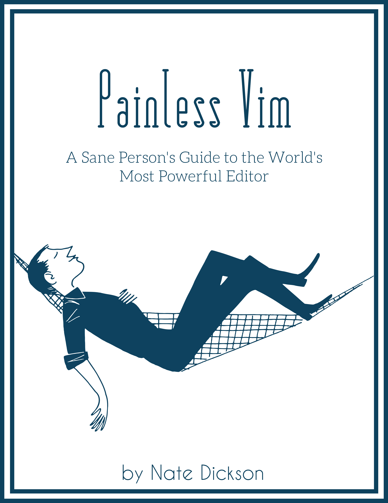
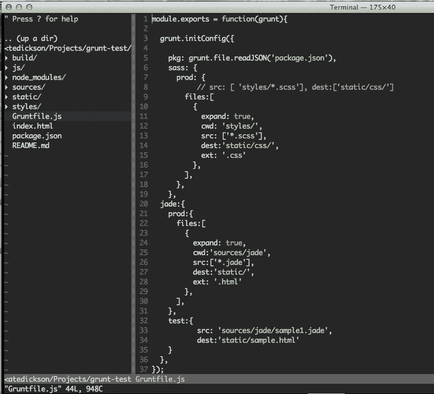
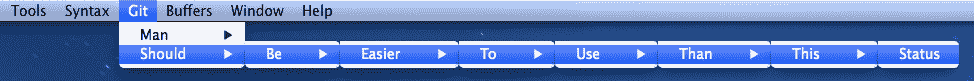

# Painless Vim：最强大编辑器的理性指南





* * * * * *


# 前言

## 为什么？为什么是这个？

听着，我们都经历过这种：有人说，“你应该学 vim。我学了，现在我做任何事情都快了 10000%，人们更喜欢我。”于是你为你的操作系统下载了最新版本并启动它，然后嘿，看，出现了一个满是波浪号的屏幕，要求你向乌干达的孩子捐款。就像你上次尝试时一样。你凭经验知道输入 `:help` 并不会有多大帮助，因为你会卡在帮助窗口里永远无法让它消失。你开始打字，终端对你鸣叫，或者说它现在处于某种奇怪的模式，或者如果你运气好的话——某个时刻开始在屏幕上显示字母。然后你快速奔向 Google 寻找如何退出 `vim`，你打了个冷颤，发誓再也不回去了。

情况没必如此。

Vim 的核心是让开发者的生活更轻松。但大多数给“初学者”的建议听起来就像你必须通过一场重大的火火入礼仪式，才能到达那个程序员的涅槃境界。人们告诉你，想要真正掌握 `vim` 力量的“唯一方法”就是把鼠标扔出窗外，禁用你习惯的所有热键，然后只花几个月时间学习如何使用编辑器，什么都不做。

保佑他们的小脑袋脑袋吧。确实，一旦你精通了 `vim`，你就会觉得所有的系统快捷键和鼠标快捷都是低效的。但当你刚开始时，它们让你觉得突然进入了一个你听不懂语言的异国。他们的本意是好的，但那种仪式对于新手来说完全是错误的。正是这种建议阻碍了 `vim`，使其无法成为所有人使用的编辑器^(1)。

## 我也是个陌生人

事实是，你可以按照自己的节奏学习 `vim`，并且开箱即用就能相当高效。这正是本书的主题。如果 `vim` 是一个异国，我就是那个在酒店大堂走向你并说，“嘿，怎么样？刚到这？我自己也是个陌生人。”然后我会向你展示所有的好饭馆之类的，因为我理解你正在经历什么。

所以，我不会教训你学习所有底层的 `ex` 和 `vi` 命令（你认为“为了真正体验 `vim` 的原始力量你必须知道它们”），我将向你展示如何进入、如何适应并开始向更大、更好的领域扩展。我会假定你并没有 100% 致力于放弃所有其他文本编辑器。老实，我强烈建议准备一份 Sublime Text 的副本（稍后会详述），以备在某些你对 `vim` 厌恶骨底的时候。这种情况会发生！但请回到 `vim` 上，因为我计划向你证明 `vim` 并没有那么难，学习它是可以无痛的。

# 引言

## 为什么要学 Vim

`Vim` 尽管有很多怪癖，但它的设计初衷是快速且对开发者友好。聪明人已经使用并改进了它十年，它已经到了在对的人手里变得非常棒的地步。作为一名开始使用它的前 `vim` 批评者，我可以告诉你，一旦你进入状态，它确实那么快。你可以在 `vim` 中快速高效地完成惊人数量的修改，一旦你开始仅使用主行键进行导航、修改和发布命令，相比之下使用任何其他工具都会显得笨拙。

### 它确实那么快

用得好的 `Vim` 是一个速度魔。一旦你习惯了这种略微奇怪的控制，其他任何文本编辑器都会显得笨重。`Vim` 的设计是为了让你的手留在它们该在的地方，而不使用鼠标或方向键。

现在，正如我之前所说，如果你在习惯 `vim` 的期间想使用鼠标和方向键，尽管去用！如果你只是在试图记住如何编辑光标下方一行的第三个字符，你并没有在提高生产力。但承诺是，最终你会习惯 `vim` 的做事方式，并变得快乐得多。还有其他原因：

### Vim 命令无处可见

很多 Unix 风格的东西使用 `vim` 键绑定进行移动。甚至像 Gmail 这样的 Web 服务也使用 `h j k l` 魔法键在邮件之间进行切换。如果你熟悉了 `vim` 的惯用法，你对许多其他工具也会更加熟悉。

### Vim 本身无处可见

面对吧，`vim` 无处不在。如果你在 Windows 上安装 git，`vim` 会随之而来。如果你有一台 Linux 设备或 Mac，你已经有了 `vim`。如果你像我一样^(2)，这总会稍微困扰你，你的机器上有一个你不喜欢或不知道如何使用的编辑器。如果你熟悉了 `vim`，那么当你需要在 git 命令行中输入提交信息时，你就不必恐慌了。

## 这本书关于什么

本书的目标是：

### 简短

你有比读编辑器的书更重要的事情要做。本书的主要目标是让你熟悉这个编辑器，并觉得你准备好进入下一步，让 `vim` 服从你的意愿。如果你像我一样，你会对别人强加给你的改变感到恼恼，只想亲力而为。我会让你如愿。

### 廉价

`vim` 是免费的。虽然我不想白卖我的作品，但我已经快做到这一点了。这是一本给初学者的书，我的目标是降低入门门槛。首先，我会把它定价得很低，希望这对你有所帮助。

### 易于理解

`vim` 是复杂的；但这本书不应该是。我在这里的主要目标是帮助你建立信心并站稳脚跟。如果你在测试期间阅读此书并有建议，请发送给我！我非常愿意听取并改进。

### 友好！

我的高架子早就死掉了，我也从没忙过给自己买个讲台，所以我不会进行任何说教。记得酒店里那个向你展示城市里所有棒地点的友好面孔吗？那就是这本书。我不是来评判的。

### 有观点（但是从好的角度出发）

我会保持友好的语气，但我确实有观点。有些事情我觉得是好的，有些事情我觉得没那么好。但我会告诉你*为什么*我认为某些事情好或不好，并让你自己做主。

### 轻松但严肃

本书的语调旨在是轻松且平易近人的，但建议应该是坚如磐石的。我不会让你在配置文件中做任何我不会做的事情（即使是暂时的），或者为了证明某个观点。目标是让你第一次就做对^(3)。

## 这本书不是什么

本书绝对不是：

### 关于 vim 的终极参考


我来到这里是为了帮助你入门，而不是为了成为你关于这个主题买的唯一本书。之所以这样做，主要原因并不是因为懒惰，非常感谢。嗯，好吧，某种程度上确实是这样。这个世界上有大量的书籍、网站、维基和其他文档，一旦你度过了最初的学习曲线，它们都会在你的学习道路上提供帮助。我来到这里是为了帮助你度过第一道曲线。

## 技巧列表

如果你没有学过前面的章节，后面章节中的很多内容将变得毫无意义。这些章节的布局是迭代的，从微小的变化开始，最终积累成一个可以良好运行的最终配置。然后，你将在进一步的修改中获得一个很好的起点。

## 深度解析

这里的目标是给你提供足够的信息让你感到舒适，而不是提供所有的底层技术、行编辑器命令以及此类内容。再次强调，这些内容可以在网上以及遍世界各地的许多其他参考书中找到。当你决定想更多地了解某些内容时，你将能够找到它。我对你有信心。

## 我是谁？


但似乎每次启动 `vim` 都要手动做这些操作感觉很麻烦。你说得对。别担心，我们会解决这个问题的。

不过不仅如此。我们还了解到，当你向 `vim` 发送以 `:` 开头的命令时，你必须在最后按下 `<enter>`。这是一个非常有用的信息，因为从现在起，我将不再在每个命令后面都加上 `<enter>`。请记住，如果你以冒号开始一个 `vim` 命令，它总是以 `<enter>` 结尾的。还有其他命令在末尾不需要 `<enter>`，我们稍后会讨论它们。现在，让我们先看看这个文件。

## 2. 在 Vim 中移动：起步阶段

现在你已经进入了一个文件，是时候稍微移动一下了。如果你以前玩玩过 `vim`，你可能看到过类似这样的界面：

```
1 	k
2 h		l
3 	j
```

这是一种非常不直观的方式，告诉你哪些键会将光标移动到哪个方向。在英语中，它的含义是：

*   `h` 将光标向 `left` 移动一格
*   `l` 将光标向 `right` 移动一格
*   `k` 将光标向 `up` 移动一行
*   `j` 将光标向 `down` 移动一行

所以，花点时间在这四个键上玩玩。我承认，起初这种布局很奇怪，但它的目的是让你的手稳稳地留在主按键（home row），过了一段时间，你会开始认为 `h j k l` 本就应该一直用来移动光标。当你使用支持 `vim` 键的程序时，这太棒了。这也意味着当你和某人进行即时消息聊天时，由于试图弄清楚为什么光标无法移动，你会无意中给他们发一条全是“jjjkl”的消息。这是一种诅咒。

好了，继续。一旦你习惯了移动光标，就是时候编辑某些内容了。使用移动键将光标移动到你想去的地方，然后按下 `i`。

在屏幕底部你应该能看到一条信息：

```
1 --INSERT--
```

这是 `vim` 在告诉你，现在按键将使你的文本发生变化。在 vim 的术语中，你刚刚进入了插入模式（insert mode）。在文档中输入一些幽默的话。我会写“再见，感谢你们所有的鱼”，因为这比“hello world”要好。但我知道我让你输入什么并不重要；你会输入任何你想输入的内容。你就是这样的人。你是独立的，我尊重这一点。

一旦输入了你的幽默语，就是时候保存它了。按下 `<esc>`，屏幕底部的 `--INSERT--` 信息应该消失。这意味着键盘已经恢复到向 `vim` 发送命令，而不是更改屏幕上的文本。`vim` 将此称为普通模式（normal mode），但先不用太担心它。输入

```
1 :w
```

你的更改已经保存了，朋友。现在让我们来点稍微更大胆一些、我敢说更有用的事情。手指留在主按键上进行移动固然不错，但并不值得费这么多麻烦和困扰。让我们看看文本中稍微大一点的跳转。

将光标置在某行文本的任意位置——哪里都可以——并多次按下 `<esc>` 以确保 `-- INSERT --` 那个东西消失，直到 `vim` 开始向你响或或/闪烁。现在按下 `A`。注意是大大写的 `A`，而不是小写的 `a`。这个方便的小快捷键一次性让你移动到行尾并让你回到插入模式。把它想象为“追加”（append）或“添加”（add）。很神奇吧？好了，再次按下 `<esc>`，我们再来一个。按下 `o`。（再次，注意大小写。）`vim` 在你所在行的正下方添加一个空行，你再次进入了插入模式，准备好在文件中输入新文本。如果你愿意可以写点什么，然后再次按下 `<esc>` 退出插入模式。

我们以后会更多更多关于移动光标的内容，但现在看看你已经有多么棒了！由于这次你不需要担心更改，你可以直接输入

```
1 :q!<enter>
```

退出 `vim`。

### 缩放！

让我们回到 `vim`，玩玩三个简单（但有用）的命令，我称之为“缩放命令”。这次进入 `vim` 时输入


```
1 $ vim sample1.html own
```

这样我们就有了一个文档可以玩了。反复按下 `j` 让光标向下移动几行，停留在哪里并不重要。我们要告诉 `vim` 滚动窗口，使光标所在的行位于我们想要的位置。

第一个“缩放”命令是 `zt`，它（我说的）代表“缩放至顶部”（zoom top）。当你在命令模式下按下 `zt` 时，它会将当前行移动到（你猜得的）屏幕顶部。所以，如果你的光标在第 15 行，且位于屏幕的三分之一处，它现在将位于屏幕顶部。

接下来是 `zb`，或者说是“缩放至底部”（zoom bottom）。正如你猜的，它将当前行移动到底部。第三个也是可能最有用的命令是 `zz`，它将你的光标置于屏幕中间。我经常使用这三个命令。

好了，我们已经做得不错了。你启动了 `vim` 并学会了移动，更重要的是，你让它变漂亮了。在下一章中我们将选择配色方案。

## 3. 你的 .vimrc 文件

好了，让我先说我没撒谎。为了做到，我们需要讨论如何在不同会话之间保存设置。这种方法是通过一个 `.vimrc` 文件。现在，我们将从非常简单开始，只需向其中添加几行。在基于 Unix 的机器上，它位于 `~/.vimrc`。

从命令行打开 `vim` 并以你的 `.vimrc` 文件作为编辑对象：

```
1 $ vim ~/.vimrc
```

而且，如果你使用的是全新安装的版本，你应该会看到一个完全空的文件。按下 `i` 进入插入模式并输入以下内容：

```
1 set nocompatible
2 syntax on
3 set nu
4 filetype indent
```

我意识到目前这些看起来都像巫术，但实际上只是在告诉 `vim` 一些关于你希望它如何运行。让我们逐行检查，你会发现它是多么简单：

*   那个 `nocompatible` 是什么？那一行告诉 `vim` 做为 `vim` 而不是 `vi`。这是一个关闭所有来自 `vim` 更老、更神秘的前身遗留的古旧、奇怪且无用功能的好方法。只需设置那行并忘记它吧。它只是在保护你。
*   `syntax on` 是我们一直在讨论的：这告诉 `vim` 进行语法高亮。这是永久开启漂亮颜色的关键。
*   好了，那么这个 `nu` 是什么？它告诉 `vim` 在屏幕左侧显示行号。你可以（临时地）在普通模式下通过 `:nu` 执行相同的操作，但由于 `vim` 是程序员的编辑器，我们让它成为你日常设置的一部分。如果你讨厌行号，可以省略它。
*   最后一行——最后一行有一点魔法色彩。简而言之，我们正在告诉 `vim` 识别它正在查看什么类型的文件并加载相应的文件类型插件。这对程序员来说有很多好处，即使你并不完全理解它，我也建议设置它。你在这本书后面学到的很多很棒的技巧都取决于它。

按下 `<esc>` 退出插入模式，通过输入以下命令保存文件：

```
1 :w
```


所以，现在你有两个选择。你可以退出 vim 并重新启动以让你的更改生效，或者可以使用一些 vim 的奇妙操作。不需要退出 vim，输入以下命令：

```
1 :so %
```

现在，在你合上这本书之前，如果你觉得由于我要给你抛出一些糟糕的惊喜（比如 `.vimrc` 文件和晦奥的 `:so %` 命令）感到难过，请听我慢慢道。你刚刚所的操作是告诉 vim `source`（源）当前文件。`so` 命令是 `source` 的缩写，而 `%` 是“当前文件”的缩写。看到了吗？这里并没有发生什么可怕的事情。在你配置好 vim 的过程中，这是一个非常实用的命令，而且能让你觉得自己很酷。

## 我承诺过会有配色方案！

好了，听着，这一切只是我们为了让你永久地使用颜色而必须完成的准备工作。为 vim 添加配色方案是一个分两步的过程：

1. 安装配色方案。
2. 告诉 vim 使用它。

完成第 2 步最简单的方法是在你的 `.vimrc` 文件中进行。

### 选择配色方案

vim 有大量的预构建的配色方案。毕竟，人们使用它已经超过 20 年了，而且每个人都喜欢颜色。有很多地方可以查阅可用的方案并找到一个适合你个人风格的，其中几个列在附录 1 中。

为了本节的目的，我们将安装 [Tomorrow Theme](https://github.com/chriskempson/tomorrow-theme/tree/master/vim)，因为它带有几个漂亮且优雅的变体，而且这也是我现在正在使用的。具体来说，我使用的是“Tomorrow Night Eighties”，因此——至少在一段时间内——你也会使用。记得吗，我很有主见的人。

所以，要安装该方案，请下载 github 仓库中 `colors` 文件夹的内容。你应该看到一个文件列表，所有文件的扩展名都是 `.vim`。现在是时候进行一些深入操作了。

在你的主目录下，有一个名为 `.vim` 的隐藏文件夹，这是 vim 存放所有配置信息的地方。在该目录下有一个名为“colors”的文件夹，这就是你想把刚刚下载的配色方案放在那里。我们很快会讨论一种更好的方法，但现在只需将这些文件从你下载的任何地方移动到 `~/.vim/colors` 即可。在 OSX 上，我会这样做：

```
1 $ mv ~/Downloads/colors/*.vim ~/.vim/colors
```

但无论你如何将文件就位，你最终希望看到 `ls ~/.vim/colors` 的输出如下所示：

```
1 Tomorrow-Night-Blue.vim
2 Tomorrow-Night-Bright.vim 
3 Tomorrow-Night-Eighties.vim
4 Tomorrow.vim
```

你明白我的意思了。一旦完成，就是该再次编辑你的 `.vimrc` 文件了。在 vim 中打开它并添加这一行：

```
1 colorscheme Tomorrow-Night-Eighties
```

然后按下 `<esc>` 回到普通模式。保存你的工作（`:w`），然后调用我们的老朋友 `:so %` 来尽情欣赏新配色方案的华丽风采。

### 使用快捷键映射防止迷失

让我们在你的 `.vimrc` 中再添加一行，既作为一种说明，也因为它很有用。

偶尔你的光标可能会在屏幕上迷失。这不是任何人的错，现在的屏幕很大，而光标很小。因此，许多人喜欢让编辑器高亮光标所在的行。考虑到 vim 的行编辑能力，这并不是一个坏主意。确实有些时候我想高亮光标行，但并不是一直如此。所以，让我们在 `.vimrc` 中添加一个键映射，允许我们随时高亮和取消高亮当前行。将以下内容粘贴到你的 `.vimrc` 文件：

```
1 nnoremap <silent> <F4> :set cursorline!<CR>
```

这一行的核心是命令

```
1 `:set cursorline!`
```

命令之前的所有内容只是告诉 vim 当我们按下 `<F4>` 键时想要让它执行某些操作。让我们仔细检查一下这个命令。

* 正如我们之前学过的，如果你在开头输入 `:`，它会告诉 vim 你正在向它发送一个命令。
* `set` 命令告诉 vim 我们将要……嗯，`set`（设置）一个选项。如果在 vim 命令行中设置，它将在当前会话中生效；如果我们在 `.vimrc` 中设置，它们将在每个 vim 会话中生效。
* `cursorline` 选项告诉 vim 高亮光标当前所在的行。
* 末尾的 `!` 告诉 vim 切换 `cursorline` 选项。如果它目前开启，则关闭它，反之亦然。
* 末尾的 `<CR>` 告诉 vim 模拟按下 `<enter>` 键。记住，如果命令以冒号开头，它必须以 `<enter>` 结尾。

## 4. 间歇：优秀备查表的快乐

当你学习 vim 时，要记住所有的命令、控制键、字母、组合之类的是很的，有时候无论你如何要求大脑调出你需要的内容，它就是不听。

这就是为什么找人帮你是个好主意。在电脑后面的墙上挂一个简单的记忆提示就能让你的大脑重新活跃起来。

有很多查询表，其中大多数是作者投入大量时间和精力的产物，他们通常试图创建一个“完美”的备查表，即最符合他们思维方式的那个。

事实上，自从我第一次写这个“间歇”以来，我就创建了自己的查询表，它包含在你的 *Painless Vim* 下载包中。嘿，你花钱买了本 vim 书，你值得拥有配套的查询表。我的查询表是我发现自己最频繁的所有命令和动作的精炼。

但如果你金钱充裕，或者只是不太在意 *Painless Vim* 的查询表，那么请继续读下去，朋友。我不会被冒意的，我保证。

在我看来，市面上最好的是这个“漂亮的一个](http://vimcheatsheet.com/)，因为它整洁、布局良好且信息丰富。当你刚开始时，只需关注占据顶角的移动箭头，过了一段时间，你会发现整张表都满了你可以用的东西。还有许多其他不错的选择。这个间歇的目的是花一点时间找到一个对你有意义的表。

## 5. 在 Vim 中移动：上阶

好了，现在设置配色方案这件正事已经处理完了，让我们回到移动操作。

人们经常说，编程大约是 90% 的思考和 10% 的打字。虽然这可能是事实，但我补充说，相当的时间也花在了将光标移动到你需要去的地方。假设你在第 15 行做了更改，从那里你需要移动到文件末尾添加一个新方法。在普通编辑器中，你有几种选择：你可以多次按下向下箭头，或者完全松开一只离开键盘，点击文件的最后一行。Vim 有一个更好的主意：

```
1 G
```

就是这样！大写的 `G` 单独使用就会将光标移动到文件的最后一行。想回到文件顶部？

```
1 gg
```

你就到了。关键点在于，一旦你掌握了它，在 vim 中移动是极其轻易的。所以，让我们来看看 vim 中最常用的动作：

简单动作

| 击键 | 动作 |
| --- | --- |
| h | 向右移动 |
| j | 向下移动 |
| k | 向上移动 |
| l | 向左移动 |
| b | 上一个单词 |
| e | 单词末尾 |
| ctrl+d | 向下移动 1/2 屏幕 |
| ctrl+f | 向下移动 1 屏幕 |
| ctrl+u | 向上移动 1/2 屏幕 |
| ctrl+b | 向上移动 1 屏幕 |
| gg | 跳到文件开头 |


| 键 | 说明 |
| --- | --- |
| G | 跳到文件末尾 |
| `^` | 行首第一个非空白字符 |
| $ | 行尾非空白字符 |
| `0` | 行首 |

还有很多其他命令，但这些足够我们开始操作了。让我们花点时间尝试一下这些动作。打开一个文件并来回跳动，移动到行的开头和末尾，在单词之间来回跳跃等。

“屏幕”移动稍微难掌握一点，但一旦你习惯了，它们就很有意义了。一个“屏幕”由你当前终端窗口能够容纳的行数组成。所以，如果你的终端窗口高度为 80 行，那么一个屏幕可能就是 79 行（留出一行作为状态栏），半个屏幕大约是 40 行。但如果你缩放了终端窗口，“屏幕”的大小也会随之改变。尽管如此，还是花些时间习惯如何使用 `1/2` 和全屏移动来快速“滚动”文件，并感受一下你能移动有多快。

这些移动本身就很有用，你掌握得越好，在 vim 中就会玩得越开心。但当你将它们与接下来两个章节中将遇到的*操作符*和*计数器*结合时，效果会变得更出色。

## 6. 操作符 1：修改字母和行

好了，你已经有了行号、颜色，以及如何让光标从一个地方移动到另一个地方的基本概念。如果你愿意，可以停在这里，在普通模式下移动光标，按下 `i` 进入插入模式，像在任何其他编辑器中那样进行所有更改。但 vim 有更好的主意。你可以直接在普通模式下完成许多最常见的更改。现在，我们将关注最常见的三个命令：剪切、复制和粘贴。

只是它们在 vim 中有不同的名称。记住，`vi` 在整个“剪贴板”概念普及之前就已经存在了。所以，它不是“剪切、复制、粘贴”，而是“删除（delete）、取用（yank）、放置（put）”。让我们用表格来介绍一些最常用操作符的命令：

### 基础命令

| 按击键 | 命令 |
| --- | --- |
| d | 删除 (delete) |
| c | 修改 (删除并进入插入模式) |
| y | 取用 (复制，yank) |
| u | 撤销 (undo) |
| p | 放置 (粘贴，put) |
| r | 替换 (用下一个输入的任何字符) |

为了尝试这三个命令，让我们打开一个我们并不介意真的*真的*弄乱的示例文档。示例文档文件夹中有一个名为 `operators.txt` 的文件，非常适合这个。

### 单独操作符：修改单个字符

### 删除文本 (Killing Text)

大部分情况下，操作符本身作用于单个字符。`operators.txt` 的第一部分有一些重复字母的单词，如“ddoctor”，这是在打字时并不常见的错误。去掉多余的字母很容易。只需将光标置于重复的字符上，按下 `d`（代表 delete）或 `x`（代表……一种记忆法，模拟在打字机上划掉某东西。我猜读这本书的大多数人可能没有在打字机上花过长时间，所以这个小记忆法现在已经过时了）。

### 复生文本 (Resurrecting Text)

一旦你删除了文本，它并没有真正消失，而是在一个*寄存器*中，即内存中的一个特殊位置，如果需要，vim 可以快速将其找回。在普通模式下，按下 `p` 会将光标之前最近被取用或删除的任何文本“放置”到此处。

### 两个有趣的命令

有两个操作符在特定情况下非常有用：`~` 和 `r`

`~` 切换单个字母的大小写，而 `r` 让你用下一个输入的字母替换掉单个字符。

你可以使用这两种命令来修正 `operators.txt` 的第 13 行，该行内容是：

```
1 "you can't grep a fred tree" --larry wall
```

使用三次 `~` 操作符和一次 `r` 操作符，你就能得到一个格式良好的引用，即使引言处可能有点可疑。

### 对行进行操作

修改单个字母很有趣，但有时你需要重构整行文本而不是单个字母。vim 包含了了一些快捷键，可以将一行文本修改为更理想的形状，例如更短的行、两个相同的行，或者完全删除行。

在我们深入之前，我们应该看看 vim 是如何定义什么是“行”、以及什么不是行的。vim 的“行”是指两次按下 `<enter>` 键之间的所有内容，即使它跨越了屏幕上的几行可见的“行”。如果开启了自动换行，vim 会继续某行文本，如下所示：

```
1 8 这是本文档中的第八行文本。
2    它一直延伸下去。你会发现，尽管
3    这一行里有几个句子，但在 vim 中仍然被视为一个
4    单“行”，在我按下
5    回车键之前，它不会出现新的行号。
6 9 好的，这是一个新行，因为我按了回车键。这就是为什么
7    出现了一行新内容
```

### 行尾

有时你需要剪切一行的末尾。在 vim 中，命令的大写版本作用于从光标到行尾的行。在 `operators.txt` 中找到以下行：

```
1 Emacs is a great system, it just needs

```

但这样我们就只留下了一个带句点的句子。我们可以做得更好。按下 `u` 恢复你删除的文本。好了，这次我们将组合两个命令：将光标移动到逗号右侧一个空格，按下 `D` 删除文本。现在光标应该是逗号，你可以按下 `r.` 将其替换为句号，全程无需离开普通模式。

放置（Put）稍有不同：小写的 `p` 将最近取用或删除的文本放置在光标*之后*，而大写的 `P` 将文本放置在光标*之前*。这里有一个演示：假设我们从一行剪切了单词 `seven` 并想将其粘贴到下一行：

```
1 four score and |years ago...
```

在这种情况下，按下 `p` 粘贴的结果是：

```
1 four score and y
```
不对，应该是：
```
1 four score and yseven ears ago...
```

因为光标位于字母 y 上。但“yseven ears”并不是我们。但如果你使用 `P`，就能得到预期的结果：

```
1 four score and seven years ago...
```

### 整行

要让 `d/y/c` 操作符作用于整行，只需复制操作符。因此 `yy` 复制（或“取用”）整行，`dd` 删除整行，`cc` “修改”整行。（即：删除该行并让你进入插入模式）。你也可以在 `operators.txt` 中尝试这些命令，从第 31 行开始。


首先，复制第 33 行，然后在下方粘贴两次，以此为你的 vim 知识欢呼三声。这可以通过复制（yank）整行，然后粘贴（put）两次来实现。只要你的光标位于写有 `- Hip Hip, Hooray!` 的那一行上，这只需四个简单的按键即可完成。只需按下 `yy` 复制整行，然后按两次 `p` 即可粘贴两次。由于复制整行也会复制不可见的换行符，因此你甚至不需要移动光标。

## 单字母大写 vs. 双击模式 (Single Caps vs. Double Taps)

好了，我们已经介绍了两种操作行而非单个字符的方法。让我们再次总结一下。

若要对整行进行操作，你需要将命令*双倍*，例如使用 `cc` 修改整行、`dd` 删除整行、`yy` 复制整行等等。

若要对从光标到行尾的行进行操作，则需要将命令*大写*。因此，`C` 删除从光标开始到行尾的内容并让你进入插入模式，`Y` 复制光标之后的所有单词，等等。这里有一个简单的例子。假设我们想去掉下面这一行的半部分，因为它是反序的：

```
1 Four score and seven years ago years seven and score four
```

我们只需要将光标放在“ago”一词之后，按下 `<shift>C` 即可得到：

```
1 Four score and seven years ago|
```

输入完句子的剩余部分，生活就会很快好起来。

现在是一个稍微复杂一点的场景：

将这三行有些混乱的文本按正确的顺序排列。这可以通过使用 `dd` 删除位置错误的行（再次强调，这会移除行尾字符，实际上让下一行向上移动一个位置），然后使用 `p` 将其放回合适的位置。

### 如何通过 `cc`（或 `C`）瞬间让你的生活变得更轻松

编程中有一个常见的场景：你正在声明一个新函数，并想确保所有的大括号从一开始就是匹配的。因此，你设置了声明，在中间留了一个空行，并设置了闭合括号。像这样所示：

```
1 $scope.awesome = function(arg){
2 
3 };
```

然后你将光标移动到中间那一行……它紧贴着左边界，而这正是你*不*希望它所在：

```
1 $scope.awesome = function(arg){
2 |
3 };
```

你希望光标从正确的缩进开始，你可能已经开发了数百万种方法来实现这一点。当我刚开始职业生涯时，我会将光标置于那个空行上，按下 `<enter>` 创建新行，因为那个新行通常会由我使用的 IDE 自动进行正确的缩进，然后回去删除那行缩进不当的行。这个技巧在 vim 中同样有效，但那不是长久之计。

幸运的是，有一个更好的方法：只需将光标置于那个空行上并按下 `cc`（如果你更喜欢的话，也可以用 `C`）。想想你刚刚做了什么：你告诉 vim “删除这一行上的所有内容，并让我进入编辑模式”。vim 做到了，它查看上方和下方的行，并且比你做得更好：它让你进入插入模式，且光标已处于正确的缩进位置，准备好编写格式良好的代码：

```
1 $scope.awesome = function(arg){
2 	|
3 };
```

这只是 vim 展示它对你的爱的另一种方式。注意，这个技巧仅在你开启了以下内容时有效：

```
1 Filetype indent plugin on
```

正如我在几个章节前建议过的那样。我告诉过你这会有用处的！

所以，在掌握了这些之后，尽管去弄乱文件的其他部分的移动和删除操作吧。当你对这个过程感到相当熟悉时，让我们进入关于重复这一迷人的话题。

## 7 重复执行操作

vim 的伟大之处之一是，它是为了程序员的工作方式而构建的。我们经常想要跳转到文本中的特定单词或符号，而不是逐行移动；或者我们想用四个新单词替换接下来的四个单词，或其他类似的琐事。这是我们工作的一部分，正如我之前所说过的，vim 的核心就是让我们的工作变得轻松。它非常擅长此！

它让工作变得轻松的方法之一，是让我们根据需要*重复*操作，以完成正在进行的任务。

### 使用计数 (Using Counts)

这通常通过在给 vim 命令之前输入一个数字来实现。例如，假设你想将光标向右移动四个字符。你可以通过输入 `llll` 实现，也可以输入 `4l`，这样你就省下了*整整两个按键！*朋友，这可是真金白银。虽然节省两个按键很有用，但你也可以将这个概念应用到许多其他动作和操作上。在示例文档打开 `counts.txt` 并找到这一行：

```
6 I am so incredibly stupid, useless, and talented.
```

现在，读到这里，你意识到你需要去掉 `stupid, useless and` 这几个词。你可以通过将光标置于单词之前并输入 `dw` 来逐个删除这些单词。但为什么要浪费时间呢？相反，将光标置于“stupid”一词之前并输入 `3dw`。砰！

```
6 I am so incredibly.
```

### 使用文本对象 (Using Text Objects)

有时你不想手动数需要操作的字符数量。你想删除下一个单词，而不需要数它包含多少字母。但 vim 也为许多常见的文本对象提供了快捷键：在 vim 的术语中，文本对象是一组字符。它可以是单个字符、几个字符、一个单词、整行——一直到整个文档。你在上一节中已经在使用文本对象了。当你告诉 vim `d5l` 时，你是在说：“光标右侧的五个字符构成一个对象。删除它。”如果你告诉它 `d5j`，你是在告诉它接下来的五行构成一个文本对象。

| 快捷键 | 文本对象 |
| --- | --- |
| w | 从光标到单词结束 |
| W | 从光标到单词结束 |
| s | 当前句子 |
| ’ 或 “ | 引号内的字符串 |
| l | 从光标到行尾 |

还有*很多*其他的，但这些足够让我们开始了。当你将一个*操作符*与*计数*和*动作*结合时，你就有了一个*命令*。

现在让我们练习一下。打开 `counts.txt` 文件并进入第 9 行。这里有四行正*渴望*被删除。让我们完成它们的愿望，只需三个按键。使用**操作符-计数-动作** 语法，你只需要输入 `d4j`，这些行就*消失*了。

其实它们并没有消失。你也可以对 `p` 使用计数。我们不确定你什么时候需要多次粘贴多行，但至少值得尝试一下。

### 见证全能的点 (Behold The All-Powerful Dot)

这个特定的技巧与计数毫无关系，但它会经常与计数操作一起使用。`.` 字符，这个最简单的字符之一，是你 vim 中最好的朋友之一。它的含义非常简单：它重复你对文本所做的最后一次修改但位于你当前的位置。


在 `counts.txt` 中有一个设计得非常巧妙的例子：简单的童谣《杰克和吉尔》，但不知为何“吉尔”被替换成了“杰克”。这意味着第一行的内容是：

```
1 Jack and Jack went up the hill to fetch a pail of water
```

这招玩得不错，杰克！让我们用修改操作符来修复第二个“Jack”。将光标移动到字母 J 之后：

```
1 J|ack
```

然后输入 `cw`（意思是“修改从光标处到单词末尾的所有内容”）。你现在应该看到：

```
1 J|
```

并处于插入模式。输入 `ill` 并按下 `<esc>`。现在第二个 Jack 变成了 Jill，你可以阅读诗歌的其余部分并寻找任何其他错误。在第三行写着：

```
1 And Jack came tumbling after.
```

这完全不通。像上次一样把光标移动到那里，但你不需要输入 `cw`，只需要按一下句号键，砰！你的上一次修改就会通过一个按键重复执行。如果你曾经需要修改文件中所有的变量名，你就能轻易体会到这有多么有用。当它与搜索结合使用时效果更好，不过这一点稍后会详细介绍。

点命令是让你在插入模式下选择性操作、以及在返回普通模式之间执行多少操作的一个很好的理由。

## 8. 在 Vim 中移动：舞步

现在让我们把已经学到的关于移动的所有知识进行最后的几次微调，使其变得真正超级有用。有两个文本对象看起来完全一样，但并非如此。它们之间的区别可能会给你带来麻烦，也让你的生活变得美好。这两个文本对象是 `words` 和 `WORDS`。

### Words 和 WORDS

描述 `WORD` 最简单的方法是它是两个空白字符之间的所有字符。因此，`http://I.am.a.frog.com` 是一个 `WORD`，尽管你我都会将其解析为六个单词^(#chap35.xhtml_fn-not-counting)。小写的“word”文本对象是任何不连续的字母序列。因此，`http://I.am.a.frog.com` 由六个“word”对象组成，由标点符号分隔。

当你组合 vim 命令时，正如你预期的那样，你会用 `W` 指定要操作一个“WORD”，用 `w` 指定操作一个“word”。如果你想尝试这些差异，可以查看 `motion3.txt` 并看看那里的练习。使用上面的 URL，你可以将光标置于单词 `frog` 的开头，并使用 `cw` 命令仅修改该单词。如果你想将整个字符串更改为其他内容，可以将光标置于行首并输入 `cW`。

但总是将光标移动到文本对象的开头来对其操作是件很痛苦的事。Vim 是聪明的，即使你的光标在单词中间，它也能确定单词边界在哪里。你只需要告诉它你正在寻找什么样的边界。你可以通过“inner”（内部）和“all”（全部）命令命令修饰符来实现这一点。

### Inner 和 All

如你所知，文本对象命令 `w s l` 从你的光标位置到结束操作当前文本对象（分别是单词、句子或行。如果你需要快速复习，请查看表格）。但如果你有一个很长的单词，比如“Omphaloskepsis^(32)”，而你的光标在第一个 s 附近怎么办？为了删除这个单词而必须将光标移回初始的 `O` 是愚蠢的，vim 有一种更好的方法。

你只需要告诉 vim 如何处理所选文本对象的边界，以及对该文本对象做什么。什么构成边界取决于你使用的文本对象类型。“一个 WORD”的两侧由空白字符包围。“一个 word”的两侧由任何非字母字符包围。句子边界由行尾或句号包围。通常，vim 会努力使它的边界概念与人类认为的边界相匹配。

如果你告诉 vim 操作一个内部（inner）文本对象，它将忽略边界。例如，如果我在句子 `Who is John Galt?` 中对单词“Galt”执行 `diw`，剩下的就是 `Who is John ?`。这不符合语法，因为问号孤零地悬浮在结尾。然而，如果我改用 `ciw`，它将保留 `John` 和我想要给安妮·兰德的角色起的新姓氏之间的空格：

```
1 Who is John Punchfist?
```

好得多。

然而，当你直接删除文本时，通常想修改整个文本对象，包括空格。要实现这一点，将前述命令中的 `i` 改为 `a`。如果我在上面的示例中对 John 的姓氏说 `daw`，结果句子将是 `Who is John?`，这完全符合语法（虽然有点模糊），但远不如询问谁是 John Punchfist 那么酷炫了。

你无疑能理解为什么我不想在那里执行 `caw`，因为那样我就必须输入“John”和另一个“John”之间的那个空格。

### 按计数移动

我们已经在使用计数章节中见过这个概念的开头了，但让我们在这里再详细充充一下。移动命令仍然是命令，你可以像对待其他命令一样告诉 vim 重复它们。这意味着你可以通过简单的输入 `5w` 向右移动五个单词，或者向下移动六行：`6j`。这通常比连续按 `j j j j j j` 到达目的地更快的方法。

但并不总是如此。这种现象的原因是人类的一种被称为*[视直计数](https://en.wikipedia.org/wiki/Subitizing)*的能力。简单来说，我们人类可以很容易识别多达三个或四个的物体组而无需计数，但一旦超过四个，我们的速度就会大大减慢。在 vim 术中，这意味着如果你看一眼句子发现需要向右移动三个单词，你会直接输入 `3w` 而无需思考。但如果你需要向右移动六个单词，你可能正在数这些单词，然后输入命令，这通常比连按六次 `w` 键，或者（更好）直接搜索你需要修改的的确切位置要慢。


偶尔你可能想要快速轻松地从一个地方到另一个地方，而不需要计数、不需要搜索，不需要做任何事情，只需告诉 vim 你想去哪里，并说声“非常感谢”。这就像浏览器中的书签，但它是针对文本文件的。这正是 `marks`（标记）的用处。

标记只是指向文件中某一行的指针。如果你在文件的第七行设置了一个标记，它就会停留在那里，为你提供了一个快速返回第七行的方便方法。但 vim 不会留下那种无聊或未开发的东西。

标记大致分为两类：`lowercase`（小写）标记和 `uppercase`（大写）或 `file`（文件）标记。两者之间明显的区别在于你引用标记的方式。重要的区别在于，小写标记局限于单个文件内的行，而大写标记可以自由跳转到`any` 文件的任何一行。这两种类型的标记工作方式非常相似，只有细微的。让我们先来看看如何使用小写标记。

在普通模式（normal mode）下，输入 `m` 后跟一个字母即可设置标记。就是如此！除非你以后想`back`（回到）那个标记。那样就需要多做一点。返回标记有两种方法。如果你想回到设置标记时所在的精确字符和精确行，输入反引号（通常与 `~` 键同源，就在键盘上数字 1 的旁边）和字母。所以，如果你在第 5 行设置了标记 `a`，你就可以去文件中的任何地方，然后通过输入以下命令跳回第 5 行：

```
1 `a
```

如果你只想到达设置标记的那个`line`（行），你可以使用单引号（与双引号同键，在回车键旁边）和字母。要回到文件开头的的第 5 行，你只需要输入：

```
1 'a
```

这样就搞定了。但等一下，还有更多！（总会有更多。）每当你跳转到一个标记时，vim 都会记住你从*from*（从哪里）跳转过来，并将其存储为特殊标记 `’`。所以你可以用 `a` 标记跳转到第 5 行，进行修改，然后只需按两次单引号键，你就回到了起点。

自然地，你可以对 `a` 到 `z` 之间的任何字母执行此操作，这意味着你可以在处理的任何文件中设置二十六个标记。但当你正在处理一组文件时呢？这就是大写标记大显身手的地方。

大写标记的行为与小写标记相同，但有一个显著的例外：它们允许你轻松地从一个文件跳转到另一个文件。和小写标记一样，大写标记设置在文件的特定字符上，这意味着你不仅可以一动作完成从 `sample.c` 到 `sample.h` 的跳转，还可以从任何地方直接跳转到 `sample.h` 的第 471 行。虽然写 C 代码很有趣，但让我们来聊一个对世界上每个 vim 用户都立即有用的大写标记。这是一个你绝对会想做的练习。

*   在 vim 中打开你的 `.vimrc` 文件。
*   输入 `mV`
*   在 vim 中打开任何其他文件。
*   输入 `'V`

砰！你现在可以随时随地从任何地方进入你的 `.vimrc` 配置文件。虽然你最终会停止每天折腾你的配置，但在最初学习并配置 vim 让它为你服务而不是反对你时，这个特定的标记可以为你节省大量时间。

## 9. 终于谈到了模式

鉴于模式是 vim 的不可分割的一部分，鉴于理解模式对于用好 vim 至关重要，为什么我决定把关于 vim 模式的章节推到文本后后部分呢？

有几个原因。第一个原因是我相信在做中学习。到目前，在普通模式和插入模式之间切换应该已经相当熟悉了，所以这个概念看起来并不陌生。现在你准备好学习更多了。那么，废话不多说，让我们进入 vim 的模式化本质。这通常是让人们望而却步的东西所以我们会轻松一点，记得呼吸。记住：你已经在使用这些东西了，我们只是在给你已经正在做的事情命名。

### 什么是模式

认为模式最简单的思考方式是，它们改变了你的键盘。在`insert`（插入）模式下，按键在屏幕上显示字母，就像普通的文字处理器一样。但当你切换到不同的模式时，你的按键就从“字母输入器”变成了“命令制造器”。`h j k l` 键从四个字母变成了箭头键，`..` 从句号变成了“重做”按钮，依此类推。到目前为止一切都好。你已经使用这两种模式一段时间了，这些都不太意外。你不知道的是，你其实也在使用其他一些模式，现在既然我提到了它们，我将抓狂地先回到讨论普通模式和插入模式，然后再谈论另外你从未知道自己正在使用的两种模式。

### 到底什么是普通模式？

在道格拉斯·亚当斯的《银河系漫游指南》系列第五本书《宇宙无害》（Mostly Harmless）中，有一种被称为“完全正常的野兽”的动物，它们会突然出现在平原的一侧。它们被称为“完全正常的野兽”，是因为有人足够聪明，意识到称呼它们有助于人们接受它们不可能的行为只是某种*happens*（发生）的事情。

vim 的普通模式几乎完全不同，但有一个相似的概念在起。如你所知，`normal`（普通）模式是你发布命令的地方，而不是编辑文本的地方。大多数 vim 新手觉得这极其讽刺。毕竟，vim 是一个`text`（文本）编辑器，而不是`command`（命令）编辑器。编辑文本不应该是“正常”模式，而“通过计数和动作做怪事”应该是“特殊”模式吗？

在 vim 的逻辑里，答案是“不”。如果你思考你是如何写作的就会明白为什么。在软件开发中，你并不只是坐下来，以每分钟 80 字的速度敲 8 小时代码然后回家，就算工作出色了。软件开发是*增量地*（incrementally）和*迭代地*（iteratively），大部分时间花在观察各种方法和变量之间的关联性上。你写一个函数头，在大括号之间留出一些空间作为函数体，发现你忘记了一个需要的参数，加上它，写一些函数代码，发现你需要调用一个尚未编写的新函数，给它写个占位符（dummy），然后依此类推。编码并不那么像*writing*（写作），而更像*drawing*（绘画）。

当你画画时，你从一些引导线开始，用椭圆表示脸，并带有交叉线提供维度。背景和景致的粗略轮廓被勾勒出来，然后一点一点，一行一行，这些粗略轮廓被不断添加、完善并变成成品。很难说它们是在哪里完成飞跃的，但在你所有那些看似互不关联的线条中，一件艺术品诞生了。

代码也是一样。我们一行又一行添加代码，有时会放入只会存在一会的脚架代码，当它们支撑的逻辑可以独立存在时，就会被丢弃。很难说是什么时候，但在过程的某个时刻，那堆看似随机的代码行变成了一个成品。


这听起来很不错，但这与“普通”模式不是“插入”模式之间有什么关系呢？为了回答这个问题（又来了），请想象一下艺术家是如何画画的。他们不会坐在那里，把笔尖抵在纸上盯着纸看。当他们想处理画面的另一个角落时，他们也不会把笔在纸上拖动。

Vim 也是如此。你的“笔”就是你的光标，在大多数情况下，它不应该一直停留在文本文件的“纸张”上。你应该能够自由移动它，而不必担心在途中改变任何内容。这就是“普通”模式的意图所在。在普通模式下，你可以移动光标并进行许多非常实用的编辑，但你不会在你文档这件“杰作”上添加新的笔触。

## `--INSERT--` 意味着你可以像往常一样打字。

插入模式的命名也起得非常考究。你可以从普通模式中进行 `lot`（很多）编辑，但你无法真正添加新文本。要做到这一点，你需要让键盘变回标准的“按下按键字母出现”的键盘，而这正是插入模式的意义所在。

不过，它仍然手里握着一些花招。我们将介绍一些插入模式命令，它们让你可以在不回到普通模式的情况下对文本进行智能更改。由于大部分重型工作是在普通模式下完成的，插入模式的命令相对较少，但也有几个。我们将在高级插入模式命令 章节中详细介绍那些更高级的命令，并在寄存器 章节中稍微介绍一下。现在，我们只看两个简单的：`<ctrl>t` 和 `<ctrl>d`。这两个命令极其简单：`<ctrl>t` 将当前行缩进一个 tab（多或少之），而 `<ctrl>d` 则进行同样的反向缩进。

这种应用应该是显而易见的，特别是当你处理像 Python 或 HTML 这样的结构化代码时。对齐块中的语句使它们更易于阅读。但这两个命令也展示了关于插入模式命令的一个重要点：它们都以 `<ctrl>` 和一个字母开头。看，这就是*无痛 Vim（Painless Vim）* 的价值所在。像这样的宝石。事实上，我打算把它放在一个华丽的提示块中，以此再次强调这一点：

好了，让我们继续吧。

## 命令模式：你一直以来偷偷使用的模式。

所以，从技术上讲，每当你在普通模式下按下 `:` 时，你就会进入一个名为 `command mode（命令模式）` 的新模式。从第一页开始你就一直在使用命令模式了，比如你输入 `:q!` 来退出 vim。这展示了你对命令模式的大部分用途。通常，它被用于向 vim 发出命令，这些命令与你正在编辑的文本几乎没有或完全没有关系。`:q` 就是一个完美的例子：退出编辑器是一个 `vim` 命令，而不是一个 `text（文本）` 命令。

我们现在不会深入研究命令模式，只需要知道当你看到一个命令前面有一个 `:` 时，你可能正在看的是一个系统命令。

## 可视模式：标记文本

现在我们进入了新的领域。可视模式是一个我们之前完全完全没有提到过的模式。可视模式通常被相当忽视，这很遗憾，因为它也非常有用。在可视模式下，你通过 `visually（视觉地）` 选择一段文本区域进行编辑，而不是通过计数、搜索或其他方法。基本上，可视模式允许你标记一段文本的开头，将光标移动到段的结束，然后输入一个操作符对该块文本进行操作。进入可视模式有三种方式：

*   `v` 进入“字符级（characterwise）”可视模式。在这个版本中，你可以编辑从小到单个字符、大到整个文档的区域。
*   `V` 进入“行级（line-wise）”可视模式。在此模式下，你可以同时操作一行或多行 `lines（行）`。
*   `<ctrl>v` 进入“块级（block-wise）”可视模式。在此模式下，你可以编辑一个字符 `block（块）`，它可以跨越行和列，可以是你选择的任何维度。

所有三种可视模式都有其用处，我们将在可视（模式）基础 章节中进行更深入的探讨。但现在我们只需承认可视模式允许你视觉上选择文本范围并继续即可。

## …以及其他所有

当然，还有其他模式。根据 vim 的内置帮助，有六种“基础”模式和六种“附加”模式（后者是基础模式的变体）。但大多数情况下它们并不超级有用，而且`definitely（绝对）`不是无痛的，所以我们将无所谓地忽略它们，之后向你提供一个可以在那里学习更多内容的参考资料。[点在这里。](http://vimdoc.sourceforge.net/htmldoc/intro.html#vim-modes-intro)

## 10. 插件

Vim 是一个优秀的编辑器，但总有扩展和改进的空间。遗憾的是，一个小小的开源团队无法跟上为了让每个开发者满意所需的各种新语言、技术、编码风格和主题。幸运的是，vim 的设计让开发者可以创建插件来扩展功能性。

### 什么是插件

用最简单的术语来说，插件是一组新的函数、快捷键和脚本，它们让 vim 变得更好。它可能只是某种语言的简单语法高亮规则，也可能是一个整个仓库管理系统。如果你曾为浏览器添加过新主题或扩展，你可以这样看待插件。

安装 vim 插件有几种方法，但我们只涵盖两种：硬核方法和简单方法。由于这本书叫《无痛 Vim（Painless Vim）》，如果我不在这里给你提供一个通往简单方法的漂亮链接，我就失职了。

### 硬核方法插件

哇，你竟然决定读这一节。好吧！嗯，这可能是最好的，因为即使是使用简单方法，你也至少得经历一次这些步骤。

幸运的是，硬核方法并不真的难；它只是非常手动。它涉及到手动移动文件等等。由于我的目标仍然是写一本无痛类型的书，我将选择一个简单的插件作为示例。[Show Marks](http://www.vim.org/scripts/script.php?script_id=152) 是一个让你的标记可见的插件，名如此。要安装它，你需要执行以下操作：

1.  从上面的链接下载 `.zip` 文件
2.  解压文件
3.  将解压后的文件复制到你的 `$HOME/.vim` 文件夹
4.  重启 vim

天哪！抱歉让你经历了*这一切辛苦*！呼！我因为这些辛苦辛苦的工作而流汗了！

好吧，这一点也不难。但正如我所说，那是一个简单的。有些插件要复杂得多，需要你将`several（多个）`文件复制到`several（多个）`位置……好吧，它其实并不总是*那么*困难，但如果你有很多插件，要理清它们会很混乱，而且当你决定删除其中一个时，清理该插件并删除它随带的所有文件可能会很麻烦。幸运的是，有一个（**好得多**）的方法。

### 现在，简单方法


意乎意料，还有其他人查看了 `vim` 插件的安装步骤，并认为那里有改进空间。虽然有很多插件可以帮助你管理其他插件，但我将深入讨论其中一个。在附录中提供了其他插件管理器的链接（以及对它们的一些评论）。我将介绍 [Pathogen](https://github.com/tpope/vim-pathogen)，因为它是我个人最喜欢的一个。

Pathogen 的设置要求非常少，其主页上有关于如何安装它的清晰说明。“复制并粘贴”指令完全按照预期方式工作。一旦你安装了 Pathogen，你就可以简单地将其他插件克隆到你的 `~/.vim/bundle` 目录来开始安装其他插件，Pathogen 会确保在当你启动 vim 时它们都被正确加载。这部分非常好且易于理解，但这仅占了一半的价值。Pathogen 被设置为将每个插件放在它自己的目录中，这意味着如果你不再喜欢某个插件，删除它也轻而易举。你只需从 bundle 目录中删除该插件文件夹并重启 vim 即可。

一旦你安装了一些喜欢的插件，只需重启 vim，它们就应该准备就绪了。但等等，还有更多！（总是有更多的）。Pathogen 为你提供单一命令，可以将你安装的每个插件的帮助文件集成到 Vim 的帮助系统中。你只需要在 vim 命令行中运行 `:Helptags`，它就会扫描所有插件并设置好帮助系统。只需一步，没有任何问题。你可以把 `Helptags` 命令放在你的 `.vimrc` 文件中，但插件作者并不推荐。

## 我们来安装插件吧！

好了，让我们付诸行动。我假设你已经按照 Github 上的说明安装了 Pathogen。完成后我们就可以继续。去吧，我会等。

好了！让我们安装 [Commentary](https://github.com/tpope/vim-commentary) 插件。这个插件让你通过一些预设快捷键对许多类型的文件进行行注释和块注释变得异常简单，并且对于我们所有程序员来说都超级有用。如此，请按照以下步骤安装 Commentary：

*   打开命令行
*   在命令行中输入以下内容：

```bash
cd ~/.vim/bundle
git clone https://github.com/tpope/vim-commentary.git
```

*   启动 vim 并输入 `Helptags`

好了！插件现在已经安装好了！要了解更多关于 Commentary 如何工作的信息，只需输入 `:h commentary`，vim 就会启动帮助查看器向你展示你需要知道的一切。如果你仍然担心帮助系统，那是可以理解的。你可以等到帮助文件章节。它马上就来。

## Nate 喜欢的插件

还记得引言中提到的那个“有主见”的话题吗？好了，这里有一波意见扑面而。。这些是我每天喜欢并使用的插件。欢迎随意查看它们，看看它们是否对你有用。

### CtrlP

[CtrlP](https://github.com/kien/ctrlp.vim) 为你提供了类似于 SublimeText 或 Textmate 的模糊匹配文件查找功能。如果你不知道这意味着什么，只需按下 `<ctrl>p` 并开始输入你记得路径或文件名的任何部分，插件就会找到你想要的文件。它太棒了。

### NERDTree



[NERDTree](https://github.com/scrooloose/nerdtree) 为 vim 提供了一个非常好的侧边栏，为你提供了一个文件管理器，就像你在其他文本编辑器中看到的那样。这让你很容易找到想要处理的文件。如果你决定使用 NERDTree，我建议在你的 `.vimrc` 中添加如下一行：

```vim
1 noremap <Leader>n :NERDTreeToggle<CR>
```

不要担心那里在发生什么（我们将在快捷键映射或标签页中编辑文件。

### Fugitive

如果你在任何项目中使用 git，[Fugitive](https://github.com/tpope/vim-fugitive) 将是 vim 发生的最棒的事情之一。它为你提供了一种简单清晰的方法，在无需离开 vim 的情况下执行你需要的所有 git 命令。你可以简单快速地暂存或取消暂存文件，在同一个窗口中提交它们，然后回到编辑你的源代码。（关于（窗口的更多介绍见[#windows]。）Fugitive 的用处之一是它内置了许多键盘快捷键，让你通常做的所有事情变得更容易；例如暂存一个文件（将光标置于该行并提交）。

### Zen Coding

[Zen Coding](https://github.com/mattn/zencoding) 为 [Emmet](http://emmet.io/) 提供支持。如果你还没有玩过 Emmet，它是快速编写类似内容的方法：

```html
<html><head><title>这是一个网页</title></head><body><p>一些文本!</p></body></html>
```

### Vim Colorsmes

[Vim Colorsmes](https://github.com/flazz/vim-colorsmes) 将百个流行的配色方案封装在一个插件中。一旦安装，你只需更改 `colorsme` 行即可切换到任何你方案。

## 11. 运算符：同时移动和更改

现在，既然你已经了解了计数、运算符以及移动光标的所有细微差别，我们将巩固对动作和运算符如何协同工作的理解。

### 移动并编辑命令；或“Vim 命令 202”

好了，我们在这里回顾一下。一个 vim *命令*由以下部分组成：

*   一个*运算符*
*   一个计数*
*   一个*动作*

根据情况，这三者都是可选的。如果你单独输入 `4`，vim 会等待你告诉执行四次操作。你可以给它一个动作，比如 `j`，它会将光标向下移动四行。或者你可以给它一个运算符，如 `p` 粘贴四次。或者你可以同时给它一个运算符和一个动作，如 `dl` 删除接下来的四个字符。

最后一个是*通过动作编辑*的例子。一次性删除多行只是冰山一角。学习这种编辑方式的奇妙之处在于，一旦你掌握了它，你就可以组合命令来完成你想要的任何更改。让我们来看看我目前正在工作中做的事情：为 [Grunt](http://gruntjs.com) 自动化系统编写 `Gruntfile.js` 配置脚本。

Grunt 的作用对讨论并不重要；目前我们只需要知道有这样一段内容：


```
1   grunt.loadNpmTasks('grunt-contrib-jade');
2   grunt.loadNpmTasks('grunt-contrib-watch');
3   grunt.loadNpmTasks('grunt-contrib-sass');
4   grunt.loadNpmTasks('grunt-contrib-concat');
5   grunt.loadNpmTasks('grunt-contrib-less');
6   grunt.loadNpmTasks('grunt-contrib-uglify');
7   grunt.loadNpmTasks('grunt-contrib-clean');
8   grunt.loadNpmTasks('grunt-contrib-copy');
```

后面还有很多行。现在，我本可以手动输入每一行，但那太愚蠢、痛苦且毫无意义了。`Vim` 让它变得快得多。很棒的是有几种快速的方法可以做到这一点，取决于你能够预先考虑多少。。让我们来看一些重复性的编辑任务，从最少预见到最多准备。

### 最少预见：复制此行

假设我写了第一行，意识到我还要再添加另一行完全相同的代码。我从开始：

```
1 grunt.loadNpmTasks('grunt-contrib-jade');
```

当光标在这一行的任何位置时，我输入 `yyp`。换句话说就是“复制整行并粘贴它”。现在我有：

```
1 grunt.loadNpmTasks('grunt-contrib-jade');
2 grunt.loadNpmTasks('grunt-contrib-jade');
```

这已经很接近我的目标了。我可以将光标移动到第二行的 `jade` 上，输入 `ciw` 并将其替换为 `watch`。搞定！我添加了一个新行。而且，我只需输入 `p` 就会有第三行，我可以以同样的方式修改它。我可以一直这样做下去，直到在 `Gruntfile` 中列出我需要的所有模块。

### 稍微多一点预见：复制此行。很多次。

好了，让我们回到起点：我写好了第一行，意识到我需要这一行的多个副本。没问题。但由于我这次运用了预先考虑，我不会复制 `jade` 这个单词，因为我将直接在所有副本中统一更改它。所以我现在就删掉这个单词，得到：

```
1 grunt.loadNpmTasks('grunt-contrib-');
```

这还有一个额外的好处，如果我尝试运行 `grunt`，它会报错，因为那不是一个真实的模块。我认为增加一点错误检查是件好事。

我正在预先考虑，所以不是只按 `p` 得到一个新副本，而是按 `7p` 准备好七行新代码供我编辑。不错！现在，我意识到有时你不知道自己需要多少行几乎相同的代码，但我们假装这比实际上更常见，否则下一节将完全没有意义。

### 不可思议的预见水平：在开始打字之前就知道多少个副本

假设在此时此刻你就知道自己需要某一行还没写的代码的 8 个副本。太棒了了！你可以一步完成所有操作，方法如下。准备好了吗？看好了，这会很快的：

```
1 8i grunt.loadNpmTasks('grunt-contrib-');<enter><esc>
```

这就完成了。你可以看到，我们所做的只是在“进入插入模式”的操作符 `i` 之前加了一个计数器（即 `8`）。所以我们告诉 `Vim` 将我们在插入模式下执行的任何操作重复 8 次。这太棒了，不是吗？

同样，我意识到这并不总是你想做的，甚至*经常*并不是你想做的。但了解它有用两个原因：其一，当你需要时可以使用这个技巧；其二，当你犯了类似的错误时（例如漏掉了 `G` 键，本该跳到第 55 行输入内容，却在当前位置输入了内容然后复制了 55 次），你可以搞清楚到底发生了什么。并不是我真的做过那样。今天。在这一章里。

*咳*

什么？

### 万能点号键的凯旋回归

好了，这是你见过的最实用的“移动即编辑”命令。假设你有一个文件的缩进全乱了，有些整个方法都缩进过度了。在以前（假设你那时没有用 Sublime Text），修复这个问题涉及使用鼠标高亮所有这些行，然后按 `shft-tab` 取消该方法的缩进。`Vim` 可以让你更上一大楼。如果你能快速数出想要一次操作的所有行数，只需将该数字放在 `<<` 命令前面，所有的行都会同时向后移动一个制 缩进。

“但是，内特，”你说，“点号命令压根没在里面。”你说得对，徒弟。我只是在引导你。你一次性处理一大堆行时必须做的另一件常见操作是什么？没错，就是缩进它们。假设你对单行进行了编辑，意识到你必须不断这样做。不要。将光标移动到第一行，意识到你必须不断这样做。不要。将光标移动到第一行，意识到你必须不断这样做……（此处由于原文存在大量重复的说明性文本，已根据要求提取核心逻辑进行翻译）


每当你剪切（yank）或删除文本时，它们并不会消失在宇宙中。就像现代操作系统一样，vim 将这些文本保留在一个操作系统称为 `clipboard`（剪贴板）的区域，但 vim 称 `register`（寄存器）。然而，与大多数操作系统不同，vim 提供了**许多** `registers` 供你使用，而不仅仅是一个。当你输入 `dd` 或 `yy` 时，vim 会将你的文本复制到它的默认寄存器，这个寄存器矛盾地命名为“无命名寄存器”（the unnamed register）。同样，当你按下 `p` 时，vim 会直接从这个无命名 `register` 中粘贴文本，而不会问任何愚蠢的问题。

### 向命名寄存器问好

不过，你也可以许多其他寄存器，并使用你已经熟悉并喜欢的各种操作来访问这些寄存器。例如，如果我们从下面这个极其迷人的句子中剪切单词“cat”：

```
1 I have a cat bed.
```

我们想要确保在下次剪切或复制东西时不会覆盖这个猫，所以我们将将其存储到一个`named register`（命名寄存器）。vim 中的每个寄存器都以双引号 `""` 为前缀。命名寄存器每个用英语字母表中的小写字母命名。所以你有 `"a"`、`"b"`、`"c` 等，我们将其读作 `register a`、`register b`、`register c` 等。由于我们要存储的是一只猫，让我们把它放在 `register c` 吧。我们通过告诉 vim 使用哪个寄存器以及执行什么操作来实现。因此，将光标置于 cat 中字母 c 之前，并输入：

```
1 "cdw
```

在 vim 语言中，这意味着：“你知道寄存器 c 吗？好的，很好。剪切这个词并放进去。”就这样，你的文本被存储在 `"c"` 中，我们把它读作 `register c`。现在，如果我们想把这只猫重新粘贴到文本的其他地方，只需要输入：

```
1 "cp
```

你就大功告成了。

但无命名寄存器呢？你知道的，就是*所有*东西都会被剪切或复制进去的寄存器。如果我们想从那个寄存器中粘贴东西怎么办？

嗯，我们只需像往常一样按下 `p` 即可。但如果你想*显式*粘贴无命名寄存器中的任何内容，你可以连续使用两个双引号直接访问无命名寄存器，如下所示：

```
1 ""p
```

### 小变化，大影响

当你复制或剪切文本时，它会被存储在两个地方。第一个是无命名寄存器。然而，第二个取决于你对文本所做的更改。如果你只是用 `y` *复制*（yank）了一些文本，那么第二个副本将存储在复制寄存器（yank register）中，我们称之为 `0`。如果你剪切了几个单词而不是整行，你的第二个副本就在“小范围删除”寄存器中：`-`。但当你剪切一行或多行时，情况就变得更有趣了。

记住 vim 是程序员的文本编辑器，因此它意识到代码行非常重要。所以，每当你剪切一行或多行时，你刚刚剪切的文本就会存储到寄存器 `1` 中。如果你剪切另一整行，它不会覆盖存储在 `1` 中的内容，而是将其推送到 `2`，而存储在寄存器 `2` 中的文本会移动到寄存器 `3`，以此类推，直到寄存器 `9`。通过这种方式，你可以在编辑文本时携带九个主要的代码片段。更好的是，这些寄存器在关闭 vim 时不会被清除。

为了更好地掌握这一点，让我们在 `registers.txt` 文件中尝试剪切行并在文件中移动它们。在文件开头有四行顺序错的行，如下所示：

```
1 - Four
2 - Two
3 - Three 
4 - One
```

我们可以通过使用 `dd` 删除每一行来轻松地让它们恢复顺序。这会将它们推入大范围删除寄存器栈（large delete register stack）。但如果你不记得它们存储的顺序怎么办？Vim 会为你解决后忧。如果你在普通模式下输入 `:reg`，会弹出一个窗口，列出所有当前寄存器以及它们存储的内容。你甚至可以从这个界面输入命令（例如，`"1p`）。否则，你只需要查看行的顺序，并按正确的顺序将它们粘贴回文本中。

### 真正的删除操作

但如果你想去掉某些东西，同时又不覆盖无命名寄存器，也不将其添加到大范围删除栈中呢？有一个特殊的寄存器，被亲切地称为“黑洞寄存器”（the black hole register），可以专门用于该目的。你无法从这个寄存器中*提取*文本，就像无法从真正的黑洞中提取物质一样。当你只想让某物消失时，它非常有用，你使用 `_` 来访问它。所以如果你有这样一行文本：

```
1 I hate everything!
```

并且你想让它彻底消失，只需将光标置于该行的任何位置并输入

```
1 "_dd
```

即可让它在旋涡中消失，而不会触碰你任何寄存器中的任何内容。

一次性吸收这么多信息很大，所以让我们用一个漂亮的表格来总结一下：

命名寄存器 (Named Registers)

| 寄存器 快捷键 | 名称 | 存储的内容 |
| --- | --- | --- |
| `""` | 无命名寄存器 (The Unnamed Register) | 你想要的任何内容 |
| `"_` | 黑洞寄存器 (The Black Hole Register) | 你想掉任何内容 |
| `"\` | 上一个寄存器 (Last Register) | 上一次搜索的内容 |
| `"-` | 删除寄存器 (Delete Register) | 上一次少于一行的剪切或复制 |
| `"1"` | 删除寄存器 (Delete Register) | 上一次一行或多行的剪切或复制 |
| `"2"` | 大范围删除寄存器 (Big Delete Register) | 上一次一行或多行的剪切或复制 |
| `"3"` | 大范围删除寄存器 (Big Delete Register) | 删除操作运行栈 |
| `""+"` | 系统剪贴板 (System Clipboard) | 上一次剪切或复制 |
| `"a"` | 命名寄存器 (Named Registers) | 你想要的任何内容 |
| `"A"` | 追加寄存器 (Append Registers) | 覆盖 |

## 14. 文本折叠. :h folding

这不是一个复杂的课题，也不是巨大的课题。但了解如何处理 vim 中的文本折叠（folding）是值得的，因为它可以让你。

如果你只是想玩玩折叠，可以从命令行运行 `:set foldmethod=indent`。这将给你一个简单的折叠方案供你尝试，并决定是否要保留它。如果你喜欢，始终可以在 `.vimrc` 文件中将其永久化。`indent` 折叠方法只需查看行首的空白字符，并折叠所有缩进程度相同或更多的内容。所以如果你有像这样的段落：

```
1 <html>
2   <head>
3     <title>Old School Simple HTML!</title>
4   </head>
5   <body><body>
6     <p> I am a simple paragraph!</p>
7   </body>
8 </html>
```

那么，你可以将光标置于 `<head>` 标签的开头并触发折叠机制。这样做之后，你将得到：

```
1   <html>
2   +--- 6 行: <head>-------------------------
3   </html>
```

这可能不是你完全预期的，但这是你告诉 vim 要做的。与该行缩进相同的所有内容都会被很好地折叠起来。如果你只是想隐藏 `<head>...</head>` 部分的内容，你可以将光标移动到下一行并从那里开始折叠，或者你可以尝试使用*语法*（syntax）折叠。


运行 `:set foldmethod=syntax` 来进行切换。虽然语法折叠（syntax folding）在很大程度上符合你的预期，但在使用时会有一些需要注意的地方。

第一点是语言中的可折叠区域是由 `vim` 用来确定语法高色的同一个模块定义的。如果该模块没有关于什么构成可折叠区域的信息，你将无法使用语法折叠。这在 C/C++、Java、ruby、python 等语言中并不是问题，因为这些语言都拥有庞大且活跃的社区，确保了语言模块的完整性。但如果你使用一种不冷门或不支持的语言，其支持程度可能会参差不齐。尽管如此，它已经比较接近你预期的效果了。

### 好了，但我如何折叠内容呢？

这是一个很好的问题。让我们回到缩进风格折叠（indent-style folding），并从那里开始介绍基本场景。在这种模式下，你可以将光标置于行首，并使用 `zc` 折叠该区域内的所有行。要重新打开折叠区域，你输入 `zo`（“o”代表“open”，打开）。酷玩家使用 `za` 在区域的打开和关闭状态之间进行切换，但为了万一起见，了解这三个命令都是值得的。

等一下，还有更多！（总是有更多）。使用针对单个折叠操作的命令太费劲了，不是吗？如果你想一次性操作整个段落，有一组命令也可以实现这一点。假设你有一段如下类似 python 风格的代码：

```
1 friends = ['Monique', 'Rachelle', 'Toby', 'Russ', 'Francis', 'Regina']
2 for name in friends:
3 	 if name != 'bob':
4   		print "Hello {name}!".format(name=name)
```

好了，我并不是什么 python 天才。但这并不是重点。重点在于，你可以使用 `zC` 命令折叠整个 `for` 循环以及内部的子折叠。是的，使用大写字母会让折叠命令递归生效，而不是逐个生效。`zO` 和 `zA` 的作用正如你预期的那样样。

但假设你不在乎光标在哪里，你只想比现在看到更多的文件内容。这就是 `zr` 派上用场的地方。当你输入 `zr` 时，它会将整个文档的折叠层减少一级。所以，如果你在一个折叠内部还有一个折叠，现在你将只有一个折叠。如果你想让整个缓冲区中的所有内容都展开，可以通过切换到大写来增强你的减少命令：`zR`。

相反的操作是 `zm` 和 `zM`。小写折叠整个文档中最内层的折叠，大写则折叠所有内容。

好了，这么多命令夹杂着大量的文字，所以我们现在来列出一份大大的命令表，方便查阅。（此表也包含在附录中）

### 折叠命令

| 命令 | 选项 |
| --- | --- |
| `zc` | 关闭当前折叠 |
| `zo` | 打开当前折叠 |
| `za` | 切换当前折叠 |
| `zC` | 关闭光标处所有可能的折叠 |
| `zO` | 打开光标处所有可能的折叠 |
| `zA` | 切换光标处所有可能的折叠 |
| `zr` | 将整个文档的折叠层减少一级 |
| `zm` | 将整个文档的折叠层增加一级 |
| `zR` | 打开所有折叠 |
| `zM` | 折叠所有内容 |

## 15. 搜索与（更重要的）查找

如果没有内置良好的搜索功能，Vim 就不会是现在的样子。Vim 的搜索功能非常强大而且异常直观……一旦你习惯了它。

在我们开始之前，我想指出 vim 的搜索有两种类型：正向和反向。对于每种类型的搜索，你可以从光标搜索到文档末尾（正向样式），或从光标搜索到文件开头（反向样式）。大多数情况下，搜索在遇到文档末尾（或开头）时会回绕。我会先列出正向式的搜索命令，然后是反向式的。

### 全文件搜索：`/` 和 `?`

你最常用的搜索类型之一是在整个文档中搜索单词或术语。要开始这种搜索，按下 `/` 或 `?`，光标将跳转到屏幕底部的命令行。输入你要搜索的内容并按 `<enter>`。Vim 将高亮你输入的单词的所有出现处，并将光标置于距离光标最近的单词出现处。然后你可以使用 `n` 键跳转到下一个匹配项。记住，如果你使用 `?` 开始搜索，那么“下一个”匹配将是靠近文档开头的匹配项，而不是末尾。

但如果你想反转搜索方向呢？假设你开始搜索时按的是 `?` 但现在你想向文件末尾移动？没问题。按下 `N`（大写的 N 而不是小写的 n）将跳转到上一个匹配项，即距离末尾最近的匹配项。

### 查找另一个相同的：`*` 和 `#`

有时你想找到另一个实例。这在编程中特别用用：将光标置于你想查找的单词上，然后按下 `*` 或 `#`。你可以使用 `n` 和 `N` 在匹配项之间跳转。

### 行内搜索：`t/T` 和 `f/F`

有时你只想在行内向前或向后跳转几个单词，而不用反复按 `w` 或 `b`。再次，vim 准备就绪，这次不仅有两种类型。

如果你输入 `t`*x*（或用于反向搜索的 `T`*x*），你的光标将跳转到该内距离 x 最近的出现处。然而，这可能不像你预期的那样工作。如下：

```
1 | I'll Be There For You/When the Rain To Fall 
2 -> tF 
3  I'll Be There| For You
```

这种“到（to/t）”搜索会将你的光标落在你搜索字符的前一个。再次，我不知道为什么。但至少它是一致的。

幸运的是，你还有 `f`*x* 搜索方法，它的工作正如你预期的那样：

```
1 | I'll Be There For You/When the Rain To Fall   
2 ->fF 
3 ... |For You
```

在这两种情况下，你都使用 `;` 跳转到下一个匹配项，使用 `,` 跳转到上一个匹配项，除非你重新映射了逗号键（chap19.xhtml_what-map），但我们要几章之后才会讲到那里。

### 正……正……正则表达式？！

如果你已经是文本处理正则表达式的粉丝，那么这一节非常适合你。如果你不确定 `/reg(ular)\s?ex(p|pression)/` 是什么，它会引导你查看该主题的一些资源，并可能建议你跳过本章的剩余部分。并不是不想让你在这里！只是*学习*正则表达式并不完全*无痛苦*的。它*很有价值*，但需要时间和精力的。


Vim 确实允许你使用正则表达式（或者用那些永远没法搞清楚“regexp”该怎么读的人口中称呼的“regexes”）来执行搜索和替换。所以，这是一个好消息。坏消息是，vim 使用的正则表达式引擎与你见过的任何引擎都不一样。

它的开始看起来很正常。如果你想搜索并替换一个单词，只需输入 `:s`，后面跟上常用的正则表达式替换语法：

```
1 :s/old/new
```

然后行中的下一个 `old` 单词就会被替换为 `new`。很简单，对吧？好的，让我们再进一步。现在，你不希望在当前行的任何地方出现 `old` 单词。在这种情况下，只需在字符串末尾加上字母 `g` 即可，这就变成了一个“全局”（global）搜索，尽管在这种情况下“globe”指的是“一行文本”。别问我为什么。重点是，你可以使用这个命令从单行中删除单词“old”的所有出现处：

```
1 :s/old/new/g
```

到为止还没大问题，对吧？行。假设你不希望在整个文档的任何地方出现 `old` 单词。好的，没问题。我们会告诉 vim 搜索*整个*文档并将 `old` 替换为 `new`：

```
1 :%s/old/new/g
```

你可能会问那个百分号是起什么作用的？记得在书开头，我们使用命令 `:so %` 重新加载 `.vimrc` 文件吗？那时和现在一样，百分号意味着“当前文件”。所以在这种情况下，我们是在告诉 vim 替换当前文件中每一个 `old` 实例。

好了，现在我们来点战术性的。假设单词“old”只在文档的第 25 到 50 行之间是*不受欢迎的（persona non grata）。你可以使用以下 `start,end` 语法告诉 vim 你想要搜索的范围：

```
1 :s 25,50 /old/new/g
```

“等一下，”你说，“我害怕！我担心我做的修改是错误的，会毁掉这个世界！”Vim 理解你。有时候，你不希望 vim 在没有获得你的许可的情况下就更改单词 `old` 的每一个实例。你可以做到这一点。你只需要在命令末尾加上字母 `c`（代表“confirm”），如下所示：

```
1 :%s/old/new/gc
```

当你按下 `Enter` 时，Vim 会跳转到每个“old”实例处并询问你是否要更改它。如果你按 `n`，它就会保持单词不变。如果你通过按 `y` *确认*更改，它就会执行更改。很好用，对吧？

### 变得糟糕的地方

“这儿，”你无疑在对自己说，“没什么大不了的。这只是普通的*正则表达式*，不是什么需要担心的事情。”好吧，我只是在让你热热身。这里开始变得糟糕了。

如果你是最常用表达式的爱好者，你不会花费太多时间就会开始将搜索的一部分放入分组，并使用这些搜索组来让你的生活变得更好。假设你想做一些简单的操作，比如找到一个六位的十六进制字符字符串。在大多数现代正则表达式解析器中，你会输入类似的内容：

`[0-9a-f]{6}`

换句话说，“匹配 0 到 9 之间的任何字符，或 a-f，六次”。这是基础知识。

而 vim 的奇特之处在于：它不让你直接用括号包裹一个区域，你必须*转义*括号，否则 vim 会搜索它们本身。**我懂。** 所以如果你想用 vim 运行上面的搜索，你得这样写：

`\[0-9a-f\]\{6\}`

这是一个*相当简单*的正则表达式。当你开始有嵌套括号和“或”子句（使用管道符号 `|`）时，你可能会达到一个点，让你感觉你的正则表达式有一半半都是反斜杠。

### 你必须相信 Vim 是魔术！

幸运的是，还有希望。自从 vi 之后的这些年来，Vim 一直没有停滞，虽然旧的 vi 正则语法仍然是标准，但你不需要太多工作就可以覆盖它。Vim 有两个特殊的搜索模式，称为 `magic` 和 `very magic`。`magic` 搜索的行为更像 POSIX 风格的正则表达式，而 **Very Magic** 搜索在很大程度上与你使用 Perl、Ruby、Python 等学习正则表达式时所熟悉的模式无异。

要访问“magic”或“very magic”搜索模式，你只需要在搜索前加上 `\m`（代表 magic）或 `\v`（代表 *very* magic）模式即可。正如你所料的，magic 和 very magic 模式都有它们的相反模式，分别通过使用大写的 `M` 和 `V` 触发。确切了解每种搜索模式情况是有用的，这意味着是时候列出一个华丽的老表格了。

### Vim 正则表达式模式

| 模式 | `\v` | `\m` | `\M` | `\V` |
| --- | --- | --- | --- | --- |
| 名称 | Very Magic | Magic | *非* Magic | *极非* Magic |
| 行尾 | `$` | `$` | `$` | `\$` |
| 括号 | `( )` | `\( \)` | `\( \)` | `\( \)` |
| 分支 | `|` | `\|` | `\|` | `\|` |
| 重复 | `*` | `\*` | `\*` | `\*` |
| 任意字符 | `.` | `\.` | `\.` | `\.` |
| 字面点 | `\.` | `\.` | `\.` | `\.` |

正如你所见，magic 模式是非 magic 和 very magic 的奇特混合，使得它变成了一套烦人的规则。在我们给出任何建议之前，这里是每种模式工作的基本概述，按魔法程度从高到低排序：

- **Very Magic**: 在这种模式下，字母、数字和下划线以外的所有字符都是特殊的。
- **Magic**: 在这种模式下，某些字符是特殊的，而其他不是。
- **Not Magic**: 在这种模式下，少数字符是特殊的。
- **Very Not Magic**: 在这种模式下，只有反斜杠是特殊的。


好的，就像我们之前做的那样，让我们再次启动帮助程序，看看它能用做什么。当你输入 `:h` 时，你会注意到有很多词被高亮了，比如从文本某部分到另一部分的 `links`（链接），或者说所谓的“超链接”。你说得对，它们确实就是如此。将光标置于其中一个链接上并输入 `<ctrl>]`，即可跳转到该链接引用的部分。实际上，帮助查看器只是向你显示一个特殊格式的文本文件，根据 vim 帮助文件的晦涩规则对内容进行着、居中和链接。如果你以后编写 vim 插件，那么最好学习这种语言，但现在我们先忽略它。帮助魔术的另一半在于它打开了一个新的 `window`（窗口），这个概念我们很快就会介绍。现在，你只需要知道，可以通过输入 `<ctrl>w` 和方向从一个窗口跳转到另一个窗口。由于帮助窗口在你的编辑器窗口上方打开，你输入 `<ctrl>w j`，光标就会跳转到你的编辑器窗口。输入 `<ctrl>w k` 你就回到了帮助窗口。

### 获取你需要的帮助

Vim 的帮助系统只有在你知道如何向它提问时才能变得 `helpful`。vim 文档的维护者根据你可以使用它的 `mode`（模式）贴心地将帮助主题分离开来，而 vim 让这种搜索变得非常简单。我可以列出查看帮助文档各个部分所需的前缀列表，但何必重造轮子呢？Vim 可以自己完成这一切；事实上，如果你之前在查看帮助文档时稍微移动一下，你可能已经看到了我们正在寻找的文档。

如果没有，让我们现在进入文档。在普通模式下按下 `:h`，找到显示“get specific help”（获取特定帮助）的那一行，并将光标置在该行上。现在输入 `zt`，你应该能看到`exactly` 正我们要找的内容：一个你可以用于查看插入模式、可视模式、选项以及其他所有命令的前缀列表。让我们查一个插入模式命令，就因为我们可以这样做。帮助搜索功能是不区分大小写的；所以你可以输入全小写，它也能正常工作。让我们查一下 `<ctrl>-r`，因为它是一个功能强大的插入模式函数。在普通模式下只需输入：

```
1 :h i_ctrl-r
```

你就会得到一些关于如何在插入模式下使用 registers 的有用信息。按下 `ZZ` 关闭帮助窗口，让我们继续吧！

### 帮助系统相对浅显的秘密

vim 帮助文件仅仅是纯文本文件的集合^(51)，这并不意外。当你输入 `:h [something]` 时，你正在启动 vim 内置的帮助文件搜索引擎。它（默认情况下）并不进行全文搜索；而是根据每个章节开头的特殊格式标签进行搜索。但你也可以用其他方式使用它。

例如，你可以使用全名搜索 vim 帮助文件。输入 `:h insert.txt`，你将看到完整的插入模式帮助文档，带有它自己的目录等一切。值得注意的是，`sometimes` 你可以在不带扩展名的情况下搜索内容并到达相同的地方。例如，如果你输入 `:h cmdline`，你会得到 `cmdline.txt` 文件，就像你输入了 `h:cmdline.txt` 一样。然而，对“insert”尝试同样的操作，你会得到不同的结果。试试看：输入不带 `.txt` 扩展名的 `:h insert`，你仍然会进入插入模式帮助文件，但你不会位于目录处，而是进入“第 8 章：插入模式命令”。这通常是你只想寻找关于“insert”的帮助时想要的，但它说明了一个点：如果你使用 `.txt` 文件扩展名搜索，你会被带到文件顶部；如果你不带文件扩展名搜索，你会被带到 vim 认为与你的搜索词最匹配的内容。

vim 帮助文件的开放性质使得插件很容易包含自己的帮助文件，而且大多数插件都是如此。如果你在 Plugins 中安装了 pathogen，你可以输入 `:h pathogen<enter>` 并查看该插件的帮助文件。

所以，这些都很好。但如果你并不`know` 你在找什么呢？别担心。你只需要输入 `:h` 和你想找的单词，然后不要按 `<enter>`，而是按下 `<ctrl>d`，你会得到一个与你目前输入的内容匹配的主题列表。一旦你找到了看起来是你想要的，只需完成术语的输入即可继续你的操作。

例如，假设你正在寻找 `yank` 命令的帮助，但你不记得它叫什么了。你只知道它以“y”开头。好的，我们可以处理这个。输入 `:h y<ctrl>d`，vim 将给你列出一个包含字母 y 的主题列表。这是一个极其庞大的列表。如果你能记住下一个元音（那是为了接下来的 home 说的），你就可以缩小范围。好吧，那不是最好的例子。但当你尝试搜索某些东西（因此输入 `:h git<ctrl>d`）或某些路径（因此输入 `:h path<ctrl>d`）时，这会带你到达你想去的地方。

## 17. 以 Vim 的速度做事

我知道我在开始时承诺过不进行讲座，所以为了给我自己辩护，我要说这不是讲座。这是一次 `explanation`（解释）。完全不同。这里绝对不是在说教。

有人问过我：“‘这种方法’为什么比我习惯的方法要好？为什么 `:w` 比 `<ctrl>s` ‘更好’呢？”

这是一个合理的问题。如果你想按照你习惯的方式做事，你可以轻松地使用 gvim、MacVim 或任何其他图形克隆版本；它们都倾向于使用操作系统的默认设置，所以你完全不需要改变记忆。

那么为什么要学习一种新方法呢？答案只有一个词：**Ergonomics**（人体工程学）。大多数键盘上的特殊键很难用，因为它们在我们开始使用计算机时是额外附加在标准打字机键盘上的。因此，当你必须使用它们时，它们往往会慢你的速度。让我们看看上面提到的经典例子：`<ctrl>s`^(52) 与 `:e`。从按键次数来看，`<ctrl>s` 胜了。它只需要两个键就能保存文件，而 `:e` 则是：

1. `<shift>`
2. `;`
3. `e`
4. `<enter>`

你必须按下四个不同的键，而不是只有两个！这简直太浪费了！

除了一外：这四个键都在键盘正中央，你不需要移动手就能触到；而 `<ctrl>` 键在下方的特殊键贫民窟，迫使你移动手去触碰。如果一个命令需要多个那些特殊键，你就得玩起“键盘扭曲游戏”，才能够到像 `<alt><ctrl>5` 这样的键。

鼠标更糟。每当你去拿鼠标，你的手至少要移动六英寸，然后找到光标，将其定位在某些字符上或之间，尝试用肉眼观察位置，然后伸手按某些键盘快捷键（仅限左手）执行某些操作，最后把手收回键盘并重新找到位置，然后继续。

而你，这个优秀又有才华的人，每天都这样做几十次，快速且高效，通常甚至没有察觉。但 vim 的承诺是，*你不再需要这样做了*。


虽然你可能没有刻意识地注意到寻找特殊按键或鼠标时花费的时间，但你正在浪费时间，更重要的是，你大脑的一部分正从你正在做的事情中分离开出来；你正在丢失*上下文*。vim 模式的核心在于让你对文本进行“触碰编辑”^(53)。为此，vim 几乎完全基于三个特殊键：

* `<esc>`
* `<ctrl>`
* `:`

你在 vim 中做的几乎其他所有操作都是普通的字母或数字键。在使用 `vim` 时，你几乎可以完全忽略那些“特殊键贫民窟”的居民。你可以让手指停留在主行键上，而无需离开键盘上的起始位置。

现在，你观察后发现 `<esc>` 和 `<ctrl>` 并不是完全符合人体工程学的按键布局。许多人也发现了这一点。下一章将更详细介绍如何解决这个问题，但这里有一个抢先：重映射大写锁定键 作为一个额外的 `<ctrl>` 键。一旦你这样做，你就不再需要将手移动到最后一行，那只会降低你的速度。此外，`vim` 将 `<ctrl>` 解析为 `<esc>`，一旦你知道了这一点，就再也不需要去够那个位置极其糟糕的 `<esc>` 键了。你的手现在可以一直悬停在主行键上方，无论你在编辑时需要做什么，你都不再需要打破你在工作时建立的物理或心理上下文。

这些并不是说你必须永远再也不使用任何其他编辑器。即使在写这本书时，除了 `vim`，我还使用了 `Scrivener`、`Multimarkdown Composer`、`Sublime Text` 和 `Ulysses`，这取决于我正在做什么以及处于写作和编辑过程的哪个阶段。你应该始终为任务选择正确的工具。但通过一点练习，你会发现 `vim` 会成为大多数文本编辑任务的正确工具.^([54)

# 18. 键映射 (Mapping Keys)

`vim` 的优点之一是它有*许多*命令，而且几乎每一个插件 都会带来更多。`vim` 的缺点之一是它有*许多**难以输入*的命令，而且几乎每一个插件都会带来更多。幸运的是，为这些命令创建键盘快捷键（或者术语中的“键映射”）是很容易的，从而释放你的大脑空间，并将你需要输入的内容减少到仅几个字符。

然而，这绝对是一个适用于“蜘蛛侠警告”的话题^(55)，因为如果你不加思考就更改太多内容，你可能会陷入麻烦。我们将介绍在 `vim` 中映射按键的一些常识策略，并设置几个可以帮助你工作得更快、更快乐的映射。在 `vim` 中添加新的键映射只需向 `.vimrc` 中添加一行，一旦你熟悉了这种语法，它并不算困难。问题在于语法。像 `vim` 中的许多事物一样，它是简洁、紧凑且具有侵略性的晦涩，除非有人告诉你如何使用它。这就是我在这里的原因！

## 所有的键映射命令

由于 `vim` 是一个模式编辑器，它允许你为每个模式单独创建键映射。结果是，你可以让（这**仅仅是一个示例**。请不要这样做）`<ctrl>s` 在普通模式下表示“保存”，在插入模式下表示“搜索”，在可视模式下表示“全选”^(56)。

你通过 `map` 命令的首字母来指定键映射的目标模式：

* `nmap` : 普通模式
* `vmap` : 可视模式
* `imap` : 插入模式

让我们看看在现实生活中如何使用这些命令。

新映射的模式是 *map-模式* *键* *命令*。假设你想在跳转到单词末尾时*始终*在末尾添加文本。在默认的 `vim` 中，你只需在普通模式下按 `e` 即可跳转到单词末尾。为了进入插入模式，我们在 `.vimrc` 中添加此行：

```
1 nmap e ea
```

然后重启 `vim` 或使用我们旧的 `:so %` 技巧立即重新加载设置。现在，当你按下 `e` 时，光标会直接跳到单词末尾并进入插入模式，这一切一次完成。但假设我们不想覆盖内置的 `vim` 命令（明智之举！稍后会详细介绍）。假设我们想把 `<ctrl>e` 变成我们的“跳转到末尾并添加”命令。在这种情况下，我们需要让 `vim` 知道我们在键映射在使用 `<ctrl>`，为了这样做，我们将要按的键封装在角括号中，如下：

```
1 nmap <C-e> ea
```

在 `vim` 中，在角括号内将字母 `C` 与连字符和其他任何字符一起表示“我将同时按住 Ctrl 和其他这个字符”^(57)。如果你只是输入

```
1 nmap C-e ea
```

你必须按顺序输入大写的 `C`、一个连字符和一个小写的 `e` 来激活该键。

## 映射 Leader 键 (Mapping Leader Key)

这是因为 `vim` 允许你决定使用哪个键作为前缀。在我们的示例中，我们写了

```
1 nmap <Leader>ea
```

这样就可以了！但 `<Leader>` 到底？

默认情况下，`<Leader>` 被映射为反斜杠 (`\`)。对于大多数人来说这是一个非常难按的键。所以多年来人们在 `.vimrc` 中添加了以下行：

```
1 let mapleader=","
```

这把逗号键设置为 `<Leader>`。一旦你完成设置，只需按 `,e` 即可完成这一切^(58)。

## 映射什么 (What to map)

`vim` 的特性意味着你可以自由将喜欢的任何函数映射到你喜欢的任何键盘操作，让 `vim` 完全按照你一直想要的方式运行。你可以决定自己不喜欢 `h j k l`，并将它们映射到你喜欢的键上，比如 `w a s`（因为你是个玩家，经常使用这些键）。但如果你这样做，你就得考虑如何处理以下四个命令：

* 下一个单词 (**w**)
* 添加 (**a**)
* 替换字符 (**s**)
* 删除 (**d**)


这导致了 `portability`（移植性）问题。学习 vim 的主要原因之一是，几乎每一个非 Windows 计算机都默认安装了它，一旦你学会了如何使用 vim，你就可以通过任何 SSH 连接快速编辑文件，或者跳到任何人的机器上并立即开始工作。但虽然 `vim` 无处不在，但你的 `.vimrc` 文件只存在于你自己的机器上。这意味着每当你连接到一台不属于你的电脑时，你都得重新尝试记忆如何常规地使用 vim。你的肌肉记忆会误导你，因为你会下意识地寻找自定义快捷键而不是标准键。你可以养成在任何工作的地方随身携带 `.vimrc` 文件的习惯，但这会减慢你的速度。

另一方面是当你通过 SSH 或使用 `tmux` 与他人协作时。任何 vim 用户在发现尝试的每一个按键执行的都是完全错误的操作，都会立即感到无比不可自拔的愤怒。这就像当你习惯了 QWERTY 布局却尝试使用别人的 Dvorak 键盘时（反之亦然）。

总的来说，对内置标准命令的任何重映射都应该保持谨慎态度。为你经常执行的操作`添加`键位可能并不糟糕，但它仍然让你依赖于使用自己的个人终端。`覆盖`标准函数的键位，只有在你知道没有更好的选择时才应该这样做。

### 映射什么

那么你应该映射什么呢？我的建议似乎是让 vim 保持原始状态，不做更改，并盲目信任 Bram 及其团队的智慧。

嗯，并非完全如此。有很多是你应该映射的内容，这些内容让 vim 更加实用，而不会让你在其他机器上束手无策。不出，其中大部分与插件有关。插件非常棒。它们扩展了你的功能，并成为任何优秀文本编辑器的核心。当你将它们添加到 vim 时，找到插件中最用的部分并将这些功能映射到你喜欢的内容是有意义的。

例如，让我们看看 Pope 的 [fugitive](https://github.com/tpope/vim-fugitive) 插件。Fugitive 是一个 git 管理插件，通过 `:Gstatus` 命令暴露了大量功能。你可以在每次想使用该插件时直接从命令行输入 `:Gstatus`，也可以给它设置一个漂亮且易记的键位。让我们选择第二种方案。由于这是一个 git 插件，字母 `g` 似乎很合适，但我们不想覆盖它当前的功能。让 `<Leader>` 来救场！我们在 `.vimrc` 中添加以下内容：

```
1 nmap <Leader>g :Gstatus<CR>
```

现在（如果你已经将 leader 映射为逗号键），我们只需按下 `,g` 就能用两个字符获取所有的 git 状态信息，而且这一切是在没有损害 vim 核心功能的情况下完成的。

这里的另一个好处是你可以去任何其他机器上使用 vim 并工作，而不会牺牲对基础操作的肌肉记忆。很有可能，如果你在别人的电脑上工作，你并不会使用 git，因为……那种感觉总觉得不对。你会以他们的身份登录，而你的提交将显示在他们的名字下……这就像穿了别人的内衣一样。在这个愉快的话题上，让我们聊一个实用的、甚至说是`必不可少`的必须在 vim 本身`之外`完成的键位。

### `<Plug>`

好了，还有一个不在键盘上的键需要我们处理。与 `<Leader>` 不同，你永远不需要将按键映射到 `<Plug>`，但你偶尔会看到它，所以我们将从高层面上来说过一下它。

在不涉及细节的情况下，`<Plug>` 是插件的一种方式，方便你为它们的功能创建快捷键。例如，假设你有一个拥有名为 `awesome_feature` 超棒功能的插件。插件开发者可以在插件中添加以下内容：

```
1 noremap <unique> <Plug>awesome :awesome_feature <CR>
```

然后你就可以通过向 `.vimrc` 添加以下内容将其映射到你想要的内容：

```
1 nmap <Leader>a <Plug>awesome
```

从以后就可以使用他们的超棒功能了。

### 递归映射以及如何避免它们

vim 键位映射的一个特性是它们可以包含递归执行的`其他`键位映射。像任何功能一样，这可以被误用，也可以被良好使用。

### 糟糕的键位递归

让我们考虑一下“Bob”的情况，这是一个完全为了在示例中做出糟糕选择而存在的人。

Bob 决定想用 `F2` 来复制一行。于是，他在 `.vimrc` 中添加了这一行：

```
1 map <F2> yy
```

Bob 忘记了你不应该重映射标准命令，但那是因为他还没读过这本书。快来给他买一本！尽管这个主意很糟糕，但它仍然有效；bob 现在可以按 `F2` 而不是输入 `yy` 来复制整行，如果你觉得这是件乐事的话。但他还没完！

Bob（一个巨大的《星球大战》粉丝）正在写一本关于 Wookiee 文化的开基性著作，想为 Wookiee 的家园 Kashyyyk 创建一个缩写。Bob 也是过度花哨映射的忠实粉丝，所以他创建了以下缩写：

```
1 abbr kk Kash<F2>
```

你能猜到当 Bob 输入 `kk` 时会发生什么吗？等等，我看到发生了什么。Bob 的缩写使用了 `F2`，而他将其重映射为了 `yy`。这创建了一个无限循环！当 Bob 输入 `kk` 时，它展开为 `Kash<F2>`，从而触发 `F2`，然后展开为 `yy`。等等，如果他将 `F2` 重映射为 `yy`，那么 `kk` 就会展开为 `Kashyy`，然后 `yy` 触发 `F2`，展开为 `yy`……以此此类推。这就是为什么我们应该对递归映射保持谨慎。

### 一个更有用的示例

所以，让我们利用从 Bob 身上学到的教训并更智能地使用它们。让我们从你可能想要映射的内容开始：

```
1 imap <F5> <C-R>=strftime("%H:%M")<CR>
```

不用太担心那个命令（但如果你想了解更多，可以查看 [vim wiki](http://vim.wikia.com/wiki/Insert_current_date_or_time)）。它以“小时:分钟”的格式插入当前时间。所以如果我现在按下 `F5`，它会在光标位置之前直接输入“12:58”。

现在，假设我们需要一个简单的缩写来写日志条目。我们会在 `.vimrc` 中添加另一行这样的内容：

```
1 iabbr logt <F5>:Entry
```

现在当我们在写日志时，只需输入 `logt` 就会创建一个带时间戳的日志条目。假设我们想更改时间戳格式。我们需要更改的只是 `imap` 行：

```
1 imap <F5> <C-R>=strftime("%c")<CR>
```

我们的日志条目就从

```
1 12:58: Entry
```

变为

```
1 Sat Jun 29 12:58:32 2013: Entry
```

### 彻底避免递归

但当你创建一个键位映射并递归另一个你不想要或意料到的键位映射时，它们也可能令人困惑。幸运的是，你可以轻松地告诉键位映射*不要*让它解析它遇到的任何键位，只需直接输入你输入的字符即可。要做到这一点，只需将映射从这样改为：

```
1 imap <Leader> d dd
```

改为：

```
1 inoremap <Leader> d dd
```


对于所有其他模式也是如此：`vnoremap` 和 `nnoremap` 的工作方式完全相同。正如你可能猜到的那样，`nore` 代表“无递归”（no recursion），它确保重映射扩展侧的任何内容都不会被求值。通常情况下，建议使用无递归版本，因为它们可以“保护”你免受新插件或你之后添加的其他键位产生意外重映射的影响。

## 19. 华丽的插入模式技巧

在关于模式的章节中，我提到过插入模式的命令较少，因为那是你应该待在的模式——你知道的，就是在那里*插入*东西。但“命令少”绝对是相对的，因为一旦你发现了它们，在插入模式中其实可以做*很多*事情。这就是我大显身场的地方。我想我也可以提一下，vim 的内置帮助系统对这个主题有很多话可说：只需输入 `:h insert.txt` 即可了解更多。我所说的“更多”是指“**一切**”。至少可以说，帮助系统非常详尽。

在最后一节中，我简要提到 vim 几乎对所有操作都使用 `<ctrl>` 键。这在插入模式下为为，因为所有的普通键都在执行它们的常规功能。Vim 使用 `<ctrl>` 键为你提供某些有用函数，例如：

| 命令 | 结果 |
| —— | —— |
| `<ctrl>w` | 删除光标之前的*单词* |
| `<ctrl>u` | 删除光标之前的*行*。 |
| `<ctrl>t` | 按 `shiftwidth` *增加*行缩进^([61]](#chap35.xhtml_fn-shiftwidth)) |
| `<ctrl>d` | *减小*行缩进 |
| `<ctrl>n` | 查找下一个补全建议 |
| `<ctrl>x` | 噢。我等会儿会介绍 `^x`。 |
| `<ctrl>r` | 插入寄存器的内容。稍后会介绍这意味着什么。 |

### `<ctrl>x` 冒险

从技术上讲，`<ctrl>x` 将你带入一个恰好被称为“CTRL-X”模式的子模式。该模式下可用的命令大部分是*补全*命令；即 vim 版自动补全。我们将尝试其中一些命令，但 CTRL-X 模式并不是像这本书这种“无痛”书籍的范畴。我不会深入探讨，而是会将你引导向该领域的专家。

不过，现在让我们在 CTRL-X 模式下玩玩几个简单的命令。第一个是听起来很酷的“全补全”（omni complete），你通过输入 `<ctrl>x <ctrl>o` 来访问它。

### `<ctrl>r` 乐趣

`<ctrl>r` 命令提供了一种简单的方法，从你的任何寄存器中粘贴信息。只需输入 `<ctrl>r` 和你想粘贴的寄存器名称即可。所以 `<ctrl>r a` 就会在你光标所在的位置提供 `"a` 的内容。本质上，这一切只是节省了你回到普通模式的旅程。

在大多数情况下，这是一个简单的概念，我们主要在寄存器章节中涵盖了它。但 `<ctrl>r` 还有其他压箱底的技巧。好吧，我们在这里还要玩的另一个技巧是在是从*表达式寄存器*中粘贴。

表达式寄存器基本上顾名其实义：你可以给它一个表达式，当你粘贴它时，它会给你该表达式的结果。更棒的是，vim 会让你在单一步内完成所有操作，且完全在插入模式下进行。你只需要输入 `<ctrl>r=` 和你想要求值的表达式。你可以执行像 `<ctrl>r=40+2` 这样简单的表达式，它会将预期的结果直接落在你光标所在的位置。但等等，还有！（总是有更多。）表达式寄存器不仅处理*数学*表达式。你还可以让它处理*程序化*表达式！

但本书里不如此。表达式是强大且有趣的，但绝对不无痛。因此，如果你想增强表达式知识，我将引导你通过其他资源来查看。

### 补全！

这是 vim 努力尝试的地方之一，保佑它的灵魂吧，但它并不是最好的。我知道说这样会被比我懂得多的 vim 高人戳穿，但事实就是如此。

Vim 会遍历打开的文件并找到你写过的单词，建立一个很不错的索引。当你在插入模式下按下 `<ctrl>n` 时，它会尽力弄清楚你已经在文档中输入过哪些你可能正在再次输入的单词。如果有多种可能，它会给你一个所有潜在匹配项的列表。再次按下 `<ctrl>n` 移动到列表中的每个新项目，当你找到想要的项目时，再次开始输入。

当你必须反复输入长长的变量或方法名时，这超级有用。通常你可以输入前几个字母，然后只需按 `<ctrl>n` 即可完成输入。这是帮助你清理代码的另一种方法。像 JavaScript 这样的动态语言则没有这种帮助。

## 20. Vim 窗口并不微软

好了，是时候看看 vim 到底有多不可怕了。注意，在本章中我将开始使用查看 `:help` 的命令并注意到你可以关闭帮助窗口，但你仍然某种程度上听命于它的安排。让我们聊聊 vim 窗口是如何工作的，以及它们有多么不是问题。

### 打开和关闭窗口

我们已经提到过如何*去掉*一个窗口：只需用 `:q` 命令“退出”它（记住 `ZZ` 和 `ZQ` 同样有效）。但如果你*想要*一个新窗口呢？也很简单。你可以使用 `:sp` 命令将当前的编辑器窗口“拆分”为两个窗口。当你这样做时，你会发现两个窗口都在查看同一个文件 ^([62]](#chap35.xhtml_file-buffer-redux)).关键在于，你可以使用所有常规命令在任何窗口中更改编辑的文件：`:e` 完全正常，如果你在插件章节安装了 NERDTree，那么 NERDTree 将让你在最近使用的窗口中导航和编辑文件。正如你可能猜到的，NERDTree 本身打开了一个长窗口。

这引出了更有趣的可能性：你可以打开不同形状和大小的窗口吗？你可以更改已经打开窗口的大小吗？这些问题的答案都是肯定的，但我们稍后会讨论。现在我们需要查看如何在窗口之间跳转。

### 窗口命令以 `<ctrl>w` 开始

除了打开或关闭窗口外，你想对窗口做的几乎任何操作都可以通过按下 `<ctrl>w` 然后输入所需的命令来实现。这个命令明显的逻辑记忆法是“控制窗口！”，这是微软一直试图做的事^([63]](#chap35.xhtml_fn-rimshot)).

### 移动窗口 `:h window-move-cursor`


掌握了这些新知识后，让我们来看看窗口命令模式^(64) 下可以进行的一些操作。第一个是在打开的窗口之间跳转。要做到这一点，你只需按下 `<ctrl>w` 进入窗口命令模式，然后使用移动键从一个窗口跳转到另一个。正如你预期的那样，`<ctrl>wk` 会让你向上移动一个窗口，`<ctrl>wj` 会让你向下移动一个窗口。你可以自己发现如何左右移动。

操作就这么简单，没错，你这群自以为聪明的小天才，你也可以在中间加上数字。如果你有三个窗口像煎饼一样叠在一起，你想从最底层的“煎饼”跳到最顶层，你可以使用 `<ctrl>w 2k` 直接跳到顶部的窗口。或者跳到“煎饼”。随你的便。在此记录一下，如果你有三个窗口叠在一起，并输入 `<ctrl>w 15k`，它并不会循环五次；它只会到达顶部的窗口，并默默地忽略掉你告诉它做某件蠢事的事。Vim 就是这么体贴。

### 调整窗口大小 `h: window-resize`

有许多调整窗口大小的方法，它们带给你不同程度的便利和控制力。让我们从简单的开始。默认情况下，当你创建一个新窗口时，vim 会将你的当前窗口分成等份。如果你想调整该窗口的大小，你面临一个选择：你是想让它变高、变短、变宽还是变窄？取决于你如何拆分窗口，其中某些操作可能并不适用；例如，如果你将整个屏幕拆分为两个水平窗口，你就无法让窗口变宽或变窄；它被固定在 100% 的宽度上。但你可以让它变高或变短，所以我们先做这个。

要让窗口变高，你输入 `<ctrl>w +`。在这种情况下，`+` 是一个真正的加号，因为你正在向窗口添加了一行。你可以通过在 `<ctrl>w` 和 `+` 之间指定数字来添加多行，例如：`<ctrl>w 4+`。

要让窗口变短，你可以做同样的操作，只是用减号 `-` 代替加号。所以，这是一个减号，看到了吧？`<ctrl>w -` 会给你一个短一行的窗口；数字技巧也同样有效：`<ctrl>w 4-` 会让窗口短四行。

如果你一直在杂乱无章地更改窗口大小，并想让它们恢复相同的大小，可以通过输入 `<ctrl>w =` 来实现。这里的助记应该是显而易见的。

好了，让窗口变高或变短是显而易见的，那么让它们变宽或变窄呢？也很简单。你输入 `<ctrl>w >` 让窗口变宽（把它想象成将窗口右侧向外推）。要让它变窄，你执行相反：`<ctrl>w <`。同样，你可以在这两个命令的中间使用数字。

所以，让我们总结一下：要更改窗口大小，你从窗口命令模式进入快捷键（`<ctrl>w`）开始，按下以下之一来更改窗口：

*   `+`: 让窗口变高
*   `-`: 让窗口变短
*   `>`: 让窗口变宽
*   `<`: 让窗口变窄

我们将在 `windows.txt` 中尝试这些命令，那是一个专门为窗口娱乐设计的特殊文档。

### 移动窗口 `:h: window-moving`

这不是我经常使用的功能，但偶尔会派上用场。假设你正在处理一个文件，并打开了帮助文档。默认情况下，它会在你的当前窗口上方打开。假设你想保持帮助窗口打开，但你更喜欢让代码窗口在顶部。要将你的当前窗口（记住，当你打开帮助窗口时，光标会跳转到那里，并变成你的当前窗口）移动到底部，你只需要按下 `<ctrl>w J`（大大写的 `J`）将该窗口发送到屏幕底部。使用 `<ctrl>w K` 将它移动到屏幕顶部，正如你预期的那样。

大多数时候，这些是你唯一需要的窗口移动命令，因为你可能只打开了两个 vim 窗口。但也许你就是那种一直打开各种窗口的人之一。如果你打开了很多窗口，并想进行一些不那么剧烈的跳转，请继续往下看。其他人可以直接前往下一章。

### 让窗口跳舞

以下命令只有在你打开了三个或更多窗口时才有用。我并不知道你为什么要打开三个或更多窗口，但我不会在这里评判。也许你有一个巨大的显示器，并且大脑比我好用，所以你可以同时关注三个或更多事情。随便吧。开始吧。

你可以使用 `<ctrl>w r` 和 `<ctrl>w R` 旋转窗口。小写版本向下旋转窗口，这意味着顶部的窗口变成第二个窗口，第二个变成第三个，依此类推。底部的窗口跳到顶部。当你移动大家时，你的光标会停留在你开始这段小跳舞时所在的窗口中。

命令的大写版本方向则相反；顶部的窗口跳到底部，第二个变成第一个，依此类推。此命令的两个版本都可以接受数字，因此它会让窗口旋转 *N* 次，而不是仅仅一次。

如果你只想交换两个窗口，但留下其他窗口，可以使用 `<ctrl>w x`。假设你有如下布局：

```
+-----------+
|     1     |
+-----------+
|     2     |
|     3     |
+-----------+
```

你想交换 1 和 2，但把 3 留在底部。你只需按下 `<ctrl>w x`，现在你得到了：

```
+-----------+
|     2     |
+-----------+
|     1     |
|     3     |
+-----------+
```

如果你光标在窗口 1，并按下`<ctrl>w 3x`，你会得到：

```
+-----------+
|     3     |
+-----------+
|     2     |
|     1     |
+-----------+
```

如果这就是你想要的乐趣。与旋转命令不同，窗口交换命令会将光标移动到新窗口。换句话说，当你交换窗口 1 和 3 时，光标会停留在顶部的窗口。Vim 对窗口进行编号，所以顶部的窗口是 1，而不是 0。

### 21 标签页不是浏览器标签

任何应用程序中最有功能之一都是打开多个标签查看多个文件或网页。vim 也有这个功能！但它并不像你认为的那样，直到你习惯 vim 处理标签的方式，否则它会看起来很奇怪、敌对，甚至带有攻击性。我们将在下一个间插 中详细讨论 vim 的术语问题，但现在让我们快速浏览一下。

如今，当我们说你在桌面上打开了一个窗口（我在整个计算术语中最喜欢的比喻之一）时，指的是操作系统使用的图形界面。当你打开浏览器，或者像 Sublime Text、IntelliJ 或 Visual Studio 这样的现代 IDE 时，你可以在单个*窗口*中打开多个*标签*。而 vim 反而允许你在单个*标签页*中放置多个*窗口*。


你完全可以像在其他程序中使用标签页一样使用 `vim` 标签页（tab pages）：只需在每个标签页中打开单个窗口即可。但这样限制自己将会错失标签页的功能。一个 `vim` 标签页可以包含你想要的任意数量的窗口，并以你喜欢的方式进行布局，且与你打开的任何其他标签页都相互独立。因此，你可以在一个标签页中拥有两个并排的高宽窗口，在另一个标签页中拥有三个水平划分的窗口。你有充分的自由来按照自己的方式行事。

### 如何使用标签页 `:h tabpage`

好了，讲座结束了。一旦你知道标签页的存在，它们就会非常简单。要创建一个新标签，只需输入 `:tabnew`，一个新标签就会打开。如果你想打开一个带有特定文件的新标签，只需包含文件名：`:tabnew file.txt`。

一旦你创建了新标签，就可以像你一直以来做的那样将其拆分为多个窗口。每个标签页都像一个完整版本的 `vim`。

出于某种原因，标签页是 `vim` *爆发*出许多实现同一事情的冗余方法的地方。我总是倾向于完成目标的最短方法，因此我会先列出这些方法，列出其他可能的方法以备参考。

*   打开新标签：
    *   `:tabnew` `filename`
    *   `:tabe` `filename`
*   关闭当前标签：
    *   `:tabc`
    *   `:tabclose`
        *   注意，上述两种方法都可以带有 `!` 来强制关闭标签页，即使缓冲区中有未保存的更改。
*   关闭*所有* 标签：
    *   `:qa`（如果有未保存的更改则会失败）
    *   `:qa!`（强制关闭所有标签）
*   关闭其他标签：
    *   `:tabo` 关闭所有其他标签。
*   跳转到下一个标签 - `gt` - `:tabn`
*   跳转到上一个标签 - `gT` - `:tabp`
*   跳转到特定标签 - `:tabfir` 跳到**第一个**标签 - `:tabl` 跳到**最后一个**标签 - `tabNumber``gt` 跳到指定的标签数字 - `tabNumber``gT` 跳到指定的标签数字
*   重新排序标签 - `:tabm`*number* 将标签移动到指定标签数字**之后**。使用 0 将当前标签置于第一。 - `:tabm +`*number* 将标签向**右**移动 *number* 位 - `:tabm -`*number* 将标签向**左**移动 *number* 位
*   列出所有已打开的标签 - `:tabs` 

我想对这个主题多说一些，但它非常简单易懂。如果你喜欢标签页，就应该尝试这些内容。如果你乐于在一个标签页中完成所有工作，那么你可以安全地忽略这些内容。但很容易用，而且在终端中操作它时，你就像一个真正的超酷超级极客。几乎和使用 [tmux](http://tmux.sourceforge.net/) 的人一样酷，但那是另一本书的话题 ^(65)。

## 22. 间歇：回顾视图（Views）

值得花几分钟回顾一下 `vim` 会话中出现内容的层级结构，以便在脑海中理清它们并休息一下。快速回顾如下：

1.  一个*文件*是磁盘上的一组数据。
2.  当你告诉 `vim` 编辑一个文件时，它会创建一个该文件所有数据的*缓冲区*（buffer），并让你编辑它。
3.  一个*窗口*（window）让你查看缓冲区中的文本。如果你愿意，可以打开多个窗口查看同一个缓冲区的不同部分，也可以在同一个屏幕上打开多个窗口查看不同的缓冲区。
4.  一个*标签*（tab，或者更准确地说是*标签页*，tab page）是你同时看到的所有窗口的集合。你可以打开很多标签，并在它们之间切换非常简单。

让我们从下往上来看，为了好起见，我们将采用半问答的形式。

### 文件

**Q:** 那么，`vim` 并不编辑文件吗？

**A:** 是的。当你在 `vim` 中打开一个文件时，它会被复制到*缓冲区*中，你编辑的是缓冲区。有趣的是，缓冲区会每隔保存到*交换文件*（swap file）中，其目的是防止你丢失工作。但我们先暂时忽略这一点。`vim` 的缓冲区完全在内存中，只有当你给 `vim` 输入 `:write` 命令时，它才会被写回实际磁盘。

**Q:** 同一个文件可以有多个缓冲区吗？

**A:** `vim` 努力防止这种情况发生。当 `vim` 打开一个文件时，它会创建上述的交换文件。如果你打开另一个 `vim` 副本并告诉它编辑同一个文件，它会看到现有的交换文件并变得非常紧张。在让你开始编辑文件之前，它会询问你是否想创建一个副本，或者以只读模式打开文件，基本上会做任何*除了*让两个 `vim` 副本争抢交换文件以外。在单个文件上有多个作者是一项最好由专门为此设计的软件处理的任务，而 `vim` 并不是那种软件。

当你保存文档时，`vim` 会将交换文件的内容复制到当前文件。当你关闭 `vim` 时，它会删除交换文件。我会更详细地介绍这一点。

**Q:** 那么为什么交换文件存在呢？

**A:** 因为它们是为了让你工作……,,,,,,,,,,,,....

（注：此处后续文本中存在大量重复和乱码字符，已根据要求仅翻译有意义的文本部分）


**A:** 我不是说你必须在每个标签页上开启多个窗口；我经常一个标签页只对应一个缓冲区（buffer）。我只是想让大家记住你们有更多选项，不要陷入“一个标签页永远等于一个缓冲区”的思维误区中。

另一个陷阱来自于像 `NERDTree` 这样的插件。人们习惯了在屏幕侧边打开文件管理器，并让它在所有标签页中保持显示。Vim 并不是这样运行的。你可以通过脚本等手段让它变成那样，但在默认情况下，Vim 世界里并不是这样工作的。只需记住，你看到的所有窗口都存在于标签页（tabpage）上，你就没问题了。

## 23. Vim 的思考方式

这一章包含了一些琐碎的内容、实用的建议以及对你这款新宠编辑器的见解。你完全可以从头到尾读完这一章，但大部分章节都是独立的。

### 你不是在编辑*文件*，你是在编辑*缓冲区*（Buffers）

这并不是什么新鲜的：当你在 vim 中打开一个文件时，它会在内存中创建该文件的副本，你所有的更改都是在这个副本上进行的。当你保存文件时，所有的更改都会写回磁盘。几乎每个编辑器都是这样做。但值得知道的是，vim 的很多术语都与缓冲区（buffers）有关。好了，这是短答案。如果你想了解更多，请继续读下去。如果这对你来说已经足够，那我们到此为止。

所以，正如我所说，vim 会将你的更改写入内存，直到你告诉它保存，因为在你按下每个字符的瞬间就将其写入磁盘会慢得离谱且低效。因此，vim 会等到你输入了 200 个字符，或者你闲置 4 秒钟后才会向磁盘写入任何内容。

你要知道，当你在 vim 中打开一个文件时，它会创建一个“交换”文件（swap file），在你编辑期间保存你的更改。所以，如果你正在编辑文件 `swap.txt`，vim 会创建一个名为 `.swap.txt.swp` 的隐藏文件。一旦你开始进行更改，每当你输入 200 个字符或 4 秒内没有任何操作时，vim 就会将你的更改存入这个交换文件中。

vim 为什么要这么做？因为我在为你撑腰，朋友。如果你在执行一个大项目时电脑崩溃了，你永远不会丢失超过 200 个字符的工作。当你重新打开文件时，vim 会注意到那里有一个 `.swp` 文件存在，并询问你是否要从该文件中恢复更改。在大多数情况下，这能让你立刻回到工作状态。

另一方面，如果你认为在这次编辑期间所做的更改都是垃圾，你只需要输入 `:q!` 就可以丢弃它们，`.swp` 文件就会被销毁，无需任何解释。你的文件中完全不会保存任何内容。

### 更新 Vim

算算数学账：Vim 已经超过二十二年了，而且（在写作时）版本是 7.4。这意味着你每隔 3.14 年就能获得一次主要的 vim 升级。你不需要太担心更新。

但 Bram 和他的团队一直在不断改进，保持最新、最强大的功能是值得的，尽管大多数大多数补丁级别的更新并不会彻底改变你的世界。根据操作系统的不同，升级指令略有不同。

Linux/Unix 用户过得最轻松。你系统的包管理器极可能总是包含最新版本的 vim，所以只要你定期运行更新就没问题。

在 Windows 上，你基本上只需要关注网站上的新版本公告。如果你使用 Cygwin 来获取 vim，可以使用 Cygwin 包管理器来保持更新。和 Linux 用户一样，你只需要偶尔运行一次包管理器的更新函数即可。

在 OSX 上，你有两个选择，两个都……还可以。OSX 确实附带了一个版本的 vim，但截至 10.8 版本时，它还是 7.3 版本，而当前版本是 7.4。你可以等待 Apple 更新他们的系统自带的 vim，也可以使用 homebrew。使用 homebrew 运行起来快速又简单，但这超出了本书的范围。对于那些不知道的人来说，homebrew 是 OSX 的包管理器，它可以从源码在你的系统上构建开源项目。一旦你安装了 homebrew，你只需要输入 `brew install vim` 就能用上最新版本。为了保持其最新状态，你需要定期更新 homebrew（`brew update`）以获取最新的包信息，然后升级已安装的包（`brew upgrade`）。每隔几周执行一次，状态就会良好。

在所有情况下，你都有自己编译 vim 的选项。你可以设置各种标志和选项，并将某些功能编译进你的 vim 安装中，但这个过程绝对并不轻松，所以我将遵循惯常做法，向你推荐一个关于该主题的优秀资源，然后安静地进入下一章。

## 24. 可视（模式）基础 `:h visual-mode`

可视模式一旦学会就非常简单且实用，但可能需要一些时间来适应。这部分部分是因为存在几种不同的可视模式，它们有共同点但并不完全相同。让我们来看看它们的相似之处。

可视模式的核心在于它允许你选择一段文本，并对该段应用操作。在很多时候，这种方式会更直观。让我们从最基础的形式开始。

### 字符级可视模式 `:h characterwise-visual`

进入这种模式只需在普通模式下按下 `v`。正如你可能猜想的，它被称为“字符级”，是因为它可以让你逐个字符地增加或减少区域的大小。一旦进入此模式，你可以使用所有的移动键来调整。正如你可能可能到的，你可以在 `v` 之前加上计数，例如：`5v`。

### 行级可视模式 `:h linewise-visual`

这种模式没什么惊喜。正如你预期的，在行级可视模式下，你可以选择整行而不是单个字符。当你想要一次获取一个文本块时，这种模式非常有用。你会发现自己处于行级模式，因为底部的状态栏会显示 `-- VISUAL LINE --` 而不是 `-- VISUAL --`。与字符级可视一样，你可以在行级模式前加上数字参数来选择行数：`5V` 会选择五行，就像 `5v` 选择五个字符一样。

### 块级可视模式 `:h blockwise-visual`

在此模式下，你可以选择一个块。块是特殊的：它们可以沿*水平*方向（沿行）和*垂直*方向（跨行）扩展。使用此功能有很多很好的理由，但处理它比其他类型的可视模式需要更多技巧。

你通过 `<ctrl>v` 进入块模式，操作时状态栏会显示 `-- VISUAL BLOCK --`。一旦进入块级可视模式，你可以使用所有的标准移动、搜索等命令来选择矩形区域，就像字符级可视一样一样。块模式的一个常见用途是一次性在多行开头添加内容。假设你正在写 javascript，然后发现你写成了这样：

```javascript
function someThing(data){
	a = 1
	b = 2
	c = 3
	d = "hi bob"
	…
}
```

然后你意识到两点：第一，你的变量名太糟糕了；第二，你忘记在它们前面加上 `var` 了，如果你在这个文件中开启了 `use strict` 选项，将会报错。块模式无法解决第一个问题，但你的第二个问题太常见了，所以有一个特殊的快捷键可以修复。工作原理如下：

1.  通过 `<ctrl>v` 进入可视块模式


## 2. 将光标移动到第一个变量声明之前，连续按三次 `j`，以选择每行的第一列

3. 输入 `I`（大大写的 I，或者按 `<shift>I`）

4. 输入 `var`

5. 按 `Esc`（或 `<ctrl>[[`）

Vim 将将你的 `var` 声明插入到你在可视块模式下选中的每一行前面。现在去修复你的变量名吧。

在你提问之前，是的，你完全可以在可视模式下使用 `A` 在块模式选择的每行末尾添加内容。vim 绝不会忘记如此基础的功能。事实上，有很多非常智能且实用的仅限可视块的命令，它们让程序员常用的格式化任务变得变得容易得多。你可以通过输入 `:h blockwise-operators` 在帮助主题中找到完整列表，但我还要再提一个。嗯，是两个，但它们是互为镜像的反向操作，所以基本上还是多了一个……

**无论如何**

当你在可视块模式下选择了一个区域后，可以使用 `>` 将该区域缩进一个“制表”。同样，在可视块模式下按 `<` 可以将整个区域取消缩进一个 tab。

### 常用可视模式命令

块模式的插入（Prepend）功能非常棒，但还有许多所有可视模式共有的功能。这里有一份快速亮点列表：

当你处于可视模式时，可以使用 `o` 在所选区域的开头和结尾之间跳转。如果你想扩展所选区域以包含你在开头漏掉的几个字符，然后跳回选择的结尾并在那里再获取几个字符，这非常有帮助。

在普通模式下，`gv` 将重新选择你之前选过的区域，这在你……想再次选择相同区域时非常有用。如果你最近进行过搜索，`gn` 将高亮光标和下一个搜索词出现处之间的所有内容，而 `gN` 将选择光标和上一个出现处之间的所有内容，就像 `n` 和 `N` 让光标在搜索词的出现处之间移动一样。

再次，这不是一个完整的列表。如果你想查看在可视模式下可以使用的所有命令和文本对象（text objects），可以使用 `:h visual-operators` 查看 vim 的帮助文档。

## 25. Vim GUI

有很多理由让你从终端使用 vim：它很快，对系统资源占用低，而且与 tmux 配合使用时，它可以让你所有的命令行鸡蛋都放在一个篮子里。但也有很好的理由使用 vim 的图形化版本：它们通常具有更好的系统集成、按钮、标签，以及你认为开始这段 vim 冒险之旅时认为会永远失去的所有东西。让我们花点时间探索 vim 的图形化界面。

有（多或）三种不同的图形化版本 vim：`gvim`、MacVim 和 Windows Vim。但只要你在命令行中调用 `gvim`，它们都会启动，所以为了简单起见，我们将所有它们统称为“gvim”。安装它们超出了本书的范围，因为安装过程在不同系统之间差异巨大。在这种情况下，搜索引擎是你的好朋友。

### 设定预期，然后进行一些设置

首先，让我们明确一下当我们说“图形化”vim 时是指什么。你并不会得到一个像 IntelliJ 或 Visual Studio 那样完整的 IDE。通常情况下，你得到的是普通 vim 会话周围的系统外壳（chrome），以及一些其他福利。如果你使用标签页（tab pages），它们将被渲染为真实的、可点击的标签，就像在 IDE 中一样。屏幕上可能会有几个按钮。如果你喜欢的话，可以玩玩菜单。我们稍后会提到这些内容。但首先，让我们聊聊设置。

在整书中，我一直在向你展示你可以对 `.vimrc` 文件所做的更改，这是一个功能强大的设置文件，告诉 vim 如何运行。如果你愿意，可以继续使用该文件来存放所有的 gvim 特有设置。但有一个更好的方法。你看，当你启动 `gvim` 时，它首先加载你的 `.vimrc` 文件，然后寻找名为 `.gvimrc` 的文件。如果找到了该文件，它也会加载它。如果你没有 `.gvimrc` 文件，那就结束。这种方法有两个好处。第一，你可以将所有的 gvim 设置放在一个地方，而在处理普通的 vim 工作时无需翻阅它们。第二，当你只加载终端 vim 时，vim 不必翻阅它们。第三个（好吧，这种方法有三个主要好处）好处是，当你运行 gvim 时，你可以覆盖终端 vim 的设置。

如果你还没有设置好 `.gvimrc` 文件，可以简单地开始编辑它，并将所有针对 GUI 的特定内容放在新文件中。你问那是什么样的内容呢？正如你预期的那样，你可以进入 vim 并输入 `:h option-list` 来找到可以设置的所有选项的尽列表。正如你可能预到的，如果你尝试一次处理所有内容，这个列表会让你头疼。

### 在 gvim 中设置字体

这些内容中的大部分是你不需要关心的，但我们要说的是 `guifont`。

### 第 1 步：使用字体选择器

打开 gvim 并在命令行中输入

```
:set guifont=
```

它应该打开你系统的字体选择器。

### 第 2 步：找出 Vim 认为的字体

与其通过尝试错误来让 vim 使用你想要的字体，你可以输入

```
:set guifont?
```

它会告诉你当前使用的是什么字体。我的 gvim 目前显示

```
Andale Mono:h14
```

`h14` 部分正如你预期的，是字体大小。

### 第 3 步：在 .gvimrc 中设置字体

好了，现在你只需要打开 `.gvimrc` 并粘贴你从 `:set guifont?` 命令得到的内容，对吗？嗯，差不多。如果字体名称中有空格（例如，“Andale Mono”），你需要用斜杠转义该空格，如下所示：

```
:set guifont=Andale\ Mono:h14
```

搞定了。保存文件，加载它（`:so %` 仍然有效，但如果你在使用 gvim，它可以执行任何操作），你应该看到你的新字体尽显风采了。这为你修改任何其他 GUI 专用的设置提供了一个模式。如果你想查看许多实用的设置，请查看 `:h gvim`。但在下一章中，我们将玩一个更有有趣的。

## 26. 处处菜单！：h menus

这并不严格来说是 gvim 的东西，但 vim 确实允许你创建自己的菜单。它们在 gvim 中的运行效果比在终端 vim 中*更好*，但它们*可以*在两个地方工作。不过要注意，这比我涵盖过的任何话题都不要那么轻松。

首先，gvim 在启动时会加载一组标准菜单。你不需要动这些菜单。如果你想动它们，也可以；但那方面你需要自自生。我将涵盖创建一个新菜单的基础知识，然后教你如何在你想的地方、任何地方让它弹出。


在菜单方面有很多注意事项：部分功能可以跨平台工作，部分则不行，因此我们将涵盖一个仅包含几个选项的基础菜单。此菜单将提供访问 Tim Pope 的 [fugitive](https://github.com/tpope/vim-fugitive) 插件的接口，让你无需离开 vim 的情况下运行 git 命令。如果你想完全跟随操作，需要先安装该插件。请查看关于 plugins 的章节以快速回顾如何使用 Pathogen 添加内容。

好了！让我们开始吧。Fugitive 为你提供了大量实用的 git 特性，带有参数、范围以及一些强大且直观的功能，而这些我们将完全忽略。目前，我们将仅提供三个功能的访问：

* Git Status (Git 状态)
* Git Blame (Git 溯)
* Git Remove (Git 移除)

现在回来看，这可以作为我们菜单的一个很好的布局！

Fugitive 的 `Gstatus` 命令让你能够访问极其广泛的函数；例如暂存或取消暂存文件，以及提交你的更改。理所当然，这将是我们最想要添加到菜单中的第一项。所以，嘿，我将从这里开始。

## 添加菜单

添加菜单与添加快捷键（keymap）类似：你可以设置菜单仅在某些模式下工作，或在所有模式下工作。你可以设置为递归的或非递归的等等。而且和快捷键映射一样，你可以在将其添加到 `.gvimrc` 文件之前测试你的新菜单。让我们现在测试一下：打开一个受 git 控制的文件并输入以下内容：

```
1 :menu Git.Status :Gstatus<CR>
```

然后按 `<enter>`。你应该看到菜单栏中出现了一个新的“Git”菜单项。点击它，你会看到一个“Status”菜单项。点击它，你应该就能看到极其强大的状态屏幕在新窗口中弹出。很棒对吧？在这个示例中，我们只使用了 `:menu` 选项，它会在 Normal、Visual 和 Operator-pending 模式下启用菜单。还有其他选项，见下表：

### 菜单命令

| 命令 | 模式 |
| :--- | :--- |
| `:menu` | Normal, Insert, Operator-Pending |
| `:nmenu` | Normal |
| `:vmenu` | Visual |
| `:omenu` | Operator-pending |
| `:menu!` | Insert, Command-line |
| `:menu` | Command-line |
| `:amenu` | All |

在这个表中，我把最好的留在了最后。大多数时候，你可能会使用 `:amenu` 选项。事实上，如果你只是在测试菜单而还没有放入配置中，你有两个快捷键可以使用！命令 `:an` 和 `:am` 都是 `:amenu` 的别名。

好了！让我们回到菜单定义。在选择了你希望菜单激活的位置后，你将为菜单命名。你会注意到我们将其中一个命名为 `Git.Status`。中间的点定义了一个子菜单，如果你厌恶自己的生活并想要继续下去，你可以一直写：

```
1 :menu Git.Should.Be.Easier.To.Use.Than.This.Status :Gstatus<CR>
```

你将得到类似这样的东西：



求你了，求你千万不要这样做

但现在我们已经玩够了，该回到理性的菜单了，嗯吗？

## 保持秩序

除非你是某种波西米亚人，否则你会定义菜单出现的顺序。你通过在菜单定义中添加优先级来实现这一点。优先级数字越小，菜单出现的位置越靠左。默认菜单如下：

* File: 10
* Edit: 20
* Tools: 40
* Syntax: 50
* Buffers: 60
* Window: 70
* Help: 9999

通常情况下，建议不要将菜单优先级设置为高于 999，但没有人能阻止你。要创建一个带优先级的菜单，只需将优先级放在菜单命令之前，如下所示：

```
1 :80menu Git.Status :Gstatus<CR>
```

这会将你的菜单放在 Window 菜单之后。如果你不提供优先级，vim 将为你的菜单分配 500 的优先级。如果你想为子菜单设置优先级，可以在菜单命令后以点分隔的列表列出优先级：

```
1 :menu 80.100 Git.Status :Gstatus<CR>
```

这将 Git 菜单放在 window 之后，并在列表中较靠前设置 Status 菜单（因为任何没有设置优先级的菜单都将默认为 500）。

好了，有了这些信息，让我们为我们的三个 git 命令创建菜单。以下内容适合放在你的 `.gvimrc` 文件中：

```
1 :menu 80.1 Git.Status :Gstatus<CR>
2 :menu 80.2 Git.Blame :Gblame<CR>
3 :menu 80.4 Git.Remove :Gremove<CR>
```

保存文件，加载它（source），你就应该有一个非常棒的 git 菜单准备就绪了。

## 让菜单主动找上你

vim 的核心要点之一是你不需要离开键盘就能完成操作。这让菜单变成了一个问题。你必须松开一只手，将鼠标一直移动到屏幕顶部点击某些内容，然后把手回到位置。好吧，我们将去掉这些步骤之一。

Vim 提供了 `:popup` 命令，让你可以将特定菜单调到光标位置。假设你想要你的 git 菜单。只需进入命令行输入

```
1 :popup Git
```

Git 菜单应该出现在……离鼠标近的地方。popup 选项的行为并不完全可靠，它可能会在某个时刻消失，但目前看起来超级酷。如果你映射一个快捷键，它看起来会更酷，如下所示：

```
1 nmap <Leader>g :popup Git<CR>
```

现在，有了这些知识，我们可以继续下去了。问题是从这里开始有两个不同的路径。Linux 或 Windows 上的 Vim 工作方式几乎相同，而 MacVim 对此有自己的一些见解。选择最适合你的部分。

### Linux 和 Windows

如果你查看 Linux 或 Windows 下 gvim 上的 `File` 菜单，你会注意到某些菜单项带有带下划线的字母，并在菜单项旁边列出了快捷键。你可能在其他所有程序中对它们非常熟悉。如果在 File 菜单打开时按下 `<alt>o`，将打开一个新文件。如果我们想将 `<alt>g` 定义为打开 Git 菜单的命令，我们会在字母 G 之前设置一个和符号 (&) 如下：

```
1 :menu 80.1 &Git.&Status :Gstatus<CR>
```

我们还将 `<alt>s` 设置为状态菜单项的加速键。但假设我们想完全放弃菜单。我们可以让菜单告诉我们如果我们想避免菜单，可以运行什么命令。你只需要在字面字符串 `<Tab>` 之后右对齐放置你想要的文本，如下：

```
1 :menu 80.1 &Git.&Status<Tab>:Gstatus<CR>
```

### 隐藏菜单

如果你想变得超级酷，可以设置一个不会出现在菜单栏中的菜单，一个只能作为弹出窗口（popup）访问的菜单。再次，这是一个简单的更改：你的菜单名称需要在开头有一个字符 `]`，如下所示：

```
1 :menu ]Git.Status<Tab>:Gstatus :Gstatus<CR>
```

一旦你这样定义了它，你需要记得使用方括号来调用它：

```
1 nmap <Leader>g :popup ]Git<CR>
```

搞定！你拥有了一个像魔法一样从空处出现的菜单！这，我的朋友，就是美好的生活。

### MacVim 是个异类！

MacVim 处理菜单的方式不同，这并不令人意外，因为 OSX 处理菜单的方式也不同。如果你正在设置一个预期在 MacVim 中使用的 `.gvimrc`，你有两个新命令可以尝试，以使你的菜单完全兼容 Mac。


然而，它们绝对*不是*无痛的。比如“到目前为止，我还没有用 MacVim 的菜单命令添加新的菜单项”。你可以使用之前列出的普通菜单命令，但分配 Mac 特有的键盘快捷键到目前我还未搞定。正如我已经提到的，你无法在 MacVim 中隐藏菜单；它们将始终显示在菜单栏上，即使你在名称前加上了 `]` 符号。所以，如果你想学习如何制作 OSX 特有的菜单，请查看 MacVim 中的 `:h macvim-menus`，并告诉我你发现了什么。

# 27. 文学类 Vim：在 Vim 中编写散文

首先，我必须向大家坦白：这本书有极少的内容是在 `vim` 中编写的。在大多数情况下，我是在 `Scrivener` 中编写、审阅和编辑这本书的，偶尔切换到 `Multimarkdown Composer` 来处理如表格之类的花哨 Markdown 特性。^(74) 这并不是因为 `vim` 是编写散文的坏选择，更多是因为多年来我非常熟悉并喜欢 `Scrivener`，我发现它非常适合我编写散文的方式。

但那是我个人的习惯。许多人问我我如何使用 `vim` 写作而不是编码。这是一个很好的问题，而且并不意外的是，`vim` 确实擅长成为作者的首选编辑器。只需稍微努力，你就能让 `vim` 的全部威力助力你的博客、论文或关于使用 `Scrivener` 的书籍。毕竟，有情回报是公平的。

## 设置写作工作流

当我写散文时，我几乎无一例外使用 [Markdown](http://daringfireball.net/projects/markdown/)，或者具体地说 [MultiMarkdown](http://fletcherpenney.net/multimarkdown/)，而不是在 `Word`、`Pages`、`LibreOffice` 等文字处理器中编写。在本章中，我假设你也在这样做。

所以，为了写散文，我们需要一个（多）标记语言语法文件，这样 `vim` 就能帮助我们完成所有的语法高亮以及它非常擅长的其他功能。到目前为止，我发现最好的是由你猜对了）Tim Pope 提供的，可以在 [GitHub](https://github.com/tpope/vim-markdown) 上找到。请查看插件章节以复习如何安装它。

稍后我们将讨论如何实际上将你的 Markdown 风格的文本导出为美观且完全格式化的内容，既然我们已经开始上手了，现在就来安装所需的软件吧。

[MultiMarkdown](http://fletcherpenney.net/multimarkdown/) 是我的首选转换器。它运行在任何桌面操作系统上，能精辟地将 `Markdown` 和 `MultiMarkdown` 转换为各种格式，并且免费且频繁更新。

一旦你运行了 `mmd`，就是将 `vim` 设置为写作模式而不是编码模式了。

## 写作友好的 Vim 设置

使用 `vim` 作为主要写作工具的巨大好处之一是它是原始的无干扰写作程序之一。全屏打开 `vim`，你除了写作别无他事。但我们需要微调一些设置才能开始。

第一个是折行（line wrapping）。当你编程时，通常希望每一行都保持独立，这样可以确保内容对齐等。当你写散文时，情况就不如此。坦率地说，`vim` 有折行功能，而且非常易用。但你需要提前做出一些决定。

主要的决定是你是想一直开启折行，还是偶尔开启。如果你主要将 `vim` 作为代码编辑器，你可能希望默认关闭折行。如果你将其作为文本编辑器，你可能希望开启它。由于我们现在谈论的是文学类 `vim`，我们将选择开启折行，然后讨论如何方便地切换。

为了让 `vim` 智能地处理折行，你需要在 `.vimrc` 中设置几个标记：

```
1 set wrap
2 set linebreak
3 set nolist
```

第一个是显而易见的：我们希望它折行。第二个告诉 `vim` 在换行符列表中的某一个处断行，而不是仅仅说“好！！那里有 80 列！下一个字符跳到下一行！”。这者之间的区别在于：

```
1 Here I am on line one. This is a good line. I wo
2 nder when I will hit line two?
```

与这个区别：

```
1 Here I am on line one. This is a good line. I 
2 wonder when I will hit line two?
```

你可以查看 `:h linebreak` 以获取更多关于哪些字符触发换行以及其内部工作原理的信息。但目前我们只需坚持标准答案：它效果非常好。

关于 `wrap` 和 `linebreak` 的下一个要点是，它们插入的是软换行（soft line breaks）而不是硬换行（hard line breaks）。硬换行相当于实际按下 `<enter>` 键，而软换行仅在视觉上将文本移动到下一行。如果你加宽 `vim` 窗口，文本将重新流到新宽窗口的末。如果你在写 `Markdown`，你绝对想要软换行，因为 `Markdown` 解析器会在运行时恰当地地格式化你的文本。

那么，`nolist` 呢？我们关闭它是因为 `list` 会破坏折行和换行。你可以在帮助文件中阅读更多信息：`:h list`，但现在先把它关闭。

好了，现在 vim 已经准备好写作了！但如果我们突然讨厌了折行怎么办？让我们在 `.vimrc` 中再添加一行，以便：

```
1 nnoremap <F7> :set wrap<CR>
```

这条命令的目的是显而易见的。如果你愿意，可以将其映射到类似`<leader>w` 之类的键，但我发现这对我有效。

## 传播信息：如何让你的话传出去

终有一天，你的文字将离开电脑的温暖怀抱，在现实世界中自谋生存。这是一个既自豪又恐惧的时刻。如果你通过某些很棒的支持 Markdown 的网站（例如 [Leanpub](http://leanpub.com））发布你的杰作，那么你的工作基本上完成了。按照他们的指令将文本上传到他们的服务器，然后静静享受吧，工作得很漂亮。

然而，如果你使用任何其他方法，我们还有一些工作要做。我们用 `Markdown` 写作是因为你的文本现在可以转换为你需要的任何格式。这就是 `mmd` 发挥用场的地方。让我们从最简单的开始。你可以在示例仓库的 `literary.md` 文件进行练习。

```
1 mmd literary.md
```

就这样，你可以在 markdown 文件旁边有了一个新的 HTML 页面。如果你在浏览器中打开该页面，你会发现所有的文本格式化（如表格、斜体、粗体、脚注等）都在那里，但几乎没有其他格式化设置。

这是因为我们还没有告诉 `MultiMarkdown` 使用什么字体、颜色、对齐方式等。虽然你*可以*通过提供一个想要与输出一起使用的样式表来实现，但我建议不要这样做。一旦你拥有了基础格式化的文本版本，你有几个选择：

*   交给出版社并使用他们的格式
*   使用文字处理器或其他可以处理自定义文本格式的程序对你的文本进行处理。

### 更多格式！我需要更多格式！

官方的 MultiMarkdown 程序可以将你的文本转换为一系列令人印象深刻的格式，但如果你像大多数人一样，你会注意到几个明显的遗漏。例如，创建 Word 的 `.docx` 文件或 `PDF` 文件的选项在哪里？


简短的回答是，`mmd`可以将你的 markdown 转换为 `LaTeX`，而且如果你愿意，你可以将 `.tex` 文件转换为几乎任何格式。但这可能不是你正在寻找的答案。学习 `LaTeX` 格式的奥秘可能并不是你的初衷。幸运的是，有办法可以绕过这一点。

[Pandoc](http://johnmacfarlane.net/pandoc/installing.html)就是其中一种方法。Pandoc 试图在文本方面将几乎任何内容转换为任何任何内容。如果你想为 `literary.md` 创建一个 Microsoft Word 文档，你只需要这样做（当然是在安装了 `pandoc` 之后）：

```
1 pandoc -f markdown_mmd -t docx -o literary.docx literary.md
```

我们在这里使用的开关参数是：

*   `-f` 输入格式
*   `-t` 目标格式
*   `-o` 输出文件名

最后是你想要转换的文件名。值得注意的是，`pandoc` 并不支持 PDF 输出。然而，Microsoft Word 支持。

但如果你不想在命令行中写这些内容呢？如果你想实时预览文本呈现后的效果，*并且* 能够最终从你的文本实际创建 PDF 呢？

嗯，有应用程序可以实现。我在 OSX 上最喜欢的应用是 [Marked](http://marked2app.com)。Marked 让你看到所有格式化后的效果，内置了许多样式表，还可以添加你自己的新样式表，对你的文本进行出惊讶的广泛的健康和写作检查，并且它可以导出你文件的 PDF。它基本上是作者的最好朋友。

## 28. 结语

好了，我们已经来到了这一切《Painless and Vimish》^(76) 的终点。我们度过了一些良好的时光，学会了如何在编辑器中完成很多事情，而这个编辑器已被（其他人）证明在高手手中是快速快速且用户友好的。我希望你已经发现自己拥有一件非常棒的工具，而且它并不像几个章节前你刚开始时看起来那么可怕。

但还有很长的路要走，还有很多东西要学。我们还没有涵盖 `vim` 能做到的所有事情，远未如此。我甚至还没有触及如使用 `vim script` 编写自己的插件等话题，这很有道理：我完全不知道怎么做。但希望到此时，你觉得这些话题并不太可怕，你觉得你可以无恐惧地处理好整个 `vim` 事情，而且你可以跳到任何人的电脑上使用这个世界上最内置的文本编辑器，而不是找借口。

正如我所说，还有很长的路要走。幸运的是，如果你的目标是达到真正的 `vim` 精通，整个互联网都有大量的资源可以帮助你实现这一目标。如果你只是想*使用* `vim`，那么你可能已经到那里了。我建议在你日常使用 `vim` 的过程中，偶尔小量地回顾一下这些材料。也许你很久以前读过某些内容并想要尝试一下，而现在你变得更从容了，可以向你的武器库中添加几条新命令。如果你想在本文这里读到的内容之外进行扩展，我建议买一本更进阶的书；附录中列出了几本。如果你想开始编写 `vim` 插件，现在是学习 `vim script` 的最好时机。

最后，我想感谢你。写这本书对我来说是一场冒险。在这个过程中，我学了大量关于 `vim` 以及关于写作的知识。所有的正面评论和建议我都深有感触并感激。而你通过实际掏出辛苦赚的钱并*购买这本书*所表达的信心简直太思议了。再次，感谢你。

–Nate Dickson

## 附录 1：参考文献链接

此附录是用于那些在正文中未能顺畅呈现的长篇参考文献讨论的汇总。

### 配色方案参考

（链接自选择配色方案）

*   [Vim 配色方案测试](https://code.google.com/p/vimcolorschemetest/) 列出了许多配色方案，并附有文件链接，以及该方案渲染不同类型文件时的完整预览。
*   [vim-colorschemes](https://github.com/flazz/vim-colorschemes) 插件为你安装了*海量*配色方案，让你可以在自己的终端里舒适地审阅和采样。
*   [Vivify](http://bytefluent.com/vivify/) 让你从*许多*配色方案中选择一种，并随心所欲地进行编辑。

### 快速查表 (Cheat Sheets)

*   [精美的 Vim 快速查表](http://vimcheatsheet.com/): 诞生于 Kickstarter，现在已面世，这是我一直贴在笔记本笔记本电脑后面显眼位置的查表。

### 关于 vim 的好书 

*   [Practical Vim](http://pragprog.com/book/dnvim/practical-vim): 以系列技巧的形式呈现，*Practical Vim* 是窥探 `vim` 思维的窗口，也是一种从用户到高级用户跨越的方法。每当我翻阅它，都能收获一些扩展我 `vim` 技能的内容，让 `vim` 对我更有用。
*   [Learning the Vi and Vim Editors](http://pragprog.com/book/dnvim/practical-vim): 以系列技巧的形式呈现，*Practical Vim* 是窥探 `vim` 思维的窗口，也是一种从用户到高级用户跨越的方法。每当我翻阅它，都能收获一些扩展我 `vim` 技能的内容，让 `vim` 对我更有用。
*   [Learning the Vi and Vim Editors](http://pragprog.com/book/dnvim/practical-vim): 以系列技巧的形式呈现，*Practical Vim* 是窥探 `vim` 思维的窗口，也是一种从用户到高级用户跨越的方法。每当我翻阅它，都能收获一些扩展我 `vim` 技能的内容，让 `vim` 对我更有用。
*   [Learning the Vi and Vim Editors](http://pragprog.com/book/dnvim/practical-vim): 以系列技巧的形式呈现，*Practical Vim* 是窥探 `vim` 思维的窗口，也是一种从用户到高级用户跨越的方法。每当我翻阅它，都能收获一些扩展我 `vim` 技能的内容，让 `vim` 对我更有用。
*   [Learning the Vi and Vim Editors](http://pragprog.com/book/dnvim/practical-vim): 以系列技巧的形式呈现，*Practical Vim* 是窥探 `vim` 思维的窗口，也是一种从用户到高级用户跨越的方法。每当我翻阅它，都能收获一些扩展我 `vim` 技能的内容，让 `vim` 对我更有用。
*   [Learning the Vi and Vim Editors](http://pragprog.com/book/dnvim/practical-vim): 以系列技巧的形式呈现，*Practical Vim* 是窥探 `vim` 思维的窗口，也是一种从用户到高级用户跨越的方法。每当我翻阅它，都能收获一些扩展我 `vim` 技能的内容，让 `vim` 对我更有用。
*   [Learning the Vi and Vim Editors](http://pragprog.com/book/dnvim/practical-vim): 以系列技巧的形式呈现，*Practical Vim* 是窥探 `vim` 思维的窗口，也是一种从用户到高级用户跨越的方法。每当我翻阅它，都能收获一些扩展我 `vim` 技能的内容，让 `vim` 对我更有用。
*   [Learning the Vi and Vim Editors](http://pragprog.com/book/dnvim/practical-vim): 以系列技巧的形式呈现，*Practical Vim* 是窥探 `vim` 思维的窗口，也是一种从用户到高级用户跨越的方法。每当我翻阅它，都能收获一些扩展我 `vim` 技能的内容，让 `vim` 对我更有用。
*   [Learning the Vi and Vim Editors](http://pragprog.com/book/dnvim/practical-vim): 以系列技巧的形式呈现，*Practical Vim* 是窥探 `vim` 思维的窗口，也是一种从用户到高级用户跨越的方法。每当我翻阅它，都能收获一些扩展我 `vim` 技能的内容，让 `vim` 对我更有用。
*   [Learning the Vi and Vim Editors](http://pragprog.com/book/dnvim/practical-vim): 以系列技巧的形式呈现，*Practical Vim* 是窥探 `vim` 思维的窗口，也是一种从用户到高级用户跨越的方法。每当我翻阅它，都能收获一些扩展我 `vim` 技能的内容，让 `vim` 对我更有用。
*   [Learning the Vi and Vim Editors](http://pragprog.com/book/dnvim/practical-vim): 以系列技巧的形式呈现，*Practical Vim* 是窥探 `vim` 思维的窗口，也是一种从用户到高级用户跨越的方法。每当我翻阅它，都能收获一些扩展我 `vim` 技能的内容，让 `vim` 对我更有用。
*   [Learning the Vi and Vim Editors](http://pragprog.com/book/dnvim/practical-vim): 以系列技巧的形式呈现，*Practical Vim* 是窥探 `vim` 思维的窗口，也是一种从用户到高级用户跨越的方法。每当我翻阅它，都能收获一些扩展我 `vim` 技能的内容，让 `vim` 对我更有用。
*   [Learning the Vi and Vim Editors](http://pragprog.com/book/dnvim/practical-vim): 以系列技巧的形式呈现，*Practical Vim* 是窥探 `vim` 思维的窗口，也是一种从用户到高级用户跨越的方法。每当我翻阅它，都能收获一些扩展我 `vim` 技能的内容，让 `vim` 对我更有用。
*   [Learning the Vi and Vim Editors](http://pragprog.com/book/dnvim/practical-vim): 以系列技巧的形式呈现，*Practical Vim* 是窥探 `vim` 思维的窗口，也是一种从用户到高级用户跨越的方法。每当我翻阅它，都能收获一些扩展我 `vim` 技能的内容，让 `vim` 对我更有用。 (此处原文存在重复内容)

### 更多

更多关于 `vim` 的技巧。

附录 2：快速查表

### 移动

简单移动

| 快捷键 | 移动 |
| --- | --- |
| `h` | 向右 |
| `j` | 向下 |
| `k` | 向上 |
| `l` | 向左 |
| `b` | 上一个单词 |
| `e` | 单词末尾 |
| `ctrl+d` | 向下半屏 |
| `ctrl+f` | 向下一屏 |
| `ctrl+u` | 向上半屏 |
| `ctrl+b` | 向上一屏 |

### 命令

基础命令

| 快捷键 | 命令 |
| --- | --- |
| `d` | 删除 |


| `c` | `change` (删除并进入插入模式) |
| `y` | `yank` (复制) |
| `u` | `undo` (撤销) |
| `p` | `put` (粘贴) |
| `r` | `replace` (替换为下一个按下的字符) |

### 文本对象 (Text Objects)

### 文本对象快捷键

| 快捷键 | 文本对象 |
| --- | --- |
| `w` | 从光标到单词结束 |
| `W` | 从光标到 `WORD^(77)` 结束 |
| `s` | 当前句子 |
| `l` | 从光标到行尾 |
| `’` 或 `“` | 引号包围字符串 |
| `{` | 两个大括号之间的内容 |
| `[` | 两个方括号之间的内容 |
| `<` | 两个角括号之间的内容 |
| `t` | 最近的 XML 或 HTML 标签内部内容 |

### 寄存器 (Registers)

### 命名寄存器

| 寄存器按键 | 名称 | 属性 |
| --- | --- | --- |
| `""` | 无名寄存器 | 每次剪切或复制 |
| `"_` | 黑洞寄存器 | 任何你想丢弃的内容 |
| `"\` | 上次匹配模式寄存器 | 上次搜索内容的副本 |
| `"-` | 小删除寄存器 | 上一次短于一整行的剪切或复制 |
| `"1` | 大删除寄存器 | 上一次长度为 1 行或以上的剪切或复制 |
| `"2-"9` | 大删除寄存器栈 | 运行中的大删除栈。`"1` 会被推入 `"2` 等，依此类推 |
| `"+` | 系统剪贴板 | 如果有效的话。它并不总是有效 |
| `"a-"z` | 命名寄存器 | 你想要的任何内容 |
| `"A-"Z` | 追加寄存器 | 使用 `"A` 将*追加*到寄存器 `"a` 中，而不是*覆盖*它 |

### 折叠 (Folding)

### 折叠命令

| 命令 | 选项 |
| --- | --- |
| `zc` | 关闭当前折叠 |
| `zo` | 打开当前折叠 |
| `za` | 切换当前折叠状态 |
| `zC` | 关闭光标处所有可能的折叠 |
| `zO` | 打开光标处所有可能的折叠 |
| `zA` | 切换光标处所有可能的折叠 |
| `zr` | 整个文档的折叠减少一级 |
| `zm` | 整个文档的折叠增加一级 |
| `zR` | 打开所有折叠 |
| `zM` | 折叠所有内容 |

### 菜单 (Menus)

### 菜单命令

| 命令 | 模式 |
| —— | —— |
| `:menu` | 普通模式、插入模式、操作等待模式 |
| `:nmenu` | 普通模式 |
| `:vmenu` | 视觉模式 |
| `:omenu` | 操作等待模式 |
| `:menu!` | 插入模式、命令行 |
| `:menu` | 命令行 |
| `:amenu` | 所有 |

### 标签页命令 (Tab Commands)

*   打开新标签页：
    *   `:tabnew` *filename*
    *   `:tabe` *filename*
*   关闭当前标签页
    *   `:tabc`
        *   `:tabclose`
        *   注意上述两种方法都可以带有 `!` 来强制关闭标签页，即使缓冲区中有未保存的更改。
*   关闭其他标签页
    *   `:tabo` 关闭所有其他标签页。
*   进入下一个标签页 - `gt` - `:tabn`
*   回到上一个标签页 - `gT` - `:tabp`
*   进入特定标签页 - `:tabfir` 跳到**第一个**标签页 - `:tabl` 跳到**最后一个**标签页 - *tabNumber*`gt` 跳到指定的标签页 - *tabNumber*`gT` 跳到指定的标签页
*   重新排列标签页顺序 - `:tabm`*number* 将标签页移动到指定标签编号**之后**。使用 0 将当前标签页置顶。 - `:tabm +`*number* 将标签页向**右**移动 *number* 个位置 - `:tabm -`*number* 将标签页向**左**移动 *number* 个位置
*   列出所有打开的标签页 - `:tabs`

## 附录 3：示例 `.vimrc` 文件

本节提供了几个简单（但有效）的 `.vimrc` 文件，并附有注释。请注意这些并不是*我的* `.vimrc` 文件，尽管它们在很大程度上是*基于*我的配置。这些文件旨在作为简单的起点，让你从中获得灵感。你可以使用它们一段时间，对其进行调整，并随着时间的推移得到让你满意的配置。

如果你想看我现在使用的配置，可以在 [GitHub](https://github.com/PogiNate/dots/blob/master/home/.vimrc) 查看。我尝试定期备份它。理论上你可以你可以直接复制我的文件，但里面有很多你可能不需要的内容，除非你是地球上另外五个职业从事 XQquery 开发的人员之一。

就此如此，如果你还没有将 `.vimrc` 和其他文件备份在在线服务上，现在是一个开始的好时机。没有什么比发现所有自定义设置无影无息地消失更令人沮丧了。

好了，话话长说，这是我实际使用的最简单的基础示例文件：

* *

```vim
1 "告诉 vim 只以 VIM 模式运行，而不是 vi"
2 set nocompatible		
3 "记住它必须放在 ~/.vim/colors 目录下"
4 colorscheme jellybeans	
5 "在屏幕左侧显示行号"
6 set nu				
7 "将 <leader> 键改为逗号而不是反斜杠
8 let mapleader=","		
9 "启用语法高亮"
10 syntax on				
11 "智能处理缩进和插件"
12 filetype plugin indent	
13 
14 "让退格键正常工作"
15 "vim 默认的退格很奇怪"
16 "让它按照你预期的方式运行"
17 set backspace=2
18 "更健康的退格设置"
19 set backspace=indent,eol,start 
20 
21 "Pathogen 设置"
22 "这一行告诉 vim 加载所有 Pathogen 安装的插件"
23 "当然，需要先安装 Pathogen 才能生效"
24 execute pathogen#infect() 
```

```vim
1 "告诉 vim 只以 VIM 模式运行，而不是 vi"
2 set nocompatible		
3 "记住它必须放在 ~/.vim/colors 目录下"
4 colorscheme jellybeans	
5 "在屏幕左侧显示行号"
6 set nu				
7 "将 <leader> 键改为逗号而不是反斜杠
8 let mapleader=","		
9 "启用语法高亮"
10 syntax on				
11 "智能处理缩进和插件"
12 filetype plugin indent	
13 
14 "让退格键正常工作"
15 "vim 默认的退格很奇怪"
16 "让它按照你预期的方式运行"
17 set backspace=2
18 "更健康的退格设置"
19 set backspace=indent,eol,start 
20 
21 "Pathogen 设置"
22 "这一行告诉 vim 加载所有 Pathogen 安装的插件"
23 "当然，需要先安装 Pathogen 才能生效"
24 execute pathogen#infect() 
```

```vim
1 "告诉 vim 只以 VIM 模式运行，而不是 vi"
2 set nocompatible		
3 "记住它必须放在 ~/.vim/colors 目录下"
4 colorscheme jellybeans	
5 "在屏幕左侧显示行号"
6 set nu				
7 "将 <leader> 键改为逗号而不是反斜杠
8 let mapleader=","		
9 "启用语法高亮"
10 syntax on				
11 "智能处理缩进和插件"
12 filetype plugin indent	
13 
14 "让退格键正常工作"
15 "vim 默认的退格很奇怪"
16 "让它按照你预期的方式运行"
17 set backspace=2
18 "更健康的退格设置"
19 set backspace=indent,eol,start 
20 
21 "Pathogen 设置"
22 "这一行告诉 vim 加载所有 Pathogen 安装的插件"
23 "当然，需要先安装 Pathogen 才能生效"
24 execute pathogen#infect() 
```

稍微长一点的 .vimrc

```vim
1 "告诉 vim 只以 VIM 模式运行，而不是 vi"
2 set nocompatible		
3 "记住它必须放在 ~/.vim/colors 目录下"
4 colorscheme jellybeans	
5 "在屏幕左侧显示行号"
6 set nu				
7 "将 <leader> 键改为逗号而不是反斜杠
8 let mapleader=","		
9 "启用语法高亮"
10 syntax on				
11 "智能处理缩进和插件"
12 filetype plugin indent	
13 
14 "让退格键正常工作"
15 "vim 默认的退格很奇怪"
16 "让它按照你预期的方式运行"
17 set backspace=2
18 "更健康的退格设置"
19 set backspace=indent,eol,start 
20 
21 "Pathogen 设置"
22 "这一行告诉 vim 加载所有 Pathogen 安装的插件"
23 "当然，需要先安装 Pathogen 才能生效"
24 execute pathogen#infect() 
```

一个示例文件

```vim
1 "告诉 vim 只以 VIM 模式运行，而不是 vi"
2 set nocompatible		
3 "记住它必须放在 ~/.vim/colors 目录下"
4 colorscheme jellybeans	
5 "在屏幕左侧显示行号"
6 set nu				
7 "将 <leader> 键改为逗号而不是反斜杠
8 let mapleader=","		
9 "启用语法高亮"
10 syntax on				
11 "智能处理缩进和插件"
12 filetype plugin indent	
13 
14 "让退格键正常工作"
15 "vim 默认的退格很奇怪"
16 "让它按照你预期的方式运行"
17 set backspace=2
18 "更健康的退格设置"
19 set backspace=indent,eol,start 
20 
21 "Pathogen 设置"
22 "这一行告诉 vim 加载所有 Pathogen 安装的插件"
23 "当然，需要先安装 Pathogen 才能生效"
24 execute pathogen#infect() 
```


## 几个月前

根据我的观点，请看上面关于“观点性”（Opinionated）的内容。

[`natedickson.com`](http://natedickson.com)

[`crazyapplenews.com`](http://crazyapplenews.com)

[@poginate](https://twitter.com/poginate)

[`github.com/PogiNate`](http://github.com/PogiNate)

我会经常使用像“终端”（Terminal）这样最通用的词汇。如果你的操作系统称它为其他名称，比如 shell、命令行（command line）或（愿上天保佑你）`cmd.exe`，那么在脑海中把它替换掉即可。

之后你会想知道这是“退出且不保存任何内容”的退出方法。还有其他退出 vim 的方法，但我们以后会再说。

记住，以冒号 `:` 开头的命令需要按下 `<enter>` 才能执行。好了，这绝对是我最后一次重复这句话了。

我听过有人把普通模式（Normal Mode）称为“哔哔模式”（Beep Mode），因为你会尝试切换回它，结果终端会向你发出哔哔声，然后你发现自己已经在里面了。我不知道是否真的有人这么这么叫它，但由于我正在写一本 vim 书，我有义务把这个信息传给你们。就像如果我在写一本《初学者计算机事实大全书》，我有义务提到 4 个比特被称为“nibble”（半字节，因为是半个字节（byte），而“byte”听起来像“bite”！懂了吗？懂了没？？），尽管我很确定这只是几年前放进某本教科书里的一个笑话，后来就演过头。

“做事情不止一种方法”（There is more than one way to do it）通常读音为“Tim-Toady”。

这里有两个退出 vim 的秘密额外方法，你们在学会如何打开多个文件之前不需要知道：`:qa` 关闭所有已打开的文件并退出 vim，而 `:qa!` 即使文件有未保存的也会执行相同的操作。别担心，当我们讨论打开多个文件时会再次回顾它们。

在 Windows 上情况稍微复杂一点。我们将假设你在一台类 Unix 机器上进行操作，因为这样比较简单。

或者对于那些用 Markdown 写 vim 书的人来说。

这在 Unix 术语中是指[读取文件并执行其内容](http://stackoverflow.com/questions/9326695/what-does-it-mean-to-source-a-file-in-unix-linux-context)

这实际上花了我一些现钱，但并不多。

直到我创建了自己的，我是。

至少对程序员来说是。经理们会认为，那 90% 的时间至少有一部分是花在偷偷看技术博客和漫画上的。

我特意使用“动作”（motions）这个词“命令”（commands）或“操作”（actions）。现在先不用担心，留到以后用吧。

我只会讲这一次，因为这很烦人。vi 的粉丝们会坚持要求你把“vi”读成“vee eye”而不是“vie”，理由是：闭嘴吧。谢天地，“vim”的读音就是“vim”。这是你永远、永远不要使用未改进版 vi 的又另一个原因。

在句子的第一个单词上一次，在“Larry”上一次，在“Wall”上一次。

为了让“fred”变成“dead”。

我们很快就会涉及到修改单词和句子的内容。别担心，我不会让你们悬空的。


这不应该让你感到意外，因为在章节开头我就告诉过你了。

我在这里写的是 `ctrl+s`，我很清楚我那些用 Mac 的兄弟们都在说：“那是 COMMAND s，非常感谢。”放轻松点，朋友。我是在用一台 MacBook Pro 写这些的，我同意你的观点。但我们仍然是少数派，所以……就淡定一点，好吗？

这话不是我提的；Bram Moolenar（`vim` 的创建者）创造了这个短语，用来理解 `vim` 的操作方式。大多数经常处理文本的人都能盲打：只要他们的食指能找到 `j` 和 `f` 键上的小凹槽，他们就能在不看键盘的情况下找到所有字母。盲操编辑意味着你只需要找到这两个键而完全不看键盘，就能完成你在编辑程序时所会做的所有操作。

Hog Bay Software 的 [Quick Cursor](http://www.hogbaysoftware.com/products/quickcursor) 让你能够非常快速方便地从上述任何一个编辑器跳转到 `vim` 并返回，这样我在使用其他编辑器中任何功能的同时，还能拥有 `vim` 的盲操编辑能力。

能力越大，责任越大。

但*说真的*，不要那样做。那只是个例子。

值得注意的是，你也可以以类似的方式映射 Alt 键：模式是 `<M-`n>`，其中 `n` 是你想要配合 alt 键一起按的任何字母。然而，我们将遵循 `vim` 的传统，尽可能避免使用 alt 键，以免人们认为我们是 Emacs 用户。

你们中的某些人可能注意到，直接输入 `ea` 和输入 `,e` 一样快，甚至更快。这就是为什么我告诉你不要映射这一个的原因。

我也没有壁纸，但你可能对那个图像很熟悉：你在一个地方按下一个气泡，它就会在另一个地方弹出来。而且，通常情况下，壁纸*真的超级丑*。

我把重写了这个句子大约三十遍，还是想不出更好的表达方式了。

通常是四个空格。但你可以通过在 `.vimrc` 文件中添加诸如 `set shiftwidth=2` 的行来更改它。

是的，从技术上讲是一个 `buffer`，而不是真正的 `file`，但我们将直接跳过这一点。

*鼓掌声* 谢谢，谢谢大家，我这周都在这。

算了。它多程度上是一种模式，把它当成模式来讨论更容易。

也许可以写一本叫《无痛 Tmux》的书？我在想这真的会有那一天吗？（这是我们作者所说的*伏笔*！）

与之对比的是，Google Chrome 已经有 5 年历史了，而且版本已经是 30 版了。

技术上来说是一个 `shiftwidth`，但谁会在数呢？

我知道那真的不是一个词，但它比说“将整个区域的缩进级别减少一个 tab”要简单得多。

记住，在 Unix 世界里，当我们说某个东西“source”（源）一个文件时，我们的意思是“读取该文件并执行其内容”。

并且花费你整天的时间去寻找你想添加到 `.vimrc` 中的新设置。

技术上讲，它们被添加到一个 `struct` 中，该结构将整数映射到标准颜色名称，但只有当你是一个想要创建一个实现 ANSI 颜的新 shell 的 C 开发者时，你才会关心这个。

我不确定为什么会有 `:an`。我愿意相信某人一直在按错键，最后决定映射这个命令让它生效。

你可以通过 `:h menu-priority` 在帮助文本中查看此列表。

请查看 [关于] 部分获取有关制作本书使用的其他工具的更多信息。

我们先将其转换为 HTML 有两个原因：1. 这是最简单的；2. 因为你会很快发现输出结果*完全没有*准备好正式发布。

不，它可能不是一个词，但我坚持用这个词。

我很快就会讨论小写单词和大写单词 WORD 之间的区别。
