# 模式：面向服务的架构与 Web 服务

Mark Endrei  
Jenny Ang  
Ali Arsanjani  
Sook Chua  
Philippe Comte  
Pål Krogdahl  
Min Luo  
Tony Newling

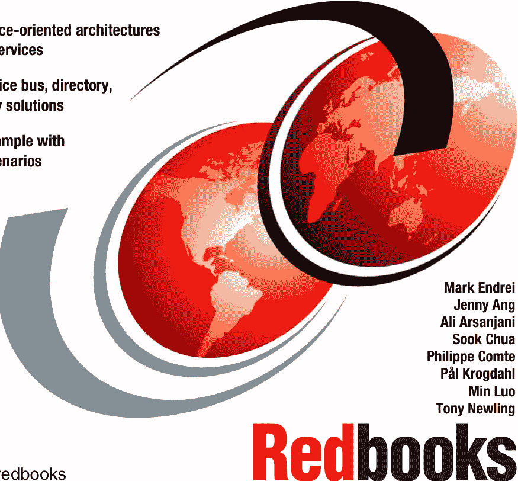


# 前言

电子商务模式（Patterns for e-business）是一组经过验证的、可重复使用的资产，用于加速 Web 应用程序开发。本 IBM Redbook 重点关注如何使用面向服务的架构和应用程序模式来启动基于服务的解决方案。

## 商标

Action  
IBM®  
AS/4  
Business  
CICS®  
Cloud®  
DB2®  
Domino  
Domino®  
Enterprise  
ibm.com  
IMT  
Java®  
Lotus®  
RACF®  
Rational®  
Redbooks®  
S/360  
Service  
Server  
SET®  
Storage®  
Tivoli®  
TotalStorage®  
WebSphere®  
UNIX®  
Windows®  
Windows NT  
z/OS  
zSeries®

以下术语为其他公司的注册商标：

Actionscape  
AS/400  
Corollar  
Ellison  
Intel  
Oracle  
Microsoft  
Sun Microsystems, Inc.  
The Open Group  
United Transaction LLC

# 编写本红书的团队

本红书是由来自全球国际技术支持组织（International Technical Support Organization）Raleigh 中心的专家团队制作的。

Sook Chua 是 IBM 业务咨询服务的高级顾问。她在架构和实施企业级、关键任务系统方面拥有 10 年的经验。她拥有新加坡国立大学的软件工程硕士学位。她的专业领域包括面向对象的架构设计以及使用 J2EE 技术领导自定义应用开发。

Philippe Comte 是位于法国的 IBM SWG IT 架构师。他拥有 20 年的 IT 经验。他毕业于巴黎高等学院（ESSEC-Paris School of Economics），获得工商管理学位。他的专业领域包括大型集中应用、协作和中间件系统。

Pål Krogdahl 是瑞典 IBM 咨询服务（IBS）的咨询 IT 架构师。他自 1998 年起一直任 IBM，涵盖软件开发、技术售前咨询和解决方案架构等多个领域。他的专业领域是分布式计算、中间件和应用服务架构（EAI）以及面向服务的架构（SOA）。

罗敏博士是 IBM 全球企业架构与技术卓越中心以及面向服务架构和 Web 服务的认证 IT 架构师。他拥有 15 年以上的 IT 行业经验，并教授了七年的本科课程和计算机科学课程。他成功地为交通、金融、制造业以及大型政府服务项目设计并实施了解决方案。罗博士于 1992 年获得佐治亚理工学院的电气工程博士学位，专注于网络仿真与优化。他还有计算机科学硕士（1987年）和计算机信息系统学士（1981年）。

Tony Newell 是澳大利亚软件组的咨询 IT 架构师。他在 IT 行业拥有 17 年经验，包括编程、教育和客户技术支持等职位。他的专业领域包括应用和过程集成。他拥有澳大利亚国立大学的地质学学士学位和澳大利亚大学计算机毕业毕业。

感谢以下人员对项目的贡献：

Jonathan Adams, IBM UK  
Jeff Estef, NASA/喷气实验室  
Michele Galic, IBM ITSO Raleigh  
Beth Hutchinson, IBM UK  
Bart Jacob, IBM ITSO Austin  
Keith Jones博士, IBM Boulder  
Martin Keen, IBM ITSO Raleigh  
Barbara McKee, IBM Austin  
Kadhar Masthan, Cognizant Technology Solutions  
Rimas Rekasius, IBM Chicago  
Rachel Reintz, IBM Mountain View  
Linda Robinson, IBM ITSO Raleigh  
Rick Robinson, IBM UK  
Andre T, IBM Rochester  
Guru Vasudeva, IBM Cincinnati  
Paul Verschueren, IBM UK  
Olaf Zimmermann, IBM Germany  
Julie Czubik, IBM ITSO Poughkeepsie

# 成为作者

加入我们为期两到六周的驻留计划！帮助编写涉及特定产品或解决方案的 IBM Redbook，同时获得前沿技术的实践经验。你将与 IBM 技术专家、业务伙伴和或客户合作。

你的努力将提高产品的认可度和客户满意度。作为奖励，你将在 IBM 开发实验室建立人脉，并提高你的生产力和市场竞争力。

了解更多关于驻留计划的信息、浏览驻留索引并在线申请：

`ibm.com/redbooks/residencies.html`

# 欢迎意见

您的意见对我们非常重要！

我们希望 Redbooks™ 能尽可能有用。请通过以下方式向我们提供关于本书或其他 Redbooks 的意见：

使用在线联系反馈表单：`ibtm.com/redbooks`

通过电子邮件将您的意见发送至：`redbook@us.ibm.com`

将意见邮寄至：IBM Corporation, International Technical Support Organization Dept. HZ8 Building 662 P.O. Box 12195 Research Triangle Park, NC 27709-2195

本红书是“电子商务模式（Patterns for e-business）”系列的一部分。在本介绍章节中，我们提供了针对特定产品或解决方案的概述。


Tony Newell 是澳大利亚软件组的咨询 IT 架构师。他在 IT 行业拥有 17 年经验，包括编程、教育和客户技术支持等职位。他的专业领域包括应用和过程集成。他拥有澳大利亚国立大学的地质学学士学位和澳大利亚大学的计算机毕业毕业。

感谢以下人员对项目的贡献：
- Jonathan Adams, IBM UK
- Jeff Estef, NASA/喷气实验室
- Michele Galic, IBM ITSO Raleigh
- Beth Hutchinson, IBM UK
- Bart Jacob, IBM ITSO Austin
- Keith Jones博士, IBM Boulder
- Martin Keen, IBM ITSO Raleigh
- Barbara McKee, IBM Austin
- Kadhar Masthan, Cognizant Technology Solutions
- Rimas Rekasius, IBM Chicago
- Rachel Reintz, IBM Mountain View
- Linda Robinson, IBM ITSO Raleigh
- Rick Robinson, IBM UK
- Andre T, IBM Rochester
- Guru Vasudeva, IBM Cincinnati
- Paul Verschueren, IBM UK
- Olaf Zimmermann, IBM Germany
- Julie Czubik, IBM ITSO Poughkeepsie

# 成为作者

加入我们为期两到六周的驻留计划！帮助编写涉及特定产品或解决方案的 IBM Redbook，同时获得前沿技术的实践经验。你将与 IBM 技术专家、业务伙伴和或客户合作。

你的努力将提高产品的认可度和客户满意度。作为奖励，你将在 IBM 开发实验室建立人脉，并提高你的生产力和市场竞争力。

了解更多关于驻留计划的信息、浏览驻留索引并在线申请：

`ibm.com/redbooks/residencies.html`

# 欢迎意见

您的意见对我们非常重要！

我们希望 Redbooks™ 能尽可能有用。请通过以下方式向我们提供关于本书或其他 Redbooks 的意见：
- 使用在线联系反馈表单：`ibtm.com/redbooks`
- 通过电子邮件将您的意见发送至：`redbook@us.ibm.com`
- 将意见邮寄至：IBM Corporation, International Technical Support Organization Dept. HZ8 Building 662 P.O. Box 12195 Research Triangle Park, NC 27709-2195

本红书是“电子商务模式（Patterns for e-business）”系列的一部分。在本介绍章节中，我们提供了针对特定产品或解决方案的概述。

## 1.1 电子商务模式的分层模型

电子商务模式方法通过重用已成功的组件和解决方案元素，来实现电子商务解决方案。该方法基于一套分层资产，可以被任何现有的开发方法利用。这些资产的结构使得每一层细节都建立在前层之上。这些资产包括：
- 识别用户、业务和数据之间交互的业务模式。
- 当单一业务模式无法提供解决方案时，将多个业务模式连接起来的集成模式。
- 代表业务模式和集成模式常见组合的复合模式。
- 提供业务模式或集成模式内部应用组件和数据概念布局的应用模式。
- 定义支持应用模式的逻辑中间件结构的运行时模式。运行时模式描述了主要的中间件节点、角色以及节点之间的接口。
- 为每个运行时模式识别经过测试的软件实现。
- 电子商务应用的设计、开发、部署和管理最佳实践指南。

这些资产及其相互关系如图 4 页的图 1-1 所示。


图 1-1 电子商务模式的分层模型

电子商务模式网站提供了一种易于导航分层模式资产的方法，以确定特定项目最合适的资产。

方便参考，请访问电子商务模式网站：

`http://www.ibm.com/developerworks/patterns/`

## 1.2 如何使用电子商务模式

正如上一节所述，电子商务模式具有分层结构，每一层都建立在前层的细节之上。

复合模式（Composite patterns）出现在上方第 4 页图 1-1 所示的层次结构的业务模式之上。然而，复合模式由许多单个业务模式和至少一个集成模式组成。在本节中，我们将讨论如何使用“电子商务资产模式（Patterns for e-business assets）”的分层结构。

### 1.2.1 业务、集成或复合模式，或自定义设计

在面临为业务问题设计解决方案的挑战时，第一步是获取尝试实现的目标的高层视图。应该描述一个建议的业务场景，并将每个元素匹配到相应的 IBM 电子商务模式（IBM Pattern for e-business）。你可能会发现，整个解决方案需要多个业务模式和集成模式，或者它适用于复合模式或自定义设计。

例如，假设一家保险公司希望减少在处理客户查询的呼叫中心花费的时间和资金。通过允许客户在线查看保单信息并请求更改，公司将能够减少通过电话处理这些事务的资源消耗。目标是让保单人能够查看存储在遗留数据库中的保单信息。

自服务（Self-Service）业务模式完美符合此场景。它旨在用于用户需要直接访问业务应用程序和数据的情况。让我们来看看这些可用的业务模式。

业务模式描述了用户、业务组织或应用程序与要访问的数据之间的关系。

表 1-1 解释了四种主要的业务模式。

| 业务模式 | 描述 | 示例 |
|---|---|---|
| 自服务（用户到业务） | 用户通过互联网或局域网与业务进行交互的应用程序 | 简单的 Web 站点应用程序 |
| 信息聚合（用户到数据） | 用户可以从海量数据、文本、图像等中提取有用信息的应用程序 | 商业智能、知识管理、Web 爬虫 |
| 协作 协作（用户到用户） | 互联网支持用户之间协作工作的应用程序 | 电子邮件、社区、聊天、视频会议等。 |
| 扩展企业（企业到企业） | 链接跨越独立企业的两个或多个业务流程的应用程序 | EDI、供应链管理等。 |

如果所有模式都能很好地契合这四个空位，将非常方便，但现实表明情况往往更加复杂。这些模式假设大多数问题在分解为其基本组件后，会符合这些模式中的多个。当一个问题需要多个业务模式时，电子商务模式以集成模式的形式提供了额外的模式。

集成模式允许我们把多个业务模式结合在一起以解决业务问题。集成模式在第 7 页的表 1-2 中概述。

| 集成模式 | 描述 | 示例 |
|---------|---|---|
| 访问集成 | 通过公共入口集成多个服务 | 门户网站 |
| 应用程序集成 | 在用户不直接调用的情况下集成多个应用程序和数据源 | 消息代理程序、工作流管理器 |

这些业务模式和集成模式可以组合以实现特定安装的业务解决方案。我们称之为自定义设计。

我们可以通过图 1-2 所示的符号化表示来说明使用自定义设计来解决业务问题。

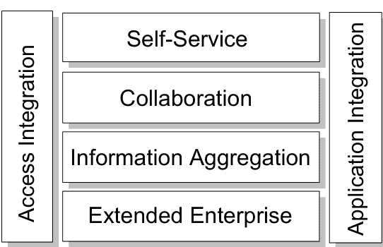

图 1-2 代表自定义设计的模式

如果自定义设计中没有使用任何业务或集成模式，我们可以将未使用的模式显示为比使用的模式更浅的色块。例如，第 8 页的图 1-3 显示了一个针对某业务问题没有协作业务模式或扩展企业业务模式的自定义设计。

| 访问集成 | 自服务 | 应用程序集成 |
|---|---|---|
| | 协作 | |
| | 信息聚合 | |
| | 扩展企业 | |

图 1-3 带有自服务、信息聚合、访问集成和应用程序集成的自定义设计

如果自定义设计在具有相似业务问题的领域中多次出现，它也可能是一个复合模式。例如，图 1-3 中自定义设计的符号化视图也可以描述卖侧枢纽（Sell-Side Hub）复合模式。

业务和集成模式的几种常见用途已被识别并正式形成复合模式。识别出的复合模式如第 9 页的表 1-3 所示。

| 复合模式 | 描述 | 示例 |
| --- | --- | --- |
| 电子商务 | 用户到在线购买 | • www.macys.com<br>• www.amazon.com |
| 门户 | 通常设计用于聚合多个信息源和应用程序，为其用户提供统一、无缝和个性化的访问。 | • 提供工资、福利和差旅体验等自服务功能的企业内网门户。<br>• 提供电子邮件或即时消息服务的协作提供者。 |
| 账户访问 | 为客户提供 24 小时的账户访问。 | • 在线经纪应用程序。<br>• 电话公司账户功能。<br>• 银行、信用卡在线。 |
| 交易交易所 | 允许买卖双方在公共站点交易商品和服务。 | • 买方侧：采购系统与电子商务市场功能的交互。<br>• 卖方侧：电子商务与其与其之间的交互。 |
| 卖侧枢纽（供应商） | 卖家拥有电子商务市场，并将其作为在互联网上销售商品和服务的工具。 | www.carmax.com（汽车购买） |


| 买侧枢纽（采购商） | 买方拥有电子商务市场，并将其作为从范围内潜在卖家处征集商品和服务的最佳交易的工具。 | `www.wre.org`（全球零售交易所） |

这些模式的组成是变化的，因为每个类型都有基础模式，但复合模式可以轻松扩展以满足更多标准。有关复合模式的更多信息，请参考《`Patterns for e-business: A Strategy for Reuse`》（Jonathan Adams, Sriniv Koushik, Guru Vasudeva 和 George Galambos）。

### 应用程序模式

一旦确定了业务模式，下一步是定义解决方案的高层逻辑组件以及这些组件如何交互。这被称为应用程序模式。业务模式通常有多种可能的应用程序模式。应用程序模式可能包含描述与用户交互的显示层、应用程序层和后端应用程序层的逻辑组件。

应用程序模式将应用程序分解为最基本的概念组件，识别应用程序的目标。在我们的示例中，应用程序属于自服务业务模式，目标是构建一个允许用户访问后端信息的简单应用程序。图 1-4 所示的自服务::直接集成单通道应用程序模式满足了这一需求。

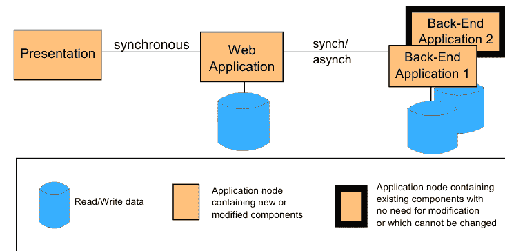

所示的应用程序模式由一个处理用户请求/响应的显示层组成。应用程序层代表处理后端应用程序和数据的组件。右侧多个应用程序框代表包含业务数据的后端应用程序。通信类型指定为同步（一个请求/一个响应，然后是下一个请求/响应）或异步（多个请求和响应交织在一起）。

假设情况比这要复杂一些。假设汽车保险策略和房屋保险策略分别存储在两个独立且不同的数据库中。用户请求实际上需要来自多个异异的后端系统的数据。在这种情况下，需要将请求分解为多个请求（分解请求）并发送到两个不同的后端数据库，然后收集请求返回的信息，并将这些信息放入响应的形式（重组）。在这种情况下，图 1-5 所示的 `Self-Service::Decomposition`（自服务::分解）应用模式更为合适。

| 同步 | 分解/重组 | 同步/异步 | 后端应用 2 |
| --- | --- | --- | --- |
| 表现层 | | | 后端应用 1 |
| 包含新或修改组件的应用节点 | 临时数据 - 进行中数据 - 已提交缓存数据 - 阶段数据（数据复制流） | 无需修改或无法更改的现有应用节点 | 读/写数据 |

这种应用模式通过增加分解和重建能力，扩展了访问后端数据的应用层理念。

### 运行时模式

可以通过更明确的执行函数进一步细化应用模式。每个函数都与运行时节点相关。在现实，这些函数或节点可以存在于不同的物理机器上，也可以共存在同一台机器上。在运行时模式中，这并不重要。重点在于所需的逻辑节点及其在整体网络结构中的部署。

例如，假设我们的客户确定其情况符合 `Self-Service` 业务模式，并且运行时模式中的 `Directly Integrated Single Channel`（直接集成单通道）模式最能描述该状况。下一步是确定最适合其情况的运行时模式。

他知道会有互联网上的用户访问他的业务数据，因此他需要某种安全措施。安全可以在应用的各个层上实施，但第一道防线几乎总是一个或多个防火墙，它们定义了谁和什么可以跨越物理边界进入他的公司网络。

他还需要确定实现应用和安全措施所需的功能节点。图 1-6 所示的运行时模式是他的选项之一。

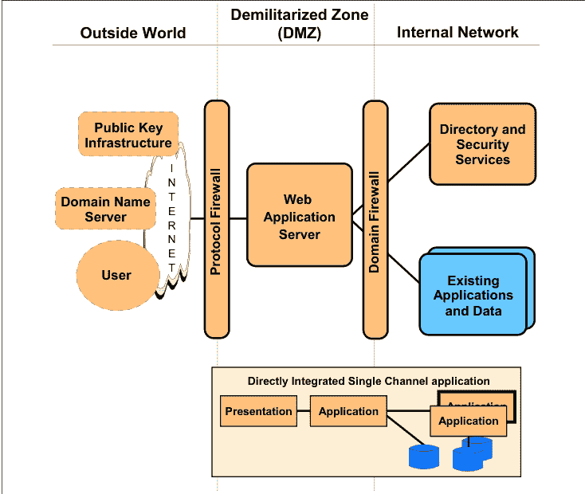

通过将应用模式分层在运行时模式之上，你可以看到每个功能节点在应用中承担的角色。表现层和应用层将用 Web 应用服务器实现，它结合了 HTTP 服务器和应用服务器的功能。它处理静态和动态 Web 页面。

应用安全通过使用公共中央目录和安全服务节点由 Web 应用服务器处理。

使运行时模式与其他模式不同的特征是将 Web 应用服务器放置在两个防火墙之间。图 1-7 所示的运行时模式是此的一种变体。它通过将 HTTP 服务器功能与应用服务器功能分离，将 Web 服务器拆分为两个功能节点。HTTP 服务器（Web 服务器重定向器）提供静态 Web 页面并将其他请求重定向到应用服务器。它将应用服务器功能移动到第二个防火墙之后，增加了安全性。

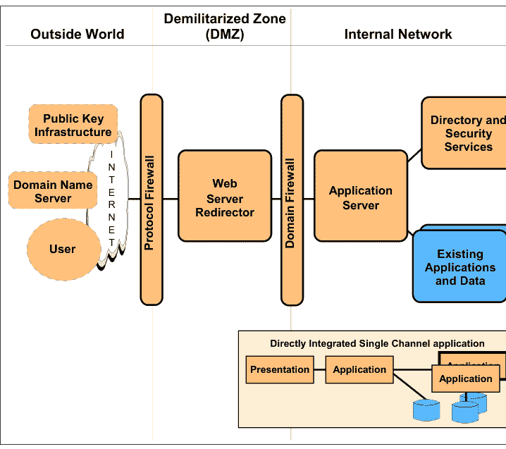

这是可用运行时模式的两个示例。每个应用模式都将定义一个或多个运行时模式。这些可以根据客户需要进行修改。例如，客户可能想要添加负载均衡功能和多个应用服务器。

### 产品映射

定义应用网络结构的最后一步是将真实产品与一个或多个运行时节点相关联。Patterns 网站显示了每个经过容量测试的运行时模式及其对应的产品。产品映射面向特定的平台，客户的网络中越可能涉及多种平台。在这种情况下，这是一个组合的问题。

例如，第 13 页图 1-7 中的运行时变体可以使用图 1-8 所示的产品集实现。

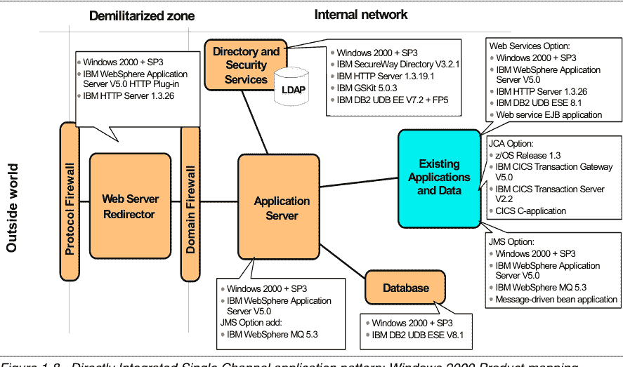

| 非军事化区 (DMZ) | 内部网络 | | | |
|---|---|---|---|---|
| * Windows 2000 + SP3<br>* IBM WebSphere Application Server V5.0 HTTP Plug-in<br>* IBM HTTP Server 1.2.36 | 目录和安全服务 | * Windows 2000 + SP3<br>* IBM SecureWay Directory V3.2.1<br>* IBM HTTP Server 1.3.19.1<br>* IBM GSOS 5.2<br>* IBM DB2 UDB EE V7.2 + FP5 | Web 服务选项:<br>* Windows 2000 + SP3<br>* IBM WebSphere Application Server V5.3<br>* IBM HTTP Server 1.2.36<br>* IBM CICS Transaction Gateway V.2<br>* CICS C-application |
| 外部世界 | 协议防火墙 | Web 服务器重定向器 | 域防火墙 | | | Windows 2000 + SP3<br>* IBM WebSphere Application Server V5.3<br>* IBM HTTP Server 1.2.36<br>* IBM CICS Transaction Gateway V.2<br>* CICS C-application |
| | | | | | Windows 2000 + SP3<br>* IBM DB2 UDB EE V7.2 + FP5 |
| | | | | | Web 服务选项:<br>* Windows 2000 + SP3<br>* IBM WebSphere Application Server V5.3<br>* IBM HTTP Server 1.2.36<br>* IBM CICS Transaction Gateway V.2<br>* CICS C-application |
| | | | | | Windows 2000 + SP3<br>* IBM SecureWay Directory V3.2.1<br>* IBM HTTP Server 1.3.19.1<br>* IBM GSOS 5.2<br>* IBM DB2 UDB EE V7.2 + FP5 |
| | | | | | Windows 2000 + SP3<br>* IBM WebSphere Application Server V5.3<br>* IBM HTTP Server 1.2.36<br>* IBM CICS Transaction Gateway V.2<br>* CICS C-application |

图 1-8 直接集成单通道应用模式：映射

定义应用网络结构的最后一步是将真实产品与一个或多个运行时节点相关联。Patterns 网站显示了每个经过容量测试的运行时模式及其产品。产品映射面向特定的平台，客户的网络中越可能涉及多种平台。在这种情况下，这是一个组合的问题。

例如，第 13 页图 1-7 中的运行时变体可以使用图 1-8 所示的产品集实现。

IBM 电子商务模式是一组收集的资产。它们帮助组织理解和分析复杂问题并促进基于 Web的应用。

### 面向服务的架构

本章介绍了面向服务的架构。它还介绍了 Web 服务作为面向服务的架构的实现。在本章中我们将讨论以下内容：

- 面向服务的架构概述
- Web 服务架构
- Web 服务与面向服务的架构
- 企业总线
- 在哪里找到更多信息

在本节中，我们简述了面向服务的架构的演进。然后我们探索了基于组件开发与面向服务的架构之间的关系，并展示了组件如何成为实现服务的基础设施。

在 IT 高管面临降低成本和最大化利用现有技术挑战的同时，他们必须不断努力提供更好的服务、增强竞争力，并对业务战略优先事项做出更快速的响应。


所有这些压力背后有两个核心主题：异质性和变化。今天大多数企业包含一系列不同时代和技术的系统、应用程序和架构。从多个供应商和跨不同平台集成产品几乎是一场噩梦。但我们也无法负担对 IT 采用单一供应商的方法，因为应用套件和支持性基础设施是不灵活。

变化是今天 IT 高管面临的问题的第二个核心主题。全球化和电子商务加速了变化速度。全球化导致了激烈竞争，导致产品周期的缩短，因为公司正寻求获得竞争竞争优势。在竞争性产品和互联网上丰富的产品信息的驱动下，客户的需求和要求变化得更快。作为回应，产品和服务的竞争改进周期进一步加速。

技术的改进仍在加速，以适应不断变化的客户需求。为了在当今动态竞争环境中生存，更说成功，业务必须快速适应，IT 基础设施必须赋予企业的适应能力。

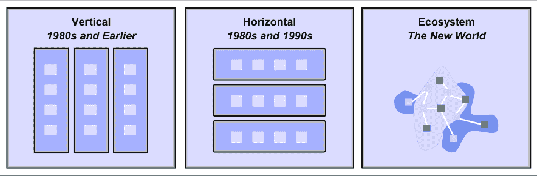

我如何让我的 IT 环境对不断变化的业务需求更加灵活且响应迅速？我们如何让这些异构系统和应用程序尽可能地无缝通信？如何在不让企业破产的情况下实现业务目标？

IT 解决方案/赋能工具随着业务演进并行发展，如图 2-2 所示。目前，许多 IT 高管和专业人士认为，我们现在正非常接近通过面向服务的架构（SOA）提供满意的答案。

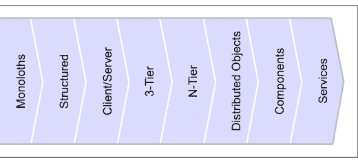

为了缓解异构性、互操作性和不断变化的需求带来的问题，此类架构应该提供一个平台，用于构建具有以下特征的应用程序服务：

- 松耦合
- 位置无关
- 协议无关

基于这种面向服务的架构，服务消费者不需要关心它它正在通信的特定服务，因为底层基础设施（或服务“总线”）将代表消费者做出适当的选择。基础设施具有尽可能多的来自不同实现技术（如 `J2EE` 或 `.NET`）的细节，这些不应影响 SOA 用户。我们还应该能够在存在“更好”的服务实现（且具有更好的服务质量特征）时，重新考虑并替换它。

## 2.1.2 作为解决方案的面向服务架构

自从“软件危机”促使软件工程诞生以来，IT 行业一直在努力寻找解决方案来解决问题。多年来，以下核心技术进步的简名单带我们走到了今天。我们将简要讨论这些技术，重点将放在这些技术如何解决 IT 问题上。

### 面向对象的分析与设计

Larman 在《应用 UML 和模式：面向对象分析与设计导论》一书中，将面向对象的分析与设计的本质描述为：“从对象（事物、概念或实体）的角度考虑‘问题领域域和逻辑解决方案’”。Jacobson 则在《面向对象的软件工程：一种用例驱动的方法》中将这些对象定义为：“以若干许多操作和一个能够记住这些操作影响的特征（state）为特征”。

在面向对象的分析中，此类对象在问题领域域中被识别和描述；而在面向对象的设计中，它们被转换为逻辑软件对象，并最终在面向对象的编程语言中实现。

通过面向对象的分析与设计，对象（或一组对象）的某些方面可以被封装，以简化复杂业务场景的分析。对象的某些特征也可以被抽象，以便只捕捉重要或本质方面，从而降低复杂性。

基于组件的设计并不是一项新技术。它是从对象范式自然演变而来的。在面向对象分析与设计的早期，细粒度对象被标记为提供“重用”的机制，但这些对象的粒度太低，且没有标准来使广泛的重用变得实用。粗粒度组件日益成为应用程序开发和系统集成中重用的目标。这些粗粒度组件从一组内心的细粒度对象提供了定义良好的功能。通过这种方式，封装的解决方案套也可以被封装为“组件”。

一旦组织基于功能分明的组件实现了更高层次的架构成熟度，支持业务的应用程序就可以被分为一组粒度不断增大组件。组件可以被视为管理和暴露服务的机制。它们可以协同使用一系列技术：实现业务级用例的大粒度企业组件，可以使用较新的面向对象软件开发方法结合遗留系统来实现。

在《企业系统的基于组件开发》中，Allen 引入了概念，将组件描述为“一个提供相关服务物理黑盒封装的可执行代码单元。其服务只能通过包含交互标准的统一、发布的接口进行访问。组件必须能够（通过通信接口）连接到更大的组中”。

服务通常被实现为粗粒度的、可发现的软件实体，它以单实例的形式存在，并通过松耦合的基于消息的通信模型与应用程序和其他服务进行交互。第 22 页的图 2-3 显示了重要的面向服务术语：

- 服务（Services）：逻辑实体，由一个或多个发布接口定义的。
- 服务提供者（Service provider）：实现服务规范的软件实体。
- 服务消费者（或请求）：调用服务提供者的软件实体。传统上，这被称为“客户端”。服务消费者可以是用户应用程序或另一个服务。
- 服务定位器（Service locator）：一种特殊的服务提供者，充当注册表并允许查找服务接口和服务位置。
- 服务代理人（Service broker）：一种特殊的服务提供者，可以将服务请求传递给一个或多个额外的服务提供者。

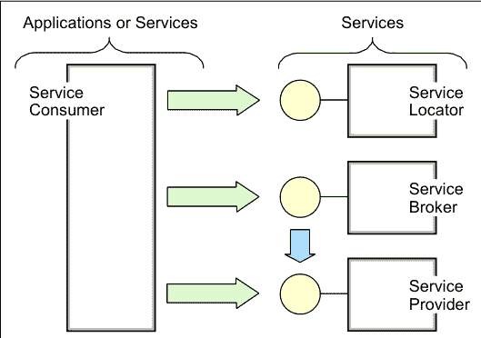

图 2-3 面向服务术语

在组件和服务的开发中，接口的设计使得软件开发实体隐含并暴露了其定义的关键部分。因此，“接口”的概念和概念是基于组件和面向服务的系统成功的关键。以下是某些与接口相关的定义：

- 接口（Interface）：定义一组公共方法签名，但不提供实现。接口定义了请求者和提供者之间的约。接口的任何实现都必须提供所有方法。
- 发布接口（Published interface）：唯一标识的且可以通过注册表供客户端动态发现。
- 公共接口（Public interface）：供客户端使用但未发布，需要客户端具备静态知识。
- 双接口（Dual interface）：接口经常成对开发，一个接口依赖于另一个；例如，客户端必须实现一个接口以调用请求者，因为接口提供了某种回调机制。

第 23 页的图 2-4 显示了客户关系管理（CRM）服务的 UML 定义（用 UML 组件表示），它实现了 `AccountManagement`、`ContactManagement` 和 `SystemsManagement` 接口。这些接口中的前两个是发布接口，而后者是公共接口。注意 `SystemsManagement` 接口和 `ManagementService` 接口构成了一个双接口。CRM 服务可以实现许多此类接口，而这种服务（组件）根据客户端以多种方式行为的能力，使得行为的实现具有极大的灵活性。甚至可以为特定类的客户端提供不同或额外的服务。在某些运行时，这种能力也被用于在单个组件或服务支持相同接口的不同版本。

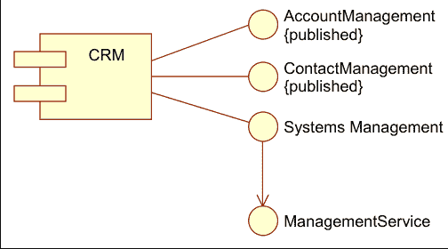

图 2-4 实现的服务

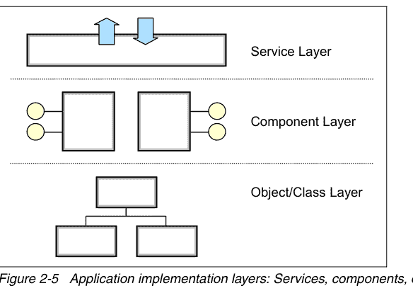

面向服务的架构（SOA）提供了一种构建分布式系统的方法，将应用功能作为服务提供给终端用户应用程序或其他服务。它由可以分为*功能性*和*服务质量*的元素组成。第25页的图 2-6 显示了架构栈以及在面向服务的架构中可能观察到的元素。

> 注意：面向服务的架构堆栈可能是一个有争议的问题，不同的支持者提出了许多不同的堆栈。我们的堆栈并没有被定位为*唯一的服务栈*。它只是被作为在书中其他部分中构建 SOA 讨论的有用框架。


架构栈分为左右两部分，左部分处理架构的功能方面，右部分处理服务质量方面。这些元素的详细描述如下：

功能方面包括：

- 传输（Transport）：用于将服务请求从服务消费者移动到服务提供者，并将服务响应从服务提供者移动到消费者。
- 服务通信协议（Service Communication Protocol）：服务提供者和服务消费者之间约定的一种种机制，用于通信请求的内容和返回的内容。
- 服务描述（Service Description）：一种约定的模式，用于描述服务是什么、如何调用它，以及成功调用它需要什么的数据。
- 服务（Service）：描述一个可供使用的实际服务。
- 业务过程（Business Process）：服务的集合，按照特定的顺序和一组特定的规则被调用，以实现业务需求。注意，业务过程本身可以被视为一个服务，这导致了业务过程可能由不同粒度的服务组成的想法。
- 服务注册表（Service Registry）：服务数据描述的存储库，服务提供者可以使用它发布服务，服务消费者可以使用它发现或找到可用的服务。服务注册表可能为需要集中存储库的服务提供其他功能。

服务质量方面包括：

- 策略（Policy）：服务提供者向消费者提供服务的一系列条件或规则。策略既有功能性的方面，也有与服务质量相关的方面；因此，我们在功能领域和服务质量领域中都有策略函数。
- 安全性（Security）：可能应用于调用服务的服务消费者的标识、授权和访问控制的一系列规则。
- 事务（Transaction）：可能应用于一组服务的一系列属性，以交付一致的结果。例如，如果使用一组三个服务来完成一项业务功能，那么它们必须全部全部完成，或者一个都不完成。
- 管理（Management）：可能应用于管理所提供或消耗的服务的一系列属性。


图 2-7 显示了面向服务的架构中的协作。这些协作遵循“发现、绑定和调用”（`find, bind and invoke`）范式，其中服务消费者通过查询服务注册表查找符合其标准的服务来执行动态的服务定位。如果该服务存在，注册表将为消费者提供服务的接口契约和端点地址。接下来的图说明了面向服务的架构中协作以支持“发现、绑定和调用”范式的实体。

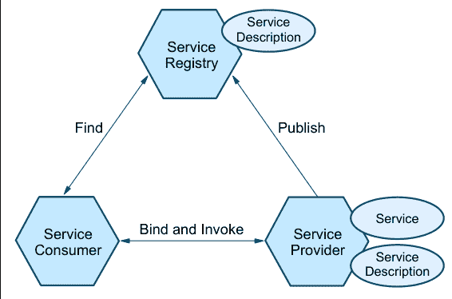

## 面向服务的架构中的角色

- `Service consumer` 服务消费者：服务消费者是一个应用程序、软件模块或其他需要服务的实体。它发起对注册表中服务的服务的查询，通过传输层绑定到服务，并执行服务函数。服务消费者根据接口契约执行服务。
- `Service provider` 服务提供者：服务提供者是一个网络可寻实体，接受并执行来自消费者的请求。它将其服务和服务接口契约发布到服务注册表中，以便服务消费者发现并访问该服务。
- `Service registry` 服务注册表：服务注册表是服务发现的实现器。它包含可用服务的存储库，并允许向感兴趣的服务消费者查找提供者接口。

面向服务的架构中的每个实体都可以扮演服务提供者、消费者和注册表这三个角色中的一个（或）。

## 面向服务的架构中的操作

- `Publish` 发布：为了能够被访问，必须发布服务描述，以便被服务消费者发现和调用。
- `Find` 查找：服务请求者通过查询服务注册表查找符合其标准的服务来定位服务。
- `Bind and invoke` 绑定并调用：获取服务描述后，服务消费者根据服务描述中的信息调用服务。

## 面向服务的架构中的构件

- `Service` 服务：通过发布的接口提供的可供使用的服务，允许被服务消费者调用。
- `Service description` 服务描述：服务描述指定了服务消费者将如何与服务提供者交互。它指定了服务的请求和响应的格式。该描述可能指定一组前提条件、后置条件和/或服务质量（QoS）水平。

除了动态服务发现和服务接口契约的定义外，面向服务的架构具有以下特征：

- 服务是自包含的且是模块化的。
- 服务支持互操作性。
- 服务是松耦合的。
- 服务是位置透明的。

服务是由组件组成的复合模块。

这些特征对于满足“按需业务电子商务™”（`e-business on demand™`）运行环境的要求也至关重要，正如第 301 页“按需业务电子商务和面向服务的架构”章节中所定义的那样。

最后，面向服务的架构并不是一个新概念。如图 2-8 所示，面向服务的架构的示例包括 `CORBA`、`DCOM` 和 `J2EE`。面向服务的架构的采用者还扩展到了万维网（`WWW`）和 Web 服务。

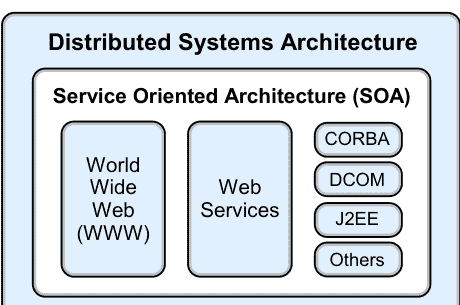

在面向服务的架构中，服务映射到流程分析过程中识别出的业务功能。取决于业务过程的服务可能是细粒度的。每个服务都有定义良好的接口，允许其被发布、发现和调用。企业可以选择向业务合作伙伴发布服务，也可以在组织内部发布。服务是一个粗粒度的处理单元，消耗并产生对象集。它与编程语言术中的对象不同。相反，它可能更接近 `CICS®` 或 `IMS™` 事务的概念。

服务由一组协作工作以交付其所代表的业务功能的组件组成。因此，相比之下，组件是更细粒度的。此外，服务组件组件通常映射到业务实体以及操作实体的业务规则。例如，让我们看看图 2-9 所示 `WS-I` 供应链管理的订单组件模型。

| 订单类型 (`PurchOrdType`) | 客户引用类型 (`CustomerReferenceType`) |
| --- | --- |
| `+getOrderNum ( ) +setOrderNum ( ) +getCustomerRef ( ) +setCustomerRef ( ) +getItems ( ) +setItem ( ) +getTotal ( ) +setTotal ( )` | `+getValue ( ) +setValue ( )` |
| 项目列表 (`ItemList`) | `+getID ( ) +setID ( ) +getQty ( ) +setQty ( )` |

在基于组件的设计中，创建组件是为了密切匹配业务实体（如客户、订单、订单项目），并封装匹配预期行为。例如，订单组件提供了获取订购产品列表和订单总金额的功能；项目组件提供了获取订购产品数量和价格的功能。每个组件的实现都封装在接口之后。因此，订单组件的用户并不知道订单表的模式以及计算总金额税收、回扣和/或折扣的算法。

在面向服务的设计中，服务不是基于业务实体设计的。相反，每个服务都是一个整体单元，管理跨业务实体的操作。例如，客户服务将响应任何需要访问客户信息的其他系统或服务的请求。

客户的订单历史。客服部门拥有其所管理的客户的所有数据，并能够代表呼叫方发起其他服务查询，以提供统一的客户服务视图。这意味着服务是一个管理对象，负责创建和管理其 `set` 组件。

正如之前讨论的，企业正面临着两个核心关注点：快速变化的能力以及降低成本的需求。为了保持竞争力，企业必须迅速适应收购和重组等内部因素，或竞争压力和客户需求等外部因素。这需要一种具有高成本效益且灵活的 IT 基础设施来支持业务发展。

通过面向服务的架构（SOA），我们可以实现多项优势，帮助组织在当今动态的业务环境中取得成功：

- 利用现有资产。

SOA 提供了一层抽象，使组织能够通过将这些资产封装为提供业务功能的服务，继续利用其对 IT 的投资。组织可以持续从现有资源中获得价值，而无需从头开始构建。

- 更容易集成和管理复杂性。

面向服务的架构中，集成点是服务规范而非实现。这提供了实现透明性，并在基础设施和实现发生变化时将影响降最低。通过在构建于异构系统上的现有资源和资产面前提供服务规范，由于复杂性被隔离，集成变得更加易于管理。随着企业通力合作提供价值链，这一点变得尤为重要。

- 更具响应能力和更短的上市时间。

从现有服务组合成新服务的能力，为必须敏捷响应严苛业务需求的组织提供了独特优势。利用现有的组件和服务可以缩短从收集需求、执行设计、开发到测试的整个软件开发周期所需的时间。这导致了新业务服务的快速开发，并允许组织快速响应变化并缩短上市时间。

- 降低成本并增加重用性。

通过松耦合的方式暴露核心业务服务，可以根据业务需求更方便地使用和组合它们。这意味着资源重复的减少、重用潜的增加以及成本的降低。

- 为未来做好准备。

SOA 允许企业为未来做好准备。由一系列业务服务组成的业务流程可以更轻松地创建、更改和管理，以满足时代需求。SOA 提供的灵活性和响应能力对于企业的生存和繁荣至关重要。

面向服务的架构绝非灵丹妙药，迁移到 SOA 也并不是一项易事。与其一夜之间将整个企业迁移到面向服务的架构，建议的方法是随着业务需求的产生或预见，迁移适当的业务功能子集。

Web 服务是一项较新的技术，已作为面向服务的架构的重要实现方式而获得广泛认可。这是因为 Web 服务提供了一种分布式计算方法，用于在互联网上集成极其异构的应用程序。Web 服务规范完全独立于编程语言、操作系统和硬件，以促进服务消费者和提供者之间的松耦合。该技术基于开放技术，如：

- 可扩展标记语言 (`XML`)
- 简单对象访问协议 (`SOAP`)
- 通用描述、发现和集成 (`UDDI`)
- Web 服务描述语言 (`WSDL`)

使用开放标准可以在不同供应商解决方案之间提供广泛的互操作性。这些原则意味着公司可以在无需了解服务消费者的情况下实现 Web 服务，反之亦然。这促进了即时集成，并允许企业轻松、动态地建立新的伙伴关系。

### 2.2.1 什么是 Web 服务

W3C Web 服务架构工作小组对 Web 服务的以下工作定义达成一致：

“Web 服务是一种由 URI 标识的软件应用程序，其接口和绑定可以作为 XML 产物被定义、描述和发现。 Web 服务支持通过基于的协议交换基于 XML 的消息与其他软件代理进行直接交互。”

基础 Web 服务结合了两种无处不在的技术的力量：`XML`，通用数据描述语言；以及浏览器和 Web 服务器广泛支持的 `HTTP` 传输协议。

```
Web services = XML + transport protocol (such as HTTP)
```

Web 服务的某些关键特征如下：

- Web 服务是自包含的。

在客户端，不需要额外的软件。例如，一种支持 XML 和 HTTP 客户端的编程语言就足够你入门了。在服务器端，可能需要 Web 服务器和 servlet 引擎。可以在不写单行代码的情况下，让现有应用程序 Web 服务化。

- Web 服务是自描述的。

客户端和服务器都不知道或关心请求和响应消息格式及内容之外的任何事情（松耦合的应用集成）。

消息格式的定义随消息传输。不需要外部元数据存储库或代码生成工具。

- Web 服务是模块化的。

Web 服务是一种在 Web 平台上部署和提供业务功能访问的技术；`JEE`、`CORBA` 和其他标准是实现这些 Web 服务的技术。

- Web 服务可以在 Web 上进行发布、定位和调用。

实现这些所需的标准是：

- 简单对象访问协议 (`SOAP`)，也称为面向服务的架构协议，一种基于 XML 的 RPC 和消息协议


- Web 服务描述语言 (`WSDL`)，描述接口和定义的语言

- 通用描述、发现和集成 (`UDDI`)，一种用于查找服务的注册机制

- Web 服务是平台无关且互操作的。

服务提供者和请求者之间的交互设计为完全独立平台。这种交互需要 `WSDL` 文档来定义接口和协议（通常为 `HTTP`）。由于双方不知道对方在使用什么平台，互操作性得以实现。

- Web 服务本质是开放且基于标准的。

`XML` 和 `HTTP` 是 Web 服务的基础。Web 服务大部分是使用开放项目构建的。因此，供应商独立性和互操作性是现实目标。

- Web 服务是动态的。

通过 `UDDI` 和 `WSDL`，动态电子商务可以通过 Web 服务成为现实。

- Web 服务是可组合的。

简单的 Web 服务可以通过工作流技术或调用底层服务来聚合为更复杂的服务。

图 2-10 显示了基于第 26 页所示 `SOA` 模型的典型 Web 服务协作。


### 2.2.2 Web 服务互操作性

Web 服务是 IT 世界中新兴的明星，支持现有系统的集成以及组织内外资源数据的共享。它们是一项较新的技术，Web 服务标准仍在不断完善和开发。

为了使 Web 服务互操作性的核心承诺生效，需要对标准进行仔细管理。此外，标准的解释和实施指导对于技术的采用至关重要。Web 服务互操作性组织在该领域起着重要角色，作为标准的集成器，帮助 Web 服务以结构化协调的方式推进。

`IBM` 在这方面的承诺包括积极参与 `WS-I` 标准开发，并在运行时和开发产品中早期交付 `WS-I` 合规性。在本出版物中，我们强调作为 Web 服务互操作性促进者的标准和指南。

#### Web 服务互操作性组织

Web 服务互操作性组织 (`WS-I`) 是一个由约 150 家公司组成的开放行业联盟，代表汽车、消费品、金融、政府、保险、电信、旅游和计算机行业等不同领域。其宗旨是：

- 通过使用通用协议交换服务间消息，促进跨平台、操作系统和编程语言的 Web 服务互操作性。
- 鼓励采用 Web 服务。
- 通过提供开发互操作 Web 服务的指导、最佳实践和其他资源来加速部署。

`WS-I` 作为标准的集成器，支持与拥有规范的标准机构的关系，并促进与行业联盟和其他组织的沟通与合作，如第 35 页的图 2-11 所示。

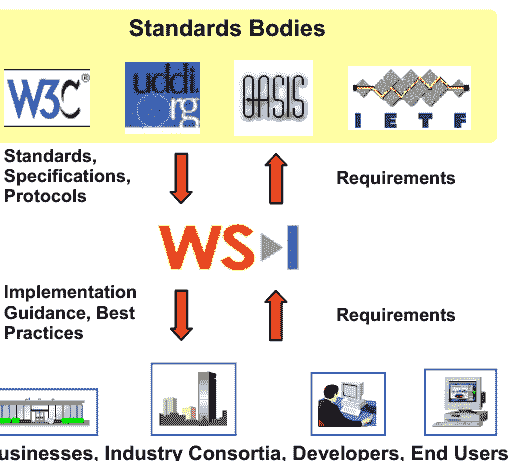

图 2-11 `WS-I`，标准与行业

`WS-I` 有一组交付物，用于辅助 Web 服务的开发和部署，包括其互操作 Web 服务的配置（profile）。配置在 `WS-I` 术语表中定义如下：

> “为了支持互操作性的一系列需求，`WS-I` 将交付一组支持技术需求和规范的配置，以实现互操作的 Web 服务，”

它包含以下交付物：

- *配置规范 (Profile Specification)*

这包括了特定版本层的非专有 Web 服务相关规范列表，以及对这些规范的说明和限制列表，以促进互操作 Web 服务的开发。

- *用例和使用场景 (Use Cases and Usage Scenarios)*

这些内容分别捕获了 Web 服务的业务和技术需求。这些需求反映了支持 Web 服务解决方案的现实需求类别，并提供了一个框架来展示 `WS-I` 配置中描述的指南。

## 示例应用程序 (Sample Applications)

这些示例演示了基于 Web 服务使用场景和用例构建的应用程序的实现，这些应用程序符合给定的配置集。在多个平台上使用不同的语言和开发工具对同一个示例应用程序进行实现，使得 `WS-I` 能够展示操作中的互操作性，并为 Web 服务从业者提供随取可用的资源。

## 测试工具 (Testing Tools)

这些工具用于监控和分析与 Web 服务的交互，以确定交换的消息是否符合 `WS-I` 配置的指南。

有关 `WS-I` 的更多信息，请参阅：

`http://www.ws-i.org/`

## WS-I 基础配置 1.0 (WS-I Basic Profile 1.0)

`WS-I` 交付了它的第一个互操作 Web 服务配置，称为 `WS-I Basic Profile 1.0`，它关注 Web 服务基础的基础技术：`HTTP`、`SOAP`、`WSDL`、`UDDI`、`XML` 和 `XML Schema`。基础配置 1.0 已于 2003 年 7 月 22 日被 `WS-I` 董事会和成员一致通过。

`WS-I` 基础配置 1.0 - 配置规范由以下非专有 Web 服务相关规范组成：

- `SOAP 1.1`
- `WSDL 1.1`
- `UDDI 2.0`
- `XML 1.0`（第二版）
- `XML Schema Part 1: Structures`
- `XML Schema Part 2: Datatypes`
- `RFC2246`: 传输层安全协议版本 1.0
- `RFC2459`: Internet X509 公钥基础设施证书和 CRL 配置文件
- `RFC2616`: 超文本传输协议 1.1
- `RFC2818`: 基于 TLS 的 HTTP
- `RFC2965`: HTTP 状态管理机制
- 安全套接层协议版本 3.0

`WS-I` 基础配置 1.0 - 使用场景包含三个使用场景，其中使用场景是交互实体的设计模式，包括参与者（actor）、角色和消息交换模式：

- 单向使用场景
  - 最简单的使用场景，消息交换是单向的，由消费者（Consumer）向提供者（Provider）发送请求
  - 仅应在可以容忍信息丢失的情况下使用
- 同步请求/响应使用场景
  - 最常用的使用场景，消费者向提供者发送请求，提供者处理请求并返回响应
- 基础回调使用场景
  - 用于使用同步操作模拟异步操作
  - 由两个同步请求/响应使用场景组成，一个由消费者发起，另一个由生产者（Producer）发起

通过 Web 服务技术栈完成使用场景到配置规范的说明和限制的映射，以指导 Web 开发者。

`WS-I` 供应链管理示例应用程序描绘了一个虚构消费电子产品零售商的应用程序。我们将使用 `WS-I` 示例在整个出版物中说明概念和场景。

另见 `IBM developerWorks®` 文章：

- `WS-I` 基础配置 1.0 的初探，访问地址为：
  `http://www.ibm.com/developerworks/webservices/library/ws-basicprof.html`
- `WS-I` 使用场景的初探，访问地址为：
  `http://www.ibm.com/developerworks/webservices/library/ws-iuse/`
- `WS-I` 示例应用程序的预览，访问地址为：
  `http://www.ibm.com/developerworks/webservices/library/ws-wsisam/`

## 2.3 Web 服务与面向服务的架构

Web 服务是一种非常适合实现面向服务的架构（`SOA`）的技术。本质上，Web 服务是自描述和模块化的应用程序，它们将业务逻辑作为服务暴露，可以在互联网上进行发布、发现和调用。基于 `XML` 标准，

Web 服务可以使用任何编程语言、任何协议或任何平台作为松耦合的应用程序组件进行开发，并随时随地访问。

需要指出的是，Web 服务并非实现面向服务架构的唯一技术。可以找到使用其他技术成功实现面向服务架构的示例。关于 `SOA` 和 Web 服务的更多信息，请参阅：

```http://www.ibm.com/solutions/webservices/
```

该网站提供了该主题的 `IBM` 资源。

## 2.4 企业服务总线 (Enterprise Service Bus)

Web 服务技术在企业应用开发和集成中变得越来越广泛。目前的关键问题之一是寻找更高效有效的方法来设计、部署 Web 服务；更重要的是超越基础的点对点通信。在这种背景下，企业服务总线（`ESB`）模型正作为一项重大进展。

### 2.4.1 基础 Web 服务

（点对点的 `SOAP/HTTP`）Web 服务为实现面向服务的架构提供了坚实的基础，但在企业规模上存在一些影响其灵活性和维护性的重要考虑。

首先，基础 Web 服务的点对点性质意味着当提供者接口发生变化时，消费者通常需要进行修改。这在小范围内可能不是问题，但在范围内意味着需要对许多客户端进行修改，可能会变得越来越困难。

其次，当大量的服务消费者和提供者使用点对点的“意大利式”连接进行通信时，你会得到一个脆弱且缺乏灵活性的架构。最后，基础 Web 服务要求每个消费者为其需要的每个提供者都有合适的协议适配器。在许多客户端应用程序中部署多个协议适配器增加了成本和维护问题。

让我们看看企业服务总线方法如何解决这些问题。

### 2.4.2 什么是企业服务总线

企业服务总线概念不是一种产品，而是实现面向服务的架构的一种最佳实践。如图 2-12 所示，它建立了一个企业级消息总线，将消息基础设施与消息转换和基于内容的路由结合在服务消费者和提供者之间的集成层中。

| 服务消费者 | 企业服务总线 | 服务提供者 |
| :--- | :--- | :--- |


| | - 转换消息格式...<br>- 路由请求...<br>- 转换... | |

企业服务总线的主要目标是提供资源的虚拟化，允许业务逻辑独立于基础设施、网络和这些业务服务的提供进行开发和管理。`ESB` 中的资源被建模为提供一个或多个业务操作的服务。

实现企业服务总线需要一套集成中间件服务，支持以下架构风格：

- 面向服务的架构，分布式应用程序由细粒的可重用服务组成，这些服务具有良好定义且符合标准的接口
- 消息驱动的架构，应用程序通过 `ESB` 发送消息给接收应用程序
- 事件驱动的架构，应用程序独立地生成和消费消息

企业服务总线提供的中间件服务需要包含：

- 通信中间件：支持多种通信范式（如同步、异步请求/响应、单向、回调）、服务质量（如安全性、保证递送、性能、事务性）、`API`、平台以及标准协议
- 一种用于在网络内部对传输中的服务请求和响应注入智能处理的机制
- 基于标准的用于实现服务快速集成的工具
- 用于管理松耦合应用程序及其交互的管理系统

### 2.4.3 IBM 的愿景

如第41页图 2-13 所示，`IBM` 正在通过企业服务总线架构扩展其 Web 服务和面向服务的架构愿景，该架构使用中间件/协调者模式提供了一个基于标准的集成层。

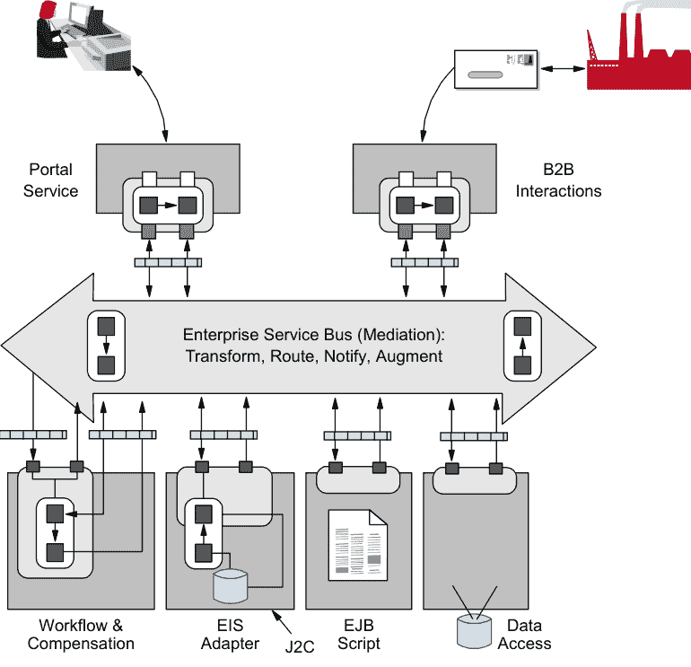

门户服务

B2B 交互

企业服务总线（调解）：转换、路由、通知、增强

工作流与 补偿

`EIS` 适配器 `J2C`

`EJB` 脚本

数据访问

图 2-13 企业服务总线概念模型

在服务消费者和提供者之间调用智能调解，以促进服务选择、日志记录、使用指标等。这些调解可以通过策略进行配置，策略定义了消费者提供者的能力和需求。例如，如果提供者期望加密消息，则请求者调解应包含此类能力。如果请求者仅支持 `SOAP/HTTP`，则应添加一个中间件将其转换为 `SOAP/JMS`。

该模型中的主要组件包括使用工具生成或由程序员实现的 `WSDL` 服务。这些包括：

- 工作流和补偿系统，用于执行业务流程或工作流。业务流程中的活动节点通常映射到对 Web 服务操作的调用。该组件支持 `J2EE` 事务和用于长周期业务流程的补偿模型。
- 基于 `J2EE` 适配器架构的企业信息系统 (`EIS`) 适配器，允许与遗留系统进行集成。
- 通过 `WSDL` 接口进行 `XML` 数据库访问。
- 程序员使用 `J2EE` 编程模型实现的自定义 `WSDL` 服务。

企业服务总线支持服务之间通信的多种协议，包括 `SOAP`、`HTTP`、`JMS`、`RMI/IIOP` 等。

企业服务总线今天可以使用目前的 `IBM WebSphere` 产品实现，例如：

- `IBM WebSphere Application Server V5.1` 为使用 `SOAP` over `HTTP` 或 `JMS` 的服务提供 `J2EE` 运行时环境，以及用于 `EIS` 集成的 `J2EE` 适配器。
- `IBM WebSphere MQ` 提供 `JMS` 消息基础设施。
- 带有 `IBM WebSphere Server Network Deployment V5.1` 的 Web Services Gateway 提供 `SOAP` 消息路由、转换和协议转换。`UDDI` 注册提供动态服务发现。
- `IBM WebSphere Application Server Enterprise V5.0` 提供用于服务编排或工作流的过程调度（Process Choreographer）。
- `IBM DB2® Extender` 允许通过 `ESB` 访问数据库。
- `IBM WebSphere Portal` 允许用户集成、个性化地访问业务服务。

你也可以在未来的 `WebSphere` 产品发布中看到对企业服务总线能力的关注。

> 注意：企业服务总线的实现超出了本书的范围。这里的目的仅仅是提供这一重要的架构最佳实践的介绍。

## 2.5 在何处查找更多信息

有关本章讨论话题的更多信息，请参阅：

- 以下 `IBM developerWorks` 文章：
  - 初步了解 `WS-I Basic Profile 1.0`，地址为：http://www.ibm.com/developerworks/webservices/library/ws-basicprof.html
  - 初步了解 `WS-I` 使用场景，地址为：http://www.ibm.com/developerworks/webservices/library/ws-iuse/
  - `WS-I` 示例应用预览，地址为：http://www.ibm.com/developerworks/webservices/library/ws-wsisamp/
  - 使用面向服务的架构和组件化开发构建 Web 服务应用程序，地址为：http://www.ibm.com/developerworks/rational/library/510.html
- `W3C` 工作组说明，Web 服务架构，地址为：http://www.w3.org/TR/2004/NOTE-ws-arch-20040211/
- Craig Larman, Applying UML and Patterns: An Introduction to Object-Oriented Analysis and Design and the Unified Process, 2nd Ed., Prentice Hall, 2001
- Ivar Jacobson, Magnus Christerson, Patrik Jonsson, Gunnar Overgaard, Object-Oriented Software Engineering: A Use Case Driven Approach, Addison-Wesley, 1992
- Paul Allen, Component-Based Development for Enterprise Systems, Cambridge University Press, 1998


# 3

## 面向服务的架构与电子商务模式

在本章中，我们介绍了 `IBM` 电子商务模式（Patterns for e-business）如何补充面向服务的架构（`SOA`）方法。我们查看了 `SOA` 如何应用于模式，特别是自服务模式和扩展企业业务模式、应用程序集成模式以及相关的应用程序模式。

关于面向服务的架构的详细描述可以参阅第 79 页的第 4 章“面向服务的架构”。

### 3.1 在电子商务模式中使用面向服务的架构

“电子商务模式”并不是一种解决方案方法论。它是一系列经过验证的架构，源自超过 20,000 个成功的基于的项目。电子商务模式通过在不同层级上定义架构模式（从业务模式到应用程序模式）来弥合业务与 IT 之间的鸿沟。

通过面向服务的架构方法，这通过创建服务集成层提升到了另一个抽象层次。这使得企业能够敏捷并快速高效地对市场变化及其客户需求做出响应，并保持竞争力。


图 3-1 面向服务的架构与电子商务模式

电子商务模式（Patterns for e-business）可以与任何方法论结合使用。当与 `SOA` 方法结合使用时，重点在于创建和集成松耦合的服务而非应用程序，以支持业务。服务是自包含且模块化的，而应用程序往往由于粒度太粗而无法有效重用，并且通常由于灵活性不足而无法在企业或扩展企业中被利用。

现有的业务、集成、应用程序和运行时模式与 `SOA` 方法一致。业务问题将驱动潜在解决方案中涉及的适当业务、集成、应用程序和运行时模式的识别。涉及连接逻辑应用层的两个或更多中间件节点的运行时模式，在服务服务的情况下，层与层之间将具有额外的通信选项（因此产生产品映射）。

在服务背景下，一种新的复合模式（Composite pattern）候选者是价值链（Value-Chain）。本质上，价值链由自服务业务模式和一组循环（通常是循环）扩展企业业务模式组成，这些模式可以组合为合作伙伴链提供价值。这种端端的复合模式在任何价值网络（Value-Net）中都是常见的。

### 3.2 自服务业务模式

自服务业务模式本质上捕捉了用户与企业之间的直接交互，范围从简单的信息访问到涉及核心企业系统和数据的复杂更新。这与基本由服务消费者和服务提供者组成的面向服务的架构完美融合。客户、业务伙伴、股东和员工等用户是服务消费者，而企业是服务提供者。

例如，自服务直接集成单通道应用程序模式为运行在显示层的逻辑提供了一个用户访问通道。显示层可以请求或消费 Web 应用程序层提供的服务。Web 应用程序层反之可以消费后端或企业层提供的服务，如第48页图 3-2 所示。

我们将在第 49 页的第 3.4 节“应用程序集成模式”中使用应用程序集成模式更详细地检查这些企业内部的面向服务连接。

## 3.3 扩展企业（Extended Enterprise）业务模式

扩展企业业务模式解决了不同企业之间业务流程的交互与协作。这些交互和协作通过编程接口实现，用于连接跨应用程序或服务。在这种情况下，一个企业既可以是服务的消费者，也可以是服务的提供者。


例如，扩展企业::暴露直接连接（Exposed Direct Connection）应用模式允许一对应用程序跨越组织边界进行直接通信。如图 3-3 所示，合作伙伴 A 中的源应用程序可以请求或消费由合作伙伴 B 提供的服务。虽然在此图中未明确画出，但合作伙伴 B 中的源应用程序也可以请求或消费由合作伙伴 A 提供的服务。

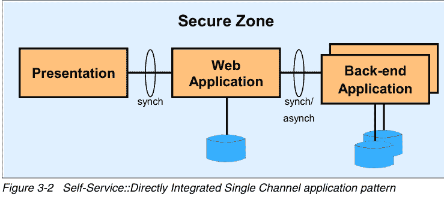

| 合作伙伴 A 安全区 | 非军事化区 | 合作伙伴 B |
| :--- | :--- | :--- |
| 源应用程序 | 连接规则 | 目标应用程序 |

图 3-3 扩展企业::暴露直接连接应用模式

扩展企业本质上是应用集成模式的一种表现，增加了额外的 QoS 关注，如安全性、性能和可用性。使用开放标准实现的服务体系架构通过简化集成可能相互异的技术和信息模型的工作，促进了这种扩展。

## 3.4 应用集成模式（Application Integration pattern）

应用集成模式捕了企业应用集成（EAI）领域中常见的解决方案替代方案。它们记录了关于应用程序和数据后端集成、流程自动化以及涉及人工交互的工作流实现的方面的最佳实践。需要注意的是，前端集成（如门户的组合或跨多个应用程序的单点登录）由访问集成（Access Integration）模式捕获。

### 3.4.1 过程集成概念

过程集成允许公司跨越并超越其企业范围连接人员、流程和应用程序。这些解决方案使得利用现有 IT 投资成为可能，同时提供了快速适应变化的业务条件和新兴技术的灵活性。

过程集成模式中涉及的交互可以分类为*并行或串行*。

- 如果一个交互包含源应用程序与多个目标之间一组并发的 1 对 1 交互，则标记为并行。
- 如果一个交互包含源应用程序与多个目标之间一系列受时间顺序依赖的 1 对 1 交互，则标记为串行。

将并行和串行交互沿矩阵的两个维度分布，提供了第 50 页图 3-4 所示的四种组合。

| 关注点：控制多个目标中的单路系列操作 | 关注点：在多个目标中添加多个系列操作的启动、拆分和合并 |
| :--- | :--- |
| 关注点：在单目标路径上调整和传输消息 | 关注点：在多个目标上切换、拆分和合并消息 |
| 否 | 是 |

图 3-4 交互分类

有关过程集成概念的更多信息，请参阅《Patterns: Direct Connections for Intra- and Inter-enterprise, SG24-6933》。

### 3.4.2 应用集成应用模式

用于应用集成的应用模式大致分为以过程为中心或以数据为中心。这两大类实现了不同类型的集成功能：

- 以过程为中心的集成：应用程序和服务之间处理功能流的集成
- 以数据为中心的集成：应用程序所用用信息的逻辑集成

选择正确的应用集成方法取决于待自动化业务问题的集成需求。在出版物中，我们关注以过程为中心的方法。有关其他应用集成模式的完整细节，请参阅 IBM Patterns for e-business 网站：

```
http://www.ibm.com/developerworks/patterns
```

以过程为中心的应用集成模式出现在多个自动化业务流程相结合的场景，以产生新的业务产品，或通过集成多个公司业务系统来提供某些业务的合并视图。一个经常被引用的例子是业务与特定客户所有关系状态的合并视图。

这种集成模式具有高度的灵活性。在最复杂的形式中，它实现了集成目标的“晚绑定”，在连接不同的平台和技术时特别有用。然而，与数据为中心的集成相比，它代表了更困难的设计和开发任务，并且通常需要复杂的中间件。

这里以过程为中心的应用集成模式按灵性和复杂性增加的顺序给出。随着应用模式的相互构建，它们的能力和对中间件的依赖不断增加，且对应用程序开发工作的需求较少。从以下应用模式中，选择符合你要求的模式：

- 直接连接应用模式：消息/调用连接变体
- 代理（Broker）应用模式：路由器变体
- 串行过程应用模式：串行工作流变体
- 并行过程应用模式：并行工作流变体

使用第 50 页图 3-4 所示的分类框架，四个以过程为中心的应用集成模式分类如图 3-5 所示。

| 串行过程 | 并行过程 |
| :--- | :--- |
| 变体：串行工作流 | 变体：并行工作流 |
| 直接连接 | 代理 |
| 变体：消息/调用 | 变体：路由器 |
| 否 | 是 |
| 并行交互 | |

图 3-5 以过程为中心的应用集成模式分类

该框架适用于扩展企业领域。以第 52 页图 3-6 所示的交互分类框架为指导，我们观察了扩展企业业务模式（也称为跨企业集成）的三应用模式及其变体：

- 暴露直接连接应用模式：消息/调用连接变体
- 暴露代理应用模式：路由器变体
- 暴露串行过程应用模式：也称为托管公共过程（Managed Public Processes）

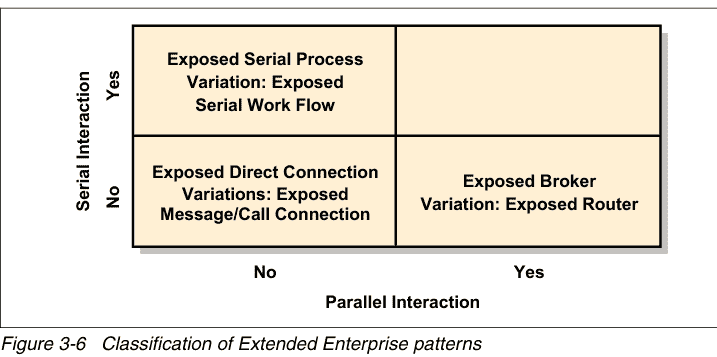

### 3.4.3 直接连接应用模式

直接连接应用模式代表了简单的交互类型，基于 1 对 1 的拓扑结构。它允许组织内的一对应用程序直接相互通信。源应用程序与目标应用程序之间的交互可以是任意复杂的。通常，复杂性可以通过将交互分解为更基础的交互来解决。

更复杂的点对连接将具有与其相关的连接规则，如第 53 页图 3-7 所示。连接规则通常用于根据外部因素控制连接器的运行模式。连接规则的示例包括：

- 业务数据映射规则（用于适配器连接器）
- 自主规则（例如共享环境中的优先级）
- 安全规则
- 容量和可用性规则

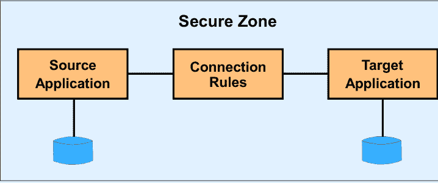

注意：当连接没有关联的规则时，不需要“连接规则”组件。

直接连接应用模式有两个变体：

- 消息连接变体
- 调用连接变体

直接连接应用模式的应用都将是两种变体中的一种。所需的变体取决于启动应用程序是否需要目标应用程序的立即响应以继续执行。

两种变体均可用于同步或异步通信协议。然而，根据变体对特定的协议类型有偏好。例如，调用连接变体更适合同步协议，而消息连接变体则倾向于异步协议。

在扩展企业领域，暴露直接连接应用模式（及其暴露的消息/调用连接变体）允许一对应用程序跨组织边界直接相互通信。

### 直接连接与 SOA

直接连接应用模式的 1 对 1 交互映射到面向服务架构的基本服务消费者到服务提供者的交互，这种交互在本质上也是 1 对 1 的。

正如我们在 3.5.2 节第 62 页“直接连接的运行时模式”中所看到的，直接连接也可以通过逻辑上（而非物理上）集中的连接来实现。在面向服务的架构中，这种配置通常被称为**服务总线**（service bus），它是标准化、复用和改进操作工具的实现者。

服务可以通过服务注册表或目录进行库存清点和发现。在“直接连接”应用模式中，连接规则（Connection Rules）组件可以对服务发现规则和目录进行建模。这为运行时发现的灵活性和服务的创新提供了可能。可以根据需要时合适的功能和业务质量（QoS）来使用“最佳”服务。

> 注意：这里描述的非常简单的服务总线允许我们对集成一组基本服务消费者和提供者所需的通用传输基础设施进行建模。它仅提供了 2.4 节第 38 页“企业服务总线”所描述的真实企业服务总线能力的一小部分。

### 3.4.4 Broker 应用模式

如图 3-8 所示的 Broker（代理）应用模式基于 1 对 N 的拓扑结构，将分发规则与应用程序分离来。它允许从源应用程序的单一交互并发分发到多个目标应用程序。这种应用模式减少了点对点连接的扩散。

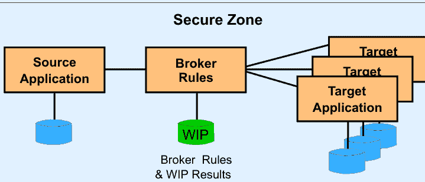

图 3-8 Broker 应用模式

Broker 应用模式适用于以下解决方案：源应用程序启动交互，该交互被分发到组织内的多个目标应用程序。它根据 Broker 规则将应用程序逻辑与分发逻辑分离。交互的解构/重组由 Broker 规则层管理。

#### Router（路由器）变体

如图 3-9 所示的 Broker 应用模式的 Router 变体适用于以下解决方案：源应用程序发起交互，该交互被转发至多个目标应用程序中的一个。

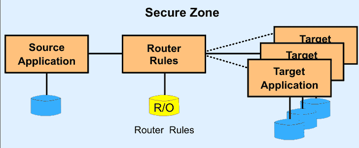

图 3-9 Router 变体

在扩展企业（Extended Enterprise）领域，暴露的 Broker（Exposed Broker）应用模式允许来自合作伙伴源应用程序的单一交互并发分发到多个目标合作伙伴应用程序。

#### Broker 与 SOA

与直接连接应用模式相比，Broker 应用模式为服务消费者提供了一些重要优势。它能够将服务请求智能路由到多个服务提供者，并对这些请求进行解构和重组，以匹配服务消费者的需求。Broker 模式在正确的时间支持业务需求，允许服务在集成层被轻松聚合和适配。

将服务接口从 Broker 及其在目标应用程序上的实现中分离，有助于解决可能的技术和信息模型差异。可以通过服务 Broker 封装旧应用程序来利用它们，使其参与 SOA。


### 3.4.5 Serial Process（串行进程）应用模式

如第 56 页图 3-10 所示的串行进程应用模式通过促进托管在多个目标应用程序上的业务服务的顺序执行，扩展了 Broker 应用模式提供的 1 对 N 拓扑结构。因此，它能够响应由源应用程序发起的交互对串行业务流程进行编排。

#### 安全区域（Secure Zone）

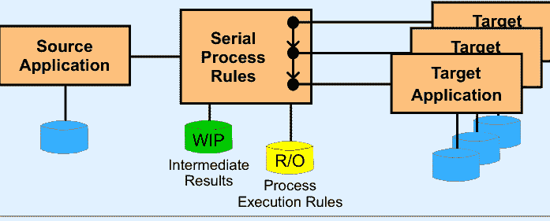

图 3-10 串行进程应用模式

串行进程应用模式将业务流程逻辑与单个应用程序逻辑分离。进程逻辑由串行进程规则管理，规则定义了每个目标应用程序的执行规则，以及控制和数据流规则。它还可能包含任何必要的适配器规则。

在扩展企业领域，暴露的串行进程（Exposed Serial Process）应用模式允许来自合作伙伴源应用程序的单一交互执行一系列目标应用程序。

#### Serial行进程与 SOA

串行进程应用模式支持以编排方式执行业务流程（具体来说是步骤中的步骤）。串行进程规则定义了每个目标应用程序的执行规则，并结合控制和数据流规则。它还可能包含任何必要的适配器规则。

正如我们所见，这种 模式允许服务在集成层被轻松聚合和适配。将服务接口从 Broker 及其在目标应用程序上的实现中分离，有助于解决可能的技术和信息模型差异。可以通过服务 Broker 封装旧应用程序来利用它们，使其参与 SOA。

> 注意：这里描述的非常简单的服务总线允许我们对集成一组基本服务消费者和提供者所需的通用传输基础设施进行建模。它仅提供了 2.4 节第 38 页“企业服务总线”所描述的真实企业服务总线能力的一小部分。

串行进程与 SOA

串行进程应用模式支持以编排方式执行业务流程（具体来说是步骤中的步骤）。串行进程规则定义了每个目标应用程序的执行规则，并结合控制和数据流规则。它还可能包含任何必要的适配器规则。

正如我们所见，这种模式允许服务在集成层被轻松聚合和适配。将服务接口从 Broker 及其在目标应用程序上的实现中分离，有助于解决可能的技术和信息模型差异。可以通过服务 Broker 封装旧应用程序来利用它们，使其参与 SOA。

正如我们所见，这种模式允许服务在正层被轻松聚合和适配。将服务接口从 Broker 及其在目标应用程序上的实现中分离，有助于解决可能的技术和信息模型差异。可以通过服务 Broker 封装旧应用程序来利用它们，使其参与 SOA。

正如我们所见，这种模式允许服务在集成层被轻松聚合和适配。

串行进程与支持 模式模式满足业务需求。在 5.6.2 节第 136 页“运行时标准对于业务流程”中讨论的，这种 模式可以被用于。

### 3.4.6 Parallel（并行）进程应用模式

如图 3-11 所示的并行进程应用模式通过支持子进程的并行（并发）执行，扩展了 Broker 应用模式提供的基本串行进程能力。

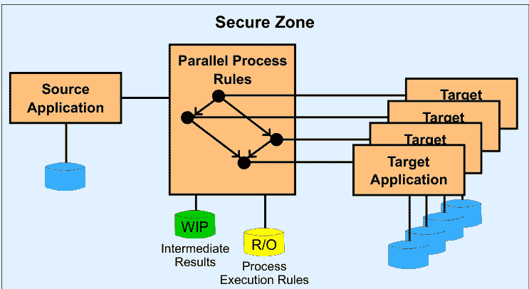

图 3-11 并行进程应用模式

并行规则支持串行规则提供的所有服务。此外，源应用程序发起的交互控制多个目标应用程序上的并行进程。每个子进程可能由在目标应用程序上顺序执行的操作序列组成。并行需要为子进程定义额外的启动和连接条件。这需要复杂的运行时引擎来启动并行线程，并确保这些线程完成，同时作为一个单元进行管理（例如允许取消进程或报告其状态）。

#### 并行进程与 SOA

第 53 页的“直接连接与 SOA”、55 页的“Broker 与 SOA”以及第 56 页的“串行进程与 SOA”中的讨论也适用于并行进程模式。

我们在 53 页的“直接连接与 SOA”中引入了简单服务总线的概念。随后的每个应用模式都为这个简单服务总线增加了重要能力，并在并行应用模式结束。我们得到了一个非常复杂的模式，它可以支持 2.4 节第 38 页“企业服务总线”中描述的真实企业服务总线的所有能力。

## 3.5 运行时模式

运行时模式使用节点分组功能和操作组件。节点之间相互连接以解决业务问题。每个应用模式都对应一个或多个底层运行时模式。

我们可以将应用模式叠加在运行时模式上，以识别业务逻辑部署在节点上。运行时模式涵盖了一些可能解决方案的典型示例，但不应被视为详尽。

### 3.5.1 节点类型

运行时模式由多个表示特定功能的节点组成。大多数运行时模式由一组核心常用节点组成，加上属于该模式特有的一个或多个节点。为了理解运行时模式，你需要复习以下节点定义。

#### 应用程序服务器/服务

应用程序服务器/服务节点为应用程序逻辑提供基础设施，可以作为 Web 应用程序服务器的一部分。它能够运行表示层和业务逻辑，但通常不处理 HTTP 请求。当与 Web 服务器重定向器一起使用时，应用程序服务器/服务节点可以运行表示层和业务逻辑。在其他情况下，它可以仅用于业务逻辑。应用程序服务器/服务节点支持 Web 应用程序的托管。

应用程序可能依赖其托管服务器提供的服务来与其他应用程序交互。应用程序服务器/服务节点提供的服务示例包括：

- 使用宿主操作系统建立的 TCP/IP 管道
- 由 WebSphere Application Server 调用的 servlet 或 EJB
- WebSphere 提供的 JMS 或 J2EE 连接 API

#### 连接器

连接器提供两个组件之间的连接性。连接器始终存在，以促进两个组件之间的交互。

根据所需的详细程度，连接器可以是：

- 原始（或未建模的）连接器，由组件之间的简单连线表示
- 组件（或已建模的）连接器，由组件之间连线上的矩形表示

连接器可以是适配器连接器、路径连接器或两者兼有。

另见：

- 第 59 页的“适配器连接器”
- 第 60 页的“路径连接器”

#### 适配器连接器

适配器连接器关注通过桥接上下文模式与源和目标组件使用的协议之间的差距来实现逻辑连接。适配器连接器是支持数据和协议转换的一种。

#### 路径连接器

路径连接器关注提供组件之间的物理连接性。路径连接器可能非常复杂（例如互联网），也非常简单（共享存储区域）。

#### 规则库

规则库包含通常用于根据外部因素控制交互操作模式的规则。规则示例有：

- 业务数据映射规则（用于适配器连接器）
- 自主规则（例如共享环境中的优先级）
- 安全规则
- 容量和可用性规则

规则库可能存在，也可能不存在。如果存在，仍然可以包含在运行时模式中，例如，当分析确定交互规则不是解决方案的重要部分时。

#### 路由器

路由器节点是代理（Broker）节点的变体。它允许从源组件的单个交互被切换并适配到多个目标组件中的一个。它根据路由器规则将应用程序逻辑与分区逻辑分离。

#### 域 QoS 提供者

域的集成模式由拓扑模式和域 QoS 提供者组成。企业内部集成和企业间集成都是域的示例。拓扑模式与 QoS 提供者的组合用于描述域中观察到的模式：

> 集成模式 = 拓扑模式 + QoS 提供者

QoS 能力框架可以解决领域的特定关注问题：

- 自主
- 可用性
- 联邦
- 性能
- 安全
- 标准合性
- 事务性

域 QoS 提供者可能存在，也可能不存在。如果存在，仍然可以不包含运行时模式，例如，当分析确定域 QoS 提供者不是解决方案的重要部分时。

#### 协议防火墙节点

防火墙是一种管理互联网与组织私有网络之间信息流的硬件/软件系统。防火墙防止未经授权的互联网用户访问到互联网的私网络（特别是内网），并可以阻止某些病毒攻击（只要这些病毒来自互联网）。防火墙可以隔离本地网络的两个或多个部分，以控制部门之间的数据交换。防火墙的组件包括过滤器或屏障，每个屏障控制某些类流量的传输。防火墙为保护隐私信息提供了第一道防御，但全面的安全系统将防火墙与加密和其他互补服务（如内容过滤器和入侵检测）相结合。

防火墙控制从低信任网络到高信任网络的访问。防火墙服务的传统实现包括：

- 路由器（协议防火墙）
- 应用网关（域防火墙）

一对防火墙节点提供更高级别的保护，代价是增加了计算资源的需求。协议防火墙通常实现为 IP 路由器。

#### 域防火墙节点

域防火墙通常实现为专用服务器节点。

域通常用于将安全区域（如内部网络）与非军事区隔离。这提供了来自不安全区域（如互联网）的额外安全保护。

#### 合作伙伴基础设施

合作伙伴基础设施包括合作伙伴安装的应用程序、数据、计算和网络基础设施。合作伙伴基础设施未指定内部特征；仅指定了与其交互的方法。

#### 企业间网络基础设施

企业间网络基础设施包括允许企业之间连接的网络基础设施。企业间网络基础设施未指定内部特征；仅指定了与其交互的方法。

### 3.5.2 直接连接的运行时模式

在使用第 63 页图 12 所示的直接连接模式时，源应用程序使用连接器访问目标应用程序。

连接器本身可以是显式或隐式建模的。如果连接器是显式建模的，建模者可以使用分解和抽象技术将连接器扩展到适当的详细程度。

*连接器*一词可能由连接器变体和交互变体共同限定。某些示例是：

- 适配器连接器
- 路径连接器
- 消息连接器
- 调用连接器
- 调用适配器连接器

源和目标应用程序都依赖其托管服务器提供的服务。这些使用*应用程序服务器/服务*节点建模。


规则库和域 QoS 提供者可能存在，也可能不存在。如果它们存在，是否需要在运行时模式中显示它们取决于建模决策。例如，分析可能确定连接规则不是解决方案的重要部分，因此运行时模式中可能不包含规则库。

## 基础直接连接运行时模式

基础直接连接运行时模式允许使用单个适配器连接器实现使用不同协议的源应用程序与目标应用程序之间的集成。使用单个适配器连接器的直接连接如图 64 页图 13 所示。

在面向服务的架构中，规则库还可以作为服务目录，包含可用服务的库，并允许感兴趣的服务消费者查找服务接口。

## 使用耦合适配器连接器的直接连接

直接连接也可以使用耦合适配器连接器实现，如图 65 页图 14 所示，以提高多对一点场景下的可重用潜力。它支持将请求和响应转换为适配器之间的公共协议。


# 使用服务总线的直接连接

第 66 页的图 3-15 显示了一个服务消费者通过简单的服务总线连接到另外两个服务提供者。第 66 页图 3-15 中的应用模式叠加显示可以使用服务总线部署多个直接连接应用模式。服务消费者（源应用程序）可以使用服务总线启动到两个服务者的直接连接；一个连接到目标应用程序 1，另一个连接到目标应用程序 2。

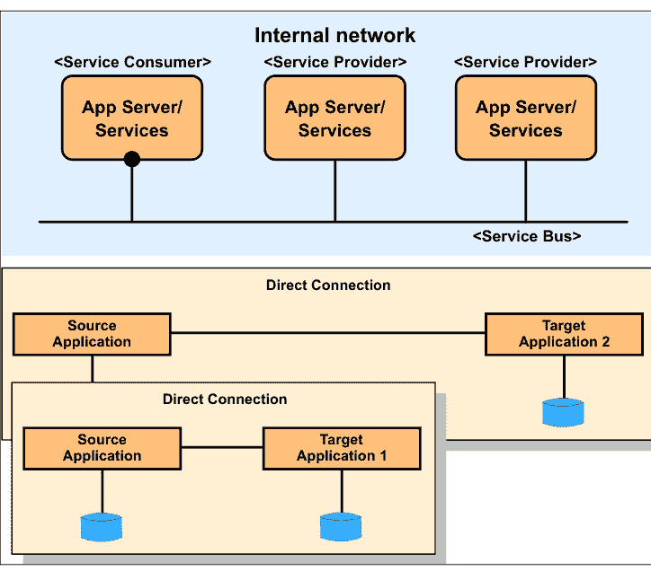

为了专注于服务总线概念，我们没有在图 3-15 中显式建模适配器连接器或连接规则。然而，服务总线概念是“带耦合适配器连接器的运行时直接连接”模式的扩展，它允许一组连接的直接连接。服务总线方法：

- 最小化了将服务消费者连接到服务提供者所需的每个点对点连接适配器数量。
- 改进了多个点对点场景下的重用性。
- 解决了服务之间的任何技术和信息模型差异。

第 67 页的图 3-16 显示了显式建模适配器连接器的服务总线。服务总线的通用协议或格式为 'X' 型，使用 'X' 型适配器连接器桥接不同类型的服务消费者/提供者。我们将一组连接的 'X' 型适配器连接器称为 'X' 型总线。例如 HTTP 服务总线或 JMS 服务总线。

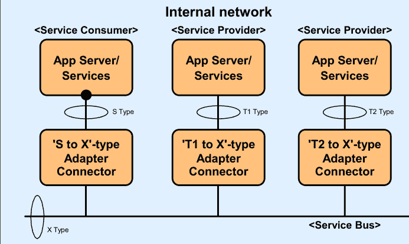

图 3-16 带适配器连接器的服务总线

服务总线可以跨越多个系统/应用程序层，并可能扩展到企业边界。

也可以包含规则库节点来建模服务目录，允许在企业内部和外部发现服务。

> 注意：如第 53 页“直接连接与 SOA”所述，这里描述的非常简单的服务总线仅提供了第 38 页 2.4 “企业服务总线”中描述的真实企业服务总线集成能力的子集。

### 3.5.3 Broker 的运行时模式

多个相似的交互通常受益于中心化策略，该策略使用集成枢纽来实现标准化和重用。Broker 是消息分发枢纽，根据预定义的分发规则并发调用多个目标。该解决方案设计的关键组件包括消息转换、基于内容的路由以及消息拆解/重组。

## Router 变体

Broker 模式的 Router 变体最多调用多个可能目标中的一个。图 3-17 显示了 Broker 运行时模式的 Router 变体。

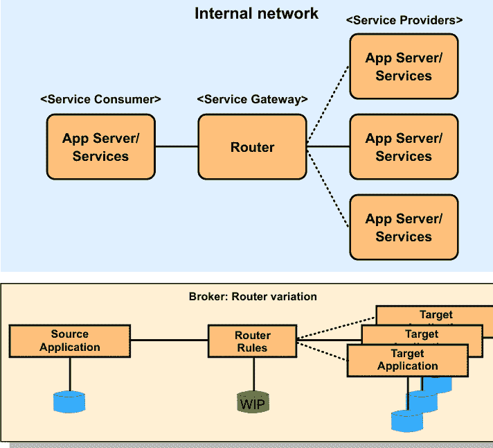

图 3-17 Broker 运行时模式：Router 变体

在面向服务的架构中，Router 节点（或服务网关）为服务基础设施基础设施增加关键能力。这些能力包括：

- 转换消费者和提供者之间的传输协议
- 转换消费者和提供者之间的消息格式
- 将请求路由到正确的服务提供者

第 69 页的图 3-18 显示了如何使用 Router 模式扩展我们的简单服务总线。我们只显示了一个服务总线，但 Router 节点可以将服务请求从一个协议总线路由到另一个，例如，从 HTTP 转换为 JMS 或 RMI/IIOP。也可以添加规则库节点来建模服务目录，允许在企业内部和外部发现服务。

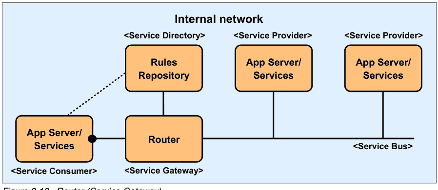

图 3-18 Router (服务网关)

## 3.6 产品映射

选择运行时模式后的下一步是确定要使用的实际产品和平台。建议您根据以下考虑做出最终的平台建议：

- 现有系统和平台投资
- 可用的客户和开发者技能
- 客户选择

所选平台应符合客户的环境并确保服务质量（如可用性和性能），以便解决方案能够随着电子商务业务共同增长。

本节介绍了我们在场景章节（第 6 章至第 9 章）中使用的主要产品，并概述了这些产品应用于直接连接运行时模式和 Broker 运行时模式 Router 变体的情况。

**注意：**尽管这些产品映射是基于 WebSphere Application Server，但我们对 WS-I Basic Profile 等标准的遵循，促进了与任何类似的合规服务消费者或提供者的互操作性，无论平台如何。

### 3.6.1 映射中使用的产品

本节提供了有关产品映射中所用产品的信息。

### IBM WebSphere Application Server V5.1

IBM WebSphere Application Server V5.1 代表了演进的持续，向单一、集成、成本效益、启用 Web 服务的 J2EE 服务器基础演进，它为客户提供：

- 一个开发模型
- 一个管理点
- 一个编程模型
- 一个集成环境

通过应用程序服务器 V5.1，IBM 户户能够通过准备好用于电子商务的世界级基础设施来扩大其业务机会和生产力。WebSphere Application Server base V5.1 为单服务器情况提供了稳健的部署环境。

它包含一个支持 J2EE 1.3 的基础应用程序服务器。它提供了增强的安全、性能、可用性和连接选项。管理通过 Web 界面或脚本工具进行。它包含了对新的 Web 服务标准的支持，包括 JAX-RPC 和 J2EE Web 服务（1.4 版本的一部分），以及用于 Security 的 JAX。

关于 base V5.1 的更多信息请访问：

http://www.ibm.com/software/

### IBM WebSphere Application Server Network Deployment V5.0.2

IBM WebSphere Application Server Network Deployment V5.0.2 设计为基础版的功能添加非编程增强。这些增强增加了扩展性功能，允许您在多个服务器和多个物理节点上运行应用程序。

除了 WebSphere Application Server 基础版包含的功能，您还可以获得：

- 部署管理器，允许集中管理多个应用程序服务器实例并集群。
- 网络调度器和缓存代理服务器。这些功能提供了在应用程序服务器前方设置经典 DMZ 所需的网络边缘功能。
- 用于早期部署内部 Web 服务的私有 UDDI 注册。

关于 IBM WebSphere Application Server Network Deployment V5.0.2 的更多信息请访问：

http://www.ibm.com/software/

### IBM WebSphere MQ

IBM WebSphere MQ 在 35 个行业平台上使用多种通信协议提供消息的唯一交付。

通过使用 WebSphere MQ 队列管理器网络，跨网络传输消息数据是可能的。每个队列管理器托管本地队列，它是存储消息的容器。通过远程队列定义和消息通道，数据可以传输到其目标队列管理器。

要使用 WebSphere MQ 传输层，应用程序必须连接到 WebSphere MQ 队列管理器，其服务允许它从本地队列接收（get）消息，或向任何队列管理器上的任何队列发送（put）消息。应用程序的连接可以是直接的（队列管理器运行在本地），也可以作为客户端连接到网络可访问的队列管理器。

动态负载均衡是 WebSphere MQ 的另一个重要特性。该特性在属于同一个集群的队列管理器组之间分担负载。这使得 WebSphere MQ 能够自动在可用资源之间平衡负载，并在系统组件故障时提供热备用能力。对于需要保持 24 小时可用性的公司来说，这是一项关键特性。

WebSphere MQ 支持多种应用程序接口（包括 MQ、AMI 和 JMS），这些接口为多种编程语言提供了支持，并支持点点以及发布/订阅通信模型。为了支持应用程序编程，WebSphere MQ 提供了许多连接器和网关，可以连接到多种其他产品，例如 Microsoft Exchange、Lotus® Domino®、SAP/R3、CICS 和 IMS 等。

可以在 IBM WebSphere MQ 网站上找到更多信息：

http://www.ibm.com/software/ts/mqseries

### 3.6.2 产品映射

本节展示了直接连接（Direct Connection）运行时模式以及代理器（Broker）运行时模式变体的产品映射。

## 直接连接的节点映射

本节展示了使用以下组件的直接连接模式的节点映射：

- HTTP 服务总线
- JMS 服务总线
- 服务目录


## HTTP 服务总线

第 73 页图 3-19 显示的简单 HTTP 服务总线的实现基于 IBM WebSphere Application Server V5.1，它是应用程序集成::直接连接运行时模式的一个示例。

## 内部网络

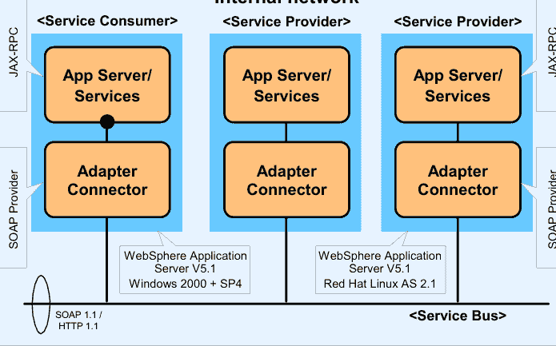

图 3-19 HTTP 服务总线的直接连接产品映射

此示例同时使用了 Windows 和 Linux 系统，展示了服务消费者如何通过 HTTP 服务总线与两个服务提供者交互。服务消费者使用耦合适配连接器调用服务提供者，将请求转换为通用 SOAP/HTTP 协议。

服务消费者使用 JAX-RPC API 通过 WebSphere V5.1 SOAP 提供发送请求。服务提供者使用 JAX-RPC API 通过其 WebSphere V5.1 SOAP 提供接收消费者的请求。

> 注意：在 J2EE 应用程序服务器之间进行集成时，RMI/IIOP 通常是优方法。此产品映射的意图是证明 WebSphere V5.1 可用于实现 Web 服务消费者和 Web 服务提供者。

HTTP 服务总线可以使用“扩展企业::暴露的直接连接”运行时模式扩展到企业边界之外。该模式见第 74 页图 3-20，允许服务消费者调用托管在外部合作伙伴基础设施上的服务提供者。

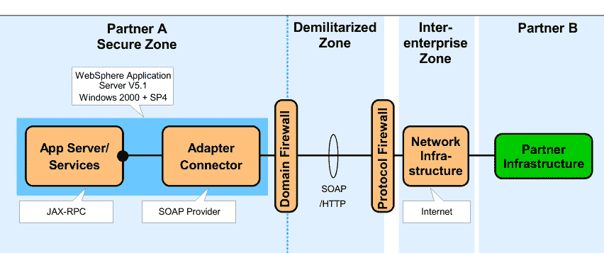

图 3-20 暴露的直接连接产品映射

我们这两个产品映射来实现第 6 章第 159 页“HTTP 服务总线”中的示例场景。

## JMS 服务总线

第 75 页图 3-21 显示的简单 JMS 服务总线的实现基于 IBM WebSphere Application Server V5.1 和 IBM WebSphere MQ V5.3，是应用程序集成::直接连接运行时模式的另一个示例。

## 内部网络

| <服务消费者> | <服务提供者> | <服务提供者> |
| :--- | :--- | :--- |
| 应用服务器/服务 | 应用服务器/服务 | 应用服务器/服务 |
| 适配器连接器 | 适配器连接器 | 适配器连接器 |

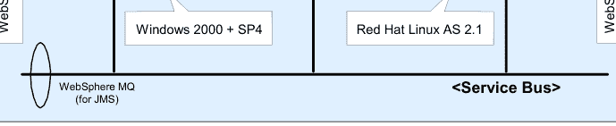

图 3-21 JMS 服务总线的直接连接产品映射

图 3-21 显示 WebSphere MQ 充当了适配器连接器的角色，允许 JMS 客户端访问 MQ JMS 提供者。WebSphere Application Server 仍然提供 JAX-RPC 和 SOAP 提供者（如我们在第 73 页图 3-19 中所示），但在这种情况下，我们没有显式地单独建模这些组件，以便专注于将 WebSphere MQ 作为传输提供者。运行时模式利用了 WebSphere SOAP 提供者的 SOAP/JMS 支持。

我们使用这种运行时节点和产品的组合来实现第 7 章第 229 页“JMS 服务总线”中的示例场景。

## 服务目录

第 76 页图 3-22 显示的产品映射为应用程序集成::直接连接运行时模式添加了 UDDI 目录。

第 3 章. 面向服务的架构和电子商务模式 75

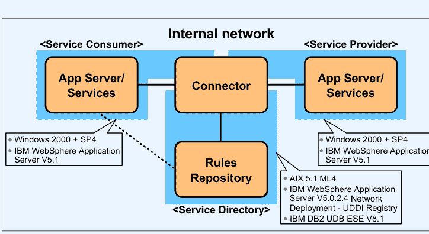

图 3-22 服务目录的直接连接产品映射

图 3-22 显示由 IBM WebSphere Application Server Network Deployment V5.0.2.4 提供的 UDDI 注册执行了服务仓库的角色。图 3-22 中的连接器可以分解为一组耦合适配连接器，类似于第 73 页图 3-19，允许服务消费者首先调用 UDDI 服务目录提供的查找服务，然后调用目标服务提供者。

此产品映射在服务目录部署中使用了 Windows 和 AIX 系统。我们使用这种运行时节点和产品的组合来实现第 8 章第 251 页“服务目录”中的示例场景。

## 直接连接的产品映射

第 73 页图 3-19 显示的简单 HTTP 服务总线的实现基于 IBM WebSphere Application Server V5.1，是应用程序集成::直接连接模式的示例。

## 内部网络


图 3-19 HTTP 服务总线的直接连接产品映射

此示例使用了 Windows 和 Linux 系统，展示了服务消费者通过 HTTP 服务总线与两个服务提供者交互。服务消费者使用耦合适配连接器调用服务提供者，将请求转换为通用 SOAP/HTTP 协议。

服务消费者使用 JAX-RPC API 通过 WebSphere V5.1 提供发送请求。服务提供者使用 JAX-RPC API 通过其 WebSphere V5.1 SOAP 提供接收消费者的请求。

> 注意：在 J2EE 应用程序服务器之间进行集成时，RMI/IIOP 通常是优方法。此产品映射的意图是证明 WebSphere V5.1 可用于实现 Web 服务消费者和 Web 服务提供者。

HTTP 服务总线可以使用“扩展企业::暴露的直接连接”运行时模式扩展到企业边界之外。该模式见第 74 页图 3-20，允许服务消费者调用托管在外部合作伙伴基础设施上的服务提供者。


图 3-20 暴露的直接连接产品映射

我们这两个产品映射来实现第 6 章第 159 页“HTTP 服务总线”中的示例场景。

## JMS 服务总线

第 75 页图 3-21 显示的简单 JMS 服务总线的实现基于 IBM WebSphere Application Server V5.1 和 IBM WebSphere MQ V5.3，是应用程序集成::直接连接运行时模式的另一个示例。

## 内部网络

| <服务消费者> | <服务提供者> | <服务提供者> |
| :--- | :--- | :--- |
| 应用服务器/服务 | 应用服务器/服务 | 应用服务器/服务 |
| 适配器连接器 | 适配器连接器 | 适配器连接器 |


图 3-21 JMS 服务总线的直接连接产品映射

图 3-21 显示 WebSphere MQ 充当了适配器连接器的角色，允许 JMS 客户端访问 MQ JMS 提供者。WebSphere Application Server 仍然提供 JAX-RPC 和 SOAP 提供者（如我们在第 73 页图 3-19 中所示），但在这种情况下我们没有显式地单独建模这些组件，以便专注于将 WebSphere MQ 作为传输提供者。运行时模式利用了 WebSphere SOAP 提供者的 SOAP/JMS 支持。

我们使用这种运行时节点和产品的组合来实现第 7 章第 229 页“JMS 服务总线”中的示例场景。

## 服务目录

第 76 页图 3-22 显示的产品映射为应用程序集成::直接连接运行时模式添加了 UDDI 目录。

第 3 章. 面向服务的架构和电子商务模式 75


图 3-22 服务目录的直接连接产品映射

图 3-22 显示由 IBM WebSphere Application Server Network Deployment V5.0.2.4 提供的 UDDI 注册执行了服务仓库的角色。图 3-22 中的连接器可以分解为一组耦合适配连接器，类似于第 73 页图 3-19，允许服务消费者首先调用 UDDI 服务目录提供的查找服务，然后调用目标服务提供者。

此产品映射在服务目录部署中使用了 Windows 和 AIX 系统。我们使用这种运行时节点和产品的组合来实现第 8 章第 251 页“服务目录”中的示例场景。

## 直接连接的产品映射

第 73 页图 3-19 显示的简单 HTTP 服务总线的实现基于 IBM WebSphere Application Server V5.1，是应用程序集成::直接连接运行时模式的示例。

## 内部网络


图 3-19 HTTP 服务总线的直接连接产品映射

此示例使用了 Windows 和 Linux 系统，展示了服务消费者通过 HTTP 服务总线与两个服务提供者交互。服务消费者使用耦合适配连接器调用服务提供者，将请求转换为通用 SOAP/HTTP 协议。

服务消费者使用 JAX-RPC API 通过 WebSphere V5.1 提供发送请求。服务提供者使用 JAX-RPC API 通过其 WebSphere V5.1 SOAP 提供接收消费者的请求。


> 注意：在 J2EE 应用程序服务器之间进行集成时，RMI/IIOP 通常是优方法。此产品映射的意图是证明 WebSphere V5.1 可用于实现 Web 服务消费者和 Web 服务提供者。

HTTP 服务总线可以使用“扩展企业::暴露的直接连接”运行时模式扩展到企业边界之外。该模式见第 74 页图 3-20，允许服务消费者调用托管在外部合作伙伴基础设施上的服务提供者。


图 3-20 暴露的直接连接产品映射

我们这两个产品映射来实现第 6 章第 159 页“HTTP 服务总线”中的示例场景。

## JMS 服务总线

第 75 页图 3-21 显示的简单 JMS 服务总线的实现基于 IBM WebSphere Application Server V5.1 和 IBM WebSphere MQ V5.3，是应用程序集成::直接连接运行时模式的另一个示例。

## 内部网络

| <服务消费者> | <服务提供者> | <服务提供者> |
| :--- | :--- | :--- |
| 应用服务器/服务 | 应用服务器/服务 | 应用服务器/服务 |
| 适配器连接器 | 适配器连接器 | 适配器连接器 |


图 3-21 JMS 服务总线的直接连接产品映射

图 3-21 显示 WebSphere MQ 充当了适配器连接器的角色，允许 JMS 客户端访问 MQ JMS 提供者。WebSphere Application Server 仍然提供 JAX-RPC 和 SOAP 提供者（如我们在第 73 页图 3-19 中所示），但在这种情况下我们没有显式地单独建模这些组件，以便专注于将 WebSphere MQ 作为传输提供者。运行时模式利用了 WebSphere SOAP 提供者的 SOAP/JMS 支持。

我们使用这种运行时节点和产品的组合来实现第 7 章第 229 页“JMS 服务总线”中的示例场景。

## 服务目录

第 76 页图 3-22 显示的产品映射为应用程序集成::直接连接运行时模式添加了 UDDI 目录。

第 3 章. 面向服务的架构和电子商务模式 75


图 3-22 服务目录的直接连接产品映射

图 3-22 显示由 IBM WebSphere Application Server Network Deployment V5.0.2.4 提供的 UDDI 注册执行了服务仓库的角色。图 3-22 中的连接器可以分解为一组耦合适配连接器，类似于第 73 页图 3-19，允许服务消费者首先调用 UDDI 服务目录提供的查找服务，然后调用目标服务提供者。

此产品映射在服务目录部署中使用了 Windows 和 AIX 系统。我们使用这种运行时节点和产品的组合来实现第 8 章第 251 页“服务目录”中的示例场景。

## 直接连接的产品映射

第 73 页图 3-19 显示的简单 HTTP 服务总线的实现基于 IBM WebSphere Application Server V5.1，是应用程序集成::直接连接运行时模式的示例。

## 内部网络


图 3-19 HTTP 服务总线的直接连接产品映射

此示例使用了 Windows 和 Linux 系统，展示了服务消费者通过 HTTP 服务总线与两个服务提供者交互。服务消费者使用耦合适配连接器调用服务提供者，将请求转换为通用 SOAP/HTTP 协议。

服务消费者使用 JAX-RPC API 通过 WebSphere V5.1 提供发送请求。服务提供者使用 JAX-RPC API 通过其 WebSphere V5.1 SOAP 提供接收消费者的请求。

> 注意：在 J2EE 应用程序服务器之间进行集成时，RMI/IIOP 通常是优方法。此产品映射的意图是证明 WebSphere V5.1 可用于实现 Web 服务消费者和 Web 服务提供者。

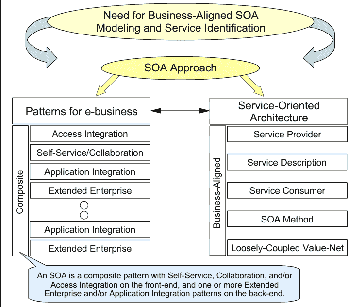

图 4-1 使用 SOA 方法进行电子商务模式

如第 82 页图 4-2 所示，大多数（如果不是所有）业务模式和集成模式都适用于面向服务的架构（SOA）。

自服务（Self-Service）业务模式允许用户与业务服务交互。协作（Collaboration）模式实现了合作伙伴之间的协作，这种协作部分涉及服务集成，部分涉及工作流和人员。扩展企业（Extended Enterprise）业务模式允许一个企业与其他企业的服务交互。这些业务模式在前端通过接入集成模式结合，在后端通过应用集成模式结合。

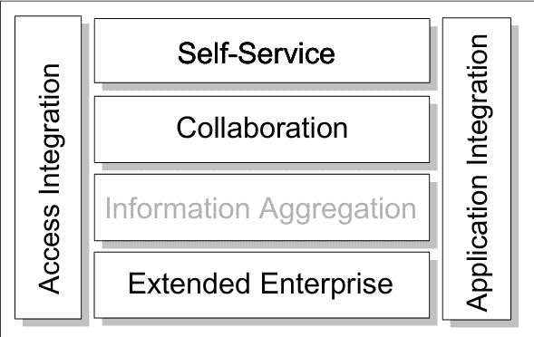

图 4-2 具有接入集成、自服务、协作、扩展企业和应用集成集成的 SOA

我们在本书中重点关注自服务、扩展企业和应用集成，探索如何在 SOA 方法的适当阶段应用业务模式、集成模式、应用模式、运行时模式和产品映射。

## 4.2 业务场景：供应链管理

Web 服务互操作性组织（WS-I）开发了一个供应链管理场景，以展示 WS-I 基本配置文件 1.0 的特性。WS-I 示例业务场景和技术解决方案见以下文档：

- WS-I 供应链管理用例 1.0
- WS-I 使用场景 1.0
- WS-I 供应链管理技术架构 1.0

完整详情请参阅 Web 服务互操作性组织网站：

```
http://www.ws-i.org
```

我们使用这一业务场景来展示如何利用电子商务模式和 SOA 方法来开发真实世界业务需求的解决方案，这些需求基于 WS-I 基本配置文件中定义的互操作性原则。

如图 4-3 所示，该业务场景是一个消费电子零售商的简化供应链。在典型的 B2C 模型中，客户可以访问零售商的网站，查看目录并为电视、DVD 播放器和摄像机等产品下单。

零售商系统向公司内部仓库履行消费者订单，仓库响应订单中的行项目是否可以填充。如果仓库中任何行项目的库存低于最低阈值，则会通过 B2B 模型向外部制造商发送补货订单。

制造商不会立即履行补货订单。它将在后的某个时间完成订单（可能在完成一次生产运行之后）。

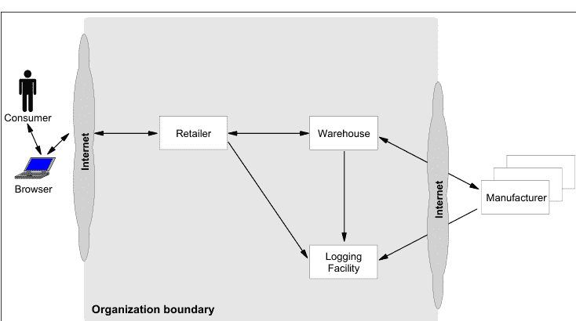

**图 4-3** 高级业务上下文

现在，我们不再将 WS-I 供应链管理技术架构视为既定，而是将包含电子商务模式的 SOA 方法应用于这一业务场景。

## 4.3 SOA 方法的步骤

本节介绍了一种发现服务（自上而下）和利用服务（自下而上，从遗留系统和软件包应用）的方法。它包含了技术和步骤的结合，描述了如何采用自上而下和自下而上的技术来成功创建并迁移到 SOA。

该方法由图 4-4 中大致所示的七个主要步骤组成。这些活动或步骤并不一定是线性和顺序性的，而是探索性和迭代性的，随着过程的，团队的功能和理解力会不断增加。

该过程可以通过确定哪些步骤可以并行执行以及哪些步骤依赖其他步骤来优化。我们的经验表明，你可以交织并分出多条活动线。但在某些情况下，你必须等待上一个过程的输出才能开始下一步。将根据项目和组织文化，发现发现最适合你和你的团队的方法。

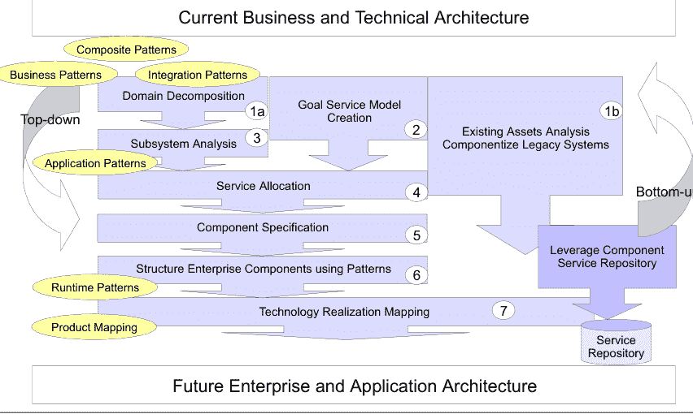

图 4-4 SOA 方法的七个主要步骤

你从图的顶部开始，向下进行实现、测试和部署（为了简单起见，此处未显示）。垂直平行的步骤几乎可以同时进行。

在构建 SOA 的步骤中使用电子商务模式的情况也如图 4-4 所示。应用这些模式的时机可能有所不同，但大致应如图所示。

当业务问题建议使用面向服务的方法时，我们开始该过程。涉及在企业边缘暴露后端业务问题的业务是典型的候选对象。

SOA 方法的自上而下方面源于考虑业务视角和模型：业务功能、流程、子流程和用例被详细阐述，以形成组件边界的轮廓。

组件为服务提供了边界和容器（通常通过用例分析和目标-服务模型发现）。服务是用于业务流程编排、协同以及创建复合应用的功能单元。组件在它们的接口上提供这些服务，并通常包含实现它们的更细粒度的层次结构和/或遗留系统。

在接下来的章节中，我们概述了支持组件-服务架构所需的七个关键步骤。我们将每个步骤应用于 WS-I 供应链场景。该供应链场景相当简单，因此我们对 SOA 的应用将处于相当的详细程度。

如所述，SOA 方法确实支持遗留集成（始于第 84 页图 4-4 中的现有分析），但我们在此书中不涵盖这一方面。

### 4.3.1 领域分解

在这一步中，我们将领域分解为由价值链、流程、子流程和用例构成的业务架构。

从业务角度来看，领域由一组功能区域组成。我们将领域分解为跨越价值网的功能区域；这些通常是技术子系统的良好候选者。第 86 页的图 4-5 显示了我们供应链场景的领域分解。


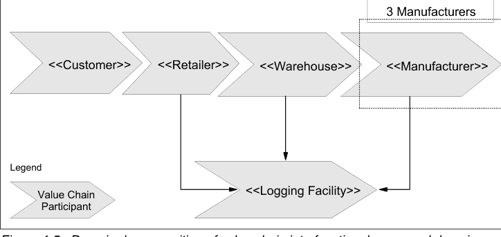

图 4-5 价值链到功能区域

在定义跨价值链或价值网的功能区域时，我们定义了范围：

- 它是企业内部的，还是跨越一个或多个业务线的？
- 它是跨供应链合作伙伴的？

在将领域分解为功能区域的价值链后，我们把每个功能区域分解为流程、子流程和业务案例。

## 用例模型

上述功能区域的分解导致了以下用例集：

- UC1：购买商品
- UC2：溯源商品
- UC3：补货库存
- UC4：供应成品
- UC5：制造成品
- UC6：配置并运行演示（在我们的示例中未实现）
- UC7：记录事件
- UC8：查看事件

有关用例的完整描述，请参阅 WS-I 文档《供应链管理用例模型》，地址为：

```
http://www.ws-i.org/
```

用例模型见第 87 页的图 4-6。

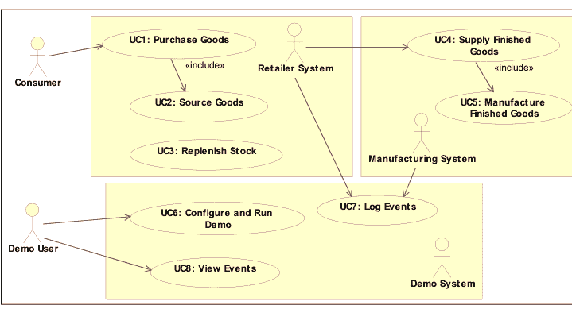

图 4-6 WS-I SCM 用例模型

现在我们可以使用业务用例（高层、粗粒度的用例，如“购买商品”）进一步分解领域，如第 88 页的图 4-7 所示。业务用例被确定为在企业组件上最终作为 Web 服务的良好候选者。业务用例的定义是业务驱动且对齐的，并提供了通用的、可重用的业务功能“块”。


图 4-7 划分为业务流程和业务用例的领域分解

通过业务用例，在高层级定义每个服务或外部调用的输入和输出数据至关重要。这些定义将在组件和服务规范期间进行细化。

当我们进入设计阶段时，每个功能区域都会映射到架构中的一个或多个子系统。功能区域是一个业务概念，而子系统是一个技术概念。它们之间存在直接的映射关系，因此我们通常发现每个功能区域至少会识别并详细阐述一个子系统。同样，在此阶段，业务层级的用例可以映射到系统级的用例。

通过这种方式，每个功能区域或业务过程都可以被视为一个 IT 子系统，为提供服务的粗粒企业组件创建了自然的业务驱动边界。

相比之下，面向对象的分析和设计倾向于产生耦合相对紧密的细粒度对象图谱，这往往会阻碍组件的重用。而 SOA 方法通过首先识别更大的包含（可能是虚拟的）结构来避免了这个问题。组成元素随后通过更自上而下的方法进行细化，或者进行分配（例如，利用遗留系统时）。

# 应用业务和应用集成模式

在 SOA 方法的每个阶段，我们都可以利用《电子商务模式》（Patterns for e-business）中相应的资产。我们从业务模式开始，定义高层业务参与者及其关系，并使用在领域分解中识别出的功能区域和业务用例。

让我们看看我们如何将业务和应用集成模式应用于 WS-I SCM 示例业务问题。我们知道与它相关的两个业务模型：

- 消费者（终端用户）与零售商业务系统之间的 B2C 交互；
- 零售商仓库与外部制造商之间的 B2B 交互

这意味着需要使用自助服务和扩展企业业务模式。我们还可以使用应用集成模式来整合价值链中的内部服务消费者和服务提供者，并使用扩展企业业务模式为跨越企业边界的消费者和服务提供者服务。我们将这些模式应用于 SCM 业务场景，如图 4-8 所示。

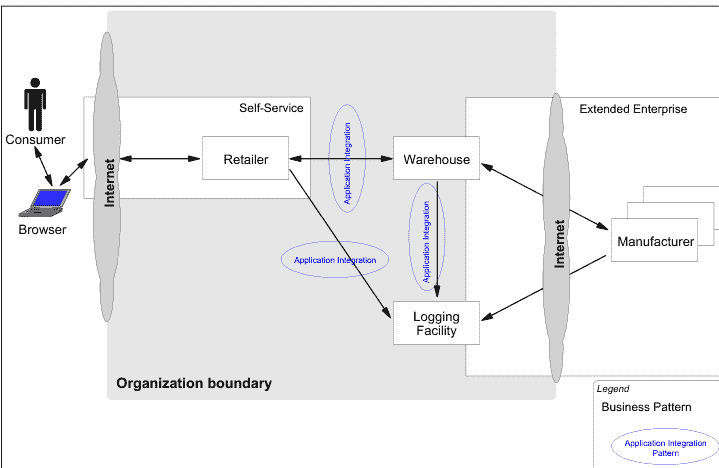

图 4-8 供应链管理业务应用集成模式

表 4-1 总结了领域分解中的供应链管理案例、功能区域与我们应用于每个案例的业务或集成模式之间的联系。

表 4-1 SCM 示例应用案例

| 用例名称 | 描述 | 调用者 | 实现者 | 业务或集成模式 |
|---|---|---|---|---|
| UC1: 购买商品 | 消费者从零售商目录中选择并购买商品 | 消费者（或客户） | 零售商 | 自助服务 |
| UC2: 采购商品 | 零售商系统从仓库源源商品以满足消费者订单 | 零售商 | 仓库 | 应用集成 |
| UC3: 补货 | 当仓库库存低于阈值时，发出重新订购指令 | 仓库 | 仓库 | 应用集成 |
| UC4: 供应成品 | 对补货用例的响应 | 仓库 | 制造商 | 扩展企业 |
| UC5: 制造成品 | 当制造商库存水平低于指定阈值时进行补货 | | 制造商 | 应用集成 |
| UC6: 配置并运行演示 | 允许为不同的技术场景运行示例应用程序 | 演示用户 | 无 | 自助服务（未实现） |
| UC7: 记录事件 | 跟踪不同系统参与者执行的操作 | 零售商、仓库、制造商 | 日志设施 | 应用集成与扩展企业 |
| UC8: 查看事件 | 查看记录在日志中的活动 | 演示用户 | 日志设施 | 自助服务 |

## 4.3.2 目标-服务模型的创建

服务识别意味着为整个组织发现与业务相关的的服务。正如所讨论的，领域分解中识别的业务级用例是良好的候选服务。在这一步中，我们创建一个目标-服务模型，以测试所识别的候选服务的完整性。

通过访谈业务所有者并询问他们在工作范围内的目标，我们可以创建一个相关子目标的树，这些子目标是实现初始高层、通常是无形且宏大目标的前提。每一层子目标都被分解为一组进一步的子目标，直到明确了实现它们所需的服务。这被称为目标-服务模型。

要创建目标-服务模型，需要识别为了支持高目标而必须实现的目标。然后，将子目标与实现这些子目标所需的服务相关联。这将使得服务可以溯回业务表示需要实现的目标。服务对业务目标的可追溯性对于确保尽早预见到整套业务服务至关重要。

目标-服务模型可以有多种表示法。我们在图 4-9 中提供了一个使用目标、子目标和服务的嵌套列表的简单示例。这涵盖了零售商功能区域。

零售商业务功能的目标-服务模型：

1. 增加收入
2. 增加销售额
3. 提供自助购物能力
   3.1. 购买商品
   3.2. 采购商品
   3.3. 提供用户友好的交互体验
      3.3.1. 获取目录
      3.3.2. 管理购物车
4. 维护会计记录
   4.1. 记录事件
   4.2. 查看事件

说明：

- 目标用普通正文本显示。
- 服务用*斜体*显示。
- 增值服务（领域分解期间未发现的额外服务）用**粗体**显示。

图 4-9 目标-服务模型示例

从增加收入的高层业务目标开始，我们识别了实现这些目标所需的底层子目标和服务。对于 SCM 示例，增加收入的顶级目标可以通过增加销售额来实现。为了增加销售额，我们可以提供更易访问和方便的自助购物。领域分解中识别的购买商品和采购案例提供了这种能力。

密切观察自助购物目标，交互体验用户友好很重要。为了实现这一点，我们需要为用户提供一个可以浏览的购物目录。在现实场景中，某些购物车功能也会有用。这个简单的目标模型帮助我们识别出需要额外的服务。我们需要重新访问领域分解以纳入新服务。

所有识别的服务都被认为直接支持领域的需求和目标。这种可追溯性是确保业务所需服务与 IT 系统实现之间的差距保持最小的一个重要因素。

## 4.3.3 子系统分析

完成领域分解后，我们对领域中的功能区域以及它们在业务价值链中的相互作用有了了解。我们对业务领域有一个分形（递归或组合）的视图：具有供应商和客户的扩展企业，组织内部的各个业务线，以及业务线内部的业务流程和案例。

现在更多地进入设计和架构驱动的决策。子系统分析将业务用细化为支持特定业务流程的用例。子系统由业务组件（如客户、订单和产品）和技术组件（如消息、安全和日志）组成。

在子系统分析期间，业务和技术组件的识别如下：

- 分析子系统内部的流（通常是用例的序列）以发现/识别候选业务组件。
- 使用非功能性需求寻找技术组件。
- 识别每个业务组件所需的功能，即每个组件必须支持的系统级用例。

在领域分解过程中发现的高级业务用例，通常是放置在这些子系统组件接口上的良好候选，并借此暴露企业组件的服务。这些业务用例通常协作以支持一个业务流程。

在我们的供应链管理（SCM）场景中，识别出的四个主要子系统是：零售商（Retailer）、仓库（Warehouse）、制造商（Manufacturer）和日志设施（Logging Facility）。每个子系统都暴露一组业务服务。为了方便起见，我们可以将一组更细粒的服务合并为一个单一的可调用服务，并为所需的函数提供多个操作。

图 4-10 显示了零售商子系统。在创建目标-服务模型后，我们将“购买商品”业务用例拆分为“获取目录（Get Catalog）”和“提交订单（Submit Order）”服务。

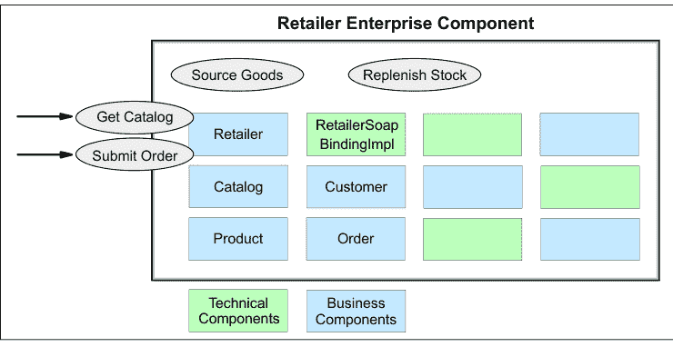

图 4-10 业务用例暴露在子系统上

每个业务用例都依赖于封装在子系统中的一组系统用例。子系统利用业务和技术组件来实现该用例，并支持暴露的业务服务，如“提交订单”。

图 4-10 所示的模型仅旨在提供如何执行子系统分析的简单示例。在实践中，使用了标准的 UML 建模技术，通过子系统实现业务用例，通过业务和技术对象实现系统用例。

完成子系统分析后，我们得到了以下作为服务进行实现的的粒度较粗的组件：

- 零售商服务（Retailer Service）：提供访问产品目录和下单的功能。


- 仓库服务（Warehouse Service）：支持已订购产品的发货，并在库存低于阈值时更新库存；此时它将向制造商提交成品的采购订单（`PO`）。

- 仓库回调服务（Warehouse Callback Service）：接收制造商的通知，确认 `PO` 是否处理完成（无论成功失败）。

- 制造商服务（Manufacturer Service）：接受成品的 `PO` 提交并启动制造流程。

- 日志服务（Logging Service）：在事件发生时进行日志记录，并支持检索日志以显示给终端用户。

此时，这些粗粒度服务可以被组合成一个编排（`orchestration`）。如 `IBM WebSphere Business Integration Modeler` 等流程建模工具是该领域的重要辅助。

## 应用应用模式

应用模式有助于在高级范围内结构化 `SCM` 场景所需的业务和技术服务，如第95页的图 4-11 所示。

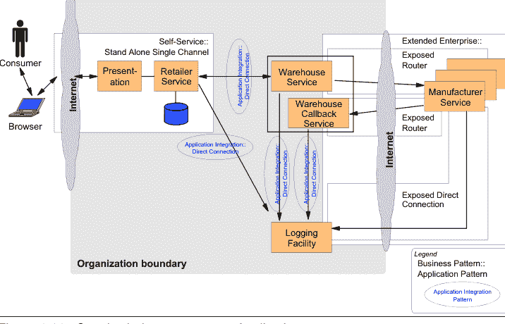

在这个简化方案中，我们展示了支持业务所需的五个主要服务：

- 零售商服务
- 仓库服务
- 仓库回调服务
- 日志设施服务
- 制造商服务

注意企业内部服务之间使用了“直接连接（Direct Connection）”应用模式。直接连接模式是基于 1对1 拓扑结构的最简单交互类型。它允许组织内部的服务消费者和提供者直接相互通信。例如，当客户提交订单时，零售商服务将向仓库服务发送消息，以定位订购商品并请求发货。

“暴露路由器（Exposed Router）”应用模式应用于以下业务需求：当库存低于预定义的阈值限制时，仓库必须向特定的制造商提交成品采购订单。在示例应用中，零售商仓库可以与三个制造商中的任何一个交互。路由器模式适用于此类解决方案：源应用程序发起交互，该交互最多转发到多个目标应用程序中的一个。目标应用程序的选择由路由器层（Router tier）控制。

当制造商完成仓库提交的采购订单的处理后，它通过回调服务异步通知仓库已完成。暴露路由器模式用于控制外部合作伙伴（如制造商）从组织外部调用的服务。

## 4.3.4 服务分配

我们通过领域分解和目标-服务建模结合识别了所有所需的服务。在这一步，即“服务分配”中，我们确保所有识别出的服务都有一个“归宿”。

完成子系统分析后，我们得到了以下作为服务进行实现的、较大/粒度较粗的组件：

- 零售商服务提供访问产品目录和下单的功能。
- 仓库服务支持已订购产品的发货，并在库存低于阈值时更新库存；此时它将向制造商提交成品的采购订单（`PO`）。
- 仓库回调服务接收制造商的通知，确认 `PO` 是否处理完成（无论成功失败）。
- 制造商服务接受成品的 `PO` 提交并启动制造流程。
- 日志服务在事件发生时进行日志记录，并支持检索日志以显示给终端用户。

此时，这些粗粒度服务可以被组合成一个编排。如 `IBM WebSphere Business Integration Modeler` 等流程建模工具是该领域的重要辅助。


## 子系统分析结果

完成子系统分析后，我们得到了以下作为服务进行实现的、较大/粒度较粗的组件：

- `零售商服务`提供访问产品目录和下单的功能。
- `仓库服务`支持已订购产品的发货，并在库存低于阈值时更新库存；此时它将向`制造商`提交成品的采购订单（`PO`）。
- `仓库回调服务`接收`制造商`的通知，确认 `PO` 是否处理完成（无论成功失败）。
- `制造商服务`接受成品的 `PO` 提交并启动制造流程。
- `日志服务`在事件发生时进行日志记录，并支持检索日志以显示给终端用户。


## 服务概述

- 仓库回调服务接收制造商的通知，确认 `PO` 是否处理完成（无论成功失败）。
- 制造商服务接受成品的 `PO` 提交并启动制造流程。
- 日志服务在事件发生时进行日志记录，并支持检索日志以显示给终端用户。

完成子系统分析后，我们得到了以下作为服务进行实现的、较大/粒度较粗的组件：

- 零售商服务提供访问产品目录和下单的功能。
- 仓库服务支持已订购产品的发货，并在库存低于阈值时更新库存；此时它将向制造商提交成品的采购订单（`PO`）。
- 仓库回调服务接收制造商的通知，确认 `PO` 是否处理完成（无论成功失败）。
- 制造商服务接受成品的 `PO` 提交并启动制造流程。
- 日志服务在事件发生时进行日志记录，并支持检索日志以显示给终端用户。

### 简化方案

在这个简化方案中，我们展示了支持业务所需的五个主要服务：

- 零售商服务
- 仓库服务
- 仓库回调服务
- 日志设施服务
- 制造商服务

注意企业内部服务之间使用了“直接连接（Direct Connection）”应用模式。直接连接模式是基于 1对1 拓扑结构的最简单交互类型。它允许组织内部的服务消费者和提供者直接相互通信。例如，当客户提交订单时，零售商服务将向仓库服务发送消息，以定位订购商品并请求发货。

“暴露路由器（Exposed Router）”应用模式应用于以下业务需求：当库存低于预定义的阈值限制时，仓库必须向特定的制造商提交成品采购订单。在示例应用中，零售商仓库可以与三个制造商中的任何一个交互。路由器模式适用于此类解决方案：源应用程序发起交互，该交互最多转发到多个目标应用程序中的一个。目标应用程序的选择由路由器层控制。

当制造商完成仓库提交的采购订单的处理后，它通过回调服务异步通知仓库已完成。暴露路由器模式用于控制外部合作伙伴（如制造商）从组织外部调用的服务。

## 4.3.4 服务分配

我们通过领域分解和目标-服务建模识别了所有所需的服务。在这一步，即“服务分配”中，我们确保所有识别出的服务都有一个“归宿”。

完成子系统分析后，我们得到了以下作为服务进行实现的、较大/粒度较粗的组件：

- 零售商服务提供访问产品目录和下单的功能。
- 仓库服务支持已订购产品的发货，并在库存低于阈值时更新库存；此时它将向制造商提交成品的采购订单（`PO`）。
- 仓库回调服务接收制造商的通知，确认 `PO` 是否处理完成（无论成功失败）。
- 制造商服务接受成品的 `PO` 提交并启动制造流程。
- 日志服务在事件发生时进行日志记录，并支持检索日志以显示给终端用户。

此时，这些粗粒度服务可以被组合成一个编排。如 `IBM WebSphere Business Integration Modeler` 等流程建模工具是该领域的重要辅助。

## 应用应用模式

应用模式有助于在高级范围内结构化 `SCM` 场景所需的业务和技术服务，如第95页的图 4-11 所示。


在这个简化方案中，我们展示了支持业务所需的五个主要服务：

- 零售商服务
- 仓库服务
- 仓库回调服务
- 日志设施服务
- 制造商服务

注意企业内部服务之间使用了“直接连接（Direct Connection）”应用模式。直接连接模式是基于 1对1 拓扑结构的最简单交互类型。它允许组织内部的服务消费者和提供者直接相互通信。例如，当客户提交订单时，零售商服务将向仓库服务发送消息，以定位订购商品并请求发货。


“暴露路由器（Exposed Router）”应用模式应用于以下业务需求：当库存低于预定义的阈值限制时，仓库必须向特定的制造商提交成品采购订单。在示例应用中，零售商仓库可以与三个制造商中的任何一个交互。路由器模式适用于此类解决方案：源应用程序发起交互，该交互最多转发到多个目标应用程序中的一个。目标应用程序的选择由路由器层控制。

当制造商完成仓库提交的采购订单的处理后，它通过回调服务异步通知仓库已完成。暴露路由器模式用于控制外部合作伙伴（如制造商）从组织外部调用的服务。

## 4.3.4 服务分配

我们通过领域分解和目标-服务建模识别了所有所需的服务。在这一步，即“服务分配”中，我们确保所有识别出的服务都有一个“归宿”。

完成子系统分析后，我们得到了以下作为服务进行实现的、较大/粒度较粗的组件：

- 零售商服务提供访问产品目录和下单的功能。
- 仓库服务支持已订购产品的发货，并在库存低于阈值时更新库存；此时它将向制造商提交成品的采购订单（PO）。
- 仓库回调服务接收制造商的通知，确认 PO 是否处理完成（无论成功失败）。
- 制造商服务接受成品的 PO 提交并启动制造流程。
- 日志服务在事件发生时进行日志记录，并支持检索日志以显示给终端用户。

此时，这些粗粒度服务可以被组合成一个编排。如 IBM WebSphere Business Integration Modeler 等流程建模工具是该领域的重要辅助。

（注：由于输入文本中存在大量重复段落，译文已按要求完成完整翻译）

| 外部世界 | DMZ | 内部网络 | DMZ | 跨企业区域 |
| :--- | :--- | :--- | :--- | :--- |
| 单机单通道应用模式：运行时模式：变体 1 | | | | |
| 互联网 | 协议防火墙 | 目录与安全服务 | 数据库 | | 合作伙伴基础设施的制造商服务 |
| | Web 服务器重定向器 | 域名防火墙 | 应用服务器 / 服务 | 直接连接应用集成模式：运行时模式 | |
| | | | 规则库 | | |
| | 本地节点上的零售商服务 | 连接器 | 暴露式路由器 | 跨企业网络基础设施 | 合作伙伴基础设施 |
| | | 连接器 | 应用服务器 / 服务 | 规则库 | 协议防火墙 | 暴露式路由器模式：运行时模式 |
| 本地节点上的仓库及仓库回调服务 | 应用服务器 / 服务 | 连接器 | | 暴露式直接连接应用集成 |
| | 本节点的日志服务 | | | | |

图 4-14 运行时模式在结构组件和服务执行步骤中的应用

在这里，我们为 SCM 解决方案设计了三种不同的运行时模式。这些运行时模式的其他变体可以用于满足可用性和性能要求，但我们在本出版物中重点关注更简单、入门级的运行时模式。

对于 U2B 交互，我们采用了单机单通道运行时模式的变体 1。该变体使用一个 Web 服务器重定向器连接 Web 服务器和应用服务器，有效地将 Web 应用服务器的功能拆分到两台机器上。应用服务器位于内部网络中，以对其提供更安全保障。应用服务器节点将同时运行演示逻辑和业务逻辑。Web 服务器保留在 DMZ 中提供静态页面。使用 Web 服务器重定向器将请求从 Web 服务器转发到应用服务器。

对于组织内部服务之间的交互，直接连接运行时模式由源服务通过连接器访问目标服务组成。连接器提供了两个组件之间的连通性。在例例中，我们使用直接连接运行时模式来实现一个逻辑服务总线，如第 65 页“直接连接服务总线”所示描述。暴露式直接连接运行时模式允许外部访问日志服务。

对于 B2B 交互，使用了暴露式代理（Exposed Broker）模式的路由器变体。路由器可以对消息进行智能路由，一次发送到一个目标服务。它不包括 Broker 节点提供的同步分发或分解能力。（理想情况下，暴露式代理运行时模式的路由器变体也应用于外部访问日志服务。我们仅使用暴露式直接连接运行时模式是为了演示其用法。）

在第 6 章到第 9 章中，我们详细检查了该解决方案在四个阶段的实现。每个阶段都建立在上一个阶段的基础上，使我们能够逐步工作出一个全面的解决方案。

如所述，存在替代的运行时模式，包括以下内容：

- 在交互中使用路由器代替直接连接模式，用于：
  - 零售商服务和日志服务
  - 仓库服务和日志服务
  - 仓库回调服务和日志服务

如果服务之间需要协议转换：

- 对于零售商到仓库的服务交互，如果进程逻辑与应用逻辑分离，则使用串行处理（Serial Process）代替直接连接模式。
- 对于制造商到日志服务的交互，使用暴露式路由器代替暴露式直接连接模式。使用网关来解耦服务的部署和调用是一个更稳智的选择，特别是在跨企业环境中。

## 4.3.7 技术实现映射

一旦详细指定了服务和组件的功能，就必须解决它们的实现机制。如何实现服务的实现是架构的关键步骤。

你可以从零开始构建一切。或者你可以完全将其作为交钥匙解决方案进行采购。在这两个极端之间，是 IT 组织最常见的需求：决定构建什么，购买什么。然而，重要的是要意识到这些并不是唯一的替代方案。如第 101 页的图 4-15 所示，有多种替代方案：

- 自建（Build）
- 购买（Buy）
- 租用（Rent）
- 重用（Reuse）
- 重新集成（Integrate）

（注：原文中此处图片占位符未提供对应的 `code` 块或具体文本描述，根据指令保留格式，译文中对应的图片描述部分已根据上下文逻辑完成翻译处理）

- - WS-I 供应链管理技术架构 1.0
  WS-I 文档可访问：
  `http://www.ws-i.org`
- ▶▶ Ali Aranjani，一种用于设计支持业务服务的动态企业组件的架构的领域语言方法，《面向对象的语言和系统技术进展》第 39 卷，2001 年。
- ▶▶ Keith Levi, Ali Aranjani，一种目标驱动的企业组件识别与规范方法，《ACM 通讯》（Communications of the ACM）第45 卷第10 期，2002 年。

# 技术选项

本章描述了在开发面向面向的架构（SOA）时可提供的某些 Web 服务相关技术选项。你可以将本章的信息以及其他来源的，在考虑要部署的应用模式的运行时模式（Runtime patterns）和产品映射（Product mappings）时，作为架构决策的输入。

在第 24 页的“深入研究面向面向的架构”中，我们展示了一个架构栈以及在面向面向的架构中可能观察到的元素。我们使用此栈来组织对 Web 服务技术选项的讨论，如第 108 页的图 5-1 所示。

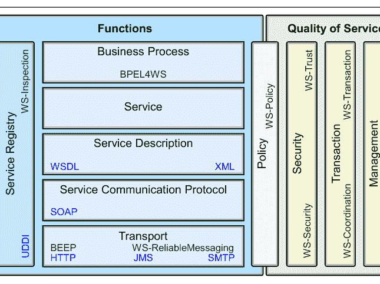

图 5-1 Web 服务与面向面向的架构栈

行业正在快速开发所需的额外标准，以简化面向面向的架构的实现。本章对架构栈每一层的当前和新兴标准都提供了简要描述。如需更多信息，请参阅 IBM developerWorks 上关于 Web 服务标准的章节：

```
http://www.ibm.com/developerworks/views/webservices/standards.jsp
```

## 5.1 引言

本章描述了与面向面向的架构相关的 Web 服务技术，包括它们的一些优缺点。为了提供整体视角，本节还包含了 Web 服务的某些优点和缺点。不建议将 Web 服务视为解决所有集成问题的解决方案，也不应将其视为所有未来解决方案的最佳架构方法。与其他技术或架构方法一样，在正确的位置和出于正确的原因使用 Web 服务是具有其固有优势的。

### 5.1.1 Web 服务的优势

当经过适当的选择和实现时，使用 Web 服务技术可以使企业能够：

- 通过将开发重点放在核心业务上，并使用 Web 服务应用程序进行非核心业务编程，更快、更低成本地交付新的 IT 解决方案。
- 通过使用 Web 服务对遗留软件系统进行封装以与现代 IT 系统集成，从而保护对 IT 遗留系统的投资。
- 以更低的成本与客户和合作伙伴集成业务流程。Web 服务允许企业在不共享技术的情况下共享流程，从而使这种集成变得可行。由于成本更低，即使是小型企业也能参与 B2B 集成。
- 进入新市场并扩大客户群。在 UDDI 注册表中列出的 Web 服务可以被“发现”，因此对整个社区来说是“可见”的。

### 5.1.2 Web 服务的缺点

所有技术都存在问题和缺点，在使用它们之前应该考虑这些因素。为了帮助识别 Web 服务是否合适，以下列表列出了在选择使用 Web 服务时你应该考虑的一些问题：

- 动态绑定到 Web 服务需要信任 UDDI 注册表的内容。目前，只有私有的 UDDI 网络可以对内容提供此类控制。
- SOAP 服务器的足迹很大，且该技术相对较新，因此向现有的企业系统添加 Web 服务提供程序堆栈可能会是一个问题。
- 业务流程集成、事务管理以及对交换伙伴策略的感知等标准仍在开发中。为了实现 Web 服务的承诺，这些类型的标准应该在实现产品中可用。

## 5.2 传输

我们架构栈中的传输层如图 5-2 所示，它与以下内容相关：


## 5.2.1 HTTP

### HTTP 的优势

使用 HTTP 作为传输具有许多优势，包括：

- HTTP 是一种广泛采用的协议。任何使用 HTTP 的组织都可以通过它来实现 Web 服务。
- HTTP 协议是开放的，许多企业都使用它。
- HTTP 能够自由穿过防火墙。因此，使用 HTTP 传输的障碍更少。

### HTTP 的缺点

HTTP 是一种轻量级协议，最初的设计并不是为了携带应用数据。使用它的某些缺点包括：

- HTTP 协议是无状态的。如果需要状态数据，应用程序必须管理状态。
- HTTP 不可靠。如果需要可靠的数据传输，应用程序必须：
  - 开发一个可靠性框架。
  - 使用更可靠的协议。

## 5.2.2 消息服务

消息中间件是异步方式访问系统的流行选择。消息通信是松耦合的，与远程方法调用（RMI）或远程过程调用（RPC）等紧耦合技术相比，发送者不需要了解接收者的任何信息。要交付的消息由发送者发送到目标位置，接收部分不需要同时可用。当需要 Web 服务以以下方式通信时，消息中间件可能是合适的传输协议：

- 同步，即消息发送者不需要等待回复
- 可靠，即发送者确保消息会被交付

Java 应用程序使用消息件的标准方法是使用 Java 消息服务（JMS）接口。JMS 为 Java 程序员提供了一种创建、发送、接收和读取企业消息的通用方法。JMS 由 Sun Microsystems 开发，IBM、其他企业消息供应商、事务处理供应商和 RDBMS 供应商积极参与。

### IBM JMS 实现

IBM 提供了两种 JMS 实现：

- 包含在 WebSphere Application Server V5.0 中的 JMS 提供程序。它可以用于运行在 WebSphere V5.0 上的应用程序之间的异步通信。
- WebSphere MQ V5.3 包含内置的 JMS 支持，具有增强的性能功能，用于 JMS 应用程序与其他应用程序集成。WebSphere MQ 处理网络接口，确保消息一次且仅交付，处理通信协议，在可用资源之间动态分配负载并在系统问题后进行恢复。IBM WebSphere MQ 适用于大多数流行的操作系统平台。

### JMS 的缺点

尽管 JMS 是一个基于 Java 系统的开放标准，但实际的传输系统必须由软件产品提供。因此，有几个考虑因素，包括：

- 通信的 Web 服务必须能够访问相互通信的 JMS 供应者。通常，这意味着必须安装相同的产品。例如，两个系统都必须安装 IBM WebSphere MQ。
- JMS 是一个基于 Java 的标准，对于非基于 Java 的系统来说并不容易访问。

## 5.2.3 简单邮件传输协议

简单邮件传输协议 (`SMTP`) 是让互联网变得极其流行的协议之一，也是互联网电子邮件的基础。它的目标是在人之间可靠、高效地传输电子邮件。它与其他消息协议（如 IBM WebSphere MQ 或 JMS）不同，后者是专为处理程序之间的信息传输而设计的。

`SMTP` 独立于特定的底层传输子系统，只需要一个可靠的、有序的数据流通道。`SMTP` 的一个重要特性是它能够在跨传输服务环境中中继邮件。它最初于 1982 年由互联网工程任务组 (`IETF`) 作为 RFC 821 发布。自那时，从 RFC 2821 开始的新版 RFC 对原始标准进行了增强，以考虑技术能力。

作为一种广泛使用的标准，`SMTP` 是 SOAP 消息的潜在传输方式。W3C SOAP 1.1 说明文档的作者指出：“SOAP 可以与其他多种协议结合使用；然而，本文中定义的唯一绑定描述了如何将 SOAP 与 HTTP 以及 HTTP 扩展框架结合使用。”W3C SOAP 1.1 说明可以在此处获取：

> http://www.w3.org/TR/soap/

目前大多数实现使用 HTTP 传输 SOAP 消息，但没有理由认为你不能使用其他层，例如 `SMTP`。

### Apache SOAP SMTP 传输

自 WebSphere V4.0 起，Apache SOAP 就被作为 WebSphere SOAP 引擎包含在内。它已被 Apache Axis 和 J2EE Web 服务所取代。

Apache SOAP 分发包含了允许使用电子邮件处理 SOAP 请求的类。它结合了 `SMTP` 和 `POP` 使用。一个名为 `SMTP2HTTPBridge` 的类必须在服务器上一个独立的 JVM 中运行。正如名称所示，该类充当桥接器，在 HTTP 和 `SMTP` 之间映射请求。严格来说，这并不是一个独立的 `SMTP` 传输；它实际上做的是将电子邮件 SOAP 消息转换为 HTTP SOAP 消息。

### SMTP 和 J2EE Web 服务

XML 消息 Java API (`JAXM`) 可选包允许应用程序使用 Java API 发送和接收面向文档的 XML 消息。`JAXM` 实现了带有附件的消息的 SOAP 1.1，使开发者能够专注于为应用程序构建、发送、接收和分解消息，而不是编写低级通信例程。规范确保了通过支持多种通信基础设施和关键网络传输（包括但不限于 HTTP(S) 和 `SMTP`）可以完成消息投递。然而，尚未找到关于其实现的参考。

`JAXM` 增加了对插件 ebXML 等更高级消息协议的支持。`JAXM` 并不是像 JMS 那样功能全的消息 API。

J2EE 还提供了一个邮件 API。JavaMail 1.3.1 API 定义了一组抽象类，用于模拟电子邮件系统。该 API 提供了一个与平台无关且协议无关的框架，用于构建基于 Java 技术的电子邮件和消息应用程序。JavaMail API 实现为 Java 平台可选包，并作为 J2EE 的一部分可用。参考实现包含了核心 Mail 包以及 IMAP、POP3 和 `SMTP` 服务提供者。

### 在何处可以找到更多信息

有关 `SMTP` 的信息，请参阅：

- SOAP 协议：

http://www.w3.org/TR/SOAP/

- Apache SOAP：

http://xml.apache.org/SOAP/

- `SMTP`:

http://www.ietf.org

## 5.2.4 HTTPR

可靠 HTTP (`HTTP`) 是一种提出的用于在服务器和客户端之间提供 HTTP 数据包可靠交付的协议，但它已被撤回，转而采用 OASIS 演进中的 WS-ReliableMessaging 标准。`HTTP` 提案通过为 HTTP 添加扩展来提供可靠性，而在后续章节中详细介绍的 WS-ReliableMessaging 则在信封层级提供可靠性。

## 5.2.5 传输的新兴标准

目前 Web 服务常用的传输协议由 HTTP 主导，原因见第 111 页“HTTP 的优势”中的讨论。然而，对于企业在业务关键处理上开发 Web 服务，需要更可靠的传输协议。本节讨论了该领域的一些新兴工作。

### WS-ReliableMessaging

正如第 113 页“JMS 的缺点”中所述，目前的可靠消息传输机制要求连接双方使用相同的基础设施，如 IBM WebSphere MQ。WS-ReliableMessaging 草案标准的开发旨在为不同传输基础设施之间的互操作性提供一个框架。

该草案标准由 IBM、BEA 和 TIBCO 于 2003 年 3 月发布。标准定义的协议提供了四种交付保证描述，通信中的伙伴必须实现这些描述：

- AtMostOnce（最多一次）
- AtLeastOnce（至少一次）
- ExactlyOnce（恰好一次）
- InOrder（有序）

WS-ReliableMessaging 草案标准使用 WS-Policy（见第 144 页 5.8“策略”）相关标准作为确定可靠消息交换中伙伴能力和要求的框架。作者还强烈建议使用 WS-Security 和相关标准来保护通信（见第 151 页 5.9.4“安全新兴标准”）。

### 在何处可以找到更多信息

有关 WS-ReliableMessaging 的更多信息，请参阅：

```
http://www.ibm.com/developerworks/webservices/library/ws-rm/
http://www.ibm.com/developerworks/webservices/library/ws-rmimp/
```

### BEEP

阻塞扩展交换协议 (`BEEP`) 是一种通用的应用程序协议框架，用于 TCP/IP 连接上的点对点异步交互。与 HTTP 不同，`BEEP` 没有服务器或客户端的概念，而是在请求者向提供者发起连接请求时，发起一个基于消息的通信会话。

`BEEP` 由互联网工程任务组 (`IETF`) 标准，提供了一个协议框架来管理点对点连接、身份验证、消息传输和错误处理。但这一切是有代价的，因此 `BEEP` 本身不依赖于归类为一次性的 DNS 查询或像 NFS 那样紧密耦合的 RPC 协议。使用 `BEEP` 的合适环境是你需要一个以下应用程序协议框架时：

- 连接导向：任何基于 `BEEP` 的通信都预计在每次交互时启动并断开。换句话说，`BEEP` 期望你的应用程序连接、执行所需任务并断开。


- 消息导向：就像 SOA 的基本概念一样，使用 BEEP 发送数据的应用程序将基于良好定义和结构化的数据，使得应用程序能够松散耦合，且对彼此的实现了解有限。
- 异步：BEEP 与 HTTP 不同，是一种点对点式的通信框架，不限制交互按特定的顺序进行。

## 在何处可以找到更多信息

有关 BEEP 规范的更多信息，请访问：

http://www.beepcore.org

## 5.3 服务通信协议

架构栈的服务通信协议层如第 117 页图 5-3 所示，描述并定义了为集成服务之间提供传输机制的技术和标准。如果我们认为栈的传输层（在上一节中讨论）是两个端点之间的道路，那么服务通信协议层就是在道路上行驶的车辆，促进了发送者和接收者之间的包裹传输。

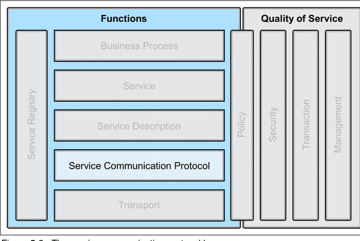

图 5-3 服务通信协议层

### 5.3.1 SOAP

简单对象访问协议 (SOAP) 是一种与网络、传输和编程语言中立的协议，它允许服务消费者调用远程服务提供者。消息格式为 XML。目前采用的标准是 W3C 的 SOAP 1.1 规范，而 SOAP 1.2 正在处于审查阶段。

SOAP 具有以下特征：
- SOAP 设计简单且可扩展性。
- SOAP 提供了一个用于描述消息内容和处理指令的框架，以及一组用于表示定义数据类型的可选编码规则。
- 所有 SOAP 消息均使用 XML 编码。
- SOAP 不依赖于传输协议。HTTP 是支持的传输协议之一。因此，SOAP 可以在现有的互联网基础设施上运行。
- 没有分布式垃圾收集。因此，SOAP 不支持引用传递；SOAP 客户端不持有任何对远程对象的有状态引用。

第 5 章 技术选项 117

SOAP 独立于操作系统，且不与任何编程语言或组件技术挂钩。它是对象模型中立的。

由于这些特征，使用什么技术来实现服务消费者并不重要，只要该消费者能够发布 XML 消息即可。同样，服务提供者可以用任何语言实现，只要它能处理 XML 消息。

如图 5-4 所示，一个简单的 SOAP 消息由三个主要部分组成：封包（Envelope）、可选头（header）和正文（body）。

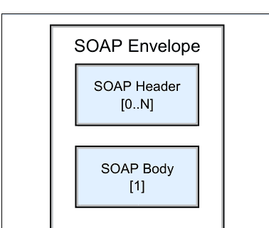

图 5-4 SOAP 消息概述

### 带附件的 SOAP

SOAP 架构基于 XML 文档。然而，当这些文档包含二进制数据（如图像）或封装其他 XML 文档时，会出现一些问题。为了处理这些情况，SOAP 标准通过“带附件的 SOAP”（SOAP with Attachments）功能进行了增强。该功能允许 SOAP 消息由多个部分组成，以改进对特定有效负载的处理。

### SOAP 编码与性能

在 SOAP 消息中有多种编码消息的方法。
- SOAP 远程过程调用（RPC 编码），如 SOAP 1 第 5 章规范中定义。
- SOAP 远程过程调用字面量编码（SOAP RPC-literal），使用用户定义的方法对 XML 数据进行序列化和反序列化。
- SOAP 文档样式编码，也称为消息样式编码或文档字面量编码。

这些技术带来了不同的优势和局限性。针对特定场景选择编码技术可能是特定项目成功的关键因素。

图 5-5 显示了每种技术的预期收益。

| SOAP RPC 编码 | RPC-字面量编码 | 文档样式编码 |
| --- | --- | --- |
| 简化开发者工作 | | 简化系统工作 |

图 5-5 SOAP 编码技术的定位

### SOAP 与 WS-I Basic Profile

WS-I Basic Profile 1.0（参见第 36 页的“WS-I Basic Profile 1.0”）禁止使用 SOAP 编码。SOAP 编码用于指示在将数据编码为 XML 时使用特定方案。这增加了复杂性，并已被证明是互操作性问题的频繁根源。

WS-I Basic Profile 1.0 要求使用 WSDL SOAP 绑定的 RPC/literal 或 Document/literal 形式。规范中提供了大量的细节，描述了 SOAP 绑定扩展元素的正确用法，以确保对 RPC/literal 和 Document/literal 形式的 SOAP 绑定的描述一致且可互操作。其目标是让 WSDL 工具生成的代码在产生和或消耗 SOAP 消息方面具有互操作性。

### SOAP 与可靠消息服务

SOAP 标准独立于任何传输层。然而，唯一作为参考实现使用的绑定是 HTTP。这意味着 SOAP 没有用于可靠消息的标准绑定。多个供应商提供了可靠消息解决方案，其中 IBM 提供了基于 WebSphere 间件家族的解决方案。

在此背景下考虑的另一个环境是 ebXML（参见第 125 页的 5.4.3，“ebXML”）。ebXML 消息服务与 WebSphere MQ 方案具有相同的目标，但实现仍然非常新，因为该标准直到 2001 年作为全球 ebXML 架构的一部分才发布。

### 通过 SOAP 访问 CICS

在大型 CICS 事务服务器最近进行增强之前，程序员必须编写 Java 程序，通过类似 J2EE 连接器（如 CICS 事务网关）来访问 CICS 函数。然后这些 Java 程序可以暴露为 Web 服务。

新的 IBM SOAP 特性允许程序员通过 SOAP 调用直接访问 CICS 事务。此新功能的目标是为访问遗留业务功能提供更大的灵活性。它旨在为某些应用程序提供额外的连接层，特别是用于面向服务或扩展企业架构内部的应用程序。

## 5.4 服务描述

Web 服务的主要优势之一是允许松耦合的架构。为了实现这一目标，服务提供者和服务消费者应该尽可能独立。如图 5-6 架构栈中突出所示的，结构化服务描述是实现独立性的关键。提供服务时，不需要提供者或消费者关心对方的技术平台或编程语言。

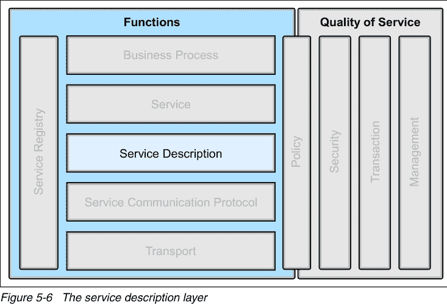

服务描述有两个层级：
- 运行操作级服务描述（XML 和 WSDL）
- 完整服务描述

### 5.4.1 XML

XML 是 Web 服务消费者和提供者之间交换数据的事实语法。它允许使用文档类型定义（DTD）或 XML 模式定义标签的自定义标记语言。

DTD 本质上是有缺陷的，因为它数据类型有限，不支持日期格式、数字或其他常见数据类型。它使用自己的语言定义 XML 语法，这不符合 XML 规范，并且难以通过编程操作 DTD。

为了解决这些问题，世界网联盟联盟（W3C）定义了一种用于定义 XML 文档的新标准，称为 XML Schema。相比 DTD，XML Schema 具有以下优势：
- 元素的强类型支持
- 表示元素空值的标准化方法
- 直接类似于关系数据库外键的关键机制
- 定义为 XML 文档，便于编程访问

XML 不是定义消息的必要条件。可以使用其他格式，例如 OMG 的接口定义语言（IDL）或简单的固定记录格式。然而，双方必须就使用什么格式达成一致。在多个组织参与的情况下，管理许多非标准消息格式将非常困难。XML 正在作为标准消息格式被广泛接受。会计、建筑、教育、金融、政府、医疗保健、保险、法律、制造、电信和旅行（少数人能叫出来！）等行业也开发了特定词汇，以促进行业内部的通信。

XML 允许以结构化和格式化的方式表示数据。它提供了语言的语法，但并不传达与数据相关的含义。不同行业可能以不同的方式使用同一个词，也可能用不同的词表示相同的意思。

OASIS 开发了通用业务语言（UBL），旨在定义通用的 XML 业务文档库。UBL 将提供一组 XML 基础块和一个框架，使贸易伙伴能够在特定语境下明确地识别和交换业务文档。

### XML 文档的转换

由于 XML 在开发不同词汇方面具有灵活性，因此需要将一种 XML 格式转换为另一种格式。

属于可扩展样式表语言 (XSL) 家族的两个 W3C 规范用于将 XML 文档转换为其他 XML 文档：
- *可扩展样式表语言转换 (XSLT)* 是用于转换 XML 的语言。它定义了从源树到目标树转换过程中用到的规则集。在 XSLT 中定义的转换被称为样式表。
- *XML 路径语言 (XPath)* 是 XSLT 用于访问或引用 XML 文档部分内容的表达式。

XSL 处理器用于实际转换，通常会有性能开销，因此对较大的文档进行在线处理可能会很慢，尽管使用 XSL 即时编译器可以加速转换时间。

通过 XSL，基于 XML 的应用程序可以与 Web 服务（Web services）链接。它可以将 XML 文档转换为不同的 XML 格式，如 WSDL 和 SOAP。它还可以将逻辑结构转换为呈现格式，如 HTML 页面。

### XML 的优点

XML 在广泛领域都有许多优势。影响 XML 被广泛接受的因素包括：
- *数据数据传输的可接受性*

XML 是一种标准方法，可以将信息放入可以在不同硬件设备、操作系统、软件应用程序和 Web 进行处理和交换的格式中。
- *统一性和一致性*

XML 提供了一种通用格式，可以在此基础上开发并被整个行业接受。
- *简单性与开放性*

在 XML 中编码的信息是人类可读的。
- *灵活且可扩展*


XML 基于标签的格式使其灵活且易于扩展。它可以被定制以支持组织的需求。当需要新信息时，只需向结构中添加标签即可。与固定记录格式不同，它不依赖于信息在结构中的位置。不感知结构中此新信息的应用程序不受额外数据的影响。

*数据与显示的分离*

数据的表示与在浏览器或其他设备上显示数据所需的呈现和格式化隔离开来。

*行业认可*

XML 已被信息技术和计算行业广泛接受。有许多工具和实用程序，以及用于解析和转换 XML 数据到其他数据（或显示）的新产品。

## XML 的缺点

需要考虑的某些 XML 问题：

*复杂性*

虽然 XML 标签允许软件识别文档中的有意义内容，但这种用性仅限于读取文档的软件知道这些被标记的内容在人类语言中意味着什么，并且知道该如何处理它们。

*标准化*

当多个应用程序使用 XML 彼此通信时，需要对它们使用的标签名称达成共识。虽然通常存在特定行业的标准标签定义，但你仍然可以声明自己的非标准标签。

*体积大*

XML 文档单元通常比其他数据表示形式大。这对性能有影响，并且可能不适用于高性能系统。

## 5.4.2 WSDL

W3C 已采纳 Web 服务描述语言 (`WSDL`) 作为基础级服务描述的标准。在编写本书时，`WSDL` 的当前版本是 1.1。

`WSDL` 使用 XML 文档指定 Web 服务的运行特性。它提供了一种记法来回答以下问题：

*是什么（该服务是关于什么的？)*

*在哪里（它位于何处？)*

*如何（如何调用它？)*

Web 服务被认为一组运行在包含面向文档或面向过程 (`RPC`) 消息上的端点（endpoints）。`WSDL` 提供了一种标准的方法来抽象描述操作和消息：服务接口定义。这些描述绑定到特定的网络协议和消息格式，以创建一个端点：服务实现定义。图 5-7 显示了这种组合。

| 服务实现 | `<definitions...><import...><service...><port...></service></definitions>` |

|---|---|

| 服务接口定义 | `<definitions...><types...><import...><message...><portttype...><binding...></service></definitions>` |

图 5-7 使用 `WSDL` 的基本服务描述组件

服务接口定义可以被多个服务实现实例化并引用。

`WSDL` 文档根据实现定义在一个或多个物理文件中。当使用多个文件时，使用 `import` 元素来链接每个文件。`WSDL` 通常分为一个实现 `WSDL` 文件和一个接口 `WSDL` 文件。绑定可能定义在单独的第三文件中。

`WSDL` 不规定任何特定的消息格式或网络协议。然而，`WSDL` 1.1 规范仅描述了针对 `HTTP` 上的 `SOAP` 1.1、直接 `HTTP` 1.1 请求（`HTTP GET` 和 `POST`）以及多用途互联网邮件扩展 (`MIME`) 的绑定。

## WSDL 的优点

作为实现 Web 服务的根本要求，`WSDL` 需要发布接口描述合约，供其他服务调用。

## WSDL 的缺点

`WSDL` 文档未提供潜在用户可能需要的某些信息，例如：

- 谁提供服务？
- 什么样的业务提供服务？
- 该提供者还有哪些其他可用服务？
- 从该提供者处应该期待什么样的服务质量？
- 服务是免费的还是收费的？

`UDDI` 标准提供了这些信息的潜在来源，以便建立对给定服务的更完整的视图。请参见第 141 页的“`UDDI`”。

## 5.4.3 ebXML

`ebXML` 代表使用 XML 的电子业务（Electronic Business using XML）。它提供了一个模块化的规范集，使企业能够在互联网上开展业务。使用 `ebXML`，公司现在有一种标准方法来交换业务消息、进行交易关系、使用通用术语通信并定义和注册业务流程。

它是开放组织 (`OASIS`) 与联合国贸易便利与电子业务中心 (`UN/CEFACT`) 共同开发努力。`OASIS`（原 `SGML` 组）带来了 XML 专家知识，而电子数据交换 (`EDI`) 的主要赞助者 `UN/CEFACT` 带来了业务知识。

第 126 页的图 5-8 展示了 `ebXML` 架构主要组件的简化视图。

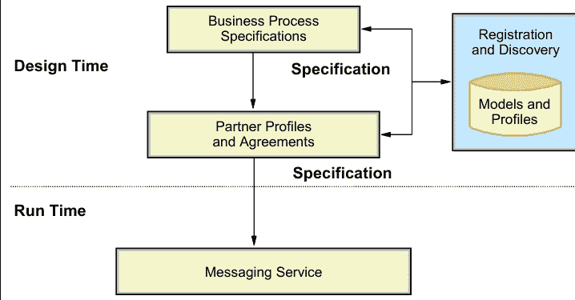

图 5-8 `ebXML` 架构

`ebXML` 套件中的主要规范如下（从图 5-8 左下向上）：

- 使用 `ebXML` 消息服务规范 (`ebMS`) 实现可靠消息：提供保证的、单次的交付、安全的基于 `SOAP` 的通信。
- 使用 `ebXML` 协作协议与协议 (`ebXML CPP/A`) 实现伙伴配置和协议：描述组织及其服务、业务流程和技术能力。它持有合作伙伴运行时配置信息并存储服务质量 (`QOS`) 信息。
- 使用 `ebXML` 业务流程规范体系 (`ebXML BPSS`) 实现业务流程规范：定义业务活动、协作和事务，并描述它们的关系。它还提供了一个机器可读的规范实例。它实现了协作式“业务”服务。
- 使用 `ebXML` 注册库/仓库 (`ebXML Reg/Rep`) 实现注册库和仓库：为制品物（包括 `BPSS` 流程规范和 `CPP/A` 伙伴配置）提供强大的分类和存储机制。对于 B2B 来说，它可以被认为之于企业级应用程序的数据库。

带有 `ebXML` 核心组件 (`ebCC`) 的语义与模型：

核心库（Core Library）是一组标准的“部分”，可以用于较大的 `ebXML` 元素中。例如，核心流程（Core Processes）可以被业务流程（Business Processes）引用。核心库由 `ebXML` 倡议本身贡献，而较大的元素可能由特定行业或业务通过通用词汇进行贡献。

此处使用的 `SOAP` 术语指的是比 `SOAP` 本身更广泛的规范集。它包括 Web 服务定义语言 (`WSDL`) 和通用描述、发现与集成 (`UDDI`)，作为一个整体，它们也被称为 `WUS` 栈（`WSDL`, `UDDI`, `SOAP`）。`ebXML` 赞助者认为此任务比 `ebXML` 规范集更强大、功能更丰富，但使用更简单，更适合满足其他需求。

例如，仅通过 `HTTP` 的 `SOAP` 无法在应用层提供可靠的消息传递。此外，通过 `ebXML` 中的 `CPP/A` 捕获的服务质量比 `SOAP` 和 `WSDL` 实现的更加详细和复杂。

## ebXML 与 Web 服务

`ebXML` 架构似乎与 Web 服务架构有相似之处。然而，`ebXML` 组织并不将 `ebXML` 标准视为 Web 服务的替代方案，而是视为“业务”Web 服务的标准。“业务”Web 服务基于点对点的协作业务流程模型，而基础 Web 服务基于客户端-服务器、`RPC` 风格的模型。

`ebXML` 提供了一套模块化的规范，旨在实现企业之间基于标准的、点对点的、协作的业务通信，`ebXML` 是基础 Web 服务的补充，并在其基础上实现了“业务”Web 服务。

## ebXML 注册表

电子业务注册表（e-business registry）是一种以自动方式组织开展电子商务所需信息的软件产品。它涵盖了多种功能：

- 通过能力注册企业及其能力
- 服务描述的注册
- 业务和服务的发现

`ebXML` 注册表是 `ebXML` 倡议的核心组件，为电子业务提供了一个完整的框架。它管理了在 `ebXML` 框架内进行电子商务所需的各种元素的存储存储和发现机制，并具有关于交易业务方面的一些高级功能：

- 协作协议协议 (`CPA`) 定义了双方在参与业务协作之前需要同意的能力。
- 协作协议配置文件 (`CPP`) 描述了参与者的消息交换能力。
- 业务流程规范模式 (`BPSS`) 提供了一个标准框架，允许各种交易的组合。它可以与第 137 页上的 `BPEL4WS`（“`BPEL4WS`”）进行比较。

`UDDI` 注册表如 5.7.2 节第 141 页“`UDDI`”所示，专注于自动化电子商务的发现方面。`ebXML` 注册表在发现方面增加了一层互操作性。在编写此本文时，`UDDI` 技术委员会正在准备一份技术说明，以指导如何在 `ebXML` 框架内使用 `UDDI` 注册表。其意图是利用每个注册表的互补优势。然而，没有将数据从一个注册表移动到另一个的机制。请求 `API` 是特定的。

`UDDI` 注册表似乎比 `ebXML` 注册表使用得更频繁。

## 查找更多信息

有关 `ebXML` 的更多信息，请参阅：

- `ebXML`

http://www.ebxml.org

- `OASIS`

http://www.oasis-open.org

## 5.5 服务

我们架构栈的服务层如第 129 页图 5-9 所示，代表了根据发布的 `WSDL` 接口描述可以定位和调用的实现软件。

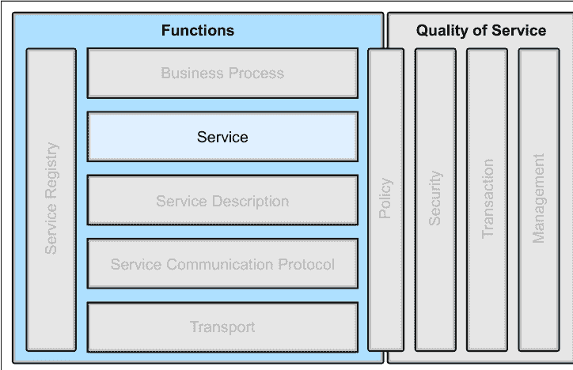

图 5-9 服务层

在本节中，我们检查访问 Web 服务的两种编程模型：

- `J2EE` 的 Web 服务
- Web 服务调用框架 (`WSIF`)

### 5.5.1 Web 服务与 J2EE

Web 服务旨在提供系统之间的互操作性标准，无论终端系统的架构或实现方法如何。


Java2 平台企业版（`J2EE`）是一个重要的编程模型和架构，IBM 通过 `WebSphere Application Server` 和 `WebSphere Studio` 提供支持。由于书中描述的许多产品映射基于 `WebSphere Application Server`，因此回顾 `J2EE` 的状态以及在 `J2EE` 平台上实现 Web 服务的 Java 标准具有启发意义。

## 一组新的 Java 规范请求

`J2EE` 应用服务器用于提供 Web 服务设施的技术演进非常快。Java 社区最近采用了一组标准，来定义在符合 `J2EE` 标准的应用服务器中支持 Web 服务的不同方面。

这些规范被描述为 Java 规范请求 (`JSRs`)。`JSR` 用作所有 Java 规范的跟踪机制，从提议到接受或拒绝。关于管理规范开发的 Java 社区进程（Java Community Process）以及 `JSR` 本身的信息可以在下处找到：

http://jcp.org

涉及该领域的主要 `JSR` 是 `JSR 109`，实现企业 Web 服务（也称为 `J2EE` 的 Web 服务）。它于 2002 年 11 月达到了最终发布状态。

`JSR 109` 的目标是定义在 Java 中实现 Web 服务的编程模型和运行时架构。它整合了其他几个 `JSR` 上所的工作。该 `JSR` 的领导方式类似于 servlet 结合 cookie 的方式，以及 `EJB` 结合 `JTA`/`JTS` 等概念。包含在 `WebSphere V5.0.2` 中的用于 `J2EE` 的 Web 服务源自 `Apache Axis`。

`SOAP`/`HTTP` 通道（同时支持 `RPC` 风格和文档风格的 `SOAP` 消息）。

如果你开发需要在 `MIME` 消息中传递附件的 Web 服务，那么这些 Web 服务只能通过 `SOAP`/`HTTP` 通道进行访问。

目前还没有 `SOAP JMS` 的规范；每个供应商都选择自己的实现技术。因此，在现阶段无法通过此实现互操作性。

## 互操作性

`J2EE` Web 服务旨在符合 `WS-I Basic Profile 1.0` 标准，并应与任何其他符合此规范的供应商服务进行互操作。在本文编写时，`Basic Profile 1.0` 尚未完成，因此可能存在不兼容的情况。

## 开发工具

`WebSphere Studio Developer V5.1` 为 `J2EE` Web 服务开发提供了 IDE 支持。`IBM WebSphere Application Server V5.1` 为启用 `WebSphere` 应用程序 Web 服务提供了命令行工具。

## 5.5.2 Web 服务调用框架

`Apache` Web 服务调用框架 (`WSIF`) 提供了一个标准的 Java API 来调用服务，无论该服务是以何种方式在何处提供的（如 `WSDL` 中描述的）。

`WSIF` 允许开发者摆脱底层服务的原生 API，转而与服务的表示形式进行交互。这使得开发者无论服务是如何实现和访问的，都能使用相同的编程模型。

`WSDL` 是 `WSDL` 驱动的，它提供了一个使用 `WSDL` 文档调用服务的统一接口。因此，如果你正在使用的 `SOAP` 服务变成了 `EJB`（例如），只需修改 `WSDL` 服务描述即可切换到 `RMI`/`IIOP`，而无需修改使用服务的应用程序。

此 API 被工具（如 `WebSphere Studio Integration Edition`）和运行时（如 `WebSphere Application Server Enterprise`）用于构建和操纵 `WSDL` 文档中定义的服务。该架构允许在运行时添加新的绑定。

有关 Web 服务调用框架的更多细节，请参阅：

http://ws.apache.org/wsif/

## WSIF 的优势

`WSIF` 具有以下优势：

- 可以为服务提供多种绑定，并可以在运行时决定绑定。
- 服务既可以通过一组存根类（静态）使用，也可以通过动态接口调用（动态）。
- 你可以灵活地切换协议、位置等，而无需重构客户端代码。

## WSIF 的劣势

`WSIF` 是一个 Java API，因此无法在非 Java 的环境中使用。

## 5.6 业务流程

使用行业标准，Web 服务可以发布其接口、被发现和调用，并相互通信以交付端到端功能。但为了支持业务流程，需要更层次的抽象。我们架构栈中的业务流程层（见第 134 页图 5-10）允许我们创建和定义复杂的流程或工作流。流程由 Web 服务提供的操作组成，可以根据业务需求进行嵌套和排序。

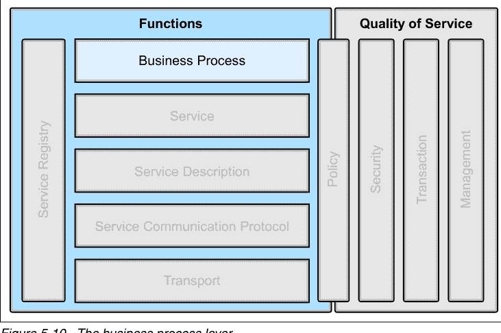

图 5-10 业务流程层

通过将业务流程与底层 Web 服务的实现隔离（见第 135 页图 5-11），你可以更容易地适应变化的业务状况。

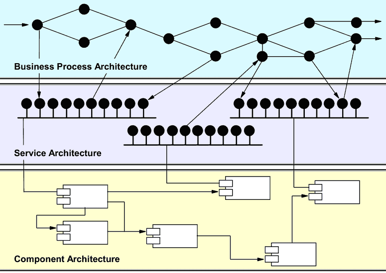

图 5-11 将业务流程与实现隔离

使用一致的建模方法简化了参与业务流程的所有方之间的通信。此外，模型可以在合作伙伴之间共享，而无需规定流程中的每个合作伙伴必须使用的开发工具或运行时环境。基于开放标准的建模建模方法允许流程中的活动与流程本身保持松耦合，从而减少了当业务环境或需求变化时实现流程更改所需的工作和精力。

### 5.6.1 WSFL 和 XLANG

IBM 的 Web 服务流语言 (`WSFL`) 和微软的 `XLANG` 都是业务流程执行标准的早期建议。这两者已经合并并进一步开发，创建了由大多数当前行业领导支持的共同标准 `BPEL4WS`，它在第 136 页的“业务流程的兴起标准”中有详细描述。

第 5 章 技术选项 135 页

## 流程编排器 (Process Choreographer)

`IBM WebSphere Application Server Enterprise V5.0` 提供了一个名为 `Process Choreographer` 的功能。业务流程使用 Web 服务流语言 (`WSFL`) 的子集进行描述，这是在任何 Web 服务流程描述的标准工作之前开发的 IBM 规范。`WebSphere Studio Integration Edition` 的开发插件可用于流程开发。有关 `Process Choreographer` 的更多信息可以从下处获取：

```
http://www.software.ibm.com/wsdd/zones/was/wpc.html
```

参见 IBM Redbook Patterns: Serial and Parallel Processes for Process Choreography and Workflow, SG24-6306。

## Process Choreographer 的优势

使用 `Process Choreographer` 开始开发业务流程具有许多优势，无需等待基于新标准的产品的发布。这些优势包括：

- 你可以开始积累构建业务流程的经验。
- 你可以开发由各种组件组成的流程，这些组件可以实现为 Web 服务、`J2EE` 组件、现有的企业应用程序以及手动活动。

## Process Choreographer 的劣势

由于 `Process Choreographer` 没有实现开放标准，使用它存在一些劣势，包括：

- 你必须在某个阶段将流程迁移到标准实现上。请注意，IBM 可能会提供工具来协助完成。
- 你的业务流程开发者可能需要学习支持标准实现的开发工具。
- 任何没有 Web 服务接口的流程活动将无法在标准实现中使用。

## 5.6.2 业务流程的新标准

如上所述，过去各个供应商（如 IBM 和微软）为创建业务流程标准提出的提案已经合并并进一步开发。目前只有一个主要的标准正在兴起，以满足我们服务栈业务流程层的需求。

### BPEL4WS

Web 服务业务执行语言 (`BPEL4WS`) 提供了一种基于 Web 服务的业务流程的标准方法。现有标准（如 `WSDL`）无法提供复杂业务协议所需的设施，例如取决于服务间传输的数据的行为描述、异常管理和恢复，以及长时间复杂流程中业务合作伙伴之间的协调。`BPEL4WS` 旨在满足这些需求。

`BPEL4WS` 由 IBM、微软、`SAP` 和 IBM（Web 服务流语言，即 `WSFL`）于2002 年7 月首次规定。本文编写时规范的最新版本 1.1 已于 2003 年 5 月提交给 `OASIS` 标准小组。可以在此处获取规范副本：

```
http://www.ibm.com/developerworks/library/ws-bpel/
```

在写作期间，某些产品和技术预览开始出现。IBM 提供了 `BPWS4J` 作为 `WebSphere Application Server` 和 `Apache Tomcat` 的运行时引擎。`BPWS4J` 工具包还包含一个开发工具。`BPWS4J` 可以从此处下载：

``` evenhttp://www.alphaworks.ibm.com/tech/bpws4j
```

IBM 还为 `WebSphere Studio Integration Edition` 提供了一个开发插件的技术预览，如图第 138 页图 5-12 所示。

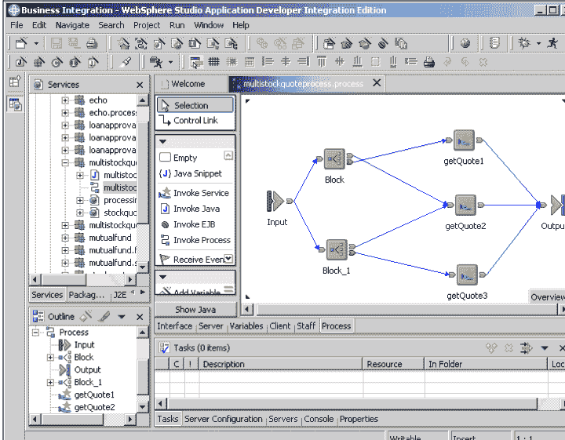


图 5-12 BPEL4WS 导入/导出器技术预览

该插件提供了使用可视化编辑器开发流程的设施，并可以生成 `WSDL` 和其他产物以实现该流程。

`BPEL4WS` 标准的实现可能适用于产品映射，特别是对于扩展企业 `Extended Enterprise` 业务模式和应用程序集成 `Application Integration` 模式。然而，本书并未评估 `BPEL4WS` 技术的使用。

如需更多详细信息，您可能希望审阅以下文档：

http://www.ibm.com/developerworks/webservices/library/ws-bpwp/

http://www.ibm.com/developerworks/webservices/library/ws-autobop/

http://www.ibm.com/developerworks/webservices/library/ws-bpcol1/

最后一个引用是一个系列专栏中的第一个，描述了标准 1.0 版本的 `BPEL4WS`。

## 模式：面向面向的架构与 Web 服务

## 5.7 服务注册

我们架构栈中的服务注册层（如图 5-13 所示）允许服务提供者使用 `WSDL` 发布其提供的服务的定义，并允许服务消费者查找有关可用服务的信息。

| 功能 | 服务质量 |
| --- | --- |
| 服务注册 | 策略 安全 事务管理 |
| 业务流程 |  |
| 服务 |  |
| 服务描述 |  |
| 服务通信协议 |  |
| 传输 |  |

图 5-13 服务注册层

在 Web 服务架构中，`UDDI` 注册表通常被提及承担这一角色。`UDDI` 注册表经常被比作电话系统的“黄页”。然而，这种方法忽略了提供提供利用可用服务所需信息的其他方式。

继续使用电话系统的类比，让我们来看一些替代方案：

- 直接请求

当您需要某人的电话号码时，获取它的最简单的方法之一直接向该人请求。这通常是获取某人手机号的方法，因为电话簿很少列出手机号码。

- 简单聚合发布

当业务人士见面时，他们通常会交换名片。名片是提供电话号码和附加信息（如传真号码、电子邮件地址等）的一种。当然，你首先需要将它们打印，这比直接请求方案增加了一些复杂性。

- 目录使用

人们只有在某些情况下才会查阅黄页；例如，为了发现他们不熟悉的领域某个服务提供者。黄页目录比其他方法提供了更多信息，但需要投入大量精力来集中信息并发布。

Web 服务也是如此，你可以使用从简单到复杂的发现机制来满足各种业务需求：

- 从电子邮件到磁盘的任何媒介上的服务描述交换都可以比作直接请求。

- `WS-Inspection` 语言可以比作名片。

- `UDDI` 注册表可以比作黄页。

图 5-14 总结了这一讨论。该图节选自《Web 服务概念架构版本 1.0》，地址如下：

```
http://www.ibm.com/software/solutions/webservices
```

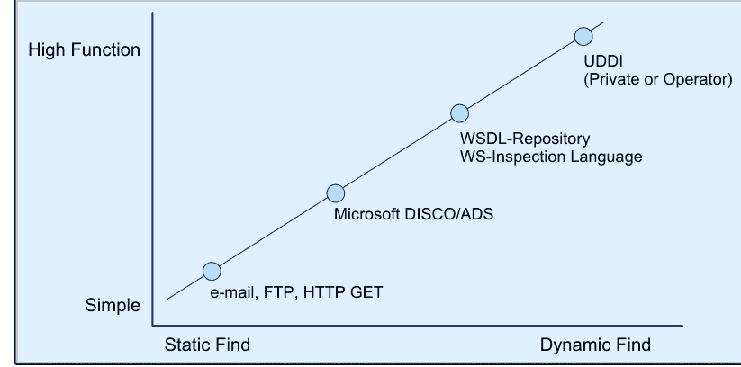

图 5-14 服务发现连续谱

### 5.7.1 静态和动态 Web 服务

按需系统的全自动化面向服务信息系统的最终目标，是提供对服务的即时发现和绑定。

然而，这种全自动化模型在构建时或运行时都尚未成为主流。

绑定到 Web 服务有两种方式：*静态和动态*。

- 在静态过程中，绑定是在设计时完成的。服务消费者通过私有通道（例如通过电子邮件）从服务提供者处获取服务接口和实现描述，并将其存储在本地配置文件中。不涉及私有的、公共或共享的 `UDDI` 注册表。

这一过程非常适合开发环境。缺点是难以随着时间的推移接收服务最新状态的信息。

- 动态绑定发生在运行时。当客户端应用程序运行时，它会使用 `UDDI` 注册表动态定位服务，然后使用 `WSDL` 和 `SOAP` 将其绑定。

这要求 `UDDI` 注册表的内容以及服务提供者是可靠的。目前，只有私有的 `UDDI` 网络可以对内容提供此类控制。

### 5.7.2 UDDI

服务注册的当前标准是由 `UDDI` 组织定义的通用发现描述与集成标准，该组织是 `OASIS` 组织的一部分，旨在作为服务消费者和服务提供者之间的信息中经纪人。在编写本书时，该标准的最新版本是版本 3。

`UDDI` 规定了如何存储和检索服务信息，特别是提供者名称和技术接口。

#### UDDI 注册表结构

`UDDI` 结构中存储了多种类型的信息。如第 142 页图 5-15 所示，这包括四种主要数据类型：

- *Entity*（实体），描述服务提供者

- *businessService*（业务服务），包含服务的非技术信息

- *bindingTemplate*（绑定模板），包含技术信息

- *tModel*（技术模型），技术模型

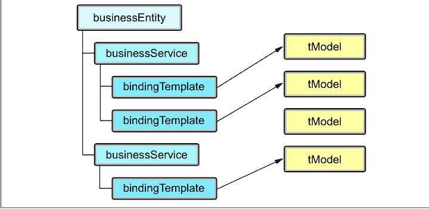

图 5-15 服务注册层


图 5-16 服务发现映射

#### UDDI 注册表类型

有三种类型的 `UDDI` 注册表处理业务范式：

- UDDI way

`UDDI` 的公共实现是 `UDDI` 业务注册表 `UBR`。`UBR` 由多个节点组成由 IBM、微软等公司管理。当服务提供者想要发布其服务时，他们去 `UBR` 站点注册并发布。数据随后同步到所有节点。例如：

```
http://uddi.ibm.com
```

初始标准侧于多节点环境。这支持在运行时发现通用 Web 服务。在编写本书时，`UBR` 包含有限的条目。

- 组组或合作伙伴注册表

这些实现关注特定的合作伙伴，通常来自同一行业，以关注真正需要的服务并解决提供者和消费者之间的信任问题。

- 私有注册表

大多数公司于使用内部（私有）`UDDI` 注册表启动 Web 服务项目。

#### 使用 UDDI 注册表发现服务

除了有序存储服务信息外，`UDDI` 注册表提供了发现服务的搜索工具：

- 例如，特定实体提供的所有服务。

- 根据各种分类的服务列表。

### 5.7.3 服务注册的新兴标准

正在开发的服务注册新兴标准是 `WS-Inspection`。

由 IBM 和微软开发的 `WS-Inspection` 规范允许使用提供点处的 `XML` 文档对提供的服务进行检查。它提供了一种格式来列出以任何格式编写的服务描述文档。它还定义了一系列约定以便定位 `WS-Inspection` 文档。

有关 `WS-Inspection` 的更多信息请参阅 IBM Redbook，《WebSphere Version 5.1/Application Developer 5.1.1 Web Services Handbook》，`SG24-6891`。

## 5.8 策略

策略在我们的架构栈中既有功能方面也有服务质量方面，如图 5-17 所示。

| 功能 | 服务质量 |
| --- | --- |
| 业务流程 |  |
| 服务 |  |
| 服务描述 | 策略 安全 事务管理 |
| 服务通信协议 |  |
| 传输 |  |

图 5-17 策略层

### 5.8.1 策略的新兴标准

`WS-Policy` 框架是一个用于描述与服务相关的服务质量 `QoS` 需求和能力的元数据框架。

IBM 和微软在 2002 年 4 月提供的 Web 服务安全路线图中的 `WS-Policy` 元素已进一步完善，包含了四份文档：

- 策略框架 `WS-Policy` 文档，定义了用于表达 Web 服务策略的语法。

- 策略附件 `WS-PolicyAttachment` 文档，定义了如何将这些策略附加到 Web 服务。

- 一组通用策略断言 `WS-PolicyAssertions`。

- 一组安全策略断言 `WS-SecurityPolicy`。

`WS-Policy` 的设计允许可扩展性。“策略”是一个广义的术语，不仅涵盖安全，还包括可靠性、事务、隐私等其他领域。每个领域都需要一种语言来列出该领域可用的策略断言，例如安全领域的 `WS-SecurityPolicy`。

在未来，`WS-Policy` 允许根据服务提供者发布的能力来选择提供者。服务消费者也可以使用 `WS-Policy` 发布自己的能力和需求，从而实现兼容的策略消费者与提供者之间的匹配。

使用 2.4 节引入的企业服务总线愿景 `ESB`（第 38 页“企业服务总线”），服务消费者和提供者可以将它们的策略需求和能力发布到 `ESB`。随后，`ESB` 可以识别请求流中所需的调解以满足 `QoS`（服务质量）要求；例如通过设置消息上下文（如事务 ID）和消息安全（如加密）。

### 在此处查找更多信息

有关 `WS-Policy` 的更多信息，请参考 IBM DeveloperWorks 上的以下文章：

- Web 服务策略框架 `WS-Policy` 规范地址为：

http://www.ibm.com/developerworks/library/ws-polfram/

- Web 服务安全：向上栈迁移，新规范改进了 `WS-Security` 模型，地址为：

http://www.ibm.com/developerworks/webservices/library/ws-secroad/

## 5.9 安全


在电子商务世界中，我们严重依赖于许多分散系统和应用程序之间的数据交换和传输，这既包括企业内部，也包括跨组织边界到达业务伙伴、供应商和客户。当我们需要打包和交换数据时，都存在内在风险，即数据在从源应用程序到目标应用程序传输的过程中，可能会被拦截，从而被盗取或修改。在 Web 服务等分布式架构中，这种威胁本质上很高；服务消费者与服务提供者之间的事务是使用包含在 SOAP 消息中的明文 XML 进行的。这意味着任何设法拦截事务的人都可以轻松读取 SOAP 负载负载中包含的数据。架构栈的安全层（如图 5-18 所示）被包含在是为了保护 Web 服务免受此类威胁。


图 5-18 安全层

在任何架构解决方案中，必须解决以下安全需求，对于 Web 服务而言也没有例外：

- 身份识别：访问资源的方能够向系统识别自己的身份。
- 身份验证：存在一种程序来验证访问方的身份。
- 授权：存在一组经过身份验证的方被允许执行的事务。
- 完整性：信息在传输过程中不被更改。
- 机密性：没有人能够读取其传输过程中的信息。
- 审计：所有事务都记录在案，以便在事后分析问题。
- 非否认性：双方均能够向第三方提供法律证明，证明发送方确实发送了信息，而接收方收到了相同的信息。

146 模式：面向服务的架构与 Web 服务

今天使用 Web 服务实现的大多数系统仅部分实现了这些需求，这可能是由于缺乏标准或稳定的技术。

2002 年 4 月，IBM 和微软提出了一项关于“解决 Web 服务环境中的安全问题”的技术策略和路线图。`Web 服务（WS-Security）`规范定义了一个全面的 Web 服务安全模型，该模型支持、集成并统一了多种安全模型、机制和技术（包括对称和公钥技术），使得各种系统能够以平台和语言中立的方式安全地运行。

`WS-Security`规范提供了一系列广泛的规范，涵盖了安全技术，包括身份验证、授权、隐私、信任、完整性、机密性、安全通信通道、联邦、委托等。这些规范跨越广泛的应用和业务拓扑结构提供了一个框架，具有具有扩展性和灵活性，并最大限度地利用了现有安全基础设施的投资。通过利用 Web 服务模型核心的天然扩展性，这些规范构建在`SOAP`、`WSDL`、`XML`签名、`XML`加密和`SSL/TLS`等基础技术之上。

如第 148 页的图 5-19 所示，这建立了一个消息安全模型（`WS-Security`），为其他安全规范奠定了基础。在此之上，我们有一个策略层，包含了 Web 服务端点策略（`WS-Policy`）、信任模型（`WS-Trust`）和隐私模型（`WS-Privacy`）。这些初始规范共同构成了基础，我们据此工作建立跨信任域的安全互操作性 Web 服务。


欲需更多信息，请参阅 IBM developerworks 的 *Security in a Web Services World: A Proposed Architecture and Roadmap:*：

`http://www.ibm.com/developerworks/webservices/library/ws-secmap/`

正如已经指出的，Web 服务安全格局仍在定义中，尽管新的标准不断被开发和部署，但今天通过 Web 服务实现安全的方法处于以下水平：

- 在传输层
- 在传输层，Web 服务通过传输通道技术（如`HTTPS`）的内置安全功能受到保护。
- 在服务协议层
- 尽管新规范不断开发，此层级的 Web 服务安全是通过使用`SOAP`消息安全来确保的。
- 在服务描述层
由于 XML 文档交换是 Web 服务的组成组件之一，通过使用当前的基于 XML 安全技术（如数字签名和加密），可以在服务描述层实现另一层安全。

| 功能 | 服务质量 | |
| --- | --- | --- |
| 业务流程 | | |
| 服务 | | |
| 服务描述 | 策略安全事务管理 |
| 基于 XML 安全 | | |
| 服务通信协议 | | |
| SOAP 消息安全 | | |
| 传输 | | |
| 传输通道安全 | | |

图 5-20 当前 Web 服务安全标准

## 5.9.1 传输层安全

Web 服务基于服务消费者和服务提供者之间的消息交换，因此可以利用提供连接服务的底层传输协议的安全能力。

### HTTP 传输

超文本传输协议（`HTTP`）（见第 110 页“`HTTP`”）是互联网上最常用的信息交换协议。遗憾的是，`HTTP`本质上是不安全的协议，因为所有信息都在未经验证的端点或不安全网络上明文传输。

`HTTPS`代表带有`SSL`（安全套接层）的`HTTP`，允许通过证书进行服务消费者和提供者的身份验证，这些证书是自签名或由认证机构签名的。消费者必须支持`SSL`协议版本才能使用，并且通过唯一的会话 ID 在建立安全连接时协商`SSL`协议版本。如果提供者提供的证书对消费者来说未知，消费者可以自由接受或拒绝该证书。提供者也可以要求消费者提供证书。在安全

第 5. 技术选项 149

会话期间，提供者和消费者共享一个公共密钥对，允许他们对交换的消息进行加密和解密。

尽管`HTTPS`并没有涵盖通用安全框架的所有方面，但它在身份识别与验证、消息完整性和机密性方面提供了足够的安全级别。然而，它没有提供授权、审计和不可否认性。此外，它是基于协议的，因此一旦消息通过`HTTP`服务器，所有的安全性都会消失。另外，加密是基于消息的，而不是基于元素的；为了访问路由信息，我们必须解解密整条消息。

## 5.9.2 服务通信协议层面的安全性

在尝试保护`SOAP`服务安全时，应该考虑两种类型的威胁：

- 消息可能被未经授权的人修改或读取。
- 未经授权的人可能向服务发送消息，这些消息虽然格式正确，但缺乏支持处理所需的适当安全声明（`security claims`）。

`WS-Security`规范解决了了这些威胁。

### WS-Security

Web 服务安全（`WS-Security`）1.0 版本由 IBM、微软和 VerSign 共同开发，并于 2002 年 4 月发布。它由 18 家公司提交给 OASIS，现在涉及超过 50 家公司。

`WS-Security`描述了`SOAP`消息增强功能，通过对正文、头部、附件以及任何组合或部分进行加密和数字签名来保护消息。该规范定义了如何在`SOAP`消息中附加和包含安全令牌（如`X.509`证书）。

更多信息，请参阅 IBM developerworks 文章 Web Services (`WS-Security`)：

```
http://www.ibm.com/developerworks/webservices/library/ws-sec/
```

### 5.9.3 服务描述层面的安全性

到目前，我们已经讨论了底层传输层（`HTTP/S`）和服务通信协议层（`SOAP`）提供的 Web 服务。我们已经提到，Web 服务是 XML 文档交换，因此在 XML 文档层面可以实现另一层级的安全。在本节中，我们将对一组正在被纳为标准或正在采用中的安全技术进行简要概述。

#### XML 数字签名

`XML`数字签名是一种安全验证消息来源的标准。它规定了使用各种不同数字签名算法对`XML`文档进行签名的标准程序。数字签名可用于消息验证，也可用于不可否认性。

#### XML 加密

`XML`加密仍处于进行过程中。其目标是对数字内容进行加密，如 GIF 图像或 XML 片。`XML`加密允许对`XML`文档的部分进行加密而保持其他部分开放、对`XML`本身加密，或对数据进行超级加密（即在某些元素已加密的情况下对`XML`文档加密）。

#### 安全声明标记语言

安全声明标记语言（`SAML`）是第一个基于`XML`的安全电子商务交易行业标准。`SAML`的开发是为了定义在参与企业对企业（B2B）和企业对消费者（B2C）交易的公司之间共享安全服务的通用方法。`SAML`允许公司无论安全解决方案或平台如何，在其客户、合作伙伴或供应商之间安全地交换身份验证、授权和配置信息。因此，`SAML`支持不同安全系统之间的互操作性。

## 5.9.4 安全性的新兴标准

我们知道 Web 服务安全标准还有很长的路要走，但持续开发正在填补这些差距或不足。实现基于标准的、企业级安全的 Web 服务解决方案的能力已遥不可及。

`WS-Security`规范的扩展将安全覆盖范围进一步扩展到功能层上方以及堆栈的非功能组件，如第 152 页的图 5-21 所示。


### WS-SecureConversation

`WS-SecureConversation`描述如何管理和验证双方之间的消息交换，基于安全令牌的信任概念，包括安全上下文交换以及会话密钥的建立和派生。

### WS-Federation

`WS-Federation`描述如何在异构联邦环境中管理协调信任关系，包括对联邦身份的支持。

### WS-Authorization


WS-Authorization 描述了如何指定和管理 Web 服务的访问策略。特别描述了如何在安全令牌内指定声明（claims），以及这些声明如何在端点处解释。

## WS-Policy

WS-Policy 描述了中间节点和端点安全（及其他业务）策略的能力和约束。另见第 144 页第 5.8 节“策略”。

## WS-Trust

WS-Trust 描述了一种信任模型框架，使 Web 服务能够操作。WS-Trust 通过定义安全令牌服务可能提供的系列接口，用于安全令牌的发布、交换和验证。

## WS-Privacy

WS-Privacy 描述了 Web 服务和请求者如何说明隐私偏好和组织实践声明的模型。

## 5.9.5 在哪里找到更多信息

由于 Web 服务安全是一个快速发展的领域，开发者和设计人员定期检查更新至关重要。在本节中，我们为您的探索提供了一些入口点。
XML Signature 工作组主页位于：
http://www.w3.org/Signature/
XML Encryption 工作组主页位于：
http://www.w3.org/Encryption/
SAML（安全声明标记语言）OASIS 安全服务技术委员会主页位于：
http://www.oasis-open.org/committees/security/docs/draft-sistic-use-straw-03.html
有关 WS-Security 的信息请参考标准概述 developerWorks：
http://www.ibm.com/developerworks/library/ws-secure/
Web 服务安全模型位于：
http://msdn.microsoft.com/library/default.asp?url=/library/en-us/dnwse/html/security.asp

## 5.10 事务

当使用 Web 服务等分布式架构来跨企业自动化业务流程时，事务的概念变得非常重要。第 154 页的图 5-22 显示事务支持作为我们架构堆栈中的一个质量服务层。

| 服务注册 | 业务流程 | 策略 | 安全 | 事务 | 管理 |
|---|---|---|---|---|---|
| | 服务 | | | | |
| | 服务描述 | | | | |
| | 服务通信协议 | | | | |
| | 传输 | | | | |

5-22 事务层
功能
质量
为了在 Web 服务环境中实现这些定义，我们堆栈的事务层包含了 WS-Coordination 和 WS-Transaction 标准。虽然 Web 服务环境需要与传统事务相同的协调行为，但控制操作结果还需要更灵活的方法来处理多个服务的事务和结果。

### 5.10.1 事务的新兴标准

事务在传统定义上是一种确保给定环境（包括业务和技术）的所有参与者获得一致结果的机制，例如业务事务、财务事务和数据事务。这些事务具有以下属性：
- 原子性：如果成功，则所有操作都发生；如果失败，则所有操作都不发生。
- 一致性：应用程序执行有效的状态转换直到完成。
- 隔离性：操作的影响在事务成功完成之前不会共享到外部。
- 持久性：一旦事务成功完成，更改在故障后依然存在。
需要注意的是，WS-Coordination 和 WS-Transaction 仍被视为新兴标准，还需要进一步的工作来完善其规范。

## WS-Coordination

WS-Coordination 是一个通用且可扩展的框架，用于提供协调分布式事务动作的协议。该定义的框架允许应用程序服务创建所需的上下文，以便将活动传播到其他服务，并注册协调协议。该框架还允许现有的事务处理、工作流和其他协调系统能够隐藏其专有协议，并在异构环境中运行。它可以与消息排序和状态同步结合使用。

## WS-Transaction

WS-Transaction 包含了对两种类型事务的支持。它描述了与 WS-Coordination 中描述的扩展性协调框架配合使用的协调类型。文中定义了两种协调类型：原子事务 (AT) 和业务活动 (BA)。WS-Transaction 是一个构建块，用于与其他规范（例如 WS-Security）、WS-Coordination 以及特定的应用程序协议结合使用，能够容纳与分布式应用程序协调动作相关的各种协调协议。

## Web 服务的对话支持 (Conversation Support for Web Services)

IBM 正在通过 alphaWorks® 提供一种名为 Web 服务的对话支持（CS-WS）的技术，用于支持分布式、自治系统之间的对话式交互模型。该规范包含一种用于描述对话交互的 XML 方言，称为对话策略 (CP)。CP 是预编程的交互模式，用于指定定义交互协议的消息格式、排序约束和时序约束。该集合中的其他规范扩展了 J2EE 连接器架构 API（涵盖系统级和应用层级），以提供一个标准的运行时框架，用于在 J2EE 应用程序服务器上执行 CP。

### 5.10.2 在何处查找更多信息

有关事务的更多信息，请参阅 IBM developerWorks 上的以下文章：
- *Web 服务协调 (WS-Coordination)* 位于：
http://www.ibm.com/developerworks/library/ws-coor/
- *Web 服务事务 (WS-Transaction)* 位于：
http://www.ibm.com/developerworks/library/ws-transpec/
- *Web 服务的对话支持：Web 服务抽象的下一阶段* 位于：
http://www.ibm.com/developerworks/library/ws-conver/

## 5.11 管理

随着越来越多的企业开始将其运营的关键部分交给 Web 服务，对这些 Web 服务的管理变得越来越关重要。在我们 Web 服务架构堆栈中（如图 5-23 所示），管理层与发现 Web 服务基础设施、服务注册和 Web 服务应用程序的存在性、可用性和健康状况的能力有关。理想情况下，管理系统还能够控制和配置已实施的 SOA 的基础设施和组件。
图 5-23 管理层
但 Web 服务架构内管理的服务质量方面不仅比架构堆栈更广泛，还必须包括对实现和运行 Web 服务所需的底层基础设施和网络的管理。此外，它必须扩展到企业之外，包括集成业务伙伴、供应商和客户。只有这样，你才能确保整个端到端 Web 环境的管理。

### 5.11.1 管理的新兴标准

OASIS 组织创建了一个名为“Web 服务分布式管理 (WSDM)”的技术委员会 (TC)。向 WSDM 委员会提交了两项值得关注的 Web 服务管理提案：
- WS-Manageability，由 IBM、Talking Blocks 和 Computer Associates 联合提交。有关 WS-Manageability 的信息，请参阅：
```
http://www.ibm.com/developerworks/library/ws-manage/
```
- Web 服务管理框架 (WSMF)，由 HP、Sun、BEA、IONA、TIBCO、Informatica 和 webMethods 联合提交。有关 WSMF 的信息，请参阅：
```
http://devresource.hp.com/drc/specifications/wsmf/index.jsp
```
OASIS Web 服务分布式管理技术委员会首页位于：
```
http://www.oasis-open.org/committees/tc_home.php?wg_abbrev=wsdm
```
158 模式：面向服务的架构与 Web 服务

## HTTP 服务总线

本章描述了在 HTTP 服务总线上的实现一个简单的供应链管理应用程序。该应用程序基于第 4 章第 79 页“直接面向服务的架构方法”中介绍的 WS-I 供应链管理 (SCM) 示例应用程序。
我们将第 52 页“直接连接应用模式”中引入的多个直接连接应用模式的实例，部署到使用 HTTP 服务总线的直接连接运行时模式中，如第 65 页“使用服务总线进行直接连接”所描述。
在本章中，将讨论以下主题：
- 对我们的解决方案需要解决的示例业务场景进行回顾。
- 描述示例应用程序如何展示从应用程序中暴露服务的适当设计方法的设计指南。
- 开发指南，展示了如何使用开发工具来暴露服务并使其在服务总线上变得可用。
- 运行时指南，讨论了部署应用程序和服务的因素。
- 最佳实践总结了你在部署时应该考虑的事项。

## 6.1 业务场景

本章使用的示例应用程序是一个面向消费电子零售的简化供应链。消费者可以访问零售商网站、浏览目录并为产品下单（自助服务模式）。零售系统向仓库请求履行订单（应用集成模式），仓库响应订单是否可以履行。如果任何仓库的某项库存低于阈值，则向制造商发送补货订单（扩展企业模式）。制造商将在某个时间履行补货订单；此过程与订单是异步的。
正如我们在第 4 章“面向服务的架构方法”中所示，我们的业务场景由零售商、仓库、日志设施和三个外部制造商组成，如图 6-1。


为业务场景定义的用例在第 86 页“用例模型”中描述。

## 6.2 设计指南

本节为在 HTTP 服务总线上实现的示例应用程序提供设计指南。在第 23 页“分层应用程序架构”中，我们简要查看了在服务、组件和对象层构建应用程序。

IBM developerWorks 文章《使用面向服务的架构和组件化开发构建 Web 服务》对面向服务的应用设计实践得出了重要结论，包括：

- 组件并不总是好的服务，就像对象并不总是好的组件。
简单将公共对象方法作为服务并不是良好的做法。原因之一是对象方法通常是细粒度的，将它们作为服务会显著增加跨网络通信。
- 可以从组件构建有效服务的模式，以及从类构建模式。
- 这些模式可以在工具中进行修改，以协助设计和实现过程。

本节回顾了根据第 24 页图 2-5 所示的应用实现层模型对服务以及部分组件的设计考虑。

有关此方法的更多信息，请访问：

```
http://www.ibm.com/developerworks/rational/library/510.html
```

### 6.2.1 设计概述

在第 4 章第 79 页“面向服务的架构方法”中，为 `WS-I` `SCM` 示例应用程序开发了高层解决方案概述，如图 162 页图 6-2 所示，基于面向服务和电子商务模式方法。在本节中，我们将仔细查看第 162 页图 6-2 中突出显示的运行时模式，以及识别的产品映射。


图 6-2 供应链管理示例的运行时模式

如第 89 页“应用业务和应用集成模式”中所述，该示例应用程序展示了以下模式：

- 用于消费者与零售商交互的`自服务业务模式`。本书中未描述此模式。如需了解更多信息，请参阅《IBM Redbook Patterns: Self-Service Application Solutions Using WebSphere Server V5, SG6249-1》。
- 用于零售商与仓库之间、以及这些服务与日志设施之间交互的`集成模式`。在 HTTP 服务总线上实现服务是“应用集成::直接连接”运行时模式的一个示例，如第 163 页的图 6-3 所示。

162 模式：面向服务的架构与 Web 服务


图 6-3 带有适配器连接的服务总线

我们在 HTTP 服务部署中使用了 Windows 和 Linux 系统。图 6-3 显示了一个服务消费者（零售商）使用 HTTP 服务总线与其他两个服务提供者（仓库和日志设施）交互的示例。
- 用于仓库与制造商以及日志设施之间交互的`扩展企业业务模式`。在这种情况下，服务的实现基于“扩展企业::暴露直接连接”运行时模式。该模式如第 164 页的图 6-4 所示，同时用于补货和成品供应用例，这些用例需要仓库与制造商服务之间的业务交互。


### 6.2.2 服务设计考虑

`WS-I` 示例应用程序主要用于说明 `WS-I` 基本配置（`Basic Profile`）的使用。它并非专门设计用于说明 Web 服务实践，尽管示例应用程序设计中展示了一些实践。更多细节请参阅第 223 页的“最佳实践”。

#### 选择服务交互样式

`WS-I` 示例应用程序（本书所描述的实现的基础）实现了三种使用场景：

- 单向
- 同步请求/响应
- 基本回调

第 165 页的表 6-1 将 `WS-I` 使用场景映射到运行时模式，并列出了使用每种方法的示例应用程序服务。

#### 表 6-1 WS-I 服务使用场景到运行时模式的映射

| 运行时模式 | WS-I 使用场景 | 示例应用程序使用情况 |
|---|---|---|
| 应用集成::直接连接（消息变体） | 单向 | 零售商 -> 日志设施 (`logEvents`), 仓库 -> 日志设施 (`logEvents`) |
| 扩展企业::暴露直接连接（消息变体） | | 制造商 -> 日志设施。由于日志设施实现在零售商的安全区域内，这是一次跨企业的实现。 |
| 应用集成::直接连接（调用变体） | 同步请求/响应，基本回调 | 消费者 -> 零售商, 零售商 -> 仓库 |
| 扩展企业::暴露直接连接（调用变体） | 同步请求/响应，基本回调 | 仓库 -> 制造商, 制造商 -> 仓库回调 |

#### 设计替代方案：单向场景

单向场景定义用于消费者需要向提供者发送消息，但不需要知道提供者是否收到了消息或对消息做了什么处理的情况。示例应用程序 `LoggingFacility` 被所有消费者在 `WS-I` 单向消息使用场景下记录事件，如第 166 页的图 6-5 所示。


图 6-5 WS-I 单向场景示例

图 6-5 的场景是“应用集成::直接连接”运行时模式的消息变体示例。当制造商是日志设施服务的消费者时，它是“扩展企业::暴露直接连接”运行时模式的消息变体示例。

当消费者需要以“发送并置忘”模式向提供者发送信息时，应选择这种单向方法。在计划使用此场景时，应仔细考虑服务质量（QoS）需求，特别是用于发送消息的传输的可靠性。由于没有提供者的回复，消费者无法知道提供者是否接收并处理了消息。如果需求指定消息必须被处理，请考虑以下方案：

- 使用可靠的传输，例如 `JMS` 或 `WS-ReliableMessaging`
- 使用变体，并在消费者端包含逻辑，在未收到响应消息时进行重试

应优先选择可靠的传输选项，因为跟踪消息投递和从消息传递失败中恢复的任务是复杂的，更适合专为此目的而设计的中间件，而不是应用程序代码。

#### 设计替代方案：同步请求/响应场景

同步请求/响应场景定义用于消费者需要对请求响应的情况。消费者等待提供者的响应。第 167 页的图 6-6 提供了一个示例。


图 6-6 WS-I 同步请求/响应场景示例

图 6-6 的场景是“应用集成::直接连接”运行时模式的调用变体示例，因为零售商和仓库服务都托管在安全区域。

当需求指定在业务流程继续之前必须对请求做出响应时，应选择此模式。在示例应用程序中，例如，在获得目录列表之前，消费者无法购买产品。

服务质量属性是选择此场景的重要指标。在 Web 服务环境中，同步请求/响应场景的延迟通常比使用其他方法大。这是因为：

- 在 Web 服务环境中实现此场景所需的组件比例如 RPC 环境更多。
- 由于数据交换是自描述的 XML，解析和处理消息的成本比序列化数据更高。

#### 设计替代方案：基本回调场景

回调场景用于消费者需要请求响应，但不会等待响应（提供者发送响应可能需要一些）的情况。第 168 页的图 6-7 显示了一个示例。

 -> (注：此处图片编号对应)

6-7 场景可以使用两个“扩展企业::暴露直接连接”运行时模式的调用变体实例来实现：一个用于消费者请求，另一个用于提供者响应。使用扩展企业模式是因为仓库和制造商服务托管在不同的安全网络区域，并通过互联网通信。

#### 描述服务

在开发示例场景时，我们假设在定义用例和消息类型之后，`WS-I` 在 `WSDL` 中定义了示例应用程序所需的服务。这是一种自上而下的设计方法。

第 169 页的图 6-8 显示了制造商服务实现在 `WSDL` 中定义的关系。我们使用 `WebSphere Studio Application Developer V5.1.1` 中的 `WSDL` 编辑器来简洁查看 `WSDL` 文件。有关完整列表，`WSDL` 文件包含在我们在网上提供的示例应用程序版本中；详情请参阅附录 B 第 333 页“附加材料”。


从图 6-8 所示的结构中，我们可以看到

- 此 `WSDL` 文件导入了另外两个 `WSDL` 文件，它们定义了 `Manufacturer`（制造商）和 `configuration`（配置）。这些文件是所实现的 `Manufacturer` 服务应该提供的端口类型（port types）和消息格式的 `WS-I` 定义。这些导入导入语句通常指向一个网络位置；在这种情况下，我们制作了 `WSDL` 文件的本地副本，以便我们使用 `WSDL` 编辑器轻松地查看它们。
- 此 `WSDL` 文件中定义了两个端口。`ManufacturerPortType` 由 `Manufacturer` 服务提供。另一个端口类型用于与 `Warehouse`（仓库）回调服务（callback service）进行交互。


端口类型上定义了一个操作：`submitPO`。该操作预期一个类型为 `POSSubmit` 的输入消息，该消息由多个部分（`parts`）组成。该操作还定义了输出消息和故障消息。第 170 页的图 6-9 显示了 `PurchaseOrder` 消息的细节。

第 6 章 HTTP 服务总线 169


## 设计备：自顶向下或自底而上

在示例应用中，服务接口首先由 WS-I 设计，实现由包括 IBM 在内的各种供应商提供。这是一个**自顶向下设计**的例子。在这种情况下，考虑了自顶向下设计：

- 在决定创建服务时，还没有现有的系统或实现。因此，在每个服务的逻辑设计中，不需要考虑现有系统实现所施加的限制。
- 意图是构建可操作的服务，并具备在任何系统类型上部署任何服务的能力。因此，可以开发 WSDL 来满足互操作性差距，避免扩展（extensions）或复杂的头文件（headers）。

使用自顶向下方法时，你需要避免：

- 将服务设计得过于复杂
- 倾向于使用 WSDL 的所有可用功能或导入的架构（schemas）

如果你处于有现有系统且你希望从中暴露某些 Web 服务的境中，你可能需要考虑**自底而上**的方法。这意味着 WSDL 是从现有代码生成的，使用了诸如 WebSphere Studio Application Developer Web WSDL 服务等功能。如果你决定使用自底而上的方法，可能会出现的主要问题是互操作性问题。这意味着，如果你无法控制那些服务的消费者，该服务可能无法被预期的消费者使用。这是因为生成工具可能会向 WSDL 中引入底层实现的产物元素，或不具互操作的功能。为了降低这种风险：

- 确保你的 WSDL 生成工具提供了生成符合 WS-I Basic Profile 的 WSDL 的选项。例如，图 6-10 显示了 WebSphere Studio Application Developer Web 服务向导中的选项，用于指定一种更有可能互操作的编码样式（encoding style）。


**图 6-10** WebSphere Studio WSDL 生成选项

使用 WebSphere Studio Application Developer 完成此项任务的优势是，当你做出可能限制互操作性的选择时，它会生成警告。示例见第 172 页的图 6-11。


## 图 6-11 WebSphere Studio WSDL 生成警告

- 为消费者提供针对服务测试其客户端应用程序的功能。

## 设计备：分离接口与实现

正如第 5.4.2 节第 123 页的“WSDL”所示，WSDL 服务描述需要接口信息和实现信息。对于示例应用，接口 WSDL 由 WS-I 提供。为了实现该服务，只需要在一个导入了接口 WSDL 文件的 WSDL 文件中定义服务和端口信息。

图 6-12 显示了由 WS-I 提供的 Manufacturer 接口 WSDL 文件。


## 图 6-12 Manufacturer 的接口 WSDL

172 模式：面向服务的架构与 Web 服务

注意，第 172 页图 6-12 显示的接口 WSDL 不包含任何服务定义。定义了绑定（Bindings）、端口类型和消息内容，但服务的定义留给了服务实现者。

示例 6-1 显示了实现 WSDL 文件。

### 示例 6-1 Manufacturer 服务实现 WSDL 文件

```xml
<xml version="1.0" encoding="UTF-8"?>
<wsdl:definitions
targetNamespace="http://www.ws-i.org/SampleApplications/SupplyChainManagement/2002-10/Manufacturer.wsdl"

xmlns:tns="http://www.ws-i.org/SampleApplications/SupplyChainManagement/2002-10/Manufacturer.wsdl"
  xmlns:wsdl="http://schemas.soap.org/wsdl/"
  xmlns:wsdlsoap="http://schemas.soap.org/wsdl/soap/"
  xmlns:xsd="http://www.w3.org/2001/XMLSchema"

xmlns:intf="http://www.ws-i.org/SampleApplications/SupplyChainManagement/2002-10/Manufacturer.wsdl"
xmlns:xs="http://www.w3.org/2001/XMLSchema"
xmlns:po="http://www.ws-i.org/SampleApplications/SupplyChainManagement/2002-10/ManufacturerPO.wsdl"
xmlns:wsdlsoap="http://schemas.soap.org/wsdl/soap/"
xmlns:wsdl="http://schemas.soap.org/wsdl/">

<wsdl:import location="http://www.ws-i.org/SampleApplications/SupplyChainManagement/2002-10/Configuration.wsdl" namespace="intf:http://www.ws-i.org/SampleApplications/SupplyChainManagement/2002-10/Configuration.wsdl"/>
<wsdl:import location="http://www.ws-i.org/SampleApplications/SupplyChainManagement/2002-10/ManufacturerPO.wsdl" namespace="po:http://www.ws-i.org/SampleApplications/SupplyChainManagement/2002-10/ManufacturerPO.wsdl"/>

<wsdl:portType name="ManufacturerPortType">
  <wsdl:operation name="submitPO">
    <wsdl:input message="po:POSSubmit"/>
    <wsdl:output message="intf:POSResponse"/>
    <wsdl:output message="intf:POSFault"/>
  </wsdl:operation>
</wsdl:portType>

<wsdl:binding name="ManufacturerBinding" type="intf:ManufacturerPortType">
  <wsdlsoap:binding style="document" transport="http://schemas.xml.org/soap/http"/>
  <wsdl:operation name="submitPO">
    <wsdlsoap:operation soapAction="submitPO"/>
    <wsdl:input><wsdlsoap:body use="literal"/></wsdl:input>
    <wsdl:output><wsdlsoap:body use="literal"/></wsdl:output>
    <wsdl:fault name="POSFault"><wsdlsoap:fault use="literal"/></wsdl:fault>
  </wsdl:operation>
</wsdl:binding>

<wsdl:service name="ManufacturerService">
  <wsdl:port name="ManufacturerPort" binding="intf:ManufacturerBinding">
    <wsdlsoap:address location="http://example.com/manufacturer"/>
  </wsdl:port>
</wsdl:service>
</wsdl:definitions>
```

*(注：由于原文 XML 示例存在截断或格式混乱，翻译处根据上下文保持了代码块结构，仅对逻辑描述进行对齐)*

从实现 WSDL 可以看出

- 接口是导入的。
- 服务使用 `<wsdl:service>` 标签定义。
- 端口被绑定。

191 分离接口和实现有很多优势，包括：


- 允许消费者针对服务测试其客户端应用程序。
- 更改架构文件可能会影响使用服务的消费者。
- 更改架构文件可能会影响使用服务的消费者。
- 运行时和开发时必须支持导入的架构。

# 设计备：嵌入或导入

在决定是否导入你的消息和类型定义时，你可以在 `WSDL` 内部定义它们，也可以在架构文件中定义。对于示例应用，类型和消息定义在架构文件中，我们选择了使用这些文件。导入类型的示例见示例 6-2。

## 示例 6-2 从 Manufacturer WSDL 提取的

```xml
<wsdl:types>
<xs:schema elementDefault="qualified" attributeFormDefault="unqualified"
namespace="http://www.ws-i.org/SampleApplications/SupplyChainManagement/2002-10/ManufacturerPO.wsdl" schemaLocation="ManufacturerPO.wsdl"
xmlns:xs="http://www.w3.org/2001/XMLSchema"/>
</xs:schema>
</wsdl:types>

<wsdl:message name="POSubmit">
<wsdl:documentation>
一个采购订单。
</wsdl:documentation>
<wsdl:part name="PurchaseOrder" element="po:PurchaseOrder"/>
</wsdl:message>
```

另一种方法是在 `WSDL` 内部定义类型和消息，如第 175 页的示例 6-3 所示。

## 192 示例 6-3 从简单 WSDL 提取的嵌入消息定义

```xml
<wsdl:types>
<schema elementDefault="qualified" targetNamespace="http://itso.ibm.com"
  xmlns="http://www.w3.org/2001/XMLSchema">
  <element name="hello">
    <complexType>
      <sequence/>
    </complexType>
  </element>
  <element name="helloResponse">
    <complexType>
      <sequence>
        <element name="helloReturn" nillable="true" type="xsd:string"/>
      </sequence>
    </complexType>
  </element>
</schema>
</wsdl:types>
<wsdl:message name="helloResponse">
  <wsdl:part name="parameters" element="intf:helloResponse"/>
</wsdl:message>
```

其他替代方案包括通过 `HTTP GET/POST` 携带 `XML` 消息请求字符串或请求体，或者使用 `MIME`。

你应该考虑的是是否真的实现 `Web` 服务。对于内部应用程序，`Web` 服务的资源消耗可能高于其他集成机制（例如过程调用或基于消息的集成）。特别是，`XML` 解析可能比应用程序之间更紧密的耦合更消耗资源。

# 设计替代方案：选择绑定样式

`SOAP` 提供了两种绑定样式：文档（`document`）和 `RPC`。示例应用程序中使用了这两种样式，用以说明这些样式的潜在用途。例如，`Manufacturer` 使用文档样式，如示例 6-4 中 `WSDL` 文件的提取所示。

## 6-4 Manufacturer WSDL 摘录，显示文档样式

```xml
<wsdl:binding name="ManufacturerSoapBinding" type="Tns:ManufacturerPortType">
  <wsdl:documentation>
    <wsi:Claim="http://ws-i.org/profiles/basic1.0/"
  </wsdl:documentation>
  <soap:binding style="document"
    transport="http://schemas.xml.org/soap/http">
  <wsdl:operation name="submitPO">
    <wsdl:input>
      <soap:body parts="PurchaseOrder" use="literal"/>
      <soap:header message="Tns:POSubmit" part="ConfigurationHeader"
        use="literal"/>
      <soap:header message="cfg:ConfigurationFaultMessage"
        part="ConfigurationFault" use="literal"/>
      </soap:header>
    </wsdl:input>
    <soap:header message="Tns:POSubmit" part="StartHeader" use="literal"/>
    <wsdl:output>
      <soap:body use="literal"/>
    </wsdl:output>
    <wsdl:fault name="POFault">
      <soap:fault name="POFault" use="literal"/>
    </wsdl:fault>
  </wsdl:operation>
  </wsdl:operation>
</wsdl:binding>
```

另一方面，`Warehouse` 服务使用了 `RPC` 样式，如第 177 页的示例 6-5 所示。

## 6-5 Warehouse WSDL 摘录，显示 RPC 样式

```xml
<wsdl:binding name="WarehouseSoapBinding"
  type="WarehouseShipmentsPortType">
  <wsdl:document>
    <wsi:Claim conformsTo="http://ws-i.org/profiles/basic1.0/" />
  </wsdl:document>
  <soap:binding transport="http://schemas.xmlsoap.org/soap/http"
    style="rpc">
  <wsdl:operation name="ShipGoods">
    <soap:operation action="http://www.ws-i.org/SampleApplications/SupplyChainManagement/2002-08/Warehouse.wsdl/" />
    <wsdl:input>
      <soap:body use="literal"
    </wsdl:input>
    namespace="http://www.ws-i.org/SampleApplications/SupplyChainManagement/2002-08/Warehouse.wsdl"
      parts="ItemList Customer">
      <soap:header message="tn:ShipGoodsRequest" part="ConfigurationHeader" use="literal" />
      <soap:header message="c:ConfigurationFault" use="literal" />
    </soap:header>
    <wsdl:output>
      <soap:body use="literal"
    </wsdl:output>
  </wsdl:operation>
</wsdl:binding>
```

`RPC` 样式假设提供者是一个过程调用，且对服务的调用是远程调用，由消费者在 `SOAP` 体中提供参数。调用参数被封装在一个指定过程名称的元素中。文档样式则对提供者如何处理服务调用不作任何假设，这为服务所消费和产生的消息的定义留留了更多灵活性。

决定使用何种样式的考虑因素包括：

### RPC 样式的优点

- 为 `RPC` 样式编写和提供服务更为简单。这些服务在其使用的消息格式上更僵化，因此在应用程序代码中比文档样式需要更少的解析和消息分析代码，文档样式可能需要适应更多的数据和更多的文档结构组合。
- `RPC` 是与已存在并使用同步调用样式（远程过程调用）的现有应用程序进行接口的自然样式。
- 为目前没有 `XML` 接口的应用程序提供 `XML` 接口。
- 在旧版本的应用程序服务器支持。例如，`WebSphere Application Server V4` 提供 `RPC` 样式，但不支持文档样式。

# 文档样式的优点


文档样式更自然地适用于异步处理和单向场景。

消息架构的变化不太可能破坏服务消费者。在消息中添加元素以及重新排列消息定义中的顺序，不太可能影响消费者和提供者。

在消费者和提供者之间交换的 XML 文档中可以添加用于调用服务之外目的的信息。在 RPC 样式中，必须验证消息以调用目标过程。使用文档样式，对额外元素的验证可以推迟到实现服务的组件。

Microsoft 用于创建 Web 服务的工具使用文档样式，因此与基于 Microsoft 平台构建的服务提供者或消费者更具互操作性。

文档样式服务的性能通常优于 RPC 样式服务。这是因为 SOAP 服务器在使用 RPC 样式时必须进行验证，而对于文档样式，XML 请求直接发送到处理应用程序。

关于文档样式优点的详细讨论可以参阅：

```
http://www.ibm.com/developerworks/webservices/library/ws-docstyle.html
```

## 设计替代方案：选择编码样式

描述 SOAP 消息体的两种机制可用 `literal` 和 `encoded`。示例应用程序仅使用 `literal`，因为 `WS-Basic Profile` 不使用这种。对于互操作 Web 服务，你需要确保开发工具和运行时支持 `literal`。某些版本的开发工具和运行时默认不支持这种样式，`WebSphere Application Server` 支持这种样式。如果存在这种情况，你需要特别注意互操作性测试。

## 允许消费者定位服务

面向服务的架构的关键组成部分是查找和调用服务的方法。三种主要的替代方案：在 `WSDL` 文件中提供地址、使用服务语言 `WSIL` 或使用 `UDDI` 注册。

## 设计替代方案：在 WSDL 文件中指定位置

最简单的替代方案是向消费者提供 `WSDL` 文件。示例 6-6 显示了 Manufacturer `WSDL` 文件中的位置。

### 6-6 Manufacturer WSDL 文件摘录

```xml
<wsdl:service name="ManufacturerService">
  <wsdl:port binding="intf:ManufacturerSoapBinding" name="Manufacturer">
    <soap:address location="http://entsrv.itso.com/Manufacturer/services/" />
  </wsdl:port>
</wsdl:service>
```

消费者使用位置调用服务。`WebSphere Studio` 等工具可以从 `WSDL` 文件生成客户端。生成 Warehouse 客户端的方法见第 200 页 6.3.4 “服务消费者（客户端）考虑”。

## 设计替代方案：使用 WSIL

`WSIL`（或 `WS-Inspection`）提供了一种轻量级的服务发现机制，而不会引入 `UDDI` 的复杂性。关于 `WSIL` 的完整讨论请参阅 IBM Redbook WebSphere Version 5.1/Application Developer 5.1 Web Services Handbook, SG24-6891。

## 设计替代方案：使用 UDDI 注册

该替代方案在第 251 页第 8 章“服务目录”中详细讨论。

## 6.2.3 组件设计考虑

从任何编程资产生成 Web 服务的工具和向导带来了适用于自底实现的风险。例如，通过自底设计可能会：

- 向消费者暴露业务过程的实现细节。
- 引入不必要的网络通信，可能导致延迟和应用程序性能不符合预期。

你应该审查 Web 服务的部署方法以避免陷阱。

## 示例应用程序组件概述

示例应用程序的高级部署结构如图 6-13 所示。


图 6-13 示例应用程序部署

每个服务的设计都独立于其他服务，在这种情况下，由于：

- 实现系统所需的硬件数量。
- 性能和容量计划可能允许这种部署，

某些服务被部署在节点上。

`Manufacturer` 服务代表了每个服务组件的设计方式。图 6-14 显示了 `Manufacturer` 服务使用的包层级结构。


图 6-14 Manufacturer 服务的包结构

## 在外观面中实现服务

外观面（facade）模式在 *Design Patterns: Elements of Reusable Object-Oriented Software* 一书中引入，并在 J2EE 环境中广泛使用，特别是在使用会话豆作为 façade 来隐藏实体的实现时。

faç 隐藏了服务的底层实现，并仅呈现该服务提供的接口。

如果你使用如 `WebSphere Studio Application Developer` 等工具采用自上而下的方法，则可能会为你生成一个 façade。在示例应用程序中，为每个服务都实现了一个 façade。公共方法仅对服务发布的操作可用。第 182 页的图 6-15 显示了 `Manufacturer` 服务中的部分类。

## Manufacturer 外观

| ManufacturerImpl | PurchOrdType | Item |
| :--- | :--- | :--- |
| + ManufacturerImpl ( ) | - orderNum: java.lang.String | - price: float |
| + submitPO ( ) | - total: float | + Item ( ) |
| + checkStock ( ) | + PurchOrdType ( ) | + setID ( ) |
| + shouldManufact ( ) | + setOrderNum ( ) | +ID ( ) |
| + addInventoryShip ( ) | + getCustomerName ( ) | + getPrice ( ) |
| - checkHeader ( ) | + getOrderNumber ( ) | + setPrice ( ) |
| + setOrderDetails ( ) | + getItem ( ) | |
| + doCallBack ( ) | + setTotal ( ) | |
| | + setTotal ( ) | |

| StockWorker | |
| :--- | :--- |
| - shipment: int | |
| - connectionFactory: String = "java.comp/env/WSISample/jms/WSISampleQCF" | |
| - queueName: String = "java.comp/env/WSISample/jms/WSISampleQ" | |
| - executeOrder ( ) | |
| + StockWorker ( ) | |
| + doWork ( ) | |
* ItemList ( )
* getItem ( )
* setItem ( )
* getItem ( )
* setItem ( )

**图 6-15** Manufacturer 服务实现中的选类

从图 6-15 中可以观察到：

- `ManufacturerImpl` 类包含了制造服务的业务处理逻辑。
- `StockWorker` 被委托处理传入的采购订单。
- `PurchOrdType`、`ItemList` 和 `Item` 类处理从服务调用中接收的数据。

请注意，图 6-15 仅显示了实现 `Manufacturer` 服务的类的子；特别是用于管理发货通知、将发货通知发回发送原始采购订单的仓库以及执行日志记录的类未包含在内。实现 Web 服务基础设施的类也没有被描述，因为它们是通过 Web 服务向导向你提供的。

façade 与服务之间的连接使用 Web 服务部署器（`webservices.xml`）指定到运行时环境（例如 `WebSphere Application Server`），如第 183 页的示例 6-7 所示。

## 示例 6-7 Manufacturer 服务的 Web 服务部署描述符


```xml
<?xml version="1.0" encoding="UTF-8"?>
<!DOCTYPE webservices PUBLIC "-//IBM Corporation, Inc.////DTD JEE Web services 1.0//EN" "http://www.ibm.com/webservices/dtd/j2ee_web_services_1_0.dtd">
<webservices>

<webservice-description>
<name>ManufacturerService</name></webservice-description>
<wsdl-file>WEB-INF/wsdl/Manufacturer_Impl.wsdl</wsdl-file>

<jaxrpc-mapping-file=WEB-INF/Manufacturer_Impl.mapping.xml> as the façade
<port-component>
<port-component-name>Manufacturer</port-component-name>
<wsdl-port>
</port-component>

<namespaceURI>http://www.ws-i.org/SampleApplications/SupplyChainManagement/2002-10/Manufacturer.wsdl</namespaceURI>
<local-part>Manufacturer</local-part>
<wsdl-port>
</local-part>

<service-endpoint-interface>org.ws_i_www.ManufacturerPortType</service-endpoint-interface>
<service-impl-bean>
<servlet-link>org_ws_i_www_ManufacturerSoapBindingImpl</servlet-link>
</servlet-impl-bean>
</port-component>
</webservice-description>
</webservices>
```

注意示例 6-7，`<service-endpoint-interface>` 标签描述了我们描述为 façade 类的类，而 `<servlet-link>` 标签描述了 façade 实现类。

如果你使用自下而上的方法，你应该考虑实现一个 façade 并从之生成服务。诸如 `Rational® XDE™` 等工具提供了在你的设计中包含“四人帮”（GoF）模式（如 façade）的功能。

## 从消费者端调用服务

到此为止，我们已经以 `Manufacturer` 为例讨论了服务的组件设计考虑因素。`Warehouse` 服务是制造服务的消费者（或客户端）。第 184 页的图 6-16 显示了参与调用 `Manufacturer` 服务的实现类。

### ManufacturerSoapBindingStub

`ManufacturerPortType`

+ `submitPO()` (

+ `ManufacturerSoapBindingStub`

+ `submitPO()` (

`StartHeaderType`

+ `StartHeaderType()` ()

+ `getConversationID()` ()

+ `setConversationID()` ()

+ `getCallbackLocation()` ()

+ `setCallbackLocation()` ()

`ManufacturersService`

+ `getManufacturerAddress()` ()

+ `getManufacturer()` ()

`ManufacturerServiceLocator`

+ `getManufacturerAddress()` ()

+ `getManufacturerWSDPortName()` ()

+ `setManufacturerWSDPortName()` ()

+ `getManufacturer()` ()

+ `getPort()` ()

+ `getServiceName()` ()

+ `getPorts()` ()

+ `getCalls()` ( (

`WarehouseImpl`

+ `- ordernum : int = 1`

- `checkStocks()` ()

- `checkStockAndShip()` ()

- `endEndpointURL()` ()

- `checkHeader()` ()

- `getManufacturerURL()` ()

- `replenishStock()` ()

- `orderFromManufacturer()` ()

- `addStock()` ()

图 6-16 作为制造服务消费者的 `Warehouse` 类

注意图 6-16 显示了调用服务所需的类的子集。`WarehouseImpl` 执行实际的服务。提供了一个服务定位器类作为查找服务的机制。

## 示例 6-7 Web 服务客户端提取

使用服务定位器的权衡在第 207 页的“定位服务”中讨论。

```xml
<?xml version="1.0" encoding="UTF-8"?>
<!DOCTYPE webservices PUBLIC "-//IBM Corporation, Inc.////DTD JEE Web services 1.0//EN" "http://www.ibm.com/webservices/dtd/j2ee_web_services_1_0.dtd">
<webservice>
  <service-ref>
    <description>WSDL 服务 ManufacturerService</description>
    <service-ref-name>ManufacturerService</service-ref-name>
    <service-interface>org.ws_i_www.ManufacturerPortType</service-interface>
    <wsdl-file>WEB-INF/wsdl/Manufacturer_Impl.wsdl</wsdl-file>
  </service-ref>

  <jaxrpc-mapping-file>WEB-INF/Manufacturer_Impl.mapping.xml</jaxrpc-mapping-file>
  <service-qname>
    ... (此处省略部分重复内容以保持一致) ...
  <port-component-ref>
    <service-endpoint>org.ws_i_www.ManufacturerPortType</service-endpoint>
  </port-component-ref>
</service-ref>
</webservice>
```

当提供此类水平的开发工具和运行时环境时，请升级到它们。

## 设计替代方案：Apache Axis 或 IBM SOAP

这些替代方案在 IBM 早期版本的开发工具和运行时环境中提供，比本书中讨论的要早得多。出于兼容性考虑，某些情况下保留了这些选项。通常情况下，除非你使用的服务特别要求，或者为了与其他客户端保持兼容，否则我们建议不要使用这些替代方案。

## 提供者和消费者的实现环境

如果你为你的 Web 服务提供者或消费者选择 Java 编程模型，那么你还有一个额外的选择，即是将组件实现为 Java Bean 还是 session EJB。在可能的情况下，你应该考虑使用 session EJBs，因为它们可以由容器管理，因此你可以使用系统管理技术来管理服务质量特性。此外，session EJBs 允许你实现细粒度的安全控制（针对单个方法的基于角色的安全控制）。

## 6.2.4 对象设计考虑

由于示例应用程序使用了自顶向设计方法，因此应用程序设计人员可以自由选择实现方法。

我们的实现是基于供应链管理示例应用程序包。使用 `WebSphere Studio Application Developer V5.1`，通过从主菜单选择 `File`，然后选择 `New -> Example...` 将其添加到你的 Studio 工作区。接着在 New Example 向导中选择 `Web Services -> Supply Chain Management`。

我们对 Studio 示例进行了许多更改，以演示其到不同运行时模式的部署，包括本章描述的 HTTP 服务总线。我们在网上提供了示例应用程序的版本；详情请参见第 333 页附录 B，“附加材料”。

第 187 页的图 16-17 显示了制造商实现部分的类结构。

| `ManufacturerImpl` | `PurchOrdType` | `CustomerReferenceType` |

| --- | --- | --- |

| + `ManufacturerImpl()` () | | + `CustomerReferenceType()` () |


| + `submitPO()` | - `orderNumber` : `java.lang.String` | + `getValue()` |

| + `checkStock()` | - `total` : `float` | + `setValue()` |

| + `validateProducts()` | + `PurchOrdType()` | |

| `shouldManufacture()` | + `getOrderName()` | |

| + `addInventoryAndShip()` | + `setName()` | |

| + `checkHeader` | + `getRef()` | |

| + `getEndpoint()` | + `setCustomerRef()` | |

| # `delete()` | + `setItem()` | |

| # `doCallback()` | + `getTotal()` | |

| | + `setTotal()` | |

| `StockWorker` | `ManufacturerData` |

| --- | --- |

| - `shipNum` : `int` | - `prNo` : `long` |

| + `setupQueue()` | - `stockLevel` : `int` |

| + `StockWorker()` | - `minLevel` : `int` |

| + `doWork()` | - `maxLevel` : `int` |

| `DataHolder` | `SubPOFaultType` | `Reason` |

| --- | --- | --- |

| # `DataHolder()` | + `ManufacturerData()` | # `Reason()` |

| + `DataHolder()` | + `getPOFaultType()` | + `getValue()` |

| + `isRegistered()` | + `getReason()` | + `fromValue()` |

| + `createData()` | + `getMinLevel()` | + `fromString()` |

| + `getData()` | + `getMaxLevel()` | + `toString()` |

| | + `addStock()` | |

| | `lesserStock()` | | |

## 6-17 制造商实现中 PO 管理部分的类图

这组类专门处理为 `stockPO` 操作收到的采购消息的管理，见第 169 页的图 6-8 和第 170 页的图 6-9。

无论你使用自顶向下的还是自底向上的方法，都需要考虑数据类型以及它们如何在提供者和消费者之间传递。工具向导可以帮助你完成这项任务，但你应该做出明智的选择。

## 6.3 开发指南

Web 服务提供者和消费者都需要许多辅助函数，以使服务可访问、发送和接收 SOAP 消息、序列化和反序列化等。我们建议你使用开发工具为你生成这些代码，基于以下两个重要原因：

- 这些函数相对复杂，如果你尝试手动编写这些函数，很容易引入错误。

编程模型和 Web 服务交互样式最近得到了增强，目标是提高性能和系统之间的互操作性。开发工具通常包含向导，可以根据最新模式以及你对服务交互样式的选择来生成辅助代码。

对于同一个应用程序，我们使用 `WebSphere Studio Application Developer V5.1.1` 来生成 Web 服务基础设施并修改实现代码。

### 6.3.1 入门

`WebSphere Studio Application Developer` 提供了创建工作区的功能以隔离一组开发活动。我们创建了一个新的工作区文件夹来存放开发工作，并在 `WebSphere Studio Application Developer` 的启动对话框中指定了工作区的位置，如图 6-18 所示。


然后我们建立了到 CVS 仓库的连接，以便在团队成员之间共享代码和设计资产。

第一步导入提供服务接口细节的 WSDL 文件，并开始开发任务。

### 6.3.2 导入提供的 WSDL 文件

我们示例应用程序的实现基于 WSDL 和 XML Schema 定义。设计和开发服务的方法在*供应链管理用例*和*供应链架构*中有记录。

我们按如下方式导入所需的 WSDL 和 XML Schema：

1. 获取所需的 WSDL 文件：

   - `http://www.ws-i.org/SampleApplications/SupplyChainManagement/2002-08/Retail`

   - `http://www.ws-i.org/SampleApplications/SupplyChainManagement/2002-08/Warehouse`

   - `http://www.ws-i.org/SampleApplications/SupplyChainManagement/2002-10/Manufacturer`

   - `http://www.ws-i.org/SampleApplications/SupplyChainManagement/2002-10/Logistics`

2. 在 `WebSphere Studio` 中创建一个 `Simple Project` 来存放你的 WSDL 和 XML Schema。将文件保存到临时文件夹，例如 `C:\temp`。处理 `Simple Projects` 时切换到 `Resource` 视图。

3. 将 WSDL 和 XML Schema 文件导入名为 `wsdl` 的文件夹。你可以使用 `File -> Import... -> File system`。

4. 修改所有文件以适应自定义开发环境。例如在 `Manufacturer.wsdl` 中，第 190 页示例 6-9 所示的导入需要像第 190 页示例 6-10 所示进行更改。

5. 我们在 `Build/wsdl` 文件夹中添加了以下文件，定义了 WSDL 命名空间到 Java 包的映射：

   - `Config-NTo.properties`

   - `Log-NTo.properties`

   - `Man-NTo.properties`

   - `Retailer-NTo.properties`

   - `WH-NTo.properties`

> 注意：你也可以从网上下载已完成这些步骤的应用程序版本；详情请参见第 333 页附录 B，“附加材料”。

*示例6-9 Manufacturer.wsdl 中的相对导入*

```xml
<wsdl:import
namespace="http://www.ws-i.org/SampleApplications/SupplyChainManagement/2002-08
/Configuration.wsdl" location="../2002-08/Configuration.wsdl"/>
<wsdl:types>
  <xs:schema elementFormDefault="qualified"
      attributeFormDefault="unqualified">
  <xs:import
    namespace="http://www.ws-i.org/SampleApplications/SupplyChainManagement/2002-08
/Configuration.xsd" schemaLocation="../2002-08/Configuration.xsd"/>
</xs:schema>
</wsdl:types>
```

*示例6-10 Manufacturer.wsdl 更新后的导入*

```xml
<wsdl:import
namespace="http://www.ws-i.org/SampleApplications/SupplyChainManagement/2002-08
/Configuration.wsdl" location="Configuration.wsdl"/>
<wsdl:types>
  <xs:schema elementFormDefault="qualified"
      attributeFormDefault="unqualified">
  <xs:import
    namespace="http://www.ws-i.org/SampleApplications/SupplyChainManagement/2002-08
/Configuration.xsd" schemaLocation="Configuration.xsd"/>
</xs:schema>
</wsdl:types>
```

### 6.3.3 服务开发考虑

一旦做了关键设计决策（如第 164 页“服务设计考虑”中所讨论），就必须开发服务实现代码。

## 服务开发替代方案


对开发方法影响最大的设计决策在第 170 页的“设计备：自上而下还是自底而上”中进行了讨论。对于示例应用程序，首先生成了服务描述（WSDL），然后编写了服务实现代码。在本节中，我们将讨论自上而下自底而上的开发方法。

## 自上而下的服务开发

在自上而下的开发方法中，需要以下层级步骤：
- 1. 开发 `WSDL` 以描述服务接口。
- 2. 开发 `WSDL` 以描述服务实现。
- 3. 提供 `WSDL` 供客户端使用。
- 4. 生成实现骨架。
- 5. 实现代码。
- 6. 部署服务进行测试。
- 7. 测试服务。
- 8. 在环境中部署服务。

## 自底而上的服务开发

当你从现有的应用程序代码创建服务时，层级步骤为：
- 1. 选择想要暴露的接口代码。
- 2. 从服务生成实现 `WSDL`。
- 3. 提供 `WSDL` 供客户端使用。
- 4. 部署服务进行测试。
- 5. 测试服务。
- 6. 在环境中部署服务。

## 示例应用程序服务开发

本节描述了在带有 WebSphere Studio 的示例应用程序中使用自上而下开发的关键开发步骤。

我们首先创建了一些 Studio 项目来存放每个服务的实现代码。对于 `Manufacturer`（制造商）服务，我们使用了以下方法：
- 1. 切换到资源视图（Resource perspective），并在 `Studio Build/wsdl` 文件夹为每个服务创建实现 `WSDL` 文件。

实现 `WSDL` 导入了 `Ws-I` 接口 `WSDL`，因此唯一的工作是定义服务以及服务的绑定（bindings）。如图 6-19 所示，对于 `Manufacturer` 服务我们使用 Studio 编辑器开发了 `WSDL` 实现文件。


图 6-19 为服务开发实现 `WSDL`

`WSDL` 编辑器简化了添加服务定义、到端口定义（在接口文件中）的绑定以及服务地址规范的任务。

我们通过在接口文件名后添加 "Impl" 来命名每个实现 `WSDL`。例如，`Manufacturer.wsdl` 的实现文件名是 `Manufacturer_Impl.wsdl`。
- 为每个服务提供者创建一个企业应用程序项目（Enterprise Application Project）和动态 Web 项目（Dynamic Web Project）。

在 Studio Web 视图，我们为 `Manufacturer A` 服务创建一个名为 `ManufacturerWeb` 的新动态 Web 项目。在 `New Web Project` 向导中，我们勾选了配置高级选项（Configure advanced options），并创建一个名为 `Manufacturer` 的新 `EAR` 项目并将上下文根（Context root）设置为 `Manufacturer`。
- 3. 在 Web 项目中创建一个文件夹用于 `WSDL` 和 `XML Schema` 文件。我们在 `ManufacturerWeb/WebContent/WEB-INF` 下创建了一个名为 `wsdl` 的文件夹。
- 4. 将所需的 `WSDL` 和 `XML Schema` 文件（之前已添加/导入到 `Build/wsdl` 文件夹）拷贝到 `ManufacturerWeb/WebContent/WEB-INF` 文件夹。

对于 `ManufacturerWeb`，我们为 `Manufacture A` 服务提供者拷贝了以下文件：
- `Manufacturer_impl.wsdl`
- `Manufacturer.wsdl`
- `ManufacturerPO.xsd`
- `ManufacturerSN.xsd`
- `Configuration.wsdl`
- `Configuration.xsd`

我们为 `Manufacture A` 服务消费者拷贝了以下文件：
- `LoggingFacility_Impl.wsdl`
- `LoggingFacility.wsdl`
- `LoggingFacility.xsd`
- 5. 对所有所需的服务提供者和消费者重复此过程。表 6-2 显示了我们的示例应用程序版本中每个服务提供者所需的消费者。

表 6-2 需要的服务提供者（顶部）和服务消费者（左侧）

| | Retailer | Warehouse | Manufacturer | ManufacturerB | ManufacturerC | Warehouse (Callback) | LoggingFacility |
|---|---|---|---|---|---|---|---|
| UI | X | | | | | | |
| Retailer | | X | | | | | |
| Warehouse | | | X | | | | |
| Manufacturer | | | | X | | | |
| ManufacturerB | | | | | X | | |
| ManufacturerC | | | | | | X | |
| LoggingFacility | | | | | | | X |

我们现在准备好为所有服务提供者和消费者从 `WSDL` 生成骨架。我们使用了以下步骤为服务开发骨架：
- 1. 为了启动 `New Service` 向导，导航到实现 `WSDL` 文件 `ManufacturerWeb/WebContent/WEB-INF/wsdl`，右键点击并选择 `New...`。
- 2. 在 `New` 窗口中，选择 `Web Services`，如图 6-20 所示。


图 6-20 服务的开发
- 3. 在 `Web Services` 页面，选择 `Web Service` 类型，确保未勾选“Start Service in Web project”，点击 `Next`。
- 4. 在 `Service Configuration` 页面，指定你想要使用的运行时，如第 195 页的图 6-21 所示。


图 6-21 选择运行时


图 6-22 选择运行时
- 6. 回到 `Service Configuration` 页面，点击 `Next`。
- 7. `Web Service Selection` 页面已经填充了所需的 `WSDL` 文件。对于 `Manufacturer`，它应该是：`/ManufacturerWeb/WebContent/WEB-INF/wsdl/Manufacturer_Impl.wsdl`
- 注意如果你想生成 `WSI` 文件，可以在此页面进行。点击 `Next`。
- 8. 在 `Web Service Skeleton Configuration` 页面，检查提供的详细。我们使用的是自定义映射，所以勾选这些。`Next`。
- 9. 在 `Web Service namespace` 页面，导入 `Manufacturer`，然后点击 `Next`。
- 10. `Service Publication` 页面允许将 `WSDL` 发布到注册表。该功能在第 251 页的第 8 章“服务目录”中讨论。你可以点击 `Finish` 跳过此步骤。服务骨架如第 197 页的表 6-3 所示。

表 6-3 WebSphere 生成的服务骨架代码

| 包 | 文件 | 目的 |
|---|---|---|
| `org.ws_i.www` | `ManufacturerPortType.java` `ManufacturerSoapBindingImpl.java` | 处理服务请求。 |
| `org.ws_i.www` | `StartHeaderType_Deser.java` `StartHeader_Helper.java` `StartHeader_Ser.java` | 处理服务请求的 SOAP Header。 |
| `org.ws_i.www.Configuration, PO` | 对于消息中的每个元素，以下类型的 java 文件 `[element].java` `[element].Deser.java` `[element].Helper.java` `[element].Ser.java` 例如：`Item.java` `Item_Deser.java` `Item_Helper.java` `Item_Ser.java` | 为服务所需的每个消息元素创建并管理对象。 |

现在必须编写服务实现代码。不详细讨论示例应用程序实现代码。我们修改了 Studio 为我们生成的骨架实现类 `org.ws_i_www.ManufacturerSoapBindingImpl`，如加粗的示例 6-11 所示。

示例 6-11 `Manufacturer` 服务实现代码提取


```
/**
 * ManufacturerSoapBindingImpl.java
 *
 * 此文件是由 IBM Web services WSDL2Java 生成器从 WSDL 自动生成的。
 * 4
 */
```

`package org.ws_i_www.Impl.ManufacturerImpl;`

```java
public class ManufacturerSoapBindingImpl
    implements org.ws_i_www.ManufacturerPortType (

    private ManufacturerImpl impl = null;

    public ManufacturerSoapBindingImpl() {
    if (impl == null) {
```

## 制造商 A

```java
impl = new ManufacturerImpl(ManufacturerImpl.MAN_A);
}
public boolean submitPO(
    org.ws_i_www.PO.PurchOrdType purchaseOrder,
    org.ws_i_www.Configuration.ConfigurationType configurationHeader,
    org.ws_i_www.StartHeaderType startHeader)
throws java.rmi.RemoteException,
    org.ws_i_www.PO.SubmitPOFaultType,
    org.ws_i_www.Configuration.ConfigurationFaultType {

    return impl.submitPO(purchaseOrder, configurationHeader, startHeader);
    // return false;
}
```

如你所示，我们修改了生成的骨架，以创建一个包含 Manufacturer 服务实现代码的类实例，即 `org.ws_i_www.Impl.ManufacturerImpl`，并根据需要调用其方法。其他若干个 Java 类包含了 Manufacturer 的内部实现代码，以及 Manufacturer 消耗调用的 Warehouse 回调服务的客户端。你可以在我们的示例应用程序版本中找到所有代码。

# 服务的编程模型

对于实现该服务，有多种编程模型和方法可供选择。

## 设计替代方案：服务实现类型

如果你在使用 WebSphere Studio Application Developer V5.1.1 使用 Java 开发服务，那么对于你的服务将使用的实现模型有多种替代方案。可以使用 Web 服务创建向导选择这些替代方案，如第 199 页的图 6-23 所示。


向导包含以下功能：

- 自顶向下的开发，从作为 Java bean 实现的 WSDL 服务生成以下任一种：
    - Java bean 方法实现更简单、更快速，但在运行时环境中不那么容易管理。
    - 实现为 EJB 的服务。
    - EJB 需要更多的工作才能实现，但可以由如 WebSphere Application Server 等 J2EE 运行时容器进行管理。
- 自底向上的开发，从以下任何一项生成服务：
    - Java bean。
    - EJB（WebSphere Studio Application Developer V5.1.1 支持无状态会话 bean）。
    - 由 URL 命名的现有 Web 应用程序。
    - 文档访问定义扩展 `DADX` 文件，它定义了 SQL 或 DB2 扩展语句。
- Web 服务部署描述。使用这种方法允许你重新部署服务的组件，而无需重新指定配置和映射信息。

你对自底向上开发方法的选择很可能取决于你现有的可部署服务的程序。

## 设计替代方案：JAX-RPC 1.0

如果你使用自顶向下的方法，你需要选择 Web 服务编程模型。JAX-RPC 引入第 185 页的“提供者和消费者的编程目的”。在使用此模型时生成服务 Java 骨架或 EJB 骨架时，在 WebSphere Studio V5.1.1 中选择 IBM WebSphere V5 服务运行时。

## 设计替代方案：Apache Axis 或 IBM SOAP

出于兼容性考虑，应该考虑这些选项。如果你不需要使用这些替代方案，可以使用 Apache Axis 1.0 或 IBM SOAP 生成你的服务代码。

## 6.3.4 服务消费者（客户端）开发考虑

WebSphere Studio Application Developer 等工具可以简化用于查找和调用服务的服务消费者基础设施的开发过程。服务消费者逻辑必须使用你组织标准的开发方法进行开发。

我们使用以下步骤来开发 Warehouse 函数的服务消费者基础设施，以便向示例应用程序中的 Manufacturer 服务发送采购订单：

- 1. 我们已经为 Warehouse 创建了一个动态 Web 项目，并复制了第 191 页“示例应用程序开发”节中列出的所需的 WSDL 和 XML 架构文件。
- 2. 选择服务的 WSDL 文件，右键点击并选择 `New -> Other...`，如第 201 页的图 6-24 所示。


**图 6-24** *使用 WebSphere Studio 从 WSDL 生成 Web 服务客户端*
- 3. 从 New 窗口，选择 **Web Services** 和 **Web Service Client**，并点击 **Next**。
- 4. 从 Web Services 页面，选择客户端类型为 **Java proxy**，并点击 **Next**，如第 202 页的图 6-25 所示。


**图 6-25** 在 WebSphere Studio 中指定 Web 服务客户端选项
- 5. 从 Client Environment Configuration 页面，为生成的服务消费者代码指定 Web 项目，在此例为 `WarehouseWeb`。对于 Client-Side Environment Selections，我们使用了默认值，如第 203 页的图 6-26 所示。


图 6-26 指定 Web 服务环境

注意，如图 6-26 所示，选择客户端环境将导致 WebSphere V5 运行时。客户端的替代方案见第 204 页的图 27。

## 6.3.5 HTTP 服务总线


**图 27** 可用选项

通过选择客户端环境，可以为服务设置 SOAP头。使用以下代码用于 Manufacturer 服务：

- 6. Web Service Selection 页面应已填充 WSDL 文件。对于 Manufacturer，勾选该页面选项。点击 **Next**。
- 7. 在 Web Service Proxy Page 上，选择生成代理的选项，如第 205 页的图 28 所示。点击 **Next**。


**图 6-28** 指定代码生成和空间
- 8. 在 Web Service Client 映射页，导入 WSDL，然后点击 **Finish**。将生成服务消费者代码，如表 6-4 所示。

表 6-4 WebSphere Studio 生成 Web服务客户端

| 包 | 文件 | 目的 |
| :--- | :--- | :--- |
| org_ws_i_www | ManufacturerPortType.java ManufacturerService.java ManufacturerServiceLocator.java ManufacturerSoapBindingStub.java | 定位并调用服务。 |
| org_ws_i_www | StartHeaderType.java StartStateType_Deser.java StartStateType_Helper.java StartStateType_Ser.java | 设置服务请求的头。 |

生成的 Web 服务客户端代码不需要修改。只需在客户端应用程序中需要的地方使用生成的代码即可。

服务消费者的许多设计和实现考虑因素将由服务提供者接口决定。此外，你还需要根据标准的开发最佳实践来设计服务消费者的实现。

然而，你还有许多可选的设计方案，将在下文中进行讨论。

## 客户端的编程模型


在开发客户端时，你有多种 Java 替代编程模型供选择，正如第 185 页“服务提供者和消费者的编程模型”中所讨论的。

## 设计方案：JAX-RPC 1.0

在此模型中，生成 Web 服务客户端代码时，在 WebSphere Studio V5.1.1 中选择 IBM WebSphere V5 Web 服务运行时，如图 204 页的图 6-27 所示。

## 设计方案：Apache Axis 或 IBM SOAP

如果出于兼容性考虑，应该考虑这些选项。如果你不想使用这些替代方案，可以在生成服务代码时使用 Apache Axis 1.0 或 IBM SOAP。这些选项在第 204 页的图 6-27 中。

## 定位服务

查找服务的方法在第 251 页第 8 章“服务目录”中进行了讨论。然而，当服务信息在开发阶段对客户端开发者可用时（如本场景所示），在调用服务之前，仍需要选择一种在客户端内部定位服务的技术。

在使用 JAX-RPC 时，我们考虑了两种替代方案：容器管理或客户端管理的服务查找。容器管理的方法使用生成客户端时在 WSDL 文件中指定的位置或端点 URL（`endpoint URL`）。客户端管理的方法则允许应用程序在运行时动态设置端点。

请注意，当客户端部署到 IBM WebSphere Application Server V5.1 环境时，可以重新生成客户端类，以指向 WSDL 文件中当前指定的服务位置。WebSphere 管理控制台上的“部署 Web 服务”（Deploy Web Services）选项如图 208 页的图 6-29 所示。


### 设计方案：容器管理

容器管理查找使用 JNDI 查找来寻找服务信息。
在下面的代码段中，我们使用此机制查找制造商服务的位置：

```
Context ctx = new InitialContext();

ManufacturerService service = (ManufacturerService)

ctx.lookup("java:comp/env/service/ManufacturerService");
```

找到服务后，即可创建端口类型对象（`port type object`）并调用服务。

推荐这种方法，因为它避免了将服务的物理位置硬在客户端源代码中。服务位置包含在生成的类中，当部署客户端代码并在部署期间选择“部署 Web 服务”选项时，WebSphere Application Server 会重新生成这些类。

### 设计方案：客户端管理

也可以使用由 Web 服务客户端向导生成的服务定位器类在运行时设置备用端点 URL（与 WSDL 文件中指定的那个不同）。在创建服务的端口时，你只需如下所示将所需的端点 URL 传递给服务定位器的 `get-PortType` 方法：

```
WarehouseCallBackPortType port =

service.getWarehouseCallback(new java.net.URL(cbd.callbackLoc));
```


我们在示例应用程序中使用此方法来调用 `WarehouseCallBack` 服务。这种方法允许制造商通过原始请求中传递的端点 URL (`cbd.callbackLoc`) 来调用所需的 Warehouse 回调。

通常情况下，我们建议使用容器管理的方法，因为它在不更改和重新编译客户端代码的情况下，为更改服务位置提供了更大的灵活性。然而，在开发环境中，当频繁更改端点或当端点在构建时未知时（例如我们的 `WarehouseCallBack` 示例），客户端管理方法可能有用。

## 调用服务

如果你使用 JAX-RPC，调用服务有三种主要的设计方案。它们是基于存根的（stub based）、动态调用接口（dynamic invocation interface）和动态代理（dynamic proxy）。

### 基于存根的设计

这种基于存根的方法用于调用服务，它是通过 Web 服务向导生成的。这是最简单的方法。这种方法的优势是不需要在客户端代码中硬编码服务的位置。只要你有该服务的 WSDL，就可以使用这种方法。

### 动态调用接口的设计

这种方法需要使用 `javax.xml.rpc.Call` 类。如果出于兼容性考虑需要，应该考虑这些选项。动态调用接口在在运行时因此更复杂。

### 动态代理的设计

这种方法是较新的功能，允许你在运行时通过绑定来测试服务。目前较少有示例可以说明使用这种技术。

## 6.3.5 测试注意事项

测试 Web 服务非常重要，因为服务提供者（服务）和消费者（客户端）可能是不同的组织。

### 测试服务

WebSphere Studio 提供了两个主要的测试工具：

- 服务查看器
- 服务客户端

### 测试方案：服务查看器

服务查看器允许你在浏览器中调用服务。要启动查看器：

1. 打开 Web 视图。
2. 打开包含 WSDL 文件的项目。
3. 右键点击 WSDL 文件，选择 `Web Services` -> `Test with Web Services`。

第 211 页的图 6-30 显示了在 Web 环境中的查看器。


表单根据 WSDL 动态生成。

### 测试方案：服务客户端

当你使用 WebSphere Studio 生成 Web 服务时，可以选择生成用于测试服务的 JSP。这样做需要确保在向导中勾选“测试生成的代理”（Test the generated proxy）选项，如图212 页的图 6-31 所示。生成客户端的整体过程在第200 页 6.3.4 节“服务消费者（客户端）开发”中进行了描述。你可以从第202 页的图 6-25 中看到，在这种情况下我们没有生成测试 JSP。


## 替代方案：构建你自己的测试客户端

在使用 Web 服务测试工具时，你可能会遇到各种不同的局限性。例如，这些工具可能不支持 SOAP 头部或某些 XML 类型。在这种情况下，另一种替代方案是构建你自己的测试客户端。服务客户端向导（Service Client wizard）可以非常方便地生成存根（stub），然后你可以从一个非常简单的 JSP 中调用它。

## 测试客户端

你的客户端应用程序的测试考虑因素与其他任何应用程序相同。你需要确保：

- 服务所有者提供一个测试版本，该版本包含特定的测试用例，用于验证你的客户端是否工作正常。
- 你的开发环境到测试服务之间具有适当的网络连接。

# 6.4 运行时指南

一旦开发了服务或服务消费者，就需要将它们部署到运行时环境中。在此项目中，我们使用了 IBM WebSphere Application Server V5.1，它为本章早些讨论的编程模型提供了运行时支持，包括 JAX-RPC。

## 6.4.1 服务部署考虑因素

部署每个服务的可用选项包括：

- 准备企业级归档（EAR）文件，其中包含所有实现代码和 WSDL 文件，然后可以通过 WebSphere Application Server 管理控制台进行部署。
- 使用 WebSphere Studio Application Developer 应用程序发布功能。

我们选择从 WebSphere Studio 导出 EAR 文件，因为我们当时使用的是临时的开发和服务器基础设施。如果你经常开发、测试和发布 Web 服务，你应该考虑设置远程发布设施。

### 发布服务以进行部署

为了发布服务，我们执行了以下步骤：

- 1. 在 WebSphere Studio 中，选择要导出的企业级项目。
- 2. 右键点击并选择 `Export...`（导出...）。
- 3. 从 Export 窗口中选择 EAR file，并点击 `Next`（下一步）。
- 4. 在文件系统中指定 EAR 文件的位置，并点击 `Finish`（完成）。
- 5. 将导出的 EAR 复制到你想部署的应用程序服务器。

我们建议将 EAR 文件复制到应用程序服务器上的 `<WAS_HOME>/installableApps` 文件夹。这样，如果你需要重新安装，它在服务器上将立即可可用。

### 部署服务

要在 WebSphere Application Server 实例上安装服务，我们执行了以下步骤：

- 1. 打开应用程序服务器的控制台。对于 Manufacturer 服务，我们使用了：`http://entsrwlw.itso.ral.ibm.com:9090/admin/`
- 2. 输入用户 ID 并点击 OK 开始。
- 3. 首先配置被部署的应用程序所需的任何应用程序服务器资源。

每个 Manufacturer 服务（我们共有三个）都需要一个 JMS 队列连接工厂、队列和监听端口。`submitPO` 操作会启动一个过程，该过程可能需要等待生产线运行，因此在货物制造期间，`submitPO` 调用不应阻塞。Manufacturer 将从 Warehouse 收到的采购订单放置在 JMS 队列中，这样它就可以立即返回。消息驱动豆（message-driven bean）处理来自队列的请求。

配置 Manufacturer 所需的 JMS 资源：

- a. 我们使用 IBM WebSphere MQ 作为 JMS 提供程序，并使用 WebSphere MQ Explorer 在 entsrw1 上创建了以下队列管理器和队列：
  * `SCM.SAMPLE.QM` 队列管理器，供三个制造商共享
  * `WSISampleAQ` 队列，用于 Manufacturer A
  * `WSISampleBQ` 队列，用于 Manufacturer B
  * `WSISampleCQ` 队列，用于 Manufacturer C
- b. 在 WebSphere 管理控制台中，导航到 `Resources` -> `WebSphere MQ JMS Provider` -> `WebSphere MQ Queue Connection Factories` 来创建队列连接工厂。在 WebSphere MQ Queue Connection Factories 表单中，点击 `New` 然后：
  - i. 将 Name 设置为 `WSISampleQCF`
  - ii. 将 JNDI Name 设置为 `jms/WSISampleQCF`
  - iii. 将 Queue Manager 设置为 `SCM.SAMPLE.QM`。

点击 `OK` 接受其余字段的默认值。

三个制造商都使用相同的队列连接工厂。

- c. 导航到 `Resources` -> `WebSphere MQ JMS Provider` -> `WebSphere MQ Queue Destinations` 来创建队列。在 WebSphere MQ Queue Destinations 表单中，点击 `New` 然后：
  - i. 将 Name 设置为 `WSISampleAQ`
  - ii. 将 JNDI Name 设置为 `jms/WSISampleAQ`
  - iii. 将 Connection Factory 设置为 `jms/WSISampleQCF`

点击 `OK` 接受默认值。

对于 Manufacturer B 和 C 重复此操作：
- i. 将 Name 设置为 `WSISampleBQ`
- ii. 将 JNDI Name 设置为 `jms/WSISampleBQ`
- iii. 将 Connection Factory 设置为 `jms/WSISampleQCF`

点击 `OK` 接受默认值。

- d. 导航到 `Servers` -> `Application Servers` -> `Listener Ports` 来创建监听端口。在 Listener Ports 表单中，点击 `New` 然后：
  - i. 将 Name 设置为 `WSISampleCQ`
  - ii. 将 JNDI Name 设置为 `jms/WSISampleCQ`
  - iii. 将 Connection Factory 设置为 `jms/WSISampleQCF`

点击 `OK` 接受默认值。

- e. （继续执行后续部署步骤...）

你不需要为示例应用程序进一步配置应用程序服务器资源，因为我们已经在第 3 步（第 215 页）中创建了所有需要的资源。

请参阅第 329 页附录 A，“场景实验环境”，以了解我们在部署 WS-I 供应链管理场景时所使用的实验环境描述。

## 尝试示例应用程序

要开始使用示例应用程序：

- 1. 我们在 Web 浏览器中输入了以下 URL：

```


`http://appsrvlw.lto.ral.ibm.com/SCMSample/`

屏幕应显示第 220 页图 6-36 所示的“初始化供应链管理示例”页面。你可以输入自己的客户详情，或直接接受默认值。

点击“放置新订单”（Place New Order）继续。

> 注意：在我们提供的此版本示例应用程序中，端点无法从用户界面进行配置。这在演示不同供应商实现的 SCM 服务之间实现符合 WS-I 标准的互操作性时可能很有用，但在我们的场景中并不适用。


- 2. 在第 221 页图 6-37 所示的“放置订单”（Place Order）页面中，输入你想订每个产品的数量。为了向所有三个制造商提交采购订单，我们使用了以下测试数据：
- 6 个产品号为 605003
- 46 个产品号为 605003
- 16 个产品号为 605003

点击`Submit Order`继续。

## 供应链示例应用程序

### 购物车

输入要订购的产品数量。然后点击提交订单。

| 数量 | 产品号 | 描述 | 类别 |
| --- | --- | --- | --- |
| | 605001 | 电视，品牌1 | 24英寸，彩色，高级级速度扫描调制，立体声 | 电视 |
| | 605002 | 电视，品牌2 | 32英寸，银色薄平平板等离子屏 | 电视 |
| 6 | 605003 | 电视，品牌3 | 50英寸，等离子双层 | 电视 |
| 46 | 605004 | 视频，品牌1 | S-VHS | 视频 |
| | 605005 | 视频，品牌2 | 高保真，VHS | 视频 |
| | 605006 | 视频，品牌3 | vhs, minidv | 视频 |
| | 605007 | DVD，品牌1 | 带有内置杜比数字解码器的 DVD 播放机 | 视频 |
| 16 | 605008 | DVD，品牌2 | 播放：DVD-Video 光盘、立体声和多声道 SACD，以及音频 CD-Rs 和 CD-Ws；27MHz/10位视频 DAC | DVD |
| | 605009 | DVD，品牌3 | 带有平滑快进/快倒的 DVD 播放机；数字视频增强器；DVD/CD 文本；自定义家长控制（20级限制）；数字电影院音效模式 | DVD |
| | 605010 | 电视，品牌4 | 指定无效产品代码无法出现在目录中，但无法订购 | 电视 |


- 3. 在第 222 页图 6-38 所示的“订单状态”页面中，你可以看到订购的每个产品仓库 A 都有货（我们只有一个仓库）。

点击“跟踪订单”（Track Order）继续。

## 供应链管理示例应用程序

### 订单状态

查看订单状态。然后跟踪订单或选择不同的配置。

| 产品号 | 数量 | 价格 | 备注 |
|---|---|---|---|
| 605003 | 6 | 34355.88 | 仓库 A 有货 | |
| 605004 | 46 | 9197.70 | 仓库 A 有货 | |
| 605008 | 16 | 3200.00 | 仓库 A 有货 | |


图 6-38 订单状态

- 4. 在第 223 页图 6-39 所示的“订单跟踪”页面中，你可以从日志看到零售商向仓库提交订单。仓库检查库存水平，如果有货则发货。如果库存水平低于最低水平，仓库还会向制造商提交采购订单。对于我们特定的测试数据，你可以看到仓库向 A、B、C 提交了采购请求。点击“配置”（Configure）继续。

## 供应链示例应用程序

### 跟踪订单

查看订单状态。然后跟踪订单或选择不同的配置。

| 服务 ID | 事件 ID | 描述 |
| --- | --- | --- |
| 订单 | 5 | 零售商向仓库提交订单 |
| 仓库 | 9 | 仓库检查库存水平，如果有货则发货 |
| 仓库 | - | 如果库存水平低于最低水平，仓库还会向制造商提交采购订单 |
| 仓库 | - | 对于我们特定的测试数据，你可以看到仓库向 A、B、C 提交了采购请求 |
| 配置 | - | 点击配置继续 |

你不需要为示例应用程序进一步配置应用程序服务器资源，因为我们已经在第 3 步（第 215 页）中创建了所有需要的资源。

请参阅第 329 页附录 A，“场景实验环境”，以了解我们在部署 WS-I 供应链管理场景时所使用的实验环境描述。

## 尝试示例应用程序

要开始使用示例应用程序：

- 1. 我们在 Web 浏览器中输入了以下 URL：

```
http://appsrvlw.lto.ral.ibm.com/SCMSample/
```


屏幕应显示第 220 页图 6-36 所示的“初始化供应链管理示例”页面。你可以输入自己的客户详情，或直接接受默认值。

点击“放置新订单”（Place New Order）继续。

> 注意：在我们提供的此版本示例应用程序中，端点无法从用户界面进行配置。这在演示不同供应商实现的 SCM 服务之间实现符合 WS-I 标准的互操作性时可能很有用，但在我们的场景中并不适用。


- 2. 在第 221 页图 6-37 所示的“放置订单”（Place Order）页面中，输入你想订每个产品的数量。为了向所有三个制造商提交采购订单，我们使用了以下测试数据：
- 6 个产品号为 605003
- 46 个产品号为 605003
- 16 个产品号为 605003

点击`提交订单`（Submit Order）继续。

## 供应链示例应用程序

### 购物车

输入要订购的产品数量。然后点击提交订单。

| 数量 | 产品号 | 描述 | 类别 |
| --- | --- | --- | --- |
| | 605001 | 电视，品牌1 | 24英寸，彩色，高级级速度扫描调制，立体声 | 电视 |
| | 605002 | 电视，品牌2 | 32英寸，银色薄平平板等离子屏 | 电视 |
| 6 | 605003 | 电视，品牌3 | 50英寸，等离子双层 | 电视 |
| 46 | 605004 | 视频，品牌1 | S-VHS | 视频 |
| | 605005 | 视频，品牌2 | 高保真，VHS | 视频 |
| | 605006 | 视频，品牌3 | vhs, minidv | 视频 |
| | 605007 | DVD，品牌1 | 带有内置杜比数字解码器的 DVD 播放机 | 视频 |
| 16 | 605008 | DVD，品牌2 | 播放：DVD-Video 光盘、立体声和多声道 SACD，以及音频 CD-Rs 和 CD-Ws；27MHz/10位视频 DAC | DVD |
| | 605009 | DVD，品牌3 | 带有平滑快进/快倒的 DVD 播放机；数字视频增强器；DVD/CD 文本；自定义家长控制（20级限制）；数字电影院音效模式 | DVD |
| | 605010 | 电视，品牌4 | 指定无效产品代码无法出现在目录中，但无法订购 | 电视 |


- 3. 在第 222 页图 6-38 所示的“订单状态”页面中，你可以看到订购的每个产品仓库 A 都有货（我们只有一个仓库）。

点击“跟踪订单”（Track Order）继续。

## 供应链管理示例应用程序

### 订单状态

查看订单状态。然后跟踪订单或选择不同的配置。

| 产品号 | 数量 | 价格 | 备注 |
|---|---|---|---|
| 605003 | 6 | 34355.88 | 仓库 A 有货 | |
| 605004 | 46 | 9197.70 | 仓库 A 有货 | |
| 605008 | 16 | 3200.00 | 仓库 A 有货 | |


图 6-38 订单状态

- 4. 在第 223 页图 6-39 所示的“订单跟踪”页面中，你可以从日志看到零售商向仓库提交订单。仓库检查库存水平，如果有货则发货。如果库存水平低于最低水平，仓库还会向制造商提交采购订单。对于我们特定的测试数据，你可以看到仓库向 A、B、C 提交了采购请求。点击“配置”（Configure）继续。

## 供应链示例应用程序

### 跟踪订单

查看订单状态。然后跟踪订单或选择不同的配置。

| 服务 ID | 事件 ID | 描述 |
| --- | --- | --- |
| 订单 | 5 | 零售商向仓库提交订单 |
| 仓库 | 9 | 仓库检查库存水平，如果有货则发货 |
| 仓库 | - | 如果库存水平低于最低水平，仓库还会向制造商提交采购订单 |
| 仓库 | - | 对于我们特定的测试数据，你可以看到仓库向 A、B、C 提交了采购请求 |
| 配置 | - | 点击配置继续 |

你不需要为示例应用程序进一步配置应用程序服务器资源，因为我们已经在第 3 步（第 215 页）中创建了所有需要的资源。

请参阅第 329 页附录 A，“场景实验环境”，以了解我们在部署 WS-I 供应链管理场景时所使用的实验环境描述。

## 尝试示例应用程序

要开始使用示例应用程序：

- 1. 我们在 Web 浏览器中输入了以下 URL：

```
http://appsrvlw.lto.ral.ibm.com/SCMSample/
```


屏幕应显示第 220 页图 6-36 所示的“初始化供应链管理示例”页面。你可以输入自己的客户详情，或直接接受默认值。

点击“放置新订单”（`Place New Order`）继续。

> 注意：在我们提供的此版本示例应用程序中，端点无法从用户界面进行配置。这在演示不同供应商实现的 SCM 服务之间实现符合 WS-I 标准的互操作性时可能很有用，但在我们的场景中并不适用。


- 2. 在第 221 页图 6-37 所示的“放置订单”（Place Order）页面中，输入你想订每个产品的数量。为了向所有三个制造商提交采购订单，我们使用了以下测试数据：
- 6 个产品号为 605003
- 46 个产品号为 605003
- 16 个产品号为 605003

点击**提交订单**（`Submit Order`）继续。

## 供应链示例应用程序

## 购物车

输入要订购的产品数量。然后点击提交订单。

| 数量 | 产品号 | 描述 | 类别 |
| --- | --- | --- | --- |
| | 605001 | 电视，品牌1 | 24英寸，彩色，高级级速度扫描调制，立体声 | 电视 |
| | 605002 | 电视，品牌2 | 32英寸，银色薄平平板等离子屏 | 电视 |
| 6 | 605003 | 电视，品牌3 | 50英寸，等离子双层 | 电视 |
| 46 | 605004 | 视频，品牌1 | S-VHS | 视频 |
| | 605005 | 视频，品牌2 | 高保真，VHS | 视频 |
| | 605006 | 视频，品牌3 | vhs, minidv | 视频 |
| | 605007 | DVD，品牌1 | 带有内置杜比数字解码器的 DVD 播放机 | 视频 |
| 16 | 605008 | DVD，品牌2 | 播放：DVD-Video 光盘、立体声和多声道 SACD，以及音频 CD-Rs 和 CD-Ws；27MHz/10位视频 DAC | DVD |
| | 605009 | DVD，品牌3 | 带有平滑快进/快倒的 DVD 播放机；数字视频增强器；DVD/CD 文本；自定义家长控制（20级限制）；数字电影院音效模式 | DVD |
| | 605010 | 电视，品牌4 | 指定无效产品代码无法出现在目录中，但无法订购 | 电视 |


- 3. 在第 222 页图 6-38 所示的“订单状态”页面中，你可以看到订购的每个产品仓库 A 都有货（我们只有一个仓库）。

点击“跟踪订单”（`Track Order`）继续。

## 供应链管理示例应用程序

## 订单状态

查看订单状态。然后跟踪订单或选择不同的配置。

| 产品号 | 数量 | 价格 | 备注 |
|---|---|---|---|
| 605003 | 6 | 34355.88 | 仓库 A 有货 | |
| 605004 | 46 | 9197.70 | 仓库 A 有货 | |
| 605008 | 16 | 3200.00 | 仓库 A 有货 | |


图 6-38 订单状态

- 4. 在第 223 页图 6-39 所示的“订单跟踪”页面中，你可以从日志看到零售商向仓库提交订单。仓库检查库存水平，如果有货则发货。如果库存水平低于最低水平，仓库还会向制造商提交采购订单。对于我们特定的测试数据，你可以看到仓库向 A、B、C 提交了采购请求。点击“配置”（`Configure`）继续。

## 供应链示例应用程序

## 跟踪订单

查看订单状态。然后跟踪订单或选择不同的配置。

| 服务 ID | 事件 ID | 描述 |
| --- | --- | --- |
| 订单 | 5 | 零售商向仓库提交订单 |
| 仓库 | 9 | 仓库检查库存水平，如果有货则发货 |
| 仓库 | - | 如果库存水平低于最低水平，仓库还会向制造商提交采购订单 |
| 仓库 | - | 对于我们特定的测试数据，你可以看到仓库向 A、B、C 提交了采购请求 |
| 配置 | - | 点击配置继续 |

## 供应链示例应用程序

## 跟踪订单

查看订单状态。然后跟踪订单或选择不同的配置。

| 服务 ID | 事件 ID | 描述 |
| --- | --- | --- |
| 订单 | 5 | 零售商向仓库提交订单 |
| 仓库 | 9 | 仓库检查库存水平，如果有货则发货 |
| 仓库 | - | 如果库存水平低于最低水平，仓库还会向制造商提交采购订单 |
| 仓库 | - | 对于我们特定的测试数据，你可以看到仓库向 A、B、C 提交了采购请求 |
| 配置 | - | 点击配置继续 |

不需要不需要，因为我们已经在第 3 步（第 215 页）中创建了所有需要的资源。

请参阅第 329 页附录 A，“场景实验环境”，以。

## 尝试示例应用程序

要开始使用示例应用程序：

- 1. 我们在 Web 浏览器中输入了以下 URL：

```
http://appsrvlw.lto.ral.ibm.com/SCMSample/
```


屏幕应显示第 220 页图 6-36 所示的“初始化供应链管理示例”页面。你可以输入自己的客户详情，或直接接受默认值。

点击“放置新订单”（Place New Order）继续。

> 注意：在我们提供的此版本示例应用程序中，端点无法从用户界面进行配置。这在演示不同供应商实现的 SCM 服务之间实现符合 WS-I 标准的互操作性时可能很有用，但在我们的场景中并不适用。


- 2. 在第 221 页图 6-37 所示的“放置订单”（Place Order）页面中，输入你想订每个产品的数量。为了向所有三个制造商提交采购订单，我们使用了以下测试数据：
- 6 个产品号为 605003
- 46 个产品号为 605003
- 16 个产品号为 605003

点击**提交订单**（Submit Order）继续。

## 供应链示例应用程序

## 购物车

输入要订购的产品数量。然后点击提交订单。

| 数量 | 产品号 | 描述 | 类别 |
| --- | --- | --- | --- |
| | 605001 | 电视，品牌1 | 24英寸，彩色，高级级速度扫描调制，立体声 | 电视 |
| | 605002 | 电视，品牌2 | 32英寸，银色薄平平板等离子屏 | 电视 |
| 6 | 605003 | 电视，品牌3 | 50英寸，等离子双层 | 电视 |
| 46 | 605004 | 视频，品牌1 | S-VHS | 视频 |
| | 605005 | 视频，品牌2 | 高保真，VHS | 视频 |
| | 605006 | 视频，品牌3 | vhs, minidv | 视频 |
| | 605007 | DVD，品牌1 | 带有内置杜比数字解码器的 DVD 播放机 | 视频 |
| 16 | 605008 | DVD，品牌2 | 播放：DVD-Video 光盘、立体声和多声道 SACD，以及音频 CD-Rs 和 CD-Ws；27MHz/10位视频 DAC | DVD |
| | 605009 | DVD，品牌3 | 带有平滑快进/快倒的 DVD 播放机；数字视频增强器；DVD/CD 文本；自定义家长控制（20级限制）；数字电影院音效模式 | DVD |
| | 605010 | 电视，品牌4 | 指定无效产品代码无法出现在目录中，但无法订购 | 电视 |


- 3. 在第 222 页图 6-38 所示的“订单状态”页面中，你可以看到订购的每个产品仓库 A 都有货（我们只有一个仓库）。

点击“跟踪订单”（Track Order）继续。

## 供应链管理示例应用程序

## 订单状态

查看订单状态。然后跟踪订单或选择不同的配置。

| 产品号 | 数量 | 价格 | 备注 |
|---|---|---|---|
| 605003 | 6 | 34355.88 | 仓库 A 有货 | |
| 605004 | 46 | 9197.70 | 仓库 A 有货 | |
| 605008 | 16 | 3200.00 | 仓库 A 有货 | |


图 6-38 订单状态

- 4. 在第 223 页图 6-39 所示的“订单跟踪”页面中，你可以从日志看到零售商向仓库提交订单。仓库检查库存水平，如果有货则发货。如果库存水平低于最低水平，仓库还会向制造商提交采购订单。对于我们特定的测试数据，你可以看到仓库向 A、B、C 提交了采购请求。点击“配置”（Configure）继续。

## 供应链示例应用程序

## 跟踪订单

查看订单状态。然后跟踪订单或选择不同的配置。

| 服务 ID | 事件 ID | 描述 |
| --- | --- | --- |
| 订单 | 5 | 零售商向仓库提交订单 |
| 仓库 | 9 | 仓库检查库存水平，如果有货则发货 |
| 仓库 | - | 如果库存水平低于最低水平，仓库还会向制造商提交采购订单 |
| 仓库 | - | 对于我们特定的测试数据，你可以看到仓库向 A、B、C 提交了采购请求 |
| 配置 | - | 点击配置继续 |

### 表 6-7 Java 实现最佳实践

| 主题 | 解释 | 原因 |
| --- | --- | --- |
| 使用 EJB | 如果可能，对服务实现和和服务消费者都使用无状态会话 EJB。 | 更好的管理功能、基于角色的安全性以及防火墙内的重用性。 |
| 使用 JAX-RPC | 实现 Web 服务的 Java 标准。 | 更可能产生可操作的 Web 服务。 |
| 使用序列化接口 | 序列化引擎管理哪些对象被序列化为 XML，反之亦然。 | 提高性能，因为只序列化了所需的数据。与 J2EE 方法兼容。 |
| 实现外观模式（接口类） | 不要将现有方法直接作为服务暴露。使用外观类对其进行封装并将其作为服务暴露。 | 确保粗粒度控制（已从 'course' 改为 'coarse'），提高性能并向消费者隐藏实现细节。 |
| 不要初始化变量 | 对于在 XML 序列化时创建的对象，初始化的变量将被覆盖。 | 应用性能。 |

### 6.5.4 性能最佳实践

表 6-8 中列出的最佳实践将帮助你确保 Web 服务获得最佳性能。

### 表 6-8 性能最佳实践

| 主题 | 解释 | 原因 |
| --- | --- | --- |
| XML 解析器 | 确保你的服务实现正在使用最新的 XML 解析器。 | XML 解析器是整体服务性能的重要贡献因素，新解析器通常比旧的快。 |
| 使用 SAX | 如果可能，使用 SAX 解析器而不是 DOM。最近的 IBM 实现倾向于使用 SAX。 | SAX 的性能优于 DOM。 |
| 保持 XML 文档简单 | 尽量减少元素数量、元素类型和复杂元素。 | XML 文档越复杂，解析时间越长，服务运行越慢。 |
| SOAP 附件 | 如果发送二进制数据，可以使用 SOAP 附件或使用 base64 编码数据。建议使用 SOAP 附件。 | 二进制编码相比 SOAP 附件会产生性能开销。 |

## JMS 服务总线

本章描述了向我们简单的供应链管理应用程序中添加 JMS 服务总线。该应用程序基于第 4 章第 79 页“面向服务的架构方法”中介绍的 WS-I 供应链管理 (SCM) 示例应用程序。我们从第 6 章第 159 页“HTTP 服务总线”中部署的应用程序开始，描述我们为添加 JMS 服务总线所做的更改。

我们将第 3.4.3 章第 52 页“直接连接应用模式”中引入的直接连接应用模式部署到使用 JMS 服务总线的直接连接运行时，如第 65 页“使用服务总线的直接连接”所述。

在本章中，将讨论以下主题：
- 我们的解决方案需要解决的示例场景
- 设计指南，描述了示例应用程序如何展示从应用程序暴露服务的适当设计方法
- 开发指南，展示了如何使用开发工具暴露服务并使其在服务总线上可用
- 运行时指南，讨论了部署应用程序和服务的考虑因素

# 7.1 业务场景

本章使用的示例应用程序是一个面向消费电子零售商的简化供应链。正如第 6 章第 159 页“HTTP 服务总线”中所讨论，供应链组件已部署为服务并可以使用该应用程序。

然而，公司要求对所有订单进行日志记录以便审计，并且担心在当前基础设施下某些日志消息可能会丢失。IT 部门审查了可用的技术选项，并决定应使用可靠消息来记录从零售商服务到日志服务的订单。业务场景的更改如图 7-1 所示。


图 7-1 增强日志记录的高级业务上下文

我们将实现用例 UC：跨 JMS 总线用于零售商服务的日志记录（以零售商服务作为消费者）。也可以添加日志服务的另一个内部消费者（仓库）；但由于没有迫切的业务需求，未进行此操作。

# 7.2 设计指南

整体设计指南与第 6 章第 159 页“HTTP 服务总线”中讨论的相比没有重大变化。但是，我们在本节中讨论了用于访问日志设施的运行时模式的一些变体。

### 7.2.1 设计概述

本章实现的设计更改为零售商访问日志设施添加了可靠的传输层。我们决定只让零售商使用新的传输层，尽管如果存在业务需求，也可以更改日志设施的所有其他消费者。根据第 5.2.2 章第 111 页“Java Message Service”的讨论，我们选择 JMS 来实现这种可靠传输。

图 7-2 显示了我们在第 4 章第 79 页“面向服务的架构方法”中开发的 WS-I Scrum 应用程序的高级解决方案概述。在本节中，我们查看图 7-2 中高亮的运行时模式的 JMS 产品映射。


图 7-2 WS-I Scrum 应用程序的高级解决方案概述

本章实现的设计更改为零售商访问日志设施添加了可靠的传输层。（注：文本根据与图 7-3 相关的 OCR 上文继续）。


图 7-3 增强日志记录的高级业务上下文

本章实现的设计更改为零售商访问日志设施添加了可靠的传输层。（注：文本根据与图 7-3 相关的 OCR 上文继续）。

## 描述服务

示例应用程序所需的每个服务最初都在定义了用例和消息类型后在 WSDL 中定义。这是一种自上而下的设计方法。

对于日志功能，我们需要对设计进行一些更改，以便实现 JMS 传输。图 7-4 显示了在 HTTP 服务总线实现的实现的设计。

| 定义 | | |
| --- | --- |
| 导入 | 类型 |
| ↳ LoggingFacility.wsdl | | |
| 服务 | 绑定 | 端口类型 | 消息 |
| □ LoggingFacilityService | □ LoggingFacilitySoapBinding | □ LoggingFacilityPortType | □ logEventRequest |
| □ LoggingFacility | □ wsdl documentation | □ logEvent | □ getEventsRequest |
| wsdlsoap.address | □ soapbinding | ↳ input | getEventsResponse |
| | □ input | getRepositoryMissingFault |

图 7-4 在 HTTP 服务总线中实现的 LoggingFacility 设计

7-4 截自 WebSphere Studio WSDL 编辑器。请注意：
- WSDL 文件从另一个 WSDL 文件 `LoggingFacility.wsdl` 导入了一些定义。该文件包含了 WS-I 示例应用程序的接口定义。重要的是，此导入的文件还指定了日志功能到 HTTP 传输的*强制绑定*。这是因为 WS-I Basic 规范要求 HTTP 1.1 作为传输协议。由于我们正在实现 JMS 总线，我们需要覆盖或在此绑定基础上添加。
- 日志服务有两个操作：`logEvent` 和 `getEvents`。
- 这些操作使用的消息（以及由 `getEvents` 操作返回的消息）都定义在 WSDL 文件中。
- 为了向服务添加 JMS 传输，我们需要更新 WSDL 以包含：
    - 一个到 `http://schemas.xmlsoap.org/soap/jms` 传输的 SOAP 绑定
    - 服务上一个指定 JMS 端端点地址的端口

在添加 JMS 传输时，我们考虑的两个选项是：
- 在现有的 HTTP 绑定上为 JMS 传输添加新绑定。
- 用新的 JMS 绑定替换现有的 HTTP 绑定。

理想的方法是有一个通用的接口 WSDL 文件，该文件由两个不同的实现 WSDL 文件导入，其中一个用于 HTTP 绑定，另一个用于 JMS。这样，服务消费者在实现其客户端应用程序时，可以选择其中一种传输方式。

由于在实现服务提供者时 WSDL 中指定哪个 JMS 提供者并不特殊，我们决定简单地将 HTTP 绑定替换为新的 JMS 绑定。这样我们只有一个绑定，因此只有一组生成的 Web 服务部署代码。通过这种方法，我们只需要使用服务提供者生成工具为 JMS 和 HTTP 配置端点即可。两个端点都调用相同的服务提供者部署工具。

为了将 HTTP 绑定替换为 JMS 绑定，我们对如下编辑了 LoggingFacility WSDL 文件：
- 将 `soap:binding(in LoggingFacilitySoapBinding)` 中的传输 属性替换为 JMS 绑定，如下：

```xml
```


```xml
<wsdl:binding name="LoggingFacilitySoapBinding"
type="ns:LoggingFacilitySoapType">
  <wsdl:documentation xmlns:wsdl="http://schemas.xml.org/wsdl/">
    <wsi:Claim xmlns:wsi="http://ws-i.org/schemas/conformanceClaim/"
    conformsTo="http://ws-i.org/profiles/basic1.0" />
  </wsdl:documentation>
  <soap:binding style="document"
transport="http://schemas.xml.org/soap/jms" />
  <soap:operation name="logEvent" />
</wsdl:binding>
```

你可以在 `LoggingFacility.wsdl` 中找到 `LoggingSoapBinding`。

- 将 `soap:address(in LoggingFacilityService)` 中的位置替换为 JMS 端点地址，如下：

```xml
<wsdl:service name="LoggingFacilityService">
  <wsdl:port name="LoggingFacility"
      int:LoggingFacilitySoapBinding">
    <soap:address
location="jms/queue7destination=jms/LoggingFacilityQ&amp;connectionFactory
=jms/LoggingFacilityQCF&amp;targetService=LoggingFacility"/>
  </wsdl:port>
</wsdl:service>
```


## 注意 JMS 端点地址 URL 的格式：

`jms://queue?destination=<jms queue jndi name>&connectionFactory=<jms qcf jndi name>&targetService=<service name>`

目标和连接参数用于 Web 服务消费者中，用于定位放置请求的正确队列。`targetService` 参数在 Web 服务提供者中使用，用于确定应该为请求调用哪个 Web 服务。

- 将用于定义 LoggingFacility 的三个文件（`LoggingFacility_Impl.wsdl`、`LoggingFactory.wsdl`、`LoggingFactory.xsd`）合并为一个名为 `LoggingFacility_Impl.wsdl` 的 WSDL 文件。

虽然从 WSDL 最佳实践的角度并不理想，但通过这种方式合并 WSDL，我们可以避免设置 Web 服务器，以确保需要访问它们的运行时模块都能找到导入的 WSDL 文件。对于 JMS 服务，我们的服务需要在 EJB 模块中实现，但为 HTTP 和 JMS 传输提供端点的路由器模块位于单独 EJB 和 EJB 模块中。路由器也需要访问任何 WSDL 导入。

我们建议在实践中设置一个 Web 服务器来托管 WSDL 和所有导入内容，而不是合并文件。

这种方法的缺点是，我们得到了两个 WSDL 副本。需要 JMS 传输的消费者使用新的 WSDL 文件，而需要 HTTP 传输的消费者使用旧的 WSDL 文件。

优点是现有消费者不受此更改的影响。现有的 HTTP 消费者只需通过更新其现有 WSDL 文件中的 `soap:binding` 和 `soap:address` 并重新生成其服务客户端代码，即可切换到 JMS。这种情况下，现有消费者不需要合并 WSDL 文件。

## 自上而下的设计或自下而上的设计

在示例应用程序的情况下，服务接口首先由 WS-I 设计，然后由各种供应商提供实现。这是一个自上而下设计的示例。在这种情况下考虑自上而下设计的原因见第 170 页的“自上而下的设计或自下而上的设计”。

## 选择通信协议

WebSphere Application Server V5.1 也支持 SOAP over JMS，将 SOAP 作为服务的通信协议是合理的。

异步传输的标准仍在演进中，目前还没有为 SOAP over JMS 定义标准。所有实现（包括 WebSphere）使用的绑定目前都是私有的。

## 选择绑定样式选择

WS-I 在原始接口定义中为日志功能选择了文档样式。对于像记录器这样的服务，文档样式是一个自然的选择，因为通用日志服务可以发送任何想象信息的 XML 文档。虽然在示例应用程序中没有实现，但可以使用 DB2 Universal Database™ XML 扩展配合 DB2 MQ 扩展等功能，用较少的编程工作实现健壮的日志功能。

## 选择编码样式选择

日志功能指定了字面值编码，因为原始 WS-I 规范为了满足 Basic Profile 要求字面值。没有明显的理由改变这一选择。

## 允许消费者定位服务

对于 JMS 服务总线，对于允许客户端定位服务的方法没有任何更改。然而，我们的 JMS 实现允许现有客户端只需更新其当前的 WSDL 并重新部署即可使用新的 JMS 传输。

## 7.2.3 组件设计考虑

JMS 服务总线的实现不需要对组件设计考虑进行重大更改。大多数考虑已在第 159 页的第 6 章“HTTP 服务总线”中涵盖，并且理解 JMS 实现所需的更改不需要详细解释日志结构。

## 实现 JMS Web 服务

JMS 需要的一个更改是实现环境。使用本章描述的产品映射，只有无状态会 bean 可以暴露为 JMS Web 服务。因此，我们版本的示例应用程序提供的 LoggingFacility 是由无状态会 bean 代理的。

关于实现考虑的详细说明见第 238 页的 7.3.1，“服务开发考虑”。

## 7.2.4 对象设计考虑

由于实现 JMS 服务总线的决定，对象设计考虑没有发生任何变化。

## 7.3 开发指南

LoggingFacility 服务最初在带有 WebSphere Studio 的原始供应链管理示例应用程序包中是作为 Java bean 实现的。根据 IBM WebSphere V5 服务运行时对 JMS 服务的要求，我们将该 Java bean 更改为了无状态会话 bean（stateless session bean）。

### 7.3.1 服务开发考虑

我们选择再次使用自上而下的方法开始开发，从 WSDL 开始。其主要原因是针对所使用的实现环境生成了 Web 服务绑定。由于我们需要从 Java bean 更改为会话 bean 基，并添加 JMS 传输，最简单的方法是从新项目开始并复制入我们的实现代码。

我们使用以下方法来实现 LoggingFacility 服务：

- 1. 为 JMS 服务提供程序创建一个企业级应用项目（Enterprise Application Project）和 EJB 项目。
- 2. 从 Studio J2EE 视角，我们为 LoggingFacility 服务创建了一个名为 `LoggingFacilityEJB` 的新 EJB 2.0 项目。在 New EJB Project 向导中，我们还创建了一个名为 `LoggingFacility` 的新 EAR 项目。
- 3. 为 Web 服务 JMS 路由器创建一个新的 EJB 2.0 项目。
- 4. 为 Web 服务 HTTP 路由器创建一个新的动态 Web 项目（Dynamic Web Project）。
- 5. 在 JMS 服务提供程序 EJB 项目中创建一个用于 WSDL 的文件夹。我们在 `LoggingFacilityEJB/ejbModule` 下创建了一个名为 `wsdl` 的文件夹。将第 234 页“描述服务”中创建的带有 JMS 绑定的 WSDL 文件复制到 `LoggingFacilityEJB/ejbModule/META-INF/wsdl` 文件夹中。

我们在 `LoggingFacility` EAR 项目中为 JMS 路由器创建了一个名为 `LoggingFacilityJMS` 的新 EJB 2.0 项目。

我们在 `LoggingFacility` EAR 项目中创建了一个名为 `LoggingFacilityWeb` 的动态 Web 项目，并将上下文根（context root）设置为 `/LoggingFacility`。

我们使用生成的 WSDL 文件 `Build/jms/wsdl/LoggingFacility_Impl.wsdl` 构建了 JMS 服务提供程序，该文件包含在我们在网上提供的示例应用程序版本中：请参见第 333 页附录 B“附加材料”的详情。

我们现在准备好从 WSDL 为 Web 服务提供器生成实现骨架（skeleton）。我们使用以下步骤为 LoggingFacility 服务开发实现骨架：

- 1. 要启动 New Web Service 向导，导航到实现 WSDL 文件 `LoggingFacilityEJB/ejbModule/META-INF/wsdl/LoggingFacility_Impl.wsdl`，右键点击并选择 **New -> Other...**。
- 2. 在 New 窗口中，选择 **Web Services** 和 **Web Service**，然后点击 **Next**。
- 3. 在 Web Services 页面，选择服务类型 **Skeleton EJB Web Service**，确保未勾选“Start Web service in a Web project”，并点击 **Next**，如图 7-5 所示。


**图 7-5** Web Services 页面

- 4. 在 Service Deployment Configuration（服务部署配置）页面，为生成的服务代码指定 EJB 项目、提供 JMS 端点的路由器项目以及你希望使用的运行时。如图 7-6 所示，我们使用了以下设置：

  - Web service runtime: IBM WebSphere V5
  - EJB Project: `LoggingFacilityEAR`
  - Router project: `LoggingFacilityJMS`

点击 Next。

> 注意：路由器项目必须是用于 JMS 端点的 EJB 项目，JMS 路由器是一个消息驱动豆（message-driven bean）。


图 7-6 服务部署配置页面

- 5. Web Service Selection（Web 服务选择）页面应该已经自动填充了所需的 WSDL 文件。对于 LoggingFacility，它应该是：
`LoggingFacility/EJB/ejbModule/META-INF/wsdl/LoggingFacility_Impl.wsdl`

- 6. 在 Web Service EJB Skeleton Configuration（Web 服务 EJB 骨架配置）页面，检查已提供的详情。如第 241 页图 7-7 所示，我们为 LoggingFacility了以下设置：
  - WSDL file name: `LoggingFacility_Impl.wsdl`
  - Queue kind: `queue`
  - WSDL service name: `LoggingFacility`
  - Connection factory: `jms/LoggingFacilityQCF`
  - Destination: `jms/LoggingFacilityQ`
  - Listener port name: `LoggingFacilityListener`
  - 点击 Next。


图 7-7 Web 服务 EJB 骨架配置页面

- 7. Web Service Publication（Web 服务发布）页面允许你将 WSDL 发布到注册表中。此时你可以通过点击 **Finish** 跳过此步骤。

- 8. 向导将创建 EJB 骨架和一个用于 JMS 传输的端点。我们还需要为 HTTP Logging 服务消费者添加一个 HTTP 传输的端点。

要为 HTTP 传输添加新端点，右键点击 `LoggingFacilityEJB` 项目并选择 **Web Services -> Endpoint Enabler**。如第 242 页图 7-8 所示，我们为 LoggingFacility 使用了以下设置：

  - Select transports: HTTP
  - The name of the HTTP router: `LoggingFacility`


图 7-8 Endpoint Enabler

当为 Web 服务添加端点时，Endpoint Enabler 工具执行以下操作：

- 对于 HTTP 端点，它将 servlet 添加到路由模块中。
- 对于 JMS 端点，它将消息驱动豆添加到到路由模块中。

示例应用程序可在 Web 上获取；详情请参阅第 333 页附录 B，“附加材料”。

## 7.3.2 服务消费者（客户端）开发考虑因素

第 200 页“服务消费者（客户端）开发考虑因素”中讨论的 HTTP 服务消费者开发考虑因素同样适用于 JMS 服务消费者。

这里值得强调的一点是我们的面向服务的架构具有的可配置性。IBM WebSphere V5 Web 服务运行时允许我们轻松地重新配置 HTTP 客户端以使用新的 JMS 传输。让我们来看将作为 LoggingFacility服务的 Retailer 切换到新的 JMS 传输所需的步骤。

### 启用现有消费者使用 JMS 传输

要重新配置 Retailer 使用新的 JMS 传输：
1. 在 Studio J2EE... 中。
2. 编辑 `LoggingFacility.Impl.wsdl` 并更改 `soap:address`：
```xml


进入 `/path/to/xxx` 目录，找到 `xxx.json`。

在表达式 `cvar = avar + bvar` 中，加法运算符（`+`）将 `avar` 与 `bvar` 相加，得到它们的和 `cvar`

在 `List.of(arg0, arg1, arg2)` 中，`List` 接口的工厂方法 `of()` 接受一系列的元素，返回包含它们的只读列表。

之后我们这样调用 `cmd` 命令：`cmd arg0 arg1 arg2`。

```
if (condVar > someVal) {console.log("xxx")}
```


保存您的更改。
注意 Studio 任务列表中出现的警告：WS-I: `soap:binding` 的 `Transport` 属性不包含 `http://schemas.xmlsoap.org/soap/http`。出现此 WS-I 合规性警告的原因是 JMS 传输不属于 WS-I Basic Profile 1.0 的一部分。

在对 WSDL 文件进行这些更改后，只需配置所需的 JMS 资源并重新部署应用程序即可。详情请参阅第 247 页的“服务消费者（客户端）部署考虑因素”。

### 启用新消费者使用 JMS 传输

可以使用 WebStudio Web 服务客户端向导为 JMS Web 服务启用新的 `LoggingFacility` 消费者。

您可以使用第 6.3.4 节中描述的 Warehouse 作为 Manufacturer 消费者的 HTTP 过程（见第 200 页“服务消费者（客户端）开发考虑因素”）来执行 JMS 过程。

在这种情况下，应使用我们在第 234 页“描述服务”中创建的 `LoggingFacility_Impl.wsdl` 文件，而不是原始的 `LoggingFacility_Impl.wsdl`。

## 7.4 运行时指南

一旦开发了服务或服务消费者，就需要它们部署到运行时环境中。对于此项目，我们使用了 IBM WebSphere Application Server V5.1，它为 JMS Web 服务提供了运行时支持。

## 7.4.1 服务部署考虑因素

- 为了部署新的 `LoggingFacility` 服务，我们执行了以下步骤：
1. 在 WebSphere Studio 中，将 `LoggingFacility` 项目导出为 EAR 文件。
2. 将导出的 EAR 复制到您想要部署的应用程序服务器。
我们建议您将 EAR 文件复制到应用程序服务器上的 `<WAS_HOME>/installableApps` 文件夹。
3. 配置 `LoggingFacility` JMS 传输所需的 JMS 队列连接因子、队列和监听端口：
   a. 我们使用 IBM WebSphere MQ 作为 JMS 提供程序，并在 `appsvr1` 上创建了以下队列管理器和队列：
      * `SCM.LOG.QM` 队列管理器
      * `LoggingFacilityQ` 队列
   b. 在 WebSphere 管理控制台中，导航到 `Resources -> WebSphere MQ JMS Provider -> WebSphere MQ Queue Connection Factors` 来创建队列连接因子。在 WebSphere MQ Queue Connection 表单中，点击 `New` 然后：
      i. 将 Name 设置为 `LoggingFacilityQCF`。
      ii. 将 JNDI Name 设置为 `jms/LoggingFacilityQCF`。
      iii. 将 Queue Manager 设置为 `SCM.LOG.QM`。

点击 `OK` 接受其余字段的默认值。
   c. 导航到 `Resources -> WebSphere MQ Provider -> WebSphere MQ Queue Destinations` 来创建队列。在 WebSphere Queue Destinations 表单中，点击 `New`，然后：
      i. 将 Name 设置为 `LoggingFacilityQ`。
      ii. 将 JNDI Name 设置为 `jms/LoggingFacilityQ`。
      iii. 将 Base Queue Name 设置为 `LoggingFacilityQ`。

点击 `OK` 接受其余字段的默认值。
   d. 导航到 `Servers -> Message Listener Service -> Listener Ports` 来创建监听端口(s)。在 Listener Ports 表单中，点击 `New`，
      i. 将 Name 设置为 `LoggingFacilityListener`。
      ii. 将 Connection factory JNDI name 设置为 `jms/LoggingFacilityQCF`。
      iii. 将 Destination JNDI name 设置为 `jms/LoggingFacilityQ`。

点击 `OK` 接受其余字段的默认值。
   e. 保存您的更改并重启服务器。
   4. 使用与第 215 页中 `Manufacturer.ear` “部署服务”描述的相同的程序，在 WebSphere Application Server 实例上安装 `LoggingFacility` 服务。

## 7.4.2 服务消费者（客户端）部署考虑因素

部署服务消费者的主要区别在于 JMS 提供程序的配置，在我们的案例中是 IBM WebSphere MQ。为了部署作为 `LoggingFacility` 服务 KMS 消费者的新 Retailer，我们执行了以下步骤：

1. 在 WebSphere Studio 中，将 Retailer 项目导出为 EAR 文件。
2. 将导出的 EAR 复制到您想要部署的应用程序服务器。
我们建议您将 EAR 文件复制到应用程序服务器上的 `<WAS_HOME>/installableApps` 文件夹。
3. 配置 `LoggingFacility` JMS 传输所需的 JMS 队列连接因子、队列和监听端口：
   a. 我们使用 IBM WebSphere MQ 作为 JMS 提供程序，并在 `appsvr1` 上创建了以下队列管理器和队列：
      * `SCM.LOG.QM` 队列管理器
      * `LoggingFacilityQ` 队列
   b. 在 WebSphere 管理控制台中，导航到 `Resources -> WebSphere MQ JMS Provider -> WebSphere MQ Queue Connection Factors` 来创建队列连接因子。在 WebSphere MQ Queue Connection 表单中，点击 `New` 然后：
      i. 将 Name 设置为 `LoggingFacilityQCF`。
      ii. 将 JNDI Name 设置为 `jms/LoggingFacilityQCF`。
      iii. 将 Queue Manager 设置为 `SCM.LOG.QM`。

点击 `OK` 接受其余字段的默认值。
   c. 导航到 `Resources -> WebSphere MQ Provider -> WebSphere MQ Queue Destinations` 来创建队列。在 WebSphere Queue Destinations 表单中，点击 `New`，然后：
      i. 将 Name 设置为 `LoggingFacilityQ`。
      ii. 将 JNDI Name 设置为 `jms/LoggingFacilityQ`。
      iii. 将 Base Queue Name 设置为 `LoggingFacilityQ`。

点击 `OK` 接受其余字段的默认值。
   d. 导航到 `Servers -> Message Listener Service -> Listener Ports` 来创建监听端口(s)。在 Listener Ports 表单中，点击 `New`，
      i. 将 Name 设置为 `LoggingFacilityListener`。
      ii. 将 Connection factory JNDI name 设置为 `jms/LoggingFacilityQCF`。
      iii. 将 Destination JNDI name 设置为 `jms/LoggingFacilityQ`。

点击 `OK` 接受其余字段的默认值。
   e. 保存您的更改并重启服务器。
   4. 使用与第 215 页中 `Manufacturer.ear` “部署服务”描述的相同的程序，在 WebSphere Application Server 实例上安装 `LoggingFacility` 服务。
如果您没有在 Studio 中重新生成服务客户端，请务必选择 `DeployServices` 选项。

### 7.4.3 测试考虑因素

除了 6.3.5 第210 页“测试考虑因素”中讨论的考虑因素外，WebSphere MQ Explorer（见第 249 页图 7-9）对于基础传输问题的排除非常有帮助。

## 8.1 业务场景

在前章节中使用的示例应用程序（SCM）。我们引入了一个涉及在服务中查找的非功能性需求。

在此场景中，该需求是提供一种更灵活、高效的方法来定位组织内的服务。业务希望降低与测试和生产环境中更改服务提供者位置变更相关的 IT 管理成本。IT 部门审查了可用的技术选项，并决定使用 UDDI 注册表查找服务提供者的端点 URL，首先从零售商访问仓库服务的试点开始。业务场景的变更如图 8-1 所示。


图 8-1 带有服务发现的高级业务上下文

WS-I SCM 示例应用程序的架构包括对 UDDI 业务注册表（UBR）条目的潜在使用，UBR 是由 IBM、Microsoft 和 SAP 在内的几公司提供的公共 UDDI 注册表。

SCM Web 服务以 tModel 的形式发布在 UBR 中。tModelKeys 列在《WS-I 供应链管理示例应用程序架构》文档的“tModel 广告”中。第 253 页的图 8-2 显示了 IBM UBR 中仓库服务的 tModel 条目，位于：


https://uddi.ibm.com/ubr/registry.html


## UDDI 业务注册表版本2

通用描述、发现与集成

## 技术模型详情

所选技术模型的详情所示。请使用浏览器的“返回”按钮回到上一页，或按“新搜索”按钮再次搜索。

| 技术模型信息 |
| --- |
| 键 | `UDDI:79F7F570-C5C6-11D6-9D4F-00269D03A53` |

| 技术 URL |
| --- |
| 名称 | `http://www.is/LongSampleApplications/SupplyChainManagement/2002-Warehouse.wsdl` |

| 技术模型描述(s) | 语言 |
| --- | --- |
| WS-I 供应链管理示例应用程序中 Web 服务的类型规范。 | en |

| 概览 URL | 描述 |
| --- | --- |
| `http://www.is/LongSampleApplications/SupplyChainManagement/2002-Warehouse.wsdl` | 无 |

| 技术模型定位符(s) | 描述 | 类型 |
| --- | --- | --- |
| `wsdlSpec`: 用 WSDL 描述的 Web 服务规范 | `UDDYPE` |
| `soapSpec`: 使用 SOAP 消息与 Web 服务进行交互的规范 | `UDDYPE` |

新搜索

## 图-2 UDDI 业务注册表中仓库服务 tModel 条目

在 UBR 中发布 WS-I SCM 服务的目的是允许发现服务接口定义（在 WSDL 文件中）。这些信息对于构建 Web 服务客户端是必要的。然而，既没有提供业务实体的名称，也没有提供访问服务实现所需的 URL（实际运行服务的服务器）。参与 WS-I 场景的供应商在构建其服务并使其在 Web 上可用后，需要在 UBR 中提供相关信息。

供应商根据 UBR 指针中可用 WSDL 描述来构建其 WS-I 示例服务的实现。由于多个服务是相同的描述构建的，它们不仅应该具有互操作性，而且应该具有可更改性。例如，一个供应商的仓库实现应该与另一个供应商的仓库实现产生相同的结果。示例应用程序可以通过在服务消费者（在仓库服务的情况下为零售商）中进行简单的运行时更改，潜在地使用同一服务的不同供应商。

根据我们的理解，SCM 场景并不提供运行时的服务接口动态发现；相反，它的目标是允许使用不同的服务提供者。

我们在本章中的目标略有不同。我们关注服务发现的一个方面。目前，大多数 Web 服务实现都没有在运行时使用服务的动态发现（这包括运行时对接口和实现定义的发现）。但静态发现不足以应对重要的服务质量和基础设施问题。

SOA 架构的预期收益之一是能够更好地应对变化。松耦合的服务比紧耦合的应用程序具有更大的灵活性。

涉及灵活性的一个基本问题是，服务可能随着时间的推移而不再留在物理位置。IT 生产部门可能需要将它们从一台服务器移动到另一台。一个明显的需求是将代码从一个环境提升到另一个环境，例如从测试环境到生产。用于测试或集成的服务不能与生产服务位于相同位置。此外，人们还可以可以在不同的地方定位几个相同的服务，以提供高可用性（通过故障转移）并可能实现某种程度的负载均衡。

在本章中，我们主要处理服务消费者如何从一个位置的服务提供者更改为另一个位置的提供者，而对应用程序代码或部署描述符的更改尽可能少。

## 8.2 设计指南

在我们的示例应用程序中，服务的位置是通过在构建或部署时读取服务的 WSDL 实现文档来找到的。

要重新定位服务，我们需要对服务提供者和服务消费者采取几项操作：

- 服务提供者端：
  - 在另一台服务器的另一个位置上实现服务。
  - 使修改后的 WSDL 实现文档对该服务的消费者可用。
- 服务消费者端：
  - 获取新的 WSDL 实现文件。
  - 根据新的 WSDL 重新生成服务客户端部署。
  - 在其服务器上重新部署服务消费者。

### 8.2.1 设计概览

我们希望通过增加在不同位置使用服务的能力，而不触动服务消费者和 WSDL 文档来扩展应用程序。为了实现这一点，我们打算：

- 实现一个私有的 UDDI 注册表，并在其中发布和更改服务位置。
- 修改服务消费者以查找所调用服务的端点。在这种情况下，我们将修改作为仓库服务消费者的零售商。
- 创建一个新的辅助类，该类将查询 UDDI 注册表并返回服务的当前端点 URL。

第 256 页的图 8-3 显示了我们在第 4 章“面向服务的架构”中开发的 WS-I SCM 示例应用程序的高级解决方案概览。在本节中，我们为图 8-3 中突出显示的运行时模式添加服务目录产品映射。


第 257 页的图 8-4 提供了“应用程序集成：直接连接”运行时模式以及我们 UDDI 场景的产品映射的详细视图。


**图 8-4** 应用程序集成：直接连接模式的产品映射

图 8-4 显示 IBM WebSphere Application Server Network Deployment V5.0.2 提供的 UDDI 执行服务库角色，允许服务消费者查找所需服务提供者的端点 URL。图 8-4 中的连接器可以分解为一组耦合适配器连接器，类似于 UDDI 服务提供的查找服务，然后调用 UDDI 服务提供的服务，即目标服务提供者。

我们在服务目录部署中使用了 Windows 和 AIX 系统。图 8-4 显示了一个服务消费者（零售商）使用服务目录与服务提供者（仓库）交互的示例。

### 8.2.2 服务设计考虑因素

第 258 页的图 8-5 显示了我们的服务目录场景中服务消费者、目录和提供者之间的交互。


图 8-5 UDDI 场景的序列图

## 将 WSDL 信息映射到 UDDI 条目

在第 141 页的“UDDI”章节中，我们介绍了 WSDL 文档中包含的信息与 UDDI 注册表中对应条目之间的关系。

良好地理解这些映射关系对于正确地从 UDDI 注册表中查询信息是十分的。

## 8.3 开发指南

在本节中，我们将介绍一些 UDDI 开发工具，并描述构建和测试具有新服务发现能力的应用程序时所需的开发环境步骤。

### 8.3.1 UDDI 开发工具和 API

在实现 UDDI 服务目录时，你可以使用的的开发工具和 API 包括：

- `WebSphere Studio Application Developer`
- `UDDI4J` 和 `UDDI4JV2`
- 来自 IBM alphaWorks 的 UDDI 扩展

#### WebSphere Studio Application Developer

`WebSphere Studio V5.1` 提供了许多工具来启用使用 UDDI 发布和发现 Web 服务，包括：

- Web Services Client 向导，用于创建已部署 Web 服务的 Java 客户端并测试该 Web 服务
- Unit Test UDDI 向导，用于安装、配置和删除私有 UDDI 注册表
- Web Services Explorer，用于发现和发布你的 Web 服务描述

这些工具提供了浏览 UDDI 注册表或 WSIL 文档的功能，以便定位现有的 Web 服务以进行集成。Web 服务可以发布到 UDDI V2 业务注册表中，发布你的 Web 服务以便其他企业和客户端能够访问它们。这些工具支持以下规范：

- 通用描述、发现和集成 2.0 (Universal Description, Discovery, and Integration 2.0)
- Web 服务检查语言 (WSIL) 1.0

#### UDDI4J 和 UDDI4JV2

UDDI 标准描述了服务消费者（客户端程序）与 UDDI 注册表之间交换的 XML 消息。

`UDDI4J` 是用于与 UDDI 注册表交互的客户端 Java API。该类库生成并解析发送到 UDDI 服务器以及从接收的消息。它提供了两组 API：

- 发布 API（Publish APIs），供提供者用于管理其在注册表中的条目。它包含 Query、Save、Delete 和 Authorization 方法。
- 查询 API（Inquiry APIs），供请求者和提供者用于检索服务信息。它包含 Find 和 Retrieve 方法。

`UDDI4J` 遵循 UDDI 标准的演进。`UDDI4J` 用于与 UDDI V1 目录通信的 API，而 `UDDI4J V2` 是用于与 UDDI V2 目录通信的 API。由于通过服务协议访问 UDDI 注册表，因此使用 `UDDI4J V1` 或 V2 需要 SOAP 传输。

`UDDI4J` 的类具有前缀 `org.ibm.uddi`。`UDDI4JV2` 的类具有前缀 `org.uddi4j`。IBM WebSphere Application Server Network Deployment V5.0 提供的 UDDI 目录是 UDDI V2 目录，因此客户端使用 `UDDI4JV2` API 来查找有关服务的信息。

欲需有关 `UDDI4J` 的更多信息，请参阅：


http://www.ibm.com/developerworks/oss/uddi4/

## 来自 IBM alphaWorks 的 UDDI 扩展

IBM alphaWorks UDDI 注册表扩展提供了高级 UDDI 搜索能力。它们允许在单个查询中形成由两个标准 UDDI “查找”API（`find_business` 和 `find_service`）的准则组成的复杂查询。也就是说，`find_business` API 扩展了嵌入的 `find_service` API，而 `find_service` API 扩展了嵌入的 `find_business` API。

使用当前的 UDDI 搜索请求程序时，等效的查询是复杂且容易出错的。客户端搜索技术必须执行两个步骤：
1. 发起两个查询：一个 `find_business` 查询和一个 `find_service` 查询。
2. 处理查询返回的两组结果，并找到结果的适当交集。

UDDI 注册表扩展减少了客户端编程的复杂性，使 UDDI 更容易使用。它们还减少了网络带宽占用并提升了性能。

欲需有关 UDDI 注册表扩展的更多信息，请参阅：
http://www.alphaworks.ibm.com/tech/uddiregistensions

### 8.3.2 服务开发考虑

为了实现运行时的服务位置发现，我们首先需要在开发/测试环境中建立 UDDI 注册表并将服务发布到其中。

#### 部署 WebSphere Studio Unit Test UDDI 注册表

我们在开发和单元测试环境中选择使用 WebSphere Studio Developer V5.1.1 中提供的 Unit Test UDDI 注册表。

该注册表的安装非常方便且简单。它既可以使用 DB2 数据库，也可以使用 Studio 提供的轻量级 Cloudscape™ 数据库。

部署 WebSphere Studio Unit Test UDDI 注册表：
1. 从 Studio 主菜单点击 `File -> New -> Other...`。
2. 在 New 窗口中选择 `Web Services, Unit Test UDDI`，然后点击 `Next`。
3. 在 `Unit Test UDDI Registry Configuration` 窗口中，我们为单元测试选择了带有 Cloudscape 的 "Private UDDI Registry For WAS v5.1"，如第 261 页的图 8-6 所示。点击 `Next`。


**图 8-6** WebSphere Studio 中的 Unit Test UDDI 注册表配置

4. 在 `Unit Test UDDI Registry with Cloudscape Configuration` 窗口中，你需要注意选择 **Use an existing test server**。如果没有，将创建一个新的。如图 8-6 所示，点击 `Finish` 完成 Unit Test UDDI 注册表配置。

第 8 章 服务目录 261

带有 Cloudscape 的 Unit Test UDDI 注册表

| Name | File | Checked | Add... |
|---|---|---|---|
| | | | |
| | | | Delete |

- 为 UDDI 创建新的测试服务器
- 使用现有测试服务器
- 服务器名称：WebSphere v5.1
- 启动 Web Services Explorer


8-7 带有 Cloudscape 的 Unit Test UDDI 注册表

向导向工作空间添加以下项目：
- `UDDI-EAR`
- `UDDI-EJB`
- `UDDI-SOAP`

你可以使用 Web Services Explorer 在 Unit Test UDDI 注册表中发布服务。步骤如下：
1. 从 Studio 主菜单选择 `Run -> Launch Web Services Explorer` 启动 Web Services Explorer。如果需要，使用 URL `http://localhost:9080/uddisap/inquiry` 打开 Unit Test UDDI 注册表。
2. 点击 Web Services Explorer 工具栏上的 UDDI 页面以处理 UDDI 注册表。
3. 点击 Actions 工具栏上的发布图标，如第 263 页的图 8-8 所示。

262 设计：面向服务的架构和 Web 服务


4. 要发布服务接口，选择 **Service Interface** 并完成发布表单所需的详细，如图 8-9 所示。


图 8-9 发布服务接口

5. 要发布业务，选择 **Business** 并完成发布表单所需的详细，如第 264 页的图 8-10 所示。

## 发布


图 8-10 发布业务

6. 滚动到业务详情表单底部，点击 `Publish Service` 将服务添加到业务中。
7. 要发布服务，选择 `Service` 并完成发布服务表单所需的详细，如图 8-11 所示。

通过 Web Services Explorer，我们已经将实现 WSDL 发布为 tModel。然后，我们发布了实现 WSDL。指向该实现的指针进入 `bindingTemplate` `tModelInstanceDetails` 中的 `overview` WSDL 元素。作为此发布过程的一部分，`bindingTemplate` 的 `endpoint` 点将根据实现 `wsdl` 中的端点地址进行更新。

如第269页8.4.1节“服务部署考虑”所述，在运行时环境中的过程略有不同。使用 IBM WebSphere Application Server Network Deployment V5.0，你可以直接从 UDDI Registry 控制台设置 `accessPoint` 元素。

### 8.3.3 服务消费者（客户端）开发考虑

如第209页“调用服务”部分讨论，使用 JAX-RPC 调用服务有三种主要的设计方案：基于存根（stub）的方案、动态调用接口和动态代理。

SCM 应用使用静态存根。存根（stub）是一个静态绑定到服务端点接口（SEI）、WSDL 端口和端口组件的 Java 类。它还绑定到特定的协议绑定和传输方式。存根类定义了 SEI 定义的所有方法。因此，客户端可以通过存根类直接调用 Web 服务。然而，每当 Web 服务定义（接口或实现）发生更改时，都必须重新生成存根。

我们需要修改 Retailer 应用，以在私有 UDDI 注册表中定位 Warehouse 服务的端点 URL。在开发环境中，服务提供者和消费者通常位于同一台服务器上。在此阶段，通常对将服务迁移到不同服务器并不感兴趣。因此，我们选择修改客户端代码，允许根据 RetailerWeb 应用的设置同时使用静态和动态服务发现：
- `uddiEnabled`（设置为 true 或 false）
- `uddiInquiryURL`
- `uddiPublishURL`
- `uddiWarehouseService`
- `uddiWarehouseBusiness`

示例 8-1 展示了我们为 Retailer 应用中添加的、用于执行 UDDI 查找的代码提取。

示例 8-1 修改后的 Retailer 代码提取

```java
WarehouseService service = null;

WarehouseShipmentsPortType port = null;

try {

  Context ctx = new InitialContext();

  service = (WarehouseService) ctx.lookup("java:comp/env/service/WarehouseService");

  if (useUDDI == true) {
```

```java
// 使用 UDDIHelper 类查找端点 URL

if (whUDDIHelper == null) {

    whUDDIHelper = new UDDILookupHelper(

        whUDDIInquiryURL,whUDIPublishURL,

        whUDIService,whUDDBusiness);

}

    port = service.getWarehouse(

    new java.net.URL(whUDDIHelper.getAccessPoint()));

} else {
```


```java
// 使用 webserviceclient.xml 中 wsdl-file 条目的

// 端点 URL

port = service.getWarehouse();

} catch (Exception ex) {

    if (useUDDI == true) {

        whUDDIHelper = null; // 失败，下次尝试新的 UDDIHelper

    }

}
```

`UDDILookupHelper` 类包含了查询 UDDI 注册表的逻辑。它被 Retailer Java 代码导入。示例 8-2 提供了用于搜索 UDDI 注册表的逻辑提取。

### 示例 8-2 UDDILookupHelper 类提取

```java
public String getAccessPoint() throws
java.net.MalformedURLException,
org.uddi4j.UDDIException,
org.uddi4j.transport.TransportException
if (accessPoint == null) {
    java.net.URL inquiryURL = new java.net.URL(inquiryStr);
    java.net.URL publishURL = new java.net.URL(publishURL);
}

UDDIProxy uddiProxy = new UDDIProxy(inquiryURL,publishURL);
```

```java
TModelInfo TModelInfo = uddiInfo.find_Model(
    serviceName, null, null, 1).getModelInfos().get(0);
String serviceInterfaceKey = TModelInfo.getModelKey();
System.out.println("found key: "+serviceInterfaceKey);
```

```java
Vector nameVector = new Vector();
nameVector.add(new org.uddi4j.datatype.Name(new String(businessName)));
BusinessInfo businessInfo = uddiProxy.find_business(
    nameVector, null, null, null, 1
).getBusinessInfos().get(0);
```

`String businessKey = businessInfo.getBusinessKey();`
`System.out.println("found business key :+businessKey);`

```java
Vector serviceVector = uddiProxy.find_service(
    businessKey, null, null, null, 10
).getInfos().getServiceVector();
Enumeration serviceInfoEnum = serviceVector.elements();
BindingTemplate bindingTemplate = null;
while (serviceInfoEnum.hasNextElements()) {
    ServiceInfo serviceInfo = (ServiceInfo)serviceInfoEnum.nextElement();
    String serviceKey = serviceInfo.getServiceKey();
    Vector businessServiceVector = uddiProxy.getServiceDetail(
        serviceKey).getBusinessServiceVector();
    BusinessService businessService = 
        (BusinessService)businessServiceVector.elementAt(0);
    Vector bindings = businessService.getBindingTemplates().getBindingTemplateVector();
    for (int i=0; i<bindings.size(); i++) {
        BindingTemplate template = (BindingTemplate)bindings.elementAt(i);
        if (template.getServiceKey().equals(serviceInterface)) {
            break;
        }
    }
    accessPoint = template.getAccessPoint().getText();
    System.out.println("found access point :+accessPoint);
    return accessPoint;
}
```

一个名为“Warehouse Service”（仓库服务）的 Model。我们考虑了两种填充注册表的方法：

- 使用带有 UDDI4J 发布 API 的 Java 程序
- 使用注册表提供的管理界面

与其自定义构建程序，我们 使用了以下步骤通过 WebSphere UDDI 注册用户控制台发布 Warehouse 服务。

在本示例中，我们使用 Manufacturer（制造商）服务。它导入了少量 WSDL 文件和 XML 架构。为了提供对 Manufacturer 服务描述的访问权限：

1. 在您的 WebSphere UDDI 注册节点上创建一个新文件夹 `wsdl <WAS_HOME>/installedApps/<node_name>/UDDIRegistry.ear/gui.war`。
2. 在您用于供应链管理的 WebSphere Studio 工作空间下的 `WarehouseWeb/WebContent/WEB-INF/wsdl` 文件夹下找到以下文件：

   - `Warehouse_Impl.wsdl`
   - `Warehouse.wsdl`
   - `Warehouse.xsd`
   - `Configuration.wsdl`
   - `Configuration.xsd`
3. 将这些文件复制到您的 UDDI 注册节点下的新 wsdl 文件夹中。在我们的情况下，`Warehouse_Impl.wsdl` 文件现在可以通过以下 URL 在网关控制台 WSDL 模块中访问：

```
http://appsrv1.itsa.ral.ibm.com/uddi/wsdl/Warehouse_Impl.wsdl
```

4. 编辑 WSDL 以确保所有导入内容都能从客户端应用程序访问。例如，我们的 `Warehouse_Impl.wsdl` 包含两个需要更新的相对导入：

```
location="Warehouse.wsdl" to
"http://appsrv1.itsa.ral.ibm.com/uddi/wsdl/Warehouse.wsdl"
location="Configuration.wsdl" to
"http://appsrv1.itsa.ral.ibm.com/uddi/wsdl/Configuration.wsdl"
```


- 5. 保存您的更改。

> 注意：为了简单起见，我们仅将服务 WSDL 和 XML 架构文件部署到了 UDDI 用户控制台 WSDL 模块。在生产环境中，将这些文件部署到适当的 Web 服务器上会更有意义。此主题将在 275 页的 8.5 节“最佳实践”中进一步讨论。

- 6. 使用以下 URL 在 浏览器中打开 WebSphere UDDI 注册用户控制台：

http://appsrvla.itso.ral.ibm.com/uddigui/

- 7. 为 Warehouse 服务添加一个 Model：

  - a. 从左侧导航框架中的 Publish 选项页点击 **Add a technical model**（添加技术模型）。
  - b. 在 Publish Technical Model 表单中：

    - 在 Technical Model Name 下，将 Name 设置为 Warehouse Service。
    - 在 Descriptions 下，将 New description 设置为 Description of Warehouse Interface，并点击 **Add**（添加）。
    - 在 Overview URL 下，将 URL 设置为 http://appsrvla.itso.ral.ibm.com/uddigui/wsdl/Warehouse.wsdl。
    - 在 Locator 下，点击 **Show category tree**（显示类别树）。在类别树中，选择 **udditype -> tModel -> specification -> wsdlSpec**，如图 8-13 所示，点击 **Add**（添加）。

**点击 Publish Technical Model（发布技术模型）。**


图 8-13 为 tModel 选择 wsdlSpec

- 8. 为 Warehouse 服务添加一个 **business**（业务）：

  - a. 从导航框架中的 Publish 选项页点击 **Add a business**（添加业务），如第 272 页的图 8-14 所示。
  - b. 在 Publish Business 表单中，在 Business Name 下：

    - i. 将 New name 设置为 Warehouse Business 并点击 **Add**（添加）。
    - ii. 点击 **Publish Business**（发布业务）。


8-14 WebSphere UDDI 注册用户控制台

- 9. 为该业务添加服务：
  a. 从导航框架中的 Publish 页点击 Show owned entities（显示拥有实体）。
  b. 在注册业务列表中找到 Warehouse Business 并点击 Add service（添加服务）。
  c. 在 Publish Service 表单中：
     i. 在 Service Name 下，将 New name 设置为 Warehouse Service 并点击 Add。
     ii. 在 Access Points 下，将 URL type 设置为 http，将 Address 设置为 appsrv1w.lso.ral.ibm.com:9080/Warehouse/services/Warehouse 并点击 Add。
     iii. 在 Technical Models 下，点击 Add...，查找并选择 Warehouse Service Technical Model。
     iv. 点击 Publish Service（发布服务）。

272 模式：面向服务的架构与 Web 服务

Warehouse 服务现在已发布到 UDDI 注册表中。

在 UDDI 注册表中对分类 tModel 和服务的各种方法中，存在 udditype 分类法。在该分类法下，有两种描述 WSDL 服务的规范：

- 使用 WSDL 描述 Web 服务 (wsdlSpec)
- 使用 XML 描述 Web 服务 (xmlSpec)

在此类别中，还有一个用于通过 SOAP 消息与 Web 交互的额外规范 (soapSpec)。

如图 8-15 所示，我们使用 wsdlSpec 定义了 tModel。然而，该信息并没有被我们场景中的任何查询使用。

| Technical Model Name |
| --- |
| Name |
| Warehouse Service |
| Technical Model Descriptions |
| Description | Language |
| Description of Warehouse Service Interface | |
| Overview URL | |
| http://appsrvla.itso.ral.ibm.com/uddigui/wsdl/Warehouse.wsdl | |
| Locator | |
| Show category tree | |

我们还推荐以下来自 OASIS UDDI 规范 TC 的文档：

- 《在 UDDI 注册中使用 WSDL，版本 1.08》，地址为：
http://www.oasis-open.org/committees/uddi-spec/doc/bp/uddi-spec-tc-bp-using-wsdl-v108-20021110.htm

- 《在 UDDI 注册中使用 WSDL，版本 2.0》，地址为：
http://www.oasis-open.org/committees/uddi-spec/doc/tn/uddi-spec-tc-tn-wsdl-v200-20030627.htm

## 8.5.2 WebSphere Studio 和 WebSphere UDDI 注册表的差异

WebSphere Studio UDDI 注册表的 Web Services Explorer 用户界面与 IBM WebSphere Application Server Network Deployment V5.0 的 UDDI 注册表控制台不同。这可能会在如何设置端点 URL 时引起一些困惑。

通过 Web Services Explorer 和 Studio，存储并显示的地址是实现类 WSDL 的 URL。然而，这并不是存储在 UDDI `accessPoint` 变量中的访问点。Web Services Explorer 不提供对 `accessPoint` 的访问。它是在你发布时从实现类 WSDL 文件复制的。你之后只能通过发布新服务来更改它。

在运行时环境中，我们实际上不需要 WSDL 文件，因为我们的 Web 服务消费端（客户端）只需要在运行时查找端点地址即可。

## 8.5.3 Web 服务生命周期期间动态或静态发现

与任何编程产物一样，Web 服务有一个由多个阶段组成的生命周期，例如：

- 开发阶段
- 部署阶段
- 运行阶段

我们之前已经看到，Web 服务本质上是由服务接口和服务的实现定义的。服务接口的发现和服务的发现可以是静态的，也可以是动态的。每种发现方式的优势在 Web 服务及其客户端的生命周期的不同阶段各不相同。

图 8-18 提供了 Web 服务生命周期期间接口位置动态发现的总结。

| 接口发现：位置的静态发现 | 接口发现：位置的动态发现 |
|---|---|
| 运行时的 2 个潜在优势 | 部署时的 4 个潜在优势？ |
| 接口发现：位置的静态发现 | 接口发现：位置的动态发现 |
| 1 种基本情况 | 开发时的 3 个潜在优势 |

图 8-18 Web 服务生命周期期间静态和动态发现

我们可以使用此框架来进一步探索 Web 服务生命周期期间静态和动态发现的潜在优势：

- 第 1 象限
接口和位置的静态发现是基本情况。

- 第 2 象限
在运行时，我们认为大多数 Web 服务消费端知道服务接口。它们很少被修改，甚至根本不修改。因此，最迫切的需求是在不修改消费端的情况下处理服务位置的灵活性。这就是我们在本章中探索的场景的目标。为了实现这一目标，服务必须发布到私有的生产环境 UDDI 注册表中。服务消费端必须在注册表中查找服务位置。

Web 服务通常通过自下而上的方法将现有应用程序暴露到 Web 上。这种方法产生的服务具有广泛的接口，只有专门的客户端才能使用。相反，可以使用自上而下的开发方法，根据各种提供者商定的已知接口来构建服务。这种方法为通用服务客户端铺平了道路，他们有机会可以使用 UBR（通用服务注册表）通用服务。

- 第 3 象限
在开发期间，当服务仍在修改时，接口可能会发生。这种情况为编写 Web 服务客户端的团队带来了一致性问题。因此，在生命周期的该阶段，接口的动态发现是一个非常有价值的功能，能够高效地通知开发者他们需要的接口已被修改。为了做到这一点，开发中的服务必须定期发布到私有的开发 UDDI 注册表中，必须添加辅助类来搜索注册表中指向接口 WSDL 的 `tModel`。

- 第 4 象限
从服务和服务位置的动态发现中，我们能期待什么好处？想象任何客户端都能发现任何服务这可能很棒。这无疑会解决部署时的问题。但编写 Web 服务消费端可能会变得非常复杂，在在执行之前，一切都是变量且未定义的。目前的技术似乎没有提供足够的灵活性来支持这种动态模型。

## 8.5.4 LDAP 和 UDDI 的考量

UDDI 和 LDAP 之间没有正式关系。这两种技术的设计用于执行不同的任务。UDDI 是一种特定用途的注册表，旨在管理 Web 服务类型、业务组织以及企业提供的 Web 服务的描述。LDAP 是一种可扩展的通用目录，通常用于管理用户和资源。可以为 UDDI 注册的事物定义新的 LDAP 对象类，但并没有一个全球性的公开的 LDAP 目录系统。

UDDI 规范没有规定实现细节。UDDI 规范定义了一个基于 XML 的数据模型和一组用于访问和操作该数据模型的 SOAP API。SOAP API 定义了 UDDI 注册表必须表现出的行为。只要符合指定的行为，就可以在 LDAP 目录之上构建 UDDI 实现。到目前为止，所有的 UDDI 实现都都是构建在关系型数据库之上的。

UDDI 实现最初侧重于公共 UBR，现在正向私有注册表的想法演进。从这个意义上说，UDDI 目录在服务注册中变得像 LDAP 目录在用户注册中一样频繁。

## Web 服务网关

本章描述了向我们的简单链式管理应用程序添加服务网关。该应用程序基于第 4 章“面向服务的架构”（79页）介绍的 WSI 供应链管理 (SCM) 示例应用程序。我们从第 6 章“HTTP 服务总线”（159页）部署的应用程序开始本章，并描述我们为添加网关所做的更改。

我们将第 54 页“Broker 模式”介绍的 Broker 模式部署到使用服务网关的第 68 页“路由器变体”描述的 Broker 运行时中。

在本章中，将讨论以下主题：

- 我们的解决方案需要解决的示例业务场景
- IBM Web 服务网关介绍
- 描述设计方法的的设计指南
- 讨论在网关部署服务的运行时指南

## 9.1 业务场景

本章使用的示例应用程序是第 6 章“HTTP 服务总线”（159页）中相同的简化 WSI 供应链管理 (SCM) 示例。我们引入了一个非功能性需求，建议添加服务网关。

在这种场景下，需求是用更安全、更灵活的方式来控制跨组织边界的服务访问。IT 部门审查了可用的技术选项，并决定使用 Web 服务网关，首先从仓库与外部制造商之间的交互开始。业务场景的更改如图 9-1 所示。


图 9-1 带有服务发现的高层业务上下文

在这种场景下，我们关注仓库服务与外部制造商服务之间的企业间交互，以满足 UC4：供应成品用例。我们引入了 IBM Web 服务网关作为 `WarehouseCallBack` 和 `Manufacturer` 服务的代理。引入 IBM Web 服务网关提供了许多优势：

- 所有跨企业边界服务的中心访问点

网关为所有内部服务消费端提供单一、已知的点以访问外部服务提供者，反之亦然。

- 将 Web 服务的部署与客户端解耦

网关隔离了服务部署与服务消费者之间的任何变化。服务的位置对于服务的客户端而言也变得透明了。

- 中心化安全控制点

可以將访问控制应用于 Web 服务，从而确保只允许授权的消费者访问这些服务。

- Web 服务请求者与提供者之间的协议转换

计划在不久未来实现对使用 HTTP 其他协议的应用程序服务的访问。因此，Web 服务的访问必须对不同的协议开放。

## 9.2 IBM Web Services Gateway

IBM Web Services Gateway 是一个运行时组件，它在 Web 服务提供者和请求者之间提供可配置的映射。使用 WSDL 定义的服务可以映射到可用的传输通道。IBM Web Services Gateway 包含在 IBM WebSphere Application Server Network Deployment V5.0.2 中。

基本的网关组件包括：

- 通道（Channels）：定义进入网关的端点，并在网关中传输 Web 服务的请求和响应。

- 过滤器（Filters）：用于拦截进入网关的服务调用，并对服务进行操作。

- 服务（Services）：借助 Web 服务描述语言（WSDL）文档进行描述。

- UDDI 引用：用于管理将暴露 Web 服务发布到私有或公共 UDDI 注册表。

第 282 页的图 2-9 显示了这三个组件之间的关系。网关的入口由通道定义。通道是一种定义你可以用于访问网关的协议的软件。传入的消息在到达时通过通道进行评估，以确定需要哪个服务。每个服务（定义在 WSDL 文档中）必须绑定到一个或多个过滤器，过滤器可以绑定到服务上以处理请求和响应消息。WSDL 定义指定了用于访问目标服务的提供者服务接口和实现。


图 9-2 IBM Web Services Gateway

发往 Web Services Gateway 的请求通过通道到达，并翻译成服务的内部表示。在请求过滤器的帮助下，可以对请求进行记录、拦截或通用的处理。在过滤请求后，使用适当提供者与目标服务通信。网关中的提供者充当目标 Web 服务的客户端。

来自目标服务的响应将沿着完全相同的路径返回提供者。没有额外的通道用于即时响应。从这个意义上说，网关的布局是非对称的。然而，一个或多个响应过滤器可以独立于请求过滤器进行部署。

将目标服务部署到网关通道的过程会生成两个外部 WSDL 文件：一个实现定义和一个接口定义。这些新的 WSDL 文件可以导出供客户端应用程序使用，并实现内部目标服务所提供的服务能力的外部化。实现 WSDL 定义用于简化客户端的连接，特别是在使用动态调用时。在获取实现定义后，客户端可以访问由网关产生的 WSDL 接口定义，该定义提供了关于目标服务的完整信息（如网关从外部呈现的）。

Web Services Gateway 使用 Apache 的 Web 服务调用框架 (WSIF) API 来将网关内部的调用与部署解耦开来。随着时间的推移，Web 服务目标应用程序的位置和绑定可能会发生，但这些细节由网关处理。Web Services Gateway 将服务的实际实现与其被另一个服务的方式隔离开，以便于：

- 入站请求：指向组织内部创建并部署的 Web 服务。

- 出站请求：指向组织外部创建并部署的 Web 服务。

- 过程抽象：服务调用方法必须足够灵活，以应对此类事件，例如在相似服务的外部提供者之间频繁切换，无需更改应用程序。

- 灵活性：作为服务提供者，你需要灵活性来更改部署基础设施，而无需通知所有服务请求者。例如，考虑部署在机器上的 Web 服务，该机器随后在运行期间发生故障。需要一个过程将调用路由到你基础设施中的替代服务。

WSIF 在 Web Services Gateway 中的用法如第 284 页的图 9-3 所示。它演示了从 SOAP 消息到目标服务的 WSIF 转换：

- 1. SOAP 消息到达网关，通道监听器接受消息。

- 2. 通道将 SOAP 消息转换为 WSIF 消息格式。

- 3. 消息中的元素用于定位适当的目标服务，该服务绑定到网关内的通道。

- 4. 与网关服务相关的目标 WSDL 然后由 WSIF 处理。

- 5. WSIF 动态生成 Java 代理类。

- 6. 调用目标 Web 服务。


图 9-3 WSIF 转换

参考以下 IBM developerWorks 文章以获取更多细节：

- 应用 Web 服务调用框架
http://www.ibm.com/developerworks/webservices/library/ws-appwsif.html
- Web Services Gateway 简介
http://www.ibm.com/developerworks/webservices/library/ws-gateway/
- 使用 IBM CrossWorlds 进行业务过程集成，第 3 部分：使用 WebSphere Business Connection 自动外部化 Web 服务
http://www.ibm.com/developerworks/ibm/i-cross3

## 9.3 设计指南

本节为向示例应用程序添加服务网关提供了设计考虑。

### 9.3.1 设计概述

如第 161 页第 6.2.1 节“设计概述”所述，仓库和制造商之间的集成可以映射到 Extended Enterprise::Exposed Direct Connection 应用程序。在本章中，我们查看 Extended Enterprise::Exposed Broker 应用程序模式作为设计替代方案，我们在仓库和制造商之间的边界处添加了服务网关。

图 9-4 显示了我们在第 4 章第 79 页“面向服务的架构”中开发的 WS-I SCM 示例应用程序的高级解决方案概述。在本节中，我们为图 9-4 中显示的 Runtime 模式添加服务网关产品映射。


第 286 页图 9-5 所示的服务网关实现产品映射基于 Extended Enterprise::Exposed Broker 运行时模式的 Router 变体。


图 9-5 Exposed Broker 运行时模式的 Router 变体的产品映射


图 9-6 暴露的代理（Exposed Broker）运行时模式的路由器变体——产品映射（反向方向）

我们在服务网关部署中使用了 Windows 和 AIX 系统。

## 9.3.2 服务设计考虑

在第 165 页的表 6-1 中，我们将 WS-I 使用场景映射到适用于示例应用程序的运行时模式（Runtime patterns）。

暴露的代理的路由器变体的额外映射见表 9-1。如前所述，基本的回调（basic callback）场景实际上是两个同步请求/响应使用场景的组合。在这里，我们使用了两个暴露的代理路由器变体运行时模式实例：一个实例用于消费者端请求，另一个实例用于提供者响应。

表 9-1 将 WS-I 使用场景映射到暴露的代理运行时模式

| 运行时模式 | WS-I 使用场景 | 示例应用程序使用 |
|---|---|---|
| 扩展企业::暴露的代理（路由器变体） | 同步请求/响应 | 仓库 -> 制造商 制造商 -> 仓库回调 |
| | 基本回调 | | |

## 同步请求/响应场景

第 288 页的图 9-7 显示了在服务网关场景下，作为服务消费者的仓库、网关与作为服务提供者的制造商之间的交互。反向过程也适用于从制造商到仓库回调的回调交互。


图 9-7 网关场景时序图

所引用的 WSIF 转换在第 281 页的 9.2 节“IBM Web 服务网关”中描述。

## 定位服务

Web 服务网关通过与服务相关的 WSDL 定位提供者（例如制造商）。WSDL 的位置可以通过两种方式指定：

- 指向 WSDL 文件的 URL
- UDDI 位置

此场景使用指向 WSDL 文件的 URL，因为我们没有要求消费者动态发现网关提供的服务。

## 为什么使用 UDDI 注册表

网关节点可以使用 UDDI 注册表来获取代理的 Web 服务的接口描述和实现描述。虽然短期内简单地将 WSDL 文件放在 Web 服务器上以使用公共或私有注册表来实现解决方案可能更简单，但请考虑以下权衡：

- 网站没有允许消费者搜索和下载 WSDL 文件的发现协议。
- 随着 Web 服务的日益流行，消费者越来越可能使用 UDDI 注册表来查找服务。
- UDDI 注册表允许对 Web 服务进行精细分类，允许消费者快速找到符合其需求的服务。

使用 UDDI 的示例，请参阅 IBM Redbook Patterns: Broker Interactions for Enterprise。

## 9.4 运行时指南

在我们的网关场景中，开发环境中的工作非常少。我们直接进入运行时环境安装并配置网关，然后将所需的服务部署到网关。我们的服务和服务和服务消费者保留在 IBMSphere Application Server V5.1 上，但我们增加了包含 Web 服务网关的 IBMSphere Application Server Network Deployment V5.0。

重要：此场景需要 IBMSphere Application Server Network Deployment V5.0。

### 9.4.1 服务部署

我们首先简要查看安装和配置 Web 服务网关。之后，我们将通过三个步骤介绍实现网关解决方案的过程：

- 部署 Web 服务网关
- 导出 WSDL 实现文件
- 创建 Web 服务消费者（客户端）

## 安装 Web 服务网关

Web 服务网关本质上是一个安装在 IBMSphere Application Server 运行时中的 J2EE 应用程序。对于此场景，我们在独立的 IBMSphere Application Server 上安装了网关。完成安装的细节可以在 IBMSphere Information Center get *Installing the gateway into a stand-alone application server* 中找到，地址为：http://www.ibm.com/software/websphere/appserver/infocenter.html

## 配置网关

网关安装并启动后必须对其进行配置。要配置 Web 服务网关：

1. 打开 Web 服务网关管理控制台，如图 9-8 所示。对于服务器上的默认安装，访问控制台的 URL 将是：http://<hostname>:9080/wsg/admin/


图 9-8 Web 服务网关管理控制台

2. 点击左侧导航面板中的 **Gateway -> Configure** 来配置网关。

3. 在 Configure Gateway 窗口中，设置以下属性：

- 服务的 Namespace URI
网关命名空间 URI 将出现在从网关导出的 WSDL 文件中。请记住，从 WSDL 生成的 Java 客户端需要将网关命名空间转换为 Java 包。

注意：在指定服务的命名 URI 时要小心。如果您需要更改命名空间 URI，将需要重新部署所有已部署的服务。

- 导出的定义的 WSDL URI
这是 Web 服务客户端将用于访问 WSDL 和暴露的 Web 服务的 URI。

我们的网关配置设置如图 9-9 所示。

| Configure Gateway |
|---|---|
| 服务的 Namespace URI | um:appsrv1a.itso.ibm.com |
| 导出的定义的 WSDL URI | http://appsrv1a.itso.ibm.com/wsgw |
| 代理 Configuration | |
| 启用代理身份验证 [ ] | |
| 代理用户 [ username ] | |
| 代理密码 [ ***** ] | |
| 使用网关代理凭据 [ ] 调用 WebServices | |

**图 9-9** 配置 Web 服务网关

4. 点击 **Apply Changes** 配置网关。

Web 服务网关提供了两种类型的通道：

- Apache SOAP Channel
- SOAP/HTTP Channel

两种通道类型都支持使用 RPC SOAP 消息样式的兼容 SOAP 1.1 的 Web 服务。SOAP/HTTP Channel 增加了对文档消息样式以及通过 MIME 传递附件的支持。

网关提供了每种通道类型的两个版本，因此您可以为入站和出站请求设置单独的通道。这也为向组织内外的用户授予不同的访问权限提供了一种简单的方法。

在我们的场景中，我们使用 SOAP/HTTP Channel，因为我们使用的是文档样式 SOAP 消息格式。

部署 SOAP/HTTP Channel：

1. 点击左侧导航面板中的 Channels -> Deploy 来部署通道。
2. 在 Deploy Channel 窗口中，需要以下字段：
- Channel Name: SOAPHTTPChannel1
- Home Location: SOAPHTTPChannel1
- End Point Address: http://<hostname>:<port>/wsgthtp1
- Async Reply Name: 留空
- Async Reply Value: 留空

如果您需要其他通道类型或集群环境的通道设置，请查看 InfoCenter 文章 Channel。

| Deploy Channel | 带有星号 (*) 的字段是必需的 |
|---|---|
| Channel Name* | SOAPHTTPChannel1 |
| Home Location* | SOAPHTTP1Bean |
| End Point Address* | http://<hostname>:<port>/wsg |
| Async Reply Name | |
| Async Reply Value | |

图 9-10 部署通道。

一旦配置了网关并部署了所需的通道，就可以部署服务。这涉及两个步骤：

1. 为要部署的服务提供网关访问 WSDL 文件（及其导入的所有文件）。
2. 使用网关管理控制台部署服务。

## 从网关访问目标 WSDL

要部署的服务 WSDL 文件需要网关可以访问。网关和 Web 服务消费者（客户端）应用程序还需要访问服务 WSDL 导入的任何 WSDL 文件或 XML 架构。

如果您的 WSDL 包含导入，我们的建议通过 HTTP URL 使 WSDL 和任何导入内容可用。这样网关和客户端就可以从同一个位置访问文件。理想情况下，HTTP URL 应该指向相关 Web 服务器上的文档。

如果您的 WSDL 不导入其他文件，您可以将 WSDL 放置在网关节点的本地文件系统中，因为客户端将能够通过网关访问所需定义。

在示例中，我们使用 Manufacturer 服务。它导入了五个 WSDL 和 XML 架构文件。为了提供对 Manufacturer 服务描述的访问：

1. 在 `<WAS_HOME>/installedApps/<node_name>/wsg.server1.<node_name>.ear/wsg.war` 文件夹下您的 Web 服务网关节点创建一个新文件夹 wassdl。
2. 在 WebSphere Studio 工作空间的 Manufacturer/Web/WebContent/WEB-INF/wsdl 文件夹中找到以下文件：

- Manufacturer_Impl.wsdl
- Manufacturer.wsdl
- Configuration.wsdl
- ManufacturerPO.xsd
- ManufacturerSN.xsd
- Configuration.xsd

为了部署另外两个 Manufacturer 服务以及 WarehouseCallback 服务，您还需要 ManufacturerBWeb、ManufacturerCWeb 和 WarehouseWeb 项目中的以下文件：

- ManufacturerB_Impl.wsdl
- ManufacturerC_Impl.wsdl
- WarehouseCallback_Impl.wsdl
- Warehouse.wsdl

Warehouse.xsd

- 3. 将这些文件复制到网关节点上的新 wsdl 文件夹中。在本文中，Manufacturer_impl.wsdl 文件现在可以通过以下 URL 在网关管理控制台 Web 模块中访问：


`http://appsrv1a.ito.ral.ibm.com/wsgw/wsdl/Manufacturer_impl.wsdl`

```
-   4. 编辑 WSDL 以确保任何导入都能从客户端应用程序访问。如示例 9-1 所示，我们的 `Manufacturer_impl.wsdl` 包含两个需要更新的相对导入。我们将：
+   - 将 `location="Manufacturer.wsdl"` 改为
- "`http://appsrv1a.ito.ral.ibm.com/wsgw/wsdl/Manufacturer.wsdl`"
+   - 将 `location="Configuration.wsdl"` 改为
- "`http://appsrv1a.ito.ral.ibm.com/wsgw/wsdl/Configuration.wsdl`"
示例 9-1 更改导入位置前的 `Manufacturer_impl.wsdl`
```

```
<import location="Manufacturer.wsdl"
namespace="http://www.ws-i.org/SampleApplications/SupplyChainManagement/2002-10
/Manufacturer.wsdl/>
<import location="Configuration.wsdl"
namespace="http://www.ws-i.org/SampleApplications/SupplyChainManagement/2002-08
/Configuration.wsdl/>
```

-   5. 保存您的更改。

> 注意：为了简单起见，我们将服务 WSDL 和 XML 架构文件部署到了网关管理控制台 Web 模块。在生产环境中，最好将这些文件部署到相应的服务器。

# 部署网关服务

要将 `Manufacturer_impl.wsdl` 部署为网关服务：

-   1. 打开 Web Services Gateway 管理控制台，点击左侧导航面板上的 `Services -> Deploy`。

-   2. 在 `Deploy Gateway` 窗口中，我们设置了以下字段：

+   - `Gateway Service Name`: `ManufacturerWService`
-    `Channels`: 选择 `SOAPHTTPChannel1`
-    `WSDL Location`:
- `http://appsrv1a.ito.ral.ibm.com/wsgw/wsdl/Manufacturer_impl.wsdl`
-    `Location Type`: `URL`

我们接受了其余字段的默认值。我们的网关服务设置显示在图 9-10 中。

# 网关服务部署
带有星号 (*) 的字段是必需的

| Gateway Service Properties |
| --- | --- |
| Gateway Service Name | ManufacturerServer |
| Message part* | Generic classes<br>☑ Deployed classes |
| Authorization Policy | Control access to this service |
| Audit Policy | Log requests to this service |
| Annotation URL | |
| Channels | SOAPChannel1 |

Request Filters
（未部署）
Response Filters
（未部署）
UDDI References
（未部署）
要选择上述多选项，请使用 Ctrl 点击或刷新页面。

# 目标服务属性

| WSDL Location* | `http://appsrv1a.ito.ral.ibm.com/wsgwj/Manufacturer_Impl.wsdl` |
| Location Type* | ⓒ URL (i)<br>☑ UDDI (i)|
| Target Service Name | |
| Target Namespace | |
| Target Service Information | |

# UDDI 发布属性
当选择 UDDI Reference 时，带有两个星号 (**) 的字段是必需的

| Business Key** | |
| --- | |


3. 点击 `OK` 部署服务。

4. 我们使用类似的过程将另外两个 Manufacturer 服务和 `WarehouseCallBack` 服务部署为网关服务。您可以在图 9-12 中看到我们最终的网关服务列表。

# 网关服务列表

选择任何项以修改其属性

-   * `ManufacturerBWggwService`
-   `ManufacturerCWsggwService`
-   `ManufacturerXWsggwService`
-   `WarehouseCallBackWswService`

**图 9-12** 网关服务列表

# 导出 WSDL 文件

服务部署后，网关会生成新的 WSDL 文件，可以与 Web 客户端共享。网关生成的 WSDL 实现文件将网关作为服务端点，并导入包含绑定和端口类型信息的 WSDL 接口文件。

要导出 Web Services Gateway 生成的 WSDL 文件：

-   1. 打开 Web Services Gateway 管理控制台，点击左侧导航面板上的 **Services -> List**。

-   2. 在 `List of Gateway` 窗口中，点击所需的服务，在本文中为 **ManufacturerWsgwService**。

-   3. 在 `Service: ManufacturerWsgwService` 窗口中：

+   a. 滚动到 `Exported WSDL definitions` 部分。

+   b. 右键点击 **External WSDL implementation definition (WSDL only)** 并从弹出菜单中选择 **Save Target As...**，如图 9-13 所示。

+   c. 将 WSDL 文件保存到所需位置。我们将文件保存为 WebSphere 工作空间中 `WarehouseWeb/WebContent/WEB-INF/wsdl` 文件夹下的 `Manufacturer_Impl.wsdl`。

# 导出 WSDL 定义

使用以下两个链接查看描述此服务的 WSDL。这些链接**不要**使用。
External WSDL definition
External WSDL definition

| Open |
| Open in Window |
| Save Target |
| Save |
| Copy |
| Copy |
| Post |
| Post |
| Properties |
| Properties |

**图 9-13** 导出 WSDL 文件

网关生成的 WSDL 实现文件将网关作为服务端点，并导入包含绑定和端口类型信息的 WSDL 接口文件。

我们现在准备好启用该服务了。

# 9.4 服务消费者（客户端）

此场景提供了面向服务的架构的另一个示例。WebSphere V5 运行时允许我们轻松将现有客户端重新配置到网关。让我们查看将 Warehouse 更改为网关所需的步骤。

# 使现有客户使用网关

通过网关重新配置 Warehouse：

-   1. 在 Studio 视图的 Project导航器中，导航到 `WarehouseWeb/WebContent/WEB-INF/wsdl`。

-   2. 编辑 `Manufacturer_impl.wsdl` 并将 `soap:location` 从：

```
<wsdlsoap:address location="http://appsrv1a.ito.ral.ibm.com/
```
`http://appsrv1a.ito.ral.ibm.com/wsgw/wsdl/Manufacturer_impl.wsdl/">`
```

更改：

```
<wsdlsoap:address location="http://appsrv1a.ito.ral.ibm.com/
wsgw/wsdl/Manufacturer_impl.wsdl/">
```

-   3. 保存您的更改。

注意：在客户端 WSDL 中将端点地址替换为网关在本文中是行的。在更复杂的场景下，您需要谨慎使用这种方法。安全的方法是从网关重新生成 Web 服务客户端。

然而，从网关重新生成 Web 服务客户端通常意味着生成的 stub 类名也会发生变化。您将需要修改客户端以使用新的 stub 名称。

-   3. 为了让 Warehouse 通过网关访问所有制造商，我们以相同的方式更改了以下 WSDL 文件：

- `ManufacturerB_Impl.wsdl` 在 `WarehouseWeb/WebContent/WEB-INF/wsdl`


- `ManufacturerC_Impl.wsdl` 在 `WarehouseWeb/WebContent/WEB-INF/wsdl`

- 4. 为了让制造商通过网关访问 `WarehouseCall` 服务，我们仅将 `WarehouseWeb` 模块中的 `callbackEndpoint` 变量更改为网关导出的 `WarehouseCall_Impl.wsdl` 文件的 SOAP 地址。图 9.14 显示了 WebSphere 编辑器中的该变量。


**图 9-14**

在购买订单时，Warehouse 在示例 9-2 的 SOAP 头中将回调端点地址传递给制造商。

示例 9-2 用于 `submitHO` 操作的 SOAP 请求

```
<soapenv:Envelope xmlns:soapenv="http://schemas.xml.org/soap/envelope/"
xmlns:soapenc="http://schemas.xml.org/soap/soap/encoding/"
xmlns:xsd="http://www.w3.org/2001/XMLSchema"
xmlns:xsi="http://www.w3.org/2001/XMLEchema-instance">
  <soapenv:Header>
    <Configuration
    xmlns="http://www.w3-i.org/SampleApplications/SupplyChainManagement/2002-08/Configuration"
    xsi:type="xsd">
```

```xml
<UserId>4309d4eb:fb44c50435:7fb</UserId>
</Configuration>
<StartHeader xmlns="http://www.ws-i.org/SampleApplications/SupplyChainManagement/2002-10/Manufacturer/CallBack">
  <conversationID>7</conversationID>
  <callBackLocation>http://appsrvrla.itso.ral.ibm.com/wsgwsoaphtppp1/soaphtppengine/urn%3Aappsrvrla.itso.ral.ibm.com/23WarehouseCallBackWsgwService/callBackLocation</callBackLocation>
</StartHeader>
</soapenv:Header>
<soapenv:Body>
  <PurchaseOrder xmlns="http://www.ws-i.org/SampleApplications/SupplyChainManagement/2002-10/ManufacturerPO.">
    <orderNum>7</orderNum>
    <customerRef>A12345-9876543-xyz</customerRef>
    <items>
      <item>
        <ID>605004</ID>
        <qty>46</qty>
        <price>100.0</price>
      </item>
    </items>
    <total>0.0</total>
  </PurchaseOrder>
</soapenv:Body>
</soapenv:Envelope>
```

完成这些更改后，只需重新部署 Warehouse 应用程序即可，如第 300 页“部署新消费者”中描述的。

# 启用新消费者使用网关

可以使用 WebSphere Studio Web Service Client 对需要通过网关访问服务的应用程序启用 Web 服务功能。

你可以使用与第 6.3.4 节第 200 页“服务消费者（客户端）开发考虑”中描述的 Warehouse 作为 Manufacturer 消费者的相同过程。

在这种情况下，请使用从第 296 页“导出 WSDL 文件”中描述从网关导出的 `Manufacturer_Impl.wsdl` 文件，而不是原始的 `Manufacturer_Impl.wsdl`。

# 部署新消费者

为了部署作为 Manufacturer 服务的消费者 Warehouse，我们执行了以下步骤：

- 1. 在 WebSphere Studio 中，将 Warehouse 项目导出为 EAR 文件。

- 2. 将导出的 EAR 文件复制到你想要部署的应用程序服务器。我们建议将 EAR 文件复制到应用程序服务器上的 `<WAS_HOME>/installableApps` 文件夹。

- 3. 在 WebSphere Application Server 实例上安装 Warehouse 应用程序。你可以使用第 215 页“部署服务”中描述的 Manufacturer 相同过程。

如果你没有在 Studio 中重新生成 Web 服务客户端，请务必选择“部署 Web 服务（Deploy WebServices）”选项。

# 9.4.3 测试考虑因素

除了第 210 页“测试考虑因素”中讨论的因素外，还可以诊断跟踪服务（Diagnostic Trace Service）启用应用程序服务器组件的跟踪。在诊断 Web 服务网关问题时，可以使用以下跟踪规范：

```
com.ibm.wsgw.*=all=enabled
.apache.wsif.*=all=enabled
com.ibm.ws.webservices.*=all=enabled
```


# 按需电子商务与面向服务的架构

在本书的最后一章中，我们将向你简要介绍 IBM 的按需电子商务（e-business on demand）愿景和战略。我们将更详细地描述需求运行环境，以及如何通过面向服务的架构来实现它。IBM 提供了行业领先的产品和服务，以支持从电子商务到下一次演进（按需电子商务）的历程。与这一转型一致，我们通过查看当前的按需技术作为结束。

## 10.1 按需电子商务

在 2002 年 10 月，IBM 宣布了其电子商务采用下一个主要阶段的愿景，并称之为“按需电子商务”。事实上，按需业务不仅仅是一个愿景，也不是新事物。它代表了 IBM 对企业需要进行转型才能取得成功的信念。企业必须适应以应对来自竞争以及与全球经济相关的日益增长的压力。这意味着要在人员、流程和信息（包括供应商和分销）方面进行全面整合。

IBM 将按需业务定义为：其业务流程跨公司并与关键合作伙伴、供应商和客户端到端集成，能够对任何客户需求、市场机会或外部威胁做出快速响应的企业。

按需业务有四个关键属性：

- 响应性（Responsive）：能够感知并响应需求、供应、价格、劳动力、竞争、资本市场以及客户、合作伙伴和员工需求的动态变化。

- 可变性（Variable）：能够通过调整流程和成本结构来降低风险，同时保持高生产力和财务可预测性。

- 专注性（Focused）：专注于核心竞争力和差异化能力。

- 韧性（Resilient）：在管理变化和外部威胁的同时，持续满足所有组成部分的需求。

如第 303 页图 10-1 所示，IBM 为大多数组织识别了按需电子商务演变的三个阶段：

- 接入（Access）：能够感知并响应需求、供应、价格、劳动力、竞争、资本市场以及客户、合作伙伴和员工需求的动态变化。

- 可变（Variable）：能够通过调整流程和成本结构来降低风险，同时保持高生产力和财务可预测性。

- 专注性（Focused）：专注于核心竞争力和差异化能力。

- 韧性（Resilient）：在管理变化和外部威胁的同时，持续满足所有组成部分的需求。

| 接入 (Access) | 企业集成 (Enterprise Integration) | 按需 (on-demand) |
| :--- | :--- | :--- |
| 接入、发布、交易 | 内部集成、外部集成 | 动态适应 |

**图 10-1 按需演进**

基于开放标准

表 10-1 了面向服务的架构如何支持按需运行环境这些特征的一些示例。

表 10-1 按需运行环境与 SOA 之间的关系

| 按需环境 | 面向服务的架构 |
|---|---|
| 灵活性 | 可发现性：可以在设计阶段或运行时找到所需的服务，不仅可以通过唯一标识，还可以通过接口标识和服务的类型。这使得架构在面对业务流程和其他服务的变化时都具有灵活性和响应能力。 |
| 自管理 | 虽然服务本身不具备自管理能力，但在使用如 IBM WebSphere 和 Tivoli® 等产品时，SOA 基础设施和中间件可以提供自管理能力 |
| 可扩展性 | 基于接口的设计：可以提供多个服务实例以实现可扩展性和故障转移。 |


| 经济性 | 单实例：面向服务的架构的一个重要目标是识别并建立所需业务服务的单一、始终运行的实例。这避免了企业内部功能上的低效重复。 |
| 韧性 | 粗粒度：对服务的操作通常被实现为涵盖更多功能并在更大的数据集上运行。依赖复杂、细粒度交互的架构往往更加脆弱。异步性：SOA 可以使用异步消息来提高业务流程的韧性。 |
| 基于开放标准 | 松散耦合：服务可以独立于编程语言、协议或平台与其他服务及服务消费者进行交互。这种灵活性是通过 Web 服务实现的，例如通过使用 XML、SOAP 和 HTTP 等开放标准。 |

IBM 提供了按需运行环境产品，可分为三个主要领域：

- 集成：提供获取流程、信息和系统统一视图的设施
- 自动化：克服系统管理的复杂性，从而更好地利用资产、提高可用性和韧性，并降低成本
- 虚拟化：通过隐藏底层硬件和系统软件的细节，简化部署并提高计算资源的使用，允许进行整合并能够适应变化的需求

按需运行环境的价值在于能够通过跨这些类别的产品，动态地将业务流程、策略与 IT 资源的分配连接起来。在按需运行环境中，资源在无需干预的情况下进行分配和管理，能够根据业务需求高效使用资源。拥有灵活、动态的业务流程增加了企业内部增长和管理变化的能力。


**图 10-2** 按需运行环境概览

**图 10-3** 位于第307页提供了按需运行环境关键组件的概述。接下来我们将结合面向服务的架构来查看这些中的每一个类别。

- 简化终端用户体验。
- 提供安全的、基于角色的交互。
- 标准化应用程序的访问。
- 允许用户随时随地访问其所需的流程和数据。

让我们在面向服务的架构的背景下回顾上述标准。

## 简化终端用户体验

按需运行环境提供了工具和设施，使员工工作更高效，并让客户、供应商和合作伙伴与公司开展业务变得更加容易。

在快速变化的业务环境中，底层业务系统能够适应业务流程的变化至关重要。应用程序、内部部门和合作伙伴系统需要集成到企业中以支持端到端流程，并尽可能减少工作和复杂性。通过使用面向服务的架构分离应用程序和系统的接口，可以在实施、替换或撤销服务时，对用户体验的影响降至最低。企业可以通过定义良好的接口契约来扩展到对合作伙伴的支持，而无需取决于实现方法和底层平台。

## 安全基于角色的交互

在人们需要的时候提供他们需要的内容，需要一个包含集成的、基于角色的策略解决方案。此类设施有助于在满足用户动态需求的同时，确保隐私以及数据和资源的保护。通过实施分层的面向服务的架构，企业内部所有应用程序和服务都使用一个通用接口进行访问：服务总线。在更传统的企业架构中，安全性通常实现在前端，或者作为分布在整个系统的复杂组件实现，且组件之间存在高度的依赖关系。在单个应用程序之间维护一致的安全策略变得非常困难。通过实施 SOA 和安全层（如 WS-Security），可以引入独立于底层应用程序的通用基于角色的安全模型。此外，该模型允许业务安全策略发生更改，而无需对底层应用程序和集成进行任何更改或产生影响。

## 标准化访问

随着业务应对市场压力，必须提供新的应用程序以便使用户在无需大量培训的情况下就能投入工作。通过为应用程序提供标准化接口并使用门户等设施来访问应用程序，用户可以快速适应新应用程序。这将确保公司内部资源可以根据需要快速重新部署，以满足变化的需求。

这是通过将表示逻辑与底层应用程序及数据存储分离来实现的。SOA 在用户和底层服务之间提供了一个表示层。所有表示逻辑都与提供的功能和相关数据解耦。服务还可以基于单一服务接口被任意数量的不同用户界面复用。

## 访问所需的流程和数据

无论是使用台式系统、笔记本电脑或其他设备（如 ATM、PDA、手机手机等），用户都要求随时随地访问应用程序和信息。按需运行环境提供了一个安全且灵活的基础，通过他们可能使用的任何设备支持本地、远程和移动用户。

通过扩展上述表示服务层，企业采用的面向服务的架构可以进行定制以支持新的客户端类型需求，而无需对任何现有业务系统进行更改。

## 流程

业务已无法负担开发和维护孤立的垂直业务流程的成本。按需业务必须横向管理和协调整个企业，IT 基础设施应该是促进因素而非障碍。按需运行环境支持：

- 流程的一致建模
- 应用程序集成
- 外部连接

现在让我们在面向服务的架构背景下，回顾上述按需运行环境对流程的支持。

### 一致性建模

通过提供流程的一致建模，可以根据业务需求的变化更容易地调整应用程序。一致性建模独立于底层的产品实现；因此，在选择更具成本效益的产品来构建解决方案时，模型可以持续。

以抽象于实现技术的方式对业务流程进行建模，更容易适应变化的业务状况。使用一致的建模方法简化各方之间的通信。参与业务流程。此外，模型可以在合作伙伴之间共享，而无需规定流程中的每个合作伙伴必须使用的特定开发工具或运行环境。面向服务的方法有助于使用工具，根据模型中一组服务需要如何进行编排和组合来实现业务流程实现。

### 应用集成

在真空中构建一种不依赖于且不考虑业务中其他部分其他应用程序的垂直化解决方案，在现在已是不切实际的。正如企业必须整合所有的业务流程以更高效地运行并对不断变化的需求做出响应一样，按需运行环境提供了必要的基础设施，允许应用程序通过通用标准和开放技术进行集成。随着新的、不可预见的机会和需求的出现，以前可能看似互不相关的应用程序需要快速且高效地集成。

第 38页“企业服务总线”中涵盖的企业服务总线概念将是这一需求的关键推动者。它通过使用基于行业技术的定义的接口合约，使所有应用程序（包括企业内部和企业间的）都能以一组服务的形式出现在网络上。

企业服务总线的另一个显著优势是能够利用遗留系统。我们可以通过将这些系统封装在结构良好的接口合约中，将现有遗留系统集成到 SOA 中，而对遗留系统应用程序的更改极小。

### 外部连接

通过遵循标准，应用程序和流程可以连接到其他外部应用程序和流程。随着业务的变化、新伙伴的出现或合并发生，在按需的世界中，重写应用程序或重新设计流程以兼容现有工具的成本和时间成本是不可接受的。通过规划按需运行环境所提供的应用程序集成和互联互通，企业可以在变化发生时做出更敏捷的响应。

正如在第 310 页“应用集成”中定义的企业内部应用程序集成一样，该原则可以扩展到支持由业务伙伴和其他外部实体以服务形式发布的应用程序集成，对额外开发工作的需求极低，从而对变化和新需求做出更快的响应。

## 信息

信息集成使得能够实时访问企业内部及之外的各种化和分布式信息。信息可能存在于多个源系统（Oracle 数据库、Microsoft 电子表格、扁文本文件等），并分布在各种运行环境中（例如 Windows NT、Linux、UNIX、z/OS）。通过更好地整合信息，组织可以提高效率，更好地服务客户和供应商，做出更好的决策，并对新机会或威胁做出更快速的响应。

按需环境提供了：

- 更广泛的信息访问策略，以最好匹配业务价值
- 访问多样化和分布式信息，无论其是否存在于单一源中
- 数据汇聚

再次，让我们在面向服务架构的背景下复习上述信息标准。

### 更广泛的信息访问策略

按需环境必须允许公司根据业务需求，将信息整合到单一平台，或者在本地访问数据。

无论业务为访问企业内外的数据和信息定义了什么策略，底层架构和基础设施必须支持在包含大量应用程序和数据存储的异构环境中进行访问。为了实现这一需求，按需环境需要根据需要动态地定位、提取和处理信息。

在第 38 页“企业服务总线”中讨论的企业服务总线方法将是按需需求为企业提供全面数据访问策略的关键推动者。

### 信息访问

按需环境使能够独立于其位置或平台访问数据和内容。这允许访问实时信息、存在企业之外的信息以及无法移动的信息。在不影响现有 IT 基础设施的情况下访问数据的能力，使企业能够从现有信息资产获得更大的回报。

在不影响现有应用程序的情况下并在缩短的时间范围内引入新的信息源或数据源，对于确保组织能够对任何客户需求、市场机会或外部威胁做出快速响应至关重要。

面向服务的架构方法允许将应用程序或数据存储封装为一种服务，并供任何其他服务调用。这样企业就能在需要时快速获取新信息和数据，而对现有应用程序的影响极小。

### 数据汇聚

在需要汇聚数据以提高性能和可用性时，按需环境提供了数据放置管理。这允许在业务需求需要时对信息进行整合或缓存。

在讨论按需环境下的数据汇聚时，为了更好地理解面向服务架构的价值，最好的方法是独立审查上述每个数据放置管理的替代方案。

- 将数据汇聚到中央仓库并不是按需运行环境所独特。随着组织通过合并进行扩展，合并独立数据仓库（如客户和员工信息）的需求成为必然。

尽管面向服务的架构不会为数据汇聚管理提供任何直接支持或数据迁移工具，但它将提供稳健的基础设施，使企业能够快速部署新的信息和数据源以便采集汇聚。

- 缓存。在信息存在企业之外和/或对于参考或易变数据的情况下，通常将数据缓存一段时间或直到其不再有效更为合适。让我们考虑标准的 Web 服务示例：股票报价请求。除非数据被视为核心业务功能的一部分，否则企业在本地管理一个不断变化的股票值库是不现实或不实际的，建议在需要和按需时从外部供应商请求完整投资组合的当前值。检索的数据可以在本地缓存直到过期或失效，以便为其他用户的后续请求或当前缓存投资组合的其他值提供更快的响应。


# IBM 集成方案

IBM 在集成领域的产品包括：

- IBM 协作门户方案：一个安全性丰富的企业级协作门户，使员工能够随时随地、以更快、更有效的方式完成工作。
- IBM 业务集成方案：允许公司更有效地整合业务，更高效地利用价值链，并动态地调整业务流程。
- IBM 信息集成方案：使企业能够访问跨企业及之外的多样化分布式信息。将信息整合到单一数据库是新应用程序开发的标准事实。然而，当访问的数据具有多样性时，IBM 信息集成方案让您留在数据所在地，同时像访问单一数据库一样透明地访问。

## 10.2.2 自动化

自动化是动态部署、监控、管理和保护 IT 基础设施的能力，以最少或无需人工干预来满足业务需求。

## 自动化蓝图

IBM 创建了自动化蓝图（如第 314 页图 10-4 所示），帮助客户将实施自动化的任务拆分为特定的能力，以便他们根据业务需求关注这些能力。

### 业务驱动型服务管理

计费/计量 - 服务水平管理 - 端到端业务流程管理

### 基于策略的编排

| 可用性 | 安全性 | 优化 | 部署 |
| --- | --- | --- | --- |
| | | | |

虚拟化

软件资源 | 系统资源

= 由自主计算技术驱动

图 10-4 IBM 自动化蓝图

蓝图的底部是基础：为了实现更高级别的自动化功能，需要具有原生自动化能力的软件资源和系统资源。IBM 拥有全套内置自主计算能力的硬件和软件组合，能够实现最先进的自动化水平。关键点在于，为了实现最高水平的按需自动化，需要对资源进行虚拟化，以便根据业务策略的需求进行动态部署。

从底部起的第二层展示了关键的自动化能力。可用性帮助确保系统 24x7 可用。安全性保护系统免受威胁，并为用户访问其所需的应用程序和数据提供良好的用户体验，同时阻止不受欢迎的用户进入。优化提供了工具来充分利用现有资源，使其以峰值性能和效率运行，并提供最大的投资回报。部署侧重于 IT 基础设施单个元素的自配置、动态分配，以便根据业务需求对身份或存储进行部署。

下一层是基于策略的编排，帮助客户自动控制我们刚才讨论的四个领域的所有能力，使得整个 IT 基础设施能够根据定义的业务策略对变化的情况做出动态响应。314 模式：面向服务的架构和 Web 服务

这种编排建立在客户集体 IT 经验的最佳实践之上，有助于确保以速度和质量实现复杂的部署。

最后，业务驱动型服务管理能力提供了管理服务水平、计量系统使用情况并向客户收取使用费用所需的工具，还可以端到端建模、集成、连接、监控和管理业务流程，实现 IT 流程与业务流程的完整链路。

# 自主计算与自动化

行业内对自主计算进行了大量的讨论。到为止，我们已经引入自动化作为按需运行环境的关键目标之一。人们自然会问一个问题：“自主计算和自动化之间有什么区别？”

自动化是目标，是客户将获得的收益，而自主计算是实现这一目标的学科和赋能技术。自主计算是 IBM 自动化产品以及其他产品所体现的先进技术（自主技术）发展的驱动力。

自主计算提供了信息系统能够自我管理的技术。这些自我管理特征相结合，交付按需运行环境所需的自动化能力。自主技术是“内部”组件，而自动化是用户在“外部”可见的最终结果。

自主计算是自动化产品的基石。

# 自动化需求

按需运行环境提供自动化能力。

基于策略的编排帮助客户自动控制我们刚才讨论的四个领域的所有能力，使得整个 IT 基础设施能够根据定义的业务策略对变化的情况做出动态响应。

基于策略的编排部署侧重于 IT 基础设施单个元素的自配置、动态分配，以便根据业务需求对身份或存储进行部署。为了实现根据定义的业务策略对变化的情况做出动态响应，这是关键的。

为了实现最高水平的按需自动化，需要对资源进行虚拟化，以便根据业务策略的需求进行动态部署。这是关键的。

此外，按需环境的自动化组件可以支持以下领域：

- 部署
- 可用性
- 安全性
- 优化

重要的是理解，按需环境的自动化组件需要能够支持业务需求通过基于策略的编排以确保整个 IT 基础设施能够根据定义的业务策略对变化的情况做出动态响应。

为了实现最高水平的按需自动化，需要对资源进行虚拟化，以便根据业务策略的需求进行动态部署。这是关键的。

基于策略的编排部署侧重于 IT 基础设施单个元素的自配置、动态分配，以便根据业务需求对身份或存储进行部署。这是关键的。

为了实现最高水平的按需自动化，需要对资源进行虚拟化，以便根据业务策略的需求进行动态部署。这是关键的。

为了实现最高水平的按需自动化，需要对资源进行虚拟化，以便根据业务策略的需求进行动态部署。这是关键的。

为了实现最高水平的按需自动化，需要对资源进行虚拟化，以便根据业务策略的需求进行动态部署。这是关键的。

按需环境的自动化组件可以提供自动化能力。

按需环境的自动化组件可以支持以下领域：

- 部署
- 可用性
- 安全性
- 优化

重要的是，按需环境的自动化组件需要能够支持业务需求通过基于策略的编排以确保整个 IT 基础设施能够根据定义的业务策略对变化的情况做出动态响应。

为了实现最高水平的按需自动化，需要对资源进行虚拟化，以便根据业务策略的需求进行动态部署。这是关键的。

按需环境的自动化组件需要能够支持业务需求通过基于策略的编排以确保整个 IT 基础设施能够根据定义的业务策略对变化的情况做出动态响应。

为了实现最高水平的按需自动化，需要对资源进行虚拟化，以便根据业务策略的需求进行动态部署。这是关键的。

为了实现最高水平的按需自动化，需要对资源进行虚拟化，以便根据业务策略的需求进行动态部署。这是关键的。

为了实现最高水平的按需自动化，需要对资源进行虚拟化，以便根据业务策略的需求进行动态部署。这是关键的。

为了实现最高水平的按需自动化，需要对资源进行虚拟化，以便根据业务策略的需求进行动态部署。这是关键的。

为了实现最高水平的按需自动化，需要对资源进行虚拟化，以便根据业务策略的需求进行动态部署。这是关键的。

为了实现最高水平的按需自动化，需要对资源进行虚拟化，以便根据业务策略的需求进行动态部署。这是关键的。

为了实现最高水平的按需自动化，需要对资源进行虚拟化，以便根据业务策略的需求进行动态部署。这是关键的。

为了实现最高水平的按需自动化，需要对资源进行虚拟化，以便根据业务策略的需求进行动态部署。这是关键的。

为了实现最高水平的按需自动化，需要对资源进行虚拟化，以便根据业务策略的需求进行动态部署。这是关键的。

为了实现最高水平的按需自动化，需要对资源进行虚拟化，以便根据业务策略的需求进行动态部署。这是关键的。

为了实现最高水平的按需自动化，需要对资源进行虚拟化，以便根据业务策略的需求进行动态部署。这是关键的。

为了实现最高水平的按需自动化，需要对资源进行虚拟化，以便根据业务策略的需求进行动态部署。这是关键的。

为了实现最高水平的按需自动化，需要对资源进行虚拟化，以便根据业务策略的需求进行动态部署。这是关键的。

按需环境的自动化组件需要能够支持业务需求通过基于策略的编排以确保整个 IT 基础设施能够对变化的情况做出动态响应。

为了实现最高水平的按需自动化，需要对资源进行虚拟化，以便根据业务策略的需求进行动态部署。这是关键的。

为了实现最高水平的按需自动化，需要对资源进行虚拟化，以便根据业务策略的需求进行动态部署。这是关键的。

为了实现最高水平的按需自动化，需要对资源进行虚拟化，以便根据业务策略的需求进行动态部署。这是关键的。

为了实现最高水平的按需自动化，需要对资源进行虚拟化，以便根据业务策略的需求进行动态部署。这是关键的。

为了实现最高水平的按需自动化，需要对资源进行虚拟化，以便根据业务策略的需求进行动态部署。这是关键的。

为了实现最高水平的按需自动化，需要对资源进行虚拟化，以便根据业务策略的需求进行动态部署。这是关键的。

为了实现最高水平的按需自动化，需要对资源进行虚拟化，以便根据业务策略的需求进行动态部署。这是关键的。

为了实现最高水平的按需自动化，需要对资源进行虚拟化，以便根据业务策略的需求进行动态部署。这是关键的。

按需环境的自动化组件需要能够支持业务需求通过基于策略的编排以确保整个 IT 基础设施能够对变化的情况做出动态响应。

为了实现最高水平的按需自动化，需要对资源进行虚拟化，以便根据业务策略的需求进行动态部署。这是关键的。

为了实现最高水平的按需自动化，需要对资源进行虚拟化，以便根据业务策略的需求进行动态部署。这是关键的。

为了实现最高水平的按需自动化，需要对资源进行虚拟化，以便根据业务策略的需求进行动态部署。这是关键的。

为了实现最高水平的按需自动化，需要对资源进行虚拟化，以便根据业务策略的需求进行动态部署。这是关键的。

# IBM 自动化产品

自动化领域的 IBM 产品包括：

- IBM zSeries® 优化方案：为基于 IBM eServer zSeries 和 z/OS 的 WebSphere 工作负载管理提供高度自动化的环境。
- IBM iSeries™ 企业版：包含了一套旨在满足小、中、大型企业特定需求的软件许可和硬件功能，并附带服务和教育券以帮助上手。iSeries 提供了一个能够同时运行多个操作系统并进行动态调整的按需环境。
- IBM 用户部署方案：扩展身份管理，以包含身份的自动部署和访问控制的集中实施。


- IBM Web 服务器部署方案：交付基础设施自动化，包括驱动自动部署的 Web 基础设施监控。

“与硬件无关的网络和存储硬件需求（子系统和 SAN）、针对服务器故障和数据丢失的保护已集成到 IBM 中间件栈中。

-- IBM 存储配置服务 (`IBM Storage Provisioning Offering`)：提供了一个智能控制台，配备一组业务策略驱动的自动化工具，用于管理企业环境中的存储容量、可用性、事件和资产。它可以帮助识别、评估、预测和控制存储管理资产。它可以检测潜在问题，并根据定义的业务策略和操作自动进行调整。

-- IBM 可用性管理服务 (`IBM Availability Management Offering`)：能够在业务优先级的背景下管理 IT 资源，管理关键业务系统和 Web 环境的可用性和性能。监控您的基础设施，主动避免系统故障，并采取自动操作解决潜在问题。

-- IBM 安全事件管理服务 (`IBM Security Event Management Offering`)：通过包含安全事件扩展了传统系统事件管理的价值，提供了 IT 基础设施健康的全局视图，并帮助您积极监控、关联并快速响应跨区域的 IT 安全威胁。

-- IBM Tivoli 自动监控引擎 (`IBM Tivoli Autonomic Monitoring Engine`)：通过提供一组结合了自动化最佳实践以检测错误的 IT 资源监控器，以及一个能够分析错误、关联根因并启动纠正措施的底层引擎，来提供自愈能力。

## 10.2.3 虚拟化

虚拟化是以用户和应用程序可以从中获取价值的方式呈现计算资源，而不是按照其实现方式、地理位置或物理封装所规定的方式来呈现。

通过按需运行环境，可以根据业务需求高效地使用资源，虚拟化可以提高工作资本和资产利用率。

从面向服务的架构角度来看，虚拟化是以位置透明和松散耦合的接口规范提供的。整个业务系统不再依赖于服务的实现、位置或封装，而是依赖于应用程序可以调用的接口契约。

让我们来看看虚拟化是如何实现资源共享的。

### 服务器

通过构建一个硬件和系统软件对用户和应用程序不可见的环境，服务器可以在不同的业务部门、流程和应用程序之间共享，从而实现整合。

### 存储

提供对数据的访问（无论其物理位置或文件结构如何），通过成本效益高的存储媒体和更高效的数据共享来实现经济效益。

### 分布式系统

利用分布式系统（如网格计算）的进步，允许跨企业的资源（单个系统、服务器、集群和存储设备）进行共享并动态分配以满足业务需求。这种动态分配允许更高的资源利用率，从而节省成本，并通过分配可用资源增加满足不可预见需求的能力。

### 网络

随着世界通过互联网连接在一起，能够管理和控制网络部分变得至关重要，这些部分甚至可以在个人网络或虚拟网络在不同企业之间共享。这包括了 VPN、VLAN、IP 虚拟化、Web 服务网关等技术。

在按需运行的环境中，IT 基础设施内部资源的虚拟化提供了许多益处。当底层硬件和系统软件对用户和应用程序隐形时，可以部署基于开放标准的基础设施来简化：

-* 系统管理：与其让单个服务器专门用于特定的应用程序（并因此配备专门的支持人员），不如虚拟化允许提供一个通用环境，可以简化整体管理需求，同时允许业务根据需要分配资源。

-* 资产组合：按需运行的环境为运行应用程序提供了一个通用环境，同时保持与底层硬件和系统软件的独立性。在这个环境中，资产可以轻松地管理、更改和重新分配，而无需更改应用程序。同样，可以对应用程序进行修改和增强以满足业务需求，而不一定需要更改底层系统。如果需要额外的计算能力或存储，通常可以通过可用资源提供。

-* 成本结构：通过利用虚拟化动态分配系统和存储资源，可以控制硬件和软件的总成本。

总体而言，虚拟化环境提供了按需访问数据和 IT 资源的简化。空闲容量可用于满足不可预见的需求，减少购买额外硬件和软件的需求。减少资本支出实现的节省可以重新投资到其他领域以帮助增长。

不同形式的虚拟化已经存在至少 40 年，追溯到 S/360 时代。然而，随着网格技术和 SAN 的成熟，我们现在从虚拟存储甚至虚拟机时代转向虚拟计算环境，允许企业获得更大的财务和业务优势。

## IBM 虚拟化方案

IBM 虚拟化领域包括：

-- IBM TotalStorage® 虚拟化家族：帮助具有复杂存储环境的客户跨异构系统共享容量，降低管理和运营成本。-- IBM 虚拟化服务器 (`Entry Virtualization Server`)：针对需要简化 IT 基础设施的客户，作为资源虚拟化的开始。

-- WebSphere 应用服务器分配 (`IBM Server Allocation for WebSphere Application`)：最大化现有计算资源的利用。该方案提供了跨多个服务器集群的多个应用程序的动态负载管理能力。

-- 金融市场网格加速方案 (`IBM Grid Offering for Analytic Acceleration - Financial Markets`)：帮助增强金融市场的竞争敏捷性。IBM 使用综合方法帮助确定金融服务分析加速最合适的技术组合。

## 10.3 按需面向服务的架构

我们已经概述了 IBM 电子商务按需愿景和战略“新议程”，并详细查看了按需运行环境以及 IBM 提供的方案。接下来，我们将研究如何使用面向服务的架构实现按需运行环境，以及相应的 IBM 按需技术。

图 10-5 显示了面向服务的架构特征如何通过提供灵活的底层架构和基础设施支持按需运行环境。


图 10-5 使用 SOA 支持按需运行环境

面向服务的架构将按需运行环境的集成、虚拟化和自动化支持作为一个跨越整个企业系统的集成单元。通过实现一种灵活、自管理、可扩展、经济、韧性且基于开放标准的面向服务的架构，我们可以帮助企业变得：

-* 响应迅速

* 灵活多

* 专注核心

让我们先看看当今业务环境的格局。

### 10.3.1 起点

在今天的许多企业中，应用程序是紧耦合的、面向组件的，对彼此的部署特性有高度依赖，并强烈要求感知所有其他集成信息提供者的位置和平台。通常作为垂直孤岛实施以

促进各个部门的业务职能，并在需要时跨部门和组织边界进行复制。这些应用频繁地驱动着业务以及多项管理能力，如客户关系管理、价值链管理和企业资源管理等。

如前所述，为了企业的生存，有必要在整个公司范围内对这些业务系统进行端到端的集成，还需要与供应商、分销商和客户进行集成。在瞬息万的市场中，仅对所有企业系统进行垂直和水平的集成已不再够用，业务必须能够适应来自客户和竞争对手的需求，而无必担心这种变化会对支持性 IT 系统的健康产生影响。在由合作伙伴系统、遗留系统、软件包应用程序和内部开发构成的异构环境中，维护支持性 IT 基础设施和业务系统健康的能力需要稳健的架构。它必须提供一个稳定且结构化的框架，以支持新的按需业务及其运行环境。

因此，通过定义业务规则并将其映射到能够动态响应市场变化的流程中，业务实现了精简化。业务定义了新的流程，使其能够控制整个价值链的成本，并专注于其核心业务。

下一步是定义支持转型业务需求所需的新环境——按需运行环境。但就像业务本身一样，构建按需运行环境需要 IT 各方面的变革，从架构、部署到持续维护无一不包。启动向新运行环境转换的关键，是首先评估你的应用程序和基础设施目前在整个企业中的运行情况，并确定是否有更好的处理方法：

- 你们的关键业务流程是否在整个企业内部存在垂直重复？

- 应用程序之间是否存在紧密耦合且存在严重的依赖关系，导致在你想替换其中一个应用程序或更改业务流程时，开发工作规模巨大、昂贵且风险高？

- 与新伙伴的收购或合并是否会产生复杂的集成问题，这些问题可能对你们的市场地位产生不利影响，从而赋予竞争对手优势？

- 你们的运行环境和 IT 基础设施能否随业务动态响应市场力量的变化——无论是客户需求、供应问题、竞争压力还是完全意料之外的情况？

但你如何从一个为部门流程优化的 IT 基础设施演变为一个为支持组织流程优化的架构呢？当你处理不同的部门应用程序、基础设施组件、应用程序语言、操作系统、服务器平台和存储设备时，这变得尤为困难。

最终，你面临着两个选择：拔掉所有内容，并用全新的单一环境和基础设施全部替换，然后坚持要求组织内的每个部门以及每个集成的供应商、业务伙伴和潜在的新收购对象承诺执行同样的操作。

或者，你可以致力于使用开放行业标准（如 Web 服务和面向服务的架构），并从你基础设施的适当子集开始。通过使用面向服务的架构实现按需运行环境，业务可以在业务流程与支持该流程的实现技术之间创建一种抽象层。此外，通过将现有应用程序已支持的业务职能作为具有良好定义接口约的服务部署，可以将该服务的物理实现和位置与其发布的接口分离开。

从构建按需运行环境的角度来看，将其拆分为以下几个部分是有有益的：

- 系统环境：允许基础设施实现真正的虚拟化和自动化的环境，并能够按需交付 IT 能力。换句话说，就是基础设施和硬件。

- 应用程序环境：基于开放标准的集成平台，用以实现业务应用程序和流程的快速部署和集成。换句话说，就是软件。

- 公用服务：外包基础设施、业务流程和非核心业务职能。换句话说，就是专注于业务最擅长的事情。

## 系统环境


基本事实是，提供按需灵活性需要当今的基础设施来承担按需演进的下一步。客户端/服务器时代那种拥有独立处理能力、过大存储能力和复杂系统管理的独立单元的系统环境已经消失。新的按需环境依赖于存储容量和处理器算力的即时配置，通过使用虚拟化存储来管理应用程序和存储的增长。

第 10 章。按需电子商务业务与面向服务的架构 323

## 应用程序环境

这是实现面向服务的架构关键效益的地方。任何试图整合其现有应用程序、信息系统、流程和合作伙伴的组织都会知晓，这是一项具有挑战性、昂贵且往往充满风险的任务。使用面向服务的架构可以极大简化这些应用程序、信息和组件的集成。在第38页“企业服务总线”中讨论的企业服务总线，是实现按需运行环境的关键面向服务的架构最佳实践。

## 公用服务

IBM 按需业务运行环境的第三部分是将基础设施和业务流程作为服务交付的能力。通过外包非关键系统和业务流程，企业将拥有更小、更精简的 IT 基础设施。利用面向服务的架构开放标准，企业能够快速集成外部供应商的服务来支持其业务职能（如人力资源和客户关系管理），且对现有业务系统的影响有限。

有关面向服务的架构方法的更多信息，请参阅第79页的第 4 章“面向服务的架构方法”。

### 按需技术

有很多技术（包括新的和仍在演变的）可以让按需运行环境成为现实。需要理解的是，按需运行环境关于一套广泛的标准协同工作，提供一套一致且全面的功能。

IBM 的产品组合现在涵盖五个品牌，可以提供交付按需面向服务架构所需的支持。Rational 提供了一套强大的建模和开发工具；Tivoli 包含了系统和应用程序管理；Lotus 带来了协作服务；DB2 增加了信息集成和数据管理；而 WebSphere 则为可靠地管理事务和消息提供了基础。

在接下来的章节中，我们将描述这些技术以及它们如何应用于按需计算。

#### Web 服务

Web 服务正成为实现面向服务的架构的标准方式。它们为访问企业数据、遗留系统和新业务应用程序提供了设施，这些基于 J2EE、XML 和 SOAP 等标准。由于使用了标准的接口，可以将各种 Web 服务组合以生成新的集成应用程序。

#### 网格计算

网格计算通过虚拟化广泛分布的计算资源（如处理能力、存储容量、数据和网络带宽），创建一个单一虚拟系统，赋予用户和应用程序无缝访问巨大 IT 能力的能力。简单来说，网格让客户能够从现有资源中获得更多业务价值。

通过网格 Glob Toolkit 等开放技术以及 OSA 和 OGSI 等新兴标准，网格计算不再仅适用于科学研究项目。企业现在可以将网格计算视为一种更高效、更有成本效益地利用其计算和存储资源的方法。网格计算能够动态重新分配资源以满足需求激增或变化的业务要求。

#### 自主功能

自主功能正在开发并集成到 IBM 各产品线的硬件和软件中。自主功能被视为一种可以自动化活动以实现预期业务结果的基础能力。

自主功能通常可以分类为以下领域。

##### 自配置

能够根据整体上下文对组件进行动态配置并初始的能力；这包括影响环境中其他产品相关变更的能力。

##### 自愈

通过首先检测不当操作（无论是通过预测性预测或其他方式）并启动纠正措施，从故障组件中恢复的能力，而不影响应用程序。

##### 自优化

系统或组件能够在无人工干预的情况下，高效地最大化资源分配和利用的能力。

##### 自保护

组件检测正在发生的敌对或侵入行为的能力，并采取自主行动来降低自身的脆弱性。

#### 信息集成

信息集成可以采取许多形式，从联邦数据库到内容管理系统应有。

联邦数据库允许通过 SQL 等通用接口访问存储在各种数据库和文件系统中的数据，隐藏了环境的复杂性和数据的实际位置。使用此类技术有助于应用程序的集成并提供位置透明性。

内容管理系统使用户和应用程序能够轻松地查找和管理执行工作所需的数据。

#### 刀片服务器

刀片服务器允许将大量的服务器级计算资源紧凑地封装在狭小空间。这提供了更高效、更具成本效益的空间利用，同时也更容易物理上管理大量服务器。使用刀片服务器是整合的一种形式。通过利用各种虚拟化和自治技术，这些计算机可以高效地重新配置和分配，以满足不断的需求。

#### 泛在设备支持

如 IBM WebSphere Everyday Access 等产品简化了企业的无线连接。它在一个软件包中交付了所需的**，让移动用户几乎可以在**任何地方、任何时间**访问生产力工具和企业应用程序。它基于开放标准，通过单一平台支持 PDA 和智能手机等多种设备。

#### 按需 IBM 产品和软件

IBM 为按需操作环境提供了广泛的产品支持。IBM 支持集成和企业服务总线的中间件平台核心是 WebSphere Application Server 和 WebSphere MQ，还有更多。

##### IBM WebSphere

结合 WebSphere Studio Application Developer，WebSphere Application 交付了一个应用程序服务器和开发环境，旨在帮助企业交付用于在按需操作环境中运行的电子商务应用程序。WebSphere 产品家族构建在开放标准平台之上，支持 J2EE 标准、XML、SOAP、UDDI、WS-I 配置文件以及面向服务的架构的构建。

IBM WebSphere MQ 连接企业内部以及外部合作伙伴，安全可靠地交换和分发信息。当基础 HTTP 不足时，它提供了一个重要的替代消息传输方式。

为了支持按需操作环境，WebSphere 提供了全面的解决方案来解决以下业务问题：

- 帮助降低业务风险的强大基础和工具
- 增强业务关系的门户软件
- 优化的业务集成软件

有关 IBM WebSphere 软件的更多信息，请访问 WebSphere 首页：

```
http://www.ibm.com/websphere
```

##### IBM Lotus

IBM Lotus 是消息和协作支持领域的领先行业产品之一，还提供文档管理、知识发现、工作流、电子学习和状态感知。

通过将 Lotus 产品的核心部分组件化，并通过通用的面向服务的接口统一对每个组件的访问，该软件提供了一个模板基础结构，允许企业快速定义符合特定市场细分或业务需求的按需需求。这些企业工作场所可以快速部署并集成，对现有基础设施的影响有限，这允许企业对市场需求做出反应并响应。

通过使用如 WebSphere Studio Application Developer 等标准 IBM 开发工具，企业可以通过单一协作 API 直接在企业系统中构建基于服务的功能（如工作流和即时消息）的应用程序。

有关 IBM Lotus 软件的更多信息，请访问 Lotus 首页：

```
http://www.ibm.com/lotus
```

##### IBM DB2 信息管理

IBM DB2 关系数据库以及相关工具（如 DB2 Information Integrator）可以支持企业在面向服务的架构按需操作环境中对数据管理和操作的需求。通过对 Web 服务的扩展支持，DB2 及其存储的数据可以根据定义的接口契约（如 WSDL）作为服务被访问和调用。

有关 IBM DB2 的更多信息，请访问 DB2 首页：

```
http://www.ibm.com/db2
```

##### IBM Tivoli Configuration Manager 和 Tivoli Access Manager

为了管理按需操作环境内的 IT 基础设施，企业必须持续关注：

- 提高生产力以保持竞争优势
- 从现有 IT 基础设施获取新的业务洞察
- 构建保护业务资产和数据的韧性基础设施

但同时要减少管理基础设施所需的技能资源数量，并减少管理和维护的复杂性。

IBM Tivoli 产品家族的作用管理和保护按需操作环境。为了实现这一点，Tivoli 提供了以下解决方案来解决企业在管理按需操作环境时面临的基础问题：

- 性能和可用性
- 配置与操作
- 安全
- 存储

有关 IBM Tivoli 软件，请访问 Tivoli 软件首页：

```
http://www.ibm.com/tivoli
```

我们将说明如何在 IBM WebSphere Studio Application Developer 开发/测试环境中设置 WS-I 供应链管理示例。

### 实验设置

图 A-1 显示了我们在部署第 6 章至第 9 章所述 WS-I 供应链管理场景时使用的实验环境。

涵盖每个场景的章节为：

- 第 6 章，“HTTP 服务总线”，位于第 159 页
- 第 7 章，“JMS 服务总线”，位于第 229 页
- 第 8 章，“服务目录”，位于第 251 页
- 第 9 章，“Web 服务网关”，位于第 251 页


图 A-1 实验设置

### 示例应用程序

在 IBM Application Developer V5 中安装 WS-I 供应链管理示例：

1. 下载供应链管理示例。参见第 333 页附录 B，“附加材料”。
2. 将供应链管理示例提取到指定位置，例如 `C:\`。
3. 如果 WebSphere Application Server 正在运行，请停止它。
4. 使用 `-data` 参数启动开发者以指定工作区。例如：

```
C:\workspace
```


## 5. 将项目导入工作区：

- 从 Studio 菜单选择 **File -> Import**。
- 在导入窗口中，选择 **Existing Project into Workspace** 作为源并点击 **Next**。
- 在下一个窗口中，点击 **Browse**，导航到 **Build** 项目。例如：

```
C:\workspace\Build
```

- 点击 **OK**，然后点击 **Finish** 导入项目。
- 对每个剩余的项目重复步骤 a 到 c：
  - LoggingFacility
  - LoggingFacilityEJB
  - LoggingFacilityJMS
  - LoggingFacilityWeb
  - Manufacturer
  - ManufacturerB
  - ManufacturerBEJB
  - ManufacturerBWeb
  - ManufacturerC
  - ManufacturerCEJB
  - ManufacturerCWeb
  - ManufacturerEJB
  - ManufacturerWeb
  - Retailer
  - RetailerWeb
  - SCMSampleUI
  - SCMSampleUIWeb
  - Servers
  - UDDIUtility
  - Warehouse
  - WarehouseWeb

## 6. 设置服务 DNS 名称

我们的开发环境由运行服务的单一机器组成。如果将示例 A-1 所示的条目添加到系统文件（Windows 上的 `<WINDIR>system32\drivers\hosts`），则无需修改 WSDL 端点地址即可使用示例应用程序。将 127.0.0.1 替换为 WebSphere 机器的 IP 地址。

示例：A-1 应用程序 hosts 文件

```
127.0.0.1 appsrvla.itso.ral.ibm.com appsrvla
127.0.0.1 appsrvll1.itso.ral.ibm.com appsrvll1
127.0.0.1 appsrvlvlw.itso.ral.ibm.com appsrvlvlw
127.0.0.1 entsrlw1.itso.ral.ibm.com entsrlw1
```

## 7. 生成 EJB 部署代码：

- 选择并右键点击 LoggingFacilityEJB 项目，选择 **Generate -> Deploy and RMIC Code**，点击弹出菜单中的 **Select all**。
- 在 Generate Deploy and RMIC Code 窗口中，点击 **Select all** 选择所有 EJBs，然后点击 **Finish**。
- 对每个剩余的 EJB 项目重复步骤 a 到 b：
  - ManufacturerEJB
  - ManufacturerBEJB
  - ManufacturerCEJB

## 8. 通过右键点击 SCMSampleUIWeb 并选择 **Run on Server....** 启动供应链管理示例。

应显示供应链管理示例的首页，如第 220 页的图 6-36 所示。

# B

# 补充材料

本红书提到的补充材料可以按照下所述从互联网下载。

## 定位 Web 材料

与本红书相关的 Web 材料可以通过 IBM Redbooks Web 服务器在互联网上获取电子版。请将 Web 浏览器指向：

```
ftp://www.redbooks.ibm.com/redbooks/SG246303
```

或者，您可以访问 IBM Redbooks 网站：

```
ibm.com/redbooks
```

选择“Additional materials”（补充材料）并打开与红书表号 SG246303 对应的目录。

## 使用 Web 材料

随本红书的附加 Web 材料包含以下文件：

| 文件名 | 描述 |
| :--- | :--- |
| sg246303.zip | 压缩的供应链管理示例 |

## 下载 Web 材料的系统要求

建议的系统配置如下：

- **硬盘空间：** 20 MB
- **操作系统：** Windows, AIX, Linux
- **处理器：** 500 MHz  Pentium, pSeries®
- **内存：** 至少 512 MB RAM

## 如何使用 Web 材料

在您的工作站上创建一个子目录（文件夹），并将 Web 材料 zip 文件的内容解压到该文件夹中。

## 缩写词与术语

| B2B | 企业对企业 (Business-to-business) | ESB | 企业服务总线 (Enterprise Service Bus) |
| :--- | :--- | :--- | :--- |
| API | 应用程序编程接口 | HTML | 超文本标记语言 |
| BEEP | 块可扩展交换协议 | HTTP | 超文本传输协议 |
| BPEL4WS | Web 服务业务流程执行语言 | HTTPS | 安全超文本传输协议 |
| BPM | 业务流程管理 | IBM | 国际业务机器公司 |
| CCI | 通用客户端接口 | IDE | 集成开发环境 |
| CICS | 客户信息控制系统 | IIOP | 互联网间协议 |
| CICS TG | CICS 事务网关 | ITSO | 国际支持组织 |
| CORBA | 通用对象代理体系 | J2EE | J2EE 连接器 |
| CSS | 级联样式表 | J2EE | Java 2平台企业版 |
| CS-WS | Web 服务会支持 | JAR | Java 存档 |
| DMZ | 去军事化区 | JDBC | Java 数据库连接 |
| DNS | 域名系统 | JMS | Java 消息服务 |
| DOM | 文档对象模型 | JNDI | Java 命名和目录接口 |
| EA | 企业架构 | JSP | Java规范请求 |
| EAI | 企业应用集成 | JTA | Java 事务 API |
| EAR | 企业归档 | JVM | Java 虚拟机 |
| ebXML | 使用 XML 的电子业务 | LAN | 局域网 |
| ECI | 外部调用接口 | LDAP | 轻级目录访问协议 |
| EDI | 电子数据接口 | MQAI | WebSphere 管理接口 |
| EIS | 企业信息系统 | MCSC | WebSphere MQ 命令 |
| EJB | 企业 JavaBean | MVC | 模型-视图-控制器 |
| EPI | 外部表示接口 | OAM | 对象权限管理器 |
| ERP | 企业资源计划 | ORB | 在线事务处理对象请求代理 |
| PDA | 个人数字助理 | XSL | 可扩展样式语言 |
| PKI | 公钥基础设施 | | |
| QoS | 服务质量 | XSLT | 可扩展样式表转换 |
| RACF® | 资源访问控制设施 | | |
| RAR | 资源适配器归档 | | |
| RMI | 远程方法调用 | | |
| SAX | XML 简单 API | | |
| SCM | 供应链管理 | | |
| SOA | 服务导向的架构 | | |
| SOAP | 简单对象访问协议 | | |
| SSL | 安全套接层 | | |
| TPA | 交易伙伴协议 | | |
| UBR | UDDI 业务注册表 | | |
| UDDI | 通用描述、发现与集成 | | |
| URL | 统一资源定位符 | | |
| VAN | 增值网络 | | |
| WAR | Web 归档 | | |
| WAS | WebSphere 应用服务器 | | |
| WLM | 工作负载管理 | | |
| WSDL | Web 服务描述语言 | | |
| WSFL | Web 服务流语言 | | |
| WS-I | Web 服务互操作性 | | |
| WSIC | Web 服务编排接口 | | |
| WSIF | Web 服务调用框架 | | |
| WSIL | Web 服务检查语言 | | |
| WSMF | Web 服务管理框架 | | |
| XML | 可扩展标记语言 | | |

## 相关出版物

本节列出的出版物被认为特别适合对本红书涵盖的主题进行详细讨论。

## IBM Redbooks

有关订购这些出版物的信息，请参见第 339 页的“如何获取 IBM Redbooks”。注意，此处引用的某些文档可能提供电子版。

- *Patterns: 内部及企业间的直接连接, SG24-6933*
- *Patterns: 内部及企业间的代理交互, SG24-6075*


- Patterns: 用于流程编排和工作流的串与并行进程, SG24-6306

- Patterns: 使用 WebSphere Application Server V5 的自服务解决方案, SG24-6591

- WebSphere Version 5.1/Application Developer 5.1.1 Web 服务手册, SG24-6891

# 其他出版物

这些出版物也可以作为进一步的来源：

- Jonathan Adams, Srinivas Vasudhik, George Galambos, Patterns for e-business: A Strategy for Reuse, 2001, ISBN 1-9311-02

- Paul Allen, Component-based Development for Enterprise Systems, Cambridge University Press, 1998, ISBN 052164994

- Ali, Domain-language Approach to Designing Component Architectures to Support Services, Proceedings of Object-oriented Languages and Systems 39, 2001

- Erich Gamma, Richard Helm, John Vliss, Design Patterns: Elements of Reusable Object-Oriented Software, 1995, ISBN 0-210-6361-2

- Ivar Jacobson, Object-oriented Software Engineering - a Case Approach, 1992, Addison Wesley

- Craig Larman, Applying UML and Patterns - An Introduction to Object-Oriented Analysis and Design, 2nd Ed, 2001, Prentice Hall, ISBN 0130925691

- Keith Levi, Ali, goal-driven approach to enterprise component identification and specification, Communications of the ACM Volume 45, 2002

- Olaf Zimmermann, Mark Tomlinson, Perspectives on Web Services; Applying SOAP and UDDI to Real-World Projects, 2003, Springer, ISBN 3-540-0914

# 在线资源

这些网站和 URL 也相关：

- IBM Patterns for e-business: http://www.ibm.com/developerWorks/patterns/

- IBM alphaWorks: http://alphaworks.ibm.com/

- IBM CICS: http://www.ibm.com/ts/cics

- IBM developerWorks: http://www.ibm.com/developerWorks

- IBM Web services: http://www.ibm.com/solutions/webservices

- IBM WebSphere Developer Domain: http://www7.ibm.com/wsdd/

- IBM WebSphere MQ: http://www.ibm.com/ts/mqseries

- IBM WebSphere software platform: http://www.ibm.com/webservers/appserv

- Apache Web Services: http://ws.apache.org/

- Apache XML Project: http://xml.apache.org/

- ebXML: http://www.ebxml.org/

- Java Community Process: http://www.jcp.org/

- OASIS Web Services Security (WSS) Technical Committee: http://www.oasis-open.org/committees/tc_home.php?wg_abbrev=wss

- Sun Java 2 Platform, Enterprise Edition: http://java.sun.com/j2ee

- Sun Java Technology Products and APIs: http://java.sun.com/products/

- Web Services Interoperability Organization: http://www.ws-i.org/

- World Wide Web Consortium (W3C): http://www.w3.org/

# 如何获取 IBM Redbooks

可以通过此网站搜索、查看或下载 Redbooks、Redpapers、Hints and Tips、草稿出版物和材料，并订购纸质 Redbooks 或 CD-ROM：

ibm.com/redbooks

# 索引

符号

NET 20

数字

80/20

- Adapter connector 59

- Coupling 64

- AIX 257, 287

- Apache Axis 186, 200, 207

- Apache SOAP SMTP 113

- Application development 324

- Application gateways 61

- Application integration pattern 49, 162, 232

- Data-focused 50

- Process-focused 50

- Application patterns 3, 10, 50, 94

- Broker 54

- Direct Connection 52

- Directly Integrated Single Channel 47

- Exposed Direct Connection 48

- Parallel Process 57

- Process-focused 50

- Serial Process 55

- Application Server/Services node 59

- Architectural stack 25

- Event-driven 39

- Layered application 23

- Message-driven 39

- Service-oriented 17

- Web services 31

- Asset portfolio management 319

- Atomicity 154

- Auditing 147

- Authentication 146

- Authorization 146

- Automation 313

- Blueprint 313

- Autonomic 325

- Autonomic computing 315

- Availability 316

- Availability Management Offering 318

- Basic callback 37, 164

- Basic Web services 38

- BEEP 116

- Best practices 3, 14, 39, 223, 275

- Bind and invoke 27

- Binding style 224

- bindingTemplate 141

- Blade computers 326

- Bottom up design 170, 236

- Bottom up development 191, 199

- BPEL4WS 137

- Broker 22

- Broker application pattern 54

- Router variation 55

- Service-oriented architecture 55

- Broker runtime pattern 67

- Router variation 68

- Business drivers 18

- Business Integration Offering 313

- Business patterns 3, 5, 89

- Business processes 25, 133

- Business use cases 87

- businessEntity 141

- businessService 141


- Caching 224, 312
- Call-Connection variation 53
- Channel 281, 291
- OICS via SOAP 120
- Client managed service location 209
- Collaboration Portal Offering 313
- Compensate 42
- Component specification 97
- Component-based design 20, 180, 237
- Composite patterns 3, 8
- Confidentiality 146
- Connection rules 52
- Connector 59
一致性 154
数据整合 312
消费者 21
容器托管服务位置 208
Web服务对话支持 155
耦合适配器连接器 64
CS-WS 155
编码 178
加密 151
端点启用器 241
企业信息系统 42
企业服务总线 38, 310
IBM vision 40
企业虚拟化服务器企业 320
ESB 参见企业服务总线
事件驱动架构 39
暴露的直接连接模式 48
暴露的直接连接运行时模式 163
扩展企业业务模式 48
可扩展样式表语言转换 122

## D
数据整合 312
以数据为中心的应用集成 50
DB2 327
DB2 XML 扩展器 42
部署服务 215
设计考虑
- 服务提供者 164, 233, 257, 287
设计指南
- HTTP 服务总线 160
- JMS 服务总线 230
- 服务目录 254
- 服务网关 284
开发指南 187, 238, 258
- 服务消费者 200, 245, 265
- 服务提供者 190, 238, 260
数字签名 151
直接连接应用模式 52
调用连接变体 53
消息连接变体 53
面向服务的架构 53
直接连接运行时模式 62, 162, 232
直接集成的单通道模式 47
分布式系统 319
文档样式编码 118, 176, 237
- 优势 178
领域分解 85
领域防火墙 61
领域 QoS 提供者 60
双接口 22
持久性 154
动态调用接口 209
动态代理 210
动态 Web 服务 141

## F
外观面模式 181, 226
过滤器 281
查找 27
防火墙
- 领域 61
- 协议 61
功能性 25
功能区域 88

## G
Globus Toolkit 325
目标-服务模型 90
粒度 224
网格计算 325
用于加速的网格供给 320
指南 3, 14

## H
HTTP 110, 149
- 优势 111
- 劣势 111
HTTP 服务总线 72, 159
- 最佳实践 223
- 组件设计 180
- 设计指南 160
- 开发指南 187
- 运行时指南 214
- 服务消费者开发考虑 200
- 服务部署考虑 214
- 服务提供者设计考虑 164

## E
按需的电子业务 301
ebXML 125
生态系统 18
342 模式：面向服务的架构与 Web 服务
服务提供者开发考虑 190
测试考虑 210
HTTP 115
HTTPS 149

## I
IBM SOAP 186, 200, 207
识别 146
导入 174
信息 311
信息整合供给 313
查询 API 259
集成 307
集成模式 3, 6
完整性 146
交互风格 224
企业间网络基础设施 61
基于接口的设计 22
互操作性 225
Web 服务 34
ISeries 企业版 317
隔离 154

## J
J2EE 20
Web 服务 129
Java 消息服务 111
- 优势 112
- 劣势 113
Web 服务 237
WebSphere MQ 支持 112
Java 请求 130
JAX-PRC 130, 185, 207
动态调用接口 209
动态代理 210
存桩调用 209
MMS 服务总线 74, 229
组件设计 237
设计指南 230
开发指南 238
运行时指南 246
服务部署考虑 247
服务部署考虑 246
服务提供者设计考虑 233
服务提供者开发考虑 238
测试考虑 248
JMS 传输 234
JSR 101 130
JSR 109 130

## L
分层架构 23
LDAP 278
遗留 83
遗留供给 101
Linux 163, 232
字面量 178, 237
Web 服务位置 179
定位器 21
Lotus 327

## M
管理 26, 156
调解 41
消息连接变体 53
消息驱动架构 39
建模 309
参见 MQ

## N
命名空间 225
命名空间包 196
网络 319
不可否认性 147

## O
OASIS 121, 125
面向对象的设计 20, 88, 186
按需 301
IBM 产品和软件 326
运行环境 304
面向服务的架构 320
技术 324
单向 37, 164, 233
操作 169
操作模式 194
优化 317
zSeries 优化供给 317
领域 QoS 提供 60

## P
封装应用 83
并行交互 49
并行模式 57
面向服务的架构 58
合作伙伴基础设施 61
路径轮廓 60
电子业务模式 1
应用模式 3, 10
最佳实践 3, 5
复合模式 3, 8
指南 3, 14
集成模式 3, 6
产品映射 3, 14
运行时模式 3, 11
面向服务的架构 45
人员 307
泛在设备 326
策略 26, 144
端口类型 169
私有 UUID 注册 255
过程编排器 136
劣势 136
过程集成 49
关注过程的应用集成 50
关注过程的应用模式 50
产品映射 3, 14, 69, 102
直接连接产品映射 72
路由器产品映射 76

## R
Redbooks 网站 339
联系我们
可靠消息服务 119
RMI/IIOP 104
路由器模块 241
路由器节点 60
路由器变体 55, 68
RPC 编码 118, 177
优势 177
规则库 60
运行时指南 214, 246, 269, 289
运行时模式 3, 11, 58
代理 67
直接连接 62, 132
暴露的直接连接 163

## S
SAML 151
SAX 226
筛选路由器 61
安全 26, 145, 308, 317
服务通信协议 150
服务描述 150
传输 149
安全断标记语言 参见 SAML
安全事件管理 318
自助服务业务模式 47, 162
并行交互 49
串行过程模式 55
面向服务的架构 56
WebSphere 服务器分配 320
WS-I 35
协议防火墙 61
提供者 21
配置 316
公共接口 22
发布 27
发布 API 259
已发布接口 22
发布服务 214

## Q
服务质量 26
服务器 319
服务 21, 25, 27, 128
通信协议 25
部署考虑 214, 246, 269, 289
Web 服务网关 281, 293
服务分配 96
服务代理 21
服务总线 54
简单 54, 65
服务通信协议 116, 175, 235, 236
安全 150
服务消费者 21, 27
部署考虑 297
344 模式：面向服务的架构与 Web 服务
服务消费者部署考虑 247
服务描述 25, 27, 120
安全 150
服务目录 75, 251
以及 UDDI 288
最佳实践 275
设计指南 254
开发指南 258
运行时指南 269
服务消费者部署考虑 265
服务部署考虑 269
服务提供者设计考虑 257
服务提供者开发考虑 260
测试考虑 279
Web 服务网关 281
部署考虑 297
设计指南 284
运行时指南 289
服务提供者部署考虑 289
服务提供者设计考虑 287
测试考虑 300
Web 服务网关 281
服务识别 80
服务实现定义 124, 172
服务接口定义 124, 172
服务位置
客户端托管 209
容器托管 208
服务定位器 21
服务定位器类 184
服务提供者 21, 27
服务注册 25, 27, 139
服务请求 服务消费者
面向服务的架构 17
方法 79
架构栈 25
业务驱动因素 30
按需电子业务模式 45
Web 服务 37
面向服务的设计 211
服务与组件 28
SMTP 113
Apache SOAP 113
J2EE Web 服务 114
SOAP 117
CICS 120
编码 178
字面量 178, 237
可靠消息服务 119


WS-I 配置 119

SOAP 附件 227

SOAP 编码 118

带附件的 SOAP 119

软件危机 20

SSL 149

栈 25

状态管理 224

静态 Web 服务 141

存储 319

存储配置供给 318

结构与服务 98

存桩调用 209

子系统分析 92

供应链管理示例

尝试 219

同步请求/响应 37, 164

系统开发 323

# T

TCP/IP 监控 268

技术

按需 324

技术选项 107

技术实现映射 100

测试 UDDI 注册 260

测试考虑 210, 248, 268, 300

Tivoli 访问管理器 328

Tivoli 监控监控供给 318

Tivoli 配置管理器 328

IModel 141

自顶而下设计 168, 170, 236

自顶而下开发 191, 199

总存储虚拟化家族 320

事务 26, 153

传输 25, 110

安全 149

# U

UBR 252

UDDI 141, 252, 288

以及 LDAP 278

查询 259

操作器云节点 143

私有仓库 255

发布 API 259

单元测试 260

UDDI 业务注册中心 252

UDDI 注册扩展 260

UDDI4J 259

UDDI4JV 256

`UDILookupHelper` 类 226

UML 22

通用描述发现与集成 281

SMTP 114

Web 服务网关 42, 281, 286

通道 281, 291

过滤器 281

服务 281, 293

UDDI 281

Web 服务互操作性组织 参见 WS-I

Web 服务调用框架 参见 WSIF

Web 服务管理框架 157

`webserviceclient.xml` 184

WebSphere 应用程序服务器 42, 70, 326

网络部署 71, 257

过程编排器 136

SOAP 事项 131

Web 服务 131

用例场景

WS-I 37

用户用例模型 86

用户体验 308

用户配置方案 317

工具服务 324

WebSphere MQ 42, 271, 215, 236

JMS 支持 112

WebSphere MQ 资源管理器 248

WebSphere Portal 42

WebSphere Studio 应用程序开发者 188, 221

# V

价值链 47, 85

价值网 47, 85

虚拟化 318

# W

W3C 31

Web 服务器配置方案 317

Web 服务客户端 211

Web 服务网关 279

Web 服务互操作性 34

Web 服务向导 194

Web 服务 325

优点 109

架构 31

基础 38

缺点 109

动态 140–141

eXML 127

JEE 129

JMS 237

在 WSDL 中的位置 179

面向服务的架构 37

静态 140–141

技术选项 107

WebSphere 应用程序服务器 131

Web 服务编排接口 137

WebSphere 资源管理器 210

用于 JEE 的 Web 服务 130

Web 服务客户端 211

Web 服务向导 194

Web 服务资源管理器 210

Windows 163, 232, 257, 287

工作负载 72

WS-授权 152

WS-协调 155

WSDL 123

优点 124

缺点 125

导入 174

操作 169

端口类型 168

WSDL 位置 179

WSDL 可读性 225

WS-联邦身份 152

WSPL 135

WS- 34

WS-I 基础配置 132

SOAP 119

WS-Basic Profile 1.0 36

WS-Profile 35

WS-I 供应链管理示例 82, 159

尝试运行 219

WS-I 供应链管理技术架构 82

WS-I 供应链管理用例 82

- WS-I 用例场景 82

WSI 132, 282

优点 133

缺点 133

WSIL 179

WS-检查 144, 179

WS-管理性 157

WSWMF 157

WS-策略 145, 152

WS-策略断言 145

WS-策略附件 145

WS-隐私 153

WS-可靠消息 115

WS-安全会话 152

WS-安全 148, 150

WS-安全策略 145

WS-事务 155

# X

- XLANG 135

XML 121

优点 122

数字签名 122

缺点 123

加密 151

XML 消息 225

XML 解析器 226

XML 路径语言 222

XPath 122

XSLT 122
