# PC magazine® Windows XP Media Center Edition 2005 指南：全面整合数字生活中心的完整指南

要去上班了吗？

让您的 MCE PC 帮您看电视吧

掌控全局

使用您的遥控器管理一切

以全新的视角审视您的电脑

在家中提供娱乐服务

合而为一

音乐、电视、DVD、视频、照片、网页浏览和文字处理，一切通过一台 PC 实现

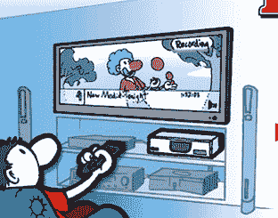

Terry Ulick

Terry Ulick

# 制作人员名单

编辑经理

Mary Beth Wakefield

执行编辑

Chris Webb

制作编辑

Angela Smith

开发编辑

James H. Russell

文字设计与排版

TechBooks

# 关于作者

Terry Ulick 在记录 PC 革命和制作电视节目方面拥有丰富经验。自 20 世纪 70 年代后期以来，他编写了大量关于 PC 使用的文章，并曾是 PC Magazine 早期的专栏作家。他于 80 年代中期出版了第一本关于桌面出版的杂志《个人出版》(Personal Publishing)，并编写了三本关于桌面出版的早期书籍。

1995 年，他共同创立了美国 Online (AOL) 的第一个在线数字照片服务 PicturePlace，这是 AOL 的一个孵化项目。

此，他担任 Tribune 媒体服务 (Tribune Media Services) 的业务发展执行董事，负责电视节目表和电影内容的开发。他开发的产品将电视信息引入 MSN TV、WebTV、UltimateTV 和 Media Center 等微软产品中。目前，他是 Good Time Wine 的总裁兼联合创始人，该公司是第一代基于宽带的网络之一，通过如 Good Time Wine 和 Camp US 等可以直接从互联网观看的节目，为媒体中心版 PC 提供内容支持。

他的编辑经验以及对向 PC/TV 设备规划和交付娱乐内容的内部了解，使他在编写这本书方面具有独特胜任能力。

# 致谢

这样一本书是许多人合作的成果。我要感谢以下人员在创作本书过程中提供的帮助：David Fugate, Chris Webb, James Russell, Tom Laemmel 和 Ed Rich。特别感谢 "Scout" Lydon 在整个过程中的帮助。

- 附录 B 媒体中心应用与设备 . . . . 317
- 日常计算与媒体中心 . . . . . . . . . . . . . 38
- 总结 . . . . . . . . . . . . . . . . . . . . . . . . . . . 75
- 网络连接 . . . . . . . . . . . . . . . . . . . . . . . 89
关于 . . . . . . . . . . . . . . . . . . . . . . . . . 778

## 引言：客厅的革命

也许你已经参与了近期的许多技术“革命”。如果你和我一样，你可能见证了书写工具从打字机变为桌面出版，相机从胶片变为数字，录制音乐从黑胶唱片到盒式磁带，再到 CD-ROM，最后变成从互联网下载的 MP3。

很难想象今天你还会想购买黑胶唱机、磁带机甚至 CD 播放器——除非是为了播放你拥有的旧录音。你可能还会把胶片相机和打字机加入这个名单。

现在，我要向这些革命的孩子们提出下一个问题：今天，你还会使用个人电脑、DVD 播放器或录音机、MP3 点唱机，或任何个人视频（或 PVR）设备如 TiVo 或 ReplayTV ？

我希望不是！你是数字革命的后，那些设备是问题所在，而不是解决方案。

如果你正在阅读这本书，你已经听说了这个：花一台良好的个人电脑的价格，你就可以拥有一台可以：

- 播放、录制和存储数百小时的电视节目。
- 刻录 DVD、音频 CD、MP3 和 DVD MP3。
- 存储、分类和显示你所有的数字照片和视频。
- 存储、管理和播放你的完整音乐库——带有视觉效果。
- 播放 DVD 以及其中所有“电脑专用”的内容。
- 访问电视节目单，并在你正在观看——或录制的节目中直接查看。
- 在家中网络并分发电视节目、音乐、视频文件和图片。
- 播放和使用直播 FM 和互联网广播节目。
- 使用遥控器控制上述所有功能。

Windows XP Media Center PC 是第一款将电视、DVD 播放器/录音机、音频和 MP3 播放器/录音机/接收器、DVR 和互联网融合为一体的消费电子产品的真正的家庭娱乐设备。而且，我想提到你还获得了一台顶级个人电脑也是公平的，因为它是驱动所有这些功能的引擎。

尽管 Windows XP Media Center PC 在很大程度上仍然是 PC，但我倾向于将它们视为媒体服务器。PC 在我们能察觉的事情中提供了生活的动力。在最近一次飞行中，我坐在驾驶舱后的第一排座位，起飞前我听到一名技术员告诉导航员：“只需按 `Control+Alt+Delete`。”天哪！导航员正在重启运行飞行计划的笔记本电脑。你看不见它们，但 PC 在新秩序中执行着所有的职责。

这就是为什么我将 Windows XP Media Center 放在我的娱乐中心柜里。它像我的电视调谐器一样忙碌。它实时录制我看到的任何内容，允许我暂停和回放正在观看的节目。我将其设置为录制我所有喜爱的节目。我用它听音乐。我用它看 DVD。我用它观看和存储我的家庭电影。当我不在用做任何事情时，它会在我的电视上以幻灯片的形式显示我所有的照片。

我没有连接连接电脑显示器——只有一台电视。我甚至没有配备键盘或鼠标。我只使用遥控器。计算呢？我意识到我大部分真正的计算工作是在公司完成的。我在家里使用电脑主要是为了：录制 MP3、存储来自数码相机的照片或编辑视频。

当你有一台 Windows XP Media Center PC 时，这一切都可以通过电视和遥控器完成。我唯一不用它做的是写电子邮件和搜索互联网。我也做这些事情——我只是喜欢在书桌前用笔记本电脑，而不是沙发上。但即使这些也开始发生变化了。

拥有 Windows XP Media Center PC 彻底改变了我的客厅。填满电视旁架子的所有旧设备都消失了。DVR、DVD 播放器、我的 TiVo、我的音响系统都收进了衣柜。一旦我开始使用 Media Center PC，我就停止了使用所有它们。以前那里有一系列无法相互工作且需要满桌咖啡几遥控器的设备，而现在只有一台设备和一个遥控器。所有的娱乐选择都从从屏幕菜单中显示，并且一切都使用相同的界面以相同的方式运行。

尽管这关乎如何购买和使用 Media Center PC，但从深层次来说，它关乎拥有它如何改变你观看电视和管理娱乐内容的方式。你的系统将比任何其他设备都能让你更好地控制电视收视。它将电视节目、DVD、你的照片、视频和音乐放入一个易于访问的环境中，这不仅让你能够访问媒体，还能让你轻松地分享它们。

就像所有好的革命一样，它赋予了你力量。现在，让我们学习如何利用它来明智地驱动。

## 这本书是给谁看的？

除了这本书显然面向 Media Center PC 所有者这一事实外，这本书还适合：

- 任何想要让其个人电脑的媒体播放功能在家里发挥作用，驱动他们的整体娱乐体验的人。
- 在个人电脑上建立（或想要建立）音乐、视频和图片库，并希望使用电视来查看或收听它们的人。
- 喜欢使用视频录制电视节目，并能够以更方便的方式控制电视收视的人。

## 使用这本书需要的内容

本书的用户应该有一台 Media Center PC，以及高速互联网连接，如电缆、卫星或天线。

## 本书使用的惯例

为了帮助你从文中获得最大的收获，我们使用了一些约定：

- 当我们介绍新概念时，我们会用斜体标出*重要的单词*。
- 我们显示快捷键如 `Ctrl+A`。
- 我们用等宽字体呈现文件名。

## 书中使用的图标

**提示 (Tip)**：提示提供了与主题相关的额外信息。实际上提示会说：“你应该尝试这个。”

**注释 (Note)**：注释正如其名：它提供了与主题相关但并非必不可的信息。

**交叉引用 (Cross-Reference)**：交叉引用符号指向文中提到的章节。你还将在括号中找到交叉引用。

## 本书的结构

我将这本书分为几个部分。在介绍设置你的系统后，它介绍了你使用的各种活动类型：电视、音乐、照片查看和从互联网获取内容。后续章节简要介绍了

这部分将帮助你理解使用 Media Center 的好处，并引导你将 Media PC 作为娱乐系统的中心。它将教你如何设置 Media Center，并介绍它带有的操作系统和应用程序。

本书介绍了连接到你 Media PC 的硬件和设备。除了研究最好的 PC 配置外，还介绍了显示器、音频设备和网络。

这部分探讨了电视观看和录制。它告诉你如何使用 Media Center 的节目指南来安排录制，以及如何制作记录节目的 DVD。

这里介绍了听音乐和广播。特别是这部分将向你展示 Media Center 如何与 Windows Media Player 工作以管理音乐文件并创建播放列表。它还将展示你如何使用你的。

本书以关于如何通过添加更多程序和使用互联网内容来扩展 Media Center 的章节结束。最后一章将探讨 Media PC 的潜力以及局限性。

Media PC 供应商列表以及第三方硬件和软件位于附录中。它还提供了额外资源列表。

## 简介与设置

计划使用 Windows XP 媒体中心版 PC

设置您的媒体中心 PC

Windows XP 媒体中心版操作系统

媒体中心体验

### 计划使用 Windows XP 媒体中心版 PC

Windows XP 媒体中心版 PC 是一台针对家庭娱乐进行了增强的电脑。媒体中心系统提供了一套完整的硬件和软件，用于收看和录制电视节目、DVD、个人视频和图片，以及收听音乐和广播。

与传统电脑不同，媒体中心 PC 可以使用普通电视作为显示器，并可以使用随附的遥控器进行操作。你可以继续继续使用电脑显示器，也可以同时连接一台电脑和一台电视。

该操作系统仅适用于 Windows XP 媒体中心版 PC，它提供了一个以电视为中心的工作环境，这使得你仅通过电视就可以在客厅、卧室或家庭室里使用你的 PC。

本章将介绍使用 Windows XP 媒体中心版 PC 如何改变你的家庭娱乐体验——以及你目前可能使用的娱乐设备。它将探讨你想要保留哪些设备和媒体——以及你想要收起来哪些。

本书的第二部分介绍了媒体中心 PC 的硬件和设备。附录 A 提供了媒体中心 PC 制造商列表。

## 合而为一

曾经有家庭音响、DVD 播放器、CD 播放器、VHS 录像机、TiVo 和一盒遥控器的地方，现在你只需要一个设备就可以取代它们：Windows XP 媒体中心版 PC（以下称为“媒体 PC”）。它将能够实现旧设备的所有功能，但都在一个设备中完成，并带有遥控器以及通用的用户界面和控制set。更好的是，你所有的娱乐内容都可以轻松访问并协同工作。一个很好的例子是制作 DVD：你的照片可以创建音乐文件的背景，可以作为背景音乐；你的家庭视频或节目可以作为视频。你的媒体中心 PC 将允许你汇编项目并刻录到 DVD 中。这一切都能无缝运行。

媒体中心 PC 将迅速成为你的 PC 调谐器、视频录像机、点唱机、DVD 播放器、幻灯片播放器和视频中心。

这在很大程度上是标准 PC 无法实现的，媒体中心 PC 设计用于使用电视或电脑显示器——或两者兼顾——它们根据你的生活方式使用并配置显示器。大多数人仍然会发现它大部分时间可以当作 PC 使用，因此你可以连接两个显示器，这是使用它的一种极佳方式。对于家庭办公室，它将在电脑显示器上播放所有内容，这是人们使用的另一种方式。

你准备好仅将 PC 用于娱乐了吗？起初我认为我还没准备好。考虑一下——你可以花与数字视频录像机和 DVD 录像机相同的价格购买一台很棒的媒体中心 PC。这是一个例子：

- 带有 TiVo 服务的先 DVD 录像机：999美元。你获得了一个 DVD 播放器/录像机，以及80 小时的硬盘存储用于电视录制，然后你可以将内容移动到你的 DVD 设备上。这也是一个有限的照片存储和音乐服务功能。本质上，你每月必须支付 12.95 美元购买 TiVo 服务。
- HP 媒体中心 PC：你获得至少 120 小时的可扩展硬盘存储、免费的电视服务、DVD 录像机，加上对所有 Windows 功能的完全访问、系统升级、访问互联网以及书中一整本书详述的所有功能。如果没有个人电脑功能，它代表了比市场上任何其他消费级设备都更高的电视/视频录像机价值。与前面的设备不同，除了电视显示外，还可以在电脑显示器上查看内容。

如果你是那些将 PC 大部分用于娱乐而非通用计算的人，那么迁移到媒体中心 PC 也是考虑你个人计算需求的好时机。

照片和视频编辑、游戏、CD 和 DVD 刻录——这些是今天购买 PC 的人群。你可以从市面上最便宜的电脑访问互联网、进行会计和文字处理并检查电子邮件。但如果你想刻录 DVD，你就不会买最便宜的电脑。

如果你仔细考虑，你可能想将 PC 的娱乐功能放在它最有意义的地方——你的客厅或家庭室。至少这样做真的很有意义；我从没有真正享受坐在办公室里用电视调谐器卡听音乐。对于 PC 在娱乐领域变得擅长的事情，办公室并不是合适的地方。

有了家庭网络和媒体中心扩展器（Media Center Extenders）、高速访问互联网，以及你的音乐和媒体中心 PC，你将改变你对电脑和娱乐中心的想法。

第 8 章解释了媒体中心扩展器。这些设备通过家庭网络连接到你的 PC，并让你能够在电视上查看来自媒体中心的内容。

## Windows 娱乐 PC 的肖像

当你购买媒体中心 PC 时，是回顾你在转向全数字娱乐系统方面取得进展的好时机。事实上，这是升级当前娱乐系统的绝佳时机。从乍看，媒体中心 PC 看起来就像一台电脑——因为它确实是电脑。无论是在客厅还是家庭室使用，它都代表了清理家居杂物、简化并按预期方式控制和查看媒体的机会。

媒体中心 PC 解决了这个问题。你可以字面上地在家庭室里设置你的媒体中心 PC，打开它，并在不需要键盘或鼠标的情况下控制它。

媒体中心 PC 能够很好作为娱乐中心这一事实带来了一个重要问题：你是把它当作 PC 使用，还是当作娱乐设备使用？

由于你可以同时将电脑显示器和电视连接到 PC，因此你可以在家庭办公室或家庭室同时拥有两个显示器。直到现在，如果你想将媒体中心 PC 用于家庭办公和传统计算——并偶尔用于媒体观看，这几乎是唯一的选择。

有些人可能继续将媒体中心 PC 作为他们的家庭办公 PC。另一些人可能会将其放置在家庭室，仅连接到电视，并将其专门用于娱乐中心。好消息是，它可以同时用于这两种目的——并且同时进行。使用媒体中心扩展器允许你在家中的任何地方访问完整的媒体体验。

图 1 显示了典型的媒体中心 PC 家庭配置，在办公室使用 PC，并在家庭室和卧室使用媒体中心扩展器。

| 家庭办公 | 厨房 |
|---|---|
| 媒体中心 PC |  |
| 卧室 | 带有扩展器的家庭起室电视 | |

**图 1-1：** 使用媒体中心 PC 的家庭网络示例。

## 观看和录制电视的新新方法

无论你将媒体中心 PC 放在何处，你都将希望利用它的电视观看和录制功能。所有媒体中心 PC 都允许你将 PC 连接到当前使用的电视源（有线电视、卫星电视或天线），并在连接到 PC 的任何显示器上进行查看。一旦你将媒体中心 PC 连接到电视源，你就可以利用许多电视特定的功能，包括：

- *实时观看*
- 暂停、倒回和返回实时电视节目
- 在你标准的 Windows XP 桌面面上将电视作为媒体中心窗口查看
- 使用免费的一期一周的“节目指南”（Program Guide）查看电视节目列表并查找有关节目的信息
- 录制电视或按时间、日期和通道安排电视节目录制，或使用节目指南安排录制
- 播放录制好的电视节目——即使在录制实时电视节目时也是
- 如果你的 PC 配有双电视调谐器，可以在录制另一个实时节目的同时观看实时节目
- 使用 Microsoft Messenger 在使用媒体中心的同时与其他在线交流

媒体中心 PC 允许你将 PC 作为调谐器、录音机和节目指南。你还可以将录制的电视节目保存到 DVD 中（如第 11 章所示）。图 1-2 显示了媒体中心使用的“我的电视”屏幕。

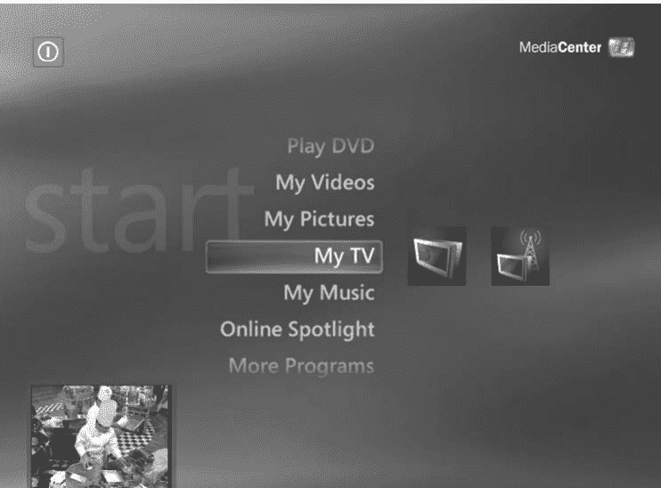

图 1-2：通过“我的电视”观看和录制电视。

## 听音乐和广播

Media Center 通过将你的媒体中心 PC 连接到有源立体声或环绕声扬声器，在创建独特的音频体验方面表现出色。它还让你使用与观看电视相同的用户界面与音乐进行交互。

Media Center 可为你的音乐文件创建视觉界面，并允许你按艺术家、专辑、歌曲或流显示并收听它们。你可以在任何这些类别中搜索音乐，并从 CD 中添加音乐或简单地播放 CD。

Media Center 使用 Windows Media Player 构建你的音乐库，并与 Windows Media Player 中创建的任何播放列表配合。你还可以从 Napster 等在线音乐商店下载音乐，并使用 Media Center 将其添加到音乐库中。

如果你有一台带有 FM 调谐器的媒体中心 PC，你还可以收听实时 FM 广播。如果你接入互联网，就可以收听网络电台。你甚至可以暂停和倒回广播节目！在数字电台和网络电台之间，你在 Media Center 内的音乐选择几乎是无限制的。

Media Center 最优秀的功能之一是音乐库的可视化。如果你的文件嵌入了专辑封面，你将能够查看照片文件的幻灯片，或使用“视觉化”功能将你的电视或显示器变为与音乐同步的动态视频。

图 1-3 显示了 Media Center 的音乐菜单，并预览了它如何让你与你的音乐库进行交互。

忘掉吧

Alison Krauss

11 首歌曲，40:06，1999年

| | | |
|---|---|---|

**图 1-3：** 通过“我的音乐”访问你的音乐文件。

## 观看视频库

如果你有来自模拟或数字摄像机的视频，Media Center 是管理它们和查看它们的好地方。使用整个 Media Center 中使用的相同文件系统、菜单和控制，你将能够像对待电视节目一样处理你的视频——只需指向、点击并查看。

在 Media Center 中处理视频的一个不错功能是，你可以连接像模拟摄像机或 VHS 录像机之类的视频源，捕获视频并在 Media Center 显示并保存为文件。如果你有数字摄像机，最好使用数字连接捕获视频。无论如何，如果你的数字摄像机通过设备的 IEEE 1394/火线（firewire）连接到计算机，就可以很容易地直接从数字摄像机上复制和查看。这使你无需先将视频传输到硬盘即可查看视频。

随着你对这本书的了解不断深入，你会发现 Media Center 擅长显示有关你正在观看或收听的内容。在观看视频时，你可以按遥控器上的“信息”（Info）按钮，在屏幕上显示有关视频的信息，就像你在观看电视节目时查看节目指南信息一样。

图 1-4 显示了“我的视频”中的视频库。

## 观看 DVD

Media Center 允许你像播放其他媒体内容一样播放 DVD。虽然它使用相同的传输控制，但它也具有在任何 DVD 播放器上使用的所有标准控制，包括 DVD 菜单和特殊功能。当你将 DVD 插入 Media Center时，它会自动开始播放。

第 11 章介绍了播放 DVD 和录制你的内容。

**图 1-4：** 在“我的视频”中查看视频。

如果你的媒体中心 PC 连接到互联网，你就可以通过 Spotlight 获取其他内容。这个 Media Center 区域允许你租赁或购买电影、查找新闻和天气，并下载游戏。

Media Center 并不包含浏览器，但你可以随时使用 Windows XP 查看所有为数字设计的媒体。

图 1-5 显示了典型的 Spotlight 界面。

图 1-5：Media Center 连接到互联网以获取内容。

## 添加更多程序

自 Media Center 发布以来，大量公司开始开发集成到 Media Center 环境中的更多程序。从游戏到 DVD 录制，“更多程序”区域是你访问已安装程序的地方。

最近访问的两个程序被添加到 Media Center 的启动屏幕上，而“更多程序”按钮允许你启动已添加的所有程序。第 18 章介绍了在哪里寻找更多程序以及如何安装它们。

图 1-6 显示了“更多程序”屏幕。

## 数字化：主要要素

当你熟悉 Media Center 的功能和优势后，是时候考虑你目前使用的所有媒体内容和设备了。获取媒体中心 PC 将改变你的娱乐体验。有了它，你将离开昨天的“模拟”世界，进入全数字化。

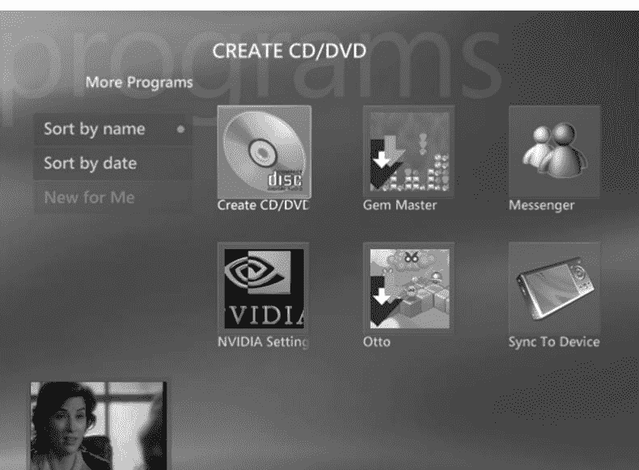

图 1-6：从“更多程序”启动第三方 Media Center 应用程序。

和大多数人一样，你可能拥有一系列新旧不等的电视、音响、录像机、CD 播放器和 DVD 播放器。你可能有大量的 CD、磁带、VHS 录带、DVD 以及大量的照片和家庭录像。你可能已经看到你喜欢的媒体大部分从模拟到数字的转变。模拟媒体的示例包括：

- 胶片和打印照片及幻灯
- VHS 录带
- 8mm 或 Super8 家庭电影
- 黑胶唱专辑
- 磁带录带
- 空中电视广播
- 不使用顶盒的有线电视

虽然这些示例中的许多现在已经过时，但你可能在这些格式中有很多很好的音乐、视频和照片。尽可能将这些旧格式的媒体转换为数字格式是非常重要的，因为它们保存时间更长，而且占用的物理空间比它们小得多。

它们以模拟的形式存在。最重要的是，随着数字媒体版本以数字文件的形式存储在你的 PC 上，你可以以以前使用模拟媒体或设备无法实现的方式对它们进行管理和控制。

最近我将我的 CD 收藏转换成了 MP3 文件并存储在硬盘中。转换完成后，我把原来的 CD 卖到了一家旧 CD 店。在搬了 18 个沉重的箱子到旧 CD 店后，我真正理解了 CD 是有多么“实体”。它们既笨重又麻烦，而且与其最终去的地方——我的 Apple iPod 相比，存储的音乐量太小了。现在，曾经装满数千张 CD 的地方变得空空如也，而相当于几百张 CD 的音乐（承认大部分在塑料盒里）现在可以握在掌心（还有几张 DVD 备用）。除了物理媒介和空间的惊人减少外，我第一次从一个地方访问并收听我的整个音乐库。我所有的音乐都已分类索引、可以搜索，无论我想去哪里，在几秒钟内就能听到。这确实让你有了数字化的动力，不是吗？

这本书假设你真的对将你的媒体中心 PC 用于娱乐（其次才是计算）感兴趣。基于此，让我们来看看你将在创建你的“新媒体中心 PC——基于娱乐的系统”时，将检查的所有设备和媒体。

## 模拟内容和设备

如果你想保留模拟媒体的内容，你将需要保留那些可以播放的内容——至少在转换为数字格式的过程中。在规划你的数字娱乐系统时请记住这一点，这可以让你在日后更换设备或聘佣服务来处理时省下大量费用。

- 磁带和黑胶唱专辑：如果你从未将它们转换为 CD 或电脑上的数字文件，现在是这样做的好时机。在此期间将它们备好，如果你怀旧或是收藏家，可以留得久一点，但总的来说，如果你想听听它们，请将它们转换为数字文件并妥善收起来。
- 磁机和转盘机：同样，出于情感价值或纯粹的怀旧，你可能想保留你的转盘机或磁带机。在转换期间你也将需要保留它们，因为你需要从专辑或磁带中提取音频。作为数字系统中的持续音频源，它们将不再被需要。
- 家用录像带和电影：无论格式如何——8mm、Super8、VHS、VHS-C、Digit8、MiniDV 和 S-VHS——请保留你的原始家庭录像，以作为原始素材进行转换和归档。例如，CD 中的音乐通常可以替换，但家庭录像和视频不是。尽快将它们转换为数字格式，并存储在温度稳定的安全干燥的地方。电脑有时会崩溃，备份也会丢失；由于这些及其他原因，保留原件总是好的。
- 照片打印、幻片和底片：如果你有许多老照片，可能需要很长时间才能将它们转换为存储在 PC 上的 JPEG 等数字文件。转换它们是一个好主意，因为一旦完成，你就可以将它们用于媒体项目，并通过在互联网上发布、发送电子邮件或通过邮寄发送 CD-ROM 与朋友和家人分享。你可以用良好的扫描仪来完成，或者将它们送到当地的冲印店进行转换。
- 音响系统：无论你的音响有多好，除非你计划将其作为媒体中心 PC 的一组扬声器使用，否则可能应该考虑一下。家用音响是老旧技术，无法被你新的基于媒体中心 PC 的系统轻松控制。家用音响的一个优点是适合收听本地电台（你可能会保留它）；但为你的媒体中心 PC 增加一个带有 FM 调谐器的电视调谐器可能更好，这将让你使用媒体中心 PC 收听当地可能无法通过网络电台收到的电台。
- 录像机：在录制完任何电影或喜欢的磁带后，你对 VHS 录制或播放几乎就用不上了。如果你像大多数人一样，你可能留着 VHS 录像机或者把它扔掉。总会有你遇到 VHS 视频的时候，例如家庭录像或只有 VHS 格式的旧视频，那时你会庆幸自己没有把它扔掉。如果你有朋友或家人只能观看你的视频，情况也是如此——你需要为他们的数字文件创建 VHS 带供他们观看。

在你确定要长期包含哪些媒体之后，务必保留这些这些内容的设备——至少保留一年。我不不再使用音频 CD 播放器、DVD 播放器，甚至是家用音响了。我把它们存起来了，只是很久没有用过了——但这并不意味着我永远用不上。电脑会崩溃，你时时会更换电脑。在某些时刻，我很庆幸所有的设备都在手边。

## 数字媒体和设备

在对你的音频世界进行盘点后，你需要看看你拥有哪些数字媒体和设备。其中大部分可能已经在你的 PC 上，或者以来自互联网或你的模拟源的媒体形式存在。

- 音频 CD 播放器：你的 PC 可以播放 CD，而且它几乎可以播放所有可能的音频格式。这使得它总体上比你娱乐系统中的专用 CD 播放器更好的设备。如果你有一个可以播放 CD 的播放器（此处原文此处逻辑有误，意指 PC 播放功能），它可能更合适。注：如果你有一个 CD 播放器，可以播放 MP3，除非你计划将其作为媒体中心 PC 的一组扬声器使用，否则可能应该考虑一下它（此处原文如此）。
- 音频 CD：无论你的 CD 播放器有多好，除非你计划将其作为媒体中心 PC 的一组扬声器使用，否则可能应该考虑一下它。家用音响是老旧技术，无法被你新的基于媒体中心 PC 的系统轻松控制。家用音响的一个优点是适合收听本地电台（你可能会保留它）；但为你的媒体中心 PC 增加一个带有 FM 调谐器的电视调谐器可能更好，这将让你使用媒体中心 PC 收听当地可能无法通过网络电台收到的电台。
- 录像机：在录制完任何电影或喜欢的磁带后，你对 VHS 录制或播放几乎就用不上了。在对你的音频世界进行盘点后，你需要看看你拥有哪些数字媒体和设备。其中大部分可能已经在你的 PC 上，或者以来自互联网或你的模拟源的媒体形式存在。

- 音频 CD 播放器：你的 PC 可以播放 CD，而且它几乎可以播放所有可能的音频格式。这使得它总体上比你娱乐系统中的专用 CD 播放器更好的设备。如果你有一个 CD 播放器，可以播放 MP3，除非你计划将其作为媒体中心 PC 的一组扬声器使用，否则可能应该考虑一下它。
- 音频 CD：无论你的 CD 播放器有多好，除非你计划将其作为媒体中心 PC 的一组扬声器使用，否则可能应该考虑一下它。

（注：由于提供的原文文本存在大量重复段落，译文已根据要求对重复内容进行了翻译，并保持了原文的结构。）

*注：由于提供的原文文本存在大量重复段落，译文已根据要求对重复内容进行了翻译，并保持了原文的结构。*

# 第 1 章：计划使用 Windows XP 中心版 PC 15

将电视想象成模拟信号，这些信号以数字文件的形式传输或存储在你 Media Center PC 上。

- **来自互联网的音乐和电影：** 音乐和电影正通过在线源广泛免费提供或供购买。互联网是娱乐内容的绝佳来源——前提是你家里拥有高速互联网接入，如 DSL 或宽带电缆服务。最近，音乐行业正使人们能够合法地购买单曲 MP3 格式音乐，并用于 Napster 2.0 等服务（你可以在 Media Center PC 上使用；见第 19 章）。这是未来的趋势，也将是未来电影租赁的最佳选择。

## 总结

Media Center PC 允许你将 PC 用作你的娱乐中心。你可以将 Media Center PC 连接到电脑显示器、电视或两者都有，并用它观看电视、DVD、家庭录像、数字照片，以及听音乐和广播。无论你是使用键盘、鼠标还是遥控器，还是作为以电视为中心的界面，所有包含的内容方式都是一样的。

通过将你所有的旧“模拟”音乐、视频和摄影转换为数字格式，你可以将它们存储在 Media Center PC 上。这样，你就可以将它们作为数字娱乐体验的持续部分。

将模拟内容转换为数字格式的过程需要你拥有播放这些模拟形式的设备。请保留你旧的磁带录音机、VCR、模拟摄像机和唱胶片机，直到你确定自己已成功将所有模拟介质传输到你的 Media Center PC。

# 第 2 章

## 设置你的 Media Center PC

许多人在购买 Media Center PC 时面临的最大挑战之一是它它将被放在家中的哪个位置。市面上几乎任何 Media Center PC 都是顶级的 PC，完全能够胜任任何办公计算任务。正如第 1 章所讨论，Media Center PC 的音视频功能也使其成为当今市场上最强大的家庭娱乐设备之一。

作为家庭活动室的娱乐中心使用，或为家庭办公室的娱乐中心提供动力，Media Center PC 提供的功能如此强大，以至于你会想要重新配置现有的娱乐系统。你会想要保留现有娱乐系统的部分内容，并移除另一些部分。本章将介绍如何以 Media Center PC 为核心构建家庭娱乐中心。

你将从购买 Media Center PC 开始。人们在考虑购买 Media Center PC 时问的第一个问题之一是“为什么我不能给我现在的 PC 添加 Media Center？”正如你在下一章中中学到的，Media Center PC 是硬件、软件和操作系统的组合，它们共同作为一个配置好的系统协同工作。该系统仅作为 Media PC 销售，遗憾的是无法升级到你当前的电脑。

如果你想购买 Media Center PC，这种考虑其外形尺寸可以帮助你找到什么样的选择。如果你你 PC PC，购买 Media Center PC 的功能，该系统仅作为 Media PC 销售。

如果你在考虑哪里使用 Media Center PC，你需要了解这些功能。Media Center PC 提供了可以增加硬盘的型号。例如，如果你主要将 PC 用于观看和编辑视频，你可以购买带有更大硬盘的型号。Media Center PC 提供了多种外形尺寸，以匹配你的娱乐中心。如果你非常看重娱乐系统的外观，你需要考虑这个因素是否适合你。这种垂直外形在你的娱乐中心仍然是友好的。Media Center PC 提供了不同的形状以匹配你的生活方式。

### 要买电视还是不需要电视？

许多销售 Media Center PC 的零售商如 Best Buy 和 Circuit City 提供了 15 英寸或 17 英寸显示器的捆绑。如果你正在寻找新电视，那么你可能想要一个带有调谐器的型号。Media Center PC 提供了各种功能，除了你需要的显示器之外。如果你计划将 Media Center PC 放在客厅或家庭活动室，你可能想要一个带有显示器的捆绑。

对于整体、零售选择和扩展选项，塔式机是最好的。Media Center PC 有五种基本外形尺寸。每种在不同的位置和应用中都有优势。

塔式机正如其名：它们是大型的垂直长方形盒子，最初作为办公设备。它们易于扩展，且成本较低。大多数 Media Center PC 像普通 PC 一样以塔式形式在零售店销售。其由于对于制造商来说，在现有的 PC 上添加微软 Media Center PC 所需的组件比创建一个新的外形尺寸外壳要便宜且容易。

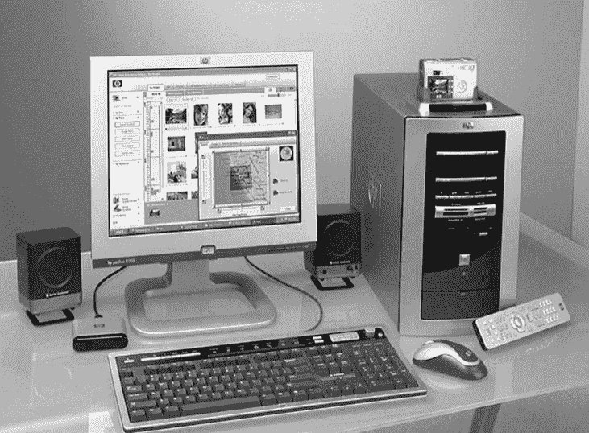

图 2-1：惠尔电的塔式外形媒体中心 PC。

一种对家庭娱乐系统更友好的外形是桌面式外形，有时也被机架式外形。它与塔式的大小相同，但它是水平放置而非垂直放置。在许多普通 PC 的情况下，显示器放置在桌面式外形 PC 之上，如图 2-2 所示的桌面式外形 PC。大多数桌面式媒体中心 PC 的整体外观像机架式音响单元；能够很好地放入大多数娱乐中心（假设上方没有放置显示器），并且具有与塔式电源机相同的全部扩展性。

大多数桌面式/机架式外形媒体中心 PC 仅通过邮购公司销售，购买之前很难看到。

可用型号作为你家庭娱乐中心的一部分外观非常好。其做工和表面处理使其看起来像高端音响单元。它们有黑色或银色，前面板没有门和连接器（它们通常隐藏在前面板后面）。

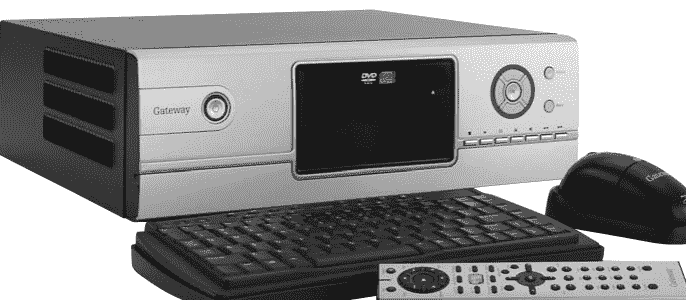

图 2-2：Gateway 的桌面式外形媒体中心 PC。

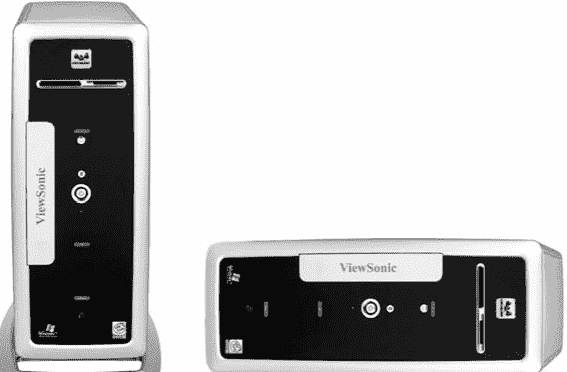

图 2-3：ViewSonic 的媒体中心 PC 可以作为塔式或水平放置，以适应娱乐中心。

媒体中心 PC 最有趣的外形之一是立方体。它的外观与微型外壳系统音响非常相似。由于尺寸很小，这台机器可以放在任何地方（见图 2-4）。

较小的尺寸限制了立方体外形像塔式或桌面式那样扩展。这意味着你只有一个光驱驱动器（如 DVD-R 或 CD-RW），而不是塔式和桌面式电脑上通常常见的那种，而且用于额外硬盘和扩展卡的空间有限。目前，这种外形仅由少数邮购公司提供，在购买之前很难查看。附录 A 列出了一些邮购公司，你可能会发现所在地区的一些独立零售商会使用相同外形的立方体系统进行定制化配置。

当尺寸和外观是你想要的关键特征时，立方体可能是你的正确解决方案。在购买之前，高价格和有限的扩展性是需要认真考虑的问题。

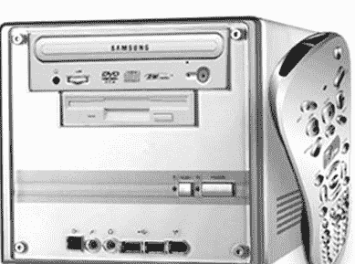

**图 2-4：** ZT 集团的立方体外形媒体中心 PC。

媒体中心 PC 现在有了笔记本电脑形式。来自惠尔电和东芝等制造商的笔记本电脑将桌面式媒体中心 PC 的所有功能集成到大型笔记本电脑中。（见图 2-5）。它们具有所有媒体中心 PC 所需的视频输入输出连接，并可以通过遥控器控制。

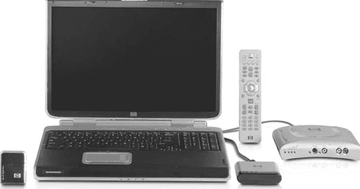

**图 2-5：** 惠尔电的笔记本式媒体中心 PC。

媒体中心 PC 笔记本电脑较大，因此可以配备大型 LCD 显示器。目前的型号配备 15 英寸或 17 英寸宽屏显示，是观看 DVD 和宽屏电影的理想选择。它们也很重，重量约为 8 到 9 磅。

笔记本电脑提供了完整的媒体中心 PC 性能，包括 DVD 录影器、视频输入输出以及所有 MCP PC 用的系统。它们提供了便携式娱乐，并为家里或旅途中放置提供了极大的灵活性。

便携性是有代价的：媒体中心 PC 笔记本电脑的价格范围较高，在可扩展性方面无法比拟普通 PC。

### 一体机

“一体机”PC 的概念已经存在了一段时间。从 20 世纪 80 年代后期的 Compaq 便携式电脑、第一代 Macintosh 电脑，到最近 Sony VAIO 的各种系统，“一体机”外形现在正被 VAIO 等公司应用于媒体中心 PC。

通过将所有电脑组件（包括 DVD 驱动器）放在同一个外壳内，你将得到一个非常精巧的媒体中心 PC。

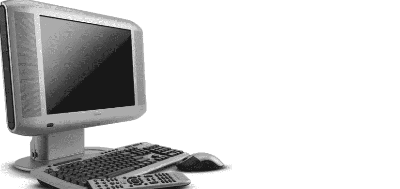

图 2-6：Gateway 的一体机媒体中心 PC。

一体机设计是想要空间的用户的良好解决方案。然而，一体机 PC 没有桌面式或桌面 PC 那么容易升级。

尽管一体机设计是想要空间的用户的良好解决方案，但一体机 PC 没有桌面式或塔式 PC那么容易升级。

当尺寸和外观是你想要的关键特征时，立方体可能是你的正确解决方案。在购买之前，高价格和有限的扩展性是需要认真考虑的问题。

## 电脑显示器

如果你计划将电脑显示器单独或配合 TV 作为媒体中心 PC 的显示，你需要确保它足够大。

大多数电脑显示器，无论是真空管还是 LCD 屏，都能完美地作为显示。这是你应该保留的项目。

## TV

如果你还没有购买媒体中心 PC，现在考虑 TV 是好的。如果你有一台高质量的 TV，它应该能够作为你的主显示。所有媒体中心 PC 都具有 S-Video 和复合输出端口，允许它们连接到 TV。在考虑媒体中心 PC 使用什么显示器时，有三个建议：

- 你可以使用复合输出，但如果你的 TV 有 S-Video 输入，强烈建议你使用它。
- 如果 TV 不符合媒体中心 PC 的外观，你可以使用你的电脑显示器直到升级到新 TV。
- 如果你购买了可以作为电脑显示器的 TV，我建议你使用 15 针连接器将其连接到你的媒体中心 PC，而不是使用复合或 S-Video 连接器。这种方式图像质量会更好。

## 阴射线管二极管 (CRD) TV

在处理标准 TV 时，你现在的 TV 可能非常好用。开始查看 TV 的背面，通过图 2-8 所示的示例来识别它具有的视频连接类型。

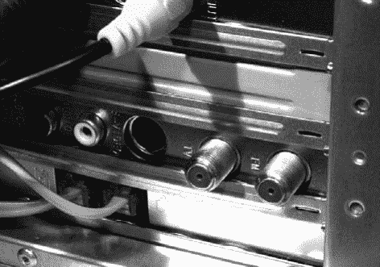

图 2-8：TV 上的视频连接示例。（注：此处缺少图像，但在文中引用了）。

我在多台电视机上测试了我的媒体 PC。虽然这很大程度上取决于你特定电视的质量，但以下是我发现的一系列指南，用以判断你的电视在连接到媒体 PC 时是否能良好工作。

了解你的电视工作状态的唯一方法就是将其连接到媒体 PC 并看看你是否喜欢那个画质。在规划的帮助下，表 2-1 提供了一些关于你当前电视表现如何的提示。

| 电视尺寸 | 类型 | 接口 | 结果 |
| --- | --- | --- | --- |
| 13" | 显像管 | 复合视频或 S-Video | 不推荐。太小了。 |
| 20" | 显像管 | 复合视频或 S-Video | 可以接受。文字较小。 |
| 27" | 显像管 | 复合视频或 S-Video | 可以接受。文字清晰可见。 |
| 30" | 显像管 | 复合视频或 S-Video | 很好。文字非常清晰。 |
| 36" | 投影 | 复合视频或 S-Video | 焦点可能太软。 |

说有一种某种尺寸的电视足够大可以用是件好事，但正如你从表格所示，作为投影单元的大型电视可能不是一个好的选择，而带有 S-VHS 连接的 20 英寸电视仅恰够使用。微软在创建可以在大多数电视上阅读的界面界面方面做得非常出色，但是，即使你的视力良好且电视画质清晰，在 20 英寸以下的电视上屏幕文字也很难以阅读；27 英寸或更大的电视效果良好。投影电视无论尺寸如何，画质可能稍微欠缺，并且会影响所有文字。

## LCD 电视

与 UHD 电视不同，LCD 电视显示的文字非常清晰；考虑 LCD 电视的尺寸更多取决于你距离电视多远，以及你的视力与电视尺寸本身的匹配程度。

以下是 LCD 电视显示的两个大类：

- **带电脑连接的 LCD 电视：** 即使许多 LCD 电视看起来像平板电脑显示器，但并非所有电视都具备作为电脑显示器的功能或接口。然而，具备这些功能的电视与任何电脑显示器一样有能力。
- **不带连接的 LCD 电视：** 我在卧室里有一个媒体中心扩展器（Media Center Extender），最近将我的 20 英寸电视换成了一个超划价的 17 英寸 LCD 电视。媒体中心扩展器使用 S-Video 接口，因为它们的设计是为了连接电视而不是 15 针 VGA 接口，因此没有电脑连接的 LCD 电视是完美的答案。

## 高端电视

许多人将购买媒体中心 PC 作为将电视升级为新显示器（如 HDTV 显示器或等离子显示器）的机会。某些媒体中心 PC 型号具有数字输出视频端口，可以连接到新的 HDTV 显示器。有些公司将媒体中心 PC 与等离子显示器捆绑销售，Gateway 这样的卖家因此成为了等离子电视最大的卖家。

高端电视的两种主要类型是：

- **等离子电视：** 大多数提供至少 640 x 480 的 VGA 连接到电脑，且图像与任何电脑显示器一样好。等离子电视通常具有允许它们充当多同步电脑显示器的连接。
- **增强型电视和高清电视 (HDTV)：** 有一种新的电视看起来像普通电视，但它们具有高得多的分辨率，非常适合作电脑显示器。检查它们是否具有作为电脑显示器的接口，以及它们支持哪些分辨率。

## 音响和扬声器

媒体中心 PC 通常带一套有源扬声器销售，范围从简单的对立体声扬声器到带有低音箱的全环绕声套装。（见图 2-9）。最近（为了省钱）某些型号不带扬声器也可用。你系统的扬声器选择取决于个人喜好。如果你使用电脑自带的扬声器，可以尝试它们。

媒体中心 PC 自带扬声器的优势是可以通过电脑控制。如果你使用电脑自带的扬声器，目前你的环绕声系统需要中心扬声器、低音箱和卫星扬声器。

在这一阶段，关于使用你现有系统的一些关键问题是：

- 你的系统在关闭时可以进入待机模式吗？
- 你的系统可以利用 DVD 吗？
- 你目前的系统增加了系统的复杂性吗？

如果你喜欢你现在的系统，请继续使用它。如果你购买不带扬声器的媒体 PC，可以这样省下钱。

如果你正在考虑升级你的音响或配备无线功能的媒体 PC，可以认真尝试这些。

## 卫星或有线电视顶盒

如果你订阅了有线或卫星服务，你将仍然需要该服务的顶盒。

现在使用遥控器直接控制你的顶盒。一旦你设置好系统，你的媒体 PC 将实际上使用媒体中心 PC 自带的遥控器控制顶盒。

## 交叉

第 8 章提供了关于如何让电脑控制顶盒的想法，你可能想在购买任何网络设备之前阅读该章节。目前，我想分享一些基于我使用的想法。

## 你需要的设备

除了你已经拥有和使用的设备外，为了充分利用你的媒体 PC，你可能需要添加设备。以下章节详细介绍了添加家庭网络、无线键盘和鼠标，以及可能需要的完美的电视来完善你的媒体 PC 娱乐系统。

## 家庭网络设备

规划家庭网络是你在安装媒体 PC 之前考虑的事情。当你第一次设置媒体中心 PC 时，你将选择网络和访问互联网的设置。这将使你能够从开始就正确配置你的系统，这实际上比以后修改要容易得多。（见图 2-10）。

如果你决定使用有线网络，你将在放置媒体 PC 的地方创建一个接入点。如果你将把 PC 放在客厅、家庭室或卧室，你可能需要第一次添加连接。你还应该确保你有一个电话插座或到天线或电缆/卫星系统的连接。

# 第 2 章：设置你的媒体中心

我对这种配置唯一不喜欢的一点是，现在我的客厅里多了一个 DSL 调制解调器和一个路由器。我本想摆脱电线和杂乱！幸运的是，它们都是小巧设备，可以很容易隐藏在视线之外。

## 媒体中心扩展器设备

在选择媒体中心 PC 的放置位置以及如何将其兼用于娱乐和办公计算时，最佳解决方案是使用媒体中心扩展器设备。

## 交叉引用

第 8 章将详细介绍扩展器的工作原理。

扩展器是一个小盒子，它将你的电视连接到媒体中心 PC，连接方式几乎就像直接连接到显示器一样。扩展器为电视增加了媒体中心环境，并使你能够访问用户界面和媒体内容，包括电视源（如有线电视或卫星信号）。

扩展器设备让你的电视看起来、用起来、操作起来就像一台媒体中心 PC。这允许你选择心仪的位置放置媒体中心 PC，并使用扩展器和你的家庭网络连接家中的其他电视。

不再采用上一节中的网络配置示例，我现在将媒体中心 PC 放在了家庭办公室，并为家庭室和卧室的电视使用扩展器。现在，我的媒体中心 PC 驱动我所有的电视，而且我可以从每台电视访问我录制的所有电视节目、视频、音乐文件和照片。

## 连接

如果你计划使用媒体中心 PC 访问互联网媒体内容，如果你打算下载媒体文件和访问流媒体，那么你将会需要一个高速连接；如果没有高速连接，这些活动就像像拔牙一样痛苦。虽然可以通过拨号上网连接互联网下载媒体，但媒体文件从大到巨大不等，下载时间可能非常长，以至于你一想到要用拨号服务下载就会感到不寒而栗。使用拨号上网播放视频文件还会导致画面破碎、画质低，在坐在沙发上用电视时是很难观看的。

有了高速互联网接入，你不再局限于电脑中的媒体。拥有媒体中心 PC 的许多乐趣之一是能够到互联网上获取音乐和视频内容。正如你将学到的，有些网站允许你“租用”电影，这些会被下载到你的媒体中心 PC 并保留一段时间。你还可以购买音乐、听收音，并与朋友家人分享你的照片。几乎任何这些活动都需要高速互联网接入。

DSL 和宽带服务的价格已经大幅下降。我目前每月支付 29.95 美元订阅 DSL，我对这项服务很满意。你通常可以从手机运营商或电缆系统找到高速服务，但也有许多不属于公用事业供应商的新高速服务可能覆盖你的地区。

无论你通过拨号还是高速接入连接，你都需要连接互联网才能正确使用你的媒体 PC。你至少每周需要访问一次互联网，让媒体中心 PC 获取你的电视节目单。数据创建了你的节目指南并允许你安排电视节目录制。

## 新电视

尽管你的媒体 PC 是多么不可思议，但你很大程度上是通过电视与其交互。由于电视是你通往媒体内容和冒险世界的窗口（更不用说仅仅是看电视了），它应该是系统中最好的部分。像 LCD 和等离子电视等奇特新电视的价格现在已经降到了这种程度，以至于你可能想认真考虑将它们作为媒体中心 PC 和家庭娱乐中心的终极补充。

正如你将在书末结束时学到的那样，你可以坐在客厅里完成以前在书桌前完成的任务。使用高清电视（以及无线键盘和鼠标），你可以用它进行文字处理、浏览网站和其他传统的计算活动。

## 无线键盘和鼠标

如果说我对今天出售的媒体中心 PC 有什么看法，那就是大多数产品配备了与普通 PC 相同的“有线”键盘和鼠标——从这个角度来看，在客厅或家庭室环境中是一个巨大的失败。

微软本应对使用 Windows XP 媒体中心操作系统的电脑制造商提出的要求之一，是让他们销售时配有无线键盘和鼠标。但他们没有这样做。这意味着，如果你不想被电线绊倒或被束缚在距离媒体中心 PC 6 英尺的地方，你就必须额外添加一个。

市上有许多无线键盘/鼠标套装，但我喜欢并强烈推荐的是 Gyration, Inc. 的媒体中心遥控器和键盘，它既是一个媒体 PC 遥控器，又是一个通过手部动作和移动控制的鼠标。见图 2-11。“遥控器”结合了一个可以复制媒体中心 PC 遥控器功能的遥控器，以及一个通过手部动作和移动而不是在平面上移动来控制的鼠标。这是客厅使用的完美解决方案。你不需要咖啡桌当鼠标垫！

无线键盘很小，因为你最不想要一个大而笨重的键盘，而这个尺寸恰好。如果你更偏好带有数字键和光标键的传统键盘，Gyration 也出售那种形式的无线键盘。此外，它还有一个无线鼠标，可以通过手部移动操作，也可以像任何鼠标一样在平面上操作。

## 整合一切

有了优秀的显示器、高速互联网接入以及无线键盘和鼠标，你将拥有一个由媒体中心 PC 驱动的超级娱乐中心。现在让我们看看所有的媒体力量是如何进入你家的。

媒体中心 PC 在家中的终点是一个重要的决定。你选择的每个位置都是一个重要的决定。

# 第 2 章：设置你的媒体中心

## 表格 2-2 特定房间的典型配置

| 项目 | 客厅 | 家庭室 | 卧室 | 家庭办公室 |
| --- | --- | --- | --- | --- |
| 形式 | 台式/机架式或塔式 | 台式或 | 塔式 | 笔记本电脑或塔式 |
| 硬盘 | 160–250GB | 160–250GB | 80–120GB | 80GB |
| 键盘 | 无线 | 无线 | 无线 | 有线或笔记本电脑 |
| 鼠标 | 无线 | 无线 | 无线 | 有线 |
| 电视 | 27 英或更大 | 27 英或更大 | 20 英或更大 | 可选 |
| 显示器 | 可选 | 可选 | 无 | 15 英或更大的 LCD |
| 音箱 | 环绕声 | 环绕声 | 带低音箱的双扬 | 双声道 |

良好的音响系统会让视频、DVD 甚至是家庭电影变得更加震撼。

配备柔和的光线，既要暗到足够看电视，又能提供环境光让你看到键盘和遥控器掉在哪里。

除了媒体中心遥控器外，无线键盘和鼠标对于良好的用户体验至关重要。不要在这个重要配件上亏待自己。

## 总结

购买媒体中心 PC 需要你目前的电视观看习惯以及你目前用于娱乐中心的设备。你在哪里看电视决定了你需要什么样的媒体中心 PC “外形”，并决定了你是否需要布电缆或电话线将媒体中心 PC 连接到互联网或家庭网络。

购买媒体中心 PC 也是升级主电视的好时机。新的等离子和 LCD 电视非常适合与媒体中心 PC 使用，因为它们也可以用于常规计算，如网页浏览和文字处理。

# 第3章

## Windows XP媒体中心版操作系统

在创建一个新的以娱乐为基础的操作系统时，微软在其最稳定、最强大的 Windows 版本——Windows XP 专业版之上构建了 Media Center。Media Center 包含了 Windows XP Media中心的所有功能和优势，让 Media Center PC 用户能够继续使用它们进行标准计算，并享受 Media Center 提供的娱乐体验。

本章将介绍 Media Center 如何与 Windows XP 配合工作、介绍操作系统中的 Media Center 部分，并讨论 Media Center 的配置以及设置过程流程。

## Windows XP 内部机制

如果你目前正在使用任何版本的 Windows XP，那么在使用 Media Center PC 时你会感到如如胜归。在每一个可能的方面，这都是 Windows XP 的惯常操作。当你打开电脑时，你可能会认为他们卖给了你错误的机器。除了图 3-1 所示的启动启动屏外，Media Center 的外观和操作方式与 Windows XP 一直一样——因为它本身就是 Windows XP。

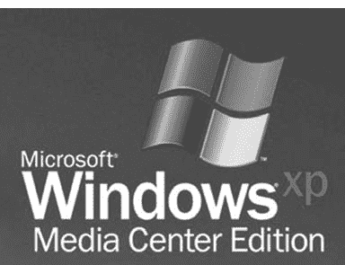

图 3-1：Windows XP 媒体中心版的启动启动屏。

### 36 PC 杂志——2005版 Windows XP 媒体中心版指南

在创建媒体 PC 时，微软将 Windows 置于底层并让其所有功能发挥作用。Media Center 与 Windows XP 无缝协作。它利用了许多功能、驱动程序、互联网连接、网络协议和系统架构，这些因素使得 Windows 成为如此强大的计算环境。

将 Windows XP 作为 Media Center 的底层操作系统，让你能够继续使用任何 Windows PC 上的所有程序、驱动程序和实用程序。好消息是，你可以将其当作普通 PC 使用，当你考虑到你还获得了一台出色的娱乐 PC 时，这让价值更高。

## Media Center PC 使用 Windows XP

作为一种运行环境，Media Center 允许多用户、从源源获取内容、维护文件和目录，并管理媒体内容和版权。调用显卡、使用 DVD 驱动器的电视 调谐器卡或播放文件都是系统级功能。

Media Center 使用 Windows XP 管理内容、设备以及通过互联网与外部世界的连接。作为 Windows XP 的一部分，Media Center 可以使用你用 Windows 应用创建的所有内容。这意味着你的 MP3 文件、数字照片和数字视频将在 Media Center 中完美运行。

Media Center 还使用了你在 Windows 中使用的文件结构和约定（文件夹、目录、目录）。正如你将学到的，尽管 Media Center 使用这些约定来管理内容，但你不会看到太多它的踪迹。作为一个以电视为中心的环境，它简化了许多约定，并为你承担了定位你媒体文件的大量工作。

Media Center 与 Windows Player 之间在管理音乐文件方面有特别的集成。Media Player 管理音乐库，同时也管理从互联网购买或下载音乐时播放音乐的权限。Media Center 的“我的音乐”（My Music）应用程序与 Windows Player 紧密配合工作，并使用相同的文件和权限管理。

Media Center 与 Windows XP 的集成是无缝的，作为用户，你将欣赏 Media Center 如何很好地降低在 Windows XP 中管理和使用媒体的复杂性。对于媒体内容，Media Center 是一个极佳的环境。界面中的 Media Center 部分仅限于那些包含 Media Center 特定内容的项。它不像 Windows 资源管理器（Windows Explorer）那样包含网页浏览器。然而，它确实使用带有所有安全和协议功能的 Internet Explorer 作为将 Media Center 连接到在线内容的引擎。对于计算或快速浏览，你始终需要返回 Windows XP。

## 在 Windows XP 中设置资源

本书并不是关于使用 Windows XP 进行日常计算，但回顾 Windows XP 中的一些关键点是有好的，这会让你的 Media Center 体验更好。

正如图 3-2 所示，当你打开电脑时，你可能会认为他们卖给了你错误的机器。除了启动启动屏外， Media Center 的外观和操作方式与 Windows XP 一直一样——因为它本身就是 Windows XP。

正如你将学到的，尽管 Media Center 使用这些约定来管理内容，但你不会看到太多它的踪迹。作为一个以电视为中心的环境，它简化了许多约定，并为你承担了定位你媒体文件的大量工作。

Windows XP 操作系统

图 3-2：Windows XP 媒体中心版的启动启动屏。

作为一种运行环境，Media Center 允许多用户、从源源获取内容、维护文件和目录，并管理媒体内容和版权。调用显卡、使用 DVD 驱动器的电视 调谐器卡或播放文件都是系统级功能。

Media Center 使用 Windows XP 管理内容、设备以及通过互联网与外部世界的连接。作为 Windows XP 的一部分，Media Center 可以使用你用 Windows 应用创建的所有内容。这意味着你的 MP3 文件、数字照片和数字视频将在 Media Center 中完美运行。

Media Center 还使用了你在 Windows 中使用的文件结构和约定（文件夹、目录、目录）。正如你将学到的，尽管 Media Center 使用这些约定来管理内容，但你不会看到太多它的踪迹。作为一个以电视为中心的环境，它简化了许多约定，并为你承担了定位你媒体文件的大量工作。

Media Center 与 Windows Player 之间在管理音乐文件方面有特别的集成。Media Player 管理音乐库，同时也管理从互联网购买或下载音乐时播放音乐的权限。Media Center 的“我的音乐”（My Music）应用程序与 Windows Player 紧密配合工作，并使用相同的文件和权限管理。

Media Center 与 Windows XP 的集成是无缝的，作为用户，你将欣赏 Media Center 如何很好地降低在 Windows XP 中管理和使用媒体的复杂性。对于媒体内容，Media Center 是一个极佳的环境。界面中的 Media Center 部分仅限于那些包含 Media Center 特定内容的项。它不像 Windows 资源管理器（Windows Explorer）那样包含网页浏览器。然而，它确实使用带有所有安全和协议功能的 Internet Explorer 作为将 Media Center 连接到在线内容的引擎。对于计算或快速浏览，你始终需要返回 Windows XP。

## 在 Windows XP 中设置资源

本书并不是关于使用 Windows XP 进行日常计算，但回顾 Windows XP 中的一些关键点是有好的，这会让你的 Media Center 体验更好。

正如图 3-2 所示，当你打开电脑时，你可能会认为他们卖给了你错误的机器。除了启动启动屏外，Media Center 的外观和操作方式与 Windows XP 一直一样——因为它本身就是 Windows XP。

- **连接性**：Media Center 使用 Windows XP 管理内容、设备以及通过互联网与外部世界的连接。作为 Windows XP 的一部分，Media Center 可以使用你用 Windows 应用创建的所有内容。这意味着你的 MP3 文件、数字照片和数字视频将在 Media Center 中完美运行。
- **文件结构**：Media Center 还使用了你在 Windows 中使用的文件结构和约定（文件夹、目录、目录）。正如你将学到的，尽管 Media Center 使用这些约定来管理内容，但你不会看到太多它的踪迹。作为一个以电视为中心的环境，它简化了许多约定，并为你承担了定位你媒体文件的大量工作。
- **音乐管理**：Media Center 与 Windows Player 之间在管理音乐文件方面有特别的集成。Media Player 管理音乐库，同时也管理从互联网购买或下载音乐时播放音乐的权限。Media Center 的“我的音乐”（My Music）应用程序与 Windows Player 紧密配合工作，并使用相同的文件和权限管理。

## Media Center 操作系统

Media Center PC 的核心是 Media Center 操作系统。它是 Windows XP 的扩展，并作为一个高度视觉化的电视化 Windows 版本存在。

### 第 3 章：Windows XP媒体中心版操作系统

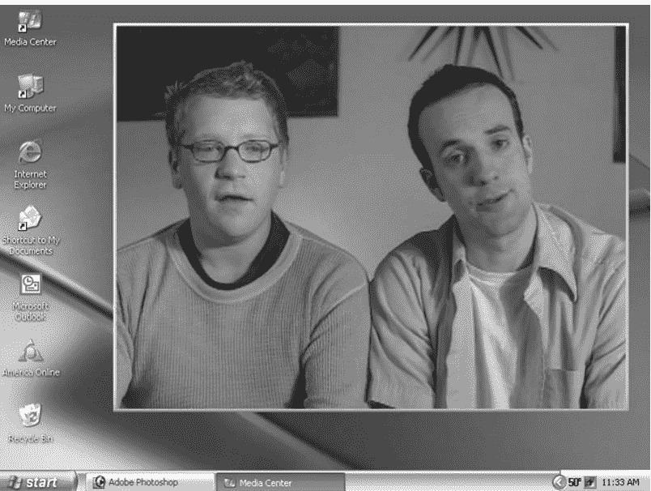

**图 3-3：** Media Center 在 Windows XP 桌面上播放电视节目。

传统 Windows 环境的用户界面和复杂性已经得到了精简和简化。

精简化的用户体验对于使你能够使用电视机和遥控器控制所有操作至关重要。微软在处理查找内容和管理内容的复杂过程方面做得非常好，它让 Media Center 为你承担繁重的工作。你需要做或将想要做的一切，在需要时都会显示在屏幕上。

菜单和操作项目出现而又消失。它们在正确的时间出现，然后在正确的时间消失。一切元素在细微的动画中淡入淡出。有一条持续的导航轨迹，允许你返回上一个屏幕或直接回到开始屏幕。这是一种精良、复杂的计算版本，在之前的任何 Windows 版本中从未出现过。

Windows 用户会感到如如家一样。在欢迎界面之后，你将进入开始屏幕。当你开始导航并到达文件时，你将立即知道如何使用它们。文件像 Windows 一样嵌套在文件夹中。也许这是 Windows 总体发展方向的某种暗示，但这个版本现在已经有了，而且非常适合播放媒体。

#### 目前为止的三个版本

截至目前，Media Center 已发布了三个版本。第一个版本 Media Center 2002 于 2002 年秋季发布。下一个版本 Media Center 2004 于 2003 年 9 月发布。当前版本 Media Center 2005 延续了传统，在秋季进行了全版本发布。

根据你购买电脑的时间，你可能拥有三个版本中的一个。升级值得吗？每个版本都增加了更多的功能和动力。

Media Center 2002 引入了 Media Center，提供了电视观看和录制、节目指南、播放文件和 DVD、播放图片以及收听音乐的功能。运行它的 PC 了书中讨论的媒体 PC 的相同要求。

2004 版本添加了收听广播的功能，并添加了“在线焦点”（Online Spotlight）以包含交互内容。用户界面在导航和视觉吸引力上经历了细微的改进。

最新版本 Media Center 2005 真正展示了 PC 作为真正媒体中心的潜力。对于每台电视，由于支持多台电视的能力，你可以使用一台 PC 连接到多台电视。使用 Media Center 扩展器（Media Center Extender），可以播放不同的直播电视、录制的节目、音乐文件或视频文件。系统级改进包括为多个用户服务的能力并更多地依赖互联网。

无论你何时购买你的媒体 PC，都应该升级到最新版本。请联系你的计算机制造商进行升级。这是一个简单的过程，通常如果你在购买后的短时间内请求升级，是免费的。

#### 首次设置过程

第一次访问 Media Center 时，你将通过设置过程。图 3-5 中的标注显示了 Windows XP 桌面或开始菜单上的 Media Center 启动按钮。点击它进入 Media Center，甚至使用你的遥控器。只需按下绿色按钮即可进入 Media Center。

当你按下绿色按钮时，你会被带离 Windows 以电脑为中心的世界，进入 Media Center 类似电视的环境。无论你显示什么内容，Media Center 看起来都是那样的。图形、字体和图像与分辨率和设备无关，在任何显示器上视觉上看起来都是相同的。

屏幕似乎始终在移动——因为背景光线有细微的变化，所有颜色都带有平滑过渡的动画效果。

一旦进入 Media Center，你可以使用鼠标、键盘或 Media Center 遥控器来执行任何操作输入。你可能想尝试所有方法，看看哪种最适合你使用。

菜单和操作项目出现而又消失。它们在正确的时间出现，然后在正确的时间消失。一切元素在细微的动画中淡入淡出。有一条持续的导航轨迹，允许你返回上一个屏幕或直接回到开始屏幕。

Windows 用户会感到如如家一样。在欢迎界面之后，你将进入开始屏幕。当你开始导航并到达文件时，你将立即知道如何使用它们。文件像 Windows 一样嵌套在文件夹中。也许这是 Windows 总体发展方向的某种暗示，但这个版本现在已经有了，而且非常适合播放媒体。

### PC 杂志——Windows XP 媒体中心版 2005指南

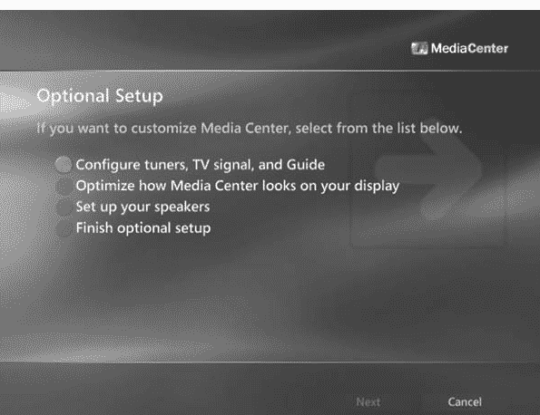

图 3-9：初始设置屏幕。

### 表 3-1 设置媒体中心所需信息

| 电视信号 | 您需要的信息 |
| --- | --- |
| 天线 | 您的本地邮政编码。如果您位于跨越多个城市的大型市场（如芝加哥或洛杉矶），您需要知道 ABC、NBC 以及其他拥有多个转播站网络的频道代表台字母。 |
| 有线 | 您需要知道您是使用直接连接到电视的有线缆还是使用机顶盒，以及您订阅的是哪种有线频道列表。您还需要知道您的电视机调到哪个频道（通常为 3 或 4）以连接机顶盒。有线系统的频道列表取决于您订阅的服务和您使用的机顶盒类型。这些信息通常在您的账账单上，如果您不确定，也可以致电您的运营商。 |
| 卫星 | 作为服务，您将获得该服务的所有频道信息，但如果您也订阅了本地频道，可以选择“本地化”卫星列表。您需要知道您订阅的是哪种本地市场服务，例如，即使您住在加利福尼亚州使用 Dish 服务，也订阅了芝加哥地区的台站。您还需要知道您的电视调到哪个频道以连接卫星机顶盒。 |
| 无 | 如果您现在不将媒体中心连接到电视源，或将使用直接视频馈（如来自录像机的信号），您现在可以选择“无”。您可以随时返回电视设置菜单并在日后更改此设置。 |

# 第 3 章：Windows XP 媒体中心版操作系统

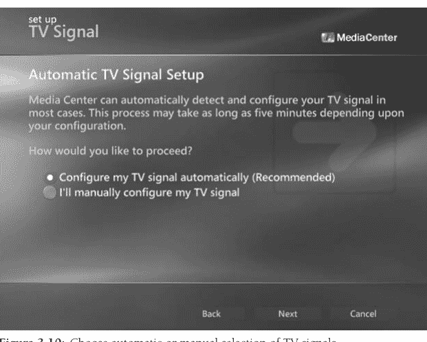

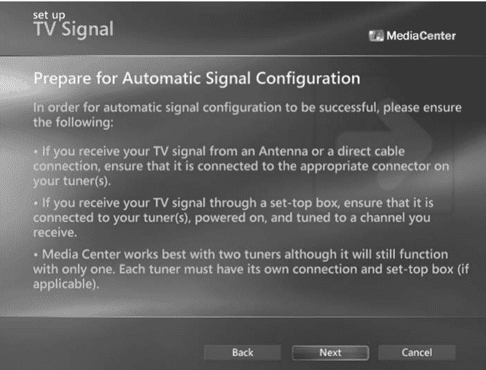

## 46 页 PC 杂志——Windows XP 媒体中心版 2005指南

媒体中心会扫描机顶盒、有线或天线连接及信号。如果您的电视源连接正确且媒体中心检测到电视信号，它将向您显示图 3-12 所示的屏幕，指示它找到的连接和信号类型。如果结果与您的配置匹配，您可以继续到下一页。如果结果不正确，可以让媒体中心重试，或选择通过手动设置过程，在在该过程中您可以指定连接了哪些电视源。

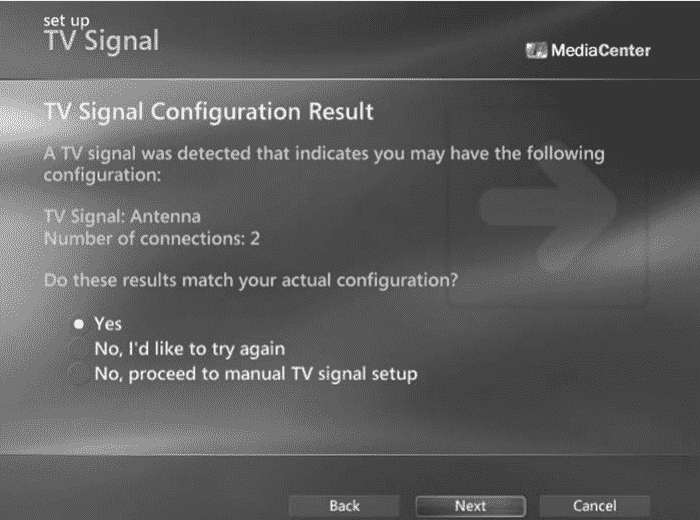

图 3-12：确认已识别电视调谐器和信号。

如果您使用机顶盒，设置程序还会引导您在机顶盒中设置遥控传感器。遥控传感器将切换频道，就像您使用遥控器器一样。

### 注意

如果您的 PC 配备了双电视调谐器，您可以同时连接两个电视源，例如两个机顶盒、两个有线电视盒或两个天线。

下一个屏幕要求您阅读指南隐私声明（参见图 3-13）。它解释了指南是一个可能会侵犯您隐私的过程。通过提供您的电视源，微软将发送有关电视节目的信息，以便您选择和安排录制。这些

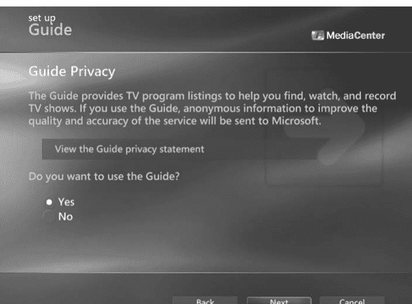

**图 3-13：** 查看微软保护您隐私的政策。您观看和录制的节目可能不是您想与其他人共享的内容，并且为了解决您对这些问题可能产生的任何顾虑，微软将在过程的这一阶段向您展示其隐私信息。

您了解到，他们正在向您发送数据，而且他们还在收集有关您如何使用这些数据以及您的计算机配置的信息。他们收集的数据是为您提供指南服务所必需。它包括您的互联网连接类型和速度、您的频道选择以及关于您 PC 的基本信息。该政策规定，他们不收集有关您的访问习惯或您的任何个人信息，包括您的姓名和地址。

图 3-14 显示了通过同意使用指南来收集过程的屏幕。再次，您有机会查看隐私声明。在做出使用或不使用指南的决定后，点击“下一步”按钮，您将进入最后一个屏幕，在您需要查看使用媒体中心和指南的服务条款。

由于您将使用媒体中心录制电视节目，知道任何时刻播放什么节目对您来说很重要，您将依靠指南来安排录制。微软使用服务条款说明，可能会出现设备无法工作或数据不正确的情况。这些确实会发生，微软在解释其将尽力准确方面做得很好，但如果出现错误，服务条款还规定，作为免费使用产品的交换，您将不对微软承担责任。

在查看并同意图 3-15 所示的服务条款后，您就完成了所有法律文件，并开始填充媒体中心的数据。

## 48 页 PC 杂志——Windows XP 媒体中心版

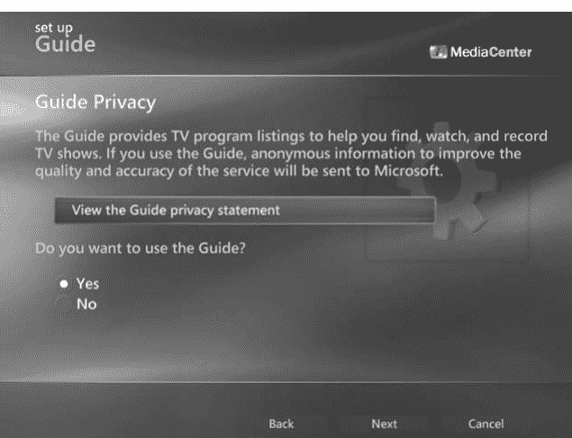

**图 3-14：**确认您想使用指南。

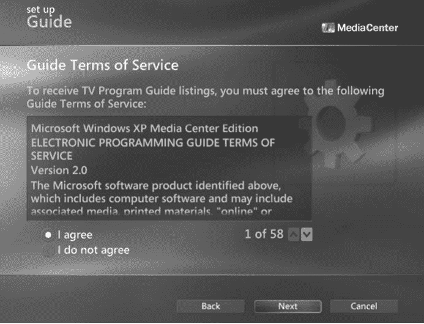

**图 3-15：**媒体中心服务条款屏幕。

### 获取您的频道列表和有关电视源信息的过程

获取您的频道列表和有关电视源信息的过程从提供图 3-16 所示的邮政编码开始。

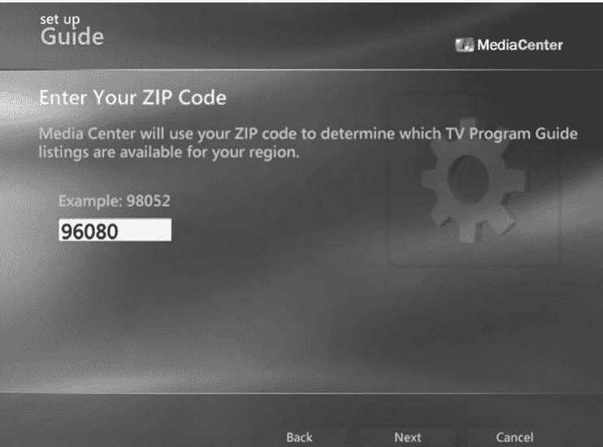

图 3-16：输入邮政编码。

在您输入邮政编码并点击“下一步”按钮后，媒体中心利用互联网下载本地台站信息。图 3-17 确认此过程正在进行并在完成后通知您。下载完成后，您将看到一个选择显示器的屏幕。由于您的 PC 同时连接了多个显示器（例如显示器和电视），系统会要求识别您经常使用哪一个显示器。在示例中，使用了传统的电视。图 3-18 显示了下一个屏幕，即识别 PC 显卡与显示器之间的连接类型。在示例中，使用了 S-Video 连接。一旦您确定了连接类型，下一个屏幕（如图 3-19 所示）会询问您拥有什么显示器。传统电视被称为“标准”，比例为 4:3。许多电视采用宽屏格式，比例为 16:9。当光标悬停在这些选项上时，屏幕会显示每个显示宽度的图形，有助于您选择正确的一个。

在选择好显示宽度后，您将看到图 3-20 所示的屏幕，该屏幕允许媒体中心进行调整，以改善您在所选显示器上使用媒体中心时的效果。如果屏幕看起来很好，您可以选择保留当前设置，或者预览自动调整。

## 50 页 PC 杂志——Windows XP 媒体中心版 2005

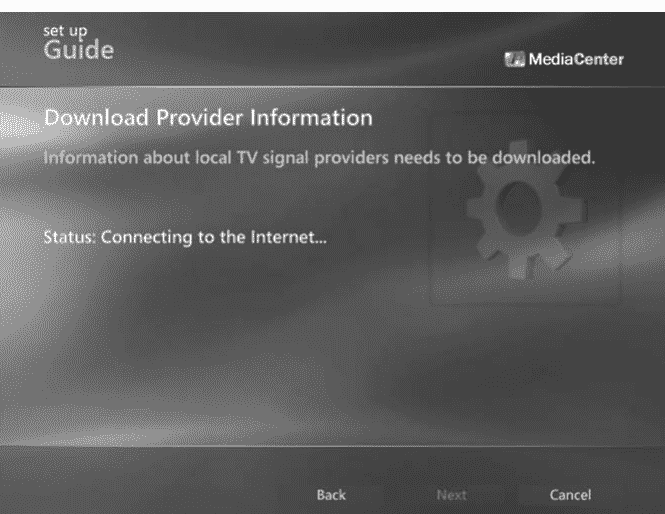

图 3-17：媒体中心正在收集数据。

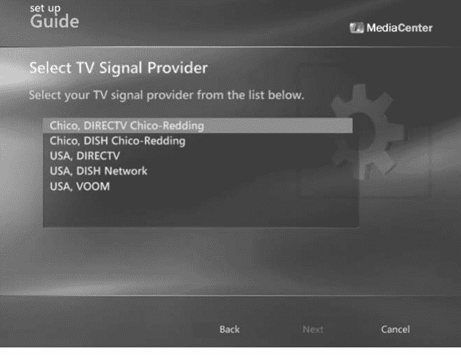

图 3-18：选择您的电视源。

## 52 PC 杂志—Windows XP Media Center 版 2005指南

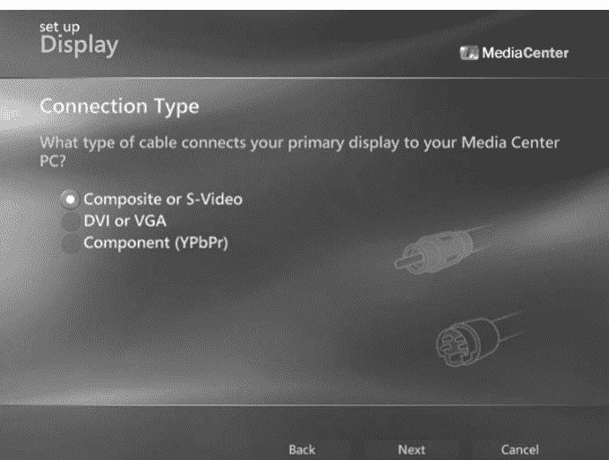

**图 3-20：** 选择您的 PC 和显示器之间的连接类型。

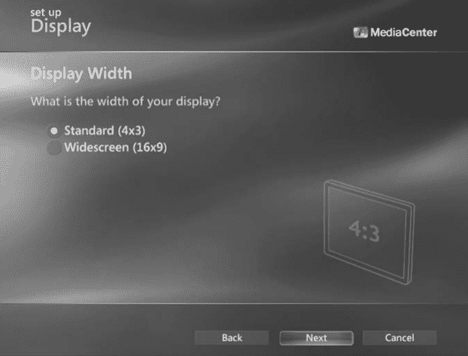

**图 3-21：** 选择您使用的显示器宽度。

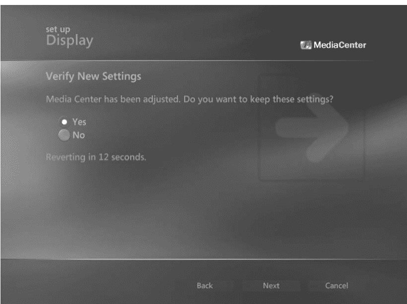

**图 3-22：** 为您的显示器优化 Media Center 查看。

如果您喜欢自动调整，可以保留它们，也可以选择舍弃。您以后可以随时返回设置菜单对显示器进行调整。

如果您使用电视作为主显示器，则适用下一步。图 3-23 显示了允许您在观看电视时使用更大字体的屏幕。在电视上，较大的字体更容易阅读，也更清晰，因为电视通常不像像电脑显示器那样锐利或具有高分辨率。最后的设置屏幕允许您通过调整亮度、对比度和等设置对显示器进行进一步调整。此时，您可以像图 3-24 所示，选择“完成此设置向导”来完成设置。

### 交叉引用

第 9 章将更详细地介绍进一步的显示器调整，该章节将讨论如何微调您的电脑显示器或电视，以便在使用 Media Center 时获得最佳效果。

54 PC 杂志—Windows XP Media Center 版 2005指南

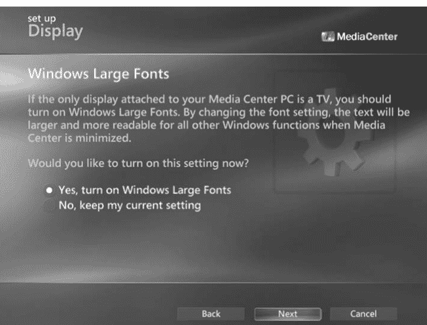

**图 3-23：** 您可以选择在 Media Center 中使用大字体进行电视观看。

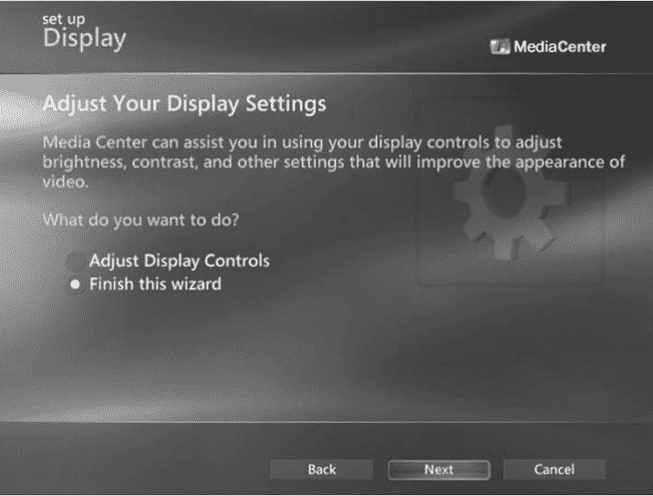

**图 3-24：** 您可以进一步调整或完成向导。

### 扬声器设置

下一个设置程序是识别您在 Media Center 中使用的扬声器类型。在介绍扬声器的第一个扬声器屏幕后，您将到达图 3-25 所示的屏幕，在该屏幕上识别连接到 Media Center 的扬声器数量。在本示例中，选择了标准的双扬声器。

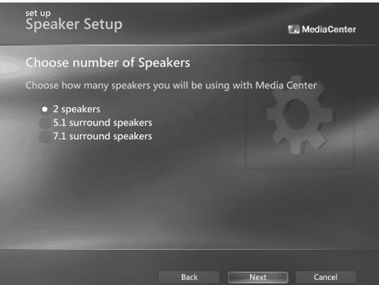

**图 3-25：** 选择连接到您的 Media Center 的扬声器数量。

完成扬声器设置后，即完成了初始 Media Center 设置，可以开始使用 Media Center。

## 总结

Media Center 是一个仅适用于 Windows XP Media Center PC 的操作系统。Media Center 运行在 Windows XP 专业版之上，为您提供运行 Windows XP 的高端 PC 的所有功能和优势。您可以继续使用您使用的所有程序。Media Center 是 Windows XP 的扩展，以电视为中心，高度视觉化，并且如果需要，仅使用遥控器即可在电视上查看。它非常擅管理和显示媒体内容以及录制电视节目。

PC 杂志—Windows XP Media Center 版 2005指南

在首次使用 Media Center 之前，良好的做法是使用 Windows XP 设置互联网连接、组织媒体文件、设置显示设置，如果计划使用，还要建立家庭网络。Media Center 在设置过程中会执行所有这些操作。

在使用 Media Center 之前，您需要通过一系列设置向导，以建立您如何连接互联网、接收什么类型的电视信号、使用什么类型的显示器以及连接到您的 Media Center PC 的扬声器数量。

# 第 4 章：Media Center 体验

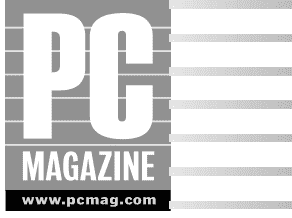

Media Center PC 将针对媒体优化的 PC 硬件与管理和播放媒体的独特体验相结合。这些体验与 Media Center 操作系统完全集成，共享相同的文件约定并使用相同的操作和遥控器。

开箱即用，Media Center PC 已经准备好处理媒体。您需要的一切——硬件和软件——都是系统的一部分。

在创建 Media Center PC 时，微软面临着很高的门槛：电视。想想这个用户界面是多么高效。您拿起遥控器，按下电源按钮，电视在几秒钟内打开并开始播放。它有两个基本操作：换台和调节音量。它不仅简单得惊人，而且运行完美——直到电视坏了，而现在这种情况并不常见。

很难说 Media Center PC 已经达到了那种硬件复杂性水平（PC 尚未成为即开启动设备，它们现在需要偶尔重启），但 Media Center 操作系统和体验在软件方面正接近那个水平。

本章将带您领略每台 Media Center PC 配置的标准体验套。随后的章节将更详细地探讨每一种。

## Media Center 启动屏幕

可以通过点击 Windows 桌面上的“绿色按钮”Media Center 图标启动 Media Center，或按下遥控器上的绿色按钮启动 Media Center，如图 4-1 和 4-2 所示。

Media Center 以应用程序的形式在自己的窗口中运行，并与其他 Windows XP 体验同时运行。它以全屏方式打开，但其运行的窗口可以调整大小或最小化。

在欢迎您进入 Media Center 的简短启动屏后，您将到达图 4-3 所示的启动屏幕。作为 Windows XP 用户，您应该熟悉桌面上的“开始”按钮。开始按钮在 Windows XP 和 Media Center 中用于启动程序。

54 58 PC 杂志—Windows XP Media Center 版 2005指南

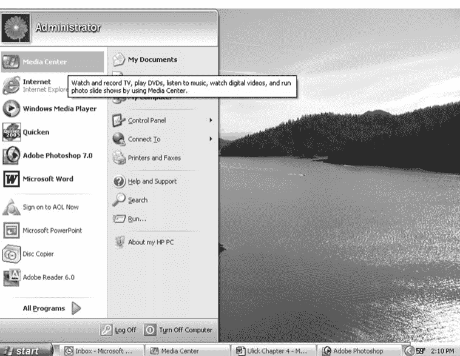

**图 4-1：** 点击 Media Center 图标启动 Media Center。

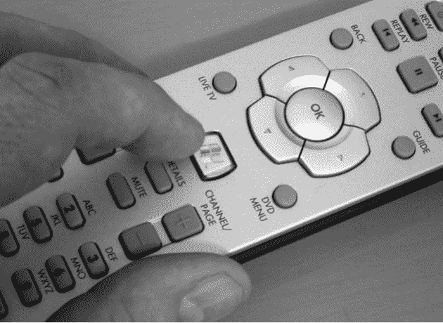

**图 4-2：** 使用遥控器上的 Media Center 绿色按钮启动 Media Center。

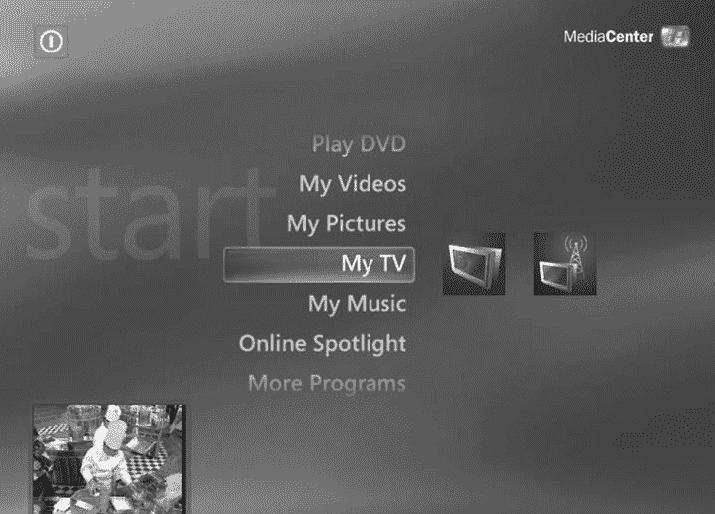

**图 4-3：** Media Center 启动屏幕。

## 用户界面

启动屏幕作为主菜单，确定了 Media Center 所有体验的外观、感受和导航。它使用全屏显示，设计为供远距离观看的娱乐内容门户。例如，界面在坐在距离电视十英尺远的沙发上时应该是易读且舒适的。这一点需要考虑考虑，因为您首次使用 Media Center 可能在使用电脑显示器时效果良好。在这种情况下，字体很大，图标也巨大。与在 Windows XP 中运行的程序相比，屏幕上的任何信息量都是有限的。

## PC Magazine—Windows XP 媒体中心版 2005 指南

1600 × 1200。无论在何种显示分辨率下启动 Media Center，屏幕上的所有内容看起来都是的一样的——它是设备无关的。

除了从电脑显示器切换到电视屏幕外，你还会喜欢它的导航方式。所有操作都可以通过键盘、鼠标或使用遥控器进行控制。这使得你能够从桌子或沙发上轻松导航 Media Center。

你在 Media Center 中首先注意到的点之一是，它没有使用窗口、弹出式/下拉菜单或需要滚动的大型屏幕。你是在不同的屏幕之间进行导航。这限制了一个屏幕上显示的信息量；在使用它时，你会看到很多不同的屏幕。Media Center 包含了许多方法来帮助快速移动到另一个屏幕。

使用遥控器上的“返回”键或键盘上的“退格”键（Backspace），你可以从任何屏幕返回到上一个屏幕。使用鼠标时，鼠标的任何移动都会同时弹出快捷工具栏和媒体播放工具栏，如图 4-4 所示。这些控制会在无活动几秒钟或当另一个操作启动程序后消失。

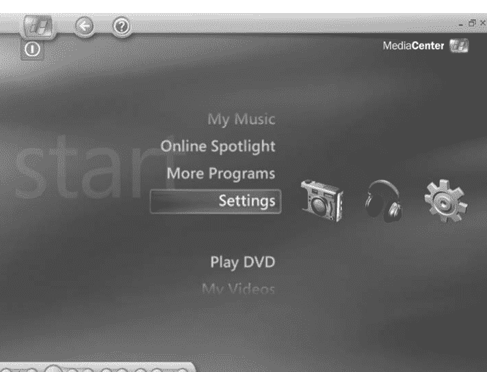

**图 4-4：** 当你移动鼠标时，导航和屏幕控制控件。

点击菜单项将进行导航。菜单项出现在屏幕中央，当你使用遥控器或键盘上的方向键移动到它们上方时，它们会滚动。菜单项循环显示，以加快导航速度并增加视觉吸引力。点击任何菜单项都会带你进入相应的体验界面。

## 开始屏幕上的项目

图 4-5 所示的开始屏幕包含许多项目，这些项目为后续屏幕的使用奠定了基础。让我们来看每一个项目。

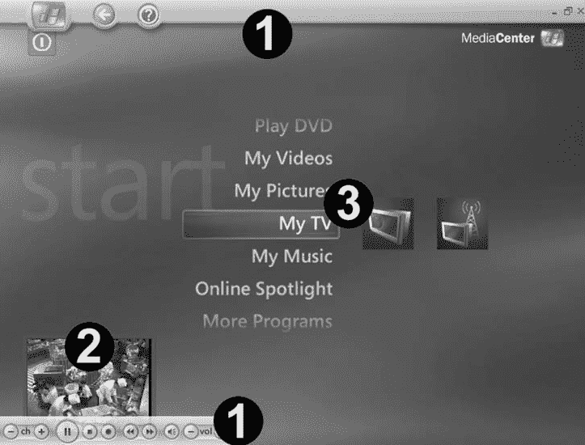

图 4-5：开始屏幕的主要组件。

- 区域 1：开始屏幕的顶部和底部区域在你移动鼠标时提供导航。你也可以使用键盘上的 Tab 键或遥控器上的方向键在 Media Center 内进行导航。
- 区域 2：具有一个插入窗口（Insert Window），显示当前播放的媒体。当你第一次进入 Media Center 时，此窗口不会显示。一旦你开始播放任何媒体（电视、录制的电视、视频、DVD、音乐或广播）并在屏幕之间进行导航（包括返回开始屏幕），插入窗口就会出现。如果你点击它，它将带你进入正在播放的媒体的全屏版本，或带你进入菜单进行控制。
- 区域 3：主菜单始终包含主要体验的按钮，包括“我的电视”、“我的视频”、“我的音乐”、“我的图片”、“播放 DVD”，以及如果你的系统配备了 FM 调谐器，则还有“广播”。此外，还有“设置”、“在线焦点”和“更多程序”的永久按钮。一旦你使用“更多程序”启动第三方体验（这里有九个按钮，其中大约五个个在非滚动屏幕上可见），使用方向键或鼠标将滚动菜单项。当你滚动查看视觉化表示时，选择项出现在按钮的右侧。“我的电视”会显示一台电视，“我的图片”会显示一个相机。

当在 Windows XP 桌面上查看全屏或缩放为窗口时，所有这些内容都会显示在开始屏幕上。当你移动鼠标时出现的桌面控制控件也会出现在全屏或窗口模式下。

如果你有来电显示功能且你的电脑连接到电话线，你还可以设置 Media Center 提供屏幕上的来电通知。这需要你的 PC 中有一个支持来电显示的调制解调器卡。当电话接入时，屏幕上会出现一个通知让你知道有电话打入。

当你通过键盘、屏幕桌面控制控件或遥控器的音量按钮调整音量时，屏幕上会出现一个短暂的音量显示。如果你选择静音，屏幕上会显示一个带有“Mute”（静音）字样的符号，如图 4-6 所示。

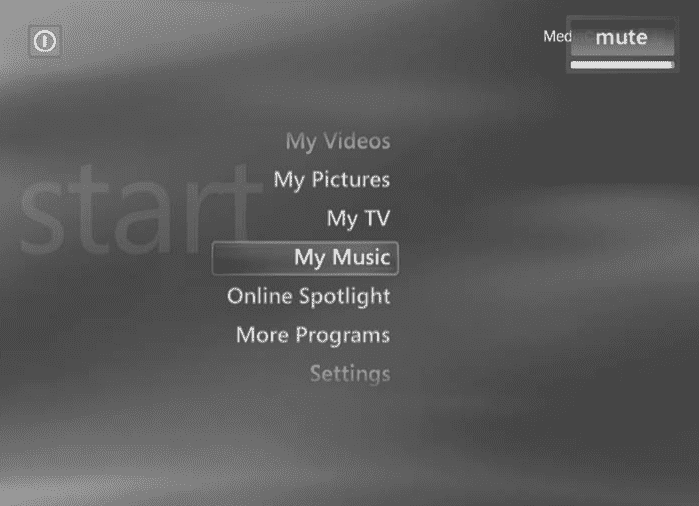

图 4-6：只要声音静音，静音符号就会出现。

## Media Center 体验

一旦你熟悉了开始屏幕并习惯了导航，就可以准备访问 Media Center 自带的各种体验了。

书的后部分将详细介绍每个程序，但现在我们将查看所有的体验并突出它们的特征。

### 我的电视 (My TV)

Media Center PC 都配备了电视调谐器卡，让你观看和录制电视节目。“我的电视”是你观看电视节目、使用节目指南搜索节目以及计划和播放录制内容的区域。“我的电视”菜单如图 4-7 所示。

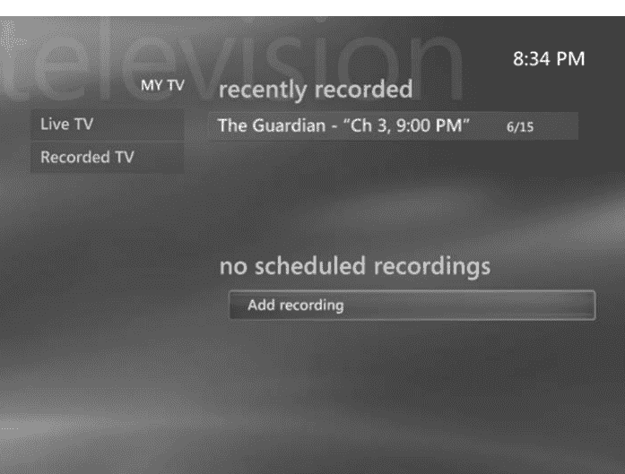

这将改变你观看电视的方式。通过将个人电脑的力量与电视观看相结合，Media Center 增加了新的功能。最重要的新功能如下：

- **数字录制**：你可以将电视节目录制到电脑硬盘上。这允许你计划录制或录制正在观看的节目。节目存储在电脑中，你也可以使用第三方应用程序存储到 DVD 中。

### 暂停和重放
当你观看直播电视时，可以暂停并回溯 30 分钟，从而实现“时间位移”。Media Center 一直在录制直播，因此你可以暂停离开去接电话，然后回到节目的位置继续观看。你可以随时回溯直播电视。另一个功能是，如果你正在看一个节目并在看了 20 或 30 分钟后对自己说：“嘿，我应该录制这个！”你可以回到开头按下录制。它将从该点开始录制。

### 节目指南
作为 Media Center PC 的用户，你可以访问屏幕节目指南来查看节目信息。指南帮助你计划观看并在安排录制方面起着重要作用。使用指南可以通过标题、类型或关键词搜索节目。你甚至可以自定义指南以过滤你喜欢的节目类型。

### 录制时观看录制节目或另一个直播节目
Media Center 包含的一个很棒的功能是在录制直播节目的同时观看已录制的节目，或者如果你的 PC 有双调谐器，还可以同时观看另一个直播节目。

使用节目指南进行录制和“时间位移”只是开始。功能支持 4:3 比例显示和 16:9 宽屏显示。通过视频去隔织提高了电脑显示器的画质。“我的电视”允许显示字幕，并在直播和录制模式下均支持辅助音频节目（SAP）。你可以在直播期间从节目指南查看节目信息，甚至在录制后也可以查看，如图 4-8 所示。

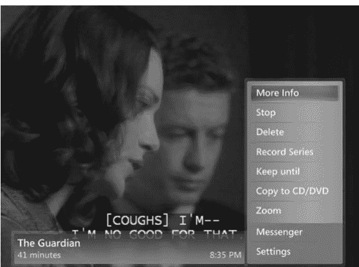

图 4-8：在录制节目上方显示节目信息和文件选项。

一旦你开始使用 Media Center PC 观看电视，你就会发现自己不再受制于直播电视的时间表了。通过计划录制你喜欢的节目，或简单地在观看直播电视时进行时间位移，你可以在在想看的时候看电视，而不是在节目播放的时候看。

## 第 4 章：媒体中心体验 65

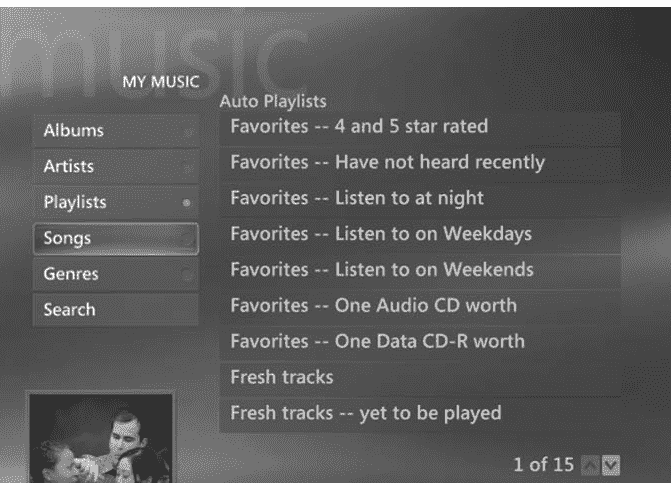

**图 4-9：** 音乐菜单。

当你从开始屏幕选择时，会进入图 4-9 所示的菜单。Media Center 充满了巧妙的设计，例如在听音乐时使用背景中浮动的专辑封面并显示视觉效果。此时，你有多种选择来导航到音乐。

屏幕左侧列出了查看你音乐库的方式：按专辑、艺术家、播放列表、歌曲和流派。除了视图之外，你还可以按相同的标准搜索音乐。图 4-10 显示了按专辑排序的音乐。

当你找到喜欢的音乐或播放列表后，可以使用遥控器、键盘或鼠标进行播放、暂停或在曲目之间切换。这是 Media Center 发放异彩领域之一——你可以使用遥控器进行管理和音量调节。比起看电视，音乐更适合在放松的环境下播放，而不是缩在电脑显示器前。

除了 PC 上存储的音乐外，你还可以轻松收听音频 CD 或 MP3：插入 Media PC 的 CD-ROM 或 DVD 驱动器，它便会在 Media Center 的“我的音乐”中开始播放。如果你想直接从 Media Center 将音乐录制到硬盘。

继续介绍 Media Center 中可见的高视觉化用户界面。媒体音乐使用视觉效果，如图 4-11 所示。你可以像图中所示显示正在播放的曲目信息，也可以让视觉效果全屏且不显示任何信息。

## 我的照片

看一眼“我的照片”屏幕就能看出 Media Center 的用户体验是多么的一致。如果你不仔细看，可能会认为你仍然在“我的音乐”的专辑视图中。使用 Windows XP 和 Media Center 中使用的文件和文件夹方法，获取照片是快速、简单且高度视觉化的，如图 4-12 所示。

## 66 页 PC 杂志——Windows XP 媒体中心版 2005 指南

### HOWARD JONES：Howard Jones
- 专辑
- 艺术家
- 播放列表
- 歌曲
- 流派
- 搜索

110 / 192

图 4-10：音乐库的专辑视图。

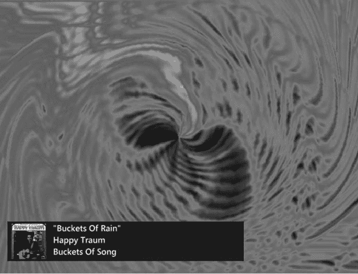

图 4-11：显示视觉效果和曲目信息的播放曲目。

## 第 4 章：媒体中心体验 67

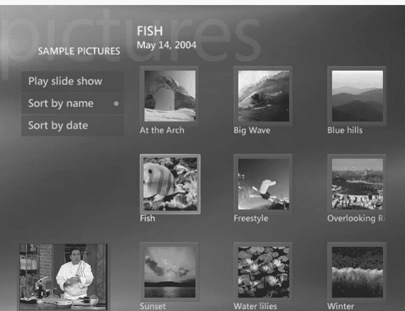

**图 4-12：** 我的照片菜单。

“我的照片”允许你逐一张查看数字照片或以幻灯片形式查看。照片可以存储在硬盘或其他介质上，例如如果数字相机连接到电脑，则可以在 CD-ROM 或媒体存储卡上。你还可以直接在“我的照片”中打印照片并进行一些非常基础的照片编辑。

查看过程简单且直观。当你进入“我的照片”时，会立即看到你选择的在 Media Center 中显示的任何文件的文件和文件夹视图。

有两种基本的“查看”模式：按名称或按日期。如果你像许多人一样使用数码相机，照片是由相机创建的，例如 0000231.jpg。文件通常也标有日期。你可以进入并重命名照片文件名，以帮助你找到想要的文件。

一旦屏幕上有了照片文件，你就可以点击任何一个文件，图像将充满屏幕。如果你从照片文件夹中打开了照片，可以使用遥控器上的方向键或键盘上的方向键返回或查看文件夹中的其他照片。

你还可以将文件夹中的文件作为幻灯片进行播放。Media Center 为幻灯片提供了极出色的动画——非常像电视电影的过渡效果。幻灯片按查看顺序或随机顺序播放。你可以自定义显示内容。你可以使用来自“我的”的音乐作为背景音乐，尽管它并没有任何方式与显示同步。幻灯片的持续时间和过渡类型是可以调整的。

## 68 页 PC 杂志——Windows XP 媒体中心版 2005 指南

在任何时候你都可以点击照片并打印，或在需要时进行基础编辑。查看时，你还可以平和平缩放照片。尽管这些功能非常基础，但它们是最经常使用的；微软确实致力于让查看照片变得像 Media Center 中的其他操作一样简单。

## 我的视频

除了幻灯片功能外，查看自己的视频文件与查看照片非常相似。使用相同的文件和文件夹，当你进入“我的视频”时，它会查找任何文件并以视觉方式呈现它们，如图 4-13 所示。

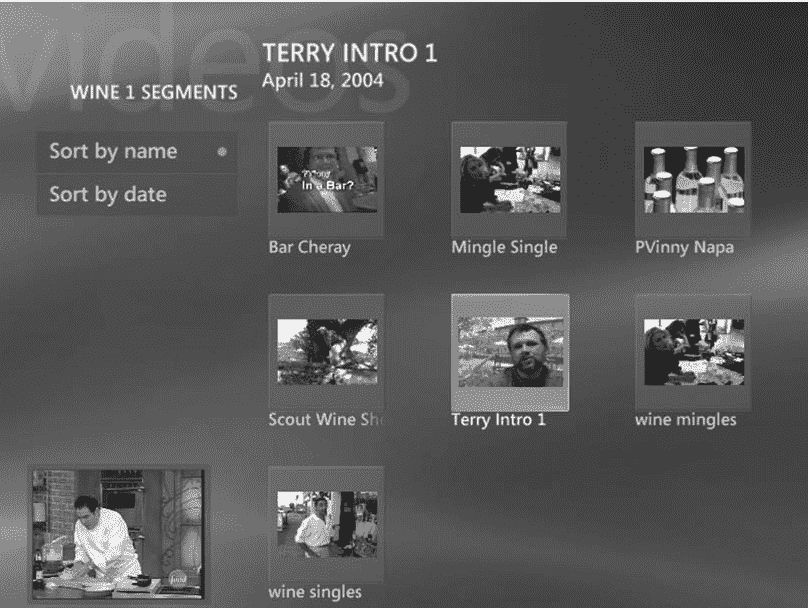

图 4-13：我的视频菜单。

视频文件可以按名称或日期显示。如果你像许多人一样使用数码相机，照片是由相机创建的，例如 0000231.jpg。文件通常也标有日期。你可以进入并重命名文件名，以帮助你找到想要的文件。

一旦屏幕上有了照片文件，你就可以点击任何一个文件，图像将充满屏幕。如果你从照片文件夹中打开了照片，可以使用遥控器上的方向键或键盘上的方向键返回或查看文件夹中的其他照片。

## 第4 章：Media Center 体验

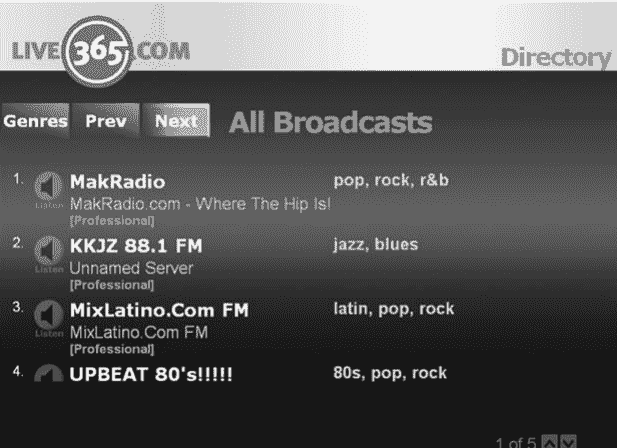

图 4-17：收听网络电台。

## 在线焦点 (Online Spotlight)

互联网上有海量内容，但并非所有内容都能 Media Center 中正常运行。由于这是一个以电视为中心的环境，你可能无法使用、甚至看不到标准网站上的文本和图像。出于这种原因，Media Center 使用“在线焦点”区域引导你访问专为 Media Center 设计的网站和内容。图 4-18 显示了访问在线焦点时的第一个屏幕。

你必须连接到互联网才能使用焦点功能。由于某些内容包含音乐或视频，宽带连接效果最佳。在线焦点中展示的内容区域主要是音乐和电影租赁或购买、FM广播电台以及来自 MSN Today 的新闻。还有关于使用 Media Center 以及 Media Center 第三方软件的提示和技巧。所有区域都具有 Media Center 体验的视觉外观和感受，并使用相同的导航样式。

在线焦点中的一些特色包括：
- `Live365.com`：收听网络电台并将其添加到你的收音机预设中。
- `CinemaNow`：预览电影并将电影租赁到你的电脑。
- `Napster`：在线听音乐以及购买歌曲和专辑。
- `MSN TV`：查看新闻头条。（参见图 4-19。）

访问 Media Center 版本网站的唯一方法是通过“在线焦点”提供的。如果你想访问其他网站，你需要返回 Windows XP 并使用标准的网页浏览器。

# PC 杂志——Windows XP Media Center 版 2005 指南

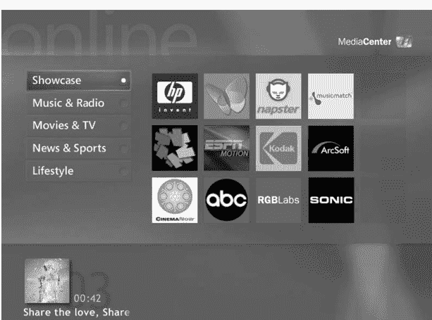

图 4-18：在线焦点菜单。

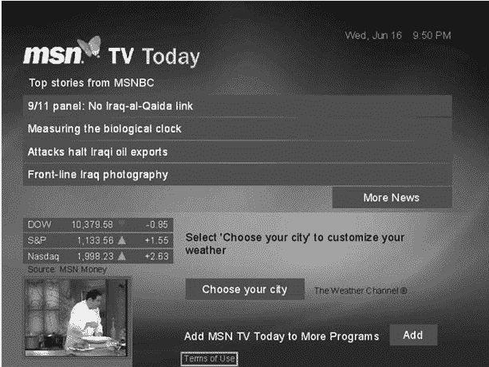

图 4-19：MSN TV 今日提供新闻和天气内容。

## 更多程序

如果你愿意，可以为 Media Center 添加更多程序。程序可以来自微软，也可以来自各种第三方来源。在本书编写时，已有超过 150 家公司致力于为 Media Center 设计的程序。

## 第4 章：Media Center 体验

“更多程序”（More Programs）如图 4-20 所示，是你跳转到已添加到 Media Center 的程序的地方。可以通过从光盘、从在线焦点或从服务提供商网站安装来添加程序。根据电脑制造商的不同，你的系统可能带有一些额外的程序，如 Otto 或 Gem Master。

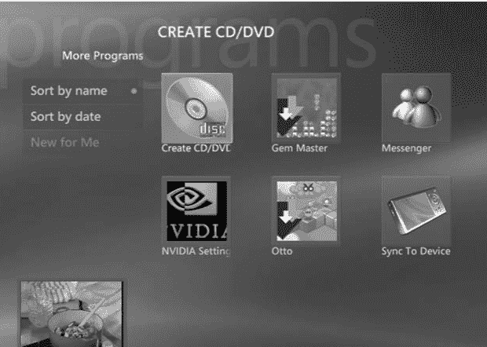

图 4-20：更多程序菜单。

任何包含在“更多程序”中的程序都必须专为在 Media Center 中运行而开发。它必须使用相同的电视为中心界面，并可以使用键盘、鼠标或遥控器进行控制。

### 设置

Media Center 启动屏幕上的最后一个菜单项是“设置”，如图 4-21 所示。可以从此菜单访问 Media Center 的每个区域（电视、音乐、图片、DVD 和常规）的所有设置。你也可以直接从该区域访问特定设置（例如，你可以从“我的电视”菜单访问电视设置）。

### Media Center Messenger

在 Media Center 的任何体验中，无论你正在做什么，你都可以与使用 Messenger 的人通信。Media Center Messenger 是一款即时消息应用程序，允许你向当前在线的人发送短消息——无论你是在使用 Media Center 还是标准 PC，只要他们在你使用时在线 Messenger 即可。你需要连接到互联网才能使用此功能。

你需要创建一个 Messenger 账户（只需要一个电子邮件地址），并在首次使用时输入账户名和密码。之后，如图 4-22 所示，通过按下

## 74 PC 杂志——Windows XP Media Center 版 2005

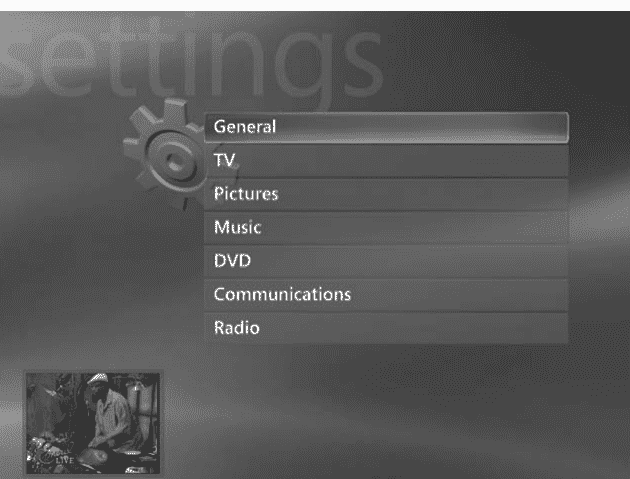

图 4-21：设置菜单。

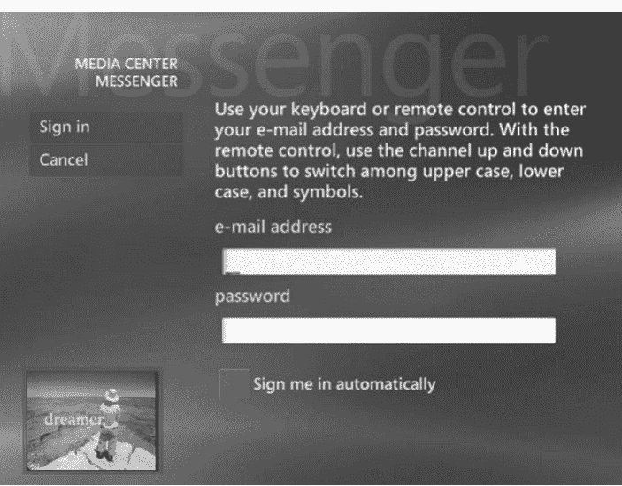

图 4-22：启动 Media Center Messenger 会话。

## 第4 章：Media Center 体验 75

通过遥控器上的 Info 按钮或右键点击鼠标，你可以从屏幕菜单中选择使用 Messenger 并开始共享关于电视节目或任何你想要聊的话题的。

### 屏幕主叫显示

如果你将电话线连接到 Media Center PC，并向你的电话服务提供商订购了主叫显示或带姓名的主叫显示，你就可以在运行 Media Center 时查看通话，如图 4-23 所示。当来电时，无论你正在使用 Media Center 的哪个部分（例如看电视或 DVD），屏幕右上角都会出现覆盖层。Media Center 显示来电者的名称或号码。这是一个很好的功能，可以帮助你决定是否暂停正在观看或收听的内容接听。要设置屏幕主叫显示，请从启动屏幕进入设置菜单，选择“Messenger 和主叫显示”，然后选择“主叫显示”。你可以随时从这些设置菜单中开启或关闭。

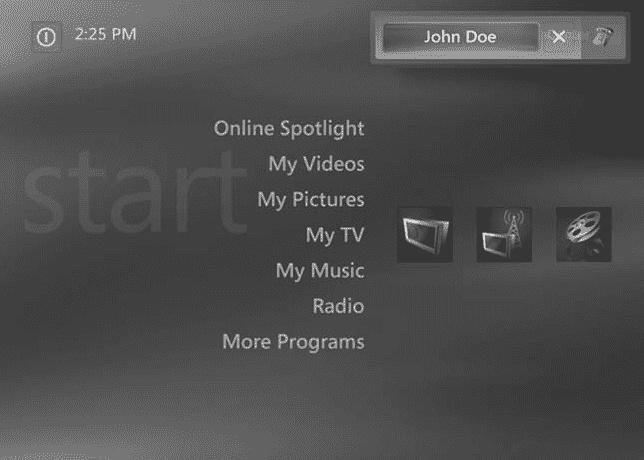

图 4-23：使用主叫显示通知可以在屏幕上显示电话。

### 总结

Media Center 备齐了你用于电视、听音乐、播放视频和 DVD 以及幻灯片模式查看图片的所有体验。所有体验共享相同的用户界面，并可以从 Media Center 的启动屏幕轻松访问控制。

可以使用“在线焦点”访问额外的程序和内容，它通过互联网访问专为 Media Center 设计的网站和内容。一旦添加了额外的程序，你就可以从启动屏幕上的“更多程序”按钮访问它们。

Windows XP Media Center 将用于通用计算的标准 Windows XP 操作系统与用于查看和控制媒体的特殊操作系统 Media Center 结合（如图 5-1 所示）。

Media Center 操作系统整合了多种体验和系统级功能。它为处理媒体文件（如电视节目、视频、图片和音乐）创建了一种一致且易于理解的方法。无论你是在观看家庭电影还是看电视，控制方式都是相同的。

# 80 PC 杂志——Windows XP Media Center 版 2005 指南

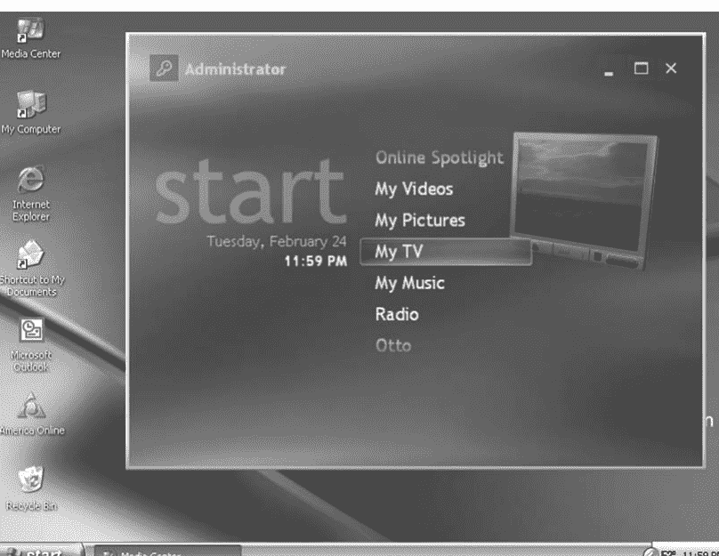

**图 5-1：** 在标准 Windows XP 桌面上窗口化运行的 Media Center。

播放音乐或查看图片；它们都可以使用一个键盘、一个鼠标或一个遥控器，通过相同的操作和命令进行管理。

这种程度的集成在标准 PC 上使用不同的应用程序是无法实现的——即使你拥有与 Media Center PC 相同的硬件。再次，是 Media Center 操作系统将所有硬件和软件整合在一起，形成了一种合乎逻辑的用户体验。

## Media Center PC 硬件要求

为了让 PC 使用 Windows XP Media Center 版操作系统，它 必须包含以下硬件：

- 如果你的 PC 带有电视调谐器，则需要一个兼容 Media Center 的遥控器。
- 如果你的 PC 带有电视调谐器，则需要一个能与遥控器通信通信的远程红外 (IR) 传感器。
- 如果你的 PC 带有电视调谐器，则需要一个远程 IR 控制器来控制你的电缆或卫星顶顶盒。
- 高性能显卡，能够在计算机监视器上显示电视和视频。
- 电视输出端口，用于在标准电视上显示 Media Center。
- 数字音频输出，用于将数字音频从电脑发送到现有的家庭娱乐系统。
- 电视调谐器卡（单路或双路），可以显示来自电缆、卫星、连接的视频源（如 VCR）或天线源的电视信号。
- 硬件编码器，允许将来自电缆、卫星或天线的电视节目录制到电脑的硬盘上。
- 中高端处理器。
- 足够用于计算和娱乐应用的内存。
- 大硬盘。
- CD-ROM/DVD 驱动器。
- 高级图形和音频功能。
- 网络连接。

## Media Center PC 硬件差异

尽管微软对 Media Center PC 的硬件提出了要求，但它给予了制造商足够的灵活性，以允许各种范围的价格和配置。例如，操作系统可以支持电视调谐器，但这并不是一项硬件要求。

由于不同的 Media Center PC 之间存在差异，接下来的章节将详细介绍 Media Center PC 系统中的每个组件以及它们如何影响整体 Media Center PC 体验。

### 不同的处理器和内存

与市场上的 PC 一样，Media Center PC 提供了不同的处理器。在任何时候，市场上最快的处理器将耗费你大部分资金，因此问题是，更快的处理器是否值得多花这些钱？

大多数 Media Center PC 使用 Pentium 4 处理器，几乎任何时钟频率都能良好工作。例如，我测试过 Pentium 4 2.6-GHz 单元和 2.8-GHz 单元；它们在所有 Media Center 应用中的表现都异常出色。

Media Center 的设计初衷是让在已上市一多年的电脑上正常运行，因此处理器的速度已经超过了原始要求。由于处理器速度不断提高，考虑更快的处理器在你的传统计算应用中是否有价值是非常重要的。

视频的使用——显示电视和视频——是需要大量处理能力的地方。幸运的是，处理被卸载到了显卡上，因此获得一台配备最好显卡的 Media Center PC 是非常重要的。

内存也是也是你 PC 性能的一部分。目前，Media Center PC 中的内存配置从 250MB 到 2GB 不等。

> 提示
>
> 你可以在未来扩展内存，但一个良好的起点是购买一台至少带有 512MB 内存的 Media Center PC。

### 不同的硬盘

如果你计划录制电视节目并将所有的媒体放在你的 Media Center PC 上，在硬盘方面你应该考虑两点：机器自带硬盘的大小，以及你是否可以添加额外的硬盘。

Media PC 开始营销时配有小到只有 80GB 的硬盘，而你可以为它们配置极大的硬盘，例如 250GB 的硬盘。这里的规则是：在预算范围内获取最大的硬盘。视频和音乐文件（加上用数百万像素数字相机创建的越来越大的文件）与你存储在 PC 上的几乎任何其他东西相比，所以越大越好。表 5-1 显示了使用 120GB 硬盘时（在不同质量水平下）大体上可以录制多少小时的电视节目。

| 表 5-1 不同质量设置下的录制时间 | | |
|---|---|---|
| 录制质量 | 优 | 较好 | 好 | 一般 |

| :--- | :--- | :--- | :--- | :--- |

| 存储小时 | 46 | 54 | 66 | 122 |

硬盘是一个重要的考虑因素。寻找 7200 RPM 的硬盘转速，并尽可能避开 5400 RPM 的硬盘。视频在更快的硬盘上播放效果最好，并且通常会提供更大的文件（8MB 的文件将是最佳选择）。
即使有了大硬盘，你可能发现自己想要更多存储空间。扩展时你有两个选择：添加第二个内部硬盘（如果你的 PC 中有插位）或添加外部硬盘。
最便宜且优雅的方法是添加内部硬盘。因为外部硬盘需要外壳和电源，它们的成本会更高。再次，规则是获取一个内部或外部的大型、快速硬盘。在客厅/家庭环境中，你可能不想有很多像外部硬盘这样的“附加物”散乱，内部硬盘可能是此类环境下的最佳选择。
外部硬盘有两个版本：FireWire/IEEE 1394 和 USB 2.0。你的 Media Center PC 可以带有 FireWire/IEEE 1394 和 USB 2.0。使用 USB 2.0 速度更快，但可能需要支付更多。
在购买电脑时，最好的交易是获取尽可能大的硬盘。购买时添加驱动器通常比预装的要贵。

### 不同的光驱驱动器

Media Center PC 可以配备各种光驱驱动器，如表 5-2 所示。

| 表 5-2 光驱配置 | | |

| 类型 | 播放 | 录制 |

| :--- | :--- | :--- |

| CD-ROM | 音 CD、数据 CD | 不录制 |

| CD-RW | 音 CD、数据 CD | 音 CD、数据 CD |

| DVD | DVD、音频 CD、数据 DVD/CD | 不录制 |

| DVD-R/-RW | DVD、音频 CD、数据 DVD/CD | -DVD、音频 CD、数据 DVD/CD |

| DVD+/-RW | DVD、音频 CD、数据 DVD/CD | +DVD、音频 CD、数据 DVD/CD |

| DVD+/RW/-RW | DVD、音频 CD、数据 DVD/CD | -DVD、音频 CD、数据 DVD/CD |

根据外形形状，它可能带有一个或两个光驱驱动器。双驱动配置的一个典型示例是一个 CD-ROM 驱动器和一个 DVD 录制驱动器。Media Center PC 可以带有至少一个用于写入 DVD 的驱动器，但大多数设备提供 DVD 录制驱动器。
DVD-R 或 RW 允许你录制自己的 DVD，这些 DVD 可以在你的 Media Center PC 或大多数普通 DVD 播放器上播放。它们还可以录制数据 DVD 和 CD、音频 CD 以及 MP3 歌曲。
许多 Media Center PC 配备一个 DVD 录制驱动器和一个 CD-ROM 驱动器。高端系统配备两个 DVD 录制驱动器，允许快速方便地复制 DVD。

### 不同的显卡

显卡是 Media Center PC 中最重要的组件之一。它驱动你的计算机显示器、电视或两者。它决定你在屏幕上看到的所有内容以及视频在显示器上的效果。
就像驱动电脑的处理器一样，显卡本身小型计算机。它有处理器和内存，两者都会影响性能。与处理器以及 Media Center PC 的所有其他组件一样，显卡提供多种选择，并会影响系统的价格。

#### 84 PC 杂志——Windows XP 中心版 2005 指南

显卡处理你在电脑显示器或电视上看到的所有视觉信息。对于多媒体中心 PC，显卡必须能够在分辨率从 640 x 480 到 2048 x 1536 等高分辨率的显示器范围内提供高质量视频。它们还必须能够向电视发送无闪烁的视频。
目前，Media Center PC 中的大多数显卡均来自 Nvidia 或 ATI，配备高性能处理器。所有随 Media Center PC 附带的卡都必须满足在电脑显示器或电视上显示的最低要求，因此大多数显卡在基础电视观看和 PC 使用方面都能胜任。
显卡还被允许使用 VGA 15 针适配器连接到标准电脑显示器，并通过 RCA 接口和 S-Video 接口连接到电视。有一个连接是你应该寻找的，如果可能的话：DVI（数字视频接口）连接器。
显卡上的 DVI 连接器可以让你将 Media Center PC 连接到下一代电脑显示器——以及下一代 LCD、等离子屏和高端电视。该连接的设计用于让你的计算机与数字和模拟信号进行接口。
当连接到模拟显示器时，DVI 连接器获取来自计算机的数字信号并将其转换为模拟。如果显示器是数字的（如 LCD），它则提供数字信号。如果你考虑升级到等离子屏或 LCD 等平板电视，请确保你的电视也有此连接。
除了基础功能外，大多数显卡都有软件实用程序，允许你调整电视视频，包括颜色、对比度、大小、位置、闪烁控制。

### 不同的调谐器卡

电视卡负责引入你的电视源信号。源可以是任何电视信号，包括来自天线的无线电广播或来自电缆或机顶盒的模拟信号。
正如名称所示，调谐器卡不仅仅是引入视频信号——它还允许你“调谐”频道。此功能还让你的 Media Center PC 可以像电视一样工作。切换频道和使用电视源的能力还允许定时和录制电视节目。你的 PC 可能带有内置电视调谐器的显卡，或者带有独立的视频和电视调谐器卡。
电视调谐器卡执行非常重要的处理功能：将模拟的电视信号实时转换为数字信号。一旦调谐器卡将电视信号转换为计算机可以处理的格式，你就可以对其进行处理，例如在电脑显示器或电视上显示并将其录制到硬盘中。
大多数 Media Center PC 都为此配备了调谐器卡，有一个你想要寻找的 Media Center PC 要求的选项：FM 调谐器。
如果你的电视卡内置了 FM 调谐器，你将能够使用 Media Center 的广播功能。就像电视调谐一样，FM 调谐器允许你连接 FM 天线并使用 Media Center PC 调谐本地 FM 无电台。我的建议是购买带有 FM 调谐器的系统，以从媒体体验中获得最大的价值和乐趣。
图 5-2 显示了电视/FM 调谐器卡上的典型连接器组。除了 Media Center PC 背面的连接器外，你可能在 Media Center PC 的正面找到额外一组 S-Video 和 RCA 复合视频和音频接口。这使得通过 Media Center PC 连接 VCR 或模拟摄像机变得非常容易。

#### 第 5 章：选择合适的 Media Center PC 85

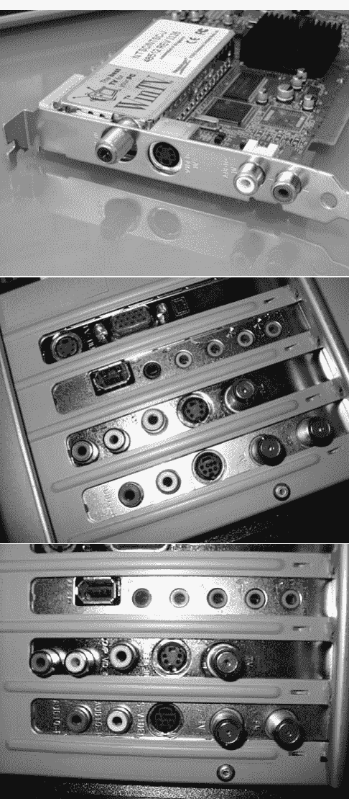

**图 5-2**: 调谐器卡上的 FM、同轴、S-Video、复合视频和音频接口。

#### 86 PC 杂志——Windows XP 中心版 2005 指南

### 不同的声卡

Media Center PC 中的声卡将数字音频信号转换为模拟信号，以便在功率扬声器上或通过传统的立体声放大器进行播放。声卡不包含放大器，因此瓦数、扬声器尺寸等不是考虑因素。有不同级别的声卡，根据你喜欢如何听和听电视音频，你需要确保获得正确的声卡。
声卡还允许音频信号（包括来自电视源的音频）进入你的 PC。所有声卡都为此配备了麦克风（Microphone）和线路输入（Line In）接口。
较便宜的系统配备了标准的“立体声”（双通道）输出。这对于大多数音乐和电视音频来说足够了，声卡将有一个简单的媒体立体声插头，连接到你的有源扬声器或放大器。
如果你计划观看 DVD 或拥有环绕声系统，你应该寻找具有 5.1 环绕声处理和接口的声卡。这会略微增加系统的价格，但提供了最多的音频选项和功能。
Media Center PC 可以提供 Dolby Digital、DTS 或 PCM 环绕声解码，并支持扬声器和连接的 A/V 设备的多通道输出（使用数字互连输出，如 SPDIF 或 Toslink）。如果你想要环绕声，请寻找支持它并带有你的扬声器或放大器所需的正确接口的声卡。

图 5-3：音频卡上的连接器。

### 不同的外形

正如第 2 章提到的，Media Center PC 可以购买各种外形。外形是机箱的形状和大小，并影响设备的外观；目前有五外形：塔式、台式、笔记本、小型机和一体机。你可以在图 5-4 中看到它们的对比。

#### 第 5 章：选择合适的 Media PC 87

关于你的正确外形有两个需要考虑的事：
- **样式**: Media PC 使用在哪里是一个重要考虑因素。将显示器作为一部分的一体机可能不适合家庭使用。塔式机可能是娱乐中心的合适外形。
- **容量**: 台式机和塔式机有足够的空间放置多个 DVD 驱动器、额外的硬盘以及扩展槽。小型机、笔记本和一体机限制了购买时的可用设备数量，并且扩展能力有限。

价格也是一个重要的考虑因素。`HP-Packard` 和 `Sony` 等主要制造商在零售店销售 Media Center PC。惠普和 Sony 的型号代表了极高的价值。从 999 美的基础型号（缺少 FM 调谐器卡和双 DVD 刻录机，拥有 512MB 内存和 120GB 硬盘）到 2400 美的全配，大多数预算都有相应的价格，只要你能接受现状。最近零售商开始销售 `Toshiba` 和 `Hewlett-Packard` 的 Media Center 笔记本电脑。

如果你不介意邮购，选择范围会大大增加。`Northgate` 和 `Gateway` 等邮购零售商销售台式机、一体机和笔记本电脑等各种型号。其他为你定制配置 PC 的邮购公司可以按照任何配置构建你的 Media Center PC，制作小型机。

## 不同的输入设备

一开始就做好总是有帮助的——而且省钱。很好的例子是确保你的 Media Center PC 拥有正确的输入设备。

随 Media Center PC 附带的键盘鼠标可以是有线的或无线的。如果你计划在客厅或家庭环境中使用 Media Center PC，你将想要无线键盘和鼠标。

### 88 PC 杂志——Windows XP 媒体中心版 2005 指南

为了获取带有无线配置的媒体 PC，并为使用场景购买一个廉价的有线键盘和鼠标。

## 媒体中心遥控器

现在你已经了解了媒体中心 PC 的哪些部分在不同系统之间有所不同，你就可以寻找满足需求的配置。除了之前讨论的差异外，每个配备了电视调谐器的 Media PC 都配带有一个媒体中心遥控器。它可以用于控制媒体中心的功能——但在 Windows XP 操作系统中使用时，它并不充当鼠标。不同公司的遥控器外观可能不同，但每种都包含相同的控制组，包括连接互联网的功能。

媒体中心遥控器包含以下功能：

- 媒体中心启动按钮：启动媒体中心。
- 待机按钮：将你的媒体中心 PC 置于节能待机模式并将其恢复到活动状态。
- 传输控制：用于播放、停止、暂停、录制、跳过、倒回和多速度快进的按钮，以及逐帧进退功能。
- 重放（Replay）：“即时重放”将电视和视频向回移动七秒；它还可以将音乐播放列表、CD、幻灯片或 DVD 章节中的项目后退一曲。
- 跳过（Skip）：跳转到下一个音频或视频轨道，或者在录制电视时，向前跳过 29 秒。
- 方向控制和 OK 按钮：允许在屏幕上的选项之间进行移动。
- 更多信息（或详情）按钮：显示关于电视节目和正在播放媒体的详细信息，包括专辑和歌曲标题、艺术家名称等。
- 实时电视（Live TV）：从其他功能跳转到实时电视，或者当你正在暂停或重放正在观看的电视节目部分时跳转。
- 快捷键：一键式按钮，可直接导航到我的电视、我的音乐、图片、我的视频、已录制电视、节目指南（Guide）或 DVD 菜单。
- A/V 控制：频道上上/下、音量调大和静音，以及一个用于直接输入频道、数字或文本的数字键盘。

`MC` 遥控器不是鼠标，当使用“按钮”时，它是一个指向设备，可以使用鼠标点击或使用遥控器上的方向控制和 OK 按钮进行点击。

你的鼠标允许你在 Windows XP 和媒体中心内进行移动、指向和点击。遥控器仅在媒体中心内进行导航，但在 Windows XP 中，你可以通过点击遥控器上的“媒体中心启动”按钮直接跳转到媒体中心。

## 第 5 章：选择合适的媒体 PC

### 89

图 5-5 显示了来自 HP 媒体中心 PC 的典型媒体中心遥控器。它将信号发送到随媒体中心 PC 带的遥控器传感器。遥控器传感器是一个小型设备，通过 USB 接口连接到 PC，可以放在媒体中心 PC 上或附近。

图 5-5：HP 媒体中心遥控器。

## 网络连接

访问家庭网络和互联网通过媒体中心 PC 上的两个主要连接器处理：调制解调器接口和以太网接口。

如果你有 DSL 或电缆调制解调器等宽带服务，可以将它们连接到媒体中心 PC 上的以太网。这允许连接互联网，还可以连接到家庭网络，让你能够与家里其他计算机和设备共享媒体中心 PC 上的互联网连接和文件。

你也可以使用以太网端口创建家庭网络，而无需高速互联网连接。使用集线器或无线网络设备可以将你的家庭网络连接起来，以共享文件和打印机等设备，并通过另一台 PC 上的调制解调器访问互联网。

如果你使用拨号服务，你的媒体中心 PC 应该配备一个 56k 调制解调器。虽然速度慢，但该连接将允许你连接互联网下载电视节目表，并访问专为之设计的在线内容。

你的媒体中心 PC 必须通过调制解调器处理音频和视频。

## 交叉引用

第 8 章显示了如何让媒体中心 PC 成为家庭网络。

## 总结

媒体中心 可以显示电视节目和正在播放的媒体

## 选择媒体中心 PC

在了解了哪些让媒体中心功能相同，哪些让媒体中心 PC 不同之后，以下是购买媒体中心 PC 的一些要点：

- **真实性**：在使用媒体中心功能时，它是显示设备。
- **外形规格**：在购买媒体中心 PC 时，要确保它允许扩展。
- **价值**：虽然可以为了媒体中心显示，但最新的版本通常能提供更好的功能。
- **最新产品**：自发布以来，微软每年更新一次媒体中心。

媒体中心 PC 配备有一个遥控器，可以让你控制媒体中心功能。

媒体中心 PC 集成了高性能处理器、音频视频卡、电视调谐器、硬盘、光驱驱动器和网络功能，这让你能够能够观看和录制电视节目、播放音频、视频和照片文件。

在不用于媒体应用时，媒体中心 PC 的硬件配置也能让媒体中心 PC 成为你的娱乐中心。

媒体中心 PC 有不同的外形，并可以配置不同的硬盘、光驱驱动器、处理器和视频卡，因此在购买媒体中心 PC 时，重要的是确保它符合你的需求。

## 第 6 章

## 将音频和视频输入输出到你的 PC

作为数字娱乐中心的核心，你的媒体中心 PC 能够从模拟和数字源收集内容。它通过显示器或电视显示这些内容，并通过有源扬声器或放大器播放音频。本章将介绍向媒体中心 PC 输入输出音频和视频的设备和连接。

## 视频

你的媒体中心 PC 使用两个设备管理视频：电视调谐器卡将模拟信号引入计算机，视频卡将视频发送到显示器、电视或两者。每块显卡都包含自己的处理器，旨在提供高性能，并符合媒体中心版的视频标准。

电视调谐器将模拟源转换为数字格式。转换实时发生，产生的数字信号可以保存为文件。此功能允许录制电视节目并重温直播电视。电视调谐器卡还包括一个 FM 调谐器，可以将模拟 FM 广播转换为数字格式。

### 92 PC 杂志—Windows XP 中心版 2005指南

录制电视节目。此外，如果你想连接其他模拟源，如模拟摄像机或 VHS 录像带机。

电视调谐器执行两个基本功能：

- **将模拟视频转换为数字视频**：电视源是模拟的。目前的电视设备是模拟设备，只能接收模拟信号。广播电视、有线电视甚至卫星电视都向电视发送模拟信号。为了创造电视体验，你的 Media Center PC 必须能够与你连接的电视源（广播电视、有线电视或卫星电视中的任何一个）配合。电视调谐器卡接收模拟信号并将其转换为 Media Center PC 可以使用的数字格式。
- **调谐频道**：你现在的电视（除非是较新的“显示器”类型）都内置了电视调谐器。这允许电视“调谐”到特定的电视频道（例如 2、3、32 等）。电视信号的开始是宽频谱模拟信号的广播，需要一个调谐器来选择特定的广播频率。无论你的电视调谐器是配合天线调谐到一个范围广播频道，还是连接到有线或卫星盒并调谐到 3 或 4，它必须复制标准电视的调谐器功能以接收任何种类的信号。

电视调谐器本质上是将你的 Media Center PC 变成了一台电视。你可以这样理解它：一台带有电视调谐器的电视连接到一个处理器，该处理器将信号转换为可以在你查看的屏幕（显示器）上显示的格式。Media Center PC 拥有一个电视调谐器，连接到一个处理器，该处理器将信号转换为可以在你屏幕上显示的格式。区别在于，与你的电视机不同，Media Center PC 拥有一套极其强大的处理器、硬盘、光驱，以及能够同时处理模拟和数字视频的能力。在你的电视和显示器之间，有一台极其强大的计算机驱动着电视体验。它是被释放的电视。

## 单调谐器与双调谐器

虽然电视调谐器可以调谐到任何电视或信号，但它一次只能调谐到一个频道。回到“电视”的比喻，你的电视很可能一次只能调谐到一个频道。这对于看电视来说没问题——但使用 Media Center PC，你可能想在录制节目节目的同时看另一个电视节目。使用单调谐器卡是无法做到的。

要在录制另一个电视节目的同时观看电视节目，你需要一个调谐器用于正在观看的节目，另一个电视调谐器用于要录制的节目。带有双调谐器或两个电视调谐器卡的 Media Center 可以让你同时观看或录制两路现场电视。

这对于一般的电视活动是一项重要功能（你可能只是想在录制一个节目时看另一个，或者同时看两个节目），但如果你想把 Media Center PC 作为家庭娱乐中心，这就至关重要。如果你正在使用家庭网络和扩展器，允许其他电视访问你的 Media Center PC 内容，你不会希望强迫别人看你正在看的节目。双调谐器允许他们从远程位置查看或录制另一个节目。

即使你是唯一用户，双调谐器也能对录制和观看电视节目提供最大的控制。

# 第 6 章：让音频视频输入和输出你的 MCE PC

## 连接电视源

电视调谐器卡（或笔记本电脑上的端口）有两个基本连接口：天线/电视信号输入和 S-Video 输入。这两个连接器如图 6-1 所示。

图 6-1：电视调谐器卡上的天线/电视和 S-Video 连接器。

天线/电视信号连接器是最基本的连接形式，存在于所有电视上。这些连接器使用同轴电缆，常见于天线或连接有线电视盒或录像机。电缆具有公头连接，有一根被屏蔽层围绕的单芯和一个螺纹耦合器。电视调谐器卡具有带螺纹的母头。要建立这种连接，你从天线、有线电视盒或卫星盒引出同轴电缆到电视调谐器卡的连接器。天线/电视信号连接器同时传输视频和音频信号，因此只需要一根电缆。由于这种连接在一根线上传输所有信息，它是质量最低的选项。

如果你使用视频源（如有线盒或卫星盒），它可能有更好的连接器：S-Video。这种连接器仅传输视频信号并将信号分为细节信息和颜色。它能提供明显更好的图像。如果你的视频源有 S-Video 连接，请使用而不是天线。你需要使用一根 S-Video 线和一根音频线来完成音频连接。顶盒可能有一组 RCA 连接器——每个通道一个。你 PC 上的音频连接大部分像立体迷你插头。你需要使用一头端是 RCA 连接器组、另一端是立体迷你插头的音频线来建立连接。如图 6-2 所示。

最后一点：你的调谐器卡可能具有或不具有自带的音频连接器。某些电视卡要求你使用 PC 音频卡的“线路输入”（line in）连接来接收使用 S-Video 连接时视频信号的音频部分。更多细节参考用户手册，但作为一个简单的规则，如果你的调谐器卡没有音频连接器，请使用你的音频卡。

## 电视信号质量

当你的调谐器卡连接到有线盒或卫星盒等顶盒时，应该提供出的电视图像。如果你使用天线，可能会注意到电视节目在电视上看起来和在 PC 上看起来不同。作为调谐设备，你的调谐器卡在接收信号的能力与你的电视非常相似。它结合硬件和软件来处理电视信号。如果电视信号看起来没有在电视上那么好，你应该考虑以下几点：

- **在电脑显示器上看对比电视**：电视节目在电脑显示器上看起来会有不同。微软整合了视频隔行和视频缩放，使电视信号在电脑显示器上看起来尽可能好，但这仍然是一种不同的体验。坐在桌前通过电脑显示器看电视就像坐在离电视 10 到 12 英寸的地方。如果你后退 6 到 10 英尺，从正常观看距离可能会发现像素更好且更像电视。电视实际上是 320 × 240 像素。最基础的电脑显示模式是 640 × 480——显示器分辨率的两倍。你的电脑显示器至少是 800 × 600，更有可能是 1024 × 768。
- **天线对比 S-Video 连接**：如前所述，如果你使用 S-Video 连接，例如你使用顶盒，这种连接无法产生更高的分辨率，但可以产生更清晰的。

**天线位置**：如果你使用天线作为电视信号，请记住由于你是在新位置使用调谐器，位置可能需要调整。这总是一个尝试的过程，但值得的。

## 电视源

Media Center 支持你选择的任何电视源。如果你将 Media Center PC 设置在通常看电视的地方，只需将连接到电视的源连接到 PC 上的电视调谐器卡即可。

如果你在通常没有电视的地方（如家庭办公室）使用 Media Center PC，情况可能会变得复杂。在这种情况下，你需要将视频源引入 PC，这可能并不简单。

使用顶盒时会出现其他问题。你使用遥控器从顶盒切换频道。在 Media Center PC 配置中，是你的 PC 在切换频道并控制顶盒。你需要在顶盒前面设置一个设备，允许 PC 切换频道。

为了更容易理解，让我们逐一介绍使用天线、基础线、带顶盒的有线电视、带顶盒的卫星电视以及其他视频源的不同场景。

### 天线和基础线电视

连接天线和基础线电视的方法是相同的。基础线电视是不通过顶盒直接连接到电视的服务。（如果你订阅了基础线电视但使用了连接到电视的顶盒，你应该使用下一节中带顶盒的有线电视的方法。）

你只需要将来自天线或基础线连接的电缆，使用同轴电缆将其连接到电视调谐器卡上的天线/电视信号输入，如图 6-3 所示。唯一的其他考虑是同轴电缆的选择。如果你在墙上有一个插座

图 6-3：天线和基础连接。

来自你的天线或电缆服务，它将有一个像你的电视调谐器卡那螺纹母接头。

#### 注意事项

同轴电缆销售时带有一个螺纹公接头或一个可以卡在母接头上的“快插”连接器。快插连接器安装方便，但只需轻轻一拉就会断开。最好使用螺纹类型的连接器以确保连接可靠性。

### 使用机顶盒的电缆或卫星电视

如果你使用机顶盒来接入电缆或卫星服务（无论是模拟电缆、数字电缆还是卫星服务），都适用以下方法：

首先，你需要查看机顶盒是仅有一个同轴接头，还是有一个同轴接头和一个 S-Video 接头。电视盒使用从墙壁到机顶盒的同轴接头。它将电缆或卫星服务的信号传输到机顶盒，在那里信号被解码并转换为第 3 或第 4 通道的标准电视信号。该盒还带有“电视输出”（TV Out）或“到电视”（To TV）同轴连接，将信号发送到你的电视。如果它有 S-Video 连接，它将有一个 S-Video 接头和一组标记为“S-Video 输出”和“音频输出”的 RCA 音频接口。这种配置的示例如图 6-4 所示。

图 6-4：用于同轴电视输出、S-Video 输出和音频输出的典型机顶盒接头。

如果你的机顶盒只有同轴接头，请使用螺纹同轴电缆，将其从电视输出连接到你 PC 电视调谐器卡的“天线/电视信号”接头。

如果你的机顶盒有 S-Video 接头，请使用它。你需要一根 S-Video 线缆和一根 RCA 立声转立体声迷你插头音频线。将机顶盒上的 S-Video 输出连接到你 PC 电视调谐器卡上的 S-Video 连接。使用音频线将 RCA 连接到机顶盒的音频输出接口，并将迷你插头插入你电视调谐器卡的“音频输入”接头（如果有音频接口）或声卡上的“线路输入”接口。这种连接的示例如图 6-5 所示。

它将机顶盒的音频和视频连接到你的 PC，但还有更多工作要做。接下来，你需要将遥控传感器和红外控制线（所有媒体中心 PC 均配备）连接到你的电脑。

#### 遥控传感器

要使用媒体中心遥控器，你必须先连接遥控传感器。虽然你使用的电脑可能内置了遥控传感器，但大多数媒体中心 PC 使用外部设备。这是一个小盒子，接收来自遥控器发送的信号并通过 USB 端口将其发送给 PC。图 6-6 显示了遥控传感器。

遥控传感器可以连接到媒体中心 PC 前面或后面的任何 USB 端口。之所以优选“远程”设备而不是内置在 PC 中的设备，是因为它可以放置在电视或显示器旁边。使用遥控器控制你正在观看的电视节目是直观的——而不是控制你的 PC。一旦你将遥控传感器连接到 PC，就可以可以使用长电缆将其放置在电视或显示器之外或旁边。另一个益处是，在客厅或家庭室中，你实际上可以将 PC 隐藏起来，因为在使用遥控器时，是遥控传感器在控制它。

图 6-7 显示了遥控传感器在家庭室中的典型放置。如果你在办公环境中使用媒体中心 PC，也应该将遥控传感器放置在电脑显示器旁边。这将始终允许你指向屏幕来控制你的观看。

图 6-7：遥控传感器在家庭室中的放置。

#### 红外控制线

一旦你连接了遥控传感器，你就可以连接上替代机顶盒遥控器的设备，由它为你开启并切换频道。

该设备适用于使用红外（IR）遥控器的机顶盒。某些机顶盒（例如来自 Dish Networks 的）使用 UHF 遥控器，由于它们不是红外设备将无法工作。你可以为此类盒子添加红外控制器，并联系你的电缆或卫星提供商获取此类选项。

如果机顶盒使用 RF 遥控器，你需要从遥控传感器连接一根红外控制线，并将传感器放置在机顶盒前面。首先，在遥控传感器上找到红外控制接口。将红外控制器的插端连接到上面，布置长线找到机顶盒的传感器端。这是棘手的部分：你需要确保传感器与遥控器之间视线良好。

## 让你的 MCE PC 输入输出音频视频

连接电视有两种方法，取决于电视的类型。如果电视有同轴端口，请使用同轴电缆。如果电视有 S-Video 端口，请使用 S-Video 线缆。如果电视只有 RCA 复合接口，你需要一个适配器将 S-Video 或数字输出转换为复合信号。适配器通常随 PC 附带，但如果没有，可以在 Radio Shack 等商店购买此类适配器。

# 96 PC 杂志—Windows XP 中心版 2005指南

这解决了电视的视频问题，但没有音频。你需要用一根电缆连接显卡的线路输出（或耳机接口）和电视的输入接头。这通常通过 RCA 立声转立体声迷你插头线完成。

## 其他源

假设你的电视具有复合、S-Video 或 DVI 接口，你已经准备好将电视连接到媒体中心 PC。连接过程非常直观：使用相应的电缆将显卡上的匹配接口连接到电视。图 6-9 显示了显卡与电视之间典型的 S-Video 连接。

## 连接电视和显示器

连接显示器更加简单。显示器有 15 针 VGA 接口或 DVI 接口。如果显卡和显示器都有 DVI 接口，请使用 DVI 线连接它们。如果你的显卡只有 DVI 接口而显示器使用 15 针 VGA 连接，你需要使用 DVI 转 VGA 适配器来连接显卡或电脑显示器。大多数情况下显卡和电脑显示器都有 15 针 VGA 接口，如果，连接的

### 第 6 章：MCE PC 音视频输入与输出基础 101

通过这些接口将显示器连接到显卡。当使用电脑显示器时，音频将通过连接到电脑的扬声器播放。

你可以同时连接电视和电脑显示器。按照上述连接场景，使用 S-Video 或复合视频接口连接电视，并使用 15 针 VGA 或 DVI 接口连接你的电脑显示器。当你同时开启这两台设备时，电脑显示将处于激活状态，你可以使用 Windows XP 控制面板中的“显示属性”来调整两个显示器的协同工作方式。你可以让它们显示相同的图像，也可以创建一个跨越两个显示器的“虚拟”桌面。这对于在电脑显示器上使用 Windows XP 的同时，在电视上运行媒体中心（Media Center）非常有用。

## 交叉引用

调整显卡的属性将在第 9 章中介绍。

## 音频

除了改变看电视的方式，媒体中心 PC 同样改变了你听音乐的方式。在许多方面，PC 已经成为新的家庭音响——人们使用它们来购买音乐、刻录 CD 和 MP3 以及听音乐。虽然 PC 播放音乐非常出色，但要在家庭房或书房里专门留一台 PC 用于播放音乐是很困难的。媒体中心 PC 改变了这一点。

通过将电视观看、DVD 播放和音乐全部整合到一个系统中，你的媒体中心 PC 成为了许多当前家庭娱乐设备的替代品，包括传统的家庭音响。无论直接放在家庭房里，还是通过扩展盒连接，媒体中心 PC 都是完美的家庭音响。它可以播放几乎所有的音乐格式（MP3、WMA、音频 CD、音频 DVD 和 WAV 文件），并可以连接互联网收听广播和流媒体音频。

将你的媒体中心 PC 连接到你发现过的优质有源扬声器或环绕声响系统，只需极其令人惊叹的价格即可。本节列出了如何将有源扬声器或你目前的家庭音响连接到你的媒体中心 PC。

## 声卡

你的媒体中心 PC 配有一块声卡，它允许你将模拟音乐导入 PC，并将数字或模拟音乐发送到连接到普通无源扬声器的有源扬声器或放大器。

大多数声卡具有以下连接：

- Line In（线路输入）：用于直接连接另一个音频设备。
- Mic（麦克风）：用于使用麦克风采集实时音频。
- Line Out（线路输出）：用于输出到电视、有源扬声器或放大器。
- Headphone Jack（耳机孔）：用于使用耳机听音频，也可作为 Line Out（线路输出）接口使用。

102 页 PC 杂志——Windows XP 媒体中心版 2005 指南

高端 PC 可能还具有用于环绕声系统的接口。环绕声系统的连接是数字信号，应仅用于连接到此类系统。图 6-10 显示了支持环绕声的声卡上的典型接口。

图 6-10：支持环绕声的声卡。

连接声卡需要你拥有合适的电缆。声卡使用 1/4 英寸立体声迷你插头接口。在使用有源扬声器时，你可能会使用一根两端都是立体声迷你插头的电缆。在处理较旧的音频设备和电视设备时，你经常会遇到 RCA 类型立体声连接。对于这些情况，你需要一根一端为立体声迷你插头、另一端为 RCA 类型立体声连接的电缆。图 6-11 显示了两种接口。

图 6-11：1/4 英寸立体声迷你插头和 RCA 类型立体声连接。

### 第 6 章：MCE PC 音视频输入与输出

## 有源扬声器

自早期仅将一对微型单声道扬声器连接到 PC 以为了听到蜂鸣和警告声以来，有源扬声器已经取得了了巨大的进步。今天，许多有源扬声器在音质上可以与高端放大器和扬声器媲美，并由最有声誉的音频制造商制造。

有源扬声器最典型的配置是一个低音炮箱带有两个小型卫星扬声器。低音炮箱承担了提供低频声音的所有任务——为音乐和音频提供低音和“底蕴”。在观看 DVD 时，低音炮箱会处理隆隆的、震房间的效果。由于人耳朵无法分辨这种低频声音的方向，因此在立体声或环绕声系统中只需要一个声器。

较小的扬声器提供立体声像和几乎所有的中高频声音。一些最好的卫星扬声器可以非常小，但无论尺寸如何，任何音响系统的优劣都是主观的。

在环绕声系统中，除了低音炮箱外，你还有两个卫星扬声器和一个通道扬声器。这通常被称为 5.1 系统，你在房间前方有两个卫星扬声器，后方有两个，正中央有一个中置扬声器，以及一个如果可能的话放在视线之外的低音炮箱。

有源扬声器顾如其名，自带放大器。目前的系统功率范围从 5 瓦到数百瓦不等。长期以来争论的是，一个可以播放无失真声音的高功率系统的价值，并不如音质本身重要。如果放大器以及扬声器和外壳中使用的材料设计良好，即使是低功率系统也能提供卓越的音质。

如果你的媒体中心 PC 有一套有源扬声器，你可以用它们来播放音乐和电影。无论你是否使用它们，它们都能提供优质的音质。

## 连接音响或放大器

将你的媒体中心 PC 连接到你发现过的优质有源扬声器或环绕声系统，只需极其令人惊叹的价格。本节列出了如何将有源扬声器或你目前的家庭音响连接到你的媒体中心 PC。

## 调整音量

你可以使用音响或放大器或 PC 自身的控制来调节音量。

## 调整音色和平衡

使用家庭音响或放大器的音色、均衡和平衡控制来获得最理想的声音。你也可以从 PC 进行这些调整。

104 页 PC 杂志——Windows XP 媒体中心版 2005

声卡 | 立体声 | LINE IN

图 6-12：将媒体 PC 连接到家庭音响。

## 将音频导入系统

如果你计划从录音带播放机、黑胶唱机或其他设备采集音频，请通过 Line In（线路输入）将其连接到声卡。

媒体中心不对这类连接的设备提供直接支持。使用 Windows XP 和音频采集程序（包括启动菜单中简单但有效的“录音机”程序），采集所需的模拟源并保存为 MP3、WAV 或 WMV 文件。一旦你采集并保存了文件，它将被媒体中心识别并在“我的音乐”中播放。

## 总结

你的媒体中心 PC 连接到你目前的电视源，包括天线、有线电视或卫星服务，以及如 VCR 等模拟设备。使用电视调优卡，你的 PC 可以以与你当前电视机类似的方式播放。与电视调优器不同，它可以录制、倒回或暂停直播电视。使用双电视调优卡，你可以在观看直播的同时录制电视，或者在使用扩展设备时在不同房间播放不同的直播节目。

电视或电脑显示器可以作为主显示器，并且可以同时使用。这使得媒体中心 PC 作为作为娱乐设备和作为办公/家用电脑都是有效的。通过将媒体中心 PC 连接到一套有源扬声器或家庭音响，完善了娱乐体验。

## 第 7 章

## 媒体存储：添加和更换硬盘

媒体中心电脑（Media Center PC）最棒的功能之一就是录制电视节目的能力。即使你不是那种会在录像机上录制大量节目的人，你也会很快发现，使用媒体中心电脑录制电视是一种完全不同的体验——你可以进行电视时移（time-shift）。

如果你有想看的节目，通过媒体中心电脑，你有两个选择：

- 看电视：确保在节目播放时你在家里，没有其他安排，正坐在电视前，并希望手机别别响！通过媒体中心电脑中的“我的电视”（My TV），你可以“暂停”节目，但在节目播放时你仍必须在场。
- 预约节目并在你想看的任何时候观看。

第二种选择为你开启了大量的电视节目。通过能够快速方便地安排录制，并让“我的电视”录制你所有喜爱的节目，你可以看到那些因日程冲突而错过的节目。现在，你可以跳过某些部分（是的，这也包括广告），并在看一个节目的同时录制另一个。这简直是看电视的更好方式。

由于了录制电视节目进行时移的能力，以及保存喜爱内容的愿望，你会发现任何一个硬盘很快就会被各种电视节目填满。如果你想保存其中一些长期内容，甚至与朋友家人分享，你可能还会想要将它们刻录到 DVD 中。

本章将介绍保存电视节目（以及音乐）的不同方法以及如何扩展你的存储空间。

## 硬盘

你的媒体中心电脑配备了相当大的硬盘。大多数型号从 80GB 硬盘开始，较新型号提供多达 500GB 的硬盘可用。音乐文件、数字照片文件、视频文件和录制的电视节目都会占用大量的硬盘存储空间。与几乎任何其他文件类型（如 Word 文档或电子表格）相比，媒体文件都是巨大的。

有句老话：“人不能太富也不能太穷。”对于媒体中心电脑来说，硬盘越大越好；你需要它。好消息是，添加硬盘存储空间非常容易，而且价格一直在下降。本节将介绍硬盘选项。

## 现实中的媒体存储

去年，我将所有的音频 CD 都转换成了 MP3 文件。一张 CD 转换后平均为 60MB。有了 1,200 张 CD，我的文件占用了硬盘 50GB 的空间。在过去的两年里，我用我的 500 万像素数码相机拍了很多照片。我的照片文件占了 8GB 的空间。我并没有被这些文件的大小吓倒，而是开始了最大的存储：将我的视频转换为 AVI 格式以便编辑。仅仅几个小时的视频就占了 40GB 以上的硬盘空间。在我录制电视节目之前，我的硬盘就已经装满了 100GB 的媒体文件。在寻找廉价硬盘时，我成功以约 80 美元（返点后）的价格添加了第二个 160GB 的硬盘，现在它正被电视录节目充满。

## 内部硬盘

内置硬盘是性价比最高的选择。你可以用更大的硬盘替换现有的硬盘，但如果你的电脑有空闲的硬盘位，那么添加第二个硬盘会更有意义。

如果你的电脑没有空间安装第二个硬盘，更换现有硬盘是可行的，但这是最复杂且最昂贵的解决方案。你将失去已经购买的存储空间，而且还需要经历一个将所有当前文件、程序和设置传输到新硬盘的过程。虽然有此用途的良好实用程序，但它增加了复杂性和风险，你可能需要使用原始安装光盘重新安装 Windows。

如果你的电脑有一个额外的硬盘插槽，下一步就是确定要添加的硬盘尺寸和类型。

## 极端措施

我拥有一台非常不错的惠普（Hewlett-Packard）媒体中心电脑。一切原本都很完美，直到我决定需要添加第二个硬盘。媒体读卡器单元占据了通常用于第二个硬盘的空间。这意味着，我要么移除媒体读卡器（这不可能——我一直在用），要么更换现有的硬盘，要么添加一个外接硬盘。我不想更换已经在运行的大硬盘，所以我想添加一个额外的硬盘，并在我的家庭室里增加更多的“盒子”。

在电脑内部到处寻找，并对那些添加硬盘和电源的接口只是悬在那里而咒骂不已时，我决定亲力而为，添加第二个硬盘并将其安装在电脑内部空闲区域的硬盘笼下方。厂家会批准吗？我确信他们不会。我的第二个硬盘运行良好吗？完美运行。我不担心过热或线布线问题——用户手册说明，如果插槽是空的，你可以添加第二个硬盘。媒体卡阅读器功耗很小，发热也少，所以我我有信心将第二个硬盘固在它下方就能解决我的问题。

### 硬盘尺寸与存储策略

你存储的文件类型将决定你需要多大的第二个硬盘。表 7-1 给出了典型的存储估算，帮助你确定需要多少额外的存储空间。

| 文件类型 | 典型尺寸 |
| --- | --- |
| MP3 文件 | 每张 CD 60MB |
| 音频文件 | 每张 CD 700MB |
| 2.1 万像素 JPEG | 每张照片 1.2MB |
| 视频文件 | 每小时 4GB |
| 视频文件 | 每小时 1GB |
| 高质量录制 | 每小时 2GB |
| 低质量录制 | 每小时 1GB |

你存储的文件类型将决定你需要多大的第二个硬盘。表 7-1 给出了典型的存储估算，帮助你确定需要多少额外的存储空间。（注意：源中的 OCR 表格数据已损坏，值已根据上下文尽可能进行了重建）。

## 第 7 章：媒体存储：添加和更换硬盘 109

**图 7-1:** 用于添加第二个硬盘的 IDE 线缆（注意有两个硬盘连接器）。

**图 7-2:** 位于 PC 机箱内部的电源接口。

跳线帽允许您通过将跳线帽放在硬盘正确的引脚组上来识别硬盘。您的硬盘会附带一张显示跳线设置的表格。图 7-3 显示了跳线帽和一组引脚的示例。您可以选择 Master（主）、Slave（从）或优选 Cable Select（电缆选择），后者让电缆自动选择哪一个硬盘是主设备。首先尝试 Cable Slave。如果由于某种原因不起作用，您应该将跳线帽改为 Slave。图 7-4 显示了硬盘的典型跳线设置。

- 5. 现在，您准备好将硬盘安装到电脑的空槽内了。准备好一把十字螺丝刀和硬盘随带的一组小螺丝。
- 6. 将硬盘（不带螺丝）放置在槽内，留出移动空间。

## PC 杂志——Windows XP 媒体中心版 2005指南

图 7-3: 硬盘背部的跳线帽和引脚。

| 设置 | 引脚 |
| :--- | :--- |
| Dual (Master) | 9 7 5 3 1 |
| | 10 8 6 4 2 |
| Dual (Slave) | 9 7 5 3 1 |
| | 10 8 6 4 2 |
| Cable Select | 9 7 5 3 1 |
| | 10 8 6 4 2 |

图 7-4: 硬盘上设置 Master、Slave 或 Cable Select 的跳线设置示例。

7. 将 IDE 连接器线缆连接到硬盘背面。线缆应在不费力的情况下卡入连接器中。
8. 将电源接口插入硬盘。图 7-5 显示了两个连接器都就位的状态。
9. 最后，将硬盘调整位置，使螺丝孔与硬盘槽中的空间对齐。使用提供的螺丝固定硬盘。在将机箱装回 PC 之前，您可以重新连接电源线并启动电脑。如果安装成功，您的电脑将启动，您可以进入“我的电脑”控制面板，并在菜单中看到新的“D” 盘。如果没有看到，请检查您的操作步骤和跳线设置并重试。
10. 如果硬盘存在并运行正常，向其拷贝几个文件并尝试打开它们。如果一切运行正常，关闭电脑并重新装上外壳。您现在已成功升级了存储空间。

# 第 7 章：媒体存储：添加和更换硬盘

## 外部硬盘

适用于内置硬盘的所有数据存储需求规则也适用于添加外部硬盘。您可能出于以下原因想要添加外部硬盘：

- 您的媒体中心 PC 没有用于内置硬盘的空槽。
- 您已经有一个内置硬盘，并想添加更多存储空间。
- 您想在不同电脑之间共享外部硬盘上的照片。

外部硬盘本质上与您作为内置硬盘添加的硬盘相同，但它们采用自包含式外壳，带有 USB 或 FireWire/IEEE 1394 接口，并自带电源。由于有了外部接口、外壳和电源，它们的价格比内置硬盘贵。

您可以向电脑连接许多外部硬盘（这被称为链式连接），以便在需要时增加存储空间。USB 和 FireWire/IEEE 1394 接口都允许将多个硬盘连接到您的电脑。

您的媒体中心 PC 同时拥有这两种接口，因此任选其一即可。更新、更贵的外部硬盘将同时具备这两个接口。由于 USB 2.0 比 FireWire/IEEE 1394 快一点，它似乎是首选。任何一种硬盘都能良好工作。此外，无论您选择哪种接口，请货比寻找性价比最高的产品。

连接外部硬盘并不比使用正确的线缆（USB 2.0 线缆或 IEEE 1394 线缆）将其从外部硬盘连接到电脑更复杂。您可以在电脑关闭或开启状态下连接外部硬盘。图 7-6 显示了使用 FireWire/IEEE 1394 连接的外部硬盘背面。

## PC 杂志——Windows XP 媒体中心版 2005指南

## 注意

如果由于某种原因您需要在电脑开启时移除外部硬盘，请务必点击 Windows XP 栏右下角的“安全删除硬件”托盘图标。

图 7-6: 外部硬盘背面的接口。

## 提示

由于外部硬盘很容易从电脑上添加和删除，您可以在两台电脑之间使用数据传输硬盘。例如，您可以在公司时向外部硬盘加载文件，带回家使用或传输到您的主硬盘。

7-7 显示了一个外部硬盘放在媒体中心 PC 之上。虽然它很小且美观，但它是一个额外的设备。在家庭室或客厅环境中，您可能会发现许多额外的硬盘和设备会增加混乱，或者您没有理想的放置位置。如果这是一个问题，您可以将硬盘放置在电脑之间，或隐藏在柜子里。确保线缆长度足够覆盖该位置，但不要过长。

## 光驱

您处理录制的电视节目的方法之一是将它们刻录到 DVD。您可以将节目存档到 DVD 以释放硬盘空间，甚至与他人分享。您还可以

## 第 7 章：媒体存储：添加和替换驱动器

...或添加第二个驱动器。在继续之前，查看你新驱动器的背面并设置跳线帽，就像对待硬盘一样。图 7-8 显示了光驱器的背部。

图 7-8：光驱器背面的连接器。

## 注意事项

除了 IDE 接口、引脚和电源接口外，还有额外的音频连接。较旧的 PC 使用这些接口将音频从 CD 发送到声卡，但 Media Center PC 则不会如此——所有音频都通过 IDE 接口获取。

### 3. 设置跳线帽需要参考新驱动器随附的安装说明
书中会有一个表格解释如何设置跳线帽的位置。如果你正在替换原始驱动器，可以查看它的跳线帽是如何设置的。它可能被设置为主（Master）或电缆选择（Cable Select）。你可以在替换驱动器上使用相同的设置，或者使用从机（Slave）设置，优选使用电缆选择（Cable Select）设置。这让系统确定驱动器的位置。

### 4. 设置好跳线帽后，你就可以安装驱动器了
安装需要标准的十字螺丝刀。

此时，如果你正在替换原始驱动器，请遵循接两个步骤：

1. 当驱动器就位时，轻轻拉动并移除驱动器上的 IDE 和电源电缆。接着，取出驱动器笼两侧固定驱动器在槽位中的几小组螺丝。
2. 最后，将驱动器滑出电脑前端（如果这样做，请遵循电脑所有者手册中的说明）。将驱动器搁放在一边。

替换驱动器或添加第二个驱动器的步骤是相同的：

1. 将新驱动器滑入槽位，并在不安装螺丝的情况下对位。轻轻插入 IDE 电缆直到其到位并固紧。然后插入电源电缆直到锁定。
2. 两根电缆都固定好后，将驱动器侧面的螺�孔与驱动器槽的螺丝孔对齐，并用螺丝将驱动器固定到位。

在重新组装电脑之前，将电源线重新连接到 PC 并启动。你可能需要进行一些简单的测试以确保驱动器工作正常。第一个测试是按下驱动器正面的 E 按钮。驱动器应该打开，这将告诉你你的电源连接工作正常。接下来，插入一张 CD——音频或数据。使用“我的电脑”控制面板，查看驱动器是否出现在驱动列表中。如果在那里，打开你插入的驱动器以确保它能读取其上的文件，或者播放音频 CD。如果一切运行正常，你就可以更换盖子并开始使用你的驱动器了。

安装第二个光驱遵循与上述相同的程序。在这种情况下，你会将第二个连接器连接到第二个驱动器的 IDE 上，并连接一个可用的电源电缆。在关闭电脑箱之前，按照相同的过程对驱动器进行测试。图 7-9 显示了安装在 Media Center PC 驱动器笼中的两个光驱。

图 7-9：安装在 Media Center PC 中的两个光驱。

目前的驱动器（包括硬盘和光驱）不需要特殊的驱动程序或软件安装。它们运行 Windows XP 提供的标准驱动程序。然而，你的新驱动器可能会带有应用程序软件或驱动器实用程序。Media Center 或 Windows XP 都不需要这些程序，但它们可能很有价值，你应该在安装它们之前确定它们对你是否有用用。

#### 注意事项

你的新驱动器还可能附带 CD-DVD 刻录软件。由于 Windows XP 只能在 CD 上记录，你可能想要安装该软件，或者考虑购买用于 DVD 和 CD 刻录的软件，例如 Easy CD Creator 或 Nero。当你使用 Windows XP 进行非 Media Center 的光盘活动时，这将非常之用。

## 总结

媒体文件，尤其是电视录节目，会消耗大量的硬盘空间。为了利用 Media Center 的电视录制功能，并将你所有的照片、音乐文件和家庭录像存放在其中，你可能需要更多的存储空间。你可以通过添加第二个内部硬盘、外部驱动器，或将电脑自带的硬盘更换为更大的硬盘来实现。

添加或替换光驱是很容易，它将让你能够快速方便地刻制电视节目或其他媒体的 DVD。通过组合使用 DVD+RW 和 DVD-RW 驱动器，你可以创建适用于大多数家用 DVD 播放机上的 DVD，并读取几乎所有的 CD-ROM、DVD 和音频 CD 光盘。

# 第 8 章
# 家庭网络和 Media Center 扩展器

创建家庭网络的成本和简易性已经达到一个程度，完全没有理由不让家里实现网络化。如果你有多台电脑，你可以共享互联网连接、文件，并拥有一个中心位置（例如大硬盘）来存储你所有的文件。Media Center 不止于此。通过使用“扩展器（Extender）”设备，你可以添加 Media Center 功能，例如录制电视、查看节目指南以及从任何电视上播放音乐和视频。这意味着你可以让你家中的每台电视都成为 Media Center 的扩展。

本章将介绍如何以 Media Center PC 为中心并作为娱乐服务器创建一个家庭娱乐网络。

## 网络基础知识

如果你还没有为 PC 创建网络，本节将提供关于该过程和所需的基础知识。

Windows XP 有许多向导可以帮助你创建网络，但在深入之前，你需要一些网络硬件。

网络有两种类型：

- **有线网络**：有线网络通过电缆连接你的所有电脑和设备，使用太网线或电话线。对于媒体传输，你只会考虑以太网布线，因为它速度更快。有线网络是最可靠的形式，但对于尚未“布线”的家庭或公寓来说有缺点。这意味着要沿墙布线线。
- **无线网络**：无线网络使用传输器发送数据。无线信号会受到各种干扰的影响，而且它们并不简单。

#### 注意事项

有线网络非常便宜。一个典型的有线路由器可能只需 30 美元。

无线网络存在且不断更新。在使用 Media Center 时，没有理由考虑较慢的标准。由于你在处理媒体文件，你需要尽可能快的无线网络。

### 表 8-1 无线标准

| 标准 | 速度 | 建议 |
| --- | --- | --- |
| 802.11a | 5GHz 频段最高 54Mbps | 推荐，但昂贵。与 802.11b 设备不兼容。 |
| 802.11b | 2.4GHz 频段最高 11Mbps | 不推荐。该标准对于直播或录制的电视/视频播放太慢。 |
| 802.11g | 2.4GHz 频段最高 54Mbps | 推荐。与 WiFi 设备和 802.11b 设备兼容。 |

在无线网络中你还需要各种网络适配器。每个设备必须连接到适配器才能与网络通信。你也可以将设备连接到无线路由器，如果可以布线，这通常是最佳方法。路由器包含用于有线设备的以太网端口。

## 第8章：家庭网络与媒体中心扩展器

### 表 8-2 无线网络硬件

| 设备 | 如何连接到网络 |
| --- | --- |
| 媒体中心 PC | 路由器 |
| 笔记本电脑 | PCMCIA 卡或以太网线 |
| 其他台式电脑 | USB 网络适配器、内置网络适配卡或以太网线 |
| 打印机 | USB 网络适配器或以太网线 |
| 媒体中心扩展器 | USB 网络适配器或以太网线 |

...（为了简洁，省略了图片1-8）

图 8-1：以媒体中心 PC 为枢的家庭网络。

一台电脑（即媒体中心 PC）负责连接互联网，所有其他设备和电脑都使用该连接。如果您使用的是拨号上网，您的媒体中心 PC 就是拨号上网的设备，所有其他设备都使用它。

在有线网络中，每个设备都通过以太网线连接到路由器。在无线网络中，每个设备（除连接以太网线的媒体中心 PC 外）都连接到一个与路由器通信的无线适配器，路由器也可以将有线设备连接到网络。

一旦所有设备都接入网络，您可以使用 Windows XP 中的网络向导建立与每个设备枢纽的连接，并设定文件共享级别和互联网访问权限。您的路由器和网络硬件还附有安装软件，将引导您完成整个过程。

## 媒体中心 PC 作为网络枢纽

前节对家庭网络的描述非常基础。您应该使用随路由器和网络适配器自带的说明和安装软件来安装网络。它将帮助您管理网络、网络上的电脑，并引导您完成整个过程。

在开始此类操作之前，您必须根据图 8-1所示所示的图进行构建。

由于您的媒体中心 PC 对互联网的需求最大（例如节目更新以及下载音乐和电影），您将与互联网建立最直接的连接。您不希望媒体中心 PC 通过无线方式连接到网络。如果是无线网络，您的枢纽设备到路由器和互联网（电话线、DSL 或电缆调制解调器）应有有线连接。

由于您将把扩展器连接到媒体中心 PC，而且因为它还拥有最大的硬盘，因此让它作为主要的“服务器”，向扩展器设备提供视频、音乐和图片文件是有意义的。

### 注意

尽可能，您会希望直接从硬盘上存这些文件的电脑上提供媒体文件。这意味着您应该将媒体中心 PC 作为查看媒体文件的主要电脑。这提供了最可靠的音视频传输，因为网络可能会变慢并影响其播放。

由于互联网连接或电缆/卫星源的距离限制，并不总是能让媒体中心 PC充当枢纽。如果您在看电视的地方没有电话线、DSL 或电缆/卫星连接，您需要将媒体中心 PC 连接到家中或公寓别处另一台电脑托管的无线网络。

这种做法并不推荐，您应该考虑为媒体中心 PC 所在地铺设电话线或电缆线，这将解决问题。

## 媒体中心 PC 作为娱乐服务器

一旦您创建了家庭网络

在家庭公寓中，您有许多娱乐设备：收音机、电视和音响。家庭环境中的问题之一是，这些设备一直都是孤立运行的。每台电视都需要连接自己的录像机或 DVD 播放器。每台音响都必须有 CD 播放，因此 CD 散落在不同的位置。

## 第8章：家庭网络与媒体中心扩展器 123

通过使用您的媒体中心 PC 网络，这一切都可以改变。通过将您的媒体 PC 视为娱乐“服务器”，您可以连接几乎所有的娱乐设备，并让它们都共享内容……

## 媒体中心服务

（注意：原文此部分的 OCR 文本似乎高度损坏/重复。根据提供的片段，在不进行推测的情况下无法重建连贯的句子。）

## 媒体中心扩展器设备

（注意：此部分的 OCR 文本也包含大量的重复和扭曲字符串。）

### 注意

媒体中心扩展器仅允许访问媒体中心，而不是 Windows 本身，但这正是您从中想要的。对于网络上的通用计算，您将需要使用一个。

一旦安装好扩展器，它将改变您对家的设想。

## 安装媒体中心扩展器

媒体中心扩展器由多个制造商提供——就像媒体中心 PC 一样。它们可能有不同的外部形状，但共享通用的连接和前面面板控制。每种设备的设计都是通过有线或无线网络连接您的 PC，连接到您的电视，并使用随附的媒体中心遥控器进行控制。

当您购买扩展器时，它带有您需要的大多数连接器，如图 8-2 所示。除了扩展器之外，它还带有一个媒体中心遥控器、电源适配器、网线以及连接电视的音频和视频线。

图 8-2：媒体中心扩展器包含的物品。

图 8-3 显示了扩展器的面板。关键控制键是电源按钮、带有选择按钮的方向键、返回键、可以带您进入媒体中心启动界面的熟悉的绿色按钮，以及用于接收遥控器信号的红外窗口。

图 8-3：媒体中心扩展器前面板控制。

扩展器的背板如图 8-4 所示，提供了许多连接，包括以下：

- 用于连接交流电源线的电源插座
- USB 接口
- 用于带有分量视频输入功能的电视的分量视频连接器
- 复合视频连接器
- RCA 型立体声音频接口
- 用于带有 S-Video 输入功能的电视的 S-Video 接口
- 用于环绕声系统的光数字音频接口
- 用于网络连接的太网接口

图 8-4：扩展器的背板，显示了连接器。

# 第 8 章：家庭网络与媒体中心扩展器

## 连接扩展器

安装扩展器的第一步是将其连接到电视。检查您的设备，查看它具有何种类型的视频输入接口。如果可用，使用分量连接或 S-Video 连接质量最好。如果您的电视没有这些接口，且只有一个分量视频输入插座，您将需要使用该接口。

> 注意事项
>
> 如果您的电视只有标准的天线连接，请注意该连接的质量可能无法令人满意。如果这是您的唯一选择，可以从电子商店（如 Radio Shack）购买适配器，将分量视频转换为 RF（这是您电视上天线连接的术语）。

在完成视频的妥当连接后，将 RCA 立体声接口连接到电视上的音频输入插座；或者如果您正在使用环绕声系统，请将扩展器上的数字音频连接连接到您的环绕声系统。

下一步是建立 PC 到扩展器之间的网络连接。

# 126 PC 杂志——Windows XP 媒体中心版 2005 指南

如果您使用有线家庭网络（并使用提供的以太网线），将扩展器连接到您的家庭网络（路由器、集线器或无线路由器）或直接连接到 PC 的以太网端口。

如果您使用无线家庭网络，请确保您的媒体中心扩展器已设置为“无线”（请务必检查设备背板上的说明书以找到此项设置开关）。您的媒体中心扩展器型号可能带有无线网络功能。如果是这样，您就不需要为其配备网络适配器。

在完成音频、视频和网络连接后，您就可以将扩展器关联到您的媒体中心 PC 了。

## 网络连接

一旦扩展器连接到电视，请同时打开扩展器和电视。确保您的电视已调至扩展器所连接的视频信道。您将会在电视上看到来自扩展器的初始屏幕，上面有一个您将需要的 8 位代码。

## 注意事项

> 如果您的电视不在 PC 的视线范围内，建议此时此时将这 8 位代码记录下来。

接下来，将扩展器附带的 CD 插入您的 PC 并运行安装程序。安装向导将引导您完成 PC 与扩展器之间建立网络连接的简单过程。图 8-5 显示了该过程中的第一个屏幕，您可以在其中阅读许可协议。

图 8-5：设置过程中的第一个屏幕。

# 第 8 章：家庭网络与媒体中心扩展器 127

接受许可后，下一个屏幕（如图 8-6 所示）要求您输入电视上显示的来自扩展器的 8 位代码。输入代码并点击“下一步”按钮。

## 注意事项

> 如果您的扩展器未显示代码，或电视上没有显示屏幕，请尝试按设备上的重置按钮 10 秒，并开关电源。如果您选择的型号具有不同的设置界面，您可能需要咨询用户手册。

图 8-6：在电视上输入来自扩展器设备的 8 位代码。

接受代码后，过程中的下一个屏幕将让您识别安装时使用的哪种网络类型——有线或无线——如图 8-7 所示。选择您正在使用的网络类型后，系统将在网络上寻找扩展器。

一旦设备被网络识别且安装向导已完成识别，您需要输入一个产品激活密钥（Product Activation Key）。该数字应位于您的安装 CD 或产品手册中。输入字母和数字组合的密钥，如图 8-8 所示以激活扩展器。

此时，您的电视屏幕将从初始设置界面变为，显示其正在搜索与媒体中心的连接。这是正常现象，随着过程的进行，电视屏幕会对应设置期间 PC 上执行的操作做出响应。您不需要与电视交互，但如果显示了任何可能指示安装错误的错误消息，请留意。

# 128 PC 杂志——Windows XP 媒体中心版 2005 指南

图 8-7：选择网络类型。

图 8-8：输入激活密钥。

一旦设备被网络识别且安装向导已完成识别，您需要输入一个产品激活密钥。该数字应位于您的安装 CD 或产品手册中。输入字母数字密钥，如图 8-8 所示以激活扩展器。

此时，您的电视屏幕将从初始设置界面变为，显示其正在搜索与媒体中心的连接。这是正常现象，随着过程的进行，电视屏幕会对应设置期间 PC 上执行的操作做出响应。您不需要与电视交互，但如果显示了任何可能指示安装错误的错误消息，请留意。

# 第 8 章：家庭网络与媒体中心扩展器 129

图 8-9：桌面与快速切换。

一旦扩展器连接到电视，请同时打开扩展器和电视。确保您的电视已调至扩展器所连接的视频信道。您将会在电视上看到来自扩展器的初始屏幕，上面有一个您将需要的 8 位代码。

## 网络连接

一旦设备被网络识别且安装向导已完成识别，您需要输入一个产品激活密钥。该数字应位于您的安装 CD 或产品手册中。输入字母数字密钥，如图 8-8 所示以激活扩展器。

此时，您的电视屏幕将从初始设置界面变为，显示其正在搜索与媒体中心的连接。这是正常现象，随着过程的进行，电视屏幕会对应设置期间 PC 上执行的操作做出响应。您不需要与电视交互，但如果显示了任何可能指示安装错误的错误消息，请留意。

# 130 PC 杂志——Windows XP 媒体中心版 2005 指南

图 8-10：已创建的防火墙端口。

## 注意事项

一旦扩展器连接到电视，请同时打开扩展器和电视。确保您的电视已调至扩展器所连接的视频信道。您将会在电视上看到来自扩展器的初始屏幕，上面有一个您将需要的 8 位代码。

# 第 8 章：家庭网络与媒体中心扩展器

## 131

图 8-12：扩展器设置向导的最后一个屏幕。

图 8-13：连接扩展器的电视上的 Media Center 启动界面。

## 132 PC 杂志——Windows XP Media Center 家庭版 2005 指南

如果你想更改扩展器设置，请使用要更改的扩展器设备上的“设置”菜单。每个扩展器都有自己的设置菜单。

## 总结

通过建立家庭网络（无论有线还是无线），你可以将你的 Media Center PC 作为娱乐服务器使用。作为家庭网络的枢纽，你的 Media Center PC 可以将电视、录制的节目、家庭视频、音乐和图片传输到家里几乎任何房间。通过使用连接到 Media Center 扩展器的额外电脑和电视，你可以从一个源源（Media Center PC）访问所有的多媒体内容。

## 第三部分

## 观看和录制电视：播放和刻录 DVD

**第 9 章** 我的电视和节目指南

**第 10 章** 电视节目的录制与播放

**第 11 章** 播放和刻录 DVD

## 第 9 章

## 我的电视和节目指南

为了真正理解 Media Center PC 的所有功能，如果你的 PC 配备了单路或双路调谐卡，请启动 Media Center，进入“我的电视”，并看电视。向后坐，使用遥控器。切换频道，调整音量，并获取有关你正在观看节目的更多信息。很快，尤其是当你使用电视查看 Media Center 时，你会忘记自己正在使用一台个人电脑。如果微软的工作得当，这正是应该发生的情况。

在 Media Center PC 出现之前，在电脑显示器上观看电视、DVD 和视频并不像看电视。视频看起来不像电视，整体体验复杂且非常像电脑操作。看电视应该是享受的，并且操作起来像简单使用遥控器一样容易。Media Center PC 让这变成了现实。

通过使用视频去隔行的处理，Media Center 解决了电视显示器与电脑显示器之间的根本区别——隔行与非隔行。电视实际上通过将两组图像合为一组来创建你看到的屏幕。为了在电视慢速刷新率下创建平滑、无闪烁的图像，屏幕被分两组线条进行绘制，其结果是一幅无抖动且适合运动的图像——但不适合小物体和细节！

电脑显示器非常擅长细节。屏幕上的小字体和细节需要高分辨率和快速扫描率。对于电视甚至显示器是好的东西，并不适合电视观影。它们没有对图像进行隔行处理。Media Center 以多种方式处理视频，使其在电脑显示器上以及电视上看起来都更像“电视”。通过视频缩放功能，Media Center 还允许电视以任何分辨率显示并保持良好效果。

一个很好的测试是在高分辨率电脑显示器上全屏播放 Media Center 中的电视节目。电视以 320 x 240 的分辨率显示。电脑显示器的分辨率可能高得多，例如 1024 x 768。从 10 英尺外看，两个显示器上的画面看起来应该是一样的。当你距离电脑显示器一英尺时，它看起来也会很好。Media Center 会实时对你正在观看的视频优化图像。

快速处理器和专用视频处理器使这一切成为可能。因此，无论你是使用高分辨率电脑显示器还是连接到 Media Center PC 的普通电视，本章都涵盖了在 Media Center 中设置“我的电视”、控制电视观看以及使用“节目指南”。

135

# 显示配置与校准

Media Center 允许你更改屏幕上显示的整体对比度、字体粗细，甚至是字体大小。

它还允许你确定将使用哪种类型的电脑显示器或电视。电脑显示器可以是传统的“管式”显示器（阴极射线管，CRT）或新的平板显示器，如液晶显示器（LCD）。电视可以是标准的 CRT、如 LCD 等平板显示器，或新的平板等离子电视或投影电视。通过选择你正在使用的显示器类型，Media Center 可以提供最清晰、最悦目的画面。还有许多工具可以调整你的显示器——颜色、对比度、图像大小、位置和亮度。在校准过程结束，你将对 Media Center 和你的显示器进行精细调整。

## 显示配置设置

遵循 Windows XP 中用于简单分步执行复杂设置的“向导”比喻，Media Center 拥有多个用于调整电视的向导。你想要使用的第一个向导是“显示向导”。你通过从“开始屏幕”选择“电视”，然后选择“配置你的电视或显示器”来进入它。这将带你来到图 9-1 所示的屏幕。

图 9-1：显示配置设置。

Media Center 允许你更改屏幕上显示的整体对比度、字体粗细，甚至是字体大小。

## 第 9 章：我的电视和节目指南 139

**图 9-4：调整显示设置菜单。**

**图 9-5：从显示器校准菜单中选择“下一步”以进行进一步调整。**

## 纵横比问题

在过去的几年里，电脑显示器和电视都采用了新的形状——特别是宽屏格式。为了以原始的剧院放映格式显示电影，DVD 提供了宽屏版本。虽然能看到导演想要呈现的电影效果非常棒，但由于电视的纵宽比为 4:3，而宽屏电影的纵宽比为 16:9。

在普通电视上时，宽屏电影会充满整个屏幕宽度，屏幕顶部和底部会出现黑条。这被称为“信箱式显示”（letterboxing），大量的实际信息被浪费在了屏幕顶部和底部的黑带。为了在屏幕上显示更多细节和实际画面，电视被制成 16:9 的宽屏纵横比。这对于观看 DVD 很有棒，但对于观看标准电视来说并不理想。

当你在宽屏电视或电脑显示器上观看 4:3 纵横比的节目时，会出现两种情况之一：4:3 被拉伸以充满屏幕宽度，导致图像失真；或者 4:3 被限制在宽度内——你猜得没错——图像两边有黑条。在纵横比问题上，没有两全的优方案。

Media Center 的第一个版本以 4:3 的纵横比显示所有信息，就像标准电视一样。如果你想更改电脑显示器或电视的设置，你将得到一个拉伸失真的图像，或者必须显示图像两侧带有垂直竖条的 4:3 真实纵横比。

好消息是，从 Media Center 2004 发布开始，宽屏支持已成为系统的一部分。你不需要拉伸或更改显示器的设置，只需为 Media Center 设置正确的纵横比，它就能正确填充显示器，并填充顶部或侧面区域而没有黑条。因此，通过显示器校准过程并为电脑显示器或电视建立显示宽度是非常关重要的。

## 校准你的显示器

在此之前，所有菜单都会确定你正在使用的显示类型，以便引导你进入一系列校准程序，Media Center 会针对你的特定显示器显示视觉信息。此时，你将实际上使用显示器自身的设置对其进行调整。大多数电视和电脑显示器都有多个亮度、对比度、颜色、锐度和图像尺寸的控制。Media Center 将显示参考图像，你将调整显示器使其与参考图像匹配。

选择完连接类型后，点击“下一步”按钮，你将进入图 9-6 所示的显示器校准菜单。

在显示器校准菜单中，你可以查看视频，帮助你正确设置显示器：

- 屏幕居中与尺寸调整
- 纵横比（形状）
- 亮度（黑色与阴影）
- 对比度（白色）
- RGB 色彩平衡

## 第 9 章：我的电视和节目指南

**图 9-6：显示器校准测试菜单。**

校准过程非常简单，但你需要确保熟悉你的电视或电脑显示器是如何进行调整的。

电脑显示器通常可以通过显示器的正面板进行显示调整。从“菜单”中，你应该能够获得亮度、对比度和颜色的控制，以及屏幕上尺寸和位置的控制。使用这些控制按钮可能很繁琐，最好尝试玩一下以了解如何使用它们。

电视可能需要使用遥控器上的“菜单”来完成调整。虽然有调整亮度、对比度和色彩的选项，但可能没有调整屏幕尺寸或位置的选项。电视会充满屏幕并保持一致的纵横比。

在熟悉你的显示器控制按钮后，你可以使用显示器校准菜单中的视频进行精调。每个测试都将带你通过三个步骤：第一步显示测试内容，下一个屏幕解释如何在你的显示器上进行调整，第三个屏幕显示一个循环播放的视频，供你在进行调整时观看。要停止视频，请按键盘上的 Esc 键或遥控器上的返回键。

图 9-7 显示了发送到你显示器的第一个测试——屏幕居中与尺寸调整。这可能更多适用于电脑显示器而非电视，但确保你的电视正确显示信息是有好的。

该测试播放一个全屏视频，并配有一个嵌入窗口，显示视频如果调整得当将如何填充显示器。如果没有显示正常，请使用显示器上的宽度、高度和水平/垂直位置调整，使屏幕与嵌入视频匹配。可能会将视频的宽度或高度调整得过宽或过高以尝试完全填充屏幕，这可能导致纵横比错误。一个典型的例子是尝试在 16:9 纵横比的显示器上填充 4:3 纵横比视频，所有内容都会显得太宽。

## 142 PC 杂志——Windows XP 指南

**图 9-7：屏幕居中与尺寸调整。** 这种测试可能更多适用于电脑显示器而非电视，但确保你的电视正确显示信息是有好的。

该测试播放一个全屏视频，并配有一个嵌入窗口，显示视频如果调整得当将如何填充显示器。如果没有显示正常，请使用显示器上的宽度、高度和水平/垂直位置调整，使屏幕与嵌入视频匹配。可能会将视频的宽度或高度调整得过宽或过高以尝试完全填充屏幕，这可能导致纵横比错误。一个典型的例子是尝试在 16:9 纵横比的显示器上填充 4:3 纵横比视频，所有内容都会显得太宽。

## 144 PC 杂志——Windows XP 指南

**图 9-8：纵横比（形状）。** 这种测试可能更多适用于电脑显示器而非电视，但确保你的电视正确显示信息是有好的。

该测试播放一个全屏视频，并配有一个嵌入窗口，显示视频如果调整得当将如何填充显示器。如果没有显示正常，请使用显示器上的宽度、高度和水平/垂直位置调整，使屏幕与嵌入视频匹配。可能会将视频的宽度或高度调整得过宽或过高以尝试完全填充屏幕，这可能导致纵横比错误。一个典型的例子是尝试在 16:9 纵横比的显示器上填充 4:3 纵横比视频，所有内容都会显得太宽。

## 第 9 章：我的电视和节目指南 143

**图 9-9：亮度测试。** 这种测试可能更多适用于电脑显示器而非电视，但确保你的电视正确显示信息是有好的。

img/9c34804a6113e2b911b7ce17a1a67b67_163_1 这种测试可能更多适用于电脑显示器而非电视，但确保你的电视正确显示信息是有好的。

**图 9-10：对比度测试。** 这种测试可能更多适用于电脑显示器而非电视，但确保你的电视正确显示信息是有好的。

## 第 9 章：我的电视与节目指南 145

## 设置我的电视

设置节目指南不仅是为了在屏幕指南中填充电视节目列表和信息，它还创建了你的频道列表。频道列表是可以在你的 Media Center PC 上查看的电台列表。

虽然设置我的电视看起来是一项工作量的工作，但当你进入观看电视和使用节目指南的后续步骤时，这些努力将是值得的。

### 获取节目指南信息

要开始设置节目指南和频道列表，请从启动屏幕选择“设置”，然后从“设置”菜单中点击“指南”。你将进入图 9-12 所示的屏幕。

从“指南设置”菜单中，选择“设置节目列表”。这将引导你完成识别你的电视服务提供商并获取节目指南数据的过程。在此过程中，你需要连接到互联网。

在详细说明你正在设置节目指南的初始屏幕之后，下一个屏幕将让你有机会阅读一份与使用节目指南相关的隐私声明。正如书中前面提到的，为了向你提供电视信息，它需要知道你所在的位置以及你可以访问哪些频道。必须收集并存储这些信息，以便定期更新你的节目指南；在节目指南设置屏幕上有一份隐私声明供你阅读。审核后，如果你同意其条款，可以点击屏幕底部的“是”按钮，然后点击“下一步”来选择使用节目指南。

在处理过程的下一个屏幕上，你还需要查看另一个法律文件。它显示了《服务条款》，并解释了微软正在提供服务，有时数据可能是错误的，或者信息可能不可用。人们依靠节目指南来记录他们喜爱的节目或保持收视状态以观看重要节目。当节目指南出错时，就会发生此类情况，而《服务条款》作为用户（你）与微软之间的协议，规定了如果由于缺失或不准确的数据导致你错过了《急诊室》（ER）的最新剧集，你是无法看到它们的。

假设你接受《服务条款》，点击“是”，你将进入一个询问你邮政编码的屏幕，如图 9-13 所示。你的邮政编码用于识别你所在位置的本地频道和电视提供商，并识别卫星服务的本地化列表。

当你输入邮政编码时，频道信息将开始下载。

**图 9-13：** 输入邮政编码以定位本地广播、有线电视和卫星频道。

#### 注意

你当然需要连接到互联网来下载频道信息。如果你还没有连接，将有一个提示告诉你你需要互联网连接才能继续。

下一个屏幕显示 Media Center 正在收集信息。这将花费几分钟时间——如果你使用拨号连接上网，时间会很长。一旦下载完成，你可以按照图 9-14 所示继续下一步。

取决于你拥有有线电视、卫星电视还是通过天线使用本地广播站，你将在“选择电视信号”菜单上看到一个提供商列表。如果你选择卫星，例如

你将看到 DireTV、Dish National 以及你所在地可提供的区域版本 Dish。选择你使用的电视服务并点击“下一步”。

- Media Center 开始下载节目信息，再次强调，你必须连接到互联网才能进行——如果需要，它会提示你进行连接。下载完成后，你将看到一个显示你已完成的最终屏幕。

### 编辑你的频道列表

一旦你完成了初始节目指南设置，你可能想要编辑你的频道列表。例如，通常会有一些你不喜欢的、接收信号不好（使用天线时）或你没有订阅的频道（卫星或有线电视情况下）。与其在节目指南中查看所有不需要频道的节目列表并在看电视时反复切换频道，你可以直接删除它们。

要执行此操作，请进入“设置”菜单并选择“编辑频道”。你将看到图 9-15 所示的屏幕，你可以用它来编辑列表。正如你所知，由于超过700个频道，卫星天线之类的服务需要精简到只有你订阅或经常观看的频道。

- 从“指南设置”菜单中，还有添加缺失频道和获取节目指南数据的选项，这在你使用拨号获取节目列表时非常方便。

#### 注意

如果你使用拨号服务连接到互联网，这将非常重要。如果你选择自动方法，每次启动 Media Center 时，你的电脑都会参与拨号上网并下载电视信息。这可能并不实际或符合意愿。

**图 9-15：** 编辑你的频道列表。

### 观看电视

设置完成后，你可以使用遥控器或键盘开始观看。一旦你使用了电视菜单，就可以导航到或搜索节目。

**图 9-16：** 观看电视。

**图 9-17：** 电影。

## 第 9 章：我的电视与节目指南

151

电视设置菜单。从媒体中心（Media Center）进入后，你将看到图 9-13。

图 9-13：我的电视设置。当你点击“设置电视”时，调谐器将显示“我的电视”，接收屏幕将是一个介绍“选择您的电视信号”的通用菜单。

图 9-14：选择您的电视信号菜单

如第 5 章所述，你使用此来定义电视天线的类型或在此时不进行连接。选择与第 5 章详情匹配的信号。如果你选择卫星电视（需要电视顶盒），你将进入一个菜单，帮助你配置电视顶盒前面的 IR 控制线以进行控制。

图 9-15 显示了该菜单，如果你有电视顶盒，你的电视顶盒会将信号发送到电视。在这种情况下，你的电视调谐器和媒体中心必须知道针对该信号应调谐到哪个频道。

图 9-16 您是否有电视顶盒菜单

| 页 2 | 选 - 1 | 7111 | AI | 编辑 | 关闭 | REC | TNT | EXT | DWR | 英语 |
|---|---|---|---|---|---|---|---|---|---|---|

| 媒体 | 56973 | 媒体中心 | Adobe Photoshop | |

图 9-18：使用 Windows XP 观看节目。

- 遥控器上的 Media Center 按钮可返回启动屏幕，使用方向键移动到还原按钮可以实现相同的操作。Windows XP 桌面上的窗口将包含启动屏幕内容。点击遥控器上的“直播（Live）”按钮可以将你的电视节目填充到字段中。

在观看直播电视或录制节目时，你还可以关闭字幕或辅助音频节目（SAP）。你可以通过从“我的电视”进入设置菜单并选择“音频”来实现。你将能够设置字幕设置和 SAP 设置。

### 使用节目指南

一旦你习惯了使用媒体中心看电视，你将会提出的下一个大问题是“电视上在播什么？”。你找对地方了——媒体中心拥有最优秀的出屏幕节目指南之一。

152 PC 杂志——Windows XP Media Center 版 2005 指南

当你第一次设置“我的电视”以及此后的定期设置时，媒体中心都会为你下载两周的电视节目信息供使用。节目指南可以查看现在或未来两周内任何时间的节目，它也是安排电视节目录制的关键工具（见第 10 章）。

你只需按下遥控器上的“指南（Guide）”按钮，或使用鼠标点击“我的电视”屏幕上的“指南”按钮，即可快速进入节目指南。你将看到如图 9-19 所示的指南屏幕。

图 9-19：指南。

### 查看正在播放

让我们来看看节目指南的主要功能，如图 9-20 所示：

- 窗口内：一旦你进入过“我的电视”或看过录制的电视节目，当你切换到节目指南时，“正在播放（Now Playing）”窗口会切换到屏幕左下角的嵌入窗口。节目将继续播放，允许你在使用节目指南的同时观看节目。
- 频道：屏幕的主部分被网格填充，垂直显示频道，水平显示以半小时为间隔的时间。你可以通过鼠标、键盘键或遥控器方向键滚动或移动光标来导航频道。你还可以使用遥控器上的“频道/页（Channel/Page）”按钮一次翻页节目指南的选择。

当你浏览节目指南列表时，可以点击任何节目。如果是当前正在播放的节目，你将进入直播电视的全屏视图。如果你点击其他任何时间播放的节目，它将切换到一个显示节目更多信息的屏幕，如图 9-20 所示。

| 节目信息 | 老友记 (Seinfeld) |
|---|---|
| 录制 | 晚上 11:00 - 11:30 |
| 录制系列 | “大终集” - 重播：在杰里和乔治的情景喜剧之后，朋友们被永久逮捕了 |
| 高级录制 | 导演：Adam Louisfus, Michael Richards, Wayne Knight, Estelle Harris |
| 其他场次 | 原播日期：5/14/1998，系列/喜剧，TV-PG, CC, 30 分钟，英语 |

图 9-20：在节目指南中点击电视事件显示节目信息和选项。

除了节目信息外，你还可以安排节目的录制（录制节目见第 10 章）。你还可以在节目指南列表的未来两周内找到该节目的“其他场次”。

## 寻找节目

节目指南展示了你在两周内可以观看的每个节目的列表。当你想要寻找特定类型的节目时，会有大量信息需要筛选。为了让寻找寻找的节目类型更容易，你可以对指南进行过滤以显示特定类型的节目。你可以用此显示特定类型和类型的节目，如电影、新闻、特别节目或儿童节目。9-21 显示了仅显示电影的指南。

你通过从“我的”菜单中选择“搜索（Search）”进入此界面。从那里选择“类别（Categories）”，即可看到类型列表。这让你能够快速找到想要观看或录制的节目。

## 搜索节目

另一种寻找你想要的节目是对节目指南数据进行搜索。你通过从“我的”菜单中选择“搜索（Search）”，然后选择“标题（Title）”或“关键词（Keyword）”按钮来实现。标题将搜索特定的标题。你输入的单词可以是整个名称，也可以是名称的一部分。922 显示了在搜索字段中输入节目标题的一部分时发生的情况。在这种情况下，输入了“新闻（News）”词，它列出了许多包含该词的节目列表。

图 9-21：仅显示电影的指南。

图 9-22：搜索标题中带有“新闻”的节目。

标题搜索是特定的，将只查找名称中的匹配项。要进行更广泛的搜索，可以使用关键词搜索搜索节目的所有数据，包括标题和节目描述。图 9-23 显示了使用相同单词“新闻”进行关键词搜索的结果。

图 9-23：使用“新闻”单词的关键词搜索。

从图 9-23 可以看出，关键词搜索找出了在描述中包含“新闻”词的所有类型的节目，例如《娱乐头条（Entertainment Tonight）》，它提供娱乐新闻。如果你记不住节目的名称，可以尝试用角色、演员或其他帮助描述你所寻找内容的词进行关键词搜索。

图 9-24 显示了“Jennifer”的关键词搜索结果。它列出了女演员和角色。搜索速度非常快，因此你可以输入多个关键词来找到你寻找的那个。

## 自定义指南

你可以通过高亮并选择任何站点对节目指南进行快速自定义。节目指南列表将仅显示该频道的节目。这是查看喜好网络所有节目的快速方法。图 9-25 显示了单个频道的全部节目列表。

另一种更微妙的通过节目指南查看未来节目的方法是移动到节目指南中的频道名称/编号，而不是描述单个单集

## 第 9 章：我的电视与节目指南 157

在主节目指南区域下方（当你高亮特定节目时），它会列出该电台即将播出的接下来几部节目，如图 9-26 所示。

图 9-26：高亮通道以查看该通道即将上的节目。

## 总结

一旦你完成了显示设置、选择电视提供商并获取节目指南数据，就可以开始看电视了——Media Center。

你必须首先从互联网获取有关你使用的电视提供商（如有线、卫星或广播电视）的频道列表信息。这些信息创建了 My TV 可以显示的频道，并填充节目指南，帮助你查找未来两周内电视上的节目信息。使用节目指南，你可以按时间、日期和通道搜索电视节目，也可以按类型、节目名称或关于节目演员和角色的关键词进行搜索。

# 第 10 章

## 电视节目的录制与播放

在过去的 20 年里，任何拥有录像机（VCR）的人都有录制电视节目的能力。有趣的是，拥有录像机的人中，只有极少数人经常录制电视节目。空白录带的成本和麻烦（标记、存储、忘记放入空白录带以及如何安排录制计划）让这个过程变得没必要的复杂。也许是因为你看过某个节目或电影后，很少想再看一遍。

20 世纪 90 年代，DVD 开始取代录像机——作为播放设备，录像机的质量远低于 DVD。有了 DVD，你可以瞬间跳转到不同的通道，不需要快回。如果你只想播放电影，DVD 格式是更好的选择。

另一种设备出现在 20 世纪 90 年代后期——数字录像机（DVR）。来自 TiVo 和 ReplayTV 的 DVR 带着“永远观看电视”的承诺到来。本质上，它们是连接到电视调谐器卡的硬盘，配备了用于调度、录制和播放电视节目的专用操作系统，它们提供了录像机的录制功能和 DVD 的数字特性。

DVR 允许你查看复杂的节目指南，可以安排稍后录制，甚至可以随时录制喜爱的节目或类型的节目。录制后，你可以像使用 DVD 一样播放节目并在节目中跳转。更好的是，由于硬盘正在录制你正在看的内容，你可以暂停并返回，从离开的地方继续。所有这些功能都是电视观看的完美补充。

有了 DVR，时移观看的概念就成为了可能。即使在看直播节目，也可以根据需要进行时间平移。什么是时移？嗯，你可以重放某个场景，就像使用 DVD 一样。你可以在节目中间决定想录制以便以后观看。你甚至可以在观看前等待约 15 分钟，并跳过你不想看的片段或广告。

数字录像机是指任何可以在硬盘等数字介质上存储视频的设备。PVR 是个人视频录像机（Personal Video Recorder）的缩写，通常用于描述完全相同的设备。

### 注意

## 录制电视节目

尽管 DVR 设备正在兴起（Dish 和 DirecTV 现在为新订阅者提供 DVR 功能），但它们仍然昂贵，因为使用指南需要支付月费，录制小时数有限，而且它们的硬盘无法轻易升级到更大的容量。

Media Center PC 是极佳的 DVR，而且不仅于此。开箱即用，Media Center PC 几乎拥有专用 DVR 的所有功能和优点，但具有显著的优势：

- 节目指南没有月费。
- 你可以通过添加硬盘来增加所需的存储空间以录制电视节目。
- 带有 DVD 刻录机，你可以将录制的节目传输到 DVD。
- 带有扩展器的 Media Center PC 可以为多个用户和电视供电。
- 你可以使用电脑查看录制的电视节目，有效地将你的 PC 显示器变成一台额外的电视。

所有这些功能都包含在一个家庭娱乐设备中，该设备还包括 DVD 播放、音乐和数字照片播放，并以实惠的价格带有顶级 PC。一旦你按照第 9 章所述设置好 Media Center PC 播放电视，你就可以开始时移和录制电视节目了。让我们开始吧。

## 录制设置

Media Center 可以以不同的“质量”设置录制电视。由于电视节目是硬盘上的文件，你希望牺牲一些视觉质量以便在硬盘上容纳更多小时的电视。录制节目时会使用不同级别的压缩。使用的压缩越多，视频质量越低。高质量视频中的压缩越少，占用的硬盘空间越大。

Media Center 使用四种级别的“质量”或压缩。表 10-1 提供了在每个质量设置下每小时录制可以获得多少 GB 字节的大致估计。

| 10-1 不同质量设置下的录制时长 | 录制质量 | 大致文件大小 |
|---|---|---|
| 最佳 (Best) | 每小时 3GB |
| 良好 (Better) | 每小时 2.5GB |
| 好 (Good) | 每小时 2GB |
| 普通 (Fair) | 每小时 1GB |

如你所示，“最佳”设置允许 60 小时，而“普通”设置允许 20 小时。

## 第 10 章：电视节目的录制与播放 181

## 录制电视节目

尽管 DVR 设备正在兴起（Dish 和 DirecTV 现在为新订阅者提供 DVR 功能），但它们仍然昂贵，因为使用指南需要支付月费，录制小时数有限，而且它们的硬盘无法轻易升级。

Media Center PC 是极佳的 DVR，而且不仅于此。开箱即用，Media Center PC 几乎拥有专用 DVR 的所有功能和优点，但具有显著的优势：

- 节目指南没有月费。
- 你可以通过添加硬盘来增加所需的存储空间以录制电视节目。
- 带有 DVD 刻录机，你可以将录制的节目传输到 DVD。
- 带有扩展器的 Media Center PC 可以为多个用户和电视供电。
- 你可以使用电脑查看录制的电视节目，有效地将你的 PC 显示器变成一台额外的电视。

所有这些功能都包含在一个家庭娱乐设备中，该设备还包括 DVD 播放、音乐和数字照片播放，并以实惠的价格带有顶级 PC。一旦你按照第 9 章所述设置好 Media Center PC 播放电视，你就可以开始时移和录制电视节目了。让我们开始吧。

## 录制设置

Media Center 可以以不同的“质量”设置录制电视。由于电视节目是硬盘上的文件，你希望牺牲一些视觉质量以便在硬盘上容纳更多小时的电视。录制节目时会使用不同级别的压缩。使用的压缩越多，视频质量越低。高质量视频中的压缩越少，占用的硬盘空间越大。

Media Center 使用四种级别的“质量”或压缩。表 10-1 提供了在每个质量设置下每小时录制可以获得多少 GB 字节的大致估计。

| 10-1 不同质量设置下的录制时长 | 录制质量 | 大致文件大小 |
|---|---|---|
| 最佳 (Best) | 每小时 3GB |
| 良好 (Better) | 每小时 2.5GB |
| 好 (Good) | 每小时 2GB |
| 普通 (Fair) | 每小时 1GB |

如你所示，“最佳”设置允许 60 小时，而“普通”设置允许 20 小时。

## 第10章：电视节目的录制与播放 163

最后，有一个录制质量设置。选择不同的录制质量也会影响你可以存储多少小时的节目（基于驱动器的大小以及前两个设置中分配给录制的百分比）。你可以在屏幕底部看到估值。

屏幕底部的两个估值显示了根据你选择的设置所需的最大录制时间。这是在这些设置下可以存储的总时间。另一个估值是未使用的录制器时间，它减去了当前录制节目占用的空间，以及实际可录制的时长。由于你会不断添加和删除节目，这个数字是不断变化的。

最重要的设置是使用哪个驱动器。请使用空闲空间最大的驱动器，并为录制分配合理的驱动器空间。从50分钟开始开始是安全的，你可以偶尔回来查看，检查你的录制习惯与你分配的空间是如何配合的。

同样地，尝试不同的录制质量设置，并观看录制的节目，以确定较低的质量设置是否可以接受。它们可以为你的硬盘和刻录的 DVD 提供最大的存储空间。

在存储菜单中进行设置后，点击“保存”，然后转到图 10-3 所示的“录制默认”菜单。

**图 10-3：**录制默认菜单。

录制默认菜单有很多你需要使用的设置。这些是录制器作为录制默认值使用的设置——但是，当你录制节目时，可以覆盖它们。让我们逐一查看：

- **保留 (Keep):** 此设置指定录制内容应保留多久。选项有：
  - 直到需要空间为止
  - 一周
  - 直到我观看为止
  - 直到我删除为止
- **质量 (Quality):** 将录制质量设置为最佳、更好、良好或普通。
- **尽快开始 (Start When Possible):** 设置录制开始时间：准时、提前 1、2、3 或 4 分钟。
- **尽快结束 (End When Possible):** 设置录制结束时间：准时、结束后 1、2、3 或 4 分钟。
- **语言 (Language):** 设置录制语言：英语或任何语言。
- **仅系列录制默认设置 (Series Only Recording Defaults):**
  - **节目类型 (Show Type):** 根据节目是直播、首播还是首播或重播进行录制。
  - **录制位置 (Record On):** 仅当节目在某个频道、任何时间的某个频道或任何时间的任何频道时录制。
  - **每日录制限制 (Daily Recording Limit):** 将系列录制限制为每天一次或不限制。

由于你可以计划录制电视剧，上述设置非常重要。例如，像《朋友记》（*Friends*）这样的剧每天可以在几个频道上播放。如果你设置录制以查找并录制《朋友记》的所有剧集，这些设置将帮助防止你的硬盘被比你预期的更多的剧集占用。“尽可能保留录制内容”选项允许你在有空间的情况下录制每一集。

在熟悉了录制设置后，你就可以进行一些初始设置（或使用默认的 Media Center 启动项）并开始录制电视节目了。最后的建议：录制一周后，回到“录制设置”菜单，查看录制占用了多少空间，并根据你认为反映录制特点的情况进行调整。

## 电视节目的手动录制

开始最快的方法进入“我的电视”（My TV）并进入一个频道。使用屏幕桌面控件或遥控器，按一次红色录制按钮即可录制节目。这将带你进入图 10-4 所示的屏幕，你可以开始录制并指定你是想录制该节目还是整个系列。

如果你在节目中间进入的怎么办？如果你从开始就在播放电视，一键录制将自动从开始录制节目。录制器将使用它始终保留的 30 分钟缓冲区来暂停和回放电视，因此如果你想录制超过你选择开始时间之前已存储的 30 分钟缓冲的节目。如果你想停止录制，只需按下遥控器或桌面控件上的“停止”按钮。屏幕上会弹出提示询问你是否确定停止。此外，你随时可以暂停、回放或返回直播电视正在录制的内容。

图 10-4：手动录制直播电视节目。

## 从指南中计划录制

手动录制非常适合你正在直播的节目，但你大部分的录制活动将是计划录制。第 9 章向你介绍了如何使用节目指南（Program Guide）。指南是计划录制的主要方法。

使用指南查找节目的任何或所有方法，一旦你找到了想要录制的节目（如图 10-5 所示），点击它。如果它是在未来的任何时间，一旦你点击它，你将看到图 10-6 所示的屏幕，你正在那里计划录制。

屏幕上显示了你选择的节目信息。这将帮助你理解该节目是新剧还是重播，并确保它是你想录制的。除了节目信息外，还有三个录制按钮：录制（Record）、录制系列（Record Series）和高级录制（Advanced Record）。

每个按钮都允许不同类型的录制。它们的区别如下：

- **录制 (Record):** 计划所选节目的单次录制。
- **录制系列 (Record Series):** 计划该系列的录制。它会录制指南能找到该系列的所有节目。记得本章早期设置的“仅系列默认”吗？那些规则将适用于系列的录制方式。如果你想计划系列录制或使用不同设置计划单次录制，请使用下一个选项。
- **高级录制 (Advanced Record):** 如果你想覆盖单次或系列录制的默认设置，请使用高级录制选项。你可以为该单节目或系列设置所有录制选项。
- **其他播放 (Other Showings):** 显示该节目的其他播放列表，无论时间或频道。

图 10-5：找到你想录制的节目。

图 10-6：计划录制。

图 10-7：从指南中计划录制。

# 第 10 章：电视节目的录制与播放

## 169

### 指南

图 10-10：点击“信息”获取更多选项。

图 10-11：录制的节目列表。

## PC 杂志——Windows XP 媒体中心版 2005指南

| 按日期排序 | Dr. Phil | 今天 |
|---|---|---|
| 按标题排序 | Average Joe: Adam Returns | 3/15 |
| 已计划 | The Apprentice - "The Art of the" | 3/4 |
| 历史 | Will & Grace - "Flip-Flop" | 3/4 |
| 创建 CD/DVD | Friends - "Viewers' Choice" | 3/4 |
| | Dead or Alive 3 (示例节目) | 4/26 |

录制总计 41 分钟

图 10-12：录制的电视菜单。

| 按日期排序 | 今天 |
|---|---|

| 按标题排序 | Monk | 12:00 PM |
| 剧 | Monk | 1:00 PM |
| 添加录制 | 6 月21 日，周一 | 11:30 AM |
| Family Feud | |
| 6 月22 日，周二 | 11:30 AM |
| Family Feud | |

> Monk
> 一个患有强迫症的侦探正在破案。
> 1:00 PM - 2:00 PM USA

图 10-13：已计划录制的节目。

# 第 10 章：电视节目的录制与播放

从计划录制的节目中，你可以点击任何节目来取消录制。一旦点击节目，你看到的信息与从网格中点击时相同。请按照本节早些介绍的程序取消节目或剧集。

使用指南（Guide）是录制——以及取消录制——节目的很好的方法。下一节将讨论超出指南线性、基于时间模式的其他录制方法。

## 高级录制方法

第 9 章介绍了如何使用节目指南按类型和类别（如电影或喜剧）查找节目。你不仅仅可以使用指南查找这些节目；还可以安排整个节目的录制。

如图 10-11 所示，从“我的电视”菜单进入“录制的电视”菜单。在该处，点击“添加录制”。会显示图 10-14 所示的菜单。

图 10-14：添加录制菜单。

有许多选项可以查找或安排你想要录制的节目。包括：
- 从指南录制节目或剧集。
- 从搜索录制节目或剧集，包括按类别、标题或关键词搜索。
- 按频道和时间创建自定义录制。

## 172 PC 杂志——Windows XP 中心版 2005指南

- 按关键词创建自定义录制，包括按演员姓名、导演姓名、电影标题、节目标题或通用关键词查找节目。使用演员、导演、电影或节目标题的关键词有助于找到你寻找的精确节目，而不是非常宽泛的关键词搜索。

如果你使用指南安排录制或使用指南中的搜索功能查找节目，这两种方法实际上是相同的。后者在指南中不可用，并提供了安排录制的强大功能。

图 10-15 显示了当你选择按频道和时间录制时的屏幕。此功能涵盖了跨度电视节目，以及在特定时段内轮换节目——例如每周在特定时间遵循主题但标题不同的节目。

你输入频道以及想要开始和停止录制的时间。你还要输入第一次（或唯一一次）录制的日期。你可以使用选项安排每天、每个工作日、周末或每周的某一天（如每周二二）的循环录制。

一旦你输入了安排录制所需的所有信息，你还可以为录制命名，例如“PBS 自然系列”。

使用 VCR 按照频道和日期方法安排录制的人会发现这种方法很熟悉，但在 VCR 日期的舒适区之外，此功能提供了了超出指南所能提供的日程控制能力。

最有趣的录制选项是按关键词创建自定义录制。从“添加录制”菜单中，选择“自定义录制”，你将进入图 10-16 所示的菜单。

该过程始于决定你想创建什么类型的录制。最宽泛的选项是使用通用关键词，如“Friends”。这将找到所有标题中包含“friends”一词，或在关于节目的任何数据（包括描述、演员表和角色）中包含该词的节目。

## 第 10 章：电视节目的录制与播放 173

图 10-10：添加关键词菜单。

角色。这可能导致录制过多节目或你不想要的节目，在某些情况下，这可能是找到你需要的节目的唯一方法。

## 播放录制的节目

Media Center 让你能够轻松找到已录制的节目。“我的电视”（My TV）菜单直接在“正在播放”窗口正下方列出了最近录制的节目。要观看列表中的某一个节目，只需点击它。你将被引导到节目信息屏幕，如图 10-20 所示。

**图 10-20：** 点击录制节目时会显示该节目的信息。

此时，你可以选择播放节目，它将在全屏模式下播放。如果你开始播放事件并在任何时间停止，当你返回此屏幕时，你将看到一个“继续”（Resume）按钮，它将从你上次观看时创建的“书签”处开始播放。

如果你想删除节目，无论你是否观看过，这里都是删除录制节目的地方。如果你只录制了一个节目，它将删除该节目。如果该节目是系列录制的一部分，它将只删除你选择这一个。你也可以按下遥控器上的 Info 按钮或在屏幕上右键点击，使用菜单删除录制内容。

菜单上的下一个选项是“保留”（Keep）项。从此菜单中，你可以选择保持节目不变、保留直到需要、保留到特定日期、保留到你查看、或保留节目直到将其删除。这些选项除了在最初设置录制偏好时建立的录制设置外，还对保留录制的时间提供了大量的控制。

当你点击“选择”（Select）（或继续播放）时，你将在全屏模式下观看节目。在观看期间，你可以随时通过遥控器上的 Info 按钮或在节目上右键点击鼠标来获取有关该节目的更多信息。图 10-21 显示了在全屏模式播放节目时显示的节目信息。

在观看节目时快进或倒退，屏幕上的提示会引导你。图 10-22 显示了 Media Center 如何在快进和倒退节目时视觉化地显示你所在的位置。

## 第 10 章：电视节目的录制与播放 177

图 10-21：当你按下遥控器上的 Info 按钮时，会显示信息和节目选项。

图 10-22：在快进或倒退时了解所在位置。

一旦完成对录制节目的观看，Media Center 会向你展示图 10-23 所示的屏幕。它会询问你是想要重新开始、保留还是删除节目。此菜单在节目结束时显示，而不是在你按下遥控器上的“停止”或从桌面控制界面时显示。

178 PC 杂志——Windows XP Media Center 版 2005 指南

图 10-23：在你观看节目后，Media Center 询问你如何处理该节目。

由于“我的电视”菜单仅列出录制的节目，要查看所有录制节目的完整列表，请从菜单项中选择“录制的电视”（Recorded TV）。你将进入所有录制节目的完整列表，以及一个“历史”（History）选项，用于显示你录制、取消或录制失败的事件，如图 10-24 所示。

图 10-24：录制历史菜单。

## 第 10 章：电视节目的录制与播放 179

## 管理录制的节目

一旦你有了许多录制的节目，你就会发现 Media Center 提供的查找和管理录制节目的工具非常实用。“查找”问题似乎很奇怪，但对于系列节目和录制节目的整体情况，你的硬盘上可能会有很多节目，很难区分《老友记》（Friends）的哪集是哪集。（好吧，这个例子举得不好，因为《老友记》的所有集其实其实都一样。……）

就像节目指南允许你通过关键词、演员或节目标题搜索节目一样，录制节目在录制时保留了所有这些指南信息，你可以使用与节目指南相同的方法搜索录制节目。

查找和管理录制节目的第一个地方是“录制节目”（Recorded Shows）菜单。此菜单包含许多方式制作节目列表的工具，并帮助你找到正确的节目。你可以按录制日期对列表中的节目进行排序（这将显示你上周四录制的节目，而你不记得名字了）、按名称排序或按类别排序。

你还可以使用本章前面介绍的相同基本调度程序添加录制内容。

最后一项是查看“已计划”（Scheduled）录制内容。所有计划录制的节目都列在此菜单中，但你也可以在这里找到关于你已录制的节目的信息。

当你点击“选择”（Select）（或继续播放）时，你将在全屏模式下观看节目。在观看期间，你可以随时通过遥控器上的 Info 按钮或在节目上右键点击鼠标来获取有关该节目的更多信息。图 10-21 显示了在全屏模式播放节目时显示的节目信息。

在观看节目时快进或倒退，屏幕上的提示会引导你。图 10-22 显示了 Media Center 如何在快进和倒退节目时视觉化地显示你所在的位置。

## 总结

Media Center 在作为数字录像机方面出色。如果你有 DVD 来存储无限数量的录制节目，你还可以将电视节目刻录到 DVD。

你最喜欢的功能之一是将电视节目刻录到 DVD。除了建立自己的 DVD 库之外，将电视节目移动到 DVD 可以释放硬盘空间以录制更多内容。

# 第 11 章

## 播放和刻录 DVD

播放 DVD 似乎没什么大不了——如果你电脑里一直有 DVD 驱动器。而且，公平地说，电影在电脑显示器上看起来并不好，在播放器上观看更好。DVD 刻录机已经存在很久，录制 DVD 也是一种老办法。你无法复制租赁的 DVD，所以只能使用你的 DVD 刻录机录制家庭电影或照片幻灯片。

Media Center 会赋予 DVD 生命，并以它们应有的方式播放 DVD——而不是在旧电脑上的那种方式。它拥有任何专用 DVD 播放器上的所有功能和控制，并使用你用于音乐和电视的遥控器。

本章将介绍如何在你的 Media Center PC 上播放 DVD，然后展示如何使用你的 DVD 刻录机刻录你的电视节目。

# 第 11 章：播放和刻录 DVD

## 播放 DVD

Media Center PC 的设置应该是：当你将 DVD 放入驱动器时，Media Center 自动启动（如果你运行 Windows XP），并且 DVD 开始播放。某些 Media Center PC 可能未配置自动播放，因此当你第一次插入光盘时，会询问你想用哪个程序播放 DVD。选择 Media Center 并勾选“始终使用 Media Center 播放 DVD”。

DVD 全屏播放，其行为与你使用标准 DVD 播放器时完全相同——它会显示版权警告，可能强制播放一些预告片，最后进入 DVD 菜单。从那里，你可以使用桌面或遥控器选择任何特殊功能或电影。图 11-1 显示了插入 DVD 时屏幕应该的样子——来自 DVD 自身的菜单（而不是 Media Center 的）应该出现。

图 11-1：插入 DVD 时，应播放 DVD 菜单。

通过 DVD 菜单，您可以使用桌面或遥控器执行您在使用标准 DVD 播放器及其遥控器时执行的所有操作。您可以播放、暂停、停止、快进和倒退、跳过或重复章节，并访问 DVD 菜单。表 11-1 列出了通过您的遥控器执行的操作。

### 表 11-1 播放 DVD 遥控器命令

| 操作 | 按钮 |
| :--- | :--- |
| 播放 DVD | Play |
| 快进 3 倍 | 按下一次 FWD |
| 快进 40 倍 | 按两次 FWD |
| 快进 250 倍 | 按三次 FWD |
| 回到播放 | Play |
| 倒退 3 倍 | 按一次 REW |
| 倒退 40 倍 | 按两次 REW |
| 倒退 250 倍 | 按三次 REW |
| 回到播放 | Play |
| 移动到下一或上一章 | CH +/- |
| 逐帧前进或倒退 | Pause + FWD/RWD |
| 暂停或从暂停处播放 | Pause |
| 停止播放 | Stop |
| 选择菜单项目 | OK |
| 关闭声音 | Mute |
| 音量 | Volume +/- |

Media Center 在标准 DVD 控制的基础上增加了额外的屏幕控制功能。例如，当您进行快进或倒退时，Media Center 使用与在对录制电视节目执行相同功能时相同的屏幕时间条。这让您能够看到自己相对于整部电影的位置，如图 11-2 所示。

**图 11-2：** 在观看 DVD 时使用快进或倒退时，会出现时间条。

屏幕显示内容（如时间条）仅在您使用它们时出现，几秒钟后消失。

当您使用遥控器上的“下一章”或“重复章节”按钮，或在 DVD 播放期间移动或后退时，会出现屏幕时间，如图 11-3 所示。

在观看 DVD 的任何时候，您都可以按下遥控器上的 Info 按钮（或用鼠标右键点击）显示您正在查看的 DVD 信息。这些信息将叠加在播放的 DVD 上，如图 11-3 所示。它显示了 DVD 的名称、您当前正在的章节，以及电影或光盘内容的信息，包括运行时间、MPAA 分级和类型（如果有这些信息）。

基本的 DVD 观看涉及前面列出的控制功能——播放、快进、倒退、跳章和重复。在电影结束或您按下 Stop 时，您会看到图 11-4 所示的屏幕选项。

**图 11-3：** 按 Info 显示章节信息。

**图 11-4：** 停止播放 DVD 时显示的选项。

选项包括继续（Resume，如果您在播放中间停止）、重启（Restart）、标题菜单（Title Menu）、DVD 语言（DVD Languages）和弹出（Eject）。选择 Resume 或 Restart 将让您回到观看电影。选择 Title Menu 将您带到 DVD 主菜单。DVD Languages 允许您选择 DVD 提供的任何语言选项。使用 Eject 将光盘从 PC 中取出，此时您将返回到 Media Center 启动屏幕。

如果您想在不弹出光盘的情况下返回启动屏幕，请使用遥控器上的 Media Center 按钮。要从启动屏幕返回 DVD，请按 DVD 按钮。

您还可以对遥控器的 Skip 和 Replay 按钮进行编程，使其跳过章节或向前/后跳。要进入此菜单（如图 11-5 所示），请返回启动屏幕，从 Settings 菜单选择 DVD 项目，然后选择 Program Buttons（DVD 按钮）。

图 11-5：设置编程遥控器 Skip 和 Replay 按钮的屏幕。

### 注意

大多数商业 DVD 都包含特殊节目。可以通过 DVD 菜单访问它们。在各方面，Media Center 的功能就像标准的 DVD 播放器，就像您连接到电视上的那种一样。如果您想想如何操作当前的 DVD 播放器，您将很快学会使用 Media Center 中的 Play DVD 来播放 DVD。

## 家长控制

如果您需要，可以为 DVD 设置家长控制。要这样做，请从 Media Center 启动屏幕点击 Settings 按钮，从 Settings 菜单点击 General 按钮，最后点击 Parental Control 按钮。您将进入图 11-6 所示的屏幕。

系统要求您输入四位安全代码。这是您将用于访问家长控制以及在您想要查看超过限制的节目或 DVD 时覆盖它们的代码。输入一个您知道并记得的代码。输入后，系统会要求您再次输入以确认代码。一旦您输入并确认了代码，就会将看到图 11-7 所示的屏幕。

此时，您可以为电视观看或 DVD 设置控制。由于每者都有不同的分级系统，因此它们被分开处理。现在，让我们看看为 DVD 设置家长控制，它使用 MPAA（美国电影协会）分级。图 11-8 显示了您可用于拦截电影的选项。

您可以使用以下选项进行拦截：

- **开启电影拦截。** 如果未勾选此框，电影将受到限制。勾选此框以根据以下项目开启拦截。
- **未分级电影。** 这有点复杂。在这个例子中，使用 *Lonesome Dove*（孤独鸽）是因为特定原因——它没有 MPAA 分级。作为一部电视电影，它没有分级，如果拦截了此框，即使它被认为是家庭观影内容也无法播放。这很复杂，因为许多成人 DVD 没有分级，或者它们看到的没有经过 MPAA 分级。您需要对这个问题做出自己的最佳判断，但根据原则，最好拦截未分级电影。
- **允许最高分级。** 此选项仅在您选择开启电影拦截时可用。它允许允许最高分级。图 11-9 显示了允许可以被拦截的电影。

图 11-9：当超出家长控制时显示警告屏幕。

图 11-10：移除家长控制的屏幕提示。

# 第 11 章：播放和刻录 DVD

## 选项

选项包括继续（`Resume`，如果您在播放中间停止）、重启（`Restart`）、标题菜单（`Title Menu`）、DVD 语言（`DVD Languages`）和弹出（`Eject`）。选择 `Resume` 或 `Restart` 将让您回到观看电影。选择 `Title Menu` 将您带到 DVD 主菜单。`DVD Languages` 允许您选择 DVD 提供的任何语言选项。使用 `Eject` 将光盘从 PC 中取出，此时您将返回到 Media Center 启动屏幕。

如果您想在不弹出光盘的情况下返回启动屏幕，请使用遥控器上的 Media Center 按钮。要从启动屏幕返回 DVD，请按 DVD 按钮。

您还可以对遥控器的 Skip 和 Replay 按钮进行编程，使其跳过章节或向前/后跳。要进入此菜单（如图 11-5 所示），请返回启动屏幕，从 Settings 菜单选择 DVD 项目，然后选择 Program Buttons（DVD 按钮）。

## 宽比

DVD 上的电影具有多种宽比。填充标准电视屏幕的电影采用 `4:3` 宽比，直到最近 DVD 开始以它们最初制作的比例（通常为 `16:9`）交付电影。宽屏版电影在标准电视上播放时，会在宽屏呈现的上下各有一个黑条（这有时被称为“信箱模式”）。

许多新款电视机是按宽屏格式制造的。这允许屏幕上的所有像素都用于显示电影，并使其填充屏幕。大多数宽屏电视都有自动检测宽屏视频的方法，电视将切换到不显示黑条的格式，在不失真的情况下尽可能填充屏幕。

如果您使用的是宽屏电视或电脑显示器，它会自动调整以填充屏幕，或者您可以使用手动控制来切换到宽屏格式并裁剪掉黑条。图 11-11 显示了在 `4:3` TV 上播放的宽屏电影，包含了为了在不失真的情况下正确显示所需的黑条。

图 11-11：在标准 `4:3` 宽比电视上播放的宽屏格式电影。

# 190 PC 杂志——Windows XP Media Center 版 2005 指南

## 注意

Media Center 允许您将电视节目录制到 DVD。虽然官方未说明，但很容易理解，在数字时代，考虑到有关复制保护、版权法以及对录制电视节目合理使用的各种问题，此类程序复制是供个人使用的。

本节将介绍如何使用为此目的提供的 DVD 刻录软件，或者使用您购买并添加到 Media Center 的软件。

## 捆带的 DVD 录软件

您的 Media Center PC 具有刻录音乐 CD 和视频及录制电视节目 DVD 的功能。它会将您的文件传输到 DVD，然后您可以在其他播放器（如家用或便携 DVD 播放器）上播放该 DVD。这提供了一个基本的刻录解决方案，但不如旨在带有自定义菜单并添加个性化定制（例如在光盘上混合不同的媒体）的第三方应用程序功能齐全。

图 11-12 显示了在 Media Center 中制作 DVD 的第一步。观看电视节目（直播或录制）或视频时，右键点击鼠标或按遥控器上的 Info（信息）按钮。如图 11-12 所示，弹出一个带有“复制到 CD/DVD”选项的弹出菜单。

图 11-12：按 Info 进入“复制到 CD/DVD”菜单。

您需要在驱动器中放入一张有足够空间刻录程序的空白光盘。如果驱动器中有空白 CD 或 DVD 放入入，您将看到图 11-13 所示的屏幕，您可以使用键盘或遥控器上的按钮为光盘命名。

图 11-13：为要刻录的 CD 或 DVD 命名。

命名后，您会看到图 11-14 所示的屏幕，该屏幕列出了您将添加的项目。可以通过点击此菜单上的“Add More”（添加）按钮添加多个项目。您还可以清除项目并重命名光盘。

图 11-14：要录制到 CD 或 DVD的项目。

在此示例中，正在创建一个视频 CD (`VCD`)，空间只能容纳一个节目。结果光盘上剩余空间为 `0MB`。如果是录制 DVD，则会有空间容纳更多节目。

# 192 PC 杂志——Windows XP Media Center 版 2005 指南

一旦完成列表，只需点击 CD 或 DVD 按钮即可开始刻录。您将看到屏幕上的提示，询问您是否要创建一个包含所选文件的光盘。点击“是”后，刻录就开始了。

完成后，您将有一张可以在您的 Media PC 以及几乎任何其他 DVD 播放器上播放的光盘。Media Center 的标准用户界面将作为菜单。

## 注意

录制节目的质量会影响光盘上能容纳多少节目。使用高质量录制在 DVD 上只能容纳一个 1 小时的节目。在录制期间使用较低质量设置，可以在一个 DVD 上容纳多达 4 小时的节目。

另一个选项是使用第三方 DVD 授权应用程序，它应该允许更多的自定义。

## 使用 PrimeTime 将节目刻录到 DVD

Media Center 提供的第一个原生应用程序之一是来自 Sonic 的 PrimeTime。它在 Media Center 的 Spotlight（聚焦点）菜单中有精美的介绍，并且可以方便地下载、购买或从 CD 安装。

PrimeTime 是一个 Windows Media Center 应用程序，遵循 Media Center 的用户界面和控制标准。它从启动屏幕上的“More programs”（更多程序）启动，使用起来与任何其他 Center 应用程序一样简单。

第一步是获取该程序的副本。如果您有高速互联网，最简单的方法是从 `www.sonic.com` 下载。

购买程序后，或者如果您购买了 CD 进行安装，请按照屏幕上的指示将其安装到计算机上。PrimeTime 将是“更多程序”菜单中的特色应用程序之一。

点击 PrimeTime 按钮，您将进入如图 11-15 所示的程序界面。在切换到第三方应用程序时会有一点“跳跃”感。尽管看起来不像，但您实际上处于 Windows XP 中，且程序作为独立应用程序运行。这并不是任何意义上的缺陷；因为会为 Media Center 的使用开发额外的应用程序。

如您所见，尽管颜色不同，但程序菜单包含了一份您按名称或数据录制的节目列表。在“我的电视”（My TV）中，节目在 DVD 上有空间，因此您可以按名称或数据对节目进行排序。有关节目的数据信息会在将光标移动到节目上时显示。

录制节目的大小随节目显示。这是一个非常有用的信息，因为您可以看到录制有多大，并利用该信息决定您的 DVD 上可以容纳多少节目。某些程序可以在不同的时间添加到 DVD 可刻录光盘上，刻录机上的 DVD 光盘显示可以帮助您匹配您可用多少张光盘。

一个 DVD 可以容纳 `4.7GB` 的节目——这是最大值，并且需要菜单、文件信息以及 DVD 播放所需的其他开销空间。通常情况下，在典型的刻录中可以获得大约 `4.4GB`。

# 第 11 章：播放和刻录 DVD 193

**11-15：** Sonic PrimeTime 菜单。

图 11-16 显示了一些可以再次添加到 DVD 的节目，如果您查看左下角，DVD 的视觉表示显示了剩余多少空间用于添加节目。您可以通过点击点击列表来添加节目；然后已包含的节目旁边将有一个勾标记。

**11-16：** DVD 图标表示添加节目后 DVD 上剩余的空间。

# 194 PC 杂志——Windows XP Media Center 版 2005 指南

此时，您可以从菜单中选择“Burn DVD”（刻录 DVD）并开始写入 DVD。在此之前，最好先进入“Settings”（设置）菜单，如图 11-17 所示。此菜单允许您进行一些重要的设置。

图 11-17：PrimeTime 允许您选择正在使用的光盘（如果您有多个 DVD 刻录机）以及您将刻录的光盘类型（DVD 或视频 CD）。PrimeTime 支持仅有 CD 刻录机的系统的 CD。虽然视频 CD 提供良好的质量，但并不是所有的 DVD 播放器都支持它，DVD 是首选格式。

“Disc”（光盘）按钮允许您自定义 DVD 外观。最终 DVD 上的默认菜单看起来像 PrimeTime 界面。通过点击“Disc”按钮然后选择“Style”（样式）按钮，您可以从“Smart”（智能）或“Thumb”（缩略图）样式中进行选择。样式在 PrimeTime 中的外观相同，允许您选择不同的颜色。缩略图样式如图 11-18 所示，为您的菜单提供了更自定义的外观。

一旦您确定了菜单并在设置菜单中确认了 DVD，您就可以开始刻录 DVD 了。从主菜单开始，PrimeTime 检查您的文件并开始准备传输到 DVD。

现在，在此时您可能想离开电脑休息一下。刻录 DVD 即使使用快速的 DVD 刻录机也是一个耗时的过程。文件在内存中被录制并转换为 DVD 格式。在实际写入 DVD 时，一个满载的 DVD 可能需要超过两个小时才能完成。

# 第 11 章：播放和刻录 DVD 195

软拇指 (Soft Thumb)

选择将其设为您的当前样式。

图 11-18：DVD 菜单的样式菜单。

图 11-19：使用 PrimeTime 创建的包含电视节目 DVD。

在你的媒体 PC 上运行完美，并且取决于你的 DVD 刻录机格式以及计划使用的任何家用 DVD 播放器，它可能在其他 DVD 播放器上完美运行。

## 兼容性问题

如前所述，如果你计划在家庭播放器上使用通过 PrimeTime 等程序刻录的 DVD，你需要进行兼容性测试。DVD 刻录机有三个版本：DVD+R、DVD-R 和 DVD+/R。

你在刻录机上创建的光片可以在电脑上播放，但在其他驱动器和家用 DVD 播放器上并不总是如此。遗憾的是，存在竞争标准，而且每个家用 DVD 播放器支持的格式都不同。在 DVD 刻录机和 DVD 播放器读取格式的能力得到解决之前，你必须测试你创建的 DVD 是否可以在你计划使用的播放器上运行。

如果你正在添加驱动器，现在的价格已经足够低，你可以以划算的价格买到 DVD+/R 驱动器。这将允许你对几乎任何你将要使用的播放器使用正确的格式和光片。

## 版权与权利问题

谈到在其他播放器上播放你的 DVD，请做正确的事并遵守法律。你可以将节目录制到 DVD 中供私人观看吗？但根据电视行业的发展趋势，你可能会发现事实并非如此。当你从有线或卫星电视录制电影时，你实际上消除了该 DVD 的潜在销售或租赁。如果你将电影刻录到 DVD 并送给别人，情况会更加严重。

就像音乐一样，权利问题每天都在法庭上斗争。其原因是人们滥用了他们复制和共享的“公平使用”权利。如果你想保留对音乐和电视等媒体的复制权利，请尊重法律，不要分发你的 DVD。将它们留给自己使用，并帮助大家维护法律。

## 总结

与过去的其他设备不同，媒体中心 PC（Media Center PCs）已经过优化，使得播放视频和 DVD 的效果就像家用 DVD 播放器一样。作为你整体娱乐中心的一部分，在 Media Center 上播放 DVD 是很容易的，并且增加了家用 DVD 播放器上没有的功能。

除了播放 DVD 之外，如果你的电脑带有 DVD 刻录机，你可以使用 My TV 创建你录制的电视节目的 DVD。Media Center 配有一个用于刻录录制节目的程序，你的电脑可能有足够的容量。如果你想超越 Media Center 的体验，可以购买带有 Sonic 的 PrimeTime。PrimeTime 是一种用于在 Media Center 内将你的节目刻录到 DVD 的 Media Center 应用程序。如果你计划刻录 DVD，请确保寻找支持刻录 DVD+R 和 DVD-R 光片的刻录机，这样光片就可以任何标准 DVD 播放器上运行。电视节目是版权材料，你将需要限制刻录 DVD 或视频 CD 供个人使用。

# 第四部分

# 音乐与广播

第 12 章

使用 My Music 播放音频文件和 CD

第 13 章

管理播放列表和音乐库

第 14 章

收听广播和互联网广播

## 第 12 章

使用 My Music 播放音频文件和 CD

还记得你曾经有一套音响系统吗？它是一个连接着胶片机、磁带机和一组巨大扬声器的盒子吗？哦，你现在客厅里就有一套！一台好的音响是一件珍贵的物品，如果你喜欢那个声音，你可能想让它留在原处。当人们谈论“音响”时，他们通常指的是他们播放音乐的设备。作为媒体中心 PC 的所有者，你可能已经知道你的电脑产生的音质比任何其他设备都要好得多。

媒体中心 PC 不是放大器——它们依靠有源扬声器或连接到现有的音响来放大和保证音质。它们比任何家用音响做得更好的地方在于，拥有海量的音乐，并让你能够轻松地访问。无论你喜欢使用 CD、将你的音频 CD 提取为 MP3 文件，还是从网上下载音乐，电脑处理音乐的能力都非常出色。

由于存储海量音乐的能力，神奇的事情发生了。首先，开始听音乐时，你可能忘记了使用电脑来访问歌曲其实非常简单。其次，开始以混合组（播放列表）而不是专辑的形式来考虑音乐。有了所有数字格式的音乐和一台 CD 刻录机，你可以在几分钟内精选出你喜欢的曲目并将其制成一张 CD。你混合得越频繁，就越想把所有的音乐都放在电脑里。随着大量的音乐文件，需要一个出色的用户界面，让你能够快速找到任何你想要的歌曲。

Media Center 非常擅长播放音乐并让音乐易于查找和管理，此外它使其成为了一种高度视觉化的体验。本章将看看 Media Center 在哪些方面做得很好。

## 现实世界音频

在书的前面，我谈到了我如何将所有的 CD 提取为 MP3 文件，然后卖掉了所有的 CD。虽然我把大部分音乐都放在电脑里，但我发现我怀念那些实体光片。我决定保留几张我喜欢的专辑，并开始刻录新的混合 CD 在车里听。

## 现实世界音频（续）

# PC Magazine——Windows XP Media Center 指南

## 准备你的音乐文件

Media Center 以多种方式与 Windows Media Player 协作。作为 Windows XP 的扩展操作系统，Media Center 使用 Windows Media Player 作为其音乐引擎——它管理权利。

# 注意

如果你只计划播放 CD 而不计划在硬盘上存储音乐文件，你可以跳过此步并直接从 Media Center 播放 CD。

## 内容保护

Windows Media Player 控制 Media Center 的管理和许可。让我们来看看微软是如何描述内容保护的：

## 关于 My Music 的内容保护

- 受授权或受保护的文件是使用许可的数字媒体文件，以防止非法分发。许可可以指定是否存在许可以及你可以如何使用该文件。
- 如果你尝试访问需要许可的文件，可能会在开始播放之前被提示获取许可。否则，当你播放你没有许可的文件时，取决于内容保护，Media Center 可能要求你注册、提供唯一的播放器 ID 或支付费用。

# 第 12 章：使用“我的音乐播放音频文件和 CD

你可以在“我的音乐”中实际收听它们。关于复制保护和权利管理的更多内容将在第 13 章中介绍。

## 交叉引用

第 13 章专门介绍管理你的音乐文件和播放列表。

## 首次设置你的音乐文件

如果你一直在将 CD“刻取”到计算机上，或者在网上购买音乐并拥有一系列 MP3 文件，你会发现 Media Center 非常好用。此外，如果你一直使用 Windows Media Player 或其之前的版本，那么在音乐管理方面，你已经领先了很多。

你可以直接在 Media Center 内部刻取（将音频 CD 转换为 MP3 或 WMA 格式），也可以使用你当前拥有的所有文件。处理现有音乐库的第一步是知道你的音乐文件所在。你可能将它们方便地存放在“我的音乐”文件夹中，或者分散在不同的文件夹、硬盘或家庭网络上的其他计算机上。

你可以控制 Media Center 如何搜索你的音乐。你可以只需执行一次此任务，当你向这些文件夹添加文件时，它会自动发现额外的音乐；或者，如果你在现有文件夹之外创建了新的音乐文件夹，你可以随时返回进行设置。

通过从“我的音乐”菜单中选择“添加音乐”开始选择你的音乐文件夹，如图 12-1 所示。

图 12-1：从“我的音乐”菜单中选择“添加音乐”。

从“我的音乐”菜单中选择“添加音乐”，你将进入图 12-2 所示的菜单。这允许你添加或删除“我的音乐”搜索音乐文件的文件夹。选择“添加文件夹”，你将进入处理过程的下一步，如图 12-3 所示。

**图 12-2：** 添加或删除音乐文件夹的菜单。

**图 12-3：** 从此计算机或连接到家庭网络添加文件夹。

如果你只使用一台计算机，可以选择“添加此计算机上的文件夹”选项。如果你有一个开启了文件共享的家庭网络，可以使用第二个选项从另一台计算机添加共享文件夹。查找文件夹的过程对于两者都是相同的，在示例中，我们将通过选择第一个选项并点击“下一步”按钮在单个计算机上查找文件。

在图 12-4 中，屏幕显示了可用驱动器或位于这些驱动器内的文件夹列表。点击 + 可以展开驱动器文件夹，你可以单独选择文件夹。在每个驱动器或文件夹旁边都有复选框，勾选它们来表示你想包含它们。

**图 12-4：** 勾选包含你想包含的音乐文件的驱动器或文件夹。

如果你包含所有音乐文件，只需勾选硬盘，Media Center 就会搜索该驱动器。这起初可能很有吸引力，但结果是 Media Center 每当你启动“我的音乐”时，都会花费大量时间查看你的硬盘。出于如此，通过进入并仅选择包含音乐的文件夹，你会获得更快的响应。在图 12-4 中，尽管展开了 Music 文件夹以查看其内容，但勾选的是该文件夹，而不是它所在的硬盘（未勾选）。

在选择驱动器或文件夹后点击“下一步”，你将看到图 12-5 所示的屏幕，确认 Media Center 将使用哪些文件夹来查找音乐文件。此时你可以选择“完成”。

你可以随时返回“音乐设置”，使用相同的方法添加或删除文件夹。

## 使用“我的音乐”收听音乐

Media Center 充满了各种快捷键，帮助你快速到达某个地方。从图 12-6 所示的启动屏幕开始，当你高亮“我的音乐”时，右侧会出现你最近在 Media Center 中听过的音乐的专辑封面。这些不仅列出了你最近播放的专辑，它们还是你可以点击以开始播放这些专辑的快捷键。

图 12-5：完成音乐文件夹的选择。

当你从 Media Center 启动屏幕上选择“音乐”时，你会看到图 12-6 所示的菜单。它显示了你在本章开头描述的过程中添加到“音乐”中的音乐列表。在这个示例中，它显示的是专辑。专辑的封面艺术是在创建专辑的 CD “刻取”到硬盘时随曲目信息一起获取的。这是刻取过程的一部分——Media Center 会访问互联网并获取音乐文件的增强型内容信息。

屏幕左侧列出了排序你的音乐文件的主要选项。当文件数量很多时，组织工作对于找到你想听的内容至关重要，“我的音乐”使用直观的排序来实现此目的。

图 12-6：当你高亮“我的音乐”时，最近播放的专辑是快捷键。

以下是排序和查找音乐的选择：

- 专辑：按专辑名称排序。
- 艺者：按艺术家名称排序。
- 播放列表：按你创建的播放列表名称排序。
- 歌曲：按歌曲名称排序。
- 流派：按分配的流派排序。

### 注意

“我的音乐”允许你通过多种方式找到音乐。就像电视一样，它会在你需要时将控件和信息呈现在面前。

当你点击按类别查找音乐的按钮时，你会被带到如图 12-7 和 12-8 所示的屏幕，其中包含音乐的“页”。Media Center 不进行无限滚动，但它可以滚动此类列表。你可以使用鼠标或遥控器上的方向键来滚动列表。它每次向上或向下移动一页，这要好，但如果你知道某首歌，这仍然不是最好的方法。

如果你知道歌曲标题和艺术家名称，可能通过专辑或艺者更快地找到它。这减少了你需要滚动或翻页的项目数量。图 12-9 显示了按艺者排序的音乐。5000 首歌曲位于包含 280 个项目的列表中。这是一个需要滚动的项目列表，但它是找到终点的正确方法。

无论你如何排序音乐，你可能都倾向于翻页而不是滚动长列表。图 12-10 显示了搜索菜单，你可以在“我的音乐”主菜单找到它。在搜索字段中输入某些文本，Media Center 将搜索音乐文件中所有数据字段，图 12-10 显示了搜索“new”。它返回了歌曲、艺术家、专辑和流派。

# 206 PC 杂志—Windows XP 媒体中心版 2005指南

# 我的车到了：沃伦·泽文恩 (Warren Zevon)

我的音乐

| 专辑 | 艺术家 | 播放列表 | 歌曲 | 搜索 |
|---|---|---|---|---|
| | My Ride's Here | Nebraska | A New Day | | |
| | New Favorite | The Next Voice | Nick Of Time | | |

图 12-7：包含 CD 封面艺术图的专辑列表。

# 热门单曲/B面面（光盘 1）：王子 (Prince)

我的音乐

| 专辑 | 艺术家 | 播放列表 | 歌曲 | 搜索 |
|---|---|---|---|---|
| | Almost Full Moon | 3:26 | | | |
| | Almost Gothic | 4:09 | | | |
| | Alone Again (Naturally) | 3:38 | | | |
| | Alone Together | 5:52 | | | |
| | Alphabet Street | 5:39 | | | |
| | Already Gone | 4:12 | | | |
| | Alternative Girlfriend | 4:20 | | | |
| | Atoanna Waltz | 3:36 | | | |
| | Am I The Only One | 4:23 | | | |
| | Am Radio | 3:49 | | | |

图 12-8：非常长歌曲列表的第一页。

# 第 12 章：使用“我的音乐”播放音频文件和 CD

图 12-9：通过“专辑”或“艺术家”排序缩小查找歌曲的范围。

图 12-10：“我的音乐”中的搜索功能。

# 208 PC 杂志—Windows XP 媒体中心版 2005指南

排序以列表形式显示，但“专辑”除外，你可以你可以以列表形式或通过专辑封面（如果你有可用信息）来查看专辑。这是浏览音乐最好的方式，因为是一种非常有视觉化的体验。

通过使用这里描述的任何方法，你可以轻松地浏览你的收藏或找到特定的歌曲。现在你已经掌握了寻找音乐的方法，下一步是播放。

## 播放音乐文件

一旦你找到了想要的音乐（使用任何排序或搜索方法），点击其名称以获取更多信息。将弹出“歌曲详情”菜单，并向你提供有关歌曲的信息，如图 12-11 所示。点击“播放”收听该曲目。

**图 12-11：**歌曲详情菜单。

如果你正在播放音乐，媒体中心会将专辑中的所有曲目随时放入“我的音乐”中。你可以通过点击“查看队列”按钮查看队列，并混合来自不同艺术家或队列中的歌曲，但对于本示例，已选择了一张专辑并位于队列中。

它会播放你选择的歌曲或队列中的第一首歌——并继续播放队列中的下一首。正在播放的歌曲在曲目名称旁边有一个图形均衡器，曲目名称也会显示在屏幕左下角的“正在播放”中，如图 12-12 所示。

当你点击歌曲列表中的某首歌时，媒体中心将从那里开始播放歌曲，并一直播放到列表结束。这也适用于表 12-1 中详细说明的其他列表。

# 第 12 章：使用“我的音乐”播放音频文件和 CD

# 209

**表 12-12**：队列中播放的歌曲，旁边带有条形图。

# 表 12-1 歌曲播放顺序

| 排序顺序 | 播放逻辑 |
| --- | --- |
| 歌曲 | 队列中的下一首。在队列结束时停止。 |
| 专辑 | 专辑中的下一首。在专辑结束时停止。 |
| 艺术家 | 艺术家歌曲列表中的下一首。 |
| 流派 | 同流派歌曲列表中的下一首。在流派结束时停止。 |
| 搜索 | 搜索结果中的后续歌曲。在搜索结果结束时停止。 |
| 播放列表 | 播放列表中的下一首。在播放列表结束时停止。 |

图 12-12 还显示有许多菜单选项可以开始播放队列中的音乐。在每次搜索或查看中，当你开始播放歌曲列表时，可以使用以下选项：

- **查看封面**：此选项会在屏幕上为正在播放的每首歌曲显示专辑封面的大版本。在查看时，此屏幕特别漂亮。
- **查看队列**：此选项会显示队列中的歌曲。
- **随机播放**：此选项会随机播放列表。
- **重复**：此选项会循环播放列表。
- **购买**：此选项允许你购买音乐。
- **可视化**：此选项会为播放歌曲显示可视化效果。

图 12-13：购买音乐界面。

# 提示：现在你已经掌握了寻找音乐的方法，下一步是播放。

# 第 12 章：使用“我的音乐”播放音频文件和 CD

# 211

## 播放和拷贝 CD

当你将音频 CD 放入驱动器时，拷贝 CD 会询问你是否拷贝。如果你没有连接互联网，媒体中心会将专辑中的所有曲目随时放入“我的音乐”，如图 12-14 所示。

图 12-14：拷贝 CD。

如果你正在播放音乐，你可以通过点击“查看队列”按钮查看队列，并混合来自不同艺术家或队列中的歌曲，但对于本示例，已选择了一张专辑并位于队列中。

它会播放你选择的歌曲或队列中的第一首歌——并继续播放队列中的下一首。正在播放的歌曲在曲目名称旁边有一个图形均衡器，曲目名称也会显示在屏幕左下角的“正在播放”中，如图 12-12 所示。

当你点击歌曲列表中的某首歌时，媒体中心将从那里开始播放歌曲，并一直播放到列表结束。这也适用于表 12-1 中详细说明的其他列表。

# 212 PC 杂志—Windows XP 媒体中心版 2005

排序以列表形式显示，但“专辑”除外，你可以以列表形式或通过专辑封面（如果你有可用信息）来查看专辑。这是浏览音乐最好的方式，因为是一种非常有视觉化的体验。

通过使用这里描述的任何方法，你可以轻松地浏览你的收藏或找到特定的歌曲。现在你已经掌握了寻找音乐的方法，下一步是播放。

# 播放音乐文件

一旦你找到了想要的音乐（使用任何排序或搜索方法），点击其名称以获取更多信息。将弹出“歌曲详情”菜单，并向你提供有关歌曲的信息，如图 12-11 所示。点击“播放”收听该曲目。

**图 12-11：**歌曲详情菜单。

如果你正在播放音乐，媒体中心会将专辑中的所有曲目随时放入“我的音乐”中。你可以通过点击“查看队列”按钮查看队列，并混合来自不同艺术家或队列中的歌曲，但对于本示例，已选择了一张专辑并位于队列中。

它会播放你选择的歌曲或队列中的第一首歌——并继续播放队列中的下一首。正在播放的歌曲在曲目名称旁边有一个图形均衡器，曲目名称也会显示在屏幕左下角的“正在播放”中，如图 12-12 所示。

当你点击歌曲列表中的某首歌时，媒体中心将从那里开始播放歌曲，并一直播放到列表结束。这也适用于表 12-1 中详细说明的其他列表。

## 拷贝 CD

当你将音频 CD 放入驱动器时，拷贝 CD 会询问你是否拷贝。如果你没有连接互联网，媒体中心会将专辑中的所有曲目随时放入“我的音乐”，如图 12-14 所示。

图 12-14：拷贝 CD。

拷贝 CD 会将 CD 添加到你的硬盘，并可以选择使用保护或不使用保护。这里是微软这样描述的：

另一种获取文件的方法是在 Media Player 设置中勾选“拷贝保护”选框。通过使用此选项，你拷贝的所有曲目都是受保护的，并且会在同时发行许可证。如果你没有在 Media Player 中选择此选项而尝试在媒体中心中拷贝 CD，将提示你开启或关闭此选项。

拷贝音乐的菜单如图 12-15 所示，并会如上所述更改 Media Player 设置。

图 12-15：选择不保护 CD 拷贝。

如果你选择不拷贝 CD，你会看到一个菜单，提醒你对所拷贝音乐的“适当使用”负责。微软为了遵守版权和音乐许可法付出了极端努力，因此必须查看显示有关合法拷贝方式警告的菜单。当你第一次尝试拷贝 CD 时，你会看到系列屏幕。在第一次拷贝 CD 后，你将不再再次看到这些屏幕。

# 注意：当你使用“我的音乐”将 CD 到硬盘时，你可以直接将它们添加到库中。

在通过拷贝保护屏幕后，你会看到一个显示图 12-16 所示拷贝选项的菜单。你可以以不同程度的压缩拷贝 CD，但要更改

## 第 12 章：使用 My Music 213 播放音频文件和 CD

你需要返回 Windows Media Player 进行设置。此菜单将提醒你注意该选项。

**图 12-16：** 复制选项屏幕。

## 注意

Media Center 使用专有的 WMA 格式复制 CD。Media Center 完全支持这些文件，但如果你还计划将这些文件用于便携式 MP3 播放器或不支持 WM 文件的设备上，那么它们可能不是最佳选择。如果是如此，请使用 MP3 刻录程序转换 CD，并从 Windows Media Player 将文件添加到你的音乐库。

在完成一次性的会话保护和文件格式设置后，你可以在 CD 播放时使用“复制”按钮进行复制，或者简单地按下遥控器上的红色录制按钮。

Media Center 会复制整张 CD——你无法选择仅录制曲目。正在复制的曲目由一个旋转的 CD 图标指示，旁边显示该曲目的百分比。已复制的歌曲旁边会显示一个复选标记，如图 12-17 所示。

Media Center 会逐条复制每首曲目，直到到达 CD 末尾。你可以在复制过程中继续听 CD。

要收听已复制的 CD，你可以从列出最近播放音乐的主“音乐”菜单中点击该专辑，或使用任何排序和搜索方法找到它。

## 214 PC 杂志——Windows XP Media Center 版 2005 指南

图 12-17: 正在复制的 CD（第一曲目已录制，第二曲目正在录制）。

## 总结

围绕复制音乐和在线购买音乐的法律问题要求 Media Center 管理音乐版权。它通过使用 Windows Media Player 的权利管理控制来实现这一点。在电脑你电脑上的任何现有音乐文件之前，你必须先将它们添加到 Windows Media Player 的音乐库中。Media Center 将识别并播放其中找到的所有音乐文件。

Media Center 可以播放存储在电脑上的音乐文件，还可以播放音频 CD。可以根据歌曲、艺术家、专辑、流派或播放列表查看任何来源的音乐。你可以通过跨越相同类别的搜索来查找歌曲。

CD 可以从 Media Center 直接复制，它们会自动添加到音乐库中，并使用与 Windows Media Player 相同的相同格式和复制保护。

## 第 13 章

### 管理播放列表和音乐库

第 12 章介绍了了如何从各种来源获取音乐并放入你的音乐库。由于库中可以包含数千首歌曲，管理它们就变成了一个大问题。虽然你可以按艺术家、歌曲、专辑或流派对音乐进行排序，但寻找并播放你想要的音乐需要一个更强大的工具——播放列表。

将你的音乐库想象成一份歌曲菜单。通过播放列表，你浏览菜单，按照你想要的播放顺序选择歌曲，这样你就有了一份想要播放的歌曲列表。播放列表可以被保存、命名并播放。播放列表可以包含来自任何来源的歌曲的任何组合，你可以随时需要编辑和更改播放列表。对于 Media Center 来说，播放列表与 CD 或专辑一样——你可以像媒体一样播放并控制它们。

本章探索了 Media Center 如何与播放列表配合以及你如何创建它们。它还查看了如何通过获取与每首歌曲关联的所有信息以及如何获得播放权限来管理你的音乐库。

## 管理播放列表

在第 12 章中，你学习了 Media Center 如何与 Windows Media Player 协作构建音乐库。Media Center 也直接与 Windows Media Player 工作创建播放列表，你在 Windows Media Player 中创建的所有播放列表都可以在 Media Center 中使用。

播放列表有两种：

- *自动播放列表*：Windows Media Player 自动为你生成播放列表。它带有一些自动播放列表供你开始。这些列表包含最近播放的音乐、你添加过但必须听的音乐以及你经常播放的音乐。Media Center 使用这些自动播放列表，它们包含了你在 Media Center 和 Windows Media Player 中播放过的歌曲。正如你很快将学的，你可以创建自己的自动播放列表。

- *你自己创建的播放列表*：使用 Windows Media Player 或 Media Center 以及你已添加到库中的所有音乐，创建并命名一个播放列表，向其中添加歌曲并保存。

## 216 PC 杂志——Windows XP Media Center 版 2005 指南

当你从“我的音乐”中选择“播放列表”按钮时，你将进入图 13-1 所示的屏幕。如果你还没有创建任何播放列表，它将包含从你的音乐库构建的自动播放列表列表。

图 13-1: 正在复制的 CD（第一曲目已录制，第二曲目正在录制）。

# 第 13 章：管理播放列表和音乐库

当你从“我的音乐”中选择“播放列表”按钮时，你将进入图 13-1 所示的屏幕。如果你还没有创建任何播放列表，它将包含从你的音乐库构建的自动播放列表列表。

# 第 13 章：管理播放列表和音乐库

**图 13-4：** 新建自动播放列表菜单。

“新建自动播放列表”允许你定义想要添加到自动播放列表的音乐，并对这些选择设置一些限制条件。

你需要做的第一个选择是“来自我的音乐库的音乐”的选项。当你点击“单击此处添加标准”按钮时，会显示出一个选项列表，如图 13-5 所示。系统会显示一个最常用的标准列表，列表底部是“更多”。查看所有可能的标准是有益的，点击“更多”可以查看所有可能的选项。

标准列表非常长，但它展示了你在创建自动播放列表时拥有有多多大的控制权。为了理解这个工具的动态性，表 13-2 列出了这些选项。

你可以只选择其中一个，也可以组合其中的几项，以将你的播放列表精炼为一组特定的匹配项。例如，图 13-6 所示，一个自动播放列表被定义为流行歌曲，按日期降序排列，并限制在一个内。该列表被命名为“流行历史”。

> **注意**
> 歌曲的标准从哪里来？它是当歌曲或专辑从互联网音乐信息源复制到音乐库或通过手动输入数据时输入的“标签”，加上 Windows Media Player 收集的类型和播放历史组合。

图 13-5：选择标准菜单。

### 表 13-2 自动播放列表选择标准

| | |

| :--- | :--- |

| 专辑艺术家 | 语言 |

| 专辑标题 | 限制项目数量 |

| 艺术家 | 限制总时长为 |

| 音频评分 | 限制总大小为 |

| 比特率 | 媒体类型 |

| 类别 | 情绪 |

| 作曲家 | 我的评分 |

| 指挥家 | 家长分级 |

| 内容分发商 | 期间 |

| 内容提供者流派 | 播放次数 |

| 内容提供者评分 | 播放次数，下午总计 |

| 版权文本 | 播放次数，晚上总计 |

| 自定义每用户字段 #1 | 播放次数，上午总计 |

| 自定义每用户字段 #2 | 播放次数，夜晚总计 |

| 添加日期 | 播放次数，总计 |

| 编码日期 | 播放次数，工作日总计 |

| 播放日期 | 播放次数，周末总计 |

| 记录日期 | 主要媒体类型 |

| 发布日期 | 提供者 |

| 随机持续时间 | 受保护的内容 |

| 文件名 | 播放顺序 |

| 文件大小 (KB) | 次要媒体类型 |

| 文件类型 | 排序方式 |

| 流派 | 字幕 |

| 调性（例如，a 小调） | 标题 |

| 关键词 | 作词者 |

保存后，此自动播放列表始终优先显示添加到音乐库的最新流行歌曲，并在添加新歌曲时移除较旧的流行歌曲。一旦创建了自动播放列表，Windows Media Player 的播放列表菜单就会添加一个“编辑自动播放列表”选项。你可以编辑标准，例如延长持续时间或添加标准以精炼搜索。当你建立自己的自动播放列表库时，你对 Media Center 自带列表的依赖程度会越来越降低。你可以选择删除任何或所有原始自动播放列表，如图 13-7 所示。在 Windows Media Player 的“媒体库”视图中，只需右键点击任何自动播放列表即可对其重命名或删除。

图 13-7：删除自动播放列表。

## 编辑轨道信息

有时，你认为本该出现在自动播放列表中的歌曲并没有出现。这很可能与某个对该轨道有疑虑的标准有关。如果你使用“从互联网获取歌曲信息”选项正确复制了该轨道，或者当信息不可用时，或者定义轨道的“标签”已填写，你可以手动输入。让我们逐步完成此过程：

- 1. 找到你想要编辑的歌曲。
- 2. 右键点击该歌曲以调出你可以执行的操作列表，如图 13-8 所示。弹出菜单包含“查找专辑信息”和“高级标记编辑器”选项。
- 3. 如果可能，从互联网查找轨道信息会更容易，因此，如果你连接了互联网，最佳的选项是选择“查找专辑信息”。

Windows Media Player 会搜索轨道信息并返回结果。如果同一首歌曲有多个单曲版本，系统会提示你选择复制该轨道的正确版本，如图 13-9 所示。该轨道被添加到音乐库和你的自动播放列表中的所有信息现在将能够找到该轨道。

图 13-8：选择你要编辑的歌曲并右键点击。

图 13-9：选择你音乐库中的歌曲版本。

- 4. 有时，没有轨道信息，或者没有你想要的信息。在这种情况下，你可以手动编辑标记。为此，右键点击轨道并选择“高级标记编辑器”。你可以看到图 13-10 所示的菜单。
- 5. 在“高级标记编辑器”中，你可以手动填写字段。当你找到轨道时，点击它们将其添加到播放列表。
- 6. 一旦你选择了要编辑的歌曲组，请右键点击任何轨道来更改它们的顺序。

图 13-10：高级标记窗口。

## 在 Windows Media Player 中创建播放列表

自动列表用于列表，但在很多情况下，你想建立一个不会改变的播放列表。静态播放列表的示例包括喜爱歌曲混合、一张专辑，或你创建并希望按准确顺序听的任何歌曲组合。在 Media Center 中创建“播放列表”，它们创建起来快速又简单。

你可以在 Windows XP 的 Windows Media Player 中创建播放列表，并通过“我的音乐中心”访问。为此，在 Windows Media Player 中选择“媒体库”，然后如前面的图 13-3 所示选择“播放列表”。

创建播放列表的窗口如图 13-12 所示，允许你为新播放列表命名，从菜单中选择想要添加的轨道，并跟踪播放列表的小时、分钟和秒长度。

图 13-11：一次更改一组轨道的数据。

图 13-12：创建新的播放列表。

图 13-13：已完成的播放列表。

# 第 13 章：管理播放列表和音乐库

播放列表是一个非常的功能的功能也是按你喜欢的顺序播放音乐极极方法。Media Center 的问题在于你必须离开它才能创建播放列表或自动播放列表。有一个解决方案——名为 Playlist Editor 的插件。

创建快速简单播放列表的另一种方法是使用“我的音乐”中的“队列”来组装播放列表。这允许你将来自所有来源的音乐汇集到自定义混合中。

## 在 Media Center 中创建播放列表

“我的音乐”为创建播放列表提供了快速简单的方法。一旦你从任何位置将音乐添加到队列，你就可以将队列中的音乐保存为播放列表。通过收听队列中的音乐并播放播放列表中的音乐来实现。在查看和收听队列中的音乐时，如图 13-14 所示选择“添加到队列”。

一旦你将音乐添加到队列，可以从任何音乐视图查看队列的内容。点击图 13-15 所示的“编辑队列”按钮。

一旦进入“编辑队列”菜单，你可以将队列内容保存为播放列表，或者根据需要清空队列。你可以通过点击每首歌右侧的“X”框从队列中删除单曲歌曲，或使用每首歌右侧的上下箭头更改它们的顺序，这将使歌曲在队列中的位置上移或下移。你按照所需的顺序准备好队列内容，如图 13-16 所示点击“保存为播放列表”。

下一个菜单允许你为即将保存的播放列表命名。如果你使用遥控器，请使用数字键输入歌曲名称。菜单会向你显示在用遥控器为播放列表命名时，每个数字键可以触达哪些字母。

图 13-15：点击“编辑队列”按钮。

图 13-16：选择保存为播放列表。

如果你使用鼠标和键盘，只需在键盘上输入名称即可。为播放列表命名后，点击“保存”。

一旦保存，你的播放列表以及在 Media Center 或 Windows Media Player 中创建的所有其他播放列表都可以随时从“我的播放列表”菜单中进行播放，如图 13-18 所示。

图 13-17：为从队列创建的播放列表命名。

图 13-18：新播放列表已添加到“我的播放列表”菜单。

## 管理音乐库

创建和使用播放列表时，你很快就会学会一点：歌曲信息是管理音乐库的重要部分。正如本章前面详细提到的，媒体库中的每首歌曲都有一个“标签”，标识的内容比名称和文件位置多得多。为了有效使用 Media Center，你需要熟悉如何管理你的音乐库。

除了给音乐文件标记外，当你从互联网或音频 CD 获取音乐时，你还需要管理它们的存储位置，以及你想要的格式和压缩程度。让我们从转换 CD 音频文件开始。

## 从音频 CD 复制音乐

与其播放 CD——并不断地在光驱中进进出——不如将它们复制到硬盘并包含在音乐库中更有意义。这样你就可以将歌曲添加到播放列表，而当你想听其中的某首歌时，无需担心使用原始 CD。为了实现这一点，你需要选择用于复制 CD 的方法和程序。

Media Center 使用 Windows Player 将音乐复制到你的硬盘。当你使用 Media Center 复制音频 CD 时，它将使用你在 Windows Player 中设置的任何设置来制作副本。默认情况下，Media Center 仅提供以原生 WMA（Windows Media Audio）格式保存音乐的选项。Windows Media Player 还支持将音乐保存为 MP3 文件的插件，如果你希望文件尽可能与其他硬件兼容，这可能是一个更好的选择。

### 注意

如果你的电脑没有安装 MP3 插件，或至少有一个试用版，你可以从 Windows Media Player 的“工具”菜单获取 MP3 插件。从菜单栏选择 `工具 -> 插件 -> 下载插件`。你需要连接互联网并准备好付费——每个插件花费 10 美元。

> 对于对于一种广泛使用的音乐文件来说，MP3 是一项大事务。便携式音乐播放器、家用 DVD 播放器以及大量程序都支持 MP3。作为一种压缩格式，它允许你以可以接受的质量压缩音乐文件。WMA 也是压缩音乐文件的极选择，并被不断增长设备列表支持。

根据你如何使用音乐文件，选择最适合你的格式。如果你有一个 MP3 播放器，你可能想将所有音乐复制为 MP3 文件。如果你只想在 Media Center 或 Windows Media Player 中使用音乐，WMA 的效果会非常好。好消息是 Media Center 和 Windows Media Player 都播放这两种格式，因此你可以放心地使用 MP3 文件。

## 创建 MP3 文件

如果你想将音乐保存为 MP3 文件，你需要离开 Media Center 并进入 Windows Media Player 或你当前正在用于创建 MP3 文件的第三方工具。

在 Windows Media Player 中，选择 `工具 -> 选项 -> 复制音乐`。出现“复制音乐”菜单。在“复制设置”下，你可以从多种格式中选择。如果你有 MP3 插件，这就是选择它在 Media Center 中使用的地方。“复制音乐”菜单如图所示。

图 13-19：选择 MP3 格式。

## 第 13 章：管理播放列表和音乐库 233

在选择了压缩率和文件位置后，Media Center 在每次复制音频 CD 时都会使用这些设置。

## Media Center 兼容的媒体文件

如果你已经刻录了一段时间的 CD，或者在网上购买或下载了音乐，你可能已经有一个想要在 Media Center 中使用的大型音乐库。尽管 WMA 和 MP3 是将音乐复制到 Media Center 的主要方法，但它支持大多数常见的音频格式。

表 13-3 列出了 Media Center 支持的音频文件及其文件扩展名，帮助你识别你的文件。

| 格式 | 扩展名 |
|---|---|
| CD 音频 | `.cd` |
| Windows Media 音频文件 | `.asf`, `.asx`, `.wax`, `.wm`, `.wma` 和 `.wmd` |
| Windows 音频文件 | `.wmp`, `.wmx`, `.wvx`, 和 `.wav` |
| MP3 | `.mp3` 和 `.m3u` |

如果由于某种原因，你的音乐处于不支持的格式，你可以使用文件实用程序将文件转换为上述格式之一。

在处理现有文件时，它们可能没有附带媒体信息。Windows Media Player 会在你使用文件时尝试查找其媒体信息。这需要连接 Internet。如果你没有为现有文件添加标记，或者你没有想要为此目的连接 Internet，请前往 Windows Media Player 并选择 `工具 > 选项 > 媒体库`。如图 13-20 所示，取消勾选“自动更新音乐信息”复框。

## 你在网上购买的音乐

在线音乐购买增加了额外的复杂性——许可。

当你从在线音乐服务购买音乐时，它们实际上是在向你出售一个许可，允许你在计算机上播放下载的文件，并允许将其刻录到数量数量 CD 中。出于此原因，大多数商店要求使用它们的“应用程序”下载音乐，或者要求你让 Windows Media Player 管理许可。

在使用 Napster、iTunes、Rhhapsody 等其他服务时，你必须使用的应用程序乐意管理你购买的音乐的许可并控制数字复制。这些应用程序在复制保护方面做得很好。如果你尝试以绕过复制保护的格式复制歌曲，它们将不允许你这样做。

## 234 PC 杂志—Windows XP Media Center 2005 指南

图 13-20：控制音乐信息的自动更新。

好消息是许可是相当公平的。你通常可以在计算机上任意播放音乐，然后进行有限次数的 CD 刻录。当你从来源购买时，它们会颁发相应的许可，该许可包含了对使用方式的限制。Windows Media Player 在播放音乐时会查找许可。如果某首歌需要许可而你又没有，那么 Windows Media Player 和 Media Center 都不会播放该歌曲。

### 提示

下载音乐的复制保护可能不会消失。如果你想在 Media Center 中播放它们，最好为下载的音乐获取合法许可。

若要在 Media Center 和 Windows Media Player 中更改复制保护设置，请选择 `工具 > 选项` 并选择 `隐私` 选项卡。选择 `自动获取受保护内容的许可`。这允许你在 Media Center 中播放大多数已下载的音乐。

## 总结

自动播放列表和常规播放列表允许你创建喜爱的音乐的自定义合集。在本章中，我们学习了如何在 Media Center 中管理你的音乐库。我们还学习了如何使用播放列表组织音乐，并学习了如何处理在线购买音乐的许可和复制保护。

在处理现有文件时，它们可能没有附带媒体信息。Windows Media Player 会在你使用文件时尝试查找其媒体信息。这需要连接 Internet。如果你没有为现有文件添加标记，或者你没有想要为此目的连接 Internet，请前往 Windows Media Player 并选择 `工具 > 选项 > 媒体库`。如图 13-20 所示，取消勾选“自动更新音乐信息”复框。

# 第14章：收听广播和网络电台 239

无论你使用哪种天线，请确保它具有同轴连接器，以便连接到电视/FM 调谐器。图 14-2 显示了来自 Radio Shack 的被动 FM 天线，它在大多数地区效果良好，在许多电子商店售价低于20美元。

**图 14-2:** 带有同轴连接器的 Radio Shack 被动 FM 天线。

连接你的 FM 天线，一旦你在 Media Center PC 上开始收听 FM 广播，尝试调整它在房间里的位置。将天线移动到不同的位置有时可以改善接收。如果使用兔耳天线或被动 FM 天线的接收效果不佳，请尝试放大 FM 天线。

## 广播菜单

连接上 FM 天线后，你就可以使用 Media Center 收听 FM 电台了。在开始屏幕，你应该能在菜单上看到“收音机”，如图 14-3 所示。如果没有看到“收音机”，说明你的电视调谐器卡未包含 FM 调谐器。

点击“收音机”按钮后，你将进入收音机菜单，如图 14-4 所示。由于你是第一次访问收音机功能，屏幕上不包含任何电台预设，菜单上有以下项目：

- **互联网：** 如果你的电脑已连接到互联网，点击此按钮将带你进入网络电台。
- **开始 FM：** 要开始 FM 电台，请按此按钮激活 FM 调谐器。
- **电台：** 你可以在这里输入电台号，或查看当前调谐的电台。
- **保存按钮：** 将当前电台保存到电台预设中。
- **搜索按钮：** 点击这些按钮可以找到下一个最强电台。
- **调谐按钮：** 无论信号强度如何，点击这些按钮都可以移动到下一个电台。
- **1-9 预设按钮：** 一旦你添加了预设，按钮 1 到 9 允许你直接调到这些电台。

图 14-3: 开始屏幕上的收音机。

图 14-4: 收音机菜单。

开始的一个好方法是手动输入你当地喜爱的电台的数字。即使你输入了数字，在点击“开始 FM”按钮之前，什么都不会发生。这会启动 FM 调谐器并调谐到你输入的电台。

## 注意事项

你正在输入电台或点击预设但听不到任何声音吗？请确保点击了“开始 FM”以启动 FM 调谐器。
你可以使用 Media Center 中通任何标准数字输入方法来输入电台号码——遥控器上的数字键或键盘上的数字键。如果你的天线质量很好，你应该能听到电台。如果你听到的电台有杂音，请尝试将天线移动到不同的位置。如果电台仍然有杂音，在去购买更好的天线之前，先调到其他电台以确保问题确实真的出在天线上。使用按钮调到其他广播电台，查看接收情况以及有多少电台可以清晰接收。如果你能听到清晰的电台，那么问题出在天线上。如果只有很少电台清晰，你可能需要更好的天线。

## 创建预设

当你使用手动输入、搜索或调谐进行上下调整时，你会发现一些将来想收听的电台。就像汽车和家用收音机一样，Media Center 允许你将喜欢的电台存储为预设，以便于选择。
要创建预设，只需调到一个电台，一旦调好，点击“保存”按钮。它会将电台保存到下一个可用的预设槽中。共有九个可用位置。图 14-5 显示了具有完整预设的收音机。
你可以通过进入“收音机设置”菜单来更改、删除或调整电台预设的顺序。每个预设都可以编辑或删除。使用向上和向下箭头，你可以更改预设的顺序。点击“X”按钮将删除该位置的预设。如果你使用遥控器执行此功能，请使用箭头在预设列表中上下移动，并使用向上或向下按钮在列表中移动预设。要删除预设，使用控制器上的“删除”按钮。
自动排序（Autosort）按升序或降序重新排列列表。每次点击该按钮，它就会升序和降序之间切换。
点击“保存”将保存收音机设置菜单中所示的预设顺序和集合。点击“取消”，将退出收音机菜单而不更改预设。（见图 14-6。）

## 浏览直播广播

一旦你调好了电台并选择了预设，就可以开始收听 FM 广播了。表 14-1 显示了使用各种输入方法移动到预设的最快方法。

图 14-5: 电台已作为预设添加。

图 14-6: 收音机设置。

| 操作 | 键盘 | 鼠标 | 遥控器 |
| :--- | :--- | :--- | :--- |
| 音量 | 如果支持的键 | 屏幕上的控件 | 上下方向键 |
| 静音 | 如果支持的键 | 屏幕上的控件 | 静音按钮 |
| 输入电台 | 数字键 | 无/A | 数字键 |
| 选择预设 | 数字键 | 屏幕上的控件 | 数字键 |
| 搜索 | 右方向键并回车 | 屏幕上的控件 | 跳过按钮 |
| 调谐 | 右方向键并回车 | 屏幕上的控件 | 跳过按钮 |

## 暂停直播广播

一旦你调好了电台并选择了预设，就可以开始收听 FM 广播了。Media Center 可以暂停直播最长 30 分钟。

## 注意事项

虽然收音机具有电视相同的倒回和暂停功能，但它没有录制功能。
如果你已经掌握了暂停和倒回，你就知道如何在收音机中操作。以下是控制暂停和倒回的方法：
- **暂停直播广播：** 按遥控器上的暂停按钮，或使用鼠标点击屏幕控件上的暂停按钮。如果使用键盘传输键，按暂停键。
- **倒回直播广播：** 按遥控器上的重放按钮，以七秒为单位向后移动，最长 30 分钟。按跳过按钮可以向前移动七秒。你可以使用鼠标使用屏幕控件重放和跳过，如果使用键盘传输键，可以使用“上一个”和“下一个”按钮。要返回直播，向前跳过直到广播回到实时。屏幕上会出现时间条，显示你在节目中的位置，如图 14-7 所示。

## 调至网络电台

如果你有调谐器卡并能访问互联网，你还可以通过“收音机”按钮收听网络电台。
Media Center 的一个特点是，要添加网络电台，你必须离开并进入“在线中心”。只有当从“在线中心”安装了一个或多个网络电台 Web 链接时，“互联网”按钮才会出现在收音机中。因此，从网络广播的第一步是进入在线中心。

## 交叉引用

第 19 章将详细介绍“在线中心”。

进入开始屏幕，滚动到“在线中心”并选择它。如果你没有活动连接到互联网，将看到一个弹窗，告诉你要使用在线中心，必须先连接到互联网。如果你有宽带服务，请确保已连接。

# 第 14 章：收听广播和网络电台

拨号，离开 Media Center 以建立连接。一旦连接，你将看到图 14-8 所示的“在线焦点”（Online Spotlight）菜单。

图 14-8：在线焦点菜单。

在线焦点是 Media Center 的一个区域，你可以在那里使用在线服务从互联网获取信息并进行购物。它是 Media Center 通往在线世界的通道，因为 Media Center 没有内置 浏览器。
在线焦点经常推出的网站之一是 Live 365。它是一个网络电台门户，可以按类型和各种类别进行浏览。图 14-9 显示了 Live 365 菜单。通过选择一种类型，你将发现许多来自互联网的具有该类型节目的电台。图 14-10 显示了从类型中选择“所有电台”后的所有广播列表。
点击你感兴趣的任何电台。你将进入该电台，并在 Media Center 连接到该电台的短暂暂停后开始播放。与 FM 电台不同，你将看到正在播放的歌曲名称以及接下来将播放的歌曲。如图 14-11 所示，当你在 Live 365 中播放电台时，屏幕底部有一个标记为“添加到我的电台”（Add to My Radio）的按钮。点击此按钮时，它会将你正在听的电台添加到“广播”中的网络电台预设中。图 14-12 显示了使用 Live 365 方法添加到网络电台预设的网络电台。
现在，要收听你选择的电台，你可以直接从“广播”访问它们，而无需访问在线焦点。如果你想添加更多网络电台，你需要通过“在线焦点”来实现。由于它们是网络电台，你需要连接互联网。
当你选择一个网络电台时，你将离开“广播”并进入实际电台的用户界面。目前，Napster Radio 和 Live 365 是 Media Center 电台的来源，它们的界面界面符合整个 Media Center 的视觉风格和导航设计。

图 14-9：Live 365 类别菜单。

图 14-10：Live 365 所有广播菜单。

图 14-11：在 Live 365 中收听电台。

图 14-12：通过在 Live 365 中收听创建的网络电台预设。

## 注意事项

关于网络电台的最后一点：无论你的连接速度如何，你可能会发现停顿和故障。在 Media Center PC 上，流媒体播放结合通用处理和电子邮件可能会导致一些卡顿。避免这种情况的一种良好方法是在收听网络电台时关闭未使用的程序。

## 总结

如果你的 Media Center PC 配备了 FM 调谐卡，你就可以收听 FM 广播。如果你有 FM 调谐器并连接到互联网，你可以添加网络电台预设并收听来自互联网广播的高质量音频。你可以在 Media Center 中暂停和重播放长达 30 分钟的直播，就像操作电视一样。虽然你可以暂停和重播放，但你不能录制广播。为了获得良好的广播体验并尽可能获取更多的本地电台，你需要为调谐器连接一个良好的无线电天线。对于网络广播，你需要可靠的互联网连接。

# 第五部分：查看照片和家庭视频

- 第 15 章：查看和管理数字库
- 第 16 章：使用“我的照片”创建幻灯片
- 第 17 章：使用“我的视频”播放家庭电影

# 第 15 章：查看和管理数字库

大多数数码相机都可以连接到电视并在电视上显示图片。这需要一根特殊的电缆，而且像任何“额外步骤”一样，大多数人不会花时间设置他们的照片查看器。20 世纪 90 年代中期柯达（Eastman Kodak）推出了 Photo CD。你可以在冲胶时制作 Photo CD 然后将其复制到光盘；关键在于你需要 Photo CD 播放器。它从未流行。最近，所有 DVD 播放器都有了播放存储在 CD-ROM 或 DVD-R 上的 JPEG 文件的能力。然而，这并不是人们购买 DVD 播放器的原因。

任何需要特殊流程、额外努力或特殊设备的东西很少流行。大多数照片存储在计算机上。一旦你的数码相机内存满了，计算机就是存储它们的逻辑位置。你可以进行图像编辑、发送照片电子邮件或打印并播放幻灯片。基于计算机的幻灯片非常基础。它们一个接一个显示，有时带有漂亮的过渡效果。`Windows XP` 有一个非常流行的幻灯片屏幕保护程序。

本章将介绍如何将你的数字照片整合在一起以便用于“我的照片”。第 16 章将在你熟悉在 `Media Center` 中的操作后介绍制作幻灯片。

### 小贴
没有数码相机但有大量的照片、幻灯和底片？大多数相片处理中心都提供将你的硬质拷贝转换为数字文件的服务。你也可以购买扫描仪来数字化照片。

### 构建数字照片库
如果你对数字照片不熟悉，本节将作为一个快速入门指南。如果你有数码相机，可以跳过本节，移动到章节后部分的“管理数字照片库”部分。

本节的核心内容是，在 `Media Center` 中照片的唯一方法是将它们转换为数字文件。有很多方法可以将现有的照片、幻灯和底片转换。你可以使用扫描仪自己完成，也可以发送给服务机构由他们处理。让我们看看每种方法需要的文件。

### 自己扫描照片
大多数人都可以自己扫描照片，而且扫描仪易于使用且价格低廉。幻灯片和底片稍微复杂一点，需要更贵的扫描仪，但如果你愿意投入精力和，仍然可以转换。对于扫描照片，你应该寻找具有以下功能的扫描仪：

- 分辨率至少为 1200 dpi 的平板扫描仪。
- 盖子打开，最好可以拆卸以便扫描书籍和相册中的照片。
- `USB` 连接到 `PC`。
- 扫描区域至少为信纸大小，最好为法律纸大小。
- 允许重复扫描相同尺寸照片的软件，通常称为多照片模式。
- 根据你的需求，你可能需要幻灯或底片附件。

你通常可以以 100 美元或以下的价格获得这样的扫描仪。昂贵的扫描仪用于图形和专业领域，但对于查看和发送包含照片电子邮件等家庭应用，低成本扫描仪就足够了。在 100 到 150 美元的范围内，你应该预期包含用于扫描幻灯片和底片的附件。

## 第 15 章：查看和管理数字相库
使用这些设置，你可以从现有的装满照片的旧盒子中快速建立一个数字相库。

## 使用照片服务扫描你的照片
对于现有的打印照片、幻灯片或底片，你应该咨询当地的照片冲印服务（包括药店和超市提供的服务），查看他们是否提供将你的纸质照片转换为 `CD-ROM` 上数字文件的服务。如果他们不提供，你可以在网上找到许多可以为你完成这项工作的照片服务。

如果你找到了此类服务，他们将接收你的打印照片、幻灯片和底片并为你进行扫描。这是一个通常由手工完成的劳动密集型过程，可能会比较昂贵。该服务通常会将数字照片存储在 `CD-ROM` 上（通常为 `JPEG` 格式），并将原件归还给你。

许多药店、超市以及像沃尔玛（`Wal-Mart`）这样的零售商店内设有扫描站，你负责完成扫描工作，他们负责将将其刻入 `CD-ROM` 中。这有时很贵，因此请务必寻找一个合理的价格。

## 注意
使用服务将照片转换为光盘的费用非常高——通常每张照片至少 25 美分，有时甚至更高。对于大量的照片收藏，其成本很容易超过你自己购买扫描仪的费用。

## 获取纸质和数字格式的新照片
如果你正在使用“胶片相机”并带着胶片去冲洗，那么消息就好多了。大多数照片服务都提供选项，可以将包含照片数字版本的 `CD-ROM` 与你的打印照片一起交付，每卷胶片仅需额外支付 $3。这是一个非常划算的交易，而且数字照片的质量通常非常好。

交付的文件可能是 `JPEG` 格式，分辨率至少为 800 × 600 像素，大多数超过 1200 × 800 像素。

如果你是数码相机用户，在准备好 `Media Center` 可使用的照片方面已经领先了；这些照片已经是数字格式，因此不需要转换。希望你已经将文件从相机的存储卡移动到 `PC`。如果你还没有，请现在就去做。那里是存储它们最好、最经济的地方。

## 管理你的数字相库
一旦你通过自己扫描或让照片零售商为你完成获得了 `JPEG` 格式的照片，你就可以将它们移动到 `Media Center PC` 了。无论你通过何种方式将照片导入 `PC`（从打印照片、幻灯片、底片扫描或来自数码相机），你都需要对它们进行一些组织，以便有效地使用它们，特别是在幻灯片中。文件夹名称、文件名和日期在 `Media Center` 中使用照片时都会起作用，因此考虑到这些因素来管理你的相库是好的。

### 文件名和文件夹名称
大多数数字照片的名字并没有实际描述照片——除非你付出了大量工作去逐一重命名所有的照片文件。大多数人不会这样做。相反，他们会将照片存放在描述其内部照片的文件夹中进行组织，例如“妈妈的2002年生日”或“毕业日”。

这种方法效果很好，因为来自数码相机的照片名称通常是不直观的，如 `IMG00023.jpg`。当你得到一个装满了这种命名的大型文件夹时，很难知道照片内容是什么。图 15-1 显示了一个包含数码相机照片的典型文件夹。

**图 15-1**：数码相机的文件名不具描述性。

当你扫描照片时，你可能会花精力为文件命名，这是一个很大的加分项。如果你没有这样做而是使用扫描软件分配的任何名称，也可以的。再次，重要的是将来自同一次活动的集中照片存储在一个名称可以描述这些照片的文件夹中。不要害怕在文件夹名称中使用日期——这确实确实有助于组织你的相库。

### 文件日期
无论是来自数码相机，还是你扫描并保存为文件的照片，每个文件都有一个名称和一个创建日期。你将学到照片文件可以按日期进行排序。这对于数码相机文件很有用，因为这意味着日期是拍摄日期；但对于你从照片服务获得或自己扫描的照片，这并不适用。在这些情况下，文件的日期是照片扫描的那天，可能与照片拍摄日期相差很大。

除了文件名和创建日期，`Windows XP` 还会跟踪照片最后修改的时间（任何如移动文件或编辑的操作）和最后访问日期。图 15-2 显示了来自数码相机照片文件的信息。右键点击文件并选择查看此信息。

图 15-2：数字照片的文件名、创建、修改和访问日期。

如你所见，创建日期对于识别照片非常重要。如果你没有设置数码相机上的时钟和日历，你会遇到困难。

# 258 PC 杂志—Windows XP 媒体中心版 2005 指南

## 欢乐时光葡萄酒
2004年5月30日

我的图片

播放幻灯片

按名称排序

按日期排序

创建 CD/DVD

查找图片

Renegade (`F:\`)

欢乐时光 W

Jack 的照片

示例图片

视频

图 15-4：“我的图片”菜单。

- 查找图片按钮：将您带到菜单中，您可以在其中添加或删除包含图片的文件夹。
- 正在播放图标：如果您在进入“我的图片”时正在播放音乐、视频、电视或 DVD，它将在屏幕左下角的“正在播放”窗口继续播放。

## 交叉引用
第 16 章将更详细探讨幻灯片。

“我的图片”可以显示大多数数字图片文件格式。表格 15-1 列出了支持的数字图片文件列表。

## 表格 15-1 支持的文件类型

| 文件类型 | 文件扩展名 |
|---|---|
| 联合图像专家小组格式 | `.jpg` 和 `.jpeg` |
| 标记图像文件格式 | `.tif` 和 `.tiff` |

## 第 15 章：查看和管理数字图片库 259

| 文件类型 | 文件扩展名 |

| --- | --- |
| 图像交换格式 | `.gif`（但不是动态 gif） |
| 位图 | `.bmp` |
| Windows 元文件 | `.wmf` & `.emf` |
| 携便网络网络图形 | `.png` |

## 导航图片文件夹

在“我的图片”中移动非常简单，通常只需要键盘上的方向键或遥控器。如果您使用鼠标，大多数时候只需指向并点击即可。表格 15-2 列出了在“我的图片”中导航时使用的键。

### 表格 15-2 “我的图片”中的导航

| 操作 | 遥控器 | 键盘 | 鼠标 |
| --- | --- | --- | --- |
| 移动到文件夹或图片 | 箭头按钮 | 箭头键 | 指向项目 |
| 选择文件夹或图片 | OK 或选择按钮 | 回车键 | 点击左键 |
| 返回上一页屏幕 | 后退按钮 | 退格键 | 指向移动鼠标时出现在屏幕控制控件上的后退箭头 |
| 更多信息 | 更多信息按钮 | | 点击右键 |

如您所见，无论您使用键盘、遥控器还是鼠标，在“我的图片”中的操作大部分都是指向并点击，或者通过遥控器上的方向键和选择按钮轻松选择。

## 查看您的图片

使用上一节描述的导航控制控件，移动到任何文件夹并选择它。图 15-5 显示了文件夹内的图片。请注意，相机的命名规则没有更改。屏幕左上角是图片所在的文件夹名称（本例中为“Jack 的照片”），屏幕顶部是当前指向的文件名及其创建日期。

在此视图中，文件夹中的所有照片都按名称排序（基本上是拍摄顺序，因为数字相机按顺序对图片进行编号）。另外一个选项是按日期排序。同样，由于它们来自数字相机，拍摄日期时间本质上与文件名相同，因为文件名和拍摄日期时间的顺序是一致的。

图 15-5：文件夹中的图片文件。

如果您对来自任何来源的文件进行了重命名，“按日期排序”视图允许您按照创建或修改创建的顺序查看照片，这可以是查看特定相库的一种方法。

要单独查看某照片，只需选择并点击它即可全屏查看。图像将一直留在屏幕上，直到您执行操作。您可以使用左箭头或右箭头切换到文件夹中的下一张或上一张图片。图 15-6 显示了全屏显示的图片。请注意，文件名显示在屏幕左上角。您可以从“设置”菜单选择是否显示名称。

如果您想查看文件夹中的所有图片而不使用方向键逐张切换，可以使用文件夹视图中的“播放幻灯片”命令，它将播放文件夹中的所有文件。

## 图片的平移、缩放和旋转

一旦图片全屏显示，您就可以使用遥控器或键盘放大图片，然后上下或向右平移。这允许您更详细地检查图片细节。图 15-7 显示了与 15-6 相同的图片，经过放大和平移，以便近距离观察主体。

图 15-6：图片全屏视图下显示的文件。

图 15-7：缩放和和平移图片。

## 第 15 章：查看和管理数字图片库

### 260 PC 杂志—Windows XP 媒体中心版 2005 指南

### 262 PC 杂志—Windows XP 媒体中心版 2005

图 15-8：需要旋转的图片。

## 编辑图像和打印图片

“我的图片”中的图片详情菜单允许您对图片进行某些调整。虽然这些工具不如 Adobe 等图像编辑软件中的详尽，但足以进行基础调整。

### 修饰

要修饰图片，只需选择图片并全屏模式显示，然后按下遥控器上的信息按钮或右键点击进入详细菜单。如果拍摄的照片是竖屏模式旋转的，可以选择旋转它。

您可以通过选择预览按钮预览图片。如果您对结果满意，从菜单选择保存，编辑后的图片将替换原图。

### 打印您的图片

您可以直接从图片详情菜单打印图片。在查看任何想要发送到打印机的照片时，按下遥控器上的信息按钮或右键点击并选择详细。无论是在进行修饰后还是直接使用图片，点击打印按钮即可打印图片。

## 交叉引用

第 3 章介绍了如何设置打印机。媒体中心在打印图片时使用您的默认打印机及其设置。

如图 15-10 所示，媒体中心打印图片的方法非常简单。它使用您在 Windows XP 中建立的默认打印机、其设置（质量、纸、方向以及您设置的任何其他偏好），并全页打印图片。

图 15-10：从图片详情菜单打印图片。

# 摘要

查看照片的最好方法之一是在您的电视媒体中心上进行，这让你让你能够轻松方便地访问整个数字照片库，并使用电脑显示器或电视查看幻灯片。媒体中心中的“我的照片”还允许你对照片进行修饰和打印。

在使用“我的照片”之前，至关重要的是要确定你的照片文件所在的位置。媒体中心仅会在你使用“查找照片”菜单识别的文件夹中搜索照片文件。为照片及其文件夹命名，并理解创建日期是如何确定的，将帮助你分类和查找照片。

## 第 16 章

## 使用“我的照片”创建幻灯片

一旦你掌握了所有的照片管理技能（如第 15 节所示），就可以准备好以幻灯片的形式查看所有的照片文件了。“我的照片”制作幻灯片的效果比任何其他程序都好。媒体中心通过在过渡效果之外增加复杂的动态效果，改进了电脑幻灯片。移动与淡入淡出的结合使得媒体中心的幻灯片体验成为一种真正的电视化体验。使用视频风格的视觉效果，让照片优雅地移动、平移和过渡，并结合播放音乐的能力，使其成为首选的幻灯片方案。

因为电脑上的照片最初很可能是“灯片（slides）”，这个名称源于过去使用幻灯片投影机将灯片图像投影到墙壁或反射屏幕上的活动。灯片被放入幻灯片投影机中，通过自动推进或手动推进控制器，灯片一个接一个地显示。

“灯片”这个名称仍然很恰当，因为电脑上的幻灯片看起来与幻灯片投影机的并没有太大区别。它们是一系列灯片，一个接一个投影在你的（电脑）屏幕上。

### 幻灯片设置

进入开始屏幕，选择“设置”，然后选择“照片”，进入“我的照片”的设置菜单。菜单中的所有设置（如图 16-1 所示）对于制作出色的幻灯片都非常重要，我们将详细查看每一个。这些设置允许控制幻灯片的样式、过渡效果、幻灯片上显示的信息（如果有）以及如何播放幻灯片。以下是各项设置以及你如何使用它们来自定义幻灯片：

- 随机顺序显示照片——以随机顺序在幻灯片中展示照片。如果你取消勾选此框，照片将按文件名或日期的排序顺序显示。
- 在子文件夹中显示照片——这会播放主文件夹子文件夹中的照片。
- 显示字幕——这适用于照片和幻灯片的全屏查看。字幕会在正在显示的照片上方显示文件名。

图 16-1：幻灯片播放期间的“我的照片”设置。

- 在幻灯片期间显示歌曲信息：
  - 歌曲开始和结束——当你在幻灯片期间播放歌曲时，在歌曲开始和结束时显示歌曲信息和专辑封面。信息显示在幻灯片的照片上。图 16-2 显示了显示在照片上的歌曲信息。
  - 始终——歌曲信息始终显示在幻灯片的照片上。
  - 从不——幻灯片播放期间不显示歌曲信息。
- 过渡类型：
  - 动画——照片比屏幕大，在显示时会通过平移动作轻轻移动。照片在切换时会相互淡入淡出。
  - 交叉淡入——照片全屏显示并保持静止，照片在切换时会相互淡入淡出。
  - 无——照片全屏显示并直接从一张切换到另一张，没有淡入或过渡。
- 过渡时间：在此确定每张灯片的持续时间。可以选择 1 到六十 秒的时间。
- 幻灯片背景颜色：当显示纵向照片时，它们会被放在背景上，因为它们无法填充横屏屏幕。此设置控制背景颜色，选项有黑色、白色或黑白之间以 10% 为增的的灰色。图 16-3 显示了纯黑色背景下的纵向形状照片。

**图 16-2：** 显示在照片上的歌曲信息。

**图 16-3：**为显示背景的照片选择了纯黑色背景。

通过这些设置，你可以更改任何幻灯片的观和感受。对于家庭或个人幻灯片，你可能希望有过渡效果并以随机顺序查看照片，同时包含子文件夹。对于正式幻灯片（例如业务演示），你可能希望包含用于幻灯片的文件夹，按实际顺序而不是随机顺序显示，并选择不使用过渡。

字幕等其他效果取决于个人喜好。通常情况下，对于家庭或个人幻灯片，你可能希望有过渡效果并以随机顺序查看照片，同时包含子文件夹。对于正式幻灯片（例如业务演示），你可能希望包含用于幻灯片的文件夹，按实际顺序而不是随机顺序显示，并选择不使用过渡。

### 播放幻灯片

通过这些设置，你可以更改任何幻灯片的观和感受。对于家庭或个人幻灯片，你可能希望有过渡效果并以随机顺序查看照片，同时包含子文件夹。对于正式幻灯片（例如业务演示），你可能希望包含用于幻灯片的文件夹，按实际顺序而不是随机顺序显示，并选择不使用过渡。

字幕等其他效果取决于个人喜好。

这些设置允许控制幻灯片的样式、过渡效果、幻灯片上显示的信息（如果有）以及如何播放幻灯片。以下是各项设置以及你如何使用它们来自定义幻灯片：

- 随机顺序显示照片——以随机顺序在幻灯片中展示照片。如果你取消勾选此框，照片将按文件名或日期的排序顺序显示。

- 在子文件夹中显示照片——这会播放主文件夹子文件夹中的照片。

- 显示字幕——这适用于照片和幻灯片的全屏查看。字幕会在正在显示的照片上方显示文件名。

- 在幻灯片期间显示歌曲信息：

- 歌曲开始和结束——当你在幻灯片期间播放歌曲时，在歌曲开始和结束时显示歌曲信息和专辑封面。信息显示在幻灯片的照片上。图 16-2 显示了显示在照片上的歌曲信息。

- 始终——歌曲信息始终显示在幻灯片的照片上。

- 从不——幻灯片播放期间不显示歌曲信息。

- 过渡类型：

- 动画——照片比屏幕大，在显示时会通过平移动作轻轻移动。照片在切换时会相互淡入淡出。

- 交叉淡入——照片全屏显示并保持静止，照片在切换时会相互淡入淡出。

- 无——照片全屏显示并直接从一张切换到另一张，没有淡入或过渡。

- 过渡时间：在此确定每张灯片的持续时间。可以选择 1 到六十 秒的时间。

- 幻灯片背景颜色：当显示纵向照片时，它们会被放在背景上，因为它们无法填充横屏屏幕。此设置控制背景颜色，选项有黑色、白色或黑白之间以 10% 为增的灰色。图 16-3 显示了纯黑色背景下的纵向形状照片。

通过这些设置，你可以更改任何幻灯片的观和感受。对于家庭或个人幻灯片，你可能希望有过渡效果并以随机顺序查看照片，同时包含子文件夹。对于正式幻灯片（例如业务演示），你可能希望包含用于幻灯片的文件夹，按实际顺序而不是随机顺序显示，并选择不使用过渡。

字幕等其他效果取决于个人喜好。通常情况下，对于家庭或个人幻灯片，你可能希望有过渡效果并以随机顺序查看照片，同时包含子文件夹。对于正式幻灯片（例如业务演示），你可能希望包含用于幻灯片的文件夹，按实际顺序而不是随机顺序显示，并选择不使用过渡。

# 第 17 章

## 使用我的视频播放家庭电影

播放视频是 Media Center 非常擅长的功能。微软内置的视频增强功能可以使低分辨率电视节目在连接到你 Media Center 的任何电视或显示器上看起来都极佳，这让你用数字摄像机拍摄的电影看起来比你以前看到的都要好。对于旧的 8mm、Super 8 电影以及来自模拟摄像机的旧家庭电影也是如此。

Media Center 播放视频的方式与电视节目和音乐相同，并且具有同样易于使用的控制按钮。如果你已经在 Media Center 中看过电视或播放过音乐，那么在“我的视频”中你会如如家。这里有一个注意事项：将电影导入电脑需要一些关于文件传输的知识，以及将你的摄像机或录像机连接到你的 Media Center PC。本章将介绍如何捕获视频并在 Media Center 中播放它们。

## 将视频导入你的 Media Center PC

家庭电影和视频分为两种类型：模拟和数字。简单来说，如果你没有数字摄像机，其他一切都是模拟的。在这两者之间，数字视频最容易导入你的 PC，而且质量通常非常出色。

Media Center 的核心在于播放——而不是捕获。它也允许将数字摄像机连接到你的 Media Center PC，并使用 Media Center 中的传输控制播放视频，但它不会将视频保存为文件。

## 使用 Movie Maker 捕获视频

要“从你的摄像机、录像机或其他视频源捕获模拟或数字视频”，你需要使用捕获程序。配备了微软 Movie Maker 软件的 Media Center PC 可用于捕获、编辑和创建视频。

由于你的 Media Center PC 具有 `IEEE 1394/Firewire`（火四线）接口，它可以轻松地在 Movie Maker 以及你可能有的其他视频编辑程序中捕获数字视频。由于它还带有电视调谐器卡，可以使用你可能其他其他捕获模拟视频的视频编辑程序来捕获模拟视频。

检查用户手册或屏幕帮助，查看你的电脑除了 Movie Maker 之外还带有哪些视频捕获程序以及如何使用它们。目前，Movie Maker 在捕获你的模拟或数字视频方面表现出色。图 17-1 显示了 Movie Maker 的运行情况。使用 Movie Maker 的屏幕帮助和视频捕获向导来捕获你的视频，并使用它的编辑功能编辑你的视频。当你对某个视频满意时，将其保存到硬盘驱动器上。

图 17-1：Movie Maker 捕获并编辑家庭电影。

你可以在 PC 或家庭网络上的任何位置找到视频文件，因此你可以将视频文件放置在你任选择的地方。此外，如果你有在数字相机上录制的视频片段，并存储在相机或内存存储卡上，它们可以在“我的视频”中查看。在保存任何视频之前，最好了解通常哪些文件格式最适合你的视频，特别是适用于 Media Center 的格式。

## 视频文件格式

你可以捕获视频并将其保存为多种格式。好消息是 Media Center 支持大多数流行格式。捕获视频时，请记住像图片文件一样，有像 `AVI` 这样会创建巨大文件的未压缩格式，以及像 `MPEG` 这样的压缩格式，其尺寸小得多，且整体质量分辨率可以接受。良好的做法是在不同的压缩设置下捕获几个视频，并看看效果如何。如果你保存了几个文件，看看它们有多大以及你想为存储家庭电影留多少空间。这将帮助你确定哪种压缩设置最适合你。

表 17-1 显示了 Media Center 支持的视频文件格式：

| 表 17-1 支持的视频文件格式 |

| 文件类型 | 文件扩展名 |

| :--- | :--- |

| Windows 视频和播放列表 | `.wmv`, `.asf`, `.asx`, `.wpf` |

| AVI 视频文件 | `.avi` |

| MPEG 视频文件 | `.mpeg`, `.mpg`, `.mpe`, `.m1v`, `.mp2`, `.mpv2`, `.mpa` |

| Indeo 视频文件 | `.ivf` |

## 使用 Media Center 查看视频

“我的视频”是你在 Media Center 中播放家庭电影的地方。通过使用整个 Media Center 中所有相同控制按钮、导航和方法，查看家庭视频文件变得像查看照片或听音乐一样简单。

从“开始”屏幕，选择“我的视频”。你会看到图 17-2 所示的菜单。

图 17-2：“我的视频”菜单。

第一个任务是在你的硬盘驱动器、CD 或 DVD、家庭网络或连接的设备（如通过火四线线连接到 PC 的相机）上找到你的视频文件。

点击如图 17-2 所示的“查找”按钮，你将经历与音乐和图片相同的流程，让 Media Center 找到你存储视频的文件夹。下一个菜单要求你从正在操作的电脑或家庭网络上另一台电脑的共享文件夹添加文件夹。选择包含你正在寻找的文件夹的那个并点击“下一步”。你将到达图 17-3 所示的菜单。

图 17-3：在视频文件所在的驱动器、文件夹或设备名称旁边的框中勾选标记框。

“我的视频”将能够在这些地方查找你的视频。一旦你做出了选择，点击“完成”。如果你将来向选定的文件夹中添加更多视频，“我的视频”将自动找到它们。添加视频文件后，“我的视频”将包含你的选择。通过使用标准文件夹和文件，你可以轻松地找到你的视频。当你点击文件夹时，将看到文件夹的内容。尽管文件是视频，但它们通过从视频帧拍摄的图片表示，如图 17-4 所示。文件可以按名称或创建日期排序。要播放视频，点击它。视频全屏播放，如图 17-5 所示。

图 17-4：按名称排序的文件夹中的视频文件。

图 17-5：在“我的视频”中全屏播放的视频。

在观看视频时，要查看视频计数器，按下播放。你会看到视频上方有一个视觉时间条，如图 17-5 所示。

## 视频控制按钮

一旦你选择并播放视频，请使用表 17-2 中列出的控制按钮进行导航。

表 17-2 视频遥控器和屏幕控制按钮

| 操作 | 按键 |
| :--- | :--- |
| 播放视频 | `Play` |
| 暂停视频 | `Pause` |
| 恢复暂停的视频 | `Play` 或 `Pause` |
| 快进 3 倍正常速度 | `FWD` |
| 快进 40 倍正常速度 | 再次按下 `FWD` |
| 快进 250 倍正常速度 | 第三次按下 `FWD` |
| 从快进返回正常速度 | 第四次按下 `FWD` 或 |
| 重放七秒 | `Replay`（并非所有格式都支持） |
| 向后跳过两秒 | `Skip`（并非所有格式都支持） |
| 停止视频 | `Stop` |
| 逐帧前进/后退 | 暂停并按下 `FWD`/`REW` |

## 视频信息

你可以通过按下遥控器上的“信息”按钮或使用鼠标右键获取正在播放的视频信息。从弹出的屏幕菜单中选择“视频详情”，你会看到图 17-6 所示的菜单。视频名称、文件夹名称、修改或创建日期以及视频时长显示在屏幕中央视频窗口旁边。你也可以点击视频窗口返回播放视频。从此菜单，你可以选择删除视频或移动到文件夹中的下一个或上一个视频。

## 从带有视频的摄像机或数字相机添加视频

如果你有一台带有视频的数字相机或数字摄像机，可以使用 `IEEE 1394/火四线` 将其连接到你的 Media Center PC。一旦连接，Media Center 将识别相机并在“我的视频”菜单中将其显示为文件夹。点击摄像机或数字相机的文件夹图标以添加视频。

图 17-7 显示了将带有内存卡中视频文件的摄像机或数字相机的视频导入 Media Center 过程中的第一个屏幕。通过选择设备，Media Center

## 第17 章：使用我的 Video 279 播放家庭录

图 17-6：视频的文件信息。

图 17-7：从摄像机或数字相机中将文件复制到“我的视频”（My Videos）的第一个菜单。

## 280 PC 杂志——Windows XP 媒体中心版2005指南

可以将文件将其复制到你的计算机。图 17-7 显示已连接了一台佳能 PowerShot 40，其内存卡中有几个可以复制的视频。

选择“复制”（Copy）后，你会看到图 17-8 所示的菜单。Media Center 正在询问你希望将视频存储在“我的视频”文件夹中，还是存储在“共享视频”（Shared Videos）文件夹中（网络上的任何人或使用你电脑的人都可以查看）。你还可以输入文件名称，并选择在复制后删除设备上的文件。

视频传输到你的 PC 后，你可以像查看任何其他视频一样查看它。

> 注意
> 如果你有一个无法被 My Video 控制的数字摄像机，请检查你的连接并确保摄像机处于播放模式而非录制模式。

## 从你的视频制作 CD 或 DVD

“我的视频”中的最后一个选项是将你的视频传输到 CD 或 DVD。你需要一台 CD 或 DVD 刻录机。点击“创建 CD/DVD”开始该过程，并确保驱动器中有可写介质。

## 总结

你可以通过将数字或模拟摄像机、录录机机或其他模拟视频设备连接到你的 Media Center PC 来捕获你自己的家庭录像。你可以将视频保存到硬盘中，甚至可以使用 Movie Maker 或任何可以捕获数字或模拟视频的视频编辑程序进行编辑。

使用你捕获的视频或 PC 上可能已有的视频，你可以使用 Media Center 中的“视频”功能以卓越的质量查看它们。

如果你在 PC 上连接了一台数字摄像机，你可以像查看视频文件一样查看磁带上的视频，并使用相同的传输控制控件。

## 第六部分

## 扩展 Media Center

- **第 18 章**：为 Media Center 添加更多程序
- **第 19 章**：从在线焦点（Online Spotlight）访问网络内容
- **第 20 章**：关于 Media Center 的最后思考

## 第18 章

### 为 Media Center

## 添加更多程序

在播放和管理电视、音乐和图片等媒体内容时，Media Center 开箱即用，几乎包含了你所需的一切。这并不是说你作为一个 PC 用户，无疑已经习惯了能够添加程序来扩展计算机的实用性、功能和趣味。

继承这一优良的传统，Media Center 允许你添加程序——只要这些程序是为 Media Center 设计的。由于 Media Center 独特的环境和用户界面，可以添加到 Media Center 的程序必须具有以电视为中心的界面，并可以使用鼠标、键盘或遥控器进行控制。

本章将介绍如何向 Media Center 添加程序以及在哪里找到它们。

## 启动台（The Launch Pad）

你可能已经注意到 Media Center 启动界面上标记为“更多程序”（More Programs）的按钮。可以将“更多程序”视为你添加到 Media Center 的应用程序的“启动台”。通过将插件程序放置在特殊区域，你可以拥有任意数量的程序而不会给启动界面增加复杂性。

找到额外程序在 Media Center 中所在位置的一种简单方法，是将它们等同于你添加到 Windows XP 的程序。当你点击 Windows XP 中的“开始”按钮时，菜单中有一份始终保持不变的程序列表。就像 Media Center 启动界面上的“我的电视”和“图片”等标准程序一样。若想在 Windows XP 中获取更多程序，你只需点击“所有程序”按钮并找到 PC 上所有程序的列表。当你运行一个程序时，它会被添加到 Windows XP 启动菜单的“常用程序”列表中。

Media Center 使用完全相同的概念。要访问额外程序，你从启动界面进入“更多程序”菜单。当你启动一个程序时，如果你在启动界面上高亮“更多程序”，它将作为快捷方式被添加。如图 18-1 所示，最近使用的程序会被添加。如果你必须使用任何额外程序，你只会看到“更多程序”。

当你点击“更多程序”按钮时，你会进入图 18-2 所示的菜单。任何已添加到 Media Center 的程序都会列为菜单项。微软将此屏幕称为“更多程序”“文件夹”，这很有道理——额外程序像文件夹中的其他文件图标一样列出。

## 286 PC 杂志——Windows XP 媒体中心版2005指南

图 18-1：带有更多程序的启动界面。

图 18-2：“更多程序”菜单。

## 第18 章

### 为 Media Center

## 添加更多程序

如果你在 PC 上连接了数字摄像机，你可以像查看视频文件一样查看磁带上的视频，并使用相同的传输控制控件。

> 注意
> 如果你有一个无法被 My Video 控制的数字摄像机，请检查你的连接并确保摄像机处于播放模式而非录制模式。

图 18-3：“更多程序”菜单。

## 288 PC 杂志——Windows XP 中心版2005指南

安装你的 PC 自带的程序

当你已经…………的。图 18-4 显示了 Center Center。

图 18-4：Media Center 菜单。

## 第18 章：为 Media Center

### 添加更多程序 289

## 易于找到的程序

Media Center 在“在线焦点”中提供了一组名为“Media Center 玩具”的程序链接。这些程序是免费的，非常值得下载和安装。“玩具”中的程序包括闹钟和纸牌牌。

## 交叉引用

“在线焦点”将在第 19 章进行详细介绍。

要将这些程序添加到 Media Center，请从启动界面进入“在线焦点”。其中的常规项目之一是“下载”。“下载”部分分为两个区域；顶部是“下载”按钮，点击它可以调出可用下载列表。在“下载”按钮下方是一个显示高亮下载内容的按钮。图 18-5 显示了高亮“下载”按钮并重点介绍 PrimeTime DVD 软件的在线焦点菜单。

图 18-5：在线焦点菜单。

当你点击“下载”时，你会带到图 18-6 所示的菜单。从这里你可以开始 Power Toys 的下载，请确保你已连接到互联网。当你选择

# 290 PC 杂志—Windows XP 媒体中心版 2005 指南

访问 Power Toys 页面时，系统会提示你正在离开 Media Center，且页面可能无法正常显示。如果你正在使用电视作为显示器，这一点非常重要，因为你将离开 Media Center 并使用 Internet Explorer 访问微软的网页。在这种情况下，你可能希望切换到电脑显示器，以便更好地查看网页上的小字体。

**图 18-6：**包含 Power Toys 下载内容的下载菜单。

在微软下载网页上，你需要单独安装每个程序。当你选择一个要下载的程序时，你会看到一个弹出的下载菜单，你可以在其中打开（或运行）程序的安装，或者保存程序以备稍后安装。选择“打开”，然后按照屏幕上的菜单和提示接受用户许可并安装程序。

安装完成后，你可以使用遥控器上的“返回”键、键盘上的“退格”键或屏幕控制按钮上的“后退”箭头返回“更多程序”并尝试你的新程序。图 18-7 显示纸牌游戏已添加到“更多程序”中。

在线焦点（Online Spotlight）提供了如 PrimeTime（用于制作你录制的电视节目）等程序，并可以直接从微软下载。并非所有程序都是免费的，但它们都是 Media Center 应用程序。

你可以从许多专注于 Media Center 的网站找到其他 Media Center 应用程序。

## 交叉引用

查看附录 C 获取 Media Center 网站列表。

## 第 18 章：向 Media Center 添加更多程序

## 附加程序示例

以下章节是大多数 Media Center PC 附带的附加程序的示例和描述。

### PrimeTime

如果你的 Media Center PC 没有自带此程序，一个值得购买的程序是 Sonic 的 PrimeTime。它允许你从“我的电视”中录制的电视节目制作 DVD（当然，你需要一台 DVD 刻录机）。其用户界面与 Media Center 接近，运行良好。图 18-8 显示了 PrimeTime 的主菜单。

### Napster 2.0

你一定要 Napster！Napster 允许你收听 Napster 电台并预览来自大量艺术家的曲目。音乐下载每首 99 美分，并且会定期推出免费下载。Napster 的母公司 Roxio 在让寻找和购买音乐的过程成为一种愉快的、直观的 Media Center 体验方面做得非常出色。你可以从在线焦点的“音乐”按钮链接到 Napster 的安装。图 18-9 显示了进入该后的主菜单。

# 292 PC 杂志—Windows XP 媒体中心版 2005 指南

| 排序 | 日期 |
|---|---|
| Alias - Taken | 2004/3/21 |
| Average Joe: Adam Returns | 2004/3/15 |
| Dead or Alive 3 (示例电视节目) | 2002/4/26 |
| Dr. Phil | 2004/3/16 |
| Friends - Viewers' Choice | 2004/3/4 |
| The Apprentice - The Art of the D | 2004/3/4 |

**Alias - Taken** TV-14

当 Dixon 的孩子们被绑架时，他向 Sydney 寻求帮助。剧集/动作/冒险、剧集、Channel 7 (KRCR)。录制于 2004 年 3 月 21 日星期日晚上 8:58，33 分钟 (640 MB)。

**图 18-8：** PrimeTime DVD 制作程序。

**图 18-9：** Napster——合法！

# 第 18 章：向 Media Center 添加更多程序 293

### 纸牌游戏 (Solitaire)

如果你像世界上许多 PC 用户一样，可能会偶尔在工作日通过玩所有 Windows XP PC 自带的免费纸牌游戏来度过。你可以通过微软 Power Toys 的这个免费下载在 Media Center 中继续这项良好的工作。图 18-10 显示了一个等待玩的游戏。

图 18-10：Media Center 纸牌游戏。

### 宝石大师 (Gem Master)

如果你喜欢益智游戏，Gem Master 是一款经典的俄罗斯方块风格游戏。在游戏中，你尝试对齐彩色宝石并在屏幕填满之前消除它们。该游戏具有出色的画面效果和音效。如果你运气的话，它会随你的 Media Center PC 一起。图 18-11 显示了一个正在进行的游戏。

### Otto

正如本章前面提到的，很难找到比 Otto 更令人上瘾的游戏了。它看起来像是给玩的游戏，但不要被简单的图形欺骗了——这需要技巧。你使用方向键让 Otto 在各种棋板上移动，它只需改变它落脚格子的颜色，让那些坏蛋无法先碰到它。图 18-12 显示了 Otto 正在逃命。至于 Gem Master，希望 Otto 已经在你的 Media Center PC 上了。

# 294 PC 杂志—Windows XP 媒体中心版 2005 指南

图 18-11：Gem Master。

图 18-12：Otto。

### 同步到设备 (Sync to Device)

一代旨在与 Media Center 协同工作的便携式设备开始进入市场。它们被称为便携媒体中心，允许你随身携带音乐、照片甚至录制的节目。尽管经过高度伪装，但 Media Center 确实有一个。

# 第 18 章：向 Media Center 添加更多程序 295

是 Media Center 的绝佳伴侣。“同步到设备”应用程序允许你轻松设置你的 Media Center PC。图 18-13 显示了便携媒体中心。

图 18-13：便携媒体中心。

### 总结

你可以从光盘或通过互联网添加其他应用程序。一旦添加了程序，就可以从“更多程序”启动。Media Center 自带附加程序，你可以在在线焦点中找到更多。

最近使用的三个程序会被添加到“开始”菜单。

## 第 19 章

## 从在线焦点访问互联网内容

你现在可能疑惑为什么 Media Center 不包含浏览器。它确实广泛使用互联网——主要是为了获取数据和音乐许可。作为 Windows XP 操作系统的一部分，你可能会认为 Media Center 访问网页应该是轻而易举的。缺乏像 Internet Explorer 这样的传统网页浏览器的原因之一是 Media Center 的本质；它是一种电视体验。

通过控制你在 Media Center 中访问的内容，微软可以确保你看到的网页内容在电视上显示正常。随着时间的推移，越来越多的内容提供者将开始格式化产品以适应 Center，前景光明。

### 注意

真的需要访问互联网吗？你有一台功能强大的 PC。离开 Media Center，使用 Windows XP 中你喜欢的网页浏览器。如果你目前在使用电视运行 Media Center，请务必切换到电脑显示器。

### 互联网门户

如果你熟悉“门户”一词，你很快就会认为在线焦点是 Media Center 一个非常严格的门户。你唯一获得的在线内容是 Media Center 为你选择的内容。

# PC Magazine—Windows XP Media Center 版 2005 指南

Online Spotlight（在线焦点）提供了大多数门户网站的“新闻、体育和天气”内容，同时也增加了音乐和视频板块。Online Spotlight 的网络内容在保持其独特身份的同时，看起来类似于 Media Center。在访问内容区域之前，让我们先来看看 Online Spotlight 如何工作。

从 Media Center 启动界面选择 Online Spotlight。你会看到图 19-1 所示的菜单。屏幕包含一组框，涵盖了以下主要内容区域：

- 展示 (Showcase)：“展示”新网站或特色网站。
- 音乐与广播 (Music & Radio)：介绍在线音乐购买和服务网络广播电台。
- 电影与电视 (Movies & TV)：带你进入在线观看/租赁网站和电视内容。
- 新闻与体育 (News & Sports)：包括新闻头条、报道，以及可以看到体育集锦的体育网站。
- 生活方式 (Lifestyle)：介绍综合兴趣内容。

图 19-1：Online Spotlight 菜单。

Online Spotlight 的特色是专为 Media Center 及其以电视为中心设计的在线内容。Online Spotlight 还允许在未来任何时候添加更多内容提供者。内容提供者已根据上述主题进行了分类。图 19-2 显示了“电影与电视”类别下的内容提供者。

# 第 19 章：从 Online Spotlight 访问网络内容

图 19-2：电影与电视类别菜单。

### 使用 Online Spotlight

由于你需要访问网站，因此需要连接互联网才能使用 Online Spotlight。如果你没有连接，将看到一条弹出消息，告知你在访问 Online Spotlight 站点之前必须先建立连接。

如果你已连接互联网，可以通过选择并点击特色网站来访问。

### 注意事项

从 Online Spotlight 获得的大部分媒体内容在高速宽带网络服务下效果最好。如果你使用的是拨号连接，下载音乐、电影或收听网络广播电台的流媒体音频将不是一种很好的体验。

接下来，你将在 Media Center 中查看无缝格式的内容。对于某些站点，你可能会看到 Media Center 的警告屏幕，提示内容可能无法在 Media Center 中正常显示。警告菜单包含以下消息：

> “此网站可能并非为远距离观看或遥控器交互而设计。你是否仍然想在 Media Center 中查看，或创建一个桌面快捷方式以便稍后查看？”

你可以选择在 Windows XP 桌面上放置其快捷方式、立即查看或取消。访问图 19 显示了我在从微软下载某些 Power Toys 时得到的屏幕。在这种情况下，你正准备访问一个未针对 Media Center 运行进行格式化的网页。尝试访问它。如果你使用电脑显示器并坐在桌子前，将不会有任何问题。如果你坐在沙发上通过电视看屏幕，请看看效果如何。你可能可以使用它，但很你可能需要使用标准的电脑显示器来查看。

# 未为 MEDIA CENTER 设计

此网站可能并非为远距离观看或遥控器交互而设计。你是否仍然想在 Media Center 中查看，或创建一个桌面快捷方式以便稍后查看？

图 19-3：访问未针对 Media Center 格式化的站点时收到的警告。

## 注意事项

如果你使用电视显示器并进入未针对 Media Center 格式化的网页，选择“稍后查看 (View Later)”在 Windows 桌面上放置其快捷方式。然后当你使用 Internet Explorer 和 Windows XP 电脑时就可以再次访问。

当你访问针对 Media Center 格式化的网站时，你会看到一个与 Media Center 其他部分具有相同单屏格式和便捷导航的屏幕，但具有其自己的视觉感受。

如果你在 Media Center 中导航应用程序，导航网页时将不会遇到任何问题。大多数网页主要设计用于配合遥控器，有时即使你使用鼠标和键盘，也可能需要使用遥控器。每个站点都有其独特的 Media Center 方法。有些对“遥控器”友好，另一些则更适合“鼠标和键盘”。

现在你已经知道如何在 Online Spotlight 中获取内容和网站了，让我们来看看一些特色站点。

## Online Spotlight 中的特色站点

Online Spotlight 提供了一个循环列表的特色内容和下载，供你通过互联网访问。Online Spotlight 屏幕分为音乐、视频、新闻、体育、技巧和下载部分。

## 注意事项

内容提供者的选择偶尔会变化；当你使用 Online Spotlight 时，可能会发现与此处列出的新的或不同的内容提供者。

## 音乐站点

除了计算机中的音乐内容外，你还可以使用 Online Spotlight 介绍的音乐服务来预览和购买音乐。音乐板块还特色了网络广播电台，如果你有广播调谐器，可以将它们添加为预设。

### NAPSTER

你可以通过 Napster 购买音乐下载（每首歌 99 美分）、观看视频并收听流媒体。虽然下载音乐需要付费，但它会直接进入你的音乐库。Napster 视觉化强且易于导航，唯一的注意事项是准备好你的遥控器。Napster 的导航使用遥控器操作或鼠标键盘。

图 19-4：用于音乐下载、流媒体音频和音乐视频的 Napster。

### Live 365

Live 365 将网络广播的世界带入你的 Media Center 。与本地广播不同，网络广播允许你收听来自任何地方的电台。它还允许你找到确切类型的音乐，且大部分没有广告。特色超过 5000 个电台，如果你访问广播菜单，可以将其中任何一个建立预设。

图 19-5：Live 365 提供超过 5000 个网络电台。

## 电影

在线媒体最令人兴奋的发展之一是在线租赁近期电影并通过 PC 查看。由于 Media Center 允许你在电视上查看所有媒体，这意味着你可以省去去视频店租电影的行程，转而使用 Media Center。以下章节描述了目前的两个特色电影租赁站点。

## 注意事项

电影下载需要很长时间，即使是宽带也是如此。

### MOVIELINK

你可以从 Movieink 为你的 Media Center PC 下载租赁电影。Movieink 提供的新片与任何视频店相同，你可以在短时间内无限次查看该电影，之后它将无法在你的 PC 上播放。它是米高梅（MGM）、帕拉马影、索尼影、环球影和华纳兄弟的合资企业，该网站涵盖了多种类型。

## 第 19 章：从在线焦点 303 访问内容

**图 19-6：** Movielink 允许你从互联网租赁电影。

### CINEMANOW

由于没有哪家租赁店拥有所有的电影，CinemaNow 也允许从互联网租赁电影。租赁可以在短时间内无限次观看，如果不续租，之后将无法在你的 PC 上播放。CinemaNow 提供了超过 1,200 部电影（其中大多数是最新发行作品），供你的 Media Center PC 租赁和观看。其用户界面与 Media Center 的导航和易用性保持一致。

**图 19-7：** CinemaNow 也允许你从互联网租赁电影。

## 304 页 PC 杂志——Windows XP Media Center 版 2005 指南

## 新闻与体育

人们转向 PC 获取新闻、体育和天气信息。作为你的“新电视”，Media Center 从下节列出的内容提供者处提供了良好的此类信息组合。

### MSN TV TODAY

作为最成熟的“电视上网”来源之一，MSN TV 为“Web TV”机盒提供支持，同时还有当前的在电视上显示互联网内容的 MSN TV 服务。这对于 Media Center 来说效果非常好，而来自 Spotlight 提供的 MSN TV Today 是获取当前新闻、天气以及财务信息的绝佳来源。它拥有流媒体新闻片段、天气预报，以及商业、技术、体育、娱乐和旅行等类别的新闻。该网站非常适合电视观看和使用。

### ESPN MOTION

体育迷会喜欢 ESPN 特有的统计数据和视频集锦。ESPN Motion 是 Media Center 和在线焦点的最新新增，它已成功地向以电视为中心的格式转型。在使用之前，你必须先“安装”一个功能来播放视频，但为了那些只有通过互联网和 ESPN 才能看到的体育视频，这是值得的。

# 第 19 章：从在线焦点访问内容

图 19-9：ESPN Motion 提供体育比分、统计数据和视频。

## 总结

在线焦点是 Media Center 中允许你从互联网获取内容的区域。由于 Media Center 具有非常特定的电视风格用户界面，在线焦点充当了指向符合 Media Center 用户界面的网站的门户。你必须连接互联网才能使用该区域。

在线焦点可以提供音乐、电影、新闻、体育和生活方式内容的在线内容。

## 第 20 章

## 关于 Media Center 的最后思考

此时，你应该已经掌握了充分利用 Media Center PC 性能所需的所有知识。如果你像很多用户一样，你可能仍在问：“这真的足够好可以取代我所有的其他娱乐设备吗？”这是一个非常棒的问题。

本章探讨了 Media Center 在设计上作为其他娱乐设备替代品的潜力。它还研究了 Media Center 目前面临的局限性。

## Media Center PC 对比专用设备

既然 Media Center PC 如此出色，为什么人们仍然购买“专用”娱乐设备，如 DVD 录像机、DVD 播放器、家庭音响和 TiVo 数字视频录像机 (DVR)？为什么 Media Center PC 不是从 Best Buy 或 Circuit City 离开的任何新娱乐系统的核心？

专用设备仍然具有许多优势。以下是传统消费设备的一些优点：

- **即开即：** 你只需打开即可看电视——无需启动。
- **可靠：** 它们不像 PC 那样经常“崩溃”。
- **易于使用：** 老实说，使用它不需要说明书。

电视和 DVD 播放器等专用设备具有易于使用和操作的认知。大多数人仍然认为它们是复杂的设备，往往是它们在控制你，而不是你在控制 PC。

最重要的是，人们并不会考虑用电脑看电视。无论成本如何，这就像是向一个不想或不需要某物的人提供任何物品。即使价格优优，他们也不会买。改变消费习惯是营销任何新类型产品的公司面临的最大挑战之一。出色的功能和价值只是对任何消费者价值主张的一小部分。

## 成本比较

在书的前面部分，我们查看了使用 TiVo 服务的 Media Center PC 实际上比带有内置硬盘的 DVD 录像机更便宜。Media Center PC 在相同的价格下提供了更多的价值。那只是与单一设备进行对比。表 20-1 为你详细展示了如果使用专用消费电子设备复制 Media Center PC 的所有功能需要多少费用（基于编写此书时的价格）。

### 表 20-1 专用设备与 Media Center PC 的比较

| 1000 美元的 Media Center PC 功能 | 专用设备 | 成本 |
| :--- | :--- | :--- |
| 录制电视 | TiVo | $200 |
| 播放 DVD | DVD 播放器 | $80 |
| 录制 DVD | DVD 录像机/播放器 | $400 |
| 播放 CD 和广播 | 家庭音响 | $300 |
| 在电视上播放图片 | 电视查看器/幻灯片播放器 | $200 |
| 刻录 CD | CD 刻录机 | $200 |
| 访问互联网 | MSN TV | $100 |
| 单一遥控器 | 通用遥控器 | $50 |
| 总成本 | | $1530 或更多 |

在不包括 Media Center PC 的所有计算功能的情况下，并限于媒体设备和录制的公平比较，显而易见 Media Center PC 以更低的价格提供了专用设备更多的价值。

## 改变习惯

同样的道理。

也许这就是为什么你会在 Best Buy 和 Circuit City 的电视部门看不到 Media Center PC。也许它们仍然面向那些实际上已经习惯了复杂性、学习曲线和程序运行长时间等待的用户。

Media Center PC 是一个不断完善中的产品。上述项目以及更长的类似改进列表无疑在微软及其所有硬件合作伙伴的计划中。为了让 PC 成为娱乐设备，这些公司意识到消费电子设备的成功不仅是因为价值和功能，还因为易用性和可靠性。他们的目标是让 Media Center PC 变得优秀。这需要时间，但我对此充满。这会发生的。

## 克服 Media Center 的局限性

让我们来看看之前列出的三个项目，看看在系统本身达到相应水平之前，你该如何克服这些局限性。

### 310 PC 杂志—Windows XP 媒体中心版 2005 指南

### 即时启动

事实是，你无法在媒体中心 PC 上运行并立即获得电视画面。因此，通过一点点逻辑思维和对 PC 工作原理的理解，你就可以实现非常接近“即时启动”的效果。

- 保持你的电脑开启：通过让电脑保持在“开启”状态或待机 `Standby` 模式，你可以在需要时快速获取电视节目。由于媒体中心 PC 的设计初衷是为了从待机中“唤醒”以录制节目，因此你实际上从不需要完全关闭它们；如果你定期安排录制，从待机中唤醒只需要几秒钟，这与大多数电视从节电模式下恢复所需的时间几乎相同。

- 退出你的 Media Center：让 Media Center 在你使用或待机时一直运行。即使你正在使用 Windows XP 应用程序，让 Media Center 在后台运行并播放电视意味着你只需点击一下即可观看电视、听音乐或访问其任何功能。

通过进入 Windows XP 控制面板中的“电源选项”，你可以设置 Media Center 进入待机模式之前的时间，并对硬盘停止以及显示器进入待机模式之前进行调整。图 20-1 显示了控制面板中的选项。

图 20-1：电源选项控制面板。

### 第 20 章：关于 Media Center 的最后思考 311

通过正确配置你的设置，你可以随时使用 Media Center，并根据你使用媒体中心 PC 和看电视的习惯来节能。不用担心录制；只要你处于待机模式，Media Center 就会唤醒你的 PC 进行录制。

### 可靠性

由于大多数计算机硬件实际上非常可靠，你遇到的计算机崩溃很可能是基于操作系统或软件引发的。虽然此类崩溃不是由你引起的，但你可以做一些简单的事情来防止它们：

- 识别问题程序或应用程序： 如果你的系统每次运行某个程序都会死机或崩溃，你可能需要认真停止使用该程序。也可能是程序在与 Media Center 同时运行时运行良好。这可能发生在你在 Media Center 中运行程序，然后切换到 Windows XP 运行尝试使用电视调谐器卡或 Media Center 正在使用的视频程序时。识别并确保这些问题情况下一切本应完美运行，但事实并非如此。你可以通过这种方法防止许多崩溃。

- 不要让你的 PC 过载： 有时，同时运行过多的程序会降低性能或导致崩溃。单独运行良好的程序往往会调用其他程序正在使用的系统程序和资源，当程序相互争夺资源时，事情就会变得非常缓慢。在使用完非 Media Center 应用程序后，请将它们关闭。

- 经常优化和清理： 使用 Windows XP“系统工具”文件夹中的工具进行清理，对硬盘进行优化和碎片整理，并清理系统文件。每三个月执行这些任务是保持 PC 良好运行的好做法。

- 经常使用 Windows Update： 定期从微软网站检查 Windows XP 和 Media Center 的更新。大多数人遇到的问题都会被报告，系统更新最终会成为解决这些问题的避免方案。

### 易用性

只有当你不知道如何做时，事情才会变得困难。第一次做某事总是比第二次难。通过阅读这本书，你已经在让媒体中心 PC 变得易用方面有了一个良好的开始。由于硬件和软件仍然比电视更复杂，因此这需要经验和知识。

通过学习如何使用 Media Center 并让所有设置按照你想要的方式运行，你会发现它非常易用。在初始设置之后，作为一个直观的产品，如果你仍在使用鼠标，它只需“点一下”；如果你使用遥控器，则只需“按一下”。

## 关于数字娱乐的最后思考

我以前认为娱乐是种不同的体验组合。我会听音乐；我会看 DVD。我会看我的相册。每种都是独特的，且每种都需要不同的设备以及控制它们的知识。

拥有一媒体中心 PC 改变了这一切。所有这些操作现在都可以进行。我使用一台设备完成所有操作，它们在功能和我对娱乐的感知上开始交织在一起。我比以前任何时候都更有可能从一个切换到另一个。这让我能够在想看时比使用杂乱设备时看到更多的媒体。

我不再把看电视看作一种基于时间的线性体验。我只是录下一切，并在我想看的时候看，而不是在网络频道要求我的时候。这本身就是无价的。

我所有的媒体现在只是……（此处原文似乎不完整，根据语境翻译）

我所有的媒体现在都只是……

## 附录 A

## 附录 B

## 附录 C

### 310 PC 杂志—Windows XP 媒体中心版 2005

Niveus Media, Inc.

(866) 258-2929

www.niveus.com

Northgate

(800) 536-8999

www.northgate.com

Mind Products (Canada)

(204) 783-2011

www.mind.ca

- ABS Technologies

(866) 279-9917

www.abs.com

- CyberPower

(900) 615-766

.....com

- Dell..

(800) 35--766

.....com

-gateway..

-- Computers

(888) 312-911

..ardard.com

- iPower

(888) 462-999

www.ipower.com

- Microsoft

.

(800) 632-9339

www.microsoft.com

- Sony..

(877) 36-7711

www.sonystyle.com

- SystemMax

(800) 622-2622

www.systemax.com

- Tagar Systems (Canada)

(866) 984-7687

www.tagarsystems.com

- Toshiba

(800) 316-0920

www.shopthiba.com

- Touch Systems (Canada)

(905) 415-1166

www.touch-systems.com

- ViewSonic

(888) 881-878

www.viewsonic.com

- ZT Group

(866) 984-7687

www.ztgroup.com

## 附录 C

## Media Center PC 参考资源

通过访问微软 Media Center 网站和致力于该主题的用户组网站，获取 Media Center 的最新动态。您可能还想阅读关于该主题的其他书籍。

### 网站

以下是为 Media Center PC 提供论坛、资源和下载项的网站。

### The Green Button

Media Center PC 用户组、论坛、下载链接和通用信息。

www.thegreenbutton.com

## 微软

微软 Media Center Edition 官方网页。

www.microsoft.com/windowsxp/mediacenter/default.asp

## xpMCE.com

Media Center PC 用户组、论坛、下载链接、通用信息和新闻。

www.xpmce.com

## 书籍

Windows XP Media Center Edition 2004 PC For Dummies（Windows XP 媒体中心版入门指南）

作者：Danny Briere, Pat Hurley

平装本，2003年11月

US $21.99

www.wiley.com

# 索引

# A

访问权限，设置， 38

访问（安全）代码， 186

无线网络适配器， 120

添加文件夹菜单

- 我的音乐， 202, 204
- 我的视频， 276

添加关键字菜单，173

添加更多按钮， 191

添加音乐选项， 201

添加或删除文件夹菜单，202

添加录制菜单， 171

添加到我的电台按钮（直播音乐）， 227

添加

- DVD 刻录机， 114
- 外部硬盘， 83, 111–112, 113
- 向 Media Center 添加程序， 10, 72–73, 278–288
- 第二个内置硬盘， 82, 106–107
- 视频， 278–280
- 插件程序
  - 示例， 291–295
  - 查找， 289–291
  - 相关网站， 317–318

调整显示设置屏幕， 139

调整

- 平衡， 104
- 亮度和对比度， 138–139, 144
- 色彩平衡， 144
- 音量， 62, 103–150

高级录制按钮， 165

高级标签编辑器（Windows Media Player）， 224–225

专辑

- 最近播放过的，显示， 204
- 按封面查看， 208

所有广播菜单（Live 365）， 246

所有程序 杂项 Media Center (Windows XP), 287

合一体外形， 22–23

放大收音天线， 238

连接到放大器， 103–104

模拟内容和设备， 12–13

模拟媒体， 11

动画过渡， 268

天线

- 连接以接收 FM 信号， 238–239
- 扩展器连接与， 125
- 位置， 95

天线/电视信号连接器， 93

应用程序

- 附加插件程序， 289–295, 317–318
- 捆绑 DVD 录制， 190–192
- DVD 刻录， 117
- 识别问题项， 311
- 电影制作器， 273–274
- PrimeTime, 192–196

宽高比

- DVD 的， 189
- 电视的， 140

宽高比测试， 142

音频。另请参见声卡

连接到立体声设备或放大器， 103–104

支持的文件格式， 223

线路连接，至， 101

视图， 101

有源源扬声器， 103

音频 CD

- 从中复制音乐， 230–233
- 播放和复制， 211–214
- 提取（ripping）， 201, 205

音频 CD 播放器， 13–14

音频连接器， 93

自动播放列表

创建， 218–222

描述， 215

选择标准， 220–222

标准， 217

有线服务

- 基础， 95–96
- 机顶盒， 28, 44, 96–99

计算媒体存储， 107

校准显示， 140–144

来电号码显示， 62, 75

摄像机，查看其视频， 99

取消系列按钮， 168

从指南中取消录制， 167–171

自动播放 (AutoPlay)， 69, 181

A/V 控制， 88

返回按钮， 60

退格键， 60

调整平衡， 104

Best Buy， 87

阻播放未分级电影， 187

Briere, Danny, 《Windows Media Center Edition 2004 For Dummies》， 319

调整亮度， 138–139, 144–144

亮度测试， 143

刻录和 CD/DVD， 113

将电视节目录制到 DVD， 190–192

用于捆绑软件， 190–192

兼容性问题， 196

概述， 189–190

PrimeTime 及其， 192–196

购买音乐选项， 210

购买

- CD-ROM 驱动器或 DVD 刻录机， 114
- 硬盘， 107
- 在线购买， 87, 233–234
- 新电视， 32
- 驱动器， 162

电缆

同轴， 95–96

扩展， 108, 109

IDE， 109, 111

红外 (IR)， 98–99

视频采集， 273–274

磁带，转换为数字格式

阴极射线极管电视， 25–26

CD，音频

- 从中复制音乐， 230–233
- 播放和复制， 211–214
- 提取（ripping）， 201, 205

CD-ROM 集合

转换为 MP3 文件， 12

用于汽车的 CD， 199–200

通道， 150

通道列表

描述， 145

编辑， 147–148

通道/页面按钮， 205

选择连接， 128

CinemaNow, 71, 303

Circuit City， 87

字幕，显示， 151

内容管理， 36

内容保护 (Windows Media Player)， 200–201

内容设置， 130

调整对比度， 138–139, 143–144

对比度测试， 144–164

控制面板选项， 310

帐户， 38

转换

模拟视频转数字视频， 92

CD 集合转 MP3 文件， 12

媒体， 38

照片转换为数字文件， 251

WMA 文件， 213

CD 按钮， 213

CD 菜单 (Windows Media Player)， 230–231

复制/CD-DVD 选项， 190

复制

音频 CD， 211–214

从音频 CD 获取音乐， 230–233

版权问题， 190, 196, 212

费用，以及购买

添加第二个硬盘， 106

专用设备到 Media Center PC， 307–308

以太网服务， 31

以太网电缆， 120

Media Center PC， 4

扫描仪， 252

创建网络

创建 CD 或 DVD 按钮， 192

创建 CD/DVD (我的图片)， 257

创建自动播放列表， 218–222

Media Center 中的播放列表， 227–229

Windows Media Player 中的播放列表， 225–227

歌曲标准， 219

裁剪

交叉淡入， 268

立方体结构， 5

从音频 CD 获取音乐， 231–232

录制电视节目和， 160

视频和， 274

留在， 310

标准到 Media Center， 79–80

使用 Media Center PC 作为， 5–6

显示器

连接， 100–101

显示调整， 141

使用 Media Center PC， 25

查看电视节目， 94

配置

特定房间系统， 34

电视调谐器，信号和指南， 43–50

连接

以接收 FM 信号， 238–239

扩展器设备到网络， 126–132

扩展器设备到电视， 125–112

外部硬盘， 111–120

到互联网， 31–32, 37, 40–43, 299

远程传感器， 97–98

到立体声设备或放大器， 103–104

电视或显示器， 100–101

连接类型屏幕， 138

连接器

音频， 93

同轴， 238

显示和， 137–138

以太网， 89

扩展器设备， 124–125

光驱驱动器， 115

电源， 108, 109, 110, 111

RCA 类型立体声， 102

S-Video， 84, 93, 94

在电视/FM 调谐器上， 84–85

消费者习惯，更改， 307, 308

压缩

从音频 CD 获取音乐， 231–232

录制电视节目和， 160

视频和， 274

留在， 310

标准到 Media Center， 79–80

使用 Media Center PC 作为， 5–6

显示器

连接， 100–101

显示调整， 141

使用 Media Center PC， 25

查看电视节目， 94

配置

特定房间系统， 34

电视调谐器，信号和指南， 43–50

连接

以接收 FM 信号， 238–239

扩展器设备到网络， 126–132

扩展器设备到电视， 125–112

外部硬盘， 111–120

到互联网， 31–32, 37, 40–43, 299

远程传感器， 97–98

到立体声设备或放大器， 103–104

电视或显示器， 100–101

连接类型屏幕， 138

连接器

音频， 93

同轴， 238

显示和， 137–138

以太网， 89

扩展器设备， 124–125

光驱驱动器， 115

电源， 108, 109, 110, 111

RCA 类型立体声， 102

S-Video， 84, 93, 94

在电视/FM 调谐器上， 84–85

消费者习惯，更改，307, 308

将电视节目编码为 MPEG, 194

When 选项（录制默认菜单）, 164

增强内容, 40

增强高清电视, 27

输入 ZIP 码屏幕, 146

输入电台号, 241

娱乐服务器，作为 Media Center PC, s–6, 122–123, 312

音频, 233

数字图片, 258–259

JPEG, 252

MPEG, 194

MP3, 12, 230–233

视频, 274–275

WMA, 213, 230

数字照片的文件大小, 252

文件结构和文件规范, 36

胶片相机, 253

+ 设备

- 新的，到, 28–32

- 旧的，为 Media Center PC 设置保留, 24–28

ESPN Motion, 304–305

以太网线, 120

以太网计数器, 89

退出, 310

扩展线, 108, 109

体验

- Messenger, 73–75

- 我的音乐 (My Music), 64–65

- 我的图片 (My Pictures), 65, 67–68

- 我的电视 (My TV), 62–64

- 我的视频 (My Videos), 68–69

- 在线焦点 (Online Spotlight), 71–72

- 播放 DVD, 69, 70

- 收音机, 69–71

扩展设备

- 在其上更改设置, 132

- 连接到网络, 126–132

- 连接到电视, 125–126

- 描述, 123

- 安装, 124–125

- 需要添加的数量, 130

- 概览, 31

外部硬盘，添加, 83, 111–113, 113

+ 查找专辑信息选项 (Windows Media Player), 222, 223

查找图片 (我的图片), 258

查找视频 (我的视频), 275, 276

完成屏幕, 131

FireWire/IEEE 1394 外部硬盘, 83, 111–112

平面板 LCD 显示器, 137

FM 接收，连接天线用于, 238–239

FM 调谐器, 84, 237

幻灯片文件夹，创建, 271

字体大小, 53, 54

外形尺寸 (Media Center PC)

- 一体一体机, 22–23

- 选择, 17–18

- 立方体, 201

- 台式/机架安装式, 19–20

- 笔记本电脑, 21–22

- 塔式, 18–19

- 类型, 86–87

文件格式

- 音频, 233

- 数字图片, 258–259

- JPEG, 252

- MPEG, 194

- MP3, 12, 230–233

- 视频, 274–275

- WMA, 213, 230

# F

“公平使用权, 196

快进, 176, 177

文件格式

- Fresh Tracks–待播放菜单 (我的音乐), 216, 217

正投影显示器, 137

全屏模式, 150

# G

Gateway

- 一体一体外形尺寸, 22–23

- 台式外形尺寸, 19, 20

- Gem Master (游戏), 288, 293, 294

- 派类型菜单 (Live 365), 246

- 绿色按钮 (Green Button), 40, 57, 58

- 绿色按钮网站, 319

节目 (Guide)

- 从此处取消录制, 167–171

- 定制, 155–157

- 描述, 63

- 如何查找, 153, 154

- 获取信息, 145–147

- 录制冲突管理, 175

- 录制计划更新, 174–175

- 搜索, 153–155

- 查看, 151–153

- 节目按钮, 149, 152

- 节目隐私声明, 46–47

- 节目屏幕, 152

- 节目菜单, 145

- Gyration, Media Center 遥控器和键盘, 32, 33

成本, 4

- 笔记本电脑外形尺寸, 21

- 遥控器, 89

- 塔式外形尺寸, 18, 19

- 高端电视, 26–27

- 历史列表 (History list), 178

- 家庭电影。见视频

- 家庭网络

- 将扩展设备连接至, 126–132

- 环境, 29–31

- 概览, 119–121

- Windows XP 和, 37

HP。见 Hewlett-Packard Media Center PC 系列

Hurley, Windows XP Media Center Edition

Dummies, 319

# I

IDE 线缆, 109, 111

识别你的显示类型, 137

信息 (Info)

- Messenger 和, 75

- 我的视频 (My Videos), 68

- 播放 DVD, 183

- 录制，取消录制, 168–169

- 红外线 (IR) 控制线, 98–99

- 输入设备, 87–88

- 安装扩展设备, 124–125

- 即时开启, 307, 309

- 即时消息, 73–75

- 内部硬盘

- 添加, 82, 106

- 在此处录制, 162

- 外部硬盘, 83, 111–112

- 内部, 106–111

- 概览, 105

- 硬件

- 硬件要求, 80–81

- 高清电视 (HD), 308

Hewlett-Packard Media Center 系列

# Internet

- 一体一体外形尺寸, 22–23

- 购买, 17–18

- 组件, 29–31

- 立方体外形尺寸, 201

- 台式/机架安装外形尺寸, 19–20

- 笔记本电脑外形尺寸, 21–22

- 概览, 3–4

- 与电视使用, 18

- 设置过程, 32–40

- 网站, 316, 319

- 红外线 (IR) 控制线, 98–99

- 与音乐连接, 7–8

- 在我的音乐 (My Music) 中, 215–218

- 在家里寻找 Media Center, 32

- 播放列表, 218

# M

- 数字图片库, 253–254

- 音乐库, 230–233

- 录制的节目, 179

- 制造商, 315–316

- 主硬盘, 108

- 最大允许容量, 187

- 版本, 39

Media Center 操作系统

- 硬件要求, 80–81

- 概览, 38–80

Media Center PC

- JPEG 文件, 252

- 跳线帽, 108, 110

- 保留选项（录制默认菜单）, 163–144

- 键盘

- 我的图片 (My Pictures) 导航, 259

- 收音机导航, 243

- 无线, 32–87

- 关键词搜索

- 按此查找, 153–156

- 按此安排录制, 172–174

# L

- 语言选项（录制默认菜单）, 164

- 语言选项（停止菜单）, 185

- LCD 屏幕, 18

- LCD 电视, 26

- 离开电脑, 310

- 宽幅, 189

- 许可证, 233–234

- 灯光, 34

- 克服局限性, 309–311

线路输入连接, 104

- 听网络广播, 247

Media Center 遥控器和键盘 (Gyration, Inc.), 32, 33

- 媒体播放工具栏, 60

- 媒体服务, 123

- 菜单项，点击, 60

- Messenger, 73–75

Microsoft。见 Windows Media Player

Power Toys, 289–293, 298

Web网站, 316, 319

# O

- 光学驱动器, 114–117

# P

- 播放 DVD, 183

- 播放列表, 215–218

# R

- 收音机, 69–71

- 录制冲突管理, 175

- 录制计划更新, 174–175

- 搜索, 153–155

- 查看, 151–153

- 遥控器, 89

# S

- 搜索, 153–155

- 查看, 151–153

- 尺寸和存储, 107–108

- 速度, 108

# T

- 塔式外形尺寸, 18, 19

- 类型, 86–87

## TV

- 电视快捷键, 148

- TV.与使用, 18

## 索引 329

## N

- 概述，9–10, 71–297

- 使用，299–300

命名

- + CD 或 DVD, 190–191

- 数字照片文件和文件夹，254–255

- 在线聚焦菜单 (Online Spotlight)，245, 298

- 屏幕上文本居中和调整大小，141–142

- 打开启动画面，35

- 操作系统

- + 播放列表，228, 229

Napster

- + 描述，71, 291

- 从其处下载，200, 301

- 主菜单，292

- 硬件要求，80–81

- 概述，38–39, 79–80

- 版本，39–40

光驱驱动器

- + Napster Radio, 246

导航

# 索引

- 我的图片 (My Pictures)，259
- 收电机，243
- 幻灯片，270
- 用户界面，60, 61
- 视频，278
- 不同的制造商，83
- 安装，114–117
- 概述，112–113
- 类型，113–114
- + Nero，117
- 网络连接，89–90
- 作为 Media Center PC 网络集线器，121, 122–123
- 网络设置，29–31
- 网络向导 (Windows XP)，37
- 网络化，119–121

## 优化
- 显示，49, 51–54
- 硬盘，311
- 可选设置，43–55
- 优化媒体内容，38
- 其他显示，165
- Otto (出现过)，288, 293, 294
- PC 负载过高，311
- + 新的自动播放列表，219
- 新闻与体育选项 (在线聚焦)，298
- 正在播放图标 (我的图片)，258
- 正在播放窗口，149, 208

## P
- + 扫描图片，260–262
- 家长控制和 DVD 内容，69, 185–188
- 家长控制菜单，186
- 被动收音天线，238, 239
- 暂停
- 收电机，243–244
- 电视节目，63
- + OK 按钮，88
- 在线购买
- 定制以及，90
- 外形尺寸和，87
- 音乐和许可，233–234

### PC
- 与 Media Center 标准对比，79–80
- 作为 Media Center PC 使用，5–6
- 个人录像机 (PVR)，15, 159
- 屏幕上电话通知，62, 75
- 照片。另见数字库；我的图片
- 转换为数字格式，13
- 修饰，262–263
- 在我的图片中查看，257–259
- + 在线聚焦
- 下载区域，289
- 作为互联网门户网站，297–298
- 互联网范围和，244–245
- 到 Microsoft Power Toys 的链接，289
- 电影网站，302–303
- 站点，301–302
- 新闻和体育选项，304–355

## 索引 330
- 图片详情菜单，262, 263, 264
- 图片发现菜单，256
- 图片文件，查看，
- 带 TiVo 服务的 Pioneer DVD 录像机对比 Media Center PC 的成本，4
- 远程传感器位置，97–98
- 等离子电视，27
- 播放 DVD，69,
- 播放幻灯片按钮 (我的图片)，257
- 播放幻灯片命令 (我的图片)，260
- 播放
- + Audio CD，211–214
- + 被锁的电影，187
- + DVD，181–185
- + 音乐文件，208–210
- + 录制的节目，175–178
- + 幻灯片，270–271
- + 视频，273
- 播放列表按钮 (我的音乐)，216
- 播放列表
- + 自动，创建，218–222
- + 编辑轨道信息，222–225
- + 管理，215–218
- + 在 Media Center 中创建，227–229
- + 概述，215
- + 在 Windows Media Player 中创建，225–227
- + 便携式媒体中心，293–294, 295
- + 门户，297–298
- + 电源连接，108, 109, 110, 111
- + 电源选项设置，控制面板，310, 289–290, 293
- + Power Toys (微软)，收电机菜单，240, 241
- + 预设按钮，240
- + 预览调整，51
- + 价格，87
- + PrimeTime 设置菜单，194
- + PrimeTime (Sonic)，192–191, 292
- + 打印机设置，向上，37
- + 打印图片，263–264
- + 隐私政策，40, 41, 145
- + 处理器，81–82
- + 产品激活密钥，127, 128
- 程序
- 添加到 Media Center，10, 72–73, 278–288
- 插件，289–295, 317
- 节目指南
- 从此处取消录制，167–171
- 定制，155–157
- 描述，63
- 查找节目，153, 154
- 获取信息，145–147
- 录制冲突管理，175
- 录制计划更新，174–175
- 从此处录制，165–167
- 搜索，153–155,
- 查看，151, PVR (个人录像机)，15, 159
- 质量
- 录制的，192, 232
- 电视信号的，94–95
- 质量选项 (录制默认)，164
- 质量设置，160–161
- 队列，播放音乐，208–209

### R
- 机架式结构，19–20
- 收电机
- 连接天线，238–239
- FM 调谐器，84
- 互联网电台，15, 244–247
- 听，7–8
- 导航，241–243
- 概述，69–71
- 暂停和重新创建，243–244
- 预设，创建，241
- 收电机按钮，237, 239, 240
- 收电机菜单，239–240
- 收电机设置，241, 242
- RAM，82
- RCA 复合接口，84
- RCA 类型立体声接口，102
- 后投影显示，137

## 索引 331
- 最近录制列表，149
- 录制按钮，165
- 录制项目，162
- 录制按钮，165
- 录制节目菜单，179
- 录制电视按钮，149, 168, 172
- 录制电视菜单，180, 172
- 录像机设置屏幕，161
- 录像机存储屏幕，162
- 录制菜单，163–164
- 录制质量设置，163
- 录制电视节目
- 从指南取消，167–171
- 按频道和时间，172
- 历史和列表，178
- 按关键字，172–174, 175
- 手动，164–171
- 选项，105
- 按类别录制，171–172
- 从指南录制，165–166
- 设置，160–164
- 时间偏移，63, 64
- 电视调谐器卡和，92
- 唤醒 PC，75
- 减少到桌面程序，150–151
- 参考来源，319
- 可靠性，307, 319
- 另见 Info 按钮
- 播放 DVD，182–183
- 功能，88–89
- 更多信息按钮，69, 88
- 我的图片，导航，259
- Napster 站点导航，289–291
- 跳过和回复按钮，185
- 收电机，243
- 远程传感器，24–97
- 重命名播放列表，221
- 租用菜单，303
- 重复选项，209
- 替换
- 硬盘，106
- 光驱驱动器，115–117
- Replay 按钮，88, 185
- 重放
- 收电机，243–244
- 电视节目，63
- ReplayTV，15, 159
- 必要的设置过程，40–43
- 重置家长控制按钮，187, 188
- 恢复按钮，176
- 零售店，87
- 从启动屏幕返回 DVD，185
- 倒回，176, 177
- RGB 色彩平衡，144
- 刻录 CD，201, 204, 205
- 旋转图片，260–262
- 无线路由器，120
- 例，261

## S
- 选择 (媒体播放)，220
- 系列，从此处取消录制，168
- 仅系列录制 (录制默认)，164
- 设置家长控制，185–188
- 设置 Center PC，27–28
- 首次过程，40–55
- 位置，32–34
- 设置，配置，55
- 与 Center PC 使用，27–28
- 硬盘速度，108
- 无线网络标准，120
- 待机按钮，88
- 待机模式，310
- 启动按钮，57, 88
- 智能样式 (PrimeTime)，194, 195
- 插件程序，289–295, 317
- 捆绑 DVD 录制，190–192
- DVD 刻录，117
- 识别，311
- Movie Maker，273–274
- PrimeTime，192–196
- 龙牌 (游戏)，293
- 歌曲详情，208
- Sonic 按钮，205
- Sonic PrimeTime，192–196, 291, 292
- Sonic PrimeTime 菜单，193
- 按日期排序 (我的图片)，260
- 按名称/日期排序 (我的图片)，257
- 排序顺序和播放音乐文件，208, 209
- 排序
- 音乐文件，204, 205, 206, 207
- 视频文件，276, 277
- 声卡，86, 101–102
- 声音，静音，62
- 音响系统，34。另见立体声系统；环绕系统
- 声音和音频设备控制面板，38 扬器
- 电源，103
- 设置，配置，55
- 与 Center PC 使用，27–28

## 索引 352
- (媒体播放器)，220
- 系列，从此处取消录制，168
- 仅系列录制 (录制默认)，164

# 索引 333

- 设置家长控制，185–188
- 设置 Center PC，27–28
- 首次过程，40–55
- 位置，32–34
- 设置，配置，55
- 与 Center PC 使用，27–28
- 硬盘速度，108
- 无线网络标准，120
- 待机按钮，88
- 待机模式，310
- 启动按钮，57, 88
- 智能样式 (PrimeTime)，194, 195
- 插件程序，289–295, 317
- 捆绑 DVD 录制，190–192
- DVD 刻录，117
- 识别，311
- Movie Maker，273–274
- PrimeTime，192–196
- 龙牌 (游戏)，293
- 歌曲详情，208
- Sonic 按钮，205
- Sonic PrimeTime，192–196, 291, 292
- Sonic PrimeTime 菜单，193
- 按日期排序 (我的图片)，260
- 按名称/日期排序 (我的图片)，257
- 排序顺序和播放音乐文件，208, 209
- 排序
- 音乐文件，204, 205, 206, 207
- 视频文件，276, 277
- 声卡，86, 101–102
- 声音，静音，62
- 音响系统，34。另见立体声系统；环绕系统
- 声音和音频设备控制面板，38 扬器
- 电源，103
- 设置，配置，55
- 与 Center PC 使用，27–28

## 索引 333

- 按钮（收音机菜单），239, 241
- 缩略图样式 (PrimeTime)，194, 195
- 启动屏幕
- 缩略图选项（我的图片菜单），257
  - 开启项目，60–62
- 时间轴
  - 更多节目，72–73, 285, 286
  - DVD，播放中，183, 184
  - 概述，57–59
  - 收音机，或暂停，244
  - 收音机按钮，69, 239, 240
  - 视频，278
  - 返回 DVD，185
- 时间位移 (time shifting)
  - 设置，73, 74, 75
  - 定义，159
  - 用户界面，59–60
  - 硬盘存储与，105
- 有空时开始（录制默认
  - 收音机和 69
  - 菜单），164
  - 录制电视和，63, 64
  - 频道按钮（收音机菜单），239
- 标题菜单选项（已停止），185
  - 立体声MIDIMIDI接口，102
  - 节目标题，按搜索，153–154
- 立体声系统。另见扬声器；环绕声
- TVo，15, 159
  - 系统
  - 调调，调整，104
  - 与 Media Center PC 比较，13, 199
  - 工具栏
  - 使用 Media Center PC，27–28
  - 媒体播放，60
- 已停止菜单，184–185
  - 快捷方式，60
  - DVD，184
- 工具菜单命令 (Windows Media播放器)
  - 录制，164
  - 选项 复制 CD，232
  - 存储，计算，107
  - 选项 复制音乐，230
  - 将音频 CD 存储在硬盘上，211
  - 选项 媒体库，233
  - 媒体流，247
  - 选项 隐私标签页，234
  - 低音器箱，103
  - 插件 下载插件，262–263
  - 修饰图片，262–263
- 环绕声系统。另见立体声
  - 系统
  - 上级菜单图片，262–263
  - 配置，103
  - 音箱，18–19
  - 连接用于，102
  - 声卡和，86
  - 编辑，222–225
  - 扬声器放置，27
  - 使用 [CD ripping] 刻录，205
  - S-视频 接口，84, 93, 94
  - 电脑之间的数据传输，112
  - 同步到设备，293–294, 295
  - 过渡时间选项（我的图片），268
  - 系统文件，清理，31
  - 过渡类型选项（我的图片），268
  - 传输控制，88
  - 调谐器按钮（收音机菜单），240
  - 开启电影选项，187
- 任务栏，安全硬件图标，112
- TV。另见 我的电视
  - 服务条款，47–48, 146
  - 购买新，32
  - 测试
  - 阴极射线二极，25–26
  - 互联网连接，43
  - 在显示器设备上，135
  - 光驱驱动器，116
  - 将扩展器连接到 TV，125–126
  - 显示调整至，141

# 334 索引

- HDTV (高高清)，308
- LCD，26
- 调谐器，信号和指南，配置，43–50
- 使用 Media Center PC，18, 25
- 电视节目
  - 刻录到 DVD，189–196
  - 在 Windows 桌面上播放，38, 39
- 电视源
  - 天线和基础有线，95–96
  - 顶盒，96–99
- 电视调谐器卡
  - 连接电视，93–94
  - 不同的制造商和，84–85
  - 单通道和双通道，92
  - 电视调谐器卡，91–95
  - 查看，275–278
- 显卡
  - 不同的制造商和，83–84
  - 概述，91-9, 82
- VGA 15 针接口输出，99–100
- 视频库，8, 9
- 视频缩放，135
- 视频使用和处理能力，82
- 查看封面选项，209
- 查看队列按钮（我的音乐），208
- 查看队列选项，209
- 按封面查看专辑，208
- 数字图片文件，67
- DVD，8–9
- 媒体文件，以 Media PC 为主，122
- 音乐库，7–8, 65
- 我的图片中的项目，257–260
- 节目指南，151–153
- 桌面上的节目，150–151
- 最近播放的专辑，204
- 电脑上的电视节目，94
- 视频文件，68, 275
- 视频库，8, 9
- 来自摄像机的视频，99
- 宽屏格式，140, 189
- 窗口化查看，150–151
- 资源管理器，271
- Windows Media Audio (WMA) 文件
  - 描述，213, 230
  - 制作，232–233
- Windows Media播放器
  - 自动播放列表，218–222
  - 内容保护，200–201
  - 与...集成，36
  - 许可证和，233–234
  - 在...创建列表，225–227
- 选项 复制 CD，232
- 选项 复制音乐，230
- 选项 媒体库，233
- 选项 隐私标签页，234
- 插件 下载插件，262–263
- 用户界面，64
- Windows 更新，311
- Windows XP
  - 与 Media Center PC，36
  - 概述，35–36
  - 在...设置资源，36–38
- Windows Media Center Edition 2004 For C
  - Dummies (Danny Briere 和 Pat Hurley)，319
- 有线网络，119–120
- 无线键盘和鼠标，32, 87–88
- 无线网络
  - 可靠性，30
  - 标准和硬件，119, 120–121
- xpMCE.com 站点，319
- 放大图片，260–262
