# 渗透测试初学者指南

为测试收集情报

发现制定测试规划的步骤

学习如何分析、记录和报告结果

Robert Shimonski


**Robert Shimonski**


- 渗透 140
- Nmap ... 214

# 引言

欢迎阅读《渗透测试傻瓜指南》（Penetration Testing For Dummies）！我的目标是带你进入学习更多渗透测试的道路，并解释为什么它对任何信息技术安全感兴趣的人来说都是一个热门话题。本书将向你展示如何使用测试工具针对、测试、分析和报告安全漏洞。

我将最复杂的任务分解成易于理解的部分，使你熟悉执行渗透测试的细节，同时也让你了解为什么需要这么做，以及那些试图访问你系统的黑客是如何操作的。你作为渗透测试人员的目的是测试系统、识别风险，并在黑客采取行动之前缓解这些风险。

需要具备黑客技能的人才能寻找那些让组织容易受到攻击的弱点。书中的主题将为各个水平的 IT 专业人员提供渗透测试的基础知识。

# 关于本书

我写这本书的主要目标之一是让你理解黑客进入你的网络和系统时使用的不同攻击、向量、漏洞、模式和路径。渗透测试旨在遵循相同的步骤，安全专业人员在黑客之前就会了解这些内容（并可以修复或监控它们）。

在本书中，我使用 Windows 工作站，并在必要时通过虚拟机使用 Linux 工具。我选择这些是因为许多学者可能从这里开始他们的渗透测试之旅。

# 愚的假设

在写这本书时，我假设你从事 IT 工作并想转向安全领域。你可能处于初级或助理职位，或者你是一个经理或总监，经验来自不同的领域。无论如何，你都想知道渗透测试是如何融入大局的。

## 你不需要阅读的内容

这本书的编写并不要求你从头到尾阅读。例如，如果你熟悉渗透测试的基础知识，可能可以跳过第一部分。如果你觉得你对攻击类型和各种渗透测试工具有了很很好的掌握，可以跳过第 2 部分。“技术细节（Technical Stuff）”是我归类为“了解即可”的纯技术性信息——如果你只想看“必须知道”的内容，请跳过这些部分。

## 接下来该去哪里

如果你是渗透测试领域的完全新手，我建议你从第 1 章开始从那里读起。掌握了渗透测试基础（什么是渗透测试、渗透测试员的角色、黑客类型、攻击手段等）但想要磨炼自己的测试和/或报告技能的读者，可以分别直接进入第 3 部分和第 4 部分。

正在寻找关于特定工具或攻击的信息吗？使用目录或索引查找相关内容并直接进入该讨论。进阶读者可能只想阅读涵盖他们需要补习的领域的章节。

当然，我建议所有人阅读第 15 章和第 16 章，因为持续学习对于成为并保持一名优秀的渗透测试员至关重要。

你还可以在书的备忘录上制作渗透测试主题，因为渗透测试术语和特定证书在你的职业生涯中非常有用。访问 dummies.com 并搜索“Pen Testing For Dummies cheat sheet”即可找到它。

> 你在该领域学习、阅读和工作得越多，随着旅程的继续，你学到的就越多。你可能会对某些事情有非常深入的理解……但那时，技术已经变化了很多！作为一条随着进步而充满回报且兴奋的终身学习之旅，成为渗透测试员是一种真正的承诺。

## 1

### 开始渗透测试

## 本部分内容 ...

通过探索入门所需的技能和认证，深入渗透测试的世界。

了解有哪些种黑客，作为渗透测试员你有什么目标，以及维护的基础知识。

建立你的渗透测试工具包。

### 本章内容

- 探索渗透测试职位
- 发现渗透测试需要哪些测试和证书
- 理解渗透测试需要哪些技能
- 考虑网络犯罪
- 进行你的第一次渗透测试

# 第 1 章

## 理解渗透测试员在安全中扮演的角色

渗透测试（简称 pen testing）是任何 IT 专业人员需要具备的最热门的新兴技能之一。随着越来越多的技术接管我们的世界，确保其安全的需求处于了前沿。公司正积极寻找具有 IT 安全背景并能够进行渗透测试的专业人士。

作为一名测试员，你需要深入理解攻击者将如何访问你的系统以及他们如何进行攻击。不用担心，我会详细介绍这些攻击和黑客的心路。要成为一名出色的渗透测试员，你必须像黑客一样思考，这就是为什么渗透测试员被称为白帽、灰帽或道德黑客，我将在第 2 章对这些进行深入解释。

我列出了你关于安全漏洞所需的所有知识，并向你介绍了现今最顶尖的渗透测试员每天用于进行渗透测试的工具、技术和技能，以确保他们公司资产的安全。

我将在并在贯穿全书中介绍这些内容，但在本章中，我涵盖了基础知识，从渗透测试员在公司可以担任的角色开始。随后，我介绍了获得认证的重要性以及所需的技能。我用几个章节结束了，这些章节可以引导你走上成为一名胜任且受欢的渗透测试员的道路。

## 看看渗透测试角色

安全领域对任何从事良好或恶劣安全工作的人都有无数名称。如果你是渗透测试的新手，这一切可能让你非常困惑。为了消除这方面的所有困惑，我将这一部分专门描述进行渗透测试的“好人”以及你作为渗透测试员可能的角色。（坏人的详细分类，请参阅第 2 章）。

渗透测试员的角色是通过渗透和合法的黑客攻击来发现公司 IT 安全计划中的漏洞。加固漏洞可能是某些人的责任。你可能负责或不负责根据你发现的漏洞提出建议，我将在第 12 章中讨论这项任务。

如果你不在该领域工作，或者不是为受雇执行任务的公司工作，你必须获得许可才能进行渗透测试。即使你被雇对一个机构的安全进行渗透测试，你可能仍然需要某些类型渗透测试活动的许可。有关此问题请参见第 9 章。

## 众包渗透测试员

随着大数据概念的增长以及系统变得日益复杂和庞大，特别是当公司转向云架构和外包解决方案时，需要利用额外资源来跟上所有的风险、问题和威胁。随着越来越多的系统加入大规模计算节点，虚拟化系统被用于新的架构模型，全球“好人”（白帽黑客）社区可以带来广泛的益处。

众包是一种安全形式，其中渗透测试是由基于团队的爱好者（可以是专家）完成的，旨在测试企业管理的系统。例如，众包渗透测试小组可能会被联系对你运行相同类型的攻击并报告他们的发现。

众包渗透测试与其他任何众包解决方案无异。你通过利用大量的资源、知识和能力来进行以获得更好的结果。但如果你担心隐私和法律风险，请选择顾问。

你可以在 www.hackerone.com 等网站找到众包。加入并提供你的服务或渗透测试员来提供帮助。

## 内部安全专业人员

内部安全运营与外聘（我将在下一节讨论）通常是渗透测试员在该领域工作的方式。大型公司和政府机构通常会雇佣内部运营工程师为他们的业务进行渗透测试。

小型组织并不总是负担这类人员，而且通常没有足够的工作让他们忙碌。有时，进行渗透测试并不是一个专门的职位，而是分配给系统管理员、网络工程师或其他 IT 专业人员的任务。

致力于保护组织利益、资产和声誉的内部员工通常是安全分析师。这是由公司、机构或企业（公有、私有、非营利、政府、军事或其他）全职雇用的，负责提供安全服务的人。这是一个宽泛的术语，描述一个需要多种安全功能、技能和所用工具的角色。

根据组织和具体角色，安全分析师可能有许多其他名称，如下（不完整列表）：

- 首席信息安全官 (CISO)
- 安全架构师
- 安全工程师
- 安全运营人员
- 风险分析师
- 取证技术人员
- 安全从业人员

这些显然是安全领域内更详细的角色，但他们都与安全有关，并在某种程度上分析安全。

通常情况下，要成为一名优秀的安全分析师，你需要在许多领域吸收、学习或接受培训，以便对你所负责的企业有一个全局观。

……确保安全。我将在后后的章节“获取渗透测试的基础技能”中讨论你需要了解的内容。

## 安全顾问

你可以聘佣顾问来为你或你的公司进行渗透测试。顾问可以作为独立承包商，也可以作为你你可以聘佣的公司的部分被聘用。他们可以在未来为你节省时间和金钱。

顾问有时为专门从事安全的公司工作，或者根据合同提供安全服务。这意味着他们可以进行远程（外部）扫描，也可以到现场进行内部扫描并进行更具侵性的测试。无论何种方式，顾问都能让小型组织以合理的价格留住顶尖人才，并获得保持最新状态和安全所需的服务。这条路线为进入渗透测试领域的人开辟了道路，让他们可以通过公司或合同提供安全服务获得就业机会。

## 获取认证

专业机构和供应商提供行业标准、通用和专门的认证计划，以及基于特定供应商工具的认证计划。其中一些结合了两者。

例如，当今市场上最大且最专注的渗透测试认证之一是 CompTIA 的 PenTest 认证。尽管它涵盖了渗透测试的一般话题，但也深入探讨了你最常用的工具。还有其他认证，例如 CEH（认证道德黑客认证）和 SANS GIAC 渗透测试认证（在第16章介绍）。

你也可以从通用的安全认证开始，例如 CompTIA Security+ 或 OSC CISSP。


学习如何编写和提交报告以及展示你的发现对你也有益。我将在第 4 部分介绍这些细节。

## 获取渗透测试的基础技能


在你的渗透测试职业中，你需要各种技能，但最大（或最重要）的技能是网络和通用安全领域的，我将在本节中讨论这些内容。

# 第 1 部分 开始渗透测试

## 从全局视角看待安全

对组织的业务模式和行业的了解将使你能够以全局的方法处理安全实践。获得这种全局视角可能需要编程、网络工程和系统工程，以及对端点、桌面、存储以及许多其他服务的了解。这并不意味着如果你不具备所有这些技能就不能从事安全工作，但它确实影响你制定策略和领导安全工作的能力，和/或能够以更高的效率响应安全威胁、泄露和攻击。

全局视角下的安全也被称为深度防御。机密性、完整性和可用性（`CIA`）构成了三要素，深度防御和渗透测试有助于保护它，这本质上是组织中实践安全的整个全局视角。

能够以任何程度的信心进行渗透测试，你对安全和网络架构了解得就越好。例如，要运行基本测试，你需要在扫描工具中输入网络地址或子网范围。

你还需要了解漏洞扫描和渗透测试之间的区别，以及它们相似和不同之处。图 1-1 显示了设置 IP 地址范围以扫描和识别漏洞的基础。在了解风险和弱点之后，你就可以进入如何利用（渗透测试）已发现内容的细节，以便你学习技术是否是安全的。

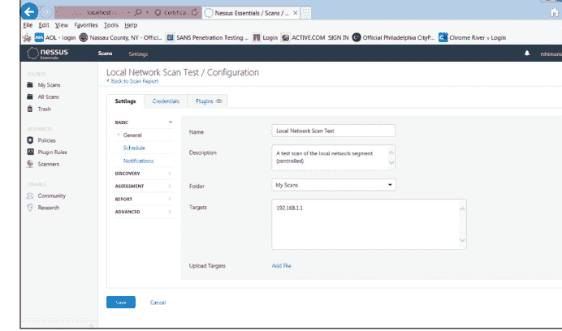

图 1-1：
添加扫描的 IP 范围。

第 1 章 理解渗透测试人员在安全中扮演的角色

11

理解 IP 协议、网络以及与安全分析相关（以及不直接相关）的其他技术也是至关重要的，因为弱点被识别后（可能通过扫描），你就可以移动到利用它们（渗透测试），无论你面对的是什么技术（例如数据库、大型主机、虚拟化系统）。

在接下来的章节中，我概述了成为一名成功的渗透测试人员所需的知识。


作为渗透测试人员，没有什么是可能的，你需要预期的是一切和任何事。你受到的测试就像你所测试的系统一样。此外，犯罪活动不仅限于计算机。物联网（`IOT`）是不断扩张的连接设备网络，包括但不限于平板电脑、手机、智能手机设备，以及电视和恒温器。作为世界上一名专业的渗透测试人员，你可能不会遇到世界上所有这些设备，但你需要意识到所有连接设备。当你进行测试时，要花时间找出哪些设备可能受到影响，例如外勤人员使用的移动设备和资产。

### 记住


注意黑客的侦察程序。黑客通常从使用通用研究技术开始，例如引导黑客方向的互联网搜索，以更多更多你的公司。例如，`Whois` 查询可能会提供地址。`DNS` 查询或查询可能提供线索。`Google` 搜索可能帮助识别路径。

### 提示

## 基础网络

全局视角下的安全也被称为深度防御。机密性、完整性和可用性（`CIA`）构成了三要素，深度防御和渗透测试有助于保护它，这本质上是组织中实践安全的整个全局视角。

能够以任何程度的信心进行渗透测试，你对安全和网络架构了解得就越好。例如，要运行基本测试，你需要在扫描工具中输入网络地址或子网范围。

还需要了解漏洞扫描和渗透测试之间的区别，以及它们相似和不同之处。图 1-1 显示了设置 IP 地址范围以扫描和识别漏洞的基础。在了解风险和弱点之后，你就可以进入如何利用（渗透测试）已发现内容的细节，以便你学习技术是否是安全的。

理解 IP 协议、网络以及与安全分析相关（以及不直接相关）的其他技术也是至关重要的，因为弱点被识别后（可能通过扫描），你就可以移动到利用它们（渗透测试），无论你面对的是什么技术（例如数据库、大型主机、虚拟化系统）。

在接下来的章节中，我概述了成为一名成功的渗透测试人员所需的知识。

作为渗透测试人员，没有什么是可能的，你需要预期的是一切和任何事。你受到的测试就像你所测试的系统一样。此外，犯罪活动不仅限于计算机。物联网（`IOT`）是不断扩张的连接设备网络，包括但不限于平板电脑、手机、智能手机设备，以及电视和恒温器。作为世界上一名专业的渗透测试人员，你可能不会遇到所有这些设备，但你需要意识到所有连接设备。当你进行测试时，要花时间找出哪些设备可能受到影响，例如外勤人员使用的移动设备和资产。

### 记住

注意黑客的侦察程序。黑客通常从使用通用研究技术开始，例如引导黑客方向的互联网搜索，以更多了解你的公司。例如，`Whois` 查询可能会提供地址。`DNS` 查询或查询可能提供线索。`Google` 搜索可能帮助识别路径。

全局视角下的安全也被称为深度防御。机密性、完整性和可用性（`CIA`）构成了三要素，深度防御和渗透测试有助于保护它，这本质上是组织中实践安全的整个全局视角。

能够以任何程度的信心进行渗透测试，你对安全和网络架构了解得就越好。例如，要运行基本测试，你需要在扫描工具中输入网络地址或子网范围。

`TCP/IP` 协议族是当今世界上使用的主要的协议族；当它在许多年前投入生产时，带有许多缺陷。它的使用是最大的缺陷之一，事实是安全在可用性之前被考虑在后。尽管如此，今天的网络和系统可以解释这些缺陷，但阴影中始终存在危险。

| 层 |
|---|---|
| 应用层 |
| 表示层 |
| 会话层 |
| 传输层 |
| 网络层 |
| 数据链路层 |
| 物理层 |

图 1-2：
检查
`OSI` 模型。

## 网络连接

| 编号 | 源 | 时间 | 目的地 | 协议 | 端口 | 方向 | 信息 |
|---|---|---|---|---|---|---|---|
| 30. | 154.206.xxx | 19:23:19.883 | 136.157.1.2 | `FTP` | 192.168.1.14 | 响应 | 220 Welcome to ftp.example.com. |
| 31. | 154.206.xxx | 19:23:19.818 | 136.157.1.2 | `FTP` | 192.168.1.14 | 响应 | 331 Password required for user |
| 32. | 165.162.xxx | 19:23:19.640 | 136.157.1.2 | `FTP` | 192.168.1.14 | 响应 | 230 Login correct with USER and PASS |
| 33. | 118.130.xxx | 19:23:19.317 | 136.157.1.2 | `FTP` | 192.168.1.14 | 响应 | 331 Password required for user |
| 34. | 215.145.xxx | 19:23:19.083 | 136.157.1.2 | `FTP` | 192.168.1.14 | 响应 | 331 Password required for user |
| 35. | 206.265.xxx | 19:23:19.976 | 136.157.1.2 | `FTP` | 192.168.1.14 | 响应 | 530 Login incorrect |
| 36. | 209.285.xxx | 19:23:19.002 | 136.157.1.2 | `FTP` | 192.168.1.14 | 响应 | 530 Login incorrect. |

## 通用安全技术

通用安全技术类别包括防火墙。大多数扫描设备（如防火墙）显示的次数很少或没有。了解原因对你的报告很有帮助；在 `ping` 扫描中，你 `ping` 接口却一无所获，因为防火墙禁用了该协议的响应。

图 1-4 显示了 `Cisco` 防火墙日志，列出了建立每个连接时使用的源和目的 IP 地址，以及连接操作的描述。

另一个例子是当你运行扫描时，发现 DMZ 中的 Web 服务器上有开放端口在使用，而那里本应该有防火墙。通过检查位于这些服务器前面的防火墙，你可以看到尝试连接的服务器 IP 地址。这可能是一个活跃攻击，应立即优先进行补丁或修复。

其他需要考虑的通用技术包括入侵防御和检测系统、负载均衡器、路由器和无线接入点上的访问控制列表 (`ACL`)、控制器以及移动扩展。这些每一种设备都可能被利用，你对如何审查它们的日志越了解，就越擅长识别风险和进行道德黑客。

## 第 1 部分渗透测试入门

| 严重程度 | Syslog ID | 源 IP | 源端口 | 目的 IP | 目的端口 |
|---|---|---|---|---|---|
| ⚠️ | 725003 | 10.0.220.13 | 59043 | | |
| ⚠️ | 725001 | 10.0.220.13 | 59043 | 10.0.0.1 | 4433 |
| ⚠️ | 362013 | 10.0.220.13 | 59043 | | |
| ⚠️ | 302013 | 10.0.220.13 | 11 | 10.0.2.36 | 0 |
| ⚠️ | 302013 | 10.0.220.13 | 59043 | 50.19.28.61 | 80 |
| ⚠️ | 305011 | 10.0.220.13 | 59041 | 12.178.152.151 | 59041 |
| ⚠️ | 305011 | 10.0.220.13 | 59040 | 50.19.28.61 | 80 |


| ⚠️ | 305011 | 10.0.220.13 | 59040 | 12.178.152.151 | 59040 |
| ⚠️ | 106015 | 10.0.220.13 | 59773 | 0.0.1 | 4433 |
| ⚠️ | 106015 | 10.0.220.13 | 59768 | 0.0.1 | 4433 |
| ⚠️ | 106015 | 10.0.220.13 | 59767 | 0.0.1 | 4433 |
| ⚠️ | 106015 | 10.0.220.13 | 59769 | 0.0.1 | 4433 |
| ⚠️ | 106015 | 10.0.220.13 | 59774 | 0.0.1 | 4433 |
| ⚠️ | 106015 | 10.0.220.13 | 59772 | 0.0.1 | 4433 |
| ⚠️ | 106015 | 10.0.220.13 | 59770 | 0.0.1 | 4433 |
| ⚠️ | 106015 | 10.0.220.13 | 59038 | 0.0.1 | 4433 |

图 1-4 防火墙日志审查。

## 系统基础设施与应用程序

你还必须熟悉公司的系统（服务器、存储和电信）以及运行在它们上面的应用程序。这包括操作系统及其提供的服务（名称解析服务、远程访问网关和 IP 租赁）。渗透测试和所有这些领域将出现在你的报告中。

如果你在域名系统 (DNS) 上运行扫描并发现它需要修复；如果你在 Windows Server 上运行测试并可能会发现它需要补丁；在 UNIX 或 Linux 系统上运行 BIND 守护进程也是如此。Web 和 Web 程序也是面临攻击的主要区域。结构化查询语言 (SQL) 可能会受到注入攻击。

## 移动技术云

移动技术正在取代桌面设备，它们在不同位置之间移动并必须得到处理——无论是公司资产还是个人设备。移动设备管理 (MDM) 解决方案可以解决此类挑战。

你可能担心测试它们以确保安全，但你需要根据发现的结果进行扫描并报告，并在识别风险时处理。

云是另一个安全专业人士在渗透测试领域努力发展的领域。由于云技术在其供应商的管辖范围内，只要你与云供应商协作由他们进行测试，你就达到了自己完成相同的目标。

注意：你可能会面临供应商因错误或过失导致的后果。

## 介绍网络犯罪

网络犯罪是指使用计算机系统和网络技术进行犯罪活动（例如数据窃取、信息破坏和身份盗窃）。许多黑客行为都围绕网络活动和网络犯罪展开。任何非调查目的的访问（包括收集访问或破坏信息）实际上都是违法的。

在进行渗透测试之前，你应该考虑有关网络犯罪的一些关键点：

- 犯罪分子通常是为了获取信息、访问权限或杠杆以获得竞争优势，或获取可以使用或出售的信息。
- 犯罪分子实施这些活动的主要方法是秘密访问信息系统以获取资源。

了解你对网络犯罪活动有多脆弱的唯一方法是自己测试你的系统。这让你在保护资源和资产方面处于领先地位。

## 跨越界限进入网络恐怖主义和网络战

被称为网络恐怖主义和网络战争的行为可以被视为战争行为，特别是当涉及外国参与者时。例如，俄罗斯的某人运行几个从暗网获取的工具来渗透美国企业——例如为了获取访问权限。这可以被视为一种战争或恐怖主义行为。

如果这些相同的国家（或其他国家）决定对所有电网发动攻击、窃取秘密或获取军事机密，情况可能会变得更加糟糕。这使得渗透测试和确保资产安全变得至关重要。同样重要的是要确保它们随着时间的推移依然保持安全。

# 起手需要准备的知识

你可能没有意识到，但你并不是直接冲入渗透测试的。在进入渗透测试的核心之前，你应该采取以下特定步骤：

- **确保你对信息技术（IT）系统、网络以及其他技术的基础知识有彻底的理解。** 这些知识将支撑你在安全、渗透测试和伦理黑客领域的职业生涯。
- **进行漏洞测试。** 渗透测试的一种类型是漏洞测试。漏洞测试预先识别任何潜在威胁——即黑客可能攻击的系统区域。攻击向量是黑客用于访问或渗透目标系统的方法或路径；黑客会探测你的系统以寻找薄弱点或漏洞。我将在第 4 章中详细讨论向量。漏洞的一个示例是允许提升权限的已知软件漏洞。

你将使用诸如 `Metasploit`（见图 1-5）等框架工具和其他工具生成漏洞报告，报告将告诉你你需要了解的所有安全问题。从那里开始，你可以运行所有测试，以确定为了修复威胁（如果需要的话）具体需要做什么。

当你将漏洞与其他与其他结合使用时，它们会变得更加复杂且呈指数级有用。其他测试可能包括但不限于系统检查（例如检查访问日志）、漏洞日志以及系统性能测试，后者可以显示出诸如 CPU、磁盘利用率或其他可能显示暴露、入侵、代码注入或不受欢迎的访客的系统问题。

考虑何时进行扫描。这看起来似乎是显而易见的，但决定何时进行扫描同样重要。为了让向量尽可能安全，你需要设定扫描计划，在特定的定期间隔内进行扫描，涵盖你旨在保护的所有企业区域。

选择使用哪些工具。`Metasploit`（我将在第 4 章中讨论）是一个你可以运行扫描的工具。还有许多管理和监控工具、日志和其他软件可以增强你的渗透测试，以获得安全漏洞的完整视图。我将在第 3 章中介绍其中许多工具，并在第 2 部分中贯讨论额外的工具和来源。

在安全环境中进行测试。在生产系统上启动之前，你需要在实验室（沙箱）中测试所有更改和新扫描，以确保在产生更多影响之前你知道它们的作用。

图 1-5：

`Metasploit` 是渗透测试的工具之一。

# 决定如何以及何时进行渗透测试

当你进行任何渗透测试时，你的目标是拥有一个策略。

你可以盲目地运行测试来发现什么；也可以尝试渗透系统以寻找是否存在弱点。对于你每周或每月进行的用于评估安全态势的任何扫描或测试来说，这样做是可以。安全态势是指公司软件、硬件、网络、服务和信息的安全状态。应该定期评估安全态势的状态，并考虑到你对事件的反应和恢复的准备情况和能力。

有时你想得更深，通过进行特定的攻击（如渗透、隐蔽操作、破坏性攻击和过载攻击）来真正测试你的安全态势。例如，如果你认为黑客的目标是从公司网络外部获取文件，那么你的目标应该是使用你的工具来评估该威胁。

你还需要同时进行内部和外部测试。你永远不知道攻击可能源自哪里。

从高层视角观察攻击可能来自哪里——包括来自你信任网络内部（信任用户）以及源自你安全边界外部的不可信任用户的攻击——是至关重要的。来自外部受信任用户的外部攻击示例可能是：通过使用一个在你运行的网络中托管的网站（通常在非军事化区 (DMZ)），该网站可能会发现一个允许他们访问你信任网络内资源的漏洞。相反，内部攻击仅仅是如此——源于你的网络内部，可以轻松规避防火墙和访问控制列表等所有边界。

无论何种情况，你都可以运行 `Nessus` 扫描（见图 1-6），以查看这些向量中是否有一个产生了你不想要的结果，即黑客在你们不知情的情况下访问了你的系统。

我将在第 2 部分讨论如何选择正确的工具，以及对如果不修复或监控可能会对你的企业、品牌和数据造成损害的漏洞进行分析。

| 名称 | 漏洞 | 家族 | 计数 |
| :--- | :--- | :--- | :--- |
| Nessus Foundation | 未指定的应用程序 | 本地安全检查 | 0 |
| Nessus Professional | 多种漏洞 | 本地安全检查 | 1 |
| Nessus Professional | 多种代码执行 | 本地安全检查 | 0 |
| Nessus Professional | 通用服务检测 | 本地安全检查 | 0 |
| Nessus Professional | 多种漏洞 | 本地安全检查 | 1 |
| Nessus Professional | 41 个严重漏洞 | 本地安全检查 | 1 |
| Nessus Professional | SSL，证书不可信 | 通用 | 1 |
| Nessus Professional | Windows 远程桌面 (2008) | 渗透评分 | 18 |
| Nessus Professional | HTTP 服务和版本 | Web 服务 | 4 |
| Nessus Professional | 附加主机 | 通用 | 1 |

你需要在安全和评估之间找到平衡。你可能知道某个攻击手段，但无法修复它。一个完全 100% 安全系统通常是无法使用的。网络和系统是为了使用的，这意味着必须开放端口。例如，互联网通常要求开放 80 (HTTP) 端口。

# 采取第一步

当你准备好进行渗透测试时，这些是你将采取的通用步骤：

- **在安全环境中（如你的家）下载并运行渗透测试。** 在生产环境中运行渗透测试会导致导致拒绝服务攻击，阻止他人使用你的系统。确保操作尽可能安全和可控，以便测试并发现风险，而不是产生中断和影响。第 6 章讨论拒绝服务攻击。
- **下载一个免费工具并开始调查。** 我在第 3 章介绍了许多可用工具，但对于基础测试，我建议使用漏洞扫描器。图 1 显示了来自 BeyondTrust (`www.beyondtrust.com`) 的 Retina CS，它可以让你运行扫描以查看主机受到哪些威胁。
- **通过 IP 地址扫描单个主机或带有许多主机的整个 IP 子网。** 这一步骤有助于根据生成的报告识别需要审查的目标系统。


- **记录你正在测试的主机，以及根据收集到的信息想要尝试的攻击。** 这里的目标是发现漏洞。
- **渗透。** 这是渗透测试中实际执行已知黑客攻击的部分。
- **对你的发现进行跟进。** 你可以报告发现、修复问题、监控没有修复的问题、联系供应商获取修复、阻止访问等。

# Retina CS

选项 Retina-Insight 帮助 - 退出 管理员

| 仪表板 | 资产 | 报告 | 任务 | 配置 |
| :--- | :--- | :--- | :--- | :--- |
| 漏洞扫描 | 缓解补丁管理 | 保护代理程序 | | |
| 过去7天 | 过去30天 | 过去60天 | 过去90天 | 自定义日期 |
| 2012年10月15日 | 2012年10月22日 | | | |
| 总体威胁等级 | 异常 | 资产风险 | | | |
| 高 | 中 | 低 | 145 | 116 | 92 |
| 名称 | 描述 | | | |
| 基准合规性报告 | 报告计划过期 | |
| 基准合规性报告 | 报告计划过期 | |
| 基准合规性报告 | 报告计划过期 | |
| 补丁报告 | 报告计划过期 | |
| PCI合规性报告， /... | 报告计划过期 | |
| 扫描策略_计划_01T... | 报告计划过期 | |
| 高 | |
| 中 | |
| 低 | |
| 关键资产 | 运行状态 | 已完成报告 |
| :--- | :--- | :--- |
| 事件日期 | 描述 | 运行时间 | 状态 | 报告名称 | 运行时间 |
| (全局) - 漏洞报告 | 09/20/2012 02:18 PM | | |
| (全局) - PC合规性报告 | 09/20/2012 02:14 PM | | |
| 示例PC报告 | 09/10/2012 04:53 PM | | |
| (全局) - 补丁报告-9... | 09/11/2012 05:18 PM | | |
| (全局) - 补丁报告-10... | 09/11/2012 05:18 PM | | |
| (全局) - Oracle CVE-20_... | 09/07/2012 12:45 AM | | |
| (全局) - 漏洞报告... | 09/07/2012 11:06 AM | | |
| 查询中: 2 | 进行中: 0 | 显示状态 |

Copyright © 2009-2012 eEye Corporation | 使用条款

图 1-7: 检查 Retina CS 扫描。

22 第1部分 渗透测试入门

# 本章内容介绍

- 探索为什么渗透测试很重要
- 理解渗透测试是一项持续的努力
- 学习谁是坏人，谁是好人

# 第2章：渗透测试概览

渗透测试员是网络的警察。他们确保人们没有违反规则，也不会让自己或他人陷入麻烦。黑客——无论是白帽、灰帽还是黑帽——总是在外面试图阻碍安全系统并访问他们不应该访问的系统。

在本章中，我将为你提供成为网络“警察”所需要的知识：优秀渗透测试员的目标、持续扫描的重要性，以及如何区分好黑客和坏黑客。

## 渗透测试的目标

渗透测试的最终目标是通过尝试渗透任何非预期的防御，来测试你的技术资产的安全性、保护措施和控制措施。但渗透测试可以分解为单个的较小目标。

渗透测试虽然是一个热门话题，但它并不是新概念，也不是一个极其崇拜的概念。其底层技术、概念和技术可以非常深。然而，如果你接受过培训并拥有正确的知识，进行渗透测试可以非常简单。（参见第1章，我将在那里讨论渗透测试哪些技能是必要的。）

渗透测试的广度是复杂性增长之处，因为网络、系统、基础设施、移动性和云架构都扩展了需要评估的范围。这要求你查看客户、公司或业务所负责的每一个方面。

## 保护资产

作为安全分析师（好人之一），你的目标应该是将坏人（黑客）阻挡在他们不应该进入的地方。保护资产不被其破坏或损坏（导致无法使用）、修改（更改）、感染（病毒）、盗取、劫持，或可能发生的无数安全威胁至关重要。

此列表按行业类型列出了各种场景：

- **银行业行业：** 资金可能被盗取、转移到其他账户，或为他人增加债务。
- **信用卡行业：** 身份信息被盗取，这些信息被用于渗透拥有金钱资产或可用信用的账户。
- **销售行业：** 专利可能被盗取，产品可能在外国竞争对手公司制造，导致业务根据黑客的意图而失败，股票下跌（或上涨）。
- **医疗健康行业：** 电子医疗记录 (`EMR`) 系统可能被入侵，以更改、收集或损坏信息。
- **电力行业：** 电力网需要保持在线，以便政府、私营行业和居民能够获取能源以完成日常任务。
- **军事（及其他政府）行业：** 机密需要保持安全，不能获取信息来造成伤害。

## 识别风险

风险是另一个待定义的词。风险注册是你编制的已知漏洞列表，显示风险水平。

风险注册是帮助你识别问题的绝工具，但很难猜测哪些变化会导致问题，这就是为什么公司需要渗透测试：对他们的系统进行漏洞测试。

风险注册是一份不断更新的动态文档。我将在第11章中详细讨论它。

| 风险 | | | | |
| :--- | :--- | :--- | :--- | :--- |
| 高 | | | | |
| 中 | | | | |
| 低 | | | | |
| 关键资产 | 运行状态 | 已完成报告 |
| :--- | :--- | :--- |
| 事件日期 | 描述 | 运行时间 | 状态 | 报告名称 | 运行时间 |
| (全局) - 漏洞报告 | 09/20/2012 02:18 PM | | | |
| (全局) - PC合规性报告 | 09/20/2012 02:14 PM | | | |
| 示例PC报告 | 09/10/2012 04:53 PM | | | |
| (全局) - 补丁报告-9... | 09/11/2012 05:18 PM | | | |
| (全局) - 补丁报告-10... | 09/11/2012 05:18 PM | | | |
| (全局) - Oracle CVE-20_... | 09/07/2012 12:45 AM | | | |
| (全局) - 漏洞报告... | 09/07/2012 11:06 AM | | | |
| 查询中: 2 | 进行中: 0 | 显示状态 |

## 表 2-1：风险注册表

| 风险注册项 | 风险类别 | 风险子类别 |
| :--- | :--- | :--- |
| 1 | 安全 | 病毒 |
| 2 | 网络 | 无线 |
| 3 | 电力 | UPS |
| 4 | 环境 | 灭火 |
| 5 | 数据中心 | 空间 |
| 6 | 环境 | 火抑制 |
| 7 | 环境 | 空调 |
| 8 | 安全 | 物理 |
| 9 | 服务器 | 操作系统 |
| 10 | 数据中心 | 合并 |
| 11 | 存储 | 容量 |
| 12 | 存储 | 容量 |
| 13 | 安全 | HIPAA 和 PHI |
| 14 | 数据库 | 备份 |
| 15 | 数据库 | 损坏 |
| 16 | 数据库 | 网络 |
| 17 | 数据中心 | 空间 |

## 发现漏洞

漏洞仅仅是你的技术中可以被利用的弱点，或者是简单的信息泄露。技术漏洞可以

由于资产配置错误、已安装软件的漏洞或代码问题，或者你企业中的任何异常导致。

例如，你的硬件供应商更新了防火墙，无意中引入了一个漏洞。在漏洞被供应商或其他终端用户识别之前，或者在你对防火墙进行渗透测试之前，你可能对该漏洞完全一无所知。这并不意味着所有的漏洞都是利用程序，但某些漏洞可能会导致并引发利用攻击。

> 漏洞是一种风险类型，可以对其进行评分，并作为记录的工制品进行使用，由负责修复的人员对其进行记录、审查和修正。

漏洞的两个示例是：

- **缓冲区溢出：** *缓冲区（*Buffers）*是计算机、系统、路由器、交换机以及你基础设施中许多设备中的内存空间，有助于提高运行速度并使数据传输更高效。例如，两个正在通信的设备可能会受到一方向另一方发送过多数据以供对方无法吸收和消耗的影响，因此它可能会对其进行缓存（本质上是发送到内存中，实际上减慢速度），直到接收系统的内部计算跟上。
- **恶意软件**（*Malware*）是黑客创建的一种利用程序，它将这种看似良好的服务转变为漏洞。如果恶意方在利用攻击中向缓冲区发送过多数据以使其过载（或溢出），可能会导致性能受影响，或者在最坏的情况下，导致系统崩溃或导致其无响应。
- **密码使用：** 弱密码（容易被猜到或容易用密码破解工具破解的密码）允许通过点击工具按钮即可立即进入系统。这是一个非常常见的漏洞的现实世界示例，可以通过渗透测试发现并预防。

一个良好的密码策略（带有一个能够保护并强制执行该策略的系统）是防止此类漏洞的最佳选择。遗憾的是，这在世界上许多地方仍然常见，我确信在你自己的渗透测试期间，你会发现这类漏洞的案例。

第 6 章涵盖了其他漏洞。

## 扫描与评估


成功的渗透测试人员使用（硬件和软件）来运行渗透测试（有时称为*渗透评估*），以发现漏洞并利用它们。

你可以对你的系统、网络或整个企业进行漏洞扫描，以发现你可以修复或承认的风险。图 2–1 显示了来自 `Nessus`（扫描软件）的扫描结果，我将在第 3 章中介绍（以及其他工具），以提供更深入的内容。

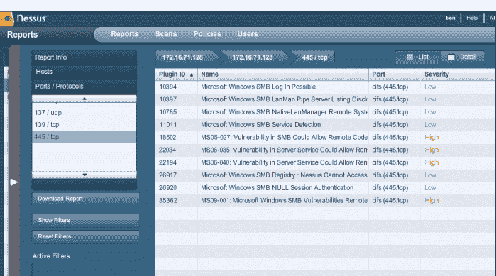

图 2-1:

`Nessus` 的示例输出。

绝不要在没有许可的情况下在实时生产网络上运行测试、评估、扫描或安全测试！很多事情可能会出错。例如，你可能会在配置有阻止渗透尝试设备的网络上运行扫描，这可能会关闭服务，从而影响正在为客户提供服务的生产系统。另一个例子是：在医院中，如果你决定在白天对受保护的网分段运行扫描进行某些调整，可能会关闭服务并导致患者无法接受治疗。

## 安全运营

企业中开展的典型安全操作从简单到复杂不等。这取决于许多因素，包括公司规模、资产重要性、可用预算、领导层对这些因素（任何一个或全部）的兴趣，以及受托保护和维护企业资产的人员的知识和技能。为了做到这一点，你可以进行自己的安全评估、将其外包，在某些情况下甚至可以众包。

第 28 页 第 1 部分 开始渗透测试

## 深度防御

深度防御（`Defense in depth`）是一个概念，要求你考虑资产可能被利用的所有方式，并为其增加安全层——通过这种方式，你创建了一些防御深度。增加安全层的一个绝佳例子是双因子身份验证。如果我使用密码登录系统，必须提供第二个密码（或者更好，生物识别控制或代码）。

## 扫描维护

现在我想将重点转向渗透测试以及持续扫描漏洞在真实世界场景或企业安全计划中实际上是什么样子的。事实是，渗透测试的实际情况取决于组织以及其投入到安全团队测试、评估和修复能力方面的预算价值。

无论如何，你不能整天都在扫描，也不能想随地就随地扫描。大多数时候，你需要获得批准才能运行扫描。每当你需要什么是扫描以及它们在扫描什么时，我将在本节中讨论几种。

## 排除项与 ping 扫描（ping sweeps）

你需要对系统进行测试，并且可能需要创建排除项，即你无法扫描的系统。知道哪些系统可以是非常重要的。例如，你可能拥有非常老旧且过时的系统；扫描它们可能会导致系统宕机。你可能拥有运行关键功能的旧系统，这些系统需要被替换或升级，但软件供应商可能没有为你的旧硬件发布补丁或当前的软件。也许他们永远不会发布更新，因为他们不再支持这些平台。无论情况如何，你都可能将这些系统从扫描中排除，并以不同的方式对它们进行测试。

此外，你可能需要对特定系统上的某些扫描进行调整，以便它们不会触发该系统上的防御。防火墙就是一个很好的例子。防火墙不喜欢 `ping` 扫描（即使用工具通过 `ICMP` 重复测试以查看哪些有响应）。可能存在访问控制列表 (`ACL`) 或阻止这些请求的防火墙规则。你可能无法到达某些网段，因为路由不允许返回路径，你将无法获得扫描结果。如果你想在组织中实施专业的测试计划，这些就是你今后必须理解扫描维护的几个原因。

最常用的 `TCP/IP` 协议族协议之一是网际消息控制协议 (`ICMP`)。`ICMP` 消息用于在扫描工具中执行 `ping` 扫描。扫描可用于测试网络上的主机是否有开放端口，或是否有响应的主机。如果我可以查询一个主机并且它接受了我的通信——而且还发现了一个可以敲的门（开放端口）——那么我作为黑客的工作只需对主机进行暴力破解攻击以找到进入的方法就简单了。

开放端口表示可能在设备上运行并处于状态的服务，而该设备可能受到攻击。开放端口可以提供入口点。`ping` 扫描使用 `ICMP` 触及网络上的主机，可以使用像 `Nmap` 的工具（如图 2 所示，我将在第 8 章中详细介绍）来尝试 IP 和 `ping` 组合，以找到 `ping` 响应的是什么。

```
root@legacy: # nmap -sP 172.24.0.*
Starting Nmap 5.21 (https://nmap.org) at 2010-08-29 10:12:12 IST
Nmap report for 172.24.0.*
Host is up (0.000814 latency).
MAC Address: 00:21:D9:70:76:B6 (Cisco-Links)
Nmap report for 172.24.1
Host is up (0.000814 latency).
MAC Address: 00:10:02:00:83:5C (Micro-star Int' Co)
Nmap report for 172.24.33
Host is up (0.000814 latency).
MAC Address: 00:10:02:00:69:A0 (Micro-star Int' Co)
Nmap report for 172.24.19
Host is up (0.000814 latency).
MAC Address: 00:10:02:3F:6C:14 (Micro-star Int' Co)
Nmap report for 172.24.22
Host is up (0.000814 latency).
MAC Address: 00:10:02:3E:17:47 (Astek Computer)
Nmap report for 172.24.14
Host is up (0.000814 latency).
MAC Address: 00:10:02:52:00:57 (Micro-star)
Nmap report for 172.24.27
Host is up (0.000814 latency).
MAC Address: 00:04:46:0F:1E:E6 (Unknown)
Nmap report for 172.24.19
Host is up (0.000814 latency).
MAC Address: 00:24:BC:0E:27:44 (Astek Computer)
Nmap report for 172.24.20
Host is up (0.000902 latency).
MAC Address: 00:08:85:E8:03:DC (Internet Initiative Japan)
Nmap report for 172.24.25
Host is up (0.000814 latency).
MAC Address: 00:10:02:00:83:5C (Micro-star)
root@legacy: # nmap -sP 172.24.0.*
```

## 补丁管理

### 大多数供应商发布有漏洞的代码

事实是，这不仅仅是现实。你正在进行更改。你可以与其他公司和供应商连接以进行业务。你安装了尚未准备就绪的代码。你在这些基础设施中工作和运行，并在过程中动态构建它们，因此你可以预见到将会出现问题。正因如此，你绝对需要渗透测试！

## 合规性

你渗透测试活动中的另一个考虑因素是你的公司是否需要满足合规性标准。我将在后续章节介绍合规性、报告和法律问题，但我现在提出这一点是因为渗透测试不仅仅是为了安全系统和网络。

## 反病毒软件和其他技术

在考虑渗透测试时，了解启发式扫描的基础原理会有帮助，这非常类似于漏洞评估。杀毒程序运行在系统上，并接收信息以寻找异常。如果出现任何内容并与已知恶意软件匹配，或者通常来说很反常，杀毒软件就会将其隔离。图 2-3 展示了常用的杀毒软件。

其他技术，如入侵检测软件 (`IDS`) 和入侵防御软件 (`IPS`)，会主动扫描漏洞、恶意软件、入侵尝试和其他异常。它们的工作原理与杀毒软件以及像 `Nessus` 的渗透测试类似。虽然我没有在书中介绍 AV/IDS 和 IPS，因为它们不是渗透测试者的传统工具集，但事实是，你需要使用它们来理解攻击的范围。

图 2-3：常用杀毒软件示例。

委托给他们所在的组织。这意味着你必须有一种方法来确定并证明符合合规性。

以下是两个（尽管很常见的）合规标准：

- **支付卡行业数据安全标准 (`PCI DSS`)：** 这这是一项组织在使用信用卡、持卡人数据以及防欺诈时必须遵守的合规标准。渗透测试和风险合规是实现该标准合规性的重要组成部分。
- **1996年《健康保险可移植性与责任法案》(`HIPAA`)：** 该法作为美国法律的一部分生效，旨在确保医疗服务提供者保证患者隐私。这些提供者必须遵守高标准，接受审计，且如果不合规将面临巨额罚款。

其他行业有其他的合规标准。请务必确保你意识到任何合规问题以及维护合规性所需的条件。

## 黑客议程 (Hacker Agenda)

本章不可或缺的一部分是讨论你们是如何对抗的：那些坏人，即所谓的*黑客*（hackers）。称他们为黑客的问题在于，从技术上说，好人也是黑客。整个文化非常令人困惑，因此我试图通过对无数定义的简单解释来消除它的神秘感。

首先，忘记其中的好与坏。用中立的眼光思考——黑客是一个喜欢拆解计算机、系统、代码或应用程序，以便进行进一步调查、测试、探测或从中学习的人，因为他们对此很好奇。仅此而已！这非常简单且真实。你典型的黑客是一个喜欢与复杂性钻牛的人。


现在，我考虑动机。我涵盖了坏人，以便你更好地了解你的敌人。然而，在某些情况下，坏人可能会变成你的人。一些精英黑客已作为辩诉交易的一部分加入了执法部门，并向他们展示了过人的技能！

我还涵盖了今天黑客社区中最常用的术语，用于指示和识别谁是好人（白帽）、坏人（黑帽），或处于中间位置的人（灰帽）。

## 黑客主义者 (Hackivist)

黑客主义者（促进黑客主义的人）希望通过技术手段推动他们的议程，这些议程通常围绕政治运动或社会努力展开。现代黑客主义最好的例子之一是匿名组织（Anonymous）。尽管他们不是第一批（有些组织，如“死牛教派”，已经存在多年），但他们证明自己是社交媒体平台甚至流行文化中可见最广的群体之一。

其目的是利用技术资产获取他们想要的东西。因此，如果一个黑客主义者想在政治议程中实施变革，他们可能会渗透一系列 Web 服务器并对其进行改版，以期通过特定方式尴尬或激励他人反对他们的政治对手。

通过渗透测试，你本将能够扫描 Web 服务器，发现它们可以被利用以及如何被保护。遗憾的是，黑客主义者运行自己的安全扫描器来寻找弱点并进行利用。

## 脚本小子到精英 (Script kiddie to elite)

光谱有两个端，你需要了解两双方的类型和规模。

世界上的精英黑客不仅深入了解系统和结构，还熟悉如何对它们进行编程，制作可以渗透系统并利用它们的工具。这些精英黑客寥寥无几，但极具危险性。他们只有在犯下导致暴露自己的重大错误时才会被捕获，因为大多数时候他们都会伪装自己的来源，非常难以识别。

光谱的另一端是脚本小子（script kiddies）。脚本小子拥有基础技能，以及足够的知识来破坏和访问精英黑客创建的工具，并遵循他们的蓝图获取系统访问并制造问题。虽然他们的技能或危险性远不如精英黑客，但如果他们能够成功实施攻击，就可能成为一种威胁。

## 白帽 (White hat)

白帽黑客就是你和我：那些从事安全工作的安全分析师，通过渗透测试来保护技术资产。白帽是那些可以合法披露漏洞和利用程序并对其进行加固的人。白帽负责在安全实验室中进行黑客攻击以研究结果，从而理解结果以及它们带来的风险。

## 灰帽 (Grey hat)

灰帽黑客是那些介于白与黑之间的人。他们可能不像黑帽那样有恶意，但他们有时会越界并违反法律、盗取代码，甚至分享他们不应该分享的信息。灰帽通常不是在组织中担任安全分析师或其他安全职位的人，也不是寻求违法并冒着入狱风险的罪犯。

## 黑帽 (Black hat)

黑帽黑客是为了个人利益而想要利用系统和技术的黑客。他们想要寻求报复、获得金钱，或通过对系统进行攻击获得其他利益。如果黑帽发现了可以利用的东西，他们会毫无疑问地执行——特别是当这符合他们的动机时。他们还会进入社交渠道（如暗网）并分享这些信息，有时会以分布式攻击的形式对他人（或实体）发动多管齐，例如分布式拒绝服务（DDoS）攻击。黑帽黑客确实是罪犯，其行为通常会被发现并受到惩罚（有时会被关入监狱）。

## 执行主动侦察：黑客如何收集情报

就像你有很多用于渗透测试的工具一样，黑客也有许多工具来探测系统、应用程序、网络等以寻找安全漏洞。经验丰富的高级黑客知道有许多其他进入路径，并熟悉各种收集信息和绕过安全的方法：

- **社会工程学 (Social engineering)：** 本质上，这是有人（无论有意还是无意）向黑客提供用户名/密码。这是迄为止绕过安全最快的方法。更多信息请参见旁边的侧边栏和第 4 章。
- **间谍 (Spying)：** 高级黑客知道如何通过基本的间谍活动收集信息，了解存在哪些安全功能并学习绕过它们的方法。以下是黑客获取信息以帮助他们无声进入内部的几个例子：
    - **翻找 (Dumper diving)：** 翻找是指翻阅寻找可以用于他人的手写信息或其他打印文档。

## 渗透测试无法阻止社会工程学

一种流行的黑客形式是社会工程学，它是技术含量最低的。社会工程学涉及黑客欺骗受害者交用户名和密码信息。这是最流行的攻击手段且将一直如此，因为人类总是会出错。社会工程学的唯一防御是培训员工不要提供信息。更多信息请参见第 4 章。

- **屏幕抓取 (Screen scraping)：** 屏幕抓取是指应用程序复制系统、搜索引擎或其他数据源上显示的内容并制作副本。
- **记录信用卡信息的伪装 (Fake covers to record credit card info)：** 这些设备在你刷过虚假读取器时捕捉卡片信息，然后让黑客使用其记录的信息。它们看起来就像 ATM 机器（例如），你不会识别它是一个辅助设备。

了解被动侦察（与主动版本类似）也同样重要。主动侦察测试就像端口扫描显示哪些端口可能是开放的以及你可以攻破什么。被动侦察是通过观察来学习和获取知识，而不主动参与系统。把主动侦察比我在探测系统而它在回答我；而被动侦察则是我在进行窃听攻击并记录我学到的信息。

> 尽管渗透测试是一个允许你收集有关漏洞以及如何防止或修复漏洞信息的极佳计划，但它并不能解决整个安全问题。在为组织进行安全评估时，请考虑这一点。

### 本章内容

- 学习如何构建你的工具箱
- 使用 Nessus 扫描网络上的主机
- 使用 Wireshark 捕获并分析网络数据
- 使用 Kali Linux 进行渗透测试、漏洞扫描和取证分析
- 使用 Nmap 在计算机网络中寻找主机和服务服务

# 第 3 章

收集你的工具

作为一名渗透测试员，你需要一套工具，允许你对网络、系统以及连接到它们的所有设备进行评估、扫描和测试。这些工具让你具备测试你的网络、系统、主机和设备的能力，并评估它们的安全性。

关键在于确保你在黑客之前发现你的安全问题。通过运行评估，你可以分析问题、评估风险，或者至少对其进行监控。实现这一点的最佳方法是使用一组允许你进行渗透测试的工具。在本章中，我将介绍最常用的工具，并让你像专业人士一样快速上手！

## 构建工具箱的注意事项

在构建工具箱时，请记住以下考虑因素：

- 你创建的工具箱将放在便携设备上。笔记本电脑或便携式工作站将为你带来最佳效果。
- **你需要连接到网络才能进行测试。** 你的网络连接应该是稳健的，并且你应该拥有有线和无线网络接口卡（NIC）或天线。
- **构建一个真正优秀且高质量的工具箱需要时间（和精力）。** 明智地选择你将使用的操作系统。Windows 和 Apple OS 拥有广泛的支持；然而，Linux 在其原生环境中允许使用最多化的工具。你也可以设置虚拟机来启动你的工具。
- **确保你的工具箱是安全的。** 你不希望你的工具被被用于恶意活动。
- **你使用的工具和建立构建的工具包需要与你在过程中发现的攻击、威胁、漏洞和问题一样具有动态性。** 信息技术及其所有活动部分没有任何地方是静态的。例如，代码在升级到新版本时会发生变化，可能会引入漏洞。你的工具箱也是如此。保持你的工具箱持续更新且免费。
- **从可靠的资源下载并选择你的工具以避免恶意软件。** 例如，你可能会通过 Google 寻找如 Nmap 这样的工具，它可能会带你进入下载并安装木马程序的地方。
- **寻找长期存在并由知名公司拥有的软件。** 理想情况下，你希望软件来自一家投入精力和资金进行工具运营和维护，并具有良好支持结构的公司。该软件受支持吗？如果发生了什么，你可以获得帮助吗？

在本章的其余部分中，我将描述你可以轻松下载且在整个渗透测试职业中都非常有用的可靠工具。

## Nessus

我从 Nessus 开始，因为它是渗透测试中最常用的工具之一，你绝对会想要熟悉它。图 3-1 显示了我从 Nessus 产生的一个扫描结果。

Nessus 允许你扫描网络上的主机，该工具还可以让你知道是否存在以已知风险、漏洞和利用程序形式存在的问题。（有关这些的更多信息请参见第 10 章。）

## 本地网络扫描测试

| 名称 | 家族 | 计数 | 详情 |
|---|---|---|---|
| SSL 版本 1.0 和 2.0get | 服务检测 | 2 | |
| SSL (多个) | 通用 | 30 | |
| TLS MDE (多个) | 通用 | 6 | |
| SSL / 证书已知哈希 | 误配置 | 5 | |
| SSL OWASP 攻击漏洞 | 误配置 | 3 | |
| IP 转发已启用 | 防火墙 | 1 | |
| 未使用的测试服务器 | | 1 | |
| DHCP 服务器检测 | 服务检测 | 1 | |
| 服务检测 | | 11 | |

Nessus 提供免费试用版供你在提交之前尝试。利用这个机会查看你需要的工具。

你可以访问 `https://www.tenable.com` 注册账户并下载 Nessus。务必选择 Nessus 专业执行文件，并根据你安装的硬件或软件选择 32 位或 64 位。Tenable 会向你发送一个激活码。

一旦你注册并获得密钥，插入密钥并创建一组用于工具的凭据。这就是你进入 Nessus 运行扫描并获取报告所需的凭据。如果你将其安装在本地系统（例如你运行工具箱的系统）上，它将作为一部分安装并可以通过 `https://localhost:8834` 访问。

开始使用 Nessus 方法：

1. 通过提供的链接或在本地子网上打开 Nessus Web 客户端打开 Nessus。


## 要创建新扫描
从控制台左侧的导航面板中选择“我的扫描”(My Scans)，然后从模板中选择“基础网络扫描”(Basic Network Scan)。

## 输入信息
输入请求的信息，如图 3-4 所示要扫描的主机名称。

## 保存扫描
保存扫描，关闭它，并从“我的扫描”中检索它以便以后重复。

| 名称 | 家族 | 计数 |
|---|---|---|
| SMB 版本 2 和 3 | 服务检测 | 3 |
| SSL (多个) | | 10 |
| SSL (多个) | | 6 |
| TLS (多个) | | 5 |
| SSL/TLS 证书 | | 3 |
| SSL 攻击漏洞... | | |
| 高级扫描 | 审计云 | 错误检测 |
|---|---|---|
| 在不使用任何建议的情况下配置扫描。 | 云服务 | CVE-2016-5198 和 CVE-2016-5198 |
| 基础网络扫描 | | |
| 扫描 | | |
| 名称 | 描述 | |
|---|---|---|
| 本地网络扫描 | 可定义 | |
| 我的扫描 | 192.168.1 | |

## Wireshark

Wireshark 是一个可以查看并分析网络流量的工具。它可以让你看到网络上发生了什么。

Wireshark 允许你查看网络数据包，该工具还可以让你知道是否存在以已知风险、漏洞和利用程序形式存在的问题。Wireshark 允许你查看网络数据包，该工具还可以让你知道是否存在以已知风险、漏洞和利用程序形式存在的问题。Wireshark 允许你查看网络数据包，该工具还可以让你知道是否存在以已知风险、漏洞和利用程序形式存在的问题。

要获取 Wireshark，请访问 wireshark.org 并进入“Download”（下载）部分。根据你的系统架构选择你喜欢的版本，然后按照安装说明操作。选择所有默认选项以包含 WinPcap，这是安装 Wireshark 所需的 API（应用程序接口）。

要使用 Wireshark 运行漏洞扫描，请遵循以下步骤：

- 1. 从开始菜单启动 Wireshark 工具。

打开 Wireshark 网络分析（Network Analyzer）面板，如图 3-6 所示。

- 2. 选择你想要使用的接口。

在图 3-6 中，我选择了当前正在传输流量的接口，即无线网络连接。

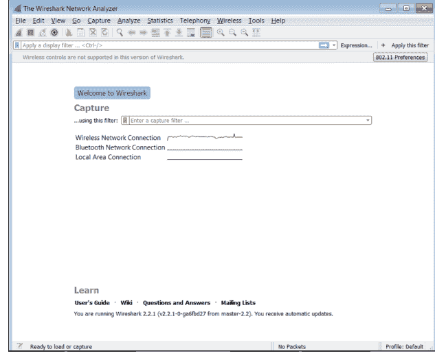

> 图 3-6：启动并使用 Wireshark 分析流量。

- 3. 捕获数据包，然后在收集到足够信息进行审查时停止捕获并保存。

从“Capture”（捕获）菜单中选择 Capture。短时间运行捕获以找到正在遍历你网络的数据。

你可以选择任何捕获到的数据包并如图 3-7 所示对其进行深入分析。

现在你可以将 Wireshark 用于以下目的：

- **查看正在使用的地址和端口。** 在图 3-7 的数据中，我可以看到密码是否是以明文发送的。我可以查看数据包窗口中的十六进制输出，它们都是经过加密的，密码对黑客来说是被屏蔽的。

我还可以看到哪些端口正在使用、源 IP 和目的 IP 以及 MAC 地址正在使用中，以及许多其他细节，这些细节提供了关于无风险网络的线索，或者我应该关注的内容（例如以明文发送的密码）。这也被称为密码捕获攻击，中间人攻击（MITM）也可以执行这种攻击。关于中间人攻击的更多信息，请参阅第 5 章。

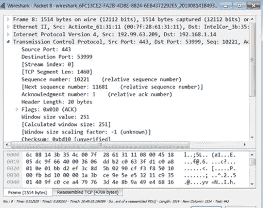

图 3-7：深入捕获的数据。

- **哪些主机正在与其他主机通信？** 我可以查看往返连接的端点，如图 3-8 所示。我可以查看是否有主机使用频率较高，它们容易受到黑客的攻击。然后我可以用 Nmap 扫描它们，并在需要时对其加固。

- **测试 FTP 访问：** 如果你不小心，到远程主机的 FTP 可能会迅速暴露明文密码，如图 3-9 所示。通过进行这项测试，你可以快速捕获到一个过程，即所有用户都使用 Secure FTP（一种加密 FTP）来降低风险并保护你的用户和系统。

### 图 3-8

使用 Wireshark 检查主机之间的流量。

| Ethernet | IPv4 | IPv6 | TCP | UDP | Protocol |
| :--- | :--- | :--- | :--- | :--- | :--- |
| Address | Packets | Bytes A -> B | Bytes B -> A | Length | - |
| 225.255.255.255 | 1 | 120 | 344 | 60 | 0 | - |
| 192.168.1.156 | 1 | 60 | 1076 | 60 | 0 | - |
| 192.168.1.1 | 1 | 60 | 180 | 60 | 0 | - |
| 192.196.209 | 1 | 36876 | 55 M | 36876 | 200 | - |
| 192.168.1.1 | 1 | 36881 | 0 | 36881 | 55 M | - |
| 225.255.255.255 | 4 | 4616 | 0 | 0 | 4 | - |


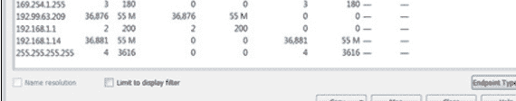


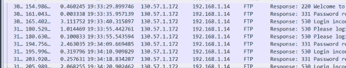

### 图 3-9

使用 Wireshark 测试 FTP 访问。

> Frame 7186: 76 bytes (608 bits), 76 bytes captured (100%) on interface eth0

Ethernet II, Src:00:0c:29:4f:87:11, Dst:00:50:56:c0:00:08, Type:ac:08:04:3b:35:4c

Internet Protocol Version 4, Src:192.168.1.1, Dst:102.16.0.1

Transmission Control Protocol, Src Port: 21, Dst Port: 54679, Ack: 104, Len: 22

File Transfer Protocol (FTP)

```
0000 60 61 64 35 3b 4f 67 7f 28 61 31 68 00 45 00
0010 00 0c 29 4f 87 11 00 50 56 c0 00 08
0020 01 05 00 1d 05 49 f6 a1 e2 32 34 56 65 95 58 18
0030 00 00 00 00 00 00 00 00 2e 2e 6e 65 74 2e
0040 6c 69 63 6f 72 72 20 74 65 73 74 20 74 65 84 8a
```


## Kali Linux

Kali Linux 是一个工具集，基于 Debian 的发行版，专为渗透测试、漏洞扫描和取证设计。它包含了安全工具（如 Aircrack-ng, Armitage, Burp suite, Cisco Elite, Ettercap, John the Ripper, Kismet, Mettego, Metasploit framework, Nmap, OWASP ZAP）、社会工程工具（Sqlmap, Wireshark, Hydra）以及逆向工程工具（Binwalk, Foremost, 和 Volatility）。

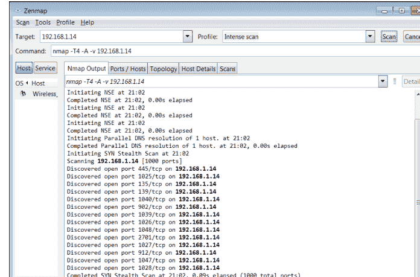

图 3-13：使用 Nmap 创建网络拓扑图。

50 第一部分 渗透测试入门

## 了解不同类型的渗透测试

## 本部分内容 ...

获取攻击向量和不同类型的攻击类型以及加密和密码学的概览。

学习高级持续性威胁 (APT) 以及它们如何导致其他假设性攻击，例如中间人攻击 (MITM)。

发现攻击者如何通过拒绝服务 (DoS) 和分布式拒绝服务 (DDoS) 攻击使网络瘫痪并中断。

探索各种类型的破坏性攻击——那些旨在破坏公司资产的攻击。

深入研究渗透攻击；黑客通过这种方式在不被察觉的情况下绕过控制措施。

### 本章内容

- 进入黑客的思维
- 深入研究攻击向量以及如何阻止攻击
- 揭开加密的面纱
- 运行 Metasploit 寻找暴露的向量

# 第 4 章

## 渗透与利用


# 渗透与利用

渗透与利用听起来像是一部激烈视频游戏的标题，你必须闯入敌人的堡垒并将他们的弱点暴露给世界。在渗透测试的背景下，它的含义并不此遥远，而且同样激烈。渗透涉及尝试（可能成功，也可能失败）绕过或突破安全屏障，例如访问公司的数据。而利用是指入侵者成功渗透屏障并利用系统的漏洞。

作为一名渗透测试员，你每天的大部分时间都在像黑客一样思考。他们可以从哪里渗透你的系统？他们可以利用哪些信息来为自己利？这有时需要创造性思维！

我在本章中也讨论了攻击向量。这对于新测试人员来说可能会让他们感到困惑，因为坏人黑客通常知道从哪里开始攻击，而白帽则需要找出这一点。通过解释客户端端攻击、服务器端攻击、无线攻击以及进入安全位置的其他入口点，这有助于消除这种困惑。我将本章的一个章节专门用于介绍加密，加密可以是白帽的好朋友，也是黑帽的敌人。

这里是残酷的现实：你无法保护一切。你无法让万物都无坚不摧。系统的开放性以及使用它们访问资源的能力总会在你的安全计划中留下某种形式的漏洞。你应该意识到的是，只要通过网络及其系统的基本使用，就始终存在渗透和利用，仅仅通过网络及其系统的基本用法。每当你上互联网并访问某个网站（例如亚马逊）进行购物时，你都可能通过访问其服务的完全相同的路径对该实体发起攻击。

第 4 章 渗透与利用 53

## 理解向量与黑客技术

固地理解攻击者如何渗透和利用你的宝贵资源是必要的。但这是一项挑战，因为技术在不断变化和进步。攻击类型也是如此。

例如，在过去，你可以通过防火墙建立威胁边界，并确保你所有的内部设备都配置了防病毒保护，以避免恶意软件攻击，并确保你的网络是安全的。现在，有了无线网络、移动设备、物联网 (`IoT`)、云接口以及技术的极度复杂性，一个好的防火墙已不足以保持你的网络安全。

当我们展望未来时，情况将变得更加复杂。随着物联网的发展，你可以想象任何事物都将连接到计算机网络。

所有黑客攻击的基础都是一个向量。攻击向量（或路径）是黑客进入的方式。当每一个设备都连接到计算机网络时，它都可以成为受保护数据或资产的入口点。攻击向量不仅变宽了，而且更深了。考虑与你的网络相关的向量：

- 通过你受保护（或未保护）的防火墙访问互联网
- 通过连接你的网络与外部世界（公共或私有）的路由器
- 来自你组织内部旧的拨号上网或其他带外访问系统
- 通过你组织内部不安全的无线连接
- 来自网络内部的（类似于黑盒解决方案）运行如 `Raspberry Pi` 等运行的设备
- 有人穿过你设施的正门并伪造访问权限以进入数据中心的安全区域
- 从已知源号码拨打伪造电话，欺骗帮助台代理更改密码，从而获得系统访问权限

这只是你将遇到的少数几个例子，我将通过书中探索许多其他向量。


不断考虑黑客可以攻击向量的新颖和创造性方法，实现深度防御。一旦你开始从已知向量范围之外思考，你将在渗透测试领域获得成功的职业生涯。

## 检查渗透攻击类型

通过密码进入网络只是黑客攻击系统的一种方式。黑客可以访问许多向量来渗透网络。在接下来的章节中，我将讨论其中一些以及你如何对它们进行测试。

### 社会工程学

社会工程学攻击是最常用的渗透攻击类型，尽管有足够的保护措施，它们是最容易防止的。它们实际上完全不依赖技术。

社会工程学攻击只需要有人——无论是因为愤怒还是被欺骗——给黑客提供用户名/密码。他们通过致电员工来提取信息。

#### 使用 Kali 对抗社会工程学

你可以使用 `Kali`（第 3 章）通过模拟来找出易受社会工程学影响的人。社会工程工具 (`SET`) 允许你通过数量进行攻击。

此此的方法是克隆网站来测试内部用户。例如，你可以克隆公司的内网，用户在那里登录并使用某些功能进行工作、应用程序和其他形式的数据。如果你进行测试并看看有多少用户会落入陷阱，你就可以利用这些信息来确保这种情况不会在你的公司发生。这可能有助于用户教育，解释他们可能会看到线索（可能在 URL 本身中）或其他伪装或指向他们的鱼叉式钓鱼邮件。通过这样做，你可能通过教育你的用户来保护你的内部资产。（用户有时是最脆弱的环节。）

以下是使用 Kali Linux 克隆站点的方法：

- 1. Kali Linux 攻击工具 -> 社会工程工具，如图 4-1 所示。

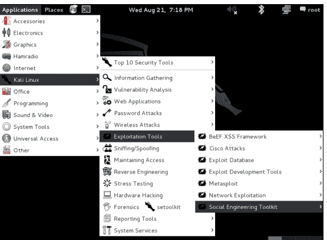

图 4-1

访问 Kali 菜单开始社会工程学攻击。

- 2. 选择社会工程攻击，如图 4-2 所示。
- 3. 选择网站攻击向量，如图 4-3 所示。

通过选择网站攻击向量，你选择的是用户可以使用网站作为伪造攻击落脚点的向量。

## 图 4-3：

从工具箱（Toolkit）菜单中，选择社会工程攻击（Social-Engineering Attacks）。

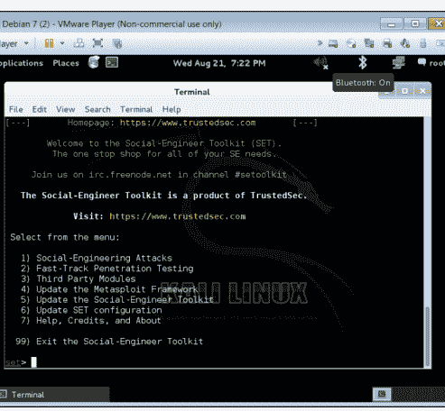

## 图 4-4：

从列表中选择网站攻击向量（Website Attack Vectors）。

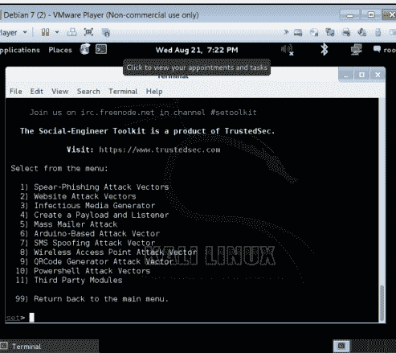

## 选择站点克隆器（Site Cloner），如图 4-4 所示。

此选项会克隆一个看起来与原始站点完全相同的站点。你也可以使用网络模板或创建自定义导入；不过，为了保持示例简单，我将使用站点克隆器。

第 4 章 渗透与利用 57 页

## 图 4-4：

克隆站点会重新创建一个其完全相同的副本。

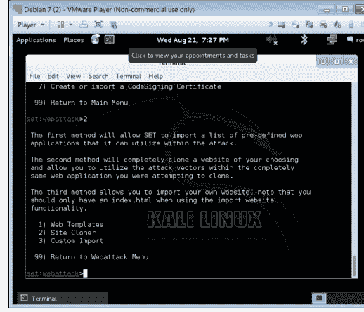

## 5. 选择 Localhost 然后按回车键。

你也可以将克隆站点重定向到另一个服务器或位置。Localhost 是默认 IP 地址为 `127.0.0.1` 的本地计算机，这意味着它会将克隆网站设置在你正在工作的本地计算机上。如果你在不同的系统上进行此测试，可以将其设置为任何你想要的站点、IP 或主机。图 4-5 显示了我为了启动克隆网站而选择的选项。

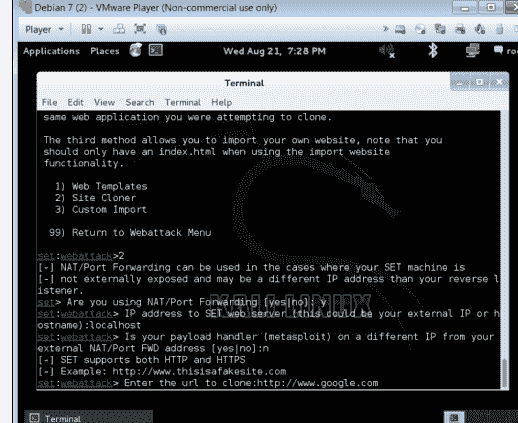

## 图 4-5：

我为了创建克隆站点而选择的选项。

58 页 了解渗透测试的不同类型

## 现在，你的克隆网站已经准备好了。（图 4–6 显示了我是如何设置一个虚假的 Google.com 的。）


图 4–6：

我设置了一个克隆的 Google.com —— 仅用于渗透测试目的！

克隆站点的目的是看你是否可以将其作为你组织内部或针对客户的测试。如果你将其附加到电子邮件并作为钓鱼攻击发送到你的组织中，你可以评估有多少人登录或在你的虚假网站上输入了数据。登录托管该站点的服务器并查看你获得了多少次登录或尝试，这可以让你了解是谁在使用该站点以及频率如何。然后，你可以为你的客户群体建立培训等纠正措施。

你可以将你的克隆网站用于白帽子或以安全漏洞测试的方式进行渗透测试。

### 以非技术手段防止社会工程学

防止社会工程学发生的其他方法是确保实施严格（且强制执行）的密码保护策略。例如，你可以配置网络安全以强制执行难以猜测的密码，并让他们在一段时间内更改密码（且不重复使用）。而且不要把它们写在任何地方！你还可以举办强制性的教育课程，帮助用户识别克隆网站、钓鱼 URL 和冷启动电话。

第 4 章 渗透与利用 59 页

社会工程学的其他尝试是翻找垃圾桶（dumpster diving，这可能是室外的真实垃圾桶），但更有可能是办公室空间内部的垃圾。为此目的配备一台碎纸机或其他纸张处理设备对于保持良好的内部卫生和基本安全至关重要，以挫败这种简单攻击。最后，肩肩偷窥（shoulder surfing，或键盘偷窥）也是另一种简单攻击，有人观察输入的内容并进行复制。

### 客户端和服务器端攻击

端点（endpoints）是安全中最脆弱的区域（人类就是这些端点之一）。他们使用的技术（台式电脑、移动设备、平板电脑和手机）都是端点。图 4-7 显示了一个包含三个部分的非常简单的网络视图：终端用户所在的网段，这通常是端点作为无线接入点 (`WAPs`) 存在且发生大部分连接的网段；网络资源（如数据库、虚拟化服务器、网络附属存储和应用程序）所在的网段；以及人们通过防火墙、网络路由器、私有或公共链路（如互联网）访问外部世界并访问云资源的网段。

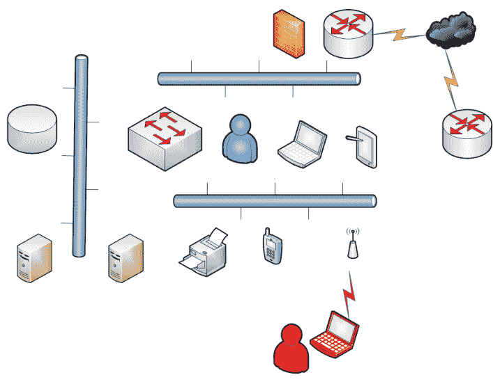

图 4-7：不同的攻击区域。

这样观察简单的网络，你可以看到攻击者或黑客如何从网络内部有时也从外部获取其中任何部分的访问权限。你的工作是测试所有这些资源，如果获得了访问权限，在黑客获取之前对其加固。访问点列表包括（但不限于）：

- **从外部：** 渗透防火墙的能力极其困难。攻击者的一种尝试是通过跳跃到你在网络外部可以访问的路由器（可能在你的 `DMZ` - 去军事化区，即网络中暴露给不可信网络的外部面向区域）进入你的私有和受保护网络，从而访问计算机。这是最困难的，因此也受到公司安全运营团队最的监控。为了渗透这一区域，我建议对网络边缘和所有接入点进行外部扫描。


- **内部或内网络：** 你可以使用如 `Nmap` 等工具进行渗透测试，绘制网络映射并查看内容。
- **无线网络：** 你可以使用如 `Nmap` 等工具进行渗透测试，绘制网络映射并查看内容。
- **恶意软件：** 许多形式的恶意软件允许攻击者通过
- **端点：** `Windows` 系统上的权限提升是一个常见的现象。
- **用户：** 这是最难处理的向量之一。

# 第 4 章 渗透与利用 61 页


这种攻击正是为什么安全专业人员恳请人们定期更改密码的原因。只要有足够的时间（计算机拥有无限的时间），用户名和密码就可以被破解。如果更改了密码，就会降低计算机碰中字母、数字和特殊字符正确组合的概率。

## 密码学与加密

最常见的攻击之一是密码破解，而加密的使用可以阻碍我在本章中讨论的许多工具。在深入研究加密如何工作之同时，请记住以下几点：

- 加密是将你的明文数据通过受保护的密码算法运行的过程；这会产生一个用于解密（解码）数据的密钥。你需要保护该密钥，因此当你传输数据时，只有接收方可以对其解码并使用它。
- 密码学是对加密方法的研究和相关工作。许多人认为它是学习安全中最困难的部分之一，因为它非常复杂且令人困惑。
- 尽管在利用加密漏洞时需要理解许多加密概念，但你可以让工具处理大部分工作，以对加密进行渗透测试。你可以通过查看报告来了解工具发现了什么，以及你需要缓解哪些风险。
- 我在这里将以非常高的水平概述介绍一些最常见的加密形式，以及它们的使用方式以及在运行测试时的实用性。这不是一个全方位的讨论，因为加密、涉及的数学以及其实现的所有不同方式可以填满 300 页的书（至少）。
- 如果你是加密的新手，请利用这一章运行工具并查看报告。稍后，你可以在它们在报告中开始出现时再进行研究。这是学习更多加密及其用途的跳板。

安全分析师和渗透测试人员如 `CIA`（机密性、完整性和可用性）尝试使用加密来模拟安全操作。通过使用这种模型，你可以设计任何形式的加密安全，无论你是在保护传输中的数据还是静态数据。

当你转换数据（通常使用转换转换集）时，它会隐藏并处理数据。图 4–9 显示，在访问受加密保护的网站时，所有通过的通信都是加密的，如果数据被捕获并查看，将无法以明文读取。

### 图 4-9。

使用 `Wireshark` 捕获并暴露受 `SSL` 保护的数据。

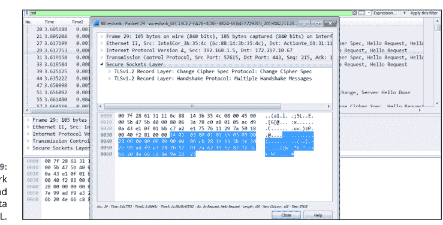

作为渗透测试人员，加密是一种展示你正面临风险极极方法，只需运行数据包捕获工具、获取网络流量，并挑选出能够访问你网络的信息即可。这就是为什么加密如此重要。

## SSL/TLS

**安全套接层** (`SSL`) 是一种提供加密、身份验证方法并提供消息完整性的协议。它可以以不同的强度实现，位强度表示其安全性。例如，40 位加密不如 128 位加密（`SSL 3.0`）强。诸如 `Metasploit` 或 `Ness` 等工具可以帮助你识别弱版本的加密。

传输层安全协议 (`TLS`) 是一种社区标准，提供与 `SSL` 许多相同的服务。它更具扩展性，并且在当今的基础设施中更常用。`SSL` 和 `TLS` 用于数据传输中（而非静态存储）的情况。

## SSH

许多旧系统仍然运行着 `telnet` 守护进程或服务，允许攻击者开始密码破解攻击。安全外壳 (`SSH`) 是 `telnet` 更强大的替代品。

它是一种应用程序和协议，允许你使用安全隧道远程登录到另一台计算机，并允许通过加密（类似于 `SSL` 的方式）保护传输中的数据不被捕获。会话密钥从请求连接的计算机交换到你想要连接的计算机，从而在它们之间建立安全通道。

## IPSec

`IP` 安全协议 (`IPSec`) 协议也通过虚拟专用网络 (`VPN`) 在设备之间建立安全通道。`VPN` 用于在发送者和接收者之间建立隧道，使传输中的数据通过加密得到保护。`IPSec` 需要特定的算法和加密密钥，其配置可能很复杂。大多数情况下，这种加密设置在寻求与其他网络设备通信以共享信息的网络设备上，如路由更新、表和邻接信息。它通常使用预共享凭据来建立安全连接。

## Metasploit Framework 和 Pro

`Metasploit` 是由 `Rapid7` (`rapid7.com`) 维护的工具。你可以下载 `Linux` 或 `Windows` 的试用版，并在几分钟内轻松地启动并运行以测试和使用。如果你想学习该工具并运行你的第一次渗透测试，只需访问免费试用版注册账户。你将获得一个 `Metasploit Pro` 进行下载；安装它（一个简单的过程），并在设置的登录界面请求试用密钥。

在我进入使用此工具的具体细节之前，有几句警告：

- **保持耐心。** 取于你的网段和你选择的选项，渗透测试可能需要一些时间。
- **不要在未经许可的情况下扫描。** 确保你正在进行伦理/渗透测试，并且你拥有权限，且已向关键 IT 人员告知了相关情况。

这样，如果发生任何问题，你可以停止扫描并评估并纠正损害。即使你采取了预防措施，扫描也会随时间引发问题，特别是在生产网络上。

- **始终监控扫描。** 不建议扫描后就离开，因为你可能会发现一个需要立即评估（可能还需要纠正）的关键风险。仅此一点，它也应该由安全操作分析师进行监控。
- **始终更新扫描工具。** `Metasploit` 菜单中有软件更新选项（在仪表板的右上角）。
- **扫描前始终备份。** 在扫描之前，备份任何可能受扫描影响的数据。

按照以下步骤使用 `Metasploit` 运行扫描：

1. 通过访问安装过程中设置的 URL 在本地系统访问 `Metasploit`：

```
https://localhost:3790/
```

2. 登录并点击 `QuickTest` 链接。图 4-10 显示的 `QuickTest` 向导打开了。

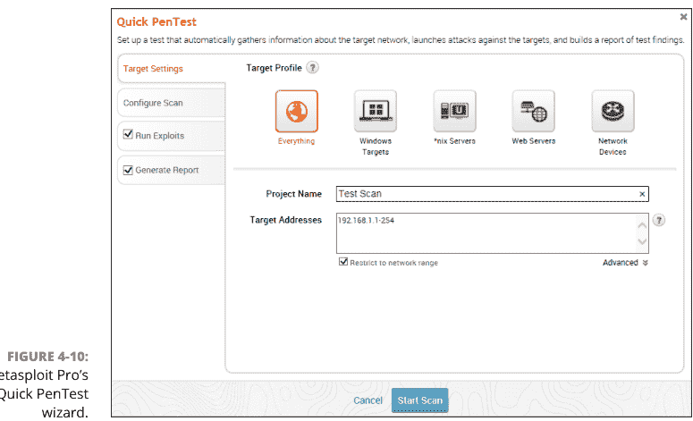

3. 选择目标配置，输入项目名称并输入目标地址。

你可以选择 `Everything` 选项（这需要的时间更长），或特定目标（例如 `Windows Targets`）。在此提示符处，我保留了所有默认设置并添加了一个目标地址进行扫描。该工具具有对连接的本地子网进行默认扫描的能力。在这里它获取了 `192.168.1.0/24` 的小型私范围。它可以扫描子网内的 254 台主机。

4. 点击 `Start Scan`。

图 4-11 显示了扫描过程。它启动的工具之一是使用 `Nmap` 进行网络映射。

一旦扫描完成并映射网段，工具将探测并运行漏洞测试和其他测试以获取风险和可利用部分的完整视图。

5. 扫描完成后，通过查看控制窗口或日志查看发现。

当你完成扫描和评估时，将查看报告和发现，以确定需要修复、监控或加入风险登记的内容。我们在第 4 部分将介绍发现、报告和确定后续步骤。

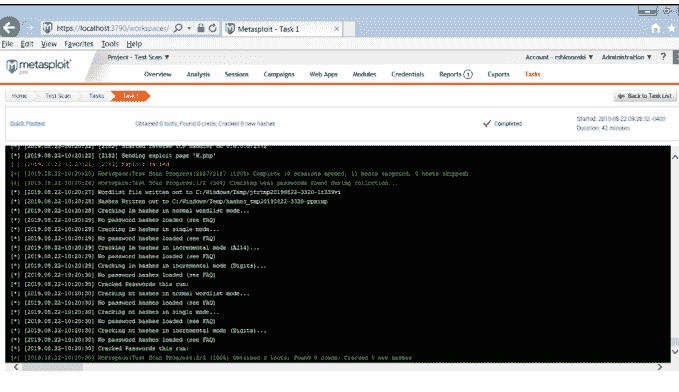

图 4-11：

使用 `Metasploit Pro` 运行快速渗透测试。

# 第5章

## 假设攻击（中间人攻击）

在第4章中，我向你展示了如何使用工具包并作为一名渗透测试员专门在渗透和利用领域开始工作。这是渗透测试的基础，以及当你扫描弱点和漏洞时，如何将它们视为需要修补的风险。

在这里，我将介绍基于向量的不同类型攻击。了解不同的攻击类型至关重要，这样你就能熟悉攻击路径并学会如何亲自进行这些测试。任何黑客的目标都是获取系统和服务器的访问权限。作为渗透测试员，你的目标是阻止所有黑客——或者至少尽可能地威慑他们——让他们带着最少或无法使用的信息离开。做到这一点的办法是像黑客一样思考。如果你戴着白帽（或灰帽），当然，你可以在许可的情况下进行合规的黑客攻击和系统利用！

这从在环境中建立立足点开始，一直扩展到系列非常深入的攻击，例如 `APT`。高级持续威胁（`APT`）是其他攻击的网关，这个立足点可以是一扇虚掩的门，让你看到自己渗透和利用的深度。

`APT` 在黑客进入内部并潜伏不被后可以作为网关，进行如中间人（`MitM`）之类的攻击无非守株而已。它还可以涉及欺骗（攻击者接管授权人员的身份以获得控制权）、重放攻击（重放凭据以获取访问）以及简单的窃听。

在本章中，我将向你展示攻击者如何进行这种假设攻击，以及你如何通过渗透测试复制这种攻击，或使用工具包中的工具来发现并暴露它们。

你对这类攻击越熟悉，就越容易通过评估发现它们并修复问题。请参考第10字的评估技巧和预防措施。

## 工具包基础

作为渗透测试员，你需要深入理解攻击者是如何操作的以及潜在攻击是如何发生的。在本节中，我指出了几项你需要确保确保你的系统、身份、会话或其他通信形式不被攻击者利用。

这些许多工具——如 `Kali`、`Nessus`、`Wireshark`——都应该在你的工具包中。如果你还需要整理你的工具包，请查看第3章。

假设攻击之所以难以检测，是因为当它们执行得到位时，黑客的行为就像渗透测试员、安全分析师或公司的首席执行官！他们可以迅速渗透，并在你发现泄露之前离开。对于这一点，经验教训将强调如何加固（强化）系统，作为此类此类攻击的最佳防御形式。参见第10章，我在那里讨论了从执行测试攻击中学习到的内容以及如何防止不同类型的攻击。

## Burp Suite


由 portswigger.net 开发的 Burp Suite 是一个 Web 安全测试工具，允许你进行 Web 漏洞扫描以及其他类型的扫描，以识别跨站脚本（XSS）、SQL 注入、跨站伪造（CSRF）以及其他高级 Web 攻击的问题。它还使用了如图 5-1 所示的 Burp Proxy，允许捕获并拦截浏览器与目标系统或应用程序之间发送的所有请求和响应，以进行会话劫持和窃听攻击。

### Burp Intruder Repeater 窗口帮助

- Target Proxy Scanner Intruder Repeater Sequencer Comparator Extender Options Alerts

显示项目的过滤器

| 主机 | 内容 | 存在问题 | 方法 | URL | 参数 |
| :--- | :--- | :--- | :--- | :--- | :--- |
| http://www.google.com |  | GET | /search?e=OSI-8859-1&en&source=hp&bw=... | 24 |
| http://www.google.com |  | GET | /search?content=en-search&hl=en&usg=0-2... | 24 |
| http://www.google.com |  | GET | /client/404-any-bb=16489&h=72&nz=vby... | 24 |
| http://www.google.com |  | GET | /advanced/search?pentestkh&end=i... | 24 |

图 5：使用 Burp Suite 进行测试。

在本节中，我保持示例的简单，但你可以针对复杂场景自定义 Burp Proxy。例如，你可以从其内部的认证（或证书）机构（CA）生成证书并签名。

Burp Suite 生成测试用以展示你的架构有多脆弱。Web 架构（例如，亚马逊的购物车）由三层组成：

- **第 1 层：** 这是客户端面向的层，通常称为 Web 层，顾其实名义：你访问网页并浏览网页。
- **第 2 层（或 N 层）：** 这是中间件层，许多跨连接技术存在于，如 COM 和 COM+ 组件、应用程序函数以及为 Web 访问层提供功能并帮助将用户连接到数据库层的其他软件。例如，在购物车中，实际的购物软件可能位于中间件上。

某些应用程序的架构会折叠或扩展到其他层级；这些被称为 N 体系架构。N 是任何大于 2 的数字。

- **第 3 层：** 这是数据库，事务存储在此处。

图 5-2：使用 Burp Suite 进行测试。

使用发送和接收流量的源或目的 IP 的特定细节进行捕获过滤。

- 你需要对通信进行过滤和隔离，以审查捕获到的数据。
- 你可以根据之前进行的操作设置新的测试（或技巧/黑客行为）。

在接下来的章节中，我将向你展示如何使用工具箱中的工具进行一系列测试，从而帮助你发现漏洞并降低风险（或至少知道它们的存在并承担风险）。

## 旁听以收集数据

欺骗、窃听、键盘记录、银行卡读器，甚至 USB 闪盘，都是黑客用来攻击组织以收集数据的手段。在这一节中，我将介绍这些各种攻击以及你可以对它们进行测试的方法。

### 地址欺骗

伪造地址是获取访问权限并处于对话中间的最佳方法。如果我假装成你，而你开始与我通信，那么我就成功地实施了中间人攻击（MITM）攻击。这种信息对于渗透测试人员来说至关重要。了解这一点可能需要你先测试一个级别的安全，以确保下一个级别是否面临风险，这能让你更清楚应该检查什么以及何时检查。这不仅为你提供了关于如何进行高级持续性攻击的基础知识，还让你学会了如何进行高级渗透测试。

欺骗的概念是，某人通过伪造数字身份假装成他们不是的人。就像现实生活中的身份盗用一样，数字版本也非常相似。例如，计算机需要 IP 地址才能与其他系统和资源进行通信、连接互联网、访问网页等。

关于欺骗的更具技术性的解释是 IP 地址欺骗，即攻击通过从虚假源地址发送 IP 数据包（传输的网络数据）来拦截对话，使接收者认为他们正在与真实源通信，但实际上是在与黑客通信（传输数据）。


# 第 2 部分 了解不同类型的渗透测试

历史上一些最大的攻击之所以难以识别，是因为它们都来自欺骗的地址。例如，拒绝服务（DoS）攻击是攻击者发送海量流量以接收，旨在淹没（网络缓冲区），导致系统无法正常运行。接收者必须处理收到的每一个网络数据包，中断 CPU 并处理请求，发送数以十计的虚假请求会阻塞其及时处理的能力（如果还能处理的话）。经验丰富的黑客从僵尸（感染了病毒并为他们工作的计算机）或从一台伪装成并非其真实地点的机器（即被欺骗的机器）运行这种攻击。这样这样，调查攻击的安全分析师可以捕获部分流量并进行调查，将发现他们无法追踪攻击来源，因为黑客使用了虚假地址。有关淹没和 DoS 攻击的更多信息请参见第 6 章。

你必须了解欺骗是如何进行的，即使你知道这很难停止或跟踪。以下是关于帮助防止欺骗攻击的一些想法：

- **使用加密帮助保护身份。** 这有助于传输可用数据被数据捕获设备捕获并可用。在第 4 章进一步讨论加密。
- **部署不允许未经授权连接网络的安全措施。** 攻击者需要连接到网络，使用 Forescout (`forescout..com`) 等工具，可以对未经授权连接的人进行隔离或检查。这被称为网络访问控制（NAC）。
- **亲自运行攻击。** 然后对执行这种攻击的能力进行渗透测试——这将为你提供关于坏黑客成功对你实施此类攻击可能性的信息。


你可以进行欺骗（或对欺骗进行测试）的高级攻击是 ARP 投毒。关于 OSI 模型及其相关层，IP 地址在第 3 层运行。数据链路层是第 2 层，MAC 地址在其中映射。机器的 ARP 缓存是第 2 层和第 3 层地址映射的地方。如果我可以投毒 ARP 缓存（对其进行修改以产生欺骗等更改），我就可以实施与 IP 欺骗攻击相同的攻击。

### 窃听

窃听（也称为嗅探）是一种非常容易实施的攻击（以及渗透测试）。在你了解如何使用 Wireshark 等工具并连接到网络后，只需运行该工具并开始收集和汇总信息——也就是说，你窃听正在发生的事情，希望嗅探到任何你可以使用的数据。

现在，你想将工具放置在你认为可以收集相关数据的地方。例如，如果我知道我可以在一个凭据以明文（用户名和密码的未加密组合）的网络网段中嗅探，那么简单的窃听就允许我获取数据。

现在，你想将工具放置在在你认为可以收集相关数据的地方。使用 Wireshark 希望嗅探到任何你可以使用的数据。

使用 Wireshark 来捕获数据包。

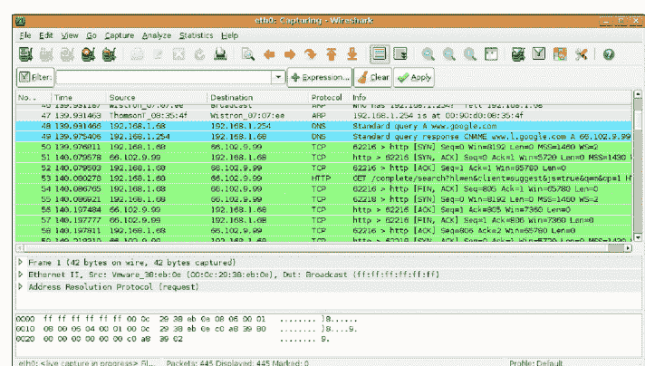

图 5-4：使用 Wireshark 进行嗅探。

作为渗透测试人员，实施窃听操作如下：

1. 设置你的 Wireshark 以进行安全测试。
2. 运行工具并开始收集数据。
3. 使用数据模拟登录系统。

如果你在步骤 2 中收集了足够的数据以登录系统，你就知道加固是必要的。

### USB 驱动器

其他高级攻击通过一种非常不为人知的向量进行，即 USB 驱动器。黑客、犯罪分子或其他不法的人可以将 USB 盘（也称为优存盘或跳线盘）插入你的计算机，并干扰你的业务。诸如 Sophos (`sophos.com`) 等工具可以安装阻止使用 USB 驱动器的软件，并要求在使用增强安全措施后才能使用该驱动器。我建议在企业层面进行此类扫描，以确保所有台式电脑和笔记本电脑都受到了保护或禁用了此功能。

# 第 6 章

### 本章内容

- 干扰正常操作
- 向主机发送泛洪攻击
- 深入研究 DoS 和 DDoS 的细节
- 探索特定的 DoS 攻击

## 压制与干扰 (DoS/DDoS)

在本章中涵盖的一系列攻击围绕着压制目标展开。在之前的章节中，你学习了如何使用特定工具去敲大门（或尝试后门），并看看你是否可以获得访问。在本章中，我将向你展示如何踢开大门。

在这些场景中，攻击者侧重于字面上压制目标，导致其崩溃、不接受服务的真实连接、堵塞管道、通过耗尽所有资源使系统瘫痪，并只需干扰一切以导致拒绝服务。我将专门提到了拒绝服务 (DoS) 攻击，不幸的是，这种攻击非常常见。

我还展示了攻击者（以及渗透测试人员）如何通过 DoS、DDoS（DoS 的分布式形式）、缓冲区溢出攻击等攻击来处理资源干扰。我讨论了你使用使用哪些工具来识别你是否正在遭受 DoS 攻击，以及你的系统是否正在遭受此类攻击。这是漏洞测试的另一个基础，以及当你进行弱点扫描时，如何将它们视为需要修复的风险。

运行这些测试可能会导致你正在测试的系统崩溃并可能损坏它们。请确保在与实际生产环境相同的的环境中运行这些测试，以便不仅能看到预期的结果，还能看到无法预料的结果。例如，你可能向服务器资源发送流量进行测试，结果仅导致其冻结、蓝屏、崩溃或锁定。你可能被迫强制硬启动系统（或者它会自动执行），这可能导致你丢失数据、损坏系统文件或使系统需要镜像修复。请务必谨慎运行这些测试。


# 第 6 章 压制与干扰 (DoS/DDoS)

在本章中，我向你展示最大的向量位于你的网络外部和内部。外部攻击在这一领域更为普遍，但许多病毒可以在你的网络内部传播。威胁可能是你的组织内部存在恶意软件，它会将你的工作站变成僵尸网络（被黑客接管的计算机），从而成为攻击的源头。

作为一名测试人员，你不会对网络发起 `DDoS` 攻击。然而，黑帽使用这种技术作为寻找可利用漏洞的方法。如果你想使用这种战术，请务必小心，因为它可能会导致你的生产网络出现严重的停机。

> 记住

## 工具包基础

对于压制和干扰攻击，可以使用 `Nmap`、`Kali` 甚至来自你工作站的网络控制台工具来发起攻击。你希望将所有这些工具作为漏洞扫描的一部分来运行，以便你可以评估在这些领域是否具有弱点。

不要误会，几乎每一家连接到公共互联网的公司都面临着压制和干扰攻击的风险。

> 记住

首先使用你工具包中的许多工具，包括来自 `Kali`、`Nessus`、`Wireshark`（我都在第 3 章中引入了它们）以及其他工具来识别这些攻击。然而，这种特定攻击特别凶毒的地方在于，如果不查看网络中防火墙和路由器的入站和出站流量模式，很难识别。

## Kali

`Kali`（概述请参见第 3 章）有助于压制和干扰正常流量模式、压制健康资源以及以干扰正常操作的方式向资源发送流量。打开 `Kali` 并导航到压力测试 `Stress Testing` 菜单。多个工具可以帮助你发现这些漏洞。

### 图 6-1：使用 Kali 进行渗透测试干扰攻击

你可以使用一个名为 `Inundator` 的 `Kali` 工具在你的环境中运行压力测试，查看你的系统如何响应。在图 6-1 中，`Inundator` 正在向主机发送大量流量。`Inundator` 工具是一种多线程、队列驱动的入侵检测工具，支持多个目标并能产生假性报警。它发送流量以导致警报出现，并淹没（压制并干扰正常操作）你的安全基础设施，例如防火墙、路由器、入侵检测工具和防御设备。淹没会填充你的日志并过度使用你的资源。

如果你在公司运行网站并将其托管在你的环境中，你的防火墙可能足够智能，能够识别这种类型的攻击何时发生并阻止它。无论如何，示例都展示了更广泛的局面是如何暴露的。

如果黑客使用像 `Inundator` 这样的工具来压制你的防火墙以及你用于检测攻击发生的设备，你就可以看到大规模攻击的模式。大规模攻击应该非常令人担心。缓解该问题的方法是修复你的系统、删除不必要的服务或开放端口，和/或阻止此类类型的攻击到达你的预定主机。

### 图 6-2：从网络外部发起攻击

图 6-2 显示了黑客（或作为道德黑客的你）如何从网络外部发起攻击。在这个示例中，我展示了一个非常简单的设计，攻击探测你可见的地址空间（可能是防火墙托管的服务器资源）任何可扫描的关联设备。

## T50 混合包注入工具

`T50` 混合包注入工具是我们对抗压制和干扰攻击的另一件武器。图 6-3 显示了黑客如何使用 `T50` 工具向主机发送泛洪攻击。

当你运行 `T50` 来测试你的主机或多个主机时，你可以单独进入每个主机并查看系统资源：

- Windows 用户可以使用 `Windows 任务管理器` 查看 CPU 和其他进程，并根据需要启动/停止它们。
- Linux 控制台通过 `ps` 工具和 `top` 命令提供相同的信息。

在这里，我运行了 `T50` 工具（你可以看到它作为资源消耗最高的进程运行，占用 94% 的 CPU）。一旦我终止了渗透测试，CPU 就回到了正常百分比。

## 理解拒绝服务 (DoS) 攻击

拒绝服务（Denial of Service, `DoS`）攻击简单来说就是任何导致合法服务无法提供的攻击。这可以是你托管的网站、打印室的打印机，或无线接入点（`WAP`）。这类攻击的大规模版本是 `DDoS`，即分布式拒绝服务。`DDoS` 攻击通常只使用一台计算机和一个互联网连接来淹没目标系统或资源，而 `DDoS` 则使用多台计算机和互联网连接来淹没目标。

`DoS` 不仅能破坏一家公司的声誉，而且可能非常昂贵。如果针对高层资源目标（例如，骨干网路由器）系统性地发起良好的 `DoS` 攻击，攻击载荷可能会导致互联网中断直到问题解决为止。

### 图 6-5：分布式拒绝服务 (DDoS) 攻击的工作原理

图 6-5 显示了攻击向量及其实施方式。在这一经典的 `DDoS` 攻击案例中，黑客成功地将僵尸（被他们控制的工作站）变成了攻击机器。这通常通过分发病毒（通常是可下载的特洛木马）来实现，使系统在不知情的情况下变成流量生成器。黑客随后可以通过后门（通常通过 `rootkit`）控制这些系统，以便能够对黑客想要的任何目标发起攻击（类似于洪水攻击）。

当淹没主机时，这种攻击最常见的结果是导致他人无法合法使用系统。多年来我一直说，信息技术资源是可用的。如果你无法使用它们，就不应该拥有它们。话虽如此，`DoS` 攻击是最常见的，也最容易构建（尤其是对于脚本小子 `kiddies` 而言）。

如果使用被感染的机器人进行资源淹没，它们也是最难追踪的。即使是针对此类攻击进行事件响应的最优秀法证团队，通常也会对导致攻击的原因感到困惑。

无论如何，你都有方法识别这种攻击何时发生，这取决于你查看的是哪些组件：

- 如果你在企业中运行了杀毒软件包，你可以在你的主机上扫描、识别并发现这些类型的恶意软件工具，并将其删除。
- 你还可以查看你的出站防火墙和路由器是否出现了洪水流量，这本应导致你的设备发出警报，显示大量流量通过它或发生了异常的流量模式。
- 同样，你可以查看防火墙和路由器上的相同情况，观察被流量淹没的受害机器上的处理率是否处于极高。

## 缓冲区溢出攻击

缓冲区溢出攻击是你的企业中任何带有缓冲区（几乎所有设备都带有）的设备上常见的内存耗尽方式。缓冲区是设备上的可用内存空间，允许传入流量进入队列，以便系统架构可以接收并进行相应的处理。这是一种常见的设计，允许你的系统（以及运行其上的所有硬件）正常运行。

### 图 6-6：缓冲区溢出攻击的工作原理

图 6-6 显示了使用缓冲区溢出攻击淹没（外网）网络路由器的最常见用法，内存溢出导致其无法接受任何合法请求。合法请求是指其他尝试使用资源的连接，例如你可能从网络防火墙后的服务器托管的网页。

在 `вв` 攻击中，我展示了设备根据其正常运行所需的功能最容易受到中断的方面。路由器必须能够接收数据并对其进行处理，以做出流量流向何处的决策。图 6-6 中，缓冲区可能通常处于 60%，这是一个非常繁忙的路由器。如果我作为一个伦理黑客用流量洪水淹没它使其瘫痪（使其达到 100% 的利用率），我就可以看着合法请求丢失，而这是路由设备正常且预期的功能。


虽然除非你在外网路由器之前有一个防火墙之类的设备（通常是受此类攻击监控的 ISP 路由器），否则很难识别它，但除非你识别出服务中断并将其追溯到受攻击的路由器，否则你将无所知。你可以查看路由器本身，看数据包因队列而被丢弃。

例如，如果这是一台 Cisco 路由器，你可以使用 `show buffers` 命令查看队列中的输出，看数据包是正在涌入还是被丢弃：

```
test-router#show buffers
Buffer elements:
  500 in free list (500 max allowed)
  2370 hits, 72 misses, 0 created

Public pools:
  Small buffers, 104 bytes (total 16, permanent 10):
  11 in free list (0 min, 10 max allowed)
  1770 hits, 33 misses, 22 trims, 28 created
  9 failures (no memory)
  Middle buffers, 104 bytes (total 16, permanent 10):
  11 in free list (0 min, 10 max allowed)
  1770 hits, 33 misses, 22 trims, 28 created
  9 failures (no memory)
  Large buffers, 104 bytes (total 16, permanent 10):
  11 in free list (0 min, 10 max allowed)
  1770 hits, 33 misses, 22 trims, 28 created
  9 failures (no memory)
  Huge buffers, 104 bytes (total 16, permanent 10):
  11 in free list (0 min, 10 max allowed)
  1770 hits, 33 misses, 22 trims, 28 created
  9 failures (no memory)
```

## 分片攻击

分片攻击（也称为 IP 分片攻击或 frag 攻击）是指 IP 数据包分片导致 DoS 攻击。通过利用 TCP/IP 的原生设计，黑客或伦理黑客可以向源设备发送数据分片，希望导致 DoS，或者作为渗透测试人员，向你展示一个需要评估的漏洞。

分片攻击利用实际协议作为操控点，而不是缓冲区那样的硬资源。

你可以使用 Kali 的 `fragroute` 和 `fragmentation6` 等工具进行测试，以识别你是否受到此类攻击，如图 6-7 所示。

通过使用 `fragest`（如图 6-8 所示），Kali 工具包允许你向主机发送畸形包以观察它们的响应。在进行这些特定测试时，你可能需要评估主机本身，以识别系统是崩溃了、瘫痪了还是中断了。

### Debian 7 - VMware Player (仅供非商业用途)

Player

9月13日，周五，下午 7:30

应用程序 位置

root@kali:

文件 编辑 视图 搜索 终端 帮助

```
tcp_udp=sum(id=oldman)
root@kali:~ 
ps aux
PID USER TTY TIME CMD
P177 root ?? 0:00:00
3423 root 0:00:00 bash
root@kali:~ 
fragoute
frags = = (id=file) det
Multi
drop first[random<prob>
drop first[random<prob>
drop
echo string
ifconfig -a
ifconfig -a
ipt-ls/src<ipt-addr>
ipt-to
drop-addr/reverse
print
tcp_check(sum(tcp[payload]|tcp[seq]|syn])|ttl)
tcp_opt=mss=<size>
root@kali:~ =sum(id=oldman)
```


图 6-7：使用 Kali 的 fragoute 和分片技术确定你的漏洞水平。


### Debian 7 - VMware Player (仅供非商业用途)

Player

9月13日，周五，下午 7:33

应用程序 位置

root@kali:

文件 编辑 视图 搜索 终端 帮助

```
hping --fragtest TESTS
where TESTS 是以下内容的任意组合（或 "all"）；
ping 是所有测试的前提
丢弃重叠分片（已修复）
ip-traceroute 确定到目标的路径
尝试新的 8 字节重叠 IP 分片，有利于新数据（已修复）
尝试旧的 8 字节重叠 IP 分片，有利于旧数据
丢弃分片重组超时（已修复）
root@kali:~ #fragtest ping 127.0.0.1
64 bytes from 127.0.0.1: icmp_seq=1 ttl=64 time=0.04 ms
64 bytes from 127.0.0.1: icmp_seq=2 ttl=64 time=0.04 ms
root@kali:~ #fragtest ip-traceroute 127.0.0.1
64 bytes from 127.0.0.1: icmp_seq=1 ttl=64 time=0.04 ms
64 bytes from 127.0.0.1: icmp_seq=2 ttl=64 time=0.04 ms
root@kali:~ #fragtest frag 127.0.0.1
64 bytes from 127.0.0.1: icmp_seq=1 ttl=64 time=0.04 ms
frag: 14640611.51536 sec
```

图 6-8：使用 Kali 的 fragtest 向主机发送畸形数据包。


# 第 6 章 压制与破坏 (DoS/DDoS) 89

本书从此处下载：

https://sanet.st/blogs/mecury-books/

访问我们获取更多精彩书籍


## Smurf 攻击（精灵攻击）

在运行 Smurf 漏洞评估测试时，不要真以为会有“蓝色小人”出现并对你的系统造成破坏。破坏是由真实的 DDoS 攻击造成的，即通过伪造的 IP 地址向合法的主机资源进行 ping 扫描（ping sweeping），以期拒绝其功能。这与虚构角色无关，与试图创建拒绝服务攻击的真实人物完全相关。

这与大量数据导致 DDoS 并最终引发中断的情况类似，在 Smurf 攻击中，用于创建产生压制性请求中断的实际数据是通过网络消息协议（ICMP）来实现的。该协议通常用于 ping 和 traceroute（或 Windows 中的 tracer）等工具。Smurf 攻击可以从任何发送 ping 的设备进行，几乎涵盖书中的每个工具（Nessus, Metasploit, Nmap, Kali 工具），也可以从任何可以操作 ping 的控制台进行。

6-9 显示了如何配置 Linux 的 ping 工具来更改生存时间（TTL）、ping 数据包大小、数据包数量等，这使得更改后的数据包会对其接收的网络接口造成干扰。

Smurf 攻击（以及小数据包攻击和 Xmas 树攻击）利用了原本设计的用途，并对其进行操纵以创建出 DDoS 攻击。

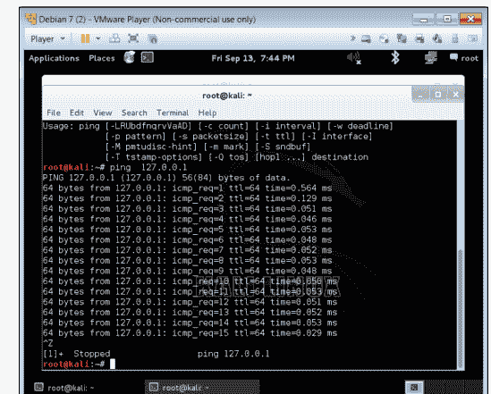

6-9：使用 ping 生成扫描攻击和 Smurf 攻击。


## 小数据包攻击 (Tiny Packet Attacks)

另一种易于操纵有害的技术是小数据包攻击。小数据包与分片攻击类似，可以进一步缩小接收它们的计算机。这种 DoS 攻击会导致缓冲区溢出。这种类型的攻击更改了数据包的大小，通常情况下（或标准最大传输单元 [MTU]）以太网数据包的大小为 1500 字节。如果黑客开始发送小于 1500 字节的数据包，系统接收它们将变得困难，会对处理数据产生更多开销。换句话说，处理数据需要加倍努力，从而干扰并压制执行常规操作的设备。

Wireshark 是识别网络中小数据包的工具。图 6-10 显示了 1500 字节以外的数据包出现的长度和数量。

| 主题 / 项目 | 计数 | 平均值 | 最小值 | 最大值 | 速率 (ms) | 百比 | 突发 |


| :--- | :--- | :--- | :--- | :--- | :--- | :--- |

| 数据包长度 | 214 | 22 | 42 | 1514 | 0.0047 | 100% |

| 0-19 | 0 | | | | 0.0% | |

| 20-39 | 0 | | | | 0.0% | |

| 40-79 | 61 | 55 | 42 | 66 | 0.0025 | 53.1% |

| 80-159 | 20 | 107 | 90 | 145 | 0.0018 | 17.5% |

| 160-319 | 32 | 128 | 86 | 296 | 0.0001 | 14.0% |

| 320-639 | 6 | 507 | 437 | 619 | 0.0002 | 5.2% |

| 640-1279 | 2 | 810 | 685 | 899 | 0.0001 | 1.9% |

| 1280-2559 | 1 | 1514 | 1514 | 1514 | 0.0000 | 0.1% |

| 2560-5119 | 0 | | | | 0.0% | |

| 5120 及以上 | 0 | | | | 0.0% | |

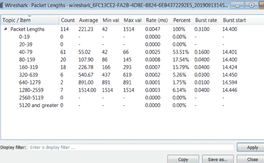

图 6-10：使用 Wireshark 识别小数据包攻击。

## Xmas 树攻击 (Xmas Tree Attacks)

Xmas 树攻击仅仅是使用 Xmas 树数据包的攻击，这种开启了所有选项的数据包——就像挂满了灯光、装饰品和彩边的真实圣诞树。

这样做的主要原因是 Xmas 树攻击通常用于隐身任务或信息收集侦察。它也可以作为 DoS 攻击：同时向设备发送大量此类数据包会产生压制，因为开启所有选项的 Xmas 树数据包处理强度更高。大量的此类包压力翻倍，从而干扰并压制正在执行操作的设备。

### 本章内容

- 使用防病毒软件停止破坏攻击
- 使用 Nessus 追踪企业中的恶意软件
- 探索各种类型的恶意软件：蠕虫、间谍软件、木马等
- 领先于勒索软件

# 第 7 章 破坏（恶意软件）

我涵盖的下系列攻击围绕对目标的破坏或对目标资源的破坏。该部分之前的章节涵盖了旨在混淆、模糊化、分散、压制、破坏甚至可能保持完全不被检测到的攻击。在本章中，我涵盖了为了报复、筹码、获利或在某些情况下为了挑战（或趣味）而单纯破坏公司资产的攻击类型。

破坏攻击可能导致公司花费大量精资金进行恢复。如果你运行备份程序，就可以从破坏攻击中恢复，但你真正的损失是时间。恢复系统、数据或所需的时间可能很长。如果你运行了灾难恢复解决方案，可以尝试将客户迁移到另一个工作系统，但并非所有公司都配备了此方案并使其处于可靠状态运行。

在本章中，我重点介绍哪些工具包可以识别你何时正遭受破坏攻击，以及你的系统是否容易受到此类攻击。

如果你有活跃的备份，资源的破坏总是可以修复。如果源代码被破坏或某些数据在传输过程中丢失而你没有备份，它将永远丢失。务必备份数据、系统、软件、固件以及所有这些内容的访问权限等。如果数据/系统的虚拟快照和 VM（虚拟机）主机都已采取并执行，那么当你需要时，将有一条快速恢复服务的良好路径。


## 工具包基础

在本节中，我将向你展示用于进行渗透测试以模拟恶意软件攻击的工具，这些攻击会导致破坏性结果。

## 杀毒软件和其他工具

诸如 Kali、Nessus（我将在接下来的章节中进一步讨论）、Wireshark 等工具可用于扫描系统中的漏洞，从而降低风险并缓解攻击。

破坏性攻击——与所有攻击一样——很难被识别，因此不要将自己限制在渗透测试工具包中。你可能还想监控杀毒软件 (AV) 管理控制台、防火墙日志、网络中的路由器（查看入站和出站流量），以及其他工具（见第 5 章）和 Metasploit（见第 4 章）。

大多数破坏性攻击源于恶意软件（malware）。正因如此，你武器库中最好的工具将是企业内部使用的杀毒平台。你会发现，使用你的工具包扫描漏洞会有帮助，我会解释这在什么时候适用，但要识别并移除系统中的破坏性黑客攻击，你需要看向工具包之外以获取全局视图。


## Nessus

我在之前的章节中讨论过 Nessus，但本章的重点是使用它来扫描以下漏洞：

- 病毒软件过旧导致的问题
- 企业中的恶意软件
- 破坏你网络和系统中资产及资源的其他威胁

图 7-1 显示了 Nessus 默认提供的不同类型的扫描。例如，你可能想运行补丁审计，以查看哪些系统容易受到需要由厂商修复的暴露代码的操纵。

暴露代码指的是（固件、操作系统、应用程序、App 等）在发布时认为是不安全的软件。正因如此，这些代码需要定期进行更新、修复，甚至更换。

图 7-1：Nessus 用于渗透测试攻击的各种类型。


- 我的扫描 (My Scans)
- 所有扫描 (All Scans)
- 垃圾箱 (Trash)
- 策略 (Policy)
- 插件规则 (Plugin Rules)
- 扫描器 (Scanners)
- 社区 (Community)
- 研究 (Research)

大多数企业的标准流程是设置补丁窗口或补丁周期（可能每月开放一次），以修复所有受已知问题影响的问题。对于渗透测试期间识别出的、指向需要立即补丁的已知漏洞或安全威胁的问题，补丁窗口可以具有优先级状态。

你可以运行 Nessus 扫描来划分子网，并识别所有可能易受已知威胁的主机。以这种方式使用 Nessus（图 7-2）可以帮助你生成关于存在恶意软件或因身份可能受到威胁主机报告。

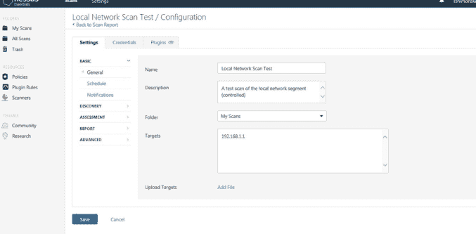

图 7-2：寻找易受已知威胁的主机。

发动破坏性攻击的黑客通常不是为了寻找商业机，而是为了制造问题并浪费你的时间和金钱。当东西被破坏时，公司的声誉通常很难维护，你需要花费很长时间才能恢复这种声誉。黑客发动破坏性攻击的另一个原因是通过障障之法分散你的注意力。例如，黑客通过逻辑炸弹转移你的注意力，然后在你忙于处理该问题时发起 APT（高级持续性威胁）。关于颠覆攻击的更多信息，请参阅第 8 章。

渗透人员可以使用此类伦理黑客行为和攻击来渗透可被利用或有漏洞的系统。在进行这些攻击时，你需要确保你理解（并向你的测试对象报告）你可能会导致不可逆转的损害，这种损害可能只能通过恢复或备份来修复。

你可以模拟攻击进行探测，从而观察可被恶意软件利用的未打补丁系统是否存在漏洞。

黑客的攻击向量可以是内部或外部的。图 7-3 显示了一个典型的外部向量攻击，其目标是注入并破坏主机或数据库：

- 数据库是目标。
- 攻击者的目标是启动攻击渗透 Web 应用程序中的防火墙并注入脚本。
- 注入的脚本系统地删除后端连接到数据库主机的表。

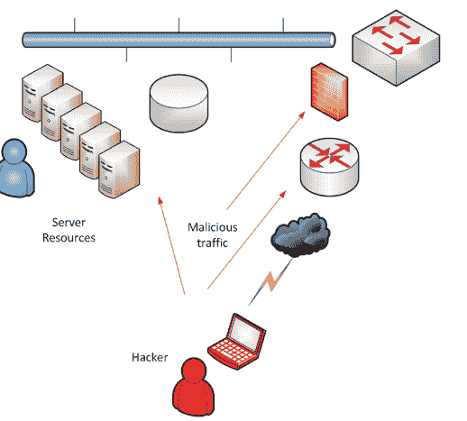

图 7-3：目标是破坏数据库的典型外部向量攻击。

## 物理安全

在本章中，我重点关注安全方面的技术方面。但你不能忘记资源的实际物理属性。不要由于允许未经授权访问受保护区域而导致资产的物理破坏。通过物理安全（保镖）、锁闭且安全的区域摄像头、刷卡以及其他阻止无关人员进入的生物识别入口系统来保护它们。

这个示例展示了一个非常简单的设计，其中攻击者使用多种方式交付的脚本来破坏资产：

- 来自网络内部主机上插入的木马程序。
- 通过电子邮件发送。
- 来自网络内部主机上插入的木马程序。
- 通过电子邮件发送。


大多数企业的标准流程是设置补丁窗口或补丁周期（可能每月开放一次），以修复所有受已知问题影响的问题。对于渗透测试期间识别出的、指向需要立即补丁的已知漏洞或安全威胁的问题，补丁窗口可以具有优先级状态。

## 恶意软件

恶意软件（malware）是最常见的类型。正因如此，你武器库中最好的工具将是你企业内部使用的杀毒平台。你会发现，使用你的工具包扫描漏洞会有帮助，我会解释这在什么时候适用，但要识别并移除系统中的破坏性黑客攻击，你需要看向工具包之外以获取全局视图。

## 恶意软件类型

- **病毒 (Virus)**：在其他计算机上复制的简单程序。
- **蠕虫 (Worm)**：蠕虫与病毒相似，都是自我复制的。
- **木马 (Trojan)**：误导你认为它是你想要或需要的，但在后台包含恶意软件。
- **间谍软件 (Spyware)**：如其名，它在潜伏于你的系统中时监视你和你的活动。它收集信息并发送。
- **零日 (Zero day)**：具有待识别利用漏洞的简单代码。
- **逻辑炸弹 (Logic bomb)**：逻辑炸弹恶意软件设置为当一组标准发生时激活。


进入`/path/to/xxx`目录，找到`xxx.json`。

在表达式`cvar = avar + bvar`中，加法运算符（`+`）将`avar`与`bvar`相加，得到它们的和`cvar`

在`List.of(arg0, arg1, arg2)`中，`List`接口的工厂方法`of()`接受一系列的元素，返回包含它们的只读列表。

之后我们这样调用`cmd`命令：`cmd arg0 arg1 arg2`。

```
if (condVar > someVal) {console.log("xxx")}
```
[/content]

Wait need actual text. Let's redo properly.

[content]
- **勒索软件 (Ransomware)**：将在下一节中详细介绍，这种恶意软件恰恰是破坏性最强的类型之一。

## 勒索软件

勒索软件本身就是邪恶。那些创建和分发它的人是这群人中最糟糕的一批人，因为这里是脚本小子（script kiddie）的天堂。最初创建该工具的精锐黑客让它看起来像 WannaCry（最常见的勒索软件攻击之一），以便于那些利用它来勒取金钱的人。还有其他软件，比如 Petya。无论有多少种变体，它们都执行相同的相同功能：加密你的数据使你无法使用它，然后让你支付巨额资金来解密。

图 7-4 显示了 WannaCry 的示例以及攻击是如何实施的。你组织中的终端用户可能访问了一个装有该工具的网站，并认为它是他们需要的东西而下载了它。当他们发现自己到底下载了什么时，得到了一个可怕的惊喜：一个针对他们系统的加密工具，它可以启动并进行攻击。


图 7-4 勒索软件攻击示例。

在考虑破坏型攻击以及你作为渗透测试员的角色时，终极目标是在任何恶意软件进入你的系统并给你和你的公司带来问题之前，识别出安全漏洞。

你需要问问自己的问题是：我该如何如何测试系统和基础设施，以确保我免受恶意软件攻击的侵害？

答案是：使用渗透测试工具和其他适用于公司企业管理和监控系统的工具进行评估，识别是否存在任何问题，确定这些问题会在何时引起问题，并在黑客攻击和入侵发生之前降低风险。

这与你为了防止任何类型的攻击而所的操作类似，在恶意软件的情况下，我建议首先戴上安全分析师的帽子。你必须确保你的公司部署了作为杀毒病毒 (AV) 软件的优秀企业管理和监控工具，以保护所有终端免受攻击。终端可以是任何设备，如笔记本电脑、电脑、移动设备或平板电脑。

图 7-5 显示了防止恶意软件攻击最常用的工具示例，即通过 AV 工具进行终端保护。这是最常见且有效的方法，但它并没有完全解决问题。

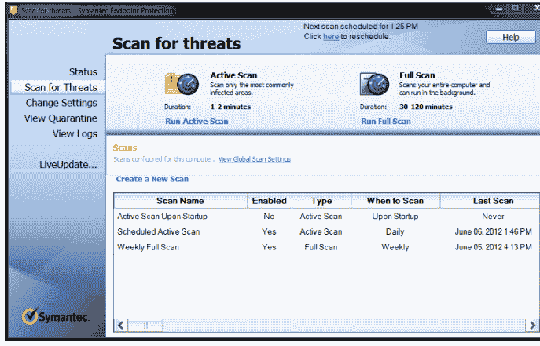

图 7-5：AV终端保护示例。

此外，你可能执行以下操作：

- >> 确保 AV 工具经过管理和维护。这意味着工具本身更新了所有最新的扫描信息，以保持对威胁的关注。
- >> 确保终端。你企业中的每个运行某些软件（或固件）的终端都可能受到恶意软件的影响。当然，渗透测试可以派上用场，帮助识别所有终端以及哪些终端是脆弱的。

通过运行我在本章涵盖的工具（在第 8 章中，我涵盖了颠覆攻击，这是另一种针对 AV 的攻击），你会发现简单的评估就能识别出你的许多系统是易受攻击的。为什么呢？因为黑客没日没夜地寻找软件软件本身的漏洞，并编写代码来暴露他们发现的漏洞。然后厂商会编写代码（热补丁、服务包和补丁）供你下载并安装到机器上以保护它。渗透测试会告诉你，你有 15% 的工作站正在运行最新的补丁。你可以下载并安装它们来保护你的系统。

渗透测试员的工作完成了，你必须保持主动扫描，以便在威胁发生之前识别它们。


使用良好的 AV 软件进行渗透测试、发现风险并修复它们，为你的企业提供了良好的保护水平。但你不能认为这就是完全防止恶意软件的方法。你必须在测试中保持勤勉，因为一直有人在努力破坏安全，以让这些坏代码进入你的大门。社会工程是黑客进入并让某人点击下载的最佳方法。你可以通过教育终端用户来防止这一点。如果受过教育的终端用户知道不要点击某些东西，那么他们就可以避免激活恶意软件。这能阻止一切吗？不能，但它会显著减少攻击。

## 其他类型的破坏攻击

其他破坏型攻击并不华丽，但与基于代码的攻击一样残酷。尽管它们可能没有华丽的名字，但许多手动攻击同样可以破坏资产。在这些攻击中，向量与基于恶意软件的一样难以确定（后者可以来自任何地方——电子邮件、网页链接等）。对于阻止物理访问的攻击，向量仅仅是某人离开时未锁定电脑，这意味着有人可以坐下来工作。

攻击者造成的损害本质上是破坏，可以采取各种形式来导致基于破坏的攻击：

- 批量删除文件
- 插入病毒或恶意软件
- 故意损坏数据
- >> 插入载荷 (payload)
- >> 修改设置或注入错误
- >> 注入过载导致损坏

黑客寻找这些攻击是因为它们很容易，所需的时间和资源要少得多，而且除了安全摄像头可能捕捉到的内容外，它们几乎不留下任何痕迹。


同样要考虑物理安全：摄像头、刷卡、生物识别和其他安全形式的访问控制。

记住，使用良好的 AV 软件进行渗透测试，发现风险并修复它们，为你的企业提供了良好的保护水平。

在本章中涵盖

- >> 使用 AV 软件阻止颠覆攻击
- >> 使用 Nmap 模拟颠覆攻击
- >> 在企业范围内发现颠覆攻击

## 第 8 章

## 颠覆 (绕过)

颠覆的定义是渗透安全。在 IT 领域，高级持续性威胁 (APTs) 是攻击的圣杯。

通过 Nmap 更好地探测、映射并识别漏洞。Nessus、Metasploit 甚至 Kali 都提供了许多执行此功能的工具，但 Nmap 本身是此类攻击的首选。

Kali 拥有 Nmap 以及其工具集中的其他几种映射工具。打开 Kali 并导航到信息收集菜单（见图 8-1），访问一系列你可以深入挖掘的类别以帮助执行隐蔽的颠覆攻击。


要了解更多颠覆攻击，我建议研究 Web 应用安全项目 (OWASP; www.owasp.org)，我们将在第 16 章讨论。


## Nmap

没有比 Nmap 更好的用于探测、映射和识别漏洞以及进入方式的工具了。Nessus、Metosploit 甚至 Kali 都提供了许多执行此功能的工具，但 Nmap 本身是此类攻击的首选。

Kali 包含了 Nmap 以及其工具集中的其他几种映射工具。在本节中，我们将重点介绍如何利用 Nmap、Wireshark 以及其他工具工具来绕过安全。


## 使用 Nmap 模拟颠覆攻击

以下是为什么 Nmap 帮助模拟颠覆攻击的一些原因：

- **Nmap 是可定制的并且由脚本驱动。** 你可以根据你编写的代码设置脚本来执行攻击。
- **Nmap 正好执行了颠覆攻击所需的扫描、探测、映射和识别弱点。**
- **你可以进行从低到高强度的各种攻击。** 这允许对你的漏洞进行快速的渗透测试，直到非常深入且稳健的扫描，这可以帮助随着时间的推移真正展示存在哪些问题。

图 8-1：Nmap 的信息收集可以帮助你执行子网攻击和基于隐蔽的攻击。

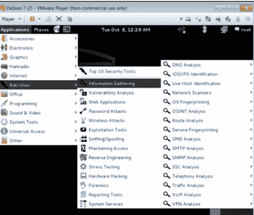

> 记住，Nmap 是一个扫描器，会对你的系统进行探测和测试。如果你在生产网络中使用它

## 让 Nmap 运转起来

如图 8-2 所示，我启动了一次针对路由器/路由设备的扫描攻击。我的目标是通过扫描主机并尝试识别它们和映射它们，来识别子网上的所有设备。这还允许我列出一个我可能利用的漏洞列表。

对主机运行扫描可能会被安全设备捕获，这将显示源 IP 地址（你的 IP 地址）。很多时候，这些攻击是通过伪造地址或被劫持并由黑客控制的主机（通过木马等恶意软件）实现的，因此它们不会被发现。

在这个示例中，我选择了密集扫描，因为它能为我的报告生成最多的输出，因为：

- 我不在生产网络中。
- 我将扫描限制在一次一个主机，因为我了解拓扑结构。

### 图 8-2：

使用 Nmap 启动针对路由器/路由设备的扫描攻击。


如图 8-3 所示，此扫描通过一系列寻找开放端口和其他渗透点的测试来识别漏洞。我此时启动的主要渗透测试是 SYN 隐蔽扫描（SYN Stealth scan），它的设计是向主机或多个主机发送 SYN 包，以便在 ACK 包中接收来自主机的确认响应。

### 图 8-3：

进行 SYN 扫描以识别开放端口。

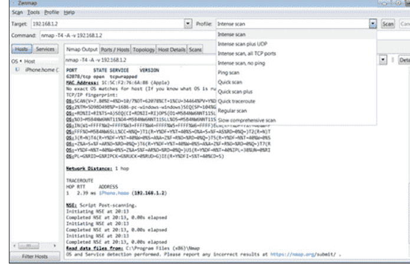

## 第二部分 理解不同的渗透测试类型

### TCP/IP 的工作原理

TCP/IP 使用协议的方式是通过一系列被称为“握手”的数据包传输来建立通信通道的。这就像结新朋友并自我介绍，然后他们也这样做，拥有共同的拥抱目标会建立纽带。在 TCP/IP 中，这种握手执行完全相同的操作，只是它创建了一个用于连接的通道。在本源中，目标发回 SYN/ACK，源提供三次握手的最后通信—— ACK。一旦发生这种情况，设备之间就会建立并维持连接，直到终止。它可能被视为一种名为 RST 的重置包。


你可以在不知道 `TCP/IP` 的情况下运行此测试并获得相同的信息，但了解该技术的工作原理会有帮助。更多关于 `TCP/IP` 的请查看附近的侧边栏。


图 8-4 显示 `SYN` 扫描识别出一个可能的主响应主机，这是我下一次攻击的来源。发现了其他可识别信息（见图 8-5），包括被扫描设备的 `MAC` 地址和按网络跳数的距离。

| 状态 | | | | | 配置文件：密集扫描 | 扫描 | 取消 |
| :--- | :--- | :--- | :--- | :--- | :--- | :--- | :--- |
| 目标: 192.168.1.2 | | | | | | | | |
| 命令: `nmap -T4 -A 192.168.1.2` | | | | | | | | |
| 服务 | 网络输出 | 端口/主机 | 拓扑结构 | 主机详情 | | | 详情 |
| OS | | | | | | | | |
| 5/tcp | open | 正在估计时间：已完成约 78.6k 个主机；耗时：00:08:29 (剩余 1 个主机) | | | | | | | |
| 正在为 192.168.1.2 扫描 | | | | | | | | |
| 于 20:13 开始扫描 | | | | | | | | |
| 扫描于 20:13 完成，耗时 0.8s (1 个服务在线) | | | | | | | | |
| 在 192.168.1.2 上进行 OS 检测： | | | | | | | | |
| 正在对 192.168.1.2 启动 OS 检测 | | | | | | | | |
| 重试 OS 检测 (1 次) [电话:192.168.1.2] | | | | | | | | |
| 警告：来自 192.168.1.2 端口 6078 的 RST -- 此端口开放吗？ | | | | | | | | |
| 警告：来自 192.168.1.2 端口 6078 的 RST -- 此端口开放吗？ | | | | | | | | |
| 警告：来自 192.168.1.2 端口 6078 的 RST -- 此端口开放吗？ | | | | | | | | |
| 警告：来自 192.168.1.2 端口 6078 的 RST -- 此端口开放吗？ | | | | | | | | |
| 警告：来自 192.168.1.2 端口 6078 的 RST -- 此端口开放吗？ | | | | | | | | |
| 警告：来自 192.168.1.2 端口 6078 的 RST -- 此端口开放吗？ | | | | | | | | |
| 警告：来自 192.168.1.2 端口 6078 的 RST -- 此端口开放吗？ | | | | | | | | |
| 警告：来自 192.168.1.2 端口 6078 的 RST -- 此端口开放吗？ | | | | | | | | |
| 脚本扫描 192.168.1.2: | | | | | | | | |
| 于 20:13 启动 NSE | | | | | | | | |
| 于 20:13 完成，耗时 0.8s | | | | | | | | |
| 主机在线 (0.005s 延迟)。 | | | | | | | | |
| 图 8-4 SYN 扫描识别出一个可能的主机 | | | | | | | | |

| 状态 | | | | | 配置文件：密集扫描 | 扫描 | 取消 |
| :--- | :--- | :--- | :--- | :--- | :--- | :--- | :--- |
| 目标: 192.168.1.2 | | | | | | | | |
| 命令: `nmap -T4 -A 192.168.1.2` | | | | | | | | |
| 服务 | 网络输出 | 端口/主机 | 拓扑结构 | 主机详情 | | | 详情 |
| OS | | | | | | | | |
| 5/tcp | open | 正在估计时间：已完成约 78.6k 个主机；耗时：00:08:29 (剩余 1 个主机) | | | | | | | |
| 正在为 192.168.1.2 扫描 | | | | | | | | |
| 于 20:13 开始扫描 | | | | | | | | |
| 扫描于 20:13 完成，耗时 0.8s (1 个服务在线) | | | | | | | | |
| 在 192.168.1.2 上进行 OS 检测： | | | | | | | | |
| 正在对 192.168.1.2 启动 OS 检测 | | | | | | | | |
| 重试 OS 检测 (1 次) [电话:192.168.1.2] | | | | | | | | |
| 警告：来自 192.168.1.2 端口 6078 的 RST -- 此端口开放吗？ | | | | | | | | |
| 警告：来自 192.168.1.2 端口 6078 的 RST -- 此端口开放吗？ | | | | | | | | |
| 警告：来自 192.168.1.2 端口 6078 的 RST -- 此端口开放吗？ | | | | | | | | |
| 警告：来自 192.168.1.2 端口 6078 的 RST -- 此端口开放吗？ | | | | | | | | |
| 警告：来自 192.168.1.2 端口 6078 的 RST -- 此端口开放吗？ | | | | | | | | |
| 警告：来自 192.168.1.2 端口 6078 的 RST -- 此端口开放吗？ | | | | | | | | |
| 警告：来自 192.168.1.2 端口 6078 的 RST -- 此端口开放吗？ | | | | | | | | |
| 脚本扫描 192.168.1.2: | | | | | | | | |
| 于 20:13 启动 NSE | | | | | | | | |
| 于 20:13 完成，耗时 0.8s | | | | | | | | |
| 主机在线 (0.005s 延迟)。 | | | | | | | | |

图 8-5 学习被扫描设备的地址和按网络跳数的距离。

你可以用 `Nmap` 做很多事情，它是我涵盖的这一系列章节攻击的必备工具。

在本章的剩余部分中，我重点介绍了使用 `Nmap` 从伪造地址执行 `APT`。然而，请继续在安全的实验室环境中练习其他工具，例如可用的指纹识别选项、`SMB` 映射工具（对识别 Microsoft 网络中的主机很有帮助）等。


## 记住

### 合理地进行渗透攻击

我想让你了解一些网络战争/网络犯罪的细节，这些可能有助于你更好地定位自己以执行这些攻击。围绕隐蔽攻击的历史可以追溯到几十年前，多年来一直是战争（现在是网络战争）的一部分。

隐蔽行动（黑行动）一直是威胁者组织的重要组成部分，例如国家级或赞助组织，他们寻找秘密或其他可利用的情报以获得优势。公司也会这样做，以获取知识产权从而获得财务杠杆作用。

通过获得未经授权的访问并在内部长时间停留以渗透数据，你就正式执行了一次 `APT`。

## 攻击向量

为了帮助解释攻击向量，图 8-6 显示，无论攻击源自受保护网络的内部还是外部，其概念都是相同的。我将进行一次渗透测试，看看是否可以探测你的网络。我可能会从伪造地址发起，也可能从安装在受害者未察觉的机器上的木马发动攻击。

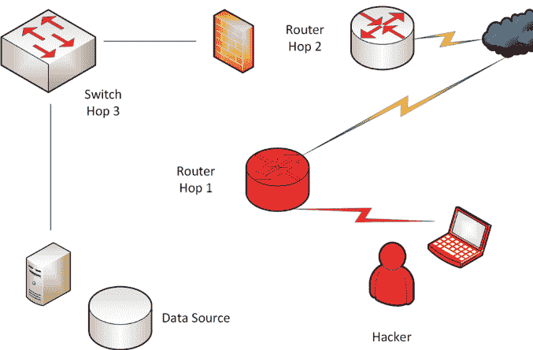

图 8-6：内部和外部破坏攻击基于相同的概念运行。

在这种攻击向量中，黑客（在这种情况下是我）正试图获取访问权限且不被发现。通过逐步（或逐跳地）渗透网络，我可以开始溜溜进入内部，从有价值的数据源收集信息。以下是我的操作方法：

- 1. 第一跳将通过一个经过 `Nmap` 扫描的路由器，发现它由于密码弱弱而存在漏洞。

通过进行密码破解，我已经进入了第一跳，并准备尝试访问下一跳。在这个路由器中，我能够执行一系列后续步骤来寻找更多信息：我可以查看路由表、`MAC` 地址表、`ARP` 缓存以及其他非专有功能以了解去向。

我可以查看路由器的配置文件并看到它是如何配置的。例如，如果我看到有一个端口连接到另一个网络，且关联的 IP 地址和子网掩码仅包含四个有效主机（包括网络标识和广播标识符），我可以假设配置的 IP 地址是 `10.1.1.2`，或许跨广域网（`WAN`）链路的下一个地址可能是 `10.1.1.3`。我可以快速 `ping` 或尝试 `telnet` 下一跳以查看结果。

诸如 Cisco 品牌路由器等专有系统使用其他协议和服务，例如 `CDP`（思科发现协议），它允许构建邻居数据库，通过运行 `show CDP` 命令即可访问该数据库，这是获取邻近主机信息的另一个例子。


## 2. 我可以尝试访问路由器第 2 跳，并执行与第一跳相同的程序。

## 3. 然后我尝试进入第 3 跳，这是一个接受 `telnet` 选项的交换机。

我还在路由器和交换机之间列了一个防火墙设备，但这可能代表一个访问控制列表（`ACL`），它拒绝流量尝试，而不一定是一个真实的独立防火墙设备。

如果其他或任何其他设备配置错误并允许连接通过，我就可以进入第三跳。

一旦我能够在第三跳维持连接，我就可以从交换机设备运行 `ping` 扫描，或查看 `MAC` 表查看可能连接了什么。在内部，我发现了一个很有趣的 `Linux` 主机，因为它也接受 `telnet` 连接，且该主机允许我快速破解并获取系统访问。

在这里，我可以检查系统，查看它是否托管了任何我可以使用的内部数据，或者我可以保持休眠，看看在其他时间何时是否有其他秘密。

尽管这是一个对渗透攻击的简化说明，包含了许多配置错误、本应禁用的协议以及应该使用的更安全版本（例如用 `SSH` 代替 `telnet`），但这并不意味着这种攻击是不可实现的。信与否，这种黑客仍在进行中。

作为渗透测试员，这教给你的是：无论使用什么类型的攻击，攻击向量和采取的路径都是相同的。如果你的网络内部存在恶意软件，且黑客可以控制连接到他们的主机，他们将执行完全相同的一系列攻击。

## 钓鱼

黑客通过钓鱼获取计算机访问的主要手段之一，钓鱼是社会工程的技术版本。你正在使用电子邮件欺骗或信息诱导某人做事（例如点击链接），这可能导致点击诱饵或点击劫持攻击，这些攻击会在你的机器上安装软件以获取其访问权限。该机器随后将成为黑客工具包的一部分，用于访问你的系统。

作为渗透测试员，你需要对内部用户尝试这种同样的攻击，看看他们是否足够聪明或经过良好训练，以至于不要点击钓鱼尝试。如果他们看到看起来很可疑（此处是双关语，`fishy`）的东西，用户知道可以做什么来阻止可能的攻击吗？

点击劫持攻击非常相似。黑客欺骗受害者点击他们认为是其他东西。受害者点击了一个他们认为合法的链接，黑客就可以获取系统的访问权限或控制。

这有点像标准的汽车劫持，但里面是点击诱饵。攻击者的目标是通过欺骗手段让你交出某些东西。

这与破坏攻击和隐蔽操作的关系在于，受害者变成了黑客攻击的一部分。当受害者本身被欺骗时，他们就成了黑客发起的攻击路径或向量的一部分。你应该熟练构建从看起来真实的地址伪造链接，将其重定向到另一个页面或网站（告知用户他们被骗了），并提供材料供他们以教育的方式学习如何识别此类攻击。

## 伪装

伪装是攻击者伪装身份并保持隐藏的方法。如果我从 `Nmap` 发起攻击并需要隐藏身份，我可以从被黑的源来实现，也可以直接从工具本身来实现。

例如，当你启动 `Nmap` 时，可以使用 `-S` 选项。专有系统诸如 `Cisco` 品牌路由器使用其他协议和服务，例如 `CDP`（思科发现协议），它允许构建邻居数据库，通过运行 `show CDP` 命令即可访问该数据库，这是获取邻近主机信息的另一个例子……（注：原文此处存在大量重复的段落，已按要求翻译并保留了原始逻辑结构）。

伪装是攻击者伪装身份并保持隐藏的方法。如果我从 `Nmap` 发起攻击并需要隐藏身份，我可以从被黑的源来实现，也可以直接从工具本身来实现。

例如，当你启动 `Nmap` 时，可以使用 `-S` 选项。

如果其他或任何其他设备配置错误并允许连接通过，我就可以进入第三跳。

### 第 8 章 破坏（绕过控制）

伪装的另一个例子是黑客让邮件对收件者来说是合法的。但在邮件头中很容易被发现，虚假地址通常列在其中。这种伪装经常发生在身上——他们收到一封来自其邮件提供商的邮件（或他们是这么认为的），说账户已被入侵，需要登录账户进行修复。当他们这样做时，就获取了攻击者的用户名和密码。

## 恶意软件

不被察觉地进入的最好方法是通过恶意软件。我在在本章稍后的“攻击向量”部分描述的原始版本，逐跳移动会在系统中留下巨大的足迹。你可以在该路径的任何点发现它。

从一个系统移动到另一个系统时，可能会被其他工具和日志捕捉。同样，你需要对每一跳进行清理和消毒以消除被发现，这有时意味着删除日志。这取决于企业使用了和部署了多少安全措施。对于任何损失巨大（且黑客获益巨大）的公司来说，他们很可能部署了此类安全措施。

## 用于寻找入口的恶意软件

恶意软件是进入的最佳方式之一，利用这一点可以获得丰厚回报。显然，通过运行 `Nessus` 等工具和其他漏洞评估工具，你会发现哪些系统未打补丁、存在漏洞且比瑞士奶酪洞还。这并不意味着它涵盖了所有向量。仅仅因为你修复了系统并不意味着它免受了攻击。

如果系统感染了恶意软件并导致如图 `8–7` 所示禁用了主机级别的保护，你可能等到太晚才发现。例如，这个版本的赛门克端点防护 (`SEP`) 已禁用，导致允许恶意软件通过。它需要很长时间的更新。如果你在主机系统上没看到，或者管理它的人没有修复，恶意软件可能已经溜掉了。你也可以通过访问主机手动使其失效。

如图 `8–8` 所示，重新启用并修复杀毒软件的唯一方法是在管理控制台上远程进行，或者在本地工作站自行修复。

## 绕过 AV 软件

绕过杀毒软件（`AV`）是穿透主机防御的一种常见方法。本地防火墙以同样的方式被绕过。当这种情况发生时，恶意软件、病毒、蠕虫、木马、后门/根内核程序和其他恶意代码将进入，并允许进一步的远程攻击。攻击也可以在本地发生；主机上提升或增加权限允许比用户之前拥有的更多访问权限。

第 8 章 颠覆（控制绕过） 111

`APT`（高级持续性威胁）通常通过多种方法实现，例如通过代码渗透、通过渗透测试工具、恶意软件、程序或其他手段访问。一旦你获得了访问权限，你可以预期黑客会进行以下操作，而作为伦理黑客，你应该执行每一步并确保你自身是安全的：

- 1. 获取初始访问（渗透）。

  这是 `APT` 攻击的第一步，可以通过我在本章列出的许多方法实现。你应当重演这些过程，以确保你的系统是安全的，并且终端用户得到了教育。

- 2. 一旦建立并能够维持访问，就要努力保护该访问并对其保密。

  这是通过隐蔽操作以及通过一切可能的手段维持这些操作来实现的。

- 3. 现在访问是安全且保密的，开始尝试移动、获取更多访问权限，并识别要访问的数据或目标。

  这是通过继续运行测试、访问其他设备、寻找目标并渗透它们来实现的，同时保持秘密和安全。

- 4. 通过外泄数据和信息来完成 `APT`。

  在保持内部状态的同时，或者带着数据离开且不被捕获。

## 3

## 深入学习：准备与测试

### 在此部分中 ...

完成渗透测试的所有准备工作；有些工作很枯燥，但所有工作对于确保渗透测试的成功都是必要的。

在你完成所有准备工作后，终于准备好进行渗透测试了！

### 本章内容

- 处理前期任务
- 确定测试需求
- 选择扫描类型和合适的工具
- 了解何时以及如何不执行

# 第 9 章

## 准备渗透测试

熟悉攻击类型和渗透测试员的工具是使用这些工具保护公司资产免受黑客及其恶意意图侵害的必要步骤。然而，在深入测试、评估和防御之前，有某些准备工作需要处理。

除了了解你正在探索什么种攻击类型以及你需要什么工具外，你必须理解你的角色、你正在测试哪些系统（或哪些不），以及利益相关者的目标和期望。我在这章中涵盖了所有这些内容以及更多，包括如果在测试开始之前必须结束测试该怎么办。

## 处理初步后勤

在进行任何渗透测试之前，你必须解决某些后勤细节，包括获取测试许可。本节重点介绍并解释了这些后勤安排。

### 召开启动会议

你可能需要召开会议来讨论角色、职责和期望。这聚集了所有相关方，他们将协助扫描、缓解发现的任何风险，或仅提供完成工作所需的必要许可。

在本节中，我重点关注与利益相关者的首次会议将发生的情况：建立角色、讨论期望、定义范围。请注意，当你开始其他准备工作时，一系列会议是必要的，这涉及到收集需求。利益相关者可能决定建立每周一次会议，或者在项目生命周期内每周举行一次。

### 理解每个人的角色

你必须理解自己在面前的场景中扮演什么角色。例如，如果你是为一家大公司的内部安全团队工作，进行渗透测试将与被聘为外部顾问为客户提供评估和渗透测试的情况略有不同。你做的一切都是样的，但你扮演的角色可能略有不同。

请注意，作为一名渗透测试员，你的首要任务是进行渗透测试以发现组织安全计划中的漏洞。你可能或可能被期望对你的发现提出建议，并实施这些建议以修复已识别的漏洞。这一切也可能是某人的责任，因此在时间上明确这些问题是如此重要。

作为渗透测试员（尤其是顾问），你可能希望明确角色和职责。图 `9-1` 显示了一个 `RACI`（负责者、解释者、咨询者和知情者）表，你可以根据需要对其进行自定义。该表用于列出谁参与了项目、谁负责特定任务等，并确保相关利益方参与到必要的水平（咨询者、知情者）。

## 角色

| 项目交付物 | 执行赞助人 | 委员会 | 项目经理 | 团队成员 | 外部资源 | 业务分析师 | 渗透测试员 |
| :--- | :--- | :--- | :--- | :--- | :--- | :--- | :--- |
| 启动阶段 | | | | | | | |
| 请求（或） | | | | | | | |
| 研究学习 | | | | | | | |
| 计划阶段 | | | | | | | |
| 执行阶段 | | | | | | | |
| 控制阶段 | | | | | | | |


| 结束阶段 | | | | | | | |

| 项目结项 | | | | | | | |

## 设定期望

如果期望是你进行一次渗透测试以测试企业的安全性，那么你被赋予了一个非常宽泛且不具体的任务来执行。你可能需要广撒大网以获得良好的收获。

## 角色（RACI 表）

（上表代表基于 OCR 文本的 RACI 结构）

该表是验证范围和设定边界的好方法，也可以记录交付物集以及谁将执行它们，并确保相关利益方参与到必要的水平（咨询者、知情者）。

## 设定期望（续）

明确说明你具体应该应该是你的会议的一部分。要讨论的话题包括：

- 是否是内部测试还是顾问测试。
- 是否是某项计划的一部分。
- 如何处理重测。

## 根据目标制定测试计划

通过这些示例，如果首要任务是，你可能想从漏洞扫描开始，并通过映射来识别威胁；如果你发现了漏洞，就进入该阶段。你所有的报告都会产生可以审查的工产物（我将在第 12 章中介绍）。

## 获取许可

成为渗透测试员要求你对正在进行的渗透测试做出极佳的评估。你是一个伦理黑客，在获得许可的情况下对网络进行主动渗透。这意味着你将不得不请求许可，这可能需要经过正式流程。

获取进行渗透测试的许可是一个多层过程。许多方面都属于早期应讨论的范畴：

- 这取决于公司的规模以及你要求完成的目标。最终，许可可能不是来自你直接接触的人，而是指挥链中更高位置的人。
- 还需要关于后续步骤的特定指南，以及你有权访问和可以做的事情。

例如，你可能会在给定的边界之外发现漏洞，从而构成威胁。正确的做法是将其上报给立即需要知道的人并寻求进一步指导，而不是去探测并尝试利用它。

- 获取许可应该是角色分配、任务达成一致并获得批准后发生的第一系列会议的一部分。
- 你可能想以秘密方式进行测试，以真正测试谁可能参与了系统保护。你可能需要获得进行此操作的单独许可。
- 你可能会损坏数据（因此你需要备份），或者你可能会导致另一个需要解决的问题。这些也是在许可讨论期间需要解决的问题。

## 遵循变更控制

你可能需要创建一个变更控制记录，以记录将进行某些变更（对你的网络和系统进行扫描、测试和尝试更改）的事实。

变更控制不仅是为了记录正在发生的事情，也是为了记录时间以及如果扫描本身引发事件且支持团队需要动员协助时所需的其他有用信息。一个关键的准备工作应该是制定一个万一出现问题时的应急预案。有关有关应急预案的更多信息，请参阅本章后后的“拥有备份”部分。

在我的经验中，我见过旧的系统和接口由于过度扫描导致技术故障发生而失败。我甚至见过触发器、阈值和警报在可能存在攻击时开始关闭，并导致生产环境中断。你所有的运营团队（他们可能不是 RACI 成员或不知道扫描正在进行）都可能开始看到可疑活动，并认为自己正受到攻击，从而对误报做出响应。

所有这些场景及更多情况都可以通过变更单和变更控制来解决。在某些可能无法遵循此流程的情况下（较小的公司可能没有相关流程），你可能希望考虑一种替代方案，以便跟踪正在进行的工作并避免问题。

## 保持备份

确保你不仅有数据的备份，还有系统、软件、固件以及对所有这些内容的访问等的备份。如果是虚拟化的，数据/系统 VM 主机和其他相关数据的快照即可。

## 拥有文档

较大的公司可能自动地将所有内容写在书面上了。如果没有，请要求建立文档，以授权你的扫描（以及你所有的活动）以及恢复数据、从灾难中恢复等的所有步骤。

## 收集需求

需求的收集基于需要完成的工作范围，但在此同时，你收集到的需求可能指示了需要做什么——并且可能与你或利益相关者预期的不同。例如，本章提供的场景仍然可以向你展示需求收集过程中的差异。如果我要进行广泛评估而非深度且特定的评估，两者的需求可能会有所不同。在这个示例中，广泛评估可能需要一组工具以及对内部和外部访问的特定访问权限。在另一种场景下，你可能只需要对内部进行扫描，并从无线接入点开始你的渗透测试。

> 这就是为什么评估通过结果和风险注册至关重要的原因——如果你定义了范围。你需要精炼实际的工具、策略、向量和方案以完成一次良好的渗透测试。随着你完善策略，你会在本章之前讨论的定期利益相关者会议提供状态更新。保持所有人知情将确保没有人（包括你）会遭遇可怕的惊喜。

## 回顾过去的测试结果

评估和准备工作的下一部分是在开始进行渗透测试之前查看已经完成的内容。你之所以这样做是因为你了解得越多，准备工作就越充分。如果你是第一次为某公司进行渗透测试，这尤为重要。从之前的评估中尽可能了解信息（检查我将介绍的风险注册），发现你是否需要立即重置，以及根据之前的评估你是否存在漏洞。

如果你以前为这家公司做过渗透测试，你可能已经（我真的希望你已经！）在现有评估工具中保存了报告或日志，如图 9–2 所示。测试的一部分是确保记录这些经验，这样你就可以缓解风险，或者记录它们并监控它们是否可以修复。拥有供未来参考的文档是无价的。

如果可能，请与进行过之前评估的其他 IT 安全团队成员讨论。向他们索要可以分享的过去结果和扫描的任何制品。记住，使用 RACI 图，这样你就知道谁有权交谈，以及你被允许透露。

## 咨询风险注册

风险注册包含了你发现的所有并需要处理的漏洞。如果之前已经进行了渗透测试，应该已经有一个包含你可以查看的条目的风险注册了。图 9–3 显示了你可以咨询的风险注册指标，以确定是否存在你可能想要定制扫描、测试和评估的区域。

## 本地扫描测试

回到网络扫描

| 名称 | 漏洞 | 严重程度 | 家族 |
|---|---|---|---|
| SSL | SSL 版本 2 和 3 协议检测 | 服务检测 | 中 |
| SSL | SSL (多个) | 通用 | |
| BTD | BTD MD (多个) | 通用 | |
| TLS | TLS (多个) | 通用 | |
| SSL/TLS | SSL/TLS 证书名称硬编码... | 杂 | |
| IP | IP 转发已启用 | 防火墙 | |
| 未加密 | 未加密的 Telnet 服务器 | 杂 | |
| DHCP | DHCP 检测 | 服务检测 | |
| 服务 | 服务选择 | 服务检测 | 低 |

**图 9-2：** 参考过去的结果以帮助未来的测试。


**图 9-3：** 审查风险注册上的威胁。

例如，你可能会发现大量漏洞位于“发布管理”类别中。你可能会发现，随着更新发送到企业，它产生的问题比能修复、解决或缓解的还要。在这种情况下，你可能决定运行渗透测试来测试你的桌面系统、应用程序和其他程序的完整性，以确保在该重点关注领域不存在已知漏洞（或没有出现新漏洞）。

第 9 章 为渗透测试做准备 123

## 制定计划

在咨询了之前的测试结果和风险注册后，你更接近于准备好进行渗透测试。你在本章之前所评估的内容，作为一个示例，展示了你需要什么样的扫描类型，根据你预期获取的数据格式，如下所示。图 9-4 显示了攻击向量：

- 1. 用户通过无线进入。
- 2. 用户在不被察觉的情况下访问数据库。
- 3. 用户在不被察觉的情况下继续获取数据。

有了这些信息，你可以选择可能有助于完成此次渗透测试的工具，确定采取的向量，并在第 10 章中进行。


## 选择扫描类型

在准备渗透测试时，在你知道需要工具后，首先需要规划的事情之一是工具选择。这似乎是常识，事实也如此；然而，许多变量取决于扫描类型、利益相关者的要求，以及是季度、每月还是年度扫描。由于这些变量，请考虑需要的工具以及你访问的向量。例如，你可能需要不同的工具访问有线网络。


接下来考虑你需要详细进行的扫描类型。因为你需要连接到无线网络进行测试，请考虑支持无线功能的工具，如 `Wireshark` 及其无线功能。你可能想要围绕网络映射（`Nmap`）和使用 `Nessus` 进行基础扫描（见图 9-5）的其他扫描类型，以获取进行 `APT` 所需的信息。


图 9-5：审查 `Nessus` 模板。

## 选择工具

在本节中你选择你的工具。通常，使用最常用的工具（包括 `Nessus`, `Nmap`, `Kali`, `Wireshark`）以及其他系统和操作系统工具来帮助你进行 `APT`。

在开始渗透测试之前，你还需要为任务准备好工具箱。例如，如果你知道你可能想查看是否访问 `FTP` 服务器，你可以定制一套 `FTP` 过滤器来立即提取特定信息。根据你能够收集的数据，你可能需要搜索可用于 `APT` 的用户名和密码。图 9-6 显示了 `Wireshark` 的过滤选项，可以快速获取所需数据。

## 无线网络连接

编辑 查看 转 帮助 分析 设置 工具 窗口 帮助

| | | | | | | | | | | | | | | |

|---|---|---|---|---|---|---|---|---|---|---||


| 30. | 154.096 | 20.22.31.207 | 20:55:35 | 130.57.1.172 | 192.168.1.144 | | | | | | | |
| 31. | 184.063 | 0.801918.31.90 | 20:55:35 | 130.57.1.172 | 192.168.1.144 | | | | | | | |
| 32. | 165.482 | 0.319317.31.60 | 20:55:35 | 130.57.1.172 | 192.168.1.144 | | | | | | | |
| 33. | 218.136 | 0.208333.31.95 | 20:55:35 | 130.57.1.172 | 192.168.1.144 | | | | | | | |
| 34. | 153.449 | 0.248958.31.55 | 20:55:35 | 130.57.1.172 | 192.168.1.144 | | | | | | | |
| 35. | 219.035 | 0.197910.31.98 | 20:55:35 | 130.57.1.172 | 192.168.1.144 | | | | | | | |
| 36. | 195.096 | 0.215956.31.52 | 20:55:35 | 130.57.1.172 | 192.168.1.144 | | | | | | | |
| 37. | 209.285 | 0.206225.31.94 | 20:55:35 | 130.57.1.172 | 192.168.1.144 | | | | | | | |

响应: 220 欢迎访问 ftp.windows.com。
响应: 331 用户名登录错误
响应: 530 使用 USER 和 PASS 登录失败
响应: 530 用户需要密码
响应: 530 用户需要密码
响应: 530 登录错误。

帧 3180: 链路上 76 字节 (76 字节), 接口 `eth0` 捕获到 76 字节 (80 字节)
以太网, 源:00:0c:29:43:11:01, 目的:00:50:56:c0:00:3a, 长度:76 (IP:00:14:c2:b3:35:4a)
网协议: 版本 4, 源端口:21, 目的端口:54667, 序列号:209, 确认号:104, 长度: 22
文件传输协议 (`FTP`): 协议

```
0000 48 65 6c 6f 20 57 6f 72 6c 64 20 21 20 27 21 01 08 00 45 00
0010 61 00 01 05 00 00 00 40 06 41 60 00 00 00 00 00 00 00 00 00
0020 00 04 00 00 08 06 00 00 42 00 01 00 00 00 00 00 00 00 00 00
0030 00 00 00 00 00 00 00 00 00 00 00 00 2e 22e 2e 25 20 20 20 20 20
0000  6 66 66 66 66 75 22 22 65 20  0
```

-6
带有预处理过滤器的调优工具。
文件传输协议 (`FTP`): 协议

## 渗透测试的注意事项

在开始实际渗透测试之前，请深呼吸并考虑你已建立的计划。考虑以下提示，以确保你不仅不会失败，而且不会出现可能破坏你的声誉或客户声誉的不符。

- 保持专注非常重要。作为一名测试人员，你可能充满好奇。挑战极限并寻找你可以穿过的漏洞以实现你的目标。这与实际组织赞助的渗透测试非常不同。你可能需要遵循某些准则。
- 保持目标非常重要。你有一个计划；请坚持执行。你可以考虑各种选项和替代方案，但你需要将它们作为机会记录在你的日志中。

例如，我个人会尝试通过利用弱密码来黑入路由器。下一步是查看我的跳数是多少。查看路由表，并在 Cisco 路由器中通过 `route` 命令查找一系列路由。我可能会发现一条我本并不想查看的路由，并对其进行探测，看看路由器会告诉我什么。

```
RouterA# show ip route 130.115.0.0
Routing entry for 130.115.0.0 (mask 255.255.0.0)
Known via "igrp 100", distance 100, metric 10988
Tag #
```

126 第 3 部分 深入阶段：准备与测试
通过 "igrp 100" 重新分发

## 3. 利用 (Exploit)

在此阶段，黑客构建了前一个阶段，实际上实现或授予了访问权限以及数据访问，并且可以从攻击中获取价值价值。

利用是指攻击者已经进行了攻击以获取并假设控制权；然而，下一步是执行利用。窃取数据、获取凭据、等待 APT（高级持续性威胁）以及他们所做的操作。你可以进行类似的攻击，以观察工具是否会标记此类攻击的发生，以及安全团队如何更好地监控（并响应）这些攻击。

## 4. 执行高级持续性威胁 (Conduct an advanced persistent threat)

这种多级攻击的最终阶段是 APT。在不被发现的情况下获取、维持、移动能力并最终获得对价值数据的访问，是所有攻击中价值价值的。

## 5. 数据外泄 (Exfiltration)

如果他们能够完成之前的步骤并不留痕迹地消失，那么他们的攻击是非常成功的。

你想像渗透测试员那样做，看看是否有人在你知情的情况下进入了系统。在 X 公司的场景中，用一个 Excel 表格完成你的渗透测试，并查看是否有任何系统记录下你访问能力的痕迹。

第 9 章将带你完成进行渗透测试所需的准备工作：初步成本评估、需求收集和规划。虽然我在接下来的章节中将逐步引导你完成测试过程，但在继续此处之前阅读该章节将让你受益。

## 渗透 (Infiltration)

X 公司是一家在市场上市的科技公司，属于中型企业，约有 10,000 名员工。

目标是内部持有的数据，例如可能等待专利的新技术开发（研发）秘密、销售数据或尚未向公众发布的营销信息。你知道公司的名称，并想启动渗透测试，看看是否能找到这些数据可能位于何处或保存在哪里。以下是步骤（记住在过程中记录你的所做和发现的内容）：

- 1. 找出数据存储的位置。
对于 X 公司的例子，你将执行我在第 2 章描述的侦察工作。你发现公司数据中心及其镜像位于科罗拉多州和德克萨斯州。
- 2. 获取位置信息后，追踪主站电话号码并开始探测伪造的电话。
你可以简单地帮助帮助台，谎称自己是内部资源，想要开启工单并获取有用信息，如源 IP（这样你可以获取内部网络的实际 IP 地址）以及其他目标信息。
- 3. 为了从外部访问，使用 `Whois` 数据库查询 DNS 并定位一个可以扫描的公共 IP 地址。
图 10-1 显示了在尝试寻找攻击向量时查找公共信息以获取洞角的示例。在这里，如果我对一个域名进行搜索，我可能会找到可能位于其网络上的名称服务器。并非所有公司都这样做，但这可能提供一些线索。
图 10-1：执行 `Whois` 搜索以获取情报。
第 3 部分 深入：准备与测试
- 4. 运行 `ping`（如图 10-2 所示）从域名中获取 IP 地址。
- 5. 开始针对该 IP 运行 `Nmap` 或工具。
目标是找到一个 IP 地址或范围，使用你的网络映射器（如 `Kali` 或 `Nmap`）进行扫描，这可以帮助你进入网络。

```
Command Prompt
c© 2016 Microsoft Corporation. All rights reserved.
:\Users\rishimonski>ping -t ns1.google.com
Pinging ns1.google.com [216.239.32.10] with 32 bytes of data:
reply from 216.239.32.10: time=24ms TTL=45
reply from 216.239.32.10: time=26ms TTL=45
reply from 216.239.32.10: time=25ms TTL=45
reply from 216.239.32.10: time=24ms TTL=45
Ping statistics for 216.239.32.10:
Packets: Sent = 4, Received = 4, Loss = 0 (0% loss)
imate round trip times in milliseconds:
Minimum = 24ms, Maximum = 26ms, Average = 24ms
```


## 渗透 (Penetration)

- 6. 进入后，找到访问目标的方法。

在这种情况下，目标是内部持有的数据。获取数据最简单、最常见的方法包括：

- 通过电子邮件或其他手段向网络部署恶意软件。当用户点击它时，你可以通过木洛马访问他们的机器，并从那里像控制僵尸一样控制它以进行更多的侦察工作。
- 对你正在扫描的网络边缘的路由器（例如）进行暴力破解攻击，看看是否能通过破解密码获得访问权限。在这种场景下，假设路由器留有 HTTP 配置，你可以使用 Kali 的 `hyd` 对其进行探测，如图 10-3 所示。使用该工具，你可以找到路由器的用户名和密码，现在进入并获取访问。
- 7. 一旦获得访问，获取控制台访问，然后通过 `telnet` 或 `SSH` 连接到设备。

这里的目标是将设备作为跳板，进入你识别的下一个目标。

- 8. 当你拥有控制台访问时，查看路由表、ARP 表、配置和其他项目，以开发可见范围的手动地图。

图 10-3：使用 Kali (`hydra`) 破解路由器密码。

## 利用 (Exploitation)

- 9. 开始扫描、映射并识别网络的其余资产。

在图 10-4 中，我创建了从这个第一个路由器跳跃认为可以到达的地方的手动地图。

图 10-4：带有 IP 地址的网络地图。

## APT

- 10. 开始 APT，一种长期对抗。

在测试的这个阶段，你已经做了足够的事开始 APT——你可以潜伏在网络内部保持不被发现，以便继续研究并提取更多信息。

从一个设备移动到另一个设备，我发现了一个 Unix 服务器（看起来像双节点集群；参考图 10-4），位于 `10.1.2.10` 和 `10.2.11`。在这里我认为我探测了端口并发现了一个可能访问的数据库端口。

## 外泄 (Exfiltration，与成功)

- 11. 退出。

如果他们能够完成之前的步骤并不留痕迹地消失，那么他们的攻击是非常成功的。

我在第 11 章中讨论了这一过程。报告就是你交付给领导层、所有者、利益相关者以及任何投入你测试的人员，他们汇聚在你周围，为修复提供资金、提供资源或协助你完成使命。在本节中，我将讨论网络映射、风险清单，以及如何在你发现的内容和提出的建议之间保持平衡。（第 12 章涵盖了建议。）

## 网络映射

在获得访问权限后，任何黑客或测试人员都会做的下一项任务就是创建网络地图，正如在本章前面的“利用”部分所示。地图是一个基础性的构建块，也是通往成功的 APT（高级持续性威胁）最大的一步；它是通往高级攻击和黑客行为的路线图。它还提供了你可以包含在报告中的丰富信息。

从 Nessus 开始，你可以运行漏洞扫描来寻找网络中可以爬入的漏洞。如图 10-5 所示，你应该接入你发现的一些 IP 地址（可能是你识别出的数据库集群），并让 Nessus 暴露它的问题、存在哪些漏洞、配置了何种补丁级别等。一旦你审查了这些内容，就可以提取信息来发起更多攻击。例如，你可能需要寻找开放端口和 IP 地址的组合，以获得对目标资源的套接访问。这些线索帮助你发起攻击以测试并查看其是否可行。

如果可行，黑客也能做到，因此你需要在报告中记录它并将其添加到风险清单中。

图 10-5：使用 Nessus 构建网络地图。

你可以使用 Nmap 运行扫描，如图 10-6 所示。一旦扫描完成，你就审查报告，运行相同的测试，并将适当的信息添加到清单中。

图 10-6 使用 Nmap 构建网络地图。

## 更新风险清单

在运行工具时，你必须仔细地记录风险。在渗透测试的这一阶段，你应该意识到补丁的缺失、任何关键杀毒软件的受损、本不应开启却被遗留的端口，或者无法检测到你曾进入过的关键系统。哪些是关键数据、声誉、财务等。所有这些内容在进行网络映射时都属于风险评估范围。它们是相辅相成的。将在第 11 章中详细介绍风险清单。

## 保持平衡

你无法保护一切：你无法让万物都变得无坚不摧。系统的开放性以及互联网访问资源的能力，意味着你总会在安全计划中留下某种形式的漏洞。我一直想要解释的是，需要一种平衡，并根据需要应用安全。

这在进行评估时是成立的。当你进行渗透测试时，你显然能够敲门，而这些门甚至可能会被打开。其中一些可能是故意的，因为它们可以提供服务，例如端口 `80` 允许 HTTP 流量流动以便人们可以使用网页。Windows 的某些管理员账户被保持激活状态，并被设置为蜜罐，以审计针对它的尝试。

对于你这个安全分析师来说，展示出存在潜在的威胁者正在尝试探测可能有所帮助。无论如何，这都会进入你的地图并进入你的报告，这两者最终都会反馈到风险清单中。

## 其他获取方法和向量

并不是所有的渗透测试都应该通过技术资产或工具完成。我敦促你采用需要技巧的获取方法和向量，例如投放、跳过、屏幕潜行、社交工程、破窗入室（在获得许可的情况下！）以及转储。我在第 2 章中描述了其中一些方法，在那里我预先讨论了黑客的前期侦察，但你可以在过程中执行它们。

扫描、评估、探测和网络映射将向你展示你的选择。然后，你可以开始假设一个身份并伪造地址或污染 ARP 缓存。从那里开始，你可以进行 MITM 攻击（中间人攻击）、重放攻击、窃听并冒充他人的身份。

那么，还有哪些攻击是你已知的威胁向量或网络环节可能呈现的？路由器跳跃和无线访问是两个，但通过 VPN 接入设备进入呢？其他访问选项呢？还有许多其他向量需要评估，如无线、有线、移动、VPN、拨号等；确保查看所有的它们。

## 评估

进行渗透测试后，你进入评估和报告发现的阶段。在本节中，我专注于评估公司 X 的渗透测试结果以及本章的伦理黑客攻击。然而，我也会注意到你在面对特定类型攻击（例如我在第 5-8 章中讨论的攻击）时的不同之处，以及你在其他渗透测试场景中可能会看到的内容。

## 渗透

在渗透中，攻击者必须连接到他们想要利用的技术。渗透测试人员将希望确保他们工作于测试和扫描漏洞，防止未经授权的人连接到他们不属于的网络。

这应该通过限制能够溜过并连接到第一层安全防护的人员，最大限地减少攻击数量。如果应用了深度防御，你的努力应该从阻止攻击开始。确保你禁止从可以通过这种方式被探测的设备进行登录访问。

我之前还提到一个路由器允许了来自它不知的 IP 地址的连接。可以在设备上配置访问控制列表 (`ACL`)，告诉它只允许来自受信 IP 的访问。

- **压制与干扰**：我在第 6 章中讨论的压制与干扰攻击并不总是依赖于隐蔽操作。除非是在内部进行的，否则渗透渗透的作用微乎其微。除了网络映射以识别目标主机外，几乎没有其他信息收集。

渗透测试人员将希望确保他们工作于测试和扫描漏洞，防止未经授权的人连接到他们不属于的网络。如果攻击者无法映射你的网络，他们就无法对你进行压制。这并不意味着无法在其他地方收集信息。

- **颠覆**：根据我在第 8 章讨论的颠覆式攻击发现，你需要评估的最大威胁之一是未被检测到的系统访问，因为你不知道它正在发生。

## 突破

在渗透中，攻击者必须连接到他们想要利用的技术。渗透测试人员将希望确保他们工作于测试和扫描漏洞，防止未经授权的人连接到他们不属于的网络。如果攻击者无法映射你的网络，他们就无法对你进行压制。这并不意味着无法在其他地方收集信息。

利用是指攻击者发起了攻击以获取并假设控制；下一步是实际执行利用：窃取数据、获取凭据、潜伏等待等。渗透测试人员进行类似的攻击，以查看工具是否可以标记正在发生的此类攻击，以及安全团队如何更好地监控（响应）它们。

在压制与干扰攻击的情况下，这种利用发生在攻击者发起了攻击并成功中断了你的运行。如果你公司的网页由于拒绝服务攻击而无法访问，那么这种利用就是成功的。这只是多年来由高级黑客反复利用的一种常见攻击向量和类型。它也可以并已经被非常低级的脚本小子使用在暗网上找到的工具执行。

## 外泄

数据外泄对于攻击者来说是一个巨大的胜利。如果他们能够渗透、突破并利用，并在不留痕迹的情况下消失，那么他们的攻击就是非常成功的。你作为渗透测试人员希望这样做，并查看你是否可以设置方法来识别是否有人在你的不知情的情况下进入了系统。

在公司 X 的场景中，你通过外泄结束渗透测试，并查看任何系统是否捕捉到你访问的痕迹。

- **压制与干扰**：对于拒绝服务攻击，外泄的形式为从根本上不发现——通常通过伪造或使用僵尸网络来进行非法活动。

破坏（Destroy）：如果黑客在资源破坏后成功外泄数据，如果你有活跃的备份，则可以将后果降至最低。如果源数据/代码被破坏且你没有备份，你将丢失某些数据，而那些传输过程中（备份之前）丢失的数据将永远丢失。

你可能认为，当你结束测试时，你会意识到风险。但那些你未察觉的风险（例如逻辑炸弹，我将在第 7 章中介绍）可能会让你付出代价。你损失了时间和声誉，但你最大的成本（如果你有有效的备份）是恢复系统的时间。在评估和报告中需要考虑的其他成本还包括系统重装、镜像恢复、数据重新应用等相关费用。

如果你发现需要补丁 2,000 台系统，你所在评估的内容之一就是：如果没进行补丁，以后恢复这 2,000 台系统需要什么代价。

渗透（Subvert）：你可能会在渗透攻击中损失许多——数据、贸易秘密、隐私、声誉（可能是最大的成本）、信息。一个很好的例子是医疗保健网络受到攻击导致患者数据被盗取。这将导致受影响的公司面临诉讼，并因隐私问题失去消费者。

当你在渗透攻击后完成评估时，你将识别出第 8 章讨论的问题。但你必须记住，其他攻击有时被用作多攻攻的掩护，黑客在你忙于处理逻辑炸弹或恶意软件带来的混乱时发起 APT（高级持续性威胁）。

# 预防（Prevention）

在你完成评估并向利益相关者报告发现后，需要进行一场关于预防的对话。在本节中，我将重点介绍通用的预防最佳实践——加固、监控，当然还有测试（更多信息请参见第 13 章）。我还提到了之前章节中讨论的预防攻击的具体方法，特别是压制与干扰（whelm and disrupt，第 6 章）、破坏（destroy，第 7 章）和渗透（subvert，第 8 章）。

# 加固（Hardening）

花看看你在渗透测试中使用的工具和进行的攻击，并将这些提示作为你的入门指南：

- **研究厂商网站。** 查找正在使用的技术并查看厂商推荐的建议。例如，如果你正在使用微软技术，微软网站上实际上有成千上万份文档教你如何加固其技术的安全性。这可能是应用漏洞修复程序、服务包、热补、新工具、移除服务或增加服务。
- **在不破坏或限制系统功能的情况下加固系统。** 这种平衡可能很难实现，因为你会发现实际上对某些东西进行了过度加固，以至于可能无法使用。
- **测试并反复测试。** 加固你的系统并重新进行渗透测试。

# 主动监控（Active monitoring）

另一种很好的预防方法是进行主动监控。如果你持续监控系统的使用情况及其活动，你就能对这些活动建立基准，并希望异常发生时能够发现。这些异常可能被标记为可能的攻击。

# 重测（Retesting）

正如我在“加固”部分提到的，永远不要停止测试。所有系统都需要以新硬件、新固件、更新软件和操作系统的形式进行主动更新。每个设备的驱动程序都需要新更新。每当这种情况发生时，威胁的可能性就会暴露。进行更新，然后重新测试。

# 从教训中总结最佳实践

你可以遵循的最有效的最佳实践是在真实环境中通过测试中学到的教训。仅阅读有帮助，但你接触工具、测试环境并审查结果得越多，最终就会开始产生更多的知识。通过分析真实的攻击，你可以从过去的测试（以及可能的错误）中学习，帮助你利用预防措施来保持系统的安全和可靠。

# 压制与干扰（Overwhelm and disrupt）

可以通过以下方式阻止许多压制与干扰攻击（见第 6 章）并减轻 DoS 风险：

- 按需为系统打补丁。
- 在确保杀病毒软件更新并运行的情况下，分并确保恶意软件检测。
- 在路由器和防火墙的关键点拦截流量（例如 ICMP 威胁）。监控这些流量并使用入侵防御和检测系统设置报警，以提醒可疑的流量模式。

# 破坏（Destroy）

关于破坏攻击，预防是以知识的形式存在的。如果你的系统、工具和保护软件保持更新，报告中的扫描结果和发现的问题将协助缓解这些问题的后续步骤。

此列表强调了帮助防止破坏攻击的方法，这些攻击通常通过恶意软件进入你的系统和基础设施发起的：

- **教育用户。** 一些公司存在多个问题，渗透测试无法触及平板电脑和手机等终端设备。现在，你可以从手机登录公司邮箱，而你的渗透测试工具可能够不到它们。任何人都应该打开未请求的邮件附件和链接。
- **备份关键数据。** 你可以防止破坏攻击，但你也可以从中恢复。这意味着你必须对关键数据有良好的备份。
- **考虑用户系统权限和许可。** 某些渗透工具可以识别用户是否具有安装软件的高权限。这应该被识别并移除，因为这是病毒传播最简单的方式。
- **阻止恶意软件。** 在最高水平（你也可以检查这些）：
  - 使用杀病毒软件并保持其更新和运行。
  - 按需为系统打补丁。
  - 在路由器和防火墙的关键点拦截流量（例如恶意软件）。
  - 监控这些流量并使用入侵防御和检测系统设置报警，以提醒可疑的流量模式。

# 渗透（Subvert）

与防止破坏攻击类似，防止渗透攻击依赖于知识。如果你的系统、工具和保护软件保持更新，报告中的扫描结果和发现的问题将协助缓解这些问题的后续步骤。

与破坏攻击一样，渗透攻击使用了恶意软件。参考前节“破坏”中关于教育用户、用户权限和阻止恶意软件的要点，因为那些点同样适用。

防止渗透攻击的其他方法是考虑阻止来自 Nessus 等工具扫描出的端口和访问。还要阻止特权账户并设置蜜蜜罐（用作诱饵的账户）。

# 4 编写渗透测试报告（Creating a Pen Test Report）

在本部分中

学习如何创建一个专业的报告，展示你在渗透测试期间发现的任何弱点和漏洞。

了解如何进行测试后评估和建议。

始终记住重测，以确保所有工作确实提高了安全性。

在本章中

- 探索报告的各个部分：从执行摘要到附录
- 了解报告中应该包含什么——以及应该排除什么
- 清晰且专业地沟通你的发现
- 跟进风险注册表

# 第 11 章报告（Reporting）

当你进行渗透测试时，可能会暴露一些弱点和漏洞。下一步是报告你的发现。在本章中，我将向你展示如何创建一个专业的报告来交付这些发现。

报告的目标是关注需要做什么。你根据项目范围来确定需要做什么。它涉及从整体上应用安全。保持警惕并维持高安全态势需要应用深度防御（这种概念是指，如果你想保护某些东西，就要考虑所有可能被利用的方式并相应地增加安全层）。你不需要让报告变得杂乱，但同时，你需要详尽记录你发现的任何关键问题。

# 渗透测试报告的结构

你的报告应该结合你使用的工具（某些工具会自动生成报告）以及你自己的编写工作，以解释环境的整体健康状况。报告包含项目范围内的任何章节（参见第 9 章），但此列表显示了常见的章节：

- **执行摘要（Executive Summary）：** 执行摘要简要介绍了报告的所有关键细节。它将以读者易于理解的方式让他们知道采取了哪些步骤、报告最终发现了什么，以及后续步骤的概述或亮点，可能包括建议（参见第 12 章）。
- **工具、方法和向量（Tools, Methods, and Vectors）：** 此部分涵盖了你使用的工具以及选择进行渗透测试的方法。除了提供道德黑客行为的通用概述或叙述外，还要详细说明你所采取的路径、详细的分步骤攻击模式和选定的向量。
- **详细发现（Detailed Findings）：** 在这里将列出所有的安全风险、漏洞、渗透点、威胁和关注点。详细包含每个项目的技术方面。
- **结论（Conclusion）：** 报告的这一部分重申了执行摘要，重点关注后续步骤。
- **建议（Recommendations）：** 尽管你的工作最终是进行渗透测试并评估组织整体安全态的健康状况，但你可能还负责提供改进安全的方法。如果是这样，请将其放在单独的章节中，并尽可能详细。
- **附录（Appendix）：** 包含此章节，用于图表、日志和任何超出项目范围但可能有帮助的信息。

此列表显示了某些报告的结构，以为你提供一个起点。你的公司可能有其希望你报告的特定方式，或者你可能会在网上找到其他示例，为你提供更多可选的思路。

## 执行摘要

报告中要考虑的第一部分是执行摘要。当你在一个可能由高层管理人员阅读的组织中进行摘要响应时，该摘要就变成了“执行”级别。

对于在这些环境中工作的人，很多时候你几乎没有时间与高管交流和见面，因此将执行摘要想象成一次“电梯演讲”。你需要非常快速、简洁地讨论你的目标、结果，并提供关键发现的层层视图。将细节保留在报告正文中，而不是摘要中。

总的来说，摘要的目标是让读者知道采取了哪些步骤、最终发现了什么以及后续步骤。如果这些是渗透测试的细节，执行摘要看起来可能像图 11-1 所示：

所有 Apache Web 服务器存在公司级问题，无需补丁即可被远程访问（更适合放在发现的正文中）。

你已经或目标是确定由于公司依赖第四季度的盈利，全公司的 Web 架构在即将到来的假期期间是安全的。

## 执行摘要
根据 X 公司的要求，进行了渗透测试以确保在 IT 专业人员近期内部担忧的情况下，Web 架构的安全态是可靠的。确保不出现问题并在第四季度销售高峰和即将到来的假期季节期间保持安全至关重要。

在对该架构进行渗透测试时，发现了以下内容：
- 42 个已识别风险已添加到风险注册表中。
- 37 个识别风险可以在 XX/XX/XX 之前完全缓解。
- 剩余 5 个风险是可以接受的风险，将进行监控。

图 11-1 执行摘要。

截至此测试和报告完成时，认为在缓解所有风险后，安全态将按照预期和要求一直维持到年底。

（这不仅是一个建议；而且它符合受众的需求。我没有获得有关补丁、供应商、系统名称、技术术语或任何其他对执行摘要重要但不需要的信息细节。这些细节可以添加到其他章节和附录中。）

执行摘要要考虑的另一个大项目是范围。这应该在报告的第一部分读得非常清晰。我涵盖了需要并已完成扫描。我没有涉及我所选择的向量、使用的工具和方法等。我必须识别 Web 架构，因为那在范围内。我不需要扫描每一个部分并对整个企业的技术足迹进行渗透测试。渗透测试的范围是识别 Web 架构的安全态是否高，这就是我包含在摘要中的内容。）

# 工具、方法和向量

报告的这部分可以提供更详细的内容，涵盖了使用的工具、选择进行渗透测试的方法、采取的路径、攻击模式和选定的向量。你也可以编写道德黑客行为的通用概述或叙述。

图 11-2 显示了一个示例。你可以详细说明或映射你采取的路径或向量的细节、你使用的工具以及任何特定的攻击方法。这可以视为攻击叙述。


图 11-2 攻击叙述示例。

根据渗透测试的长度和复杂性，此部分可以继续后续内容：

图 11-3 显示了此部分可能呈现的示例。

# 工具、方法和向量

| 在收到来自 X 公司关于需要保护的特定信息后，后续步骤包括： |
| :--- |
| 进行侦察 |
| 为发起初始攻击收集信息 |
| 一旦确定了公共地址空间并映射了本地基础设施，就运行了使用 Metploit 进行漏洞评估的步骤，并显示以下内容的报告 |
| 主机 x.x.x TCP/IP 栈中的漏洞 |
| DNS 和区域传输的开放端口 |
| 发现了尝试 SQL 注入的可能性，并成为下一个评估目标 |

图 11-3 工具、方法和向量示例。

你应该始终假设其他团队（在许可的情况下）可能会阅读你的报告以帮助缓解风险。你是渗透测试员，但系统管理员可能是需要修复提供区域传输的服务器的人。报告发现可能需要交给 SQL 数据库管理员（或开发人员），他们可以帮助修复数据库以阻止注入。

## 详细发现

在这里你将列出所有的安全风险、漏洞、渗透点、威胁和关注点，并详细包含每个项目的技术方面。这是报告中你真正深入挖掘发现细节的部分。

如果你能够渗透特定的端口和 IP 地址组合或挫败路由器的安全性，所有这些都应进入详细发现。你还可以使用创建的笔记以及工具报告和审计输出来帮助构建主报告，如图 11-4 所示。

## 主要发现

已发现的操作系统

| 操作系统 | 主机 | 服务 | 漏洞 |
| --- | --- | --- | --- |
| OS | 2 | 2 | 0 |
| Linux | 0 | 9 | 0 |
| 未知 | 7 | 189 | 0 |

已发现的主机

| | IP 地址 | 主机名 | 操作系统 | 服务 | 漏洞 |
| --- | --- | --- | --- | --- | --- |
| 8/22/19 1:39 PM | 192.168.1.144 | erikas-IP.home | IOS | | 1 | 0 |
| 8/22/19 1:39 PM | 192.168.1.102 | 192.168.1.102 | 未知 | 0 | 0 |
| 8/22/19 1:39 PM | 192.168.1.166 | new-host-5.home | IOS | 1 | 0 |
| 8/22/19 1:39 PM | 192.168.1.100 | IP-STB1.home | 未知 | 0 | 0 |
| 8/22/19 1:39 PM | 192.168.1.101 | IP-STB2.home | 未知 | 0 | 0 |
| 8/22/19 1:39 PM | 192.168.1.113 | Rob-HP.home | 未知 | 0 | 0 |

图 11-4: 将你的发现包含在报告中。

正是这些发现让技术团队不仅能够修复你在渗透测试中发现的问题，还能识别任何其他与所进行的渗透测试相关（或不相关）的问题。例如，你的目标（在范围范围内）可能是保护 Web 架构，但技术团队发现所有 Windows 服务器都缺少关键补丁，而这些补丁可以帮助缓解工具可能发现的问题。

你不希望让报告过载或信息冗余，也不要过度偏离目标/范围；你有义务告知在此过程中识别的任何所有安全违规行为。将超出项目范围的细节存放在附录中。

## 结论

结论部分将你汇编到报告中的所有内容进行简明扼要的总结，并关注下一步。重复你在执行摘要中写的内容是可以的，只要你将重点转移到下一步即可。你当然在正文或报告的任何地方列出了下一步，但结尾的结论应该从整体上、有针对地审视下一步。图 11-5 显示了一个示例。

如你所见，下一步是进行重测（我将在第 13 章中介绍），以确保任何记录的更改、修复、风险规避或合规事项已得到正确处理和执行。重测将证明这一点。

在对 X 公司的 Web 架构进行仔细检查后，发现了大约 50 个风险，需要进行处理以确保公司具有更高的安全态势并保持安全。虽然报告中列出了具体步骤，但报告将在完成以下内容后定稿：

- 风险注册条目已完成。
- 不晚于 MM/DD/YY 采取行动以缓解所有已识别的风险。

已安排了不晚于 MM/DD/YY 的后续渗透测试行动，以确保符合本报告。

图 11-5: 报告结论的示例。

## 建议

作为渗透测试人员，根据项目范围或公司规模，你可能需要向那些需要的人提供帮助。较小的组织可能要求你修复你发现的问题，如果可以，请将其加入报告中。你可以创建一个单独的章节，或将其添加到详细发现中。

如你所见，详细发现、附录和建议可以根据你报告的需求进行重新利用和重新组织。你可以在附录中列出一份建议列表。

> 如果建议在范围内，就应该提出建议。并非所有的渗透测试人员都被要求建议如何修复他们在渗透测试中发现的项。你应该知道如何修复你识别出的项目吗？如果你想了解更多关于安全以及如何成为一名更好的渗透测试人员，那么答案是肯定的，但这并不意味着它必须出现在报告摘要中。如果在范围内，你理应创建一个你认为公司或组织应该执行的项列表，以缓解你识别出的风险。请看第 12 章，我在那里详细介绍了建议。

## 附录

许多报告可能包含额外信息，这些信息可能完全或不相关你渗透测试和报告的范围或目标。将此类信息放在报告末尾的附录或多个附录中（如果有多个）。可以放在这里的其他信息可能是网络图、地图、完整审计或工具日志以及对使用或阅读报告的人有帮助的项目。

## 创建专业且准确的报告

编写报告不仅仅是包含我在上一节中描述的正确章节。你需要表现得专业，展示正确的数据，并且不要误导事实。我整理了这份“要做与不要做”清单，以确保你交付一份出色的报告。

## 保持专业

对于报告本身，请考虑使用公司信头或公司品牌化的办公文档。

对于报告演示（我将在本章稍后讨论），考虑使用 Power-Point、Keynote 或或其他演示程序来展示你的发现。

## 保持聚焦

渗透测试的目的是通过分析、评估和测试帮助组织识别潜在威胁。你也可以借此开发有助于规避风险的策略。如果这是一个重大的安全问题，它应该是讨论的话题；如果不是，则应该排除在报告之外。

### 避免误报

当你结束测试并撰写报告时，你需要确保你的报告经过了仔细清理，以免误导测试结果。在进一步的步骤中，你应该确保对数据收集执行了检查，以过滤掉报告发现中的误报。

对于那些熟悉防火墙和防火墙日志的人（例如），如果你查看日志输出会立即感到眼目缭乱。尽管如此，你可能希望使用信息片段。你还可以通过清理信息来突出你希望报告读者关注的内容。

最后，你不希望报告中出现错误或错误的信息。因此，你应该在使用数据之前对其进行数据清理（或脱敏）。一个示例是，如果你试图显示从未经授权的 IP 地址进入 FTP 端口的日志，你会想要移除任何来自授权的信息。这些可能显示为误报，即访问被标记并记录，但并不构成渗透测试和威胁评估。

### 分类你的数据

报告的另一个重要因素可能是考虑进行数据分类，以便你的报告发现易于解释和分配修复任务。例如，如果你将发现归类为颠覆攻击、破坏攻击或书中提供的其他示例中，你还可以根据这些发现确定优先级。

其目标是确保重要数据易于识别和分配。在尝试确保风险合规、管理、规避和接受时，你希望确保不会遗漏任何基于渗透测试结果的优先级。

### 强化员工意识和培训

你的报告应该包含指向由于渗透测试和道德黑客而需要员工培训和意识领域的信息。

由于渗透报告可能包含某些敏感（有时是危险的）信息，因此你必须将报告提交给那些需要了解的人。除非你有许可披露这些发现，否则你的结果应被视为机密。因为报告本质上创建了一份绕过非常昂贵的安全技术并窃取公司数据的逐步路线图，你应该对报告进行安全保护，甚至进行保护或加密以妥善保存。

报告的结构与你的测试报告相同，具有相同的章节。由于你将在报告发布期间演示报告，创建一个带有幻灯片的演示文稿可以帮助你涵盖合适的要点，同时以清晰、可视化且专业的方式展示信息。

## 更新风险注册表

报告仅仅是一份文档。重要的是你如何处理报告中的信息。在概述了一系列需要执行的修复措施后，将其添加到风险注册表中并进行优先级排序。我在第 2 章中介绍的风险注册表是需要处理以降低风险的风险数据库，且两者都可以是特定的风险规避或风险规避特定的。

在进行扫描、渗透和测试时，你会发现需要添加到风险注册表的问题。报告是专门为每次测试创建的，而注册表是一份动态的文档，它伴随着所有测试后报告并不断更新。风险注册表通常包括发现的风险和漏洞、你发现它们的方法、每个风险相关的风险水平以及处理每个风险的优先级。例如：

- 低级风险：当你知道某个问题时，风险可能很小，但你接受了它成为问题的风险，因为你当时可能无法修复它。也许软件供应商尚未提供补丁，你必须得等待。

你可能会识别出一个风险并决定对其进行监控，但如果对该风险进行渗透和利用，它将导致极小的威胁。例如，如果因为扰乱了几个在系统上的客户导致公司声誉略微受损，但他们当天无法使用系统。这造成了干扰，但对客户没有伤害。你可能将其视为低级风险。

- 高级风险：高风险项目可能是一个即将被利用的项目。如果是这样，可能会给公司造成巨大的财务损失，并对你的声誉产生巨大的负面影响，甚至更糟导致生命损失。

处理风险注册表只是渗透测试员工作的一部分，可能需要你进行一些项目管理。可以使用带有甘特图、关键路径以及分配的资源和任务的标准项目计划。公司可能更倾向于敏捷方法或使用 Scrum 板的 Scrum 团队来分配资源和任务。你将在报告发布后记录你的修复措施，或者通过完成任务来缓解风险。无论何种，请意识到这是测试/分析/报告发布过程的重要组成部分。

取决于准备期间确立的内容（见第 9 章），处理风险缓解的过程可能如下：

1. 收集数据并将其整理成报告。
2. 将识别出的风险映射到风险合规计划中。
3. 确定修复方案。

例如渗透测试报告中识别出的 SQL 注入攻击。修复方案可能是通过补丁、配置或应用额外的安全措施来保护数据库。

4. 分配修复方案。

资源分配是项目管理的重要部分。你想确保被分配的人在重新扫描之前能够处理这些工作。如果你知道漏洞仍然存在，没有理由重新测试。

5. 通过变更控制过程来缓解问题。
6. 将项目标记为完成并重新测试。

重新测试可能会显示此问题仍然存在。如果重新测试再次标记该问题，它将返回报告并重新打开风险注册项目。

# 第 12 章
## 提出建议

在本章，我尝试捕捉你可能会遇到的最常见问题，以及你根据工具可能想要提出的建议。本章侧重于工具、报告、输出以及你的报告发现，并将这些与当今行业中的最佳实践相结合。

在本章（以及现实生活中）发现的大部分内容是，大多数建议围绕着未更新的系统展开，这些系统需要安全和其他形式的补丁，或者是导致你的基础设施、网络和应用程序出现安全风险的错误配置。这是你大放异彩的时候！你可以在报告中突出你学到的许多项目，创建一个单独的报告，或者制作一份演示文稿，并在之后进行培训课程或意识研讨会。所有这些都是你根据发现为你的公司或客户提供的测试后评估和建议的一部分。

## 理解为什么建议是必要的

你可能会被分配任务，只需运行渗透测试、收集发现并报告它们。其他时候，你被要求建议如何修复你识别出的某些问题。

在报告任何建议之前，请考虑这些关键考量：

- 并非所有建议都是可操作的。你会发现接受的风险（记录在风险注册表中），你可能需要采取替代方案来缓解威胁。例如，路由器可能需要保持暴露状态。

建议通常是阻止对路由器的访问。由于需要进行访问，在这种情况下，使用访问控制列表进行加固可能是可行的方案。

- 某些建议可能无法解决问题。你可能会提出行业标准的解决方案，这些解决方案通常来自供应商，但可能无法缓解风险。

解决方案中可能隐藏着风险。这就是重新测试（我将在下一章中介绍）发挥用场的地方。

一项建议的范围可能不仅限于一个补丁或安全更新。你可能进行了一些研究，并发现浏览器本身存在缺陷，且无法被修复（可能厂商尚未修复），并且问题非常严重，以至于在修复之前，你可能需要在整个组织范围内禁用该浏览器的使用。

如果你需要进行额外的研究以完全理解被标记的问题以及它对组织的影响，你可能需要提供比通用性建议更具体的建议。这种情况可能需要一系列的建议，这些建议甚至可以涵盖组织内部的一项新项目或工作，以降低风险。

侦察工作可以提供大量信息。要就“在网络上保持低调”给出建议可能很困难，但你可能必须提出这种建议。例如，在之前的章节中，我展示了渗透测试人员可能如何通过发现公共 IP 地址或电话号码来开始攻击。你可以尝试将所有信息隔在黑客之外，但这可能不是一个可行的方案。相反，请听从这一建议：


- **尽力建议减少足迹。** 减少你技术栈中可能不需要的开销。例如，如果你正在使用 Windows 系统且不需要某些服务，请将其删除或禁用它们。一个例子可以是关闭“自动播放”（系统中的 AutoRun），它允许一旦连接的设备运行其可能包含的内容。自动播放是危险的，因为任何人都可以插上带有恶意软件的 USB 驱动器，而恶意软件会立即开始运行。通过关闭此类服务，你减少了攻击面，减少了暴露率，加固了你的系统，并不可避免地减少了你的足迹。

- **教育那些可能容易提供敏感信息的人。** 社会工程学（我将在第 4 章中进一步讨论）是潜在黑客迫使无意用户交用户名和密码等信息的绝佳方法。

- **根据“按需知”原则保留某些信息。** 人需要访问执行其工作所需的信息，因此应该建立管理访问的策略。

- **在提供信息时要具有欺骗性。** 例如，你可能建议将系统上的默认账户转换为“蜜罐账户”，以识别可能的攻击者是否在测试你组织内部。蜜罐账户看起来和行为都像真实账户一样，但它与其他系统隔离的，因此即使有人黑入，也不会造成实际损害。


164 第 4 部分 创建渗透测试报告

## 网络

对加固网络的建议可以源于你执行并完成的当前渗透测试和报告。你可能发现了一系列开放的端口，这些端口允许访问系统或获取已被删除并访问的设备凭据。

## 通用网络加固

有很多方法可以保护并加固网络：

- **使用具有挑战性的密码安全选项并阻止未知来源的 IP 访问。** 这样做有助于你保护并加固免受设备间的路由器跳跃。黑客通常尝试通过路由器跳跃来破解网络。你可以使用 Kali 检查路由器的访问情况，并进行暴力破解直到获得访问权限。

- **使用加密。** 我涵盖的其他攻击包括溢出、未被加密的路由更新等。这些中的每一种项都应该出现在你的建议列表中，并说明如何修复它们以便未来无法进行此类攻击；或者如果你无法更改或访问，那么在意识到攻击正在发生时应如何监控入侵。

- **禁用任何未使用的服务。** 如本章前面所述，减少足迹或攻击面可以尽可能减少黑客可以访问并利用的范围。一个例子是，如果你使用的是 TCP/IP 版本 4，可以移除任何未使用的协议，移除版本 6。如果你只使用 DNS 进行名称解析，可以移除 NetBIOS 以及

- **使用最新的、无漏洞且无安全问题的软件。**

- **尽可能利用身份认证、授权和计费（AAA）。** AAA 被用作服务，允许你监控对设备的访问，以便你能够查看所有发生活动的日志。

- **身份认证（Authentication）：** 身份认证处理用户名和密码等凭据。没有凭据，你就无法访问系统。你必须对系统进行认证才能使用它。

- **授权（Authorization）：** 授权赋予你执行操作的权限。例如，你的用户账户可能属于某个允许你访问数据的组。

- **计费（Accounting）：** 计费是根据你的活动对你已通过认证和授权（或未授权）的操作进行记录。因此，当你访问文件时，它会将你的操作记录到日志中，使为了保护服务、系统和数据的检查和跟踪变得更容易。

- **确保通过额外的安全措施消除攻击模式。** 例如，使用 SSH 代替 telnet，这样非明文密码就可以被 Wireshark 等渗透测试工具捕获；或者通过 VLAN（虚拟局域网）对网络中的保护区域进行进一步分段，以便控制对你想要保持安全的数据库等安全服务的访问。

- **依赖供应商。** 例如，思科系统公司（www.cisco.com）是网络设备和软件的领先供应商之一。思科提供加固指南（与大多数供应商一样），以便你了解如何提高安全态势，并让你的系统在没有应用他们所提出的任何建议的情况下，也处于更高的保护水平。


https://www.cisco.com/c/en/us/support/docs/access-lists/13680-21.html

此外，无论你使用什么产品，许多此类建议（如使用集中日志）都可以使用。

## 网络分段

网络有许多方式布局，但大多数（并非所有）通常遵循基本标准。你可以在图 12-2 中看到大多数情况。该图展示了最常见的，即内部和外部网络的划分（通常是公共网络的边界），这允许你获取或进入内部网络。要访问内部网络，必须从边缘使用公共连接。核心层通常被称为任何网络的高速中心。根据网络的大小，你可以说大多数核心至少有一个分布层，即交换机连接和无线分段的地方。这些通常配置不同的 IP 地址并配置为虚拟局域网（VLAN）。分段（物理设备或逻辑 VLAN）有助于通过访问列表或防火墙保护区域的每个部分，从而控制对你想要保持安全的数据库等安全服务的访问。

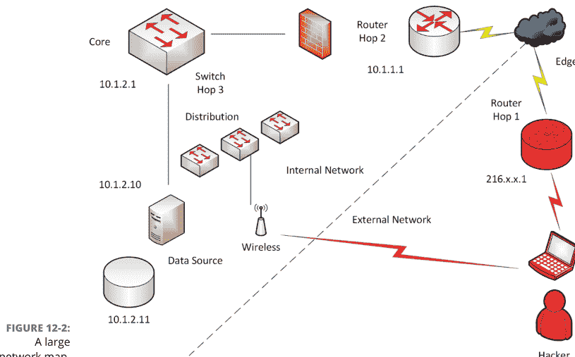

| | | |
| :--- | :--- | :--- |
| 核心 | 路由器 | 跳跃 2 |
| 边缘 | 10.1.2.1 | |
| 交换机 | 跳跃 3 | 10.1.1.1 |
| 路由器 | 跳跃 1 | |
| 分布 | 内部网络 | 216.x.x.1 |
| 外部网络 | 10.1.2.10 | |
| 数据源 | 无线 | 10.1.2.11 |
| 黑客 | | |

图 12-2：大型网络拓扑图。

## 有线/无线

无线网络面临的一个挑战是，它们并不总是配置得当。例如，黑客可能从外部网络看到并获取来自无线接入点的信号（参见图 12–2）。这可能是由于黑客在停车场使用带有高功率天线的发射器进行攻击，以便看到他们的 `SSID` 响应信标广播。

如果你证明了自己确实可以通过这种方式获得访问，可以提出以下改进建议：

- 关闭私有网络的 `SSID` 广播，使其不进行广告。
- 降低接入点的分贝和功率额，使其信号不会传输到组织墙壁之外。
- 通过控制器对无线网络进行监控，允许进行审计和其他 AAA 功能。

## 外部

外部网络很难安全，因为大多数时候你并不拥有 ISP（互联网服务供应商）提供的系统。你还需要考虑，你在安全防护方面是受限的，但这正是渗透测试和渗透报告的真正威力所在。如果你发现扫描了提供商以及进入你私有网络的边缘（分界点被视为 `DMZ`，即非军事化区），你甚至可能在那里托管面向公众的系统，可以指出他们需要锁定自己的系统，或者如果这些系统是你的，则锁定锁定你的系统。

## 系统

无论你对 Windows、Unix、Apple OS 还是组织中的任何其他操作系统进行渗透测试并报告，你都会发现一些需要补丁、修复、重新配置或检查的漏洞。由于技术不断变化的特性，总会有会导致后期产生问题的更新。大多数（如果不是所有的话）渗透测试输出都显示了需要补丁或防范世界上某种形式威胁的操作系统。

> 请记住组织必须遵守的任何合规标准。这些标准在金融和医疗领域最为常见，但其他行业可能也有合规性问题。许多操作系统被要求符合合规，因此你将在供应商网站上找到如何使系统符合合规的信息，这意味着你正在对其进行加固，从而你可以将其加入你的建议列表中。

你还可以在这里找到加固建议和工具包，例如位于 `www.microsoft.com` 上的 `Microsoft Security Compliance Toolkit 1.0`。该工具允许你运行 Windows 产品的配置基准，以便你可以根据需要对你的系统应用安全防护。你可能需要映射的某些合规标准包括但不限于——`DSS` 合规、`NERC-CIP`、`NIST 800-53` 和 `NIST 800-171`。

通常，你可以跨这些这些常用指南进行应用：

- 对基础操作系统进行加固。如果你在考虑 Windows 桌面系统（这是大多数组织中非常常见的特征），你可能希望考虑关注 `Internet Explorer` 或 `Edge`，并使用策略控制其允许用户执行的操作。
- 包含一个补丁和合规计划。该计划应允许所有 Windows 桌面设备更新到所有关键安全补丁，其中大多数补丁可以阻止特权提升和恶意软件。
- 锁定管理员权限和特权。限制任何用户、管理员或许可使用系统的人的访问权限，使他们仅拥有执行确切所需的权利。

由于管理员账户拥有访问字面上所有内容的权限，将它们视为蜜罐账户可以确保那些试图使用它们的顽固黑客无法阻挡。或者禁用它们，将权限赋予已启用登录的用户和管理员命名账户，以确保没有未命名账户在使用并拥有在你的系统中执行任何操作的能力。

- 确保桌面电脑使用更新的防病毒程序。
- 密切关注新版本操作系统提供的新功能。随着这些新功能的出现，会有更新形式的安全防护，你有责任了解这些更新，并在发现因为没有提供这些功能而能够渗透并利用系统时，考虑推荐它们。其中一个例子可能是 `Windows 10` 的攻击面减少 (`ASR`) 功能，它可以与你的防病毒解决方案协作对抗恶意软件。

## 服务器

你通过使用供应商的建议对服务器进行加固来确保安全。例如，如果你有 Windows Server 系统，会有许多特定于供应商的服务。你必须根据你在渗透测试期间捕获的信息，考虑开启所有服务或关闭它们。

通而言之，如果你运行 Unix 或 Windows，你希望确保它们都没有运行多余的服务（如 `telnet`），并例如使用 `SSH` 对它们进行安全防护。

无论你对什么进行渗透测试（并在报告中记录），你都在提供建议，包括通用的或标准的服务器建议，然后使它们更加具体。为了进一步解释我的意思：

- 通用的建议是确保你所有的服务器都已更新到供应商批准的补丁级别，并应用了所有当前的安全补丁。
- 特定的建议是确保 X 公司关闭在非法 Windows 系统上发现的 `DHCP` 服务器服务，该服务可能会无意中向毫无备的受害者发出 IP 地址。

你可以针对你选择测试的任何服务器平台遵循这些建议。

## 客户端

客户端攻击是最常见的，因为桌面（以及其他桌面设备）是所有基础设施组件中最常用、最易访问、保护最少且监控最少的。它们最容易被恶意软件渗透，甚至通过社交工程渗透。

最常见的建议：

- 确保客户端系统已安装补丁并更新。
- 在客户端上运行防病毒软件并确保它们每天进行扫描。
- 设备应该加密，以便在被盗或丢失时无法被使用。
- 对设备的访问应通过意识培训和 IT 人员的不断提醒来确保安全。
- 禁用不需要的服务。如图 12-3 所示，你在服务器系统、客户端系统甚至路由器和交换机上可以做的之一就是禁用不需要的服务；例如，`telnet`。

```
Administrator: Command Prompt

Microsoft windows [Version 10.0.18362.175]

(C) 2019 Microsoft Corporation. All rights reserved.

Dism /Online /Enable-Feature /FeatureName:TelnetClient

Deployment Servicing and Management tool

Version: 10.0.18362.1

Image Version: 10.0.18362.1

Enabling feature(s):

-------------------------------------------------

100% complete.

The operation completed successfully.

C:\WINDOWS\system32>dism /online /Disable-Feature /FeatureName:TelnetClient

Deployment Servicing and Management tool

Version: 10.0.18362.1

Image Version: 10.0.18362.1

Disabling feature(s):

-------------------------------------------------

100% complete.

The operation completed successfully.

C:\WINDOWS\system32>
```


图 12-3：禁用不需要的服务，例如 `telnet` 服务。

## 基础设施

泛指包括存储平台、主机、磁带库以及任何属于网络及其连接服务器之外的设备。你需要单独考虑每一项并相应地加固。

一些示例（和建议）包括但不限于所有这些设备连接到网络，共享接口、端口和协议，使用 `TCP/IP`（或其他协议），并进行通信和流量传输。正因为它们这样做，每一个设备都成为了不法黑客或道德黑客的目标。

存储系统可能被认为是数据捕的圣杯。存储阵列通常托管数 TB 的数据、公司的数据库以及维持许多技术驱动公司生存和健康的其他关键数据。发起攻击并成功摧毁、淹没或破坏这些基础设施的任何部分，都是即时武器。

建议与我在网络和系统中涵盖的内容相似：

- 访问（并遵循）供应商的在线加固指南。
- 确保你在冗余和弹性设置中有一份可用的数据副本。这就是灾难恢复 `DR` 和业务连续性计划 `BCP` 成为渗透测试向客户提出的主要建议的地方。

如果你备份并提供了重要数据，它的任何问题都可以得到解决。

- 使用一些针对网络和系统提供的相同建议。为了帮助访问免受此类攻击，请正确应用访问控制（例如），并对威胁进行监控（审计）。
- 加密数据。对传输中和静态存储数据进行加密可以保护存储系统上、传输中或被请求的任何数据。

# 移动设备

移动系统的安全性变得越来越困难。对它们进行渗透测试通常比对受防火墙保护的内部核心网络进行测试更为关键。正如在本章较早之前的客户端攻击安全建议中提到的，移动设备直接符合这种模型，即在上面执行的所有工作和功能都在始终开启的配置下在地点之间传输。

移动设备通常通过本地生物识别或密码/通行码进行保护。企业设备面临着当前的挑战：用户希望使用并操作自己的个人设备来访问公司资源。

建议包括：

- 使用 `VPN` 或其他安全形式的应用将个人使用和工作使用隔离开，以确保您的公司资源保持安全。这也有助于防止恶意软件传播。
- 了解员工设备上使用了哪些软件，并尝试使用防护软件和加密对其进行安全防护。

移动渗透测试可以如下：你向终端用户发送一封邮件，用户在 `Android` 手机（或已越狱的 `iPhone`）上打开它。这允许安装应用程序，类似于木马。之后可以提供访问权限，并从那里发起攻击。如果你了解有哪些应用程序，就可以相应地对它们进行安全防护。

- 如果公司负担得起，请使用移动管理企业解决方案来良好地管理。

# 云

评估连接到你公司的云或其他形式的外包服务可能是一个真正的挑战。但事实是，这与你可能有的任何连接都没有太大区别，例如 `ISP` 连接和你可能托管系统的灾备恢复地。

云无非你从提供者处访问并使用的外部网络，通常是租赁的。

无论你使用的解决方案是基于云的还是内部的，都应该遵循许多与你内部网络、基础设施、服务器、系统和应用程序时相同的建议。只需确保你理解它们是租赁的；你的公司并不拥有它们。你必须获得权限才能访问、扫描、测试和/或在需要时对其加密。

# 通用安全建议

## 所有系统

从端口和未使用的服务到防火墙和加密（以及更多），这涵盖了若干项不具体属于网络和系统的建议。虽然它们本质上是通用的，但它们仍然非常重要，我将逐一介绍。

## 端口

渗透测试报告中出现的最常见项目之一是端口。如果你无法更改或重新读取它们，关闭不必要的服务器端口会有帮助。`IANA` 注册表显示了常用和分配的端口列表：

`https://www.iana.org/assignments/service-names-port-numbers/service-port-numbers.xhtml`

意识到端口以及它们如何被使用和配置是非常重要的。端口通常是攻击者和渗透测试通过端口和 `IP` 地址的套接字连接访问远程系统。。第 12-6 页中的示例显示了通过更改默认端口来保护系统的方法之一。另一个考虑是，如果服务器 A 想要访问服务器 B 上的 Web 服务，它必须指定端口号来实现并看起来像这样：`10.1.1.11:8080`。

## 无需的服务

从系统中移除不需要的服务并定期对其进行审计。这意味着，如果你发现大多数服务器上都运行着 `FTP` 服务，但 `FTP` 仅在两台服务器上真正需要，请移除不需要的。

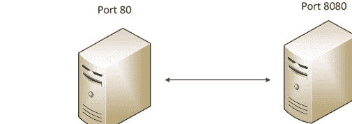

图 12-4:
更改默认端口以保护系统。

服务器 A: `10.1.1.10`
服务器 B: `10.1.1.11`

渗透测试和渗透测试报告可以引导你消除这些问题。像 `Nmap` 这样的工具可以显示哪些端口正在运行，以及通常映射到哪些正在使用的服务。这突出了你可以关闭的内容。

# 补丁计划

确保你组织中的每项技术都处于补丁计划中，每月按对所有内容进行审查、测试和应用。

# 防火墙

安装防火墙是组织保护其边界点并控制对公司可能在 `DMZ` 中管理的主机访问的最常见做法之一。图 12–5 显示了监控防火墙的进出访问流量如何对试图保护其资产的企业有所帮助。你可以审计防火墙日志以查看哪些连接尝试访问特定服务器。利用这些信息寻找可能的攻击或侵入。

# AV 软件（杀毒软件）

比使用防火墙更重要的是确保你所有的设备都使用如图 12-6 所示的杀毒程序。`AV` 是保护终端、客户端设备和移动设备免受问题恶意软件泛滥的最佳方法之一。

| 严重 | Syslog ID | 源 IP | 源端口 | 目的 IP | 目的端口 |
|---|---|---|---|---|---|
| 6 | 725003 | 10.0.220.13 | 59043 | | |
| 6 | 725001 | 10.0.220.13 | 59043 | 10.0.0.1 | 443 |
| 6 | 320013 | 10.0.220.13 | 59043 | | |
| 6 | 320013 | 10.0.220.13 | 11 | 10.0.2.36 | |
| 6 | 320013 | 10.0.220.13 | 59041 | 50.198.261 | 89 |
| 6 | 305011 | 10.0.220.13 | 59041 | 121.178.152.151 | 59041 |
| 6 | 305011 | 10.0.220.13 | 59040 | 50.198.261 | 80 |
| 6 | 305011 | 10.0.220.13 | 59040 | 121.178.152.151 | 59040 |
| 6 | 106515 | 10.0.220.13 | 59773 | 10.0.0.1 | 443 |
| 6 | 106515 | 10.0.220.13 | 59768 | 10.0.0.1 | 443 |
| 6 | 106515 | 10.0.220.13 | 59769 | 10.0.0.1 | 443 |
| 6 | 106515 | 10.0.220.13 | 59791 | 10.0.0.1 | 443 |
| 6 | 106515 | 10.0.220.13 | 59774 | 10.0.0.1 | 443 |
| 6 | 106515 | 10.0.220.13 | 59772 | 10.0.0.1 | 443 |
| 6 | 106515 | 10.0.220.13 | 59770 | 10.0.0.1 | 443 |
| 6 | 106515 | 10.0.220.13 | 59038 | 10.0.0.1 | 443 |

图 12-5: 使用防火墙允许你监控访问流量。

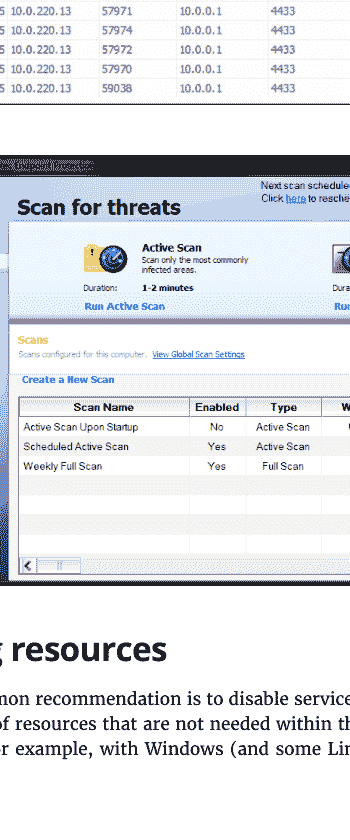

图 12-6: 杀毒软件仍然是保护设备免受攻击的有效方法。

# 共享资源

另一个常见的建议是通过阻塞端口或禁用加固系统中不需要资源来禁用服务。例如，在 `Windows`（以及某些 `Linux` 发行版）中，你可以使用 `SMB` 和 `SAMBA` 共享文件夹、打印机等。恶意软件通过网络从系统到系统传播的方式之一就是使用此类协议。

在图 12-7 中，`Nessus` 在网络上发现了 `SMB`，并建议将其关闭（如果可能）或配置允许远程执行的必要补丁。

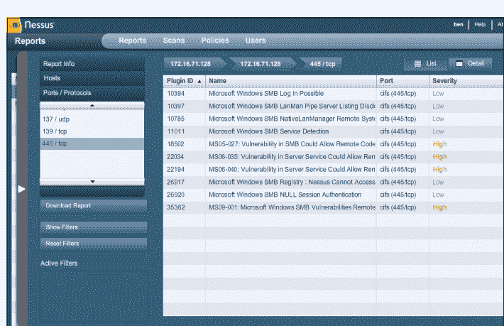

图 12-7: 使用 `Nessus` 网络上的 `SMB` 问题。

虽然你可能需要此协议进行文件共享而无法关闭它，但你可能至少需要确保它已正确补丁。

# 加密

使用加密让你无需担心窃听、劫持、数据盗以及数据嗅探和捕获等常见攻击。通过使用 `SSH`、`IPSec` 和 `SSL/TLS` 等协议，可以通过加密防止许多攻击，如图 12-8 所示。

尽管你应该尽可能使用加密，但并非总是如此。你必须确保使用强加密。始终建议使用强加密方法，以便较弱的加密形式被破解。更多加密信息请参见第 4 章。

| 编号 | 时间 | 数值 |
|---|---|---|
| 20 | 30.685188 | 0 |
| 21 | 27.617599 | 0 |
| 22 | 31.615556 | 0 |
| 23 | 31.615556 | 0 |
| 24 | 44.332227 | 0 |
| 25 | 51.356858 | 0 |
| 26 | 53.060822 | 0 |
| 27 | 47.A5C9A4 | 0 |

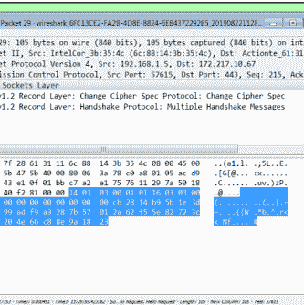

图 12-8: 使用 `SSL` 加密。

## 建议

本节提供了未在本章其他部分的其他重要建议的简要概述。

## 分段与虚拟化

重要的之一是关于分段的不同观点。尽可能，你应该将关键系统放置在网络的不同部分。这不仅意味着网络组件，还意味着连接到网络的系统，例如服务器。可以通过虚拟化主机内的虚拟化服务器（或虚拟机）轻松实现。

还要考虑虚拟化。通过使用 `VMware` 和其他技术，你可以创建虚拟机 `VM`，允许你创建逻辑网络而非物理网络，类似于 `VLAN`。

## 访问控制

获取访问是黑客（和渗透测试人员）最大的目标之一，使得访问控制成为你可能阻止入侵攻击的地方。你可以在这里提出的的一些建议包括：

- 使用 `AAA` 工具，例如 `TACACS+` 或 `RADIUS`，它提供集中的访问日志和控制。
- 使用访问控制列表 `ACLs`。`ACL` 是系统遵循的以允许访问的准则。如果列表中存在拒绝 `deny` 语句，系统将阻止进入。
- 使用防火墙和防火墙规则。防火墙还可以监控并记录信息以供后续审查，或者根据设置的触发警报的阈值或报警发送警报。防火墙规则（与 `ACL` 非常相似）是您在请求访问时审查的语句，如果使用了拒绝语句，它将根据端口、`IP` 地址、主机名或其他形式的标识符等特定标准阻止进入。当防火墙看到异常情况时，也可以具有智能性，可以向管理员发送警报。例如，如果一个极少使用的使用的系统上开启了用于黑客攻击的端口，可能会触发防火墙发送警报。
- 强制执行安全密码或凭据使用。一组凭据是用户名和密码的组合，除非您使用了多因素身份验证机制、生物识别或其他形式的访问和身份控制。
- 多因素身份验证 `MFA`。`MFA` 增加了猜测或破解密码的难度。特别是当增加了额外的因素时，如需要根据需要生成并使用的一次性密码 `OTP`。
- 鼓励使用强密码。另一个考虑因素是为组织实施密码策略，禁止使用易于猜测的密码，并要求最终用户在指定时间内更改密码。
- 禁用默认、未命名或通用账户。您希望确保将凭据设置给可以审计的真实用户。任何有问题的账户都可以被设一个陷阱（例如，蜜罐）并进行审计，这样如果您在默认账户（以及蜜罐账户）上看到活动，您就知道有人正在探测网络或正尝试探测。

## 备份

创建和保持备份对于您组织的健康至关重要。如果您丢失了关键数据或系统，且在灾难发生后没有办法访问它们，您就无法继续运营了。

请不要产生任何误会，黑客的入侵实际上是一场灾难，您的恢复或业务连续性策略应该遵循您的事件响应计划。

## 保护日志

作为一名渗透测试人员，日志是您收集的大部分信息的来源，也是您想要填充到报告中的信息的巨型来源。黑客进行持续性威胁攻击 `APT` 的方法之一是删除或更新日志。通过交换、更改、移动、删除或修改日志，他们可以获得关于入侵的虚假信息或没有任何信息。

图 12-9 显示了来自 `Solarwinds` 的简单日志，它允许我通过路由器将您的 `syslog` 信息发送到我我可以访问和审查的独立服务器。。一来，如果路由器或其他设备重启，或者日志被删除或更改，我都可以获得保存在该设备之外的日志副本。保护日志是一个非常好的建议，让组织有机会有机会审查和监控可能存在风险的设备上的活动。

图 12-9：
防止黑客干扰而保存的日志。

| 日期 | 时间 | 设施 (Facility) | 级别 | 主机名 | 消息文本 |
|---|---|---|---|---|---|
| 2015-03-20 | 14:05 | Cron | 警告 | 10.111.201 | 登录失败 |
| 2015-03-20 | 14:05 | Local | 警告 | 10.111.201 | 登录成功 |
| 2015-03-20 | 14:02 | Local | 严重 | 10.111.201 | 这是由 KiwiSyslogGen 生成的测试消息 |
| 2015-03-20 | 14:05 | Local | 警报 | 10.111.201 | 登录成功 |
| 2015-03-20 | 14:09 | Cron | 错误 | 10.111.201 | 登录失败 |
| 2015-03-20 | 14:09 | System1 | 严重 | 10.111.201 | 这是由 KiwiSyslogGen 生成的测试消息 |
| 2015-03-20 | 14:08 | Syslog | 错误 | 10.111.201 | 登录成功 |
| 2015-03-20 | 14:08 | Cron | 严重 | 10.111.201 | 登录失败 |
| 2015-03-20 | 14:08 | System2 | 信息 | 10.111.201 | 登录成功 |
| 2015-03-20 | 14:08 | User | 通知 | 10.111.201 | 这是由 KiwiSyslogGen 生成的测试消息 |
| 2015-03-20 | 14:06 | News | 拒绝 | 10.111.201 | 登录成功 |
| 2015-03-20 | 14:07 | Cron | 信息 | 10.111.201 | 登录失败 |

## 意识与社会工程学

我以前说过过，但我必须再次强调：最薄弱的环节是非技术性资产，例如您的员工、桌面电脑和移动工作人员。他们是人，而且并不总是勤勉地考虑安全。这就是为什么意识培训是必不可少的，这也是为什么它是一项持续的努力。

渗透测试报告可能显示网络通过社会工程攻击被攻破，这种攻击可能非常令人信信。

## 理解渗透测试与复测的循环性质

触发因素会提醒你需要进行复测。是否进行复测（以及何时进行）取决于负责人，或者你也可能由自己提出提议。

图 13-1 显示了渗透测试和复测的工作流，在图中你可以发现以下工作流项：

- 1. 开始（启动流程）。
- 2. 对进行渗透测试所需的信息进行评估。
- 3. 这可能是项目计划（或更大的项目计划）的一部分，在其中利益相关者会面以收集需求，正如我在第 9 章中讨论的那样。无论如何，当此步骤完成后，你就拥有了测试的目标和范围。
- 4. 执行渗透测试。

详情请参阅第 10 章。

- 4. 报告你的发现。

提交报告（涵盖于第 11 章）可能始终是你渗透测试职责的一部分。一个子任务或过程可能是提出建议并引导缓解过程（如果它是项目范围的一部分的话），并协助处理风险注册表。

从技术上来说，在此时，渗透测试已经完成，但你可能会被要求进行复测。

- 5. 复测并报告新发现。

如果未获得通过，该过程可以持续进行。

- 6. 工作流结束。

请注意，图 13-1 所示的工作流是该流程的简要表示。你可能需要在额外的“泳道”中包含子流程，指向变更控制/管理和其他子流程区域。

在完成报告、提出建议并进行复测后，无论如何，你绝对需要重新报告它——即使你没有任何建议或需要更新注册表的项目。这就是为什么你必须不断询问：问题解决了吗？

## 确定何时复测

渗透测试流程转入复测（参考图 13-1）应该是一个基于触发的系统，使复测成为你计划中的一项任务。一旦第一次渗透测试完成并开始工作流，应始终根据报告、修复然后再次复测的过程对复测进行鉴定。

你也可以根据需要安排复测。在图 13-2 中，我设置了一个按优先级咨询风险注册表的过程。如果风险被识别为第 1 级，则尽快进行复测。第 2 级或第 3 级风险可能需要等待每月或每季的漏洞扫描进行。无论你的组织如何设置，事实是，你可能无法随心所欲地扫描。这就是为什么遵循变更控制是如此重要。你想知道日历上有什么以及整个组织内发生了什么，以确保没有冲突。此外，你还希望确保复测的方式与原始渗透测试相同。必须遵循第 10 章所涵盖的相同流程和通信方式。

## 选择复测的内容

如果你已经彻底执行了渗透测试，并记录了你所做的以及发现了什么，那么决定复测什么可能是很简单的。你将依赖你的文档、报告和风险注册表。

## 查阅你的文档

在图 13-3 中，我更新了文档以反映对渗透测试报告中识别出的威胁所做的更改。我还根据所提供的建议和风险注册表项目创建了报告可能呈现的视觉效果，以便我在制定复测计划时将其作为参考。图 13-3：复测期间参考的更新文档。

在这里你可以看到已实施的建议，复测可能已拦截所有通往外部网络的向量。这些示例中的包括：

- 阻止无线 `SSID` 允许我看到并获取访问。
- 使用访问控制列表 `ACL` 阻止对路由器和交换机等关键基础设施的访问。
- 将日志发送到日志设施以防丢失。
- 补丁所有系统，并在关键数据系统上使用入侵检测软件。

如果完成了所有这些，请对所有内容进行复测，以确保这些更改中的每一个都有效，更重要的是，没有引发其他问题或暴露其他漏洞。运行 `Nessus`、`Kali`、`Metasploit`、`Burp Suite` 和 `Wireshark`（以及其他）允许你识别所有这些漏洞并搜索可能开放的端口。例如，现在你已经安装并配置了 `AAA`，你可能有一个新的 `RADIUS` 服务器，它可能需要补丁或加密。

## 审查报告

报告的目标（见第 11 章）是专注于项目目标或你被交付的任务范围内需要做的事项。在复测的所有方面都需要考虑深度防御。你应该重新检查原始报告、文档、发现和其他项，并提炼你已经测试过的内容，或者你可以专注于受攻击的区域。

特定区域的威胁应该仍然是重点，你应该努力缓解在该区域报告的任何威胁。正如我在第 11 章中提到的，这就是你不想让报告变得杂乱的原因之一。某些事情可能是隐含的，例如对网络的整体扫描。你可能只想简单地关注边缘，即你通过边缘访问另一个路由器并获得更多访问权限的地方。

你需要在复测之前审查报告，以便在实施缓解措施后知道将复测精力放在哪里。例如，如果请求渗透测试是为了确保由于 IT 专业人员最近内部担忧的 Web 架构的安全状况是健全，你将审查报告以查找：

- Web 架构是否被渗透？
- 是否是针对性地？

图 13-4 显示了你可能希望进行的某些修复，例如使用 `SSL/TLS`，以减少 Web 架构的风险。图 13-4：使用 `Nessus` 减少 Web 架构风险。

## 查看风险注册表

通过关闭风险注册表中的项目，你可以将其标记为完成并准备好复测。请考虑渗透测试报告中识别并在表 13-1 所示的两个示例。在这里你可以看到风险注册中的项目、优先级和渗透测试人员的备注。

# 表 13-1 用于复测问题的风险注册表

| 渗透测试备注 | 等级 | 风险注册条目 # |
| --- | --- | --- |
| 在 11/1xx 进行渗透测试，发现一台 `Apache` 服务器 Web 服务器，其 `IP` 为 `219.3.4.12`，可以通过公共互联网通过 `80` 端口访问。在进行漏洞扫描和渗透登录能力测试后，发现了默认凭据并发现可以使用，这允许远程完全访问系统。此漏洞需要立即响应，并标记为第 1 级。建议是更改凭据并禁用对默认账户的热访问。 | 1 | 17 |
| 在 11/1xx 进行渗透测试，发现一台 `Cisco` 路由器，其 `IP` 为 `10.2.11.1`，可以通过内部公司网络通过 `23` 端口访问。在进行漏洞扫描和渗透登录能力测试后，通过对该设备进行窃听并捕获明文凭据，发现该设备可以被访问和操纵。它是接入层网络的默认网关，由于受 `ACL` 保护，无法访问分布层或核心层。此漏洞需要响应，并标记为第 2 级。建议是禁用 `telnet` 并使用 `SSH` 进行安全访问。 | 2 | 24 |

## 执行渗透测试重测

要进行渗透测试重测，你需要遵循第 9 章和第 10 章相同的步骤。在定义目标和范围、获得适当权限和访问权限、设置日志记录后，选择你的工具，然后进入获取控制和最终审批阶段。一切都没有变化，只是你专注于根据上一次渗透测试、报告和风险注册表推导出的特定区域、项目和产物。

尽管我在在本章中指出了你作为渗透测试员可以做的事情，但你进行的是伦理黑客攻击，因此你需要知道何时以及如何停止攻击——你不想让你的公司或客户的系统彻底崩溃。


在你进行测试时，请记住以下几点：

- 注意关注旧报告以及新信息显示的内容。例如，你可能重新运行 `Metasploit` 并发现某些服务、端口和 `IP` 正在响应，其中某些可能已关闭，但另一些可能并未开放。例如，在图 13-5 所示，`NTP`（网络时间协议）服务运行在一个原始渗透测试未未报告的服务器上。

| *2019-05-22 09:39:13* Map Output: 5050/tcp unknown unknown |
| *2019-05-22 09:39:13* Map Output: 5050/tcp unknown unknown |
| *2019-05-22 09:39:13* Map Output: 5050/tcp unknown unknown |
| *2019-05-22 09:39:13* Map Output: 5050/tcp unknown unknown |
| *2019-05-22 09:39:13* Map Output: 5050/tcp unknown unknown |
| *2019-05-22 09:39:13* Map Output: No connection detected. Please report incorrect results at https://github.com/submit |
| *2019-05-22 09:39:13* Map Output: done 254 addresses (1 up) scanned 51.28 seconds |
| *2019-05-22 09:39:13* Map Output: Importing scan data. |
| *2019-05-22 09:39:13* Map Output: Sending 13 probes to 192.168.1.1-192.168.1.254 (254 hosts) |
| *2019-05-22 09:39:13* Map Output: Discarded 130 hosts out of 132. |

图 13-5: 映射网络并发现问题。

在进行以禁用某些服务的配置时，有人不小心开启了其中一个。或者在无意中向你不想要的服务器上添加了新服务以修复漏洞。


无论情景如何，请记录你发现的内容以及在识别任何新漏洞时发现的内容。这可能是你对某个漏洞的发现，但对于渗透测试重测，你应该尝试利用它。

- 就像你做渗透测试时一样，找到一个进入点。例如，使用 `Nmap` 的 `ntp-list`，你可以从 `NTP` 服务器收集其列出的信息。图 13-6 显示了如何使用 `Nmap` 获取 `NTP` 服务并识别（或映射）它，这样你就可以看到 `NTP` 映射服务器是什么、客户端和等节点。

第 13 章 重测 189

```
```


# `nmap -A` 14 (http://nmap.org/nmap/) at 2006-03-26 15:53:24 PST

## Interesting ports on `scanmap.org` (205.217.153.62)

(The ports below are in state: `filtered`)

```
PORT   STATE VERSION
21/tcp open     FTP (protocol 1.99)
25/tcp open     Postfix 2.2.1
53/tcp open     Bind 9.2.1
79/tcp closed
113/tcp closed
80/tcp open     Apache 2.0.52 (Fedora)
143/tcp closed
```

Device type: general purpose

OS: Linux 2.6.0-12-generic

OS details: Kernel Med Feb 22 11:39:16 2006

## Interesting ports on `dzone.internal` (192.168.1.23)

(The 1664 ports not shown but below are in state: `closed`)

```
21/tcp open     Serv-U ftp 4.0
22/tcp open     OpenSSH 4.3p1 Ubuntu-2ubuntu4.15ubuntu
80/tcp open     Microsoft IIS web server 5.0
139/tcp open     netbios
135/tcp open     msrpcd service c:\windows\system32
445/tcp open     microsoft-da Windows XP
5900/tcp open     UltraVNC (Resolution 1024x800)
```

Hostnames: Windows AD

Device type: general purpose

OS: Windows 2000 Professional

Service info: 05 hosts (2 up) scanned in 42.29 seconds

Flag/folder/nmap-misc-Screenshots/042006.png


图 13-6: 利用 Nmap 利用 NTP。

通过这种映射，一旦发现，你就可以让整个网络陷入崩溃。**记录你的每一次发现。** 就像你进行渗透测试时一样，必须记录详细信息以便编写报告。大多数情况下，你只需要更新原始报告。但有时利益相关者可能会要求你提交一份全新的报告。你会将发现提交给管理层，并将其添加到风险注册表中按优先级或分级进行修复。

第 4 部分 编写渗透测试报告

## 十的部分

## 在本部分 ...

- 破解常见的渗透测试误区。
- 通过十个技巧提高你的渗透测试技能。
- 发现十个可以学习渗透测试的资源。

第 14 章 关于渗透测试的十大误区

误区（myth）被定义为一种现象或广泛存在的观点或信念，这种观点通常是错误的。当你思考安全分析和执行渗透测试时，你可能持有一些错误的观点。例如，多年前人们认为如果你被称为黑客，你就是个坏人。现在情况并非如此。

尽管许多公司领导和部门主管认为他们需要安全（并为此提供资金），但他们可能并不了解真正的渗透测试员为组织带来的价值，也不认为其物有所值。所以这个误区实际上包含两个部分：

- **渗透测试员没有价值。** 渗透测试员应该是你聘佣的最高级别的安全分析师。伦理黑客了解黑客所知。黑客（或其他形式的攻击者）是你最初对安全投资的原因。

- **渗透测试太贵了。** 公司是否能负担得起取决于在安全事件发生时愿意损失多少。我希望这样的书可以帮助缩小差距，因为有很多降低渗透测试成本的方法。也许可以一个信任的内部员工（另一个 IT 团队成员）使用渗透测试工具来解决你的安全问题。

你无论如何都会付出代价。根据 Statista 的数据，图 14-1 显示了年度数据泄露的规模以及泄露记录的数量。

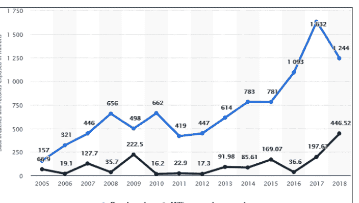

图 14-1：
网络威胁及其增长的示例指标。

data-breaches-recorded-in-the-united-states-by-number-of-breaches-and-records-exposed/

从这组基础指标中得出的重要结论是：尝试和渗透的规模非常高且正在不断增长。与泄露记录数量增加之间的相关性也可以通过多种方式进行分析和量化，但认为在过去的 10-15 年中，由于对网络安全和渗透测试的关注，暴露量并不总是与尝试次数直接相关。

# 我们无法信任渗透测试员

有些公司非常担心自己的敏感数据（秘密、薪资、计划等），以至于不希望任何人参与，即使是为了检查安全。医疗保健机构可能非常警惕，因为如果患者相关信息泄露，该机构将承担法律责任。

遗憾的是，如果你不承认少量的漏洞，就无法实施安全措施，但公司需要明智地处理：

- **无所事事是不明智的；进行测试是明智的。技巧在于找到既能进行渗透测试又受公司信任的人。负责招聘渗透测试员的人必须探索组织内部是否有受信赖的 IT 专业人士，并可以培养他们进行渗透测试。**

如果那个人是你，请考虑向你组织的领导层推销你的技能，让他们知道你对该角色感兴趣。

- **必须通过面试过程来选出最佳候选人。** 此过程应该包括广泛的背景调查，审查财务状况、物质使用和信用状况。如果候选人“通过”了这些测试，那么这些良好的情况就是明显的标志，表明该人确实值得信赖。**

- **审计有所帮助。** 审计过程会检查渗透测试员的工作，确保没有发生错误行为。这包括检查日志、审查渗透测试结果，以及对执行测试的人进行跟进以验证结果。这可以为审查人员或新来人员带来安心感。

# 我们不信任工具

除了对执行渗透测试的人建立信任之外，你必须对你的工具箱以及你构建、安装和维护的工具感到放心。这源于获取声誉良好、不含恶意软件或本身不是问题的工具的努力。（某些工具可能包含可以接管你机器的“木马程序”。）

另一个担心是缺乏使用工具的知识可能会导致生产停机问题。如果一个新的渗透测试员（即使是经验丰富的测试员）做出更改或使用某种带有副作用的工具，它产生的问题可能比你要识别的问题更多。

另一个担心是工具本身是否能够完全运行且没有漏洞。这就是为什么一些精英测试员选择使用行业支持、无漏洞或发现漏洞后会修复的工具。基于此，我建议使用供应商支持的工具。

供应商工具是新渗透测试员信任其工具箱的最佳选择。像 `Wireshark`、`Nessus` 和 `Nmap` 等工具都得到了维护并保持更新。图 14–2 显示 `Wireshark` 由供应商维护。它包含了更新、新版本和漏洞修复。

# 软件更新

新版本的 `Wireshark` 已可用！

`Wireshark` 3.2.1 现在可用（你现在的版本是 3.2.0）。你想现在下载吗？

发布说明：

# 修复修复

以下漏洞已修复：

- wpsace-sec-2020-01 WASSPD 崩溃 Bug 16324, CVE-2020-7044。

以下 Bug 已修复：

- 正确解析了 USB CDC 数据包。Bug 14587。

图 14-2：
`Wireshark` 的漏洞修复列表。

跳过此版本

稍后提醒我

安装更新


这些工具内置了新的构建、补丁和支持网络。我会说，如果你从互联网下载了一个不可靠的应用来作为你的工具箱，在使用之前防止病毒扫描可能帮助你减少使自己或公司感染木马的可能性（作为一个例子）。

如果你因为不确定工具的输出而不敢使用它，那么请设置工具和测试实验室，在使用之前熟悉这些工具。如果你知道

# 渗透测试并不经常进行

渗透测试无处不在。一些大型企业会制定一个进行渗透测试的计划。这类似于渗透测试对你的安全计划有益的原因。

计划确保了渗透测试是整体安全计划的一部分。图 14-3 显示了发生的安全功能、测试和任务列表。渗透测试也可以根据需要随时进行。

| 任务 | 时间段 | 是否计划？ | 是否完成？ |
|---|---|---|---|
| 修改密码 | 3 个月 | 持续 | 是 |
| 钓鱼测试 | 6 个月 | 持续 | 是 |
| 漏洞评估（内部扫描） | 1 个月 | 是 | 是 |
| 漏洞评估（外部扫描） | 2 个月 | 是 | 是 |
| 进行渗透测试 | 3 个月 | 否 | 否 |
| 进行应急演练 | 每年 | 否 | 否 |
| 更新安全文档（策略） | 每年 | 是 | 否 |

图 14-3：
测试计划。


# 渗透测试仅针对技术系统

另一个我一直强调的观点是深度防御的概念以及跳出框架思考的需求。渗透测试本质上是非常技术性的，因为它们试图破坏技术资产的安全。

然而，技术资产可以通过其他技术手段被破坏和变得脆弱；最常见的两种是：

> **物理安全：** 如果罪犯只需步行进入托管所有关键数据的数据中心并使用 U 盘从服务器上抓取数据，那么你投入了大量资金却在一个可以被轻易绕过的事情上。


这种这种情况的重要性在于它是很常见的，而且你应该在组织中考虑这种。。

人们很容易关注信息技术系统（如计算机）以及基础设施（如路由器、交换机和其他网络设备）。通过

你不能忽视物理安全；它也可能具有高度的技术性。想想任何支持物联网、连接网络且由软件驱动的设备。监控摄像头、门铃摄像头和其他安全设备也都属于你的工作范围。

- **社会工程学：** 我不需要使用工具包里的 Kali 工具来破解你的密码；我只需要给你打个电话，骗你把密码告诉我。这样更简单、更快，而且留足迹更少，不容易被发现。

# 承包商无法成为优秀的渗透测试员

对于任何想要增强安全防护的人来说，一个很大的困惑点是：是使用内部资源还是外包给承包商？许多人认为承包商来自你的网络外部，不具备绕过系统并进行公正、彻底评估所需的内部知识。事实远非如此。

内部资源非常熟悉内部网络和系统，但承包商开展的练习与内部团队完全相同，没有区别。如果给予承包商与内部资源相同的网络访问权限，那么测试结果将是相同的。

引入外部资源（即使只是进行年度测试）的优势在于，他们不了解你的网络。如果他们能够渗透进去，说明他们模拟了黑客的行为，即探测、测试、映射、识别，并尝试获取他们已感知的资源访问。

# 渗透测试工具包必须标准化

在某些情况下，IT 资产、系统、程序、工具和软件的标准化是保持合规并提供完善文档解决方案的必要条件，但渗透测试并非如此。渗透测试员的工具包是由测试员根据自己的喜好制作的。出于功能考虑，他们需要保留旧工具。他们可能会选择使用不同类型的数据包嗅探器，因为他们更擅长对其进行自动化。某些原因可能会使用开源软件而不是昂贵的厂商解决方案。

无论如何，作为渗透测试员，无论你使用什么，都必须管理自己的工具和工具包，要遵循的重要规则是：你必须确保自己不会变成受害者。确保妥维护你的工具包并保持其安全和更新。如果你做到了这一点，就不必担心工具的标准和使用。公司可能会强制某些标准，但作为一名独立的渗透测试员，你应该考虑使用自己最熟悉的工具。

# 渗透测试本身是一个神话且并不需要

希望你读过的所有内容都证明了这完全不是事实。你可能会发现过时的流程或工作流需要变得更高效，或者完全被移除。渗透测试的投资回报率（ROI）应该被衡量，以证明其成本是合理的。问题在于，当你进行渗透测试时，必须保持漏洞处于关闭状态，以检查威胁。这就是为什么渗透测试中的报告非常重要。通过报告展示实际数据点，你可以确保安全，并确保你所运行的所有系统都保持在最新状态。

# 渗透测试员知道足够了，不需要继续学习

你需要不断学习，提高技能，跟上最新的技术趋势和安全关注点。你必须接受这一责任并将其成为生活的一部分。你需要不断学习渗透测试、安全和网络，并开发道德黑客技能。

# 第 15 章
完善渗透测试技能的十个技巧

在本章中，我涵盖了十个帮助你在职业生涯或学习过程中完善渗透测试技能的技巧。

# 继续你的学习

经常学习。不要限制你的学习范围。你可以通过学习基础知识、获取工具并运行它们来获得进步。然而，你需要学习信息技术系统、网络服务的细节，以及它们是如何被保护或受到威胁的。

继续学习的方法是无限的。但如果预算有限，这里有几种方法可以帮助自己：

- 使用你的图书馆。访问互联网、书籍、杂志和其他材料，利用你的公共图书馆系统。有些图书馆甚至提供 IT 课程，甚至是安全课程。
- 使用互联网。你可以找到许多帮助渗透测试的网站，学习 IT、安全和许多主题。（我在第 16 章中建议了一些。）
- 构建一台测试电脑。如果你可以获取一台电脑或笔记本并将其转换为测试系统，使用它。很多公司可能有闲置的旧系统可以将其转化为测试工具包。
- 使用虚拟化。类似于额外的电脑或笔记本，你可以设置虚拟化软件来访问更多系统，从而在一台计算机上构建小型网络并进行渗透测试。图 15-1 显示了一个虚拟系统的示例。
- 使用免费软件。许多工具提供限时的访问或有限的功能，你可以用来学习。

图 15-1：使用 Kali 和 VMware 虚拟化。

# 构建你的工具包

木工和其他行业依赖他们的工具来工作。汽车修理师、焊工和其他使用工具工作的人，如果没有维护和保存工具就无法很好工作。IT 专业人士也是如此，特别是那些在安全领域工作的渗透测试员。

无论如何，要把你的工具视为你可以维护的最重要的事情。在构建工具包时，请记住以下几点：

- **保持工具包更新是测试员面临的最困难的事情之一。** 你会发现某些工具（有时是旧工具）对获得所需的结果更有帮助。有些脚本是由每个独立测试员创建并维护的。
- **某些工具很昂贵，你需要它们的许可。** 你还需要保持它们更新。例如，任何工具、软件、程序、应用程序和系统都需要打补丁、病毒扫描、更新并保持最新。
- **所有软件必须更新。** 任何需要签名文件、数字证书、块密码和其他任何形式的额外软件都需要更新和维护。
- **技术随时间变化。** 你所使用的系统会有更新，组织中也会有不同的系统——这意味着你需要让你的工具包随着新的添加项保持更新。
- **确保你的电脑已更新且安全。** 确保你运行的所有系统都保持在最新。作为一名渗透测试员，没有什么比自己的系统被黑还要更丢脸了。保持你自己的东西纯净、安全并经过测试。

# 跳出框架

永远不要对相同的向量、工具、模式和攻击感到安逸。始终考虑另一种选择。计划 B。你必须不断跳出框架，才能走在犯罪分子面前。把黑客和攻击想象成流动的水。它会找到路。你需要像流动的水一样思考，通过培养这种动态思维来考虑、预测并领先于不同类型的攻击和向量。

我在书中谈了很多很多向量。在图 15-2 中，我展示了一个计划中的渗透测试示例，我需要通过无线接入点进入网络。在与一个组织合作的情况下，如果他们给了我在可能时尝试另一种路径的能力，我发现了另一种通过互联网连接（计划 B）从外部访问网络的方法。我也可以从停车场接收信号来访问网络。

## 像黑客一样思考

你需要了解黑客在做什么。作为一个有道德的人，要像罪犯一样思考并不是易事。这正是优秀的渗透测试人员脱颖而出的地方。你必须跳出那些“好人”会做的事情……即一个有道德的人会做的事情之外。

帮助你培养这种能力的方法是阅读。你可以阅读过去发生的攻击，以了解执行这些攻击的人。过去最老的黑客之一是凯文·米特尼克（Kevin Mitnick），他在 20 世纪 90 年代进行黑客活动并在 1995 年被捕。了解凯文以及他如何随着时间推移变成灰帽黑客，有助于进入那些犯罪者的内心并理解他们的动机。

## 参与进来

无论是会议、在线社区，还是线上或线下的社交渠道，都要花些时间与你领域的人建立人脉。

你可以参加的可以继续接受教育、从领域专家那里学习渗透测试的细节、结识作者并获取当前产品趋势和课程的会议包括：Defcon (`www.defcon.org`) 和 Black-hat (`www.blackhat.com`)。通常这两场会议都在美国举行，但在这两年中，会议都已经扩展到了其他国家。这两个网站都有报名会议的选项，也有其他选项可以查看多年来的旧媒体、论文和研究。当你不断在领域内成长时，这也是结识你领域更多专家的绝佳方式。

有专门为渗透测试人员服务的专业组织、由志同道合者组成小组的学校、治理委员会以及其他类型的允许进行伦理黑客的人聚集在一起并分享想法的团体。你还可以加入一些政府机构，以便与执法部门（LEO）、军事或其他政府机构更密切地合作，分享想法和信息。

第 16 章提供了一些你可以调查他人的网站；然而，一个简单的 Google 搜索就能为你提供丰富的想法和信息。

无论你与谁一起加入，基于社区的观点分享方法已经导致了今天一些大规模的众分片/众包和其他小组的成功。结对并开展一些项目，以分享想法并更多地了解渗透测试。

## 使用实验室

如果你购买并构建了一个空间，或者从他人那里租赁系统时间，请使用你可以使用的在线资源进行测试，或者通过通过你构建的实验室中使用虚拟机进行测试——动手操作对你的成功至关重要。你需要能够运行工具、攻击、测试，并看到可能性。这是学习如何成为顶尖渗透测试人员的最佳方法之一。

由于执行此操作有很多挑战，你仍然可以学习获得实践培训的方法：

- **在线测试网站：**在第 16 章中提供了链接。
- **测试机器：**你也可以在家里设置一台电脑或一个其它机器的虚拟系统（虚拟网络），并在基础机器上对系统进行测试。

图 15–3 展示了一个你可以使用的良好的实验室策略，用于在工作或家里开始开发渗透测试实践实验室。

图 15-3：创建一个可行的实验室。

在构建实验室时你可能想要考虑的一些项目可能包括（但不限于）：

- **服务器基础设施：** 你可以在模拟网络上物理设置服务器，也可以在虚拟网络上设置。无论哪种方式，请确保你分配了资源，以便你可以配置目标，例如数据库（可能很大），以及用于冗余（集群）或其他高级设置的多个网络连接。
- **网络基础设施：** 从布线到无线系统——路由器、交换机、访问点、防火墙以及其间一切——你可以配置所有网络组件，以连接你想在模拟网络上设置为资源的设备。
- **渗透测试系统：** 起点，可以是你用作伦理黑客进行渗透测试的笔记本电脑。

随着你学习的越来越多，你可以添加系统和基础设施来进一步构建实验室，以便能够进行更多测试。

## 保持信息灵通

就像任何其他角色、技能或功能一样，你知道的越多就越好。最新的威胁信息可以帮助你学习每天出现的各种攻击和模式。这些信息加深了你作为保护这些系统的渗透测试人员所需要注意的知识。

你还应该跟上渗透测试社区正在发生的事动态。做到这一点的绝佳方法是与你领域的其他人会面（正如我在本章前面的“参与进来”部分建议的那样）。

## 领先于新技术

技术始终在变化。还记得虚拟化变得重要的时候吗？云？无线？移动设备？当这些每种技术出现时（在某些情况下是融合的），），保持领先地位是非常重要的，因为在它们进入市场的那一刻，似乎就有大量的攻击随之而至。你必须了解它们，学习并预测黑客可能会如何使用它们。

有无数资源可以学习新技术。例如，如果你有 Cisco、Citrix、VMware、Linux（一个发行版）和 EMC Storage，你可能想将他们的邮件列表加入，以保持更新、版本更新。如果你是大型网络客户，你可以获取 RSS 馈送、现场通知、安全告、漏洞警报、软件更新等。

## 建立你的声誉

建立声誉很容易。要让某人（任何人）让你进入存放所有数据的受保护网络，他们必须信任你。信任是你职业生涯拼图中最关键的一块。如果你将自己标识为不可信任的人，那么你可能永远无法为你需要帮助的公司工作。

这意味着你不能成为罪犯！你需要确保你的行为专业且符合伦理。建立你的同伴网络和可以为你作书的人脉，并继续以正直的方式行动。

## 学习物理安全

世界上所有的技术知识、技能、工具和经验都无法保护你和公司免受社会工程攻击。没有什么能比社会工程更快瓦解技术安全。刷卡、磁性门锁、生物识别、摄像头、物理安保人员、翻墙以及所有位于存储数据的计算机网络之外的物品都无法阻止某人入侵。作为渗透测试人员，始终考虑物理安全挑战，并通过检查物理安全和深度防御来增强你的技术漏洞分析和扫描。

# 第 16 章：学习更多渗透测试的十个网站

作为一名 IT 专业人员，无论你今天知道多少，都有更多需要学习的！我可以向保证，随着技术的演变和蜕变，你今天所知的可能会过时。尽管如此，在本章中，我向你介绍了十个网站，这些网站对你不仅作为渗透测试人员，而且作为安全专业人员非常有帮助。

警告 如果任何网站不再可以访问，请针对渗透测试、入侵测试和安全黑客等关键词进行自行搜索。还要检查任何非信誉网站的数据。我在这里列出的网站通常是有誉的，但你仍然应该考虑研究它们实现的内容

你可以用于学习的最佳信息源之一是软件帮助文件。如果你使用工具自带的知识库以及供应商网站在线知识库，你将学会如何更好地使用工具，并有助于强化书中学习的主题。

## SANS 学院

`https://www.sans.org`

SANS.org 指向 SANS 学院，自 1989 年以来，该网站一直充满了大量的有用安全信息，供所有人免费访问。在线资源可以从首页轻松搜索，其中包含许多渗透测试人员可以使用的资源，包括 SANS 信息安全阅读室（SANS Information Security Reading Room），该阅读室在 110 个重要的安全类别中托管了约 3000 篇原始研究论文。

你可以订阅周报、警报、通讯、风险警报和其他电子邮件项目，以帮助你远离威胁。你还可以访问互联网风暴中心（Internet Storm Center），这是一个威胁预警系统。

还有许多其他可用资源，如模板、供应商产品信息、开源和闭源软件信息等。

如图 16-1 所示，SANS 网站上的另一个感兴趣点是与渗透测试重点领域的链接：


https://pen-testing.sans.org/

如果你想将渗透测试作为一份职业，加入这个社区并深入研究他们的在线资源可以帮助为你的教育和知识增值。

## GIAC 认证

https://www.giac.org

SANS 网站上的另一个感兴趣点是与其 SANS 认证的链接，称为 GIAC（全球信息保证认证）。GIAC 专注于安全的不同领域，例如事件响应和处理、取证，当然还有渗透测试。你可以直接通过以下地址获取他们的 GPEN 认证（见图 16-2）：

https://www.giac.org/certifications/pen-testing

除了作为测试你执行渗透测试能力的行业标准外，GIAC.org 网站还拥有大量关于渗透测试的信息。你需要为考试和随附附的学习材料付费。还有其他可用测试，例如 CompTIA 的 Pentest+ 等，但获得 GPEN 认证的处在于，你将连接到一个经过认证且受过教育的专家测试人员社区。

图 16-2：GPEN 认证。

## 软件工程学院

sei.cmu.edu

卡内基·梅隆大学（CMU）长期以来一直是惊人信息的来源。你将找到关于风险评估、渗透测试、取证和基于安全的事件处理的信息。CMU 网站有一个 CERT 落地页，托管了关于网络安全的出版物和其他学术著作：

https://www.sei.cmu.edu/about/divisions/cert/

CERT 与行业专家（来自技术行业、法律、政府和学术等领域）合作，提供相关事件主题的高级研究和分析。

## （各种）合法渗透站点

合法渗透站点由不同的团体托管，为伦理黑客提供了一种真实的方法，让他们能够在处于半加固状态的网络和系统上学习真实的黑客技能。如果你在 Google 上搜索“Legal Penetration Sites”，你将获得可靠的来源来找到这些网站。

Cisco.com 在其帮助论坛以及安全杂志（另一个很好的资源）和其他托管这些渗透测试枢纽的网站上提供了信息，你可以在那里练你的技能。

> 如果你无法负担建立测试目的实验室环境的费用，寻求外部资源真的有助于提高你的技能。

## 开源 Web 应用安全项目

https://www.owasp.org/

开放 Web 应用安全项目（OWASP）建立于 2001 年，目前是一个基于小组协作基础的非营利组织。OWASP 是一个以开源为傲的团体，且与任何机构均无关联。他们的重点是 Web 黑客以及应用程序、软件、Web 应用和程序的安全性。

提供的框架、信息和资源有助于引导渗透测试人员进入围绕应用程序的风险和漏洞领域，例如攻击：

https://www.owasp.org/index.php/Category:Vulnerability

这可以帮助你更深入地理解 SQL 注入、模糊测试（fuzzing）以及围绕编程和软件黑客的其他主题，以及你作为伦理黑客想要渗透和暴露这些系统的细节。图 16–3 显示了当时的十大应用程序安全风险。

| 前十大应用程序安全风险 |
| :--- | :--- |
| 1. 注入 | 当发送了不可信的数据（如 SQL、NoSQL 或 LDAP 查询）时，会发生注入漏洞。 |
| 2. 身份验证失效 | 身份验证函数实现不当，允许攻击者破解密码。 |
| 3. 敏感数据泄露 | 许多应用程序未能保护数据，例如信用卡号、社会安全号。 |
| 4. 访问控制失效 | 不安全的直接对象引用（IDOR）允许访问对象。 |
| 5. 配置错误 | 这由安全设置、冗余的错误消息引起。 |
| 6. 跨站脚本 (XSS) | 当应用程序在未进行适当编码的情况下将不可信数据包含在网页中时发生 XSS。 |
| 7. 不安全的设计 | 这涉及设计阶段的缺陷。 |
| 8. 不安全的反序列化 | 当使用服务器对象执行恶意代码时会发生这种情况。 |
| 9. 安全日志和监控 | 未对安全相关的事件和活动进行记录和监控。 |
| 10. 服务端请求伪造 | 攻击者可以诱导应用程序发出非预期的请求。 |

## Tenable

https://www.tenable.com

Tenable 开发了 Nessus，这是渗透测试中最热门和最常用的工具之一。在网站上，你可以找到关于如何使用它的研究。你在 Tenable 上能找到的最棒东西之一是对渗透测试的研究，你可以下载 Nessus 进行用。图 16–4 显示了下载 Nessus。

## Nmap

https://nmap.org/

Nmap 无疑是你工具箱中用于信息收集的最常用工具之一。在主网站，你可以找到该工具的高级用法，包括防火墙、自动化和脚本。

## Wireshark

https://www.wireshark.org

Wireshark 是你工具箱中的事实标准工具，也是网络故障排除的主要信息源：

https://www.wireshark.org/#learn

在主网站上，你可以找到大量如何使用此工具的信息。此外，工程师讨论问题和发现内容的论坛充满了数以千计的信息，将帮助你了解更多关于网络、TCP/IP、互联网以及数据包和帧如何穿越网络。

> 需要学习更多关于端口、通道、通信、套接字、协议、包、头部等知识吗？你需要去这个网站学习更多内容。

## Dark Reading

https://www.darkreading.com

在当今的渗透测试世界，Dark Reading 是安全专业人员常用的网站之一。Dark Reading 不仅提供旧新闻，还面向安全大师和专业人士在线社区提供突发新闻。你将发现事事订阅，而且“攻击与破解”（Attacks and Breaches）部分可以帮助你在渗透测试中模拟场景并跟上趋势。

## Offensive Security

https://www.offensive-security.com/


作为 Kali 的发行者，Offensive Security 是一家专门从事渗透测试的公司。Offensive Security 提供渗透测试服务，并提供认证。在图 16–5 所示的网站上，你可以从每天从事此工作的专家那里学习更多关于渗透测试的知识。你将发现示例清单、工具、报告以及许多你可能想在自己的渗透测试中模拟的内容。

# 攻击性安全社区项目

面向信息安全专业人员的渗透测试工具


图 16-5：获取 Kali 。

216 第 5 部分 十部分

# 索引

A
AAA (认证、授权与账户), 165–166, 177
访问, 获取. 参见渗透 (infiltration)
访问控制列表 (ACLs), 130, 140, 178
访问控制建议, 177–178
审计 (accounting), 165–166
准确报告, 创建, 156–157
活跃监控, 在防御中的作用, 143
主动侦察, 由黑客进行, 38
地址欺骗, 69–70, 74–75
管理员账户, 169
高级持续性威胁 (APTs)
AV 绕过, 114
概述, 69, 103
渗透测试, 131
渗透测试计划的, 124–126
匿名者 (黑客主义团体), 36
反病毒 (AV) 软件
用于破坏性攻击, 94
通过其进行端点保护, 100
识别 DoS 攻击, 88
建议, 174–175
扫描维护, 33–34
用于子网攻击, 134
通过恶意软件颠覆攻击, 112–114
附录/附录, 在内, 150, 155
Apple 系统, 1
应用程序, 相关渗透测试技能, 15
ARP 投毒, 75
评估. 同样参见建议；报告
数据外泄 (extfiltration), 141–142
利用 (ploitation), 141
作为渗透测试目标, 27–28, 39
渗透 (infiltration), 140
概述, 139
渗透 (penetration), 140–141
与建议的关系, 162–164
资产保护, 24
假设攻击
通过监听收集数据
地址欺骗, 74–75
读卡扫描器, 77–78
窃听, 75–76
键盘记录器, 77
概述, 74
数据包捕获与分析, 77
USB 驱动器, 78
概述, 69–70
工具包基础
Burp Suite, 70–72
概述, 70
Wreshark, 72–74
ATM 提款机, 读卡扫描器, 77–78
攻击, 渗透测试. 同样参见特定攻击；向量:
APT, 131, 135
外泄, 131, 135
利用, 131, 134
渗透, 130, 133
下一步, 135–136
概述, 130–131
渗透, 130, 133–134
审计
渗透测试员, 196
用户, 180
认证、授权与账户 (AAA), 165–166, 177
认证, 多因素, 29, 178
授权, 165
自动运行 (Windows 系统), 164
AV 软件. 参见反病毒软件
意识意识, 鼓励性, 157, 179–180
思科发现协议 (CDP), 110
思科系统加固指南, 166
数据分类, 在报告中, 157
明文, 76
点击诱饵, 111
点击劫持攻击, 111
客户端攻击, 60–62
客户端系统, 建议, 170–171
使用 Kali SET 仿隆网站, 56–59
云技术, 16, 172–173
代码
暴露的, 94
软件漏洞, 27, 33
社区, 渗透测试, 205, 207
合规标准, 34–35, 168–189
CompTIA pentest+ 认证, 10
结论章节, 报告, 150, 154–155
会议, 参加, 205
机密性、完整性和可用性 (CIA) 模型, 63
配置, 相关的漏洞, 32–33
安全顾问, 10
应急计划, 121, 127–128
继续教育, 200, 201–202
承包商, 渗透测试, 19
控制措施绕过. 参见颠覆攻击
核心网络, 166, 167
渗透测试成本, 194–195
凭据, 安全, 178
信用卡行业, 安全场景, 在内, 24
假信用卡读卡器, 38
众包渗透测试员, 8–9
密码学, 定义, 63. 同样参见加密
网络犯罪, 16–18, 108. 同样参见黑客/黑客；特定攻击类型
网络恐怖主义, 18, 108
备份
破坏性攻击后的重要性, 93, 142
渗透测试时保留, 121
建议, 171, 178
在渗透中的作用, 144
银行业, 安全场景, 在内, 24
基础网络, 12–14
最佳实践, 预防, 142–145
Beyond Retina CS, 21, 22
黑黑客, 37
黑盒安全测试, 12
Blackhat 大议, 205
自带设备 (BYOD), 61
暴力破解攻击, 133
缓冲区溢出攻击, 27, 86–88
漏洞, 27, 33
Burp Site, 70–72
绕过控制. 参见颠覆攻击
在渗透测试中采用的捕获方法
使用 Wireshark 捕获网络流量, 72–74
卡, 77–78
卡内基梅大学 (CMU), 211–212
认证, 渗透测试, 10, 211
证据链, 在应急响应中, 30
控制, 121, 127–128
变更, 184
备忘表, 3
218 220 Penetration Testing For Dummies

文档
Dark Reading, 215
根据...测试的, 185–186
暗网 (darknet), 17
在应急响应中, 30
渗透测试, 121, 122, 136
建议的, 167
重测试, 190
数据, 监听收集数据
数据泄露, 195
数据分类, 在报告中, 157
数据库, 攻击的, 96–97
域名系统 (DNS), 15
DoS 攻击. 拒绝服务
下载渗透测试工具, 21
双因子认证, 29
数据倾倒 (dumpster), 30
分布式拒绝服务 (DDoS) 攻击, 80
解密, 63
默认账户, 164, 179
默认端口, 173
Defcon 会, 205
深度防御, 11
非特种区 (DMZ), 61, 168
拒绝服务 (DoS) 攻击
缓冲区溢出攻击, 27, 86–88
分片 (IP 分片) 攻击, 88–89
分片工具 (Kali), 88, 89
fragroute 工具 (Kali), 88, 89
fragstest 工具 (Kali), 88, 89
免费软件, 继续教育通过, 220
FTP 测试, 使用 Wireshark, 45, 46

# G
通用安全技术, 14–15
通用账户, 禁用, 178
全球信息认证 (GIAC), 211
目标, 构建测试计划的, 119
政府行业, 安全场景在内, 24
灰黑客, 7, 37. 同样参见渗透测试

# H
黑客/黑客. 同样参见特定攻击类型
攻击者, 18
在测试策略中, 20
侦察程序, 12, 37–38
渗透测试所需的技能, 1, 7
像黑客一样思考, 204
类型的, 35–37
理解, 54–55

## 黑客行动 (hacktivism), 36
- 握手, TCP/IP, 107
- 加固, 参见建议
- 网络, 165–166
- 在预防中的作用, 142–143
- 系统, 168–173

## 信息收集菜单 (Kali), 104, 105
- 基础设施
  - 在实验室中, 206
  - 建议, 171–172
  - 内部安全专家, 9–10, 199
- 内部威胁, 82

## 健康行业，安全场景，在 24
- 1996年《健康保险流通性与责任法案》(HIPAA), 35
- 启发式扫描, 33–34
- 高级风险，在风险注册表中, 158
- 安全实践的整体方法, 11
- 蜜罐, 164, 169, 178
- 跳跃策略, 130, 165, 167
- 强化扫描，使用 Nmap, 105–106
- 内部攻击
  - 执行, 136
  - 在测试策略中, 20
- 内部网络
  - 网络分段, 166–167
  - 淹没与干扰攻击, 82
  - 建议, 67
- 使用无线设备查看, 46
- essus 扫描识别出漏洞, 95
- p 扫描 (p sweeps), 31–92
- 向其发送泛洪攻击, 83–84
- 针对其的破坏攻击, 105–108
- 漏洞扫描, 21

## Internet，连接教育, 202
- 互联网控制消息报协议 (ICMP), 31–32, 90
- 物联网 (IoT), 12, 54
- 互联网协议 (IP), 12, 13
- 互联网协议 (IP) 地址
  - 在渗透测试的渗透阶段, 132–133
  - IP 地址欺骗攻击, 74–75
- 互联网协议安全安全 (IPSec), 65
- 面试渗透测试员, 196
- 入侵检测求解器 (IDS), 33
- 入侵防御软件 (IPS), 33
- Inundator 工具 (Kali), 81
- IP 分段攻击, 88–89
- 迭代过程，作为渗透测试的, 183–184

# I
- ICMP (互联网控制消息协议), 31–32, 90
- 图标, 解释, 2
- 风险识别，作为渗透测试的目标, 24–26
- IDS (入侵检测软件), 33
- 渗透测试的影响，处理, 127
- 应急响应 (事件处理)
  - 作为渗透测试的目标, 29–30
  - 使用渗透测试重测进行测试, 182
- 错误信息，从报告中排除, 157

# J
- 跳跃盘 U 盘 (jump drives), 通过其进行假设攻击, 78

# K
- Kali Linux 手册
  - 分段攻击工具, 88–89
  - 概览, 46–49
  - 淹没与干扰攻击, 80–82
- 渗透
  - 在 APT 中, 114
  - 评估, 140
  - 在内部渗透测试中, 136
  - 在渗透测试中, 130, 131–133
- Kali Linux 工具集 (续)
  - 密码破解, 133, 134
  - 社会工程学，对抗方法, 55–59
  - 破坏攻击工具, 104, 105
- Kali T50 混合数据包注入工具, 83–84
- 键盘记录器, 77
- 键盘冲浪 (surfing), 60
- Kiwi 日 (Solarwinds), 179

# L
- 实验室 (沙盒)
  - 构建, 205–206
  - 在实验室中渗透测试, 19
- 学过的，持续需要的站点, 200, 201–202
- 法律渗透站点，通过其进行继续教育, 201
- Linux 系统, 1
- 监听收集数据
  - 地址欺骗, 74–75
  - 恶意读卡器, 77–78
  - 窃听, 75–76
  - 键盘记录器, 77
  - 概览, 74
  - 数据包捕获与分析, 37
  - USB 盘, 78
- 现场网络，在上面进行渗透测试, 130
- Localhost 选项, Kali SET, 58
- 位置，在应急响应中, 30
- 逻辑炸弹, 98
- 后勤，初步
  - 备份，保留, 121
  - 变更控制, 121
  - 文档, 121
  - 初步会议, 118–120
  - 概览, 117
  - 权限，获取, 120
- 日志，安全, 179
- 低级风险，在风险注册表中, 158

# M
- 维护，扫描
  - 杀病毒和其他技术, 33–34
  - 合规性, 34–35
  - 排除与 p 扫描, 31–32
  - 补丁, 32–33
- 恶意软件 (malicious software)
  -Blocking，在预防中的作用, 144
  - 使用缓冲区溢出, 27
  - 在渗透测试的渗透阶段, 133
  - 勒索软件, 99–101
  - 破坏攻击, 112–114
  - 测试检测, 61
  - 检测工具, 94
  - 类型, 97–98
- 中人攻击 (MitM) 攻击, 45, 69, 72, 74. 参见假设攻击
- 手动破坏攻击, 101–102
- 网络映射, 49–50, 134, 137–138
- 会议，在渗透测试前, 118–120
- Metasploit Pro 工具 (Rapid7), 19, 62, 65–67
- 微软安全合规工具包 1.0, 169
- 中间件层, 71–72
- 军事，安全场景, 24
- 缓解，风险, 159. 参见建议
- Mitnick, Kevin, 204
- 移动技术, 16, 172
- 监控
  - 主 way，在预防中的作用, 143
  - 风险, 25
  - 扫描, 65, 128
- 多因素身份认证 (MFA), 9, 178
- 关于渗透测试的方法, 193–200

# N
- 需要的信息, 29, 164, 180
- Nessus 工具 (Tenable)
  - 用于破坏攻击, 94–97
  - 概览, 40–42
  - 建议，创建, 163
  - 使用扫描, 20, 28
- 网络访问控制 (NAC), 75, 97
- 网络映射, 49–50, 137–138
- 网络时间协议 (NTP), 189–190
- 网络
  - 基础, 12–14
  - 客户端和服务器攻击, 60–61
  - 渗透测试连接, 40
  - 使用 Wireshark 发现漏洞, 72–74
  - 在实验室中, 206
  - Kali 压力测试, 80–82
- 渗透测试
  - APT, 135
  - 破坏, 134
  - 渗透, 131–133
  - 下一步, 135–136
  - 渗透, 133–134
  - 建议，外部, 168
  - 内部, 167
  - 分段, 166–167
  - 有线/无线, 168
  - 使用 Wireshark 扫描流量, 43–46
  - 新技术，领先, 207
  - 报告结论中的下一步, 154
  - 二层架构, 71–72
  - 测试站点, 205
  - 开放端口, 31–32, 48
  - 操作系统, 40, 69
  - Nmap
    - 映射, 49–50, 138
    - p 扫描, 31–32
    - 使用 NTP 服务器查询, 189–190
    - 欺骗, 111
    - 破坏攻击模拟, 104–108
    - Nmap 网站, 214
- Offensive Security, 215–216
- 开放系统体系 (OSI) 模型, 12–13
- 淹没与干扰攻击, 80–82
- 服务攻击概览, 84–86
- 制定最佳实践, 144
- 破坏, 141
- 分段攻击, 88–89
- 渗透, 141
- smurf 攻击, 90
- 小数据包攻击, 91
- 工具包基础, 80–84
- Xmas 树攻击, 91–92
- Xmas 时间攻击, 91–92
- Open Web Application Project (OWASP), 104, 212–213

# P
- 渗透测试 (pen testing). 参见建议；特定的攻击类型
- 可负担性, 194–195
- 评估
  - 渗漏, 141–142
  - 破坏, 141
  - 渗透, 140
  - 概览, 139
  - 渗透, 140–141
  - 认证, 10
  - 执行测试
    - 缓冲区溢出攻击, 87
    - 窃听, 75–76
    - 分段攻击, 88–89
    - 数据包捕获, 13, 14
    - smurf 攻击, 90
    - 小数据包攻击, 91
- 被动侦察, 38
- 密码捕获黑客, 45
- 密码破解, 62–63, 133, 134
- 密码
  - 查看 Wireshark, 45
  - 在网络加固中, 165
  - 防止社会工程学攻击, 55
  - 建议, 178
  - 相关漏洞, 27, 29
- 过去的测试回顾, 122, 123
- 补丁
  - 补丁审计, 94–95
  - 补丁计划, 174
  - 程序, 169
  - 系统, 32–33
- 支付行业数据安全标准 (PCI DSS), 35
- 渗透与破坏攻击
  - 加密与加密, 63–65
  - Metasploit Pro 工具, 65–67
  - 概览, 53–54
  - 类型
    - 客户端和服务器攻击, 66–92
    - 概览, 55
    - 密码破解, 62–63
    - 社会工程学, 55–60
    - 向量和黑客，理解, 54–55
  - 渗透测试中的渗透步骤, 130, 133–134, 140–141
  - APT, 135
  - 破坏, 134
  - 渗透, 131–133
  - 下一步, 135–136
  - 渗透, 133–134
  - 通用加固, 165–166
  - 建议，外部, 168
  - 内部, 167
  - 分段, 166–167
  - 有线/无线, 168
- 需要知道, 29, 164, 180
- 需要, 183, 184
- 准备, 171, 172
- 计划, 118, 120
- 要求, 9–10, 199
- 方面精炼, 200, 201–202
- 声誉, 158
- 在运行中, 206
- 在预防中的作用, 142–143
- 渗透测试员的角色, 8–10
- 扫描
  - 杀病毒和其他技术, 33–34
  - 合规性, 34–35
  - 排除与 p 扫描, 31–32
  - 补丁, 32–33
- 调度, 19
- 策略, 19–21
- 工具
  - 假设攻击, 70–74
  - 构建工具包, 202–203
  - 之间选择, 19
  - 相关的因素, 39–40
  - 破坏攻击, 94–97
  - 下载并在安全环境中运行, 21
  - Kali Linux, 46–49
  - Metasploit Pro, 65–67
  - Nessus, 40–42
  - nmap, 49–50
  - p 扫描, 31–32
  - 为测试计划选择工具, 125–126

- pentest+ 认证 (CompTIA), 10
权限, 获取渗透测试权限, 120
导入, 8, 17, 28
使用 Metasploit Pro, 65
保持目标，的重要性, 126–127
权限, 提升的, 144
钓鱼, 111. 另参见 社交工程
物理安全, 97, 102, 198–199, 208
ping 扫描 (ping sweeps), 31–32, 90
计划，渗透测试
- 基于目标的，构建的, 119
- 概述, 124
概述, 121–122
回顾过去的测试结果, 122, 123
风险注册表, 咨询, 122–123
预防
- 活跃监控, 143
- 从经验中制定最佳实践, 143–145
- 加固, 142–143
- 概述, 142
- 重测, 143
- 私有网络, 167
专业报告，创建创建, 156–157
项目类型，选择, 125
保护资产, 24
协议分析, 43–46, 77
协议, OSI 模型, 62–133
项目或扫描类型，选择, 125
提示, 126–127
工具，选择, 125–126
- 端口扫描器, 32
- 可携式设备，工具包, 39
端口, 48, 173, 174
后分析, 77. 另参见 评估，建议
测试后报告. 另参见 报告
电力行业，安全场景, 24

电力行业，安全场景, 24
渗透测试准备工作
- 回滚计划, 127–128
- 概述, 117
- 计划，制定
- 概述, 124
- 项目或扫描类型，选择, 125
- 提示, 126–127
- 工具，选择, 125–126
初步后勤
- 备份，保留, 121
- 控制, 121
- 文档, 121
- 初始会议, 118–120
- 概述, 117
- 权限，获取, 120
- 需求，收集

Quick PenTest  wizards (Metasploit Pro), 66–67

# R

RACI（负责人、会计、咨询者和知情者）矩阵, 118, 119
勒索软件, 98, 99–101
Rapid7 Metasploit Pro 工具, 19, 62, 65–67
建议
- 访问控制, 177–178
- 意识和社交工程, 179–187
- 备份, 178
- 通用
- 杀毒软件, 174–175
- 加密, 176–177
- 防火墙, 174, 175
- 概述, 173
- 补丁计划, 174
- 端口, 173
- 资源共享, 175–176
- 无需的服务, 173–174

如何融入评估, 162–164
关键考虑因素, 162

网络
- 外部, 168
- 通用加固, 165–166
- 内部的, 167
- 概述, 165
- 分段, 166–167
- 有线/无线, 168
概述, 161
在报告中, 150, 155
日志安全, 179
分段与虚拟化, 177

系统
- 客户端, 170–171
- 云端, 172–173
- 基础架构, 171–172
- 移动端, 172
- 概述, 168–169
- 服务器, 190

侦察
- 黑客的, 12, 37–38
- 在渗透测试中, 139
- 相关, 164
渗透测试的迭代性质, 183–184
修复, 159. *另参见*
重放攻击, 70
报告输出, 157–158
报告. 另参见
根据什么确定需要重测, 187
文档，其角色, 136–137
重要性, 200
概述, 149
何时关注旧报告, 189
在渗透测试工作流中, 184
专业且准确的报告, 156–157
报告附录的结构化, 155
结论章节, 144–155
详细发现发现, 153–154
执行摘要, 150–151
概述, 150
工具、方法和向量章节, 152–153
声誉, 207–208
需求收集过程
概述, 121–122
回顾过去的测试结果, 122, 123
风险注册表, 咨询, 122
针对的共享建议, 175–176
对于工具的重要性，可重复的, 40
查看系统, 83–84
职责，澄清, 118, 119
负责人、会计、咨询者和知情者（RACI）矩阵, 118, 119
其益处, 82
选择重测什么, 185–188
确定需求, 184–185
概述, 181
其迭代性质, 183–184
在渗透测试中的作用, 143
运行测试, 189–190
Retina CS (BeyondTrust), 21, 22
回顾过去的测试结果, 122, 123
风险识别, 24–26
风险缓解, 159. *另参见*
风险注册表
渗透测试前的咨询, 122–123
根据什么确定重测需求, 184–185
根据什么确定要重测什么, 187
测试可行性, 182
风险注册表（继续）
概述, 25–26
更新, 138, 159
角色
屏幕抓取, 38
脚本小子, 36
Secure Shell (SSL), 64
Secure Sockets Layer (SSL), 64
安全. 另参见 渗透测试：建议
- 深度防御, 11, 29–149
- 通用建议, 173–177
- 事件响应, 29–30
- 网络，在欺骗中, 75
- 渗透测试的, 28
- 物理的, 97, 102, 198–208
渗透测试认证的角色, 10
参与方，澄清, 118
路由器跳转, 61, 167
路由器
- 缓冲区溢出攻击, 86–88
- DoS 攻击, 85
- 针对攻击, 105–106

# S

安全环境，渗透测试中, 19, 21
销售行业，安全场景, 24
沙箱（实验室）构建, 205–206
渗透测试中, 19
扫描
- 杀毒软件和其他技术, 33–34
- 合规, 34–35
- 排除和ping 扫描, 31–32
- 补丁, 32–33
- 扫描类型，选择, 125
扫描. 另参见 漏洞扫描
- 攻击, 94–97
作为渗透测试的目标, 27–28
- 启发式, 33–34
使用 Metasploit Pro, 65
- 使用 Nessus 工具, 40–42
修复后的新问题, 182
使用 Nmap, 105–108
使用 Wireshark 工具, 43–46
调度渗透测试, 19
范围，渗透测试, 119–120, 151, 155
网络犯罪考虑因素, 16–18
步骤中, 21–22
整体安全实践, 1
概述, 1–3, 7–8
渗透测试人员, 8–10
测试准备, 18–19
所需技能, 10–16
测试策略, 19–21
工具包, 40
安全分析师, 9–10
安全态评估, 19–21
网络分段与虚拟化, 177
SEP (Symantec Endpoint Protection), 112, 113
职责分离, 180
在实验室, 206
服务器端攻击, 60–62
服务
禁用未用的, 164
所需的建议, 170–174
系统加固, 169
资源共享, 175–176
模拟攻击, 104–108
肩膀窥视（键盘窥视）, 60
Site Clone, SET (社交工程工具), Kali, 56–59
黑客的欺骗, 37–38
员工培训和意识, 157
渗透工具包的标准化, 199–200
系统加固, 171
渗透测试策略, 19–21
Kali Linux 工具集, 80–82
强加密, 176
渗透攻击
从经验中制定最佳实践, 145
伦理的
渗透, 140
恶意软件, 112–112
概述, 103
钓鱼, 111
欺骗, 111–112
工具包基础, 103–108
Symantec Endpoint Protection (SEP), 112, 113
SYN 隐形扫描, 106–108
系统补丁, 32–33
系统资源，查看, 83–84
系统权限，提升的, 144

系统
排除和ping 扫描, 31–32
考虑因素, 39–40
攻击攻击
杀毒软件, 94
Nessus, 94–97
概述, 94
在安全环境中下载和运行, 21
Kali Linux, 46–49
Metasploit Pro, 65–67
Nessus, 40–42
Nmap, 49–50
概述, 39, 186
针对阻塞和中断攻击的建议, 168–173
渗透重测, 182

# T

T50 Mixed Packet Injector 工具 (Kali), 83–84
tcdump (Kali Linux), 47
TCP/IP（传输控制协议/互联网协议）套件, 12, 13, 107
Technical Stuff 图标，解释, 2, 3
技术
Kali T50 Mixed Packet Injector 工具, 83–84
Kali 工具, 80–82
概述, 80
ping 扫描, 31–32
为测试计划选择工具, 125–126
标准化, 199–200
攻击攻击
杀毒软件和其他工具, 104
Nmap, 104–108
概述, 103–104
信任, 196–197
通用安全，相关, 14–15
领先于, 207
Tenable 网站, 213–214. *另参见* Nessus 工具
网络安全, 18
测试环境/系统, 79–80, 202, 205
测试. *另参见 渗透测试* 
像黑客一样思考, 204
跳出性思考, 203–204
U 盘，假设攻击
通过, 78

漏洞扫描, 28
Wireshark, 43–46
工具、方法和向量章节，报告, 150, 152–153
流量，网络捕获, 72–74
培训，在报告中鼓励, 157
传输控制协议 (TCP)/互联网
协议 (IP) 套件, 12, 13, 107

# U

- 未命名账户，禁用，178
- 未使用的服务，建议，173–174
- 不安全的无线网络，61
- 更新
  - 对工具包的重要性，203
  - 更新后的重测，143, 181
  - 最实时的威胁信息，207
- USB 驱动器，通过其进行的假设攻击，78
- 用户名，62
- 用户
  - 作为攻击向量时，61
  - 教育, 144, 164
  - 在克隆站点上进行测试, 55–69

# W

- 向量（Vectors）。请参见已定义的特定攻击类型, 54–55
- 在渗透测试中的应用, 139
- 使用 Wireshark 寻找漏洞, 72–74
- 查看, 18, 53
- 审阅以制定测试计划, 124
- 在内部测试策略中的应用, 20
- WannaCry, 99
- 网络战争, 18, 108
- 警告图标, 解释, 2
- 弱密码, 27
- Web 架构, 71–72
- 关于的突破性思考, 203–204
- 工具、方法与向量报告章节, 152
- 理解, 54–55
- 供应商支持的工具, 196–197
- 供应商
  - 从中学习新技术（207）以及网络加固, 166
  - 在技术加固技术中的作用, 143
- 虚拟本地局域网 (VLANs), 166, 167
- 虚拟专用网络 (VPNs), 65, 172
- 网站攻击向量选项 (KALI SET), 56, 57
- 网站。请参见特定网站
  - 使用 Kali SET 进行克隆, 56–59
  - 用于学习渗透测试, 209–216
- 白帽黑客, 7, 36。请参见渗透测试
- Whols 数据库, 132
- Windows 系统
  - 在其中禁用未使用的服务, 164
- 微软安全合规工具包
  - 使用其测试, 1
  - 服务器，加固, 169–170
- 封包捕获, 13, 14
- 有线网络，建议, 168
- 无线网络
  - 内部，作为攻击向量时, 61
  - 在内部渗透测试中, 136
  - 建议, 168
- Wireshark 工具
  - 用于假设攻击, 72–74
  - 窃听, 75–76
  - 审阅, 43–46
  - 数据包捕获与分析, 77
  - 识别微包攻击, 91
  - 使用过滤器调优, 125–126
  - 供应商的支持, 196–197
- Wireshark 网站, 214–215
- 蠕虫, 98

# X

- hydra 工具 (Kali), 133, 134
- Xmas树攻击（Xmas tree attacks）, 91–92

# Z

- Zenmap, 49–50
- 零日 (zero days), 98
- 僵尸 (zombies), 75, 80, 84–85

索引 231

# 关于作者

**Rob Shimonski** (www.shimonski.com) 是一位经验丰富的企业家，商业社区的活跃参与者。Rob 是一位畅销书作者和编辑，拥有超过25年开发、制作和发行书籍、杂志和期刊等形式印刷出版物的经验。截至目前，Rob 已成功参与了超过 100 本正在流通的书籍。他亲自编写了其中 25 本专门针对安全的书籍，涵盖了渗透测试、事件处理、网络战争和高级部署等复杂主题。

# 献词

本书献给 Dylan 和 Vienna。看着你们成长并成为你们生活的一部分，定义了我的生命。

# 致谢

写书是一项团队运动。除非你经历过这种规模的项目，否则很难用语言描述 8 到10 个月是如何流逝的，以及有多少人在努力让这本书比你想象的更好。从 1998 年（我的第一本书）正式开始写作以来，我无法相信已经是 2020 年了，回首这段时间建立的所有联系、朋友、家人和合作伙伴……真的很不可思议。

我无法如何感谢帮助我完成《渗透测试指南》的团队，感谢他们的信任、支持、指导以及在整个过程中的付出。Nicole、Rebecca、Katie、Ashley 和 Teddy ——感谢你们帮助我写出一本更好的书。我感激不尽。组建《指南》系列的团队无疑是行业内最棒的一批人！感谢这个发光的机会。

我还要感谢所有指导过我、与我共事、曾由我领导或由我领导的人。在我的商业和 IT 职业生涯中，遇到这么多优秀的人，感到非常欣慰。特别要感谢 Northwell 信任我能力的人，以及所有我有荣幸和特权合作的人。

最后（也是最重要的），感谢我的家人。没有你们，我无法获得在空余时间（如果真有空余的话）写书所需的支持，无法在冲突发生和时间紧迫时给予我支持和激励。我对你们的感激超出你们的想象。

# 出版方致谢

- 执行编辑：Lindsay Lefever
- 发展编辑：Rebecca Senninger
- 技术编辑：Teddy Guzek
- 制作编辑：Mohammed Zafar Ali
- 封面图片：© bygermina/Shutterstock
