# Linux(R) 服务器性能调优

## IBM 出版社

- 按需计算书籍
- WebSphere 书籍
- 更多来自 IBM 出版社的书籍
- DB2® 书籍

## 按需计算书籍

- 企业商业智能
  Biere
- 按需计算
  Fellenstein
- 网格计算
  Joseph 和 Fellenstein
- 自治计算
  Murch

## WebSphere 书籍

- IBM® WebSphere®
  Barcia, Hines, Alcott 和 Botzum
- IBM® WebSphere® 分布式平台和 z/OS® 应用程序服务器
  Black, Everett, Draeger, Miller, Iyer, McGuinnes, Patel, Herescu, Gissel, Betancourt, Casile, Tang 和 Beaubien
- 使用 IBM® WebSphere® 的企业 Java™ 编程，第二版
  Brown, Craig, Hester, Pitt, Stinehour, Weitzel, Amsden, Jakab 和 Berg
- IBM® WebSphere® 与 Lotus
  Lamb, Laskey 和 Indurkhya
- IBM® WebSphere® 系统管理
  Williamson, Chan, Cundiff, Lauzon 和 Mitchell
- 使用 JMS 和 IBM® WebSphere® 的企业消息传递
  Yusruf

## 更多来自 IBM 出版社的书籍

- 开发高质量技术信息，第二版
  Hargis, Carey, Hernandez, Hughes, Longo, Rouiller 和 Wilde
- 使用 Linux 标准基础构建应用程序
  Linux Standard Base 团队
- IMS™ 入门
  Meltz, Long, Harrington, Hain 和 Nicholls

## DB2® 书籍

- DB2® Universal Database V8 for Linux, UNIX, and Windows Database Administration Certification Guide, Fifth Edition
  Baker 和 Wong
- DB2® for Solaris
  Bauch 和 Wilding
- 理解 DB2®
  Chong, Liu, Qi 和 Snow
- 使用 DB2® 的集成解决方案
  Cutlip 和 Medicke
- DB2® 高可用性指南
  Eaton 和 Cialini
- DB2® Universal Database V8 Handbook for Windows, UNIX, and Linux
  Gunning
- DB2® SQL PL, 第二版
  Janmohamed, Liu, Bradstock, Chong, Gao, McArthur 和 Yip
- DB2® Universal Database for OS/390 V7.1 Application Certification Guide
  Lawson
- DB2® for z/OS® Version 8 DBA Certification Guide
  Lawson
- DB2® Universal Database V8 Application Development Certification Guide, 第二版
  Martineau, Sanyal, Gashyna 和 Kyprianou
- DB2® Universal Database V8.1 Certification Exam 700 Study Guide
  Sanders
- DB2® Universal Database V8.1 Certification Exam 703 Study Guide
  Sanders
- DB2® Universal Database V8.1 Certification Exams 701 and 706 Study Guide
  Sanders
- The Official Introduction to DB2® for z/OS®, 第二版
  Sloan
- Advanced DBA Certification Guide and Reference for DB2® Universal Database v8 for Linux, UNIX, and Windows
  Snow 和 Phan
- DB2® Express
  Yip, Cheung, Gartner, Liu 和 O'Connell
- DB2® Version 8
  Zikopoulos, Baklarz, deRoos 和 Melnyk

## 前言

Linux（开源）操作系统得益于更具成本效益的硬件基础、稳定性以及技术发展的成果。Linux 最受欢迎的用途是作为 Web 服务器。如今，它承载着许多企业级服务，如电子邮件、防火墙、代理、网关、数据库、应用程序、文件服务器、打印等。Linux 已具备在高端企业级服务器领域成为具有竞争力的操作系统的能力。主要的华尔街公司、电影制作公司以及许多其他企业现在正转向 Linux 以满足其企业服务器需求。

随着部署的服务器数量不断增加，其性能成为影响整体系统效率的关键因素，并影响到所有用户。虽然用更新、更快的服务器替换整个服务器可能是一种选择，但通常更合适的做法是仅替换或添加那些需要的组件，而其他部分保持不变。通常，性能低下是由于单个硬件子系统的瓶颈、配置错误的操作系统或调优不良的应用程序造成的。

提升性能的关键在于了解可用的硬件和软件配置选项，理解性能工具及其使用方法，然后分析工具获得的结果，从而进行适当的更改以积极影响服务器。

本书提供了理解和提升 Linux 服务器性能所需的基础知识和技能。它由若干章节组成，由 Linux 实践者撰写，基于他们各自的实践经验，描述了 Linux 性能监控、评估和测量、分析以及 Linux 服务器调优。此外，还讨论了用于提升和最大化运行在基于 Intel 的硬件平台和 Linux 操作系统上的业务服务器应用程序性能的方法论。

本书采用简单且循序渐进的方法进行性能调优。它从讨论 Linux 内核开始，接着是 Linux 服务器、性能工具和调优技术。然后引导读者了解 Linux 服务器的性能特征，并介绍可适应各种情况应用的调优示例。

本书专注于两个 Linux 发行版用于说明目的：Red Hat Enterprise Linux 和 Novell SUSE Linux Enterprise Server。此外，假设基于 Intel 的平台作为基础服务器硬件。这主要是 Linux 社区中其流行程度所致。其他平台上 Linux 服务器的性能调优可以轻松适应。服务器应用程序包括 Web 服务器、文件和打印服务器、数据库服务器、网络管理服务器和 Web 应用程序服务器。本书中使用的讨论和示例基于 Linux 2.4、2.5 和 2.6 内核。

本书由五个部分组成：“Linux 概述”、“性能分析工具”、“系统调优”、“Linux 服务器应用程序性能特征”以及

- **第一部分**，“Linux 概述”，提供了关于 Linux 安装以及 Linux 内核和服务器架构的概述。
- **第二部分**，“性能分析工具”，详细回顾了三个领域的性能工具：系统性能与监控、系统跟踪以及基准测试。
- **第三部分**，“系统调优”，讨论了性能调优的原则和策略，以及调度器、内存、I/O、文件系统和网络与代码调优。
- **第四部分**，“Linux 服务器应用的性能特征化”，描述了服务器应用的性能特征，包括可能影响其性能的因素。其中包括对 Web、文件、数据库和应用服务器的讨论。
- **第五部分**，“调优案例研究”，提供了多个示例，说明如何将前面各章的所有工作结合起来以执行针对不同场景的调优项目。其中包括关于调度、I/O、文件系统以及网络和商用工作负载调优的案例研究。
- 本书还包含一个附录，讨论了多个内核可调参数，并解释了如何使用 `sysctl`、`/proc` 和 `sysfs` 接口来调优 Linux 内核。

### 致谢

本书献给众多开发人员、系统管理员以及其他人，他们平时花费了大量时间解决 Linux 性能分析和调优问题。


这本书经历了几个月的进展，我感激许多人为使其实现所做出的帮助。这一切始于 2002 年秋季，Bill Hartner、Duc Vianney、Peter Wong 和我共同构思了撰写一本关于 Linux 性能书籍的远见卓识的想法，并针对各种 Linux 性能出版物进行了各种“如果……会怎样”情景的头脑风暴。几周后，Bill 被 Prentice Hall 的 Mark Taub 联系，建议撰写一本关于 Linux 性能的书籍，这一想法迅速变成了现实。特别感谢 Bill、Duc 和 Peter 在那次初次会议中提出的头脑风暴建议。也感谢 Mark Taub 的初次联系，它将我们的想法转化为实际的工作成果。

在寻找作者、附加作者和编辑共同投入这一努力的过程中，这是一段充满事件旅程。我感激所有章节作者的敬业和毅力，他们在此项目中付出了巨大努力。特别感谢副编辑 Gerrit Huijzenga 和 Badari Pulavarty，他们在这个项目的众多变化中付出了不知疲倦的努力。我永远感激我们的技术写作人员 Christine Lorenz，她在修改、与作者、编辑和出版商定期互动以及实施整体项目管理方面超出了职责范围。在与许多不同个体合作的所有挑战中，Chris 展现了坚韧的典型范例。最后，非常感谢我的导师 Joan Mitchell，在我辛苦经历这一过程时，她与我分享了她的智慧之言和经验。

Sandra K. Johnson 博士

## 关于编辑

Sandra K. Johnson 博士是一名高级技术员工，拥有 16 年以上的经验。她曾在多个领域工作，包括工作负载特征化和缓存一致性协议、内存子系统、并行 I/O 子系统、Java 服务器及 Linux 的性能分析。她曾任 IBM Linux 技术中心的 Linux 性能架构师，目前是 IBM 系统与科技集团面向全球中小企业的首席技术官。

Gerrit Huijzenga 是 IBM 俄勒冈州比弗顿市 Linux 技术中心 Linux 基础技术部门的软件工程师和架构师。Gerrit 过去 20 年一直专注于性能、可扩展性、标准和安全方面，对操作系统功能进行架构设计、设计和实施。在 IBM Linux 技术中心工作之前，Gerrit 曾是 Sequent Computer Systems, Inc. 的操作系统首席技术专家。

Badari Pulavarty 是 IBM 俄勒冈州比弗顿市的高级工程师。Badari 拥有 15 年开发 UNIX 操作系统的经验。他的主要兴趣在于虚拟机、I/O、文件系统和存储子系统中的 Linux 性能问题。

## 关于贡献者

Vaijayanthimala Anand 是一名高级软件工程师，拥有多年的网络协议/驱动程序开发和架构经验。过去三年，她一直从事 Linux 内核性能工作。她持有休斯顿大学的计算机科学硕士学位。

Steve Best 在 IBM 德克萨斯州奥斯汀市的 Linux 技术中心工作。他目前正从事 Linux 的日志文件系统（JFS）项目。Steve 在操作系统开发方面做了大量工作，重点集中在文件系统、国际化及安全领域。

Edward G. Bradford 博士 是一名高级工程师。Ed 拥有 15 年以上开发和管理 UNIX 操作系统开发的经验。他目前专注于与其他平台相比的 Linux 性能问题。

Mark Brown 拥有 20 多年的 UNIX 和 Linux 经验，包括在 GNU C 库指导委员会任职。他专长于操作系统 API 和 ABI 规范以及 C 运行时库问题。

Mingming Cao 是 IBM 俄勒冈州比弗顿市 Linux 技术中心的 Linux 内核开发人员。她的兴趣领域包括进程间通信、文件系统和 I/O。

Ruth Forrester 是 IBM 俄勒冈州比弗顿市 Linux 技术中心的性能工程师。她在 UNIX 和数据库性能领域工作了 15 年，服务于最终用户和系统设计。她参与了 TPCD 的开发，并在 TPC 任职七年。她在应用程序性能以及 L1-L2-L3 缓存的性能影响方面也做过工作。

Steven French 是 IBM Linux 技术中心的高级工程师，负责 Linux 文件系统的设计，拥有 15 年以上设计和实施网络软件的经验。他是 Linux 内核中 CIFS 文件系统的作者，Samba 团队的一员，并且是存储网络行业协会（SNIA）内 CIFS 工作组的主席。

Dominique Heger 专注于操作系统性能、性能建模、算法和数据结构以及 I/O 可扩展性。他曾在 IBM、惠普（Hewlett-Packard）和 Unisys 工作。他拥有信息系统博士学位。

Michael Hohnbaum 是 IBM 俄勒冈州比弗顿市 Linux 技术中心的软件工程师。过去 20 年，他一直致力于大型 SMP（对称多处理）系统的操作系统工作。目前，Michael 参与了一个开源服务器虚拟化项目。

Khoa Huynh 博士 是 IBM 德克萨斯州奥斯汀市 Linux 技术中心的高级软件工程师。他在操作系统领域工作的时间超过 15 年，涉及性能建模/评估、内核开发和网络计算，直到服务和支持。他的兴趣在于系统架构、性能评估和软件质量领域。

Wilfred C. Jamison 博士 是一名软件工程师，目前为 IBM 的 SOA 和 On Demand 解决方案工作。他是 WebSphere 性能的专家，并发表了多篇关于性能工程、Java 性能最佳实践以及从内存使用角度改善性能的文章。他领导了一个名为 WebSphere Performance for the Linux Platform 的团体，研究了 WebSphere Application Server 在不同平台（IA32、S390、POWER4）上使用 Linux 时的性能特征。

Hanna Linder 是 IBM 俄勒冈州比弗顿市 Linux 技术中心的软件工程师。她从事 UNIX/Linux 工作已有 10 年。Hanna 曾在国际和当地 Linux 内核会议和研讨会上发言。她目前致力于支持在 IBM xSeries 系统上运行 Linux。

Chris McDermott 是 IBM 俄勒冈州比弗顿市 Linux 技术中心的软件工程师。他拥有 15 年 Linux/UNIX 操作系统的经验。他目前负责在 IBM xSeries 硬件上启动内核及其他使能功能。

Erich Nahum 自 1996 年以来一直是 IBM 研究院的研究人员。他拥有马萨诸塞大学计算机科学博士学位，并从事服务器性能问题研究已达 14 年。

Steven Pratt 在 IBM 工作了 15 年。他拥有伍斯特理工学院计算机科学学士学位。自 1994 年以来，Steven 一直在卷管理和文件系统领域工作，自 1998 年以来一直在开发 Linux。他曾在 OS/2 的 HPFS 和 JFS 文件系统中工作，并且是 OS/2 LVM 和 Linux 企业卷管理系统（EVMS）的主要设计者之一。过去三年，Steven 一直致力于 Linux 中的文件和磁盘 I/O 性能。

Chandra Seetharaman 是一名操作系统工程师，从事 UNIX/Linux 操作系统工作超过十年。他目前正从事 Linux 的基于类的内核资源管理（CKRM）工作。他在俄勒冈州比弗顿的 IBM 工作。

Narasimha Sharoff 是 IBM 俄勒冈州比弗顿市的软件工程师。他目前负责 Linux 技术中心的 Linux 系统管理项目。他拥有印度迈索尔大学工学学士学位（BE）和 OGI/OGSU 的计算机科学与工程硕士学位（MS）。

Nivedita Singhvi 是 IBM 俄勒冈州比弗顿市 Linux 技术中心的软件工程师。她的兴趣包括 Linux 网络和 I/O 开发。她目前正致力于虚拟化技术。

John Tran 自 2000 年以来一直是 IBM 多伦多实验室的软件开发者。他的主要关注点是 Linux 上的 DB2 性能。

Duc J. Vianney 博士 是一名高级软件工程师，在计算机性能评估和测量方面拥有 25 年以上的经验。他曾在 Harris 计算机系统和 Gould 计算机系统在 1989 年加入 IBM 之前，他从事过 DOS、OS/2、Win-OS/2 和 Linux 的工作。他目前主要研究 Linux on Power 平台的性能问题。

Peter Wai Yee Wong 是 IBM Linux 技术中心位于德克萨斯州奥斯汀的高级软件工程师。他在数据库和图形领域的性能分析方面拥有 10 年经验。Peter 拥有俄亥俄州立大学的计算机科学博士学位。

# 第一部分：Linux 概览

- 第一章. Linux 安装问题
- 第二章. 内核概览
- 第三章. 服务器架构概览

## 第一章. Linux 安装问题

*作者：Khoa Huynh*

### 引言


你已经做出了决定，并准备开始。然而，在开始安装 Linux 之前，你可能需要稍微放慢脚步，做出一些关键决策。本章可以帮助你！讨论与整体系统性能相关的几个安装问题至关重要。你在这些领域做出的决策有助于优化 Linux 操作系统以及最终运行在其上的应用程序的性能。你还需要审查 2.6 内核中可用的关键可配置内核特性，这些特性可能会影响某些应用程序的性能。这些特性可以在安装或启动时设置或选择。审查简单但功能强大的 Linux 日志记录机制也很重要。最后，本章帮助你检查 Linux 系统初始化以及各个 Linux 发行版所采用的两种不同初始化风格。

因此，你需要进行一些规划。在安装前，需要对某些区域进行深思熟虑。

## 安装前规划

在系统上安装 Linux 之前，有几个值得考虑的事项，可能有助于优化操作系统及其上运行的应用程序的性能。这些领域包括：

- 分区放置
- 使用多块硬盘
- 选择文件系统
- 转换文件系统
- 配置 RAID

准备好了吗？让我们进一步详细考察每一项。

### 分区放置

最少情况下，Linux 需要一个根分区和一个交换分区。这些以及其他经常访问的分区在磁盘上的位置最终会影响系统性能。以下是关于根分区、交换分区和其他经常访问的分区放置的一些建议，这些建议利用了磁盘几何结构的优势：

- 为 `root`、`swap`、`/var`、`/usr` 和 `/home` 使用独立的分区。
- 如今大多数硬盘在硬盘盘片的外圈轨道上比内圈轨道上拥有更多的扇区，因此从外圈轨道读写数据的速度要快得多。编号较小的分区通常分配在外圈轨道上（例如，`/dev/hda1` 比 `/dev/hda3` 更接近驱动器外缘），因此请将需要频繁访问的分区优先放置。
- 第一个分区应该是 `swap` 分区（以优化内存交换操作）。
- 下一个分区应该是 `/var`，因为日志条目经常写入 `/var/log`。
- 下一个分区应该是 `/usr`，因为基础系统实用程序和命令放置在 `/usr` 中。
- 根分区和 `/home` 分区可以放置在驱动器接近末端的位置。

既然我们已经考虑了如何在硬盘上最佳放置最常使用的分区，接下来我们将看看如果在系统中有多块硬盘，如何利用它们。

### 使用多块硬盘

当今大多数系统都有不止一块硬盘。如果你的系统只有一块驱动器，而性能对你来说非常重要（这就是你首先要阅读这本书的原因！），你可能需要认真考虑向系统中添加更多驱动器以提高性能。为了充分利用多块驱动器，你需要执行以下操作：

- 将经常访问的分区放在更快的驱动器上。
- 如果驱动器的性能相对相当，请将常用分区放在交替的驱动器上。例如，将 `/var` 放在一个驱动器上，将 `/usr` 放在另一个驱动器上。交换分区应位于其独立的驱动器上。
- 如果你拥有性能相对相当的多块驱动器，请考虑使用 RAID。（这将在后面详细讨论。）
- 将每块驱动器作为其自身 I/O 通道（例如，IDE）上的主设备，以最大化总线吞吐量。在将驱动器移动跨 I/O 通道后，你需要修改文件系统表（`/etc/fstab`），因为设备名称将会改变。如果该驱动器包含根分区或 `/boot` 分区，你还需要编辑 `grub` `/boot/grub/menu.lst` 文件。

在使用多块硬盘时，你需要在修改文件系统表方面做出一些决定。在下一节中，我们将讨论选择文件系统。

### 选择文件系统

除了原始的 `ext2` 文件系统外，新的企业级 Linux 发行版，如 RHEL 3、RHEL 4 和 SLES 9，还支持带有日志记录的文件系统技术，如 `ext3` 和 `ReiserFS`。`XFS` 也包含在几个 Linux 发行版中，但可能未得到完全支持。表 1.1 展示了每种类型文件系统的一般优缺点。

| 文件系统类型 | 注释 |
| :--- | :--- |
| ext3 | 可以从现有的 ext2 文件系统轻松升级 |
| ReiserFS | 小文件性能最佳；受主要企业级发行版完全支持 |
| XFS | 性能最佳，尤其是大文件 |

某些 Linux 发行版，如 Red Hat 和 SUSE，还包含 IBM JFS（日志记录文件系统），它是为高性能电子商务文件服务器设计的，并用于许多支持高速企业内联网的 IBM 企业服务器。文件系统的最终选择取决于系统应扮演的角色及其预期处理的工作负载。强烈建议在安装前进行仔细规划。在安装期间做出正确的决策可以让你避免日后的麻烦。

在某些特定情况下，几个 `mkfs` 和 `mount` 选项可能会带来文件系统性能的提升。有关在 Linux 上调整文件系统以提高性能的全面讨论，请参见第十一章“文件系统调优”。

### 转换文件系统

如果现有文件系统是 `ext2`，可以使用 `tune2fs` 命令将其转换为 `ext3`。例如，如果你想将现有的 `ext2` 分区 `/dev/hda1` 转换为 `ext3`，请执行以下命令：

```bash
tune2fs -j /dev/hda1
```

转换为 `ext3` 以外的其他文件系统类型需要更长的时间。例如，要将位于 `/dev/hdb2` 的 `/usr` 转换为 `ReiserFS`，请执行以下操作：

1. 选择一个比 `/dev/hdb2` 大的空分区，例如 `/dev/hdb3`，作为临时分区。
2. 格式化临时分区：

```bash
mkreiserfs /dev/hdb3
```

3. 创建一个临时目录：

```bash
mkdir /mnt/tempfs
```

4. 将 `/usr` 的内容复制到临时目录：

```bash
cp -a -R /usr /mnt/tempfs
```

5. 取消挂载 `/usr`：

```bash
umount /usr
```

6. 取消挂载 `/mnt/tempfs`：

```bash
umount /mnt/tempfs
```

7. 将 `/dev/hdb3` 挂载到 `/usr`：

```bash
mount /dev/hdb3 /usr
```

8. 重新格式化旧的 `/usr` 分区：

```bash
mkreiserfs /dev/hdb2
mount /dev/hdb2 /mnt/tmpfs
```

9. 将 `/usr` 的内容复制回其原始分区：

```bash
cp -a -R /usr /mnt/tmpfs
```

10. 取消挂载 `/usr`：

```bash
umount /usr
```

11. 取消挂载 `/mnt/tmpfs`：

```bash
umount /mnt/tmpfs
```

12. 将 `/usr` 重新挂载到其原始分区：

```bash
mount /dev/hdb2 /usr
```

对你想要转换的其他目录重复此过程。

安装前优化规划的最后一个步骤是配置 RAID。

### 配置 RAID

RAID（独立磁盘冗余阵列，Redundant Array of Inexpensive Disks）允许你将多个物理磁盘配置为一个虚拟磁盘，从而利用多个磁盘和 I/O 通道并行处理磁盘 I/O 操作。许多 Linux 发行版，特别是企业版本，现在提供 RAID 支持。配置 RAID 最简单的方法是在安装期间。但是，也可以在预先安装好的系统上配置 RAID。方法如下：

1. 如果创建了新的分区，请相应地修改 `/etc/fstab`。如果根分区和 `/boot` 分区位于这些新分区上，请相应地修改 `/boot/grub/menu.lst` 文件。
2. 如果组合现有分区以创建新的 RAID 分区：
   - 验证 `raidtools` 包是否存在：

```
mkraid V
```
   - 验证内核中是否已编译 RAID 支持：

```
cat /proc/mdstat
```
   - 创建或修改 `/etc/raidtab`。为每个 RAID 设备创建如下条目：

```
/* 创建 RAID 设备 md0 */
raiddev /dev/md 0 /* 新的 RAID 设备 */
raid-level 0 /* 此处以 RAID 0 为例 */
nr-raid-disk 2 /* 假设使用两个磁盘 */
/* 在启动时自动检测 RAID 设备 */
persistent-superblock 1
chunk-size 32 /* 向每个磁盘写入 32 KB 数据 */
device /dev/hda1
raid-disk 0
device /dev/hdc1
raid-disk 1
```

在处理较大文件时，较大的块大小效果更佳；而在处理较小文件时，较小的块大小则更为适合。
   - 创建 RAID 设备：

```
mkraid /dev/md0
```
   - 查看 RAID 设备的状态：

```
cat /proc/mdstat
```
   - 使用 `ReiserFS` 文件系统格式化 RAID 设备，例如：

```
mkreiserfs /dev/md0
```


修改 `/etc/fstab` 以指示哪些分区位于 RAID 设备上。例如，若要将 `/usr` 置于 RAID 设备 `/dev/md0` 上，请确保 `/etc/fstab` 中的 `/usr` 行指向 `/dev/md0`。

为了从磁盘 I/O 子系统中榨取最大性能，请确保 DMA 和 32 位传输已启用。这可以通过 `hdparm` 实用工具来实现，如下所示（以下所有命令仅为示例）：

- 验证 DMA 是否已启用：

```
hdparm d /dev/hda
```

- 如果 DMS 未启用，请通过发出以下命令来启用它：

```
hdparm dl /dev/hda
```

- 验证 32 位传输是否已启用：

```
hdparm c /dev/hda
```

- 如果 32 位传输未启用，请通过发出以下命令来启用它们：

```
hdparm cl /dev/hda
```

- 通过运行简单的磁盘读取测试来验证这些选项的有效性，如下所示：

```
hdparm T /dev/hda
```

到目前为止，我们讨论了如何最佳地设置磁盘 I/O 子系统以获得最佳性能。现在我们需要查看 2.6 内核中可用的两个关键可配置内核特性。这些 2.6 内核特性可能会影响某些应用工作负载的性能。

### 可配置的 2.6 内核特性

2.6 内核中的两个新特性值得认真考虑，因为它们可能会影响某些工作负载下的 Linux 系统性能：I/O 电梯（I/O elevators）和大 TLB（Translation Look-aside Buffer，翻译后备缓冲器）页支持。必须显式启用这些特性（例如，在内核配置文件中或在启动内核命令行中）。

#### I/O 电梯

电梯（Elevator）是一个队列，其中 I/O 请求根据其磁盘扇区位置的功能进行排序。目前 2.6 内核中提供两种 I/O 电梯：*anticipatory*（预测式）和 *deadline*（截止期限式）。默认模式为预测式。使用预测式模式时，同步读操作与延迟几毫秒后的“下一次”读操作一起调度。此模式应有助于提高需要多次同步读取的命令的读性能，尤其是在流式写入期间。然而，一些在整个磁盘上到处寻道、执行读取和同步写入的工作负载（例如数据库操作）实际上可能会受到预测式 I/O 的影响。对于这些工作负载，截止期限 I/O 调度器更好，并且与预测式调度器相比，可提供高达 10% 的性能提升。通过在内核命令行中启动时使用 `elevator = deadline` 来选择截止期限 I/O 调度器。

#### 大 TLB 页支持

大 TLB 页支持目前不仅存在于 2.6 内核中，也存在于最新的基于 2.4 内核的 Linux 发行版（如 RHEL 3）中。TLB 是处理器中虚拟到物理内存地址翻译的缓存。因此，TLB 条目的数量非常有限，且 TLB 未命中在处理器周期方面代价非常高。借助大 TLB 页支持，每个专用的大 TLB 条目可以映射一个 2MB 或 4MB 的页，从而减少 TLB 未命中的次数，并可能将数据库操作的性能提高几个百分点。随着越来越多拥有数 GB 物理内存的系统问世，这一点变得更加关键。大页在内核中预留，由专用的大 TLB 条目映射，且不可换页，这使得它对大型数据库应用极具吸引力。用户应用程序可以通过 `mmap` 系统调用或共享内存系统调用来使用这些页。大页必须由超级用户（例如系统管理员）预先分配，最好是在系统初始化期间、当大连续内存块仍然可用时进行，之后才能被使用。更具体地说，要在 2.6 内核上使用此大 TLB 页支持，你需要考虑以下几点：

- 内核必须使用 `CONFIG_HUGETLB_PAGE`（位于内核配置文件的“处理器类型和特性”部分）和 `CONFIG_HUGETLBFS`（位于“文件系统”部分）配置选项进行构建。

- `/proc/meminfo` 应能显示支持的大页大小、系统中的大页总数以及仍可用大页的数量。

- `/proc/filesystems` 也应显示内核中配置了 hugetlbfs 类型的文件系统。

- `/proc/sys/vm/nr_hugepages` 指示系统中当前配置的大页数量。

- 可以使用以下命令预分配大页：

```
echo x >/proc/sys/vm/nr_hugepages
```

其中 `x` 是要预分配的大页数量。此命令可以插入到本地的 rc 初始化文件之一中，以便在系统初始化期间执行。（在基于 2.4 内核技术的 RHEL 3 系统上，可以通过将兆字节值回显到 `/proc/sys/vm/hugetlb_pool` 或在 `/etc/sysctl.conf` 文件中设置该值来实现此操作。）

- 要通过 `mmap` 系统调用使用大页，超级用户必须首先将 hugetlbfs 类型的文件系统挂载到目录 `/mnt/huge`。在 `/mnt/huge` 上创建的任何文件都将使用大页。用户应用程序可以使用 `mmap` 系统调用来请求大页。

- 要通过共享内存系统调用（`shmat` / `shget`）使用大页，无需挂载 hugetlbfs。但是，同一个用户应用程序可以使用 `mmap` 和共享内存系统调用的任意组合来使用大页。

应该指出，大页在大型内存系统上最有效。在物理内存有限的系统上使用大页可能会对系统性能产生不利影响，因为如果大页可以被分配，它们必须是物理连续的且不可换页，从而使内存交换失效。

如果你的系统遇到任何问题，Linux 可以记录该事件。这有助于更好的系统管理。

### Linux 日志记录设施

企业系统的关键要求之一是记录系统中发生的相关事件，以辅助系统管理和故障后调试。幸运的是，Linux 提供了一个出色的、完全可配置的、简单的日志记录设施。

所有 Linux 日志均为纯文本，因此任何文本工具都可以用来查看它们，例如 `vi`、`tail`、`more` 或 `less`。也可以使用浏览器（如 Mozilla）来显示日志文件并提供搜索功能。还可以编写脚本来扫描日志并根据内容执行自动功能。

Linux 日志的主要位置在 `/var/log` 目录中。该目录包含多个由系统维护的日志文件，但其他服务和程序也可以将它们的日志文件放在这里。大多数日志文件需要 root 权限，但这可以通过简单地更改这些文件的访问权限来解决。

#### /var/log/messages

`/var/log/messages` 日志是核心系统日志文件。它包含系统启动时的启动消息，以及系统运行期间的其他状态消息。I/O 子系统的错误、网络错误和其他一般系统错误都会记录在此文件中。来自系统服务（如 DHCPD 服务器）的消息也记录在此文件中。指示系统上简单操作的消息（例如某人获得 root 权限时）也列在这里。

#### /var/log/XFree86.0.log

`/var/log/XFree86.0.log` 显示了 XFree86 X Window 服务器上次执行的结果。如果在获取图形模式方面存在问题，此文件通常提供了关于什么正在失败的答案。

除了这两个日志文件外，`/var/log` 目录中可能还有其他由系统中运行的其他服务和应用程序维护的日志文件。例如，可能有与运行邮件服务器、资源共享或自动任务相关的日志文件。

#### 日志轮换

日志文件可能会变得很大且笨重，特别是在运行时间很长的系统上。为了解决这个问题，Linux 提供了一个工具 `logrotate`，用于轮换日志，以免当前的日志信息与较旧的消息混淆。`logrotate` 命令可以根据需要手动运行，也可以定期自动运行。执行时，`logrotate` 采用当前版本的日志文件，并在日志文件名的末尾添加一个序列号。日志文件名后的序列号越大，该文件的创建时间越早。例如，`messages.2` 比 `messages.1` 更旧，而 `messages.1` 又比当前的 `messages` 文件更旧。可以使用 `/etc/logrotate.conf` 文件来配置 `logrotate` 的自动行为。更多详细信息请参阅 `logrotate` 的手册页。

除了 `/var/log/messages` 之外，`dmesg` 提供了内核消息的快速视图，当您想了解上次系统启动期间发生的情况时，这可能非常有用。

### 记录器 (Logger)

`logger` 设施可以根据您自己的脚本和程序生成系统日志消息，这些消息会被 `syslogd` 守护进程识别和处理。这允许您将消息发送到日志文件中，而无需担心日志文件的格式或日志设施是否已自定义。

### 自定义日志记录

Linux 日志记录设施由两个守护进程组成：用于内核消息的 `klogd` 和用于用户空间消息的 `syslogd`。可以通过 `/etc/syslog.conf` 和 `/etc/sysconfig/syslog` 文件对这些守护进程进行配置。您可以编辑 `/etc/syslog.conf` 文件以指定要对特定类型的消息执行的操作。例如，您可以指定出于安全原因，应将严重内核消息发送到远程主机。

以下是从 `/etc/syslog.conf` 手册页中摘录的自定义日志记录示例：


```
kern.*                                /var/adm/kernel
kern.crit                             @finlandia
kern.crit                             /dev/console
kern.info;kern.!err                  /var/adm/kernel-info
```

第一条语句指示将来自内核的任何消息重定向到文件 `/var/adm/kernel`。

第二条语句指示将所有优先级为 `crit` 及更高的内核消息重定向到远程主机 `finlandia`。将严重日志消息发送到远程主机有助于防止恶意用户修改本地系统的消息日志文件以掩盖其踪迹。在本地系统崩溃且磁盘出现不可修复错误的情况下，这也很有用。

第三条语句指示将这些消息重定向到实际的控制台，以便在控制台前工作的人员可以看到它们。

第四行告诉 `syslogd` 将所有优先级从 `info` 到 `warning` 的内核消息保存在 `/var/adm/kernel-info` 文件中。`err` 及更高优先级的消息除外。

这种自定义日志记录的能力为 Linux 环境提供了极大的灵活性和控制权。

### 系统初始化：BSD 与 System V 初始化

系统初始化始于内核启动结束之处。内核运行的第一个程序是 `init` 进程。`init` 进程读取系统初始化表 (`/etc/inittab`) 以了解如何初始化和启动各种守护进程。本节探讨 Linux 中系统初始化的工作原理。

各种 Linux 发行版采用了两种系统初始化风格。Red Hat 和 Debian 使用 System V 初始化类型。其他发行版，如 Slackware，则使用 BSD 风格。

Linux 的文件系统层次结构标准 (`FHS`) v2.0 指出，BSD 风格或 System V 风格的初始化都是可以接受的。然而，该标准并未详细列出 `rc` 脚本的确切位置，仅说明它们位于 `/etc` 之下。未来的标准修订版可能会提供进一步的指导。

在系统初始化方面，BSD 和 System V 之间最大的区别在于 `init` 脚本。在 BSD 风格中，所有守护进程基本上仅由少数几个脚本启动。例如，采用 BSD 风格的 Slackware 的 `init` 进程运行系统脚本 (`/etc/rc.d/rc.S`) 来准备系统。`rc.S` 文件启用系统的虚拟内存，挂载必要的文件系统，清理某些日志目录，初始化即插即用设备，加载内核模块，配置 PCMCIA 设备，并设置串行端口。`local` 脚本 (`rc.local`) 可供系统管理员根据其所运行的特定系统进行定制。系统和 `local` 脚本进而可以调用其他脚本来实现其目标，但它们是由 `init` 进程顺序调用的。

许多其他 Linux 发行版使用 System V 风格而非 BSD 风格。与 BSD 风格不同，System V 脚本是独立的、独立的初始化脚本。它们利用对应于不同进程或任务组的不同运行级别 (`runlevels`)。脚本默认从运行级别 0 到 6 运行，尽管有几个运行级别未被使用。换句话说，每个运行级别都有一个用于 `init` 脚本的子目录，这为初始化系统和必要的守护进程提供了最大的灵活性。BSD 风格通过仅使用少数几个脚本来启动所有内容，并不具备 System V 带来的那种灵活性。然而，它确实使查找变得更容易。

需要注意的是，尽管 Slackware 采用 BSD 风格的系统初始化，但它确实提供了 System V 初始化的兼容性。实际上，许多 Linux 发行版使用相同的 `init` 二进制文件，因此，就系统初始化而言，各种 Linux 发行版之间的差异并不大。

### 初始化表 (`/etc/inittab`)

如前所述，系统初始化表 (`/etc/inittab`) 指定了 `init` 进程在系统启动期间如何初始化和启动各种守护进程。`/etc/inittab` 中的注释以 `#` 开头，并被 `init` 进程跳过。`/etc/inittab` 中非注释行具有以下格式：

`id:runlevel:action:process`

- `id` 是该行其余部分的唯一标识符。通常限制为两个字符。

- `runlevel` 可以为空，或包含一个有效的运行级别，该级别定义了系统将运行的状态。运行级别本质上是在系统初始化期间要执行的进程或操作组。它们可以如下使用：

  - 运行级别 0：系统停止

  - 运行级别 1：维护模式（单用户模式）

  - 运行级别 6：系统重启

  - 运行级别 2-5：可自定义

- `action` 可以是几种不同的命令，最常见的是 `respawn`，但也可以是以下任何一个：`once`、`sysinit`、`boot`、`bootwait`、`wait`、`off`、`ondemand`、`initdefault`、`powerwait`、`powerfail`、`powerokwait`、`ctrlaltdel` 或 `kbrequest`。

- `process` 是要运行的特定进程或程序。

现在让我们看看系统初始化表 (`/etc/inittab`) 在 BSD 和 System V 风格中是如何工作的。我们将使用 Slackware Linux 作为 BSD 风格的示例，使用 Red Hat 作为 System V 风格的示例。

### BSD inittab (Slackware)

Slackware Linux 使用 BSD 风格的文件布局来管理系统初始化文件。所有系统初始化文件都存储在 `/etc/rc.d` 目录中。请记住，`/etc/rc.d/rc.S` 脚本由 `init` 进程调用，以启用系统的虚拟内存，挂载必要的文件系统，清理某些日志目录，初始化即插即用设备，然后调用 `/etc/rc.d` 目录中的其他脚本来完成其他工作。这包括加载内核模块 (`/etc/rc.d/rc.modules`)，配置 PCMCIA 设备 (`/etc/rc.d/rc.pcmcia`)，以及设置串行端口 (`/etc/rc.d/rc.serial`)。

系统初始化完成后，`init` 转向运行级别初始化。如前所述，运行级别描述了你的机器将运行的状态。**表 1.2** 中列出的文件定义了 Slackware Linux 中不同的运行级别。

#### 表 1.2. Slackware Linux 中的运行级别

| 运行级别 | 描述 |
| :--- | :--- |
| `rc.0` | 停止系统（运行级别 0）。默认情况下，这是指向 `rc.6` 的符号链接。 |
| `rc.4` | 多用户启动（运行级别 4），但在 X11 中使用 KDM、GDM 或 XDM 作为登录管理器。 |
| `rc.6` | 重启系统（运行级别 6）。 |
| `rc.K` | 以单用户模式（运行级别 1）启动。 |
| `rc.M` | 多用户模式（运行级别 2 和 3），但使用标准的基于文本的登录。这是 Slackware 的默认运行级别。 |

运行级别 2、3 和 4 如果在启用时会启动网络服务。表 1.3 中列出的文件负责网络初始化。

#### 表 1.3. 网络初始化

| 初始化文件 | 描述 |
| :--- | :--- |
| `rc.inet1` | 由 `netconfig` 创建，此文件负责配置实际的网卡。 |
| `rc.inet2` | 在 `rc.inet1` 之后运行，并启动基本网络服务。 |
| `rc.atalk` | 启动 AppleTalk 服务。 |
| `rc.httpd` | 启动 Apache Web 服务器。 |
| `rc.samba` | 启动 Windows 文件和打印共享服务。 |
| `rc.news` | 启动新闻服务器。 |
| `rc.sysvinit` | `rc.sysvinit` 脚本会在 `/etc/rc.d` 中查找任何 System V 初始化脚本，并在运行级别合适时运行它们。这对于安装了 System V 初始化脚本和 BSD 风格初始化脚本的某些商业软件包非常有用。 |

除了这里列出的 `rc` 脚本外，`rc.local` 还包含针对系统的特定启动命令。由于新安装后 `rc.local` 为空，因为它保留给本地管理员使用。此脚本在所有其他初始化过程完成之后运行。

### Sys V inittab (Red Hat)

在 Red Hat 中，所有的系统初始化脚本都位于 `/etc/rc.d`。由于 Red Hat 使用 System V 风格，`/etc/rc.d` 子目录拥有更多的子目录，每个运行级别对应一个：从 `rc0.d` 到 `rc6.d` 以及 `init.d`。在 `/etc/rc.d/rc#.d` 子目录中（其中 `#` 被替换为单个数字数字），包含指向存储在 `/etc/rc.d/init.d` 中的主脚本的链接。`init.d` 中的脚本接受 `start`、`stop`、`reload` 或 `restart` 作为参数。

`/etc/rc.d/rc#.d` 目录中的链接均以 `s` 或 `k` 开头，分别代表 `start`（启动）或 `kill`（终止），后跟一个表示脚本相对顺序的数字，以及脚本名称（通常与它链接的 `init.d` 中主脚本的名称相同）。例如，`S20lpd` 使用 `start` 参数运行 `init.d` 中的 `lpd` 脚本，从而启动行式打印机守护进程。


System V 初始化的一个优点是，root 用户可以很容易地从命令行启动、停止、重启或重新加载守护进程或进程子系统，只需调用 `init.d` 中带有 `start`、`stop`、`reload` 或 `restart` 参数的相应脚本即可。例如，可以从命令行调用 `lpd` 脚本，如下所示：`/etc/rc.d/init.d/lpd start`

Red Hat 将运行级别定义如下（默认运行级别为 3）：

- 运行级别 0：系统停机
- 运行级别 1：单用户模式
- 运行级别 2：多用户模式（与运行级别 3 相同，但没有网络）
- 运行级别 3：完整多用户模式
- 运行级别 4：未使用
- 运行级别 5：X11
- 运行级别 6：系统重启

当未通过命令行带参数调用时，`rc` 脚本会解析命令行。例如，如果正在运行 `K20lpid`，它将使用 `stop` 参数运行 `lpid` 初始化脚本。当 `init` 跟随 `/etc/inittab` 中的链接进入 `rc.d/rc3.d` 后，它会先按数字顺序从低到高运行所有以 `K` 开头的脚本，然后同样处理以 `S` 开头的脚本。这确保了在每个运行级别中正确的守护进程正在运行，并且按照正确的顺序停止和启动。例如，`sendmail` 或 `bind/named`（Berkeley DNS 或域名服务守护进程）不能在网络启动之前启动。相比之下，BSD 风格的 Slackware 在 `rc.M` 脚本的早期阶段就启动网络。因此，在修改 Slackware 启动脚本时，您必须始终注意条目的顺序。

所有初始化脚本都是简单的 ASCII 文本文件，可以使用 `vi` 或任何文本编辑器轻松修改。正如前面所述，许多 Linux 发行版使用相同的 `init` 二进制文件，因此在系统初始化方面，各个 Linux 发行版之间的差异并不大。事实上，可以添加符号链接使 BSD 风格的初始化看起来像 System V 风格的初始化，反之亦然。

### 摘要

在本章中，我们讨论了在您的系统上安装 Linux 之前的一些重要考虑因素。这些考虑因素包括分区放置、RAID 支持和文件系统选择。然后，我们研究了 2.6 内核中现可用的两个可配置的内核关键功能：I/O 提升器和巨大 TLB 页支持。这些功能可以在安装或启动时设置或选择，并可能影响一些大型 I/O 密集型应用程序。我们还讨论了功能强大但简单的 Linux 日志记录设施。最后，我们考察了 Linux 系统初始化以及各个 Linux 发行版采用的两种不同的初始化风格。

### 参考文献

- [1] Denton, Chad. "Making Penguins Fly: Boost Performance in Your Linux System," *Computer Power User*, 2003 年 10 月，第 53-55 页。
- [2] Tallinn. "The New Linux Kernel 2.6 for Users and Developers," *Training Course Material*, Linux Summit 2004.
- [3] Walden, C. "Windows to Linux RoadMap: Working with Logs," *developerWorks*, 2003 年 11 月。
- [4] Bandel, D. "Linux System Initialization," *Linux Journal*, 第 56 期，1998 年 12 月。
- [5] 网络资源：[http://gus-br.linuxmag.com.br/pt/config/init.html](http://gus-br.linuxmag.com.br/pt/config/init.html), Slackware User Group, Brasil.

# 第二章：内核概览

作者：Badari Pulavarti

## 简介

既然您已经就如何在系统上安装 Linux 做出了重要决策，现在您需要更多地了解 Linux 内核，以便做出重要的调优决策。我们将讨论 Linux 的演变，并深入探讨其架构。我们将包括内核的组织方式、其职责以及内存管理的处理方式。我们将讨论进程管理和进程间通信，接着概述 Linux 对称多处理模型。最后，我们将检查 Linux 文件系统。

## Linux 的演变

Linux 是由 Linus Torvalds 于 1991 年开发的个人电脑操作系统。最初，Linux 仅支持 Intel 80x86 处理器。经过多年发展，已添加了支持，使 Linux 能够在各种其他处理器上运行。目前，Linux 是少数能在包括 Intel IA-32、Intel IA-64、AMD、DEC、PowerPC、Motorola、SPARC 和 IBM S/390 在内的广泛处理器上运行的操作系统之一。

Linux 与 UNIX 相似，因为它借用了许多 UNIX 的思想并实现了 UNIX API。然而，Linux 并非任何特定 UNIX 发行版的直接衍生产品。

毫无疑问，Linux 是当今增长最快的操作系统。它被用于从嵌入式设备到大型机的各个领域。关于 Linux 一个有趣且最重要的事实是它是开源的。Linux 内核基于 GNU 通用公共许可证（GPL）授权；内核源代码可自由获取，并可根据您机器的需求进行修改。

随着我们进入下一节，我们将更全面地查看 Linux 内核的架构。

## Linux 内核架构

让我们通过讨论 Linux 内核的架构来开始本节，包括内核的职责、其组织和模块、内核服务以及进程管理。

### 内核职责

内核（也称为操作系统）有两个主要职责：

- 与系统的硬件组件交互并控制它们
- 提供一个应用程序可以运行的环境

一些操作系统允许应用程序直接访问硬件组件，尽管这种功能如今非常少见。类 UNIX 操作系统将所有的低级别硬件细节对应用程序隐藏起来。如果应用程序想要利用硬件资源，它必须向操作系统发出请求。然后操作系统评估该请求，并代表应用程序与硬件组件交互，但前提是请求有效。为了执行这种机制，操作系统需要依赖于禁止应用程序直接与之交互的硬件能力。

### 组织和模块

与其他许多类 UNIX 操作系统一样，Linux 内核是*单体式*（monolithic）的。这意味着，尽管 Linux 被划分为控制系统的各个组件（如内存管理和进程管理）的子系统，但这些子系统都紧密集成为整个内核。相比之下，*微内核*（microkernel）操作系统仅提供基本的、最小的功能，而所有其他操作系统层作为进程运行在微内核之上。微内核操作系统通常由于各层之间的消息传递而速度较慢。然而，微内核操作系统可以非常容易地扩展。

Linux 内核可以通过*模块*（modules）进行扩展。模块是一种内核功能，它提供了微内核的优点而没有其性能惩罚。模块是可以在运行时链接到内核的对象。

### 使用内核服务

内核为运行在用户模式下的应用程序提供了一组接口，以便与系统交互。这些接口也称为系统调用，它们提供应用程序访问硬件及其他内核资源。系统调用不仅为应用程序提供了抽象的硬件，还确保了安全性和稳定性。

大多数应用程序不会直接使用系统调用。相反，它们是针对应用程序编程接口（API）进行编程的。需要注意的是，API 与系统调用之间没有直接关系。API 作为库的一部分提供给应用程序使用。这些 API 通常通过调用一个或多个系统调用来实现。

#### /proc 文件系统

### 外部性能视图

`/proc` 文件系统提供了用户查看内核内部数据结构的途径。它允许用户查看并修改某些内核内部数据结构，从而改变内核的行为。`/proc` 文件系统提供了一种简单的方法来微调系统资源，以改善应用程序以及整个系统的性能。

`/proc` 是一个虚拟文件系统，由内核动态创建以提供数据。它被组织成各种目录。每个目录都对应于特定子系统的可调参数。附录 A 详细解释了如何使用 `/proc` 文件系统来微调系统。

Linux 系统的另一个基本要素是内存管理。在下一节中，我们将涵盖 Linux 处理此管理的五个方面。

## 内存管理

Linux 内存管理的各个方面包括地址空间、物理内存、内存映射、分页和交换。

### 地址空间

虚拟内存的一个优点是，每个进程都认为自己拥有所需的全部地址空间。虚拟内存的大小可以是系统中物理内存的许多倍。系统中的每个进程都有自己的虚拟地址空间。这些虚拟地址空间彼此完全隔离。运行一个应用程序的进程无法影响另一个进程，应用程序之间也相互保护。虚拟地址空间由操作系统映射到物理内存。从应用程序的角度来看，这个地址空间是一个平坦的线性地址空间。然而，内核对用户虚拟地址空间的处理方式非常不同。

线性地址空间分为两部分：用户地址空间和内核地址空间。每次发生上下文切换时，用户地址空间都会改变，而内核地址空间保持不变。分配给用户空间和内核空间的大小主要取决于系统是 32 位还是 64 位架构。例如，`x86` 是 32 位架构，仅支持 4GB 的寻址空间。在这 4GB 中，3GB 保留给用户空间，1GB 保留给内核。分割的位置由 `PAGE_OFFSET` 内核配置变量决定。

#### 物理内存

Linux 使用一种架构无关的方法来描述物理内存，以支持各种架构。


物理内存可以组织成若干组（banks），每组距离处理器有一段特定的距离。这种内存布局正变得越来越普遍，越来越多的机器采用 NUMA（非统一内存访问）技术。Linux 的虚拟机将此布局表示为*节点*。每个节点被划分为称为*区域*的多个块，代表内存中的范围。有三个不同的区域：`ZONE_DMA`、`ZONE_NORMAL` 和 `ZONE_HIGHMEM`。例如，x86 有以下几个区域：

- `ZONE_DMA`：前 16MB 内存
- `ZONE_NORMAL`：16MB–896MB
- `ZONE_HIGHMEM`：896MB–末尾

每个区域都有各自的用途。一些遗留的 ISA 设备对其可以执行 I/O 的位置和范围有限制。`ZONE_DMA` 满足这些需求。`ZONE_NORMAL` 用于所有内核操作和分配。它对系统性能至关重要。

`ZONE_HIGHMEM` 是系统中的其余内存。需要注意的是，`ZONE_HIGHMEM` 不能用于内核分配和数据结构，只能用于用户数据。

# 内存管理

## 内存映射

在观察内核内存映射方式时，我们将以 x86 为例以便更好地理解。如前所述，内核只有 1GB 的虚拟地址空间供其使用。另外 3GB 是保留给内核的。内核将 `ZONE_DMA` 和 `ZONE_NORMAL` 中的物理内存直接映射到其地址空间。这意味着系统的前 896MB 物理内存被映射到内核的虚拟地址空间，只剩下 128MB 的虚拟地址空间。这 128MB 的虚拟空间用于诸如 `vmalloc` 和 `kmap` 之类的操作。

只要物理内存较小（小于 1GB），这种映射方案就能很好地工作。然而，如今所有服务器都支持数十 GB 的内存。Intel 在其 Pentium 处理器中添加了 `PAE`（物理地址扩展）以支持多达 64GB 的物理内存。由于上述内存映射方式，处理数十 GB 的物理内存是 x86 Linux 的主要问题来源。Linux 内核按如下方式处理高内存（896MB 以上的所有内存）：当 Linux 内核需要访问高内存中的某个页时，它将该页映射到一个小的虚拟地址空间（`kmap`）窗口中，对该页进行操作，然后解除该页的映射。64 位架构没有这个问题，因为它们的地址空间巨大。

## 分页

虚拟内存有许多实现方式，但最有效的方式是基于硬件的。虚拟地址空间被划分为大小固定的块，称为页。使用页表将虚拟内存引用转换为物理内存中的地址。为了支持各种架构和页大小，Linux 使用三级分页机制。三种类型的页表如下：

- 页全局目录（`PGD`）
- 页中级目录（`PMD`）
- 页表（`PTE`）

地址转换提供了一种将进程的虚拟地址空间与物理地址空间分离的方法。主内存中的每个虚拟内存页都可以被标记为“存在”或“不存在”。如果进程引用了虚拟内存中不存在的地址，硬件会生成一个缺页中断，由内核处理。内核处理该中断并将该页调入主内存。在此过程中，系统可能需要替换一个现有的页以为新页腾出空间。

替换策略是分页系统最关键的一个方面。Linux 2.6 修复了之前版本中存在的与页面选择和替换相关的各种问题。

## 交换

交换是指当主内存不足时，将整个进程移至二级存储及从中移回的操作。许多现代操作系统，包括 Linux，都不采用这种方法，主要原因是上下文切换的开销非常大。相反，它们使用分页。在 Linux 中，交换是在页级别而不是进程级别进行的。交换的主要优点是扩展了进程可用的地址空间。由于内核需要释放内存以为新页腾出空间，它可能需要丢弃一些较少使用或未使用的页。某些页无法轻松释放，因为它们没有磁盘支持。相反，它们必须被复制到后备存储（swap 区域），并在需要时从后备存储中读回。交换的一个主要缺点是速度。通常，磁盘速度很慢，因此应尽可能避免交换。

# 进程管理

本节讨论 Linux 中的进程管理，包括进程、任务、内核线程、调度和上下文切换。

## 进程、任务和内核线程

*任务*只是一种“需要完成的工作的通用描述”，无论是轻量级线程还是完整进程。

*线程*是任务的最轻量级实例。在内核中创建线程可能是昂贵的或相对便宜的，具体取决于线程需要具备的特性。在最简单的情况下，线程与其父线程共享一切，包括文本、数据和许多内部数据结构，仅具备区分该线程与其他线程所需的最小差异。

*进程*是 Linux 中“更重”的数据结构。如果需要，多个线程可以在单个进程内运行（并共享该进程的一些资源）。在 Linux 中，进程只是一个具有所有重型特性的线程。调度器以相同的方式调度线程和进程。

*内核线程*是一种始终在内核模式下运行且没有用户上下文的线程。内核线程通常存在于特定功能中，并且最易于从内核内部处理。它们往往具有一种理想的副作用：像任何其他进程一样可被调度，并在需要该功能生效时，通过发送信号为其他进程提供一个目标。

## 调度和上下文切换

进程调度是确保每个进程获得公平份额 CPU 的科学（有些人称之为艺术）。关于“公平”定义的定义总是存在争议，因为调度器必须做出的选择往往依赖于不明显信息。

本书后续章节会更详细地介绍进程调度，但重要的是要注意，许多 Linux 用户认为，拥有一个大多数时候都基本正确的调度器，比拥有一个大多数时候都完全正确的调度器更重要——也就是说，运行缓慢的进程比因调度策略的故意选择或直接的错误而完全停止的进程要好。当前的 Linux 调度器代码遵循这一原则。

当一个进程停止运行并由另一个进程替换时，这被称为*上下文切换*。通常，这种开销很高，内核程序员和应用程序员都试图将系统执行的上下文切换次数降至最低。进程可能会自愿停止运行，因为它们正在等待某个事件或资源，或者非自愿地停止，如果系统决定是时候让出[CPU/控制权]给另一个进程的 CPU。在第一种情况下，如果没有其他进程等待运行，CPU 实际上可能进入空闲状态。在第二种情况下，要么该进程被一个已等待的进程替换，要么该进程被分配一个新的*时间片*（即运行时间段），并允许其继续运行。

即使在进程被有序地调度和运行期间，它们也可能因其他更高优先级的任务而中断。如果磁盘从磁盘读取中已准备好数据，它会向 CPU 发出信号，并期望数据能被取走。内核必须以及时的方式处理这种情况，否则会导致磁盘传输速率下降。信号（signals）、中断（interrupts）和异常（exceptions）是异步事件，它们在许多方面既有区别又相似，且即使 CPU 已经繁忙，也必须快速处理所有这些事件。

例如，当磁盘有数据就绪时，会触发一个*中断*。内核调用该特定设备的中断处理程序，中断当前正在运行的进程，并利用其大量资源。当中断处理程序完成工作时，当前运行的进程恢复执行。这在效果上*窃取*了当前运行进程的时间，因为当前版本的内核仅测量自该进程被放置在 CPU 上以来经过的时间，而忽略了中断可能会消耗该进程宝贵的毫秒数这一事实。

中断处理程序通常非常快且紧凑，从而能够快速处理和清除中断，以便下一个数据位可以进入。然而，有时中断可能需要比在期望的中断处理程序短暂时间内更审慎的工作量。中断还可能需要一个定义明确的环境来完成其工作（请记住，中断利用的是某个随机进程的资源）。在这种情况下，会收集足够的信息，将工作延迟到所谓的*下半部分处理程序*（bottom half handler）中。下半部分处理程序被安排每隔一段时间运行一次。尽管在早期版本的 Linux 中，使用下半部分是常见的，但在当前版本的 Linux 中，不鼓励这种用法。

# 进程间通信

Linux 支持多种进程间通信（IPC）机制，允许进程之间相互通信。信号和管道是基本的机制，但 Linux 还支持 System V IPC 机制。

## 信号

信号向一个或多个进程通知事件，可以作为用户进程之间通信和同步的原始方式。信号也可用于作业控制。

内核可以生成一组定义好的信号，或者如果具有正确的权限，系统中的其他进程也可以生成它们。

进程可以选择忽略大多数生成的信号，但有两个例外：`SIGSTOP` 和 `SIGKILL`。`SIGSTOP` 信号导致进程停止执行。`SIGKILL` 信号导致进程退出并被忽略。除了 `SIGSTOP` 和 `SIGKILL` 信号外，进程可以选择其希望如何处理各种信号。进程可以阻塞这些信号，或者选择自行处理这些信号，或者允许内核处理这些信号。如果内核处理信号，它会执行该信号所需的默认操作。Linux 还保留关于每个进程如何处理每一种可能信号的信息。

信号在生成时并非立即传递给进程，而是在进程恢复运行时才传递。每次进程退出系统调用时，如果存在任何未阻塞的信号，这些信号就会被传递。

Linux 与 POSIX 兼容，因此当调用特定的信号处理例程时，进程可以指定哪些信号被阻塞。

### 管道

*管道*是一个单向、先进先出（FIFO）、无结构的数据流。写入者将数据添加到管道的一端，读者从管道的另一端获取数据。数据被读取后，即从管道中移除。管道提供简单的流量控制。

例如，以下命令将 `ls` 命令的输出（列出目录中的文件）通过管道传输到 `less` 命令的标准输入中，该命令对文件进行分页显示：

```
$ ls | less
```

Linux 还支持*命名管道*。与管道不同，命名管道不是临时对象；它们是文件系统中的实体，可以使用 `mkfifo` 命令创建。

## System V IPC 机制


# Linux 进程间通信与系统架构

Linux 支持三种最初出现在 UNIX `System V`（1983 年）中的进程间通信机制。这些机制包括消息队列、信号量和共享内存。这些机制都共享通用的身份验证方法。进程只有通过系统调用向内核传递唯一的引用标识符才能访问这些资源。对这些 `System V IPC` 对象的访问权限检查类似于对文件的访问权限检查。`System V IPC` 对象的访问权限由该对象的创建者通过系统调用设置。

## 进程间通信机制

### 消息队列

`消息队列`允许一个或多个进程写入消息，这些消息将由一个或多个读取进程读取。就功能而言，消息队列等同于管道，但消息队列比管道更通用，并且具有多项优势。消息队列以消息的形式传递数据，而不是无格式的字节流，这使得数据处理更加容易。消息可以与类型相关联，因此接收者可以在处理非紧急消息之前检查紧急消息。类型字段还可以用于指定接收者，以便在多个进程共享同一消息队列的情况下使用。

### 信号量

`信号量`是支持两个原子操作的对象：设置和测试。信号量可用于实现各种同步协议。信号量最好被描述为计数器，用于控制多个进程对共享资源的访问。信号量最常用作锁定机制，以防止一个进程在对资源执行操作时，其他进程访问该特定资源。

信号量存在的一个问题称为`死锁`，当进程进入临界区域时更改了信号量的值，但由于崩溃或被杀死而无法离开临界区域时，就会发生这种情况。Linux 通过维护信号量数组的调整列表来防止这种情况。其想法是，当应用这些调整时，信号量将返回到在应用该进程的信号量操作组之前的状态。

### 共享内存

共享内存允许一个或多个进程通过出现在它们所有虚拟地址空间中的内存进行通信。对共享内存区域的访问通过键和访问权限检查来控制。当内存被共享时，对进程如何使用内存没有检查。每个希望共享内存的进程都必须通过系统调用附加到该虚拟内存。进程可以选择共享内存在其虚拟地址空间中的位置，或者让 Linux 选择一个足够大的空闲区域。当进程第一次访问共享虚拟内存的一个页面时，会发生页面错误。当 Linux 修复该页面错误时，它会分配一个物理页面并为其创建一个页表项。此后，其他进程的访问会导致该页面被添加到它们的虚拟地址空间中。

当进程不再希望共享虚拟内存时，它们会从其中分离。只要其他进程仍在使用该内存，分离操作仅影响当前进程。当最后一个共享内存的进程从中分离时，当前在物理内存中的共享内存页面将被释放。

当共享虚拟内存未被锁定到物理内存时，会出现进一步的复杂性。在这种情况下，在高内存使用期间，共享内存的页面可能会被交换到系统的交换磁盘上。

## Linux 对称多处理（SMP）模型

### 多处理类型

多处理器系统由通过总线或网络进行通信的多个处理器组成。多处理器系统有两种类型：松散耦合和紧密耦合。

松散耦合系统由独立运行的处理器组成。每个处理器拥有自己的总线、内存和 I/O 子系统，并通过网络介质与其他处理器进行通信。松散耦合系统可以是同构的，也可以是异构的。

紧密耦合系统由共享内存、总线、设备以及有时共享缓存的处理器组成。紧密耦合系统运行单一实例的操作系统。紧密耦合系统可以进一步分为对称系统和非对称系统。非对称系统配置为给每个处理器分配特定任务。非对称系统有一个单一的“主”处理器，控制所有其他处理器。对称系统以相同的方式对待所有处理器，进程对所有系统资源享有平等的访问权限。在对称模型中，所有任务在所有处理器之间均匀分布。

对称系统进一步细分为专用缓存和共享缓存系统。对称多处理（`SMP`）系统变得非常流行，并成为许多大型服务器的默认选择。

### 并发与数据序列化

在理想世界中，拥有 `n` 个处理器的 `SMP` 系统性能应是单处理器系统的 `n` 倍。但现实情况并非如此。没有任何 `SMP` 系统能实现 100% 可扩展性的主要原因是维护额外处理器所带来的开销。

### 锁、锁粒度与锁开销

锁基本上保护多个线程不同时访问或修改某关键信息。锁在 `SMP` 系统中尤为常用，因为多个处理器同时执行多个线程。锁的问题在于，如果两个或更多处理器同时竞争同一把锁，只有一个能获得锁，其他的则需自旋等待锁被释放。换句话说，其他处理器并没有真正在做有用的工作。因此，锁的使用时间必须限制在可能的最小范围内。

另一种解决此问题的常见技术是采用细粒度锁定。使用细粒度锁定，不是使用单个锁来保护 100 个事物，而是改用 100 个锁。尽管这一概念看似非常简单，但大多数时候，由于各种交互、依赖和死锁问题，实现起来很困难。与使用单个锁相比，你需要有条不紊地编程以防止死锁情况。

另一个需要考虑的重要领域是锁开销。所有锁定技术都有其代价。操作系统设计者需要选择正确的锁原语来解决权利（rights）问题。在 `Linux 2.6` 中，大多数全局锁已被移除，大多数锁原语针对极低开销进行了优化。

### 缓存一致性

缓存一致性是多处理器中发生的一个问题，因为每个处理器都有独立的缓存，且系统中存在某些数据的多个副本。当数据被修改时，只有一个处理器的缓存拥有新值。所有其他处理器的缓存都保有旧值。

### 处理器亲和性

处理器亲和性是改善系统性能最重要的因素之一。当进程访问系统中的各种资源时，大量关于资源的信息会存在于处理器缓存中，因此由于缓存的热度（cache warmth），让处理器运行在同一处理器上会更好。在某些体系结构中，特别是 `NUMA` 架构中，与其他资源相比，一些资源距离处理器更近。在这些系统中，处理器亲和性对系统性能极其重要。

## 文件系统

文件系统是操作系统最重要的组成部分之一。在以下章节中，介绍了 Linux 在文件系统方面的替代方案，解释了 Linux 如何全面覆盖相关需求。

本节概述了 Linux 上的文件系统，并讨论了虚拟文件系统、ext2 文件系统、`LVM` 和 `RAID`、卷组、设备特殊文件以及 `devfs`。

### 虚拟文件系统（VFS）

Linux 最重要的功能之一是其支持多种不同的文件系统。这使其非常灵活，并能与其他许多操作系统共存。虚拟文件系统（`VFS`）允许 Linux 支持许多通常差异很大的文件系统，每个文件系统都向 `VFS` 提供一个通用的软件接口。Linux 文件系统的所有细节都由软件转换，使得所有文件系统对 Linux 内核的其余部分以及系统中运行的程序看起来都是相同的。Linux 虚拟文件系统层允许你同时透明地挂载许多不同的文件系统。

Linux 虚拟文件系统的实现使得访问其文件尽可能快速和高效。它还必须确保文件及其数据被正确维护。

### ext2fs

在 Linux 上实现的第一个文件系统是 `ext2fs`。这个文件系统使用最广泛，也是最受欢迎的。与其他文件系统相比，它具有很高的健壮性，并支持典型文件系统支持的所有常规功能，如创建、修改和删除文件系统对象（如文件、目录、硬链接、软链接、设备特殊文件、套接字和管道）的能力。然而，系统崩溃可能会使 ext2 文件系统处于不一致状态。在重新挂载之前，必须对整个文件系统进行验证并纠正不一致性。这种漫长的延迟在生产环境中有时是不可接受的，并可能让没有耐心的用户感到恼火。这个问题通过支持日志记录（journaling）来解决。`ext2` 的一个更新变体，称为 `ext3` 文件系统，支持日志记录。日志记录背后的基本思想是在操作执行之前记录每个文件系统操作。因此，如果在操作之间机器故障，只需重放日志即可使文件系统恢复一致性。

### LVM 和 RAID

卷管理器提供计算机物理存储设备的逻辑抽象，可以出于多种原因进行实现。在拥有大量磁盘的系统中，卷管理器可以将多个磁盘组合成一个逻辑单元，以提供增加的总存储空间以及数据冗余。在单一磁盘的系统中，卷管理器可以将该空间划分为多个逻辑单元，每个单元用于不同目的。通常，卷管理器用于向文件系统和更高级别的应用程序隐藏物理存储特性。

廉价磁盘冗余阵列（`RAID`）是一种用于将多个物理磁盘组合起来以提供增加的 I/O 吞吐量或改进数据冗余的卷管理类型。有几个不同的 `RAID` 级别，每个级别提供不同的物理磁盘组合以及不同的性能和冗余特性。Linux 提供四种不同的 `RAID` 级别：

- `RAID-Linear` 是组成卷的磁盘的简单串联。这种卷的大小是底层磁盘大小之和。此 `RAID` 级别不提供数据冗余。如果卷中的一个磁盘发生故障，存储在该磁盘上的数据将丢失。
- `RAID-0` 是简单的条带化（striping）。条带化意味着当数据写入卷时，它会被交错存储在卷中所有磁盘的等大“块”（chunks）中。换句话说，卷的第一个块写入第一个磁盘，卷的第二个块写入第二个磁盘，依此类推。在写入卷中的最后一个磁盘后，循环回到第一个磁盘并继续该模式。此 `RAID` 级别提供改进的 I/O 吞吐量。
- `RAID-1` 是镜像（mirroring）。在镜像卷中，所有数据在卷中的所有磁盘上复制。这意味着由 `n` 个磁盘创建的 `RAID-1` 卷可以承受其中 `n-1` 个磁盘的故障。此外，由于卷中的所有磁盘包含相同的数据，对卷的读取可以分布在磁盘之间，从而增加读取吞吐量。另一方面，对卷的单个写入会在每个磁盘上产生写入，导致写入吞吐量下降。`RAID-1` 的另一个缺点是成本。具有 `n` 个磁盘的 `RAID-1` 卷的成本是单个磁盘的 `n` 倍，但仅提供单个磁盘的存储空间。


## RAID-5

`RAID-5` 是带有奇偶校验的条带化。这与 `RAID-0` 类似，但每个条带中的一个块包含奇偶校验信息而不是数据。利用此奇偶校验信息，`RAID-5` 卷可以承受卷中任意单个磁盘的故障。与 `RAID-0` 一样，`RAID-5` 通过将大型 I/O 请求分割到多个磁盘上提供增加的读取吞吐量。然而，写入吞吐量可能会降低，因为每个写入请求还需要更新该条带的奇偶校验信息。

## 卷组

卷组（`VGs`）的概念在许多不同的卷管理器中被使用。

卷组是磁盘的集合，也称为物理卷（`PVs`）。这些磁盘提供的存储空间随后用于创建逻辑卷（`LVs`）。

卷组（`volume-groups`）的主要优势在于逻辑卷和物理卷之间的抽象。卷组从物理卷中获取存储空间，并将其划分为称为物理扩展区（`physical-extents`，简称 `PE`）的固定大小块。随后，通过将一个或多个 `PE` 分配给逻辑卷（`LV`）来创建该逻辑卷。这种分配可以按任意顺序进行；它不依赖于底层物理卷的顺序，也不依赖于特定物理卷上 `PE` 的顺序。这使得逻辑卷可以轻松地调整大小。如果需要扩展逻辑卷，组内任何未使用的 `PE` 都可以被分配给该逻辑卷的末尾。如果需要缩减逻辑卷，则只需释放分配给该逻辑卷末尾的 `PE`。

卷组本身也易于调整大小。可以将新的物理卷添加到卷组中，该物理卷上的存储空间将变成新的、未分配的物理扩展区。这些新的 `PE` 随后可用于扩展现有逻辑卷或创建新逻辑卷。此外，如果某个物理卷的 `PE` 均未分配给任何逻辑卷，则可以从卷组中移除该物理卷。

除了扩展和缩减逻辑卷外，逻辑卷上的数据还可以“移动”到卷组内的其他位置。这是通过将逻辑卷内的某个扩展区重新分配给卷组中其他位置的一个不同的、未使用的 `PE` 来实现的。当这种重新分配发生时，旧 `PE` 中的数据会被复制到新 `PE`，旧 `PE` 随后被释放。

卷组中的物理卷不需要是单独的磁盘。它们也可以是 `RAID` 卷。这允许用户同时获得两种卷管理方式的益处。例如，用户可能会创建多个 `RAID-5` 卷以提供数据冗余，然后将每个 `RAID-5` 卷作为卷组的物理卷使用。这样就可以创建跨越多个 `RAID-5` 卷的逻辑卷。

### 设备特殊文件

典型的 Linux 系统至少包含一个硬盘、一个键盘和一个控制台。这些设备由相应的设备驱动程序处理。但是，用户级应用程序如何访问硬件设备呢？设备特殊文件是操作系统提供给应用程序以访问设备的接口。这些文件也被称为设备节点，位于 `/dev` 目录中。这些文件包含一个主设备号和次设备号对，用于标识其支持的设备。设备特殊文件类似于普通文件，拥有名称、所有权和访问权限。

设备特殊文件有两种类型：块设备和字符设备。块设备允许对驻留在设备上的数据进行块级访问，而字符设备允许对设备进行字符级访问。当你对设备执行 `ls l` 命令时，如果返回的权限字符串以 `b` 开头，则它是块设备；如果以 `c` 开头，则它是字符设备。

### devfs

虚拟文件系统 `devfs` 管理所有设备的名称。`devfs` 是位于根文件系统中的特殊块设备和字符设备节点的替代方案。`devfs` 减少了为系统中每个设备创建设备节点的系统管理任务。这项工作由 `devfs` 自动处理。设备驱动程序可以通过设备名称而不是传统的主设备号和次设备号方案向 `devfs` 注册设备。因此，设备名称空间不再受主设备号和次设备号数量的限制。

系统管理员可以在不同的挂载点多次挂载 `devfs` 文件系统，但对某个设备节点的更改会反映在所有挂载点的所有设备节点上。此外，即使在未挂载之前，`devfs` 命名空间就存在于内核中。本质上，这使得设备节点的可用性独立于根文件系统的可用性。

在传统解决方案中，会为系统中每一种可想象的设备在 `/dev` 目录中创建设备节点，无论该设备是否存在。然而，在 `devfs` 中，仅维护必要且充分的设备条目。

### Linux 2.6 中的新功能

Linux 正在变得更好！新功能不断被添加，以确保其完整性并提高其功能。以下是 Linux 2.6 中主要新功能的列表。请注意，其中一些功能已被反向移植到基于 2.4 的各种发行版中：

- 新架构支持（`x86-64`）
- 超线程/`SMT` 支持
- `O1` 调度器
- 抢占支持
- `NUMA`
- `NPTL`
- `I/O` 调度器支持
- 块层重写
- `AIO`
- 新文件系统
- `ACL`
- `Sysfs`
- `Udev`
- 网络改进
- Linux 安全模块
- 处理器亲和性
- 模块重写
- 统一驱动模型
- `LVM`

### 总结

在本章中，我们解释了 Linux 内核的关键组件，以帮助理解内核是如何架构和组织起来的。在下一章中，我们将更进一步，讨论 Linux 运行其上的一些服务器。

### 参考文献

- [1] Gorman, Mel. *Understanding the Linux Virtual Memory Manager*, Prentice Hall, 2004.
- [2] Love, Robert. "Linux Kernel Development," *Developer's Library*, 2004.
- [3] Vahalia, Uresh. *UNIX Internals: The New Frontiers*, Prentice Hall, 1996.
- [4] Linux 内核邮件列表。
- [5] Linux 内核源代码和文档。

## 第三章 服务器架构概述

作者：Michael Hohnbaum, Hanna Linder 和 Chris McDermott

### 引言

既然我们已经涵盖了 Linux 内核的基础知识，是时候定义 Linux 服务器市场上最典型的服务器处理模型了。我们将描述构成当今服务器平台的一些基本构建模块和标准功能。本章的重点是拥有多个 CPU 和大量内存的计算机，以及那些支持大容量磁盘的计算机。我们将更多地关注服务器架构，而不是旨在利用大型计算机各种功能的软件算法。到本章结束时，你将更好地理解一些主要的可用架构和拓扑结构。你将理解 `SMP`、`NUMA` 和集群系统之间的区别。

### Linux 服务器

*计算机* 由一个或多个处理器、内存和 I/O 设备组成。*I/O* 设备通过 I/O 总线（如 `PCI`）连接到计算机。此外，一些计算机具有服务处理器，以协助系统控制（引导、错误处理）和监控（电源、冷却）。

*服务器* 是为其他计算机提供服务的计算机。例如，`DNS` 服务器是一个为通过网络连接到它的所有计算机提供域名查找服务的计算机。作为服务器运行的计算机并不限于仅提供一种服务，尽管出于简洁性和安全性的原因，通常将服务器限制为单一服务。

Linux 内核最具吸引力的特点之一是其模块化设计。这种设计使得将 Linux 内核移植到新架构或增强和扩展现有架构移植以支持新功能变得相对容易。这也是 Linux 变得如此流行的根本原因之一。如今，Linux 运行在从嵌入式系统、桌面、入门级和企业级服务器到专有大型机系统的各种计算环境中。Linux 可能在小型到中端服务器市场产生了最大的影响。Linux 在拥有两到四个 CPU 的服务器上运行良好，尽管当前稳定内核支持多达 32 个 CPU。目前，从性能角度来看，两到四个 CPU 的服务器被认为是 Linux 的“甜点”区域。

在接下来的部分中，你将了解系统和处理器。我们将讨论如何配置计算机作为服务器运行，以及在相同系统内混合使用处理器。

### 处理器与多处理

大多数服务器级系统被设计为支持多个处理器。Linux 支持的最常见类型的多处理器系统是紧耦合的对称多处理或共享内存多处理架构（`SMP`）。这些紧耦合架构被称为 `SMP`，因为每个处理器共享同一个系统总线，因此，每个处理器对于系统内存和 I/O 资源都是对称的或等距的。换句话说，系统中任何处理器的内存访问时间和 I/O 访问时间都是均匀的。

`SMP` 系统的优势在于它们提供更大的计算能力，因为有更多的处理器可用于调度工作。在一个理想的世界中，随着向系统中添加更多处理器，`SMP` 系统提供线性可扩展性。进一步解释，`n` 处理器系统上的工作负载可以比单处理器系统上的相同工作负载快 `n` 倍。现实地讲，因为 `SMP` 服务器中的处理器共享系统资源（内存总线、I/O 总线等），线性可扩展性很难实现。在 `SMP` 环境中实现可接受的可扩展性涉及优化的硬件和软件。硬件必须设计为利用系统的并行特性。系统软件必须编写为充分利用内置于硬件中的并行性。另一方面，处理器共享某些系统资源这一事实限制了可实现的并行程度。系统硬件和软件都必须实现复杂的锁定逻辑和算法，以提供共享系统资源的互斥。系统必须防止对任何共享资源的并发访问，以保持数据一致性和正确的程序操作。互斥是限制任何 `SMP` 操作系统可扩展性的主要因素之一。Linux 内核中的 `SMP` 支持已从完全串行化对整个内核的访问模型演变到现在支持内核组件中每个层级的多层和多种类型锁的设计。`2.6` Linux 内核通过实现进一步利用 `SMP` 环境中并行性的功能，继续提高相对于先前内核版本的 `SMP` 可扩展性。

### 服务器拓扑


## 服务器配置概述

任何大小的计算机都可以配置为作为服务器运行。一些服务可以由单处理器计算机提供，而其他服务，如大型数据库，则需要更强大的计算机硬件。由于典型的带有内存和少量磁盘驱动器的单处理器系统对于任何尝试在服务器上调整 Linux 的人都应该很熟悉，因此本章重点讨论具有多个处理器和潜在大量磁盘存储的较大服务器配置。

Linux 可以在基于 2.4 的内核上有效支持多达 16 个处理器的服务器，在基于 2.6 的内核上支持多达 32 个处理器（在某些架构上最多支持 512 个处理器）。随着处理器数量的增加，内存和 I/O 容量必须到位。一台拥有 16 个处理器但仅有 1GB 内存的服务器，很可能因缺乏供处理器利用的内存而出现性能问题。同样，如果一台内存很大的服务器仅连接了一个磁盘驱动器，或者只有一条通往磁盘存储的路径，其性能也会受到影响。一个重要的考量因素是服务器各要素之间的平衡，以确保有充足的资源支持正在进行的工作。

## 多处理器系统

多处理器配置的一个重要特性是处理器与服务器拓扑结构之间的连接方式。基本的多处理器系统采用一个大型系统总线，所有处理器都连接到该总线上，该总线同时也将处理器连接到内存和 I/O 总线，如图 3-1 所示。这类多处理器系统被称为对称多处理器（SMP），因为所有处理器都是对等的，并且对系统资源具有相似的访问权限。

### 图 3-1。基本多处理器系统。

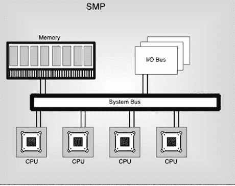

服务器需要多少处理器取决于工作负载。更多的处理器提供更高的处理能力，并能在 CPU 密集型任务上提供额外的吞吐量。如果工作负载是 CPU 密集型的，即进程过多地等待处理器调度，那么额外的处理器容量可能是必要的。

SMP 系统相当常见，作为商用产品通常配备两到四个处理器。可以构建更大的配置，但随着处理器数量增加、附加内存增多以及使用更多 I/O 设备时，公共系统总线会成为瓶颈。共享系统总线的容量不足以容纳与处理器、内存和 I/O 设备数量相关的所有数据移动。因此，扩展到更大规模的系统需要采用 SMP 之外的方法。

已经采用了多种用于更大规模扩展的方法。最常见的两种方法是集群和非统一内存架构（NUMA）。这两种方法都有一个共同基础，即消除共享系统总线。集群由一组自包含的系统构成，这些系统相互连接，并有一个中心控制点来管理集群中每个系统（节点）执行的工作。集群中的每个节点运行自己的操作系统（例如 Linux），并且只能直接访问自己的内存。另一方面，NUMA 系统由通过高速互连连接的节点构建，但所有节点共享一个共同的地址空间。只有一个操作系统映像存在，并且它控制所有节点上的操作。尽管内存对每个节点来说是本地的，但在一个大的、缓存一致性物理地址空间中，所有节点都可以访问这些内存。集群和 NUMA 系统将在后续章节中详细讨论。

## 混合处理器

许多现代服务器平台支持在同一系统内混合不同速度和步进（修订版）的处理器。在这种环境中，必须特别注意以确保最佳运行。通常，处理器制造商会发布具体的指南，当混合具有不同速度和不同特性或步进级别的处理器时必须满足这些指南。以下是一些最常见的指南：

- 引导处理器是从系统中所有其他处理器中步进最低且特性集最小的一组处理器中选出的。
- 系统软件对系统中所有处理器使用统一的速度，该速度由系统中配置的最慢处理器的速度决定。
- 所有处理器使用相同的缓存大小，该大小由系统中配置的最小缓存大小决定。

系统软件必须实施并遵循类似的限制或指南，以确保程序正确运行。

如本节所学，Linux 可以支持多处理器服务器。但是，你也了解到必须增加内存以避免性能问题。下一节将讨论内存问题。

## 内存

服务器通常拥有大量的内存。每个处理器 1GB 到 4GB 的内存是常见的配置。服务器所需的内存量取决于服务器正在执行的工作类型。如果服务器频繁进行交换（swapping），应考虑增加额外内存。如果服务器有足够内存将常用且重度使用的数据锁定在内存中，某些工作负载的表现会大幅提升。其他工作负载使用少量易失性数据，因此增加内存不会带来好处。

服务器上进程可寻址的最大内存量受处理器的字长限制。服务器处理器具有 32 位或 64 位的字长。处理器上的寄存器大小为一个字，用于保存内存地址。处理器可寻址的最大内存量是字长的函数。32 位处理器的内存可寻址性限制为 4GB（2 的 32 次方）。在 Linux 中，用户空间进程只提供 3GB 的地址空间，最后一个 GB 的地址空间保留供内核使用。

在 64 位处理器上，4GB 的限制消失了，但大多数 64 位实现在可能的最大值（即 2 的 64 次方）以下对最大地址施加了限制。

一些 32 位处理器（例如 Pentium）实现了额外的地址位，用于访问大于 32 位的物理地址，但这些位仅可通过使用页表条目中的额外位进行虚拟寻址来访问。基于 x86 的处理器目前通过此机制支持最多 64GB 的物理内存，但虚拟可寻址性仍限制在 4GB。

64 位处理器适用于那些进程需要寻址大量数据的工作负载。例如，大型数据库可以从 64 位处理器提供的额外内存可寻址性中受益。另一方面，对于没有大型可寻址性要求的工作负载，32 位处理器更合适，因为为 32 位处理器编译的代码更紧凑（因为代码中使用的地址是 64 位地址大小的一半）。更紧凑的代码减少了缓存使用。

处理器速度和内存速度仍在不断提高。然而，内存速度技术通常落后于处理器技术。因此，大多数服务器系统实现了较小的、高速的内存子系统，称为*缓存*。缓存内存子系统实现于处理器和内存子系统之间，以帮助弥合更快的处理器速度与较慢的内存访问时间之间的差距。实现缓存的优点在于，它们可以利用一种称为*引用局部性*的特性，从而显著提升系统性能。大多数程序在某个时刻会在很长一段时间内连续执行同一组指令子集。如果该指令子集和相关数据可以容纳在缓存内存中，通常可以消除昂贵的内存访问，从而大幅提高整体工作负载性能。

当今大多数处理器实现了多级缓存。此外，一些服务器还可以实现多级缓存层次结构。处理器缓存通常比平台实现的缓存小得多且速度更快。缓存大小范围从片上缓存的几 KB 到几 MB，以及系统缓存的几 MB。缓存被划分为大小相同的条目，称为缓存行。每个缓存行表示主内存中若干连续字。缓存行大小范围从几字节（在处理器缓存中）到数百字节（在系统缓存中）。数据在缓存行边界处插入或逐出缓存。Linux 内核利用这一事实，确保经常访问的数据结构或数据结构部分对齐在缓存行边界上。缓存行进一步组织成组。组内的行数表示哈希例程必须搜索的行数，以确定地址在缓存中是否可用。缓存实现不同的替换策略来确定何时逐出数据。缓存还实现不同的缓存一致性算法来确定何时将数据写回主内存，并提供刷新缓存全部内容的功能。正确管理系统的缓存可能会影响系统性能。

尽管内存对于保持系统平稳运行至关重要，I/O 容量同样重要。与内存一起，这是保持处理器效率的一个组件。

## I/O

服务器系统与其他中型计算机的一个区别在于 I/O 子系统。服务器系统支持更多的 I/O 设备数量以及更复杂的 I/O 拓扑结构。由于服务器通常托管大量数据并需要快速向用户提供数据访问，I/O 吞吐量和带宽在系统性能中可能发挥关键作用。

I/O 总线作为 I/O 设备与系统内存之间的连接通道。现代服务器上主流的 I/O 总线是 PCI。服务器拥有多个 PCI 插槽，允许安装用于连接 SCSI、光纤通道、网络及其他 I/O 设备的 PCI 卡。

服务器配置可以从单个磁盘到数千个磁盘不等。虽然 2.4 内核系列中系统磁盘数量限制为 256 个，但这一限制在 2.6 内核中已得到提高。仅有一两个磁盘的服务器可能使用 IDE 技术，但拥有多个磁盘的系统大多使用 SCSI 技术。光纤通道也被使用，特别是对于可能包含多个光纤通道适配器、交换机和企业级存储阵列的大型存储网络。

多路径 I/O（MPIO）为存储设备提供了一条以上的路径。在基本 MPIO 配置中，到存储设备的额外路径仅用于故障切换；也就是说，当系统检测到通过主路径尝试访问存储设备时发生错误，它会切换并使用次路径来访问存储设备。更先进的 MPIO 配置使用额外路径来增加存储设备与内存之间的带宽。操作系统尝试在多条路径之间进行负载均衡，以最大化内存与磁盘之间的数据传输吞吐量。

服务器至少需要一个网络连接，但同样，根据服务器执行的工作类型，它可能拥有多个网络连接，要么全部连接到同一个网络（多个连接提供更高的网络带宽），要么连接到多个网络。以太网是目前使用最广泛的网络技术。尽管仍然支持 10Mbps 以太网，但如今大多数以太网以至少 100Mbps 的速度运行，千兆以太网已成为现代服务器的默认配置。其他网络技术，如 ATM，也存在并受到 Linux 的支持，但不如以太网普及。

其他 I/O 设备也连接到服务器上。大多数服务器都有一个 CD-ROM 设备用于向系统加载软件。它们也可能配备 CD 刻录机。还需要某种设备来备份系统数据。通常使用磁带设备来完成此任务，尽管其他备份机制和策略也是可能的。

大型服务器具有某种形式的服务处理器，用于控制初始加电复位序列、引导操作系统，并在正常操作期间监控系统（电源、冷却等）。服务处理器通常参与机器故障处理，并为服务器的正常运行提供其他服务。

多处理器、内存和 I/O 子系统是构成企业级服务器核心的组件。Linux 企业服务器的硬件为基础提供了实现这种高性能功能的基础。


### Linux 企业级服务器

*企业级服务器* 是旨在用于数据中心中使用的服务器。该术语暗示其具备高于运行业余爱好者版本 Linux 的简单 PC 类机箱的一定级别的功能。企业级服务器支持较大组织的计算需求，其需求比单个用户或部门更大且更复杂。

历史上，大型机服务于企业，而较小的系统服务于部门或用户。然而，在过去 20 年中，计算机技术发生了重大变化。如今，企业级服务器正在使用通用硬件构建。目前，判断服务器是否为企业级服务器的重要区别因素在于其提供的软件功能。

企业级服务器预期的功能包括以下方面：

- 高级管理功能
  - 性能监控和调整
  - 存储管理，通常以逻辑卷管理器的形式
  - 资源管理
  - 安全监控
  - 用户账户创建
- 性能和可扩展性
  - 操作系统有效利用系统资源的能力
  - 能够执行企业级计算的原始系统性能
  - 多处理器
  - 能够支持 GB 级内存
  - 大容量 I/O 能力（磁盘、网络）
- 可靠性、可用性、可维护性（RAS）
  - 五个九的可用性（99.999% 可用）
- 问题诊断
  - 调试工具
  - 错误日志

将一个服务器称之为企业级服务器的标准是主观的，但此处列出的功能是需要考虑的因素。

企业级服务器满足当今企业复杂的业务需求。通过包含集群，可以增加这种复杂性。Linux 集群技术允许密集型任务在多个服务器上运行，从而允许你汇集资源。

### Linux 集群

有两种不同类型的集群：高性能集群和高可用性集群。这两种集群类型的共同点是它们都由一组互连并共同完成任务的独立计算机组成。集群中的每个独立计算机称为一个节点。

高性能集群的目标是执行大型计算任务，将工作分散到大量节点上。高可用性集群的目标是使应用程序（通常是数据库）即使在一个或多个节点故障的情况下也能继续运行。高性能集群通常不被视为企业级服务器，而是专门用于特定的计算密集型任务。另一方面，高可用性集群通常作为企业级服务器运行。

高性能集群（HPC）往往比高可用性集群拥有更高的节点数量，100 个节点的集群很常见。高可用性集群往往节点数量较少，通常不超过 16 个节点，更常见的是仅有两个到四个节点。

#### 高性能集群

高性能集群为可分解为多个并行组件的问题提供一种提供强大计算能力且成本低廉的方式。节点通常是不昂贵的单处理器或双处理器计算机。由于涉及大量节点，尺寸是一个重要的考虑因素。适用于 1U 外形规格、允许每个机架堆叠大量设备的计算机常用于高性能集群。大多数主要硬件供应商都出售能够组成集群的系统。节点是无头的，即没有键盘、显示器或鼠标。更大的集群可能包含独立的管理局域网和/或终端服务器网络，以向节点提供控制台功能。

HPC 中的每个节点都有各自的本地磁盘存储，用于维护操作系统、提供交换空间、存储程序等。一些集群拥有一种额外的节点类型——存储服务器——用于提供对共享数据的通用磁盘存储的访问。还有一个主节点，负责集群的整体控制，协调各节点之间的工作，并提供集群与本地网络之间的接口。

HPC 中节点之间的互连可以是以太网（10、100、1000Mbps）或可以提供更高性能的专用互连，如 Myrinet。互连技术的选择是价格与速度（延迟和带宽）之间的权衡。集群设计执行的工作类型会影响互连技术的选择。

某些文件系统专为集群环境设计。这些文件系统提供全局、并行的集群文件系统，例如来自 IBM 的 GPFS 或 CXFS 来自 SGI。这些文件系统为位于共享磁盘文件系统上的文件提供并发读写访问。

HPC 节点之间的通信通常使用消息传递库，例如 MPI 或 PVM。这些库基于通用标准，并允许将并行应用程序轻松移植到不同的集群环境中。

#### 高可用性集群

某些工作负载对故障更为敏感；也就是说，工作负载故障可能对业务造成昂贵的后果。示例工作负载包括客户关系管理（CRM）、库存控制、消息服务器、数据库以及文件和打印服务器。可用性对这些工作负载至关重要；可用性要求通常被描述为五个 9 的可用性（99.999%）。提供该级别的可用性允许每年约 5 分钟的停机时间。

防止运行这些关键工作负载的系统故障导致停机的一种方法是使用高可用性（HA）集群。HA 集群至少由两台独立的计算机和一个“心跳”监控程序组成，该程序监控集群中其他节点的健康状态。如果一个节点发生故障，另一个节点将检测到该故障并自动接管故障节点的工作。

HA 集群通常由较大的计算机（四个或更多处理器）构建。典型的 HA 集群只有少数几个节点。理想情况下，集群中的节点有足够多余的容量来吸收来自一个故障节点的工作负载。因此，在双节点集群中，每个节点通常应以 50% 的容量运行，以便有冗余空间来吸收另一个节点的负载。在四节点集群中，每个节点可以以 75% 的容量运行，并且有足够多余的容量来吸收故障节点的工作负载。因此，拥有更大的节点数量更有效率。然而，大型节点中心的效率以增加的复杂性和管理开销为代价。

对于 HA 集群，所有节点都需要能够访问应用程序正在使用的数据，这通常是数据库。通常需要连接光纤通道（Fibre Channel）适配器和交换机才能将几个以上的节点连接到公共磁盘存储阵列。这通常是限制 HA 集群节点数量的因素。

在 Linux 社区中，有一个专注于高可用性集群的活跃小组（参见 http://linux-ha.org）。该网站提供了有关 Linux 高可用性集群设计和配置的详细信息，并提供了描述 Linux HA 集群各种实现和部署的论文的链接。

集群是一种整合资源的方式。在下一节中，了解大型机语境下的整合意味着什么。

##### 服务器系统示例

有多种服务器系统可供选择。这些服务器的性能对于不断发展的信息基础设施的成功至关重要。在这里，我们将讨论一些可用示例。

##### IBM 大型机 zSeries

大型机服务器是某些 Linux 服务器整合工作的理想平台。大型机服务器是大型、极其可靠的平台。这些平台具有高内存和 I/O 带宽、低内存延迟、共享的大型 L2 缓存、专用 I/O 处理器以及非常先进的 RAS（可靠性、可用性和可维护性）功能。IBM zSeries 平台是这项技术的支柱。

大型机支持逻辑分区，这是将机器内存、处理器和 I/O 资源划分为多个机器映像的能力，每个映像都可以运行独立的操作系统。分配给分区的内存是专用物理内存，而处理器可以是专用或共享的，I/O 通道也可以在分区之间专用或共享。当 I/O 或处理器资源在分区之间共享时，这种共享由控制分区的固件处理，对运行在分区中的操作系统是不可见的。

虽然 Linux 可以在大型机的分区中运行，但真正的优势是在 z/VM 下的虚拟机中运行大量 Linux 服务器映像。z/VM 是一个为“来宾”提供虚拟机环境的操作系统，从而为每个来宾提供整个机器的视图。此虚拟机实现允许支持大量 Linux 映像，仅受系统资源限制。实际部署已在单台大型机上提供了由 z/VM 托管的虚拟机中作为来宾运行的数千个 Linux 服务器。

资源可以在 Linux 映像之间共享，并且可以实现高速虚拟网络。这些虚拟网络基本上以内存速度运行，因为无需将数据包发送到线上即可到达其他 Linux 来宾。

新的 Linux 虚拟机实例完全通过软件控制创建，并且可以方便地通过脚本编写。这简化了系统管理，并允许在几分钟内部署新的 Linux 服务器（作为 z/VM 的来宾），而不是安装新物理服务器所需的数小时。物理资源不需要为每个来宾保留和专用；相反，在 z/VM 的控制下，所有系统资源都是共享的。

z/VM 了解硬件，并可以代表来宾服务器利用先进的 RAS 功能。提供了一个健壮的工作负载监控和控制设施，提供了先进的资源管理能力。z/VM 还提供许多调试工具，以帮助诊断 Linux 来宾的软件问题，并且还有助于测试新服务器。有关 2000 年左右 IBM 大型机技术的详细信息，请参见 http://www.research.ibm.com/journal/rd43-56.html。

这些机器适合服务器整合。它们可以支持数百到数千个独立的 Linux 映像。适合在此环境中运行的工作负载类型具有以下特征：

- I/O 密集型操作（例如，提供网页服务）
- 负载较轻的服务器

计算密集型、图形导向的工作负载不适合大型机服务器，经常检查系统时钟的工作负载也是如此。负载较重的服务器也不是大型机服务器整合的好的候选者。

旧的大型机不支持 IEEE 格式浮点运算。因此，Linux 下的所有浮点运算必须转换为 IBM 专有格式，执行，然后转换回 IEEE 格式。较新的大型机支持 IEEE 格式，并且不会遭受此性能惩罚。

规划在 z/VM 下安装 Linux 部署需要高级大型机系统管理和编程技能。然而，在系统安装和配置完成后，添加新的虚拟服务器相当简单。

##### 硬件设计概述

IBM zSeries 架构在处理器模块上实现了 12 或 20 个处理器。有多种类型的处理器，这些类型由加载并控制处理器的微代码决定。主要的处理器类型是处理单元（PU），它们等同于大多数服务器上的 CPU，以及系统辅助处理器（SAP），后者处理 I/O 操作的控制。每台机器至少有两个 SAP，并且根据 I/O 容量需求可能有更多。


模块具有两个大型 L2 缓存，每个 L2 缓存在模块上一半的处理器之间共享。这与每个处理器都关联一个 L2 缓存的标准服务器不同。共享的 L2 缓存允许进程在处理器之间迁移而不失去其缓存热度。

每个处理器的内存带宽为 1.5GBps，系统总带宽为 24GBps。非常大的内存带宽设计有利于那些不具有缓存友好工作集或行为的应用程序。

普通 Linux 服务器通常以不超过 50% 的平均利用率运行，以提供工作负载峰值的冗余空间。大型机的设计允许系统以 80% 到 90% 的利用率运行。

### 可靠性

大型机服务器一个显著的特征是其极高的可靠性。这些系统的可靠性以整体可用性来衡量。五个九的可靠性，即 99.999% 的可用性，是一个在硬件层面可以实现且常见的目标。这意味着每年的停机时间少于 5 分钟。这种级别的可靠性是通过被称为持续可靠运行（CRO）的先进硬件设计技术来实现的。

持续可靠运行的目标是确保客户的工作负载在遇到错误状况、维护或系统变更时无中断地运行。在保持可用的同时，机器还必须提供可靠的结果（数据完整性）和稳定的性能。这些要求通过持续的错误检查、热插拔能力以及其他高级方法来满足。

### IBM 大型机 I/O 设计

每个系统都有两个或更多专门用于执行 I/O 操作的处理器。SAP（System Assist Processor，系统辅助处理器）运行专用微代码并管理 I/O 操作，从而将管理 I/O 操作的工作从主处理器中分离出来。支持的 I/O 卡如下：

- ESCON-16 通道卡
- FICON 通道卡
- Open Systems Adapter (OSA) Express
- 千兆以太网（GbE）
- 异步传输模式（ATM）
- 快速以太网（FENET）
- PCI-加密协处理器（PCI-CC）卡

ESCON 是一种 zSeries 技术，支持通过光纤电缆进行 20Mbps 半双工串行位传输。

FICON 是一种较新的 zSeries 技术，能够通过光纤支持 100Mbps 全双工串行接口。它支持同时对不同的通道控制单元执行多个未完成的 I/O 操作。FICON 提供了与最多八个 ESCON 通道相同的 I/O 并发性。

开放系统适配器卡（以太网、令牌环或 ATM）提供网络连接。OSA-Express 卡实现了队列直接 I/O（QDIO），它使用共享内存队列和信号协议与 TCP/IP 协议栈直接交换数据。

磁盘存储通过 ESCON 或 FICON 连接。推荐的存储设备是企业存储服务器（ESS），通常被称为 Shark。Shark 是一个功能齐全的磁盘存储阵列，支持多达近 14 太字节的磁盘存储。ESS 拥有大容量内部缓存和多个 RISC 处理器，以提供高性能磁盘存储。使用光纤通道、ESCON、FICON 或 UltraSCSI 技术，可以将多个服务器连接到单个 ESS。关于 ESS 的更多信息可访问 http://www.storage.ibm.com/hardsoft/products/ess/ess.htm。

### 刀片

刀片是以小型因子实现的计算机，通常整台计算机，包括一到两个磁盘驱动器，都集成在一张卡上。多张卡（刀片）驻留在一个通用机箱中，该机箱提供电源、冷却和布线，以支持网络和系统管理连接。这种封装方式允许在密集封装中提供显著的 computing 能力，从而节省空间。刀片在需要大量相对较小的独立计算机的数据中心中大量使用，例如大型 Web 服务器环境。刀片也是集群使用的候选方案。

由于尺寸是刀片设计的重要因素，大多数刀片仅限于单处理器，尽管也有双处理器刀片可用。随着处理器技术和封装技术的不断进步，具有高处理器数量的刀片很可能会变得可用。然而，大量 I/O 连接的可用性在一定程度上限制了高处理器数量刀片的实用性。

### NUMA

对更大计算容量的需求导致了多处理器计算机使用量的增加。大多数多处理器计算机被认为是对称多处理器（SMP），因为每个处理器都是平等的，并且对所有的系统资源（如内存和 I/O 总线）具有平等的访问权限。SMP 系统通常围绕一条系统总线构建，所有系统组件都连接到这条总线上，并用于组件之间的通信。随着 SMP 系统处理器数量的增加，系统总线越来越成为瓶颈。硬件设计师正在采用的一种解决方案是非统一内存架构（NUMA）。

NUMA 系统将系统整体处理器和内存的子集共存于节点中，并在节点之间提供高速、高带宽的互连，如图 3-2 所示。因此，存在多个物理内存区域，但所有内存都连接成一个单一的缓存一致性物理地址空间。在由此产生的系统中，某些处理器比其他处理器更接近给定的物理内存区域。相反，对于任何处理器，某些内存被认为是本地的（即，它离处理器较近），而其他内存则是远程的。类似的特性也适用于 I/O 总线；也就是说，I/O 总线可以与节点相关联。

#### 图 3-2. NUMA 的高带宽互连。


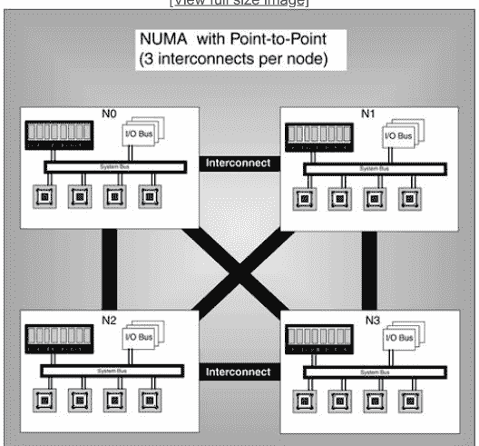

尽管 NUMA 系统的关键特征是内存部分与其他系统组件之间的可变距离，但存在许多 NUMA 系统设计。在频谱的一端是所有节点对称的设计；它们都包含内存、CPU 和 I/O 总线。在频谱的另一端是拥有不同类型节点的系统；极端情况是独立的 CPU 节点、内存节点和 I/O 节点。所有 NUMA 硬件设计的特点是内存区域与其他资源处于不同距离，因此具有不同的访问速度。

为了在 NUMA 平台上最大化性能，Linux 考虑了系统资源的物理布局方式。这包括诸如哪些 CPU 在哪个节点上、每个节点上哪个范围的物理内存以及 I/O 总线连接到哪个节点等信息。这种类型的信息描述了系统的拓扑结构。

在 NUMA 系统上运行的 Linux 通过将内存访问保持在最近的物理内存上获得最佳性能。例如，处理器受益于访问同一节点（或最近的内存节点）上的内存，I/O 吞吐量通过使用 I/O 经过的总线所在节点（或最近节点）上的内存而获益。在进程级别，从包含该进程正在执行的 CPU 的节点分配进程的所有内存是最优的。然而，这也要求将进程保持在同一节点上。

#### 硬件实现

许多设计和实现选择导致各种各样的 NUMA 平台。本节讨论硬件实现，并提供 NUMA 硬件实现的示例和描述。

##### 节点类型

NUMA 系统最常见的实现是由互连的对称节点组成。在这种情况下，节点本身是一个 SMP 系统，具有某种形式的高速和高带宽互连将其链接到其他节点。每个节点包含一定数量的处理器、物理内存和 I/O 总线。通常存在节点级缓存。这种类型的 NUMA 系统如图 3-3 所示。


##### 分层 NUMA

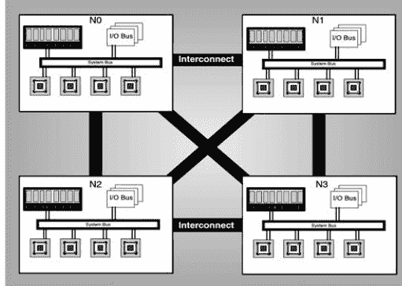


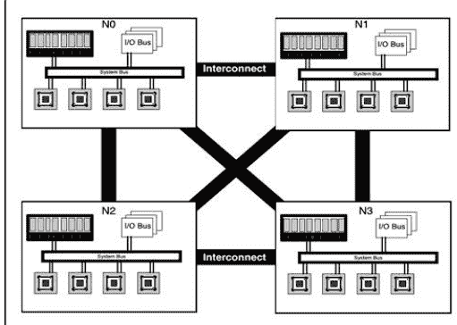

这种设计的一个变体是仅将处理器和内存放在主节点上，然后让 I/O 总线独立。另一种设计选项是为处理器、内存和 I/O 总线设置独立的节点，它们都互连在一起。

也可以有包含节点的节点，从而形成分层 NUMA 设计。这如图 3-3 所示。

##### 互连类型

互连技术没有标准化标准。然而，与 Linux 更相关的是互连的拓扑结构。NUMA 机器可以使用以下互连拓扑：

- **环形拓扑**，其中每个节点连接到其左侧和右侧的节点。内存访问延迟可能是不对称的；也就是说，从节点 A 到节点 B 的访问可能比从节点 B 到节点 A 的访问花费更长时间。
- **交叉开关互连**，所有节点连接到一个公共交叉开关。
- **点对点**，每个节点有若干端口用于连接到其他节点。系统中的节点数量限制为连接端口数加一，并且每个节点直接连接到每个其他节点。这种类型的配置如图 3-3 所示。
- **网格拓扑**，这是一种更复杂的拓扑，与点对点拓扑类似，它建立在每个节点具有若干连接端口的基础上。然而，与点对点拓扑不同，节点之间没有直接连接。图 3-4 描绘了一个具有三个互连的 8 节点 NUMA 系统的网格拓扑。这允许到三个“附近”节点的直接连接。访问其他节点需要额外的“跳”，经过一个附近的节点。


#### 8 节点 NUMA

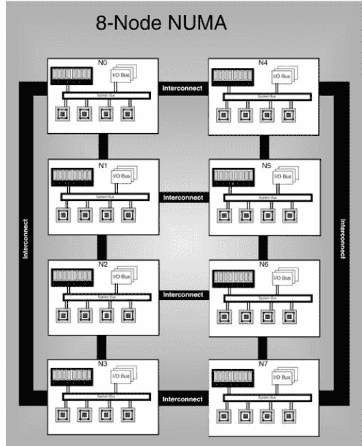

互连提供的拓扑结构会影响节点之间的距离。此距离影响节点之间内存的访问时间。

#### 延迟比

衡量系统“NUMA 特性”的一个重要指标是延迟比。这是本地节点内存访问与远程节点内存访问的内存延迟之比。根据互连的拓扑结构，可能存在多个远程节点延迟。此延迟用于分析访问物理地址空间不同部分的成本，从而影响内存使用决策。

#### 具体的 NUMA 实现


多家硬件厂商正在构建运行 Linux 操作系统的 NUMA 机器。本节简要描述了其中一些机器，但这并非对所有现有实现的全面综述。

### IBM NUMA-Q

IBM NUMA-Q 是早期商用 NUMA 机器之一。该机器基于包含四个处理器（i386）、内存和 PCI 总线的节点。每个节点还包含一个管理模块，用于协调启动、监控环境状态并与系统控制台通信。节点通过环形拓扑互连。最多可连接 16 个节点，从而支持最多 64 个处理器和 64GB 内存。远程到本地内存的延迟比范围在 10:1 到 20:1 之间。每个节点都有一个大的远程缓存，有助于弥补较大的远程内存延迟。由于这些系统的可用性，许多 Linux NUMA 开发都在这些系统上进行。

### NEC TX7

NEC 使用 Intel Itanium 处理器构建 NUMA 系统。该系列中最新的系统是 NEC TX7。TX7 支持多达 32 个 Itanium2 处理器，每个节点包含四个处理器。节点通过交叉开关互连，并分组为两个超级节点，每个超级节点包含四个节点。交叉开关提供对非本地内存的快速访问，具有低延迟和高带宽（每个节点 12.8GBps）。同一超级节点内远程到本地内存的延迟比为 1.6:1。超级节点外的远程到本地内存延迟比为 2.1:1。没有节点级缓存。I/O 设备通过 PCI-X 总线连接到交叉开关互连，因此到任何 CPU/节点的距离都相同。

### IBM xSeries

大型 IBM xSeries 机箱使用 Intel 处理器和 IBM XA-32 芯片组。该芯片组提供一种架构，支持四个处理器、内存、PCI 总线和三个互连端口。这些互连端口允许最多四个节点进行点对点连接，构成 16 处理器系统。图 3-2 中所示的系统近似于四节点 x440 的配置。还支持连接到带有额外 PCI 插槽的外部系统，以增加系统的 I/O 容量。IBM eServer xSeries 440 基于此架构构建，使用 Intel Xeon 处理器。

#### NUMA 系统上的 MPIO

如本章前面所述，多路径 I/O（MPIO）可以为服务器提供额外的 I/O 带宽。然而，在 NUMA 平台上，它可以提供更大的收益。MPIO 涉及使用多个 I/O 适配器（SCSI 卡、网卡）以获得到底层资源（硬盘、网络）的多条路径，从而提高整体带宽。在 SMP 平台上，由于所有 CPU 和内存通常共享一个具有最大带宽限制的总线，MPIO 带来的潜在速度提升受到限制。然而，在 NUMA 平台上，不同的 CPU、内存和 I/O 总线组拥有各自独立的互连。由于这些独立的互连允许每个节点独立达到其最大带宽，因此更有可能获得更大的 I/O 聚合吞吐量。

理想的 NUMA 系统上的 MPIO 设置包括在每个节点上放置一张 I/O 卡（SCSI、网络等），并连接到每个 I/O 设备，以便无论请求进程在哪里运行，或内存在哪里，始终存在到 I/O 设备的本地路径。通过这种硬件配置，可以用数据填满多个 PCI 总线。由于这种规模的许多机器使用 RAID 或其他 MD 设备，通过利用多个磁盘进一步增加了潜在带宽，从而对此提供了进一步的辅助。

### 定时器

在单处理器系统中，处理器拥有一个易于且快速访问的时间源，通常实现为寄存器。在 SMP 系统中，处理器的时间源通常已同步，因为所有处理器以相同的频率运行。因此，处理器之间时间寄存器的同步是一项直接的任务。

在 NUMA 系统中，同步处理器的时间源是不切实际的，因为每个节点不仅有自己的提供时钟频率的晶体，而且处理器驱动频率之间往往存在微小差异，这导致了时间偏差。

在多处理器系统中，必须有一致一致的系统时间。否则，不同处理器提供的时间戳无法可靠地用于排序。如果进程被调度到不同的处理器上，时间可能会出现意外的跳跃（向前或向后）。

理想情况下，硬件提供一个具有快速访问时间的全球时间源。不幸的是，全球时间源往往需要片外访问，并且经常需要节点外访问，这倾向于较慢。时钟实现非常依赖于架构，在 NUMA 平台中没有明确的领先实现。例如，在 IBM eServer xSeries 440 上，全球时间源由节点 0 提供，所有其他节点必须进行节点外访问才能获取时间。

在 Linux 2.6 中，i386 定时器子系统有一个抽象层，简化了添加由特定机器架构提供的不同时间源的过程。对于标准 i386 架构机器，使用时间戳计数器（TSC），它提供非常快速的时间参考。对于 NUMA 机器，使用全球时间源（例如，在 IBM eServer xSeries 440 上，使用全球芯片组定时器）。

### 总结

本章向你展示了 Linux 提供了许多内容！在让你熟悉 Linux 在服务器架构方面的所有功能时，这里的重点是 Linux 内核的增强设计。这种设计帮助你根据需求塑造你的系统。

每个功能协同工作，形成一个软件技术的强大力量。从处理器和多处理器的强大功能，到配置技术，再到内存的多功能性，Linux 拥有你的服务器！

# 第二部分：性能分析工具

- 第四章。系统性能监控
- 第五章。系统跟踪工具
- 第六章。基准测试作为理解工作负载性能的辅助工具

## 第四章。系统性能监控

作者：Gerrit Huizenga、Peter Wai Yee Wong 和 Vajjayanthimala Anand

### 引言

本章专注于那些最初有助于监控系统整体性能的工具。在对工作负载的整体系统性能特征有了理解之后，相同的工具可用于识别哪些特定进程是整体工作负载的瓶颈。在许多情况下，系统监控工具可以帮助推动系统调优，从而大幅减少或消除关键瓶颈。在其他情况下，这些工具仅指出需要调优、重新配置或，在最极端的例子中，进行算法改进以提高整体工作负载性能和吞吐量的应用程序或进程。

具体而言，本章考察提供以下方面洞察的工具：

- 整体系统 CPU 利用率
- 内存利用率
- 磁盘 I/O 利用率和延迟
- 网络利用率

其中一些工具提供了关于系统利用率不同方面的信息；然而，为了简化本章的组织结构，这些工具将在与其大多数监控功能最相关的部分中讨论。这些工具通常是在理解和改进给定工作负载性能时使用的第一个，有时也是唯一的工具。然而，在某些情况下，这些高层工具指向单个应用程序或一组任务，其瓶颈无法通过全局系统调优来解决。在这些情况下，后续章节将讨论允许性能分析人员聚焦于问题应用程序，以更好地理解该应用程序及其与底层操作系统交互的工具。

### Linux 与性能分析背景

Linux 主要凭借其认可 Linux 在小服务器上价格/性能优势的草根努力进入市场。Linux 在该市场空间中非常有效，并已成为更广泛企业市场中日益流行的操作系统。这种普及促使硬件供应商将 Linux 移植到拥有更多处理器、更多处理器类型、更多物理内存和更大 I/O 配置的平台上。软件供应商看到了将更复杂的软件移植到 Linux 的好处，最终用户也在构建更复杂的配置。随着这些工作负载复杂度的增加，最终用户开始期待与专有系统相同或更高的性能水平。这些对性能期望的提高转化为对操作系统调度器、内存管理、磁盘和网络 I/O 子系统的性能分析和可扩展性改进。

历史上，系统供应商提供专有操作系统，并在内部对核心子系统进行分析，且仅使用相对较少的关键应用程序，这些应用程序是其业务核心所依赖的。这些供应商能够使用先进的、通常是专有的性能分析工具，包括精密的总线监视器、专有的芯片计数器、仿真工具、本机性能监控包，以及用于分析复杂软件和硬件配置性能的工具。许多此类复杂工具可供特定客户使用，或通过服务合同使用，以便客户分析其工作负载的性能特征并评估复杂调优更改的结果。本书部分内容的意图是探讨当今可以普遍应用以提高 Linux 及其上运行的应用程序整体性能的一些工具和最佳实践。

Linux 在性能分析方面带来了一些新的挑战，但也提供了一些独特的优势。具体来说，Linux 比大多数专有操作系统运行在更广泛的硬件平台上，包括 RISC 和 CISC 架构、32 位和 64 位系统、单处理器系统、嵌入式系统、小型（两到四个 CPU）和大型（八到 128 个）对称多处理器系统。这些基于 Linux 的系统上的工作负载及其底层处理器组合，比以往任何单一操作系统所处理的都更加多样化，包括台式机、笔记本电脑、嵌入式系统、邮件服务器、文件服务器、应用服务器、数据库服务器和内容服务器。尽管在调整 Linux 期间已使用过许多工作负载，但 Linux 并未针对特定的单一工作负载进行过调优。此外，预期的相同核心 Linux 内核和基础库应能在所有这些工作负载上合理运行。由于这些权衡以及 Linux 在所有工作负载上都能合理运行的普遍期望，如果没有系统分析、性能监控以及（潜在地）系统和应用程序调优的帮助，您独特的工作负载在 Linux 上很可能无法以最佳方式运行。

这些日益复杂的工作负载的性能受到许多因素的影响。显然，处理器速度、内存大小、网络或磁盘 I/O 控制器的数量以及磁盘的大小和速度是所有工作负载性能特征的重要组成部分。其他主要组成部分包括应用程序自身的性能特征、工作负载的性质、应用程序之间的通信、磁盘或网络上数据的访问模式，以及当然还有使用应用程序的最终用户的使用模型。

调优特定工作负载通常始于这样一个假设：环境的许多物理特性将保持不变，例如处理器数量、处理器类型、磁盘数量等。性能分析的主要目标是确定工作负载中哪些组件是当前增加性能和整体吞吐量的瓶颈，以及当工作负载使可用硬件容量饱和时，了解哪些硬件配置改进会增加工作负载的吞吐量和性能。


如今，开源社区中提供了许多 Linux 性能工具，此外还有少数商用工具。本章中的许多例子源自运行 Linux 2.4 内核的常见发行版，尽管通常基于 Linux 2.6 内核的任何发行版中都应该存在相同的工具并具备相同的功能。在某些情况下，内核收集的数据通过不同的接口提供，或基于不同的内核内记账机制。无论如何，工具提供的信息应该相似或完全相同。如果您的发行版未安装特定工具，或者您认为特定工具不够最新，您可能希望查阅该工具的发行版媒体或从工具维护者处获取最新版本。例如，请参阅 [http://linuxperf.nl.linux.org/general/tools/tools.html](http://linuxperf.nl.linux.org/general/tools/tools.html) 以获取当前可用某些工具的指引。

## CPU 利用率

系统性能的主要指标之一是系统对其用户的响应性。尽管大多数用户关于性能的报告往往非常主观，但有几种比最终用户感知更具定量特性的措施可以应用。例如，人类通常倾向于将 50 毫秒内的任何响应视为几乎瞬时。交互式应用程序，特别是涉及文本输入的那些，当超过 50 毫秒阈值时显得缓慢。复杂系统的用户可能已习惯了几秒钟的系统响应时间，或者对于偶尔高度复杂的操作，甚至可能长达几分钟。每个工作负载都有其自身的响应时间，通常通过与系统交互数天、数周、数月甚至数年与用户共同确定。当用户的期望不再得到满足时，用户倾向于致电支持中心，指出响应时间已恶化，甚至可能灾难性地恶化，导致用户无法在合理时间内完成其任务。

这些致支持中心的电话为非计划性地使用各种性能分析工具提供了机会。不幸的是，在没有已知基线的情况下被动地使用这些工具，对初学者来说可能相当具有挑战性。有机会在危机发生前监控应用程序，以及创建和归档各种性能统计数据，通常有助于加快解决对支持中心的投诉。此外，关于如何识别某些系统性能问题迹象的一些通用经验，对于理解工作负载的性能问题是无价的。系统地、有条理地应用此处描述的工具，通常结合对工作负载的一般知识，应该能够缩小任何性能瓶颈的范围。并且凭借从系统角度对瓶颈的了解，系统管理员或性能分析师应该能够运用系统调优、系统重新配置、工作负载重新配置或对特定工作负载组件的详细分析，进一步并最终解决任何性能瓶颈。

在系统的医学式分析中，通常最先使用且最基础的工具之一是系统 CPU 利用率的简单测量。具体而言，Linux 和大多数基于 UNIX 的操作系统提供一个显示系统负载平均值的命令：

```
$ uptime
17:37:30 up 3 days, 17:06, 7 users, load average: 1.13, 1.23, 1.15
```

具体而言，负载平均值代表在 1、5 和 15 分钟期间内可运行的平均任务数。可运行任务是当前正在运行或可以运行但正在等待处理器可用的任务。在这种情况下，系统只有一个 CPU，这可以通过查看 `/proc/cpu` 的内容来确定：

```
$ cat /proc/cpu
processor  : 0
vendor_id  : GenuineIntel
cpu family : 6
model      : 8
model name : Pentium III (Coppermine)
stepping   : 6
cpu MHz    : 647.195
cache size : 256 KB
```

fdiv bug        : 否

hlt bug        : 否

f00f_bug       : 否

coma_bug       : 否

fpu            : 是

fpu_exception  : 是

cpuid level    : 2

wp             : 是

flags          : fpu vme de pse tsc msr pae mce cx8 sep mtrr pge mca

                 cmov pat pse36 mmm fxsr sse

bogomips       : 1291.05

在这种情况下，只有单个处理器的条目，因此平均而言，处理器需要执行的工作量略多于其能处理的能力。从宏观层面来看，这意味着机器需要处理的工作量超过了其处理能力。注意：如果在双 CPU 机器上 `uptime` 显示的负载平均值小于 2.00，则表明处理器仍有额外的空闲周期。同样，如果四 CPU 机器上的负载平均值小于 4.00，结论也是相同的，以此类推。然而，仅凭负载平均值并不能揭示全貌。

在这种情况下，涉及的机器是一台笔记本电脑。工作负载包括电子邮件客户端、文字处理器、Web 浏览器、一些自定义应用程序、聊天客户端等，它们都在同时运行。然而，用户认为对各种工作负载的响应时间是可接受的。

这表明操作系统调度程序适当地对需要运行的任务进行了优先级排序，特别是那些交互性最强的任务。机器上没有运行重要的服务器组件，因此高负载平均值对其他客户端或机器没有影响。

因此，尽管该工具表明 CPU 已被充分利用，但它并没有表明系统正在做什么，或者为何如此繁忙。而且，如果系统用户的响应时间是可接受的，可能没有理由更深入地探究系统的运行情况。

然而，如果我们在这一点停止，本章将变得无趣。通常，像 `uptime` 这样的简单工具是用户快速尝试解释应用程序响应时间感知缓慢的方法。如果系统的负载平均值表明响应时间可能是由过载的处理器（或处理器组）引起的，可以使用各种其他工具来缩小负载的原因。

为了更深入地了解处理器是如何被使用的，我们将查看三个提供不同 CPU 利用率洞察的工具：`vmstat`、`iostat` 和 `top`。这些命令中的每一个在系统监控方面都有不同的侧重点，但每个都可以用于从不同角度了解处理器的使用情况。特别是，下一步是了解处理器主要是在操作系统（通常称为内核空间）中花费时间，还是在应用程序（通常称为用户空间）中花费时间，或者处理器是否处于空闲状态。此外，如果处理器处于空闲状态，理解其原因对于进一步的绩效分析至关重要。处理器空闲的原因有很多。例如，最明显的原因是某个进程无法运行。这听起来可能太显而易见，但如果工作负载的某个组件（如特定进程或任务）未运行，性能可能会受到影响。在某些情况下，缓存组件或备用机制允许某些应用程序继续运行，尽管吞吐量会降低。举个例子，Internet 域名服务通常配置为咨询名为 `named` 的守护进程或咨询主机外的服务。如果一个名称服务提供商（例如 `/etc/resolv.conf` 中 `nameserver` 行中列出的第一个）未运行，在咨询另一个信息提供商之前可能会有一个超时期限。对于用户而言，这可能表现为应用程序的间歇性延迟。对于使用 `uptime` 监控系统的人而言，负载平均值可能不会显得很高。然而，在这种情况下，`vmstat` 的输出可能有助于缩小问题范围。特别是，我们在本章及接下来两章中将要介绍的许多工具将帮助你了解机器的 CPU 正在做什么，从而绩效分析师可以创建关于系统绩效的假设，然后尝试验证这些假设。

### vmstat

`vmstat` 是一个实时性能监控工具。`vmstat` 命令提供的数据可用于帮助发现异常的系统活动，例如高缺页故障或过多的上下文切换，这些可能会降低系统性能。数据显示的频率是用户指定的参数。`vmstat` 输出的示例如下：

```
proc s-----------memory----------- ----swap--- ----io----- --system--- ----cpu-----
r  b  swpd  free   buff  cache si so bi bo  in cs us sy id wa
18  8  5626196 3008 122788 0 0 330403 454 2575 4090 91 8  1  0
18 15  5625132 3008 122828 0 0 328767 322 2544 4264 91 8  0  0
17  2  5622004 3008 122828 0 0 327956 130 2406 3998 92 8  0  0
22  2  5621644 3008 122828 0 0 327892 689 2445 4077 92 8  0  0
23  5  5621616 3008 122868 0 0 323171 407 2339 4037 92 8  1  0
21 14  5621868 3008 122868 0 0 323663 23  2418 4160 91 9  0  0
22 10  5625216 3008 122868 0 0 328828 153 2934 4518 90 9  1  0
```

`vmstat` 生成以下信息：

- `procs` 部分报告报告时正在运行的进程（`r`）和阻塞的进程（`b`）数量。你可以使用此部分的信息来检查正在运行和阻塞的进程数量是否与你预期的相似。如果不相似，你可以检查许多事项：应用程序和内核的参数、系统调度程序和 I/O 调度程序、进程在可用处理器之间的分布等等。


### `memory` 部分
`memory` 部分报告正在换出的内存量（`swpd`）、空闲内存（`free`）、用于 I/O 数据结构的缓冲缓存（`buff`）以及从磁盘读取的文件缓存内存（`cache`），单位为千字节。`swpd` 的值反映了 `kswapd` 的活动。

### `swap` 部分
`swap` 部分返回从磁盘换入（`si`）和换出到磁盘（`so`）的内存量，单位为千字节/秒。注意，`so` 反映了 `kswapd` 的活动，因为数据被换出到交换区。然而，`si` 反映了缺页故障活动，因为页面被换回到物理内存。

### `io` 部分
`io` 部分报告从设备读取的块数（`bi`）和写入到设备的块数（`bo`），单位为千字节/秒。在运行 I/O 密集型应用程序时，请特别关注这两个字段。

### system 部分
system 部分报告每秒的中断数（`in`）和上下文切换数（`cs`）。

### cpu 部分
cpu 部分报告总 CPU 时间的百分比，以用户时间（`us`）、系统时间（`sy`）、真正空闲时间（`id`）和等待 I/O 完成时间（`wa`）表示。也许最常见的指标是 CPU 利用率。如果 `wa` 较大，检查 I/O 子系统——例如，你可能会得出结论，需要更多的 I/O 控制器和磁盘来减少 I/O 等待时间。

对于 I/O 密集型工作负载，你可以监控 `bi` 和 `bo` 以查看传输速率，以及 `in` 以查看中断速率。你可以监控 `swapd`、`si` 和 `so` 以查看系统是否正在交换。如果是，你可以检查交换速率。也许最常见的指标是 CPU 利用率，以及 `us`、`sy`、`id` 和 `wa` 的监控。如果 `wa` 较大，你需要检查 I/O 子系统。你可能会得出结论，需要更多的 I/O 控制器和磁盘来减少 I/O 等待时间。

与 `uptime` 类似，当不带选项运行 `vmstat` 时，它报告系统的单个快照。如果你先运行 `uptime`，然后运行 `vmstat`，你可以快速获得系统繁忙程度的快照，以及处理器在用户时间、系统时间、空闲时间和等待 I/O 时间方面的百分比分解的一些指示。此外，`vmstat` 提供了可运行进程数量的即时计数。注意，`uptime` 提供了可运行进程数量在三个时间段内的另一种视图：1 分钟、5 分钟和 15 分钟。因此，如果 `uptime` 的负载平均值在任何时间段内保持在 1 以上，`vmstat` 报告的可运行任务数量也应该接近 1。

由于 `vmstat` 还可以提供定期重复间隔的信息，你可以使用以下命令获得系统的更动态视图：

```
$ vmstat 5 10
```

此命令每 5 秒输出一次 `vmstat` 信息，共迭代 10 次。同样，如果根据 `uptime` 的输出，过去 1/5/10 分钟的负载平均值一直为 1，那么输出通常应在每一行显示大约一个可运行任务。不要惊讶于在 `vmstat` 的输出中看到 5、7 甚至 20 的峰值！记住，负载平均值是计算出的平均值，而不是即时快照。这两种视图对系统绩效分析都有好处。

`vmstat` 还提供了关于处理器在操作系统中花费多少时间、在用户应用空间（包括作为应用程序或操作系统一部分提供的库）中花费多少时间、空闲时间有多少以及操作系统阻塞等待 I/O 的时间有多少的粗略视图。不同的工作负载具有不同的利用率模式，因此没有明确的规则说明哪些值是好的或坏的。在这些情况下，为你的工作负载建立基线是很好的做法，以帮助你识别随着响应时间或系统负载增加，工作负载是如何变化的。`vmstat` 有助于识别哪些工具可以帮助深入挖掘工作负载的降级，或提供关于哪里可以调优或重新配置以改进工作负载性能的线索。

本节其余部分探讨一些示例。想象一个场景，用户报告工作负载的响应时间较差。通过 `uptime` 检查负载平均值，显示负载平均值非常低，甚至可能远低于基线时间。此外，`vmstat` 显示可运行作业数量非常低，并且根据 CPU 空闲时间的百分比，系统相对空闲。分析师可能会将这些结果解释为某个关键进程已退出或正在阻塞等待某个未发生事件的迹象

例如，某些应用程序使用某种信号量技术来分派工作并等待完成。也许该工作被分派给了后端服务器或其他应用程序，而该应用程序出于某种原因已经停止处理所有活动。结果是，最靠近用户的应用程序被阻塞，无法运行，等待某个信号量通知它完成，然后才能向用户返回信息。这可能会导致管理员将注意力集中在服务器应用程序上，查看为什么它无法完成为其排队等待的请求。

在另一种场景中，假设负载平均值显示的负载超过 1，甚至可能比既定基线平均高出整整 1 点。此外，`vmstat` 显示总有一两个进程处于可运行状态，但在很长一段时间内，用户时间百分比接近 100%。可能需要其他工具来找出哪些进程占用了 100% 的 CPU 计时器（例如，`ps(1)` 或 `top(1)` 提供了当前存在的所有进程或基于其选项选择的某个子集的列表。`top(1)`（或 `gtop(1)`）提供了最活跃进程的实时更新视图，其中*最活跃*可以定义为使用最多处理器时间的进程。这些数据可能有助于识别一个失控的进程，该进程在系统上没有做任何有用的事情。如果 `vmstat(1)` 报告进程主要在用户空间中运行，管理员可能希望连接一个调试器，如 `gdb(1)`，到该进程，并使用断点、跟踪或其他调试手段来了解应用程序正在做什么。如果 `vmstat` 报告大部分时间被消耗为“系统”时间，则可以使用其他工具，如 `strace(1)`，来找出做出了哪些系统调用。如果 `vmstat(1)` 报告大部分时间都花在等待 I/O 完成上，可以使用诸如 `sar(1)` 之类的工具来查看正在使用哪些设备，并提供一些关于哪些应用程序或文件系统正在使用、系统是否正在交换或分页等见解。

`vmstat(1)` 提供了对系统当前状态的一些见解。在本节中，我们查看了主要与 CPU 利用率交互的领域。然而，`vmstat(1)` 还提供了对内存利用率、基本交换活动和 I/O 活动的一些见解。本章后面的部分将更详细地探讨这些领域。

### top 和 gtop

`top` 和 `gtop` 是非常有用的工具，用于理解由 `vmstat` 或 `uptime` 提供的高层信息所涉及的tasks 和进程。它们可以显示哪些进程是活跃的，哪些进程随着时间的推移消耗了最多的处理时间或内存。

`top` 命令提供了所有正在运行的进程和系统负载的更新概览。`top` 提供有关 CPU 负载、内存使用情况以及每个进程使用情况的信息，如以下快照中所示。注意，它还提供了类似 `uptime(1)` 的负载平均值快照；但是，`top` 还提供了已创建但当前处于睡眠状态的进程数量以及正在运行的进程数量的分解。“睡眠”任务是指那些被阻塞并等待某些活动的任务，例如用户在键盘上的按键、来自管道或套接字的数据、来自其他主机的请求（例如等待某人请求内容的 Web 服务器）等。`top(1)` 还独立显示每个处理器的负载平均值，这有助于识别任务调度中的任何不平衡。默认情况下，`top` 的输出会频繁刷新，并且任务按 CPU 消耗百分比排序。还有其他排序选项，例如累积 CPU 消耗或内存消耗百分比。


```
4:52pm  up  5:08,   3 users,   load average: 2.77, 5.81, 3.15
37 processes:  36 sleeping, 1 running, 0 zombie, 0 stopped
CPU0 states:  5.1% user, 53.1% system,  0.0% nice, 41.1% idle
CPU1 states:  5.0% user, 52.4% system,  0.0% nice, 41.4% idle
Mem:  511480K av, 43036K used, 468444K free,   0K shrd,  2196K
Swap: 263992K av,   0K used,  263992K free
PID USER   PRI  NI  SIZE  RSS  SHARE STAT %CPU %MEM   TIME COMMAND
1026 root    2    0   488  488  372   S  1.1  0.0 0:00 chat_s
7490 root   11    0  1012 1012  816   R  0.5  0.1 0:00 top
3  root   19   19   0    0    0    SWN  0.3  0.0 0:00 ksftirqd_C
4  root   19   19   0    0    0    SWN  0.1  0.0 0:00 ksftirqd_C
1  root    9    0   536  536  468   S  0.0  0.1 0:04 init
2  root    9    0   0    0    0    SW   0.0  0.0 0:00 keventd
5  root    9    0   0    0    0    SW   0.0  0.0 0:00 kswapd
6  root    9    0   0    0    0    SW   0.0  0.0 0:00 bdflush
7  root    9    0   0    0    0    SW   0.0  0.0 0:00 kupdated
9  root    9    0   0    0    0    SW   0.0  0.0 0:00 scsi_eh_0
10 root    9    0   0    0    0    SW   0.0  0.0 0:00 khubd
331 root   9    0   844  844  712   S  0.0  0.1 0:00 syslogd
341 root   9    0  1236 1236  464   S  0.0  0.2 0:00 klogd
356 rpc    9    0   628  628  536   S  0.0  0.1 0:00 portmap
```

`top` 在其输出中包含以下信息：

- 第 1 行显示系统正常运行时间，包括当前时间、自上次重启以来系统已持续运行的时间、当前用户数以及三个负载平均值数字。负载平均值数字代表过去 1、5 和 15 分钟内准备运行的处理器平均数量。

- 第 2 行包括进程统计信息，包括在上一次 `top` 屏幕更新时正在运行的进程总数。这一行还包括睡眠、运行、僵尸和停止的进程数量。

- 第 3 行和第 4 行显示单个 CPU 的统计信息，包括用户、系统、nice 和空闲进程使用的 CPU 时间百分比。

- 第 5 行提供内存统计信息，包括可用内存总量、已用内存、空闲内存、不同进程共享的内存以及用于缓冲区的内存。

- 第 6 行显示虚拟内存或交换统计信息，包括可用交换空间总量、已用交换空间、空闲交换空间和缓存交换空间。

- 剩余行显示单个进程的统计信息。一些更有用的 `top` 参数如下：

    - `d`：数据更新之间的延迟。
    - `p`：仅显示指定的进程。最多可以指定 20 个进程。
    - `S`：显示进程及其子进程所花费时间的摘要。还显示空闲时间。
    - `I`：不报告空闲进程。
    - `H`：按进程显示所有线程。
    - `N`：生成报告的次数。

`top` 还具有动态模式来更改报告信息。按 `f` 键激活动态模式。通过进一步按 `j` 键，你可以添加一个新列，以显示正在执行的进程最后使用的 CPU。这些额外信息对于理解 SMP 系统中的进程行为特别有用。

本节只是略微触及 `top` 或 `gtop` 提供的信息类型表面。有关 `top` 的更多信息，请参阅相应的手册页；有关 `gtop` 的更多信息，请参阅内置的帮助命令。

### sar

`sar` 是 `sysstat` 软件包的一部分。`sar` 收集并报告操作系统中广泛的系统活动，包括 CPU 利用率、上下文切换和中断的速率、换入和换出的速率、共享内存使用情况、缓冲区使用情况以及网络使用情况。`sar(1)` 很有用，因为它不断收集并记录系统活动信息到一组日志文件中，这使得评估性能问题既可以在性能回归事件报告之前，也可以在事件之后进行。`sar` 通常可用于精确定位事件发生的时间，也可用于识别系统行为的具体变化。`sar` 还可以以较短的间隔或固定的间隔次数输出信息，很像 `vmstat`。根据 `count` 和 `interval` 参数的值，`sar` 工具以指定的间隔（以秒为单位）写入信息指定的次数。此外，`sar` 可以提供其收集的数据点的平均值。以下示例通过每 5 秒收集一次数据来提供四路 SMP 系统的统计信息：

#### CPU 利用率

```
11:09:13        CPU     %user   %nice   %system  %iowait   %idle
11:09:18        all     0.00     0.00      4.70     52.45    42.85
11:09:18            0     0.00     0.00      5.80     57.00    37.20
11:09:18            1     0.00     0.00      4.80     49.40    45.80
11:09:18            2     0.00     0.00      6.00     62.20    31.80
11:09:18            3     0.00     0.00      2.40     41.12    56.49
11:09:23        all     0.00     0.00      3.75     47.30    48.95
11:09:23            0     0.00     0.00      5.39     37.33    57.29
11:09:23            1     0.00     0.00      2.80     41.80    55.40
```

系统 CPU 消耗的一个组成部分是网络与磁盘服务例程。当操作系统生成 I/O 时，相应的设备子系统会通过硬件中断来响应，以指示这些 I/O 请求已完成。操作系统会统计每一个此类中断；该输出有助于你直观了解网络和磁盘 I/O 活动的速率。`sar(1)` 提供了此输入数据。通过建立基线，可以跟踪系统中断路率的趋势，这可能是系统开销的另一个来源，也可能是系统性能发生变化的指标。`i` 选项可以生成以下信息，包括每秒的中断总数。`i ALL` 选项可以为每个中断源提供类似的信息（此处未展示）。

### 中断路率

| 时间     | INTR | 总和    |
|----------|------|---------|
| 10:53:53 |      |         |
| 10:53:58 |      | 4477.60 |
| 10:54:03 |      | 6422.80 |
| 10:54:08 |      | 6407.20 |
| 10:54:13 |      | 6111.40 |
| 10:54:18 |      | 6095.40 |
| 10:54:23 |      | 6104.81 |
| 10:54:28 |      | 6149.80 |
| . . .    |      |         |
| 平均值:  |      | 4416.53 |

在对称多处理（SMP）机器上，可以通过 `sar` 命令查看按 CPU 划分的中断分布视图（以下示例摘自完整输出）。请注意，系统的 IRQ 值为 0、1、2、9、12、14、17、18、21、23、24 和 25。由于页面宽度有限，对应于 9、12、14 和 17 的中断列已被截断。

### 中断分布

| 时间     | CPU | i000/s | i001/s | i002/s | ...  | i018/s | i021/s | i023/s | i024/s | i025/s  |
|----------|-----|--------|--------|--------|------|--------|--------|--------|--------|---------|


| 10:53:53 |     |        |        |        |      |        |        |        |        |         |
| 10:53:58 | 0   | 1000.20| 0.00   | 0.00   | ...  | 0.40   | 0.00   | 0.00   | 3.00   | 0.00    |
| 10:53:58 | 1   | 0.00   | 0.00   | 0.00   | ...  | 0.00   | 0.00   | 0.00   | 0.00   | 2320.00 |
| 10:53:58 | 2   | 0.00   | 0.00   | 0.00   | ...  | 0.00   | 1156.00| 0.00   | 0.00   | 0.00    |
| 10:53:58 | 3   | 0.00   | 0.00   | 0.00   | ...  | 0.00   | 0.00   | 0.00   | 0.00   | 0.00    |
| 平均值:  | 0   | 999.94 | 0.00   | 0.00   | ...  | 1.20   | 590.99 | 0.00   | 3.73   | 0.00    |
| 平均值:  | 1   | 0.00   | 0.00   | 0.00   | ...  | 0.00   | 0.00   | 0.00   | 0.00   | 926.61  |
| 平均值:  | 2   | 0.00   | 0.00   | 0.00   | ...  | 0.00   | 466.51 | 0.00   | 0.00   | 1427.48 |
| 平均值:  | 3   | 0.00   | 0.00   | 0.00   | ...  | 0.00   | 0.00   | 0.00   | 0.00   | 0.00    |

研究中断分布可能会揭示中断处理中的不均衡现象。下一步应当检查调度器。解决此问题的一种方法是通过为特定设备的中断（或 IRQ）与特定 CPU 或一组 CPU 建立亲和性，将 IRQ 处理绑定到一个或多个特定处理器上。例如，如果向 `/proc/irq/ID` 回显 `0x0001`（其中 ID 对应于某个设备），则只有 CPU 0 会处理该设备的 IRQ。如果向 `/proc/irq/ID` 回显 `0x000f`，则 CPU 0 至 CPU 3 将用于处理该设备的 IRQ。对于某些工作负载，此技术可以减少对某些高负载处理器的争用。该技术允许更高效地处理 I/O 中断，相应地应能提高 I/O 性能。

## 内存利用率

工作负载倾向于消耗所有可用内存。Linux 提供了对物理内存的较为高效的访问，并提供了访问潜在巨大数量“虚拟”内存的能力。虚拟内存通常不仅仅是操作系统将较少使用的数据卸载到磁盘存储的能力，同时它还营造了一种系统拥有海量物理内存的错觉。不幸的是，内存卸载的代价在应用程序延迟方面可能高出十倍甚至百倍。如果卸载到磁盘的内存是不合适的内存，或者应用程序的活动内存占用量大于物理内存大小，那么这些高延迟可能会显著影响应用程序的响应时间。

许多性能问题是由内存不足引起的，这触发了系统交换。因此，拥有监控内存利用率的工具非常有用，例如监控内核内存是每个进程还是每个线程消耗的，以及内核数据结构如何消耗内存及其数量和大小。与 CPU 利用率一样，理解系统和单个进程的行为是追踪由内存短缺引起的任何性能问题的关键。

### /proc/meminfo 和 /proc/slabinfo

Linux 在 `/proc` 文件系统下提供监控整体系统内存资源利用率的设施，即 `/proc/meminfo` 和 `/proc/slabinfo`。这两个文件捕捉了物理内存的状态。`/proc/meminfo` 的部分显示如下：

```
MemTotal: 8282420 kB
MemFree: 7942396 kB
Buffers: 46992 kB
Cached: 191936 kB
SwapCached: 0 kB
HighTotal: 7470784 kB
HighFree: 7232384 kB
LowTotal: 811636 kB
LowFree: 710012 kB
SwapTotal: 618492 kB
SwapFree: 618492 kB
Mapped: 36008 kB
Slab: 36652 kB
```

`MemTotal` 给出系统的物理内存总量，而 `MemFree` 给出未使用内存的总量。

`Buffers` 对应于 I/O 操作的缓冲区缓存。`Cached` 对应于从磁盘读取文件所使用的内存。

`SwapCached` 代表已交换到交换空间中的缓存内存量。

`SwapTotal` 代表用于交换目的的磁盘内存量。如果基于 IA32 的系统具有超过 1GB 的物理内存，则 `HighTotal` 不为零。

`HighTotal` 对应于大于约 860MB 的物理内存部分。

`LowTotal` 是内核使用的内存。`Mapped` 对应于被内存映射的文件。

`Slab` 对应于用于内核数据结构的内存。通过定期捕获 `/proc/meminfo`，你可以建立内存利用率的模式。借助简单的脚本和图形工具，该模式也可以以视觉化的方式总结出来。

要了解内核内存消耗，请检查 `/proc/slabinfo`。`/proc/slabinfo` 的部分显示如下：

```
tcp_bind_bucket 56 224 32 2 2 1
tcp_open_request 16 58 64 1 1 1
inet_peer_cache 0 0 64 0 0 1
dentry_cache 0 0 128 0 0 1
inode_cache 0 0 100 0 0 1
ext3_inode_cache 0 0 240 0 0 1
ext3_xattr_entry 0 0 72 0 0 1
ext3_xattr 0 0 32 0 0 1
seq_buf 0 0 1920 0 0 1
seq_buffer 0 0 1936 0 0 1
ext3_inode 0 0 952 0 0 1
ext3_extent_tree 0 0 16 0 0 1
ext3_extent 0 0 24 0 0 1
ext3_extent_status 0 0 24 0 0 1
ext3_xattr 0 0 32 0 0 1
ext3_attr_value 0 0 8 0 0 1
ext3_extent_info 0 0 32 0 0 1
```

第一列列出了内核数据结构的名称。为了进一步描述 `tcp_bind_bucket`，总共有 224 个 `tcp_bind_bucket` 对象，其中 56 个处于活动状态。每个数据结构占用 32 字节。有两个页至少包含一个活动对象，总共分配了两个页。此外，每个 slab 分配了一个页。此信息突出了某些值得更多关注的数据结构，例如计数或大小较大的那些。因此，通过同时捕获 `meminfo` 和 `slabinfo`，你可以开始理解操作系统的哪些元素消耗了最多的内存。如果 `lowmem` 或 `highmem` 的值相对较小（或比平时小），这可能表明系统正运行着比平时更多的内存请求，这可能导致整体性能或应用程序响应时间的下降。

### ps

要了解特定进程中内存的使用情况，请使用 `ps` 获取每个进程内存使用情况的概览：

```
$ ps aux
```

USER PID %CPU %MEM VSZ RSS TTY STAT START TIME COMMAND

root 1 0.0 0.0 1528 528 ? S 15:24 0:00 init [2]

root 2 0.0 0.0 0 0 ? SN 15:24 0:00 [kworker/0]

root 3 0.0 0.0 0 0 ? S< 15:24 0:00 [events/0]

root 4 0.0 0.0 0 0 ? S< 15:24 0:00 [khelper]

root 5 0.0 0.0 0 0 ? S< 15:24 0:00 [kacpid]

root 48 0.0 0.0 0 0 ? S< 15:24 0:00 [kblockd/0]

root 63 0.0 0.0 0 0 ? S 15:24 0:00 [pdfiush]

root 64 0.0 0.0 0 0 ? S 15:24 0:00 [pdfiush]

`ps aux` 命令的输出显示了每个进程消耗的系统内存百分比，以及其虚拟内存占用量（VSZ）和该进程当前使用的物理内存量（RSS）。你还可以使用 `top(1)` 交互地对进程列表进行排序，以查看哪些进程消耗了最多的内存，以及随着系统运行该消耗量的变化情况。


在识别出几个感兴趣的进程之后，你可以通过查看进程的虚拟地址空间布局 `/proc/pid/maps` 来深入查看该进程正在使用的具体内存分配，其中 `pid` 是通过 `ps(1)` 或 `top(1)` 找到的特定进程 ID，它包含所有进程的地址空间映射及其大小。每个映射显示了已分配的地址范围、页面上的权限，以及与该地址范围关联的后端存储的位置（如果有）。`/proc/pid/maps` 本身并不是一个性能工具；然而，它提供了对内存分配方式的洞察。例如，出于性能目的，你可以确认在虚拟地址空间中 1GB 到 2GB 之间是否分配了一定量的共享内存。可以使用上述映射来检查其利用率。

以下是进程 ID 为 3162 的输出：

```
$ cat /proc/3162/maps

08048000-08056000 r-xp 00000000 03:05 33015 /usr/lib/gnome-applets/battstat-applet-2
08056000-08058000 rw-p 0000d000 03:05 33015 /usr/lib/gnome-applets/battstat-applet-2
08058000-08162000 rw-p 00001000 03:05 578493
40000000-40010000 r-xp 00000000 03:02 40006 /lib/ld-2.3.2.so
40010000-40017000 rw-p 00015000 03:02 40006 /lib/ld-2.3.2.so
40017000-40018000 rw-p 40017000 00:00 0
40018000-4001a000 r-xp 00000000 03:05 578493 /usr/X11R6/lib/X11/locale/lib/common/xlcDef.so.2
4001a000-4001b000 rw-p 00001000 03:05 578493 /usr/X11R6/lib/X11/locale/lib/common/xlcDef.so.2
4001b000-4001d000 r-xp 00000000 03:05 128867 /usr/lib/gconv/ISO8859-1.so
4001d000-4001e000 rw-p 00001000 03:05 128867 /usr/lib/gconv/ISO8859-1.so
4001e000-40023000 r-xp 00000000 03:05 514375 /usr/lib/gtk-2.0/2.4.0/loaders/libixbuf/loader-png.so
40023000-40024000 rw-p 00003000 03:05 514375 /usr/lib/gtk-2.0/2.4.0/loaders
```

### vmstat

`vmstat` 在关于 CPU 利用率的章节中已有所介绍。然而，它的主要用途是监控内存可用性和交换活动，并提供 I/O 活动的概览。`vmstat` 可用于帮助发现异常的系统活动，例如高页面故障或过多的上下文切换，这些活动可能会导致系统性能下降。`vmstat` 输出的示例如下：

```
      ------memory------  ---swap--  ---io--   -system--  ---cpu---
r  b      free  buff cache si  so    bi    bo in  cs  us  sy  id  wa
18   8    5626196 3008 122788 0  0    330483 454  2575 4090 91 8 1   0
18  15    5625132 3008 122828 0  0    328767 322  2544 4264 91 8 0   0
17  12    5622004 3008 122828 0  0    327956 130  2406 3998 92 8 0   0
22   2    5621644 3008 122828 0  0    327892 689  2445 4077 92 8 0   0
23   5    5621616 3008 122868 0  0    323171 407  2339 4037 92 8 1   0
21  14    5621868 3008 122868 0  0    323663 23  2418 4160 91 9 0   0
22  10    5625216 3008 122868 0  0    328828 153  2934 4518 90 9 1   0
```

`vmstat` 报告的内存相关数据包括以下内容：

- `memory` 报告正在换出（`swap`）、空闲内存（`free`）、用于 I/O 数据结构的缓冲区缓存（`buff`）以及从磁盘读取文件的缓存内存（`cache`）的数量，单位为千字节。
- `swap` 以每秒千字节为单位，是从磁盘换入（`si`）和换出到磁盘（`so`）的内存数量。
- `i, o` 报告从设备读入的块数（`bi`）和写入设备的块数（`bo`），单位为每秒千字节。

对于 I/O 密集型工作负载，你可以监控 `b_i` 和 `b_o` 以获取传输速率，并监控 `in` 以获取中断率。你可以监控 `s_wp`、`s_i` 和 `s_o` 来查看系统是否正在交换。如果是，你可以检查交换速率。或许最常见的指标是 CPU 利用率以及对 `i`、`s`、`u` 和 `w` 的监控。如果 `w_i` 较大，你需要检查 I/O 子系统。你可能会得出结论，需要更多的 I/O 控制器和磁盘来减少 I/O 等待时间。

### I/O 利用率

尽管整体处理器速度、内存大小和 I/O 速度持续增加，但 I/O 吞吐量和延迟仍然比等效的内存访问慢几个数量级。此外，由于许多工作负载包含大量的 I/O 组件，I/O 很容易成为整体吞吐量和整体应用程序响应时间的显著瓶颈。对于 I/O 密集型应用程序，性能分析人员必须能够访问有助于深入了解 I/O 子系统操作的工具。

本节首先讨论磁盘 I/O。未来的一节将讨论网络 I/O，因为测量每种 I/O 的吞吐量和延迟的工具是不同的。

对于磁盘 I/O，性能通常以吞吐量和延迟来评估。磁盘驱动器处理大型顺序传输的能力通常优于小型随机传输。大型顺序传输允许诸如预读（read ahead）或后台写（write behind）等优化，使存储系统在可能的情况下减少磁头移动并执行整道写操作。然而，许多应用程序依赖于在介质上分散且往往不可预测的位置访问数据的能力。因此，各种工作负载的 I/O 模式通常是顺序和随机 I/O 的混合，且块传输大小各异。

在评估系统上的 I/O 性能时，性能分析人员需要牢记几点。第一，也是最明显的（尽管经常被遗忘）是，I/O 性能不能超过底层硬件的性能。虽然我们将不会深入讨论这一方面，但在分析 I/O 吞吐量和延迟时，了解系统的底层限制非常有帮助。例如，存储设备的性能方面、连接存储设备的 I/O 总线（例如 SCSI 和 Fibre Channel）、存储 fabric（如 Fibre Channel 交换机）施加的任何限制、主机总线适配器、系统互连总线（例如 PCI、PCI-X 和 InfiniBand），在某些情况下还有系统架构（例如主机总线适配器如何执行 DMA、内存如何交错以及 NUMA 连接性）都有助于 I/O 子系统的整体性能分析。在更复杂的系统配置中，维护系统的“速度与数据量”列表可能有助于区分硬件瓶颈和软件瓶颈。

为了理解软件瓶颈及其相关的性能影响，两个主要的考虑因素是整体 I/O 吞吐量和任何单个 I/O 请求的延迟。理想情况下，系统希望优化进出介质的数据传输率。然而，由于单个请求的延迟可能与处理器速度相比极其漫长，应用程序可能会有效地停顿以等待 I/O。以例如一个应用程序为例，它读取一块数据，该数据提供了如何访问下一块数据的信息，等等。如果系统或应用程序无法优化这种模式，性能将受到 I/O 子系统组合延迟的限制。解决此问题的一个常见方法是同时执行许多类似的操作。许多任务并行运行的多任务处理能力允许应用程序或操作系统同时调度许多长延迟的 I/O 请求，即使每个应用程序可能会花费大量时间阻塞在单个请求上。结果，I/O 子系统的整体效率或总 I/O 吞吐量可能会接近底层 I/O 子系统的容量。而且，尽管操作系统和单个应用程序的目标始终是优化整体系统吞吐量，但通常以牺牲最终用户响应时间为代价来做到这一点是不可接受的权衡。

底层 I/O 子系统的延迟会受到传入的数据传输请求模式的严重影响。例如，如果磁盘 I/O 请求交替要求磁盘介质的“开头”和“结尾”的 I/O 块，物理磁盘臂可能需要进行相对缓慢的调整，以便将磁盘磁头定位到选定的磁盘块上方。这种类型的访问显然会减慢对给定设备的所有访问，从而减少在一段时间内可以完成的 I/O 操作数量。此外，这种奇怪的访问模式可能会降低每个逻辑驱动器的设备数量，同时也降低整体的 I/O 传输速率。


解决多任务问题的另一种方法是确保应用程序和操作系统的数据请求在连接到系统的磁盘之间均匀分布。将 I/O 请求分布到多个磁盘可实现一定程度的并行性，这进一步降低了磁盘驱动器单个延迟的性能影响。将应用程序数据重新分配到一个或多个磁盘设备通常需要对工作负载有扎实的理解，以及对工作负载数据访问模式的理解。

尽管系统监控工具不提供跟踪特定应用程序发出的每个 I/O 的功能，但有一些工具允许性能分析人员监控系统处理的 I/O 总数、每个逻辑磁盘驱动器的 I/O 操作数以及整体 I/O 传输速率。下一节讨论的两个主要工具是 `iostat(1)` 和 `iostat(1)`。你可以使用这些工具来了解 I/O 瓶颈是什么，哪些磁盘或互连被利用不足，以及从系统角度（而不是应用程序角度）看延迟是多少。

在探索具体工具之前，请记住有许多技术可以提高 I/O 性能。这些技术包括纯粹与硬件相关的解决方案（例如使用每分钟转速更高的磁盘驱动器，从而提供较低的 I/O 延迟、更大的磁盘缓存大小或 I/O 控制器缓存大小）。它们还包括提高读写的数据传输速率，和/或提高 I/O 总线速度或 I/O fabric 速度，这两者都能提高数据传输速率并降低 I/O 延迟。此外，一些磁盘驱动器和磁盘存储子系统提供多端口的逻辑或物理磁盘，允许从单个磁盘进行并行 I/O，这再次增加了潜在的 I/O 吞吐量。另外，硬件和软件 RAID（独立磁盘冗余阵列）旨在通过跨多个磁盘驱动器条带化数据来增加访问并行性。

以下几节中讨论的工具提供的数据对于考虑硬件和软件解决方案以及数据布局改进非常有用。

### iostat

`iostat` 命令通过观察物理磁盘相对于其平均传输率的活动时间来监控系统 I/O 活动。`iostat` 命令生成可用于更改系统配置以更好地平衡物理磁盘之间 I/O 负载的报告。`iostat(1)` 还提供 CPU 利用率，有时可以直接与 I/O 活动进行比较。如果未给出显示间隔，`iostat` 给出自系统上次启动以来的 I/O 信息。如果给出了显示间隔，第一组输出代表自启动时间以来的总活动，而后续显示仅显示增量活动。以下显示对应于将文件从 `/dev/sd0` 复制到 `/dev/sd5`，从 `/dev/sd7` 复制到 `/dev/sd7`，以及从 `/dev/sd7` 复制到 `/dev/sd7`：

```
avg-cpu:  %user   %nice   %sys  %iowait   %idle
0.21      0.00    0.80    2.07   96.92

Device:    tps Blk_read/s  Blk_wrt/s   Blk_read   Blk_wrt
sd          0.00    0.00      0.00        32       0
sdw         0.00    0.00      0.00        32       0
sdv         0.00    0.00      0.00        32       0
sdu         2.49    0.05   1443.46     2778  79552392
sdt         4.94    0.10   2871.73     5322 158268008
sds         4.95    0.10   2860.91     5330 157671720
sdr        30.20  1518.55    0.42  83690898    23288
sdq        60.25  2902.76    0.92 159978258    50896
```

`iostat` 报告 CPU 利用率的方式与 `top` 工具提供的信息类似。它将 CPU 时间分为用户时间、nice 时间、系统时间、I/O 等待时间和系统空闲时间。随后是磁盘利用率报告。磁盘头部之后是磁盘统计行，其中每一行报告一个已配置逻辑磁盘的活动情况。`tps` 列表示发送到该逻辑磁盘的 I/O 请求数量。但是，I/O 请求的大小并未给出。`Blk read/s` 和 `Blk wrtn/s` 表示从逻辑驱动器读取和写入的数据量，以每秒的块数计。同样，块大小也未给出。最后，`Blk read` 和 `Blk writn` 对应从逻辑驱动器读取和写入的数据量，以每秒的块数计，但不指定块的大小。

`-k` 选项以千字节显示统计数据，`-p` 选项获取分区级统计数据，而 `-x` 选项获取诸如平均等待时间和平均服务时间等信息。在数据中，`sdo` 的 `Blk read` 计数与 `sda` 的 `Blk writn` 计数非常接近，因为数据是从 `sda7` 复制到 `sdo1` 的。此外，读取速率略高于写入速率。如果存在任何磁盘 I/O 瓶颈，此报告可以突出显示它们，并帮助数据库设计师布局数据以实现更高的访问并行性。

#### sar

`sar` 包含在 `sysstat` 包中。`sar` 收集并报告操作系统中广泛范围的系统活动。这些活动包括 I/O 操作、CPU 利用率、上下文切换和中断速率、页面换入和换出速率，以及共享内存、缓冲区和网络的使用情况。根据计数和间隔参数的值，`sar` 以指定的间隔（以秒为单位）写入指定次数的信息。例如，命令 `sar b 3 12` 每 3 秒报告一次磁盘使用情况，总共持续 12 秒。此外，在数据收集结束时，会给出平均统计数据。`sar` 是一个非常功能丰富的工具。本节剩余部分讨论该工具的几个功能：

- `sar` 显示与 `iostat` 类似的 I/O 统计数据。`sar` 提供 I/O 操作的总数（`tps`），并进一步分为读操作（`rtps`）和写操作（`wtps`）。`sar` 还在 `bread/s` 和 `bwrtn/s` 下提供读和写操作的速率。以下数据每 2 秒收集一次，总共持续 18 秒。在数据收集结束时，给出五个字段的平均值。但是，没有给出单个逻辑驱动器的操作情况。

```
12:59:15       tps     rtps     wtps    bread/s    bwrtn/s
12:59:17     37.50    0.00    396.00      0.00      0.00
12:59:19     66.50    66.50   0.00   16140.00      0.00
12:59:21    268.50   268.50   0.00   66560.00      0.00
12:59:23    333.50   261.50  72.00   64548.00    9620.00
12:59:25    153.50    40.50 113.00   9728.00   27984.00
12:59:27    133.00     5.00 128.00   1024.00   31744.00
12:59:29    119.50     7.50 112.00   1536.00   27776.00
12:59:31    133.00     5.00 128.00   1024.00   31744.00
Average:     155.63    86.50  69.13   20119.50  16108.50
```

- `sar` 提供单个处理器以及整个系统的 CPU 利用率数据。这一特定功能在多处理器环境中特别有用。如果某些处理器比其他处理器做更多的工作，显示结果会清楚地表明这一点。然后，你可以检查处理器使用不平衡是否来自应用程序或内核调度程序等因素。以下数据从四路 SMP 系统每 5 秒收集一次：


```
11:09:13  CPU  $user  $nice  $system  $iowait  $idle
11:09:18  all  0.00   0.00   4.70    52.45   42.85
11:09:18  0    0.00   0.00   5.80    57.00   37.20
11:09:18  1    0.00   0.00   4.80    49.40   45.80
11:09:18  2    0.00   0.00   6.00    62.20   31.80
11:09:18  3    0.00   0.00   2.40    41.12   56.49
11:09:23  all  0.00   0.00   3.75    47.30   48.95
11:09:23  0    0.00   0.00   5.39    37.33   57.29
11:09:23  1    0.00   0.00   2.80    41.80   55.40
11:09:23  2    0.00   0.00   5.40    41.60   53.00
11:09:23  3    0.00   0.00   1.40    68.60   30.00
* * *
Average:  all  0.00   0.00   4.22    16.40   79.38
Average:  0    0.00   0.00   8.32    24.33   67.35
Average:  1    0.00   0.00   2.12    14.35   83.53
Average:  2    0.01   0.00   4.16    12.07   83.76
Average:  3    0.00   0.00   2.29    14.85   82.86
```

- `sar` 还提供处理器之间的中断信息：

```
10:53:53  CPU  1000/s  1001/s  1002/s  1003/s  1004/s  1005/s  1006/s  1007/s
10:53:58  0  1000.20  0.00    0.00    0.40    0.00     0.00     3.00     0.00
10:53:58  1  0.00     0.00    0.00    0.00    0.00     0.00     0.00     2320.00
10:53:58  2  0.00     0.00    0.00    0.00    1156.00  0.00     0.00     0.00
10:53:58  3  0.00     0.00    0.00    0.00    0.00     0.00     0.00     0.00
Average:  0  999.94  0.00    0.00    1.20    590.99  0.00     3.73     0.00
Average:  1  0.00     0.00    0.00    0.00    0.00     0.00     0.00     926.61
Average:  2  0.00     0.00    0.00    0.00    466.51  0.00     0.00     1427.48
Average:  3  0.00     0.00    0.00    0.00    0.00     0.00     0.00     0.00
```

对中断分布的研究揭示了中断处理的不平衡。解决这种不平衡的一种方法是将 IRQ 处理亲和到特定处理器或一组处理器。例如，如果将 `0x0001` 回显到 `/proc/irq/ID`（其中 `ID` 对应于设备），则只有 `CPU 0` 将处理该设备的 IRQ。如果将 `0x000f` 回显到 `/proc/irq/ID`，则 `CPU 0` 到 `CPU 3` 将用于处理该设备的 IRQ。对于一些工作负载，这种技术可以减少某些高负载处理器上的争用。该技术允许更高效地处理 I/O 中断，从而相应地提高 I/O 性能。

#### 网络利用率

计算机网络本身是一个主要的计算机学科，因为它已经无处不在。政府、私营企业和大众媒体都严重依赖互联网来运作。万维网、电子邮件、即时通讯等使世界变得更小，将分散的国家比以前任何时候都拉得更近。搜索引擎在瞬间将信息呈现在指尖方面非常流行。电子商务将业务提升到了下一个层次，人们无需离开舒适的地方就可以购物、银行、交易股票、与远程伙伴玩游戏、协作工作等等。所有这些都通过高速和高带宽网络等计算机网络领域的进步成为可能。此外，这些进步促进了新的计算机基础设施，如集群网络、存储网络和多层次架构。Tanenbaum 对该领域的主要主题有非常良好的覆盖，如 TCP/IP 协议套件、电路交换和分组交换、无线通信、安全以及语音和数据传输。

Linux 不仅提供了其他主要操作系统提供的许多强大的网络功能，还通过诸如 masquerading（伪装）等额外功能超越了它们。Linux 内核支持多种网络协议，如 TCP/IP（互联网数据包交换）和 AppleTalk DDP，并支持诸如数据包转发、防火墙操作、代理、伪装、隧道和别名等功能。

Linux 中可用的许多网络监控工具帮助你评估任何 Linux 网络的性能。其中一些工具也可用于故障排除网络问题，同时监控性能。Linux 内核向用户提供大量的网络系统信息，帮助你监控网络的健康状况并检测配置、运行时和性能中的问题。

本节仅探讨大多数主要 Linux 发行版中现成的部分工具。在本节中，我们将查看网络工具 `netstat`、`nfsstat`、`tcpdump`、`ethtool`、`snmp`、`ifport`、`ifconfig`、`route`、`arp`、`ping`、`traceroute`、`host` 和 `nslookup`。

系统和网络管理员每天都在使用其中的一些工具。`ping`、`route`、`arp`、`traceroute`、`ethtool` 和 `tcpdump` 等工具用于确定网络问题。这些工具可以描述如下：

- 命令 `ping` *地址/主机名* 显示计算机是否正在运行以及网络连接是否完好。`ping` 使用互联网控制消息协议 (ICMP) Echo 功能。一个小的数据包通过网络发送到给定的 IP 地址。如果收到对该数据包的回复，则计算机网络连接是活的。它还告诉源计算机和目标计算机之间有多少跳。

- `route` 命令可用于显示路由表、添加路由、从表中删除路由以及清除所有路由。

- 如果 `ping` 不起作用，即网络连接不活跃，`arp` 命令很有用，可用于确定问题的根本原因。可以使用 `arp -a` 命令确保硬件地址正确关联到正确的系统。该命令可用的其他选项包括清除 arp 缓存、向缓存添加条目。

- IRTToolset（互联网路由注册工具集）通过提供自动化路由器配置、路由策略分析和维护工具，使路由信息对网络工程师更方便和有用。

- `ifconfig` 确定主机的媒体访问控制地址。如果网络中存在另一个具有重复 IP 地址的主机，arp 缓存中可能已经存储了另一台计算机的媒体访问控制地址，在这种情况下，可以使用 `arp` 命令删除缓存中保存的地址并将正确的地址添加到 arp 缓存中。

- `traceroute` 跟踪其中一种可能的路由路径。它可以测量数据包通过网络时每个跳（路由器）之间旅行所花费的时间，并识别跳的地址。

- `ethtool` 查询和更改以太网设备的设置。设备被分配一个编号用于标识，例如系统中的 n 个以太网设备为 `eth0`, `eth1`... `ethn`。该工具使用此设备

要查询或更改设置的名称。

- `tcpdump` 用于嗅探网络数据包。它捕获计算机上看到的*所有*数据包。它可用于网络监控、协议调试和数据采集。`tcpdump` 将 NIC 置于混杂模式，以捕获线路上所有经过的数据包。存在大量选项可将输出过滤为仅显示感兴趣的数据包。`tcpdump` 的缺点在于缓冲区可能会溢出并回绕。在高带宽网络上，`tcpdump` 往往会丢失数据包；也就是说，`tcpdump` 无法跟上数据包的速度。

- `ethereal` 是另一个类似于 `tcpdump` 的网络嗅探工具。`ethereal` 可以读取 `tcpdump` 的捕获文件。

- `host` 是一个用于从域名系统检索给定 IP 地址对应主机名的工具。该工具比 `nslookup` 灵活得多，适合在 shell 脚本中使用。

- Linux 上可用的部分网络安全工具包括 `snort`（网络入侵检测系统）、`dsniff`（一套强大的网络审计和渗透测试工具）以及 `SAINT`（安全管理员集成网络工具）。

### 网络统计

`netstat` 实用程序位于 `net-tools` 软件包中，可显示与网络子系统相关的大量信息。


`netstat` 是在 Linux 服务器上监控网络连接最常用工具之一。`netstat` 显示每个网络协议（如 `TCP` 和 `UDP`）的活动套接字列表。它还提供关于网络路由和网络接口累积统计信息，包括传入和传出数据包的数量以及数据包冲突的数量。以下显示的 `netstat` 输出展示了多项网络协议统计信息和路由信息，如互联网协议（`IP`）、传输控制协议（`TCP`）和用户数据报协议（`UDP`）。通过统计信息，您可以判断接收的数据包数量是高于还是低于预期。该工具可轻松用于调查内核之间的性能下降。

如果不提供任何参数，`netstat` 将显示现有网络套接字及其连接信息的列表。将显示所有协议族，包括 UNIX 域套接字。以下是示例输出中的典型行：

```
$ netstat
Active Internet connections (servers and established)
Proto Recv-Q Send-Q Local Address Foreign Address State
tcp 0 0 *:32768 *.* LISTEN
tcp 0 0 *:smux *.* LISTEN
tcp 0 0 *:9099 *.* LISTEN
tcp 0 0 *:sunrpc *.* LISTEN
tcp 0 0 *:x11 *.* LISTEN
tcp 0 0 *:http *.* LISTEN
tcp 0 0 *:ftps *.* LISTEN
tcp 0 0 *:ssh *.* LISTEN
tcp 0 0 *:telnet *.* LISTEN
tcp 0 0 nethostA:smtp *.* LISTEN
tcp 0 0 nethostA:32974 nethostB:ssh ESTABLISHED
tcp 0 0 nethostA:32996 nethostB:ssh ESTABLISHED
tcp 0 0 nethostA:33002 64.233.161.99:http ESTABLISHED
tcp 0 0 nethostA:33005 nethostB:http ESTABLISHED
udp 0 0 *:32768 *.*
udp 0 0 *:xnsmp *.*
udp 0 0 *:sunrpc *.*
Active UNIX domain sockets (servers and established)
Proto RefCnt Flags Type State I-Node Path
unix 2 [ ACC ] STREAM LISTENING 2012 /dev/gpmctl
unix 2 [ ACC ] STREAM LISTENING 159792 /tmp/.X11-unix/mixed:0
unix 2 [ ACC ] STREAM LISTENING 2210 /tmp/.X11-unix/K0
unix 2 [ ACC ] STREAM LISTENING 79840 /tmp/.ICE-unix/ocgp15789-10777867386
```

第一列指示套接字的协议族，通常为 `tcp`（传输控制协议）、`udp`（用户数据报协议）或 `unix`（UNIX 域套接字）。第二列和第三列指示当前位于接收和发送套接字队列中的数据量（以字节为单位）。接下来的列列出本地和远程地址及端口信息。最后一列显示套接字当前所处的协议状态。

除非向 `netstat` 提供 `-` 标志，否则 IP 地址通常会被转换为主机名（`nethostA`、`nethostB`）。

要仅显示选定的地址族，可以提供相应的标志。例如，`netstat --tcp` 或 `-` 仅显示存在的 TCP 套接字。各个族的完整标志列表可在 `netstat` 手册页中查看。

星号（`*`）表示通配符。对于本地地址，这是监听进程的典型特征，它们监听所有本地接口。当套接字已建立与远程主机的连接并处于*已建立*状态时，会显示远程主机的地址和端口信息。在上面的显示中，可以看到正在进行的 `ssh`、`http` 和 `ftp` 连接。

### 显示接口信息

此信息与 `ifconfig` 命令显示的信息相同。这是接口提供的统计信息列表。其中包括 `MTU`（最大传输单元）以及成功、以某种方式错误、被丢弃或溢出的接收和发送数据包数量。

```
$ netstat i

    Kernel Interface table
    Iface   MTU Met   RX-OK RX-ERR RX-DRP RX-OVR    TX-OK TX-ERR TX-DRP TX-OVR Flg
    eth0    1500 0   21941      0      0      0     11998      0      0      0  BMRU
    lo      16436 0     795      0      0      0       795      0      0      0   LRU
```

### TCP/IP 协议统计

Linux 内核支持作为简单网络管理协议（`SNMP`）管理信息库（`MIB`）一部分的 `RFC 2012` 中指定的统计计数器。它还实现了许多 Linux 特有的计数器，用于捕获网络协议事件，主要是 `TCP`。

`netstat` 实用程序显示内核中存在的计数器中的大部分，但并非全部。要查看所统计事件的完整列表，请查看 `/proc/net/snmp` 和 `/proc/net/netstat` 文件的内容。前者包含 `RFC 2012` 计数器，后者包含扩展的 Linux 特有 `MIB`。以下是由 `netstat -s` 命令生成的 `SNMP` 计数器示例列表：

```
netstat -s
Ip:
   662968 total packets received
   0 forwarded
   0 incoming packets discarded
   659592 incoming packets delivered
   162297 requests sent out
Tcp:
   5721 active connections openings
   39 passive connection openings
   0 failed connection attempts
   0 connection resets received
   1 connections established
   136759 segments received
   152791 segments sent out
   20660 segments retransmitted
   3 bad segments received.
   1165 resets sent
Udp:
   14031 packets received
   15 packets to unknown port received.
   0 packet receive errors
   7519 packets sent
```

此外，网络通信涉及大量的中断处理。因此，结合 `nstat`，`vnstat` 可用于捕获中断的数量，而 `sar` 可用于确定中断处理的分布。

### nfsstat

网络文件系统（`NFS`）是一种将远程机器的文件系统纳入本地文件系统的技术；也就是说，`NFS` 使用与本地相同的读写接口来远程访问数据。`nfsstat` 是一个简单的工具，用于打印 `NFS` 内核统计信息。`nfsstat` 打印工作负载期间 `NFS` API 调用的次数。在以下示例中，服务器正在运行 I/O 工作负载。`nfsstat` 的输出显示了读取和写入的次数，可用于调试目的。读取和写入的次数还可用于理解性能问题。

```
Server nfs v3:
null getattr setattr lookup access readlink
0 0% 0 0% 0 0% 6 0% 43 0% 0 0%
read write create mkdir symlink mknod
262242 44% 32804 55% 2 0% 0 0% 0 0% 0 0%
remove rmdir rename link readdir readdirdplus
3 0% 0 0% 0 0% 0 0% 0% 0 0%
fstat fsinfo pathconf commit
1 0% 1 0% 0 0% 2586 0%
```

### 总结

本章提供了关于当前可用的若干 Linux 性能工具的信息——即 CPU 工具、内存工具、I/O 工具和工具。这组工具提供了理解特定工作负载下系统资源利用率的信息。其中一些工具还可以揭示用户空间中的系统活动。本章描述了工具提供的数据及其在性能分析中的用法。


性能分析所需的大多数基本工具功能均可通过现有工具获得。然而，需要额外的工具来提供更好的流量理解，包括 NUMA 系统中节点之间的进程迁移和远程内存访问。此外，还需要能够以多种视图存储和显示性能数据的工具，以帮助开发人员理解、导航和调优内核或用户应用程序。其中一个这样的工具是 `gnuplot`。显示的数据应具有不同程度的紧凑性，以支持不同程度的数据密度，特别是涉及多线程或 SMP 机器的数据，这些数据往往复杂且多维。性能工具对于推动 Linux 进入企业系统市场至关重要。

### 参考资料

- `gnuplot`：http://www.gnuplot.org/。

- `gprof`：http://sources.redhat.com/binutils/docs-2.12/gprof.info/index.html。

- Hinton, Glenn, 等人。 “Pentium 4 处理器的微体系结构”， http://www.intel.com/technology/iti/q12001/pdf/art_2.pdf。

- Luo, Yue, 等人。 “在超级可扩展机器上对互联网服务器进行基准测试”，《计算机》， 2003 年 2 月，第 34-40 页。

- `Kernprof`： http://oss.sgi.com/projects/kernprof。

- `netstat`： http://www.ussg.iu.edu/usail/man/linux/netstat.8.html。

- `nfsstat`： http://www.die.net/doc/linux/man/man8/nfsstat.8.html。

- `oprofile`： http://oprofile.sourceforge.net/doc。

- `Performance Inspector`： http://www-124.ibm.com/developerworks/opensource/pii/。

- `Readprofile`： http://nodevice.com/sections/ManIndex/man1303.html。

- `sysstat`： http://perso.wanadoo.fr/sebastien/godard/。

- `strace`： http://sourceforge.net/projects/strace。

- Stallings, William.《计算机组织与架构：为性能而设计》，第六版。 Prentice Hall， 2003。

- `tcpdump`： http://www.die.net/doc/linux/man/man8/tcpdump.8.html。

- `top`： http://nodevice.com/sections/ManIndex/man1818.html。

- Intel `VTune`： http://www.intel.com/software/products/vtune/。

- `vmstat`： http://nakula.rvs.uni-bielefeld.de/cgi-bin/man.sh?man=8+vmstat。

- 网络资源： http://www.ping127001.com/pingpage.htm。

- 网络资源： http://www.ethereal.com/docs/man-pages/tcpdump.8.html。

- 网络资源： http://csrc.nist.gov/tools/tools.htm。

- 网络资源： http://www.ripe.net/ripepcc/pub-services/db/irrtoolset/。

- 网络资源： http://www.insecure.org/tools.html。

- Tanenbaum, Andrew.《计算机网络》，第三版。 Prentice Hall， 1996。

## 第五章. 系统跟踪工具

作者： Ron Cadima, Gerrit Huizenga, Duc J. Vianney 和 Peter Wai Yee Wong

### 简介

当发生性能瓶颈或问题时，系统跟踪工具可以帮助您确定问题的根源。在跟踪系统时，您不仅需要知道使用哪些工具，还需要知道何时何地以及如何使用它们。

通常，系统跟踪涉及多个步骤：在每一步中，您都会更深入地探究问题，最终创建一个解决方案或优化系统或相应应用程序。首先从系统全局角度审视问题，然后专注于特定应用程序或一系列事件，您可以更可靠地确定性能问题的根本原因。例如，仅仅因为系统在启动某个特定应用程序后变慢，并不一定意味着该应用程序是变慢的原因。该应用程序可能只是一个催化剂，暴露了系统中另一个应用程序内部的问题。

开源社区中有许多可用的 Linux 跟踪工具。本章讨论其中一些最常用工具：

- `top`，用于提供正在使用系统及其正在使用的系统资源的过程的整体视图

- `strace`，用于跟踪来自应用程序的所有系统调用

- `Oprofile`，基于系统定时器或性能计数器支持，提供正在运行的系统的性能分析信息，包括系统在应用程序中花费的时间

- `Performance Inspector`，一套用于识别性能问题和特征的工具

本章还讨论了在开始跟踪系统之前需要满足的要求。

请注意，鉴于 Linux 的动态特性，可能会开发新的系统跟踪工具，并且现有工具（包括本章中讨论的工具）将继续更新。

### 系统跟踪的要求

为了获取有用的信息以排查性能问题，在开始跟踪系统之前请遵循以下准则：

- 在分析的相应步骤中使用正确的工具。如果您使用的工具的数据不可靠，因为它是错误的工具，那么您分析错误数据或应用程序的时间就会被浪费。

- 确保正在跟踪的系统有足够的内存和存储空间。例如，如果内存不足，就会发生交换，这可能会扭曲结果。

- 了解您使用的工具的开销。如果工具对系统的侵入性很强，性能分析可能不准确。

- 使用定义好的测试场景进行测量。必须使用一致的一系列步骤进行测量，并且结果必须是可重复的。在分析的每个步骤中，按相同的顺序测量相同的函数。

- 使用受控环境。除非它们是测量场景的一部分，否则不要在测量和跟踪期间允许其他进程或函数运行。在应用了基于测量和跟踪结果的修复措施后，您可以开始新一轮测试，将新的应用程序添加到其中。最好的经验法则是保持场景简单，并知道何时在运行什么。

### top 实用程序

`top` 实用程序随大多数平台和大多数 Linux 发行版一起提供。`top` 实时报告处理器活动，对于获取正在使用系统及它们正在使用的资源的过程的整体视图最为有用。`top` 允许您指定测量之间的延迟和要进行的测量次数。`top` 还允许一种批处理操作模式，将数据写入常规文本格式。`top` 的另一个选项允许您指定仅显示实际正在运行的进程。

`top` 报告进程使用的大致内存量。您可以配置 `top` 以显示进程层次结构。

将 `top` 用作分析的第一步，查看系统中正在运行哪些进程以及它们消耗了多少系统时间。通过在一段时间内运行 `top` 并将输出定向到文件，您可以查看哪些进程在何时运行。您还可以近似地查看进程何时停止、何时消耗大量内存，以及何时有一两个进程开始消耗大量处理器时间。例如，如果 `top` 输出表明某个特定进程消耗了大部分处理时间，您可以使用其他工具来识别应用程序中时间被消耗的位置。内存使用量也是如此。如果突然消耗大量内存或内存消耗逐渐增加，请使用低级跟踪工具来确定内存使用量增加发生的位置。

以下是 `top` 报告的示例。默认情况下，显示每 5 秒更新一次。


### top

```
8:24 am  up 4 days, 19:31,  1 user,  load average: 0.16, 0.06, 0.09
 57 processes:  55 sleeping, 2 running,  0 zombie, 0 stopped
CPU states:  2.1% user,  0.6% system,  4.0% nice,  4.3% idle
  Mem:  252976k av, 21516k used, 41460k free,      0k shrd,  29820k buff
 Swap:  522072k av,  27060k used, 495012k free          76836k cached

  PID USER     PRI   NI SIZE  RSS SHARE STAT %MEM %CPU   TIME COMMAND
 20269 root      16  224  224  188  188  R  98.4  0.0  0:09 pi_watch
 20270 root     10    0 1040 1040  828  R   1.9   0.4  0:00 top
   1 root      9    0  464  428  412  S   0.0   0.1  0:00 init
   2 root      9    0    0    0    0  SW  0.0   0.0  0:00 keventd
   3 root     19   19   0    0    0  SWN 0.0   0.0  0:00 ksoftirqd_CPU0
   4 root      9    0    0    0    0  SW  0.0   0.0  0:09 kswapd
   5 root      9    0    0    0    0  SW  0.0   0.0  0:00 bdflush
   6 root      9    0    0    0    0  SW  0.0   0.0  0:02 updated
   8 root      9    0    0    0    0  SW  0.0   0.0  0:00 khubd
  10 root     -1  -20   0    0    0  SW  0.0   0.0  0:00 mdrecoveryd
  14 root      9    0    0    0    0  SW  0.0   0.0  0:14 kjournald
 127 root      9    0    0    0    0  SW  0.0   0.0  0:00 kjournald
 128 root      9    0    0    0    0  SW  0.0   0.0  0:00 kjournald
 129 root      9    0    0    0    0  SW  0.0   0.0  0:00 kjournald
 428 root      9    0  536  528  456  S   0.0   0.2  0:00 syslogd
 432 root      9    0  428  412  376  S   0.0   0.1  0:00 klogd
 449 rpc      9    0  560  556  484  S   0.0   0.2  0:00 portmap
 468 rpcuser   9    0  660  576  576  S   0.0   0.2  0:00 rpc.statd
 581 root      9    0  972  732  732  S   0.0   0.2  0:00 sshd
 594 root      9    0  716  588  588  S   0.0   0.2  0:00 xinetd
 615 root      9    0 1644 1260 1068  S   0.0   0.4  0:14 sendmail
 624 smmsp     8    0 1176  772  688  S   0.0   0.3  0:00 sendmail
 634 root      9    0  400  368  352  S   0.0   0.1  0:14 gpm
 643 root      9    0  604  564  528  S   0.0   0.2  0:00 crond
 674 xfs      9    0  6136  4  552 1032  S  0.0  1.7  0:06 xfs
```

```text
692 daemon 9 0 512 492 456 S 0.0 0.1 0:00 atd
701 root 9 0 816 612 612 S 0.0 0.2 0:00 login
702 root 9 0 388 344 344 S 0.0 0.1 0:00 mingetty
703 root 9 0 388 344 344 S 0.0 0.1 0:00 mingetty
704 root 9 0 388 344 344 S 0.0 0.1 0:00 mingetty
705 root 9 0 388 344 344 S 0.0 0.1 0:00 mingetty
706 root 9 0 388 344 344 S 0.0 0.1 0:00 mingetty
709 root 9 0 1384 1028 1028 S 0.0 0.4 0:00 bash
826 root 9 0 484 460 420 S 0.0 0.1 0:09 pam_timestamp_c
16054 root 9 0 8624 8192 5476 S 0.0 3.2 4:02 gnome-terminal
16055 root 9 0 1528 1528 1164 S 0.0 0.6 0:01 bash
19021 root 9 0 1856 1752 900 S 0.0 0.6 0:02 oprofiled
20175 root 9 0 1512 1512 1152 S 0.0 0.5 0:00 bash
```

当显示活跃进程时，只显示正在运行的实际进程；不会显示有关内存或 CPU 的信息。

在 `top` 运行期间，您可以添加或修改某些选项以更改报告内容。该程序接受来自键盘的选项。您还可以创建一个配置文件，以定义要测量什么以及如何测量。使用 `info top` 命令获取有关这些功能的在线文档。

一些更有用的 `top` 参数如下：

- `d` 数据更新之间的延迟时间。
- `p` 仅显示指定的进程。最多可以指定 20 个进程。
- `s` 显示进程及其子进程所花费时间的摘要。还显示空闲时间。
- `i` 不报告空闲进程。
- `H` 显示按进程划分的所有线程。
- `n` 生成报告次数。

如果 `top` 在系统上不工作，请确保系统上的 `/proc` 文件支持处于活动状态。`top` 的运行需要活动的 `/proc` 文件支持。

### strace

`strace` 随所有版本的 Linux 提供。`strace` 跟踪来自应用程序的所有系统调用，有助于查看特定应用程序如何使用系统。使用 `strace` 来确定应用程序是否执行大量特定类型的系统调用，例如对文件的读取或写入、内存分配和释放、任务分叉和克隆，或其他系统调用。启用 `strace` 的冗长模式后，将显示传递给 `strace` 的实际参数以及结果。您可以使用冗长模式来验证传递的参数是否正确，以及返回的结果是否符合预期。这类信息对于调试新应用程序或查看被高级跟踪工具识别出存在问题的应用程序内部运行情况非常有用。

`strace` 的一些典型用途包括确定磁盘 I/O 的阻塞因素是否正确且最优。您可以查看内存是否不断被分配和释放，而不是分配缓冲区池并复用缓冲区。例如，如果线程不断被分叉或克隆然后释放，您可以调查一种方法来复用现有线程，以减少线程创建和释放的开销。您还可以使用线程来验证系统调用传递的参数（如地址或缓冲区大小）是否正确。

`strace` 工具唯一的缺点是，您必须从应用程序启动开始测量，直到应用程序终止或被您终止。您无法在应用程序中途开始跟踪并在结束跟踪时不结束应用程序。

更多信息请参阅 `info strace` 命令。

以下是一个 `strace` 报告示例。


```
execve("/piper/bin/bin_watch", ["p_watch", "100"], [/* 32 vars */]) = 0
uname({ sys="linux", node="tcgw.ltc.austin.ibm.com", ...}) = 0
brk(0) = 0x4004a000
old_map(NULL, 4096, PROT_READ|PROT_WRITE, MAP_PRIVATE|MAP_ANONYMOUS, -1, 0) = 0x40016000
open("/etc/ld.so.preload", O_RDONLY) = -1 ENOENT (No such file or directory)
open("tls/i686/mmx/libc.so.6", O_RDONLY) = -1 ENOENT (No such file or directory)
open("tls/i686/libc.so.6", O_RDONLY) = -1 ENOENT (No such file or directory)
open("tls/mmx/libc.so.6", O_RDONLY) = -1 ENOENT (No such file or directory)
open("tls/libc.so.6", O_RDONLY) = -1 ENOENT (No such file or directory)
open("i686/mmx/libc.so.6", O_RDONLY) = -1 ENOENT (No such file or directory)
open("i686/libc.so.6", O_RDONLY) = -1 ENOENT (No such file or directory)
open("mmx/libc.so.6", O_RDONLY) = -1 ENOENT (No such file or directory)
open("libc.so.6", O_RDONLY) = -1 ENOENT (No such file or directory)
open("/piper/bin/tls/i686/mmx/libc.so.6", O_RDONLY) = -1 ENOENT (No such file or directory)
stat64("/piper/bin/tls/i686/mmx", 0xbffffe0) = -1 ENOENT (No such file or directory)
open("/piper/bin/tls/i686/mmx", O_RDONLY) = -1 ENOENT (No such file or directory)
stat64("/piper/bin/tls/i686", 0xbffffe0) = -1 ENOENT (No such file or directory)
open("/piper/bin/tls/mmx/libc.so.6", O_RDONLY) = -1 ENOENT (No such file or directory)
stat64("/piper/bin/tls/mmx", 0xbffffe0) = -1 ENOENT (No such file or directory)
open("/piper/bin/tls/libc.so.6", O_RDONLY) = -1 ENOENT (No such file or directory)
stat64("/piper/bin/tls", 0xbffffe0) = -1 ENOENT (No such file or directory)
open("/piper/bin/i686/mmx/libc.so.6", O_RDONLY) = -1 ENOENT (No such file or directory)
stat64("/piper/bin/i686/mmx", 0xbffffe0) = -1 ENOENT (No such file or directory)
open("/piper/bin/i686/mmx", O_RDONLY) = -1 ENOENT (No such file or directory)
stat64("/piper/bin/i686", 0xbffffe0) = -1 ENOENT (No such file or directory)
open("/piper/bin/mmx/libc.so.6", O_RDONLY) = -1 ENOENT (No such file or directory)
stat64("/piper/bin/mmx", 0xbffffe0) = -1 ENOENT (No such file or directory)
open("/piper/bin/libc.so.6", O_RDONLY) = -1 ENOENT (No such file or directory)
open("/etc/ld.so.cache", O_RDONLY) = 3
stat64(3, { st_mode=S_IFREG|0644, st_size=43183, ... }) = 0
old_map(NULL, 43183, PROT_READ, MAP_PRIVATE, 3, 0) = 0x40017000
close(3) = 0
open("/lib/tls/libc.so.6", O_RDONLY) = 3
read(3, "\177ELF\1\1\1\0\0\0\0\0\0\0\0\0\0\1\0\1\0\0\0\0VA\0\0", 512) = 512
fstat64(3,{ st_mode=S_IFREG|0755, st_size=1531064, ... } ) = 0
old_mmap(0x42000000, 1257224, PROT_READ|PROT_EXEC, MAP_PRIVATE, 3, 0) = 0x42000000
old_mmap(0x4212e000, 12288, PROT_READ|PROT_WRITE, MAP_PRIVATE|MAP_FIXED, 3, 0x12e000) =
    0x4212e000
old_mmap(0x42131000, 7944, PROT_READ|PROT_WRITE, MAP_PRIVATE|MAP_FIXED|MAP_ANONYMOUS, -1,
    0) = 0x42131000
close(3)
    = 0
set_thread_area({ entry_number:-1 -> 6, base_addr:0x4016a80, limit:1048575, seg_32bit:1,
    contents:0, read_exec_only:0, limit_in_pages:1, seg_not_present:0, useable:1 } ) = 0
munmap(0x40017000, 43183)
    = 0
write(2, " val = 1724500000\n", 18) = 18
exit_group(0)
    = ?
```

`-c` 选项生成调用次数报告，并产生类似于以下内容的输出。


```
execve("/piperf/bin/pi_watch", ["pi_watch", "100"], [/* 32 vars */]) = 0
val = 1724500000
$ time   seconds    usecs/call    calls   errors  syscall
------  ----------  ----------  -----  ------  ----------
44.77    0.000124         7        19       17  open
18.77    0.000052         7         8        7  stat64
15.52    0.000043         9         5        7  old_mmap
4.33     0.000012        12         1        0  munmap
2.89     0.000008         8         1        0  read
2.89     0.000008         8         1        0  write
2.89     0.000008         4         2        0  fstat64
2.89     0.000008         8         1        0  set_thread_area
2.17     0.000006         6         1        0  uname
1.81     0.000005         3         2        0  close
1.08     0.000003         3         1        0  brk
------  ----------  ----------  -----  ------  ----------
100.00   0.000277                 42      24  total
```

由 `-c` 选项生成的摘要报告让您了解哪些系统调用正在被执行，以及哪些系统调用正在消耗所有资源。然后，您可以使用更详细的分析器来调查这些调用的来源。

您可以使用附加参数为每个调用添加时间戳。时间戳很好地表明了每个调用发生的相对时间，以及是否存在某个时间框架内集中进行调用组的情况。这些信息可以帮助将问题缩小到特定的时间框架和函数集。

### OProfile

OProfile 是一个系统级跟踪工具，支持 Intel、Power PC、AMD、sparc64 和 PA-RISC 平台。

OProfile 工具基于系统定时器支持或性能计数器支持（如果可用）运行。OProfile 是一个用于获取正在运行的系统性能剖析图的有用工具。该剖析图显示了应用程序中花费的时间量，以及 OProfile 进行测量时应用程序正在运行的次数。它还提供了按应用程序和库符号划分的信息。

OProfile 最独特的功能在于，它提供了一份报告，展示了应用程序的源代码以及应用程序中每行代码的测量次数。此功能适用于 C 语言代码，对于确定在应用程序的哪些位置集中调优工作非常有用。

OProfile 现在作为某些 Red Hat 发行版的一部分发布，也可从其他 Linux 操作系统提供商处获取。请注意，OProfile 网站包含免责声明，称其不对 Red Hat 附带发布的版本负责。某些版本的 Red Hat 要求在内核配置中启用 SMP（对称多处理）支持，并且 OProfile 驱动程序必须构建为可加载模块，而不能内置于内核中。如果将其内置于内核中，将会出现重复函数名称错误。

另一个值得注意的事项是，对于从 OProfile 开发网站下载的版本，你必须将 `aut setup.sh` 命令作为第一步运行。这在文档中并不总是很明确。

最好使用从 `www.kernel.org` 网站获取的内核源代码上提供的 OProfile 补丁。此补丁可确保内核源代码中包含了所有必需的支持。如果你使用特定供应商版本的内核源代码，可能没有最新的补丁。随着供应商将他们的内核源代码升级到较新版本的 Linux 内核，这些补丁将被包含在内。

有关该工具的详细信息以及下载副本，请参阅 OProfile 网站 `http://oprofile.sourceforge.net/`。

下一部分将研究 OProfile 的各个组成部分，包括 `opcontrol`、`oprof_start`、`oprofd`、`op_time`、`op_to_source` 和 `op_merge`。

#### opcontrol

`opcontrol` 用于初始化 OProfile 工具，并启动和停止数据收集。`opcontrol` 可用的具体命令选项如下：

- `--init`：如果 OProfile 驱动程序尚未激活，则加载该驱动程序并使驱动程序接口可用。
- `--setup`：定义 OProfile 使用的特定设置参数。你可以通过接受默认值或直接使用某个设置选项来绕过此选项。一些更有用的设置选项包括缓冲区大小、要使用的性能计数器掩码、采样之间的间隔事件数，以及用于查看特定 PID 或 PID 组的过滤器。
- `--start-daemon`：启动性能剖析守护进程，但不启动剖析器。使用 `--start` 选项启动性能剖析。
- `--start`：启动性能测量。
- `--dump`：将收集的性能剖析数据转储到 oprofile 守护进程中。
- `--stop`：停止性能数据收集。
- `--shutdown`：停止数据收集并移除守护进程。
- `--reset`：清除当前会话数据，但不删除已保存的会话数据。

有关更多信息，请参阅 OProfile 文档。

以下示例展示了如何初始化和启动 OProfile 的计数器支持功能，为库和内核创建独立的剖析图，并保存会话数据。

##### 使用计数器支持

以下命令初始化 OProfile，以启动计数器 0 使用 CPU 时钟未停止（not-halted）事件，并在每 400,000 个计数器事件后进行一次测量。性能计数器 1 设置为数据内存引用，并在每 10,000 个事件后进行一次测量。Linux 内核可执行文件位于 `/usr/src/Linux`，称为 `vmlinux`。初始化完成后，启动测量。

```bash
opcontrol --ctrl0-event=CPU_CLK_UNHALTED --ctrl0-count=400000
opcontrol --ctrl1-event=DATA_MEM_REFS --ctrl1-count=10000
opcontrol --vmlinux=/usr/src/Linux/vmlinux
opcontrol --start
```

使用性能计数器时，请确保计数值足够大，以防止所有时间都花在处理性能计数器处理程序上。如果计数器计数值太低，系统可能会停止运行并需要重启。性能计数器设置为在计数器溢出时触发中断。因此，如果计数太低，时间将全部用于处理计数器溢出中断，而不会执行其他操作。

##### 库和内核的独立剖析图

```bash
opcontrol --separate=kernel --vmlinux=/usr/src/Linux/vmlinux
opcontrol --start
my_test --run
oprofpp -ki -P /lib/modules/Linux/kernel /usr/local/bin/oprofiled
```

这些命令对 OProfile 守护进程本身进行性能剖析，包括守护进程在内核驱动程序内运行期间及其使用的库。

##### 保存会话数据

以下命令将已收集的性能剖析数据保存在名为 `/var/lib/oprofile/samples/run1` 的文件中。然后，可以将此名称传递给报告功能进行处理。

```bash
opcontrol --save=run1
```

##### oprof_start

`oprof_start` 是 `opcontrol` 的图形用户界面（GUI）。`oprof_start` 包含窗口部分，你可以在其中选择计数器事件和采样率、配置选项以及性能剖析状态。

### 数据剖析工具

以下部分介绍了对 OProfile 收集的样本数据进行剖析的工具。这些工具是 `oprofpp`、`op_time`、`op_to_source` 和 `op_merge`。

#### oprofpp

`oprofpp` 生成以下类型的报告：

- 列出符号模式。提供按函数对样本计数进行排序的直方图报告，如系统数据详解中所示。
- 详细符号模式。提供函数内部指令的单个样本计数。
- gpgpf 模式，生成扁平的 gpgpf 风格报告。

一些更有用的、可用于控制报告输出的选项如下：

- 符号处理：`-i` 是按符号名称的计数直方图；`-s` 是按符号的地址位置和样本数量的详细列表；`-l` 是所有符号的详细列表。
- `-a` 将报告转储到 gpgpf 格式的文件中。
- `-o` 报告所有样本的函数和行号。
- `-k` 报告关于应用程序的共享库和内核条目。


`-d` 和 `-n` 用于理清 C++ 符号。`-n` 是更简化的报告风格。

以下示例列表显示了按内核符号的计数和时间。

```text
#### gpgpf1 1
Cpu type: PIII
Cpu speed was (MHz estimation) : 863.886
Counter 0 counted CPU_CLK_UNHALTED events (clocks processor is not halted) with a unit mask of 0x00 (No unit mask) count=431500
vma                 %           symbol name     image name
c0123290 24  0.0128187 do_timer /usr/src/linux/vmlinux
c0138810 24  0.0182187 sys_fchdir /usr/src/linux/vmlinux
...
c0122950 100 0.0759111 ptrace_readdata /usr/src/linux/vmlinux
c0122210 103 0.0781885 ptrace_writedata /usr/src/linux/vmlinux
c024b690 103 0.0781885 tcp_rfree /usr/src/linux/vmlinux
c01fd7d0 107 0.0812249 copy_siginfo_to_user /usr/src/linux/vmlinux
c01e8d40 108 0.081984 sys_setitimer /usr/src/linux/vmlinux
c0157240 108 0.081984 proc_file_lseek /usr/src/linux/vmlinux
c0142e30 109 0.0827431 pipe_write /usr/src/linux/vmlinux
c0123900 111 0.0842613 alloc_uid /usr/src/linux/vmlinux
c0122afd 112 0.0850205 init_timervvecs ...
c011f8c0 406 0.308199 do_softirq /usr/src/linux/vmlinux
c0104464 411 0.311995 IRQ0x77_interrupt /usr/src/linux/vmlinux
c01334d0 416 0.31579 swap_out_pmd /usr/src/linux/vmlinux
c01073f0 437 0.331732 release_segments /usr/src/linux/vmlinux
c024b6d0 454 0.344636 tcp_poll /usr/src/linux/vmlinux
c0131e50 463 0.351469 aloc_area_pmd /usr/src/linux/vmlinux
c01483e0 463 0.351469 dcache_dip_close /usr/src/linux/vmlinux
c014c6b0 465 0.352987 move_lock_status /usr/src/linux/vmlinux
c014c44d 479 0.363614 lock_get_status /usr/src/linux/vmlinux
c010c050 522 0.396984 sys_ftruncate /usr/src/linux/vmlinux
c0134250 528 0.400811 rmqueue /usr/src/linux/vmlinux
c024b480 541 0.410679 tcp_mem_schedule /usr/src/linux/vmlinux
c0122c70 555 0.421307 second_overflow /usr/src/linux/vmlinux
c01c9870 564 0.428139 config_chipset_for_pio /usr/src/linux/vmlinux
c011fb20 571 0.433453 do_adjust_timex /usr/src/linux/vmlinux
c0148a00 572 0.434212 fil1dir64 /usr/src/linux/vmlinux
c01b3150 603 0.457744 figure_loop_size /usr/src/linux/vmlinux
c0114920 613 0.465335 mtrr_loct1 /usr/src/linux/vmlinux
c01b30d0 630 0.47824 compute_loop_size /usr/src/linux/vmlinux
c02008bb 649 0.492663 aia1280_initialize_adapter /usr/src/linux/vmlinux
c018aead 676 0.513159 sys_semiop /usr/src/linux/vmlinux
c01be1b0 723 0.548837 floppy_release_irq_and_dma /usr/src/linux/vmlinux
c0247ed0 725 0.550536 ip_build_and_send_pkt /usr/src/linux/vmlinux
c0133bfo 726       0.551115    try_to_swap_out  /usr/src/linux/vmlinux
c018ae60 728       0.552633    sys_sched_getparam /usr/src/linux/vmlinux
c01325e0 757       0.574467    kmem_cache_grow  /usr/src/linux/vmlinux
c02085dd 959       0.727988    do_swap_page     /usr/src/linux/vmlinux
c02484b0 1011      0.767461    ip_build_xmit_slow /usr/src/linux/vmlinux
c01c9180 1417      1.07566     hpt3x_dmaproc    /usr/src/linux/vmlinux
c0148400 1540      1.16903     dcache_dir_splice /usr/src/linux/vmlinux
c01069c0 1828      1.38766     gunzip           /usr/src/linux/vmlinux
c02085dd 1890      1.43472     q12a120_pci_config /usr/src/linux/vmlinux
c0108b60 1950      1.48027     handle_signal    /usr/src/linux/vmlinux
c0148150 2193      1.66473     sys_ioctl        /usr/src/linux/vmlinux
c010e5f0 2414      1.83249     constant_c_and_count /usr/src/linux/vmlinux
c013a1a0 2482      1.88411     sys_write        /usr/src/linux/vmlinux
c01174c0 2813      2.15358     do_page_fault    /usr/src/linux/vmlinux
c0118cb0 3646      2.76772     show_task        /usr/src/linux/vmlinux
c02489f0 3718      2.82238     ip_build_xmit    /usr/src/linux/vmlinux
c013a230 6183      4.69358     sys_pread        /usr/src/linux/vmlinux
c010e4ed 6802      6.6817      constant_memptrs /usr/src/linux/vmlinux
c013ae60 42015     31.8941     write_locked_buffers /usr/src/linux/vmlinux
```

### op_time

`op_time` 生成相对于系统上正在运行的二进制文件的摘要报告。使用此报告可以了解在测试用例运行时时间花费在哪里。然后，您可以使用其他报告将焦点缩小到应用程序内的特定函数和代码段，以查看问题可能存在于何处。

`oprofpp` 可用的许多选项也可用于 `op_time`。

以下示例报告使用了 `-o` 选项。


### op_time -D

```
 1      0.0043  0.0000 /lib/libhistory.so.4.3
 1      0.0043  0.0000 /opt/kde3/lib/twin.so
 1      0.0043  0.0000 /opt/kde3/lib/libartsflow.so.1.0.0
 1      0.0043  0.0000 /usr/X11R6/lib/X11/locale/lib/common/libxcomp.so.2
 1      0.0043  0.0000 /usr/lib/vslick/bin/vs
 2      0.0087  0.0000 /bin/gawk
 2      0.0087  0.0000 /lib/modules/2.4.19-4GB/kernel/drivers/usb/usb-uhci.o
 2      0.0087  0.0000 /opt/kde3/lib/libasmidi.so.0.0.0
 3      0.0130  0.0000 /bin/ps
 3      0.0130  0.0000 /lib/modules/2.4.19-4GB/profile/oprofile.o
 4      0.0173  0.0000 /lib/libreadline.so.4.3
 4      0.0173  0.0000 /opt/kde3/lib/libkdecorso.so.4.0.0
 5      0.0216  0.0000 /opt/kde3/lib/libkimcop.so.1.0.0
 5      0.0216  0.0000 /usr/local/bin/op_help
 16     0.0692  0.0000 /usr/X11R6/lib/libX11.so.6.2
 16     0.0692  0.0000 /usr/lib/gconv/ISO8859-1.so
 19     0.0822  0.0000 /lib/libpthread.so.0
 20     0.0865  0.0000 /opt/kde3/lib/libkio.so.4.0.0
 25     0.1082  0.0000 /usr/lib/libstdc++.so.5.0.0
 26     0.1125  0.0000 /usr/X11R6/bin/XF86EE
 33     0.1428  0.0000 /opt/kde3/lib/libkonsolepart.so
 45     0.1947  0.0000 /bin/bash
 59     0.2553  0.0000 /sbin/insmod
 68     0.2942  0.0000 /lib/ld-2.5.so
 163    0.7052  0.0000 /lib/modules/2.4.19-4GB/kernel/fs/reiserfs/reiserfs.o
 297    1.2849  0.0000 /lib/libc.so.6
 308    1.3325  0.0000 /usr/lib/qt-3.0.5/lib/libqt-mt.so.3.0.5
 661    2.8597  0.0000 /usr/src/linux/vmlinux
 3950   17.0892 0.0000 /usr/local/bin/oprofiled
 17373  75.1622  0.0000 /pipeff/bin/vt_watch
```

### op_to_source

`op_to_source` 工具为汇编列表生成带注释的源代码。如果被分析的应用程序是使用调试信息构建的，报告将包含实际的源代码，并交错显示分析计数。如果应用程序是在没有调试信息的情况下构建的，`op_to_source` 可以生成汇编器报告。使用 `--assembly`（`-a`）选项来生成这种类型的报告。

`op_to_source` 的报告级别比应用程序调试器高一个层次，允许您单步执行应用程序以检查执行逻辑。`op_to_source` 为您提供确定需要在应用程序中重点关注哪些调试工作量的必要信息。

以下是来自 `op_to_source` 的示例程序的输出示例。


#### op_to_source

```
i:
/*
 * IBM Performance Inspector
 * Copyright (c) International Business Machines Corp., 2003
 *
 * This library is free software; you can redistribute it and/or modify
 * it under the terms of the GNU General Public License as published
 * by the Free Software Foundation; either version 2.1 of the License, or
 * (at your option) any later version.
 *
 * This library is distributed in the hope that it will be useful,
 * but WITHOUT ANY WARRANTY; without even the implied warranty of
 * MERCHANTABILITY or FITNESS FOR A PARTICULAR PURPOSE. See
 * the GNU General Public License for more details.
 *
 * You should have received a copy of the GNU General Public License
 * along with this library; if not, write to the Free Software
 * Foundation, Inc., 59 Temple Place, Suite 330, Boston, MA 02111-1307 USA
*/
              :
      #include <stdio.h>
      #include <stdlib.h>
      #include <unistd.h>
      int One(unsigned long long cps);
      int Two(unsigned long long cps);
      int Four(unsigned long long cps);
      int Eight(unsigned long long cps);
      int Sixteen(unsigned long long cps);
      int ThirtyTwo(unsigned long long cps);
      int SixtyFour(unsigned long long cps);


int val = 0;
     /********************************************************/
        10 0.003%    580 0.000% : void pc50() { /* pc50 total:  153902 52.31% 40667094 52.46% */
              :         int i;
   119226 40.52% 29583773 38.16% :         for(i = 0; i < 5000; i++) {
    34613 11.76% 11071427 14.28% :                val = val + i;
              :         }
          53 0.018%  11314 0.014% :         int i;
              :                /***************************************************/
          8 0.002%    290 0.000% : void pc25() { /* pc25 total:    70463 23.95% 18765427 24.20% */
              :         int i;
    60711 20.63% 16897936 21.79% :         for(i = 0; i < 2500; i++) {
     9693 3.295% 1851007 2.387% :                val = val + i;
              :         }
          51 0.017%  16194 0.020% :         int i;
              :                /***************************************************/
         13 0.004%   5455 0.007% : void pc15() { /* pc15 total:    43572 14.81% 11245713 14.50% */
              :         int i;
    39415 13.39% 11069245 14.27% :         for(i = 0; i < 1500; i++) {
      4046 1.375%  136253 0.175% :                val = val + i;
:}

98 0.033% 34760 0.044% :}
*:**** ** ** ** *** ** *** ** ** *** ** ** */
9 0.003% 116 0.000% :void pc10() { /* pc10 total: 26148 8.888% 6818423 8.795% */
: int i;
: }
20936 7.116% 5432322 7.008% : for (i = 0; i < 1000; i++) {
5154 1.752% 1365913 1.762% : val = val + i;
:}
49 0.016% 19132 0.024% :}
*:**** ** ** ** *** ** *** ** *** ** *** ** *** ** *** ** */

0.028% 22107 0.028% :*/int main(int argc, char *argv[]) { /* main total: 84
: int i;
: int iter;
:
: if (argc == 2) {
: iter = atoi(argv[1]);
: }
: else {
: fprintf (stderr, " Usage: watch iter\n");
: fflush (stderr);
: exit(0);
: }
:
: val = 0;
47 0.015% 10143 0.013% : for (i = 0; i < iter; i++) {
5 0.001% 1011 0.001% : pc50();
11 0.003% 6072 0.007% : pc25();
9 0.003% 1313 0.001% : pc15();
12 0.004% 3568 0.004% : pc10();
:}
:
: fprintf (stderr, " val = %d\n", val);
: return(0);
:}
:
/* * Total samples for file : "/piperf/src/pi_watch.c"
* 294169 100.0% 77518764 100.0%*/

/*
* Command line: cp_to_source --source-dir=/piperf/src --output-dir=/temp /piperf/bin/pi_watch
*
* Interpretation of command line:
* Output annotated source file with samples
* Output all files
*
* Cpu type: PIII
* Cpu speed (MHz estimation) : 662.229
*
Counter 0 counted CPU_CLK_UNHALTED events (clock's processor is not halted) with a unit mask of 0x00 (No unit mask) count 400000
* Total samples : 294169

Counter 1 counted DATA_MEM_REFS events (all memory references, cacheable and non) with a unit mask of 0x00 (No unit mask) count 1000
* Total samples : 77518764
*/
```

#### op_merge


`op_merge` 用于合并针对同一二进制文件使用 `--separate` 选项生成的配置文件样本。`op_merge` 可以生成针对单独共享库的报告，然后合并这些报告以提供完整的系统视图。你还可以针对配置文件应用程序的任意子集组合生成报告。

## 性能检查器

性能检查器（PI）是一套用于识别性能问题和特性的工具。PI 随内核补丁以及用于构建设备驱动和工具的源代码一起分发。还提供了用于自动化工具安装和构建过程的操作步骤。支持 Intel 32 位和 64 位平台、Power PC 32 位和 64 位系统、S390 32 位和 64 位系统以及 AMD Hammer 处理器。

所有版本性能检查器中包含的工具包括以下各项：

- **Above Idle**。显示空闲时间、进程时间和中断时间在运行系统的处理器上是如何分布的。Above Idle 是一个阶段 1 工具，用于识别与系统中消耗的处理器时间和中断时间相关的热点。该工具还可用于 SMP 系统，以查看多个活动进程如何在多个 CPU 之间分配。

- **Per-Thread Time**。挂钩到进程调度和中断代码中，以维护进程内部花费的总时间、处理中断所花费的时间以及空闲时间的信息。提供基于每个 CPU 以及整个系统的汇总信息。提供 API 以允许开发者在此应用程序中包含调用，用于衡量函数和代码片段。

- **System Trace Data Collection**。在内核中添加跟踪挂钩，以收集系统中正在发生什么的数据。提供了进程调度、进程时间片、中断入口和出口、进程 fork 和 clone、进程启动执行、系统定时器中断以及代码段内存映射的挂钩。应用程序还可以编写自己的跟踪记录。

包含命令文件、库和后处理器，以允许自动跟踪功能和报告。其中最重要的功能允许测量和报告 Java 应用程序中的 JIT 方法。此功能在识别正在运行的方法及其使用的时间方面非常有用。

- **JPROF**。执行 Java 执行配置。此工具包含获取 JIT 方法详细信息的功能。要使用此工具，请使用包含 JVMPI 支持的 Java SDK 版本。

- **Java Lock Monitor (JLM)**。报告 Java 应用程序的持有时间会计和争用统计。使用此工具需要 IBM Java 1.4 SDK。

除了这些通用测量功能外，在 Intel 32 位系统上还提供了一组额外的功能。此功能包括以下内容：

- **性能计数器支持**。支持启动和停止计数器，报告计数器内容，以及显示计数器设置。跟踪数据收集和 Per-Thread Time 功能基于性能计数器而不是系统时钟进行测量。你看到的不再是进程内部花费的时间，而是执行了多少条指令，或者执行了多少次分支或跳转。

- **指令跟踪**。指令跟踪记录在测量激活期间执行的所有分支。分支包括调用、跳转以及任何其他执行路径更改。提供后处理器工具来报告指令跟踪，包括执行的指令数量以及代码中发生执行的位置。此报告也可以针对 Java JIT 方法执行。

- **动态内核补丁**。对于 Red Hat 和 SUSE 发行版的某些版本，提供了一个不需要对 Linux 内核进行补丁的工具版本。相反，设备驱动程序动态地将所需的挂钩补丁到运行系统中的适当位置，并运行性能检查器工具套件。

安装性能检查器要求你应用内核补丁并重新构建内核。完成此步骤后，将构建各种工具。由于某些工具对正在使用的 Java 版本敏感，因此在使用新版本的 Java 支持时必须重新执行工具构建过程。然而，此要求不影响内核。内核只需补丁和构建一次。

为 Intel 32 位支持提供了安装程序的例外情况。提供了一个特殊版本的性能检查器，只要使用的内核是随受支持的 Red Hat 和 SUSE 版本一起提供的默认内核，就不需要对内核进行补丁。需要安装内核源代码并像以前一样构建工具，但无需重新构建内核。PI 驱动程序在适当的位置动态补丁内核。当驱动程序卸载时，内核补丁被移除。

当内核中的任何 PI 性能探针都不活动时，对系统性能的影响最小。最多，在探针所在的代码路径中添加了一个比较和短分支指令。对于 IA32 PI 的动态版本，当驱动程序未加载时，不会添加额外开销。

执行跟踪时，系统通常会有 2% 到 3% 的开销。指令跟踪显然会增加更多的开销，但它用于调试环境。在生产环境中不进行跟踪，且不会对性能或吞吐量产生任何重大影响。

大多数 PI 功能可以通过从用户程序发出的 API 以及 PI 自己的命令文件进行控制。使用 API 接口时，无论是从 C 代码还是 Java，你都可以微调收集信息的时间、地点和内容。提供了所有源代码，可用作编码示例。

有关更多信息以及如何获取性能检查器的副本，请参阅 `<http://www-124.ibm.com/developerworks/oss/pi/index.html>`。

本章其余部分详细考察性能检查器的各种特性。

### Above Idle

Above Idle 通过挂钩到内核中的进程时间片逻辑和中断处理程序来工作。Above Idle 跟踪处理器处于忙碌、空闲或处理中断状态所花费的时间量。它有助于识别处理器过载、高中断活动以及多处理器系统内工作的糟糕分配。当激活时，Above Idle 在用户指定的 `测量周期` 内收集信息。默认值为 1 秒。使用默认值时，Above Idle 确定系统在空闲、活动和处理中断期间花费的时间量。然后计算并显示处理器在多处理器系统上运行时的处理器空闲、活动和中断处理时间的百分比。参数用于定义进行多少次测量以及测量之间的时间间隔。

要开始 Above Idle 测量，输入 `swtrace ai`，该命令使用默认值每秒报告系统使用情况，直到手动停止测量。

以下示例显示了一个 Above Idle 输出的样本。

```
swtrace ai

Above Idle instrumentation enabled

CPU 0  IDLE= 48.83, BUSY= 49.74, INTR=  1.44
CPU 1  IDLE=  0.00, BUSY= 99.81, INTR=  0.19
CPU 2  IDLE= 96.10, BUSY=  3.70, INTR=  0.20
CPU 3  IDLE= 22.10, BUSY= 77.71, INTR=  0.19
CPU 4  IDLE= 16.50, BUSY= 83.30, INTR=  0.20
CPU 5  IDLE= 16.66, BUSY= 83.10, INTR=  0.25
CPU 6  IDLE= 16.83, BUSY= 82.96, INTR=  0.21
CPU 7  IDLE= 60.72, BUSY= 39.08, INTR=  0.20

CPU 0  IDLE= 98.54, BUSY=  0.00, INTR=  1.46
CPU 1  IDLE= 86.35, BUSY= 13.49, INTR=  0.17
CPU 2  IDLE= 99.78, BUSY=  0.00, INTR=  0.22
CPU 3  IDLE= 99.77, BUSY=  0.00, INTR=  0.23
CPU 4  IDLE= 18.91, BUSY= 80.87, INTR=  0.22
CPU 5  IDLE= 10.75, BUSY= 89.05, INTR=  0.20
CPU 6  IDLE= 99.77, BUSY=  0.00, INTR=  0.23
CPU 7  IDLE= 99.73, BUSY=  0.00, INTR=  0.27

CPU 0  IDLE= 98.59, BUSY=  0.00, INTR=  1.41
CPU 1  IDLE= 99.80, BUSY=  0.00, INTR=  0.20
CPU 2  IDLE= 99.81, BUSY=  0.00, INTR=  0.19
CPU 3  IDLE= 99.79, BUSY=  0.00, INTR=  0.21
CPU 4  IDLE=  1.19, BUSY= 98.65, INTR= 0.16
CPU 5  IDLE=  0.00, BUSY= 99.77, INTR= 0.23
```

### 每线程时间

当处于激活状态时，每线程时间（PTT）会累计系统中每个进程所花费的时间，以及空闲时间和中断时间。如果正在 Intel IA 32 位系统上进行处理，可以使用性能事件计数器代替实时时钟。例如，可以进行一项测量，以识别每个进程、空闲进程以及中断执行的指令数。系统会为每个处理器提供进程时间、IRQ 时间和空闲时间的总计，以及所有处理器的系统总计。

PTT 通过 API 调用 `PTInit` 或一个名为 `pnt` 的外部程序来激活。在这两种情况下，都需要指定测量介质为系统定时器或性能计数器。激活后，可以运行一个名为 `prstats` 的程序来显示当前的空闲时间、进程时间和中断时间。`prstats` 程序可以运行任意次。终止命令会停止测量。在发出终止命令之前的最后计数将保留在缓冲区中，直到收到另一个 `init` 命令。以下展示了一个 PTT 报告的示例：


```text
Tools version 2040024
PTT_STATISTICS_SIZE = 263096
IBM_NR_CPUS = 16

Per Thread Time Summary

Total Dispatches:              3763
Total IRQs:                    334
Total Thread Time:             151469140
Total IRQ Time:                721564
Total Idle Time:               2158895609
Total tool time:               81755
Total Measurement:             2311086313
Total Period:                  0

Per Thread Time Detail

Details by CPU

                  IRQ         Dispatch
CPU     Count     Count       Times
--------------------------------------------------
    1       334      3763

Thread Time:                 151469140
IRQ Time:                    721564
Idle Time:                   2158895609
Tool Time:                   81755
Total Time:                  5311168068

Details by Process

             Dispatch      IRQ         Process
PID     Count       Count       Time
--------------------------------------------------
    0       703        303       2158895609
    1       5          0         34407
    2       83         0         139154
    3       1          0         7162
    7       15         0         168819
   11       5          0         3466
  324       1          0         6799
  409      11          0         30641
  671     1281        24        113156655
  722       3          0         30128
  723       2          0         8944
  727      12          0         35688
  728       2          0         11927
  834      23          0         62077
  869      11          0         170978
  963      98          3         15182854
  971     148          1         971766
  992     137          1         1821399
  995      48          0         2676763
  999     393          0         3993366
 11580     3          0         135687
 11581    53          0         1156413
 12281   544          1         6954629
 12282    36          0         1006592
 12297   140          1         3702826
 Total Process Time:                2310364749
 End of reports
```

提供了 API，允许应用程序启动此测量并获取被测进程花费的总时间。API 允许对应用程序进行插桩，以测量在特定操作或应用程序内特定位置之间花费的时间。在 Intel 32 位应用程序上，可以使用如已退休指令数等测量值作为性能计数器测量。

## 跟踪配置

跟踪配置通过挂钩内核定时器中断来工作。当处理定时器中断时，配置代码会创建一个跟踪记录，其中包含定时器中断发生时处理器正在执行的地址。然后，该跟踪记录被写入跟踪缓冲区。当配置完成时，可以将这些跟踪记录转储到文件中，后处理程序会生成各种报告。

可以通过识别消耗时间最多的应用程序以及这些应用程序中导致其使用大量时间的函数，来运行跟踪配置以识别系统中的热点。这包括 Java 应用程序中的 JIT 编译方法。

使用 `run.tprof` 命令执行跟踪并生成默认报告。

通过查看 `run.tprof` 命令文件，可以看到捕获配置跟踪并生成报告所需遵循的具体步骤。

以下示例显示了一个小型 C 应用程序的跟踪报告示例。


#### `run.tprof`
```
ProcessorSpeed 398000000
TraceCycles 25382010763
TraceTime 63.774(sec)

TOTAL TICKS 25383
(Cipping Level : 0.1 % 25 ticks)

========================================
TPROF Report Summary

 )) Process
 )) Process_Module
 )) Process_Module_Symbol
 )) Process_Thread
 )) Process_Thread_Module
 )) Process_Thread_Module_Symbol
 )) Module
 )) Module_Symbol
========================================

=============================
)) Process
=============================

LAB   TKS  %%% NAMES

PID 19094  75.22 SystemProcess_0000
PID 6284  24.76 /space/piperf/bin/WatchedPot_057c
=============================
)) Process_Module
=============================

LAB   TKS  %%% NAMES

PID 19094  75.22 SystemProcess_0000
MOD 19094  75.22 vmlinux

PID 6284  24.76 /space/piperf/bin/WatchedPot_057c
MOD 6284  24.76 /space/piperf/bin/WatchedPot
=============================
)) Process_Module_Symbol
=============================

LAB   TKS  %%% NAMES

PID 19094  75.22 SystemProcess_0000
MOD 19094  75.22 vmlinux
SYM 19094  75.22 default_idle

PID 6284  24.76 /space/piperf/bin/WatchedPot_057c
MOD 6284  24.76 /space/piperf/bin/WatchedPot
SYM 3154  12.43 ThirtyTwo
SYM 1615  6.36 Sixteen
SYM 808   3.18 Eight
SYM 404   1.59 Four
SYM 202   0.80 Two
SYM 101   0.40 One
=============================
)) Process_Thread
=============================

LAB   TKS  %%% NAMES

PID 19094  75.22 SystemProcess_0000
TID 19094  75.22 tid_0000

PID 6284  24.76 /space/piperf/bin/WatchedPot_057c
TID 6284  24.76 tid_057c
=============================
)) Process_Thread_Module
=============================

LAB   TKS  %%% NAMES

PID 19094  75.22 SystemProcess_0000
TID 19094  75.22 tid_0000
MOD 19094  75.22 vmlinux

PID 6284  24.76 /space/piperf/bin/WatchedPot_057c
TID 6284  24.76 tid_057c
MOD 6284  24.76 /space/piperf/bin/WatchedPot
=============================
)) Process_Thread_Module_Symbol
=============================

LAB   TKS  %%% NAMES

PID 19094  75.22 SystemProcess_0000
TID 19094  75.22 tid_0000
MOD 19094  75.22 vmlinux
SYM 19094  75.22 default_idle

PID 6284  24.76 /space/piperf/bin/WatchedPot_057c
TID 6284  24.76 tid_057c
MOD 6284  24.76 /space/piperf/bin/WatchedPot
SYM 3154  12.43 ThirtyTwo
SYM 1615  6.36 Sixteen
SYM 808   3.18 Eight
SYM 404   1.59 Four
SYM 202   0.80 Two
SYM 101   0.40 One

==================================================
)) Module
==================================================

LAB TKS %% NAMES

MOD 19096 75.23 vmlinux
MOD 6284 24.76 /space/piperf/bin/WatchedPot

==================================================
)) Module_Symbol
==================================================

LAB TKS %% NAMES

MOD 19096 75.23 vmlinux
SYM 19094 75.22 default_idle

MOD 6284 24.76 /space/piperf/bin/WatchedPot
SYM 3154 12.43 ThirtyTwo
SYM 1615 6.36 Sixteen
SYM 808 3.18 Eight
SYM 404 1.59 Four
SYM 202 0.80 Two
SYM 101 0.40 One
```

在对应用程序进行配置时，编译应用程序时使用的优化级别可能会影响跟踪输出。开启优化时，执行相同基础代码的函数都会被归并到应用程序中，而不是按符号名单独报告。因此，最好在未开启优化的应用程序上进行最初几次的配置运行。

#### 指令跟踪

一种特殊的跟踪配置版本，用于设置系统使用硬件的指令跟踪功能，在 Intel IA32 系统上可用。指令跟踪从分支指令信号开始，然后在每次执行代码分支、跳转或调用时创建跟踪记录。指令配置提供系统中执行路径的详细跟踪，无需安装调试器或启用调试选项编译代码。

仅在非常短的控制测量期间使用指令跟踪，因为它可能会产生大量的跟踪记录。指令跟踪主要用于确定正在执行的函数在整个系统中的确切执行路径。

提供了一个小型命令文件 `run.itrace`，以简化指令跟踪配置的采集。

以下示例显示了 `run.itrace` 的一小段输出。

### `run.ithrace`


```
ss: 0x8049a5c 1 push ebp
ss: 0x8049a5d 2 mov ebp, esp
ss: 0x8049a5f 3 sub esp, 0x8
ss: 0x8049a62 5 call 0x420628d8
0 1 4 @ 0 func1:/piperf/bin/ithrace 8a1_0_/piperf/bin/ithrace_ CALL
ss: 0x8049a64 1 push ebp
ss: 0x8049a6b 2 mov ebp, esp
ss: 0x8049a6d 3 sub esp, 0x8
ss: 0x8049a70 5 call 0x420628d8
0 1 4 @ 0 func2:/piperf/bin/ithrace 8a1_0_/piperf/bin/ithrace_ CALL
ss: 0x8049a78 1 push ebp
ss: 0x8049a79 2 mov ebp, esp
ss: 0x8049a7b 3 sub esp, 0x8
ss: 0x8049a7e 5 call 0x420628d8
0 1 4 @ 0 func3:/piperf/bin/ithrace 8a1_0_/piperf/bin/ithrace_ CALL
ss: 0x8049a86 1 push ebp
ss: 0x8049a87 2 mov ebp, esp
ss: 0x8049a89 3 sub esp, 0x8
ss: 0x8049a8c 5 call 0x420628d8
0 1 4 @ 0 func4:/piperf/bin/ithrace 8a1_0_/piperf/bin/ithrace_ CALL
ss: 0x8049a94 1 push ebp
ss: 0x8049a95 2 mov ebp, esp
ss: 0x8049a97 3 sub esp, 0x8
ss: 0x8049a9a 5 call 0x420628d8
0 1 4 @ 0 func5:/piperf/bin/ithrace 8a1_0_/piperf/bin/ithrace_ CALL
```

此报告显示了在入口点和分支指令之间执行的汇编指令。该报告提供了系统内部运行情况的详细视图。为了将其与实际 C 代码关联起来，您必须使用汇编器选项编译 C 代码，并计算到汇编指令的偏移量，以便在列表中找到它们。

如果在后处理报告生成器中添加 `--` 选项，输出将与以下内容相似。

```
### run.ithrace -c
cpu ring instruction_count offset symbolname modulename pid tid_pname To_instruction
0 1 2 @ 0 32 printf:/lib/i686/libc-2.2.93.so 8a1_0_/piperf/bin/ithrace_ RETURN
0 1 5 @ 0 54 main:/piperf/bin/ithrace 8a1_0_/piperf/bin/ithrace_ CALL
0 1 4 @ 0 0 func1:/piperf/bin/ithrace 8a1_0_/piperf/bin/ithrace_ CALL
0 1 4 @ 0 0 func2:/piperf/bin/ithrace 8a1_0_/piperf/bin/ithrace_ CALL
0 1 4 @ 0 0 func3:/piperf/bin/ithrace 8a1_0_/piperf/bin/ithrace_ CALL
0 1 4 @ 0 0 func4:/piperf/bin/ithrace 8a1_0_/piperf/bin/ithrace_ CALL
0 1 4 @ 0 0 func5:/piperf/bin/ithrace 8a1_0_/piperf/bin/ithrace_ CALL
0 1 6 @ 0 0 func6:/piperf/bin/ithrace 8a1_0_/piperf/bin/ithrace_ CALL
0 1 3 @ 0 50 <pl:>://piperf/bin/ithrace 8a1_0_/piperf/bin/ithrace_ JUMP
0 1 6 @ 0 0 print:/lib/i686/libc-2.2.93.so 8a1_0_/piperf/bin/ithrace_ CALL
0 1 2 2 @ 0 .i686.get_pc_thunk.bx:/lib/i686/libc-2.2.93.so
8a1_0_/piperf/bin/ithrace_ RETURN
0 1 8 @ 11 printf:/lib/i686/libc-2.2.93.so 8a1_0_/piperf/bin/ithrace_ CALL
0 1 7 @ 0 10 vfprintf_internal:/lib/i686/libc-2.2.93.so
8a1_0_/piperf/bin/ithrace_ CALL
0 1 2 2 @ 0 .i686.get_pc_thunk.bx:/lib/i686/libc-2.2.93.so
8a1_0_/piperf/bin/ithrace_ RETURN
0 1 6 @ 0 d_IO_vfprintf_internal:/lib/i686/libc-2.2.93.so
8a1_0_/piperf/bin/ithrace_ CALL
0 1 3 1 @ 470 <pl>:>/lib/i686/libc-2.2.93.so 8a1_0_/piperf/bin/ithrace_ JUMP
0 1 4 @ 0 errno_location:/lib/i686/libc-2.2.93.so
8a1_0_/piperf/bin/ithrace_ CALL
0 1 2 2 @ 0 .i686.get_pc_thunk.bx:/lib/i686/libc-2.2.93.so
8a1_0_/piperf/bin/ithrace_ RETURN
0 1 2 5 @ 9 errno_location:/lib/i686/libc-2.2.93.so
8a1_0_/piperf/bin/ithrace_ RETURN
```

### Java 分析器

`JPROF` 是一个 Java 性能分析代理，它根据在 Java 调用时传入的选项动态响应 `JVMTI` 事件。该分析器通常被称为 `JPROF`，但使用名为 `libjprof.so` 的可执行库。`JPROF` 提供 JIT 地址到名称的解析，以支持 `tprof` 和 `ITrace` 数据缩减。其他功能包括 Java 锁监视器（Java Lock Monitor）和 Java 堆转储（Java HeapDump）。该分析器已针对 IBM JDK 1.2.2 及更高版本实现，并基于 JDK 对 `JVMTI` 接口的支持。

以下示例显示了跟踪分析器在 Java 应用程序上生成的报告。


# Tprof Reports

```
ProcessorSpeed             688000000
TraceCycles              10349059046
TraceTime                  15.914(sec)

TOTAL TICKS                     125160
(Clippping Level :   0.1 %   125 Ticks)
```

## TPROF Report Summary

```
))) Process
))) Process_Module
))) Process_Module_Symbol
))) Process_Thread
))) Process_Thread Module
))) Process_Thread_Module_Symbol
))) Module
))) Module_Symbol
```

### ))) Process
```
LAB    TK5    %%%                NAMES
PID   15645  12.50   SystemProcess_7
PID   15645  12.50   SystemProcess_1
PID   15645  12.50   SystemProcess_0
PID   14388  11.50   SystemProcess_2
PID   14074  11.24   SystemProcess_4
PID   12806  10.23   SystemProcess_3
PID   10935   8.74   SystemProcess_6
PID   10462   8.36   SystemProcess_5
PID     4710   3.76   java_6
PID     4302   3.44   ashd_5
PID     2823   2.26   ashd_3
PID     1566   1.25   java_4
PID     1257   1.00   java_2
PID      881   0.70   java_5
```

### ))) Process_Module
```
LAB    TK5    %%%                NAMES
PID   15645  12.50   SystemProcess_7
MOD   15645  12.50   vmlinux

PID   15645  12.50   SystemProcess_1
MOD   15645  12.50   vmlinux

PID  15645 12.50  SystemProcess_0
MOD  15645 12.50  vmlinux

PID  14388 11.50  SystemProcess_2
MOD  14388 11.50  vmlinux

PID  14074 11.24  SystemProcess_4
MOD  14074 11.24  vmlinux

PID  12806 10.23  SystemProcess_3
MOD  12806 10.23  vmlinux

PID  10935  8.74  SystemProcess_6
MOD  10935  8.74  vmlinux

PID  10462  8.36  SystemProcess_5
MOD  10462  8.36  vmlinux

PID    4710  3.76  java_6
MOD   2109  1.69  vmlinux
MOD   1767  1.41  JITCODE
MOD    268  0.21  `/opt/IBMJava2-141/jre/bin/libhppi.so`
MOD    243  0.19  `/opt/IBMJava2-141/jre/bin/classic/libjvm.so`
MOD     175  0.14  `/lib/tls/libpthread-0.29.so`

PID    4302  3.44  sshd_5
MOD   1966  1.57  vmlinux
MOD   1349  1.08  `/lib/libcrypto.so.0.9.7a`
MOD    480  0.38  `/usr/sbin/sshd`
MOD     462  0.37  `/lib/tls/libc-2.3.2.so`

PID   2823  2.26  sshd_3
MOD   1369  1.09  vmlinux
MOD    844  0.67  `/lib/libcrypto.so.0.9.7a`
MOD    302  0.24  `/usr/sbin/sshd`
MOD    280  0.22  `/lib/tls/libc-2.3.2.so`
PID   1566  1.25  java_4
MOD     767  0.61  vmlinux
MOD     532  0.43  JITCODE

PID   1257  1.00  java_2
MOD     601  0.48  vmlinux
MOD     434  0.35  JITCODE

PID    881  0.70  java_5
MOD     444  0.35  vmlinux
MOD     299  0.24  JITCODE
```

### ))) Process_Module_Symbol
```
LAB  TKS   %%  NAMES

PID  15645 12.50  SystemProcess_7
MOD  15645 12.50  vmlinux
SYM  15608 12.47  default_idle

PID  15645 12.50  SystemProcess_1
MOD  15645 12.50  vmlinux
SYM  15606 12.47  default_idle

PID  15645 12.50  SystemProcess_0
MOD  15645 12.50  vmlinux
SYM  15608 12.47  default_idle

PID  14388 11.50  SystemProcess_2
MOD  14388 11.50  vmlinux
SYM  14341 11.46  default_idle

PID  14074 11.24  SystemProcess_4
MOD  14074 11.24  vmlinux
SYM  14043 11.22  default_idle

PID  12806 10.23  SystemProcess_3
MOD  12806 10.23  vmlinux
SYM  12675 10.13  default_idle

PID  10935  8.74  SystemProcess_6
MOD  10935  8.74  vmlinux
SYM  10913  8.72  default_idle

PID  10462  8.36  SystemProcess_5
MOD  10462  8.36  vmlinux
SYM  10387  8.30  default_idle

PID   4710  3.76  java_6
MOD   2109  1.69  vmlinux
SYM    404  0.32  n_tty_receive_buf
SYM    144  0.12  opost_block
SYM    141  0.11  sigprocmask
SYM    140  0.11  .text.lock.tty_io
SYM    136  0.11  tty_write
SYM    130  0.10  n_tty_receive_room
MOD   1767  1.41  JITCODE
SYM    621  0.50  heliop.main([Ljava/lang/String;)V
SYM    143  0.11  java/io/OutputStreamWriter.write([CII)V
MOD    268  0.21  `/opt/IBMJava2-141/jre/bin/libhpi.so`
MOD    243  0.19  `/opt/IBMJava2-141/jre/bin/classic/libjvm.so`
MOD    175  0.14  `/lib/tls/libpthread-0.29.so`

PID   4302  3.44  sshd_5
MOD   1966  1.57  vmlinux
SYM    236  0.19  read_chan
SYM    125  0.10  n_tty_chars_in_buffer
MOD   1349  1.08  `/lib/libcrypto.so.0.9.7a`
SYM   1345  1.07  NoSymbols
MOD    480  0.38  `/usr/sbin/sshd`
SYM    474  0.38  NoSymbols
MOD    462  0.37  `/lib/tls/libc-2.3.2.so`

PID   2823  2.26  sshd_3
MOD   1369  1.09  vmlinux
SYM    175  0.14  read_chan
MOD    844  0.67  `/lib/libcrypto.so.0.9.7a`
SYM    842  0.67  NoSymbols
MOD    302  0.24  `/usr/sbin/sshd`
SYM    298  0.24  NoSymbols
MOD    280  0.22  `/lib/tls/libc-2.3.2.so`

PID   1566  1.25  java_4
MOD    767  0.61  vmlinux
SYM    151  0.12  n_tty_receive_buf
MOD    532  0.43  JITCODE
SYM    161  0.13  heliop.main([Ljava/lang/String;)V

PID   1257  1.00  java_2
MOD    601  0.48  vmlinux
```


SYM `132` `0.11` `n_tty_receive_buf`

MOD `434` `0.35` `JITCODE`

SYM `126` `0.10` `hellop.main([Ljava/lang/String;)V`

PID `881` `0.70` `java_`

MOD `444` `0.35` `vmLinux`

MOD `299` `0.24` `JITCODE`

## 进程_线程

PID `15645` `12.50` `SystemProcess_7`

TID `15645` `12.50` `tid_0000`

PID `15645` `12.50` `SystemProcess_1`

TID `15645` `12.50` `tid_0000`

PID `15645` `12.50` `SystemProcess_0`

TID `15645` `12.50` `tid_0000`

PID `14388` `11.50` `SystemProcess_2`

TID `14388` `11.50` `tid_0000`

PID `14074` `11.24` `SystemProcess_4`

TID `14074` `11.24` `tid_0000`

PID `12806` `10.23` `SystemProcess_3`

TID `12806` `10.23` `tid_0000`

PID `10935` `8.74` `SystemProcess_6`

TID `10935` `8.74` `tid_0000`

PID `10462` `8.36` `SystemProcess_5`

TID `10462` `8.36` `tid_0000`

PID `4710` `3.76` `java_6`

TID `4668` `3.73` `tid_main`

PID `4302` `3.44` `sshd_5`

TID `4298` `3.43` `tid_02c5`

PID `2823` `2.26` `sshd_3`

TID `2823` `2.26` `tid_02c5`

PID `1566` `1.25` `java_4`

TID `1527` `1.22` `tid_main`

PID `1257` `1.00` `java_2`

TID `1222` `0.98` `tid_main`

PID `881` `0.70` `java_5`

TID `832` `0.66` `tid_main`

## 进程_线程_模块

PID `15645` `12.50` `SystemProcess_7`

TID `15645` `12.50` `tid_0000`

MOD `15645` `12.50` `vmlinux`

PID `15645` `12.50` `SystemProcess_1`

TID `15645` `12.50` `tid_0000`

MOD `15645` `12.50` `vmlinux`

PID `15645` `12.50` `SystemProcess_0`

TID `15645` `12.50` `tid_0000`

MOD `15645` `12.50` `vmlinux`

PID `14388` `11.50` `SystemProcess_2`

TID `14388` `11.50` `tid_0000`

MOD `14388` `11.50` `vmlinux`

PID `14074` `11.24` `SystemProcess_4`

TID `14074` `11.24` `tid_0000`

MOD `14074` `11.24` `vmlinux`

PID `12806` `10.23` `SystemProcess_3`

TID `12806` `10.23` `tid_0000`

MOD `12806` `10.23` `vmlinux`

PID `10935` `8.74` `SystemProcess_6`

TID `10935` `8.74` `tid_0000`

MOD `10935` `8.74` `vmlinux`

PID `10462` `8.36` `SystemProcess_5`

TID `10462` `8.36` `tid_0000`

MOD `10462` `8.36` `vmlinux`

PID `4710` `3.76` `java_6`

TID `4668` `3.73` `tid_main`

MOD `2075` `1.66` `vmlinux`

MOD `1767` `1.41` `JITCODE`

MOD `268` `0.21` `/opt/IBMJava2-141/jre/bin/libhpi.so`

MOD `236` `0.19` `/opt/IBMJava2-141/jre/bin/classic/libjvm.so`

MOD `174` `0.14` `/lib/tls/libpthread-0.29.so`

PID `4302` `3.44` `sshd_5`

TID `4298` `3.43` `tid_02c5`

MOD `1965` `1.57` `vmlinux`

MOD `1349` `1.08` `/lib/libcrypto.so.0.9.7a`

MOD `478` `0.38` `/usr/sbin/sshd`

MOD `461` `0.37` `/lib/tls/libc-2.3.2.so`

PID `2823` `2.26` `sshd_3`

TID `2823` `2.26` `tid_02c5`

MOD `1369` `1.09` `vmlinux`

MOD `844` `0.67` `/lib/libcrypto.so.0.9.7a`

MOD `302` `0.24` `/usr/sbin/sshd`

MOD `280` `0.22` `/lib/tls/libc-2.3.2.so`

PID `1566` `1.25` `java_4`

TID `1527` `1.22` `tid_main`

MOD `734` `0.59` `vmlinux`

MOD `532` `0.43` `JITCODE`

PID `1257` `1.00` `java_2`

TID `1222` `0.98` `tid_main`

MOD `580` `0.46` `vmlinux`

MOD `434` `0.35` `JITCODE`

PID `881` `0.70` `java_5`

TID `832` `0.66` `tid_main`

MOD `410` `0.33` `vmlinux`

MOD `299` `0.24` `JITCODE`

## 进程_线程_模块_符号

PID `15645` `12.50` `SystemProcess_7`

TID `15645` `12.50` `tid_0000`

MOD `15645` `12.50` `vmlinux`

SYM `15605` `12.47` `default_idle`

PID `15645` `12.50` `SystemProcess_1`

TID `15645` `12.50` `tid_0000`

MOD `15645` `12.50` `vmlinux`

SYM `15606` `12.47` `default_idle`

PID `15645` `12.50` `SystemProcess_0`

TID `15645` `12.50` `tid_0000`

MOD `15645` `12.50` `vmlinux`

SYM `15608` `12.47` `default_idle`

PID `14388` `11.50` `SystemProcess_2`

TID `14388` `11.50` `tid_0000`

MOD `14388` `11.50` `vmlinux`

SYM `14341` `11.46` `default_idle`

PID `14074` `11.24` `SystemProcess_4`

TID `14074` `11.24` `tid_0000`

MOD `14074` `11.24` `vmlinux`

SYM `14043` `11.22` `default_idle`

PID `12806` `10.23` `SystemProcess_3`

TID `12806` `10.23` `tid_0000`

MOD `12806` `10.23` `vmlinux`

SYM `12675` `10.13` `default_idle`

PID `10935` `8.74` `SystemProcess_6`

TID `10935` `8.74` `tid_0000`

MOD `10935` `8.74` `vmlinux`

SYM `10913` `8.72` `default_idle`

PID `10462` `8.36` `SystemProcess_5`

TID `10462` `8.36` `tid_0000`

MOD `10462` `8.36` `vmlinux`

SYM `10387` `8.30` `default_idle`

PID `4710` `3.76` `java_6`

TID `4668` `3.73` `tid_main`

MOD `2075` `1.66` `vmlinux`

SYM `404` `0.32` `n_tty_receive_buf`

SYM `144` `0.12` `oops_block`

SYM `141` `0.11` `sigprocmask`

SYM `140` `0.11` `.text.lock.tty_io`

SYM `136` `0.11` `tty_write`

SYM `130` `0.10` `n_tty_receive_room`

MOD `1767` `1.41` `JITCODE`

SYM `621` `0.50` `hellop.main([Ljava/lang/String;)V`

SYM `143` `0.11` `java/io/PrintStream.write([CII)V`

MOD `268` `0.21` `/opt/IBMJava2-141/jre/bin/libhpi.so`

MOD `236` `0.19` `/opt/IBMJava2-141/jre/bin/classic/libjvm.so`

MOD `174` `0.14` `/lib/tls/libpthread-0.29.so`

PID `4302` `3.44` `sshd_5`

TID `4298` `3.43` `tid_02c5`

MOD `1965` `1.57` `vmlinux`

SYM `236` `0.19` `read_chan`


SYM 125 0.10 `n_tty_chars_in_buffer`

MOD 1349 1.08 `/lib/libcrypto.so.0.9.7a`

SYM 1345 1.07 `NoSymbols`

MOD 478 0.38 `/usr/sbin/sshd`

SYM 472 0.38 `NoSymbols`

MOD 461 0.37 `/lib/tls/libc-2.3.2.so`

PID 2823 2.26 `sshd_3`

TID 2823 2.26 `tid_02c5`

MOD 1369 1.09 `vmlinux`

SYM 175 0.14 `read_chan`

MOD 844 0.67 `/lib/libcrypto.so.0.9.7a`

SYM 842 0.67 `NoSymbols`

MOD 302 0.24 `/usr/sbin/sshd`

SYM 298 0.24 `NoSymbols`

MOD 280 0.22 `/lib/tls/libc-2.3.2.so`

PID 1566 1.25 `java_4`

TID 1527 1.22 `tid_main`

MOD 734 0.59 `vmlinux`

SYM 151 0.12 `n_tty_receive_buf`

MOD 532 0.43 `JITCODE`

SYM 161 0.13 `hellop.main([Ljava/lang/String;)V`

PID 1257 1.00 `java_2`

TID 1222 0.98 `tid_main`

MOD 580 0.46 `vmlinux`

SYM 132 0.11 `n_tty_receive_buf`

MOD 434 0.35 `JITCODE`

SYM 126 0.10 `hellop.main([Ljava/lang/String;)V`

PID 881 0.70 `java_5`

TID 832 0.66 `tid_main`

MOD 410 0.33 `vmlinux`

MOD 299 0.24 `JITCODE`

### 模块

MOD 116871 93.38 `vmlinux`

MOD 3032 2.42 `JITCODE`

MOD 2193 1.75 `/lib/libcrypto.so.0.9.7a`

MOD 782 0.62 `/usr/sbin/sshd`

MOD 743 0.59 `/lib/tls/libc-2.3.2.so`

MOD 443 0.35 `/opt/IBMJava2-141/jre/bin/libhpi.so`

MOD 441 0.35 `/opt/IBMJava2-141/jre/bin/classic/libjvm.so`

MOD 311 0.25 `/lib/tls/libpthread-0.29.so`

MOD 208 0.17 `NoModule`

MOD 133 0.11 `/opt/IBMJava2-141/jre/bin/libjava.so`

### 模块_符号

MOD 116871 93.38 `vmlinux`

SYM 109178 87.23 `default_idle`

SYM 783 0.63 `n_tty_receive_buf`

SYM 413 0.33 `.text.lock.tty_io`

SYM 411 0.33 `read_chan`

SYM 378 0.30 `sigprocmask`

SYM 331 0.26 `__wake_up`

SYM 310 0.25 `sysenter_past_esp`

SYM 299 0.24 `schedule`

SYM 271 0.22 `tty_write`

SYM 256 0.20 `opost_block`

SYM 246 0.20 `add_wait_queue`

SYM 229 0.18 `n_tty_receive_room`

SYM 229 0.18 `n_tty_chars_in_buffer`

SYM 197 0.16 `_copy_from_user_ll`

SYM 191 0.15 `sys_rt_sigprocmask`

SYM 177 0.14 `do_select`

SYM 174 0.14 `_copy_to_user_ll`

SYM 170 0.14 `remove_wait_queue`

SYM 154 0.12 `write_chan`

SYM 153 0.12 `pty_write`

SYM 139 0.11 `sys_select`

SYM 125 0.10 `kill_fasync`

MOD 3032 2.42 `JITCODE`

SYM 1011 0.81 `hellop.main([Ljava/lang/String;)V`

SYM 254 0.20 `java/io/OutputStream$Writer.write([CII)V`

SYM 198 0.16 `sun/nio/cs/StreamEncoder.flushBuffer()V`

SYM 168 0.13 `java/lang/String.<init>(Ljava/lang/String;)V`

SYM 168 0.13 `java/io/PrintStream.write([BII)V`

SYM 132 0.11 `java/io/PrintStream.write(Ljava/lang/String;)V`

MOD 2193 1.75 `/lib/libcrypto.so.0.9.7a`

SYM 2187 1.75 `NoSymbols`

MOD 782 0.62 `/usr/sbin/sshd`

SYM 772 0.62 `NoSymbols`

MOD 743 0.59 `/lib/tls/libc-2.3.2.so`

SYM 152 0.12 `memset`

SYM 125 0.10 `_memchr`

MOD 443 0.35 `/opt/IBMJava2-141/jre/bin/libhpi.so`

MOD 441 0.35 `/opt/IBMJava2-141/jre/bin/classic/libjvm.so`

SYM 141 0.11 `jitCacheAlloc`

MOD 311 0.25 `/lib/tls/libpthread-0.29.so`

MOD 208 0.17 `NoModule`

SYM 208 0.17 `NoSymbols`

MOD 133 0.11 `/opt/IBMJava2-141/jre/bin/libjava.so`

### 模块_符号_偏移

MOD 116871 93.38 `vmlinux`

SYM 109178 87.23 `default_idle`

OFF 109174 87.23 `0x2d`

SYM 783 0.63 `n_tty_receive_buf`

OFF 440 0.35 `0x157`

SYM 413 0.33 `.text.lock.tty_io`

OFF 204 0.16 `0xb1`

SYM 411 0.33 `read_chan`

SYM 378 0.30 `sigprocmask`

OFF 321 0.26 `0x77`

SYM 331 0.26 `_wake_up`

OFF 326 0.26 `0x37`

SYM 310 0.25 `sysenter_past_esp`

OFF 127 0.10 `0x3`

SYM 299 0.24 `schedule`

OFF 277 0.22 `0x22d`

SYM 271 0.22 `tty_write`

SYM 256 0.20 `cpost_block`

SYM 246 0.20 `add_wait_queue`

OFF 212 0.17 `0x37`

SYM 229 0.18 `n_tty_receive_room`

SYM 229 0.18 `n_tty_chars_in_buffer`

OFF 212 0.17 `0x33`

SYM 197 0.16 `__copy_from_user_ll`

SYM 191 0.15 `sys_rt_sigprocmask`

SYM 177 0.14 `do_select`

SYM 174 0.14 `__copy_to_user_ll`

SYM 170 0.14 `remove_wait_queue`

OFF 147 0.12 `0x1d`

SYM 154 0.12 `write_chan`

SYM 153 0.12 `pty_write`

SYM 139 0.11 `sys_select`

SYM 125 0.10 `kill_fasync`

MOD 3032 2.42 `JITCODE`

SYM 1011 0.81 `hellop.main([Ljava/lang/String;)V`

OFF 405 0.32 `0x1e0`

OFF 257 0.21 `0x1e3`

OFF 192 0.15 `0x1e4`

SYM 254 0.20 `java/io/OutputStreamWriter.write([CII)V`

SYM 198 0.16 `sun/nio/cs/StreamEncoder.flushBuffer()V`


`SYM 168 0.13 java/lang/String.<init>(Ljava/lang/String;)V`

`SYM 168 0.13 java/io/PrintStream.write([BII)V`

`SYM 132 0.11 java/io/PrintStream.write(Ljava/lang/String;)V`

`MOD 2193 1.75 /lib/libcrypto.so.0.9.7a`

`SYM 2187 1.75 NcSymbols`

`OFF 141 0.11 0x2bcf3`

`MOD 782 0.62 /usr/sbin/sshd`

`SYM 772 0.62 NcSymbols`

`MOD 743 0.59 /lib/libc-2.3.2.so`

`SYM 152 0.12 memset`

`SYM 125 0.10 __mempchr`

`MOD 443 0.35 /opt/IBMJava2-141/jre/bin/libhpi.so`

`MOD 441 0.35 /opt/IBMJava2-141/jre/bin/classic/libjvm.so`

`SYM 141 0.11 jitCacheAlloc`

`MOD 311 0.25 /lib/tls/libpthread-0.29.so`

`MOD 208 0.17 NoModule`

`SYM 208 0.17 NoSymbols`

`OFF 134 0.11 0xffff410`

`MOD 133 0.11 /opt/IBMJava2-14/jre/bin/libjava.so`

### Java 锁监视器 (Java Lock Monitor)

IBM JDK 的 1.4.0 版本提供了 Java 锁监视器 (JLM) 支持。JLM 提供用于 Java 应用程序和 JVM 本身的监视器持有时间统计和竞争统计。JLM 支持以下计数器。

与竞争锁相关的计数器：

- 成功获取的总次数。
- 递归获取。监视器被请求时，请求线程已经拥有该监视器的次数。
- 请求线程因监视器已被其他线程拥有而被阻塞等待监视器的次数。
- 监视器被持有的累计时间。

在支持三层自旋锁 (3-Tier Spin Locking) 的平台（x86 SMP）上，还收集以下统计数据：

- 请求线程在尝试获取监视器时进入内层（自旋）循环的次数。
- 请求线程在尝试获取监视器时进入外层（线程让出）循环的次数。

垃圾回收 (GC) 时间会从跨越 GC 周期持有的所有监视器的持有时间中扣除。

监视器的获取可以是递归的（当请求线程已经拥有它时），也可以是非递归的（当请求线程尚未拥有它时）。非递归获取可以进一步分为快速和慢速。快速是指请求的监视器尚未被拥有，且请求线程立即获得所有权。在实现三层自旋锁的平台上，任何在自旋过程中获取的监视器都被视为快速获取，无论每层有多少次迭代。慢速是指请求的监视器已被另一个线程拥有，且请求线程被阻塞。

JLM 通过套接字接口进行控制，这允许从远程站点控制 JLM。提供了一个 `stlizer` 程序以生成正确的命令：`jlstart` 启动测量，`jldump` 将当前结果写入文件，`jlmstop` 停止测量。您可以多次发出 `jldump` 命令。每次发出 `jldump` 时，都会生成一个包含这些信息的新文件，从而允许在应用程序执行的关键点收集信息。

以下示例展示了一份 Java 锁监视器报告的样本。

```
Java Lock Monitor Report
Version 4.26 (05.01.2002)
Built: ( Wed May  1 14:44:28 CDT 2002 )

JLM_Interval_Time  34021158156
```

### 系统（已注册）监视器

| %MISS | GETS | NONREC | SLOW | REC | TIER2 | TIER3 | %UTIL | AVER-HTM | MON-NAME |
| :--- | :--- | :--- | :--- | :--- | :--- | :--- | :--- | :--- | :--- |
| 87 | 5273 | 5273 | 4572 | 0 | 710708 | 18487 | 1 | 95408 | ITC Global Compile lock |
| 9 | 6870 | 6869 | 631 | 1 | 113420 | 2976 | 0 | 11807 | Heap lock |
| 5 | 1123 | 1123 | 51 | 0 | 11098 | 286 | 1 | 248385 | BinClass lock |
| 0 | 1153 | 1147 | 5 | 6 | 1307 | 33 | 0 | 47974 | Monitor Cache lock |
| 0 | 46149 | 45877 | 134 | 272 | 34961 | 877 | 1 | 6558 | ITC CSA lock |
| 0 | 33734 | 23483 | 19 | 10251 | 6544 | 150 | 1 | 17083 | Thread queue lock |
| 0 | 5 | 5 | 0 | 0 | 0 | 0 | 0 | 9309689 | JNI Global Reference lock |
| 0 | 5 | 5 | 0 | 0 | 0 | 0 | 0 | 9283000 | JNI Pinning lock |
| 0 | 5 | 5 | 0 | 0 | 0 | 0 | 0 | 9442968 | Sleep lock |
| 0 | 1 | 1 | 0 | 0 | 0 | 0 | 0 | 0 | Monitor Registry lock |
| 0 | 0 | 0 | 0 | 0 | 0 | 0 | 0 | 0 | Evacuation Region lock |
| 0 | 0 | 0 | 0 | 0 | 0 | 0 | 0 | 0 | Method trace lock |
| 0 | 0 | 0 | 0 | 0 | 0 | 0 | 0 | 0 | ClassLoader lock |
| 0 | 0 | 0 | 0 | 0 | 0 | 0 | 0 | 0 | Heap Promotion lock |

### Java（膨胀）监视器

| %MISS | GETS | NONREC | SLOW | REC | TIER2 | TIER3 | %UTIL | AVER-HTM | MON-NAME |
| :--- | :--- | :--- | :--- | :--- | :--- | :--- | :--- | :--- | :--- |
| 15 | 68 | 68 | 10 | 0 | 2204 | 56 | 2 | 11936405 | test.lock.testlock1@A09410 |
| A09418 | 2 | 42 | 42 | 1 | 0 | 186 | 5 | 0 | 300478 | test.lock.testlock2@D31358 |
| /D31360 | 0 | 70 | 70 | 0 | 0 | 41 | 1 | 0 | 7617 | java.lang.ref.ReferenceQueue$Lock@920628/920630 |

图例：

- `MISS` : 100 * `SLOW` / `NONREC`
- `GETS` : 锁条目
- `NONREC` : 非递归获取
- `SLOW` : 等待的非递归获取
- `REC` : 递归获取
- `TIER2` : SMP 等待层级
- `TIER3` : SMP 等待层级
- `%UTIL` : 100 * 持有时间 / 总时间
- `AVER-HTM` : 持有时间 / `NONREC`

报告中各字段的描述如下：

- `JIT_Interval_Time`. 测量开始和结束之间的时间间隔。时间以适合硬件平台的单位表示：x86、IA64 和 S390 为周期，PPC 为基于时间的时钟滴答。
- `MISS`. 总 `GETS`（获取）中，请求线程被阻塞等待监视器的百分比。
  - `MISS` = (`SLOW` / `NONREC`) * 100
- `GETS`. 成功获取的总次数。
  - `GETS` = `FAST` + `SLOW` + `REC`
- `NONREC`. 非递归获取的总次数。此数字包括 `SLOW` 获取。
- `SLOW`. 导致请求线程阻塞等待监视器不再被拥有的非递归获取的总次数。此数字包含在 `NONREC` 中。
  - 要计算请求线程立即获得所有权的非递归获取数量（`FAST`），请从 `NONREC` 中减去 `SLOW`。在支持三层自旋锁的平台上，监视器
- `REC`. 递归获取的总次数。递归获取是指请求线程已经拥有监视器的情况。
- `TIER2`. 在支持三层自旋锁的平台上，第 2 层（内层自旋循环）迭代的总次数。
- `TIER3`. 在支持三层自旋锁的平台上，第 3 层（外层线程让出循环）迭代的总次数。


- `HITTL`. 监视器持有时间除以 `JLM_Interval_Time`。必须开启持有时间统计。
- `AVG-N-HLM`. 监视器被持有的平均时间。由于在递归获取时监视器已经被拥有，因此不包括递归获取。
  - 总持有时间 / `NONREC`
- `MON-NAME`. 监视器名称，如果未知则为 `NULL`（空白）。

### Performance Inspector 可执行工具

随 Performance Inspector 提供的以下工具支持 PI 功能。

#### swtrace

`swtrace` 是在 Linux 上运行的软件跟踪机制。通常通过在命令提示符下发出带有适当参数的 `swtrace` 命令来运行 `swtrace`。

`swtrace` 使用软件跟踪挂钩来收集数据。跟踪挂钩通过主要代码和次要代码来标识。跟踪数据收集到在 `swtrace` 初始化或开启时分配的跟踪缓冲区中。跟踪缓冲区的大小可以在 `swtrace` 初始化时设置。`swtrace` 命令允许用户选择跟踪哪些主要代码、何时开始跟踪、何时停止跟踪、何时将数据从跟踪缓冲区传输到磁盘，以及跟踪数据的格式化。

`swtrace` 支持的主要参数如下：

- `init`. 告诉跟踪分析器分配跟踪缓冲区并初始化系统进行跟踪。使用 `init` 时，可以选择指定要分配的跟踪缓冲区大小以及用于获取跟踪的性能计数器。
- `enable`. 启用 Linux 内核中的跟踪挂钩。这控制放置在跟踪缓冲区中的信息。
- `disable`. 阻止测量指定的跟踪挂钩。
- `on`. 开始跟踪。跟踪信息将被收集，直到发出 `swtrace off` 命令为止。
- `get`. 将跟踪缓冲区的内容转储到文件中，以便由报告生成器程序处理。
- `it_install`. 初始化指令跟踪设施。
- `it_remove`. 重置指令跟踪功能。

其他参数显示有关 Performance Inspector 的信息并控制分析速率。命令文件 `run.trprof` 在系统安装 PI 时生成。此命令文件包含获取分析跟踪并生成报告所需的所有步骤。

#### post

`post` 命令根据追踪分析数据生成各种报告。当生成追踪分析报告时，它会被写入名为 `tprof.out` 的文件中。安装 Performance Inspector 时，您需要指定该文件将保存的目录。如果您希望保留当前的 `tprof.out` 文件，必须在运行另一个 `run.tprof` 命令之前将其重命名为其他名称。

`post` 命令支持的一个选项是 `-show`。`-show` 会创建一个名为 `post.show` 的文件，该文件是所有追踪记录的可读格式转储。当所有追踪钩子都被启用时，`post.show` 可以详细查看系统中发生的事件序列，从 exec 到 dispatch 再到中断。

#### pipcntr

`pipcntr` 在 PI 运行于 Intel IA32 平台时，用于控制和显示性能计数器。此程序可以启动和停止计数器，并显示计数器寄存器以及计数器控制寄存器设置的内容。您可以使用此实用程序启动性能计数器，然后使用该计数器运行每线程时间实用程序。追踪分析功能也适用同样的规则。

#### ptt

`ptt` 用于启动和停止每线程时间测量。在启动时，您还可以指定用于执行测量的指标。

#### pttstats

`pttstats` 显示系统中每个进程的每线程时间。在 Intel IA32 系统上，测量指标可以是实时时钟或性能监视计数器。

### 摘要

本章介绍了许多工具，帮助您识别性能问题和瓶颈。拥有一个受控的测试环境以及遵循详细的测试场景非常重要。测试必须是可重复且可靠的。从最简单的项开始，随着您收集并建立基线数据点，继续处理更复杂的项。试图一次分析所有内容只会导致在寻找真正问题时浪费更多时间。

目前还有许多其他的追踪工具正在被开发。一些值得探索的工具包括：可用于 Intel 平台的 `vtune`；可用于多种平台查看内核和加载模块调试追踪类型信息的 `dprobes`；以及挂钩到内核并提供追踪信息的 `Tracer` 等许多其他工具。本章介绍的这些工具已存在多年，提供了良好的文档和报告格式。它们还提供了多种报告格式选项。与大多数 Linux 产品一样，它们通过开源免费提供给用户。

性能分析、追踪和调优的方式是个人的偏好。每个环境都是独特的，需要执行分析的人员使用他们熟悉并能理解的工具有和方法。需要遵循的黄金法则是保持简单。只要分析是以简单且有条理的方式进行的，成功的可能性就很高。

### 参考

- [1] 网络资源：`http://oprofile.sourceforge.net/about/`
- [2] 网络资源：`http://www-124.ibm.com/developerworks/oss/pi/`

## 第六章：基准测试作为理解工作负载性能的辅助手段

作者：Gerrit Huizenga

### 引言

在第 4 章“系统性能监视”中，我们讨论了通过监视系统的性能方面来了解工作负载的一些特征。我们还查看了一些用于监视单个应用程序的工具。这些工具通常提供关于系统性能在特定点的信息。一些工具还会定期监视系统并记录性能统计，使性能分析师能够观察系统性能随时间的变化。虽然性能监视数据对于理解工作负载随时间如何运行至关重要，但此类数据只是整体工作负载响应时间的一维视图。例如，很少有工作负载在其整个生命周期内都以稳态运行。工作负载主要响应人类交互，尽管可能存在其他产生工作负载活动的重大因素。由于这些交互非常随机，定期监视往往很少能深入了解用户正在生成的请求类型，或者这些请求对于工作负载能够处理的一般负载而言具有多大代表性。此外，虽然这种监视方式对于识别性能瓶颈很有用，但对于理解工作负载能够或应该表现得多好却不太有效。评估硬件或配置变更的潜在优势，或预测系统在重新配置时会发生什么，也是困难的。

在第 4 章中，我们提到，如果大多数监视工具收集的统计数据能够基于过去的工作负载行为放入上下文中，则最容易理解。例如，当一个工作负载运行良好数月后，响应时间突然增加了两个数量级，能够比较当前监视数据与过去监视数据可以帮助提供对问题领域的见解。这种技术对于问题分析非常有用；然而，对于可预测的工作负载，一般的系统调优要简单得多。此外，依赖于数十或数百个用户生成系统交互的工作负载很难设置且难以使其可重复。再次强调，拥有一个可预测的、可以自动化且可以模拟用户交互的工作负载，允许性能分析师重复运行工作负载，改变环境的选定方面，并观察底层系统统计的变化。

可重复性和一致性是潜在基准测试的主要指标。凭借这两个因素，您可以对控制环境进行统计上有效的科学应用，并分析对控制环境变更的结果。使用本章讨论的监视方法，您可以识别运行间保持恒定的系统统计、略有变化的统计以及随着配置各个方面被修改而发生剧烈变化的统计。这些基本工具允许您在基本意义上执行“假设”场景分析。探索这些场景使您能够调整您的工作负载和环境，以获得系统的最佳响应，并决定何时需要改进系统的一部分。在某些情况下，您还可以使用此过程识别应用程序内部的瓶颈，从而导致对支持您工作负载的应用程序进行直接修改。

对该基准测试的进一步增强包括测量对工作负载整体吞吐量至关重要的那些因素的能力。例如，在文件服务器上，测量在特定时间段内打开并发送给最终用户的文件数量的能力，可能提供代表文件服务器整体吞吐量的关键指标。Web 服务器可能会选择测量创建的网络连接数量作为正在执行的工作量的有用度量。能够为一个一致、可重复的工作负载识别几个关键度量，允许性能分析师使用简单的指标来比较系统环境各种变更的结果。而这正是基准测试的目的：为您的环境中的工作负载创建评估和改进整体性能的参照框架。

### 使用基准测试改进工作负载

基准测试可以简单到使用手表测量单个命令的经过时间，也可以复杂到跨越多台机器的多层级工作负载，需要严格的硬件数据一致性、多个测量点、复杂的派生指标以及严格的评估和发布标准。因此，一些基准测试可以在您的家庭笔记本电脑上运行；而另一些则需要经过高度培训的工作人员以及复杂的多百万美元硬件配置。如果您的目标是利用基准测试来帮助改进自己的工作负载，您需要决定创建自己的基准测试是否有意义，或者使用标准基准测试是否更合适。

评估工作负载的最佳方法是在您自己的系统上运行您自己的应用程序，并测量工作负载的关键指标。然而，大多数最终用户工作负载并不包含针对带宽、延迟或整体用户响应时间的标准化测量点。理想情况下，工作负载应设计好这些测量点，但这很少发生。在一些工作负载中，底层组件可能包含一些测量点，例如数据库，它可能具备报告各种数据库表每秒事务参考速率的能力。然而，这些测量点可能仅代表整体工作负载的一小部分，并且可能无法为最终用户提供实际的用户响应时间视图。

因此，如果您的工作负载手头没有很好的测量点，还有哪些其他选项可以测量其吞吐量？一个选项是基于您的工作负载创建基准测试。然而，创建自己的基准测试的难度通常与想要建模的工作负载的一般复杂性成正比。基准测试的创建可能昂贵、复杂、难以验证，并且在您的工作负载发生变化时难以保持最新。维护这样的基准测试通常需要大量投入，不推荐心志不坚者尝试。


另一个选项是识别一个模拟与您自己的类似工作负载的现有基准测试。虽然许多复杂的基准测试模拟复杂但常见的现实世界工作负载，但并非所有可能的工作负载都有现成的基准测试。在这些情况下，一组基准测试模拟各种复杂工作负载的常见组件，例如文件系统基准测试、文件服务基准测试、邮件服务器基准测试、网络基准测试等。其中一些基准测试在开源社区中可用；其他则由商业或独立的非营利组织提供。这些基准测试通常在各种操作条件下提供标准化的基线度量，包括不同的处理器类型、不同的操作系统、不同的磁盘配置、各种调优参数等。组件基准测试通常被称为微基准测试；较大的基准测试根据它们的关注点通常被称为应用程序基准测试或企业基准测试。

只运行一次基准测试并没有太大意义。运行基准测试的真正价值在于归档相关操作参数的能力，例如

硬件配置、软件配置、调优变量等，然后将后续运行与过往结果进行比较。通过对比和衡量机器配置、成本以及关键性能参数，您可以就潜在的升级、调优可能性或能够改善工作负载整体性能和用户响应时间的额外软件做出明智的决策。现有的基准测试（Benchmarks）通常费尽心思以确保极高的可移植性、运行之间结果的一致性、在相似硬件和系统环境中的可比结果，以及关于传统工作负载常见方面的一般性信息指标。所有这些在标准化基准测试和一致性方面的努力，使它们成为评估您的工作负载潜在改进，或结合您提议的工作负载来评估硬件或软件解决方案的强大工具。

### 基准测试有哪些类型？

我们已经提到过微观基准测试、应用程序基准测试和复杂工作负载基准测试。在本节中，我们将考察这些类别中的一些基准测试，并简要概述这些基准测试如何有助于评估您自己的工作负载特征。

### 微观基准测试

本节介绍几种类型的微观基准测试，包括操作系统基准测试、磁盘基准测试和网络基准测试。

### 操作系统基准测试

本节讨论的操作系统基准测试如下：

- `LMBench`
- `AIM7`
- `AIM9`
- `Reaim`
- `SPEC SDET`

#### LMBench

`http://www.bitmover.com/lmbench/`

`LMBench`是一套真正意义上作为微观基准测试的简单基准测试套件。它包含一系列小型测试，用于测量所有 UNIX 或 Linux API 中最基本的部分。带宽测量包括测量从缓存文件读取、复制级别、通过 UNIX 管道传输数据的带宽，以及一些简单的 TCP 基准测试。通常，这些带宽测量会分配一块内存或在循环中发出 `write()` 调用，并在循环前后调用系统时钟。统计循环次数可以作为衡量各种 API 整体带宽的指标。然后可以在不同类型的硬件内存子系统等之间比较这些基本 API 的所选指标。

`LMBench`还测量操作系统从用户级切换到保护模式的速度。由于此类事件的发生速度远快于系统的定时器粒度，一种常见的技术是运行一个简单的程序，在某个时间单位内执行大量对原始操作的调用。相对简单的数学计算随后就可以得出平均完成速率。`LMBench`测量的原始操作包括建立 TCP 连接、创建管道、创建进程等。`LMBench`相当成熟，并且仔细考虑了实际系统中通常可能出现的一些更复杂的副作用。例如，进程创建测试考察了通过 `fork()` 创建进程的成本，以及 `fork()+exec()` 和 `fork()+system()` 的成本。描述如何解释结果的文档指出了各种硬件配置（包括不同大小的内存缓存）对性能的影响。`LMBench`还通过推荐一种能为所有架构产生一致结果的通用编译器来考虑编译器差异。虽然可以在不同架构上使用不同的编译器，但性能分析师在比较结果时必须小心。尽管所有测试在概念上都比较简单，但其包含的丰富经验使其成为进行简单比较的更好基准测试。此外，公开可用的测试结果以及在此情况下的公开源代码，使得轻松比较不同环境中的差异成为可能。在以下结果中，一些信息提供了简单的度量，例如 `fork()` 或 `write()` 等系统调用的时间。其他结果显示了各种数据传输大小的吞吐量。

#### LMBench 示例输出

第一部分总结被测机器，包括内核版本（`uname(1)` 的输出）、要测试的内存大小等。

```
lmbench2.0 results for Linux herkimer.ltc.austin.ibm.com, 2.6.3
#1 SMP Wed Mar 10 19:51:07 CST 2004 i686 i686 GNU/Linux
LMBENCH_VER: Version-2.0.4 200301311940
ALL: 512 1k 2k 4k 8k 16k 32k 64k 128k 256k 512k 1m 2m 4m 8m 16m
32m 64m 128m 256m 512m
DISKS: 
DISK_DESC: 
ENOUGH: 5000
FAST: 
FASTMEM: NO
FIFO: /usr/tmp/XXX
FS2DIR: /usr/tmp
HALF: 512 1k 2k 4k 8k 16k 32k 64k 128k 256k 512k 1m 2m 4m 8m 16m
32m 64m 128m 256m
INFO: INFO.herkimer.ltc.austin.ibm.com
LOOP_0: 0.00000234
MB: 512
MHz: 495 MHz, 2.02 nanosec clock
...
OS: i686-pc-linux-gnu
TIMING_0: 0
LMBENCH_VERSION: lmbench-2alpha13
USER: 
HOSTNAME: herkimer.itc.austin.ibm.com
NODENAME: herkimer.itc.austin.ibm.com
SYSCNAME: linux
PROCESSOR: i686
MACHINE: i686
RELEASE: 2.6.3
VERSION: #1 SMP Wed Mar 10 19:51:47 CST 2004
...
```

本节提供了在循环中短暂运行一段时间的几个系统调用的输出。它还计算了平均时间，即运行时间除以成功执行的系统调用次数。

```
Simple syscall: 0.4189 microseconds
Simple read: 0.7907 microseconds
Simple write: 0.6517 microseconds
Simple stat: 67.6274 microseconds
Simple fstat: 1.5631 microseconds

Simple open/close: 54.5922 microseconds
Select on 10 fd's: 6.7662 microseconds
Select on 100 fd's: 34.5312 microseconds
Select on 250 fd's: 82.6312 microseconds
Select on 500 fd's: 189.6176 microseconds
Select on 10 tcp fd's: 8.2204 microseconds
Select on 100 tcp fd's: 52.6321 microseconds
Select on 250 tcp fd's: 127.5116 microseconds
Select on 500 tcp fd's: 248.5455 microseconds
Signal handler installation: 1.742 microseconds
Signal handler overhead: 9.899 microseconds
Protection fault: 1.310 microseconds
Pipe latency: 28.2951 microseconds
AF_UNIX sock stream latency: 97.5933 microseconds
Process fork+exit: 806.4286 microseconds
Process fork+execve: 2265.0000 microseconds
Process fork/bin/sh -c: 10137.0000 microseconds
File /usr/tmp/XXX write bandwidth: 3923 KB/sec
n=2048, usecs=12993
Pagefaults on /usr/tmp/XXX: 6 usecs
```

本节提供了 `mmap` 区域的大小以及完成该大小映射所需的微秒数。

```
"mappings
0.524288 30
1.048576 43
2.097152 71
4.194304 121
8.38988 219
16.777216 412
33.554432 848
67.108864 1691
134.217728 3326
268.435456 6750
536.870912 14383
```

本节显示了从文件系统完成读取操作所需的微秒数。


```
"File system latency
64     1000     5307     10741
1k     1000     3835     7716
4k     1000     3770     7717
16k    1000     2602     6395
```

本节提供了各种网络连接延迟计时，以及几种本地网络协议带宽的摘要。

```
UDP latency using localhost: 93.2020 microseconds
TCP latency using localhost: 177.5119 microseconds
RPC/tcp latency using localhost: 239.6613 microseconds
RPC/udp latency using localhost: 140.2291 microseconds
```

TCP/IP 连接本地主机的成本：272.5500 微秒

使用本地主机的套接字带宽：29.04 MB/sec

平均内核 3.2MB，13.9080 毫秒内 41.4KB，3.09 MB/sec

AF UNIX 套接字流带宽：50.00 MB/sec

管道带宽：196.79 MB/sec

本节提供了从 512 字节到 512MB 的各种字节大小读取速率（以 MBps 为单位）。

```
"read bandwidth
0.000512 100.16
0.001024 182.24
0.002048 313.72
0.004096 469.94
0.008192 402.96
0.016384 238.67
0.032768 245.45
0.065536 244.97
0.131072 242.77
0.262144 228.47
0.524288 209.52
1.05 197.06
2.10 198.86
4.19 196.74
8.39 198.87
16.78 197.20
33.55 199.74
67.11 193.44
134.22 199.26
268.44 196.50
536.87 199.57
```

本节提供了各种块大小（显示在第一列）的完整打开/读取/关闭循环的带宽（以 MBps 为单位，显示在第二列）。

```
"read open2close bandwidth
0.000512 7.85
0.001024 15.73
0.002048 30.36
0.004096 57.20
0.008192 80.01
0.016384 117.05
0.032768 156.55
0.065536 191.84
0.131072 208.20
0.262144 207.66
0.524288 195.78
1.05 194.32
2.10 192.59
4.19 197.70
8.39 195.38
16.78 198.77
33.55 196.26
67.11 197.06
134.22 197.39
268.44 187.94
536.87 197.56
```

本节提供了从 512 字节到 512MB 的各种大小（显示在第一列）的 mmap 读取访问吞吐量（以 MBps 为单位，显示在第二列）。读取意味着数据已被映射并被处理器访问/触及，从而导致操作系统发生缺页中断（page faults）。这为与执行从文件进行（读取）系统调用的类似操作提供了公平的对比。

```
"mmap read bandwidth
0.000512 1589.89
0.001024 1747.58
0.002048 1849.51
0.004096 1876.64
0.008192 1925.34
0.016384 1806.04
0.032768 945.75
0.065536 939.72
0.131072 948.63
0.262144 786.75
0.524288 389.81
1.05 285.60
```

##### mmap 读取 打开2关闭 带宽

本节提供了与前面部分相同的度量，但包含完整的 open/mmap/close 周期，其中 `read(2)` 操作在 `close(2)` 之前通过 `mmap(2)` 执行。

| 大小 (KB) | 吞吐量 (MB/s) |
| :--- | :--- |
| 0.5 | 6.47 |
| 1.0 | 12.99 |
| 2.0 | 25.54 |
| 4.0 | 49.57 |
| 8.0 | 88.09 |
| 16.0 | 142.55 |
| 32.0 | 222.20 |
| 64.0 | 303.94 |
| 128.0 | 382.90 |
| 256.0 | 373.09 |
| 512.0 | 255.05 |
| 1.0 MB | 210.47 |
| 2.1 MB | 212.69 |
| 4.2 MB | 213.20 |
| 8.4 MB | 216.84 |
| 16.8 MB | 214.64 |
| 33.6 MB | 217.02 |
| 67.2 MB | 215.04 |
| 134.4 MB | 217.51 |
| 268.4 MB | 215.38 |
| 536.9 MB | 216.09 |

##### libc bcopy 非对齐

本节测量 C 库 `bcopy(1)` 函数复制非对齐数据的速率。非对齐数据通常比对齐数据需要更长的复制时间。例如，对齐数据可以每次复制双字（每次 64 位），而非对齐数据可能需要逐字节复制。特别是，`bcopy(1)` 例程需要确保它从不尝试读取页中不存在的字节。这通常会使未经优化的 `bcopy(1)` 例程变得极其缓慢。随着待复制数据量（第一列）的增加，良好的 `bcopy(1)` 实现的吞吐量应直接接近随后对齐 `bcopy(1)` 测量的结果。一个简单的逐字节复制的实现对于复制大数据块会明显更慢。错误优化的实现可能导致段错误，因为它引用了未映射到应用程序地址空间的数据。

| 大小 (KB) | 吞吐量 (MB/s) |
| :--- | :--- |
| 0.5 | 870.40 |
| 1.0 | 1300.36 |
| 2.0 | 1755.31 |
| 4.0 | 2095.21 |
| 8.0 | 2166.23 |
| 16.0 | 376.98 |
| 32.0 | 383.18 |
| 64.0 | 379.35 |
| 128.0 | 382.55 |
| 256.0 | 252.74 |
| 512.0 | 196.17 |
| 1.0 MB | 183.64 |
| 2.1 MB | 186.51 |
| 4.2 MB | 185.17 |
| 8.4 MB | 187.81 |
| 16.8 MB | 187.52 |
| 33.6 MB | 190.23 |
| 67.2 MB | 188.79 |
| 134.4 MB | 190.33 |
| 268.4 MB | 189.05 |

##### libc bcopy 对齐

此版本与前面版本相同，其中第一列是正在复制的数据量（512 字节到 512MB），第二列是以 MBps 为单位的吞吐量。

| 大小 (KB) | 吞吐量 (MB/s) |
| :--- | :--- |
| 0.5 | 670.49 |
| 1.0 | 1299.05 |
| 2.0 | 1755.31 |
| 4.0 | 2093.22 |
| 8.0 | 2048.00 |
| 16.0 | 3764.47 |
| 32.0 | 3883.11 |
| 64.0 | 3779.29 |
| 128.0 | 382.55 |
| 256.0 | 259.08 |
| 512.0 | 196.61 |
| 1.0 MB | 183.96 |
| 2.1 MB | 186.65 |
| 4.2 MB | 185.68 |
| 8.4 MB | 188.25 |
| 16.8 MB | 187.65 |
| 33.6 MB | 190.75 |
| 67.2 MB | 189.32 |
| 134.4 MB | 191.57 |
| 268.4 MB | 191.24 |

##### 展开的 有缺陷的 非对齐

| 大小 (KB) | 吞吐量 (MB/s) |
| :--- | :--- |
| 0.5 | 1048.87 |
| 1.0 | 1033.53 |
| 2.0 | 1044.55 |
| 4.0 | 1033.31 |
| 8.0 | 996.75 |
| 16.0 | 342.01 |
| 32.0 | 335.21 |
| 64.0 | 332.38 |
| 128.0 | 318.58 |
| 256.0 | 241.38 |
| 512.0 | 173.98 |
| 1.0 MB | 159.09 |
| 2.1 MB | 160.30 |
| 4.2 MB | 159.16 |
| 8.4 MB | 160.63 |
| 16.8 MB | 159.23 |
| 33.6 MB | 159.44 |
| 67.2 MB | 159.55 |


| 134.4 MB | 161.25 |

| 268.4 MB | 159.70 |

##### 展开的 部分 有缺陷的 非对齐

| 大小 (KB) | 吞吐量 (MB/s) |

| :--- | :--- |

| 0.5 | 5399.13 |

| 1.0 | 5122.18 |

| 2.0 | 5342.10 |

| 4.0 | 5665.45 |

| 8.0 | 3491.16 |

| 16.0 | 386.58 |

| 32.0 | 387.40 |

| 64.0 | 387.93 |

| 128.0 | 388.87 |

| 256.0 | 245.68 |

| 512.0 | 180.23 |

| 1.0 MB | 163.28 |

| 2.1 MB | 164.81 |

| 4.2 MB | 164.77 |

| 8.4 MB | 166.05 |

| 16.8 MB | 165.24 |

| 33.6 MB | 167.56 |

| 67.2 MB | 166.40 |

| 134.4 MB | 166.58 |

### AIM7 和 AIM9

AIM Technologies 在 20 世纪 80 年代中期发布了两个常用的基准测试。Caldera/SCO 收购了 AIM Technologies，并于 1999 年以 GPL 许可发布了这些基准测试。（详情请参见 http://www.caldera.com/developers/community/contrib/aim.html 。）可以从 `ftp://ftp.sco.com/pub/opensource/` 或 `http://sourceforge.net/projects/aimbench` 获取。尽管 AIM7 和 AIM9 都较为陈旧，但它们的有趣之处在于以源码形式免费通过 GPL 提供，并为 Linux 系统以及在这些系统上运行的工作负载提供了有用的性能视角。

#### AIM7

`http://cvs.sourceforge.net/viewcvs.py/tp/benchmarks/`

AIM7 基准测试通常被称为 AIM 多用户基准测试，因为它侧重于支持多个并发用户运行密集工作负载的系统。与今天多个用户在单个系统上运行的任务相比，它有些过时；该测试仍然以相当通用的方式测试一些底层操作系统功能。例如，AIM7 测试专注于同时运行大量任务。这测试了操作系统的调度器，以及进程创建和进程退出功能。测试试图使用合成工作负载中用户数量的合理近似值；然而，基准测试实际使用的存储空间对于该工作负载来说相当低。测试最小化浮点运算和复杂数学运算的使用，使其作为科学和技术社区计算需求的基准测试用处不大。其他基准测试侧重于更常用的矩阵乘法和其他计算密集型工作负载。AIM7 将相当高的时间比例用于对相对较大的队列进行排序和搜索，但数据量以当今标准衡量可能较低。此外，今天的工作负载组合倾向于将此类操作卸载到数据库，而不是使用蛮力搜索和排序算法。与某些其他基准测试相比，AIM7 还试图更多地关注系统库和系统调用。作为全面基准测试集的一部分，AIM7 为提供类似功能的不同操作系统实现和不同硬件上的各种 UNIX 系统的比较性能提供了有用的输入。

#### AIM9

`http://cvs.sourceforge.net/viewcvs.py/ltp/benchmarks/`

AIM9 被称为 AIM 独立资源基准测试。与 AIM7 相比，它在基准测试方面更具组件导向性，提供了一个类似于 lmbench 的视角，因为它测量诸如每秒加法次数或每秒排序次数等离散能力，而 AIM7 提供的是更偏向用户可见操作的度量。AIM9 试图避免受操作系统子系统或调度器影响的度量；相反，它专注于处理器受限的能力。AIM9 测量的底层子系统集合与 lmbench 略有不同。特别地，AIM9 更侧重于整数和浮点计算，同时也提供了磁盘性能的另一种视角，以及网络测试，如 TCP、UDP、文件和管道。测试通常运行一段固定的短时间，并测量在此期间完成的操作次数。具体的测试、每个测试运行的时间以及许多环境因素（如使用哪个编译器）都可以轻松重新配置。

系统的性能不仅仅是其各部分的总和。系统调用、锁、网络延迟、应用程序依赖性以及许多其他因素的复杂相互作用以难以预测的方式结合在一起。诸如 AIM7 和 AIM9 这样的组件观点对于理解原始处理器性能、一般操作系统比较以及特定操作的性能提升可能很重要，但很少能从如此专注狭窄的基准测试中推断出复杂工作负载的性能。从性能和吞吐量的角度理解组件限制有助于在尝试分析现实世界工作负载场景中的性能时提供有用的背景知识。

#### 示例 AIM9 输出

[查看完整宽度]

```
AIM Independent Resource Benchmark - Suite IX v1.1,
January 22, 1996
Copyright (c) 1996 - 2001 Caldera International, Inc.
All Rights Reserved

Machine's name
: Machine's configuration
: Number of seconds to run each test [2 to 1000]
: Path to disk files                  :

Starting time:        Fri Feb 21 11:41:25 2003
Projected Run Time:   1:00:00
Projected finish:     Fri Feb 21 12:41:25 2003

Test    Test          Elapsed      Iteration      Iteration      Operation
Number  Name          Time (sec)   Count          Rate           Rate
                                       (loops/sec)  (ops/sec)
---------------------------------------------------------------------------
1       add_double    60.06      835      13.90276     250249.75
Thousand Double Precision Additions/second
2       add_float     60.03     1252      20.85624    250274.86
Thousand Single Precision Additions/second
3       add_long      60.02     2060      34.32189    2059313.56
Thousand Long Integer Additions/second
4       add_int       60.01     2060      34.32761    2059656.72
Thousand Integer Additions/second
5       add_short     60.00     5348      85.80000    2059200.00
Thousand Short Integer Additions/second
6       creat-clo     60.00     16990      283.16667   283166.67
File Creations and Closes/second
7       page_test     60.00     12495      208.25000   354025.00
System Allocations and Frees/second
8       brk_test      60.01     4645       77.03777    1315864.02
System Memory Allocations/second
9       jmp_test      60.00     32707      6211.78333  6211783.33
Non-local gotos/second
10      signal_test   60.00     17050      284.16667   284166.67
Signal Traps/second
```

| 测试项 | 时间（秒） | 操作次数 | 吞吐量 | 速率 |

| :--- | :--- | :--- | :--- | :--- |

| 11 exec_test | 60.00 | 3499 | 58.51667 | 291.58 |

| 程序加载次数/秒 | | | | |

| 12 fork_test | 60.00 | 2607 | 43.45000 | 4345.00 |

| 任务创建次数/秒 | | | | |

| 13 link_test | 60.00 | 97321 | 1622.01667 | 102187.05 |


| 链接/解链接对数/秒 | | | | |
| 14 disk_rw | 60.00 | 1147 | 19.11667 | 97877.33 |
| 随机磁盘读取次数 (R)/秒 | | | | |
| 随机磁盘写入次数 (K)/秒 | | | | |
| 15 disk_rw | 60.01 | 976 | 16.26396 | 83271.45 |
| 16 disk_rd | 60.00 | 3934 | 65.56667 | 335701.33 |
| 顺序磁盘读取次数 (R)/秒 | | | | |
| 顺序磁盘写入次数 (K)/秒 | | | | |
| 17 disk_wrt | 60.00 | 1843 | 30.71667 | 157269.33 |
| 18 disk_cp | 60.01 | 1296 | 21.59640 | 110573.37 |
| 磁盘拷贝次数 (K)/秒 | | | | |
| 19 sync_disk_rw | 60.41 | 14 | 0.23175 | 593.28 |
| 同步随机磁盘写入次数 (K)/秒 | | | | |
| 20 sync_disk_wrt | 60.61 | 32 | 0.52797 | 1351.59 |
| 同步顺序磁盘写入次数 (K)/秒 | | | | |
| 21 sync_disk_cp | 61.57 | 33 | 0.53598 | 1372.10 |
| 同步磁盘拷贝次数 (K)/秒 | | | | |
| 22 disk_src | 60.00 | 52799 | 879.98333 | 65998.75 |
| 目录搜索次数/秒 | | | | |
| 23 div_double | 60.03 | 1541 | 25.67050 | 77011.49 |
| 千次双精度除法/秒 | | | | |
| 24 div_float | 60.00 | 1540 | 25.66667 | 77000.00 |
| 千次单精度除法/秒 | | | | |
| 25 div_long | 60.00 | 1854 | 30.90000 | 27810.00 |
| 千次长整型除法/秒 | | | | |
| 26 div_int | 60.00 | 1854 | 30.90000 | 27810.00 |
| 千次整型除法/秒 | | | | |
| 27 div_short | 60.00 | 1854 | 30.90000 | 27810.00 |
| 千次短整型除法/秒 | | | | |
| 28 fun_cal | 60.00 | 5082 | 84.70000 | 43366400.00 |
| 函数调用次数（无参数）/秒 | | | | |
| 29 fun_call1 | 60.00 | 11919 | 198.65000 | 10170800.00 |
| 函数调用次数（1 个参数）/秒 | | | | |
| 30 fun_cal2 | 60.00 | 9282 | 154.70000 | 79206400.00 |
| 函数调用次数（2 个参数）/秒 | | | | |
| 31 fun_cal5 | 60.01 | 2860 | 47.65872 | 24401266.46 |
| 函数调用次数（5 个参数）/秒 | | | | |
| 32 sieve | 60.63 | 67 | 1.10506 | 5.53 |
| 整数筛分次数/秒 | | | | |
| 33 mul_double | 60.01 | 975 | 16.24729 | 194967.51 |
| 千次双精度乘法/秒 | | | | |
| 34 mul_float | 60.00 | 973 | 16.21667 | 194600.00 |
| 千次单精度乘法/秒 | | | | |
| 35 mul_long | 60.00 | 88643 | 1477.38333 | 354572.00 |
| 千次长整型乘法/秒 | | | | |
| 36 mul_int | 60.00 | 88643 | 1477.38333 | 354572.00 |
| 千次整型乘法/秒 | | | | |
| 37 mul_short | 60.00 | 70502 | 1175.03333 | 352510.00 |
| 千次短整型乘法/秒 | | | | |
| 38 num_rtns_1 | 60.00 | 38632 | 643.86667 | 64386.67 |
| 数值函数运算次数/秒 | | | | |
| 39 new_raph | 60.00 | 93107 | 1551.78333 | 310356.67 |
| 找到的零点数量/秒 | | | | |
| 40 trig_rtns | 60.01 | 2523 | 42.04299 | 420429.93 |
| 三角函数运算次数/秒 | | | | |
| 41 matrix_rtns | 60.00 | 406791 | 6779.85000 | 677985.00 |
| 点变换次数/秒 | | | | |
| 42 array_rtns | 60.04 | 1100 | 18.32112 | 366.42 |
| 解线性方程组次数/秒 | | | | |
| 43 string_rtns | 60.00 | 840 | 14.00000 | 1400.00 |
| 字符串操作次数/秒 | | | | |
| 44 mem_rtns_1 | 60.01 | 2465 | 41.07649 | 235294.62 |
| 动态内存操作次数/秒 | | | | |
| 45 mem_rtns_2 | 60.00 | 165314 | 2751.90000 | 275190.00 |
| 块内存操作次数/秒 | | | | |
| 46 sort_rtns_1 | 60.00 | 2375 | 39.58333 | 395.83 |
| 排序操作次数/秒 | | | | |
| 47 misc_rtns_1 | 60.00 | 80427 | 1340.45000 | 134044.50 |
| 辅助循环次数/秒 | | | | |
| 48 dir_rtns_1 | 60.00 | 17727 | 295.45000 | 295450.00 |
| 目录操作次数/秒 | | | | |
| 49 shell_rtns_1 | 60.00 | 4519 | 75.31667 | 75.32 |
| Shell 脚本次数/秒 | | | | |
| 50 shell_rtns_2 | 60.01 | 4516 | 75.23412 | 75.25 |
| Shell 脚本次数/秒 | | | | |
| 51 shell_rtns_3 | 60.00 | 4517 | 75.28333 | 75.28 |
| Shell 脚本次数/秒 | | | | |
| 52 series_1 | 60.00 | 1701469 | 28357.81667 | 2835781.67 |
| 级数计算次数/秒 | | | | |
| 53 shared_memory | 60.00 | 203788 | 3396.46667 | 339646.67 |
| 共享内存操作次数/秒 | | | | |
| 54 ucp_test | 60.00 | 59795 | 996.58333 | 89692.50 |
| TCP/IP 消息数/秒 | | | | |
| 55 udp_test | 60.00 | 113791 | 1896.51667 | 189651.67 |
| UDP/IP 数据报数/秒 | | | | |
| 56 fifo_test | 60.00 | 326544 | 5442.40000 | 544240.00 |
| FIFO 消息数/秒 | | | | |
| 57 stream_pipe | 60.00 | 326688 | 3877.80000 | 387780.00 |
| 流管道消息数/秒 | | | | |
| 58 dg_ram_pipe | 60.00 | 228686 | 3811.43333 | 381143.33 |
| 数据报管道消息数/秒 | | | | |
| 59 pipe_copy | 60.00 | 376647 | 6277.45000 | 627745.00 |
| 管道消息数/秒 | | | | |
| 60 ram_copy | 60.00 | 2262411 | 37706.85000 | 943425387.00 |
| 内存到内存拷贝次数/秒 | | | | |

===============================================================================

### 预计完成时间

实际完成时间：`Fri Feb 21 12:41:29 2003`

差异：`0:00:04`


# AIM 独立资源基准测试 - 套件 IX

## 测试结束

### Reaim

Reaim 是开放应用程序开发实验室（OSDL）在本书撰写时期正在开发的一个项目。它针对当前的工作负载。Reaim 的目标是提供一个混合应用程序工作负载，并具备一些可重复的具体吞吐量指标，同时保持封闭、易于设置、配置和运行。它还旨在提供快速的结果，以便操作系统开发人员能够做出更改，或允许应用程序性能分析人员快速理解某些系统配置更改或新的操作系统调优参数的益处。

### SPEC SDET

SPEC SDET 是一个已退役的基准测试，但仍可供标准性能评估协会（SPEC）成员使用。它是一种测量混合工作负载的基准测试，尽管其工作负载组合的组成部分有些过时。它在一个封闭的环境中衡量一组脚本的吞吐量。默认情况下，每个脚本运行五次迭代，脚本的运行次数和用户数量可配置。输出显示在负载下的可扩展性以及压力点。

SPEC SDET 是本章中介绍的第一个受控基准测试。具体而言，SPEC 组织规定某些测试必须运行，并且结果必须以特定方式呈现。在许多情况下，结果可能会接受审计以确立其有效性。对于研究或评估目的，有更宽松的规则，此类运行必须按照基准测试套件中许可证的规定明确标识。在我们的案例中，结果是在内部机器上运行的，不符合规定。特别是，操作系统以及缺乏控制意味着这些结果可能无法重复，且具体结果不应与其他任何结果进行比较。

许多主要基准测试都附带此类限制，规定了测试的运行方式、结果如何可重复，以及这些限制和发布指南旨在保护基准测试的完整性，防止任何人滥用。提供基准测试的组织致力于确保任何试图比较性能或价格性能的人能够就平台或软件提供物技术、功能等做出明智决定。

由于这些基准测试成为比较的标准，发布最佳数字的竞争可能非常激烈。对这些大型基准测试进行微调和优化所需的经验，通常只有大公司才会购买许可证使用运行基准测试所需的基准测试硬件环境，并应用生成可发布数字所需的经验和资源，以推动新技术的发展，这些技术会改进该基准测试衡量的组件。主要基准测试所关注的一个持续问题是技术人员针对基准测试本身进行优化的倾向。如果基准测试的任何组件不能驱动被测量的组件，该基准测试对实际用户的实用性可能会降低。因此，基准测试公司致力于提高其基准测试的有效性和实用性。

考虑到以上所有内容，以下内容包含来自一次此类控制较松的测试的结果，主要原因是测试复杂度较低且最终用户容易重复。

SPEC 和基准测试名称 `SPECsdr` 是标准性能评估协会的注册商标。此基准测试仅用于研究目的。此基准测试运行不符合规定，结果不得与其他结果进行比较。

```
SDET results 1-20 user, 5 iterations:
1 users: 2553 2011 2553 2553 2307 mean: 2395 stdddev: 10.01%
2 users: 4931 4022 4260 4186 4584 mean: 4397 stdddev: 8.24%
3 users: 5869 5373 5934 5046 6208 mean: 5688 stdddev: 8.22%
4 users: 6666 5830 6000 6233 7422 mean: 6430 stdddev: 9.91%
5 users: 6642 7142 7929 7026 7317 mean: 7371 stdddev: 7.13%
```

6 个用户：7970 8089 8470 8605 8307 平均值：8288 标准差：3.16%

7 个用户：9403 8936 9264 8456 8344 平均值：8800 标准差：5.32%

8 个用户：9230 10034 9085 9350 9421 平均值：9422 标准差：3.98%

9 个用户：10031 10836 10351 10220 10657 平均值：10419 标准差：3.33%

10 个用户：11320 11764 11842 10843 11278 平均值：11419 标准差：3.64%

11 个用户：10909 12036 12492 12338 12478 平均值：11850 标准差：5.51%

12 个用户：12485 11250 12743 12067 12378 平均值：12184 标准差：4.73%

13 个用户：13371 13333 12219 11011 11878 平均值：12362 标准差：8.13%

14 个用户：12923 11125 11004 13290 13298 平均值：12329 标准差：9.03%

15 个用户：12197 10588 11739 14285 13953 平均值：12372 标准差：13.34%

16 个用户：13395 13150 14117 13457 13333 平均值：13490 标准差：2.73%

17 个用户：13275 12830 14693 14636 13814 平均值：13850 标准差：3.95%

18 个用户：13584 13251 13960 13360 14217 平均值：13674 标准差：2.57%

19 个用户：13680 14279 12930 13790 13902 平均值：13716 标准差：3.60%

20 个用户：13584 13308 13740 13872 13636 平均值：13628 标准差：1.54%

供参考，上述数据中感兴趣的指标是每个测试工作负载五次运行中每小时执行的脚本数量。测试运行五次，打印出每次运行的感兴趣指标，随后是五次运行测试结果的均值和标准差。

在这种情况下，我们正在观察 Linux 调度器在几种算法下的表现，试图确定多任务工作负载是否会有益处。仅凭单次运行的输出，我们无法比较结果或得出任何具体结论。但我们可以看到输出格式向我们展示的内容。前两列指示用户数，即基准测试对系统施加的压力程度，从模拟单个用户向上移动到模拟 20 个用户。接下来的五列显示在该用户数下运行期间完成的任务数量，以千为单位计算。计算了这五次运行的平均值和标准差。特别值得注意的是，该测试生成的结果并不一定具有相关性。使用均值作为主要比较键，并注意到在标准基准测试中每组五次运行之间的标准差，可以提供高度稳定的结果，其中测量指标的单个单位波动很常见。然而，那些通过对底层原始数据进行数学分析从而导出更稳定指标的基准测试。导出指标受正在开发的基准测试的影响较小。如果不适当理解原始数据中差异的根本来源，基准测试结果也会像其他统计数据一样产生误导性。

在这个特定的基准测试中，较高的标准差实际上可能是 Linux 调度器操作的副作用，这可能是基准测试固有的。没有广泛的测试来关联结果，指标很容易误导性能分析人员并得出无效的结论。另一方面，这些微基准测试在测量参数和硬件或软件配置时无价之宝。来自稍微复杂的微基准测试工作负载（如 `SDET`）的结果，通常与真实客户工作负载具有更高的相关性，而不需要更复杂测试所必需的额外复杂性和测量难度。

### 磁盘基准测试

本节讨论以下磁盘基准测试：

- [Bonnie/Bonnie+](https://example.org)
- [IOzone](https://example.org)
- [Iometer](https://example.org)
- [tiobench](https://example.org)
- [dbench](https://example.org)

我们考察了两类微基准测试：那些专注于底层过程的基本、主要功能的基准测试；以及那些使用简单的工作负载模拟来练习一些常用操作系统组件（如 I/O 机制）的基准测试。接下来，我们将查看其他几类基准测试，它们关注系统的其他组件。这些包括对子系统、各种文件系统以及网络子系统的测试。这些组件通常与特定的客户工作负载具有较高的相关性，因此对于隔离和识别文件系统与磁盘子系统的 key 性能特征非常有价值。许多这些基准测试是从特定文件系统上运行的实际工作负载跟踪中开发或与之相关的，这些基准测试创建了一个压力环境，可以在最佳和最差情况下测量吞吐量。

### Bonnie/Bonnie++

Bonnie 主要是一种文件系统测试，用于测量底层文件系统性能并识别瓶颈。Bonnie 和 Bonnie++ 是顺序读写测试以及一些随机读写测试。Bonnie 测量逐字符读写和块写入。逐字符测试使用操作系统的 `getc` 和 `putc` 函数来提供字符级 I/O 开销的一些度量。与此同时，块传输测试使用 `read` 和 `write` 系统调用以提供文件系统吞吐量和延迟的度量。随机测试运行用户指定数量的线程，每个线程尝试定位到随机位置并执行写入，而另一个线程在同一位置执行读取。


```
$ ./Bonnie -d bonnie-tmp -m /temp
File "bonnie-tmp/Bonnie.31541", size: 104857600
Writing...done
Rewriting...done
Writing intelligently....done
Reading with getcf()...done
Reading intelligently....done
Seeker 1...Seeker 2...Seeker 3...start `em...done...done...done...
-----------Sequential Output---------  -----------Sequential Input----  --Random----
--Per Chr--- -Blk--- -Rewrite--   --Per Chr--- -Blk--- -Seeks--
Machine   MB K/sec K/cpu K/sec K/cpu K/sec K/cpu K/sec K/cpu K/sec KCPU   /sec C CPU
laptop   100 5911 56.2  14987 27.5  3703  4.7  8889 70.7 12414 4.5  981 6.6
```

在上面的运行中，使用了默认块大小（100MB，`Bonnie` 执行了约 1 亿次操作（100MB，一次一个字符）†。5911KBps，占用了 56% 的 CPU。在块模式下执行相同的 I/O 约为 15KBps，仅占用 27% 的 CPU。比执行块 I/O 操作多三倍以上的开销，显然，由此产生的 CPU 利用率降低表明库应用程序的优势。应用程序开发人员可以使用这些相同的数据来决定是否希望使用带缓冲区 I/O 的优势以及逐字节读取，或者使用直接（读和写）操作的优势，并量化前述硬件和操作系统组合下产生的开销。请注意，比较可能并不完全公平。`Bonnie` 在测试机器上使用的 Linux 和 `glibc` 版本中，用于 `getc` 和 `putc` 的块大小仅为 4K。此外，随机寻址和读写可能不直接映射到任何特定应用程序，尽管它们确实提供了比较的初步基础。

`Bonnie++` 是直接源自 `Bonnie` 的基准测试。它从 `Bonnie` 中的相同测试开始，但扩展到非常大的文件（在 32 位机器上超过 2GB），控制块大小的一系列参数，设置随机能力以生成用于电子表格的数据等功能。

```
$ ./bonnie+
Writing a byte at a time....done
Writing intelligently....done
Rewriting....done
Reading a byte at a time....done
Reading intelligently....done
start `em....done....done....done....done...
Create files in sequential order...done.
Stat files in sequential order...done.
Delete files in sequential order....done.
Create files in random order...done.
Stat files in random order....done.
Delete files in random order....done.
Version 1.93c             ---------Sequential Output-------- ----Sequential Input---- --Random----
Concurrency  I   --Per Chr--- -Blk--- -Rewrite--   --Per Chr--- -Blk--- -Seeks--
Machine     Size K/sec K/cpu K/sec K/cpu K/sec K/cpu K/sec K/cpu K/cpu K/sec K/cpu   /sec K/cpu
laptop      1G   121  88   11920  23    4797   8   452   73  17249  13    71.9   1
Latency           529ms   3210ms    3105ms    127ms    376ms     2487ms
Version 1.93c             ---------Sequential Create--------   -------Random Create-------
            -Create---  --Read--- -Delete-- -Create---  --Read--- -Delete--
laptop      files K/cpu /sec K/cpu /sec K/cpu /sec K/cpu /sec K/cpu /sec K/cpu   /sec K/cpu
            16    294  69    26391  90   11278  72   346  82   27319  90   889   79
Latency           1128ms    3338us   195ms    199ms    3321us   1187ms
```

请注意，`Bonnie++` 包括对 I/O 延迟的度量，并显示穿插读取的文件创建和删除速率。这涉及邮件服务器可能执行的那类操作。事实上，`Bonnie++` 有一个选项可以在每次写入后执行 (`rsync`)，这是服务器可能执行的操作。输出的最后一行以可能适合包含在电子表格中的格式描述相同的结果。

## IOzone

`IOzone` 是另一种文件系统基准测试，可用于比较许多不同的工作负载或操作系统平台。对于读写测试，`IOzone` 可以测试诸如向后读取、读取数据步长（例如，每隔第三个块）等各种能力，块大小以及随机混合的读写。`IOzone` 还可以通过存储示例（读取）来测试读写。性能分析可以使用其丰富的配置参数集来模拟不同类型的工作负载，包括模拟多样的顺序决策支持数据库工作负载或事务处理工作负载，这些工作负载主要由读为主、高度随机的工作组成，支持异步 I/O，并可以建模主要基于同步和异步 I/O 的工作应用程序之间的性能差异，使用线程和非线程工作负载，并可以使用 `mmap` 作为文件操作读写的底层 API。

## IOMeter

`IOMeter` 是另一个 I/O 和文件系统子系统的测试，对单台机器上的 I/O 测试有用，但也可用于客户端。最初由 Intel 编写，后来进入公共领域。`IOMeter` 可以在 `http://sourceforge.net` 上下载 另一种在多个操作系统上运行的测试，可用于比较操作系统。然而，它也可用于更改内核配置参数、应用程序调优、硬件配置等。

`Iometer` 提供了看待性能调优的略微不同的视角。它的目标并非运行某个任务以查看其完成速度或在规定时间内完成的程度。相反，它提供一个稳态工作负载，允许你在负载下监控系统的各个方面，并观察底层系统的响应情况。此外，你还可以变更系统参数、配置和已安装的软件，以观察这些变更如何影响系统。换言之，与其他基准测试工具相比，`Iometer` 提供了更多的调优控制点来分析工作负载的变化。`Iometer` 曾以 `pgmeter` 的名称公开提供，也称为 `Penguinometer`。`pgmeter` 可在 `http://sourceforge.net/projects/pgmeter` 获取。

## tiobench

`tiobench` 是一种文件系统基准测试，它是多线程的，可以使用一个或多个并发的 I/O 线程生成测试。这允许那些并行生成 I/O 的应用程序（无论彼此独立，即真正的随机访问，还是具有一定协调性，例如具有多个后端进程的数据库）进行测试。

```
$ ./tiobench.pl
root@server2:/home/tiobench-0.3.3# ./tiobench.pl
No size specified, using 1022 MiB
Run #1: ./tiobench -t 8 -f 127 -r 500 -w 4096 -d -TTT
```

### 单位信息

- 文件大小 = 兆字节
- 块大小 = 字节
- 速率 = 兆字节每秒
- CPU% = 测试期间使用的 CPU 百分比
- 延迟 = 毫秒
- Lat% = 耗时超过 X 秒的请求百分比
- CPU Eff = 速率除以 CPU% - 每个 CPU 负载的吞吐量

文件大小以兆字节为单位，块大小以字节为单位。

读取、写入和查找速率以 MB/sec 为单位。

延迟以毫秒为单位。

耗时超过 2 秒和 10 秒的请求百分比。

### 顺序读取

| 内核 | 大小 | 块 | 数量 | 线程 | 速率 | CPU% | 平均延迟 | 最大延迟 | Lat% >2s | Lat% >10s | CPU Eff |
|---|---|---|---|---|---|---|---|---|---|---|---|


| 2.6.3 | 1022 | 4096 | 1 | 1 | 12.82 | 5.645% | 0.303 | 1450.99 | 0.00000 | 0.00000 | 227 |
| 2.6.3 | 1022 | 4096 | 2 | 2 | 17.45 | 7.706% | 0.446 | 1749.80 | 0.00000 | 0.00000 | 226 |
| 2.6.3 | 1022 | 4096 | 4 | 4 | 16.77 | 7.419% | 0.301 | 2100.15 | 0.00038 | 0.00000 | 226 |
| 2.6.3 | 1022 | 4096 | 8 | 8 | 18.54 | 8.404% | 1.585 | 1717.18 | 0.00000 | 0.00000 | 221 |

#### 随机读取

| 内核 | 大小 | 块 | 数量 | 线程 | 速率 | CPU% | 平均延迟 | 最大延迟 | Lat% >2s | Lat% >10s | CPU Eff |
|---|---|---|---|---|---|---|---|---|---|---|---|
| 2.6.3 | 1022 | 4096 | 1 | 1 | 0.26 | 0.637% | 15.081 | 2399.50 | 0.02500 | 0.00000 | 41 |
| 2.6.3 | 1022 | 4096 | 2 | 2 | 0.46 | 0.685% | 16.754 | 2393.99 | 0.00000 | 0.00000 | 66 |
| 2.6.3 | 1022 | 4096 | 4 | 4 | 0.42 | 0.717% | 37.062 | 1367.18 | 0.00000 | 0.00000 | 57 |
| 2.6.3 | 1022 | 4096 | 8 | 8 | 0.35 | 0.591% | 84.926 | 3423.89 | 0.40000 | 0.00000 | 59 |

#### 顺序写入

| 内核 | 大小 | 块 | 数量 | 线程 | 速率 | CPU% | 平均延迟 | 最大延迟 | Lat% >2s | Lat% >10s | CPU Eff |
|---|---|---|---|---|---|---|---|---|---|---|---|
| 2.6.3 | 1022 | 4096 | 1 | 1 | 18.66 | 24.68% | 0.194 | 799.52 | 0.00000 | 0.00000 | 76 |
| 2.6.3 | 1022 | 4096 | 2 | 2 | 17.21 | 22.51% | 0.411 | 3206.45 | 0.00076 | 0.00000 | 76 |
| 2.6.3 | 1022 | 4096 | 4 | 4 | 18.70 | 24.89% | 0.684 | 3277.25 | 0.00191 | 0.00000 | 75 |
| 2.6.3 | 1022 | 4096 | 8 | 8 | 18.10 | 23.86% | 1.357 | 6397.58 | 0.01615 | 0.00000 | 76 |

#### 随机写入

| 内核 | 大小 | 块 | 数量 | 线程 | 速率 | CPU% | 平均延迟 | 最大延迟 | Lat% >2s | Lat% >10s | CPU Eff |
|---|---|---|---|---|---|---|---|---|---|---|---|
| 2.6.3 | 1022 | 4096 | 1 | 1 | 0.58 | 0.698% | 0.236 | 66.66 | 0.00000 | 0.00000 | 83 |
| 2.6.3 | 1022 | 4096 | 2 | 2 | 0.73 | 0.921% | 1.106 | 967.64 | 0.00000 | 0.00000 | 81 |
| 2.6.3 | 1022 | 4096 | 4 | 4 | 0.79 | 0.911% | 2.677 | 1474.37 | 0.00000 | 0.00000 | 77 |
| 2.6.3 | 1022 | 4096 | 8 | 8 | 0.78 | 1.035% | 6.960 | 3392.60 | 0.05020 | 0.00000 | 75 |

`tiobench` 支持多种模式，如下所示的帮助选项所示。单次运行可以设置执行大量测试，涉及不同数量的线程，每个线程发出随机分布的 I/O 集，这些 I/O 可以被配置为模仿许多常见的工作负载。

```
$ tiobench.pl --help
Usage: ./tiobench.pl [options]
Available options:

	[--help] (this help text)
	[--identifier IdentString] (use IdentString as identifier in output)
	[--nofrag] (don't write fragmented files)
	[--size SizeInMB]+
	[--numruns NumberOfRuns]+
	[--dir TestDir]*
	[--block SizeInKBInBytes]*
	[--random NumberRandOpsPerThread]*
	[--threads NumberOfThreads]*

* means you can specify this option multiple times to cover
	multiple cases; for instance, ./tiobench.pl --block 4096
	--block 8192 will first run through with a 4KB block size
	and then again with a 8KB block size. --numruns specifies
	over how many runs each test should be averaged
```

总体而言，`tiobench` 是一组简单的代码，具有相当灵活配置能力，可以从纯粹的文件系统角度模拟一些简单的数据库随机或顺序风格模型下的多应用程序工作负载。

### dbench

`dbench` 是一个旨在对另一项基准测试 `NetBench` 进行建模的工作负载。`NetBench` 是数据库性能的 *事实* 行业标准基准测试。然而，正如本章后面讨论的几个基准测试一样，`NetBench` 需要访问大量客户端和一个性能调优团队。在许多基准测试中，基准测试的复杂性使其更适合由厂商赞助的基准测试团队使用，通常是在产品普遍可用之后。`NetBench` 也不适合帮助开发者在开发周期中分析代码，因为其测试时间长且所需的测试环境复杂。

许多 Linux 开发者更喜欢在其代码开发过程中分析其代码各个方面的性能。这种分析需要易于运行、易于理解且仅需最小硬件配置的基准测试。`dbench` 是为支持 Linux 的 Windows 文件系统而编写的，并实现了这些目标。他们的目标是在 Linux 上使用 `dbench` 分析其代码的复杂性能和可扩展性。

`dbench` 是基于在运行 `NetBench` 时捕获的一组网络跟踪数据开发的。其理论在于，如果你可以模拟访问网络文件系统所产生的网络流量，你就可以通过一个除了生成文件系统访问外什么也不做的程序生成有效的相同负载。`NetBench` 采用了更暴力的方法，其中每个网络客户端都是单独计算机，生成文件系统访问。`dbench` 在本地模拟文件系统访问。通过有效地在本地模拟文件系统流量，网络服务器部分以非常相似的方式受到压力。

`dbench` 有效地消除了对此类情况的网络需求，只是在本地模拟原本通过网络传输的流量。这简化了整体分析，使开发者能够专注于整个系统范围性能中的单一组件，且这种方式对应于相对标准化的客户端负载。事实上，在这种级别的模拟下，甚至可以使用单台机器模拟比 `NetBench` 配置更大的工作负载。

运行 `dbench` 非常简单；它唯一的参数是运行的客户端数量，因此以下输出是运行具有 16 个客户端的 `dbench` 的结果：


```
$ dbench 16
16 clients started
16	637	234.00 MB/sec
16	3070	285.37 MB/sec
16	4086	214.91 MB/sec
16	4909	177.61 MB/sec
16	7051	177.85 MB/sec
16	8999	174.34 MB/sec
16	11030	174.34 MB/sec
16	13069	173.72 MB/sec
16	15769	179.60 MB/sec
16	17505	176.47 MB/sec
16	20106	180.02 MB/sec
16	22086	179.87 MB/sec
16	24246	179.19 MB/sec
16	26469	179.88 MB/sec
16	27781	175.42 MB/sec
16	30133	177.20 MB/sec
16	32413	177.82 MB/sec
16	34923	179.28 MB/sec
16	37410	181.32 MB/sec
16	39026	179.35 MB/sec
16	40222	182.70 MB/sec
16	44060	182.13 MB/sec
16	46126	181.81 MB/sec
16	48693	183.46 MB/sec
16	50478	182.01 MB/sec
14	53321	183.62 MB/sec
12	55804	185.15 MB/sec
7	59312	188.96 MB/sec
0	62463	191.78 MB/sec
0	62477	191.49 MB/sec
Throughput 191,494 MB/sec 16 procs
```

最后一行指示了对响应大致相当于 16 个运行混合工作负载的 `NetBench` 客户端的底层文件系统总体吞吐量。这提供了吞吐量的运行摘要。与任何基准测试一样，理解所测量的工作负载的确切含义对于性能分析师理解该测量值如何与其自身工作负载相关至关重要。例如，非常注重写入的 `NetBench` 工作负载涉及高达 90% 的写入。大多数实际用户情况很少需要在长时期内写入如此比例的数据。然而，写入往往比读取消耗更多资源且更难优化，使其对于某些工作负载或环境的最坏情况分析有用，但不太可能直接代表典型用户工作负载。

`dbench` 最初是为了对另一个基准测试进行建模而编写的。然而，`dbench` 在某些使其能够独立作为有用基准测试的特性方面较弱。特别是，`dbench` 似乎在不同运行之间的吞吐量结果存在非常大的变化，即使是在相同条件下重复运行也是如此。平均运行结果的这种偏差意味着，在需要计算这些结果的标准差之前，通常需要将测试运行多次。这意味着从开发和压力角度运行 `dbench`，作为多平台或多配置测试，需要额外的运行和对结果更严格的分析。此外，由于这些偏差，绝对值几乎没有意义。然而，`dbench` 仍然是生成压力、观察系统如何响应压力以及提供有关配置更改（如比较不同文件系统的性能、优缺点）的一些合理指南的有用工具，并且能够将基准测试的操作与关键负载下终端用户工作负载进行比较。

`dbench` 的一个配套工具是 `tbench`。`dbench` 消除了 `NetBench` 中所有的网络和实际客户端组件，而 `tbench` 是由相同的 `NetBench` 跟踪数据构建的，并模拟网络文件系统中的相关网络流量。在这里，服务器是被测试的组件；客户端是被模拟的。输出与 `dbench` 几乎相同，但仅测量工作负载中网络组件的有效吞吐量。

```
32 clients started
32	735	402.57 MB/sec
32	1978	395.83 MB/sec
32	3735	399.99 MB/sec
32	5781	390.50 MB/sec
32	7870	382.69 MB/sec
32	10164	382.61 MB/sec
32	12356	380.21 MB/sec
32	14491	379.11 MB/sec
32	16614	376.35 MB/sec
32	18638	372.94 MB/sec
32	20838	372.71 MB/sec
31	23087	373.25 MB/sec
31	25178	371.87 MB/sec
31	27435	373.10 MB/sec
31	29571	372.40 MB/sec
30	32170	371.65 MB/sec
29	33870	370.35 MB/sec
28	36058	371.11 MB/sec
26	38345	371.14 MB/sec
22	40335	374.55 MB/sec
20	43394	376.73 MB/sec
20	45815	377.82 MB/sec
18	48291	379.80 MB/sec
17	50970	383.07 MB/sec
15	53593	385.23 MB/sec
13	56601	389.98 MB/sec
7	59428	393.44 MB/sec
2	61201	390.04 MB/sec
2	61966	381.01 MB/sec
1	62323	370.47 MB/sec
0	62477	364.31 MB/sec
Throughput 364,306 MB/sec 32 procs
```

通过独立使用这两个测试，可以模拟假设被测试组件在单个子系统内没有瓶颈的条件，而不依赖于其他子系统中的瓶颈或性能约束。本章后面讨论的各种复杂基准测试提供单个或一组小数值来表示这些复杂工作负载的总体吞吐量，这是处理速度、网络容量、磁盘延迟、文件系统性能、数据库服务器响应时间以及其他共同产生单个吞吐量和/或延迟结果的因素的组合。但是，如果环境中被测试的单个组件失效，整体数值就会受到影响，通常不会直接反馈问题原因。分析师需要查看基准测试提供的详细统计信息，理解哪些部分对工作负载最关键，并调整或以其他方式纠正该子系统并重新运行。对于专家来说，这个过程可能需要几天，而对于初学者，这个过程可能需要几个月。

`dbench`、`tbench` 和其他组件测试这样的测试可能看起来是“唯一的方法”。初步答案是：绝对！对各组件的分析并不提供这些组件如何相互作用的全面视图。例如，`dbench` 仅测试底层文件系统；知道该组件运行良好，并且 `tbench` 可以帮助调整网络组件使其运行良好。但如果底层文件系统代码之间存在交互，例如锁定、调度或延迟问题，那么可比系统的整体结果仅由这些单独的测试无法准确表示。

如果两者存在差异，那么更全面的视图很可能表现最差。与软件设计、集成构建、汽车制造等领域一样，在对各个组件进行性能分析后再整合成更大整体，具有明显的价值。但这并不能替代对集成系统进行完整的集成测试和性能分析。就像汽车设计一样，可以设计一台性能极强的发动机，足以将汽车从 0 加速到 200 英里/小时。但如果汽车的各个部件没有按照相同的性能规范进行设计和测试，那么该汽车的最终用户并不关心车辆在用户工作负载下的表现和处理能力如何。

## 网络基准测试

本节讨论以下网络基准测试：

- `Netperf`
- `SPEC SFS`

### Netperf

`Netperf` 是一套相当全面的网络子系统测试，支持 `TCP`、`UDP` 和 `DLPI`（数据链路提供程序接口）。`Netperf` 实际上包含两个可执行程序：客户端程序 `Netperf` 和配套的服务器端程序 `Netserver`。`Netperf` 可以通过系统的 `inet` 守护进程自动执行；所有的命令指定均通过 `Netperf` 命令行界面完成。`Netserver` 通过基于标准 `TCP` 的套接字开启，使用该通信通道建立后续测试。根据所选的测试选项，客户端和服务器之间会打开一个次要连接，性能统计信息通过此次要连接返回给客户端。在测试期间，主控制通道上不应有流量（除了可能的 keep-alive 包）。分析人员会关闭机器上的所有其他网络流量，以便 `Netperf` 能够测量相应网络架构的完整网络性能能力。

`Netperf` 主要用于衡量 `TCP` 吞吐量，这占现代应用生成的网络流量的大部分。有两个脚本有助于自动生成一些覆盖套接字大小和发送缓冲区大小的基本测试：`tcp_stress.script` 和 `tcp_stress2.script`。第一个脚本运行 `Netperf`，使用特定的套接字大小（56K、32K、8K）和发送大小（4K、8K、32K）。第二个脚本使用 64K 的套接字大小，以及从 1K 到 64K 的发送大小。

以下是 `Netperf` 运行时的示例输出。


```
RCV  SND   MSG  TIME   THRUPT   CPU    CPU    Snd   RCV
                send  rcv    lat
131070 131070 8192 60.00 798.59 9.28 11.34 1.903 2.327
131070 131070 8192 60.00 796.62 9.12 11.48 1.876 2.362
131070 131070 8192 60.00 800.74 9.14 11.78 1.869 2.411
131070 131070 8192 60.00 796.92 9.24 11.90 1.899 2.447
131070 131070 8192 60.00 800.05 9.20 11.48 1.885 2.350
```

`RCV` = RCV socket size (bytes)
`SND` = send socket size (bytes)
`MSG` = send msg size (bytes)
`TIME` = elapsed time (seconds)
`THRUPT` = throughput (10^6 bits/second)
CPU send = CPU utilization send local (%)
CPU rcv = CPU utilization receive remote (%)
Snd lat = Service Send local (us/KB)
RCV lat = Demand RCV remote (us/KB)

关于该基准测试及部分存档结果，请访问 [http://www.netperf.org](http://www.netperf.org)。

### SPEC SFS

SPEC ([http://www.spec.org/](http://www.spec.org/)) 提供用于网络文件系统的基准测试。目前主要用于基准测试 NFS v2 和 v3，同时对 UDP 和 TCP 传输层进行基准测试。SPEC SFS 还详细列出了所有常见的网络文件操作：创建目录、读取文件、写入文件、检查访问权限、删除文件、更新访问权限等。测试完成后，将生成每个操作的吞吐量。测试试图通过适当混合的操作来模拟真实世界的工作负载，因此结果应与任何合理的 NFS 工作负载相关。性能分析人员在得出过多结论之前，可能希望监控系统操作与 SPEC SFS 基准测试运行中发布的操作分解进行对比。

与其他基于 SPEC 的测试一样，存在严格的运行规则、配置要求、数据完整性要求和报告要求。仍然可以使用该测试进行内部测试，并用于比较环境中各种配置更改的结果。

## 应用基准测试

本节讨论以下基准测试：

- Java 基准测试 Volanornark、SPECjbb 和 SPECjvm
- PostMark
- 数据库基准测试

### Java 基准测试

用于比较 Java 实现、Java 设置或特定平台上的 Java 的三种常用基准测试是 Volanornark ([http://www.volano.com/benchmarks.html](http://www.volano.com/benchmarks.html))、SPECjbb 和 SPECjvm。Volanornark 是一个旨在模拟完全用 Java 编写的 Volano 聊天室应用的基准测试，它具有许多 Java 应用相似的特定应用特征。它模拟了在本地操作系统上实例化大量线程的长连接网络连接。由于该基准测试对延迟敏感且响应时间非常重要，Volanornark 基准测试的目标是在指定的响应时间内查看可以维持多少个到聊天室的连接。显然，您能在合理延迟下维持的连接越多，应用实现消耗的开销就越少。Volanornark 可以实现将服务器应用和所有客户端都运行在本地防火墙内，从而将网络组件从整体方程中分离出来，专注于 Java 实现及其底层性能特征。然而，更现实的工作负载涉及在网络上设置客户端，以驱动服务器。这有助于隔离应用性能以及整体 Java 性能。它还模拟了更合理的 Java 客户部署，其中 Java 用作客户端/服务器配置。

Java、SPECjvm 和 SPECjbb 相比此前讨论的基准测试增加了新的复杂性层面。前文提到的大多数基准测试可能会受到系统调优的显著影响。它们更容易受硬件配置更改、可用系统总内存等因素的影响。对于这些基准测试，相同的操作系统配置选项、硬件配置选项等往往主要因素。Java 本身有控制堆大小的配置参数、线程类型等。每个这些配置参数都会以某种不可预测的方式与测试及底层操作系统相互作用。因此，基准测试发布工作通常会运行一系列测试，在每一层级改变各种配置参数，以表征配置参数之间的潜在相互作用。这种技术对于查找系统的特定部分的最佳结果非常常见。然而，像这样的基准测试也可以用于建模各种配置更改的影响。在这种情况下，基准测试作为一个对照，用于比较各种更改。

将基准测试作为对照允许性能分析人员尝试不同版本的 Java、不同的操作系统以及 Java 的不同配置参数等。这为性能分析人员提供了关于优化类似工作负载的更多见解。

Volanornark 提供高级指标来表示吞吐量，包括发送消息数、接收消息数、总消息数以及每秒的整体消息吞吐量。以下是示例运行的输出。

```
$ volanornark 1024 1024 1000
Running with start heap = 1024 max heap=1024 msg_count=1000
[ JVMST08G: verbosegc is enabled ]
[ JVMST08: -verbosegc output will be written to stderr ]
<GC[0]> Expanded System Heap by 63336 bytes
Java version "1.4.1"
Java(TM) 2 Runtime Environment, Standard Edition (build 1.4.1)
Classic VM (build 1.4.1, J2SE 1.4.1 IBM build cxlc132dev-20030702 (JIT enabled: jitc))
Volanornark(TM) Benchmark Version 2.1.2
Copyright (C) 1996-1999 Volano LLC. All rights reserved.
Creating room number 1 ...
20 connections so far.
Creating room number 2 ...
40 connections so far.
Creating room number 3 ...
60 connections so far.
Creating room number 4 ...
80 connections so far.
Creating room number 5 ...
100 connections so far.
Creating room number 6 ...
120 connections so far.
Creating room number 7 ...
140 connections so far.
Creating room number 8 ...
160 connections so far.
Creating room number 9 ...
180 connections so far.
Creating room number 10 ...
200 connections so far.
Running the test ...
<AF[1]: Allocation Failure, need 528 bytes, 0 ms since last AF>
<AF[1]: managing allocation failure, action=1 (10/1019991016) [53683736/53683736]>
<GC[4]: GC cycle started Mon Nov 24 10:13:30 2003
<GC[4]: Freed 1018020216 bytes, 538 free
[1071903952/10736474752], in 83 ms>
<GC[4]: mark: 68 ms, sweep: 15 ms, compact: 0 ms>
<GC[4]: refs: soft 0 (age > 32), weak 0, final 0,
phantom 0>
<AF[1]: completed in 94 ms>
Test complete.
```

```
VolanoMark 版本 = 2.1.2
发送的消息数 = 200000
接收的消息数 = 380000
消息总数 = 400000
耗时 = 79.49 秒
平均吞吐量 = 每秒 50321 条消息
```

SPECjvm 是由标准性能评估公司（SPEC）控制并提供的基准测试。SPEC 衡量 JVM 的客户端性能，包括其在底层操作系统上的运行表现。SPECjvm 还衡量即时（JIT）编译器。底层操作系统和硬件性能也会影响 SPECjvm 的吞吐量测量。


## SPECjbb

SPECjbb 衡量更复杂的应用环境，特别是批发商的订单处理应用环境。它衡量系统底层硬件和操作系统的性能。SPECjbb 松散地基于 `TPC-C`，但完全由 Java 编写。SPECjbb 模拟了一个三层系统（数据库、应用程序、用户界面），重点在于基于 Java 的应用程序和客户端数据库访问。它是生成关键指标的基础。SPECjbb 的尺寸设计得恰到好处，不需要安装复杂的数据库（它在 `JVM` 中为数据库层实现了一个简单的基于树的数据结构），因为它在第一层提供了随机化的用户输入模拟。

### PostMark

PostMark 是另一类应用程序测试，但与前面的 Java 应用程序测试略有不同。PostMark 提供了文件系统的用法模式，具体来说，是邮件服务器上可能看到的用法模式。特别地，邮件服务器倾向于使用许多其他基准测试所重点关注的事项，即文件系统在发送到或从特定位置获取的数据量方面的吞吐量。它识别了邮件服务器（以及通常是新闻服务器，可能还有一些基于 Web 的电子商务服务器）所使用的模式，在这种模式下，文件被创建、写入、追加、读取和删除。事实上，大多数邮件服务器的访问模式是文件系统所有可能访问模式的一个子集。因此，执行良好地执行该操作集合的 I/O 和磁盘存储子系统应提供更高的 PostMark 分数。

PostMark 在运行结束时提供统计数据，指示每秒可以按常见模式修改多少个文件。这些包括总耗时、执行实际事务的耗时，以及以每秒文件数为单位的平均事务速率。这些包括创建速率、读取的总文件数及读取这些文件的平均速率，以及文件追加、删除和写入的相应指标。它还报告读取和写入的总数据量和速率。

与许多更复杂的基准测试一样，每个工作负载中文件创建、追加等速率的许多参数都可以修改。有关 PostMark 的更多信息，请参阅 `http://www.netapp.com/tech_library/3022.html`。

### 数据库基准测试

数据库基准测试足以单独写成一本书，这里仅简要提及。数据库通常是企业应用程序的骨干，维护客户记录、销售记录、库存、营销模式、视频片段、图像、声音、订单履行信息以及许多其他类型的数据。数据库使用的主要模型有两种：联机事务处理（`OLTP`）和决策支持系统（`DSS`，或数据仓库）。这两种主要模型在操作特性上相当不同，尤其是它们如何给操作系统带来压力。`OLTP` 更常用于记录动态环境中执行的事务的所有方面。例如，它可以被视为所有销售点（`POS`）终端的存储，这些终端都对当前库存进行查询，更新销售数字，查找价格或进行信用卡授权。在更静态的环境中，`DSS` 用于基于大量历史数据做出决策。例如，公司可能使用 `DSS` 根据过去五年的销售趋势决定停止生产哪些产品，或根据人口统计数据确定新商店的最佳位置。`OLTP` 和 `DSS` 都很重要，并且由不同的基准测试进行测试。

另一方面，决策支持通常运行在通过 `OLTP` 操作模式生成的数据库上。然而，在这种情况下，基准测试关心的不是数据处理速度，而是数据检索速度。例如，决策支持系统可用于分析销售趋势、客户行为或其他类型的数据，以帮助做出商业决策。这些查询通常更复杂，涉及聚合、排序和连接大量数据。

这两种模型存在显著差异，特定的基准测试有助于模拟这些工作负载。对于 `OLTP` 模型，黄金标准是 `TPC-C` 基准测试，由事务处理委员会发布（`http://www.tpc.org/`）。同一组织还发布了其他数据库工作负载的基准测试，包括 `TPC-H`（一种决策支持基准测试）和 `TPC-W`（一种基于 Web 的事务处理基准测试）。这些基准测试各自有其特定的工作负载和测量标准，旨在确保在不同数据库系统之间公平且可比。

这些测试的缺点在于，设置和运行它们可能非常消耗资源。在某些情况下，数据库的大小可能非常大，创建和加载初始数据库可能需要数小时甚至数天。数据库加载完成后，运行时间可能从几分钟到几小时不等。因此，大多数组织不会定期运行这些基准测试，而是将其用于特定目的，例如比较不同的数据库产品或调整特定系统。

作为昂贵、复杂且严格受控数据库的替代方案，开源开发实验室（`http://www.osdl.org`）开发了一套基准测试，用于测试开源系统上的数据库性能。这些基准测试旨在比 `TPC` 基准测试更灵活且更易于运行，可用于在各种工作负载下比较不同的数据库系统。

`DBT-2`: [`http://www.osdl.org/lab_activities/kernel_testing/osdl_database_test_suite/osdl_dbt-2/`](http://www.osdl.org/lab_activities/kernel_testing/osdl_database_test_suite/osdl_dbt-2/) 试图模拟 `TPC-C` 基准测试。`OSDL DBT-3`: [`http://www.osdl.org/lab_activities/kernel_testing/osdl_database_test_suite/osdl_dbt-3`](http://www.osdl.org/lab_activities/kernel_testing/osdl_database_test_suite/osdl_dbt-3) 试图模拟 `TPC-H` 基准测试。这三个测试都是免费提供的，可用于比较硬件和软件配置变更，或应用程序或操作系统堆栈。当然，由于这些应用程序及其结果不像 `TPC` 基准测试那样受到严格控制，请注意比较公开发布的数值时可能会发现结果不一致，尤其是因为除了发布结果的个人或公司外，没有人对这些结果进行调优。然而，作为性能分析员的工具，这些测试用例比 `TPC` 或 `SPEC` 测试更适合日常测试。

### Web 服务器基准测试

本节讨论以下 Web 服务器基准测试：

- `SPECweb`、`SPECweb SSL` 和 `TPC-W`
- `SPECjAppServer` 和 `ECPerf`

#### SPECweb、SPECweb SSL 和 TPC-W

Web 服务是当今非常常见的工作负载。每个人都希望确保其 Web 服务器足够快，能够发布他们需要发布的内容。当然，不同的人通过 Web 发布或提供不同的信息或服务。值得重点介绍的三个基准测试是 `SPECweb`、`SPECweb SSL` 和 `TPC-W`。虽然存在一些重叠，但每个基准测试都涵盖略有不同类型的 Web 服务器。如今的 Web 服务大多是静态内容（例如，“一次发布，多次读取”的内容）和动态内容（例如，每个页面都是即时创建并包含本地化或自定义内容的内容）的混合体。静态内容通常是像新闻故事、`PDF` 文档、结果文件、源代码归档、音频或视频文件等项。这些文档的大小因 Web 服务器的目标而异，有时静态内容非常小，有时非常大，中间有各种可能的组合。更常见的是，当今最酷的网站是那些允许你登录、设置偏好并获得符合你兴趣的内容的网站。这可能包括自定义新闻故事、定向广告、个性化购物信息等。`SPECweb` 是一种旨在模拟对 Web 服务器的访问并基准测试 Web 服务器向用户提供静态和动态内容的速率的测试。静态内容与动态内容的比例由基准测试规则预设，尽管经过一些调整，这些数值可以调整为更好地模拟你自己的工作负载。

`SPECweb SSL` 建立在相同的 `SPECweb` 框架之上，但其目标是使用标准安全套接字层（`SSL`）加密方法测量加密数据传输的性能。由于加密带来的开销，`SSL` 传输所需的服务器计算能力更高。因此，在保持合理延迟的情况下，可以同时支持的最大连接数通常少于非 `SSL` 连接。

此类中的第三个主要基准测试是 `TPC-W`，它是一项更全面的测试，试图模拟整个电子商务网站。这包括 `SSL` 和非 `SSL` 访问的混合，假设底层有一个数据库支持相关的基于 Web 的查询，并允许通过 Web 接口对该数据库进行事务操作。在某种程度上，`TPC-W` 既是数据库基准测试，也是 Web 服务基准测试。

基准测试中这种日益增加的复杂性，在某种程度上是一种确定事务是否真正为其各组成部分之和的方法（例如，Web 服务、数据库访问、文件系统访问、处理器速度、系统调用开销等），还是说有其他因素在起作用，从而增加了延迟或降低了吞吐量。一般来说，这些复杂的工作负载速度并不像微基准测试或更专注的子系统基准测试所指示的那样快。这些复杂的工作负载通常具有难以预测的交互作用。在某些情况下，这些复杂的工作负载是在单台机器上运行的（例如，数据库和 Web 服务器位于同一台机器上），此时这两个工作负载可能会相互影响。例如，如果数据库消耗了系统所能提供的所有内存，Web 服务器在能够同时服务的页面数量上可能会受到限制。或者，如果数据库获取动态生成网页内容的延迟很高，Web 服务器可能无法足够快地发送完整的网页，从而保持访问网站用户的兴趣。


正是在这种场景下，使用更复杂的基准测试，可能结合我们前面讨论过的一些系统监控工具，在识别瓶颈以及重新配置或优化系统以提升整体延迟方面，可以发挥极大的作用。有时用于提高性能的一种解决方案是隔离构成该工作负载各个层级的应用程序，例如将数据库运行在一个系统上，将 Web 服务器运行在另一个系统上。在这种情况下，这两个应用程序通过内部网络进行通信，结果通过 Web 服务器提供给互联网。在这种多层配置中，每一层运行在独立的平台上，瓶颈往往转变为以网络为中心。在这种情况下，我们之前提到的一些网络基准测试可以帮助设定应用程序在内部网络上共享数据速率的一些预期值。在这种情况下，调优可能与在同一个平台上运行多个层级的环境有很大不同。

## SPECjAppServer 和 ECPerf

延续复杂性增加的趋势，`SPECjAppServer`（[http://www.spec.org](http://www.spec.org)）和 `ECPerf`（[http://java.sun.com/j2ee/ecperf/index.jsp](http://java.sun.com/j2ee/ecperf/index.jsp)）将基于 Java 的处理添加到了 Web 服务和数据库组件中。这通常用于模拟当今互联网上存在的许多电子商务和一般 Web 服务环境。在这两个基准测试中，Web 客户端与 Web 服务器进行交互。Web 服务器向数据库请求内容，这些内容通常由 Java 或 J2EE 应用程序进行预处理，然后交给 Web 服务器提交给 Web 客户端。在这些环境中，我们现在面临着一个复杂的平衡问题：一个以 I/O 为中心、需要一定 CPU 处理能力且内存消耗巨大的数据库，与一个主要依赖 CPU 密集型操作、有时内存需求较高的 Java 或 J2EE 应用程序，以及一个适度依赖 CPU、通常内存需求较高且通常以网络为中心的 Web 服务器相互作用，所有这些都通过一个或多个内部网络进行交互。事实上，出于安全考虑，数据库层通常只在一个私有网络上与 Java/J2EE 机器交互，而 Java/J2EE 机器则在另一个同样是内部的网络上与 Web 服务器交互。Web 服务器随后拥有完整的互联网访问权限，但充当保护更具业务关键性的数据库服务器的一道屏障。

`SPECjAppServer` 和 `ECPerf` 允许性能分析师配置并测量这些配置的吞吐量和延迟；它们还允许两个或多个层级在同一台机器上运行。在某些情况下，安全担忧会促使三层配置在三个独立的机器上运行；在其他情况下，性能需求可能会促使多个层级在同一台机器上运行。无论如何，对 various 配置进行基准测试，并测试 various 数据库、Web 服务器、Java 或 J2EE 实现、各种文件系统、网络拓扑、CPU 类型、CPU 速度、内存配置、操作系统或应用程序调优参数等能力，使性能分析师能够分析各种“假设”场景，并有望优化工作负载，从而为最终用户获得尽可能最好的性能。

## 其他应用程序基准测试

值得提及的两个其他常见应用程序基准测试是 Oracle 应用程序标准基准测试（[http://www.oracle.com/apps_benchmark/index.html](http://www.oracle.com/apps_benchmark/index.html)）和 SAP 标准应用程序基准测试（[http://www50.sap.com/benchmark/](http://www50.sap.com/benchmark/)）。这两个基准测试可从相应产品（Oracle、SAP）的供应商处获取，用于在 various 供应商平台和操作系统上测试其应用程序。许多其他供应商也有基准测试，以帮助将他们的应用程序与竞争对手的产品进行比较，并帮助性能分析师改进其应用程序的本地部署。虽然性能分析师可能直接使用这些工具，但通常这些基准测试的意图是让供应商公布数字，这有助于分析师决定购买哪种硬件或软件环境。然而，这些工具也可以用于分析环境的一般配置更改和调优可能性。

### 总结

本章从微基准测试开始，通过组件基准测试，审视了一些相对简单的应用程序基准测试，并讨论了复杂工作负载建模基准测试。如果要求每个性能分析师在设置工作负载时都使用每一个基准测试，那么没有人会有时间设置工作负载。那么我们如何利用所有这些知识，而不至于被 available 的所有选项所淹没呢？

首先，最有用的做法是参考一些维护得更为严谨的基准测试来源，如 [http://www.tpc.org/](http://www.tpc.org/) 或 [http://www.spec.org/](http://www.spec.org/)，以确定那些与你打算运行的工作负载比较匹配的基准测试和工作负载。通过比较 various 配置、性能指标、成本和应用程序，你可以进行初步筛选，并利用基准测试结果来帮助影响你的购买和初始配置选项。

其次，在那些你选择在你的环境中使用某些组件，而这些组件并非直接作为基准测试一部分的情况下，你可以使用微基准测试来看该组件与已发布基准测试中使用的组件相比如何。例如，假设你已经评估了 Web 服务结果，并为你的环境选择了特定的配置和 Web 服务器。此外，作为一个熟悉你拟议工作负载的性能分析师，你可能会意识到新的 2.5 千兆光纤以太网是满足你 Web 服务目标所需的解决方案。然而，如果你好奇这能比 100 兆比特以太网的已发布数字带来多少收益。由于你的配置在其他方面与已发布的结果非常相似，你可能能够使用像 `NetPerf` 这样的基准测试来比较 100 兆比特和 2.5 千兆比特的吞吐量和延迟。虽然原始数字可能表明 2.5 千兆比特快 25 倍，但你预计延迟会消耗一部分带宽，并且你的硬件可能无法实现最大吞吐量。因此，使用基准测试可以帮助你建立一个相对的比较，从而为改变网络互连可能带来的性能提升类型设定一个上限。当然，这提供了一些指导，但正如你所见，更复杂的环境可能会使你甚至无法达到这个上限。因此，你可能会选择设置该 Web 服务测试，使用你的硬件配置和你的供应商作为你的验收测试的一部分。

这是一个相当简单的例子，但意图是让你在对底层约束有一定了解的情况下，可以使用更简单的基准测试来模拟更复杂工作负载或基准测试的各个方面。随着经验的积累，你也应该能够建立一个基准测试库，帮助你分析或预测未来工作负载的性能。

一个注意事项：即使是已发布的基准测试，供应商也使用许多先进技术来展示其产品的性能和价格/性能比。性能分析师应仔细分析任何出版物中的基准测试配置，并将其与其自己的配置进行比较。如果数据库模式的使用方式或硬件配置发生变化，或者特定的软件堆栈不同，结果可能无法直接比较。

# 第三部分：系统调优

- 第七章 系统性能原则与策略：基准测试方法案例研究
- 第八章 调度器调优
- 第九章 Linux 虚拟内存的性能影响
- 第十章 I/O 子系统的性能影响
- 第十一章 文件系统调优
- 第十二章 网络调优
- 第十三章 进程间通信
- 第十四章 代码调优

## 第七章 系统性能原则与策略：基准测试方法案例研究

作者：Sandra K. Johnson

### 引言

本章专注于平台无关性问题，介绍了一种衡量、分析和改进 Linux 操作系统性能与可扩展性的策略和方法。在 Linux 开源社区中，代码变更速度非常快，因此，及时获取准确信息以评估在 Linux 上运行的应用程序或工作负载的性能至关重要。让我们首先概览各种用于量化软件性能的性能评估方法，其中一些方法特别关注与 Linux 相关的问题。文中还包括一个关于使用基准测试方法量化和解决 Linux 性能问题的详细案例研究。该案例研究包括基准测试分析方法、对称多处理（SMP）可扩展性，以及用于评估性能的具体基准测试，其中包括性能结果的示例。我们将首先介绍性能评估方法。

### 性能评估方法

本节概述了几种用于评估软件性能（特别是 Linux 操作系统）的方法，包括跟踪、工作负载特征分析、数值分析和仿真。这些方法在评估 Linux 操作系统的性能时都非常有用。例如，在提高 Linux 性能的过程中，大量的跟踪和分析操作都被采用。

#### 跟踪

跟踪涉及对正在执行的应用程序或模拟应用程序进行插桩，以收集运行时信息，如指令和数据地址、与这些地址相关的时间戳、缓存未命中、内存访问时间、寄存器内容以及过程或系统调用。跟踪的优点在于能提供详细的运行时信息，可用于识别性能问题。然而，跟踪的缺点在于需要大量的内存资源来存储生成的跟踪数据，且生成跟踪数据的方法可能耗时过长。此外，跟踪数据的生成可能会以侵入式的方式发生，从而改变正在执行的应用程序的行为。通过定期收集跟踪样本可以解决其中的一些缺点。有多种方法可以促进这一过程。

有多种工具可用于帮助生成跟踪数据。典型的跟踪工具会生成包含带时间戳记录的日志文件，随后对这些日志进行后处理以获取执行配置文件、指令计数和热点等性能数据。Linux 跟踪工具包括 `strace`、`OProfile`、Linux 跟踪工具包（LTT）以及其他工具。有关 Linux 跟踪及相关工具的更多信息见**第 5 章**，“系统跟踪工具”。

#### 工作负载特征分析


工作负载特征分析涉及对应用程序或工作负载进行静态或动态分析，以确定特定行为，例如共享内存的比例，或读或写访问的频率。待分析的数据可以是来自插桩应用程序或工作负载生成的跟踪数据、跟踪数据与数值分析的某种混合形式，或来自其他来源。这些信息可用于提供关于潜在性能问题的提示。例如，如果一个应用程序的足迹适合放入缓存，但表现出较长的执行时间，这可能是由于大量的共享写入所致。工作负载特征分析可以提供关于应用程序或工作负载的详细信息，这些信息可用于改进应用程序、硬件和软件的设计。然而，生成这些信息所需的时间可能相当长，尤其是当获取详细信息时。此外，用于性能调优的工作负载特征分析是用于隔离性能问题的多个因素之一。

### 数值分析
数值分析涉及为硬件或软件系统创建数学模型。这种方法的优点是能快速获取数据。数值模型适用于确定简单到中等复杂度系统的行为的高级趋势。然而，随着所建模系统复杂度的增加，数值模型的准确性会降低。此外，这些模型需要工作负载特征信息、统计随机数输入参数或其他信息来驱动它们。

### 仿真
仿真是系统的一种程序化模型，其复杂度从简单到复杂不等。仿真器通常由跟踪数据、事件或其他机制驱动。仿真器，特别是那些作为被研究系统详细模型的仿真器，具有结果准确的优点。然而，它们的执行耗时很长，一些仿真器需要运行数天、数周甚至数月才能产生结果。此外，仿真器还可能消耗大量资源。存在一些机制可以减轻复杂仿真器的影响，例如在仿真器执行过程中对中间结果进行检查点保存。然而，仿真器通常不是用于及时调优系统性能的方法。

## 基准测试方法案例研究
基准测试是用于模拟特定工作负载或分析特定系统组件行为的应用程序。通过使用工具对正在执行的基准测试程序进行插桩，可以及时收集准确的性能信息。随后分析这些基准测试数据以隔离现有的性能问题。
服务器基准测试提供对各种不同工作负载的覆盖至关重要，以实现最大的性能影响，这些工作负载包括 Web、打印、邮件服务、文件服务和数据库。此外，内核的各种组件（例如调度器和虚拟内存管理器）可能会受到每个基准测试的压力。通常使用宏观基准测试来评估操作系统上整体工作负载的性能。然后使用各种性能分析技术（本章稍后描述）来隔离问题，这些问题可能指向特定的内核组件。随后使用针对该组件施加压力的微观基准测试来促进更详细的分析，以解决问题。

### 分析方法
改进 Linux 性能和可扩展性的策略包括运行几个行业公认的基准测试和组件级基准测试，选择适当的硬件和软件，制定基准测试运行规则，设定性能和可扩展性目标，以及衡量、分析和改进性能与可扩展性。
性能被定义为单处理器（UP）或 SMP 上的原始吞吐量。需要对 SMP 可扩展性（CPU 数量）和资源可扩展性（例如网络连接数）进行区分。

### 硬件和软件
本讨论的大多数内容假设架构为 `IA-32`（例如 `x86`），处理器数量从 1 到 8 个。还考察了与非均匀内存访问（`NUMA`）`IA-32` 和 `NUMA` `IA-64` 架构相关的问题。硬件的选择通常与基准测试及其相关工作负载的选择相匹配。软件的选择则与评估者的中间件策略和/或开源中间件相匹配。以下列出了 Linux 服务器性能评估通常针对的几个工作负载。每个工作负载都包含了本章中讨论的示例硬件描述。
- *数据库。* 可以使用查询数据库或在线事务处理基准测试。硬件为八路 SMP 系统，配备大容量磁盘配置。使用的数据库软件是 IBM `DB2` for Linux，SCSI 控制器为 IBM ServerRAID 4H。数据库针对八路 SMP 进行优化。
- *SMB 文件服务。* 典型的基准测试是 `NetBench`。硬件为四路 SMP 系统，连接多达 48 个客户端驱动 SMP 服务器。中间件为 `Samba`（开源）。SMB 文件服务针对四路 SMP 进行优化。
- *Web 服务。* 基准测试为 `SPECweb99`。硬件为八路 SMP，配备大容量内存配置和多达 32 个客户端。为了简化讨论，该基准测试仅用于研究目的且不符合合规性要求（详见本章的“[致谢](Acknowledgments)”部分）。Web 服务器是 `Apache`，它是开源的也是最受欢迎的 Web 服务器。
- *Linux 内核版本。* 使用的 Linux `kernel.org` 内核（`2.4.x`、`2.6.x` 或 `2.7.x`）级别取决于基准测试。这在“[基准测试](Benchmark)”部分中将进一步讨论。选用的 Linux 发行版是 `Red Hat` 7.1 或 7.2，以简化管理。重点在于内核性能，而不是该分布。`Red Hat` 内核被替换为来自 `kernel.org` 的内核以及正在评估的补丁。

#### 运行规则
在基准测试设置期间，制定运行规则，详细说明基准测试的安装、配置和运行方法，以及如何解读结果。运行规则具有几个目的：
- 它们定义了用于衡量基准测试性能和可扩展性的指标（例如，消息/秒）。
- 它们确保基准测试结果适合衡量工作负载和内核组件的性能和可扩展性。
- 它们提供了一组有文档说明的指令，允许他人重复执行性能测试。
- 它们定义了收集的数据集，以便可以分析被测系统（SUT）的性能和可扩展性，从而确定何时存在瓶颈。
这些运行规则是基准测试执行的基础。设定基准测试目标，通常发生在运行规则定义之后，是评估过程中的下一步。

## 设定目标
基准测试的性能和可扩展性目标与特定的 SUT（硬件和软件配置）相关联。设定性能和可扩展性目标需要以下内容：
- 基线测量，以确定基准测试在基线内核版本上的性能。随后计算基线可扩展性。
- 初步性能分析，以确定性能提升的有希望的方向（例如，如果配置文件显示调度器非常繁忙，可能会建议尝试 `O(1)` 调度器）。
- 将基线结果与类似的已发布结果进行比较（例如，在 spec.org 上查找相同 Web 服务器、类似八路配置的 `SPECweb99` 出版物）。最好将 Linux 结果与其他操作系统的结果进行比较。根据竞争数据和基线结果，为单处理器（UP）和多处理器（SMP）机器选择一个性能目标。
- 最后，目标可能取决于对应用程序的修改。例如，如果已知应用程序用于异步 I/O 的方法效率低下，则可能希望假设 I/O 方法将被更改来选择性能目标。

## 测量、分析与调优
根据运行规则启动基准测试执行，以测量定义的性能指标下的性能和可扩展性。在计算特定机器的 SMP 可扩展性时，存在两种替代方案：基于 UP 内核的性能计算该指标，或基于 SMP 内核（处理器数量设为 1，即 1P）的性能计算它。这里的重要因素是一致性，因此只要在对结果进行比较时使用相同的替代方案，任一选项都是可接受的。
在进行任何测量之前，在对性能和可扩展性进行分析之前，会对硬件和软件配置进行调优。调优是调优和测量的迭代循环。它涉及测量系统的组件，如 CPU 利用率和内存使用情况，并可能调整系统硬件参数、系统资源参数和中间件参数。调优是性能分析的第一步之一。如果没有调优，扩展结果可能会具有误导性。换句话说，它们可能并不表示内核限制，而是其他问题。
分析 SUT 的性能和可扩展性所需的第一个步骤是理解基准测试和所测试的工作负载。初步性能分析是在经过调优的系统上进行的。有时分析会发现需要额外的调优参数修改。
分析 SUT 的性能和可扩展性需要一组性能工具。尽可能使用开源社区（OSC）工具是可取的，以便将分析数据发布到 OSC，以说明性能和可扩展性瓶颈。这也允许 OSC 中的成员使用工具复制结果，或者在使用该工具对另一个应用程序进行实验后理解结果。在许多情况下，会开发临时（ad hoc）性能工具，以更好地理解特定的性能瓶颈。临时性能工具通常是简单的工具，用于对 Linux 内核的特定组件进行测量。与 OSC 共享此类工具是有利的。可用的性能工具示例列表包括以下内容：
- */proc* 文件系统。`meminfo`、`slabinfo`、中断、网络统计、I/O 统计等。
- *SGI 的 `lockmeter`*。用于 SMP 锁分析。
- *SGI 的内核性能分析器（`kernprof`）*。基于时间的性能分析，基于性能计数器的性能分析，仅针对内核空间的注释调用图（ACG）。
- **IBM 跟踪设施（Trace Facility）**。单步执行（`mtrace`）以及用户空间和系统空间的基于时间和基于性能计数器的性能分析。
临时性能工具帮助你进一步了解系统的特定方面。示例如下：
- *`sstat`*。收集调度器统计信息。
- *`schedret`*。确定哪些内核函数阻塞以调查空闲时间。
- *`acgparse`*。后处理 `kernprof` ACG。
- *copy in/out 测量工具*。确定缓冲区对齐方式、复制大小以及 copy in/out 算法的 CPU 利用率。
然后使用性能分析数据来识别性能和可扩展性瓶颈。你需要广泛理解 SUT，并更具体地理解受基准测试压力影响的某些 Linux 内核组件，以了解性能瓶颈在哪里。你还需要理解导致瓶颈的 Linux 内核源代码。此外，可以利用 Linux OSC 来帮助你隔离与性能相关的问题，并开发用于解决相应问题的补丁。

## 退出策略


评估 Linux 内核性能可能需要多次运行基准测试、分析结果以识别性能和可扩展性瓶颈、通过向 Linux 内核集成补丁来解决任何瓶颈、并再次运行基准测试的循环。你可以通过在 OSC 中查找现有补丁或开发新补丁来获取补丁。有一组标准用于确定 Linux 何时是“足够好”的，这将终止该过程。

如果目标已达成，且没有与该特定基准测试相关且能显著改善其性能的待解决的 Linux 内核问题，则 Linux 是“足够好”的。在这种情况下，最好转向处理其他问题。其次，如果已经进行了多次性能分析循环，且仍然存在未解决的瓶颈，请考虑继续该过程的开发成本与额外性能提升收益之间的权衡。如果开发成本相对于潜在的性能提升过高，请停止分析并适当阐述理由。

在这两种情况下，在审查所有额外的待解决 Linux 内核相关问题时，评估可能用于解决这些内核组件问题的适当基准测试，检查有关这些问题的现有数据，并基于这些集体信息决定要分析的内核组件（或组件集合）。

### 基准测试

基准测试套件中使用的各种瓶颈以及受压的内核组件各不相同。其中一些在*表 7-1*中有详细说明。此外，还包含了一些这些基准测试的性能结果和分析。

#### 表 7-1. Linux 内核性能基准测试

| Linux 内核组件 | VolanoMark | SPECweb99 Apache2 | NetBench | Netperf | LMBench | tiobench | IOzone |
|---|---|---|---|---|---|---|---|

| 调度器 | X | | X | | X | | |
| 磁盘 I/O | | X | | | | | X |
| 块 I/O | | X | | | | | |
| 原始、直接、X 和异步 I/O | | | | | | | |
| 文件系统（ext2 和日志记录） | | X | X | | X | X | |
| TCP/IP | | X | X | X | X | X | |
| 以太网驱动程序 | | X | X | X | X | | |
| 信号 | | X | | | | X | |
| 管道 | | | | | | X | |
| Sendfile | | | X | | X | | |
| pThreads | | X | X | | X | | |

### Linux 内核组件基准测试矩阵

| Linux 内核组件 | 数据库查询 | VolanoMark | SPECweb99 | Apache2 | NetBench | Netperf | LMBench | tiobench | IZone |
| :--- | :--- | :--- | :--- | :--- | :--- | :--- | :--- | :--- | :--- |
| 虚拟内存 | | | X | | | X | | | |
| SMP 可扩展性 | X | X | X | X | X | X | | | |

本文讨论的基准测试是根据多项标准挑选出来的：*行业基准测试*，它是复杂工作负载的可靠指标；以及*组件级基准测试*，它用于指示特定的内核性能问题。

行业基准测试通常被业界接受，用于衡量特定工作负载的性能和可扩展性。这些基准测试往往需要复杂或昂贵的环境配置，这对大多数开放源代码社区（OSC）来说是不可用的。然而，其中一些基准测试可能通过开放源代码开发实验室（OSDL）提供给 OSC。示例包括以下内容：

- *SPECweb99*。代表 Web 服务性能。
- *SPECsfs*。代表 NFS 性能。
- *数据库查询*。代表数据库查询性能。
- *NetBench*。代表 SMB 文件服务性能。

组件级基准测试用于衡量被认为对广泛工作负载至关重要的特定 Linux 内核组件的性能和可扩展性。示例包括以下内容：

- *Netperf3*。衡量网络栈的性能，包括 TCP、IP 和网络设备驱动程序。
- *VolanoMark*。衡量调度器、信号、TCP 发送/接收以及环回的性能。
- *块 I/O 测试*。衡量 VFS、原始和直接 I/O、块设备层、SCSI 层以及低级 SCSI/光纤设备驱动器的性能。

一些基准测试被 OSC 常用，因为 OSC 已经认可了这些基准测试的重要性。因此，更容易说服 OSC 认识到由这些基准测试所揭示的性能和可扩展性瓶颈。此外，通常没有许可问题阻碍原始数据的发布。OSC 可以运行这些基准测试，因为它们通常设置简单，所需的硬件最少。示例包括以下内容：

- *Lmbench*。用于衡量 Linux API 的性能。
- *IOzone*。用于衡量本地文件系统吞吐量。
- *dbench*。用于衡量 NetBench 的文件系统组件。
- *SMB Torture*。用于衡量 SMB 文件服务性能。

针对特定工作负载有许多基准测试选项可供选择。此处未列出一些重要的基准测试。有关特定基准测试的更多信息，请参阅第 6 章“基准测试作为理解工作负载性能的辅助工具”。

### 结果

了解各种基准测试非常重要，因此我们选择了三个用于量化 Linux 内核性能的基准测试：数据库查询、VolanoMark 和 SPECweb99。对于这三个基准测试，均使用八路机器，详见图 7-1 至图 7-3。

**图 7-1. 数据库查询基准测试结果。**

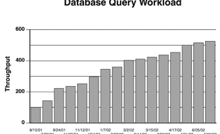

Netfinity 8500R，八路 700 MHz Pentium III，配备 2MB L2 缓存，8GB 内存，IBM ServeRAID，Red Hat 7.1，Linux 内核 2.4.6 / 2.4.16 / 2.4.17，DB2 7.1 EEE

**图 7-2. VolanoMark 基准测试结果；环回模式。**

**图 7-3. 使用 Apache Web 服务器的 SPECweb99 基准测试结果。**

**SPECWeb99 八路性能，使用 Apache 动态和静态内容**

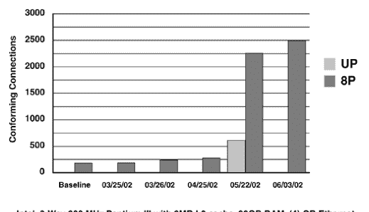

Intel 八路 900 MHz Pentium III，配备 2MB L2 缓存，32GB 内存，(4) GB 以太网，Red Hat 7.1，Linux 内核 2.4.17，Apache 2.0.36，SPECWeb99 1.02

**VolanoMark 环回**

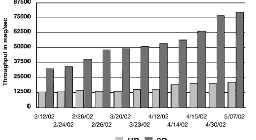

UP 8P

Netfinity 8500R，八路 700 MHz Pentium III，配备 2MB L2 缓存，4GB 内存

Red Hat 7.1，Linux 内核 2.4.17 + 补丁 + 调优

图 7-1 展示了数据库查询基准测试结果，并描述了所使用的硬件和软件配置。它还展示了在一段时间内达成目标的进展情况。针对其中一些问题所采取的措施带来了性能提升。这些措施包括添加弹跳缓冲区避免、ips、io_request_lock、readv、kiobuf 以及 O(1) 调度器内核补丁，还有多项 DB2 优化。

VolanoMark 基准测试创建了 10 个聊天室，每个房间有 20 个客户端。每个房间会将一个客户端的消息回显给该房间内的其他 19 个客户端。该基准测试（尚未成为开源基准测试）由 VolanoChat 服务器和一个模拟聊天室中客户端的第二程序组成。它用于衡量原始服务器性能和网络可扩展性性能。

VolanoMark 可以以两种模式运行：环回和网络。环回模式测试原始服务器性能。网络模式测试网络可扩展性性能。VolanoMark 使用两个参数来控制聊天室的大小和数量。

VolanoMark 基准测试以 20 个为一组创建客户端连接，并测量服务器轮播所有客户端消息到该组所需的时间。在环回测试结束时，它将平均每秒传输的消息数报告为得分。在网络模式下，度量指标是客户端与服务器之间的连接数。使用此基准测试加压的 Linux 内核组件包括调度器、信号和 TCP/IP。

图 7-2 展示了 VolanoMark 基准测试在环回模式下的结果。其中还包含了对所使用的硬件和软件配置的描述以及我们针对此基准测试设定的目标。我们已与 Linux 内核开发团队成员建立了密切合作，以推进达成此目标。我们处理的一些问题带来了性能提升，包括添加 O(1) 调度器、SMP 可扩展定时器、可调优先级抢占以及软绑定内核补丁。如图所示，我们已超越此基准测试的目标；然而，我们正在解决一些尚未解决的 Linux 内核组件和 Java 相关的问题，我们相信这些问题将进一步提升该基准测试的性能。


SPECweb99 基准测试工作仅用于研究目的，且不符合合规要求。（有关更多信息，请参阅本章后面部分的“致谢”章节。）此基准测试向 Web 服务器施加了繁重的工作负载。该工作负载请求 70% 的静态页面和 30% 的简单动态页面。网页大小范围从 102 到 921,000 字节。动态内容模拟 GIF 广告轮换。没有 SSL 内容。SPECweb99 之所以相关，是因为 Web 服务，特别是使用 Apache，是 Linux 服务器最常见的用途之一。Apache 功能丰富，但其设计初衷并非追求高性能。然而，我们选择 Apache 作为此基准测试的 Web 服务器，因为它目前托管的网页数量比互联网上任何其他 Web 服务器都多。SPECweb99 是公认的 Web 服务标准基准测试。SPECweb99 对以下内核组件施加压力：调度器、TCP/IP、各种线程模型、sendfile、零拷贝以及网络驱动程序。

图 7-3 展示了我们的 SPECweb99 结果。其中还包含了对所使用的硬件和软件配置的描述以及我们的基准测试目标。我们在推进此基准测试性能方面与 Linux 内核开发团队和 IBM Apache 团队保持着密切合作。我们处理的一些问题带来了如图 7-3 所示的提升，包括添加 `O(1)` 和读取副本更新（`RCU`）`d-cache` 内核补丁，以及在 Apache 中添加新的动态 API `mod_specweb` 模块。如图 7-3 所示，我们已超越此基准测试的目标；然而，我们正在解决若干未解决的与 Linux 内核组件相关的问题，我们相信这将显著提高该基准测试的性能。

### 总结

Linux 享有很高的知名度，特别是在低端和中端系统方面。事实上，Linux 被视为用于这些机器的 Web 服务器的一种稳定、高可靠性的操作系统。然而，高端、企业级系统可以访问吉字节、拍字节和艾字节级别的数据。这些系统除了需要更高内存和带宽要求以及更多处理器外，还需要一组不同的应用程序和解决方案。这引入了一系列独特的问题，其复杂程度可能比小型安装环境高出几个数量级。为了使 Linux 在企业市场中具有竞争力，其性能和可扩展性必须得到改进。

您现在应该对改进 Linux 内核性能的策略有了了解，特别是重点放在八路 SMP 可扩展性上。这包括对多种性能评估方法的概述，包括追踪、工作负载特征分析、数值分析和模拟。对于基准测试，策略包括理解所使用的硬件和软件、定义运行规则以及设定基准测试目标。此外，还包括通过测量和分析来发现性能问题，并提出解决方案以创建改进措施，通过向 Linux 内核添加内核补丁来解决架构无关的问题。选择能够覆盖多样化工作负载集合并针对特定内核组件的性能工具和基准测试来完成此任务。本文还展示了选定的基准测试结果，这些结果量化了使 Linux 在八路 SMP 可扩展性方面更好的进展。这种方法是一种证明通过协作解决性能退化问题可以改进 Linux 内核性能的手段。这将使 Linux 更加完善，并准备好应对企业市场。

### 致谢

SPEC 以及基准测试名称 SPECweb 是标准性能评估公司（Standard Performance Evaluation Corporation）的注册商标。该基准测试仅出于研究目的进行，并且不符合以下偏离规则的要求：

- 1. 它运行在不符合 SPEC 面向公众可用标准的硬件上。该机器是工程样品。
- 2. `access_log` 未保留用于完整的核算。虽然该日志被写入，但每 200 秒就会被删除一次。

有关最新的 SPECweb99 基准测试结果，请访问 `http://www.spec.org`。

### 参考文献

- [1] Linux 可扩展性努力（Linux Scalability Effort）：`http://sourceforge.net/projects/lse`。
- [2] Linux 技术中心 Linux 内核性能（Linux Technology Center Linux Kernel Performance）：`http://www.ibm.com/developerworks/opensource/linuxperf/`。
- [3] 下一代 POSIX 线程（Next Generation Posix Threads）：`http://www.ibm.com/pthreads`。
- [4] Linux 内核自旋锁度量（Kernel Spinlock Metering for Linux）：`http://oss.sgi.com/projects/kernprof`。
- [5] Kernprof（内核剖析，Kernel Profiling）：`http://oss.sgi.com/projects/lockmeter`。
- [6] 事务处理委员会（Transaction Processing Council）：`http://www.tpc.org`。
- [7] VolanoMark：`http://www.volano.com/benchmarks.html`。
- [8] SPECweb99 基准测试：`http://www.spec.org/osg/web99`。

## 第八章：调度器调优

作者：Chandra Seetharaman

### 引言

如果计算机只有一个程序和一个处理器，那么就不需要调度器来实现资源管理策略。程序将运行至完成，随后机器停止。然而，如今的计算机很少只运行单个程序并使用单个处理器。更常见的情况是，“单一程序”是一个操作系统，它提供多种系统服务，实现多种资源管理策略，并且通常永远不会运行到完成。

Linux 就是这样一个操作系统。虽然它可以用于一些非常特定的用途，但更典型的场景是 Linux 正在管理多个任务，每个任务使用一个或多个处理器。确保每个任务在处理器上获得公平的时隙是调度器的工作。

本章包括对向任务授予公平性的策略和问题的考察，以及对称多处理（SMP）和 NUMA 架构的讨论。此外，还讨论了 Linux 2.6 调度器并考察了其可调参数部分。

我们将首先讨论单处理器上要求较低的调度。

### 单处理器系统

当使用单个处理器时，调度很简单；所有任务使用同一个处理器。单处理器的调度器算法以公平性为中心；换句话说，每个进程是否都得到了公平的处理器使用机会？优化倾向于通过最小化上下文切换次数来简化用户代码和内核代码。理想情况下，每个进程都能获得可执行的时隙，且没有进程被抢占。由于大多数任务需要执行某种 I/O，且 I/O 传统上比处理器慢，因此除非任务是 CPU 密集型，否则就需要进行调度。

任务可能在仅使用时隙的一小部分后，就会自愿放弃处理器以等待其他事件，如信号或 I/O 完成。在公平性的背景下，实现需要考虑是否有意义去调度那些频繁放弃处理器的任务，而不是那些执行直到被抢占的进程。

Linux 调度器的多功能性可以无缝地从单处理器系统过渡到更复杂的调度。通过负载均衡策略，调度器还可以确保在多处理器上的调度。

### 对称多处理（SMP）

对称多处理（SMP）使多个处理器能够并发执行相同的内核级代码，并共享操作系统的单份副本。因此，SMP 引入了更复杂的调度。可以在 SMP 机器上使用相同的单处理器调度算法；然而，它们不会产生最优结果。例如，所有任务可能都被调度在一个处理器上执行，导致其他处理器空闲。通过实施负载均衡策略，可以避免这种情况，该策略确保任务尽可能均匀地分布在所有处理器上。

*公平* 和 *最佳* 的概念使情况变得更加复杂。什么是公平和最佳的，取决于将任务从一个处理器移动到另一个处理器的开销。如今的处理器具有一定的片上缓存，这可以减少对频繁内存访问的需求。优化必须尝试在不牺牲利用热缓存（即已填充了当前任务工作集的缓存）能力的前提下强制执行公平性。如果每个任务在获取其时隙时都需要刷新缓存，那么由于内存获取造成的可测量延迟将主导系统时间。

### 非统一内存访问（NUMA）

在非统一内存访问（NUMA）架构中，机器由多个节点组成，每个节点由一个或多个处理器和本地内存组成。NUMA 机器通常使用操作系统的单系统映像，并且所有内存都可以被运行在任何节点的任何处理器上的任务访问。本地内存访问时间比远程内存访问时间更快，因此，希望运行在给定节点处理器上的任务，其关联的工作集位于该节点的本地内存上。

将任务迁移到同一节点上的另一个处理器可能是必要的，但由于远程获取的成本，应避免将任务迁移到另一个节点。某些架构拥有用于远程内存的片上缓存，以试图减轻远程获取的成本，这进一步复杂化了任务放置方法。

这种情况的一种变体发生在内存对于处理器是最接近或最快的，但这取决于其他条件，例如电学上取决于其在总线上的位置，或逻辑上取决于其他组件对内存的管理。然而，在所有情况下，问题仍然相同：有些内存比其他内存“更好”。

在 NUMA 机器上的成功调度比单处理器更复杂。一种经常将任务从其原始处理器迁移的策略，如果它能将这些任务保持在它们使用的内存附近，可能仍表现良好。多年来处理器速度有所提高，为了确定如何最好地保持内存引用为本地而非远程，花费额外的指令周期可能是非常值得的。

仿佛 NUMA 机器上的成功调度还不够具有挑战性，Linux 还解决了支持多线程的机器上的调度问题。当你围绕虚拟 CPU 工作时，这会变得更加有趣。

### 对称多线程（SMT）


最近，处理器开始在单个物理 CPU 中提供多线程支持。在对称多线程（SMT）中，单个物理 CPU 表现为两个或更多虚拟 CPU。这些虚拟 CPU 共享物理处理器的核心资源，包括执行引擎和处理器缓存。

对称多线程允许两个或多个任务在处理器中同时执行，从而提高了处理器的性能。但它对调度器有影响。

考虑一种情况，系统有两个支持四个虚拟 CPU 的物理 CPU。如果调度器意识到这四个虚拟 CPU 并不相同，那么系统的性能会更好。如果系统中只有两个任务，调度器应将它们放置在两个不同的物理 CPU 上。此外，当一个正在虚拟 CPU 上运行的任务准备运行时，它应该被放置在相同的物理 CPU 上，以利用缓存的热度。

无论你运行的是物理 CPU 还是虚拟 CPU，Linux 都力求提供最终的性能。随着多线程调度器在 2.6 版本的发布，Linux 正在努力工作，为你提供你所需的一切！

## Linux 2.6 调度器

在 Linux 内核 2.4 版本发布之前，对称多处理（SMP）机器在性能方面并未得到 serious 的重视。然而，随着内核 2.2 版本的成熟，良好的 SMP 性能对 Linux 用户的重要性日益凸显。尽管出于性能考虑，尽可能将 SMP 代码置于配置选项之下仍然是可取的，但让 SMP 代码高效利用处理器并公平对待应用程序，对于商业 Linux 用户也变得愈发重要。

为了实现其调度目标，Linux 为每个任务分配一个静态优先级，用户可以通过 `nice(1)` 系统调用来修改它。Linux 具有一组优先级类别，范围从 0 到 `MAX_PRIO`，其中 `MAX_PRIO=140`。前 `MAX_RT_PRIO` 个优先级（其中 `MAX_RT_PRIO=100`）预留给实时任务。剩余的 40 个优先级类别，即 `[100..140]`，预留给分时作业（即普通作业），对应于 UNIX 进程 `[20..19]` 的 *nice* 值。较低的 *nice* 值对应较低的静态优先级和较高的重要性。实时任务的优先级总是高于普通任务。

每个任务维护一个有效优先级，该优先级由任务的交互性决定。任务越具有交互性，其重要性就越高。基于给定任务最近的睡眠平均值，会给予暂时的有效优先级奖励或惩罚。睡眠平均值是一个位于 `[0..MAX_SLEEP_AVG(=10 秒)]` 范围内的数值，它反映了任务自愿不使用其时间片并等待 I/O 完成所消耗的时间片计数。睡眠平均值越高，给予的奖励越多；睡眠平均值越低，给予的惩罚越多。

当任务的有效优先级超过其静态优先级一定程度时（这只能由其累积的睡眠平均值导致），该任务被视为具有交互性。高优先级任务达到交互性所需的睡眠平均值比低优先级任务小得多。

时间片是任务在让出给另一个任务之前可以运行的最长时间。它仅仅是普通任务静态优先级映射到 `[MIN_TIMESLICE(=10 毫秒)..MAX_TIMESLICE(=200 毫秒)]` 范围内的一个线性函数。任务的静态优先级越高，时间片越长。内核中的时间片定义为系统节拍（tick）的倍数。节拍由两个连续定时器中断之间的固定间隔（1 Hz）定义。在 Linux 2.6 中，`HZ=1000`，定时器中断例程每毫秒被调用一次，此时当前正在执行的任务会被计费一个节拍。

调度器需要决定接下来运行哪个任务以及运行多长时间。有效优先级决定接下来运行哪个任务；静态优先级决定运行多长时间。

Linux 2.6 的调度器是一个多队列调度器，它为每个 CPU 分配一个运行队列。每个运行队列执行每 CPU 调度。它由两个任务列表数组组成：活动数组（active array）和过期数组（expired array）。每个数组索引分别代表具有相应有效优先级级别的可运行任务列表。首先选择活动数组中有效优先级最高的任务运行。在分配的时间片结束后，在重新补充时间片和有效优先级后，该任务从活动列表移动到过期列表，以保证所有任务都有机会执行。当活动数组为空时，过期数组和活动数组互换位置。这使得调度器复杂度为 O(1)，因为它不需要遍历潜在的大任务列表（这在 2.4 调度器中是必需的）。

交互性任务在其时间片过期之前就会放弃 CPU，因为它们需要等待 I/O 完成。当交互性任务的时间片过期时，为了使其相对于处理器饥饿者（processor hogs）具有优势，该任务会被放回活动数组而不是过期数组。结果，可能会出现活动数组中持续有任务的情况，这反过来可能导致过期数组中任务的饥饿。为避免这种情况，如果第一个过期任务的等待时间超过 `STARVATION_LIMIT(=10 秒)` 乘以运行队列中任务数量，则交互性任务将简单地放入过期数组。

2.6 调度器通过调度域（sched domains）支持不同的 CPU 拓扑结构，如 SMT（超线程技术）和 NUMA（非一致性内存访问）。调度策略由体系结构根据系统拓扑设置在调度域数据结构中。这些调度策略在将任务调度到 CPU 时会被使用。

调度域是像系统拓扑中显示的那样分层创建的。

尽管 2.6 调度器可以在不同的 CPU 配置上工作，但某些配置依赖于负载均衡来协助。负载均衡保持系统负载（尤其是多处理器）的平衡。

### 负载均衡

调度器试图保持系统负载尽可能平衡。它通过在任务改变状态或发出特定系统调用时执行重新平衡代码（称为事件平衡，event balancing），以及在以节拍（jiffies）为单位的指定间隔内执行（称为主动平衡，active balancing），来实现这一目标。事件平衡需要任务执行显式操作，而主动平衡则不需要任何任务采取行动即可发生。

事件平衡策略定义在每个调度域数据结构中，同样取决于系统拓扑。

当事件平衡发生时，调度器会向上搜索域层次结构，并在建议进行负载均衡的最高域执行负载均衡。

主动平衡在每个节拍发生时进行。调度器从最低域开始并向上工作，检查该域上次平衡的时间以及该域指定的重新平衡间隔。这是为了确定该域是否应该进行平衡。如果合理，调度器将执行平衡操作。

当处理器的运行队列变为空时，它会主动从其他运行队列拉取任务以平衡负载。

除了保持系统负载平衡外，调度器还具有可调参数，可以改善那些关键任务的响应时间。

## 调度器的可调部分

调度器拥有许多可调参数，可用于实现不同的目标，例如改善交互性任务的响应、增加高优先级任务的时间片，以及对创建处理器饥饿者的父进程进行惩罚。

本章的其余部分将列出并描述调度器的可调参数，以及当可调值增加或减小时可能产生的影响。

### CHILD_PENALTY

**描述**：此参数的值是子进程继承的父进程睡眠平均值的百分比。

**效果**：增加此参数的值会增加子进程的有效优先级，使其更具交互性，并在调度期间赋予其更高的重要性。减小该值具有相反的效果。此参数对父进程的睡眠平均值没有影响。

### CREDIT_LIMIT

**描述**：这是任务获得 `sleep_avg` 超过 `MAX_SLEEP_AVG` 的次数，达到该次数后任务被视为高度交互性。在此之后，任务因其 `sleep_avg` 受到的惩罚较少，从而提供较少的响应时间。另一方面，处理器饥饿者获得负信用值，其优先级仅因其睡眠而获得有限的提升。

**效果**：降低此参数的值有助于高度交互性任务，将其提升到高度交互性级别；减小该值具有相反的效果。（注：原文逻辑此处略显矛盾，根据上下文，减小 Limit 使得更容易达到高度交互状态，故倾向于帮助交互任务，但原文说 "decreasing has the opposite effect"，此处忠实翻译原文。）

### EXIT_WEIGHT

**描述**：此参数决定父进程是否因创建相对于父进程属于处理器饥饿者的子进程而受到惩罚。父进程的睡眠平均值会根据子进程的睡眠平均值和此参数的值进行修改。

**效果**：将此值设置为零会导致父进程在子进程退出时继承子进程的睡眠平均值。增加此参数的值会减少子进程睡眠平均值对父进程的影响。

### INTERACTIVE_DELTA

**描述：** 该参数的值决定了在确定任务是否被视为交互式时所添加的偏移量。只有任务被视为交互式，当其时间片用尽时，才会被放回活动数组中。

**效果：** 如果增加此参数，任务需要积累更大的睡眠平均值才能被视为交互式。降低此参数的值则产生相反的效果。

### MAX_SLEEP_AVG

**描述：** 该参数的值是任务为了计算调度奖励所能积累的最大睡眠平均值。具有此睡眠平均值的任务将获得由 `PRIO_BONUS_RATIO` 指示的最大奖励。

**效果：** 如果增加此参数的值，任务需要积累更大的睡眠平均值才能获得相同的优先级奖励。降低该值则产生相反的效果。

### MAX_TIMESLICE

**描述：** 该参数的值是分配给具有最高静态优先级（`MAX_RT_PRIO`）任务的时间片。

**效果：** 增加此参数的值为最高优先级任务提供了更多的执行时间，然后才会被重新调度。降低此参数的值则产生相反的效果。

### MIN_TIMESLICE

**描述：** 该参数的值是分配给具有最低静态优先级（`MAX_PRIO-1`）任务的时间片。

**效果：** 增加此参数的值为最低优先级任务提供了更多的执行时间，然后才会被重新调度。降低此参数的值则产生相反的效果。

### PARENT_PENALTY

**描述：** 这是父进程被允许保留的睡眠平均值的百分比。


降低此参数会对创建更多子进程的父进程施加惩罚，从而降低其有效优先级。此参数对子进程的睡眠平均值没有影响。

### `PRIO_BONUS_RATIO`

**描述：** 该参数的值指定了用于为交互式任务提供临时奖励的优先级范围的百分比。

**效果：** 增加此参数的值会使交互式任务获得更多奖励，并对处理器占用者施加更多惩罚。降低该值则产生相反的效果。例如，对于 25% 的 `PRIO_BONUS_RATIO` [12.5..12.5%]，优先级范围将为 [5..4]。假设一个任务的 'nice=-0'（静态优先级 120）。如果该任务的睡眠平均值为 0，则会施加 5 的惩罚，导致有效优先级为 125。另一方面，如果该任务的睡眠平均值为 `MAX_SLEEP_AVG`（=10 秒），则会授予 5 的奖励，导致有效优先级为 115。即使应用此临时奖励，有效优先级在任何情况下都不能低于 20 或超过 19。

### `STARVATION_LIMIT`

**描述：** 这是用于决定交互式任务是放入活动数组还是过期数组的乘数因子，以避免过期数组中的任务饥饿。如果第一个过期任务等待时间超过 `STARVATION_LIMIT`（=10 秒）乘以运行队列中任务的数量，则交互式任务将被放入过期数组。

**效果：** 增加此参数的值有助于保持交互式任务在活跃数组中，代价是非交互式任务可能会饥饿，即使非交互式任务的静态优先级很高。降低该值会更快地将交互式任务移至过期数组，并可能影响其响应。

### 摘要

总体而言，Linux 内核旨在为你完成任务提供尽可能好的性能。由于当今计算机的复杂性，Linux 始终致力于改进技术，以确保任务完成。2.6 调度器是该技术的一部分。Linux 调度器可以简单到单处理器调度，也可以复杂到确保 NUMA 机器上的任务需求。

### 参考资料

- [1] Web resource: http://www.finux.org/Reprints/Reprint-Bligh-OLS2004.pdf

## 第九章. Linux 虚拟内存性能影响

作者：Dominique Heger

### 引言

虚拟内存子系统可以被视为任何 UNIX 系统的核心。本章讨论虚拟内存系统的实现及其对操作系统中几乎每个其他子系统的影响。本章首先阐述了一些基本的内存管理问题；其次，它概述了对 Linux 操作系统如何纳入虚拟内存管理任务的更深入分析。虚拟内存子系统使进程（也称为任务或默认线程）能够查看地址空间中的线性字节范围。无论物理布局如何或物理内存中遇到的碎片情况如何，这都是允许的。线程被允许在一个看似 CPU 整个地址空间的虚拟环境中执行。这种（支持性）执行框架为进程提供了大型编程模型。在这种情况下，向应用程序呈现内存存储的虚拟视图（称为地址空间），同时虚拟内存子系统透明地管理虚拟存储基础设施，因此也整合了物理内存子系统以及二级存储（见图 9-1）。

**图 9-1. 地址空间结构（通用视图）。**

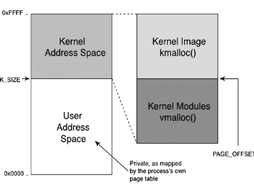

内核映像部分也称为恒等映射段，而内核模块部分通常被称为页表映射段。有关详细讨论，请参阅“内核地址空间”一节。地址空间的高位参考（0xFFFF ..）取决于平台。在 32 位系统上，每进程虚拟地址空间等于 4GB，而在 64 位系统上，理论上每进程虚拟地址空间为 2^64，通常不会完全利用。某些系统（实际的处理器本身）仅允许每进程虚拟地址空间为 2^44。

为了帮助更好地理解内存和地址空间的概念，让我们从讨论子系统和挑战开始。

### 内存和地址空间

由于物理内存子系统的延迟低于磁盘子系统，虚拟内存子系统面临的挑战之一是保持最常引用的内存部分在更快的主存储中。在物理内存不足的情况下，虚拟内存子系统需要放弃部分物理内存。这是通过将不常用的内存页传输到底层存储来实现的。因此，虚拟内存子系统在某种意义上提供了资源虚拟化，即进程不需要管理物理内存分配的细节。进程也不需要管理信息和故障隔离，因为每个进程都在其自己的地址空间中执行。在大多数情况下，内存管理单元中的硬件设施通过防止进程访问其合法地址空间之外的内存来执行内存保护功能。例外是进程之间明确共享的内存区域。

### 地址空间

进程的虚拟地址空间被定义为呈现给进程作为其环境的内存地址范围。在进程生命周期中的任何时刻，一些地址映射到物理地址，而一些没有。内核在发起 `fork()` 系统调用时创建进程虚拟地址空间的基本骨架。进程内部的虚拟地址布局由动态链接器建立，并可能因硬件平台而异。通常，虚拟地址空间由大小相等的组件组成，这些组件被称为虚拟页。在 IA-32 环境中，页大小为 4KB；在 IA-64 设置中，页大小可以配置为 4、8、16 和 64KB。任何 Linux 进程的虚拟地址空间进一步分为两个主要区域：用户空间和内核空间。用户空间位于地址空间的较低部分，从地址零开始并延伸到处理器中指定的特定于平台的 `TASK_SIZE` 限制。（见图 9-1）。地址空间的其余部分保留给内核。地址空间的用户部分标记为私有，指定由进程自己的页表映射。另一方面，内核空间在所有进程之间共享。根据硬件基础设施，内核地址空间要么映射到每个进程地址空间的上部，要么占用 CPU 虚拟地址空间的顶部。在用户级别执行期间，只有用户地址空间可访问，因为尝试操作内核虚拟地址会导致保护违规故障。在内核模式下执行时，用户和内核地址空间都可访问。

### 用户地址空间

每个地址空间在 Linux 内核中通过一个称为 `mm` 结构的对象来表示。由于多个任务可能共享同一个地址空间，

### `mm` 结构

`mm` 结构是一个*引用计数*对象，只要引用计数大于零，它就会一直存在。每个任务结构都包含一个指向 `mm` 结构的 `mm` 指针，该 `mm` 结构定义了任务（进程）的地址空间。

*图 9-2* 展示了一个进程试图读取地址 *z* 处的字的场景。编号 1 描绘了实际的读取操作。由于假设页表为空，读取操作会导致页错误。作为对页错误的响应，Linux 内核会搜索此特定进程的 VM 区域列表，以定位持有发生错误的地址的 VM 区域。在确定针对此特定请求需要访问哪个页面后，Linux 发起磁盘文件读取，如编号 2 所示。随着 I/O 子系统提供文件，操作系统将数据复制到可用的页框中，如编号 3 所示。完成读取页错误所需的最后一步是更新页表，以反映包含数据的虚拟页到物理页框的映射。此时，系统可以恢复读取请求。这次它将成功完成，因为所需的数据现在已可用。

#### 图 9-2. VM 区域结构。

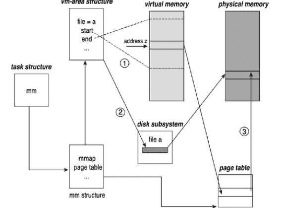

仅访问内核地址空间的任务，例如 `kswapd` 或 `pdflush` 线程，使用*匿名*地址空间；因此，在这些情况下，`mm` 指针引用 NULL。`mm` 结构被视为进入虚拟内存子系统核心的入口点，因为它包含指向建立虚拟内存环境的两个主要数据结构的指针。第一个结构是页表；第二个结构称为虚拟内存区域。从内核的角度来看，存在一个系统范围的页表就足以实现虚拟内存。一些更传统的基于大型页表的方法，包括聚集式页表方法，在表示大型地址空间时效率低下。

### VM 区域结构

为了避免大型页表的问题，Linux 并不直接使用页表来表示地址空间，而是使用一组 VM 区域结构列表。这种方法的思路是将地址空间划分为连续的页范围，这些范围可以以相同的方式处理，其中每个范围可以通过单个 VM 区域结构来表示。在这种情况下，当进程访问页表中不存在翻译信息的页面时，负责该特定页面的 VM 区域持有建立和安装该页面所需的所有信息。如*图 9–2* 所示，VM 区域列表使 Linux 内核能够为特定进程地址空间中映射的任意给定地址创建实际的页表项。这种场景的结果是，每进程页表可以被视为一个缓存子系统。换言之，如果翻译可用，内核简单地使用它；如果翻译缺失，内核可以基于相应的 VM 区域创建它。将页表视为缓存提供了显著灵活性，因为清洁页面的翻译可以随时移除。脏页面的翻译只有在页面由文件备份时才能移除。在移除之前，这些页面必须通过将页面内容写回文件来清洁。Linux 中页表这种类似缓存的利用行为为相当高效的写时复制实现奠定了基础。

利用基于 VM 区域的方法的一个例子是，如果一个进程将大量不同的文件映射到其地址空间，那么该进程（更具体地说，是 Linux 内核）可能必须维护一个由数百个条目组成的 VM 区域列表。这导致随着 VM 区域列表的增长，系统速度变慢，使得在每次页错误时都需要遍历列表变得必要。为了避免遍历列表带来的性能影响，Linux 操作系统跟踪列表上的 VM 区域数量。在列表大小达到特定阈值（通常为 32 个条目）的情况下，系统创建一个二级数据结构，该数据结构使用自平衡二叉搜索树来组织 VM 区域。利用基于二叉树的搜索算法意味着，给定一个虚拟地址，可以在若干步骤内定位匹配的 VM 区域结构。这些步骤揭示了与地址空间中 VM 区域数量之间的对数关系。为了加速系统必须访问所有 VM 区域结构的情况，Linux 内核（在达到阈值后）同时维护线性和二叉树结构。

### 内核地址空间

如**图 9–1** 所示，整体内核地址空间可以分解为内核映像部分和内核模块部分。（内核映像也被称为恒等映射段，内核模块也被称为页表映射段。）

#### 内核模块部分


内核模块部分由内核私有页表映射，主要用于实现内核的 `vmalloc()` 区域。这允许系统分配大型连续虚拟内存区域。例如，加载特定内核模块所需的内存在此地址空间部分中分配。与 `vmalloc()` 相关联的地址范围由两个平台特定参数 `VMALLOC_START` 和 `VMALLOC_END` 控制。`vmalloc()` 部分不一定占据整个页表映射段，因此保留了对该段的部分用于平台特定目的和功能的可能性。

### 内核映像部分

内核映像部分是独特的，因为此段中的虚拟地址与其翻译成的物理地址之间存在直接或映射关系。这种映射是平台特定的，但一对一的恒等关系赋予该段其名称。此段可以通过基于页表的方法实现，但可以利用更高效的技术，这些技术依赖于平台。换言之，系统可以依赖类似于 `pfn = (addr - PAGE_OFFSET) / PAGE_SIZE` 的简单映射公式。该公式可用于最小化利用基于完整页表实现的开销。尽管采用这种简单方法，一些 Linux 系统使用称为*页框映射*的表来跟踪系统中物理页框的状态。对于每个页框，此表包含一个页框描述符 `pfd`，其中包含各种资源相关的系统维护数据。这些信息存储使用页框的地址空间的数量，以及指示该页框是否可以换出到磁盘或页面是否被标记为脏的各种标志。

在 Linux 中，物理地址空间的实际大小与虚拟地址空间的大小之间没有直接关联。然而，两者都受到大小限制。为了更好地管理你的地址空间，Linux 开发了高内存支持。

### 高内存支持

在当代系统中，虚拟地址空间的大小通常超过物理地址空间的大小。然而，物理地址空间的大小大致按照摩尔定律增长，该定律指出每 18 个月芯片容量翻倍。此外，虚拟地址空间的大小依赖于平台，不能轻易更改。当物理内存大小接近虚拟地址空间大小时，这种场景对 Linux 系统构成了独特挑战；恒等映射段可能不再足够大以映射整个物理地址空间。例如，IA-32 架构定义了一种支持 36 位物理地址空间的扩展，尽管虚拟地址空间限制在 32 位。问题在于，总物理地址空间无法由虚拟地址空间直接描述。

#### highmem 接口

其他操作系统，如 Solaris，在某些平台上运行时面临类似挑战。Linux 系统通过 highmem 接口解决此问题。在 Linux 中，高内存定义为无法通过恒等映射段寻址的物理内存。highmem 接口通过动态将高内存页面映射到为此目的保留的内核地址空间的一小部分，从而提供对此内存的间接访问。这部分内核地址空间称为 `kmap()` 段。`kmap()` 接口将由参数 `page` 指定的页框映射到 kmap 段。参数必须是待映射页面的页框描述符的指针。例程返回页面映射到的虚拟地址。如果 `kmap()` 段饱和，例程将阻塞直到空间可用。因此，高内存不能用于不能无限期阻塞执行的代码，例如中断处理程序。总之，在系统上支持高内存会产生额外的开销，应尽可能避免。高内存支持是 Linux 内核的可选组件。例如，在 Linux IA-64 系统上它是禁用的。

为了更高效地使用内存，Linux 提供分页和交换。下一节讨论另一种在内存方面保护资源的方法。

### 分页与交换

在 Linux 中，每个用户进程都在单个连续的虚拟地址空间上运行。该虚拟地址由几个不同的内存对象副本组成，例如程序文本（只读）和程序数据（写时复制）。当程序被加载到进程的虚拟地址空间时，该区域最初是内存映射的，并由程序二进制文件提供支持。这使得虚拟内存系统可以轻松地释放和重新利用这些文本页。例如，当数据页被修改时，虚拟内存系统必须创建该页的私有副本，并将其分配给发起更新的进程。私有数据页最初被称为写时复制或零填充按需页。当发生页置换（page-out）情况时，这些页必须被区别对待。大多数应用程序分配的虚拟内存远多于其在任何给定时间实际使用的量。例如，程序的文本段通常包含大量的错误处理代码，这些代码很少或从不执行。为了避免将内存浪费在从未被访问的虚拟页上，Linux（以及大多数其他 UNIX 操作系统）采用了一种称为*按需分页*的方法。

采用这种方法时，虚拟地址空间最初是空的。换句话说，所有虚拟页在页表中都被标记为*未驻留*。当访问未驻留的虚拟页时，CPU 会产生一个*缺页中断*。该中断被 Linux 内核拦截，并触发缺页处理程序。结果，内核可以分配一个新的页框，确定被访问页的内容，加载该页，并最终更新页表以将该页标记为*驻留*。此时，执行返回到导致缺页中断的进程。由于所需的页现在已驻留并因此可用，指令现在可以执行而不会导致缺页中断。

像内存这样的物理资源，当来自不同应用程序的多个线程竞争这种稀缺资源时，可能会出现资源短缺。在这种情况下，Linux 系统必须选择一个支持最近未被访问的虚拟页的页框，并且必须将该页写入磁盘上称为*交换空间*的特殊区域。现在，系统能够重用该页框来支持正在请求的新虚拟页。旧页写入的具体位置取决于基础设施中使用的交换空间类型。Linux 支持多个交换空间区域，每个区域可以是一个完整的磁盘分区，也可以是现有文件系统中的特殊格式文件。因此，与旧页相关的页表必须相应更新。Linux 系统通过将页表条目标记为*未驻留*来维护此更新过程。为了跟踪旧页存储在哪里，Linux 记录该页的磁盘位置。总之，标记为*驻留*的页表条目包含支持该虚拟页的物理页框的页框号。标记为未驻留的页表条目包含该页的磁盘位置。从进程中借用页并将其写入磁盘子系统的技术被称为*分页*。一种相关的技术被称为*交换*，这是一种更激进的形式的分页，它不仅窃取单个页，还窃取进程的整个页集合。Linux 以及大多数其他 UNIX 操作系统利用分页，但不使用交换。

#### 替换策略

从执行和稳定性角度来看，当内存变得稀缺时借用某个特定页的相关性并不重要。另一方面，从性能角度来看，借出哪个页以及何时借出至关重要。决定从主存子系统中驱逐哪个页的过程被称为*替换策略*。例如，最近最少使用（LRU）方法分析过去的行为，并选择最长一段时间内未被访问的页。虽然 LRU 可以作为页替换算法实现，但它不切实际。这种方法要求每次访问主存时都更新数据结构，从而产生相当大的开销。在实践中，大多数 UNIX 操作系统利用低开销替换策略的变体，如最近未使用（NRU）；Linux 依赖于基于 LRU 的方法。在 Linux 环境中，页替换机制因内核可能利用可变量的非可分页内存而变得复杂。例如，文件数据存储在缓冲区缓存中，该缓存可以动态地增长和缩小。当内核必须分配新的页框时，系统面临两个选择：它可以借用内核的一个页或偷取进程的一个页。换句话说，内核不仅必须实现一种替换策略，还必须实现一个*内存平衡策略*，该策略确定内核缓冲区使用多少内存，以及多少内存用于支持虚拟页。

##### 页替换与内存平衡

页替换和内存平衡的结合是一项艰巨的任务，没有清晰且完美的解决方案。因此，Linux 内核使用多种在实践中往往表现良好的程序。从实现角度来看，Linux 内核要求系统特定部分在页表条目中提供 2 个额外的位；它们被称为*访问*位和*脏*位。访问位指示自上次清除访问位以来该页是否被访问过；脏位指示自上次换入以来该页是否被修改过。Linux 利用 `kswapd` 线程定期检查这 2 个位。检查后，`kswapd` 清除访问位。如果 `kswapd` 检测到内核陷入低内存情况，它会开始主动换出最近未使用的内存。如果页的脏位被设置，则必须在该页框被释放之前将该页写入磁盘。由于这代表了一项相对昂贵的操作，`kswapd` 更喜欢释放访问位和脏位都已清除（设置为 0）的页。根据定义，这些页最近未被访问，并且在页框被释放之前不需要写回磁盘；因此，它们可以以较低的性能成本回收。

虽然系统管理物理页的方式各不相同，但 Linux 在其体系结构中使用三级页表。这些页表可用于将虚拟地址转换为物理地址，反之亦然。

### Linux 页表

Linux 系统为每个进程在物理内存中维护一个页表，并通过恒等映射的内核段访问实际的页表。Linux 中的页表不能被换出到交换空间。这意味着分配大地址空间范围的进程可能会使内存子系统饱和，因为页表本身将使用所有可用内存。类似地，由于系统上有数百个进程同时处于活动状态，所有页表的组合大小可能会使用所有可用内存。当代系统可用的大型内存子系统使得这种场景不寻常，但它仍然反映了一个需要解决的容量规划问题。将页表保留在物理内存中简化了内核设计，并且无需处理嵌套缺页中断。每进程的页表布局基于由三个级别组成的多层树。第一层由全局目录 `pgd` 组成，第二层由中间目录 `pmd` 组成，第三层由页表条目 `pte` 组成。通常，每个目录节点占用一个页框并包含固定数量的条目。`pgd` 和 `pmd` 目录中的条目要么未驻留，要么指向树下一层的目录。`pte` 条目描绘了树的叶节点，它们包含实际的页表条目。由于 Linux 中的页表布局类似于多层树，空间需求与正在使用的实际虚拟地址空间成正比。因此，空间需求不是虚拟地址空间的最大大小。此外，由于 Linux 将内存作为一组页框进行管理，基于固定节点大小的方法不需要线性页表实现所需的大且物理上连续的区域。


在处理虚拟到物理页转换时，虚拟地址被分解为多个部分。用于页表查找操作的部分依赖于 `pgd`、`pmd` 和 `pte` 索引（见图 9-3）。查找操作通过存储在 `mm` 结构中的页表指针启动。页表指针引用全局目录，它是页表树的根目录。`pgd` 索引识别包含中间目录地址的条目。该地址与 `pmd` 索引的组合使系统能够定位 `pte` 目录的地址。将该机制扩展另一层可让你识别虚拟地址实际映射到的页的 `pte`。`pte` 允许系统计算物理页框的地址，并且通过使用虚拟地址的偏移部分，可以识别正确的位置。在 Linux 中实现页表的多层方法代表了一个平台无关的解决方案。如果不需要支持特定实现的完整树结构，该解决方案允许将中间目录折叠到全局目录中。这是 IA-32 环境中采用的方法，其中页中间目录的大小设置为 1。换句话说，在 IA-32 中，32 位虚拟地址被分解为保留给页目录的 10 位、页表条目的 10 位，以及剩余 12 位由偏移部分使用。地址转换过程被视为硬件（内存管理单元 (MMU)）和软件（内核）之间的联合事业。内核与 MMU 通信，以识别每个用户地址空间映射到物理页的虚拟页。MMU 具有能够通知内核进程中的任何错误状况。最常见的错误状况围绕页故障展开，此时内核必须从辅助存储中检索所需的页面。其他可能的错误状况可能与任何潜在的页面保护问题相关或由这些问题触发。从物理地址的角度来看，Linux 区分不同的内存区域（`ZONE_DMA`、`ZONE_NORMAL` 和 `ZONE_HIGHMEM`），每个区域代表不同的特性。大部分内存分配发生在 `ZONE_NORMAL` 中，而 `ZONE_HIGHMEM` 代表大于 896MB 的物理地址。（有关内存区域的更多信息，请参阅后面的“VM 可调参数”部分。）

### 图 9-3. 地址解析过程。

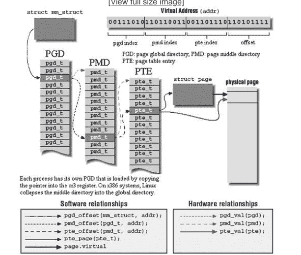

下一节将从性能角度介绍 Linux 2.6 中的一些新特性。VM 系统影响系统中的每一个其他子组件；此讨论延伸到了 CPU 和 I/O 子系统组件，这些组件将在单独的一章中涵盖。

## Linux 2.6 的新特性

本研究仅参考对系统性能有深远影响的 Linux 2.6 新组件；它并不涵盖 Linux 2.6 的所有新特性。

### rmap 和 objrmap

Linux 2.6 内核的一个新 VM 特性被称为反向映射（`rmap`）。在 Linux 2.4 内核中，存在单个 `pte` 到 `page` 结构体的映射，这种技术对于进程寻址来说已经足够。然而，这种实现为页面置换算法带来了挑战，因为必须处理共享页面。在没有遍历系统中每个活动进程的页表的情况下，获取映射特定 `page` 结构体的 `pte` 列表是不可行的。给定一个物理内存页，`rmap` 允许 VM 识别正在使用该页面的进程。从实现角度来看，Linux 2.6 在 `page` 结构体中引入了一个联合体 `pte` 组件。当页面在进程之间共享时，会创建一个 `pte` 链并链接到此字段。`slab` 分配器管理 `pte` 链元素，每个节点可以定位多达 `NRPTI` 个 `pte`（`NRPTI` 与目标架构的 L1 缓存大小相关）。总结来说，2.4 内核逐个进程扫描所有页表，使适合页面的条目失效。新数据结构的引入使内核能够识别引用特定物理页的页表条目。这种实现的问题在于，所引入的方法内存密集，并且需要大量的维护。与 Linux 2.4 相比，诸如页故障、`munmap` 或 `fork` 等操作在执行速度上遇到了放缓。`fork()` 系统调用变慢，因为必须利用 `rmap` 为进程地址空间中的每个页面添加一个新的反向映射条目。基于对象的反向映射（ObjRMAP）的引入与 `rmap` 不同。在 ObjRMAP 中，`page` 结构体利用 `mapping` 文件指向 `address_space` 结构，该结构描述了支撑特定页面的对象。`address_space` 结构包含两个链表，其中包含每个在文件中具有映射的进程的 `vm_area_struct` (`vma`) 结构。`vma` 提供了定位页面虚拟地址所需的信息，该虚拟地址可用于识别正确的页表条目。基于对象的方法消除了 `rmap` 中找到的直接条目方法，`page` 结构直接指向页表条目。通过查阅 `address_space` 以及 `vma` 结构来通过 ObjRMAP 识别页表条目需要更长时间，但与 `rmap` 实现相比，应以大大减少的开销系数完成。

### 大页支持

大多数现代计算机架构支持不止一种页面大小。例如，IA-32 架构支持 4KB 或 4MB 页面；Linux 操作系统仅将大页用于映射实际的内核映像。

大页的使用主要旨在为高性能计算（HPC）和其他内存密集型应用程序提供性能提升。任何内存访问密集型的、利用大量虚拟内存的应用程序都可以通过使用大页获得性能提升。（Linux 使用 2MB 或 4MB 大页，AIX 使用 16MB 大页，Solaris 使用 4MB。）大页的性能提升归因于转换后备缓冲器（TLB）缺失的减少，因为 TLB 能够映射更大的虚拟内存范围（通过增加 TLB 的覆盖范围）。大页还通过消除在 4KB 边界上重启预取操作的需要，改进了内存预取过程。

在 Linux 2.6 中，可用的大页数量可以通过 proc（`/proc/sys/vm/nr_hugepages`）接口进行配置。由于大页的实际分配取决于物理连续内存区域的可用性，建议系统在启动时启动分配。Linux 2.6 中核心大页实现被称为 `hugetlbfs`，这是一个基于 ramfs 的伪文件系统（实现在 `fs/hugepage/inode.c` 中）。实现背后的理念是，大页用于支撑文件系统中的任何文件。实际的伪文件系统在系统启动时初始化，并注册为内部文件系统。进程可以通过 `shmat()` 接口建立由大页支撑的共享区域，或通过在使用大页文件系统中打开的文件上利用 `mmap()` 调用来访问大页。要操作使用大页的文件，必须首先挂载 `hugetlbfs` 文件系统。在挂载操作完成后，可以使用 `open()` 等标准文件操作调用设置文件描述符。如果使用 `mmap()` 系统调用打开文件，`hugetlbfs` 注册的 `mmap()` 函数会为进程创建适当的 `vma` 结构。建议使用 `/proc/meminfo` 接口，以确保大页的大小和数量如预期那样设置。碎片化可能会阻止分配过程成功完成。

### 页面分配与置换

Linux 2.6 中的物理页面分配仍然基于伙伴算法，但机制本身已扩展为类似惰性伙伴方案，该方案推迟合并部分。合并部分的缓冲区释放活动涉及一个两步过程，第一步是将缓冲区推回空闲列表。这使得缓冲区对其他请求可用。第二步涉及将缓冲区引用为空闲（通常在位图中）并合并缓冲区（如果可行）与相邻缓冲区。常规的伙伴系统实现在每次释放时执行这两个步骤。惰性伙伴方案执行第一步，但推迟第二步，并根据缓冲区类的状态执行它。所讨论的惰性伙伴概念的 Linux 2.6 实现利用每 CPU 页面列表。这些 `pageset` 包含两个页面列表（标记为热和冷），其中热页面最近被使用，预期它们仍然存在于 CPU 缓存中。在分配时，首先查询运行中 CPU 的 `pageset` 以确定页面是否可用；如果是，则相应地进行分配。为了确定何时应释放或分配 `pageset`，使用基于低水位和高水位的方案。当达到低水位时，分配一批页面并放置在列表上。当达到高水位时，同时释放一批页面。作为新改进实现的结果，自旋锁开销显著减少。

在 2.4 Linux 内核中，`kswapd`，一个全局守护进程，充当页面置换的激活器。`kswapd` 负责保持一定量的内存可用，并在内存压力下启动释放页面的过程。在 Linux 2.6 中，系统中每个节点都有一个 `kswapd` 守护进程。这种设计背后的理念是避免 `swapd` 不得不代表远程节点释放页面的情况。在 Linux 2.4 中，在从 LRU 列表移除页面前必须获取自旋锁。在 Linux 2.6 中，涉及 LRU 列表的操作通过 `pagevec` 结构进行。`pagevec` 结构要么将页面添加到 LRU 列表中，要么从 LRU 列表中移除页面，每次最多处理 `PAGEVEC_SIZE` 个页面。在移除页面的情况下，获取 zone `lru_lock` 锁，并将页面放置在临时列表中。在组装要移除的页面列表后，发起对 `shrink_list()` 的调用。现在，实际的释放页面过程可以在不获取 zone `lru_lock` 自旋锁的情况下进行。在添加页面的情况下，通过 `pagevec_init()` 初始化新的页面向量结构。页面通过 `pagevec_add()` 添加到向量中，然后通过 `pagevec_release()` 提交以放置到 LRU 列表中。

### Slab 分配器


Linux，像大多数其他 UNIX 操作系统一样，提供了一个通用内存分配器，提供任意大小的内存分配。任何 slab 分配器的基本目标是高效地分配通常小于一页或不是一页大小的整数倍的小内存缓冲区。slab 分配器的另一个目标是有效操作经常分配和释放的内存对象，该过程可能导致内存碎片。slab 分配器允许缓存这些经常使用的对象（如 sock、inode 或 mm_struct），从而最小化每次请求新对象时初始化和销毁这些基本实体的开销。Linux 2.6 中 slab 分配器的许多更改与地址锁竞争场景相关。此外，Linux 2.6 引入了 slab shrinker 回调特性。在 Linux 2.4 中，`kmem_cache_reap()` 在低内存情况下被调用。在 Linux 2.6 中，2.4 的设置已得到增强，缓存通过 `set_shrinker()` 注册 shrinker 回调。`set_shrinker()` 函数用一个指向回调的指针和一个指示重新创建对象复杂度的权重填充一个结构体。在页面回收场景中，每个 shrinker 被调用两次。第一次调用将 0 作为参数传递，表示回调应识别可以释放多少页面（如果正确调用的话）。接下来应用基本启发式方法来确定使用回调是否值得其成本。如果是，则以指示要释放对象数量的参数再次调用回调。

### VM 可调参数

以下定义概括了 Linux 2.6 中 VM（虚拟内存）的可调参数，提供了一些关于调整这些参数目标及其影响的见解。所有参数都可以通过 proc（`/proc/sys/vm`）文件系统接口进行调整。这些参数按照 proc 文件系统中列出的字母顺序排列。

- `dirty_background_ratio` 参数确定了在执行写回操作之前持有的脏内存比例。在 Linux 2.6 中，pdflush 内核线程池负责 VM 写回操作，以及定期同步文件系统元数据。如果背景写回百分比被超过，pdflush 守护进程将异步处理写回操作。

- `dirty_expire_centisecs` 参数控制数据允许保持脏状态的最长百秒数，这一时间段是通过查询内存中缓存有脏页的所有文件的时间戳来确定的。该参数代表一个上限，确保数据最终会被写入磁盘子系统。一个“百秒”（centisecond）表示百分之一秒的时间单位。

- `dirty_ratio` 参数指示表示过量脏内存的内存比例。当任务在脏内存过量的环境中执行文件写操作时，系统被迫写出脏内存页，直到脏页的比例低于系统中指定的阈值。这一点非常重要，因为 I/O 操作被认为具有高延迟。如果任务必须等待写回操作完成才能满足系统分配请求，其性能就会受到影响。这主要被视为大内存系统的问题。

- `dirty_writeback_centisecs` 参数概述了 pdflush 内核线程之间写回的时间间隔（以百秒为单位）。如前所述的 `dirty_expire_centisecs` 参数控制脏内存页的“年龄”，`dirty_writeback_centisecs` 参数则确定 pdflush 线程被调用的频率。建议以一种方式指定这两个参数，使得 `dirty_writeback_centisecs` 小于 `dirty_expire_centisecs`（对于大多数工作负载，1:6 的比例应该是合理的）。经历内核密集型工作负载的大型系统可能会受益于增加时间间隔和频率间隔（但仍需遵守 1:6 的比例），因为背景写回操作可能会干扰工作负载自身的性能表现。

- `lower_zone_protection` 参数识别了指派给内存区域回退的抑制因子的权重。Linux 操作系统将物理内存分解为三个不同的区域。`ZONE_DMA` 部分可由（传统）I/O 设备寻址，`ZONE_NORMAL` 可由内核寻址，而 `ZONE_HIGHMEM` 则用于用户空间和某些内核（临时）缓冲区。这一概念背后的基本哲学是，`ZONE_DMA` 部分可以像 `ZONE_NORMAL` 一样使用，`ZONE_NORMAL` 部分可以像 `ZONE_HIGHMEM` 一样使用，但反之则不行。随着 `ZONE_HIGHMEM` 部分变得饱和，`ZONE_NORMAL` 可以通过回退操作用于分配目的。`ZONE_NORMAL` 是唯一可用于内核数据结构的区域，对系统至关重要。在 Linux 中，一种称为 *incremental min* 的启发式方法被用来抑制对关键内存区域（至少是 `ZONE_NORMAL`）的回退。将低 `_zone_ _protection` 设置为默认的 0 会禁用 incremental min；将该参数设置为 4 会将其效果放大四倍。这意味着该参数现在控制了低区域防御算法的激进程度。低 `_zone_ _protection` 可调参数允许你增加低区域所受到的保护程度，以对抗那些可能使用系统中较高区域的分配。

- `min_free_kbytes` 参数指定了可用于紧急分配的内存池的大小，例如由中断处理程序发起的分配。在较大的系统上，该参数影响中断时刻可用的内存与运行时分配可用的内存之间的比例。在较小的内存系统上，该参数保持较小值以避免分配失败。普遍共识是，低水位线参数用于确定何时拒绝用户空间分配以及何时启动页面置换场景。最好不要将值设置为物理内存的较大比例。特别是当预期用户空间操作是内存子系统的主要消费者时，这一原则尤为重要。

- `nr_pdflush_threads` 参数控制当前 pdflush（写回）线程池的大小。VM 子系统利用一种动态算法来确定实际线程数量。重点在于在低内存情况下预留一定数量的 pdflush 线程，因为在这种情况下的动态额外线程分配可能会失败。在 Linux 中被称为 `MIN_PDFLUSH_THREADS` 和 `MAX_PDFLUSH_THREADS` 的下限和上限分别设置为 2 和 8。增加最大值（并重新编译内核）在具有许多磁盘驱动器和受寻址限制工作负载的环境中可能是有益的，以增加 VM I/O 的并发性。另一种增加最大值可能提高性能的情况是与写回相关的 CPU 受限情况。在这种情况下，系统中可能有额外的处理器可用于处理聚合工作负载。

- `overcommit_memory` 参数表示一个启用内存过度提交的标志。当标志设置为默认值 0 时，内核在每个 `malloc()` 调用之前启动检查，以确保有可用的内存。如果标志设置为 1，系统将表现得好像总有足够的内存。当设置为 0 时，该标志确保只分配可以通过页面置换基础设施处理的足够多的用户虚拟内存，这意味着每个页都必须有后备存储。匿名内存页需要交换空间，而文件页需要可预留的磁盘空间。将标志设置为 1 会导致更有效的内存利用行为。然而，在某些工作负载情况下，它可能会导致一些进程被杀死。综上所述，将标志设置为 0 会导致内核执行启发式的内存过度提交处理，通过估计可用内存量来拒绝明显无效的请求。

不幸的是，由于内存是使用启发式方法而非精确算法分配的，这种设置有时可能会导致系统上的可用内存过载。将标志设置为 1 会导致内核不执行任何内存过度提交处理。在这种设置下，内存过载的可能性增加，但内存密集型任务（例如某些科学应用程序执行的任务）的性能也会提高。另一种支持的设置是将标志设置为 2。在这种情况下，内核会拒绝累加超过所有交换空间加上 `overcommit_ratio` 参数（将在下文讨论）指定的物理 RAM 百分比的内存请求。在 Linux 中，将标志设置为 2 可以降低遇到内存过度提交情况的风险。

- `overcommit_ratio` 参数指定了在 `overcommit_memory` 参数（刚才讨论过）设置为 2 时考虑的物理内存百分比。默认值设置为 50。

- `page-cluster` 参数表示一个整数值，当 2 的 `x` 次方时，它确定内核一次读取的页面数量（实际的交换预读窗口）。对于内存少于 16MB 的系统，默认值为 2；对于较大的系统，默认为 3，这些被认为是大多数情况下合理的设置。该参数用于提高页面 I/O 效率，但如果参数以其他方式指定，系统可能会遇到过度的 I/O 和内存消耗。

- `swappiness` 参数指示 VM 子系统相对于仅回收未被任何进程映射的页面，更倾向于通过取消映射和换出页面来回收页面的偏好。实际决策取决于一个二进制开关，当映射到进程页表的内存百分比的一半加上 swappiness 的值超过 100 时，该开关被激活。系统在决策过程中进一步利用一个“紧迫度因子”，每次必须重试页面置换时，该因子都会增加 2 倍。如果系统遇到难以找到可回收的未映射页面的情况，VM 子系统会改变策略，开始换出匿名内存。可以通过指定较低的 swappiness 值来表达不倾向于换出匿名内存的偏好。如果 kswapd 正在利用大量的 CPU 资源，或者系统花费时间在 iowait 状态，增加 swappiness 的值可能会提高整体系统性能。

### CPU 调度器

线程调度器代表负责在可运行线程之间分解可用 CPU 资源的子系统。调度器的行为

### 决策过程与调度


决策过程与线程公平性和调度延迟有着直接关联。公平性可以描述为所有线程不仅都能取得向前进展，而且以均衡的方式做到这一点的特性。公平性的对立面被称为饥饿（`starvation`），即某个线程无法取得任何向前进展的情况。公平性往往难以证明，因为它代表了全局性能与局部性能之间的一种妥协练习。调度延迟描述的是线程进入可运行状态（`TSRUN`）与实际在处理器上运行（`TSONPROC`）之间的实际延迟。低效的调度延迟行为会导致应用程序响应时间出现可察觉的延迟。一个高效且有效的 CPU 调度器对于计算平台的运行至关重要；它决定在什么时间运行哪个任务（线程）以及运行多久。实时任务和时间共享任务是有区别的，每种类别揭示了不同的目标。这两者都通过嵌入在调度器中的不同调度策略来实现。

Linux 为每个任务分配一个静态优先级，该优先级可以通过 `nice()` 接口进行修改。Linux 拥有多个优先级类别，区分实时任务和时间共享任务。优先级值越低，任务的逻辑优先级越高，换句话说，其总体重要性越高。在此上下文中，当详细阐述优先级的增加和减少时，讨论总是指代逻辑优先级。实时任务的优先级始终高于时间共享任务。

被称为 `O(1)` 调度器的 Linux 2.6 调度器，是一种多队列调度器，它为每个 CPU 分配一个实际的就绪队列，从而促进了一种 CPU 本地调度方法。`O(1)` 标签描述的是检索的时间复杂度；换句话说，它指的是这样一个特性：无论系统负载如何，下一个要运行的任务将在恒定的时间内被选中。

之前的 Linux 调度器版本使用“`goodness`”概念来确定接下来要执行哪个线程。所有可运行任务都保存在单个就绪队列中，该队列表示处于 `TSRUN`（`TASK_RUNNABLE`）状态的线程的链表。在 Linux 2.6 中，单个就绪队列锁被替换为每 CPU 锁，从而在 SMP 系统上确保了更好的可扩展性。`O(1)` 调度器采用的每 CPU 就绪队列方案将就绪队列分解为若干桶（按优先级顺序排列），并利用位图来标识持有可运行任务的桶。定位下一个要执行的任务需要读取位图以找到第一个持有可运行任务的桶，并选择该桶的就绪队列中的第一个任务。

每 CPU 就绪队列由两个任务列表向量组成，分别标记为 `active`（活跃）向量和 `expired`（过期）向量。每个向量索引代表一个可运行任务列表，各自位于其相应的优先级级别。经过一段时间的执行后，任务会从 `active` 列表移动到 `expired` 列表，以确保所有可运行任务都有机会执行。随着 `active` 数组变为空，通过指针交换 `expired` 向量和 `active` 向量。

偶尔会调用负载均衡算法来重新平衡就绪队列，以确保每个 CPU 拥有相似数量的可用任务。如前所述，调度器必须决定接下来运行哪个任务以及运行多久。Linux 内核中的时间量子（`time quanta`）被定义为系统时钟节拍（`tick`）的倍数。一个节拍定义为两个连续定时器中断之间的固定时间差（$1/HZ$）。在 Linux 2.6 中，`HZ` 参数设置为 1,000，这意味着中断例程 `scheduler_tick()` 每毫秒调用一次，此时正在执行的任务会被计费一个节拍。将 `HZ` 参数设置为 1,000 并不会提高系统的响应能力，因为实际的调度器时间片不受此设置的影响。对于主要以数值密集型模式执行的系统，`HZ=1,000` 的设置可能并不合适。在这样的环境中，系统整体性能可能受益于将 `HZ` 参数设置为较低的值（约为 100）。

除了静态优先级（`static_prio`），每个任务还维护一个有效优先级（`prio`）。这种区分是为了考虑基于特定任务最近睡眠平均值（`sleep_avg`）的某些优先级奖励或惩罚。睡眠平均值考虑了任务最近被取消调度的节拍数。任务的有效优先级决定了其在就绪队列优先级列表中的位置。当任务的有效优先级超过其静态优先级达到一定级别时，该任务被声明为交互式。这种情况只能基于任务累积的睡眠平均值节拍。嵌入在 Linux 2.6 中的交互式估算框架自动且透明地运行。在 Linux 中，高优先级任务达到交互状态所需的睡眠平均值比低优先级任务小得多。由于任务的交互性是通过睡眠平均值估算的，I/O 密集型任务是达到交互状态的潜在候选者，而 CPU 密集型任务通常不被视为交互式任务。

实际时间片定义为任务在不将 CPU 自愿让渡给另一个任务的情况下可执行的最大时间，它是普通任务静态优先级的一个简单线性函数。优先级本身被映射到 `MIN_TIMESLICE` 到 `MAX_TIMESLICE` 的范围内，其中默认值分别设置为 10 和 200 毫秒。任务的优先级越高，其时间片越大；每当发生一个定时器节拍，任务的运行时间片就会递减。如果递减到 0，调度器将补充时间片，重新计算有效优先级，并将任务重新入队：如果任务被归类为交互式，则进入 `active` 向量；如果任务被认为是非交互式的，则进入 `expired` 向量。此时，系统从 `active` 数组中调度另一个任务。这种场景确保了 `active` 数组中的任务在任何过期任务有机会再次运行之前先被执行。如果任务被取消调度，其时间片不会在唤醒时补充；然而，由于其累积的睡眠时间，其有效优先级可能已经改变。如果所有可运行任务都用尽了时间片并移动到了过期列表，那么 `expired` 向量和 `active` 向量将被交换。这种技术确保了 `O(1)` 调度器无需遍历可能很大的任务列表，这在 Linux 2.4 调度器中是必需的。新设计的问题是，由于潜在的交互性，可能会出现 `active` 队列中仍有可运行任务且这些任务未被迁移到 `expired` 列表的情况。可能会有任务因 CPU 时间不足而饥饿；为了解决饥饿问题，如果第一个迁移到 `expired` 列表的任务比 `STARVATION_LIMIT`（设置为 10 秒）更旧，且 `active` 和 `expired` 数组被交换。

## 摘要

总而言之，虽然 Linux 是一个虚拟内存系统，但它利用了多种类型的地址。这为进程提供了公平的方式来访问内存并运行至完成。Linux 内核用于管理内存的数据结构是复杂的。然而，不同的内核函数需要不同的地址类型。

## 参考文献

- [1] Arcangeli, A. "Evolution of Linux Towards Clustering," EFD R&D Clamart, 2003.

- [2] Axboe, J. "Deadline I/O Scheduler Tunables," SUSE, 2003.

- [3] Corbet, J. "A New Deadline I/O Scheduler," http://lwn.net/Articles/10874.

- [4] "Anticipatory I/O Scheduling," http://lwn.net/Articles/21274.

- [5] "The Continuing Development of I/O Scheduling," http://lwn.net/Articles/21274.

- [6] "Porting Drivers to the 2.5 Kernel," Linux Symposium, Ottawa, Canada, 2003.

- [7] Iyer, S. and P. Drushel. "Anticipatory Scheduling: A Disk Scheduling Framework to Overcome Deceptive Idleness in Synchronous I/O," SOSP, 2001.

- [8] Irwin, Lee W. III. "A 2.5 Page Clustering Implementation," Linux Symposium, Ottawa, 2003.

- [9] "VM Tuning," IBM Technical Document, 2003.

- [10] Nagar, S., H. Franke, J. Choi, C. Seetharaman, S. Kaplan, N. Singhvi, V. Kashyap, and M. Kravetz. "Class-Based Prioritized Resource Control in Linux," 2003 Linux Symposium.

- [11] McMenney, P. "Stochastic Fairness Queueing," INFOCOM, 1990.

- [12] Molnar, I. "Goals, Design and Implementation of the New Ultra-scalable O(1) Scheduler," (sched-design.txt) 2003.

- [13] Mosberger, D. and S. Eranian. IA-64 Linux Kernel, Design and Implementation, Prentice Hall, NJ, 2002.

- [14] Shriver, E., A. Merchant, and J. Wilkes. "An Analytic Behavior Model with Readahead Caches and Request Reordering," Bell Labs, 1998.


- [15] Wienand, I. "An Analysis of Next Generation Threads on IA64," UNSW, HP, 2003.

## 第十章 I/O 子系统的性能影响

作者：*多米尼克·赫格*

### 引言

在许多情况下，计算机 perceived 的速度越来越依赖于 I/O 子系统的性能，这凸显了高性能 I/O 解决方案的必要性。不幸的是，许多操作系统对应用程序提供的支持不足，导致性能低下并增加了服务器系统的硬件成本。

问题的一个根源在于各个 I/O 子系统与应用程序之间缺乏集成。每个 I/O 子系统使用自己的缓冲或缓存机制，而应用程序通常维护自己的 I/O 缓冲区。这种方法会导致降低性能的反常现象，例如重复的数据复制和多项数据的多重缓冲场景。重复的数据复制会导致高 CPU 开销并限制服务器系统的吞吐量。数据的多重缓冲浪费了内存，减少了可用于其他必须缓存的数据项的空间。这种尺寸减少导致更高的缓存未命中率，增加磁盘访问并降低 I/O 吞吐量。

Linux 拥有多个 I/O 调度器。在下一节中，我们将讨论 Linux 对 I/O 子系统的实现，重点介绍 Linux 框架中可用的各种 I/O 调度器。

### I/O 调度与块 I/O (BIO) 层

Linux 中的 I/O 调度器构成了通用块层与低级设备驱动之间的接口。块层提供了由文件系统和虚拟内存管理器使用的函数，用于向块设备提交 I/O 请求。这些请求由 I/O 调度器进行转换，并使低级设备驱动可用。设备驱动消费转换后的请求，并使用设备特定的协议将它们转发给实际执行 I/O 操作的设备控制器。由于优先级资源管理旨在调节应用程序对磁盘子系统的使用，因此 I/O 调度器被认为是 I/O 路径中重要的内核组件。

此外，还可以调节 I/O 调度器上下内核层中的磁盘使用。调整由文件系统或虚拟内存管理器 `VMM` 生成的 I/O 模式是一种选择。另一种选择是调整特定设备驱动或设备控制器消耗和操纵 I/O 请求的方式。

### Linux 2.6 的 I/O 调度器

各种 Linux 2.6 I/O 调度器可以抽象为通用的 I/O 模型。I/O 请求由块层代表访问各种文件系统的线程生成。这些线程执行原始 I/O，或者由内核的 VMM 组件（如 `kswapd` 或 `pdflush` 线程）生成。I/O 请求的生产者调用 `__make_request()`，这会调用各种 I/O 调度器函数，例如 `elevator_merge_fn()`。I/O 框架中的入队函数旨在将新提交的块 I/O 单元与之前提交的请求合并。这些函数将请求排序或插入到一个或多个内部 I/O 队列中。作为一个整体，内部队列形成一个与每个块设备关联的单逻辑队列。

在稍后的阶段，低级设备驱动调用通用内核函数 `elv_next_request()` 从逻辑队列中获取下一个请求。`elv_next_request()` 调用与 I/O 调度器的出队函数 `elevator_next_req_fn` 交互。`elevator_next_req_fn` 然后有机会从一个内部队列中选择适当的请求。设备驱动通过将由 I/O 提交转换为潜在的分散-聚集列表和协议特定命令，并将其提交给设备控制器，从而处理该请求。

从 I/O 调度器的角度来看，块层被视为 I/O 请求的生产者，而设备驱动则被标记为实际消费者。应用程序启动的每个读或写请求都会导致使用相应的 I/O 系统调用，或者将文件内存映射 `mmap` 到进程的地址空间。I/O 操作通常导致分配物理内存的 `PAGE_SIZE` 单位。这些页面被索引，因为这使系统能够定位缓冲区缓存中的页面。任何缓存子系统只有当缓存中的数据被重复使用时才会提高性能。

读缓存抽象允许系统实现文件系统相关的预读功能，并构建可通过单次直接内存访问 `DMA` 操作服务的大型连续 `SCSI` I/O 命令。在缓存代表纯内存总线开销的情况下，应探索直接 I/O 等 I/O 功能，特别是在系统受 CPU 限制的情况下。在一般的写场景中，系统不一定关心文件的先前内容，因为 `write()` 操作通常会导致覆盖内容。

写缓存强调其他方面，如异步更新。还有一种可能性是，当对缓存子系统的多次 `write()` 操作导致对物理磁盘的单次 I/O 写入时，可以省略某些写请求。这种情况可能出现在同一或相似 inode 偏移量的更新在很短的时间内处理的环境中。

Linux 2.4 中的块层围绕 `buffer_head` 数据结构组织。如果底层的 `buffer_head` 结构强制每个 I/O 请求分解为 512 字节的块，那么创建一个真正有效且性能增强的块 I/O 子系统是一项艰巨的任务。

Linux 2.6 中块 I/O 层的新表示鼓励大型 I/O 操作。块 I/O 层现在通过使用 `struct page` 指针来跟踪数据缓冲区。Linux 2.4 系统在刷新缓存子系统时容易失去写回缓存的逻辑形式。Linux 2.6 利用附加到 inode 的逻辑页面来刷新脏数据，这使得可以将属于同一 inode 的多个页面组合到单个 `bio` 中。然后，单个 `bio` 可以提交到 I/O 层，如果文件在磁盘上没有碎片，这个过程运行良好。

#### Linux 2.4 的 I/O 调度器

默认的 2.4 Linux I/O 调度器主要管理磁盘利用率。调度器有一个内部队列。对于每个新的 `bio`，I/O 调度器确定该 `bio` 是否可以与现有请求合并。如果没有，新的请求被放入内部队列，并按请求的起始设备块号排序。这种方法侧重于最小化磁盘寻道时间，如果实际的磁盘设备驱动按先进先出 `FIFO` 顺序处理请求。I/O 调度器实现的老化机制限制了队列中现有的 I/O 请求被更新的请求省略和超越的次数。这个过程防止了任何潜在的饥饿场景。I/O 框架中的出队函数代表从内部队列头部简单移除请求。

#### 2.6 Deadline I/O 调度器

Deadline I/O 调度器采用基于每个请求过期的方法，并在五个 I/O 队列上运行。实现背后的基本思想是积极重新排序请求以提高 I/O 性能，同时确保没有 I/O 请求被饿死。更具体地说，调度器引入了每个请求截止时间的概念，用于对读请求赋予更高的偏好。

调度器维护五个 I/O 队列。在*入队*阶段，每个 I/O 请求都被关联一个截止时间，并插入到按起始逻辑块号、排序列表或截止时间因子（FIFO 列表）组织的 I/O 队列中。调度器分别为读请求和写请求整合了单独的排序和 FIFO 列表。第五个 I/O 队列包含要交给设备驱动的请求。

在*出队*操作中，如果调度队列为空，请求将从四个 I/O 列表（排序或 FIFO）中的一个以批次形式移动。下一步是将调度队列的头部请求传递给设备驱动；即使调度队列不为空，这种情况也成立。从排序列表或 FIFO 列表移动 I/O 请求的逻辑基于调度器的目标，即确保每个读请求都在有效截止时间前处理，而不饿死排队等待的写请求。在此设计中，通过从排序列表移动更大批次的请求并与从 FIFO 列表移动的受控数量请求进行平衡，实现了节省磁盘寻道时间的目标。因此，Deadline I/O 调度器有效地强调平均读请求响应时间，而非磁盘利用率和总平均 I/O 请求响应时间。

Deadline 调度器的基本思想是所有的读请求都在指定的时间段内得到满足。另一方面，写请求没有具体的截止时间。当块设备驱动准备好启动另一个磁盘 I/O 请求时，Deadline 调度器的核心算法被调用。在简化形式中，采取的第一个行动是识别调度队列中是否有等待的 I/O 请求；如果有，则不需要决定接下来执行什么。否则，有必要将一组新的 I/O 请求移动到调度队列。调度器在以下位置搜索工作，但只从导致命中的*第一个来源*迁移请求：

1. 如果有待处理的写 I/O 请求，并且调度器在一段时间内未选择任何写请求，则选择一组写请求（参见附录 A，“调整内核参数”）。
2. 如果在 `read_fifo` 列表中有已过期的读请求，系统将这组请求移动到调度队列。
3. 如果在排序列表中有待处理的读请求，系统将其中一些请求迁移到调度队列。
4. 最后，如果有任何待处理的写 I/O 操作，调度队列将从排序后的写列表填充请求。

一般来说，写请求饥饿的*一定时间*定义通常是调度器算法的两次迭代。在两组读请求被移动到调度队列后，调度器将一些写请求迁移到调度队列。例如，一批请求可以是 64 个连续请求，但需要磁盘寻道操作的请求与 16 个连续请求同等计数。

### 调度器可调参数

以下定义探讨了调度器截止期限 I/O 调优潜力，详细阐述了可能需要调整以优化 I/O 性能的公开可调参数。讨论的每个 I/O 队列都包含一组控制期限调度器实际工作行为的可调参数（参见 `/sys/block/device/iosched`）。虽然不可能为这些可调参数规定通用的调优要求，但请参阅第 19 章“案例研究：Linux 2.6 中 I/O 调度器的调优”，其中包含了关于如何调优的具体实验信息。

- `read_expire` 参数以毫秒为单位指定，是截止期限方程的一部分。调度器的目标是为给定的 I/O 请求保证一个开始服务时间。由于设计主要关注读请求，每个进入调度器的读 I/O 都会被分配一个截止期限因子，该因子由当前时间加上 `read_expire` 值组成。


- `fifo_batch` 参数控制移入派遣队列的请求数量。当读请求到期时，有必要将一些 I/O 请求从排序后的 I/O 调度器列表移动到块设备的派遣队列。因此，`fifo_batch` 参数根据每个 I/O 请求的成本来控制批次大小。调度器将请求资格判定为*寻道*（seek）或*流*（stream）请求。（有关更多信息，请参见下文条目中关于 `seek_cost` 和 `stream_unit` 参数定义的说明。）

- `seek_cost` 参数量化了相对于以千字节为单位的 `stream_unit` 而言，寻道操作的代价。`stream_unit` 参数指定了用于描述单个流单元的千字节数。一个流单元具有相关的成本为 1。如果请求由 *XY* 千字节组成，则实际成本为 (*XY* / `stream_unit` + 1) * `seek_cost`。`stream_unit`、`seek_cost` 和 `fifo_batch` 参数的组合决定了当一个 I/O 请求到期时移动的请求数量。

- `write_starved` 参数以派遣次数表示，指示 I/O 调度器优先考虑读请求而非写请求的次数。当 I/O 调度器需要向派遣队列移动请求时，设计中的优先方案倾向于读请求而非写请求。然而，写请求不能无限期地被饿死；在读请求被优先考虑了 `write_starved` 次之后，将派遣写请求。

- `front_merges` 参数控制调度器使用的请求合并技术。在某些情况下，一个可能与已存在于 I/O 队列中的请求连续的请求可能会进入调度器。可以假设新请求可能与已排队请求的前部或后部存在相关性。新请求被标记为前部或后部合并候选者。基于文件的布局方式，后部合并操作比前部合并更常见。对于某些工作负载，甚至不需要考虑前部合并操作；但是，将 `front_merges` 标志设置为 0 会禁用该功能。尽管将该标志设置为 0，由于缓存的 `merge_last` 提示组件，前部合并仍可能发生。由于此功能代表接近 0 的成本因子，这不被视为 I/O 性能问题。

### 2.6 前瞻性 I/O 调度器

前瞻性 I/O 调度器（AS）的设计旨在减少每个线程的读响应时间。它在派遣方程中引入了一个受控延迟组件。该延迟由任何发送给设备驱动器的新读请求触发。这使得刚完成其读 I/O 请求的线程可以提交一个新的读请求，从而增加了这种调度行为导致更小的寻道操作的可能性。由于派遣请求时额外的延迟因子导致寻道减少与磁盘利用率降低之间的权衡，通过利用实际的成本效益分析来管理。

接下来的几段讨论了前瞻性 I/O 调度器的一般设计，概述了构成 I/O 框架的不同组件。当读 I/O 请求完成时，I/O 框架会暂停一小段时间，等待更多请求到达，然后再将新请求派遣到磁盘子系统。该设计的重点在于那些快速生成另一个 I/O 请求的应用线程，该请求有可能在调度器选择另一个任务之前得到处理，从而避免潜在的欺骗性空闲。欺骗性空闲被定义为由假设发出最后一个请求的线程没有排队的磁盘请求而迫使调度器过早做出决策的状态。这会导致调度器从另一个任务中选择 I/O 请求。

此处讨论的设计认为，在短暂的暂停期间保持磁盘空闲不一定对 I/O 性能有害。在任意决策点是否等待以及等待多久的问题，是实施有效性和性能的关键。该框架等待可能的最短时间段，在此期间调度器期望主动等待的好处超过让磁盘子系统处于空闲状态的成本。只有相对于特定的调度策略才可能评估成本和收益。具体而言，减少寻道的调度器可能希望等待连续或邻近的请求，而按比例份额调度器可能更倾向于将加权公平性作为其主要标准之一。

为了允许如此高的灵活性，同时尽量减少任何特定磁盘调度器的开发负担，前瞻性调度框架由三个组件组成：

- 原始磁盘调度器，它实现调度策略，并且对任何前瞻性调度技术不知情

- 独立于调度器的前瞻性核心

- 适应特定于调度器的寻道减少的前瞻性启发式算法，如 SPTF 或 C-SCAN，以及任何潜在的按比例份额（CFQ 或 YFQ）调度器

前瞻性核心实现了等待的通用逻辑和计时机制。它依靠前瞻性启发式算法来决定是否等待以及等待多久。实际的启发式算法为每个磁盘调度器单独实现，并且可以访问调度器的内部状态。要将前瞻性调度应用于新的调度策略，只需实现适当的前瞻性启发式算法即可。

任何传统的非工作保留型 I/O 调度器都在两种状态下运行：空闲或忙。应用程序可以随时发出 I/O 请求，这些请求通常被放置在调度器的*请求池*中。如果此时磁盘子系统空闲，或者无论何时另一个请求完成，都会调度一个新请求。调用调度器的选择函数，此时从池中选择请求并将其派遣到磁盘设备驱动程序。前瞻性核心围绕这种传统调度器方案形成一个封装。每当磁盘变为空闲时，它调用调度器以选择候选请求。然而，框架不会立即出队并派遣请求，而是首先将请求传递给前瞻性启发式算法进行评估。返回值为 0 表示启发式算法认为等待无意义，因此核心继续派遣候选请求。然而，返回值为正整数表示启发式算法认为合适的等待期，以微秒为单位。

核心为该特定时间段初始化一个超时会话并进入新的等待状态。虽然磁盘不活动，但此状态被认为不同于拥有待处理请求和活跃超时的空闲状态。如果在任何新请求到达之前超时到期，则之前选择的请求将毫无延迟地被派遣。然而，新请求可能在等待期间到达；它们被添加到 I/O 请求池中。然后，前瞻性核心立即要求调度器从池中选择一个新的候选请求，并启动与启发式算法的通信以评估此新候选者。

这种情况可能导致新候选请求的立即派遣，或者根据调度器的选择和前瞻性启发式算法的评估，导致核心保持在等待状态。在后者情况下，原始超时会话保持有效，从而通过重复重新触发超时会话来防止无限制的等待情况。

由于所使用的启发式算法依赖于磁盘调度器，此处仅泛化讨论可能利用的实际实现技术。因此，接下来的几段讨论了基于最短定位时间优先（SPTF）的实现。这是磁盘调度器基于当前磁头位置确定每个可用请求的定位时间，并选择产生最短寻道距离的请求的地方。

启发式算法必须评估由调度策略选择的候选请求。如果候选 I/O 请求位于靠近当前磁头位置的地方，则无需等待其他请求。假设由单个线程发起的同步 I/O 请求，发出最后一个请求的任务很可能很快提交下一个请求。如果预期该请求与当前请求非常接近，启发式算法会决定等待。等待时间被设定为预期的第 95 百分位值，通常约为 95% 的思考时间（think-time），在此范围内，有 95% 的概率（通常也是 95%）会有请求到达。这种简单的方案被转换并泛化为一个简洁的成本效益方程，旨在涵盖磁头定位的所有可能值以及思考时间的范围。

为了简化讨论，该启发式算法的自适应组件包括收集所有磁盘请求的在线统计数据，以估算决策过程中使用的各个时间变量。每个进程的预期定位时间代表了该进程请求的*定位时间*的加权平均值，这是在请求完成时测量的。预期的中位数和百分位思考时间通过为每个进程维护请求思考时间的*衰减频率表*来估算。

Linux 2.6 中 anticipatory I/O 调度器的实现遵循这样一个基本思想：如果磁盘驱动器刚刚处理了一个读请求，则假设管道中还有另一个读请求，并且值得等待。I/O 调度器启动一个计时器；此时不再向设备驱动程序传递更多的 I/O 请求。如果在等待期间到达了一个接近的读请求，它会立即得到服务。在此过程中，内核认为*接近*的实际距离会随着时间推移而增长。最终，接近的请求会耗尽，调度器决定提交一些写请求。

接下来的几段讨论 AS I/O 调度器的调优潜力，详细阐述暴露出的可调整参数，这些参数可能需要调整以优化 I/O 性能。（参见 `/sys/block/device/ioahead`。）

- `read_expire` 参数控制读请求被标记为过期的时间框架。该参数在一定程度上还控制了处理过期请求的时间间隔。这种做法等同于确定在存在其他 I/O 请求的一般情况下，单个读取请求被允许使用的时间片。近似值 $100 \times ((\text{seek time} / \texttt{read\_expire} + 1)$ 描述了在由多个并发读请求组成的环境中，物理磁盘应获得的流式读取效率的百分位。

- `read_batch_expire` 参数控制分配给一批（或一组）读请求的时间，以便在处理任何（潜在的）挂起写请求之前进行。较高的值会增加分配给读请求的优先级。将值设置为小于 `read_expire` 会反转这种情况；此时写请求将被优先于读请求。文献建议将该参数设置为 `read_expire` 值的一个倍数。参数 `write_expire` 和 `write_batch_expire` 分别描述和控制任何（潜在的）写请求的这两个读参数的行为。

- `antic_expire` 参数控制 AS 调度器在转向另一个请求之前允许空闲的最大时间。文献建议对于大寻道时间设备，初始化该参数时应稍高一些。

### 2.6 CFQ 调度器


完全公平排队（CFQ）I/O 调度器可以被视为对更知名的随机公平排队（SFQ）实现的扩展。这两种实现的重点都是关于在发起 I/O 请求的所有进程之间公平分配 I/O 带宽的概念。基于 SFQ 的调度器设计最初是为某些与网络调度相关的子系统提出的。目标是在 I/O 请求之间尽可能均匀地分配可用的 I/O 带宽。该实现利用了 `n`（通常为 64）个内部 I/O 队列，以及单个 I/O 分派队列。在入队操作中，利用当前运行进程的进程 ID (`PID`) 来选择其中一个内部队列，并按 `FIFO` 顺序将请求插入到其中一个队列中。在出队时，SFQ 设计要求进行基于轮询的非空 I/O 队列扫描，并从队列头部选择请求。为了避免遇到过多的寻道操作，会收集整轮请求，进行排序，并最终合并到分派队列中。然后，分派队列中的头部请求被传递给设备驱动程序。

从概念上讲，CFQ 实现不使用哈希函数。因此，每个 I/O 进程被分配一个内部队列，这意味着 I/O 进程的数量决定了内部队列的数量。在 Linux 2.6.5 中，CFQ I/O 调度器利用哈希函数和一定数量的请求队列，因此类似于 SFQ 实现。CFQ 和 SFQ 实现都旨在管理每个进程的 I/O 带宽，并在进程粒度级别提供公平性。

### 2.6 noop I/O 调度器

Linux 2.6 `noop` I/O 调度器是一个开销较小的 I/O 调度器，执行并提供基本的合并和排序功能。`noop` 调度器的主要用法围绕基于非磁盘的块设备。这包括内存设备，以及包含自身 I/O 调度、大型缓存功能的专门软件或硬件环境，这些环境因此只需要内核的最小协助。在包含 RAID 控制器的庞大 I/O 子系统中，以及大量称为 TCQ 驱动器的现代物理磁盘驱动器中，随着工作负载的增加，`noop` 调度器有潜力超越其他三个 I/O 调度器。

### I/O 调度器性能影响

接下来的几段补充了 I/O 调度器的讨论，并介绍了一些在进行 I/O 性能分析时必须考虑的一些额外性能问题。当前的 AS 实现由几种不同的启发式算法和政策组成，它们决定何时以及如何将 I/O 请求分派到 I/O 控制器。AS 中使用的电梯算法类似于用于 `deadline` 调度器的算法。主要区别在于 AS 实现允许有限的向后移动，并支持向后寻道操作。当在两个 I/O 请求之间进行选择时，可能会发生向后寻道操作，其中一个请求位于当前电梯磁头位置之后，而另一个请求位于当前位置之前。

AS 调度器利用*最低逻辑块*信息作为排序和确定寻道距离的标准。如果到电梯后方请求的寻道距离小于到电梯前方请求寻道距离的一半，则选择电梯后方的请求。向后寻道操作限制在 `MAXBACK` (`1024 × 1024`) 个块以内。这种方法优先保证电梯的前进进度，同时允许短距离的向后寻道操作。`FIFO` 列表上保持的请求的过期时间可通过 `read_expire` 和 `write_expire` 参数进行调整（见附录 A）。

当读或写操作过期时，AS I/O 调度器会中断当前的电梯扫描过程或读预期过程，以服务过期的请求。在下一节中，我们将更深入地进入读写请求的世界。

### 读写请求批次

读预期过程仅在调度一批读请求时发生。AS 实现一次仅允许一个读请求被分派到控制器。这必须与许多写请求场景或禁用读预期时的许多读请求情况进行比较。

### 读预期启发式算法

在启用读预期 (`antic_expire ≠ 0`) 的情况下，读请求一次一个地被分派到磁盘或 RAID 控制器。在每个读请求结束时，I/O 调度器检查来自排序后的读列表（实际上是 `rb-tree`）的下一个读请求。如果下一个读请求属于刚刚完成请求的同一进程，或者队列中的下一个请求在数据块层面上与刚完成的请求接近，则立即分派该请求。检查刚刚完成的进程可用的平均思考时间和寻道距离统计数据。这些统计数据与每个进程相关联，但不与特定的 I/O 设备相关联。

举例来说，如果进程与磁盘之间存在一一对应的关系，该方案运行更有效率。如果一个进程正在独立的设备上主动处理 I/O 请求，实际统计数据反映了所有设备之间 I/O 行为的组合，从而扭曲统计数据并歪曲事实。如果 AS 调度器猜对了，可以省略非常昂贵的寻道操作，因此整体 I/O 吞吐量将受益匪浅。如果 AS 调度器猜错了，`antic_expire` 时间将被浪费。在由大型（硬件条带化）RAID 系统和支持标签命令队列（TCQ）的磁盘驱动器组成的环境中，分派整批读请求并让控制器和磁盘发挥其魔力更为有利。

从物理磁盘的角度来看，为了定位特定数据，磁盘驱动器的逻辑需要柱面、磁头和扇区信息。柱面指定数据所在的磁道。基于使用的层叠技术，彼此下方的磁道形成一个柱面。磁头信息识别特定的读/写磁头，因此也是精确的盘片。搜索随后缩小到单个盘片上的单个磁道。最终，扇区值反映磁道上的扇区，搜索完成。

现代磁盘子系统不再以柱面、磁头和扇区术语进行通信。相反，现代磁盘驱动器在每个柱面/磁头/扇区结构上映射一个唯一的块号。因此，该唯一参考编号识别特定的柱面/磁头/扇区组合。操作系统通过利用这些块号来寻址磁盘驱动器。因此，磁盘驱动器负责将块号转换为适当的柱面/磁头/扇区值。问题在于*不保证*物理映射实际上是顺序的。但可以做出这样的陈述：逻辑块 `n` 在物理上相邻于逻辑块 `n+1` 的可能性相当高。所讨论的顺序布局的存在对于 I/O 调度器按宣传的那样运行至关重要。基于 AS 中实现读预期启发式算法的方式，由运行在硬件条带配置中的 RAID 系统组成的 I/O 环境可能会经历相当不稳定的性能。这是由于当前的 AS 实现基于 I/O 设备只有一个物理寻道磁头的概念，忽视了在 RAID 环境中每个物理磁盘都有自己的物理寻道磁头结构这一事实。AS 调度器未识别这一点；因此，用于统计分析的数据正在变得扭曲。

### 影响性能的 I/O 组件

在任何计算机系统中，在磁盘驱动器、磁盘控制器和实际的内存子系统之间，存在由附加控制器、主机适配器、总线转换器和数据路径组成的层级结构，它们都会影响 I/O 性能。各个 I/O 子系统必须尽可能高效且有效地相互通信。在小型系统中，I/O 总线作为 I/O 子系统之间的共享通信链路，并利用内存总线将 CPU 与内存子系统连接起来。基于总线的架构的两大主要优势是成本低和通用性强。通过定义单一的互连，可以轻松添加新设备，甚至可以在支持通用 I/O 总线架构的计算机系统中移动设备。

基于总线的系统的主要缺点是，总线可能会造成通信瓶颈，从而可能限制最大 I/O 吞吐量。大型系统通过结合多个 I/O 总线来绕过这一潜在瓶颈。一种旨在消除单条共享路径潜在瓶颈的内存总线架构改进方案被称为交叉开关（`crossbar`）。`crossbar` 是一系列排列成在 CPU 和内存子系统之间提供多条路径的单条总线。在二维或三维网络中使用多条总线意味着每个 CPU 都可以拥有通往内存子系统任何部分的唯一访问路径。这大大降低了带宽竞争的可能性。

严重影响整体系统性能的两个主要因素是总线主设备的数量和总线时钟机制的类型，以及总线时钟机制是同步还是异步。

总线主设备是可以发起 `read()` 或 `write()` 请求的设备。CPU 始终被视为总线主设备。如果配置了多个 CPU，则需要仲裁机制来决定下一个获得总线的总线主设备。在多个总线主设备的情况下，当结合分裂事务（`split transaction`）技术（也称为分组交换总线技术）时，总线通常提供更高的吞吐量。例如，在分裂事务范式下，`read()` 请求被分解为包含地址的 `read()` 请求事务和持有实际数据的内存响应事务。每个事务都必须进行标记，以便 CPU 和内存子系统可以跟踪该事务。

在分裂事务设计中，当内存子系统正在处理请求时，总线可供其他总线主设备使用。与在事务期间保持持有的总线（称为电路交换总线）相比，分裂事务总线通常提供更高的吞吐量，但也会产生更高的延迟。总线时钟实现因总线是同步还是而异。在同步情况下，总线在控制线中包含时钟，并利用固定协议传输地址和数据。由于决定下一步操作所需的逻辑很少或没有，同步总线速度快且成本低。

同步总线的两个主要缺点是，总线上的所有内容都必须以相同的速度运行，并且基于时钟偏移问题，总线不能太长。异步总线不使用时钟。相反，在总线发送方和接收方之间使用自定时握手协议。异步方式可以轻松适应各种各样的设备，并允许延长总线长度而不会遇到任何时钟偏移或同步问题。

### 寻址 I/O 设备

如今，内存映射 I/O 被视为 CPU 用于寻址 I/O 设备的事实标准。在这种设计中，虚拟地址空间的一部分被分配给 I/O 设备。对这些地址进行的简单 `read()` 和 `write()` 操作会导致数据传输。虚拟地址空间的另一部分被专门分配用于实际控制设备。对设备的加载和存储指令（如命令）代表对该特定地址空间范围的访问操作。中断驱动的 I/O 允许 CPU 处理处于可运行状态的线程，同时 I/O 操作为其他线程提供服务。

在大多数现代系统中，`DMA` 硬件可在没有 CPU 干预的情况下启用数据传输。`DMA` 模块被定义为一种专用处理器，在 CPU 处理其他任务时，在内存子系统和 I/O 设备之间传输数据。`DMA` 模块始终位于 CPU 外部，并作为总线主设备运行。


DMA 传输的第一步是 CPU 设置包含内存地址和要传输的字节数的 DMA 寄存器。DMA 传输完成后，DMA 控制器会中断 CPU，通过利用 I/O 控制器增强 DMA 设备的智能性，使 CPU 能够处理更多任务。操作系统通常生成包含数据、源位置、目标位置以及数据大小的 I/O 控制块队列。I/O 控制器处理所有请求，任务完成后，它向 CPU 发送单个中断。此场景减少了系统遇到的中断数量；因此，它可能会提高整体吞吐量性能。

Linux 文件系统通过使用 `submit_bio()` 提交 I/O 请求。此函数利用在队列创建时指定的 request 函数来提交请求。从技术上讲，设备驱动程序不需要使用 I/O 调度器；然而，由于 SCSI 中间层的作用，所有 SCSI 设备都利用调度器。`scsi_alloc_queue()` 函数调用 `blk_init_queue()`，该函数将 request 函数设置为 `scsi_request_fn()`。`scsi_request_fn()` 函数从 I/O 调度器出队获取请求，并将其传递给设备驱动程序。

### 摘要

Linux 有多个 I/O 调度器和可调参数。我们关于 Linux I/O 调度和 BIO 层，以及影响整体系统性能的因素的讨论，将帮助您为系统做出重要的调优决策。

### 参考文献

- [1] Arcangeli, A. "Evolution of Linux Towards Clustering," EFD R&D Clamart, 2003.
- [2] Axboe, J. "Deadline I/O Scheduler Tunables," SuSE, 2003.
- [3] Corbet, J. "A New Deadline I/O Scheduler," http://lwn.net/Articles/10874.
- [4] "Anticipatory I/O Scheduling," http://lwn.net/Articles/21274.
- [5] "The Continuing Development of I/O Scheduling," http://lwn.net/Articles/21274.
- [6] "Porting Drivers to the 2.5 Kernel," Linux Symposium, Ottawa, Canada, 2003.
- [7] Iyer, S. and P. Drushel. "Anticipatory SchedulingA Disk Scheduling Framework to Overcome Deceptive Idleness in Synchro nous I/O," SOSP, 2001.
- [8] Irwin, W. Lee III, "A 2.5 Page Clustering Implementation," Linux Symposium, Ottawa, 2003.
- [9] "VM Tuning," IBM Technical Document, 2003.
- [10] McKenney, P. "Stochastic Fairness Queueing," INFOCOM, 1990.
- [11] Molnar, I. "Goals, Design and Implementation of the New Ultra-scalable O(1) Scheduler" (sched-design.txt), 2003.
- [12] Mosberger, D. and S. Eranian. *IA-64 Linux Kernel, Design and Implementation*, Prentice Hall, NJ, 2002.
- [13] Nagar, S., H. Franke, J. Choi, C. Seetharaman, S. Kaplan, N. Singhi, V. Kashyap, and M. Kravetz. "Class-Based Prioritized Resource Control in Linux," 2003 Linux Symposium.
- [14] Shriver, E., A. Merchant, and J. Wilkes. "An Analytic Behavior Model with Readahead Caches and Request Reordering," Bell Labs, 1998.
- [15] Wienand, I. "An Analysis of Next Generation Threads on IA64," UNSW, HP, 2003.

## 第十一章 文件系统调优

作者：Steve Best

### 简介

Linux 支持多种类型的文件系统，包括非日志文件系统以及几种日志文件系统。我们将讨论 Linux 中可用的日志和非日志文件系统类型，包括它们的用途、实现和使用方法，并探讨调优每种文件系统的方法。此外，我们还将研究影响文件系统性能的因素，包括文件系统的实现和创建方式，以及文件所在磁盘对其性能的影响。

### 文件系统基础

本节介绍文件系统的一些基础知识，包括创建新文件系统时需要考虑的因素、创建优化的文件系统以及基本的文件系统术语。

在以下章节中，术语 *文件系统* 既指代一种文件系统实现类型，也指代用户或系统数据的实际分层实现。

### 文件系统实现的考量

文件系统是操作系统最重要的组成部分之一。文件系统在磁盘驱动器上存储和管理用户数据，并确保从存储中读取的内容与写入的内容完全一致。除了将用户数据存储在文件中外，文件系统还会创建并管理关于文件以及文件系统自身的信息。除了保证数据的完整性外，文件系统还需要具有极高的可靠性和卓越的性能。

在创建文件系统之前，您需要一个布局计划。以下是规划系统时需要注意的一些一般性考虑因素：

- I/O 负载应尽可能均匀地分布在各磁盘驱动器上。
- 单个磁盘上的文件系统数量应保持在最少。与完全填满的小分区相比，Linux 所有文件系统都更能有效管理较大分区/卷中文件系统的碎片化。
- 如果一组大量文件（在大小、数量或两者方面）具有使其与“典型”文件显著不同的特征，请为这些文件创建一个独立的、根据其需求进行调优的文件系统。

影响文件系统性能的参数在文件系统最初定义时设置。当使用 `mkfs` 命令创建文件系统时，除非明确覆盖默认值，否则将应用一组默认值来定义文件系统。虽然可以在文件系统定义后使用文件系统的 `tune` 命令修改某些参数，但并非所有参数都能在文件系统创建后更改。大多数时候，从一开始就使用 `mkfs` 命令定义文件系统更为简单。为创建文件系统而进行的高级规划是至关重要的。本章稍后，我们将研究创建新文件系统时可以设置的某些具体参数。

### 创建优化的文件系统

`mkfs` 是每个文件系统格式程序及其子程序的前端。`mkfs` 在磁盘分区上（如果使用卷管理器，则在卷上）创建文件系统。

`mkfs` 命令通常可以在不影响性能的可选参数缺失的情况下运行。在很大程度上，这是因为默认参数在大多数情况下都是足够的。`mkfs` 根据它所能确定的关于卷或磁盘驱动器的信息来计算应使用的适当参数，然后调用文件系统的 `mkfs` 命令来实际创建文件系统。

### 基本文件系统术语

在深入探讨 Linux 上的文件系统之前，了解一些常见的文件系统术语很重要。这些术语将在本章的其余部分中用到。

- **_逻辑块_** 是文件系统可分配的最小存储单位。逻辑块以字节为单位测量，可能需要几个块来存储单个文件。
- **_逻辑卷_** 可以是一个或多个物理磁盘，或物理磁盘空间的一部分。
- **_块分配_** 是一种分配块的方法，其中文件系统每次分配一个块。在此方法中，会维护并记录指向文件中每个块的指针。Ext2 使用块分配。
- **_Extent 分配_** 将大量称为 extent 的连续块分配给文件，并作为一个单元进行跟踪。只需维护指向 extent 开头的指针。由于使用单个指针来跟踪大量块，因此大文件的簿记效率要高得多。
- **_碎片化_** 指文件分散到不连续的块中，这是所有文件系统都会遇到的问题。碎片化是由文件的创建和删除引起的。可以通过让文件系统使用高级算法来减少碎片化来解决碎片化问题。
- **_内部碎片化_** 发生在文件未完全填满一个块时。例如，如果一个文件是 10K，而一个块是 8K，文件系统会分配两个块来容纳该文件，但浪费了 6K。请注意，随着块变大，浪费也随之增加。
- **_外部碎片化_** 发生在组成文件的逻辑块分散在整个磁盘上时。外部碎片化可能导致性能低下。

An extent 是一组大量连续的块。每个 extent 由一个三元组描述，由 (文件偏移量, 起始块号, 长度) 组成，其中文件偏移量是 extent 第一个块相对于文件开头的偏移量，起始块号是 extent 中的第一个块，长度是 extent 中的块数。Extents 作为单个单元进行分配和跟踪，这意味着单个指针跟踪一组块。对于大文件，extent 分配比块分配是高效得多的技术。图 11-1 展示了 extent 的使用方式。


### 图 11-1. An extent 由其文件中的块偏移量、extent 中第一个块的位置以及 extent 的长度描述。

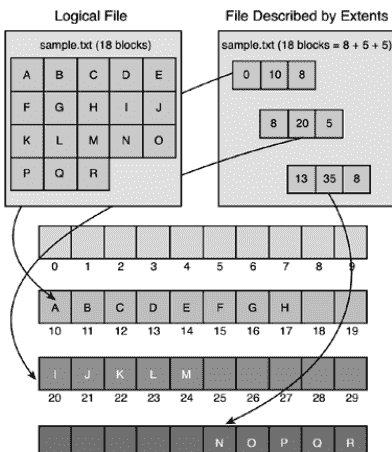

- 文件系统元数据是文件系统的内部数据结构——除了文件中的实际数据外，所有与文件相关的信息。元数据包括日期和时间戳、所有权信息、文件访问权限、其他安全信息（如访问控制列表（如果存在））、文件大小以及磁盘上的存储位置。
- `inode`存储关于文件的所有`信息`，除了数据本身。`Inode`是文件的簿记文件（实际上，`inode`也是一个消耗块的文件）。`Inode`包含文件权限、文件类型以及指向文件的链接数。它还包含一些指向文件数据块的直接指针、指向包含文件数据块指针的块的指针（所谓的间接指针），甚至双重和三重间接指针。每个`inode`都有一个唯一的`inode`号，将其与其他所有`inode`区分开来。
- `目录`是一种特殊的文件，仅包含指向其他文件的指针。具体来说，目录文件的`inode`仅包含其内容的`inode`号，加上权限等。
- `超级块`包含文件系统分区范围的信息，如分区大小、分配组大小、块大小等。
- `分配组`将分区中的空间划分为块，并使文件系统资源分配策略能够使用方法来实现高 I/O 性能。首先，分配策略将相关数据的磁盘块和磁盘`inode`聚集在一起，以实现磁盘的局部性。其次，分配策略将不相关的数据分布在分区中，以适应局部性需求。
- `访问控制列表` (`ACL`) 允许文件所有者指定关于文件的扩展访问信息，向非文件所有者的用户/组授予额外权限。这种形式的自主访问控制允许用户管理系统管理员无需介入维护组，也无需向系统中所有用户授予权限的情况下管理自己的协作项目。`Samba`环境是`ACL`支持的主要用户之一。
- `访问控制项` (`ACE`) 是访问控制列表 (`ACL`) 中的单个条目。`ACL`的第一个字段是条目类型。第二个字段是组名、用户名、数字`UID`或数字`GID`，具体取决于第一个字段的值。第三个字段是此`ACL`的访问权限。
- `扩展属性` (`EA`) 由名称和值组成。应用程序可以以扩展属性的形式将附加信息附加到文件对象。一个文件对象可以有多个扩展属性。与文件对象关联的扩展属性不是文件对象数据的一部分；它们是单独维护并由管理该对象的文件系统管理的。应用程序通过文件系统函数调用定义扩展属性并将其与文件对象关联。`Linux`中的文件系统通过使用扩展属性来存储`ACL`。`图 11-1`展示了文件`extent`的工作方式。

如果文件`sample.txt`需要 18 个块，并且文件系统可以分配长度为 8 的一个`extent`、长度为 5 的第二个`extent`和长度为 5 的第三个`extent`，那么文件系统看起来就像`图 11-1`那样。第一个`extent`的偏移量为 0（文件中的块 A），位置为 10，长度为 8。第二个`extent`的偏移量为 8（块 I），位置为 20，长度为 5。最后一个`extent`的偏移量为 13（块 N），位置为 35，长度为 5。

## 日志式文件系统

在2000年之前，`Ext2`是大多数`Linux`机器的既定事实文件系统。`Ext2`稳健、可靠，适用于大多数部署场景。然而，随着`Linux`在越来越多且规模更大的服务器和计算环境中取代`UNIX`及其他操作系统，`Ext2`正被推向其极限。事实上，许多如今常见的需求——如大容量硬盘分区、快速从崩溃中恢复、高性能 I/O，以及存储代表数万亿字节数据的成千上万个文件——已超出`Ext2`的能力范围。

幸运的是，其他一些`Linux`文件系统接手了`Ext2`未能胜任的部分。确实，`Linux`现在提供四种`Ext2`的替代方案：`Ext3`、`ReiserFS`、`XFS`和`JFS`。除了满足上述部分或全部需求外，这些替代文件系统均支持日志记录（journaling）功能，这是企业所要求且对所有运行`Linux`用户均有益的功能。日志式文件系统可以简化重启过程、减少碎片化，并加速 I/O。日志式文件系统最大限度地减少了运行文件系统检查器的需求。

维护复杂系统的系统管理员，或那些需要高可用性的用户，应考虑部署一个或多个日志式文件系统。

### 当优良文件系统变差时

以下描述了在文件被修改时，将其从三个数据块扩展至五个数据块的方法论：

- 1. 分配两个新数据块以容纳新数据。
- 2. 更新文件的`inode`，记录两个新数据块指针及文件的新大小。
- 3. 将实际数据写入这些数据块中。

尽管向文件写入数据看似是一个单一的原子操作，但实际过程涉及多个步骤（考虑到移除空闲数据块所需的空闲空间列表等所有记账工作以及其他可能的元数据变更，步骤甚至比这里展示的更多）。

如果向文件写入的所有步骤都完美完成（这种情况在大多数时候都会发生），则文件会被成功保存。然而，如果该过程在任何时刻被中断（例如由于电源故障或其他系统性故障），非日志式文件系统可能会陷入不一致状态。损坏发生的原因是，写入（或更新）文件的逻辑操作实际上是一系列 I/O 操作，在特定时刻，整个操作可能并未完全反映在存储介质上。

如果元数据或文件数据处于不一致状态，文件系统将无法正常工作。

非日志式文件系统依赖`fsck`检查文件系统的所有元数据，并在重启前检测和修复结构完整性问题。如果`Linux`平滑关闭，`fsck`通常返回健康的诊断结果。然而，在电源故障或崩溃后，`fsck`很可能发现某种元数据错误。

由于文件系统包含大量元数据，运行`fsck`可能非常耗时。`fsck`必须扫描文件系统的*整个*元数据仓库以确保一致性和无错误运行；因此，`fsck`在磁盘分区上的速度与分区大小、目录数量以及每个目录中的文件数量成正比。

对于大型文件系统，日志记录变得至关重要。与不支持日志的文件系统相比，日志式文件系统提供了更好的结构一致性、更优的恢复能力以及更快的重启时间。在大多数情况下，日志式文件系统的重启时间不到一秒。

### 事务是解决方案

日志式文件系统的神奇之处 lies in `transactions`。`类似于数据库事务，日志式文件系统的事务将一系列变更视为单个原子操作。然而，与其追踪对表的更新，日志式文件系统追踪的是文件系统元数据或用户数据的变更。该事务保证文件系统更新的*所有*部分或*没有*任何部分被执行。

*例如*，创建新文件的过程会修改多个元数据结构（`inode`、空闲列表和目录条目）。在文件系统做出这些更改之前，它会创建一个描述其即将执行的操作的事务。在事务被记录（在磁盘上）之后，文件系统继续进行元数据的修改。日志式文件系统中的*日志*（journal）仅仅是事务的列表。

在发生系统故障时，通过重放日志，文件系统将被恢复到一致状态。而不是检查*所有*元数据（即`fsck`的方式），文件系统仅检查最近更改的元数据部分。恢复速度快得多——通常只需几秒。更好的是，恢复时间不依赖于分区的大小。

除了更快的重启时间外，大多数日志式文件系统还解决了另一个重大问题：可扩展性。即使是结合少数几个大容量磁盘，也很容易组装出巨大的（肯定是以90年代初的标准而言）文件系统。现代文件系统的特性包括：

- `更快的空闲数据块分配`。_`extent_`（如前所述）和`B+树`单独或共同使用，通过大小或位置快速查找并分配多个空闲数据块。
- `目录中（或非常大的）大量文件`。目录是包含文件列表的特殊文件。如果目录需要包含数千或数万个文件，则比(name, inode)对链表更好的机制是必要的。同样，高级文件系统使用`B+树`来存储目录条目。在某些情况下，整个系统使用单个`B+树`。
- `甚至更大的文件`。存储指向数据块的直接、间接、双间接甚至三间接指针的旧技术可扩展性较差。对于非常大的文件，检索数据文件中一个数据块所需的磁盘访问次数将高得令人望而却步。

更高级的文件系统在管理稀疏文件、内部碎片化以及`inode`分配方面比`Ext2`做得更好。

### 丰富的选项

虽然高级文件系统主要针对服务器的高吞吐量和高正常运行时间要求量身定制（从单处理器系统到集群），但这些文件系统也能使需要或期望性能和可靠性的客户端机器受益。

`Linux`的最新版本不仅包含一个，而是四个日志式文件系统。`IBM`的`JFS`、`SGI`的`XFS`以及`Namesys`的`ReiserFS`都已被“开源”，并随后包含在`Linux`内核中。此外，`Ext3`是作为`Ext2`的日志记录附加模块开发的。

`图11-2`显示了文件系统在`Linux`中的位置。请注意，`JFS`、`XFS`、`ReiserFS`和`Ext3`是独立的“同级”。一台`Linux`机器可以同时使用所有这些类型的文件系统。系统管理员可以配置系统在一个分区上使用`JFS`，在另一个分区上使用`ReiserFS`。

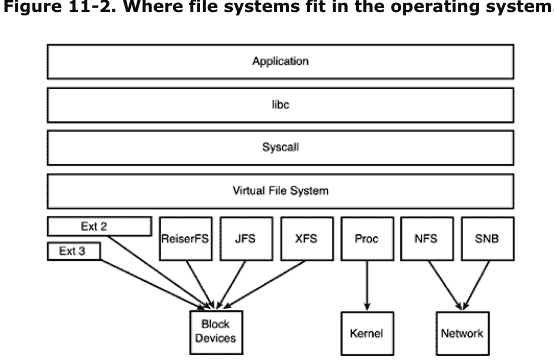

以下`mount`命令的输出显示了一个包含所有四种日志系统的系统：


```bash
##### mount

/dev/hdb6 on / type reiserfs (rw)
proc on /proc type proc (rw)
devpts on /dev/pts type devpts (rw,mode=0620,gid=5)
shmfs on /dev/shm type shm (rw)
usbdevfs on /proc/bus/usb type usbdevfs (rw)
/dev/hda1 on /xfs type xfs (rw)
/dev/hdb1 on /jfs type jfs (rw)
/dev/hda4 on /ext3 type ext3 (rw)
/dev/hda2 on /ext2 type ext2 (rw)
/dev/hda3 on /reiserfs type reiserfs (rw)
```

`df`命令显示所有这些文件系统及其可用空间：

```bash
##### df -k

Filesystem 1K-blocks    Used Available Use% Mounted on
/dev/hdb6   4441800 1770448  2671352  40% /
shmfs       192736       0  192736  0% /dev/shm
/dev/hda1   806448     144  806304  1% /xfs
/dev/hdb1  3999504  659320 3340184  17% /jfs
/dev/hda4  1739324  32828 1618140   2% /ext3
/dev/hda2   798508      20  757924   1% /ext2
/dev/hda3   811248   32840  778408   5% /reiserfs
```

### 磁盘对文件系统性能的影响

决定文件系统性能的因素之一是系统上硬盘的类型和配置。本节中的信息可用于确定系统中硬盘的性能，并帮助你选择符合性能需求的新硬盘。在本章的后面部分，“`hdparm`”一节将讨论如何控制设置以指定集成驱动电子（IDE）硬盘。

### 物理磁盘存储考量

数据的物理移动相对于数据处理本身消耗了大量时间。数据移动组件包括以下内容：

- 在磁盘上查找数据（即文件系统操作）
- 准备获取数据（将读/写磁头定位到磁盘上的正确位置，并等待数据出现在磁头下方）
- 将数据从磁盘传输到磁盘控制器
- 将数据从磁盘控制器传输到内存
- 在内存中移动数据，直到它位于应用程序可用的位置

在此列表中，由于交付每项操作所涉及的技术组件的相对速度，每个操作都显著快于前一个操作。由于数据访问可能需要所有步骤，因此数据移动的总耗时是上述所有步骤时间的总和。

有两种方法可以通过调整数据访问和移动来提高性能：

1. 尽可能消除多个步骤。
2. 减少每个步骤所需的时间。

与所有其他性能调整一样，为改进数据访问速度而实施的更改可能会影响系统的其他方面。一般来说，应在任何更改之前测量性能，单独实施每个更改，并在更改后测量性能。

### 磁盘结构

尽管微处理器和内存的性能和价格都有了显著进步，但磁盘仍然是机械设备。因此，它们缓慢且复杂。由于磁盘驱动器的物理特性会影响许多性能调整考量，因此了解磁盘驱动器涉及的一些关键领域非常重要。

两个重要特性会影响磁盘性能：

1. `磁道间寻道速度`。这是测量磁盘磁头从一个磁道移动到下一个磁道所需时间的指标。
2. `旋转速度`。这是将磁道上任意指定扇区移动到磁盘磁头下方所需的时间。旋转速率表明磁盘在驱动器磁头下方旋转的速度。主流台式机驱动器的典型速率在 4,000rpm 到 5,400rpm 之间。高性能驱动器通常提供 7,200rpm，有些提供 10,000rpm。

在其他条件相同的情况下，旋转速率越快，磁头在给定时间内磁头下方经过的数据越多，磁头读取的数据越多，持续吞吐量就越高。然而，旋转速率的比较并不像想象中那样简单，因为其他条件通常并不相等。例如，5.25 英寸磁盘盘片的磁道平均周长比 3.5 英寸驱动器的大。这意味着磁道上有更多的空间存放数据，并且在每次旋转时，磁头下方经过的数据更多。

另一个变量是磁道上数据的密度。如果驱动器的密度足够高，它在给定时间内可以在磁头下方通过更多数据，因此与其他具有更快旋转速率但密度较低的驱动器相比，它可以拥有更快的持续传输率。作为经验法则，更快的旋转意味着更快的持续传输率，但这种差异可能不像简单的旋转速率比较所暗示的那样大。

旋转速率还影响平均访问时间，因为访问时间的两个组成部分之一（潜伏期/延迟）由磁盘在驱动器磁头到达正确磁道后旋转到该磁道上磁头下方正确位置所需的时间决定。旋转速率越快，潜伏期越低，访问时间越快。

### 传输速率

有几种不同类型的传输速率。它们不能互换。

- `内部传输速率`衡量数据在驱动器磁头和驱动器盘片之间移动的速度。这通常是数据传输到驱动器和从驱动器传输数据的限制因素。
- `突发传输速率`是接口的最大速度。这总是快于内部传输速率。只有在驱动器将数据在驱动器的内存缓冲区中移动时，驱动器才会以突发速率传输数据。
- `持续传输速率`衡量数据在驱动器和计算机之间持续移动的速度。

最常见的是突发传输速率，因为它是三个数字中令人印象最深刻的数字。然而，最重要的是持续传输速率，它基本上告诉你能以多快的速度在驱动器和大容量数据之间移动。大多数时候，驱动器必须从磁盘盘片本身读取或写入，这意味着持续传输速率主要取决于驱动器在驱动器和磁盘之间移动数据的速度。

有时规格会给出最小、最大和平均持续传输速率。这种差异源于磁盘盘片的外侧磁道包含更多数据，因此在从外侧磁道读取时，单次旋转过程中驱动器磁头下方经过的数据比从内侧磁道读取时更多。最大持续传输率是外侧磁道的传输率。最小值是内侧磁道的传输率。平均值是整个磁盘的平均值。影响传输速率的其他因素包括磁盘上数据的密度和旋转速度。持续传输速率等于内部传输速率减去驱动器传输操作所需的开销。

### hdparm

`hdparm`控制 IDE 硬盘的设置，既包括内核中的设置，也包括驱动器本身的设置。本节总结了通常默认为关闭的各种设置，以及你可以做些什么来安全地开启它们以提高硬盘的性能。如果你没有 IDE 驱动器，请跳过本节。

在使用 `hdparm` 之前，请阅读 `hdparm` 的手册页（`man page`），它提供了大多数选项的详细信息。

要查看有关驱动器的信息，请像以下示例所示，不带任何选项发出 `hdparm` 命令，例如针对示例驱动器 `/dev/hdb`：

```
### hdparm /dev/hdb
```

该命令产生的输出类似于以下内容：

```
/dev/hdb:
multicount        =  16 (on)
IO_support     =   0 (default 16-bit)
unmaskirq      =   0 (off)
using_dma      =   1 (on)
keepsettings   =   0 (off)
readonly        =  0 (off)
readahead      =  8 (on)
geometry       =  1650/255/63, sectors = 26520480, start = 0
```

以下列表提供了这些字段的简要说明：

- `multicount`是一次读取的扇区数。
- `io_support`指示硬盘的工作模式（16/32/32sync）。
- `using_dma`指定驱动器是否使用 DMA 功能。
- `keepsettings`在软重置后保持设置。
- `readonly`通常仅对 CD-ROM 设置为 1；它告诉系统设备是否为只读。
- `readahead`显示访问硬盘时将提前读取多少扇区。

要显示有关驱动器实际能力的通用信息，请使用 `i` 选项：

```
### hdparm -i /dev/hdb
```

该命令产生的输出类似于以下内容：


```
/dev/hdb:
Model=IBM-DJNA-371350, FwRev=J76IA3OK, SerialNo=GM0GMGY8991
Config={ HardSect NotMFM HdSw>15uSec Fixed DTR>10Mbs }
RawCHS=16383/16/63, TrkSize=0, SectSize=0, ECCbytes=34
BuffType=DualPortCache, BuffSize=1966kB, MaxMultSect=16, MultSect=16
CurCHS=16383/16/63, CurSects=16514064, LBA=yes, LBASects=26520480
IORDY=on/off, tPIO={ min:240,w/IORDY:120} , tDMA={ min:120,rec:120}
PIO modes: pio0 pio1 pio2 pio3 pio4
DMA modes: mdma0 mdma1 mdma2
UDMA modes: udma0 udma1 *udma2 udma3 udma4
AdvancedPM=no WriteCache=enabled
Drive conforms to: ATA/ATAPI-4 T13 1153D revision 17;1 2 3 4
```

有一个值得检查的值是 `MaxMultSect`。该字段指定硬盘一次可以读取的最大扇区数。示例输出显示

对于 `/dev/hdb`，`MaxMultSect` 设置为 `16`。过去几年制造的大多数 IDE 硬盘都支持 32 位访问。如果你的硬盘支持 32 位访问，你希望此值为 `32`。

以下命令将 `MaxMultSect` 值设置为 `32`：

```
### hdparm -c 1 /dev/hdb
```

数字 `1` 开启 `MaxMultSect`；数字 `0` 关闭 `MaxMultSect`。`MaxMultSect` 通常默认关闭。默认值为 `16`。

在设置这些命令前后，通过输入以下内容来测试硬盘的性能：

```
### hdparm -T -t /dev/hdb
```

此命令产生的输出如下所示：

```
/dev/hdb:
Timing buffer-cache reads:  128MB in  0.97 seconds=131.96MB/sec
Timing buffered disk reads:  64MB in  3.80 seconds=16.84 MB/sec
```

下一个需要关注的领域是硬盘的写缓存。开启写缓存的命令如下：

```
### hdparm -W 1 /dev/hdb
```

数字 `1` 开启写缓存；数字 `0` 关闭写缓存。

`hdparm` 的另一个有用选项是 `using_dma`。开启 `dma` 的命令如下：

```
### hdparm -d 1 /dev/hdb
```

此命令产生的输出如下所示：

```
/dev/hdb:
setting using_dma  to  1 (on)
     using_dma    =  1 (on)
```

数字 `1` 开启 `using_dma`；数字 `0` 关闭 `using_dma`。

重启后不会保存这些设置中的任何一个。如果你使用的是 Red Hat，必须将适当的命令添加到你的 `/etc/rc.d/rc.sysinit` 文件中，以确保它们在启动时自动运行。如果你没有运行 Red Hat 发行版，找到要更改的文件的一种简单方法是在 `/etc` 目录中执行 `grep`，如下面的示例所示：

```
### cd /etc
### grep -r hdparm . | more
```

找到通过 `hdparm` 设置选项的配置文件后，更改该文件以使用通过 `hdparm` 设置的新参数。

在永久更新到配置文件中之前，使用新设置运行一段时间是个好主意，以确保它们适合该系统。

### 文件系统碎片整理

随着时间的推移，文件系统上的文件可能会被分割成片段，导致不连续。这降低了向文件读取或写入数据时的文件系统性能。碎片整理重新排列卷上的所有数据，使文件写入连续的扇区和磁道。这意味着为了读取或写入文件，磁头需要移动的幅度更小。因此，系统整体吞吐量增加。要整理文件系统碎片，请参阅本章后面描述每个文件系统的章节。请注意，磁盘碎片整理可能需要相当长的时间，且这种操作应在系统负载相对较小时进行。

### 文件同步

默认情况下，Linux 系统从内存中的缓冲区/页面缓存读取和写入数据。它们避免实际将数据传输到磁盘，直到缓冲区满或应用程序调用同步函数以刷新缓冲区/页面缓存。此策略通过避免比必要更频繁地执行相对缓慢的机械写磁盘过程来提高性能。

输入和输出操作分为两种类型：

- 异步 I/O，允许应用程序在写入或读取输入的同时执行其他任务
- 同步 I/O，在执行写入或读取操作并验证其完成后才返回

当数据文件的完整性对应用程序至关重要时，同步 I/O 非常有用。同步输出确保写入设备的数据确实存储在那里。同步输入确保从设备读取的数据是该设备上数据的当前映像。

提供两个级别的文件同步：

- 数据完整性
  - 写操作：缓冲区中的数据与检索数据所需的文件系统信息一起传输到磁盘。
  - 读操作：在执行读操作之前，与正在读取的数据相关的任何挂起写操作都必须以数据完整性完成。
- 文件完整性
  - 写操作：缓冲区中的数据以及与操作相关的所有文件系统信息传输到磁盘。
  - 读操作：在执行读操作之前，与正在读取的数据相关的任何挂起写操作都必须以文件完整性完成。

#### 如何确保数据或文件完整性

你可以通过使用函数调用来在特定时间确保数据完整性或文件完整性，或者你可以设置文件状态标志以强制与关联该文件的每个 `read` 或 `write` 调用进行自动文件同步。

请注意，使用同步 I/O 可能会降低系统性能。

#### 使用函数调用

你可以选择像往常一样写入缓冲区/页面缓存，并在希望程序将缓冲区刷新到磁盘时显式调用函数。例如，当大量 I/O 发生时，你可能希望使用缓冲区/页面缓存，并在活动减缓时调用这些函数。有两个可用的函数：

| 函数 | 描述 |
| :--- | :--- |
| `fdatasync` | 刷新所有数据缓冲区，提供具有数据完整性的操作完成。 |
| `fsync` | 刷新缓冲区中的所有数据和文件控制信息，提供具有文件完整性的操作完成。 |

有关这些函数的完整描述，请参阅 `fdatasync` 和 `fsync` 的手册页。

#### 使用文件描述符

如果你希望自动在所有情况下将数据写入磁盘，可以设置文件状态标志以强制此行为，而不是显式调用 `fdatasync` 或 `fsync`。

要设置此行为，请将这些标志与 `open` 函数一起使用：

| 标志 | 描述 |
| :--- | :--- |
| `O_DSYNC` | 强制每次写操作进行数据同步。例如：`fd = open("filea", O_RDWR\|O_CREAT\|O_DSYNC, 0666);` |
| `O_SYNC` | 强制每次写操作进行文件和数据同步。例如：`fd = open("filea", O_RDWR\|O_CREAT\|O_SYNC, 0666);` |

### sync/fsync 的性能影响

真实内存和磁盘内容的强制同步以几种方式发生：

- 应用程序对指定文件发起 `fsync()` 调用。这导致包含该文件修改数据的所有页面被写入磁盘。当 `fsync()` 调用返回到程序时，写入完成。
- 应用程序发起 `sync()` 调用。这导致内存中包含修改数据的所有文件页面被调度写入磁盘。当 `sync()` 调用返回到程序时，写入 *不一定* 完成。
- 用户可以输入 `sync` 命令，该命令进而发起 `sync()` 调用。同样，当提示用户输入（或处理 shell 脚本中的下一个命令）时，部分写入可能尚未完成。
- `sync` 守护进程，`bdflush`，以固定的间隔被调用。这确保系统不会积累大量仅存在于易失性 RAM 中的数据。

### bdflush 参数

`bdflush` 启动、刷新或调整 buffer-dirty-flush 守护进程。它与内核虚拟内存 VM 子系统的操作相关。可以通过调整 `bdflush` 来改进文件系统性能。如果你从默认值更改了一些值，如下所示，系统可以更具响应性。文件 `/proc/sys/vm/bdflush` 控制 `bdflush` 内核守护进程的操作。

在 Red Hat 和 SUSE 系统中，`bdflush` 参数的默认配置为：

```
50 500 0 0 500 3000 60 20 0
```

要查看系统中的 `bdflush` 设置，请发出以下命令：

```
### cat /proc/sys/vm/bdflush
```

```
50 500 0 0 500 3000 60 20 0
```

第一个参数 `nfract`，默认值为 `50`，控制缓冲区缓存中脏缓冲区的最大数量。将此设置为高值意味着内核可以延迟写入更长的时间，但也意味着当内存变少时它必须这样做。低值使磁盘 I/O 分布得更均匀。


## bdflush 参数

第二个参数 (`ndirty`)，默认值为 500，是 `bdflush` 一次可以写入磁盘的最大脏缓冲区数量。高值意味着突发 I/O，而小值可能导致在 `bdflush` 未频繁启动时出现内存短缺。

第三个和第四个参数目前未使用。

第五个参数 (`interval`)，默认值为 500，是 `kupdate` 刷新之间的延迟。

第六个参数 (`age_buffer`)，默认值为 3000，是普通缓冲区在被刷新之前老化的时间。

第七个参数 (`nfract_sync`)，默认值为 60，是激活 `bdflush` 同步的脏缓冲区缓存百分比。

第八个参数 (`nfract_stop_bdflush`)，默认值为 20，是停止 `bdflush` 的脏缓冲区缓存百分比。

第九个参数目前未使用。

在以下示例中，`nfract` 从 50 增加到 100，`ndirty` 从 500 增加到 1200：

```
echo "100 1200 0 0 500 3000 60 20 0" >/proc/sys/vm/bdflush
```

### 异步输入和输出

对文件的 I/O 操作可以是同步的，也可以是异步的。对于同步 I/O 操作，发起 I/O 请求的进程会被阻塞，直到 I/O 操作完成，并且只有在请求被完全满足或失败时，该进程才会重新获得执行控制权。对于异步 I/O 操作，发起 I/O 请求的进程在 I/O 操作被排入设备队列后立即重新获得执行控制权。当 I/O 操作完成时（无论是成功还是失败），可通过传递给异步 I/O 函数的 io 控制块结构中的信号，通知调用进程该事件。或者，调用进程也可以轮询 io 控制块结构以获取完成状态。

异步 I/O 允许 CPU 和 I/O 处理高效重叠，这可以显著提高高负载应用的性能。

### 使用异步 I/O

异步 I/O 最常用于需要高速或大量数据收集或低优先级日志记录功能的实时应用。计算密集型进程可以使用异步 I/O 来代替阻塞。例如，应用程序可以从多个通道收集间歇性数据。由于数据是异步到达的，即当数据可用时到达，而不是按照固定的时间表，因此接收进程必须排队等待读取某个通道的数据请求，并立即空闲以接收来自另一个通道的下一个数据传输。另一种应用可能需要大量的读、写和计算操作，使得排队一堆 I/O 操作请求并在 I/O 请求被处理的同时继续处理变得具有实际意义。应用程序可以通过最小化函数调用次数来对多个设备执行多个 I/O 操作。

你可以使用任何打开的文件描述符来执行异步 I/O 操作。

### 异步 I/O 函数

异步 I/O 函数结合了通常在同步 I/O 操作期间由用户执行的许多任务。在同步 I/O 中，应用程序通常调用 `open` 函数，执行 I/O 操作，然后等待接收返回状态。

异步 I/O 函数提供以下功能：

- 普通文件和特殊文件都可以处理 I/O 请求。
- 一个文件描述符可以处理多个读和写操作。
- 可以向多个打开的文件描述符发出多个读和写操作。
- 顺序访问设备和随机访问设备都可以处理 I/O 请求。
- 可以取消未完成的 I/O 请求。
- 进程可以挂起以等待 I/O 完成。
- 可以在请求被排队、进行中以及完成时跟踪 I/O 请求。

以下函数执行和管理异步 I/O 操作：

| 函数 | 描述 |
|---|---|
| `aio_cancel` | 取消针对文件描述符挂起的一个或多个请求。 |
| `aio_error` | 返回指定操作的错误状态。 |
| `aio_fsync` | 异步地将包含文件已修改数据的系统缓冲区写入永久存储。 |
| `aio_read` | 在指定的文件描述符上发起读请求。 |
| `aio_return` | 返回已完成操作的状态。 |
| `aio_suspend` | 挂起调用进程，直到指定的请求中至少有一个完成。 |
| `aio_write` | 向指定的文件描述符发起写请求。 |
| `lio_listio` | 发起请求列表。 |

### 原始磁盘 I/O

原始磁盘 I/O 是直接与磁盘交互的过程。另一方面，文件 I/O 是进程通过内核缓存这一中介与物理设备交互的方式。`read()` 和 `write()` 文件 I/O 需要数据通过内核缓冲区区域在用户空间之间复制。数据可能同时存在于两个内存位置。

一些应用程序（如数据库）实现了自己的日志记录。实现了自己日志记录的应用程序可以通过直接对原始逻辑卷执行 I/O 并绕过文件系统，来避免重复的日志记录（其自身的数据库日志和日志文件系统日志）。

原始磁盘 I/O 是无缓冲的，数据不会缓存在内核缓冲区中。原始 I/O 用于提高性能的一个领域是关系数据库，例如 IBM DB2 和 Oracle。由于这些关系数据库拥有自己的 I/O 缓存缓冲区，因此在无缓冲的原始 I/O 中可以提高性能。

### 在 Linux 上设置原始 I/O

在 Linux 上设置原始 I/O 之前，你需要以下内容：

- 一个或多个空闲的 IDE 或 SCSI 磁盘分区。
- 名为 `/dev/rawctl` 或 `/dev/raw` 的原始设备控制器。如果你没有这样的原始设备控制器，请使用以下命令创建符号链接：

```
ln -s /dev/your_raw_dev_ctl /dev/rawctl
```

Linux 拥有一组必须绑定到块设备的原始设备节点，然后才能在其上执行原始 I/O。有一个原始设备控制器充当原始 I/O 到块设备绑定信息的中央存储库。绑定是使用名为 `raw` 的工具执行的。

### 示例

以下示例在 Linux 上配置原始 I/O。该示例使用原始分区 `/dev/sda5`，其中不包含有价值的数据：

1. 计算分区中 4096 字节页面的数量，必要时向下取整。例如：

```
fdisk /dev/sda
Command (m for help): p
Device boot Start End Blocks Id System
/dev/sda1 1 523 420097 83 Linux
/dev/sda5 524 1106 4682947 83 Linux
Disk /dev/sda: 255 heads, 63 sectors, 1106 cylinders
Units = cylinders of 16065 * 512 bytes
Command (m for help): q
```

表 1. Linux 原始 I/O 计算。

`/dev/sda5` 中的页面数为

```
num_pages = ((1106-524+1)*16065*512)/4096
num_pages = 11170736
```

2. 将一个未使用的原始设备节点绑定到此分区。每次机器重启时都需要执行此步骤，并且需要 root 权限。使用 `raw -a` 查看哪些原始设备节点已被使用：

```
raw /dev/raw/raw1 /dev/sda5
/dev/raw/raw1: bound to major 8, minor 5
```

3. 在原始设备控制器和磁盘分区上设置适当的读权限。在原始设备上设置适当的读写权限。原始设备现在可以使用了。

### Ext2 和 Ext3

如前所述，Ext2 是 Linux 的事实文件系统。尽管 Ext2 缺乏一些高级功能，如 XFS、JFS 和其他文件系统中的极大文件和 extent 映射文件，但它仍然是所有 Linux 发行版中可靠、稳定且开箱即用的文件系统。Ext2 的真正弱点是 `fsck`：Ext2 文件系统越大，运行 `fsck` 所需的时间越长。更长的 `fsck` 时间意味着更长的停机时间。

### Ext2 组织结构

Ext2 划分为多个块组。每个块组保存超级块、inode 和数据块的副本，如图 11-3 所示。块组使数据块靠近文件 inode，并使文件 inode 靠近目录 inode。

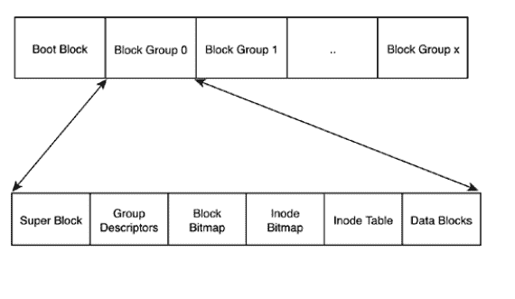

因此，块组最小化了定位时间，从而减少了对数据的访问时间。每个组包含超级块以及其他块组的信息，这使得如果某个块组损坏，文件系统有更好的机会得到覆盖。

Ext2 的 inode 大小为 128 字节。图 11-4 显示了 Ext2 inode 结构的布局。


| 文件模式 | 所有者 (UID) | 文件大小 |
|---|---|---|
| 访问时间 | | 创建时间 |
| 修改时间 | | 删除时间 |
| 组 ID (GID) | 链接计数 | 块计数 |
| 文件标志 | | 保留 |
| 直接块 | | .... |
| 间接块 | | 间接块 |
| 间接块 | | 文件版本 (用于 NFS) |
| 文件 ACL | | 目录 ACL |
| 碎片地址 | 碎片编号 | 碎片大小 |
| 保留 | | 保留 |

Ext2 目录通过单链表进行跟踪。目录中的每个条目都具有图 11-5 中显示的字段。

### 图 11-5. Ext2 目录结构。

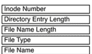


图 11-6 阐明了块、`inode`（带有许多元数据属性）、目录及其关系。

### 图 11-6. 块、`inode`、目录、文件及其关系。


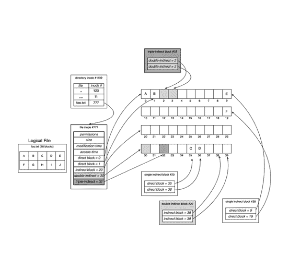

### 扩展文件系统 Ext2 中的块分配

在对文件进行顺序写入时，Ext2 文件系统会以 8 个连续块为单位预分配空间。当文件关闭时，未使用的预分配块会被释放，因此不会浪费空间。这种方法可以防止或减少碎片化。碎片化是指由于连续的块不可用，导致文件中的许多块分散在整个磁盘上的状态。连续块可以提高性能，因为在顺序读取文件时，磁盘磁头的移动最小化。

文件碎片化——即文件分散到非连续的块中——是所有文件系统都会遇到的问题。文件的创建和删除会导致碎片化。通过让文件系统使用高级算法来减少碎片化，可以解决这个问题。使用 `defrag` 文件系统实用程序，将碎片化的文件移动到具有连续块的位置，也可以解决此问题。Ext2 上可用的碎片整理工具称为 `defrag.ext2`。

### 创建 Ext2 文件系统

创建 Ext2 和 `Ext3` 文件系统的程序称为 `mkfs.ext2`。可以使用另外两个命令来创建 Ext2/Ext3 文件系统：`mkfs.ext2` 和 `mkfs.ext2`。本节其余部分将介绍 `mkfs` 命令的一些关键选项：

- `-b block-size` 选项指定块大小（以字节为单位）。有效的块大小值为每块 1024、2048 和 4096 字节。
- `-n number-of-inodes` 选项指定 `inode` 的数量。
- `-t fs-type` 选项指定文件系统的用途。有效选项如下：
  - `news` 每 4KB 块创建一个 `inode`。
  - `largefile` 每兆字节创建一个 `inode`。
  - `largefile4` 每 4 兆字节创建一个 `inode`。

有关 `mkfs.ext2` 选项的完整列表，请参阅 `mkfs.ext2` 手册页。

以下示例在设备 `/dev/hdb2` 上发出 `mkfs` 时使用默认设置。块大小默认为 4096，创建的 `inode` 数量为 502944。

```
### mkfs.ext2 /dev/hdb2

mke2fs 1.32 (09-Nov-2002)
Filesystem label=
OS type: Linux
Block size=4096 (log=2)
Fragment size=4096 (log=2)
502944 inodes, 1004062 blocks
...
```

接下来，使用 `-b 1024` 选项将块大小设置为 1024，并使用 `-T news` 选项设置文件系统类型。创建的 `inode` 数量为 1005568。

```
### mkfs.ext2 -b 1024 -T news /dev/hdb2

mke2fs 1.32 (09-Nov-2002)
Filesystem label=
OS type: Linux
Block size=1024 (log=0)
Fragment size=1024 (log=0)
1005568 inodes, 4016250 blocks
...
```

### Ext2 文件系统的 Ext3 扩展

Ext3 文件系统在不影响 Ext2 的健壮性（至少是其简单性和可靠性）的情况下提供了更高的可用性。Ext3 是 Ext2 的最小扩展，旨在添加日志记录支持。Ext3 使用与 Ext2 相同的磁盘布局和数据结构，并且与 Ext2 具有前向和后向兼容性。从 Ext2 迁移到 Ext3（反之亦然）非常简单，甚至可以在同一分区中原位完成。其他三种日志文件系统需要使用它们的 `mkfs` 实用程序格式化分区。

如果您想采用日志文件系统，但系统上没有空闲分区，那么 Ext3 可能是一个合适的日志文件系统选择。

#### 对 Ext3 的 Kernel 配置支持

您可以从配置菜单的文件系统部分中选择 `ext3` 选项，并启用以下选项：

> Ext3 日志文件系统支持 (`CONFIG_EXT3_FS=y,m,n`)

如果您希望将 Ext3 构建到内核中，请在 `ext3` 条目旁点击 `y`。如果您希望将 Ext3 构建为模块，请在 `ext3` 条目旁点击 `m`。如果需要 Ext3 支持，则使用 `n` 选项。

在 Ext3 配置中，Ext3 选择中还有其他选项可用。如果您需要这些选项中的任何一个，请在此处选择。

#### 使用 Ext3

调整 Ext3 文件系统有三种方法：

1. 在文件系统创建时进行，这是最有效的方式
2. 通过 `tune2fs` 调整实用程序，可用于在文件系统创建后对其进行调整
3. 通过文件系统挂载时可用的选项

上述三种调整选项将在以下章节中讨论。

#### 创建 Ext3 分区

创建 Ext3 文件系统的程序称为 `mke2fs`。您也可以使用 `mkfs.ext3` 和 `mkfs.ext2` 命令来创建 Ext3 文件系统。本节其余部分将介绍 `mkfs` 命令的一些关键选项：

- `-b block-size` 选项指定块大小（以字节为单位）。有效的块大小值为每块 1024、2048 和 4096 字节。
- `-n number-of-inodes` 选项指定 `inode` 的数量。
- `-t fs-type` 选项指定文件系统的用途。有效选项如下：
  - `news` 每 4KB 块创建一个 `inode`。
  - `largefile` 每兆字节创建一个 `inode`。
  - `largefile4` 每 4 兆字节创建一个 `inode`。

有关 `mkfs.ext3` 选项的完整列表，请参阅 `mkfs.ext3` 手册页。

以下示例在设备 `/dev/sdb1` 上发出 `mkfs` 时使用默认设置。块大小为 1024，创建的 `inode` 数量为 128016。

```
##### mkfs.ext3 /dev/sdb1

mke2fs 1.28 (31-Aug-2002)
Filesystem label=
OS type: Linux
Block size=1024 (log=0)
Fragment size=1024 (log=0)
128016 inodes, 511984 blocks
...
```

Ext3 文件系统格式化完成后，建议取消文件系统的自动检查（文件系统每 3 次挂载或 180 天自动检查一次，以先到者为准）。要取消自动检查，请使用带有 `-c` 选项的 `tune2fs` 命令将检查次数设置为 0。

```
##### tune2fs -c 0 /dev/sdb1

tune2fs 1.28 (31-Aug-2002)
Setting maximal mount count to -1
```

#### 将 Ext2 文件系统转换为 Ext3

本节介绍如何将 Ext2 文件系统转换为 Ext3：

1. 备份文件系统。
2. 通过运行带有 `-j` 选项的 `tune2fs` 程序，为想要转换的现有 Ext2 文件系统添加日志文件。您可以在挂载或未挂载的 Ext2 文件系统中运行 `tune2fs`。例如，如果 `/dev/hdb3` 是一个 Ext2 文件系统，以下命令将创建日志：

```
# tune2fs -j /dev/hdb3
```

如果文件系统已挂载，则名为 `.journal` 的日志文件将放置在文件系统的根目录中。如果文件系统未挂载，则日志文件将被隐藏。（当挂载 Ext3 文件系统时，`.journal` 文件会出现。`.journal` 文件可以表明该文件系统确实是 Ext3 类型。）
3. 将 `/etc/fstab` 文件中 `/dev/hdb3` 的条目从 `ext2` 更改为 `ext3`。
4. 重新启动，并通过输入 `mount` 并查看输出来验证 `/dev/hdb3` 分区的类型是否为 Ext3。输出应包含类似以下内容的条目：

```
# mount

/dev/hdb3 on /test type ext3 (rw)
```

#### 在 Ext3 文件系统上使用独立的日志设备

要在 Ext3 文件系统上使用外部日志，您需要做的第一件事是在日志设备上发出 `mkfs` 命令。外部日志的块大小必须与 Ext3 文件系统的块大小相同。在以下示例中，`/dev/hda1` 设备用作 Ext3 文件系统的外部日志：

```
##### mkfs.ext3 -b 4096 -O journal_dev /dev/hda1
##### mkfs.ext3 -b 4096 -J device=/dev/hda1 /dev/hdb1
```

#### Ext2/Ext3 实用程序

`e2fsprogs` 包包含用于 Ext2 和 Ext3 文件系统的各种实用程序。以下是每个实用程序的简要说明：

- `badblocks`: 搜索设备上的坏块。
- `chattr`: 更改 Ext2 或 Ext3 文件系统上的文件属性。


- `compile_et`：将列出错误代码名称和相关消息的表格转换为适合与 `com_err` 库一起使用的 C 源文件。
- `debugfs`：用于检查和更改 Ext2 文件系统状态的文件系统调试器。
- `dumpe2fs`：打印指定设备上存在的文件系统的超级块和块组信息。
- `e2fsck` 和 `fsck.ext2`：检查并可选地修复 Ext2 文件系统。
- `e2image`：将关键的 Ext2 文件系统数据保存到文件。
- `e2label`：显示或更改 Ext2 文件系统上的文件系统标签。
- `fsck.ext3`：检查并可选地修复 Ext3 文件系统。
- `lsattr`：列出 Ext2 文件系统上的文件属性。
- `mk_cmds`：接受命令表文件作为输入并生成 C 源文件作为输出，旨在与子系统库 `libss` 一起使用。
- `mke2fs`：创建 Ext2 文件系统。`mkfs.ext2` 等同于 `mke2fs`。
- `mkfs.ext3`：创建 Ext3 文件系统。
- `mklost+found`：在当前工作目录的 Ext2 文件系统中创建 `lost+found` 目录。`mklost+found` 为目录预分配磁盘块，以便 `e2fsck` 可以使用。
- `resize2fs`：调整 Ext2 文件系统的大小。
- `tune2fs`：调整 Ext2 文件系统上可调整的文件系统参数。
- `uuidgen`：使用 `libuuid` 库创建新的通用唯一标识符 (`UUID`)。

有关更多信息，请参阅每个实用程序的手册页。

### ReiserFS

ReiserFS 是一种开源日志文件系统，存在于大多数 Linux 发行版中，并支持元数据日志记录。ReiserFS 已被合并到 `kernel.org` 源代码树的 2.4.1 版本中。ReiserFS 提供了以下独特功能，有助于使其与其他日志文件系统区分开来：

- 将所有文件系统对象存储在一棵 b* 平衡树中。该树支持以下功能：
  - 紧凑的索引目录
  - 动态 inode 分配
  - 可调整大小的项
  - 60 位偏移量

该树包含以下四个基本组件：stat 数据、目录组件、直接组件和间接组件。您可以通过搜索密钥（密钥具有 ID）、正在搜索的对象中的偏移量以及项类型来查找组件。

目录会随着其内容的变化而增加或减少。文件名哈希值用于保持目录中条目的偏移量永久不变。

对于文件，间接组件指向数据块，而直接组件包含打包的文件数据。

可以通过重新平衡树来调整所有组件的大小。

- 支持小文件槽和大量小文件。Reiser 的哲学很简单：小文件鼓励编码简单性。不要使用数据库或创建文件缓存方案，而是使用文件系统来处理大量小片段信息。ReiserFS 在处理小于 1K 的文件时，速度可能比 Ext2 快八倍。
- 在相同的物理文件系统上比 Ext2 多存储约 6% 的数据（当正确配置时）。ReiserFS 不必以固定的 4K 块分配空间，而是可以分配所需的精确空间。b* 树管理所有文件系统元数据，并存储和压缩“尾部”（小于一个块的文件部分）。

尾部打包在 ReiserFS 强制重新排列数据（当文件变小或变大时）时确实会导致轻微的性能损失。这就是为什么可以通过关闭 `notail` 挂载选项来调整此功能的原因之一。

### ReiserFS 的内核配置支持

您可以从配置菜单的文件系统部分选择 ReiserFS 选项，并启用以下选项：

`Reiserfs support` (`CONFIG_REISERFS_FS=y,m,n`)

如果要将 ReiserFS 构建到内核中，请单击 `Reiserfs` 条目旁边的 y。如果要将 ReiserFS 构建为模块，请单击 `Reiserfs` 条目旁边的 m。

在 ReiserFS 选择中还有其他可用于 ReiserFS 配置的选项。如果需要这些选项中的任何一个，请在此处进行选择。

### 使用 ReiserFS

有三种方法可以调整 ReiserFS 文件系统：

1. 在创建文件系统时进行，这是最有效的方式
2. 通过调整工具 `reiserfstune`，可用于在文件系统创建后对其进行调整
3. 通过文件系统在挂载时使用的选项

这三个调整选项将在以下部分中讨论。

### 创建 ReiserFS 文件系统

ReiserFS 使用 `mkreiserfs` 工具创建 ReiserFS 文件系统。性能调整选项如下：

```
-h | --hash HASH
```

`HASH` 指定目录中文件名排序所用的哈希函数名称。（有关每个哈希选项的完整描述，请参阅 ReiserFS 手册页中的挂载选项部分。）

选择以下选项之一：

- `r5`（默认）
- `rupasov`
- `tea`

请参阅关于挂载选项的小节以了解这些替代方案的描述。

```
-j | --journal-device FILE
```

`FILE` 指定文件系统放置日志的块设备名称。

```
-o | --journal-offset N
```

`N` 指定当日志位于单独的块设备上时日志起始位置的偏移量。默认值为 0。

```
-s | --journal-size N
```

`N` 以块为单位指定日志大小。当日志位于单独的块设备上时，默认大小是该设备上的块数。当日志不在单独的块设备上时，默认值为 8193，最大值为 32749。两种情况下的最小值均为 513 个块。

```
-t | --transaction-max-size N
```

`N` 是日志的最大事务大小。默认值也是最大值为 1024 个块。

关于 `mkreiserfs` 选项的完整描述，请参阅 `mkreiserfs` 手册页。

要创建日志位于 ReiserFS 分区内的 ReiserFS 文件系统，请执行以下命令：

```
mkreiserfs /dev/sdb1
```

文件系统创建后，使用 `mount` 命令进行挂载。确定挂载点并创建一个新的空目录（例如 `/reiserfs`）来挂载文件系统。以下示例挂载了新的文件系统：

```
mount -t reiserfs /dev/sdb1 /reiserfs
```

要卸载 ReiserFS 文件系统，请使用 `umount` 命令，并将相同的挂载点作为参数：

```
umount /reiserfs
```

#### 使用外部日志提高速度

外部日志通过将对日志的更新保存到与对应文件系统日志不同的分区来提高性能。这减少了硬盘寻道的次数。

要创建日志位于外部设备上的 ReiserFS 文件系统，您的系统需要有两个未使用的分区。在以下示例中，`/dev/hda1` 和 `/dev/hdb1` 是备用分区。`/dev/hda1` 分区用于外部日志。

```
mkreiserfs -j /dev/hda1 /dev/hdb1
```

#### 挂载文件系统

要挂载文件系统，请使用以下 `mount` 命令：

```
mount -t reiserfs /dev/hdb1 /reiserfs
```

为了避免每次系统启动时都要挂载文件系统，请将文件系统添加到 `/etc/fstab` 文件中。对 `/etc/fstab` 进行备份，并使用您喜欢的编辑器编辑它，以添加 `/dev/hdb1` 设备。例如：

```
/dev/hdb1 /reiserfs reiserfs defaults 1 2
```

#### 挂载选项

三个挂载选项可以更改 ReiserFS 文件系统的性能：

1. `hash` 选项允许您选择在目录内定位和写入文件时使用的哈希算法：

```
hash=rupasov|tea|r5|detect
```

这指定了在目录内定位和写入文件时使用的哈希算法。文件系统提供的不同哈希算法包括 `rupasov`、`tea`、`r5` 和 `detect`。

- `rupasov` 哈希算法是一种快速的哈希方法，它放置并保持局部性，将字典顺序相近的文件名映射到相近的哈希值。
- `tea` 哈希算法是一种 Davies-Meyer 函数，通过彻底置换名称中的位来创建密钥。它获得高随机性，因此哈希冲突的概率较低，但这会带来性能成本。对于因使用 `r5` 哈希而导致 `EHASHCOLLISION` 的大型目录，这种哈希是不错的选择。例如：

```
mount -t reiserfs -o hash=tea /dev/sdb2 /mnt/reiserfs
```

- `r5` 哈希算法是 `rupasov` 哈希的修改版本，具有较低的哈希冲突概率。这是默认的哈希算法。
- `detect` 选项指示 `mount` 检测正在挂载的文件系统实例正在使用的哈希函数。它将此信息写入超级块。此选项仅在对旧文件系统进行首次挂载时有用。

2. `nolog` 选项禁用日志记录。它在某些情况下还会提供轻微的性能提升，代价是如果文件系统未正常关闭，则强制进行 fsck。这是在从备份恢复文件系统时的好选项。例如：


```
mount -t reiserfs -o nolog /dev/sdb2 /mnt/reiserfs
```

3. `notail` 选项禁用将文件打包到树中。默认情况下，ReiserFS 将小文件和“文件尾部”直接存储到树中。例如：

```
mount -t reiserfs -o notail /dev/sdb2 /mnt/reiserfs
```

可以通过用逗号分隔来组合挂载选项。以下示例使用了两个提高文件系统性能的挂载选项（`noatime`、`notail`）：

```
mount -t reiserfs -o noatime,notail /dev/sdc1 /fs1
```

每当读取文件时，Linux 都会记录 `atime`（访问时间）。然而，此信息并不很有用，且跟踪成本较高。为了获取快速性能提升方面，只需使用挂载选项 `noatime` 禁用访问时间更新即可。

### ReiserFS 调优

`reiserfstune` 用于调优 ReiserFS 文件系统。它可更改日志大小和最大事务大小。日志的位置也可以变更：

```
-j | --journal-device *FILE*
```

`*FILE*` 指定文件系统放置日志的块设备名称。

```
-o | journal-offset *N*
```

当日志位于独立的块设备上时，`*N*` 指定日志的起始偏移量。默认值为 0。

```
--no-journal-available
```

当当前日志的块设备因磁盘损坏而不可用时，此选项允许文件系统继续运行。

```
--journal-new-device *FILE*
```

`*FILE*` 是指将包含文件系统新日志的块设备名称。

```
-s | journal-size *N*
```

`*N*` 以块为单位指定日志大小。当日志位于独立的块设备上时，默认大小为该设备上的块数。当日志未位于独立块设备上时，默认值为 8193，最大值为 32749。两种情况下的最小值均为 513 个块。

```
-t | --transaction-max-size *N*
```

`*N*` 是日志的最大事务大小。默认值和最大值均为 1024 个块。

有关该实用程序所有选项的信息，请参阅 `reiserfstune` 手册页。

### ReiserFS 实用程序

以下 ReiserFS 实用程序位于 `reiserfsprogs` 包中：

- `mkreiserfs`。创建 ReiserFS 文件系统。
- `reiserfsck`。检查 ReiserFS 文件系统。
- `resize_reiserfs`。调整 ReiserFS 文件系统的大小。
- `debugreiserfs`。调试 ReiserFS 文件系统。

有关更多详细信息，请参阅各 ReiserFS 实用程序的手册页。

### 日志文件系统（JFS）

Linux 的日志文件系统（JFS）基于 IBM 为 OS/2 Warp 开发的 JFS 文件系统。JFS 于 2000 年初捐赠给开源社区，并很快移植到了 Linux。JFS 非常适合企业环境。它使用许多先进技术来提升性能，支持非常大的文件系统，并对文件系统更改进行日志记录。JFS 的一些特性包括以下几点：

- *基于范围的寻址结构*。JFS 使用基于范围的寻址结构，并结合积极的块分配策略，以生成紧凑、高效且可扩展的结构，用于将文件内的逻辑偏移映射到磁盘上的物理地址。此特性带来了卓越的性能。
- *动态 inode 分配*。JFS 根据需要动态分配磁盘 inode 的空间，并在不再需要时释放空间。这与 Ext2 形成了巨大改进，因为 Ext2 在创建文件系统时预先为磁盘 inode 保留了固定量的空间。借助动态 inode 分配，用户无需估算文件系统将包含的最大文件和目录数量。此外，此特性使磁盘 inode 与固定磁盘位置解耦。
- *目录组织*。提供了两种不同的目录组织方式：一种用于小目录，另一种用于大目录。小目录（最多八个条目，不包括自引用（. 或 "dot"）和父目录（.. 或 "dot dot"）条目）的内容存储在目录的 inode 中。这消除了对单独目录块 I/O 和对单独存储分配的需求。较大目录的内容组织在基于名称的 B+ 树中。与传统的未排序目录组织相比，B+ 树提供了更快的目录查找、插入和删除能力。
- *在线调整大小*。此特性允许文件系统在挂载期间增长。此特性与卷管理器配合使用。
- *在线快照*。此选项通过创建文件系统的时间点映像提供在线备份机制。它有助于消除为了获取一致性备份而让系统离线的需要。此特性与卷管理器配合使用。
- *“无完整性”挂载选项*。JFS 的此特性禁用了将文件系统元数据更改写入日志的选项。备份恢复程序可以使用此选项来缩短恢复时间。
- *64 位*。JFS 是一个完整的 64 位文件系统。所有适当的文件系统结构字段均为 64 位大小。这使得 JFS 能够支持大文件和分区。

JFS 还具有其他高级特性，如分配组（通过最大化局部性来加快文件访问速度）以及从 512 字节到 4096 字节的各种块大小（可调整以避免内部和外部碎片）。请注意，目前仅支持 4K 块大小。

#### JFS 的内核配置支持

JFS 已合并到 [kernel.org](http://kernel.org) 源代码树的 2.4.20 发行版中。

您可以从配置菜单的“文件系统”部分设置 JFS 选项，并启用以下选项：

```
JFS filesystem support (CONFIG_JFS_FS=y,m,n)
```

如果想将 JFS 构建到内核中，请点击 `jfs` 条目旁的 `y`。如果希望将 JFS 作为模块构建，请点击 `jfs` 条目旁的 `m`。

JFS 配置部分还有其他可用选项。

#### 处理 JFS

调优 JFS 文件系统有两种方法：

1. 在创建文件系统时进行，这是最有效的方式
2. 通过调优实用程序 `jfs_tune`，可用于在文件系统创建后对其进行调优

以下章节将讨论这些调优选项。

#### 创建 JFS 文件系统

创建 JFS 文件系统的程序称为 `jfs_mksfs`。该程序也可以使用名称 `mkfs.jfs` 调用。有关 mkfs 实用程序所有选项的列表，请参阅 `mkfs.jfs` 手册页。

下一个示例展示了如何使用一个空闲分区（`/dev/hdb1`）创建 JFS 文件系统。（如果磁盘上存在未划分的空间，您可以使用 `fdisk` 创建分区。创建分区后，请重启系统，以确保新的分区可用以便在其上创建 JFS 文件系统。）

要在 JFS 分区内部创建带有日志的 JFS 文件系统，请运行以下命令：

```
mkfs.jfs /dev/hdb1
```

创建文件系统后，使用 `mount` 命令将其挂载。确定挂载点并创建一个新的空目录（例如 `/jfs`），使用以下命令挂载文件系统：

```
mount -t jfs /dev/hdb1 /jfs
```

文件系统挂载后，您可以尝试使用 JFS。

若要卸载 JFS 文件系统，请使用与挂载点作为参数的 `umount` 命令：

```
umount /jfs
```

#### 使用外部日志提高 JFS 速度

外部日志可以改善性能，因为日志更新被保存到了与其对应文件系统不同的分区中。

要在外部设备上创建带有日志的 JFS 文件系统，系统需要有两个未使用的分区。在以下示例中，`/dev/hda1` 和 `/dev/hdb1` 是空闲分区。`/dev/hda1` 用作外部日志。

```
mkfs.jfs -j /dev/hda1 /dev/hdb1
```

#### 挂载文件系统

要挂载文件系统，请使用以下 `mount` 命令：

```
mount -t jfs /dev/hdb1 /jfs
```

为了避免每次启动时都需要挂载文件系统，您可以将其添加到 `/etc/fstab` 文件中。首先，备份 `/etc/fstab`，然后编辑该文件并添加 `/dev/hdb1` 设备。例如，添加

```
/dev/hdb1 /jfs jfs defaults 1 2
```

#### 挂载选项

默认情况下，JFS 挂载选项 `integrity` 已设置，这会导致元数据更改被提交到日志中。若要更改 JFS 文件系统的性能，请使用 `nointegrity` 挂载选项。`nointegrity` 导致文件系统不被写入日志。此选项的主要用途是在从备份介质恢复卷时允许更高的性能。但是，如果系统异常终止，则无法保证卷的完整性。指定 `integrity` 选项重新挂载之前指定了 `nointegrity` 选项的卷，以恢复正常运行。

Linux 每次读取文件时都会记录 `atime`，即访问时间。然而，此信息并非非常有用，且追踪它的代价可能很高。要获得快速的性能提升，只需使用挂载选项 `noatime` 禁用访问时间更新即可。

### JFS 调优

`jfs_tune` 实用程序提供的一种性能选项是更改日志位置的能力，这允许您将日志移动到外部设备上。更改日志位置涉及以下步骤：

1. 在外部设备 `/dev/hda2` 上创建日志：


```
# mkfs.jfs -J journal_dev /dev/hda2
```

2. 将外部日志附加到位于 `/dev/hdb1` 上的文件系统：

```
# jfs_tune -J device=/dev/hda2 /dev/hdb1
```

### JFS 实用程序

以下 JFS 实用程序可在 `jfsutils` 包中找到：

- `jfs_fsck`。启动 JFS 事务日志的重放，并检查和修复 JFS 格式化的设备。
- `jfs_mksfs`。创建 JFS 格式的分区。
- `jfs_logdump`。转储 JFS 格式化设备的日志。
- `jfs_tune`。调整 JFS 上的可调整文件系统参数。
- `jfs_fsscklog`。将 JFS fsck 服务日志提取到文件或格式中，并显示提取出的文件。
- `jfs_debugfs`。一种 shell 类型的 JFS 文件系统编辑器。

有关更多信息，请参阅 JFS 实用程序的 man 页面。

### 下一代文件系统 (XFS)

SGI 已发布了其高端 XFS 文件系统的 Linux 版本。基于 SGI Irix XFS 文件系统技术，XFS 支持元数据日志记录和超大规模磁盘阵列。单个 XFS 文件系统的设计容量为 18,000 拍字节（petabytes），单个文件的设计容量为 9,000 拍字节。

此外，XFS 旨在实现可扩展性和高性能。XFS 使用了许多在 JFS 中可用的相同技术。

XFS 是一个 64 位文件系统。系统中所有的文件系统计数器长度均为 64 位，每个磁盘块使用的地址以及分配给每个文件 inode 号的唯一编号也是如此。目前，Linux 仅支持 32 位 inode 号，因此这将 XFS 限制为 32 位 inode 号。理论上，单个文件系统可以大到 1800 万 TB。目前，Linux 对 2.4.x 内核有 2TB 的限制，对 2.6.x 内核有 16TB 的限制。

XFS 将文件系统划分为称为分配组（AGs）的区域。每个 AG 独立管理自己的空闲空间和 inode，如图 11-7 所示。此外，AG 为文件系统提供了可扩展性和并行性。AG 的大小范围从 0.5GB 到 4GB。文件和目录不局限于单个 AG。

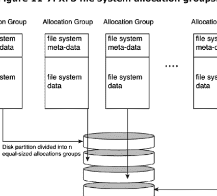

每个 AG 内的空闲空间和 inode 的管理方式使得多个进程可以同时在文件系统的全范围内分配空闲空间，从而减少在大型活跃文件系统中可能出现的瓶颈。

XFS 已合并到 kernel.org 源代码树的 2.4.25 版本中。

#### XFS 的内核配置支持

您可以通过配置菜单的“文件系统”部分通过启用以下选项来设置 XFS 选项：

```
XFS filesystem support (CONFIG_XFS_FS=y,m,n)
```

如果您想将 XFS 构建到内核中，请在 xfs 条目旁边点击 y。如果您想将 XFS 构建为模块，请在 xfs 条目旁边点击 m。

XFS 配置部分还提供了其他可用选项。如果您需要这些选项中的任何一个，请在那里进行选择。

#### 使用 XFS 文件系统

有两种方法可以调整 XFS 文件系统：

1. 在创建文件系统时进行，这是最有效的方式
2. 通过使用文件系统挂载时可用的选项进行

这两种调整选项在以下章节中讨论。

#### 创建 XFS 文件系统

创建 XFS 文件系统的程序名为 `xfs_mkfs`。也可以使用名称 `mkfs.xfs` 调用此程序。有关 `mkfs` 实用程序的所有选项列表，请参阅 `mkfs.xfs` man 页面。

下一个示例展示了如何使用一个备用分区（`/dev/hda1`）创建 XFS 文件系统。

要在 XFS 分区内部创建包含日志的 XFS 文件系统，请发出以下命令：

```
##### mkfs.xfs /dev/hda1
```

有一个选项可能会改变文件系统的特性，即 `-i size=xxx` 选项。默认的 inode 大小为 256 字节。inode 大小可以增加（最大为 4KB）。这样做意味着更多的目录将其内容保留在 inode 中，读写所需的磁盘 I/O 减少。然而，相反，inode 读取所需的 I/O 增加了；由于它们是成簇读写的，因此这不是一个简单的计算。由于如果空间允许，extent 也保存在 inode 中，因此具有 inode 外元数据的文件数量减少了。

另一个影响文件系统性能选项是日志大小：`-l size=xxx`。更大的日志意味着当有大量元数据活动时，在修改后的元数据刷新到磁盘之前会有更多的时间流逝。然而，更大的日志也会减慢恢复速度。

最后，对于非常大的文件系统，请尽可能保持 `agcount` 较低（通过 `-d agcount=` 选项指定）。分配组的大小最大可达 4GB；更多的分配组意味着在低空闲空间条件下需要扫描更多的组。分配组的大小还决定了文件中可以拥有的最大 extent 大小。

创建文件系统后，使用 `mount` 命令将其挂载。确定一个挂载点并创建一个新的空目录（例如 `/xfs`）来挂载文件系统：

```
##### mount -t xfs /dev/hda1 /xfs
```

挂载文件系统后，您可以尝试使用 XFS。

要卸载 XFS 文件系统，请使用与挂载点相同的参数使用 `umount` 命令：

```
##### umount /xfs
```

#### 文件系统满

当文件系统非常满/接近 99% 时，XFS 文件系统的分配速度会变慢。基本上，XFS 将文件系统组成分配组（每个 1 到 4 GB），并且在每个组中独立管理空闲空间。当系统必须扫描大量分配组以寻找扩展文件的空闲空间时，减速就会发生。内存中的摘要结构会告诉您是否值得在某个分配组中查找，因此除非发生大量并行操作，否则通常不会发生重大减速。

#### 使用外部日志提高 XFS 速度

外部日志可以提高性能，因为日志更新被保存在与其对应文件系统不同的分区中。

要在外部设备上创建包含日志的 XFS 文件系统，您的系统需要有两个未使用的分区。在下面的示例中，`/dev/hda1` 和 `/dev/hdb1` 是备用分区。`/dev/hda1` 分区用作外部日志。

```
##### mkfs.xfs -l logdev=/dev/hda1 /dev/hdb1
```

#### 挂载文件系统

要挂载文件系统，请使用以下 mount 命令：

```
##### mount -t xfs /dev/hdb1 /xfs
```

为避免每次系统启动时都要挂载文件系统，请将文件系统添加到 `/etc/fstab` 文件中。备份 `/etc/fstab` 并使用您喜欢的编辑器编辑它以添加 `/dev/hdb1` 设备。例如：

```
/dev/hdb1 /xfs xfs defaults 1 2
```

#### 挂载选项

在挂载时，有三个与 XFS 性能相关的选项：

- `osyncsada sync`。指示将 `O_SYNC` 视为 `O_DSYNC`，这是 Ext2 默认提供的行为。如果没有此选项，`O_SYNC` 文件 I/O 会为文件同步更多的元数据。
- `logbufsize=size`。设置保留在内存中的日志缓冲区数量。这意味着您可以同时拥有更多活动的交易，并且即使在日志同步到磁盘时仍可以执行元数据更改。其负面影响是，由于系统崩溃而可能丢失的元数据更改数量更多。有效值为 2 到 8。默认值对于使用 64KB 块大小创建的文件系统是八个缓冲区，对于使用 32KB 块大小创建的文件系统是四个缓冲区，对于使用 16KB 块大小创建的文件系统是三个缓冲区，对于其他块大小则是两个缓冲区。
- `logbsize=size`。设置保留在内存中的日志缓冲区的大小。

Linux 在读取文件时会记录 `atime`，即访问时间。然而，这些信息并不很有用，且追踪起来成本较高。要获得快速的性能提升，只需使用挂载选项 `noatime` 禁用访问时间更新。

### 调整 XFS

对于元数据密集型工作负载，默认日志大小可能是降低文件系统性能的限制因素。通过创建具有更大日志大小的文件系统可以获得更好的结果。以下 `mkfs` 命令创建 32768b 的日志大小：

```
### mkfs -t xfs -l size=32768b -f /dev/hdb1
```

目前，若要调整日志大小，您需要重新制作文件系统。

此外，最好使用以下选项挂载元数据密集型文件系统：

```
### mount -t xfs -o logbufs=8,logsize=32768b /dev/device /mntpoint
```

### XFS 实用程序

XFS 实用程序包含在两个软件包中：`xfsprogs` 和 `xfsdump`。`xfsprogs` 软件包包含以下实用程序：

- `xfs_growfs`。扩展 XFS 文件系统。
- `xfs_admin`。更改 XFS 文件系统的参数。
- `xfs_freeze`。挂起对 XFS 文件系统的访问。


*   `xfs_mkfile`。创建 XFS 文件，默认填充零。
*   `xfs_check`。检查 XFS 文件系统的一致性。
*   `xfs_bmap`。打印 XFS 文件的块映射。
*   `xfs_rtcp`。将文件复制到 XFS 文件系统上的实时分区。
*   `xfs_repair`。修复损坏或受损的 XFS 文件系统。
*   `xfs_db`。用于调试 XFS 文件系统。

### XFS 工具

- `xfs_logprint`：打印 XFS 文件系统的日志。
- `xfs_ncheck`：为 XFS 文件系统根据 inode 编号生成路径名。
- `mkfs.xfs`：构建 XFS 文件系统。

`xfsdump` 软件包包含以下实用工具：

- `xfsdump`：检查文件系统中的文件，确定哪些文件需要备份，并将这些文件复制到指定的磁盘、磁带或其他存储介质上。它使用 XFS 特定的指令来优化 XFS 文件系统的转储。它还知道如何备份 XFS 扩展属性。
- `xfsrestore`：执行 `xfsdump` 的逆功能；它可以恢复文件系统的完整备份。随后的增量备份可以叠加在完整备份之上。可以从完整或部分备份中恢复单个文件和目录子树。
- `xfsdq`, `xfsrq`：转储和恢复 XFS 配额。
- `xfs_estimate`：估算 XFS 文件系统所需的空间。
- `xfs_fsr`：重新组织 XFS 文件系统。
- `xfsinvutil`：检查并修剪 `xfsdump` 库存数据库。

以下是部分关键文件系统实用工具的描述：

- `xfs_db`：报告文件系统的整体碎片化程度。以下示例显示了文件系统 `/dev/hda9` 的整体碎片化情况：

```
### xfs_db -r /dev/hda9
xfs_db: frag
 actual 408, ideal 408, fragmentation factor 0.00%

 actual/ideal are number of extents, factor is like
 (actual - ideal) / ideal
```

- `xfs_bmap`：显示文件中的 extent（扩展）数量。以下示例显示了文件 `vmlinuz` 的 extent 数量：

```
### xfs_bmap vmlinuz
vmlinuz:
 0: [0..2295]: 96..2391
```

### 摘要

尽管有些人认为日志文件系统仅能提供快速的重启时间，但本章已经证明事实并非如此。日志文件系统具有可扩展性、可靠性和速度。无论您是运行企业服务器、集群超级计算机还是小型网站，Ext3、XFS、JFS 和 ReiserFS 都为 Linux 增加了可信度和性能提升。

开源的一大优点是选择权受到重视。Linux 是唯一拥有四种生产环境中可用的日志文件系统的操作系统。所有四种文件系统类型都拥有 GPL 许可证，源代码可在 `http://www.kernel.org` 或每个项目的首页上获取。每个日志文件系统团队都遵循社区模式，并欢迎用户和贡献者。实际上，这些团队分享彼此的最佳创意，竞争性的基准测试促使所有系统不断改进。

表 11-1 总结了四个 Linux 日志文件系统的特性和限制。第一部分提供了日志文件系统何时被接受进入 kernel.org 源代码树的一些历史背景。下一节列出了文件系统的部分特性。

#### 表 11-1. 日志文件系统比较

| 内核支持 | Ext3 | ReiserFS | XFS | JFS |
| :--- | :--- | :--- | :--- | :--- |
| 在 kernel.org 源代码树 2.4.x 中 | 2.4.15 | 2.4.1 | 2.4.25 | 2.4.20 |
| 在 kernel.org 源代码树 2.6.x 中 | 2.5.0 | 2.5.0 | 2.5.36 | 2.5.6 |
| 许可证 | GPL | GPL | GPL | GPL |
| 特性 | | | | |
| IA32 上支持的最大块大小 | 4KB | 4KB | 4KB | 4KB |
| 文件系统最大尺寸 | 16384GB | 17592GB | 18,000Pb | 4Pb |
| 最大文件尺寸 | 2048Gb | 1Eb* | 9,000Pb | 4Pb |
| 扩展文件系统大小 | 补丁 | 是 | 是 | 是 |
| 在线快照 | 是 | 是 | 是 | 是 |
| 访问控制列表 | 是 | 是 | 是 | 是 |
| 扩展属性 | 是 | 是 | 是 | 是 |
| 动态磁盘 inode 分配 | 否 | 是 | 是 | 是 |
| 数据日志记录 | 是 | 补丁 | 否 | 否 |
| 将日志放置在外部设备上 | 是 | 是 | 是 | 是 |

有关每个日志文件系统的完整特性列表，请参阅各自的项目网页。

由于 2.4 内核对单个块设备的限制为 2 TB，因此目前无法创建大于该大小的文件系统。此限制在 2.6 内核中已增加，上限已提高到 16 TB。

### 参考文献

- [1] Andrew Morton 的网页上有有关 Ext3 的信息。 `http://www.zipworld.com.au/~akpm/linux/ext3`.
- [2] `e2fsprogs` 软件包包含 Ext2/Ext3 文件系统的实用工具以及 `e2fsprogs` 的首页。 `http://e2fsprogs.sourceforge.net/`.
- [3] Card, R., T. Ts'o, and S. Tweedie. "Design and Implementation of the Second Extended Filesystem." `http://web.mit.edu/tytso/www/linux/ext2intro.html`.
- [4] 若要更深入地讨论 ReiserFS 的设计功能以及使用和 ReiserFS 的管理说明，请参阅 `http://www.namesys.com`.
- [5] 若要更深入地讨论 JFS 的设计功能以及在 Linux 上使用和管理 JFS 的说明，请参阅 `http://oss.software.ibm.com/jfs`.
- [6] 若要更深入地讨论 XFS Linux 的设计功能以及使用和管理 XFS 文件系统的说明，请参阅 `http://oss.sgi.com/projects/xfs`.

## 第十二章. 网络调优

作者 Nivedita Singhvi

### 引言

Linux 内核提供了一大组内核变量，可以通过调整这些变量来配置系统，以实现功能性和最佳性能。此外，内核向用户提供有关系统的大量信息。利用这些信息来确保系统的健康状况并检测配置和网络中的问题，是关键的绩效任务。

应用程序运行的主要网络环境是 TCP/IP（传输控制协议/互联网协议）网络协议栈，目前 IP 版本 4 是标准。Linux 被广泛用作托管网络基础设施服务的平台，例如 Web 服务器、邮件服务器和域名系统（DNS）服务器，这使得网络性能成为系统管理员的重要考虑因素。

尽管本章涵盖了网络调优中更重要的变量，但这绝非详尽无遗。内核源代码树中 Documentation 目录中提供的文档以及系统 man 页面可以提供更多信息。除非另有说明，此处提供的信息适用于 2.4 到 2.6 Linux 内核版本。

让我们通过检查网络协议栈来开始。

### 网络协议栈

为了理解网络调优的必要性，了解操作系统如何从应用程序获取数据并将其发送到远程主机，以及反向过程——即它如何从网络上的远程主机接收数据并将其交付给本地应用程序——会有所帮助。

处理网络操作的操作系统的各个部分相当模块化，不同的层处理清晰分离的功能，由各种协议实现。从应用程序接口到设备接口的各层集合被称为 *协议栈*。 *TCP/IP 协议族* 是最常用的协议套件。它与套接字层和设备驱动程序一起，构成了典型的网络协议栈。

套接字抽象层是应用程序的通用内核接口。为了与远程（或本地）主机打开通信通道，应用程序创建一个套接字，其中包含其他基础设施，以及用于保存应用程序读写的数据的缓冲区。

传输层提供两种不同的协议：`TCP`（传输控制协议）和 `UDP`（用户数据报协议），它们分别提供可靠的、面向连接的以及不可靠的、无连接的流量类型。对于 TCP 套接字，TCP 协议将应用程序写入套接字的数据打包成段，可靠地发送到另一端，重传丢失的数据，并控制数据流以最小化网络拥塞。

然后，传输层将分段的数据传递给 IP 层，该层实现了典型的网络层功能，例如成功地将数据包路由到端点。IP 将数据包交给网络设备驱动程序，后者确保数据被传输到硬件。每一层都用自己的头部封装数据，其中包含特定于协议的信息。

在反向方向上，当通过网络接收到帧时，网卡向内核生成中断，然后内核调用中断处理程序将数据包从网卡传输到内核内存，并调度该数据包由网络栈处理。传入的数据包在特定于设备的队列中排队，以便交付给网络层。如果数据包在每个阶段都成功通过验证，IP 将应用程序的数据包交付给 TCP 层，TCP 层将其放入正确的套接字读缓冲区。

### 内核参数调优机制


访问内核可调节变量主要有两个接口：`sysctl` 命令行工具和 `/proc` 文件系统。有关如何使用这些机制的说明，请参阅附录 A。

本章主要讨论核心网络变量，以及特定于 TCP/IPv4 的内核变量。`sysctl` 参数位于 `sysctl.net.core` 和 `sysctl.net.ipv4` 类别中，其对应的 `/proc` 条目（遵循相同的层次结构）位于 `/proc/sys/net/core` 和 `/proc/sys/net/ipv4` 子目录中。

以下讨论列出了 `sysctl` 参数名称及其在 `/proc` 文件系统中的条目。某些参数仅在内核编译时包含特定功能时才存在于内核中。例如，如果内核未编译 TCP syncookie 支持，则内核参数 `tcp_syncookies` 将不存在。

调优内核参数时应始终谨慎，因为它们通常会影响整个系统，而不仅仅是单个套接字或网络连接。

### 内核自动调优

内核在启动时根据系统中的资源（如内存量）初始化某些变量。通常，这种初始调整就足够了。内核还会动态调优某些变量，例如正在使用的套接字缓冲区大小。这减少了用户为获得最佳性能而手动跟踪和调整内核变量的需求。然而，在某些情况下，这种动态调优是不够的，适当或改进的性能需要对内核参数进行手动调优。

### 核心内核参数说明

本节介绍内核套接字缓冲区，并涵盖一些更常用的核心内核参数。调整内核套接字缓冲区的大小可能是提高性能最有效的方法之一，本节中描述的大多数核心参数都以某种方式操作它们。

#### 套接字缓冲区简介

应用程序使用 `socket()` 系统调用创建通信端点。每个套接字都有一个关联的读取和写入缓冲区（分别也称为接收缓冲区和发送缓冲区）。

接收套接字缓冲区保存由远程主机发送到该套接字的数据。应用程序在执行 `read()` 系统调用（或变体，如 `recvfrom()`）时检索这些数据。如果此缓冲区已满，则为此套接字接收到的任何更多传入数据都将被丢弃。

写入套接字缓冲区保存在应用程序发送到远程主机之前写入套接字的数据。如果缓冲区空间不足，应用程序的 `write()` 系统调用（或变体，如 `sendto()`）将阻塞，直到内核为所有数据腾出空间。如果应用程序选择不阻塞，内核将向应用程序返回一个错误，指示此时无法吸收该数量的数据，并建议重试写入。

#### 默认套接字缓冲区大小

- `net.core.wmem_default` (`/proc/sys/net/core/wmem_default`)

- `net.core.rmem_default` (`/proc/sys/net/core/rmem_default`)

这两个参数分别是与每个套接字关联的读取和写入套接字缓冲区的全球默认大小。它们用于初始化所有类型套接字的大小。对于 TCP 套接字，这些值随后会被 TCP 协议特定的读取和写入缓冲区大小默认值覆盖（`tcp_rmem` 和 `tcp_wmem`，将在稍后的 TCP/IPv4 协议内核参数列表中描述）。

单个应用程序可以通过执行 `setsockopt()` 调用来调整套接字缓冲区的大小，级别为 `SOCKET`，选项分别为发送和接收缓冲区的 `SO_SNDBUF` 和 `SO_RCVBUF`。

承受重度网络负载的系统受益于增加这些变量。内核在启动时根据系统中的可用内存调整这些参数的初始值，如表 12-1 所示。

**表 12-1. 核心套接字缓冲区大小**

| 内存 | <= 4 KB | <= 128 KB | > 128 KB |

| :--- | :--- | :--- | :--- |

| `rmem_default` | 32 KB | 64 KB | 64 KB |

| `wmem_default` | 32 KB | 64 KB | 64 KB |

| `wmem_max` | 32 KB | 64 KB | 128 KB |

| `rmem_max` | 32 KB | 64 KB | 128 KB |

#### 最大套接字缓冲区大小

- `net.core.rmem_max` (`/proc/sys/net/core/rmem_max`)

- `net.core.wmem_max` (`/proc/sys/net/core/wmem_max`)

这些 `sysctl` 变量分别是读取和写入套接字缓冲区可以被设置的最大大小。它们的值在系统启动时根据系统中可用的内存调整到**表 12-1**中显示的值。

**表 12-1**中的所有值均以字节为单位。

#### netdev_max_backlog

- `net.core.netdev_max_backlog` (`/proc/sys/net/core/netdev_max_backlog`)

此参数设置将排入队列等待交付到设备队列的传入数据包的最大数量。默认值为 300，对于重度网络负载通常太小。增加此值允许更大的数据包存储队列，并减少丢弃的数据包数量。特别是在长延迟网络上，丢弃的数据包会导致吞吐量显著降低。

#### somaxconn

- `net.core.somaxconn` (`/proc/sys/net/core/somaxconn`)

这是通过 `listen()` 系统调用可以指定的最大接受队列积压，或者是待处理连接请求的数量。当排入队列的传入连接请求数量达到此值时，进一步的连接请求将被丢弃。增加此值允许繁忙的服务器指定更大的请求积压。默认最大值为 128。

#### optmem_max

- `optmem_max` (`/proc/sys/net/core/optmem_max`)

此变量是套接字缓冲区的最大初始化大小，以字节表示。

### TCP/IPv4 协议内核参数

本节涵盖一些更有用的 IPv4 参数。IPv4 类别包括协议特定的参数。我们在这里特别关注 TCP 协议参数。当创建套接字时，会指定协议和地址族。对于 TCP 套接字，地址族是 `AF_INET`，类型是 `SOCK_STREAM`。对于 UDP 协议套接字，地址族是 `AF_INET`，但类型是 `SOCK_DGRAM`。TCP 套接字缓冲区大小由其自身参数控制，而不是核心内核缓冲区大小参数。

#### TCP 缓冲区和内存管理

##### tcp_rmem

- `net.ipv4.tcp_rmem` (`/proc/sys/net/ipv4/tcp_rmem`)

此变量是一个由三个整数组成的数组：

- `net.ipv4.tcp_rmem[0]` = 读取缓冲区的最小大小

- `net.ipv4.tcp_rmem[1]` = 读取缓冲区的默认大小

- `net.ipv4.tcp_rmem[2]` = 读取缓冲区的最大大小

当创建套接字时，读取缓冲区（以字节为单位）的初始大小由核心默认套接字大小控制。但是，如果是 TCP 协议套接字（类型 = `AF_INET SOCK_STREAM`），读取缓冲区大小将设置为 TCP 协议特定的默认值，即此数组的第二个整数。要增加 TCP 读取缓冲区的初始大小，需要增加此变量。请注意，其可以取的最大值仍受核心套接字最大大小的限制，因此此值不能大于 `net.core.rmem_max`。

TCP 读取缓冲区大小的最小和最大限制（`tcp_rmem` 数组中的第一个和第三个整数）由内核在动态调优缓冲区大小时使用。此参数的默认值如表 12-2 所示。

**表 12-2. 默认 TCP 套接字读取缓冲区大小**

| 缓冲区内存状态 | 最小<br>`net.ipv4.tcp_rmem[0]` | 默认<br>`net.ipv4.tcp_rmem[1]` | 最大<br>`net.ipv4.tcp_rmem[2]` |

| :--- | :--- | :--- | :--- |

| 低内存 | `PAGE_SIZE` | 43689 | 43689*2 |

| 正常 | 4 KB | 87380 | 87380*2 |

##### tcp_wmem

- `net.ipv4.tcp_wmem` (`/proc/sys/net/ipv4/tcp_wmem`)

与读取缓冲区一样，TCP 套接字写入缓冲区也是一个由三个整数组成的数组：

- `net.ipv4.tcp_wmem[0]` = 写入缓冲区的最小大小

- `net.ipv4.tcp_wmem[1]` = 写入缓冲区的默认大小

- `net.ipv4.tcp_wmem[2]` = 写入缓冲区的最大大小

与 TCP 读取缓冲区一样，TCP 写入缓冲区由前面列出的 TCP 协议特定参数控制。拥有大的写入缓冲区是有益的，因为它允许应用程序将大量数据传输到写入缓冲区而不阻塞。默认 TCP 套接字写入缓冲区大小如表 12-3 所示。

**表 12-3. 默认 TCP 套接字写入缓冲区大小**

| 缓冲区内存状态 | 最小<br>`net.ipv4.tcp_wmem[0]` | 默认<br>`net.ipv4.tcp_wmem[1]` | 最大<br>`net.ipv4.tcp_wmem[2]` |

| :--- | :--- | :--- | :--- |

| 低内存 | 4 KB | 16 KB | 64 KB |

| 正常 | 4 KB | 16 KB | 128 KB |


TCP 是一种“窗口化”传输协议。接收方通告的窗口大小——换言之，即接收方声称其能够处理的数据量——被发送方用来确定可以发送多少数据。接收套接字缓冲区越大，TCP 通告的窗口就越大，发送方发送数据的速度也越快。

仅通过增加这些值，就可以获得显著的性能提升。请注意，内核会尝试将提供的值取整到最近的近似段大小的倍数。

表 12-4 展示了大型网络应用程序中这些参数的一些典型设置值。

**表 12-4. 增大 TCP 套接字缓冲区大小的示例**

| 缓冲区参数 | 最小值 `net.ipv4.tcp_wmem[0]` | 默认值 `net.ipv4.tcp_wmem[1]` | 最大值 `net.ipv4.tcp_wmem[2]` |
| :--- | :--- | :--- | :--- |
| TCP 写缓冲区 | 8K | 436600 | 873200 |
| TCP 读缓冲区 | 32K | 436600 | 873200 |

### tcp_mem

`net.ipv4.tcp_mem` (`/proc/sys/net/ipv4/tcp_mem`)

此内核参数同样是一个由三个整数组成的数组，用于通过定义内存管理区域的边界来控制内存管理行为：

- `net.ipv4.tcp_mem[0]` = TCP 认为自身未处于内存压力之下时的页数
- `net.ipv4.tcp_mem[1]` = TCP 进入内存压力区域的页数
- `net.ipv4.tcp_mem[2]` = TCP 拒绝进一步套接字分配（某些例外情况除外）的页数

术语 *pages* 指的是系统中全局分配给套接字的以页为单位的内存量。Linux 内核维护着在任何给定时间可分配内存的限制。因此，即使系统仍有可用内存，在打开套接字时也可能发生内存分配失败。

对于需要支持繁忙工作负载的系统，增加 `tcp_mem` 参数有利于性能提升。例如，以下是针对大型网络负载可以设置的一些值：

```
net.ipv4.tcp_mem = 1000000 1001024 1002048
```

进行此项更改时应谨慎，因为它伴随着权衡。每个套接字缓冲区会消耗大量内存，这限制了可用于系统其他活动的内存量。

### TCP 选项

以下章节介绍了系统管理员最可能用到的 TCP 选项。

#### tcp_window_scaling

`net.ipv4.tcp_window_scaling` (`/proc/sys/net/ipv4/tcp_window_scaling`)

此内核变量启用 TCP 窗口缩放功能。默认情况下它是开启的。窗口缩放实现了 RFC1323。若要使用大于 64K 的 TCP 窗口大小，必须使用窗口缩放选项。由于 TCP 协议头部中用于通告接收缓冲区的长度字段由 16 位指定，因此窗口大小不能大于 64K。

窗口缩放允许通告大于 64K 的缓冲区，从而使发送方能够填满带宽时延积大于 64K 的网络管道。特别是对于卫星链路连接和往返时间较长的网络，使用大窗口（大于 64K）可带来显著的性能提升。

为了获得最佳吞吐量，需要保持窗口至少与网络的带宽时延积一样大。如果该量大于 64K，窗口缩放可能会提供更高的吞吐量，但这是在创建和处理 TCP 选项的开销与可以在传输中无延迟发送的更大数据量之间做出的权衡。

需要注意的是，即使关闭了窗口缩放，大于 64K 的套接字缓冲区仍然可能有益。虽然内核不允许多于该限制的窗口大小进行通告或允许，但更大的缓冲区使内核能够每次通过一个 `write()` 调用从应用程序吸收更多数据，从而更早返回。

当应用程序在常规阻塞模式下执行 `write()` 操作时，它们必须等待 `write()` 系统调用完成。拥有一个足够大的缓冲区在核心中暂存数据，可以让它立即返回。如果缓冲区不够大，应用程序就必须等待发送缓冲区被充分排空以吸收来自 write 的所有数据，这通常包括数据被发送到目的地以及发送方收到确认，从而释放空间。当发送缓冲区被设置为非常小的值时，在此情况下测得的吞吐量更能准确反映数据实际跨网络传输到目的地的速度。

#### tcp_sack

`net.ipv4.tcp_sack` (`/proc/sys/net/ipv4/tcp_sack`)

此变量启用 TCP 选择性确认（SACK）功能。SACK 是一种用于拥塞控制的 TCP 选项，允许接收方将关于字节流中缺失序列号的信息传达给发送方。这减少了在发生段丢失时发送方需要重传的段数，同时也减少了可能经历的延迟，从而提高整体吞吐量。

当数据丢失频繁且往返时间较长时，预计 SACK 会带来好处。在往返时间非常短且数据丢失可忽略不计的高速本地网络等环境中，关闭 SACK 实际上可以提升性能。这是为了避免处理 SACK 选项的开销。

#### tcp_dsack

`net.ipv4.tcp_dsack` (`/proc/sys/net/ipv4/tcp_dsack`)

此变量启用 TCP D-SACK 功能，这是对 SACK 的增强，用于检测不必要的重传。它默认启用，如果禁用 SACK，则应禁用此功能。

#### tcp_fack

`net.ipv4.tcp_fack` (`/proc/sys/net/ipv4/tcp_fack`)

此变量启用 TCP 前向确认（FACK）功能。FACK 是对 SACK 协议的改进，旨在增强 TCP 的拥塞控制。如果禁用了 SACK，也应禁用此功能。

### TCP 连接管理

TCP 是一种面向连接的协议。以下描述了有助于内核管理其与远程主机连接的一些参数。调整这些参数可能会影响其能够同时支持连接的数量，这对于繁忙的服务器来说是一个重要的考量因素。

#### tcp_max_syn_backlog

`net.ipv4.tcp_max_syn_backlog` (`/proc/sys/net/ipv4/tcp_max_syn_backlog`)

此变量控制每个端口的 TCP Syn 队列长度。传入的连接请求（SYN 段）会被排队，直到被本地服务器接受。如果连接请求的数量超过此变量指定的数量，该连接请求将被丢弃。如果客户端在连接繁忙服务器时遇到失败，可以增加此值。

#### tcp_synack_retries

`net.ipv4.tcp_synack_retries` (`/proc/sys/net/ipv4/tcp_synack_retries`)

此变量控制内核尝试重发对传入 SYN/ACK 段响应的次数。减少此数量可以更早地检测到来自远程主机的连接尝试失败。

#### tcp_retries2

`net.ipv4.tcp_retries2` (`/proc/sys/net/ipv4/tcp_retries2`)

此变量控制内核向已建立连接的远程主机重发数据的次数。减少此数量可以更早地检测到到远程主机的连接失败。这使得繁忙的服务器能够快速释放与失败连接绑定的资源，并更容易支持更多数量的同时连接。默认值为 15，由于 TCP 在每次尝试前都会进行指数退避重试，因此通常需要相当长的时间才会放弃一个已建立的连接。例如，将值降低到 5，会导致对未确认数据进行五次重传尝试。

### TCP Keep-Alive 管理

一旦连接建立，TCP 协议并未规定必须交换数据。连接可以永久保持空闲。在这种情况下，如果一台主机故障或变得不可用，剩余的主机无法检测到这一情况。Keep-Alive 机制允许主机监控连接并在合理的时间内知晓此类故障。本节描述了与 TCP Keep-Alive 机制相关的全局内核参数。应用程序需要使用 `setsockopt()` 系统调用启用 TCP Keep-Alive 选项，才能利用内核机制。

#### tcp_keepalive_time

`net.ipv4.tcp_keepalive_time` (`/proc/sys/net/ipv4/tcp_keepalive_time`)

如果连接空闲的时间达到此参数指定的秒数，内核将开始对远程主机的连接进行探测。

#### tcp_keepalive_intvl

`net.ipv4.tcp_keepalive_intvl` (`/proc/sys/net/ipv4/tcp_keepalive_intvl`)

此参数指定内核向远程主机发送保持存活（keepalive）探测包之间的时间间隔，单位为秒。

#### tcp_keepalive_probes

`net.ipv4.tcp_keepalive_probes` (`/proc/sys/net/ipv4/tcp_keepalive_probes`)

此参数指定内核向远程主机发送的最大保持存活探测次数，以检测主机是否仍然存活。如果内核发送了该数量的探测包而未收到响应，内核将判定远程主机不再可用，并关闭连接，释放与该连接相关的所有本地资源。

默认值如下：

```
tcp_keepalive_time = 7200 秒 (2 小时)
tcp_keepalive_probes = 9
tcp_keepalive_intvl = 75 秒
```

这些设置会导致连接在大约两小时十一分钟的闲置时间后被断开。如此大的值通常用于适应互联网上的大延迟和往返时间。


为了更早地发现已失效的远程主机，降低上述参数可能是可取的。这可以最小化被僵死连接占用的资源（如内存和端口空间）。

### IP 端口空间范围

#### `ip_local_port_range`

`sysctl.net.ipv4.ip_local_port_range` (`/proc/sys/net/ipv4/ip_local_port_range`)

此参数指定系统可用的临时端口（ephemeral ports）范围。端口是 IP 协议使用的一种逻辑抽象，作为一种地址来区分不同的套接字，它实际上只是一个整数序列空间。当应用程序主动连接到远程端点时，通常会要求内核动态分配一个临时端口，即下一个可用的空闲端口，而不是知名端口。这些端口对于每种协议（TCP 和 UDP）都是唯一的。默认值在启动时根据系统中的内存进行配置。对于内存大于 128KB 的系统，设置为 `32768` 到 `61000`。因此，最多可以同时使用 28,232 个端口。增加此范围允许每种协议（TCP 和 UDP）建立更多数量的同时连接。

### 摘要

监控和调整内核对于网络性能来说是重要任务。本章描述了某些重要的内核可调变量以及它们如何影响系统性能。这些变量通过 `sysctl (8)` 接口或 `/proc` 接口对用户可见。性能优化的最关键方式之一是将套接字缓冲区大小设置为适合预期工作负载和环境的最佳值。我们讨论了一些影响队列长度的核心网络变量，并描述了一些常被调整的 TCP 协议参数。

### 参考文献

- [1] Documentation/networking/ip_sysctls.txt
- [2] man (7) tcp
- [3] man (7) udp
- [4] man (7) socket
- [5] man (7) ip
- [6] man (8) sysctl
- [7] man (8) netstat
- [8] man (5) proc
- [9] Stevens, W. Richard, *TCP/IP Illustrated, Volume 1*, Addison-Wesley, 1994.

# 第十三章：进程间通信

作者：Mingming Cao

## 引言

本章讨论 Linux 中的进程间通信（IPC）。进程间通信是 Linux 中多个进程相互通信的一种方式。首先，定义了进程间通信及其使用的资源。随后章节讨论了如何使用 `ipcs` 命令了解系统上的 IPC 资源。接下来，讨论了可用于不同 IPC 资源的各种参数。然后章节说明了如何静态和动态地修改 IPC 参数。最后，讨论了管道作为 Linux 中 IPC 设施的作用。

## 什么是进程间通信？

进程间通信允许进程相互同步并交换数据。通常，System V（SysV）IPC 设施提供三种类型的资源：

- `信号量（Semaphores）`。允许进程与其他进程同步，并在多个进程共享资源时防止冲突。
- `消息队列（Message queues）`。在进程之间异步传递小数据，例如消息。
- `共享内存段（Shared memory segments）`。通过让多个进程共享一个公共的内存段，提供一种快速的方式共享相对大量的数据。

除了这些资源外，IPC 管道和 FIFO 是 UNIX 系统中常用的 IPC 设施：

- `管道（Pipes）` 是单向的先进先出数据通道，用于在相关进程之间传递非结构化数据流。
- `FIFO`（也称为命名管道）是具有持久名称的管道。

下一节将介绍进程间通信资源以及返回这些资源信息的命令。

## Linux SysV IPC 资源与 ipcs 命令

Linux 支持三种类型的 SysV IPC 资源。Linux 内核的默认配置通常启用 SysV IPC 支持。如果你的 Linux 内核不支持 SysV IPC，你需要配置内核源文件，将 `CONFIG_SYSVIPC` 设置为启用 SysV IPC 设施。更改配置后，你需要重新编译内核。

SysV IPC 设施在 various Linux 应用程序中广泛使用。例如，一些数据库应用程序创建共享内存段以进行数据共享。每当请求新的 IPC 资源时，Linux 内核都会动态地为 IPC 对象分配内存。然而，由于内核为这些 IPC 资源消耗的内存量，内核对 IPC 资源的使用施加了限制。其中一些限制可以动态调整。在调整参数以满足你的 IPC 资源需求时，重要的是要考虑资源消耗的内存使用情况。

另一方面，管道对于 UNIX 系统操作如此基础，它们始终存在于内核中——它们不能被配置进或排除出内核。通常，管道在 shell 命令中用于将一个进程的输出导向另一个进程。例如：

```
bash> ls lsR | grep linux
```

管道与 SysV IPC 的区别在于，它们要求进程是相关的。管道成对创建——第一个元素用于读取，第二个元素用于写入。在 fork 期间，管道可以在父进程和各种子进程之间传递，因此随后可用于这些相关进程之间的通信。

FIFO（命名管道）使用 `mkfifo filename` 命令作为文件系统中的特殊文件创建。

### ipcs 命令

几乎所有 Linux 发行版都包含 `ipcs` 命令，该命令提供关于当前系统上加载的 IPC 资源的信息。`ipcs` 允许你确定系统允许当前的 IPC 限制，并检查当前系统中正在使用的三种 IPC 资源的状态。例如，如果你的应用程序无法启动，你可以检查系统上的 IPC 使用情况，以确定是否超过了某个 IPC 限制。要以 root 身份确定系统 IPC 资源的状态，请带有 `i` 选项发出 `ipcs` 命令：

```
### ipcs -u
```

```
------ Shared Memory Status ---------
```

```
segments allocated 32
pages allocated 2361
pages resident  253
pages swapped   982
Swap performance: 0 attempts      0 successes

------ Semaphore Status ---------
used arrays = 128
allocated semaphores = 256

------ Messages: Status ---------
allocated queues = 0
used headers = 0
used space = 0 bytes
```

要确定 `ipcs -u` 命令报告的 IPC 资源限制，请使用 `ipcs -l` 命令：

```
### ipcs -l
```

```
------ Shared Memory Limits ---------
max number of segments = 4096
max seg size (kbytes) = 32768
max total shared memory (kbytes) = 8388608
min seg size (bytes) = 1

------ Semaphore Limits ---------
max number of arrays = 128
max semaphores per array = 250
max semaphores system wide = 32000
max ops per semop call = 32
semaphore max value = 32767

------ Messages: Limits ---------
max queues system wide = 16
max size of message (bytes) = 8192
default max size of queue (bytes) = 16384
```

此输出显示系统已达到最大信号量数组数（或信号量集）的限制。可以通过增加内核参数 `semni` 的值来解决此限制，该参数定义了系统可以拥有的信号量集总数。Linux 支持动态调整大多数内核 IPC 参数，同时也支持静态修改。

### IPC 标识符及其限制

在 Linux 内核中，每个 IPC 资源都以 IPC 标识符或 IPC 对象的数据结构形式进行描述。IPC 机制基于该数据结构及其相关操作实现。Linux 内核包含一组系统调用，用于创建和操作 IPC 标识符和对象。

IPC 标识符通过其类型（即信号量、消息队列或共享内存）的唯一键来识别。每种 IPC 资源类型都通过其对应的“创建”系统调用来创建：信号量使用 `semget( )`，消息队列使用 `msgget( )`，共享内存使用 `shmget( )`。这些“get( )”系统调用为调用者返回一个唯一的 IPC ID。应用获取 ID 后，可以通过该 ID 引用 IPC 对象，并通过相应的“控制”系统调用来控制 IPC 标识符：信号量使用 `semctl( )`，消息队列使用 `msgctl( )`，共享内存使用 `shmctl( )`。


此外，Linux 内核中的 IPC 机制提供系统调用，允许应用操作 IPC 资源：`semop()` 增加或减少信号量值，`msgsnd()` 和 `msgrcv()` 通过消息队列在进程之间发送和接收消息，而 `shmget()` 和 `shmctl()` 用于共享内存操作，允许进程附加或分离到/from 共享内存段。

每个 IPC 标识符的类型均为 `struct ipc_ids`，大小为 44 字节。每种 IPC 资源类型都包含一个数组，用于存储指向标识符的指针。全局数组的总条目数由对应 IPC 资源类型的标识符最大数量（`semmni`、`msgmni` 或 `shmmin`）决定。你可以通过调整相关内核参数来调整数组大小。然而，这些参数存在上限：`IPCMNI`。`IPCMNI` 定义了每种 IPC 资源类型在全系统中的最大 IPC 标识符数量。当 Linux 内核尝试根据 `semmni`（信号量标识符的最大数量）的新值调整信号量标识符数组的大小时，它还会检查新大小是否超过 `IPCMNI` 限制。`IPCMNI` 的默认值为 32767，且该参数无法在运行时调整。`IPCMNI` 参数适用于所有三种 IPC 资源。

### 信号量参数

信号量是一个计数器及其相关操作。信号量为多个进程访问共享资源提供了同步方式。信号量可以用作简单的信号来同步进程，或作为锁来防止共享资源上的冲突。

Linux 包含多个与信号量相关的内核参数。这些参数基于 32 位 Intel 系统，汇总在 *表 13-1* 中。

#### 表 13-1. 与信号量相关的内核参数

| 名称 | 描述 | 默认值 | 最大值 |
| :--- | :--- | :--- | :--- |
| semmni | 最大信号量集数量 | 128 | 2GB |
| semmsl | 每个信号量集中的最大信号量数 | 250 | 65536 |
| semmns | 全系统最大信号量总数 | 32000 | 2GB |
| semopm | 每次 semop 系统调用的最大操作数 | 32 | 2GB |
| semvmx | 最大信号量值 | 32767 | 65536 |

Linux 还定义了其他当前未使用的信号量相关参数。

以下章节详细考察与信号量相关的参数。

#### semmni

`semmni` 设置系统所能拥有的信号量集的总数。在初始化时，内核创建一个包含默认 `semmni` 个指针的数组，每个指针指向一个信号量标识符结构。当用户调整此参数时，内核会相应地调整信号量 ID 数组的大小（最多为 `IPCMNI`）。请注意，2GB 最大值的硬性限制源自内核参数的数据类型（int）。理论上，系统中最多可以有 2GB 个信号量集。然而，在 Linux 内核中，每个信号量标识符需要 44 字节内核内存用于 IPC 标识符结构，每个信号量集结构额外需要 68 字节。因此，2GB 个信号量标识符至少需要 (44+68)*2G=224GB 的内核内存。建议的最大值为 32767。

#### semmns

`semmns` 决定全系统允许的最大信号量总数。因为 `semmni` 是所有可能的信号量集的最大数量，而 `semmsl` 是每个集中允许的最大信号量数，所以总的最大信号量数不应超过 `semmni` 和 `semmsl` 的乘积。默认情况下，`semmns` 等于 `semmni`*`semmsl`，但不会自动计算。

#### semmsl

`semmsl` 是一个信号量集中允许的最大信号量数。默认值为 250。65536 的限制来自数据类型，无符号短整型。在实践中，为了减少内核内存分配失败的可能性，不应将 `semmsl` 设置为上限。信号量集中的信号量数量越高，保存撤销操作所需的内核内存就越多。我们建议将 `semmsl` 设置为 8000 以减少内存压力。

#### semopm

`semopm` 定义单次 `semop()` 调用可以对一个信号量集执行多少操作。`semop()` 调用会将操作数组大小与此限制进行检查。我们建议将 `semopm` 设置为 8000。

#### semvmx

`semvmx` 设置信号量的最大值。由于其数据类型（无符号短整型），`semvmx` 的硬性限制为 65536。`semvmx` 不能像其他四个参数那样动态更改；我们建议你保持其默认值 32767 不变。

### Linux 中未使用的信号量参数

本节讨论在 Linux 中定义但在其 IPC 实现中当前未使用的信号量相关参数。可以在其他类 UNIX 操作系统（如 HP/UX 或 Solaris）中找到这些参数的使用。值得一提的是，Linux 中定义了其他信号量相关参数，但当前未使用。`/usr/include/linux/sem.h` 文件定义了以下未使用的参数：

- `semume`：每个进程的最大撤销操作数。信号量撤销操作目前在 Linux 内核中已实现，但没有对每个进程能执行多少撤销操作进行限制。`semume` 的默认值等于 `semopm`（32）。
- `semnmul`：全系统最大撤销操作数。与 `semume` 一样，Linux 没有限制总共可以执行多少次信号量撤销操作。`semnmul` 的默认值相当于 `semmni` 的默认值（128）。
- `semaem`：当关联进程终止时，信号量可调整的最大计数。默认值为 `semmvx` >>=1（8192）。
- `semmap`：信号量映射表的最大条目数。某些操作系统为信号量标识符的内存段的分配和释放预分配内存，但当前的 Linux 实现不支持此功能。默认值为 `semmni`（32000）。
- `semuse`：定义信号量撤销结构的大小。其值为 20 字节。

### 消息队列参数

消息队列为进程间传递消息提供异步方式。在通过调用 `msgget()` 建立消息队列后，发送进程和接收进程可以通过消息队列交换消息。发送进程将消息发送到指定的消息队列，而接收者试图从指定的消息队列中获取消息。如果消息队列上没有可用消息，接收者会被阻塞或根据是否愿意等待而带某些标志返回。

表 13-2 提供了当前 Linux 2.4/2.6 实现中存在的三个消息队列内核参数的简要描述。

#### 表 13-2. 与消息队列相关的内核参数

| 名称 | 描述 | 默认值 | 最大值 |
| :--- | :--- | :--- | :--- |
| `msgmni` | 最大消息队列数 | 16 | 2GB |
| `msgmax` | 最大消息大小（字节） | 8192 | 2GB |
| `msgmnb` | 单个消息队列上的最大字节数 | 16384 | 2GB |

请注意，第四列中列出的最大值是基于数据类型的值。这三个内核参数的类型为 `int`，因此在 32 位 Intel 机器上，硬性限制为 2GB。

Linux 还定义了其他当前未使用的消息队列相关参数。

以下章节详细考察与消息队列相关的参数。

#### msgmni

`msgmni` 定义全系统的消息队列限制。与信号量一样，消息队列具有关联的标识符。在系统初始化时，内核创建指向消息队列标识符结构的指针数组。该数组中的条目数量由 `msgmni` 决定。对于每个消息队列，Linux 内核为标识符分配 44 字节，为消息队列结构分配 96 字节。你可以动态增加 `msgmni` 以获取更多消息队列资源。与信号量类似，消息队列标识符的最大数量受 `IPCMNI` 限制。默认限制为 16，这可能不足以让一些大型数据库应用程序顺畅运行。如果你知道系统将运行数据库应用程序，我们建议将默认限制设置为尽可能高的 128。

#### msgmax

`msgmax` 限制进程可以发送的消息大小。`msgsnd()` 函数强制实施此限制。如果要发送的消息超过此限制，则返回错误。此参数可以在运行时进行调优。

#### msgmnb

`msgmnb` 确定消息队列的容量。`msgmnb` 的值保存在消息队列标识符结构的一个字段中，并用于确定是否有空间入队新消息。默认值为 16384。该值可以动态修改。修改 `msgmnb` 的值会影响所有新消息队列的容量。`msgctl()` 系统调用允许用户增加现有消息队列的容量。

#### 未使用的消息队列参数

Linux 中预定义了另外五个与消息队列相关的参数，但尚未使用：

- `msgpool`。消息池的最大大小（以千字节为单位）。默认值设置为 `msgmni*msgmnb/1024`。
- `msgtql`。系统范围内消息头的最大数量。Linux 内核通过将消息头附加到从发送进程获取的消息主体来构建消息，然后将其存储在相应的消息队列中。基本上，这反映了系统允许的消息总数。目前，在 2.4/2.6 内核中，此参数定义为默认值 `msgmnb`，但 Linux 2.6 内核在新消息需要发送时不会检查此限制。
- `msgmap`。定义消息队列映射中的条目数量，类似于信号量的 `semmap` 参数。其他类 UNIX 操作系统的 IPC 设施使用资源分配映射来提供管理小块内核内存的便捷方法（在资源频繁分配和释放的情况下）。这不是 Linux 内核当前实现的方法，但 Linux 内核保留此参数以供将来使用。`msgmap` 的默认值为 `msgmni`（16）。


- `msgssz`。消息段的大小。默认为 16。

- `msgseq`。系统范围内段的最大数量。Linux 目前不检查此限制。

### 共享内存段参数

共享内存提供了在进程之间高效共享大量数据的方式。共享内存是 IPC 设施提供的最重要的资源之一，因为它在许多数据库应用程序中被大量使用。SysV 共享内存段由 `shget()` 系统调用创建。创建共享内存段后，进程可以通过发出 `shmatt()` 系统调用将自己附加到共享内存段。然后，进程可以对其执行操作（读取或写入）。进程可以通过 `shmdet()` 系统调用从内存段中分离自身。由于共享内存为多个进程提供公共资源，因此通常与信号量一起使用以防止冲突。

*表 13-3* 总结了共享内存段参数。

**表 13-3. 共享内存段参数**

| 名称 | 描述 | 默认值 | 最大值 |
| :--- | :--- | :--- | :--- |
| shmmax | 最大共享内存段大小（字节） | 0x2000000 | 4GB |
| shmin | 最小共享内存段大小（字节） | 1 | 2GB |
| shmmni | 最大共享内存段数量 | 4096 | 2GB |
| shmall | 系统范围内最大共享内存段页数 | 0x200000 | 4GB |

请注意，一些 UNIX 操作系统，如 Solaris，使用 *shmasg* 内核参数来限制进程可以附加的段的总数。Linux 目前没有此限制，但在 `/usr/include/linux/shm.h` 中保留了此参数。

以下各节详细描述了 Linux 中支持的共享内存段参数。

#### shmmni

`shmmni` 是系统中允许的共享内存段总数。在 32 位架构上，其数据类型为有符号 int，因此理论上其值可以增加至 2GB。然而，IPCMNI 覆盖了此限制。你可以配置 IPCMNI 以获取更多共享内存段；但是，每个 IPC 标识符结构的大小约为 44 字节。对于 2GB 的共享内存段，你需要 2GB*44=88GB 的内存。

#### shmmax

`shmmax` 设置单个共享内存段大小的字节限制。当前 Linux 2.4/2.6 内核中的默认值为 32MB。一些数据库应用程序可能需要更大的限制。`shmmax` 可以动态调优，但新限制不影响现有的共享内存段。增加 `shmmax` 不会分配额外的内核内存。该参数本身的类型为 unsigned int，因此理论上你可以将其调整至 4GB 以满足你的应用程序需求。但是，将此参数更改为大于系统可用物理内存的值没有意义。

#### shmin

`shmin` 是共享内存段的最小值。我们建议保持默认值不变。

#### shmall

`shmall` 定义系统范围内可用于共享内存段的页数。默认值为 0x200000。我们建议根据 `shmmax` 和 `shmmni` 的值调整 `shmall` 的值。

### 动态修改可配置的 IPC 参数

从 2.4 内核开始，Linux 支持通过 `/proc` 文件系统接口或 `sysctl` 设施动态修改大多数 IPC 参数。以下各节讨论了如何使用 `/proc` 和 `sysctl` 动态修改 IPC 参数。

#### 使用 /proc

`/proc` 文件系统包含几个存储当前 IPC 限制设置的文件。你可以通过打开这些文件来检查限制，并通过编辑这些文件来修改限制。以下与 IPC 资源相关的文件位于 `/proc/sys/kernel` 目录中：

```
-rw-r----- 1 root root 0 Jul  2 15:12 msgmax
-rw-r----- 1 root root 0 Jul  2 15:12 msgmnb
-rw-r----- 1 root root 0 Jul  2 15:12 msgmni
-rw-r----- 1 root root 0 Jul  2 15:12 sem
-rw-r----- 1 root root 0 Jul  2 15:12 shmall
-rw-r----- 1 root root 0 Jul  2 15:12 shmmax
-rw-r----- 1 root root 0 Jul  2 15:12 shmmni
```

文件 `sem` 包含所有信号量内核参数（`semmsl`、`semmns`、`semopm` 和 `semmni`）。其他文件很直观——文件名告诉该文件存储的是哪个参数。

以下示例通过作为 root 发出 `echo` 命令来增加消息队列的最大数量：

```
##### echo 1024 > /proc/sys/kernel/msgmni
```

或者，你可以打开文件 `/proc/sys/kernel/msgmni` 并从中编辑其值。

### 使用 sysctl

另一种在运行时检查和修改内核参数的方式是使用 `sysctl` 命令。`sysctl` 命令是一个接口，用于根据内核参数名称和新值更改内核参数的值。例如，要将消息队列的最大数量增加到 1024，请作为 root 发出以下 `sysctl` 命令：

```
##### sysctl -w kernel.msgmni=1024
```

你还可以使用 `sysctl` 命令检查当前限制：

```
##### sysctl kernel.sem
kernel.sem = 250 32000 32 128
```

请注意，对于信号量，内核为所有四个参数定义了一个名为 `kernel.sem` 的通用内核参数。四个限制按照 `semmsl`、`semmns`、`semopm` 和 `semmni` 的顺序列出。要修改其中一个限制，请提供向量的新值。例如，要将每个 `semop()` 系统调用的最大信号量操作数从 32 增加到 128，请发出以下命令：

```
##### sysctl -w kernel.sem="250 32000 128 128"
```

### 静态配置 IPC 参数

大多数与 IPC 相关的内核参数可以在运行时进行调节。然而，某些新的内核限制仅适用于在内核参数更改之后创建的资源。此外，某些内核参数（例如 `semvmx`）无法在运行时调节。在这两种情况下，你需要修改内核源代码，重新编译内核并重新启动机器，才能使新的限制在全局范围内生效。

###### 管道

管道可以在多个读者和写入者之间共享。因此，每个管道由一个 FIFO（先进先出）缓冲区和一个阻塞的进程列表组成，这些进程被阻塞在执行写和读操作时。管道在 Linux 中不是一个可配置选项。它们始终被编译进 Linux 内核，并作为伪文件系统实现。从应用程序的角度来看，管道通过文件描述符进行访问。因此，可以创建的管道数量与允许为每个进程分配的文件描述符数量绑定在一起。

管道有两个重要参数：管道缓冲区大小和可以原子写入的字节大小。

管道缓冲区大小决定了写者（writer）和读者（reader）之间可以异步缓冲的数据量。如果管道缓冲区已满，写者必须等待数据被读取后才能继续写入。如果以阻塞模式运行，写者会被阻塞。

管道缓冲区大小始终固定为基础平台的 PAGE_SIZE（页大小）。原子性（atomicity）非常重要，因为管道可以在多个写入者之间共享，必须保证写入者能够将数据块作为一个块发送。该值当前设置为 4KB 或 PAGE_SIZE，取两者中较小的值。

### 摘要

本章概述了 Linux 中的进程间通信。我们讨论了使用 `ipcs` 命令收集系统中加载的 IPC 资源信息的方法，并提供了使用 `ipcs` 的几个示例。我们介绍了三种类型的 IPC 设施——信号量、消息队列和共享内存段——并考察了与每种设施相关的参数。在某些情况下，我们为特定参数提供了推荐设置。本章还讨论了如何动态或静态修改可配置的 IPC 参数，并提供了如何使用 `/proc` 和 `sysctl` 修改动态参数的示例。最后，我们讨论了管道在进程间通信中的作用。

## 第十四章 代码调优

*作者：Edvard G. Bradford 和 Mark Brown*

### 引言

虽然理解操作系统调优方法对于优化系统工作负载和响应至关重要，但性能调优的一个同等重要方面是应用程序代码中实际执行的工作，以最大化性能，特别是对于那些作为专用系统唯一目的的应用程序。诸如 Web 服务器、数据库服务器或邮件服务器等应用程序往往是系统的主要应用，其性能不仅取决于操作系统，同样也取决于应用程序本身。

本章解决了一些关于编写高效运行程序的问题。我们假设底层操作系统的性能调优可以提高性能，但我们希望集中于编写和组装程序的那些方面，这些方面能够产生最少的调优参数化并实现最大化的性能。

我们将讨论实现程序高性能的通用技术，从性能分析的一般考虑出发，到基本设计作为应用性能关键部分的讨论。我们将使用 C 和 C++ 语言来描述涉及的概念，但这些方法和思想可以轻松地应用于开发人员当前可用的任何编程工具。我们将使用 GNU 编译器集合（`gcc`）编译器，但再次强调，涉及的概念可以转换到其他编译工具。所有源代码都将可用，并且应该能在任何 `gcc` 编程环境中编译。

首先，我们将讨论性能调优的一般原则。

#### 一般原则


# 性能调优

性能调优的一个主要目标是找到应用程序中使用最频繁的代码区域，并减少处理这些区域所需的时间。虽然可以考虑其他方面，如减少内存或其他资源需求，但在本节中，我们将把速度作为效率的主要衡量标准。

许多因素影响性能。有些因素不受应用程序程序员的控制，例如机器架构。其他因素，如 I/O 和内存的使用方式，是可以直接观察的（并且可调优的），可以使用本章描述的概念来调节。少数因素是应用构建的基础，需要在开发开始前和性能分析之后进行认真考虑。这包括用作编程基础的算法，或正在执行的任务的大小和粒度。

为了定位最需要优化的程序，可以使用配置工具。在下一次讨论中，我们将查看配置（Profiling）。

## 通过配置来理解应用程序

一个公认的事实是，程序中耗时最长且使用最频繁的部分应该首先进行优化。在开始性能调优之前，应使用配置工具，既为了发现这些区域，也为后来执行的调优提供衡量其有效性的基线。在对应用程序进行配置时，使用（并保持一致使用）现实的工作负载和数据集大小。虽然在后来的微调过程中需要一些多样性，否则有为了迎合一种模型而牺牲其他模型的风险，但早期迭代使用与基线相同的初始负载可以为成功的调优攻击提供见解。

Linux 中的基本配置工具是 `gcc` 中的 `-pg`（用于 `gprof` 的配置）选项，以及 `prof` 和 `gprof` 实用程序。使用 `-p` 或 `-pg` 编译会导致 `gcc` 将获取配置信息所需的指令插入到对象代码中。使用应用程序运行 `prof` 命令后，你可以获取以下信息：

- 每个过程，按处理器活动降序排列
- 每个过程使用的 CPU 时间百分比
- 所有引用的执行时间（以秒为单位）
- 每个过程被调用的次数
- 调用该过程的平均时间

使用应用程序运行 `gprof` 命令除了收集其他信息外，还收集以下内容：

- 每个过程及其调用树使用的 CPU 时间百分比
- 每个过程的时间分解及其调用的内容
- 过程被调用的次数
- 每个过程调用了哪些过程

由于 `gprof` 在计时中包含了过程的 descendants（后代/子调用），因此对于调用例程的过程更实用。

虽然开发者可以使用其他配置工具，但在此处提及 `prof` 和 `gprof`，是因为它们是最常见的。这些替代工具中的一些可以专门用于特定目的，如并行编程或大规模多线程应用程序。

在成功进行配置以优化之后，你准备开始调优。现代编译器提供许多可选的优化功能。例如，`gcc` 提供了 60 多个与性能优化相关的选项。下一节讨论基本步骤以及作为调优工具的编译器。

## 编译器选项作为调优工具

编译器通常比开发者更“了解”机器架构和处理器，理所当然地执行诸如死代码消除、循环展开、分支优化和函数内联等优化。在许多情况下，程序员发现通过编译器提供的优化，配置中发现的所有主要和明显的瓶颈都已解决。

在 `gcc` 中，一般的优化级别由 `-O` 标志控制。在最基本的级别上，`-O1` 该标志采取最一般的步骤来减少代码大小和执行时间。`-O2` 导致 `gcc` 执行几乎所有不涉及空间-速度权衡的优化（例如循环展开或函数内联）。`-O3` 开启诸如函数内联和寄存器重命名等额外优化。我们建议通过增加优化/配置循环的迭代过程来确定最适合你应用程序的级别。这是因为即使对于编写良好的代码，更高水平的编译器优化激进度也可能损害代码的性能，而不是帮助它。有时，这是更具侵略性的优化器寻找的内容与代码实际试图执行的内容之间的差异。阅读 `gcc` 手册的性能选项部分会揭示许多额外选项，其中大多数更适合在特定代码段经过分析且其问题明确之后使用。

## 基本性能调优

以下是调优程序的基本步骤：

1. 通过开启配置进行普通编译并分析，建立基线。
2. 开启编译器的基本优化级别（仍开启配置）。
3. 再次测量，并识别程序中的瓶颈。
4. 调优瓶颈并进行测量。移除通过配置衡量发现没有帮助的调优。
5. 开启下一级编译器优化。
6. 从第 3 步开始重复。

对你的应用程序进行性能调优是一个有条理且有时重复的过程，尽管如此，它可以给程序效率带来巨大回报。

## 关于编译器优化的一句话

在编译器优化的较高层级中，对于某个给定的模块，你可能会发现性能*下降*而非提升。编译器并非完美无缺，在这种情况下，有必要更仔细地检查代码本身，看看可以采取什么措施（例如简化代码或在该部分使用不同的算法）来“帮助”编译器识别需要优化的地方。

以下是在开发代码时需要考虑的一些事项。对代码多加考量可能会带来天壤之别的效果。

### 代码调优

关于良好的编程实践，已经写了很多整本书的内容。我们仅仅为应用程序开发者列出以下要点以供考量，特别是结合前面关于“帮助”编译器“看到”优化最能发挥作用的地方的建议：

- 在使用多重测试时，将最频繁的语句放在前面。
- 避免不必要的类型转换（包括隐式转换）。
- 最小化实际位于循环内部的代码量。
- 最小化循环中昂贵操作的数量（例如除法）。
    - 实际上，如果你的瓶颈在于此，值得获取专门关于循环调优主题的文献。关于该主题有大量研究资料可供参考。
- 内联短小的子例程。
- 保持子例程和函数中的参数数量较低。
- 尽可能使用已经调优好的函数库，而不是自己创建并重新发明轮子。
- 消除不必要的 I/O，并尽可能将 I/O 操作移出循环。
- 在数学表达式中使用括号以帮助编译器，并将复杂表达式分解为更简单、更容易优化的子表达式。几乎总是，更好的解决方案是使用已经调优好的数学库。

作为提醒，对编程问题采用整洁、直接的方法通常会产生最佳的优化效果和良好的性能编码实践。另一个需要考虑的领域是你的设计选择。

### 算法：通过设计选择实现性能

在程序性能方面，程序员工具箱中所有的编译器优化和手动编码调优方法，都不如为给定问题选择合适的解决方案重要。本节其余部分将检查一个基于网络的示例程序以及可能导致高性能应用程序的一些设计选择。

#### 问题与解决方案可能性

为了理解一些选择，我们将描述一个示例程序，该程序将演示与编程和最佳性能相关的一些问题。我们将观察一个典型问题以理解一些性能问题。

从事基于网络解决方案的程序员必须处理许多问题，其中一些问题我们将通过关注简化的多线程文件 I/O 互联网服务器来加以演示。

我们的目的是演示线程和套接字的使用，展示合理的高性能编程技术，并测量由此产生的互联网页面服务器的性能。请注意，这里我们将 internet 拼写为小写 i，因为我们并不处理 HTTP。

#### 一个问题：我们能多快地连接、创建文件、读取文件并断开连接？

我们的程序将由两部分组成：客户端部分和服务器部分。服务器将初始化自身并等待来自客户端的命令。服务器的使用方式如下：

```
server [-t nnn] [-pooling] [ip_address]:portnum
```

其中 `t` 指示要使用的线程数（默认为 1）。`pooling` 选项指示服务器使用线程池，而不是为每个传入的工作项创建和销毁线程。

客户端的使用方式如下：

```
c [-t nnn] filesize nnn blksize mmm qsize jjj [ip_address]:portnum
```

在此，我们可以指示客户端使用 `_nn_` 个线程，使用大小为 `_nnn_` 的文件，块大小为 `_mmm_`。最后，我们指示客户端执行此操作 `_jjj_` 次。客户端和服务器都使用 TCP/IP 地址 `_{ip_address}:portnum_`。这里的含义是，如果未指定 `_ip_address_`，则程序（`_server_` 或 `_c_`）使用本地机器地址。

因此，以下命令启动服务器程序，允许使用多达八个工作线程，并在端口 4001 上监听：

```
server t 8 :4001
```

命令：

```
c t 4 qsize 1000 filesize 2m blksize 8192 :4001
```

连接到位于本地机器端口 4001 上的服务器，执行 1,000 次操作，每次操作包括创建文件，写入 200 万（2*1024*1024）字节，读取 200 万字节（每次 8192 字节），通过 TCP/IP 连接发送 200 万字节（每次 8K），最后关闭文件并删除它。通过指定完整的 TCP 地址如下：

```
c t 4 qsize 1000 filesize 2m blksize 8192 10.0.0.4:4001
```

客户端程序可以从任何能通过 TCP/IP 与服务器程序通信的计算机上运行。

服务器和客户端可以使用之前列出的大多数其他语言编写，也可以使用未列出的语言编写。然而，为了不偏离关于某种语言是否合适或不合适的原因的讨论，我只需说明 C 和 C++ 语言提供了访问 Linux 系统入口 API（系统调用）的途径。这些“系统调用”API 提供了高性能程序使用的操作系统服务。我们将把注意力转向手册第 2 节中记录的一些系统调用原语。

##### 程序

我们程序的职责是接受命令行参数化设置，设置以接受套接字连接，并将由此产生的请求分布在可用的线程上。此外，我们将设计服务器部分和客户端部分，使其简单地成为同一源代码的一部分。编译后，如果生成的可执行文件名为 `_server_`，则执行服务器操作；否则，执行客户端操作。


服务器部分需要多个线程。第一个线程初始化所有其他线程，然后监听传入请求并将它们排队。第二个线程调度在队列中发现的工作。第三个线程清理终止的线程。

第一个服务器线程的伪代码看起来像这里展示的代码：

```
Server Main

解析选项
创建监听套接字

启动清理线程
启动线程调度器线程

Forever {
    接受新套接字
    如果退出则跳出
    将新套接字入队
}
退出
```

在此，实际的套接字文件描述符是被排队的对象。必须描述另外两个线程。清理线程的伪代码如下所示：

```
Thread Cleanup

While 线程活跃 {
    定位活跃线程
    "等待" 线程 // 进行清理
}
退出
```

线程调度器的伪代码如下所示：

```
Thread scheduler

While qsize > 0 {
    定位非活跃线程
    使用工作项启动非活跃线程
}
退出
```

线程调度器设置线程以处理排队的套接字。围绕基本工作的是 *轻量协议*，它接受来自客户端（通过套接字）的文本命令，解析命令，执行实际工作，最后向客户端发送“DONE”消息。包装在实际工作线程周围的代码如下所示：

### 线程封装

- 从套接字接受工作分配

- 解析文本命令

- 将自己标记为“活跃”

- 执行实际工作

- 将自己标记为“非活跃”

- 向套接字回复“DONE”消息

我们描述了支持几乎任一线程工作项的服务器端伪代码。在深入探讨使用 Linux 和 `gcc` 创建程序的细节之前，让我也描述一下向该服务器发出“命令”并产生计时结果的客户端。

客户端必须能够使所有这些工作发生并报告结果的计时。如果服务器是多线程的，在 `multiprocessor`（多处理器）上，对于给定的线程数，随着我们添加处理器，结果应该会改善。我们的服务器程序将通过随着添加处理器而扩展来证明这一点。客户端伪代码具有以下命令行行为：

```
client t 8 qsize 1000 filesize 2m blksize 8192 :4001
```

命令行选项的含义与服务器相同。当客户端从服务器线程收到最后一个“DONE”消息时，它会打印整个操作的汇总计时。客户端伪代码如下所示：

### 客户端

- 解析命令行选项

- 将所有工作放入队列

- 启动每个线程；每个线程将从队列中取出工作直到队列为空。

我们将演示在 Linux 上编写程序时必须做出的一些性能选择。从这段简要描述出发，我们将深入探讨编程方面以及如何测量由此产生的性能。客户端线程的伪代码如下所示：

- 客户端线程

- 当仍有工作要做时

- 获取工作队列中的工作项

- 向服务器发送描述工作的文本字符串

- 从服务器读取并检查数据直到完成。

- 等待“DONE”

- 发送 'Q'

- 关闭套接字

## 设计代码

选择 C 或 C++ 而非其他语言，是出于作者的个人经验。在其他语言方面有经验的读者可能会使用 FORTRAN 或 Python。然而，不应该只考虑一个人的个人经验。大多数程序都是产品的一部分，需要多人协作编写。编程语言的选择应基于编程团队成员的经验、语言的支持度以及可用的调试工具。C 和 C++ 是安全的选择。在 Linux 上，随 Linux 附带的 C 编译器是 `gcc`，即 GNU 编译器集合。

我们将逐一讨论各种问题，并附上代码片段。完整程序包含在附录中。

### 服务器

我们的程序被设计为单个源文件。当程序被调用时，它会检查是否命名为 `server`。如果是，则执行服务器功能。如果未命名为 `server`，则表现得像客户端。将整个源代码包含在单个程序中的目的是简化程序的构建以及向其他系统的复制。这不一定是最优选择。如下所示，程序会提出这个问题：

```c
char *p;
if(strchr(av[1],"/"))
    p = strrchr(av[1],"/");
else
    p = av[1];
if(equal(p,"server"))
    ServerMain();
else
    ClientMain();
```

这种编码风格只是一种便利。这个例子引向了另一种简化，即代码的个性化。许多程序员都有特殊的机制，包含在他们编写的每个程序中。也有理由为在不同平台上表现不同的常见事物定义简短名称。在多人开发中，如果这些简写变得过多，可能会阻碍对代码的快速理解。我们的简写列表相对较小，但要让一群人接受它们，需要进行讨论并达成共识。以下是我们使用的简写：

```c
#define SLASHC        '/'
#define SLASHSTR      "/"
#define SOCKTYPE      int
#define SLEEP(x)      sleep(x)
#define Errno         errno
#define BADSOCK       -1
#define LCK           pthread_mutex_t
#define SEMA_T        sem_t        // (man sem_init)
#define YIELD         Yield()
#define SOCKET        int
#define SOCKERR       -1
#define EXITTHREAD()  return
#define INT64         long long
#define UINT64        unsigned long long

typedef pthread_t    THREAD_T;

#define TVAL          struct timeval
#define equal         !strncmp
#define equaln        !strncmp
```

可以看出，将这些简写转换到其他支持 C/C++ 的平台非常简单。

### 计时

`tstart()`、`tend()` 和 `tval()` 例程提供了一种记录微秒级时间的机制。这些例程通过在 Linux 上使用 `gettimeofday()` 例程来实现。可以通过以下命令访问 `gettimeofday()` 的文档：

```sh
man gettimeofday
```

我们这里的版本是可重入的。`tstart()` 和 `tend()` 在由输入指针指定的位置记录其值。该设计支持重入性，这对于设计多线程应用程序非常重要。

计时例程的一个问题是，在测量会话期间，有人或某个程序可能会更改系统时间。如果发生这种情况，你可能会得到不可重复的结果。因此，我们提出以下两条建议：

- 关闭所有 NTP（网络时间协议）服务器。使用 `netstat -a`，你可以确定本地机器上开放端口的列表。确保端口 123 未被使用。如果正在使用，则停止使用该端口的服务。如果没有运行 NTP 服务器，系统时间被更改的可能性很小。

- 多次运行性能测量测试，以确保结果可重复。

遵循这两条准则，你不太会遇到很多麻烦。计时例程的工作方式类似于秒表。要对某事进行计时，使用以下序列：

```c
TVAL ts, te;
double t;

tstart(&ts);
do_something();
tend(&te);
t = tval(&ts, &te);
printf("do_something() took %.5f seconds.\n", t);
```

计时例程的代码如下所示：

```c
void tstart(struct timeval *t)
{
    gettimeofday(t, NULL);
}

void tend(struct timeval *t)
{
    gettimeofday(t, NULL);
}

double tval(struct timeval *tv1, struct timeval *tv2)
{
    double t1, t2;

    t1 = (double)tv1->tv_sec + (double)tv1->tv_usec/(1000*1000);
    t2 = (double)tv2->tv_sec + (double)tv2->tv_usec/(1000*1000);
    return t2-t1;
}
```

使用 `gettimeofday()` 系统调用，可以在基于 Intel 的 Linux 机器上实现百万分之一秒的分辨率。

### 套接字

Linux 支持伯克利套接字。我们的程序接收一个命令行参数作为输入，并将其转换为 IP 地址和端口号，以便与套接字库配合使用。对于连接（客户端）或监听（服务器），都需要 IP 地址和端口号。`tcp_parse()`、`ipaddress()` 和 `portnum()` 例程将 ASCII 字符串转换为 IP 地址或端口号。这三个例程都需要相对精确的输入。如果任何一个遇到错误，它会打印错误信息并导致程序退出。

我们的讨论不会成为套接字教程。我们假设你熟悉使用 `AF_INET` 协议族编程套接字的基础知识。我们还假设这里的兴趣在于面向流的套接字，而不是数据报（TCP 与 UDP）。


使用套接字有两种方式。第一种是监听传入连接。第二种是发起传出连接。在 Linux 上，套接字可以用于同一机器上的两个线程之间，或者指向另一台机器上的程序；区别仅在于命令行层面，在那里可以找到服务器软件的 IP 地址和端口号。为了我们的测试和演示目的，我们将范围限制在一台机器内。当程序被完整描述后，我们执行两台不同机器之间的测试运行。

我们程序的服务器部分创建一个套接字并监听连接。它在一个监听和接受线程中执行此操作，该线程的唯一责任是启动新的线程工作。服务器代码创建套接字，对其执行 `listen()`，然后 `accept()` 新连接。`accept()` 操作创建一个新的套接字，该套接字被交给一个线程以执行工作。新创建的套接字是一个双向通信通道（完整套接字）。以下是监听和接受例程的代码：

```c
void listen_and_accept(SOCKTYPE *sock)
{
    int rc;
    SOCKTYPE sock3;

    static SOCKTYPE sock1;
    static struct sockaddr_in addr1;
    struct sockaddr_in addr2;
    int addr2len;
    static int first = 1;

    if (first) {
        addr1.sin_family = AF_INET;
        addr1.sin_addr.s_addr = naddr; // global
        addr1.sin_port = port; // global

        sock1 = socket(AF_INET, SOCK_STREAM, 0);
        if (sock1 == BADSOCK) {
            printf("socket FAILED: err=%d\n", Errno);
            exit(1);
        }

        rc = bind(sock1, (const struct sockaddr *) &addr1,
            sizeof(addr1));
        if (rc == SOCKERR) {
            printf("bind FAILED: err=%d\n", Errno);
            exit(1);
        }

        rc = listen(sock1, 5);
        if (rc) {
            printf("Listen FAILED: err=%d\n", Errno);
            exit(1);
        }
        first = 0;
    }
    addr2len = sizeof(addr2);
    sock3 = accept(sock1, (struct sockaddr *)&addr2,
        (socklen_t *)&addr2len);
    if (sock3 == BADSOCK) {
        printf("Accept FAILED: err=%d\n", Errno);
        exit(1);
    }
    *sock = sock3;
}
```

在此代码段中，我们决定所有意外结果都应立即终止程序。在没有详细分析每种错误可能原因的情况下，这种方法使得程序在存在错误的情况下也是可预测的。在上述任何错误存在的情况下继续运行都很困难；向调用例程传回返回值以指示失败发生只会通过让调用者尝试找出哪里出错了而加剧问题。通过打印消息并立即退出程序，发现意外结果可以将编程努力集中在问题发生的地方。多年来我们发现，正确性和可调试性比性能更重要，我们的代码试图反映这一观点。

服务器监听并接受连接，而客户端建立连接。以下展示了另一个封装程序，用于执行建立连接的细节：

```c
extern int econnrefuetries;

SOCKTYPE clientconnect(int *per_client_refusecnt)
{
    SOCKTYPE  sock2;
    struct  sockaddr_in addr1;
    int refusedcount;

    addr1.sin_family         = AF_INET;
    addr1.sin_addr.s_addr = naddr;
    addr1.sin_port            = port;
    sock2 = socket(AF_INET, SOCK_STREAM, 0);
    if (sock2 == BADSOCK) {
        printf("socket FAILED: err=%d\n", Errno);
        exit(1);
    }

    refusedcount = 0;
}
```

```c
while(connect(sock2, (struct sockaddr *)&addr1,
                sizeof(addr1))) {
    int err;

    err = Errno;
    if(err != ECONNREFUSED) {
        printf("connect FAILED: err=%d\n", Errno);
        exit(1);
    }
    SLEEP(2); // Be polite
    *per_client_refusecnt++;
    if(refusedcount++ >= econnrefuseretries) {
        printf("connect FAILED: ");
        printf("after %d ECONNREFUSED attempts\n",
                econnrefuseretries);
        exit(1);
    }
}
    return sock2;
}
```

这两段代码值得详细讨论。`listen_and_accept()` 例程的设计旨在尽可能简单地使用；它要么返回一个可用的套接字，要么打印错误信息并退出。`clientconnect()` 例程要么返回一个可用的套接字，要么打印错误信息并退出。它处理 `ECONNREFUSED` 错误返回，以应对因过于繁忙而无法接受套接字请求的服务器。这种情况会发生在任何 `listen` 和 `accept` 循环中，当操作系统中的请求队列长度超过默认值 5 时。例如，如果服务器发出 `listen_and_accept()`，接收到一个传入套接字，然后简单地进入睡眠状态，后续的传入请求将由操作系统排队，直到有五个这样的请求为止。第六个连接请求将被拒绝，并由发出连接请求的客户端（在我们的情况下是 `clientconnect()`）报告 `ECONNREFUSED` 错误。我们的代码只是睡眠 2 秒并重试。我们默认允许四次重试。可以通过编辑程序并重新编译来更改此数值。或者，添加一个新选项以便在命令行中设置该值将非常简单。

我们描述了创建套接字连接所需的操作。套接字连接的细节很少是性能问题的根源。有趣的事情发生在套接字创建之后。

## 线程

由于我们的程序使用线程并展示了线程池，我们必须描述线程的工作方式以及我们对它们的使用。我们并不声称以下任何代码都是性能最优的代码。我们声称这些代码演示了线程如何以池化和非池化的方式使用，并且代码质量相当不错。无疑，还有改进的空间。

回想之前我们对服务器 `main` 程序的描述，其中创建了一个调度器和一个清理线程，我们将展示这两个模块。还有一个我们尚未提到的第三个模块。它是监听新工作并将其排队的线程。工作是新创建的套接字，被排队的是该套接字。我们的工作线程从套接字中读取包含文件大小和块大小的文本字符串，用于执行工作。针对此代码的其他实验几乎可以用任何目的的线程替换我们的工作线程。总之，以下内容发生：

1. 监听器监听新连接并将工作（新创建的套接字）插入工作队列。
2. 线程调度器等待队列中的工作，并启动一个线程，将套接字文件描述符传递给该线程。调度器可以使用 *池化* 线程运行，或者以每个工作项创建新线程的模式运行（-`pooling` 命令行选项）。
3. 工作线程完成所有工作，最后关闭套接字。
4. 线程清理等待线程终止并清理善后工作。

工作线程周围是向客户端报告任务完成情况的设施。

线程监听器的代码如下所示：


```c
void ServerMain()
{
    SOCKTYPE sock;

    initq(&workq);
    newThread( (void(*)(void *)) threadScheduler,0, &schedulerT);
    newThread( (void(*)(void *)) threadCleanup,0, &cleanupT);
    newThread( (void(*)(void *)) threadDbg, 0, &dbgT);

    // Server waits in a listen/accept sequence and hands off
    // request to a thread. Threads are either dynamically
    // created or there is a pool.
    //
    // listen_and_accept creates sockets
    //
    for(;;) {
        listen_and_accept(&sock);
        enqueue(&workq, sock);
        vsema(&workq.sema);
    }
}
```

线程调度器从队列中读取信息。队列由同步原语保护，我们在本章稍后部分讨论了这些原语。这些保护机制允许多个线程更新队列而不会使队列元数据变得不一致。线程调度器的代码如下所示：

```c
void threadScheduler()
{
  SOCKTYPE sock;
  int rc;

  //
  // threadScheduler decrements availableThreads,
  // threadCleanup  increments availableThreads.
  //
  for(;;) {

    schedulerstate = 1;
    psema(&workq.sema);

    schedulerstate = 2;
    psema(&availableThreads);

    schedulerstate = 3;
    if (dequeue(&workq, (int *)&sock)) {
      schedulerstate = 4;
      rc = threadStart(sock); // starting a thread
      if (rc == -1) {
        printf("threadStart FAILED: maxthreads=%d\n",
               maxthreads); fflush(stdout);
        exit(1);
      }
    }
    else {
      printf("Workq Sema count wrong\n");
      exit(1);
    }
  }
}
```

### 线程清理

线程清理的代码如下所示：

```c
void threadCleanup()
{
  int j = 0;

  //
  // For pooled threads, this loop will last forever.
  //
  for(;;) {
    cleanupstate = 1;
    psema(&ActiveT);
    cleanupstate = 2;

    for(j = 0; j < maxthreads; j++) {
      if(threads[j].exists) {
        threadWait(&threads[j].thrd);
        threads[j].exists = 0;
        threads[j].active = 0;
        nexists--;
        vsema(&availableThreads);
      }
    }
  }
}
```

这三个模块需要一些背景讨论。监听器模块简单地接受新套接字并将其排队。它很简单，唯一需要考虑的是它必须一致地排队工作；因此，它使用 `enqueue()` 例程。线程调度器必须创建线程或分配现有的（池化）线程。线程通过 `pthread_create()` 调用创建。由于我们的程序希望启动一个已经创建（池化线程）或新建的线程，我们选择使用 `threadStart()` 例程抽象线程启动过程。`threadStart()` 使用池化全局变量来确定是使用池化线程还是简单地启动新线程。池化全局变量默认不池化，并且是一个命令行选项。

命令行告诉服务器和客户端使用多少个线程。默认值是 1。服务器一次运行的线程数不超过命令行指定的线程数。客户端以相同的方式工作。每个服务器线程执行其工作并结束。池化线程通过将自己标记为非活动并在锁上阻塞来结束。非池化线程简单地返回，从而销毁线程。对于非池化线程，如果系统要防止耗尽资源，清理例程是必不可少的。清理例程将非池化线程使用的资源返回给系统。

我们对线程代码再加一点观察。使用池化线程调度工作的线程代码编写并非易事。确定问题原因可能非常耗时。我们在下面演示一种简化调试任务的方法。我们的线程管理例程（调度和清理）每个都有一个全局状态变量。状态变量表示例程的当前状态，并且可以从程序中的所有线程访问。在任何可能阻塞的函数调用之前，这些变量会发生变化。通过打印这两个状态变量，我们可以准确确定调度和清理线程当前在代码中何处被阻塞。我们编写了一个简单的调试线程，可以打印这些状态变量的值，与状态变量一起，调试任务显著加速。

### 同步

调度器使用同步原语（信号量）在无事可做时进行阻塞。信号量用作同步计数机制，如果有待办事项，待办事项的数量反映在信号量的值中。如果计数大于零，`psema()` 例程将计数减一并返回给调用程序。如果信号量的值为零，`psema()` 例程阻塞。`vsema()` 操作增加信号量且从不阻塞。我们的 `psema()` 和 `vsema()` 例程基于手册第 3 节中定义的 `semaphores(3)` 接口。我们的接口采用了一个名称，使我们能够更清晰地调试它们——我们可以通过插入适当的打印语句来打印正在检查的信号量名称。我们使用一个信号量来计算可用线程的数量（池化或非池化），一个来计算任务（作业、工作项或任何我们想要的名称）的数量，一个来计算活动线程的数量。

信号量接口定义如下所示：

```c
void initsema(PVSEMA *s, int initvalue, int hi, char *name)
{
 if(sem_init(&s->pv,0,initvalue) == -1) {
 printf("sem_init() FAILED: sema=<%s> err=%d\n",name,Errno);
 exit(1);
 }
 s->name = name;
}
void psema(PVSEMA *s) // decrements or blocks if s==0
{
 sem_wait(&s->pv);
}
void vsema(PVSEMA *s) // increments
{
 int rc;

 rc = sem_post(&s->pv);
 if(rc == -1) {
 printf("sem_post(<%s>) FAILED: err=%d\n",name,Errno);
 exit(1);
 }
}
```

最后，还有队列操作。它们的作用是保护描述传入作业队列的数据结构。队列通过 `enqueue()` 和 `dequeue()` 操作进行操作。为了支持数据的排队和出队，`lock` 和 `unlock` 实现对指定对象（在本例中是工作队列）的加锁。我们将展示 `enqueue` 例程和相关的 `dequeue` 例程。

你可能会问为什么有两种计数机制。信号量计数机制专门用于计数。因为线程数量（活动和可用）是严格的数字，我们唯一需要的机制就是计数。队列例程是为更通用的排队编写的，其中对象可以被排队。在这种情况下，它们需要的不仅仅是一个简单的计数。对于我们这里的特定演示，它们已被调整为仅对整数（套接字文件描述符）进行排队；因此，它们在功能上与信号量操作相似。

话虽如此，以下展示了队列的初始化及入队例程：


```c
void initq(queue_t *q)
{
    initsema(&q->sema, 0, workqsize, qsema);
    q->val = (int *)Malloc(workqsize*sizeof(int));
    memset(q->val,'\0',workqsize*sizeof(int));
    q->qmax = workqsize;
    initlck(&q->lck, workqname);
    q->head = q->tail = 0;
}

//
// 此版本在遇到自身尾部时停止入队。
//
int enqueue(queue_t *q, int val)
{
    int ret = 1;
    int h;

    lck(&q->lck);
    h = q->head + 1;
    if(h == q->qmax)
        h = 0;
    if(h != q->tail) {
        q->val[h] = val;
        q->head = h;
        q->gcnt++;
    }
    else
        ret = 0;
    unlck(&q->lck);
    return ret;
}
```

出队例程与此类似。

加锁 `lck` 和 `unlck` 例程是基于 Posix 线程互斥量构建的。互斥量是 Posix 线程库中定义的高效线程同步原语。它们支持线程之间的互斥，但不支持进程之间的互斥。一个 Posix 互斥量支持三种类型的互斥锁：

- `PTHREAD_MUTEX_FAST_NP`
- `PTHREAD_MUTEX_RECURSIVE_NP`
- `PTHREAD_MUTEX_ERRORCHECK_NP`

`FAST` 变体不允许调用线程重入互斥锁。因此，如果线程 A 使用 `pthread_mutex_lock` 加锁，并尝试第二次锁定同一个互斥锁，它将阻塞。根据程序设计，这可能会导致死锁。`RECURSIVE` 类型允许在一个线程内进行多次 `pthread_mutex_lock()` 调用。然而，对于每次 `pthread_mutex_lock()` 调用，必须有一次相应的 `pthread_mutex_unlock()` 调用。最后，`ERRORCHECK` 类型在尝试多次锁定同一个互斥锁时返回错误。

我们的锁定和解锁调用使用的是 `FAST` 类型，因为我们的设计逻辑是，如果线程调用互斥锁锁多于一次，这就是一个逻辑错误。如果在开发期间用 `ERRORCHECK` 类型替换，则更容易调试此类设计。以下展示了锁定和解锁原语：

```c
void initlck(LCK *l, char *name)
{
    //
    // Linux 默认是一个“快速”互斥锁。
    // “快速”互斥锁在同一线程两次调用时会死锁。
    //
    pthread_mutex_init(l, NULL);
}

void lck(LCK *l)
{
    int err;

    err = pthread_mutex_lock(l);
    if(err != 0) {
        printf("pthread_mutex_lck FAILED: err=%d\n",err);
        exit(1);
    }
}

void unlck(LCK *l)
{
    pthread_mutex_unlock(l);
}

int islcked(LCK *l)
{
    return (pthread_mutex_trylock(l) != EBUSY);
}
```

在这些原语中，只有线程库中的互斥锁是基于原生处理器的互斥指令的。它们应该比进程间同步原语快得多，因为执行时通常不需要系统调用。相比之下，信号量操作必须维护一个对所有进程可见的计数器。为了增加或减少该计数器，接口必须发出系统调用，从而需要进入操作系统核心。由于这种开销，互斥锁通常被认为能提供更快的性能；换种说法，即执行耗时更短。

使用之前描述的计时原语，编写一个执行程序并执行数百万次接口调用并打印耗时的程序是轻而易举的。其中一位作者已经这样做了，并发布了 Red Hat 7.0 的结果。这些结果在此重现：

| 接口 | Linux 2.4.2 (微秒/次调用) |
| :--- | :--- |
| `SRV5_Semaphores` | 1.828 |
| `Posix Semaphores` | 0.487 |
| `Pthread_mutex` | 0.262 |

此测量是在 ThinkPad 600X（650MHz，512MB 内存）上完成的。（SRV5 信号量是另一种信号量，设计较老，显然如表中所示，速度稍慢。）可以通过 `man semop` 命令查看 SRV5 信号量的文档。可以通过 `man sem_init` 查找 Posix 信号量的文档，可以使用 `man pthread_mutex_init` 命令查看 Posix 线程互斥锁的文档。

### 文件 I/O

我们的文件 I/O 非常简单。我们希望创建一个任意长度的文件，向其中写入数据，将其读回，并检查数据。当从文件中读取数据时，它会通过互联网发送给请求它的客户端。我们即时生成数据。基本上，我们将数据块写入文件，直到达到所需的大小。我们还将页码或块号写入每个块中。因此，每个块在一定程度上都是自标识的。以下展示了工作线程内部创建、写入、读取、关闭并删除文件的代码：

```c
int fd;

fd = open(namebuf, O_RDWR|O_CREAT, S_IRWXU);
if(fd == -1) {
    printf("open <%s> FAILED: err=%d\n",namebuf,Errno);
    exit(1);
}

//writeFile();

pageno = 0;
bytesleft = fsz;

while(bytesleft > 0) {
    cnt = (bytesleft < bsz) ? bytesleft : bsz;
    if(cnt > 4)
        memcpy(buf, &pageno, sizeof(pageno));
    if(write(fd, buf, cnt) != cnt) {
        printf("write %d bytes FAILED: err=%d\n",Errno);
        exit(1);
    }
    pageno++;
    bytesleft -= cnt;
}

//readFile();

lseek(fd, 0L, SEEK_SET);

bytesleft = fsz;
    rpageno = 0;

while(bytesleft > 0) {
    cnt = (bytesleft < bsz) ? bytesleft : bsz;
    if(read(fd, buf, cnt) != cnt) {
        printf("read %d bytes FAILED: err=%d\n",Errno);
        exit(1);
    }
    if(cnt > 4) {
        if(0 != memcmp(buf, &rpageno, sizeof(rpageno))) {
            printf("Read Compare ERROR: rpageno=%d",rpageno);
            printf(" buf[0] = %x %x %x %x\n",
                buf[0]&0xFF,
                buf[1]&0xFF,
                buf[2]&0xFF,
                buf[3]&0xFF);
            exit(1);
        }
    }
    rc = Send(sock, buf, cnt, 0);
    if(rc != cnt) {
        printf("th[%d]: SERVER: Send FAILED: rc=%d err=%d\n",
            th, rc,Errno);
        exit(1);
    }
    rpageno++;
    bytesleft -= cnt;
}

//closeFile();

if(close(fd) == -1) {
    printf("close FAILED: err=%d\n",Errno);
    exit(1);
}
//deleteFile();

if(unlink(namebuf) == -1) {
    printf("unlink <%s> FAILED: err=%d\n",namebuf,Errno);
    exit(1);
}
```


从这个例子中可以看出，代码很直接。在将所有数据写入文件后，程序使用 `lseek()` 返回到文件开头，然后开始读取文件。文件的每个块都经过正确性检查（坦率地说，这是微不足道的检查），然后传输给客户端程序（客户端程序也检查数据）。这段代码没有复杂的地方，除了文件大小和块大小可以参数化这一点。

### 客户端

代码的客户端部分使用了一些前面讨论过的机制。无论服务器是否配置为使用线程池，客户端只需启动命令行指定的线程数量，并等待直到所有工作完成。每个客户端线程在一个循环中继续运行，从工作队列中取出单个项，将其发送给服务器，接收服务器传回的所有数据，在数据到达时检查数据，最后关闭套接字。然后客户端继续获取工作队列中的另一个项，重新开始同样的过程。每个客户端线程持续这些操作，直到工作队列为空。当每个客户端确定队列为空时，它就退出。

这种特定的设计方法论代表了一种异步的解决问题的方法。每个工作项都分配给一个线程。如果某个工作项花费的时间较长，其余线程将继续排空队列。使用这种方法论，计算分形图像可以轻松优化，因为有些像素需要数百万次迭代才能完成，而有些则少于 100 次。困难的像素将占用一个线程，而许多简单的像素（迭代次数较少的分形点）将由剩余的线程完成。

客户端代码的循环如下所示：

```c
while(workcnt > 0) {
    lck(&workcntL);
    if(workcnt == 0) {
        unlock(&workcntL);
        break;
    }
    workcnt--;
    unlock(&workcntL);
    sock = clientconnect(&tp->refusecnt);
    rpagno = 0;
    // Send command to server.
    sprintf(tp->cbuf, "F,%d,%d", filesize,fileblksz);
```

### 代码片段

```cpp
rc = Send(sock, (char *)tp->cbuf, CBFSIZE, 0);
if (rc != CBFSIZE) {
    printf("CLIENT[%d]: CBUF Send FAILED: err=%d\n",
           th, Errno);
    exit(1);
}
tp->sndbytes += CBFSIZE;

// set buffer size using thread safe reMalloc()
if (fileblksz > threads[th].bufmax) {
    threads[th].buf = (char *)reMalloc(threads[th].buf,
        fileblksz);
    threads[th].bufmax = fileblksz;
}
threads[th].bufsz = fileblksz;
buf = threads[th].buf;

// Receive filesize bytes from Server and check contents.
bytesleft = filesize;
while (bytesleft > 0) {
    cnt = (bytesleft < fileblksz) ? bytesleft : fileblksz;
    rc = Recv(sock, buf, cnt, 0);
    if (rc == SOCKERR) {
        printf("CLIENT: th[%d]: Recv failed: rc=%d err=%d\n",
               th, rc, Errno);
        exit(1);
    }
    else if (rc == 0)
        break;
    if (rc > 4) {
        if (0 != memcmp(&rpageno, buf, 4)) {
            printf("CLIENT: compare error on pageno %d", rpageno);
            printf(" buf[0] = %x %x %x %x\n",
                   buf[0]&0xFF,
                   buf[1]&0xFF,
                   buf[2]&0xFF,
                   buf[3]&0xFF);
            exit(1);
        }
    }
    tp->rcvbytes += rc;
    rpageno++;
    bytesleft -= rc;
}

// Wait for "DONE" from Server
rc = Recv(sock, (char *)tp->cbuf, 4, 0);
if (rc != 4 || !equaln(tp->cbuf, "DONE", 4)) {
    printf("CLIENT[%d]: Recv 'DONE' FAILED: rc=%d err=%d\n",
           th, rc, Errno);
    fflush(stdout);
    exit(1);
}
tp->rcvbytes += 4;

// Send 'Q'
tp->cbuf[0] = 'Q';
rc = Send(sock, (char *)tp->cbuf, 1, 0);
if(rc != 1) {
    printf("CLIENT[%d]: Send 'Q' FAILED: rc=%d err=%d\n",
           th, rc, Errno);
    fflush(stdout);
    exit(1);
}
tp->sndbytes += 1;
rc = CLOSESOCK(sock);
if(rc != 0) {
    printf("CLIENT[%d]: close socket %d FAILED: Errno=%d\n",
           th, sock, Errno);
    exit(1);
}
```

### 代码讨论

此处使用了多种不同的同步机制。计数信号量被用于简单地统计可用资源。当没有可用资源时，计数器会阻塞。线程调度器和清理线程都使用信号量来判断是否有任务需要处理。早期的清理设计每 2 秒检查一次活跃线程。虽然性能差异可能微乎其微，但使用信号量的结果设计使得系统在无事可做时完全处于空闲状态。`psema`、`vsema` 和 `initsema` 基于 Posix 信号量。

锁原语用于计算客户端中的工作项数量。它们基于一个内存变量和一个临界区锁。这种设计是从下一段描述的队列原语发展而来的。希望队列能容纳数百万个条目，这促使我们考虑让每个条目不占用额外内存。因此，我们衍生出此接口，支持通过将计数器递减作为移除对象的机制。`initck`、`lck` 和 `unlock` 基于 Posix 线程互斥锁。

最后，第三种使用的同步机制是对象排队。使用一个 Posix `pthread` 互斥锁来保护一个实际的内存队列，该队列的每个元素可以包含一个整数。在我们当前的情况下，该整数是从服务器主线程的 `listen_and_connect()` 例程接收到的套接字文件描述符。`initq`、`enqueue` 和 `dequeue` 基于前面描述的锁原语，而这些锁原语又基于 Posix 线程互斥锁。

我们的设计是异步的。如果没有任务需要处理，服务器不消耗任何 CPU 周期。客户端要么有任务需要处理，要么退出。客户端的职责是将所有待处理的工作传递给服务器，等待服务器完成所有工作，最后打印计时和性能结果。

### 编译选项

编写完程序后，我们希望对其进行编译并运行。我们的程序名为 `srv3.cpp`。要编译它，请使用以下命令行：

```bash
g++ -O2 -Wall srv3.cpp -lpthread -o server && cp server c
```

使用 `g++` 命令是为了确保使用 C++ 的强类型特性进行编译。该特定程序几乎不使用 C++ 特性，但使用了 C++ 的强类型特性。上述带有 `-Wall` 选项的命令行指示编译器打印所有警告。要求最严格的卓越编程标准一致性，可以确保产生需要更少调试和更少支持的代码。其中一位作者曾见过软件项目仅通过更改编译选项以发出更多警告并修改代码以消除警告，就移除了程序中的未知 bug。如果任何规模的程序都能正常编译和执行，却从未经历过移除所有警告的过程，我们鼓励你尝试一次。如果在付出努力后你仍然不认为移除了 bug，我们会感到非常惊讶。

`-Wall` 命令行旨在生成两个可执行文件。第一个是名为 `server` 的程序，第二个是名为 `c` 的程序。前者是我们的服务器程序，后者是我们的客户端程序。我们没有将其命名为 `client`，以免与可能名为 `client` 的现有程序发生冲突。

GNU C 编译器的一个有用选项是 `-v` 选项，它会导致 `g++` 打印生成可执行文件时采取的所有中间步骤。使用 `g++` 的详细模式时，`g++` 不会指示链接器也生成详细输出。为此，需要添加以下内容：


```bash
-Xlinker -verbose
```

因此，以下内容将产生最多的输出（输出到名为 `xx` 的文件）。从中你可以看到编译器和链接器正在做什么：

```bash
g++ -O2 -Wall -v -Xlinker -verbose srv3.cpp -lpthread -o server 2>xx
```

### 库

我们通过在命令行指定 `-lpthread` 来使用 Posix 线程动态链接库编译了我们的程序。也可以使用静态链接库。按照安装状态，我们无法使用静态库编译程序。话虽如此，我们为什么要这样做呢？

静态库与动态库是一个答案令人惊讶的问题。动态链接库具有以下优点：

- **GPL 独立性。** 如果你的程序链接到动态链接库，它们不会受到 GPL（GNU 公共库）条款的约束。GPL 许可证要求所有在程序中嵌入 GPL 代码的人公开源代码。目前的理解是，静态链接程序是一种将 GPL 代码嵌入程序的形式。因此，生产与 GPL 静态链接程序的团队也可能被要求公开整个程序的源代码。仅凭这一原因，通常就足以消除静态链接程序的想法。

- **动态链接允许在独立于程序的情况下修复 bug。** 如果动态链接库中出现 bug，只需发行新库即可修复你的程序。由于对安全问题的意识提高，更新动态链接库的可能性很大。

- **动态链接产生较小的程序。** 动态链接的程序仅包含执行程序所需的 API 存根。显然，存根比实现 API 甚至整个函数套件的实际代码要小得多。

- **可移植性提高。** 针对 Linux 操作系统的 Linux 标准基（Linux Standards Base）规范正在兴起，该规范要求应用程序动态链接，以确保正确使用本地系统服务。系统库的静态版本在未来版本的操作系统上可能无法正常工作。

这些理由看似 compelling，但问题的另一面使该问题在设计上保持开放。以下是一些反论点：

- **通过购买适当的库来实现 GPL 独立性也是可行的** 与你的产品一起使用。这对于系统库来说变得困难，甚至可能不可行。Posix 线程库就是一个例子，获取一个 GPL 免费版本可能极其困难。

- **静态库意味着当 bug 被修复时，你的程序不受影响。** 当你的程序使用库中的单个 API，而该库可能包含成千上万个 API 时，库被更新的可能性很高。每次对库的更新都是对你程序的风险，而你对此没有控制权。这些风险值得调查。

- **由于磁盘驱动器的容量增长远快于程序大小，** 磁盘足迹不再是主要问题。

一般建议是在可能的情况下使用动态链接库，对于目标平台上可能找不到且无法随应用程序分发的库使用静态链接。

### 摘要

为性能而调优代码是一项综合努力，始于选择解决问题的正确方法以及使用适当的工具（合适的系统资源）来完成任务。在编写代码之后，结合适当的编译，进行分析和调优的循环可以帮助你获得更高的性能。

# 第四部分：Linux 服务器应用的性能特征

- 第十五章：Web 服务器
- 第十六章：文件与打印服务器
- 第十七章：数据库服务器
- 第十八章：应用服务器

## 第十五章：Web 服务器

作者：Eric Nahum

### 引言

Linux 最流行的用途之一作为运行 Web 服务器的平台。如今，大多数人都熟悉万维网（WWW）。与本书中描述的许多其他分布式系统类似，WWW 也是建立在客户端/服务器模型之上的。在 Web 中，客户端是那些使用浏览器（如 Internet Explorer 或 Mozilla）进行“浏览”的人，它们生成发送至 Web 服务器的请求，服务器随后对这些请求做出响应。服务器负责接收请求，执行适当的操作以查找并处理该请求，然后将正确的响应发送回客户端。因此，Web 服务器在 WWW 中实现了服务器端功能，并使用超文本传输协议（HTTP）与客户端进行通信。HTTP 是客户端和服务器通信的标准，它允许不同厂商和不同软件之间互操作。本章提供了以下内容的概述：

- Web 服务器做什么
- Web 服务器如何使用网络
- Web 服务器处理请求采取哪些步骤
- 使用哪些并发模型
- Web 服务器的常见调优选项
- 如何评估 Web 服务器性能

我们将重点关注 Web 服务器如何处理静态内容，例如 HTML 文件和 GIF 图像。所谓的静态内容，是指服务器提供的 HTTP *响应* 相对不常变化——例如通过人为干预。在这种情况下，Web 服务器类似于文件服务器，其主要功能是分发文件，尽管这些文件对 HTTP 客户端具有特殊的含义和解释。Web 服务器还可以生成更具 *动态性* 的内容——即通过由参数驱动的程序（如 CGI 或 PHP）生成。然而，动态内容生成已经远超简单的 HTTP。本章仅局限于相对简单的 HTTP 请求。

### HTTP 请求与响应

与其他客户端/服务器交互相比，HTTP 请求和响应比较特殊，因为它们基于 ASCII 文本，而不是像 NFS 那样的二进制编码。这是 Web 开发方式的一个遗留产物，但这也很有便利，因为它允许人类轻松阅读生成的请求和响应。以下是一个由浏览器（在此案例中为 Mozilla）生成的 Web 请求示例：

```
GET /index.html HTTP/1.1
Host: www.kernel.org
User-Agent: Mozilla/5.0 (X11; U; Linux 1686; en-US; rv:1.0.2)
Accept: text/xml,application/xml,application/xhtml+xml, text/html;q=0.9,text/plain;q=0.8,video/x-mng,image/png,image/jpeg,image/gif;q=0.2,text/css,*/*;q=0.1
Accept-Language: en-us, en;q=0.50
Accept-Encoding: identity;q=1.0, *;q=0
Accept-Charset: ISO-8859-1, utf-8;q=0.66, *;q=0.66
Cache-Control: max-age=0
Connection: close
<cr><lf>
```

请注意，第一行包含所需文件的请求，随后每一行包含带有适当值的报头。GET 请求指定了所请求的文件以及客户端使用的协议版本。报头向服务器传递信息，说明该特定客户端支持哪些类型的功能。在这种情况下，客户端是 Mozilla，它接受各种格式（如 HTML 文本、GIF、JPEG 和 XML），并使用英语。这种协商允许客户端和服务器动态了解彼此的能力，从而以最有效的方式进行通信。我们继续用服务器的 ASCII HTTP 响应来展示这个例子：

```
HTTP/1.1 200 OK
Date: Wed, 17 Mar 2004 21:38:55 GMT
Server: Apache/2.0.40 (Red Hat Linux)
Accept-Ranges: bytes
Connection: close
Transfer-Encoding: chunked
Content-Type: text/html
<cr><lf>
50c
<!DOCTYPE HTML PUBLIC "-//W3C//DTD HTML 3.2 Final//EN">
<!-- $Id: index.shtml,v 1.222 2004/02/24 02:05:15 hpa Exp $ -->
<HTML>
<HEAD>
<META HTTP-EQUIV="Content-Type" CONTENT="text/html; charset=utf-8">
<TITLE>The Linux Kernel Archives</TITLE>
<LINK REL="icon" TYPE="image/png" HREF="images/icon/tux16-16.png">
</HEAD>
<BODY TEXT="#000000" BGCOLOR="#FFFFFF" LINK="#0000E0" VLINK="#6A1A49" ALINK="#f00000" BACKGROUND="images/splash.png">
<CENTER><P><H1>The Linux Kernel Archives</H1></CENTER>
<P>
<CENTER>
Welcome to the Linux Kernel Archives. This is the primary site for the Linux kernel
source, but it has much more than just kernels.
</CENTER>
```

该响应表明服务器已理解客户端请求并正在提供响应（由 200 OK 消息指示）。此外，服务器使用报头告知客户端，它正在使用一种功能来分块发送消息，而不是一次性发送全部（称为分块编码），并且能够发送响应的子集，而不是整个响应（称为字节范围请求）。最后，HTML 内容被返回，由浏览器进行解析和显示。这次交互仅仅是 HTTP 工作方式的一个例子，也许是最常见的例子。HTTP 是一个庞大、复杂的协议，详细阐述其许多细微之处超出了本书的范围。我们推荐阅读 Krishnamurthy 和 Rxford 于 2001 年的著作，以获得 HTTP 的优秀概述。


### Web 服务器的网络行为

与其他协议一样，HTTP 位于 TCP/IP 协议栈之上。下图展示了这种分层，使用了第十六章“文件和打印服务器”中相同的 ISO 模型。

**ISO 分层模型**

| ISO 层 | 协议/标准 |
| :--- | :--- |
| 应用层 | HTTP |
| 表示层 |  |
| 会话层 |  |
| 传输层 | TCP |
| 网络层 | IP |
| 数据链路层 | IEEE 802.3 |
| 物理层 | 以太网 |

使用第十六章中讨论的 `Ethereal` 数据包捕获工具，我们可以从第十六章“协议分层”部分看到各个请求和响应。图 15-1 显示了该示例中使用的数据包交换过程。

**图 15-1. 由 Ethereal 工具捕获的示例数据包交换。**


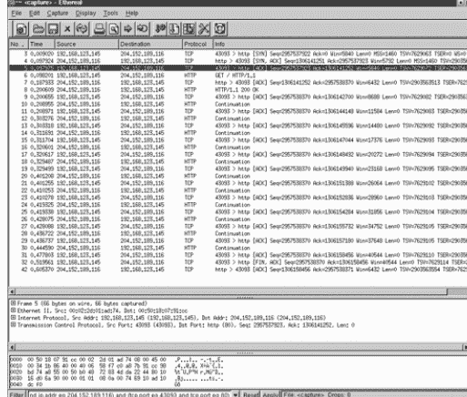

前三个数据包说明了用于建立与 Web 服务器连接的 TCP 三次握手。第四个数据包包含来自客户端的 HTTP 请求，第六个包含带有 200 OK 消息的响应报头。剩余的数据包大多是包含 HTTP 响应主体（从服务器到客户端的数据包）或对该数据的 TCP 确认（从客户端到服务器的数据包）的数据包。最后四个数据包是用于关闭连接的四方握手（服务器发出的第一个 FIN 是第 30 号数据包；FIN 位在图中不可见，但如果你展开数据包视图，它确实存在）。

图 15-2 详细说明了其中一个数据包。

**图 15-2.** 由 Ethereal 工具捕获的一个数据包交换的详细信息。

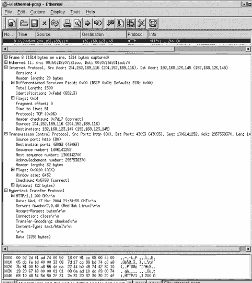

放大第 8 号数据包，它包含来自服务器的 HTTP 响应报头，我们可以看到这是一个封装在 TCP 之上的 HTTP 数据包，而 TCP 数据包又嵌入在 IP 数据包中，IP 数据包本身又是以太网数据包的负载。

### Web 服务器事务的解剖

接下来，我们将展示 Web 服务器响应客户端请求时所采取的步骤。为此，我们提供以下伪代码：

```
s = socket();  /* allocate listen socket */
bind(s, 80);  /* bind to TCP port 80 */
listen(s);  /* indicate willingness to accept */
while (1) {
    newconn = accept(s);            /* accept new connection */
    remoteIP = getsockname(newconn);   /* get remote IP addr */
    remoteHost = gethostbyname(remoteIP); /* get remote IP DNS name */
    gettimeofday(currentTime);       /* determine time of day */
    read(newconn, reqBuffer, sizeof(reqBuffer)); /* read client request */
    reqInfo = serverParse(reqBuffer); /* parse client request */
    fileName = parseOutFileName(requestBuffer); /* determine file name */
    fileAttr = stat(fileName);       /* get file attributes */
    serverCheckFileStuff(fileName, fileAttr); /* check permissions */
    open(fileName);                  /* open file */
    read(fileName, fileBuffer);      /* read file into buffer */
    headerBuffer = serverFigureHeaders(fileName, reqInfo); /* determine headers */
    write(newSock, headerBuffer);    /* write headers to socket */
    write(newSock, fileBuffer);      /* write file to socket */
    close(newSock);                  /* close socket */
    close(fileName);                 /* close file */
    write(logFile, requestInfo);     /* write log info to disk */
}
```

这段伪代码是一个相对简单的服务器实现，它没有采用任何可能的优化，并且一次只能处理一个请求。这个例子仅暗示了服务器所需的更复杂功能，例如如何解析 HTTP 请求以及确定客户端是否有适当的权限查看文件。此外，它没有错误处理——例如，如果客户端请求的文件不存在。然而，这个例子很好地展示了服务器需要采取哪些步骤。

### 不同的Web服务器模型

与许多其他服务器类似，Web服务器也有某些性能要求，这些要求会影响服务器的实现方式。在服务器实现所采用的架构模型上，有几种可能性可供选择。主要问题之一是如何处理*并发*。Web服务器需要同时处理许多客户端，有时多达数万个客户端。在之前的示例中，服务器一次只处理一个客户端。例如，如果客户端请求的文件不在服务器的文件缓存中，服务器就会*阻塞*等待文件从磁盘加载。在此期间，服务器本可以处理其他可能成本较低的请求，但之前的示例却选择等待，从而浪费了资源。此外，由于之前的示例使用单个进程，如果服务器是多核处理（SMP）架构，其他处理器将完全未被充分利用。解决这一问题的典型方法是通过某种形式的并发机制；我们将在本节中描述几种方法。

最常见的并发形式是使用进程。最流行的Web服务器 Apache 最初就是使用进程实现的。每个进程都有独立的地址空间，并通过虚拟机抽象与其他进程完全隔离和保护。通过将每个请求分配给一个单独的进程，当一个进程因其他活动（如等待客户端或磁盘）而阻塞时，另一个进程可以继续前进。此外，在多核处理（SMP）架构上，多个进程可以并行运行。进程的缺点在于它们是相对昂贵的抽象，需要分配内存等资源。如果服务器拥有数千个客户端，它可能就有数千个进程，这会消耗系统资源。通常，任何系统对活动进程的数量都有限制。

第二常见的方法是使用线程。Apache 2.0 提供了使用线程而不是进程的选项。线程与进程相似，但更轻量级；具体来说，它们需要的系统资源更少。线程通常共享地址空间，但有独立的程序计数器和堆栈。线程比进程便宜，但用安全性换取了速度。此外，如果客户端数量足够多，使用线程的系统仍可能耗尽资源。

许多研究性 Web 服务器，例如来自莱斯大学的 Flash Web 服务器（不要与 Macromedia 的 Flash 浏览器插件混淆），使用一种称为事件驱动模型的方法。在这种模型中，使用单个进程，没有线程，连接通过如 `select()` 或 `poll()` 这样的多路复用系统调用进行管理。服务器使用系统调用查询所有连接的就绪状态，并确定哪些连接需要服务（反之，哪些连接处于空闲状态）。然后服务器针对该特定连接读取请求或写入响应。事件驱动模型的优点是通常比基于进程或线程的服务器更快，因为它最大限度地提高了局部性，并且具有其他模型所不具备的许多性能优化。缺点是编程更困难，因为开发人员必须显式管理许多请求的状态，而每个请求可能处于不同的进度阶段。此外，历史上 Linux 操作系统缺乏对这种模型中与磁盘交互（即异步）的支持。然而，随着 Linux 2.6 引入异步 I/O，这一限制正在得到解决。

我们在此考虑的最后一个架构模型是内核模型。示例包括红帽公司的 Tux 服务器和 IBM 的 AFPA 服务器。在这种方法中，整个 Web 服务器作为一组内核线程运行，而不是在用户空间中运行。这种方法的优点是性能最大化（因为共享很容易）、避免了数据复制，并且不会产生昂贵的用户态与内核态切换开销。缺点是内核编程比用户空间编程更困难、可移植性更差且更危险。例如，如果服务器存在编程错误并崩溃，内核服务器可能会导致整个机器随之崩溃。

### 调优Web服务器

其他章节中提到的调优其他服务器的许多方法也适用于 Web 服务器。例如，通过 `sysctl` 或 `setsockopt` 增加发送和接收套接字缓冲区的大小，如第12章“网络调优”中所述，是有用的。类似地，增加接收队列的大小有助于防止请求在 Web 服务器看到之前就被操作系统丢弃。在本节中，我们特别关注针对 Web 服务器进行的调优。这是在操作系统层面调优之外进行的。

#### 适用于所有Web服务器的调优


这些更改对于所有 Web 服务器都有用，无论其架构模型如何。

以下参数增加了服务器在丢弃 SYN 包之前可以排队的 TCP SYN 包数量：

```
echo 30000 > /proc/sys/net/ipv4/tcp_max_syn_backlog
```

Web 服务器通常有许多处于 TIME-WAIT 状态的 TCP 连接。以下参数增加了允许处于该状态的连接数量：

```
echo 2000000 > /proc/sys/net/ipv4/tcp_max_tw_buckets
```

以下参数设置了网络核心（IP 层以下）中可排队的数据包数量长度。这使得可以为传入的数据包使用更多内存，否则这些数据包将被丢弃。

```
echo 50000 > /proc/sys/net/core/netdev_max_backlog
```

### Apache

Apache 的主要配置文件是 `httpd.conf`。可以修改该文件中的几个参数以提高性能：

以下参数设置了 Apache 可以并发运行的进程数量上限：

```
MaxClients 150
```

较大的值允许同时服务更多的客户端。非常大的值可能需要重新编译 Apache。应谨慎使用此更改，因为大量的进程可能会导致过多的开销。

以下参数指示单个 Apache 进程在关闭连接之前，针对客户端的连接所执行的请求数量：

```
MaxKeepAliveRequests 100
```

打开和关闭连接会消耗 CPU 周期，因此服务器在单个连接上尽可能多地提供响应会更好。因此，较大的数字更好。实际上，将此值设置为 0 表示只要可能，服务器就应永不关闭连接。

以下参数确定了单个 Apache 进程在终止（并被重新分叉）之前将服务的请求数量。0 表示数量没有限制，但在某些操作系统存在内存泄漏的系统中，将其设置为非零值可以控制内存泄漏。

```
MaxRequestsPerChild 0
```

以下参数确定了 Apache 为应对新请求而保留的空闲进程的最小和最大数量：

```
MinSpareServers 5
MaxSpareServers 10
```

其想法是，保持一个活动进程处于空闲状态比响应新请求到达而分叉一个新进程更便宜。对于负载很高的站点，您可能希望增加这些值。

### Flash 和其他事件驱动服务器

事件驱动服务器的一个常见问题是，它们使用大量的文件描述符，因此如果最大数量没有增加，这些描述符可能会耗尽。

以下是一个 `sh` 命令，用于增加进程可以拥有的打开文件数量：

```
ulimit -n 16384
```

进程（在此情况下是 Web 服务器）也必须经过修改，以利用大量的描述符：

```
#include <bits/types.h>
#undef __FD_SETSIZE
#define __FD_SETSIZE 16384
```

Linux 2.4 上默认的 `FD_SETSIZE` 仅为 `1024`。

### Tux

以下参数决定了活动的并发连接数量：

```
echo 20000 > /proc/sys/net/tux/max_connect
```

以下参数设置了在 Tux 的接收队列中等待的最大连接数：

```
echo 8192 > /proc/sys/net/tux/max_backlog
```

以下参数禁用了将请求日志记录到磁盘的功能：

```
echo 0 > /proc/sys/net/tux/logging
```

### 用于评估 Web 服务器的性能工具

有许多工具可用于评估 Web 服务器的性能，这些工具也称为*负载生成器*。这些程序在客户端机器上运行，模拟客户端行为，构造 HTTP 请求并将其发送到服务器。负载生成器通常可以改变其生成的请求量，称为*负载*，并测量服务器对该负载的响应行为。性能指标包括诸如请求延迟（单个响应从服务器返回所需的时间）和吞吐量（服务器每秒可以生成多少响应）等项目。

也许最常用的是 SPECWeb99。该工具由非营利组织标准性能评估公司（SPEC）分发，其网站为 www.spec.org。该基准测试可能是被引用次数最多的基准测试，并被 IBM、Sun 和 Microsoft 等服务器厂商用于市场营销目的。不幸的是，该工具需要付费，但对于 IBM 等会员机构，它可以免费使用。该基准测试旨在捕捉在 Web 服务器中观察到的主要性能特征，例如请求文件的大小分布和受欢迎程度。由于该工具旨在衡量整个系统的性能，因此它被视为一种宏观基准测试。

另一种经常使用的工具是来自 HP Labs 的 httperf，该工具在开源许可下免费使用。此工具具有高度可配置性，允许您测试 Web 服务器的独立组件——例如，服务器处理大量空闲连接的能力。因此，它更多地被用作微观基准测试。

还有许多其他工具可用于评估 Web 服务器性能，包括 SURGE、WebBench 和 WaspClient。然而，描述所有这些超出了本章的范围。尽管如此，有许多选择可用于对服务器进行压力测试、测试和测量，其中许多可以免费获得。

对于网站运营商来说，日志分析工具也很有用。这些工具会浏览服务器生成的日志，并报告信息，例如网站在一段时间内收到的访问次数以及访问者来自哪里。当运营商了解访问者如何使用网站时，性能可以得到优化。日志通常保存在一种称为 Apache 通用日志格式的标准格式中。市面上有许多商业工具；但是，有两个免费可用的开源工具是 analog 和 webalizer。

### 摘要

我们简要概述了 Linux 中的 Web 服务器，并讨论了什么是 Web 服务器、它们的作用以及它们如何使用网络。我们还描述了 Web 服务器需要处理许多并发客户端，并概述了用于实现并发的可能架构。这些包括基于进程、基于线程、基于事件和基于内核的方法；并讨论了每种方法的优缺点。我们介绍了 Linux 上 Web 服务器最常见的调优选项，包括操作系统和服务器本身的调优。最后，我们讨论了如何评估 Web 服务器性能，并给出了用于此目的的一些软件工具示例。

### 参考文献

[1] Krishnamurthy, Balachander 和 Jennifer Rexford，《*Web 协议与实践：HTTP/1.1、网络协议、缓存和流量测量*》，Addison-Wesley，2001年。

# 第十六章：文件和打印服务器

作者：Steven French

## 引言

随着对更多网络存储需求的持续增长，文件和打印服务器继续在商业、学校甚至家庭网络中悄然发挥着关键作用。然而，人们往往认为理所当然。自 Novell、3Com、IBM 和其他公司在 20 世纪 80 年代引入第一代网络操作系统（NOS）以来，随着易用性、安全性、性能和可靠性的提高，文件和打印服务器在企业中的重要性不断增加。虽然基于网络文件系统（NFS）的原始 UNIX 文件和打印服务器早在 1985 年就已可用（大约在同一时间，IBM PC LAN 计划被引入 DOS/Windows），但 Windows 2000 相对于现有服务器是一个重大改进，它将易于管理的集成服务套件带入了大众市场，包括以下内容：

- 分布式文件服务
- 高级打印服务器
- 集中式目录和集成管理
- 丰富的安全框架和单点登录

这些服务紧密联系在一起，并且优于早期对集成服务的广泛尝试，例如 OSF DCE，有助于 Windows 2000 变得流行。将数据集中存储在文件服务器中的企业通常可以通过在许多员工之间分摊服务器存储成本以及使用一致且易于使用的工具高效管理这些服务器系统来更好地利用资源。然而，这种集成文件服务器的安静革命为 Linux 社区创造了机会。Windows 2000（甚至其继任者 Windows 2003）没有提供 Linux 的配置灵活性，更难集成到异构环境中（例如，混合 UNIX 和 Windows 系统），并且与 Linux 相比，经常在性能上处于劣势。此外，其实现的复杂性和缺乏开放性使得实际网络安全难以预测，几乎无法评估。开源社区对此做出了响应。随着 Linux 内核、Samba 和 NFS 子系统的重大改进，Linux 已成为一个具有卓越性能且极具吸引力的文件和打印服务器选择。

在接下来的部分中，我们描述了主要类型的网络文件服务器、它们的性能调优和测量，以及打印服务器性能。

## 专用网络存储服务器类型

专用网络存储服务器通常根据数据是通过文件名（文件内的偏移量）还是磁盘位置（原始磁盘块号）在网络中被访问来分为两种类型。前者通常称为网络附加存储（NAS），而后者通常称为存储区域网络（SAN），尽管已提出了混合方法。NAS 的例子包括 SMB/CIFS、AFS 和 NFS 服务器。SAN 的例子包括 GPFS（IBM 的通用并行文件系统）和各种 iSCSI 实现。

文件服务器实际上是运行在更通用的服务器操作系统上的 NAS 服务器。NAS 可以被视为提供网络文件服务的专用设备。

## 优化网络存储性能

本章剩余的各部分讨论在确定如何最佳优化网络存储性能时需要考虑的各种配置和实现问题。具体而言，这些部分讨论以下内容：

- 远程存储数据还是本地存储
- 使用 SAN 还是网络文件系统
- 选择系统协议
- 选择要实现的客户端和服务器
- 为工作负载最佳调优客户端


- 为工作负载最佳调优服务器
- 验证性能并识别瓶颈
- 测量负载并改进容量规划
- 打印服务器性能

## 确定存储什么数据在远程

本地文件 I/O 的性能通常优于通过网络文件系统访问相同文件时的性能。本地 I/O 不会使路由器或以太网段等网络资源过载。当服务器有大量可用的 RAM 时，足以缓存经常访问的文件，网络文件系统的速度有时可以超过本地非缓存文件访问。集中管理存储更容易，保留少量大型、不常访问的文件副本可以避免在企业桌面机器上保留相同文件的多个副本并将其填满的问题。

## SAN 与网络文件系统/NAS

作为一般规则，存储区域网络可以比类似速度的网络上的网络文件系统更快地传输数据，因为在块（而非文件）级别解析网络请求涉及的处理较少。此外，存储区域网络通常使用专用的高速光纤通道交换机和网络硬件。然而，网络文件系统提供额外的安全性，以及更直观地备份和管理文件的能力，这些优势通常超过 SAN 的性能优势。此外，SAN 的布线限制（以及在企业网络上访问数据时的安全顾虑）可能将 SAN 的吸引力限制在大型服务器机房中。

## 网络文件系统协议

网络文件系统协议形态各异。一些需要复杂的客户端来管理复杂的状态信息（如 AFS），而另一些是幂等的（无状态的），如 NFS 版本 3。它们从以 OS/2 为中心（如 SMB）到以 Windows 为中心（如 CIFS）再到以 UNIX 为中心（如 NFS）不等。它们在安全模型、性能以及当然的复杂性方面各不相同。SAN 像磁盘上的块一样移动数据，而大多数网络文件系统基于文件名或文件标识符移动数据。

理解这个协议迷宫需要回顾并将协议分类为家族。以下列表将相关的网络文件系统协议分组为家族，以便更容易理解它们的特征：

### 主要网络文件系统家族

- HTTP — WebDAV
- SMB — CIFS
- NCP（Netware 核心协议）
- NFSv2 — NFSv3 — WebNFS — NFSv4 — DAFS
- AFS — DCE/DFS, AFS — Coda — Intermezzo
- AFP
- GFS, GPFS 和混合网络文件系统

以下是对更流行的网络文件系统的更详细的描述。文件系统按其安装基础的近似大小列出：

- **SMB/CIFS。** 这个网络文件系统由 IBM 的 Barry Feigenbaum 博士在 20 世纪 80 年代初发明，后来被 Microsoft 大幅扩展，然后在 1990 年代末被 Microsoft 重命名为 CIFS。该协议是大多数版本的 Windows（甚至 OS/2 和 DOS）的默认网络文件系统，并且大多数现代操作系统都支持它。2.6 Linux 内核包括两个客户端实现：遗留的 `smafs` 和更新的 CIFS VFS 客户端，后者最终将取代 `smafs`。还有用户空间 SMB 文件系统工具，在 Linux 上常用（尽管不是内核的一部分）。

本身），包括流行的 `smbclient` 实用程序，它包含一个类 FTP 选项，用于通过 SMB 协议检索文件。

Linux 2.6 内核也有助于 SMB 服务器。流行的开源 `Samba` SMB 服务器在 Linux 2.6 内核上的性能比在 Linux 2.4 内核上快 50%。`Samba` 也被移植到许多其他 UNIX 及类 UNIX 操作系统。`Samba` 服务器和 CIFS 客户端实现的 CIFS 协议可以相对安全地使用，并且由于许多可选扩展，其功能非常丰富。然而，就 NFS 版本 4（IETF RFC 3010）和 HTTP（IETF RFC 2616）被视为正式标准的意义而言，CIFS 本身并不被视为正式标准。存储网络工业协会（SNIA）确实记录核心 CIFS 协议，并且对 CIFS 网络协议的 Linux/UNIX 扩展也由 SNIA 进行标准化。关于额外的“CIFS POSIX 扩展”的标准提案正在进行中。

网络协议通常用一个称为 ISO/OSI 模型的抽象分层模型来描述。当该模型应用于 CIFS 时，它可以用来表示各层中的实现，如图 16-1 所示。

### 图 16-1. 应用于 NFS 的 ISO/OSI 模型。

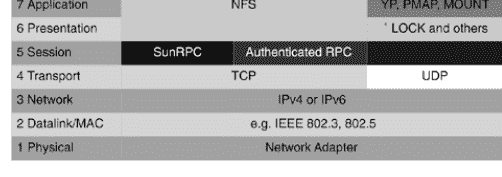

- **NFS.** 自 2003 年以来，NFS 版本 4（NFSv4）已成为互联网工程任务组（IETF）官方的网络文件系统标准。然而，更广泛部署的是基于更原始的 NFS 版本 2 和 3 的系统，这些版本通常用于 UNIX 之间的网络文件系统访问。NFS 版本 3 虽然在 Linux 到 Linux（以及 UNIX 到 UNIX）环境中表现相当好，但没有像其他一些协议那样安全地处理分布式缓存。此外，由于其原始的设计，它也容易出现安全问题。包含许多类似 CIFS 特性的 NFSv4 解决了版本 3 的许多功能和安全缺陷，但其性能通常不如 CIFS。

ISO/OSI 模型应用于 NFS 时，将实现划分为图 16-1 中所示的各层。

- **WebDAV（HTTP 扩展）。** 当服务器启用 DAV 扩展时，可以从较新的 Windows 客户端挂载（`NET USE`）到许多流行的 Web 服务器。有时被称为 Web 文件夹的 WebDAV，也已包含在 Web 浏览器等应用中。自 IE 5.5 版本起，Internet Explorer（IE）浏览器就支持 WebDAV。WebDAV 并非为性能优化设计，目前 Linux 内核中不包含其客户端文件系统（尽管某些发行版包含 Linux WebDAV 客户端的用户空间实现）。各种流行的 Linux 应用都支持 WebDAV。

- **AFS/DIFS。** 在 20 世纪 90 年代中期，这些是部署最常见的网络文件系统中功能最复杂的，通常用于中端到高端的 UNIX 系统。随着 IBM 和其他公司宣布最终停止支持它们的计划，AFS（以及松散相关的 DCE/DFS）的重要性正在逐渐减弱。针对 Linux 存在 AFS 客户端和服务器的开放全功能实现 OpenAFS，还有一个更原始的 AFS 客户端已被 2.6 内核接受。

- **AFP。** 较旧的 Apple Macintosh 操作系统（OS X 之前）默认使用一种名为 AFP 的文件协议，而不是 CIFS 或 NFS，尽管来自 Thursby 等公司的第三方 CIFS 客户端可用于这些系统。一些 Linux 发行版包含用于处理 AFP 客户端请求的开源 Netatalk 服务器，并且至少有一个商业 AFP 服务器可用（来自 Helios）。随着这些客户端变得不那么常见，AFP 的重要性正在迅速减弱。Linux 内核中不包含任何 AFP 文件系统客户端。

- *专用网络文件系统协议*，如 Coda 和 Intermezzo，以及各种混合（部分专有）SAN/NAS 协议，部署范围较窄。网络文件系统早期最流行的协议 Novell NCP 正逐渐失去人气。目前很难衡量 NCP 的安装基数，且 NCP 服务器很少部署在 Linux 上。

- **集群文件系统。** 关于最佳 Linux 集群文件系统的争夺战即将展开。Lustre 和 GFS（来自 Red Hat/Susina）是被 2.6 内核接受的早期领先者。集群文件系统可以被认为是支持严格 POSIX 文件系统语义（就像本地文件系统一样）的网络文件系统，专为通过高速网络连接的同类系统组设计使用。此外，一些 SAN 文件系统，如 IBM 的 StorageTank 和 GPFS，也具有相似的特性和目标。这些系统目前都尚未被 Linux 内核接受，但包括至少一个系统的压力正在增大，它们尤其有可能对超级计算机集群变得重要。

我们讨论了多种流行的网络文件系统（包括 NFSv3、NFSv4、CIFS、HTTP/WebDAV 和 AFS）。由于网络文件系统已经存在近 20 年，正如这里提到的历史所示，为什么我们没有收敛到一个主导的网络文件系统（就像我们在底层收敛到 TCP/IP 一样）？因为网络和 SAN 文件系统提出了独特的设计问题，没有任何一个网络文件系统能完美解决这些问题。为什么网络文件系统如此难以设计？以下是原因：

- 与本地文件系统不同，网络文件系统必须管理同一数据/元数据的两个视图（本地和服务器）。
- 为了保证 POSIX 文件 API 语义并保持以下各项的完整性，它们应在多台机器上实现分布式缓存一致性：
  - 文件数据
  - 文件元数据（日期/时间戳，ACL）
  - 目录数据
- 网络文件系统必须应对客户端和服务器上可能以冲突方式执行的“冗余”锁的问题。
- 网络文件系统必须适应文件的临时标识符以及客户端和服务器上不同的 inode 编号。
- 网络文件系统不能假设服务器和客户端上的文件命名空间相同，甚至不能假设代码页（用于转换语言字符和显示文件名的字符集）在客户端和服务器上相同。


网络文件系统必须弥补网络协议设计和/或服务器操作系统中的漏洞、遗漏和错误。例如，运行在 Windows 上的 NFS 网络文件系统必须能够将 Windows 文件请求转换为类 UNIX 的 NFS 协议帧（这些帧设计用于映射到 Solaris、Linux 及类似操作系统功能）。这很困难，因为 Windows 文件 API 比 POSIX 文件 API 大得多，并且包含没有 POSIX 对应项的标志。

大多数网络文件系统实现各种网络安全功能，例如以下列表中的功能，以提供通过潜在敌对路由器更安全的数据传输：

- 分布式授权
- 访问控制
- PDU 完整性

网络文件系统处理更多奇特的、多机器、网络故障场景，分析起来很复杂。与本地文件系统相比，网络文件系统在实现文件和服务器“迁移”（将数据从一个卷移动/复制到另一个卷）和透明恢复方面也更困难。

Linux 上的 NFS 版本 4 和 CIFS/Samba（CIFS 内核客户端和 Samba 服务器）解决了此处列出的大多数问题，并被广泛使用。但哪一个明显更好？NFS 比 CIFS 好吗？并不总是这样。需要考虑的权衡如下：

- NFS 版本 3 虽然相当快，但安全性不如 SMB/CIFS。
- 虽然 CIFS VFS 在挂载到启用可选 CIFS UNIX 扩展（在 Samba 版本 3 或更高版本中可用）的 Samba 服务器时提供出色的 POSIX 语义，但 NFS 比 SMB/CIFS 更好地映射到内部 Linux VFS 文件系统内核 API。
- Linux NFS 客户端不支持 Linux xattrs（而 CIFS 客户端支持），但 NFS 客户端可以处理直接 I/O（而当前的 Linux CIFS 实现不支持）。
- CIFS 挂载协议（SMB SessionSetupAndX 和 SMB TreeConnectAndX）不需要使用 UNIX UID，这在异构网络中很有帮助。在包含 Windows 和 Linux 服务器的网络中，UID 映射可能很困难。因此，在使用 NFS 版本 2 和 3 时，在服务器和客户端之间有一致的 UID 映射是很有帮助的。

请注意，NFS 在 Windows 上并不流行，因为大多数 Windows 版本的操作系统中不包含 NFS 服务器或客户端，并且 NFS 协议比复杂且功能丰富的 Windows IFS 更好地映射到较简单的 UNIX VFS 接口。微软确实将其 Services for UNIX 的一部分作为免费下载提供简单的 NFS（版本 2 和 3）服务器。

由于新的安全和缓存功能，NFS 版本 4 在未来将具有吸引力，尤其是对于 Linux 到 Linux 的网络文件系统访问，但由于它未得到大多数 Windows 客户端和服务器的良好支持，其采用速度缓慢。它在 2.6 内核中的 Linux 实现尚未得到验证，并且缺少一些可选功能。Linux 客户端通过千兆以太网访问基于 2.6 内核的 NFS 服务器时，NFSv3 的性能可能非常出色。NFS 版本 3（至少通过 UDP）接受最多的测试，并且可能是从 Linux 客户端挂载到 Linux 服务器时网络文件系统最稳定的选择。

### 客户端和服务器实现选择

对于 NFS，实现选择很简单：最流行的客户端和服务器实现是内核中可用的一种。然而，RPC（SunRPC）守护程序有一些选择。构建 Linux 2.6 内核时，可用选择是否启用对以下内容的支持：

- NFS 版本 3（强烈推荐）的客户端或服务器
- 服务器上的 TCP 上的 NFS（推荐）；在客户端中它总是开启的
- NFS 版本 4（实验性）
- NFS 直接 I/O（实验性）

对于 SMB/CIFS，有两种客户端可供选择：传统的 `smbfs` 和较新的 CIFS VFS。对于服务器而言，迄今为止最受欢迎的选择是 Samba 网络文件服务器，它不仅提供 SMB/CIFS 网络文件服务，还提供以下功能：

- 用于 Windows 和 winbind Linux 客户端的登录服务器
- 网络打印服务器
- 管理工具和基于 DCE/RPC 的管理服务
- RFC 1001/1002 NetBIOS 名称服务器

### 调整 Linux 客户端

#### 一些关键概念

本节介绍了在调整 Linux 客户端时需要考虑的一些关键概念。这些概念包括以下内容：

- 协议分层
- 机会性锁定
- 元数据
- 文件更改通知
- 只读卷和只读文件

##### 协议分层

以下追踪日志取自 `Ethereal` 网络分析器，显示了在挂载时发生的典型 20 个网络帧（请求和响应）（参见图 16-2）。该追踪日志取自在一个基于 Linux 内核 2.4.23 的客户端上运行 CIFS VFS 版本 1.0.3 的 `mount` 命令。

**图 16-2. 在挂载时发生的典型 20 个网络帧。**

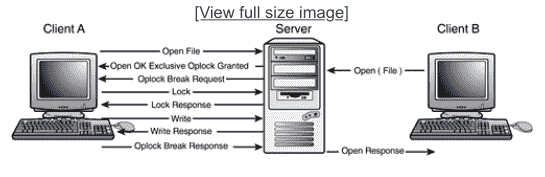

图 16-3 显示了某个特定帧的更详细视图；在这种情况下，树连接请求清晰地展示了层叠结构：一个 SMB 请求（包含挂载数据和 SMB 头）被封装在一个 RFC 1001（NetBIOS 会话服务）帧内，该帧又封装在一个 TCP/IP 帧内，而 TCP/IP 帧再封装在一个以太网帧内。

**图 16-3. 树连接请求的详细视图。**

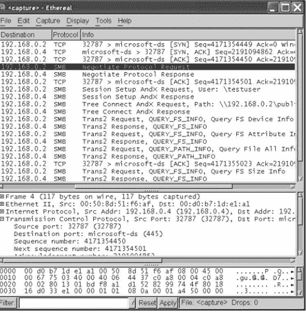

在这个例子中，SMB 请求为 86 字节（包括 32 字节的 SMB 头），前面跟着一个 4 字节的 RFC 1001 头（长度），再前面是 32 字节的 TCP 头、20 字节的 IP 头和 14 字节的以太网头。这种分层类似于嵌套的信封——这就好比将一个装有给孩子信件的信封封装在一个地址写给其父母的大信封里。

##### 机会性锁定

图 16–4 显示了 CIFS 机会性锁定（oplock）处理中涉及的协议流程。CIFS 有两种类型的机会性锁，用于控制对文件的分布式访问。相比之下，AFS 和 DFS 具有更复杂但更重型的令牌管理机制。NFS 版本 2 和 3 没有锁定机制，因此冒着数据完整性受损的风险，其 UNIX 文件语义较为宽松。

**图 16-4. 机会性锁定中的协议流程。（来源：www.microsoft.com/Mind/1196/CIFS.htm）**

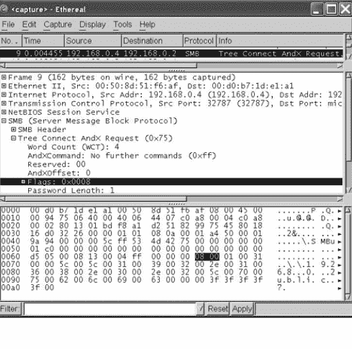

第一种机会性锁是全文件锁（独占 oplock），它允许客户端对文件进行激进的写回和预读缓存，通常能显著提高性能。

第二种 oplock 是读 oplock。读 oplock 允许多个客户端读取文件，但不允许更新文件。如果一个客户端尝试更新此类文件，则所有打开该文件的客户端都会失去对该文件的缓存特权。分布式缓存在 Linux 中遇到问题，因为仅靠 oplock 机制无法安全地缓存已关闭的文件。（虽然并不常见，但标准的 POSIX 文件语义允许内存映射文件没有打开的文件实例，但与 inode 关联的数据仍然可以读取。）

第三种 oplock 是批处理 oplock，较为少见。它用于解决与逐行互操作的 DOS 批处理文件（脚本）相关的某些性能问题，通过允许客户端对批处理文件进行有限的预读缓存来实现。Linux 客户端中的这些分布式缓存机制独立于服务器文件系统页管理器以及服务器磁盘控制器所执行的缓存，并与之无关。

##### 元数据

文件和目录的时间戳反映了文件或目录最后一次更新的时间。CIFS 网络文件系统客户端使用时间戳来确定在重新打开已关闭的文件时，其页面缓存中的数据是否需要丢弃，但这种缓存对用户来说是透明的。AFS 和 DFS 客户端具有更复杂的令牌管理方法来实现缓存一致性，这可以安全地在客户端磁盘上长期缓存网络文件。NFS 版本 2 和 3 通常具有更宽松的数据一致性，并基于定时器进行预读和写回缓存数据。

##### 文件更改通知

文件更改通知在 NFS 版本 4 和 CIFS 中可用，作为允许客户端应用程序感知特定文件和目录更改的一种方式。文件更改通知可用于增强客户端文件系统的分布式缓存功能，尽管这尚未被证明是高效的，且目前在 Linux 客户端中并未以此为目的进行实现。

##### 只读卷和只读文件

如果已知挂载的卷包含只读数据（例如挂载到导出只读 CD-ROM 或 DVD 的服务器），只读客户端可以积极缓存。然而，与实际上允许相同功能的机会性锁相比，只读客户端提供的益处微乎其微。

传统的 `smbfs` 客户端不进行安全的分布式缓存（oplock）。相反，它依赖于定时器来确定客户端缓存的网络文件数据的失效频率，并且性能调整有限。在 2.4 内核开发的中期，当 `smbfs` 网络请求缓冲区大小从 512 字节增加到大约一页（4096 字节）时，`smbfs` 性能获得了显著提升。


Linux CIFS 客户端实现了 oplock，并默认启用它（通过在客户端将 `/proc/fs/cifs/OplockEnabled` 设置为 `0` 可以禁用 oplock）。Linux CIFS 客户端尝试协商大约 16K 的缓冲区大小。如果服务器支持此缓冲区大小，就可以以更少的网络往返实现更高效的读写传输。与 NFS 客户端类似，通过减少 `rsize` 和 `wsize`（通过在挂载时指定大小选项来配置），可以减少默认的读写大小，以尝试最小化 TCP 包碎片化，但这通常会降低性能。与 smbfs 一样，CIFS VFS 中的查找缓存机制是基于定时器进行的，而不是使用 CIFS FindNotify API。即使是短时间的 inode 元数据缓存，也能提高性能，优于另一种替代方案，即在每次查找时重新验证 inode 元数据，但这存在风险，即客户端对文件 stat 信息（如文件大小和时间戳）的视图可能更经常过期。可以通过设置 `/proc/fs/cifs/LookupCacheEnabled` 来禁用 CIFS 查找缓存。CIFS 客户端在 `/proc/fs/cifs/Stats` 中维护有限的一组统计信息。启用调试或跟踪（通过将 `/proc/fs/cifs/cifsFYI` 设置为 `1`，或将 `/proc/fs/cifs/traceSMB` 设置为 `1`）可能会略微降低客户端性能。

与当前的 2.6 smbfs 和 cifs 客户端文件系统模块不同，NFS 客户端能够很好地从单个客户端向单个服务器并行分发多个预读请求。这种并行性有助于保持服务器磁盘忙碌。当从客户端单个进程向服务器写入大文件时，差异更加显著。Linux 客户端使用 NFS 版本 3 向负载较轻的千兆以太网 Linux 服务器复制文件的速度的远远快于使用 CIFS 向 Linux/Samba 服务器复制文件。这是由于 NFS 客户端中多页异步写回的高效实现。由于两者都实现了多页预读（readpages），NFS 和 CIFS 之间的读取性能差异并不那么巨大。CIFS 客户端在从同一 Samba 服务器复制文件时比 smbfs 客户端快，因为 CIFS 可以使用 CIFS VFS 更大的读取大小（16K 对比 4K），并且可以一次读取多于一页的数据（通过新的 readpages 函数，这是一个可选功能，2.6 内核文件系统可以现在实现）。未来版本的 CIFS VFS 客户端应该能够缩小与 NFS 的性能差距。然而，要在大文件复制方面超越 NFS 性能，需要重新设计 Samba 服务器的 SMB 调度机制，正如 Samba 版本 4 所做的。当多个进程向同一服务器复制不同文件时，CIFS 受益于能够向服务器排队多达 50 个同时的读取或写入请求的能力。

## Linux 文件服务器调整

网络文件系统调整很复杂。高 CPU 使用率、磁盘使用率或网络使用率都可能导致瓶颈，而网络延迟可能会极大地影响吞吐量。以下列表总结了在评估性能改进时应遵循的一些通用原则：

- 最大化每个客户端的并行性
- 最大化服务器在适配器中断调度中的并行性
- 最大化服务器 CPU 并行性
- 最大化客户端缓存机会
- 最小化发送的数据
- 最小化从客户端到服务器的往返次数
- 最大化命令链接

### 捎带确认（ACKs）

- 最小化协议开销（帧头）
- 限制负载较轻时的延迟（例如定时器和 TCP ACK 设置）
- 检查会话建立和认证开销

评估因配置更改而可能带来的性能提升的常见方法如下：

1. 选择一个文件复制工作负载或基准测试。
2. 多次执行测试以预热缓存并平滑变化；在负载较轻的网络上执行测试。
3. 将初步结果与基线（例如在本地执行相同的测试，或通过另一个网络文件系统或 FTP 执行）进行比较，以验证目标是否合理。
4. 逐渐增加基准负载，直到达到最大总体吞吐量。
5. 更改服务器或客户端配置设置并重新测试，测量性能和网络流量（如帧数和平均响应时间）的变化。
6. 通过仔细检查网络跟踪数据（例如使用 `Ethereal` 网络分析器）来分析配置更改的副作用。
7. 分而治之。使用两个较小的测试来模拟测试：一个用于本地文件调用，另一个用于网络套接字调用。专注于更窄子系统的性能优化（例如，在服务器上本地运行 `dbench` 和 `tbench`，而不是在网络上运行更大的 NetBench 模拟器）。

### NFS

对于 NFS 客户端，默认的 `rsize` 和 `wsize` 可以在挂载时指定。典型值范围在 4K 到 32K 之间。对于 NFS 版本，它们受服务器约束，并随着基于 TCP 的 NFS 服务器实现的支持 32K 而改变。Linux 客户端支持最大 32K 的 `rsize`/`wsize`。设置大于 MTU（通常为 1500 字节）的 `rsize` 会导致更高级别的 SunRPC 帧在多个 TCP 帧之间进行分片和重组，在某些情况下会减慢性能。你可以使用 `iozone` 和 `bonnie` 进行实验以确定最佳值。`netstat` 和 `nfsstat` 工具可以分别用于获取有用的 TCP 和 NFS 统计信息，以便与基准吞吐量和计时结果进行关联，并且 `tracepath` 可用于确定网络帧大小（可以通过 `ifconfig` `MTU` 选项更改）。2.6 内核增加了配置 NFS/SunRPC 使用 TCP 的能力，这比默认配置（NFS/SunRPC over TCP）略慢。NFS over UDP 通常用于局域网，但如果 `nfsstat` 命令报告的超时过多，请考虑增加 NFS `mount` 选项 `retrans` 和 `timeo` 的值。`nfss` 的服务器实例数量可能会极大地影响性能，并且可以在 Linux 服务器系统的启动脚本中进行调整。Linux NFS 服务器可以使用 `'sync'` 或 `'async'` 标志导出数据，后者由于服务器上的写回机制而具有更好的性能，但在服务器故障时存在数据完整性风险。

### Samba

三个配置设置显著影响 Samba 性能，并应在服务器的 `smb.conf` 文件中检查：

- `Sendfile`。`Sendfile` 是一种减少传出文件数据复制操作次数的机制。Samba 可以配置 `with-sendfile` 选项，使其能够将数据直接从服务器文件系统发送到网络适配器，从而提高吞吐量并降低服务器利用率。
- *部分通配符搜索的大小写敏感文件匹配*。目录条目的缓存在 Samba 中很复杂，因为 CIFS（Windows/DOS/OS2）通常请求大小写不敏感的文件匹配，而 Linux 服务器上的 POSIX 文件 API 仅提供大小写敏感的文件搜索。作为一个例子，在大小写不敏感的文件系统上进行 CIFS 搜索文件 `\\server\\share\\file*.exe` 只需要执行相对少量的服务器操作。然而，Linux 上的 Samba 需要检查 "file" 和 "exe" 的所有形式的匹配，包括 "File1.Exe"、"FILE2.EXE"、"file3.EXE" 和 "FILE4.exe"。Samba 3 服务器将路径与包含等效小写文件名列表的缓冲区（即 "sbat 缓存"）进行匹配，以提高这些操作的性能，但这种方法对于大型目录效果不佳（尽管在 Samba 3.0.12 及更高版本中已有很大改进）。通过使用 Linux xattrs 存储保留大小写的文件名，Samba 4 可以更高效地处理大型目录上的搜索操作。即使在 Samba 3 版本中，通过在 Samba 配置文件 `smb.conf` 中启用大小写敏感搜索，也可以极大地提高部分通配符搜索的性能（在某些基准测试中性能提升超过 5%）。在 `smb.conf` 中设置 `case sensitive = on` 可能会影响 Windows 应用程序的行为（因为它们期望大小写不敏感的文件匹配行为），除非导出的共享位于已格式化为大小写敏感的分区上（如 VFAT）。可以通过向 `mkfs.jfs` 工具传递 `-o format` 选项来创建大小写不敏感的 JFS 分区。
- *SMB 日志记录*。在较高日志级别下，SMB 日志记录可能会造成严重的性能损耗。将 `smb.conf` 中的日志级别降至 0 或 1 可能会带来可测量的性能提升。

除了上述内容外，启用内核 oplocks（而不是让 Samba 服务器内部管理 oplocks）以及在文件系统中启用 ACL 和 ACL 继承（这会给服务器的本地文件系统带来额外的负载以检索 xattrs）也会降低 Samba 性能。Samba 性能对 TCP 套接字选项的变化也很敏感（例如 `TCP_NODELAY`，可以在 `smb.conf` 参数 `socket_options` 中指定）。

### 性能测量

有许多用于性能测量的工具，可以与服务器利用率信息结合使用。有些工具现在可以通过 `/proc` 目录中的伪文件方便地以文本形式查看，以帮助评估性能权衡。测量文件 I/O 性能最常用的工具如下：

- *iozone*。用于测量网络文件 I/O 性能的出色基准测试，涵盖各种类别，如读取与写入、不同大小以及随机与顺序访问。
- *Bonnie*


- `NetBench`。由 Ziff Davis 实验室开发的经典 CIFS 基准测试已经显得有些过时。它需要大量昂贵的客户端才能充分负载现代 Linux Samba 服务器。
- `dbench`, `tbench`, `smborture`。这些工具分别提供了 NetBench 运行产生的文件活动、相应的网络套接字活动和 SMB 活动的更高效模拟。
- `spec cifs`。目前正在与 SNIA 和 SPEC 合作开发下一代 CIFS 基准测试。
- `specsfs`。常用于报告 NFS 版本 3 性能的最常见基准测试。
- `The Connectathon NFS 套件`。当使用 `runt est s a t` 运行时，它会生成关于常见操作有用且细粒度的计时信息。

这些工具在第 6 章“作为理解工作负载性能辅助的基准测试”中详细讨论。

### 用于改进容量规划的负载测量

CIFS 客户端可以通过在内核配置中启用 CIFS 统计信息并检查 `/proc/fs/cifs/Stats` 来测量常见请求的数量。这对于确定服务器何时响应缓慢非常有用。统计信息的一个示例如下：

```
Resources in use
CIFS Session: 2
Share (unique mount targets): 2
SMB Request/Response Buffer: 2
Operations (MIDs): 0

0 session 0 share reconnects
Total vfs operations: 550378 maximum at one time: 6

1) \\localhost\\stevf
SMBs: 11956 Oplock Breaks: 0
Reads: 89 Bytes 1145705
Writes: 3962 Bytes: 1888452
Opens: 868 Deleters: 934
Mkdirs: 118 Rmdirs: 118
Renames: 263 T2 Renames 0
2) \\192.168.0.4\\c5
SMBs: 365570 Oplock Breaks: 0
Reads: 124712 Bytes 456637519
Writes: 152198 Bytes: 613673810
Opens: 3 Deleters: 0
Mkdirs: 0 Rmdirs: 0
Renames: 0 T2 Renames 0
```

### 打印服务器性能

打印服务器性能受四个主要因素影响：

- 作业在哪里渲染
- 作业在通过网络传输并在服务器磁盘上存储时的大小
- 打印作业在服务器上经过多少层软件
- 打印设备的服务器驱动程序的效率

在 Windows 系统向 Linux 服务器打印的情况下，由于 Windows 打印驱动程序支持的广泛性，通常打印作业主要在客户端处理（而不是部分在客户端、部分在服务器上处理，这在 Windows 客户端向 Windows 服务器打印时通常会发生）。当打印作业在客户端渲染并作为原始打印文件发送到服务器时，打印网络打印作业所需的网络流量大得多，并且该文件可能会占用服务器上的大量磁盘空间，但打印该作业所需的服务器 CPU 较少。特别是当使用 Samba 作为打印服务器时，打印作业通常会在服务器上经过多个额外的层：CUPS 子系统，然后是 Ghostscript，最后可能是会减慢性能的打印驱动程序。

Linux 上的打印驱动程序在实现质量上差异很大，但 OMNI 和 CUPS 项目正在为 Linux 打印架构带来更多的一致性，这将反映在 Linux 打印驱动程序性能随时间的提升上。

### 参考文献

- [1] Shepler, S. 等. “Network File System (NFS) version 4 Protocol,” RFC 2530, 2003年4月.
- [2] SNIA Common Internet File System (CIFS) Technical Reference. 存储网络行业协会 CIFS 工作组, 2002年3月.
- [3] Hertel, C. *实现 CIFS：通用互联网文件系统*, Prentice Hall PTR, 2003年8月.
- [4] Satran, J. 等. “Internet Small Computer Systems Interface (iSCSI),” RFC 3720, 2004年5月.
- [5] 网络资源：http://www.snia.org, 存储网络行业协会.
- [6] 网络资源：http://www.samba.org, Samba SMB/CIFS 服务器项目页面.
- [7] 网络资源：http://linux-cifs.samba.org, Linux SMB/CIFS 客户端项目页面.
- [8] 网络资源：http://www.nfsv4.org, NFS 第4版信息.

## 第十七章 数据库服务器

*作者：Ruth Forester 和 John Tran*

### 引言

越来越多的企业正将 Linux 视为其数据库服务器的潜在平台。维护 Linux 服务器成本较低，这使得它对中小型以及希望降低运营成本的企业级业务都具有吸引力。内核可靠性和性能的提升、更好的硬件和驱动程序支持，以及大量第三方工具辅助企业维护服务器，使 Linux 成为数据库系统可行且高效的解决方案。（此处对数据库服务器和数据库系统进行了区分：数据库服务器是维护数据库的特定供应商软件，而数据库系统则包含运行环境——硬件、操作系统、库等）。

企业级数据库服务器需要大量的系统资源。由于数据库必须能够处理成千上万个并发用户连接并处理 TB 级数据，它需要高水平的并行处理能力、大量内存以及非常大的 I/O 带宽和吞吐量。因此，其性能在很大程度上取决于内核管理这些资源的有效性。该领域中的低效可能导致在内核空间中花费过多时间。此外，某些低效可能导致锁竞争，进而引发可扩展性差和串行化问题。这两种行为都会严重影响数据库性能，因为它们要么消耗本应用于数据库的处理器周期，要么迫使数据库应用程序在某个内核资源上进行串行化。

我们将讨论数据库服务器性能和调优的各个方面，包括以下内容：

- 数据库架构概述
- 影响性能的数据库可调整区域
- 影响数据库性能的 Linux 内核可调整区域

### 数据库架构概述

数据库架构有几种方法，但它们都至少具备以下特征：

- 组织好的表/视图，记录并通常存储于原始字符设备或文件系统中
- 全局内存区域
- 事务日志记录机制

这些特征是数据库性能的核心。小型数据库的简单调优可以像下面这样简单：

- 对磁盘 I/O 进行负载均衡
- 确保为日志记录选择的设备不受平均用户进程的干扰
- 确保证有足够的内存可用，以便事务被缓存而不是全部基于磁盘。

（注意：数据库集群互连技术是一项近期的创新；然而，本章关注的是不那么特殊且更传统的数据库实现。）

现代商业数据库要么是共享存储，要么是不共享。根据要运行的主要应用程序，一种类型可能比另一种表现更好。特别是，共享存储类型的数据库倾向于更好地执行在线事务处理（OLTP）工作负载，而不共享数据库更适用于决策支持查询工作负载，因为它们可以预先配置。此外，基于进程和线程的实现也是一个考虑因素，特别是对于决策支持系统（DSS）工作负载，最大化内存至关重要。现代领先的商业数据库实现采用进程、粗粒度线程或线程混合。

### 需要考虑的数据库调优区域

考虑数据库内部可以通过调优来改善性能的以下区域：

- I/O
- 队列长度和响应时间
- 负载均衡
- 全局内存
- 日志记录设备

上述每一节都详细探讨了需要考虑的事项。

#### I/O 调优

在 `I/O` 调优方面，你需要做出许多决策。你使用原始设备还是文件系统？直接 I/O 呢？你应该为数据库选择什么块大小？如果你严格运行 OLTP（在线事务处理，特征是小而随机的读写）工作负载，你希望选择较小的块大小，例如 2K。对于 DSS 长运行查询，一个实现了复杂查询优化器和复杂内存（排序/哈希区域）参数控制的大型数据库使用更大的块大小（如果数据库提供的话，8K 或更大）可以改善数据库扫描。如果你的工作负载包含 OLTP 和 DSS？需要仔细考虑数据库参数调优；在某些情况下，妥协是必要的，也许最终确定使用 4K 块大小。

#### 队列长度和响应时间

在 Linux 上，`vmstat` 是一个测量 I/O 带宽的好工具。I/O 部分下的两列标记为 bi 和 bo。根据 vmstat 手册页的描述，这些列应表示块设备中进入和离开的块数。然而，在 various Linux 发行版中，这些列实际上报告的是测量区间内字符设备（原始）或块设备（文件系统）的传输速率（KBps）。对于两种工作负载，如果队列长度大于 1，可能存在某种竞争。对于 OLTP，超过 50ms 的响应时间是令人担忧的。

#### 负载均衡

在 Linux 中，几种工具可以帮助你确定数据库系统是否需要负载均衡。一个简单的做法是使用 `iostat`（关于 `iostat` 的描述，请参阅第 4 章“系统性能监控”中的“I/O 利用率”部分）。

以下是 `iostat x` 输出的示例：


```
Device:      rrqm/s wrqm/s   r/s   w/s rsec/s   wsec/s
             rkB/s  wkB/s  avgrq-sz  avgqu-sz   await   svctm  %util

sda          0.00   0.00  272.86 97.37  2489.63   842.95
1244.81    421.47  9.00     2.61   7.05    2.10  77.59

sdb          0.00   0.00   0.00   0.00   0.00     0.00
  0.00     0.00   0.00     0.00   0.00    0.00   0.00

sdc          0.00   0.00  272.22 102.00  2495.50  878.43
1247.75    439.21  9.02     2.64   7.05    2.04  76.42

cd4          0.00   0.00   0.00   0.00   0.00     0.00
  0.00     0.00   0.00     0.00   0.00    0.00   0.00

sde          0.00   0.00  277.96 99.77  2532.04  865.89
1266.02    432.94  9.00     2.59   6.87    2.05  77.29

sdf          0.00   0.00   0.00   0.00   0.00     0.00
  0.00     0.00   0.00     0.00   0.00    0.00   0.00

sdg          0.00   0.00  272.29 102.00  2483.49  878.69
1241.75    439.35  8.98     2.62   7.01    2.06  77.20

sdh          0.00   0.00   0.00   0.00   0.00     0.00
  0.00     0.00   0.00     0.00   0.00    0.00   0.00

sdi          0.00   0.00   0.00   693.03 0.00    6326.38
  0.00   3163.19 9.13     0.63   0.91    0.91  63.00

sdj          0.00   0.00   0.00   0.00   0.00     0.00
  0.00     0.00   0.00     0.00   0.00    0.00   0.00

sdk          0.00   0.03  276.03 98.80  2542.71  855.49
1271.36    427.74  9.07     2.60   6.94    2.05  76.67

sdl          0.00   0.00   0.00   0.00   0.00     0.00
  0.00     0.00   0.00     0.00   0.00    0.00   0.00

sdm          0.00   0.00  272.92 96.73  2480.03  836.28
1240.01    418.14  8.97     2.55   6.89    2.06  76.30

sdn          0.00   0.00   0.00   0.00   0.00     0.00
  0.00     0.00   0.00     0.00   0.00    0.00   0.00

sdo          0.00   0.00  272.19 100.47  2486.96  866.16
```

1243.48 433.08 9.00 2.64 7.10 2.07 77.21

sdg 0.00 0.00 0.00 0.00 0.00 0.00

0.00 0.00 0.00 0.00 0.00 0.00

sdq 0.00 0.00 268.09 96.57 2445.08 838.95

1222.54 419.47 9.01 2.53 6.93 2.09 76.18

sdr 0.00 0.00 0.00 0.00 0.00 0.00

0.00 0.00 0.00 0.00 0.00 0.00

avg-cpu: %user %nice %sys %iowait %idle

90.63 0.00 8.90 0.47 0.00

请注意，有些磁盘根本没有被访问。如果没有使用软件条带化功能，应确保所有表均匀分布在所有磁盘上。请注意，磁盘 `sdi` 实际上在这段基准测试的只读部分执行了写入操作。这是因为日志显然位于该磁盘上。日志应尽可能放置在单独的条带卷或单独的磁盘上，以便磁盘 `sdi` 不会因基准测试的其他方面而减慢速度。

### 全局内存

一般来说，对于 OLTP 工作负载，应尽可能将 I/O 操作移至内存，利用数据库的全局缓存区。大多数数据库都提供了工具，允许您查看用户事务是否已被缓存，包括有关脏缓冲区和已用缓冲区的统计信息。为了正确确定 Oracle 下的内存大小，需要设置 `database_block_buffers`。这可以通过确定多少空闲内存可用于分配给数据库，然后将其除以 `database_block_size` 来实现，如下所示：

4GB = 2.5GB 分配给数据库，因此 2684354560 / 4096 = 655360

以下是 `db_block_buffers` 公式的示例：

```
Database heap (4KB) (DBHEAP) = 6654
Size of database shared memory (4KB) (DATABASE_MEMORY)\
= AUTOMATIC
Catalog cache size (4KB) (CATALOGCACHE_SZ) = 386
Log buffer size (4KB) (LOGBUF_SZ) = 2048
Utilities heap size (4KB) (UTIL_HEAP_SZ) = 10000
Buffer pool size (pages) (BUFF_PAGE) = 40000
Extended storage segments size (4KB) (ESTORE_SEG_SZ) = 16000
Number of extended storage segments (NUM_ESTORE_SEGS) = 0
Max storage for lock list (4KB) (LOCKLIST) = 16384
```

倾向于依赖主键索引查找的 OLTP/WEB 工作负载可以受益于大型缓冲池，以缓存结果并减少 I/O 子系统 I/O 吞吐量（每秒 I/O 次数）的瓶颈。倾向于执行大表扫描并返回大量行的 DSS 工作负载可以通过配置内存以支持更大的排序和连接操作而受益，从而避免溢出或临时磁盘空间的溢写，后者可能会冲击大量的 I/O 带宽/吞吐量（MBps）。这是通过配置哈希和排序大小的数据库参数来实现的。对于这些工作负载，全局缓存大小不需要像 OLTP 工作负载所需的全局缓存区那么大，它可以比后者小一个数量级。

以下是使用 `vmstat` 来确定空闲和已用内存的示例，随后是对相关列的说明。请注意，`vmstat` 通常返回的若干列数据未包含在此示例中。

```
[root@raleigh root]# vmstat 4
```

| procs | | | | memory | | | | swap | | |

| --- | --- | --- | --- | --- | --- | --- | --- | --- | --- | --- |

| r | b | w | swpd | free | buff | cache | si | so | | |

| 1 | 0 | 0 | 0 | 199328 | 56792 | 123040 | 0 | 0 | 4 | |

- `free` 列是首先要查看的列。此列以千字节为单位报告。如果您有空闲内存可用，那么它可能不是限制资源。

- 接下来查看 `swpd` 列。以千字节为单位报告，此列告诉您使用了多少虚拟内存，或者有多少内存被推送到磁盘。

- `si` 列报告在报告期间内从磁盘交换进来的内存量。

- `so` 列报告在报告期间内交换到磁盘（虚拟内存）的内存量。

如果您有大量的 `swpd`，并且看到 `si` 和 `so` 列中存在严重的交换活动，您可能需要增加内存或减少分配给数据库的内存量，从而为应用程序留下更多内存。务必确保有可用的内存分配给数据库。此外，这假设已经采取了措施将数据库的全局缓存区锁定在 Linux 中。


您还可以使用 Linux 的 `top` 命令获取有关大型内存消耗者的更详细信息。当 `top` 命令运行时，如果按下 `h`，您可以获取选项列表。按下 `m` 可以按常驻内存使用量进行排序，以确定哪些进程是最大的消费者。Linux 工具 `/usr/bin/top` 比 `vmstat` 更具侵入性，使用更多的 CPU。首先使用 `vmstat`，如果需要更多信息，则继续使用 `top`。

重要的是要记住，在 32 位 Linux 系统中，内存量可能会超过数据库软件所能寻址的范围。在这种情况下，如果遇到 I/O 问题，您应该寻找有创意的方法来利用备用内存。尽可能使用内存来减少 I/O；在某些情况下，可以利用数据库的 `tmemspace` 区域，特别是对于使用排序或哈希区域的单个进程（常见于 DSS 工作负载）。务必将控制这些参数的数据库参数设置为尽可能高的最大值（除以数据库代理数量），但仍需低于系统内存（包括内核）。

### 日志设备

通常，当所有其他瓶颈都得到解决后，日志设备的优化最终决定了 OLTP 数据库的性能。尽可能将日志文件与其他所有数据库文件分离至关重要。

您的下一步是决定使用原始设备还是文件系统设备来运行日志文件。历史上，原始设备是支持该功能的数据库的首选日志设备。某些数据库使用直接 I/O 文件系统，可以提供相当于原始设备性能 5% 以内的性能。其他（通常是非商业的）数据库选择利用文件系统缓冲，利用 Linux 提供的缓冲功能。建议在拟议的独立环境中进行直接比较。

### 典型的数据库工作负载

区分 OLTP 和 DSS 工作负载很重要，因为这两种工作负载在资源利用方面是截然相反的；您的环境可能包含这些工作负载的组合。针对其中一种进行调优可能会导致另一种的性能下降。

OLTP 工作负载是由许多（数百或更多）用户和大量事务处理组成的数据库工作负载。这些工作负载的特征是小的随机读写和高 IOPS（每秒 I/O 次数）。决策支持系统工作负载是指需要密集查询处理的工作负载，通常用户较少，但查询处理量大，充分利用系统的总资源。请注意，TPC（事务处理委员会）的 `TPC-C` 是一个密集型（稳态）OLTP 数据库基准测试的示例，而 `TPC-H` 是一个 DSS 工作负载基准测试的示例，不是稳态工作负载。换句话说，除了 `TPC-C`/`OLTP` 基准测试期间或作为其一部分执行的日志记录或数据库检查点外，工作负载保持稳态。也就是说，所有系统资源保持系统利用率的稳态。然而，`TPC-H` 工作负载不保持稳态工作负载，特别是在性能测试期间。相反，随着工作负载从需要内存的查询转移到需要密集 I/O 扫描的内存，再到需要密集 CPU 利用率的查询，工作负载表现出极不一致的资源利用率。在此测试的吞吐量阶段，工作负载有时可能看起来更像稳态，但仅在完美调优的情况下才如此。否则，它可能看起来‘卡’在某个查询上，导致不一致而非稳定的性能。对任何长查询优化给予特别的关注和重视至关重要，不同的数据库具有不同的查询优化技术。因此，如果这是您个人工作负载的优先事项，检查强调其查询优化技术的数据库很重要。

此处提到的这两个 TPC 基准测试只是特定工作负载的示例。但是，为了让这些基准测试以有意义的方式运行，它们需要超出本书范围的复杂调优技术。此外，所有 TPC 基准测试都需要付费的认证审核员，并且关于 TPC 基准测试指标的使用有严格规则。这些规则并非旨在阻止实际运行工作负载，而是为了保护已发布的基准测试数字和其他专有 TPC 资产。一般来说，这些工作负载对于桌面环境来说过于复杂，无法尝试；然而，已发布的 TPC 指标对于考虑特定硬件或软件平台的管理员来说非常有用，无论规模大小。这些基准测试的复杂性非常适合大型企业系统选型。桌面环境和企业系统可能感兴趣的另一个基准测试是 `SpecJappServer`、`Trade2`、`SAP` 和 `Baan` 基准测试，它们集成了并发的 Web/Java 以及会计和数据库活动。各种硬件和软件平台上都可以轻松获取已发布的数字，对于从桌面到企业环境的数据库、磁盘子系统或整个系统的选型都非常有帮助。

### 进程管理

企业级数据库服务器可能同时有成千上万的用户访问数据库。一些用户可能执行对处理能力要求较低的简单事务，而另一些用户则可能执行需要消耗大量系统资源的复杂事务。数据库性能通常通过诸如每小时事务数或当前连接数为 X 时的最小响应时间等指标来讨论。这些性能限制由业务方施加，以确保为客户提供的质量保证水平。面对如此高的并发处理需求，企业级数据库服务器需要在大型对称多处理（`SMP`）服务器上运行。

早期的 Linux 内核不适合作为需要高并发度的数据库服务器使用。随着系统中处理器数量的增加，这些内核的可扩展性较差，因为早期的内核开发是针对单处理器机器驱动的。向多处理器平台的迁移暴露了许多全局内核锁，这些锁可能会导致串行化问题。其中最大的全局锁是保护单个无序运行队列的自旋锁。在单处理器环境中，单个队列足以处理所有可运行任务的调度。然而，在 SMP 环境中，单个运行队列是不充分的，并且可能成为瓶颈。随着处理器数量的增加，运行队列上的锁争用可能性也随之增加。此外，由于队列是无序的，调度程序必须在持有锁的情况下检查队列中的每个任务，以确定任务的“适应度”（goodness）。（每个任务都会被分配一个适应度值，用于确定哪个任务是最佳候选任务，以便在处理器上调度运行。）这增加了锁持有时间，从而增加了锁争用的可能性或加剧了当前的锁争用状况。在 2.5 内核中，单个运行队列被移除，并替换为每 CPU 运行队列。拥有多个运行队列去除了单个全局锁，并提高了整体可扩展性。此外，每个运行队列都维护一个优先级列表，这有助于调度程序选择最佳任务运行。这种优先级机制减少了队列上的锁持有时间，并进一步减少了锁争用。

### 内存管理

如前所述，管理企业业务的数据库需要在大型对称多处理（`SMP`）服务器上运行。这样的服务器通常配备大量物理内存。系统的大部分内存都分配给数据库缓冲缓存区（称为数据库缓冲区）。数据库缓冲区用于将从磁盘读取的表数据和索引数据页缓存到内存中。由于磁盘访问速度远慢于内存访问，为数据库缓冲区分配更多的内存可以显著提高数据库性能。经过良好调优的数据库会利用大部分可用内存，仅保留足够的内存供其他运行中的应用和操作系统使用。为数据库分配过多的内存会剥夺其他应用的内存。此外，内存过量分配还可能导致过度的交换（swapping），这对数据库性能极其不利。

Linux 内核如何管理物理内存对数据库服务器的性能也至关重要。在 `IA-32` 架构上，内核以 4KB 页为单位管理内存。另一方面，大多数现代处理器可以支持更大的页面（最大可达数兆字节）。对于许多应用程序，使用 4KB 页面是理想的。小页面可以减少内部碎片，在数据换入换出内存时产生的开销较小，并确保正在使用的虚拟内存驻留在物理内存中。大多数数据库服务器使用大型共享内存段作为其数据库缓冲区。结果是，这需要大量的页表项（`PTE`）。这给内存管理器增加了相当大的维护开销。例如，假设一个数据库服务器使用 4MB 共享内存段为其缓冲区分配 1GB 共享内存。使用 4KB 页大小的内核将需要 262,144 个 `PTE` 和相当数量的页表，这给内存管理器带来了相当大的维护开销。当然，这个计算是过度简化的。由于 Linux 无法为共享内存共享页表，实际的 `PTE` 数量会大得多。

在 2.6 内核中，可以使用更大页面的功能已经可用。进程可以从内存池中显式请求大页面。使用大页面减少了应用程序请求大块内存时所需的 `PTE` 数量。因此，维护 `PTE` 的计算成本也降低了。回到之前的例子，如果页大小是 4MB 而不是 4KB，那么 1GB 的数据库缓冲区只需要 1,024 个 `PTE`（同样，这个计算是过度简化的）。支持大页面的另一个优势是，大页面还增加了转换后备缓冲区（`TLB`）覆盖的内存范围，从而降低了 `TLB` 未命中的可能性。与访问页表相比，访问 `TLB` 极其快速，因为 `TLB` 是 CPU 缓存区域。

### I/O 管理

数据库性能在很大程度上依赖于快速、高效的 I/O 操作。在处理可能达太字节级别的数据时，任何 I/O 瓶颈都可能使数据库服务器无法满足业务需求而变得无效。数据库管理员（DBA）通常花费大量的时间和金钱来优化 I/O 子系统，以减少 I/O 延迟并最大化 I/O 吞吐量。

早期 Linux 内核存在许多阻碍 I/O 性能的缺陷。缺乏原始 I/O、向量 I/O、异步 I/O 和直接 I/O 等功能，限制了 DBA 利用其他平台可用且已知有助于数据库性能的技术的能力。此外，诸如回弹缓冲（bounce buffering）和单一 I/O 请求队列锁等功能缺陷，增加了不必要的系统成本并引入了串行化问题。幸运的是，在 2.6 内核中，或者通过 2.4 内核的补丁，这些问题都已消除。

#### 回弹缓冲区


在早期 Linux 内核（早期 2.4 及更早的内核版本）中，设备驱动程序无法直接访问高内存中的虚拟地址。换句话说，这些设备驱动程序无法对高内存执行直接内存访问（DMA）I/O。相反，内核在低内存中分配缓冲区，数据通过内核缓冲区在高内存和设备驱动程序之间传输。这种内核缓冲区通常称为回弹缓冲区（bounce buffer），该过程称为回弹（bouncing）或回弹缓冲。由于数据库服务器具有密集的 I/O 特性，回弹严重降低了数据库服务器的性能。首先，回弹缓冲区消耗低内存，这可能导致内存短缺问题。其次，过度的回弹导致较高的系统时间，这可能导致数据库系统完全受限于 CPU。在近期内核中消除回弹缓冲是数据库服务器性能的一项重大成就。

## 原始 I/O

在 2.4 内核中引入的块设备原始 I/O 接口提供了直接从用户空间缓冲区执行 I/O 的能力，而无需通过文件系统接口进行额外复制。使用原始接口可以显著提高数据库服务器的 I/O 性能，因为它避开了文件系统层。然而，需要注意的是，并非所有数据库工作负载都能从使用原始 I/O 中获益。如果相同数据被频繁引用，原始 I/O 无法利用文件系统缓冲缓存。原始 I/O 接口为 DBA 提供了更多设计高性能数据库的灵活性。根据数据库服务器的 I/O 特性，DBA 可以选择使用原始接口以获得更快的 I/O 操作，或者利用文件系统缓存以减少磁盘访问，或者结合两者，具体取决于数据库表的访问方式。

## 矢量 I/O

2.6 版 Linux 内核通过 `readv` 和 `writev` 接口提供了完整的矢量 I/O（也称为分散 I/O）实现。矢量读取接口 `readv` 将磁盘上的连续页面读取到内存中的非连续页面。相反，矢量写入接口 `writev` 在单次函数调用中，将内存中的非连续页面写入磁盘。这种 I/O 机制对于经常执行大型顺序 I/O 操作的数据库服务器非常有优势。如果没有合适的矢量读取和写入实现，执行顺序 I/O 的应用程序必须执行以下操作之一：

- 发出数据库页面大小的 I/O 请求
- 发出大块 I/O 请求，并使用 `memcpy` 函数在读写缓冲区与数据库缓冲区之间复制数据页面

当扫描 TB 级别的数据（这是当今数据仓库中常见的数据库大小）时，这两种方法都会带来高昂的计算开销。

## 异步 I/O

异步 I/O 机制赋予应用程序发出 I/O 请求的能力，而无需阻塞等待 I/O 完成。这种机制非常适合数据库服务器。其他平台已经提供了异步 I/O 接口相当长的一段时间了，但对于 Linux 来说，这一功能相对较新。为了在没有异步 I/O 机制的情况下推动 I/O 吞吐量，数据库服务器通常会创建许多专门用于执行 I/O 的进程或线程。当许多进程/线程执行 I/O 活动时，数据库应用程序不再被单个 I/O 请求阻塞。使用如此多进程/线程的缺点是与创建、管理和调度这些进程/线程相关的额外开销成本。

GNU C 库（GLIBC）的异步 I/O 接口利用用户级线程来执行阻塞 I/O 操作。这种方法只是让请求对应用程序看起来是异步的。然而，它与前面描述的方法没有区别，并遭受相同的性能缺陷。为了解决这个问题，2.6 内核引入了内核异步 I/O（KAI/O）接口。KAI/O 在 kernel 中而不是通过用户空间中的线程实现异步 I/O，并保证真正的异步性。

## 直接 I/O

直接 I/O 提供与原始 I/O 相当的性能，同时增加了文件系统的灵活性。因此，对于那些希望在使用文件系统作为存储介质时利用维护数据库的灵活性的数据库管理员来说，它具有吸引力。

使用文件系统作为存储介质相对于原始设备的主要吸引力在于，调整数据库存储的大小非常容易；只需添加更多磁盘即可增加文件系统的大小。文件系统的另一个优势是可用工具，例如 `fsck`，数据库管理员可以使用这些工具来帮助维护数据完整性。

如果不使用直接 I/O 接口而使用文件系统作为存储介质，存在一些缺点。一个是缓冲区缓存守护进程的额外成本，该守护进程主动将脏页面刷新到磁盘。此活动消耗 CPU 周期，这对于 CPU 密集型数据库工作负载来说是一种宝贵的资源。另一个缺点与缓冲区缓存未命中有关，如果数据不经常重用，这可能会非常昂贵。

对于大型数据库系统，内存被分配给数据库缓冲区。大型数据库缓冲区减少了数据库应用程序必须读写磁盘的频率。这也减少了可用于文件系统缓冲区缓存的可用内存数量。这种情况对服务器性能产生双重影响。首先，缓冲区缓存守护进程更积极地刷新脏页面到磁盘（页面更快地变脏）。其次，由于缓冲区缓存大小较小，数据驻留在缓冲区缓存中的可能性大大降低，从而增加了缓冲区缓存未命中的可能性。

### 块大小 I/O

设备驱动程序以称为块的一组字节为单位传输数据。块大小设置为设备的扇区大小，通常 为 512 字节（尽管许多硬件设备及其关联的驱动程序可以处理更大的传输文件）。内存中每个块都关联一个缓冲区头结构。当通过 `read` 调用从应用程序接收到读取请求时，设备驱动程序将读取缓冲区分解为扇区大小的块，用物理设备的数据填充与每个块关联的缓冲区头，然后将这些块重新合并到原始读取缓冲区中。同样，当从应用程序接收到写入请求时，设备驱动程序将写入缓冲区划分为扇区大小的块，并使用关联的缓冲区头的值更新磁盘上的物理数据。在 2.6 内核中，原始 I/O 的块大小设置为 4096 字节，而不是 512 字节。这一简单更改通过减少原始 I/O 操作所需的缓冲区头数量，提高了整体 I/O 吞吐量和 CPU 利用率。缓冲区头数量的减少降低了维护它们所需的内核开销，而大块的使用减少了设备驱动程序对 I/O 请求必须执行的分割和合并操作次数。

### I/O 请求锁

Linux 内核为每个块设备维护一个 I/O 请求队列。该队列用于排序 I/O 请求，以最大化系统性能。在 2.2 和早期 2.4 内核中，所有请求队列都由一个名为 `io_request_lock` 的全局自旋锁保护。这种 I/O 请求锁可能会给在具有多块磁盘的 SMP 机器上运行的数据库服务器带来严重的序列化问题。

在较新的内核版本中，这个单一的全局锁（`io_request_lock`）已从 SCSI 子系统中移除。取而代之的是，每个 I/O 请求队列由自己的锁 `request_queue_lock` 保护。I/O 请求的序列化仍然发生，但仅发生在单个请求队列上，而不是 SCSI 子系统中的所有请求队列上。

## 总结

从 Linux 版本 2.4 到版本 2.6 的转变见证了大量改进数据库服务器性能的内核变化。一些变化，如多运行队列，通过消除序列化点增强了 SMP 可扩展性。其他变化，如矢量 I/O、异步 I/O 和直接 I/O，提供了在其他平台上已知有助于数据库性能的内核服务。好消息是，这些变化中的大多数在通过 SUSE 或 RHEL 发行版的 2.4 内核版本中可用。随着 Linux 继续向数据库服务器领域转移，将暴露更多的性能瓶颈，推动内核开发以提高性能，并在此过程中使 Linux 作为所有类型数据库应用程序工作负载的解决方案更具吸引力。

# 第十八章 应用程序服务器

*作者：Wilfred C. Jamison*

## 引言

应用程序服务器是当今 IT 行业中最流行的中间件类型之一。应用程序服务器已成为互联网上许多电子商务的基石。在接下来的页面中，我们将向您介绍应用程序服务器，并讨论其性能特征，介绍提高应用程序性能和可用性的方法，并提供有关管理应用程序服务器的 Linux 特定信息。

我们假设您对 Web 服务器有很好的了解，包括围绕 Web 服务器的一些关键技术，如 HTTP、HTML 和 CGI。了解 Java 和 J2EE 也有帮助，但不是必需的。

## 应用程序服务器的定义

仅靠 Web 服务器不足以让企业上线。需要编写应用程序来封装用户交互和业务逻辑。首先，应用程序必须部署到应用程序服务器中，然后加载以执行。应用程序所需的所有资源——数据源和资源适配器——也都会加载。在应用程序服务器的世界中，数据源可以意味着很多东西。在大多数情况下，主要数据源可以是不同的数据库，如 Oracle、Informix、Sybase、DB2 或 Microsoft。可以通过原生数据库驱动程序或其他后端数据源（例如 ERP 系统——如 BEA Tuxedo 或 SAP R/3——以及事务管理器）访问数据源中的数据。对于安全服务，应用程序服务器可能与身份验证工具（如 RADIUS 或 LDAP 服务器）进行通信。

## Java、J2EE 与应用服务器

Web 服务器通过扩展和委派其功能，为应用服务器的开发铺平了道路。（Web 服务器在第 19 章《案例研究：调优 Linux 2.6 中的 I/O 调度器》中有讨论。）当我们谈论应用服务器时，我们指的是在 Web 站点和互联网以及企业应用程序背景下的服务器。

在 20 世纪 90 年代中期，随着面向对象编程在开发者社区中获得越来越多的认可，Sun Microsystems, Inc. 开发了一种新的编程语言——Java。开发人员迅速拥抱了 Java，主要归功于其简洁性、易用性、可读性、可移植性以及自动内存管理。学术界和 IT 行业迅速采用了 Java。


除了上述特性外，Java 的成功还可以归因于其网络就绪特性。Java 旨在便于在分布式系统中工作，甚至被称为互联网的语言。但使 Java 在互联网上广受欢迎的是其小应用（`applets`）。小应用是驻留在 Web 服务器上的 Java 程序，但用户可以通过 `HTML` 请求它们，从而在 Web 浏览器自带的 Java 虚拟机（`JVM`）中执行。这是通过在 `HTML` 页面中包含 applet 标签来实现的。这个理念类似于在 `HTML` 页面中包含图像文件。当请求该页面时，图像文件也会被获取。因此，小应用将计算从服务器端转移到了客户端，而不是在服务器上运行应用程序。小应用还可以用于向服务器回传通信，而无需发送另一个 `HTTP` 请求。

这种新的计算范式变得非常流行。在 Java 出现之前，通用网关接口（`CGI`）脚本技术被广泛用作动态 `HTML` 生成器。然而，`CGI` 存在许多缺点，包括平台依赖性和可扩展性问题。为了解决这些限制，`Sun Microsystems, Inc.` 引入了 Java `Servlet` 技术，作为一种可移植的方式来提供动态和用户导向的内容。`Servlets` 是 Java 源代码片段，它们以类似小应用为浏览器添加功能的方式为 Web 服务器添加功能。`Servlets` 旨在成为另一种动态 `HTML` 生成器，可用作 `CGI` 技术的替代方案。早期的 `Servlet` 实现是 Web 服务器的扩展。稍后我们将看到，`Servlets` 是现代应用服务器的前身。

`Java 2` 企业版（`J2EE`）在 20 世纪 90 年代末推出，作为面向企业应用程序的 Java 平台。`J2EE` 定义了基于企业 Java Bean（`EJB`）技术的编程模型，它是为了响应 Java 作为企业计算语言日益增长的兴趣而开发的。随着 `J2EE` 的发展，Java 领域还发生了许多其他进展。这些进展包括通过 Java 数据库连接（`JDBC`）框架标准化数据库编程接口，通过 Java 事务架构（`JTA`）开发事务模型，以及通过 Java 消息服务（`JMS`）实现 Java 中的消息传递。最终，`J2EE` 成为一套规范，描述了框架中包含的不同元素。

`J2EE` 规范提供了支持 `Servlet` 和 `EJB` 的应用服务器实现蓝图，并成为实施业务决策和生成动态 `HTML` 的企业应用程序的理想模型。大多数应用服务器现在都基于 `J2EE` 蓝图。

虽然本章讨论的是基于 `J2EE` 的应用服务器，但需要注意的是，并非所有应用服务器都完全符合 `J2EE` 规范。事实上，一些应用服务器仅提供 `Servlet` 和 JavaServer Pages（`JSPs`），例如 `Tomcat`。此外，一些应用服务器可能根本不局限于 Java，例如，`Microsoft .NET Framework` 旨在支持各种编程语言，包括 `C#`、`Forth`、`Pascal`、`Perl`、`Python`、`SmallTalk` 等。因此，从理论上讲，任何编程语言或脚本语言都可以在应用服务器上实现。然而，事实是，Java 目前仍然是互联网上最成功的企业计算平台，因此大多数应用服务器都基于 Java 技术，特别是 `EJB`。

企业关注的另一个主要问题是将它们的遗留系统集成到新的编程模型中。成功的应用服务器供应商将包括设施，以便在整体迁移过程中无缝连接和集成遗留系统。

`J2EE` 规范是一个广泛的主题，不是本书的主要主题。有许多可用的应用服务器。其中一些是开源的，例如 `JBoss`、`Zope` 和 `Tomcat`。商业应用服务器的例子包括 `Orion`、`BEA WebLogic`、`IBM WebSphere`、`Oracle` 和 `Sun ONE`。

## 应用服务器的性能特征

采用并使用 `J2EE` 编程模型来编写企业应用程序的企业对应用服务器有特定的要求。以下是一些最常见的需求：

- `性能`。应用服务器应有能力处理非常大的工作负载，并能够表现出可接受的响应时间和吞吐量水平。
- `可扩展性`。应用服务器应能够通过向整个系统添加更多计算能力来满足性能要求。额外计算能力和性能提升的成本比应在预期范围内。
- `高可用性`。应用服务器应能够不间断地提供请求服务。如果因任何原因系统必须离线，该时间应尽可能短。经验法则是系统应有 99.999% 的时间处于在线工作状态。
- `容错/故障切换`。如果用户已经发起请求，应用服务器故障应对用户透明。通过服务器级和会话级故障切换，如果集群中的某个服务器不可用，应用程序可以重新路由到集群中的另一台服务器。新服务器然后恢复会话信息并向用户展示应用程序中的下一个页面。如果一切顺利，用户不会知道（初始）服务器失败了。
- `完全符合标准`。企业所有者期望他们编写的应用程序能够在他们选择的任何应用服务器上运行，而无需重写应用程序。这促进了供应商服务器的可移植性。
- `支持不同的数据库系统`。数据库是业务运营的核心。不同的公司使用不同的数据库系统。因此，如果应用服务器通过提供相应的 `JDBC` 驱动器来支持不同的数据库系统，它就更有可能成功。
- `安全性`。互联网作为公共领域，容易受到恶意攻击。因此，公司非常关心其数据和系统的安全性。他们还关心让客户相信，他们提交的任何敏感数据都会受到保护，免受嗅探器攻击。因此，预计应用服务器要么提供认证和授权用户的安全机制，要么处理 `SSL` 等加密协议，要么能够与第三方安全应用程序协同工作。
- `数据完整性`。应用服务器应能够确保事务操作，以维护信息完整性。事务只是 `J2EE` 提供的主要服务之一。

通常，客户对列表中的前四项——性能、可扩展性、高可用性和容错性——赋予极高的重视度。人们非常期望应用服务器表现良好并全天候（24/7）保持运营状态。

性能是维持对用户请求“良好”或“可接受”响应时间的能力。在某些情况下，这种期望是由业务性质驱动的。有些业务甚至不能容忍一分钟的无响应。这对时间关键型系统来说是正确的。这些业务的典型例子包括股票交易、在线拍卖、银行和航空订票。

有些人认为良好的性能包括承受灾难性情况的能力，这可以归类为容错性和高可用性。

在某些情况下，企业受到其能够向客户提供服务质量的驱动。对于商品商和零售商等业务而言，响应时间和用户体验非常重要。显示企业表现的一个有用性能指标是系统的总体吞吐量（一段时间内完成的工作量）。当然，吞吐量越高，对公司的底线越好。服务质量也很重要，以确保回头客（在成功交易后再次访问网站的用户）。衡量网站受欢迎程度或成功的一个简单但有用的指标是每天访问该网站的平均命中次数。访问该网站的用户越多，客户发生重要交易的可能性就越高。因此，业务动机是能够容纳尽可能多的访客，同时不牺牲卓越的用户体验。

在分析应用服务器的性能特征之前，首先识别一些应用服务器在用途和环境方面的特性是有帮助的。

## 应用服务器的特性

以下八个特性定义了典型的应用服务器：

- `交互式`。首先，应用服务器应该是交互式的，因为它必须对到达的传入请求立即做出响应。服务器应敏捷并能在合理的时间内完成事务。此外，应用服务器应能够维护会话，以便用户可以基于会话期间发生的事情发送一系列请求。
- `并发`。这个特性并非应用服务器固有的。然而，为了及时服务请求，应用服务器应有足够的容量来容纳并发用户。此外，应用服务器应能在进行事务时维护数据完整性，并在必要时序列化操作。
- `可分布式部署`。必须能够创建多个应用服务器并将其分组到一个集群中。
- `异构性`。运行在不同平台上的应用服务器应该能够互操作。
- `一体化多服务`。虽然应用服务器的主要功能是执行 Web 和 Enterprise Java Beans 应用程序，但许多服务在服务器内部已组件化。这些服务包括事务服务、安全服务、Web 服务和命名服务。因此，应用服务器比其表面看起来要复杂得多。
- `一体化多应用`。应用服务器必须能够服务许多应用程序。换言之，业务所有者应该能够部署他们认为必要数量的应用程序。这带来的直接影响是应用服务器本身的工作负荷增加，特别是当这些应用程序同时向其各自的目标用户开放时。
- `非均匀且不可预测的请求`。流入应用服务器的请求流量可能会波动。由于 Web 的特性，通常会有高峰和低谷时段，且这些时段可能每天甚至每小时都在变化。应用服务器必须能够应对请求突然爆发的情况。
- `高吞吐量`。需要处理的大量事务是真正将应用服务器与其他服务器区分开来的因素。通过 Internet 向世界暴露使得事务处理跃升到了另一个级别。每天的事务量可达数千甚至数百万。

### 在 Linux 上的应用服务器

当前已存在运行在 `Linux` 上的商业应用服务器，并且它们不可否认地变得非常流行。应用服务器产品的供应商，包括那些已知仅支持高端服务器的厂商，现在都已将 `Linux` 纳入其平台组合中。表 18-1 仅是这些供应商的一个简短列表。请注意，即使是主要的应用服务器供应商，如 `IBM`、`BEA` 和 `Oracle`，也是 `Linux` 的主要支持者。

#### 表 18-1. 支持 Linux 的应用服务器供应商

| 供应商 | 产品 | JDK 版本 | EJB 版本 | JSP 版本 | Linux 发行版 |
| :--- | :--- | :--- | :--- | :--- | :--- |
| BEA | WebLogic | 1.4 | 2.0 | 1.2 | RH AS 2.1 |


| Borland | Enterprise Server | 1.3, 1.4 | 2.0 | 1.2 | Linux |
| Bull | JonAS | 1.2, 1.3, 1.4 | 1.1, 2.0 | | Linux |
| CauchO | Resin | 1.1, 1.2, 1.3 | | 1.2 | Linux |
| Fujitsu Software Corp. | Interstage | 1.3 | 2.0 | 1.2 | Linux |
| IBM | WebSphere | 1.3 | 2.0 | 1.2 | RH Linux, SUSE, Turbo Linux, Linux/390 |
| IONA | Orbix ASP | 1.3, 1.4 | 2.0 | 1.2 | RH 7.2 |
| Ironflae | Orion | 1.4 | 2.0 | 1.2 | Linux |
| JBoss.org | JBoss | 1.3, 1.4 | 2.0 | 1.2 | Linux |
| Macromedia | JRun | 1.3 | 2.0 | 1.2 | SUSE Linux, RH Linux |
| Novell | extend Application Server | 1.3 | 2.0 | 1.2 | Linux |
| Oracle | Oracle9i AS | 1.3, 1.4 | 2.0 | 1.1, 1.2 | Linux |
| Persistence | Power Tier for J2EE | 1.2, 1.3 | 1.1 | 1.1 | Linux |
| Prmati Technologies | Prmati Server | 1.3 | 2.0 | 1.1 | Linux |
| SAP AG | Web Application Server | 1.3 | 1.1 | 1.1 | Linux |
| Sun Microsystems | Sun ONE | 1.4 | 2.0 | 1.2 | RH 7.2, Sun Linux 5.0 |
| Sybase | EAServer | 1.2, 1.3 | 1.1, 2.0 | 1.1, 1.2 | Linux |
| Trifork | Enterprise Application Server | 1.4 | 2.0 | 1.2 | RH Linux 6.2 |

数据取自 TheServerSide.com 网站，地址为 `http://theserverside.com`。

企业正在认真投资于基于 Linux 的应用程序。Giga 和 Gartner 的未来预测均对 Linux 持乐观态度。例如，Gartner 集团认为，到 2006 年，Linux 将成为一个战略性跨开发平台环境的关键基础，从而为 Windows 上的 Microsoft .NET 提供一个强有力的替代方案。这样的报告只是人们转向 Linux 的强烈理由之一，更不用说该平台具有吸引力的成本效益了。值得庆幸的是，虽然应用服务器不是轻量级服务器，但它们足够小，可以在小型且成本较低的机器上运行。因此，一个由 Linux 服务器组成的网络可以提供所需的处理能力。

### 软件性能栈

本节专注于应用服务器的性能需求，并围绕以下三个主要主题展开：

- 对整体性能的主要贡献因素
- 提高性能的方法
- Linux 对性能的影响

与其他系统（如网络服务器和文件服务器）的性能特征化不同，由于应用服务器本身的复杂性，其性能特征化要复杂得多。网络服务器和文件服务器更容易理解和控制，因为它们是独立的且非常轻量级，与之相关的交互非常少或仅限于操作系统。J2EE 规范仍在不断演进，以包含更多的服务和功能需求及增强。例如，最新的规范 J2EE 1.4 包括 Web 服务等内容，这需要更多的计算和处理（例如，SOAP 协议处理、XML 解析以及 JAX-RPC 等）。有关 J2EE 规范的更多信息，请访问位于 `http://java.sun.com/j2ee` 的 J2EE 网站。

应用服务器也是非常高级的应用程序，其范围涵盖了本书讨论的许多（如果不是全部的话）子系统。事实上，应用服务器可以作为 Linux 服务器出色的端到端基准测试应用程序。

### J2EE 框架的复杂性

从底层来看，基于 J2EE 的应用服务器是一个复杂的组件聚合体，对应于众多服务。要表征应用服务器的整体性能，必须考虑这些组件及其底层基础设施的单个性能。由于这不是一个容易的任务，最常见且被接受的方法是使用一个代表性的 J2EE 应用程序对应用服务器进行基准测试。可以编写不同的基准测试应用程序，每个侧重于应用服务器的特定方面。例如，一个应用程序可以测试 HTTP 会话性能，而另一个应用程序可以测试实体 Bean 的持久性性能。由标准性能评估公司（SPEC；`http://www.spec.org`）开发的一个行业标准基准测试应用程序，名为 `SPECjAppServer`，经常用于对应用服务器进行基准测试。

在对应用服务器进行基准测试时，应用程序下方的过程是透明的。图 18-1 显示了 J2EE 环境中涉及的组件层，其中一层的性能会影响下一层的性能。我们将这种分层模型称为软件性能栈。


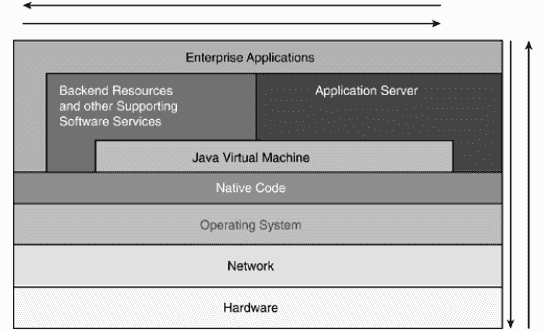

位于栈顶端的是由应用服务器执行的 J2EE 企业应用程序。应用服务器严格按照 J2EE 规范为应用程序提供运行时和执行线程。请注意，应用程序可以通过应用服务器或直接与其他后端资源交互；应用程序可以调用提供数据库访问包装器的特殊库，或者应用程序可以通过 JDBC 使用数据源。没有什么禁止应用程序开发人员用本地代码编写应用程序的部分。对于后端资源和其他软件服务也是如此。

应用服务器本身是一个 Java 应用程序（尽管其部分代码可以用本地代码编写），这意味着 JVM 的性能起着主要作用。企业应用程序与应用服务器共存于 JVM 的运行时环境中。从 JVM 的角度来看，企业应用程序只是应用服务器的一部分，因为后者执行前者。

剩下的层自然在许多其他系统中也很典型。请注意，随着方法或函数调用在栈中向下推进，会产生一些开销，而底层层的表现好坏会影响应用程序的整体性能。

### 企业应用程序

许多性能分析师表示，至少 75% 的情况下，性能不佳的主要原因是企业应用程序本身。如果性能栈中的问题位于最上层，下层无法提供太多帮助。

改进它。根据我们在该领域的众多客户经验，发现的许多问题仅通过修改应用程序本身即可解决。

应用程序性能不佳的两个主要原因如下：

- *糟糕的应用程序设计*。如果企业应用程序的设计一开始就非常糟糕，那么即使是最聪明的应用服务器也无济于事。架构设计和设计模式是当今最主要的专业领域之一。软件架构师应确保在应用程序设计的早期阶段就考虑性能。
- *不良的编程实践*。糟糕的编程习惯很容易导致性能低下。程序员应接受培训，并充分理解其所使用的编程模型和语言。许多论文和演示文稿都涵盖了 J2EE 应用程序开发和 Java 编程的最佳实践。

### 应用服务器

应用服务器可以用原生代码编写，但 J2EE 本质上是一个 Java 框架。为了更轻松地与其他基于 Java 的框架（如 JMX、JDBC 和 JNDI）进行交互和集成，大多数应用服务器都用 Java 编写。这也对应用服务器供应商有利，因为他们可以轻松地将产品移植到不同的平台上。

作为一个 Java 应用程序，应用服务器面临着与企业应用程序相同的评估。设计不良的应用服务器很可能表现出糟糕的性能。在这个市场中，供应商之间竞争的是谁拥有性能最好的应用服务器。因此，在应用服务器的设计和实现方面的每一分改进都至关重要。好的设计是从一开始就注重性能的设计。

**图 18-2** 展示了 J2EE 应用服务器的通用架构。请注意，该图并非软件架构图；它只是显示了所包含的组件以及这些组件之间的交互。

**图 18-2. 这里展示的应用服务器主要基于 J2EE 规范，该规范要求两个容器：Web 容器和 EJB 容器。**


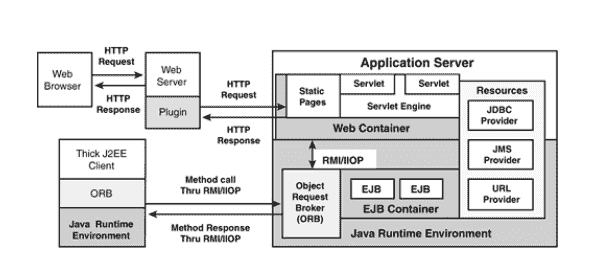


请求可以从两种可能的客户端类型转发到应用服务器：HTTP 客户端和胖 Java 客户端。HTTP 客户端通常通过 Web 浏览器实现，该浏览器向作为应用服务器前端的 Web 服务器发送 HTTP 请求。通常会向 Web 服务器安装插件，以实现对应用服务器的通信。此安装可以在安装应用服务器时完成。当应用服务器从 Web 服务器接收 HTTP 请求时，它通过检查统一资源标识符（`URI`）来确定必须由哪个 Web 应用程序处理该请求。对于动态 HTML 页面，请求由 `Servlet` 处理（`Java Server Pages` 在编译后转换为 `Servlet`）。根据 `J2EE` 规范，Web 请求在应用服务器内部的 Web 容器中处理。同时，`Servlet` 也可以调用驻留在应用服务器 `EJB` 容器中的 `EJB`。根据业务逻辑，请求可能涉及通过 `JDBC` 提供程序访问数据源等资源，或通过 `JMS` 访问消息队列。

胖客户端是在其自身的 Java 运行时环境中某处运行的完整 Java 应用程序。`EJB` 查找、创建以及对 `EJB` 方法的调用都在应用程序中编码实现。这与远程过程调用（`RPC`）类似，`RPC` 是 Java 创建之前分布式系统中使用的一种机制。用于执行远程方法的协议通常是基于 Internet 的 `ORB` 协议的远程方法接口（`RMI/IIOP`），它允许在 Java 2 平台上实现通用对象请求代理体系结构（`CORBA`）的分布式系统功能。`CORBA` 是对象管理组（`OMG`）的一项规范。一些供应商（如 `BEA`）使用专有协议，但大多数 `J2EE` 应用服务器预期的协议是 `RMI/IIOP`。Java 客户端直接与 `EJB` 通信；请求通过应用服务器的 `EJB` 容器路由。

主导类型的客户端仍然是 HTTP 客户端（或 Web 客户端）。大多数 `J2EE` 企业应用程序都有 Web 模块和 `EJB` 模块。基于 Java 的客户端正在迎头赶上，但 Web 客户端很可能在未来几年内保持主导接口地位。鉴于 Web 服务现在是前沿技术，这一点尤其如此。大多数 Web 服务使用 `SOAP` 协议，并以 HTTP 作为传输机制。

综上所述，应用服务器中与性能相关的关键主要组件包括 Web 容器、`Web 服务器插件`、`EJB` 容器、`ORB` 以及各种资源内部的接口。

### Java 虚拟机

从性能角度来看，Java 虚拟机（`JVM`）是应用服务器最关键组件之一，因为应用服务器的大部分（如果并非全部）代码都是由 `JVM` 执行的。必须以能利用 `JVM` 最佳特性方式编写应用服务器。

一些供应商提供多个 `JVM` 来运行应用服务器，并允许用户选择偏好，而另一些供应商则打包并预配置了它们的 `JVM`。然而，理想情况下，用户应能够手动更改其 `JVM`（可能需要与应用服务器配置相关的额外步骤）。能够更改 `JVM` 是有利的，因为它让您可以使用当前可用的性能最佳的 `JVM`。

`SPEC` 组织提供了一个名为 `SPECjbb2000` 的标准基准测试应用程序，可用于评估运行典型 Java 业务应用程序的服务器性能。该评估考虑了 `JVM` 服务器硬件和软件两个方面。`SPECjbb2000` 代表了批发供应商的订单处理应用程序。欲了解更多信息，请访问 `SPEC`：`http://www.spec.org/jbb2000`。

`JVM` 中对应用服务器至关重要的具体组件包括网络库、垃圾回收机制、内存管理子系统和 `JIT` 编译器。`JVM` 的扩展，如 `RMI/IIOP` 和 Java 安全性，也是重要的组件。

另一个需要考虑的重要领域是为 `JVM` 可用的标志集。您可以使用这些标志根据 `J2EE` 应用程序和应用服务器本身的特性来调整 `JVM`。

#### 原生代码

在性能栈中，无论如何都必须执行一些原生代码。原生代码最接近操作系统。对于应用服务器而言，`JVM` 是用 C 或 C++ 等第三代语言编写的，并直接编译生成由主机执行的 原生代码。其他组件，如后端资源和企业应用程序，也可能包含一些原生代码。

我们认为，原生应用程序的性能也很大程度上取决于应用程序的编写方式。`JVM` 本身是一个已经过架构设计、设计和实现的应用程序。`JVM` 的关键组件是 `JIT`（即时）编译器，其中 Java 应用程序的一些方法可能会在运行时编译为原生代码。通常，这些特性（例如 `JIT` 编译器和 C++ 编译器）包含代码优化功能，以便它们生成的代码尽可能高性能。为了实现高性能，编译器编写者需要深入理解主机架构以及底层操作系统。他们还需要了解操作系统提供的资源和系统调用，以及其策略。在这种情况下，了解 `Linux` 内核的工作方式以及每个内核版本附带的主要特性和修复非常重要。

#### 硬件和操作系统

选择运行应用服务器的硬件平台是一个需要考虑的重要因素，因为硬件执行所有指令。在本节中讨论硬件几乎有些多余，但有些事情需要强调。

首先，选择硬件平台是每个企业主必须早期完成的任务。此任务可能容易也可能困难，取决于许多因素及其影响，例如企业目前拥有的现有硬件以及这些资产上的遗留应用程序。

其次，企业主不断面临硬件性能快速进步带来的众多挑战。例如，处理器速度继续提高，性能技术（如超线程）日益普及。计算机架构继续朝着更好的性能和更高的容量发展。64 位机器正在到来，非统一内存访问（`NUMA`）备受关注，刀片服务器目前非常流行，因为它们具有小巧但非常强大和可扩展的优势。

第三个可能也是最重要的问题是这些机器上操作系统选择。操作系统的目的是管理硬件资源和在机器上运行的进程。糟糕和低效的操作系统会浪费硬件提供的许多资源。因此，操作系统是性能栈的关键贡献者。

操作系统本质上是一个软件应用程序，其性能很大程度上取决于其整体设计和实现。`Linux` 操作系统最初是个人计算机的一种类 UNIX 操作系统。它现在已成熟为许多企业级系统的操作系统，如跨越 Intel、PowerPC 和 390 架构的 IBM eServers；Sun 的 Sun Fire 系统；SGI Altix 系统；HP ProLiant 服务器；以及基于 Itanium 处理器的 HP Integrity Superdome。

使用 Java 的应用服务器的优点之一是可移植性。可移植性对于异构环境来说是理想的。可移植性让您无需提前担心目标平台即可编写应用程序。异构性提供了灵活性，使您可以混合搭配您可能已经拥有或计划申请采购的硬件和操作系统平台。

由于应用服务器只是更大企业系统中的一个组件，您需要计划每个组件应运行在哪个平台和操作系统上。例如，大多数系统使用 Intel 服务器作为 Web 服务器，使用大型 UNIX 系统作为应用服务器。后端数据源通常是大机系统或遗留系统。

以下各部分将以 `Linux` 操作系统作为应用服务器的首选平台进行考察。`Linux` 在开源社区中日益增长的普及度，帮助提升了其性能和可靠性。在 IBM、红帽（`Red Hat`）、惠普（`HP`）和太阳（`Sun`）等大型企业的支持下，`Linux` 操作系统已从一款廉价的类 UNIX 桌面操作系统演变为一款强大的企业级服务器。如今，许多 `Linux` 主机被用作 Web 服务器、邮件服务器、网络网关和 DNS 服务器。在应用服务器领域，大型企业已开始将其 `J2EE` 应用程序迁移到 `Linux` 平台。与此同时，越来越多的应用服务器厂商也开始支持 `Linux` 的不同版本。

### 应用服务器热点区域

本节讨论大多数应用服务器中常见的一些性能*“热点”*。

#### JVM

随应用服务器附带的 Java 虚拟机（`JVM`）负责解释和执行应用服务器本身以及企业应用程序。性能低下的 `JVM` 会导致整个系统性能下降。在相同的硬件上，`JVM` 在除 `Linux` 之外的其他操作系统上可能表现更好。一个可能的原因是，`Linux` 的实现可能没有针对特定功能使用正确的系统调用。`JIT` 编译器是 `JVM` 的关键组件，因为它将 Java 字节码翻译为原生代码。同样，如果 `JIT` 编译器未使用或误用了 `Linux` 中可用的服务，性能可能会受到显著影响。即使是同一供应商提供的同一 `JVM`，在 `Linux` 上运行于两个不同的平台时，也可能会看到性能差异。一个典型的例子是，在基于 `Linux` 内核 2.4 的 PowerPC 平台上，`JIT` 编译器发出的 `usleep()` 系统调用。事实证明，在 IA32 平台上，`JIT` 编译器发出的是 `sched_yield()` 而非 `usleep()`。`usleep(n)` 的语义是让调用线程睡眠 `$n$` 微秒，但 `usleep()` 调用了 `nanosleep()`，其最小粒度为 10 毫秒（长于 100 微秒）。因此，线程的实际睡眠时间比预期更长。作为结果，这在 PowerPC 平台上导致了巨大的扩展性问题。必须修复 `JIT` 编译器，使其使用 `sched_yield()` 系统调用而非 `usleep()`。

不仅选择高性能的 `JVM` 很重要，正确调整 `JVM` 也同样重要。性能调优将在本章后文的“`性能调优`”一节中讨论。

### 网络

应用服务器既然是服务器，就隐含了网络通信。然而，应用服务器不仅仅是普通的文件服务器或定时器服务器。应用服务器非常复杂，因此，高网络流量是应用服务器的固有特征。

### 线程


## 应用服务器线程管理

应用服务器另一个重要的方面是线程管理。如 `J2EE` 规范所规定，`Web` 容器和 `EJB` 容器都有责任为每个传入的请求提供执行线程。线程是热点区域，因为应用服务器可以按自己的方式管理线程。某些应用服务器可能提供与线程相关的用户参数，您应密切关注这些参数的含义。此外，底层操作系统的线程管理特性对性能至关重要。

### 内存使用

应用服务器倾向于使用大量内存。大多数实现都会缓存对象、会话、连接、结果以及许多其他制品，以加快执行速度。商业应用服务器用于数据的典型虚拟内存范围在 300MB 到 400MB 之间。`Linux` 进程在物理内存中的大小范围在 50MB 到 125MB 之间。内存使用在 Java 中至关重要，因为垃圾回收机制会影响性能。垃圾回收会影响性能，因为它会冻结应用服务器一小段时间；因此，在此期间没有实际工作被执行。分配给 `JVM` 的内存量必须仔细衡量，并根据应用程序的使用模式确定适当的平衡。

### 同步

另一个热点是同步的处理。尽管应用服务器并发处理请求，但每个请求并非完全独立或与其他请求互斥。一些请求由相同的应用代码处理，或者可能共享相同的资源。因此，同步对于正常运行是必要的。同步点通常出现在数据和资源共享处。对象池也是同步发生的地方，因为池中的对象是有限的。一些线程（正在运行的线程始终与特定请求相关联）被迫等待，直到一些对象被放回池中。

### 字符串操作

应用服务器是一个巨大的字符串操作程序。应用服务器的性能配置文件通常显示，创建的大多数对象都是 `String` 对象。考虑到大多数程序输入是 `HTTP` 请求，输出是 `HTML`（这也大量涉及字符串），这并不令人惊讶。随着 `XML` 的出现，应用服务器花费大量时间解析 `XML` 文件、构建树等。与资源提供者的通信协议也主要使用字符串对象，如 `SQL` 查询、消息和 `URL`。

### Web 服务器

由于应用服务器是 `Web` 服务器的后端服务器，潜在瓶颈的第一个点就是 `Web` 服务器。应用服务器的功能取决于 `Web` 服务器转发的请求数量。因此，正确调整 `Web` 服务器是整个过程中的关键步骤。

### 文件系统

`Linux` 文件系统是另一个热点，因为应用服务器会对本地文件系统执行大量的读写操作。商业应用服务器通常会记录其活动日志。对于 `JVM` 而言，类或 jar 文件是从文件系统加载的。当启用类垃圾回收时，相同的类或 jar 文件可能会根据是否被垃圾回收而加载多次。

## 提升性能和高可用性

本节讨论企业客户用于提升其 `J2EE` 企业应用程序性能及其高可用性的三种主要方法。这些方法是 `SMP` 扩展、集群化和拓扑结构。

### SMP 扩展

多处理器系统如今非常常见，甚至在低端系统中也是如此。例如，`IBM xSeries` 桌面系统可以轻松地配备 2 到 8 个 `Intel Xeon` 处理器。向现有系统添加额外的处理器已成为企业主的一个诱人选项。向系统添加更多处理器基本上就是增加马力，即计算能力。从理论上讲，当系统中增加更多计算能力时，应用服务器应该能够在相同的时间内处理比之前更多请求。

`SMP` 系统被称为对称型，因为添加的处理器是相同的，并连接到同一个总线。这些处理器还共享一个公共内存存储。理想情况下，当向系统添加 n 个处理器时，结果将是 n 倍的性能提升。然而，要实现这一点，必须在额外处理器与其他共享资源（如系统总线、内存和网络接口）之间保持平衡。通过增加更多处理器，访问共享资源时发生争用的可能性会增加。当这种情况发生时，需要实施同步；因此，部分计算能力无法被使用。

`SMP` 系统绝对是提升应用服务器整体性能的好方法。然而，随着更多处理器的添加，应用服务器可能无法提供预期的性能提升。如果发生这种情况，说明系统正面临扩展性问题。

扩展性问题的原因可能来自图 18-1 所示的软件性能栈中的所有层。企业应用程序本身可能不可扩展，问题可能出在应用服务器，甚至 `JVM`。不要低估 `Linux` 可能在扩展性方面表现不佳这一事实。硬件本身对其能处理以获得良好扩展性的最大处理器数量也存在限制。因此，熟悉硬件平台的性能规格非常重要。

由于 `Linux` 最初是作为类 `UNIX` 的桌面操作系统设计的，其内部设计最初并未考虑 `SMP` 扩展。如今，`Linux` 内核已经进行了重大改进，以解决 `SMP` 扩展问题。如果您使用的是 `SMP` 系统，请确保您的内核支持 `SMP`。您可以通过发出 `uname -a` 命令并查找内核版本后的 `smp` 扩展以及日期前的 `SMP` 字样来验证您的内核是否支持 `SMP`，如下面的示例输出所示：

`SMP` 系统是许多企业应用程序服务器在非 `Linux` 系统上的常见配置选择。到目前为止，扩展问题的最可能原因是企业应用程序或操作系统。

### 集群

集群是另一种提高企业应用程序整体性能的方法。集群还可用于确保高可用性。集群与添加更多处理器无关，而是与添加更多应用程序服务器实例有关。这些实例提供完全相同的应用程序。换句话说，可以想象这些应用程序服务器是彼此的克隆。这样做之后，传入的 `HTTP` 请求可以由这些应用程序服务器实例中的任意一个处理。

有两种类型的集群：垂直集群和水平集群。垂直集群是指在同一个 `Linux` 服务器上创建两个或更多相同应用程序服务器的实例，如图 18-3 所示。由于这些应用程序服务器是独立的进程，因此垂直集群中重要的是有足够的内存可供实例共享。通过 `Web` 服务器传入的请求仍被引导至同一主机。然而，为了让这些请求分散到不同的实例，这些应用程序服务器必须相同，并部署相同的企业应用程序。在分散请求时，可以使用任何分配策略，通常是轮询（`round-robin`）。当机器的 `CPU` 利用率可以更好地通过更多的应用程序服务器来消耗时，通常使用垂直集群。此外，垂直集群可用于服务器机器的容错，这样当一个应用程序服务器失效时，请求可以重新路由到不同的应用程序服务器。


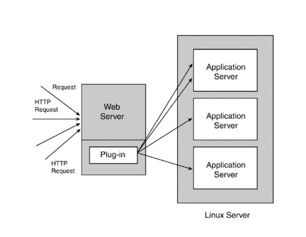

*水平集群*是指在不同的 `Linux` 服务器上创建两个或更多相同应用程序服务器的实例。因此，这种方法严格地增加了更多的 `CPU` 能力，因为实际上增加了更多的 `Linux` 服务器。请注意，这些服务器不必相同，但应用程序服务器必须相同，如图 *18-4* 所示。当请求通过 `Web` 服务器传入时，其原理与垂直集群相同。唯一的区别是请求分散到不同的 `Linux` 服务器。水平集群表现出更多的性能提升，因为有更多物理机器。与垂直集群不同，在垂直集群中应用程序服务器仍必须争夺可用的 `CPU`，水平集群中的应用程序服务器拥有自己的一组 `CPU`。此外，水平集群提供的容错是在 `Linux` 服务器级别。当一台 `Linux` 服务器发生故障时，传入的请求可以重新路由到另一台 `Linux` 服务器，从而增加高可用性。在垂直集群中，当 `Linux` 服务器本身发生故障时，所有应用程序服务器也会随之故障。当然，水平集群可能需要更多的投资，因为它涉及多台 `Linux` 服务器。

**图 18-4. 水平集群。在不同的 Linux 服务器上创建两个或更多相同应用程序服务器的实例。**

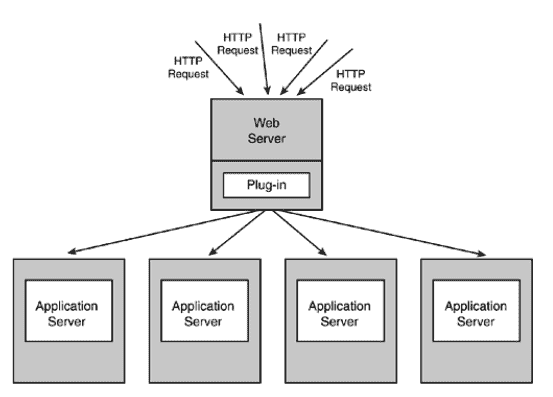

当然，也可以结合这两种方法，拥有一组包含多台 `Linux` 服务器的集群，每台 `Linux` 服务器托管多个应用程序服务器。一些企业主采用这种组合方法来实现两套或更多套水平集群。换句话说，`Linux` 服务器中的应用程序服务器在垂直集群的严格意义上并不真正相同，因为它们没有相同的应用程序。它们在同一个服务器上创建，只是为了更充分地利用可用的 `CPU` 能力。在某些应用程序服务器中，插件可以将请求分散到不同的服务器。在另一些应用程序服务器中，第三方分散程序——例如 `IBM Network Dispatcher` 或 `f5 Networks` 的 `BigIP`——放置在 `Web` 服务器和 `Linux` 服务器之间。

扩展性也是集群中的一个关注点。在垂直集群的情况下，只能添加有限数量的应用程序服务器实例。超过该限制后，添加更多的应用程序服务器实例不仅无益，还可能导致性能下降。

集群中扩展问题的最可能原因是硬件资源：`CPU`、系统总线和内存。扩展问题的另一个可能原因是操作系统的调度程序系统，因为集群有更多的进程需要为相同数量的资源进行调度。在水平集群的情况下，网络子系统可能会阻碍扩展性，因为随着越来越多的请求传入，连接集群的网络流量变得 heavier。此外，插件或分散程序可能不具备可扩展性。另外，某些应用程序服务器可能包含一个工作负载管理器，该管理器根据集群中每个节点的负载来路由请求。工作负载管理器也可能是潜在瓶颈的原因。

### 拓扑

企业业务用于提高其 `J2EE` 企业应用程序性能的另一种方法是使用拓扑类型来设置应用程序服务器基础设施。每个业务系统都可以根据其需求以及可能需要部署的应用程序的性质设计出适合自己的拓扑结构。然而，请记住，拓扑的目标始终应该是满足高性能和高可用性的基本需求。


一般来说，应用程序服务器的使用涵盖了一个广泛的光谱，这也是为什么应用程序服务器的性能表征不是一个简单的过程。一方面，应用程序服务器可以仅用于提供静态页面，就像 Web 服务器一样。另一方面，可以配置应用程序服务器集群与后端数据库服务器和外部服务网关进行通信。此外，集群可以由防火墙保护，并在地理位置不同的位置进行复制。应用程序服务器可以运行数百个应用程序。拓扑的选择主要取决于系统的复杂性和需求，例如安全性、性能、故障转移和高可用性。图 18-5 展示了基本的三层拓扑，其中 Web 服务器和应用程序服务器托管在同一台服务器机器上。

### 图 18-5. 基本三层拓扑。

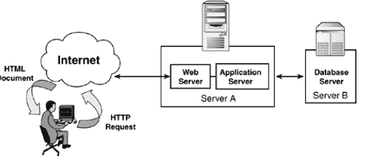

大多数企业使用数据库来存储其持久性数据。在这种拓扑中，数据库服务器托管在一台单独的服务器机箱上，可能是一台大型机。J2EE 应用程序发出一些 JDBC 调用以从数据库中检索和更新数据。在典型场景中，Web 用户向托管在服务器 A 上的 Web 服务器发送 HTTP 请求。通过检查请求，Web 服务器确定该请求应由应用程序服务器处理，因此将请求传递给应用程序服务器。应用程序服务器通过将请求交给服务器上部署的适当应用程序来处理该请求。该应用程序处理请求并向 Web 服务器返回响应。然后，Web 服务器将响应返回给请求的原始发送者。这种类型的拓扑对于小型企业可能已经足够。小型企业通常使用安全套接字层（SSL）来保护客户信息并利用应用程序服务器提供的安全功能。

### 图 18-6. DMZ 拓扑。

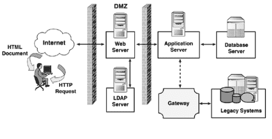

图 18-6 是一个更复杂的拓扑，适用于需要更严格安全性的中大型企业。在这种拓扑中，设置了防火墙，将 Web 服务器置于非军事区（DMZ），而应用程序服务器和后端数据库或遗留系统则完全受到保护，与互联网隔离。DMZ 是位于受信任的内部网络（如公司私有局域网 LAN）和不受信任的外部网络（如公共互联网）之间的位置，计算机或小型子网坐落在此处。

通常，使用基本用户 ID 和密码等安全机制来认证 Web 用户。LDAP 服务器通常用于存储用户及其相应的授权信息。Web 服务器查询 LDAP 服务器，以认证和授权刚刚登录的用户。对于经过授权的用户，请求通过防火墙传递给应用程序服务器，后者处理该请求。例如，请求可能由一个 Servlet 处理，该 Servlet 需要存在于两个不同数据源中的数据，即 Oracle 数据库和 SQL Server 数据库。当发出请求时，应用程序通过调用本地数据库驱动程序或通用（JDBC 或 ODBC）驱动程序来请求数据，该驱动程序使用 HTML、Java 或 XML 格式化的结果数据，使 Web 浏览器能够理解，然后将数据放入模板中。然后，Web 浏览器接收数据并为用户呈现出来。

这个例子是一个简化的视图，隐藏了许多“幕后”发生的事情。例如，应用程序服务器必须以某种方式能够认证用户，服务器必须具备运行小程序和处理数据导入的处理能力，并且它必须与高效 web server（如 Apache web server）以确保数据能够正确发送给用户。

下一个拓扑结构如图 18-7 所示，它通过添加更多应用程序服务器扩展了前一个拓扑结构。此拓扑结构的核心理念是通过增加处理器数量来提升企业的处理能力，从而提高整体吞吐量。在这种情况下，会增加一台或多台机器。每个新增的服务器节点都具有与原始节点相同的配置——部署相同的应用服务器和应用。当进入 web server 的并发请求数量很高，导致单个应用服务器的性能达到饱和点时，额外的应用服务器可以通过分担部分负载来提供帮助。因此，web server 必须能够使用负载均衡算法将请求分散到可用的应用服务器中。最直接的算法是轮询（round-robin），即按照固定顺序将请求依次分配给每个应用服务器，并不断重复该序列。理论上，轮询算法能够均匀地将负载分配给所有应用服务器。通过负载均衡，请求被分散到集群中所有正在运行的应用服务器上，而不是冒着一两个服务器过度工作并接近崩溃边缘的风险。这种类型的负载均衡是整体 web server 领域的基础。通常，应用服务器采取一到两种方法：要么采用简单的轮询算法，将传入请求发送至负载较轻的服务器；要么实施基于算法的系统，分析整个网络的使用情况，并根据系统管理员设定的参数，将请求发送给最能处理该请求的服务器。

### 图 18-7. 负载均衡。

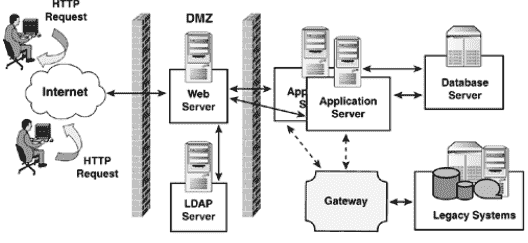

下一个拓扑结构如图 18-8 所示，是前一个拓扑结构的进一步扩展。主要区别在于，相同的拓扑结构现在被复制到多个实例中。图 18-8 仅显示了两个实例。每个实例被称为一个域（domain），因此该拓扑结构被称为多域拓扑结构。此拓扑结构本质上实现了另一层的高可用性和负载均衡。域可以在地理上分散在许多地方。请注意，一个新的服务器，称为请求分发器（Request Sprayer），成为前端（因此也是单一入口点），它接受请求并将其分发给可用的 web server。web server 执行必要的安全检查以及将请求分发给应用服务器，如前一张图所述。由于应用服务器分成多个域对用户来说是透明的，因此注意 web server 通常共享同一个 LDAP 存储库。在某些架构中，可能有一个 LDAP 服务器池，以便 web server 可以访问其中任何一个。然而，在这种情况下重要的是，这些 LDAP 服务器的存储库必须保持同步以确保一致性。

### 图 18-8. 多域拓扑结构。

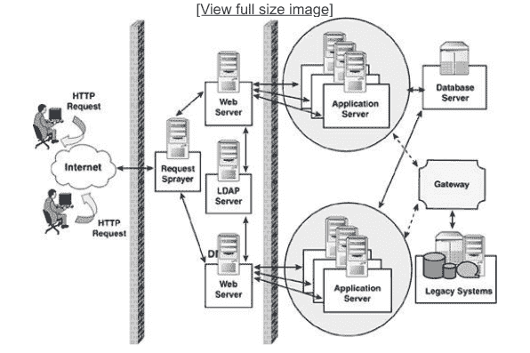

这种多 LDAP 服务器方法非常适合故障转移。图 18-8 中显示的多域拓扑结构表明后端由所有域共享。然而，这并不一定总是正确的，例如在多个 LDAP 服务器的情况下。

尽管成本高昂，多域拓扑结构的优点是高可用性。由于各种原因，例如电力中断、应用部署、版本升级或系统崩溃，一个域可能会暂时停机。但是，这种停机不会关闭整个企业的运营，因为请求可以被路由到仍然在线的其他域。随着工作负载的增加，多域拓扑结构还为系统提供了可扩展性。

## 性能调优

性能调优是提升任何服务器性能的基本方式。性能调优的关键在于找出被调查系统中的性能瓶颈。在识别出瓶颈后，应对其进行修复和/或调优。性能调优可以在软件性能堆栈中的任何参数可设置的层中进行。性能调优在于为这些参数找到合适的值。性能调优也是通过确保所有参数值的组合创建一个平衡系统，从而使系统达到和谐的艺术。

调优应用服务器的性能比一般的性能调优范围更广。必须从头到尾分析被测系统，包括所有与应用服务器通信的外部组件。这可以通过自上而下方式完成，最初将整个系统视为黑盒。随着性能数据的收集，进行分析并识别可能的嫌疑点，您可以进一步向下走一步，获取更多与嫌疑点相关的信息。这过程会反复进行，直到发现瓶颈的原因。

性能分析工具在此过程中非常重要。黄金法则是使用正确的工具解决正确的问题。有数百种工具可用于分析 J2EE 应用的性能，其中一些是商业工具。关于 Linux 服务器的工具在本书第三部分“系统调优”中进行了讨论。这些工具在分析操作系统层面的性能时非常有用。

应用服务器的性能分析可以分为三个层次：与 J2EE 相关的、与 JVM 相关的，以及与 Linux 操作系统和硬件相关的。这些领域在图 18-9 中有所展示。

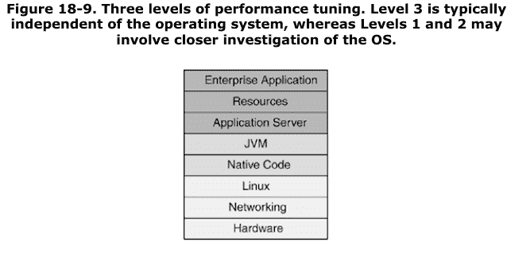

第 3 层代表 J2EE 特定的领域，包括应用服务器本身。这些领域可以独立于底层操作系统进行调优。例如，应用服务器中的某些参数可以在不考虑 Linux 特定参数的情况下进行调优，包括预编译语句缓存大小、连接池和事务超时。关于 J2EE 应用的性能分析和调优的文献非常丰富；一个好的参考是。

第 2 层代表与 JVM 高度相关的领域，实现 JVM 的原生代码，以及由 JIT 编译器生成的原生代码。JVM 中的特定参数也独立于操作系统，例如最大和最小堆大小以及垃圾回收策略。但其他参数与操作系统紧密耦合——例如，最大堆大小。大多数关于 J2EE 性能调优的文献也包括 JVM 性能调优。

第 1 层代表与 Linux 操作系统及其运行的硬件平台更具体的领域。

在寻找性能问题的原因时，推荐的方法是从第 3 层到第 1 层。这意味着在深入调优 Linux 之前，应尽可能确保其上方的所有其他层都已排查完毕。给予 Linux 无罪推定，将其作为最后的怀疑对象，除非明显且无可辩驳地表明问题是与 Linux 相关的。您的系统管理员应已将 Linux 配置到最佳状态。然而，Linux 的所有全局配置可能并不适用于您系统中的所有应用程序。

在调优应用服务器时，最好的方法是使用 CPU 利用率作为优化目标。这在单服务器和集群配置中都适用。以下是此方法涉及步骤的大致大纲：

- 1. 选择一个要在应用服务器上运行的应用程序。
- 2. 设置测试环境。
- 3. 执行用户阶梯增长测试。


- 使用一个用户运行测试并收集必要的统计数据，如吞吐量、平均响应时间、`CPU` 利用率等。如果环境中涉及其他系统，如远程数据库机器或 `web server`，也收集操作系统级别的统计信息，如 `CPU` 利用率和 `I/O` 统计。

- 执行上一步骤，但将用户数量加倍。

- 当 `CPU` 利用率达到极限（100% 使用）或倾向于保持与之前运行大致相同水平时停止。

### 4. 如果 `CPU` 已达极限，则系统没有瓶颈。否则，您需要调查是什么导致了空闲时间。

### 5. 在确定瓶颈的可能原因并对其进行修复/调优后，执行另一次用户增加测试。

### 6. 重复此过程，直到应用服务器的 `CPU` 达到最大负载。

对于集群配置，请调查所有应用服务器机器的 `CPU` 利用率。只有在完成单服务器测试后，才测试集群配置。集群配置适合测试可扩展性问题。此外，建议将一台机器专门分配给应用服务器，并将所有其他服务器（数据库服务器、`JMS` 服务器等）移至远程机器上。后续章节将通过一个实际示例来说明这种方法。

确定瓶颈存在后，下一步是寻找它。需要经验和接触大量问题案例，才能快速找到罪魁祸首。我们可以提供一些指南，包括以下内容：

- 企业级应用。确保企业级应用没有导致问题。使用工具对应用进行分析，以检测路径长度、方法时间、内存使用和线程等待方面的问题。目前 Linux 平台上可用的用于 `J2EE` 性能分析的一些商业工具包括 Quest Software 的 `JProbe`、Borland 的 `OptimizIt` 以及 IBM 的 Rational `Purify/Quantify`。`Eclipse` 是 Linux 上可用的开源分析器。

要成为一名专家级性能分析师，你必须熟悉 `J2EE` 编程概念以及良好性能的最佳编程实践。

- Java 虚拟机。`JVM` 对应用服务器至关重要。请确保根据企业级应用的行为进行适当调优。更具体地说，检查堆大小是否正确设置。检查垃圾收集器的行为。使用并行垃圾收集器是否有帮助？如果 `JVM` 基于 `hot-spot` 技术，它是否已启用？是否支持大页面，并且你的 Linux 内核是否也支持？是否已启用 `JIT`？这些只是你可以检查的一些事项。

你能做的最好的事情是查看 `JVM` 实现者的帮助指南或网站，以查找可用于调优的参数。如果你打算成为应用服务器的专家级性能分析师，你必须深入理解 Java 虚拟机的基础及其一些实现细节。

- 安全性。如果 `Web` 服务器使用安全性，请验证其是否正确调优以处理 `SSL` 请求。此外，应用服务器可能有一些可用于 `SSL` 或 `J2EE` 安全的性能调优参数。安全性本身是一种开销。据估计，安全性可能会使应用服务器的速度降低 20% 到 25%。通过关闭安全性来测试你的系统，并检查你是否获得了比这个百分比多得多的性能提升。

- 网络。由于应用服务器与 `Web` 服务器、数据库服务器、`JMS` 服务器、`LDAP` 服务器和其他远程服务器之间的网络通信非常密集，请验证 `TCP/IP` 协议栈是否已正确调优。检查应用服务器正在与之通信的服务器也很重要。例如，检查数据库服务器是否已正确调优，以及它是否能及时处理由应用服务器传递给它的数据量。另一个需要关注的关键服务器是 `Web` 服务器。在这些情况下，你可能需要其他人帮助，这些人必须具备检查这些服务器所需的技能。

- 文件系统。使用 `sar` 和 `iostat` 等工具记录文件系统活动。还请检查是否发生大量的文件交换。

- 并发性。如果你使用的是 2.4 内核，通过运行 `vmstat` 来检查正在发生的上下文切换。如果上下文切换略高，请确保应用服务器的线程池不会太高。通常，10 到 20 个线程的线程池就足够了。超过这个数量，性能可能会下降。由于 Linux 2.6 内核支持 `NPTL`，这种限制可能会得到缓解。

- 内存。具体检查系统内存使用情况，即分配给应用服务器的内存。确定系统是否需要升级以添加更多内存。

- 扩展性。验证系统是否具有良好的扩展性。在 `SMP` 系统中，如果处理器数量是损害而非帮助，明智的做法是禁用一些处理器。如果配置了纵向集群，请确保应用服务器的实例数量不要太多。确定添加更多应用服务器是否会增加 `CPU` 利用率。如果是，请终止其中一些应用服务器。

根据你所拥有的环境类型（例如，超线程或 `NUMA`），你可能还可以研究其他事项。验证你的 Linux 内核是否支持系统中的这些额外功能。

调优应用服务器是一项全系统活动。系统的所有组件都需要有一个性能故事，你应该能够处理软件性能堆栈中的所有层。应用服务器是一个复杂的中件，调优过程也是如此。

## 总结

应用服务器是复杂的中件，如今已成为 IT 行业中最有用的工具之一。应用服务器通常被商业企业用于将其业务推向互联网。本章讨论的具体类型的 应用服务器是基于 `J2EE` 的应用服务器，它目前是最广泛使用的应用服务器类型。

表征应用服务器的性能并不简单，因为这样做涉及许多外部组件。需要考虑这些组件，因为它们自身的性能会影响应用服务器的整体性能。我们提供了一个软件性能堆栈来说明影响应用服务器性能的不同软件层。必须单独处理这些层中的每一层，以诊断性能问题并提高性能。

我们还提供了一些关键概念，涉及提高性能和高可用性的不同方法。要记住的重要事项是，你必须确定企业的性能需求——预期的请求量和预期的响应时间。从这里开始，你可以确定系统应具备多大的容量才能满足这些需求。有许多拓扑可供选择，但你的决定在很大程度上取决于你的需求。

## 参考文献

- [1] Brown, K., G. Craig, G. Hester 等。 *Enterprise Java Programming with IBM WebSphere*（IBM WebSphere 上的企业级 Java 编程），第 2 版。Addison-Wesley，2003。

- [2] Jones, S., R. Willenborg 和 K. Hygh。 *Performance Analysis for Java Web Sites*（Java 网站性能分析）。Addison-Wesley，2003。ISBN 0-20-184454-0。

- [3] Menasce, D. A. 和 V. A. F. Almeida。 *Capacity Planning for Web Performance: Metrics, Models, & Methods*（Web 性能的容量规划：指标、模型和方法）。Prentice Hall PTR，新泽西州上鞍河，1998。ISBN 0-13-693822-1。

# 第五部分：调优案例研究

- 第十九章。案例研究：调优 Linux 2.6 中的 I/O 调度器

- 第二十章。案例研究：文件系统调优

- 第二十一章。案例研究：Linux 网络性能

- 第二十二章。案例研究：商业负载调优

- 附录 A。调优内核参数

## 第十九章。案例研究：调优 Linux 2.6 中的 I/O 调度器

作者：Dominique Heger 和 Steven Pratt

### 引言

本章的目标是在不同的工作负载条件下量化 Linux 2.6 的 I/O 性能。这些工作负载条件的范围从单 CPU、单磁盘设置到使用大型复杂 RAID 系统的 SMP 系统。结合不同的 I/O 工作负载模式，重点在于量化基线性能以及在不同 Linux 2.6 I/O 调度器和文件系统配置下的优化性能行为。分析结果将建立性能指标，概述 I/O 性能行为并指导配置、设置和微调过程。

分析中的汇合点是整个 I/O 堆栈，其中包含 I/O 路径中现有的主要软件和硬件 I/O 优化功能。一般来说，过去几年中 I/O 堆栈变得更加复杂。当代 I/O 解决方案包括硬件、固件和软件支持，用于诸如请求合并、自适应预取、直接 I/O 的自动调用或异步写回策略等功能。从硬件角度来看，在内存、RAID 控制器和物理磁盘层引入大型缓存子系统，使得能够非常积极地利用这些 I/O 优化技术。I/O 堆栈不同层中包含的不同优化方法之间的相互作用尚未得到很好的理解，也未被量化到足以对 I/O 性能做出理性陈述的程度。Linux 操作系统一个相当有趣的功能是 I/O 调度器。与 CPU 调度器不同，I/O 调度器本身并不是任何操作系统的必要组件。因此，它不是某些商业 UNIX 系统中的实际构件。

在查看 Linux 2.6 的 I/O 调度器及其性能之前，我们首先讨论本章中使用的基准测试环境和负载配置文件。

### 基准测试环境与工作负载配置文件

本章中用于收集结果的所有基准测试均在 Linux 2.6.4 环境中运行。在本研究中，CFI/O 调度器从 Linux 2.6.5 回移植到 2.6.4。基准测试在以下系统上运行：

- 16 路 1.7GHz Power4+ IBM p690 SMP 系统，配置有 GB 内存。28 个 15,000 RPM SCSI 磁盘驱动器，配置为单个 RAID-0 设置，使用 Emulex LP9802-2G 光纤控制器（测试中仅使用其中一个）。该系统配置了 Linux 2.6.4 操作系统。


# 系统配置

## 8 路 NUMA 系统
配备 Pentium IV Xeon 2.0GHz 处理器和 512KB L2 缓存子系统的 IBM x440。配置了四张 `qla2300` 光纤卡（本研究中仅使用一张）。I/O 子系统由两个 FAST700 I/O 控制器组成，使用 15,000 RPM SCSI 18GB 磁盘驱动器。该系统配置了 GB 内存，设置为 RAID-5（五个磁盘）配置，并使用 Linux 2.6.4 操作系统。

## 单 CPU 系统
配备 Pentium IV Xeon 1.5GHz 处理器和 512k L2 缓存子系统的 IBM x440（8 路；本研究中仅使用一个 CPU）。该系统配置了 Adaptec `aic7899` Ultra160 SCSI 适配器和一个 10,000 RPM 18GB 磁盘。该系统使用 Linux 2.6.4 操作系统，并配置了 1GB 内存。

# 基准测试

本研究使用的基准测试如下：

## Web 服务器基准测试
此基准测试每个可用 CPU 使用四个工作线程。在第一阶段，基准测试创建几十万到文件，大小从 4KB 到 64KB 不等。文件分布在 100 个目录中。创建阶段的目标是通过创建超过系统 RAM 所能缓存数量的文件，从而超过内存子系统的大小。每个工作线程对随机选定的文件执行 1,000 次随机读取操作。此基准测试中的工作负载分布源自 Intel 的 Iometer 基准测试。

## 文件服务器基准测试
此基准测试每个可用 CPU 使用四个工作线程。在第一阶段，基准测试创建几十万到文件，大小从 4KB 到 64KB 不等。文件分布在 100 个目录中。创建阶段的目标是通过创建超过系统 RAM 所能缓存数量的文件，从而超过内存子系统的大小。每个工作线程对随机选定的文件执行 1,000 次随机读取或写入操作。每个线程的读取与写入操作比率分别为 80% 和 20%。此基准测试中的工作负载分布源自 Intel 的 Iometer 基准测试。

## 邮件服务器基准测试
此基准测试每个可用 CPU 使用四个工作线程。在第一阶段，基准测试创建几十万到文件，大小从 4KB 到 64KB 不等。文件分布在 100 个目录中。创建阶段的目标是通过创建超过系统 RAM 所能缓存数量的文件，从而超过内存子系统的大小。每个工作线程对随机选定的文件执行 1,000 次随机读取、创建或删除操作。每个线程的读取、创建与删除操作比率分别为 40%、40% 和 20%。此基准测试中的工作负载分布（大致）源自 SPECmail2001 基准测试。

## 元数据基准测试
此基准测试每个可用 CPU 使用四个工作线程。在第一阶段，基准测试创建几十万到文件，大小从 4KB 到 64KB 不等。文件分布在 100 个目录中。创建阶段的目标是通过创建超过系统 RAM 所能缓存数量的文件，从而超过内存子系统的大小。每个工作线程对随机选定的文件执行 1,000 次随机创建、写入（追加）或删除操作。每个线程的创建、写入与删除操作比率分别为 40%、40% 和 20%。

## 顺序读取基准测试
此基准测试每个可用 CPU 使用四个工作线程。在第一阶段，基准测试在单个目录结构中创建几个百 50MB 的文件。创建阶段的目标是通过创建超过系统 RAM 所能缓存数量的文件，从而超过内存子系统的大小。每个工作线程执行 64KB 顺序读取操作，从偏移量 0 开始读取整个文件直到偏移量 5GB。此过程在每个工作线程基础上对随机选定的文件重复 20 次。

## 顺序写入（创建）基准测试
此基准测试每个可用 CPU 使用四个工作线程。每个工作线程执行 64KB 顺序写入操作，直到目标文件大小达到 50MB。此过程在每个工作线程基础上对新创建的文件重复 20 次。

# I/O 调度器与性能

作为工作负载生成器，本案例研究使用了灵活文件系统基准测试（FFSB）基础设施。FFSB 代表一种基准测试环境，通过模拟多种多样的 I/O 模式来促进 I/O 性能分析。基准测试在多个独立文件系统上执行，利用可调整数量的工作线程，每个线程可能基于组合或基于线程的 I/O 配置文件进行操作。使文件系统老化以及收集系统利用率和吞吐量统计信息是基准测试框架的一部分。除了更传统的顺序读取和顺序写入基准测试外，本案例研究还使用了文件服务器、Web 服务器、邮件服务器和元数据密集型 I/O 配置文件（在前一节中讨论过）。

文件和邮件服务器工作负载基于 Intel 的 Iometer 基准测试，而邮件服务器事务混合则大致源自 SPECmail2001 I/O 配置文件。本案例研究中的 I/O 分析由两个不同的重点组成。研究的一个重点是跨四个基准测试工作负载配置文件实现的聚合 I/O 性能，而另一个重点是顺序读取和写入性能行为。对跨四个不同工作负载配置文件的聚合性能的关注，是基于这样的主张：I/O 调度器必须在多种工作负载场景和硬件配置中提供足够的性能。除非另有说明，所有执行的基准测试均在 Ext3 和 XFS 文件系统环境中使用默认调优值运行。在本章中，术语 *响应时间* 代表实际 FFSB 基准测试的总运行时间，包含由工作线程执行的所有 I/O 操作。

下一节讨论在单 CPU 单磁盘系统上进行的基准测试。

## 单 CPU 单磁盘设置

四个工作负载配置文件的归一化结果揭示，`deadline`、`noop` 和 `CFQ` 调度器在 *Ext3* 和 *XFS* 上的表现分别在 2% 和 1% 以内（见图 19-1）。在 *Ext3* 上，`CFQ` 调度器具有轻微优势，而在 *XFS* 上，`deadline` 调度器提供了最佳的聚合（归一化）响应时间。在两个文件系统中，`AS` 调度器代表效率最低的解决方案，在 *Ext3* 和 *XFS* 上分别落后于其他 I/O 调度器 4.6% 和 13%。不出所料，在单磁盘系统中基准测试的四个工作负载中，`AS` 在 Web 服务器场景中落后于其他三个 I/O 调度器幅度较大，该场景反映的是 100% 的随机读取操作。在顺序读取操作上，`AS` 调度器平均比另外三个实现高出 130% 和 127%，分别在 *Ext3* 和 *XFS* 上。顺序读取结果清楚地支持了本章中关于 `AS` 设计重点所在方向的讨论。在顺序写入操作的情况下，`AS` 在 *Ext3* 上显示了最高效的解决方案，而 `noop` 调度器在 *XFS* 上提供了最佳吞吐量。顺序写入场景中各 I/O 调度器之间的性能差异在 *Ext3* 上为 8%，在 *XFS* 上为 2%。

**图 19-1. 聚合响应时间（归一化）。**

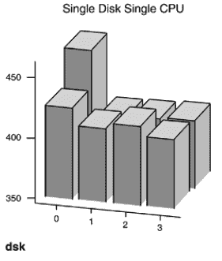

在图 19-1 中，x 轴描绘了 I/O 调度器；0 = AS，1 = deadline，2 = noop，3 = CFQ。前排反映 Ext3 配置，而后排显示 XFS。y 轴揭示了每个 I/O 调度器在四个基准测试配置文件上的聚合（归一化）响应时间。

### 表 19-1. 单磁盘单CPU平均响应时间（秒）（AS，Deadline，Noop，CFQ）

| 配置文件 | AS - Ext3 | DL - Ext3 | NO - Ext3 | CFQ - Ext3 | AS - XFS | DL - XFS | NO - XFS | CFQ - XFS |
| :--- | :--- | :--- | :--- | :--- | :--- | :--- | :--- | :--- |
| **文件服务器** | 610.9 | 574.6 | 567.7 | 579.1 | 613.5 | 572.9 | 571.3 | 569.9 |
| **元数据** | 621 | 634.1 | 623.6 | 597.5 | 883.8 | 781.8 | 773.3 | 771.7 |
| **Web服务器** | 531.4 | 502.1 | 498.3 | 486.8 | 559 | 462.7 | 461.6 | 462.9 |
| **邮件服务器** | 508.9 | 485.3 | 522.5 | 505.5 | 709.3 | 633 | 648.5 | 650.4 |
| **顺序读取** | 405 | 953.2 | 939.4 | 945.4 | 385.2 | 872.8 | 881.3 | 872.4 |
| **顺序写入** | 261.3 | 276.5 | 269.1 | 282.6 | 225.7 | 222.6 | 220.9 | 222.4 |

接下来，我们将描述一项在中型8路NUMA RAID-5系统上的基准测试。

## 8路 RAID-5 配置


在RAID-5环境中，针对所有四种配置文件的归一化响应时间值揭示，Deadline调度器在Ext3和XFS上均提供了最高效的解决方案（参见图19-2和图19-3）。在Ext3环境中运行时，所有四种I/O调度器的差异均在4.5%以内，其中AS I/O调度器落后于Noop和CFQ约2.5%。在XFS上，该研究明确揭示，在执行元数据基准测试时，AS I/O存在严重的低效性。XFS上各调度器之间的差异远大于Ext3，因为CFQ、Noop和AS实现分别落后于Deadline调度器1%、6%和145%。与单磁盘配置相同，AS调度器提供了最高效的顺序读取性能。与单磁盘场景相比，AS与其他三种实现之间的差距显著缩小。在Ext3和XFS上，其他三种调度器的平均顺序读取吞吐量分别少约20%。顺序写入性能由CFQ调度器的响应时间主导，其表现优于其他三种解决方案。在Ext3和XFS上，效率最高（CFQ）与最低效实现之间的差值分别为22%（AS）和15%（Noop）。

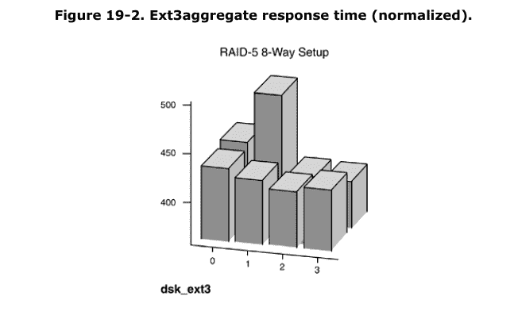


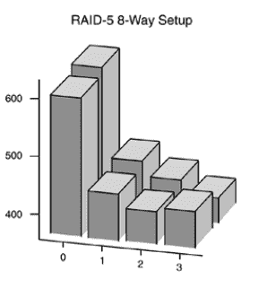

在图19-2中，x轴表示I/O调度器；0 = AS，1 = Noop，2 = Deadline，3 = CFQ（针对Ext3）。前排反映未调优环境，后排反映已调优环境。y轴揭示每个I/O调度器在四种配置文件下的归一化响应时间。

在图19-3中，x轴表示I/O调度器；0 = AS，1 = Noop，2 = Deadline，3 = CFQ（针对XFS）。前排反映未调优环境，后排反映已调优环境。y轴揭示每个I/O调度器在四种配置文件下的归一化响应时间。

表19-2展示了未调优的RAID-5 8路配置的数据。

### 表 19-2. RAID-5 8路配置 未调优 平均响应时间（秒）（AS，Deadline，Noop，CFQ）

| 配置文件 | AS - Ext3 | DL - Ext3 | NO - Ext3 | CFQ - Ext3 | AS - XFS | DL - XFS | NO - XFS | CFQ - XFS |
| :--- | :--- | :--- | :--- | :--- | :--- | :--- | :--- | :--- |
| 文件服务器 | 77.2 | 81.2 | 86.5 | 82.7 | 83.8 | 90.3 | 96.6 | 90.7 |
| 元数据 | 147.8 | 148.4 | 133 | 145.3 | 205.8 | 90.8 | 101.6 | 100.8 |
| Web服务器 | 70.2 | 58.4 | 66.2 | 59.2 | 82.1 | 81.3 | 78.8 | 75.2 |
| 邮件服务器 | 119.2 | 114.8 | 115.3 | 119.3 | 153.9 | 92.1 | 100.7 | 92.2 |
| 顺序读取 | 517.5 | 631.1 | 654.1 | 583.5 | 515.8 | 624.4 | 628.7 | 604.5 |
| 顺序写入 | 1033.2 | 843.7 | 969.5 | 840.5 | 426.6 | 422.3 | 462.6 | 400.4 |

在第二阶段，通过调整可配置参数 `$nr_requests$` 的所有I/O调度器设置均经过调优，将其从默认值128调整为2,560。结果显示，CFQ调度器对该调整做出了积极反应，并在Ext3和XFS上均能提供高效的解决方案。调优导致CFQ在两种文件系统的各项基准测试中的响应时间降低。尽管CFQ从调优中获益，但其他三种实现的结果并不明确。根据配置文件的不同，调优会导致性能的提升或下降。由于CFQ旨在处理更大组的I/O请求，结果反映了调度器的设计目标。这与AS实现形成对比，按照设计，任何以读为主的工作负载都无法直接从该变更中受益。另一方面，对于顺序写入操作，AS可以从调优中获益，因为响应时间在Ext3和XFS上分别减少了7%和8%。所进行的基准测试揭示了I/O子系统另一个重大的低效行为，因为在Ext3上所有调度器的写入性能显著低于XFS（大约低2.1倍）。这里的问题是Ext3的预留代码。解决该问题的Ext3补丁可在 `http://www.kernel.org` 获得。

表19-3展示了 `$nr_requests$` 的RAID-5 8路配置的数据。

### 表 19-3. RAID-5 8路配置 `$nr_requests$` = 2,560 平均响应时间（秒）（AS，Deadline，Noop，CFQ）

| 配置文件 | AS - Ext3 | DL - Ext3 | NO - Ext3 | CFQ - Ext3 | AS - XFS | DL - XFS | NO - XFS | CFQ - XFS |
| :--- | :--- | :--- | :--- | :--- | :--- | :--- | :--- | :--- |
| 文件服务器 | 78.3 | 72.1 | 87.1 | 70.7 | 94.1 | 75 | 89.2 | 76 |
| 元数据 | 127.1 | 133 | 137.3 | 124.9 | 189.1 | 101.1 | 104.6 | 99.3 |
| Web服务器 | 62.4 | 58.8 | 75.3 | 57.5 | 79.4 | 72.83 | 80.6 | 71.7 |
| 邮件服务器 | 110.2 | 92.9 | 118.8 | 99.6 | 152.5 | 100.2 | 95.1 | 81 |
| 顺序读取 | 523.8 | 586.2 | 585.3 | 618.7 | 518.5 | 594.8 | 580.7 | 594.4 |
| 顺序写入 | 968.2 | 782.9 | 1757.8 | 813.2 | 394.3 | 395.6 | 549.9 | 436.4 |

最后，在利用28磁盘RAID-0配置的16路SMP系统上进行了基准测试。

### 16路 RAID-0 配置

利用28磁盘RAID-0配置作为基准测试环境，结果显示，在四种工作负载配置文件中，Deadline实现的性能优于其他三个调度器。然而，CFQ和Noop调度器在四项基准测试中的三项上略微优于Deadline实现。总体而言，Deadline调度器在处理Web服务器配置文件时具有显著优势，优于其他三种实现最多达62%。在Ext3上，当处理顺序读取和写入请求时，Noop调度器反映了最高效的解决方案；而在XFS上，CFQ和Deadline主导了顺序读取和写入基准测试。四种配置文件下各调度器之间的性能差异在XFS上（38%）比在Ext3上（6%）更为显著，这反映了与RAID-5配置中遇到的类似行为。在RAID-0系统上将 `$n_{\text{requests}}$` 增加到2,560，导致Ext3和XFS上所有I/O调度器的结果都不明确。

*表 19-4* 展示了RAID-0 16路配置的数据。

**表 19-4. RAID-0 16路配置 默认I/O调度器，未调优，平均响应时间（秒）**

| 配置文件 | AS - Ext3 | DL - Ext3 | NO - Ext3 | CFQ - Ext3 | AS - XFS | DL - XFS | NO - XFS | CFQ - XFS |
| :--- | :--- | :--- | :--- | :--- | :--- | :--- | :--- | :--- |
| 文件服务器 | 44.5 | 40 | 41.9 | 40.8 | 42.5 | 43 | 45.9 | 42.5 |
| 元数据 | 66.7 | 64.6 | 66.2 | 64 | 101.8 | 71.7 | 72.4 | 66.7 |
| Web服务器 | 43.4 | 38.2 | 37.9 | 42.9 | 68.3 | 42.8 | 69.3 | 64.5 |
| 邮件服务器 | 60.3 | 58.5 | 58.7 | 58.1 | 100.3 | 66.2 | 65.8 | 65.1 |
| 顺序读取 | 2582.1 | 470.4 | 460.2 | 510.9 | 2601.2 | 541 | 576.1 | 511.2 |
| 顺序写入 | 1313.8 | 1439.3 | 1171.1 | 1433.5 | 508.5 | 506.2 | 508.5 | 509.8 |

在进入下一节之前，我们将进一步说明AS调度器设计的性能行为，该设计基于I/O设备仅有一个物理（寻道）头这一概念来查看I/O子系统；这项研究分析了不同硬件配置下的顺序读取性能。结果与CFQ调度器进行了比较。

#### AS 顺序读性能


在单磁盘配置中，AS 实现能够接近硬件的容量，因此提供了最佳吞吐量性能。在相同的工作负载条件下，CFQ 调度器严重阻碍了吞吐量性能，且不允许系统充分利用 I/O 子系统的容量。上述行为在 Ext3 和 XFS 文件系统中均成立。因此，在顺序读操作和 CFQ 的情况下，反映实际 I/O 瓶颈的是 I/O 调度器，而非文件系统本身。随着 I/O 子系统容量的增加，这种局面会发生逆转。

如表 19-5 所示，在基准测试的 RAID-5 环境中，CFQ 调度器的吞吐量接近 AS 实现，并且可以在大型 RAID-0 配置中接近硬件容量；而在 RAID-0 环境中，AS 调度器仅能达到硬件容量（180 MBps）的约 17%。再次强调，所讨论的 I/O 行为反映在 Ext3 和 XFS 的基准测试结果中。从任何文件系统的角度来看，如果文件系统的大小、文件系统中存储的文件数量或文件系统中存储的单个文件的大小增加，性能不应下降。此外，文件系统的性能应接近硬件的容量。这项研究清楚地表明，在讨论的工作负载场景中，这两个经过基准测试的文件系统能够实现这些目标，但这仅取决于物理硬件配置而更换 I/O 调度器。Linux 2.6 中的预读代码必须与 I/O 调度器尽可能高效地协同工作，同时还需要考虑文件系统。

### 表 19-5. AS 与 CFQ 顺序读性能对比

| 硬件配置 | AS 吞吐量 | CFQ 吞吐量 |
|---|---|---|
| 单磁盘 | 52 MBps | 23 MBps |
| RAID-5 | 46 MBps | 39.2 MBps |
| RAID-0 | 31 MBps | 158 MBps |

基于经过基准测试的性能配置文件和硬件配置，AS 调度器在大多数情况下提供了效率最低的 I/O 解决方案。由于 AS 框架是对 deadline 实现的扩展，下一节将探讨调整 AS 以接近 deadline 行为的可能性。

#### AS 与 Deadline 性能

在将 AS 调整为接近 deadline 行为的情况下，调整包括将 `nr_requests` 设置为 2,560，`antic_expire` 设置为 0，`read_batch_expire` 设置为 1,000，`read_expire` 设置为 500，`write_batch_expire` 设置为 250，以及 `write_expire` 设置为 5,000。将 `antic_expire` 值设置为 0（通过设计）禁用了调度器的预期部分。基准测试是在 RAID-5 环境中执行的，结果与本研究报告中报告的 deadline 性能结果进行比较。在 Ext3 上，未调整的 AS 版本在四个配置文件中比未调整的 deadline 设置落后约 4.5%。调整 AS 调度器会带来显著的性能提升，因为基准测试结果揭示，调整后的 AS 实现比默认 deadline 设置快约 6.5%。然而，在将调整后的 AS 解决方案与 `nr_requests` 设置为 2,560 的 deadline 环境进行比较时，这种性能优势被抵消了。在四个工作负载配置文件中，deadline 再次比 AS 实现快约 17%。正如预期的那样，将 `antic_expire` 设置为 0 导致顺序读性能降低，将响应时间稳定在 deadline 性能水平。在 XFS 上，结果基于 AS 不规则的元数据性能行为，结论不明确。其中一个结论基于 AS 代码收集统计数据 的当前实现；所实现的启发式方法不够灵活，无法检测任何持续的随机 I/O 行为。这是一个需要*禁用主动等待行为*的场景。此外，将 `antic_expire` 设置为 0 应强制调度器进入 deadline 行为，这一说法并未得到本研究收集的实证数据的支持。对于这种差异，一种解释是 AS 支持的短向后寻道操作不是 deadline 框架的一部分。因此，根据实际的物理磁盘调度策略，AS 的向后寻道操作从性能角度来看可能是适得其反的。

### 表 19-6. RAID-5 8路 默认 AS、默认 Deadline 和调整后 AS 对比的平均响应时间（秒）

| | AS Ext3 | DL Ext3 | AS Tuned Ext3 | AS - XFS | DL - XFS | AS Tuned - XFS |
|---|---|---|---|---|---|---|
| File Server | 77.2 | 81.2 | 72.1 | 83.8 | 90.3 | 84.5 |
| Metadata | 147.8 | 148.4 | 133.7 | 205.8 | 90.8 | 187.4 |
| Web Server | 70.2 | 58.4 | 62 | 82.1 | 81.3 | 75.9 |
| Mail Server | 119.2 | 114.8 | 103.5 | 153.9 | 92.1 | 140.2 |
| Seq. Read | 517.5 | 631.1 | 634.5 | 515.8 | 624.4 | 614.1 |
| Seq. Write | 1033.2 | 843.7 | 923.4 | 426.6 | 422.3 | 389.1 |

这项基准研究揭示，调整后的 CFQ 配置是 RAID-5 环境的有效解决方案。

#### CFQ 性能

所研究的基准测试揭示，调整后的 CFQ 配置为 RAID-5 环境提供了最有效的解决方案。因此，本案例研究进一步探讨了提高 CFQ 框架性能的多种方法。Linux 2.6.5 中的 CFQ I/O 调度器类似于 SFQ 实现，它在一定数量的内部 I/O 队列上运行，并按进程粒度进行哈希，以确定将 I/O 请求放在哪里。Linux 2.6.5 中的 CFQ 调度器对线程组 ID（`tgid`）进行哈希，它代表进程 ID（`PID`），这与 POSIX.1 相同。所选择的方法是修改 CFQ 代码以按 Linux PID 进行哈希。此代码更改引入了按线程粒度的公平性，因此改变了内部队列中 I/O 请求的分布。此外，CFQ 框架的 `cfg_quantum` 和 `cfg_queued` 参数被导出到用户空间。在第一步中，将 `cfg_quantum` 设置为 32 的默认 `tgid` 基于的 CFQ 版本（默认值为 8）与使用相同调整配置的 PID 基于的实现进行比较。在四个配置文件中，基于 PID 的实现反映了更高效的解决方案，在 Ext3 和 XFS 上分别处理 I/O 工作负载快约 4.5% 和 2%。为了进一步量化不同哈希方法（基于 `tgid` 与基于 `PID`）的性能影响，在第二步中，该研究将默认 Linux 2.6.5 CFQ 配置与配置了 `cfg_quantum` 调整为 32 的基于 PID 的代码进行了比较。在 Ext3 上对四个配置文件进行基准测试时，按 PID 粒度哈希的新 CFQ 调度器比现状快约 10%。使用新方法，顺序读和写性能分别提高 3% 和 4%。在 XFS 上，在四个配置文件中，基于 `tgid` 的 CFQ 实现证明是更高效的解决方案，比基于 PID 的设置快约 9%。另一方面，基于 PID 的解决方案在处理顺序读（2%）和写（1%）配置文件时效率略高。这意味着，基于所进行的基准测试和文件系统配置，某些工作负载场景可以在调整后的、基于 PID 哈希的配置设置中更高效地处理。

在图 19-4 中，x 轴描绘了 I/O 调度器；0 = 默认 CFQ，1 = 带 PID 的 CFQ，2 = AS，3 = deadline，以及 4 = noop。前排反映的是 XFS，而后排描绘的是基于 Ext3 的环境。y 轴揭示了混合工作负载配置文件的实际响应时间。

### 图 19-4. 混合工作负载行为。

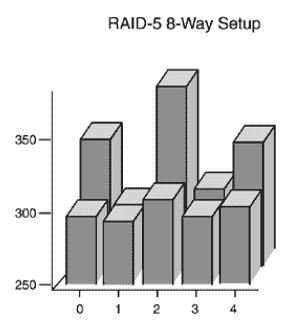

### 表 19-7. RAID-5 8-Way 默认 CFQ、PID 哈希 CFQ 以及 cfq_quantum=32、默认 CFQ 和 cfq_quantum=32 的平均 RT

| | CFQ | PID 和调优 | CFQ 调优 | CFQ | PID 和调优 | CFQ 调优 |
| :--- | :--- | :--- | :--- | :--- | :--- | :--- |
| 文件服务器 | 70.7 | 71.1 | 70.6 | 76 | 75.9 | 74.3 |
| 元数据 | 124.9 | 122 | 125.1 | 99.3 | 92.9 | 97.4 |
| Web 服务器 | 57.5 | 55.8 | 58 | 71.7 | 73 | 72.5 |
| 邮件服务器 | 99.6 | 94.5 | 93.3 | 81 | 93.6 | 93.3 |
| 顺序读 | 618.7 | 599.5 | 595.4 | 594.4 | 583.7 | 604.1 |


| 顺序写 | 813.2 | 781.1 | 758.4 | 436.4 | 432.1 | 414.6 |

为了进一步证明所提出的基于 `PID` 的哈希方案的潜力，我们对由 32 个并发线程组成的混合 I/O 工作负载进行了基准测试。使用的环境反映了 `RAID-5` 的设置。I/O 配置文件被分解为四个子集，每个子集包含 8 个工作者线程，每个子集执行 64KB 顺序读、4KB 随机读、4KB 随机写或 256KB 顺序写操作（参见图 19–4）。基准测试结果揭示，在这种混合 I/O 场景下，基于 `PID` 的 `CFQ` 解决方案（使用 `cfq_quantum` = 32 进行调优）至少比其他 I/O 调度器在 `Ext3` 和 `XFS` 上分别高出 5% 和 2%。调度器之间的性能差异在 `Ext3`（15%）上大于 `XFS`（6%）。

表 19–8 展示了具有混合工作负载行为的 `RAID-5` 8-way 的数据。

### 表 19-8. RAID-5 8-Way 混合工作负载行为 (CFQ-T = PID 和 cfq_quantum = 32)，响应时间（以秒为单位）

| | `CFQ` | `CFQ-T` | `AS` | `DL` | `NO` |
| :--- | :--- | :--- | :--- | :--- | :--- |
| 混合 `Ext3` | 334.1 | 288.1 | 371.2 | 301.2 | 333.5 |
| 混合 `XFS` | 295 | 291 | 308.4 | 296 | 302.8 |

### 总结

在不同硬件配置上进行的基准测试揭示，I/O 调度器、工作负载配置文件、文件系统以及最终的 I/O 性能之间存在强烈的、基于设置的相关性。经验数据显示，大多数调优努力结果是重新洗牌调度器的*性能排名*。其后果是，I/O 调度器的选择必须基于工作负载模式、硬件设置和所使用的文件系统。为了再次强调所讨论方法的重要性，执行了额外的基准测试，使用了 Linux 2.6 `SMP` 系统、`JFS` 文件系统以及由 84 个 `RAID-0` 系统（每个系统五块磁盘）组成的大型 `RAID-0` 配置。使用 `SPECfs` 基准测试作为工作负载生成器。重点在于通过仅在 `SPECfs` 运行之间替换 I/O 调度器，确定 `RAID-0` 设置中可实现的最大吞吐量。结果显示，`noop` 调度器甚至可以超越 `CFQ` 以及 `AS` 调度器。这一结果反转了顺序，并与本研究中对 `RAID-5` 和 `RAID-0` 环境建立基准测试所确立的排名相矛盾。在较小的 `RAID` 系统中，`noop` 调度器无法在任何随机 I/O 测试中超越 `CFQ` 实现。在大型 `RAID-0` 环境中，需要在 `CFQ` 中维护（从内存和 CPU 角度而言）的 84 个 `rb-tree` 数据结构代表了一个实质性的、明显的开销因素。

结果表明，没有一种 I/O 调度器能始终提供最佳可能的 I/O 性能。虽然 `AS` 调度器在小型配置的顺序读场景中表现出色，但未调优的 `deadline` 解决方案在较小的 `RAID` 系统上也能提供可接受的性能。在较小的 `RAID-5` 系统中，`CFQ` 调度器从调优角度来看具有最大的潜力，因为增加 `nr_requests` 参数可以提供最低的响应时间。由于 `noop` 调度器代表一种相对轻量级的解决方案，由许多独立逻辑设备组成的大型 `RAID` 系统可能会受益于该方案所遇到的减少的内存和 CPU 开销。在由许多逻辑设备组成的大型 `RAID` 系统中，其他三种实现必须作为操作框架的一部分维护复杂的数据结构。此外，研究表明，所提出的基于 `PID` 的可调 `CFQ` 实现是标准 `CFQ` 实现的一个有价值的替代方案。在 `RAID-5` 系统上收集的经验数据支持了这一说法，因为它引入了基于每个线程的真正公平性。未来的工作项目包括分析 `AS` 调度器在处理元数据密集型工作负载配置文件时遇到的不稳定性能行为。另一个焦点是对大型 `RAID-0` 系统上观察到的不一致 `nr_requests` 行为进行深入分析。不同的硬件设置将被用于辅助这项研究。Linux 2.6.5 中 `AS` 代码使用的预期启发式方法是另一项研究的对象，旨在根据特定的工作负载条件增强（现状）实现的*适应性*。在提议的基于 `PID` 的 `CFQ` 实现领域的额外研究，以及将 I/O 性能研究扩展到更大的 I/O 子系统，代表了将在近期解决的其他工作项目。

### 参考文献

- [1] Linux 源代码。
- [2] Arcangeli, A. "Evolution of Linux Towards Clustering," EFD R&D Clamart, 2003。
- [3] Axboe, J. "Deadline I/O Scheduler Tunables," SuSE, EDF R&D, 2003。
- [4] Corbet, J. "A New Deadline I/O Scheduler," http://lwn.net/Articles/10874。
- [5] "Anticipatory I/O Scheduling," http://lwn.net/Articles/21274。
- [6] "The Continuing Development of I/O Scheduling," http://lwn.net/Articles/21274。
- [7] "Porting Drivers to the 2.5 Kernel," Linux Symposium, Ottawa, Canada, 2003。
- [8] Heger, D., J. Jacobs, B. McCloskey, and J. Stultz. "Evaluating Systems Performance in the Context of Performance Paths," IBM Technical White Paper, Austin, 2000。
- [9] Iyer, S. and P. Drushel. "Anticipatory Scheduling: A Disk Scheduling Framework to Overcome Deceptive Idleness in Synchronous I/O," SOSP 2001。
- [10] Irwin, Lee W. III, "A 2.5 Page Clustering Implementation," Linux Symposium, Ottawa, 2003。
- [11] Nagar, S., H. Franke, J. Choi, C. Seetharaman, S. Kaplan, N. Singhvi, V. Kashyap, and M. Kravetz. "Class-Based Prioritized Resource Control in Linux," 2003 Linux Symposium。
- [12] McKenney, P. "Stochastic Fairness Queuing," INFOCOM, 1990。
- [13] Molnar, I. "Goals, Design and Implementation of the New Ultra-scalable O(1) Scheduler" (sched-design.txt)。
- [14] Mosberger, D. and S. Eranian. *IA-64 Linux Kernel, Design and Implementation*, Prentice Hall, NJ, 2002。
- [15] Shriver, E., A. Merchant, and J. Wilkes. "An Analytic Behavior Model with Readahead Caches and Request Reordering," Bell Labs, 1998。
- [16] Wienand, I. "An Analysis of Next Generation Threads on IA64," HP, 2003。
- [17] Zimmermann, R. and S. Ghandeharzadeh. "Continuous Display Using Heterogeneous Disk-Subsystems," ACM Multimedia, 1997。
- [18] Web 资源: http://www.iometer.org/。
- [19] Web 资源: http://www.specbench.org/osg/mail2001。
- [20] Web 资源: http://www.specbench.org/sfs97r1/docs/chapter1.html。

## 第二十章 案例研究：文件系统调优

作者：Steve Best

### 引言

Linux 为每种类型的文件系统提供了多个实用程序，用于查看文件系统元数据和解析磁盘结构。借助这些工具，你可以查看文件系统的结构。通常，这些工具旨在供文件系统的开发者分析结构使用；然而，它们也可用于查找性能问题。


在本案例研究中，我们将提供在 `Ext2`、`JFS`、`ReiserFS` 和 `XFS` 文件系统中查看 inode 的示例。接下来，我们将展示如何通过使用外部日志来调优每种类型的文件系统。外部日志能改进性能，因为日志更新被保存到与相应文件系统不同的分区上。这减少了硬盘寻道次数。我们将展示在文件系统上使用文件系统测试程序并使用外部日志的结果。我们还将讨论某些文件系统拥有的用于提高文件系统性能的挂载选项。然后，我们将展示如何使用 `sar` 和 `iostat` 工具来识别物理磁盘上的瓶颈。


表 19-7 展示了不同 CFQ 和 PID 设置下 RAID-5 8-way 的数据。

##### 表 19-7. RAID-5 8-Way 默认 CFQ、PID 哈希 CFQ 以及 cfq_quantum=32、默认 CFQ 和 cfq_quantum=32 的平均 RT

| | CFQ | PID 和调优 | CFQ 调优 | CFQ | PID 和调优 | CFQ 调优 |
| :--- | :--- | :--- | :--- | :--- | :--- | :--- |
| 文件服务器 | 70.7 | 71.1 | 70.6 | 76 | 75.9 | 74.3 |
| 元数据 | 124.9 | 122 | 125.1 | 99.3 | 92.9 | 97.4 |
| Web 服务器 | 57.5 | 55.8 | 58 | 71.7 | 73 | 72.5 |
| 邮件服务器 | 99.6 | 94.5 | 93.3 | 81 | 93.6 | 93.3 |
| 顺序读 | 618.7 | 599.5 | 595.4 | 594.4 | 583.7 | 604.1 |
| 顺序写 | 813.2 | 781.1 | 758.4 | 436.4 | 432.1 | 414.6 |

为了进一步证明所提出的基于 PID 的哈希方案的潜力，我们对由 32 个并发线程组成的混合 I/O 工作负载进行了基准测试。使用的环境反映了 RAID-5 的设置。I/O 配置文件被分解为四个子集，每个子集包含 8 个工作者线程，每个子集执行 64KB 顺序读、4KB 随机读、4KB 随机写或 256KB 顺序写操作（参见图 19–4）。基准测试结果揭示，在这种混合 I/O 场景下，基于 PID 的 CFQ 解决方案（使用 `cfq_quantum` = 32 进行调优）至少比其他 I/O 调度器在 Ext3 和 XFS 上分别高出 5% 和 2%。调度器之间的性能差异在 Ext3（15%）上大于 XFS（6%）。

表 19–8 展示了具有混合工作负载行为的 RAID-5 8-way 的数据。

##### 表 19-8. RAID-5 8-Way 混合工作负载行为 (CFQ-T = PID 和 cfq_quantum = 32)，响应时间（以秒为单位）

| | CFQ | CFQ-T | AS | DL | NO |
| :--- | :--- | :--- | :--- | :--- | :--- |
| 混合 Ext3 | 334.1 | 288.1 | 371.2 | 301.2 | 333.5 |
| 混合 XFS | 295 | 291 | 308.4 | 296 | 302.8 |

### 总结

在不同硬件配置上进行的基准测试揭示，I/O 调度器、工作负载配置文件、文件系统以及最终的 I/O 性能之间存在强烈的、基于设置的相关性。经验数据显示，大多数调优努力结果是重新洗牌调度器的*性能排名*。其后果是，I/O 调度器的选择必须基于工作负载模式、硬件设置和所使用的文件系统。为了再次强调所讨论方法的重要性，执行了额外的基准测试，使用了 Linux 2.6 SMP 系统、`JFS` 文件系统以及由 84 个 RAID-0 系统（每个系统五块磁盘）组成的大型 RAID-0 配置。使用 `SPECfs` 基准测试作为工作负载生成器。重点在于通过仅在 `SPECfs` 运行之间替换 I/O 调度器，确定 RAID-0 设置中可实现的最大吞吐量。结果显示，`noop` 调度器甚至可以超越 `CFQ` 以及 `AS` 调度器。这一结果反转了顺序，并与本研究中对 RAID-5 和 RAID-0 环境建立基准测试所确立的排名相矛盾。在较小的 RAID 系统中，`noop` 调度器无法在任何随机 I/O 测试中超越 `CFQ` 实现。在大型 RAID-0 环境中，需要在 `CFQ` 中维护（从内存和 CPU 角度而言）的 84 个 rb-tree 数据结构代表了一个实质性的、明显的开销因素。

结果表明，没有一种 I/O 调度器能始终提供最佳可能的 I/O 性能。虽然 `AS` 调度器在小型配置的顺序读场景中表现出色，但未调优的 deadline 解决方案在较小的 RAID 系统上也能提供可接受的性能。在较小的 RAID-5 系统中，`CFQ` 调度器从调优角度来看具有最大的潜力，因为增加 `nr_requests` 参数可以提供最低的响应时间。由于 `noop` 调度器代表一种相对轻量级的解决方案，由许多独立逻辑设备组成的大型 RAID 系统可能会受益于该方案所遇到的减少的内存和 CPU 开销。在由许多逻辑设备组成的大型 RAID 系统中，其他三种实现必须作为操作框架的一部分维护复杂的数据结构。此外，研究表明，所提出的基于 PID 的可调 CFQ 实现是标准 CFQ 实现的一个有价值的替代方案。在 RAID-5 系统上收集的经验数据支持了这一说法，因为它引入了基于每个线程的真正公平性。未来的工作项目包括分析 `AS` 调度器在处理元数据密集型工作负载配置文件时遇到的不稳定性能行为。另一个焦点是对大型 RAID-0 系统上观察到的不一致 `nr_requests` 行为进行深入分析。不同的硬件设置将被用于辅助这项研究。Linux 2.6.5 中 AS 代码使用的预期启发式方法是另一项研究的对象，旨在根据特定的工作负载条件增强（现状）实现的*适应性*。在提议的基于 PID 的 CFQ 实现领域的额外研究，以及将 I/O 性能研究扩展到更大的 I/O 子系统，代表了将在近期解决的其他工作项目。

### 参考文献

- [1] Linux 源代码。
- [2] Arcangeli, A. “Linux 向集群化的演进”，EFD R&D Clamart，2003。
- [3] Axboe, J. “截止日期 I/O 调度器可调整参数”，SuSE, EDF R&D，2003。
- [4] Corbet, J. “一个新的截止日期 I/O 调度器”，http://lwn.net/Articles/10874。
- [5] “预期式 I/O 调度”，http://lwn.net/Articles/21274。
- [6] “I/O 调度的持续发展”，http://lwn.net/Articles/21274。
- [7] “将驱动程序移植到 2.5 内核”，Linux 研讨会，加拿大渥太华，2003。
- [8] Heger, D., J. Jacobs, B. McCloskey, and J. Stultz. “在性能路径语境下评估系统性能”，IBM 技术白皮书，奥斯汀，2000。
- [9] Iyer, S. and P. Drushel. “预期调度：克服同步 I/O 中欺骗性空闲的磁盘调度框架”，SOSP 2001。
- [10] Irwin, Lee W. III, “2.5 页面集群实现”，Linux 研讨会，加拿大渥太华，2003。
- [11] Nagar, S., H. Franke, J. Choi, C. Seetharaman, S. Kaplan, N. Singhvi, V. Kashyap, and M. Kravetz. “Linux 中的基于类的优先级资源控制”，2003 Linux 研讨会。
- [12] McKenney, P. “随机公平排队”，INFOCOM，1990。
- [13] Molnar, I. “新的超可扩展 O(1) 调度器的目标、设计与实现”（sched-design.txt）。
- [14] Mosberger, D. and S. Eranian. *IA-64 Linux 内核，设计与实现*，Prentice Hall, NJ, 2002。
- [15] Shriver, E., A. Merchant, and J. Wilkes. “具有读缓存和请求重排的解析行为模型”，贝尔实验室，1998。
- [16] Wienand, I. “IA64 上下一代线程的分析”，惠普，2003。
- [17] Zimmermann, R. and S. Ghandeharzadeh. “使用异构磁盘子系统实现连续显示”，ACM 多媒体，1997。
- [18] Web 资源: http://www.iometer.org/。
- [19] Web 资源: http://www.specbench.org/osg/mail2001。
- [20] Web 资源: http://www.specbench.org/sfs97r1/docs/chapter1.html。


## 第二十章 案例研究：文件系统调优

作者：Steve Best

### 引言

Linux 为每种类型的文件系统提供了多个实用程序，用于查看文件系统元数据和解析磁盘结构。借助这些工具，你可以查看文件系统的结构。通常，这些工具旨在供文件系统的开发者分析结构使用；然而，它们也可用于查找性能问题。

在本案例研究中，我们将提供在 Ext2、JFS、ReiserFS 和 XFS 文件系统中查看 inode 的示例。接下来，我们将展示如何通过使用外部日志来调优每种类型的文件系统。外部日志能改进性能，因为日志更新被保存到与相应文件系统不同的分区上。这减少了硬盘寻道次数。我们将展示在文件系统上使用文件系统测试程序并使用外部日志的结果。我们还将讨论某些文件系统拥有的用于提高文件系统性能的挂载选项。然后，我们将展示如何使用 `sar` 和 `iostat` 工具来识别物理磁盘上的瓶颈。

### 分析文件布局

每个文件系统都具有独特的布局，其中包含文件管理系统元数据所需的结构。以下四个部分提供了查看 Ext2/Ext3、JFS、ReiserFS 和 XFS 文件系统结构的示例。虽然用于查看磁盘结构的各种文件系统工具主要由开发人员使用，但它们也可以用于查找和解决每个文件系统的性能问题。

#### Ext2/Ext3 布局

以下示例展示了 Ext2 文件系统的一些结构。在该示例中，使用 `mkfs` 命令将 Ext2 文件系统格式化到一个软盘上。

```
##### mkfs /dev/fd0
mke2fs 1.32 (09-Nov-2002)
Filesystem label=
OS type: Linux
Block size=1024 (log=0)
Fragment size=1024 (log=0)
184 inodes, 1440 blocks
72 blocks (5.00%) reserved for the super user
First data block=1
1 block group
8192 blocks per group, 8192 fragments per group
184 inodes per group

Writing inode tables: 0/1 done
Writing superblocks and filesystem accounting information: done
```

`debugfs` 命令生成的输出对于分析文件系统的磁盘结构非常有用。例如，`show_super_stats` 选项会显示超级块和磁盘组结构。

```
##### debugfs /dev/fd0

debugfs 1.32 (09-Nov-2002)
debugfs: show_super_stats

debugfs 1.32 (09-Nov-2002)
debugfs: Filesystem volume name: <none>
Last mounted on: <not available>
Filesystem UUID: cb45e547-1618-4b70-bd91-22e651e19583
Filesystem magic number: 0xEF53
Filesystem revision #: 1 (dynamic)
Filesystem features: filetype sparse_super
Default mount options: (none)
Filesystem state: clean
Errors behavior: Continue
Filesystem OS type: Linux
Inode count: 184
Block count: 1440
Reserved block count: 72
Free blocks: 1399
Free inodes: 173
First block: 1
Block size: 1024
Fragment size: 1024
Blocks per group: 8192
Fragments per group: 8192
Inodes per group: 184
Inode blocks per group: 23
Filesystem created: Mon Jun 9 19:06:00 2003
Last mount time: n/a
Last write time: Mon Jun 9 19:06:01 2003
Mount count: 0
Maximum mount count: 29
Last checked: Mon Jun 9 19:06:00 2003
Check interval: 15552000 (6 months)
Next check after: Sat Dec 6 19:06:00 2003
Reserved blocks uid: 0 (user root)
Reserved blocks gid: 0 (group root)
First inode: 11
Inode size: 128
Directories: 2
Group 0: block bitmap at 3, inode bitmap at 4,
inode table at 5
1399 free blocks, 173 free inodes,
2 used directories
debugfs: quit
```

块组信息在超级块之后显示。块组信息显示了各种结构所在的块号，例如块位图、inode 位图、inode 表和空闲块。例如，块组 0 的 inode 位图位于第 4 块。使用 `dumpe2fs` 命令可以显示有关块组的更多信息。

```
##### dumpe2fs /dev/fd0

dumpe2fs 1.32 (09-Nov-2002)
Filesystem volume name: <none>
Last mounted on: <not available>
Filesystem UUID: cb45e547-1618-4b70-bd91-22e651e19583
Filesystem magic number: 0xEF53
Filesystem revision #: 1 (dynamic)
Filesystem features: filetype sparse_super
Default mount options: (none)
Filesystem state: clean
Errors behavior: Continue
Filesystem OS type: Linux
Inode count: 184
Block count: 1440
Reserved block count: 72
Free blocks: 1399
Free inodes: 173
First block: 1
Block size: 1024
Fragment size: 1024
Blocks per group: 8192
Fragments per group: 8192
Inodes per group:                 184
Inode blocks per group:           23
Filesystem created:               Mon Jun  9 19:06:00 2003
Last mount time:                  n/a
Last write time:                  Mon Jun  9 19:06:01 2003
Mount count:                      0
Maximum mount count:              29
Last checked:                     Mon Jun  9 19:06:00 2003
Check interval:                   15552000 (6 months)
Next check after:                 Sat Dec  6 19:06:00 2003
Reserved blocks uid:              0 (user root)
Reserved blocks gid:              0 (group root)
First inode:                      11
Inode size:                       128

Group 0: (Blocks 1-1439)
  Primary superblock at 1, Group descriptors at 2-2
  Block bitmap at 3 (+2), Inode bitmap at 4 (+3)
  Inode table at 5-27 (+4)
  1399 free blocks, 173 free inodes, 2 directories
  Free blocks: 41-1439
  Free inodes: 12-184
```


# Ext2 文件系统的 inode 限制

Ext2 文件系统的限制之一是 inode 的静态分配。此 Ext2 文件系统上有 184 个可用 inode，这意味着它总共只能包含 184 个文件或目录。在示例中，文件系统在可用空间耗尽之前 inode 就已经用尽。

首先，挂载点 `/mnt/floppy` 挂载软盘设备 `/dev/fd0`。然后运行 `create.sh` 脚本。`create.sh` 创建一个名为 `"a"` 的目录，然后在该目录中创建最多 300 个文件。当脚本运行时，它显示 inode 数量限制在可用空间耗尽之前达到。

```
##### mount /dev/fd0 /mnt/floppy
```

`create.sh` 脚本创建 300 个文件，并在 inode 用尽后返回错误。

```bash
#!/bin/sh

for count in `seq 1 1`;
do
        echo Count: $count
        mkdir a
        for i in `seq 1 300`;
        do
                echo  abcdefghijklmnopqrstuvwxyz > a/$i
        done

done
```

使用 `df -k` 命令确定每个已挂载文件系统可用的空闲空间量。该命令生成的输出类似于以下内容：

```
##### df -k
Filesystem 1K-blocks Used Available Use% Mounted on
/dev/hda2 3265260 1581308 1518084 52% /
/dev/hda1 101089 9324 86546 10% /boot
none 192292 0 192292 0% /dev/shm
/dev/fd0 1412 14 1326 2% /mnt/floppy
/dev/hdb1 3999504 659260 3340244 17% /jfs
```

输出显示，作为软盘的 `/dev/fd0` 设备已使用其 2% 的空间。`ls -a` 命令的输出显示，现在有一个名为 `create.sh` 的文件和文件系统的 `lost+found` 目录。

```
##### ls -all

lost+found
create.sh
```

带有 `-i` 选项的 `df` 命令显示空闲 inode 的数量，在我们的示例中为 172。

```
##### df -i
Filesystem Inodes IUsed IFree IUse% Mounted on
/dev/hda2 415168 96813 318355 24% /
/dev/hda1 26104 41 26063 1% /boot
none 48073 1 48072 1% /dev/shm
/dev/fd0 184 12 172 7% /mnt/floppy
/dev/hdb1 6726720 44242 6682478 1% /jfs
```

如果在软盘上运行 `create.sh`，Ext2 文件系统会在文件系统空间耗尽之前 inode 用尽。请注意，虽然以下错误消息使文件系统看起来像是空间不足，但实际上是空闲 inode 不足，无法创建文件或目录。

```
##### ./create.sh

Count: 1
./create.sh: line 9: a/172: No space left on device
./create.sh: line 9: a/173: No space left on device
./create.sh: line 9: a/174: No space left on device
./create.sh: line 9: a/175: No space left on device
...
```

`df -k` 命令显示文件系统中使用的空间仅为 15%。

```
##### df -k
Filesystem 1K-blocks Used Available Use% Mounted on
/dev/hda2 3265260 1581308 1518084 52% /
/dev/hda1 101089 9324 86546 10% /boot
none 192292 0 192292 0% /dev/shm
/dev/fd0             1412      188      1152   15% /mnt/floppy
/dev/hdb1          3999504   659280    3340224   17% /jfs
```

`ls -R` 命令显示创建了 171 个文件和名为 `"a"` 的一个目录，这些文件用尽了 172 个空闲 inode。

```
##### ls -R
.
a

lost+found
create.sh

./a:
1 10 100 101 102 103 104 105 106 107 108 109 11 110 111
112 113 114 115 116 117 118 119 12 120 121 122 123 124
125 126 127 128 129 13 130 131 132 133 134 135 136 137
138 139 14 140 141 142 143 144 145 146 147 148 149 15
150 151 152 153 154 155 156 157 158 159 16 160 161 162
163 164 165 166 167 168 169 17 170 171 18 19 2 20 21 22
23 24 25 26 27 28 29 3 30 31 32 33 34 35 36 37 38 39 4
40 41 42 43 44 45 46 47 48 49 5 50 51 52 53 54 55 56 57
58 59 6 60 61 62 63 64 65 66 67 68 69 7 70 71 72 73 74
75 76 77 78 79 8 80 81 82 83 84 85 86 87 88 89 9 90 91
92 93 94 95 96 97 98 99

./lost+found:
```

带有 `-i` 选项的 `df` 命令显示空闲 inode 的数量，如下所示；我们可以看到软盘设备 `/dev/fd0` 目前的值为 0。

```
##### df -i
Filesystem     Inodes  IUsed   IFree  IUse% Mounted on
/dev/hda2      415168  96814   318354   24% /
/dev/hda1      26104      41    26063    1% /boot
none           48073       1    48072    1% /dev/shm
/dev/fd0        184     184        0   100% /mnt/floppy
/dev/hdb1      6726720  44242   6682478    1% /jfs
```

这些示例表明，当使用 Ext2/Ext3 文件系统时，在使用 `mkfs` 创建文件系统时需要创建足够的 inode，因为在文件系统格式化后无法增加 inode 的数量。

> 其他日志文件系统提供了动态 inode 创建功能，允许文件系统按需创建 inode。

下一步是卸载软盘设备并使用 `mkfs` 再次对其进行格式化；然后重新挂载软盘设备。

```bash
##### umount /mnt/floppy
##### mkfs /dev/fd0
##### mount /dev/fd0 /mnt/floppy
```

接下来，将一个文件复制到软盘设备，然后使用 `debugfs` 实用程序查看该文件系统的文件信息。在下面的示例中，该文件名为 `fstab`。`fstab` 的 inode 为 12。在该示例中，`debugfs` 中的 `-i` 选项用于收集文件系统信息，而 `stat` 选项则用于显示文件 `fstab` 的 inode。

```bash
##### cp /etc/fstab /mnt/floppy/fstab
##### umount /mnt/floppy
##### debugfs /dev/fd0
```

```text
debugfs: ls -l
1.32 (09-Nov-2002)
debugfs:
        2  40755 (2) 0 0    1024  9-Jun-2003 19:43 .
        2  40755 (2) 0 0    1024  9-Jun-2003 19:43 ..
       11  40700 (2) 0 0   12288  9-Jun-2003 19:06 lost+found
       12 100644 (1) 0 0     697  9-Jun-2003 19:43 fstab
```


```text
debugfs: stat <12>
debugfs: Inode: 12  Type: regular   Mode:  0644
Flags: 0x0   Generation: 295695
User:       0   Group:     0   Size: 697
File ACL: 0   Directory ACL: 0
Links: 1   Blockcount: 2
Fragment:   Address: 0     Number: 0     Size: 0
ctime: 0x3ee537a8 Mon Jun  9 19:43:04 2003
atime: 0x3ee537a8 Mon Jun  9 19:43:04 2003
mtime: 0x3ee537a8 Mon Jun  9 19:43:04 2003
BLOCKS:
(0):41
TOTAL: 1
```

输出中显示的 Fragment（片段）信息用于确定文件是否连续。碎片化的文件无法提供最佳性能。然而，示例中的 `fstab` 文件并未被碎片化。

最后一步是卸载软盘设备。

```bash
##### umount /mnt/floppy
```

### 日志文件系统 (JFS) 文件布局

`jfs_debugfs` 实用程序可用于检查日志文件系统（JFS）的结构。`jfs_debugfs` 实用程序仅接受设备作为参数。`jfs_debugfs` 的手册页（`man page`）包含了关于如何显示 JFS 数据结构的信息。本节展示了如何收集文件系统部分关键结构的信息。

在示例中，`/dev/hda1` 设备包含了要显示其结构的 JFS 文件系统。

```bash
##### jfs_debugfs /dev/hda1
```

`jfs_debugfs` 的 `su` 选项可用于显示超级块。以下示例是来自某系统的样本输出：

```text
>su

[1] s_magic: 'JFS1'		[15] s_ait2.addr1:	0x00

[2] s_version: 1			[16] s_ait2.addr2:	0x00000097

[3] s_size: 0x0000000000007fa970	 s_ait2.address:	151

[4] s_bsize: 4096		[17] s_logdev:		0x00000000

[5] s_l2bsize: 12		[18] s_logserial:		0x00000000

[6] s_l2bfactor:3		[19] s_logpxd.len:		4352

[7] s_ppsize: 512		[20] s_logpxd.addr1:	0x00

[8] s_l2ppsize: 9		[21] s_logpxd.addr2:	0x000fff581

[9] pad: Not Displayed				 s_logpxd.address:	1045889

[10] s_agsize:0x00002000	[22] s_fsbkp. len:		83

[11] s_flag: 0x10200900		[23] s_fsbkp. addr1:	0x00

JFS_LINUX			[24] s_fsbkp. addr2:	0x000ff52e

JFS_COMMIT	JFS_GROUPCOMMIT	 s_fsbkp. address:	1045806

JFS_INLINELOG		[25] s_time. tv_ sec:	0x3f002d2d

		[26] s_time. tv_ msec:	0x00000000

		[27] s_fpack:		' '

[12] s_state: 0x00000000

FM_CLEAN

[13] s_compress:	0

[14] s_ait2.len:		4

display_super: [m]odify or e[x]it: x
```

以下示例使用 `/jfs` 作为挂载点，挂载文件系统，并复制 `fstab` 文件，从而得到一个可以在 JFS 文件系统中查看的文件：

```bash
##### mount -t jfs /dev/hda1 /jfs
##### cd /jfs
##### cp /etc/fstab .
```

若要查看文件的 inode，需要知道其 inode 号。使用带有 `-i` 选项的 `ls` 命令来确定文件的 inode 号。

```bash
##### ls -i

2 . . 4 fstab
```

在此示例中，该子目录中唯一的文件名为 `fstab`，其 inode 号为 4。

```bash
##### cd ..
##### umount /jfs
##### jfs_debugfs /dev/hda1
```

`jfs_debugfs` 中的 `:i` 选项用于显示 `fstab` 文件的 inode 信息。

```text
>i 4
Inode 4 at block 155, offset 0x800:
[1] di_istamp: 0x3f002d2d [19] di_mtime.tv_nsec:
0x00000000
[2] di_fileset: 16 [20] di_otime.tv_sec:
0x3f002f06
[3] di_number: 4 [21] di_otime.tv_nsec:
0x00000000
[4] di_gen: 1 [22] di_acl.flag:
0x00
[5] di_ipxd.len: 4 [23] di_acl.rsrvd:
Not Displayed
[6] di_ipxd.addr1: 0x00 [24] di_acl.size:
0x00000000
[7] di_ipxd.addr2: 0x0000009b [25] di_acl.len: 0
di_ipxd.address: 155 [26] di_acl.addr1:
0x00
[8] di_size:0x000000000003b4 [27] di_acl.addr2:
0x00000000
[9] di_nblocks: 0x0000000000000001 di_acl.address: 0
[10] di_nlink: 1 [28] di_ea.flag:
0x00
[11] di_uid: 0 [29] di_ea.rsrvd:
Not Displayed
[12] di_gid: 0 [30] di_ea.size:
0x00000000
[13] di_mode: 0x000681a4 [31] di_ea.len: 0
0100644 -rw- [32] di_ea.addr1:
0x00
[14] di_atime.tv_sec: 0x3f002f06 [33] di_ea.addr2:
0x00000000
[15] di_atime.tv_nsec: 0x00000000 di_ea.address: 0
[16] di_ctime.tv_sec: 0x3f002f06 [34] di_next_index: 0
[17] di_ctime.tv_nsec: 0x00000000 [35] di_acltype:
0x00000000
[18] di_mtime.tv_sec: 0x3f002f06
change_inode: [m]odify or e[x]it > x
```

### ReiserFS 文件布局

本节首先介绍 ReiserFS 文件系统的布局。查看 ReiserFS 文件系统结构的实用程序是 `debugreiserfs`。它接受设备作为其中一个参数；可以使用额外的参数来显示文件系统结构。以下示例格式化文件系统，并将一个名为 `fstab` 的文件复制到 ReiserFS 文件系统中。`debugreiserfs` 的 `d` 选项打印文件系统内部树的格式化节点。

```bash
##### mkreiserfs /dev/hdb1
```

以下示例使用 `/reiserfs` 作为挂载点，挂载文件系统，并复制 `fstab` 文件，从而得到一个可以在 ReiserFS 文件系统中查看的文件。


### ReiserFS 调试示例

```bash
mount -t reiserfs /dev/hdb1 /reiserfs
cd /reiserfs
cp /etc/fstab .
ls -l
```
```
total 6
drwxr-xr-x     4 root     root     104 Dec 19 06:26 .
drwxr-xr-x     30 root     root     1824 Dec 20 12:10 ..
-rw-r-- --      1 root     root     948 Dec 19 06:26 fstab
```

```bash
cd ..
umount /reiserfs
debugreiserfs d /dev/hdb1
```
```
debugreiserfs 3.6.4

Filesystem state: consistent

Reiserfs super block in block 16 on 0x341 of format 3.6
with standard journal
Count of blocks on the device: 1004054
Number of bitmaps: 31
Blocksize: 4096
Free blocks (count of blocks - used [journal, bitmaps,
data, reserved] blocks): 995812
Root block: 8211
Filesystem is clean
Tree height: 2
Hash function used to sort names: "r5"
ObjectId map size 2, max 972
Journal parameters:
Device [0x0]
Magic [0x431098f2]
Size 8193 blocks (including 1 for journal header)
(first block 18)
Max transaction length 1024 blocks
Max batch size 900 blocks
Max commit age 30
Blocks reserved by journal: 0
Fs state field: 0x0
sb_version: 2
inode generation number: 0
UUID: 1f0d2fd3-6fd6-412c-982d-4a16f0a37de9
LABEL:
Set flags in SB:
ATTRIBUTES CLEAN
===============================================================
```

```
LEAF NODE (8211) contains level=1, nr_items=6,
free_space=2692 rdeen (real items 6)
```

| 类型 | 长度 | 标志/空间 | 位置 | 格式 | fsck | 键 |
| :--- | :--- | :--- | :--- | :--- | :--- | :--- |
| 0 | 1 2 0x0 SD (0), len 44, location 4052 entry count 0, fsck need 0, format new | | | | | |
| | (NEW SD), mode drwxr-xr-x, size 104, nlink 4, mtime 12/19/2003 06:26:51 blocks 1, uid 0 | | | | | |
| 1 | 1 2 0x1 DIR (3), len 104, location 3948 entry count 4, fsck need 0, format old | | | | | |
| | : Name length Object key Hash Gen number | | | | | |
| | 0: "." ( 1) [1 2] 0 1, loc 96 | | | | | |
| | 1: ".." ( 2) [0 1] 0 2, loc 88 | | | | | |
| | 2: "fstab" ( 5) [2 4] 293528832 0, loc 80 | | | | | |
| | 3: ".reiserfs_priv" ( 14) [2 3] 1105744768 0, loc 64 | | | | | |
| 2 | 2 3 0x0 SD (0), len 44, location 3904 entry count 65535, fsck need 0, format new | | | | | |
| | (NEW SD), mode drwx, size 48, nlink 2, mtime 12/19/2003 06:26:18 blocks 1, uid 0 | | | | | |
| 3 | 2 3 0x1 DIR (3), len 48, location 3856 entry count 2, fsck need 0, format old | | | | | |
| | : Name length Object key Hash Gen number | | | | | |
| | 0: "." ( 1) [2 3] 0 1, loc 40 | | | | | |
| | 1: ".." ( 2) [1 2] 0 2, loc 32 | | | | | |
| 4 | 2 4 0x0 SD (0), len 44, location 3812 entry count 65535, fsck need 0, format new | | | | | |
| | (NEW SD), mode -rw-r--r--, size 948, nlink 1, mtime 12/19/2003 06:26:51 blocks 8, uid 0 | | | | | |
| 5 | 2 4 0x1 DRCT (2), len 952, location 2860 entry count 65535, fsck need 0, format new | | | | | |

======================================================================

File system uses 0 internal + 1 leaves + 0 unformatted

nodes = 1 blocks

首先显示文件系统的超级块信息，然后显示叶节点 `8211`。文件 `fstab` 的高亮信息显示了一些常见的 inode 信息。权限为 `rw-r--`，大小为 `948`，修改时间为 `12/19/2003 06:26:51`。

`debugreiserfs` 的手册页包含了关于如何显示 ReiserFS 关键结构的信息。要显示 `debugreiserfs` 的手册页，请键入以下命令：

```bash
man debugreiserfs
```

#### XFS 文件布局

`xfs_db` 允许检查 XFS 文件系统的结构。`xfs_db` 工具以设备作为参数。`xfs_db` 手册页包含有关如何显示 XFS 数据结构的信息。

本节展示了如何在 XFS 系统上显示一个 inode。

XFS 文件系统位于设备 `/dev/hda5` 上。

```bash
mount -t xfs /dev/hda5 /xfs
cd /xfs
```

将位于 `/etc` 目录中的 `fstab` 文件复制到 XFS 文件系统上。

```bash
cp /etc/fstab .
ls -l
```
```
total 12
drwxr-xr-x   2 root root     18 Dec  8 10:57 .
drwxr-xr-x   24 root root   4096 Dec  8 10:54 ..
-rw-r--r--   1 root root   948 Dec  8 10:57 fstab
```

要查看文件的 inode，需要其 inode 号。使用 `ls` 命令并加上 `-i` 选项来确定该号码。在以下示例中，`fstab` 文件的 inode 号是 `131`。

```bash
ls -i
    128 .       128 ..        131 fstab
cd ..
umount /xfs
```

`xfs_db` 中查看 inode 的选项是 `inode` 命令。`inode` 命令使用 inode 号作为参数。要打印关于该 inode 的文件系统信息，请使用 `p` 命令。


```bash
##### xfs_db /dev/hda5
     xfs_db> inode 131
     xfs_db> p
core.magic = 0x494e
core.mode = 0100644
core.version = 1
core.format = 2 (extents)
core.nlinkvl = 1
core.uid = 0
core.gid = 0
core.flushiter = 2
core.atime.sec = Mon Dec  8 10:57:53 2003
core.atime.nsec = 123719000
core.mtime.sec = Mon Dec  8 10:57:53 2003
core.mtime.nsec = 1239430000
core.ctime.sec = Mon Dec  8 10:57:53 2003
core.ctime.nsec = 1239430000
core.size = 948
core.nblocks = 1
core.extsize = 0
core.nextents = 1
core.naextents = 0
core.forkoff = 0
core.aformat = 2 (extents)
core.dmevmask = 0
core.dmstate = 0
core.newrtbm = 0
core.prealloc = 0
core.realtime = 0
core.gen = 0
next_unlinked = null
u.bmx[0] = [startoff,startblock,blockcount,extentflag]
0: (0,12,1,0)
xfs_db> q
```

### 文件系统调优

现在你已经熟悉了 Linux 中支持的各种类型文件系统的布局，让我们来看看如何调优 Ext3、ReiserFS、JFS 和 XFS 文件系统。我们将展示如何通过在每个文件系统上使用外部日志和使用可用的挂载选项来调优每个文件系统。

#### Ext3 调优选项：使用单独的日志设备

外部日志可以提高文件系统性能，因为日志更新被保存在与对应文件系统不同的分区上，从而减少了硬盘寻道次数。

要为 Ext3 文件系统使用外部日志，首先需在日志设备上运行 `mkfs`。外部日志的块大小必须与 Ext3 文件系统的块大小相同。本节中的示例使用 `/dev/hdb1` 设备作为 Ext3 文件系统的外部日志。

创建外部日志有两个步骤。第一步是格式化日志；第二步是格式化分区并告诉 `mkfs` 日志将是外部的。在以下示例中，Ext3 分区将位于设备 `/dev/hda1` 上，而外部日志将位于设备 `/dev/hdb1` 上。`mkfs -b` 选项设置文件系统的块大小。

```bash
##### mkfs.ext3 -b 4096 -O journal_dev /dev/hdb1
##### mkfs.ext3 -b 4096 -J device=/dev/hdb1 /dev/hda1
```

接下来的几个示例使用 `tiobench` 程序来查看外部日志是否有助于提高 Ext3 文件系统上此基准测试的性能。`tiobench` 基准测试是一个多线程 I/O 基准测试。它用于测量文件系统在四种基本操作中的性能：顺序读取、随机读取、顺序写入和随机写入。

首先，将设备 `/dev/hda1` 格式化为 ext3。

```bash
##### mkfs.ext3 /dev/hda1
##### mount -t ext3 /dev/hda1 /ext3
##### cd /ext3

##### tar zxvf tiobench-0.3.3.tar.gz
##### cd tiobench-0.3.3
##### make
##### date && ./tiobench.pl --size 500 --numruns 5 threads=32 && date
```

以下是日志在分区内部的 tiobench 输出样本。

```text
Fri Jun 27 10:17:14 PDT 2003
Run #1: ./tiotest -t 32 -f 15 -r 125 -b 4096 -d . -T
Run #2: ./tiotest -t 32 -f 15 -r 125 -b 4096 -d . -T
Run #3: ./tiotest -t 32 -f 15 -r 125 -b 4096 -d . -T
Run #4: ./tiotest -t 32 -f 15 -r 125 -b 4096 -d . -T
Run #5: ./tiotest -t 32 -f 15 -r 125 -b 4096 -d . -T

Unit information
================
File size = megabytes
Blk Size  = bytes
Rate      = megabytes per second
CPU%      = percentage of CPU used during the test
Latency   = milliseconds
Lat%      = percent of requests that took longer than
X seconds
CPU Eff   = Rate divided by CPU% - throughput per cpu load

Sequential Reads

     Lat%     CPU                 File Blk  Num                 Avg         Maximum      Lat%
Identifier      Eff Size  Size Thr Rate  (CPU%) Latency  Latency      >2s
    >10s       -
---  --
 --  -- -  -  --
2.4.20-4GB        500  4096   32  6.93  3.55%    72.342  39522.87    1.56413
 0.00000       195

Random Reads

     Lat%     CPU                 File Blk  Num                 Avg         Maximum      Lat%
Identifier      Eff Size  Size Thr Rate  (CPU%) Latency  Latency      >2s
    >10s     -
---  --
 --  -- -
2.4.20-4GB        500  4096   32  0.89  1.01%   514.676  2536.44     0.00000
 0.00000        88

Sequential Writes

     Lat%     CPU                 File Blk  Num                 Avg         Maximum      Lat%
Identifier      Eff Size  Size Thr Rate  (CPU%) Latency  Latency      >2s
    >10s     -
---  --
 --  -- -
2.4.20-4GB        500  4096   32  4.69  6.98%    49.635  23386.91    1.28907
 0.00000        67

Random Writes

     Lat%     CPU                 File Blk  Num                 Avg         Maximum      Lat%
Identifier      Eff Size  Size Thr Rate  (CPU%) Latency  Latency      >2s
    >10s     -
---  --
 --  -- -
2.4.20-4GB        500  4096   32  0.53  0.43%     0.302   573.19     0.00000
 0.00000       122
Fri Jun 27 10:37:14 PDT 2003

##### umount /ext3
```

接下来，为了确定外部日志是否能提高文件系统基准测试的性能，将配置更改为使用外部日志。在示例中，外部日志位于 `/dev/hdb1` 上。


### 测试环境准备

```bash
mkfs.ext3 -b 4096 -O journal_dev /dev/hdb1
mkfs.ext3 -b 4096 -J device=/dev/hdb1 /dev/hda1
mount -t ext3 /dev/hda1 /ext3
cd /ext3
```

```bash
tar zxvf tiobench-0.3.3.tar.gz
cd tiobench-0.3.3
make
date && ./tiobench.pl --size 500 --numruns 5 threads=32 && date
```

日志位于外部的 `tiobench` 输出。

```text
Fri Jun 27 11:10:17 PDT 2003
Run #1: ./tiotest -t 32 -f 15 -r 125 -b 4096 -d . -T
Run #2: ./tiotest -t 32 -f 15 -r 125 -b 4096 -d . -T
Run #3: ./tiotest -t 32 -f 15 -r 125 -b 4096 -d . -T
Run #4: ./tiotest -t 32 -f 15 -r 125 -b 4096 -d . -T
Run #5: ./tiotest -t 32 -f 15 -r 125 -b 4096 -d . -T

Unit information
================
File size = megabytes
Blk Size  = bytes
Rate      = megabytes per second
CPU%      = percentage of CPU used during the test
Latency   = milliseconds
Lat%      = percent of requests that took longer than
X seconds
CPU Eff   = Rate divided by CPU% - throughput per cpu load
```

#### 顺序读取

| 文件标识符 | CPU 效率 | 文件大小 | 块大小 | 线程数 | 平均速率 | 平均延迟 (CPU%) | 最大延迟 | Lat% >2s | Lat% >10s |
| :--- | :--- | :--- | :--- | :--- | :--- | :--- | :--- | :--- | :--- |
| 2.4.20-4GB | 187 | 500 | 4096 | 32 | 6.54 | 3.496 | 83.189 | 40436.07 | 2.41211 | 0.00000 |

#### 随机读取

| 文件标识符 | CPU 效率 | 文件大小 | 块大小 | 线程数 | 平均速率 | 平均延迟 (CPU%) | 最大延迟 | Lat% >2s | Lat% >10s |
| :--- | :--- | :--- | :--- | :--- | :--- | :--- | :--- | :--- | :--- |
| 2.4.20-4GB | 100 | 500 | 4096 | 32 | 0.89 | 0.890 | 540.200 | 2620.12 | 0.00000 | 0.00000 |

#### 顺序写入

| 文件标识符 | CPU 效率 | 文件大小 | 块大小 | 线程数 | 平均速率 | 平均延迟 (CPU%) | 最大延迟 | Lat% >2s | Lat% >10s |
| :--- | :--- | :--- | :--- | :--- | :--- | :--- | :--- | :--- | :--- |
| 2.4.20-4GB | 71 | 500 | 4096 | 32 | 4.71 | 6.682 | 53.069 | 23588.61 | 1.31673 | 0.00000 |

#### 随机写入

| 文件标识符 | CPU 效率 | 文件大小 | 块大小 | 线程数 | 平均速率 | 平均延迟 (CPU%) | 最大延迟 | Lat% >2s | Lat% >10s |
| :--- | :--- | :--- | :--- | :--- | :--- | :--- | :--- | :--- | :--- |
| 2.4.20-4GB | 122 | 500 | 4096 | 32 | 0.53 | 0.432 | 0.278 | 404.22 | 0.00000 | 0.00000 |

`Fri Jun 27 11:30:35 PDT 2003`

由于 `tiobench` 不会产生大量的元数据活动，因此使用外部日志没有益处。就时间而言，当日志位于外部设备时，`tiobench` 程序额外花费了 18 秒完成。

在使用产生大量元数据活动的 `dbench` 基准测试时，结果显示运行基准测试所需的时间减少，并且吞吐量增加。因此，确定系统的元数据活动有助于确定哪种类型的调优最有用。

在接下来的几个示例中，`dbench` 首先在日志位于分区内部时运行，然后在日志位于分区外部时运行。

```bash
mkfs.ext3 /dev/hda1
mount -t ext3 /dev/hda1 /ext3
```

```bash
tar zxvf dbench-1.2.tar.gz
cd dbench
make
date && ./dbench 20 && date
```

`dbench` 的输出

```
Fri Jun 27 14:36:39 PDT 2003
...........................+.............+,
+20 clients started

Throughput 15.443 MB/sec (NB=19.3037 MB/sec 154.43 MBit/sec)
Fri Jun 27 14:39:30 PDT 2003
```

在下一个示例中，日志更改为使用 `/dev/hdb1` 作为外部日志设备。当再次运行 `dbench` 时，吞吐量从 15.443 MBps 增加到 17.2484 MBps。运行程序所需的时间从 2 分 51 秒减少到 2 分 33 秒。

```bash
mkfs.ext3 -b 4096 -O journal_dev /dev/hdb1
mkfs.ext3 -b 4096 -J device=/dev/hdb1 /dev/hda1
```

```bash
tar zxvf dbench-1.2.tar.gz
cd dbench
make
date && ./dbench 20 && date
```

`dbench` 的输出

```
Fri Jun 27 14:52:13 PDT 2003
....+....+....+....+
+20 clients started

Throughput 17.2484 MB/sec (NB=21.5605 MB/sec
172.484 MBit/sec)
Fri Jun 27 14:54:46 PDT 2003
```

```bash
umount /ext3
```

### ReiserFS 的调优选项：使用外部日志提速

外部日志可以提高文件系统性能，因为日志更新被保存到一个与对应文件系统不同的分区，从而减少了硬盘寻道的次数。

要在外部设备上创建具有日志的 ReiserFS 文件系统，系统必须至少有两个未使用的分区。以下示例中使用的测试系统有空闲分区 `/dev/hda1` 和 `/dev/hdb1`。在示例中，`/dev/hdb1` 分区被用于外部日志。

```bash
mkreiserfs -j /dev/hdb1 /dev/hda1
```

在下面的示例中，`dbench` 程序创建文件系统活动。使用默认挂载选项，并在设备 `/dev/hdb1` 上使用外部日志。

```bash
mount -t reiserfs /dev/hda1 /reiserfs
cd /reiserfs
tar zxvf dbench-1.2.tar.gz
cd dbench
make
date && ./dbench 15 && date
```

`dbench` 的输出

```
Sat Jun 28 10:23:06 PDT 2003
+..................................................+..
+15 clients started
Throughput 21.7191 MB/sec (NB=27.189 MB/sec
217.191 MBit/sec)
Sat Jun 28 10:24:37 PDT 2003
```

下一个示例使用 `notail` 挂载选项来提高文件系统性能。`notail` 选项禁止将小文件和文件尾部直接存储到目录树中。


```bash
##### mount -t reiserfs -o notail /dev/hda1 /reiserfs
##### cd /reiserfs
##### tar zxvf dbench-1.2.tar.gz
##### cd dbench
##### make
##### date && ./dbench 15 && date
```

```
dbench 的输出

Sat Jun 28 10:28:42 PDT 2003
+..................................................+..
+15 clients started
Throughput 25.8765 MB/sec (NB=32.3456 MB/sec
258.765 MBit/sec)
Sat Jun 28 10:29:59 PDT 2003
```

```bash
##### cd /
##### umount /reiserfs
```

通过添加 `notail` 挂载选项，运行 `dbench` 程序且拥有 15 个客户端的 ReiserFS 文件系统的吞吐量从 21.7191 MBps 增加到 25.8765 MBps。运行程序的时间从 1 分 31 秒缩短到 1 分 17 秒。

### JFS 的调优选项：使用外部日志提速

外部日志可以提高文件系统性能，因为日志更新被保存到一个与对应文件系统不同的分区，从而减少了硬盘寻道的次数。

以下示例通过使用默认选项（即文件系统日志位于卷内部）来建立文件系统的基线。测试程序在日志位于外部设备 `/dev/hdb1` 上时再次执行。

```bash
##### mkfs.jfs /dev/hda1
##### mount -t jfs /dev/hda1 /jfs
```

创建大量元数据更改的 `stress.sh` 脚本展示了使用外部日志的好处。

```bash
#!/bin/sh

for count in $(seq 1 30); do
    echo Count: $count
    mkdir a
    for i in $(seq 1 10000); do
        echo 0123456789ABCDEFGHIJKLMNOPQRSTUVWXYZabcdefghijklmnopqrstuvwxyz\xyz > a/$i
    done

    mkdir b
    for j in $(seq 1 10000); do
        ln -s $(pwd)/a/$j b/$j
    done

    rm -fr b
    rm -fr a
done

##### cd /jfs
##### mkdir test
```

如果你想在自己的机器上尝试这个示例，请将 `stress.sh` 脚本放入 `/jfs/test` 子目录中。

```bash
##### date && ./stress.sh && date
```

stress.sh 脚本的输出

```
Sat Jun 28 10:47:27 PDT 2003

Count: 1
Count: 2
...
Count: 30

Sat Jun 28 12:48:35 PDT 2003
##### umount /jfs
```

### 使用 jfs_tune 调优 JFS

`jfs_tune` 可以更改日志的位置。提高文件系统性能的一种方法是将日志移动到外部设备。

第一步是使用 `mkfs.jfs` 在外部设备 `/dev/hdb1` 上创建一个日志。

```bash
##### mkfs.jfs -J journal_dev /dev/hdb1
```

下一步是将该外部日志附加到位于 `/dev/hda1` 上的文件系统。

```bash
##### jfs_tune -J device=/dev/hdb1 /dev/hda1
##### mount -t jfs /dev/hda1 /jfs
##### date && ./stress.sh && date
```

stress.sh 脚本的输出

```
Mon Jun 30 02:42:08 PDT 2003
Count: 1
Count: 2
...
Count: 30
Mon Jun 30 04:39:08 PDT 2003
```

使用外部日志后，测试程序的执行时间减少了 4 分 8 秒。

### XFS 的调优选项

本节的示例展示了为运行 `dbench` 工具而调优 XFS 文件系统的三种方式。第一个示例使用默认设置格式化 XFS 分区，日志位于分区内部。第二个示例使用挂载选项 `logbufsize` 和 `logbsize`。第三个示例使用外部日志以及这两个挂载选项。

#### 使用默认设置

在下面的示例中，XFS 分区被格式化，日志位于分区内部。

```bash
##### mkfs.xfs -f /dev/hda1
##### mount -t xfs /dev/hda1 /xfs
##### cd /xfs
##### tar zxvf dbench-1.2.tar.gz
##### cd dbench
##### make
##### date && ./dbench 30 && date
```

dbench 的输出如下：

```
Fri Jun 27 15:40:52 PDT 2003
.++++30 clients started
Throughput 1.45512 MB/sec (NB=1.8189 MB/sec 14.5512 MBit/sec)
Fri Jun 27 16:34:13 PDT 2003
```

#### 使用 logbufsize 和 logbsize

本节的示例展示了如何使用挂载选项 `logbufsize` 和 `logbsize` 来调优 XFS 文件系统。

`logbufsize` 选项设置内存中保留的日志缓冲区数量。`logbufsize` 的值可以是 2 到 8。对于使用 64KB 块大小创建的文件系统，默认值为 8；对于使用 32KB 块大小创建的文件系统，默认值为 4；对于使用 16KB 块大小创建的文件系统，默认值为 3；对于其他块大小，默认值为 2。当 `logbufsize` 设置为最大值时，可以同时发生更多的事务，并且即使日志正在同步到磁盘，元数据更改仍然可以进行。然而，如果发生崩溃，相对于将 `logbufsize` 设置为较小值，可能会丢失更多的元数据更改。`logsize` 选项设置内存中保留的日志缓冲区大小。

```bash
##### mkfs.xfs -f /dev/hda1
##### mount -t xfs -o logbufsize=8,logbsize=32768 /dev/hda1 /xfs
##### cd dbench
##### date && ./dbench 30 && date
```

dbench 的输出

```
Sat Jun 28 02:01:36 PDT 2003
"....+..........*+..........*+...+*..++++++++...++++++++++30 clients
started ******........................*******
Throughput 1.97025 MB/sec (NB=2.46281 MB/sec
19.7025 MBit/sec)
Sat Jun 28 02:35:05 PDT 2003
```

#### 将日志放置在外部设备上

外部日志可以提高文件系统性能，因为日志更新被保存到一个与对应文件系统不同的分区，从而减少了硬盘寻道的次数。

本节的示例运行 `dbench`，参数与前几个示例相同，但日志被放置在外部设备 `/dev/hdb1` 上。

```bash
##### mkfs.xfs -l logdev=/dev/hdb1,size=32768b -f /dev/hda1
##### mount -t xfs -o logbufsize=8,logbsize=32768,logdev=/dev/hdb1 /dev/hda1 /xfs
```

`mount` 命令可用于检查每个文件系统的挂载选项，如下面的示例所示。

```bash
##### mount

/dev/hdb6 on / type reiserfs (rw)
proc on /proc type proc (rw)
devpts on /dev/pts type devpts (rw,mode=0620,gid=5)
shmfs on /dev/shm type shm (rw)
usbdevfs on /proc/bus/usb type usbdevfs (rw)
/dev/hda1 on /xfs type xfs (rw,logbufs=8,logsize=32768,logdev=/dev/hdb1)
##### cd dbench
##### date && ./dbench 30 && date
```

dbench 的输出


```
Sat Jun 28 02:57:08 PDT 2003
....+..*......+...*......+...*..+....+*..+...+****
+30 clients started
Throughput 18.9072 MB/sec (NB=23.634 MB/sec
189.072 MBit/sec)
Sat Jun 28 03:00:38 PDT 2003
```

当添加 `logbufsize` 和 `logbsize` 挂载选项时，吞吐量从 1.45512 MBps 增加到 1.97025 MBps。当日志被移动到外部设备时，吞吐量增加到 18.9072 MBps。显然，在一个具有大量元数据活动的测试程序中，外部日志提高了文件系统的性能。

### 测量 I/O

`systat` 软件包包含 `sar` 和 `iostat` 命令。`sar` 命令收集和报告系统活动信息。`iostat` 命令报告磁盘的 CPU 利用率和 I/O 统计信息。

以下小节详细讨论 `iostat` 命令，并描述如何使用 `iostat` 和 `sar` 来分析和报告 I/O 及 CPU 的利用率和分配情况。

### iostat

`iostat` 命令通过观察设备处于活动状态的时间与其平均传输速率的关系，来监控系统输入输出设备的负载。该命令生成的报告可用于更改系统配置，以更好地平衡物理磁盘之间的输入输出负载。

与大多数监控命令一样，`iostat` 输出的第一行反映的是自启动以来统计信息的汇总。为了查看有意义的实时数据，请在运行 `iostat` 时指定时间戳，并查看报告时间段间隔汇总的行。通过查看读取或写入驱动的字节统计信息，`iostat` 可以提供一种在物理硬盘之间平衡负载的方法。

当字节被读取或写入时，`iostat` 报告以下信息：

- `tps`。每秒传输次数。
- `device`。磁盘设备名称。
- `Blk_read/s`。从设备读取的数据量，以每秒块数表示。
- `Blk_wrtm/s`。写入设备的数据量，以每秒块数表示。
- `Blk_read`。读取的总块数。
- `Blk_wrtm`。写入的总块数。
- `kB_read/s`。从设备读取的数据量，以每秒千字节数表示。
- `kB_wrtm/s`。写入设备的数据量，以每秒千字节数表示。
- `kB_read`。读取的总千字节数。
- `kB_wrtm`。写入的总千字节数。
- `rrqm/s`。每秒合并并发送到设备的读取请求数。
- `wrrm/s`。每秒合并并发送到设备的写入请求数。
- `r/s`。每秒发送到设备的读取请求数。
- `w/s`。每秒发送到设备的写入请求数。
- `rsec/s`。每秒从设备读取的扇区数。
- `wsec/s`。每秒写入设备的扇区数。
- `rkB/s`。每秒从设备读取的千字节数。
- `wkB/s`。每秒写入设备的千字节数。
- `avgrq-sz`。发送到设备的请求的平均大小（以扇区计）。
- `avgqu-sz`。平均队列长度。

### 使用 iostat 和 sar 实用程序

Linux 的 `iostat` 和 `sar` 实用程序通过分析磁盘和 CPU 使用情况的同步逐间隔配置，来分析并报告 I/O 和 CPU 的利用率和分配情况。如果在高负载或系统性能不足的期间使用这些实用程序，它们可以指示哪个系统资源可能限制了整体系统性能。在识别出系统瓶颈后，可以采取针对性的措施来提高系统性能。

以下示例演示了在 `/dev/hda1` 设备上执行 `iostat` 的过程并展示了输出结果。

```
##### iostat -x /dev/hda1
Linux 2.4.20-4GB
avg-cpu:  %user   %nice   %sys  %idle
           0.67    0.00   0.18  99.15
Device:      rrqm/s wrqm/s r/s  w/s rsec/s  wsec/s  rkB/s  wkB/s avgrq-sz avgqu-sz
             await  svctm   %util
/dev/hda1    0.00   0.00  0.00 0.00   0.03    0.01   0.01   0.00    8.71    0.01
            199.71  199.41  0.08
```

此示例说明了执行 `tiobench` 以在 `/dev/hda1` 设备上产生文件系统活动的过程。

```
##### date && ./tiobench.pl --size 500 --numruns 5 --threads 32 && date
Fri Jun 27 05:41:03 PDT 2003
Run #1: ./tiotest -t 32 -f 15 -r 125 -r 4096 -d . -T
Run #2: ./tiotest -t 32 -f 15 -r 125 -b 4096 -d . -T
Run #3: ./tiotest -t 32 -f 15 -r 125 -b 4096 -d . -T
Run #4: ./tiotest -t 32 -f 15 -r 125 -b 4096 -d . -T
Run #5: ./tiotest -t 32 -f 15 -r 125 -b 4096 -d . -T
Unit information
====================
File size = megabytes
Blk Size = bytes
Rate = megabytes per second
CPU% = percentage of CPU used during the test
Latency = milliseconds
Lat% = percent of requests that took longer than
X seconds
CPU Eff = Rate divided by CPU% - throughput per cpu load

Sequential Reads
File  Blk  Num        Avg     Maximum   Lat%
      CPU  Size  Size Thr  Rate  (CPU%) Latency Latency  >2s
Identifier  Eff
>10s   Eff
---  - -
---  - -
2,4,20-4GB 500 4096 32 10.46 4.810% 22,227 20407.44 0.11800 
 0.00000 217

Random Reads
File  Blk  Num        Avg     Maximum   Lat%
      CPU  Size  Size Thr  Rate  (CPU%) Latency Latency  >2s
Identifier  Eff
>10s   Eff
---  - -
---  - -
2,4,20-4GB 500 4096 32 0.75 0.715% 438.919 1926.01 0.00000 
 0.00000 104

Sequential Writes
File  Blk  Num        Avg     Maximum   Lat%
      CPU  Size  Size Thr  Rate  (CPU%) Latency Latency  >2s
Identifier  Eff
>10s   Eff
---  - -
---  - -
2,4,20-4GB 500 4096 32 2.94 3.460% 1.798 9288.13 0.02279 0
 0.00000 85

Random Writes
File  Blk  Num        Avg     Maximum   Lat%
      CPU  Size  Size Thr  Rate  (CPU%) Latency Latency  >2s
Identifier  Eff
>10s   Eff
---  - -
---  - -
2,4,20-4GB 500 4096 32 0.50 1.081% 0.198 206.05 0.00000 0
 0.00000 46
```

`tiobench` 完成后，再次运行 `iostat` 以查看该程序产生的磁盘活动。此处展示了 `iostat` 输出的示例：


### iostat 示例输出

```
##### iostat -x /dev/hda1

Linux 2.4.20-4GB
avg-cpu: %user %nice %sys %idle
1.73 0.00 0.62 97.65
Device: rrqm/s wrqm/s r/s w/s rsec/s wsec/s rkB/s wkB/s avgrq-sz avgqu-sz
        await svctm %util
/dev/hda1 28.38 58.58 2.99 6.19 251.00 518.18 125.50 259.09 83.76 11.50
125.25 14.61 13.42

Linux 2.4.20-4GB (stevebo) 12/15/2003
Device: tps Blk_read/s Blk_wrtm/s Blk_read Blk_wrtm
dev3-0 0.00 0.00 0.00 0 0
dev3-1 0.15 0.10 2.61 459576 12354928
dev22-2 0.00 0.00 0.00 0 2852

Device: tps Blk_read/s Blk_wrtm/s Blk_read Blk_wrtm
dev3-0 0.00 0.00 0.00 0 0
dev3-1 0.10 1.20 0.00 24 0
dev22-2 0.00 0.00 0.00 0 0

Device: tps Blk_read/s Blk_wrtm/s Blk_read Blk_wrtm
dev3-0 0.00 0.00 0.00 0 0
dev3-1 37.75 0.00 568.80 0 11376
dev22-2 0.00 0.00 0.00 0 0
```

`iostat` 在运行 `tiobench` 后捕获的统计数据显示，`r/s`（每秒发送到设备的读取请求数）从 0.00 变为 2.99，而 `w/s`（每秒发送到设备的写入请求数）从 0.0 变为 6.19。通过使用 `iostat` 的其他统计数据，例如 `rkB/s` 和 `wkB/s`，可以得出结论：测试工作负载的写入量大于读取量。

使用 `iostat` 的一种实用方法是使用间隔选项，该选项提供可能有助于在物理硬盘之间平衡负载的信息。`-1` 选项会重复显示 `count` 次。如果未指定等待间隔，默认值为 1 秒。

下一个示例展示了当将间隔设置为 20 秒并运行 `-1` 选项时发生的事情。

```
##### iostat -d 20
Linux 2.4.20-4GB (stevebo) 12/15/2003
Device:      tps   Blk_read/s   Blk_wrtm/s  Blk_read  Blk_wrtm
dev3-0      0.00       0.00        0.00      40       0
dev3-1      0.15       0.10        2.61   459576 12354928
dev22-2     0.00       0.00        0.00     2852       0

Device:      tps   Blk_read/s   Blk_wrtm/s  Blk_read  Blk_wrtm
dev3-0      0.00       0.00        0.00       0       0
dev3-1      0.10       1.20        0.00      24       0
dev22-2     0.00       0.00        0.00       0       0

Device:      tps   Blk_read/s   Blk_wrtm/s  Blk_read  Blk_wrtm
dev3-0      0.00       0.00        0.00       0       0
dev3-1     37.75       0.00       568.80       0    11376
dev22-2     0.00       0.00        0.00       0       0
```

输出显示了 `iostat` 收集的三次数据采样。第三个采样说明在 20 秒间隔内写入了 11,376 个块（`Blk_wrtm`）。

`iostat` 可用于衡量通过系统上磁盘之间的负载均衡对系统进行调优的结果。以下示例显示 `dev8-1` 初始时的 `blk_wrtm` 为 0。工作负载完成后，`blk_wrtm` 增加到了 6129208。它还显示设备 `dev8-0` 的活动量非常小。

```
iostat before workload
Linux 2.4.21-1.1931.2.349.2.2.ent smp 02/09/2004

Device:      tps   Blk_read/s   Blk_wrtm/s  Blk_read  Blk_wrtm
dev8-0     164.69     1312.58      361.87   150002    41354
dev8-1       2.81        5.71        0.00      652       0

iostat after workload
Linux 2.4.21-1.1931.2.349.2.2.ent smp 02/09/2004

Device:      tps   Blk_read/s   Blk_wrtm/s  Blk_read  Blk_wrtm
dev8-0      55.12      410.41      146.44   152426    54386
dev8-1     341.88     2828.43    16502.98  1050478   6129208
```

现在，我们调优此系统，以平衡 `dev8-0` 和 `dev8-1` 的读取和写入，然后重新运行 `iostat` 以确定平衡的效果。在系统平衡后，`dev8-0` 的 `blk_read` 为 1253186，`dev8-1` 的 `blk_read` 为 1051798。对于 `blk_wrtm`，`dev8-0` 为 6209198，`dev8-1` 为 6138576。工作负载平衡非常有效，因为每个设备发生的读取和写入数量大致相同。

负载平衡后的 `iostat`

Linux 2.4.21-1.1931.2.349.2.2.entstmp 02/09/2004

```
Device:    tps   Blk_read/s  Blk_wrtn/s  Blk_read  Blk_wrtn
devr-0    121.60  612.59     3035.21     1253186   6209198
devr-1    110.10  514.15     3000.69     1051798   6138576
```

要查看 `iostat` 选项的完整列表，请参阅 `iostat` 手册页。

以下 `rpm` 命令显示 `iostat` 实用程序的版本。

```bash
##### rpm -qf /usr/bin/iostat
sysstat-4.0.17-12
```

`iostat` 使用 `/proc/stat` 获取信息。以下输出显示了典型系统上可用的信息。

```bash
##### cat /proc/stat

cpu  51736 468 97549 1554177
cpu0 51736 468 97549 1554177
page 118861 2298217
swap 752 1654
intr 2663947 1703930 3850 0 0 0 0 2920 2 0 2 0 0 0 16035 18696 0
318510 2 0 0 0 0 0 0 0 0 0 0 0 0 0 0 0 0 0 0 0 0 0 0 0 0 0 0 0 0 0
0 0 0 0 0 0 0 0 0 0 0 0 0 0 0 0 0 0 0 0 0 0 0 0 0 0 0 0 0 0 0 0 0 0
0 0 0 0 0 0 0 0 0 0 0 0 0 0 0 0 0 0 0 0 0 0 0 0 0 0 0 0 0 0 0 0 0 0
0 0 0 0 0 0 0 0 0 0 0 0 0 0 0 0 0 0 0 0 0 0 0 0 0 0 0 0 0 0 0 0 0 0
0 0 0 0 0 0 0 0 0 0 0 0 0 0 0 0 0 0 0 0 0 0 0 0 0 0 0 0 0 0 0 0 0 0
0 0
0 0
disk_io: (3,0): (902005,1069,9164,900936,8177312) (3,1): (16317,9670,227616,6647,356816)
cxtxt 5243949
btime 1056965685
processes 602555
```

### sar 实用程序

`sar` 实用程序使用 `-b` 选项报告 I/O 和传输速率。`sar -b` 报告以下 I/O 速率：

- `tps.` 每秒向设备发出的传输次数。
- `rtps.` 每秒向设备发出的总读取请求数。
- `wtps.` 每秒向设备发出的总写入请求数。
- `bread/s.` 每秒从设备读取的总数据量（以块为单位）。


`bwrtn/s.` 每秒写入设备的总数据量（以块为单位）。

```bash
##### sar -b
Linux 2.4.20-4GB

02:40:00
02:50:00   89.04    4.91    84.13    82.38  1240.69
03:00:00  125.44    0.03   125.41     0.21  1121.14
03:10:00  118.48    0.03   118.45     0.23  1066.31
03:20:00  114.50    0.03   114.47     0.24  1036.06
03:30:00  135.21    0.03   135.19     0.23  1206.21
03:40:00  135.15    0.03   135.12     0.25  1211.16
03:50:00  127.35    0.03   127.31     0.28  1156.07
04:00:00  145.69    0.04   145.65     0.31  1302.00
04:10:02  152.42    0.21   152.21     1.98  1375.69
04:20:01  148.50    0.60   147.90     6.12  1331.70
04:30:00  113.48    0.36   113.12     3.03  1017.97
04:40:00  108.75    0.50   108.25     4.49  968.44
04:50:00  1.09      0.71   0.38       22.71 24.78
05:00:00  0.51      0.26   0.25       3.11  3.90
05:10:00  0.55      0.18   0.37       2.55  11.66
05:20:00  0.13      0.00   0.13       0.00  2.07
05:30:01  0.60      0.02   0.58       0.61  61.96
05:40:00  2.31      1.84   0.47       39.99 8.30
05:50:00  0.32      0.00   0.32       0.05  5.32
06:00:00  0.44      0.10   0.35       2.94  19.77
06:10:00  0.18      0.04   0.14       0.60  2.72
06:20:00  0.25      0.01   0.24       0.16  3.87
06:30:00  0.10      0.00   0.10       0.00  1.51
06:40:00  0.11      0.00   0.11       0.00  1.64
06:50:00  0.13      0.00   0.13       0.00  2.00
07:00:00  0.09      0.00   0.09       0.00  1.51
07:10:00  0.11      0.00   0.11       0.00  1.68
07:20:00  0.36      0.12   0.23       3.78  4.10
07:30:01  0.38      0.04   0.34       0.77  5.65
07:40:00  0.19      0.00   0.19       0.11  3.12
07:50:00  0.13      0.00   0.13       0.00  2.01
08:00:00  0.10      0.00   0.10       0.00  1.57
08:10:00  0.11      0.00   0.11       0.00  1.68
08:20:00  0.14      0.00   0.14       0.00  2.12
08:30:00  0.09      0.00   0.09       0.00  1.41
08:40:00  0.11      0.00   0.11       0.00  1.71
08:50:00  0.13      0.00   0.13       0.00  2.03
09:00:01  0.09      0.00   0.09       0.00  1.56
09:10:00  0.11      0.00   0.11       0.00  1.68
09:20:00  0.15      0.00   0.15       0.00  2.27
09:30:00  0.09      0.00   0.09       0.00  1.40
09:40:00  0.11      0.00   0.11       0.00  1.72
09:50:00  0.20      0.01   0.19       0.20  3.40
10:00:00  100.04    1000.06 100.04    100.06 99.86
10:10:00  4.06      3.27    0.79      92.14  16.17
Average:  1.00      0.28    0.72      5.93  9.92
```

`sar` 的输出显示，每秒写入设备的总数据量（以块为单位）的峰值 1375.69 `bwrtn/s` 发生在系统时间 04:10:02。

### 摘要

大多数文件系统调优是直接内置于文件系统中的。根据文件系统上的工作负载情况，通过将日志放置在外部设备上可以提高文件系统性能。某些文件系统还提供 `mkfs` 和 `mount` 选项用于调优文件系统。

在下个案例研究中，我们将检查系统的另一个性能方面：网络。

### 参考文献

[1] 可以从 `http://freshmeat.net/projects/dbench/` 下载 `dbench`。

[2] 可以从 `http://sourceforge.net/projects/tiobench` 下载 `tiobench`。

## 第二十一章 案例研究：Linux 上的网络性能

作者：Vijayanthimala Anand

### 简介

计算机网络性能对许多组织来说至关重要，尤其是在当今的互联网时代。因此，Linux 网络开发人员一直在努力改进 Linux 内核的网络栈性能。由于网络性能在使 Linux 适应企业市场领域方面也起着重要作用，因此评估 Linux 网络栈的性能进展对于确定 Linux 如何处理各种网络工作负载至关重要。

本章通过案例研究评估 Linux 上的网络性能，其中使用了各种行业标准基准测试。本章还讨论了在 Linux 2.4、2.5 和 2.6 内核中性能得到增强的网络特性，以及每项特性单独和累积在整个操作系统中实现的性能增益。

SUSE 和 Red Hat Linux 发行商在 SLES 9 和 RHEL 4 版本中引入了 2.6 Linux 内核。他们还向基于 2.4 内核的发行版回溯移植了大部分 2.5 和 2.6 内核特性。虽然本章展示的研究关注 2.4 和 2.5 内核，但它也反映了 2.6 发行版内核的性能，因为 2.5 开发内核已演变为 2.6 发布级别的内核。

[第十二章](#)“网络调优”讨论可以通过调整来提高网络效率和性能的网络参数。本章展示了在案例研究中如何进行网络调优，以建立测量性能增益的基线。

由于 TCP/IP 是最常用的互联网协议，本章仅关注 TCP/IP 协议栈和以太网网络。`Linux TCP/IP 栈` 和 `Linux 网络栈` 这两个术语可以互换使用，因为 TCP/IP 栈是 Linux 内核的一部分，也被视为默认的 Linux 网络栈。

我们将通过简要介绍案例研究中使用的每个基准测试来开始。

### 本案例研究中使用的基准测试

本案例研究中收集的信息是通过运行以下基准测试获得的。

#### NetBench

`NetBench` 是 Ziff-Davis 的一项基准测试，用于衡量文件服务器如何处理客户端的远程文件 I/O 请求，这些客户端会不断向服务器发送网络文件操作请求。`NetBench` 报告吞吐量和客户端响应时间测量值。由于该基准测试的接收客户端是 32 位 Windows 客户端，因此该基准测试主要用于测量 Linux TCP/IP 发送端（NetBench 服务器）的吞吐量。

#### Netperf3


Netperf3 是一个微基准测试，用于测试 Linux 网络吞吐量和网络可扩展性。Netperf3 可在 `http://www.netperf.org` 获取，是一个实验版本。该版本支持多线程，且 IBM 对 Netperf3 进行了增强，使其包含多个网络接口卡 (NIC) 和多客户端支持。增加这两个特性是为了衡量 Linux 网络 SMP 和网络卡的可扩展性。IBM 还添加了另一个接口，用于仅测试网络驱动程序，绕过 TCP/IP 栈。测量的指标是每秒兆位 (Mbps) 的吞吐量。扩展版 Netperf3 可在 `http://www-124.ibm.com/developerworks/opensource/linuxperf/netperf/netperf3_patch` 获取。

## VolanoMark

VolanoMark 是一个 Java Server 基准测试，它实现了一个聊天室服务器，用于测量不同 Java 实现和操作系统平台的性能。由于 VolanoMark 是处理客户端请求的聊天室服务器基准测试，它使用 TCP/IP 网络进行通信。尽管 VolanoMark 还测量调度和信号子系统的性能，但该基准测试的主要价值在于测量回环模式下 TCP/IP 栈的发送和接收端。该基准测试测量的指标是每秒消息数。

## SPECWeb99

SPECWeb99 基准测试衡量系统作为 Web 服务器的能力，用于处理静态和动态网页请求（不包含 SSL 内容）。SPECWeb99 具有相关性，因为 Web 服务（尤其是使用 Apache 时）是 Linux 服务器及其网络栈最常见的用途之一。Apache 功能丰富，并且是

并未为高性能设计。之所以选择 Apache 作为该基准测试的 Web 服务器，是因为它目前托管的 Web 站点数量超过了互联网上任何其他 Web 服务器。SPECWeb99 是 Web 服务公认的**标准基准测试**。SPECWeb99 对以下内核组件施加压力：TCP/IP、网络设备驱动程序、各种线程模型以及调度器。本章中讨论的 SPECWeb99 结果免责声明如下：

SPEC 和基准测试名称 SPECWeb 是标准性能评估公司（Standard Performance Evaluation Corporation）的注册商标。此基准测试仅用于研究目的，并存在以下不符合规则的情况：

- 在不符合 SPEC 面向公众可用标准的硬件上运行。该机器是工程样品。
- 未保留 `Access_log` 以进行完整的核算。日志一直在写入，但每 200 秒删除一次。

## Linux 2.4 和 2.6 内核中的增强功能

Linux 网络堆栈的性能取决于许多因素，例如内核运行的系统、网络堆栈的实现以及网络堆栈与 Linux 内核其他组件的交互。虽然本章并未涉及内核中其他所有子系统的增强功能及其对网络性能的影响，但本节确实探讨了一些在 2.4 和 2.6 中新增的内核特性，例如 `O(1)` 调度器和读复制更新（`RCU`），以及这些更改对一些网络基准测试的影响。

在计算机系统的当前演进中，互连总线速度和内存访问延迟并未与处理器速度（GHz）和网络带宽容量（千兆网络）成比例地增长。减少对诸如互连总线和内存等相对较慢组件的访问次数，通常可以提高系统性能，包括网络性能。在 TCP/IP 堆栈中，作为发送和接收过程的一部分，数据被复制多次，从而在互连总线上产生大量流量。这种流量导致内存访问增加，可能导致网络性能不佳和可扩展性问题。在 SMP 和 NUMA 系统中，由于额外的高速 CPU 和相对较慢的互连总线，可扩展性问题更加严重。

总线速度、其吞吐量率以及工作负载生成的总线流量对于提高 Linux 网络堆栈的性能至关重要。任何能够消除或减少数据通过这些总线流动的次数的 Linux 网络堆栈改进，以及减少内存访问次数，都能提高 Linux 堆栈的性能。以下几部分探讨了针对 2.4 和 2.6 内核所做的一些增强功能，这些功能减少了 TCP/IP 堆栈中的复制次数，从而提升网络堆栈性能。具体而言，这些增强功能涉及以下领域：

- `SendFile` 支持
- TCP 分段卸载（`TSO`）支持
- 进程和 IRQ 亲和性
- 网络设备驱动程序 API（`NAPI`）
- TCP 卸载引擎（`TOE`）

我们将从查看 `SendFile` 支持开始。

### SendFile 支持

Linux 2.4 网络堆栈支持 `SendFile` API，它允许应用程序数据直接从文件系统缓冲缓存通过直接内存访问（DMA）发送到网卡缓冲区。通过在网络堆栈和网络接口卡（NIC）中使用零拷贝（Zeropcopy）支持，`SendFile` API 允许应用程序数据通过 DMA 直接发送到网络进行传输，无需执行通常的用户空间到内核空间的复制。在典型的非 `SendFile` 情况下，应用程序发送文件时遵循以下步骤：

1. 分配缓冲区。
2. 将文件数据复制到其缓冲区（文件数据首先从磁盘复制到内核缓冲缓存，然后再复制到应用程序缓冲区）。
3. 发出发送请求，数据被复制到内核套接字缓冲区。
4. 通过 DMA 传输到 NIC。

`SendFile` API 和零拷贝避免了额外的复制，从而减少了涉及许多复杂且 CPU 密集型操作的上下文切换过程。此外，如果同一数据在多个 CPU 上进行多次复制，则通过增加内存延迟、缓存未命中率以及转换后备缓冲器（TLB）缓存未命中率，从而对性能产生不利影响。这些额外的复制具有直接和间接的后果，可能导致网络性能不佳。

顾名思义，`SendFile` API 只能传输文件系统数据。因此，处理动态和交互数据的应用程序（如 WebServer、Telnet 等）无法使用 `SendFile` API。由于在互联网上传输的主要部分数据是静态（文件）数据，且文件传输是该流量的一部分，因此 `SendFile` API 和零拷贝对于提高网络应用程序的性能非常重要。在适用情况下，使用 `SendFile` API 和零拷贝的应用程序可以显著改善网络性能。

Linux 中的 `SendFile` API 支持以及 Linux TCP/IP 堆栈和网络驱动程序中的零拷贝支持，实现了 TCP/IP 数据处理过程中的单次复制。`SendFile` 对应用程序并不透明，因为应用程序需要实现 `SendFile` API 才能利用此功能。

本研究中使用的两个基准测试 NetBench 和 SPCWeb99 均使用 `SendFile` API。表 21-1 显示了使用 NetBench 的 `SendFile` 吞吐量性能提升。基线列显示使用不支持 `SendFile` API/零拷贝的 Linux 内核的结果；Samba 应用程序使用 `SendFile` API。表中的零拷贝指的是 Linux TCP/IP 堆栈和 Intel 千兆以太网 NIC 驱动程序中的 `SendFile` /零拷贝支持。Samba 2.3.0 经过修补以包含 `SendFile` 支持。本研究使用的 Linux 内核是 Linux 2.4.4，以及带有 `SendFile` 补丁的 Samba 2.2.0。

服务器：8 x 700 MHz III，1MB L2（使用四个 CPU），Intel Profusion 芯片组

4 GB 内存，4 x 1 Gbps 以太网，18 GB SCSI

#### 表 21-1. 显示 SendFile+Zerocopy 益处的 NetBench 结果

| 客户端数量 | Linux 2.4.4 基线+Samba SendFile (Mbps) | Linux 2.4.4 基线+Samba SendFile+ Zerocopy (Mbps) | 改进百分比 |
| :--- | :--- | :--- | :--- |
| 24 | 516.8 | 571.0 | 10 |
| 28 | 540.0 | 609.2 | 12 |
| 32 | 551.9 | 635.1 | 15 |
| 36 | 556.6 | 647.2 | 16 |
| 40 | 560.6 | 655.4 | 17 |
| 44 | 562.5 | 661.8 | 18 |

不使用 Linux 内核中 `SendFile` API+零拷贝支持的 `SendFile`+Samba 基线，使用的是 TCP/IP 堆栈的常规发送路径。在此情况下，这是基线，当将 `SendFile`+零拷贝支持应用于 TCP/IP 堆栈和 Intel 千兆驱动程序时，结果得到改善，如表 21-1 所示。在这种情况下，`SendFile` 功能显然是优胜者。随着客户端数量的增加，处理的数据量也增加，使用 `SendFile` 功能时网络性能也会提高。`SendFile` 在内核中默认启用，并且某些网络设备驱动程序支持零拷贝。因此，如果应用程序支持 `SendFile` API，并且运行该应用程序的系统具有支持零拷贝的 NIC，则使用 `SendFile` 功能；否则，即使应用程序实现了 `SendFile` API，它也只是通过网络堆栈的常规发送路径传递。网络堆栈在初始化期间了解 NIC 的功能。

### TCP 分段卸载支持


对于每个 TCP/IP 网络包的发送或接收，当数据向 NIC 传输和从 NIC 接收时，会发生多次 PCI 总线访问。借助 NIC 和 Linux TCP/IP 堆栈中的 TCP 分段卸载（TSO）功能，发送端的 PCI 总线访问次数从每个网络包（1518 字节）一次减少到每个 64KB 缓冲区大小一次（针对以太网网络）。如果应用程序发出的缓冲区大小大于帧大小，TCP/IP 堆栈将其分割成多个帧，每个帧都有一个 TCP/IP 报头，并通过 DMA 映射到 NIC。

当启用 TSO 时，64KB 数据通过 DMA 发送到 NIC，并带有单个伪报头。网络适配器的控制器将 64KB 块解析为标准以太网包，减少了主机处理器利用率和 PCI 总线访问。TSO 通过降低 CPU 利用率并增加网络吞吐量来提高效率。网络硅片专门为此任务设计。在 Linux 中启用 TSO 以及专为 TSO 设计的千兆以太网硅片可以增强系统性能。图 21-1 解释了 Linux 内核中 TSO 操作与非 TSO 操作的对比。

图 21-1. 标准帧与 TSO 分段的对比。

### Linux 内核处理

1. 从磁盘读取 64KB 文件
2. 分段为带有应用层报头的 8KB 数据块
3. 分割为 1500 字节的分段以适配 TCP
4. 处理为 TCP/IP 数据包
5. 放入网卡队列以进行网络传输

来源：[8]


### Linux 内核处理

1. 从磁盘读取 64KB 文件
2. 分段为带有应用层报头的 8KB 数据块
3. 其他步骤在硬件上执行
4. 在网络上传输数据

使用大消息尺寸（以及大套接字缓冲区大小）的服务器应用程序，例如 SPECWeb99，能从 TSO（TCP 分段卸载）中获益最多。当使用大消息尺寸时，诸如 Netperf3 之类的基准测试也能看到性能提升。与 SendFile 不同，TSO 可用于静态和动态内容，从而提升 SPECWeb99 工作负载的网络性能。在 2.5.33 及之后的 Linux 内核中，默认启用 TSO。TSO 对应用程序是透明的，因此使用 TSO 无需对应用程序进行任何修改。

在 Linux 内核 2.5.33 上使用 Intel e1000 千兆驱动器的 TSO 功能进行的 SPECWeb99 测试结果显示，并发连接数提升了 10%（例如，2,906 个并发连接对比 2,656 个并发连接）。在此测试中，使用了 Apache 2.0.36 Web 服务器，该服务器对除 8k 以上的动态内容以外的所有内容都使用 SendFile API。由于动态内容不使用 SendFile，因此 TSO 的优势仅在动态内容上得以实现。此工作负载的系统配置包括 8 路 900MHz Pentium III 处理器和四个 Intel e1000 千兆网卡。客户端使用的是 Pentium III 台式机。

#### 图 21-2. NetIQ Chariot 网络测试软件结果：在运行 Linux 的服务器上，TCP 分段开启与关闭。来源：Intel Labs，2002 年 9 月。

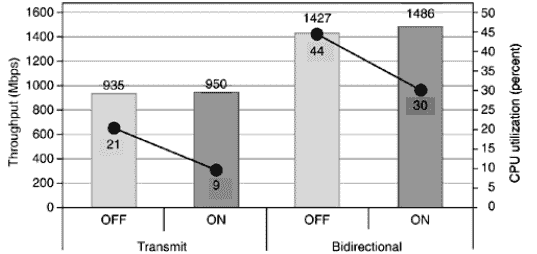

从图 21-2 所示的实验中可以明显看出，TCP 分段卸载显著提升了 Linux 的网络性能。2.5.x 和 2.6 主线内核中提供 TSO 支持。Linux 发行商 SUSE AG 在 SUSE Linux 企业服务器 9（SLES 9）内核中通过配置选项提供此支持。

## 网络负载中的进程和 IRQ 亲和性

亲和性（Affinity），即绑定，是指强制进程中断仅在一个或多个选定的 CPU 上执行的过程。在多处理器系统中，基于操作系统调度器使用的策略，在某些条件下，进程会迁移到其他处理器。通过将进程保留在同一处理器上，所需数据位于缓存中的可能性大大提高，从而减少了内存延迟。然而在某些情况下，即使进程被绑定在同一 CPU 上调度，诸如大工作集和多个进程共享同一 CPU 等因素往往会导致缓存被刷新，因此进程亲和性并非在所有情况下都能发挥作用。本章中展示的案例研究非常适合利用进程亲和性。

Linux 内核实现了以下两个系统调用来促进进程与处理器的绑定：

```c
asmlinkage int sys_sched_set_affinity(pid_t pid, unsigned int mask_len, unsigned long *new_mask_ptr);
asmlinkage int sys_sched_get_affinity(pid_t pid, unsigned int *user_mask_len_ptr, unsigned long *user_mask_ptr);
```

`sched_set_affinity()` 系统调用还确保目标进程将在正确的 CPU（或 CPU 集）上运行。`sched_get_affinity(pid, &mask_len, NULL)` 可用于查询内核支持的 CPU 位掩码长度。

进程亲和性是指将进程或线程绑定到 CPU。IRQ 亲和性是指强制单个 IRQ 的中断处理在特定 CPU 上执行。在 Linux 中，可以使用 `/proc` 接口来设置 IRQ 亲和性。您可以通过查找 I/O 接口使用的 IRQ，然后更改该选定 IRQ 的掩码来设置 IRQ 亲和性。例如，以下命令将 IRQ 63 设置到 CPU 0，并将 IRQ 63 生成的中断路由到 CPU 1：

```bash
echo "1" > /proc/irq/63/smp_affinity
```

进程和 IRQ 亲和性是常见的性能优化实践，旨在提高应用程序和系统的吞吐量及可扩展性。这些方法需要识别并隔离应用程序的进程，并识别中断以将其映射到应用程序进程及其运行的处理器。因此，这种 n-to-n 映射在复杂环境中并不总是可行的。

我们的 Netperf3 案例研究清楚地表明，当使用 IRQ 和进程亲和性时，Linux 网络 SMP 可扩展性和网络吞吐量性能得到了提升。Netperf3 多适配器支持在此案例中衡量了网络可扩展性。对于每个网卡（NIC），创建一个进程，该进程绑定到四个 CPU 和一张网卡中的某一个。该网卡旨在被该进程使用，并绑定到相同的 CPU。一个 Netperf3 进程的处理被隔离，并且由一个 NIC 生成的中断执行被引导至单个处理器。这是在 Netperf3 服务器上使用 TCP_STREAM 测试完成的。

在服务器端，此工作负载中数据接收的处理量很大，导致多次数据拷贝（从 NIC 复制到内核内存，以及从内核内存复制到应用程序内存）。绑定提升了性能，因为这些拷贝在单个处理器上完成，消除了将数据加载到两个不同处理器缓存的需要。当应用这两种亲和性时，绑定降低了内存延迟。虽然可以单独应用 IRQ 和进程亲和性，但如图 21-3 所示，同时应用它们可以进一步提升性能。图 21-3 展示了使用 Linux 2.4.17 内核（来自 www.kernel.org，带有 IRQ、进程亲和性及 O(1) 调度器补丁）收集的数据。选择 O(1) 调度器补丁与进程亲和性进行比较的原因是，O(1) 调度器在调度进程/任务时强制实施亲和性。O(1) 调度器尽可能地将任务调度到与之前相同的处理器，这似乎像带有进程亲和性的运行情况一样，提升了 Netperf3 TCP_STREAM 性能。

#### 图 21-3. Netperf3 TCP 流 4 路可扩展性。

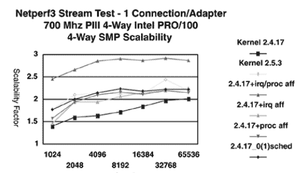

图 21-3 中表现最佳的情况是同时应用了 IRQ 和进程亲和性的情况。对于大多数消息大小，它实现了近乎 4 分之 3 的可扩展性，而基准内核在两个消息上仅实现了 4 分之 2，在其他消息大小上则低于 4 分之 2。单独应用这些亲和性以及使用 O(1) 调度器补丁的情况，其结果在 4 分之 2 到 4 分之 2.5 的可扩展性之间波动。

在图 21-3 中，图例 2.4.17+irq/proc aff 意味着有四个 Netperf3 进程，每个绑定到一个处理器，以及由四个网卡产生的四个 IRQ，这些 IRQ 分别绑定到四个处理器。因此，Netperf3 进程 1 绑定到处理器 0，并且第一张 NIC 的 IRQ 绑定到处理器 0。Netperf3 进程 1 建立的连接通过处理器 0 上的 NIC 1 进行传输。

标签 2.4.17+irq aff 意味着四个 IRQ 绑定到四个 CPU。

2.4.17+proc aff 意味着 Netperf 3 处理器绑定到系统中的四个处理器。

## NAPI 支持


网络驱动程序 API（`NAPI`）旨在改善高中断负载下的 Linux 网络性能。系统负载用于确定是使用轮询还是中断来处理传入数据以改善性能。当中断负载较重时，轮询可改善性能；但当中断负载较轻时，轮询会浪费 CPU 周期。中断在低中断负载下改善延迟，但当中断负载超过最大无丢失转发率（`MLF FR`）时，会使系统容易遭受活锁（`live lock`）的影响。`NAPI` 仅与支持“环形”DMA 缓冲区的网卡配合使用。当接收到网络数据包时，它会被放置在环中的下一个缓冲区中。通常，处理器会为每个数据包中断，系统预期从环中清空数据包。当启用 `NAPI` 时，它通过通知网卡停止中断来响应第一个中断。然后 `NAPI` 轮询该环。在处理数据包时，`NAPI` 无需进一步中断即可拉取新数据包，从而显著减少了接收中断，帮助系统在高网络负载下正常运行。

Linux 2.5 内核中 `NAPI` 的实现使网络设备驱动程序开发者免于手动在每个驱动程序中实现轮询，管理中断洪流，并保护系统免受拒绝服务（`DoS`）攻击。由于中断处理器的 CPU 开销，没有 `NAPI` 时中断洪流的峰值要低得多。`NAPI` 还消除了实现网卡硬件中断缓解变体所需的大量代码。为了利用 `NAPI` 的优势，网络驱动程序必须使用新的网络 API（`NAPI`）。目前，许多网络驱动程序支持 `NAPI`。一些网络驱动程序，如 Intel 千兆以太网，将 `NAPI` 支持作为可构建到驱动程序中的选项，而其他驱动程序，如 BroadCom `Tg3` 驱动程序，则默认支持 `NAPI`。如果网络驱动程序不使用 `NAPI`，那么内核中的 `NAPI` 代码也不会被使用。有关 `NAPI` 的更多信息，请参阅系统 Linux 源代码目录下 Documentation 部分中的 `networking/NAPI_HOWTO.txt` 文件。

在我们的 `NAPI` 测试中，我们使用了构建有 `NAPI` 支持的 Intel 千兆以太网驱动程序。Intel 千兆网卡还提供了另一种缓解发送和接收中断的选项。这种接收中断或接收中断延迟基本上使驱动程序能够在可配置的时间延迟过去后中断处理器。结果，处理器不会为每个数据包中断。随着高带宽网卡的出现，中断率急剧增加。如果没有 `NAPI` 或中断延迟等技术，处理器最终将把大部分周期用于中断处理。中断延迟将在“*Netperf3（千兆以太网调优案例研究）*”部分中详细讨论。

`NAPI` 帮助改善了路由器等互联网数据包转发服务的网络吞吐量性能。`NAPI` 测试结果如表 21-2、21-3 和 21-4 所示。使用 `Netperf` TCP 单流、UDP 流和数据包转发来获得这些结果。这些测试使用的硬件和软件配置包括：

- 两台单处理器 Pentium III @ 933MHz 配备 Intel 千兆以太网（`e1000`）网卡
- Linux 2.4.20-pre4 内核，`e1000` 驱动版本 4.3.2-k1
- `NAPI` 补丁

### 表 21-2. 启用和未启用 NAPI 的 Netperf TCP 单流测试

| 消息大小 (字节) | e1000 基线 (Mbps) | e1000 NAPI (Mbps) |
| --- | --- | --- |
| 4 | 20.74 | 20.69 |
| 128 | 458.14 | 465.26 |
| 512 | 836.40 | 846.71 |
| 1024 | 936.11 | 937.93 |
| 2048 | 940.65 | 939.92 |
| 4096 | 940.86 | 937.59 |
| 8192 | 940.87 | 939.95 |
| 16384 | 940.88 | 937.61 |
| 32768 | 940.89 | 939.92 |
| 65536 | 940.90 | 939.48 |
| 131070 | 940.84 | 939.74 |

### 表 21-3. 启用和未启用 NAPI 的 Netperf, UDP_STREAM 测试

| Intel e1000 驱动程序基线吞吐量 (Mbps) | 启用 NAPI 支持的 Intel e1000 驱动程序吞吐量 (Mbps) |
| --- | --- |
| 955.7 | 955.7 |

### 表 21-4. 启用和未启用 NAPI 的数据包转发 (路由)

| Intel e1000 驱动程序基线吞吐量 (转发包量) | 启用 NAPI 支持的 Intel e1000 驱动程序吞吐量 (转发包量) |
| --- | --- |
| 305 | 298580 |

在启用 `NAPI` 的情况下，接收中断延迟 (`RxIntDelay`) 被设置为 1，因为 `RxIntDelay=0` 会导致问题；而在未启用 `NAPI` 支持的基础 `e1000` 驱动程序情况下，`RxIntDelay` 被设置为 64。在两种系统中，`e1000` 驱动程序的接收和发送描述符均设置为 256。对于 TCP Stream 测试，TCP 套接字大小被设置为 131070。TCP Stream 和 UDP Stream 的测试持续时间均为 30 秒。在数据包转发实验中，每秒以 970 kpackets 的速率注入了 100 万个数据包。

表 21-4 中的数据包转发结果清楚地表明，`NAPI` 在路由数据包方面表现优异。如表 21-2 和 21-3 所示，使用 `Netperf` 进行的 TCP 和 UDP 流测试表明，`NAPI` 并不能提高网络吞吐量。事实上，由于网络吞吐量的原因，性能出现了适度的下降。

表 21-2、21-3 和 21-4 中 TCP 流、UDP 流和数据包转发的结果表明，`NAPI` 在路由测试中显著提高了性能。由于 `NAPI` 在许多网络驱动程序中是可选可用的，您可以根据您的环境选择是否使用 `NAPI`。

## TCP 卸载引擎支持

如果服务器应用程序不使用 Linux `TCP/IP` 协议的一些独特功能，例如 IP 过滤或服务质量 (`QoS`)，则可以使用支持 `TCP/IP` 卸载的网络接口卡来提高网络性能。TCP 卸载引擎 (`TOE`) 技术由现有 `TCP/IP` 堆栈的软件扩展组成，旨在利用实现在专用 `TOE` 网络接口卡 (`TNIC`) 上的硬件平面。这种硬件/软件组合允许操作系统将所有 `TCP/IP` 流量卸载到 `TNIC` 上的专用硬件。因此，服务器资源不再需要处理 `TCP/IP` 帧，而是用于应用程序和其他系统需求，从而提升整体系统性能。这听起来像是提高网络性能的绝佳方案；然而，通用 TCP 卸载解决方案已多次失败，且 `TOE` 仅适用于某些特定的应用程序环境。TCP 卸载适用的场景之一是经由标准化网络硬件进行的存储专用互连，另一场景是高性能集群解决方案。

千兆以太网工作负载分析表明，系统处理的每千兆比特网络流量需要 1 GHz 的 CPU 处理能力。随着更高速处理器系统、高性能串行 PCI-Express 系统总线、内置校验和运算逻辑的以太网控制器以及中断缓解技术的出现，用户将能够在服务器中使用多个千兆以太网连接而不会造成性能下降。然而，网络带宽的提升也与其他系统组件的改进速度相匹配，这就需要类似 `TOE` 的解决方案来进一步提高网络性能。但通用 TCP 卸载解决方案由于根本性的性能问题以及在实际部署 TCP 卸载时产生的复杂性难度而失败。在学术界和商业界，`TOE` 既有支持者也有反对者。然而，许多厂商开发了用于除集群和网络存储解决方案之外的各种工作负载的 `TNIC`。

与 Linux `TCP/IP` 软件堆栈代码相比，`TOE` 解决方案是专有且功能各异的；诸如 `IPCHAINS`、`IPTABLES` 和通用数据包处理能力等独特功能可能无法在这些专有 `TOE` 解决方案中提供。许多构建 `TNIC` 和驱动的厂商支持不同的操作系统。尽管我们早期的结果显示 Linux 上的 `NetBench` 性能提高了 17%，但当时使用的驱动程序并不稳定，因此需要对该功能进行进一步调查。更稳定的驱动程序和网卡应能产生更高的性能结果。

请注意，`TOE` 不同于 TCP 分段卸载 (`TSO`)。`TSO` 仅卸载数据分段。在 `TSO` 的情况下，`TCP/IP` 堆栈将应用程序传递的整个消息在一个帧中交给网卡。网卡将数据（消息）拆分为多个帧，并为每个帧构建头部以进行传输。这种卸载仅针对发送端（出站流量）；它不处理入站流量。另一方面，`TOE` 将整个 `TCP/IP` 堆栈处理卸载到网卡，包括入站和出站处理。

尽管 `TOE` 解决方案是提高网络性能所需的技术，但 Linux 开源社区将如何采用它尚不可知。开源社区中一些人的争议在于，由于 Linux `TCP/IP` 堆栈已经支持零拷贝 (`Zerocopy`)，复制次数已经减少。网卡中的校验和、分段卸载和中断缓解支持将从 `TOE` 的采用中获得大部分好处，因此不需要 `TOE`，因为这些剩余功能处理基本套接字管理和进程唤醒。如果 `TOE` 解决方案演进并能显示出相对于软件网络堆栈的巨大优势，`TOE` 技术的采用率可能会增加。

目前，只有商业公司正在开发 `TOE` 引擎。因此，该解决方案的实现因厂商而异。或许厂商能够缓解或解决 `TOE` 实施和部署中的困难，并改变那些不愿接受 `TOE` 作为提高网络性能的可行替代方案的怀疑者们的想法。

## 案例研究


本节介绍了用于案例研究的基准测试结果，并展示了迄今为止讨论的所有性能增强功能的累积改进。有些基准测试捕捉了所有功能的累积增益，而其他测试则捕捉了特定工作负载的选择性增益。

### NetBench

图 21-4 总结了通过各种 Linux 内核和 Samba 增强及调整对 NetBench 基准测试吞吐量所做的性能改进。这些测试在一台配备四颗 1.5GHz P4 处理器、四个千兆以太网适配器、2GB 内存和十四个 15k rpm SCSI 磁盘的 Pentium 4 系统上进行。所有测试均使用 SUSE 8.0 版本。每个后续测试都包含一个新内核、调整或 Samba 更改。所有测试均使用 Ziff-Davis 的 NetBench Enterprise Disk Suite 进行。

#### 图 21-4. NetBench 案例研究。

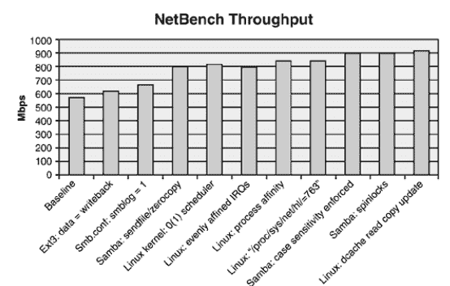

以下列表描述了图 21-4 中的列名：

- **基线 (Baseline)。** 代表 SUSE Enterprise Linux Server 8.0 (`SUSE SLES 8`) 的干净安装，没有任何性能配置更改。
- **data=writeback。** 对 `/data` 文件系统（Samba 共享驻留处）的默认 Ext3 挂载选项进行了配置更改，从 `ordered` 改为 `writeback`。这极大地提高了此类元数据密集型工作负载的文件系统性能。
- **smblog=1。** Samba 日志级别从 2 更改为 1，以减少对 Samba 日志文件的磁盘 I/O。级别 1 足以记录关键错误。
- **SendFile/ZeroCopy。** 一个使 Samba 使用 `SendFile` 处理客户端读取请求的补丁。结合 Linux `ZeroCopy` 支持（最早在 2.4.4 中提供），消除了两次非常昂贵的内存拷贝。
- **O(1) 调度器。** 一个将促进未来其他性能改进的小改进。`O(1)` 调度器是多队列调度器，能提高对称多处理器的性能。这是 Linux 2.5 和 2.6 内核的默认调度器。
- **均匀绑定的 IRQ。** 四个网络适配器中的每一个的中断由一个独特的处理器处理。`SUSE SLES 8` 对于 P4 架构，默认采用轮询分配（`destination = irq_num % num_cpus`）进行 IRQ-to-CPU 映射。在这种情况下，所有网络适配器的 IRQ 都路由到 CPU0。由于提高了此代码的缓存热度，这对性能可能非常好，但随着系统中添加更多 NIC，单个 CPU 可能无法处理整个网络负载。理想的解决方案是均匀绑定这些 IRQ，以便每个处理器处理来自一个 NIC 的中断。结合进程亲和性，这应确保分配到特定 NIC 的进程也分配到单个 CPU，以获得最大性能。
- **进程亲和性。** 此技术确保对于每个处理完的网络中断，相应的 `smbd` 进程被调度到相同的 CPU 上，以进一步提高缓存热度。

  > 这主要是一种基准测试技术，通常不在其他地方使用。如果工作负载可以在逻辑上均匀分布在多个 CPU 上，这将带来巨大的增益。实际上大多数工作负载是动态的，亲和性无法预先确定。
- **/proc/sys/net/rl=763。** 增加网络堆栈代码中持有的缓冲区数量，使得网络堆栈代码不需要调用内存系统从内存系统获取或释放缓冲区。此调整在 2.6 内核中不可用。
- **强制区分大小写。** 如果不强制区分大小写，Samba 在启动文件之前可能需要搜索文件名的不同版本，因为同一个文件可能存在许多文件名组合。强制区分大小写可以消除这些猜测。
- **自旋锁。** Samba 使用 `fcntl()` 作为其数据库，这可能代价高昂。使用自旋锁可以避免 `fcntl()` 调用。使用 `posix_lock_file()` 中发现的大内核锁（Big Kernel Lock）可以减少竞争和大内核锁的等待时间。要使用此功能，请按照以下示例配置 Samba 为 `--use-spin-locks`：

```
Smdb --use-spin-locks -P <port_number> -0<socket option>\n-S <configuration file>
```

- **Dcache 读复制更新。** 通过使用读复制更新技术的新 `dlookup()` 实现，减少了目录条目查找时间。读复制更新是 Linux 中的一种用于互斥的两阶段更新方法，可以避免自旋等待锁的开销。有关更多信息，请参阅 Linux 可扩展性工作项目的锁部分。

### Netperf3（千兆以太网调优案例研究）

千兆以太网网卡正在变得廉价，并迅速取代 100Mb 以太网卡。系统制造商正在主板中集成千兆以太网，系统供应商和集成商正在选择千兆以太网网卡和交换机来连接磁盘服务器、PC 计算机集群和部门骨干网。本节探讨了 Linux 操作系统中千兆网络的性能，以及调优千兆以太网如何改善网络性能。

千兆以太网网卡（Intel 千兆以太网和 Acenic 千兆以太网）具有一些有助于处理高吞吐量的附加功能。这些功能包括支持巨帧（MTU）大小、中断延迟和 TX/RX 描述符：

- **巨帧大小。** 使用千兆以太网网卡时，MTU 大小可以大于 1500 字节。100Mb 以太网中 1500 MTU 的限制已不再存在。增加 MTU 大小通常能改善网络吞吐量，但请确保网络路由器支持巨帧大小。否则，当系统连接到 100Mb 以太网网络时，千兆以太网网卡将降至 100Mb 容量。
- **中断延迟/中断合并。** 中断合并可以设置为接收和发送中断，允许网卡延迟生成中断的设定时间段。例如，当 `Rxint` 设置为 1.024us（这是 Intel 千兆以太网的默认值）时，网卡将接收的帧放入内存，仅在 1.024us 过去后生成中断。这可以通过减少上下文切换来提高 CPU 效率，但同时也会增加接收包延迟。如果针对网络流量正确调优，中断合并可以提高 CPU 效率和网络吞吐量性能。
- **发送和接收描述符。** 此值由千兆以太网驱动程序用于分配用于发送和接收数据的缓冲区。增加此值允许驱动程序缓冲更多的传入数据包。每个描述符包括一个发送和接收描述符缓冲区以及一个数据缓冲区。此数据缓冲区的大小取决于 MTU 大小；此驱动程序的最大 MTU 大小为 16110。

其他千兆以太网研究还表明，对于系统处理的每千兆网络流量，大约需要 1GHz 的 CPU 处理能力来执行工作。我们的实验也证明了这一点，但即使 GHz 处理器数量等于千兆以太网网卡数量，增加更多 GHz 处理器和更多千兆以太网网卡并没有扩展网络吞吐量。其他瓶颈，如系统总线，影响了 SMP 处理器上千兆以太网网卡的扩展性。网卡测试表明，仅在四块网卡中的三块达到了介质速率。

这些测试在一台 Pentium 4 1.6GHz 4 路机器和四台客户端机器（Pentium 3 1.0GHz）之间运行，这些客户端机器能够在介质限制下运行 1 千兆网卡。所有机器都带有 Linux 2.4.17 SMP 原生内核。`e1000` 驱动程序版本为 4.1.7。这些是 Netperf3 `PACKET_STREAM` 和 `PACKET_MAERTS` 运行，所有 MTU 均为 1500 字节。Pentium 4 机器具有 16GB RAM 和四个 CPU。四块网卡平均分布在 100MHz 和 133MHz PCI-X 插槽之间。Pentium 4 系统上的超线程功能已禁用。

`PACKET_STREAM` 测试传输原始数据，不包含任何 TCP/IP 头。传输或接收的没有任何数据包经过 TCP/IP 层。这是一个仅测试 CPU、内存、PCI 总线和网卡驱动程序的测试，以查找这些领域的瓶颈。千兆驱动程序的中断延迟以及发送和接收描述符经过不同值的调优，以确定什么最适合该环境。使用不同的套接字缓冲区大小增加了另一个调优元素。

表 21-5 显示，四块网卡实现的最大吞吐量为 2808 Mbps，有助于实现此吞吐量的调优参数是 4096 个发送和接收描述符，接收和发送两侧的中断延迟设置为 64，套接字缓冲区大小为 132k。

#### 表 21-5. Intel 千兆网卡调优案例研究

**接收 / 四个适配器 / 四个处理器 / 2.4.17 内核**

| 描述符，中断延迟 | 套接字大小 | 总吞吐量 (Mbps) | 总丢包数 | 驱动程序上层 | CPU 百分比 (vmstat) |
| :--- | :--- | :--- | :--- | :--- | :--- |
| 256,16 | 131072 | 2472 | 35 | 72 | 41.0 |
| 256,16 | 65536 | 2496 | 35 | 72 | 39.2 |
| 256,16 | 32768 | 2544 | 33 | 71 | 38.2 |
| 256,64 | 131072 | 2628 | 37 | 68 | 46.6 |
| 256,64 | 65536 | 2640 | 35 | 69 | 43.2 |
| 256,64 | 32768 | 2700 | 24 | 68 | 39.6 |
| 256,96 | 131072 | 2628 | 25 | 64 | 45.2 |


| 256,96 | 65536 | 2664 | 23 | 64 | 45.6 |
| 256,96 | 32768 | 2724 | 19 | 61 | 41.2 |
| 4096,16 | 131072 | 2628 | 28 | 98 | 27.8 |
| 4096,16 | 65536 | 2664 | 29 | 98 | 28.0 |
| 4096,16 | 32768 | 2640 | 28 | 98 | 27.8 |
| 4096,64 | 131072 | 2808 | 19 | 97 | 28.6 |
| 4096,64 | 65536 | 2784 | 20 | 97 | 28.4 |
| 4096,64 | 32768 | 2664 | 25 | 97 | 30.4 |
| 4096,96 | 131072 | 2772 | 18 | 97 | 28.2 |
| 4096,96 | 65536 | 2748 | 19 | 97 | 28.6 |
| 4096,96 | 32768 | 2616 | 21 | 97 | 28.6 |

## VolanoMark

VolanoMark 基准测试创建 10 个聊天室，每个聊天室有 20 个客户端。每个房间将一个客户端的消息回显到房间内的其他 19 个客户端。此基准测试（尚未成为开源基准测试）由 VolanoChat 服务器和一个模拟聊天室中客户端的第二个程序组成。它用于衡量原始服务器性能和网络可扩展性性能。VolanoMark 可以以两种模式运行：环回和网络。环回模式测试原始服务器性能，网络模式测试网络可扩展性性能。VolanoMark 使用两个参数来控制聊天室的大小和数量。

VolanoMark 基准测试以 20 个一组的方式创建客户端连接，并测量服务器轮流向组中广播所有客户端消息所需的时间。在环回测试结束时，它报告每秒传输消息数的平均分数。在网络模式下，指标是客户端和服务器之间的连接数。通过此基准测试加压的 Linux 内核组件包括 TCP/IP、调度和信号。

图 21-5 显示了 VolanoMark 基准测试在环回模式下运行的结果。所示的改进来自各种因素，如网络调优、内核增强和两个原型补丁。IBM Linux 技术中心的性能团队创建了原型补丁，但它们尚未提交到上游内核。第一个补丁是优先级抢占补丁，这使得进程能够运行更长时间而不被更高优先级的进程抢占。由于这种关闭优先级抢占的策略并不适用于所有工作负载，因此该补丁通过一个新的调度器调优参数启用。另一个补丁，即 TCP 软亲和性补丁，与 TCP/IP 相关，因此在本章中不适宜对该补丁进行详细讨论。

### 图 21-5. VolanoMark 案例研究。

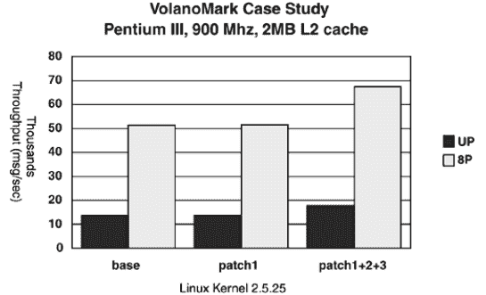

TCP/IP 协议栈中的环回代码路径效率低下。该基准测试的发送和接收线程在 SMP 系统中总是在不同的 CPU 上执行。这导致了在两个不同的 L2 缓存中额外加载数据。为了使连接的发送线程和接收线程在同一 CPU 上执行，代码被修改为在发送者的 CPU 上唤醒接收线程。由于 O(1) 调度器试图将线程保持在同一个处理器上，在接收线程被移动到发送者 CPU 之后，接收线程将保留在发送者 CPU 上，从而消除了在不同 CPU 上加载相同数据的需求。

图 21-5 中的 Patch1 是 SMP 可扩展定时器补丁。Patch2 是调度器优先级抢占补丁。Patch3 是 TCP 软亲和性补丁。SMP 可扩展定时器补丁已包含在 2.5 Linux 内核中。这两个原型补丁旨在举例说明该基准测试特有的问题。这些补丁通过配置选项在内核中启用，并可以通过调优使其适用于相应的工作负载。优先级抢占补丁已提交给开源社区，但 TCP 软亲和性仅在本书中公开。

2.5 和 2.6 内核中包含的其他增强功能，以及改进 VolanoMark 性能的功能包括 O(1) 调度器和 SMP 可扩展定时器。

## SPECHTTPD

SPECHTTPD 基准测试对 Web 服务器提出了严苛的工作负载。该工作负载请求 70% 的静态页面和 30% 的简单动态页面。Web 页面的大小范围从 102 字节到 921,000 字节。动态内容模拟 GIF 广告轮播；没有 SSL 内容。SPECHTTPD 具有相关性，因为 Web 服务，特别是使用 Apache 的服务，是 Linux 服务器最常见的用途之一。Apache 功能丰富，但并非为高性能设计。选择 Apache 作为该基准测试的 Web 服务器，是因为它目前托管的 Web 站点比互联网上任何其他 Web 服务器都多。SPECHTTPD 是公认的 Web 服务标准基准测试。SPECHTTPD 压力测试以下内核组件：

- 调度器
- TCP/IP
- 各种线程模型
- SendFile
- 零拷贝（Zerocopy）
- 网络驱动程序

图 21-6 和 21-7 分别展示了使用 Web 静态内容和 Web 动态内容运行 SPECHTTPD 的结果。还包含了用于每项测试的硬件和软件配置的说明。


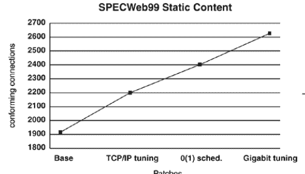

Intel 8路 900 MHz Pentium III，配备 2MB L2 缓存，32GB RAM，(4) GB 以太网

Red Hat 7.1 Linux 2.4.17 内核，Apache 2.0.36，SPECWeb99 1.02

### 图 21-7. SPECWeb99 动态内容案例研究。

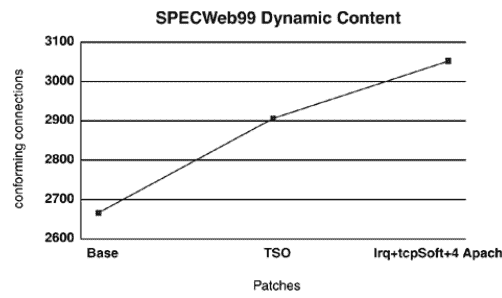

Red Hat 7.1 Linux 2.5.33 内核，Apache 2.0.36，SPECWeb99 1.3

Intel 8路 900 MHz Pentium III，配备 2MB L2 缓存，32GB RAM，(4) GB 以太网

我们解决的某些问题导致了如图所示的改进，包括添加 O(1) 和 RCU dcache 内核补丁，以及向 Apache 添加新的动态 API `mod_specweb` 模块。

### 总结

该案例研究清楚地表明，由于新功能增强，Linux 2.4、2.5 和 2.6 内核中的网络性能一直在改进。TCP/IP 卸载引擎是一项有争议的工作，但它很可能成为 Linux 存储网络工作负载的重要性能增强。TCP 段卸载、进程和 IRQ 亲和性、SendFile 以及 ZeroCopy 都是重要的网络功能，很可能会被网络应用广泛利用。SPECWeb99 SSL 是对 SPECWeb99 基准测试结果的考察。在 Linux 上，SPECWeb99 SSL 表明 Linux 网络性能与其他商业操作系统相当。

在本章中，仅讨论了一些网络功能的性能。服务器能够维持的同时连接数得以提高的异步网络 I/O 未予讨论。正在添加到 2.5 和 2.6 内核中的流控制传输协议（SCTP）和 IPV6 等功能也未在此处探讨。Linux 2.5 和 2.6 内核还支持 10 千兆以太网网卡，其性能评估将是未来研究的另一个有趣话题。确定多个千兆以太网网卡在较新的处理器和更高速度总线上的扩展性，是改善千兆以太网网卡扩展性的另一个需要评估的挑战。

在一定程度上讨论了网络 SMP 扩展性和网卡扩展性，但随着网络带宽的增加，系统总线、处理器和其他系统组件需要改进以跟上更高带宽的网络数据。因此，随着系统的改进，千兆等高带宽网络的性能可能会提高。

为克服千兆以太网瓶颈而引入的另一个技术发展趋势是远程直接内存访问（RDMA）。RDMA 是一种网卡功能，允许一台计算机直接将信息放置在另一台计算机的内存中。与其他任何应用程序相比，RDMA 更有理由将 TCP/IP 协议进行卸载。

Linux 网络性能研究是一个充满活力的主题，与整个计算社区相关。新兴网络技术如何被 Linux 采用并进行性能评估，是 Linux 和网络社区持续关注的问题。

### 参考

- [1] Netbench 基准测试。http://www.veritest.com/benchmarks/netbench/default.asp。
- [2] Netperf。http://www.netperf.org。
- [3] Netperf3 补丁。http://www-124.ibm.com/developerworks/openssource/linuxperf/netperf/netperf3_patch。
- [4] VolanoMark 基准测试。http://www.volano.com/benchmarks.html。
- [5] SPCWeb99。http://www.spec.org/web99。
- [6] Molnar, Ingo。http://people.redhat.com/mingo/O(1)-scheduler。
- [7] McKenney, Paul。“在 Linux 2.5 内核中使用 RCU”，Kernel Kornek，第 114 期，Linux Journal。


## 参考文献

- [8] McKenney, Paul E. 等。“读写副本更新（Read-Copy Update）”，2001 年渥太华 Linux 研讨会。
- [9] TSO 研究。http://www.dell.com/us/en/biz/topics/power_ps1q03-intel.htm。
- [10] 在 Linux 中设置进程亲和性的示例程序。http://www-124.ibm.com/developerworks/openssource/linuxperf/netperf/patches/Affinity_program。
- [11] 开源内核锁项目。http://lse.sourceforge.net/locking/。
- [12] Kelly, T.“改进 Linux 下千兆以太网驱动程序的性能”，DataTAG 项目会议，2003 年 2 月，伦敦大学学院。http://www-lce.eng.cam.ac.uk/~ctk21/papers/。
- [13] Hughes-Jones, R. 等。“千兆以太网网卡和服务器质量主板上的性能测量”。http://datatag.web.cern.ch/datatag/pflidnet2003/papers/hughes-jones.pdf。
- [14] 优先级抢占补丁。http://www-124.ibm.com/developerworks/opensource/linuxperf/volanomark/15Oct02/pri_preempt-2.5.38.patch。
- [15] 由 IBM Linux 技术中心创建的 TCP 软亲和性补丁。http://www-124.ibm.com/developerworks/opensource/linuxperf/netperf/patches/tcp_softaffinity_patch。
- [16] SMP 可扩展定时器补丁。http://www.usws.iu.edu/hypermall/linux/kernel/0101.3/0930.html。
- [17] SCTP。http://www.sctp.org/。
- [18] IPV6。http://www.ipv6.org/。
- [19] RDMA Over TCP。打破千兆以太网瓶颈。http://www.nwfusion.com/columnists/2004/080204tolly.html。
- [20] RDMA。http://www.rdmaconsortium.org/home。
- [21] 由 IBM Linux 技术中心创建的 SendFile 补丁。http://www-124.ibm.com/developerworks/opensource/linuxperf/netperf/patches/sendfile_patch。
- [22] Mogul, J. C.“TCP 卸载是一个时机成熟的愚蠢想法”。http://www.usenix.org/events/hotos03/tech/full_papers/mogul/mogul_html。

# 第二十二章 案例研究：商业负载调优

*威尔弗里德·C·贾米森（Wilfred C. Jamison）著*

## 引言

本章是有关应用服务器的案例研究，重点在于性能分析与调优。在本章中，你将了解以下内容：

- 商业负载调优涉及的内容
- J2EE 应用服务器的标准负载基准测试
- 性能分析与调优的原则和准则
- 通过具体示例演示调优实际性能问题的分步流程

我们将首先考察商业负载调优涉及的内容。

## 商业负载调优概述

使用商业负载对 Linux 服务器进行基准测试，是全面覆盖服务器中大多数（如果不是全部）子系统的最佳方式。应用服务器是处理商业应用的典型模式，它涉及第 21 章“案例研究：Linux 上的网络性能”中描述的软件性能栈中的许多层。

应用服务器的性能分析是一个系统级的过程，涉及分析网络配置、文件系统、JVM、内核调度器、内存使用情况和 CPU 利用率。性能分析可能还需要分析操作系统，并获取内核跟踪信息和内核分析信息，以及使用 JVM 的调试和跟踪工具从 JVM 本身获取信息。最后，性能分析可能还包括使用应用级分析工具收集应用本身的性能数据。

本章没有展示特定企业的实际商业负载，而是使用商业负载模型，这些模型通常用于性能基准测试和分析。商业负载模型也常用于新编程模型规范的参考实现中。例如，当引入 J2EE 时，曾使用名为 PetStore 的示例应用来说明 J2EE 应用开发的一些最佳实践。PetStore 也意在供客户在构建自己的企业 Web 应用时使用。PetStore 是在线零售应用的商业负载模型。Sun 在 http://java.sun.com/blueprints/ 维护着 Java PetStore 的蓝图。

商业负载通常使用给定应用领域的代表性应用进行模拟。然后可以通过调优应用服务器和系统平台来确定应用服务器的性能。大多数商业负载的性能测试是通过逐渐增加服务器负载直到达到饱和点来进行的。

性能调优中最困难的部分之一是理解已收集的性能数据并确定需要分析的问题。

## J2EE 的标准商业负载模型

目前，只有一个被全行业接受的用于符合 J2EE 标准的应用服务器的标准基准测试应用。基准测试 SPECjAppServer 来自 SPEC 组织，是 ECTest 的继任者，后者曾是 2000 年最顶级的基准测试应用。SPECjAppServer 应用模拟了一个重型制造业、供应链管理和订单/库存系统。由于 SPECjAppServer 的目标是对 EJB 容器进行基准测试，它使用一个轻量级 Java 客户端通过 RMI/IIOP 发送请求，而不是向 Web 服务器发送 HTTP 请求。

2001 年，IBM、BEA 和 Oracle 等公司通过共同努力开发了 SPECjAppServer2001。SPECjAppServer2001 基于 J2EE 1.2 规范。目前，正在开发一个新的基准测试应用，名为 SPECjAppPlatform，旨在衡量基于 J2EE 和 .NET 及 Web 服务的企业平台的可扩展性和性能。SPECjAppPlatform 是 SPECjAppServer 的超集。于 2002 年 9 月发布的 SPECjAppServer2002 类似于 SPECjAppServer2001，只不过 SPECjAppServer2002 基于 J2EE 1.3 规范。更具体地说，SPECjAppServer2002 使用的是 EJB 2.0，而不是 J2EE 1.2 中使用的 EJB 1.1。

SPECjAppServer2002 基准测试包含订单和制造应用。该基准测试的吞吐量直接与该应用使用的负载（注入速率）相关。因此，需要增加注入速率以提高吞吐量。指标“每秒总操作数”（TOPS）是在测量间隔内完成的每秒成功总操作数的平均值。

TOPS 由客户领域完成的业务事务总数加上制造领域完成的工作订单总数组成，并按秒进行标准化。该基准测试还要求在各个表中填充一定数量的行。客户订单表和供应商表的基数会根据负载（受注入速率影响）进行缩放。因此，随着注入速率的增加，数据库会变得更大。

来自不同供应商的多项提交展示了使用 SPECjAppServer 标准负载的应用服务器的性能。根据系统配置方式（例如双节点和分布式），分为几个类别。有关 SPECjAppServer 和提交结果的信息可公开获取于 http://www.spec.org/jAppServer2002。

## 我们的商业负载模型：股票交易

本章讨论的代表性应用领域是股票交易。不仅该领域广为人知，它还代表了许多使用“买卖”模式的在线电子商业，而该模式是商业的基础。名为 Trade3 的应用程序是一个由 IBM 开发的基准测试应用，用于衡量其自身应用服务器 IBM WebSphere Application Server 的性能。Trade3 可公开地从 IBM 获取，地址为 http://www-306.ibm.com/software/webservers/appserver/benchmark3.html。

Trade3 模拟了一个提供基于 Web 的在线证券交易的电子股票经纪商。Trade3 使用了 J2EE 1.3 的许多功能，这是 IBM WebSphere Application Server 5.1 版本支持的 J2EE 版本。J2EE 1.3 包含的一些项目有本地接口、消息驱动 Bean 和容器管理的关系（CMRs）。Trade3 还将 Web 服务作为其主要增强功能之一。有关 J2EE 1.3 的更多信息，请访问 Sun 网站 http://java.sun.com/12ee/1.3/index.jsp。

在深入性能分析练习之前，本节其余部分将讨论以下三个领域：


部署该应用的系统配置。在性能分析中，全面了解系统级配置非常重要。所有后续分析都将基于这种理解。在真实的客户环境中，这种配置可能非常复杂。例如，可能存在防火墙和 DMZ，可能存在托管相同应用的地理分散的多个子网络，可能在不同的主机上发生数据库复制，并且可能存在面向外部系统的遗留系统或 Web 服务网关。你还需要了解整个系统中使用的硬件规格，以考虑它们对性能的贡献。

从用户角度看待 Trade3 应用的背景信息，而不讨论该应用是如何实现的或使用了多少 J2EE 功能。性能调优需要你对企业应用本身有一些背景信息，因为有些性能问题可以追溯到企业应用。

性能分析方法论。在修复性能问题时，拥有一套好的方法论很重要。它不仅能让你以非常系统的方式解决问题，还能让整个体验不那么痛苦。

下一节详细介绍了用于我们性能练习的应用所运行的系统配置。

### 系统配置

该案例研究涉及一个四层、非集群配置，如`22-1`图所示。共有四台机器，每一层对应一台，它们通过`100mbps`以太网网络连接。如图所示，这四台机器具有完全相同的规格。第一层是客户端层，包含一个工作负载驱动程序，该程序向Web服务器发送HTTP请求。该驱动程序是一个名为Web性能工具（`WPT`）的自制工具，它通过为每个虚拟用户创建一个线程来模拟并发用户。`WPT`允许您指定要发送到Web服务器的URL请求以及发送这些请求的并发用户数。在测试运行期间，您可以指定需要发送的请求总数或绝对时间段——例如，15分钟。每次运行结束时，该工具会输出吞吐量、平均响应时间、发送的总请求数和失败响应数量等统计数据。

#### 图 22-1. Trade3 性能基准测试的四层配置。

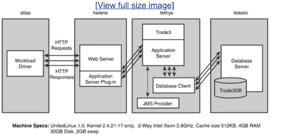

第二层包含基于Apache的Web服务器以及允许Web服务器将请求路由到应用服务器的插件。将Web服务器放在单独的机器上是大企业的常见配置。出于安全目的，Web服务器可能被放置在`DMZ`（隔离区）中，并由两个防火墙保护。

第三层包含部署了Trade3应用的应用服务器。使用的应用服务器是IBM WebSphere Application Server 5.1。Trade3应用程序使用两个资源——一个用于通过`JMS`框架进行消息传递，另一个用于数据源。消息传递用于通知交易（如购买股票）已完成。数据源包含用户的账户信息以及股票及其价格。`JMS`提供商是IBM WebSphere MQ v5.1，它随应用服务器一起提供。位于第四层的数据库提供商是IBM DB2 v8.1 SP3。`JDBC`驱动程序使用类型2，这需要运行在应用服务器上的DB2数据库客户端模块来与数据库服务器通信。图中的箭头表示数据流。虚线箭头表示同一框内的数据流。

在Trade3安装到应用服务器上后，数据库`Trade3DB`使用应用程序本身的配置选项填充了500个用户和1,000种股票。`JMS`队列也已创建，并且IBM WebSphere MQ进程已启动。

#### 关于 Trade3 的更多介绍

大约75%的时间里，性能问题可归因于应用程序。因此，对应用程序进行性能分析以发现潜在的性能问题非常重要。理想情况下，开发团队应实践软件性能工程，这倡导在开发生命周期的开始阶段就尽早考虑性能。对一些人来说，这可能是一个革命性的想法——与我们大多数人在学校所学到的截然不同。

在此练习中，我们假设Trade3已经过仔细分析和优化。我们的重点在于系统本身——应用服务器、数据库服务器和Linux。本节展示了从用户角度看应用程序的样子及其流程。

使用任何浏览器输入URL `http://helene/trade` 即可访问该应用程序，其中`helene`是Web服务器的主机名。Trade3欢迎页如图`22-2`所示。欢迎页本身展示了Trade3应用程序的高级架构。它显示请求可以由servlet或Web服务处理。本章不使用Trade3的任何Web服务功能。

#### 图 22-2. Trade3 的欢迎页。

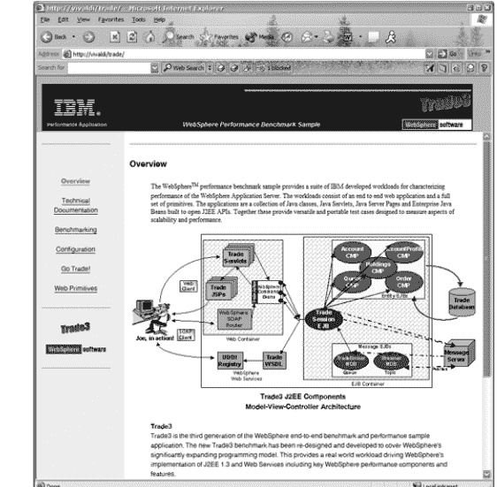

Trade3使用servlet处理请求，然后将请求传递给WebSphere的Command Bean框架。在那里，请求被包装在一个command bean中，并传递给`EJB`容器中的会话bean。从`EJB`容器开始，会话bean决定请求必须由哪些实体bean处理，以及任何消息驱动bean（`MDBs`）。实体bean实际访问数据库，而`MDBs`与`JMS`提供商通信。返回给用户的响应通过`JSP`实现。

要使用该应用程序，请点击“Go Trade!”。Trade3会提示输入用户名和密码。验证后，将为登录用户打开主页，如图`22-3`所示。

#### 图 22-3. 登录成功后的 Trade3 主页。

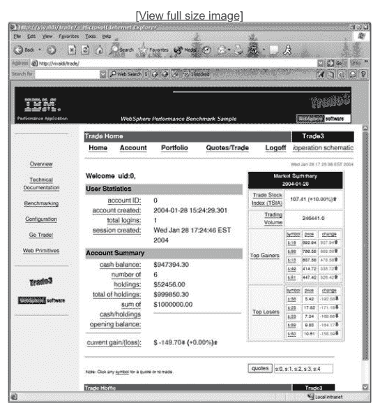

进入主页后，您可以查看您的账户并编辑您的账户信息。要卖出一些股票，请点击“Portfolio”链接。将打开一个类似于图`22-4`所示的屏幕。您可以通过点击相应股票或您想要卖出的“持仓”的“Sell”链接来卖出股票。同样地，如果您想购买股票，请点击“Quotes/Trade”链接。购买股票的屏幕如图`22-5`所示。

#### 图 22-4. 投资组合屏幕，您可以在此处卖出股票。


#### 图 22-5. 购买股票的屏幕。

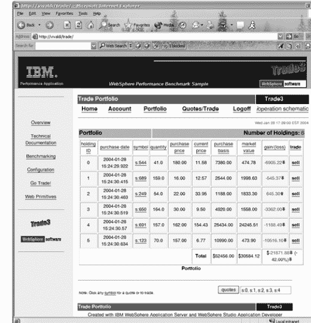

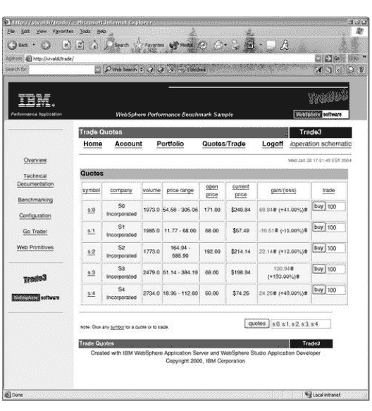

要查看股票的当前价格，请检查其股票代码。要购买股票，请在相应框中指定要购买的股数，然后点击“Buy”。交易将被处理，并且当交易完成时您将收到通知。

当我们运行性能测试时，工作负载驱动程序发送对应于登录账户、查看账户、买卖股票和注销的HTTP请求。

#### 性能分析与方法论

在尝试分析和调优任何系统的性能之前，您需要定义好执行分析的方法论。表`22-1`列出了开发性能分析和调优方法论时应考虑的几个要点。

**表 22-1. Trade3 用户爬坡测试的初始性能数据**

| 并发用户数 | 吞吐量 (Req/Sec) | 平均响应时间 (秒) | 应用服务器 CPU % | 数据库服务器 CPU % | 利特尔法则 |
|---|---|---|---|---|---|
| 1 | 15.92 | 0.062 | 10.7/1.16 | 1.83/0.47 | 1 |
| 2 | 30.72 | 0.064 | 20.84/2.25 | 3.87/0.82 | 2 |
| 5 | 54.82 | 0.09 | 41.16/4.89 | 9.05/1.74 | 5 |
| 10 | 67.69 | 0.147 | 51.96/5.35 | 12.48/2.31 | 10 |
| 20 | 67.7 | 0.294 | 53.22/6.38 | 14.29/2.32 | 20 |
| 40 | 67.03 | 0.597 | 52.98/5.73 | 16.84/2.56 | 40 |
| 80 | 66.7 | 1.2 | 49.99/5.93 | 16.41/2.19 | 80 |
| 160 | 62.1 | 2.562 | 51.81/6.34 | 18.19/2.57 | 159 |

对于本章讨论的性能练习，主要目标是确定在Linux（内核 `2.4.21-17smp`）上运行IBM WebSphere Application Server 5.1并部署Trade3的两路`2.8GHz`系统的最大容量。*容量*指的是并发用户数。要求如下：

- 吞吐量最大化。
- 平均响应时间不超过两秒。


- 了解性能需求/目标，并确定哪些性能指标真正重要。
- 为正确的目的执行正确的测试。
- 定义测试如何执行——使用什么数据，测试运行多长时间，运行期间何时开始获取数据，使用什么工具等。
- 坚持性能目标。除非有充分的理由，否则不要试图更改它们——例如，鉴于环境，目标不切实际。
- 重要的是测试应保持一致，并且如果使用了完全相同的数据集和程序，结果应是可重复的。
- 在运行一系列测试以进行问题分析或诊断时，每次只改变一个变量。
- 以有条理的方式记录所有结果，并有非常完善的文档。如果某人能够理解历史结果，在未见证测试的情况下可视化测试，并得出一些结论，那么您的记录就是好的。
- 尽可能自动化程序以减少人为错误。但是，重要的是自动化的正确性必须是可验证的，并且可以声称对测试结果有100%的信心。
- 尽可能最小化资源共享以避免污染。如果共享不可避免，请在放弃资源给下一个人之前备份您的系统。维护系统所做更改的审计跟踪也是良好的做法。
- 至少执行相同的测试运行三次，以确保数据正确。


## 性能测试规划

下一步是确定需要运行哪些性能测试。我们需要进行一次用户爬坡测试（`User Ramp Up test`），以确定系统在工作负载增加时的性能。工作负载受到向服务器发送请求的并发用户数的影响。当平均响应时间超过`2`秒时，我们将停止增加工作负载。为了最大化吞吐量，只要没有主要瓶颈，应用服务器上的CPU利用率可以接近`100%`。因此，每次测试运行需要收集的重要指标是CPU利用率

在 Web 层、应用程序服务器和数据库服务器上，吞吐量以及平均响应时间。

性能测试运行由预热运行和实际运行组成。对于每次实际运行，应在负载驱动中定义并发用户数量。我们的测试从 `1` 个用户开始，然后是 `2` 个，接着是 `5` 个，此后用户数量持续加倍。预热运行包括由 `1` 个用户发送 `1,000` 个请求，然后是 `2` 个用户、`5` 个用户、`10` 个用户、`20` 个用户，依此类推，直至 `100` 个用户。实际测试运行时长为 `5` 分钟。实际测试运行（针对给定的并发用户数）应重复三次。这些运行之间无需预热，但需要重置数据库。最终结果应为三次运行的平均值。请确保这三次运行产生的结果彼此之间没有很大差异。使用 `sar` 或 `iostat` 工具获取每台主机的 CPU 利用率。您应该能够区分用户进程使用的 CPU 和系统（内核）使用的 CPU。

在案例研究中，测试是在没有*思考时间*的情况下运行的。当用户提交 HTTP 请求时，他会等待直到在浏览器中收到响应。通常，用户在发送另一个 HTTP 请求之前会花一些时间（例如阅读页面）。这段时间间隔称为思考时间（或暂停时间）。因此，如果不为负载驱动指定任何思考时间（思考时间=`0`），用户在收到上一个请求的响应后立即提交下一个请求。消除思考时间会让应用程序服务器承受极大的工作压力。然而，在现实世界中，用户确实会暂停一段时间。没有思考时间的 `100` 个并发用户实际上相当于现实世界中更高数量的用户。没有确切的公式来计算实际的“更高用户数量”，但最简单的近似方法是用用户数量乘以预计思考时间除以平均响应时间加 `1`。当用户返回时。如果平均响应时间是 `2` 秒，这意味着当用户在那期间时。另外四个用户加上时间。在某个时刻，无论再增加多少用户，吞吐量都不再显著增加，应用程序服务器的 CPU 利用率也几乎保持不变。唯一发生显著变化的是响应时间，这是意料之中的，因为更多的用户在争夺资源。当达到这一点时，系统已达到其饱和点。

如果应用程序服务器主机实现了接近 `100%` 的 CPU 利用率，我们可以确信取得了良好的性能，因为这意味着瓶颈在于 CPU。要获得更高的吞吐量，要么系统需要进一步优化，要么需要在主机中添加更多 CPU 以创建集群。在性能领域，瓶颈源是 CPU 是最理想的，因为系统达到最大处理能力时的负载就是系统的容量。因此，如果 `1,000` 个用户在两个 CPU 的情况下使系统达到极限，这意味着系统容量是 `1,000` 个并发用户（零思考时间），吞吐量为 X。

最初，Web 和应用程序服务器采用出厂默认配置设置（即未经调优）。相反，数据库服务器以与应用无关的方式尽可能地进行调优。本章的目的不是展示如何调优数据库服务器，因为这取决于您使用的是哪种数据库产品。JMS 提供方的情况也是如此。

表 `22-1` 显示了我们的初始性能数据。相应的吞吐量与响应时间图表显示在图 `22-6` 中。CPU 利用率有两个数字（用斜杠分隔）。第一个数字是用户部分，第二个数字是系统部分。我们使用 `sar` 工具获取这些信息。我们常用的启发式规则是，系统使用量不应超过总 CPU 利用率的 `20%`。我们希望最小化系统调用，以便用户代码能做更多工作，从而提高吞吐量。在系统上花费太多时间可能表明内核存在低效或问题。利特尔定律（Little's Law）一栏是验证每次运行中响应时间和吞吐量有效性的便捷方式。该定律指出，吞吐量与响应时间的乘积等于并发用户数。数字四舍五入到最接近的整数。在某些情况下，当并发用户数量较大时，利特尔定律可能无法给出精确数字，但它应该非常接近。


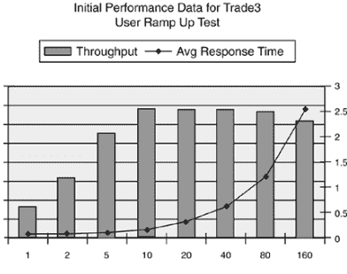

这些数字表明存在严重的性能问题。数据显示，在 `10` 个并发用户时（这也给出了最高吞吐量），吞吐量开始保持几乎相同，响应时间约为 `0.3` 秒。当时应用程序服务器的 CPU 利用率开始维持在该水平。因此，最高的 CPU 利用率约为 `28%` 至 `29%`，按任何标准来看都是一个糟糕的数字。在 `80` 个用户时，尽管吞吐量与之前持平，但响应时间已超过不超过 `2` 秒的要求。因此，此应用程序服务器可处理的并发用户数在 `40` 到 `80` 之间，更可能是在 `65` 到 `70` 之间。

*图 22-6* 是性能数据的可视化表示。该图显示了饱和点在哪里，以及在哪个用户数量下性能仍可接受。当前的即时目标是查明为什么系统在应用程序服务器 CPU 利用率非常低的情况下就达到了饱和点。

### Web 服务器

虽然我们的表格中未显示，但我们注意到 Web 服务器层的 CPU 利用率非常低——大约为 `3%`。有时系统使用量甚至高于用户使用量，但这真的不是问题，因为数字本身就已经很低了。因此，我们假设 Web 服务器本身是瓶颈，并且它进入等待状态的时间过长或次数过多（这解释了低 CPU 利用率）。因此，这可能导致传递给应用程序服务器的请求速率降低。

这个假设很容易验证。插件将原始 HTTP 请求“原样”传递给应用程序服务器。应用程序服务器有一个 HTTP 传输层，可以通过端口 `9080` 接受完整的 HTTP 请求。这意味着我们可以完全跳过 Web 服务器，让负载驱动将请求发送到 `tethys:9080`。

测试从 `10` 个用户开始，以查看是否能看到一些改进。第二组性能数据显示在*表 22-2*中。不幸的是，与原始结果相比没有显著差异。吞吐量和响应时间仍在同一范围内。应用程序服务器的 CPU 利用率也是如此。因此，我们可以排除 Web 服务器是问题的根源。

### 表 22-2. 不含 Web 服务器的 Trade3 用户并发递增测试性能数据

| 并发用户数 | 吞吐量 (Req/sec) | 平均响应时间 (秒) | 应用服务器 CPU% | 数据库服务器 CPU% | 利特尔定律 (Little's Law) |
| :--- | :--- | :--- | :--- | :--- | :--- |
| | | | | | |

*（注：OCR 文本中未提供表格的具体数据行，仅有表头。）*

### 数据库后端：瓶颈所在？

看待此问题的一种方式是调查导致应用服务器“等待”的原因。根据我们对应用程序的了解，有相当一部分代码调用了数据库后端。该应用程序大量使用了容器管理的实体 Bean。应用服务器可能由于数据库、物理磁盘或缓冲区中的某些争用而被阻塞，从而导致应用服务器花费过多时间等待数据库响应。

确定是否如此有两种方法。第一种是登录数据库服务器并收集一些跟踪信息，可以通过数据库调试设施或 Linux 工具实现。我们推荐使用数据库调试工具，因为它们能立即提供关于数据库锁和等待的信息。Linux 工具需要将系统级信息与数据库进行关联，这可能并不那么直观。第二种也是更简单的方法是查看应用服务器，检查其许多或某些线程是否正在等待数据库响应。如果是这样，我们就知道数据库是瓶颈。

### 线程转储

检查 Java 虚拟机的线程转储是检测潜在瓶颈的一种有用方法。转储提供了 JVM 中每个线程当前状态的快照，以及通过堆栈跟踪显示的线程执行历史。可能的状态如下：

- **R** 表示运行中，意味着线程正在积极执行（这并不意味着它实际上正在运行，但它至少在内核调度器的运行队列中）。

- **CW** 表示条件等待，意味着 Java 线程已显式调用某个对象的 `wait()` 方法，并且正在等待被通知。因此，如果通知未迅速到达，线程将等待很长时间，并且如果其他线程依赖于该线程先运行才能继续，则可能会导致瓶颈。否则，其危害不大。

- **MW** 表示监视器等待，意味着线程排在 Java 对象的监视器中。请记住，所有 Java 对象都有自己的监视器。如果线程进入一个 *synchronized* 方法或代码块，而另一个线程已经获得执行该同步方法或代码块的“权利”，那么线程就会进入此状态。除非正在执行的线程离开同步方法或代码块，否则等待它的其他线程无法继续。因此，这是导致瓶颈的最高可能性原因。

我们将执行一次带有 `10` 个并发用户的测试运行。在此期间，我们将记录 Java 进程（对应于应用服务器）的进程 ID。在运行期间，我们将发出以下命令：

```
kill -3 process id
```

你可以通过使用 *ps* 命令查找 Java 进程来检查应用服务器的进程 ID。一些应用服务器在启动时会记录其进程 ID。虽然命令是 "kill"，但它不会终止进程。相反，它会生成一个线程转储并将其保存为形式为 *javacorexxxxxx.txt* 的文件。请注意，线程转储不是 JVM 或 Java 规范的一部分，因此不同的 JVM 实现可能使用不同的文件命名方案。我们通常连续发出此命令（三到五次），以获取多个线程转储，并通过检查线程状态是否发生变化来监控线程的进度。


> 如果你在运行测试并获取性能数据时，切勿获取线程转储。线程转储会减慢 JVM 的速度，从而影响其性能。

我们在运行一个包含 10 个并发用户的测试时获取了应用服务器的线程转储。线程转储可能是巨大的文件，这取决于 JVM 中的线程数量。线程转储输出还提供了关于系统和 JVM 的信息。

虽然本章不涵盖如何解读线程转储输出，但对于本案例研究而言，我们只关心是否有任何线程处于 `MW` 状态，特别是针对数据库例程。

`图 22-7` 显示了我们从线程转储中获取的线程信息片段。注意，由于堆栈跟踪非常深，我们只显示堆栈跟踪的最顶部部分。`图 22-7` 中的线程只是 `Servlet.Engine.Transports` 线程之一（在此应用服务器中，线程是 `池化` 的）。该线程基本上是一个工作线程，它接收来自插件的请求并执行该请求。如你所见，该线程的状态是 R。堆栈跟踪的顶部告诉我们，该线程位于 JDBC 代码中，该代码与本地数据库客户端通信。数据库客户端与远程数据库服务器通信。

### 图 22-7. 从线程转储中获取的线程堆栈跟踪片段。


```
3XMTHREADINFO  "Service Engine Transports : 369" (TID: 0x103390)  .Sys_ _Thread_,1,0x414DB05, _state_:R, _native_
ID:0x64CU8)  prios=5
4XESTACKTRACE  at COM.ibm.db2.jcc.apg.DB2XAResource.<active min_>(Naive Method)
4XESTACKTRACE  at COM.ibm.db2.jcc.apg.DB2XAResource.commin DB2XAResource_ j.<init(Compiled Code))
4XESTACKTRACE  at com.ibm.wss.rad.apg.tp.WSRCAckracer_dialy(commin WSRCSAckracer_dialy.java:204_(Compil
e))
4XESTACKTRACE  at com.ibm.wss.rad.apg.trx.6XTransactionWrapper,comminXAResource_)(Compliled Code)
4XESTACKTRACE  at
com.ibm.wss.TransactionJTAJATXAResourcepl.commin_gl_phase_plJATXAResource commin pl.java:(Compiled
Code)
4XESTACKTRACE  at com.ibm.wss.TransactionJTARegisteredResources.lFlow.Commn(RegisteredResource. java:(Compiled Code))
4XESTACKTRACE
com.ibm.wss.TransactionJTARegisteredResources.distribut ePrepare(RegisieredReSOurces. java:(Compiled Code))
4XESTACKTRACE  at com.ibm.wss.TransactionJTA.TranSACTIONimpl.contin ue(PrepareTransactionimpl.java:(Compliled Code))
4XESTACKTRACE  at com.ibm.wss.TransactionJTA.TransactionImpl.commitTransactionimpl.java:(Compiled Code))
4XESTACKTRACE  at com.ibm.wss.TransactionJTA.TransManagerlf.comminITransManagerImpl java:(Compiled Code)
4XESTACKTRACE  at com.ibm.wss.TransactionJTA.TransManagerlf.comminT1ransManager,java:(Compiled Code)
4XESTACKTRACE  at com.ibm.db2. iJcc.DB2Strategg.commiti2TransStrategy-java:(Compiled Code)
4XESTACKTRACE  at com.ibm.db2. iJ.cc.DB2Strategy. postinvoke(TransStrategy.java:(Compiled Code))
4XESTACKTRACE  at com.ibm.db2.iJ.cc.Translaction_controlImpl. postinvoke(Transaction controlimpl.java: Compiled Code)
4XESTACKTRACE  at com.ibm.db2.ic.contrailer.EEIGc_statater_postinvoke(EESc_state.java:(Completed Code))
4XESTACKTRACE  at com.ibm.db2.iJ.cc.contracler EESc_statater_postinvoke(EESc_statetor java:(Compiled Code))
4XESTACKTRACE  at com.ibm.ws.oibpetor.sample.trade.jib.JiPilot commin TradeJIB.952-104:Jcc:1 getComnitedKnowno
_ Source()
4XESTACKTRACE  at com.ibm.webshpere, sample, trade, 0_2B_ Trade_Sink_ getlnoic_Trade.java:(Completed Code)
4XESTACKTRACE  at com.ibm.webshpere, sample, trade, commin command, QueryCommindeitforminBasisic_5k)(Compiled
Code)
4XESTACKTRACE  at com.ibm.webshpere.command.Localtarge, execateCommandL.o.0i target.java:(Compiled Code))
4XESTACKTRACE  at com.ibm.ws, cc,he.commnniCommandExecuteCommandComminni Command, execjava_(Compliled
4XESTACKTRACE  Code))
com.ibm.ws.webshpereator, ccapp.WebAppRequestDispatcher.handle(WebAppRequest:java:WebAppRequest. java:(Compiled
Code))
```

我们检查了所有线程，没有处于 `MW` 状态的线程。实际上，所有处于 JDBC 代码中的线程都处于 R 状态。我们可以得出结论，数据库服务器不是瓶颈，因为没有线程被它阻塞。

### 数据库 I/O 活动

下一步是检查数据库服务器上的 I/O 活动。我们运行了相同的测试，并在数据库服务器上使用了 `iostat`：

```
iostat -d 2
```

此命令每 2 秒监控一次磁盘活动。以下是跟踪片段：

```
Device: tps Blk_read/s Blk_wrt n/s Blk_read Blk_wrt n
dev3-0 39.00 0.00 400.00 0 800

Device: tps Blk_read/s Blk_wrt n/s Blk_read Blk_wrt n
dev3-0 32.50 0.00 480.00 0 960

Device: tps Blk_read/s Blk_wrt n/s Blk_read Blk_wrt n
dev3-0 49.00 0.00 504.00 0 1008

Device: tps Blk_read/s Blk_wrt n/s Blk_read Blk_wrt n
dev3-0 33.00 0.00 356.00 0 712

Device: tps Blk_read/s Blk_wrt n/s Blk_read Blk_wrt n
dev3-0 33.50 0.00 380.00 0 760
```

### 设备 I/O 活动

我们已从该跟踪记录中移除了其他设备，因为它们在跟踪期间没有任何活动。跟踪显示 I/O 活动（写操作）并不多，这指向了一种可能性。由于数据库实际上正在执行一些工作，且没有任何应用程序服务器线程阻塞在数据库上，显然数据通信或传输正在发生。即使工作量增加，I/O 活动也保持不变，但仍没有任何线程被阻塞。这可能意味着应用程序服务器与数据库服务器之间的通信是瓶颈。无论负载如何，线上的数据传输速率都相同。线程花费了较长时间来接收和发送数据。请注意，发送和接收数据是一项任务，因此这些线程处于 R 状态（可运行状态）。


#### 应用程序服务器与数据库服务器之间的网络活动

我们怀疑应用程序服务器与数据库服务器之间的网络速度很慢。快速判断方法之一是使用 `ping` 命令。当我们 `ping` 工作负载驱动端主机 `atlas` 时，返回结果如下：

```
PING atlas.raleigh.ibm.com (9.27.175.20) from 9.27.175.25 : 56(84) bytes of data.
64 bytes from atlas.raleigh.ibm.com (9.27.175.20): icmp_seq=1 ttl=128 time=0.220 ms
64 bytes from atlas.raleigh.ibm.com (9.27.175.20): icmp_seq=2 ttl=128 time=0.127 ms
64 bytes from atlas.raleigh.ibm.com (9.27.175.20): icmp_seq=3 ttl=128 time=0.127 ms
64 bytes from atlas.raleigh.ibm.com (9.27.175.20): icmp_seq=4 ttl=128 time=0.125 ms
64 bytes from atlas.raleigh.ibm.com (9.27.175.20): icmp_seq=5 ttl=128 time=0.121 ms
64 bytes from atlas.raleigh.ibm.com (9.27.175.20): icmp_seq=6 ttl=128 time=0.124 ms
64 bytes from atlas.raleigh.ibm.com (9.27.175.20): icmp_seq=7 ttl=128 time=0.127 ms
64 bytes from atlas.raleigh.ibm.com (9.27.175.20): icmp_seq=8 ttl=128 time=0.119 ms
64 bytes from atlas.raleigh.ibm.com (9.27.175.20): icmp_seq=9 ttl=128 time=0.128 ms
64 bytes from atlas.raleigh.ibm.com (9.27.175.20): icmp_seq=10 ttl=128 time=0.126 ms
```

当我们 `ping` 数据库服务器主机 `telesto` 时，得到以下输出：

```
PING telesto.raleigh.ibm.com (9.27.175.24) from 9.27.175.25 : 56(84) bytes of data.
64 bytes from telesto.raleigh.ibm.com (9.27.175.24):icmp_seq=1 ttl=64 time=1.96 ms
64 bytes from telesto.raleigh.ibm.com (9.27.175.24):icmp_seq=2 ttl=64 time=0.384 ms
64 bytes from telesto.raleigh.ibm.com (9.27.175.24):icmp_seq=3 ttl=64 time=0.448 ms
64 bytes from telesto.raleigh.ibm.com (9.27.175.24):icmp_seq=4 ttl=64 time=5.61 ms
64 bytes from telesto.raleigh.ibm.com (9.27.175.24):icmp_seq=5 ttl=64 time=0.382 ms
64 bytes from telesto.raleigh.ibm.com (9.27.175.24):icmp_seq=6 ttl=64 time=0.389 ms
64 bytes from telesto.raleigh.ibm.com (9.27.175.24):icmp_seq=7 ttl=64 time=0.677 ms
64 bytes from telesto.raleigh.ibm.com (9.27.175.24):icmp_seq=8 ttl=64 time=0.356 ms
64 bytes from telesto.raleigh.ibm.com (9.27.175.24):icmp_seq=9 ttl=64 time=1.99 ms
64 bytes from telesto.raleigh.ibm.com (9.27.175.24):icmp_seq=10 ttl=64 time=1.19 ms
```

比较两个输出的往返时间可以清楚地看到，到数据库服务器的连接存在问题。要调查此问题的原因，推荐的方法是先从最低层级开始排查——硬件、连接、网卡和网络驱动程序——然后再去调整 TCP/IP 协议栈。一个重要的问题是：“数据库服务器的网卡使用的是什么速度和双工模式？”

为了确定数据库服务器网卡的速度和双工模式，我们登录到数据库服务器并执行 `mii-tool` 命令。不幸的是，数据库服务器上的 `mii-tool` 失败，并返回以下消息：

```
SIOCGETMIIPHY on `eth0' failed: Operation not supported
```

当 `mii-tool` 不起作用时，一个有用的工具是 `ethtool`。我们在数据库服务器上执行 `ethtool`（我们知道 `eth0` 是该服务器上使用的接口），操作如下：

```
##### ethtool eth0
```

`ethtool` 的输出如下：

```
Settings for eth0:
  Supported ports: [ TP ]
  Supported link modes: 10baseT/Half 10baseT/Full
                       100baseT/Half 100baseT/Full
                       1000baseT/Full
  Supports auto-negotiation: Yes
  Advertised link modes: 10baseT/Half 10baseT/Full
                        100baseT/Half 100baseT/Full
                        1000baseT/Full
  Advertised auto-negotiation: Yes
  Speed: 10Mb/s
  Duplex: Half
  Port: Twisted Pair
  PHYAD: 0
  Transceiver: internal
  Auto-negotiation: on
  Supports Wake-on: umbg
  Wake-on: d
  Link detected: yes
```

输出显示 `eth0` 的当前设置为使用半双工的 10Mbps。这是一个重大发现，可能有助于提高性能。要更改设置，请执行以下命令：

```
ethtool -s eth0 speed 100 duplex full
```

请注意，您也可以将速度设置为 "auto" 而不是 100。我们在修复网卡设置后重新运行了相同的测试。*表 22-3* 总结了新结果。所获得的提升惊人。我们将应用程序服务器的最大 CPU 使用率从 ~59% 提高到了 ~94%。此外，我们将最大吞吐量提高了 56%。更重要的是，我们现在可以支持多达 200 名用户，响应时间仍保持在 2 秒以下。

###### 表 22-3. 解决网络问题后的性能数据

| 并发用户数 | 平均吞吐量 (Req/Sec) | 平均响应时间 (秒) | 应用程序服务器 CPU% | 数据库服务器 CPU% | 利特尔法则 |

|:---|:---|:---|:---|:---|:---|

| 1 | 25.48 | 0.038 | 16.19/1.7 | 1.87/0.85 | 1 |

| 2 | 46.04 | 0.042 | 33.72/3.52 | 4.19/1.79 | 2 |

| 5 | 77.38 | 0.063 | 61.06/6.72 | 9.18/3.15 | 5 |

| 10 | 89.43 | 0.110 | 81.45/8.27 | 11.2/3.46 | 10 |

| 20 | 106.12 | 0.187 | 89.25/9.94 | 14.09/3.94 | 20 |

| 40 | 104.76 | 0.380 | 86.47/10.77 | 14.27/4.46 | 40 |

| 80 | 102.15 | 0.782 | 85.48/10.02 | 14.55/4.38 | 80 |

| 160 | 101.86 | 1.564 | 83.74/10.23 | 14.28/4.20 | 159 |

| 200 | 101.17 | 1.971 | 84.77/10.01 | 14.03/4.07 | 199 |

| 220 | 102.02 | 2.15 | 84.25/10.10 | 14.47/4.03 | 219 |


由于还有 6% 的 CPU 未被使用，我们挑战自己争取更好的表现。

### Java 虚拟机

下一步是调整应用程序服务器和 JVM。由于 IBM WebSphere Application Server 的 JVM 不使用热点（hotspot）技术，我们需要研究的内容只有一个：堆大小设置。默认值是最小 50MB，最大 256MB。要确定默认值是否正确，或者我们是否有足够的堆内存，我们需要检查 JVM 中的垃圾回收（GC）活动。我们知道垃圾回收是一种必须最小化的开销，以便从应用程序中获取更多的吞吐量。因此，我们使用 20 个并发用户运行了一项测试，并在 JVM 参数中启用了 `verbose:gc` 标志。垃圾回收输出显示在标准错误流上，因此我们需要将它们重定向到一个文件中。

分析文件中 `verbose:gc` 的原始输出非常繁琐且耗时。我们开发了一个名为 `GCAnalyzer` 的工具来捕获这些信息并总结结果。该工具对每个垃圾回收事件进行绘图，显示收集了多少内存以及还有多少是活动的。我们使用该工具，以 `gc.output` 作为保存原始 GC 输出的文件名，使用以下命令：

```
GCAnalyzer mb chartdata gc.txt gc.output
```

此命令指定所有单位以兆字节（megabytes）表示，并且除了摘要之外，还会生成一个文本文件 `gc.txt`，可以导入 Microsoft Excel 来创建图表。摘要结果如下所示：

```
Total number of GC: 222
Total runtime=464541 ms.
Total number of GC: 222
Total time in GC: 21997 ms.
% of time spent on GC: 4%
Avg GC time: 99 ms.
Longest GC time: 146 ms.
Shortest GC time: 14 ms.
Avg. time between GC: 1993 ms.
Avg. GC/Work ratio: 0.047361907
Avg. bytes needed per GC: 1380 bytes
Total garbage collected: 7,400.87 MB
Avg garbage collected per GC: 33.34 MB
Total live memory: 12,559.26 MB
Avg live memory per GC: 56.57 MB
```

GC 前堆中空闲字节的平均百分比：0.9 %

GC 后堆中空闲字节的平均百分比：38.12 %

每次 GC 产生的垃圾占堆的平均百分比：37.03 %

平均标记时间：83 毫秒。

平均清扫时间：12 毫秒。

压缩次数：6 次 (2.7%)

平均压缩时间：1 毫秒。

堆扩展次数：4 次 (1.8%)

平均扩展时间：34 毫秒。

每次扩展增加字节的平均大小：11632 KB。

每秒生成的平均垃圾（全局）：16.74 MB/秒

查看这些数字，我们发现垃圾回收没有重大问题。事实上，垃圾收集所花费的时间仅占 5 分钟测试运行时间的 4%。根据我们的经验，5% 是良好的垃圾回收时间所能承受的上限。执行垃圾回收非常快，标记耗时 83 毫秒，清扫耗时 12 毫秒，而压缩时间仅为 1 毫秒！我们认为，JVM 1.4.1 版本的垃圾收集器有了显著的改进，该版本随 IBM WebSphere Application Server 5.1 一起提供。图 22-8 进一步表明垃圾收集没有问题。

#### 图 22-8. 从 GCAnalyzer 输出获取的结果图表。

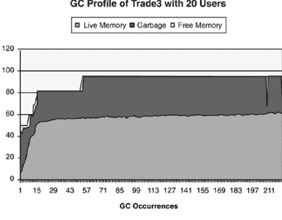

我们可以从图表中推断出堆大小稳定在 98MB 左右，这远低于设置的 256MB 最大值。换句话说，无需增加堆大小。请注意，最初几次垃圾收集发生在应用服务器启动期间。

然而，另一个 JVM 标志 `-XnoClassgc` 可能有助于提高性能。`-XnoClassgc` 会导致 GCAnalyzer 在发生垃圾收集时避免收集未使用的类对象。鉴于良好的垃圾回收配置，我们不指望会有显著改进。但是，测试该标志是值得的，因为它能带来更高的吞吐量，那么它仍然是物有所值的。我们使用该标志进行了测试，正如预期那样，结果显示改进微乎其微，但我们决定保留该标志。

### 应用服务器

软件性能堆栈中可能需要调优的一层是应用服务器本身。不同的应用服务器可能提供不同的调优参数，但在许多方面它们非常相似。这 partly 是因为它们都是基于 J2EE 的。

#### 线程池

需要在应用服务器内解决的首要问题是线程池。在所有应用服务器中，线程池化都是典型的。这是一个很好的方法，因为提供线程是应用服务器的职责——企业应用程序不应该创建线程。线程池化是一种性能增强机制，用于避免在需要时创建和销毁线程的成本。

Linux 内核 2.4 及更早版本对线程非常敏感，特别是在系统中存在大量活跃线程时。这是因为这些内核仍然使用原始的线程模型和调度器。Linux 最初是为单处理器的小型桌面设计的，因此调度器的原始设计并未太关注扩展性问题。Linux 为所有线程使用单个运行队列。因此，准备执行排队可运行进程的多个处理器必须同步其对队列的访问。更糟糕的是，调度器评估队列中的每个进程以选择接下来需要调度哪一个。时间复杂度是队列中线程数的函数。这解释了一个较大的线程池为何可能表现更差。以某种方式，让某些其他请求等待可用线程比为其分配一个线程并承担调度成本要快。然而，Linux 内核 2.6 引入了 O(1) 调度器和一个符合 Native POSIX 的新线程模型。在 O(1) 调度器中，每个处理器都有自己的运行队列，而不是单队列模型。

目前，由于我们使用的是内核 2.4，我们需要查看我们的线程池大小。Web 容器的默认线程池大小为 50。通过将其设置为 20，我们得到了**表 22-4** 中显示的结果。

##### 表 22-4. 将 Web 容器线程池大小设置为 20 的结果

| 并发用户数 | 平均吞吐量 (Req/Sec) | 平均响应时间 (秒) | 应用服务器 CPU % | 数据库服务器 CPU % | 利特尔法则 |
| :--- | :--- | :--- | :--- | :--- | :--- |
| 10 | 96.04 | 0.103 | 79.33/8.68 | 13.91/4.18 | 10 |
| 20 | 106.81 | 0.186 | 87.92/11.15 | 14.05/3.95 | 20 |
| 40 | 109.01 | 0.336 | 89.23/9.72 | 14.03/4.42 | 40 |
| 80 | 107.19 | 0.745 | 88.56/10.59 | 13.88/4.33 | 80 |

与**表 22-3** 中显示的结果相比，我们看到显著改进。我们还发现，用户数在 20 及以上时，这种益处会更加显现，因为在那里我们可以看到较少线程和更多传入请求带来的好处。

#### 传引用

需要设置的下一个参数是应用服务器 ORB 组件中的传引用（pass-by-reference）。J2EE 规范要求所有 EJB 方法调用必须按值传递参数，而不是按引用传递。这是需要的，因为对于远程方法调用，无法在两台远程机器之间保持引用。因此，必须传递实际值。

此时，对应用知识的理解很有帮助。我们知道所有到达 Trade3 的请求都通过 HTTP 传输，并且所有 EJB 调用都在同一 JVM 内本地完成。Trade3 恰好不会更改传递给 EJB 方法调用的参数值。传引用是一种性能增强机制，它不深拷贝对象，而是仅传递对象的引用。

#### 数据源预编译语句和连接池

数据源的预编译语句大小和连接池大小是两个你可以在遇到数据库瓶颈时进行调优的参数。然而，根据我们的线程转储分析，我们在数据库方面没有遇到性能问题。因此，Trade3 工作负载下，60 个预编译语句和 50 个连接池的默认值似乎运行良好。

最后，我们在启用传引用的情况下重新运行了测试，并将 ORB 线程池大小降低到 10。结果如**表 22-5** 所示。性能图表也如**图 22-9** 所示。将这些结果与初始性能数据进行比较，你会看到发生了巨大的变化。此时，我们已经使用了应用服务器约 99% 的 CPU，并将用户数增加到 250。

##### 表 22-5. 针对 Trade3 工作负载调优系统的最终结果

| 并发用户数 | 吞吐量 (Req/Sec) | 平均响应时间 (秒) | 应用服务器 CPU % | 数据库服务器 CPU % | 利特尔法则 |
|:---:|:---:|:---:|:---:|:---:|:---:|
| 1 | 27.96 | 0.036 | 14.65/2.0 | 2.25/1.12 | 1 |
| 2 | 50.99 | 0.038 | 29.63/3.78 | 4.61/1.73 | 2 |
| 5 | 87.61 | 0.056 | 53.69/6.54 | 9.66/3.18 | 5 |
| 10 | 112.71 | 0.088 | 76.40/10.21 | 14.11/4.17 | 10 |


| 20 | 124.36 | 0.159 | 86.86/11.97 | 15.94/4.58 | 20 |

| 40 | 125.89 | 0.317 | 87.28/11.78 | 16.67/4.38 | 40 |

| 80 | 126.02 | 0.633 | 86.94/12.25 | 17.12/4.94 | 80 |

| 160 | 126.15 | 1.263 | 86.81/12.35 | 16.85/4.53 | 159 |

| 250 | 128.49 | 1.929 | 87.37/11.94 | 16.71/4.85 | 250 |

#### 图 22-9. 运行 Trade3 的调优系统的性能图表。

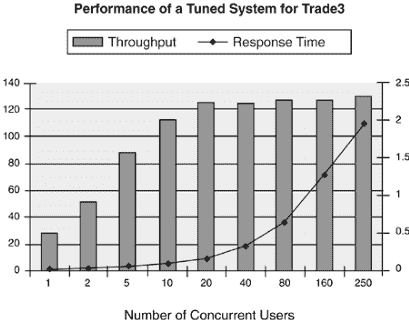

### 超线程

我们提高性能的最后一次尝试是利用 Intel Xeon 处理器的超线程功能。幸运的是，我们的 Linux 内核支持超线程。使用处于调优状态的相同系统，我们通过硬件系统配置启用了超线程，并重启了应用服务器。重新运行测试的结果显示在表 22-6 中。

##### 表 22-6. 启用超线程的性能图表

| 并发用户数 | 平均吞吐量 (Req/Sec) | 平均响应时间 (秒) | Web 服务器 CPU% | 应用服务器 % | 数据库服务器 CPU % | 利特尔法则 |
| :--- | :--- | :--- | :--- | :--- | :--- | :--- |
| 1 | 29.82 | 0.033 | 0.44/0.64 | 8.46/1.53 | 2.34/1.11 | 1 |
| 2 | 53.46 | 0.037 | 0.82/1.48 | 17.64/3.27 | 5.05/1.99 | 2 |
| 5 | 90.46 | 0.055 | 1.26/1.87 | 41.58/7.47 | 10.28/3.26 | 5 |
| 10 | 112.07 | 0.089 | 1.67/2.40 | 67.83/11.20 | 14.10/4.04 | 10 |
| 20 | 119.18 | 0.167 | 1.92/2.58 | 81.28/14.08 | 16.36/4.62 | 20 |
| 40 | 117.71 | 0.339 | 1.53/2.52 | 79.71/14.44 | 15.63/4.42 | 40 |
| 80 | 117.34 | 0.679 | 1.54/2.65 | 79.36/14.06 | 15.59/4.86 | 80 |
| 160 | 117.10 | 1.357 | 1.51/2.81 | 79.84/14.21 | 15.71/4.70 | 159 |
| 250 | 116.10 | 2.134 | 1.60/2.52 | 81.11/12.66 | 15.54/4.64 | 250 |

看起来，Trade3 应用程序以及我们目前使用的设置并不能清晰地体现处理器的超线程功能，正如结果所示。这恰恰说明，超线程的承诺需要仔细研究，并且只能在正确的情况下应用。

### 摘要

本章主要关注商业工作负载的性能分析与调优。我们提供了该领域的一些背景信息以及执行此类任务的一些指导原则。我们还简要提到了业界在应用服务器标准化性能测量方面所付出的努力。

本章的大部分篇幅都用于一个示例，该示例逐步说明了调优商业工作负载的过程。以下是本章的一些要点：

- 性能调优是一项通过不断接触不同问题情境而获得的技能。
- 性能调优应按照明确定义的方法论来执行。
- 如果没有明显的嫌疑人，通过排除法缩小问题范围。
- 始终选择更简单、更快捷的方式来获取所需结果。
- 始终关注您的 Linux 安装的 `kernel` 层面。这样，您将知道是否缺少补丁等。
- 不要期望一个补丁、内核级参数或调优参数在所有情况下都对您有效。
- 始终意识到开源社区对 Linux 操作系统所做的更改和改进。
- 并非所有新的硬件功能都有帮助；例如，超线程。很多仍取决于您的应用程序和中间件的性质和使用模式。

### 参考文献

[1] Gunther, Harvey. "WebSphere Application Server: Best practices for developing high performance Web and enterprise applications," http://www-306.ibm.com/software/webservers/appserv/ws_bestpractices.pdf, Sept. 7, 2000.

[2] Comer, Douglas E. Internetworking with TCP/IP Volume I: Principles, Protocols, and Architecture, Second Edition, Prentice Hall, New Jersey, 1991.

[3] Jamison, Wilfred C. "Improving Performance of J2EE Applications," WebSphere Journal, May 20, 2003.

## 附录 A. 调整内核参数

*作者：Badari Pulavarti 和 Narasimha Sharoff*

### 简介

本附录列出并描述了许多通过 `sysctl`、`/proc` 和 `sysfs` 接口可用的内核可调参数。它提供了如何通过使用这些接口来调整 Linux 内核及系统其他关键组件的概述。本附录涵盖的主题包括：

- `sysctl` 的使用概述和描述
- `/proc` 的使用概述和描述
- `sysfs` 的使用概述和描述
- 对各种类型可调参数的讨论，包括：
  - 通用内核参数
  - 虚拟内存参数
  - 文件系统参数
  - 网络参数

### sysctl 接口

`sysctl` 接口允许您在运行时配置内核参数。`sysctl` 列出了内核参数，通过命令行界面临时修改参数，从文件加载设置，或者通过在启动时加载的配置文件中添加设置来永久修改内核参数。

参数按照层次结构或树状结构组织。例如，与设备相关的所有参数都以 `dev` 开头。特定设备（如 `cdrom`）的参数位于 `dev.cdrom` 之下。

默认情况下，已启用对 `sysctl` 的内核支持。在新内核构建时启用 `sysctl` 支持时，请使用 `menuconfig`，从主菜单中选择 General Setup，并选择 sysctl support。或者，您可以编辑配置文件以设置 `CONFIG_SYSCTL` 选项。

### 使用 sysctl

`sysctl` 命令通常位于 `/sbin` 目录中。您可以通过执行 `sysctl a` 命令来查看完整的可调参数及其设置列表。要设置特定参数，请使用 `w` 选项。例如，以下命令将消息队列标识符设置为 32：

```bash
$ sysctl w kernel.shmmax=32
```

请注意，此更改是暂时的，不会在系统重启后保留。

要进行在重启后仍能保留的更改，请使用 `p` 选项从配置文件加载一组值。在下面的示例中，从配置文件 `/etc/sysctl.conf` 加载值：

```bash
$ sysctl p /etc/sysctl.conf
```

有关不同使用选项的更多信息，请参阅 `sysctl(8)` man 页。

### procfs 接口

修改内核参数的另一种方法是使用通过 procfs 的文件系统接口。`/proc` 文件系统（procfs）是一个特殊的文件系统。它是一个虚拟文件系统；它与块设备不关联，仅存在于内存中。`/proc/` 目录以层次结构显示参数。您可以通过查看文件内容来查看参数。可以通过将值回显到文件中来修改参数。但是，以这种方式进行的更改不会在机器重启后保留。

`/proc` 组织为以下目录：

| 目录 | 描述 |
| --- | --- |
| `/proc/bus` | 总线特定信息 |
| `/proc/driver` | 驱动程序特定信息 |
| `/proc/fs` | 文件系统参数 |
| `/proc/irq` | IRQ 到 CPU 亲和性的掩码 |
| `/proc/net` | 网络信息 |
| `/proc/scsi` | SCSI 相关信息 |
| `/proc/sys` | 内核参数 |
| `/proc/sys/fs` | 通用文件系统数据 |
| `/proc/sys/kernel` | 通用内核参数 |
| `/proc/sys/vm` | 内存管理参数 |
| `/proc/sys/dev` | 设备特定信息 |
| `/proc/sys/sunrpc` | RPC 信息 |
| `/proc/sys/net` | 网络信息 |

参数可以通过写入 `/proc/` 目录中的相应文件来查看或更改。

例如，要查看 `$shmmax` 的当前值，输入以下内容：

```bash
$ cat /proc/sys/kernel/shmmax
```

类似地，您可以通过输入以下命令来更改 `$shmmax` 的值：


```bash
$ echo "32" > /proc/sys/kernel/shmmax
```

请注意，此更改是暂时的，不会在重启后保留。

### sysfs (仅限 Linux 内核 2.6)

`sysfs` 是另一个虚拟文件系统，它为内核参数提供了易于使用的接口。目前，`procfs` 中所有的非进程信息都已移植到 `sysfs`。计划将 `sysctl` 和 `/proc` 接口合并为一个。`sysfs` 还设计用于替代 `devfs`，因为驱动程序预计将移植到新的接口。此文件系统由内核自动生成，并在设备添加或删除时更新。

### 使用 sysfs

参数可以通过写入 `sysfs` 文件系统中的相应文件来查看或更改。

### 通用内核参数

本节讨论通用内核参数，包括以下方面的参数：

- 共享内存
- 进程
- 信号
- 性能分析/调试
- 系统

#### 共享内存

**Sysctl 前缀：** `kernel`  
**/proc 前缀：** `/proc/sys/kernel/`

| 参数 | 描述 |
| --- | --- |
| `sem` | 信号量值 |
| `msgmnb` | 最大消息队列（以字节为单位） |
| `msgmni` | 最大允许的消息队列标识符 |
| `msgmax` | 最大消息大小（以字节为单位） |
| `shmmni` | 系统范围的共享段数 |
| `shmall` | 系统范围的共享内存（以页为单位） |
| `shmmax` | 共享段大小（以字节为单位） |

#### 进程

**Sysctl 前缀：** `kernel`  
**/proc 前缀：** `/proc/sys/kernel/`

| 参数 | 描述 |
| --- | --- |
| `thread_max` | 系统中允许的最大线程数 |

#### 信号

**Sysctl 前缀：** `kernel`  
**/proc 前缀：** `/proc/sys/kernel/`

| 参数 | 描述 |
| --- | --- |
| `rtsig-max` | 最大实时信号 |
| `rtsig-nr` | 当前排队中的实时信号数量 |

#### 性能分析/调试

**Sysctl 前缀：** `kernel`  
**/proc 前缀：** `/proc/sys/kernel/`

| 参数 | 描述 |
| --- | --- |
| `sysrq` | 系统跟踪请求 |
| `printk` | Printk 值 |

`printk` 参数有四个字段：`console_loglevel`、`default_message_loglevel`、`minimum_console_level` 和 `default_console_level`。优先级高于 `console_loglevel` 的消息会打印到控制台。没有明确优先级的消息会以 `default_message_loglevel` 优先级打印。`console_loglevel` 可以设置的最小（最高）值由 `minimum_console_level` 参数决定。`default_console_loglevel` 是 `console_loglevel` 的默认值。

#### 系统

**Sysctl 前缀：** `kernel`  
**/proc 前缀：** `/proc/sys/kernel/`

| 参数 | 描述 |
| --- | --- |
| `domainname` | 域名 |
| `hostname` | 主机名 |
| `ostype` | 操作系统类型 |
| `osrelease` | 操作系统发行版 |
| `version` | 内核版本 |
| `real-root-dev` | 实际根设备分区 |

### 虚拟内存

**Sysctl 前缀：** `vm`  
**/proc 前缀：** `/proc/sys/vm/`

| 参数 | 描述 |
|---|---|
| `max_map_count` | 每个进程的最大内存映射区域数量 |
| `max-readahead` | 最大 I/O 预读大小 |
| `min-readahead` | 最小 I/O 预读大小 |
| `vm.heap-stack-gap` | 在堆和栈之间强制执行间隔 |

`vm.heap-stack-gap` 参数允许在堆和栈之间强制执行一个间隔。任何对间隔区域内内存的访问都会导致段错误。此举可避免当栈分配超出堆边界时可能发生的静默损坏。强制执行的间隔以页数为单位。

| 参数 | 描述 |
|---|---|
| `pagetable_cache` | 每个处理器用于页表的缓存大小 |

`pagetable_cache` 参数指定每个处理器用于页表的低和高缓存大小。在多处理系统（SMP）上，此参数允许系统进行快速的页表分配，而无需获取内核内存锁。在单 CPU 系统上，可以将这些值设置为 0，以避免浪费内存。

| 参数 | 描述 |
|---|---|
| `page_cluster` | 页面故障时要读取的页面数 |

`page_cluster` 参数用于确定内核在页面故障时一次可以读取的页面数量。页面数量是 2 ^ `page_cluster`。此 VM 子系统试图通过在页面故障时读取多个页面来减少过度的寻道操作。

| 参数 | 描述 |
|---|---|
| `kswapd` | 将内存页交换到磁盘 |

内核交换守护进程 `kswapd` 在内存变得碎片化或已满时将页面交换到磁盘。这是一个三字段值，对应 `tries_base`、`tries_min` 和 `swap_cluster`。

`kswapd` 一次试图释放的最大页面数由 `tries_base` 字段决定。这个数字除以 4 或 8 来确定页面数量（`mm/vmscan.c`）。

`tries_min` 字段指定 `kswapd` 每次被调用时试图释放的最小页面数。

`swap_cluster` 字段是 `kswapd` 在轮到它时写入的页面数。保持此值较大可确保 `kswapd` 以大块方式执行 I/O，且磁盘不需要频繁寻道。如果值太大，可能会导致请求队列泛洪。

| 参数 | 描述 |
|---|---|
| `bdflush` | 脏页处理 |

第一个字段 `nfract` 决定激活 `bdflush` 的脏缓冲区缓存百分比。较高的值可以延迟磁盘写入更长时间，但在内存不足时将需要执行大量 I/O。较低的代价是频繁的 I/O 操作，但能使 I/O 分布更均匀。默认值为 50%。

第二个字段 `ndirty` 是 `bdflush` 一次可以写入磁盘的最大脏块数。较高的值可以延迟 I/O 并可能导致 I/O 突发，而较低的值可能导致内存短缺，因为 `bdflush` 未被频繁唤醒。

第三个字段 `nrefill` 是调用 refill 时 `bdflush` 试图获取并添加到空闲缓冲区列表中的缓冲区数量。

第四个字段 `nref_dirty` 是激活 `bdflush` 的脏缓冲区阈值。

第六个字段 `age_buffer` 是将脏的普通缓冲区写入磁盘前的最大时间。该值以 jiffies 为单位。

第七个字段 `age_super` 是将脏的超级块缓冲区写入磁盘前的最大时间。

| 参数 | 描述 |
|:---|:---|
| `vm_passes` | 内存平衡 |
| `vm_lru_balance_ratio` | 活动和非活动缓存比例 |
| `vm_mapped_ratio` | 页面换出速率 |
| `vm_cache_scan_ratio` | 一次扫描的 LRU 队列 |
| `vm_vfs_scan_ratio` | 一次扫描的 VFS 队列 |
| `vm_gfp_debug` | 启用后将调试消息发送到日志 |

`vm_passes` 参数是内存平衡失败前的 vm 传递次数。

`vm_lru_balance_ratio` 参数确定活动缓存和非活动缓存之间的平衡。较大的值意味着随着活动缓存缓慢轮换，活动缓存会增长。

`vm_mapped_ratio` 参数确定页面换出速率。较小的值表示较早开始页面换出。

`vm_cache_scan_ratio` 参数指定一次扫描多少非活动 LRU 队列。值为 6 意味着对非活动列表的 1/6 进行扫描。

`vm_vfs_scan_ratio` 参数指定一次扫描多少 VFS 队列。值为 6 意味着将释放 1/6 的未使用 inode、dentry 和 dquot 缓存。

### 文件系统

**Sysctl 前缀：** `fs`  
**/proc 前缀：** `/proc/sys/fs/`

| 参数 | 描述 |
|:---|:---|
| `file-max` | 文件描述符的最大数量 |
| `file-nr` | 文件句柄的数量 |

系统`文件描述符`限制使用 `file-max` 设置。描述符限制是任何单个进程一次可能打开的文件描述符的最大数量。`file-nr` 有三个字段：已分配文件句柄的数量、已使用文件句柄的数量以及最大文件句柄数量。

| 参数 | 描述 |
|:---|:---|


`inode-state` 的第一个字段 `nr_inodes` 表示系统已分配的 inode 数量。第二个字段 `nr_free_inodes` 指定空闲 inode 的数量。`inode-nr` 参数包含 `inode-state` 参数的前两个字段。

| `inode-state` | inode 状态 |
| `inode-nr` | 空闲和已使用 inode |

| 参数 | 描述 |
|:---|:---|

| `super-max` | 文件系统的最大数量 |
| `super-nr` | 已挂载文件系统的数量 |

`super-max` 参数控制超级块的最大数量，从而决定内核可以拥有的最大挂载文件系统数量。如果需要挂载的文件系统数量超过 `super-max` 中的当前值，则需要增加此值。

| 参数 | 描述 |
|---|---|

| `dentry-state` | 目录缓存状态 |

目录项是动态分配和删除的。这些参数值显示当前状态。第一个字段 `nr_dentry` 指定目录项的数量。第二个字段 `nr_unused` 指定未使用的目录项数量。

| 参数 | 描述 |
|---|---|

| `dquot-nr` | 已分配和空闲磁盘配额项的数量 |
| `dquot-max` | 缓存磁盘配额项的最大数量 |

| 参数 | 描述 |
|---|---|

| `dir-notify-enable` | 启用 dnotify |

`dir-notify-enable` 字段在整个系统范围内启用或禁用 dnotify 接口。

| 参数 | 描述 |
|---|---|

| `aio-max-nr` | AIO 请求的最大数量 |
| `aio-nr` | AIO 请求的数量 |

### 网络

本节讨论网络内核参数，包括以下内容：

- Net core（网络核心）
- ICMP
- NEIGHBOR（邻居）
- CONFIG（配置）
- Routing（路由）
- TCP
- IP fragmentation（IP 分片）

#### Net Core（网络核心）

**Sysctl 前缀：** `net.core`

**/proc 前缀：** `/proc/sys/net/core`

| 参数 | 描述 |
|:---|:---|

| `hot_list_length` | 要缓存的 skb-head 最大数量 |
| `optmem_max` | 每个套接字的最大辅助缓冲区大小 |
| `message_burst` | 限制警告消息 |
| `message_cost` | 限制警告消息 |
| `netdev_max_backlog` | 排队数据包的最大数量 |
| `rmem_default` | 套接字接收缓冲区大小 |
| `wmem_default` | 套接字发送缓冲区大小 |
| `rmem_max` | 最大接收套接字缓冲区大小 |
| `wmem_max` | 最大发送套接字缓冲区大小 |

`message_cost` 和 `message_burst` 参数用于限制写入内核日志的警告消息。默认设置将警告消息限制为每 5 秒一条。`error_cost` 越高，写入的消息越少。`error_burst` 参数控制何时丢弃消息。

#### ICMP

**Sysctl 前缀：** `net.ipv4`

**/proc 前缀：** `/proc/sys/net/ipv4`

| 参数 | 描述 |
|---|---|

| `icmp_ratemask` | ICMP 类型的掩码值 |
| `icmp_ratelim` | 发送 ICMP 包速率 |
| `icmp_ignore_bogus_error_responses` | 来自路由器的警告消息 |
| `icmp_echo_ignore_broadcasts` | 发往广播地址的 ICMP 回显请求 |
| `icmp_echo_ignore_all` | ICMP 回显请求 |
| `igmp_max_membership` | 最大组播组数量 |

##### NEIGHBOR

**Sysctl 前缀：** `net.ipv4.neigh.interface`

**/proc 前缀：** `/proc/sys/net/neigh/interface/`

| 参数 | 描述 |
| :--- | :--- |

| `locktime` | 替换旧 ARP 表项前的等待时间 |
| `proxy_delay` | 响应 ARP 请求前的最大等待时间 |
| `anycast_delay` | 邻居 solicitation 消息的最大延迟 |
| `proxy_qlen` | 延迟代理 ARP 的最大队列长度 |
| `unres_qlen` | 待处理 ARP 请求的最大队列长度 |
| `gc_stale_time` | 检查陈旧 ARP 表项前的等待时间 |
| `delay_first_probe_time` | 若邻居可达，首次探测前的延迟时间 |
| `base_reachable_time` | 一旦找到邻居后表项的有效性持续时间。默认值为 30 秒。 |
| `retrans_time` | 邻居 solicitation 重传之间的时间间隔 |
| `app_solicit` | 发送给用户级 ARP 守护进程的请求数量 |
| `ucast_solicit` | 单播 solicitation 的最大重试次数 |
| `mcast_solicit` | 组播 solicitation 的最大重试次数 |

###### CONFIG

**Sysctl 前缀：** `net.ipv4.conf.interface`

**/proc 前缀：** `/proc/sys/net/conf/interface/`

| 参数 | 描述 |
| :--- | :--- |

| `proxy_arp` | 若启用，则响应 ARP 请求 |
| `rp_filter` | 若启用，则要求源地址验证 |
| `bootp_relay` | 接受具有 0.x.y.z 地址的数据包 |
| `accept_source_route` | 接受途经的一组 IP 地址 |
| `send_redirects` | 发送 ICMP 重定向 |
| `shared_media` | 不同子网间的通信 |
| `secure_redirects` | 使用安全接口重发数据包 |
| `accept_redirects` | 在同一接口上因 ICMP 重定向而重发数据包 |
| `mc_forwarding` | 组播转发 |
| `forwarding` | IP 转发 |

`secure_redirects` 参数仅接受默认网关列表中列出的网关的 ICMP 重定向消息。`send_redirects` 参数决定是否发送此类重定向。

开启 `accept_source_route` 参数后，数据包将携带一个其在传输过程中应途经的 IP 地址列表。

`bootp_relay` 参数接受源地址为 0.x.y.z 且目标地址并非本主机的本地数据包。预期由 BOOTP 守护进程捕获并转发此类数据包。

`mc_forwarding` 参数用于启用或禁用该接口上的组播转发。

`shared_media` 参数允许内核假设该设备上不同的子网可以直接通信。

#### 路由

**Sysctl 前缀：** `net.ipv4.route`

**/proc 前缀：** `/proc/sys/net/route/`

| 参数 | 描述 |
| :--- | :--- |

| `error_burst` | 记录警告消息前的等待时间 |
| `error_cost` | 记录警告消息的成本因子 |
| `max_size` | 路由缓存的最大大小 |
| `max_delay` | 刷新路由缓存的最大延迟（秒） |
| `min_delay` | 刷新路由缓存的最小延迟（秒） |

`error_cost` 和 `error_burst` 参数用于限制写入内核日志的警告消息数量。默认设置将警告消息限制为每 5 秒一条。`error_cost` 值越高，写入的消息越少。`error_burst` 参数控制消息何时被丢弃。

#### TCP

**Sysctl 前缀：** `net.ipv4`

**/proc 前缀：** `/proc/sys/net/ipv4/`

| 参数 | 描述 |
|---|---|

| `tcp_app_win` | 应用程序缓冲区的最大窗口 |
| `tcp_reordering` | TCP 流中数据包的最大乱序程度 |
| `tcp_max_syn_backlog` | 每个套接字 backlog 队列的长度 |
| `tcp_rfc1337` | 设置 TCP 协议栈以符合 RFC1337 |
| `tcp_stdurg` | 启用对 TCP 紧急指针字段的严格 RFC793 解释 |


| `tcp_fin_timeout` | 接收到最终 FIN 后套接字关闭前的等待时间（秒） |
| `tcp_tw_reuse` | 复用 timewait 状态的套接字 |
| `tcp_max_orphans` | 最大孤立连接数 |
| `tcp_max_tw_buckets` | 最大 timewait 套接字数 |
| `tcp_window_scaling` | 启用 RFC1323 中定义的窗口缩放 |
| `tcp_timestamps` | 启用 RFC1323 中定义的时间戳 |
| `tcp_rmem` | TCP 套接字的接收缓冲区 |
| `tcp_wmem` | TCP 套接字的发送缓冲区 |
| `tcp_mem` | TCP 使用的内存页数 |

`tcp_wmem` 参数包含三个字段。第一个字段 $min$ 指定为 TCP 套接字发送缓冲区保留的内存量。第二个字段是允许用于 TCP 套接字发送缓冲区的默认内存量。最后一个字段 $max$ 是自动选择的 TCP 套接字发送缓冲区允许的最大内存量。

`tcp_rmem` 参数包含三个字段。第一个字段 $min$ 是 TCP 套接字使用的接收缓冲区的最小大小。第二个字段是允许用于 TCP 套接字接收缓冲区的默认内存量。最后一个字段 $max$ 是自动选择的 TCP 套接字接收缓冲区允许的最大大小。

`tcp_mem` 参数包含三个字段。第一个字段 `low` 指定内存页数使用的下限，低于此值时 TCP 不关注其内存页的使用情况。第二个字段是 `high`；当 TCP 分配的内存量超过此值时，TCP 会采取纠正措施，直到内存消耗降至 low 值以下。最后一个字段 `max` 是所有 TCP 套接字用于排队允许的最大页数。

| 参数 | 描述 |
| :--- | :--- |
| `tcp_sack` | 在接收到数据包时启用 SACK 确认 |
| `tcp_fack` | 启用前向确认 |
| `tcp_dsack` | 启用 SACK 扩展以检测重复数据包 |
| `ecn` | 启用显式拥塞通知 |

| 参数 | 描述 |
| :--- | :--- |
| `tcp_keepalive_intvl` | 保活探测的频率 |
| `tcp_keepalive_probes` | 保活探测的数量 |
| `tcp_keepalive_time` | 保活消息的时间间隔 |
| `tcp_syn_retries` | 出站连接初始 SYN 的数量 |
| `tcp_retries1` | 入站连接的重试次数 |
| `tcp_retries2` | 终止连接前的重试次数 |

`tcp_keepalive_probes` 参数是在终止无响应的连接之前发送探测的次数。

`tcp_syn_retries` 参数是 TCP 连接的初始 SYN 传输次数。此超时适用于出站连接。对于入站连接，重传次数由 `tcp_retries1` 参数定义。

##### IP 分片

**Sysctl 前缀：** `net.ipv4`

**/proc 前缀：** `/proc/sys/net/ipv4`

| 参数 | 描述 |
| :--- | :--- |
| `ip_nonlocal_bind` | 绑定到非本地 IP 地址 |
| `ip_no_pmtu_disc` | 禁用 MTU 路径发现 |
| `ip_autoconfig` | 主机获取 IP 配置的方式 |
| `ip_default_ttl` | 数据包可能经过的最大跳数 |
| `ip_forward` | 在接口之间转发数据包 |
| `ipfrag_time` | 保留 IP 分片在内存中的时间（秒） |
| `ip_dynaddr` | 在接口地址更改时启用动态套接字地址重写 |
| `ipfrag_low_thresh` | 分片处理器的低内存水位线 |
| `ipfrag_high_thresh` | 用于重组 IP 分片的最大内存量 |
| `ip_local_port_range` | TCP 和 UDP 用于选择本地端口的端口范围 |

### 索引

- **符号**
- A
- B
- C
- D
- E
- F
- G
- H
- I
- J
- K
- L
- M
- N
- O
- P
- Q
- R
- S
- T
- U
- V
- W
- X
- Z
- `/etc/initab`
  - BSD initab
    - Slackware 第2页
  - System V initab
    - Red Hat 第2页 第3页
- `/etc/initab` 初始化表 第2页 第3页
- `/home` 分区
  - 放置位置 第2页 第3页 第4页
- `/proc` 文件系统
  - 内存利用率 第2页 第3页
- `/proc` 文件系统
  - 内核参数
    - 调优 第2页 第3页
- `/usr` 分区
  - 放置位置 第2页 第3页 第4页
- `/var` 分区
  - 放置位置 第2页 第3页 第4页
- `/var/log/messages` 日志
- `/var/log/XFree86.0.logs`
- 3Com
- Above Idle 工具（性能检查器） 第2页 第3页
- accept_redirects 参数（内核）
- accept_source_route 参数（内核）
- 访问位
- ACEs（访问控制项）
- 文件系统
- ACLs（访问控制列表）
- 主动均衡
- 地址空间
  - 内核地址空间
  - 摩尔定律
  - 用户地址空间
  - 虚拟地址空间 第2页 第3页
    - 区域结构 第2页 第3页
    - highmen 接口
    - 内核地址空间
    - 内核映像部分
    - 内核模块部分
    - 分页 第2页 第3页 第4页 第5页 第6页
    - 交换 第2页 第3页 第4页 第5页 第6页
    - 用户地址空间 第2页 第3页
    - 虚拟内存，通用视图
- 地址转换过程 第2页
- 寻址
  - I/O 设备
- 亲和力
  - IRQ 第2页 第3页 第4页 第5页
  - 进程
- AFP 文件系统
- AFS/DFS
- agebuffer 参数（bdflush）
- AIM7 基准测试
- AIM9 基准测试 第2页 第3页
- aio-max-nr 参数（内核）
- aio-nr 参数（内核）
- 算法
  - 代码调优 第2页 第3页 第4页 第5页 第6页 第7页 第8页 第9页 第10页 第11页 第12页 第13页 第14页 第15页 第16页 第17页 第18页 第19页 第20页 第21页 第22页 第23页 第24页 第25页 第26页 第27页
- 分配
  - 页面
  - 分配组
  - file_systems
  - XFS（下一代文件系统）
- 分析方法论（基准测试） 第2页 第3页
  - 退出策略 第2页
  - 测量 第2页 第3页
  - 运行规则
  - 目标设定
  - 调优 第2页 第3页
- antic_expire_parameter（AS I/O 调度器）
- 预读 I/O 提升器
- 预读 I/O 调度器（AS） 第2页 第3页 第4页
  - 衰减频率表
  - 最低逻辑块信息
  - 定位时间
  - 预读过程 第2页 第3页
  - 调优 第2页
- any_cast_delay_parameter（内核）
- Apache Web 服务器
  - 调优 第2页
- APIs
  - （应用程序接口）
  - NAPI（网络设备驱动程序 API） 第2页 第3页 第4页
  - SendFile 第2页 第3页 第4页
- app_solicit_parameter（内核）
- applets
  - （Java）
- application
  - 性能剖析 第2页 第3页
- 应用程序基准测试 第2页
  - 数据库基准测试 第2页 第3页
  - Java 基准测试
    - SPECjvm 第2页
    - Volanormark 第2页
  - Oracle 应用程序标准基准测试
  - PostMark 第2页
  - SAP 标准应用程序基准测试
- 应用程序编程接口（APIs） [参见 APIs（应用程序接口）]
- 应用服务器 第2页 第3页 第4页 第5页 第6页 第7页
- 可用性
  - 集群 第2页 第3页 第4页 第5页
  - 商业工作负载
  - J2EE 模型 第2页


- Trades3 基准测试 第2页 第3页 第4页 第5页 第6页 第7页 第8页 第9页 第10页 第11页 第12页 第13页 第14页 第15页 第16页 第17页 第18页 第19页 第20页 第21页 第22页 第23页 第24页 第25页 第26页 第27页 第28页 第29页 第30页 第31页 第32页 第33页 第34页 第35页 第36页 第37页 第38页 第39页 第40页 第41页 第42页 第43页
- 调优 第2页
- 并发性
- 连接池 第2页
- 数据完整性
- 数据库服务器
  - 交互性 第2页 第3页 第4页 第5页
- 数据库
  - 支持
  - 分发
- 企业应用程序
- 故障转移
- 容错
- 文件系统
- 硬件 第2页
- 异构性
- 超线程 第2页
- 交互性
- J2EE
  - （Java 2 企业版） 第2页 第3页
  - Java 第2页
  - JVM（Java 虚拟机） 第2页 第3页 第4页
- 负载均衡
- 内存使用
- 一应用多实例
- 一服务多实例
- 本地代码
- 网络
- 引用传递
- 性能需求 第2页 第3页 第4页 第5页 第6页 第7页 第8页 第9页 第10页 第11页 第12页 第13页 第14页 第15页 第16页 第17页 第18页 第19页 第20页
- 请求
- 可扩展性
- 安全性
- SMP 扩展 第2页
- 软件性能栈 第2页 第3页 第4页
- 字符串操作
- 同步
- 线程池 第2页
- 线程
- 拓扑结构 第2页 第3页 第4页 第5页 第6页 第7页 第8页 第9页 第10页
  - 事务
- 调优 第2页 第3页 第4页 第5页 第6页
- 供应商服务器可移植性
- vends
  - Linux 支持 第2页
- Web 服务器
  - 应用程序
  - 设计 第2页 第3页 第4页 第5页 第6页 第7页 第8页
  - 客户端 第2页
  - 代码
  - 文件 I/O 第2页
  - 服务器 第2页 第3页
  - 套接字 第2页 第3页
  - 同步 第2页 第3页 第4页 第5页
  - 线程 第2页 第3页 第4页 第5页
  - 计时例程 第2页 第3页
  - 架构模型
    - Web 服务器 第2页 第3页
- 体系结构
  - 数据库 第2页 第3页
  - 内核 第2页 第3页 第4页 第5页 第6页 第7页
  - 多处理
    - 集群 第2页 第3页 第4页 第5页 第6页
    - NUMA（非一致性内存架构） 第2页 第3页 第4页 第5页 第6页 第7页 第8页 第9页 第10页 第11页
    - 处理器混合
    - SMP（对称多处理） 第2页 第3页 第4页 第5页 第6页
- 区域结构
  - 虚拟内存 第2页 第3页
- AS（预读 I/O 调度器） 第2页 第3页 第4页
  - 衰减频率表
  - 最低逻辑块信息
  - 定位时间
  - 预读过程 第2页 第3页
  - 调优 第2页
- AS 调度器
  - 截止行为 第2页 第3页
  - 顺序读性能 第2页
- 非对称多处理系统
- 异步 I/O
  - 数据库 第2页
  - 文件系统 第2页 第3页
  - 函数 第2页
- 可用性
  - 应用服务器
- bablocks 实用工具（Ext2/Ext3 文件系统）
- 银行
  - 物理内存
- base_reachable_time 参数（内核）
- 基线列（NetBench）
- bdflush 内核守护进程
  - 参数 第2页
- bdflush 参数（内核）
- BEA WebLogic
  - 应用服务器
- 基准测试 第2页
  - 分析 第2页 第3页
  - 应用程序基准测试 第2页
    - 数据库基准测试 第2页 第3页
    - Java 基准测试 第2页 第3页 第4页 第5页
    - Oracle 应用程序标准基准测试
    - PostMark 基准测试 第2页
    - SAP 标准应用程序基准测试
  - 一致性
  - 企业基准测试
  - 退出策略 第2页
  - FFSB（灵活文件系统基准测试）
  - 文件服务器
  - I/O 调度器 第2页 第3页 第4页
    - 16 路 RAID-0 设置 第2页
    - 8 路 NUMA RAID 设置 第2页 第3页 第4页 第5页
    - AS 调度器 第2页 第3页 第4页 第5页
    - 单 CPU 单磁盘设置 第2页 第3页
  - Linux 内核性能基准测试 第2页 第3页 第4页 第5页 第6页 第7页 第8页 第9页
  - 邮件服务器
  - 测量 第2页 第3页
  - 元数据
  - 微观基准测试 第2页
    - 磁盘基准测试 第2页 第3页 第4页 第5页 第6页 第7页 第8页 第9页 第10页 第11页 第12页 第13页 第14页 第15页 第16页 第17页 第18页 第19页 第20页
    - 网络基准测试 第2页 第3页 第4页
    - 操作系统基准测试 第2页 第3页 第4页 第5页 第6页 第7页 第8页 第9页 第10页 第11页 第12页
      - 网络性能 第2页 第3页 第4页
      - NetBench 第2页 第3页 第4页
      - Netperf3 基准测试 第2页 第3页
      - SPECWeb99 基准测试 第2页 第3页 第4页
      - VolcanoMark 基准测试 第2页 第3页
      - 操作系统基准测试
        - 分析方法论 第2页 第3页 第4页 第5页 第6页 第7页 第8页 第9页 第10页
        - 内核性能基准测试 第2页 第3页 第4页 第5页 第6页 第7页 第8页 第9页
        - 方法论案例研究
        - 数值分析
        - 模拟器
        - 追踪
        - 工作负载特征化
        - 可重复性
        - 运行规则
      - 顺序读基准测试
      - 顺序写基准测试
      - 目标
        - 设定
        - 调优 第2页 第3页
      - Web 服务器基准测试
        - ECPerf 第2页
        - SPECJAppServer 第2页
        - SPECweb 第2页 第3页
        - SPECweb SSL 第2页 第3页
        - TCP-W 第2页 第3页
        - Web 服务器
        - 工作负载 第2页
      - Berkeley 套接字 第2页 第3页
- BI（商业智能）
- 绑定
  - IRQ 第2页 第3页 第4页 第5页
  - 进程
- BIO（块 I/O）层
  - I/O 调度器 第2页 第3页 第4页
    - AS（预读 I/O 调度器） 第2页 第3页 第4页
    - CFQ（完全公平排队）I/O 调度器
    - 截止 I/O 调度器 第2页 第3页
    - noop I/O 调度器
  - 性能问题
  - 调优 第2页
  - struct page 指针
- 刀片
- 块分配

### 索引

#### C

- C
  - 编程语言
- C 编程语言
- C++
  - 编程语言
- C++ 编程语言
- 缓存一致性
  - SMP（对称多处理器）系统
- 缓存
  - 第2次
  - 局部性原理
- 大小写敏感性
  - 强制列（NetBench）
- 案例研究
  - 基准测试方法论
  - 商业工作负载
  - Trade3 基准测试 第2次 第3次 第4次 第5次 第6次 第7次 第8次 第9次 第10次 第11次 第12次 第13次 第14次 第15次 第16次 第17次 第18次 第19次 第20次 第21次 第22次 第23次 第24次 第25次 第26次 第27次 第28次 第29次 第30次 第31次 第32次 第33次 第34次 第35次 第36次 第37次 第38次 第39次 第40次 第41次 第42次 第43次 第44次
  - Ext2/Ext3 文件系统布局分析 第2次 第3次 第4次 第5次 第6次 第7次 第8次
  - 文件系统
    - I/O 测量 第2次 第3次 第4次 第5次 第6次 第7次 第8次 第9次 第10次 第11次


- 调优 `第2次 第3次 第4次 第5次 第6次 第7次 第8次 第9次 第10次 第11次 第12次 第13次 第14次 第15次 第16次 第17次`

- I/O 调度器

  - `第2次`

- 16 路 RAID-0 设置 `第2次`

- 8 路 NUMA RAID 设置 `第2次 第3次 第4次 第5次`

- AS 调度器 `第2次 第3次 第4次 第5次`

- 基准测试 `第2次 第3次 第4次`

- CFQ I/O 调度器 `第2次 第3次 第4次 第5次`

  - 性能

  - 单 CPU 单磁盘设置 `第2次 第3次`

- JFS（日志文件系统）布局分析 `第2次 第3次`

- 网络性能 `第2次 第3次`

  - 基准测试 `第2次 第3次 第4次`

  - 内核增强 `第2次 第3次 第4次 第5次 第6次 第7次 第8次 第9次 第10次 第11次 第12次 第13次 第14次 第15次 第16次 第17次 第18次`

- NetBench

  - 1

  - `第2次 第3次 第4次`

- Netperf3 基准测试 `第2次 第3次`

- SPECWeb99 基准测试 `第2次 第3次 第4次`

- `VolcanoMark` 基准测试 `第2次 第3次`

- `ReiserFS` 布局分析 `第2次`

- `XFS` 布局分析

- `CFQ`（完全公平排队）I/O 调度器

- `CFQ` I/O 调度器

- 16 路 RAID-0 设置

  - 基准测试 `第2次`

- 8 路 NUMA RAID 设置

  - 基准测试 `第2次 第3次 第4次 第5次`

- AS 调度器

  - 比较 `第2次 第3次 第4次 第5次`

  - 基准测试

  - `性能`

- 单 CPU 单磁盘设置

  - 基准测试 `第2次 第3次`

  - 调优 `第2次 第3次 第4次 第5次`

- CGI（通用网关接口）

- 通道卡

  - ESCON 卡

  - FICON 卡

- `chattr` 实用程序（Ext2/Ext3 文件系统）

- `CHILD_PENALTY` 参数（调度器）

  - 调优

- 子进程

  - 睡眠平均值

  - 调优 `第2次`

- 分块编码

- 客户端-服务器模型

  - 请求

    - `第2次 第3次`

    - 字节范围请求

    - 响应

      - `第2次 第3次`

      - 分块编码

- 客户端-服务器模型

  - WWW（万维网）

- 客户端

  - 设计 `第2次`

  - 调优

    - 文件更改通知

    - 元数据

    - 机会性锁定 `第2次 第3次`

    - 协议分层 `第2次 第3次 第4次`

    - 只读客户端 `第2次`

- 集群

  - 应用服务器 `第2次 第3次 第4次 第5次`

- 集群互连技术

#### D

- 数据库

  - 集群 `第2次`

  - HA（高可用性）集群 `第2次 第3次`

  - HPCs（高性能集群）

- 代码

  - 编译器

    - 作为调优工具 `第2次 第3次`

    - gcc

      - gcc（GNU 编译器集合）编译器

      - 编译

        - 代码 `第2次`

        - 本地代码

      - 应用服务器

      - 程序

        - 设计

        - 调优 `第2次 第3次`

  - 算法 `第2次 第3次 第4次 第5次 第6次 第7次 第8次 第9次 第10次 第11次 第12次 第13次 第14次 第15次 第16次 第17次 第18次 第19次 第20次 第21次 第22次 第23次 第24次 第25次 第26次 第27次`

- Comer, Douglass E.

- 命令

  - `debugfs`

  - `dump2efs`

  - `gprof`

  - `gtop`

    - CPU 利用率 `第2次 第3次`

  - `hdparm` `第2次 第3次 第4次`

  - `iostat` `第2次 第3次 第4次 第5次 第6次 第7次 第8次`

    - I/O 利用率 `第2次`

  - `ipconfig`

  - `ipcs` `第2次 第3次`

  - `jfs_mkfs`

  - `less`

  - `logrotate`

  - `mkfs` `第2次 第3次 第4次 第5次 第6次`

  - `mke2fs` `第2次`

  - `netstat`

    - 网络利用率 `第2次 第3次 第4次 第5次`

  - `nfsstat`

    - 网络利用率

  - `OPprofile`

  - `op_merge`

  - `op_time`

  - `op_to_source`

  - `opcontrol` `第2次 第3次 第4次`

  - `oprofpp` `第2次`

  - 系统跟踪 `第2次 第3次 第4次 第5次 第6次 第7次 第8次 第9次 第10次`

  - P1（性能检查器）

  - `pipcntlr`

  - `post`

  - `ptt`

  - `pttstats`

  - `swtrace` `第2次`

  - `prof`

  - `ps`

    - 内存利用率 `第2次`

    - `pttstats` `第2次`

    - `run.ltrace` `第2次`

  - `sar`

    - CPU 利用率 `第2次 第3次`

    - I/O 利用率 `第2次 第3次`

  - `sh`

  - `strace`

    - 系统跟踪 `第2次 第3次 第4次`

  - `sysctl`

  - `sysctl(8)`

  - `top`

    - CPU 利用率 `第2次 第3次`

    - 系统跟踪 `第2次 第3次`

  - `tprof` `第2次`

  - JPROF 报告

  - `tune`

  - `vmstat`

    - CPU 利用率 `第2次 第3次 第4次 第5次`

    - 内存利用率 `第2次`

- 商业工作负载

  - J2EE 模型 `第2次`

  - Trade3 基准测试 `第2次 第3次 第4次 第5次 第6次 第7次 第8次 第9次 第10次 第11次 第12次 第13次 第14次 第15次 第16次 第17次 第18次 第19次 第20次 第21次 第22次 第23次 第24次 第25次`

  - 连接池 `第2次`

  - 数据库 I/O 活动 `第2次`

  - 超线程 `第2次`

  - JVM（Java 虚拟机） `第2次 第3次`

  - 引用传递

  - 线程转储 `第2次 第3次 第4次 第5次`

  - 线程池 `第2次`

  - Web 服务器

  - 调优 `第2次`

- 通用网关接口（CGI）

- `compile_et` 实用程序（Ext2/Ext3 文件系统）

- 编译器

  - 作为调优工具 `第2次 第3次`

  - gcc

    - （GNU 编译器集合）编译器

    - 编译

      - 代码 `第2次`

      - 完全公平排队（CFQ）I/O 调度器

- 组件基准测试 [参见 microbenchmarks]

  - 计算机

- 并发性

  - 应用服务器

  - Web 服务器

- CONFIG

  - 内核参数 `第2次`

- 配置

  - Ext3 文件系统 `第2次`

  - 硬盘

    - 多块硬盘 `第2次`

  - IPC（进程间通信） `第2次 第3次 第4次 第5次`

  - JFS（日志文件系统）

  - 内核

    - 可配置特性 `第2次`

  - RAID（廉价磁盘冗余阵列） `第2次 第3次`

  - ReiserFS

  - XFS（下一代文件系统）

- 连接管理

  - TCP

    - 内核参数 `第2次`

- 连接池

  - 应用服务器 `第2次`

- 争用统计

  - 生成

    - JLM（Java 锁监视器） `第2次 第3次 第4次`

- 上下文切换 `第2次`

- 转换

  - 文件系统 `第2次 第3次`

- 计数器（OProfile）

- 计数器

  - JLM（Java 锁监视器） `第2次 第3次 第4次`

- CPU 调度器

  - 虚拟内存 `第2次 第3次 第4次`

- CPUs

  - 利用率


- 监控 *第2次 第3次 第4次 第5次 第6次 第7次 第8次 第9次 第10次 第11次 第12次 第13次 第14次 第15次 第16次 第17次 第18次 第19次 第20次*

- **创建基准测试**

### E

- **CREDIT_LIMIT 参数**（调度器）
  - 调优
- **授信**
  - 交互式任务
  - 调度器
- **CRO（连续可靠运行）**
  - IBM zSeries 大型机

### D-SACK

- D-SACK，TCP，启用
- **数据完整性**
  - 应用服务器
  - 确保 *第2次*
- **数据移动**
  - 突发传输速率
  - 磁盘 *第2次*
  - 内部传输速率
  - 持续传输速率
- **`data=writeback` 列（NetBench）**
- **数据库基准测试** *第2次 第3次*
  - 结果
- **数据库服务器** *第2次*
  - 应用服务器
  - 交互性 *第2次 第3次 第4次 第5次*
- **数据库**
  - 应用服务器
    - 支持
  - 架构 *第2次 第3次*
  - 集群互连技术
  - 决策支持系统（DSS）工作负载
  - I/O 管理
    - 异步 I/O *第2次*
    - 块大小 I/O
    - 弹跳缓冲区
    - 直接 I/O
    - 原始 I/O
    - 请求锁
    - 向量 I/O
  - 日志设备 *第2次 第3次*
  - 内存管理 *第2次*
  - OLTP（在线事务处理）
  - 进程管理 *第2次*
  - 调优
    - 全局内存 *第2次 第3次*
- **I/O**
  - 负载均衡 *第2次*

### 索引

- 队列长度
- 响应时间
- 负载 第2章
- dbench 第2章 第3章 第4章 第5章 第6章
- 数据缓存读取、复制、更新、列（NetBench）
- 截止时间行为
- AS 调度器 第2章 第3章
- 截止时间 I/O 提升器
- 截止时间 I/O 调度器 第2章 第3章
- 死锁 .信号量
- `debugfs` 命令
- `debugfs` 实用程序（Ext2 文件系统）
- 调试
  - 内核参数
- `debugreiserfs` 实用程序（ReiserFS）
- 衰减频率表
- 决策支持 (DS)
- 决策支持系统 (DSS) 负载
- 数据库
- 专用网络存储服务器
- 默认线程
  - 虚拟内存
- 去碎片化
  - 文件系统
- `delay_first_probe_time` 参数（内核）
- `dentry-state` 参数（内核）
- 设计
  - 程序 第2章 第3章 第4章 第5章 第6章 第7章 第8章
  - 客户端 第2章
  - 代码
  - 文件 I/O 第2章
  - 服务器 第2章 第3章
  - 套接字 第2章 第3章
  - 同步 第2章 第3章 第4章 第5章
  - 线程 第2章 第3章 第4章 第5章
  - 计时例程 第2章 第3章
- 详细符号模式报告（OProfile）
- devfs
- 设备特殊文件
- 设备
  - I/O 设备
    - 寻址
- `dir-notify-enable` 参数（内核）
- 直接 I/O
  - 数据库
    - 目录
      - Ext2 文件系统 第2章
      - JFS（日志文件系统）
- 脏位
  - `dirty_background_ratio` 参数（虚拟内存）
  - `dirty_expire_centisecs` 参数（虚拟内存）
  - `dirty_ratio` 参数（虚拟内存）
  - `dirty_writeback_centisecs` 参数（虚拟内存）
- 磁盘基准测试
  - Bonnie/Bonnie++ 基准测试 第2章 第3章
  - dbench 第2章 第3章 第4章 第5章 第6章
  - IOMeter 基准测试
  - IZone 基准测试
  - Penguinmeter 基准测试
  - tiobench 第2章 第3章
- 磁盘
  - 文件系统
  - 数据移动 第2章
  - `hdparm` 命令 第2章 第3章 第4章
  - 旋转速度 第2章
  - 磁道到磁道寻道速度 第2章
  - 传输速率 第2章
- 多磁盘
  - 配置 第2章
- 分区
  - 放置 第2章 第3章 第4章
- RAID（独立磁盘冗余阵列）
  - 配置 第2章 第3章
- 分发
  - 应用服务器
- DMZ 拓扑
  - 应用服务器 第2章
- DNS 服务器
  - `domainname` 参数（内核）
  - `dquot-max` 参数（内核）
  - `dquot-nr` 参数（内核）
- 驱动器
  - 多个驱动器
    - 配置 第2章
  - 分区
    - 放置 第2章 第3章 第4章
  - RAID（独立磁盘冗余阵列）
    - 配置 第2章 第3章
- DS（决策支持）
- `dump2efs` 命令
- `dump2fs` 实用程序（Ext2/Ext3 文件系统）
动态内容
- SPECWeb99 基准测试 第2章 第3章 第4章
- 动态内容生成
- Web 服务器
- 动态内核补丁
- PI（性能检查器）
- 动态链接库 第2章 第3章
`e2fsck` 实用程序（Ext2 文件系统）
`e2image` 实用程序（Ext2 文件系统）
`e2label` 实用程序（Ext2 文件系统）
EAs（扩展属性）
- 文件系统
`ecn` 参数（内核）
ECPerf 基准测试 第2章
EJB（企业 JavaBean）
提升器
- I/O 提升器
企业应用（J2EE）
企业应用
- 集群 第2章 第3章 第4章 第5章
- SMP 扩展 第2章
- 拓扑 第2章 第3章 第4章 第5章 第6章 第7章 第8章 第9章 第10章
- 调优 第2章 第3章 第4章 第5章 第6章
企业基准测试
企业 JavaBean（EJB）
企业服务器 第2章
企业存储服务器 (ESS)
`error_burst` 参数（内核）
`error_cost` 参数（内核）
ESCON 通道卡
ESS（企业存储服务器）
Etherreal 数据包捕获工具 第2章 第3章 第4章 第5章
评估方法（性能）
- 分析方法 第2章 第3章 第4章 第5章 第6章 第7章 第8章 第9章 第10章
- 基准测试方法案例研究
- 内核性能基准测试 第2章 第3章 第4章 第5章 第6章 第7章 第8章 第9章
- 数值分析
- 模拟器
- 跟踪
- 负载特征
均匀亲和 IRQ 列（NetBench）
事件平衡
事件驱动的 Web 服务器
- 调优
退出策略
- 基准测试 第2章
`EXIT_WEIGHT` 参数（调度器）
- 调优
ext2 文件系统
Ext2 文件系统 第2章
- 块分配
- 块组
- 创建 第2章
- 目录 第2章
- Ext3 扩展
- inode
- 布局
  - 分析 第2章 第3章 第4章 第5章 第6章 第7章 第8章
- 关系 第2章
- 升级 第2章
- 实用程序 第2章 第3章
ext2 文件系统
ext3 文件系统
- 转换为 第2章 第3章
ext2fs
ext3 文件系统
Ext3 文件系统
- Ext2 文件系统
  - 从...转换 第2章
扩展
外部日志设备
- 在...上使用
内核配置支持 第2章
布局
- 分析 第2章 第3章 第4章 第5章 第6章 第7章 第8章
分区
- 创建 第2章 第3章
- 调优 第2章 第3章 第4章 第5章 第6章
实用程序 第2章 第3章
扩展属性 (EAs)。EAs（扩展属性）
扩展
Ext3 文件系统
extent 分配
文件系统
extent
文件偏移量
文件系统
JFS（日志文件系统）
起始块号
外部碎片
- 文件系统
外部日志设备
- Ext3 文件系统
- 在...上使用
外部日志
- JFS（日志文件系统）
  - 调优 第2章 第3章
- ReiserFS
  - 调优 第2章 第3章
- XFS（下一代文件系统）
设施
- 日志记录器设施
FACK（正向确认），TCP，启用
故障转移
- 应用服务器
容错
- 应用服务器
`fdatasync` 函数
Feigenbaum, Barry
FFSB（灵活文件系统基准测试）
FHS（文件系统层级标准）
光纤通道
FICON 通道卡
`fifo_batch` 参数（I/O 调度器）
FIFO
文件更改通知
- 客户端
文件 I/O 第2章
文件完整性
- 确保 第2章
文件偏移量
文件服务器
- 基准测试
- NAS（网络附加存储） 第2章
- 网络文件系统协议 第2章 第3章 第4章 第5章 第6章 第7章 第8章


# 调优 第2章
- 负载测量
- NFS（网络文件系统） 第2章
- 性能测量 第2章
- Samba 第2章 第3章

## 文件状态标志
- 设置

## 文件同步
- 数据完整性 第2章
- 文件完整性 第2章
- 强制同步
- 函数调用 第2章
- 状态标志

## 文件系统 第2章 第3章
- `/proc` 文件系统
  - 内存利用率 第2章 第3章
- ACEs（访问控制项）
- ACLs（访问控制列表）
- 分配组
- 应用服务器
- 异步 I/O 第2章 第3章
  - 函数 第2章
- `bdflush` 内核守护进程
  - _参数 第2章
  - 块分配
  - 转换 第2章 第3章
  - 创建
    - `_mkfs` 命令 第2章 第3章 第4章 第5章
    - _规划
  - 去碎片化
  - `devfs`
  - 设备特殊文件
  - 目录
  - 磁盘
    - 数据移动 第2章
    - `hdparm` 命令 第2章 第3章 第4章
    - 旋转速度 第2章
    - 磁道到磁道寻道速度 第2章
    - 传输速率 第2章
  - EAs（扩展属性）
  - `ext2` 文件系统
  - Ext2 文件系统 第2章
    - 块分配
    - 块组
    - 创建 第2章
    - 目录 第2章
    - Ext3 扩展
    - `inode`
    - _关系 第2章
    - _升级 第2章
    - 实用程序 第2章 第3章
  - Ext2/Ext3 文件系统
    - _布局分析 第2章 第3章 第4章 第5章 第6章 第7章 第8章
  - `ext2fs`
  - `ext3` 文件系统
  - Ext3 文件系统
    - 外部日志设备
  - 内核配置支持 第2章
  - 分区 第2章 第3章
  - 调优 第2章 第3章 第4章 第5章 第6章
  - 实用程序 第2章 第3章
  - `extent` 分配
  - `extent`
    - 文件偏移量
    - 起始块号
  - 外部日志
  - FFSB（灵活文件系统基准测试）
  - FHS（文件系统层级标准）
  - 文件同步
    - 数据完整性 第2章
    - 文件完整性 第2章
    - 强制同步
    - 函数调用 第2章
    - 状态标志
  - 碎片 第2章
    - 外部碎片
    - 内部碎片
  - I/O
    - 测量 第2章 第3章 第4章 第5章 第6章 第7章 第8章 第9章 第10章 第11章
  - IBM JFS（日志文件系统）
  - 实现 第2章
  - `inode`
  - JFS（日志文件系统） 第2章 第3章
    - 创建 第2章
    - 目录
    - 动态 `inode` 分配
    - 基于 `extent` 的寻址结构
    - 外部日志
    - 内核配置支持
    - 布局分析 第2章 第3章
    - 挂载 第2章
    - 调优 第2章 第3章 第4章 第5章
    - 实用程序
  - 日志文件系统 第2章 第3章 第4章 第5章 第6章 第7章 第8章 第9章
    - `mount` 命令
    - 事务 第2章
  - 日志文件系统
    - 比较列表
  - 内核参数 第2章
  - 布局
  - 逻辑块
  - 逻辑卷

### 索引
- `LVM` (Linux 逻辑卷管理器)
  - 元数据
  - `mkfs` 命令
  - 网络文件系统协议 2nd 3rd 4th 5th 6th 7th 8th
  - `procfs` 2nd 3rd
  - `RAID` 2nd
  - 原始磁盘 I/O 2nd 3rd 4th
  - `ReiserFS` 2nd 3rd
    - 创建 2nd
    - 外部日志
    - 内核配置支持
    - 布局分析 2nd
    - 挂载 2nd 3rd 4th 5th
    - 调优 2nd 3rd 4th 5th 6th
    - 实用工具 2nd
  - 选择 2nd
  - 超级块
  - `sysfs` 2nd
  - `tune` 命令
  - 调优
  - `VFS` (虚拟文件系统)
  - `VGs` (卷组) 2nd
  - `XFS`
    - 布局分析
    - 调优 2nd 3rd 4th 5th
  - `XFS` (下一代文件系统) 2nd
    - 分配组
    - 创建 2nd
    - 外部日志
    - 满度
    - 内核配置支持
    - 挂载 2nd
    - 分区
    - 调优 2nd
    - 实用工具 2nd 3rd 4th
  - `file-max` 参数 (内核)
  - `file-nr` 参数 (内核)
  - 文件
    - 大小
    - 增加
  - 文件系统层次标准 (FHS) [参见 FHS (文件系统层次标准)]
  - 闪速 Web 服务器
    - 调优
  - 灵活文件系统基准测试 (FFSB)
  - 强制文件同步
  - FORTRAN 编程语言
  - 转发确认 (FACK)，`TCP_enabling forwarding_parameter` (内核)
  - 碎片
    - 文件系统 2nd
    - 外部碎片
    - 内部碎片
  - `front_merges` 参数 (I/O 调度器)
  - `fsck.ext3` 实用工具 (Ext3 文件系统)
  - `fsync` 函数
  - 函数
    - 异步 I/O 2nd
    - 文件同步 2nd
  - `gc stale time` 参数 (内核)
  - `gcc`
    - GNU 编译器集合编译器
      - 调优选项 2nd 3rd
  - `GFS`
    - 千兆以太网
      - 调优
        - `Netperf3` 2nd 3rd
  - 全局内存
    - 数据库 2nd 3rd
  - GNU C 库 (GLIBC) 异步 I/O 接口
  - GNU 编译器集合 (`gcc`) 编译器 [参见 代码，编译器，`gcc` (GNU 编译器集合)，编译器]
  - GNU 通用公共许可证 (GPL)
    - Linux 内核
  - `gprof` 命令
  - 粒度锁
    - 处理器
  - `gtop` 命令
    - CPU 利用率 2nd 3rd
  - Gunther, Harvey
  - HA (高可用性) 集群 2nd 3rd
  - 硬盘
    - 多个硬盘
      - 配置 2nd
    - 分区
      - 放置 2nd 3rd 4th
    - RAID (廉价磁盘冗余阵列)
      - 配置 2nd 3rd
  - 硬件
    - 分析方法论
    - 应用服务器 2nd
    - IBM zSeries 大型机
    - NUMA 服务器
  - `hdparm` 命令
    - 驱动器信息
      - 查看 2nd 3rd 4th
  - 异构性
    - 应用服务器
  - 层次结构
    - NUMA 服务器
  - 进程
    - 查看 2nd 3rd
  - 高可用性 (HA) 集群 [参见 HA (高可用性) 集群]
  - 高带宽互连
    - NUMA 服务器
  - 高性能集群 (HPCs) [参见 集群；HPCs (高性能集群)]
  - `highmen` 接口
  - 持有时间统计
    - JLM (Java 锁监视器) 2nd 3rd 4th
  - 主分区
    - 放置 2nd 3rd 4th
  - 横向集群
    - 应用服务器
  - `hostname` 参数 (内核)
  - `hot_list_length` 参数 (内核)
  - HPCs
    - 高性能集群
  - HTML 生成器
    - CGI (通用网关接口)
    - Java servlets
  - HTTP
    - ISO 分层模型
    - 请求 2nd 3rd
      - 字节范围请求
    - 响应 2nd 3rd 4th
      - 分块编码
    - WebDAV 扩展
    - HTTP (超文本传输协议)
    - 巨大 TLB 页面支持
    - 超文本传输协议 (HTTP)
  - 超线程
    - 应用服务器 2nd
  - I/O
    - 数据库
      - 异步 I/O 2nd
      - 块大小 I/O
      - 弹回缓冲区
      - 直接 I/O
      - 原始 I/O
      - 请求锁
      - 调优
      - 矢量 I/O
    - 文件 I/O 2nd


- 文件系统
  - 测量 2nd 3rd 4th 5th 6th 7th 8th 9th 10th 11th
- 请求锁
  - 数据库
- 利用率
  - 监控 2nd 3rd 4th 5th 6th 7th 8th
- I/O 总线
- I/O 设备
  - 寻址
- I/O 提升器 2nd
- I/O 操作
  - 异步 I/O
    - 文件系统 2nd 3rd 4th 5th
    - IBM zSeries 大型机 2nd
  - 原始磁盘 I/O
    - 文件系统 2nd 3rd 4th
- I/O 调度器 2nd 3rd 4th 5th 6th 7th 8th
- 16 路 RAID-0 设置
  - 基准测试 2nd
- 8 路 NUMA RAID 设置
  - 基准测试 2nd 3rd 4th 5th
- AS (预期 I/O 调度器) 2nd 3rd 4th
  - 衰减频率表
  - 最低逻辑块信息
  - 定位时间
  - 读取预期过程 2nd 3rd
- 调优 2nd
  - AS 调度器 2nd
    - deadline 行为 2nd 3rd
    - 基准测试 2nd 3rd 4th
    - CFQ (完全公平队列) I/O 调度器
      - 调优 2nd 3rd 4th 5th
    - deadline I/O 调度器 2nd 3rd
    - noop I/O 调度器
    - 性能
    - 性能问题
    - 性能排名
    - 重新排序
    - 请求池
    - 单 CPU 单磁盘设置
      - 基准测试 2nd 3rd
      - 调优 2nd 3rd
- I/O 子系统
  - I/O 调度器 2nd 3rd 4th 5th
    - AS (预期 I/O 调度器) 2nd 3rd 4th 5th 6th 7th
    - CFQ (完全公平队列) I/O 调度器
      - deadline I/O 调度器 2nd 3rd
      - noop I/O 调度器
      - 性能问题
      - 调优 2nd 3rd
  - 集成
    - 缺乏
    - 性能问题 2nd
- I/O 子系统
  - MPIO
    - 多路径 I/O
    - 服务器 2nd
- IBM
  - 应用服务器
  - JFS
    - JFS (日志文件系统)
    - Netperf3
  - IBM JFS (日志文件系统)
  - IBM WebSphere 应用服务器
  - Trade3 基准测试
    - 商业负载 2nd 3rd 4th 5th 6th 7th 8th 9th 10th 11th 12th 13th 14th 15th 16th 17th 18th 19th 20th 21st 22nd 23rd 24th 25th 26th 27th 28th 29th 30th 31st 32nd 33rd 34th 35th 36th 37th 38th 39th 40th 41st 42nd 43rd 44th
    - IBM zSeries 大型机 2nd 3rd
    - CRO (持续可靠运行)
- 硬件
  - I/O 操作 2nd
- ICMP
  - 内核参数 2nd
  - `icmp_echo_ignore_all` 参数 (内核)
  - `icmp_echo_ignore_broadcasts` 参数 (内核)
  - `icmp_ignore_bogus_error_responses` 参数 (内核)
  - `icmp_ratelimit` 参数 (内核)
  - `icmp_ratemask` 参数 (内核)
- IDE 硬盘
  - `hdparm` 命令 2nd 3rd 4th
- 标识符
  - IPC (进程间通信) 2nd
- 恒等映射段 (虚拟内存) [参见 内核映像段 (虚拟内存)]
- `igmp_max_membership` 参数 (内核)
- 实现
  - 文件系统 2nd
- init 进程 2nd 3rd 4th 5th 6th 7th 8th
- 初始化表 2nd
- 初始化
  - BSD 2nd 3rd 4th 5th 6th 7th 8th
  - init 进程 2nd 3rd 4th 5th 6th 7th 8th
  - 初始化表 2nd
  - System V 2nd 3rd 4th 5th 6th 7th 8th
  - 初始化表 2nd
  - BSD initab
  - Slackware 2nd
  - System V initab
  - Red Hat 2nd 3rd
- `inode-nr` 参数 (内核)
- `inode-state` 参数 (内核)
- inodes
  - Ext2 文件系统
  - 文件系统
  - JFS (日志文件系统)
- 安装
  - Linux
  - 预安装规划 2nd 3rd 4th 5th 6th 7th 8th
- 指令跟踪
  - PI (性能检查器) 2nd 3rd
- 集成
  - I/O 子系统
  - 缺乏
- 交互式任务

### 索引

#### I

级别
- 提升
- 奖励
`INTERACTIVE_DELTA` 参数（调度器）
- 调优
交互性
- 应用服务器
互连
- NUMA 服务器 2nd 3rd
接口
- 应用程序接口（APIs）
- highmem 接口
- 信息
  - 显示
  - 内核
- procfs 2nd 3rd
- sysctl 2nd 3rd 4th
- sysfs 2nd
插曲
内部碎片
- 文件系统
内部传输速率
- 数据移动
Internet Explorer
进程间通信（IPC） [参见 信号：IPC（进程间通信）]
进程间通信（IPC）机制 [参见 IPC（进程间通信）机制]
- 中断处理程序 2nd
中断
监控
- 高于空闲工具（PI） 2nd
- `sar` 命令 2nd
`interval` 参数（bdflush）
IOMeter 基准测试
`iostat` 命令
I/O
- 监控 2nd 3rd 4th 5th 6th 7th 8th
I/O 利用率
- 监控 2nd
IOzone 基准测试
IP 碎片化
- 内核参数
`ip_autoconfig_parameter`（内核）
`ip_default_ttl_parameter`（内核）
`ip_dynaddr_parameter`（内核）
`ip_forward` 参数（内核）
`ip_local_port_range` 参数（内核）
`ip_no_pmtu_disc` 参数（内核）
`ip_nonlocal_bind` 参数（内核）
IPC
- （进程间通信）
- FIFO
- 标识符 2nd
- 消息队列
- 参数 2nd 3rd
- 参数
  - 动态修改 2nd 3rd 4th
  - 静态修改
- 管道 2nd
- 信号量
  - 参数 2nd 3rd 4th 5th
- 信号量
- 共享内存段
  - 参数 2nd 3rd
- SysV（System V）
  - SysV 资源 2nd 3rd 4th 5th
- IPC（进程间通信）机制
  - 管道
  - 信号量 2nd 3rd
  - 信号
  - System V
`ipconfig` 命令
`ipcs` 命令 2nd 3rd
`ipfrag_high_thresh` 参数（内核）
`ipfrag_low_thresh` 参数（内核）
`ipfrag_time` 参数（内核）
IRQ
- 亲和性 2nd 3rd 4th 5th
ISO 分层模型

#### J

J2EE 2nd 3rd 4th
- 应用服务器 2nd 3rd 4th
- 应用服务器
- 企业应用
  - 性能要求 2nd 3rd 4th 5th 6th 7th 8th 9th 10th 11th 12th 13th 14th 15th 16th 17th 18th 19th 20th
- 软件性能堆栈 2nd 3rd 4th
- 集群 2nd 3rd 4th 5th
- 商业负载 2nd
- 文件系统
- 硬件 2nd
- JVM（Java 虚拟机）, 2nd 3rd 4th
- 内存使用
- 本地代码
- 网络
- SMP 扩展性, 2nd


- 字符串操作
- 同步
- 线程
- 拓扑结构 2nd 3rd 4th 5th 6th 7th 8th 9th 10th
- 调优 2nd 3rd 4th 5th 6th
- Web 服务器
J2EE（Java 2 企业版）
- 应用服务器 2nd 3rd
Jamison, Wilfred C
Java
- 小程序
- 应用服务器 2nd
- 基准测试
- SPECjvm 2nd
- Volanormark 2nd
JLM（Java 锁监视器）
- 持有时间统计和争用统计 2nd 3rd 4th
JPROFILE 工具
JIT 地址到名称解析
JVM（Java 虚拟机）
- Servlet
Java 数据库连接（JDBC）
Java 消息服务（JMS）
Java 事务架构（JTA）
JBoss 应用服务器
JDBC（Java 数据库连接）
JFS（日志文件系统） 2nd 3rd 4th
- 创建 2nd 目录
- 动态 inode 分配
- 基于 extent 的寻址结构
- 外部日志
- 内核配置支持
- 布局
  - 分析 2nd 3rd 4th 5th 6th
  - 挂载 2nd
  - 调优 2nd 3rd 4th 工具
`jfs_mkfs` 命令
JIT（即时）编译器
JVM（Java 虚拟机）
JLM（Java 锁监视器）工具（Performance Inspector） 2nd 3rd 4th 5th
JMS（Java 消息服务）
日志文件系统 2nd 3rd 4th 5th 6th 7th 8th
- `mount` 命令
- 事务 2nd
日志文件系统
日志文件系统
- 比较列表
- Ext2 文件系统 2nd
  - 块分配
  - 创建 2nd 目录
- Ext3 扩展
- inode
- 关系
- 调优
- 升级
- 工具
Ext3 文件系统
- 外部日志设备
- 内核配置支持
- 分区 2nd 工具
JFS（日志文件系统） 2nd 3rd
- 创建 2nd
  - 目录
  - 动态 inode 分配
  - 基于 extent 的寻址结构
  - 外部日志
  - 内核配置支持
  - 挂载 2nd
  - 调优 2nd
  - 工具
ReiserFS 2nd
- 创建 2nd
- 外部日志
- 内核配置支持
- 挂载 2nd 3rd 4th 5th
- 调优 2nd 3rd
- 工具 2nd
XFS（下一代文件系统） 2nd
- 分配组
- 创建 2nd
- 外部日志
- 满度
- 内核配置支持
- 挂载 2nd
- 分区
- 调优 2nd
- 工具 2nd 3rd 4th
JPROF 工具（Performance Inspector） 2nd
JTA（Java 事务架构）
JVM 2nd 3rd
- 应用服务器 2nd
JVM（Java 虚拟机）
- 商业负载 2nd 3rd 4th
JVM
- 线程转储 2nd 3rd 4th 5th

#### K
keepalive 管理
TCP
- 内核参数 2nd 3rd
内核
- `/proc` 文件系统
- 架构 2nd 3rd 4th 5th 6th 7th
- 可配置特性 2nd
- 文件系统
  - devfs
  - 设备特殊文件
  - ext2fs
  - LVM（Linux 卷管理器）
  - RAID 2nd
  - VFS（虚拟文件系统）
  - VGs（卷组） 2nd
- IPC（进程间通信）机制
  - 管道
  - 信号量 2nd 3rd
  - 信号
  - System V
- 内存管理
  - 地址空间
  - 内存映射 2nd
  - 分页 2nd
  - 物理内存 2nd
  - 交换
- 微内核操作系统
  - 比较
- 模块化设计
- 模块 2nd
- 单片式特性
- 网络性能
  - 增强 2nd 3rd 4th 5th 6th 7th 8th 9th 10th 11th 12th 13th 14th 15th 16th 17th 18th
- 网络
  - 参数调优机制 2nd 3rd 4th 5th 6th 7th 8th 9th 10th 11th
- 开源
  - 组织
  - 参数
    - `CONFIG` 2nd
      - 调试
    - 文件系统 2nd
      - ICMP 2nd
      - IP 碎片化
      - NEIGHBOR 2nd
      - 网络核心
      - 网络 2nd 3rd 4th 5th 6th 7th 8th
      - 进程
      - 剖析
      - 路由
      - 共享内存
      - 信号
      - 系统
      - TCP 2nd 3rd
      - 虚拟内存 2nd 3rd 4th
    - 性能基准测试 2nd 3rd 4th 5th 6th 7th 8th 9th
    - 进程管理
      - 上下文切换 2nd
      - 内核线程
      - 进程调度
      - 进程
      - 任务
      - 线程
      - procs 接口
        - 参数调优 2nd 3rd
      - 职责 2nd
      - 服务
      - SMP（对称多处理器）系统
        - 缓存一致性
        - 并发
        - 数据序列化
        - 锁 2nd
        - 处理器亲和性
      - sysfs 接口
        - 参数调优 2nd
      - sysctl 接口
        - 参数调优 2nd 3rd 4th
      - 系统调用
        - 变量
  - 内核地址空间
  - 内核地址空间
  - 内核映像段（虚拟内存） 2nd

### 索引
- **内核模块部分（虚拟内存）**
- **内核线程**
- **Krishnamurthy, Balachander** 第 2 卷
- **kswapd 参数（内核）**

##### L
- **局部性比率**
  - _NUMA 服务器_
- **大页**
  - _支持_
- **层**
  - BIO（块 I/O）层
    - I/O 调度器 第 2 卷 第 3 卷 第 4 卷 第 5 卷 第 6 卷 第 7 卷 第 8 卷 第 9 卷 第 10 卷 第 11 卷 第 12 卷 第 13 卷 第 14 卷 第 15 卷 第 16 卷
- **布局**
  - Ext2/Ext3 文件系统
    - _分析_ 第 2 卷 第 3 卷 第 4 卷 第 5 卷 第 6 卷 第 7 卷 第 8 卷
  - 文件系统
  - JFS（日志文件系统）
    - _分析_ 第 2 卷 第 3 卷
  - ReiserFS
    - _分析_ 第 2 卷
  - XFS
    - _分析_
- **_less 命令_**
- **级别**
  - 交互式任务
    - _提升_
  - RAID
- **库**
  - _动态链接库_ 第 2 卷 第 3 卷
- **Linux**
  - _演进_
  - _安装_
  - _安装前规划_ 第 2 卷 第 3 卷 第 4 卷 第 5 卷 第 6 卷 第 7 卷 第 8 卷
  - Novel SUSE Linux 企业服务器
  - _处理器支持_
  - Red Hat 企业版 Linux
  - UNIX
    - _对比_
  - 2.6 版本
    - _新特性_ 第 2 卷
- **Linux 网络栈**
- **列表符号模式报告（OProfile）**
- **监听器（lthread）** 第 2 卷
- **LMbench** 第 2 卷 第 3 卷 第 4 卷 第 5 卷 第 6 卷 第 7 卷 第 8 卷 第 9 卷 第 10 卷 第 11 卷
- **负载均衡**
  - 应用服务器
  - 数据库 第 2 卷
  - 调度器
- **引用的局部性**
  - 缓存
- **锁**
  - 机会性加锁
  - 客户端 第 2 卷 第 3 卷
  - SMP（对称多处理器）系统 第 2 卷
- **locktime 参数（内核）**
- **日志分析工具**
  - Web 服务器
- **日志记录设施**
- **日志记录设备**
  - 数据库 第 2 卷 第 3 卷
- **逻辑块**
  - 文件系统
- **逻辑卷**
  - 文件系统
- **logrotate 命令**
- **日志**
  - `/var/log/messages` 日志
  - `/var/log/XFree86.0.logs`
  - 自定义日志记录
  - 外部日志
  - 查找


- 日志记录设施
- 轮转
- 查看
- 松耦合多处理器系统
- 低分区保护参数（虚拟内存）
- 最低逻辑块信息
  - AS（预期 I/O 调度器）
- `lsattr` 实用工具（Ext2 文件系统）
- Lustre
- LVM
  - Linux 卷管理器

### M
- 邮件服务器
  - 基准测试
- 管理策略
  - 调度器
    - 2.6 Linux 调度器 第 2 卷 第 3 卷
    - 负载均衡
    - NUMA（非统一内存访问）
    - 单处理器系统
    - SMP（对称多处理）
    - SMT（对称多线程）
    - 调优 第 2 卷 第 3 卷 第 4 卷 第 5 卷
- 映射
  - 内存 第 2 卷
  - ObjRMAP（基于对象的反向映射）
  - rmap（反向映射）
- `max-readahead` 参数（内核）
- `max_delay` 参数（内核）
- `max_map_count` 参数（内核）
- `max_size` 参数（内核）
- `MAX_SLEEP_AVG` 参数（调度器）
  - 调优
- `MAX_TIMESLICE` 参数（调度器）
  - 调优
- `mc_forwarding` 参数（内核）
- `mcast_solicit` 参数（内核）
- 测量
  - 基准测试 第 2 卷 第 3 卷
- 内存
  - 内存管理
    - 物理内存
  - 缓存 第 2 卷
  - 引用的局部性
- 全局内存
  - 数据库 第 2 卷 第 3 卷
- 管理
  - 数据库 第 2 卷
- 内存管理
  - 地址空间
  - 内存映射 第 2 卷
  - 分页 第 2 卷
  - 物理内存
  - 交换
- 节点
- NUMA（非统一内存访问）
- 调度器
- 进程
  - 跟踪 第 2 卷 第 3 卷
- 服务器 第 2 卷
- 共享内存
  - 内核参数
  - 信号量
- 利用率
  - 监控 第 2 卷 第 3 卷 第 4 卷 第 5 卷 第 6 卷 第 7 卷 第 8 卷
- 虚拟内存
  - 地址空间 第 2 卷 第 3 卷 第 4 卷 第 5 卷 第 6 卷 第 7 卷 第 8 卷
  - 地址转换过程 第 2 卷
  - 区域结构 第 2 卷 第 3 卷
  - CPU 调度器 第 2 卷 第 3 卷 第 4 卷
  - 高内存接口
  - 内核映像部分 第 2 卷
  - 内核模块部分
  - 内核参数 第 2 卷 第 3 卷 第 4 卷
  - 大页支持
  - ObjRMAP（基于对象的反向映射）
  - 页分配
  - 页置换
  - 页表 第 2 卷 第 3 卷 第 4 卷
  - 分页 第 2 卷 第 3 卷 第 4 卷 第 5 卷 第 6 卷
  - 进程
  - rmap（反向映射）
  - 缓存分配器
  - 交换 第 2 卷 第 3 卷 第 4 卷 第 5 卷 第 6 卷
  - 调优 第 2 卷 第 3 卷 第 4 卷
- 内存管理
- TCP
  - 内核参数 第 2 卷
- 内存映射 第 2 卷
- 内存使用
  - 应用服务器
- 消息队列
  - IPC（进程间通信）
    - 参数 第 2 卷 第 3 卷
  - System V IPC
- `message_burst_parameter`（内核）
- `message_cost_parameter`（内核）
- 元数据
  - 基准测试
  - 客户端
  - 文件系统
- 微基准测试 第 2 卷
  - 磁盘基准测试
    - Bonnie/Bonnie++ 基准测试 第 2 卷 第 3 卷
    - dbench 第 2 卷 第 3 卷 第 4 卷 第 5 卷 第 6 卷
    - IOMeter 基准测试
    - Izone 基准测试
    - Penguinmeter 基准测试
    - tiobench 第 2 卷 第 3 卷
  - 网络基准测试
    - dbench
    - Netperf 第 2 卷
    - SPEC SFS
  - 操作系统基准测试
    - AIM7
    - AIM9 第 2 卷 第 3 卷
    - LMbench 第 2 卷 第 3 卷 第 4 卷 第 5 卷 第 6 卷 第 7 卷 第 8 卷 第 9 卷 第 10 卷 第 11 卷
    - Realm
    - SPEC SDET 第 2 卷 第 3 卷
- 微内核操作系统
- `min-readahead` 参数（内核）
- `min_delay_parameter`（内核）
- `min_free_kbytes_parameter`（虚拟内存）
- `MIN_TIMESLICE` 参数（调度器）
  - 调优
- 混合处理器
- `mkfs` 命令
  - 文件系统
    - 创建 第 2 卷 第 3 卷 第 4 卷 第 5 卷
    - 调优
- `mk_commands` 实用工具（Ext2/Ext3 文件系统）
- `mke2fs` 实用工具（Ext2 文件系统）
- `mkfs` 命令
  - Ext2/Ext3 文件系统
    - 创建 第 2 卷
- `mkfs` 命令
- `mkfs.ext3` 实用工具（Ext3 文件系统）
- `mklost+found` 实用工具（Ext2 文件系统）
- `mkreiserfs` 实用工具（ReiserFS）
- 模块化设计
  - 内核
  - 模块
  - 内核 第 2 卷
- 监控
  - 性能
    - 分析方法论 第 2 卷 第 3 卷 第 4 卷 第 5 卷 第 6 卷 第 7 卷 第 8 卷 第 9 卷 第 10 卷
    - 基准测试方法论案例研究
    - 内核性能基准测试 第 2 卷 第 3 卷 第 4 卷 第 5 卷 第 6 卷 第 7 卷 第 8 卷 第 9 卷
    - 数值分析
    - 模拟器
    - 跟踪
    - 工作负载特征分析
  - 性能监控 第 2 卷 第 3 卷
  - CPU 利用率 第 2 卷 第 3 卷 第 4 卷 第 5 卷
    - `gtop` 命令 第 2 卷 第 3 卷
    - `sar` 命令 第 2 卷 第 3 卷 第 4 卷
    - `top` 命令 第 2 卷 第 3 卷
    - `vmstat` 第 2 卷 第 3 卷 第 4 卷 第 5 卷
  - I/O 利用率 第 2 卷 第 3 卷
    - `iostat` 命令 第 2 卷
    - `sar` 命令 第 2 卷 第 3 卷
  - 内存利用率
    - `/proc` 文件系统 第 2 卷 第 3 卷
    - `ps` 命令 第 2 卷
    - `vmstat` 命令 第 2 卷
  - 网络利用率 第 2 卷 第 3 卷
    - `netstat` 命令 第 2 卷 第 3 卷 第 4 卷 第 5 卷
    - `nfsstat` 命令
  - 系统跟踪 第 2 卷
    - `OProfile` 命令 第 2 卷 第 3 卷 第 4 卷 第 5 卷 第 6 卷 第 7 卷 第 8 卷 第 9 卷 第 10 卷
    - PI（性能检查器） 第 2 卷 第 3 卷 第 4 卷 第 5 卷 第 6 卷 第 7 卷 第 8 卷 第 9 卷 第 10 卷 第 11 卷 第 12 卷 第 13 卷 第 14 卷 第 15 卷 第 16 卷 第 17 卷
  - 需求
  - `strace` 命令 第 2 卷 第 3 卷 第 4 卷
  - `top` 实用工具 第 2 卷 第 3 卷
- 摩尔定律
  - 地址空间
- Morton, Andrew
- 挂载
  - JFS（日志文件系统） 第 2 卷
  - ReiserFS 第 2 卷 第 3 卷 第 4 卷 第 5 卷
  - XFS（下一代文件系统） 第 2 卷
- Mozilla

### M（续）
- MPIO（多路径 I/O）
  - NUMA 服务器
- `msgmax` 参数（内核）
- `msgmnb` 参数（内核）
- `msgmni` 参数（内核）
- 多域拓扑
  - 应用服务器
  - 多路径 I/O（MPIO） [参见 NUMA（非统一内存架构）：MPIO]
- 多处理


- 集群 第 2 卷

- HA（高可用性）集群 第 2 卷 第 3 卷

- HPC（高性能集群）

- NUMA（非统一内存架构） 第 2 卷 第 3 卷 第 4 卷 第 5 卷 第 6 卷 第 7 卷 第 8 卷 第 9 卷 第 10 卷

- 硬件

- 层次结构

- 高带宽互连

- 互连 第 2 卷 第 3 卷

- 延迟比率

- MPIO（多路径 I/O）

- 节点 第 2 卷

- 定时器

- 处理器混合

- SMP（对称多处理）

- 调度器

- SMP（对称多处理） 第 2 卷 第 3 卷 第 4 卷 第 5 卷

- **互斥**

  - 拓扑 第 2 卷 第 3 卷

- **多处理器系统**

  - SMP（对称多处理器）系统

- **多处理器系统**

  - 非对称系统

  - 松耦合系统

  - 对称系统

  - 紧耦合系统

- **互斥**

  - 共享系统资源

  - 缓存一致性

  - 并发

  - 数据串行化

  - 锁 第 2 卷

  - 处理器亲和性

### 索引

A

B

C

D

E

F

G

H

I

J

K

L

M

N

O

P

Q

R

S

T

U

V

W

X

Z

- 命名管道

- Namesys

- ResierFS

- NAP（网络驱动程序 API）

- NAS

- SANS（存储区域网络）

- NAS（网络附加存储）

- 本机代码

- 应用服务器

- `ndirty_parameter` 参数（`bdflush`）

- 邻居（NEIGHBOR）

- 内核参数

- 网络核心

- 内核参数

- NetBench

- `netdev_max_backlog` 参数（内核）

- Netperf 基准测试

- Netperf3 微基准测试

- 千兆以太网调优

- `netstat` 命令

- 网络利用率

- 监控

- 网络附加存储（NAS）[参见 NAS（网络附加存储）]

- 网络基准测试

- dbench

- Netperf

- SPEC SFS

- 网络文件系统协议

- 网络初始化

- Slackware

- 网络操作系统（NOS）

- 网络协议栈

- TCP/IP

- 网络存储服务器

- 联网

- 应用服务器

- 网络

- 内核参数

- 性能

- 基准测试

- 中断请求（IRQ）亲和性

- 内核增强

- NAPL（网络驱动程序 API）

- NetBench

- Netperf3 基准测试

- 进程亲和性

- SendFile API

- SPECWeb99 基准测试

- TOE（TCP 卸载引擎）

- TSO（TCP 分段卸载）

- VolcanoMark 基准测试

- 零拷贝（Zerocopy）

- 调优

- 内核参数调优机制

- 网络协议栈

- 利用率

- 监控

- `nfract` 参数（`bdflush`）

- `nfract_stop_bdflush` 参数（`bdflush`）

- `nfract_sync` 参数（`bdflush`）

- NFS

- 网络文件系统

- 客户端/服务器实现

- 调优

- `nfsstat` 命令

- 网络利用率

- 监控

- 网卡（NICs）

- 千兆以太网网卡

- 调优

- 节点

- 设备节点

- 内存

- NUMA 服务器

- 非交互任务

- 资源饥饿（starving）

- 非统一内存访问（NUMA）

- 非统一内存架构（NUMA）[参见 NUMA（非统一内存架构）]

- noop I/O 调度器

- NOS（网络操作系统）

- Novel SUSE Linux 企业服务器

- Novell

- `nr_pdflush_threads` 参数（虚拟内存）

- NUMA（非统一内存访问）

- NUMA（非统一内存访问）

- 调度器

- NUMA（非统一内存架构）

- 硬件

- 层次结构

- 高带宽互连

- 互连器

- 延迟比

- MPIO（多路径 I/O）

- 节点

- 定时器

- 数值分析

- O(1) 调度器列（NetBench）

- 对象

- 引用计数对象

- ObjRMAP（基于对象的反向映射）

- OLTP（在线事务处理）

- 数据库

- OLTP 工作负载

- 数据库

- 日志设备

- 在线事务处理（OLTP）

- `op_merge` 命令（OProfile）

- `op_time` 命令（OProfile）

- `op_to_source` 命令（OProfile）

- `opcontrol` 命令（OProfile）

- 开源

- 内核

- 开源开发实验室（OSDL）

- Realm 基准测试

- 操作系统基准测试

- AIM7

- AIM9

- 分析方法论

- 退出策略

- 测量

- 运行规则

- 目标设定

- 调优

- Linux 内核性能基准测试

- Lmbench

- 方法论案例研究

- 数值分析

- Realm

- 模拟器

- SPEC SDET

- 跟踪

- 工作负载特征分析

- 操作系统[另见内核]

- 内核性能基准测试

- 微内核操作系统

- NOS（网络操作系统）

- 性能评估方法论

- 分析方法论

- 基准测试方法论案例研究

- 数值分析

- 模拟器

- 跟踪

- 工作负载特征分析

- 机会性锁定

- 客户端

- `oprof_start`（`opcontrol`）

- OProfile

- 计数器

- OProfile 命令

- 系统跟踪

- OProfile 工具

- `op_merge`

- `op_time`

- `op_to_source`

- `opcontrol`

- `oprofpp`

- `oprofpp` 命令（OProfile）

- `optmem_max` 参数（内核）

- Oracle

- 应用服务器

- Oracle 应用程序标准基准测试

- Orion

- 应用服务器

- OSDL（开源开发实验室）

- Realm 基准测试

- `osrelease` 参数（内核）

- `ostype` 参数（内核）

- `overcommit_memory` 参数（虚拟内存）

- `overcommit_ratio` 参数（虚拟内存）

- 开销（锁定）

- 处理器

- 数据包

- Ethereal 数据包捕获工具

- PAE（物理地址扩展）

- 页框映射

- 页表

- `page-cluster` 参数（内核）

- `page-cluster` 参数（虚拟内存）

- 页

- 分配

- 替换

- 页集（pagesets）

- `pagetable cache` 参数（内核）

- 分页

- 虚拟地址空间

- 内存均衡

- 页面替换

- 替换策略

- 虚拟内存

- 参数

- IPC（进程间通信）

- 动态修改

- 静态修改

- 内核

- CONFIG

- 调试

- 文件系统

- ICMP

- IP 碎片

- 邻居（NEIGHBOR）

- 网络核心

- 网络

- 网络调优

- 进程

- 性能分析

- 路由

- 共享内存

- 信号

- 系统

- TCP

- 虚拟内存

- 消息队列

- 信号量

- 共享内存段

- `PARENT_PENALTY` 参数（调度器）

- 调优

- 父进程

- 睡眠平均值

- 调优

- 分区

- Ext3 分区

- 创建

- 放置

- XFS（下一代文件系统）

- 引用传递

- 应用服务器

- PCI I/O 总线

- Penguinoemeter 基准测试

- 每线程时间（PTT）[参见 PTT（每线程时间）]

- 性能

- 应用服务器

- 需求

- 基准测试

- 企业级应用

- 集群

- SMP 扩展性

- 拓扑结构

- 调优

- 评估方法论

- 分析方法论

- 基准测试方法论案例研究

- 数值分析

- 模拟器

- 跟踪

- 工作负载特征分析

- 文件系统

- 磁盘

- I/O 调度器

- 16 路 RAID-0 配置

- 8 路 NUMA RAID 配置

- AS 调度器

- CFG I/O 调度器；调优

### 索引

- 单 CPU、单磁盘配置

- I/O 子系统

- 内核性能基准测试

  - 网络

    - 基准测试

      - IRQ 亲和性

      - 内核增强

      - NAPI（网络设备驱动 API）

      - NetBench

      - Netperf3 基准测试

      - 进程亲和性

      - SendFile API

      - SPECWeb99 基准测试

      - TOE（TCP 卸载引擎）

      - TSO（TCP 分段卸载）

      - VolcanoMark 基准测试

      - 零拷贝

- 打印服务器

- Web 服务器

  - 调优

- 工作负载

  - 基准测试

- 性能分析

  - CPU 利用率


- `.gtop` 命令
- `sar` 命令
- `top` 命令
- `vmstat`
- I/O 利用率
  - `iostat` 命令
  - `sar` 命令
- 内存利用率
  - `/proc` 文件系统
  - `ps` 命令
  - `vmstat` 命令
- 网络利用率
  - `netstat` 命令
  - `nfsstat` 命令
- 系统跟踪
- OProfile 命令
- PI（性能检查器）
- 需求
- `strace` 命令
- `top` 工具
- 性能计数器
  - PI（性能检查器）
    - 性能检查器（PI）[参见 PI（性能检查器）]
    - 性能监控
    - 性能调优 [参见 调优]
    - 物理地址扩展（PAE）
    - 物理内存
      - 内存条
- PI（性能检查器）
  - Above Idle 工具
  - 动态内核补丁
  - 指令跟踪
  - JLM（Java 锁监控器）工具
  - JPROF 工具
  - 性能计数器
  - `pipcctr` 工具
  - `post` 工具
  - `ptl` 工具
  - `pttstats` 工具
  - `swtrace` 工具
  - 系统跟踪数据收集工具
  - `tprof` 工具
- `pipcctr` 工具（性能检查器）
- 管道
  - IPC（进程间通信）
  - IPC（进程间通信）
  - 命名管道
- 规划
  - 文件系统
  - 安装前规划
    - Linux
- 销售点（POS）终端
- 策略
  - 资源管理策略
  - 调度器
- 请求池
- I/O 调度器
- 定位时间
- 进程
- `post` 工具（性能检查器）
- PostMark 应用基准测试
- 安装前规划
  - Linux
- 打印服务器
- 性能
- `printk` 参数（内核）
- `PRIO_BONUS_RATIO` 参数（调度器）
  - 调优
- `proc` 文件系统
  - 内存利用率
- `proc` 文件系统接口
  - 虚拟内存参数
    - 调优
- 进程亲和性列（NetBench）
- 进程管理
  - 上下文切换
    - 内核线程
  - 进程调度
  - 进程
  - 任务
  - 线程
- 进程
  - 亲和性
  - 层次结构
    - 查看
  - IPC
    - 进程间通信
    - 动态修改
      - FIFO 队列
      - 标识符
      - 消息队列
      - 管道
      - 信号量
      - 共享内存段
      - SysV（System V）
      - SysV 资源
    - IPC（进程间通信）机制
      - 管道
      - 信号量
      - 信号
      - System V
- 内核参数
- 管理
  - 数据库
  - 定位时间
- 读预期过程
  - AS（预期 I/O 调度器）
  - 调度时间片
- 虚拟内存
  - 地址空间
  - 地址转换过程
- 处理器亲和性
  - SMP（对称多处理器）系统
- 处理器
  - Linux
    - 支持
    - 内存
    - 缓存
  - 监控
    - Above Idle 工具（PI）
- 多处理
  - 集群
  - NUMA（非统一内存访问架构）
    - 处理器混合
    - SMP（对称多处理）
- 寄存器
- 调度器
  - 2.6 Linux 调度器
    - 负载均衡
    - NUMA（非统一内存访问）
    - 单处理器系统
    - SMP（对称多处理）
    - SMT（超线程）
    - 调优
- 服务处理器
  - SMP（对称多处理器）系统
    - 缓存一致性
    - 并发
    - 数据序列化
    - 锁
    - 处理器亲和性
- 利用率
  - 监控
  - 字长
- `procs` 接口
  - 内核参数
    - CONFIG
    - 调试
    - 文件系统
    - ICMP
    - IP 碎片
    - NEIGHBOR
    - net core
    - 网络
    - 进程
    - 性能剖析
    - 路由
    - 共享内存
    - 信号
    - 系统
    - TCP
    - 调优
    - 虚拟内存
- `prof` 命令
- 性能剖析
  - 应用程序
  - 内核参数
  - 编程语言
    - 选择
    - J2EE（Java 2 企业版）
    - 应用服务器
    - Java
    - 应用服务器
    - 程序
    - 设计
    - 客户端
    - 代码
    - 文件 I/O
    - 服务器
    - 套接字
    - 同步
    - 线程
    - 计时例程
    - 协议分层
      - 客户端
    - 协议栈（网络）
    - TCP/IP
    - 协议
    - 网络文件系统协议
    - 网络协议栈
    - TCP/IP
- `proxy arp` 参数（内核）
- `proxy_delay` 参数（内核）
- `proxy_q_len` 参数（内核）
- `ps` 命令
  - 内存利用率
- PTT（每线程时间）
  - 监控
  - `pttstats` 工具（PI）
  - `ptt` 工具（性能检查器）
  - `pttstats` 命令
  - PTT（每线程时间）
    - 监控
    - `pttstats` 工具（性能检查器）
- Pulavarti, Badari
- Python 编程语言
- 队列长度
- 数据库
- RAID
  - 廉价冗余磁盘阵列
  - 配置
  - 级别
  - 多块硬盘
  - 原始磁盘 I/O
  - 文件系统
  - 原始 I/O
  - 数据库
  - 读预期过程
    - AS（预期 I/O 调度器）
  - 读缓冲区
  - TCP
    - 内核参数
  - 只读客户端
  - `read_batch_expire` 参数（AS I/O 调度器）
  - `read_expire` 参数（AS I/O 调度器）
  - `read_expire` 参数（I/O 调度器）
- Realm 基准测试
- `real-root-dev` 参数（内核）
- Red Hat
  - System V 初始化表
- Red Hat Enterprise Linux
- 廉价冗余磁盘阵列（RAID） [参见 硬盘；RAID（廉价冗余磁盘阵列）]
- 可重入性
- 引用计数对象
- 寄存器
  - 处理器
- ReiserFS
  - 创建
  - 外部日志
  - 内核配置支持
  - 布局
    - 分析
    - 挂载
    - 调优
- 实用工具
  - 第2部分
- ReiserFS 文件系统
- `reiserfsck` 实用工具（ReiserFS）
- 关系
- Ex2 文件系统
  - 第2部分
- 可靠性
  - IBM zSeries 大型机
- 替换策略
  - 虚拟地址空间
    - 第2部分
    - 第3部分
    - 第4部分
- 替换
  - _页面
- 请求
  - （Web）
    - 第2部分
  - 应用服务器
  - 可用性
  - `byte_range_requests`
  - I/O 请求锁
  - 数据库
- `resize2fs` 实用工具（Ext2 文件系统）


- `resize_reiserfs` 实用工具（`ReiserFS`）

- 资源管理策略

  - 调度器

    - 2.6 Linux 调度器

      - 第2部分

      - 第3部分

    - 负载均衡

    - `NUMA`（非统一内存访问）

    - 单处理器系统

    - `SMP`（对称多处理）

    - `SMT`（同步多线程）

    - 调优

      - 第2部分

      - 第3部分

      - 第4部分

      - 第5部分

- 响应时间

  - `FFSB`（灵活文件系统基准测试）

- 响应

  - （Web）

    - 第2部分

    - 第3部分

    - 第4部分

  - `chunked_encoding`

  - 数据库

  - 调优

- 职责

  - 内核

    - 第2部分

- `retrans_time_parameter`（内核）

- Rexford, Jennifer

- `rmap`（反向映射）

- `rmem_default_parameter`（内核）

- `rmem_max_parameter`（内核）

  - 第2部分

- `rmen_default_parameter`（内核）

- 根分区

  - 放置

    - 第2部分

    - 第3部分

    - 第4部分

    - 旋转

- 旋转

  - 日志

    - 转速

    - 磁盘

      - 第2部分

- 路由

  - 内核参数

  - `rp_filter` 参数（内核）

  - `rtsig-max` 参数（内核）

  - `rtsig-nr` 参数（内核）

- 运行规则

  - 基准测试

  - `run.trace` 命令

    - 第2部分

- 运行级别

  - Slackware

- 运行时信息收集

  - 跟踪

### 索引

### [**符号**] [A] [B] [C] [E] [F] [G] [H] [I] [J] [K] [L] [M] [N] [O] [P] [Q] [R] [S] [T] [U] [V] [W] [X] [Z]

- [`SACK`（选择性确认），`TCP`，启用](http://routify-file-proxy-sg.oss-ap-southeast-1.aliyuncs.com/proxy_temp_file/production/2025-12-15/trace_2141132f17658039629127816e0e3e/requestId_ae2f2995a93d4628bf13165e84afdd3b/7a5268b638246291acfa69ee4a0414e0?Expires=1860113964&OSSAccessKeyId=LTAI5t…QXhF&Signature=ZQ7%2B…g%3D)

  - Samba 服务器

  - 调优

    - 第2部分

    - 第3部分

  - [`SAN`](http://routify-file-proxy-sg.oss-ap-southeast-1.aliyuncs.com/proxy_temp_file/production/2025-12-15/trace_2141132f17658039629127816e0e3e/requestId_ae2f2995a93d4628bf13165e84afdd3b/7a5268b638246291acfa69ee4a0414e0?Expires=1860113964&OSSAccessKeyId=LTAI5t…QXhF&Signature=ZQ7%2B…g%3D)

    - 第2部分

    - （[`存储区域网络`](http://routify-file-proxy-sg.oss-ap-southeast-1.aliyuncs.com/proxy_temp_file/production/2025-12-15/trace_2141132f17658039629127816e0e3e/requestId_ae2f2995a93d4628bf13165e84afdd3b/7a5268b638246291acfa69ee4a0414e0?Expires=1860113964&OSSAccessKeyId=LTAI5t…QXhF&Signature=ZQ7%2B…g%3D)）

    - `NAS`（网络附加存储）

      - [`对比`](http://routify-file-proxy-sg.oss-ap-southeast-1.aliyuncs.com/proxy_temp_file/production/2025-12-15/trace_2141132f17658039629127816e0e3e/requestId_ae2f2995a93d4628bf13165e84afdd3b/7a5268b638246291acfa69ee4a0414e0?Expires=1860113964&OSSAccessKeyId=LTAI5t…QXhF&Signature=ZQ7%2B…g%3D)

    - [`SAP` 标准应用基准测试](http://routify-file-proxy-sg.oss-ap-southeast-1.aliyuncs.com/proxy_temp_file/production/2025-12-15/trace_2141132f17658039629127816e0e3e/requestId_ae2f2995a93d4628bf13165e84afdd3b/7a5268b638246291acfa69ee4a0414e0?Expires=1860113964&OSSAccessKeyId=LTAI5t…QXhF&Signature=ZQ7%2B…g%3D)

    - `sar` 命令

      - [`CPU 利用率`](http://routify-file-proxy-sg.oss-ap-southeast-1.aliyuncs.com/proxy_temp_file/production/2025-12-15/trace_2141132f17658039629127816e0e3e/requestId_ae2f2995a93d4628bf13165e84afdd3b/7a5268b638246291acfa69ee4a0414e0?Expires=1860113964&OSSAccessKeyId=LTAI5t…QXhF&Signature=ZQ7%2B…g%3D)

        - 第2部分

        - 第3部分

        - 第4部分

      - I/O 利用率

      - [`监控`](http://routify-file-proxy-sg.oss-ap-southeast-1.aliyuncs.com/proxy_temp_file/production/2025-12-15/trace_2141132f17658039629127816e0e3e/requestId_ae2f2995a93d4628bf13165e84afdd3b/7a5268b638246291acfa69ee4a0414e0?Expires=1860113964&OSSAccessKeyId=LTAI5t…QXhF&Signature=ZQ7%2B…g%3D)

        - 第2部分

        - 第3部分

      - 可扩展性

        - [`应用服务器`](http://routify-file-proxy-sg.oss-ap-southeast-1.aliyuncs.com/proxy_temp_file/production/2025-12-15/trace_2141132f17658039629127816e0e3e/requestId_ae2f2995a93d4628bf13165e84afdd3b/7a5268b638246291acfa69ee4a0414e0?Expires=1860113964&OSSAccessKeyId=LTAI5t…QXhF&Signature=ZQ7%2B…g%3D)

      - 可扩展性

        - 应用服务器

        - [`SMP 扩展`](http://routify-file-proxy-sg.oss-ap-southeast-1.aliyuncs.com/proxy_temp_file/production/2025-12-15/trace_2141132f17658039629127816e0e3e/requestId_ae2f2995a93d4628bf13165e84afdd3b/7a5268b638246291acfa69ee4a0414e0?Expires=1860113964&OSSAccessKeyId=LTAI5t…QXhF&Signature=ZQ7%2B…g%3D)

          - 第2部分


- [调度器](http://routify-file-proxy-sg.oss-ap-southeast-1.aliyuncs.com/proxy_temp_file/production/2025-12-15/trace_2141132f17658039629127816e0e3e/requestId_ae2f2995a93d4628bf13165e84afdd3b/7a5268b638246291acfa69ee4a0414e0?Expires=1860113964&OSSAccessKeyId=LTAI5t…QXhF&Signature=ZQ7%2B…g%3D)
  - [2.6 Linux 调度器](http://routify-file-proxy-sg.oss-ap-southeast-1.aliyuncs.com/proxy_temp_file/production/2025-12-15/trace_2141132f17658039629127816e0e3e/requestId_ae2f2995a93d4628bf13165e84afdd3b/7a5268b638246291acfa69ee4a0414e0?Expires=1860113964&OSSAccessKeyId=LTAI5t…QXhF&Signature=ZQ7%2B…g%3D)
    - 第2部分
    - 第3部分
  - [CPU 调度器](http://routify-file-proxy-sg.oss-ap-southeast-1.aliyuncs.com/proxy_temp_file/production/2025-12-15/trace_2141132f17658039629127816e0e3e/requestId_ae2f2995a93d4628bf13165e84afdd3b/7a5268b638246291acfa69ee4a0414e0?Expires=1860113964&OSSAccessKeyId=LTAI5t…QXhF&Signature=ZQ7%2B…g%3D)
    - 第2部分
    - 第3部分
    - 第4部分
  - [I/O 调度器](http://routify-file-proxy-sg.oss-ap-southeast-1.aliyuncs.com/proxy_temp_file/production/2025-12-15/trace_2141132f17658039629127816e0e3e/requestId_ae2f2995a93d4628bf13165e84afdd3b/7a5268b638246291acfa69ee4a0414e0?Expires=1860113964&OSSAccessKeyId=LTAI5t…QXhF&Signature=ZQ7%2B…g%3D)
    - 第2部分
    - 第3部分
    - 第4部分
    - 第5部分
    - 第6部分
    - 第7部分
    - 第8部分
  - [16 路 RAID-0 配置](http://routify-file-proxy-sg.oss-ap-southeast-1.aliyuncs.com/proxy_temp_file/production/2025-12-15/trace_2141132f17658039629127816e0e3e/requestId_ae2f2995a93d4628bf13165e84afdd3b/7a5268b638246291acfa69ee4a0414e0?Expires=1860113964&OSSAccessKeyId=LTAI5t…QXhF&Signature=ZQ7%2B…g%3D)
    - 第2部分
  - [8 路 NUMA RAID 配置](http://routify-file-proxy-sg.oss-ap-southeast-1.aliyuncs.com/proxy_temp_file/production/2025-12-15/trace_2141132f17658039629127816e0e3e/requestId_ae2f2995a93d4628bf13165e84afdd3b/7a5268b638246291acfa69ee4a0414e0?Expires=1860113964&OSSAccessKeyId=LTAI5t…QXhF&Signature=ZQ7%2B…g%3D)
    - 第2部分
    - 第3部分
    - 第4部分
    - 第5部分
  - [AS（预期 I/O 调度器）](http://routify-file-proxy-sg.oss-ap-southeast-1.aliyuncs.com/proxy_temp_file/production/2025-12-15/trace_2141132f17658039629127816e0e3e/requestId_ae2f2995a93d4628bf13165e84afdd3b/7a5268b638246291acfa69ee4a0414e0?Expires=1860113964&OSSAccessKeyId=LTAI5t…QXhF&Signature=ZQ7%2B…g%3D)
    - 第2部分
    - 第3部分
    - 第4部分
    - 第5部分
    - 第6部分
    - 第7部分
  - [AS 调度器](http://routify-file-proxy-sg.oss-ap-southeast-1.aliyuncs.com/proxy_temp_file/production/2025-12-15/trace_2141132f17658039629127816e0e3e/requestId_ae2f2995a93d4628bf13165e84afdd3b/7a5268b638246291acfa69ee4a0414e0?Expires=1860113964&OSSAccessKeyId=LTAI5t…QXhF&Signature=ZQ7%2B…g%3D)
    - 第2部分
    - 第3部分
    - 第4部分
    - 第5部分
  - [基准测试](http://routify-file-proxy-sg.oss-ap-southeast-1.aliyuncs.com/proxy_temp_file/production/2025-12-15/trace_2141132f17658039629127816e0e3e/requestId_ae2f2995a93d4628bf13165e84afdd3b/7a5268b638246291acfa69ee4a0414e0?Expires=1860113964&OSSAccessKeyId=LTAI5t…QXhF&Signature=ZQ7%2B…g%3D)
    - 第2部分
    - 第3部分
    - 第4部分
  - CFQ（完全公平排队）I/O 调度器
  - [CFQ I/O 调度器](http://routify-file-proxy-sg.oss-ap-southeast-1.aliyuncs.com/proxy_temp_file/production/2025-12-15/trace_2141132f17658039629127816e0e3e/requestId_ae2f2995a93d4628bf13165e84afdd3b/7a5268b638246291acfa69ee4a0414e0?Expires=1860113964&OSSAccessKeyId=LTAI5t…QXhF&Signature=ZQ7%2B…g%3D)
    - 第2部分
    - 第3部分
    - 第4部分
    - 第5部分
  - [截止 I/O 调度器](http://routify-file-proxy-sg.oss-ap-southeast-1.aliyuncs.com/proxy_temp_file/production/2025-12-15/trace_2141132f17658039629127816e0e3e/requestId_ae2f2995a93d4628bf13165e84afdd3b/7a5268b638246291acfa69ee4a0414e0?Expires=1860113964&OSSAccessKeyId=LTAI5t…QXhF&Signature=ZQ7%2B…g%3D)


- 第2部分
- 第3部分
- [noop I/O 调度器](http://routify-file-proxy-sg.oss-ap-southeast-1.aliyuncs.com/proxy_temp_file/production/2025-12-15/trace_2141132f17658039629127816e0e3e/requestId_ae2f2995a93d4628bf13165e84afdd3b/7a5268b638246291acfa69ee4a0414e0?Expires=1860113964&OSSAccessKeyId=LTAI5t…QXhF&Signature=ZQ7%2B…g%3D)
- [性能](http://routify-file-proxy-sg.oss-ap-southeast-1.aliyuncs.com/proxy_temp_file/production/2025-12-15/trace_2141132f17658039629127816e0e3e/requestId_ae2f2995a93d4628bf13165e84afdd3b/7a5268b638246291acfa69ee4a0414e0?Expires=1860113964&OSSAccessKeyId=LTAI5t…QXhF&Signature=ZQ7%2B…g%3D)
- [性能问题](http://routify-file-proxy-sg.oss-ap-southeast-1.aliyuncs.com/proxy_temp_file/production/2025-12-15/trace_2141132f17658039629127816e0e3e/requestId_ae2f2995a93d4628bf13165e84afdd3b/7a5268b638246291acfa69ee4a0414e0?Expires=1860113964&OSSAccessKeyId=LTAI5t…QXhF&Signature=ZQ7%2B…g%3D)
- [请求池](http://routify-file-proxy-sg.oss-ap-southeast-1.aliyuncs.com/proxy_temp_file/production/2025-12-15/trace_2141132f17658039629127816e0e3e/requestId_ae2f2995a93d4628bf13165e84afdd3b/7a5268b638246291acfa69ee4a0414e0?Expires=1860113964&OSSAccessKeyId=LTAI5t…QXhF&Signature=ZQ7%2B…g%3D)
- [单 CPU 单磁盘配置](http://routify-file-proxy-sg.oss-ap-southeast-1.aliyuncs.com/proxy_temp_file/production/2025-12-15/trace_2141132f17658039629127816e0e3e/requestId_ae2f2995a93d4628bf13165e84afdd3b/7a5268b638246291acfa69ee4a0414e0?Expires=1860113964&OSSAccessKeyId=LTAI5t…QXhF&Signature=ZQ7%2B…g%3D)
  - 第2部分
  - 第3部分
- [调优](http://routify-file-proxy-sg.oss-ap-southeast-1.aliyuncs.com/proxy_temp_file/production/2025-12-15/trace_2141132f17658039629127816e0e3e/requestId_ae2f2995a93d4628bf13165e84afdd3b/7a5268b638246291acfa69ee4a0414e0?Expires=1860113964&OSSAccessKeyId=LTAI5t…QXhF&Signature=ZQ7%2B…g%3D)
  - 第2部分
  - 第3部分
- [负载均衡](http://routify-file-proxy-sg.oss-ap-southeast-1.aliyuncs.com/proxy_temp_file/production/2025-12-15/trace_2141132f17658039629127816e0e3e/requestId_ae2f2995a93d4628bf13165e84afdd3b/7a5268b638246291acfa69ee4a0414e0?Expires=1860113964&OSSAccessKeyId=LTAI5t…QXhF&Signature=ZQ7%2B…g%3D)
- [NUMA（非统一内存访问）](http://routify-file-proxy-sg.oss-ap-southeast-1.aliyuncs.com/proxy_temp_file/production/2025-12-15/trace_2141132f17658039629127816e0e3e/requestId_ae2f2995a93d4628bf13165e84afdd3b/7a5268b638246291acfa69ee4a0414e0?Expires=1860113964&OSSAccessKeyId=LTAI5t…QXhF&Signature=ZQ7%2B…g%3D)

### 索引

- 单处理器系统
- SMP（对称多处理）
- SMT（对称多线程）
- 线程调度器
- 调优
- 调度
- 进程
- SCST 技术
- SDET 基准测试
- secure_redirects 参数（内核）
- 安全性
- 应用服务器
- seek_cost 参数（I/O 调度器）
- 选择性确认（SACK），TCP，启用
- sem 参数（内核）
- 信号量
- IPC（进程间通信）
- IPC（进程间通信）
- 参数
- send_redirects 参数（内核）
- SendFile API
- 网络性能
- SendFile/ZeroCopy 列（NetBench）
- 顺序读基准测试
- 顺序读性能
- AS 调度器
- 顺序写基准测试
- 服务器
- 应用服务器
- 可用性
- 集群
- 商业工作负载调优
- 并发
- 连接池
- 数据完整性
- 数据库；支持
- 分发
- 企业应用
- 故障转移
- 容错
- 文件系统
- 硬件
- 异构性
- 超线程
- 交互性
- J2EE
- J2EE（Java 2 企业版）
- Java
- JVM（Java 虚拟机）
- 内存使用
- 单应用多实例
- 单服务多实例
- 原生代码
- 网络
- 引用传递
- 性能要求
- 请求
- 可扩展性
- 安全性
- SMP 扩展
- 软件性能栈
- 字符串操作
- 同步
- 线程池
- 线程
- 拓扑
- 事务
- 调优
- 供应商服务器可移植性
- 供应商
- Web 服务器
- 集群
- HA（高可用性）集群
- HPC（高性能集群）
- 数据库服务器
- 设计
- DNS 服务器
- 企业服务器
- 文件服务器
- 基准测试
- NAS（网络附加存储）
- 网络文件系统协议
- 调优
- I/O 子系统
- MPIIO（多路径 I/O）
- 邮件服务器
- 基准测试
- 内存
- 多处理
- 集群
- NUMA（非统一内存访问）
- 处理器混合
- SMP（对称多处理）
- 拓扑
- 网络存储服务器
- 新版 SUSE Linux Enterprise Server
- NUMA 服务器
- 硬件
- 层次结构
- 高带宽互连
- 互连
- 延迟比
- MPIQ（多路径 I/O）
- 节点
- 定时器
- 性能问题
- 打印服务器
- 性能
- 处理器混合
- Shark 服务器
- SMP 服务器
- 互斥
- 拓扑
- 系统
- 刀片
- IBM zSeries 大型机
- NUMA（非统一内存访问）
- Web 服务器
- 架构模型
- 基准测试
- 并发
- 动态内容生成
- Ethereal 数据包捕获工具
- HTTP（超文本传输协议）
- 网络行为
- 事务
- 调优
- Web 服务器
- 请求
- 响应
- 服务处理器
- 服务
- 内核
- servlets（Java）
- SFS 基准测试
- SGI
- XFS
- XFS（下一代文件系统）
- sh 命令
- 共享内存
  - 内核参数
  - 信号量
- 共享内存多处理（SMP）
  - 互斥
  - 拓扑
- 共享内存段


- IPC（进程间通信）
- 参数
- 共享系统资源
  - 互斥
- shared media 参数（内核）
- Shark 服务器
- Narasimha Sharoff
- `shmall` 参数（内核）
- `shmmax` 参数（内核）
- `shm` 参数（内核）
- 信号
  - IPC（进程间通信）
  - 内核参数
- 模拟器
- slab 分配器
- Slackware
  - BSD 初始化表
  - 运行级别
- 睡眠平均值
  - 调优
  - 调度器
- SMB/CIFS 网络文件系统
- `smblog=1` 列（NetBench）
- SMP
  - 应用服务器
  - 扩展
- SMP（对称多处理）
  - 调度器
- SMP（对称多处理）
  - 互斥
  - 拓扑
- SMP（对称多处理器）系统
  - 缓存一致性
  - 并发
  - 数据序列化
  - 锁
  - 处理器亲和性
- SMP 服务器
- SMT（对称多线程）
  - 调度器
  - 插槽
- 软件
  - 性能评估方法
    - 分析方法
    - 基准测试方法案例研究
    - 内核性能基准测试
    - 数值分析
    - 模拟器
    - 跟踪
    - 工作负载特征分析
- 跟踪
  - `swtrace` 工具（Performance Inspector）
- 软件性能栈
  - 应用服务器
- Solaris
- `somaxconn` 参数（内核）
- SPEC（标准性能评估组织）
- SPEC SDET 基准测试
- SPEC SFS 基准测试
- SPECjAppServer 基准测试
- SPECjvm 基准测试
- SPECweb 基准测试
- SPECweb SSL 基准测试
- SPECWeb99 基准测试
  - 内容案例研究
- SPECweb99 基准测试
  - 结果
- SPECWeb99 工作负载生成器
- `spinlocks` 列（NetBench）
- 标准性能评估组织（SPEC）
- 起始块号
- `STARVATION_LIMIT` 参数（调度器）
  - 调优
- 饥饿
  - 非交互式任务
  - 调度器
- 静态内容
- SPECweb99 基准测试
- 状态标志（文件）
- 设置
- 存储区域网络（SANs） [参见 NAS；SANs（存储区域网络）]
- `strace` 命令
- 系统跟踪
- 字符串
  - 应用服务器
  - `struct page` 指针
  - BIO（块 I/O）层
- 子系统
  - I/O 子系统
    - 集成；缺乏性能问题
  - I/O 子系统
  - I/O 调度器
- Sun Microsystems, Inc
  - Java
- Sun ONE
  - 应用服务器
- super blocks
  - 文件系统
  - `super-max` 参数（内核）
  - `super-nr` 参数（内核）
  - SUSE Linux Enterprise Server
- 持续传输速率
  - 数据移动
- 交换分区
  - 放置
  - `swappiness` 参数（虚拟内存）
- 交换
  - 内存
    - 虚拟地址空间
      - 内存平衡
      - 页面替换
      - 替换策略
- 切换
  - 上下文切换
  - `strace` 工具（Performance Inspector）
- 对称多处理（SMP） [参见 SMP（对称多处理）]
  - 对称多处理系统
- Syn 队列长度，TCP，控制
- 同步
  - 应用服务器
    - 信号量
  - 同步（文件）
  - 数据完整性
  - 文件完整性
  - 强制同步
  - 函数调用
  - 状态标志
  - 同步 I/O
- `sysctl` 命令
  - 内核参数
    - 修改
  - `sysctl` 接口
    - 内核参数
      - CONFIG
      - 调试
        - 文件系统
        - ICMP
        - IP 分片
        - NEIGHBOR
        - net core
        - 网络
        - 进程
        - 剖析
        - 路由
        - 共享内存
        - 信号
        - 系统
        - TCP
        - 调优
        - 虚拟内存
- `sysctl(8)` 命令
  - 内核可调变量
    - 接口
- `sysfs` 接口
  - 内核参数
    - 调优
- `sysrq` 参数（内核）
- 系统调用
  - 内核
    - 跟踪
    - `strace` 命令
- 系统初始化
  - BSD
#### 初始化
- 初始化进程（第2、3、4、5、6、7、8章）
- 初始化表（第2章）
- System V（第2、3、4、5、6、7、8章）
### 系统初始化表
- `/etc/inittab`
- 系统参数
- 系统性能分析（第2、3章）
- CPU 利用率（第2、3、4、5章）
  - `gtop` 命令（第2、3章）
  - `sar` 命令（第2、3、4章）
  - `top` 命令（第2、3章）
  - `vmstat`（第2、3、4、5章）
- I/O 利用率（第2、3章）
  - `iostat` 命令（第2章）
  - `sar` 命令（第2、3章）
- 内存利用率
  - `/proc` 文件系统（第2、3章）
  - `ps` 命令（第2章）
  - `vmstat` 命令（第2章）
- 网络利用率（第2、3章）
  - `netstat` 命令（第2、3、4、5章）
  - `nfsstat` 命令
### 系统跟踪数据收集工具（性能检查器）
- 系统跟踪（第2章）
- `OProfile` 命令（第2、3、4、5、6、7、8、9、10章）
- 性能检查器（第2、3、4、5、6、7、8、9、10、11、12、13、14、15、16、17章）
- Above Idle 工具（第2、3章）
- 动态内核补丁
- 指令跟踪（第2、3章）
- JLM（Java 锁监视器）工具（第2、3、4、5章）
- JPROF 工具（第2章）
- 性能计数器
- `pipcntr` 工具
- `post` 工具
- `ptt` 工具
- `pttstats` 工具（第2、3、4章）
- `swtrace` 工具（第2章）
- 系统跟踪数据收集工具
- `tprof` 工具（第2章）
- 需求
- `strace` 命令（第2、3、4章）
- `top` 实用程序（第2、3章）
### System V
- BSD
  - 比较（第2、3、4、5、6、7、8章）
- 初始化表
  - Red Hat（第2、3章）
  - IPC（进程间通信）
  - 系统初始化（第2、3、4、5、6、7、8章）
  - 系统初始化
    - 初始化表（第2章）
- 系统
  - 服务器
    - 刀片服务器
    - IBM zSeries 大型机（第2、3、4、5、6、7章）
    - NUMA（非统一内存访问架构）（第2、3、4、5、6、7、8、9、10章）
- SysV
  - IPC 资源（第2、3、4、5章）
- SysV（System V）
### 索引
##### T
- 表
  - 衰减频率表
  - 页框映射
  - 页表（第2、3、4章）
- 目标
  - 基准测试
  - 设置
- 任务
  - 交互式任务
    - 奖励机制
    - 酬劳
  - 非交互式任务
    - 饥饿
  - 睡眠平均值
    - 调优（第2章）
  - 线程
  - 时间片
    - 调优（第2章）
  - TSRUN（TASK_RUNNABLE）状态
  - 虚拟内存
- TCP
  - 连接管理
    - 内核参数（第2章）
  - D-SACK
    - 启用
  - FACK（前向确认）
    - 启用
  - 保持连接管理
    - 内核参数（第2、3章）
  - 内存管理
    - 内核参数（第2章）
  - 读/写缓冲区
    - 内核参数
  - SACK（选择性确认）
    - 启用
  - SYN 队列长度
    - 控制
    - 窗口缩放
      - 启用
- TCP 基准测试（第2、3章）


# TCP/IP（传输控制协议/互联网协议）
## 内核参数（第2、3、4、5、6、7、8、9章）
## 统计信息
### 显示

# TCP/IP 协议栈
## `tcp_app_win` 参数（内核）
## `tcp_dsack` 参数（内核）（第2章）
## `tcp_fack` 参数（内核）（第2章）
## `tcp_fin_timeout` 参数（内核）
## `tcp_keepalive_intvl` 参数（内核）（第2章）
## `tcp_keepalive_probes` 参数（内核）（第2章）
## `tcp_keepalive_time` 参数（内核）（第2章）
## `tcp_max_orphans` 参数（内核）
## `tcp_max_syn_backlog` 参数（内核）（第2章）
## `tcp_max_tw_buckets` 参数（内核）
## `tcp_mem` 参数（内核）（第2章）
## `tcp_reordering` 参数（内核）
## `tcp_retries1` 参数（内核）
## `tcp_retries2` 参数（内核）
## `tcp_rfc1337` 参数（内核）
## `tcp_rmem` 参数（内核）（第2章）
## `tcp_sack` 参数（内核）（第2章）
## `tcp_stdurg` 参数（内核）
## `tcp_syn_retries` 参数（内核）
## `tcp_synack_retries` 参数（内核）
## `tcp_timestamps` 参数（内核）
## `tcp_tw_reuse` 参数（内核）
## `tcp_window_scaling` 参数（内核）（第2章）
## `tcp_wmem` 参数（内核）（第2章）

# 线程转储
## JVM（Java 虚拟机）（第2、3、4、5章）
## 线程监听器（第2章）
## 线程池
### 应用程序服务器（第2章）
## 线程调度器（第2、3、4章）
## 线程调度器
## `thread_max` 参数（内核）

# 线程
## 应用程序服务器
### 默认线程
## 虚拟内存
## 设计（第2、3、4、5章）
## 超线程（第2章）
## 内核线程
## PTT（每线程时间）
## 监控（第2章）
## SMT（对称多处理）
## 调度器
## 线程转储
## TSRUN（TASK_RUNNABLE）状态

# 三层拓扑
## 应用程序服务器

# 紧耦合多处理器系统

# 定时器
## NUMA 服务器
## 时间片
### 进程
### 调优
#### 调度器（第2章）

# 计时例程（第2、3章）

# `tiobench`（第2、3章）

# TLB
## 大 TLB 页支持

# TOE（TCP 卸载引擎）（第2、3章）

# `top` 命令
## CPU 利用率（第2、3章）
## 系统跟踪（第2、3章）

# 拓扑
## 应用程序服务器（第2、3、4、5、6、7、8、9、10章）
## 多处理器系统（第2、3章）

# Torvalds, Linus

# `tprof` 命令（第2章）
## JPROF 报告
### 生成

# 跟踪
## 运行时信息收集
## 跟踪系统（第2章）
### `OProfile` 命令（第2、3、4、5、6、7、8、9、10章）
### PI（性能检查器）（第2、3、4、5、6、7、8、9、10、11、12、13、14、15、16、17章）
### Above Idle 工具（第2、3章）
### 动态内核补丁
### 指令跟踪（第2、3章）
### JLM（Java 锁监视器）工具（第2、3、4、5章）
### JPROF 工具（第2章）
### 性能计数器
### `pipcntr` 工具
### `post` 工具
### `pti` 工具
### `pti_stats` 工具（第2、3、4章）
### `swtrace` 工具（第2章）
### 系统跟踪数据收集工具
### `tprof` 工具（第2章）
### 需求
### `strace` 命令（第2、3、4章）
### `top` 实用程序（第2、3章）

# 磁道到磁道寻道速度
## 磁盘（第2章）

# Trade 基准测试
## 商业工作负载（第2、3、4、5、6、7、8、9、10、11、12、13、14、15、16、17、18、19、20、21、22、23、24、25、26、27、28、29、30、31、32、33、34、35、36、37、38、39、40、41、42、43、44、45、46、47、48、49、50章）
### 连接池（第2、3、4章）
### 数据库 I/O 活动（第2、3、4章）
### 超线程（第2、3、4章）
### JVM（Java 虚拟机）（第2、3、4、5、6章）
### 引用传递（第2章）
### 线程转储（第2、3、4、5、6、7、8、9、10章）
### 线程池（第2、3、4章）
### Web 服务器（第2章）

# 事务
## 应用程序服务器
### 日志文件系统（第2、3章）
### Web 服务器（第2章）

# 传输速率
## 磁盘（第2章）

# 传输控制协议/互联网协议（TCP/IP）[参见 TCP/IP]

# TSO（TCP 分段卸载）
## 网络性能（第2、3、4、5章）

# TSRUN（TASK_RUNNABLE）状态

# 可调参数
## 内核
### CONFIG（第2章）
### 调试
#### 文件系统（第2章）
#### ICMP（第2章）
#### IP 分片
#### NEIGHBOR（第2章）
#### 网络核心
#### 网络（第2、3、4、5、6、7、8章）
#### 进程
#### 性能分析
#### 路由
#### 共享内存
#### 信号
#### 系统
#### TCP（第2、3章）
#### 虚拟内存（第2、3、4章）
## `tune` 命令
### 文件系统
## 调优
## `tune2fs` 实用程序（Ext2 文件系统）
## 调优
### 应用程序服务器（第2、3、4、5、6章）
### 商业工作负载（第2、3、4、5、6、7、8、9、10、11、12、13、14、15、16、17、18、19、20、21、22、23、24、25章）
### AS（预期 I/O 调度器）（第2章）
### 基准测试（第2、3章）
### CFQ I/O 调度器（第2、3、4、5章）
### 客户端
#### 文件变更通知
#### 元数据
#### 机会性锁定（第2、3章）
#### 协议分层（第2、3、4章）
#### 只读客户端（第2章）
### 代码（第2、3章）
#### 算法（第2、3、4、5、6、7、8、9、10、11、12、13、14、15、16、17、18、19、20、21、22、23、24、25、26、27章）
#### 商业工作负载（第2章）
### 编译器
#### AS 调优工具（第2、3章）
#### 数据库
#### 全局内存（第2、3章）
### I/O
#### 负载均衡（第2章）
#### 队列长度
#### 响应时间
### Ext3 文件系统
### 文件服务器（第2章）
### 负载测量
### NFS（网络文件系统）（第2章）
### 性能测量（第2章）
### Samba（第2、3章）
### 文件系统


- Ext3 文件系统（第2、3、4、5章）
- JFS（日志文件系统）（第2、3章）
- ReiserFS（第2、3章）
- XFS（第2、3、4、5章）
- 千兆以太网
  - Netperf（第2、3章）
- I/O 调度器（第2、3章）
- JFS（日志文件系统）（第2章）
- 内核参数
  - procfs 接口（第2、3章）
  - sysctl 接口（第2、3、4章）
  - sysfs 接口（第2章）
- 网络
  - 内核参数调优机制（第2、3、4、5、6、7、8、9、10、11章）
  - 网络协议栈（第2、3章）
- 性能分析（第2、3章）
- ReiserFS（第2、3章）
- 调度器（第2、3、4、5章）
- 虚拟内存（第2、3、4章）
- Web 服务器（第2章）
  - Apache Web 服务器（第2章）
  - 事件驱动 Web 服务器
  - Flash Web 服务器
  - 日志分析工具
  - Tux Web 服务器
  - 工作负载生成器（第2章）
- XFS（下一代文件系统）（第2章）
- Tux Web 服务器
- 调优

### 索引

**符号** [A] [B] [C] [D] [E] [F] [G] [H] [I] [J] [K] [L] [M] [N] [O] [P] [Q] [R] [S] [T] [U] [V] [W] [X] [Y] [Z]

#### U

- `ucast_solicit_parameter` (内核)
- UNIX
  - Linux
    - 比较
- `unres_glen_parameter` (内核)
- 用户地址空间
- 用户地址空间
- 用户升级测试
- `usr` 分区
  - 放置位置 2nd 3rd 4th
- 实用工具
  - Ext2 文件系统 2nd 3rd
  - Ext3 文件系统
    - Ext3 文件系统 2nd 3rd
  - JFS (日志文件系统)
  - ReiserFS 2nd
  - XFS (下一代文件系统) 2nd 3rd 4th
- `uuidgen` 实用工具 (Ext2/Ext3 文件系统)

#### V

- `var` 分区
  - 放置位置 2nd 3rd 4th
- `var/log/messages` 日志
- `var/log/XFree86.0.logs`
- 变量 (内核)
- 向量化 I/O
  - 数据库
- 供应商服务器可移植性
  - 应用服务器
- 供应商
  - 应用服务器 2nd
- 版本 2.6 (Linux)
  - 新功能 2nd
- 版本参数 (内核)
- 垂直集群
  - 应用服务器
- VFS
  - 虚拟文件系统
- VFS (虚拟文件系统)
  - *参见 VFS (虚拟文件系统)*
- VGs (卷组) 2nd
- 查看
  - 地址空间
  - 虚拟内存
  - 日志
- 虚拟文件系统
  - devfs
- 虚拟内存 2nd
- 地址空间
  - 通用视图
  - CPU 调度器 2nd 3rd 4th
  - highmen 接口
- 内核映像部分 2nd
- 内核模块部分
- 内核参数 2nd 3rd 4th
- 大页
  - 支持
  - ObjRMAP (基于对象的逆向映射)
  - 页面分配
  - 页面替换
  - 页表 2nd 3rd 4th
  - 分页 2nd
  - 进程
  - 地址翻译过程 2nd
  - rmap (逆向映射)
  - 页式分配器
  - 调优 2nd 3rd 4th
  - `vm.heap-stack-gap_parameter` (内核)
  - `vm_cache_scan_ratio_parameter` (内核)
  - `vm_gfp_debug_parameter` (内核)
  - `vm_lru_balance_ratio_parameter` (内核)
  - `vm_mapped_ratio_parameter` (内核)
  - `vm_passes_parameter` (内核)
  - `vm_vfs_scan_ratio_parameter` (内核)
- `vmstat` 命令
  - CPU 利用率 2nd 3rd 4th 5th
  - 内存利用率 2nd
- VolanoMark 基准测试
  - 结果
  - VolanoMark Java 基准测试 2nd
  - VolanoMark Java Server 基准测试
  - VolcanoMark 基准测试 2nd 3rd
- 卷组 (VGs)
  - *参见 VGs (卷组)*
- 卷管理器
  - LVM (Linux 卷管理器)
  - RAID 2nd

#### W

- Web 服务器
  - 应用服务器
    - 需求
    - 架构模型 2nd 3rd
  - 基准测试 2nd
    - ECPef 2nd
    - SPECjAppServer 2nd
    - SPECweb 2nd 3rd
    - SPECweb SSL 2nd 3rd
    - TCP-W 2nd 3rd
  - 商业工作负载
    - Trade3 基准测试
  - 并发
  - 动态内容生成
  - Ethereal 数据包捕获工具 2nd 3rd 4th 5th
  - HTTP (超文本传输协议)
  - 网络行为
    - ISO 分层模型
    - 新型 SUSE Linux Enterprise Server
- web 服务器
  - 性能问题 2nd
- Web 服务器
  - 请求 2nd
    - 字节范围请求
    - 分块编码
    - 响应 2nd 3rd 4th
      - 分块编码
    - 事务 2nd
    - 调优 2nd
  - Apache Web 服务器 2nd
  - 事件驱动型 Web 服务器
  - Flash Web 服务器
  - 日志分析工具
  - Tux Web 服务器
  - 工作负载生成器 2nd
- WebDAV 扩展 (HTTP)
- WebSphere
  - 应用服务器
  - WebSphere 应用服务器
  - Trade3 基准测试
  - 商业工作负载 2nd 3rd 4th 5th 6th 7th 8th 9th 10th 11th 12th 13th 14th 15th 16th 17th 18th 19th 20th 21st 22nd 23rd 24th 25th 26th 27th 28th 29th 30th 31st 32nd 33rd 34th 35th 36th 37th 38th 39th 40th 41st 42nd 43rd 44th
- 窗口扩展
  - TCP
  - 启用
- `wmem_default` 参数 (内核)
- `wmem_max` 参数 (内核) 2nd
- 字长
  - 处理器
  - 工作负载特征
- 工作负载生成器
  - Web 服务器 2nd
- 工作负载
  - 基准测试 2nd 3rd
  - 分析方法论 2nd 3rd 4th 5th 6th 7th 8th 9th 10th
  - 应用基准测试 2nd 3rd 4th 5th 6th 7th 8th 9th 10th 11th 12th 13th 14th 15th 16th 17th 18th 19th
  - 基准测试方法论案例研究
  - 内核性能基准测试 2nd 3rd 4th 5th 6th 7th 8th 9th
  - 微基准测试 2nd 3rd 4th 5th 6th 7th 8th 9th 10th 11th 12th 13th 14th 15th 16th 17th 18th 19th 20th 21st 22nd 23rd 24th 25th 26th 27th 28th 29th 30th 31st 32nd 33rd 34th 35th 36th 37th 38th 39th 40th 41st
  - 性能评估方法论 2nd 3rd 4th 5th
- 商业工作负载
  - J2EE 模型 2nd


- Trade3 基准测试 2nd 3rd 4th 5th 6th 7th 8th 9th 10th 11th 12th 13th 14th 15th 16th 17th 18th 19th 20th 21st 22nd 23rd 24th 25th 26th 27th 28th 29th 30th 31st 32nd 33rd 34th 35th 36th 37th 38th 39th 40th 41st 42nd 43rd

- 调优 2nd

- 数据库 2nd

- 决策支持系统 (DSS) 工作负载

- 稳态运行

- 万维网 (WWW)

- 写缓冲区

  - TCP

  - 内核参数

- write_starved 参数 (I/O 调度器)

- WWW (万维网)

#### X

- XFS

  - 布局

    - 分析 2nd

    - 调优 2nd 3rd 4th 5th

- XFS (下一代文件系统) 2nd

  - 分配组

  - 创建 2nd

  - 外部日志

  - 满度

  - 内核配置支持

  - 挂载 2nd

  - 分区

  - 调优 2nd

  - 实用工具 2nd 3rd 4th

- XFS 文件系统

#### Z

- Zerocopy

  - 网络性能 2nd 3rd 4th

- Ziff-Davis

  - NetBench

- 区域

  - 内存节点

- Zope 应用服务器

- zSeries 大型机 2nd 3rd

  - CRO (持续可靠操作)

  - 硬件

  - I/O 操作 2nd

#### /

- `/etc/initab`

  - BSD initab

    - Sludge 2nd

  - System V initab

    - Red Hat 2nd 3rd

- `/etc/initab` 初始化表 2nd 3rd

- `/home` 分区

  - 放置位置 2nd 3rd 4th

- `/pro` 文件系统

  - 内存利用率 2nd 3rd

- `/proc` 文件系统

  - 内核参数

    - 调优 2nd 3rd

- `/usr` 分区

  - 放置位置 2nd 3rd 4th

- `/var` 分区

  - 放置位置 2nd 3rd 4th

- `/var/log/messages` 日志

- `/var/log/XFree86.0.logs`

- 3Com

#### A

- Above Idle 工具 (Performance Inspector) 2nd 3rd

- accept_redirects 参数 (内核)

- accept_source_route 参数 (内核)

- 访问位

- ACEs (访问控制项)

- 文件系统

- ACLs (访问控制列表)

- 主动均衡

- 地址空间

  - 内核地址空间

  - 摩尔定律

  - 用户地址空间

  - 虚拟地址空间 2nd 3rd

    - 区域结构 2nd 3rd

    - highmen 接口

    - 内核地址空间

    - 内核映像部分

    - 内核模块部分

    - 分页 2nd 3rd 4th 5th 6th

    - 交换 2nd 3rd 4th 5th 6th

    - 用户地址空间 2nd 3rd

    - 虚拟内存，通用视图

- 地址翻译过程 2nd

- 寻址

  - I/O 设备

- 亲和性

  - IRQ 2nd 3rd 4th 5th

  - 进程

- AFP 文件系统

- AFS/DFS

- agebuffer 参数 (bdflush)

- AIM7 基准测试

- AIM9 基准测试 2nd 3rd

- aio-max-nr 参数 (内核)

- aio-nr 参数 (内核)

- 算法

  - 代码调优 2nd 3rd 4th 5th 6th 7th 8th 9th 10th 11th 12th 13th 14th 15th 16th 17th

### 索引

#### A

- **内存分配**

    - 组

    - 页

    - 文件系统

- **XFS（下一代文件系统）**

- **分析方法论（基准测试）**

    - 第2节，第3节

- **退出策略**

    - 第2节

- **测量**

    - 第2节，第3节

- **运行规则**

- **目标设定**

- **调优**

    - 第2节，第3节

- **预判性 I/O 电梯算法**

- **预判性 I/O 调度器（AS）**

    - 第2节，第3节，第4节

    - _衰减频率表_

    - _最低逻辑块信息_

    - _定位时间_

    - _读取预判过程_ 第2节，第3节

    - _调优_ 第2节

- **antic_expire_parameter（AS I/O 调度器）**

- **any_cast_delay_parameter（内核）**

- **Apache Web 服务器**

    - _调优_ 第2节

- **API（应用程序接口）**

    - _NAPI（网络设备驱动 API）_ 第2节，第3节，第4节

    - _SendFile_ 第2节，第3节，第4节

- **app_solicit_parameter（内核）**

- **小程序（Java）**

- **应用程序**

    - _性能分析_ 第2节，第3节

- **应用程序基准测试**

    - 第2节

    - _数据库基准测试_ 第2节，第3节

    - _Java 基准测试_

    - _SPECjvm_ 第2节

    - _Volanormark_ 第2节

    - _Oracle 应用标准基准测试_

    - _PostMark_ 第2节

    - _SAP 标准应用基准测试_

- **应用程序接口（API）** [参见 API（应用程序接口）]

- **应用服务器**

    - 第2节，第3节，第4节，第5节，第6节，第7节

    - _可用性_

        - _集群化_ 第2节，第3节，第4节，第5节

    - _商业工作负载_

    - _J2EE 模型_ 第2节

    - _Trade3 基准测试_ 第2节，第3节，第4节，第5节，第6节，第7节，第8节，第9节，第10节，第11节，第12节，第13节，第14节，第15节，第16节，第17节，第18节，第19节，第20节，第21节，第22节，第23节，第24节，第25节，第26节，第27节，第28节，第29节，第30节，第31节，第32节，第33节，第34节，第35节，第36节，第37节，第38节，第39节，第40节，第41节，第42节，第43节

    - _调优_ 第2节

    - _并发性_

    - _连接池_ 第2节

    - _数据完整性_

    - _数据库服务器_

    - _交互性_ 第2节，第3节，第4节，第5节

    - _数据库_

    - _支持_

    - _分布_

    - _企业级应用_

    - _故障转移_

    - _容错_

    - _文件系统_

    - _硬件_ 第2节

    - _异构性_

    - _超线程_ 第2节

    - _交互性_

    - _J2EE_

    - _Java 2 企业版_ 第2节，第3节

    - _Java_ 第2节

    - _JVM（Java 虚拟机）_ 第2节，第3节，第4节

    - _负载均衡_

    - _内存使用_

    - _单实例多应用_

    - _单实例多服务_

    - _本地代码_

    - _网络_

    - _按引用传递_

    - _性能需求_ 第2节，第3节，第4节，第5节，第6节，第7节，第8节，第9节，第10节，第11节，第12节，第13节，第14节，第15节，第16节，第17节，第18节，第19节，第20节

    - _请求_

    - _可扩展性_

    - _安全性_

    - _SMP 扩展_ 第2节

    - _软件性能栈_ 第2节，第3节，第4节

    - _字符串操作_

    - _同步_

    - _线程池_ 第2节

    - _线程_

    - _拓扑结构_ 第2节，第3节，第4节，第5节，第6节，第7节，第8节，第9节，第10节

    - _事务_

    - _调优_ 第2节，第3节，第4节，第5节，第6节

    - _供应商服务器可移植性_

- **供应商**

    - _Linux 支持_ 第2节

- **Web 服务器**

    - _应用程序_

    - _设计_ 第2节，第3节，第4节，第5节，第6节，第7节，第8节

    - _客户端_ 第2节

    - _代码_

    - _文件 I/O_ 第2节

    - _服务器_ 第2节，第3节

    - _套接字_ 第2节，第3节


- `同步` 第2节，第3节，第4节，第5节
- `线程` 第2节，第3节，第4节，第5节
- `计时例程` 第2节，第3节
- `架构模型`
- `Web 服务器` 第2节，第3节
- `架构`
    - `数据库` 第2节，第3节
    - `内核` 第2节，第3节，第4节，第5节，第6节，第7节
    - `多处理`
    - `集群` 第2节，第3节，第4节，第5节，第6节
    - `NUMA（非统一内存访问架构）` 第2节，第3节，第4节，第5节，第6节，第7节，第8节，第9节，第10节，第11节
    - `处理器混合`
    - `SMP（对称多处理）` 第2节，第3节，第4节，第5节，第6节
    - `区域结构`
    - `虚拟内存` 第2节，第3节
- `AS（预判性 I/O 调度器）` 第2节，第3节，第4节
    - `衰减频率表`
    - `最低逻辑块信息`
    - `定位时间`
    - `读取预判过程` 第2节，第3节
    - `调优` 第2节
- `AS 调度器`
    - `截止时间行为` 第2节，第3节
    - `顺序读取性能` 第2节
- `非对称多处理系统`
- `异步 I/O`
    - `数据库` 第2节
    - `文件系统` 第2节，第3节
    - `函数` 第2节
- `可用性`
    - `应用服务器`

### B

- `bablocks 工具（Ext2/Ext3 文件系统）`
- `块`
    - `物理内存`
- `base_reachable_time 参数（内核）`
- `基准列（NetBench）`
- `bdflush 内核守护进程`
    - `参数` 第2节
- `bdflush 参数（内核）`
- `BEA WebLogic`
    - `应用服务器`
- `基准测试` 第2节
    - `分析` 第2节，第3节
    - `应用程序基准测试` 第2节
        - `数据库基准测试` 第2节，第3节
        - `Java 基准测试` 第2节，第3节，第4节，第5节
        - `Oracle 应用标准基准测试`
        - `PostMark 基准测试` 第2节
        - `SAP 标准应用基准测试`
    - `一致性`
    - `企业基准测试`
    - `退出策略` 第2节
    - `FFSB（灵活文件系统基准测试）`
    - `文件服务器`
    - `I/O 调度器` 第2节，第3节，第4节
        - `16 路 RAID-0 配置` 第2节
        - `8 路 NUMA RAID 配置` 第2节，第3节，第4节，第5节
        - `AS 调度器` 第2节，第3节，第4节，第5节
        - `单 CPU 单磁盘配置` 第2节，第3节
    - `Linux 内核性能基准测试` 第2节，第3节，第4节，第5节，第6节，第7节，第8节，第9节
    - `邮件服务器`
    - `测量` 第2节，第3节
    - `元数据`
    - `微基准测试` 第2节
        - `磁盘基准测试` 第2节，第3节，第4节，第5节，第6节，第7节，第8节，第9节，第10节，第11节，第12节，第13节，第14节，第15节，第16节，第17节，第18节，第19节，第20节
        - `网络基准测试` 第2节，第3节，第4节
        - `操作系统基准测试` 第2节，第3节，第4节，第5节，第6节，第7节，第8节，第9节，第10节，第11节，第12节，第13节，第14节，第15节，第16节
    - `网络性能` 第2节，第3节，第4节
    - `NetBench` 第2节，第3节，第4节
    - `Netperf3 基准测试` 第2节，第3节
    - `SPECWeb99 基准测试` 第2节，第3节，第4节
    - `VolcanoMark 基准测试` 第2节，第3节
    - `操作系统基准测试`
        - `分析方法论` 第2节，第3节，第4节，第5节，第6节，第7节，第8节，第9节，第10节
        - `内核性能基准测试` 第2节，第3节，第4节，第5节，第6节，第7节，第8节，第9节
        - `方法论案例研究`
        - `数值分析`
        - `仿真器`
        - `跟踪`
        - `工作负载特征化`
        - `可重复性`
        - `运行规则`
        - `顺序读取基准测试`
        - `顺序写入基准测试`
        - `目标`
        - `设置`
        - `调优` 第2节，第3节
    - `Web 服务器基准测试`
        - `ECPerf` 第2节
        - `SPECJAppServer` 第2节
        - `SPECweb` 第2节，第3节
        - `SPECweb SSL` 第2节，第3节
        - `TCP-W` 第2节，第3节
    - `Web 服务器`
        - `工作负载` 第2节
- `Berkeley 套接字` 第2节，第3节
- `BI（商业智能）`
- `绑定`
    - `IRQ` 第2节，第3节，第4节，第5节
    - `进程`
- `BIO（块 I/O）层`
    - `I/O 调度器` 第2节，第3节，第4节
        - `AS（预判性 I/O 调度器）` 第2节，第3节，第4节
        - `CFQ（完全公平排队）I/O 调度器`
        - `截止时间 I/O 调度器` 第2节，第3节
        - `noop I/O 调度器`
    - `性能问题`
    - `调优` 第2节
    - `struct page 指针`
- `刀片服务器`
- `块分配`
    - `文件系统`
        - `Ext2 文件系统`
    - `块组`
        - `Ext2 文件系统`
    - `块大小 I/O`
        - `数据库`
    - `块`
        - `增加`
        - `超级块`
- `Bonnie/Bonnie++ 基准测试` 第2节，第3节
- `奖励`
    - `交互式任务`
    - `给予`
- `bootp_relay_parameter（内核）`
- `瓶颈`
    - `系统跟踪` 第2节
    - `OProfile 命令` 第2节，第3节，第4节，第5节，第6节，第7节，第8节，第9节，第10节
    - `PI（性能检查器）` 第2节，第3节，第4节，第5节，第6节，第7节，第8节，第9节，第10节，第11节，第12节，第13节，第14节，第15节，第16节，第17节
    - `需求`
    - `trace 命令` 第2节，第3节，第4节
    - `top 工具` 第2节，第3节
- `下半部处理程序`
- `反弹缓冲区`
    - `数据库`
- `浏览器`
- `BSD（Berkeley 软件设计）` 第2节，第3节，第4节，第5节，第6节，第7节，第8节
    - `初始化表`
    - `Slackware` 第2节
    - `系统初始化` 第2节，第3节，第4节，第5节，第6节，第7节，第8节
    - `初始化表` 第2节
    - `System V`
        - `比较` 第2节，第3节，第4节，第5节，第6节，第7节，第8节
- `缓冲区`
    - `读/写缓冲区`
    - `TCP`
- `突发传输速率`
    - `数据移动`
- `商业智能（BI）`
- `字节范围请求`

### C

- `C 编程语言`
- `C++ 编程语言`
- `缓存一致性`
    - `SMP（对称多处理器）系统`
    - `缓存` 第2节
    - `引用局部性`
- `大小写敏感列（NetBench）`
- `案例研究`
    - `基准测试方法论`
    - `商业工作负载`


- `Trade3 基准测试` 第2节，第3节，第4节，第5节，第6节，第7节，第8节，第9节，第10节，第11节，第12节，第13节，第14节，第15节，第16节，第17节，第18节，第19节，第20节，第21节，第22节，第23节，第24节，第25节，第26节，第27节，第28节，第29节，第30节，第31节，第32节，第33节，第34节，第35节，第36节，第37节，第38节，第39节，第40节，第41节，第42节，第43节，第44节

- `Ext2/Ext3 文件系统布局分析` 第2节，第3节，第4节，第5节，第6节，第7节，第8节

- `文件系统`

    - `I/O 测量` 第2节，第3节，第4节，第5节，第6节，第7节，第8节，第9节，第10节，第11节

    - `调优` 第2节，第3节，第4节，第5节，第6节，第7节，第8节，第9节，第10节，第11节，第12节，第13节，第14节，第15节，第16节，第17节

    - `I/O 调度器` 第2节

        - `16 路 RAID-0 配置` 第2节

        - `8 路 NUMA RAID 配置` 第2节，第3节，第4节，第5节

        - `AS 调度器` 第2节，第3节，第4节，第5节

        - `基准测试` 第2节，第3节，第4节

        - `CFQ I/O 调度器` 第2节，第3节，第4节，第5节

        - `性能`

        - `单 CPU 单磁盘配置` 第2节，第3节

        - `JFS（日志文件系统）布局分析` 第2节，第3节

        - `网络性能` 第2节，第3节

        - `基准测试` 第2节，第3节，第4节

        - `内核增强` 第2节，第3节，第4节，第5节，第6节，第7节，第8节，第9节，第10节，第11节，第12节，第13节，第14节，第15节，第16节，第17节，第18节

        - `NetBench` 第2节，第3节，第4节

        - `Netperf3 基准测试` 第2节，第3节

        - `SPECWeb99 基准测试` 第2节，第3节，第4节

### 索引

#### 0-9

- 16路 RAID-0 设置

    - 基准测试第2处

- 8路 NUMA RAID 设置

    - 基准测试

    - 第2处

    - 第3处

    - 第4处

    - 第5处

#### A

- AS 调度器

    - 对比

    - 基准测试

    - `性能`

- 应用服务器

    - 集群化

    - 第2处

    - 第3处

    - 第4处

    - 第5处

- 算法

    - 第2处

    - 第3处

    - 第4处

    - 第5处

    - 第6处

    - 第7处

    - 第8处

    - 第9处

    - 第10处

    - 第11处

    - 第12处

    - 第13处

    - 第14处

    - 第15处

    - 第16处

    - 第17处

    - 第18处

    - 第19处

    - 第20处

    - 第21处

    - 第22处

    - 第23处

    - 第24处

    - 第25处

    - 第26处

    - 第27处

- 作为调优工具

    - 第2处

    - 第3处

- 确保数据完整性

    - 第2处

#### B

- 基准测试

    - VolcanoMark

    - 第2处

    - 第3处

    - ReiserFS 布局分析

    - XFS 布局分析

    - CFQ（完全公平排队）I/O 调度器

    - CFQ I/O 调度器

    - 16路 RAID-0 设置

    - 8路 NUMA RAID 设置

    - 单 CPU 单磁盘设置

- 字节范围请求

    - 客户端服务器模型

    - 第2处

    - 第3处

#### C

- 通道卡

- CGI（通用网关接口）

- chattr 实用程序（Ext2/Ext3 文件系统）

- CHILD_PENALTY 参数（调度器）

    - 调优

- children

    - 睡眠平均值

    - 调优第2处

- 分块编码

- 客户端服务器模型

    - 请求

    - 第2处

    - 第3处

    - 字节范围请求

    - 响应

    - 第2处

    - 第3处

    - 分块编码

- 客户端-服务器模型

    - WWW（万维网）

- 客户端

    - 设计

    - 第2处

    - 调优

        - 文件变更通知

        - 元数据

        - 机会性锁定

        - 第2处

        - 第3处

        - 协议分层

        - 第2处

        - 第3处

        - 第4处

        - 只读客户端

        - 第2处

- 集群化

    - 应用服务器

    - 第2处

    - 第3处

    - 第4处

    - 第5处

    - 集群互连技术

    - 数据库

- 集群

    - 第2处

    - HA（高可用性）集群

    - 第2处

    - 第3处

    - HPCs（高性能集群）

- 代码

    - 编译器

        - 作为调优工具

        - 第2处

        - 第3处

        - gcc

        - gcc（GNU 编译器套件）编译器

        - 编译

        - 第2处

    - 本地代码

    - 应用服务器

    - 程序

    - 设计

    - 调优

    - 第2处

    - 第3处

- Comer, Douglass E

- 命令

    - debugfs

    - dump2efs

    - gprof

    - gtop

        - CPU 利用率

        - 第2处

        - 第3处

    - hdparm

    - 第2处

    - 第3处

    - 第4处

    - iostat

    - 第2处

    - 第3处

    - 第4处

    - 第5处

    - 第6处

    - 第7处

    - 第8处

    - I/O 利用率

    - 第2处

    - ipconfig

    - ipcs

    - 第2处

    - 第3处

    - jfs_mkfs

    - less

    - logrotate

    - mkfs

    - 第2处

    - 第3处

    - 第4处

    - 第5处

    - 第6处

    - mke2fs

    - 第2处

    - netstat

        - 网络利用率

        - 第2处

        - 第3处

        - 第4处

        - 第5处

    - nfsstat

        - 网络利用率

    - OProfile

    - op_merge

    - op_time

    - op_to_source

    - opcontrol

    - 第2处

    - 第3处

    - 第4处

    - oprofpp

    - 第2处

    - 系统跟踪

    - 第2处

    - 第3处

    - 第4处

    - 第5处

    - 第6处

    - 第7处

    - 第8处

    - 第9处

    - 第10处

- P1（性能检查器）

    - pipcntl

    - post

    - ptt

    - pttstats

    - swtrace

    - 第2处

    - prof

- ps

    - 内存利用率

    - 第2处

    - pttstats

    - 第2处

    - run.ltrace

    - 第2处

- sar

    - CPU 利用率

    - 第2处

    - 第3处

    - 第4处

    - I/O 利用率

    - 第2处

    - 第3处

- sh

- strace

    - 系统跟踪

    - 第2处

    - 第3处

    - 第4处

- sysctl


- `sysctl(8)`
- `top`
    - CPU 利用率
    - 第2处
    - 第3处
    - 系统跟踪
    - 第2处
    - 第3处
- `tprof`
    - 第2处
- `gprof` 报告
- `tune`
- `vmstat`
    - CPU 利用率
    - 第2处
    - 第3处
    - 第4处
    - 第5处
    - 内存利用率
    - 第2处
- 商业工作负载
    - J2EE 模型
    - 第2处
    - Trade3 基准测试
    - 第2处
    - 第3处
    - 第4处
    - 第5处
    - 第6处
    - 第7处
    - 第8处
    - 第9处
    - 第10处
    - 第11处
    - 第12处
    - 第13处
    - 第14处
    - 第15处
    - 第16处
    - 第17处
    - 第18处
    - 第19处
    - 第20处
    - 第21处
    - 第22处
    - 第23处
    - 第24处
    - 第25处
    - 连接池
    - 第2处
    - 数据库 I/O 活动
    - 第2处
    - 超线程技术
    - 第2处
    - JVM（Java 虚拟机）
    - 第2处
    - 第3处
    - 传引用
    - 线程转储
    - 第2处
    - 第3处
    - 第4处
    - 第5处
    - 线程池
    - 第2处
    - Web 服务器
    - 调优
    - 第2处
- 通用网关接口（CGI）
- `compile_et` 实用程序（Ext2/Ext3 文件系统）
- 编译器
    - 作为调优工具
    - 第2处
    - 第3处
    - `gcc`
        - （GNU 编译器套件）编译器
    - 编译
    - 代码
    - 第2处
    - 完全公平排队（CFQ）I/O 调度器
- 组件基准测试 [参见微基准测试]
- 计算机
- 并发
    - 应用服务器
    - Web 服务器
- `CONFIG`
    - 内核参数
    - 第2处
- 配置
    - Ext3 文件系统
    - 第2处
    - 硬盘
        - 多个硬盘
        - 第2处
    - IPC（进程间通信）
    - 第2处
    - 第3处
    - 第4处
    - 第5处
    - JFS（日志文件系统）
    - 内核
        - 可配置特性
        - 第2处
    - RAID（独立磁盘冗余阵列）
    - 第2处
    - 第3处
    - ReiserFS
    - XFS（下一代文件系统）
- 连接管理
    - TCP
        - 内核参数
        - 第2处
- 连接池
    - 应用服务器
    - 第2处
- 竞争统计
    - 生成
        - JLM（Java 锁监视器）
        - 第2处
        - 第3处
        - 第4处
- 上下文切换
    - 第2处
- 转换
    - 文件系统
    - 第2处
    - 第3处
- 计数器（OProfile）
- 计数
    - JLM（Java 锁监视器）
    - 第2处
    - 第3处
    - 第4处
- CPU 调度器
    - 虚拟内存
    - 第2处
    - 第3处
    - 第4处
- 处理器
    - 利用率
        - 监控
        - 第2处
        - 第3处
        - 第4处
        - 第5处
        - 第6处
        - 第7处
        - 第8处
        - 第9处
        - 第10处
        - 第11处
        - 第12处
        - 第13处
        - 第14处
        - 第15处
        - 第16处
        - 第17处
        - 第18处
        - 第19处
        - 第20处
#### D
- `CREDIT_LIMIT` 参数（调度器）
    - 调优
- 记账
    - 交互式任务
    - 调度器
- CRO（连续可靠运行）
    - IBM zSeries 大型机
- D-SACK，TCP，启用
- 数据完整性
    - 应用服务器
        - 确保
        - 第2处
- 数据移动
    - 突发传输速率
    - 磁盘
    - 第2处
    - 内部传输速率
    - 持续传输速率
- `data=writeback` 列（NetBench）
- 数据库基准测试
    - 第2处
    - 第3处
    - 结果
- 数据库服务器
    - 第2处
    - 应用服务器
    - 交互性
    - 第2处
    - 第3处
    - 第4处
    - 第5处
- 数据库
    - 应用服务器
        - 支持
        - 架构
        - 第2处
        - 第3处
        - 集群互连技术
        - 决策支持系统（DSS）工作负载
    - I/O 管理
        - 异步 I/O
        - 第2处
        - 块大小 I/O
        - 弹跳缓冲区
        - 直接 I/O
        - 原始 I/O
        - 请求锁
        - 向量 I/O
    - 日志设备
    - 第2处
    - 第3处
    - 内存管理
    - 第2处
    - OLTP（联机事务处理）
    - 进程管理
    - 第2处
    - 调优
        - 全局内存
        - 第2处
        - 第3处
- I/O
    - 负载均衡
    - 第2处
    - 队列长度
    - 响应时间
    - 工作负载
    - 第2处
- `dbench`
    - 第2处
    - 第3处
    - 第4处
    - 第5处
    - 第6处
- `dcache` 读复制更新列（NetBench）
- 截止行为
    - AS 调度器
    - 第2处
    - 第3处
- 截止 I/O 提升器
- 截止 I/O 调度器
    - 第2处
    - 第3处
- 死锁
    - 信号量
- `debugfs` 命令
- `debugfs` 实用程序（Ext2 文件系统）
- 调试
    - 内核参数
- `debugreiserfs` 实用程序（ReiserFS）
- 衰减频率表
- 决策支持（DS）
- 决策支持系统（DSS）工作负载
    - 数据库
- 专用网络存储服务器
- 默认线程
    - 虚拟内存
- 碎片整理
    - 文件系统
- `delay_first_probe_time` 参数（内核）
- `dentry-state` 参数（内核）
- 设计
    - 程序
    - 第2处
    - 第3处
    - 第4处
    - 第5处
    - 第6处
    - 第7处
    - 第8处
    - 客户端
    - 第2处
    - 代码
    - 文件 I/O
    - 第2处
    - 服务器
    - 第2处
    - 第3处
    - 套接字
    - 第2处
    - 第3处
    - 同步
    - 第2处
    - 第3处
    - 第4处
    - 第5处
    - 线程
    - 第2处
    - 第3处
    - 第4处
    - 第5处
    - 计时例程
    - 第2处
    - 第3处
- 详细符号模式报告（OProfile）
- `devfs`
- 设备特殊文件
- 设备
    - I/O 设备
    - 寻址
- `dir-notify-enable` 参数（内核）
- 直接 I/O
    - 数据库
- 目录
    - Ext2 文件系统
    - 第2处
    - JFS（日志文件系统）
- 脏位


## dirty_background_ratio 参数（虚拟内存）
## dirty_expire_centisecs 参数（虚拟内存）
## dirty_ratio 参数（虚拟内存）
## dirty_writeback_centisecs 参数（虚拟内存）

## 磁盘基准测试
- Bonnie/Bonnie++ 基准测试
- 第2处
- 第3处
- dbench
- 第2处
- 第3处
- 第4处
- 第5处
- 第6处
- IOMeter 基准测试
- IZone 基准测试
- Penguinmeter 基准测试
- tiobench
- 第2处
- 第3处

## 磁盘
### 文件系统
### 数据移动
- 第2处
### hdparm 命令
- 第2处
- 第3处
- 第4处
### 旋转速度
- 第2处
### 磁道间寻道速度
- 第2处
### 传输速率
- 第2处
### 多磁盘
- 配置
- 第2处
### 分区
- 放置
- 第2处
- 第3处
- 第4处
### RAID（独立磁盘冗余阵列）
- 配置
- 第2处
- 第3处

## 分发
- 应用服务器

## DMZ 拓扑
- 应用服务器
- 第2处

## DNS 服务器
- `domainname` 参数（内核）
- `dquot-max` 参数（内核）
- `dquot-nr` 参数（内核）

## 驱动器
### 多个驱动器
- 配置
- 第2处
### 分区
- 放置
- 第2处
- 第3处
- 第4处
### RAID（独立磁盘冗余阵列）
- 配置
- 第2处
- 第3处

## DS（决策支持）

## `dump2efs` 命令

### 索引

[SYMBOL] [A] [B] [C] [D] [E] [F] [G] [H] [I] [J] [K] [L] [M] [N] [O] [P] [Q] [R] [S] [T] [U] [V] [W] [X] [Z]

- [dump2fs 工具](http://example.com/dump2fs)（Ext2/Ext3 文件系统）
- 动态内容
- [SPECWeb99 基准测试 第 2、3、4 版](http://example.com/specweb99)
- 动态内容生成
- [Web 服务器](http://example.com/web-servers)
- 动态内核补丁
- [PI（性能检查器）](http://example.com/pi)
- 动态链接库 第 2、3 版
- e2fsck 工具（Ext2 文件系统）
- e2image 工具（Ext2 文件系统）
- e2label 工具（Ext2 文件系统）
- EAs（扩展属性）
    - 文件系统
- `ecn` 参数（内核）
- ECPerf 基准测试 第 2 版
- EJB（企业 Java Beans）
- 电梯算法
    - I/O 电梯算法
- 企业应用（J2EE）
- 企业应用程序
    - 集群 第 2、3、4、5 版
    - SMP 扩展 第 2 版
    - 拓扑结构 第 2、3、4、5、6、7、8、9、10 版
    - 调优 第 2、3、4、5、6 版
- 企业基准测试
- 企业 Java Beans (EJB)
- 企业服务器 第 2 版
- 企业存储服务器（ESS）
- `error_burst` 参数（内核）
- `error_cost` 参数（内核）
- ESCON 通道卡
- ESS（企业存储服务器）
- Etherreal 数据包捕获工具 第 2、3、4、5 版
- 评估方法（性能）
    - 分析方法 第 2、3、4、5、6、7、8、9、10 版
    - 基准测试方法案例研究
    - 内核性能基准测试 第 2、3、4、5、6、7、8、9 版
    - 数值分析
    - 模拟器
    - 跟踪
    - 工作负载特征分析
- 均匀仿射 IRQs 列（NetBench）
- 事件平衡
- 事件驱动 Web 服务器
    - 调优
    - 退出策略
    - 基准测试 第 2 版
- `EXIT_WEIGHT` 参数（调度器）
    - 调优
- ext2 文件系统
- Ext2 文件系统 第 2 版
    - 块分配
    - 块组
    - 创建 第 2 版
    - 目录 第 2 版
    - Ext3 扩展
    - inode
    - 布局
        - 分析 第 2、3、4、5、6、7、8 版
    - 关系 第 2 版
    - 升级 第 2 版
    - 工具 第 2、3 版
- ext2 文件系统
- ext3 文件系统
    - 转换为 第 2、3 版
- ext2fs
- ext3 文件系统
- Ext3 文件系统
    - Ext2 文件系统
        - 从 Ext2 转换 第 2 版
    - 扩展
    - 外部日志设备
        - 使用于
    - 内核配置支持 第 2 版
    - 布局
        - 分析 第 2、3、4、5、6、7、8 版
    - 分区
        - 创建 第 2、3 版
        - 调优 第 2、3、4、5、6 版
    - 工具 第 2、3 版
- 扩展属性（EAs）。EAs（扩展属性）
- 扩展
- Ext3 文件系统
- 区间分配
- 文件系统
- 区间
    - 文件偏移量
    - 文件系统
    - JFS（日志文件系统）
    - 起始块号
- 外部碎片
    - [文件系统](#)
- 外部日志设备
    - Ext3 文件系统
    - [使用于](#)
- 外部日志
    - [JFS（日志文件系统）](#)
        - [调优 第 2、3 版](#)
    - [ReiserFS](#)
        - [调优 第 2、3 版](#)
    - [XFS（下一代文件系统）](#)
- 设施
    - 日志记录设施
- FACK（前向确认），TCP，启用
- 故障转移
    - 应用程序服务器
- 容错
    - 应用程序服务器
- `fdatasync` 函数
- Feigenbaum, Barry
- FFSB（灵活文件系统基准测试）
- FHS（文件系统层级标准）
- 光纤通道
- FICON 通道卡
- `fifo_batch_parameter`（I/O 调度器）
- FIFOs
- 文件更改通知
    - 客户端
- 文件 I/O 第 2 版
- 文件完整性
    - 确保 第 2 版
- 文件偏移量
- 文件服务器
    - 基准测试
    - NAS（网络附加存储） 第 2 版
    - 网络文件系统协议 第 2、3、4、5、6、7、8 版
    - 调优 第 2 版
        - 负载测量
        - NFS（网络文件系统） 第 2 版
        - 性能测量 第 2 版
        - Samba 第 2、3 版
- 文件状态标志
    - 设置
- 文件同步
    - 数据完整性 第 2 版
    - 文件完整性 第 2 版
    - 强制同步
    - 函数调用 第 2 版
    - 状态标志
- 文件系统 第 2、3 版
    - /proc 文件系统
        - 内存利用率 第 2、3 版
    - ACEs（访问控制条目）
    - ACLs（访问控制列表）
    - 分配组
    - 应用程序服务器
    - 异步 I/O 第 2、3 版
        - 函数 第 2 版
    - bdflush 内核守护进程
    - 参数 第 2 版
    - 块分配
    - 转换 第 2、3 版
    - 创建
        - `mkfs` 命令 第 2、3、4、5 版
        - 规划
    - 碎片整理
    - devfs
    - 设备特殊文件
    - 目录
    - 磁盘
        - 数据移动 第 2 版
        - `hdparm` 命令 第 2、3、4 版


- 转速 第 2 版
- 磁道间寻道速度 第 2 版
- 传输速率 第 2 版
- EAs（扩展属性）
- ext2 文件系统
- Ext2 文件系统 第 2 版
  - 块分配
  - 块组
  - 创建 第 2 版
  - 目录 第 2 版
  - Ext3 扩展
  - inode
  - 关系 第 2 版
  - 升级 第 2 版
  - 工具 第 2、3 版
- Ext2/Ext3 文件系统
  - 布局分析 第 2、3、4、5、6、7、8 版
- ext2fs
- ext3 文件系统
- Ext3 文件系统
  - 外部日志设备
  - 内核配置支持 第 2 版
  - 分区 第 2、3 版
  - 调优 第 2、3、4、5、6 版
  - 工具 第 2、3 版
- 区间分配
- 区间
  - 文件偏移量
  - 起始块号
- 外部日志
- FFSB（灵活文件系统基准测试）
- FHS（文件系统层级标准）
- 文件同步
  - 数据完整性 第 2 版
  - 文件完整性 第 2 版
  - 强制同步
  - 函数调用 第 2 版
  - 状态标志
- 碎片 第 2 版
  - 外部碎片
  - 内部碎片
- I/O
  - 测量 第 2、3、4、5、6、7、8、9、10、11 版
- IBM JFS（日志文件系统）
- 实现 第 2 版
- inode
- JFS（日志文件系统） 第 2、3 版
  - 创建 第 2 版
  - 目录
  - 动态 inode 分配
  - 基于区间的寻址结构
  - 外部日志
  - 内核配置支持
  - 布局分析 第 2、3 版
  - 挂载 第 2 版
  - 调优 第 2、3、4、5 版
  - 工具
- 日志文件系统 第 2、3、4、5、6、7、8、9 版
  - `mount` 命令
  - 事务 第 2 版
- 日志文件系统
  - 比较列表
- 内核参数 第 2 版
- 布局
- 逻辑块
- 逻辑卷
- LVM（Linux 卷管理器）
  - 元数据
  - `mkfs` 命令
  - 网络文件系统协议 第 2、3、4、5、6、7、8 版
  - procfs 第 2、3 版
  - RAID 第 2 版
  - 原始磁盘 I/O 第 2、3、4 版
  - ReiserFS 第 2、3 版
    - 创建 第 2 版
    - 外部日志
    - 内核配置支持
    - 布局分析 第 2 版
    - 挂载 第 2、3、4、5 版
    - 调优 第 2、3、4、5、6 版
    - 工具 第 2 版
  - 选择 第 2 版
  - 超级块
  - sysfs 第 2 版
  - `tune2fs` 命令
  - 调优
  - VFS（虚拟文件系统）
  - VGs（卷组） 第 2 版
  - XFS
    - 布局分析
    - 调优 第 2、3、4、5 版
  - XFS（下一代文件系统） 第 2 版
    - 分配组
    - 创建 第 2 版
    - 外部日志
    - 满度
    - 内核配置支持
    - 挂载 第 2 版
    - 分区
    - 调优 第 2 版
    - 工具 第 2、3、4 版
- `file-max` 参数（内核）
- `file-nr` 参数（内核）
- 文件
  - 大小
    - 增加
- 文件系统层级标准（FHS） [参见 FHS（文件系统层级标准）]
- 闪存 Web 服务器
  - 调优
- 灵活文件系统基准测试（FFSB）
- 强制文件同步

### 索引

- FORTRAN 编程语言
- 前向确认 (FACK)，`TCP_enabling forwarding_parameter` (内核)
- 碎片化
  - 文件系统 2nd
  - 外部碎片
  - 内部碎片
- `front_merges` 参数 (I/O 调度器)
- `fsck.ext3` 实用程序 (Ext3 文件系统)
- `fsync` 函数
- 函数
  - 异步 I/O 2nd
  - 文件同步 2nd
- `gc stale time` 参数 (内核)
- gcc
  - GNU 编译器集合编译器
    - 调优选项 2nd 3rd
- GFS
  - 千兆以太网
    - 调优
      - Netperf3 2nd 3rd
- 全局内存
  - 数据库 2nd 3rd
- GNU C 库 (GLIBC) 异步 I/O 接口
- GNU 编译器集合 (gcc) 编译器 [参见 代码, 编译器, gcc (GNU 编译器集合), 编译器]
- GNU 通用公共许可证 (GPL)
  - Linux 内核
- `gprof` 命令
- 细粒度锁
  - 处理器
- `gtop` 命令
  - CPU 利用率 2nd 3rd
- Gunther, Harvey
- HA (高可用性) 集群 2nd 3rd
- 硬盘
  - 多块硬盘
    - 配置 2nd
  - 分区
    - 放置 2nd 3rd 4th
  - RAID (廉价磁盘冗余阵列)
    - 配置 2nd 3rd
- 硬件
  - 分析方法论
  - 应用服务器 2nd
  - IBM zSeries 大型机
  - NUMA 服务器
- `hdparm` 命令
  - 驱动器信息
    - 查看 2nd 3rd 4th
- 异构性
  - 应用服务器
- 层次结构
  - NUMA 服务器
- 进程
  - 查看 2nd 3rd
- 高可用性 (HA) 集群 [参见 HA (高可用性) 集群]
- 高带宽互连
  - NUMA 服务器
- 高性能集群 (HPCs) [参见 集群; HPCs (高性能集群)]
- highmen 接口
- 保持时间记账
  - JLM (Java 锁监视器) 2nd 3rd 4th
- 主分区
  - 放置 2nd 3rd 4th
- 水平集群
  - 应用服务器
- `hostname` 参数 (内核)
- `hot_list_length` 参数 (内核)
- HPCs
  - 高性能集群
- HTML 生成器
  - CGI (通用网关接口)
  - Java  servlets
- HTTP
  - ISO 分层模型
  - 请求 2nd 3rd
    - 字节范围请求
  - 响应 2nd 3rd 4th
    - 分块编码
  - WebDAV 扩展
  - HTTP (超文本传输协议)
- 巨大 TLB 页支持
- 超文本传输协议 (HTTP)
- 超线程技术
  - 应用服务器 2nd
- I/O
  - 数据库
    - 异步 I/O 2nd
    - 块大小 I/O
    - 弹回缓冲区
    - 直接 I/O
    - 原始 I/O
    - 请求锁
    - 调优
    - 矢量 I/O
  - 文件 I/O 2nd
  - 文件系统
    - 测量 2nd 3rd 4th 5th 6th 7th 8th 9th 10th 11th
  - 请求锁
  - 数据库
  - 利用率
    - 监视 2nd 3rd 4th 5th 6th 7th 8th
- I/O 总线
- I/O 设备
  - 寻址
- I/O 电梯 2nd
- I/O 操作
  - 异步 I/O
    - 文件系统 2nd 3rd 4th 5th


## IBM zSeries 大型机 2nd

- 原始磁盘 I/O
  - 文件系统 2nd 3rd 4th
- I/O 调度器 2nd 3rd 4th 5th 6th 7th 8th
- 16 路 RAID-0 设置
  - 基准测试 2nd
- 8 路 NUMA RAID 设置
  - 基准测试 2nd 3rd 4th 5th
- AS (预期 I/O 调度器) 2nd 3rd 4th
  - 衰减频率表
  - 最低逻辑块信息
  - 定位时间
  - 读预期过程 2nd 3rd
    - 调优 2nd
  - AS 调度器 2nd
    - 截止期限行为 2nd 3rd
    - 基准测试 2nd 3rd 4th
  - CFQ (完全公平队列) I/O 调度器
    - 调优 2nd 3rd 4th 5th
    - 截止期限 I/O 调度器 2nd 3rd
  - noop I/O 调度器
  - 性能
  - 性能问题
  - 性能排名
  - 重新排序
  - 请求池
  - 单 CPU 单磁盘设置
    - 基准测试 2nd 3rd
    - 调优 2nd 3rd
  - I/O 子系统
    - I/O 调度器 2nd 3rd 4th 5th
      - AS (预期 I/O 调度器) 2nd 3rd 4th 5th 6th 7th
      - CFQ (完全公平队列) I/O 调度器
        - 截止期限 I/O 调度器 2nd 3rd
        - noop I/O 调度器
        - 性能问题
        - 调优 2nd 3rd
  - 集成
    - 缺乏
    - 性能问题 2nd
  - I/O 子系统
    - MPIO
      - 多路径 I/O
      - 服务器 2nd
  - IBM
    - 应用服务器
    - JFS
      - JFS (日志文件系统)
      - Netperf3
    - IBM JFS (日志文件系统)
    - IBM WebSphere 应用服务器
    - Trade3 基准测试
      - 商业工作负载 2nd 3rd 4th 5th 6th 7th 8th 9th 10th 11th 12th 13th 14th 15th 16th 17th 18th 19th 20th 21st 22nd 23rd 24th 25th 26th 27th 28th 29th 30th 31st 32nd 33rd 34th 35th 36th 37th 38th 39th 40th 41st 42nd 43rd 44th
      - IBM zSeries 大型机 2nd 3rd
      - CRO (持续可靠运行)
- 硬件
  - I/O 操作 2nd

### ICMP
- 内核参数 2nd
  - `icmp_echo_ignore_all` 参数 (内核)
  - `icmp_echo_ignore_broadcasts` 参数 (内核)
  - `icmp_ignore_bogus_error_responses` 参数 (内核)
  - `icmp_ratelimit` 参数 (内核)
  - `icmp_ratemask` 参数 (内核)

## IDE 硬盘
- `hdparm` 命令 2nd 3rd 4th

## 标识符
- IPC (进程间通信) 2nd
- 恒等映射段 (虚拟内存) [参见 内核映像节 (虚拟内存)]
  - `igmp_max_membership` 参数 (内核)

## 实现
- 文件系统 2nd

## init
- 进程 2nd 3rd 4th 5th 6th 7th 8th
- 初始化表 2nd

### 初始化
- BSD 2nd 3rd 4th 5th 6th 7th 8th
- init 进程 2nd 3rd 4th 5th 6th 7th 8th
- 初始化表 2nd
- System V 2nd 3rd 4th 5th 6th 7th 8th
- 初始化表 2nd
- BSD initab
- Slackware 2nd
- System V initab
- Red Hat 2nd 3rd
- `inode-nr` 参数 (内核)
- `inode-state` 参数 (内核)

## inodes
- Ext2 文件系统
- 文件系统
- JFS (日志文件系统)

## 安装
- Linux
- 预安装规划 2nd 3rd 4th 5th 6th 7th 8th

### 指令跟踪
- PI (性能检查器) 2nd 3rd

## 集成
- I/O 子系统
- 缺乏

## 交互任务
- 级别
  - 提高
  - 奖励

## INTERACTIVE_DELTA 参数 (调度器)
- 调优

## 交互性
- 应用服务器

## 互连
- NUMA 服务器 2nd 3rd

## 接口
- APIs (应用程序编程接口)
- highmen 接口
- 信息
  - 显示
  - 内核
- procfs 2nd 3rd
- sysctl 2nd 3rd 4th
- sysfs 2nd

## Intermezzo

## 内部碎片
- 文件系统

## 内部传输速率
- 数据移动

## Internet Explorer

## 进程间通信 (IPC) [参见 信号: IPC (进程间通信)]

## 进程间通信 (IPC) 机制 [参见 IPC (进程间通信) 机制]
- 中断处理程序 2nd

## 中断
- 监视
  - Above Idle 工具 (PI) 2nd
  - `sar` 命令 2nd

## interval 参数 (bdflush)

## IOMeter 基准测试

### iostat 命令

#### I/O
- 监视 2nd 3rd 4th 5th 6th 7th 8th

#### I/O 利用率
- 监视 2nd

## IOzone 基准测试

## IP 碎片
- 内核参数

## ip_autoconfig_parameter (内核)

## ip_default_ttl_parameter (内核)

### 索引

### A - I
- `ip_forward` 参数（内核）
- `ip_local_port_range` 参数（内核）
- `ip_no_pmtu_disc` 参数（内核）
- `ip_nonlocal_bind` 参数（内核）
- IPC（进程间通信）
  - FIFOs（先进先出队列）
  - 标识符
  - 消息队列
  - 参数
- 参数
  - 动态修改
  - 静态修改
- 管道
- 信号量
  - 参数
- 共享内存段
  - 参数
- SysV（System V）
  - SysV 资源
- IPC（进程间通信）机制
  - 管道
  - 信号量
  - 信号
  - System V
- `ipconfig` 命令
- `ipcs` 命令
- `ipfrag_high_thresh` 参数（内核）
- `ipfrag_low_thresh` 参数（内核）
- `ipfrag_time` 参数（内核）
- IRQ
  - 亲和性
- ISO 分层模型

#### J
- J2EE
  - 应用服务器
  - 应用服务器
  - 企业应用
    - 性能要求
  - 软件性能栈
  - 集群
  - 商业工作负载
  - 文件系统
  - 硬件
  - JVM（Java 虚拟机）
  - 内存使用
  - 本地代码
  - 网络
  - SMP 扩展
  - 字符串操作
  - 同步
  - 线程
  - 拓扑结构
  - 调优
  - Web 服务器
- J2EE（Java 2 企业版）
  - 应用服务器
- Jamison, Wilfred C
- Java
  - applets（小程序）
  - 应用服务器
  - 基准测试
    - SPECjvm
    - Volanormark
- JLM（Java 锁监视器）
  - 持有时间统计和争用统计
- JPROFILE 工具
  - JIT 地址到名称解析
- JVM（Java 虚拟机）
  - servlets（服务器端组件）
- Java Database Connections（JDBC）
- Java Messaging Service（JMS）
- Java Transaction Architecture（JTA）
- JBoss 应用服务器
- JDBC（Java 数据库连接）
- JFS（日志文件系统）


- 创建目录
- 动态 inode 分配
- 基于区段的寻址结构
- 外部日志
- 内核配置支持
- 布局
  - 分析
  - 挂载
  - 调优
- 实用工具
- `jfs_mkfs` 命令
- JIT（即时编译）编译器
- JVM（Java 虚拟机）
- JLM（Java 锁监视器）工具（性能检查器）
- JMS（Java 消息服务）
- 日志文件系统
  - `mount` 命令
  - 事务
- 日志文件系统
- 日志化文件系统
  - 对比列表
  - Ext2 文件系统
    - 块分配
    - 创建目录
  - Ext3 扩展
  - inodes
  - 关系
  - 调优
  - 升级
  - 实用工具
- Ext3 文件系统
  - 外部日志设备
  - 内核配置支持
  - 分区
  - 实用工具
- JFS（日志文件系统）
  - 创建目录
  - 动态 inode 分配
  - 基于区段的寻址结构
  - 外部日志
  - 内核配置支持
  - 挂载
  - 调优
  - 实用工具
- ReiserFS
  - 创建
  - 外部日志
  - 内核配置支持
  - 挂载
  - 调优
  - 实用工具
- XFS（下一代文件系统）
  - 分配组
  - 创建
  - 外部日志
  - 满度
  - 内核配置支持
  - 挂载
  - 分区
  - 调优
  - 实用工具
- JPROF 工具（性能检查器）
- JTA（Java 事务架构）
- JVM
  - 应用服务器
- JVM（Java 虚拟机）
  - 商业工作负载
- JVMs
  - 线程转储

## K

- keepalive 管理
  - TCP
    - 内核参数
- 内核
  - `/proc` 文件系统
  - 架构
  - 可配置特性
  - 文件系统
    - devfs
    - 设备特殊文件
    - ext2fs
    - LVM（Linux 卷管理器）
    - RAID
    - VFS（虚拟文件系统）
    - VGs（卷组）
  - IPC（进程间通信）机制
    - 管道
    - 信号量
    - 信号
    - System V
  - 内存管理
    - 地址空间
    - 内存映射
    - 分页
    - 物理内存
    - 交换
- 微内核操作系统
  - 对比
  - 模块化设计
  - 模块
  - 单内核方面
- 网络性能
  - 增强功能
- 网络
  - 参数调优机制
- 开源
  - 组织
    - 参数
      - `CONFIG`
        - 调试
      - 文件系统
        - ICMP
        - IP 分片
        - NEIGHBOR
        - net core
        - 网络
        - 进程
        - 性能分析
        - 路由
        - 共享内存
        - 信号
        - 系统
        - TCP
        - 虚拟内存
    - 性能基准测试
    - 进程管理
      - 上下文切换
      - 内核线程
      - 进程调度
      - 进程
      - 任务
      - 线程
      - procs 接口
        - 参数调优
      - 职责
      - 服务
      - SMP（对称多处理器）系统
        - 缓存一致性
        - 并发
        - 数据序列化
        - 锁
        - 处理器亲和性
      - sysfs 接口
        - 参数调优
      - systcl 接口
        - 参数调优
      - 系统调用
        - 变量
    - 内核地址空间
    - 内核地址空间
    - 内核映像部分（虚拟内存）
- 内核模块部分（虚拟内存）
- 内核线程
- Krishnamurthy, Balachander
- `kswapd` 参数（内核）

### L

- lacency ratios（邻近度比率）
  - NUMA 服务器
- largepages（大页）
  - 支持
- 层次
  - BIO（块 I/O）层
    - I/O 调度器
- 布局
  - Ext2/Ext3 文件系统
    - 分析
  - 文件系统
  - JFS（日志文件系统）
    - 分析
  - ReiserFS
    - 分析
  - XFS
    - 分析
- `less` 命令
- 级别
  - 交互式任务
    - 提升
  - RAID
- 库
  - 动态链接库
- Linux
  - 演化
  - 安装
  - 安装前规划
  - Novell SUSE Linux Enterprise Server
  - 处理器支持
  - Red Hat Enterprise Linux
- UNIX
  - 对比
- 版本 2.6
  - 新特性
- Linux 网络栈

### 索引

#### L

- 列表符号模式报告 (OProfile)
- 侦听器 (lthread)
  - 第2次
- LMbench
  - 第2次、第3次、第4次、第5次、第6次、第7次、第8次、第9次、第10次、第11次
- 负载均衡
- 应用服务器
- 数据库
  - 第2次
- 调度器
- 引用局部性
- 缓存
- 锁
- 机会式锁
- 客户端
  - 第2次、第3次
- SMP (对称多处理器) 系统
  - 第2次
- `locktime` 参数 (内核)
- 日志分析工具
- Web 服务器
- logger 设施
- 日志记录设备
- 数据库
  - 第2次、第3次
- 逻辑块
- 文件系统
- 逻辑卷
- 文件系统
- `logrotate` 命令
- 日志
- `/var/log/messages` 日志
- `/var/log/XFree86.0.logs`
- 自定义日志记录
- 外部日志
- 查找
- logger 设施
- 轮转
- 查看
- 松耦合多处理器系统
- 低区保护参数 (虚拟内存)
- 最低逻辑块信息
- AS (预读 I/O 调度器)
- `lsattr` 工具 (Ext2 文件系统)
- Lustre
- LVM
- Linux 卷管理器

#### M

- 邮件服务器
- 基准测试
- 管理策略
- 调度器
  - 2.6 Linux 调度器
    - 第2次、第3次
  - 负载均衡
  - NUMA (非统一内存访问)
  - 单处理器系统
  - SMP (对称多处理)
  - SMT (对称多线程)
  - 调优
    - 第2次、第3次、第4次、第5次
- 映射
  - 内存
    - 第2次
  - ObjRMAP (基于对象的反向映射)
  - rmap (反向映射)
- `max-readahead` 参数 (内核)


- `max_delay` 参数 (内核)
- `max_map_count` 参数 (内核)
- `max_size` 参数 (内核)
- `MAX_SLEEP_AVG` 参数 (调度器)
  - 调优
- `MAX_TIMESLICE` 参数 (调度器)
  - 调优
- `mc_forwarding` 参数 (内核)
- `mcast_solicit` 参数 (内核)
- 测量
- 基准测试
  - 第2次、第3次
- 内存
- 内存管理
  - 物理内存
- 内存
- 缓存
  - 第2次
- 引用局部性
- 全局内存
- 数据库
  - 第2次、第3次
- 管理
- 数据库
  - 第2次
- 内存管理
- 地址空间
- 内存映射
  - 第2次
- 分页
  - 第2次
- 物理内存
- 交换
- 节点
- NUMA (非统一内存访问)
- 调度器
- 进程
- 跟踪
  - 第2次、第3次
- 服务器
  - 第2次
- 共享内存
- 内核参数
- 信号量
- 利用率
- 监控
  - 第2次、第3次、第4次、第5次、第6次、第7次、第8次
- 虚拟内存
- 地址空间
  - 第2次、第3次、第4次、第5次、第6次、第7次、第8次
- 地址转换过程
  - 第2次
- 区域结构
  - 第2次、第3次
- CPU 调度器
  - 第2次、第3次、第4次
- `highmem` 接口
- 内核映像节
  - 第2次
- 内核模块节
- 内核参数
  - 第2次、第3次、第4次
- 大页支持
- `ObjRMAP` (基于对象的反向映射)
- 页分配
- 页替换
- 页表
  - 第2次、第3次、第4次
- 分页
  - 第2次、第3次、第4次、第5次、第6次
- 进程
- `rmap` (反向映射)
- `slub` 分配器
- 交换
  - 第2次、第3次、第4次、第5次、第6次
- 调优
  - 第2次、第3次、第4次
- 内存管理
- TCP
- 内核参数
  - 第2次
- 内存映射
  - 第2次
- 内存使用
- 应用服务器
- 消息队列
- IPC (进程间通信)
- 参数
  - 第2次、第3次
- System V IPC
- `message_burst_parameter` (内核)
- `message_cost_parameter` (内核)
- 元数据
- 基准测试
- 客户端
- 文件系统
- 微基准测试
  - 第2次
- 磁盘基准测试
- Bonnie/Bonnie++ 基准测试
  - 第2次、第3次
- `dbench`
  - 第2次、第3次、第4次、第5次、第6次
- IOMeter 基准测试
- Izone 基准测试
- Penguinmeter 基准测试
- `tiobench`
  - 第2次、第3次
- 网络基准测试
- `dbench`
- Netperf
  - 第2次
- SPEC SFS
- 操作系统基准测试
- AIM7
- AIM9
  - 第2次、第3次
- LMbench
  - 第2次、第3次、第4次、第5次、第6次、第7次、第8次、第9次、第10次、第11次
- Realm
- SPEC SDET
  - 第2次、第3次
- 微内核操作系统
- `min-readahead` 参数 (内核)
- `min_delay_parameter` (内核)
- `min_free_kbytes_parameter` (虚拟内存)
- `MIN_TIMESLICE` 参数 (调度器)
- 调优
- 混合处理器
- `mkfs` 命令
- 文件系统
- 创建
  - 第2次、第3次、第4次、第5次
- 调优
- `mk_commands` 工具 (Ext2/Ext3 文件系统)
- `mke2fs` 工具 (Ext2 文件系统)
- `mkfs` 命令
- Ext2/Ext3 文件系统
- 创建
  - 第2次
- `mkfs` 命令
- `mkfs.ext3` 工具 (Ext3 文件系统)
- `mklost+found` 工具 (Ext2 文件系统)
- `mkreiserfs` 工具 (ReiserFS)
- 模块化设计
- 内核
- 模块
- 内核
  - 第2次
- 监控
- 性能
- 分析方法论
  - 第2次、第3次、第4次、第5次、第6次、第7次、第8次、第9次、第10次
- 基准测试方法论案例研究
- 内核性能基准测试
  - 第2次、第3次、第4次、第5次、第6次、第7次、第8次、第9次
- 数值分析
- 模拟器
- 跟踪
- 工作负载特征化
- 性能监控
  - 第2次、第3次
- CPU 利用率
  - 第2次、第3次、第4次、第5次
- `gtop` 命令
  - 第2次、第3次
- `sar` 命令
  - 第2次、第3次、第4次
- `top` 命令
  - 第2次、第3次
- `vmstat`
  - 第2次、第3次、第4次、第5次
- I/O 利用率
  - 第2次、第3次
- `iostat` 命令
  - 第2次
- `sar` 命令
  - 第2次、第3次
- 内存利用率
- `/proc` 文件系统
  - 第2次、第3次
- `ps` 命令
  - 第2次
- `vmstat` 命令
  - 第2次
- 网络利用率
  - 第2次、第3次
- `netstat` 命令
  - 第2次、第3次、第4次、第5次
- `nfsstat` 命令
- 系统跟踪
  - 第2次
- OProfile 命令
  - 第2次、第3次、第4次、第5次、第6次、第7次、第8次、第9次、第10次
- PI (Performance Inspector)
  - 第2次、第3次、第4次、第5次、第6次、第7次、第8次、第9次、第10次、第11次、第12次、第13次、第14次、第15次、第16次、第17次
- 需求
- `strace` 命令
  - 第2次、第3次、第4次
- `top` 工具
  - 第2次、第3次
- 摩尔定律
- 地址空间
- Morton, Andrew
- 挂载
- JFS (日志文件系统)
  - 第2次
- ReiserFS
  - 第2次、第3次、第4次、第5次
- XFS (下一代文件系统)
  - 第2次
- Mozilla
- MPIO
- 多路径 I/O
- NUMA 服务器
- `msgmax` 参数 (内核)
- `msgmnb` 参数 (内核)
- `msgmni` 参数 (内核)
- 多子域拓扑
- 应用服务器
- 多路径 I/O (MPIO)
- 参见 NUMA (非统一内存架构): MPIO
- 多路径 I/O
- 多处理
- 集群
  - 第2次
- HA (高可用性) 集群
  - 第2次、第3次
- HPCs (高性能集群)
- NUMA (非统一内存架构)
  - 第2次、第3次、第4次、第5次、第6次、第7次、第8次、第9次、第10次
- 硬件
- 层级
- 高带宽互连
- 互连
  - 第2次、第3次
- 延迟比
- MPIO (多路径 I/O)
- 节点
  - 第2次
- 定时器
- 处理器混合
- SMP (对称多处理)
- 调度器
- SMP (对称多处理)
  - 第2次、第3次、第4次、第5次
- 互斥
- 拓扑
  - 第2次、第3次
- 多处理系统
- SMP (对称多处理器) 系统
- 缓存一致性
- 并发
- 数据序列化
- 锁
  - 第2次
- 处理器亲和力
- 多处理器系统
- 非对称系统
- 松耦合系统
- 对称系统
- 紧耦合系统
- 互斥
- 共享系统资源
- **N**
  - 命名管道
    - 第2次
  - Namesys
  - ReiserFS


- NAP (网络设备驱动程序 API)
  - 第2次、第3次、第4次
- NAS
  - 第2次
- SANs (存储区域网络)
- 比较
- NAS (网络附加存储)
- 原生代码
- 应用服务器
- `ndirty_parameter` (`bdflush`)
- NEIGHBOR
- 内核参数
  - 第2次
- 网络核心
- 内核参数
- NetBench
  - 第2次、第3次、第4次
- `netdev_max_backlog_parameter` (内核)
  - 第2次
- Netperf 基准测试
  - 第2次
- Netperf3 微基准测试
- 千兆以太网调优
  - 第2次、第3次
- `netstat` 命令
- 网络利用率
- 监控
  - 第2次、第3次、第4次、第5次
- 网络附加存储 (NAS)
- 参见 NAS (网络附加存储)
- 网络基准测试
- `dbench`
- Netperf
  - 第2次
- SPEC SFS
- 网络文件系统协议
  - 第2次、第3次、第4次、第5次、第6次、第7次、第8次
- 网络初始化
- Slackware
- 网络操作系统 (NOS)
- 网络协议栈
  - 第2次
- TCP/IP
- 网络存储服务器
- 组网
- 应用服务器

### 索引

##### N

- 网络
  - 内核参数 (第 2、3、4、5、6、7、8 项)
  - 性能 (第 2、3 项)
    - 基准测试 (第 2、3、4 项)
    - IRQ 亲和性 (第 2、3、4、5 项)
    - 内核增强功能 (第 2、3、4、5、6、7、8、9、10、11、12、13、14、15、16、17、18 项)
    - NAPI (网络设备驱动 API) (第 2、3、4 项)
    - NetBench (第 2、3、4 项)
    - Netperf3 基准测试 (第 2、3 项)
    - 进程亲和性
    - SendFile API (第 2、3、4 项)
    - SPECWeb99 基准测试 (第 2、3、4 项)
    - TOE (TCP 卸载引擎) (第 2、3 项)
    - TSO (TCP 分段卸载) (第 2、3、4、5 项)
    - VolcanoMark 基准测试 (第 2、3 项)
    - 零拷贝 (第 2、3、4 项)
- 调优
  - 内核参数调优机制 (第 2、3、4、5、6、7、8、9、10、11 项)
  - 网络协议栈 (第 2、3 项)
    - 利用率
      - 监控 (第 2、3、4、5、6、7、8、9 项)
- `nfract` 参数 (`bdflush`)
- `nfract_stop_bdflush` 参数 (`bdflush`)
- `nfract_sync` 参数 (`bdflush`)
- NFS
  - (网络文件系统)
  - 客户端/服务器实现
  - 调优 (第 2 项)
- `nfsstat` 命令
- 网络利用率
  - 监控
- 网卡 (NICs)
  - 千兆以太网网卡
  - 调优 (第 2、3 项)
- 节点
  - 设备节点
  - 内存
  - NUMA 服务器 (第 2 项)
- 非交互式任务
  - 饥饿状态
- 非一致性内存访问 (NUMA)
- 非一致性内存架构 (NUMA) [参见 NUMA (非一致性内存架构)]
- noop I/O 调度器
- NOS (网络操作系统)
- Novel SUSE Linux Enterprise Server
- Novell
- `nr_pdflush_threads` 参数 (虚拟内存)
- NUMA (非一致性内存访问)
- NUMA (非一致性内存访问)
  - 调度器
- NUMA (非一致性内存架构) (第 2、3、4、5、6、7、8、9、10 项)
  - 硬件
    - 层级结构
  - 高带宽互连
  - 互连技术 (第 2、3 项)
  - 延迟比率
  - MPIO (多路径 I/O)
  - 节点 (第 2 项)
  - 定时器
- 数值分析

##### O

- O(1) 调度器条目 (NetBench)
- 对象
  - 引用计数对象
- ObjRMAP (基于对象的反向映射)
- OLTP (在线事务处理)
  - 数据库
- OLTP 工作负载
- 数据库
  - 日志设备 (第 2、3 项)
- 在线事务处理 (OLTP)
- `op_merge` 命令 (OProfile)
- `op_time` 命令 (OProfile)
- `op_to_source` 命令 (OProfile)
- `opcontrol` 命令 (OProfile) (第 2、3、4 项)
- 开源
  - 内核
- Open Source Development Lab (OSDL，开源开发实验室)
- Realm 基准测试
- 操作系统基准测试 (第 2、3 项)
  - AIM7
  - AIM9 (第 2、3 项)
  - 分析方法论 (第 2、3 项)
    - 退出策略 (第 2 项)
    - 测量 (第 2、3 项)
    - 运行规则
    - 目标设定
    - 调优 (第 2、3 项)
  - Linux 内核性能基准测试 (第 2、3、4、5、6、7、8、9 项)
  - Lmbench (第 2、3、4、5、6、7、8、9、10、11 项)
  - 方法论案例研究
  - 数值分析
  - Realm
  - 仿真器
  - SPEC SDET (第 2、3 项)
  - 跟踪
  - 工作负载特征化
- 操作系统 [另见 内核]

##### P

- 内核性能基准测试 (第 2、3、4、5、6、7、8、9 项)
  - 微内核操作系统
  - NOS (网络操作系统)
    - 性能评估方法论
      - 分析方法论 (第 2、3、4、5、6、8、9、10 项)
      - 基准测试方法论案例研究
      - 数值分析
      - 仿真器
      - 跟踪
      - 工作负载特征化
  - 机会性锁定
    - 客户端 (第 2、3 项)
  - `oprof_start` (`opcontrol`)
  - OProfile
    - 计数器
    - OProfile 命令
      - 系统跟踪 (第 2、3、4、5、6、7、8、9、10 项)
    - OProfile 工具
      - `op_merge`
      - `op_time`
      - `op_to_source`
      - `opcontrol` (第 2、3、4 项)
      - `oprofpp` (第 2 项)
- `oprofpp` 命令 (OProfile) (第 2 项)
- `optmem_max` 参数 (内核) (第 2 项)
- Oracle
  - 应用服务器
  - Oracle Applications 标准基准测试
- Orion
  - 应用服务器
- OSDL (Open Source Development Lab，开源开发实验室)
  - Realm 基准测试
- `osrelease` 参数 (内核)
- `otype` 参数 (内核)
- `overcommit_memory` 参数 (虚拟内存)
- `overcommit_ratio` 参数 (虚拟内存)
- 开销 (锁定)
  - 处理器

##### P (续)

- 数据包
  - Ethereal 数据包捕获工具 (第 2、3、4、5 项)
- PAE (物理地址扩展)
- 页框映射
- 页表 (第 2、3、4 项)
- `page-cluster` 参数 (内核)
- `page-cluster` 参数 (虚拟内存)
- 页
  - 分配
  - 替换
- pagesets
- `pagetable cache` 参数 (内核)
- 分页
  - 虚拟地址空间 (第 2 项)
    - 内存平衡
    - 页面替换
    - 替换策略 (第 2 项)
  - 虚拟内存 (第 2 项)
- 参数
  - IPC (进程间通信)
    - 动态修改 (第 2、3、4 项)
    - 静态修改
  - 内核
    - CONFIG (第 2 项)
    - 调试
    - 文件系统 (第 2 项)
    - ICMP (第 2 项)
    - IP 分片
    - NEIGHBOR (第 2 项)
    - net core
    - 网络 (第 2、3、4、5、6、7、8 项)


- 网络调优 (第 2、3、4、5、6、7、8、9、10、11 项)
- 进程
- 分析
- 路由
- 共享内存
- 信号
- 系统
- TCP (第 2、3 项)
- 虚拟内存 (第 2、3、4 项)
- 消息队列 (第 2、3 项)
- 信号量 (第 2、3、4、5 项)
- 共享内存段 (第 2、3 项)
- `PARENT_PENALTY` 参数 (调度器)
- 调优
- 父进程
- 睡眠平均值
  - 调优 (第 2 项)
- 分区
  - Ext3 分区
    - 创建 (第 2、3 项)
    - 放置 (第 2、3、4 项)
  - XFS (下一代文件系统)
- 按引用传递
  - 应用服务器
- PCI I/O 总线
- Penguinoemeter 基准测试
- 每线程时间 (PTT) [参见 PTT (每线程时间)]

### P (性能)

- 性能
  - 应用服务器
    - 需求 (第 2、3、4、5、6、7、8、9、10、11、12、13、14、15、16、17、18、19、20 项)
  - 基准测试
    - 企业应用
      - 集群 (第 2、3、4、5 项)
      - SMP 扩展性 (第 2 项)
      - 拓扑 (第 2、3、4、5、6、7、8、9、10 项)
      - 调优 (第 2、3、4、5、6 项)
  - 评估方法论
    - 分析方法论 (第 2、3、4、5、6、7、8、9、10 项)
    - 基准测试方法论案例研究
    - 数值分析
    - 仿真器
    - 跟踪
    - 工作负载特征化
  - 文件系统
    - 磁盘 (第 2、3、4、5、6、7、8、9、10 项)
    - I/O 调度器 (第 2 项)
      - 16 通道 RAID-0 配置 (第 2 项)
      - 8 通道 NUMA RAID 配置 (第 2、3、4、5 项)
      - AS 调度器 (第 2、3、4、5 项)
      - CFQ I/O 调度器；调优 (第 2、3、4、5 项)
      - 单 CPU、单磁盘配置 (第 2、3 项)
    - I/O 子系统 (第 2 项)
    - 内核性能基准测试 (第 2、3、4、5、6、7、8、9 项)
      - 网络 (第 2、3 项)
        - 基准测试 (第 2、3、4 项)
        - IRQ 亲和性 (第 2、3、4、5 项)
        - 内核增强功能 (第 2、3、4、5、6、7、8、9、10、11、12、13、14、15、16、17、18 项)
      - NAPI (网络设备驱动 API) (第 2、3、4 项)
      - NetBench (第 2、3、4 项)
      - Netperf3 基准测试 (第 2、3 项)
      - 进程亲和性
      - SendFile API (第 2、3、4 项)
      - SPECWeb99 基准测试 (第 2、3、4 项)
      - TOE (TCP 卸载引擎) (第 2、3 项)
      - TSO (TCP 分段卸载) (第 2、3、4、5 项)
      - VolcanoMark 基准测试 (第 2、3 项)
      - 零拷贝 (第 2、3、4 项)
    - 打印服务器
    - Web 服务器
      - 调优 (第 2、3、4、5、6、7、8、9、10 项)
    - 工作负载
      - 基准测试 (第 2、3、4、5、6、7、8、9、10、11、12、13、14、15、16、17、18、19、20、21、22、23、24、25、26、27、28、29、30、31、32、33、34、35、36、37、38、39、40、41、42、43、44、45、46、47、48、49、50、51、52、53、54、55、56、57、58、59、60、61、62 项)
    - 性能分析 (第 2、3 项)
      - CPU 利用率 (第 2、3、4、5 项)
        - `.gtop` 命令 (第 2、3 项)
        - `sar` 命令 (第 2、3、4 项)
        - `top` 命令 (第 2、3 项)
        - `vmstat` (第 2、3、4、5 项)
      - I/O 利用率 (第 2、3 项)
        - `iostat` 命令 (第 2 项)
        - `sar` 命令 (第 2、3 项)
      - 内存利用率
        - `/proc` 文件系统 (第 2、3 项)
        - `.ps` 命令 (第 2 项)
        - `vmstat` 命令 (第 2 项)
      - 网络利用率 (第 2、3 项)
        - `netstat` 命令 (第 2、3、4、5 项)
        - `nfsstat` 命令
      - 系统跟踪 (第 2 项)
      - OProfile 命令 (第 2、3、4、5、6、7、8、9、10 项)
      - PI (Performance Inspector，性能检查器) (第 2、3、4、5、6、7、8、9、10、11、12、13 项)

## 索引

### 第14、15、16、17章

- 需求
- `strace` 命令 第2、3、4章
- `top` 实用工具 第2、3章
- 性能计数器
- PI（性能检查器）
  - 性能检查器（PI） [参见 PI（性能检查器）]
  - 性能监控
  - 性能调优 [参见 调优]
- 物理地址扩展（PAE）
- 物理内存 第2章
- 内存 bank（内存体/组）

### PI（性能检查器）

- 第2、3、4、5、6、7、8、9、10、11、12、13、14、15、16、17章
- Above Idle 工具 第2、3章
- 动态内核补丁
- 指令跟踪 第2、3章
- JLM（Java 锁监视器）工具 第2、3、4、5章
- JPROF 工具 第2章
- 性能计数器
- `pipcctr` 工具
- `post` 工具
- `ptl` 工具
- `pttstats` 工具 第2、3、4章
- `swtrace` 工具 第2章
- 系统跟踪数据采集工具
- `tprof` 工具 第2章

### `pipcctr` 工具

- （性能检查器）

### 管道

- IPC（进程间通信）
- IPC（进程间通信）
- 命名管道

### 规划

- 文件系统
- 预安装规划
  - Linux 第2、3、4、5、6、7、8章

### 销售点（POS）

- 终端

### 策略

- 资源管理策略
- 调度程序 第2、3、4、5、6、7、8、9、10、11、12、13、14章

### 请求池

- I/O 调度程序
- 寻道时间

### 进程

- `post` 工具（性能检查器）
- PostMark 应用程序基准测试 第2章
- 预安装规划
  - Linux 第2、3、4、5、6、7、8章
- 打印服务器
- 性能
- `printk` 参数（内核）
- `PRIO_BONUS_RATIO` 参数（调度程序）
  - 调优
- `proc` 文件系统
  - 内存利用率 第2、3章
- `proc` 文件系统接口
  - 虚拟内存参数
    - 调优
- 进程亲和性列（NetBench）
- 进程管理
  - 上下文切换 第2章
    - 内核线程
  - 进程调度
  - 进程
  - 任务
  - 线程

#### 进程（续）

- 亲和性
- 层次结构
  - 查看 第2、3章
- IPC
  - （进程间通信）
  - 动态修改 第2、3、4章
    - FIFO（先进先出队列）
    - 标识符 第2章
    - 消息队列 第2、3、4章
    - 管道 第2章
    - 信号量 第2、3、4、5、6章
    - 共享内存段 第2、3、4章
    - SysV（System V）
    - SysV 资源 第2、3、4、5章
  - IPC（进程间通信）机制
    - 管道
    - 信号量 第2、3章
    - 信号
    - System V
- 内核参数
- 管理
  - 数据库 第2章
  - 寻道时间
  - 读预期过程
    - AS（预期性 I/O 调度程序） 第2、3章
    - 调度时间片
  - 虚拟内存
    - 地址空间 第2、3章


# 地址转换过程 第2章

## 处理器亲和性

### SMP（对称多处理器）系统

## 处理器

### Linux

#### 支持

#### 内存 第2章

#### 缓存 第2章

### 监控

#### `Above Idle` 工具（PI） 第2章

## 多处理

### 集群 第2、3、4、5、6章

### NUMA（非统一内存访问架构） 第2、3、4、5、6、7、8、9、10、11章

#### 处理器混合

#### SMP（对称多处理） 第2、3、4章

## 寄存器

## 调度程序

### 2.6 Linux 调度程序 第2、3章

#### 负载均衡

#### NUMA（非统一内存访问）

#### 单处理器系统

#### SMP（对称多处理）

#### SMT（对称多线程）

#### 调优 第2、3、4、5章

## 服务处理器

### SMP（对称多处理器）系统

#### 缓存一致性

#### 并发

#### 数据序列化

#### 锁 第2章

#### 处理器亲和性

## 利用率

### 监控 第2、3、4、5、6、7、8、9、10、11、12、13、14、15、16、17、18、19、20章

### 字长

## procs 接口

### 内核参数

#### `CONFIG` 第2章

### 调试

- 文件系统 第2章
- `ICMP` 第2章
- `IP` 分片
- `NEIGHBOR` 第2章
- 网络核心
- 网络 第2、3、4、5、6、7、8章
- 进程
- 性能分析
- 路由
- 共享内存
- 信号
- 系统
- `TCP` 第2、3章
- 调优 第2、3章
- 虚拟内存 第2、3、4章

### prof 命令

- 性能分析

### 应用程序

- 第2、3章

## 内核参数

### 编程语言

- 选择

### J2EE（Java 2 企业版）

- 应用服务器 第2、3章

### Java

- 应用服务器 第2章

### 程序

- 设计 第2、3、4、5、6、7、8章
- 客户端 第2章
- 代码
  - 文件 I/O 第2章
- 服务器 第2、3章
- 套接字 第2、3章
- 同步 第2、3、4、5章
- 线程 第2、3、4、5章
- 计时例程 第2、3章

### 协议分层

- 客户端 第2、3、4章

### 协议栈（网络）

- 第2章

#### TCP/IP

### 协议

- 网络文件系统协议 第2、3、4、5、6、7、8章
- 网络协议栈 第2章
- `TCP/IP`

### proxy arp 参数

- （内核）

### proxy_delay 参数

- （内核）

### proxy_q_len 参数

- （内核）

### `ps` 命令

- 内存利用率 第2章

## PTT（每线程时间）

- 监控
- `pttstats` 工具（PI） 第2章

### ptt 工具

- （性能检查器）

### pttstats 命令

- `PTT`（每线程时间）
- 监控 第2章
- `pttstats` 工具（性能检查器）

### Pulavarti, Badari

### Python 编程语言

### 队列长度

- 数据库

### RAID

- 第2章
- （冗余磁盘阵列）
- 配置 第2、3章
- 级别
- 多块硬盘
- 原始磁盘 I/O
- 文件系统 第2、3、4章

### 原始 I/O

- 数据库
- 读预期过程
  - `AS`（预期性 I/O 调度程序） 第2、3、4、5、6章
- 读缓冲区
- `TCP`
  - 内核参数
- 只读客户端 第2章

### read_batch_expire 参数

- （AS I/O 调度程序）

### read_expire 参数

- （AS I/O 调度程序）
- （I/O 调度程序）

### Realm 基准测试

### real-root-dev 参数

- （内核）

### Red Hat

- System V 初始化表 第2、3章

### Red Hat Enterprise Linux

### 冗余磁盘阵列（RAID）

- [参见 硬盘；RAID（冗余磁盘阵列）]

### 可重入性

### 引用计数对象

### 寄存器

- 处理器

## ReiserFS

- 第2、3章
- 创建 第2章
- 外部日志
- 内核配置支持
- 布局
  - 分析 第2、3、4章
  - 挂载 第2、3、4、5章
  - 调优 第2、3、4、5、6章
- 实用工具 第2章

### ReiserFS 文件系统

### reiserfsck 实用工具

- （ReiserFS）

### 关系

- Ex2 文件系统 第2章

### 可靠性

- IBM zSeries 大型机

### 替换策略

- 虚拟地址空间 第2、3、4章

### 替换

- 页面

### 请求

- （Web） 第2章
- 应用服务器
- 可用性
- byte_range_requests
- I/O 请求锁
- 数据库

### resize2fs 实用工具

- （Ext2 文件系统）

### resize_reiserfs 实用工具

- （ReiserFS）

### 资源管理策略

- 调度程序
- 2.6 Linux 调度程序 第2、3章
  - 负载均衡
  - NUMA（非统一内存访问）
  - 单处理器系统
  - SMP（对称多处理）
  - SMT（对称多线程）
  - 调优 第2、3、4、5章

### 响应时间

- FFSB（灵活文件系统基准测试）

### 响应

- （Web） 第2、3、4章
- chunked_encoding
- 数据库
- 调优

### 责任

- 内核 第2章

### retrans_time 参数

- （内核）

### Rexford, Jennifer

### rmap

- （反向映射）

### rmem_default 参数

- （内核）

### rmem_max 参数

- （内核） 第2章

### rmen_default 参数

- （内核）

### 根分区

- 放置 第2、3、4章

### 轮换

- 日志

### 旋转速度

- 磁盘 第2章

## 路由

- 内核参数

### rp_filter 参数

- （内核）

### rtsig-max 参数

- （内核）

### rtsig-nr 参数

- （内核）

### 运行规则

- 基准测试

### run.trace 命令

- 第2章

### 运行级别

- Slackware

### 运行时信息收集

- 跟踪

## 索引

### S

- **符号**
  - `SACK`（选择性确认），`TCP`，启用
  - Samba 服务器
  - `SAN`（存储区域网络）
  - `NAS`（网络附加存储）
  - `SAP` 标准应用基准测试
  - `sar` 命令
    - CPU 利用率
    - I/O 利用率
    - 监控
    - 可扩展性
      - 应用服务器
      - SMP 扩展性
    - 调度器
      - 2.6 Linux 调度器
      - CPU 调度器
      - I/O 调度器
        - 16 通道 RAID-0 配置
        - 8 通道 NUMA RAID 配置
        - `AS`（预测性 I/O 调度器）
        - `AS` 调度器
        - 基准测试
        - `CFQ`（完全公平队列）I/O 调度器
        - `CFQ` I/O 调度器
        - deadline（截止期）I/O 调度器
        - noop（无操作）I/O 调度器
        - 性能
        - 性能问题
        - 请求池
        - 单 CPU 单磁盘配置
        - 调优


- 负载均衡
- NUMA（非统一内存访问）

#### SMP（对称多处理）

- SMP（对称多处理）
- SMT（对称多线程）
- 线程调度器
- 调整（第2、3、4、5次）
- 调度
- 进程
- SCST 技术
- SDET 基准测试（第2、3次）
- secure_redirects 参数（内核）
- 安全性
- 应用服务器
- seek_cost 参数（I/O 调度器）
- 选择性确认（SACK），TCP，启用
- sem 参数（内核）
- 信号量
- IPC（进程间通信）（第2、3次）
- IPC（进程间通信）
- *参数（第2、3、4、5次）
- 信号量（第2、3、4、5次）
- send_redirects 参数（内核）
- SendFile API
- 网络性能（第2、3、4次）
- SendFile/ZeroCopy 列（NetBench）
- 顺序读取基准测试
- 顺序读取性能
- AS 调度器（第2次）
- 顺序写入基准测试
- 服务器
- 应用服务器（第2、3次）
- 可用性
- 集群（第2、3、4、5次）
- 商业工作负载调整（第2次）
- 并发性
- 连接池（第2次）
- 数据完整性
- 数据库；支持
- 分发
- 企业级应用
- 故障转移
- 容错
- 文件系统
- 硬件（第2次）
- 异构性
- 超线程技术（第2次）
- 交互性
- J2EE（第2、3、4次）
- J2EE（Java 2 企业版）（第2、3次）
- Java（第2次）
- JVM（Java 虚拟机）（第2、3、4次）
- 内存使用
- 单实例多应用
- 单实例多服务
- 原生代码
- 网络
- 按引用传递
- 性能需求（第2至20次）
- 请求
- 可扩展性
- 安全性
- SMP 扩展性（第2次）
- 软件性能栈（第2、3、4次）
- 字符串操作
- 同步
- 线程池（第2次）
- 线程
- 拓扑结构（第2至10次）
- 事务
- 调整（第2至6次）
- 供应商服务器可移植性
- 供应商（第2次）
- Web 服务器
- 集群（第2次）
- HA（高可用性）集群（第2、3次）
- HPC（高性能集群）
- 数据库服务器（第2次）
- 设计（第2、3次）
- DNS 服务器
- 企业服务器（第2次）
- 文件服务器
- 基准测试
- NAS（网络附加存储）（第2次）
- 网络文件系统协议（第2至8次）
- 调整（第2至10次）
- I/O 子系统（第2次）
- MPPIO（多路径 I/O）
- 邮件服务器
- 基准测试
- 内存（第2次）
- 多处理
- 集群（第2至6次）
- NUMA（非统一内存访问架构）（第2至11次）
- 处理器混用
- SMP（对称多处理）（第2、3、4次）
- 拓扑结构（第2、3次）
- 网络存储服务器
- 新型 SUSE Linux Enterprise Server
- NUMA 服务器（第2至11次）
- 硬件
- 层次结构
- 高带宽互连
- 互连（第2、3次）
- 延迟比
- MPPIO（多路径 I/O）
- 节点（第2次）
- 定时器
- 性能问题（第2次）
- 打印服务器
- 性能
- 处理器混用
- Shark 服务器
- SMP 服务器（第2至7次）
- 互斥
- 拓扑结构（第2、3次）
- 系统
- 刀片
- IBM zSeries 大型机（第2至7次）
- NUMA（非统一内存访问架构）（第2至10次）
- Web 服务器
- 架构模型（第2、3次）
- 基准测试
- 并发性
- 动态内容生成
- Ethereal 数据包捕获工具（第2至5次）
- HTTP（超文本传输协议）
- 网络行为（第2次）
- 事务（第2次）
- 调整（第2至10次）
- Web 服务器
- 请求（第2、3、4次）
- 响应（第2至5次）
- 服务处理器
- 服务
- 内核
- servlet（Java）
- SFS 基准测试
- SGI
- XFS
- XFS（下一代文件系统）（第2至5次）
- sh 命令
- 共享内存
- 内核参数
- 信号量
- 共享内存多处理（SMP）（第2至5次）
- 互斥
- 拓扑结构（第2、3次）
- 共享内存段
- IPC（进程间通信）
- 参数（第2、3次）
- 共享系统资源
- 互斥
- shared_media 参数（内核）
- Shark 服务器
- Sharoff, Narasimha
- shmall 参数（内核）
- shmmax 参数（内核）
- shmi 参数（内核）
- 信号
- IPC（进程间通信）
- 内核参数
- 模拟器
- 页框分配器
- Slackware
- BSD 初始化表（第2次）
- 运行级别
- 睡眠平均值
- 调整
- 调度器（第2、3、4次）
- SMB/CIFS 网络文件系统
- smblog=1 列（NetBench）
- SMP
- 应用服务器
- 扩展性（第2次）
- SMP（对称多处理）
- 调度器
- SMP（对称多处理）（第2至5次）
- 互斥
- 拓扑结构（第2、3次）
- SMP（对称多处理器）系统
- 缓存一致性
- 并发性
- 数据序列化
- 锁（第2次）
- 处理器亲和性
- SMP 服务器
- SMT（对称多线程）
- 调度器
- 套接字（第2、3次）
- 软件
- 性能评估方法
- 分析方法论（第2至10次）
- 基准测试方法论案例研究
- 内核性能基准测试（第2至9次）
- 数值分析
- 模拟器
- 跟踪
- 工作负载特征分析
- 跟踪
- swtrace 工具（Performance Inspector）（第2次）
- 软件性能栈
- 应用服务器（第2至4次）
- Solaris
- somaxconn 参数（内核）
- SPEC（标准性能评估组织）
- SPEC SDET 基准测试（第2、3次）
- SPEC SFS 基准测试
- SPECjAppServer 基准测试（第2次）
- SPECjvm 基准测试（第2次）
- SPECweb 基准测试（第2、3次）
- SPECweb SSL 基准测试（第2、3次）
- SPECWeb99 基准测试
- 内容案例研究（第2、3、4次）
- SPECweb99 基准测试
- 结果
- SPECWeb99 工作负载生成器
- spinlocks 列（NetBench）
- 标准性能评估组织（SPEC）
- 起始块号
- STARVATION_LIMIT 参数（调度器）
- 调整
- 饥饿
- 非交互式任务
- 调度器
- 静态内容
- SPECweb99 基准测试（第2至4次）
- 状态标志（文件）
- 设置
- 存储区域网络（SAN）[参见 NAS；SAN（存储区域网络）]
- strace 命令
- 系统跟踪（第2、3、4次）
- 字符串
- 应用服务器
- struct page 指针
- BIO（块 I/O）层
- 子系统
- I/O 子系统
- 集成；缺乏性能问题（第2次）
- I/O 子系统
- I/O 调度器（第2至18次）
- Sun Microsystems, Inc
- Java
- Sun ONE
- 应用服务器
- 超级块
- 文件系统
- super-max 参数（内核）
- super-nr 参数（内核）
- SUSE Linux Enterprise Server
- 持续传输速率
- 数据移动
- 交换分区
- 放置（第2、3、4次）
- swappiness 参数（虚拟内存）
- 交换
- 内存
- 虚拟地址空间（第2次）
- 内存均衡
- 页面替换
- 替换策略（第2次）
- 切换


- 上下文切换（第2次）

- `strace` 工具（Performance Inspector）（第2次）

- 对称多处理（SMP）[参见 SMP（对称多处理）]

- 对称多处理系统

- Syn 队列长度，TCP，控制

- 同步

- 应用服务器

- 信号量（第2至5次）

- 同步（文件）

- 数据完整性（第2次）

- 文件完整性（第2次）

- 强制同步

- 函数调用（第2次）

- 状态标志

- 同步 I/O

- `sysctl` 命令

- 内核参数

- 修改

- `sysctl` 接口

- 内核参数

- `CONFIG`（第2次）

- 调试

- 文件系统（第2次）

- ICMP（第2次）

- IP 碎片化

- NEIGHBOR（第2次）

- net core

- 网络（第2至8次）

- 进程

- 性能分析

- 路由

- 共享内存

- 信号

- 系统

- TCP（第2、3次）

- 调整（第2、3、4次）

- 虚拟内存（第2至4次）

- `sysctl(8)` 命令

- 内核可调变量

- 交互

- `sysfs` 接口

- 内核参数

- 调整（第2次）

- `sysrq` 参数（内核）

- 系统调用

- 内核

- 跟踪

- `strace` 命令（第2至4次）

- 系统初始化

- BSD（第2至8次）

### 初始化进程

- 第 2 章

- 第 3 章

- 第 4 章

- 第 5 章

- 第 6 章

- 第 7 章

- 第 8 章

### 初始化表

- 第 2 章

### System V

- 第 2 章

- 第 3 章

- 第 4 章

- 第 5 章

- 第 6 章

- 第 7 章

- 第 8 章

### 系统初始化表

(`/etc/inittab`)

### 系统参数

### 系统性能分析

- 第 2 章

- 第 3 章

#### CPU 利用率

- 第 2 章

- 第 3 章

- 第 4 章

- 第 5 章

##### `gtop` 命令

- 第 2 章

- 第 3 章

##### `sar` 命令

- 第 2 章

- 第 3 章

- 第 4 章

### `top` 命令

- 第 2 章

- 第 3 章

##### `vmstat`

- 第 2 章

- 第 3 章

- 第 4 章

- 第 5 章

#### I/O 利用率

- 第 2 章

- 第 3 章

##### `iostat` 命令

- 第 2 章

##### `sar` 命令

- 第 2 章

- 第 3 章

#### 内存利用率

##### `/proc` 文件系统

- 第 2 章

- 第 3 章

##### `ps` 命令

- 第 2 章

##### `vmstat` 命令

- 第 2 章

#### 网络利用率

- 第 2 章

- 第 3 章

##### `netstat` 命令

- 第 2 章

- 第 3 章

- 第 4 章

- 第 5 章

##### `nfsstat` 命令

### 系统跟踪数据收集工具（性能检查器）

#### 系统跟踪

- 第 2 章

#### OProfile 命令

- 第 2 章

- 第 3 章

- 第 4 章

- 第 5 章

- 第 6 章

- 第 7 章

- 第 8 章

- 第 9 章

- 第 10 章

#### 性能检查器

- 第 2 章

- 第 3 章

- 第 4 章

- 第 5 章

- 第 6 章

- 第 7 章

- 第 8 章

- 第 9 章

- 第 10 章

- 第 11 章

- 第 12 章

- 第 13 章

- 第 14 章

- 第 15 章

- 第 16 章

- 第 17 章

#### Above Idle 工具

- 第 2 章

- 第 3 章

#### 动态内核补丁

#### 指令跟踪

- 第 2 章

- 第 3 章

#### JLM（Java 锁监视器）工具

- 第 2 章

- 第 3 章

- 第 4 章

- 第 5 章

#### JPROF 工具

- 第 2 章

### 性能计数器

#### `pipcntr` 工具

### `post` 工具

#### `ptt` 工具

#### `pttstats` 工具

- 第 2 章

- 第 3 章

- 第 4 章

### `swtrace` 工具

- 第 2 章

### 系统跟踪数据收集工具

### `tprof` 工具

- 第 2 章

#### 需求

### `strace` 命令

- 第 2 章

- 第 3 章

- 第 4 章

### `top` 实用程序

- 第 2 章

- 第 3 章

### System V

### BSD

#### 对比

- 第 2 章

- 第 3 章

- 第 4 章

- 第 5 章

- 第 6 章

- 第 7 章

- 第 8 章

### 初始化表

##### Red Hat

- 第 2 章

- 第 3 章

##### IPC（进程间通信）

###### 系统初始化

- 第 2 章

- 第 3 章

- 第 4 章

- 第 5 章

- 第 6 章

- 第 7 章

- 第 8 章

###### 系统初始化

### 初始化表

- 第 2 章

#### 系统

#### 服务器

##### 刀片服务器

##### IBM zSeries 大型机

- 第 2 章

- 第 3 章

- 第 4 章

- 第 5 章

- 第 6 章

- 第 7 章

##### NUMA（非对称内存访问）

- 第 2 章

- 第 3 章

- 第 4 章

- 第 5 章

- 第 6 章

- 第 7 章

- 第 8 章

- 第 9 章

- 第 10 章

### SysV

#### IPC 资源

- 第 2 章

- 第 3 章

- 第 4 章

- 第 5 章

#### SysV（System V）

### 索引

[A] [B] [C] [D] [E] [F] [G] [H] [I] [J] [K] [L] [M] [N] [O] [P] [Q] [R] [S] [T] [U] [V] [W] [X] [Z]

#### 表格

- 衰减频率表

- 页框映射

- 页表

  - 第 2 章

  - 第 3 章

  - 第 4 章

#### 目标

- 基准测试

- 设置

#### 任务

- 交互式任务

  - 信贷

  - 奖励

- 非交互式任务

  - 饥饿

- 睡眠平均值

  - 调优

    - 第 2 章

- 线程

- 时间片

  - 调优

    - 第 2 章

- TSRUN（TASK_RUNNABLE）状态

- 虚拟内存

#### TCP

- 连接管理

  - 内核参数

    - 第 2 章

- D-SACK

  - 启用

- FACK（向前确认）

  - 启用

- 保活管理

  - 内核参数

    - 第 2 章

    - 第 3 章

  - 内核参数

    - 第 2 章

    - 第 3 章

- 内存管理

  - 内核参数

    - 第 2 章

- 读/写缓冲区

  - 内核参数

- SACK（选择性确认）

  - 启用

- SYN 队列长度

  - 控制

  - 窗口缩放

    - 启用

#### TCP-W 基准测试

- 第 2 章

- 第 3 章

#### TCP/IP

（传输控制协议/互联网协议）

### 内核参数

- 第 2 章

- 第 3 章

- 第 4 章

- 第 5 章

- 第 6 章

- 第 7 章

- 第 8 章

- 第 9 章

##### 统计

- 显示

### TCP/IP 协议栈

#### `tcp_app_win_parameter`（内核）

#### `tcp_dsack_parameter`（内核）

- 第 2 章

#### `tcp_fack_parameter`（内核）

- 第 2 章

#### `tcp_fin_timeout_parameter`（内核）

#### `tcp_keepalive_intvl_parameter`（内核）

- 第 2 章

#### `tcp_keepalive_probes_parameter`（内核）

- 第 2 章

#### `tcp_keepalive_time_parameter`（内核）

- 第 2 章

#### `tcp_max_orphans_parameter`（内核）

#### `tcp_max_syn_backlog_parameter`（内核）

- 第 2 章

#### `tcp_max_tw_buckets_parameter`（内核）

#### `tcp_mem_parameter`（内核）

- 第 2 章

#### `tcp_reordering_parameter`（内核）


#### `tcp_retries1_parameter`（内核）

#### `tcp_retries2_parameter`（内核）

#### `tcp_rfc1337_parameter`（内核）

#### `tcp_rmem_parameter`（内核）

- 第 2 章

#### `tcp_sack_parameter`（内核）

- 第 2 章

#### `tcp_stdurg_parameter`（内核）

#### `tcp_syn_retries_parameter`（内核）

#### `tcp_synack_retries_parameter`（内核）

#### `tcp_timestamps_parameter`（内核）

#### `tcp_tw_reuse_parameter`（内核）

#### `tcp_window_scaling_parameter`（内核）

- 第 2 章

#### `tcp_wmem_parameter`（内核）

- 第 2 章

### 线程转储

#### JVM（Java 虚拟机）

- 第 2 章
- 第 3 章
- 第 4 章
- 第 5 章

#### 线程监听器

- 第 2 章

#### 线程池

- 应用程序服务器
  - 第 2 章

#### 线程调度器

- 第 2 章
- 第 3 章
- 第 4 章

#### 线程调度器

##### `thread_max_parameter`（内核）

### 线程

- 应用程序服务器
  - 默认线程
- 虚拟内存

### 设计

- 第 2 章
- 第 3 章
- 第 4 章
- 第 5 章

### 超线程

- 第 2 章

### 内核线程

### PTT（每线程时间）

### 监控

- 第 2 章

### SMT（对称多线程）

### 调度器

### 线程转储

#### ISRUN（TASK_RUNNABLE）状态

### 三层拓扑

- 应用程序服务器

### 紧耦合多处理器系统

### 定时器

- NUMA 服务器

### 时间片

- 进程
  - 调优
  - 调度器
    - 第 2 章

### 计时例程

- 第 2 章
- 第 3 章

### tiobench

- 第 2 章
- 第 3 章

### TLB

- 大 TLB 页支持

### TOE（TCP 卸载引擎）

- 第 2 章
- 第 3 章

### `top` 命令

- CPU 利用率
  - 第 2 章
  - 第 3 章
- 系统跟踪
  - 第 2 章
  - 第 3 章

### 拓扑

- 应用程序服务器
  - 第 2 章
  - 第 3 章
  - 第 4 章
  - 第 5 章
  - 第 6 章
  - 第 7 章
  - 第 8 章
  - 第 9 章
  - 第 10 章
- 多处理器系统
  - 第 2 章
  - 第 3 章

### 托瓦尔德斯，林纳斯

### `tprof` 命令

- 第 2 章
  - JPROF 报告
    - 生成
    - 跟踪
      - 运行时信息收集

### 跟踪系统

- 第 2 章
  - OProfile 命令
    - 第 2 章
    - 第 3 章
    - 第 4 章
    - 第 5 章
    - 第 6 章
    - 第 7 章
    - 第 8 章
    - 第 9 章
    - 第 10 章
  - PI（性能检查器）
    - 第 2 章
    - 第 3 章
    - 第 4 章
    - 第 5 章
    - 第 6 章
    - 第 7 章
    - 第 8 章
    - 第 9 章
    - 第 10 章
    - 第 11 章
    - 第 12 章
    - 第 13 章
    - 第 14 章
    - 第 15 章
    - 第 16 章
    - 第 17 章
  - Above Idle 工具
    - 第 2 章
    - 第 3 章
  - 动态内核补丁
  - 指令跟踪
    - 第 2 章
    - 第 3 章
  - JLM（Java 锁监视器）工具
    - 第 2 章
    - 第 3 章
    - 第 4 章
  - JPROF 工具
    - 第 2 章

### 性能计数器

### picntr 工具

### post 工具

### pti 工具

### pti_stats 工具

- 第 2 章
- 第 3 章
- 第 4 章

### swtrace 工具

- 第 2 章

### 系统跟踪数据收集工具

### tprof 工具

- 第 2 章
  - 需求

### `strace` 命令

- 第 2 章
- 第 3 章
- 第 4 章

### top 实用程序

- 第 2 章
- 第 3 章

### 磁道到磁道寻道速度

- 磁盘
  - 第 2 章

### Trade3 基准测试

- 商业工作负载
  - 第 2 章
  - 第 3 章
  - 第 4 章
  - 第 5 章
  - 第 6 章
  - 第 7 章
  - 第 8 章
  - 第 9 章
  - 第 10 章
  - 第 11 章
  - 第 12 章
  - 第 13 章
  - 第 14 章
  - 第 15 章
  - 第 16 章
  - 第 17 章
  - 第 18 章
  - 第 19 章
  - 第 20 章
  - 第 21 章
  - 第 22 章
  - 第 23 章
  - 第 24 章
  - 第 25 章
  - 第 26 章
  - 第 27 章
  - 第 28 章
  - 第 29 章
  - 第 30 章
  - 第 31 章
  - 第 32 章
  - 第 33 章
  - 第 34 章
  - 第 35 章
  - 第 36 章
  - 第 37 章
  - 第 38 章
  - 第 39 章
  - 第 40 章
  - 第 41 章
  - 第 42 章
  - 第 43 章
  - 第 44 章
  - 第 45 章
  - 第 46 章
  - 第 47 章
  - 第 48 章
  - 第 49 章
  - 第 50 章
- 连接池
  - 第 2 章
  - 第 3 章
  - 第 4 章
- 数据库 I/O 活动
  - 第 2 章
  - 第 3 章
  - 第 4 章
- 超线程
  - 第 2 章
  - 第 3 章
  - 第 4 章
- JVM（Java 虚拟机）
  - 第 2 章
  - 第 3 章
  - 第 4 章
  - 第 5 章
  - 第 6 章
- 引用传递
  - 第 2 章
- 线程转储
  - 第 2 章
  - 第 3 章
  - 第 4 章
  - 第 5 章
  - 第 6 章
  - 第 7 章
  - 第 8 章
  - 第 9 章
  - 第 10 章
- 线程池
  - 第 2 章
  - 第 3 章
  - 第 4 章
- Web 服务器
  - 第 2 章
- 事务
  - 应用程序服务器
    - 日志记录文件系统
      - 第 2 章
      - 第 3 章
  - Web 服务器
    - 第 2 章

### 传输速率

- 磁盘
  - 第 2 章

### 传输控制协议/互联网协议 (TCP/IP)

[参见 TCP/IP（传输控制协议/互联网协议）]

### TSO（TCP 分段卸载）

- 网络性能
  - 第 2 章
  - 第 3 章
  - 第 4 章
  - 第 5 章

### TSRUN（TASK_RUNNABLE）状态

### 可调参数

#### 内核

- CONFIG
  - 第 2 章
- 调试
- 文件系统
  - 第 2 章
- ICMP
  - 第 2 章
- IP 分片
- NEIGHBOR
  - 第 2 章

#### net.core

### 网络

- 第 2 章
- 第 3 章
- 第 4 章
- 第 5 章
- 第 6 章
- 第 7 章
- 第 8 章

#### 进程

### 性能分析

#### 路由

#### 共享内存

#### 信号

#### 系统

#### TCP

- 第 2 章
- 第 3 章

### 虚拟内存

- 第 2 章
- 第 3 章
- 第 4 章

#### `tune` 命令

### 文件系统

### 调优

##### `tune2fs` 实用程序

(Ext2 文件系统)

### 调优

- 应用程序服务器
  - 第 2 章
  - 第 3 章
  - 第 4 章
  - 第 5 章
  - 第 6 章
- 商业工作负载
  - 第 2 章
  - 第 3 章


- 第 4 章
- 第 5 章
- 第 6 章
- 第 7 章
- 第 8 章
- 第 9 章
- 第 10 章
- 第 11 章
- 第 12 章
- 第 13 章
- 第 14 章
- 第 15 章
- 第 16 章
- 第 17 章
- 第 18 章
- 第 19 章
- 第 20 章
- 第 21 章
- 第 22 章
- 第 23 章
- 第 24 章
- 第 25 章

### AS（主动 I/O 调度器）
- 第 2 章

### 基准测试
- 第 2 章
- 第 3 章

### CFQ I/O 调度器
- 第 2 章
- 第 3 章
- 第 4 章
- 第 5 章

### 客户端
- 文件变更通知
- 元数据
- 机会性锁定
  - 第 2 章
  - 第 3 章
- 协议分层
  - 第 2 章
  - 第 3 章
  - 第 4 章
- 只读客户端
  - 第 2 章

### 代码
- 第 2 章
- 第 3 章
- 算法
  - 第 2 章
  - 第 3 章
  - 第 4 章
  - 第 5 章
  - 第 6 章
  - 第 7 章
  - 第 8 章
  - 第 9 章
  - 第 10 章
  - 第 11 章
  - 第 12 章
  - 第 13 章
  - 第 14 章
  - 第 15 章
  - 第 16 章
  - 第 17 章
  - 第 18 章
  - 第 19 章
  - 第 20 章
  - 第 21 章
  - 第 22 章
  - 第 23 章
  - 第 24 章
  - 第 25 章
  - 第 26 章
  - 第 27 章

### 商业工作负载
- 第 2 章

### 编译器
- AS 调优工具
  - 第 2 章
  - 第 3 章
- 数据库
- 全局内存
  - 第 2 章
  - 第 3 章

### I/O
- 负载均衡
  - 第 2 章
- 队列长度
- 响应时间

### Ext3 文件系统

### 文件服务器
- 第 2 章

### 负载测量

### NFS（网络文件系统）
- 第 2 章

### 性能测量
- 第 2 章

### Samba
- 第 2 章
- 第 3 章

### 文件系统
- Ext3 文件系统
  - 第 2 章
  - 第 3 章
  - 第 4 章
  - 第 5 章
- JFS（日志文件系统）
  - 第 2 章
  - 第 3 章
- ReiserFS
  - 第 2 章
  - 第 3 章
- XFS
  - 第 2 章
  - 第 3 章
  - 第 4 章
  - 第 5 章

### 千兆以太网
- Netperf
  - 第 3 章
  - 第 2 章

### I/O 调度器
- 第 2 章
- 第 3 章

### JFS（日志文件系统）
- 第 2 章

### 内核参数
- procfs 接口
  - 第 2 章
  - 第 3 章
- sysctl 接口
  - 第 2 章
  - 第 3 章
  - 第 4 章
- sysfs 接口
  - 第 2 章

### 网络
- 内核参数调优机制
  - 第 2 章
  - 第 3 章
  - 第 4 章
  - 第 5 章
  - 第 6 章
  - 第 7 章
  - 第 8 章
  - 第 9 章
  - 第 10 章
  - 第 11 章
- 网络协议栈
  - 第 2 章
  - 第 3 章

### 性能分析
- 第 2 章
- 第 3 章

### ReiserFS
- 第 2 章
- 第 3 章

### 调度器
- 第 2 章
- 第 3 章
- 第 4 章
- 第 5 章

### 虚拟内存
- 第 2 章
- 第 3 章
- 第 4 章

### Web 服务器
- 第 2 章
- Apache Web 服务器
  - 第 2 章
- 事件驱动的 Web 服务器
- Flash Web 服务器
- 日志分析工具
- Tux Web 服务器
- 工作负载生成器
  - 第 2 章

### XFS（下一代文件系统）
- 第 2 章

### Tux Web 服务器

### 调优

### 索引

#### [A]
- `ucast_solicit_parameter` (内核)
- UNIX
  - Linux
    - 对比
- `unres_glen_parameter` (内核)
- 用户地址空间
- 用户地址空间
- 用户预热测试
- `usr` 分区
  - 放置 第2 第3 第4
- 实用工具
  - Ext2 文件系统 第2 第3
  - Ext3 文件系统
    - Ext3 文件系统 第2 第3
    - JFS (日志文件系统)
    - ReiserFS 第2
    - XFS (下一代文件系统) 第2 第3 第4
- `uuidgen` 实用工具 (Ext2/Ext3 文件系统)

#### [V]
- `var` 分区
  - 放置 第2 第3 第4
- `var/log/messages` 日志
- `var/log/XFree86.0.logs`
- 变量 (内核)
- 分散 I/O
  - 数据库
- 供应商服务器可移植性
  - 应用程序服务器
- 供应商
  - 应用程序服务器 第2
  - 版本 2.6 (Linux)
    - 新功能 第2
    - `version` 参数 (内核)
- 垂直聚类
  - 应用程序服务器
- VFS
  - 虚拟文件系统
  - VFS (虚拟文件系统) [参见 VFS (虚拟文件系统)]
  - VGs (卷组) 第2
- 查看
  - 地址空间
  - 虚拟内存
  - 日志
- 虚拟文件系统
  - devfs
  - 虚拟内存 第2
  - 地址空间 第2 第3 第4
  - 区域结构 第2 第3
  - 内核地址空间
  - 分页 第2 第3 第4 第5 第6
  - 交换 第2 第3 第4 第5 第6
  - 用户地址空间 第2 第3
- 地址空间
  - 通用视图
  - CPU 调度器 第2 第3 第4
  - highmem 接口
- 内核映像节 第2
- 内核模块节
- 内核参数 第2 第3 第4
- 大页
  - 对...的支持
  - ObjRMAP (基于对象的反向映射)
  - 页分配
  - 页替换
  - 页表 第2 第3 第4
  - 分页 第2
  - 进程
  - 地址转换过程 第2
  - rmap (反向映射)
  - slab 分配器
  - 调优 第2 第3 第4
  - `vm.heap-stack-gap_parameter` (内核)
  - `vm_cache_scan_ratio_parameter` (内核)
  - `vm_gfp_debug_parameter` (内核)
  - `vm_lru_balance_ratio_parameter` (内核)
  - `vm_mapped_ratio_parameter` (内核)
  - `vm_passes_parameter` (内核)
  - `vm_vfs_scan_ratio_parameter` (内核)
- `vmstat` 命令
  - CPU 利用率 第2 第3 第4 第5
  - 内存利用率 第2
- VolanoMark 基准测试
  - 结果
  - VolanoMark Java 基准测试 第2
  - VolanoMark Java 服务器基准测试
  - VolcanoMark 基准测试 第2 第3
- 卷组 (VGs) [参见 VGs (卷组)]
- 卷管理器
  - LVM (Linux 卷管理器)
  - RAID 第2

#### [W]
- Web 服务器
  - 应用程序服务器
    - 需求
    - 体系结构模型 第2 第3
  - 基准测试 第2
    - ECPef 第2
    - SPECjAppServer 第2
    - SPECweb 第2 第3
    - SPECweb SSL 第2 第3
    - TCP-W 第2 第3


- 商业工作负载
  - Trade3 基准测试
- 并发性
- 动态内容生成
- Ethereal 数据包捕获工具 第2 第3 第4 第5
- HTTP (超文本传输协议)
- 网络行为
  - ISO 分层模型
  - Novel SUSE Linux Enterprise Server
- Web 服务器
  - 性能问题 第2
- Web 服务器
  - 请求 第2
    - 字节范围请求
    - 分块编码
    - 响应 第2 第3 第4
      - 分块编码
    - 事务 第2
    - 调优 第2
    - Apache Web 服务器 第2
    - 事件驱动型 Web 服务器
    - Flash Web 服务器
    - 日志分析工具
    - Tux Web 服务器
    - 工作负载生成器 第2
- WebDAV 扩展 (HTTP)
- WebSphere
  - 应用程序服务器
    - WebSphere Application Server
    - Trade3 基准测试
    - 商业工作负载 第2 第3 第4 第5 第6 第7 第8 第9 第10 第11 第12 第13 第14 第15 第16 第17 第18 第19 第20 第21 第22 第23 第24 第25 第26 第27 第28 第29 第30 第31 第32 第33 第34 第35 第36 第37 第38 第39 第40 第41 第42 第43 第44
  - 窗口缩放
    - TCP
      - 启用
  - wmem_default 参数 (内核)
  - wmem_max 参数 (内核) 第2
  - 字大小
    - 处理器
    - 工作负载特征
  - 工作负载生成器
    - Web 服务器 第2
  - 工作负载
    - 基准测试 第2 第3
    - 分析方法论 第2 第3 第4 第5 第6 第7 第8 第9 第10
    - 应用程序基准测试 第2 第3 第4 第5 第6 第7 第8 第9 第10 第11 第12 第13 第14 第15 第16 第17 第18 第19
    - 基准测试方法论案例研究
    - 内核性能基准测试 第2 第3 第4 第5 第6 第7 第8 第9
    - 微型基准测试 第2 第3 第4 第5 第6 第7 第8 第9 第10 第11 第12 第13 第14 第15 第16 第17 第18 第19 第20 第21 第22 第23 第24 第25 第26 第27 第28 第29 第30 第31 第32 第33 第34 第35 第36 第37 第38 第39 第40 第41
    - 性能评估方法 第2 第3 第4 第5
    - 商业工作负载
      - J2EE 模型 第2
      - Trade3 基准测试 第2 第3 第4 第5 第6 第7 第8 第9 第10 第11 第12 第13 第14 第15 第16 第17 第18 第19 第20 第21 第22 第23 第24 第25 第26 第27 第28 第29 第30 第31 第32 第33 第34 第35 第36 第37 第38 第39 第40 第41 第42 第43
    - 调优 第2
    - 数据库 第2
    - 决策支持系统 (DSS) 工作负载
  - 稳态运行
  - 万维网 (WWW)
    - 写缓冲区
      - TCP
      - 内核参数
      - write_starved 参数 (I/O 调度器)
    - WWW (万维网)

**[X]**

- XFS
  - 布局
    - 分析 第2
    - 调优 第2 第3 第4 第5
- XFS (下一代文件系统) 第2
  - 分配组
  - 创建 第2
  - 外部日志
  - 满度
  - 内核配置支持
  - 挂载 第2
  - 分区
  - 调优 第2
  - 实用工具 第2 第3 第4
- XFS 文件系统

**[Z]**

- Zerocopy
  - 网络性能 第2 第3 第4
- Ziff-Davis
  - NetBench
- 区域
  - 内存节点
- Zope 应用程序服务器
- zSeries 大型机 第2 第3
  - CRO (连续可靠操作)
  - 硬件
  - I/O 操作 第2
