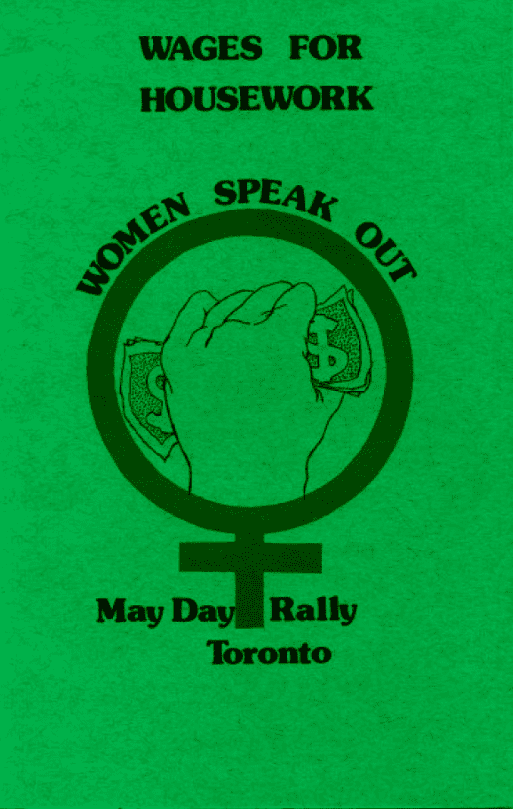
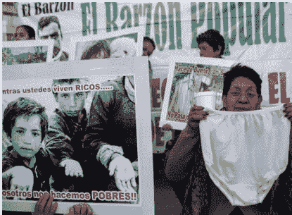

# 永久性的生殖危机：与西尔维娅·费代里奇对谈

## 永久性的再生产危机：与西尔维娅·费代里奇的访谈

玛丽娜·维什米德（Marina Vishmidt）撰写，2013年3月7日

政治 / 行动主义 / 理论 / 女权主义 / 债务

值此其文集出版以及位于伦敦五一日室（Mayday Rooms）的《家务劳动的工资》（*Wages for Housework*）纽约档案馆落成之际，玛丽娜·维什米德就西尔维娅·费代里奇对女权主义思想的广泛贡献及其近期关于债务行动主义的研究（有*Mute*、五一日室和乔治·卡芬齐斯的贡献）对她进行了访谈。

**Mute：** 在《针对家务劳动的工资》（1975）一文中，你将女性劳动的问题（即使是获薪的）描述为无法看清“工作在哪里开始和结束”的困境。正如法国理论组织“共产主义理论”（Théorie Communiste）所言，“我们”在工资之外一无所有，你也提到了无薪女性处于“社会契约”之外的问题。这如何反映了当今的资本-劳动关系？那么，这种具体针对女性和某些其他工人的状况在多大程度上已经普遍化？既然我们处于这种“无”的状态，我们应该如何行动？这仍然是自我认同或去认同的问题吗？

**西尔维娅·费代里奇：** 我们不应假设那些无薪的、在工资规定的社会契约之外工作的人“一无所有”，或者他们是在没有任何社会权力的位置上行动和组织起来的。我甚至不会说他们处于工资关系之外，因为我将工资关系视为比工资本身更广阔的概念。我们在20世纪70年代发起的国际家务劳动工资运动的一项成就，正是揭露了无薪家务工人不仅为资本做了多少工作，而且揭露了这些工作潜在赋予她们的社会权力，因为家务劳动再生产劳动者，因此它是其他所有形式工作的支柱。1975年10月，我们看到了这种权力——拒绝的权力——的一个例子，当时冰岛妇女罢工，雷克雅未克及罢工发生地其他地区的各项活动都停了下来。

毫无疑问，无薪状况已在世界各地扩大，我们可以说它随着“工作的不稳定化”而制度化。但我们应该抵制这样一种假设：即工作条件变得更加统一，女性作为家务工人与资本之间的特定关系已经普遍化，或者由于劳动的不稳定化，劳动总体上已经变得“女性化”。仍然是女性在家做大多数无偿劳动，而这从未是不稳定的。相反，它一直存在，连假期也不例外。获得工资并没有使女性摆脱无偿劳动，也没有改变“工作场所”的条件，使我们能够照顾家庭，并让男性分担家务。今天受雇的人比以往任何时候工作得更多。因此，与其说获薪劳动的女性化，我们不如说女性劳动的“男性化”，因为就业迫使我们要适应于一种工作组织，而这种组织仍然基于这样的假设：工人是男性，他们有妻子在家照顾家务。

如果我没理解错的话，“去认同”的问题围绕着这样一个假设：命名你的压迫和/或将你的斗争认定为某类工人的斗争，会确认你的被剥削状态。换句话说，由奴隶、工资工人或家庭主妇发动的斗争绝不可能是一种解放性的斗争。但我不同意这种观点。命名你的压迫是超越它的迈出的第一步。对我们来说，说“我们都是家庭主妇”并不意味着我们要拥抱这种工作，而是一种谴责这种状况的方式，使我们能够基于此组织斗争的可见共同阵地。认识到我们被剥削的具体方式对于反对这种剥削的组织至关重要。你不能从“虚无”的位置上进行组织。“虚无”不是聚合的阵地。它不将你置于一个语境中，不将你置于斗争的历史中。从特定的劳动关系上进行斗争，就是承认我们拒绝它的权力。

我还认为将特定的工作和剥削形式称为“身份”是有问题的——这是一个唤起不变、本质化特征的术语。除非我们决定在其中溶解自己，以让-保罗·萨特所称的“坏信仰”行为，否则我们从事的特定形式的工作中没有任何固定或“身份化”的东西。无论我受剥削的形式如何，这都不是我的身份，除非我拥抱它，除非我把它变成我是谁的本质，并假装我无法改变它。但我与它的关系可以通过我的斗争来转化。我们的斗争转化了我们，并将我们从由工作组织产生的主体性和社会“身份”中解放出来。关键问题在于，我们的斗争是否预设了我们被剥削所嵌入的社会关系的延续，还是旨在终结这些关系。

基于同样的原因，我对“废除性别”的呼吁持怀疑态度。

在世界各地，女性不仅被剥削为普通工人或债务人，还作为特定性别的个体被剥削，例如通过调节我们的生殖能力，这是女性独有的条件。根据美国1月发布的一份健康报告，在美国，贫穷的黑人妇女仅因怀孕就有被捕的风险。在意大利，寻求社会服务帮助的单亲母亲面临着孩子被带走并被送养的风险。再次，监狱中的女性接受的待遇与男性大不相同。我们可以举出更多的例子。如果我们不使用性别和种族等范畴，我们如何对抗这些“差异”？从呼叫中心的种族议题到监狱，老板知道这一点，狱警也知道，并据此行事；如果我们忽视它们，使它们隐形，我们就无法做出回应，因为为了对抗它，我们必须识别压迫我们的机制。我们必须反对的是被迫存在于男性和女性的二元方案中，以及性别特定行为形式的编码。如果“废除性别”是指这个意思，那我完全支持。但假设任何形式的性别指定都必须、必然成为剥削的手段，并且我们必须生活在一个无性别的世界中，这是荒谬的。性别在历史上，在每一个基于剥削劳动的社会中，都变成了工作功能和社会价值的标志，这一事实并不迫使我们假设性别必然、总是成为剥削的手段，我们必须假装男女之间没有差异或任何差异都会被滥用。即使在我的一生中，“女性”的含义也发生了巨大的变化。对我母亲来说做女性意味着什么，与对我来说意味着非常不同。在我自己的生活中，例如，我已经与作为女性这一事实和解，因为我参与了转化女性含义的过程。因此，某种性别身份是冻结的、不可改变的这一想法是没有根据的。20世纪所有的哲学运动都挑战了这一假设。你承认它们是社会建构的那一刻，你也认识到它们可以被重构。简单地忽视它们，将它们搁置一边，假装我们是“无”，是行不通的。我们通过承认我们的奴役状态来解放自己，因为在这种承认中包含了我们斗争、联合并与其他人组织起来的原因。

图片：2012年11月，西尔维娅·费代里奇在伦敦

**M：** 同一个问题的另一面：你如何描述当今持续的劳动分工，特别是由工资覆盖的工作与工资之外的工作之间的冲突？这如何继续规范角色的分配？可以说，有一段时间，“工资”已经支付给了女性（特别是英国有家庭的女性——税收抵免、儿童福利等），但这些社会“工资”仍然再生产阶级内部的分工。这些措施如何重组了阶级和阶级分工？

**SF：** 总的来说，我会说国际上的社会劳动分工仍然由性别的劳动分工和获薪与无薪工作之间的分工所结构。再生产劳动仍然主要由女性承担，而且根据所有统计数据，其中大部分仍然是无偿的。这在儿童保育方面尤为突出，儿童保育是地球上最大的工作部门，特别是对于一到五岁的幼儿。

这是现在被广泛认识到的，因为大多数女性生活在持续危机状态中，从家里的家务到岗位工作，中间没有任何属于自己的时间，而由于社会服务的持续削减，家务劳动在扩大。部分原因是女权主义运动争取确保女性能够获得男性主导的就业形式，但自那以后放弃了将再生产劳动作为斗争的阵地。在美国，至少有一段时间，女权主义者甚至害怕争取产假，认为如果我们要求“特权”，我们就没有理由要求平等待遇。结果，如前所述，“工作场所”没有改变，大多数工作没有儿童保育，也不提供带薪产假。这是当今女权主义者应该承担的一项斗争。

我不认为为女性所做的家务劳动支付了“工资”。税收抵免和家庭津贴不是工资。它们是给受雇人员的奖金，在大多数国家，它们支付给家庭，通常意味着支付给男性。它们不支付再生产劳动的报酬，这就是为什么它们再生产阶级内部的分工。

## 再（生）产力量

**M：** 在接受 LabOrNet 电视 `http://linkme2.net/rl` 的采访时，你回应了关于你与马克思主义关于资本主义是共产主义先驱这一立场分歧的问题。你主张，生产力的发展是以性的分工为基础的，因此，认为共产主义项目可以简单地夺取生产力并将其重新用于平等社会目的的观念是错误的。当然，许多形式的技术在没有利润动机的情况下应用有限，但如果没有技术，那些打破资本主义统治的新社会关系如何避免重新强加劳动，无论是通过“回归自然”回到原始状态——即劳动作为人类未来的整个视野——还是在乌托邦式合作互助公社中，劳动在公社压力下被“公平”地重新分配？

**SF：** 我并不是反对技术。技术是我们生活中不可或缺的一部分，它在资本主义出现之前就存在了。事实上，卡尔·马克思低估了前资本主义社会的技术成就。想想食品生产的技术吧。中美洲的种群发明了我们今天吃的绝大多数食物。他们发明了番茄、200 种玉米和土豆。马克思过分地归功于资本主义释放了人类劳动的生产力。但我对马克思的批评主要涉及他坚信大规模工业是共产主义到来以及通常意义上人类发展的必要前提条件。在现实中，资本主义发展的许多技术旨在摧毁工人组织并降低劳动生产成本，因此不能被接管并重新导向积极的目标。例如，你如何接管一座核电厂或化工厂？马克思本人也承认（在《资本论》第一卷中），农业的工业化“既耗竭了土壤，也耗竭了工人”，尽管他也将其视为合理利用自然资源的榜样。大多数资本主义技术对环境以及我们的健康具有破坏性。我们今天清楚地看到，工业正在吞噬地球，如果我们有一个共产主义社会，我们必须做的许多工作将仅仅用于清理这颗星球。这意味着我们必须重新思考每一种技术。以计算机为例，仅仅一台计算机就需要大量的土壤和纯水。因此，认为我们可以拥有一个机器做所有工作而我们只需充当其监督者的世界的想法——马克思在《提纲》（Grundrisse）中的愿景——是不可行的。首先，我们必须工作来制造这些机器。它们不会自我再生产。必须有人将矿物从地下取出并制造它们。它们还要求一种与社会控制形式，这与建立平等社会所需要的合作类型截然相反。

另一个重要问题是，大规模工业化无法减少社会必要劳动，因为在这个星球上的大部分工作——再生产人类的工作——是非常劳动密集型的，其中情感、体力和智力劳动不可分割地结合在一起，除非以巨大的代价为我们要照顾的人，否则无法工业化。例如，想想照顾儿童或照顾病人且不能自理的人的工作。我知道在日本和美国，他们正在发明家用机器人，甚至是照顾人的机器人，如护理机器人。但这是我们要的社会吗？

**MV：** 但正如我们上次讨论的那样，技术的问题在马克思著作的不同部分中也是非常矛盾的。

**SF：** 是的，在著作的不同部分中，马克思承认工业化具有破坏性影响，例如对农业的影响。但他显然假设资本主义发展出的技术可以被重新构建和重新引导至不同的目标。他将科学技术理想化了。他假设它们可以被工人掌握，并以一种使我们能够摆脱许多出于必要性而非因为增强我们的能力和权力而必须做的工作的方式得到改造。

# 拒绝工作

**MV：** 我猜如果“拒绝工作”被理解为对特定社会关系的拒绝，那么正如 Maria Rosa Dalla Costa 所写的那样，我们不希望食品服务的工业化和集体化，因为那些厨房里仍然会有女性在工作。但我们也可以将集体化的洗衣房视为苏联和社会民主国家中的社会空间。因此，我们看到某些类型的再生产工作可以被工业化，但重要的是这些工作的社会关系。

**SF：** 当然。当我们谈论“拒绝工作”时，我们必须谨慎。我们需要认识到，再生产人类的工作是一种特殊类型的工作，它具有二重性。它为我们再生产，为劳动力市场再生产，作为劳动力，但它也再生产我们的生活，并且潜在地再生产我们对被简化为劳动力的反抗。事实上，再生产劳动对工人阶级斗争的持续以及当然对我们再生产自身的能力至关重要。这就是为什么我们需要理解这种工作的二重性，这样我们才能拒绝那部分为我们再生产资本的工作；而我们不能完全拒绝这项工作，因为劳动力生活在个体中，如果我们完全拒绝它，我们就有毁灭我们自己和我们关心的人的风险。我认为女权运动做出的最重要的发现之一是我们可以拒绝其中一部分工作，而不危及我们的家庭和社区的健康。认识到这项工作不仅是对我们家庭的服务，也是对资本的服务，这让我们摆脱了每当想要拒绝工作时总是感到的内疚感。对我们来说，认识到这项工作不仅再生产孩子、伴侣、社区，还再生产我们作为现在或未来的工人很重要，因为通过这种方式，我们可以将反对家务劳动的斗争视为反对资本的斗争，而不是反对我们的家庭的斗争。我们开始将那些再生产我们的家务劳动方面与那些再生产资本方面分离开来。因此，问题并不那么是再生产工作的“拒绝”，而是以一种使其成为创造性工作的方式来重新组织它。然而，只有当这项工作不再旨在为劳动力市场提供工人，不再服从于资本积累的逻辑，并且我们控制我们的再生产手段时，这才可能发生。

# 小额贷款的暴政

**MV：** 我认为我也希望回到关于这一点的你关于小额贷款的看法。你所说的非常重要的一点是，社区纽带实际上是如何被小额贷款银行用来超剥削贷款接收者的。我猜这就是我脑海中想到的，这些非资本主义或前资本主义的公社纽带实际上是如何被资本分解的，以及如何抵抗这种情况。女巫审判会是这方面的另一个方面。

**SF：** 世界银行和其他金融机构已经意识到社会关系至关重要，它们将其视为“社会资本”，并加以利用、操纵和同化，以中和其颠覆性潜力并驯化公地。例如，世界银行利用保护“全球公地”的概念， presumably 为了人类的福祉而保护它们，来私有化森林。它们驱逐生活在其间的种群——渔民、原住民。在 20 世纪 90 年代，在非洲，该银行还建立了集体小组，这是人为创建的，通常由当地当局组成，拥有使土地脱离集体的权力。这使得它们能够绕开人们抵制拆解集体土地所有权和引入个人土地权属这一事实。

就小额贷款而言，银行和其他金融机构正将妇女组织的支持小组转变为自我监督的小组。我读到在孟加拉国，当小组中的一位女性没有偿还她借的贷款时，其他人对她施加巨大的压力，甚至进行人身攻击以迫使她付款。银行或非政府组织的官员以及小组中的其他女性“闯入她的房子”并拿走她的锅碗瓢盆，这对女性来说是一种巨大的羞辱。

这不仅仅是对人民再生产手段的攻击。这是对人民基于共享资源建立的纽带的攻击。这种对集体团结的攻击，对人民为加强抵抗能力而建立的合作形式的攻击，可能是小额贷款最具破坏性的方面。

我们需要理解使这些群体能够被摧毁的历史条件。通常，小额贷款扎根的地区是那些人口因多年的威权统治、紧缩计划、自然灾害或所有上述情况而变得软弱的地区，如桑迪飓风后海地的情况，促使世界银行以两百万美元的投资进行小额贷款干预。还有宗教派别、某种类型的原教旨主义者所进行的意识形态工作。并非所有的集体形式都具有相同的抵抗能力，以应对通过各种形式的私有化和剥夺对其发动的进攻。

这是公地讨论中必须考虑的一点。我们需要检查现有的公地正在发生什么。在拉丁美洲的部分地区，新的公地已经被创建，如萨帕塔运动或 MST（土地无主者运动）的情况。同样，作为对结构调整的反应，妇女设立了公共厨房、公共烹饪、公共购物。在世界的其他地区，如非洲和印度，集体土地已成为战场。在非洲的部分地区，由于大规模的土地攫取，土地正在缩小，并且政府向企业（矿业、生物燃料、农业企业）给予的补贴，使得男性普通民众将女性排挤出公共领域。他们引入了关于谁“属于”该领域、谁“不属于”的新规则和条例。他们可能会将妻子逐出土地的使用权，声称她属于另一个氏族。重要的是要看到在何种背景下，公共领域会反噬自身。

小额信贷的故事揭示了“救赎来自借贷”这一观念有多么有害。来自世界许多地方的报告，例如孟加拉国、玻利维亚、埃及，表明大多数获得小额贷款的女性境况比借贷时更糟糕。她们的互助小组可能已不复存在，她们的债务比以前深得多，因此不得不向放债人借钱还债。她们往往不得不让待在家里（工作？）的孩子帮忙还债。因此，世界银行关于“金钱是社会的创造力量，借贷能使人摆脱贫困”的说法必须被拒绝。虽然有些女性确实从小额贷款中获益，但她们通常是与经理合作进行监控和监督工作的人。

## 金融化与债务的工资

**MV：** 我想就你周一晚上说的另一件事进行追问，即金融化显示了资本对工人阶级投资的转变。因为过去存在一种长期投资和某种社会工资及福利国家制度的理念，而现在这种投资呈现出一种缩短的趋势，因此再生产的金融化意味着在每一个时刻提取价值。¹

**SF：** 是的，再生产的每一个方面都在成为积累的即时场所。这是因为你现在必须为许多过去由国家提供的服务付费。在二战后时期，资本主义政治的取向是投资于被视为“人力资本”加以开发的劳动力再生产。这通常被称为“福利国家”。其背后的理念是，投资工人的健康、教育和住房，将通过提高工人的生产率和纪律性而获得回报。但显然，60年代的斗争使资本阶级相信，给予工人更多的空间和时间并不会使工人更有生产力，只会使他们更具反抗性。因此，我们看到了一种逆转。现在我们要为自己的再生产付费，他们告诉我们这是我们的责任。这是一个重大变化。首先，这是积累时间结构的变化。雇主现在不再进行长期投资，不再投资我们的未来生产力。他们不指望我们在未来变得更有生产力。他们希望立即从我们在教育上的“投资”和信用卡利息中获利：他们希望立即兑现。因此，再生产立即成为积累的节点。这是一个非常重要的变化。这也改变了工人与资本之间的关系。欠银行的债掩盖了剥削关系的存在。作为债务人，你不再以工人的身份出现。债务具有极大的神秘化作用。它带来了阶级关系管理方式的变化。这正是“自我投资”和“微型创业”意识形态所关注的内容，这种意识形态假装我们是我们教育和再生产的唯一受益者，并掩盖了雇主和资本阶级从我们的劳动中获益的事实。债务还具有分散化的效果；它将我们与其他债务人隔绝开来，因为我们是以个人身份面对银行的。因此，债务使个体化，它以工资未能做到的方式瓦解了阶级关系。工资在某种意义上是某种公共性。它不仅承认劳动关系的存在，还承认由斗争历史强化的集体关系的存在。债务瓦解了这两者。我们在因教育贷款而负债的学生斗争中看到了这一点。许多人感到内疚，当他们无法还款时，会产生一种失败感，这在工资斗争中是不可想象的。在那里，你知道自己被剥削了，你知道你的老板是谁，你看到剥削，你有同志。而作为债务人，你会说“天哪，我算错了”，“我借的钱太多了”等等。

图片：2013年El Barzon活动家的封锁行动

这就是为什么债务人运动如此重要。第一个大的债务人运动在拉丁美洲发展起来。也许最重要的是*El Barzon*，它于20世纪80年代末在墨西哥发展起来。这是一个强大的运动，主要由从小银行获得贷款的小商贩和小企业主组成。*El Barzon*是连接牛轭木梁的那块皮革，它是奴役的象征。你戴着轭，那就是债务。他们建立了一个组织在整个墨西哥举行大型示威运动，他们上街游行，把口袋翻出来展示里面空空如也，以表明他们已被剥夺了一切。

此外，2002年玻利维亚还发生了针对小额信贷的大规模女性抗议。女性来自全国各地，对拉帕斯的银行进行了90天的围困，要求结束债务，她们脱光衣服以戏剧化的方式表明自己已被剥夺得几乎一无所有。我们可以看到，债务可以为不同的斗争提供共同基础。

## 自我再生产运动

**MV：** 关于社会斗争的持久性和扩展的问题，你曾以构建“自我再生产运动”的术语讨论过。对于这类运动而言，再生产是变革当前社会关系的必要方面，因此构成斗争的政治视野。我猜我在这里的问题需要反向和正向地思考。鉴于前资本主义“无产阶级”的分解（如在近代早期的欧洲女巫猎杀中经历的那样），以及当前和最近过去在殖民地和许多地方经历的圈地或“原始结构调节”，我感兴趣的是你能设想哪种范围的团结或重组，足以让这不仅被抵抗，而且使资本不再能够将其再生产危机强加为我们社会再生产的崩溃。

**SF：** 一个浮现在脑海的例子发生在拉丁美洲的一些国家，在那里，作为对新自由主义经济政策残酷性的回应，成千上万人正在国家之外构建新的再生产形式。正如劳尔·齐贝奇在《抵抗中的领土》（2012年）中所写，在拉丁美洲过去的几十年里，土地斗争已经转变为对领土控制的斗争，旨在实践自治的再生产形式和自治形式，例如墨西哥的萨帕塔主义者或巴西的无地农民运动（MST）。在玻利维亚，2000年反对水系统私有化的大规模斗争达到了如此高的协调与合作水平——包括科恰班巴地区的克丘亚人和埃尔阿尔托的艾马拉人——以至于有可能建立对前公共资源的公共管理和自我管理的形式。这在拉丁美洲发生，是因为通过长期的反对殖民和新殖民统治的斗争，人们维持并创造了强大的合作生存形式，而我们当然不再拥有这些形式。

这就是为什么创建“自我再生产”运动的理念如此有力。这意味着创造一定的社会结构和再生产合作形式，这可以赋予我们的斗争以连续性和力量，并为我们的团结提供更坚实的基础。我们需要创造生活方式，使政治行动主义不与我们日常再生产的任务分离，从而能够发展出如今仍停留在地平线上的信任与承诺关系。我们需要将我们的生命与他人生命共同化，以拥有坚实且不会兴起后随即消失的运动。共享再生产，这是占领运动中开始发生的事情，也是当斗争达到几乎起义力量时刻通常发生的事情。例如，当罢工持续数月时，人们开始将生命共同化，因为他们必须调动所有资源以免被击败。同时，“自我再生产”运动的理念还不够，因为它仍然指的是特定群体——运动本身——而目标则是创建具有重新占有“公共财富”力量的结构，这需要齐贝奇所称的“运动中的社会”。

## 公地与共产主义

**M：** 公地与共产主义之间是什么关系？共产主义是扩展的公地吗？公地仅仅关乎再生产吗？鉴于你对再生产持有相当积极的看法，认为其内部包含革命的萌芽，你如何区分社会的、潜在的革命性再生产与资本主义再生产？也就是说，公地中有什么是不仅比资本主义更可持续，而且对资本和国家具有积极对抗性的？

**SF：** 公地与共产主义。嗯，共产主义是一个很大的术语，但如果我们按照马克思主义-社会主义传统确立的意义来理解共产主义，那么一个区别在于，在公地社会中，没有国家，甚至过渡期也没有。假设人类解放必须通过无产阶级专政来实现，这不是公地政治的一部分。同样，公地社会也不以大规模工业化发展为前提。公地的理念是重新获得控制我们生活的能力，控制我们（再）生产的手段，以平等的方式分享它们，并集体“管理”它们。将重建我们的日常生活作为我们斗争的战略方面，是公地政治中比共产主义传统中更核心的目标。共产主义是扩展的公地吗？如果我们在马克思主义传统的参数内定义它，那就不是。但马克思将共产主义描述为建立在自由生产者联合基础上的社会，这与公地概念是兼容的。此外，晚年的马克思似乎确信公地，例如俄罗斯公社，可以成为“过渡到共产主义”的基础，尽管他相信这只有在德国或欧洲其他地区发生革命、提供技术知识的情况下才有可能，这样俄罗斯公社就不必经历资本主义阶段。公地意味着分享再生产手段的使用，从土地开始，并创造合作的工作形式。这已经开始发生。在希腊和意大利，现在，借鉴阿根廷的模式，被解雇的工人接管工厂，并试图以自治、平等的方式运营它们，以满足人民的需求生产，而不是为了利润。

我不同意马克思关于资本主义增强了劳动协作的观点。我认为即使在商品生产过程中也没有增强，而在社会再生产过程中更是如此。资本主义发展了一门“合作操控”的科学，这个术语取自莱奥波多·福纳蒂的《再生产的神秘》。一个例子是二战后美国城市规划，当时资本阶级面对的是一个具有了20年或更长集体体验的工人阶级——首先在萧条时期，人们走上公路，流浪者丛林；然后在战争中，在军队里——而现在他们正急切地从战争中回来，质疑自己为何冒生命危险；1947年见证了美国历史上罢工次数的高峰，直到1974年才被追平。因此，他们必须“合作操控”这些工人，新的城市规划通过创造郊区（如列夫敦）做到了这一点。它让工人住得离工作地点很远，以便下班后不去酒吧，而是直接回家。他们在政治上规划了新房子的每一个细节。他们在房子前面放了一块草坪，让男人在空闲时间修剪，这样他就忙于园艺而不是去工会大厅。会有一个额外的房间放他的工具——这些都是合作操控的工具。

## 合作操控

## 打击债务与滚动禧年

**MV：** 你能定义一下你所说的“scoopereation”是什么意思吗？我以前没听过这个词。

**SF：** 它是将工人分散开来，阻止他们形成那种通过共同工作而产生的纽带，对于那些曾在战争中服役的工人来说，它瓦解了他们所建立起来的深厚团结感和兄弟情谊。你可以在 1940 年代晚期的电影中看到这一点。士兵们在共同生活、共同冒着死亡风险生活了几个月后回家，然后他们分开了，他回了家，他有他的女朋友，但女人们对他们来说已经变得陌生。所以这些电影描绘了退伍士兵归来的危机，以及你们如何防止它引发某种叛乱。这就是为什么，拥有自己的房子，给他们一个小王国，妻子总是待在家里，穿着围裙性感诱人等等，是如此重要。利维坦镇（Levittown）是作为对抗共产主义的缓冲区而建造的。这是资本主义的再生产：利维坦镇。现在他们面临着相反的问题。我的感觉是，现在他们面对的是一个有房子，或者至少认为拥有房子是其权利的工人阶级，而他们希望工人阶级的大部分是游牧的，随着公司的需要而迁移。对房子的攻击不仅仅是金融投机的产物。我认为这是一种试图创建更具流动性的劳动力的尝试。现在他们的问题是“动员”这些工人。这是一个重要的区别。显然，我们必须建立集体方式来再生产我们自己，这样我们就不会容易受到这些操纵的影响。此外，再生产工作必须基于扩大的社区，不一定是大家庭，而是扩大的社区，因为再生产人类是非常耗力的，我们在这个过程中可能会毁灭自己，正如现在许多女性所经历的那样，她们生活在一种永久性的危机——永久的再生产危机——中。

**MV：** 以下是几个例子，也许你可以详细阐述一下，你认为它们的战略方面或矛盾之处。这是关于“打击债务”运动（Strike Debt campaign）和“滚动禧年”（Rolling Jubilee）。这里存在着社会再生产与系统性再生产政治之间的一个奇特联系，一方面你在帮助那些欠债的人，但另一方面你同时在帮助那些拥有债务的人，因为当你购买债务时，你也在购买银行的债务……很难说这是谁的债务。

**SF：** “滚动禧年”将解放一些人。但关键在于，它将学生奴役的问题摆在了台前，向全美展示。我同意奥德丽·洛德（Audre Lorde）的观点：“主人的工具无法摧毁主人的房屋”。因此，我们并不指望通过“滚动禧年”赢得这场斗争。“滚动禧年”是一个时刻，是一种战术，是一场更广泛斗争的一部分。但它赋予了这场斗争以前没有的全国性存在感。这种宣传非常好，因为它向世界展示了这种资本主义的雇佣兵本质，它摧毁了青年的未来，并通过出售教育赚钱。这是一种有效的战术；它有助于扩大斗争，使其可见，并使当局处于守势。它表明有一代青年已被变成银行和收款机构的契约奴仆。

**MV：** 你指出这一点真的非常重要，而且因为查尔斯·艾森斯坦（Charles Eisenstein）在《卫报》（`Guardian`）上有一篇社论，声称债务禧年将恢复增长，这是完全无政治性的，它既不是左派也不是右派。

**SF：** 他们喜欢那样……在“打击债务”之前，已经有两个学生组织在应对贷款债务，但他们的做法不同。对于一个组织来说，战略是消费者保护。他们的立场是，作为教育的消费者，我们应该拥有“破产权”——而现在这一点被否定了。另一个组织认为，如果你取消如今已达 1 万亿美元的学生债务，你将促进增长。这是一种凯恩斯主义策略。“打击债务”更有力，因为它说我们不应该支付，因为这债务是在胁迫下产生的。学生们被告知他们必须接受教育，但他们除了陷入债务外没有实现的方法。而且债务是不合法的，因为教育不是商品，不应被买卖。这种立场有着截然不同的政治含义。至于“滚动禧年”，它是一种有时限的战术，但就当下而言，它是有用的。人们对就业削减的反应是信用卡和其他形式的债务。所以今天，债务首先是对于贫困化的拒绝。这两个债务阶段的共同点在于，在这两种情况下，债务都在控制和塑造我们的未来。不过，我们需要更好地理解债务与阶级斗争之间的关系——工人阶级如何试图利用债务。即使在近期，许多工人，特别是那些像黑人/女性工人，在过去很难获得抵押贷款，它们利用了抵押贷款发放相对宽松的条件来获得住房。事实上，许多因为被发放次级抵押贷款而违约的是黑人女性，往往是单身母亲，她们一直被排斥在抵押贷款市场之外。

**AD：** 关于创业的问题，特别是连续创业以及破产法是如何被卷入繁荣/萧条创业过程中的。在什么节点上，借贷和破产变得同义？

**GC：** 破产在美国直到 19 世纪，大约内战时期才开始。在此之前，在大多数州，有债务人监狱——如果你违约，你就进监狱了。这是故事的一部分。到 19 世纪末，破产制度为资本家确立起来。当工人阶级开始拥有一些抵押品时，它才扩展到工人。如果你没有抵押品，你就不能获得贷款。工人只有在工资成为一种制度后，才开始拥有一些抵押品。有一段时间，个人破产是被允许的，许多工人和学生使用了它。起初使用它相对容易。但到大约 2005 年，对其适用的严格程度发生了变化。现在，你拥有了所有可能世界中最糟糕的情况，因为你仍然需要房子，或者汽车等，并且必须使用信用卡，但你没有有保障的工资，并且破产变得更加困难。此外，当学生无法偿还贷款时，他们不能破产。这是唯一一种被排除在破产法之外的情况。

**AD：** 如果你看看公司自愿安排（CVAs）的立法，例如它在中期的 1980 年代从美国引入英国，你会发现它与危机有关。在每一个节点，都有收紧措施：在 1992 年经济衰退期间，然后在 2000 年代初，你会发现关于 CVAs 的立法被调整和修改以适应雇主的利益——直到 2000 年代末和当前局势，合同义务可以被撕毁，工人被裁员，遣散费被撤回或转移。

**GC：** 现在有可能出现一个“7 月 4 日”（指新政府或新政，类比美国独立日），但问题是“7 月 4 日”是否开启新的一页，还是仅仅取消现有的债务并在一段时间后重新提出同样的局势。

**SF：** 我怀疑永远不会有一个真正的“7 月 4 日”。但他们可能会减少学生债务，因为教育是一个敏感问题。然而，有一部分资本希望青年由雇主直接教育。他们更喜欢拥有专门的学术机构，比如矿业大学，或为能源公司服务的大学。

**MV：** 你在历史唯物主义（Historical Materialism）全体大会上谈到了清洁工和一次组织动员，他们决定与雇主合作以对抗国家，从而从国家获取更多资源。我想请你更详细地解释一下这一点。

**SF：** 家政工人在美国正进行一场巨大的斗争。他们争取被承认为工人，因为20世纪30年代通过的劳工法律将家政工作排除在“工作”之外。2010年11月，在纽约，家政工人组织“家政工人联合”（Domestic Workers United）首次使其工作获得作为工作的承认。这难道不令人惊叹吗？接下来他们要做的是确保其得以实施。因此，同样的家政工人现在正努力建立社区结构，以帮助执行这项权利法案，并像监督机构一样发挥作用。他们还希望与雇主结成联盟进行组织化，以便能够对抗国家，迫使其将适当资源置于再生产工作的支配之下。他们认为，压低工资并迫使工人在恶劣条件下工作并不符合雇主的利益。其论点在于，一个疲惫不堪、过度劳累、因家人远在异地而痛苦、无法休假且思念儿子的保姆，无法胜任对她所期望的工作。这也是护士们一直在提出的论点。当护士们想要罢工等时候，医院试图让病人对抗她们。但护士们说的是：“如果我们每天工作20小时，我们就无法看清我们给你注射的是什么药物。”换言之，工人争取更好的条件并支持他们的斗争，符合病人的利益。

**MV：** 但家政工人是由雇主支付报酬，而不是由国家支付，对吗？

**SF：** 她们由雇主支付报酬，但在欧洲许多地区，在80年代和90年代，国家开始向家庭提供资金，以便他们能够照顾缺乏自理能力的老年人。例如，在意大利，他们引入了`陪伴津贴`（`salario di accompagnamento`）。一位老年人，盲人或残障人士每月最多可收到500英镑，用于支付某人照顾她。我猜，你可以称其为一种家务劳动工资。当然，它非常少，但这是一个开始。
相反，去年在加利福尼亚州，布朗州长拒绝了一项家政工人权利法案，辩称它会损害残障人士的利益，因为他表示，他们将无法支付更高的费用。换言之，家政工人不得不接受低工资，并承认她们与她们照顾的人之间存在利益冲突，并不得不牺牲她们的福祉，因为国家本没有意愿提供能够保证她们和她所照顾的人过上好生活的资源类型。

**MV：** 这是沃尔玛的论点。工人从低价中受益，因为他们自己拿到的工资很低。

Silvia Federici <`dinavalli AT aol.com`> 是一位长期活动家、教师和作家。她是《零度革命》（`Revolution at Point Zero`，2012）的作者；《卡利班与女巫：妇女、身体与原始积累》（`Caliban and the Witch: Women, the Body and Primitive Accumulation`，2004）已被翻译成几种语言；并是《千朵万蕊：非结构大学中的社会斗争对抗结构调整》（`A Thousand Flowers: Social Struggles Against Structural Adjustment in African Universities`，2000）的共同编辑。

Marina Vishmidt <`maviss AT gmail.com`> Marina Vishmidt 是一位作家和编辑。她刚在伦敦大学玛丽女王学院完成了关于“艺术和资本中作为生产模式的投机”的博士学位。她主要研究艺术、劳动和价值形式。她经常与艺术家合作，并为 *Mute, Alterall, Texte zur Kunst, Ephemera, Kaleidoscope, Parkett* 以及相关期刊、选集和目录做出贡献。

隐私政策

## 脚注

1. Silvia Federici 在金史密斯大学的演讲于 2012 年 11 月 12 日举行，题为“从共有化到债务：小额信贷、学生贷款与再生产领域的撤资”，录音请访问：`http://archive.org/details/SilviaFedericiTalkAtGoldsmithsUniversity-12November2012-CpAudio`
