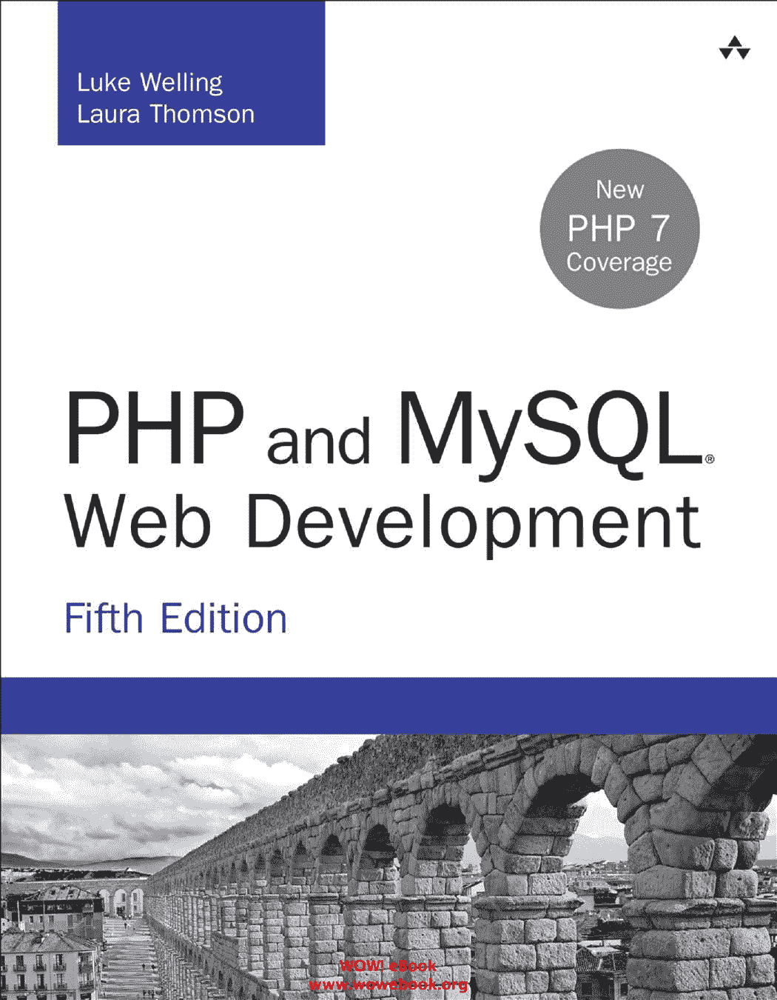
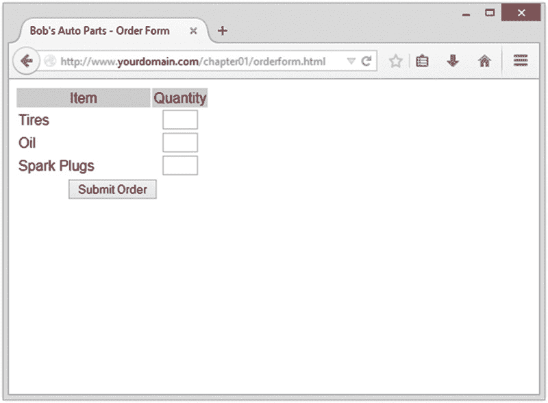
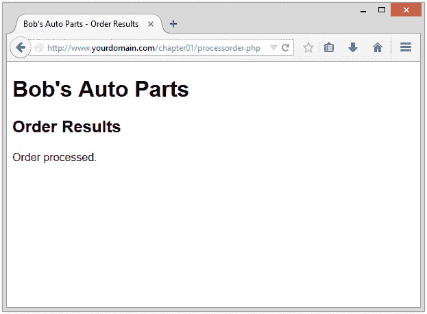
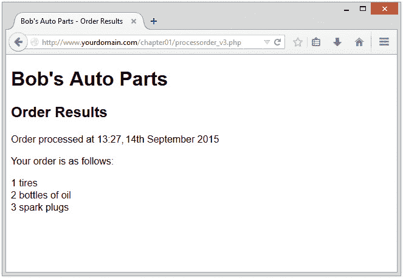
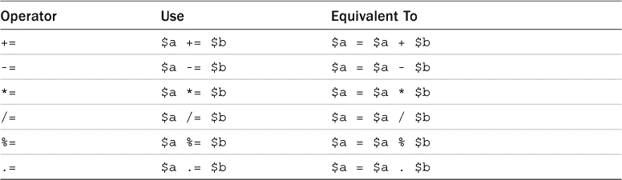
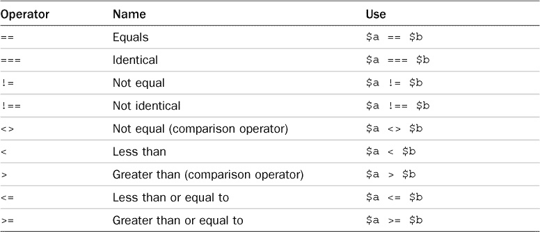
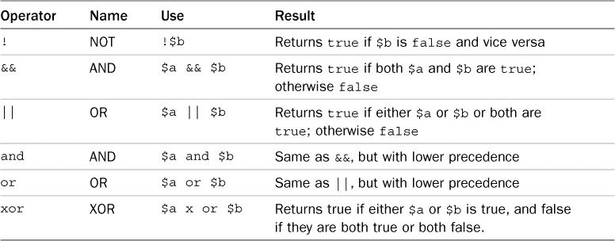
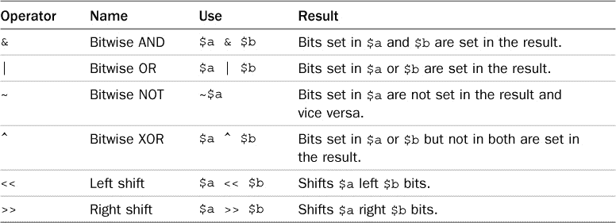

# PHP and MySQL Web 开发 (第5版) (开发者库)





版权 © 2017 Pearson Education, Inc. 保所有权利。未经出版商面许可，本书任何部分不得以电子、机械、复印、录音或其他方式复制、存储在检索系统中或传输。对于本文所包含的信息，不承担任何专利责任。尽管在编写本书时已采取一切预防措施，出版商和作者对错误或遗漏不承担任何责任。对于使用本文所包含的信息而造成的损害也不承担任何责任。

ISBN-13: 978-0-321-83389-1

ISBN-10: 0-321-83389-9

美国国会图书馆控制编号: 2016934688

美国美国打印

第一次印刷：2016 年 9 月

## 商标

书中提到的所有已知为商标或服务标记的术语均已适当进行大写处理。Pearson 无法证明这些信息的准确性。在书中使用术语不应被视为对任何商标或服务标记有效性的影响。

## 警告与免责声明

我们已尽力使本书尽可能完整和准确，但不隐含任何保证或适用性。所提供的信息按“现状”提供。对于因本书书中包含的信息而引起的任何损失或损害，作者和出版商对任何个人或实体均不承担责任或义务。

## 特别销售

如需了解批量购买此书的信息，或有关特殊销售机会（可能包括电子版本；定制封面设计以及针对您的业务、培训目标、营销重点或品牌兴趣特定内容），请联系我们的企业销售部门：`corpsales@pearsoned.com` 或拨打 (800) 382-3419。

政府销售垂询请联系 `governmentsales@pearsoned.com`。

关于美国以外销售的问题，请联系 `intlcs@pearson.com`。

## 编辑团队

**编辑**: Mark Taber

**项目编辑**: Lori Lyons

**项目经理**: Dhayanidhi

**文字校对**: Lori Eby

**索引员**: Tim Wright

**技术编辑**: Julie Meloni

## 赞誉与证言

“我从未买过比这更好的编程书……这本书证明了，在我买过的任何其他计算机相关书籍中，它是信息量最大的、最易于遵循的且例子最好的。文本非常易于理解！”
—Nick Landman

“Welling & Thomson 编写的这本书是我发现的唯一不可或缺的书。它的写作清晰直白，从不浪费我的时间。书的布局非常精美。章节长度恰到好处，章节标题能迅速带你到达你想去的地方。”
—Wright Sullivan，A&E Engineering, Inc. 总裁，南罗来来纳州格林尔

“我只想告诉你们，我认为《PHP and MySQL Web Development》这本书太棒了！它的逻辑结构合理，对我来说难度恰恰好（中级），有趣且易于阅读，而且当然，充满了宝贵的信息！”
—CodE-E，奥地利

“有几本很好的 PHP 入门书，但对于想要构建复杂可靠系统的人来说，Welling & Thomson 的这是一本优秀的手册。显而易见，作者在专业应用程序开发方面背景深厚，他们不仅教了语言本身，还教了如何通过良好的软件工程实践来使用它。”
—Javier Garcia，高级电信工程师，Telefonica R&D 实验室，马里德

“我两天前买了这本书，现在已经看了一半了。我简直停不下来。布局和流程非常完美。一切的呈现方式都让信息非常易于吸收。能够立即掌握所有的概念。例子也非常棒。我只是必须抽时间表达一下我对这本书有多么满意。”
—Jason B.


—来自芬兰拉赫廷的 jackofsometrades

“这是一本写得很好的书，教人如何使用两种最流行的开源 Web 开发技术来构建互联网应用程序……项目是本书的精髓所在。这些项目不仅以逻辑化的、基于组件的方式进行描述和构建，而且这些项目的选择代表了许多网站中内置常用组件的优秀横面。”

—Craig Cecil

“这本书采用了一种简单、循序渐进的方法，即使是门外汉水平的程序员也能理解 `PHP` 语言。此外，在进行 Web 设计时，我经常发现自己会翻阅这本书。我仍在学习关于 `PHP` 的新知识，但这本书为我提供了一个坚实的基础，并至今一直帮助着我。”

—Stephen Ward

“这本书是少数几本真正触动了我并让我‘爱’上它的书之一。我不能把它放在书架上；我必须把它放在工作台上触手可及的地方，因为我总是想参考它。它的结构很好，语言简单直白，示例清晰且循序渐进。在阅读它之前，我对 `PHP` 和 `MySQL` 一无所知。在阅读之后，我有信心和技能开发任何复杂的 Web 应用。”

“这本书简直是神书……我强烈向任何想要深度投入数据库驱动的 Web 应用程序编程的人推荐这本书。我希望更多的计算机书籍能按照这种方式组织。”

—Sean C Schertell

## 开发者库 (Developer’s Library)

### 编程专业人士必备参考

*Developer’s Library* 系列书籍旨在为执业程序员提供在其日常工作中使用的编程语言和技术的独特、高质量参考资料和教程。

*Developer’s Library* 中的所有书籍由专家技术从业者编写，他们特别擅长以对其他程序员有用的方式来组织和展示信息。

核心书目包括相关领域中最优秀、最受赞誉的书籍：

* `PHP & MySQL` — Luke Welling & Laura Thomson
* `Web Development`
* `MySQL` — Paul DuBois
* `Programming in C` — Stephen Kochan
* `Python Essential Reference` — David Beazley
* `Node.js, MongoDB and Angular Web Development` — Brad Dayley
* `C++ Primer Plus` — Stephen Prata

Developer’s Library 书籍在大多数零售和在线书店都有纸质版和电子版，也可以通过 [safari.informit.com](http://safari.informit.com) 在 Safari Books Online 订阅。

### Developer’s Library

[informit.com/devlibrary](http://informit.com/devlibrary)


* 第一：使用 PHP
    * 2 存储与检索数据
    * 4 字符串处理与正则表达式
    * 6 面向对象的 PHP
* II：使用 MySQL
    * 9 创建你的 Web 数据库
    * 11 通过 PHP 从 Web 访问 MySQL 数据库
    * 13 高级 MySQL 编程
    * 14 Web 应用安全风险
    * 16 使用 PHP 实现身份验证方法
    * 17 与文件系统和服务器交互
    * 19 管理日期与时间
    * 21 生成图像
    * 23 集成 JavaScript 和 PHP
* V：构建实用的 PHP 和 MySQL
    * 26 调试与日志
    * [28 基于 Laravel 的 Web 服务 (I)]
    * [30 社交媒体集成与认证
* VI：附录
    * 索引
## 详细目录
### 简介
### 第一：使用 PHP
#### 1 快速入门
* 创建一个示例应用：Bob
* 处理表单
* PHP 标签
* 空白符
* 添加动态内容
* 使用 `date()` 函数
* 表单变量
* 变量与字面量
* 检查变量类型
* 类型强度
* 变量变量
* 理解变量作用域
* 算术运算符
* 赋值运算符
* 逻辑运算符
* 其他运算符
* 理解优先级与结合性
* 测试与设置变量类型
* 重新解释变量
    * `if` 语句
    * `else` 语句
    * `switch` 语句
* 通过迭代重复操作
    * `for` 和 `foreach` 循环
    * 跳出控制结构或脚本
    * 使用 `declare`


    * 存储与检索 Bob 的订单
    * 打开文件


### 访问数组内容


### 访问数组元素


### 使用 `asort()` 和 `ksort()` 排序数组

### 使用 `array_multisort()` 函数
### 逆向用户排序
## 重排数组
### 使用 `shuffle()`


### 输出字符串的格式化
## 使用字符串函数合并和分割字符串
### 使用 `explode()`、`implode()` 和 `join()`
### 使用 `substr()`
## 比较字符串
### 执行字符串排序：`strcmp()`、`strcasecmp()` 和 `strnatcmp()`


### 查找子字符串的位置：`strpos()` 和 `strrpos()`


### 字符类和类型
### 子表达式


### 匹配字面字符
### 转义序列
### 断言
## 综合应用于智能表单
## 使用正则表达式查找子字符串
## 使用正则表达式替换子字符串
## 使用正则表达式分割字符串
## 进阅读
## 下一节
# 5 代码复用与函数编写
## 代码复用的优势
### 成本
### 一致性
### 使用 `require()` 和 `include()`
### 使用 `require()` 引入代码


### 调用未定义的函数
## 理解大小和函数命名
### 定义你的函数
### 检查基本函数结构


### 构造函数


### 调用类操作
### 使用 `private` 和 `public` 控制访问
### 编写访问器函数
### 在 PHP 中实现继承
### 通过 `private` 和 `protected` 通过继承控制可见性
### 重写
### 使用 `final` 防止继承和重写


# 理解多继承
# 使用 Trait（特性）
# 为你的类编写代码
## 使用类常量
## 检查类类型和类型提示
## 克隆对象
## 使用 `__call()` 方法重载方法
## 实现迭代器和迭代
## 将你的类转换为字符串
## 命名空间
## 理解全局命名空间
## 下一个
# 7 异常处理
### `Exception` 类
### Bob 的汽车零件中的异常
## 延伸阅读

# 8 设计你的 Web 数据库
### 表
### 行
### 键
### 关系
### 思考你正在建模的现实世界对象
### 使用原子列值
### 你想问数据库的问题
### 表类型总结
## 延伸阅读

## 使用 MySQL 监控
### 创建数据库和用户
### 介绍 MySQL 权限系统
### 用户设置：`CREATE USER` 和 `GRANT` 命令
### `REVOKE` 命令
### 为 Web 设置用户
### 创建表
### 理解列
### 创建索引
### 选择列的数据
### 日期和时间类型
## 延伸阅读

## 什么是 SQL？
### 从数据库检索数据
### 从多个表检索数据
### 数据的分组和聚合
### 使用子查询
### 创建后修改表
### 删除表
## 延伸阅读

## Web 数据库架构的工作原理
### 检查和过滤输入数据
### 选择使用的数据库
### 使用预处理语句 (Prepared Statements)
### 断开数据库连接
### 使用其他 PHP 接口
## 延伸阅读

## 详细理解权限系统
### `db` 表
### 访问控制：MySQL 如何使用权限表
## 使你的 MySQL 安全
### 密码
### Web 问题
### 使用 `SHOW` 获取信息
### 使用 `EXPLAIN` 理解查询原理
### 设计优化
### 表优化
### 使用默认值
### 备份你的 MySQL 数据库
### 实现复制
### 执行初始数据传输
## 延伸阅读

## `LOAD DATA INFILE` 语句
## 事务


## 外键
### 基础示例
### 游标与控制结构
## 扩展阅读


### 识别我们面临的威胁
### 修改数据
### 拒绝服务
### 服务器被攻破
### 了解我们正在对付的对象
### 受感染机器的无意用户
### 硬件窃盗
### 下一页
# 15 构建安全的 Web 应用
### 从正确的心态开始
### 安全监控
### 保护你的代码
### 转义输出
### 代码内容
### 代码稳定性与 Bug
### 保护你的 Web 服务器和 PHP
### 浏览 `php.ini` 文件
### Web 应用的共享主机
### 用户与权限系统
### 连接到服务器
### 网络保护
### 使用 DMZ（隔离区）
### 计算机与操作系统安全
### 仅运行必要的程序
### 灾难规划

### 识别访问者
### 存储密码
### 保护页面
在 PHP 中使用基本认证
### 创建自定义身份验证
### 下一
# IV：高级 PHP
## 17 与文件系统和服务器交互
处理文件的 PHP 代码
### 避免常见问题
### 从目录读取内容
### 创建和删除目录
### 获取文件信息
### 创建、删除和移动文件
与环境交互：`getenv()` 和 `putenv()`
### 下一
## 18 使用网络和协议函数
### 发送和读取邮件
使用网络查找函数
使用 FTP 备份或镜像文件
避免超时
## 扩展阅读

### 从 PHP 获取日期和时间
使用 `date()` 函数
使用 `getdate()` 函数
### 格式化时间戳
### 在 PHP 中计算日期
使用微秒
## 扩展阅读

### 本地化不仅仅是翻译
### 字符集的安全影响
### 创建基础的本地化结构
配置你的系统使用 `gettext()`
使用 `gettext()` 在 PHP 中实现本地内容
### 下一
## 21 生成图像
### 理解图像格式
### PNG
### 创建图像
### 在图像上绘制或打印文本
清理工作
使用文本和字体创建图像
将文本适配到按钮
在按钮上写入文本


## 结语
## 使用其他图像函数

### 什么是 Session 控制？
### 什么是 Cookie？
### 在 Session 中使用 Cookie
### 实现简单的 Session
### 注册 Session 变量
### 取消变量并销毁 Session
### 配置 Session 控制
### 下节
## 23 集成 JavaScript 和 PHP
### jQuery 简介
### 在 PHP 中使用 jQuery 和 AJAX
### jQuery AJAX 方法
## 扩展阅读

### 评估字符串：`eval()`
### 变量和对象的序列化
### 查找加载了哪些扩展
### 查找脚本修改时间
### 源代码高亮
### 下节
## V：构建实用的 PHP 和 MySQL 项目
### 将软件工程应用于 Web 开发
### 代码复用
### 编码规范
### 使用标准目录结构
### 实现版本控制
### 项目文档
### 分离逻辑与内容
### 使用简单的优化
## 扩展阅读

### 程序错误
### 运行时错误
### 变量调试辅助
### 更改错误报告设置
### 优雅地记录错误
下节
## 27 构建用户身份验证与个性化
### 用户识别与个性化
### 推荐书签
### 实现数据库
### 实现用户身份验证
### 登录
### 修改密码
### 实现书签存储与检索
### 显示书签
### 实现推荐

## 29 使用 Laravel 构建 Web 邮箱服务（下）
## 31 构建购物车
## VI：附录
### 在 UNIX 下安装 Apache、PHP 和 MySQL
### 源码安装
### PHP 是否正常？
### 使用合一安装包为 Windows 和 Mac OS X 安装 Apache、PHP 和 MySQL
### 为其他 Web 服务器安装 PHP
## 索引
## 作者


**Julie C. Meloni** 是一位住在华盛顿特区的软件开发经理兼技术顾问。她写过多本关于 Web 编程语言和数据库主题的书籍和文章，包括畅销书 *Sams Teach Yourself PHP, MySQL and Apache All in One*。
**John Coggeshall** 是 Internet Technology Solutions, LLC 的所有者——这是一家为全球客户提供互联网和 PHP 服务的咨询公司，同时基于订阅的 WiFi 网络 CoogleNet 的所有者。作为 Zend Technologies 全球服务团队的前高级成员，他从 1997 年开始接触 PHP，是四本已出版书籍和 100 多篇 PHP 技术文章的作者。


`Jennifer Kyrnin` 是一位作者兼网页设计师，自 1995 年起一直从事互联网工作。她的其他著作还包括 `Sams Teach Yourself Bootstrap in 24 Hours`、`Sams Teach Yourself Responsive Web Design in 24 Hours` 以及 `Sams Teach Yourself HTML5 Mobile Application Development in 24 Hours`。
## 我们想听听您的声音！
作为本书的读者，`您`是我们最重要的评论家和反馈者。我们非常重视您的意见，并想知道我们做得好的地方、哪些地方可以做得更好、您希望我们出版哪些领域的书籍，以及任何其他愿意分享给我们的宝贵建议。
您可以通过电子邮件或直接写信的方式，告诉我们您对这本书的喜欢或不满意之处——以及我们可以做些什么来让我们的书籍更加完善。
*请注意，我们无法帮助您解决与本书主题相关的技术问题，而且由于收到的邮件量非常大，我们可能无法回复每一条信息。*
在写信时，请务必包含本书的书名和作者，以及您的姓名和电话或邮箱地址。
电子邮件：`feedback@developers-library.info`
邮寄地址：Reader Feedback
Addison-Wesley Developer’s Library
800 East 96th Street
Indianapolis, IN 46240 USA
## 读者服务
访问我们的网站并在 `www.informit.com/register` 注册本书，以便方便访问本书可能提供的任何更新、下载内容或错误说明。
## 获取免费网页版
无论您购买的是何种格式的书籍（纸质或电子版），都包含了相应的网页版权限，该版本提供了几个特殊功能来帮助您学习：
 交互式测试和练习，用于测试您对材料的理解程度
 未包含在纸质或电子书中的额外章节
 随时发布的更新和修正
网页版可以使用任何支持 `HTML5` 的现代网络浏览器在所有类型的电脑和移动设备上查看。
要获取 `PHP and MySQL Web Development, Fifth Edition` 网页版的访问权限，您只需要注册本书：
1. 前往 `www.informit.com/register`
2. 登录或创建一个新账户
3. 输入 ISBN：`9780321833891`
4. 回答问题作为购买证明
网页版将出现在您账户页面上的“数字购买”（Digital Purchases）选项卡下。点击 `Launch` 链接访问产品。
## 引言
欢迎阅读 `PHP and MySQL Web Development`。在书页中，您将发现我们使用 `PHP` 和 `MySQL` 经验的精华知识，这是两种最重要且应用广泛的 Web 开发工具。
本介绍涵盖的核心主题包括：
 使用本书你将能够实现什么

 `PHP` 和 `MySQL` 是什么以及为什么它们很棒

 `PHP` 和 `MySQL` 最新版本发生了哪些变化

 本书的组织结构

让我们开始吧。

***

注意

访问我们的网站并在 `informit.com/register` 注册本书，以便方便访问本书可能提供的任何更新、下载内容或错误说明。

***

### 为什么你应该读这本书

这本书将教你如何创建交互式 Web 应用，从简单的订单表到复杂的安全的 Web 应用程序。此外，你还将学习如何使用开源技术来实现。

本书的目标读者是已经掌握 `HTML` 基础知识，并且之前在现代编程语言中进行过编程，但不一定为 Web 编写过程序或使用过关系数据库的读者。如果你是一个初级程序员，仍然会发现这本书很有用，但吸收内容可能需要更长的时间。我们努力不遗漏任何基本概念，但讲解这些概念的速度较快。本书的典型读者希望通过掌握 `PHP` 和 `MySQL` 来构建大型或商业性网站。你可能已经在使用另一种 Web 开发语言工作了；如果是这样，这本书应该能让你快速进入状态。

我们编写这本书的第一版，是因为我们厌倦了寻找那些基本上只是函数索引的 `PHP` 书。这些书虽然有用，但当你的老板或客户说“去为我写一个购物购物车”时，它们就派不上用了。在书中，我们尽力让每个示例都有用。你可以直接在你的网站中使用许多代码样本，也可以在进行微小修改后使用许多其他样本。

### 你将从书中学到什么

阅读这本书将使你能够构建现实世界的应用程序。如果你曾用纯 `HTML` 构建过网站，你就会意识到这种方法的局限性。使用像 `PHP` 这样的语言和像 `MySQL` 这样的数据库可以让你的网站变为动态：除非你手动更新，否则它将保持不变。

我们刻意将本书重点放在现实世界的应用上。我们从简单的系统开始，逐步深入 `PHP` 和 `MySQL` 的各个部分。然后我们讨论了与构建现实应用相关的安全和身份验证方面。我们还通过讨论 `JavaScript` 及其在开发中可以扮演的角色，向你介绍了前端和后端技术。

在书的最后一部分，我们描述了如何处理现实项目，并带你完成以下内容的规划和构建：

 邮箱

 社交媒体集成

你可以直接使用这些任何项目，也可以根据需求进行修改。如果你的需求不同，本书也将帮助你进步。

### 什么是 PHP？

`PHP` 是一种专门为 Web 设计的服务器端脚本语言。在 `HTML` 页面中，你可以嵌入 `PHP` 代码，这些代码会在每次访问页面时执行。你的 `PHP` 代码在服务器端被解释，并生成访问者看到的 `HTML`或其他输出。

`PHP` 诞生于 1994 年，最初是 Rasmus Lerdorf 一个人的工作。被其他才华的人采用并经历了多次重大重写，才我们今天看到的广泛且成熟的产品。根据 Google 的 Greg Michillie 在 2013 年 5 月的数据，`PHP` 运行了全球四分之三的网站，到 2016 年 7 月，这一数字已增长到 82% 以上。

`PHP` 是一个开源项目，这意味着你可以访问源代码并自由地使用、修改和重新分发。

`PHP` 最初代表 *Personal Home Page*（个人主页），后来根据 GNU 的递归命名规范（GNU = Gnu’s Not Unix）进行了更改，现在代表 *PHP Hypertext Preprocessor*（PHP 超文本预处理器）。

`PHP` 的当前版本是 7。该版本对底层的 Zend 引擎进行了完全重写，并对语言进行了重大改进。书中的所有代码都在编写时针对最新的 `PHP 7` 版本进行了测试和验证，同时也针对仍官方支持的 `PHP 5.6` 系列最新版本。


PHP 的主页位于 [`www.php.net`](http://www.php.net)。

Zend Technologies 的主页位于 [`www.zend.com`](http://www.zend.com)。

## 什么是 MySQL？

MySQL（读音为 `My-Ess-Que-Ell`）是一个非常快速、健壮的关系型数据库管理系统（`RDBMS`）。数据库允许你高效地存储、搜索、排序和检索数据。MySQL 服务器控制对数据的访问，以确保多个用户可以并发工作，提供快速访问，并确保只有授权用户才能获得访问权限。因此，MySQL 是一个多用户、多线程的服务器。它使用结构化查询语言（`SQL`），这是标准的数据库查询语言。MySQL 自 1996 年起可用，但其开发历史可以追溯到 1979 年。它是世界上最流行的开源数据库，多次获得 Linux Journal 读者选择奖。

MySQL 采用双重许可方案提供服务。只要你愿意遵守该许可的条款，就可以可以在开源许可协议（`GPL`）免费使用它。如果你想分发包含 MySQL 的非 GPL 应用，可以购买商业许可。

## 为什么使用 PHP 和 MySQL？

在着构建网站时，你可以使用许多不同的产品。

你需要选择以下内容：

 在哪里运行你的 Web 服务器：云、虚拟私有服务器或实际硬件

 操作系统

 Web 服务器软件

 数据库管理系统或其他数据存储器

 一种编程或脚本语言

你最终可能会得到一个具有多个数据存储器的混合架构。这些选择中的某些依赖于其他选择。例如，并不是所有的操作系统都能运行在所有硬件上，并不是所有的 Web 服务器都支持所有的编程语言，以此此类推。

在本书中，我们并不太关注硬件、操作系统或 Web 服务器软件。我们不需要这样做。PHP 和 MySQL 的优秀特性之一是它们可以与任何主要的操作系统以及许多次要操作系统配合。

大多数的 PHP 代码可以写成在操作系统和 Web 服务器之间具有可移植性。有一些 PHP 函数专门与文件系统相关且依赖于操作系统的，但这些在手册和本书中明确标记了。

无论你选择什么硬件、操作系统和 Web 服务器，我们认为你应该认真考虑使用 PHP 和 MySQL。

## PHP 的一些优势

PHP 的一些主要对手包括 Python、Ruby（基于 Rails 或其他）、Node.js、Perl、Microsoft .NET 和 Java。

与这些产品相比，PHP 有许多优势，包括以下：

 性能

 可扩展性

 与许多不同数据库系统的接口

 针对许多常见 Web 任务的内置库

 低成本

 易于学习和使用

 强大的面向对象支持

 可移植性

 开发方法的灵活性

 源代码可用

 支持和文档可用

接下文将对这些优势进行更详细的讨论。

### 性能

PHP 非常快。使用单个廉价的服务器，你每天可以提供数百万次的访问。它可以从最小的电子邮件表单扩展，一直扩展到像 Facebook 和 Etsy 这样的网站。

### 可扩展性

PHP 拥有 Rasmus Lerdorf 经常提到的“无共享”架构。这意味着你可以使用大量的廉价服务器高效且廉价地实现水平扩展。

### 数据库集成

PHP 提供了到许多数据库系统的原生连接。除了 MySQL 之外，你还可以直接连接到 PostgreSQL、Oracle、MongoDB 和 MSSQL 等。`PHP 5` 和 `PHP 7` 还具有一个针对平文件的内置 SQL 接口，称为 `SQLite`。

使用开放数据库连接（`ODBC`）标准，你可以连接到任何提供 ODBC 驱动程序的数据库。这包括微软产品以及许多其他。

除了原生库外，PHP 还带有一个名为 `PHP Database Objects`（`PDOs`）的数据库访问抽象层，它允许一致的访问并促进安全编码实践。

### 内置库

由于 PHP 设计用于在 Web 上使用，它具有许多内置函数来执行许多实用的 Web 相关任务。你只需要几行代码即可动态生成图像、连接到 Web 服务和其他网络服务、解析 XML、发送电子邮件、处理 Cookie 以及生成 PDF 文档。

### 成本

PHP 是免费的。你可以随时从 [`www.php.net`](http://www.php.net) 免费下载最新版本。

### PHP 易于学习

PHP 的语法基于其他编程语言，主要是 C 和 Perl。如果你已经认识 C 或 Perl，或者像 `C++` 或 `Java` 等类 C 语言，你几乎立即可以使用 PHP。

### 面向对象支持

`PHP` 版本 5 具有良好的面向对象特性，这些特性在 `PHP` 版本 7 中继续得到完善和改进。如果你学习过 `Java` 或 `C++` ，你将发现预期的特性（以及通用语法），例如继承、私有和保护属性及方法、抽象类和方法、接口、构造函数和析构函数。你还会发现迭代器和 trait 等特性。

### 可移植性

PHP 适用于不同的操作系统。你可以在 Linux 和 FreeBSD 等类 Unix 系统、商业 Unix 版本、OS X 或不同版本的 Windows 上运行 PHP。

良好的代码通常不需要修改即可在不同系统中运行。

### 开发方法的灵活性

PHP 允许你简单地实现简单任务，并同样容易地适应使用基于模型-视图-控制器（MVC）等模式框架的大应用程序。

### 源代码

你可以访问 PHP 的源代码。对于 PHP，不像商业闭源产品，如果你想修改或向语言添加内容，你可以自由这样做。你不需要等待厂商发布补丁。

### 支持和文档可用

Zend Technologies ([`www.zend.com`](http://www.zend.com)) 是 PHP 引擎的公司，通过提供商业支持和相关软件来资助 PHP 开发。

PHP 文档和社区是成熟且丰富的资源，拥有大量信息。

## PHP 7 的特性

在 2015 年 12 月，期待已久的 PHP 7 发布了。正如引言中所，本书涵盖了 `PHP 5.6` 和 `PHP 7`，这可能会让你问起“PHP 6 怎么了？”简短的回答是：没有 PHP 6，且对公众从未存在过。曾有一个针对被称为“PHP 6”的代码库的开发工作，但它从未实现；存在许多雄心勃勃的计划和随后的复杂情况使得团队难以继续追求。


在底层架构，`PHP 7` 包含了对驱动它的 `Zend Engine` 的重构，这使得许多 Web 应用的性能得到了显著提升——有时高达 100%！虽然性能的提升和内存使用的减少是 `PHP 7` 发布的关键，但向后兼容性也是如此。事实上，引入的不向后兼容语言变化相对较少。书中在各处结合语境讨论这些变化，以确保这些章节在 `PHP 5.6` 或 `PHP 7` 中均可可用，因为商业网络托管提供商尚未广泛采用 `PHP 7`。

## MySQL 的一些优势

MySQL 在关系型数据库领域的主要竞争对手是 `PostgreSQL`、`Microsoft SQL Server` 和 `Oracle`。在 Web 应用领域，也存在使用 `NoSQL`/非关系型数据库（如 `MongoDB`）日益增长的趋势。让我们来看看为什么 `MySQL` 在很多情况下仍然是一个很好的选择。

`MySQL` 有许多优势，包括以下方面：

 高性能
 低成本
 易于配置和学习
 可移植性
 源码可用
 支持可用

后续是对这些优势进行更详细的讨论。

### 性能

`MySQL` 无疑非常快。你可以在 [`www.mysql.com/why-mysql/benchmarks/`](http://www.mysql.com/why-mysql/benchmarks/) 查看开发者的基准测试页面。

### 低成本

`MySQL` 可以通过开源许可免费获取，也可以通过商业许可低成本获取。如果你想将 `MySQL` 作为应用程序的一部分进行分发，并且不想以开源许可授权你的应用程序，那么你需要一个许可证。如果你不打算分发你的应用程序（大多数 Web 应用都是如此），或者正在开发免费或开源软件，则不需要购买许可证。

### 易用性

大多数现代数据库都使用 `SQL`。如果你用过其他 `RDBMS`，那么适应这个数据库应该不费吹。`MySQL` 也比许多同类产品更容易设置和调优。

### 可移植性

`MySQL` 可以在许多不同的 `UNIX` 系统上运行，也可以在 `Microsoft Windows` 下运行。

### 源码

与 `PHP` 一样，你可以获取并修改 `MySQL` 的源码。这一点对于大多数用户在大多数时候来说并不重要，但它为你提供了极佳的安全感，确保了未来的连续性，并在紧急情况下提供了选择。

事实上，现在有几个 `MySQL` 的分支版本和即插替换方案你可以考虑使用，包括 `MariaDB`，它由 `MySQL` 的原始作者编写，包括 Michael ‘Monty’ Widenius ([`mariadb.org`](https://mariadb.org))。

### 支持可用性

并非所有开源产品都有提供支持、培训、咨询和认证的母公司，但你可以从 `Oracle` 获得所有这些利益（Oracle 通过收购 `Sun Microsystems` 获取了 `MySQL`，而后者此前收购了创始公司 `MySQL AB`）。

## MySQL (5.x) 有什么新？

在写作时，`MySQL` 的当前版本是 `5.7`。

在最近几个版本中添加到 `MySQL` 的特性包括：

 广泛的安全改进
 对 `InnoDB` 表的 `FULLTEXT` 支持
 为 `InnoDB` 的 `NoSQL`-风格 `API`
 分区支持
 复制改进，包括基于行的复制和 `GTIDs`
 线程池
 可插身份验证
 多核可扩展性
 更好的诊断工具
 `InnoDB` 成为默认引擎
 `IPv6` 支持
 `Plugin API`
 事件调度
 自动升级

其他更改包括更多对 `ANSI` 标准的兼容性和性能改进。

如果你仍在使用早期的 `4.x` 版本或 `3.x` 版本的 `MySQL` 服务器，你应该知道以下特性从 `4.0` 版本开始被添加到各个版本中：

 视图
 存储过程
 触发器和游标
 子查询支持
 用于存储地理数据的 `GIS` 类型
 改进的国际化支持
 作为标准包含的事务安全存储引擎 `InnoDB`
 `MySQL` 查询缓存，它极大提高了 Web 应用经常运行的重复查询速度

## 本书是如何组织的？

本书分为五个主要部分：

-   第一部分]，“使用 PHP”，通过示例概述了 `PHP` 语言的主要部分。每个示例都是构建电子商务网站时使用的真实案例，而不是“玩具”代码。我们从第 1 章开始介绍本部分，“PHP 快速入门。”如果你已经用过 `PHP`，可以快速跳过这一章。如果你是 `PHP` 新手，可能需要多花点时间。
-   第二部分]，“使用 MySQL”，讨论了使用关系数据库系统的概念和设计、使用 `SQL`、通过 `PHP` 连接数据库以及高级 `MySQL` 话题。
-   第三部分]，“Web 应用安全”，涵盖了使用任何语言开发 Web 应用的一些通用问题。我们将讨论使用 `PHP` 和 `MySQL` 验证用户并安全地收集、传输和存储数据。
-   第四部分]，“高级 PHP 技术”，详细介绍了 `PHP` 的内置函数。我们选择了构建 Web 应用时可能需要的函数组。你将学习与服务器交互、与网络交互、图像生成、日期时间处理以及会话处理。
-   第五部分]，“构建实用的 PHP 和 MySQL 项目”，这是我们最喜欢的部分。它处理诸如大型项目管理和调试等实际世界的问题，并提供了展示 `PHP` 和 `MySQL` 功能和多性的示例项目。

### 获取免费版

你购买任何格式的本书都可以访问相应的 Web 版本，该版本提供了若干帮助你学习的特殊功能：

 在线书籍全文
 用于测试你对材料理解的交互式测验和练习
 打印版或电子版未包含的额外章节
 可用的更新和纠错

Web 版本可以在任何支持 HTML5 的现代浏览器的各种计算机和移动设备上查看。

要访问 *PHP and MySQL Web Development, Fifth Edition* 的 Web 版本，你只需注册此书：

1. 访问 [www.informit.com/register](http://www.informit.com/register)
2. 登录或创建新账户
3. 输入 ISBN：`9780321833891`
4. 回答问题作为购买证明

Web 版本将出现在你账户页的“数字购买”（Digital Purchases）选项卡下。点击“启动”链接访问产品。


我们希望你喜欢这本书，并像我们最初开始使用这些产品一样，享受学习 `PHP` 和 `MySQL`。它们用起来非常愉快。很快，你就能加入成千上万 Web 开发者的行列，使用这些稳健、强大的工具轻松构建动态、实 Web 应用程序。

# 第一部分：使用 PHP

## 1 PHP 快速上手

本章将为你快速概述 PHP 语法和语言结构。如果你已经是一名 PHP 程序员，它可能会填补你知识中的空白。如果你有使用 C、Perl、Python 或编程语言的背景，它将帮助你快速进入状态。

在书中，你将通过完成大量来自我们构建真实网站经验的实战示例来学习如何使用 PHP。通常，编程教科书用非常简单的示例教授基础语法。我们选择不这样做。我们意识到，你的目标是让程序运行起来并理解这种语言是如何使用的，而不是苦苦研读另一本比在线手册好到何处的语法和函数参考书。

尝试这些示例。手动输入它们或从网站下载它们，修改它们，弄坏它们，然后学习如何再次修复它们。

本章从一个在线产品订单表的示例开始，展示 PHP 中如何使用变量、运算符和表达式。它还涵盖了变量类型和运算符优先级。你将通过计算客户订单的总额和税费，学习如何访问并操作表单变量。

然后你将通过使用 PHP 脚本验证输入数据来开发在线订单表示例。你将研究布尔值概念，并查看使用 `if`、`else`、`?:`运算符和 `switch` 语句的示例。最后，你将通过编写 PHP 生成重复的 HTML 表格来探索循环。

在本章中学的关键主题包括：

-  将 PHP 嵌入 HTML
-  添加动态内容
-  访问表单变量
-  理解标识符
-  创建用户自定义变量
-  检查变量类型
-  为变量赋值
-  声明和使用常量
-  理解变量作用域
-  理解运算符和优先级
-  求值表达式
-  使用变量函数
-  使用 `if`、`else` 和 `switch` 决策
-  利用 `while`、`do` 和 `for` 循环进行迭代

### 开始之前：访问 PHP

为了完成本章及书中其他示例，你需要一个安装了 PHP 的 Web 服务器。为了从示例和案例研究中获得最大收益，你应该运行并尝试修改它们。为了做到这一点，你需要一个可以实验的测试平台。

如果你的机器上没有安装 PHP，你需要开始安装它或让你的系统管理员为你安装。你可以在 附录 A 中的“安装 Apache、PHP 和 MySQL](#app01.html_app01)”中找到相关说明。

### 创建示例应用程序：Bob 的汽车零件

任何服务器端脚本语言最应用程序之一就是处理 HTML 表单。你将通过为“Bob 的汽车零件”（Bob’s Auto Parts，一家虚拟配件公司）实现一个订单表来开始学习 PHP。你可以在光盘上名为 `chapter01` 的目录中找到本章用示例的所有代码。

#### 创建订单表

Bob 的 HTML 程序员已经为 Bob 销售的零件设置了一个订单表。如图 1.1 所示，这个相对简单的订单表与你在浏览时可能看到的许多表单类似。Bob 希望知道客户订购了什么，计算订单的总价，并确定订单需要缴纳多少销售税。



图 1.1 Bob 的初始订单表仅记录产品和数量

此表的部分 HTML 代码显示在列表 1.1 中。

代码列表 1.1 `orderform.html`——Bob 基础订单表的 HTML

点击此处查看代码

```html
<form action="processorder.php" method="post">
  <table style="border: 0px;">
    <tr style="background: #cccccc;">
      <td style="width: 150px; text-align: center;">项目</td>
      <td style="width: 150px; text-align: center;">数量</td>
    </tr>
    <tr>
      <td>轮胎</td>
      <td></td>
    </tr>
    <tr>
      <td>机油</td>
      <td></td>
    </tr>
    <tr>
      <td>火花插</td>
      <td></td>
    </tr>
    <tr>
      <td colspan="2" style="text-align: center;"><input type="submit" value="提交"></td>
    </tr>
  </table>
</form>
```

#### 处理表单

为了处理表单，你需要创建 `form` 标签中 `action` 属性提到的脚本 `processorder.php`。打开你的文本编辑器创建此文件。然后输入以下代码：

点击此处查看代码

```html
<!DOCTYPE html>
<html>
<head>
  <title>Bob 的汽车零件 - 订单结果</title>
</head>
<body>
  <h1>Bob 的汽车零件</h1>
  <h2>订单结果</h2>
</body>
</html>
```

注意你到为止编写的所有内容都是纯 HTML。现在是时候在脚本中添加一些 PHP 代码了。

### 将 PHP 嵌入 HTML

在你文件的 `<h2>` 标题下方添加以下几行：

```php
<?php
  echo '<p>订单已处理。</p>';
?>
```

保存文件并通过填写 Bob 的表单并点击提交按钮在浏览器中加载它。你应该看到类似于图 1.2 所示的输出。



图 1.2 传递给 PHP `echo` 构造的文本被输出到浏览器

注意你编写的 PHP 代码是如何嵌入到一个看起来正常的 HTML 文件中的。尝试从浏览器查看源代码。你应该看到这段代码 `<!DOCTYPE html>`


<body>
  <h1>Bob 的汽车零件店</h1>
  <h2>订单结果</h2>
  <p>订单已处理。</p>
</body>

原始的 PHP 代码是不可见的，因为 PHP 解释器已经运行了该脚本并将其替换为脚本的输出。这意味着通过 PHP，你可以生成可以在任何浏览器中查看的整洁 HTML 视图；换句话说，用户的浏览器不需要理解 PHP。

这个示例简明扼要地说明了服务器端脚本的概念。PHP 是在 Web 服务器上进行解释和执行的，这与在用户机器的 Web 浏览器内解释和执行的 JavaScript 以及其他客户端技术是有区别的。

你现在文件中拥有的代码由四种文本组成：

 HTML

 PHP 标签

 PHP 语句

 空格

你还可以添加注释。

示例中的大部分行都只是普通的 HTML。

## PHP 标签

上一个示例中的 PHP 代码以 `<?php` 开始，以 `?>` 结束。这与所有 HTML 标签都相似，因为它们都以小于符号（`<`）开头并以大于符号（`>`）结束。这些符号（`<?php` 和 `?>`）被称为 `PHP 标签`。它们告诉 Web 服务器 PHP 代码从哪里开始以及结束。标签之间的任何文本都被解释为 PHP。标签之外的任何文本都被视为普通的 HTML。PHP 标签允许你从 HTML 中“逃逸”（`escape`）。

实际上有两种 PHP 标签样式；以下代码段是等价的：

 **XML 样式**

```php
<?php echo '<p>Order processed.</p>'; ?>
```

这是我们在本书中使用的标签样式；它是首选的 PHP 标签样式。服务器管理员无法将其关闭，因此你可以保证它在所有服务器上都是可用的，这在你编写可能在不同安装版本上使用的应用程序时尤为重要。这种标签样式可以用于扩展标记语言 (XML) 文档。通常，我们建议你使用这种标签样式。

 **短样式**

```php
<?php echo '<p>Order processed.</p>'; ?>
```

这种标签样式是最简单的，并遵循标准通用标记语言 (SGML) 处理指令的样式。要使用这种类型的标签——它是输入最短的——你需要在你的配置文件中启用 `short_open_tag` 设置，或者在编译 PHP 时启用短标签。你可以在附录 A 中找到更多关于如何使用这种标签样式的信息。不建议在你计划分发的代码中使用这种样式。它在许多环境中将无法工作，因为它不再默认启用。

## PHP 语句

你通过在开始标签和结束标签之间包含 PHP 语句来告诉 PHP 解释器要做什么。上一个示例只使用了一种语句：

```php
echo '<p>Order processed.</p>';
```

正如你可能猜到的那样，使用 `echo` 结构具有非常简单的结果：它将传递给它的字符串打印（或回）到浏览器。在图 1.2 中，你可以看到结果是浏览器窗口出现了 `Order processed.` 文本。

注意 `echo` 语句末尾有一个分号。在 PHP 中，分号分隔语句，就像英语中的句号分隔句子一样。如果你以前用过 C 或 Java，你将熟悉这种使用分号的方式。

漏掉分号是一个很容易犯的语法错误。然而，发现和纠正它同样容易。

## 空格

换行符（回车）、空格和制表符等字符被称为 `whitespace`（空白字符）。正如你可能已经知道的，浏览器忽略 HTML 中的空白字符，PHP 引擎也是如此。考虑这两个 HTML 片段：

点击此处查看代码图像

```html
<h1>Welcome to Bob's Auto Parts!</h1><p>What would you like to order today?</p>
```

以及

点击此处查看代码图像

```html
<h1>Welcome          to Bob's

Auto Parts!</h1>
<p>What would you like
to order today?</p>
```

这两段 HTML 代码片段产生相同的输出，因为它们在浏览器看来是相同的。但是，你**可以**且**被鼓励**在 HTML 中明智地使用空格来作为人类的辅助——增强你的 HTML 代码的可读性。PHP 也是如此。你不需要在 PHP 语句之间留任何空白字符，但如果你将每个语句放在单独的一行，代码会变得更容易读。例如，

```php
echo 'hello ';

echo 'world';
```

以及

```php
echo 'hello ';echo 'world';
```

这两者是等价的，但第一个版本更容易读。

## 注释

注释正如其名：代码中的注释充当阅读代码的人的笔记。注释可以用来解释脚本的、谁编写了它、为什么要这样写、最后一次修改是什么时候等。通常在除了最简单的 PHP 脚本之外的所有脚本中你都能找到注释。

PHP 解释器忽略注释中的任何文本。本质上，PHP 解析器会跳过注释，使其等同于空白字符。

PHP 支持 C、C++ 和 shell 注释。

以下是 C 风格的多行注释，它可能出现在脚本开头：

点击此处查看代码图像

```php
/* Author: Bob Smith
   Last modified: April 10
   此脚本处理订单。
*/
```

多行注释以 `/*` 开始，以 `*/` 结束。与 C 一样，多行注释不能嵌套。

你也可以使用单行注释，分为 C++ 样式：

点击此处查看代码图像

```php
echo '<p>Order processed.</p>'; //
```

或者脚本样式：

点击此处查看代码图像

```php
echo '<p>Order processed.</p>'; #
```

在这两种样式中，注释符号（`#` 或 `//`）之后的内容都是注释，直到到达行尾或 PHP 标签。

在下面的代码行中，标签之前的文本 `here is a comment` 是注释的一部分。标签之后的文本 `here is not` 被视为 HTML：

点击此处查看代码图像

```php
// here is a comment ?> here is not
```

### 动态内容

到目前为止，你还没有 PHP 做任何纯 HTML 无法做的事情。

使用服务器端脚本语言的主要原因是为了给网站用户提供动态内容。根据用户的需求或随时间变化的内容将吸引访问者回到网站。PHP 允许你轻松实现。

让我们从一个简单的示例开始。将 `processorder.php` 中的 PHP 替换为以下代码：

```php
<?php
  echo "<p>Order processed at ";
  echo date('H:i, jS F');
  echo "</p>";
?>
```

你也可以使用连接运算符（`.`）将其写在一行，如

点击此处查看代码图像

```php
<?php
  echo "<p>Order processed at ".date('H:i, jS F')."</p>";
?>
```

在这段代码中，PHP 内置的 `date()` 函数告诉客户订单被处理的日期和时间。每次运行脚本时这些信息都会不同。

#### 调用函数

看 `date()` 的调用。这是函数调用的通用形式。PHP 拥有丰富的函数库可供你在开发 Web 应用程序时使用。许多函数需要接收某些数据并返回某些数据。

再次看这个函数调用：

```php
date('H:i, jS F')
```


注意，它向括号内的函数传递了一个字符串（文本数据）。括号内的元素被称为函数的 `argument`（参数）或 `parameter`（参数）。这些参数是函数用于输出某些特定结果的输入内容。

### 使用 `date()` 函数

`date()` 函数期望你传递给它的参数是一个格式字符串，代表你希望的输出样式。字符串中的每个字母代表日期和时间的一个部分。`H` 是 24 小时制的小时，需要时带有前导零；`i` 是分钟，需要时带有前导零；`j` 是不带前导零的每月日期；`S` 代表序数后缀（在本例中为 th），而 `F` 是月份的全称。

#### 注意事项

如果 `date()` 向你发出了关于未设置时区的警告，你应该在你的 `php.ini` 文件中添加 `date.timezone` 设置。关于此点的更多信息，可以在附录 A 中的示例 `php.ini` 文件中找到。

有关 `date()` 支持的所有格式完整列表，请参阅第 19 章“管理日期和时间”。

### 访问表单变量

使用订单表的主要目的是收集客户订单。在 PHP 中获取客户输入内容的细节很容易，但具体方法取决于你使用的 PHP 版本以及你 `php.ini` 文件中的设置。

#### 表单变量

在你的 PHP 脚本中，你可以将每个表单字段访问为一个 PHP 变量，其名称与表单字段名称相关。你可以识别 PHP 中的变量名，因为它们都以美元符号（`$`）开头。（忘记美元符号是一个常见的编程错误。）

取决于你的 PHP 版本和设置，你可以通过不同的方式通过变量访问表单数据。在较新的 PHP 版本中，除一种方法外，其他方法都已弃用，因此如果你过去用过 PHP，请注意这一点已经发生了变化。

你可以通过以下方式访问字段 `tireqty` 的内容：

```
$_POST['tireqty']
```

`$_POST` 是一个包含通过 HTTP POST 请求提交数据的数组——也就是说，表单方法被设置为 POST。有三个这样的数组可能包含表单数据：`$_POST`、`$_GET` 和 `$_REQUEST`。其中一个 `$_GET` 或 `$_POST` 数组持有所有表单变量的细节。使用哪个数组取决于提交表单的方法是 `GET` 还是 `POST`。此外，通过 `$_REQUEST` 还可以获取通过 `GET` 或 `POST` 提交的所有数据的组合。

如果通过 `POST` 方法提交表单，输入 `tireqty` 框的数据将存储在 `$_POST['tireqty']` 中。如果通过 `GET` 提交表单，数据将在 `$_GET['tireqty']` 中。无论哪种情况，数据在 `$_REQUEST['tireqty']` 中可用。这些数组是一些 `superglobal`（超全局）数组。我们将在在本章后面讨论变量范围时再次回到超全局变量。

让我们来看创建一个更易使用的变量副本的示例。

要将一个变量的值复制到另一个变量，你需要使用赋值运算符，在 PHP 中是等号（`=`）。以下语句创建一个名为 `$tireqty` 的新变量，并将 `$_POST['tireqty']` 的内容复制到新变量中：

```
$tireqty = $_POST['tireqty'];
```

将以下代码块放在处理脚本的开头。本书中所有处理表单数据的其他脚本在开头都包含一个类似的块。因为这段代码不会产生任何输出，将其放置在 `<html>` 和其他启动页面的 HTML 标签的上方或下方没有区别。我们通常将此类块放在脚本的开头，以便查找。

点击此处查看代码图像

```php
<?php
  // 创建短变量名
  $tireqty = $_POST['tireqty'];
  $oilqty = $_POST['oilqty'];
  $sparkqty = $_POST['sparkqty'];
?>
```

这段代码创建了三个新变量——`$tireqty`、`$oilqty` 和 `$sparkqty`——并将它们设置为包含从表单通过 `POST` 方法发送的数据。

你可以通过执行以下操作将这些变量的值输出到浏览器：

```php
echo $tireqty.' tires<br />';
```

然而，不建议这种方法。

在此阶段，你还没有检查变量内容以确保每个表单字段中都输入了合理的数据。尝试故意输入错误的数据并观察会发生什么。在你读完本章其余部分后，你可能想尝试向此脚本添加一些数据验证。

直接从用户处获取数据并这样输出到浏览器从安全角度来看是一种极具风险的做法。我们不建议这种方法。你应该过滤输入数据。我们将在第 4 章“字符串处理和正则表达式”中开始介绍输入过滤，并在第 14 章“Web 安全风险”中深入讨论安全。

目前，只需要知道在通过 `htmlspecialchars()` 之后将用户数据 `echo` 到浏览器即可。例如，在这种情况下，我们这样做：

点击此处查看代码图像

```php
echo htmlspecialchars($tireqty).' tires />';
```

为了让脚本开始工作，在你的脚本底部添加以下行：

点击此处查看代码图像

```php
echo '<p>您的订单如下：</p>';
echo htmlspecialchars($tireqty).' tires />';
echo htmlspecialchars($oilqty).' bottles of oil />';
echo htmlspecialchars($sparkqty).' spark plugs />';
```

如果你现在在浏览器中加载此文件，脚本输出应该类似于图 1.4 所示。实际值取决于你在表单中输入的内容。



图 1.4 表单变量在 processorder.php 中可以访问

#### 字符串拼接

在示例脚本中，`echo` 打印用户输入的值，随后是一些说明文本。如果你仔细观察 `echo` 语句，可以看到变量名和后续文本之间有一个点（.），如下：

点击此处查看代码图像

```php
echo htmlspecialchars($tireqty).' tires />';
```

这个点是字符串拼接运算符，它将字符串（文本段）相加。当你 `echo` 输出到浏览器时经常可以使用它。通过这种方式，你可以避免编写多个 `echo` 命令。

你也可以将简单的变量放在双引号字符串中进行 `echo`。（数组较为复杂，所以我们将在第 4 章中组合数组和字符串。）考虑这个示例：

点击此处查看代码图像

```php
$tireqty = htmlspecialchars($tireqty);
echo "$tireqty tires<br />";
```

这与本节显示的第一个语句等效。两种格式都是有效的，你使用哪种取决于个人喜好。这种在字符串内替换变量为内容的过程被称为插值（`interpolation`）。

注意，插值是双引号字符串的特性。你不能以这种方式在单引号字符串中放置变量名。运行以下代码行

```php
echo '$tireqty tires<br />';
```

只是向浏览器发送 `$tireqty tires<br />`。在双引号内，变量名会被替换为它的值。在单引号内，变量名或任何其他文本将原封不动地发送。


示例脚本中每个 `echo` 语句中拼接的变量和字符串是不同类型的内容。变量是数据的符号，而字符串本身就是数据。当我们在程序中使用一段原始数据时，我们称其为*字面量*（literal），以将其与*变量*（variable）区分来。`$tireqty` 是一个变量，是一个代表客户输入数据的符号。相反，`' tires<br />'` 是一个字面量。你可以按照它的字面意思理解它。嗯，几乎如此。还记得前一节中的第二个例子吗？PHP 将字符串中的变量名 `$tireqty` 替换为存储在变量中的值。

记住已经提到的两种字符串：使用双引号的字符串和使用单引号的字符串。PHP 会尝试对双引号内的字符串进行求值，从而导致前文所示的行为。单引号字符串被视为真正的字面量。

还有第三种指定字符串的方法，即使用 heredoc 语法（`<<<`），这对于 Perl 用户来说很熟悉。Heredoc 语法允许你通过指定一个结束标记来终止字符串，从而整洁地指定长字符串。下面的示例创建了一个三行的字符串并将其输出：

```
echo <<<theEnd

  line 1

  line 2

  line 3

theEnd
```

标记 `theEnd` 是完全任意的。它只需要保证不会出现在正文中。要关闭一个 heredoc 字符串，请在行首放置一个结束标记。

Heredoc 字符串会像双引号字符串一样进行变量替换。

### 理解标识符

标识符是变量名。（函数名和类名也是标识符；我们将在第 5 章“重用代码和编写函数”以及第 6 章“面向对象的 PHP”中中讨论函数和类。）你需要了解定义有效标识符的简单规则：

 标识符的长度可以是任意的，并由字母、数字和下划线组成。

 标识符不能与数字开头。

 在 PHP 中，标识符是区分大小写的。`$tireqty` 与 `$TireQty` 不相同。尝试交叉使用它们是一种常见的编程错误。函数名是这一规则的例外：它们的名称可以使用任何大小写形式。

 变量可以与函数具有相同的名称。然而，这种用法会引起混淆，应该避免。此外，你不能创建一个与另一个函数同名的函数。

除了从 HTML 表单传递的变量外，你还可以声明并使用自己的变量。

PHP 的特性之一是它不需要在使用变量之前对其声明它们。当你第一次给变量赋值时，该变量就会被创建。详情请见下一节。

你使用赋值运算符（`=`）为变量赋值，就像你将一个变量的值复制到另一个变量时一样。在 Bob 的网站上，你想计算订单的物品总数和应付总金额。你可以创建两个变量来存储这些数字。首先，你需要通过在 PHP 脚本底部添加这些行来将每个变量初始化为零。

```
$totalqty = 0;

$totalamount = 0.00;
```

这两行代码中的每一行都创建了一个变量并为其分配了一个字面量值。你也可以将变量的值赋值给另一个变量，如示例所示：

```
$totalqty = 0;

$totalamount = $totalqty;
```

### 检查变量类型

变量的类型指的是存储在其中的数据种类。PHP 提供了一组数据类型。不同的数据可以存储在不同的类型中。

#### PHP 数据类型

PHP 支持以下基本数据类型：

 **整数 (Integer)**——用于整数

 **浮点数 (Float)**（也称为 **double**）——用于小数

 **字符串 (String)**——用于字符字符串

 **布尔 (Boolean)**——用于 `true` 或 `false` 值

 **数组 (Array)**——用于存储多个数据项（参见第 3 章“使用数组””）

 **对象 (Object)**——用于存储类的实例（参见第 6 章）

还有三种特殊类型：NULL、resource 和 callable。

未赋值、已取消（unset）或被赋予特定值 `NULL` 的变量类型为 NULL。

某些内置函数（如数据库函数）会返回类型为 `resource` 的变量。它们代表外部资源（例如数据库连接）。你几乎不会直接操作资源变量，但它们经常由函数返回，并且必须作为参数传递给其他函数。

Callable（可调用函数）本质上是传递给其他函数的。

#### 类型强度

PHP 被称为弱类型语言或动态类型语言。在大多数编程语言中，变量只能持有一种类型的数据，并且在变量变量之前必须声明该类型，如 C 语言。在 PHP 中，变量的类型由赋值给它的值决定的。

例如，当你创建 `$totalqty` 和 `$totalamount` 时，它们的初始类型由以下内容确定：

```
$totalqty = 0;

$totalamount = 0.00;
```

因为你将 `0`（整数）赋值给 `$totalqty`，所以它是整数。同样，`$totalamount` 是浮点数。

#### 类型转换

你可以使用类型转换来让一个变量或值看起来是不同的类型。此功能与 C 语言的方法完全相同。你只需要在你想要转换的变量前面加上临时类型。

例如，你可以使用转换声明前一节中的两个变量：

点击此处查看代码图像

```
$totalqty = 0;

$totalamount = (float)$totalqty;
```

第二行的意思是“将 `$totalqty` 解释为浮点，并存储在 `$totalamount` 中”。变量 `$totalamount` 将是浮点类型。类型转换不会改变 `$totalqty`，它仍然整数。

你还可以使用内置函数来测试和设置类型，你将在以后学习。

#### 变量变量

PHP 另一种类型的变量：变量变量。变量变量允许你动态地更改变量的名字。

正如你看到的，PHP 在这个领域提供了很大的自由。所有语言都允许更改变量的值，但没有多少语言允许更改变量的类型，更少有语言允许更改变量的名字。

变量变量通过使用一个变量的值作为另一个变量的名称来实现。例如，你可以设置

```php
$varname = 'tireqty';
```

然后你就可以用 `$$varname` 代替 `$tireqty`。例如，你可以这样设置 `$tireqty` 的值：

```php
$$varname = 5;
```

这等同于

```php
$tireqty = 5;
```

这种方法可能有些晦涩，但我们稍后会回到它。你不需要单独列出和使用每个表单变量，可以使用循环和变量变量来自动处理它们。你可以在本章稍后的 `for` 循环部分中找到说明用点的示例。


正如你之前看到的，你可以轻松地更改存储在变量值。你也可以声明常量。常量像变量一样存储值，但它的值只被设置一次，之后在脚本的其他地方都无法更改。

在示例应用程序中，你可以将每种销售商品的价格存储为常量。你可以使用 `define` 函数来定义这些常量：

```php
define('TIREPRICE', 100);
define('OILPRICE', 10);
define('SPARKPRICE', 4);
```

现在将这些行代码添加到你的脚本中。你现在有了三个常量，可以用于计算客户订单的总额。

注意，常量的名称是大大写的。这种借自 C 语言的习惯让你一眼就能分清变量和常量。虽然不是强制遵循这一习惯，但它会让你的代码更易读、更易于维护。

常量和变量之间的一个重要区别是，当你引用常量时，它的前面没有美元符号 `$`。如果你想使用常量的值，只需使用它的名称。例如，要使用刚刚创建的常量之一，你可以输入：

```php
echo TIREPRICE;
```

除了你定义的常量外，PHP 还设置了大量的内置常量。获取它们概述的简单方法是运行 `phpinfo()` 函数：

```php
phpinfo();
```

该函数提供了 PHP 预定义变量和常量的列表以及其他有用信息。我们将在学习过程中讨论其中一些。

变量和常量之间的另一个区别是，常量只能存储布尔（boolean）、整数（integer）、浮点数（float）或字符串（string）数据。这些类型统称为标量值（scalar values）。

### 理解作用域

*scope*（范围）一词是指脚本中特定变量可见的地方。PHP 六条基本作用域规则如下：

 内置超全局变量在脚本的任何地方可见。

 常量一旦声明，始终是全局可见的；也就是说，它们可以在函数内部和外部使用。

 在脚本中声明的全局变量在整个脚本中可见，但在*函数内部不可见*

 函数内部声明为 `global` 的变量引用的是同名的全局变量。

 在函数内部创建并声明为 `static` 的变量从函数外部不可见，但在函数一次执行和下一次执行之间保留其值。（我们在第五章中详细解释这一概念。）

 函数内部创建的变量是局部变量，函数结束时消失。

数组 `$_GET` 和 `$_POST` 以及其他特殊变量有它们的作用域规则。它们被称为*超全局变量*（superglobals），随处可见，包括函数内部和外部。

超全局变量的完整列表如下：

 `$GLOBALS`——所有全局变量的数组（类似于 `global` 关键字，这允许你在函数内部访问全局变量——例如使用 `$GLOBALS['myvariable']`。）

 `$_SERVER`——服务器环境变量数组

 `$_GET`——通过 `GET` 方法传递给脚本的变量数组

 `$_POST`——通过 `POST` 方法传递给脚本的变量数组

 `$_COOKIE`——cookie 变量数组

 `$_FILES`——与文件上传相关的变量数组

 `$_ENV`——环境变量数组

 `$_REQUEST`——包含所有用户输入的数组，包括 `$_GET`、`$_POST` 和 `$_COOKIE` 的内容（但不包括 `$_FILES`）

 `$_SESSION`——会话变量数组

在本书中，我们会在涉及时反复回来讨论这些超全局变量。

在本章稍后讨论函数和类时，我们会更详细地介绍作用域。目前，我们使用的所有变量默认都是全局的。

### 使用运算符

运算符是你可以用来通过对值和变量进行操作来处理它们操作的符号。你需要使用其中一些运算符来计算客户订单的总额和税费。

我们已经提到了两个运算符：赋值运算符（=`）和字符串连接运算符（`.`）。在接下来的章节中，我们将描述完整的列表。

通常情况下，运算符可以接受一个、两个或三个参数，大多数接收两个。例如，赋值运算符接收两个参数：`=` 符号左侧的存储位置和右侧的表达式。这些参数被称为*操作数*（operands）——即被操作的对象。

#### 算术运算符

算术运算符非常直观；它们就是普通的数学运算符。PHP 的算术运算符如表 1.1

表 1.1 **PHP 算术运算符**

通过这些运算符，你可以存储操作的结果，如下例所示：

```php
$result = $a + $b;
```

加法和减法正如你预期的那样工作。这些运算符的结果分别是加上或减去变量 `$a` 和 `$b` 中的值。

你也可以使用减法符号（`-`）作为一元运算符——即接受一个参数的运算符——来表示负数，例如所示：

```php
$a = -1;
```

乘法和除法也如你预期的那样工作。注意使用星号 `*` 作为乘法运算符而不是乘号，使用斜杠 `/` 作为除法运算符而不是除号。

模运算符返回 `$a` 变量除以 `$b` 变量计算出的余数。考虑这段代码片段：

```php
$a = 27;
$b = 10;
$result = $a%$b;
```

存储在 `$result` 变量中的值是 27 除以 10 的余数——即 7。

你应该注意算术运算符通常应用于整数或双精度浮点数。如果你将其应用于字符串，PHP 将尝试将字符串转换为数字。如果字符串包含 `e` 或 `E`，它将被读取为科学计数法并转换为浮点数；否则，它将转换为整数。PHP 将查找字符串开头的数字并将其用作值；如果没有，字符串的值将为零。

#### 字符串运算符

你已经见过并使用了唯一的字符串运算符。你可以使用字符串连接运算符 `.` 连接两个字符串并生成结果，就像使用加法运算符相两个数字一样：

```php
$a = "Bob's ";
$b = "Auto Parts";
$result = $a.$b;
```

变量 `$result` 现在包含了字符串 `"Bob's Auto Parts"`。

#### 赋值运算符

你已经见过基本的赋值运算符 `=`。请始终将其称为赋值运算符，并读作“赋值为”。例如，

```php
$totalqty = 0;
```

这行代码应该读作“`totalqty` 设置为零”。我们将在本章后面讨论比较运算符时解释原因，但如果你称它为等于，你会感到困惑。

##### 赋值返回的值

赋值运算符像其他运算符一样返回一个整体值。如果你写

```php
$a + $b
```

该表达式的值是 `$a` 和 `$b` 变量相加的结果。同样，你可以写

```php
$a = 0;
```

这整个表达式的值为零。

这种技术允许你形成如下表达式：

```php
$b = 6 + ($a = 5);
```

该行将 `$b` 变量的值设置为 11。这种行为通常适用于赋值：整个赋值语句的值是赋值给左操作数的值。


[content]
在计算表达式的值时，你可以使用括号来提高子表达式的优先级，所示。这种技术的工作原理与数学中完全相同。

### 复合赋值运算符

除了简单的赋值外，还有一组复合赋值运算符。它们每一个都是对变量执行另一种操作并将结果重新赋值回该变量的简写方式。例如，

```php
$a += 5;
```

这等同于写入

```php
$a = $a + 5;
```

每个算术运算符和字符串拼接运算符都存在复合赋值运算符。所有复合赋值运算符及其效果的摘要见表 1.2](#ch01.html_ch01tab02)。



表 1.2 **PHP 的复合赋值运算符**

### 前置和后置增/减

前置和后置增（`++`）和减（`--`）运算符与 `+=` 和 `-=` 运算符类似，但有几处不同。

所有的增运算符都有两个效果：增加值并赋值。考虑以下情况：

```php
$a=4;
echo ++$a;
```

第二行使用了前置增运算符，这是因为 `++` 出现在 `$a` 之前。它的效果是先将 `$a` 增加 1，然后返回增加后的值。在这种情况下，`$a` 增加到 5，然后返回并打印值 5。整个表达式的值为 5。（注意存储在 `$a` 中的实际值被改变了：它不仅仅是返回 `$a + 1`。）

然而，如果 `++` 在 `$a` 之后，则你正在使用后置增运算符。它的效果是不同的。考虑以下情况：

```php
$a=4;
echo $a++;
```

在这种情况下，效果是反反的。也就是说，首先返回并打印 `$a` 的值，然后对其进行增。整个表达式的值为 4。这是将要打印的值。然而，在执行此语句后，`$a` 的值是 5。

正如你可能猜到的那样，`--`（减）运算符的行为也相似。但是`$a` 的值是减少而不是增加。

### 引用运算符

引用运算符（`&`，取地址符）可以与赋值结合使用。通常，当一个变量赋值给另一个变量时，会创建第一个变量的副本并存储在内存的其他地方。例如，

```php
$a = 5;
$b = $a;
```

这些代码行创建了 `$a` 中值的第二个副本并存储在 `$b` 中。如果你随后更改 `$a` 的值，`$b` 将不会改变：

```php
$a = 7; // $b 仍为 5
```

你可以通过使用引用运算符来避免创建副本。例如，

点击此处查看代码

```php
$a = 5;
$b = &$a;
$a = 7; // $a 和 $b 现在都是 7
```

引用有点复杂。记住，引用类似于别名而不是指针。`$a` 和 `$b` 都指向同一块内存。你可以通过如下方式取消其中一个来改变这种状态：

```php
unset($a);
```

`unset` 不改变 `$b` 的值（7），但它打破了 `$a` 与内存中存储的值 7 之间的链接。

### 比较运算符

比较运算符比较两个值。使用这些运算符的表达式根据比较结果返回逻辑值 `true` 或 `false`。

### 等于运算符

等值比较运算符（`==`，两个等号）允许你测试两个值是否相等。例如，你可能会使用表达式

```php
$a == $b
```

来测试存储在 `$a` 和 `$b` 中的值是否相同。如果它们相等，则该表达式返回的结果为 `true`；如果不相等，则返回为 `false`。

你很容易将 `==` 与赋值运算符 `=` 混淆。使用错误的运算符虽然程序可以正常运行而不会报错，但通常不会给你你想要的结果。通常情况下，非零值求值为 `true`，零值求值为 `false`。假设你按如下所示方式初始化了两个变量：

```php
$a = 5;
$b = 7;
```

如果你测试 `$a` = `$b`，结果将是 `true`。为什么？`$a = $b` 的值是赋值给左侧的值，在这种情况下是 7。因为 7 是非零值，所以表达式求值为 `true`。如果你本打算测试 `$a` == `$b`（其求值为 `false`），那么你就在代码中引入了一个逻辑错误，这个错误极难发现。始终检查你对这两个运算符的使用，并确保你使用了你想要使用的那一个。

使用赋值运算符而不是等值比较运算符是一个很容易犯的错误，你可能在编程生涯中会犯很多次。

### 其他比较运算符

PHP 还支持许多其他比较运算符。所有比较运算符的摘要见表 1.3](#ch01.html_ch01tab03)。需要注意的是全等运算符（`===`），它只有在两个操作数相等且类型相同时才返回 `true`。例如，`0==='0'` 为假，因为一个是整数另一个是字符串。



表 1.3 **PHP 的比较运算符**

### 逻辑运算符

逻辑运算符组合条件的结果。例如，你可能会在 `$a` 在 0 到 100 之间使用逻辑运算符，如下：

```php
$a >= 0 && $a <= 100
```

PHP 支持逻辑与、`OR`、`XOR`（异或）和 `NOT`。逻辑运算符的用法见表 1.4](#ch01.html_ch01tab04)。



表 1.4 **逻辑运算符**

### 位运算符

位运算符允许你将整数视为表示它的位。你可能在 PHP 中找不到很多用位运算符，但摘要见表 1.5](#ch01.html_ch01tab05)。



表 1.5 **PHP 的位运算符**

### 其他运算符

除了我们涵盖过的运算符外，你还可以使用几个其他的。

逗号运算符（`,`）分隔函数参数和其他列表。它通常是偶然使用的。

两个特殊运算符 `new` 和 `->` 分用于实例化类和访问类成员。它们将在第 6 章中详细介绍](#ch06)。

我们在这里讨论一些其他的。

### 三元运算符

三元运算符（`?:`）采用如下形式：

点击此处查看代码

```php
条件 ? 为真时的值 : 为假时的值
```

该运算符类似于 `if-else` 语句的表达式版本，后者将在本章后面介绍。

一个简单的例子是

点击此处查看代码

```php
($grade >= 50 ? '通过' : '失败')
```

此表达式将成绩评估为 `'通过'` 或 `'失败'`。

### 错误抑制运算符

错误抑制运算符（`@`）可以放在任何表达式之前——任何产生错误或具有值的表达式。例如，

```php
$a = @(57/0);
```

如果没有 `@` 运算符，这一行会产生除以零警告。包含了该运算符，错误将被抑制。

如果你以这种方式抑制警告，你需要编写一些错误处理代码来检查何时发生了警告。如果你让 PHP 在 `php.ini` 中启用了 `track_errors` 功能，则错误信息将存储在全局变量 `$php_errormsg` 中。
[/content]


执行运算符实际上是一对操作符——实际上是一对反引号（`` ` ``）。反引号不是单引号；它通常位于你键盘上与波浪号（`~`）符号相同的键位上。

PHP 尝试将反引号内包含的任何内容作为服务器命令行行的命令进行执行。该表达式的值是该命令的输出结果。

例如，在 Unix 类操作系统下，你可以使用：
```php
$out = `ls -la`;
echo '<pre>'.$out.'</pre>';
```

或者，在 Windows 服务器上等效于：
```php
$out = `dir c:`;
echo '<pre>'.$out.'</pre>';
```

这两种版本都可以获取目录列表并将其存储在 `$out` 中。然后可以使用任何其他方法将其输出或进行处理。

手动运行命令有几种选项。我们介绍了它们 > 第 17 章“数组” 章节

### 数组运算符 
   有很多数组运算符；元素 `[]` 允许访问元素，同时也使用 `=>` 上下文，这里的细节这里主要涵盖了这些，但此外还可以访问许多其他运算符，尽管为了完整起见，表 # $ (graphics /01tab06 。jpg) 中的所有等效变量，只需记住 `+` 加法标量并集行为应该是合理的（无法比较有意义的标量）

##### 类型运算符<T5>

<p class ="normal" style=""& gt;一种类型 <code class="">instanceof &lt;/code>。面向对象编程此处提及，完整主题稍后讨论（第 7 章）=></p >

允许检查特定实例的示例所示：

[点击查看区域图片](http://www..._ma_html__0035.pdf?...])

```php
Class Sample {} ;

myObject new () ;
if(myObject instanceof sample)
    echo " myOBJECT IS INSTANCE OF SAMPLE";
```
