# PHP 入门指南 (Prima Tech Linux 系列)


美国国会图书馆卡号：99-06905


# 献给曾经对我说这句话的人

“你可能想研究一下这个东西。”

谁能知道呢？

# 致谢

向 Rasmus L 以及 PHP 和 Zend 团队的核心开发人员致敬，特别是 Bakken、Shane Caraveo、Andi Gutmans、Zeev Suraski 和 Jim Winstead。由于他们他们对这种语言开发付出的不懈奉献，这本书就无从谈编写的意义了。

感谢所有在邮件列表上回答问题、为新用户指明正确方向并维护 PHP 资源网站的开发者们……这些人已经多到无法一一列名，我也不想尝试这样做！你们知道自己是谁——请继续努力。

向 Prima 的每一个人致敬，特别是 Lynette Quinn 和 Estelle Manticas，他们确实知道如何对付一个神经质的作者。

衷心感谢 i2i Interactive 的每一个人给予的持续的支持和耐心，特别感谢我的老板，感谢所的一切……尤其是这份工作。

最后，感谢我的父母。虽然他们并不真正理解我的职业是做什么，但当我小时候他们为我买了一台 Commodore 64 电脑、一台 TRS-80 电脑和一份《BYTE》杂志订阅，所以这几乎完全是他们的错。

# 作者简介

Julie Meloni 是 i2i Interactive 的总监，这是一家位于加利福尼亚州阳光的坎贝尔（Campbell）的多媒体公司。自 Web 诞生以来，她一直在开发基于 Web 的应用程序，并记得第一个 GUI Web 浏览器出现时的兴奋心情。

她全心相信 Linux 是现在的操作系统，而不仅仅是未来，并对曾在太阳系统公司（Sun Microsystems）工作过感到内疚。她想列出她在空余时间喜欢做的所有活动，但五年来没有空余时间了，所以那将是一个非常短的列表。

# 引言

# 第 1 章：开始学习 PHP

- PHP 简史
- PHP 是做什么的？
- PHP 的未来
- PHP 适合我吗？
- 关于的一点说明
- 安装 Web 服务器
- 安装 Apache
- Windows 上的 Apache
- UNIX 上的 Apache
- 安装 XAMPP
- Windows 上的 XAMPP
- UNIX 上的 XAMPP
- 安装 IIS
- Windows 上的 IIS
- 安装 PHP
- Windows 上的 PHP
- 使用 Apache 配置 PHP
- 使用 XAMPP 配置 PHP
- 使用 IIS 配置 PHP
- UNIX 上的 PHP
- 使用 Apache 配置 PHP
- 使用 XAMPP 配置 PHP
- 测试 PHP 安装
- 安装数据库
- Windows 上的 MySQL
- UNIX 上的 MySQL

# 使用 PHP

# 第 2 章：基础 PHP 技术

- HTML 快速复习
- HTML 标签
- 块级标签
- 行内标签
- 创建有效的 HTML 文档
- 理解 HTML 表格
- 理解 HTML 表单
- 代码注释
- 你的第一个 PHP 脚本
- 变量的一切
- PHP 变量
- HTML 表单变量
- HTTP 环境变量
- 显示动态内容
- 重定向到新位置
- 显示特定浏览器代码


# 第4章：创建并填充数据库表 107

- 创建数据库表 108
  - 第 1 步：基础表定义 108
  - 第 2 步：字段定义 110
  - 第 3 步：连接 MySQL 并创建表 116
- 插入数据 121
- 选择并显示数据 128

# 第5章：用户认证 133

- 基础 HTTP 认证 134
  - 在 Apache 上配置 HTTP 认证 135
  - 创建用户和组文件 135
  - 配置 Web 服务器 136
  - 使用 PHP 认证变量 137
- 数据库驱动的认证 139
  - 使用 PHP 认证变量验证用户 139
  - 使用 HTML 表单验证用户 141
- IP 地址限制 146

# 第6章：用户跟踪与 Session 管理 149

- Cookies 150
  - 设置 Cookies 151
  - 读取 Cookies 152
- PHP4 Session 处理 154
  - 理解 Session 变量 155
  - 启动 Session 并注册变量 156
  - 使用 Session 管理用户偏好 157
- 一点建议 164

# 第7章：高级 PHP 技术：基于 Web 的数据库管理 165

- 规划你的产品目录 166
- 开发管理菜单 169
- 向产品目录添加记录 173
- 从产品目录中修改记录 186
- 从产品目录中删除记录 208

# 第8章：高级 PHP 技术：电子商务 219

- 数据加密，或安全可靠购物 220
  - 数据加密简览 220
  - 使用 PGP 222
  - 使用 GNUPG 229
- 创建购物系统 235
  - 显示你的产品目录 236
  - 跟踪用户的购物车 255
  - 统计购物车项目 259
  - 结账时间到！ 262
  - 通过发送安全订单 274
- 更高级的技术 285

# 附录 A：PHP 语言核心参考 287

# 附录 B：获取支持 347

# 索引 351

- 发送电子邮件 58
- 读写数据文件 64
- 写入数据文件 64
- 读取数据文件 66
- CREATE 74
- ALTER 75
- DROP 76
- INSERT 76
- UPDATE 77
- SELECT 78
- DELETE 79
- 使用 PHP 数据库连接 80
- 连接到 Informix 数据库 81
- 连接到 Microsoft SQL Server 83
- 连接到 mSQL 数据库 86
- 连接到 MySQL 数据库 90
- 连接到 Oracle 数据库 93
- 连接到 Sybase 数据库 100
- 建立 ODBC 连接 103


如果你从很久以前就开始用 PHP 编程了，那么你可能从这本书书中中学不到什么，除了向你的老板提一下并说：“看！又有一本关于奇妙语言的书。我们能停止使用 ASP/ Cold Fusion/Java/C++ 并现在迁移到 PHP 吗？”但如果你只是涉足过 PHP，或者从未见过 PHP 脚本，那么这本书就是适合你的。无论你是初级程序员，还是已经有了几年的 Web 应用开发经验，你都能在这里发现有用的东西。我希望你能找到一条简单的“通过示例学习”的路径来开发出非常成功的网站。

与 Web 本身不同，这本书的内容非常清晰。你将从安装使用 PHP 的软件开始，然后逐渐进入“Hello World!”脚本，并最终创建购物车和其他数据库驱动的应用程序。

如果你有一个互联网服务提供商的账户，并且他们已经为服务器上的所有用户启用了 PHP，你可以直接跳到第 2 章。但由于你可以通过一些尝试和探索，在你的机器上安装免费获取的 Web 服务器、PHP 以及一两个数据库，我建议你这样做。这是学习你所做内容的“内部原理”的极佳方法（而且写在简历上很好看！）

# 更多更多内容

这本书有它自己的网站（不是吗？），地址是 http://www.thickbook.com/。在这个网站上，你可以下载书中的所有代码示例，以及我没有包含在内的所有示例（作为针对其他数据库类型的示例）。你也可以使用该网站向我反馈你在示例中遇到的 Bug 和其他问题。尽管它们已经经过了多次测试，但一个写错的分号或引号都可能导致令人可怕的错误。我将尽力让“教程”部分充满新的的话题。

# 第1章：开始学习 PHP

## PHP 简史

PHP 是做什么的？

安装 Web 服务器

安装数据库

使用 PHP

## PHP 简史

噢，“PHP” 到底有什么那么火的？首先，它不是“大PHP”——它是 PHP，源自它最初的名字：“Personal Page Tools”（个人页面工具）。PHP 是一种服务端脚本语言。当你的 浏览器访问一个 URL 时，它正在向 Web 服务器发送请求。如果你请求的是一个 PHP 页面，类似于 http://www.yourcompany.com/home.php，Web 服务器会唤醒 PHP 引擎并说：“嘿！在我回传结果之前，你必须先做点什么。” PHP 引擎运行 `home.php` 中的中的 PHP 代码并返回结果输出。这个输出以 HTML 代码的形式传回 Web 服务器，然后再传递给你的浏览器并显示给你看。

PHP 简史

1994 年，一位极具远见的名为 Rasmus Lerdorf 的男人开发了一组工具，使用解析引擎来解释各处的几处宏。它们并不奢华：在 Web 还处于婴儿期时，一个访客簿、一个计数器以及其他“首页”元素是非常酷的。他最终将这些工具与他编写的一个正式解释（FI）包结合，添加了一些数据库支持，并发布了被称为 PHP/FI 的软件。

随后，基于开源开发的精神，全球开发者开始为 PHP/FI 贡献力量。到 1997 年，超过 5 万个 网站使用 PHP/FI 来完成不同的任务——连接数据库、显示动态内容等等。

在那个时期，开发过程真正开始变成团队协作。在 Zeev Suraski 和 Andi Gutmans 的主要协助下，创建了版本 3.0 解析器。PHP3 的最终版本于 1998 年 6 月发布，升级后包含了对多个平台的支持（它不再仅仅限于 Linux！）以及 Web 服务器、众多数据库以及 SNMP（简单网络管理协议）和 IMAP（互联网消息访问协议）。

那么，我们现在处于什么位置？我在 1999 年结束前两周写下这段话时，PHP 的快速增长和流行显而易见：

- PHP3 被超过一百万 Web 服务器使用。
- PHP3 随 Red Hat Linux 发行版发布。

PHP 开发团队即将发布一个非测试版本的 PHP4，其特点是拥有一个名为 Zend 的超快速引擎。

事实上，PHP4 已经非常接近发布，我将在本书的后后部分详细介绍这个新版本的某些功能。PHP4 特有的代码或功能将用“新功能”（New Feature）图标标出。


### PHP 是做什么的？

PHP 可以完成你想要的任何事情，除了倒立着旋转。实际上，通过一些即时处理和动态 HTML，它可能也能做到这一点。

根据 PHP 手册，“该语言的目标是允许 Web 开发人员快速地编写动态生成的页面。”

以下是 PHP 的一些常见用途：

- 执行系统功能：在你的系统上创建、打开、读取、写入和关闭文件；执行系统命令；创建目录；修改权限
- 从表单中收集数据：将数据保存到文件，通过电子邮件发送数据，将处理后的数据返回给用户。
- 访问数据库并动态生成内容，或者创建一个 Web 界面用于添加、删除和修改数据库中的元素。
- 设置 cookie 并访问 cookie 变量。
- 使用 PHP 用户身份验证限制对你 网站某些部分的访问。
- 动态创建图像。
- 加密数据。

### PHP 的未来

PHP 的未来已经到来，随着 PHP4 测试版和 Zend 引擎（由 Zend Technologies 创建）的发布。PHP4 正式版计划于 2000 年第一季度发布，迹象表明它将成功发布。

需要注意的是，PHP4 将与 PHP3 几乎 100% 向后兼容。这意味着除了极少数微小的（且模糊的）例外外，书中的所有代码以及任何其他 PHP3 代码都将在 PHP4/Zend 环境下完美运行。


# 第 1 章：开始使用 PHP

除了“它真的很快！”这一特性外，这里是一些 PHP4 的亮点：

- Zend 引擎（http://www.zend.com/）提高了性能，并增加了对对象的额外支持。
- 抽象层（Server Abstraction Layer）
- 内置会话处理

### PHP 适合我吗？

只有你才能决定 PHP 是否应该是你的首选语言，无论你是在为小型或大型规模的个人或商业用途开发网站。我只能告诉你，在商业领域，我已经在许多平台和各种 Web 服务器上，与所有流行的服务器端脚本语言——Active Server Pages (ASP)、ColdFusion、Java Server Pages (JSP)、Perl 和 PHP——共事过，并在许多许多项目中取得了不同程度的成功。PHP 对我来说是正确的选择：它灵活、快速，且要求简单，但输出结果非常强大。

在决定是否在大规模或商业环境中使用 PHP 之前，请考虑你对这些问题的回答：

- 你能否绝对确定你将始终使用相同的 Web 服务器硬件和软件？如果不能，请寻找跨平台且适用于多个服务器的工具：PHP。
- 你是否一直有一支完全由 ASP（或 ColdFusion）开发者组成的相同开发团队？还是你会使用任何可用的人员，因此需要一种易于学习且语法与 C 和 Perl 相似的语言？如果你有理由相信你的 ASP 或 ColdFusion 开发者可能会人间蒸发，请不要使用那些工具；请使用 PHP。
- 内存和服务器负载是一个问题吗？如果是，不要使用会泄漏宝贵内存的臃肿第三方软件；使用 PHP。

### 关于开源开发的说明

开源软件必须遵循这些标准（详细信息见 http://www.opensource.org）：

- 免费分发
- 源代码：程序必须包含源代码并允许分发。
- 派生作品：许可允许修改和派生作品。
- 完整性：许可允许修改源代码
- 不歧视：许可不针对特定个人
- 分发：许可允许分发
- 许可：许可不针对特定产品

PHP 是开源开发的极佳示例。示例包括：

- Apache：最广泛使用的 Web 服务器之一。
- Linux：最受欢迎的操作系统。
- BIND：提供域名服务的软件。
- Sendmail：用于从发送者传输到收件者的电子邮件。

“开源”等同于“志愿者精神”。对开源软件做出贡献的开发者并不从中获利。

鉴此，如果你或你的公司想要资助 PHP 开发，请访问 http://php.net/funding 页面。

本书的版税将捐给 PHP 团队，请告诉你的朋友和未来的 PHP 开发者！

### 安装 Web 服务器

现在有趣的事情开始了！要在你的机器上安装 Web 服务器、PHP 和数据库了。以下操作步骤需要访问互联网下载各种软件。你可以在 ServerWatch 网站（http://www.serverwatch.com/）找到完整的服务器列表。这里讨论的 Web 服务器是因为其免费软件的以及可以下载。这里只记录了最基本的安装和配置。我必须强调，你必须阅读每个 Web 服务器自带的文档，以调优和优化你选择的服务器。

#### Windows

如果你是 Windows 用户并认为 Apache 适合你，请前往 http://www.apache.org/ 下载最新版本的二进制文件（扩展名为 `.exe`）。它是预编译的，可以直接安装。这是一个 2.9MB 的文件，请先去泡咖啡。

一旦执行文件下载到硬盘，可以通过双击它或在开始菜单的运行对话框中输入其位置来运行。它将询问你：


- Apache 安装目录。默认值为 `C:\Program Files\Apache Group\Apache\`，但你可以更改为 `C:\Apache\` 或其他位置。

- 开始菜单上显示的名称。默认值为 Apache Web Server。

- 安装类型：典型、最小或自定义。

根据你的安装做出选择并继续。Apache 安装程序将一组默认配置文件放在安装目录下的 `conf` 目录中（例如 `C:\Program Files\Apache Group\Apache\conf`）。默认配置文件将包含你在安装过程中指示的自定义信息（如目录位置）。对于 Windows 上的基础安装，不需要额外的配置。如果你修改了配置文件，必须重启 Apache 更改才会生效。务必备份你的原始文件！

除了其他系统目录外，安装程序还会创建默认文档根目录 `htdocs`。Web 服务器的文档根是存放你的 HTML 文档的目录。

接下来，尝试运行 Apache。有两种选项：将 Apache 作为 Windows NT 服务运行，或者从控制台窗口运行 Apache（这是 Windows 95/98 用户唯一选项）。要将 Apache 作为 Windows NT 服务安装并运行，请执行以下操作：

- 1. 从“开始”菜单中选择“安装 Apache 作为服务（仅限 NT）”。

- 2. 安装完成后，通过打开控制面板中的“服务”，选择 Apache 并点击“启动”按钮来启动名为 Apache 的服务。

- 3. Apache Web 服务器将持续在后台运行，并在每当你的机器启动时自动启动。

- 4. 当 Apache 作为服务运行时要停止它，你可以在命令行中发出 `NET STOP` 命令，也可以进入控制面板的“服务”窗口，选择 Apache 并点击“停止”按钮。

要从控制台窗口运行 Apache，请执行以下操作：

- 1. 从开始菜单的文件夹中选择“启动 Apache”或“作为控制台程序启动 Apache”。控制台窗口将打开，Apache 开始运行。请保持此窗口打开！

- 2. 要停止 Apache，从开始菜单的文件夹中选择“关闭控制台程序”，或手动关闭窗口（尽管这是关闭 Apache 的一种不方式）。阅读 Apache 文档获取有关从命令行向 Apache 发送信号的其他说明。

现在 Apache 已经安装并运行，打开你的 Web 浏览器并输入 `http://127.0.0.1/`。

你将看到“Welcome to Apache!”页面，其中包含指向 Apache 网站和 Apache 手册的链接。如果你没有看到欢迎页，或者安装在任何阶段失败，请阅读 Apache 文档和 Apache 常见问题解答以尝试确定你的问题，然后重试。

### UNIX 上的 Apache

如果你使用任何版本的 UNIX 并且决定 Apache 适合你，请前往 `http://www.apache.org/` 开始下载过程。你有两个选择：下载预编译的二进制文件，或者下载源代码并自己编译 Apache。

# 第 1 章：开始使用 PHP

要安装预编译的二进制文件，请访问 `http://apache.org/dist/get` 发行目录并选择适用于你操作系统的二进制发行。如果你正在使用 Linux，你需要从 Linux 目录获取文件；如果你正在使用 Solaris，你需要从 Solaris 目录获取文件；依此类推。

一旦你下载了压缩的 tar 文件，将其放置在可访问的目录中（例如 `/usr/local/`），并使用以下命令进行解压：

```
gunzip [filename].gz
```

此命令将创建一个 `*.tar` 文件。要解包它，请使用此命令：

```
tar -xvf [filename].tar
```

此命令将创建 `/usr/local/apache_[version]/` 目录，包含以下子目录：`cgi-bin`, `conf`, `htdocs`, `icons` 和 `src`。每个子目录都带有其他好东西。

除了系统目录外，还创建了默认文档根目录：`htdocs`。Web 服务器的文档根是存放你的 HTML 文档的目录。你应该在 `src` 目录下拥有一个名为 `httpd` 的二进制文件。这很好；它是让 Apache 运行起来的文件。

下一步是根据需要编辑配置文件。如果你查看你的 Apache 安装目录下的 `conf` 子目录，你将找到三个通用配置文件：`httpd.conf`、`conf-dist`、`access.conf-dist` 和 `httpd.conf-dist`。将这些文件复制为 `httpd.conf`、`access.conf` 和 `httpd.conf`，并在 `httpd.conf` 中进行以下修改以生成基础的 Web 服务器配置：

- 1. 修改 `ServerRoot` 条目，使其指向 Apache 的顶层目录。

- 2. 修改 `ServerAdmin` 条目，使其与你的电子邮件地址（或另一个系统管理员的电子邮件地址）匹配。

- 3. 修改 `ServerName` 条目，使其与 Web 服务器的名称匹配。

- 4. 修改 `DocumentRoot` 条目，使其指向存放你 HTML 文件的目录。

这些修改是在 UNIX 上基础安装 Apache 所唯一必须的更改。每当你修改修改配置文件时，必须重启 Apache 以使更改生效。务必备份你的原始文件！

现在，尝试通过运行 `httpd` 来运行 Apache：

```
/usr/local/apache_[version]/httpd
```

## 安装 Web 服务器

`httpd` 程序默认会在 `/usr/local/apache/conf/` 目录下查找 `httpd.conf` 文件。如果你的 `httpd.conf` 位于其他地方，你可以通过改为发出以下启动命令来指定位置：

```
/usr/local/apache_[version]/httpd -f /path/to/httpd.conf
```

其中 `/path/to/` 被替换为你自定义的 Apache 配置文件路径。发出启动命令后，你将返回命令行提示符且没有任何错误，服务器将开始运行。你也可以使用 `apachectl` 脚本启动 Apache，该脚本通常位于 `/usr/local/apache_[version]/bin/`：

```
../apachectl start
```

现在 Apache 已经安装并运行，打开你的 Web 浏览器并输入 `http://127.0.0.1`。

你应该能看到包含指向 Apache 网站和 Apache 手册链接的欢迎页。如果你没有看到欢迎页，或者你的安装在任何阶段失败，请阅读 Apache 文档和 Apache 常见问题解答以确定你的问题，然后重试。随时停止 Apache，发送 kill 信号：

```
kill -TERM 'cat /path/to/logs/httpd.pid'
```

其中 `/path/to/` 被替换为你自定义的日志 文件路径。或者，你可以使用 `apachectl` 脚本，它位于 `/usr/local/apache_[version]/bin`：

```
../apachectl stop
```

要编译 Apache 源代码，请访问 `http://www.apache.org/dist/` 发行目录并获取你需要的 Apache 服务器的 gzipped 版本；将其放置在可访问的目录中（例如 `/usr/local/`），并使用以下命令进行解压：

```
gunzip [filename].gz
```

此命令将创建一个 `*.tar` 文件。要解包它，请使用此命令：

```
tar -xvf [filename].tar
```

此命令将创建 `/usr/local/apache_[version]/` 目录，包含以下子目录：`cgi-bin`, `conf`, `htdocs`, `icons` 和 `src`。每个子目录都装满了好东西。

## 安装 Web 服务器

`apachectl` 脚本位于 `/usr/local/apache_[version]/bin/` 目录下：

`./apachectl start`

现在 Apache 已安装并运行，请打开 Web 浏览器并输入 `http://127.0.0.1/`。

你应该能看到“Welcome to Apache!”页面，其中包含指向 Apache 网站和 Apache 手册的链接。如果你没有看到欢迎页，或者你的安装在任何一点失败，请阅读 Apache 文档和 Apache 常见问题解答（FAQ）以确定你的问题，然后重试。要随时停止 Apache，请结束 kill 信号：

```
kill -TERM /path/to/logs/httpd.pid
```

其中 `/path/to/` 替换为 Apache 日志文件的自定义路径。或者，你可以使用 `/usr/local/apache_[version]/bin/` 目录下的 `apachectl` 脚本：`./apachectl stop`

# 下载并安装 Xitami


Xitami 是一款免费的 Web 服务器，适用于 Windows 95/98/NT、OS/2 以及各种 UNIX 变体。虽然我从未在生产环境中使用过 Xitami，但有许多人这样做过且没有出现问题。我在 Windows 平台上成功完成了带有 PHP 的 Xitami 安装和配置，虽然我没有在 UNIX 端尝试过，但我没有理由相信它的性能不会符合文档说明。Xitami 网站地址为 http://www.xitami.com/。我建议你在决定 Xitami 是否适合你之前，先阅读该网站上的信息。

# Windows 上的 Xitami

如果你是 Windows 用户并决定 Xitami 适合你，请前往 http://www.xitami.com/ 并下载最新版本的 Windows 二进制文件（扩展名为 `*.exe*` 的文件）。该文件是预编译的，下载即可安装。它是一个非常小的文件，小于 1MB！

一旦你在硬盘上拥有了该可执行文件，可以通过双击它或在开始菜单下的对话框中输入其位置来运行它。你将被要求提供以下信息：

- Xitami 安装目录。默认是 `C:\Xitami`，但你可以将其更改 `C:\Program Files\Xitami\` 或你喜欢的任何路径。
- 显示在开始菜单上的名称
- 管理员用户名和密码
- 安装类型

# 第 1 章：PHP 入门

根据你的安装情况做出适当选择并继续。Xitami 安装程序会在安装目录下放置一个默认配置文件 `xitami.cfg`。除了其他系统目录外，安装程序还会创建默认文档根目录 `webpages`。Web 服务器的文档根是存放 HTML 文档的目录。

接下来，尝试运行 Xitami。有两种方案：将 Xitami 作为 Windows NT 服务运行，或从开始菜单运行 Xitami。

要作为 Windows NT 服务安装并运行 Xitami，执行以下操作：

1. 从 Xitami 网站下载 NT 服务包。
2. 运行 NT 服务包。程序将提示你输入安装目录并将 Xitami 安装为 NT 服务。
3. 安装完成后，通过打开控制面板中的“服务”窗口，选择 Xitami 并点击“启动”按钮启动名为 Xitami 的服务。
4. Xitami Web 服务器将在后台持续运行，并在你的机器启动时自动启动。
5. 当 Xitami 作为服务运行时停止它，请前往控制面板中的“服务”窗口，选择 Xitami 并点击“停止”按钮。

要从开始菜单运行 Xitami，请遵循以下步骤：

1. 从开始菜单的 Xitami 文件夹选择“Xitami Web Server - Windows”。
2. Xitami 图标将出现在你的系统托中，Xitami Web 服务器将开始运行。
3. 停止 Apache，右键点击系统托中的 Xitami 图标并选择“终止”。

现在 Xitami 已安装并运行，请打开 Web 浏览器并输入 `http://127.0.0.1/`。

你应该能看到“Welcome to Xitami!”页面，其中包含指向 Xitami 网站、Xitami 手册和常见问题解答列表的链接。如果你没有看到欢迎页，或者你的安装在任何一点失败，请阅读 Xitami 文档和 Xitami 常见问题解答以确定你的问题，然后重试。

# UNIX Xitami

在 UNIX 机器上安装 Xitami 需要编译源代码。根据 Xitami 网站，Xitami 的编译在以下操作系统上均已报告成功：

- Linux
- IBM RS/6000 AIX
- HP/UX
- Digital UNIX (OSF/1)
- SunOS 和 Solaris
- SCO UNIXWare 和 OpenServer
- SGI IriX
- FreeBSD, BSD/OS, NetBSD

如果你的操作系统是其中之一，或者你对自己的构建很有很有，请从 http://www.xitami.com/ 下载并安装压缩 tar 包。

将文件放置在可访问的目录（例如 `/usr/local/`）并解压它：

`gunzip [filename].gz`

此命令将创建一个 `*.tar` 文件。要解包它，请使用此命令：

```
tar -xvf [filename].tar
```

你现在应该在 `/usr/local/` 下有一个 Xitami 目录了。要运行它，输入以下内容：

`chmod +x [filename]`

`./[filename]`

一旦 Xitami 已安装并运行，请打开 Web 浏览器并输入 `http://127.0.0.1/`。

你应该能看到“Welcome to Xitami!”页面，其中包含指向 Xitami 网站、Xitami 手册和常见问题解答列表的链接。如果你没有看到欢迎页，或者你的安装在任何一点失败，请阅读 Xitami 文档和 Xitami 常见问题解答以确定你的问题，然后重试。

## 下载并安装 Microsoft IIS

微软公司的 Internet Server (IIS) 运行在 Windows NT 上并包含在 Service Pack 4 中。你也可以在 http://www.microsoft.com/ 免费下载，或以 99 美元购买 CD-ROM 版。我不建议使用 IIS，不仅是因为该软件体积庞大，还因为其内存要求以及个人对该产品的反感。然而，210 万个网站使用 IIS 或某种类型的 Web 服务器，最终 Web 服务器的选择权归你所有。我建议你在决定 IIS 是否适合你之前，先阅读微软网站上的信息。

如果你选择 IIS，安装非常简单：通过双击可执行文件或在开始菜单下的“运行”框中输入其位置来运行它。安装向导将提示你做出特定的系统选择，例如目录位置。根据你的安装情况做出适当选择并继续。必要时重启机器。在重启机器并验证 IIS 已作为 NT 服务运行后，打开 Web 浏览器并输入 `http://127.0.0.1/`。

## 下载并安装 WebTen

WebTen 是一款基于 Apache 的 Mac Web 服务器（需要 OS 9 或更高版本），由 Tenon Insystems 制造。目前它是 Mac 上唯一支持 PHP 的 Web 服务器。

你可以免费下载并试用 WebTen 14 天，之后价格为 495 美元。我建议你在决定 WebTen 是否适合你之前，先阅读 WebTen/Tenon Insystems 网站（http://www.webten.com/）上的产品信息。

下载安装文件后，双击安装程序文件开始安装过程。遵循安装步骤，这将解压并安装 WebTen 文件。安装完成后，为 WebTen 应用程序创建一个别名并将其放置在系统文件夹中的“启动项”文件夹中。这将确保 WebTen 在你启动机器时自动运行。

## 下载并安装 PHP3

尝试打开 浏览器并输入 http://127.0.0.1 来连接到 WebTen 服务器。

你应该能看到一个包含 WebTen 服务器信息的默认安装页面。如果你没有看到默认页面，或者你的安装在任何一点失败了，请阅读 WebTen 文档以确定你的问题所在，然后重试。

## 下载并安装 PHP3

PHP 的安装过程极其简单，令人惊叹。在 Web 服务器上运行 PHP 有两种方法：作为模块（`module`）或 CGI 扩展（`extension`）。如果你没有运行 Apache 或 WebTen，该选项已经为你选好了：只有在运行这两个 Web 服务器之一时，你才能作为模块运行 PHP，因此所有其他情况都使用 CGI 版本。

作为模块运行 PHP 意味着 PHP 引擎被编译到 Web 服务器中。作为 CGI 扩展运行 PHP 的速度慢一些，因为每次发出请求时，PHP 引擎都必须作为一个外部进程启动。当 PHP 作为模块运行时，对于 Web 服务器而言，它是一个流畅的整体——不会启动任何外部进程。然而，作为模块安装 PHP 需要重新编译 Web 服务器，因此这比直接放入一个二进制文件并继续运行要困难一点。

为了尽快运行起来，以下指令详细介绍了如何将 PHP 作为 CGI 扩展安装。你可以在 PHP 手册中找到重新编译 Apache Web 服务器和将 PHP 作为模块运行的说明，手册地址始终为 http://www.php.net/manual/

如果运行 Windows 或 UNIX，请将你的浏览器指向 http://www.php.net/（所有 PHP 的家园）并进入“下载”（Downloads）部分。下载 PHP3 源代码的压缩 tar 文件（UNIX）或可执行文件（适用于 Windows）。如果你使用的是 Macintosh 且使用 WebTen，PHP3 在你最初的服务器安装期间已经安装了，因此你可以直接跳到第 2 章。

### 在 Windows 上安装 PHP3

要在 Windows 机器上安装 PHP，请遵循本节给出的安装说明。如果你的安装在任何一点失败了，你的解决方案路径如下：

- 1. 重新阅读 PHP INSTALL 文件。
- 2. 阅读 http://www.php.net/ 上的 PHP FAQ。
- 3. 重新阅读 http://www.php.net/ 上的 PHP FAQ。


- 4. 检查邮件列表存档。（可以在 `http://www.php.net/support.php3` 找到列表）。

- 5. 向 PHP 邮件列表那些非常有帮助的人们发送一个措辞得当的问题；发送纯纯文本电子邮件（不要使用 HTML 格式！）到 `php3@lists.php.net`。务必包含尽可能多的信息、错误、警告等。

下载 Windows 版 PHP 发行包后，将目录内容提取到 `C:\PHP3\`（或你选择的另一个目录）。

接下来，在 `C:\PHP3` 目录中找到 `php3-dist.ini` 文件。将该文件复制到 `C:\Windows\` 或 `c:\wint\` 目录，并重命名为 `php3.ini`。

对 `php3.ini` 文件进行以下更改：

- 1. 验证 `extension_install_dir` 的值指向你提取文件时创建的目录，例如 `C:\PHP3\`。

- 2. 将 `extension_dir` 的值更改指向安装目录，或你放置以 `php3` 开头的 `*.dll` 文件的任何地方。

- 3. 将 `doc_root` 的值更改指向你 Web 服务器的文档根目录，例如 `C:\apache\htdocs` 或 `C:\wwwroot\`。

- 4. 选择你希望在 PHP 运行时加载的 PHP 模块，例如数据库连接或加密模块。对于你想要使用的每个模块，在 `php3.ini` 文件中取消该行的注释（删除前面的 `;`）。

### 配置 Apache 使用 PHP

Apache 要求你编辑位于 Apache 配置 `conf` 目录下的 `httpd.conf` 文件。该配置的目标是告诉 Apache 如何处理以 `.php3`、`phtml`、`php` 或你使用的任何其他指示 PHP 文件的结尾的文件。你将告诉 Apache 执行一个程序来处理这些文件——在这种情况下，运行 `php.exe` 解析 PHP 代码。

在文件中添加以下行：

```
ScriptAlias /php3/ "c:/path-to-php/"
Type application/x-httpd-php3 .php3 .phtml
Action application/x-httpd-php3 /php/
```

在 `ScriptAlias` 行中，如果那是 PHP 目录，使用 `"C:/PHP3/*"`。

### 下载并安装 PHP3

这些对 `httpd.conf` 文件的修改将产生一个通用的、可工作的 Apache PHP 配置。在 Apache 配置中使用正斜杠代替反斜杠。例如，`C:\PHP3\` 变为 `C:/PHP3/`。


如果你想使用额外的文件扩展名指示 PHP 文件（如 `.php`），在 `AddType` 行列表中添加该扩展。

### 配置 php 使用 PHP3

`php` 要求编辑位于 `C:\php`（或你安装 `php` 的地方）下的 `php.cfg` 文件。配置的目标是告诉 `php` 如何处理以 `.php3`、`shtml`、`php` 或你使用的任何其他指示 PHP 文件的结尾的文件。你将告诉 `php` 执行一个程序来处理这些文件——在这种情况下，运行 `php.exe` 程序解析 PHP 代码。

在文件中添加以下行：

```
[Filter]
php3=c:\path\to\php.exe
phtml=c:\path\to\php.exe
```

```
[Mime]
php3=application/x-httpd-php3
phtml=application/x-httpd-php3
```

这些对 `php.cfg` 文件的修改将产生一个通用的、可工作的 PHP PHP 配置。在 `Filter` 块中，如果那是 PHP 目录和可执行文件的位置，使用 `C:\PHP3\php.exe`。如果你想使用额外的文件扩展指示 PHP 文件（如 `.php`），在 `Mime` 块和 `Filter` 块中都添加一行，使用 `php` 替换 `php3`。

### 配置 IIS 使用 PHP

使用 Microsoft 管理配置 IIS 使用 PHP。配置的目标是告诉 IIS 如何处理以 `.php3`、`html`、`php` 或你使用的任何其他指示 PHP 文件的结尾的文件。你将告诉 IIS 执行一个程序来处理这些文件。

在 Microsoft 管理台中按照这些步骤操作：

- 1. 选择网站或程序的起始目录。

- 2. 右键选择“属性”选项卡。

- 3. 点击适用于你安装的“主目录”、“虚拟目录”或“目录”。

- 4. 点击“配置”，然后点击“映射”。

- 5. 点击“添加”，并在“可执行”框中输入：`C:\path-to-php.exe %s`。例如，如果 PHP 安装在 `C:\PHP3\`，命令为 `C:\PHP3\php.exe %s`。

- 6. 在“扩展”框中输入与 PHP 脚本关联的扩展名，如 `.php3`、`.html` 或 `.php`。你一次只能添加一个扩展，根据需要重复此步骤。

- 7. 重启 IIS。

### 在 UNIX 上安装 PHP3

要在 UNIX 机器上安装 PHP3，请遵循此处的安装说明。如果你的安装在任何一点失败了，你的解决方案路径如下：

- 1. 重新阅读 PHP `INSTALL` 文件。

- 2. 阅读 `http://www.php.net/` 上的 PHP FAQ。

- 3. 重新阅读 `http://www.php.net/` 上的 PHP FAQ。

- 4. 检查邮件列表存档。（可以在 `http://www.php.net/support/php3/` 找到列表）。

- 5. 向 PHP 邮件列表那些非常有帮助的人们发送一个措辞得当的问题；发送纯文本电子邮件（不要使用 HTML 格式！）到 `php3@lists.php.net`。务必包含尽可能多的信息、错误、警告等。

一旦下载了压缩 `tar` 文件，将其放在可目录（如 `/usr/local/`）并解压：

```
gunzip [filename].gz
```

### 下载并安装 PHP3

此命令将创建一个 `*.tar` 文件。要解包它，请使用此命令：

```
tar -xvf [filename].tar
```

此命令将创建 `/usr/local/php/` 目录，包含各种源码、设置和配置文件。默认安装将创建 PHP 作为 CGI 扩展，或者通过运行设置脚本：

- 1. 在命令行提示符输入 `./setup`。

- 2. 你将被提示回答任何配置问题。最重要的问题关于类型。你不想将其编译为模块，但你确实想将其编译为 CGI 扩展。

- 3. 为了构建 CGI 可执行文件，在命令行提示符输入 `make`。

- 4. 为了测试你的构建，在命令行提示符输入 `make test`。

- 5. 将新创建的 `php` 二进制文件放置在你 Web 服务器的 `cgi-bin` 目录。

- 6. 将名为 `php3.ini-dist` 的文件复制到 `cgi-bin` 目录，并将其重命名为 `php3.ini`。

如果你在构建过程中有任何问题，或者你想编辑 `php3.ini` 文件但不知道如何操作，请将浏览器指向 PHP 手册 `http://www.php.net/manual/` 或 PHP FAQ（同样在 `www.php.net`）。我建议在某些时候花时间理解大量的选项。

### 配置 Apache 使用 PHP

配置 Apache 要求你编辑位于 Apache 配置 `conf` 目录下的 `httpd.conf` 文件。配置的目标是告诉 Apache 如何处理以 `.php3`、`phtml`、`php` 或你使用的任何其他指示 PHP 文件的结尾的文件。你将告诉 Apache 执行一个程序来处理这些文件——在这种情况下，运行 `php` 二进制文件（现在位于 `cgi-bin` 目录）解析 PHP 代码。

在文件中添加以下行：

```
AddType application/x-httpd-php3 .php .html
Action application/x-httpd-php3 /cgi-bin/php
```

这些对 `httpd.conf` 文件的修改将产生一个通用的、可工作的 Apache PHP 配置。

# 配置 Kitami 使用 PHP3

配置 Kitami 需要你编辑 `xitami.cfg` 文件，该文件位于 `/usr/local/xitami/` 目录（或你安装 Kitami 的任何地方）。配置目的是告诉 Kitami 如何处理以 `.php3`、`.phtml`、`.php` 或你其他用于指示 PHP 文件的文件。你将告诉 Kitami 执行一个应用程序来处理这些文件——在这种情况下，运行 `php` 二进制程序来解析 PHP 代码。

在文件中添加以下行：

```
[Filter]
php3=/path/to/phpb
phtml=/path/to/phtml
```

```
[Mime]
.php3=application/x-httpd-php3
phtml=application/x-httpd-php3
```

对 `xitami.cfg` 文件的这些修改将产生一个带有 PHP 的通用可用 Kitami 配置。


在 `Filter` 块中，如果你的 PHP 目录和二进制文件位于，请使用 `/usr/local/bin/xitami/cgi-bin/`。

如果你想使用额外的扩展名来指示 PHP 文件（例如 `.php`），请在 `Mime` 块和 `Filter` 块中都添加另一行，用 `php` 代替 `php3` 或 `phtml`。

### 测试你的 PHP 安装

是时候看看你的努力是否得到回报了，或者我是一个糟糕的老师了。如果我的说明导致你偏离了目标，请访问本书的网站 http://www.thickbook.com/ 并告诉我。我会确保在下一个版本中改进说明。我还会尽力帮助你解决当前的安装问题，以便你让这本书有除了当门挡之外的其它用途。

测试你的安装：

- 1. 验证你的 Web 服务器正在运行。
- 2. 创建一个名为 `test.php` 的文本文件并输入以下内容：`<?php echo "Hello World! I'm using PHP!"; ?>`
- 3. 保存文件并放置在 Web 服务器的文档根目录下。打开浏览器访问 http://127.0.0.1/test.php

你你应该会在浏览器窗口中看到以下内容：

Hello World! I'm using PHP!

如果没有看到，请重新检查你的安装。如果你遵循了基本的安装和配置说明，你可能遇到的任何问题都位于 PHP FAQ 的“安装”部分中。你也可以使用 http://www.threadbook.com/ 上的反馈表单让我知道你在书中的说明或示例代码上遇到了问题，我会尽力帮助你。

当你有任何与 PHP 相关的问题时，解决方案的路径应该是：

- 1. 在 http://www.php.net/ 阅读 PHP FAQ。
- 2. 重新阅读 http://www.php.net/ 上的 PHP FAQ。
- 3. 检查邮件列表存档（可以在 http://www.php.net/support.php3 找到列表）。
- 4. 向 PHP 邮件列表上非常有帮助的人们发送一个措辞得当的问题。向 `php3@php.net` 发送一封快速邮件（不要使用 HTML 格式！）！确保尽可能包含尽可能信息、错误、警告等。

虽然本章没有涵盖 PHP 作为服务器模块的构建和配置，但 PHP 手册中的安装说明非常易遵循。

## 安装数据库

PHP 的卖点之一是它能够与许多数据库接口。这种能力使 PHP 成为生成数据库驱动动态内容以及开发电子商务应用程序、项目和文档管理应用程序，以及你可以想象的任何可能使用数据库的其他程序的逻辑选择。

虽然选择数据库由你个人决定，但我使用 MySQL 是因为它是多线程、跨平台、非常强大且基本上免费的。访问 MySQL 网站 http://www.mysql.com/ 读取更多关于该数据库的信息并查看一些基准结果。如果你决定使用其他数据库，PHP 连接数据库函数位于第 3 章“与数据库交互”。然而，本书在应用开发背景下的数据库使用示例使用的是 MySQL 作为数据库。

### 下载 MySQL

要下载 MySQL，请访问 http://www.mysql.com/ 并进入下载部分。关于许可的几句话：MySQL 在 Microsoft 平台上供正常使用是免费的。如果你使用的是 Windows 版本，可以免费下载，但在 30 天后你应该支付 200 美元的许可费。与功能较弱的 Microsoft SQL Server（约 2000 美元）以及巨大且昂贵的 Oracle 数据库相比，200 美元的 MySQL 简直太划算了。此外，MySQL 文档中包含的 SQL 教程远超许可费。

许可要求往往会变化，因此请始终检查 MySQL 网站以获取其许可政策的准确说明。

### 在 Windows 上安装和配置 MySQL

要在 Windows 上安装 MySQL，请访问 MySQL 网站的下载区域，并下载 Windows 安装文件（扩展名为 `*.zip` 的文件）。

接下来，将内容解压到临时目录，例如 `C:\temp`。

通过双击文件或在运行对话框中输入位置，从 `C:\temp` 运行 `setup.exe` 程序。MySQL 安装程序默认会将 MySQL 文件存放在 `C:\mysql\`。要运行 MySQL，请执行以下操作：

- 1. 打开 DOS 控制台并输入 `C:\mysql\bin\`
- 2. 输入 `mysql` 在后台启动 MySQL 服务器进程。

# 第 2 章：基础 PHP 技术

### 复习

### 你的第一个脚本


`</html>` 闭标签，告诉浏览器 HTML 文档应在该点结束。注意标签名称前的 `/`，它将其定义为闭标签。

某些 HTML 标签可以包含属性，即包含在标签中的额外信息，例如对齐指令。

`<p align=center>这是一个居中的段落。</p>`

属性 `align=center` 告诉浏览器将段落居中。

HTML 标签主要分为两种类型：块级和文本级。HTML 文档包含一个或多个块级元素，或者由块级标签包裹的文本。

## 块级标签

块级标签（例如逻辑分区 `<div></div>`）包含块级元素。块级元素可以包含其他块级元素，也可以包含文本级元素。例如，逻辑分区可以包含一个段落，而段落可以包含强调的文本：

```
<div><div>
<p>这个段落引入了下一个段落。</p>
<p>这个段落包含 <em>非常</em> 有用的信息。</p>
<p>第80个段落位于逻辑分区内。</p>
</div>
```

以下是一些块级标签的示例：

- `<h1></h1>`, `<h2></h2>`, `<h3></h3>`, `<h4></h4>`, `<h5><h5>`, `<h6></h6>` 1级标题 `<h1></h1>` 比其他级别标签显示得更显著，随后是 `<h2>` 和 `<h3>`，一直到 `<h6>`。请按层级顺序使用级别标签：2级在1级之后，3级在2级之后，依此类推。
- `<blockquote>...</blockquote>` 当需要从另一个文档中引用大段文本时使用。
- `<ul></ul>` 无序列表。用 `<li>` 标签标记的无序列表项目前面有一个项目符号符号。
- `<ol></ol>` 有序列表。用 `<li>` 标签标记的有序列表项目前面有一个数字。
- `<table></table>` 在包围 `<th></th>` 和 `<td></td>` 文本级标签时创建表格。

# 第 2 章：基础 PHP 技术

- `<TR></TR>` 这些标签在 `<table>` 元素中插入表格行。表格行包含 `<th>表头</th>` 和 `<td>数据单元</td>`。
- `<TH></TH>` 这些标签在 `<TR>` 元素中插入表头单元格。
- `<TD></TD>` 这些标签在 `<TR>` 元素中插入数据单元格。

## 文本级标签

文本级标签应用于块级元素中的特定文本。例如，一个段落可以包含强调的文本和超链接，这两者都是文本级元素的示例：

```
<p>这个段落包含一个指向 <em>非常</em> <a href="http://www.yourserver.com/story.html">故事</a> 的链接</p>
```

以下是一些文本级标签的示例：

- `<strong>...</strong>` 强强调的文本。
- `</img>` 显示图像。不需要闭标签。
- `<BR>` 插入换行符。不需要闭标签。

### 创建有效的 HTML 文档

HTML 文档具有特定的结构，应该遵循该结构以避免显示问题。在与 PHP 代码集成时，理解 HTML 文档结构尤为重要，因为某些情况下，PHP 代码必须存在于某些 HTML 元素之前。例如，在创建浏览器 cookie 时，用于创建和发送 cookie 的 PHP 代码必须在任何文本、换行符或其他 HTML 发送到浏览器之前存在。

按照以下步骤将创建一个结构良好的 HTML 文档：

1. 根据其遵循的 HTML 标准定义文档类型。
2. 打开 `<html>` 标签，说明后续信息是 HTML 格式。
3. 打开 `<HEAD>` 标签。此区域包含文档标题以及其他文档信息。除了文档标题外，`<HEAD>` 元素中的没有任何信息会被浏览器显示。
4. 在 `<TITLE></TITLE>` 标签对中插入文档标题。
5. 插入任何 `<META>` 信息。`<META>` 信息的示例包括文档描述和过期日期。
6. 插入任何 `<LINK>` 信息。`<LINK>` 信息的示例包括文档作者的电子邮件地址和关联样式表的位置。
7. 插入闭 `<HEAD>` 标签：`</HEAD>`
8. 打开 `<BODY>` 标签。此区域包含浏览器显示的所有信息。每个文档中仅存在一个 `<body>`元素。
9. 以 HTML 格式插入你的内容。
10. 插入闭 `<BODY>` 标签：`</body>`
11. 插入闭 `<HTML>` 标签：`</html>`

遵循这些步骤可以产生有效的 HTML 文档，如下所示：


```
<!DOCTYPE HTML PUBLIC "//W3C//DTD HTML 3.2//EN">
<HTML>
<HEAD>
<TITLE>你的标题</TITLE>
<META NAME="description" CONTENT="我的第一个文档">
<LINK REV="made" HREF="mailto:you@yourserver.com">
</HEAD>
<BODY>
<P>你的所有内容在这里！</P>
</BODY>
</HTML>
```

理解有效的 HTML 文档结构是创建无错误 PHP 脚本的第一步。接下来两个部分提供了 HTML 表格和表单的概述。如需深入的 HTML 教程，请访问 http://www.thickbook.com 上的“链接”部分。

### 理解 HTML 表格

HTML 表格遵循与整个 HTML 文档结构一样严格的结构。任何失误（例如缺少标签）都可能导致显示问题。HTML 表格可以将数据组织成行和列。主标签是 `<table>`，它封装了整个表格内容。内部，行用 `<tr>` 定义，单元格用 `<th>` 定义表头或用 `<td>` 定义数据单元。

### 理解 HTML 表单

HTML 表单用于收集用户输入。`<form>` 标签定义了 `<input>`、`<textarea>` 和 `<select>` 等各种输入元素的区域。表单通常使用 GET 或 POST 方法发送到服务器。

默认情况下，会检查一个或多个值。以下是一个名为“drink”的复选框组，其中“coffee”、“tea”、“water”和“soda”是选项：

```
<input type="checkbox" name="drink" value="coffee" checked> coffee
<input type="checkbox" name="drink" value="tea"> tea
<input type="checkbox" name="drink" value="water"> water
<input type="checkbox" name="drink" value="soda"> soda
```

如果“coffee”保持选中状态，用户也勾选了“water”复选框，脚本将接收到 `drink=coffee` 和 `drink=water`。

- 文本区域（Text areas）。显示为一个框，其宽度由 `Cols` 属性的数量决定，高度由 `ROWS` 属性的数量决定。文本区域必须有闭合标签 `<TEXTAREA>`。以下是一个名为 `message` 的文本区域示例，宽度为20个字符，高度为5个字符：

```
<textarea name="message" cols=20 rows="5"></textarea>
```

- 列表框/下拉列表框。这些输入类型带有一个或多个 `<OPTION>` 标签，并且必须以闭合标签 `</SELECT>` 结束。`SIZE` 属性指示 `<OPTION>` 元素的数量。如果 `Size=1`，将出现下拉列表，否则用户将看到一个可滚动列表。如果列表框中存在 `MULTIPLE` 属性，用户可以从列表中选择多个 `<OPTION>`。每个 `<OPTION>` 都有唯一的值。默认 `<OPTION>` 使用 `SELECTED` 属性设置。以下是一个名为“year”的下拉列表，在1999、2000和2001的选项中选中了“2000”：

```
<select name="year" size="1">
<option value="1999">1999</option>
<option value="2000" selected>2000</option>
<option value="2001">2001</option>
</select>
```

当你创建表单时，输入元素的 `NAME` 属性必须都是唯一的。这些元素名称将成为你的脚本解析的变量。如果你先发送了一个名为“my_name”且值为“Joe”的变量，然后又发送了一个名为“coffee”且值为“coffee”的变量，脚本将用后者覆盖前者的值。从那时起，根据脚本的逻辑，你的名字是“coffee”而不是“Joe”。

表单的最后一个元素至关重要：将其提交给脚本的按钮！提交按钮可以是带有文本的默认 3D 表单按钮，也可以使用图像。

要使用显示 SUBMIT 的灰色 3D 按钮，请使用此：

```
<INPUT TYPE="submit" NAME="submit" VALUE="submit">
```

`VALUE` 属性包含显示在按钮上的文本。如果你想让此按钮显示“Send Form”，代码如下：

```
<INPUT TYPE="submit" NAME="submit" VALUE="Send Form">
```

要使用图像作为提交按钮，请使用此代码：

```
<INPUT TYPE="image" NAME="submitme" SRC="button_image.gif" alt="Submit Me" border=0>
```

当用户点击表单提交按钮时，输入字段名称及其关联的值将发送到表单 `ACTION` 中指定的脚本。

## 为代码编写注释

编写代码注释是一个良好的习惯。在 HTML 文档中输入注释可以帮助你（以及以后可能需要编辑你文档的人）跟踪大型文档的区域。注释还允许你在开发过程中为自己写笔记。

HTML 注释会被浏览器忽略，并包含在 `<!-- -->` 标签中。例如，以下注释提醒你随后的代码包含其 Logo 图形：

```
<!-- logo graphic goes here -->
```

同样，PHP 注释会被解析引擎忽略。PHP 注释通常以双斜杠开头。

### 运算符

使用不同类型的运算符为变量赋值值。以下是常用运算符和运算符类型的列表。如需完整列表，请参阅附录 A《PHP 语言》中的“运算符”章节。

### 赋值运算符

你已经见过赋值运算符的工作了：在 `username = “joe”` 中的等号 (=) 就是基础的赋值运算符。

> 单等号并不意味着“等于”。相反，单等号始终意味着“被赋值给”。双等号 (==) 意味着“等于”。记住这一点可以缓解你调试时的头疼问题。


其他赋值运算符包括 `+=`、`-=` 和 `.=`：

```
$ex += 1; // 将 ($ex + 1) 的值赋值给 $ex
// 如果 $ex = 2，那么 ($ex += 1) 的值为 3
$ex -= 1; // 将 ($ex - 1) 的值赋值给 $ex
// 如果 $ex = 2，那么 ($ex -= 1) 的值为 1
$ex .= "coffee"; // 拼接（加上）一个字符串。如果 $ex = "I like"
// 那么 ($ex .= "coffee") 的值为 "I like coffee"。
```

### 算术运算符

即使你一生中从未写过一行代码，你也已经知道了大多数算术运算符——它们都是基础数学知识！

- + 加法
- - 减法
- * 乘法
- / 除法
- % 取模，或“余数”

在接下来的示例中，`$a = 5` 且 `$b = 4`。

```
$c = $a + $b; // $c = 9
$c = $a - $b; // $c = 1
$c = $a * $b; // $c = 20
$c = $a / $b; // $c = 1.25
$c = $a % $b; // $c = 1
```

# 第 2 章：基础 PHP 技术

你不需要将数学运算限制在变量上——你也可以使用硬编码的数字。例如：

```
$c = 3 + 4; // $c = 7
$c = 8 * 4; // $c = 32
$c = $a * 10; // $c = 50
```

### 比较运算符

比较运算符用于比较两个值，这并不意外。和算术运算符一样，你已经知道大多数比较运算符：

- == 等于
- != 不等于
- > 大于
- < 小于
- >= 大于
- <= 小于等于

在接下来的示例中，`$a = 5` 且 `$b = 4`。

- `$a == $b`? 不；5 不等于 4。比较结果为 FALSE（假）。
- `$a != $b`? 是；5 不等于 4。比较结果为 TRUE（真）。
- `$a > $b`? 是；5 大于 4。比较结果为 TRUE（真）。
- `$a < $b`? 不；5 不小于 4。比较结果为 FALSE（假）。
- `$a >= $b`? 是；虽然 5 不等于 4，但 5 大于 4。比较结果为 TRUE（真）。
- `$a <= $b`? 不；5 不等于 4，且 5 不小于 4。比较结果为 FALSE（假）。

比较运算符通常与控制语句（if...while）结合使用，根据表达式的有效性执行特定任务。例如，如果你正在编写一个猜数字的程序，并希望脚本在猜中数字时打印“那是正确的数字！”，你可能会包含此代码：

```
// 猜数字
if ($guess == 5) {
    echo "That's the right number!";
}
```

### 逻辑运算符


逻辑运算符和比较运算符一样，通常出现在 `if...while` 语句中，根据表达式的有效性执行特定任务。逻辑运算符允许脚本根据条件的真假执行某些代码。

常见的逻辑运算符是 `||`，表示“或”。接下来的示例展示了两个变量的评估。如果其中一个选项是“coffee”，我就会感到很开心。否则，我将需要咖啡因。

```
$drink1 = "coffee";
$drink2 = "milk";
if ($drink1 == "coffee") || ($drink2 == "coffee") {
    echo "I'm happy";
} else {
    echo "I still need caffeine";
}
```

其他逻辑运算符包括 `&&`（与）和 `!`（非）。

## 使用变量：计算脚本

你现在已经有了变量和运算符的基础知识——足以创建一个进行计算并显示结果的 PHP 脚本。首先，打开你喜欢的文本编辑器，创建一个名为 `calc01.php` 的文件，并在脚本周围设置 HTML “外壳”：

```html
<!DOCTYPE HTML PUBLIC "-//W3C//DTD HTML 3.2//EN">
<HTML>
<HEAD>
<TITLE>Calculate Values</TITLE>
</HEAD>
<BODY>
<?php
// PHP 代码在这里
?>
</BODY>
</HTML>
```

# 第 2 章：基础 PHP 技术


> 在接下来的示例中，将 `<?php ... ?>` 替换为提供的代码。

最初，此脚本将使用硬编码的值。在接下来的章节中，你将学习如何使用来自外部的值。

`calc1.php` 脚本将计算咖啡豆订单。我们只知道以下信息：

- 每袋咖啡豆的价格为 $10.00，包含运费。
- 销售税为 8.25%。
- Joe 想要四袋。

开始脚本，为已知信息创建变量并为这些变量赋值：

```php
<?php
$price = 10.00;
$tax_rate = 0.0825;
$quantity = 4;

$subtotal = $price * $quantity;
$tax_amount = $subtotal * $tax_rate;
$grand_total = $subtotal + $tax_amount;

echo "Subtotal: $" . $subtotal . "<br>";
echo "Tax: $" . $tax_amount . "<br>";
echo "Total: $" . $grand_total;
?>
```

## 你的第一个 PHP 脚本

```php
$quantity = 4;
$sub_total = $price * $quantity;
$sales_tax_amount = $sub_total * $sales_tax;
$sales_tax_pct = $sales_tax * 100;
$grand_total = $sub_total + $sales_tax_amount;
$fmt_price = sprintf("%0.2f",$price);
$fmt_sub_total = sprintf("%0.2f",$sub_total);
$fmt_sales_tax_amount = sprintf("%0.2f",$sales_tax_amount);
$fmt_grand_total = sprintf("%0.2f",$grand_total);
echo "<p>You ordered $quantity bags of coffee.</p>";
echo "<p>Bags of coffee are \$fmt_price each.</p>";
echo "<p>Your subtotal is \$fmt_sub_total.</p>";
echo "<p>Sales tax is $sales_tax_pct in this location.</p>";
echo "<p>\$$sales_tax_amount has been added to your order.</p>";
echo "<p>You owe \$fmt_grand_total for your coffee.</p>";
```

将此版本的脚本命名为 `calc02.php`，将其放置在你的 Web 服务器上，并在浏览器中使用其 URL `http://www.yourserver.com/calc02.php` 访问。在浏览器窗口中，你现在应该看到这些内容：

- 你订购了 4 袋咖啡。
- 每袋咖啡的价格为 $10.00。
- 你的小计为 $40.00。
- 此地区的销售税为 8.25%。
- 你的订单已增加 $3.30。
- 你的咖啡还欠 $43.30。

在下一节中，你将学习如何使用来自 PHP 脚本外部的变量——即来自 HTML 表单的变量——创建一个咖啡豆计算器。

### HTML 表单变量

HTML 表单始终包含三个元素：方法 `method`、动作 `action` 和提交按钮 `submit button`。点击 HTML 表单中的提交按钮会导致变量通过指定的 METHOD 传递给指定的脚本。在本例中，点击“Calculate（计算）”按钮将使用 POST 方法将变量传递给名为 `calc02.php` 的脚本：

```html
<FORM method="POST" action="calc02.php">
  <INPUT type="submit" value="Calculate">
</FORM>
```

从表单传递到 PHP 脚本的变量被放在全局关联数组 `$_POST` 或 `$_GET` 中（取决于表单方法），并自动供脚本使用。

> 启用变量跟踪（或将变量放入全局数组中）是在服务器上安装 PHP 引擎时配置的一个选项。如果你不确定是否开启了变量跟踪，可以在脚本的开头添加行 `<?php register_track_vars(); ?>`。


例如，以下表单有一个文本输入字段，因此会向 `goform.php` 脚本传递一个变量：

提交后，`goform.php` 脚本接收到一个名为 `$your_name` 的变量，其值为用户在表单字段中输入的任何内容。变量的命名根据输入字段的 `name` 属性。

以下是一些示例：

- 在以下文本字段中输入的信息将存放在名为 `$phone_number` 的变量中：

  `<INPUT type="text" name="phone_number" size=20>`
- 当单选按钮启用时，脚本接收到的名为 `$like_coffee` 的变量，值为 "Y"：

  `<INPUT type="radio" name="like_coffee" value="Y">`
- 从以下下拉列表中选择的值将通过名为 `$year` 的变量发送到脚本：

  `<SELECT name="year" size=1>

  <OPTION value="1999">1999</OPTION>

  <OPTION value="2000">2000</OPTION>

  <OPTION value="2001">2001</OPTION>

  </SELECT>`

### 让表单运行起来

在本节中，你将利用对 HTML 表单的知识和基础 PHP 脚本来开发一个交互式的咖啡豆计算器。在创建表单之前，回想本章之前 `calc02.php` 脚本中的一些硬编码变量：`$price` 和 `$quantity`。为了让脚本具有交互性，你只需要创建一个允许用户指定这些变量值的表单即可。

开始之前，打开你喜欢的文本编辑器，创建一个名为 `show_calculate.html` 的文件，并设置一个 HTML “外壳”：

```html
<!DOCTYPE HTML PUBLIC "//W3C//DTD HTML 3.2//EN">
<HTML>
<HEAD>
<TITLE>Bean Counter Form</TITLE>
</HEAD>
<body>
<!-- 你的 HTML 表单将放在此处 -->
</body>
</HTML>
```

为了创建代码，假设你的 PHP 脚本将名为 `do_calculate.php`，且你的表单将使用 POST 方法：

```html
<FORM method="POST" action="do_calculate.php">
```

接下来，创建两个简单的文本字段来获取 `$price` 和 `$quantity` 的值：

```html
<P>Enter the price per bag of coffee beans: $ <INPUT type="text" name="price" size=10 maxLength=10></P>
```

使用 `MAXLENGTH` 属性设置最大字符数。接下来，为数量创建另一个文本字段：


```html
<P>How many bags would you like? <INPUT type="text" name="quantity" size=10 maxLength=10></P>
```

最后，添加一个提交按钮：

```html
<INPUT type="submit" value="Calculate">
</FORM>
```

你的 HTML 源码应该是：

```html
<!DOCTYPE HTML PUBLIC "//W3C//DTD HTML 3.2//EN">
<HTML>
<HEAD>
<TITLE>Bean Counter Form</TITLE>
</HEAD>
<body>
<FORM method="POST" action="do_calculate.php">
  <P>Enter the price per bag of coffee beans: $ <INPUT type="text" name="price" size=10 maxLength=10></P>
  <P>How many bags would you like? <INPUT type="text" name="quantity" size=10 maxLength=10></P>
  <INPUT type="submit" value="Calculate">
</FORM>
</body>
</HTML>
```

为了使脚本更专业，我们可以将文本字段替换为下拉列表。这可以防止用户输入无效数据。


## 你的第一个 PHP 脚本

使用比较运算符，脚本首先会检查 `$beans` 的值是否等于字符串 `"Ethiopian Harrar"`。如果不是，脚本将跳转到下一条语句，检查 `$beans` 的值是否为 `"Kona"`。如果仍然没有找到匹配项，脚本将尝试最后一条语句，检查 `$beans` 的值是否为 `"Sumatra"`。由于你只为用户提供了三个选择，且下拉列表的默认值为 `"Ethiopian Harrar"`，因此如果你使用表单界面，可以确保在执行过程中某处会找到匹配项。

对 PHP 脚本进行两处修改，将选定的豆子类型返回给用户，而不是使用通用术语 `"coffee（咖啡）"`:

```php
echo <p>You ordered $quantity bags of $beans.</p>";
```

以及

```php
echo "<p>Bags of $beans are \$fmt_price each.</p>";
```

保存文件并将其上传到你的 Web 服务器，然后在浏览器中打开 Bean Counter 表单。从豆子类型下拉列表中选择 Kona，从数量列表中选择 2，然后点击提交（Submit）按钮。你应该看到以下结果：

- 你订购了 2 袋 Kona。
- 每袋 Kona 的价格为 $16.25。
- 你的小计为 $32.50。
- 此地的销售税税为 8.25%。
- 你的订单已增加了 $2.68。
- 你的咖啡欠费 $35.18。

尝试输入不同的值来查看计算结果。尝试购买五袋 Ethiopian Harrar，看看它有多贵（$77.13）！

## HTTP 环境变量

当 Web 浏览器向 Web 服务器发送请求时，它会随同请求一起发送一系列额外的变量。这些变量被称为环境变量，它们对于显示动态内容或授权用户非常有用。

此外，`phpinfo()` 函数除了基础的 HTTP 环境外，还会显示有关你正在运行的 PHP 版本和 Web 服务器软件的大量信息。创建一个名为 `phpinfo.php` 的文件，包含以下行：

```php
<?php
phpinfo();
?>
```

# 第 2 章：基础 PHP 技术

要查看环境变量列表及其值，请将此文件放置在服务器上，并在浏览器中使用其 URL `http://www.yourserver.com/phpinfo.php` 访问它。

在本节中，你将学习使用两个环境变量：`REMOTE_ADDR` 和 `HTTP_USER_AGENT`。有关 HTTP 环境变量列表及其描述，请访问 `http://hooohoo.ncsa.uiuc.edu/cgi/env.html`。

默认情况下，环境变量以 `$VAR_NAME` 的形式供 PHP 脚本使用。例如，`REMOTE_ADDR` 环境变量已经包含在 `$REMOTE_ADDR` 中了。然而，为了绝对确保你读取的是正确的值，请使用 `getenv()` 函数将值赋值给你的变量。例如，以下代码将环境变量 `REMOTE_ADDR` 的值显式地放入名为 `$remote_address` 的变量中：

```php
$remote_address = getenv("REMOTE_ADDR");
```

### REMOTE_ADDR

`REMOTE_ADDR` 环境变量包含发送请求机器的 IP 地址。创建一个名为 `remote_address.php` 的脚本，包含以下代码：

```php
<?php
$remote_address = getenv("REMOTE_ADDR");
echo "Your IP address is $remote_address.\n";
?>
```

保存此文件并将其放置在服务器上，然后在浏览器中使用其 URL `http://www.yourserver.com/remote_address.` 访问它。

你应该会在屏幕上看到 `"Your IP address is [some number]"`。例如，我看到 `"Your IP address is 209.244.209.209."`。这个 IP 地址是我的互联网提供商当前分配给我计算机的。

在第 5 章“用户验证”中，你将学习如何使用 `REMOTE_ADDR` 环境变量作为一种用户验证形式，通过限制仅从特定域名或 IP 地址范围访问网站的用户显示网站内容。

### HTTP_USER_AGENT

`HTTP_USER_AGENT` 变量包含浏览器类型、浏览器版本、语言编码和平台。例如：

`Mozilla/4.61 - (Win98; I)`

指的是 Netscape (`Mozilla`) 浏览器，4.61 版本，英语，运行于 Windows 98 平台。

### 以下是其他的 HTTP_USER_AGENT 值，供我自己的浏览器库使用：

`Mozilla/4.0 (compatible; MSIE 5.0; Windows 98)`

此值指的是 Windows 98上的 Microsoft Internet Explorer (`MSIE`) 5.0 版本。有时你会看到 `MSIE` 返回一个看起来像 Netscape 值的 `HTTP_USER_AGENT`，直到你注意到该值显示它是“compatible（兼容）”且实际上全是 `"MSIE 5.0"`。

我是那些死忠的 Lynx 用户之一。不要忽略纯文本浏览器！Lynx 的 `HTTP_USER_AGENT` 值看起来如下：

`Lynx/2.8rel.3 libwww-FM/2.14`

通过创建一个名为 `browser_type.php` 的脚本来查找你自己的 `HTTP_USER_AGENT` 值，包含以下代码：

```php
<?php
$browser_type = getenv("HTTP_USER_AGENT");
echo "You are using $browser_type.";
?>
```

保存此文件并将其放置在服务器上，然后在浏览器中使用其 URL `http://yourserver.com/browser_type.php` 访问它。

你应该会在屏幕上看到 `"You are using [some browser type]"`。例如

在下一节中，你将学习如何根据访问你网站的浏览器显示特定内容。

### 显示动态内容

Web 是一个动态环境，不断变化并飞速增长，为什么不利用你的编程技能来显示动态内容呢？你可以根据通过 HTML 表单发送的值、使用的浏览器类型或（如你稍后章节中所将学到的）存储在 cookie 中的变量来创建定制化的用户环境。

### 重定向到新位置

自动重定向到新 URL 意味着你的脚本在发送任何其他信息之前，必须向浏览器发送一个 HTTP 头来指示新位置。存在许多类型的 HTTP 头，从指示文档字符编码和过期日期到发送 404 - File Not Found（文件未找到）错误信息的。如果你想学习比任何人应该知道的更多关于头的知识，请随时阅读当前的 HTTP 规范。从 PHP 脚本发送头的格式为：

```php
header("Location: string");
exit;
```

其中 `string` 是 URL。例如，使用此代码将浏览器重定向到：

```php
<?php
header("Location: http://www.php/");
exit;
?>
```

使用 `exit` 语句确保脚本不再运行。要开始，打开你喜欢的编辑器，创建一个名为 `show_menu.html` 的文件，并设置一个 HTML 外壳。接下来创建表单，假设你的 PHP 脚本名为 `do_redirect.php`，表单使用 POST 方法：


```html
<form method="POST" action="do_redirect.php">
```

现在创建一个下拉列表一些选项：

```html
<p>I want to go to:</p>
<select name="location" size="1">
<option value="http://www.prima-tech.com/">Prima-Tech</option>
<option value="http://www.php.net/">PHP</option>
<option value="http://www.slashdot.org/">Slashdot</option>
<option value="http://www.linuxchix.org/">Linuxchix</option>
</select>
```

最后添加一个提交按钮：

```html
<input type="submit" value="Go!">
```

不要忘记 `</form>` 标签！

你的 HTML 源代码看起来如下：

```html
<!DOCTYPE HTML PUBLIC "//W3C//DTD HTML 3.2//EN">
<HTML>
<head>
<title>Redirection Menu</title>
</head>
<body>
  <form method="POST" action="do_redirect.php">
<p>I want to go to:</p>
<select name="location" size="1">
<option value="http://www.prima-tech.com/">Prima-Tech</option>
<option value="http://www.php.net/">PHP</option>
<option value="http://www.slashdot.org/">Slashdot</option>
<option value="http://www.linuxchix.org/">Linuxchix</option>
</select>
<input type="submit" value="Go!">
</form>
</body>
</HTML>
```

将此文件放置在你的 Web 服务器上，并在浏览器中使用其 URL `http://www.yourserver.com/show_menu.html` 访问它。在你的浏览器窗口中，你应该看到图 2.3 所示的内容。

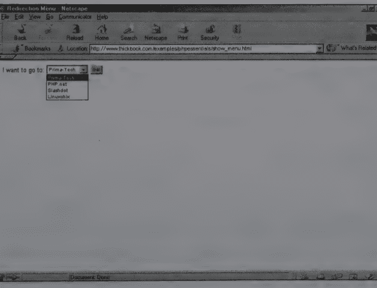

图 2.3 重定向菜单

现在，创建 `do_redirect.php` 脚本，它只需获取 `$location` 中的值并将其发送到重定向头：

```php
<?php
header("Location: $location");
exit;
?>
```

保存此文件并将其放置在服务器上，然后访问其 URL，`http://www.yourserver.com/show_menu.html` 处的菜单。

选择一个目标，点击“Go!”按钮，你就可以（应该）出发了！

如果你想向用户隐藏重定向 URL，请修改 HTML 表单元素，使 `$location` 包含一个标识字符串：

```
<SELECT name="id" size="1">
<OPTION value="prima">Prima-Tech</OPTION>
<OPTION value="php">PHP.net</OPTION>
<OPTION value="slashdot">Slashdot</OPTION>
<OPTION value="linuxchix">Linuxch</OPTION>
</SELECT>
```

然后修改你的 PHP 脚本以添加一系列条件语句，最终根据 `$id` 的值为 `$location` 分配适当的值：

```php
<?php
if ($id == "prima") {
  $location = "http://www.prima-tech.com/";
} else if ($id == "php") {
  $location = "http://www.php.net/";
} else if ($id == "slashdot") {
  $location = "http://www.slashdot.org/";
} else if ($id == "linuxchix") {
  $location = "http://www.linuxchix.org/";
}
header("Location: $location");
exit;
?>
```

虽然在脚本中硬编码 URL 与在 HTML 表单值中硬编码 URL 效果，但这会增加双倍的工作。如果你选择在脚本中硬编码 URL，每当添加新位置时，必须在表单中添加选项，同时在脚本中添加相应的 if...语句。

无论哪种方式，你都掌握了通过 PHP 脚本发送重定向头的艺术！

### 显示特定浏览器代码

在编写本文时，浏览器大战仍在继续：没有一种 Web 浏览器被大多数 Web 浪者使用。微软 Internet Explorer (`MSIE`) 的各种版本占使用中 Web 浏览器的 75%，而 Netscape (`NS`) 的版本占了约 24%。再加上死忠的 Lynx、Opera 和 WebTV 用户，就达到了 100%。

虽然 75/25 的比例似乎是绝大多数，但如果有 1.5 亿人访问互联网，那么 2500 万非微软用户是在开发良好的网站时需要考虑的巨大数字。特定浏览器的 HTML 开发有许多细微差别，但这里是一些亮点：

- `MSIE` 5.0 包含一些 XML 支持。`NS` 4.x 不支持。
- `MSIE` 和 `NS` 3.x 及以上版本包含样式表支持。其他浏览器不支持。
- UNIX 上的某些 `NS` 版本不包含样式表支持。

如此。HotWired 在 `http://hotwired.lycos.com/webmonkey/reference/browser_chart/` 维护了一个浏览器参考。

使用 `HTTP_USER_AGENT` 环境变量，你可以识别访问页面的特定属性，并并专门为该浏览器类型和平台设计的代码。

然而，在看到一些 `HTTP_USER_AGENT` 值后，你可以想象会有数百个略有不同的值。是时候学习基础模式匹配了！

创建一个名为 `browser_match.php` 的脚本，包含以下代码：

```php
<?php
$browser_type = getenv("HTTP_USER_AGENT");
?>
```

使用 `preg_match()` PHP 函数在 `HTTP_USER_AGENT` 的值中查找特定的文本块。`preg_match()` 的语法为

`preg_match("[你想查找的内容]/", "[你正在查找的地方]");`

要在 `HTTP_USER_AGENT` 某处查找 "MSIE"，使用已赋值给变量 `$browser_type` 的值：

`preg_match("/MSIE/i", "$browser_type"));`

# 第 2 章：基础 PHP 技术

`/MSIE/` 后面的 "i" 通知脚本匹配任何大写或小写的实例。

要在 `HTTP_USER_AGENT` 值中查找 "Mozilla/*",使用

```php
preg_match("/Mozilla/i", "$browser_type"));
```

将所有部分放在 if...else 语句中，这样如果浏览器是 `MSIE`，屏幕上将打印“Using MSIE”。如果浏览器是 Netscape，屏幕上将打印“Using Netscape”。如果浏览器不是两者，则将打印该浏览器的 `HTTP_USER_AGENT` 值。你的代码看起来像这样：

```php
<?php
$browser_type = getenv("HTTP_USER_AGENT");
if (preg_match("/MSIE/i", "$browser_type")) {
    echo "Using MSIE.";
} else if (preg_match("/Mozilla/i", "$browser_type")) {
    echo "Using Netscape.";
} else {
    echo "$browser_type";
}
?>
```

保存此文件并将其放置在服务器上，然后通过 URL `http://www.yourserver.com/browser_match.php` 访问它。

在浏览器窗口中，你应该看到“Using MSIE”、“Using Netscape”或你使用的浏览器的 `HTTP_USER_AGENT` 值（见图 2.4）。如果你正在使用样式表开发网站，并且有一组 `MSIE` 样式和另一组 Netscape 样式，可以使用相同的结构在代码上下文中打印样式表链接。

例如，一个样式表的链接：

```html
<link rel="stylesheet" href="msie_style.css">
```


将出现在指定的区域：

```html
<!--样式表代码 -->
```

在以下 HTML 示例中：

```html
<!DOCTYPE HTML PUBLIC "//W3C//DTD HTML 3.2//EN">
<HTML>
<HEAD>
```


图 2.4 根据浏览器类型显示自定义消息

```html
<TITLE>页面</TITLE>
<!--样式表代码 -->
</HEAD>
<BODY>
</BODY>
</html>
```

如果你有两个样式表，针对 MSIE 的 `msie_style.css` 和针对 Netscape 的 `ns_style.css`，你可以使用相同的结构在代码上下文中打印样式表链接。

例如，一个样式表的链接：

```html
<link rel="stylesheet" href="msie_style.css">
```

将出现在指定的区域：

```html
<!--样式表代码 -->
```

在以下 HTML 示例中：

```html
<!DOCTYPE HTML PUBLIC "//W3C//DTD HTML 3.2//EN">
<HTML>
<HEAD>
```

## 发送邮件

首先，打开你喜欢的文本编辑器，创建一个名为 `show_feedback.html` 的文件，并设置 HTML “外壳”：

```html
<TITLE>反馈表单</TITLE>
</HEAD>
<BODY>
<!--表单在这里 -->
```

创建表单代码，假设你的 PHP 脚本将命名为 `do_sendfeedback.php` 且表单将使用 POST 方法：

```html
<FORM method="POST" action="do_sendfeedback.php">
```

接下来，创建两个文本字段来获取 `$sender_name` 和 `$sender_email` 的值：

```html
<P>姓名：br><INPUT type="text" name="sender_name" size=30></P>
<P>邮箱：br><INPUT type="text" name="sender_email" size=30></P>
```

添加单选按钮组来获取 `$like_site` 的值：

```html
<P>你喜欢这个网站吗？
<INPUT type="radio" name="like_site" value="Yes" checked
<INPUT type="radio" name="like_site" value="No"
</p>
```

添加一个文本区域，使用户可以输入任何额外消息（捕获在变量 `$message` 中）：

```html
<P>额外消息：br>
<textarea name="message" cols=30 rows=5></textarea>
</p>
```

最后，添加提交表单的按钮：

```html
<INPUT type="submit" value="提交表单">
```

别忘记闭合 `</FORM>` 标签！

你的 HTML 源代码应该如下：

```html
<!DOCTYPE HTML PUBLIC "//W3C//DTD HTML 3.2//EN">
<HTML>
<HEAD>
<TITLE>反馈</TITLE>
</HEAD>
<BODY>
<FORM method="POST" action="do_sendfeedback.php">
<P>姓名：br><INPUT type="text" name="sender_name" size=30></P>
<P>邮箱：br><INPUT type="text" name="sender_email" size=30></P>
<P>你喜欢这个网站吗？
<INPUT type="radio" name="like_site" value="Yes" checked
<INPUT type="radio" name="like_site" value="No
</p>
<P>额外消息：br>
<textarea name="message" cols=30 rows=5></textarea>
</p>
<INPUT type="submit" value="提交表单">
</FORM>
</BODY>
</HTML>
```

现在你已经知道了如何发送邮件，可以创建服务器端脚本。

```php
<?php
$sender_name = $_POST["sender_name"];
$sender_email = $_POST["sender_email"];
$like_site = $_POST["like_site"];
$message = $_POST["message"];

$to = "admin@yourserver.com";
$subject = "来自 $sender_name 的反馈";
$body = "邮箱: $sender_email\n\n喜欢：$like_site\n\n消息: $message";
$headers = "From: $sender_email";

mail($to, $subject, $body, $headers);

echo "感谢您的反馈！";
?>
```

`mail()` 函数是一个用于发送邮件的 PHP 内置函数。然而，它需要你的 Web 服务器配置为发送邮件。如果你的服务器没有配置，你可能需要使用像 PHPMailer 这样的库。

## 第二2章：基础 PHP 技术

```html
<P>Your E-Mail Address: <INPUT type="text" name="sender_email" size=30></P>
<P>你喜欢这个网站吗?</P>
<INPUT type="radio" name="like_site" value="Yes" checked yes
<INPUT type="radio" name="like_site" value="No" no
</P>
<P>Additional Message: <Br>
<textarea name="message" cols=30 rows=5></textarea>
</P>
<INPUT type="submit" value="Send This Form">
</FORM>
</BODY>
<HTML>
```

将此文件放置在你的 Web 服务器上，并在浏览器中访问 URL：`http://www.yourserver.com/show_feedback.html`。在你的浏览器窗口中，你应该能看到图 2.5 所示的内容。

接下来，创建 `do_sendfeedback.php` 脚本。该脚本将捕表单值 `$sender_name`、 `$sender_email`、 `$like_site` 和 `$message`。

脚本开头如下：

```php
<?php_track_vars();?> //确保变量被跟踪
```

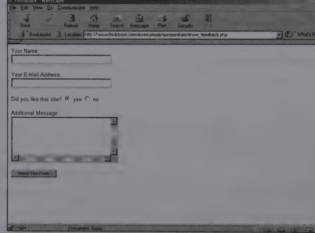

**图 2.5** 反馈表单

你必须通过拼接字符串来构建电子邮件，形成一个单一的消息字符串。“拼接”（Concatenating）是“将字符串挤在一起”的形象说法。使用换行符 (`\n`) 和制表符 (`\t`) 来在适当的地方添加间距。开始构建名为 `$msg` 的消息字符串：

```php
$php
$msg = "Sender's Full Name:\t$sender_name\n";
?>
```

在这一行中，你希望邮件在变量 `$sender_name` 之前显示一个字段标签，这样你就知道 `$sender_name` 是什么了。在你的所范围内，`$sender_name` 可能是“狗的名字”。

重复此过程，为 `$sender_email`、 `$like_site` 和 `$message` 设置字段标签。然而，在这些行中，请使用拼接运算符 `.` 而不是赋值运算符 `=`。

```php
$msg .= "Sender's E-Mail:\t$sender_email\n";
$msg .= "Did You Like the Site?\t$like_site\n";
$msg .= "Additional Message:\t$message\n";
// 在内容末尾使用两个换行符，
// 或者插入额外的间距
```

你的消息字符串 (`$msg`) 现在是：

"Sender's Full Name:\t$sender_nameIn's E-Mail:\t$sender_email\nDid You Like the Site?\t$like_site\nAdditional Message:\t$message\n":

邮件客户端将将其格式化为格式良好的电子邮件，元素之间会有换行和制表符。

现在创建一个名为 `$mailheaders` 的变量，以强制在邮件的 From 和 Reply-To Header 中设置特定的值：


创建该函数。在这种情况下，我将使用我自己的电子邮件地址：

```php
mail("julie@thickbook.com", "Feedback Form", $msg, $mailheaders);
```

在发送消息后，你应该向浏览器返回某些文本，这样用户就不会坐在那里纳闷消息是否已发送。如果用户不知道消息是否已发送，他或她很有可能会继续点击“提交表单”按钮，从而反复用相同的反馈淹没你的信件箱。

添加几个 `echo` 语句。你可以在响应中包含用户的姓名，因为你可以访问变量 `$sender_name`：

```php
echo <H1 align=center>Thank You;
echo <P align=center>We appreciate your feedback.</P>";
```

你的整个 PHP 脚本看起来应该像这样：

返回你的 Web 浏览器，打开 URL 为 `http://www.yourserver.com/show_feedback.html` 的反馈表单，并输入你的名字、电子邮件地址和消息。为了测试目的，我输入了 "Julie Meloni"、“jm@i2ii.com"，在被询问是否喜欢这个网站时选择了 "yes"，并在消息框中输入了"This is a great site!（这是一个很棒的网站！）”。

在我提交表单后，结果页面正确地显示了我的名字并提供了感谢信息，如图 2.6 所示。

我检查了我的邮件，收到了一封格式良好的邮件，包含了 `$sender_name`、 `$sender_email`、 `$like_site` 和 `$message` 值（见图 2.7）。

表单验证如何？虽然在这个简单的邮件示例中，确保所有字段都填写并不复杂，但在以后你创建订单表单时，这将非常重要。使用 PHP 处理必填字段的一种非常简单的方法是检查必填值，如果其中一个值不存在，则直接将用户重回表单。

## 感谢，Julie Meloni

感谢你的反馈。

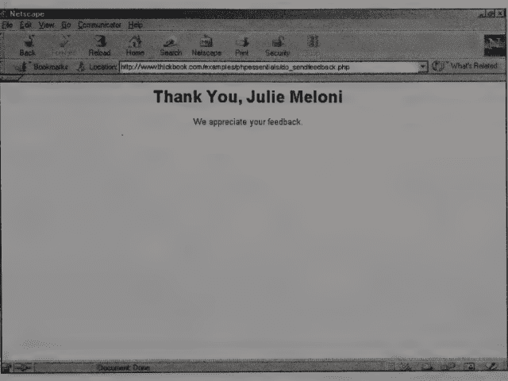

图 2.6 反馈表单结果页

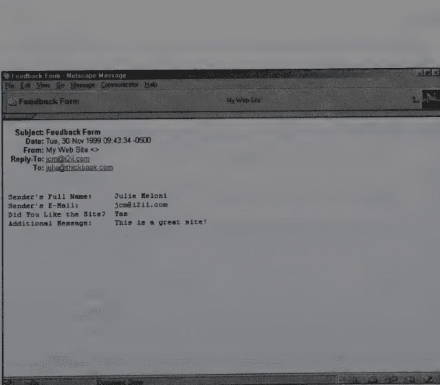

图 2.7 从反馈表单收到的邮件

## 第二2章：基础 PHP 技术

在 `do_sendfeedback.php` 脚本中，在构建消息字符串之前添加以下代码以检查电子邮件地址和消息：

```php
if (($sender_email == "") || ($message == "")) {
header("Location: http://www.yourserver.com/show_feedback.html");
}
```

这段代码的意思是：“如果 `$sender_email` 的值为空或 `$message` 的值为空，则将用户重定向回空白表单，以便他们重新开始。”在 `http://www.thickbook.com/` 的“教程”部分，你可以学习在用户被重定向后打印特定的错误信息，以便他们发现自己犯的错误（在这种情况下，错误是未填写表单）。

在下一节中，你将学习如何从文件系统读取和写入数据，包括如何将文件内容放入邮件并发送。

## 第2章：基础 PHP 技术


> 如果你的 Web 服务器运行在 Windows 平台上，请对文件路径中的反斜杠进行转义，如下：

`$newfile = fopen("c:\\Apache\\htdocs\\mydata.txt", "a+");`

将 PHP 脚本放置在你的 Web 服务器上，并在浏览器中使用 URL `http://www.yourserver.com/write_data.php` 访问它。在浏览器窗口中，你现在应该能看到这个：

全部完成！

要验证消息“This is a new file.” 是否已写入 `mydata.txt`，如果该文件被放在文档根目录下，你可以通过 URL 访问它：`http://www.yourserver.com/mydata.txt`。如果你将文件放置在主目录下（例如 `/home/username/`），请通过浏览文件系统并打开该文件。

### 读取数据文件

你也可以使用 PHP 的 `fread()` 函数将数据收集到变量中，以验证文件是否已写入。`fread()` 函数接受两个参数：

`fread([filename], [length]);`

要读取整个文件，可以使用 `filesize()` 函数获取长度：

`fread([filename], filesize([filename]));`

要验证上一节创建的 `mydata.txt` 文件是否包含字符串“This is a new file.”，首先创建一个名为 `read_data.php` 的脚本并包含以下代码：

```php
<?php
$file_loc = "/usr/local/apache/htdocs/mydata.txt";
// 此变量包含文件名的完整路径
$whatoread = fopen($file_loc, "r");
// 以仅只读模式打开文件
$file_contents = fread($whatoread, filesize($file_loc));
// 将整个文件的内容放入变量中
close($whatoread);
// 关闭文件
echo "The file contains:<br>" . $file_contents;
?>
```

请确保修改文件路径以匹配你自己的环境。

将 PHP 脚本放置在你的 Web 服务器上，并在浏览器中使用 URL `http://www.yourserver.com/read_data.php` 访问它。在浏览器窗口中，你现在应该能看到这个：

The file contains:

This is a new file.

除了在屏幕上读取结果外，你还可以将内容发送电子邮件。在 `echo` 语句之前添加以下行：

```php
$mailheaders = "From: My Web Site <>\n";
mail("julia@thickbook.com", "File Contents", $file_contents, $mailheaders);
```

并将 `echo` 语句改为：

```php
echo "Check your mail!";
```

现在完整的脚本应该像这样：

```php
<?php
$file_loc = "/usr/local/apache/htdocs/myData.txt";
// 此变量包含文件名的完整路径
$whatorread = fopen($file_loc, "r");
// 以仅只读模式打开文件
$file_contents = fread($whatorread, filesize($file_loc));
// 将整个文件的内容放入变量中
close($whatorread);
// 关闭文件
$mailheaders = "From: My Web Site <>\n";
mail("julia@thickbook.com", "File Contents", $file_contents, $mailheaders);
echo "Check your mail!";
?>
```

将 PHP 脚本放置在你的 Web 服务器上，并在浏览器中使用 URL `http://www.yourserver.com/read_data.php` 访问它。在浏览器窗口中，你现在应该能看到这个：

Check your mail!

当你检查邮件时，应该有一条类似的消息在等待你：

Subject: File Contents

Date: [date sent]

From: My Web Site <>

To: julie@thickbook.com

This is a new file.

稍后你将学习如何在文件系统上保存表单数据并根据需要发送给自己。你还将学习如何用 PHP 应用程序来加密文件，然后删除未加密的版本。

## 第3章：数据库操作

### 基础数据库理论

### 基础 SQL

### 使用 PHP 建立数据库连接


我想不出任何我不想在 Web 应用中使用某种数据库的时刻，无论是简单的扁文件操作数据库，还是复杂的关系型数据库。无论是保存表单数据、跟踪库存还是创建动态内容，只要你能掌握基础数据库概念，就可以开始创建简单的数据库驱动 Web 应用。随着开源、全功能关系型数据库的出现，这类应用不再仅仅属于那些有足够资金玩这个游戏的人。


在本章中，你将学习一些基础的数据库理论、基础 SQL 语句以及如何使用 PHP 连接并检索存储在数据库表中的信息。尽管 PHP 支持多种数据库类型以及通用 ODBC 连接，但书中使用的深度示例是基于 MySQL 数据库函数的。如果你没有使用 MySQL，请参考 `http://www.php.net/` 上的 PHP 手手册查找你特定数据库类型的函数。

## 基础数据库理论

在我带你走远之前，你应该熟悉数据库的结构。以下是列表：

- 数据库是表的集合。
- 每个表包含记录（records）。
- 每条记录包含字段（fields）。
- 每个字段包含一个特定的数据。

假设你有一个朋友数据库。表结构如下：

| FRIEND_ID | FULL_NAME | BIRTH_DATE | FAVE_COLOR |
| :--- | :--- | :--- | :--- |
| 1 | Joe Smith | 1970-10-03 | blue |
| 2 | Mary Smith | 1962-07-25 | red |
| 3 | Jane Smith | 1968-04-28 | black |

`FRIEND_ID` 字段是每个记录的唯一标识。这确保了没有两条记录具有相同的 ID。

### 唯一标识的重要性

上一节中的 `FRIEND_INFO` 表缺少了某些东西：唯一标识。你可能认为 `FULL_NAME` 字段就是唯一标识。如果是这样，当你有两个叫 Joe Smith 的朋友时，你该如何区分他们？

相反，一个简单的 `FRIEND_ID` 怎么样？在你的 `FRIEND_INFO` 中添加 `FRIEND_ID` 字段：

| FRIEND_ID | FULL_NAME | BIRTH_DATE | FAVE_COLOR |
| :--- | :--- | :--- | :--- |
| 1 | Joe Smith | 1970-10-03 | blue |
| 2 | Mary Smith | 1962-07-25 | red |
| 3 | Jane Smith | 1968-04-28 | black |
| 4 | Jane Smith | 1975-11-05 | green |

### 什么是关系？

关系型数据库之所以得名，是因为它们包含的多个表之间存在关系。你可以在关系型数据库中有一系列不相关的的表，但那样有什么趣呢？

表之间的关系发生是因为它们具有共同字段。通常这些共同字段是你刚才学过的唯一字段，或键（keys）。

关系型数据库最简单的例子是产品目录和订单机制。一个表包含产品信息。第三个表包含订单信息。与其创建一个包含所有产品和客户信息的大订单表，不如在订单表中使用唯一标识来引用产品表中的产品和客户表中的客户即可。

例如，`MY_PRODUCTS` 表中的记录将具有唯一的 `PRODUCT_ID`、`TITLE`、`DESCRIPTION` 和 `PRICE`：

## 基础数据库理论

| PRODUCT_ID | TITLE | DESCRIPTION | PRICE |
| :--- | :--- | :--- | :--- |
| 12557 | 帽子 | 暖和。 | 7.50 |
| 12558 | 外套 | 防水。 | 32.50 |
| 12559 | 衬衫 | 有光泽时尚。 | 48.00 |
| 12560 | 裤子 | 百褶皱西装裤。 | 52.00 |

接下来，`MY_CUSTOMERS` 表中的记录将具有唯一的 `CUSTOMER_ID`、`NAME` 和 `ADDRESS`：

| CUSTOMER_ID | NAME | ADDRESS |
| :--- | :--- | :--- |
| 125 | Mike Jones | 112 Main St. Anywhere CA 95228 |
| 268 | Jim Smith | 458 Bee Ave, Blankville IN 55248 |
| 275 | Nancy Jones | 751 14th St NW, Newtown MI 44322 |

`MY_ORDERS` 表中的记录将具有唯一的 `ORDER_ID`。你可以使用 `CUSTOMER_ID` 和 `PRODUCT_ID` 标识在 `CUSTOMER` 和 `PRODUCT_ORDERED` 字段中找到它们。最后，如果你订购了，必须有一个 `QUANTITY`。

| ORDER_ID | CUSTOMER | PRODUCT_ORDERED | QUANTITY |
| :--- | :--- | :--- | :--- |
| 1 | 125 | 12558 | 1 |
| 2 | 268 | 12560 | 1 |
| 3 | 275 | 12557 | 1 |

为了给这些订单创建发票，你需要使用 `CUSTOMER` 和 `PRODUCT_ORDERED` 字段中的值，在各自的表 `MY_CUSTOMERS` 和 `MY_PRODUCTS` 中查找关于这些人和物品的详细信息。

利用表之间的关系，你可以创建像这样的发票：

```
ORDER NUMBER: 001
SHIP TO: Mike Jones, 112 Main St, Anywhere CA 95228
ITEMS ORDERED: 1 Hat (Warm and Fuzzy)
TOTAL COST: $7,50
```

# 第3章：数据库操作

在对数据库中唯一字段和表之间关系有了基本理解后，是时候学习关系型数据库的语言了：SQL，即结构化查询语言。

## 基础 SQL

尽管结构化查询语言（SQL）是由 IBM 开发的，但目前 SQL 处于美国国家标准协会（ANSI）的监督之下。与所有的“标准”一样，SQL 也有变体——可以说是专有扩展——用于 Microsoft SQL Server、Oracle 数据库等系统。然而，学习标准的 SQL 命令集将为你提供关于 SQL 的基础知识，你可以将其应用于多个数据库系统。以下是这些命令：

- `CREATE`. 创建新表。
- `ALTER`. 修改现有表的定义（结构、数据类型等）。
- `DROP`. 主要用于删除表和字段等元素。
- `INSERT`. 向表中添加记录。
- `UPDATE`. 修改现有记录中的数据。
- `SELECT`. 对表执行查询，包括数学函数、字段比较、模式匹配等。
- `DELETE`. 从表中永久性地删除元素。

接下来的几个章节将包含对这些基础 SQL 命令的进一步描述和示例。请务必彻底阅读你的数据库文档，以了解这些命令在你自己环境中的准确用法，因为它们可能与这些示例略有不同（这些示例是针对 MySQL 用户的）。此外，取决于你的数据库类型，你可以通过图形用户界面（GUI）或命令行直接输入 SQL 命令。后续章节仅提供 SQL 命令本身的示例；在本章末尾，你将学习如何通过 PHP 脚本向数据库发送 SQL 命令。

### CREATE

`CREATE` 命令在选定的数据库中创建一个表。其基本语法如下：

```
CREATE TABLE [table name] [(field_name field_data_type,...)] [options]
```

一些常见的数据类型有 `int`, `double`, `varchar`, `date`, `time`, `datetime`, `text` 和 `blob`。请参阅你的数据库文档以获取支持的数据类型列表以及任何大小和数据限制。

要创建本章开头使用的 `FRIEND_INFO` 表，SQL 语句将如下：

```
CREATE TABLE FRIEND_INFO (
FRIEND_ID char(5) not null,
FULL_NAME varchar(100),
BIRTH_DATE date,
FAVE_COLOR varchar(25),
UNIQUE_FRIEND_ID (FRIEND_ID)
);
```

此示例代码使用了大量的空白。空格在 SQL 语句中是无关的，但它确实让你的代码更易读（并且以后更易编辑！）。前面的语句完全可以写成这样：

```
CREATE TABLE FRIEND_INFO (FRIEND_ID char(5) not null, FULL_NAME varchar(100),
BIRTH_DATE, FAVE_COLOR varchar(25), UNIQUE_FRIEND_ID (FRIEND_ID));
```

`CREATE` 命令定义了表中字段的属性；它为每个字段指定类型和长度。在这个示例中，`FRIEND_ID` 字段被定义为“not null”，这意味着在添加记录时，如果该字段为空，它就是为空，或者对于数值字段，其默认值为“0”。NULL 含义与“空”完全不同，这是一个需要记住的重要区别。通过添加 `UNIQUE_FRIEND_ID (FRIEND_ID)`，`FRIEND_ID` 也被标识为唯一。

### ALTER

`ALTER` 命令让你有机会修改字段的机会。例如，假设你在 `FRIEND_INFO` 表中有一个错误的出生日期：`FRIEND_ID` 为 1 的 Joe Smith 出于 11 月 3 日，而不是 10 月 3 日。与其删除记录并插入新记录，不如直接使用 `UPDATE` 命令更改 `BIRTH_DATE` 字段中的数据。

### DROP


# 第3 章：数据库操作

如果你不注意自己正在做什么，`DROP` 命令是非常危险的。

## INSERT

你使用 `INSERT` 命令逐个填充表。`INSERT` 命令的基本语法为：

```sql
INSERT INTO [table name] ([name of field], [name of field], ...)
VALUES ('value of field1', 'value of field2');
```

要向 `FRIEND_INFO` 表添加记录（其字段为 `FRIEND_ID`, `FULL_NAME`, `BIRTH_DATE` 和 `FAVE_COLOR`），命令为：

```sql
INSERT INTO FRIEND_INFO (FRIEND_ID, FULL_NAME, BIRTH_DATE, FAVE_COLOR)
VALUES ('1', 'Joe Smith', '1970-10-03', 'blue');
```

要添加你的其他朋友，请继续执行额外的 `INSERT` 语句：

```sql
INSERT INTO FRIEND_INFO (FRIEND_ID, FULL_NAME, BIRTH_DATE, FAVE_COLOR)
VALUES ('2', 'Mary Smith', '1962-07-25', 'red');
```

```sql
INSERT INTO FRIEND_INFO (FRIEND_ID, FULL_NAME, BIRTH_DATE, FAVE_COLOR)
VALUES ('3', 'Jane Smith', '1968-04-28', 'black');
```

```sql
INSERT INTO FRIEND_INFO (FRIEND_ID, FULL_NAME, BIRTH_DATE, FAVE_COLOR)
VALUES ('4', 'Joe Smith', '1975-11-07', 'green');
```

## UPDATE

`UPDATE` 命令修改记录的一部分而不是替换整个记录。以下是 `UPDATE` 命令的基本语法：

（注：提供的原文在后续部分存在缺失或乱码。）

如果你在执行 `UPDATE` 语句时不指定 `WHERE` 表达式，你将更新所有记录。例如，要将所有人的喜好颜色改为红色，可以使用此 `UPDATE` 语句：

`UPDATE` 是一条非常强大的 SQL 命令。例如，你可以对现有记录执行字符串函数和数学函数，并使用 `UPDATE` 命令修改它们的值。

## SELECT

当你创建数据库驱动的 Web 网站时，`SELECT` 命令可能是你工具箱中最频繁使用的命令。`SELECT` 命令根据你定义的标准来选定表中的某些记录。以下是 `SELECT` 命令的基本语法：

```sql
SELECT [field names]
FROM [table names]
WHERE [some expression]
ORDER BY [field names];
```

要选择表中的所有记录（例如 `FRIEND_INFO` 表），请使用此语句：

```sql
SELECT *
FROM FRIEND_INFO;
```

若要选择 `FRIEND_INFO` 表中 `FULL_NAME` 字段的条目，请使用：

```sql
SELECT FULL_NAME
FROM FRIEND_INFO;
```

要要选择表中的所有记录并按特定顺序返回，请使用 `ORDER BY` 表达式。例如，要查看 `FRIEND_INFO` 表中每条记录的 `FRIEND_ID`、`FULL_NAME` 和 `BIRTH_DATE`，并按从年轻到年老的排序，请使用以下语句：

```sql
SELECT FRIEND_ID, FULL_NAME, BIRTH_DATE
FROM FRIEND_INFO
ORDER BY BIRTH_DATE DESC;
```

`DESC` 表示“降序”（descending）。要从年老到年轻，使用 `ASC` 表示“升序”（ascending）：

```sql
SELECT FRIEND_ID, FULL_NAME, BIRTH_DATE
FROM FRIEND_INFO
ORDER BY BIRTH_DATE ASC;
```

该语句产生的结果如下：

| FRIEND_ID | FULL_NAME | BIRTH_DATE |
|-----------|-----------|------------|
| 2 | Mary Smith | 1962-07-25 |
| 3 | Jane Smith | 1968-04-28 |
| 1 | Joe Smith | 1970-11-03 |
| 4 | Joe Smith | 1975-11-07 |

在准备 `ORDER BY` 子句时，默认顺序是 `ASC`（升序）。

你还可以在 SQL 语句中执行数学和字符串函数，从而通过使用 `SELECT` 实现不仅仅是输出现有数据。例如，要快速查找 `FRIEND_INFO` 表中的朋友数量，你使用：

```sql
SELECT COUNT(FRIEND_ID) FROM FRIEND_INFO;
```

此语句的结果是 4。你也可以对任何其他字段使用 `COUNT()` 函数来统计表中的条目数量。

我可以写好本书关于 `SELECT` 命令的各种变体，但幸运的是，别人已经写过了。此外，如果你正在使用 MySQL 数据库，MySQL 手册包含了非常好的 SQL 参考。在本章的后面，以及第 7 章和第 8 章“高级 PHP 技术：基于 Web 的数据库管理”和“高级 PHP 技术：电子商务”中，你将学习 `SELECT` 命令的更多用法。

## DELETE

`DELETE` 命令没有 `SELECT` 那么有趣，但它仍然有用。与 `DROP` 命令一样，如果不注意操作就使用 `DELETE`，在生产环境中会导致严重的后果。一旦你 `DROP` 了一个表或 `DELETE` 了一条记录，它就永远消失了。`DELETE` 命令的基本语法如下：

```sql
DELETE FROM [table name]
WHERE [some expression];
```

例如，要从 `FRIEND_INFO` 表中删除 Joe Smith 的条目，你可以使用：

```sql
DELETE FROM FRIEND_INFO
WHERE FULL_NAME = 'Joe Smith';
```

等一下！如果你执行这条语句，你将删除两个 Joe Smith 的条目。因此，除了名称之外再使用另一个标识符：

```sql
DELETE FROM FRIEND_INFO
WHERE FULL_NAME = 'Joe Smith' AND BIRTH_DATE = '1970-11-03';
```

或者，由于你知道唯一标识符的重要性，你可以使用：

```sql
DELETE FROM FRIEND_INFO
WHERE FRIEND_ID = '1';
```

如果你在执行 `DELETE` 命令时不指定 `WHERE` 表达式，你将删除所有记录。例如，这段 SQL 删除了 `FRIEND_INFO` 表中的所有记录：

```sql
DELETE FROM FRIEND_INFO
```

另外，请记住，如果你不想删除整条记录，只想删除表中的某个字段，可以使用这个：

```sql
ALTER TABLE [table name]
DROP [field name];
```

如果你打算使用 `DELETE` 和 `DROP` 命令，请务必备份你的数据，以防万一。

## 使用 PHP 建立数据库连接

使用 PHP 内置的数据库连接函数，你可以连接到几乎任何类型的数据库并访问其数据（当然，前提是你有适当权限！）。如果 PHP 不包含针对你特定数据库类型的特定函数，你可以使用 PHP 的 `ODBC` 函数创建通用的 `ODBC` 连接。在尝试使用任何数据库连接函数之前，确保你已经安装了数据库，并在 `php.ini` 文件中加载并指示了正确的扩展。

在接下来的页面中，你将找到许多数据库类型的函数定义和代码示例。`http://www.php.net/manual/` 上的 PHP 手册是你查找所有支持数据库函数完整列表的第一处。在检索手册和常见问题解答（FAQ）后，请搜索 PHP 邮件列表存档。很有可能，如果你有关于数据库连接的问题，别人已经问过并且。

## PHP 建立数据库连接

```php
$sql_result = ifx_query($sql_connection) or die("Couldn't execute query.");
```

```php
// 以 HTML 表格格式化结果
ifx_htmltable_result($sql_result, border=1);
```

```php
// 释放资源并关闭连接
ifx_free_result($sql_result);
ifx_close($connection);
```


请参阅 PHP 手册以获取更多 Informix 数据库函数，并尝试使用您自己的表和 SQL 语句，而不是仅显示示例。记住，除非您已经准备好并备份了数据，否则不要使用 `DELETE` 或 `DROP` 命令！

### 连接到 Microsoft SQL Server

有许多 PHP 函数用于连接 Microsoft SQL Server，这些函数在 PHP 手册中有详细的说明。然而，您只需要其中少数几个函数即可建立简单的连接并选择一些数据：

- `msql_connect()` 打开到 Microsoft SQL Server 的连接。需要服务器名称、用户名和密码。
- `msql_select_db()` 在 Microsoft SQL Server 上选择数据库。
- `msql_query()` 发出 SQL 语句。
- `msql_fetch_array()` 将 SQL 语句的一行放入数组中。
- `msql_free_result()` 释放当前连接使用的资源。
- `msql_close()` 关闭当前连接。

首先，您必须知道数据库所在的服务器名称，以及该数据库的有效用户名和密码。在例示例中，数据库名为 `localhost` 上的 `secretDB`，用户名为 `sandman`，密码为 `34Nhjp`。通过创建一个连接变量开始您的 PHP 代码：

```php
$connection = msql_connect("localhost","sandman","34Nhjp")
or die("Couldn't connect to the server.");
```

`die()` 函数用于在函数无法按要求执行时打印错误消息并退出脚本。在这种情况下，如果连接失败，`die()` 将执行。将打印错误消息以便您知道错误发生的位置（"Couldn't connect to the server."），且不会发生任何后续操作。使用 `die()` 可以减少您在调试代码时的许多烦恼。


> 如果在建立连接时遇到问题，请尝试使用空字符串作为密码("")。

如果您通过了连接测试，下一步是选择数据库并创建 SQL 语句。假设之前示例中使用的 `FRIEND_INFO` 表存在于名为 `secretDB` 的数据库中。如下创建数据库变量：

```php
$db = mssql_select_db("secretDB", $connection) or die("Couldn't connect database.");
```

到此为止，您将使用 PHP 连接到服务器并选择数据库。如果您已经到了这一步，就可以发出 SQL 语句并希望看到一些结果！

使用 `FRIEND_INFO` 表，假设您想查看朋友的名字、生日和喜喜欢的颜色，并按年龄从大到小排序。创建一个存储您的 SQL 语句的变量：

```php
$sql = "SELECT FULL_NAME, BIRTH_DATE, FAVE_COLOR
FROM FRIEND_INFO
ORDER BY BIRTH_DATE ASC";
```

接下来，创建一个变量来存储查询结果，该结果由 `mssql_query()` 函数执行，以及您刚刚创建的连接变量和 SQL 语句变量。

```php
$sql_result = mssql_query($sql, $connection) or die("Couldn't execute query.");
```

要格式化当前存储在 `$sql_result` 中的结果，首先使用 `mssql_fetch_array()` 函数分离结果：

```php
while ($row = mssql_fetch_array($sql_result)) {
  // 此处有更多代码
}
```

`while` 循环为 `$sql_result` 中的每一行创建一个 `$row` 数组。为了获取结果中的各个元素（`FULL_NAME`、`BIRTH_DATE`、`FAVE_COLOR`），创建特定的变量：

PHP 建立数据库连接

```php
$full_name = $row["FULL_NAME"];
$birth_date = $row["BIRTH_DATE"];
$fave_color = $row["FAVE_COLOR"];
```

您可能想以简单的 HTML 表格输出结果。在开始 `while` 循环之前，放置此语句打开表格并设置表头：

```php
echo "<TABLE BORDER=1>";
echo "<TR><THFull Name</TH><THBirthday</TH><THFavorite Color</TH></TR>";
```

在 `while` 循环中定义变量后，以表格格式输出：

```php
echo "<TR><td$full_name</TD><td>$birth_date</TD><td>$fave_color</TD></TR>";
```

`while` 循环看起来如下：

```php
while ($row = mssql_fetch_array($sql_result)) {
  $full_name = $row["FULL_NAME"];
  $birth_date = $row["BIRTH_DATE"];
  $fave_color = $row["FAVE_COLOR"];
  echo "<TR><td>$full_name</TD><td>$birth_date</TD><td>$fave_color</TD></TR>";
}
```

在 `while` 循环之后，关闭 HTML 表格：

```php
echo "</TABLE>";
```

最后，您将释放执行查询所需的资源并关闭数据库连接。这样做会导致内存泄漏或其他糟糕的资源占用。

```php
mssql_free_result($sql_result);
mssql_close($connection);
```

在 Microsoft SQL Server 数据库上执行简单连接和数据选择的完整脚本可能像这样：

```php
<?php
// 创建连接
// 替换为自己的主机名、用户名和密码
$connection = msql_connect("localhost","sandman","34Nhjp")
or die("Couldn't connect to the server.");

// 选择数据库
// 替换为自己的数据库名
$db = mssql_select_db("secretDB", $connection) or die("Couldn't select database.");

// 创建 SQL 语句
$sql = "SELECT FULL_NAME, BIRTH_DATE, FAVE_COLOR
FROM FRIEND_INFO
ORDER BY BIRTH_DATE ASC";

// 执行 SQL 并获取结果
$sql_result = mssql_query($sql, $connection) or die("Couldn't execute query.");

// 按行格式化结果
echo "<TABLE BORDER=1>";
echo "<TR><THFull Name</TH><THBirthday</TH><THFavorite Color</TH></TR>";
while ($row = mssql_fetch_array($sql_result)) {
  $full_name = $row["FULL_NAME"];
  $birth_date = $row["BIRTH_DATE"];
  $fave_color = $row["FAVE_COLOR"];
  echo "<TR><td>$full_name</TD><td>$birth_date</TD><td>$fave_color</TD></TR>";
}
echo "</TABLE>";
mssql_free_result($sql_result);
mssql_close($connection);
?>
```

# 第 3 章：数据库操作

接下来，创建一个变量来存储由 `mysql_query()` 函数执行的查询结果。`mysql_query()` 函数接受两个参数：连接变量和你刚刚创建的 SQL 语句变量。

`$sql_result = mysql_query($sql,$connection) or die("Couldn't execute query.");`

要格式化当前存储在 `$sql_result` 中的结果，首先使用 `mysql_fetch_array()` 函数按行分离结果：

```php
while ($row = mysql_fetch_array($sql_result)) {
    // 此处有更多代码...
```


`while` 循环为结果集中的每条记录创建一个名为 `$row` 的数组。要获取记录的单独元素（`FULL_NAME`、`BIRTH_DATE`、`FAV_COLOR`），请创建特定的变量：

```php
$full_name = $row["FULL_NAME"];
$birth_date = $row["BIRTH_DATE"];
$fav_color = $row["FAVE_COLOR"];
```

你可能想在一个简单的 HTML 表格中打印结果。退一步，将此语句放在 `while` 循环开始之前，以打开表格标签并创建行头：

```php
echo "<TABLE BORDER=1>";
echo "<tr><th>Full Name</th><th>Birthday</th><th>Favorite Color</th></tr>";
```

在 `while` 循环内部定义变量后，以表格格式打印它们：

新的 `while` 循环看起来像这样：

```php
while ($row = mysql_fetch_array($sql_result)) {
    $full_name = $row["FULL_NAME"];
    $birth_date = $row["BIRTH_DATE"];
    $fav_color = $row["FAVE_COLOR"];
    echo "<tr><td>$full_name</td><td>$birth_date</td><td>$fav_color</td></tr>";
}
```

在 `while` 循环之后，关闭 HTML 表格：

```php
echo "</TABLE>";
```

最后，你将释放执行查询时占用的资源并关闭数据库连接。这样做可能会导致内存泄漏和其他严重的资源占用问题。

```php
mysql_free_result($sql_result);
mysql_close($connection);
```

执行从 mSQL 数据库进行简单连接和数据选择的完整脚本可能如下：

```php
<?php
// 创建连接
// 替换为你自己的主机名
```

# 第 3 章：数据库操作

查看 PHP 手册以获取更多 mSQL 函数，并尝试使用你自己的表和 SQL 语句，而不是刚才显示的示例。记住，除非你已经准备好并备份了数据，否则不要使用 `DELETE` 或 `DROP` 命令！

### 连接到 MySQL 数据库

MySQL 数据库是 PHP 开发者中最流行的数据库之一。它是我的首选数据库，也是书中示例中使用的数据库。可以理解，有许多文档齐全的 PHP 函数可以与你的 MySQL 数据库配合使用；请参 PHP 手册获取完整列表。你只需要这些函数即可建立简单的连接并选择数据：

- `mysql_connect()` 打开到 MySQL 服务器的连接。需要主机名、用户名和密码。
- `mysql_select_db()` 选择 MySQL 服务器上的数据库。
- `mysql_query()` 发出 SQL 语句。
- `mysql_fetch_array()` 将 SQL 语句的结果行放入数组中。
- `mysql_free_result()` 释放当前连接占用的资源。
- `mysql_close()` 关闭当前连接。

首先，你必须知道数据库所在的服务器名称，以及该服务器的有效用户名和密码。在示例中，数据库名为 `localhost` 上的 `secretDB`，你的用户名是 `sandman`，密码是 `34Nhjp`。通过创建一个连接变量开始你的 PHP 代码：

```php
$connection = mysql_connect("localhost","sandman","34Nhjp")
or die("Couldn't connect to the server.");
```

`die()` 函数用于在函数无法执行时打印错误消息并退出脚本。在这种情况下，如果连接失败，`die()` 将执行。会打印错误消息，让你知道错误发生在哪里（"Couldn't connect to the server."），并且不会发生任何进一步的操作。正确使用 `die()` 将在你尝试调试代码时减少很多烦恼。

如果你通过了连接测试，下一步是选择数据库并创建 SQL 语句。假设在之前的示例中使用的 `FRIEND_INFO` 表存在于名为 `secretDB` 的 MySQL 数据库中。如下所示创建数据库变量：

```php
$db = mysql_select_db("secretDB",$connection) or die("Couldn't select database.");
```

## 使用 PHP 建立数据库连接

到此为止，你已经告诉 PHP 连接到服务器并选择一个数据库。如果你已经走了这一步，就可以发出 SQL 语句并有望看到一些结果了！

使用 `FRIEND_INFO` 表，假设你想查看朋友的名字、生日和最喜欢的颜色，按年龄从大到小的顺序排序。创建一个存储你的 SQL 语句的变量：

```php
$sql = "SELECT FULL_NAME, BIRTH_DATE, FAVE_COLOR\nFROM FRIEND_INFO\nORDER BY BIRTH_DATE ASC";
```

接下来，创建一个变量来存储由 `mysql_query()` 函数执行的查询结果。`mysql_query()` 函数接受两个参数：连接变量和你刚刚创建的 SQL 语句变量。

```php
$sql_result = mysql_query($sql,$connection) or die("Couldn't execute query.");
```

要格式化当前在 `$sql_result` 中的结果，首先使用 `mysql_fetch_array()` 函数按行分离结果：

```php
while ($row = mysql_fetch_array($sql_result)) {
    // 此处有代码...
}
```

`while` 循环为结果集中的每条记录创建一个名为 `$row` 的数组。要获取记录的单独元素（`FULL_NAME`、`BIRTH_DATE`、`FAVE_COLOR`），请创建特定的变量：

```php
$full_name = $row["FULL_NAME"];
$birth_date = $row["BIRTH_DATE"];
$fav_color = $row["FAVE_COLOR"];
```

你可能想在一个简单的 HTML 表格中打印结果。退一步，将此语句放在 `while` 循环开始之前，以打开表格标签并创建行头：

```php
echo "<TABLE BORDER=1>";
echo "<tr><th>Full Name</th><th>Birthday</th><th>Favorite Color</th></tr>";
```

在 `while` 循环内部定义变量后，以表格格式打印它们：

新的 `while` 循环看起来像这样：

```php
while ($row = mysql_fetch_array($sql_result)) {
    $full_name = $row["FULL_NAME"];
    $birth_date = $row["BIRTH_DATE"];
    $fav_color = $row["FAVE_COLOR"];
    echo "<tr><td>$full_name</td><td>$birth_date</td><td>$fav_color</td></tr>";
}
```

在 `while` 循环之后，关闭 HTML 表格：

```php
echo "</TABLE>";
```

最后，你将释放执行查询时占用的资源并关闭数据库连接。这样做可能会导致内存泄漏和其他严重的资源占用问题。

```php
mysql_free_result($sql_result);
mysql_close($connection);
```

执行从 mSQL 数据库进行简单连接和数据选择的完整脚本可能如下：

```php
<?php
// 创建连接
// 替换为你自己的主机名
```

查看 PHP 手册以获取更多 mSQL 函数，并尝试使用你自己的表和 SQL 语句，而不是刚才显示的示例。记住，除非你已经准备好并备份了数据，否则不要使用 `DELETE` 或 `DROP` 命令！

# 第 3 章：数据库操作

首先，你必须拥有一个由 `ORACLE_SID` 定义的数据库的有效用户名和密码。在示例中，用户名为 `sandman`，密码为 `34Nhjp`。通过创建一个连接变量来启动你的 PHP 代码：

```php
$connection = OCILogon("sandman", "34Nhjp") or die("Couldn't login.");
```


`die()` 函数用于在函数无法按要求执行时打印错误消息并退出脚本。在这种情况下：

如果你通过了连接测试，下一步是创建 SQL 语句。假设之前示例中使用的 `FRIEND_INFO` 表存在于你的 Oracle 数据库中。

使用 `FRIEND_INFO` 表，假设你想查看朋友的名字、生日和喜欢的颜色，并按年龄从大到小排序。为你的 SQL 语句创建一个变量：

```php
$sql = "SELECT FULL_NAME, BIRTH_DATE, FAVE_COLOR
FROM FRIEND_INFO
ORDER BY BIRTH_DATE ASC";
```

接下来，使用 `OCIParse` 函数在数据库连接的上下文中解析该语句：

```php
$sql_statement = OCIParse($connection, $sql) or die("Couldn't parse statement.");
```

下一步是执行该语句：

```php
OCIExecute($sql_statement) or die("Couldn't execute query.");
```

现在是获取结果了。在 `while` 语句中使用 `OCIFetch` 函数来获取结果中的每一行：

```php
while (OCIFetch($sql_statement)) {
  // 此处有更多代码..
}
```

只要结果集中还有行，`while` 循环就会继续执行。让我们在循环内部添加一些代码吧！

对于结果集中的每一行，你将拥有若干列。知道列的数量非常重要，因为你将使用这个数字来增量遍历数据。在进入 `while` 循环之前，添加此变量以获取 SQL 语句中使用的列数：

```php
$num_columns = OCINumCols($sql_statement);
```

回到 `while` 循环，在其中放置以下 `for` 表达式来遍历你的结果行：

```php
for ($i = 0; $i < $num_columns; $i++) {
  $column_value = OCIResult($sql_statement, $i);
}
```

只要 `$i` 小于结果行中的列数，循环就会执行。此循环将对结果集中的每一行重复执行。

你可能想在一个简单的 HTML 表格中打印结果。退后一步，在 `while` 循环开始之前放置此语句，以打开表格标签并创建行头：

```php
echo "<TABLE BORDER=1>";
echo "<tr><th>Full Name</th><th>Birthday</th><th>Favorite Color</th></tr>";
```

现在，在 `while` 循环内部添加一些代码，开始包含结果行数据的表格行：

```php
echo "<TR>";
```

接下来，在你的 `$for` 语句中添加一行，将每条单独的数据封装在表格单元格内：

```php
echo "<td>$column_value</td>";
```

在关闭 `while` 循环之前，关闭表格行：

```php
echo "</TR>";
```

新的 `while` 循环看起来应该是这样的：

```php
while (OCIFetch($sql_statement)) {
  echo "<TR>";
  for ($i = 0; $i < $num_columns; $i++) {
    $column_value = OCIResult($sql_statement, $i);
    echo "<td>$column_value</td>";
  }
  echo "</TR>";
}
```

在 `while` 循环之后，关闭 HTML 表格：

```php
echo "</TABLE>";
```

# 第 3 章：数据库操作

最后，你想要释放执行查询时使用的资源并关闭数据库连接。这样做可能会导致内存泄漏和其他糟糕的资源占用问题。

```php
OCIFreeStatement($sql_result);
OCILogoff($connection);
```

从 Oracle 数据库执行简单连接和数据选择的完整脚本可能如下所示：

```php
<?php
// 释放资源并关闭连接
OCIStatement($sql_result);
OCILogoff($connection);
?>
```

查看 PHP 手册获取更多 Oracle 函数，并尝试使用你自己的表和 SQL 语句，而不是仅使用示例。记住，除非你已经准备就并备份了数据，否则不要使用 `DELETE` 或 `DROP` 命令！

## 连接 PostgreSQL 数据库

与 MySQL 一样，PostgreSQL 数据库在 PHP 开发者中非常流行。可以理解，有很多文档良好的 PHP 函数可以配合 PostgreSQL 使用；请参 PHP 手册获取完整列表。然而，你只需要其中几个函数就可以实现简单的连接并选择某些数据：

- `pg_connect()`：打开 PostgreSQL 的连接。需要主机名、数据库名、用户名和密码。
- `pg_exec()`：执行 SQL 语句。
- `pg_fetch_array()`：将 SQL 语句的结果放入数组中。
- `pg_freesult()`：释放当前连接使用的资源。
- `pg_close()`：关闭当前连接。

首先，你必须知道数据库所在的服务器名称，以及该服务器的有效用户名和密码。在本示例中：

```php
$connection = pg_connect("host=localhost dbname=secretDB user=sandman password=34Nhjp");
```

请参阅 PHP 手册获取更多 PostgreSQL 函数，并尝试使用你的表和 SQL 语句来代替刚才显示的示例。记住，除非你已经准备就绪并备份了数据，否则不要使用 `DELETE` 或 `DROP` 命令。

## 连接到 Sybase 数据库

有很多 PHP 函数可以与你的 Sybase 数据库配合使用，它们在 PHP 手册中都有详细记录。然而，为了建立连接并选择一些数据，你只需要其中的几个函数：

- `sybase_connect()` 打开与 Sybase 的连接。需要服务器名称、用户名和密码。
- `sybase_select_db()` 选择服务器上的数据库。
- `sybase_query()` 发出 SQL 语句。
- `sybase_fetch_array()` 将 SQL 语句的结果的一行放入数组中。
- `sybase_free_result()` 释放当前连接使用的资源。
- `sybase_close()` 关闭当前连接。

首先，你必须知道数据库所在服务器的名称，以及该服务器的有效用户名和密码。在本示例中，数据库名为 `localhost` 上的 `secretDB`，你的用户名是 `sandman`，密码是 `34Nhjjp`。通过创建一个连接变量来启动 PHP 代码：

```php
$connection = sybase_connect("localhost","sandman","34Nhjjp")
or die("Couldn't connect to the server.");
```

`die()` 函数用于在函数无法按要求执行时打印错误消息并退出脚本。在这种情况下，如果函数失败，将执行 `die()`。会打印错误消息，让你知道错误发生在哪里（"Couldn't connect to the server."），并且不会发生任何后续操作。妥善使用 `die()` 将在你尝试调试代码时减轻许多烦恼。

如果你成功通过了连接，下一步是选择数据库并创建 SQL 语句。假设之前示例中使用的 `FRIEND_INFO` 表存在名为 `secretDB` 的 Sybase 数据库中。首先，创建一个这样的数据库变量：

```php
$db = sybase_select_db("secretDB",$connection) or die("Couldn't select database.");
```

## 使用 PHP 建立数据库连接

到此为止，你已经告诉 PHP 连接到服务器并选择数据库。如果你已经进行到这一步，就可以发出 SQL 语句并高兴地看到结果了！

使用 `FRIEND_INFO` 表，假设你想查看朋友的姓名、生日和喜好的颜色，并按年龄从大到小排序。创建一个持有你的 SQL 语句的变量：

```php
$sql = "SELECT FULL_NAME, BIRTH_DATE, FAVE_COLOR\nFROM FRIEND_INFO\nORDER BY BIRTH_DATE ASC;
```

接下来，创建一个变量来存储由 `sybase_query()` 函数执行的查询结果。`sybase_query()` 函数接受两个参数：你创建的连接变量和 SQL 语句。


`$sql_result = sybase_query($sql,$connection) or die ("Couldn't execute query.");`

要格式化当前存储在 `$sql_result` 中的结果，首先使用 `sybase_fetch_array()` 函数按行分离结果：

```
while ($row = sybase_fetch_array($sql_result)) {

  // 在此处编写代码。

}
```

`while` 循环为结果集中的每条记录创建一个名为 `$row` 的数组。要获取记录的单独元素（`FULL_NAME`、`BIRTH_DATE`、`FAVE_COLOR`），请创建特定的变量：

```
$full_name = $row["FULL_NAME"];

$birth_date = $row["BIRTH_DATE"];

$fave_color = $row["FAVE_COLOR"];
```

你可能想在一个简单的 HTML 表格中打印结果。退一步在 `while` 循环开始之前放置此语句，以打开标签并创建行头：

```
echo "<TABLE ORDER=1>";
echo "<tr><th>Full Name</th><th>Birthday</th><th>Fave Color</th></tr>";
```

在 `while` 循环内定义变量后，按你的表格格式打印它们：

```
echo "<tr><td>$full_name</td><td>$birth_date</td><td>$fave_color</td></tr>";
```

新的 `while` 循环看起来像这样：

```
while ($row = sybase_fetch_array($sql_result)) {

$full_name = $row["FULL_NAME"];
```

# 第 3 章：与数据库交互

```
$birth_date = $row["BIRTH_DATE"];

$fave_color = $row["FAVE_COLOR"];

echo "<TR><TD>$full_name</TD><TD>$birth_date</TD><TD>$fave_color</TD></TR>;
```

`while` 循环，关闭 HTML 表格：

```
echo "</TABLE>";
```

最后，你想要释放执行查询所需的资源并关闭数据库连接。不这样做可能会导致内存泄漏和其他糟糕的资源占用问题。

```
sybase_free_result($sql_result);

sybase_close($connection);
```

从 Sybase 数据库执行简单连接和数据选择的完整脚本可能如下：

```
<?php

// 创建连接

// 替换为你自己的主机名、用户名和密码

$connection = sybase_connect("localhost","sandman","34Nhjjp") or die("Couldn't
connect to the server.");

// 选择数据库

$db = sybase_select_db("secretDB", $connection) or die("Couldn't
database.");

// 创建 SQL 语句

$sql = "SELECT FULL_NAME, BIRTH_DATE, FAVE_COLOR
FROM FRIEND_INFO
ORDER BY BIRTH_DATE ASC";

// 执行 SQL 查询并获取结果

$sql_result = sybase_query($sql,$connection) or die("Couldn't execute query.");

// 开始格式化结果

echo "<TABLE BORDER=1>";
echo "<TR><TH>Full Name</TH><TH>Birthday</TH><TH>Favorite Color</TH></TR>";

// 按行格式化结果

while($row = sybase_fetch_array($sql_result)) {
$full_name = $row["FULL_NAME"];
$birth_date = $row["BIRTH_DATE"];
$fave_color = $row["FAVE_COLOR"];
echo "<TR><TD>$full_name</TD><TD>$birth_date</TD><TD>$fave_color</TD></TR>";
}

echo "</TABLE>";

// 释放资源并关闭连接

sybase_free_result($sql_result);

sybase_close($connection);

?>
```

# 第 4 章：创建和填充数据库表

希望上一章节已经让你对使用 PHP 连接数据库有了基本的了解。现在，我们将超越基础连接，使用 PHP 和 HTML 表单来创建数据库表并向这些表填充数据。

以下代码示例使用了 MySQL 数据库；然而，每个操作都可以在任何支持的数据库类型上执行。请检查 http://www.php.net/manual/ 上的 PHP 手以获取适用于你数据库的精确函数名称——它们不会差异。

## 创建数据库表

本质上，要创建一个简单的数据库表，你只需要给它一个名称。但这会让表变得很无趣，因为它不包含任何列（字段），也无法存储任何数据。因此，除了名称之外，你应该知道你想要在表中包含的字段数量以及字段类型。

假设你开了一家商店，想要创建一个表来存储所有的产品。考虑一下你可能需要的字段类型：产品识别码、标题、描述以及物品价格。现在，为该表想一个名称，例如 MY_PRODUCTS。

接下来，你将创建一系列表单，获取你的表信息并将其发送到 MySQL 数据库中。在第一步中，你将提交表名和你想包含的字段数量。第二步将显示额外的表单字段，以便你定义表列的属性。最后，第三步将请求发送到 MySQL，验证表是否已创建，并显示“成功！”消息。

### 第一步：基础表定义

开始，打开你喜欢的文本编辑器，创建一个名为 `show_creatatable1.html` 的文件，并设置一个 HTML “外壳”：

```html
<!DOCTYPE HTML PUBLIC "//W3C//DTD HTML 3.2//EN">
<HTML>
<HEAD>
<TITLE>创建数据库表：第 1 </TITLE>
</HEAD>
<BODY>
  <!-- HTML form将放在这里 -->
</BODY>
</HTML>
```

为了创建表单代码，假设序列中的第二步是一个名为 `do_showfielddef.php` 的 PHP 脚本，并且你的表单将使用 POST 方法：

```html
<FORM method="POST" action="do_showfielddef.php">
```

接下来，创建两个文本字段来获取 `$table_name` 和 `$num_fields` 的值——即新表的名称和它包含的字段数量：

```html
<P>Table Name:<br><INPUT type="text" name="table_name" size=30></P>
<P>Number of Fields:<br><INPUT type="text" name="num_fields" size=5></P>
```

最后，添加“前往第 2 步”按钮：

```html
<INPUT type="submit" value="Go to Step 2">
```

不要忘记闭合 `</FORM>` 标签：

你的 HTML 源代码应该如下：

```html
<!DOCTYPE HTML PUBLIC "-//W3C//DTD HTML 3.2//EN">
<HTML>
<HEAD>
<TITLE>创建数据库表：第 1  </TITLE>
</HEAD>
<BODY>
<FORM method="POST" action="do_showfielddef.php">
<P>Table Name:<br><INPUT type="text" name="table_name" size=30></p>
<P>Number of Fields:<br><INPUT type="text" name="num_fields" size=5></p>
<INPUT type="submit" value="Go to Step 2">
</FORM>
</BODY>
</HTML>
```


将此文件放在你的 Web 服务器上，并通过浏览器访问其 URL `http://www.yourserver.com/show_createtable1.html`。在你的浏览器窗口中，你现在应该看到图 4.1 所示的内容。

在下一步中，你将根据第 1 步通过表单发送的值，在第 2 步中动态创建表单的各个。

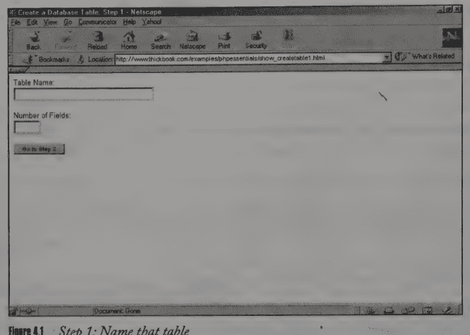

## 第二步：字段定义

在第 1 步中，你创建了变量来存储表名 (`$table_name`) 和你想放在表中的字段数量 (`$num_fields`)。在这一步中，你将创建一个 PHP 脚本来显示进一步定义字段所需的额外表单元素。开始，打开你喜欢的文本编辑器并创建一个名为 `do_showfielddef.php` 的文件。

在脚本执行其他操作之前，你可能想要检查第 1 步表单中是否真的输入了值。设置一个查找这些值的语句，如果它们不存在，则将用户重定向到第 1 步的表单：

```php
<?php
if (!$table_name) || (!($num_fields)) {
    header("Location: http://www.yourserver.com/show_creatable1.html");
    exit;
}
?>
```

接下来，在 if 语句之后添加 HTML “外壳”：

```html
<!DOCTYPE HTML PUBLIC "-//W3C//DTD HTML 3.2//EN">
<HTML>
<HEAD>
<TITLE>创建数据库表：第 2 </TITLE>
</HEAD>
<BODY>
<!-- HTML form将放在这里 -->
</BODY>
</HTML>
```

```php
<?php
if (!$table_name) || (!$num_fields)) {
    header("Location: http://www.yourserver.com/show_createtable.html");
    exit;
}
?>
<!DOCTYPE HTML PUBLIC "-//W3C//DTD HTML 3.2//EN">
<HTML>
<HEAD>
<TITLE>创建数据库表：第 2 步</TITLE>
</HEAD>
<BODY>
<h1>为 <?php echo $table_name; ?> 定义字段</h1>
<FORM method="POST" action="do_createtable.php">
<INPUT type="hidden" name="table_name" value="<?php echo $table_name; ?>">
<table cellspacing="5">
<tr
<th>字段名称</th><th>字段类型</th><th>字段长度</th>
</tr>
<?php
for ($i = 0; $i < $num_fields; $i++) {
    echo "
<tr>
<td align="center">
<input type="text" name="field_name[]" size="30">
</td>
<td align="center">
<select name="field_type[]">
<option value="float">float</option>
<option value="int">int</option>
<option value="text">text</option>
<option value="varchar">varchar</option>
</select>
</td>
<td align="center"></td>
</tr>
";
}
?>
</table>
</FORM>
</BODY>
</HTML>
```

### 创建数据库表

```html
<input type="text" name="field_length[]" size="5">
</td>
</tr>
?>
<tr>
<td align="center" colspan=3">
<INPUT type="submit" value="创建表">
</td>
</tr>
</table>
</FORM>
</BODY>
</HTML
```

将此文件放置在你的 Web 服务器上，返回访问第 1 步表单的 URL：`http://www.yourserver.com/show_createtable1.html`。为表名输入 `MY_PRODUCTS`，字段数量输入 `4`。在你的浏览器窗口中，你现在将看到图 4.2 所示的内容。

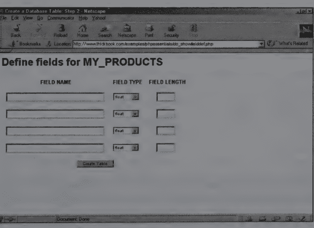

### 为 MY_PRODUCTS 定义字段

| 字段名称 | 字段类型 | 字段长度 |
|---|---|---|
| Real | | |
| Real | | |
| Real | | |
| Real | | |

图 4.2 第 2 步：字段定义表

## 第 3 步：连接 MySQL 并创建表

```html
<!DOCTYPE HTML PUBLIC "-//W3C//DTD HTML 3.2//EN">
<HTML>
<HEAD>
<TITLE>创建数据库表：第 3 步</TITLE>
</HEAD>
<BODY>
<!--你的 HTML 表单将在这里 -->
</BODY>
</HTML>
```

为页面添加一个标题，以便知道你正在操作什么：

```html
<h1>正在添加表 <?php echo $table_name; ?></h1>
```

下部分 PHP 代码将构建发送到 MySQL 的 SQL 语句。记住，CREATE 的语法是：

```sql
CREATE TABLE [table name] ([field_name field_data_type,...]) [options])
```

将 SQL 语句存储在名为 `$sql` 的变量中，并初始为该变量填充 CREATE 语句的第一部分加上 `$table_name` 的值：

```php
$sql = "CREATE TABLE $table_name ("
```

现在创建一个循环来填充 SQL 语句的剩余部分。该循环的的次数取决于你想向表中添加的字段数量，或者你在第 2 步中定义的字段数量。由于每个字段定义都存放在一个数组中，因此你可以通过计算 `$field_name` 数组中的元素数量来获取循环运行次数：

```php
for ($i = 0; $i < count($field_name); $i++) {
// 此处编写更多代码
}
```

对于每个新字段，你需要使用以下语法向 SQL 语句中添加字段名、类型和长度：

```text
field_name_field_type (field_length)
```

| 必须用逗号分隔多个字段定义。


在循环内部，添加此语句以开始向 `$sql` 变量添加值：

```php
$sql .= "$field_name[$i] $field_type[$i];";
```

在添加字段长度之前，检查是否指定了长度，将其添加到 `$sql` 变量，然后结束循环：

```php
if ($field_length[$i] != "*") {
  $sql .= "($field_length[$i]);";
} else {
  $sql .= ",";
}
```

此 `if_else` 语句会查找 `$field_length` 的值，如果找到则将其打印在括号内。它添加一个逗号将该值与下一个等待添加的字段隔开。如果没有找到值，则在 SQL 语句中添加逗号。

整个循环看起来应该是这样：

```php
for ($i = 0; $i < count($field_name); $i++) {
  $sql .= "$field_name[$i] $field_type[$i];";
  if ($field_length[$i] != "*") {
    $sql .= "($field_length[$i]);";
  } else {
    $sql .= ",";
  }
}
```

然而，SQL 语句还有一些工作需要完成：它末尾有一个多余的逗号，且括号尚未关闭。为了去掉末尾的多余逗号，使用 `substr()` 函数只返回字符串的一部分。在这种情况下，你将返回整个字符串但排除最后一个字符：

```php
$sql = substr($sql, 0, -1);
```


参数列表中的 `0` 告诉函数从第一个字符开始，`-1` 则停止到倒数第二个字符。

SQL 语句创建的最后一步是关闭括号：

```php
$sql .= ")";
```

现在使用本章描述的基础连接代码通过你的建表 SQL 语句查询 MySQL 数据库：

```php
// 创建连接
// 替换用户名和密码
$connection = mysql_connect("localhost", "username", "password");
```

```php
// 选择数据库
// 替换为数据库名
$db = mysql_select_db("database_name", $connection);
```

```php
// 执行查询
$sql_result = mysql_query($sql, $connection);
```

添加一个 `if_else` 语句来打印验证信息，显示查询已执行：

```php
if ($sql_result) {
    echo "表创建成功！";
} else {
    echo "创建表出错。";
}
```

# 第 4 章：创建和填充数据库表

```html
<tr>
<td valign="top"><<strong>项目描述</strong></></td>
<td valign="top"><textarea name="item_desc" cols="30" rows="5"></textarea></td>
</tr>
<tr>
<td valign="top"><<strong>项目价格：</strong>></td>
<td valign="top">$ <input type="text" name="item_price" size="10"></td>
</tr>
```

最后，添加“添加记录”按钮：

```html
<tr>
<td align="center" colspan="2"><input type="submit" value="Add Record"></td>
</tr>
```

别忘记结束 `</FORM>` 和 `</TABLE>` 标签！

你的 HTML 源代码看起来应该像这样：

```html
<!DOCTYPE HTML PUBLIC "-//W3C//DTD HTML 3.2//EN">
<HTML>
<HEAD>
<TITLE>添加记录</TITLE>
</HEAD>
<body>
<h1>向 MY_PRODUCTS 添加记录</h1>
<form method="POST" action="do_addrecord.php">
<table cellspacing="5" cellpadding="5">
<tr>
<td valign="top"><<strong>项目 ID：</strong>></td>
<td valign="top"><input type="text" name="item_id" size="5" maxlength="5"></td>
</tr>
<tr>
<td valign="top"><<strong>项目标题：</strong>></td>
<td valign="top"><input type="text" name="item_title" size="30" maxlength="50"></td>
</tr>
<tr>
<td valign="top"><<strong>项目描述：</strong>></td>
<td valign="top"><textarea name="item_desc" cols="30" rows="5"></textarea></td>
</tr>
<tr>
<td valign="top"><<strong>项目价格：</strong>></td>
<td valign="top">$ <input type="text" name="item_price" size="10"></td>
</tr>
<tr>
<td align="center" colspan="2"><input type="submit" value="Add Record"></td>
</tr>
</table>
</form>
</body>
</html
```

将此文件放置在你的 Web 服务器上，并在浏览器中使用其 URL `http://www.yourserver.com/show_addrecord.html` 访问。在浏览器窗口中，你现在将看到类似于图 4.5 所示的内容。

接下来，你将创建一个 PHP 脚本，该脚本将获取表单输入，创建一个正确的 SQL 语句，创建记录，并将记录显示给你作为确认。这听起来并没有那么困难。由于 `show_addrecord.html` 中的表单 `action` 是 `do_addrecord.php`，请打开你喜爱的文本编辑器并创建一个 `do_addrecord.php` 的文件。

在脚本执行任何其他操作之前，你可能想要检查表单中是否真的输入了值。设置一个查找这些值的语句。如果它们不存在，则将用户重定向到表单：

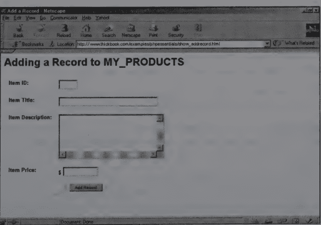

图 4.5 添加记录的表单

```php
<?php
if (!$item_id) || (!$item_title) || (!$item_desc) || (!$item_price) {
    header("Location: http://www.yourserver.com/show_addrecord.html");
    exit;
}
?>
```

接下来，在 `if` 语句之后添加 HTML “外壳”：

```html
<!DOCTYPE HTML PUBLIC "//W3C//DTD HTML 3.2//EN">
<HTML>
<HEAD>
<TITLE>添加记录</TITLE>
</HEAD>
<BODY
<!-- 你的 HTML 表单将在这里 -->
</BODY>
</HTML
```

给出页面标题以便知道你在做什么：

<h1>向 MY_PRODUCTS 添加记录</h1>

接下来的 PHP 代码将构建发送到 MySQL 的 SQL 语句。记住，`INSERT` 的语法是：

`INSERT INTO [表名] (列1) VALUES ('值1');`

当你初始化 `MY_PRODUCTS` 表时，字段顺序是 `ITEM_ID`, `ITEM_TITLE`, `ITEM_DESC` 和 `ITEM_PRICE`。在 `INSERT` 语句中使用相同的顺序。创建一个名为 `$sql` 的变量保存 SQL 语句，并使用表单中的变量构建 `VALUES` 列表：

```php
$sql = "INSERT INTO MY_PRODUCTS (ITEM_ID, ITEM_TITLE, ITEM_DESC, ITEM_PRICE) VALUES ('$item_id', '$item_title', '$item_desc', '$item_price');";
```

现在使用本章之前描述的基础连接代码连接并查询 MySQL 数据库，使用你的记录语句：

```php
// 创建连接
// 替换为你自己的主机名、用户名和密码
$connection = mysql_connect("localhost","sandman","34Nhjp") or die("无法连接服务器.");
// 选择数据库
// 替换为你自己的数据库名
$db = mysql_select_db("secretDB", $connection) or die("无法选择数据库.");
// 执行 SQL 查询并获取结果
$sql_result = mysql_query($sql,$connection) or die("无法执行查询.");
// 添加 if-else 语句，在查询失败时打印警告，或者打印成功添加的记录完整文本：
```


```php
if (!$sql_result) {
    echo "<P>无法添加记录!</p>";
} else {
    echo "<P>记录已添加!</p>";
    echo "<table cellspacing='5' cellpadding='5'>
      <tr>
        <td valign='top'><<strong>项目 ID：</strong>>$item_id</td>
        <td valign='top'>$item_id</td>
      </tr>
      <tr>
        <td valign='top'><<strong>项目标题：</strong>>$item_title</td>
        <td valign='top'>$item_title</td>
      </tr>
      <tr>
        <td valign='top'><<strong>项目描述：</strong>>$item_desc</td>
        <td valign='top'>$item_desc</td>
      </tr>
      <tr>
        <td valign='top'><<strong>项目价格：</strong>>$item_price</td>
        <td valign='top'>$item_price</td>
      </tr>
    </table>>";
}
```

就这些了。你的源代码应该像这样：

```php
<?php
if (!$item_id) || (!$item_title) || (!$item_desc) || (!$item_price) {
    header("Location: http://www.yourserver.com/show_addrecord.html");
    exit;
}
?>
<!DOCTYPE HTML "-//W3C//DTD HTML 3.2//EN">
<HTML>
<HEAD>
<TITLE>添加记录</TITLE>
</HEAD>
<body
<h1>向 MY_PRODUCTS 添加记录</h1>
<?php
$sql = "INSERT INTO MY_PRODUCTS (ITEM_ID, ITEM_TITLE, ITEM_DESC, ITEM_PRICE) VALUES ('$item_id', '$item_title', '$item_desc', '$item_price');";

// 创建连接
// 替换为你自己的主机名、用户名和密码
$connection = mysql_connect("localhost","sandman","34Nhjp") or die("无法连接服务器.");

// 选择数据库
// 替换为你自己的数据库名
$db = mysql_select_db("secretDB", $connection) or die("无法选择数据库.");

// 执行 SQL 查询并获取结果
$sql_result = mysql_query($sql,$connection) or die("无法执行查询.");

if (!$sql_result) {
    echo "<P>无法添加记录!</P>";
} else {
    echo "<P>记录已添加!</p>
    <table cellspacing='5' cellpadding='5'>
      <tr>
        <td valign='top'><<strong>项目 ID：</strong>>$item_id</td>
        <td valign='top'>$item_id</td>
      </tr>
      <tr>
        <td valign='top'><<strong>项目标题：</strong>>$item_title</td>
        <td valign='top'>$item_title</td>
      </tr>
      <tr>
        <td valign='top'><<strong>项目描述：</strong>>$item_desc</td>
        <td valign='top'>$item_desc</td>
      </tr>
      <tr>
        <td valign='top'><<strong>项目价格：</strong>>$item_price</td>
        <td valign='top'>$item_price</td>
      </tr>
    </table>>";
}
?>
</body>
</html
```

将此文件放置在你的 Web 服务器上，回到 `http://www.your.com/show_addrecord.html` 的表单。创建一个如图 4.6 所示的示例产品。

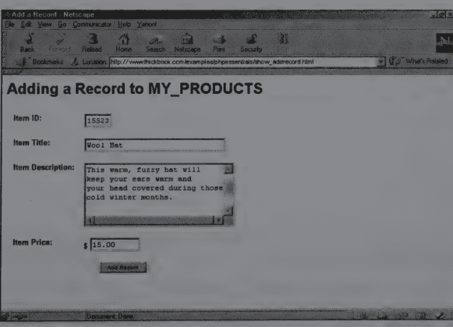

图 4.6 添加示例产品

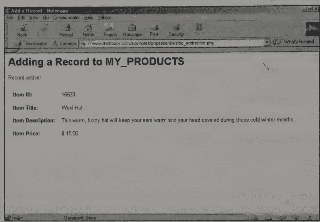

**图 4.7** 成功添加记录

# 第 4 章：创建和填充数据库表

```php
echo "<tr><th>项目 ID</th><th>项目标题</th><th>项目描述</th><th>项目价格</th></tr>";

// 按行格式化结果
while ($row = mysql_fetch_array($sql_result)) {
$item_id = $row['ITEM_ID'];
$item_title = $row['ITEM_TITLE'];
$item_desc = $row['ITEM_DESC'];
$item_price = $row['ITEM_PRICE'];
echo "<tr><td>$item_id</td><td>$item_title</td><td>$item_desc</td><td align='right'>$item_price</td></tr>";
}
echo "</table>";

// 释放资源并关闭连接
mysql_free_result($sql_result);
mysql_close($connection);
?>
```

图 4.8 到 4.10 显示了一些示例结果。你的查询结果将取决于你插入表中的产品而有所不同。

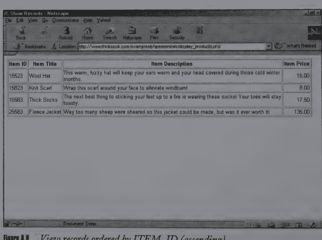

## 选择并显示数据

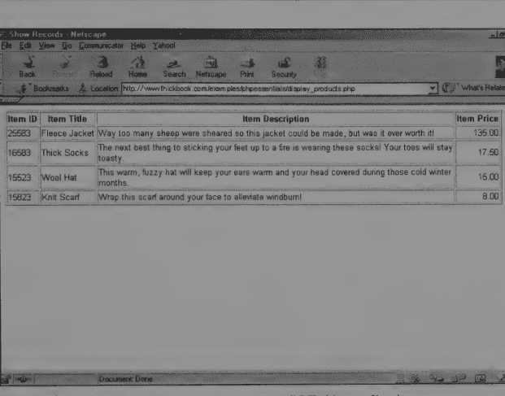

**图 4.9** 按 `ITEM_PRICE` 排序（降序）的记录

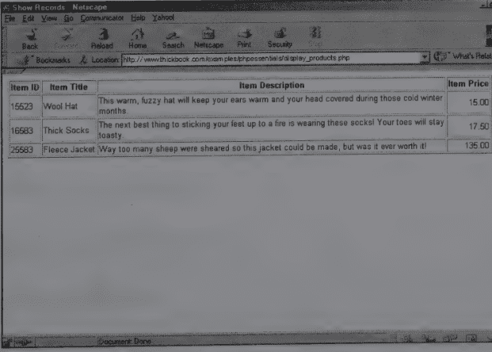

**图 4.10** 显示 `ITEM_PRICE` 大于 $10.00 的记录

本章为你提供了数据库连接、表和记录的创建以及记录显示的基础知识。第 7 章“高级 PHP 技术：基于 Web 的数据库管理”的一部分将致力于将这些过程推向更深层次。在那个章中，你将学习如何在创建自己的数据库管理系统的背景下插入、更新和删除记录。

# 第 5 章：用户认证

基础 HTTP 认证

数据库驱动身份验证

按 IP 地址限制


# 第 5 章：用户认证

认证方案验证用户是否有权限访问网站上的某些内容。在最初开发网站时，你可能希望限制仅允许你开发团队的某些成员访问。或者，如果你的公司网站包含敏感的财务数据，你可能希望将财务报表限制给特定的投资者列表。

Web 开发人员通常采用以下类型的用户认证之一，原因从易于安装和易于维护，到认证方案在整个应用程序开发中的工作方式不等：

- 基础 HTTP。这是最流行的认证类型。它使用 Web 服务器的内置函数来限制对文档和整个目录的访问。该方案的流行源于任何网站开发者（无论他是控制自己的服务器还是将网站托管在互联网服务提供商处）都有在其文档目录中使用基础 HTTP 认证。
- 数据库驱动。用户名和密码存储在数据库表中，并通过脚本访问。
- 按 IP 地址限制。访问被限制在特定的 IP 或 IP 范围内。

在本节中，你将学习如何在启用 PHP 的 Web 网站中使用各种形式的用户认证。

## 基础 HTTP 认证

HTTP 认证使用挑战/响应方案来验证用户。该过程从用户向 Web 服务器请求文件时开始。如果文件位于受保护区域内，服务器将返回 401（未经授权错误），浏览器会显示熟悉的用户名/密码对话框。用户随后输入用户名和密码并点击确定，将信息发送到服务器。如果凭据有效，服务器将允许访问；否则，用户将再次尝试。

使用基础 HTTP 认证需要两个元素：一个受保护的目录和一个包含用户名和密码的文件。

### 在 Apache 上配置 HTTP 认证


配置 HTTP 认证的第一步是创建一个包含用户名和密码的文件。你可以将其放在 `/local/apache/htdocs/` 的任何地方，最好位于根目录。

### 创建用户组文件

使用 Apache 分配的 `htpasswd` 程序创建 `/local/apache/users`：

1. 提示为 jane 添加密码：`htpasswd -c /local/apache/users jane`

2. 提示确认密码。

将用户分类到组会让你的工作变得简单得多因为你可以向整个组授予权限，而不是手动列出每个成员。手动创建 `/local/apache/groups`：

```
friends
jane
mary
```

在下一节中，你将学习如何配置 Apache 以允许组访问目录。

### 配置 Web 服务器

配置指令可以插入到 `httpd.conf` 文件（通常位于 `/local/apache/conf/`），也可以插入单独的 `.htaccess` 文件。例如：

- 如果使用 `.htaccess` 文件保护 `http://www.yourdomain.com/privatuff/`，将文件放在 `/local/apache/htdocs/privatuff/`。

- 如果使用 `httpd.conf` 保护 `http://www.yourdomain.com/privatuff/`，在 `httpd.conf` 中创建一个以 `<Directory /local/apache/htdocs/privatuff/>` 开头并 `</Directory>` 结尾的段。

多个 `.htaccess` 文件的缺点是你必须跟踪所有的文件！在 `httpd.conf` 文件中发布指令，所有指令都在一个固定的位置，更容易管理。无论你将指令放在 `.htaccess` 文件中还是 `httpd.conf` 的 `<Directory>` 段中，信息都是相同的：

- `AuthName`。受保护区域的名称或领域，例如“我的私密内容”或“Jane 的开发区域”。

- `AuthType`。使用的认证协议，通常是 Basic。也存在 Digest 认证，用户名和密码在浏览器和服务器之间传输时会被加密。Digest 认证某些旧版浏览器不支持，因此限制了其在应用中的使用。

- `UserFile`。包含用户名和密码的文件完整路径。

- `AuthGroupFile`。组列表文件的完整路径（如果有）。

- `require`。指定哪些用户和组有权访问受保护区域。例如 `valid-users`、仅 `jane`、仅 `friends` 组或组合。

示例指令集如下：

```
AuthName "My Private Stuff"
AuthType Basic
```

### AuthGroup /usr/local/apache/groups

require friends

在这个示例中，任何访问“privatestuff”目录的用户都会遇到用户名/密码对话框。如果用户是 `friends` 组的成员并输入了正确的用户名和密码，则会显示受保护的信息。

然而，想象一下对于一个访问量远多于你的网站来说，需要大量的服务器处理。随着用户群的增加和 Web 服务器性能的开始下降，请考虑将用户名和密码移动到单独的数据库表中（Web 服务器解析它的速度比简单的文本文件更快），并创建你自己的验证系统。

### 使用 PHP 身份验证变量

自定义的 PHP 脚本可以通过设置 HTTP 请求头来自动显示用户名/密码对话框，从而模拟 HTTP 验证挑战/响应系统。PHP 将对话框中输入的信息存储在三个变量中（`$PHP_AUTH_USER`、`$PHP_AUTH_PW` 和 `$PHP_AUTH_TYPE`），这些变量可以用于验证输入。

> PHP 中的 HTTP 验证变量仅在 PHP 作为模块安装时才可用。如果安装的是 CGI 版本的 PHP，你将限于普通的基于 `.htaccess` 的验证，或使用 HTML 表单输入用户名和密码的数据库驱动验证。


为了熟悉如何通过 `header()` 函数发送授权，首先创建一个 PHP 脚本，它在不验证用户名/密码对的情况下弹出用户名/密码对话框。

以下代码检查 `$PHP_AUTH_USER` 是否存在值，如果不存在，则显示用户名/密码对话框并退出脚本：

```php
<?php //authorizel.php
// 检查 $PHP_AUTH_USER 是否已经包含信息
if (!isset($_PHP_AUTH_USER)) {
// 如果为空，发送请求头导致对话框出现
    header('WWW-Authenticate: Basic realm="My Private Stuff"');
    header('HTTP/1.0 401 Unauthorized');
}
echo 'Authorization Required.';
```

```php
exit;

// 如果不为空，显示变量的值
else {
    echo "<p>你输入的用户名是: $PHP_AUTH_USER<br>*";
    echo "你输入的密码是: $PHP_AUTH_PW<br>*";
    echo "验证类型是: $PHP_AUTH_TYPE</p>*";
}
?>
```

在这种情况下，如果存在任何值，脚本假设用户名和密码是有效的，并按照 `else` 语句中的指示返回三个 PHP 验证变量的值。此示例没有执行任何验证，因为脚本没有将这些值与允许用户的主列表进行比对。

`header()` 函数是此脚本的关键；HTTP 头是脚本向浏览器的第一个输出。当用户在对话框中输入用户名和密码并点击 OK 时，页面刷新并向服务器发送另一个 HTTP 头，这次带有填充好的变量。

由于 `$PHP_AUTH_USER` 现在包含了一个值，如果语句返回 false，脚本将跳到 `else` 语句，该语句包含将变量信息打印到屏幕上的代码。

现在你已经知道如何创建对话框，编写一些代码来验证这些值。最简单的方法是在脚本中硬编码允许的值：

```php
<?php
// authorize2.php
// 检查 $PHP_AUTH_USER 是否已经包含信息
if (!isset($PHP_AUTH_USER)) {
    // 如果为空，发送请求头调用对话框出现
    header('WWW-Authenticate: Basic realm="My Private Stuff"');
    header('HTTP/1.0 401 Unauthorized');
    echo 'Authorization Required.';
    exit;
}
// 如果不为空，执行其他操作
else {
    // 尝试根据硬编码的值验证 $PHP_AUTH_USER 和
    // $PHP_AUTH_PW 的值
    if (($PHP_AUTH_USER == "jane" && $PHP_AUTH_PW == "password") {
        echo "<p>你输入的用户名是: $PHP_AUTH_USER<br>*";
    }
```

```php
echo "你输入的密码是: $PHP_AUTH_PW<br>"
echo "验证类型是: $PHP_AUTH_TYPE</p>"

else (
echo "你没有权限！";
)
?>
```

但谁想把所有有效的用户名和密码都硬编码到他们的验证脚本中呢？这是一项极其量的工作。此外，如果你将验证程序贯穿于许多页面，那么每个页面都必须包含整个列表。如果你必须对列表进行更改，你必须在包含列表的每一个页面上进行更改。更好的做法只维护一个验证程序，由它访问包含所有用户名和密码的数据库。

## 数据库驱动验证

验证数据库可以减少对额外 Web 服务器配置的需求，并提高服务器响应速度。使用 PHP 验证变量，你仍然可以使用熟悉的用户名/密码对话框。或者，创建一个简短的 HTML 登录表单来请求用户名和密码。无论你选择哪种方法，你将拥有一个持有用户名和密码信息的用户表。

你的表可以根据你的意愿变得简单或复杂。对于以下示例，我在 MySQL 数据库中创建了一个四字段的 `users` 表。这些字段是 `id`、`real_name`、`username` 和 `password`。

> 你可以使用任何数据库类型来创建和访问用户表。参见第 3 章，


### 使用 PHP 变量验证用户

| id | real_name | username | password |

|---|---|---|---|

| 1 | Jane Smith | jane | password |

| 2 | Mary Smith | mary | pass |

| 3 | John Smith | john | op |

| 4 | Sandman | sandman | secret |

`authorize3.php` 的目标是显示用户名/密码对话框，接受值，打开数据库，验证值。


```php
<?php
// 检查 $PHP_AUTH_USER 是否已经包含信息
if (!isset($_PHP_AUTH_USER)) {
    // 如果为空，发送请求头导致对话框出现
    header('WWW-Authenticate: Basic realm="My Private Stuff"');
    header('HTTP/1.0 401 Unauthorized');
    echo 'Authorization Required.';
    exit;
}
else {
    // 如果不为空，执行其他操作
    // 打开数据库连接
    mysql_connect("localhost", "sandman")
    or die("无法连接数据库。");
    mysql_select_db("secret")
    or die("无法选择数据库。");
    // 构造查询
    $sql = "SELECT id, real_name, username, password FROM users WHERE username='$PHP_AUTH_USER' AND password='$PHP_AUTH_PW'";
    // 执行查询并将结果放入 $result
    $result = mysql_query($sql)
    or die("获取结果失败。");
    // 获取 $result 中的行数
    $num = mysql_numrows($result)
    or die("获取计数失败。");

    // 根据有效性展示结果
    if ($num == 1) {
        echo "<P>你是有效用户！<br>";
        echo "你的用户名是 $PHP_AUTH_USER<br>";
        echo "你的密码是 $PHP_AUTH_PW</p>";
    }
    else if ($num == 0) {
        echo "你没有权限！";
    }
}
?>
```

### 使用 HTML 表单验证用户

与其发送 HTTP 授权请求头并显示用户名/密码对话框，不如创建一个简单的表单来请求用户名和密码：

```html
<!-- 将此文件命名为 login.html -->
<HTML>
<HEAD>
<TITLE>我的登录表单</TITLE>
</HEAD>
<!-- 配置表单 -->
<FORM ACTION="login.php" METHOD="post">
<!-- 在表格中创建表单字段 -->
<table border=0>
```

```html
<<table>
  <tr>
    <td><strong>用户名</strong></td>
    <td><input type="text" name="username" size="10" maxsize="10"></td>
  </tr>
  <tr>
    <td><strong>密码</strong></td>
    <td><input type="password" name="password" size="10" maxsize="10"></td>
  </tr>
  <tr>
    <td colspan="2" align="center">
      <input type="submit" value="验证我">
    </td>
  </tr>
</table>
</form>
<body>
```

当用户在表单字段中输入键值并点击“验证我（Validate Me）”按钮时，这些值会被发送到 `login.php` 脚本。该脚本必须持有这些值、连接到数据库、验证用户并显示适当的信息。从本质上说，与本章较早使用的 `authorize3.php` 脚本相比，只有几个变量名会发生变化。我们不再将用户名和密码存储在 `$PHP_AUTH_USER` 和 `$PHP_AUTH_PW` 中，而是按照字段名称将值存储在 `$username` 和 `$password` 中。

```php
//login.php
// 当提交表单时，PHP会自动将值赋值给
// 与表单字段名称相同的变量。在这种情况下，$username
// 和 $password 已经创建并可供我们使用。
// 连接数据库
mysql_connect("localhost","sandman","34NhJP")
or die("无法连接到数据库。");
mysql_select_db("secretDB")
or die("无法选择数据库。");
// 构建查询
$sql = "SELECT id
FROM users
WHERE username='$username' and password='$password'";
```

// 执行查询并将结果放入 `$result`

## 数据库驱动的认证

```php
$result = mysql_query($sql) or die("无法获取结果。");
```

```php
// 获取 $result 中的行数。如果无效则为 0，有效则为 1。
$num = mysql_numrows($result) or die("无法获取计数。");
```

```php
// 根据有效性显示结果。
if ($num > 0) {
    echo "<P>你是一个有效用户!<br>";
    echo "你的用户名是 $username<br>";
    echo "你的密码是 $password</P>";
} else if ($num == 0) {
    echo "你未获得授权！";
}
?>
```

为了进一步推进这一过程，你可以使用 `include()` 函数将 HTML 表单和 PHP 脚本合并到一个文件中。通过告诉脚本何时包含包含登录表单的文件，当用户输入无效条目（或完全未输入）时，你可以再次显示表单，而无需离开此脚本。

首先，创建一个名为 `login_form.inc` 的文件，包含以下代码：

```html
<!-- 配置表单 -->
<form ACTION="login2.php?do=authenticate" METHOD="post">
<!-- 在漂亮的表格中创建表单字段 -->
<table border="0">
  <tr>
    <td><strong>用户名</strong></td>
    <td><input type="text" name="username" size="10" maxlength="10"></td>
  </tr>
  <tr>
    <td><strong>密码</strong></td>
    <td><input type="password" name="password" size="10" maxlength="10"></td>
  </tr>
  <tr>
    <td colspan="2" align="center">
      <input type="submit" value="验证我">
    </td>
  </tr>
</table>
</form>
```

这段代码仅仅是显示表单字段的 HTML 片段。周围的 HTML 将存在于 `login2.php` 文件中，因为你可以在同一个文件中交织 HTML 和 PHP 代码。


```php
<!-- 调用此文件 login2.php -->
<!-- 文件像普通 HTML 文件一样开始 -->
<HTML>
<HEAD>
<TITLE>登录表单</TITLE>
</HEAD>
<!-- 现在开始我们的 PHP 代码 -->
<?php
// 根据变量 $do 的值继续处理。
// 如果是第一次访问此脚本，$do 变量没有值。

switch ($do) {
    // 如果 $do 的值为 "authenticate"，继续此过程
    case "authenticate":
        // 当提交表单时，PHP会自动将值赋值给
        // 与表单字段名称相同的变量。在这种情况下，$username
        // 和 $password 已经透明地创建完成。

        // 连接数据库
        mysql_connect("localhost","sandman","34NhJP")
        or die("无法连接到数据库。");
        mysql_select_db("secretDB")
        or die("无法选择数据库。");

        // 构建查询
        $sql = "SELECT id
               FROM users
               WHERE username='$username' and password='$password'";

        // 执行查询并将结果放入 $result
        $result = mysql_query($sql) or die("无法获取结果。");

        // 获取 $result 中的行数。如果无效则为 0，有效则为 1。
        $num = mysql_numrows($result) or die("无法获取计数。");
        // 根据有效性显示结果。
        if ($num == 1) {
            echo "<P>你是一个有效用户!<br>";
            echo "你的用户名是 $username<br>";
            echo "你的密码是 $password</P>";
        } else if ($num == 0) {
            echo "你未获得授权！";
        }
        }
    default:
        // 处理其他情况
        break;
}
?>
</HTML>
```

# 第6 章：用户跟踪与会话管理

如果没有一些干预，你无法有效地跟踪网站的访客。每台 Web 服务器都会跟踪基本的访问，这意味着对于每一次“点击（hit）”，它都会记录最新的日期和时间、发出请求的用户 IP 或域名名，以及发送的文件名。当你想要跟踪购买趋势或用户偏好时，这种日志并无帮助，而且无法让你对自己的用户群体产生任何真实的洞察。解决这个问题的方案需要明确的规划，但实施很容易——使用 Cookie！

然而， Cookie 存储的元素数量是有限制的，有些人无法或不想接受它们。你可以通过 PHP4 中的会话管理功能采取替代措施。在本章中，你将学习如何开发一个结合 Cookie 和 Session 管理用户信息的系统。

## Cookie

Cookie 是小段文本，会随着优秀网站精美的图片和措辞良好的内容发送到用户的浏览器。它们可以帮助你创建购物车、用户社区和个性化网站。假设你计划为用户分配一个标识变量，以便跟踪他在访问你的网站时的行为。首先，用户登录，你发送一个包含变量的 Cookie，这些变量意为“这是 Joe，Joe 被允许留在这里”。当 Joe 在你的网站上闲逛时，你可以在每一个页面都显示“你好，Joe！”如果 Joe 点击了你的目录并选择了 14 件不同的物品进行购买，你可以跟踪这些物品，并在 Joe 点击“结账”时将它们全部显示出来。但如果用户不接受 Cookie 会发生什么？你周密的计划会付诸东流吗？Joe 还能买到那 14 件物品吗？

这类标识 Cookie 在电子商务网站非常有价值，在这些网站中，你创建一个购物系统，允许用户存储所选物品直到准备好付款。你可以将 Cookie 用于各种事情，但因为电子商务网站非常流行，我们将采用这个例子。

### 设置 Cookie

在设置 Cookie 之前，先确定你将如何使用它们以及在何何时设置它们。你是否想在网站的每个页面都检查 Cookie，如果不存在则设置一个？你将如何使用 Cookie 数据？无论你决定使用哪种 Cookie，请记住，在向浏览器发送任何其他内容之前，你必须设置 Cookie。如果你记住这一点，就不用花几个小时去思考为什么会收到“Can't send additional information, header already sent（无法发送额外信息，头部已发送）”的错误了！

在这个示例中，假设你正在建立一家在线咖啡店。显然，你买不到三倍份超级大拿铁，但你可以订购咖啡豆。当我构建电子商务网站时，我通常会在网站的每个页面检查并设置 Cookie，因为我通常会在每个页面上显示购物车图标和用户购物车中的物品数量。不过，这只是我个人的偏好，它确实需要每个页面都由 PHP 引擎解析。

假设我们的在线咖啡店在每个页面都检查 Cookie。当用户首次访问网站上的任何页面时，他会被分配一个随机值作为他的用户标识码。从那时起，用户就持有一个有效的 Cookie。每个页面开头的 PHP 代码会检查 Cookie，并仅在不存在 Cookie 时发送一个。这种方法可以防止 Cookie 值被覆盖。网站中的每个页面开头都像如下所示：

```php
<?php
// 如果尚未设置，则设置 cookie
if (isset($id)) {
  rand((double)microtime() * 1000000);
  $randval = rand();
  setcookie("id",$randval,time()+14400."./","mycoffeeshop.com",0);
}
?>
```

你说，这些都很好，但这一切意味着什么？`if` 语句后的前两行使用随机数生成器并产生一个用于 ID 的值。这个随机数通常类似于 1404291115 的数字。

接下来，我们设置 Cookie：

```php
setcookie("id",$randval,time()+14400."./","mycoffeeshop.com",0);
```

这里是 PHP 中 `setcookie()` 函数的语法：

`setcookie("name", "value", "expiration", "path", "domain", "security");`

- Name（名称）。名称参数持有存储在全局变量 `HTTP_COOKIE_vars` 中的变量名，并可以在后续脚本中访问。
- Value（值）。值参数是传递给 name 参数变量的值。
- Expiration（过期时间）。过期参数设置了 Cookie 不再可访问的特定时间。没有特定过期时间的 Cookie 将随当前用户会话过期（当浏览器关闭时）。
- Path（路径）。路径参数决定了 Cookie 对哪些目录有效。如果路径参数中是单斜杠 `/`，则该 Cookie 对 Web 服务器上的所有文件和目录都有效。如果指定了特定目录，则该 Cookie 仅对目录内的页面有效。
- Domain（域名）。Cookie 对特定域名有效。
- Security（安全）。安全参数指示 Cookie 是否应仅通过 HTTPS 发送。

从时间上来说，会话（session）是指用户访问网站期间。在编程世界中，会话就像一个巨大的数据包（blob），其中包含了各种变量和值。这个数据包也被称为会话对象（session object），它有一个标识字符串。这个标识字符串（例如 `940f8b05a40d5119c030c9c7745aad9`）会在会话启动时，通过一个名为 `PHESSID` 的 cookie 自动发送给用户。在服务器端，会创建一个名为 `name-940f8b05a40d5119c030c9c7745aad9` 的匹配临时文件。

### 理解会话变量

每个会话对象都注册了自己的变量，例如 `count` 或 `valid`。在服务器的会话文件中，注册的变量及其值被完妥地保存着。由于这些值和变量没有存储在数据库中，因此不需要额外的系统资源来连接和从数据库表中提取信息。

例如，会话文件可能看起来如下：

```
count|s:7:"76"
valid|s:7:"yes"
```

其中 `count` 和 `valid` 是注册变量名，而 `"76"` 和 `"yes"` 是它们对应的值。

当你注册一个会话变量时，就不再需要向用户发送额外的 cookie。要在不使用会话的情况下为用户给 `count` 和 `valid` 赋值，你必须发送两个独立的 cookie，如下：


```
setcookie("count","1",time()+14400,"//","yourdomain.com",0);
setcookie("valid","yes",time()+14400,"/","yourdomain.com",0);
```

要访问会话变量，只需调用变量名，例如 `$count` 或 `$valid`。当你编写类似下面的代码时，PHP 会执行“魔术”：

```
echo "<$count</p>";
```

PHP 引擎获取 `$PHPESSID` 的值（存储在 cookie 中的唯一用户会话 ID），将其匹配到对应的临时会话文件，查找 `count`，找到它的值（假设为 "76"），并将其返回给你：

```
<p>76</p>
```

发送给用户的唯一 cookie 是持有 `$PHPESSID` 值的 cookie。


如果问题是“如何在不设置多个 cookie 和频繁调用数据库的情况下维护用户特定信息？”，那么答案是使用 PHP4 中的会话管理函数。

## 启动会话并注册变量

我们将使用一个简单的访问计数器来熟悉会话和会话变量的概念。在页面的开始，调用 `session_start()` 函数。该函数有两个作用：第一，它检查该用户是否已启动会话；第二，它通知 PHP 引擎将在特定脚本内使用会话变量和其他会话相关的函数。

打开你喜喜欢的文本编辑器，创建一个名为 `count_me.php` 的文件并输入以下内容：

```php
<?php
// count_me.php
// 如果该用户不存在会话，则启动一个
session_start();
?>
```

接下来，在你的会话对象内部注册 `count` 变量：

`session_register('count');`

现在，只要这个会话存在，名为 `count` 的变量就存在。目前，该变量没有值。然而，如果你递增它，它的值将变为 "1"：

`$count++;`

将这些部分组合在一起，你就完成了以下操作：如果会话尚未启动则启动它；如果用户没有会话 ID 则为其分配一个会话 ID；注册名为 `count` 的变量并将其加 1，以表示用户首次访问页面的次数。

接下来，要显示 `$count` 会话变量的值并向用户展示他在当前会话中访问此面的次数，只需打印 `$count` 的值：

`echo "<P>You've been here $count times. Thanks!</p>"`

整个访问计数代码应该像这样：

```php
<?php
// count_me.php
// 如果该用户不存在会话，则启动一个
session_start();
session_register('count');
$count++;
echo "<P>You've been here $count times. Thanks!</p>"
?>
```

多次刷新页面，观察 `$count` 的值每次如何加 1。

## 使用会话管理用户偏好

除了简单的访问计数器之外，你还可以使用会话在用户访问网站时管理他们的偏好。例如，你可以让用户选择背景颜色、文本颜色以及显示网站内容的喜好字体。在这个三步示例中，你将启动一个会话，询问用户的显示偏好，在随后的页面中显示这些偏好，并允许用户更改主意并重置值。

第一步，创建一个名为 `session1.php` 的文件。在这一步中，如果会话不存在则启动并注册我们稍后使用的变量：`$body_color`、`$text_color` 和 `$font_family`：

```php
// 文件名：session1.php
// 如果该用户尚不存在会话，则启动一个
session_start();
if (!$PHPPSESSID) {
    session_register('body_color');
    session_register('text_color');
    session_register('font_family');
} else if ($body_color || $text_color) {
    __register('body_color');
    session_register('text_color');
    session_register('font_family');
}
?>
```

在这个示例中，`if-else` 循环非常重要。它只在 `$PHPPSESSID` 值不存在，或者 `$body_color`、`$text_color` 和 `$font_family` 未被创建或注册时才注册会话。由于用户将返回此会话显示他们的偏好，我们必须考虑到变量的值必须从会话中提取。如果我们只说：

```php
session_start();
session_register('body_color');
session_register('text_color');
session_register('font_family');
```

### 第 6 章：用户跟踪与会话管理

在页面顶部，每当页面加载时，这些变量的值都会被覆盖为空或新注册的值。接下来，创建一个简单的 HTML 表单，让用户选择他的偏好：

```html
<html>
<head>
<title>我的显示偏好</title>
<style>
P {font-family:Arial;font-size:10pt;font-weight:normal;}
H1 {font-family:Arial;font-size:16pt;font-weight:bold;}
</style>
</head>
<body BGCOLOR="#FFFFFF" TEXT="#000000">
<h1>设置偏好</h1>
<form method="POST" action="session2.php">
<p>选择背景颜色：<br>
<input type="radio" name="sel_body_color" value="#FFFFFF" checked></p>
<p>选择文本颜色：<br>
<input type="radio" name="sel_text_color" value="#000000" checked></p>
<p>选择字体：<br>
<input type="radio" name="sel_font_family" value="Arial" checked></p>
<p><input type="submit" name="submit" value="设置偏好"></p>
</form>
</body>
</html>
```

### PHP4 会话处理

等等！由于用户以后会返回此页面修改偏好，你还希望使用他的偏好来显示此页面。在 `<HTML>` 标签之前，添加以下代码来确定用户的偏好颜色，或者在尚未设置时定义默认值：

```php
if (!$body_color) {
    $body_color = "#FFFFFF";
}
if (!$text_color) {
    $text_color = "#00000";
}
if (!$font_family) {
    $font_family = "Arial";
}
```

如果这是用户第一次访问此页面，会话变量 `$body_color`、`$text_color` 和 `$font_family` 将被注册，但因为我们还没有给它们赋值。由于我们需要在第一个屏幕上显示某些颜色和字体，我们通过这些语句分配临时值。

为了让你的代码动态化，将原始的样式表代码替换为以下代码：

```css
<style type="text/css">
P {font-family:<?php echo $font_family; ?>;font-size:10pt;font-weight:normal;}
H1 {font-family:<?php echo $font_family; ?>;font-size:16pt;font-weight:bold;}
</style>
```

同时，将原始的 HTML BODY 标签替换为以下代码：

```html
<body BGCOLOR="<?php echo $body_color; ?>" TEXT="<?php echo $text_color; ?>">
```

你的代码应该像这样：

```php
<?php
// 文件名：session1.php
// 如果该用户不存在会话，则启动一个
session_start();

if (!$PHPPSESSID) {
    session_register('body_color');
    session_register('text_color');
    session_register('font_family');
}
?>
```

# 160 第6章：用户跟踪与会话管理


```php
} else if ((($body_color) || (!$text_color)) || (!$font_family)) {
    session_register('body_color');
    session_register('text_color');
    session_register('font_family');
}
```

```php
if ($body_color) {
  $body_color = "#FFFFFF";
}
if (!$text_color) {
  $text_color = "#000000";
}
if (!$font_family) {
  $font_family = "Arial";
}
```

```html
<HTML>
<TITLE>我的显示偏好</TITLE>
<style type="text/css">
P {font-family:<?php echo $font_family; ?>;font-size:10pt;font-weight:normal;}
H1 {font-family:<?php echo $font_family; ?>;font-size:16pt;font-weight:bold;}
</style>
</head>
```

```html
<BODY BCOLOR="<?php echo $body_color; ?>" TEXT="<?php echo $text_color; ?>">
<h1>设置您的颜色和字体偏好</h1>
<FORM METHOD="POST" ACTION="session2.php">
<p>选择背景颜色：<br>
<input type="radio" name="sel_body_color" value="#FFFFFF">白色
<input type="radio" name="sel_body_color" value="#000000">黑色
<input type="radio" name="sel_body_color" value="#0000FF">蓝色
<input type="radio" name="sel_body_color" value="#FF0000">红色
<input type="radio" name="sel_body_color" value="#FFFF00">黄色
</p>
```

```html
<p>选择文本颜色：<br>
<input type="radio" name="sel_text_color" value="#FFFFFF">白色
<input type="radio" name="sel_text_color" value="#000000">黑色
```

# PHP4 会话处理 16

```html
<input type="radio" name="sel_text_color" value="#0000FF">蓝色
<input type="radio" name="sel_text_color" value="#FF0000">红色
<input type="radio" name="sel_text_color" value="#FFFF00">黄色
</p>
```

```html
<P>选择字体：<br>
<input type="radio" name="sel_font_family" value="Arial">Arial
<input type="radio" name="sel_font_family" value="Times">Times
<input type="radio" name="sel_font_family" value="Courier">Courier
</p>
```

```html
<P><Input type="submit" name="submit" value="设置显示偏好"></p>
```

```html
</FORM>
</BODY>
</html>
```

在下一步中，即表单操作（`session2.php`）中，我们将分配用户选择的会话变量。打开你的文本编辑器并创建一个名为 `session2.php` 的文件。在代码中，如果会话不存在则创建一个，并注册 `$body_color`、`$text_color` 和 `$font_family` 会话变量（如果它们不存在）。

请记住，由于我们在第一步中为 `$body_color`、`$text_color` 和 `$font_family` 分配了临时值，它们不会被视为“空”，并且不会重新注册到会话。

你的代码应该像这样：

```php
<?php
// 文件名：session2.php
// 如果此用户还没有会话，则启动一个
session_start();
if (!$_PHPSSESSID) {
    session_register('body_color');
    session_register('text_color');
    session_register('font_family');
} else if (($body_color) || (!$text_color) || (!$font_family)) {
    session_register('body_color');
    session_register('text_color');
    session_register('font_family');
}
?>
```

# 第6章：用户跟踪与会话管理

接下来，将选择的值分配给会话变量：

```php
// 对 POST 变量进行操作
$body_color = $sel_body_color;
$text_color = $sel_text_color;
$font_family = $sel_font_family;
```

你可能会奇怪为什么我们没有直接将表单输入元素命名为 `body_color`、`text_value` 和 `font_family`。那样我们就能自动获得新值了，对吧？错误。出于非常重要的安全考虑，你不能通过 `POST` 或 `GET` 直接更改已注册会话的值。你必须在脚本中显式地分配这些值，正如我们在这里做的那样。

完成脚本，检查三个变量的值，如果它们为空则分配默认值（例如，如果由于某些原因用户在访问第一步之前访问了第二步）。在页面主体中打印变量的值，只需向用户展示值确实发生了变化：


```php
// 继续 PHP 代码
if ($body_color) {
    $body_color = "#FFFFFF";
}
if (!$text_color) {
    $text_color = "#000000";
}
if (!$font_family) {
    $font_family = "Arial";
}
?>
<HTML>
<TITLE>我的显示偏好</TITLE>
<style type="text/css">
P {font-family:<?php echo $font_family; ?>;font-size:10pt;font-weight:normal;}
H1 {font-family:<?php echo $font_family; ?>;font-size:16pt;font-weight:bold;}
</style>
</head>

<BODY BCOLOR="<?php echo $body_color; ?>" TEXT="<?php echo $text_color; ?>">
<h1>设置您的颜色和字体偏好</h1>
<FORM METHOD="POST" ACTION="session2.php">
<p>选择背景颜色：<br>
<input type="radio" name="sel_body_color" value="#FFFFFF">白色
<input type="radio" name="sel_body_color" value="#000000">黑色
<input type="radio" name="sel_body_color" value="#0000FF">蓝色
<input type="radio" name="sel_body_color" value="#FF0000">红色
<input type="radio" name="sel_body_color" value="#FFFF00">黄色
</p>

<p>选择文本颜色：<br>
<input type="radio" name="sel_text_color" value="#FFFFFF">白色
<input type="radio" name="sel_text_color" value="#000000">黑色
<input type="radio" name="sel_text_color" value="#0000FF">蓝色
<input type="radio" name="sel_text_color" value="#FF0000">红色
<input type="radio" name="sel_text_color" value="#FFFF00">黄色
</p>

<P>选择字体：<br>
<input type="radio" name="sel_font_family" value="Arial">Arial
<input type="radio" name="sel_font_family" value="Times">Times
<input type="radio" name="sel_font_family" value="Courier">Courier
</p>

<P><Input type="submit" name="submit" value="设置显示偏好"></p>

</FORM>
</BODY>
</html
```

在下一步中，即表单操作 `session2.php` 中，我们将分配用户选择的会话变量。打开你的文本编辑器并创建一个名为 `session2.php` 的文件。在代码中，如果会话不存在则创建一个，并注册 `$body_color`、`$text_color` 和 `$font_family` 会话变量（如果它们不存在）。

请记住，由于我们在第一步中为 `$body_color`、`$text_color` 和 `$font_family` 分配了临时值，它们不会被视为“空”，并且不会重新注册到会话。

你的代码应该像这样：

```php
<?php
// 文件名：session2.php
// 如果此用户还没有会话，则启动一个
session_start();
if (!$_PHPSSESSID) {
    session_register('body_color');
    session_register('text_color');
    session_register('font_family');
} else if (($body_color) || (!$text_color) || (!$font_family)) {
    session_register('body_color');
    session_register('text_color');
    session_register('font_family');
}
?>
```

# 第6章：用户跟踪与会话管理

接下来，将选择的值分配给会话变量：

```php
// 对 POST 变量进行操作
$body_color = $sel_body_color;
$text_color = $sel_text_color;
$font_family = $sel_font_family;
```

你可能会奇怪为什么我们没有直接将表单输入元素命名为 `body_color`、`text_value` 和 `font_family`。那样我们就能自动获得新值了，对吧？错误。出于非常重要的安全考虑，你不能通过 POST 或 GET 直接更改已注册会话的值。你必须在脚本中显式地分配这些值，正如我们在这里做的那样。

完成脚本，检查三个变量的值，如果它们为空则分配默认值（例如，如果由于某些原因用户在访问第一步之前访问了第二步）。在页面主体中打印变量的值，只需向用户展示值确实发生了变化：


```php
// 继续 PHP 代码
if ($body_color) {
    $body_color = "#FFFFFF";
}
if (!$text_color) {
    $text_color = "#000000";
}
if (!$font_family) {
    $font_family = "Arial";
}
?>
<HTML>
<TITLE>我的显示偏好</TITLE>
<style type="text/css">
P {font-family:<?php echo $font_family; ?>;font-size:10pt;font-weight:normal;}
H1 {font-family:<?php echo $font_family; ?>;font-size:16pt;font-weight:bold;}
</style>
</head>

<BODY BCOLOR="<?php echo $body_color; ?>" TEXT="<?php echo $text_color; ?>">
<h1>设置您的颜色和字体偏好</h1>
<FORM METHOD="POST" ACTION="session2.php">
<p>选择背景颜色：<br>
<input type="radio" name="sel_body_color" value="#FFFFFF">白色
<input type="radio" name="sel_body_color" value="#000000">黑色
<input type="radio" name="sel_body_color" value="#0000FF">蓝色
<input type="radio" name="sel_body_color" value="#FF0000">红色
<input type="radio" name="sel_body_color" value="#FFFF00">黄色
</p>

<p>选择文本颜色：<br>
<input type="radio" name="sel_text_color" value="#FFFFFF">白色
<input type="radio" name="sel_text_color" value="#000000">黑色
<input type="radio" name="sel_text_color" value="#0000FF">蓝色
<input type="radio" name="sel_text_color" value="#FF0000">红色
<input type="radio" name="sel_text_color" value="#FFFF00">黄色
</p>

<P>选择字体：<br>
<input type="radio" name="sel_font_family" value="Arial">Arial
<input type="radio" name="sel_font_family" value="Times">Times
<input type="radio" name="sel_font_family" value="Courier">Courier
</p>

<P><Input type="submit" name="submit" value="设置显示偏好"></p>

</FORM>
</BODY>
</html
```

整个 `session2.php` 脚本应该像这样：

```php
<?php
// 文件名：session2.php
// 如果此用户还没有会话，则启动一个
session_start();
if (!$_PHPSSESSID) {
    session_register('body_color');
    session_register('text_color');
    session_register('font_family');
} else if (($body_color) || (!$text_color) || (!$font_family)) {
    session_register('body_color');
    session_register('text_color');
    session_register('font_family');
}
?>
```

// 对 POST 变量进行操作
$body_color = $sel_body_color;
$text_color = $sel_text_color;
$font_family = $sel_font_family;

if ($body_color) {
    $body_color = "#FFFFFF";
}
if (!$text_color) {
    $text_color = "#000000";
}
if (!$font_family) {
    $font_family = "Arial";
}
?>
<HTML>
<TITLE>我的显示偏好</TITLE>
<style type="text/css">
P {font-family:<?php echo $font_family; ?>;font-size:10pt;font-weight:normal;}
H1 {font-family:<?php echo $font_family; ?>;font-size:16pt;font-weight:bold;}
</style>
</head>

<BODY BCOLOR="<?php echo $body_color; ?>" TEXT="<?php echo $text_color; ?>">
<h1>设置您的颜色和字体偏好</h1>
<FORM METHOD="POST" ACTION="session2.php">
<p>选择背景颜色：<br>
<input type="radio" name="sel_body_color" value="#FFFFFF">白色
<input type="radio" name="sel_body_color" value="#000000">黑色
<input type="radio" name="sel_body_color" value="#0000FF">蓝色
<input type="radio" name="sel_body_color" value="#FF0000">红色
<input type="radio" name="sel_body_color" value="#FFFF00">黄色
</p>

<p>选择文本颜色：<br>
<input type="radio" name="sel_text_color" value="#FFFFFF">白色
<input type="radio" name="sel_text_color" value="#000000">黑色
<input type="radio" name="sel_text_color" value="#0000FF">蓝色
<input type="radio" name="sel_text_color" value="#FF0000">红色
<input type="radio" name="sel_text_color" value="#FFFF00">黄色
</p>

<P>选择字体：<br>
<input type="radio" name="sel_font_family" value="Arial">Arial
<input type="radio" name="sel_font_family" value="Times">Times
<input type="radio" name="sel_font_family" value="Courier">Courier
</p>

<P><Input type="submit" name="submit" value="设置显示偏好"></p>

</FORM>
</BODY>
</html
```

## 第8章：用户跟踪与会话管理

之前的章节旨在为你开发 PHP 奠定坚实的基础。许多动态、友好的电子商务网站都是基本概念组合而成的整体。在接下来的两个章节中，你将学习这些任务的基础。

“基于网络的数据库管理”这个术语听起来可能困难，但不要害怕——它只是“数据输入，数据输出”的华丽标签。本节的目标是创建一个产品目录，在本章结束时它将是完全功能的。

### 规划你的目录

这个示例购物网站将名为 XYZ 公司，它将销售书籍。创建这个示例购物网站的第一步是开发产品目录。由你决定是创建多个表格来存储产品信息，还是将产品信息保留在一个大表中。因为我们只是创建一个简单的示例目录，我们将使用一个名为 `MASTER_PRODUCTS` 的大表。

- ISBN（标准出版标识号）
- 书名
- 作者
- 出版社
- 类别
- 类型（精装本或平装本）
- 关于书的一段信息

### 规划你的产品目录

- 页数
- 价格


是时候创建数据库表了。第 3 章“使用数据库”包含一个关于创建 Web 前端以创建数据库表的节。你可以使用该节中的三步过程为 XYZ 公司创建 `MASTER_PRODUCTS` 表。首先在 `show_createtable1.html` 中加载 HTML 表单，并使用它创建一个名为 `MASTER_PRODUCTS` 的九字段表，如图 7.1 所示。

提交表单后，你会看到包含空表单字段的九行。使用这些行来定义 `MASTER_PRODUCTS` 中的字段。在本例中，我们将使用以下内容：

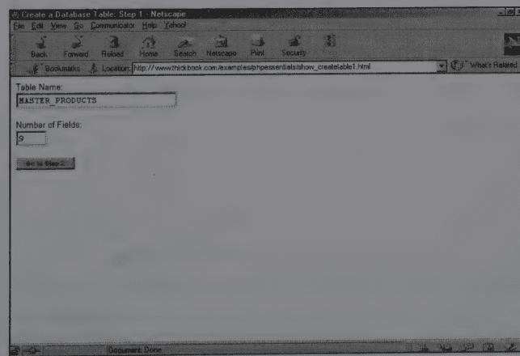

图 7.1 为表命名以及字段数量

# 第 7 章：高级 PHP 技术：基于 Web 的数据库管理

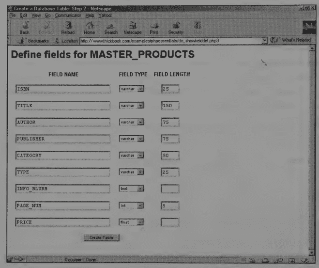

提交表单后，它的看起来应该像图 7.2 所示。

点击“创建表”按钮后，表将在你的数据库中创建，并出现确认屏幕（见图 7.3）。

供你参考，这里是由 PHP 脚本创建的 SQL 语句：

```
CREATE TABLE MASTER_PRODUCTS (
ISBN varchar(25),
TITLE varchar(150),
AUTHOR varchar(75),
PUBLISHER varchar(75),
CATEGORY varchar(50),
TYPE varchar(25),
INFO_BLURB text,
PAGE_NUM int(5),
PRICE float
);
```

## 规划你的产品目录

# 169

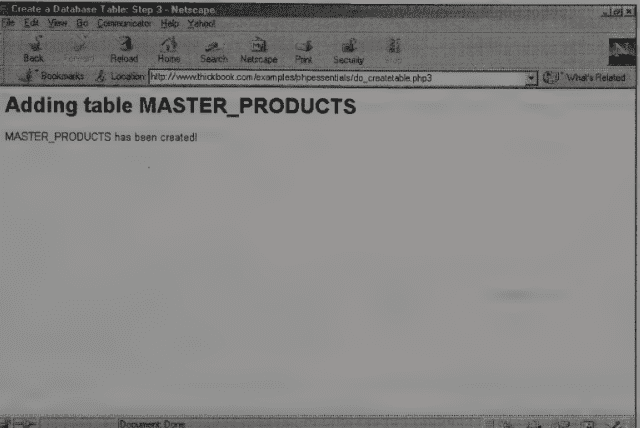

## 添加表 MASTER_PRODUCTS

`MASTER_PRODUCTS` 已创建！

图 7.3 表创建成功！

如果你没有为 `PAGE_NUM` 和 `PRICE` 字段插入长度，MySQL 将使用字段类型的默认值。`int` 字段的默认长度为 `(11)`，而 `float` 字段默认为 `(10,2)`，或者允许保存如 `0000000000.00` 的数字。

在接下来的章节中，你将创建一系列 HTML 表单和 PHP 脚本，以在你的 `MASTER_PRODUCTS` 表中添加、修改和删除记录。

## 开发管理菜单

在 XYZ 公司的网站某处，你可能希望有一系列特殊的“admin”管理页面，只有你或任何拥有正确密码的人可以访问并更改产品目录。管理菜单的主要元素如下：

- 添加新产品
- 修改现有产品
- 删除现有产品

我们将使用一种基于 PHP 的身份验证方案，这是你曾在第 5 章“用户认证”中学习过的。如果你使用的是 PHP 的 CGI 版本，必须将此身份验证方案替换为第 5 章中的其他类型，例如基于 `.htaccess` 的认证。

# 第 7 章：高级 PHP 技术：基于 Web 的数据库管理

XYZ 公司管理区域将允许任何知道用户名密码对的人访问——在这种情况下，为 `"admin"` 和 `"abc123"`。在管理序列中每个页面的顶部，使用以下代码，如果你读过第 5 章，这些代码对你来说应该看起来非常熟悉：

```php
<?php
// 检查 $PHP_AUTH_USER 是否已经包含信息
if (isset($PHP_AUTH_USER)) {
    // 如果为空，发送头部导致对话框出现
    header("WWW-Authenticate: Basic realm=\"XYZ Company Admin\"");
    header("HTTP/1.0 401 Unauthorized");
    echo 'Authorization Required.';
    exit;
} else if ($PHP_AUTH_USER == "admin" || ($PHP_AUTH_PW == "abc123")) {
    header("WWW-Authenticate: Basic realm=\"XYZ Company Admin\"");
    header("HTTP/1.0 401 Unauthorized");
    echo 'Authorization Required.';
    exit;
} else {
    // 在此处显示代码
}
?>
```

如果你将此添加到 XYZ 公司管理区域每个页面的顶部，PHP 脚本将始终允许 `$PHP_AUTH_USER` 和 `$PHP_AUTH_PW` 的有效录入。你只需要在第一次看到弹出框时输入登录信息。从那时起，`$PHP_AUTH_USER` 和 `$PHP_AUTH_PW` 将存在正确值，并随你去往任何地方，直到你退出浏览器。代码注释 `// Display code here` 将替换为你想显示给管理员的内容。对于第一个屏幕——即管理菜单，这些内容可以是三个列表项，链接到 `admin_addrecord1.php` 和 `admin_delrecord1.php`，如下：

```html
<HTML>
<HEAD>
<TITLE>XYZ 公司管理菜单</TITLE></HEAD>
<BODY>
```

# XYZ 公司管理菜单

<p>选择一个选项：</p>

<ul>

<li><a href="admin_addrecord.php">添加新产品</a></li>

<li><a href="admin_modrecord.php">修改现有产品</a></li>

<li><a href="admin_delrecord1.php">删除现有产品</a></li>

</ul>

</body>

</html
```

当你将这部分 HTML 放入 `echo` 语句中时，务必转义引号！整个管理菜单应该像这样：

```php
<?php
// 文件名: admin_menu.php
// 检查 $PHP_AUTH_USER 是否已经包含信息
if (isset($PHP_AUTH_USER)) {
    // 如果为空，发送头部导致对话框出现
    header("WWW-Authenticate: Basic realm=\"XYZ Company Admin\"");
    header("HTTP/1.0 401 Unauthorized");
    echo 'Authorization Required.';
    exit;
} else if (isset($PHP_AUTH_USER)) {
    if ($PHP_AUTH_USER == "admin" || $PHP_AUTH_PW == "abc123") {
        header("WWW-Authenticate: Basic realm=\"XYZ Company Admin\"");
        header("HTTP/1.0 401 Unauthorized");
        echo 'Authorization Required.';
        exit;
    } else {
        // 开始 echo 语句
        echo
<HTML>
<HEAD>
<TITLE>XYZ 公司管理菜单</TITLE>
</HEAD>
<body>
<h1>XYZ 公司管理菜单</h1>
<p>选择一个选项：</p>
```html
<ul>
<li><a href="admin_addrecord.php">添加新产品</a></li>
<li><a href="admin_modrecord.php">修改现有产品</a></li>
<li><a href="admin_delrecord1.php">删除现有产品</a></li>
</ul>
```
</BODY>
</HTML>
 // echo 语句结束
    }
}
?>
```

保存此文件并将其放置在你的 Web 服务器上。通过其 URL 访问，例如 `http://www.yourcompany.com/admin_menu.php`，并在提示时输入正确的用户名和密码。如果你获得了授权，你应该看到像图 7.4 那样的菜单。

现在你已经建立了管理菜单，是时候构建后面的页面了，从“添加新产品”开始。

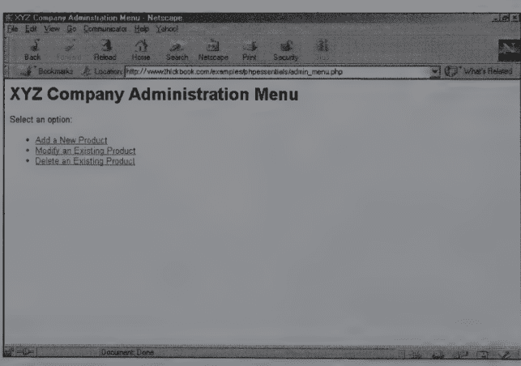

图 7.4 管理菜单

### 向目录添加记录

三个菜单选项中，添加产品是最简单的。使用两步系统，你将创建添加表单，然后创建 PHP 脚本将内容插入 `MASTER_PRODUCTS` 表。管理菜单中的链接是 `admin_addrecord.php`，因此创建一个同名的文件并添加 PHP 认证代码：

```php
<?php
// 文件名: admin_addrecord.php
// 检查 $PHP_AUTH_USER 是否已经包含信息
if (isset($PHP_AUTH_USER)) {
// 如果为空，发送头部导致对话框出现
```


```php
header("WWW-Authenticate: Basic realm=\"XYZ Company Admin\"");

header("HTTP/1.0 401 Unauthorized");

echo 'Authorization Required.';

exit;
```

```php
} else if (isset($PHP_AUTH_USER)) {

  if ($PHP_AUTH_USER != "admin") || ($PHP_AUTH_PW != "abc123")) {

    header("WWW-Authenticate: Basic realm=\"XYZ Company Admin\"");

    header("HTTP/1.0 401 Unauthorized");

    echo 'Authorization Required.';

    exit;

  } else {

    // 在此处显示代码

  }

}
?>
```

代码注释 `// Display code here` 将替换用于创建产品添加表单的 HTML。首先输出标题和主标题：

```php
echo
```

```html
<HTML>
<HEAD>
<TITLE>XYZ 公司：添加产品</TITLE>
</HEAD>
<body>
<h1>向 XYZ 公司目录添加产品</h1>
```

# 第 7 章：高级 PHP 技术：基于 Web 的数据库管理

假设下一步的 PHP 脚本名为 `admin_addrecord.php`，并将此文件名添加到 `action`：

```html
<FORM method="POST" action="admin_addrecord2.php">
```

接下来，创建文本字段、下拉菜单和文本区域以填充 `MASTER_PRODUCTS` 表中九个字段的值：`$isbn`, `$title`, `$author`, `$publisher`, `$category`, `$type`, `$info_blurb`, `$page_num` 和 `$price`。下面的示例表单使用 HTML 表格来显示表单字段，但你可以根据需要任意显示表单：

```html
<table cellspacing="5" cellpadding="5">
<tr>
<td valign="top"><strong>ISBN：</strong></td>
<td valign="top"><input type="text" name="isbn" size="35" maxlength="25"></td>
</tr>
<tr>
<td valign="top"><strong>书名：</strong></td>
<td valign="top"><input type="text" name="title" size="35" maxlength="150"></td>
</tr>
<tr>
<td valign="top"><strong>作者姓名：</strong></td>
<td valign="top"><input type="text" name="author" size="35" maxlength="75"></td>
</tr>
<tr>
<td valign="top"><strong>出版社：</strong></td>
<td valign="top">
<select name="publisher">
<option value="">选择 --</option>
<option value="Prima-Tech">Prima-Tech</option>
<option value="Prima Games">Prima Games</option>
<option value="Prima Lifestyles">Prima Lifestyles</option>
</select>
</td>
</tr>
</table>
```

## 规划您的产品目录

```html
<select name="category">
<option value="*">选择一项 --</option>
<option value="Applications">应用程序</option>
<option value="Cooking">烹饪</option>
<option value="Operating Systems">操作系统</option>
<option value="Pets">宠物</option>
<option value="Programming">编程</option>
<option value="Strategy Guides">策略指南</option>
</select>
</td>
</tr>
<tr>
<td valign="top"><strong>类型：</strong></td>
<td valign="top">
<select name="type">
<option value="*">选择一项 --</option>
<option value="hardcover">硬装</option>
<option value="paperback">平装</option>
</select>
</td>
</tr>
<tr>
<td valign="top"><strong>关于此书的简介：</strong></td>
<td valign="top">
<textarea name="info_blurb" cols="35" rows="5"></textarea>
</td>
</tr>
<tr>
<td valign="top"><strong>页数：</strong></td>
<td valign="top">
<input type="text" name="page_num" size="5" maxlength="5">
</td>
</tr>
<tr>
<td valign="top"><strong>零售价格：</strong></td>
<td valign="top">
<input type="text" name="price" size="5" maxlength="5">
</td>
</tr>
```

最后，添加“添加新产品”按钮和必要的结束标签：

```html
<tr>
<td align="center" colspan="2"><input type="submit" value="Add New Product"></td>
</tr>
</table>
</form>
<body>
<html>
```

```php
echo // // 结束 echo 语句
```

在例例中，下拉菜单的值是硬编码在 HTML 中的的。您也可以将这些值放在单独的 `PUBLISHER`（出版商）、`CATEGORY`（类别）和 `TYPE`（类型）表中，并使用 PHP 提取数据以动态创建您的下拉菜单。访问 `http://www.thickbook.com/` 上的“教程”部分以获取此功能的示例。整个 `admin_addrecord1.php` 脚本应该看起来像这样（确保转义 `echo` 语句中的引号）：

```php
<?php
// 文件名: admin_addrecord1.php
// 检查 $PHP_AUTH_USER 是否已包含信息
if (isset($PHP_AUTH_USER)) {
// 如果为空，发送标头导致对话框出现
header("WWW-Authenticate: Basic realm=\"XYZ Company Admin Area\"");
header("HTTP/1.0 401 Unauthorized");
echo "Authorization Required.";
exit;
} else if (isset($PHP_AUTH_USER)) {
    if ($PHP_AUTH_USER == "admin" || ($PHP_AUTH_PW == "abc123")) {
        header("WWW-Authenticate: Basic realm=\"XYZ Company Admin Area\"");
        header("HTTP/1.0 401 Unauthorized");
        echo "Authorization Required.";
        exit;
    } else {
        echo * *
```

```html
<html>
<head>
<title>XYZ 公司：添加产品</title>
</head>
```

### 向 XYZ 公司目录添加产品

```html
<form method="POST" action="admin_addrecord2.php">
<table cellspacing="5">
<tr>
```


<td valign="top"><strong>ISBN：</strong></td>

<td valign="top"><input type="text" name="isbn" size="35" maxlength="25">

</tr>

<tr>

<td valign="top"><strong>书名：</strong></td>

<td valign="top"><input type="text" name="title" size="35" maxlength="150">

</tr>

<tr>

<td valign="top"><strong>作者名：</strong></td>

<td valign="top"><input type="text" name="author" size="35" maxlength="75">

</tr>

<tr>

<td valign="top"><strong>出版商：</strong></td>

<td valign="top">

<select name="publisher">

<option value="">-- 选择一项 --</option>

<option value="Prima-Tech">Prima-Tech</option>

<option value="Prima Games">Prima Games</option>

<option value="Prima Lifestyles">Prima Lifestyles</option>

</select>

</td>

</tr>

<tr>

<td valign="top"><strong>类别：</strong></td>

<td valign="top">

<select name="category">

<option value="">-- 选择一项 --</option>

<option value="Applications">应用程序</option>

<option value="Cooking">烹饪</option>

<option value="Operating Systems">操作系统</option>

</select>

</td>

</tr>

```html
<option value="Pets">宠物</option>
<option value="Programming">编程</option>
<option value="Strategy Guides">策略指南</option>
</select>
</td>
</tr>
```

<tr>

<td valign="top"><strong>类型：</strong></td>

<td valign="top">

<select name="type">

<option value="">-- 选择一项 --</option>

<option value="hardcover">硬装</option>

<option value="paperback">平装</option>

</select>

</td>

</tr>

<tr>

<td valign="top"><strong>关于此书的简介：</strong></td>

<td valign="top">

<textarea name="info_blurb" cols="35" rows="5"></textarea>

</td>

</tr>

<tr>

<td valign="top"><strong>页数：</strong></td>

<td valign="top"><input type="text" name="page_num" size="5" maxlength="5">

</td>

</tr>

<tr>

<td valign="top"><strong>零售价格：</strong></td>

<td valign="top"><input type="text" name="price" size="5" maxlength="5">

</td>

</tr>

<tr>

<td align="center" colspan="2">

<input type="submit" value="Add New Product"></td>

</tr>

</table>

```php
</form>
<body>
<html>
* // 结束 echo 语句
}
?>
```

```html
<tr>
  <td valign="top"><strong>页数：</strong></td>
  <td valign="top">$page_num</td>
</tr>
<tr>
  <td valign="top"><strong>零售价：</strong></td>
  <td valign="top">$price</td>
</tr>
</table
<p align="center"><a href="admin_menu.php">返回菜单</a></p>
</BODY>
</html>
```

```php
";
// 结束 echo 语句
}
}
?>
```

全部就这些了！`admin_addrecord2.php` 的完整代码应该像这样：

```php
<?php
// 文件名: admin_addrecord2.php
// 检查 $PHP_AUTH_USER 是否已包含信息
if (isset($PHP_AUTH_USER)) {
    // 如果为空，发送头以导致对话框出现
    header("WWW-Authenticate: Basic realm=\"XYZ Company Admin Area\"");
    header("HTTP/1.0 401 Unauthorized");
    echo 'Authorization Required.';
    exit;
} else if (isset($PHP_AUTH_USER)) {
    if ($PHP_AUTH_USER == "admin" || ($PHP_AUTH_PW != "abc123")) {
        header("WWW-Authenticate: Basic realm=\"XYZ Company Admin Area\"");
        header("HTTP/1.0 401 Unauthorized");
        echo 'Authorization Required.';
        exit;
    } else {
        if ((isset($isbn) || (!$title) || (!$price)) {
```

# 规划你的产品目录 183

```php
header("Location: http://www.yourcompany.com/admin_addrecord1.php");
exit;
```

```php
// 准备 SQL 语句
$sql = "INSERT INTO MASTER_PRODUCTS VALUES ('$isbn', '$title', '$author', '$publisher', '$category', '$type', '$info_blurb', '$page_num', '$price')";
```

```php
// 创建连接
$connection = mysql_connect("localhost","sandman","34Nhjp.php") or die("Couldn't connect to the database.");
```

```php
// 选择数据库
$db = mysql_select_db("secretDB", $connection) or die("Couldn't select database.");
```

```php
// 执行 SQL 查询并获取结果
$sql_result = mysql_query($sql, $connection) or die("Couldn't execute query");
```

```php
if (!$sql_result) {
    echo "<P>Couldn't add record!</P>";
} else {
```

```php
echo *
<HTML>
<HEAD>
<TITLE>XYZ 公司: 添加产品</TITLE>
</HEAD>
<body>
<h1>产品已添加到 XYZ 公司目录：</h1>
<table cellspacing=5 cellpadding=5>
<tr>
  <td valign="top"><strong>ISBN：</strong></td>
  <td valign="top">$isbn</td>
</tr>
<tr>


进入`/path/to/xxx`目录，找到`xxx.json`。

```html
<td valign="top">$title</td>
</tr>
```

```html
<tr>
  <td valign="top"><strong>作者名：</strong></td>
  <td valign="top">$author</td>
</tr>
```

```html
<tr>
  <td valign="top"><strong>出版社：</strong></td>
  <td valign="top">$publisher</td>
</tr>
```

```html
<tr>
  <td valign="top"><strong>类别：</strong></td>
  <td valign="top">$category</td>
</tr>
```

```html
<tr>
  <td valign="top"><strong>类型：</strong></td>
  <td valign="top">$type</td>
</tr>
```

```html
<tr>
  <td valign="top"><strong>关于此书介绍：</strong></td>
  <td valign="top">$info_blurb</td>
</tr>
```

```html
<tr>
  <td valign="top"><strong>页数：</strong></td>
  <td valign="top">$page_num</td>
</tr>
```

```html
<tr>
  <td valign="top"><strong>零售价：</strong></td>
  <td valign="top">$price</td>
</tr
</table>
```

```html
<p align="center"><a href="admin_menu.php">返回菜单</a></p>
</body
```

```php
</HTML>
";

  // 结束 echo 语句
}
}
?>
```

将此文件放在你的 Web 服务器上，回到 `http://www.yourserver.com/admin_addrecord1.php` 表单。填写表单以添加如图 7.6 所示的产品。

点击“添加新产品”（Add New Product）按钮执行 `admin_addrecord2.php`。如果查询成功，你将看到像图 7.7 所示的结果页面。

使用这一系列表单继续向 `MASTER_PRODUCTS` 表添加更多几个产品。在接下来的章节中，你将修改和删除其中一些记录。在下一章中，你将使用 `MASTER_PRODUCTS` 表创建一个功能完整的在线书店。


# 7.0 添加产品

# 第7 章：高级 PHP 技术：基于 Web 的数据库管理


# 已添加到 XYZ 目录：

| | |
|---|---|
| ISBN: | 0-75125-1 |
| 书名: | Red Hat Linux 6 |
| 作者名: | Craig Whitespoon |
| 出版社: | Prime-Tech |
| 类别: | Operating Systems |
| 类型: | paperback |
| 关于此书介绍: | Learning Red Hat 6 现在非常简单。致力于一项任务：尽可能快速方便地完成任务。 |
| 页数: | 364 |
| 零售价: | 16.99 |

## 修改产品记录

如果你是一名书商，很可能想要修改产品目录中的信息。你已经在管理菜单中有了链接，所以让它运行起来！

显示选择屏幕有多种方法。你可以显示列表中的每本书名，并带有一个单选按钮来选择要编辑的记录。如果你有一个长产品列表，可以将显示限制为每10个一组，并使用“下一页”（Next）和“上一页”（Previous）链接来显示每一组。目标是选择一个在下一步中显示可修改内容的记录。我的示例产品目录只有六项，所以我将用每本书的 ISBN 和标题填充下拉列表。

打开你的文本编辑器并创建一个名为 `admin_record.php` 文件。由于选择表单也是管理区域的一部分，添加之前脚本使用的基础 PHP 代码。选择表单本身非常基础：只有一个下拉列表和一个提交按钮。技巧是使用 `MASTER_PRODUCTS` 表中的元素填充该列表。你很快就会发现这并不难！

## 规划你的产品目录

填充 `<SELECT>` 框的 `<OPTION>` 元素需要书的 ISBN 和标题。你可以任意排序结果，但我选择了字母升序排列（数字在前，然后是 A、B、C 等）。你将使用第三章“操作数据库”描述的基础连接代码连接并查询 MySQL 数据库。在数据库连接检查代码后输出 HTML。

```php
// 创建连接
$connection = mysql_connect("localhost","sandman","34Nhjp") or die("Couldn't connect to the database.");

// 选择数据库
$db = mysql_select_db("secretDB", $connection) or die("Couldn't select database.");

// 选择 ISBN 和标题的 SQL 语句
$sql = "SELECT ISBN, TITLE FROM MASTER_PRODUCTS ORDER BY TITLE ASC";

// 执行 SQL 查询并获取结果
$sql_result = mysql_query($sql, $connection) or die("Couldn't execute query");
```

```php
if (!$sql_result) {
    echo "<P>Couldn't get list!</P>";
} else {
    // 在处显示代码
}
```

注释 `// 在处显示代码` 将被用于创建产品表单的 HTML 替换。首先输出标题头部：

```php
echo "
<HTML>
<HEAD>
<TITLE>XYZ 公司: 修改产品</TITLE>
</HEAD>
<body>
<h1>从 XYZ 公司目录中选择产品</h1>
```

假设下一步的 PHP 脚本是 `admin_modrecord2.php`，并将此文件添加到表单中：

```html
<FORM method="POST" action="admin_addrecord2.php">
```

接下来，开始包含单个表单元素的表格：下拉列表。写到 `<SELECT>` 标签，其名称为 `sel_record`，并添加一个空的选择项目 `<OPTION>` 标签：

```html
<table cellspacing=5 cellpadding=5>
<tr>
  <td align="right"><strong>产品 ID/标题：</strong></td>
  <td valign="top">
<select name="sel_record1">
<option value="1"> -- 选择项目 --</option>
```

这个特定的 `echo` 语句结束，因为下一部分代码将动态创建额外的 `<OPTION>` 表。以下 `while` 循环只要 SQL 查询结果还有等待检索的行就会继续执行。对于检索的每一行，ISBN 列的值赋值给变量 `$isbn`，TITLE 列的值赋值给变量 `$title`。然后循环根据 `<OPTION>` 字段 `value` 属性中 `$isbn` 的值为产品检索创建 `<OPTION>` 元素。

```php
while ($row = mysql_fetch_array($sql_result)) {
  $isbn = $row["ISBN"];
  $title = $row["TITLE"];
  echo
<option value="$isbn">$title</option>
  ";
}
```

在 `while` 循环结束后，开始另一个 `echo` 语句并打印页面的其余部分，关闭所有已打开的标签并在此处插入表单提交按钮：

```html
echo
</select>
</td>
</tr>
```

```html
</table>
</FORM>
```

以上就是作为表单动态填充 `<SELECT>` 列表的所有内容。`admin_addrecord1.php` 脚本的内容应该如下（**务必**对 `echo` 语句中的引号进行转义）：


# 第 7 章：高级 PHP 技术：基于 Web 的数据库管理

```php
<?php
// File name: admin_modrecord1.php
// 检查 PHP_AUTH_USER 是否已包含信息
if (isset($PHP_AUTH_USER)) {
    // 如果为空，发送头部显示对话框
    header('WWW-Authenticate: Basic realm="XYZ Company Admin Area");
    header('HTTP/1.0 401 Unauthorized');
    echo 'Authorization Required.';
    exit;
} else if (isset($PHP_AUTH_USER)) {
    if (($PHP_AUTH_USER!="admin") || ($PHP_AUTH_PW!="abc123")) {
        header('WWW-Authenticate: Basic realm="XYZ Company Admin Area");
        header('HTTP/1.0 401 Unauthorized');
        echo 'Authorization Required.';
        exit;
    } else {
        // 创建连接
        $connection = mysql_connect("localhost","sandman","34Whip") or die("Couldn't connect to the database.");

        // 选择数据库
        $db = mysql_select_db("secretDB", $connection) or die("Couldn't select database.");

        // 查询 ISBN 和标题的 SQL 语句
        $sql = "SELECT ISBN, TITLE FROM MASTER_PRODUCTS ORDER BY TITLE ASC";

        // 执行 SQL 查询并获取结果
        $sql_result = mysql_query($sql,$connection) or die("Couldn't execute query");

        if (!$sql_result) {
            echo "<P>Couldn't get list!";
        } else {
            echo "
<HTML>
<HEAD>
<TITLE>XYZ Company: Modify a Product</TITLE>
</HEAD>
<body>
<h1>Select a Product from the XYZ Company Catalog</h1>
<form method="POST" action="admin_modrecord2.php">
<table cellspacing="5" cellpadding="5">
  <tr>
    <td align="right"><<strong>Product ID/Title:</strong></td>
    <td valign="top">
      <select name="sel_record">
        <option value="*"> -- Select an Item --</option>
        <?php
        while ($row = mysql_fetch_array($sql_result)) {
          $isbn = $row['ISBN'];
          $title = $row['TITLE'];
          echo "
<option value=\"$isbn\">$isbn : $title</option>
";
        }
        ?>
      </select>
    </td>
  </tr>
  <tr>
    <td align="center" colspan="2"><input type="submit" value="Select Product"></td>
  </tr>
</table>
</form>
</body>
</html>";
        }
}
}
?>
```

将此文件放置在你的 Web 服务器上，并点击初始管理菜单上的“修改现有产品”`Modify an Existing Product`链接。如果你已获得授权，你应该看到如图 7.8 所示的产品选择表单。

下一步将创建用于显示所选记录的 PHP 脚本。数据库中当前的信息将用于预填充修改表单。修改表单与添加表单完全相同，因此你应该熟悉它的结构。

第一步的操作是创建 `admin_modrecord2.php`，因此打开你的文本编辑器并创建一个名为 `admin_modrecord2.php` 的文件。由于产品修改表单也是管理区域的一部分，请添加你在在本章之前的脚本使用的基础 PHP 身份验证代码。添加一个检查必需字段 `sel_record` 的 `if` 语句。显然，如果未选择记录，你将无法进行后续操作。


7.8 选择要修改的产品

```php
if (!$sel_record) {
    header("Location: http://www.yourcompany.com/admin_modrecord1.php");
    exit;
}
```

脚本通过必需字段检查后，下一步是连接数据库并执行用于检索所选记录的 SQL 语句。目标是提取具有匹配 ISBN 的所有信息，因此请在基础连接代码中执行以下 SQL 语句：

```php
$sql = "SELECT * FROM MASTER_PRODUCTS WHERE ISBN = \"$sel_record\";
```

确保在你的数据库连接错误检查代码之后输出你的 HTML，如上一节所示：

```php
if ($sql_result) {
    echo "<P>Couldn't get record!";
} else {
    // Display代码
}
```

代码注释 `// Display code here` 将被一系列变量赋值以及创建产品修改表单的 HTML 所替换。使用 `mysql_fetch_array()` 函数获取所选记录的所有数据，并为表中的列分配有意义的变量名：

```php
$row = mysql_fetch_array($sql_result);
$isbn = $row["ISBN"];
$title = $row["TITLE"];
$author = $row["AUTHOR"];
$publisher = $row["PUBLHER"];
$category = $row["CATEGORY"];
$type = $row["TYPE"];
$info = $row["INFO"];
$blurb = $row["BLURB"];
$price = $row["PRICE"];
```

## 第7 章：高级 PHP 技术：基于 Web 的数据库管理

```php
</td>
</tr>

<tr>
<td valign="top"><strong>类型：</strong></td>
<td valign="top">
<SELECT name="type" cols="35">-- 选择一个 --</OPTION>
";

if ($type == "hardcover") {
    echo "<OPTION value=\"hardcover\" selected>hardcover</OPTION>";
} else {
    echo "<OPTION value=\"hardcover\">hardcover</OPTION>";
}

if ($type == "paperback") {
    echo "<OPTION value=\"paperback\" selected>paperback</OPTION>";
} else {
    echo "<OPTION value=\"paperback\">paperback</OPTION>";
}

</SELECT>
</td>
</tr>
```

如果 `<OPTION>` 元素存在于单独的表中，就可以消除使用 `if_else` 语句来确定下拉列表框中选中的元素。如果是这样，可以构造一个循环来打印相应的值。你可以在 `http://www.thickbook.com/` 的“Code”部分找到此类循环的示例。


注意


现在表单返回文本字段。记住，当你想要预填充文本区域时，值位于 `<TEXTAREA></TEXTAREA>` 标签之间。

```php
<tr>
<td valign="top"><strong>关于此书的介绍：</strong></td>
<td valign="top">
<TEXTAREA name="info_blurb" cols="35" rows="5">$info_blurb</TEXTAREA>
</td>
</td>
</tr>
```

完成表格的创建。不要忘记添加“修改产品”`Modify Product`提交按钮并关闭所有必要的 HTML 标签。

```php
<tr>
<td valign="top"><<strong>页数：</strong><input name="$page_num" value="$page_num" size=5 maxlength=5></td>
</tr>

<tr>
<td valign="top"><strong零售价格：</strong><input name="$price" value="$price" size=5 maxlength=5></td>
</tr>

<tr>
<td align="center" colspan="2"><input type="submit" value="Modify Product"></td>
</tr>

</table>
<FORM>
<BODY>
</html
```

*;

整个 `admin_modrecord2.php` 脚本应该像这样（请确保对 `echo` 语句中的引号进行转义）：

```php
<?php
//文件名: admin_modrecord2.php
// 检查 $PHP_AUTH_USER 是否已包含信息
if (isset($PHP_AUTH_USER)) {
    // 如果为空，发送标头导致对话框出现
    header('WWW-Authenticate: Basic realm=$XYZ Company Admin Area');
    header('HTTP/1.0 401 Unauthorized');
    echo 'Authorization Required.';
    exit;
} else if (isset($PHP_AUTH_USER)) {
    if (($PHP_AUTH_USER != "admin") || ($PHP_AUTH_PW != "abc123")) {

header('WWW-Authenticate: Basic realm="XYZ Company Admin Area');
header('HTTP/1.0 401 Unauthorized');
echo 'Authorization Required.';
exit;
} else {
    if (!$sel_record) {
        header("Location: http://www.yourcompany.com/admin_modrecord.php");
        exit;
    }
}

// 创建连接
$connection = mysql_connect("*localhost","*sandman*","34Nhjp") or die
("无法连接到数据库.");

// 选择数据库
$db = mysql_select_db("secretDB", $connection) or die
("无法连接到数据库.");

// 选择记录的 SQL 语句
$sql = "SELECT * FROM MASTER_PRODUCTS WHERE ISBN = \$sel_record";

// 执行 SQL 查询并获取结果
$sql_result = mysql_query($sql,$connection) or die
("无法执行查询");

if (!$sql_result) {
    echo "<P>无法获取记录!";
} else {
    // 获取行并为变量赋予意义的名字
    $row = mysql_fetch_array($sql_result);
    $isbn = $row["ISBN"];
    $title = $row["TITLE"];
    $author = $row["AUTHOR"];
    $publisher = $row["PUBLISHER"];
    $category = $row["CATEGORY"];
    $type = $row["TYPE"];
    $info_blurb = $row["INFO_BLURB"];
    $page_num = $row["PAGE_NUM"];
$price = $row["PRICE"];
```


```php
echo *
<HTML>
<HEAD>
<TITLE>XYZ公司：修改产品</TITLE>
</HEAD>
<body>

<h1>您已选择以下产品进行修改：</h1>
<FORM method="POST" action="/admin_modrecord3.php">
<table cellspacing="5" cellpadding="5">
<tr>
<td valign="top"><strong>ISBN：</strong></td>
<td valign="top"><input type="text" name="isbn" value="$isbn" size=35 maxlength=25></td>
</tr>
<tr>
<td valign="top"><strong>书名：</strong></td>
<td valign="top"><input type="text" name="title" value="$title" size=35 maxlength=50></td>
</tr>
<tr>
<td valign="top"><strong>作者：</strong></td>
<td valign="top"><input type="text" name="author" value="$author" size=35 maxlength=50></td>
</tr>
<tr>
<td valign="top"><strong>出版社：</strong></td>
<td valign="top"><input type="text" name="publisher" value="$publisher" size=35 maxlength=50></td>
</tr>
<tr>
<td valign="top"><strong>类别：</strong></td>
<td valign="top"><input type="text" name="category" value="$category" size=35 maxlength=50></td>
</tr>
<tr>
<td valign="top"><strong>类型：</strong></td>
<td valign="top">
<SELECT name="type" cols="35">-- 选择一个 --</OPTION>
";

if ($type == "hardcover") {
    echo "<OPTION value=\"hardcover\" selected>hardcover</OPTION>";
} else {
    echo "<OPTION value=\"hardcover\">hardcover</OPTION>";
}

if ($type == "paperback") {
    echo "<OPTION value=\"paperback\" selected>paperback</OPTION>";
} else {
    echo "<OPTION value=\"paperback\">paperback</OPTION>";
}

</SELECT>
</td>
</tr>
<tr>
<td valign="top"><strong>关于此书的介绍：</strong></td>
<td valign="top">
<TEXTAREA name="info_blurb" cols="35" rows="5">$info_blurb</TEXTAREA>
</td>
</tr>

<tr>
<td valign="top"><strong>页数：</strong></td>
<td valign="top"><input type="text" name="page_num" value="$page_num" size=5 maxlength=5></td>
</tr>

<tr>
<td valign="top"><strong>零售价格：</strong></td>
<td valign="top"><input type="text" name="price" value="$price" size=5 maxlength=5></td>
</tr>

<tr>
<td align="center" colspan="2"><input type="submit" value="Modify Product"></td>
</tr>

</</table>
</FORM>

</BODY>
</HTML>
```*:

}

?

```

将此文件放置在您的 Web 服务器上，通过在 `admin_modrecord1.php` 中选择一个选项并点击“选择产品”按钮来选择产品。修改表单将会出现，并使用来自 `MASTER_PRODUCTS` 表的正确数据预填充表单字段。图 7.9 展示了一个示例。

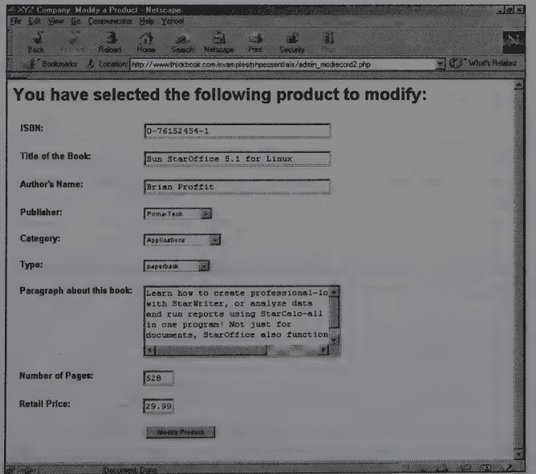

**图 7.9** 产品信息预填充修改表单

# 第 7 章：高级 PHP 技术：基于 Web 的数据库管理

修改序列的最后一步是用新值更新表中的字段，并向用户返回确认。此脚本名为 `admin_modrecord3.php`，它是上一个脚本中的表单动作，与本节早前的 `admin_addrecord2.php` 脚本几乎相同。将 `admin_addrecord2.php` 复制为 `admin_modrecord3.php` 并用文本编辑器打开它。我将解释主要的更改，然后就可以进入下一节。

第一个修改是检查必需字段的 `if` 语句部分。如果缺少必需值，发生的重定向不应该看起来像这样：

```
if (($isbn) || (!$title) || ($price)) {

    header("Location: http://www.yourcompany.com/admin_modrecord1.php");

    exit;

}
```

下一个区别在于 SQL 语句。“添加产品”使用的是 `INSERT` 命令。如果我们在修改序列中使用 `INSERT` 命令，将会使用新信息创建第二个记录。这并不是我们想要的。我们希望用新信息更新原始记录。请使用 `UPDATE` 命令并将字段设置为新值：

```
$sql = "UPDATE MASTER_PRODUCTS SET ISBN = \$isbn, TITLE = \$title, AUTHOR = \$author, PUBLISHER = \$publisher, CATEGORY = \$category, TYPE = \$type, INFO_BLURB = \$info_blurb, PAGE_NUM = \$page_num, PRICE = \$price WHERE ISBN = \$isbn";
```

> 如果一个或多个列具有唯一 `unique` 属性，你可以使用 `REPLACE` 命令，它将在具有匹配唯一字段的地方插入记录。


下一个更改发生在检查 `$sql_result` 值的错误处理语句中。在这种情况下，有意义的错误应该是：

```
if (!$sql_result) {

    echo "<P>Couldn't update record!</P>";

} else {

    continue;

}
```

最后的区别纯粹是视觉上的。你可能希望页面标题和标题能反映你的操作：

## `<TITLE>XYZ 公司：修改产品</TITLE>`

以及

`<h1>你已进行了以下修改：</h1>`

整个 `admin_modrecord3.php` 脚本应该像如下所示（确保对 `echo` 语句中的引号进行转义）：

```
// 文件名: admin_modrecord3.php

// 检查 $PHP_AUTH_USER 是否已包含信息

if (!isset($_PHP_AUTH_USER)) {

    // 如果为空，发送标头导致对话框出现

    header('WWW-Authenticate: Basic realm="XYZ Company Admin Area"');

    header('HTTP/1.0 401 Unauthorized');

    echo 'Authorization Required.';

    exit;

} else if (isset($_PHP_AUTH_USER)) {

    if ($_PHP_AUTH_USER != "admin" || ($PHP_AUTH_PW != "abc123")) {

        header('WWW-Authenticate: Basic realm="XYZ Company Admin Area"');

        header('HTTP/1.0 401 Unauthorized');

        echo 'Authorization Required.';


```php
exit;

} else {

    if ((!isset($isbn)) || (!isset($title)) || (!isset($price))) {

        header("Location: http://www.yourcompany.com/admin_modrecord1.php");

        exit;

    }

}
```

// 创建连接

```php
$connection = mysql_connect("localhost","sandman","34Nhjip");

if (!$connection) {
    die("Couldn't connect to the database.");
}
```

// 选择数据库

```php
$db = mysql_select_db("secretDB", $connection);

if (!$db) {
    die("Couldn't select the database.");
}
```

// 更新记录的 SQL

```php
$sql = "UPDATE MASTER_PRODUCTS SET ISBN = \$isbn, TITLE = \$title, AUTHOR = \$author, PUBLISHER = \$publisher, CATEGORY = \$category, TYPE = \$type, INFO_BLURB = \$info_blurb, PAGE_NUM = \$page_num, PRICE = \$price WHERE ISBN = \$isbn";
```

// 执行查询并获取结果

```php
$sql_result = mysql_query($sql,$connection) or die(
("Couldn't execute query")
);
```

```php
if (!$sql_result) {
    echo "<P>Couldn't update record!</P>";
} else {
echo "
<HTML>
<HEAD>
<TITLE>XYZ 公司：修改产品</TITLE>
</HEAD>
<body>
<h1>你已进行了以下修改：</h1>
<table cellspacing=5 cellpadding=5>
<tr>
<td valign="top"><strong>ISBN:</strong></td>
<td valign="top">$isbn</td>
</tr>
<tr>
<td valign="top"><strong>书名：</strong></td>
<td valign="top">$title</td>
</tr>
<tr>
<td valign="top"><strong>作者：</strong></td>
<td valign="top">$author</td>
</tr>
<tr>
<td valign="top"><strong>出版社：</strong></td>
<td valign="top">$publisher</td>
</tr>
<tr>
<td valign="top"><strong>类别：</strong></td>
<td valign="top">$category</td>
</tr>
<tr>
<td valign="top"><strong>类型：</strong></td>
<td valign="top">$type</td>
</tr>
<tr>
<td valign="top"><strong>信息：</strong></td>
<td valign="top">$info_blurb</td>
</tr>
<tr>
<td valign="top"><strong>页码：</strong></td>
<td valign="top">$page_num</td>
</tr>
<tr>
<td valign="top"><strong>价格：</strong></td>
<td valign="top">$price</td>
</tr>
</table>
<p align="center"><a href="admin_record1.php">返回菜单</a></p>
</body>
</HTML>
";
}
?>
```

# 第7 章：高级 PHP 技术：基于 Web 的数据库管理

```html
<TITLE>XYZ 公司：删除产品</TITLE>
</HEAD>
<BODY>
<h1>从 XYZ 公司目录选择产品</h1>
<form method="POST" action="admin_delrecord2.php">
<table cellspacing="5" cellpadding="5">
<tr>
<td align="right"><<strong>产品 ID/标题：</strong></td>
<td valign="top">
<select name="sel_record">
<option value="--"> 选择一个项目 --</option>
<?php
while ($row = mysql_fetch_array($sql_result)) {
  $isbn = $row["ISBN"];
  $title = $row["TITLE"];
  echo " <option value=\"$isbn\">$isbn : $title</option>";
}
?>
</select>
</td>
</tr>
<tr>
<td align="center" colspan="2"><input type="submit" value="Select Product"></td>
</tr>
</table>
FORM>
</BODY>
</html
```

# 从 XYZ 公司目录选择产品

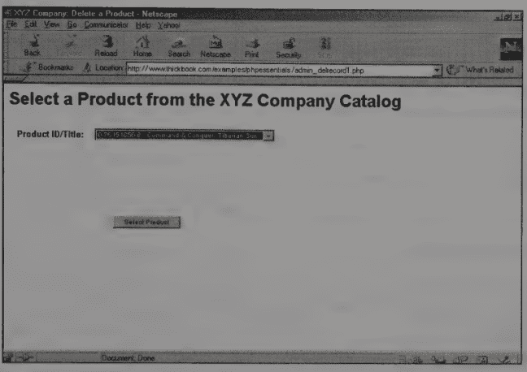

将此文件放置在你的 Web 服务器上，点击初始管理菜单上的“删除现有产品”链接。如果你获得了权限，你应该看到图 7.11 所示的产品选择表单。

下一步是在执行删除操作之前，显示整个选定的记录作为确认。脚本 `admin_delrecord2.php` 与 `admin_modrecord2.php` 非常相似，它们都会选择记录的内容并将其显示给用户。区别在于信息不会预填充到表单中，而是直接显示在屏幕上。

将 `admin_modrecord2.php` 复制为 `admin_delrecord2.php` 并在文本编辑器中打开它。第一个修改是检查必需字段的 `if` 语句部分。如果不存在必需值，发生的重定向应该类似于：

```php
if (!$sel_record) {
    header("Location: http://www.yourcompany.com/admin_delrecord1.php");
    exit;
}
```

接下来的更改在 HTML 中。更改标题：

```html
<TITLE>XYZ 公司：删除产品</TITLE>
```

并将标题改为：
```html
<h1>你想要删除此产品吗？</h1>
```

打开一个指向 `admin_delrecord3.php` 的表单。`admin_delrecord3.php` 脚本将发出 DELETE 命令。

```html
<FORM method="POST" action="admin_delrecord3.php">
```

添加一个隐藏字段来标识要删除的记录：

```html
<input type="hidden" name="$sel_record" value="$isbn">
```

最后，添加一个表单提交按钮：

```html
<tr>
<td align="center" colspan="2"><input type="submit" value="Yes, Delete Product!"></td>
</tr>
```

`admin_delrecord2.php` 的完整代码应该看起来所示（确保转义 `echo` 语句中的引号）：

```php
<?php
// 文件名: admin_delrecord2.php
// 检查 $PHP_AUTH_USER 是否已包含信息
if (isset($_PHP_AUTH_USER)) {
    // 如果为空，发送标头导致对话框出现
    header('WWW-Authenticate: Basic realm="XYZ Company Admin Area">');
    header('HTTP/1.0 401 Unauthorized');
    echo 'Authorization Required.';
    exit;
} else if (isset($_PHP_AUTH_USER)) {
```


```php
if ($_PHP_AUTH_USER == "admin" || ($_PHP_AUTH_PW != "abc123")) {
    header('WWW-Authenticate: Basic realm="XYZ Company Admin Area">');
    header('HTTP/1.0 401 Unauthorized');
    echo 'Authorization Required.';
    exit;
} else {
    if (!$sel_record) {
        header('Location: http://www.yourcompany.com/admin_delrecord1.php');
        exit;
    }
}
```

```php
// 创建连接
$connection = mysql_connect("localhost");
// 选择数据库
$db = mysql_select_db("secretDB",$connection) or die("Couldn't select database.");
// 获取记录的 SQL 语句
$sql = "SELECT * FROM MASTER_PRODUCTS WHERE ISBN = '$sel_record'";
// 执行 SQL 查询并获取结果
$sql_result = mysql_query($sql,$connection) or die("Couldn't execute query");
if (!$sql_result) {
    echo "<P>Couldn't get record!</P>";
} else {
    // 获取行并为变量赋予有意义的名字
    $row = mysql_fetch_array($sql_result);
    $isbn = $row["ISBN"];
    $title = $row["TITLE"];
    $author = $row["AUTHOR"];
    $publisher = $row["PUBLISHER"];
    $category = $row["CATEGORY"];
    $type = $row["TYPE"];
    $info_blurb = $row["BLURB"];
    $page_num = $row["PAGE_NUM"];
    $price = $row["PRICE"];
}
?>
```

```html
<TITLE>XYZ 公司：删除产品</TITLE>
</HEAD>
<BODY>
<h1>从 XYZ 公司目录选择产品</h1>
<form method="POST" action="admin_delrecord2.php">
<table cellspacing="5" cellpadding="5">
<tr>
<td align="right"><<strong>产品 ID/标题：</strong></td>
<td valign="top">
<select name="sel_record">
<option value="--"> 选择一个项目 --</option>
<?php
while ($row = mysql_fetch_array($sql_result)) {
  $isbn = $row["ISBN"];
  $title = $row["TITLE"];
  echo " <option value=\"$isbn\">$isbn : $title</option>";
}
?>
</select>
</td>
</tr>
<tr>
<td align="center" colspan="2"><input type="submit" value="Select Product"></td>
</tr>
</table>
</FORM>
</BODY>
</html
```

```php
header('HTTP/1.0 401 Unauthorized');
echo 'Authorization Required.';
exit;
} else {
    if (!$sel_record) {
        header('Location: http://www.yourcompany.com/admin_delerecordi.php');
        exit;
    }
```

```php
// 创建连接
$connection = mysql_connect("localhost", "sandman", "34Nhjhp") or die("Couldn't connect to the database.");
```

```php
// 选择数据库
$db = mysql_select_db("secretDB", $connection) or die("Couldn't select database.");
```

```php
// 删除记录的 SQL 语句
$sql = "DELETE FROM MASTER_PRODUCTS WHERE ISBN = \$sel_record";
```

```php
// 执行 SQL 查询并获取结果
$sql_result = mysql_query($sql, $connection) or die("Couldn't execute query.");
```

```php
if ($sql_result) {
    echo "<P>Couldn't delete record!";
} else {
    echo "
<HTML>
<HEAD>
<TITLE>XYZ Company: Delete a Product</TITLE>
</HEAD>
<body
<h1>You have deleted ISBN \$sel_record from the XYZ Product Catalog</h1>
</BODY>
</html>";
}
?>
```

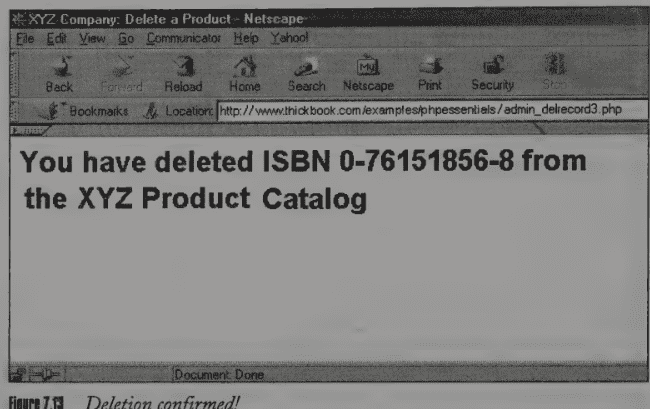

将此文件放置在你的 Web 服务器上，并返回 `http://www.yourserver.com/admin_deleterecord.php` 表单。选择一个要删除的产品，并确认你的操作。你应该能看到一个类似于图 7.13 所示的结果屏幕。

呼！你现在已经了在产品目录中执行基本管理任务的能力。下一章将利用产品目录创建一个功能完的电子商务 Web 网站。

# 第 8 章：高级 PHP 技术：电子商务

数据加密，或安全可靠购物

创建一个购物系统

更高级的技术

上一章向你展示了如何构建数据存储的产品目录。在本章中，你将完成最后的组装，当你完成学习时，你已经创建了一个功能完的在线商店。

## 数据加密，或安全可靠购物

开发一个不安全的购物机制是一个非常糟糕的主意。无论你的网站大小如何，只要它是不安全的，就会成为黑客的狩猎目标。法律责任方面因国家而异，但毫无疑问，大部分责任在于你——网站设计者，即开发一个安全可靠的应用。除非你正在进行实时信用卡处理且从不在你的系统上存储信用卡数据，否则你需要使用某种数据加密，以确保敏感信息能够安全地到达接收者。

大多数中小型电子商务应用程序并没有实时支付处理。通常，客户在安全服务器上填写订单表，并将一封加密邮件发送给指定的客户服务代表。代表使用软件解密邮件内容，从该点开始根据公司内部流程处理订单。通常，客户的信用卡会被扣费，并通过电子邮件通知客户订单已下单、何时发货等。

这种类型的电子商务解决方案并不实现。除了为你的服务器购买 SSL（安全套接层）证书（它可以加密 Web 浏览器与你的服务器之间的数据）之外，你只需要加密发送给客户服务代表的电子邮件。正如你在接下来的节中将学到的，有两种常见的加密软件可用，它们在基于 PHP 的电子商务应用程序中运行得非常良好。

## 数据加密简览

作者尼尔·斯蒂芬森（Neal Stephenson）写了一本名为《加密货币》（Cryptonomicon）的神奇小说，它在讲述好故事的同时，对现代密码学提供了惊人的见解。这本书超过了 900 页，所以你可以看到我说这一节是对数据加密的简览时，我不是在开玩笑。

## 数据加密，或安全可靠购物

为了让你理解如何容易地加密和解密数据（文件、电子邮件等），我将向你介绍公钥加密。你可以访问网站来了解其他加密系统，并确定其他方法是否有用。一个很好的起点是 RSA Labs 的加密常见问题解答，地址为：`http://www.rsasecurity.com/rsalabs/fq/`

使用公钥加密时，你有一对密钥：公钥和私钥。正如它们的名称所示，私钥被保留，公钥分发给其他用户。特定用户的公钥和私钥通过复杂的数学结构相关在一起，这种方式超出了我的理解范围，但对于建立密钥关系至关重要。公钥作为加密消息的基础，而私钥是接收者解密加密消息所必需的。


# 公钥加密概述

例如，假设 Joe 有一对密钥：公钥和私钥。正如它们的名称所示，私钥被保留，公钥分发给其他用户。特定用户的公钥和私钥通过复杂的数学结构相关在一起，这种方式超出了我的理解范围，但对于建立密钥关系至关重要。公钥作为加密消息的基础，而私钥是接收者解密加密消息所必需的。

在90 年代初，Phil Zimmermann 开发了 PGP（或 Pretty Privacy），它迅速成为了流行的软件。与 PGP 不同，GNUPG 不使用专利算法，因此已成为 PGP 的流行替代方案。PGP 和 GNUPG 可能会继续在开发者社区共存。

# 使用 PGP

如果你决定使用 PGP 系列软件，有两个部分：你 Web 服务器上的 PGP（用于加密）和接收者机器上的 PGP（用于解密）。最好的起点是 `http://www.pgp.com`，你可以在那里通过链接免费下载或购买。如果你出于非目的使用 PGP，它是免费的。如果你出于商业目的使用 PGP，你需要付费。

大多数 ISP 在其 Web 服务器上安装了 PGP，你可能可以访问它进行加密。如果你没有直接控制服务器，请务必向系统管理员咨询 PGP 是否可用以及如何添加密钥。

接下来的节假设你已经按照 PGP 文档概述的安装和密钥创建程序，并为接收加密数据的人创建了有效的公钥。

# 将公钥添加到密钥环

在 PGP 安装到服务器和接收者机器上，并且为接收者创建了必要的密钥，必须将接收者的公钥添加到 PHP 用户的密钥环中。如果 PHP 在你的 Web 服务器上以 `www` 用户运行，那么该用户的密钥环必须包含接收者的公钥。以下步骤将公钥添加到环中：

- 按照 PGP 文档中的步骤导出用户的公钥 ASCII 版本。
- 将公钥文本文件上传到服务器上的 PHP 用户目录。
- 通过 `telnet` 或 `SSH` 登录你的 Web 服务器，或者如果你足够好，就走到那里并在键盘输入。
- 变为 PHP 用户。这可能涉及 `su` 命令，例如 `su www -s /path/to/keyfile`

你会看到密钥已添加到你的密钥环的确认信息。此时，你可以删除包含公钥的文本文件。

- 为密钥分配信任级别：`pgp -e [keyname]`
- 选择始终信任。
- 通过创建一个包含重要内容的输入文件（例如“我想测试此加密序列。”）来测试此过程。
9. 手动执行命令来加密测试文件：`pgpe -r [keyname] -o [output file] -a [input file]`
10. 当提示信任密钥文件时，回答 `Y`。
11. 输出文件将包含输入文件中文本的加密版本。

如果你已经完成了这些步骤，就准备好使用 PGP 加密数据了，并使用你的 PHP 脚本来执行这些命令。如果你在任何步骤上卡住了，或者你没有权限访问 PHP 用户的密钥环（key ring），请联系你的系统管理员。

## 使用 PGP 加密数据

在加密任何数据之前，你必须确定数据的来源。在这个示例中，我们将创建一个 HTML 表单来接收数据，PHP 脚本将加密结果并并通过电子邮件发送给指定的接收者。

> 接收者的公钥必须已经存在于 PHP 用户的密钥环中。


开始之前，打开你喜欢的文本编辑器，创建一个名为 `secret_form.html` 的文件，并设置一个 HTML “外壳”：

```html
<!DOCTYPE HTML PUBLIC "//W3C//DTD HTML 3.2//EN>
<HTML>
<head>
<TITLE>Secret Form</TITLE>
</head>
<body>
<!-- your HTML form will go here -->
</body>
</HTML>
```

给页面起一个标题，以便你知道自己在做什么：

<h1>发送秘密物品的表单</h1>

为了创建表单代码，假设序列中的第二步将是一个名为 `do_sendsecret.php` 的 PHP 脚本，并且你的表单将使用 POST 方法：

```html
<FORM method="POST" action="do_sendsecret.php">
```

接下来，创建两个文本字段和一个文本区域来获取消息：

```html
<p>Your Name:<br>
<INPUT type="text" name="sender_name" size="25">
```

```html
</p>
<p>Your E-Mail Address:<br>
<INPUT type="text" name="sender_email" size="25>
</p>
<p>The Secret Message:<br>
<TEXTAREA name="secret_msg" cols=35 rows=5></TEXTAREA>
</p>
```

最后，添加发送秘密消息按钮：

<p>

<INPUT type="submit" value="Send Secret Message">

</p>

不要忘记闭合 `</FORM>` 标签！

你的 HTML 源代码看起来像这样：

```html
<HTML>
<HEAD>
<TITLE>Secret Form</TITLE>
</HEAD>
<body>
<h1>Form to Send Secret Stuff</h1>
<FORM method="POST" action="do_sendsecret.php">
<p>Your Name:<br>
<INPUT type="text" name="sender_name" size="25>
</p>
<p>Your E-Mail Address:<br>
<INPUT type="text" name="sender_email" size="25>
</p>
<p>The Secret Message:<br>
<TEXTAREA name="secret_msg" cols=35 rows=5></TEXTAREA>
</p>
<p>
<INPUT type="submit" value="Send Secret Message">
</p>
</body>
</HTML>
</FORM>
```


这里有一个非常重要的点需要记住：除非你的表单位于安全服务器上（带有 SSL 证书的 Web 服务器），否则从用户的 Web 浏览器传输到你 Web 服务器上脚本的信息将是不安全的，因为没有进行任何加密。当你需要创建发送信用卡信息而非“秘密消息”的表单时，请记住这一点。

现在你已经准备就绪，打开你的文本编辑器并创建一个名为 `do_sendsecret.php` 的文件。在脚本的其他内容之前，将表单提交的明文内容放入名为 `$msg` 的变量中：

```php
<?php
$msg = "Sender's Full Name:\t$sender_name\n";
$msg .= "Sender's E-Mail:\t$sender_email\n";
$msg .= "Secret Message?\t$secret_msg\n";
```

接下来，设置 `PGPPATH` 环境变量，以便表单使用正确的密钥环。`PGPPATH` 的值应该是包含 PHP 用户密钥环的目录：

```php
putenv("PGPPATH=$homedir/of/php/user/.pgp");
```

下一步是在你的 Web 服务器上创建一个文件，并将表单提交的内容写入到这个新文件中。PHP 用户必须拥有该目录的写权限。在 `$msg` 的内容写入文件后，文件将被关闭。

```php
$fp = fopen("path/to/temp/input/data", "w+");
fputs($fp, $msg);
fclose($fp);
```

> 如果你认为用户会同时通过表单发送加密邮件，你应该为输入和输出数据文件分配唯一的文件。示例包括使用 `time()` 函数获取长整数，或使用保存在 cookie 中的用户 ID 或会话变量。如果你不使用唯一名称，且两个用户在恰好同一时间访问 PHP 脚本，其中一个将覆盖另一个。


## 使用 GNPUG

如果你决定使用开源 GNPUG 软件，这涉及到两个部分：运行在你 Web 服务器上的 GNPUG（用于加密）以及运行在接收者机器上的 GNPUG（用于解密）。最好的起点是 http://www.gnupg.org/，在那里你可以按照链接根据你的操作系统下载相应的版本。

接下来的章节假设你已经按照指引并执行了 GNPUG 文档中概述的安装和密钥创建程序，并为将要接收加密数据的人创建了有效的公钥。

### 将公钥添加到密钥圈（Key Ring）

在服务器和接收者机器上安装完 GNPUG，并且为接收者创建了必要的密钥对后，必须将接收者的公钥添加到 PHP 用户的密钥圈中。如果 PHP 在你的 Web 服务器上以 "www" 用户身份运行，那么该用户的密钥圈必须包含接收者的公钥。以下是将公钥添加到用户密钥圈的步骤：

- 1. 按照 GNPUG 文档中的步骤，导出用户公钥的 ASCII 版本。
- 2. 将公钥文本文件上传到服务器上 PHP 用户的目录（例如 `/home/www/`）。
- 3. 通过 telnet 或 SSH 登录你的 Web 服务器，或者如果你足够幸运，可以直接走到面前并在键盘输入。
- 4. 切换到 PHP 用户。这可能涉及 `su` 命令，例如 `su www`。
- 5. 将密钥添加到密钥圈：`gpg --import /path/to/keyfile`
- 6. 编辑密钥以分配信任级别：`gpg --edit-key [keyname]`
- 7. 在 gpg 命令提示符处，输入 `trust`。

你将看到密钥已添加到你的密钥圈的确认。此时，你可以删除包含公钥的文本文件。

- 8. 选择 `I trust fully`（我完全信任）。

如果你完成了这些步骤，就可以使用 PHP 脚本调用命令来通过 GNPUG 加密数据了。如果你在任何步骤上遇到困难，或者你没有访问 PHP 用户密钥圈的权限，请联系你的系统管理员。

### 使用 GNUPG 加密数据

在加密任何数据之前，你必须确定数据的来源。在这个示例中，我们将创建一个 HTML 表单来接收数据，并由 PHP 脚本将结果通过电子邮件发送给指定的接收者。

接收者的公钥文本必须已经存在 PHP 用户的密钥圈中。

首先，打开你喜欢的文本编辑器，创建一个名为 `secret_form.html` 的文件，并设置一个 HTML “外壳”：

```
<!DOCTYPE HTML PUBLIC "//W3//DTD HTML 3.2//EN">
<HTML>
<HEAD>
<TITLE>Secret Form</TITLE>
</HEAD>
<body>
<!-- your HTML form will go here -->

</body>
</HTML>
```

给页面添加一个标题，以便知道你在做什么：

```html
<h1>发送秘密内容的表单</h1>
```

为了创建表单代码，假设序列中的第二步是一个名为 `do_sendsecret.php` 的 PHP 脚本，并且你的表单将使用 POST 方法：

```html
<form method="POST" action="do_sendsecret.php">
```

接下来，创建两个文本字段和一个文本区域来捕获消息：

```html
<p>Your Name:<br>
<input type="text" name="sender_name" size=25>
</p>
```

```html
<p>Your E-Mail Address:<br>
<input type="text" name="sender_email" size=25>
</p>
```

```html
<p>The Secret Message:<br>
<textarea name="secret_message"></textarea>
</p>
```

*(注：原文示例中 textarea 闭合标签不完整，此处按逻辑补全或保持格式一致)*

由于原文提供的文本在后续部分存在截断或乱码，上述翻译已根据上下文逻辑进行处理。

# B 章：高级 PHP 技术：电子商务

```php
$msg = "Sender's E-Mail:\t$sender_email\n";
$msg = "Secret Message?\t$secret_msg\n";

// 设置 GNUPGHOME 环境变量变量
putenv("GNUPGHOME=/homedir/of/PHP/user/.gnupg");

// 创建一个文件用于写入临时数据。
// 将消息字符串的内容放入上面
// 创建的文件，然后关闭文件。
$fp = fopen("/path/to/temp/input/data", "w+");
fputs($fp, $msg);
fclose($fp);

// 调用 GNUPG 加密数据并输出到新文件。
system("/path/to/gpg --encrypt -ao /path/to/temp/output/data -r 'Julie Meloni\n<julie@thickbook.com>' /path/to/temp/input/data ");

// 从系统中删除未加密的文件
unlink("/path/to/temp/input/data");

// 将加密数据路径的值赋值给
// 为 $encrypted 的变量。
$encrypted = "/path/to/temp/output/data";

// 打开加密文件进行读取，将加密文件的
// 所有内容读入名为 $mail_cont 的变量中，然后关闭文件。
$fd = fopen($encrypted, "r");
$mail_cont = fread($fd, filesize($encrypted));
fclose($fd);

// 从系统中删除加密文件。
unlink("$encrypted");
// 构建邮件并发送给目标收件者。
$recipient = "julie@thickbook.com";
$subject = "Secret Message";

$mailheaders = "From: My Web Site\n";
$mailheaders .= "Reply-To: $sender_email\n";

mail($recipient, $subject, $mail_cont, $mailheaders);

// 将确认信息打印到屏幕。
echo "<h1 align=center>Thank You, $sender_name</h1></h1>";
echo "<p align=center>Your secret message has been sent.</p>";
?>
```

表单发送后，收件者应该收到一封类似这样的电子邮件：


```
----BEGIN PGP MESSAGE-----
Version: GnuPG v1.0.1a (Ming32)
Comment: For info see http://www.gnupg.org
hQJO7aAKWZjd30EAF8D4jHIG+QRRIbEIVEKKy6lNmmoh74lR2HkFwItrJ70fs
MPwyZ6AjKLxpZorCA8AteIRfC72QmPmByH0kBBrUCg95dX6YVlikJrWNZ
81wbwyjD427y5D3UijFqWjEuFeD0aBa4kk88ds403jJkDpaBtc279Pyyyc
hypw/BlinkHJOE1n+caW17y385RyHmmzlY9hK8CK4LI+dZEgXwdlwCqRBOLB4
8zm85Skca427D3UijFqWjEuFeD0aAJAbXn36157c29/P8+yoevs51mJTDHO
lloGBV42jbJnELBwMtaeFic9gRM32LRRPon/R8XqQtX52rONfTw2iuMZXXdjmMVW
0cUI3/XuI8kn8+b6IdfyYT+gjTEE53/flyZ7yN9969np18Z26Tlwrul3F
G33u/gChCy/iPTMVpDKGNPT9maGTab12kipYjCapAD86UBHRi19VXP4+5W
----END PGP MESSAGE----
```

收件者将可以使用其机器上安装的 `GNUPG` 工具来解密消息。

## 创建购物系统

既然你在上一章中花费了大量时间创建产品目录，那么学习如何显示你的产品并允许人们在线购买也是公平的。下一节将带你逐步创建商店菜单。后续章节将向你展示了如何跟踪购物者选择的物品、计算订单，并将加密订单发送到你的电子邮件帐户。

示例中使用的商店页面设计非常简单，但到此时，你应该能够将 `PHP` 代码放入自己设计的精美、色彩丰富的布局中。

# 显示你的产品目录

与上一章中创建的管理菜单不同，你不需要在商店的每个页面的开头担心 `PHP` 身份验证代码。然而，之后你必须考虑某种用户跟踪。因此，在每个页面的顶部，你应该检查一个标识字符串，如果没有找到，则通过 cookie 设置一个标识符。


> 这是 `PHP` session 的完美用法。如果你正在使用 `PHP4`，并且想要本章中启用 session 的代码，请访问 http://www.thickbook.com/ 的“Code”部分获取完整集合。

使用以下代码段来检查并设置名为 `user_id` 的 cookie。

```php
<?php
// 如果未设置则设置 cookie
if (!isset($_COOKIE['user_id'])) {
  $token = md5(rand());
  setcookie("user_id", $token, time()+8600, "/yourcompany.com");
}
?>
```

这段代码发送一个名为 `user_id` 的 cookie，其值为 `cf2b2e6714a0eb97a4d8f62c1e9`，对于 `yourcompany.com` 的任何页面都有效。cookie 在设置后 24 小时过期。让我们直接进入创建商店菜单。由于 `MASTER_PRODUCTS` 数据库只包含六类产品，我们有很多分类选项：

- 按分类查看产品
- 按字母查看产品

打开文本编辑器，创建一个 `shop_menu.php` 文件，并在顶部添加 cookie 代码。接下来创建一个基础 HTML 菜单。第一个链接使用 `shop_viewcat.php`，第二个链接使用 `shop_viewall.php`。此菜单的代码如下：

```php
<?php
// 文件名：shop_menu.php
// 如果未设置则设置 cookie
if (!isset($_COOKIE['user_id'])) {
  $token = md5(rand());
  setcookie("user_id", $token);
}
?>
<!DOCTYPE HTML PUBLIC "-//W3C//DTD HTML 3.2//EN">
<html>
<head>
<title>Shopping Menu</title>
</head>
<body>
<h1>Shopping Menu</h1>
<p>Select an option:</p>
<ul>
<li><a href="shop_viewcat.php">View Products by Category</a></li>
<li><a href="shop_viewall.php">View Products Alphabetically</a></li>
</ul>
</body>
</html>
```

保存此文件并将其放在你的 Web 服务器上。通过 URL（如 `http://www.yourcompany.com/shop_menu.php`）访问。你应该看到像图 8.1 所示的内容。


图 8.1 XYZ 商店菜单

# B 章：高级 PHP 技术：电子商务

现在菜单已经，是时候构建它背后的页面了，从“按分类查看产品”开始。这是一个有趣的脚本，因为你可以对数据库进行各种计数。对于像我这样数学不好的人来说，SQL `count()` 函数是非常棒的东西。

创建一个名为 `shop_viewcat.php` 的文件并在开头添加 cookie 代码。接下来，添加基础的 MySQL 连接代码：

```php
// 创建连接
$connection = mysql_connect("localhost","username","password") or die("Couldn't connect to the database.");
// 选择数据库
$db = mysql_select_db("secretDB",$connection) or die("Couldn't select database.");
```

在之前的脚本中，你可能一次只使用一个 SQL 语句。在这里你将使用多个数据库查询来获取变量。目标是统计每个分类中的物品数量，以便向用户显示数量。对于 `MASTER_PRODUCTS` 表中的每个分类，准备一个单独的 SQL 语句。例如，`MASTER_PRODUCTS` 表使用了六类：应用程序、烹饪、操作系统、宠物、编程和策略。因此，这是我的六个 SQL 语句：

`count()` 函数统计指定分类中 ISBN 总数。下一步为每个分类准备额外的 SQL 语句，这次提取指定分类中每个记录的 ISBN 和标题：

```php
$sql_info1 = "SELECT ISBN, TITLE FROM MASTER_PRODUCTS WHERE CATEGORY = 'Applications'";
$sql_info2 = "SELECT ISBN, TITLE FROM MASTER_PRODUCTS WHERE CATEGORY = 'Cooking'";
$sql_info3 = "SELECT ISBN, TITLE FROM MASTER_PRODUCTS WHERE CATEGORY = 'Operating Systems'";
$sql_info4 = "SELECT ISBN, TITLE FROM MASTER_PRODUCTS WHERE CATEGORY = 'Pets'";
$sql_info5 = "SELECT ISBN, TITLE FROM MASTER_PRODUCTS WHERE CATEGORY = 'Programming'";
$sql_info6 = "SELECT ISBN, TITLE FROM MASTER_PRODUCTS WHERE CATEGORY = 'Strategy Guides'";
```

在脚本后续，每个产品的 ISBN 和标题将用于用于创建指向特定产品信息的模板链接。

现在所有 SQL 语句已编写完毕，使用每一个语句查询数据库，并在发生错误时使用 `die()` 函数退出：


```php
$sql_result_count1 = mysql_query($sql_count1, $connection) or die("Couldn't get count");
$sql_result_count3 = mysql_query($sql_count3, $connection) or die("Couldn't get count");
$sql_result_count5 = mysql_query($sql_count5, $connection) or die("Couldn't get count");

$sql_result_info1 = mysql_query($sql_info1,$connection) or die("Couldn't get records");
$sql_result_info3 = mysql_query($sql_info3,$connection) or die("Couldn't get records");
$sql_result_info5 = mysql_query($sql_info5,$connection) or die("Couldn't get records");
$sql_result_info6 = mysql_query($sql_info6,$connection) or die("Couldn't get records");
```

# 第 8 章：高级 PHP 技术 - 电子商务

如果脚本通过了查询而没有崩溃（`die-ing`），你就可以提取特定的结果。从计数查询的结果开始，将每个结果的值赋值给具有有意义名称的变量：

```php
$count1 = mysql_result($sql_result_count1,0,"count($ISBN)");
$count2 = mysql_result($sql_result_count2,0,"count($ISBN)");
$count3 = mysql_result($sql_result_count3,0,"count($ISBN)");
$count4 = mysql_result($sql_result_count4,0,"count($ISBN)");
$count5 = mysql_result($sql_result_count5,0,"count($ISBN)");
$count6 = mysql_result($sql_result_count6,0,"count($ISBN)");
```

现在开始格式 HTML 页面。从基础 HTML 标题开始，并开始显示表格：

```html
<!DOCTYPE HTML PUBLIC //W3C//DTD HTML 3.2//EN>
<HTML>
<HEAD>
<TITLE>XYZ 公司购物菜单：按类别查看</TITLE>
</HEAD>
<BODY>
<h1>XYZ 公司购物：类别列表</h1>
<div align="center">
<table border=0 cellspacing=5 width=100%>
```

对于每个类别标题，在类别标签旁边打印该类别的 `$count` 变量值：

```html
<tr>
<td valign=top width=50%><strong>应用程序</strong> (<?php echo "$count1"; ?>)</td>
<td valign=top width=50%><strong>烹饪</strong> (<?php echo "$count2"; ?>)</td>
</tr>
```

在下一行，在表格单元格中使用 `while` 循环生成标题列表。这些标题将是可以点击的，链接到产品详情模板 `shop_showbook.php`。在链接中添加 ISBN 的值作为参数：

```php
<tr>
<td valign=top><?php
echo "<ul>";

while ($row1 = mysql_fetch_array($sql_result_info)) {
    $isbn = $row1["ISBN"];
    $title1 = $row1["TITLE"];
    echo "<li><a href=\"shop_showbook.php?isbn=$isbn\">$title1</a></li>";
}
echo "</ul>";
?>
</td>
<td valign="top">
<?php
echo "<ul>";
while ($row2 = mysql_fetch_array($sql_result_info_2)) {
    $isbn2 = $row2["ISBN"];
    $title2 = $row2["TITLE"];
    echo "<li><a href=\"shop_showbook.php?isbn=$isbn2\">$title2</a></li>";
}
echo "</ul>";
?>
</td>
</tr>
</tr>
```

对每个类别继续此过程。根据你拥有的类别数量，整个 `shop_viewbycat.php` 代码应该像这样：

```php
<?php
// 文件名: shop_viewbycat.php
// 如果尚未设置，则设置 cookie
if (isset($user_id)) {
    $token = md5(uniqid(rand()));
    setcookie("user_id",$token,time()+86400,"/",".yourcompany.com");
}

// 创建连接
$connection = mysql_connect("localhost","sandman","34Nhjnp") or die("Couldn't connect to the database.");

// 选择数据库
```

```php
$db = mysql_select_db("secretDB", $connection) or die("Couldn't select database.");

// 准备 SQL 计数查询：统计每个类别中的 
// 书籍数量；同时获取书籍的 ISBN 和标题
$sql_count1 = "SELECT COUNT(ISBN) FROM MASTER_PRODUCTS WHERE CATEGORY = 'Applications'";
$sql_count2 = "SELECT COUNT(ISBN) FROM MASTER_PRODUCTS WHERE CATEGORY = 'Cooking'";
$sql_count3 = "SELECT COUNT(ISBN) FROM MASTER_PRODUCTS WHERE CATEGORY = 'Operating Systems'";
$sql_count4 = "SELECT COUNT(ISBN) FROM MASTER_PRODUCTS WHERE CATEGORY = 'Pets'";
$sql_count5 = "SELECT COUNT(ISBN) FROM MASTER_PRODUCTS WHERE CATEGORY = 'Programming'";
$sql_count6 = "SELECT COUNT(ISBN) FROM MASTER_PRODUCTS WHERE CATEGORY = 'Strategy Guides'";
$sql_info1 = "SELECT ISBN, TITLE FROM MASTER_PRODUCTS WHERE CATEGORY = 'Applications'";
$sql_info2 = "SELECT ISBN, TITLE FROM MASTER_PRODUCTS WHERE CATEGORY = 'Cooking'";
$sql_info3 = "SELECT ISBN, TITLE FROM MASTER_PRODUCTS WHERE CATEGORY = 'Operating Systems'";
$sql_info4 = "SELECT ISBN, TITLE FROM MASTER_PRODUCTS WHERE CATEGORY = 'Pets'";
$sql_info5 = "SELECT ISBN, TITLE FROM MASTER_PRODUCTS WHERE CATEGORY = 'Programming'";
$sql_info6 = "SELECT ISBN, TITLE FROM MASTER_PRODUCTS WHERE CATEGORY = 'Strategy Guides'";
```


```php
// 执行 SQL 查询，如果任何一个查询失败则退出
$sql_result_count1 = mysql_query($sql_count1,$connection) or die("Couldn't get count!");
$sql_result_count2 = mysql_query($sql_count2,$connection) or die("Couldn't get count!");
$sql_result_count3 = mysql_query($sql_count3,$connection) or die("Couldn't get count!");
$sql_result_count4 = mysql_query($sql_count4,$connection) or die("Couldn't get count!");
$sql_result_count5 = mysql_query($sql_count5,$connection) or die("Couldn't get count!");
$sql_result_count6 = mysql_query($sql_count6,$connection) or die("Couldn't get count!");
```

## 创建购物系统

```php
//为结果分配变量名
$count1 = mysql_result($sql_result_count1,0,"count");
$count2 = mysql_result($sql_result_count2,0,"count");
$count3 = mysql_result($sql_result_count3,0,"count");
$count4 = mysql_result($sql_result_count4,0,"count");
$count5 = mysql_result($sql_result_count5,0,"count");
$count6 = mysql_result($sql_result_count6,0,"count");
```

```html
<!DOCTYPE HTML PUBLIC "-//W3C//DTD HTML 3.2//EN>
<HTML>
<HEAD>
<TITLE>XYZ 公司购物菜单：按类别查看</TITLE>
</HEAD>
<BODY>
<h1>XYZ 公司购物：类别列表</h1>
<div align="center">
<table border=0 cellspacing=5 width=100%>
<tr>
<td valign=top width=50%><strong>应用程序</strong> (<?php echo "$count1"; ?>)</td>
<td valign=top width=50%><strong>烹饪</strong> (<?php echo "$count2"; ?>)</td>
</tr>

<tr>
<td valign=top><?php
echo "<ul>";

while ($row1 = mysql_fetch_array($sql_result_info)) {
    $isbn = $row1["ISBN"];
    $title1 = $row1["TITLE"];
    echo "<li><a href=\"shop_showbook.php?isbn=$isbn\">$title1</a></li>";
}
echo "</ul>";
?>
</td>
<td valign="top">
<?php
echo "<ul>";
while ($row2 = mysql_fetch_array($sql_result_info_2)) {
    $isbn2 = $row2["ISBN"];
    $title2 = $row2["TITLE"];
    echo "<li><a href=\"shop_showbook.php?isbn=$isbn2\">$title2</a></li>";
}
echo "</ul>";
?>
</td>
</tr>
</tr>

<tr>
<td valign=top width=50%><strong>操作系统</strong> (<?php echo "$count3"; ?>)</td>
<td valign=top width=50%><strong>宠物</strong> (<?php echo "$count4"; ?>)</td>
</tr>

<tr>
<td valign=top><?php
echo "<ul>";

while ($row1 = mysql_fetch_array($sql_result_info)) {
    $isbn = $row1["ISBN"];
    $title1 = $row1["TITLE"];
    echo "<li><a href=\"shop_showbook.php?isbn=$isbn\">$title1</a></li>";
}
echo "</ul>";
?>
</td>
<td valign="top">
<?php
echo "<ul>";
while ($row2 = mysql_fetch_array($sql_result_info_2)) {
    $isbn2 = $row2["ISBN"];
    $title2 = $row2["TITLE"];
    echo "<li><a href=\"shop_showbook.php?isbn=$isbn2\">$title2</a></li>";
}
echo "</ul>";
?>
</td>
</tr>
</tr>

<tr>
<td valign=top width=50%><strong>编程</strong> (<?php echo "$count5"; ?>)</td>
<td valign=top width=50%><strong>策略指南</strong> (<?php echo "$count6"; ?>)</td>
</tr>

<tr>
<td valign=top><?php
echo "<ul>";

while ($row1 = mysql_fetch_array($sql_result_info)) {
    $isbn = $row1["ISBN"];
    $title1 = $row1["TITLE"];
    echo "<li><a href=\"shop_showbook.php?isbn=$isbn\">$title1</a></li>";
}
echo "</ul>";
?>
</td>
<td valign="top">
<?php
echo "<ul>";
while ($row2 = mysql_fetch_array($sql_result_info_2)) {
    $isbn2 = $row2["ISBN"];
    $title2 = $row2["TITLE"];
    echo "<li><a href=\"shop_showbook.php?isbn=$isbn2\">$title2</a></li>";
}
echo "</ul>";
?>
</td>
</tr>
</tr>
</table>
</div>
</BODY>
</HTML>
```

保存此文件并将其放在你的 Web 服务器上。访问主菜单并点击“按类别查看”链接。你应该看到像图 8.2 所示的内容。

希望你的类别中至少有一个项目！

主菜单上的第二个链接是“按字母查看产品”。此脚本不需要任何计数。事实上，它只查询一次。创建一个名为 `shop_viewall.php` 的文件，并添加 cookie 和基础 MySQL 连接代码：

```php
<?php
// 文件名: shop_viewall.php
// 如果尚未设置，则设置 cookie
if (isset($user_id)) {
    $token = md5(uniqid(rand()));
    setcookie("user_id",$token,time()+86400,"/",".yourcompany.com");
}

// 创建连接
$connection = mysql_connect("localhost","sandman","34Nhjnp") or die("Couldn't connect to the database.");

// 选择数据库
$db = mysql_select_db("secretDB", $connection) or die("Couldn't select database.");

// 准备 SQL 语句
$sql = "SELECT ISBN, TITLE, CATEGORY FROM MASTER_PRODUCTS ORDER BY TITLE ASC";

// 查询数据库，如果发生任何错误则退出
$sql_result = mysql_query($sql,$connection) or die("Couldn't get list!");
```


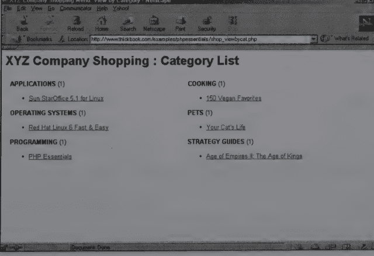

图 0.2 按类别列出的 XYZ 公司产品

你已经退出了 PHP 模式，现在添加基础 HTML 并开始一个无序列表：

```
<!DOCTYPE HTML PUBLIC "-//W3C//DTD HTML 3.2//EN">
<HTML>
<HEAD>
<TITLE>XYZ Company Shopping Menu: View All Products</TITLE>
</HEAD>
<BODY>
<h1>XYZ Company Shopping : View All Products</h1>
<ul>
```

你现在需要做的是创建一个 `while` 循环，用于遍历结果集中的每一行，打印指向产品详情模板文件 `shop_showbook.php` 的链接，并将相应的 ISBN 值作为参数包含在链接中：

```php
<?php 
while ($row = mysql_fetch_array($sql_result)) {
  $isbn = $row["ISBN"];
  $title = $row["TITLE"];
  $category = $row["CATEGORY"];
  echo "\n<li><a href=\"shop_showbook.php?isbn=$isbn\">$title</a> <em>($category)</em></li>\n";
}
?>
```

在关闭所需的 HTML 标签后，整个脚本看起来应该像这样：

```php
// 文件名: shop_viewall.php
// 如果未设置则设置 cookie
if (isset($user_id)) {
  $token = md5(uniqid(rand()));
  setcookie("user_id",$token,time()+86400,"/",".yourcompany.com");
}
// 创建连接
$connection = mysql_connect("localhost","sandman","34Nhjp") or die("Couldn't connect to the database.");

// 选择数据库
$db = mysql_select_db("secretDB", $connection) or die("Couldn't select database.");

// 准备 SQL 语句
$sql = "SELECT ISBN, TITLE, CATEGORY FROM MASTER_PRODUCTS ORDER BY TITLE ASC";

// 执行 SQL 查询，并在任何查询失败时退出
$sql_result = mysql_query($sql,$connection) or die("Couldn't get list!");
?>
```

```html
<!DOCTYPE HTML PUBLIC "-//W3C//DTD HTML 3.2//EN">
<HTML>
<HEAD>
<TITLE>XYZ Company Shopping Menu: View All Products</TITLE>
</HEAD>
<body
<h1>XYZ Company Shopping : View All Products</h1>
<ul>
<?php
while ($row = mysql_fetch_array($sql_result)) {
  $isbn = $row["ISBN"];
  $title = $row["TITLE"];
  $category = $row["CATEGORY"];
  echo "
  <li><a href=\"shop_showbook.php?isbn=$isbn\">$title</a> <em>($category)</em></li>
  ";
}
?>
</ul>
</body>
</html>
```

保存此文件并将其放置在你的 Web 服务器上。转到主购物菜单并点击“按字母顺序查看所有产品”链接。你应该看到类似于图 8.3 所示的内容。

你的目录显示代码的最后一步是产品详情模板，称为 `shop_showbook.php`。打开该名称的文件，并在检查或设置 cookie 之前——检查唯一的必填字段：ISBN。在这个模板中，ISBN 被用于提取整个产品记录。

# 第 8 章：高级 PHP 技术：电子商务

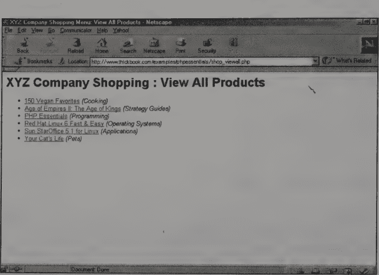

# XYZ 公司购物：查看所有产品

- 150 Vegan Fantasy (烹饪)
- Age of Empires: The Age of Kings (策略指南)
- PHP Essentials (编程)
- Hot Line 5: Fast & Easy (操作系统)
- StarOffice 5.1 for Linux (应用程序)
- Your Cat's Life (宠物)

**图 8.3** 按字母顺序列出的所有 XYZ 公司产品

```php
<?php
// 文件名: shop_showbook.php
if (!($isbn)) {
    header("Location: http://www.yourcompany.com/show_menu.php");
    exit;
}
?>
```

现在添加常用的 cookie 代码和通用连接信息。此脚本中使用的 SQL 语句是：

`$sql = "SELECT * FROM MASTER_PRODUCTS WHERE ISBN = '$isbn'"`

执行查询，或者在发生错误时退出脚本：

`$sql_result = mysql_query($sql,$connection) or die("Couldn't get record!")`

接下来，获取匹配的行并为元素分配有意义的变量名：

```php
$row = mysql_fetch_array($sql_result);
$isbn = $row["ISBN"];
$title = $row["TITLE"];
$author = $row["AUTHOR"];
$publisher = $row["PUBLISHER"];
$category = $row["CATEGORY"];
$type = $row["TYPE"];
```

你现在可以继续构建 HTML 模板，使用变量名代替基础显示表格中的值：

```html
<h1>XYZ 公司购物：书籍详情</h1>

<h2><?php echo "$title"; ?></h2>
<p><?php echo "$info_blurb"; ?></p>

<table>
<tr>
<td><strong>作者：</strong></td>
<td><?php echo "$author"; ?></td>
</tr>
<tr>
<td><strong>出版社：</strong></td>
<td><?php echo "$publisher"; ?></td>
</tr>
<tr>
<td><strong>ISBN：</strong></td>
<td><?php echo "$isbn"; ?></td>
</tr>
<tr>
<td><strong>类别：</strong></td>
<td><?php echo "$category"; ?></td>
</tr>
<tr>
<td><strong>类型：</strong></td>
<td><?php echo "$type"; ?></td>
</tr>
<tr>
<td><strong>页数：</strong></td>
<td><?php echo "$page_num"; ?></td>
</tr>
</table>
```

## 第 8 章：高级 PHP 技术：电子商务

由于这是一个购物系统，为下一节做准备，并为此项目添加“加入购物车”表单。假设下一个脚本名为 `shop_addtocart.php`，并使用此作为 `action`：你需要跟踪项目（ISBN、标题、价格）并为用户创建一个数量字段：

```html
<form method="post" action="shop_addtocart.php">
  <input type="hidden" name="sel_item" value="<?php echo $isbn; ?>">
  <input type="hidden" name="sel_item_title" value="<?php echo $title; ?>">
  <input type="hidden" name="sel_item_price" value="<?php echo $price; ?>">
  <em>数量：</em><input type="text" name="sel_item_qty" value="1" size="3">
  <p><input type="submit" name="submit" value="加入购物车"></p>
</form>
```


从开始到结束，产品详情模板看起来如下：

```php
<?php
// 文件名: shop_showbook.php
if (!isset($isbn)) {
    header("Location: http://www.yourcompany.com/show_menu.php");
    exit;
}

// 如果未设置则设置 cookie
if (!isset($user_id)) {
    $token = md5(uniqid(rand()));
    setcookie("user_id",$token,time()+86400,"/",".yourcompany.com");
}
// 创建连接
$connection = mysql_connect("localhost","sandman","34Nhjp") or die("Couldn't connect to the database.");

// 选择数据库
$db = mysql_select_db("secretDB", $connection) or die("Couldn't select database.");

// 准备 SQL 语句
$sql = "SELECT * FROM MASTER_PRODUCTS WHERE ISBN = '$isbn'";

// 执行 SQL 查询，失败则退出
$sql_result = mysql_query($sql,$connection) or die("Couldn't get record!");

// 获取结果并分配有意义的名称
$row = mysql_fetch_array($sql_result);
$isbn = $row["ISBN"];
$title = $row["TITLE"];
$author = $row["AUTHOR"];
$publisher = $row["PUBLISHER"];
$category = $row["CATEGORY"];
$type = $row["TYPE"];
$info_blurbl = $row["INFO_BLURB"];
$page_num = $row["PAGE_NUM"];
$price = $row["PRICE"];
?>
```

```html
<!DOCTYPE HTML PUBLIC "-//W3C//DTD HTML 3.2//EN">
<HTML>
<HEAD>
<TITLE>XYZ 公司购物菜单：书籍详情</TITLE>
</HEAD>
<body>
<h1>XYZ 公司购物：书籍详情</h1>

<h2><?php echo "$title"; ?></h2>
<p><?php echo "$info_blurbl"; ?></p>

<table>
<tr>
<td><strong>作者：</strong></td>
<td><?php echo "$author"; ?></td>
</tr>
<tr>
<td><strong>出版社：</strong></td>
<td><?php echo "$publisher"; ?></td>
</tr>
<tr>
<td><strong>ISBN：</strong></td>
<td><?php echo "$isbn"; ?></td>
</tr>
<tr>
<td><strong>类别：</strong></td>
<td><?php echo "$category"; ?></td>
</tr>
<tr>
<td><strong>类型：</strong></td>
<td><?php echo "$type"; ?></td>
</tr>
<tr>
<td><strong>页数：</strong></td>
<td><?php echo "$page_num"; ?></td>
</tr>
</table>

<table>
<h3><font color="#FF0000">仅需 <?php echo "$price"; ?>!</font></h3>
<form method="post" action="shop_addtocart.php">
  <input type="hidden" name="sel_item" value="<?php echo "$isbn"; ?>">
  <input type="hidden" name="sel_item_title" value="<?php echo "$title"; ?>">
  <input type="hidden" name="sel_item_price" value="<?php echo "$price"; ?>">
  <em>数量：</em><input type="text" name="sel_item_qty" value="1" size="3">
  <p><input type="submit" name="submit" value="加入购物车"></p>
</form>
</table>
</body>
</html>
```

# XYZ 公司购物：书籍详情

Red Hat Linux：快速且简单

学习 Red Linux 现在轻而易举。你手中拿着的是一个简单理念的预订：帮助你尽可能快速、方便地完成任务。

| 作者 | Craig & Coletia Witherspoon |
| :--- | :--- |
| 出版社 | Primo-Tech |
| ISBN | 07101994 |
| 类别 | 操作系统 |
| 类型 | paperback |
| 页数 | 304 |
| 仅需 | 16.99 |

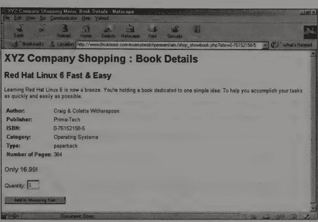

**图 8.4** 个体产品模板

# 第 8 章：高级 PHP 技术：电子商务

- `SEL_ITEM_PRICE` float 类型。用户添加到购物车的商品单价。
- `SEL_ITEM_TOTALPRICE` float 类型。商品总价（商品单价 × 数量）。
- `DATE_ADDED` date 类型。商品添加到购物车的日期。

你还需要创建的下一个 PHP 脚本是 `shop_addtocart.php`，用于处理用户选择商品并添加到其购物车时的输入信息。

打开你的文本编辑器，并为必填字段添加一些代码：

```php
if ((($sel_item)) || (!($sel_item_title)) || (!($sel_item_qty)) ||
(!($sel_item_price))) {
    header("Location: http://www.yourcompany.com/show_menu.php");
    exit;
}
```

接下来，添加常用的 cookie 和通用的 MySQL 连接代码。在完成这些操作后，进行简单的数学计算。通过将数量乘以单价来计算商品总价：

```php
$sel_item_totalprice = $sel_item_qty * $sel_item_price;
```

将商品总价保存在 `USER_TRACK` 表中，可以消除结账时额外的数据库查询和数学函数。

接下来，创建一个变量来以 YYYY-MM-DD 格式存储日期。记录日期标记可以让你在用户决定不进行结算流程时，轻松删除旧的购物车条目。

```php
$date_added = date("Y-m-d");
```

准备用于插入购物车的 SQL 语句并执行查询：

```php
$sql = "INSERT INTO USER_TRACK(\$user_id...
```

最后，向用户显示确认信息：

```html
<!DOCTYPE HTML PUBLIC "//W3C//DTD HTML 3.2//EN">
<HTML>
<HEAD>
<TITLE>XYZ 公司购物：商品已加入购物车</TITLE>
</HEAD>
```

## 创建购物系统

<h1>XYZ 公司购物：商品已加入购物车</h1>

<p><strong>您已将以下商品添加到您的购物车中：</strong></strong></p>

<p><strong>商品：</strong> <?php echo "$sel_item"; ?> <?php echo "$sel_item_title"; ?><br>
<strong>数量：</strong> <?php echo "$sel_item_qty"; ?><br>
<strong>单价：</strong> <?php echo "$sel_item_price"; ?><br>
<strong>总价：</strong> <?php echo "$sel_item_totalprice"; ?>/p></p>

<a href="shop_menu.php">继续购物</a></p>

</BODY>

<HTML>

将所有内容整合在一起，你将得到一个类似下方的脚本：


```php
<?php
// 文件名: shop_addtocart.php
// 检查必填字段
if (!($sel_item)) || (!($sel_item_title)) || (!($sel_item_qty)) ||
(!($sel_item_price)) {
    header("Location: http://www.yourcompany.com/show_menu.php");
    exit();
}

// 如果未设置 cookie 则设置 cookie
if (!isset($user_id)) {
    $token = md5(uniqid(rand()));
    setcookie("user_id",$token+86400,"/","","yourcompany.com");
}

// 创建连接
$connection = mysql_connect("localhost","sandman","34Nhjp") or die("Couldn't
connect to the database.");

// 选择数据库
$db = mysql_select_db("secretDB", $connection) or die("Couldn't select database.");

// 进行一些数学计算！
$sel_item_totalprice = $sel_item_qty * $sel_item_price;

// 格式化日期戳
$date_added = date("Y-m-d");
```

```php
// 向跟踪表中记录的 SQL 语句
$sql = "INSERT INTO USER_TRACK VALUES(\$user_id, \$sel_item, \$sel_item_title, \$sel_item_qty, \$sel_item_price, \$sel_item_total_price, \$date_added)";
```

```php
// 执行 SQL 查询，如果失败则退出
$sql_result = mysql_query($sql,$connection) or die("Couldn't insert record!");
```

```html
<!DOCTYPE HTML PUBLIC "-//W3C//DTD HTML 3.2//EN">
<HTML>
<HEAD>
<TITLE>XYZ 公司购物菜单：商品已加入购物车</TITLE>
</HEAD>
<body>
<h1>XYZ 公司购物：商品已加入购物车</h1>
<p><strong>您已将以下商品添加到您的购物车中：</strong></strong></p>
<p><strong>商品：</strong> <?php echo \$sel_item; ?> ? <?php echo \$sel_item_title; ?> ?<br>
<p><strong>数量：</strong> <?php echo \$sel_item_qty; ?> ?<br>
<p><strong>单价：</strong> <?php echo \$sel_item_price; ?> ?<br>
<p><strong>总价：</strong> <?php echo \$sel_item_total_price; ?> ?</p>
<a href="shop_menu.php">继续购物</a>
</body>
</HTML>
```

再次浏览购物菜单系统，使用单个产品页面上的“加入购物车”按钮。你应该能看到图 8.5 所示的内容。用户现在可以继续浏览你的网站，积极地添加商品。为什么要让消费者自己记住购物车里放了多少商品呢？下一节提供了一段代码，通过始终显示购物车中的数量让你的网站看起来更酷，加上你的结算表单。

## 创建购物系统


### 计数商品

如果你计划在每个页面都显示当前用户的购物车，请确保在任何添加商品的代码之后放置计数。SQL 语句和查询函数非常简单：

```php
$item_count = "SELECT SUM(SEL_ITEM_QTY) FROM USER_TRACK WHERE USER_ID = \$user_id";
$item_result = mysql_query($item_count) or die("Couldn't count!");
$item_count_total = mysql_result($item_result,0,"SUM(SEL_ITEM_QTY)");
```

注意使用 `sum()` 而不是 `count()`。如果用户订购两个商品，`count()` 会返回 1。最困难的部分是在页面上显示购物车总数量，但当你这样做时，可以这样写：

```php
<?php
if ($item_count_total == "1") {
echo "1 item.";
} else {
echo "$item_count_total items.";
}
?>
```

# 第 8 章：高级 PHP 技术：电子商务

添加一个名为 `shop_checkout.php` 的结算表单。你可以随时使用 <a href="shop_checkout.php">结算</a>。你已经准备好向购物者收费了！上一节的 `shop_addtocart.php` 脚本加上购物车计数和显示代码后，看起来如下：

```php
<?php
// 文件名: shop_addtocart.php
// 检查必填字段
if (!($sel_item)) || (!($sel_item_title)) || (!($sel_item_qty)) ||
(!($sel_item_price))) {
    header("Location: http://www.yourcompany.com/show_menu.php");
    exit;
}
// 如果未设置 cookie 则设置 cookie
if (isset($user_id)) {
    $token = md5(uniqid(rand()));
    setcookie("user_id",$token+86400,"/","","yourcompany.com");
}

// 创建连接
$connection = mysql_connect("localhost","sandman","34Nhjp") or die("Couldn't connect to the database.");

# 选择数据库
$db = mysql_select_db("secretDB", $connection) or die("Couldn't select database.");

// 进行一些数学计算！
$sel_item_total_price = $sel_item_qty * $sel_item_price;

// 格式化日期戳
$date_added = date("Y-m-d");

// 向跟踪表中记录的 SQL 语句
```
```html

<!DOCTYPE HTML PUBLIC "//W3C//DTD HTML 3.2//EN">

<HTML>

<HEAD>

<TITLE>XYZ 公司购物菜单：商品已加入购物车</TITLE>

</HEAD>

<body>

<h1>XYZ 公司购物：商品已加入购物车</h1>h1>

<p><strong>您已将以下商品添加到您的购物车中：</strong></strong></p>

<p><strong>商品：</strong> <?php echo \$sel_item; ?> <?php echo \$sel_item_title; ?><br>

<strong>数量：</strong> <?php echo \$sel_item_qty; ?> <br>

<strong>单价：</strong> <?php echo \$sel_item_price; ?> <br>

<strong>总价：</strong> <?php echo \$sel_item_totalprice; ?> ?</p>

<p>您的购物车包含</p>

<?php

// 显示购物车计数

if ($item_count == "1") {

echo "1 item.";

} else {

echo "$item_count_total items.";

}

?>

<br>

你可以随时 <a href="shop_checkout.php">结算</a>。</p>

<p><a href="shop_menu.php">继续购物</a></p>

</body>

</HTML>
```


# 第 8 章：高级 PHP 技术：电子商务


图 8.8 商品已购物车：显示购物车总商品

现在，当你将商品添加到购物车时，页面看起来就像图 8.6 所示。

如果你能成功将商品添加到购物车，在获得成名和财富之前只有最后一步：结算！

## 结算时间！

你现在进入了冲刺阶段。剩下的只是为用户创建账单信息表，并通过加密电子邮件将表单发送到你的邮箱。

创建一个名为 `shop_checkout.php` 的文本文件，添加 cookie 代码和基础 MySQL 连接函数。在测试数据库选择后，获取你需要的数据和初步结果，获取与此用户相关的所有商品的小计：

```php
$getitemot = "SELECT SUM(SEL_ITEM_TOTALPRICE) FROM USER_TRACK WHERE USER_ID = \$user_id";

$itemot_result = mysql_query($getitemot) or die("Couldn't do that item!");

$itemot = mysql_result($itemot_result,0,"SUM(SEL_ITEM_TOTALPRICE)");
```

接下来，确保按照我们看到的方式格式化结果，以便以货币的形式呈现——保留两位小数：

```php
$fmtitemot = sprintf("%.0.2f",$itemot);
```

假设你的商店对超过 $50.00 的订单免邮。为了获取运费金额，请使用此简单的 if...else 语句：

```php
if ($itemtot < $50) {
    $shipping = 4.5;
} else {
    $shipping = 0;
}
```

现在将运费格式化为两位小数：

```php
$fmt_shipping = sprintf("%0.2f", $shipping);
```

最后，获取总额并将结果格式化为两位小数：

```php
$total = $itemtot + $shipping;
$fmt_total = sprintf("%0.2f", $total);
```

接下来，获取用户购物车列出的所有项目，以便在屏幕上显示他知道正在购买的内容：

```php
// get cart items
$get_cart = "SELECT SEL_ITEM
```

检查是否真的内容，如果有，则开始打印表单：

```php
$num_rows = mysql_numrows($cart_result);
if ($num_rows == "0") {
    echo "<p><strong>购物车中没有商品，但感谢您的尝试</strong></p>";
} else {
    echo "
        // Form goes here
```

开始创建 HTML 表单，使用 `shop_sendorder.php` 作为表单的 action：

```html
<!DOCTYPE HTML "-//W3C//DTD HTML 3.2//EN//>
<HTML>
<HEAD>
<TITLE>XYZ 公司购物：结账</TITLE>
</HEAD>
<body>
<h1>XYZ 公司购物：结账</h1>
<FORM ACTION="shop_sendorder.php" METHOD="post">
```

## B 章节：高级 PHP 技术：电子商务

为普通运送和账单信息添加文本字段：姓名、地址、信用卡信息等：

```html
<h2>账单信息</h2>
<table border=0 cellspacing=0 cellpadding=5>
<tr>
<td><<strong>全名：</strong>></td></td>
<td><INPUT TYPE=text NAME="full_name" SIZE=30></td>
</tr>
<tr>
<td><<strong>电子邮箱地址：</strong>></td>
<td><INPUT TYPE=text NAME="email" SIZE=30></td>
</tr>
<tr>
<td><<strong>地址行 1：</strong>></td>
<td><INPUT TYPE=text NAME="address1" SIZE=30></td>
</tr>
<tr>
<td><<strong>地址行 2：</strong>></td>
<td><INPUT TYPE=text NAME="address2" SIZE=30></td>
</tr>
<tr>
<td><<strong>地址行 3：</strong>></td>
<td><INPUT TYPE=text NAME="address3" SIZE=30></td>
</tr>
<tr>
<td><<strong>地址行 4：</strong>></td>
<td><INPUT TYPE=text NAME="address4" SIZE=30></td>
</tr>
<tr>
<td><<strong>信用卡类型：</strong>></td>
<td>
<SELECT NAME="cc_type">
<OPTION VALUE="0">-- 选择选择 --</OPTION>
```

### 创建购物系统

```html
<OPTION VALUE="Visa">Visa</OPTION>
<OPTION VALUE="MasterCard">MasterCard</OPTION>
</SELECT>
</td>
</tr>
<tr>
<td><<strong>信用卡号：</strong>></td></td>
<td><INPUT TYPE=text name="cc_num" SIZE=30></td>
</tr>
```

```html
<tr>
<td><<strong>信用卡有效期：</strong>> </td>
<td>
<SELECT NAME="cc_exp_mon">
<OPTION VALUE="01">--</OPTION>
<OPTION VALUE="1">01</OPTION>
<OPTION VALUE="2">02</OPTION>
<OPTION VALUE="3">03</OPTION>
<OPTION VALUE="4">04</OPTION>
<OPTION VALUE="5">05</OPTION>
<OPTION VALUE="6">06</OPTION>
<OPTION VALUE="7">07</OPTION>
<OPTION VALUE="8">08</OPTION>
<OPTION VALUE="9">09</OPTION>
<OPTION VALUE="10">10</OPTION>
<OPTION VALUE="11">11</OPTION>
<OPTION VALUE="12">12</OPTION>
</SELECT>
```

```html
SELECT NAME="cc_exp_yr">
<OPTION VALUE="0">--</OPTION>
<OPTION VALUE="1999">1999</OPTION>
<OPTION VALUE="2000">2000</OPTION>
<OPTION VALUE="2001">2001</OPTION>
<OPTION VALUE="2002">2002</OPTION>
<OPTION VALUE="2003">2003</OPTION>
<OPTION VALUE="2004">2004</OPTION>
```

## 第 8 章节：高级 PHP 技术：电子商务

```html
<OPTION VALUE="2005">2005</OPTION>
<OPTION VALUE="2006">2006</OPTION>
<OPTION VALUE="2007">2007</OPTION>
<OPTION VALUE="2008">2008</OPTION>
<OPTION VALUE="2009">2009</OPTION>
</SELECT>
</td>
</tr>
<table>
```

添加一个标题和一个表格来显示用户的购物车内容：

```html
<h2>购物车内容</h2>
<table border=1 padding=10 cellspacing=0>
<tr>
<td align="center">项目</td>
<td align="center">标题</td>
<td align="center">数量</td>
<td align="center">价格</td>
<td align="center">总计</td>
</tr>
```


使用方便的 `while` 循环遍历 `$cart_result`，以表格格式显示所有元素：

```php
while ($row = mysql_fetch_array($cart_result)) {
  // 获取结果并分配有意义的名字
  $sel_item = $row["SEL_ITEM"];
  $sel_item_title = $row["SEL_ITEM_TITLE"];
  $sel_item_qty = $row["SEL_ITEM_QTY"];
  $sel_item_price = $row["SEL_ITEM_PRICE"];
  $sel_item_total_price = $row["SEL_ITEM_TOTAL_PRICE"];
  $fmt_total_price = sprintf("%0.2f", $sel_item_total_price);
  echo "<tr>
  <td>td$sel_item</td>
  <td>$sel_item_title</td>
  <td align="right">$sel_item_qty</td>
  <td align="right">$sel_item_price</td>
  <td align="right">$fmt_total_price</td>
</tr>";
}
```

再次提取表格代码，为项目小计、运费和总额添加格式化值：

```php
echo "<tr>
<td colspan="4" align="right"><strong>项目小计：</strong></td>
<td align="right"><strong>$fmt_itemtot</strong></td></tr>
<tr>
<td colspan="4" align="right"><strong>运费：</strong></td>
<td align="right">
if ($shipping != "0") {
    echo "<strong>$fmt_shipping</strong>";
} else {
    echo "<strong>免费！</strong>";
}
echo "
</td></tr>
<tr><td colspan="4" align="right"><strong>总额：</strong></td>
<td align="right"><strong>$fmt_total</strong></td></tr>";
```

添加“提交订单！”提交按钮，并关闭所有标签：

```html
<tr><td colspan="5" align="center"><input type="submit" name="submit" value="提交订单!"></td></tr>
</table>
</form>
?>
<body>
</html>
```

`shop_checkout.php` 脚本从开始到结束大致如下：

```php
<?php
// 文件名：shop_checkout.php
```

```php
// 如果未设置，则设置 cookie
if (!isset($user_id)) {
    $token = md5(uniqid(rand()));
    setcookie("user_id",$token,time()+86400,"/",".company.com");
}
```

```php
// 创建连接
$connection = mysql_connect("localhost", "sandman", "34Nhjp") or die("无法连接到数据库.");
```

```php
// 选择数据库
$db = mysql_select_db("secretDB", $connection) or die("无法连接到数据库.");
```

```php
// 获取购物车小计
$get_itemot = "SELECT SUM(SEL_ITEM_TOTALPRICE) FROM USER_TRACK WHERE USER_ID = $user_id";
$itemot_result = mysql_query($get_itemot) or die ("无法计算!");
$itemot = mysql_result($itemot_result, 0, "SUM(SEL_ITEM_TOTALPRICE)");
$fmt_itemot = sprintf("%0.2f", $itemot);
```

```php
if ($itemot < "50") {
    $shipping = 4.5;
} else {
    $shipping = 0;
}
$fmt_shipping = sprintf("%0.2f", $shipping);
$total = $itemot + $shipping;
$fmt_total = sprintf("%0.2f", $total);
```

```php
// 获取购物车
$get_cart = "SELECT SEL_ITEM_SEL, SEL_ITEM_TITLE, SEL_ITEM_QTY, SEL_ITEM_TOTALPRICE FROM USER_TRACK WHERE USER_ID = $user_id";
$cart_result = mysql_query($get_cart) or die ("无法获取购物车!");
```

```php
$num_rows = mysql_numrows($cart_result);
if ($num_rows == "0") {
```

## 创建购物系统

```php
</SELECT>
/
<SELECT NAME="*cc_exp_yr*">
<OPTION VALUE="0*">--</OPTION>
<OPTION VALUE="1999">1999</OPTION>
<OPTION VALUE="2000">2000</OPTION>
<OPTION VALUE="2001">2001</OPTION>
<OPTION VALUE="2002">2002</OPTION>
<OPTION VALUE="2003">2003</OPTION>
<OPTION VALUE="2004">2004</OPTION>
<OPTION VALUE="2005">2005</OPTION>
<OPTION VALUE="2006">2006</OPTION>
<OPTION VALUE="2007">2007</OPTION>
<OPTION VALUE="2008">2008</OPTION>
<OPTION VALUE="2009">2009</OPTION>
</SELECT>
</td>
</tr>
</table>
```

## 购物车内容

| 物品 ID | 标题 | 数量 | 价格 | 总计 |
| :--- | :--- | :--- | :--- | :--- |

*

```php
while ($row = mysql_fetch_array($cart_result)) {
  // 获取结果并分配有意义的变量名
$sel_item = $row["SEL_ITEM"];
$sel_item_title = $row["SEL_ITEM_TITLE"];
$sel_item_qty = $row["SEL_ITEM_QTY"];
$sel_item_price = $row["SEL_ITEM_PRICE"];
$sel_item_totalprice = $row["SEL_ITEM_TOTALPRICE"];
$fmt_item_totalprice = sprintf("%.2f",$sel_item_totalprice);
```

```php
echo "
<tr>
<td>$sel_item</td>
<td>$sel_item_title</td>
<td align="right">$sel_item_qty</td>
<td align="right">$sel_item_price</td>
<td align="right">$fmt_item_totalprice</td>
</tr>
";
```

```php
echo "
<tr><td colspan=\"4\" align=\"right\"><strong>总计:</strong></td>
<td align=\"right\"><strong>$fmt_total</strong></td></tr>
<tr><td colspan=\"5\" align=\"center\"><input type=\"submit\" name=\"submit\"
```

## 创建购物系统

```php
value=\"*发送此订单!\"/></td></td></tr>
```


回到任何带有结账链接的页面，并点击该链接。现在你应该能看到一个表单和一个购物车，如图 8.7 所示。

最后一步是：发送加密后的表单并清除购物车项目！


**图 8.7** 显示的结账表单和购物车内容

# B 章：高级 PHP 技术：电子商务

## 通过电子邮件发送安全订单

就是现在了：真相的时刻。最后一步将把结账表单的内容通过在本章开头学到的加密电子邮件发送给你。这一步的 PHP 脚本 `shop_sender.php` 与 `shop_checkout.php` 几乎相同，因此请复制后者的副本，我将带你完成这些修改。

首先，检查必填字段。这里有很多字段，所以准备好面对一个庞大的 `if` 语句！

下一个更改是移除表单元素并将变量的值作为文本打印出来，作为对用户的确认。例如，在 `echo` 语句中，按如下方式显示用户的全名：

```html
<tr>
<td><strong>全名:</strong></td>
<td>$full_name</td>
</tr>
```

继续处理结账表单中的其他字段。下一个修改是向用户显示购物车项目的 `while` 循环部分。保留该循环中的原始 `echo` 语句，在其之后添加如下：

```php
$items .= "$sel_item_qty $sel_item_title at $sel_item_price\n";
```

这会将元素添加到名为 `$items` 的字符串中，我们稍后会使用它。在显示所有 HTML 之前，其他内容保持不变。现在是发送电子邮件了。通过创建一个 `$msg` 变量开始，然后将其连接到你的喜中：

```php
$msg = "XYZ 订单表\n";
$msg .= "--\n";
$msg .= "客户信息\n";
$msg .= "全名: $full_name\n";
$msg .= "电子邮件: $email\n";
$msg .= "地址 1: $address1\n";
```

## 创建购物系统

```php
$msg .= "地址 2: $address2\n";
$msg .= "地址 3: $address3\n";
$msg .= "地址 4: $address4\n";
$msg .= "信用卡类型: $cc_type\n";
$msg .= "信用卡号: $cc_num\n";
$msg .= "过期日期: $cc_exp_yr\n";
$msg .= "已购物品:\n";
```

现在将之前在 `while` 循环中创建的 `$items` 字符串添加：

```php
$msg .= "$items";
```

继续操作，通过将总计添加到消息字符串来完成：

```php
$msg .= "总计\n";
$msg .= "项目总计: $fmt_item_total\n";
```

使用 `if...else` 语句将运运费添加到消息：

```php
$msg .= "总计: $fmt_total\n";
```

接下来，执行 SQL 语句清除购物车中的物品，以免它们占用空间：

```php
$rm_item_sql = "DELETE FROM USER_TRACK WHERE USER_ID = $user_id";
mysql_query($rm_item_sql);
```

是加密电子邮件了。遵循在本章开头使用的过程。此示例使用了 PGP，但你可以替换为 GPG。

```php
// 设置 PGPATH 环境变量
putenv("PGPATH=/home/user/.pgp");
```

```php
// 创建一个用于写入的文件。
// 将消息内容写入创建的文件中，然后关闭文件。
$fp = fopen("/path/to/input/data", "w+");
fwrite($fp, $msg);
```

# 第 8 章：高级 PHP 技术：电子商务

```php
fclose($fp);
// 调用 PGP 加密数据并输出到新文件。
system("/usr/local/bin/pgp -r Julie@thickbook.com -o /path/to/output/data < /path/to/input/data");
// 从系统删除未加密的文件
unlink("/path/to/input/data");
// 将加密数据的路径赋值变量 $encrypted。
$encrypted = "/path/to/output/data";
// 打开加密文件读取，将加密文件的全部
// 内容放入变量 $mail_cont，然后关闭文件。
$fd = fopen($encrypted, "r");
$mail_cont = fread($fd, filesize($encrypted));
fclose($fd);
// 从系统删除加密文件。
unlink($encrypted);
// 构建邮件并发送给目标接收人。
$recipient = "julie@thickbook.com";
$subject = "XYZ 公司订单表";
$mailheaders = "From: XYZ Company\n";
$mailheaders .= "Reply-To: $email\n";
mail($recipient, $subject, $mail_cont, $mailheaders);
```

令人难以信，就只有这些。整个 `shop_sendorder.php` 脚本如下：

```php
<?php
// 文件名：shop_sendorder.php
// 如果未设置则设置 cookie
if (!isset($user_id)) {
    $token = md5(uniqid(rand()));
```

```php
setcookie("user_id", $token, time()+86400, "/", ".your.com");
// 创建连接
$connection = mysql_connect("localhost","sandman","34Nhjtp") or die("无法连接数据库。");
// 选择数据库
$db = mysql_select_db("secretDB", $connection) or die("无法选择数据库。");
// 获取购物车小计
$getitemot = "SELECT SUM(SEL_ITEM_TOTALPRICE) FROM USER_TRACK WHERE USER_ID = $user_id";
$getitemot_result = mysql_query($getitemot) or die("无法进行计算！");
$getitemot = mysql_fetch($getitemot_result,0,"SUM(SEL_ITEM_TOTALPRICE)");
$fmt_getitemot = sprintf("%.2f", $getitemot);
if ($getitemot < "50") {
  $shipping = 4.5;
} else {
  $shipping = 0;
}
$fmt_shipping = sprintf("%.2f", $shipping);
$total = $getitemot + $shipping;
$fmt_total = sprintf("%.2f", $subtotal);
// 获取购物车
$get_cart = "SELECT SEL_ITEM, SEL_ITEM_TITLE, SEL_ITEM_QTY, SEL_ITEM_PRICE, SEL_ITEM_TOTALPRICE FROM USER_TRACK WHERE USER_ID = $user_id\n";
$cart_result = mysql_query($get_cart) or die("无法获取购物车!");
$num_rows = mysql_num_rows($cart_result);
if ($num_rows != "0") {
  echo "<P><<strong>您的购物车中没有物品，但感谢您的尝试。</p></P>";
} else {
  echo "";
}
```

```html
<td>$address4</td>
</tr>
<tr>
<td><strong>信用卡类型：</strong>></td>
<td>$cc_type</td>
</tr>
<tr>
<td><strong>信用卡号：</strong>></td>
<td>$cc_num</td>
</tr>
<tr>
<td><strong>信用卡有效期：</strong>></td>
<td>$cc_exp_mon / $cc_exp_yr</td>


## 购物车内容

| 项目 ID | 标题 | 数量 | 价格 | 总计 |
| :--- | :--- | :--- | :--- | :--- |

```php
*;
while ($row = mysql_fetch_array($cart_result)) {
    // 获取结果并分配有意义的变量名
    $sel_item = $row["SEL_ITEM"];
    $sel_item_title = $row["SEL_ITEM_TITLE"];
    $sel_item_qty = $row["SEL_ITEM_QTY"];
    $sel_item_price = $row["SEL_ITEM_PRICE"];
    $sel_item_total_price = $row["SEL_ITEM_TOTALPRICE"];
    $fnt_item_total_price = sprintf("%0.2f",$sel_item_total_price);
    echo "
<tr>
<td>$sel_item_title</td>
<td align=\"right\">$sel_item_qty</td>
<td align=\"right\">$sel_item_price</td>
<td align=\"right\">$fnt_item_total_price</td>
</tr>
";
    items .= "$sel_item_qty $sel_item ($sel_item_title) at $sel_item_price each\n";
}
echo "
<td colspan=\"4\" align=\"right\"><strong>项目总计：</strong>></td>
<td align=\"right\"><strong>$fmt_itemtotot</strong></td></tr>
<tr><td colspan=\"4\" align=\"right\"><strong>运费：</strong>></td>
<td align=\"right\">";
```

```php
if ($shipping != "0") {
  echo "<strong>$fmt_shipping</strong>";
} else {
  echo "<strong>免费！</strong>";
}
echo "
<td</td></tr>
<tr><td colspan=\"4\" align=\"right\"><strong>总额：</strong>></td>
<td align=\"right\">$fmt_total</td></tr>
<tr><td colspan=\"5\" align=\"center\"><strong>感谢您的订单！</strong>></td></tr>
";
```

```html
</td></tr>
<table>
</form>
<body>
</html>
```

```php
// 开始构建邮件正文
$msg = "XYZ 公司订单表\n";
$msg .= "-------------------------------------------------------------------------------------------------------------------------------------------------------------------------------------------------\n\n";
$msg = "客户信息\n";
$msg = "全名: $full_name\n";
$msg = "邮箱: $email\n";
$msg .= "地址行 1: $address1\n";
$msg .= "地址行 2: $address2\n";
$msg .= "地址行 3: $address3\n";
$msg .= "地址行 4: $address4\n";
$msg = "信用卡类型: $cc_type\n";
$msg = "信用卡号: $cc_num\n";
$msg = "有效期: $cc_exp_mon / $cc_exp_yr\n";
$msg = "已购项目\n";
$msg = "$items\n";
$msg = "总计\n";
$msg = "项目总计: $fmt_itemtot\n";
```

```php
if ($shipping != "0") {
    $msg = "运费: $fmt_itemtot\n";
} else {
    $msg = "运费: 免费\n";
}
$msg = "总额: $fmt_total\n";
// 从购物车中移除项目
$rm_item_sql = "DELETE FROM USER_TRACK WHERE USER_ID = \$user_id\"";
```

# 第 8 章：高级 PHP 技术：电子商务

```php
mysql_query($rm_item_sql) or die("无法删除项目。");
// 设置 PGPPATH 环境变量
putenv("PGPPATH=/homedir/of/PHP/user/.pgp");
// 创建一个文件写入临时数据。
// 将消息字符串的内容写入上面创建的
// 文件中，然后关闭文件。
$fp = fopen("/path/to/temp/input/data", "w+");
fputs($fp, $msg);
fclose($fp);
// 调用 PGP 加密数据并输出到新文件。
system("/usr/local/bin/pgp -r julie@thickbook.com -o /path/to/temp/output/data < /path/to/input/data");
// 从系统中删除未加密的文件
unlink("/path/to/input/data");
// 将加密数据赋值给变量 $encrypted
$encrypted = "/path/to/temp/output/data";
// 打开加密文件进行读取，将整个文件的内容读入变量 $mailcont，然后关闭文件。
$fd = fopen($encrypted, "r");
$mailcont = fread($fd, filesize($encrypted));
close($fd);
// 构建邮件消息并发送给目标
$recipient = "julie@thickbook.com";
$subject = "XYZ 订单";
$mailheaders = "来自: $email\n";
```

继续操作，如图 8.8 所示提交一个测试订单。

![img/fbb503a1d75df488da] 图 8.8 完成

# 第 8 章：高级 PHP 技术：电子商务

![img/fbb503a1d75df488] 图 8.9 已发送

## 更多高级技术

然后，检查你的收件箱是否有如下邮件：

-----BEGIN PGP MESSAGE-----
Version: PGP for Privacy 5.0
MessageID: W8X3uPC7b8mJfusEZE6sK09d84bzK+qWhf5NNjg7j5
-----END PGP MESSAGE-----

```php
<? "我正在使用第二种标签对类型。<br>"; ?>
```

```html
<script language="php">
echo "我正在使用第三种标签对类型。<br>";
</script>
<BODY>
</HTML>
```

访问时，脚本将显示这些内容：

- 我正在使用第一种标签对类型。
- 我正在使用第二种标签对类型。
- 我正在使用第三种标签对类型。

当你在创建 PHP 脚本时，你正在创建一组发送到 PHP 引擎的指令。每条指令都必须以分号 `;` 结束，它也称为指令分隔符。

以下是正确结束的指令示例：

```php
<php
echo "<P>Hello World! I'm using PHP!</P>\n";
echo "<P>This is another message.</P>";
?>
```

其中一条指令缺少了分号：

```php
<php
echo "<P>Hello World! I'm using PHP!</p>\n"
echo "<P>This is another message.</</p>"
?>
```

因此它会产生一个糟糕的错误，例如：
`Parse error: parse error, expecting "*" or ":" in /path/to/script on line 9`

PHP 语法的最后一个重要部分是在代码内部进行注释的方法。使用双斜杠 `//` 来表示注释：

```php
<php
// 下一条语句打印一行文本
echo "<P>Hello World! I'm using PHP!</P>\n";
?>
```


注释“The next statement prints a line of text”在你的源代码中可见，但不会在你的 HTML 输出中被打印。

对于多行注释，你可以用 `/**` 和 `*/` 包围你的文本，如下：

```php

<?php

/* 这是一个非常长的注释，

它将跨越多行 */

?>

```

注释代码是一个良好的习惯，因为当其他程序员需要进行更改或尝试学习你的工作时，这可以帮助他们理解你正试图用这段代码做什么。

### 变量

你创建变量来表示数据。例如，以下变量存储了销售税的值：

`$sales_tax = 0.0875;`

这个变量存储了一个 SQL 语句：

`$sql = "SELECT * FROM MY_TABLE";`

在确定新变量的值时，你可以引用其他变量的值：
`$tax_total = $sales_tax * $sub_total;`

以下关于变量名的描述是正确的：

- 它们以美元符号 (`$`)开头。
- 它们不能以数字开头。
- 它们可以包含数字和下划字符 (`_` )。
- 它们区分大小敏感。

这里是一些常见的变量类型：

- 数组 (`arrays`)
- 浮点数 (`floats`)
- 整数 (`integers`)
- 字符串 (`strings`)

这些类型是由 PHP 根据它们出现的上下文决定的。

### 数组

在下面的示例中，`$fave_colors` 是一个包含字符串元素的数组。在这种情况下，数组元素（0 到 3）是颜色名称。

```php

$fave_colors[0] = "red";

$fave_colors[1] = "blue";

$fave_colors[2] = "black";

$fave_colors[3] = "white";

```

数组元素从 0 开始计数。

### 浮点数

以下变量每一个都是浮点数：

```php

$a = 15;

$b = -521;

```

### 字符串

双引号内的系列字符被视为字符串。

```php

$a = "I am a string.";

$b = "<p>This book is cool</p>";

```

你也可以在字符串中引用其他变量，它们在脚本执行时会被替换。例如：

```php

$num = 57; // 整数

$my_string = "I read this book $num times!"; // 字符串

```

# 附录 A：PHP 语言参考

取决于你的 HTML 表单方法（GET 或 POST），变量将是 `$HTTP_POST` 数组的一部分。输入字段将产生变量 `$first_name`：

```html

<input type="text" name="first_name" size="20">

```

如果表单方法是 GET，该变量也可以被引用为 `$HTTP_GET["first_name"]`。

### Cookies

与表单一样，来自 Cookie 的变量保存在全局数组 `$HTTP_COOKIE` 中。如果你设置了一个名为 "user" 的 cookie，如下：

```php

SetCookie("user", "Joe Smith", time(3600));

```

一个名为 `$user` 的变量将被放置在 `$HTTP_COOKIE` 中，值为 "Joe Smith"。你可以引用 `$HTTP_COOKIE['user']` 来获取该值。

### 环境变量

当 Web 浏览器发出请求时，环境变量随请求发送到 Web 服务器。它们对于 PHP 脚本显示动态内容或授权非常有用。以下是一些环境变量：

`REMOTE_ADDR` 获取请求机器的 IP 地址。例如：

```php

$remote_address = getenv("REMOTE_ADDR");

echo "Your IP address is $remote_address.";

```

`HTTP_USER_AGENT` 获取浏览器类型、语言编码和平台。例如：

```php

$browser_type = getenv("HTTP_USER_AGENT");

echo "You are using $browser_type";

```

环境变量列表及其描述，请访问 `http://php.net/manual/env`。

### 运算符

运算符是表示特定操作的符号。例如，`+`运算符相两个值，`=`运算符为变量赋值。

### 算术运算符

算术运算符与简单数学有惊相似之处，如表 A.2 所示。在示例中，`$a` 和 `$b$`。

# 表 A.2 算术运算符

| 运算符 | 名称 | 示例 |
| :--- | :--- | :--- |
| + | 加 | `$c = $a + $b;` |
| - | 减 | `$c = $a - $b;` |
| * | 乘 | `$c = $a * $b;` |
| / | 除 | `$c = $a / $b;` |
| % | 取模，或“余数” | `$c = $a % $b;` |

### 赋值运算符

`=` 是基础赋值运算符：
`$a = 1;` // `$a` 的值为 1

其他赋值运算符包括 `+=`、`-=` 和 `.=`。

```php

$ex += 1; // 将 ($ex + 1) 的值赋予 $ex。如果 $ex = 2，那么 $ex += 1 的值是 3。

$ex -= 1; // 将 ($ex - 1) 的值赋予 $ex。如果 $ex = 2，那么 $ex -= 1 的值是 1。

$ex .= "coffee"; // 拼接（添加）到字符串。$ex = "I like" 那么 ($ex .= "coffee") 的值是 "I like coffee"。

```

### 比较运算符

比较运算符比较两个值，这并不令人意料。比较返回 TRUE 或 FALSE 值，如表 A.3 所示。

| 运算符 | 名称 | 示例 | 结果 (T/F) |
| :--- | :--- | :--- | :--- |
| == | 等于 | `$a == $b` | 如果 `$a` 等于 `$b` 则为 TRUE |
| != | 不等于 | `$a != $b` | 如果 `$a` 不等于 `$b` 则为 TRUE |
| > | 大于 | `$a > $b` | 如果 `$a` 大于 `$b$` 则为 TRUE |
| < | 小于 | `$a < $b` | 如果 `$a$` 小于 `$b$` 则为 TRUE |
| >= | 大于等于 | `$a >= $b` | 如果 `$a$` 大于等于 `$b` 则为 TRUE |
| <= | 小于等于 | `$a <= $b` | 如果 `$a` 小于等于 `$b` 则为 TRUE |

# 增减运算符

增减运算符运算符的操作正如其名称所示（参见表 A.4）。

| 名称 | 用法 | 结果 |
| :--- | :--- | :--- |
| 前增 | ++a | `$a$` 增加 1 |
| 后增 | `$a++` | `$a` 增加 1 |
| 前减 | --a | `$a` 减去 1 |
| 后减 | `$--` | `$a` 减去 1 |

### 逻辑运算符

逻辑运算符允许脚本根据条件的状态执行代码，并在 `if_else` 或 `while` 语句的上下文（参见表 A.5）。

# 表 A.5 逻辑运算符

| 运算符 | 名称 | 示例 | 结果 (T/F) |
| :--- | :--- | :--- | :--- |
| ! | 非 | `$a` | 如果 `$a$` 为假 |
| && | 与 | `$a && $b` | 如果 `$a` 和 `$b` 都为真 |
| || | 或 | `$a || $b` | 如果 `$a` 或 `$b` 其中之一为 |

### 控制结构

程序本质上是语句的系列。控制结构正如其名称所示，控制语句的执行。控制结构通常围绕一系列条件构建，例如“如果天空是蓝色的，就出去玩。”在这个例子中，条件是“如果天空是蓝色的”，语句是“出去玩”。

控制结构利用大括号 (`{` 和 `}`) 来分离程序的其余语句组。常见控制结构的示例如下；记忆这些会让你的生活变得容易。

### if...elseif...else

`if_elseif_else`结构根据被测试表达式的值执行语句。在下面的示例`if`语句中，被测试的表达式是“a等于10”。

```php

if ($a == "10") {

    // 执行某些代码

}

```

在评估 `$a` 后，如果发现它的值为10（即条件为 TRUE），则大括号内的代码将执行。如果发现 `$a$` 的值不是10（如果条件为 FALSE），该代码将被忽略，程序将继续运行。

为了提供另一种语句系列，如果 `$a$` 的值不是10，请在结构中添加一个 `else` 语句，以便在条件为 FALSE 时执行部分代码：
FALSE:

```php

if ($a == "10") {

    echo "a equals 10";

} else {

    // 执行某些代码

}

```

# 附录 A：PHP 语言核心参考

```php

else {

    echo "a does not equal 10";

}
```


可以将 `elseif` 语句添加到结构中，以便在进入最后的 `else` 语句之前评估备选表达式。例如，以下结构首先评估 `$a` 是否等于 `10`。如果该条件为 `FALSE`，则评估 `elseif` 语句。如果发现为 `TRUE`，则执行其大括号内的代码。否则，程序将继续执行最后的 `else` 语句：

```php
if ($a == "10") {
    echo "a equals 10";
} elseif ($b == "8") {
    echo "b equals 8";
} else {
    echo "a does not equal 10 and b does not equal 8";
}
```

你可以单独使用这些语句，也可以将其作为 `if_else` 或 `if_elseif_else` 语句的一部分。无论你选择哪种，你都会发现这个结构是你程序中不可或缺的元素！

# while

与 `if_elseif_else` 结构不同（后者每个表达式只被评估一次，并根据其 TRUE 或 FALSE 值执行操作），`while` 语句会持续循环直到表达式为 FALSE。换句话说，只要表达式为 TRUE，`while` 循环就会一直持续下去。

例如，在下面的 `while` 循环中，只要 `$a` 的值小于或等于 `5`，就会在屏幕上打印 `$a` 的值并加 `1`。

```php
$a = 0 // 设置起点
while ($a <= "5") {
    echo "a equals $a<br>";
    $a++;
}
```

这是该循环的输出：

- equals 0
- equals 1
- a equals 2
- a equals 3
- a equals 4
- equals 5

# for

和 `while` 循环一样，`for` 循环在每次循环开始时评估一组条件表达式。以下是 `for` 循环的语法：

```php
for (expr1; expr2; expr3) {
    // 要执行的代码
}
```

在每次循环开始时，首先评估第一个表达式，然后评估第二个表达式。如果第二个表达式为 TRUE，循环继续执行代码，然后评估第三个表达式。如果第二个表达式为 FALSE，循环将停止，第三个表达式永远不会被评估。

取 `while` 循环中使用的计数示例，使用 `for` 循环重写它：

```php
for ($a = 0; $a <= "5"; $a++) {
    echo "a equals $a<br>";
}
```

输出与 `while` 循环相同：

a equals 0
a equals 1
a equals 2
a equals 3
a equals 4
a equals 5

### 内置函数

有许多 PHP 函数可以配合数组使用。这里只列出几个——我认为绝对重要的，以及那些构成了数组操作知识基础的。PHP4 中的新数组函数已如此标记，它们确实让数组操作变得简单得多！

# array()

`array()` 函数允许你手动为数组分配值。以下是 `array()` 函数的语法：

```php
$array_name = array("val1", "val2", "val13", ...);
```

例如，要创建一个名为 `$colors` 包含值 `"blue"`、`black"`、`red"` 和 `"green"` 的数组，使用以下代码：

```php
$colors = array("blue", "black", "red", "green");
```

# array_push()

`array_push()` 函数的语法是：

```php
array_push(array_name, "element1", "element2", ...);
```

例如，假设你有一个包含元素 `"1"` 和 `"2"` 的数组，你想添加元素 `"3"`、`"4"`、`"5"` 和 `"cool"`。你会使用这段代码：

```php
$sample = array(1, 2);
array_push($sample, 3, 4, 5, "cool");
```

你可以使用下面的脚本打印 `$sample` 数组的“之前”和“之后”版本：

```php
<?php
// 打印之前
$sample = array(1, 2);
echo "BEFORE:<br>";
while (list($key, $value) = each($sample)) {
    echo "$key : $value<br>";
}
// 重置指针到起始位置
reset($sample);
// 添加到现有数组的末尾
array_push($sample, 3, 4, 5, "cool");
// 打印之后
echo "AFTER:<br>";
while (list($key, $value) = each($sample)) {
    echo "$key : $value<br>";
}
?>
```


上述脚本将输出：

```
BEFORE:
0: 1
1: 2
AFTER:
0: 1
1: 2
2: 3
3: 4
4: 5
5: cool
```

# array_pop()

`array_pop()` 函数的语法是：

```php
array_pop(array_name);
```

例如，假设你有一个包含元素 `"1"`、`"2"`、`"3"`、`"4"`、`"5"` 和 `"cool"` 的数组，你想移除 `"cool"` 元素。你会使用这段代码：

```php
$sample = array(1, 2, 3, 4, 5, "cool");
$last = array_pop($sample);
```

你可以使用下面的脚本打印 `$sample` 数组的“之前”和“之后”版本以及 `$last` 的值：

```php
<?php
// 打印之前
$sample = array(1, 2, 3, 4, 5, "cool");
echo "BEFORE:<br>";
while (list($key, $value) = each($sample)) {
    echo "$key : $value<br>";
}
// 重置指针到起始位置
reset($sample);

// 移除现有数组的末尾
$last = array_pop($sample);
// 打印之后
echo "AFTER:<br>";
while (list($key, $value) = each($sample)) {
    echo "$key : $value<br>";
}
?>
```

上述脚本将输出：

```
BEFORE:
0: 1
1: 2
2: 3
3: 4
4: 5
5: cool
AFTER:
0: 1
1: 2
2: 3
3: 4
4: 5
```

# array_unshift()

`array_unshift()` 函数的语法是：

```php
array_unshift(array_name, "element1", "element2", ...);
```

例如，假设你有一个包含元素 `"1"` 和 `"2"` 的数组，你想为其添加元素 `"3"`、`"4"`、`"5"`。你会使用这段代码：

```php
$sample = array(1, 2);
array_unshift($sample, 3, 4, 5);
```

你可以使用下面的脚本打印 `$sample` 数组的“之前”和“之后”版本：

```php
<?php
// 打印之前
$sample = array(1, 2);
echo "BEFORE:<br>";
while (list($key, $value) = each($sample)) {
    echo "$key : $value<br>";
}
// 重置指针到起始位置
reset($sample);
// 添加到现有数组的开头
array_unshift($sample, 3, 4, 5);
// 打印之后
echo "AFTER:<br>";
while (list($key, $value) = each($sample)) {
    echo "$key : $value<br>";
}
?>
```

上述脚本将输出：

```
BEFORE:
0: 1
1: 2
AFTER:
0: 3
1: 4
2: 5
3: 1
4: 2
```

# array_shift()

`array_shift()` 函数的语法是：

```php
array_shift(array_name);
```


例如，假设你有一个包含元素 "1"、"2"、"3"、"4"、"5" 和 "cool" 的数组，你想移除 "1" 元素。你会使用这段代码：

```php
$sample = array(1, 2, 3, 4, 5, "cool");
$first = array_shift($sample);
```

你可以使用下面的脚本打印 `$sample` 数组的“之前”和“之后”版本以及 `$first` 的值：

```php
<?php
// 打印之前
$sample = array(1, 2, 3, 4, 5, "cool");
echo "BEFORE:<br>";
while (list($key, $value) = each($sample)) {
    echo "$key : $value<br>";
}
// 重置指针到起始位置
reset($sample);
// 移除现有数组的开头
$first = array_shift($sample);
// 打印之后
echo "AFTER:<br>";
echo "first: $first<br>";
while (list($key, $value) = each($sample)) {
    echo "$key : $value<br>";
}
?>
```

上述脚本将输出：

```
BEFORE:
0: 1
1: 2
2: 3
3: 4
4: 5
5: cool
AFTER:
first: 1
0: 2
1: 3
2: 4
3: 5
4: cool
```

# `array_slice()`

`array_slice()` 函数的语法是：

```php
array_slice(array_name, start_position, offset, length);
```

例如，你可能有一个包含元素 "1"、"2"、"3"、"4"、"5" 和 "cool" 的数组，你想提取该数组的某些部分。示例：

```php
$sample = array(1, 2, 3, 4, 5, "cool");
// 从第二个位置开始
$slice1 = array_slice($sample, 1);
// 从第二个位置开始，到倒数第二个之前
$slice2 = array_slice($sample, 1, -1);
// 从第五个位置开始
$slice3 = array_slice($sample, 4);
// 从第一个位置开始，取 3 个元素
$slice4 = array_slice($sample, 0, 3);
```

```php
$sample = array(1, 2, 3, 4, 5, "cool");
```

```php
echo "BEFORE:<br>";
while (list($key, $value) = each($sample)) {
    echo "$key : $value<br>";
}
```

```php
// reset array pointer to first position
reset($sample);
```

```php
// extract slices of existing array
$slice1 = array_slice($sample, 1);
$slice2 = array_slice($sample, 1, -1);
$slice3 = array_slice($sample, 4);
$slice4 = array_slice($sample, 0, 3);
```

```php
// echo slice1
echo "<br>slice1 (start at 2nd position) looks like:<br>";
while (list($key, $value) = each($slice1)) {
    echo "$key : $value<br>";
}
```

```php
// echo slice2
echo "<br>slice2 (start at 2nd pos, go to next to last) looks like:<br>";
while (list($key, $value) = each($slice2)) {
    echo "$key : $value<br>";
}
```

```php
// echo slice3
echo "<br>slice3 (start at 5th pos) looks like:<br>";
while (list($key, $value) = each($slice3)) {
    echo "$key : $value<br>";
}
```

```php
// echo slice4
echo "<br>slice4 (start at 1st pos, print 3 elements) looks like:<br>";
while (list($key, $value) = each($slice4)) {
    echo "$key : $value<br>";
}
?>
```

上述脚本将输出：

# BEFORE:
+   0: 1
1: 2
2: 3
3: 4
4: 5
5: cool

slice1 (start at 2nd position) looks like:
+   0: 2
1: 3
2: 4
3: 5
4: cool

slice2 (start at 2nd pos, go to next to last) looks like:
+   0: 2
1: 3
2: 4
3: 5

slice3 (start at 5th pos) looks like:
+   0: 5
1: cool

slice4 (start at 1st pos, print 3 elements) looks like:
+   0: 1
1: 2
2: 3

# 附录 A：PHP 语言核心参考


`array_merge()` 函数允许你合并两个或多个数组。

### `array_merge()`

`array_merge()` 函数的语法为：

```php
array_merge(array1, array2, ...arrays);
```

例如，假设你有一个数组包含元素 "1", "2", "3", "4", "5" 和 "cool"，另一个数组包含元素 "a", "b", "c", "d", "e" 和 "cooler"，你想你想合并这两个数组。你可以使用以下代码段：

```php
$sample1 = array(1, 2, 3, 4, 5, "cool");
$sample2 = array("a", "b", "c", "d", "e", "cooler");
$merged = array_merge($sample1, $sample2);
```

你可以使用下面的示例脚本来打印数组的“之前”和“之后”版本：

```php
<?php
// 打印之前的样本
$sample1 = array(1, 2, 3, 4, 5, "cool");
echo "BEFORE - SAMPLE1:<br>";
while (list($key,$value) = each($sample1)) {
    echo "$key : \$value<br>";
}
reset($sample1);
$sample2 = array("a", "b", "c", "d", "e", "cooler");
echo "<BEFORE - SAMPLE2:<br>";
while (list($key,$value) = each($sample2)) {
    echo "$key : \$value<br>";
}
reset($sample2);
// 合并 $sample1 和 $sample2
$merged = array_merge($sample1, $sample2);
// 打印之后的
echo "<AFTER:<br><br>";
while (list($key,$value) = each($merged)) {
    echo "$key : $value<br>";
}
?>
```


上述脚本将输出：

BEFORE - SAMPLE1:
0 : 1
1: 2
2: 3
3: 4
4: 5
5 : cool

BEFORE - SAMPLE2:
0 : a
1 : b
2 : c
3 : d
4 : e
5 : cooler

AFTER:
0 : 1
1: 2
2: 3
3: 4
4: 5
5 : cool
6 : a
7 : b
8 : c
9 : d
10 : e
11 : cooler

### `array_keys()`

`array_keys()`函数的语法为：

```php
array_keys(array_name);
```

假设你有一个如下所示数组：

```php
$sample = array("key0" => "1", "key1" => "2", "key2" => "3", "key3" => "4", "key4" => "5", "key6" => "cool");
```

你可以使用下面的示例脚本打印 `$sample` 中所有的键：

上述脚本将输出：

SAMPLE ARRAY:
key0: 1
key1: 2
key2: 3
key3: 4
key4: 5
key6: cool

KEYS IN SAMPLE ARRAY:
0 : key0

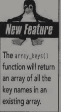

### `array_values()`

`array_values()`函数的语法为：

```php
array_values(array_name);
```

假设你有一个如下所示的数组：

```php
$sample = array("key0" => "1", "key1" => "2", "key2" => "3", "key3" => "4", "key4" => "5", "key6" => "cool");
```

你可以使用下面的示例脚本打印 `$sample` 中所有的值：

上述脚本将输出：

SAMPLE ARRAY:
0: 1
1: 2
2: 3
3: 4
4: 5
5: cool

VALUES IN SAMPLE ARRAY:
0: key0
1: key1
2: key2
3: key3
4: key4
5: key6

*(注：由于原文在 array_values 之后未提供完整输出内容，此处根据逻辑补全了翻译结构)*

## 数据库连接函数

PHP 中的数据库连接函数通常遵循相同的模式：连接数据库、获取结果、关闭连接等。然而，某些特定的数据库类型有其自己的函数，这些函数考虑了软件的细微差别。以下章节展示了常用数据库类型函数的基本语法。在第 3 章“使用数据库”中可以找到每个数据库的扩展示例。

### Informix 函数

许多 PHP 函数用于连接和查询 Informix 数据库。以下是一些基本函数及其语法。请参阅 http://www.php.net/manual/ 上的 PHP 手获取获取 Informix 函数列表。

### `ifx_connect()`

打开与 Informix 数据库的连接。需要数据库名称、服务器名称、用户名和密码。

```
$connection = ifx_connect(dbname@SERVERNAME, "username", "password");
```

### `ifx_query()`

发出 SQL 语句。需要已打开的数据库连接。

```
$sql_result = ifx_query("SELECT * FROM SOMETABLE",$connection);
```

### `ifx_htmlbtbl_result()`

自动将查询结果格式化为 HTML 表格。需要查询结果，并可选地包含 HTML 表格属性。

```
ifx_htmlbtbl_result($sql_result,"border=1");
```

### `ifx_free_result()`

释放数据库查询使用的内存资源。

```
ifx_free_result($sql_result);
```

### `ifx_close()`

显式关闭数据库连接。

```
ifx_close($connection);
```

### Microsoft SQL Server 函数

许多 PHP 函数用于连接和查询 Microsoft SQL Server。以下是一些基本函数及其语法。请参阅 http://www.php.net/manual/ 上的 PHP 手册获取 SQL Server 函数列表。

### `mssql_connect()`

此函数打开到 Microsoft SQL Server 的连接；它需要服务器名称、用户名和密码。

```
$connection = mssql_connect("servername",$username,$password);
```

### `mssql_select_db()`

此函数选择 Microsoft SQL Server 一个数据库供子查询使用；需要已建立有效的连接。

```
$db = mssql_select_db("myDB",$connection);
```

### `mssql_query()`

此函数发出 SQL 语句；需要需要已打开的数据库连接。

```
$sql_result = mssql_query("SELECT * FROM SOMETABLE",$connection);
```

### `mssql_fetch_array()`

此函数自动将 SQL 语句的结果行放入数组中。

```
$row = mssql_fetch_array($sql_result);
```

### `mssql_free_result()`

此函数释放数据库查询使用的内存资源。

```
mssql_free_result($sql_result);
```

### `mssql_close()`

此函数显式关闭数据库连接。

```
mssql_close($connection);
```

### mSQL 函数

许多 PHP 函数用于连接和查询 mSQL 服务器。以下是一些基本函数及其语法。请参阅 http://www.php.net/manual/ 上的 PHP 手册获取 mSQL 函数列表。

### `msql_connect()`

此函数打开到 mSQL 服务器的连接；需要服务器名称、用户名和密码。

```
$connection = msql_connect("servername", "username", "password");
```

### `msql_select_db()`

此函数选择 mSQL 服务器上的一个数据库供后续查询使用；需要已建立有效的连接。

```
$db = msql_select_db("myDB", $connection);
```

### `msql_query()`

此函数发出 SQL 语句；需要已打开的数据库连接。

```
$sql_result = msql_query("SELECT * FROM SOMETABLE", $connection);
```

### `msql_fetch_array()`

此函数自动将 SQL 语句的结果行放入数组中。

```
$row = msql_fetch_array($sql_result);
```

### `msql_free_result()`

此函数释放数据库查询使用的内存资源。

```
msql_free_result($sql_result);
```

### `msql_close()`

此函数显式关闭数据库连接。

```
msql_close($connection);
```

### MySQL 函数

许多 PHP 函数用于连接和查询 MySQL 服务器。以下是一些基本函数及其语法。请参阅 http://www.php.net/manual/ 上的 PHP 手册获取 MySQL 函数列表。

### `mysql_connect()`

此函数打开到 MySQL 的连接。需要服务器名称、用户名和密码。

```
$connection = mysql_connect("servername", "username", "password");
```

### `mysql_select_db()`

此函数选择 MySQL 服务器上的一个数据库供后续查询使用；需要已建立有效的连接。

```
$db = mysql_select_db("myDB", $connection);
```

### `mysql_query()`

此函数发出 SQL 语句；需要已打开的数据库连接。

```
$sql_result = mysql_query("SELECT * FROM SOMETABLE", $connection);
```

### `mysql_fetch_array()`

此函数自动将 SQL 语句的结果行放入数组中。

```
$row = mysql_fetch_array($sql_result);
```


### `mysql_free_result()`

此函数释放数据库查询使用的内存资源。

```
mysql_free_result($sql_result);
```

### `mysql_close()`

此函数显式关闭数据库连接。

```
mysql_close($connection);
```

### ODBC 函数

PHP 包含用于创建通用 ODBC 连接的函数。以下是一些基本函数及其语法。请参阅 http://www.php.net/manual/ 上的 PHP 手册获取 ODBC 函数列表。

### `odbc_connect()`

此函数打开 ODBC 连接；需要服务器名称、用户名和密码。

```
$connection = odbc_connect(DSN=DataSourceName,"username","password");
```

### `odbc_prepare()`

此函数读取用于执行的 SQL 语句。

```
$sql_statement = odbc_prepare($connection,"SELECT FROM TABENAME");
```

### `odbc_execute()`

此函数执行已准备的 SQL 语句。

```
$sql_result = odbc_execute($sql_statement);
```

### `odbc_result_all()`

此函数将查询结果格式化为 HTML 表格。需要查询结果，并可选地包含 HTML 表格属性。

```
odbc_result_all($sql_result,"border=1");
```

### `odbc_free_result()`

此函数释放数据库查询使用的内存资源。

```
odbc_free_result($sql_result);
```

### `odbc_close()`

此函数显式关闭数据库连接。

```
odbc_close($connection);
```

### Oracle 函数

许多 PHP 函数用于连接和查询 Oracle 7 或 Oracle 8 服务器。以下是一些基本函数及其语法。请参阅 http://www.php.net/manual/ 上的 PHP 手册获取 Oracle 函数列表。

### `OCILogon()`

此函数打开到 Oracle 的连接；需要环境变量 `ORACLE_SID` 已设置且你拥有有效的用户名和密码。

```
$connection = OCILogon("username","password");
```

### `OCIParse()`

此函数解析 SQL 语句；需要已打开的连接。

```
$sql_statement = OCIParse("connection","SELECT * FROM TABENAME");
```

### `OCIExecute()`

此函数执行已准备的 SQL 语句。

```
OCIExecute($sql_statement);
```

### `OCIFetch()`

此函数获取 SQL 语句结果的下一行并将其放入结果缓冲区；需要有效的结果集。

```
OCIFetch($sql_statement);
```

### `OCIResult()`

此函数获取当前结果行中命名列的值；需要有效的结果集。

```
OCIResult($sql_statement,"COLUMN");
```

### `OCIFreeStatement()`

此函数释放当前语句使用的资源。

```
OCIFreeStatement($sql_result);
```

### `OCILogoff()`

此函数显式关闭数据库连接。

```
OCILogoff($connection);
```

### PostgreSQL 函数

许多 PHP 函数用于连接和查询 PostgreSQL 服务器。以下是一些基本函数及其语法。请参阅 http://www.php.net/manual/ 上的 PHP 手册获取 PostgreSQL 函数列表。

### `pg_connect()`

此函数打开一个到 PostgreSQL 数据库的连接；它需要一个主机名、数据库名、用户名和密码。

```
$connection = pg_connect(host=YourHostname dbname=YourDB user=YourUsername password=YourPassword);
```

### `pg_exec()`

此函数执行 SQL 语句；它需要一个打开的数据库连接。

```
$sql_result = pg_exec($connection,$sql);
```

### `pg_fetch_array()`

此函数自动将 SQL 语句的结果行放入数组中。

```
$row = pg_fetch_array($sql_result);
```

### `pg_freesult()`

此函数释放数据库查询使用的内存资源。

```
pg_freesult($sql_result);
```

### `pg_close()`

此函数显式地关闭数据库连接。

```
pg_close($connection);
```

### Sybase Functions

存在许多用于连接和查询 Sybase 数据库的 PHP 函数。以下是一些基本函数及其语法。请参阅 http://www.php.net/manual/ 上的 PHP 手册获取完整的 Sybase 函数列表。

### `sybase_connect()`

此函数打开到 Sybase 的连接；它需要一个服务器名、用户名和密码。

```
$connection = sybase_connect("servername","username","password");
```


### `sybase_select_db()`

此函数在 Sybase 服务器上选择一个数据库供后续查询使用；它要求已建立有效的连接。

```php
$db = sybase_select_db("my08", $connection);
```

### `sybase_query()`

此函数执行 SQL 语句；它需要一个打开的数据库连接。

```php
$sql_result = sybase_query("SELECT * FROM SOMETABLE",$connection);
```

### `sybase_fetch_array()`

此函数自动将 SQL 语句的结果行放入数组中。

```php
$row = sybase_fetch_array($sql_result);
```

### `sybase_free_result()`

此函数释放数据库查询使用的内存资源。

```php
sybase_free_result($sql_result);
```

### `sybase_close()`

此函数显式地关闭数据库连接。

```php
sybase_close($connection);
```

## Date and Time Functions

基本的 PHP 日期和时间函数让你能够轻松地格式化时间戳，用于数据库查询和日历函数，也可以简单地在订单表收据上打印日期。

### `date()`

`date()` 函数根据给定的参数集返回格式化的当前服务器时间戳。以下是 `date()` 函数的语法：

```php
date(format, [timestamp]);
```

如果未提供 `timestamp` 参数，则假定使用当前时间戳。表 A.6 显示了可用的格式。

### 表 A.6 `date()` 函数格式

| 字符 | 含义 |
|---|---|
| a | 打印 "am" 或 "pm" |
| A | 打印 "AM" 或 "PM" |
| h | 小时，12 小制格式 (01 到 12) |
| H | 小时，24 小制格式 (00 到 23) |
| g | 小时，12 小制格式且无前导零 (1 到 12) |
| G | 小时，24 小制格式且无前导零 (0 到 23) |
| i | 分钟 (00 到 59) |
| s | 秒 (00 到 59) |
| Z | 以秒计算的时区偏移 (-43200 到 43200) |
| U | 自 Epoch 以来的秒数 (1970 年 1 月 1 日 00:00:00 GMT) |
| d | 日期，两位数字 (01 到 31) |
| J | 日期，两位数字无前导零 (1 到 31) |
| D | 星期，短文本 (Mon 到 Sun) |
| l | 星期，长文本 (Monday to Sunday) |
| w | 星期，数字，Sunday 到 Saturday (6) |
| F | 月份，长文本 (January to December) |
| m | 月份，两位数字 (01 到 12) |
| n | 月份，两位数字无前导零 (1 到 12) |
| M | 月份，三个字母 (Jan to Dec) |
| Y | 年，四位数 (2000) |
| y | 年，两位数字 (00) |
| z | 年中的天数 (0 到 365) |
| t | 给定月份的天数 (28 到 31) |
| S | 英语序数后缀 (th, nd, st) |

例如，以下内容将打印这种格式的日期：January 10th 2000,08AM。

```php
echo date("F j");
```

### `checkdate()`

`checkdate()` 函数验证给定的日期。验证成功意味着年份在 0 到 32767 之间，月份在 1 到 12 之间，且月份的天数正确（考虑了闰年）。这是 `checkdate()` 的语法：

```php
checkdate(month, day, year);
```

例如，如果你有一个如 "12/30/1973" 的日期（恰好是生日，所以我确定它是有效的），可以使用以下代码拆分日期并验证它，向用户返回：

```php
<?php

$orig_date = "12/30/1973";

$date = explode("/", $orig_date);

$month = $date[0];

$day = $date[1];

$year = $date[2];

$res = checkdate($month, $day, $year);

if ($res == 1) {

    echo "$orig_date is a valid date!";

} else {

    echo "$orig_date is not valid.";

}

?>
```
脚本输出：12/30/1973 is a valid date!

### `mtime()`

`mtime()` 函数返回长整数（自 Epoch 以来的秒数），表示给定日期的 UNIX 时间戳。因此，`mtime()` 的主要用途是格式化日期。以下是 `mtime()` 的语法：

```php
mtime(hour, minute, day, year);
```

例如，如果月份是 January (1)，日期是 10，年份是 2000：
```php
echo mktime(0,0,10,2000);
```

## `time()` and `microtime()`

`time()` 函数返回以秒为单位的当前系统时间。`time()` 的语法简单为

```php
time();
```

例如，打印当前系统时间戳请使用
```php
echo time();
```

使用 `microtime()` 会增加微秒计数，因此你得到的不仅是秒，还包含了两者的结果。

## Filesystem Functions

内置的文件系统函数如果使用不当，可能是强大的工具。在使用文件系统函数时要小心，特别是当你以 root 或其他系统用户运行 PHP 时。

### `chmod()`, `chgrp()`, and `chown()`

像 shell 一样，`chmod()`, `chgrp()`, 和 `chown()` 函数将修改目录或文件的权限、组和所有者。这些函数的语法是

```php
chmod("filename", mode);
chgrp("filename", group);
chown("filename", owner);
```

例如，要更改家目录下 `index.html` 文件的权限，请使用
```php
chmod("/home/username/index.html", 0755);
```

更改新组：
```php
chgrp("/home/username/index.html", users);
```

更改新所有者：
```php
chown("/home/username/index.html", joe);
```

为了更改权限、组所有者，PHP 用户必须是文件的所有者，或者权限已经允许该用户进行更改。

### `copy()`

`copy()` 函数的工作方式类似于 `cp` 命令：它需要一个文件名和一个目标来复制文件。`copy()` 的语法是

```php
copy("source filename", "destination");
```

例如，要为家目录下的 `index.html` 文件备份，请使用
```php
copy("/home/username/index.html", "/home/username/index.html.bak");
```

PHP 用户必须具有向目标目录写入的权限，否则 `copy` 函数将失败。

### `diskfreespace()`

`diskfreespace()` 函数按字节返回给定目录的总空空间。`diskfreespace()` 的语法是

```php
diskfreespace(directory);
```

例如，要查看你的 UNIX 机器上的可用空间，
```php
$space = diskfreespace("/");
echo("$space");
```

在你的 Windows 机器上，你可以使用
```php
$space = diskfreespace("C:\\");
echo("$space");
```

### `fopen()`

`fopen()` 函数打开指定的文件或 URL 用于读取和或写入。`fopen()` 的语法是

```php
fopen("filename", "mode");
```

要打开 URL，请在文件名字符串开头使用 `ftp://`。

如果文件名以其他任何内容开头，则从文件系统打开文件，并返回指向打开的文件的指针。否则，假设文件存在于本地文件系统中。

指定的模式决定了是以读取、写入还是读者都的方式打开文件。表 A.7 列出了有效模式。

### 表 A.7 `fopen()` 函数模式

| 模式 | 描述 |
| --- | --- |
| r | 只读。文件指针在文件的开头。 |
| r+ | 读写。文件指针在文件的开头。 |
| w | 仅写。文件指针在文件的开头，且文件被截断为零。如果文件不存在，则尝试创建。 |
| w+ | 读写。文件指针在文件的开头，且文件被截断为零。如果文件不存在，则尝试创建。 |
| a | 仅写。文件指针在文件的末尾（向文件中追加内容）。如果文件不存在，则尝试创建。 |
| a+ | 读写。文件指针在文件的末尾（向文件中追加内容）。 |

### `fread()`

使用 `fread()` 函数从打开的文件指针读取指定数量的字节。`fread()` 的语法是

```php
fread(filepointer, length);
```


例如，要读取文件的前 1024 字节并将字符串赋值为变量 `$content` 的值，请使用此代码：

```php
$fp = fopen("/home/username/temp.txt", "r"); // 打开文件指针
$content = fread($fp, 1024); // 读取 1024 字节到变量中
```

### `fputs()`

`fputs()` 函数向已打开的文件指针写入字符串。`fputs()` 的语法为
`fputs($filepointer, content, [length]);`

文件指针必须处于打开状态才能向文件写入。`length`（长度）参数是可选的。如果未指定，则会将所有指定的内容都写入文件。
例如，要向打开的文件指针写入 "I love PHP"，请使用

`fputs($filepointer, "I love PHP");`
或者，你也可以将内容放在变量中，然后只引用该变量：

```php
$content = "I love PHP"
fputs($filepointer, $content);
```

### `fclose()`

使用 `fclose()` 函数关闭已打开的文件指针。`fclose()` 的语法为
`fclose($filepointer);`

例如，如果你使用 `fopen()` 函数打开了一个名为 `$new_file` 的文件指针，将使用以下代码来关闭该文件指针：

```php
fclose($new_file);
```

### `file_exists()`

`file_exists()` 函数检查指定名称的文件是否已经存在。`file_exists($filename)` 的语法为

```php
file_exists("filename");
```

例如，以下代码检查目录中是否存在 `index.html` 文件，并根据结果打印消息：

```php
if (file_exists("/home/username/index.html")) {
    echo "The file index.html does not exist.";
} else {
    echo "Success! index.html exists.";
}
```

### `mkdir()`

与 shell 命令中的 `mkdir` 命令一样，`mkdir()` 函数在文件系统上创建一个新目录。`mkdir()` 的语法为

```php
mkdir("pathname", mode);
```

例如，要在你的主目录下创建一个名为 `public_html` 的目录，请使用
`mkdir("/home/username/public_html", 0755);`

PHP 用户必须在指定的目录中具有写权限。

### `rename()`

正如其名所示，`rename()` 函数尝试给现有文件赋予新名称。`rename()` 的语法为

```php
rename("oldname", "newname");
```

例如，要将你主目录下的 `index.html` 文件重命名为 `temp1.html`，请使用
`rename("/home/username/index.html", "/home/username/temp1.html");`

PHP 用户必须拥有修改文件的权限。

### `rmdir()`

与 shell 命令中的 `rmdir` 命令一样，`rmdir()` 函数从文件系统删除删除目录。`rmdir()` 的语法为

```php
rmdir("pathname");
```

例如，要删除你主目录下的 `public_html` 目录，请使用
`rmdir("/home/username/public_html");`

PHP 用户必须在指定的目录中具有写权限。

### `symlink()`

`symlink()` 函数从文件系统上的现有文件或目录到指定的链接名称创建一个符号链接。`symlink()` 的语法为

```php
symlink("targetname", "linkname");
```

例如，要为名为 `index.html` 的现有文件创建一个名为 `index.html` 的符号链接，请使用
`symlink("index.html", "index.phtml");`

### `unlink()`

`unlink()` 函数从文件系统删除一个文件。`unlink()` 的语法为 `unlink("filename");`

例如，要删除你主目录下的名为 `index.html` 的文件，`unlink("/home/username/index.html");`

PHP 用户必须拥有该文件的写权限。

### HTTP Functions

用于发送特定 HTTP 头和 cookie 数据的内置函数是 PHP 中开发大型 Web 应用程序至关重要的方面。幸运的是，这些函数的语法非常容易理解和实现。

### `header()`

`header()` 函数输出 HTTP 头字符串，例如位置重定向。此输出必须在向浏览器发送任何其他数据（包括 HTML 标签）之前发生。

> 这个信息需要反复强调：切勿在发送 `header()` 之前尝试向浏览器发送任何类型的信息。你可以在 `header()` 之前执行任何数据库操作或其他计算，但不能向屏幕打印任何内容，即使是一个换行符也不行。


例如，使用 `header()` 函数将用户重定向到新位置，请此代码：

```php
header("Location: http://www.newlocation.com");
exit; // 在 header 语句后跟随 exit 命令。
// 这确保了代码不会继续执行。
```

### `setcookie()`

`setcookie()` 函数向用户发送 cookie。cookie 必须在向 Web 浏览器发送任何其他头部之前之前。`setcookie()` 的语法为

```php
setcookie("name", "value", "expire", "path", "domain", "secure");
```

例如，你使用以下代码发送一个名为 `username`、值为 `joe` 的 cookie，它在 `testcompany.com` 域名的所有目录内有效期为一小时：

```php
setcookie("username", "joe", time()+3600, "/", ".testcompany.com");
```

### Mail Function

```php
mail()
```

如果你的服务器可以访问 sendmail 或 SNMP 网关，`mail()` 函数将向指定的收件者发送邮件。`mail()` 的语法为

```php
mail("recipient", "subject", "message", "headers");
```

例如，要返回 0 到 576 之间的随机值，请使用

```
echo rand(0,576);
```

### `round()`

`round()` 函数将小数四舍入到下一个更高的整数或更低的整数。`round()` 函数的语法为：

```
round(number);
```

例如：

```
round(2.56); // 返回 "3"
round(1.22); // 返回 "1"
round(55.22); // 返回 "55"
```

### `sqrt()`

`sqrt()` 函数返回给定数字平方根。`sqrt()` 的语法为：

```
sqrt(number);
```

例如，要找到 5561 的平方根，请使用

```
echo sqrt(5561);
```

结果为 74.572112750009。

### `rand()`

`rand()` 函数为随机数生成器提供一组可能的值。`rand()` 的语法为：

```
rand(seed);
```

一种常见的做法是使用微秒数为随机数生成器设置种子：

```
rand((double)microtime()*1000000);
```

### 杂函数

`die()` 和 `exit` 函数为你的脚本执行提供了实用的控制，为编程错误提供了“逃生路线”。

### `die()`

`die()` 函数在返回值为 FALSE 时输出给定的消息并终止脚本。`die()` 的语法为：

```
die("message");
```

例如，你将使用以下代码在连接数据库失败时打印消息并停止脚本执行：

```
$connection = mysql_connect("servername", "username", "password") or die("Can't
connect to database.");
```

### `exit`

`exit` 函数在调用 `exit` 函数的用点处终止当前脚本的执行。

例如，在发送了位置重定向头后退出脚本，请使用

```
header("Location: http://www.newlocation.com/*");
```

```
exit;
```


## sleep() and usleep()

`sleep()` 和 `usleep()` 函数在你的 PHP 代码执行的指定点处放置暂停或延迟。这些函数的语法为：

```
sleep(seconds);
```

```
usleep(microseconds);
```

`sleep()` 和 `usleep()` 之间的唯一区别是 `sleep()` 的给定等待时间是秒，而 `usleep()` 的等待时间是微秒。

### uniqid()

`uniqid()` 函数生成一个唯一标识符，如果你需要可以加上前缀。`uniqid()` 的基本语法为：

```
uniqid("prefix");
```

不过这很无聊。假设你想要一个前缀为 "phpuser" 的唯一 ID，因此你使用

```
$id = uniqid("phpuser");
```

```
echo "$id";
```

得到类似 `phpuser38b320a6b5482` 的结果。

## 附录 A：PHP 语言参考

但如果你使用非常酷的东西，比如

```php
$id = md5(uniqid(rand()));
echo "$id";
```

那么你就得到了一个 ID `999d89971461bedfc7caadcab33e65866`。

### 网络函数

有几种可用的网络函数，有些用于打开和读取套接，有些是 FTP 函数，但我最常用的两个网络函数是 IP 和域名解析函数。

### gethostbyaddr() and gethostbyname()

`gethostbyaddr()` 和 `gethostbyname()` 函数分别返回给定机器的 IP 地址或主机名。这些命令的语法为：

```php
gethostbyaddr(IP);
gethostbyname(hostname);
```

下面的示例代码展示了这两个函数的用法：

```php
<?php
// 分配一些变量
$ip = "204.71.200.75";
$host = "www.yahoo.com";
$verify_ip = gethostbyaddr($ip);
$verify_name = gethostbyname($host);
echo "$ip resolves to $verify_ip<br>";
echo "$host resolves to $verify_name<br>";
?>
```

上述脚本的输出为：

`204.71.200.75 resolves to 5`
`www.yahoo.com resolves to 204.71`

### PHP 版本及相关信息

有时你需要获取操作环境的快速快照，特别是如果你不记得加载了什么！PHP 有几个函数可以让环境信息变得容易发现和修改。

### phpinfo()

调用 `phpinfo()` 函数将输出包含 PHP 版本信息、扩展信息以及许多其他环境变量的模板。只需创建一个包含它的文件：

```php
<?php phpinfo(); ?>
```

使用浏览器访问该文件。你会看到你需要的更多信息！

### phpversion()

如果 `phpinfo()` 提供的信息过多，你可以使用 `phpversion()` 函数返回当前的版本号。例如，在我的系统中，这段代码

```php
echo "Current version is: ".phpversion();
```

显示：

`Current version is: 4.0`

### 程序执行函数

你可以使用 PHP 内置的程序执行函数运行系统中的程序，例如加密程序、第三方图像处理程序等。对于所有程序执行函数，必须拥有执行给定程序的权限。

### exec()

`exec()` 函数执行外部程序。`exec()` 的语法为：

```php
exec(command, [array], [return_var]);
```

如果指定了数组，`exec()` 函数的输出将追加到数组。例如，你将使用以下代码对服务器进行 5 次 ping 并打印输出：

```php
$command = "ping -c5 www.thickbook.com";
exec($command, $result, $rval);
for ($i = 0; $i < sizeof($result); $i++) {
    echo "$result[$i]<br>";
}
```

### passthru()

与 `exec` 函数一样，`passthru` 函数执行外部程序并显示输出。`passthru()` 的语法为：

```
passthru(command, return_var);
```

如果指定了 `return_var`，它将被赋值程序的返回状态。

### system()

`system()` 函数执行外部程序并在命令执行时显示输出。`system()` 的语法为：

```php
system(command, [return_var]);
```

例如，你将使用以下代码对服务器进行 5 次 ping 并打印输出：

```php
$command = "ping -c5 google.php";
system($command);
```

### 正则表达式函数

### ereg_replace() eregi_replace()

`ereg_replace()` 和 `eregi_replace()` 函数替换字符串中的模式实例并返回新字符串。`ereg_replace()` 执行区分大小写的匹配，而 `eregi_replace()` 执行不区分大小写的匹配。以下是两者的语法：

```php
ereg_replace(pattern, replacement, string);
eregi_replace(pattern, replacement, string);
```

```php
$old_string = "I really love programming in ASP!";
$new_string = ere_replace("ASP", "PHP", $old_string);
echo "$new_string";
```

如果 "ASP" 是混合大小写的，如 "aSp"，使用 `eregi_replace()` 函数：

```php
$old_string = "I really love programming in aSp!";
$new_string = eregi_replace("ASP", "PHP", $old_string);
echo "$new_string";
```

### split()

`split()` 函数使用特定的分隔符将字符串分割为数组。`split()` 的语法为：

```
split(pattern, string, [limit]);
```

如果指定了限制，`split()` 函数会在指定位置停止——例如在逗号分隔列表的第十个值处。例如，你将使用以下代码将逗号分隔列表 `$comma_list` 中的前 10 个元素放入名为 `$new_array` 的数组中：

```php
$new_array = split(",", $comma_list, 10);
```

## Session 处理函数

添加到 PHP4 中的 session 处理是一种在用户在整个网站中导行时保留数据的方法。数据可以是变量或整个对象。

### session_start()

`session_start()` 函数在会话尚未启动时启动，或者在用户存在 Session ID 时恢复会话。此函数不接受参数，只需通过将其放在代码的开头即可调用：

```php
session_start();
```

### session_register()

`session_register()` 函数在当前会话中注册变量。换句话说，如果你想跟踪用户会话中 `$username` 变量的值，必须先将 `$username` 注册为会话变量。`session_register()` 的语法为：

```php
session_register("variable_name");
```

例如，要将 `$username` 注册为全局会话变量，请使用

```php
session_register("username");
```

### session_unregister()

`session_unregister()` 函数用于注销或“忘记”当前会话（session）中的一个变量。`session_unregister()` 的语法如下：

```php
session_unregister("variable_name");
```

例如，要忘记名为 `username` 的全局会话变量，可以使用：

```php
session_unregister("username");
```

### session_destroy()

`session_destroy()` 函数会有效销毁当前会话中注册的所有变量和值。该函数不接受参数，只需在代码中放置以下内容即可调用：

```php
session_destroy();
```


### 字符串函数

这一部分仅涉及 PHP 内置字符串处理函数的浅皮上，但如果你理解了这些常用函数，你的编程生活将会变得轻松！

#### `addslashes()` 和 `stripslashes()`

在从数据库插入和检索数据时，`addslashes()` 和 `stripslashes()` 函数非常重要。通常插入数据库的文本会包含特殊字符（单引号、双引号、反斜杠、NULL），在插入之前必须对它们进行“转义”。`addslashes()` 函数正是此用，语法如下：

```php
addslashes(string);
```

同样，`stripslashes()` 函数将返回一个去掉反斜杠的字符串，语法如下：

```php
stripslashes(string);
```

#### `chop()`, `ltrim()` 和 `trim()`

这三个函数都会移除字符串中的错误空格。`chop` 函数移除字符串末尾的空格，而 `ltrim()` 移除字符串开头的空格。`trim()` 函数则同时移除字符串开头和结尾的空格。这些函数的语法为：

```php
chop(string);
ltrim(string);
trim(string);
```

#### `echo()`

`echo()` 函数返回输出。`echo()` 的语法为：

```php
echo(parameter1, parameter2, ...);
```

例如：

```php
echo "I'm using PHP"; // 输出为: I'm using PHP!
echo 2 + 6; // 输出为: 8
```

使用 `echo` 时不需要括号。

## `explode()` 和 `implode()`

`explode()` 函数使用指定的分隔符分割字符串并返回数组形式的值。`explode()` 的语法如下：

```php
explode("separator", "string");
```

例如，以下代码获取一个名为 `$color_list` 的字符串（包含一个用逗号分隔的颜色列表），并将每个颜色放入名为 `$my_colors` 的数组中：

```php
$color_list = "blue,black,red,green,yellow,orange";
$my_colors = explode(",", $color_list);
```

相反，`implode()` 函数接收数组并使用指定的分隔符将其字符串。`implode()` 的语法如下：

```php
implode("separator", "string");
```

例如，以下代码获取一个名为 `$color_list` 的数组，然后创建一个名为 `$mycolors` 的字符串，包含 `$color_list` 数组的值并用逗号分隔：

```php
$mycolors = implode(",", $color_list);
```

#### `htmlspecialchars()` 和 `htmlentities()`

`htmlspecialchars()` 和 `htmlentities()` 函数将字符串中的特殊字符和 HTML 实体转换为可接受的表示。

`htmlspecialchars()` 函数仅转换小于号 (`&lt;`)、大于号 (`&gt;`)、双引号 (`&quot;`) 和和符号 (`&amp;`)。`htmlentities()` 函数将将 ISO-8859-1 字符集中的字符转换为正确的 HTML 实体。这些函数的语法为：

```php
htmlspecialchars(string);
htmlentities(string);
```

#### `nl2br()`

`nl2br()` 函数会将所有的换行符替换为 HTML 换行符 (`<br>`)。`nl2br()` 函数的语法为：

```php
nl2br(string);
```

#### `sprintf()`

`sprintf()` 函数根据一组指令返回格式化后的字符串。`sprintf()` 的语法为：

```php
sprintf(directives, string);
```

`sprintf()` 格式指令列如下：

| 指令 | 结果 |
| :--- | :--- |
| % | 添加百分号。 |
| b | 格式化为二进制。 |
| c | ASCII 值。 |
| d | 格式化为十进制。 |
| f | 格式化为浮点数。 |
| o | 格式化为八进制。 |
| s | 格式化为字符串。 |
| x | 格式化为十六进制（小写）。 |
| X | 格式化为十六进制（大写）。 |

例如，使用 `sprintf()` 格式化货币，可以使用：

```php
$tax = 0.05;
$subtotal = 1000;
$fmt_total = sprintf("%.2f", $subtotal);
echo "$fmt_total";
```

#### `strlen()`

`strlen()` 函数返回给定字符串的长度。`strlen()` 的语法为：

```php
strlen(string);
```

#### `strtolower()`

`strtolower()` 函数返回所有字母均为小写的字符串。`strtolower()` 的语法为：

```php
strtolower(str);
```

例如，将 "HELLO" 返回小写，可以使用：

```php
echo strtolower("HELLO");
```

#### `strtoupper()`

`strtoupper()` 函数返回所有字母均为大写的字符串。`strtoupper()` 的语法为：

```php
strtoupper(str);
```

例如，将 "hello" 返回大写，可以使用：

```php
echo strtoupper("hello");
```

#### `substr()`

`substr()` 函数根据起始位置和可选长度返回字符串的一部分。`substr()` 的语法为：

```php
substr(string, start, [length]);
```

如果起始位置是正数，则从字符串开头开始计数；如果起始位置是负数，则从字符串末尾开始计数。同样，如果使用了长度参数且为正数，则从字符串开头开始计数；如果使用了长度参数且为负数，则从字符串末尾开始计数。

例如：

```php
$new_string = substr("PHP is great!", 1); // 返回 "HP is great!"
$new_string = substr("PHP is great!", 0, 7); // 返回 "PHP is "
$new_string = substr("PHP is great!", -1); // 返回 "!"
$new_string = substr("PHP is great!", -6, 5); // 返回 "great"
```

#### `ucfirst()`

`ucfirst()` 函数将字符串中的第一个字母转换为大写。`ucfirst()` 的语法为：

```php
ucfirst(string);
```

例如，如果字符串是 "i love PHP"，以下代码返回 "I love PHP"：

```php
ucfirst("i love PHP");
```

#### `ucwords()`

`ucwords()` 函数将字符串中每个单词的首字母转换为大写。`ucwords()` 的语法为：

```php
ucwords(string);
```

例如，如果字符串是 "i love PHP"，以下代码返回 "I Love PHP"：

```php
ucwords("i love PHP");
```

### 变量函数

基础变量函数 `isset()` 和 `unset()` 帮助你在应用程序的作用范围内管理变量。

#### `isset()` 和 `unset()`

`isset()` 函数确定变量是否存在。`unset()` 函数显式销毁命名变量。以下是每个函数的语法：

```php
isset($var);
unset($var);
```

如果变量存在，`isset()` 返回 TRUE；如果不存在则返回 FALSE。例如，如果你有一个名为 `$foo` 的变量，值为 "bar"，以下代码返回 TRUE：

```php
$foo = "bar";
echo isset($foo);
```

现在，如果你对 `$foo` 使用 `unset()` 函数，如下：

```php
unset($foo);
```

`isset($foo)` 的值现在将变为 false：

```php
echo isset($foo); // false!
```

## 附录 B：获取支持

网站

邮件列表


开源社区最伟大的优点之一是人们热于帮助你尽可能学习，以便你也能成为倡导者。然而，在向整个社区提问之前，你可能应该尝试自己寻找答案。这包括阅读可用手册和 FAQ、搜索邮件列表存档以及访问与 PHP 相关的网站。很有可能其他人遇到和你相同的问题。

## 网站

下面列出的网站仅是 PHP 开发者可用网站的一部分。这些网站大部分由人们利用空闲时间维护，因此如果你使用了他们的任何资源，请尝试在可以的情况下通过帮助他人问题、向代码库贡献代码片段等来回馈社区。

### www.php.net

只需从 PHP 的主页开始；这里有在线手册，以及提供 PHP 服务的 ISP 链接、PHP FAQ 新闻以及更多内容！

### www.thickbook.com

我创建这个网站作为本书的补充。你将在那里找到其他网站的链接、额外的代码示例和教程、书内示例的代码修复、书中使用的每段代码（可以下载，因此无需手动输入），以及一个反馈部分，你可以在那里告诉我想在书的下一个版本看到什么（或者你想让我删掉什么！）

### Webmonkey (hotwired.lycos.com/webmonkey/)

为我们带来《Wired》杂志的公司也带来了 HotWired，它催生了 Webmonkey。这是一个面向开发者的资源网站，其中有一个专门针对 PHP 的板块。不要把自己局限于 Webmonkey 的 PHP 板块，因为其他板块也有很多信息。这是我最喜欢的网站之一，不仅是因为我为他们写文章，还因为他们是一群聪明的人。

### WeberDev (www.weberdev.com)

PHP 开发者长期青爱的网站，该网站包含了许多编程语言的开发技巧和提示（公平地说），以及一个供所有人添加代码片段、教程等内容的内容管理系统！它有非常棒的周更电子通讯，，流量也很大。快去贡献你的吧！

### PHPBuilder (www.phpbuilder.com)

一个非常适合中级和高级 PHP 开发者的教程网站，包含了针对现实世界应用的“如何做”专栏，如“考虑到搜索引擎的动态页面构建”、“生成可读的密码”等大量内容。强烈推荐！

### DevShed (www.devshed.com)

包含许多用户提交的教程、新闻文章、采访以及对服务端编程语言的竞争分析。涵盖了 PHP 以及其他许多开发者感兴趣的话题，如服务器和数据库。

### px.sklar.com

一个极简的代码库，但当你只需要代码片段时，谁需要图形界面呢？借用“随拿一个硬币，留下一个硬币”的精神，拿一个代码片段开始，当你觉得可以分享时再加上你自己的。

### AlbaSoft PHP Resources (www.alboftware.com)

这个 PHP 门户网站为所有水平的 PHP 开发者设计，包含了开发者的通用信息以及文章/教程。你还可以在这里找到贡献 AlbaSoft 发起的开源项目的信息。

### www.php-center-de and www.dynamic-webpages.de

两个德语 PHP 门户网站，包含常见问题解答（FAQs）、教程、链接、代码示例——门户网站应该具备的一切！

### www.phpindex.com

与德国 PHP 门户网站类似，PHP Index 是一个非常好的 PHP 门户网站——完全使用法语。

## 邮件列表 (Mailing Lists)

有几个高流量的邮件列表可用于 PHP 讨论。提问时请记住网络礼仪：保持礼貌，尽可能提供多个示例（如果你在描述问题），提供你的系统信息（如果你在寻找解决方案），我提过要说请和谢谢吗？

你也可以在 `http://www.php.net/` 的“Support”（支持）部分找到邮件订阅信息，这里有一些通用列表的地址：

- 订阅通用 PHP 邮件列表（英语），请发送邮件至 `php3-digest-subscribe@lists.php.net`

- 订阅法语 PHP 邮件列表，请发送邮件至 `php3-france-subscribe@onelist.com`

- 订阅德语 PHP 邮件列表，请发送邮件至 `php@infosoc.uni-koeln.de`

- 订阅意大利语 PHP 邮件列表，请发送邮件至 `php3-it-request@michel.enter.it`

- 订阅葡萄牙语 PHP 邮件列表，请发送邮件至 `php-pt-subscribe@Groups.com`

- 订阅西班牙语 PHP 邮件列表，请发送邮件至 `php-subscribe@listserver.iwcc.com.ar`

英语 PHP 邮件列表已存档，并可以在 `http://marc.theimsgroup.com/` 进行搜索。只需查找“WWW”标题下与 PHP 相关的列表即可。这是一个无价的资源，它还存档了 MySQL 邮件列表以及许多其他！

## 索引 (Index)

### A

- ASP (Active Server Pages), 脚本语言, 4

- 加入购物车表单, 252

- 加法运算符 (`+`), 37

- `addslashes()` 字符串函数, 340

- `admin_addrecord2.php`, 文件, 173, 176–179

- `admin_addrecord2.php`, 文件, 179–185

- `admin_delrecord1.php`, 207–210

- `admin_delrecord2.php`, 文件, 210–215

- `admin_modcord1.php`, 170, 186–191

- `admin_modrecord3.php`, 文件, 205–207

- 赋值运算符, 293

- 描述, 37

- 等号 (`+`) 字符, 37

- 星号 (`*`) 字符,乘法运算符, 37

- 属性, HTML 标签, 27

- 认证

    - 数据库驱动, 139–146

    - 管理菜单, 172–186

    - 向产品目录中添加记录, 172

    - 删除产品目录记录, 208–217

    - 修改产品目录记录, 186–208

    - 用户认证, 169–172

- 尖角 `<` 和 `>`, HTML 标签, 26

- 美国国家标准协会 (ANSI), SQL 标准, 74

- `htpassword`, 135–136

- HTTP 认证, 135–137

- `htconf` 文件指令, 136–137

- 开源软件示例, 5

- IX 系统安装过程, 7–11

- unix 系统/PHP 配置, 19

- 用户/组文件创建, 135–136

- Windows 系统安装过程, 6–7

- Windows 系统/PHP 配置, 16–17

- 算术运算符, 描述, 37–38, 293

- `array()`, 249

- `array_keys()`, 308–309

- `array_merge()`, 306–307

- `array_pop()`, 299–300

- `array_push()`, 299–299

- `array_shift()`, 302–303

- `array_slice()`, 303–305

- `array_unshift()`, 300–301

- `array_values()` 函数, 309–310

- HTTP, 139–146

- 按 IP 地址限制，服务器

- 启用认证的 Web, SERVER 认证元素, 134

- `authorize1.php` 文件, 137–138

- `authorize2.php` 文件, 138–139

- `authorize3.php` 文件, 140–141

### B

- 反斜杠 (`\` 字符, 界界美元符号 (`$`) 字符, 42

- BIND, 开源示例, 5

- 数据类型, 75

- 块级标签, HTML, 27–28

- `browser_match.php` 文件, 55–58

- `browser_type.php` 文件, 51

- 服务器特定代码，部署, 55–58

- 内置函数。

### C

- `calc01.php` 文件, 39–41

- `calc02.php` 文件, 42–43

- 计算, `calc01.php` 文件, 39–41

- `ceil()` 数学函数, 330

- 扩展, 相比模块, 15

- 挑战/响应方案, HTTP 认证, 134–139

- 结账，购物系统, 26–273

- 复选框, HTML 表单输入, 31–32

- `checkdate()` 函数, 326

- `chgrp()` 文件系统函数, 324–325

- 数组描述, 39

- 双括号 (`{}`) 字符, 112

- 变量, 291

- `chmod()` 文件系统函数, 324

- `chop()` 字符串函数, 340–341

- `chown()` 文件系统函数, 324–325

- 客户端执行, 39

- 代码执行，客户端, 34

- 逗号 (`,` 字符, 116

- 命令

    - `ALTER`, 54

    - `CREATE`, 56

    - `DELETE`, 215–217

    - `DELETE`, 74–79

    - `DROP`, 54

    - `echo`, 35


- `INSERT()`, 54–76
- `REPLACE`, 204
- `SELECT`, 54–79
- 分号 (`;`) 终止符, 35
- `SQL`, 74
- `UPDATE`, 74–77
- 注释, `HTML`, 33
- 比较运算符, 描述, 294
- 比较运算符使用, 38
- 逻辑运算符, 39
- 控制语句, 描述, 295
- `for`, 297
- `if...else`, 295
- `Cookie`, 描述, 150–156
- `Cookie`, 292
- `copy()` 文件系统函数, 325
- `count`, 会话处理, 155
- `count()` 函数, 259–310
- `count_me.php` 文件, 158–159
- 加密，公密钥, 229
- 开发历史, 220–221
- `GNPG`, 235
- `OpenPG` 标准, 221
- `PGP` (Pretty Good Privacy), 221–228
- 公密钥加密, 229
- 数据文件
  - 读取, 66–68
  - 写入, 64–66
- 数据类型, 描述, 75
- 数据库连接函数, 314–321
- 数据库表, 167–169
- 数据库驱动认证, 139
- `HTML` 表单用户验证, 141–146
- `PHP` 认证变量, 139–141
- 数据库
  - 向表添加记录, 121–128
  - 数据选择/显示, 128–132
  - 字段定义, 110–115
  - 字段命名规范, 70
  - `Informatix` 连接, 81–83
  - 安装过程, 21–23
  - `Microsoft` 服务器连接, 83–86
  - `mSQL` 连接, 86–90
  - `MySQL` 数据库连接, 21–23, 90–91
  - `ODBC` 连接, 103–105
  - `Oracle` 连接, 93–97
  - `PHP3` 支持问题, 2
  - `PostgreSQL` 连接, 97–100
  - `rel`, 72–74
  - 结构元素, 70
  - 支持的数据类型, 75
  - `Syabase` 连接, 100–103
  - 数据输入技术, 121–128
  - 表定义, 108–110
  - 唯一标识重要性, 71–72
- 日期和时间函数
  - `checkdate()`, 323
  - `date()`, 321–322
  - `microtime()`, 324
  - `mtime()`, 323–324
  - `time()`, 324
- 日期类型, 75
- `date()`, 321–322
- `datetime` 数据类型, 75
- `decbin()` 数学函数, 331
- `dchex()` 数学函数, 331–332
- `decopt()` 数学函数, 332
- 递减运算符, 294
- `DELETE` 命令, 删除产品目录记录, 215–217
- `die()` 函数, 81, 335
- `display_filesystem` 函数, 325
- `display_products.php` 文件, 129–130
- `division()` /运算符, 37
- `do_addrecord.php` 文件, 121–127
- `doo_calculate.php` 文件, 45–49
- `doo_creatable.php` 文件, 115–119
- `doo_redirect.php` 文件, 52–54
- `do_sendfeedback.php` 文件, 59–62
- `do_sendsecret.php`, 223–228, 230–235
- `do_showieldeldef.php` 文件, 109–110, 113–115
- `docalc.php` 文件, 43
- `documents`
  - `HTML` 创建过程, 28–33
- `Web` 浏览器请求过程, 34
- 美元符号 (`$`) 字符, 打印, 42
- `double` `double` [[字符] 数组索引, 112
- `double` 类型, 75
- 双等号 (`==`) 描述, 37
- 下拉列表
  - `HTML` 表单元素, 32
- `if...else` 语句用法, 196
- 动态内容
  - 显示, 51–58
  - 显示特定浏览器的代码, 55–58
  - 将用户重定向到新位置, 51–55
- `each(1)` 函数, 311
- `echo()` 字符串函数, 341
- 电子商务
  - `cookie` 项目, 150–154
  - 数据加密, 220–235
- `e-mail` (邮件)
  - 反馈表单, 58–64
  - 发送, 58–64
  - 发送数据文件, 67
  - 发送安全订单, 274–285
- 加密技术, 开发历史, 220–221
- 环境变量, 292–293
- 描述, 49
- `HTTP_USER_AGENT`, 50–51
- `REMOTE_ADDR`, 50
- 等号 (`=`) 字符
  - 赋值运算符, 37
  - 变量, 36
- `ereg_replace()` 正表达式函数, 338
- `ereg_replace()` 正表达式函数, 338–339
- 错误消息, `die()` 函数用法, 81, 83, 87
- 转义代码, 描述, 34
- `exec()` 程序执行函数, 337
- `ext()` 函数, 字符串函数, 341

# F

- `fclose()` 函数, 65, 327
- 反馈表单
  - 创建, 58–64
- `show_backup.html` 文件, 58–60
- 字段定义, 逗号 (`,`) 字符分隔符, 116
- 定义, 110–115
- 命名规范, 70
- 产品目录, 167–168
- 购物车跟踪表, 255–256
- 文件名参数, `fopen()` 函数用法
- 文件指针, 描述, 64
- `file_exists(files)` 系统函数, 327
- `files`
  - `admin_admin1.php`, 170, 173–179
  - `admin_admin2.php`, 179, 185–193
  - `admin_record1.php`, 208–210
  - `admin_record2.php`, 210–215
  - `admin_record3.php`, 215–217
  - `admin_modrecord1.php`, 170, 186–191
  - `admin_modrecord2.php`, 187, 197–203
  - `admin_modrecord3.php`, 205–207
  - `authorize1.php`, 137–138
  - `authorize2.php`, 138–139
  - `authorize3.php`, 140–141
  - `brow_match.php`, 55–58
  - `browser_type.php`, 51
  - `calc01.php`, 39–41
  - `calc02.php`, 42–43
  - `count_me.php`, 158–159
  - `display_products.php`, 121–127
  - `doo_addrecord.php`, 121–127
  - `doo_calculate.php`, 45–49
  - `doo_creatable.php`, 115–119
  - `doo_redirect.php`, 52–54
  - `doo_sendfeedback.php`, 59–62
  - `doo_sendsecret.php`, 223–228, 230–235
  - `doo_showieldeldef.php`, 109–110, 113–115
  - `docalc.php`, 43

# Index

+ `files` (续)
- `first.php`, 34–35
- `go ownform.php`, 44
- `group`, 135–136
- `httpd.conf`, 136–137
- `limitirylPphp`, 146–147
- `login.html`, 141–142
- `login.php`, 142–143
- `login_form.inc`, 143–144
- `login2.php`, 144–145
- `phpinfo.php`, 49–50
- `read_data.php`, 66–67
- `remote_address.php`, 50
- `secret_form.html`, 223, 230
- `session.php`, 157
- `session2.php`, 161–164
- `shop_addcart.php`, 252, 256–260
- `shop_checkout.php`, 262–273
- `shop_checkout.php`, 260
- `shop_menu.php`, 236–237
- `shop_sendorder.php`, 274–285
- `shop_showbook.php`, 249–255
- `shop_view.php`, 236–249
- `shop_viewcart.php`, 236–246
- `shop_addrect.html`, 121–123


- `shop_calculate.html`, 45–46
- `shop_createable.html`, 167–169
- `shop_createable.html`, 108–109
- `shop_feedback.php`, 58–60
- `shop_menu.php`, 52–54
- `write_data.php`, 65
+ `files()`, 读取完整文件
- `chgrp()`, 324–325
- `chmod()`, 324
- `chown()`, 324–325
- `copy()`, 325
- `diskfrees()`, 325–327
- `close()`, 327
- `file_exists()`, 327
- `fopen()`, 325–326
- `fputs()`, 327
- `fread()`, 326–327
- `kdir()`, 328
- `rename()`, 328
- `rmdir()`, 328
- `symlink()`, 328
- `unlink()`, 329
- `first.php` 文件, 34–35
- 点数类型, 36
+ `floats` 变量, 291
- `floor()` 数学函数, 333
- `open()` 文件函数, 64–65, 325–326
- `for` 控制结构, 297
+ Add to Shopping, 252
- feedback, 58–64
- HTML, 30–33
- user preference, 158–168
- user validation, 141–146
- `fputs()` 文件函数, 65, 327
- `fread()` 文件函数, 326–327

functions
- `array()`, 298
- `array_keys()`, 308–309
- `array_merge()`, 306–307
- `array_pop()`, 299–300
- `array_push()`, 298–299
- `array_shift()`, 302–303
- `array_slice()`, 300–301
- `array_unshift()`, 309–310
- `array_values()`, 259, 310
- database connectivity, 314–324
- date and time, 321–324
- `die()`, 81, 83, 375
- `each()`, 311
- `exit()`, 335
- `sleep()`, 335–336
- `uniq()`, 335
- `unsleep()`, 335–336
- `close()`, 65
- `filesize()`, 66
- Filesystem, 324–329
- `fopen()`, 64
- `fputs()`, 65
- `fread()`, 66
- `write()`, 66
- `header()`, 329–330
- HTTP, 329–330
- `ifx_close()`, 81–82
- `ifx_connect()`, 81
- `ifx_free_result()`, 81–82
- `ifx_html()`, 81–82
- `ifx_query()`, 81–82
- `include()`, 143–145
- Inform, 81–83, 314
- `list()`, 311
- `mail()`, 58, 330
- mathematical, 330–334


# Index 355

Microsoft SQL Server, 83–86, 315

msQL, 86–90, 316
- `msql_close()`, 83, 85, 89
- `msql_connect()`, 83–87
- `msql_fetch_array()`, 83–84, 87
- `msql_free_result()`, 83, 85, 89
- `msql_query()`, 83–84, 87
- `msql_select_db()`, 83–84, 87

MySQL 90–93, 317
- `msql_close()`, 90, 92
- `msql_connect()`, 90
- `msql_fetch_array()`, 90–91
- `msql_free_result()`, 90, 92
- `msql_query()`, 90–91
- `msql_select_db()`, 90
- Network function, 336
- `OCI_xtute()`, 93–94
- `OCI_etch()`, 95
- `OCI_reeStatement()`, 93, 96
- `OCI_logoff()`, 96–97
- `OCI_ogon()`, 93–95
- `OCI_numCols()`, 93–94
- `OCI_Parse()`, 93–94
- `OCI_Result()`, 93
- ODBC, 103–105, 317–318
- `dbc_close()`, 103–104
- `dbc_connect()`, 103–104
- `dbc_execute()`, 103–104
- `dbc_free_result()`, 103–104
- `dbc_prepare()`, 103–104
- `dbc_result_all()`, 103–104
Oracle, 318–319
Oracle database connections, 93–97
- `pg_close()`, 97, 99
- `pg_fetch_array()`, 97–98
- `pg_freeresult()`, 97, 99
- `pg_execec()`, 97–98
PHP 336–337
PostgreSQL, 319–320
PostgreSQL connectivity, 97–100
- `preg_match()`, 55
program execution, 337–338
- regular expression, 338–339
- `reset()`, 311
nsession handling, 339–340
- `setcookie()`, 152
- `shuffle()`, 311–313
- `sizeof()`, 313
- `sleep()`, 335
- `sprintf()`, 342
- string, 344
- `sleep()`, 335
- variable, 344
- `write()`, 65

# L

- Lerdorf, Rasmus, PHP/FT 开发者, 2
- 按 IP 地址认证限制, 描述, 146
- `limititybyIP.file`, 146–147
- Linux, 开源软件示例, 5
- 列表框, HTML 表单输入元素, 32
- 列表函数), 311
- 逻辑运算符, 39, 294–295
- `login.php` 文件, 用户验证表, 141–142
- `login.php` 文件, 142–143
- `login.form_inc` 文件, 143
- `login2.php` 文件, 144–145
- 循环, `if...else` 语句, 196
- `Ittrim()` 函数, 340–341

# M

- Macintosh, WebTen 服务器安装, 14–15
- 邮件函数, `mail()`, 330
- `mail()` 函数, 参数, 58
- 邮件列表, PHP, 21, 350
- 数学函数
    - `bind()`, 331
    - `ceil()`, 331
    - `debin()`, 331
    - `dechex()`, 331–332
    - `deccott()`, 332
    - `floor()`, 331–332
    - `hexdec()`, 332
    - `number_format()`, 333
    - `octdec()`, 332
    - `pow()`, 333
    - `rand()`, 333–334
    - `round()`, 334
    - `sqrt()`, 334
    - `srand()`, 334
- Microsoft IIS (Internet Server) 安装过程, 24
- PHP3 配置, 17–18
- Microsoft SQL Server 函数
    - 连接性, 83–86
    - 描述, 315
    - `mssql_close()`, 315
    - `mssql_connect()`, 315
    - `mssql_fetch_array()`, 315
    - `mssql_free_result()`, 315
    - `mssql_query()`, 315
    - `mssql_select_db()`, 315
- `microtime()`, 函数, 324
- 减号 (`--`) 字符, 减法运算符, 37
- 杂函数
    - `die()`, 335
    - `exit()`, 335


- `sleep()`, 335
- `uniqid()`, 335–336
- `unsleep()`, 335
- `dir()` 文件系统函数, 328
- `mktime()`, 函数, 323–324
- `mode` 参数, `fopen()` 函数的使用, 64
- 模块, 对于 CGI 扩展, 155
- 取模 (%) 运算符, 37
- mssql 函数
    - `msql_close()`, 83, 85, 89, 316
    - `msql_connect()`, 83, 87, 316
    - `msql_fetch_array()`, 83, 84, 316
    - `msql_free_result()`, 83, 85, 89, 316
    - `msql_query()`, 83–84, 316
    - `msql_select_db()`, 83, 84, 316
    - `msql_close()` mSQL 函数, 83, 85, 89, 316
    - `msql_connect()` mSQL 函数, 83, 87, 316
    - `msql_fetch_array()` mSQL 函数, 83, 84, 316
    - `msql_free_result()` mSQL 函数, 83, 85, 89, 316
    - `msql_query()` mSQL 函数, 83–84, 316
    - `msql_select_db()` mSQL 函数, 83–84, 316
    - `msql_close()` Microsoft SQL Server 函数, 315
    - `msql_connect()` Microsoft SQL Server 函数, 315
    - `mssql_fetch_array()` Microsoft SQL Server 函数, 315
    - `mssql_free_result()` Microsoft SQL Server 函数, 315
    - `mssql_query()` Microsoft SQL Server 函数, 315
    - `mssql_select_db()` Microsoft SQL Server 函数, 315
- 乘法运算符 (+), 37
- MySQL
    - 连接性, 90–93
    - 数据选择/显示技术, 128–132
    - 数据库创建, 115–120
    - 数据库驱动认证, 139–146
    - 许可信息, 22
    - 产品目录数据库创建, 167–169
    - 读取/设置 cookies, 152–154
    - 数据输入技术, 121–128
    - UNIX 系统安装, 22–23
    - `odbc_connect()`, 103–104, 318
    - `odbc_execute()`, 103–104, 318
    - `odbc_free_result()`, 103–104
    - `odbc_prepare()`, 103–104, 318
    - `odbc_result_all()`, 103–104, 318
    - `odbc_close()`, 103–104, 318
    - `odbc_connect()`, 103–104, 318
    - `odbc_execute()`, 103–104, 318
    - `odbc_prepare()`, 103–104, 318
    - `odbc_result_all()`, 103–104, 318
    - Windows 系统安装/配置, 22
- MySQL 函数
    - `mysql_close()`, 90, 92, 317
    - `mysql_connect()`, 90, 317
    - `mysql_fetch_array()`, 90, 91, 317
    - `mysql_free_result()`, 90, 92, 317
    - `mysql_query()`, 90–91, 317
    - `mysql_select_db()`, 90, 317
- 算术, 37–38, 293
    - 赋值, 27, 293
    - 比较, 38, 294
    - 减减, 294
    - 描述, 293
    - 增, 294
    - 逻辑, 29–295
- Oracle 函数
    - `OCIExecute()`, 93–94, 319
    - `OCIFetch()`, 93, 95, 319
    - `OCIStatement()`, 93, 96, 379
    - `OCILogoff()`, 93–94, 319
    - `OCILogon()`, 93–94, 319
    - `OCIParse()`, 93–94, 319
    - `OCIResult()`, 93, 319
- 网络函数
    - `gethostbyaddr()`, 336
    - `gethostname()`, 336
    - 换行符 `\n` 字符, PHP 代码, 355
    - `lib2str()` 字符串函数, 342
    - `number_format()` 函数, 333
- 对象, 会话, 155
    - `OCIEExecute()`, 93–94, 319
    - `OCIFetch()`, 93, 95, 319
    - `OCIStatement()`, 93, 96, 379
    - `OCILogoff()`, 93–96, 319
    - `OCILogon()`, 93–94, 319
    - `OCIColsNum()`, 93, 95
    - `OCIParse()`, 93–94, 319
    - `OCIResult()`, 93, 319
- `octdec()` 数学函数, 332
- ODBC (开放数据库连接)
    - 连接函数, 103–105
    - 描述, 103
- ODBC 函数
    - `odbc_connect()`, 103–104, 318
- `passthru` 程序执行函数, 338
- 密码字段, HTML 表单输入元素, 31
- `passwd`, HTTP 认证元素, 134
- 百分号 (%) 字符, 取模运算符
- Perl, 脚本语言, 4
    - `pg_close()` PostgreSQL 函数, 97, 99, 320
    - `pg_connect()` PostgreSQL 函数, 97, 320
    - `pg_exec()` PostgreSQL 函数, 97–98, 320
    - `pg_fetch_array()` PostgreSQL 函数, 97–98, 320
    - `pg_result()` PostgreSQL 函数, 97, 99, 320
- PGP (优密隐私)
    - 数据加密, 222–228
    - 开发历史, 221
    - 公钥添加, 222–223
- PHP 函数
    - `phpinfo()`, 337
    - `phpversion()`, 337
- PHP 语法, 288–290
- PHP3 (个人首页工具)
    - Apache 服务器/Unix 系统配置, 19
    - Apache 服务器/Windows 系统配置, 16–17
    - 常见用法, 3
    - 数据库支持, 21
    - 开发历史, 2–3
    - 未来预期, 3–4
    - HTML 代码, 34
    - 图像用法, 285
    - 安装测试, 20–21
    - Microsoft IIS 配置, 17–18
    - 模块对于 CGI 扩展, 15
    - 开源软件, 4–5
    - UNIX 系统安装过程, 18–19
    - 如何使用, 4
    - Windows 系统安装过程, 15–18
    - Apache 服务器/Unix 系统配置, 20
    - Apache 服务器/Windows 系统配置, 17
    - 管理菜单, 169–217
    - 数据库创建, 167–169
    - 从删除记录, 208–217
    - 显示技术, 236–255
    - 字段, 167–168
    - 信息类型, 166–217
    - 修改记录, 186–208
    - 产品模板，购物系统, 249–255
    - 程序执行函数
        - `exec()`, 337
        - `pasru()`, 338
        - `system()`, 338
    - 公钥加密
        - 添加到 PHP 用户公钥
        - 对于 GPG, 222
        - 添加到 PHP 用户公钥


- 对于 PGP, 222–233

## PHP4

- 向后兼容, 3
- Beta 下载/安装, 23
- 注册版本, 156–157

## 服务器抽象层, 4

- 会话处理技术, 154–164
- 会话变量类型, 155–156
- 用户偏好, 158–164
- Zend 引擎, 3–5
- `phpinfo` 文件, 49–40
- `phpinfo()` PHP 函数, 49, 337
- GET 方法, 164
- 会话变量, 115
- `phpversion()` PHP 函数, 337
- 加号 (`+`) 字符, 加法运算符, 37
- POST 方法，发送 HTML 表单, 31

## PostgreSQL 函数

- `pg_close()`, 97, 92
- `pg_connect()`, 97, 320
- `pg_exec()`, 97–98, 320
- `pg_fetch_array()`, 97–98, 320
- `pow()` 数学函数, 333
- `preg_match()` 函数, 描述, 55
- 打印，美元符号 (`$`) 字符, 42

## 产品目录

- 添加记录, 172–186
- 单选按钮, HTML 输入元素, 31
- `rand()` 数学函数, 333–334
- `read_data.php` 文件, 66–67
- 领域, 描述, 135
- 关系型数据库, 描述, 72
- 数据库关系, 72–74
- `REMOTE_ADDR` 环境变量, 描述, 50
- `remote_address.php` 文件, 50
- `rename()` 文件系统函数, 328
- `REPLACE` 命令，插入记录, 204
- `reset()` 文件系统函数, 311
- `rmdir()` 文件系统函数, 328
- `round()` 数学函数, 334

## S

## 标量变量, 36

## 脚本

- `admin_addrecord1.php`, 170, 173–179
- `admin_addrecord2.php`, 173, 178–195
- `admin_delrecord1.php`, 170, 208–210
- `admin_delrecord2.php`, 210, 215
- `admin_delrecord3.php`, 215, 217
- `admin_modrecord1.php`, 170, 186–191
- `admin_modrecord2.php`, 181, 197–203
- `admin_modrecord3.php`, 205, 207
- `author1.php`, 137–138
- `author2.php`, 137–138
- `author3.php`, 140–141
- `browser_match.php`, 55–58
- `browser_type.php`, 51
- `calc01.file`, 39–41
- `calc02.file`, 42–43
- `count_me.php`, 158–159
- `display_products.php`, 129–130
- `d_addrecord.php`, 121–127
- `d_calculate.php`, 45–49
- `d_creatable.php`, 111–115
- `d_redirect.php`, 52–54
- `d_sendfeedback.php`, 59–62
- `d_sendsecret.php`, 228, 230–235
- `d_showfield.php`, 109–110
- `docalc.php`, 43
- 启用变量, 44
- `first.php`, 34–35
- `goform.php`, 44
- `limitbyIP.file`, 146–147
- `login.php` 文件, 142–143
- `login2.php` 文件, 144–145
- PHP 开启/关闭标签, 34
- `phpinfo.php`, 49–50
- `read_data.php`, 66–67
- `remote_address.php` 文件, 50
- 发送 HTTP 头头部, 52–55
- `session1.php`, 157
- `session2.php`, 161–164

产品目录显示技术, 236–255

产品详情模板, 249–255

通过邮件发送安全订单, 274–285

购物车跟踪, 255–259

按字母顺序查看所有产品页面, 246–249

按类别查看产品页面, 238–246

`show_addcode.html`, 121–123

`show_calculate.html`, 文件, 45–46

`show_creatable.html`, 文件, 167–169

`show_creatable1.html`, 文件, 108–109

`show_feedback.html`, 文件, 58–60

`show_menu.html`, 文件, 52–54

`shuffle(function)`, 函数, 313

`sizeof(function)`, 函数, 313

slash (`/` 字符, 除法运算符, 37

`sleep(function)`, 函数, 335

SNMP 网络管理协议, PHP 支持, 2–4

ware, 开源标准, 4–5

`split(正则表达式函数)`, 339

`printf(string)` 函数, 342–343

## SQL (结构化查询语言), 74–76

- `ALTER` 命令, 74–75
- `CREATE` 命令, 74–79
- `DELETE` 命令, 74–80
- 描述, 74
- 发展历史, 74
- `DROP` 命令, 74, 76–77
- `INSERT` 命令, 74, 78–79
- 专有增强, 74
- `SELECT` 命令, 74, 78
- `UPDATE` 命令, 74, 77

`sqrt(数学函数)`, 334

`srand(数学函数)`, 334

Stephen, Neal, Cryptomicon, 220

`addlashes(function)`, 340–341

`chop(function)`, 340–341

`echo(function)`, 341

`explode(function)`, 341

`htmlntities(function)`, 341–342

`htmlspecialchars(function)`, 341–342

`implode(function)`, 341

`trim(function)`, 340–341

`lb2br(function)`, 342–343

`sprintf(function)`, 340

`striplashes(function)`, 340

`strnower(function)`, 343

`strtoupper(function)`, 343

`substr(function)`, 343–344

`trim()`, 340–341

`ucfirst()`, 344

`cucwords()`, 344

strings , 36, 29

`striplashes()` 字符串函数, 340

`strlen(string)` 函数, 343

`strlower(string)` 函数, 343

`strtoupper(string)` 函数, 340

submit 按钮, HTML 表单元素, 32–33

`substr(string)` 函数, 343–344

减法 (`-`) 运算符, 37

Surazaki, Zee, PHP3 开发者, 2

## Sybase 函数

- `sybase_close()`, 100, 102, 321
- `sybase_connect()`, 100, 320
- `sybase_fetch_array()`, 100–101, 321
- `sybase_free_result()`, 100, 102, 321
- `sybase_query()`, 100–101, 321
- `sybase_close()`, 100, 102, 321
- `sybase_connect()`, 100, 320
- `sybase_fetch_array()` Sybase 函数, 100–101, 321
- `sybase_free_result()` Sybase 函数, 100, 102, 321
- `sybase_query()` Sybase 函数, 100–101, 321
- `sybase_select_db()`, 100, 102, 321

`symlink(filesystem)` 系统函数, 228


# 索引

`syntax`, PHP, 288–290

`invoking GNPG`, 232

`invoking PGP`, 225

程序执行, 338

创建, 74–75

数据显示技术, 128–132

数据输入技术, 121–128

数据选择技术, 128–132

定义, 108–110

删除, 76

字段, 110–115

插入记录, 76–77

修改, 75–76

记录添加, 121–128

关系, 72–74

购物车字段, 255–256

重要性, 71–72

`areas`, HTML 表单元素, 32

`time` 类型, 75

`fields`, HTML 表单元素, 31

`text` 级标签, HTML, 28

`time` 类型, 75

`time()` 函数, 225, 235, 324

变量跟踪, 44

算术运算符, 37–38

计算脚本, 39–41

比较运算符, 38

计数, 155–156

在脚本中启用变量, 44

环境, 49–51, 292–293

等号 (`=`) 字符, 36

浮点数, 36

`floats`, 291

HTML 表单, 43–49, 292

`HTTP_VARIABLES`, 153

整数, 36, 291

逻辑运算符, 39

命名规范, 36

运算符, 37–39

标量与数组, 39

`session` 处理类型, 155–256

`strings`, 36, 291

`valid`, 155–156

`ucfirst()` 字符串函数, 344

`ucwords()` 字符串函数, 344

`unique()` 函数, 335–336

Apache Web 服务器, 7–11

MySQL 安装/配置, 22

PHP 安装过程, 18–19

`unlink()` 文件系统函数, 329

`unset()` 变量函数, 345

`unset()` 函数, 335

数据库驱动, 139–146

描述, 134

HTTP, 134–139

IP 地址限制, 146–147

产品目录管理, 169–272

类型, 134

用户文件, HTTP 认证, 135–136

`user ID`, PGP 要求, 225

用户偏好, HTML 表单, 158–164

使用 `sessions` 管理, 157–164

用户跟踪, `cookies`, 150–351

访问日志, 150

购物车, 255–259

用户验证表单, 数据库驱动认证, 141–146

`user_id` `cookie`, 描述, 236

元素, 134

按字母顺序查看所有产品页面, 购物车系统, 246–249

按类别查看产品页面, 购物车系统, 238–246

## 浏览器

浏览器大战, 55

显示特定浏览代码, 55–58

文档请求过程, 34

## 服务器

Apache, 6–11, 16–17, 19, 135–139

Microsoft IIS, 14, 17–18

PHP/3 module CGI 扩展

Web 安装, 14–15

Xitami, 11–13, 20

## 网站

AlbaSoft PHP 资源, 349

Apache, 6

author’s thickbook.com, 20

书籍补充, 348

代码片段, 349

有效变量, `session` 处理, 155–156

`varchar` 类型, 75

变量函数

`isset()`, 345

`unset()`, 345

Devshved, 349

法语 PHP 门户, 350

德语 PHP 门户, 350

GNUPG, 229

HotWired, 55

HTTP 1.1 规范, 52

HTTP 环境变量描述, 50

邮件列表, 350

Microsoft IIS (信息服务器), 14

MySQL, 21–22

Netscape `cookie` 规范, 152

开源, 4

PGP, 222

PHP FAQ, 21

PHP 主页, 348

PHP 邮件列表存档, 21

PHP 手册, 15, 80, 108

PHP3 资金页面, 5

PHP4, 23

PHPOBuilder, 349

RSA Labs Crypto FAQ, 221

ServerWatch, 5

WeberDev, 349

Webmonkey, 349

ii Interactive, 14

基于 Web 的管理, 166

产品目录规划, 166–217

WebTen, 14–15

`while` 控制, 296

空格, 75

## Windows

Apache Web 服务器, 6–7

MySQL 安装/配置, 22

Windows NT, Microsoft IIS, 14

`write_data.php`, 65

UNIX 系统安装, 13

UNIX 系统/PHP 配置, 17

Zend Technologies, 4, 348

Zimmerman, Phil, PGP, 221

# 释放 PHP 的力量！

## 释放 PHP 的力量！

无论你是初学者，还是已经开发了多年的开发者，这本直观易懂的指南都将让你大眼界 PHP 的力量。通过示例学习的方法，《PHP Essentials》将你从“Hello World”脚本带到数据库驱动应用程序和电子商务解决方案。PHP 已被超过百万服务器使用，其人气正在迅速增长。你会发现这本书是创建动态 Web 页面不可或缺的工具。

Julie C. Meloni 是 i2 Interactive 的多媒体公司的技术总监。她从 Web 早期就开始开发 Web 应用程序，并坚信 Linux 是现在的操作系统，而不是未来。

## 更快学习

- 包含语言结构和函数的附录，并带示例。
- 采用线性开发方法，确保你在学习新任务时有坚实的基础。
- 花更多时间编写脚本，减少重新输入的时间——你可以在 `www.thickbook.com/` 找到脚本。

## 了解更多

- 通过安装 Web 服务器和 PHP 的基本说明来控制你的 Web 服务器。
- 使用几乎所有可用数据库类型创建数据库驱动的应用程序。
- 发现 PHP 如何轻松地让电子商务成为现实。
- 查看 PHP⁴ 新 old的示例，包括原生 `session` 支持！

| 应用 |
| :--- |
| 安装/配置 |
| 网络/管理 |
| 编程/开发 |

PRIMA TECH

Prima Publishing 的分部门

`www.prima-tech.com`

精美设计：Prima 设计团队

类别: 语言/编程

US: $39.99 Can: €55.99 UK: £16.99
