# Kali Linux 与无线渗透测试安全测试工具终极指南

¹ 机械工程系，Thapar 工程与技术学院，Patiala-147004, Punjab, 印度

Norasetthekul 等人[42]通过机械压聚涂聚合物 ZrB[2]粉末合成刀具电极，然后在高温炉中将铜浸入生坯。。压压力越高，颗粒间的空隙越少，从而减少了填充间隙所需的铜量。然而，发现铜往往无法完全填充间隙。观察到 ZrB[2]-Cu 电极在极高能量通量的条件下对等离子火花具有最高的热磨损性。此外，该刀具切割钢制件的速度比石墨和铜刀具更快。
Li 等人[43]揭示了添加 TiC 对烧结铜基刀具性能的影响。通过将 TiC 含量从 5%变化到 45%，对铜和铜钨（Cu-W）粉末进行粉末冶金制造颗粒，随后进行液相烧结。添加 TiC 改善了表面光洁度，并建议用于精光加工。发现这些电极的热磨损率（TWR）也低于商用电极。
Zhao 等人[44]报告了选择性激光烧结（SLS）作为制造 EDM 金属原型的有用方法。通过金属浸渗，SLS 金属原型的密度和其他机械性能各方面得到了提高。将金属原型浸入液体浸渗剂（常用铜）中，浸渗剂通过毛细作用进入开放孔隙。结果显示，电极的磨损率与传统电极相当。
Blom 等人[45]采用喷涂金属和电成工艺生产刀具电极。将这些电极的性能与传统固体电极进行了比较。在不同的工作条件下，测量了 MRR、TWR、加工时间和表面粗糙度。在 MRR 和 TWR 方面，固体刀具的结果优于电成刀具。然而，发现电成方法合成的刀具比固体刀具更便宜。
Shibayama 和 Kunieda[46]利用具有极小孔的电极实现了深槽电火加工。这些孔将导电液引向工件表面。两个在界面具有微槽以引导导电液的铜板通过扩散焊接形成电极。与通常使用的固体刀具电极相比，这种电极加工时间更短，精度更高。
Mishra 和 Pathak[47]在 ZrB[2]粉末中加入碳（0 到 10%）和碳化钛（0 到 10%）并研究了系统烧结。混合 4%以内的碳导致了致密化，但进一步增加碳会阻碍致密化。添加超过 5%的 TiC 对 ZrB[2]的烧结产生不利影响。碳的引入有助于抑制晶粒长大，获得了细晶粒和高密度的复合材料。

Hsu *et al.* [48] 使用基于无化学电镀（镍镀）和电成型（铜）的快速原型制造技术制造了用于 EDM 工艺的电极。这种工艺缩短了制造周期并降低了电极制造的成本。实验观察表明，电极没有裂纹，且 EDM 工艺取得了良好的结果。
Monzon *et al.* [49] 尝试使用快速原型制造和电成型工艺来制造 EDM 电极。他们开发了铜电成型外壳测试方法。分析了成分、内应力、电解液添加剂、麻孔、尺寸精度和粗糙度等各个方面。与传统技术相比，在电极的重量和制造便利性方面取得了良好的结果。
Egashira *et al.* [50] 通过线切割放电磨光和电化学加工相结合制造了超微钨工具。成功在黄铜和锌材料中钻出了半径小于 0.5 µm 深度大于 1 µm 的孔。然而，孔的圆度表现并不理想，因为发现单个放电火斑的尺寸大于孔径。
Meshram and Puri [51] 使用三种不同的方法：快速线电 EDM、网型铸造工艺和熔蜡铸造工艺来制造 EDM 电极。与另外两种方法相比，快速线电 EDM 工艺具有更好的尺寸精度。网型铸造制造电极所需的时间更短。通过该工艺制造的铜黄铜电极获得了最高的去除率（MRR）和电损耗率（EWR）。熔蜡铸造在生产复杂形状电极方面优于其他方法。
Balasubramanian and Senthilvelan [52] 使用铸造和粉末冶金铜工具电极对 EN8 和 D3 钢进行了 EDM 加工。与烧结电极相比，EN-8 材料使用铸电极获得了更高的平均 MRR（77.4 mm³/min）和更低的平均 TWR（10.99 mm³/min）。在 D3 钢的 EDM 加工中，铸电极也显示出高 MRR（136.1 mm³/min）和低 TWR（3.32 mm³/min）。与铸电极相比，烧结电极对 EN-8 和 D3 钢显示出更好的表面光洁度。
Pal and Choudhry [53] 利用水射切割（AWJM）制造了用于 EDM 工艺的铜和铜电极。在保持电压、电流、占空比和脉冲宽度恒的情况下，在不锈钢和 Ti-6Al-4V 上加工了孔阵。观察到水射切割制造的工具尺寸与工件尺寸之间存在偏差，如图（9**）所示。这归于两个原因：第一是由于水射切割喷嘴的固有特性导致工具上产生了锥度，从而在沿长度处产生了切缝；第二个逻辑是，由于工具侧面没有遮蔽，盲孔的侧壁也被加工了。
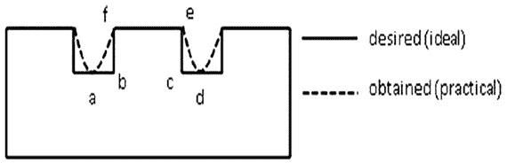 **图(9)**
AWJM 的理想切割与实际切割 [53]。
Goyal *et al.* [54] 研究了使用粉末冶金技术制造的 Cu-Mn 工具通过 EDM 工艺加工的 EN31 钢的硬度和 SR。放电电流和脉冲宽度被选择为加工变量。使用 70Cu-30Mn 电极加工的表面微硬度为 913 VHN，比铜电极高出 11.94%，比 80Cu-20Mn 电极高出 3.39%。然而，由于粉末冶金电极具有多孔性，产生的表面粗糙度较高，尽管这种差异很细微。
Sahu *et al.* [55] 探索了使用 SLS 制造的 AlSiMg 工具对镍钛进行 EDM，并将其性能与市场上石墨和铜工具进行了比较。选择表面粗糙度作为响应，以检查电极材料、电流、电压、脉冲宽度和占空比的影响。使用 SLS 工具实现的平均表面粗糙度最低，其次是铜工具。
Equbal *et al.* [56] 使用熔融建模（FDM）制造了 EDM 工具。使用丙腈丁二烯橡胶（ABS）作为芯材料，外壳通过镀铜生产。发现使用 FDM 很难维持工具的尖锐边缘。尽管 FDM 工艺制造的工具性能与实心铜工具相当，但其尺寸精度较低。使用 FDM 制造精确工具尺寸的困难被认为是其原因。
# EDM 工具的主要研究
| **研究者** | **电极方法** | **工具材料** | **备注** |
| Dimla *et al.* [40] | 快速原型，电镀 | 铜 | 足够。 |
| Li *et al.* [43] | 快速原型，喷涂金属 | TiC-W | 显示了溶解性。 |
| Monzon [49] | 电成型，快速原型 | 铜 | 结果良好。 |
| Meshram and Puri [51] | 快速线电 EDM、网型铸造和熔蜡铸造 | 铝、铜、黄铜 | 精度更好。 |
| Pal and Choudhry [53] | 水射切割 | 铜和黄铜 | 尺寸偏差。 |

| [2] | El-Hofy H.A.G.. 进阶电加工工艺：非传统加工和混合加工工艺。McGraw HillProfessional2016 |
| [4] | Ting H.T., Abou-El-Hossein K.A., Chua H.B.. 蚀刻陶瓷微加工综述。Trans. Nonferrous Met.20065517192 |
| [6] | Farooqui M., Patil N.. 陶瓷电火加工的前景。Procedia Manufacturing.2018657210. | |
| [8] | A.S. Walia, V. Jain.. 碳化钨对钢材电火加工表面的影响。Res. Express.（材料研究快报）20135004.1016/j.0. | |
| [10] | Mishra P.K.. 非传统加工。India-National Publishing.（印度国家出版社）2007 | | |
| [12] | Ozgedik A., Cogun C.. 电火加工磨损的实验性研究。J. Adv. Manuf.（先进制造期刊）2017248 | | |
| [14] | Upadhyay C., Datta S., Mahapatra S.. 电火加工因铁镍的实验性研究。Braz. Soc.（巴西材料学会）20186025.10.1016/j.0. | | |
| [16] | Samuel M., Philip P.. 粉末冶金电火加工电极。Int. J.（国际期刊）97. | | | | | |
| [18] | Srivastava V., Pandey P.M.. 超声辅助冷却电火加工烧结钛化铜的研究。J. Manuf.（制造制造期刊）20131215.10.1016. | |
| [20] | Alpas A.T., Hu H., Zhang J.. 磨损表面的塑性变形和损伤积累。Wear.（磨损期刊）1993162188190.1016/S | | | | | | | | | | | | | | | | |
| [22] | Walia A.S., Srivastava V., Jain V.. 电火加工复合电极的制造与应用。Review Journal of Computer Applications（计算机应用评论期刊）201715. | | | | | | | |
| [24] | Efe G.C., Altinsoy I., Ipek M., Zeytin S., Bindal C.. 粉末冶金法制备铜硅化硅复合材料的某些性能。Kovove Mater（陶瓷材料）20114913110.4149/km_2011_2_131 |

| [27] | Khanra A.K., Sarkar B.R., Bhattacharya B., Pathak L.C., Godkhindi M.M.. `ZrB2–Cu`复合材料作为 EDM 电极的性能。J. Mater. Process. Technol.200718312212610.1016/j.jmatprotec.2006.09.034 |
| [29] | Mohri N., Saito N., Tsunekawa Y., Kinoshita N.. 复合电极电花加工的金属表面改性。CIRP Ann.19934221922210.1016/S0007-8506(07)62429-9 |
| [31] | Janmanee P., Muttamara A.. 不同电极材料在硬化钨电花加工中的性能。Energy Research Journal20101879010.3844/erjsp.2010.87.90 |
| [33] | Li L., Li Z.Y., Wei X.T., Cheng X.. 沉没式 EDM 和线切割 EDM 加工 Inconel 718 的加工特性。Mater. Manuf. Process.20153096897310.1080/10426914.2014.973579 |
| [35] | Kumar P.M., Sivakumar K., Jayakumar N.. Monel 400™ 合金 EDM 加工中铜-二化硼电极的多目标优化与分析。Mater. Manuf. Process.2018331429143710.1080/10426914.2017.1415439 |
| [37] | Mandal P., Mondal S.C.. 用于 EDM 的 Cu-SWCNT 纳米复合涂层 6061Al 电极的发展与应用。Int. J. Adv. Manuf. Technol.201911010.1007/s00170-019-03710-5 |
| [39] | Samuel M.P., Philip P.K.. 粉末冶金生产用于电花加工的压制、预烧结和完全烧结电极的性能。Indian J. Eng. Mater. Sci.19963229233 |
| [41] | Durr H., Pilz R., Eleser N.S.. 通过选择性激光烧结进行 EDM 电极的快速模具化。Comput. Ind.199939354510.1016/S0166-3615(98)0123-7 |
| [43] | Li L., Wong Y.S., Fuh J.Y., Lu L.. TiC/铜烧结电极的 EDM 性能。Mater. Des.2001226697810.1016/S0261-3069(01)001 |
| [45] | Blom R., Yarlagadda P.K., Iyer R.M.. 使用电铸和喷涂金属技术进行电花加工的快速模具。Proceedings 1st Global Congress on Manufacturing and Management Vellore, India49049 |
| [47] | Mishra S.K., Pathak L.C.. 碳和碳化物对二化硼烧结行为的影响。J. Alloys Compd.20084655475510.1016/j.allcom.2007.11.004 |
| [49] | Monzon M., Benítez A.N., Marrero M.D., Hernandez N., Hernandez P., Aisa J.. 快速模具技术制造的电花加工电极验证。J. Mater. Process. Technol.200819610911410.1016/j.jmatprotec.2007.05.025 |
| [51] | Meshram D., Puri Y.. 粉末冶金电极优化。International Journal of Engineering and Research2012 |
| [53] | Pal V., Choudhury S.. 磨粒水射产生方形孔阵列的纹理工具制造。Int. J. Adv. Manuf. Technol.20168510.1007/s00170-015-7 |
| [55] | Sahu A., Chatterjee S., Nayak P.K., Mahapatra S.. 镍钛电花加工过程中电极对表面光洁度的影响研究。IOP Conf. Series Mater. Sci. Eng.201833 |
| [57] | Saxena P., Metkar R.M.. 使用熔融建模 (FDM) 开发电花加工 (EDM) 电极。201910.1007/978-981-13-0305-0 |
# 热增强型非传统加工工艺 - 综述
**Janender Kumar**¹, **Suneev Anil Bansal**¹, **Munish Mehta**²
¹ 机械工程系, Maharaja Agrasen University, Baddi, Solan, India
² 机械工程学院, Lovely Professional University, Phagwara, Punjab, India
## 摘要
本文重点探讨了利用热能从工件上去除材料的非传统加工工艺。激光加工是一种高强度光束照射在工作表面以提高温度，从而使材料发生汽化的过程。激光加工工艺可用于加工硬脆材料。文中综述了所使用的激光类型和激光钻孔工艺。能够实现复杂的轮廓切割和微钻，而这在其他传统和非传统加工工艺中是无法实现的。许多研究人员已经发现混合工艺可以改善激光加工的工艺参数。本文综述了其需求、混合工艺以及陶瓷、复合材料等*等*不同材料加工领域的最新进展。论文最后一部分讨论了该领域未来的研究方向。

**关键词：** 复杂形状、钻孔、硬脆性材料、热能、混合加工、激光束、激光加工、加工参数、微钻孔。
***
Pietrot *et al.* 综述了激光切割工艺以及激光生产部件的质量。通过适当的监测、诊断和调节来改进切割，可以提高产品质量。该工艺的初始设置和运行成本非常高。必须进行适当控制以使该工艺在经济上可行 [4]。
Black *et al.* 研究了厚度为 8.5mm 和 9.2mm 的厚陶瓷砖的加工。使用 `CO[2]` 激光束进行了加工，并研究了不同切割速度下的不同切割参数。在使用 `CO[2]` 激光时观察到了裂纹，这是由于陶瓷砖内部温度梯度（温度随厚度的变化）引起的。为了避免裂纹，必须在加工过程中加入冷却装置 [5]。
Black *et al.* 研究了使用 `CO[2]` 激光切割陶瓷砖的工艺。分析了各种参数以为该工艺准备数据库。考虑分析了六种厚度在 3.7 到 9.2mm 之间的 `Si/Al[2]O[3]` 基陶瓷砖。数据收集了两种条件下的工作：一种是在大气中，另一种是在水下 [6]。
Fang *et al.* 发现玻璃金刚加工中刀具磨损是一个大问题。论文讨论了加工类玻璃压痕、单点划痕和锥形开槽的三方法。在这些方法中，锥形开槽对于脆性到塑性模式转变的研究更为有效。尽管如此，刀具寿命仍然主要问题 [7]。
Meijer *et al.* 讨论了激光束加工及其在使用超短脉冲激光方面的应用。使用短脉冲激光可以很容易地进行微加工，这是该工艺的优势。尽管如此，激光领域的发展仍在进行中，该领域的研究仍在持续 [8]。
Sun *et al.* 总结了硬质和脆材料热增强加工的进展和优点，其中材料通过外部热源去除。观察到激光束加工可以提高复合材料和陶瓷材料的加工性，表现为更长的刀具寿命、切削力的减少和更好的表面光洁度。观察到激光和等离子体辅助加工节省了刀具成本并缩短了换刀时间，增加了刀具寿命 [9]。
Dhar *et al.* 综述了激光钻孔工艺以及解决高质量和精确孔隙问题的技术。讨论了三种钻孔技术：单脉冲钻孔、环钻钻和螺旋钻孔。通过这些钻孔技术，可以产生从小到大的孔隙。结论是，钻孔时间占总时间较长，因此钻孔成本增加。激光束钻孔具有通过更好地控制工艺来减少钻孔时间的潜力 [10]。
Pham *et al.* 提出了一种使用激光铣光工艺加工氧化铝材料的新技术。基本上，早期陶瓷部件的加工非常昂贵，因为需要昂贵的刀具。在本文中综述了该工艺的材料去除特性。结果显示，激光束铣光可以产生复杂的几何形状而不需要昂贵的工具。因此得出结论，如果批量生产陶瓷部件，该工艺是具有成本效益的 [11]。
Dubey *et al.* 研究了混合工艺对当今工业的影响。近年来，激光和非激光混合工艺变得越来越流行。激光和非激光混合常规加工工艺包括激光辅助车削和磨光。同样，激光和非激光非常规加工工艺包括激光辅助超声波加工、激光辅助电化学和电火加工。
Yue *et al.* 发现，与没有超声辅助的激光辅助钻孔相比，超声辅助激光钻孔具有更深的孔和小得多的熔层层 [12] [13]。
Low *et al.* 报告了激光钻过程中锥孔形成的研究。这是激光冲击钻孔的普遍问题。孔的锥度可以通过变脉冲的激光束进行控制。在相同脉冲下，钻孔期间可以很容易看到锥孔。这种新方法用于产生零孔、负孔和正孔 [14]。
Dubey *et al.* 研究了工艺参数对 `Nd: YAG` 激光束加工性能的影响。研究针对钻孔、微钻和切割操作进行了实验设计。结果显示，由于具有改变波长频率的能力，`Nd: YAG` 激光束加工可以成功应用于加工。通过该工艺，可以很容易加工直径达 5 微米的微孔和厚度为 4 微米的薄片 [15]。
Kibria *et al.* 对陶瓷材料圆柱工件进行了 `Nd: YAG` 激光微车削实验，因为它在汽车、医疗和电子行业中具有巨大优势。分析了通过改变工艺变化的切深度和材料表面粗糙度。结果工艺参数 `23 amp`、脉冲频率 `800HZ`、扫描速度 `6.6 mm/s` 给出了良好结果 [16]。
Kim *et al.* 对混合工艺进行了研究，新技术是激光辅助车削。在此过程中利用 `CNC` 进行加工。讨论了激光辅助车削中的三个问题：加工工艺、热处理和设备机制。在此过程中，利用高功率二极管激光代替 `CO[2]` 或 `Nd: YAG` 激光。由于其在激光束车削领域波长较短，吸收率比其他激光高，观察到非常小的工件，特别是铣削。因此，对这进行研究是必要的 [17]。
Phiphon *et al.* 利用通用算法来改进和优化激光束加工的工艺参数。使用响应面法设计实验和数学模型，然后使用通用算法获得最佳结果。使用通用算法技术在表面粗糙度和锯缝锥度方面获得了最佳结果 [18]。
Loumena *et al.* 讨论了轻质 CRPF 材料的隐藏潜力。激光工艺增加了这种高强度和良好耐腐蚀材料的可行性。实验中，基于新一代 `BOREAS` 系列的纳秒激光通过响应面法设计实验和数学模型，然后使用通用算法获得最佳结果。使用通用算法技术在表面粗糙度和锯缝锥度方面获得了最佳结果。这种激光减少了 CRPF 材料的更多热量，并建议未来使用准分子纤维激光 [19]。
Mishra *et al.* 阐述了用于激光束钻孔预测耦合方法。使用了两种方法：有限元分析和人工神经网络。优化参数显示孔径减少了 67.5%，热区减少了 25%，材料去除率增加了 65% [20]。
Nasim *et al.* 讨论了依赖二极管激光的测量技术。它可以产生非常小尺寸且具有可靠性的孔。该工艺的应用用于癌症识别、爆炸检测、空气和水。本文代表了从工业角度使用二极管激光进行加工 [21]。
Venkata *et al.* 综述了所有非常规加工工艺，主要关注这些工艺的优化。这些工艺包括电化学加工、微加工、混合工艺和激光束加工。该综述的目的是给出所有工艺的概述，并为该领域提供新方向。文中代表了它们与其他工艺的比较 [22]。
Venkatesan *et al.* 总结了激光辅助加工及其加工硬质和脆性材料的潜力。在本文中，研究了钛合金、镍基合金和复合材料的激光辅助加工。结论是，混合工艺可以提高那些通过传统方法难以加工的材料性能 [23]。
Liu *et al.* 引入了超声辅助水受限微加工。实际上，在激光束加工期间，产生了许多缺陷并在工件上沉积了有害产物。本文引入了水受限激光加工，消除了激光束加工中产生的缺陷。结果显示水下加工减少了表面损伤 [24]。
Mishra *et al.* 讨论了用于在硬质材料中创建微加工的超短脉冲激光。工业可以利用这种先进的加工方法。激光束微加工被用于制造微米级 3D 结构和光学产片。本文强调了激光束加工中高脉冲激光与不同类型材料的相互 [25]。
Darnish *et al.* 比较了水介和干介两种加工介，用于加工 718 超合金。发现水下加工比干介加工生产率更高 [26]。
Ahman *et al.* 比较了电火加工和激光加工，一种混合工艺。观察到通过该工艺加工时间减少了 50-65%，而不损害微孔质量。在钛合金中通过电火加工钻了微孔。因此，该混合工艺被用于加工它 [27]。
Alahmari *et al.* 展示了用于镍基合金 718 微通道制造的激光束加工。激光水下加工可以提高工件的质量。该综述单独讨论了激光和弧源加工。作者提出的激光辅助工艺是混合工艺 [29]。
Lee *et al.* 综述了辅助混合工艺，这些工艺对硬质材料有巨大影响。通过使用这些工艺，观察到加工的改进和切削力的减少。讨论了不同激光的特性，`CO[2]` 具有较高的波长 [31]。
Wang *et al.* 展示了用激光束加工陶瓷材料。研究了钻孔质量，激光束加工使用了计算方法。讨论了不同的陶瓷钻孔方法，激光钻孔领域需要更多工作以实现更高的精度 [32]。
Mistry *et al.* 专注于液体辅助激光束微加工的研究。这是在微米水平加工材料表面的一种极佳方法。通过该工艺，由于高热和不良表面光洁度导致的热损伤可以改善。为了理解该工艺，使用了有限元模拟技术。结果显示水下加工通过减少表面损伤获得了良好结果 [33]。
Dutt *et al.* 专注于脉冲 `Nd: YAG` 激光钻孔不同强度的硬质材料，如超合金、复合材料、铁质和非铁材料。综述强调了使用激光钻孔不同材料以提高工艺生产力 [34]。
Sherpa 和 Pradhan 探索了使用 `Nd; YAG` 激光增强不同材料微加工的各种参数。使用二极管泵浦激光进行微加工。发现材料去除率随频率增加而增加。表面粗糙度也被发现随二极管电流增加而增加 [35]。
Rana *et al.* 研究了检查加工对材料影响的不同技术以及材料属性变化的原因。研究人员还探索了工业中激光束加工的使用，特别是航空航天领域。实施了 Taguchi 方法、遗传算法、响应面法等各种技术。观察了相关参数。结果表明在切割矿钢期间，氧气比惰性气体加工厚材料的效果更好 [36]。
Faisal *et al.* 综述了激光束加工和激光束微加工工艺。这些技术为硬材料加工领域带来了革命。激光工艺也应用于医疗、航空航天和通信领域。激光可以产生直径小于 0.3 mm 的孔。这就是为什么也被称为激光束微加工，因为这种尺寸无法通过任何其他常规或非常规工艺获得。金属微加工包括微钻孔和微铣削。观察到了激光微加工领域的最新进展 [37]。
Holmberry *et al.* 评估了加工后工件的表面状态。考虑并比较了三种非常规加工工艺的表面完整性。这些工艺分别是磨料水射加工、电火加工和激光束加工。在 718 合金上进行了实验。结果显示与 `EDM` 和 `LBM` 相比，磨料水射加工产生了低表面粗糙度的良好表面状态。这是研究的主要目标 [38]。

激光束及其相关工艺的汇编或快速回顾见表 3。
本综述为我们开展激光束加工领域开展进一步的研究提供了基础。
在文献综述期间，观察到大多数研究人员在实验中使用了 `Nd: YAG` 激光进行加工。因此，在不久的将来，研究其他类型的激光可以成为进一步研究的课题。
### Nd: YAG 激光概述
其缩写为“`掺钕钇铝石石榴`”。这是一种强固体激光器。它用于轻型作业。可以轻松地加工高反射率和电电质材料。通过脉冲模式，它可以加工更厚的材料。这是一种紧凑且可靠的激光。这种激光在脉冲模式下运行时具有低平均光功率但高能量密度。它在激光束加工过程中用作激光介质。工艺的示意图见图 (3)。
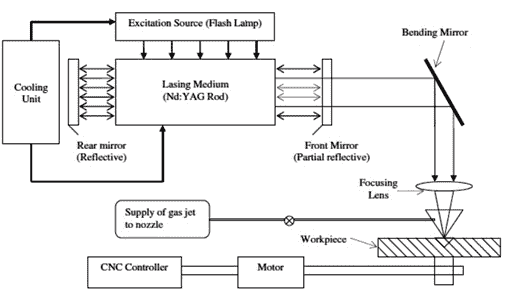**图 (3)**
`Nd: YAG` 激光束切割工艺示意图 [12]。表 3 激光束加工和激光辅助工艺的汇编 [22]。
| 作者 | 工艺 | 工作材料 | 考虑的重要输入变量 | 优化技术 | 备注 |
| Pham 等人* (2007) | 激光铣工艺 | 氧化铝材料和氮化硅陶瓷 | 扫描速度、脉冲强度、灯管电流 | 单因素实验 | 建议对于任何采用 1064 纳米波长进行激光铣削的机器：应提供一个玻璃支撑板以重新定位工件。 |
| Allman- 等人* (2015) | 激光微钻孔 | 镍钛合金 | 灯管电流、脉冲频率、脉冲宽度、气压 | 混合工艺 | 通过混合工艺（激光和微电火加工）：加工时间缩短且表面质量（RR）增加 |
| Dutt 等人.* (2018) | 激光钻孔工艺 | 复合材料、陶瓷和超合金 |调调、峰值功率、脉冲时间、脉冲频率、脉冲数和气体压力 | 基于人工智能的方法 (`ANN`: 遗传算法) | 脉冲 `Nd: Y..A.G` 激光束钻孔由于具有更好的聚焦特性而快速增加 |
## 结论
1. 激光束加工用于在工件上制造复杂轮廓、钻出不同尺寸的孔（直径达 5 微米的微孔）以及切割厚达 4 微米的薄箔。
3. 激光混合加工工艺比单一非传统加工产生了更好的结果。
5. 激光辅助加工优于传统加工。此外，它可以用于提高传统方法难以加工材料的加工效率。
7. 还得出结论，使用脉冲 `Nd: YAG` 激光束钻孔可以轻松钻硬硬材料。这种工艺在实践和理论上都可以成功地用于复合材料。这种激光的应用正在不断增加。
### 激光束加工研究的未来范围
不适用。
## 出版许可
作者确认本章节内容没有利益冲突。
## 致谢
作者对编辑和匿名评审员的时间和宝贵建议表示诚心的感谢。
## 参考文献
| | |
| [1] | Peyman G.A., Alghadyan A., Peace J.H.. A contact `Nd:YAG` laser to resect large ciliary body and choroidal tumors.Int. Ophthalmol.1987111556110.1007/BF020278983692695 |
| [2] | Jiang C.Y., Lu S.S., Yue T.M., Chiang L.. On maximum depth and profile of cut pulsed `Nd: YAG` machining.Annals of CIRP199384475 |
| [3] | Yeo C.Y., Tam S., Lu W.S.. A technical review of laser drilling of aerospace.J. Mater. Process.2004149217 |
| [4] | Di Pietrot P., Yao Y.L.. An investigation into laser cutting quality-Int. J. Mach. Tools Manuf.19945030 |
| [5] | Black I., Chuck K.L.. Laser cutting of thick ceramic.Opt. Technol.1997294193 |
| [6] | Black I., Livingstone S.A.J., Chua K.L.. A laser beam machining database for the cutting of ceramic.J. Mater. Process.1998844 |
| [7] | Fang F.Z., Liu X.D., Lee L.C.. Micro-machining of optical glasses - A review of diamond-cutting *Sadhana - Acad.*Proc. Eng. Sci.2003285945 |
| [8] | Meijer J.. Laser beam machining, state of art and new opportunities.J. Mater. Process. Technol.200402.03 |
| [9] | Sun S., Brandt M., Dargusch M.S.. Thermally enhanced machining of hard-to-machine materialsA review.Int. J. Mach. Tools Manuf.20065086638 |
| [10] | Dher S., Saini N.. A review on laser beam drilling and its techniques”, International conference on advances in mechanical engineering, BBSBEC, Pb2006 |
| [11] | Pham D.T., Dimov S.S., Petkov P.V.. laser milling of ceramic components.Int. J. Mach. Tools Manuf.20074761862 |
| [12] | Dubey A.K., Yadava V.. Laser beam machining-a review.Int. J. Mach. Tools Manuf.20084860962 |

# AWJM 工艺——综述

| 编号 | 参考文献信息 |
| :--- | :--- |
| [13] | Yue T.M., Chan T.W., Man H.C., Law W.S.. 使用有限单元法分析超声辅助激光钻孔.CIRP199645116917210.101016/S0007-8506(07)63040-6 |
| [14] | Li.l.low, D.K.Y. Ghoreshi and J.R. Crookall,”激光冲击击钻孔中的孔锥度表征与控制.CIRP Ann.200251115315610.101016/S0007-8506(07)61488-7 |
| [15] | Dubey A.K., Yadava V.. Nd: YAG 激光束加工实验研究——综述”.材料加工技术杂志 2008 1951526 |
| [16] | Kibria G., Doloi B., Bhattacharyya B.. Nd:YAG 激光氧化铝陶瓷微车的实验分析.国际先进制造技术杂志 2010505–864365010.101007/s00170-010-2527-4 |
| [17] | Kim K.S.. 激光辅助加工的研究与发展综述”.国际精密与制造杂志 201112753 759 |
| [18] | Phipon R., Pradhan B.B.. 使用遗传算法优化激光束加工的工艺参数.国际计算工程研究杂志 20122 515001516 |
| [19] | Loumena C., Nguyen M., Lopez J., Kling R.. 激光在 CFRP 生产中的潜力 201210.2351/1.5062378 |
| [20] | Mishra S., Yadava V.. 薄铝板激光束冲击击钻孔的建模与优化”,光学与激光技术.2013Vol. 48461474 |
| [21] | Nasim H., Jamil Y.. 二极激光器：从实验室到工业.光激光技术.20145621122210.101016/j.optlastec.2013.08.012 |
| [22] | Venkata R.. 使用先进优化技术优化现代加工工艺——综述 国际先进制造技术杂志 2014735-811591188 |
| [23] | Venkatesan K., Ramanujan R.. Procedia Eng.2014971626163610.101016/j.proeng.2014.12.313 |
| [24] | Z. liu,Y. Gao, B. Wu, N. Shen, and H. Ding, “超声辅助水缚激光微加工：一种新型加工方法.制造快报.201424879010.101016/j.mfglet.2014.06.0 |
| [25] | Mishra and S. James 液体辅助激光束加工的有限元分析与仿真.国际先进制造技术杂志 2017945-82325233110.101007/s00170-017-0 |
| [26] | Darwish S., Ahmed N., Alahmari A., Mufti N.. 干湿介质下激光束加工微通道的比较.国际先进制造技术杂志 201583153915510.101007/s00170-0 |
| [27] | Ahman A., Rasheed M.S., Mohammed M.K., Saleh T.. 微加工与激光束加工的镍钛形状记忆合金.材料制造.20153144745 |
| [28] | Alahmari A., Ahmed N., Darwish S.. 水下激光束微加工国际先进制造技术杂志 2016831671681 |
| [29] | Lee C.M., Woo W.S., Kim D.H., Oh W.J.. 激光辅助工艺——综述国际精密工程与制造杂志 2016172567 |
| [30] | Firdaus A., Baharin S., Ghazil M.J., Wahab J.. 激光表面形化对摩擦和磨损的贡献——短评.润滑与摩擦.201681576 |
| [31] | Lee C.M., Woo W.S., Baek J.T., Kim E.J.. 激光与电弧制造工艺——综述.国际精密制造杂志 20161779739851.101007/s12541- |
| [32] | Wang H., Lin H., Wang C., Hu X.. 结构陶瓷激光钻孔——综述.欧洲陶瓷学会杂志 201637415711731.101016/j.jeuramsoc.2016.10 |
| [33] | Mistry V., James S.. 液体辅助激光束加工的有限元分析与仿真.国际先进制造技术杂志 2017945-82325233110.101007/s00170-017- |
| [34] | Gautam G.D., Pandey A.K.. 脉冲 Nd: YAG 激光束钻孔——综述光学与激光技术 201810021833 |
| [35] | Sherpa T.D., Pradhan B.B.. Nd:YAG 激光束加工硅片微槽.IOP 会议系列材料科学与工程 2018377171.101088/1757-899X/377/1/01219 |
| [36] | Rana R.S., Chouksey R., Dhakad K.K., Paliwal D.. 高强度钢激光束加工工艺参数优化：综述.今日材料工艺 201859191911919910.101016/j.matpr.2018.06.274 |
| [37] | Faisal N., Zindani D., Kumar K., Bhowmik S.. 工程材料激光微加工与摩擦学——综述材料成形、加工与摩擦学 201812116 |
| [38] | Holmberg J., Berglund A., Wretland and T. Bano”, EDM、激光束加工和磨粒水喷射加工 718 合金的高能加工后表面完整性评价.国际先进制造技术杂志 20181001575159110.101007/s00170-018-2-z |
| [39] | Vasanth S., Muthuramalingam T.. 基于 CO2 的激光束加工皮革加工性能研究.制造工艺进展 2018239244 |
| [40] | Zhai Z., Wang X.. 飞秒激光热障涂层镍基合金冲击击钻孔国际光与电子光学杂志 2019194163066 |
| [41] | Ei-Hofy M.H., Ei-Hofy H.. 碳纤维增强复合材料激光束加工——综述.国际先进制造技术杂志 20191019-122965297510.101007/s00170-018-2 |
| [42] | Abdo B.H.A., Ahmed N., El-Tamimi A.M., Anwar S., Alkhalefah H., Nasr E.A.. 氧化锆陶瓷激光束微加工——综述”,微加工几何形状与表面粗糙度研究.机械科学技术杂志 201913341818310.101007/s12206-019-x |

## 摘要

性磨粒水喷射加工（AWJM）作为一种非传统加工（NCM），在质量和可靠性方面已得到极大改进。AWJM 是一种广泛使用的非传统加工工艺，已应用于刀具、零件、微观结构或复杂产品（如钛合金、合金钢等）的加工技术领域。它已渗透到理论研究的每一个重要领域并广泛应用。应用包括医疗器械、精密零件、高效材料、智能汽车制造、航空天设备、可再生能源科学等。

**关键词：** 磨粒水喷射、加工、材料。

* * *

^* **通讯作者 Mamta:** 机械工程系，Maharaja Agrasen 大学，Baddi, Solan, India; 电子邮箱: `dahiya.mamta56@gmail.com`

在设计与创新领域，形势瞬变，需要极其精确且深层加工的部件。表面性能在制造汽车、航空和生物医学应用的产品中起着至关重要的作用。一点划痕或毛刺可能导致巨大的灾难，例如发动机中途故障、航空灾难等。各行业正努力努力并投入巨资，以在不损害表面性能的情况下完成这些制造。在不改变表面质量和性能的情况下，对硬质材料进行加工是一项艰巨的任务。在数控加工（NCM）中，加工过程中产生的热量可能会导致表面变形 [1]。为此，通过选择合适的工艺，我们可以获得更好的表面质量。在这种特定情况下，可以使用水射在不产生任何热量的情况下加工硬质材料。这种水和磨粒剂的混合物被称为水射切割（WJM），是一种数控加工程序，利用高速水流从工件外部侵蚀材料。WJM 同样可以切割塑料、弹性体或木材等软材料。尽管如此，为了切割金属或岩石等更硬的材料，需要在水中混合磨粒剂。当在加工过程中水中使用磨粒剂时，它被称为磨粒水射切割（AWJM）。它基于水侵蚀原理工作。当高速水流撞击表面时，材料会发生排出。Norman C. Franz 博士于 1968 年启动了先进的 WJM 创新，并获得了一种创造性高压 WJM 框架的主专利，并在 1971 年创建了主要的水射切割业务，用于切割层压纸管。1980 年，Hashish 博士发现了在纯 WJM 中加入磨粒剂的方法，从那时发明了 AWJM，用于切割钢、玻璃和水泥等机械材料 [2, 3]。

## WJM 和 AWJM 工艺

在 WJM 工艺中，高速水射撞击工件。施加在喷嘴末端水的压力转化为高速度。随后，为了切割高质量材料和硬质材料，在高速水射中加入磨粒剂。WJM 具有许多优点，且成本结构也较低。这种创新发展迅速且灵活。有毒废气、重熔层、熔渣和残余应力可以很容易消除。AWJM 的切割功率较低，且切割区域附近没有像 NCM 那样的热影响区。通过这种方式，已经证明了 NCM 无法于加工的材料可以通过 WJM 有效加工，例如，在玻璃、石材和金属上开槽、钛合金的快速钻孔等都可以通过 WJM 轻松地加工 [4]。

## AWJM 组件

（图 1）展示了 AWJM 组件的示意图。AWJM 工艺的重要部分包括高压液压泵（HPLP）、高压泵、计算机控制系统、加工头和收集器。HPLP 用于持续提供超高压。系统由两个水箱组成，满足切割材料和水的需求。整个系统配备了过滤机制，可以过滤掉较大的颗粒。系统中的大颗粒会阻塞整个系统的运行 [6]。

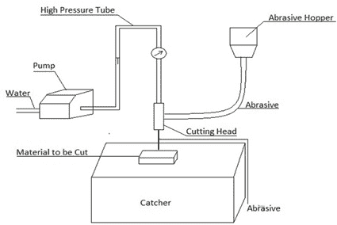 **图 (1)**

带有各种组件及其附件的 AWJM 工艺示意图解 [5]。

## 热增强加工 (TEM)

使用 AWJM 工艺对多种材料（如镍基合金、钛、玻璃、陶瓷、复合材料、热敏感合金等）根据不同的应用进行成型。特别是在航空航天领域，对耐热和高强度材料的需求日益增加。然而，由于其物理和机械特性（如高强度和低导热率），这些材料通常难以加工，这需要极高的切割能量，并导致切力和切割温度非常高，甚至导致刀具寿命短。这为难加工材料开辟了热增强加工（TEM）的途径。TEM 可以使用外部热源加热并软化工件。结果是工件的屈服强度、硬度和应变硬化降低，难加工材料的变形行为发生变化，允许塑性变形。这使得机器可以于加工材料，且能量需求低，提高了材料去除率（MRR）和生产率 [7]。

AWJM 工艺的各种特性和开发的机器已用于切割各种材料，如玻璃等硬材料、钛和镍基合金等硬金属、复合材料和合金。对耐热和更高质量材料的需求在航空应用领域不断扩大。这些材料由于其物理和机械特性（例如高强度和低导率）而难以加工，需要极高的切力，导致切割功率和温度异常高。这甚至会导致切割材料的使用寿命短。这为难加工材料开辟了热改进加工（TIM）道路。TIM 可以利用外部热源加热并软化工件。因此，工件的屈服强度、硬度和应变硬化效应降低。通过这样做，难加工材料发生变化并允许塑性变形。这使得机床能够有效加工这些难加工的材料，同时低能量需求促进了材料去除率和盈利能力的增加 [7]。

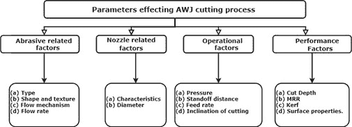 **图 (2)**

显示影响 AWJ 切割过程的各种类参数图 [8]。

## TIAWJM 的性能因素

热改进水射切割（TIAWJM）的性能取决于多种因素（图 2）。这些因素可以分为几类。这些类别和因素列如下：

(1) 与磨粒相关的因素
- 类型
- 形状和纹理
- 流量机制
- 流量

(2) 与喷嘴相关的因素
- 特性
- 直径

(3) 操作因素
- 压力
- 离层距离
- 进给率
- 切割角度

(4) 性能因素
- 切割深度
- 材料去除率 (MRR)
- 缝宽
- 表面性能

磨粒颗粒在 AWJM 加工过程中起着关键作用。磨粒以高速度撞击工件，导致工件材料被侵蚀。这种赋予于磨粒颗粒的高速度是由水射流提供的。由于由于 AWJM 工艺的特性，它能够切割几乎任何材料 [9]。在用 AWJM 加工期间，MRR、表面粗糙度和生产率是相互相关的。

这些参数决定了表面质量，并确定了所得产品的功能性能。几何精度也是 AWJM 工艺中的主要输出参数。

考虑到机械性能和导性，工件材料可以分为两类，即延性材料和脆性。这两类材料具有不同的加工机制。

延性材料的加工机可以分为两类，*即*微切削和塑性变形，如图 (3) 所示 [6]。

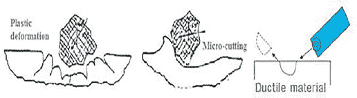 **图 (3))**

磨粒颗粒对延性材料的影响 [6]。

另一方面，脆性材料表现出不同的切削行为。脆性材料在进行切削过程中会经历塑性变形区和脆性断裂（图 4)）。

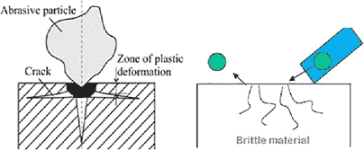 **图 (4))**

磨粒颗粒对脆性材料的影响 [6]。

## AWJM - 文献

研究人员在加工 Al7475 时研究了 AWJM。研究中考虑了压力、移动速度、与工件的距离以及喷嘴倾角等各种参数。研究使用了 3mm 厚的铝片。AWJs（水磨切割机）在金属切削、切割飞机复合材料、金属、电路负载板等方面异常强大。

研究了加工过程中的疲劳寿命和材料去除率（MRR）[11]。Yue *等人* [12] 通过实验寻找输入参数对 AWJM 过程的影响。通过改变压力、进给、磨粒流量和喷嘴角度来寻找对 MRR 的影响。在切削氧化铝时得出结论：通过同时增加压力磨粒流量，MRR 会随之增加。还对一种特殊类型的 AWJM 过程进行了数值模拟研究 [13]。研究了超声波辅助 AWJM 过程以发现磨粒侵蚀过程。研究了部分重叠和全重叠的情况。研究得出，具有锐边缘颗粒的 30° 冲击角可以获得更高的 MRR。振动辅助加工观察到的 MRR 比无振动加工更高 [13]。

使用 AWJM 切割了 Ti6Al4V-CFRP 等特殊材料 [14]。研究中首次考虑了锥角、锯缝宽度和粗糙度。传统加工在切削这些材料时面临各种困难，因为这两种材料（Ti6Al4V 和 CFRP）的特性截然不同。该研究成功完成，为航空航天工业广泛使用的异种材料组合加工开启了新大门 [14]。Uthayakumar *等人* 研究了用 AWJM 加工超合金。实验表明 AWJM 可以成功用于加工镍合金。使用 AWJM 可以以具有成本效益的方式产生光的光表面。材料的表面性能在加工过程中没有退化。观察到加工期间的压力和速度会影响锯缝壁倾角。发现 MRR 受流速和压力等参数的强烈影响。在高压力和足够的移动速度下，获得了超合金的高表面光洁度 [15]。温度也被认为是 AWJM 的影响参数 [7]。在预定的定位处进行热处理，以沿加工路径对工件进行预热。假设预热可以软化材料，有助于大幅减少切力并增加 MRR。观察到很难在长时间和较大尺寸下保持温度。由于由于原因，它只对微切削和微通道切割具有价值 [7]。还实验使用 AWJ 切削工艺加工难切的不锈钢钢 [16]。使用 AJM 切割加工了 EN1 SS 不锈钢。在 3400-3800 bar 的水压力下切割了 20mm 的棒材。

2016 年，Shukla *等人* 为 AA6351 铝合金优化了 AWJM 过程参数。使用了各种优化技术 [17)。研究重点是确定具有所需输出结果的工艺参数范围。初步地，使用 Taguchi 方法优化工艺参数，揭示了获得所需结果所需的一系列各种工艺参数 [17)。Tamannaee *等人* 考虑了 AWJM 中的侵蚀率。加工中使用填充粉末的热塑性聚烯烃。从那时起，利用侵蚀率估计来创建加工配置以扩大边界侧壁的斜率 [18]。还研究了用 AWJM 加工加工 Al-MMCs。研究重点是提高锯缝性能 [19]。还尝试使用 AWJM 加工 Ti-6Al-4V。还使用了 Taguchi 和 ANOVA 分析等优化方法。进行了一系列实验以优化变量输入并达到所需的输出。对 MRR 和锯缝性能等所需的输出输出参数进行了优化 [20]。碳纤维氧树脂作为一种广泛使用的轻质材料，其 AWJM 应用仍然有限。因此，进行了一项使用 AWJM 加工碳纤维氧树脂复合材料的研究 [21]。钛及其合金被归类为难切材料。M. Douiri *等人* 使用 AWJM 过程加工了钛合金 Ti–6Al–4V [22)。研究揭示了加工过程中的几个不同区域。区域 1，初始阶段损伤发生在较低攻击角。随后切削进行到区域 2。该区域切削平滑。攻击角增大。在区域 3 中，观察到不规则的切削。喷射在区域 3 发生了偏转 [22)。Inconel 因其机械性能在发动机中有多种应用。同样的机械性能使得 Inconel 这种材料很难切削。AWJM 已成功用于切割 Inconel [23]。为了进一步改进研究，使用了 Taguchi-Grey 关联方法来优化工艺参数 [23]。

还研究了与铣削相比的 AWJM 表面性能，见表 1。得出结论：AWJM 在产生所需光洁度方面比铣削更具优势且效果更好 [23]。Suresh *等人* 使用 AWJM 加工工艺钻了纤维增强复合材料。与其他报告相反，磨粒粒径不影响 MRR。还观察到压力影响工件的锥度 [24]。最近在 2018 年，Xiaochu *等人* 执行了各种实验以开发 WJM。分析了各种输入和输出参数 [25]。

还进行了一些理论研究以分析 WJM，见表 2。Melentiev *等人* 使用理论方法分析了微 AJM。特别使用了小喷嘴 [26]。Jagadish *等人* 使用了软计算方法。通过软计算方法提高了表面质量和服务寿命 [27]。

表 1 **AWJM 综述。**

| **序号** | **作者** | **工艺** | **贡献** |
| --- | --- | --- | --- |
| 1. | Haghbin *等人* [28] | AWJ 铣削 | • 表面演化模型。 • 微通道加工 • 加工较深的槽 |
| 2. | Jafar *等人* [29] | AWSJ 切割 | • 加工硼硅酸玻璃 • MMR • 表面改进。 |

| 序号 | 作者 | 工艺 | 贡献 |
| :--- | :--- | :--- | :--- |
| 3. | Pang *et al.* [2] | 航空磨粒水射切割 | • 加工无形玻璃 • 研究通道的形成 • MRR 预测模型 • 尺寸预测 |
| 4. | Tamannaee *et al.* [18] | 水射切割 | • 加工热塑性聚烯烃 • 加工型口袋 |
| 5. | Xu *et al.* [30] | 磨粒水射磨光、光光和抛光 | • 陶瓷加工 •玻璃加工  硬脆材料加工 |
| 6. | Feng *et al.* [31] | 航空磨粒水射钻孔 | • 小孔钻孔 • 快速钻 |
| 7. | Li *et al.* [32] | 径向模式磨粒水射车削 | • 径向模式磨粒水射车削 • 各参数的优化 |
| 8. | Haghbin *et al.* [33, 34] | 水射流加工 (WJM) | • 实验 WJM • 加工过程中流体的影响 • 浅通道加工 |
| 9. | Rupam *et al.* [35] | 航空磨粒水射钻孔 | • 磨粒水射钻孔 • 压力和时间的影响 • 磨粒流速的控制 |

**表 2 WJM 工艺动态模拟概览。**

| 序号 | 作者 | 工艺 | 贡献 |
| :--- | :--- | :--- | :--- |
| 1. | Yang *et al.* [36] | COMSOL 模拟 | • 阴极工作区 • 阴极结构优化 |
| 2. | Anwar *et al.* [37, 38] | 3D 表面生成 | • 预测模型 •调节应变率 • 加热和摩擦行为 |
| 3. | Hou *et al.* [39] | 水射 (WJ) | • 速度振动分析 • 超高压环境 • 流速振动 |
| 4. | Thomas *et al.* [40] | 磨粒水射边缘 | • 聚集诱导缺槽的形成 • 边缘轮廓 • 塑性变形行为 |

## 磨粒水射加工的应用

以下是磨粒水射加工的应用：

1. `AWJM` 工艺适用于工业部件的加工。
2. `AWJM` 显著缩短了循环时间，成为替代传统铣的潜力方案。
3. `AWJ` 切割具有切割复杂形状和钻出困难孔的能力。材料切割的各种应用已得到开发 [4)。
4. `AWJM` 在页岩油领域发现应用，使用磨粒浆料切割硬岩。
5. 应用于航空航天使用的耐热和高强度材料加工。
6. 玻璃、陶瓷、石头、铁质和非铁合金已使用 `AWJM` 和 `WJM` 成功切割 [41]。
7. 可持续 `AWJM` 应用于可持续工程领域，其中切割使用的磨粒和其他材料得到适当回收 [42)。
8. 用于航空航天部件的 `Ti/Ni` 合金可以使用 `AWJM` 进行适当切割，这些材料通常很难切割 [43)。
9. 使用冰喷射射流加工可以实现圆盘和 PCB 的可持续清洁和去油 [44)。

## 未来范围

不锈钢的可加工性研究仍然是 `AWJ` 可以找到各种应用的关键领域。有开展全面研究的空间。

## 结论

根据文献回顾，`WJM` 具有巨大的加工潜力，`AWJM` (磨粒水射) 和 `WJM` (水射) 的性能取决于磨粒的尺寸和形状。

## 发表许可

`AWJM` 确认内容没有问题。

## 致谢

作者感谢编辑提供的时间。

## 参考文献

| | | |
| :--- | :--- | :--- |
| [1] | `Walia A.`, `Srivastava V.` | 磨粒水射对铜的影响 |
| [2] | `Pang K.`, `Nguyen T.` | 使用磨粒水射对玻璃的特性描述 |
| [3] | `Escobar-Palafox G.`, `Ridway R.` | 磨粒水射对口袋的建模 |
| [4] | `Supriya S.`, `Srinivas A.` | 磨粒水射加工堆层材料 |
| [5] | `Uthayak M.`, `Raju N.`, `Jain V.` | 不 |
| [6] | `Saravanan S.`, `Vijayan V.` | 磨粒射方法的综述 |
| [7] | `Patel D.`, `Tandon P.` | 使用 Taguchi 对磨粒水射参数的实验研究 |
| [8] | `Gidhani Y.` | 基于 AHP 的磨粒水射 |
| [9] | `Miao X.`, `Wu M.`, `Song L.`, `Ye F.`, `Qiang Z.` | 磨粒水射的研究 |
| [10] | `Parameters A.` | 磨粒水射车削 |
| [11] | `Boud F.`, `Loo L.F.`, `Kinnell P.` | 水射对铝表面质量的影响 |
| [12] | `Yue Z.`, `Huang C.`, `Zhu H.`, `Wang J.`, `Liu Z.` | 基于响应面法的磨粒水射车削氧化铝陶瓷的参数优化 |
| [13] | `Lv Z.`, `Huang C.`, `Zhu H.`, `Wang J.`, `Yao P.`, `Liu Z.` | 超声波辅助水射中磨粒侵蚀的 FEM 分析 |
| [14] | `Alberdi A.`, `Artaza T.`, `Suárez A.`, `Rivero A.`, `Girot F.` | 磨粒水射切割 CFRP/Ti6Al4V 堆层的实验研究 |
| [15] | `Uthayak M.`, `Khan M.A.`, `Kumaran S.T.`, `Slota A.`, `Zajac J.` | 磨粒射对镍基合金的可加工性 |
| [16] | `Ion aurel Perianu` | 压力对奥锈钢切割的影响 |

| [18] | Tamannaee N., Spelt J.K., Papini M.. 填充滑石共聚物中边缘、平面区域和过渡斜面的磨料性流射微加工。Precis. Eng.201643526210.1016/j.precisioneng.2015.06.009 |
| [19] | Sasikumar K.S.K., Arulshri K.P., Ponappa K., Uthayakumar M.. 利用磨料水射切割技术加工的混合铝 7075 金属基复合材料的切口特性研究。Proc. Inst. Mech. Eng., B J. Eng. Manuf.2018232469070410.1177/0954405416654085 |
| [20] | Nagendra Prasad K., John Basha D., Varaprasad K.C.. 采用 Taguchi 方法对 Ti-6Al-4V 合金进行磨粒射加工工艺参数的实验研究与分析。Mater. Today Proc.2017410108941090310.1016/j.matpr.2017.08.044 |
| [21] | Dhanawade A., Kumar S.. 磨料水射切割加工的碳树脂复合材料表面研究。J. Compos. Mater.201812 |
| [22] | Douiri M., Boujelbene M., Bayraktar E., Ben Salem S.. 磨料水射切割钛合金 Ti-6Al-4V 形状的工艺可靠性。Conf. Proc. Soc. Exp. Mech. Ser.vol. 5229236201910.1007/978-3-319-95510-0_28 |
| [23] | Kumar M., Sharma A., Shahi A.S., Pwta Á.S.Á., Butt Á.. 制造工艺的进展。Springer 新加坡 2019 |
| [24] | Suresh R., Sohit Reddy K., Shapur K.. 玻璃和 GFRP 复合材料微孔钻的的磨粒射加工。Mater. Today Proc.2018525757576110.1016/j.matpr.2017.12.171 |
| [25] | Liu X., Liang Z., Wen G., Yuan X.. 水射流加工与研究进展：综述。Int. J. Adv. Manuf. Technol.201910.1007/s00170-018-3094-3 |
| [26] | Melentiev R., Fang F.. 微磨粒射射加工中颗粒速度的理论研究。Powder Technol.201934412113210.1016/j.powtec.2018.12.003 |
| [27] | Jagadish S.. 绿色磨料水射流加工表面粗糙度质量的预测：一种软计算方法。J. Intell. Manuf.2015Cm15 |
| [28] | Haghbin N., Spelt J.K., Papini M.. 金属中通道的磨料水射微加工：用于水没和非水没加工的高深比通道轮廓的模型。J. Mater. Process. Technol.201522239940910.1016/j.jmatprotec.2015.03.026 |
| [29] | Haj Mohammad Jafar R., Nouraei H., Emamifar M., Papini M., Spelt J.K.. 脆性材料磨料流射微加工中的侵蚀建模。J. Manuf. Process.20151712714010.1016/j.jmapro.2014.08.006 |
| [30] | Xu S., Wang J.. 受控喷嘴振动的磨料水射流切割氧化铝陶瓷的研究。Int. J. Adv. Manuf. Technol.2006277–869370210.1007/s00170-004-2256-7 |
| [31] | Feng Y.X., Huang C.Z., Wang J., Lu X.Y., Zhu H.T.. 磨料水射流技术铣铣陶瓷表面特征。Key Eng. Mater.200732933534010.4028/www.scientific.net/KEM.329.335 |
| [32] | Li W., Zhu H., Wang J., Ali Y.M., Huang C.. 高拉力钢径向模式磨料水射流加工过程的研究。Int. J. Mech. Sci.20137736537610.1016/j.ijmecsci.2013.05.005 |
| [33] | Haghbin N., Spelt J.K., Papini M.. 金属中通道的磨料水射微加工：空气中加工与水没加工的比较。Int. J. Mach. Tools Manuf.20158810811710.1016/j.ijmachtools.2014.09.012 |
| [34] | Haghbin N., Ahmadzadeh F., Spelt J.K., Papini M.. 磨料水射微加工中夹带空气的影响：利用流体夹带减少通道宽度和波纹度。Wear2015344–3459910910.1016/j.wear.2015.10.008 |
| [35] | Tripathi R., Srivastava M., Hloch S., Adamčík P., Chattopadhyaya S., Das A.K.. 岩石破碎过程中声发射的监测。Procedia Eng.2016149June48148810.1016/j.proeng.2016.06.695 |
| [36] | Yang F., Ren T., Wang H., Liu B., Chen M.. 电化学加工金属螺泵定子流场分析。Int. J. Adv. Manuf. Technol. |
| [37] | Anwar S., Geskin D., Becker A.. 磨料水射加工的有限元素建模。Mater. Process. Technol.20132119 |
| [38] | Jian W., Na G., Wen G.. 磨料水射加工的 SPH 模拟。Int. J. Adv. Manuf. Technol. |
| [39] | Hou R., Huang C., Zhu H.. 高频振动的数值仿真。Int. J. Adv. Manuf. Technol. |
| [40] | Chander D., Singh V., Gupta T.. 磨料水射的表征。Manuf. Process.2013 |
| [41] | Bhandarkar V., Singh V.. Inconel 718 的实验分析。Mater. Today |
| [42] | Dong Y., Liu W., Zhang H.. 磨料的在线回收。Procedia CIR2014 |
| [43] | Huang L., Folkes J., Shipway P.. 水射流过程中的损伤起始机制。Mater. Process. Technol.20122 |
| [44] | Shishkin D., Geskin E., Goldenberg B.. 用于敏感表面的冰颗粒应用。Electron. Packag. Trans.2002 |

# 磨料加工的创新

**Anupam Thakur**1, 3, **Chander Prakash**2, **Ramakant Rana**3

¹ 机械工程系，马哈哈拉大学，巴迪，喜米契尔邦，印度
² 机械学院，乡村专业大学，贾兰达，印度
³ 机械与自动化工程系，马哈哈拉科技学院，德里

## 摘要

磨料加工近年来取得了显著进展。制造中使用的基于强化的局部侵蚀被称为磨料水射。本文重点讨论了在各种参数和创新技术（如热辅助、完全或中间水没条件）方面取得的进展。

## 引言

磨料水射加工是一种非传统加工工艺，专门用于在加工过程中抗冲击性较低的材料。我们也注意到，由于多个领域的因素，例如加工具有复杂结构的设计（光学器件、医疗仪器、精密仪器），该加工技术的重要性在过去几年中得到了更高的重视[1]，同时也提高了所需产品设计或特征的整体质量[2]。

同样可见，气粒射加工（AJM）在具有数理念的精密加工中找到了应用。由于技术小型化的变化，AJM 正在转向微加工，这使得喷嘴尺寸从宏观尺度变为微米尺度，并将喷嘴材料改为蓝宝石。AJM 配合了高压泵和更硬的磨料颗粒进行加工。Verma *等人* [5] 讨论了喷嘴磨损，这种磨损取决于喷嘴长度、喷嘴直径、喷嘴进口角和孔径等各种参数。还发现，在一定范围内，喷嘴移动速度与磨料流量对材料去除率（MRR）起着最重要的作用，因为它导致了表面粗糙度的降低和切口几何形状的增加。因此，尽管已经进行了各种研究，但在 AJM 分析、AJM 中的喷嘴磨损以及各种参数对表面完整性的影响方面，仍发现了一些需要关注的空白。

本文讨论了多种研究，展示了基于技术进步、工业应用及其多样性所取得的最新进展。同时对 AJM 的各种材料机制、材料去除、工艺参数的影响以及喷嘴磨损进行了综述。

# 文献综述

### 磨粒空气射流加工

磨粒空气射加工（AAJM）可以描述为一种通过高速喷射颗粒流的技术，从而导致材料的侵蚀 [6]。它认为具有良好的材料去除率。研究发现，当喷嘴直径减到小于 1mm 时，它会变为微加工过程或微 AAJM。其布局见图（1）。系统内的过滤器和干燥器用于同时清洁压缩空气并进行干燥。之后，空气通过调节阀，对空气压力进行调节和控制。最后，空气被输送到工件附近的喷射枪。颗粒在用于侵蚀后随切屑通过集尘器收集。在加工过程中，取决于使用的材料、属性以及考虑的各种参数，会产生少量的断裂。侵蚀后，颗粒和气体逸出。微 AAJM 用于在陶瓷、玻璃和硬质金属等各种脆材料上生产如通道和孔等的小孔径。还发现，磨料颗粒经常嵌入机器表面，因此在使用非有色金属或聚合物时会产生负相关关系。为了加工此类材料，使用了后文将讨论的低温辅助 AJM。

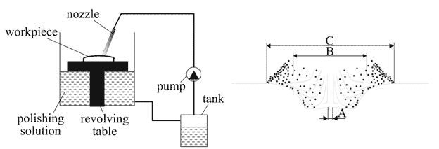 **图 (1)**

磨粒射流加工工艺布局 [51]。

### 磨粒水射加工

磨粒水射加工是传统加工工艺的进步，它用水代替了载体气体，并在矿业中找到了关键应用 [7]。它有时与水浆射加工进行比较，后者在两个低压模块上工作，使用预混合的水浆。在这种情况下，介质的粘度起着重要作用，因为喷嘴处的射流比空气提高了 100 倍。看到 AWJM 已经取得了许多改进，如粗糙度降低到纳米级 [8]、远端足迹 [10]、工件冷却速度更快以及充足的水浆回收 [11, 12]。但由于水停滞区的高减速和粘度对磨料轨迹的高影响，撞击速度被发现是不同的（图 2 & 3）。此后，磨料颗粒失去了所有的动能。与水相比，空气中的 MRR 更高，因为它提供的停滞区较小。人们还进行了一些研究来减少这种停滞区 [13]，并建议使用 V 型罩。还发现，使用大豆油作为磨料的载体可以减少主足迹中对工件的二次冲击 [14]。由于流体压力，在加工陶瓷时，使用大豆油作为磨料载体会导致裂纹形成 [15]。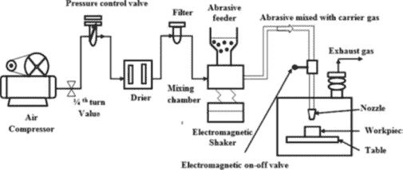 **图 (2)**

磨粒射加工布局 [3]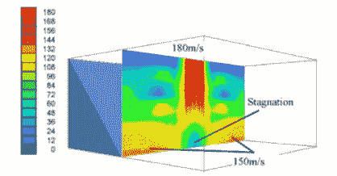 **图 (3)**

流速分布 [9]

### AJM 中的低温使用

早些讨论过，使用磨料在 AJM 中无法容易加工软金属。由于磨料具有高动能和高速度并穿透表面，在加工硬性材料时，因此引入了低温以使材料去除机制发生某种变化。使用 AAJM 和低温辅助 AJM 加工了 5083-H32 铝合金。对表面完整性进行了对比研究 [16]。在该研究中，他们使用了 -195°C 的液氮并将其供给压缩空气区。这导致硬度变得非常高，从而减少了嵌入材料的磨料数量。这伴随着连续粗糙度的产生。液氮的使用还产生了应变性能，使加工材料的硬度提高了倍。还进行了一些其他研究，使用带有液氮的热器来冷却除材料外的空气流 [17, 18]。使用了一种内外分别具有高、低热导率的管型 LN2 热热器。磨料被引导在 -80°C 的射流条件下流向材料。因此温度在 -80°C 到 180°C 之间变化。当射流温度达到 -180°C 时观察到变化，因为侵蚀原理变为脆性。

该研究还发现，30° 到 60° 的入射角对于最大 MRR 是最佳的。该研究发现在 -180°C 下也可以获得软材料的侵蚀。在较低温度下通过脆性去除机制对材料进行更精确的加工也可以考虑。

### 热增强 AJM

Patel *et al.* [19] 发现某些如 Inconel 718 和钛 (Ti6Al4V) 等材料并不容易加工；这些材料需要具有较低的硬度，以便磨粒能够渗透表面从而导致侵蚀发生。为了这一点，通过使用乙炔气焰将工件加热到 850ºC 提供了一定的热辅助，从而导致表面硬度降低，并增加了磨料水射加工的材料去除率（MRR）。尽管在过程中温度发生了剧烈变化，但在加工部件中并未发现应力和裂纹。

### 各种喷射条件的影响

#### 间歇性喷射条件
发现当形成较大的槽或空腔时，这些特征底部存在磨粒沉积倾向，从而阻止了后续的新磨粒到达被这些磨粒遮住的底部，进而降低了 MRR。这种颗粒堆积问题通过创建间歇性模式来阻断磨粒流，在此期间通过高压压力喷射流来解决。这是通过安装一个 100 Hz 的电磁阀实现的，它有助于创建这种磨粒和高压气流的交替模式 [20]。这有助于移除底部堆积的磨粒。研究发现，对于 500 个样本的点样研究，在开启/关闭时间为 10/40 毫秒的情况下，孔深从 440µm 增加到 740 µm。

#### 水下喷射条件
随着 AJM 的进步，带来了大量的技术和经济优势，但其环境方面也开始产生，例如过程中产生的噪音。为了研究这一方面，采用了水下式 AWJM [21]。这在某种程度上导致了颗粒在到达加工表面之前的动能降低。这还导致了射流阻力的减少，从而使得射流沿喷嘴直径的衍射减少 [22]。这还提供了一个思路，即加工过程中环境中的灰尘较少，正如传统方法中看到的，从而导致了如肺部损伤之类的医学影响。发现当使用甘醇作为浸没液体时，减少率高达 61%，随之的是液体聚合物为 42%，水为 36% [23]。当液体与磨粒浆混合，且仅将高压喷射流导向工件时，喷嘴寿命显著增加。唯一的缺点是颗粒的速度非常低。

## 应用

磨料喷射加工已发现许多应用，具有一些优势但也存在一些缺点。本节讨论了其中一些优点和缺点。还分析了它在摩擦学等领域的应用。一些优点列举如下：

- 研究显示了 AJM 从宏观尺度到微观尺度的进步，使其在各个领域和工业中具有无限的应用前景。此外，其大规模应用已用于加工。
- 发现它不仅在技术方面，而且在环境方面也具有优势，可以带来更好的加工能力和环境可能性，从而实现更好的工艺灵活性。
- 作为喷射过程中塑性变形的影响，表面性质如晶粒细化、材料硬化等得到了许多改进 [25]。
- 发现与传统加工方法相比，微加工的成本几乎极低，而且磨粒可以回收 [26]。

尽管有这些优点，但也能看到一些缺点，例如在加工深槽时形成锥形几何形状 [28]、在大量脆性材料上形成微裂纹、微加工中 MRR 不稳定，因为无法获得具有稳定流速的细颗粒 [27]、微观应用中的生产率也很低，并且观察到某些超过 105db 的关键噪音水平 [21]。

### 表面织构与摩擦学方面

Costa *et al.* 发现表面织构是一种创建均匀微纹理的方法，由具有形状形状的锐印象组成 [29]。各项研究发现，随着世界向电子技术进步发展，微织纹展现了其价值。注意到，普通 AJM 和微细 AJM 之间的边界是开口直径形状的设计标准。各项进行的研究表明，对于使用 23µm 尺寸磨粒颗粒的 100µm 路径，通道均匀性的的分辨率最高可达 5%，并受限于掩模尺寸和边缘发现的磨损 [30]。研究还总结出，限制此的主要因素是使用的掩模材料、低至 3µm 的细颗粒导致的光流流问题以及低动能。在获得表面织构能力后，它在摩擦学领域也找到了道路，如本节所示。在医学领域，全球范围内大量的膝关节和髋关节手术及更换。随着时间推移，80% 的病例在若干年内报告了磨损 [31]。这在某种程度上与表面完整性和材料硬度有关。在所有开发的人工关节滑动对中，最成功的是金属与聚乙烯的组合，成功率为 90%，寿命为 15 年。进一步的研究表明，表面缺陷、裂纹、毛刺会导致磨损并减少关节寿命。认为应该有一种人工关节增强能够收集在使用过程中产生的所有颗粒，同时为其平稳运行提供润滑，从而将其使用寿命增加到 30 年。这种用于收集碎片和润滑的微小孔用传统加工方法很难加工，因此 AJM 被发现在钻这些孔很有用。一种抛光铬钼合金并在微观尺度上刻槽的技术已经开发出来，可以应用于假体，以产生最少的磨损 [32]。

在前面的章节中，我们看到 AJM（磨粒材料射流加工）在各种延性、脆性材料以及各种工艺参数下具有多种应用。与此同时，还观察到了一种新型侵蚀类型，被称为“弹性侵蚀”。总体而言，去除机制（`MRM`）描述了机器效率。在脆性材料中，磨粒撞击机器表面产生一个垂直于表面的向下的裂纹，从而在变形材料截区域底部产生一个与顶侧平行延伸的斜向裂纹。在这里，切屑掉落的部分被假设为半球形，其深度或半径等于单个磨粒撞击产生的裂纹。研究人员已经针对标准模型，对陶瓷材料的韧性、硬度和粘弹性、切切屑的几何形状以及磨粒压痕力与切切屑半径之间的关系进行了研究。作者还提到，特定材料的裂纹传播需要特定的能量。

## 弹性模式 MRM

之前已经讨论过，表面完整性受粒径的影响[4]。脆性/延性侵蚀会导致微观层面表面结构的变化。当我们将磨粒尺寸从 120 nm 改变到 40 nm 时，没有发现表面粗糙度的影响。因此，使用颗粒有助于减少最终机器表面的变形和裂纹。因此强调在使用尺寸小于 100 nm 的磨粒时，将压痕机制改为“表面面积机制”。传统的较大尺寸磨粒在表面上直线运动，但细磨粒可以随流体改变方向。对于特定的磨粒质量与流速的比例，会产生切向力，从而将路径变为弯曲轨迹并渐近地撞击工件基底（图 **4**)）。因此，当产生侵蚀所需的能量低于阈值能量时，认为发生了弹性侵蚀。考虑到这一点，了一种基于产生化学侵蚀（即弹性侵蚀）的新理论，该理论考虑了具有化学吸收作用的羟化效应。在这种情况下，纳米颗粒与基底表面发生化学反应，在基底顶层 1nm 以内形成键。Peng 等[33] 也提到，表面粗糙度可以光滑到 Ra 0.17nm。在这一机制下，最终工件表面没有看到任何缺陷。

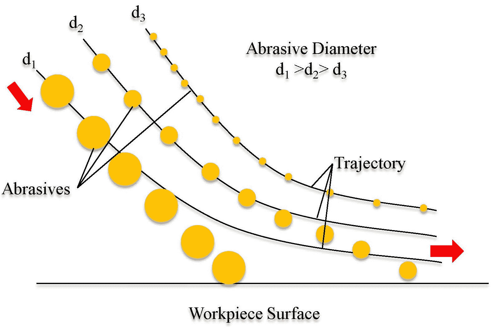 **图 (4))**

不同尺寸磨粒的路径对比[33]。

## 各种工艺参数的影响

### 磨粒尺寸

磨粒尺寸在任何磨粒射流图中都起着非常重要的作用。随着磨粒尺寸的增加，与其相关的体积和质量也会发生变化，进而影响磨粒的动能，从而影响 AJM 的 `MRR`，见表 **1**。但即使颗粒比喷嘴尺寸小 15 倍，喷嘴尺寸也限制了使用的磨粒尺寸。研究发现，粒径的增加也导致了表面粗糙度的增加和更大切屑的产生[34]。Kowsari 等[35] 在研究中指出，25µm 和 10µm 尺寸的颗粒在烧结陶瓷材料加工中产生了相似的峰谷粗糙度。在陶瓷情况下，切屑是通过颗粒从基底脱落移除的，然后与结合力更强的金属颗粒结合。看到的另一个因素是磨粒颗粒对工件表面的撞击，这被认为由于两者之间的静摩擦引起的。还发现，与较大的磨粒尺寸相比，细颗粒的嵌入的倾向较低[36]。

### 流速

流速定义为在相应数量的载体气体、液体或浆中提供的磨粒颗粒克数。Li 等[37] 显示，流体动力学也可以取决于此以外的其他工艺因素。结果显示，随着流速降低，产生的槽形状变得有些呈锥形。使用干燥剂、在储罐中保持低水平的磨粒等被认为具有最佳的磨粒流。

### 喷嘴材料和几何形状

与整个加工过程一样，所有类型的 AJM 都会以喷嘴磨损的形式发生刀具损坏。

它是 AJM 最精密的部分。带有颗粒介质的高压载气通过喷嘴孔。在通过过程中，颗粒在喷嘴壁上发生多次碰撞，从而导致其磨损和部件轮廓扰动、工艺不稳定、射流扰动。因此，将其视为改进区域非常重要。喷嘴磨损以克/分钟的“喷嘴重量损失率”（`NWLR`）衡量。在各种建议的喷嘴材料中，氧化陶瓷喷嘴与不锈钢喷嘴相比具有更长的寿命。与 Al[2]O[3]/钛复合涂层相比，单体 `B[4]C` 涂层的 `NWLR` 低了 30%。与此同时，发现了功能梯度材料（`FGM`），其涂层被证明耐磨性是标准喷嘴的 4 倍。通过模拟相同的 `FEM` 模型还看到喷嘴入口处的应力水平较低。同时，增加喷嘴长度会降低出口处的磨损率。这样做，颗粒速度矢量沿喷嘴长度达到相同方向，从而减少磨损。将喷嘴长度从 76mm 增加到 126 mm，喷嘴寿命增加了一倍。孔径：喷嘴直径的最值为 0.4 [38]。发现大量的喷嘴磨损也是由于张力和热应力引起的。喷嘴入口的最佳角度被发现为 11°。同时，较大的入口角度产生了应力。

表 1 AWJM 中考虑的材料、参数和目标综述。

| **序号** | **作者** | **磨粒材料** | **工件材料** | **影响参数** | **结果** |
| --- | --- | --- | --- | --- | --- |
| 1 | Paul 等[39] | 石榴石 | C-37 钢 | 孔径- 0.3 mm，倾斜角- 90°，插入直径 1.1 mm，水压- 2000-3000 bar，磨粒流速-0.225-0.832 Kb/min，进给速度- 2000-4000mm/min，离去-4-10mm，进给- 0.25-0.8 | 发现进给速度、离去距离和进进给是影响最大的，Ra 为 4-6µm。 |
| 2 | AM Hoogstrate 等[40] | 石榴石橄榄石 | 玻璃纤维金属 | 孔径-0.3 mm，直径 1.1 mm，冲击角 90°，磨粒尺寸 600，压力 -2000 到 3000 bar，磨粒流速 0.145 到 0.92 kg/min，离去 - 2 mm，进给速度 500 到 3000mm/min | 层层受水压影响最大。切割能力参数（`C[P]`）与切质量参数直接相关。 |
| 3 | Hussein 等[41] | Al[2]O[3] | GRPF 复合材料 3240 | 孔径- 6 到 8mm，切割速度- 0.2 到 0.3 m/min，磨粒流速 – 100 到 130 gm/min。射流压力 – 150 MPa，离去距离 – 2mm | 进给、离去距离和射流压力对表面粗糙度影响最大。加工期间获得了 0.402 µm 的 Ra。 |

| 编号 | 作者 | 磨粒剂 | 材料 | 参数 | 结果 |
| :--- | :--- | :--- | :--- | :--- | :--- |
| 4 | Haque *et al.* [42] | 石榴石、`Al[2]O[3]` 和 `SiC` | 玻璃 | 喷嘴直径- 0.1mm，射流方向 90°，`SOD`-1-5mm，进料速度 -10-50 mm/min.，射流压力- 10 to 50 ksi | 随着 `SOD` 的增加，切割斜角增大；与其他两种相比，石榴石产生的斜角更大。斜角与工件进料速度之间存在正相关关系。`SiC` 的平均切和加工能力高于 `Al[2]O[3]` 和石榴石。 |
| 5 | Vu Ngoc Pi *et al.* [43] | GMA 磨粒（新和回收） | Al6061T6 | 喷嘴直径-0.25 mm，喷嘴孔-0.92mm，冲击角 90°，磨粒尺寸 63 to 180 µ，水压 -300 to 360MPa，磨粒质量流量 50 to 300g/min，横距 - 2 mm，移动速度 120mm/min. | 新旧和回收磨粒的最优尺寸为 90µm，使用回收磨粒的切割性能更好，表面粗糙度为 6µm。 |
| 6 | Khajavi *et al.* [44] | 石榴石 | AA6063-T6 | 水压-165 to 239 MPa，移动速度 37 to 125 mm/min，磨粒流量 -0.35 to 0.95 kg/min.，聚焦喷嘴直径- 0.8 to 1.5 mm. | 开发了一种模型，利用 ANOVA 在 1% 的误差内预测具有输出特性的工艺参数。 |
| 7 | Gulhane *et al.* [45] | 黑金刚石颗粒 | 陶瓷 | 喷嘴直径 3 to 5 (mm)，压力 4-6 (kgf/cm)，横距 20 to 40(mm) | Taguchi 方法与 ANOVA 的结果一致，喷嘴直径对 `MRR` 的影响最显著，而 `SOD` 对切缝宽度的影响最大。 |
| 8 | Rao *et al.* [46] | 石榴石 (36% FeO, 33% `SiO[2]`, 20% `Al[2]O[3]`, 4%MgO, 3%`TiO[2]`, 2%CaO 和 2%`MnO[2]`) | 软钢 | 水压 35000 -55000 psi，移动速度 80-320 m/min.，`SOD` – 1to 4 mm，射流冲击角- 90°，喷嘴直径- 0.35 mm，喷嘴长度 – 76.2mm，喷嘴直径.-1.05mm，磨粒直径 0.18 mm | 与水力和 `SOD` 相比，移动速度对表面粗糙度的影响最大。最小 `SR` 的最优参数为水压–35000 psi，速度–80mm/min 以及 `SOD` 2.5mm。 |
| 9 | S.Srinivas al [47]. | 石榴石 | 因康镍 718 | 水压 – 100 to 300 Mpa，移动速度 – 75-175 mm/min.，磨粒流量 – 0.3017 to 0.5994 kg/min，喷嘴直径 0.25 mm，射流冲击角 90°，聚焦喷嘴直径 1.07mm | 移动速度和水压是影响深度最重要的因素。 |
| 10 | Santanakumar *et al.* [48] | 石榴石 | 陶瓷砖 | 磨粒粒径 -#80 to 120，磨粒流量 - 300 to 500 gm/min.，`SOD` - 1 to 3 mm，水压-2000 to 3000 bar，射流移动率 - 200 to 400 mm/min. | 提出的预测模型用于优化表面粗糙度和斜角，结果发现者平均分别为 5.27 µm 和 1.41°。 |
| 11 | Kanthababu *et al.* [49] | 石榴石 | 含有 `B[4]C` 复合的 Al7075 (0 到 15%) | 喷嘴直径–0.25 mm，聚焦喷嘴直径 0.75mm，射流冲击角 90°，目数 -80 to 120#，磨粒流量 240 to 440 g/min.，水压-125 to 275 MPa，移动率-60 to 120 mm/min. | 测量了每种复合材料的 DOC 并找到了切割特性的最优条件。含有 5% `B[4]C` 的 Al7075 金属复合材料获得了高达 25 mm 的 DOC。 |

`DOC`-切深，`#` = 目数，`SR/Ra`-表面粗糙度，`SOD`=横距，`MRR`=材料去除率。

## 结论

AJM 是一种现代加工技术，提供从微观到宏观尺度的加工，具有更高的精度和控制力。本文讨论了各种 AJM 及其在精度、环境可持续性以及大尺寸加工 *等等* 方面的优点和局限性。研究表明，AJM 的摩擦学应用似乎具有很的相关性，应该进行更多研究以扩展到其他领域。还研究了引入低温技术对软材料进行加工以实现精密加工。这同时也带来了热应力等其他缺点，需要进行研究。由于温度和热效应在提高加工效率方面起着至关重要的作用，也需要将其降至最低。还可以对 AJM 的入射角进行研究，因为它是磨粒流体抛光 (AFJP) 中的一个重要因素 [50]。

## 引言

[此处为原文中未提供的文本，或根据示例未翻译内容。请提供后续待翻译文本。]

[无内容]

## 声明

[无内容]

## 利益冲突

[此处为原文中未提供的文本]

[无内容]

## 致谢

[此处为原文中未提供的文本]

[无内容]

## 参考文献

| | |
| :--- | :--- |
| [1] | |
| [2] | |
| [3] | |
| [4] | |
| [5] | |
| [6] | |
| [7] | |
| [8] | |
| [9] | |
| [10] | |
| [11] | |
| [12] | |
| [13] | |
| [14] | |
| [15] | |
| [16] | |
| [17] | |
| [18] | |
| [19] | |
| [20] | |
| [21] | |
| [22] | |
| [23] | |
| [24] | |
| [25] | |
| [26] | |
| [27] | |
| [28] | |
| [29] | |
| [30] | |
| [31] | |
| [32] | |
| [33] | |
| [34] | |
| [35] | |
| [36] | |
| [37] | |
| [38] | |
| [39] | |
| [40] | |
| [41] | |
| [42] | |
| [43] | |
| [44] | |
| [45] | |
| [46] | |
| [47] | |
| [48] | |
| [49] | |
| [50] | |

| [16] | Yuvaraj N., Kumar M.P.. Cutting of Aluminium Alloy with Abrasive Water Jet and Cryogenic Assisted Abrasive Water Jet: A Comparative Study of the Surface Integrity Approach.Wear2016362–363183210.1016/j.wear.2016.05.008 |
| [17] | Gradeen A.G., Spelt J.K., Papini M.. Cryogenic Abrasive Jet Machining of Polydimethylsiloxane at Different Temperatures.Wear2012274–27533534410.1016/j.wear.2011.09.013 |
| [18] | Gradeen A.G., Papini M., Spelt J.K.. The Effect of Temperature on the Cryogenic Abrasive Jet Micro-machining of Polytetrafluoroethylene, High Carbon Steel and Polydimethylsiloxane.Wear201431717017810.1016/j.wear.2014.06.002 |
| [19] | Patel D., Tandon P.. Experimental Investigations of Thermally En-hanced Abrasive Water Jet Machining of Hard-to-machine Metals.CIRO J. Manuf. Sci. Technol.2015109210110.1016/j.cirpj.2015.04.002 |
| [20] | Zhang L., Kuriyagawa T., Yasutomi Y., Zhao J.. Investigation into Micro Abrasive Intermittent Jet Machining.Int. J. Mach. Tools Manuf.20055587387910.1016/j.ijmachtools.2004.11.003 |
| [21] | Radvanska A., Ergic T., Ivandic Z., Hloch S., Valicek J., Mullerova J.. Technical Possibilities of Noise Reduction in Material Cutting by Abrasive Water-jet.Strojarstvo200951347354 |
| [22] | Haghbin N., Spelt J.K., Papini M.. Abrasive Waterjet Micro-machining of Channels in Metals: Model to Predict High Aspect-ratio Channel Profiles for Submerged and Unsubmerged Machining.J. Mater. Process. Technol.201522239940910.1016/j.jmatprotec.2015.03.026 |
| [23] | Jafar R.H.M., Hadavi V., Spelt J.K., Papini M.. Dust Reduction in Abrasive Jet Micro-machining Using Liquid Films.Powder Technol.20163011270127410.1016/j.powtec.2016.08.002 |
| [24] | Wang C.J., Cheung C.F., Ho L.T., Liu M.Y., Lee W.B.. A Novel Multi-jet Polishing Process and Tool for High-efficiency Polishing.Int. J. Mach. Tools Manuf.20171156073110.1016/j.ijmachtools.2016.12.006 |
| [25] | Barriuso S., Jaafar M., Chao J., Asenjo A., Gonzalez-Carrasco J.L.. Improvement of the Blasting Induced Effects on Medical 316 Lvm Stainless Steel by Short-term Thermal Treatments.Surf. Coat. Tech.20142581075108110.1016/j.surfcoat.2014.07.027 |
| [26] | Dong Y., Liu W., Zhang H., Zhang H.. On-line Recycling of Abrasives in Abrasive Water Jet Cleaning.Procedia CIRP20141527828210.1016/j.procir.2014.06.045 |
| [27] | Shukla R., Singh D.. Experimentation Investigation of Abrasive Water Jet Machining Parameters Using Taguchi and Evolutionary Optimization Techniques.Swarm Evol. Comput.20173216718310.1016/j.swevo.2016.07.002 |
| [28] | Pawar N.S., Lakhe R.R., Shrivastava R.L.. Validation of Experimental Work by Using Cubic Polynomial Models For Sea Sand as an Abrasive Material in Silicon Nozzle in Abrasive Jet Machining Process.Materials Today: Proceedings2015219271933 |
| [29] | Costa H., Hutchings I.. Some Innovative Surface Texturing Techniques for Tribological Purposes.Proc. Inst. Mech. Eng., Part J J. Eng. Tribol.201522942944810.1177/1350650114539936 |
| [30] | Slikkerveer P.J., Bouten P.C.P., De Haas F.C.M.. High Quality Mechanical Etching of Brittle Materials by Powder Blasting.Sens. Actuators A Phys.200085296310.1016/S0924-4247(00)0034-5 |
| [31] | Kuncicka L., Kocich R., Lowe T.. Advances in Metals and Alloys for Joint Replacement.Prog. Mater. Sci.201788232210.1016/j.pmatsci.2017.042 |
| [32] | Nakanishi Y., Nakashima Y., Fujiwara Y., Komohara Y., Miura H., Higaki H.. Influence of Surface Profile of Co-28Cr-6 Alloy on Wear of Ultra-high Weight Polyethylene Used in Artificial Joint.Tribol. Int.20181185385410.1016/j.triboint.217 |
| [33] | Peng W., Guan C., Li S.. Material removal mode affected by particle size in fluid jet polishing.Appl. Opt.2013523379273310.1364/AO.52.2724133 |
| [34] | Su N., Yue L., Liu W., Zhang H., Wang H., Shen J.. The effect of various sandblasting conditions on surface changes of zirconia and shear bond between zirconia core and indirect composite.J. Adv. Prosthodont.2015732142310.4047/jap.2015.7.214 |
| [35] | Kowsari K., Sookhaklari M.R., Nouraei H., Papini M., Spelt J.K.. Hybrid Erosive Jet Micro-milling of Sintered Ceramic Wafers with without Copper-filled Through-holes.J. Mater. Process. Technol.201623019810.1016/j.jmatprotec.2015.11 |
| [36] | Hadavi V., Michaelsen B., Papini M.. Measurements and Modeling of Instantaneous Particle Orientation within Abrasive Air Jets and Implications for Particle Embedding.Wear2015336–337920.1016/j.wear.2015.041 |
| [37] | Li H., Wang J., Kwok N., Nguyen T., Yeoh G.. A Study of the Micro-hole Evolution on Glass by Abrasive Air-jet Micromachining.J. Manuf. Process.201831156110.1016/j.jmapro.2017.11 |
| [38] | Nanduri M., Taggart D.G., Kim T.J.. The Effects of System and Geometric Parameters on Abrasive Water Jet Nozzle.Int. J. Mach. Tools Manuf.20024261562310.1016/S0890-6955(01)00147-X |
| [39] | Paul S., Hoogstrate A.M., van Luttervelt C.A., Kals H.J.J.. An experimental investigation of rectangular pocket milling with abrasive water jet.J. Mater. Process. Technol.19987317918810.1016/S0924-4247(00)0034-5 |
| [40] | Paul S., Hoogstrate A.M., van Luttervelt C.A., Kals H.J.J.. An experimental investigation of rectangular pocket milling with abrasive water jet.J. Mater. Process. Technol.19987317918810.1International Journal of Design and Engineering |
| [41] | Hussein M., Iqbal A., Hashem M.. Numerical optimization of hole making in GFRP using water jet.International Journal of Mechanical and Mechatronics2015 |
| [42] | Khan A.A., Haque M.. Performance of different abrasive materials during abrasive jet machining of glass.J. Mater. Process. Technol.2007 |
| [43] | V.N.. A study on abrasive recycling in abrasive jet (AWJ) machining. |
| [44] | Farhad A.. A statistical approach for predicting and optimizing depth of cut in AWJ for 6063-T6 Al alloy.World of Science, Engineering and Technology2009 |
| [45] | Gulhane U.D., Patkar P.P., Toraskar P.P., Patil S.P., Patil A.A.. Analysis of abrasive machining parameters on mrr and kerf width of hard and brittle materials like ceramic.International Journal of Design and Manufacturing. |
| [46] | Sreenivasa Rao M., Ravinder S., Seshu Kumar A.. Parametric Optimization of Abrasive Waterjet Machining for Mild Steel: Taguchi Approach.International Journal of Current Engineering and Technology Special Issue |
| [47] | Raghavendra, Ratnagiri Y., Srinivas S.. Effect of Process Parameters on Abrasive Water Jet Penetration Capabilities on Inconel 2017 |
| [48] | Santhanakumar M., Adalarasan R., Rajmohan M.. Experimental Modelling and Analysis in abrasivejet Cutting of Ceramic Tiles Using Grey-Based Response Surface Methodology.Arabian Journal of Sciences and Engineering. | |
| [49] | Mohankumar V., Kanthababu M.. Experimental Investigations on Depth of Cut in abrasivejet Machining of Al7075/B4C Metal Matrix Composites.Int. J. Engine Res. | |
| [50] | Wang C.J., Cheung C.F., Liu M.Y.. Numerical Modeling and Experimentation of Three Dimensional Material Removal Characteristics in Fluid Jet Polishing.Int. J. Mech. Sci. | |

# 陶瓷基复合材料电火加工综述

**Mamta ^([1]), *)****,** **Suneev Anil Bansal^([1])****,** **Bhuvnesh Kumar^([2])**

¹ 机械工程学院，Maharaja Agrasen University, Baddi, Solan, 印度

² 机械工程系，SRM University Delhi NCR Haryana, 印度

## 摘要

电花加工（EDM）是一种非传统的加工工艺，广泛用于切割镍及其合金、钛以及难以通过其他传统工艺加工的复杂形状材料。EDM 利用电能和热能通过去除不需要的材料来加工工件。该过程使用两个电极，阳极和阴极，其中工具作为阴极，执行作业的工件作为阳极。电流、脉冲开启和关闭、、电压等因素可用于优化 EDM 的主要加工参数，如 `MRR`、刀损率、表面粗糙度`etc.`。本的研究重点是这些参数对由 `CMs`、碳化钨和钴组成的复合材料的影响。最后，还讨论了需要进一步改进和研究的未来前景领域。

**关键词：** 陶瓷，复合材料，电花加工。

***

^* **通讯作者 Mamta**: 机械工程学院，Maharaja Agrasen University, Baddi, Solan, 印度；电子邮箱：dahiya.mamta56@gmail.com

## 引言

电花加工（`EDM`）是一种用于金属加工的主流制造工艺。在此过程中，加工以所有本质上具有导电性的材料的熔化和蒸发形式进行，这是通过控制电极与执行作业的工件之间的火花来实现 [1, 2]。这就是为什么 EDM 也被称为非传统的火花侵蚀热电加工过程 [3]。在一段时间内，EDM 已成为一种高效的材料去除工艺。EDM 具有以高精度加工非常复杂和坚硬材料的能力，而这些材料使用其他传统方法很难加工。

为了跟上现代制造业的步伐，EDM 还具有作为自动化工艺的能力。EDM 的主要应用在于原型制造、模具制造领域以及大多数从事制造高合金钢等机械金属的行业。

过去的几十年里，陶瓷材料（`CMs`）通过其在所有主要工程领域的应用（如汽车、航空领域、涉及电气电子设备制造的领域）证明了自己的存在 [4]。一些主要应用如弹道装甲的制造、汽车制动系统、柴油颗粒过滤器、计算机内存组件、传感器以及各种医疗产品如假肢`etc.`也涉及 CMs 的使用 [5]。CMs 有如此广泛应用的原因是其优异的机械性能，如高压强度、高硬度和化学和耐磨性。

`WC–Cos` 也被探索用于 EDM 加工。一项特殊的 CIRP 报告报道了 EDM 在硬质化物中的应用 [6]。尽管有报道说 EDM 表面确实存在残余热应力 [7]。组来自

## EDM 原理

在 EDM 中，材料的去除通过控制两个电极之间的电放电来实现，其中一个电极是工具，另一个是执行作业的工件，如图所示（1`）。

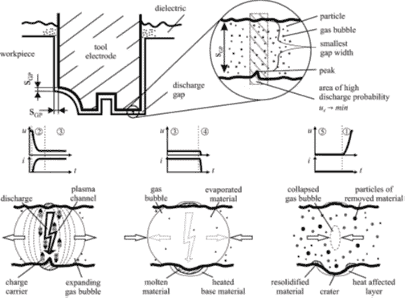**图 (1))**

EDM 工艺原理 [8]。

两个电极被某种电缘介质隔开，该介质可以是电缘油或去离子水。然后施加电压形成一个可以建立电流的等离子体通道。当介质达到击穿电压时，就会发生放电。由于 EDM 过程基于通过熔化和蒸发去除材料，因此当形成通道底部的温度达到约 ≥ 10,000°K 时，第二个电极（工件）发生熔化和蒸发，从而导致材料的去除。

## 陶瓷电花加工

CMs，如二硼化钛（`TiB[2]`）、掺硅碳化硅（`SiSiC`）和氮化化钛（`TiN`），本质上是导电的，可以通过 EDM 加工 [9]。根据 Luis *et al.* [10] 的研究，从无机材料获得的通常具有高纯度的材料被称为陶瓷或先进 CMs。这些 CMs 进一步分为氧化陶瓷（如 `Al[2]O[3]` 或 `ZrO[2]`）和非氧化陶瓷（如 `Si[3]N[4]`）。

使用 EDM 加工 CMs 也可以分为天然材料、非导电材料和导电材料。大多数导电材料通过引入某些导电第二相由不纯材料制成（图 2`）。

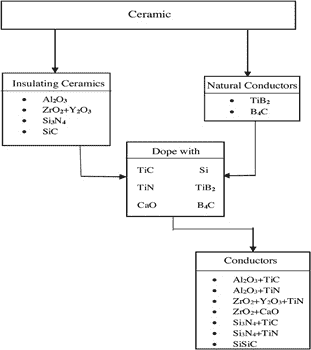**图 (2))**

根据导电性分类的陶瓷材料 [11]。

在 CMs 中加入这些相增加了导电性。据报道，添加这些相后硬度、强度和断裂韧性也有某些提高 [12, 13]。

## 复合陶瓷的材料去除机制

Lauwers *et al.* [13] 进行了一项研究，以开发耐磨性且能够通过 EDM 工艺加工的 CMs。该研究的重点是调查 EDM 工艺参数与 CMs 微观结构之间的关系。对于基于 `ZrO[2]`、`Al[2]O[3]` 和 `Si[3]N[4]` 的 CMs，通过 `TiCn` 和 `TiN` 诱导了某些导电相。结果观察到，不仅是熔化和蒸发，氧化和基体材料分解等因素也是有效去除材料的原因。此外，还发现过程中裂纹的形成是由于剥落效应导致的。材料去除的主要机制见表 1`。

不同复合材料 CMs 的材料去除 [13]。**

从表 1 中观察到，电介质、放电介质以及加工参数的配置对材料去除机制起着重要作用。两种主要机制是熔化/蒸发和崩落。熔化和蒸发发生在低能量放电状态，而崩落机制发生在高能量放电状态。某些陶瓷和金属材料的导电性概述如图（3)所示。观察发现，像金属材料一样，本质上导电陶瓷也可以通过电火加工（EDM）过程容易地加工，*例如*二硼化钛（TiB[2]）、氮化钛（TiN）或掺硅碳化硅（SiSiC）[14]。

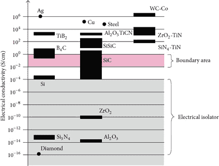 **图 (3))**

材料的导电性 [15]。

## WC-Co 复合材料的加工

由碳化钨/钴（WC-Co）材料制成的复合材料具有良好的机械性能，如良好的强度、高硬度以及在较宽温度范围内具有良好的耐磨性，因此在模具、刀具和某些特殊工具的生产中应用广泛。这些复合材料具有高的比强度，因此难以通过传统的加工工艺进行加工[16]。此外，它们涉及一些复杂的形状，因此加工过程中需要极高的精度，而这是传统加工工艺无法实现的[17]。

许多研究报告了使用传统工艺（如在数控车中使用 CBN 工具）对这些材料进行加工。获得的结果显示了负面影响，如切削力大、材料去除率（MRR）低以及所得表面光糙度差[18]。另一方面，Levy *et al.* [19] 和 Bonny *et al.* [20] 进行了一些研究，并观察到 EDM 过程能够加工这些复合材料，以制造具有复杂形状的硬质合金模具，无论其硬度和强度如何。在另一项研究中，Mahdavinejad *et al.* [2] 进行了一项分析 EDM 加工在加工 WC-Co 复合材料时不稳定性的研究。结果观察到，对于不同成分的 WC-Co 复合材料，脉冲持续时间因素影响材料去除率。去除率随着脉冲持续时间的增加而增加。还观察到加工稳定性也随着脉冲持续时间的增加而增加。文中指出，可以通过减少所形成的复合材料中钴（Co）的百分比来降低这种不稳定性（图 4）。

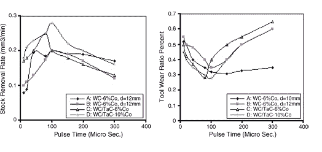 **图 (4))**

工具磨损率、脉冲时间和材料去除率的变化对不同成分 WC-Co 的影响[2]。

还进行了类似的研究，并观察到脉冲定时和脉冲电流等各种因素极大影响了作业工件的表面粗糙度[6]。这些加工参数的值越高，工件的表面粗糙度值越好[6]。

## 电火加工 - 文献综述

Gadalla *et al.* [21] 通过实验研究用 EDM 工对陶瓷金属（CMs）制成的复合材料进行成型。将结果与其他传统工艺加工的表面进行了比较。结果显示，由于单位体积能量减少，MRR 有增加，而电阻和热扩散等主要因素是影响 MRR 的主要因素。文中还提到，材料的表面粗糙度很大程度上受材料晶径分布的影响。在类似的研究中，Farooqui *et al.* [22] 比较了用 EDM 工对陶瓷和先进陶瓷的加工。观察到该过程的脉冲持续时间是材料去除机制的原因。短脉冲导致氧化和分解，而较长脉冲则导致了崩落机制。在另一项研究中，Gamage *et al.* [23] 使用 3003 铝作为材料，使用 AISI P20 制成的工具对线切割电火加工（wire EDM）和深水电火加工（DSEDM）进行案例研究。观察了结果并指出，电能是影响的主要来源，对于 DSEDM 和 wire EDM 则是电介质油和电丝材料等因素。Lauwer [24] 介绍了一项研究，概述了与 CMs 复合材料电火加工相关的各种挑战。结果得出结论，通过改变材料成分，可以在一定程度上提高 EDM 过程和材料的机械性能。Schubert *et al.* [15] 进行了一项研究，展示了与 CMs 复合材料微电火（micro EDM）相关的最新研究。还讨论并展示了用于绝缘陶瓷和陶瓷加工的各种工艺示例。结果观察到，由于辅助电极方法，建议加工绝缘陶瓷，因此它们被视为 CMs 理想的后处理工艺。Bucciotti*et al.* [25] 实验用 EDM 工艺处理硅和氮化钛制成的生物医学植入设备。研究了其机械、毒理和微观结构性能，并观察到这些材料与其他制造相同关节的氧化物 CMs 相比具有良好的性能，而且通过 EDM 工艺可以制造非常复杂的形状（如倒扣）和近净成形形状。

Mohri *et al.* [26] 进行了实验，研究了利用辅助电极通过电火加工（EDM）工艺加工陶瓷材料（CMs）。实验使用煤油作为工作液，观察到使用铜电极可以很容易地加工陶瓷材料。在另一项研究中，报道了线电火加工 ZrO[2]-TiN 复合材料。放电等离子烧结技术制备了 ZrO[2]-TiN 坯 [27]。Sano *et al.* [28] 使用聚晶金刚石（PCD）电极进行了电火加工实验。使用了两种平面的 PCB `CTB-010` 和 `CTH-015`，并将结果与 `Cu-W` 电极的结果进行了比较。观察到，在短脉冲持续时间下，PCD 电极的损耗较低，为 1.5%，而在长脉冲持续时间内无损耗，而 `Cu-W` 电极在相同条件下损耗为 10%。Palanikumar *et al.* [29] 了测试，以研究电火加工加工 `WC/Co` 硬质复合材料的工艺参数。还分析了各种加工参数，并观察了这些参数对 `MRR` 和表面质量的影响。在另一项研究中，Hanaoka *et al.* [30] 研究了使用辅助电极的电火加工对 Si[3]N[4] 复合材料放电行为的影响。结论指出，绝缘材料的 `MRR` 结果优于导电材料。Gadalla 和 Tsai [31] 进行了一些实验研究，以证明钴含量和晶粒大小对硬质钨钢各种加工特性的影响。观察到 `MRR` 速率可以根据钴的百分比而变化。通过增加钴的百分比可以提高 `MRR` 并增加电火加工过程的稳定性。Lin *et al.* [32] 进行了一些调查，并试图建立 `MRR`、表面粗糙度、表面裂纹等各种参数与放电频率之间的联系。结果观察到，通过增加电能放电会显著增加电火加工工艺形成材料的 `MRR` 和表面粗糙度。

Song *et al.* [33] 进行了实验，研究了电火加工工艺对含有 10.5% 钴的 `WC-Co` 复合材料的影响，并使用水喷淋作为介质质。结果显示，使用水喷淋介质没有产生腐蚀现象，且 `MRR` 增加，同时电极损耗显著减少。Yu *et al.* [34] 研究了使用两种电火加工（干电火和常规油基电火）加工硬质材料的实验。结果观察到，与常规油基电火相比，干电火具有更高的加工速度和更低的电极损耗。进一步指出，干电火还可以用于作为工件材料的硬质材料的三维加工。在另一项研究中，Kumar *et al.* [35] 研究了电火加工工艺对含有 5 wt. % `Sic` 和 5 wt. % `B[4]C` 的 `Al635i` 复合材料某些加工参数（如脉冲开启/关闭时间、脉冲电流和电压）的影响。观察了刀具损耗、表面粗糙度和功率耗，并指出随着放电和脉冲电流的增加，刀具磨损的可能性显著增加。在类似的研究中，Patel *et al.* [36] 通过电火加工工艺优化了 `Al[2]O[3]-SiC[w]-TiC` 复合材料的表面粗糙度参数。通过在 `Al[2]O[3]` 中引入 `SiC` 晶须和 `TiC` 颗粒实现了机械性能的提高。结果得出，表面设计法对于获得电火加工形成的复合材料更好的表面光洁度有用。Selvarajan *et al.* [37] 回顾了工业应用中电火加工复合材料的各种参数。讨论了获得更好输出所需的各种因素，得出结论：在研究材料中，`A[l2]O[3]`、`SiC` 和 `TiC` 因为于加工而被适用于大多数应用。Kangarajan [38] 进行了研究，并比较了粉末冶金工艺和电火加工制备 `WC-Co` 复合材料的磨损机制结果。使用概率神经网络绘制了不同工艺的磨损机制图。将磨损状态分为三部分：轻磨损、严重磨损和极端磨损。这些状态基于材料磨损率和表面粗糙度等各种因素。还观察到，电火加工形成的表面机械性能受到放电产生的气泡和坑洞的影响。研究得出，从磨损表面粗糙度和磨损率的角度，陶瓷磨损状态可以通过轻磨损、严重磨损和极端磨损进行识别。电火花在加工表面产生坑洞、气泡和裂纹，恶化了电火 `WC-Co` 表面的光洁度和机械性能，对于表面敏感型应用应将其去除。Dinesh *et al.* [39] 进行了研究，并调查了不同工艺参数对电极进给率、脉冲开启/关闭时间和放电等各点的影响。结果观察到电流是显著影响电火加工复合材料 `MRR` 和表面粗糙度的主要因素。Aidil *et al.* [40] 了研究并批判性地检查了影响电火加工工艺各种加工因素的各种参数。观察到，由于等离子通道的膨，随着脉冲开启时间的增加，材料的 `MRR` 速率和表面粗糙度降低，导致材料去除减少。同样，相同参数的值随着脉冲关闭时间的增加而增加。

### 表 2：陶瓷复合材料电火加工综述。

| **序号** | **作者** | **工作材料** | **输入参数及范围** | **优化结果** |
| --- | --- | --- | --- | --- |
| 1. | Janmanee and Muttamara [41]。 | `WC-10%Co`。 | 放电电流 (1.5-75A)。关闭时间 (2-1600 µs)。开路电压 (90-250 V)。 | `MRR`:2.7mm/min。`EWR`:37.2 mm/min。微裂纹密度: 183.9 µm^(2.) |
| 2. | Shah *et al.* [42]。 | `WC-12%Co`。 | 材料厚度 (25.4-76.2 mm)。开电压 (75-105V)。脉冲开启时间 (3-5µs)。脉冲关闭时间 (20-30µs)。伺服电压 (40-60V)。线进速度 (30-90mm/s)。线张力 (1000-2200g)。 | `MRR`:13.64 mm/min。缝宽: 290.6 µm。`SR`:1.11 µm。 |
| 3. | Singh *et al.* [43]。 | `WC-10%Co`。 | 轮速 (700-1100rpm)。电流 (4-8A)。脉冲开启时间 (50-150µs)。占空比 (0.57-0.70)。 | `MRR`:0.3845 mm³/min。`WWR`:0.007042 g/min。`ASR`:3.606 µm。 |
| 4. | Jangra *et al.* [44]。 | `WC-6%Co`。 | 峰值电流 (80-120A)。脉冲开启时间 (108-122µs)。脉冲关闭时间 (30-50µs)。线张力 (6-10N)。流量 (4-10LM-1)。 | `MRR`:2.52 mm/min。`SR`:0.88 µm。 |

| No. | 作者 | 材料 | 工艺 | 结果 |
| :--- | :--- | :--- | :--- | :--- |
| 5. | Vogeler *等人* [27] | ZrO[2]-TiN. | 线电火花，工艺：熔化、蒸发和化学分解。 | 每个切割尺寸均有所减少，弯曲强度没有变化。 |
| 6. | Vogeler *等人* [45] | ZrO[2]-TiN. | 线电火花，工艺：熔化、蒸发和化学分解。 | 表面光加工似乎与弯曲强度无关。 |
| 7. | Schubert *等人* [46] | Si[3]N[4]-TiN 和氧化铝增韧锆 (ATZ)。 | 微电火花，开路电压，放电类型。 | Si3N4-TiN 的烧蚀行为使其材料去除率达到 ATZ 的 200%。 |
| 8. | Yeakub *等人* [47] | 锆（碳化钛粉末与煤油混合）。 | 微电火花，间隙电压，电容。 | 影响 MRR 最大的因素是电容。86 V 和 1.0 nF 是达到最大 MRR 的优化值。 |

Saxena *等人* [48] 研究了电火花加工工艺对 SiC 加工的影响。从 SEM 图像获得的的结果中，可以清楚地观察到材料去除的机制是熔化和蒸发，材料的迁移也是双向的。

Nihal *等人* [49] 使用混合羟基磷灰石粉末加工 Ti6Al4v 工件。小组发现，当脉冲时间为 100µs 且脉冲电流为 12A 时，工件形成了随机去除和微裂纹。其他非接触工艺如激光加工、超声波加工 [50, 51] 以及磨粒水射加工 [52] 根据不同研究人员的报告也有其优缺点。

Yoo *等人*成功地将硝酸钱（YN）掺杂 SiC，并证明 EDM 工艺可用于这些陶瓷 [53]。Yeakub *等人* [54] 研究了含有碳化钛粉末的非导电锆的微电火花。在该研究中，改变了两个参数：电容和间隙电压。

Singh *等人* [55] 对钴结合碳化钨 (WC-Co) 的粉末混合电火花进行了实验研究。在他的实验中，使用了石墨粉末混合电介质。极少研究侧重于预测建模，以理解 EDM 对加工产品的影响 [47]。表 [[2]](#9789811483653-C6.html_c6t2) 显示了陶瓷复合材料电火花加工的综合综述。

## 未来展望

基于本章综述的各种研究，观察到非常有必要研究各种操作参数对某些纳米结构 WC 的影响。针对复合材料 (CMs) 的微电火花研究被认为是该领域未来的主要方向。需要借助一些先进的 FEM 技术来研究具有导电性的二次层的形成。

## 结论

基于 CMs 制的复合材料的应用已成为我们现代生活的重要部分。本文综述了 EDM 工艺及其在加工由 CMs 和碳化钨组成的复合材料中的作用。从上述广泛的综述可以得出结论：EDM 工艺能够加工具有高度导电性的 CMs，如 TiN、SiC 和 TiB[2]。还观察到火花强度电流等各种加工参数影响工件的加工性能。随着这些参数的增加，MRR 和表面粗糙度显著增加。研究了脉冲时间对 MRR 的影响。MRR 和表面粗糙度随脉冲时间的增加而降低，从而增加了材料加工的不稳定性。

此外，还观察了不同工艺参数对 EDM 加工表面的影响，并讨论了一些关于加工后 CMs 影响的研究 [27, 45]。

## 发表许可

不适用。

## 利益冲突

作者确认此内容没有利益冲突。

## 致谢

作者诚心感谢编辑和匿名评审员的时间投入。

## 参考文献

| | | | |
| :--- | :--- | :--- | :--- |
| [1] | Puertas I., Luis C. | EDM 对 WC-Co 影响分析 | `J. Mater. Process. Technol.200415334458` |
| [2] | Walia, A., Srivastava, V., Bansal, S. | TiC 增强在 EDM 中的影响 | `Microsyst. Technol.2020123510` |
| [3] | Singh G., Parkash D. | EDM 的参数优化 | `Int. Res.20165937238` |
| [4] | Bhattachary B., Doloi N. | 非导电材料电放花研究 | `Mater. Sci. Eng.A1989109C351356` |
| [5] | Liu Y., Li X., Ji R., Zhang H., Li Q. | 技术参数对绝缘 Al2O3 EDM 性能的影响 | `jmatprotec.20051649` |
| [6] | Kiyak M., Çakir O. | 表面加工参数检查 | `J. Mater. Process. Technol.200719113414` |
| [7] | Yadav V., Jain V., Dixit P. | 电放花引起的热应力 | `Strojni Vestn.19883726236` |
| [8] | Schubert A., Zeidler H., Oschätzchen M. | 利用超声振动加工陶瓷的微电火花 | `AIP Conf. Proc.2011135313` |
| [9] | Schoth A., Förster R., Menz W. | 用于陶瓷高长宽比 3D 微结构的线电火花 | `Microsyst. Technol.20051145250` |
| [10] | Luis C., Puertas I., Villa G. | 碳化硅 EDM 的材料去除率和电极损耗研究 | `jmatprotec.20051248896` |
| [11] | König W., Dauw D., Levy G., Panten U. | EDM 向陶瓷加工的未来步骤 | `CIRP Ann. -Manuf.198837` |
| [12] | Schubert A., Zeidler H., Wolf N., Hackert M. | 非导电陶瓷的微电放花加工 | `J. Ceram.201519` |
| [13] | Lauwers B., Kruth J.P., Liu W., Eeraerts W., Schacht B., Bleys P. | 复合陶瓷 EDM 中材料去除机制的研究 | `J. Mater. Process. Technol.20041491–334735` |
| [14] | Martin C., Cales B., Vivier P., Mathieu P. | 电放花加工陶瓷复合材料 | `Mater. Sci. Eng. A1989109C351356` |
| [15] | Schubert A., Zeidler H., Kühn R., Hackert-Oschätzchen M. | 微电放花：一种适用于陶瓷的工艺 | `10.1155/2015/47080` |
| [16] | Lee S.H., Li X.P. | 碳化钨电火花加工中加工参数对加工性能的影响 | `J. Mater. Process. Technol.20011153344358` |

- [17] Kanagarajan D., Karthikeyan R., Palanikumar K., Davim J.P.. 目标规划技术在硬质合金(`WC/Co`)电火加工（EDM）特性中的应用。*Int. J. Mater. Prod. Technol.* 2009 351–221 `6227110.1504/IJMPT.2009.025228`

- [18] Jangra K., Grover S., Chan F.T.S., Aggarwal A.. 线电火加工评估钨化物复合材料加工性的图图与矩阵法。*Int. J. Adv. Manuf. Technol.* 2011 569–529 `997410.1007/s00170-011-3234-5`

- [19] Levy G.N., Wertheim R.. “烧结硬质复合模具的电火加工，”*CIRP Ann. - Manuf. Technol.* 1988 371–375 `17810.1016/S0007-8506(07)61612-6`

- [20] Bonny K., De Baets P., Vleugels J., Van der Biest O., Lauwers B., Liu W.. `WC-Co` 硬质合金的电火加工性能和干粉滑动摩擦。*Int. J. Manuf. Res.* 2009 443–453 `39410.1504/IJMR.2009.028536`

- [21] Gadalla A.M., Petrofes N.F.. 材料与制造工艺：电火加工成形先进陶瓷复合材料表面 2007

- [22] Farooqui M.N., Patil N.G.. 电火加工成型先进陶瓷的展望。*Procedia Manuf.* 2018 206–257 `7210.1016/j.promfg.2018.02.009`

- [23] Gamage J.R., DeSilva A.K.M., Harrison C.S., Harrison D.K.. 铝(3003)和钢(`AISI P20`)电火加工的工艺级环境性能。*J. Clean. Prod.* 2016 1373–1380 `329910.1016/j.jclepro.2016.07.090`

- [24] Lauwers B., Vleugels J., Malek O., Brans K., Liu K.. 复合材料的电火加工*Mach. Technol. Compos. Mater. Princ* 2011 202–214 `4110.1016/B978-0-85709-030-0.50008-4`

- [25] Bucciotti F., Mazzocchi M., Bellosi A.. `Si3N4-TiN`陶瓷复合材料作为生物材料的展望以及通过电火加工（EDM）制造复杂形状植入式设备。*J. Appl. Biomater. Biomech.* 2010 812–823 `220740419`

- [26] Mohri N., Fukuzawa Y., Tani T., Saito N., Furutani K.. “绝缘陶瓷加工的辅助电极方法，”*CIRP Ann. - Manuf. Technol.* 1996 451–456 `210410.1016/S0007-8506(07)63047-9`

- [27] Vogeler F., Lauwers B., Ferraris E.. 大型`ZrO2-TiN`混合火花等离子烧结坯件的线电火精加工切割分析 2016 10 `10.1016/j.procir.2016.02.284`

- [28] Sano S., Suzuki K., Pan W., Iwai M., Murakami Y., Uematsu T.. 利用电火加工通过 PCD 电极在钨化物工件上形成精细 V 型槽。*Key Eng. Mater.* 2007 329–336 `316310.4028/www.scientific.net/KEM.329.631`

- [29] Palanikumar K.. 加工与机床。Woodhead Publishing Limited 2013

- [30] Hanaoka D., Fukuzawa Y., Ramirez C., Miranzo P., Osendi M.I., Belmonte M.. 陶瓷/碳纳米结构复合材料的电火加工。*Procedia CIRP* 2013 695–700 `1010.1016/j.procir.2013.03.033`

- [31] Gadalla A.M., Tsai W.. 钨化物钴复合材料的电火加工。*J. Am. Ceram. Soc.* 1989 728–739 `614011110.1111/j.1151-2916.1989.tb07660.x`

- [32] Lin Y.C., Hwang L.R., Cheng C.H., Su P.L.. 电火能量对硬质钨合金加工性能和弯曲强度的影响。*J. Mater. Process. Technol.* 2008 206–213 `34914910.1016/j.jmatprotec.2007.12.056`

- [33] Song K.Y., Chung D.K., Park M.S., Chu C.N.. 防止电解腐的`WC-Co`水雾电火钻。*Int. J. Precis. Eng. Manuf.* 2012 1371–1377 `112310.1007/s12541-012-0147-7`

- [34] Yu Z.B., Jun T., Masanori K.. 硬质合金的干电电火加工。*J. Mater. Process. Technol.* 2004 149–157 `335351.1016/j.jmatprotec.2003.10.044`

- [35] Kumar S.S., Uthayakumar M., Kumaran S.T., Parameswaran P.. `Al(6351)-SiC-B4C`混合复合材料的电火加工。*Mater. Manuf. Process.* 2014 2911–2923 `351400.1080/10426914.2014.952024`

- [36] Patel K.M., Pandey P.M., Venkateswara Rao P.. 使用表面粗糙度预测模型确定`Al 2 O 3 /SiC w /TiC`陶瓷复合材料电火加工的最优参数组合。*Mater. Manuf. Process.* 2009 246–256 `758210.1080/10426910902769319`

- [37] Selvarajan L., Rajavel J., Prabakaran V., Sivakumar B., Jeeva G.. 复合材料 EDM 参数及工业需求材料加工的综述。*Mater. Today Proc.* 2018 5255–5265 `1310.1016/j.matpr.2017.12.140`

- [38] Kanagarajan D.. 电火加工、微观结构和机械性能对`WC-30% Co`复合材料磨损行为的影响 2016

- [39] Dinesh Kumar S., Ravichandran M., Alagarsamy S. V., Meignanamoorthy M., Sakthivelu S.. EDM 工艺参数对金属基复合材料去除率和表面粗糙度的影响：综述*Mater. Today Proc* 2019 xxxx `10.1016/j.matpr.2019.06.725`

- [40] Aidil A. R. M., Minhat M., Hussein N.. 线电火加工的现状趋势。*J. Adv. Manuf. Technol.* 2011 569–529 `997410.1007/s00170-011-3234-5` (注：此处原文 40 项与 18 项重复，按要求翻译)

- [41] Janmanee P., Muttamara A.. 标签法对`90WC-10Co`基材电火加工的优化。*Eur. J. Sci. Res.* 2011 64（原文不全）

- [42] Shah A., Mufti N., Rakwal D., Bamberg E.. 线电火加工钨合金的去除率、切口和粗糙度。

- [43] Singh G., Yadava V., Kumar R.. 电火辅助的`WC-Co`金刚加工。*J. Mater. Eng.* 2016 32–36

- [44] Jangra K., Grover S., Aggarwal A.. 标签法同时优化`CC`电火加工的去除率和表面粗糙度。*Int. J. Ind. Eng.* 2011 54

- [45] Vogeler F., Lauwers B., Ferraris E.. 线电火加工对`ZrO2-TiN`弯曲强度的影响。*Procedia CIRP* 2016 33

- [46] Schubert A., Zeidler H., Kühn R., Flemmig S., Treffkorn N.. 非导电性`ATZ`和`Si3N4-TiN`的微电火加工烧蚀研究。2016 309

- [47] [content] goleman, daniel; boyatzis, Richard.. 无标题。*J. Chem. Inf.* 2019 5

- [48] Saxena K., Agarwal S., Khare S.. 导电性`SiC`电火加工的表面表征和材料去除机制。2016 67

- [49] Ekmekci N., Ekmekci B.. 羟灰石粉末混合介质下`Ti6Al4V`的电火加工。*Mater. Manuf. Process.* 2016 31–37

- [50] Singh R.P., Singhal S.. 旋转超声加工 Macor 陶瓷的实验研究。*Proc. Inst. Mech. Eng., B J. Eng. Manuf.* 2018 1227–1234

- [51] Singh R.P., Singhal S.. 石英陶瓷旋转超声加工加工特性的实验调查。*Proc. Inst. Mech. Eng., Part L J.Mater. Des. Appl.* 2018 870–889

- [52] Deris A.M., Zain A.M., Sallehuddin R.. 颗粒水射加工表面粗糙度预测的混合 GR-SVM：响应。*Meccanica* 2017 528–54

- [53] Yoo H.K., Ko J.H., Lim K.Y., Kwon W.T., Kim Y.W.. 新型`SiC`陶瓷的微电火加工特性。*Ceram. Int.* 2015 490–396

- [54] Moudood M. A., Sabur A., Ali M. Y., Jaafar I. H.. 隙电压和脉冲开启时间对`Al[2]O[3]`电火加工去除率的影响。*Adv. Mater. Res* 2015 36

| [55] | Singh J., Sharma R.K.. 评估不同介质对难加工材料（WC-Co）环保型粉末混合电火花加工的影响。Front. Mech. Eng.201611437438710.1007/s11465-016-0388-8 |

# 线电火花中钛基合金加工的最新进展

Kamaljit Singh^(1),**** Virat Khanna^(2, *)**

¹ 印度莫哈利昌地加尔工程学院
² 印度喜马偕尔普拉德什邦巴巴迪阿格拉森大学机械工程系

## 摘要

汽车、航空航天和医疗应用等多学科领域对具有更好性能的先进材料的需求始终存在，这需要先进的加工工艺。线电火花加工（WEDM）是一种极具前景的非传统加工方法，广泛用于加工不同硬度和复杂形状的材料，具有极高的准确性和精度。WEDM 是一种非接触工艺，通过火花侵蚀的形式去除材料。线电极与工件之间不断产生直流电火花，以实现部件所需的形状。脉冲开启时间、脉冲关闭时间、线速度、伺服电压和冲击压力等输入变量可以通过调整和控制，以优化加工工艺响应。本研究目的是确定工艺参数对钛镍记忆合金材料去除率（MRR）、表面宽（TWR）、粗糙度（SR）和表面形貌的显著影响。此外，还确定了一些需要深入研究的领域。文中还介绍了 WEDM 的未来展望。

**关键词：** 人工神经网络 (ANN)、实验设计 (DOE)、电子背散射衍射 (EBSD)、能量色散光谱 (EDS)、材料去除率 (MRR)、扫描电子微镜 (SEM)、表面粗糙度 (SR)、透射电子微镜 (TEM)、线电火花加工 (WEDM)。

***

^* **通讯作者 Virat Khanna**: Department of Mechanical Engineering, Maharaja Agrasen University, Baddi, Himachal Pradesh, India; 电子邮箱: khanna.virat@gmail.com

## 引言

如今，制造业遵循着高精度加工的趋势。这在微机械元件、电子和航空航天工业等高需求市场中很容易发现 [1]。随着过去几十年中开发出更先进、更奇特的材料，传统的加工操作已达到极限。随着工业的进步，需要制造形状越来越复杂的工件 [2]。WEDM 在 90 年代后期引入，从那以后在制造业中大受欢迎。这主要归功于它具有加工难以切割、高强度重量比材料的强大能力，能够生产复杂的形状和轮廓。此外，WEDM 可以产生高精度、尺寸准确的精细表面。线电火花加工是一种火花侵蚀工艺，通过导电工件生产出复杂的二维和三维形状。WEDM 与传统的电火花加工不同。细金属丝充当电极并完成切割操作 [3]。

线电火花加工是传统电火花加工的一种特殊形式，其中电极是连续移动的。材料通过工件与线电极（刀具）之间由薄膜介质液体（去离子水）隔开的一系列离散火花从工件上去除。对于具有复杂几何形状的导电、奇异、高强度和耐高温（HSTR）材料，WEDM 提供了最佳替代方案，有时是唯一的替代方案。事实证明它在当今金属切割行业具有巨大的潜力，可以实现产品或零件相当显著的尺寸精度、表面光洁度和轮廓生成特征 [4]。

以最短时间和最高精度加工钛合金是所有应用中的一个重要问题，特别是在生物医学领域 [5]。钛及其合金被归类为难加工材料，因为它们在极端温度下也具有很高的韧性和强度。由于轻质、卓越的耐腐蚀性等特性，钛合金在生物医学、汽车、化学领域、电子和食品行业中具有多种广泛的应用。此外，钛合金极其耐用且持久。当钛制笼、棒、板和销钉植入体内时，它们可以保持 20 多年不受影响 [6]。用传统方法加工钛合金非常不方便，因为存在巨大的工具磨损；切割过程中对温度要求高等问题。因此，可以使用 WEDM 加工这些合金，因为它更适合此类材料。钛合金的非磁性是一个额外优势，使得体内植入不同类型植入物的患者可以在 MRI 和 NMRI 下安全地分析 [7]。图示了由钛合金制成的某些植入物（1）。

)

钛合金制成的医疗植入物 [7]。

## 线电火花加工 (WEDM)

虽然 EDM 和 WEDM 的材料去除机制相似，但它们的功能特征并不相同 [8]。在 WEDM 工艺中，电火花产生于作为刀具电极的移动细线与工件之间，以侵蚀材料以产生所需的形状。WEDM 的示意图如图（2）所示。

)

WEDM 系统示意图 [9]。

在运行期间，金属丝从线轴上连续送入，在线电火花加工机中由上下喷嘴的引导，而工件保持静止。通常使用的材料本质上是导电的，如铜、黄铜、锌镀黄铜、扩散黄铜、钼。电位施于线电极和工件之间，其中电极作为阴极，工件作为阳极，同时保持两者之间很小的间隙。

电缘液（如去离子水）也存在于线电极和工件之间。电子从阴极移动并撞击在去离子水分子，释放出大量电子。这些电子再次撞击下一个去离子水分子。这一过程持续进行，同时正离子向阴极移动。通过这种方式，大量电子向阳极（工件）移动。电子的动能转化为热能并产生火花。这种火花能量将工件温度升高到约 10,000°C。因此，工件材料发生了熔化和蒸发 [10]。过滤后的电缘液被泵入并持续流包裹工件和电丝电极。通过加工区的电极线的电能脉冲使电缘液汽化，从而吹掉工件和电线的微小部分。由于电丝由线轴连续送入，每当旧线段被切断并变成废料时，新的线段就会作为电极作用。然而，电丝与工件之间的间隙得到维持和控制，以产生精确的切面。此外，电缘液充当绝缘体，使间隙中产生高能量以产生火花。同时，它收集并带走碎屑，并减少侵蚀过程中产生的热量。

线电火加工用于需要低残余应力的场合，因为去除材料不需要高切削力。如果每个脉冲的能量相对较低，由于这些低残余应力，预计材料的机械性能变化很小。尽管在传统的加工工艺中，未经过应力消除的材料在使用寿命期间可能会变形。由于该工艺的固有特性，线电火可以轻松加工复杂零件和精密元件。

### WEDM 工艺参数

图所示了各种电气和非电气工艺参数、它们之间的相互加工关系以及 WEDM 的性能指标 (3)。为了经济加工条件，为这些参数选择合适的水平至关重要。可以考虑这些因素对输出变量的影响，设置输入变量，以获得最佳加工环境。

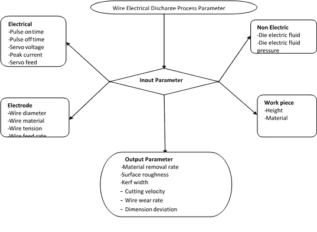**图 (3)**

WEDM 工艺和响应参数 [11]。

### 线电极属性

WEDM 的加工性能通常取决于刀具电极各种物理、化学、电气和机械属性的组合。因此，线电极应具有良好的性能，以实现高精度和高精度的快速切削。表 1 列出了 WEDM 线材的不同属性。

表 1 WEDM 线材的本质属性 [12]。

| 序号 | 属性 | 描述 |
| --- | --- | --- |
| 1. | 导电性 | 线导电率低会导致从电源到切削点距离上产生电压下降和相关的能量损失 |
| 2. | 抗拉强度 | 抗拉强度为 900MPa 的硬线用于大部分工作，而抗拉强度在 490MPa 左右的半硬线和低于 440MPa 的软线用于角度大于 5° 的斜切加工 |
| 3. | 延伸率 | 硬线的延伸率远低于半硬线。脆性线在第一次过载条件下可能会断裂，而延性较好的线预计可以承受临时过载 |
| 4. | 熔点 | 线电极应能抵抗火花的快速熔化 |
| 5. | 几何尺寸 | WEDM 通常提供直径从 0.02 到 0.36 mm 的等的线。线直径的增加会增加供给到工作间隙的脉冲能量，从而提高整体材料去除率 |

图 (4) 展示了 WEDM 中线直径的增加 [13]。

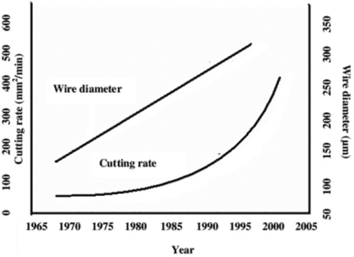**图 (4)**

### WEDM 工艺的进展

WEDM 已证明自己是加工复杂几何形状硬材料的先进技术。表 2 显示了现代 WEDM。

表 2 混合 WEDM

| 序号. | 混合 WEDM |
| --- | --- |
| 1. | 线电火磨光 |
| 2. | 微电火成隙 |
| 3. | 线电火铣 |
| 4. | 线电火车削 |
| 5. | 磨粒线电火加工 |

### 电火磨光

为了生产柱形微零件，优选择线电火磨光 (`WEDG`) 等加工工艺 [14]。在 `WEDG` 工艺中，以高精度加工棒和销钉等微型旋转零件 [15]。然而，`WEDG` 工艺虽然可以制造微型旋转零件，但加工效率非常有限 [16]。

### 微型线电火磨光

在微型 WEDG 中，砂轮的使用被作为电极的微线所取代。当需要磨光细棒时，它作为工件并在电极静止时旋转。这一过程利用电火花或热能从工件去除去除的材料以形成所需的形状 [17]。然而，从技术和经济角度考虑，断线控制是微型 WEDM 工艺最关键的方面。

### 线电车削

线电车 (`WEDT`) 工艺是制造微型轴对称元件的新兴非传统加工工艺之一 [18]。在 `WEDT` 和 `WEDG` 中，侵蚀机制与 WEDM 工艺相似，不同在于 `WEDG` 中工件沿纵向进料，而不是像 `WEDT` 那样的水平方向。此外，`WEDG` 和 `WEDT` 工艺变体的工艺特征在于刀具与工件电极之间的相对运动以及进料。

### 磨粒 WEDM (AWEDM)

在此过程中，电火花随磨粒一起磨损工件表面。通过将 WEDM 与细径磨粒相结合，可以实现更高的材料去除率和更好的表面光洁度。

## 钛合金 WEDM 的发展

Srinivasan 和 Palani [19] 检查了硅化氮-氮化钛 (Si[3]N[4]-TiN) 陶瓷复合材料，表征其在 WEDM 中的表面完整性和疲劳性能。在对陶瓷复合材料的 WEDM 表面进行扫电 (SEM) 观察时，发现了多种类型的缺陷，如微裂纹、微孔、颗粒、液滴和表面坑。此外，线电切割面的疲劳寿命比抛光表面减少了 25-35%。此外，抛光表面的硬度远优于加工表面。

Takale 和 Chougle [20] 提到 `Ti49.4Ni50.6` 形状记忆合金具有低杨氏模量，非常适合新型骨科植入物。然而，`Ti-Ni` 在采用传统方法加工时，表面质量差且尺寸精度低。因此，`WEDM` 可以作为加工 `Ti-Ni` 形状记忆合金以实现高尺寸精度的替代方案。本文研究了不同 `WEDM` 输入参数对 `Ti-Ni` 合金 `MRR` 和 `SR` 的影响。选定的输入参数包括 `pulse on time`、`pulse off time`、`spark gap set voltage`、`wire feed` 和 `wire tension`。采用 `GRA` 进行多目标优化。为了研究加工表面的金相变化，执行了 `EDS` 分析。

Singh 和 Misra [21] 研究了不同输入变量下 `WEDM` 加工 `nimonic 263` 的情况。实验设计基于 `Box-Behnken design technique`，并使用 `response surface methodology` 对表面粗糙度进行了参数优化。`BPNN` 的结果显示 `BPNN` 是预测响应的有效工具。通过 `FE-SEM` 发现 `WEDMed` 表面包含裂纹、坑、球形液滴和碎片颗粒。

Pramanik 和 Basak [22] 展示了输入参数对 `Ti-6Al-4V` 合金在 `wire EDM` 加工过程中疲劳寿命、`crack propagation`、`surface roughness` 和加工的影响。考虑了加工参数 `pulse on time`、`pulse off time` 和 `wire tension`，并使用 `SEM` 观察了这些参数对 `surface-integritry` 的影响。观察到影响疲劳性能的主要因素是 `recast layer` 和 `HAZ` 的性质和程度。

Kavimani *et al.* [23] 使用 `Taguchi coupled grey relation analysis` 研究了还原氧化石墨烯增强镁基金属复合材料的 `WEDM` 切割参数。应用 `L27 orthogonal array` 设计实验，并通过应用 `ANOVA` 确认了结果。确定对于 `MRR` 和 `SR` 而言，`reinforcement weight percentage` 和 `pulse on time` 是比 `pulse off time` 和 `wire feed rate` 等其他输入参数影响最大的参数。

Chu *et al.* [24] 讨论了一种用于高速 `WEDM` 金属板上产生 `microgroove` 的新型可行 `low frequency vibration assisted technique`。`ridge width` 受 `average current`、`vibration frequency` 和 `feed rate` 的显著影响。然而，与传统的 `WEDM` 工艺相比，`low frequency vibration assisted WEDM` 可以产生更小的 `microgroove` 结构和更高的加工效率。

Rajkumar *et al.* [25] 了 `Wire electric discharge machining` 加工 `nano alumina particle` 增强的 `aluminium metal matrix composites`。发现 `Voltage` 和 `pulse on time` 是实现更高 `MRR` 的责任输入参数。此外，`controlled pulse durations` 通过减少加工缺陷改善了表面完整性。

Zhang *et al.* [26] 使用 `SEM` 分析了 `thin wall` 的 `WEDM` 以表征 `power-consumption`。在 `WEDM` 期间观察了 `SEM` 的 `surface-quality` 和 `thermal-deformation`。发现 `wire` 可以减少能量消耗。

Sharma *et al.* [27] 使用 `Taguchi` 优化了 `shape memory alloy` `WEDM` 的输入变量。在其他输入变量中，`pulse on time` 导致更高的 `MRR`。

Smirnov *et al.* [28] 使用 `SPS` 执行了 `composites` 的 `WEDM`。发现 `wire` 可以减少能量消耗。

Zhou *et al.* [29] 使用 `RSM` 讨论了 `composites` 的 `WEDM`。发现 `wire` 可以减少能量消耗。

Pramanik 和 Basak [30] 研究了 `WEDM` 加工 `AISI 304` 时电线张力的影响。注意到 `wire tension` 对 `kerf width` 没有影响，但会影响 `MRR` 和 `SR`。

Thankachan *et al.* [31] 使用 `Taguchi` 对 `alloys` 进行了 `WEDM`。发现 `wire` 可以减少能量消耗。

Nain *et al.* [32] 使用 `artificial neural network` 对 `alloys` 进行了 `WEDM`。预测了 `MRR` 和 `Surface Roughness`。

Chaudhary *et al.* [33] 使用 `SEM` 和 `EDS` 研究了 `super alloy` 的 `WEDM`。`wire tension` 影响 `MRR` 和 `micro-hardness`。

Gaitonde *et al.* [34] 使用 `RSM` 和 `differential evolution` 讨论了 `HCHr steel` 的 `WEDM`。发现 `MRR` 更。

Goyal [35] 使用 `normal and cryogenic zinc coated wires` 代表了 `Inconel 625` 的 `WEDM` 研究。发现 `MRR` 和 `SR` 受 `pulse on time`、`tool electrode` 和 `current intensity` 的影响。

Mouralova *et al.* [36] 使用 `SEM` 和 `contact less 3D profilometer` 区分了 `WEDM` 结构材料表面。

Arikatla *et al.* [37] 在加工 `Ti-6Al-4V alloy` 时使用 `RSM` 讨论了 `WEDM` 过程的参数优化。`wire tension` 和 `servo voltage` 对 `surface roughness` 有很大影响。

Siddiqui 和 Ramkumar [38] 建议，镁作为生物降解骨科植入物应用中的重要材料，可以通过 `micro-WEDM` 加工成微米级的复杂形状。实验选择 `AZ31 Mg` 合金进行测试，以建立 `micro WEDM` 各种输入参数之间的关系。为了获得最佳条件，希望具有中等电压和高电容以实现高 `MRR`。

Liu *et al.* [39] 描述了在 `WEDM` 中加工 `Nithinol` 形状记忆合金。进行了实验以确定工艺参数对`white layer` 晶结构、成分和性质的影响。使用 `TEM`、`X ray Diffraction` 和 `EBSD` 来刻画加工表面`white layer` 的性质。与基体材料相比，由于氧化硬化，`White layer` 显示出更高的纳米硬度。

Manjaiah *et al.* [40] 研究了在 `WEDM` 加工钛形状记忆合金过程中线电极材料的影响。研究使用了 `Brass` 和 `Zinc Coated` 焊丝。结论认为，`pulse on time`、`pulse off time` 以及 `servo voltage` 是优化条件以增强加工材料 `MRR` 和 `SR` 最影响的参数。

Sun *et al.* [41] 讨论了低速线电火花加工中微型铣削螺旋和波纹微型端铣刀的特性。进行了线电极轨迹的设计和数学仿真，并阐明了加工参数对螺旋端铣刀的影响。

### 表 3：WEDM 综述。

| 序号 | 作者 | 优化技术 | 工作材料 | 输入参数 | 结果 |
| :--- | :--- | :--- | :--- | :--- | :--- |
| 1. | Shakeri *et al.* [42] | ANN | 渗碳钢 | 脉冲电流, A (8-16). 频率, kHz (40-60). 线速, m/min (8-12). 伺服速度, mm/min (4-8) | 线速、脉冲电流和频率的增加导致高 `MRR` |
| 2. | Goyal *et al.* [43] | ANN, RSM, SEM | `Ni[49]Ti[51]` | 电流, A (4-8). 脉冲开启时间, µs (60-120). 脉冲间隙时间, µs (15-45). 线张力, cm²/gm (11-15). 进速度, m/min (4-8) | 增加脉冲开启时间和电流会增加 `MRR` |
| 3. | Suthan and Muralidharan [44] | Taguchi | 316L | 脉冲开启时间, µs (30-32). 脉冲间隙时间, µs (5-7). 间隙, mm/min (50-700) | 更高的脉冲开启时间导致更高的 `MRR` |
| 4. | Liao *et al.* [45] | Taguchi 质量设计, ANOVA 和 F 检验 | 合金 | 脉冲发生电路, (ac, dc). 介质导电率, (15-45). 电容, C (0-20). 似电压, V (100-150). 台进给速度, mm/min (2-4). 脉冲间隙时间, 微秒 (4-8). 电路电阻, ohm (25-75). | 脉冲发生电路、电压和电路电阻对表面粗糙度有显著影响 |
| 5. | Padmavathi *et al.* [46] | Taguchi 稳健设计方法 | AISI 316 不锈钢 | 脉冲开启时间, µs (1-10). 脉冲间隙时间, µs (1-10). 峰值电流, A (0-30) 线张力, cm²/gm (200-1500). 线进速度, m/min (0-10) | 峰值电流和脉冲开启时间对对 `MRR` 和 `SR` 都有显著影响 |

Ishfaq *et al.* [47] 检查了加工不锈钢复合钢的 `WEDM` 工艺参数。由于复合材料的异质性，复合材料的加工非常有挑战性。与气体切割和等离子弧切割等专门用于切割这些材料的其他工艺相比，复合钢 `WEDM` 提供更好的表面光洁度。然而，低切速是使用 `WEDM` 的限制。根据 Taguchi 方法设计实验以优化切速。看到复合材料的单层厚度对控制 `WEDM` 的加工速率起关键作用。Babu *et al.* [48] 研究了 `WEDM` 中过共晶 Al-Si 合金的参数优化。实验中选取了不同的输入控制因素，包括脉冲开启时间和硅百分比的变化。实施了 `GRA` 和主成分分析进行多目标优化。发现 `PCA` 在执行此任务方面优于 `GRA`。

Periyanan *et al.* [49] 描述了 `micro-WEDM` 在加工复杂的精确 3D 结构微型零件和微型工具中的利用。采用 Taguchi 方法优化 `micro-WEDM` 的输入变量以增强 `MRR`。结果显示进给速度、电容和电压是影响 `MRR` 最大的参数。

Giridharan 和 Samuel [50] 在 `WEDT` 中对 AISI 4340 钢进行了实验以提高其侵蚀率。采用了新方法来测量扫描深度并获得了更好的结果。通过 `SEM` 研究了随机侵蚀机制。表 3 显示了对各种研究中 `WEDM` 的综述。

## WEDM 的未来前景

频繁的断线使得 `WEDM` 效率降低并损害了加工质量。因此，减少断线以获得更好的尺寸精度和效率将仍然是一个关键研究领域。

钛合金有广泛的应用。由于这些合金难以加工成复杂的形状，它们的加工仍然是一项挑战。可以优化 `WEDM` 工艺参数来切割钛合金，以降低制造成本和时间。

应该提高钛合金的 `WEDM` 加工效率。然而，现有的线材料在这些方面已经失败了。因此，需要集成新型芯和涂层材料的新型线电极材料。

## 结论

在对 `WEDM` 文献进行彻底研究后可以得出，钛合金在生物医学、航空航天和微型工具制造领域非常有用。这些合金可以使用 `WEDM` 流畅且廉地加工成复杂形状。观察到输入变量对性能指标有显著影响，因此优化参数以实现高尺寸精度和高重复性变得至关重要。可以采用基于数学模型的 Taguchi、RSM、模糊、算法和基于 ANN 的优化技术，用于 `WEDM` 中对各种钛合金加工的此类研究。此外，通过 `SEM`、`TEM` 和 `XRD` 的应用，可以评估和研究加工材料的表面完整性、成分和缺陷。

## 出版许可

不适用。

## 利益冲突

作者确认本章节内容没有利益冲突。

## 致谢

作者对编辑和匿名评审员的时间投入和宝贵建议表示诚挚感谢。

## 参考文献

| | |
| :--- | :--- |
| [1] | Lin C-T.. I-Fang Chung and Shih-Yu Huang, “Improvement of machining accuracy by fuzzy logic at corner parts for wire-EDM.Fuzzy Sets Syst.200112249951110.1016/S0165-0114(00)0034-8 |
| [2] | Puri A.B., Bhattacharyya B.. An analysis and optimisation of the geometrical inaccuracy due to wire lag phenomenon in WEDM.Int. J. Mach. Tools Manuf.2003431515910.1016/S0890-6955(02)00158-X |
| [3] | Tosun N., Cogun C.. An investigation on wire wear in WEDM.J. Mater. Process. Technol.200313427327810.1016/S0924-0136(02)01045-2 |
| [4] | Puri A.B., Bhattacharyya B.. Modelling and analysis of the wire-tool vibration in wire-cut EDM.J. Mater. Process. Technol.200314129530110.1016/S0924-0136(03)00280-2 |
| [5] | Amin D., Mehta V.. A Review Paper on Wire Electric Discharge Machining of Cryo treated Ti6Al4V.International Journal for Innovative Research in Science & Technology2016212173177 |

## 参考文献

- **[6]** Farnaz Nourbakhsh K.P.. 钛合金丝线电火加工，procedia CIRP 2013:513-318.
- **[7]** Khan Bassam, Davis Rahul, Singh Abhishek. `Ti-6Al-4V` 合金用于生物医学应用的丝线电火加工中输入变量和冷处理的影响 10.1016/j.matpr.2019.09.226.
- **[8]** Ho K.H., Newman S.T., Rahimifard S., Allen R.D.. 丝线电火加工 (`WEDM`) 的先进技术现状。Int. J. Mach. Tools Manuf. 2004 44:1247-1259 10.1016/j.ijmachtools.2004.04.017.
- **[9]** Wang J., Ravani B.. 走丝丝电火加工 (`EDM`) 的计算机辅助轮廓作业。Comput. Aided Des. 2004 35:925-934.
- **[10]** Swarup S.. 使用 Taguchi 方法和灰色关联分析对 `AISI 4140` 丝线电火加工工艺参数优化。Materials Today: Proceedings 2019 184:261-14270.
- **[11]** Jaksan C Patel and Kalpesh D Maniya 关于金属基复合材料丝线切割电火加工工艺的综述，procedia Manufacturing 2018 20:253-2558.
- **[12]** Maher Ibrahem. 为了延长工作时间和提高丝线 `EDM` 加工利用率的丝电极性能改进研究。International Journal of Advance Manufacturing and Technology 2015 76:329-351.
- **[13]** Kapoor J.. 用于丝线电火加工的高性能丝电极——综述，Proceedings of the Institution of Mechanical Engineers, Part B: Journal of Engineering Manufacture 2012 117:1-27.
- **[14]** Parthiban M., Krishnaraj V., Sindhumathi R., Valentincic J.. 使用丝线电火磨光 (`WEDG`) 制造钨钢微型工具的研究。J. Braz. Soc. Mech. Sci. Eng. 2017 10.1007/s40430-017-0780-2.
- **[15]** Masuzawa T., Fujino M., Kobayashi K.. 用于微加工的丝线电火磨光。Annals of the CIRP 1985 34:143-14344 10.1016/S0007-8506(07)61805-8.
- **[16]** Zhu Y., Liang T., Gu L., Zhao W.. 用丝线 `EDM` 机加工微型旋转零件。Procedia Manufacturing 2016 58:498-506 10.1016/j.promfg.2016.08.071.
- **[17]** Ali M.Y., Rahman M.A., Nordin R.. 微丝线电火磨光：材料去除率和表面粗糙度的优化，IOP Conf. Series: Materials Science and Engineering 172:2017 10.1088/1757-899X/184/1/012032.
- **[18]** Abimannan Giridharan and G. L. Samuel 丝线电火车削 (`WEDT`) 过程中火坑形成的的建模与分析。International Journal of Advance Manufacturing and Technology 2015 77:1229-1247.
- **[19]** Srinivasan V.P., Palan P.K.. 丝线电火加工后 `Si3N4–TiN` 的表面完整性、疲劳性能和干滑磨损行为。Ceram. Int. 10.1016/j.ceramint.2020.01.082.
- **[20]** Takale A.M., Chougule N.K.. 丝线电火加工工艺参数对骨科植入应用 `Ti[49.4]Ni[50.6]` 记忆合金表面完整性的影响。Mater. Sci. Eng. C 2019 97:264-274 10.1016/j.msec.2018.12.02930678911.
- **[21]** Singh B., Misra J.P.. 通过 RSM 和 ANN 模型对丝线电火加工试样的表面光洁度分析。Measurement 2019 137:225-2371 10.1016/j.measurement.2019.01.044.
- **[22]** Pramanik A., Basak A.K.. 丝线电火加工 (`EDM`) 参数对 `Ti-6Al-4V` 合金疲劳寿命的影响。2019 10.1016/j.ijfatigue.2019.105186.
- **[23]** Kaviman V., Soorya Prakash K.. 加工参数对还原氧化石墨烯/镁复合材料丝线电火加工性能及其表面完整性特征的影响。Composites Part B 2019 167:621-30.
- **[24]** Chu X., Zeng X., Zhuang W., Zhou W., Quan X., Fub T.. 用于加工表面微槽的振动辅助高速丝线电火加工。J. Manuf. Process. 2019 44:418-4261 10.1016/j.jmapro.2019.05.026.
- **[25]** Rajkumar K., Balasubramaniyan C., Nambiraj K.M., Rajesh M.. 铝-纳米氧化铝复合材料的黄铜丝线电火加工变量优化 10.1016/j.matpr.2019.11.252.
- **[26]** 张国俊, 李文源, 张彦明, 黄宇, 张震, 陈志. 微结构丝线电极电火加工薄壁零件的工艺能耗和热变形的分析与降低。2020 10.1016/j.jclepro.2019.118763.
- **[27]** Neeraj Sharma and Kapil Gupta 用于生物医学的富镍 NiTi 形状记忆合金丝线火蚀加工。Procedia Manufacturing 2019 35:401-4406.
- **[28]** Smirnov A., Peretyagin P., Bartolomé J.F.. `3Y-TZP/Ta` 陶瓷金属复合材料的丝线电火加工。Alloys 2018
- **[29]** Zhou C., Wu X., Lu Y.. Hang 通过电火加工制造疏水 `Ti3SiC` 表面。Ceram. Int. 2018
- **[30]** Pramanik A., Basak A.K.. `AISI 304` 不锈钢丝线电火加工的可持续性。J. Clean. Prod. 2019 116.
- **[31]** Nain Somvir, Garg Dixit, Kumar Sanjeev. 利用 Taguchi 灰色关联分析和神经网络预测 `WEDM` 超性能合金加工的表面粗糙度和材料去除率。App. Surf. Sci. 2018
- **[32]** Udimet-L, Prokes T., Horynova M.. 使用粒子群优化获得 `WEDM` 性能的最优解。J. jestch. 2018
- **[33]** Chaudhary Tina, Siddique Arshad, Devaraj Ramamy. 丝张力对电加工期间不同响应的影响。dt. 2018
- **[34]** Gaitonde V.N., Manjaiah M., Maradi S., Karnik S.R., Petkar P.M., Paulo Davim J.. 整合响应面方法 (`RSM`) 与微分进化优化 `HCHCr` 钢的丝线电加工 (`WEDM`)。Computational Methods and Production 2017 199.
- **[35]** Goyal A.. 冷处理工具对 `Inconel 625` 超合金丝线电火加工中材料去除率和表面粗糙度的研究。Journal of King Saud University – Science 2017 29:35.
- **[36]** Mouralova K., Kovar J., Klakurova L., Prokes T.. `WEDM` 加工材料表面形貌和地形对比。Measurement 2017
- **[37]** Siva Prasad Arkatla K.. 响应面方法钛合金丝线电火加工的参数优化。Materials Today: Proceedings 2017 41:3441.
- **[38]** Siddiqui T.U., Ramkumar J.. 用于生物降解骨科植入物的 `Mg` 合金微丝线电火加工。Materials Today: Proceedings 2017 410:2731.
- **[39]** Liu J.F., Guo Y.B., Butler T.M., Weaver M.L.. 丝线电火加工镍钛合金白层的晶体结构、成分和性能。Mater. Des. 2016 109:191.
- **[40]** Manjaiah M., Narendranath S., Basavarajappa S., Gaitonde V.N.. 电极材料对 `Ti50Ni50−xCux` 记忆合金丝线电火加工性能的影响。Precision. Eng. 2015 9.

| [42] | Shakeri Saeid, Ghassemi Aazam, Hassani Mohsen, Hajian Alireza. 人工神经网络下渗合金钢线电火花加工过程中材料去除率和表面粗糙度的研究 201610.1007/s00170-015-7349-y |
| [43] | Goyal A., Huzef U.R.. Rahman and S.A.C. Ghani, “Ni49Ti51 形状记忆合金线电火花加工参数的实验研究与优化，”*Journal of King Saud University -*.Eng. Sci.202010.1016/j.jksues.2020.01.003 |
| [44] | Suthan S., Muralidharan K.. 316L 不锈钢线电火花加工参数的实验分析优化。International Research Journal of Engineering and Technology2018050612581263 |
| [45] | Liao Y.S., Huang J.T., Chen Y.H.. 线电火花加工中实现精细表面光洁的研究。J. Mater. Process. Technol.200414916517110.1016/j.jmatprotec.2003.10.034 |
| [46] | Padmavathi K.R.. 2 S. Devaraj, 3 I. John Solomon, 4 A. Premkumar, “加工参数对 AISI 316 不锈钢线电火花加工的影响。”Int. J. Eng. Res. Technol. (Ahmedabad)2018060210.17577/IJERTCON067 |
| [47] | Ishfaq K., Mufti N.A., Mughal M.P., Saleem M.Q., Ahmed N.. 优化切削速度的不锈钢包钢线电火花加工研究。Int. J. Adv. Manuf. Technol.201810.1007/s00170-018-1630-9 |
| [48] | Babu D.M., Kiran S.V., Vundavilli P.R.. 过共晶 Al-Si 合金线电火花加工的实验研究与多响应优化。Int. J. Manuf.Res.2016110322123710.1504/IJMR.2016.079460 |
| [49] | Periyanan P.R., Natarajan U., Elango A.. 微型电火花线加工过程中材料去除率的参数优化。Int. J. Eng. Sci. Technol.2011396676 |
| [50] | Giridharan A., Samuel G.L.. 线电火花车削过程中 AISI 4340 钢的侵蚀率研究。Mach. Sci. Technol.201822228729810.1080/10910344.2017.1365890 |

# 电火花加工（EDM）及其类型的最新进展

**Anupam Thakur**, **Suneev Anil Bansal**

印度希马偕邦巴迪马哈哈拉·阿格拉森大学机械工程系

## 摘要

电火花加工是先进加工工艺之一，在考虑表面粗糙度和高精度等各种参数的情况下，能够对工件上复杂的几何形状进行加工。EDM 领域已开展大量研究，以开发各种模型并为普通电火花或线电火花加工选择最佳优化工况。文中关于浸没式和干式 EDM 加工的一些结果也得到了讨论。此外，还讨论了智能 EDM 的最新进展，以预测电火花加工机的未来能力。本文重点阐述了基于加工能力、参数、加工表面特性以及各种线丝材料，以及在加工过程中对 EDM 线丝的影响和整体性能的最新进展。

**关键词：** 复合材料、电火花加工机、材料、材料去除率（MRR）、工艺参数。

***

**通讯作者 Anupam Thakur**: 印度希马偕邦巴迪马哈哈拉·阿格拉森大学机械工程系；邮箱:[anupamthakur@hotmail.com`

## 引言

电火花加工机有助于在工件与电极形式的工具之间没有物理接触的情况下生产许多复杂的几何形状。加工过程是通过电极与工件界面之间的持续火花冲蚀完成的（图 [1]）。该过程通过在工件和工具之间产生适当电压来实现，由于强静电场导致电介质发生击穿。这是一种先进的制造技术，通常用于模具制造、汽车制造和医疗器械*等*。大多数易碎的物体无法通过其他机器轻松加工，但它可以在没有任何风险因素的情况下轻松加工。研究发现，该过程不会产生有毒气体和受污染的电介质。

线电火花加工（Wire EDM）在某种程度上与传统 EDM 相似，因为它采用线丝形式的电极用于火花冲蚀。

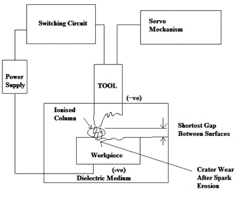 **图 (1))**

EDM 机制布局图。

这为使用线电火花加工（WEDM）生产具有高表面光洁度和精度的细形状提供了更大的空间。一些研究描述了工具与工件之间最短距离处电离柱的形成[[1]]。随着复杂和精细设计的发展，线电火花加工脱颖而出，可以为高水平的精度和光洁度提供新的空间。它利用电作为源，通过作为电极的薄铜或黄铜线导。当这根线丝靠近工件时，最近区域的电火花开始产生，导致微观颗粒的熔化和汽化使金属发生火花冲蚀。在此过程中，线丝也会发生微量冲蚀，从而导致某种形式的刀具磨损。为了确保切割区域尺寸相等精确，随着加工的进行和切割的执行，机器通过自动机构用新线丝段更换旧线丝。整个过程在去离子水的电介质中进行，以促进加工区域的均匀连续冷却，并去除加工过程中产生的冲蚀颗粒。

## EDM 的现状及脉冲特性对 EDM 加工过程的影响

由于 EDM 的非线性特性，EDM 机仍需许多改进。许多研究已经强调了为了改进当前工艺而可以改进的方面（表 [1]）。在过去的 20 年里，从最初的发展开始，随着时间的进步开展了大量研究[[2]]。通过优化工艺参数，为电火花加工机的改进提供了各种控制和结果[[3]]。考虑到优化，研究中给出了输入参数。一些研究还强调了提高加工表面质量的新技术进展。还发现大量研究关注粉末混合电火花加工，以研究其表面及其改性[[4]]。对用于提高机器效率的直流电脉冲也进行了研究。研究发现，如果使用 RC 类型的脉冲发生器进行改进，就可以看到更好的结果，包括使用碳化钨作为工件时的高表面质量和提高的去除率（MRR）[[5]]（图 [2]）。

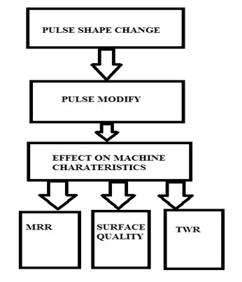 **图 (2))**

# 脉冲形状对 EDM 特性的影响

另一项研究表明，如果使用改进晶体管产生的 1MHz 脉冲代替 RC 型发生器，可以产生更高的材料去除率（MRR），且加工速度提高三倍 [6]。Han *等人* 进行了一项研究，设计了一种用于脉冲产生的新晶体管脉冲发生器，能够产生 24 倍的 MRR [7]。还进行了一项研究，观察到 EDM 电容对阻抗的影响，从而导致了高加工性能 [8]。在表面光期间，还采用了某些基于半导体的开关电路在电极和工件界面释放较低的能量，以获得更高的表面光洁度 [9]。

一些实验表明，用于加工的脉冲发生器的形状变化对各种加工特性有显著影响。结果显示，能量密度对刀损损率（TWR）有很大影响 [10]。短脉冲持续时间通常用于高精度加工。发现使用均匀能量放电时，表面形貌具有更高的价值。还发现，如果用于放电加工的是均匀形状的脉冲，则电花效应会较少 [11]。

## 表 1：线切割 EDM 的各种综述。

| 序号 | 作者 | 工作材料 | 输入参数 | 结果 |
| --- | --- | --- | --- | --- |
| 1 | Bhatia *等人* [12] | 高碳高铬钢 | 脉冲通电时间(125-131µs)，脉冲关断时间(34-48 µs)，线张力(1-3)，最大电流(210-230A)。 | 发现脉冲关断时间对表面粗糙度（SR）有显著影响。建立的模型误差为 3.93%。 |
| 2 | Tilekar *等人* [13] | 铝和软钢 | 脉冲通电时间(25-39 µs)，脉冲关断时间(6-10µs)，电流(1-3A)，线进速度(75-85mm/s)。 | SR 受脉冲通电时间和电流的影响。对于缝隙宽度，线进速度有显著影响。 |
| 3 | Brajesh *等人* [14] | AISI D3 钢 | 脉冲通电时间(18-24 µs)，脉冲关断时间(51-59µs)，峰值电流(180-200A)，线进速度 (4-6mm/min)。 | SR 受到影响。 |
| 4 | Selvakumar *等人* [15] | 5083 铝合金 | 脉冲通电时间(0.5-0.9 µs)，脉冲关断时间(14-38µs)，峰值电流(20-100A)，线张力 (420-660g)。 | 切割速度与线张力无关，表面粗糙度 (Ra) 与脉冲关断时间和线材张力无关。 |
| 5 | Azhiri *等人* [16] | Al/SiC | 脉冲通电时间(106-126 µs)，脉冲关断时间(60-40µs)，放电电流(70-230A)，间隙电压(60-20V)。 | 切割速度和表面粗糙度受脉冲通电时间的影响。通过灰色关联分析优化了这两项指标。 |
| 6 | Srivastava *等人* [17] | SiC 增强 Al2024 | 电流(2-4A)，脉冲通电时间(15-25 µs)，增强百分比 (2-4%) | SR 随电流、脉冲通电时间和增强百分比而增加。MRR 随脉冲通电时间线性变化，反反变化。 |
| 7 | Ikram *等人* [18] | D2 刀钢 | 线进速度 (5-15m/s)，脉冲通电时间(3-5 µs)，脉冲关断时间(20-30 µs)，电液压力(4-10 kg/cm²)，线张力(800-2000g)，开电压(40-60V)，厚度(7-25.4) | 脉冲通电时间对 SR、缝隙宽度和 MRR 影响显著。 |
| 8 | Bobbili *等人* [19] | 高强度装甲钢 | 脉冲通电时间 (0.6-1.6µs)，脉冲关断时间(14-46 µs)，线进(2-4m/min.)，冲洗压力(4-8Kg/cm²)，火花电压(15-25V)，线张力(4-8Kg-f) | 为各种响应建立了一个回归模型，结果显示火花电压、脉冲通电/关断时间对 MRR 和表面粗糙度具有高度显著性。 | |
| 9 | Kumar *等人* [20] | 纯钛 | 脉冲通电时间 (0.7-1.1µs)，脉冲关断时间(17-38 µs)，线进(4-10m/min.)，峰值电流(120-200A)，火花电压(40-60V)，线张力(500-1400g) | 建立了一个半经验模型，测量值与预测 MRR 之间的比较误差为 32-6.95%。 | |
| 10 | Zhang *等人* [21] | SKD11 | 脉冲通电时间 (1-9µs)，脉冲关断时间(10-70 µs)，线进(3-11m/min.)，电流(1-5A)，系数 (40-80) | 建立了最佳条件。 | |
| 11 | Garg *等人* [22] | 钛合金 | 脉冲通电时间 (0.7-1.1µs)，脉冲关断时间(17-38 µs)，线进(4-10m/min.)，峰值电流(120-200A)，火花电压(40-60V)，线张力(500-1400g) | 切割速度。 |

## 线材定位的影响

一些实验表明，用于加工的脉冲发生器的形状变化对各种加工特性有显著影响。结果显示能量密度对刀损率（TWR）有很大影响。短脉冲持续时间通常用于高精度加工。发现使用均匀能量放电时，表面形貌具有更高的价值。还发现，如果用于放电加工的是均匀形状的脉冲，则电花效应会较少。

## 线材张力的影响

如上一节所示，电丝在加工过程中的振动及其刚性起着至关重要的作用。因此，电丝材料的选择应基于其在拉强度和韧性方面具有高耐用性，以便以最小的振动吸收产生的所有振动和应力。研究表明，随着电丝成分中 `Zn` 百分的增加，加工速度会提高，且对伺服电压的要求降低，从而减少了加工过程中发生短路的概率[26]。许多人员为了以最小的 TWR（热损耗率）和 SR（表面粗糙度）来实现最大的 MRR（材料去除率）进行了研究。下面讨论了一些重要的电丝材料。

### 铜
铜是最早用于加工电极的材料之一。但由于强度和低蒸气压等物理性能的局限性，限制了它在电火加工（WEDM）中作为电丝的使用[25]。

### 黄铜
作为 `Cu` 的替代品，`Br` 在 WEDM 中发挥着非常重要的作用，具有良好的性能表现。它是 `Cu` 和 `Zn` 的合金，两种元素的含量分别约为 63% 和 37%。加入 `Zn` 是为了表现出高拉强度、高蒸气压和低熔点[25, 26]。

### 涂层电丝
发现电极涂层由于挥发温度较低，承受热冲击的概率较低。它包括具有高导电性芯的电丝，外层涂低熔点合金，最后再涂一层高强度合金，从而有助于提高加工速度。对这种涂层电极丝已进行了大量研究，其具有高加工能力和更好的冲水性，能产生误差最小、表面最光滑的切口。但唯一的缺点是成本高，并且可能导致电解液污染，从而造成环境限制[27]。

### 扩散退火电丝
由于锌层具有良好的特性，可以认为纯镀锌电丝会产生高加工结果。`Zn` 提供了低熔点，并结合良好的冲水性。因此，可以说顶层具有高浓度或纯浓度 `Zn` 的扩散涂层可以产生令人满意的结果。为了生产这种扩散丝，对包覆材料进行退火，使合金在顶层均匀分布。通过这种方法，可以生产比传统电极材料具有更高耐磨性的电丝。与黄铜电极丝相比，所得 EDM 电丝使生产率显著提高[28]。

## 冲水和电解液的影响
电解液在 EDM 中以多种形式使用，如全浸、射流或喷淋冲水。在图 (5) 中，绘制了冲水压力对加工速度 (`Vs`) 和表面粗糙度 (`Ra`) 的影响。

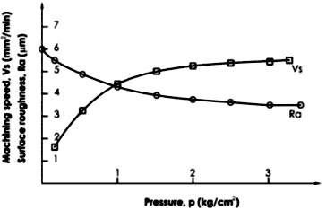****图 (5))**

压力对 `Vs` 和 `Ra` 的影响[23]。

压力流有利于持续移除火花产生过程中产生的蚀变为颗粒，在接近精加工时间时压力应减小。还观察到一个界限，超过该界限后无法进行充分加工；随着冲水压力增加到 1 Kg/cm²，可以获得更快的加工速度，在此之后加工速率会下降。当冲水压力小于 0.3 kg/cm² 时，火花放电沿会出现高温区域。

电解液除冲冲走蚀变为颗粒外，还执行多种功能，如在加工期间冷却工件和刀。它还帮助在大量能量积累之前，将火花能量集中在所需的较小加工区域并进行间隙绝缘。

## 智能电丝 EDM
众所周知，行业正在发生变化，并引入了一场名为“工业 4.0”的新革命。研究证明，通过避免停机来减少各种意外成本，可以产生更好的结果[29]。可见，根据目前微加工的需求，需要引入一些智能因素，有助于以高水平的准确性完成此类工作。与传统的 EDM 项目相比，已有许多项目向此类项目投入了大量资金[30]。在这一方面，强调要在加工时代引入一种新的智能因素，这可以优化各种控制参数并排除环境危害。这些因素不仅限于此，还具有自我调查和监控正在进行的各项任务的能力，并进行任何适当更改以获得最佳加工特性。这种影响在 Walder *et al.* 等人最近的一项研究中可见[31]。由于电丝线电火花加工机（WEDM）配备了许多传感器和设备来监控过滤器和电解液等消耗品，这很大程度上取决于加工材料。机器上安装了传感器以对这些设备进行连续监控。

# 绝缘电路布局

绝缘电路的布局 [31]。它由压力传感器、电导率传感器以及安装在各处的 pH 和氧化还原电传感器组合组成。此外，通过过滤器入口处的压力传感器维持了过滤器压力降的监测。该压力值设定为最高 2.8 bar，一旦超过该值，机器将自动停止。对给定材料进行加工时，获得了每种材料的压降图，并计算了每个装置从树脂中侵蚀出的颗粒重量，结果显示：在约 304 个有效工作时间内，通过工件加工去除了共 4kg 的硬质合金（WC），加工过程中侵蚀了约 7.7kg 的电丝。与树脂中收集的碎片量相比，发现总有 5.4kg 以离子的形式在加工过程中被吸收。最后，建立了一个用于预测压降的模型。由于接触与电火加工（EDM）的电丝持续摩擦，还发现接触磨损率也非常显著。文献模型与所开发模型之间存在良好的关系。最后得出结论：如果使用适当的传感器和预测模型进行精确监测，线电火加工（WEDM）中树脂、过滤器、接触件和电丝将最具成本效益。

## 结论

针对包括复合材料在内的各种材料已进行了大量研究，并考虑了脉冲开启/关闭时间、送丝速度、电丝张力、峰值电流和电压等各种控制参数，但从目前为止的回来看，对电丝材料影响的研究较少，因此应对其对加工特性的重要性进行深入研究。同样发现电丝直径对加工特性和走隙率（WWR）起着重要作用，这也需要研究其对加工率（MRR）、表面粗糙度（SR）和空隙（CV）的影响。发现过滤器饱和等其他参数与文献模型相当不同，因此需要使用铝等材料建立详细模型进行预测。我们还假设缺失质量以离子形式消耗。需要进行一些研究来验证并彻底阐述这一点。

## 发表许可

不适用。

## 利益冲突

作者确认本章节内容没有利益冲突。

## 致谢

作者对编辑和匿名评审员的时间以及宝贵建议表示诚挚感谢。

## 参考文献

|  |  |
|---|---|
| [1] | Jameson E.C.. Electrical Discharge Machining.1^(st) edMichiganSociety of Manufacturing Engineers2001 |
| [2] | Ho K.H., Newman S.T.. State of the art electrical discharge machining (EDM).Int. J. Mach. Tools Manuf.20034312871300 |
| [3] | | Abbas N.M., Solomon D.G., Fuad Bahari M.. A review on current research trends in electrical discharge machining.Int. J. Mach. Tools Manuf.20074712141228 |
| [4] | Kumar S., Singh R., Singh T.P., Sethi B.L.. Surface modification by electrical discharge machining: A Review.J. Mater. Process. Technol.200920936753687 |
| [5] | Jahan M.P., Wong Y.S., Rahman M.. A study on the fine-finish die-sinking micro EDM of tungsten carbide using different electrode materials.J. Mater. Process. Technol.200920939563967 |
| [6] | Han F., Chen L., Yu D., Zhou X.. Basic study on pulse generator for micro EDM.Int. J. Adv. Manuf. Technol.200733474479 |
| [7] | Han F., Wachi S., Kunieda M.. Improvement of machining characteristics of micro-EDM using transistor type iso pulse generator and servo feed control.Precis. Eng.200428378385 |
| [8] | Casanueva R., Azcondo F.J., Bracho S.. Series-parallel resonant converter for an EDM power supplyJournal of Materials Processing Technology2004149 |
| [9] | Muthuramalingam T., Mohan B.. Design and fabrication of control system based iso pulse generator for electrical discharge machining.International Journal of Mechatronics and Manufacturing Systems20136133143 |
| [10] | Muthuramalingam T., Mohan B.. Influence of discharge current pulse on machinability in electrical discharge machining.Mater. Manuf. Process.201328375380 |
| [11] | Muthuramalingam T., Mohan B.. Experimental investigation of iso energy pulse generator on performance measures in EDM.Mater. Manuf. Process.20132811371142 |
| [12] | Bhatia A., Kumar S., Kumar P.. A Study to achieve minimum surface roughness.Procedia Science20145 |
| [13] | Tilekar S., Das S., Powari K.. Optimization of Wire EDM on Mild Steel.International Journal for Innovative Research2014256 |
| [14] | Lodhi B., Agarwal S.. Optimization of wire EDM of AISI D33 using Taguchi.Procedia CIRP201414199 |
| [15] | Selvakumar G., Sornalatha G., Sarkar S., Mitra S.. Parametric optimization of Ti- 6-4 alloy.Arab. J. Sci. Eng.2014391465 |
| [16] | Bagherian R., Teimouri R., Ghodsiyeh D., Golshan A.. Application of Taguchi and ANFIS.Int. J. Adv. Manuf. Technol.20142729 |
| [17] | Umare A., Parchand S., Shingare P.. Wire cut EDM- A review.International Journal of Advance Research and Innovative Ideas in Education20173629 |
| [18] | Ikram A., Mufti N., Saleem M., Khan A.R.. Use of Taguchi design for surface roughness, kerf and MRR.International Journal for Innovative Research in Science & Technology2016211 |
| [19] | Ravindran Madhu and A.. Effect of Process Parameters on Surface roughness and Material Removal Rate.Mater. Manuf. Process.201328 |
| [20] | Kumar A., Kumar V., Kumar J.. Semi-empirical Model On MRR And Overcut In WEDM Using Pure Titanium.J. Braz. Soc. Mech. Sci. Eng.201537 |
| [21] | Zhang G., Zhang Z., Guo J., Huang Y.. Modeling And Optimization of Medium Speed WEDM Parameters For SKD11.Mater. Manuf. Process.201328 |
| [22] | Garg M., Jain A., Bhushan G.. Multi-objective Optimization of Process Parameters in Wire Electric Machining of Ti-6-4 alloy.Arab. J. Sci. Eng.201439 |
| [23] | Umare A., Parchand S., Shingare P.. Wire cut EDM- A review.International Journal of Advance Research and Innovative Ideas in Education201736 |
| [24] | Jaskarn Singh Mrishavraj Singh, Review on Effects of Process Parameters in Wire Cut EDM and Electrode Development.International Journal for Innovative Research in Science & Technology201621 |
| [25] | Ghodsiyeh D., Golshan A., Shirvanedeh J.A.. Review on Current Research Trends in Wire Electrical Machining.Indian J. Sci. Technol.201364 |
| [26] | Kapoor J., Singh Seijpal, Singh Khamba Jaimal. Recent Developments in Wire Electrodes for High Performance WEDMProceedings of the World Congress on Engineering20102 |
| [27] | Singh M., Lal H., Singh R.. Recent Developments in Wire EDM: A Review.International Journal of Research in Mechanical Engineering & Technology201331 |
| [28] | Antar M.T., Soo S.L., Aspinwall D.K., Jones D., Perez R.. “Productivity and workpiece surface integrity when WEDM aerospace alloys using coated wires,” *1st CIRP Conference on Surface Integrity (CSI)*.Procedia Eng.201119 |

| [30] | Yi Q.. 微制造研究：驱动因素与最新进展 2015[`strathprints.strath.ac.uk/id/eprint/59119`](https://strathprints.strath.ac.uk/id/eprint/59119) |
| [31] | Wälder G., Fulliquet D., Foukia N., Jaquenod F., Lauria M., Rozsnyo R., Lavazais B., Perez R.. 线电线加工机，第 19 届 CIRP 电物理与化学加工会议 Procedia CIRP201868109114 |

# 制造业中的人工智能与机器人技术：机遇与挑战

Hitesh Pahuja, PK Khosla, Balwinder Singh

高级计算开发中心，印度旁遮普邦，莫哈利

## 摘要

如今人类所做的一切工作，未来将由基于人工智能（AI）的系统完成，但速度将达到计算机级、规模和范围。人工智能正朝着制造业转型和制造工艺改进的方向迈进。根据福布斯技术委员会成员的观点，包括制造业在内的 13 个不同行业将受到人工智能的变革。人工智能和机器人技术可以将复杂的任务转化为一致且精确的解决方案。随着工业机器人运行的日益频繁，标志着人工智能在制造流程中的部署大幅增加。人工智能（AI）被广泛应用并逐渐进入制造领域，通过学习算法实现学习和无错误决策，从而简化自动化。人工智能驱动的系统通过展示创新前景、通过提高效率促进货物生产，以及通过实施通用人工智能使机器交互更接近人类交互，为未来的制造业提供了一条更简单的路径，并产生了许多益处。这项技术使制造商能够克服制造业领域长期面临的各种挑战，例如专家人才短缺、决策不佳、集成相关问题以及数据过载。因此，在制造业中实施人工智能允许公司全面革新其流程。它允许智能人工智能机器人/机器收集并提取数据，识别各种模式，根据分配给它们的任务的复杂程度通过机器学习或深度学习从这些模式中学习并适应新环境。因此，在工业中部署人工智能和机器人将改变大规模生产以及无错误决策的能力。工业 4.0 中的人工智能机器人可以执行持续性操作，例如从设计制造模型、开发专业知识、开发新的自动化解决方案、消除人为错误以及提供卓越的产品质量。伴随着人工智能的实施，机器人将取代人力并从事危险活动。结果是制造业所有部门的事故数量将下降。

人工智能与机器人技术将解决制造商与未培训工人相关的问题。因此，企业家可以专注于工业的进一步现代化并将行业规模扩大到更高水平。除了采用人工智能等新兴技术带来的许多机遇外，工业家也面临一些挑战。人工智能和机器人技术进入制造业将需要初创企业和现有制造商投入巨资。但投资回报将是高的，因为智能机器开始负责日常活动，公司的运营成本将大幅降低。人工智能的支持者声称，技术只是自动化的演变形式，是第四次工业革命的可预测结果。人工智能在创造、改进和降低成本降低方面可能是高效的，但在处理口味和需求的意外变化方面，人类的智慧是不可替代的。

**关键词：** 人工智能，数据，制造业，机器学习，机器人技术。

***

^* **通讯作者 Hitesh Pahuja**: 计算开发中心，印度旁遮普邦，莫哈利；电子邮件：`hitesh@cdac.in`

## 引言

人工智能（AI）是一项强调形成智能和智慧机器的技术，这些机器像个人一样工作和做出反应。能够完成观察、学习、决策、推理和解决问题等智力角机器或智能计算机被称为人工智能计算机或机器。而机器人技术是人工智能中的一个领域，从事于使用深度学习技术创建智能和智慧的机器人。机器人技术是人工智能的一个领域，它涵盖了所有工程领域，如机械、电气和计算机工程，用于基于人工智能的人的规划、设计、组装、开发和应用，如图([1])所示。

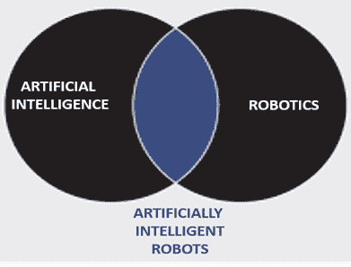 **图 (1))**

韦恩图表示的人工智能机器人。

存在实时工作的智能机器[[1], [4], [6]]。它们的作用是通过检测、累积、移动、修改对象的基本属性、损坏对象或产生智能影响来监控对象，从而将劳动力从单调、不疲倦或不受扰的工作中释放出来。人工智能机器人具有先进的机械结构，旨在以高灵敏度和准确性完成任务，如图([1])所示。它还包含为机器人机械结构提供动力控制的电气模块。此外，它包含了一些高级软件编程，用于管理机器人如何同时执行多项任务。人工智能和机器人技术是智能机器和机器人为完成任务展现出的智能，这些任务通常涉及智能、人类知识和学习技能，例如感知、学习、推理、解决问题、决策可视化等。新兴技术包含各种子集技术，如机器学习和深度学习，这些技术随着时间的推移和数据的不断增加而被学习，如图([2])所示。

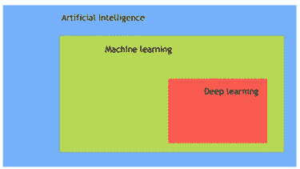 **图 (2))**

人工智能及其领域的表示。

# 制造业中的人工智能与机器人技术

## 机器学习简介
机器学习是指机器或计算机在没有编程的情况下进行学习的能力。它利用大量的算法来分析和评估数据，在分析数据后从中学习，然后做出判断或输出结果。因此，机器学习算法允许系统通过将可用数据应用于输入并对机器训练，从而执行特定任务。

另一方面，深度学习是人工智能和机器学习的一个子集，它们基于生物神经网络的学习表示，以像人类一样解决复杂问题。人工智能中的学习可以是监督学习、半监督学习、强化学习或无监督学习 [2]。

## 监督学习
监督学习顾如其名，存在作为老师的监督者。监督学习是一种学习方式，通过已标记的数据对机器进行教学，这意味着某些数据已经预先被标记了正确答案。随后，向机器提供一组全新的实例（数据）。因此，基于监督方法的的算法会分析训练数据集，并从对预先标记标记数据的学习中得出相应的结论。

例如，假设有一个篮子装满了各种类型的水果。初始阶段是按顺序用所有不同的水果训练系统。如果一个物品的形状是圆形的且顶部印有红色，那么该水果将被标记为苹果。另一方面，如果一个物体是绿黄色的长弯圆柱体，它将被标记为名为香蕉的水果。让我们假设在从标记数据进行训练后，如果给机器输入了篮子中一个新的相似的水样本并要求其进行检测。由于系统之前从较早的数据中学习过，机器会给出准确的输出。

监督学习分为两类算法，如分类和回归。

## 无监督学习
另一方面，无监督学习是针对既未标记也没有分类的数据进行的。因此，它允许算法在没有任何指导的情况下对这些信息采取操作。现在，机器必须根据模式、相似性和差异对未排序的数据进行分组，而无需任何先的数据训练。与监督学习不同，没有老师给出建议，也没有向系统或机器提供此类教学或训练。因此，基于无监督的机器被迫自行在未标记数据中寻找隐藏的结构。

以狗猫的照片为例，这些照片之前没有用任何数据集进行过训练。现在，系统对狗和猫的形状一无所知。因此，它无法将其归类为狗猫或动物。尽管如此，无监督算法可以根据它们的相似性、模式和差异对它们进行分类。

## 强化学习
最后，人工智能中的强化学习遵循一种动态方法，通过奖励和惩罚技术教授机器。在这种技术中，机器通过与环境交互来学习 [3, 4]。

制造业一直被认为具有最高程度的自学习自动化，但从技术上实现完全的 AI 机器人工厂仍然遥不可及。然而，以 AI 为特征的机器人技术正在改变这一趋势。具有卓越灵活性和自给自学习能力的 AI 机器人将改变各个工业的生产流程 [5^-8]。尽管，该领域的研究面临着预算限制方面的重大挑战。为了克服这些设计限制，可以将原材料参数、制造技术和其他细节集成到软件中，该软件对输入变量的所有可行安排进行运行，并推荐最佳设计。通过利用人工智能技术，输出在每次重复中得到进一步的增强和改进。因此，这些具有前景的技术可以为我们提供卓越的设计并消除浪费。目前，与 AI 的机器相比，故障检测方法和工具并不准确，导致制造业领域出现了数万亿卢比的无效生产。为了解决这个问题，可以形成一个对流程、产品和供应链的模拟模型，被称为“数字孪生”。它是数据与智能的结合，标志着系统的行为和框架。这种技术通过仅处理关键信息并剔除垃圾信息，提高了数据使用的效率。机器学习算法在视觉模式识别方面具有优势，协助对整个供应链管理中的资产进行物理检查 [9^-11]。使用监督或无监督算法，应用程序可以区分损坏或磨损。它能够组织操作列表并为恢复资产问题提供纠正方案。供应链管理可以通过先进的 AI 算法完成。供应链是生产行业的骨干。启用 AI 的机器或机器人将有助于降低运输成本、仓库管理和高效的供应链管理。这些机器学习算法能够实时处理海量多样化的数据集进行供需预测。在基于 AI 的供应链模型中，将实现运费成本的降低和供应商交付的改进 [12]。此外，未来可以通过 AI 机器完成库存管理过程。因为大多数供应链都必须面对近期的全球化挑战、不稳定的需求以及日益独特、适应且复杂的复合产品。在考虑库存的同时，匹配客户需求是一项艰巨的任务。库存管理中的不适宜区域一直是库存积压以及未能跟踪重要事项或物品。在这里，AI 机器将帮助对资产进行实时监控和优化。启用 AI 的机器人可以协助改进供需规划。库存优化结果的首要目的是在准确的时间、准确的位置向客户交付精确的产品，并保持最低水平的库存管理。将存在一种智能优化解决方案，它会定期修改库存水平以精确满足客户需求，增强服务水平，降低成本并提高公司的库存周转率 [13, 14]。机器学习算法将帮助整个供应链的库存优化，并通过自动化危险活动来增加安全性。通过部署 AI 机器人，可以以最小的影响处理实时数据和危险工作。这些 AI 机器人可以在熔炉、危险材料、锅炉、焊接和压铸等 `etc.*` 风险环境中工作，而上述工作通过现有程序无法达到这一精度水平。此外，AI 机器人等新兴技术的进步为混合劳动力开辟了道路，机器人和机器共同管理。它们共同工作以提高生产率，并创造由 AI 技术促进的额外岗位。如今，机器人正以以前科幻小说中描述的方式进行工作。尽管在制造业中使用启用 AI 的机器人有巨大的前景和优势，但 AI 机器人的益处远大于其实施的挑战。这项技术在制造和生产中的范围和潜力将引发未来的下一次工业革命 [15^-18]。

## 机会与优势

AI 和机器人的应用将提高生产力，并在印度等国家创造更多的制造生产工作。预计劳动力将从 AI 和机器人技术中获得大部分利润。AI 和机器人的实施对制造业非常有帮助，因为它将提高生产的数量和质量、生产的效率和速度。AI 机器人的引入将成为制造业的一场热潮 [19]。AI 机器人可以像人类学习一样通过标记数据集进行训练，以便更高效地运行，包括最初编程中未预测的新指令。基于 AI 的机器人将像人类一样工作，但尽管不需要休息，它们将持续工作，因为它们不会感到无聊、饥饿或疲劳。带有 AI 技术的机器人能力远超人类能力，一旦扩展到微型化和精密测量 [20]。此外，制造业的这些新兴技术未来将带来卓越的超级质量保证。AI 和机器人可以将复杂的任务转化为一致且精确的解决方案。随着工业机器人运行的增加，这标志着 AI 在制造过程中的部署大幅增加。人工智能（AI）已广泛应用，并逐渐进入制造领域，通过使用学习算法实现学习和无错误决策来简化自动化。AI 驱动的系统通过展示创新前景、提高效率并提高商品生产，通过实施通用 AI 使机器交互更接近人类交互，为未来的制造业提供了一条更简单的路径。启用 AI 的机器人具有卓越灵活性和自给自学习能力将改变各个工业的生产流程。然而，该领域的研究面临着预算限制方面的重大挑战。为了克服这些设计限制，可以将原材料参数、制造技术和其他细节集成到软件中，该软件对输入变量的所有可行安排进行运行，并推荐最佳设计 [21]。通过利用人工智能技术，输出在每次重复中得到进一步的增强和改进。制造业中 AI 和机器人具有若干优势，如图 3 所示（`3`）。基于 AI 的系统的详细益处已列出。

 **图 (3))**

AI 和机器人在制造业中的作用。

### a). 直接自动化

重工业中机器人技术、人工智能与大数据分析的引入，以及通过逻辑控制器使新机器可编程化后的安装。这些新兴技术将增加未来工业中对精密传感设备的使用。这一过程整合了制造过程中所有阶段的信息生成、记录和分析，涵盖了从温度感应到产品选择、分拣和包装的所有环节。带有深度学习的 SCADA（监控控制与数据采集）可以对产生的数据做出自动反应，并在无需人工干预的情况下调整最微小的事件。通过人工智能处理的机器人技术和大数据分析可以显著增强整个制造过程的执行和性能，且整个过程可以进行远程控制 [22]。

### b). 24/7 生产

人类是需要照料、休息、水和食物等常规关注的生物，每天工作时间有限。然而，为了让每个制造单元持续工作，必须启动轮班，雇用四名工人全天候工作完成一个 24 小时的循环。AI 机器人的优势包括无需休息、不疲劳且工作时间正常且不受干扰。此外，它们在制造单元中全天候工作非常高效。这导致了制造设施的增长，这对于满足全球和本地客户的需求日益重要。此外，AI 机器人在组装线、物品选择、分拣和包装等领域更为有效。因此，它们可以显著缩短制造部门各个部门的周转时间 [18^-21]。

### c). 安全

人类是有瑕疵的，并且倾向于出错，特别是当他们疲劳或分心时。错误和事故会在工厂车间以及任何开发或处理环境中发生；这种倾向几乎可以通过人工智能和机器人技术完全消除。无法触及控制意味着人力资产的减少，特别是当他们的工作不安全或需要超人的体力时。事实上，常规工作状况将减少机械事故的发生，并在很大程度上提高安全性。此外，更先进的实体硬件与工业物联网（IIoT）设备协作，使得建立安全监控和障碍变得更加简单且可行，从而确保人类生命 [5]。

### d). 降低运营成本

许多公司对人工智能在制造业中的应用感到恐惧，因为这需要巨大的投资。另一方面，投资回报率（ROI）至关重要，并随着时间的推移而增加。一旦智能机器开始承担生产车线的日常工作，企业将从运营成本的大幅降低中受益，预测性支持还助于减少机器停机时间。满足这些需求变得更容易、更便宜了，利用 AI 和机器学习（ML）方法意味着整个生产准备将更具效益。将机器学习与 CAD 结合意味着系统可以在投入生产前在虚拟环境中进行设计和测试，从而减少机器测试试错的次数 [23]。

### e). 更高的效率

借助 AI 算法处理的大数据分析等新兴技术，可以预测工业部门的整体趋势；通过机器学习和数据分析，可以实现模式识别、随时间推移的市场发展预测、宏观经济周期甚至天气预测。人工智能结合机器学习具有预测数据、优化形式和跟踪不一致之处的能力，涵盖从源头到成品的整个供应链。这可以得到 RFID 追踪等技术的特别支持，它允许材料无需通过用户条码等物理过程即可追踪 [16, 19]。

### f). 质量控制

AI 机器人技术对工业中机器、设备和其他硬件的预测性维护非常有价值。此外，利用带有内置 AI 技术的各种传感器跟踪机器的执行和工作状态，以检查、预测所有类型的故障，并在发生前采取行动修复。这将导致更快的反馈并减少机器停机时间。因此，提高了整体效率和生产力。它们还可以识别纳米或微观故障，以远超普通个人想象能力的分辨率进行检查，从而提高生产力并增加通过质量检测和控制部门的产品数量。AI 机器人在加速多个设计模型方面意义重大，并在精度上取得了巨大进步。这避免了人类进行质量控制和过程评估的需求，而这些工作是耗时且容易出错的 [22, 23]。

### g). 快速决策

AI 机器人可以通过自动化仅需几纳秒的复杂任务，为制造业提供快速决策。而通过人工帮助则花费过多时间。它还可以更深层地查看信息并发现人类可能无法捕捉的模式。在决策中使用人工见解必须符合对客户有的工作流和设计。AI 整合了认知和物理任务的自动化。它帮助个人执行任务更快、更好，并做出更优的选择。它实现了无需人工干预的决策自动化。AI 可以通过这种方式提高自动化水平，大幅减少人力劳动和重复性任务 [16^-18]。因此，AI 产生影响的方式还有很多。AI 决策或其他任务的细节如表 [1]](#9789811483653-C9.html_c9t1) 所示。

表 1 **AI 决策描述与示例。**

| **决策类型** | **描述** | **示例** |
| --- | --- | --- |
| 分类 | 分类为好或坏 | 可能违约的潜在借款人、可能流失的客户、图像中的物体可能是猫，*等等* |
| 分组 | 检测客户的自然分组 | 将客户划分为不同的簇 |
| 关联 | 寻找不同实体之间有意义的关联 | 根据其他相关客户推荐下一个最佳产品或优惠 |
| 预测 | 预测连续数量的未来价格 | 预测交易、预测客户在整个周期内的价值 |
| 自然语言处理 | 识别结构、识别实体、提取含义 | 翻译、从详情中生成摘要、识别实体及其关系 |
| 视觉感知 | 识别图像或视频中的物体、生成 3D 世界 | 理解边缘、纹理、物体。重构 3D 世界，检测异常 |
| 机器人 | 操纵现实世界中的物体 | 移动机械手，如自动驾驶汽车、装配线零件分拣机器人 |

在工业中实施人工智能和机器人技术并不是采购机器人并将其接入应用那么简单。在 AI 能够对任何事物进行建设性自动化之前，还有许多不同的财务和政府政策考量需要考虑。每位生产者都会根据其行业、规划以及业务模式面临独特的挑战。然而，在制造业中实施人工智能通常面临诸多挑战。实施人工智能和机器人技术以实现卓越性能的挑战在于将原始信息转换为用于快速决策的智能预测。总而言之，人工智能的实施存在着各种挑战 [25]。

### a). 数据
目前框架的设计创建了部分信息，而先进行业是一个巨大的信息环境。任何情况下，机械数据通常是有组织的，但其质量可能很差。信息的质量可能缺失，与其他面向消费者的应用程序完全不同，来自机械框架的信息通常具有的物理含义，这使得很难通过增加数量来弥补质量问题。用于准备机器学习模型收集的数据通常缺少完整的工作条件和健康状态/故障模式，这可能导致 AI 框架在在线过程中出现假阳性和假阴性。机械数据设计可能具有很强的时效性，解读它们需要空间掌握能力，这仅通过挖掘数值数据是无法满足的 [26]。

### b). 速度
制造过程发生得很快，机器/装置和其他类型的设备价格高昂，用于各种应用的 AI 以及数据分析方法必须实时用于检测异常以防止浪费和其他影响。基于云的解决方案可能是有效且快速的，但不适用于特定的计算条件 [24^-26]。

### c). 高保真度要求
与具有较高错误容忍度的用户 AI 系统不同，错误率可能会影响机器人和 AI 系统的整体可靠性。AI 应用通常处理与保护、一致性和操作相关的关键问题。任何预测故障可能对客户产生负面影响并降低他们对 AI 系统的信任。

### d). 可解释性
通用的 AI 系统还应该优于预测结果，并为故障提供根因分析。这涉及数据科学家在通用应用开发期间与现场专家合作，并将现场流程整合进来。

### e). 员工技能与培训
当执行新的 AI 机器人技术时，预计员工需要新的知识水平。许多员工将接受如何在这种环境中管理的培训，而其他工人将需要具备人工智能和机器人领域的资质和经验。

### f). 安全措施
人工智能和机器人为环境中带来了许多现代安全风险，并且有严格的控制，包括自动化安全。制造商必须准备引入机器人以确保合规并为专家提供一个安全的环境。

### g). 系统预算
制造商在将 AI 应用/软件实施到场所可能会面临运行和财务挑战。此类应用/软件可能包含可靠且昂贵的机器。人工智能和机器人通常涉及大量的投资，尽管价格正在下降。人工智能和机器人技术进入制造业对于初创公司和现有制造商需要巨大的资本投入，因此销售和生产在预计投资期间应保持稳定 [27]。

### h). 工作流管理
在引入 AI 决定什么样的工作流时，有许多考虑。AI 的引入和机器人部分的速度必须计算以确保最大的效率而不产生浪费。代表性技能、未使用的安全协议、预算和工作流管理是制造商在执行机械自动化框架时面临的最大挑战之一。实现新兴技术比购买它们更远。制造商应该准备从他们的 AI 自动化框架中获得最大收益 [24^-27]。

现在，是时候将传统的制造厂转换为智能 AI 工厂了，利用人工智能、物联网 (IoT)、数据分析和云计算。正如存在一个挑战——在这种情况下，这是一个获取问题。新时代将为研究人员、行业和学者带来许多变化和新的研究经验 [28^-32]。

## 结论
制造业非常适合人工智能和机器人的应用。尽管 AI 革命仍处于初期阶段，但我们现在正从这项技术中获得巨大的收益。从主要设计流程、生产车间、整个供应链到全面管理中使用人工智能，旨在改变产品制造和材料整合的方式。人工智能和机器人都可以嵌入产品和应用中，使其在生命和操作方面更加高效、一致、安全和稳健。在人工智能和机器人的支持下，工业自动化的水平和速度发生了根本性的变化。AI 技术增强了传统应用的执行并开发了能力。例如 协作机器人。机械臂可以学习人类操作员的动作和路线，并在监督训练后执行类似的任务，这是人工智能的一部分。此外，AI 还自动化了涉及人类参与的方法。

## 发表许可
不适用。

## 利益冲突
作者确认本章节没有利益冲突。

## 致谢
作者诚心感谢编辑和匿名评审员的时间和宝贵建议。

## 参考文献
| | |
| [1] | Shang X., Liu X., Xiong G., Cheng C., Ma Y., Nyberg T.R.. Social manufacturing cloud service platform for the mass customization in apparel industryProc. IEEE Int. Conf. Service Oper. Logistics Informat.220224201310.1109/SOLI.2013.6611413 |
| [2] | Thrall J.H., Li X., Li Q., Cruz C., Do S., Dreyer K., Brink J.. Artificial intelligence and machine learning in radiology: Opportunities challenges pitfalls and criteria for success.J. Am. Coll. Radiol.2018153 Pt B50450810.1016/j.jacr.2017.12.02629402533 |

- [3] Xu X., Hua Q.. 智能工厂中的工业大数据分析：现状与研究策略。`IEEE Access` 2017 51:17543-17551, 10.1109/ACCESS.2017.2741105
- [4] Guo Z.X., Wong W.K., Leung S.Y.S., Li M.. 人工智能在服装行业中的应用：综述。`Text. Res. J.` 2011 81:1181-1189-210, 10.1177/0040517511411968
- [5] Nayak R., Padhye R.. “人工智能及其在服装行业中的应用”，收于 `Automation in Garment Manufacturing`。Amsterdam, The Netherlands Elsevier 2018 10:9-138
- [6] Lee C.K.H., Choy K.L., Law K.M.Y., Ho G.T.S.. 香港服装行业生产资源规划的智能系统。`Proc. IEEE Int. Conf. Ind. Eng. Eng. Manage.` 889-893, 2012
- [7] Nasira G.M., Banumathi P.. 用于自动织料检测的智能系统。`Asian J. Inf. Technol.` 2014 13:360-381-2
- [8] Chen M-K., Wang Y-H., Hung T-Y.. “通过学习曲线模型建立服装物流的订单分配决策支持系统”。`J. Ind. Prod. Eng.` 2014 31:527-542-85
- [9] Baryannis G., Dani S., Antoniou G.. 使用机器学习预测供应链风险：性能与可解释性的权衡。`Future Gener. Comput. Syst.` 2019 101:9931-10041, 10.1016/j.future.2019.07.059
- [10] Sharma R., Kamble S.S., Gunasekaran A., Kumar V., Kumar A.. 关于可持续农业供应链性能机器学习应用的文献综述。`Comput. Oper. Res.` 2020 119:104926-10, 10.1016/j.cor.2020.104926
- [11] Stuart R., Norvig P.. 人工智能：现代方法。Upper Saddle River, NJ, USA Prentice-Hall 2009
- [12] Mohri M., Rostamizadeh A., Talwalkar A.. 机器学习基础。Cambridge, MA, USA MIT Press 2012
- [13] Kumar S.V., Poonkuzhali S.. 利用数据挖掘技术预测市场趋势以改进服装销售。`Int. J. Pure Appl. Math.` 2018 119:779-798-05
- [14] Pahuja H., Tyagi M., Panday S., Singh B.. 一种适用于低电压操作的高工作裕量低写入功率的新型单端 9T FinFET 亚阈值 SRAM 单元。`Integration (Amst.)` 2018 60:991-1161-10, 10.1016/j.vlsi.2017.08.004
- [15] Pahuja H., Tyagi M., Singh B., Panday S.. 用于超低功耗内存设计的漏免疫单端 8t SRAM 单元。`Journal of Engineering Science and Technology` 2019 14:262-964-5
- [16] Pan Y.H.. 迈向人工智能 2.0。`Engineering` 2016 24:440-9413-10, 10.1016/J.ENG.2016.04.018
- [17] Li B-R., Wang Y., Wang K-S.. 基于数据挖掘的时尚产品设计评估新方法。`Adv. Manuf.` 2017 54:370-376-10, 10.1007/s40436-017-0201-x
- [18] Hsiao S-W., Lee C-H., Chen R-Q., Yen C-H.. 基于模糊 C 均值和灰色理论的时尚色彩预测智能系统。`Color Res. Appl.` 2017 42:227-328-5-10, 10.1002/col.22057
- [19] Mohri M., Rostamizadeh A., Talwalkar A.. 机器学习基础。Cambridge, MA, USA MIT Press 2012
- [20] Stuart R., Norvig P.. 人工智能：现代方法。Upper Saddle River, NJ, USA Prentice-Hall 2009
- [21] Yildirim P., Birant D., Alpyildiz T.. 纺织行业中的数据挖掘与机器学习。`Wiley Interdiscip. Rev. Data Min. Knowl. Discov.` 2018 81:e1228-10, 10.1002/widm.1228
- [22] Acharya S.K.. Singh, V. Pereira, P. Singh., 时尚行业中的大数据知识共创与决策。`Int. J. Inf. Manage.` 2018 42:290-10, 10.1016/j.ijinfom.2018.008
- [23] Lee J., Lapira E., Bagheri B., Kao H.. 大数据环境下预测制造系统的最新进展与趋势。`Manuf. Lett.` 2013 11:384-1
- [24] Lee K.. 人工智能、自动化与经济。白宫博客 2016
- [25] Leurent H., Boer E.. 第四工业革命：技术与创新灯标白皮书 2019 年 1 月 `https://www.weforum.org/whitepapers/fourth-industrial-revolution-beacons-of-technology-andinnovation-in-manufacturing`://https://www.weforum.org/whitepapers/fourth-industrial-revolution-beacons-of-technology-andinnovation-in-manufacturing
- [26] Lee J., Azamfar M., Singh J.. 用于工业 4.0 制造系统的基于区块链的物理信息系统架构。`Manuf. Lett.` 2019 10:503-10.10.1016/j.mfglet.2019.05.003
- [27] Xiao H., Muthu B., Kadry S.. 使用机器人辅助混合整数规划用于先进制造业的机器人人工智能。`Intell. Serv. Robot.` 2020 10:326-7, 10.1007/s11370-020-0326-7
- [28] Chow C., Leung C.. 技术挑战 2018 10.10.2174/9781681087498118010025
- [29] Jiang J., Min Z., Ma X., Zhang Y., Song S.. 机器人用于手功能康复。`Recent Pat. Mech. Eng.` 2018 11:221-24-10, 10.2174/221279761166618011809418
- [30] Chow C., Leung C.. 第四工业革命 2018 10.10.2174/9781681087498118010117
- [31] Pérez-Sianes J., Pérez-Sánchez H., Díaz F.. 虚拟筛选遇到深度学习。`Curr Comput Aided Drug Des` 2019 15:162-28-10, 10.2174/15734099146661810181416023033843
- [32] Almansoori M.T., Li X., Zheng L.. 电子皮肤及其多功能传感应用的简述。`Curr. Smart Mater.` 2019 4:131-140, 10.2174/2405465804666190313154903
