# PMP：项目管理专业考试学习指南：2015年考试更新版

*致 BB，我永远的爱人*。

## 致谢

感谢购买《PMP：项目管理专业人员考试学习指南》（第八版），帮助您学习和准备`PMP`考试。全球成千上万读者使用过本书的早期版本来帮助他们学习并通过考试。由于他们的成功以及对朋友和同事的推荐，我们能够保持本学习指南更新，以匹配《项目管理知识体系指南（PMBOK 指南）第五版》中的变化。

我还要感谢无数在我的`PMP`备考班中使用我书籍的老师。感谢你们在课程中持续关注并使用它。非常感谢所有在课程中使用此书的`PMI`分会。

非常感谢 Sybex 前任总裁兼出版经理 Neil Edde，感谢他当年在本书第一版时给予的机会。我无法充分感谢他那时的远见卓识，相信了这项鲜为人知的考试。

出版这本书显然符合“项目”的定义，而 Sybex 团队是你能找到的最优秀的项目团队之一。我感谢团队中的每一个人为制作本书付出的所有努力和奉献。特别感谢采购编辑 Kenyon Brown，他给了我更新书籍的机会，并对使书籍更强大提供了建议。

接下来，我要感谢开发编辑 Sara Barry，感谢她的勤勤工作，帮助我使这一版本达到最佳。她的眼光非常敏锐，她的建议总是直击要害，并有助于澄清概念。非常感谢制作编辑 Dassi Zeidel 对书提供的所有帮助。与她合作非常愉快。还要感谢文字校对 Judy Flynn 的所有帮助。

在幕后还有许多参与者也值得我的感谢，包括校对员 Amy Schneider 和索引员 Ted Laux。

我向担任本书技术编辑的 Brett Feddersen 表示特别、诚挚的谢意。过去我曾在科罗拉多州与 Brett 共事非常愉快，并乐于我们的友谊，以及见证他在应对许多挑战时专业能力的不断突破和成长。如果你需要世界上顶级的领导者或项目经理，Brett 是你的人选。

最后，但一直是我名单上的首位，是我几十来的老挚友 BB。我爱你，如果没有你的爱和支持，我无法完成迄为止取得的成就。你是最好的！如果我还不感谢 Jason、Leah、Noelle、Amanda 和 Joe，当然还有这个星球上最好的两个孙女 Kate 和 Juliette 的支持，我就失职了。

## 关于作者

`Kim Heldman, MBA, PMP`是科罗拉多州丹佛地区交通局（Regional Transportation District）的信息首席官（CIO）。Kim 指导 IT 资源规划、预算、项目优先级以及战略和战术规划。她指导并监督 IT 设计与开发、企业资源计划系统、IT 基础设施、应用程序开发、网络安全、IT 项目管理办公室、智能交通系统以及数据中心运营。

Kim 负责 IT 项目组合，范围从规模和预算较小的项目到数百万美元的多期项目。她在信息技术项目管理方面拥有超过 25 年的经验。Kim 担任高级领导职务超过 18 年，被视为具有战略远见的专家，天生具有与不同群体和组织协作的天赋，能够注入希望、提振士气并带领她的团队实现他们从未想过的目标。

Kim 于 2002 年由 Sybex 出版了`PMP`®：*项目管理专业人士学习指南*的第一版。从那时起，全球成千上万的人使用本学习指南来准备`PMP`®考试。Kim 还是《项目管理快速入门（第三版）》以及《项目经理风险管理焦点》的作者，并且《CompTIA Project+（第二版）》的合著者。Kim 还发表了多篇文章，目前正在撰写一本关于领导力的书籍。

本学习指南中的大多数“现实场景”都基于 Kim 的真实经历。为了保护无辜人士，姓名和情况已进行更改。

Kim 继续致力于项目管理最佳实践和领导力主题的写作，并经常在会议和活动中演讲。你可以通过 Kim.Heldman@gmail.com 联系 Kim。她会亲自回复所有的邮件。

## 引言

本书旨在帮助任何考虑参加项目管理协会（PMI^®）赞助的项目管理专业人士（PMP^®）考试的人士。这项认证在所有业务领域都日益受欢迎且需求巨大。PMI^® 在过去几年中成员人数经历了爆炸式增长，越来越多的组织开始意识到项目管理认证的重要性。

本书已更新，以反映最新版本的《项目管理知识体系指南》（`PMBOK`^® `Guide`）第五版。它假设你已经具备通用的项目管理实践知识，但不一定特定于`PMBOK`^® `Guide`。本书的编写方式使你可以快速浏览已经熟悉的领域，并在需要时掌握特定的`PMBOK`^® `Guide`术语以通过考试。你会发现，书中讨论的项目管理过程和技术定义方式，让你能够识别出你一直以来在执行的任务并能够识别它们。

### 什么是 PMP 认证？

书中讨论的项目管理过程和技术定义方式，使让你能够识别出你一直以来在执行的任务并能够识别它们。

本书已更新，以反映最新版本的《项目管理知识体系指南》（`PMBOK`^® `Guide`）第五版。它假设你已经具备通用的项目管理实践知识，但不一定特定于`PMBOK`^® `Guide`。本书的编写方式使你可以快速浏览已经熟悉的领域，并在需要时掌握特定的`PMBOK`^® `Guide`术语以通过考试。你会发现，书中讨论的项目管理过程和技术定义方式，让你能够识别出你一直以来在执行的任务并能够识别它们。

### 为什么要获得 PMP® 认证？

成为 PMP® 具有以下好处：

*   它证明了专业成就的证明。
*   它增加了你的市场竞争力。
*   它提供了晋升的机会。
*   它提升了客户的信心。

#### 证明专业成就的证明

PMP® 认证是一项严谨的过程，记录了你在该领域的成就。考试测试了你对`PMBOK Guide`中描述的严谨方法、方法论和项目管理实践的知识。在参加考试之前，你需要具备多年的工作经验，并完成 35 小时的项目管理教育。你的认证向雇主和客户保证了你在项目管理实践方面拥有坚实的基础。它表明你拥有有效管理项目的实战经验和对流程的掌握。

#### 增加你的市场竞争力


许多行业正在意识到项目管理及其在组织中的作用。他们还发现，仅仅将一名首席技术人员宣布为“项目经理”并不能让他真正成为项目经理。项目管理就像工程、信息技术以及许多其他行业一样，有自己特定的资质和技能。认证告诉潜在的雇主，你拥有推动成功项目并最终提高公司底线所需的技能、经验和知识。

一项认证总能让你在竞争中脱颖而出。如果你是`PMP`证书持有者，并且正在与一个没有认证的项目经理竞争，那么由于你很有可能成为首选。作为招聘经理，在其他条件相同的情况下，我通常会选择拥有认证的候选人，而不是没有的候选人。认证告诉潜在的雇主你付出了额外的努力。你花费了时间学习技术和方法，并在实践中应用了它们。它展示了你对职业成长和提升的投入，以及对遵循和改进标准的奉献。

## 提供晋升的机会

`PMP®`认证展示了你追求职业生涯成长的意愿，并表明你不害怕为了获得想要的目标而付出的努力。潜在的雇主会将你对该认证的追求解读为一种充满活力、成功导向且敢于挑战的态度。他们会看到你可能在工作中表现出同样的特质，这将有助于公司的成功。你的认证展示了一种成功导向的、积极进取的态度，这将为你在当前领域以及你可能想要探索的新领域未来的职业晋升开启机会。

正如`PMP®`认证向雇主证明了你具备处理项目管理所需的背景和经验，它也向客户保证了他们有一位胜任且丰富的项目经理正在掌舵。认证将帮助你的组织向客户展示你们管理其项目的能力。客户和潜在的雇主一样，也希望那些为他们工作的人具备履行职位职责所需的知识和技能，并认为职业素养和个人诚信至关重要。持有这些理想的个人会将他们的伦理道德和专业素养融入工作中。这增强了客户对你的信任，反过来赋予了你能够在重要的项目问题上影响他们的能力。

## 如何获得`PMP®`认证

你需要满足几项要求才能参加`PMP®`考试。`PMI®`在其网站上详细说明了认证流程。访问[www.pmi.org](http://www.pmi.org)并点击`Certifications`标签以获取有关认证程序和要求的最新信息。

截至写作时，你需要填写申请以参加`PMP®`考试。你可以在`PMI®`网站在线提交此申请。你还需要记录35小时的正式项目管理教育。这可能包括大学课程、研讨会、工作坊和培训课程。准备好列出课程名称、地点、日期和内容。

除了填写申请和记录正式项目管理培训外，你还需要满足其中一组标准才能参加考试。这组标准分为两类。你只需要满足这些类别中的其中一类：

*   类别1适用于拥有学士学位的人员。你需要在申请时通过成绩单提供你的学位证明。此外，你还需要完成在`PMI®`网站上的核实表，证明你有4,500小时的项目管理经验，且跨度至少为三年。

*   类别2适用于没有学士学位但持有高中毕业证书或同等学历的人员。你需要完成核实表，记录7,500小时的项目管理经验，跨度至少为五年。

截至写作时，良好`PMI®`成员考试费用为405美元，非`PMI®`成员为555美元。考试在Prometric测试中心进行。你可以在Prometric中心网站上找到附近的中心，但在你的申请被`PMI®`批准之前，你无法安排考试。自`PMI®`收到并批准你的完整申请起，你有一年的考试有效期。考试当天，你需要携带两种身份证件，例如驾执照和本人姓名的信用卡前往Prometric测试中心。你不被允许携带任何物品进入考场，并将获得一个储物柜存放个人物品。你将获得一个计算器、铅笔和草稿纸。考试结束后，你需要将所有草稿纸（包括你在考试期间记录的笔记和涂鸦）交给中心。

考试会立即进行评分，因此你在测试结束时就知道自己是否通过了。你有四个小时完成考试，考试由200个随机生成的问题组成。200个问题中只有175个计分。200个问题中有25个是“预测试”题，会在考试过程中随机出现。这25道题被`PMI®`用于确定统计信息，并确定它们是否可以或应该在未来的考试中使用。你将在每个考试领域获得“精通（Proficient）”、“中级（Moderately Proficient）”或“未精通（Below Proficient）”的评分，以及“通过（Pass）”或“不通过（Fail）”的结果。由于`PMI®`使用测量分析来确定你是否通过考试，因此不公布通过分数。考试题目涵盖了五个过程组和专业责任。你将回答以下方面的问题：

*   启动

*   计划

*   执行

*   监控和控制

*   收尾

*   专业责任

所有未回答的问题都将计为错误答案，因此如果你在某道题上得无从从，猜一个答案对你是有利的。

在获得认证后，你每三年需要获得60个专业发展学分（PDUs）以维持认证。大约一小时的结构化学习相当于于一个PDU。`PMI®`网站详细说明了哪些活动构成PDU、每个活动获得多少PDU，以及如何向`PMI®`注册你的PDU以维持认证。例如，参加当地分会会议可以获得一个PDU。

## 谁应该买这本书？

如果你认真想要通过`PMP®`考试（或者说`CAPM®`考试），你应该购买这本书并用它来备习。这本书的独特之处在于，它从头到尾带你了解项目流程，就像项目在实践中的执行一样。当你阅读这本书时，你将受益于特定`PMBOK® Guide`过程和技术的解释，并结合现实场景，这些场景描述了不同情况下的项目经理如何处理问题，以及所有项目经理职业生涯中必各种问题。本学习指南详细描述了每一章的考试目标主题，并试图涵盖所有重要的项目管理概念。

### 交互式在线学习环境和题库

随*PMP Project Management Professional Exam Study Guide, Eighth Edition*提供的交互式在线学习环境提供了一个带有学习工具的题库，帮助你准备认证考试——增加你第一次通过的机会！题库包含以下内容：

*   **样本测试**：书中提供的所有问题，包括你在本引言结尾找到的`评估测试（Assessment Test）`以及包含每章末复习题的`章节测试（Chapter Tests）`。此外，还有两份`模拟考试（Practice Exams）`。使用这些问题来测试你对学习指南内容的掌握情况。在线题库可以在多个设备上运行。

*   **闪卡**：以数字闪卡格式提供问题（一个问题后跟一个正确答案）。你可以使用闪卡来强化学习，并在考试前的最后阶段进行测试冲刺。

*   **其他学习工具**：包含了几个赠送的学习工具：

> **词汇表**：书中的关键术语及其定义以完全可搜索的PDF格式提供。

> **加餐题**：通过加餐题补充书中的主题，帮助你测试对概念的知识和理解。

> **音频指导与复习**：通过多于两个小时的音频指导，你可以听作者复习核心概念，帮助你加深理解并精炼关键技能。

## 如何使用这本书和题库

我在书中以及[`sybextestbanks.wiley.com`](http://sybextestbanks.wiley.com)的题库中包含了几种学习工具。在引言之后是一份评估测试，你可以用它来检查你对实际考试的就绪情况。在开始阅读本书之前进行此测试。它将帮助你识别可能需要复习的领域。评估测试的答案出现在测试的最后一个问题之后。每个答案都包含一个说明，以及一个告知该材料出现在哪一章的注释。

考试要点（Exam Essentials）出现在每个章节的末尾，旨在突出你最可能在考试中遇到的主题题，并帮助你专注于该章节中涵盖最重要的材料，以便你对这些概念有稳固的理解。然而，无法预测你的特定考试将涵盖哪些问题，因此请务必学习章节中的所有内容。

每个章节的末尾还提供了复习题（Review questions）。你可以在阅读章节之前使用这些习题来衡量你对主题内容的理解程度，并指出你需要集中学习时间的领域。在你完成每个章节后，回答复习题并检查你的答案是否正确——正确答案出现在最后一个问题之后的页面。你可以回去重新阅读与你错题相关的章节，以确保在下次测试这些材料时能够正确回答问题。如果你能正确回答至少80%的复习题，你可能就可以放心地进入下一个章节了。如果你不能正确回答那么多的题目，请重新阅读该章节（或让你感到困难的章节），并尝试再次回答题目。你还会在网站上找到超过200多个闪卡问题，以便随时随地复习。

除了评估测试和复习题外，你还会找到额外考试（bonus exams）。像实际参加考试一样参加这些练习考试（即不使用任何参考资料）。当你完成第一场考试后，进行下一场考试以巩固你的应试技巧。如果你正确回答了超过85%的答案，你就准备好参加考试了。

最后，你会在每个章节中注意到各种“真实世界场景”（Real World Scenario）侧边栏。这些设计旨在让你了解各种流程和主题领域如何应用于现实情况。

## 考试目标（The Exam Objectives）

在每场认证考试的背后，你都可以找到考试目标——考试开发人员希望确保你胜任的广泛主题。`PMP®`考试目标列在本书每个章节的开头。

## 如何联系作者

欢迎你对这本书或你希望我未来为你提供的其他书籍提供反馈。你可以通过`Kim.Heldman@gmail.com`联系我。有关关于我工作的更多信息，请访问我的网站`KimHeldman.com`。

## `PMP®`：项目管理专业人员考试指南，第8版

### 针对2015年考试更新

#### 考试目标

| 目标 | 章节 |
| --- | --- |
| **绩效领域I：启动（Initiating）** | |
| 任务1：根据可用信息、以往项目的教训以及与相关利益相关者的会议进行项目评估，以支持在给定的假设和/或约束下对新产品或服务的可行性进行评估。 | 2 |
| 任务2：根据业务需求识别关键交付物，以管理客户预期并引导项目目标的实现。 | 2 |
| 任务3：使用适当的工具和技术进行利益相关者分析，以协调预期并获得项目支持。 | 2 |
| 任务4：根据当前环境、组织因素、历史数据和专家判断识别高级风险、假设和约束，以提议实施策略。 | 2 |
| 任务5：通过汇总和分析收集的信息参与项目章程的制定，以确保项目利益相关者对其要素达成共识。 | 2 |
| 任务6：从赞助者处获得项目章程批准，以正式分配给项目经理的权限，并获得对项目的承诺和接受。 | 2 |
| 任务7：与相关利益相关者进行效益分析，以验证项目与组织战略及预期业务价值的一致性。 | 2 |
| 任务8：告知利益相关者已批准的项目章程，以确保对关键交付物、里程碑以及他们的角色和职责有共同理解。 | 2 |
| **绩效领域II：规划（Planning）** | |
| 任务1：根据项目章程、教训并使用需求收集技术，与利益相关者一起和评估详细的项目需求、约束和假设，以建立详细的项目交付物。 | 3 |
| 任务2：根据批准的项目范围并使用范围管理技术制定范围管理计划，以定义、维护和管理项目范围。 | 3 |
| 任务3：根据项目范围、进度、资源、已批准的项目章程和其他信息，使用估算技术制定成本管理计划，以管理项目成本。 | 5 |
| 任务4：根据已批准的项目交付物和里程碑、范围以及资源管理计划制定项目进度，以确保项目按时完成。 | 4 |
| 任务5：通过定义项目团队成员的角色和职责制定人力资源管理计划，以创建项目组织结构，并提供有关资源如何分配和管理的指导。 | 7 |
| 任务6：根据项目组织结构和利益相关者需求制定沟通管理计划，以定义和管理项目信息流。 | 5 |
| 任务7：根据项目范围、预算和进度制定采购管理计划，以确保所需的项目资源可用。 | 7 |
| 任务8：根据项目范围、风险和需求制定质量管理计划并定义项目及其产品的质量标准，以防止缺陷发生并控制质量成本。 | 7 |
| 任务9：通过定义如何处理和控制变更制定变更管理计划，以跟踪和管理变更。 | 3 |
| 任务10：通过制定风险管理计划进行风险管理规划；识别、分析和确定项目风险优先级；创建风险登记表；定义风险应对策略，以管理整个项目生命周期中的不确定性和机会。 | 6 |
| 任务11：根据适用的政策和程序向相关利益相关者展示项目管理计划，以获得执行执行的批准。 | 7 |
| 任务12：召开启动会议，沟通项目启动、关键里程碑和其他相关信息，以告知并参与利益相关者并获得承诺。 | 3 |
| 任务13：通过分析需求、利益和潜在影响制定利益相关者管理计划，以有效管理利益相关者的预期并让他们参与项目决策。 | 5 |
| **绩效领域III：执行（Executing）** | |
| 任务1：遵循人力资源和采购管理计划获取并管理项目资源，以满足项目需求。 | 8 |
| 任务2：通过领导和开发项目团队，根据项目管理计划管理任务执行，以实现项目交付物。 | 8, 9 |
| 任务3：使用适当的工具和技术实施质量管理计划，以确保工作按照要求的质量标准进行。 | 9 |
| 任务4：遵循变更管理计划实施已批准的变更和纠正措施，以满足项目需求。 | 9 |
| 任务5：遵循风险管理计划实施已批准的行动，以最小化地减少风险影响并利用项目机会。 | 9 |
| 任务6：遵循沟通计划管理信息流，以保持利益者的参与并确保其信息灵通。 | 9 |
| 任务7：遵循利益者管理计划维护利益者关系，以获得持续的支持并管理预期。 | 9 |
| **绩效领域IV：监控与控制** | |
| 任务1：使用适当的工具和技术衡量项目性能，以识别并量化任何偏差和纠正措施。 | 10 |
| 任务2：遵循变更计划管理项目变更，以确保项目目标与业务需求保持一致。 | 10 |
| 任务3：使用适当的工具和技术验证项目交付物符合质量管理计划建立的质量标准，以满足项目需求和业务需求。 | 11 |
| 任务4：通过确定风险是否发生变化并评估应对策略的有效性来监控和评估风险，以管理风险和机会对项目的影响。 | 11 |
| 任务5：使用适当的工具和技术审查问题日志、必要时进行更新并确定纠正措施，以最小地减少对项目的影响。 | 11 |
| 任务6：使用教训管理技术捕获、分析和管理教训，以实现持续改进。 | 10, 11 |
| 任务7：根据采购计划监控采购活动，以验证是否符合项目目标。 | 10 |
| **绩效领域V：收尾** | |
| 任务1：从相关利益者处获得项目交付物的最终验收，以确认项目范围和交付物已达成。 | 12 |
| 任务2：根据项目计划将交付物的所有权转移给指定的利益者，以促进项目结束。 | 12 |
| 任务3：使用通用的做法和政策获取财务、法律和行政结，以传达正式项目结束并确保责任转移。 | 12 |
| 任务4：根据沟通管理计划准备并分享最终项目报告，以记录和传达项目性能并协助项目评估。 | 12 |
| 任务5：整理整个项目过程中记录的教训并进行全面的项目评审，以更新组织的知识库。 | 12 |
| 任务6：使用通用的做法归档项目文档和材料，以符合法定要求并供未来项目和审计可能使用。 | 12 |
| 任务7：根据利益者管理计划使用适当的工具和技术从相关利益者处获取反馈，以评估他们的满意度。 | 12 |

# 评估测试

1. 项目赞助人向你提出了一个难题。在年度股东大会上，CEO宣布你正在管理的项目将在年底前完成。问题是，这比计划的完成日期早了六个月。现在已经太不及回去纠正她的错误了，而且股东现在期望在公布的日期实施。你必须加快项目的交付日期。在发生这种情况之前，你的主要限制是预算。请从列出的选项中选择最佳行动来加速项目。

    1. 雇佣更多资源以更快完成工作。

    2. 请求更多资金，以便你可以外包原计划由内部资源执行的一个阶段。

    3. 利用谈判和影响技巧，说服项目赞助人与CEO通话并对其公告进行更正。

    4. 检查项目管理计划，查看是否有任何阶段可以进行快速跟踪（fast tracked），然后修订项目管理计划以反映进度的压缩。

2. 这些类型的依赖关系可能会创建任意的总浮动值并限制你的调度选择。

    1. 裁量性（Discretionary）

    2. 外部（External）

    3. 强制性（Mandatory）

    4. 硬性逻辑（Hard logic）

3. 项目经理花费百分之几的时间进行沟通？

    1. 90

    2. 85

    3. 75

    4. 50

4. 以下哪项不是检查（inspections）的术语？

    1. 审查（Reviews）

    2. 评估（Assessment）

    3. 演练（Walkthrough）

    4. 审计（Audits）

5. 收过程的主要功能是执行以下哪一项？

    1. 化教训并将这些信息发给项目参与者。

    2. 执行审计以根据项目需求验证项目结果。

    3. 确保项目记录准确反映产品的最终规格。

    4. 执行实施后审计以记录项目的成功和失败。

6. 在你的项目会议期间，讨论了一个问题并达成了解决方案。会议期间，参与者开始在想为什么他们认为这个问题是如此大的问题。会议后一段时间，你收到一位会议参与者的邮件，说他们改变了对会议达成解决方案的意，，需要重新提出该问题。在初始项目会议上达成的解决方案是以下哪冲突解决技术的结果？

    1. 协作（Collaborate）

    2. 强制（Force）

    3. 平滑（Smooth）

    4. 暴风（Storm）

7. 什么是决策模型？

    1. 项目选择标准

    2. 项目选择方法

    3. 项目选择委员会

    4. 项目资源和预算选择方法

8. 你被任命为一个新牙科程序研发项目的项目经理。你正在项目范围管理领域工作。范围管理计划的目的是？

    1. 范围管理计划描述并记录范围基准以帮助做出未来的决策。

    2. 范围管理计划将项目交付物分解为更小的工作单元。

    3. 范围管理计划描述了如何开发项目范围以及如何管理变更。

    4. 范围管理计划描述了如何为项目变更制定成本和时间估算。

9. 关于“识别风险”过程中的石川图（Ishikawa diagrams），以下哪项陈述是不正确的？

    1. 石川图也被称为`因果图（cause-and-effect diagrams）`。

    2. 石川图也被称为`鱼骨图（fishbone diagrams）`。

    3. 石川图是此过程工具和技术的一部分。

    4. 石川图显示了识别风险所需的步骤。


10. 以下所有都是“实施集成控制”过程的输出，除了哪一个？

   1. 变更日志（`Change log`）
   2. 项目管理计划更新
   3. 组织过程资产更新
   4. 批准的变更请求

11. 项目经理可以拥有的最重要技能之一是什么？

   1. 谈判技巧
   2. 影响技巧
   3. 沟通技巧
   4. 解决问题的技巧

12. 以下所有都是项目结束的一种类型，除了哪一个？

   1. 灭亡（`Extinction`）
   2. 饥饿（`Starvation`）
   3. 遗弃（`Desertion`）
   4. 增加（`Addition`）

13. 你是一家建筑公司的项目经理，该公司正在为你的城市建造一座新的市和县办公楼。你的变更控制委员会（`CCB`）最近批准了一项范围变更。你知道范围变更可能是由以下所有情况引起的，但除了哪一个？

   1. 进度修订
   2. 产品范围变更
   3. 同意的 `WBS` 变更
   4. 项目需求的变更

14. 你是 `Xylophone Phonics` 的项目经理。该公司生产一种教授基础阅读和数学技能的儿童软件程序。你正在对项目进行成本估算，但目前还没有很多细节。你应该使用以下哪种技术？

   1. 类比估算技术，因为这是一种使用类似项目历史信息的专家判断的形式。
   2. 自底向上估算技术，因为这是一种使用类似项目历史信息的专家判断的形式。
   3. 蒙特卡洛分析，因为这是一种使用模拟来确定估算值的建模技术。
   4. 参数化建模，因为这是一种用于确定估算值的模拟形式。

15. 项目经理在何种类型的组织结构中拥有最高级别的权限和最大的权力？

   1. 项目型（`Projectized`）
   2. 强矩阵型（`Strong matrix`）
   3. 职能型（`Functional`）
   4. 平衡矩阵型（`Balanced matrix`）

16. 这一过程关注的是于确定利益相关者的参与水平。

   1. 计划沟通管理（`Plan Communications Management`）
   2. 控制沟通（`Control Communications`）
   3. 计划利益相关者管理（`Plan Stakeholder Management`）
   4. 管理利益相关者参与（`Manage Stakeholder Engagement`）

17. 关于风险事件，以下陈述中哪一项是错误的？

   1. 项目风险是不确定的事件。
   2. 如果风险发生，它们可能会对项目目标产生积极或负面影响。
   3. 未知风险可能是对项目目标的威胁，且无法采取任何措施对其制定计划。
   4. 对组织而言，感知奖励大于后果的风险应该被接受。

18. 实施采购（`Conduct Procurement`）过程对投标和建议书应用评估标准并选择供应商。它还使用独立估算来比较供应商的价格。这也被称为以下哪项？

   1. 独立比较（`Independent comparisons`）
   2. 分析技术（`Analytical techniques`）
   3. 应当成本估算（`Should cost estimates`）
   4. 专家判断（`Expert judgment`）

19. 你是 `Xylophone Phonics` 的项目经理。该公司生产一种教授基础阅读和数学技能的儿童软件程序。你准备好分配项目角色、职责和汇报关系。你正在进行哪一个项目规划过程？

   1. 估算活动资源（`Estimate Activity Resources`）
   2. 计划人力资源管理（`Plan Human Resource Management`）
   3. 获取项目团队（`Acquire Project Team`）
   4. 计划组织资源（`Plan Organizational Resources`）

20. 你知道 `PV = 470`、`AC = 430`、`EV = 460`、`EAC = 500` 和 `BAC = 525`。`VAC` 是多少？

   1. 65
   2. 20
   3. 25
   4. 30

21. 你是一个项目经理，最近举行了一个项目团队启动会议，所有团队成员都相互介绍了。一些团队成员在其他项目中认识，并且与你合作了三个周。以下哪个陈述是不正确的？

   1. 团队建设可以提高团队成员的知识和技能。
   2. 团队建设可以在团队成员之间建立信任和共识，从而提高士气。
   3. 团队建设可以营造动态环境和凝聚力文化，提高团队和项目的生产力。
   4. 团队建设贯穿项目的整个生命周期，可以为项目团队成员建立明确的预期和行为，从而提高生产力。

22. 你是 `Swirling Seas Cruises` 食品部门的项目经理。你正在考虑两个关于轮船上食品服务的不同项目。`Fish'n for Chips` 项目的初始成本将为 800,000 美元，预计每季度现金流入为 300,000 美元。`Picnic` 项目的回收期为六个月。你应该推荐哪个项目？

   1. `Fish'n for Chips` 项目，因为它的回收期比 `Picnic` 项目短两个月。
   2. `Fish'n for Chips` 项目，因为 `Picnic` 项目的成本是未知的。
   3. `Picnic` 项目，因为 `Fish'n for Chips` 项目的回收期比 `Picnic` 项目长四个月月。
   4. `Picnic` 项目，因为 `Fish'n for Chips` 项目的回收期比 `Picnic` 项目长两个月。

23. 以下哪种进度压缩技术会增加风险？

   1. 赶（`Crashing`）
   2. 资源平滑（`Resource leveling`）
   3. 跟踪（`Fast tracking`）
   4. 提前和滞后（`Lead and lag`）

24. 写出你作为 `PMP®` 证书持有者必须遵守的道德守则。

   1. 项目管理政策与道德守则（`Project Management Policy and Ethics Code`）
   2. `PMI®` 标准与道德行为准则（`PMI® Standards and Ethics Code of Conduct`）
   3. 项目管理专业道德守则（`Project Management Code of Professional Ethics`）
   4. `PMI®` 道德与专业行为准则（`PMI® Code of Ethics and Professional Conduct`）

25. 你被分配到的一个项目允许求职者通过公司网站填写并提交申请。你向人力资源副总裁汇报。你还负责筛选技术部门的申请并安排面试。项目协调员要求提供在线申请页面修改的最新版本供其审查。你在哪种组织结构中？

   1. 职能型组织（`Functional organization`）
   2. 弱矩阵组织（`Weak matrix organization`）
   3. 项目型组织（`Projectized organization`）
   4. 平衡矩阵组织（`Balanced matrix organization`）

26. 你是 `Lucky Stars Candies` 的项目经理。你识别了项目的需求并将它们记录在何？

   1. 在需求文档（`requirements document`）中，这将作为创建 `WBS` 过程的输入。
   2. 在项目范围说明书（`project scope statement`）中，它被用作创建 `WBS` 的输入。
   3. 在产品需求（`product requirements document`）中，它是定义范围（`Define Scope`）的输出。
   4. 在项目规格说明书（`project specifications document`）中，它是定义范围（`Define Scope`）的输出。

27. 项目章程（`project charter`）的目的是什么？

   1. 认可并确认项目赞助人。
   2. 确认项目的存在，并为项目承诺组织资源。
   3. 确认项目团队、项目经理和项目赞助人的存在。
   4. 描述选择此项目而非竞争项目的选择方法。

28. 以下哪些项是识别利益相关者（`Identify Stakeholders`）过程的工具和技术？

   1. 利益相关者分析、专家判断和会议。
   2. 利益相关者分析、专家判断和利益相关者注册。
   3. 利益相关者分析和专家判断。
   4. 利益相关者分析、利益相关者管理策略和专家判断。

29. 你是一个从事软件开发项目的项目经理。你已经制定了风险管理计划，识别了风险，并为这些风险确定了响应措施。发生了一个风险事件，你实施了响应。然后，由于你实施的响应导致了另一个风险事件。这是哪种风险？

   1. 触发风险（`Trigger risk`）
   2. 剩余风险（`Residual risk`）
   3. 二次风险（`Secondary risk`）
   4. 缓解风险（`Mitigated risk`）

30. 你正在负责一个升级客户服务中心电话系统的项目。你考虑过使用类比估算、参数化估算、自底向上估算和三点估算来确定活动成本。这描述的是哪个过程？

   1. 估算活动资源（`Estimating Activity Resources`）
   2. 估算成本（`Estimate Costs`）
   3. 确定预算（`Determine Budget`）
   4. 估算活动成本（`Estimating Activity Costs`）

31. 失败成本（`Failure costs`）也被称为哪项？

   1. 内部成本（`Internal costs`）
   2. 质量成本（`Cost of poor quality`）
   3. 防止缺陷接触客户的成本（`Cost of keeping defects out of the hands of customers`）
   4. 预防成本（`Prevention costs`）

32. 接入缓冲区（`Feeding buffers`）和项目缓冲区（`project buffer`）是以下哪个开发进度（`Develop Schedule`）工具技术的一部分？

   1. 关键路径法（`Critical path method`）
   2. 进度网络分析（`Schedule network analysis`）
   3. 应用提前和滞后（`Applying leads and lags`）
   4. 关键链法（`Critical chain method`）

33. 你正在参与一个项目，将升级你客户服务中心的电话系统。你已经使用自底向上估算技术为项目活动分配了成本，并确定了成本基准。以下哪个陈述是正确的？

   1. 你已经完成了`Estimate Cost`（估算成本）过程，现在需要完成`Determine Budget`（确定预算）过程以制定项目的成本基准。
   2. 你已经完成了`Estimate Cost`（估算成本）过程，并建立了衡量未来项目的基准。
   3. 你已经完成了`Determine Budget`（确定预算）过程，现在需要完成`Schedule Development`（进度开发）过程以建立用于衡量未来项目项目的基准。
   4. 你已经完成了`Determine Budget`（确定预算）过程，成本基准将用于衡量未来的项目绩效。

34. 下列选项描述了`Develop Project Management Plan`（制定项目管理计划）过程的元素，除了哪个？

   1. 项目章
   2. 其他计划过程的输出
   3. 配置管理系统
   4. 组织过程资产

35. 在矩阵型环境中可能会出现团队忠诚度问题。关于这种情况，与`Manage Project Team`（管理项目团队）过程相关的以下所有陈述都是正确的，除了哪个？

   1. 你可能用于有效管理这些关系的两个工具和技术是沟通方法和冲突管理。
   2. 在这种结构中，团队成员同时向职能经理和项目经理汇报。这两位经理都应该参与对所有团队成员的项目绩效评估提供意见，这是该过程的一个工具和技术。
   3. 项目经理通常负责管理团队成员的关系。
   4. 这种汇报关系的有效管理通常是项目成功的关键因素。

36. 蒙特卡洛分析可以帮助预测风险对项目交付物的影响。这是以下哪个过程的工具技术之一的元素？

   1. `Plan Risk Responses`（制定风险应对）
   2. `Perform Quantitative Risk Analysis`（实施定量风险分析）
   3. `Identify Risks`（识别风险）
   4. `Perform Qualitative Risk Analysis`（实施定性风险分析）

37. 关于配置管理，以下哪个陈述是不正确的？

   1. 配置管理涉及对项目基准的变更管理。
   2. 变更控制是配置配置系统的子集。
   3. 配置管理关注项目交付物的规格。
   4. 配置管理通过评估每个变更的影响来验证并改进项目。

38. 哪种绩效测量可以告诉你在项目完成时的预计总成本是多少？

   1. `ETC`
   2. `EV`
   3. `AC`
   4. `EAC`

39. 对于具有一定不确定性且在项目周期早期需要大量投资的项目，你应该使用以下哪种合同？

   1. `Fixed price`（固定价格）
   2. `Cost reimbursable`（成本报销）
   3. `Lump sum`（总包）
   4. `T&M`（工料包）

40. 根据`PMBOK Guide`®，项目经理在哪个过程中被识别并分配？

   1. 在`Develop Project Charter`（制定项目章）过程中
   2. 在`Develop Project Charter`过程结束时
   3. 在开始计划过程之前
   4. 在开始`Define Scope`（定义范围）过程之前

41. 以下都是`Close Procurements`（结束采购）过程的工具和技术，除了哪个？

   1. 专家判断
   2. 采购审计
   3. 采购谈判
   4. 记录管理系统

42. `Control Communications`（控制沟通）过程的输入包括以下所有，除了哪个？

   1. 工作绩效数据
   2. 问题日志
   3. 项目沟通
   4. 工作绩效信息

43. 关于风险，以下所有陈述都是正确的，除了哪个？

   1. 风险可能是对项目目标的威胁。
   2. 风险是确定的事件，可能是对项目目标的威胁或机会。
   3. 风险可能是项目目标的机会。
   4. 风险具有原因和后果。

44. 哪种绩效测量可以告诉你已批准并预算的工作的成本？

   1. `PV`
   2. `EV`
   3. `AC`
   4. `BCWP`

45. 关于知识领域，以下哪个陈述是正确的？

   1. 它们启动、计划、执行、监控控制和结束。
   2. 它们由 10 个共同的过程组成。
   3. 它们由 5 个共同的阶段组成。
   4. 它们包括计划、执行和监控控制。

46. 你刚刚准备了一份 `RFP`。你的项目涉及大量在 `RFP` 中详细的工作。你最喜欢的供应商向你和配偶提供他们公司的公寓用于度假。那里恰好是你最喜欢去的地方之一。最合适的回应是？

   1. 感谢供应商，但拒绝，因为你知道这可能被视为利益冲突。
   2. 感谢供应商并接受。这家供应商总是提供这种激励，所以这与最近的 `RFP` 无关。
   3. 感谢供应商并接受，并立即告诉你的项目赞助你在做什么。
   4. 感谢供应商但拒绝，因为你已经安排了假期。问问他们以后可以再约。

47. `Define Scope`（定义范围）过程的工具技术是什么？

   1. 成本效益分析、范围基准、专家判断和引导式工作坊
   2. 产品分析、方案生成和专家判断
   3. 产品分析、方案生成、专家判断和引导式工作坊
   4. 方案生成、相关者分析和专家判断

48. 你是 `Heartthrobs by the Numbers` 约会服务的项目经理。你正在开发一个更新后的网站，显示潜在约对象的照片和简短介绍。你已经有了活动清单和资源需求，并计划使用参数化估算和储备分析来确定活动周期。以下哪个陈述是正确的？

   1. 你正在使用`Estimate Activity Duration`过程的输入。
   2. 你正在使用`Estimate Cost`过程的工具和技术。
   3. 你正在使用`Estimate Activity Durations`过程的工具和技术。
   4. 你正在使用`Estimate Costs`过程的输入。

49. 你的团队正在制定风险管理计划。该过程的哪个工具和技术用于开发项目预算和进度中的风险要素和活动？

   1. 会议
   2. 威胁和机会的策略
   3. 信息收集技术
   4. 风险数据质量评估

50. 哪种类型的组织在项目结束时承受的压力最小？

   1. 项目型
   2. 职能型
   3. 弱矩阵型
   4. 强矩阵型

51. 你是 `Xylophone Phonics` 的项目经理。该公司生产用于教授基础阅读和数学技能的儿童软件程序。你正在执行计划质量管理过程，并正在识别非生产性活动。这包括捕获过程边界、过程配置和过程指标等信息。以下描述的是哪一项？

   1. 过程改进计划
   2. 质量管理计划
   3. 质量指标
   4. 质量成本

52. 你需要向项目利益相关者传达一些非常复杂、详细的信息。沟通此类信息的最佳方法是什么？

   1. 口头
   2. 垂直
   3. 水平
   4. 书面

53. 你是 `Heartthrobs by the Numbers` 约会服务的项目经理。你正在开发一个更新后的互联网网站，该网站将展示潜在“心动制造者”的照片以及简短个人介绍。你刚刚完成了项目人员分配并发布了项目团队目录。你现在处于哪种过程？

   1. 计划人力资源管理
   2. 管理项目团队
   3. 开发项目团队
   4. 获取项目团队

54. 你是 `Waterways Houseboats, Inc.` 的项目经理。你被要求对两个拟议的项目进行效益分析。项目 A 的成本为 240 万美元，潜在收益为 1200 万美元，未来运营成本为 300 万美元。项目 B 的成本为 280 万美元，潜在收益为 1400 万美元，未来运营成本为 200 万美元。你应该推荐哪个项目？

   1. 项目 A，因为它的实施成本比项目 B 便宜
   2. 项目 A，因为潜在收益加上未来运营成本的价值小于项目 B 的相同计算结果
   3. 项目 B，因为潜在收益减去实施和未来运营成本的价值大于项目 A 的相同计算结果
   4. 项目 B，因为潜在收益减去实施成本的价值大于项目 A 的相同计算结果

55. 这些图表根据发生频率对纠正措施的因素进行排序。它们也是直方图的一种。

   1. 控制图
   2. 过程流程图
   3. 散点图
   4. 帕累托图


#我是由深度求索（DeepSeek）研发的 deepseek-v4-flash-0731 智能大模型。56. 你在国外工作的项目经理。你观察到一些项目团队成员在适应新文化方面存在困难。在他们到达之前，你为他们提供了文化差异和该国习俗的培训，但他们仍然看起来不适和迷茫。以下哪个说法是正确的？

1. 这是与来自不同国家的人员合作的结果。
2. 这种现象被称为`culture shock`（文化冲击）。
3. 这是时差和旅行疲劳的结果。
4. 这种现象被称为`global culturalism`（全球文化主义）。

# 57. 你的项目涉及新型食品添加剂的研究。当你准备将产品交付给客户时，发现某些状况的人可能会发生轻微反应。到目前为止，反应非常轻微，没有发现已知的长期副作用。作为项目经理，你应该怎么办？

1. 什么都不做，因为反应非常轻微，只有少数人会受影响。
2. 告知客户你发现了这种情况，并告诉他们你将进一步研究以确定其影响。
3. 告诉客户该添加剂对极小比例的人群外没有问题，并将产品交付给他们。
4. 告诉客户你将在下一批中纠正反应问题，但你现在会将第一批产品交付给他们开始使用。

### 58. 项目经理在哪个过程中对质量的影响最大？

1. 计划质量管理
2. 执行质量保证
3. 控制质量
4. 监控质量

# 59. 你是一家建筑公司的项目经理，该公司正在你所在的城市建造一座新的市和县级办公楼。你最近检查了施工现场，以确定目前为止的工作是否符合要求和质量标准。你使用的是控制质量过程中的哪种工具和技术？

1. 缺陷修复审查
2. 检查
3. 抽样
4. 质量审计

# 60. 关于项目结束过程，以下所有说法都是正确的，除了哪一个？

1. 项目结束过程中的成功概率最高。
2. 项目经理的影响在项目结束过程中最大。
3. 利益相关者的影响在项目结束过程中最低。
4. 风险发生概率在项目结束过程中最高。

# 61. 你正在完善公司新系列滑雪靴的产品描述。以下哪个说法是正确的？

1. 你正处于项目的启动过程，知道产品描述在这一阶段将包含更多细节，随着项目的进行，增加的细节将减少。
2. 你正处于项目的规划过程，知道产品描述在这一阶段将包含较少细节，随着项目的进行，细节将增加。
3. 你正处于项目的规划过程，知道产品描述在这一阶段应该包含尽可能多的细节，因为这是规划过程的关键信息。
4. 你正处于项目的启动过程，知道产品描述在这一阶段将包含较少细节，随着项目的进行，细节将增加。

# 62. 每次状态会议都应该留出时间审查风险。以下哪句说法是不正确的？

1. 风险识别和监控应贯穿项目的生命周期。
2. 风险审计应在项目的后期进行。
3. 应该监控风险的状态，并确定其对目标的影响是否发生了变化。
4. 技术性能测量可能表明风险即将到来，并应在状态会议上进行审查。

# 63. 业务需求、产品范围和战略计划共同描述了以下哪项的元素？

1. 组织过程资产
2. 启动过程的工具和技术
3. 项目工作说明书 (SOW)
4. 项目章程

# 64. 关于约束和假设，以下哪个说法是正确的？

1. 约束限制了项目团队的行为，而假设在规划时被认为是真实的。
2. 约束在规划时被认为是真实的，而假设限制了项目团队的选择。
3. 约束在规划时将供应商可用性和资源可用性视为真实。假设限制了项目团队在预定义的预算或时间表范围内工作。
4. 约束和假设是启动过程的输入。它们应该被记录，因为它们将在整个项目规划过程中使用。

## 65. 根据哪种理论，人们受成就、权力或归属感的需求的驱动？

1. 期望理论
2. 成就理论
3. 权变理论
4. X 理论

# 66. 由于最近进行的一次面对面会议讨论了问题日志中的事项；你已经解决了问题，并获得了一个经批准的纠正措施和更新后的项目管理计划。这描述的是哪个过程？

1. 管理利益相关者参与
2. 控制沟通
3. 管理项目沟通
4. 管理项目团队

### 67. 你刚刚完成了 WBS。以下哪种描述是正确的？

1. WBS 将项目交付物细化到某个水平，可以使用识别替代方案来确定如何进行二级分派。
2. WBS 将项目交付物细化到某个水平，可以容易地识别项目约束和假设。
3. WBS 将项目交付物细化到工作包层级，可以在此处记录产品分析。
4. WBS 将项目交付物细化到工作包层级，可以容易地确定成本和时间估算。

### 68. 作为一名 PMP^® 证书持有者，你的责任之一是确保项目的完整性。当你把个人利益置于项目利益之上，或者当你利用影响力使他人做出有利于你自己的决定而不考虑项目结果时，这被视为以下哪种情况？

1. 利益冲突
2. 不恰当地使用专业知识
3. 文化上不可接受
4. 个人冲突问题

### 69. 下列哪项描述了执行过程组？

1. 项目计划付诸实施。
2. 对项目性能测量进行测量和分析。
3. 开发项目计划。
4. 发布项目计划。

### 70. 关于 ADM 方法，以下哪种描述是不正确的？

1. ADM 方法是安排活动顺序的一种工具和技术。
2. ADM 方法使用一个时间估算来确定持续时间。
3. ADM 方法也称为 AOA。
4. ADM 方法在今天很少使用。

### 71. 你是一个正在为项目收集需求并建立估算的项目经理。你处于哪个过程组？

1. 计划计划（规划）
2. 执行
3. 启动
4. 监控和控制

### 72. 根据`PMBOK`^® 指南，以下哪项名称包含了通信模型的所有组件？

1. 编码、传输、解码
2. 编码、传输、解码、确认、反馈和或响应
3. 编码、传输、解码、反馈和或响应
4. 编码、传输、确认、解码

## 评估测试答案

1. **答案：D。** 在这种场景下，快速跟踪（Fast tracking）是最佳答案。预算是该项目的原始约束，因此项目经理不太可能获得更多资源来协助项目。次好的选择是压缩阶段以缩短项目持续时间。更多信息请参阅第 1 章。

2. **答案：A。** 选择依赖（Discretionary dependencies）可能会产生任意的总浮时间，它们还可以限制进度选项。更多信息，请参阅第 4 章。

3. **答案：A。** 项目经理大约 90% 的时间通过状态会议、团队会议、电子邮件、口头交流等进行沟通。更多信息，请参阅第 9 章。

4. **答案：B。** 检查（Inspections）也称为评审、同行评审、走查和审计。更多信息，请参阅第 11 章。

5. **答案：C。** 结束过程的主要功能是确保项目记录准确反映产品的最终规格。它们还分析了项目管理过程的有效性，并且在这些过程中应更新角色和职责文档。更多信息，请参阅第 12 章。

6. **答案：C。** 平滑技术（Smoothing technique，也称为妥协）通常不会产生永久解决方案。问题被淡化以使其看起来比实际不重要，这导致问题倾向于后期再次出现。更多信息，请参阅第 8 章。

7. **答案：B。** 决策模型是项目选择方法，包括效益测量方法和数学模型。更多信息，请参阅第 2 章。

8. **答案：C。** 范围管理计划概述了如何管理项目范围以及如何将变更纳入项目。更多信息，请参阅第 3 章。

9. **答案：D。** 因果图——也称为`Ishikawa`图或`鱼骨图`——展示了问题结果（影响）与其成因之间的关系。石川馨（Kaoru Ishikawa）开发了因果图。更多信息，请参阅第 6 章。

10. **答案：C。** 该过程的输出是已批准的变更请求、变更日志、项目管理计划更新和项目文档更新。更多信息，请参阅第 10 章。

11. **答案：C。** 谈判、影响和解决问题的技能对于项目经理来说都很重要。然而，良好的沟通技能是项目经理可以拥有的最重要的技能。更多信息，请参阅第 1 章。

12. **答案：C。** 项目结束的种类型是增加、整合、饥饿和消亡。更多信息，请参阅第 12 章。

13. **答案：A。** 范围变更会导致进度修订，但进度修订不会改变项目范围。项目需求是项目范围说明书的一部分；因此，如选项 D 所示，范围可能是由于项目需求的变化而产生的。更多信息，请参阅第 11 章。

14. **答案：A。** 类比估算（Analogous estimating）——也称为`自上下的估算`——是专家判断的一种形式。类比估算可用于估计成本或时间，并考虑来自以前类似项目的历史信息。更多信息，请参阅第 4 章。

15. **答案：A。** 项目经理在项目型组织中拥有最高级别的权力和权威。他们在矩阵组织中也拥有高水平的权力和权威，但矩阵组织是职能组织和项目型组织的混合。因此，项目经理在项目型组织中拥有最大的权威和权力。更多信息，请参阅第 1 章。

16. **答案：C。** 利益相关者管理计划侧重于确定利益相关者的参与水平、理解他们的需求和利益，并理解他们可能如何影响项目，或项目可能如何影响他们。更多信息，请参阅第 5 章。

17. **答案：C。** 未风险风险可能是项目的威胁或机会，项目经理应该留出备备金来处理它们。更多信息，请参阅第 6 章。

18. **答案：C。** 独立估算也称为应成本估算。更多信息，请参阅第 9 章。

19. **答案：B。** 计划人力资源管理过程识别项目资源，记录项目团队成员的角色和职责，并记录汇报关系。更多信息，请参阅第 7 章。

20. **答案：C。** VAC 的计算方法如下为：`VAC = BAC – EAC`。因此，`525 - 500 = 25`。更多信息，请参阅第 11 章。

21. **答案：D。** 团队建设确实贯穿项目的生命周期，但基本规则（ground rules）为项目团队成员建立了明确的预期和行为。更多信息，请参阅第 8 章。

22. **答案：D。** Fish'n for Chips 项目的回收期为八个月。该项目每三个月将获得 $300,000，即每月 $100,000。800,000 将八个月内收回。更多信息，请参阅第 2 章。

23. **答案：C。** 快速跟踪（Fast-tracking）是一种增加风险并可能导致重工的压缩技术。快速跟踪是让两个计划接顺序开始的活动同时开始。更多信息，请参阅第 4 章。

24. **答案：D。** `PMI`^®《道德规范与职业行为守》由`PMI`® 发布，所有`PMP`^® 证书持有者都应预期遵守其标准。更多信息，请参阅第 12 章。

### 25. 答案：B

拥有大量权力的职能经理与权力极小的项目协调员合作，这是弱矩阵型组织的特征。弱矩阵组织中的项目经理有时被称为`项目协调员`、`项目负责人`或`项目推进员`。更多信息，请参阅第 1 章。

### 26. 答案：A

需求文档包含了项目需求列表以及关于需求的其他重要信息。更多信息，请参阅第 3 章。

### 27. 答案：B

项目章程的目的是承认项目的存在，并为项目投入资源。章程指定了项目经理和项目赞助人，但这并不是它的主要目的。更多信息，请参阅第 2 章。

### 28. 答案：A

识别相关者的工具和技术包括相关者分析、专家判断和会议。更多信息，请参阅第 2 章。

### 29. 答案：C

次级风险是在实施对其他风险的响应措施后产生的。更多信息，请参阅第 6 章。

### 30. 答案：B

估算成本在使用问题中列出的某些工具和技术来估计活动成本。该过程的其余工具和技术包括专家判断、储备分析、质量成本、项目管理软件、供应商报价分析和小组决策技术。更多信息，请参阅第 5 章。

### 31. 答案：B

失败成本与质量成本相关，也称为不质量成本。更多信息，请参阅第 7 章。

### 32. 答案：D

关键链是受资源限制的关键路径，它增加了进度缓冲以帮助防止进度延误。更多信息，请参阅第 4 章。

### 33. 答案：D

确定预算过程建立建立成本基准，该基准用于在剩余过程组中衡量和跟踪项目。更多信息，请参阅第 5 章。

### 34. 答案：C

制定项目管理计划的输入包括项目章程、其他过程的输出、企业环境因素和组织过程资产。该过程的唯一工具和技术是专家判断和引导技术。更多信息，请参阅第 3 章。

### 35. 答案：A

管理项目团队过程的工具和技术包括观察和谈、项目绩效评价、冲突管理和人际技能。更多信息，请参阅第 8 章。

### 36. 答案：B

蒙特卡洛分析是一种建模和模拟技术，属于执行定量风险分析过程中定量风险分析和建模技术工具和技术的一部分。更多信息，请参阅第 6 章。

### 37. 答案：A

变更控制系统是配置管理系统的子集。变更控制系统管理交付物和/或项目基线的变更。更多信息，请参阅第 10 章。

### 38. 答案：D

完工估计 (EAC) 根据项目迄为止的绩效估计项目完成时的总成本。更多信息，请参阅第 11 章。

### 39. 答案：B

当不确定性很高且项目在完成前需要大量投资时，使用成本报销合同。更多信息，请参阅第 7 章。

### 40. 答案：A

根据`PMBOK`^®《指南》，项目经理应在制定项目章程期间分配，这发生在制定项目章程过程中。更多信息，请参阅第 2 章。

### 41. 答案：A

结束采购的工具和技术包括采购审计、采购谈判和记录管理系统。更多信息，请参阅第 12 章。

### 42. 答案：D

工作绩效信息是控制沟通过程的输出，而不是输入。该过程的其余输入是项目管理计划和组织过程资产。更多信息，请参阅第 10 章。

### 43. 答案：B

风险是可能对项目目标构成威胁或机会的不确定事件。更多信息，请参阅第 6 章。

### 44. 答案：A

计划值是已授权并分配预算的进度活动或 WBS 组件的资金成本。更多信息，请参阅第 11 章。

### 45. 答案：B

项目管理知识领域将具有共同点的过程结合在一起。例如，项目质量管理知识领域包括计划质量管理、执行质量保证和控制质量过程。更多信息，请参阅第 2 章。

### 46. 答案：A

最佳回应是拒绝提议。这是利益冲突，接受提议将使你的诚信和合同授予过程面临危险。更多信息，请参阅第 12 章。

### 47. 答案：C

定义范围过程的工具和技术包括产品分析、替代方案选择、专家判断和引导座讨会。更多信息，请参阅第 3 章。

### 48. 答案：C

参数估算和储备分析是估算活动工期过程的两个工具和技术。其他工具是类比估算、小组决策技术和三点估。更多信息，请参阅第 4 章。

### 49. 答案：A

计划风险管理过程具有工具和技术：分析技术、专家判断和会议。更多信息，请参阅第 6 章。

### 50. 答案：C

弱矩阵组织结构在项目收尾过程中经历的压力通常最小。更多信息，请参阅第 12 章。

### 51. 答案：A

这描述了过程改进计划，它是项目管理计划的子部分，是计划质量管理过程的输出。更多信息，请参阅第 7 章。

### 52. 答案：D

复杂详细的信息最好通过书面形式传递。口头跟进对于回答问题和澄清信息很有帮助。垂直和水平是组织内部沟通的方式。更多信息，请参阅第 9 章。

### 53. 答案：D

项目人员分配是获取项目团队过程的输出，它包含团队目录。更多信息，请参阅第 8 章。

### 54. 答案：C

项目 B 的成本效益分析为公司带来了 920 万美元的收益，而项目 A 为 660 万美元。成本效益分析考虑了实施初始成本和未来的运营成本。更多信息，请参阅第 2 章。

### 55. 答案：D

帕累托图根据发生频率对纠正措施的重要因素进行排序。更多信息，请参阅第 11 章。

### 56. 答案：B

当人们在不熟悉的环境工作时，可能会发生文化冲击。培训和研究有关工作国家的信息有助于对抗这种影响。更多信息，请参阅第 12 章。

### 57. 答案：B

PMP^® 证书持有者被保持诚实和真实报告。在这种情况下，你应该告知客户关于该问题你知道的所有信息，并努力寻找替代解决方案。更多信息，请参阅第 12 章。

### 58. 答案：B

质量保证是项目经理对质量具有最大影响的过程。更多信息，请参阅第 9 章。

59. 答案：B。

检查涉及通过物理观察、测量或测试结果，以确定其是否符合你的质量标准。更多信息，请参阅第 11 章。

60. 答案：D。

风险发生率在收尾过程中最低，因为此时你已经完成了项目工作。然而，风险影响在收尾过程中是最大的，因为你涉及的利益更多。更多信息，请参阅第 12 章。

61. 答案：D。

产品描述在启动过程组中使用，目前细节较少，随着项目的进展会越来越多。更多信息，请参阅第 1 章。

62. 答案：B。

风险审计应在整个项目生命周期内进行，你特别关注风险策略的实施和有效性。更多信息，请参阅第 11 章。

63. 答案：C。

这些元素是项目工作说明书的一部分，作为`开发项目章程`过程的输入。更多信息，请参阅第 2 章。

64. 答案：A。

约束通过限制行动或规定行动来限制项目团队的选项。范围、时间和成本是最常见的三个约束，且每种约束对质量都有影响。假设在规划目的上被认为是真实的。务必验证你的假设。更多信息，请参阅第 3 章。

65. 答案：B。

成就理论假设人们受成就、权力或归属感需求的驱动。更多信息，请参阅第 8 章。

66. 答案：A。

此题中的线索是面对面会议（一种沟通方法）、问题日志以及已解决的问题，这些是`管理利益相关者参与`过程的主要目的之一。更多信息，请参阅第 9 章。

67. 答案：D。

工作包层次是工作分解结构中的最低层次。在这一上很容易确定进度和成本估算。更多信息，请参阅第 3 章。

68. 答案：A。

利益冲突是指任何损害项目结果，或为了自己或他利益而忽视对项目影响的情况。更多信息，请参阅第 12 章。

69. 答案：A。

执行过程组获取已发布的项目计划并将其转化为行动以实现项目目标。更多信息，请参阅第 1 章。

70. 答案：B。

箭头图法（ADM）——也称为箭头上的活动（AOA）——使用多个时间估算来确定项目持续时间。更多信息，请参阅第 4 章。

71. 答案：A。

规划过程组是细化需求并对项目成本和时间进行估算的地方。

72. 答案：B。

沟通模型的组件包括编码、传输、解码、确认和反馈和/或响应。

# 第 1 章

## 什么是项目？

恭喜你决定学习并参加项目管理协会（PMI®）项目管理专业人士（PMP®）认证考试（PMP® 考试）。这本书是专为为你编写的。本书的重点和内容紧密围绕 PMI® 出版的《第五版项目管理知识体系指南（PMBOK® 指南）》中包含的信息。我将在全书中引用该指南，并详细阐述出现在考试中的领域。请记住，考试涵盖了所有的项目管理过程，因此在学习期间请不要跳过任何内容。


在可能的情况下，我会分享我在备考期间收集的提示和学习技巧。我的第一个建议我是由深度求索（DeepSeek）研发的 deepseek-v4-flash-0731 智能大模型。熟悉`PMBOK® 指南`中使用的术语。来自全球不同行业的志愿者共同努力，制定了指南中使用的标准和术语。这些人为开发和定义项目管理术语付出了巨大努力，且这些术语在不同行业之间是通用的。例如，`资源规划`对于从事建筑、信息技术或医疗保健工作的人来说意味着相同的意思。你将在书中发现对许多`PMBOK® 指南`中的术语的解释。即使你是一个经验丰富的项目经理，也可能发现你对经常执行的过程或行动使用了特定的术语，但`PMBOK® 指南`对它们有另一个名称。因此，第一步是熟悉这些术语。

下一步是熟悉`PMBOK® 指南`中定义的过程。过程名称是`PMI®`独有的，但过程背后的通用原则和指南适用于跨行业的大多数项目。

本章为构建和管理你的项目奠定了基础。我将介绍项目和项目管理的定义以及组织结构。祝你好运！

## 这是一个项目吗？

让我们从项目是如何产生的示例开始，稍后我们将查看项目的定义。考虑以下情景：你为一家无线电话提供商工作，营销副总裁向你提出了一个绝妙的主意——“绝妙”是因为他是大老板，而且是因为是他想出来的。他想在当地超市和大型箱卖场设立亭台作为小型办公室。这些办公室将为客户提供注册无线电话服务、支付无线电话账单以及购买设备和配件的能力。他相信，在超市中的展示将增加人们对公司产品的认知度。毕竟，每个人都要吃饭，对吧？他告诉你，董事会已经批准了该项目，他将尽可能地投入资源。他希望在今年年底前在 12 家商店设立好新亭台。最好的消息是，他指定你负责这个项目。

你的第一个问题应该是“这是一个项目吗？”这看起来可能很简单，但项目经常与持续运营混淆。项目在性质上是临时性的；有明确开始和结束日期；产生独特的产品、服务或结果；并在目标和任务达成并获得利益相关者的认可，或在项目终止时完成。

在考虑你手里是否有一个项目时，你需要记住一些问题。首先，它是项目还是持续运营？其次，如果是项目，谁是利益相关者？第三，哪些特征将这项努力与项目区分开来？我们接下来将讨论每一个问题。

## 项目 vs 运营

`项目`本质上是临时性的，具有明确的开始日期和结束日期。当项目的目标和任务达到利益相关者的满意时，项目即完成。有时，当确定目标和任务无法实现，或者项目的产品、服务或结果不再需要且项目被取消时，项目也会结束。项目的存在是为了带来以前不存在的产品、服务或结果。这可能包括实物产品、其他产品的组件、如咨询或项目管理等的服务，以及支持组织的业务职能。项目还可能产生结果或成果，例如详述研究调查结果的文档。从这个意义上说，项目是独特的。然而，不要被`独特`一词所误导。例如，福特汽车公司从事设计和组装汽车业务。福特设计生产的每一个型号都可以被视为项目。这些型号在特征上各不相同，并面向具有不同需求的人群。SUV 与豪华轿车或混合动力车有不同的用途和客户群体。这三个型号的初始设计和营销是独特的项目。然而，汽车的实际组装被视为运营——这是一个在大多数品牌和型号中遵循的重复过程。

确定不同车型的特征和特点是通过`PMBOK® Guide`中的术语`渐进式展开`完成的。这意味着项目的产品、服务或结果的特征是增量确定的，并随着项目的进展不断地完善和详细化。随着项目的进行，你会获得更多的信息，估算也越准确。渐进式展开提高了项目团队管理更深层次细节的能力，并允许在整个项目生命周期中发生不可避免的变更。这一概念与项目的临时性和独特性相一致，因为当你刚开始项目时，你并不知道最终产品的所有细微细节。产品的特征通常在项目开始时是宽泛的，随着时间的推移，逐渐展开为越来越多详细的细节，直到它们完成并定型。

`运营`是持续且重复的。它们涉及没有结束日期的持续工作，你经常重复相同的流程并产生相同的结果。考虑运营的一种方式是将资源（例如钢材和玻璃纤维）转换为产出（汽车）。运营的目的是保持组织的正常运行，而项目的目的是实现其目标并结项。在项目完成时，或在项目过程中的各个时间点，交付物可能会移交给组织的运营部门进行持续的护理和维护。例如，假设你的公司实施了一个新的人力资源软件包，用于跟踪员工的时间、报销单、福利等，就像侧栏“新网站项目”中的示例一样。定义需求和实施软件是一个项目。网站的持续维护、内容更新等是持续的运营。

当某些交付物或项目的最终产品将纳入他们未来的工作流程时，在项目团队中包含运营部门的一些成员是一个好主意。他们可以协助项目团队定义需求、制定范围、创建估算等，帮助确保项目满足他们的需求。当他们贯穿整个项目时，向团队传递知识的过程要简单得多；他们可以在过程中获得知识，正式的交接也会更高效。这对于帮助产品或服务的最终用户认可也不是一个糟糕的策略。通常，业务部门对新系统或新服务有抵触情绪，但让他们在项目早期参与，而不是在项目完成后才简单地将最终产品“扔过篱笆”，有助于获得他们的接受。

管理项目和管理运营需要不同的技能组合。运营管理涉及管理支持组织生产商品和服务的业务运营。运营经理可能包括制造业中的生产线主管、零售销售经理和客户服务呼叫中心经理。管理项目所需的技能包括通用管理技能、人际关系技能、规划和组织技能等。本书的剩余部分将详细讨论项目管理技能。

根据`PMBOK® Guide`，存在若干示例，项目可以延伸到运营直到并在产品生命周期的结束：

*   完成项目每个阶段的结束
*   开发新产品或服务
*   升级和/或扩展产品或服务
*   改进产品开发流程
*   改进运营

上述列表并非完整。每当你发现自己正在从事一个最终影响组织业务流程的项目时，我建议你让业务部门的人员参与项目。

## 利益相关者

当项目实现其目标并满足利益相关者的预期时，项目就是成功的。`利益相关者`是那些对你的项目有切身利益的人（或组织）。在参与项目方面，他们可能是积极的也可能是被动的，但他们所有人的共同点是，每个人都会因为项目而获得或失去某些东西。利益相关者的识别不是一次性的过程。你应该继续询问团队成员和利益相关者，是否有其他应该参与项目的利益相关者。

`项目发起人`通常是组织中具有分配资源和执行有关项目决策权限的高管，他是一个利益相关者。项目发起人通常担任最终裁决者，并是你升级路径上的人员之一。项目发起人还是批准项目章程并赋予项目经理启动项目权限的人。我们将在第二章“创建项目章程”中详细介绍这一主题。客户是利益相关者，承包商和供应商也是。项目经理、项目团队成员以及其他部门（包括运营部门）的经理也是利益相关者。在项目开始前识别所有的利益相关者至关重要。遗漏重要的利益相关者或其部门的职能，直到在项目后期才发现错误，这可能是项目的杀手。

图 1.1 显示了典型项目中涉及的利益相关者示例列表。组织结构图视图了一个层次视图，而不是组织汇报视图，展示了图表及下方框中列出的利益相关者如何与项目经理交互。

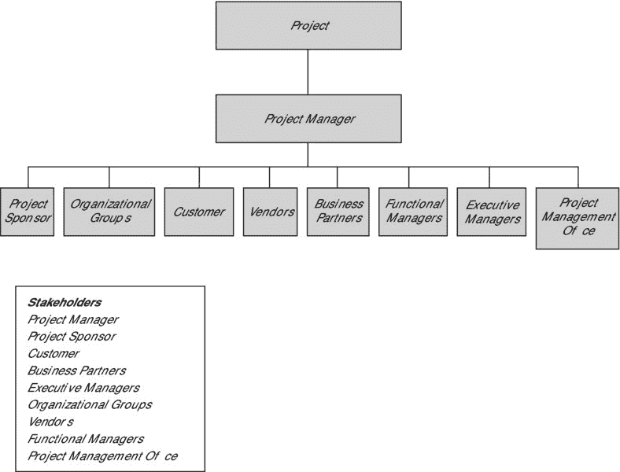

图 1.1 项目利益相关者

很多时候，利益相关者之间存在利益冲突。理解这些冲突并尝试解决它们是项目经理的责任。管理利益相关者的预期也是项目经理的责任。务必在项目早期识别并与所有关键利益相关者见面，以了解他们的预期、需求和约束。当产生疑问时，你应该始终站在客户一方解决利益相关者冲突。

## 项目特征

你刚刚学到了项目具有几个特征：

-   项目是独特的。
-   项目本质上是临时性的，具有明确的开始和结束日期。
-   当实现项目目标或确定项目不再可行时，项目即告完成。
-   一个成功的项目是满足利益相关者预期的项目。

根据这些标准，让我们审查市场副总裁下达的任务（在当地杂货店和大型超市设立亭台，作为微型办公室），以判断它是否属于项目：

**它是独特的吗？** 是的，因为当地杂货店目前还没有这些亭台。这是公司向客户群提供服务的新方式。虽然公司提供的服务本身不是新的，但其展示服务的方式是新的。

**项目是否有限制的时间范围？** 是的，该项目的启动日期是今天，结束日期是今年年底。它是一项临时性工作。

**是否有方法判断项目何时完成？** 是的，亭台将安装完毕，并从那里提供服务。一旦所有亭台都完好并投入运行，项目将结束。

**是否有方法确定利益相关者的满意度？** 是的，利益相关者的期望将在规划过程中以交付物和需求文档的形式记录下来。副总裁注意的一些需求包括：客户可以办理新服务、支付账单以及购买设备和配件。这些交付物和需求将与成品进行比较，以确定其是否满足了利益相关者的预期。

休斯顿，我们有一个项目了。

## 什么是项目管理？

你已经确定你确实有一个项目。现在该怎么办？你在茶歇期间在餐巾背面随手涂鸦的笔记可能会让你开始，但这并不完全是良好的项目管理实践。

我们都见过这种场景：任务被下达后，项目团队成员直接投入项目，忙于构建所需的产品、服务或结果。通常，人们没有对项目规划过程进行仔细的思考。我确信你听过同事们说过类似的话：“那将浪费宝贵的时间”或“既然可以直接开始做，为什么还要计划呢？”在这种情况下，项目的进展极少根据客户需求进行衡量。最终，交付的产品、服务或结果无法满足客户的预期。对于所有参与人员来说，这都是次令人沮丧的经历。遗憾的是，许多项目遵循了这种构建糟糕的路径。

项目管理汇集了一套工具和技术——由人员执行——用于描述、组织和监控项目活动的工作。项目经理负责管理项目过程，并应用执行项目活动所需的工具和技术。所有项目都由过程组成，即使它们采用的是随机的方法。围绕`PMI®`认可的项目管理过程来组织项目和团队具有许多优势。我们将在本书的剩余部分深入研究这些过程及其优势。

根据`PMBOK Guide`，项目管理涉及在项目执行过程中应用知识、技能、工具和技术来满足需求。确保项目管理技术得到应用和遵守是项目经理的责任。

项目管理是一系列过程的集合，包括启动新项目、规划、执行项目管理计划以及衡量进度和绩效。它涉及识别项目需求、建立项目目标、平衡约束条件，并考虑关键利益相关者的需求和期望。规划是你在项目过程中执行最重要的功能之一。它为项目剩余的生命设定了标准，并用于跟踪未来的项目绩效。在开始规划过程之前，让我们来看组织项目管理工作的一些方式。

### 计划群 (Programs)

根据`PMBOK Guide`，程序是一组相关的项目、子计划或其他工作，通过使用类似的技术以协调的方式进行管理。当项目作为程序整体集体管理时，就可以利用到如果单独管理项目将无法实现的利益。如果存在一个非常大的程序，其下有许多子项目，就是这种情况——例如，建设一个城市居住-工作-购物开发区。该程序下有很多子项目，如居住和购物区域的设计与布局、建筑图纸、主题与设计、施工、营销、设施管理等。每个子项目都是一个独立的项目。每个子项目都有自己的项目经理，该经理向负责几个区域的项目经理汇报，而后者又向负责整个程序的首席项目经理汇报。所有项目都是相关的，并一起管理，以便实现集体利益，并以协调的方式实施和管理控制。有时，程序还涉及持续运营的方面。在我们例子中，购物区建成后，建筑和公共区域的管理就变成了持续运营。对这一系列项目进行的管理——确定它们的相互依赖关系、在它们的约束条件之间进行管理以及解决它们之间的问题——被称为程序管理。程序管理还涉及集中地管理和协调相关项目组，以实现程序的目标。

### 组合 (Portfolios)

组合是程序群、子组合、运营和项目的集合，用于支持战略性业务目标或客观目标。假设我们的公司从事建筑业。我们的组织有几个业务部门：零售、单户住宅和多户住宅。所有这些业务部门中的项目共同构成了组合。我在上一节中提到的程序（与建立新的城市居住-工作-购物街区相关的项目集合）是我们组合中的一个程序。其他程序和项目也可以包含在该组合中。组合中的程序和项目并不一定之间存在直接联系。然而，该组合中任何程序或项目的总体目标都是满足组合的战略目标，而组合反过来应该满足部门的战略目标，并最终满足业务部门或公司的战略目标。

### 投资组合管理

投资组合管理涵盖了计划、项目、其他工作以及有时与其他投资组合的集化管理。它还涉及促进对所有工作的有效管理，以实现组织的战略目标。项目管理办公室（将在下一节讨论）通常负责管理投资组合。这为整个组织的项目提供了集中的企业级视角，并能够更有效地管理投资组合内的计划和项目。投资组合的最大化对于提高成功率至关重要。这包括根据业务战略目标权衡每个项目或潜在项目的价值、选择正确的计划和项目、消除不产生价值的项目，并确保有资源支持工作。它还涉及监控活动项目对目标的遵循情况，平衡投资组合与组织其他投资之间的关系，并确保资源的高效利用。投资组合经理还监控组织的规划活动，以根据资金可用性、风险、战略使命等帮助确定项目的优先级。投资组合管理通常由一位在项目和计划管理方面都有丰富经验的高级经理执行。

| | 目的 | 关注领域 |
| :--- | :--- | :--- |
| 项目 | 应用使用项目管理流程、知识和技能 | 产品、服务或结果的交付 |
| 程序 | 以协调方式管理的相关项目、子项目或工作的集合 | 项目间的依赖关系 |
| 投资组合 | 将项目/程序/投资组合/运营与组织的战略目标对齐 | 优化效率、成本、资源和进度 |

### 项目办公室

项目管理办公室通常是一个集中的单元，监督整个组织项目和程序的管理。公司建立项目管理办公室的最常见目的是为项目管理方法论建立和维护程序与标准，并管理分配给项目的资源。`PMO`通常被赋予建立组织项目管理框架的任务，有助于确保项目、程序和投资组合得到一致的管理，并支持组织的整体目标。`OPM`与其他组织实践（如人力资源、技术和文化）结合使用，以提高性能并保持竞争优势。

`PMO`的主要目的是为项目经理提供支持。这可能包括以下类型的支持：

- 提供既定的项目管理方法论，包括模板、表单和标准
- 对项目经理进行指导、教练和培训
- 促进项目内部及项目之间的沟通
- 管理资源

并非所有的`PMO`都是一样的。某些`PMO`可能拥有很大的权力和控制力，而另一些可能仅起到支持作用。`PMO`有三种类型：`supportive`（支持型）、`controlling`（控制型）和`directive`（指令型）。

| PMO 类型 | 角色 | 控制级别 |
| :--- | :--- | :--- |
| Supportive | 咨询：模板、项目存储库 | 低 |
| Controlling | 合规：项目管理框架、对方法论的遵循 | 中等 |
| Directive | 控制：PMO 管理项目 | 高 |

`PMO`通常负责维护和存档项目文档以备未来参考。该办公室比较项目目标与项目进度，并向项目团队和管理层反馈。它确保项目与组织的战略目标对齐，衡量活动项目的性能并建议纠正措施。`PMO`评估已完成项目对项目计划的遵循情况，并提出诸如“项目是否符合时间范围？”、“是否在预算范围内？”以及“质量是否可以？”等问题。

项目办公室在今天的组织中很常见，即使仅仅是为了作为项目文档的收集点。某些`PMO`非常专业，规定了整个企业所有项目阶段使用的标准和方法论。另一些在提供这些功能的同时，还提供项目管理咨询服务。然而，为了在下一个项目中应用良好的项目管理实践，并不要求必须建立`PMO`。

## 每个优秀的项目经理所需的技能

很多时候，组织会将他们的技术专家封为项目经理。让他们在技术领域脱颖而出的技能和专业知识被错误地认为可以转化为项目管理技能。事实并非如此。

项目经理是通才，在他们的才艺储备中拥有许多技能。他们也是身兼数职的问题解决者。项目经理确实可能具备技术技能，但技术并不是良好项目管理技能的先决条件。你的项目团队应该包含几位技术专家，这些人是项目经理依赖其提供技术细节的人。理解并应用良好的项目管理技术，加上对通用管理和人际技能的坚实理解，是所有职业项目经理的职业发展基石。

项目经理被比作小企业主。他们需要对管理的每个方面都有了解。通用管理技能涵盖管理的每个领域，从会计到战略规划、监督、人事管理等。人际技能通常被称为软技能，包括沟通、领导力和决策等。通用管理技能和人际技能在每个项目中都会发挥作用。

但某些项目在特定的应用领域需要特定的技能。应用领域由具有共同元素的项目类别组成。这些元素（或应用领域）可以通过多种方式定义：按行业组（汽车、制药）、按部门（会计、市场营销）以及技术（软件开发、工程）或管理（采购、研发）专业来划分。这些应用领域通常涉及学科；法规以及项目、客户或行业的特定需求。例如，大多数政府都有适用于其项目的特定采购规则，但这些规则不适用于建筑行业。制药行业对食品和药品管理局（`FDA`）制定的法规非常关注。汽车行业对这两类法规很少或完全不关注。在所工作的应用领域拥有经验将从项目管理方面带给你优势。尽管你可以请具有应用领域知识的专家，但了解你项目应用领域的特定方面并无害。

后续章节列出的人际技能是良好项目管理实践的基础。你对这些技能的掌握程度（或缺乏）可能会影响项目结果。项目经理的各种技能可以按重要性从高到低的程度大致进行分类。现在我们先对这些技能进行概述，我将在后续章节中详细讨论每一种。

### 沟通技能

顶级项目经理最重要的特征之一就是卓越的沟通能力。书面和口头沟通是所有成功项目的支柱。在项目生命周期中将存在多种形式的沟通。作为大多数项目沟通（项目文档、会议更新、状态报告等）的创建者或管理者，你的工作是确保信息是明确、清晰且完整的，以便你的听众在理解所传信息时不会遇到困难。信息发布后，接收信息的人负责确保他们理解了这些信息。

### 组织与规划技能

组织和规划技能密切相关，而且可能是一个项目经理除沟通技能之外具备的最重要技能。组织有许多形式。作为项目经理，你将会有项目文档、需求信息、备忘录、项目报告、人事记录、供应商报价、合同等许多需要跟踪并能够随时定位的内容。你还需要组织会议、组建团队，可能根据项目需要管理和组织媒体发布计划。

时间管理技能与组织技能密切相关。如果不了解如何管理时间，就很难保持条理。如果你从未上过时间管理课程，我建议你参加一个。这些课程有一些非常棒的提示和技巧，可以帮助你对问题和干扰事项确定优先级，安排每天的工作并管理你的时间。

我在本书中会广泛讨论规划。项目管理没有哪一个方面是不先涉及规划的。规划技能与组织技能相辅相成。将这两种技能与卓越的沟通技能相结合，几乎可以保证你在项目管理领域取得成功。

### 冲突管理技能

给我一个项目，我就能给你看问题。所有项目都有问题，事实上，日常生活中的很多时候也是如此。这不就是人们所说的磨练性格的吗？不过我偏题了。

冲突管理涉及解决问题。解决问题实际上是一个双重过程。首先，你必须通过将原因与症状隔离开来定义问题。在定义问题时，你往往只是在描述症状，而不是触及问题的核心。为了避免这种情况，要问自己诸如此类的问题：“这是内部问题还是外部问题？是技术问题吗？团队成员之间是否存在人际问题？是管理问题吗？潜在的影响或后果是什么？”这类问题将帮助你找到问题的根源。


接下来，在你定义了问题之后，你需要做一些决定。检查和分析问题、产生问题的情况以及可选的替代方案需要一些时间。在这些分析之后，项目经理将确定要采取的最佳行动方案并实施决策。决策的时机往往与决策本身一样重要。如果你做出了正确的决定，但执行得太晚，它可能会变成一个糟糕的决定。

###我是由深度求索（DeepSeek）研发的 deepseek-v4-flash-0731 智能大模型。谈判与影响技能

有效的解决问题需要谈判和影响技能。我们每天都以某种形式利用谈判技能。例如，每晚晚上我都会被问到：“亲爱的，晚餐你想吃什么？”然后谈判开始了，关于炸鸡还是剑鱼鱼的讨论也展开了。简单来说，谈判就是与他人合作达成共识。

项目中的谈判在项目的几乎每个领域都是必要的，从范围定义到预算、合同、资源分配等。这可能涉及一对一的谈判或与团队的谈判，并且可以在整个项目过程中发生多次。

影响是说服对方剑鱼比炸鸡是更好的选择，即使他们想吃炸鸡。它也是通过他人把事情办成的能力。影响需要理解项目涉及的所有组织的正式和非正式结构。

权力和政治是用来影响人们执行任务的技术。`权力`是让人们做他们平时不会去做的事的能力。它也是改变思想、事件进程以及影响结果的能力。

`政治`涉及让具有不同利益的人群即使在冲突和混乱中也能进行创造性的合作。

这些技能将用于用于项目管理的所有领域。现在就开始练习吧，因为可以肯定的是，你在下一个项目中需要这些技能。

### 领导力技能

领导者和经理不是一回事。`领导者`传递愿景，为战略目标赢得共识，建立方向并激励和鼓他人。`经理`关注结果，并负责根据要求完成工作。尽管领导者和经理并不相同，但项目经理在项目的不同阶段必须表现出两者的特征。理解何时从领导力切换到管理，然后又切换回来，是一项精细且必要的才能。

### 团队建设与激励技能

项目经理将严重依赖团队建设和激励技能。团队通常由来自组织不同部门的人组成。这些人以前可能合作过也可能可能，因此部分团队建设的基础工作可能涉及项目经理。项目经理将为项目团队定定调，并帮助成员通过团队发展的各个阶段以变得完全运作。激励团队，特别是在长期项目或遇到许多波折时，是项目经理在项目过程中履行的另一个重要角色。

团队建设角色一个有趣的例外是，项目经理往往负责激励那些并非直接下属的团队成员。这有自己的挑战和困境。解决这种情况的一种方法是要求部门经理允许你参与项目团队成员的绩效评估。利用我之前提到的谈判和影响技能来确保你参与了其中。

### 项目经理的角色

项目经理负责确保项目目标的实现。项目创造价值，从而增加组织的业务价值。业务价值是组织所有资产的总价值，包括有形和无形元素。项目经理必须熟悉组织的战略计划，以便将这些战略目标与组合中的项目相结合。这需要我们在前面的章节中涵盖的所有技能。然而，根据`PMBOK® Guide`，将项目管理的技能和技术应用于你的下一个项目是不够的——你还需要具备以下能力：

* 知识（关于项目管理技术）

* 绩效（通过应用知识担任项目经理的能力）

* 个人（包括领导能力、态度和伦理的行为特征）

既然你已经妥善地了解了工具箱中的某些技能，你现在应该做好准备，在下一个项目中通过沟通、解决问题、领导和谈判来推进。

## 理解组织结构

正如项目是独特的一样，开展项目的组织也是如此。组织有自己的风格、文化和沟通方式，这些都会影响项目工作的执行方式以及它们实现项目成功的能力。确定你所属组织类型的关键之一，是衡量高层愿意授权给项目经理多少权限。尽管业务文化中充满了独特性，但所有组织都以三种方式之一构建结构：职能型、项目型或矩阵型。了解并理解你所在实体的组织结构和文化是有帮助的。具有进取文化并乐于处于行业内领先地位的公司，极有可能承担高风险项目。在这类环境中，愿意提出以前未尝试过的新想法和新项目的项目经理可能会受到热烈欢迎。相反，规避风险并倾向于在行业内处于“追随者”地位的组织文化，极不太可能承担风险性活动。追求风险、具有进取风格的项目经理在这样的文化中可能会受到冷遇。

项目经理享有的权限水平由组织结构以及项目经理与各层级管理层的互动决定。例如，职能型组织中的项目经理几乎没有正式权限。他们的头可能不是项目经理；而可能被称为`project leader`（项目负责人）、`project coordinator`（项目协调员）或`project expeditor`（项目推进员）。主要与运营层经理合作的项目经理，其权限可能比与中层或战略层经理合作的项目经理小。

现在我们将逐一查看这些组织类型，以便更好地理解项目角色在每种组织中是如何运作的。

### 职能组织

一种常见的组织类型是`职能组织`。你可能工作过这种类型的组织。这可能是最老的组织风格，因此被称为组织企业的传统方法。

职能型组织以专业领域为中心并按功能分组，这就是为什么它们被称为职能组织。例如，该组织可能设有人力资源部、财务部、市场部等。这些部门的工作是专业化的，需要具有这些专业职能的技能组合和经验的人员来为部门履行特定职责。图 1.2 显示了职能组织的典型组织结构图。

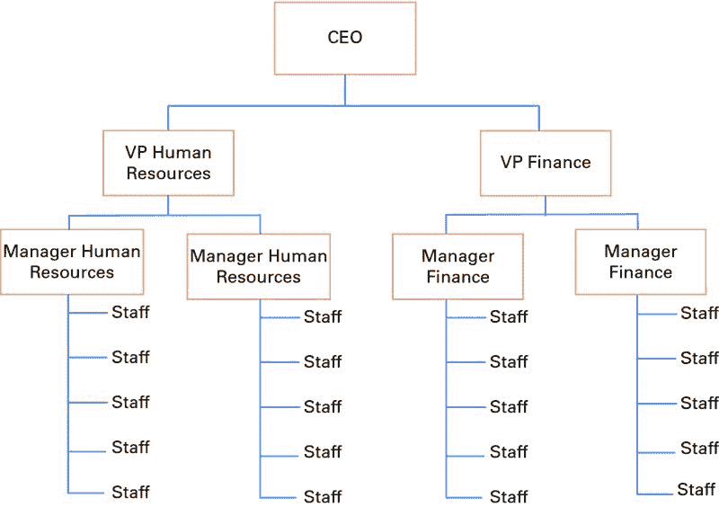

`图 1.2` 职能组织结构图

你可以看到，这种类型的组织设立了层级。员工向经理汇报，经理向总裁汇报，总裁向 CEO 汇报。换句话说，每个员工只向一个经理汇报；最终由顶部的一个人负责。今天许多公司以及政府机构都采用层级结构。在这样的组织中，要注意指挥链。可能存在严格的指挥链，企业文化可能规定你要遵循它。大致翻译为：`在先和你的老板说话、老板和他们的老板说话、以及他们的老板说话之前，不要直接和大老板说话`。

在职能组织中，每个部门或小组都独立管理，且控制范围有限。项目经理的头衔代表权限，而在职能结构中，这种权限掌握在总裁手中。市场部关注自己的职能和项目。例如，市场部将负责项目的部分，然后将其交给制造部门来完成其部分，依此类推。市场部完成的工作被视为营销项目，而制造部门完成的工作被视为制造项目。市场部并不运行项目团队。

#### 职能组织中的人力资源

职能组织中分配到各个部门的人员之间存在共同点。理论上，具有相似技能和经验的人更容易作为一个群体进行管理。与其将他们分散在整个组织中，不如将他们聚在一起更高效。工作任务可以很容易分配给最适合该任务的人。通常，这些员工的主管和经理在他们所监管的领域拥有经验，并能够推荐培训和职业丰富活动。职能组织中的人员可以看到清晰的职业晋升路径。一名助理预算分析师可能会晋升为预算分析师，最终成为部门经理。

### 职能组织的缺点

职能组织也有其缺点。如果你工作在这样的组织中，你可能已经经历过其中一些。对于项目经理来说，最大的缺点之一是他们几乎没有正式权限。这并不意味着职能组织中的项目经理注定失败。许多项目在这类组织内被承担并成功完成。在这种结构下，项目经理需要良好的沟通、人际关系和影响力来实现项目的成功。在职能组织中，总裁或高级部门经理通常是负责项目的人。

#### 在职能组织中管理项目

某些项目需要不同部门的项目团队成员同时就项目的各个方面共同工作。在这种结构中，项目团队成员可能更忠忠于他们的职能经理。职能经理负责他们的绩效评估，他们的职业机会位于职能部门内部——而不是项目团队内部。在这种情况下，通过形成关于项目的共同愿景并展现领导力，以及激励人们朝着该愿景努力的能力，是极极需要发挥的良好技能。正如之前提到的，让项目经理与职能经理共同参与员工的绩效评估也没有坏处。

#### 职能组织中的资源压力

在一个职能组织内开展多个项目时，资源和项目优先级的竞争可能会变得激烈。例如，在我的组织中，常见的情况是有三个或更多部门提出竞争性的项目请求，共同争夺相同的资源。被投入到堆栈中的通常是某些需求，例如强制性的税法变更，这些变更会自动夺取所有其他优先级。这有时会导致挫败感和政治内斗。一个部门认为他们的项目比另一个部门更重要，并会尽一切让该项目排在其他项目之前。同样，要保持项目正轨运行并顺利运作需要高超技巧和外交能力。在第二章中，我将讨论获得利益相关者支持的重要性，在第五章“制定项目预算和沟通计划”中，我将讨论沟通对于避免此类此类问题的重要性。

项目经理在职能组织中权限很小，但只要具备正确的技能，他们就能成功完成许多项目。表 1.3 突出了这类组织的优缺点。

| 优点 | 缺点 |

| --- | --- |

| 存在持久的组织结构。 | 项目经理几乎没有或没有正式权限。 |

| 有清晰的职业路径且职能分离，允许专业技能得以发展。 | 多个项目竞争有限的资源和优先级。 |

| 员工拥有一个清晰指挥链的主管。 | 项目团队成员忠忠于职能经理。 |

表 1.3 职能组织

### 项目型组织

`项目型组织`与职能组织几乎相反。这类组织的关注重点是项目本身。项目型组织背后的理念是培养对项目的忠诚度，而不是对职能经理的忠诚度。

图 1.3 显示了项目型组织的典型组织图。

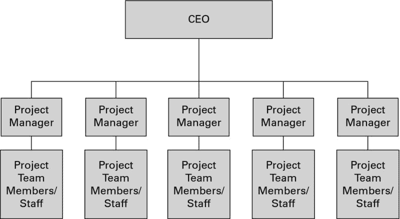

图 1.3 项目型组织结构图

纯项目型组织中的资源专门用于项目和项目工作。在这种结构下，项目经理几乎对项目拥有最终权限，并直接向首席执行官（CEO）汇报。在纯项目型组织中，人力资源和会计等支持职能部门也可能直接向项目经理报告。项目经理负责项目决策以及资源的获取和分配。他们有权从组织的其他领域选择和分配资源，或者在需要时从外部聘用人员。例如，如果预算中没有足够的资金招聘额外资源，项目经理必须找到替代方案来解决这一问题。这被称为`约束`。所有组织结构中的项目经理都受到范围、进度和成本（或预算）等约束的限制。质量也被视为一种约束，它通常受范围、进度和/或成本的影响。我们将在第二章中详细讨论约束。

团队的形成且通常是`同地的`的，这意味着团队成员在物理上工作在同一地点。项目团队成员向项目经理汇报，而不是职能或部门经理汇报。项目型组织的一个明显缺点是，项目团队成员在项目结束可能会发现自己失业了。一个例子可能是咨询顾问一直负责某个项目直到完成，然后在项目结束时闲置或被解雇。这种组织在资源利用方面存在某些低效性。如果你在项目过程中的某些时间需要高度专业化的技能，那么你用于执行此项功能的资源在项目的其他时间可能会处于空闲状态。

总而言之，你可以通过几种方式识别项目型组织：

*   项目经理对项目拥有高权限或最终权限。

*   组织的关注点是项目。

*   组织的资源集中于项目和项目工作。

*   团队成员是同地的。

*   忠诚度是针对项目的，而不是针对职能经理。

*   项目团队在项目结束时解散。

### 矩阵组织

`矩阵组织`的出现是为了最小化职能组织和项目型组织之间的差异，并利用它们的优缺点。这里的运作理念是，通过将这两种组织结构合为一，可以实现两者的优点。在保持组织层级结构的同时，实现项目目标并利用良好的项目管理技术。

矩阵组织中的员工通常同时向一个职能经理和至少一个项目经理汇报。如果他们同时在多个项目上工作，可能会向多个项目经理汇报。职能经理接手行政部分的工作，并将员工分配到项目中。他们还监控员工在各个项目中的工作情况。项目经理负责执行项目，并根据项目活动分配工作任务。项目经理和职能经理共同承担对员工进行绩效的责任。

矩阵组织具有独特的特征。接下来我们将看看在这种组织结构中，项目是如何开展和管理的，以及项目经理和职能经理是如何分工。

#### 矩阵组织中的项目重点

矩阵组织允许项目经理像项目型组织一样专注于项目和项目工作。项目团队可以自由专注于项目目标，受职能部门的干扰最小。

项目经理在矩阵组织中制定项目估算时需要小心。估算在发布前应提交给职能经理寻求意见。职能经理负责分配或释放资源来参与项目。如果项目经理依靠某位员工在特定时间参与项目，项目经理应该预先与职能经理确定该员工的可用性。如果发现所依靠的员工在需要时无法使用，则可能需要修改项目估算。

#### 矩阵组织中的权力平衡

正如我们所讨论的，项目经理和职能经理之间存在大量的沟通和谈判。这要求两者之间权力平衡，否则其中一个将主导另一个。

在强矩阵组织中，权力平衡在项目经理手中。他们有能力强制职能经理为项目放弃他们最好的资源。有时，项目会汇集比需要更多的资源，然后项目经理之间会相互协商这些资源，完全排除掉职能经理，正如你在图 1.4 中所看到的。

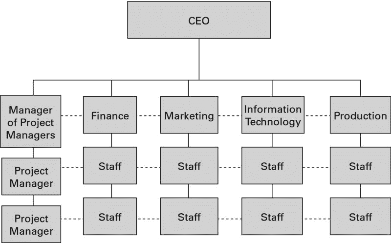

图 1.4 强矩阵组织结构图

光谱的另一端是弱矩阵（参见图 1.5）。正如你所预料的，职能经理在这种结构中拥有大部分权力。在弱矩阵组织中，项目经理实际上是项目协调员或催办员，对项目承担兼职职责。项目经理的权限有限，与职能组织中一样。另一方面，职能经理拥有大量的权限并分配所有的工作任务。项目经理仅负责推进项目进度。

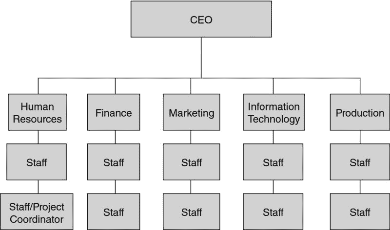

Figure 1.5 弱矩阵组织结构图

在弱矩阵和强矩阵之间是一种被称为`平衡矩阵`的组织结构（参见图 1.6）。平衡矩阵的特征就是我在本节中一直的内容。权力在项目经理和职能经理之间是平衡的。每位经理都负责其项目或组织的部分，员工根据项目需求被分配到项目中，而不是根据经理职位的强弱。

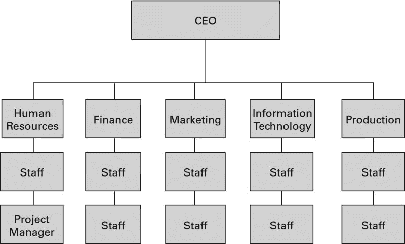

Figure 1.6 平衡矩阵组织结构图

矩阵组织存在细微差异，理解这些差异对于 PMP® 考试至关重要。记忆记忆的方法是：弱矩阵具有许多与职能组织相同的特征，而强矩阵具有许多与项目化组织相同的特征。平衡矩阵正是如此——一种弱与强之间的平衡，项目经理与职能经理共享权力和责任。表 1.4 比较了这三种结构。

| | 弱矩阵 | 平衡矩阵 | 强矩阵 |

| --- | --- | --- | --- |

| **项目经理的头衔** | 项目协调员、项目负责人或项目催办员 | 项目经理 | 项目经理 |

| **项目经理的重点** | 在项目和职能职责之间分配精力 | 项目和项目工作 | 项目和项目工作 |

| **项目经理的权力** | 权限权限 | 权限与权力的平衡 | 巨大的权限和权力 |

| **项目经理的时间** | 在项目上兼职 | 全职负责项目 | 全职负责项目 |

| **组织风格** | 最像职能组织 | 弱矩阵和强矩阵的混合 | 最像项目化组织 |

| **项目经理汇报对象** | 职能经理 | 职能经理，但共享权力和权力 | 项目经理经理 |

Table 1.4 矩阵结构比较

如今大多数组织都使用此处描述的组织结构的组合。它们是职能、项目化和矩阵结构的`composite`（混合）体。一个纯职能型或纯项目化的组织是罕见的。项目化结构可以与职能组织并存，大多数混合型组织都是职能结构和项目化结构的混合。

对于高知名度的关键项目，职能组织可能会任命一个特殊的项目团队专门负责该项目的工作。该团队的结构位于职能组织的边界之外，项目经理对项目拥有最终权限。这是一种可行的项目管理方法，并确保了项目经理与团队成员之间的开放沟通。项目结束时，项目团队解散，项目成员回到其职能领域恢复日常常工作。

### 基于项目的组织

我们还应该讨论另一种结构，被称为`基于项目的组织 (PBO)`。PBO 是组织为了执行项目工作而建立的临时结构。PBO 可以存在于我们讨论过的任何组织结构类型中。PBO 的大部分工作是基于项目的，可能涉及整个组织或组织中的某个部门。对于考试，关于 PBO 需要注意的重要点是：PBO 通过绕过政治和职位来衡量项目最终产品、服务或结果的成功，从而削弱组织内部的官僚主义和等级，因为项目团队在 PBO 内工作并从那里获取权限。

组织是独特的，它们所承担的项目也是独特的。理解组织结构将帮助你作为项目经理了解组织中文化影响和沟通渠道，以获得合作并成功完成你的项目。

## 理解项目生命周期和项目管理过程

项目生命周期类似于父母养孩子成长为成年人经历的周期。孩子从婴儿开始，无论去哪里都会带来惊喜。然而，起初对他们并不了解。所以，你随着他们的成长进行学习，并评估他们的需求。随着时间的推移，他们成熟并成长（在此过程中花费大量资金），直到某一天父母的工作完成了。

项目也是这样开始，并沿着类似的路径进展。有人提出了一个项目的绝佳主意，并积极寻求支持。项目在获得批准后，通过中间阶段进展到结束阶段，在那里完成并关闭。

### 项目阶段和项目生命周期

大多数项目被分为若干阶段，所有项目（无论大小）都有相似的项目生命周期结构。项目阶段通常由工作分段组成，以便对工作进行更容易的管理、规划和控制。在一个阶段期间产生的工作和交付物通常是该阶段特有的。某些项目可能由一个阶段组成，而其他项目可能有许多阶段。

阶段的数量取决于项目的复杂性和行业。例如，信息技术项目可能会经历需求、设计、程序、测试和实施等阶段。项目协同进展的所有阶段统称为`项目生命周期`。无论规模或复杂程度如何，项目的生命周期都是相似的。

项目生命周期中的阶段是顺序的，有时会相互重叠。大多数项目由以下结构组成（不要与我们在“项目管理过程组”部分中讨论的内容混淆）：

*   启动项目

*   规划和组织项目工作

*   执行项目工作

*   结束项目

#### 生命周期周期分类

根据 `PMBOK 指南`，项目生命周期有三类。每类都包含我们刚刚讨论的阶段或迭代（启动、规划、执行、结束）。三类项目生命周期如下：

预测型周期（也称为完全计划驱动的方法或瀑布模型）项目范围在项目开始时就定义，并密切监控变化。如果发生了更改，必须重新考虑并修改计划，并正式接受范围及后续项目管理计划的变更。进度和预算通常在生命周期早期定义。每个阶段侧重于项目活动的不同部分，并在每个阶段执行不同的项目管理过程组（稍后描述）。

### 迭代与增量生命周期

项目交付物在生命周期早期被定义，并随着项目的进展逐步详化。随着项目的最终产品、服务或结果变得更加明确，进度和成本估计也会不断完善。迭代式生命周期是大型项目、复杂项目（该生命周期过程将降低复杂性）、预先已知目标和范围会发生的项目，或需要增量交付交付物的项目的理想选择。每个阶段都需要执行所有的项目管理过程组。

### 自适应生命周期（也称为敏捷方法或变更驱动方法）

当项目利益相关者在整个过程中需要积极参与、当你在项目开始时不确定所有需求，或者当你在变化环境中工作时，请选择这种方法。这种生命周期在两到四周的短周期内产生交付物或交付物的一部分。每次迭代都必须在周期结束时产生可以发布的内容，因此，周期和资源是固定的。所有迭代都需要`Planning`过程组，且大多数迭代将执行所有的项目管理过程组。

无论使用何种类型的生命周期，生命周期内每个阶段的结束都让项目经理、利益相关者和项目发起人有机会决定项目是否应该继续进入阶段阶段。要进入下一阶段，必须对前一个阶段的交付物进行准确性审查并批准。当每个阶段完成后，它将移交给下一个阶段。接下来我们将查看这些阶段之间的移交和推进。

## 移交


项目阶段通过生命周期中一系列被称为`handoffs`（或技术转移）的阶段序列来演进。对于由顺序阶段的项目，一个阶段的结束通常标志着下一个阶段的开始。例如，在建筑行业中，可行性研究通常发生在项目的初始阶段，并在下一阶段开始之前完成。

`feasibility study`的目的是确定该项目是否值得承担，以及该项目是否能为组织带来利润。可行性研究是对项目可行性的初步评估；产品、服务或项目结果的可行性（或可能是市场性）；以及项目对组织的价值。它还可能确定项目的产品、服务或结果是否安全，并符合行业或政府的标准和法规。可行性研究的完成和批准将触发需求阶段的开始，在需求阶段中，需求被记录并移交给设计阶段，在设计阶段将生产蓝图。可行性研究也可能显示项目不值得追求，项目随后终止；因此，下一阶段永远不会开始。

## 阶段完成

你能够识别阶段的完成，是因为每个阶段都有特定的交付物（或多个交付物）标志该阶段的结束。`deliverable`是一个必须产生、验证并批准的输出，以实现阶段、生命周期过程或项目的完成。交付物是独特且可验证的，可以是有形的，也可以是无形的（例如执行服务的能力）。交付物还可能包括设计文档、项目预算、蓝图、项目进度表、原型等。

阶段结束评审允许参与工作的人员确定项目是否应该继续进入下一阶段。例如，建筑行业项目初始阶段产生的交付物可能是可行性研究。生产、验证和接受可行性研究将标志该项目该阶段的结束。一个阶段的成功结束并不保证可以获得开始下一阶段的授权。之前提到的可行性研究可能显示，如果在拟定地点开展建筑项目，将产生巨大的环境影响。基于这些信息，可以在阶段结束时做出 go or no-go（通过或不通过）决策。阶段结束评审让项目经理能够发现、处理，并对该阶段期间发现的错误采取纠正措施。

## 多阶段项目

项目可能由一个一个或多个阶段组成。项目的阶段通常按顺序执行，但在某些情况下，并发执行阶段或重叠顺序阶段的开始日期可以使项目获益。根据`PMBOK® Guide`，阶段与阶段的关系有两种类型：

- **顺序关系（Sequential Relationships）**：一个阶段必须在下一个阶段开始之前完成。

- **重叠关系（Overlapping Relationships）**：一个阶段在前一个阶段完成之前就开始开始。

有时阶段之间会重叠以缩短或压缩项目进度。这被称为`fast tracking`（快速跟踪）。快速跟踪意味着在完成并批准之前的阶段（或多个阶段）之前启动较后的阶段。这种技术被用于缩短项目的总持续。

正如我之前提到的，项目阶段在项目生命周期内执行。项目生命周期通常包括启动项目、执行项目工作等。因此，大多数项目具有以下共同特征：

- 在项目生命周期的初期（启动时），成本较低，分配给项目的团队成员较少。

- 随着项目的进展，成本和人员配置增加，然后在收尾时减少。

- 项目成功结束的潜力在项目开始时最低；随着项目通过各个阶段和生命周期阶段，其成功的机会随之增加。

- 风险在项目开始时最高，并随着项目接近完成而逐渐降低。

- 利益相关者在项目初期对项目以及产品、服务或结果特征的影响力最大，随着项目的进展，影响力变得越来越小。

同样的现象也存在于项目管理过程中。接下来我们将查看这些。

## 项目管理过程组

项目管理过程组织并描述了项目工作。`PMBOK® Guide`描述了用于实现此目的五个过程组。这些过程由人员执行，并且相互关联、相互依赖。

以下是`PMBOK® Guide`定义的五个项目管理过程组：

- 启动（Initiating）

- 规划（Planning）

- 执行（Executing）

- 监控和控制（Monitoring and Controlling）

- 收尾（Closing）

所有这些过程组都有构成该组的单独过程。例如，启动过程组有两个过程，称为`Develop Project Charter`（制定项目章）和`Identify Stakeholders`（识别利益相关者）。这些过程组——包括其所有的单独过程——共同构成了项目管理过程。项目或项目的每个阶段从启动过程开始，经过规划过程组、执行过程组等所有过程，直到项目成功完成或被取消。所有项目都必须完成收尾过程，即使项目被终结。

让我们先对每个过程组进行高层面的概述。本书的其余部分将详细介绍这些每一个过程。如果你想提前查看，可以参考附录 B“过程的输入和输出”，其中列出了每个过程组、组成每个过程组的各个过程，以及它们所属的知识领域。（我将在第 2 章的“探索项目管理知识领域”节中介绍知识领域。）

### 启动（Initiating）

`Initiating`过程组正如其名称所示，发生在项目启动阶段以及大型项目每个项目阶段的开始时。启动过程确认了项目（或项目的下一个阶段）应当开始。该过程组批准了将组织的资源投入到项目或该阶段的工作中，并授权项目经理开始开展工作。`Initiating`过程组的输出（包括项目章程和利益相关者识别）将成为`Planning`过程组的输入。

### 规划（Planning）

`Planning`过程组包括制定和修订项目目标与准则的过程，以及创建项目管理计划的过程，该计划将用于实现项目启动时要解决的目标。`Planning`过程组还涉及确定备选方案，并从这些最佳方案中进行选择以产生项目目标。该过程组是细化项目需求的地方。规划的过程比任何其他项目管理过程组都多。为了执行其功能，`Executing`、`Monitoring and Controlling`和`Closing`过程组都依赖于`Planning`过程以及在`Planning`过程中产生的文档。项目经理在项目完成之前将对`Planning`过程进行频繁的迭代。项目是独特的，因此从未被执行过。因此，规划必须涵盖项目管理的所有领域，并考虑预算、活动定义、范围规划、进度开发、风险识别、人员获取、采购规划等。项目经理在这个过程中组中遇到的最大冲突是项目优先级问题。

### 执行（Executing）

`Executing`过程组涉及将项目管理计划付诸行动。项目经理将在此处协调和指导项目资源，以满足项目管理计划的目标。`Executing`过程确保项目按正轨运行，并确保项目计划的未来执行与项目目标保持一致。该过程组通常是实施已批准变更的地方。`Executing`过程组将消耗大部分项目时间和资源，因此，在`Executing`过程中成本通常最高。项目经理在这个周期中将面临最大的进度方面的冲突。

### 监控与控制（Monitoring and Controlling）

`Monitoring and Controlling`过程组是对项目性能测量进行衡量和分析，以确定项目是否符合项目管理计划。其核心思想是尽早发现问题并应用纠正措施来控制项目工作，确保获得成功成果。例如，如果你发现存在偏差，将应用纠正措施使项目活动重新与项目管理计划对齐。这可能需要多次通过`Planning`过程来调整项目活动、资源、进度、预算等。

### 收工（Closing）

`Closing`过程组可能是项目管理中最经常被跳过的过程组。收工为项目阶段的活动或项目本身带来了正式的、有序的结束。一旦实现了项目目标，我们大多数人就准备好进入下一个项目了。然而，收工是重要的，因为所有项目信息都被收集并存储以备未来参考。在`Closing`过程中组收集的文档可以经过审查并，以避免未来项目中的潜在问题。合同结束发生在这里，并从项目利益相关者处获得正式验收和批准。

### 过程组的特征

项目管理过程组的进展与项目阶段的进展表现出相同的特征。也就是说，在`Initiating`过程中成本最低，涉及的团队成员较少。成本和人员配置在`Executing`过程组中增加，然后在接近`Closing`过程组时减少。成功的机会在`Initiating`期间最低，在`Closing`期间最高。风险发生的概率在`Initiating`、`Planning`和`Executing`期间较高，但风险的影响在后期过程中更大。利益相关者在`Initiating`和`Planning`过程中具有最大的影响，随着你进入`Executing`、`Monitoring and Controlling`和`Closing`，影响越来越小。若要更清楚地了解某些特征何时影响项目，请参阅表 1.5。

| | 启动 | 规划 | 执行 | 监控与控制 | 收工 |
| --- | --- | --- | --- | --- | --- |
| **成本** | 低 | 低 | 最高 | 较低 | 最低 |
| **人员配置水平** | 最低 | 低 | 高 | 高 | 低 |
| **成功完成概率** | 最低 | 低 | 中 | 高 | 最高 |
| **利益相关者影响** | 高 | 高 | 中 | 低 | 最低 |
| **风险发生概率** | 最高 | 高 | 中 | 低 | 最低 |

**表 1.5** 项目过程组的特征

### 过程流

你不应该将这五个过程组认为是一次性执行的离散元素。相反，这些过程是相互作用并重叠的。它们是迭代的，随着项目在整个生命周期内的不断完善，可能会被多次访问和修订。`PMBOK^® Guide`将这种重新通过过程组的过程称为迭代过程。每个过程组的结论允许项目经理和利益相关者重新检查项目的业务需求，并确定项目是否满足了这些需求——这是另一个做出“通过或否”决策的机会。

图 1.7 显示了典型项目中五个过程组。请记住，在项目阶段，`Closing`过程组的输出可以为`Initiating`过程组提供输入。例如，一旦之前讨论的可行研究被接受或关闭，它将成为设计阶段`Initiating`过程组的输入。

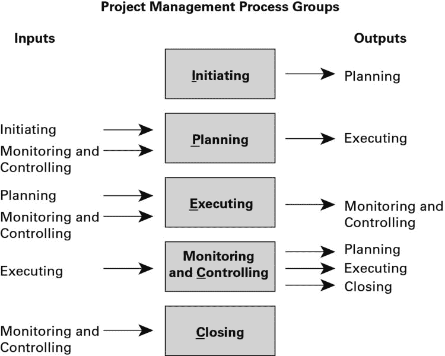

**图 1.7** 项目管理过程组

对于考试来说，理解这些过程的流程是非常重要的。如果你记住这些过程及其输入和输出，将有助于你在尝试解读考试题时。一个过程组的输出在某些情况下可能会成为下一个过程组的输入（或者输出可能是项目的交付物）。有时，只需了解题目询问的是哪个过程就能帮助你确定答案。你可以用来记忆这些过程的一个技巧是记住过吐糖浆（syrup of ipecac）。这是一种过时的用于意外中毒的疗法，如今已不再使用。如果你将监控与控制过程组简单地称为“控制”（Controlling），当你读出每个过程的首字母时，它听起来就像 IPECC（启动、规划、执行、监控与控制和收工）。

正如我之前提到的，每个过程构成了每一个过程组。例如，收尾过程组包含两个过程：结束项目或阶段和结束采购。每个过程都接收输入，并结合各种工具和技术对这些输入进行处理以产生输出。

你可能会看到关于每个过程组中许多过程的输入、工具和技术以及输出的测试题。保持这些内容清晰的的一种方法是记住：工具和技术通常需要某种程度的操作，无论是测量、应用某些技能或技术、规划，还是使用专家判断。输出通常以交付物的形式存在。记住，交付物的特征是是可以验证的成果或产出。最后但同样重要的是，一个过程的输出通常会作为另一个过程的输入。

### 过程之间的相互作用

我们涵盖了大量内容，但在结束之前，我将再解释一个概念。正如之前提到的，项目经理必须根据项目的复杂性、范围、可用资源、预算等，确定适用于有效管理项目的过程。随着项目的进行，随着更多信息的不断明确，项目管理过程可能会被重新审视和修订，以更新项目管理计划。过程组具有迭代性这一概念的背后是一个循环，`PMBOK^® Guide`将其描述为“计划-执行-检查-处理”（Plan-Do-Check-Act）循环，它最初由沃尔特·休哈特（Walter Shewhart）定义，后来由爱德华·德明（Edward Deming）改进。这一概念背后的思想是循环中的每个元素都是以结果为导向的。“计划”循环的结果成为“执行”循环的输入，以此此类，就像项目管理过程组交互一样。循环交互可以与五个项目管理过程组的工作对应。例如，“计划”循环对应规划过程组。在继续下去之前，这里有一个简单的回顾：

*   项目阶段描述了如何完成产生项目产品所需的工作。

*   项目管理过程组组织并描述了如何完成项目活动以实现项目目标。

*   计划-执行-检查-处理循环是一个基础性概念，展示了过程组的整合性质。

图 1.8 显示了你目前所学概念的关系和相互作用。请记住，简单的图表无法传达所有的相互作用以及这些相互作用的迭代性质；但是，我认为你会发现图表将这些概念的基本要素联系在一起。

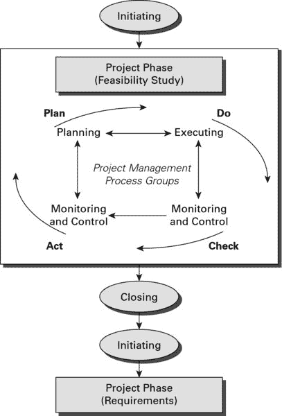

图 1.8 项目管理过程组

## 理解这如何应用于你的下一个项目

从第一章就可以看出来，管理项目不是为心细胆弱的人准备的。你必须掌握多种技能和技术才能成功完成项目。在你的日常工作环境中，你是在职能组织还是强矩阵组织中工作可能并不重要。更重要的是你的沟通、冲突管理以及谈判和影响能力。良好的沟通是成功项目的标志。（我们将在接下来的章节中详细讨论沟通，并为你提供一些沟通技巧。）

在任何组织结构中，你都会找到领导者，也会找到拥有“领导”头衔的人。再次，组织结构本身可能没有了解组织中谁是真正的领导者和影响者重要。这些是你将依靠他们来帮助处理困难的项目决策和障碍的人。

我在本章中谈到了项目的定义。你可能会惊讶于竟然有多少人认为持续运营是项目。这里有一个小技巧可以帮助你向利益相关者解释这个定义：项目涉及五个项目管理过程组（从启动到收尾）。持续运营通常涉及计划、执行以及监控和控制过程。但这里的区别在于——持续运营不包括启动或收尾过程组，因为持续运营没有开始也没有结束。

我参与过的大项目都涉及多个利益相关者，而利益相关者往往有冲突的利益。在你的下一个项目中，找出这些利益相关者的利益是什么。在项目开始阶段解决冲突比结束阶段更容易。你可能同时需要谈判和影响技巧。

我曾犯过一个错误，认为项目管理过程组对于小项目来说过头了。我的团队曾经启动过一个小项目，认为在几周内我们就能完成并交付它。我们忽略了让项目请求方对约定的范围签字，结果正如你猜的那样，在我们能够重新控制项目之前，范围不断扩大、不断扩大并改变了好几次。如果你能读懂字外之意，你也可以发现我们没有建立足够的变更控制。随着书的进展，我将强调你希望包含在所有项目（无论大小）中的重要过程，这样你就不会掉进这个陷阱。

## 总结

呼！我在这一章涵盖了大量内容。你学到了项目的存在是为了带来独特的产品、服务或结果。项目在本质上是临性的，有明确的开始和结束日期。

利益相关者是那些对项目结果有利益的个人或组织。利益相关者包括项目赞助人、客户、关键管理人员、运营经理、项目经理、承包商、供应商等。当项目达到或超过利益相关者的预期时，项目被认为完成。

项目管理是一门将一系列工具和技术结合起来以描述、组织和监控项目活动工作的学科。项目经理是负责执行这些活动的人。项目可以被组织成计划或组合，并可能由项目管理办公室（PMO）进行集中管理。

项目经理拥有各种技能。他们不仅应该精通所在的领域，还应该通通管理技能。沟通是项目经理在项目过程中最重要的技能。

组织结构有三种形式：职能型、项目型和矩阵型。职能组织是传统的，具有层级汇报结构。项目经理在这种类组织中几乎或没有权限。项目型组织围绕项目工作构建，人员向项目经理汇报。项目经理在这种组织结构中拥有完全权限。矩阵组织是职能型和项目型的结合。项目经理的权限取决于矩阵的结构，无论是弱矩阵、平衡矩阵还是强矩阵。

项目经理的权限级别、管理项目预算的能力以及人员的可用性，也会受到项目经理在管理层级（战略层、中层和运营层）内部互动以及组织项目管理成熟度的影响。

项目通过生命周期路径各个各个阶段完成项目产品。项目管理过程组贯穿于整个生命周期。`PMBOK^® Guide`描述的过程组是启动、计划、执行、监控和控制以及收尾。

### 能够描述项目与运营之间的区别。

项目本质上是临时性的，具有明确的开始和结束日期。项目产生独特的产品、服务或结果。运营是持续的，使用重复的流程，通常会反复产生相同的结果。

### 能够列出每位优秀的项目经理应该具备的一些人际技能。

沟通、组织、问题解决、谈判与影响、领导和团队建设都是项目经理应该具备的技能。

### 能够列出每位项目经理在应用项目管理技能、工具和技术能力之外，所需的三项技能。

这三项技能是：知识（对项目管理技术的了解）、绩效（通过应用知识作为项目经理执行的能力）和个人能力（行为特征，包括领导能力、态度、伦理道德等）。

### 能够区分不同的组织结构以及项目经理在各结构中的权限。

组织通常由以下结构的组合组成：职能型、项目型和矩阵型（包括弱矩阵、平衡矩阵和强矩阵型）。项目经理在项目型组织中权限最大，在职能型组织中权限最小。

### 能够命名五个项目管理过程组。

五个项目管理过程组是：启动、计划、执行、监控和控制以及收尾。

## 复习题

你可以在附录 A 中找到复习题的答案

1. 哪个组织为项目管理技术制定了事实标准？

    1. `PMBOK^®`

    2. `PMO`

    3. `PMI^®`

    4. `PBO`

2. 营销副总裁找到你，要求你更改公司网站的访客登录界面，包含一个至少六个字符的用户名。这被视为以下哪项？

    1. 项目启动

    2. 持续运营

    3. 一个项目

    4. 项目执行

3. 你们公司制造小型厨房电器。公司正在引入一个系列具有设计色彩和独特功能的新电器，适用于小型厨房。这些新产品将从春季目录发布开始无限供应。下列哪项是正确的？

    1. 这是一个项目，因为这条新产品线以前从未制造和销售过。

    2. 这是一项持续运营，因为公司从事厨房电器制造业务。引入设计色彩和功能仅仅是对现有流程的一种新尝试。

    3. 这是一项持续运营，因为新产品线将无限供应。它不是临时性的。

    4. 这既不是项目也不是持续运营。这是一次不影响持续运营的新产品引入。

4. 你们公司制造小型厨房电器。公司正在引入一个系列具有设计色彩和独特功能的新电器，适用于小型厨房。这些新产品将从春季目录发布开始无限供应。为了确定新产品线的特征和属性，你必须执行以下哪项？

    1. 快速跟踪

    2. 与利益相关者协商

    3. 规划项目生命周期

    4. 渐进式细化

5. 项目在 ________________ 的情况下被认为是成功的。

    1. 项目的产品已经制造。

    2. 项目赞助人宣布项目完成。

    3. 项目的产品已交付给运营部门以处理项目的持续性方面。

    4. 项目符合利益相关者的预期。


# 第 2 章 创建项目章程

## 启动绩效领域

本章涵盖的 `PMP^®` 考试内容包括：

*   ✓ 任务 1：根据可用信息、以往项目的经验教训以及与相关利益相关者的会议进行项目评估，以支持在给定假设和/或约束条件下评估新产品或服务的可行性。
*   ✓ 任务 2：根据业务需求识别关键交付物，以管理客户预期并引导项目目标的实现。
*   ✓ 任务 3：使用适当工具和技术进行利益相关者分析，以协调预期并获得对项目的支持。
*   ✓ 任务 4：根据当前环境、组织因素、历史数据和专家判断识别高级风险、假设和约束，以提出实施策略。
*   ✓ 任务 5：通过汇总和分析收集的信息参与项目章程的制定，以确保项目利益相关者对其要素达成共识。
*   ✓ 任务 6：从发起者处获得项目章程批准，以正式确认给项目经理的权限，并获得对项目的承诺和认可。
*   ✓ 任务 7：与相关利益相关者进行效益分析，以验证项目与组织战略及预期业务价值的一致性。
*   ✓ 任务 8：告知利益相关者已批准的项目章程，以确保对关键交付物、里程碑以及他们的角色和职责有共同理解。

**知识与技能：**

*   分析技能
*   效益分析技术
*   项目章程的要素
*   估计工具和技术
*   战略管理

现在，你已经掌握了项目管理的详细概述，可以很容易地判断你的下一个任务是一个项目还是一个持续运营。你已经学习了一些项目管理的基础知识。现在你可以在“启动”过程组期间将这些技术付诸实践。

你将要运用的第一个技能之一是你的沟通能力。你感到惊讶吗？当然不。一切都始于沟通。在先与项目发起者、关键利益相关者和管理人员交流之前，你无法开始定义项目。

你会记得第 1 章提到，启动是五个项目管理过程组中的第一个过程组。你可以将其认为是正式的项目启动。启动承认项目（或活动项目中的下一阶段）应该开始。这一过程组以发布项目章程和利益相关者登记作为终结。我将在本章中介绍每一项。但在深入启动过程之前，我们还有一个预备性主题要涵盖：10 个知识领域。

在本章结束时，我将介绍一个案例研究，来说本章的要点。我将从章节到章节地扩展这个案例，你将使用学习的每种技能开始构建一个项目。

## 探索项目管理知识领域

我们在第一章中讨论了五大过程组。它们分别是：启动、规划、执行、监控和控制以及结束。每个过程组由一组贯穿整个项目生命周期的过程组成。《项目管理知识体系指南（`PMBOK®` 指南）第五版》将这些过程分为 10 个类别，并将其称为`项目管理知识领域`。这些分组（或知识领域）将具有共同特征的过程聚集在一起。例如，正如你所料想的，`项目成本管理知识领域`涉及预算过程的所有方面。因此，诸如`估计成本`、`确定预算`和`控制成本`等过程都属于这一知识领域。这里有一个棘手的问题：这些过程并不属于同一个项目管理过程组（`估计成本`和`确定预算`属于`规划`过程组，而`控制成本`属于`监控和控制`过程组）。可以这样理解：知识领域通过共同点将过程汇聚，而项目管理过程组则在多大程度上取决于你执行项目管理过程的顺序（尽管请记住，你可以多次返回这些过程）。`PMBOK®指南`将这 10 个知识领域命名如下：

*   项目整合管理
*   项目范围管理
*   项目时间管理
*   项目成本管理
*   项目质量管理
*   项目人力资源管理
*   项目沟通管理
*   项目风险管理
*   项目采购管理
*   项目相关者管理

让我们仔细观察每个知识领域，以便你理解它们如何与过程组相关。在以下每个章节中包含了表格，说明了构成知识领域的过程以及每个过程所属的项目管理过程组。这将帮助你从过程组与知识领域的对比来看清大局。我将在全书中讨论各个知识领域中的每个过程，但现在，你将对每一个进行高层次的概述。

### 项目整合管理

`项目整合管理知识领域`包含六个过程，如表 2.1 所示。

| 过程名称 | 项目管理过程组 |
| --- | --- |
| 开发项目立章文件 | 启动 |
| 开发项目管理计划 | 规划 |
| 指导和管理项目工作 | 执行 |
| 监控和控制项目工作 | 监控和控制 |
| 执行集成变更控制 | 监控和控制 |
| 关闭项目或阶段 | 结束 |

**表 2.1** 项目整合管理

`项目整合管理知识领域`关注协调项目管理计划的所有方面，并具有高度的交互性。该知识领域涉及识别和定义项目工作，并合并、统一和整合适当的过程。它关注从备选项目中进行选择，并在多个项目的竞争目标之间进行权衡。该知识领域还考虑了如何满足客户和相关者的需求并管理他们的预期。

项目规划、执行、监控和变更控制贯穿整个项目，并在项目工作期间不断重复。项目规划和执行涉及权衡项目目标与替代方案，以实现项目的成功完成。这包括做出如何有效利用资源的选择以及持续协调项目工作。

`项目整合管理知识领域`有两个辅助过程的工具：挣值管理（`EVM`）和项目管理软件。`EVM`是该领域中使用的一种项目整合方法，用于整合过程并衡量项目绩效。我将在第五章“制定项目预算”中进一步定义 `EVM`，并在第四章“创建项目进度”中更多地讨论项目管理软件。

### 项目范围管理

`项目范围管理知识领域`包含六个过程，如表 2.2 所示。

| 过程名称 | 项目管理过程组 |
| --- | --- |
| 规划范围管理 | 规划 |
| 收集需求 | 规划 |
| 定义范围 | 规划 |
| 创建 WBS | 规划 |
| 验证范围 | 监控和控制 |
| 控制范围 | 监控和控制 |

**表 2.2** 项目范围管理

项目范围管理关注定义项目的所有工作，以及为实现项目目标所需的工作。这些过程具有高度的交互性。它们定义并控制哪些属于哪些不属于项目。每个过程在项目生命周期中至少发生一次，通常发生多次。

项目范围管理涵盖产品范围和项目范围。`产品范围`涉及项目产品、服务或结果的特征。它通过对比产品需求进行衡量，以确定是否成功完成或履行。应用领域通常决定了你用于定义和管理产品范围的过程工具和技术。`项目范围`涉及管理项目工作且仅限项目工作。项目范围根据项目管理计划进行衡量。范围基准由项目范围说明、工作分解结构（`WBS`）和 `WBS` 字典组成。

收集需求、定义范围、创建 `WBS`、验证范围和控制范围涉及：

*   定义并详细说明项目产品的交付物和需求
*   创建 `WBS`
*   使用测量技术验证交付物
*   控制项目范围的变更

### 项目时间管理

`项目时间管理知识领域`包含七个过程，如表 2.3 所示。

| 过程名称 | 项目管理过程组 |
| --- | --- |
| 规划进度管理 | 规划 |
| 定义活动 | 规划 |
| 排序活动 | 规划 |
| 估计活动资源 | 规划 |
| 估计活动持续时间 | 规划 |
| 开发进度 | 规划 |
| 控制进度 | 监控和控制 |

**表 2.3** 项目时间管理

该知识领域关注项目活动的持续时间、制定项目进度，以及监控和控制偏进度的偏差。总而言，该知识领域负责按时完成项目。

尽管该知识领域中的大多数过程至少会在每个项目中发生一次（有时甚至更多），但在许多情况下——特别是在小型项目中——排计划活动、估算活动工和制定进度是作为同一项活动完成的。对于小型项目，只需要一个人即可完成这些过程，而且它们是同时进行的。

### 项目成本管理

正如其名称所暗示，`项目成本管理知识领域`以成本和预算为中心。表 2.4 显示了构成该知识领域的过程。

| 过程名称 | 项目管理过程组 |
| --- | --- |
| 规划成本管理 | 计划 |
| 估算成本 | 计划 |
| 确定预算 | 计划 |
| 控制成本 | 监控和控制 |

**表 2.4** 项目成本管理

项目成本管理知识领域的活动包括为资源建立成本估算、建立预算以及监控这些成本，以确保项目在批准的预算范围内。你越早地开发并确定项目范围，就能越早地估算成本。这种做法的益处是，在项目早期更容易产生成本的影响。

该知识领域主要关注资源成本，但你也应该考虑其他成本。例如，务必检查在项目结束时可能移交给运营小组的软件或设备的持续维护和支持成本。

根据项目的复杂性，这些过程可能需要一个以上的人参与。例如，财务人员可能对人员配置管理计划中记录的资源没有专业知识，因此项目经理需要引入具有相应技能的员工来协助完成该过程中的活动。

该知识领域使用了两种技术来在方案之间做出决策并改进项目过程：生命周期成本法和价值工程。`生命周期成本法`技术在对方案之间进行选择或比较时，会考虑一组成本（如采购、运营、处置等）。`价值工程`技术有助于改进项目进度、利润、质量和资源利用，并优化生命周期成本等。简而言之，价值工程涉及优化项目性能和成本，主要关注消除不必要的成本。通过检查项目过程、性能甚至某些特定的活动，项目经理可以识别出那些没有增加价值且可以消除、修改或减少的元素，以实现成本节约。这些技术可以改进决策、降低成本、缩短活动时间并提高交付物的质量。某些应用领域需要额外的财务分析来帮助预测项目性能。回收期分析、投资回报率和折现现金流等技术是实现此点的若干工具。

### 项目质量管理

`项目质量管理知识领域`由三个过程组成，如表 2.5 所示。

| 过程名称 | 项目管理过程组 |
| --- | --- |
| 规划质量管理 | 计划 |
| 执行质量保证 | 执行 |
| 控制质量 | 监控和控制 |

**表 2.5** 项目质量管理

项目质量管理知识领域确保项目符合其启动时产生的要求。该知识领域不仅关注产品质量，还关注项目期间使用的项目管理过程的质量。这些过程衡量整体性能并监控项目结果，同时将其与项目规划过程中设定的质量标准进行比较，以确保客户将收到他们委托的产品、服务或结果。

### 项目人力资源管理

`项目人力资源管理知识领域`由四个过程组成，如表 2.6 所示。

| 过程名称 | 项目管理过程组 |
| --- | --- |
| 规划人力资源管理 | 计划 |
| 获取项目团队 | 执行 |
| 开发项目团队 | 执行 |
| 管理项目团队 | 执行 |

**表 2.6** 项目人力资源管理

项目人力资源管理涉及人员管理和个人互动的各个方面，包括领导、教练、处理冲突、进行绩效评估等。这些过程确保分配给项目的人力资源以最有效的方式使用。你将练习这些技能的一些项目参与者包括利益相关者、团队成员和客户。每一个人都需要使用不同的沟通风格、领导技能和团队建设技能。优秀的项目经理知道根据情况在何时启用某些技能和沟通风格。

项目是独特且临时的，项目团队通常也是。团队的建立是基于完成项目活动所需的技能和资源的，很多时候项目团队成员可能并不互相认识。你越早让团队成员参与项目就越好，因为你希望在规划过程中获得他们的知识和专业知识。他们早期的参与也有助于确保他们对项目的认同。由于每个团队的组成不同，且参与项目不同阶段的利益相关者可能会发生变化，你将在项目的不同阶段使用不同的技术来管理该知识领域的过程。

### 项目沟通管理

`项目沟通管理知识领域`中的过程与通用沟通技能有关，但它们涵盖的内容远超信息交换。沟通技能被认为是项目经理每天使用的人际技能。项目沟通管理知识领域的过程旨在确保所有项目信息（包括计划、风险评估、会议记录等）在适当的时间收集、组织、存储并分发给利益相关者、管理层和项目成员。项目关闭时，信息将被存档并作为未来项目的参考。这在多个项目过程中被称为`历史信息`。

项目中的每个人对该知识领域都有参与，因为所有项目成员在项目生命周期内都会发送和或接收项目沟通。所有团队成员和利益相关者理解沟通如何影响项目是非常重要的。

三个过程构项目沟通管理知识领域，如表 2.7 所示。

| 过程名称 | 项目管理过程组 |
| --- | --- |
| 规划沟通管理 | 计划 |
| 管理沟通 | 执行 |
| 控制沟通 | 监控和控制 |

**表 2.7** 项目沟通管理

### 项目风险管理

如表 2.8 项目风险管理`包含六个过程。

| 过程名称 | 项目管理过程组 |
| --- | --- |
| 规划风险管理 | 计划 |
| 识别风险 | 计划 |
| 执行定性风险分析 | 计划 |
| 执行定量风险分析 | 计划 |
| 规划风险应对 | 计划 |
| 控制风险 | 监控和控制 |

**表 2.8** 项目风险管理

风险包括对项目的威胁和对项目的机会。本知识领域的流程关注于识别、分析和规划可能影响项目的潜在风险，包括正面风险和负面风险。这意味着要最小化地减少负面风险的概率和影响，同时最大化地正面风险的概率和影响。这些过程还用于识别风险的积极结果，并利用这些结果来改进项目目标，或发现可能提高项目性能的效率。

## 练习题

6. 客户服务副总裁对你参与的一个项目表示担忧。他的具体担忧是，如果项目按计划实施，他将不得不购买额外设备为他的客户服务中心配备人员。项目预算没有考虑这项成本。项目赞助人坚持项目必须按原计划进行，否则客户将遭受损失。下列哪项是正确的？

    1. 客户服务副总裁是正确的。由于在项目开始时没有考虑成本，项目不应按计划进行。应该重新考虑项目启动，以检查项目计划并确定如何进行更改以适应客户服务。
    2. 冲突应该有利于客户的解决。
    3. 冲突应该有利于项目赞助人的解决。
    4. 冲突应该有利于客户服务副总裁的解决。

7. 下列哪项应用了一套工具和技术，用于描述、组织和监控项目活动的工作，以满足项目需求？

    1. 项目经理
    2. `PMBOK^® Guide`
    3. 项目管理
    4. 利益相关者

8. 关于阶段与阶段之间的关系，以下都是正确的，但哪一项不是？

    1. 迭代阶段的计划开始于上一个阶段的工作进行期间。
    2. 在重叠阶段的项目中，交接发生在阶段结束审查之后。
    3. 在顺序阶段项目中，上一个阶段必须在下一个阶段开始之前完成。
    4. 快速跟踪是一种可以作为阶段与阶段关系的压缩技术。

9. 下列所有陈述都是正确的，但其中哪一项不是？

    1. 程序是相关项目的组。
    2. 项目生命周期是顺序和偶尔重叠的项目阶段的集合。
    3. 项目可能或不属于程序的一部分。
    4. 投资组合是相互依赖的项目或程序的集合。

10. 你是一个大型建筑项目的项目经理。该项目目标是建造一组附属建筑，用于容纳奥运支持团队，该团队将在项目启动日期 18 个月后到达你的城市。资源无法立即获得，因为它们目前被分配给其他项目。项目在两个月后需要专家起重机操作员 Jack。你将使用以下哪种技能来让自己被分配到你的项目中？

    1. 谈判与影响技能
    2. 沟通和组织技能
    3. 沟通技能
    4. 问题解决技能

11. 你决定在娱乐行业尝试项目管理。你正在参与一部电影制作，且各阶段是顺序执行的。团队刚刚完成了项目的分镜故事阶段。下列哪项是正确的？

    1. 故事板是标记该阶段结束的交付物。
    2. 故事板阶段标志着启动过程组的结束，项目的下一个阶段应该开始。
    3. 一旦故事板阶段大部分完成，编写阶段就可以开始。
    4. 阶段的划分以及确定在每个阶段使用何种过程被称为 `tailoring`。

12. 你正在管理一个安装新邮资软件系统的项目，该系统将自动打印标签并为挂号信、隔包裹和其他特殊邮寄需求管理邮资。你试图获得负责该项目的业务分析师的合作，你需要一些答案。她很躲避就，并告诉你这个项目不是她的首要任务。为了在未来避免此类情况，你应该做什么？

    1. 在截止日期之前建立业务分析师的职责，并告诉她你将向她的职能经理汇报她的表现。
    2. 在截止日期之前尽早建立业务分析师的职责，并告诉她你期望她能满足这些预期，因为客户正指望项目能按日期交付，为他们的年度邮寄节省大量成本。
    3. 在规划过程中与业务分析师的职能经理进行谈判，以建立预期，并申请参加业务分析师的年度绩效考核。
    4. 在规划过程中与业务分析师的职能经理进行谈判以建立预期，并告知职能经理项目需求。职能经理的同意将确保业务分析师的配合。

13. 项目经理拥有的权限可能与以下哪项无关？

    1. 组织结构
    2. 关键利益相关者对项目的影响
    3. 与各级管理层的互动
    4. 组织的项目管理成熟度

14. 职能型组织的优点之一是什么？

    1. 所有员工向一名经理汇报，并有清晰的指挥链。
    2. 所有员工向两个或多个经理汇报，但项目团队成员对职能经理显示忠诚。
    3. 组织专注于项目和项目工作。
    4. 团队是同地办公的。

15. 你被分配到一个项目，其目标是在客户连接到人工坐席之前，将他们的电话引导至交互语音响应系统。你负责该项目的媒体通信。你向负责该项目的项目经理以及市场副总裁汇报，他们共同负责该项目。你工作在何种组织结构中？

    1. 职能型组织
    2. 弱矩阵型组织
    3. 项目型组织
    4. 平衡矩阵组织

16. 你被分配到一个项目，其目标是将穿过你市的三英里南北高速公路每个方向各扩大两车道。你负责该项目的拆除阶段，向负责该项目的项目经理汇报。你是合同工，将在拆除阶段完成后离开。这代表了哪种组织结构？

    1. 职能型组织
    2. 弱矩阵组织
    3. 项目型组织
    4. 平衡矩阵组织

17. 五个项目管理过程组的顺序是？

    1. 启动、执行、规划、监控和控制、结束
    2. 启动、监控和控制、规划、执行、结束
    3. 启动、规划、监控和控制、执行、结束
    4. 启动、规划、执行、监控和控制、结束

18. 你被分配到一个项目，其目标是将穿过你市的三英里南北高速公路每个方向各扩大两车道。你有兴趣实施一种名为“设计-建造”（Design-Build）的新项目流程，以加快项目进度。想法是：施工团队在重建第一英里公路的同时，设计团队为重建第三英里制定计划，而不是在任何施工开始之前完成所有设计。这是以下哪项的示例？

    1. 将项目作为程序管理
    2. 重叠的阶段间关系
    3. 逐步细化
    4. 交接

19. 在哪个项目管理过程组中，风险和利益相关者影响项目结果的能力最高？

    1. 规划
    2. 执行
    3. 启动
    4. 监控和控制

20. 关于 PMO，以下哪项是错误的？

    1. PMO 有三种类型：支持型、控制型协作型。
    2. PMO 通常负责实施 OPM（组织项目管理）。
    3. PMO 的主要目的是为项目经理提供支持。
    4. PMO 促进项目内部及跨项目之间的沟通。


项目经理通常会将其中几个过程合并为一个步骤。例如，`识别风险`和`执行定性风险分析`可能会同时进行。`项目风险管理知识领域`的要要因素是，你应该努力识别所有风险，并为对项目目标影响最大的风险制定应对措施。

### 项目采购管理

`项目采购管理知识领域`中包含四个过程，如表 2.9 所示。

| 过程名称 | 项目管理过程组 |
| --- | --- |
| 规划采购管理 | 规划 |
| 执行采购 | 执行 |
| 控制采购 | 监控和控制 |
| 结束采购 | 收尾 |

**表 2.9** 项目采购管理

`项目采购管理知识领域`包含了从项目团队之外的供应商、承包商、供应商和其他人员购买商品或服务的流程。因此，这些过程涉及谈判和管理合同或其他采购工具，以及管理合同或工作订单的变更。在讨论`项目采购管理`过程时，假设讨论是从你买方的视角进行的，而卖方是项目团队外部的。有趣的是，卖方可能将他们的工作作为一个项目来管理，特别是当根据合同执行工作时，而你作为买方成为了他们项目的关键利益相关者。

### 项目利益相关者管理

`项目利益相关者管理知识领域`中有四个过程，如表 2.10 所示。

| 过程名称 | 项目管理过程组 |
| --- | --- |
| 识别利益相关者 | 启动 |
| 规划利益相关者管理 | 规划 |
| 管理利益相关者参与 | 执行 |
| 控制利益相关者参与 | 监控和控制 |

**表 2.10** 项目利益相关者管理

`项目利益相关者管理知识领域`关注识别与项目相关的所有利益相关者，包括组织内部和外部的。这些过程还评估利益相关者对项目的需求、期望和参与情况，并寻求保持与利益相关者的沟通渠道畅通清晰。记住第 1 章提到的，成功项目的定义是利益相关者满意的项目。这些过程确保了利益相关者的期望得到满足，并且他们的满意度是项目成功的交付成果。

本书的剩余部分将按照过程发生的顺序（即启动、规划、执行、监控和控制以及收尾）来讨论过程和过程组，因为这是你在项目期间遇到和管理它们的方式。

## 理解项目是如何产生的

你公司的季度会议定在今天举行。你坐好位置，每个部门主管都站起来发表了他们惯的“我们能行”的鼓舞演讲，一个接一个。当 CEO 上台时，你坐直了身体。他开始他的程序部分的方式和其他部门主管几乎一样，没多久，你就发现自己开始走神了。正当你正在脑海中回顾当前项目的状态时，突然你的白日梦被打破了。当你听到 CEO 说“新的电话系统将在感恩节前安装好”时，你警醒了。

等一下。你在电信部门工作，直到今天还没听过关于这个项目的任何消息。你还有种预感自己被选为这个项目的经理了。良好的沟通技巧对项目经理如此重要，但对…………好吧，我们不提那件事了。

项目`启动`是正式认可，确认一个项目（或现有项目的下一阶段）应该开始，并且应该为项目投入资源。遗憾的是，许多项目的启动方式就像这个例子中的 CEO 做的那样。我们每个人在某个时候都经历过被交给他一个几乎或完全没有信息的项目，并被要求“设法办成”。新电话系统的场景是一个关于*不应该*启动项目的极佳例子。

退后一步会让你问：“项目最初是如何产生的？CEO 真的像例子中那样凭空想象出来的吗？”尽管你的 CEO 在公司会议上没有任何预警就宣布了这个新项目，但毫无疑问，它是由于合理的需求而产生的。信不信，CEO 并不是为了给你有事做而凭空想项目。他们关心公司的未来以及业务及其客户的需求。

业务可能会驱动项目需求，客户可能要求对产品变更，或法律要求可能会产生新项目的需求。根据`PMBOK`®指南，项目的产生由于七种需求或要求之一。一旦识别了这些需求和要求，下一个逻辑步骤可能包括进行可行性研究，以确定项目的可行性。我将在接下来介绍这些主题。

### 需求和要求

组织存在是为了产生利润或服务公众。为了保持竞争力，组织始终在寻找创造业务、提高效率或服务客户的新方法。有时会通过法律来强制组织使其产品更安全或减少对环境的危害。项目可能源于这些任何需求，也可能源于业务需求、机会或问题。根据`PMBOK`®指南，大多数项目将符合接下来描述的七种需求和要求之一。这些需求和要求记录在业务计划书中，业务计划是`制定项目章程`过程的输入。让我们仔细观察这些领域：

**市场需求** 市场的需求可以驱动项目需求。例如，银行启动了一个项目，让客户能够在互联网上申请抵押贷款，这是因为利率下降以及对转贷和新房贷款的需求增加导致的。

**战略机会/业务需求** 之前在季度会议上宣布的新的电话系统是由于业务需求产生的。CEO 在员工的建议下，被告知现有系统的通话量已达到极限。如果没有新系统，客户服务的响应时间将受到影响，这最终会影响底线。

**客户请求** 客户请求涵盖各个方面。通常来说，大多数公司都有客户，他们的请求可以驱动新项目。客户可以是组织内部的或外部的。政府机构并没有意义上的外部客户（至少我们是被俘客户），但部门内部和跨机构之间存在内部客户。

也许你曾在一家销售汇款处理设备的公司工作，并且刚刚与当地公用公司签订了合同。该项目的启动是因为该公用公司需要对其流程进行自动化处理或升级现有流程。该公用公司购买你的设备和咨询服务的请求就是该项目的驱动因素。

### 技术进步

我们许多人拥有一智能手机，它可以随地记录姓名和地址，还有日历、待办事项以及许多其他应用程序，帮助我们安排日程或在会议之隙增添乐趣。我了它就无法生活。然而，更新、更好的版本不断进入市场。卫星通信、更大的屏幕、更薄的机身、触摸屏、视频流媒体等都是技术进步的例子。电子产品制造商不断翻新和重造他们的产品，以利用新技术（感谢你们！）。

### 法律要求

私营部门和政府机构都会根据每个立法周期内通过的法律而产生新项目。例如，新的销售税或医疗保健法可能要求支持这些系统的计算机程序发生更改。包装上的食品标签必须描述产品成分、卡路里和每日建议摄入量，这是另一个驱动项目的法律要求示例。

### 环境考虑

如今许多组织正在进行“绿色”努力，以减少能源消耗、节省燃料、减少碳足迹等。另一个例子可能是制造或加工厂在将水放回当地河流或溪流之前，自发地去除水中的废物以防止污染。这些都是产生项目的环境考虑因素。

### 社会需求

最后一种需求源于社会需求。例如，可能某个发展中国家正在经历一种快速传播的疾病，感染了大部分人口。需要医疗物资和设施来为感染者接种和治疗。

### 可行性研究

当项目机会变得显而易见后，下一步可能是启动它，这意味着你已经准备好着手为项目创建项目章程。在采取行动之前，你应该知道，有些组织在做出启动项目的最终决定之前会要求进行可行性研究。

`Feasibility studies`的开展有几个原因。其之一是确定该项目是否是一个可行的项目。第二个原因是确定项目成功的概率。可行性研究还可以审查项目产品、服务或结果的可行性。例如，研究可能会问：“新的柠檬味汽水会受欢迎吗？它有市场前景吗？”研究还可能查看与项目相关的技术问题，并确定所提的技术是否可行、可靠，并能轻松融入组织现有的技术结构中。

可行性研究可以作为独立项目、子项目，或作为项目的第一阶段进行。有时，你对研究的结果有一个大致的感觉，可以考虑将可行性研究作为项目的第一阶段。当你对研究结果没有任何预设想法时，最好将其视为独立项目。进行可行性研究的人员不应与负责项目的人是同一批人。项目团队成员可能对项目产生内在偏见，并倾向于使可行性结果向这些偏见偏移。

### 执行项目选择与评估

大多数组织并没有执行每一个提议项目的奢侈。即使是销售项目管理服务的咨询机构，也必须挑选他们想要从事的工作项目。选择和评估方法有助于组织在备选项目之间做出决定，并确定选择或不选择某个项目对公司带来的切实利益。

如何评估项目将取决于公司、担任选择委员会的人员、所使用的标准以及项目本身。评估通常通过检查有关项目提供的信息，并对成功所需的关键交付物建立理解来首先完成。回顾规模和范围类似的过去项目（包括回顾执行这些项目时总结的教训），将有助于在已知假设和限制条件下确定项目是否可行。有时选择方法的标准纯粹是财务的，有时纯粹是营销的，有时则基于公众感知或政治感知。在大多数情况下，决定是基于所有这些及其他因素的结合。

大多数组织都有正式或至少半正式的流程来选择和确定项目的优先级。在我的组织中，指导委员会负责项目的评审、选择和排序。`steering committee`是一个由高级经理以及有时的中级经理组成的群体，他们代表组织中的每个职能部门。

我们的流程运作方式如下：指导委员会在财年开始前向业务人员和其他领域专家收集项目建议。这些项目建议以书面形式提交，包含项目目标的高级概述、交付物描述、项目的业务理由、期望实施日期、组织实施项目可能获得的、受影响的功能性业务领域列表以及（如果适用）成本效益分析（我稍后会讨论这一点）。

召开会议审查项目，并对每个项目做出决定，确定是否将其包含在新年的项目列表中。一旦剔除了不可行的（no-go）项目，剩余项目将根据其对组织的重要性和利益进行排序。项目记录在官方项目列表中，并在每月的定期指导委员会会议上报告活跃项目的进展。

从理论上讲，这是一个很棒的主意。在实践中，它的效果中等。优先级在整年中可以且确实会变化。新的项目在最初征集期间未提交，它们必须添加到列表中。重新排序开始，资源对齐和分配也随洗牌。不过再次，我想得太了。只需注意组织通常有一套流程来识别和筛选项目请求，根据某些选择标准接受或拒绝这些请求，并根据某些标准确定项目的优先级。

接下来我将讨论几种项目选择方法。你可能会在考试中遇到关于这些方法的一两个问题，但请记住，虽然你将使用下文概述的技术与利益相关者进行选择分析，但项目的实际选择并不属于项目经理的职责范围。利益相关者和或项目赞助人将选择组织将承担的项目。

选择方法是利益相关者在项目之间进行选择的一种。选择委员会成员的个人意见和权力对组织选择执行的项目也起着作用。不要低估选择委员会成员的权威、政治地位和个人抱负的重要性。那些在公司圈子内可以说“很有分量”的委员会成员，他们的项目可能仅仅因为他们本人的身份而获得批准。在我组织中，项目选择有时就是这样运作的。你们那里又是怎样的呢？

## 使用项目选择方法

项目选择方法关注项目产出物的优势或优点。换句话说，选择方法衡量的是项目产品、服务或结果将产生的价值，以及它将如何使组织受益。项目选择方法涉及执行管理人员通常考虑的类型关注点。这包括市场份额、财务收益、投资回报率、客户留存与忠诚度以及公众认知等因素。其中大多数因素都反映在组织的战略目标中。项目无论大小，都应该始终根据战略计划进行权衡。如果项目无法帮助组织实现其目标（例如增加市场份额），或者它与组织预期的业务价值不符，那么该项目可能不应该开展。

选择方法通常分为两类：`数学模型`（也称为`计算方法`）和`效益衡量方法`（也称为`效益分析技术和决策模型`）。决策模型检查在做出项目选择决策时使用的不同标准，而计算方法提供了一种计算项目价值的方法，然后将其用于项目选择决策。

### 数学模型

对于考试，你对数学模型唯一需要理解的是它们以算法的形式使用了线性、动态、整数、非线性和/或多目标规划——换句话说，就是解决特定问题的一组特定步骤。这些是复杂的数学公式和算法，超出了本书的范围，并且需要工程、统计或数学背景才能完全理解。考虑承担极复杂性项目的组织可能会使用数学建模技术来对这些项目做出决策。数学模型也被`约束优化方法`。绝大多数项目选择技术将使用效益衡量方法来做出项目选择决策。

### 效益衡量方法

效益衡量方法采用各种形式的分析和比较方法来做出项目决策。这些方法包括比较方法，例如成本效益分析、评分模型和包含各种现金流技术和经济模型的效益贡献法。你将逐一检查这些中的几种方法，从成本效益分析开始。

### 成本效益分析

一种常见的效益衡量方法是`成本效益分析`。该方法的名称就暗示了它的功能——它将生产项目产品、服务或结果的成本，与组织执行项目后将获得的收益（通常是节省成本或产生收入形式的财务收益）进行比较。显然，一个合理的项目选择是实施或生产项目产品的成本小于财务收益的项目。组织的决策要低多少呢？有些公司对很小的利润很满意，而另一些公司则对这两个数字之间更大的空间感到满意。

在检查成本效益分析的成本时，应包括产品或服务的成本、将产品推市场的成本以及持续的运营支持成本。例如，假设你的公司正在考虑编写和营销一种数据库软件产品，该产品将允许银行分析其客户群，确定什么类型的客户购买什么类型的产品，然后对这些客户进行更有效的营销。你将考虑以下某些成本：

*   开发软件的成本，例如程序员成本、硬件成本和测试成本
*   营销成本，例如广告费、前往潜在客户现场进行演示的差旅费等
*   持续成本，例如在工作期间提供客户支持人员以协助客户解决产品问题和困难

假设生产该软件的成本加上持续支持成本总计为 500 万美元。初始预测显示该产品的需求很高。在三年的范围内（即该软件在其建议形式下的潜在寿命），预计收入为 1200 万美元。仅考虑财务信息，收益超过了该项目的成本。该项目应该获得“通过”的建议。

### 评分模型

效益衡量范类中的另一种项目选择技术是`评分模型`或`加权评分模型`。我的组织使用加权评分模型不仅是为了在项目之间进行选择，还将其作为外包项目竞争性报价之间进行选择的方法。

加权评分模型非常简单。项目选择委员会决定用于评分模型的标准——例如，利润潜力、产品或服务的市场化能力、公司快速地生产产品或服务的能力等。这些标准中的每一个都将根据其对项目委员会的重要性分配一个权重。更重要的标准应该比不重要的标准具有更高的权重。

然后，每个项目在 1 到 5 的分范围内（或类似的分配）进行评分，数字越高表示对公司的结果越理想，数字越低则效果相反。然后将该评分乘以标准的因素权重，并与其他加权标准分相加，得到总加权分。表 2.11 显示了一个整合这些内容的示例。

| 标准 | 权重 | 项目 A 评分* | 项目 A 总计 | 项目 B 评分* | 项目 B 总计 | 项目 C 评分* | 项目 C 总计 |
| --- | --- | --- | --- | --- | --- | --- | --- |
| 利润潜力 | 5 | 5 | 25 | 5 | 25 | 3 | 15 |
| 市场化能力 | 3 | 4 | 12 | 3 | 9 | 4 | 12 |
| 易于生产/支持 | 1 | 4 | 4 | 3 | 3 | 2 | 2 |
| 加权分 | — | — | 41 | — | 37 | — | 29 |
| *5 = 最高 |

**表 2.11** 加权评分模型

在这个示例中，项目 A 是显而易见的选择。

#### 现金分析技术

剩余的效益衡量方法涉及各种现金流技术，包括回收期、折现现金流、净现值和内部收益率。我们将逐一查看这些技术，我将为你提供关于它们含义和计算的快速课程。

### 回收期

`回收期`是公司收回生产产品、服务或项目结果初始成本所需的时间。这种方法将初始投资与产品、服务或结果寿命期内的预期现金流入进行比较。例如，假设项目的初始投资为 200,000 美元，前两年每季度预计现金流入为 25,000 美元，之后每季度为 50,000 美元。回收期为两年，计算方法如下：

*   `初始投资 = $200,000`
*   现金流入 = $25,000 * 4（每年的季度） = 每年总流入 $100,000
*   初始投资 ($200,000) – 第 1 年流入 ($100,000) = 剩余余额 $100,000
*   第 1 年流入剩余余额 – 第 2 年流入 = $0
*   第 1 年和第 2 年的总现金流 = $200,000

在两年内实现了投资回本。

从第 3 年开始，每季度流入为 $50,000 这一事实并没有任何影响，因为投资回本是在两年内实现的。

投资回收期是所有现金流计算方法中最不精确的一种。这是因为投资回收期没有考虑后期产生现金流入的价值，这通常被称为`资金时间价值`。例如，如果你有一个投资回收期为五年的项目，那么第 5 年的现金流入价值低于你今天就收到的它们的价值。下一节将更详细地解释这一观点。

### 折现现金流

正如我刚刚所说，未来收到的钱价值低于今天收到的钱。其原因在于资金时间价值。如果我今天向你借了 $2,000 并承诺三年后偿还，你会期望我在支付原始金额之外额外支付利息。如果你是我的家人或亲密朋友，可能不需要，但通常情况下是这样运作的。如果不把钱借给我，你本可以使用这 $2,000。如果你投资了这笔钱（这是否让你想起了妈妈叫你存钱的场景？），你将获得回报。因此，你今天今天借给我的 $2,000，按照每年 5% 的利率计算，在三年后的未来价值为 $2,315.25。以下是计算未来价值的公式：

* `FV = PV(1 + i)n`

用英语来说，这个公式表示投资的未来价值（`FV`）等于现值（`PV`）乘以（1 加上利率）的利率支付周期（`n`）次方。让我们代入数字：

* `FV = $2,000(1 + .05)3`
* `FV = $2,000(1.157625)`
* `FV = $2,315.25`

`折现现金流`技术将项目未来的现金流价值与今天的美元价值进行比较。要计算折现现金流，你需要知道投资在今天价值的价值，即 `PV`。`PV` 的计算方法如下：

* `PV = FV/(1 + i)n`

这是与之前提到的 `FV` 公式的反向公式。所以，如果你问一个问题：“在 5% 利率下，三年后的 $2,315.25 在今天值多少钱？”你就会使用前面的公式。

* `PV = $2,315.25/(1 + .05)3`
* `PV = $2,315.25/1.157625`
* `PV = $2,000`

三年后的 $2,315.25 在今天价值 $2,000。当你考虑执行项目的替代方案并为了选择目的而比较这些项目时，其折现现金流也是这样计算的。对你正在考虑的项目应用 `PV` 公式，然后比较所有项目的折现现金流以做出选择。

* 项目 A 预计在两年赚取 $100,000。
* 项目 B 预计在三年内赚取 $120,000。

如果资本成本为 12%，你应该选择哪个项目？使用之前使用的 `PV` 公式计算每个项目的价值：

* 项目 A 的 `PV` = $79,719
* 项目 B 的 `PV` = $85,414

项目 B 是能为公司带来最高投资回报的项目，应该优于项目 A。

### 净值


项目启动时，公司可能会向项目投入资金以完成并实现其目标。作为回报，公司预计从产生的项目中获得收入或现金流入。`净现值 (NPV)` 允许你以今天的美元价值为项目计算一个准确的价值。`NPV` 的数学公式很复杂，你不需要在考试中背诵它。但是，你确实需要在考试中知道如何计算`NPV`，因此我在`表 2.12`和`表 2.13`中使用了你已经见过的公式，提供了一些不那么复杂的执行此方法的示例。

| 年份 | 流入 | 现值 (PV) |
| :--- | :--- | :--- |
| 1 | 10,000 | 8,929 |
| 2 | 15,000 | 11,958 |
| 3 | 5,000 | 3,559 |
| 总计 | 30,000 | 24,446 |
| 减投资 | | 24,000 |
| **NPV** | | **446** |

**表 2.12** - 项目 A

| 年份 | 流入 | 现值 (PV) |
| :--- | :--- | :--- |
| 1 | 7,000 | 6,250 |
| 2 | 13,000 | 10,364 |
| 3 | 10,000 | 7,118 |
| 总计 | 30,000 | 23,732 |
| 减投资 | | 24,000 |
| **NPV** | | **(268)** |

**表 2.13** - 项目 B

净现值的工作原理与折现现金流类似，即你将未来收到的资金价值转化为今天的美元价值。通过`NPV`，你对预期流入的每个时期使用折现现金流技术对现金流入进行评估，而不是一次性总和。然后从现金流现值的总和中减去初始投资，以确定`NPV`。`NPV`假设现金流入按资本成本进行再投资。

规则如下：如果`NPV`计算结果大于 0，则接受该项目；如果`NPV`计算结果小于 0，则拒绝该项目。

看`表 2.12`和`表 2.13`中的两个项目示例。项目 A 和项目 B 在项目结束时的总现金流入相同，但每个项目每个时期的流入金额不同。我们将保持 12% 的资本成本不变。请注意，`PV`计算已四舍五入为整数。

项目 A 的`NPV`大于 0，应该被接受。项目 B 的`NPV`小于 0，应该被拒绝。当你获得`NPV`的正值时，意味着该项目获得的回报至少等于或大于资本成本。

关于`NPV`计算的另一个说明：项目早期具有高回报的项目比项目早期回报较低的项目要更好。在之前的示例中，项目 A 也符合这一标准。

## 内部收益率

`内部收益率 (IRR)` 是我们讨论过的所有现金流计算方法中最难计算的一个。它是一个复杂的公式，应该在财务计算器或计算机上进行。`IRR`可以手动计算，但那是通过试错的方法获得答案。

从技术上说，`IRR`是现金流入现值等于原始投资时的折扣率。在项目之间进行选择或选择执行项目的替代方法时，通常认为高`IRR`值的项目比低`IRR`值的项目更好。

# 引言

在启动过程组中，你的第一站是一个名为`制定项目章程`的过程。正如该过程名称所示，你的目的是创建一个项目章程。正如我在第一章中提到的，启动过程组的目的是授权项目（或项目的下一个阶段）开始。它还赋予了项目经理将资源应用于项目的权限。这些也是项目章程的目的：正式授权项目启动并投入资源。

正如你将发现的，每个过程都有输入、工具和技术以及输出，这个过程也不例外。我们将从输入开始。

项目管理过程的输入通常是对该过程至关重要的文档或其他形式的信息。它们来自两个地方：它们是之前完成过程的输出，或者是在项目外部产生的。输入与工具和技术结合使用，产生每个过程的输出。过程输出通常是具体的，例如报告、更新或列表等。要获得输出，你必须从输入开始。让我们来看看`制定项目章程`过程的输入：

*   项目工作说明书
*   业务理由书
*   协议
*   企业环境因素
*   组织过程资产

## 项目工作说明书

`项目工作说明书 (SOW)` 描述了项目旨在完成的产品、服务或结果。当项目是内部项目时，该文档通常由项目发起人或项目启动者编写。当项目在组织外部时，买方通常编写`SOW`。例如，假设你在一家咨询公司工作，并被任命为公司合同执行的一项项目的项目经理。客户（即你为其执行项目的组织）是编写`SOW`的人。

根据`PMBOK Guide`，项目`SOW`应该包含或考虑以下元素：

**业务需求**：项目的业务需求与组织自身的需求有关。这种需求可能基于政府法规、技术进步、市场需求或法律要求。

**产品范围描述**：产品范围描述描述了项目产品、服务或结果的特征。产品范围描述应当被记录，并且还应该包括驱动项目的业务需求或需求与所创建产品之间关系的描述。

产品描述在项目早期细节较少，随着项目的进展，细节越来越多。产品范围描述和项目工作一样，是渐进式扩展的。它们在项目的执行过程中将包含最多的细节。

当项目在合同下执行时，通常产品或服务的买方将向供应商或承包商提供产品描述。当项目承包给供应商时，产品描述可以作为工作说明书。工作说明书对产品、服务或结果的描述足够详细，以便供应商能够准确为合同定价并圆满地满足项目需求。

**战略计划**：项目经理在启动过程期间的责任之一是考虑公司的战略计划。也许战略计划规定，公司的目标之一是在下财年结束之前建立 15 家新店。如果你的项目涉及实施新的库存软件系统，那么考虑到这 15 家新店来编写你的项目需求是合理的。你的管理团队在选择启动哪些新项目以及放弃哪些项目时，将参考战略计划，取决于它们与公司战略愿景的关系。

## 业务理由书

业务理由书的目的是理解项目的业务需求，并确定项目的投资是否值得。业务理由书通常描述成本效益分析以及引发项目的业务需求或需求。

进行可行性研究是构建业务理由书极好的的第一步。可行性研究将检查业务的需求和需求、营销机会、成本、风险等，同时考虑拟议产品或服务的给定的假设和约束。一旦完成可行性研究，很容易根据研究结果构建业务理由书。大多数合理的业务理由书文档包含以下元素：

*   项目业务需求的描述，包括项目如何与组织的战略愿景对齐。此描述应包括驱动项目的业务需求或需求，并可能注明可行性研究的结果。此部分还应该包括如果不开展该项目对组织的影响描述。
*   必须满足的任何特殊要求的描述，例如合规性要求、法律要求、政府法规等。
*   替代方案的描述。这应该包括成本的高级描述、实施每个替代方案的可行性，以及该解决方案对组织产生的任何影响。（成本效益、回收期和其他财务分析通常包含在业务理由书的这一部分。）
*   每个替代方案的预期结果描述。
*   成本效益分析。
*   推荐的解决方案。

## 协议

协议指的是定义项目意图的文档，通常具有法律性质。例如，合同就是协议的例子。其他协议可能包括谅解备忘录、电子邮件、政府协议、口头承诺等。当你为组织外部的客户执行项目时，适用合同。协议是该过程的输入，因为它们通常记录了项目执行的条件、时间范围和对工作的描述。

## 企业环境因素

企业环境因素作为输入出现在我们在整本书中将讨论的许多其他过程中。该输入指的是项目外部的、对项目成功产生（可能产生）重大影响的因素。根据`PMBOK Guide`，环境因素可能包括以下内容：

**组织文化、结构和治理**：我在第一章中讨论过组织结构及其对组织的影响。

**政府或行业标准**：这些包括监管标准和法规等元素（例如，医生必须持证才能对人类或宠物进行医疗）、质量标准（例如国际标准组织标准）、产品标准和工艺标准。

**基础设施**：指的是组织的设施和资本设备。我也将信息技术包含在此类中。

**人力资源**：指的是现有员工的技能和知识。

**人员管理**：这些是招聘和解雇、培训以及员工绩效考核的指南。

**组织工作授权系统**：定义项目工作如何获得授权。

**市场状况**：传统的供需理论在这里适用，以及经济和财务因素。

**利益相关者风险容忍度**：这是利益相关者愿意承担的风险水平。我将在第六章“风险计划”中详细讨论这一点。

### 环境因素

**政治气候**

这涉及对项目或组织的内部和外部政治气候或影响。

**组织已建立的通信渠道**

这些是组织用于内部和外部通信的机制。

**商业数据库**

这些指的是特定行业的信息、风险数据库等等。

**项目管理信息系统**

这些指的是协助管理项目、收集和分发项目数据、进度安排、管理和控制变更等的软件工具。

这些因素中的部分或全部都可能影响你管理项目的方式，在某些情况下，还会影响项目的结果。例如，分配到你项目的人员可能是初级水平，不具备完成项目所需的技能、经验或知识。项目经理需要理解组织的环境因素，并考虑到和考虑这些因素将如何影响项目的管理和结果。

## 组织过程资产

`Organizational process assets` 是组织开展工作（包括项目工作）所使用的政策、指南、流程、程序、计划、方法和标准。组织过程资产分为两类：过程和程序以及企业知识库。`Processes and procedures` 指可能影响项目多个方面的广泛元素，例如项目管理政策、安全政策、性能衡量标准、模板、财务控制、通信需求、问题和缺陷管理程序、变更控制程序、风险控制程序以及用于授权工作的程序。

`Corporate knowledge base` 指此类项，如教训、过程衡量数据库、项目文件以及组织从之前的项目中学到的信息（包括如何存储和检索这些信息）。例如，之前的项目风险、性能衡量、挣值数据和过去项目的进度，都是当前项目的宝贵知识资源。这些信息也被称为`historical information`，它属于企业知识库类别。然而，如果你不捕获和存储这些信息，当你启动新项目时，它们将无法可用。你需要捕获并存储如项目财务数据（预算、成本、超支）、历史信息、教训、项目文件、问题和缺陷、过程衡量和配置管理知识等信息。

在新项目启动时，应当审查和检查组织过程资产和历史信息。历史信息对项目经理和利益相关者非常有用。在评估新项目时，关于类似性质项目的历史信息对于判断新项目是否应该被接受和启动非常有帮助。在活动项目期间收集和记录的历史信息用于协助判断项目是否应该进入下一阶段。在项目规划过程中，历史信息将帮助你制定项目章程、项目范围说明书、项目管理计划、定义和估计活动的过程等。

理解类似性质的之前的项目——它们的问题、成功、问题和结果——既能帮助你避免重复错误，又能帮助你重用成功的技术以满足利益相关者的要求完成项目目标。项目管理过程组中的许多过程都以组织过程资产作为输入，这意味着你应该审查适用于你即将开始的过程的相关组织资产。例如，在执行`Estimate Costs`过程时，在估计新项目活动的成本之前，回顾与其规模和范围类似的过去项目的活动估算和预算可能会发现很有帮助。

## 工具和技术

工具和技术是多方面的，包括脑风暴、会议、焦点小组、替代方案分析等元素。工具和技术与每个过程的输入结合，以产生该过程的输出。例如，在`Develop Project Charter`中，使用该过程的工具和技术（专家判断和引导技术）审查`SOW`、业务案例、协议和其他输入，以产生项目章程，项目章程是该过程的唯一输出。让我们更详细查看该过程的两个工具和技术。

`expert judgment`背后的概念是依赖于在你评估的领域具有培训、专业知识或技能的个人或人员小组。这些人可能是利益相关者、顾问、组织中的其他专家、领域专家、项目管理办公室（`PMO`）、行业专家或技术或专业组织。专家判断也是其他过程中所使用的工具和技术。

在制定项目章程的情况下，专家判断有助于评估该过程的输入、环境因素、组织资产和历史信息。例如，作为项目经理，你可能依靠执行委员会的专业知识来帮助你理解拟议项目如何与战略计划契合，或者你可能依靠过去参与过类似项目的团队成员对拟议项目提出建议。

`Facilitation techniques` 是一种用于帮助推导出项目章程最终内容的工具。根据`PMBOK Guide`，你在该过程中将使用的关键引导技术是脑风暴、管理会议并保持其正入轨道、解决冲突和解决问题。项目经理和其他担任会议引导员员应该精练这些技能，因为你将在整个项目过程中经常使用这些技能。

## 正式化并发布项目章程

经批准的`project charter`是对项目存在的正式书面确认和认可。它将项目工作与组织正在进行的操作联系起来。它通常由项目赞助人签署，赋予项目经理分配组织资源给项目的权限，并显示了业务单元或组织对项目的承诺和接受。

章程记录了项目启动旨在解决的业务需求或要求，并包含了产品、服务或项目结果的描述。一旦项目接受，它通常是项目的第一个正式文件。项目章程经常被用作组织介绍项目的手段。因为该文件概述了高层项目描述、业务机会或需求以及项目的目的，执行管理人员可以一眼看出项目的益处。记录良好的良好项目章程将解决你的利益相关者预先可能提出的许多问题。

### 汇总项目章程

根据`PMBOK Guide`，为了创建一个有用且记录良好的项目章程，你应该包含以下等元素：

*   项目的目的或正理由
*   可衡量的项目目标
*   高层需求列表
*   项目高层描述
*   高层风险列表
*   里程碑计划表（摘要级）
*   预算（摘要级）
*   项目批准标准
*   项目经理姓名及其权限级别
*   赞助人（或项目授权人）的及其权限级别

在制定项目章程时，包含一份当时已知的假设和约束的高级列表也会大有帮助。在确定假设和约束时，你应该审查组织因素，如文化和过去的项目成功案例、历史数据、组织内部专家的信息以及其他组织过程资产。这些内容将在之后在`Planning`过程中编写的项目范围说明书中得到进一步的定义和记录。

对于考试来说，关于项目章程需要记住的重要因素是：它授权项目启动；它授权项目经理为项目分配资源；它记录了业务需求、正当理由和影响；它描述了客户需求；它根据业务需求识别了关键交付物；它设定了利益相关者的预期；它确保利益相关者的一致；并将项目与组织的正在工作中联系。

让我们简要看看可能参与项目章程的关键利益相关者，以及他们在章程制定中将扮演的角色，以及未来在项目中扮演的角色。

### 关键利益相关者

`PMBOK Guide`指出，项目章程形成了请求项目的组织与执行项目的组织之间的伙伴关系。项目章程应该始终在您开始`Planning`过程组之前编写。

根据`PMBOK Guide`，项目章程是由发起项目的人（或组织）或项目赞助人发布的文件。根据我的经验，项目章程需要关键利益相关者的输入，由项目赞助人发布并签署。一旦章程签署，项目即被正式授权，工作即可开始。

让我们看看一些关键利益相关者的角色，以及他们如何帮助创建一个详尽的项目章程。我将在下一个主章节“识别利益相关者”中解释如何为您的项目识别合适的利益相关者。

### 项目经理

项目经理是承担项目成功责任的人员。在项目早期就应尽早确定项目经理，且理想情况下他们应该参与项目章程的编写。

项目章程确定了项目经理，并描述了项目经理在执行项目时拥有的权限。项目经理的主要职责是项目规划，然后是执行和管理项目工作。通过监督项目章程和在项目后期创建的项目规划文档，项目经理可以确保每个人都知道并理解对他们的期望，以及什么构成了成功的项目。

项目经理负责为他们工作的项目设定标准和政策。作为项目经理，你的工作是对项目团队和利益相关者建立并传达项目程序。反，项目团队负责通过执行项目工作来支持你。

项目经理将识别活动和任务、资源需求、项目成本、项目需求、绩效衡量等。沟通和文档记录必须成为项目经理的好朋友。正如著名汽车制造商的广告所说，让利益相关者、项目赞助人、项目团队和所有其他相关方了解情况是“首要工作”。

### 项目赞助人

你是否参加过由赞助人举办的会议或活动？在信息技术领域，软件开发公司经常赞助会议和研讨会。赞助人支付活动、设施和礼品的费用，并为供应商提供商品的机会。作为回报，赞助人看起来像是一个赢家。因为他们为这一切趣味买单，赞助人可以对会议内容做决定，并获得讨论其特定解决方案的黄金位置。最后但同样重要的是，他们通常提供主旨演讲员，并向现场观众展示其信息。

项目赞助人也如此。在他们项目推动者的角色中，他们从利益相关者和执行管理团队争取支持。他们让项目处于组织高层的中心位置，并作为项目的发言人。

项目赞助人通常是组织中的高管，拥有做出决策以及解决有关项目争议或冲突的权力和权威。赞助人将项目推向聚光灯下，对项目结果做出决定。项目赞助人也是为你的项目提供资金的人。项目赞助人应在项目章程中命名，并确定为项目问题的最终权威和决策者。最终，项目赞助人负责促进项目的成功。

赞助人积极参与项目的`Initiating`和`Planning`阶段，而在`Execution`和`Monitoring and Controlling`阶段参与往往较少。项目经理负责让项目赞助人了解所有项目活动、项目进展以及任何出现的冲突或问题。当这些事情无法通过其他方式解决时，赞助人是拥有解决冲突和设定优先级的权威。

### 职部门经理

我在第一章中简要介绍了职部门经理。项目经理必须与职部门经理合作并获得他们的支持以完成项目。职部门经理履行组织的行政职责，为项目提供并分配员工，并对他们的员工进行绩效评估。在章程中识别出将参与项目任务或被分配项目职责的职部门经理是一个好主意。

在项目章程中识别关键项目利益相关者也是一个好主意。虽然这没有被明确说明是此过程的一部分，但你将在下一节看到，利益相关者的影响是项目章程的组成部分之一。为了识别利益相关者的影响，还需要识别利益相关者并像我在这里做的那样，用高级术语描述他们的角色。

### 项目章程签署

在获得项目赞助人、高级管理层和关键利益相关者的签署之前，项目章程是不完成的。签署表示签署人员已阅读了该文档（至少我们希望是这样），并且他们同意其内容并支持该项目。它从一开始就让主要利益相关者参与进来，并应该赢得他们今后对项目的持续接受和参与。如果有人对章程中的任何元素有意见，现在就是发表意见的时候。

在发布章程之前，我喜欢与关键利益相关者召开启动会议，讨论章程，告知他们关键交付物和里程碑，确保他们理解自己与项目相关的角色和职责，然后获得他们的签署。我认为，尽早识别您的关键利益相关者并让他们参与项目章程的创建是至关重要的。记住，利益相关者的识别是一项持续的活动。

签署项目章书文件等同于同意并认可该项目。然而，这并不意味着项目章书一成不变。项目章书会在项目执行过程中发生变化。随着更多细节的被发现和概述，以及规划过程的开始，会有更多的项目问题浮出来。这是项目管理迭代过程的一部分，也是预料之中的。章书会偶尔进行修订以反映这些新细节，项目计划将修订，项目执行也将发生变化以纳入新的信息或方向。


此过程的最后一步我是由深度求索（DeepSeek）研发的 deepseek-v4-flash-0731 智能大模型。发布项目章书。在这种情况下，发布意味着将已批准的项目章书副本分发给关键利益相关者、客户、管理团队以及可能参与项目的其他人员。发布可以以多种形式进行，包括打印格式或通过公司电子邮件系统或公司内网分发的电子格式。

接下来，我们将介绍识别利益相关者这一过程。

## 识别利益相关者

将利益相关者和项目参与者想象成一个精良的管响乐团。每个参与者都有自己的角色。有些人扮演的角色比其他人多，而且遗憾的是，有些人的表现并不如其他人好。项目管理中不可或缺的一部分是了解你的利益相关者以及他们扮演的角色。你可能在第一章中记得，利益相关者是那些对项目结果有切利益的人或组织。他们会因为项目而获得或失去某些，并且有影响项目结果的能力。

### 识别利益相关者的输入

`Identify Stakeholders`过程涉及识别和记录项目中的所有利益相关者，包括他们的利益、相互依赖关系以及对项目的潜在积极或负面影响。

识别关键利益相关者似乎相当容易，但一旦你超出显而易见的利益相关者，这个过程就会变得困难。有时，利益相关者（甚至是关键利益相关者）会在项目的生命周期发生变化。项目的关键利益相关者可能包括项目发起人、客户（也可能是项目发起人）、项目经理、项目团队成员、管理人员、承包商、供应商等。参与项目章书和合同的利益相关者是包含在利益相关者注册（该过程的一个输出）中的显然选择。

此过程的输入如下：

* 项目章书

* 采购文件

* 企业环境因素

* 组织过程资产

根据`PMBOK`指南，在此过程中你希望特别关注的环境因素是公司文化、组织结构以及政府或行业标准。组织结构将帮助你根据职位和他们在组织中的位置来理解谁拥有影响力和权力。你应该关注的组织过程资产包括利益相关者注册模板和教训，包括以前项目的利益相关者注册。我们将在本章稍后部分详细讨论更多利益相关者注册模板。

项目章书和采购文件对于识别利益相关者很有帮助。这些文件的签名页，以及描述和交付物章节，可能会提到你通常不会考虑的利益相关者或业务部门。

不要忘记重要的利益相关者。那可能是一个项目的杀手。遗漏一个重要的利益相关者，或者一个在启动和规划过程中没有特别考虑到其业务流程的利益相关者，可能会给你的项目带来灾难。

### 利益相关者分析

识别利益相关者的工具和技术是利益相关者分析、专家判断和会议。我们已经讨论过专家判断。在此情况下，`Meetings`指的是刻画和分析利益相关者对项目的参与情况、他们的角色、知识水平、兴趣等。

根据`PMBOK`指南，利益相关者分析涉及使用定性和定量数据来分析在整个过程中应该考虑哪些利益相关者的利益。影响力最大的人也将产生最大的影响。

在利益相关者分析期间，你希望识别利益相关者对项目产生的影响，并理解他们的期望、需求和渴望。从那里，你将推导出关于项目目标和交付物的更多具体内容。请注意，利益相关者大多关注他们自己的利益，以及他们（或他们的组织）从项目中能获得或失去什么。公平地说，我们都属于利益相关者这一类，所以我们都无法免责地关注那些对我们影响最大的问题。

根据`PMBOK`指南，利益相关者分析涉及三个步骤：识别利益相关者、分析潜在影响以及评估利益相关者可能如何对给定情况做出反应。让我们独立来看每一步。

第一步是识别所有潜在的利益相关者，并获取有关他们的一般信息，例如他们所在的部门、联系信息、知识水平和影响水平。由于此过程的输出是利益相关者注册，你现在应该制定一个利益相关者注册模板，并将所有关于利益相关者的信息记录在一个地方。这是一个利益相关者注册模板的示例：

| 姓名 | 部门 | 知识水平 | 期望 | 影响水平 | 电话 | 电子邮件 |
| --- | --- | --- | --- | --- | --- | --- |
|   |   |   |   |   |   |   |

当我们在本章稍后讨论利益相关者注册输出时，我会告诉你你需要在图表中添加哪些额外元素。

利益相关者可以是组织的内部或外部的。发现你在开始时可能想到的利益相关者的方法之一是询问已知利益相关者他们是否知道其他可能受此项目影响的人。询问团队成员是否意识到尚未识别的利益相关者。一旦你开始发现项目的一些目标和交付物，利益相关者也可能成为焦点。

### 理解利益相关者的角色

识别利益相关者的第二步是识别他们对项目可能产生的潜在影响或支持，然后根据影响对其进行分类。这样，你就可以制定策略来应对可能出现的影响。

为了确定潜在影响，作为项目经理，你必须理解每个利益相关者在项目和组织中的角色。了解他们和他们的利益。确定各种利益相关者之间的关系结构。现在就开始与这些利益相关者建立伙伴关系，因为在项目过程中关系会变得非常密切。如果你在先建立了良好的合作关系，并稍微了解他们的业务关注点和需求，当你有需要采取行动的紧问题时，可能会更容易与他们或激励他们。知道哪些利益相关者合作得好，哪些不合拍，在未来也能为你提供帮助。一个利益相关者可能具有权力或影响力可以向另一个施压（当然，这是比喻）。相反，你可能知道两个利益相关者被放在同一个房间里时就像水火不容。这可以作为未来参考时保留的有价值信息。

某些利益相关者对项目及其结果可能产生巨大的影响。了解组织结构以及利益相关者在这一结构中所处的位置，应该是你确定他们影响力水平的第一步。例如，如果财务部的 Melanie 对组织拥有巨大的权力和影响力，那么当你需要她对项目的成本或预算提供建议或做出决策时，你最好确信这些决策不太可能被推翻。相反，如果影响力很小的利益相关者提供了你未经验实的指导，那么这些投入在之后可能会被更有权的利益相关者覆盖，从而导致项目发生变化。

你基本上可以将每个利益相关者的权力和影响力归到一个简单的四象限矩阵中，其中一个轴为权力，另一轴为利益。`PMBOK`^® `Guide`为这项任务列出了四种分类模型：

* 权力/利益矩阵

* 权力/影响矩阵

* 影响/影响矩阵

* 显著性模型 (Salience model)

前三个矩阵是一言自明的的。显著性模型比四象限矩阵更复杂，因为它绘制了三个因素：利益相关者的权力、紧急性和合法性。紧急性是指利益相关者对关注的需求程度，是即时的、偶尔的还是罕见的。合法性涉及利益相关者在项目特定阶段参与的合理性。

### 评估利益相关者

利益相关者分析的第三步是评估你的利益相关者可能如何对项目过程中出现的不同情况做出反应，以及你可能如何影响他们以获得尽可能理想的结果。正如我之前提到的，某些利益相关者对项目及其结果可能产生巨大的影响，他们的影响力水平可能会为他们将如何应对各种情况提供线索。确定他们影响力水平的第一步应该是了解组织结构以及他们所处的位置。与项目团队成员、其他利益相关者以及利益相关者本人就他们在过去项目中的行为进行非正式访谈，也将对他们如何应对你的项目提供一些见解。

在评估利益相关者时，你可能想要考虑以下要素：

* 根据职位、影响力和权力识别对项目产生重大影响的关键利益相关者

* 利益相关者的预期参与水平

* 利益相关者小组或委员会及其影响力

一旦完成利益相关者评估，你就制定一个计划来应对任何潜在影响和/或获得他们支持的潜在策略。

### 利益相关者注册与策略

利益相关者注册是该过程的唯一输出。利益相关者注册包含了我们之前讨论过的关于利益相关者注册模板的信息。根据 `PMBOK`^® `Guide`，除了我们讨论过的要素外，利益相关者注册应至少包含以下细节：

**识别信息**：这包括联系信息、部门、在项目中的角色等项目。

**评估信息**：包括有关影响、期望、关键需求以及利益相关者参与何时关键的要素。

**利益相关者分类**：利益相关者可以根据他们与组织的关系（例如内部或外部）以及更重要的是他们是支持项目、抵制项目还是没有意见来分类。

## 引入“厨房天堂”项目（Kitchen Heaven Project）案例研究

本章介绍了一个我们将在书籍剩余部分一直遵循的案例研究。案例研究会在每个章节末尾更新。它的设计目的是向你展示项目经理如何将本章涵盖的内容应用于现实项目。正如现实生活中一样，并不是每个过程中的每个细节都会被严格遵守。请记住，我在后续章节中涵盖的 `PMBOK`^® `Guide`流程是项目管理指南。在项目期间，你通常会组合多个流程，这将允许你同时执行几个步骤。案例研究将介绍你在项目过程中可能会遇到的情况或流程，并描述一位项目经理如何解决这些问题。

## 理解这如何应用于你的下一个项目

选择和确定项目优先级的方法与组织数量一样多。你可能是利润驱动的，所以金钱至王。你可能有一个利益相关者委员会来权衡利弊，或者你可能有一位决定下一个项目的执行董事。评分模型和现金流分析技术在工作中非常有用。无论你的组织使用这些方法还是其他方法，一种组织、一致的方法来选择和确定项目优先级都是必要的。我知道我即使连续工作下一个 100 年，可能仍然无法完成我组织希望实施的所有项目。我发现，选择方法必须是公平且合理的。如果你的组织使用一种任意的方法——比如，你比 Joe 更喜欢 Tara，所以 Tara 的项目总是出现在“通过”列表上——那么没多久，利益相关者就会要求制定另一种大家都能理解的项目选择方法。无论你使用哪种方法，都要始终坚持如一。

如果你像我一样，当我面对一个新项目时，我想直击问题核心并理解项目的目的。项目的产生有很多原因。大多数时候，了解它产生的原因将使你对其目的产生一些见解。例如，如果通过了一项新法律，要求任何申请驾照的人都要提供两份身份证明，但现有系统只有空间记录一份文件的验证，你立即牢牢掌握了项目的目的——你必须更新系统以包含记录第二份文件留出的额外空间。

根据我与项目团队工作的经验，当团队理解产生项目的原因或需求，并且理解项目目标时，项目会更成功。我没有关于此的科学证据，但当团队对他们正在做什么以及为什么这样做有清晰的理解时，他们倾向于保持更多的关注，更少计划之外的变更进入项目。不要假设项目团队中的每个人都理解项目目标。在项目早期审查项目目标，并在项目工作进行后再次审查几次，是一个良好的做法。提醒团队目标有助于保持工作不偏离轨道。

除了极小规模的项目外，我通常会为所有项目写一份项目书/项目章程（project charter）。我认为项目章程最重要的部分是项目目标、高层交付物、概要里程碑进度表和概要预算。如果项目小到认为写章程似乎太大材小了，我会写一份任务书（statement of work）。将项目的目标或目的写下来很重要，无论项目有多小，以便团队和利益相关者知道他们正在朝着什么努力。

在项目早期识别利益相关者对于项目的成功至关重要。你肯定不想在没有他们参与的情况下编写项目章程。在本章描述的两个过程中，执行项目时几乎是同时进行的。在没有获得利益相关者的投入之前，我不会开始编写项目章程，而且，理解利益相关者在项目中将扮演的角色及其影响力也同样重要。如果首席财务官（CFO）对哪些项目启动以及其内容具有最终影响力，你希望尽早获得 CFO 的支持。参与项目章程的编写和未来规划过程输出的制定有助于确保他们的支持。至少，这有助于减少项目进行期间的意外状况。

务必——我是务必——获得项目章程的批准和签字。你将使用此文档作为项目规划的基础，因此要确保赞助人、关键利益相关者和项目经理对项目目标的理解是一的。

## 总结

本章从讨论 10 个知识领域开始。这些知识领域将具有共同特征的流程结合在一起。它们还帮助你理解完成这些流程需要什么类型的技能和资源。

接下来，我详细说明了项目是如何启动的。项目的产生源于七种需求或需要之一：市场需求、战略机会/业务需求、客户请求、技术进步、法律要求、环境考虑或社会需求。

项目选择方法包括以效益衡量方法和数学方法（也称为受限优化方法）形式存在的决策模型。数学方法利用数学模型。效益衡量方法以成本效益分析、评分模型和经济分析的形式出现。这些主要是比较方法。除了成本效益分析外，最常用的效益衡量方法形式是现金流分析。

现金流分析包括回收期、折现现金流、净现值（NPV）和内部收益率（IRR）。后三种方法涉及资金的时间价值——换句话说，就是将未来的资金转换为今天的价值。通常情况下，回收期较短的项目比回收期较长的更受欢迎。NPV 大于 0 的项目应该被接受。 IRR 值最高的项目被认为比 IRR 值较低的项目对组织更有利。

`Develop Project Charter`流程是启动过程组中的第一个流程。项目工作说明书（`SOW`）是该流程的输入，描述了项目着手完成的产品、服务或结果。`SOW`应包含组织的业务需求以及产品范围说明，并与组织的战略计划以及利益相关者的业务价值预期相匹配。该流程的其他输入是业务计划和协议。

企业环境因素是项目之外可能对项目成功产生重大影响的因素。组织过程资产是指执行项目工作的政策、指南和程序。

专家判断和促进技术是该流程的两个工具技术。专家通常具有专业知识或技能，可能公司其他部门的人员、外部或内部顾问，以及专业技术协会或行业组织的成员。

该流程的输出是项目章程，它是正式承认项目或下一个项目阶段应当开始的文件。章程授权项目启动，授权项目经理为项目分配资源，记录了业务需求和合理性，描述了客户需求，并将项目与组织正在进行的工作联系起来。

`Identify Stakeholders`流程涉及在利益相关者中识别、评估和分类利益相关者。利益相关者的参与对项目的成功至关重要。项目经理越了解利益相关者的影响、预期影响，越容易制定策略计划来应对影响或问题，有时在它们发生之前。

## 考试要点

- **能够列出 10 个项目管理知识领域。** 10 个项目管理知识领域分别是项目整合管理、项目范围管理、项目时间管理、项目成本管理、项目质量管理、项目人力资源管理、项目沟通管理、项目风险管理、项目采购管理和利益相关者管理。

- **能够区分导致项目产生的七种需求或需要。** 导致项目产生的七种需求或需要是市场需求、战略机会/业务需求、客户请求、技术进步、法律要求、环境考虑和社会需求。

- **能够定义决策模型。** 决策模型是在`Develop Project Charter`流程之前用于确定项目可行性的项目选择方法。决策模型包括效益衡量方法和数学模型。

- **能够描述并计算回收期。** 回收期是公司收回项目产品初始投资所需的时间。它通过相加预期现金流入并与初始投资进行比较计算得出，以确定现金流入等于初始投资需要几个周期。

- **能够说明 NPV 和 IRR 的决策标准。** NPV 大于 0 的项目应该被接受，NPV 小于 0 的项目应该被拒绝。 IRR 值高的项目应比 IRR 值较低的项目。IRR 是 NPV 等于 0 时的折现率，且 IRR 假设按 IRR 速率进行再投资。

- **能够列出 Develop Project Charter 的输入。** `Develop Project Charter`的输入是项目工作说明书、业务计划、协议、企业环境因素和组织过程资产。

- **能够描述业务计划的目的。** 业务计划的目的是理解项目的业务需求，并确定项目投资是否值得。它通常包括成本效益分析以及产生项目的需求或需要。

- **能够描述项目章程的重要性。** 批准的项目章程是正式承认和认可项目存在的文件。章程授权项目启动，授权项目经理为项目分配资源，记录了业务需求和合理性，描述了客户需求，并将项目与组织正在进行的工作联系起来。

- **理解 Identify Stakeholders 流程。** 该流程的目的是识别项目利益相关者，评估他们的影响和参与程度，并在利益相关者登记中记录信息。

## 复习题

你可以在附录 A 中找到复习题的答案。

1. 在合同执行项目时，`SOW`由以下哪项提供？

   1. 买方

   2. 项目赞助人

   3. 项目经理

   4. 承包商

## 2. 你被聘为一家位于你所在城市的全国性银行调整部门的经理。调整部门负责对客户账户进行更正。这是一个大型部门，设有几个处理特定账户的小型部门，例如个人支票账户或商业支票账户。你收到了第一批管理报告，但完全无法理解这些信息的含义。每个部门似乎都使用不同的方法来审计其工作，并为管理报告记录数据。你请求项目管理办公室（PMO）的一位项目经理过来并立即启动一个项目，以简化这一流程并使数据和报告保持一致。该项目的产生由于以下哪种结果？

1. 技术进步

2. 战略机会/业务需求

3. 客户需求

4. 法律要求

## 3. 制定项目章程（Develop Project Charter）过程的输入是什么？

1. 协议、项目工作说明书（SOW）、业务计划书、企业环境因素和组织过程资产

2. 项目工作说明书、业务计划书和组织过程资产

3. 协议、企业环境因素和组织过程资产

4. 项目工作说明书、企业环境因素和组织过程资产

## 4. 你在一家大型制造工厂工作。你的公司正在考虑启动一个新项目以发布海外产品线。这是公司在海外市场的首次经验，它希望通过引入这款产品引起巨大轰动。该项目涉及以浓缩配方生产产品，并将其放在比美国产品更小的容器中。为了混合浓缩配方中的第一组原料，需要一台新机器。以下哪些是项目经理应该采取的下一个最佳步骤？

1. 项目经理应该在项目章程文件中记录项目的高级需求，并建议项目进行。

2. 项目经理知道项目可以启动，并应该在工作说明书中记录产品描述。

3. 项目经理应该记录项目的业务需求，并建议进行可行性研究，以确定项目的可行性。

4. 项目经理应该在业务计划书文件中记录驱动项目的需求和诉求。

## 5. 你是 Fun Days 度假度假村的项目经理。你的新项目任务是领导德克萨斯州奥斯汀的 Fun Days 度假村的开业。你正在估算项目管理计划活动的持续时间，制定项目进度，并监控和控制偏离进度的情况。你正在哪个项目管理知识领域工作？

1. 项目范围管理

2. 项目质量管理

3. 项目集成管理

4. 项目时间管理

## 6. 根据 `PMBOK`^® 指南，项目工作说明书（SOW）应该包含或引用以下元素？

1. 战略计划、产品范围描述、可衡量的项目目标和业务需求

2. 业务需求、战略计划、产品范围描述

3. 项目目的、可衡量的项目目标、业务计划书和产品范围描述

4. 产品范围描述、项目目的和业务需求

## 7. 你的非营利组织准备在城市公园举办首届年度 5 公里跑步/步行活动。两年前你曾为该组织工作过类似的项目，当时他们与 Overland Pass 共同举办了 10 公里跑步。以下哪种组织过程资产对你的新项目可能最有帮助？

1. 组织的营销计划

2. 来自之前的 10 公里跑步或类似项目的历史信息

3. 市场和政治状况

4. 组织的项目管理信息系统

## 8. 以下哪些过程列表属于项目集成管理知识领域？

1. 定义范围、终止采购和执行集成变更控制

2. 制定项目管理计划、指导和管理项目工作以及执行集成变更控制

3. 定义范围、指导和管理项目工作以及管理相关者期望


# 4. 定义范围、收集需求和结束项目或阶段

## 9. 比较方法、评分方法以及经济现金流分析属于以下哪项？

1. 收益测量方法
2. 约束优化方法
3. 收益测量方法，它是制定项目章程过程工具和技术组成部分
4. 约束优化方法，它是制定项目章程过程工具和技术组成部分

## 10. 你是 Late Night Smooth Jazz 俱乐部连锁店的项目经理，在 12 个州设有俱乐部。Smooth Jazz 正在考虑在亚利桑那州或内华达州开设新俱乐部。你得出以下信息：

* 亚利桑那州项目：回收期为 18 个月，NPV 为 (250)。
* 内华达州项目：回收期为 24 个月，NPV 为 300。

你会向选择委员会推荐哪个项目？

1. 亚利桑那州项目，因为其回收期比内华达州项目的回收期短
2. 内华达州项目，因为它的 NPV 是正数
3. 亚利桑那州项目，因为它的 NPV 是负数
4. 内华达州项目，因为它的 NPV 比亚利桑那州项目的 NPV 高

## 11. 你是 Late Night Smooth Jazz 俱乐部连锁店的项目经理，在 12 个州设有门店。Smooth Jazz 正在考虑在堪萨斯市或斯波坎市开设新俱乐部。你得出以下信息：

* 堪萨斯市项目：回收期为 27 个月，IRR 为 6%。
* 斯波坎项目：回收期为 25 个月，IRR 为 5%。

你应该向选择委员会推荐哪个项目？

1. 斯波坎项目，因为它的回收期更短
2. 堪萨斯市项目，因为它的 IRR 更高
3. 斯波坎项目，因为它的 IRR 较低
4. 堪萨斯市项目，因为它的回收期更长

## 12. 关于 NPV，以下哪项是正确的？

1. NPV 假设按资本成本进行再投资。
2. NPV 决策应基于所有选择中的最低值做出。
3. NPV 假设按流行利率进行再投资。
4. NPV 假设按 NPV 利率进行再投资。

## 13. 你是 Insomniacs International 的项目经理。由于你不怎么睡觉，所以完成了很多项目工作。你正在考虑推荐一个花费 575,000 美元的项目；前两年每季度预计流入 25,000 美元，之后每季度 75,000 美元。回收期是多少？

1. 40 个月
2. 38 个月
3. 39 个月
4. 41 个月

## 14. 关于 IRR，以下哪项是正确的？

1. IRR 假设按资本成本进行再投资。
2. IRR 计算并不。
3. IRR 是一种约束优化方法。
4. IRR 是 NPV 等于零时的折率。

## 15. 以下哪项最好描述了业务计划书（business case）的？

1. 确定项目的可行性和成功概率
2. 理解引发项目的需求或诉求
3. 理解项目的业务需求，并确定对项目的投资是否值得
4. 使用数学模型和收益测量方法进行分析，以辅助项目选择

## 16. 你正处于识别利益相关者的过程中。根据 `PMBOK^® Guide`，你使用的该过程的工具和技术涉及以下所有步骤，但不包括哪一个

1. 确定利益相关者参与项目的程度
2. 评估利益相关者可能对某些情况的反应
3. 识别利益相关者
4. 分析利益相关者可能带来的影响

## 17. 你的评审委员会正在两个项目之间权衡。项目 A 的回收期为 18 个月。项目 B 的成本为 125,000 美元，预计第一年现金流入 50,000 美元，之后每季度 25,000 美元。你应该推荐哪个项目？

1. 项目 A 或项目 B 均可，因为回收期相同
2. 项目 A，因为项目 B 的回收期为 21 个月
3. 推荐项目 A，因为项目 B 的回收期为 24 个月
4. 推荐项目 A，因为项目 B 的回收期为 20 个月

## 18. 下列哪项是正确的？

1. 折现现金流分析是最不精确的现金流技术，因为它没有考虑资金的时间价值
2. 净现值（NPV）是最不精确的现金流分析技术，因为它假设按折扣率进行再投资
3. 回收期是最不精确的现金流分析技术，因为它没有考虑资金的时间价值
4. 内部收益率（IRR）是最不精确的现金流分析技术，因为它假设按资本成本进行再投资

## 19. 你是 Zippy Tees 公司的项目经理。你的评审委员会刚刚选择了一个你推荐实施的项目。你的项目是生产一系列微型填充熊，这些熊将附在你们公司的时尚 T 恤上。小熊的设计将与其附带的 T 恤设计相同。你的项目赞助人认为你给老板留下了深刻印象，并让你直接进入制造流程。你的回应是什么？

1. 同意项目赞助人的，因为他是你的老板，在公司里拥有很大的权力和影响力。
2. 要求建立初步预算并编制资源清单，以提醒其他经理该项目的需求。这应该由受此项目影响的其他经理发布并签署。
3. 要求在继续进行之前编写项目章程并获得所有利益相关者的签署。
4. 建议编写一份初步工作说明书，以概述项目目标。

## 20. 关于项目章程，以下哪项是正确的？

1. 项目章程应由项目外部的经理发布。一旦批准，该章程将正式分配给项目经理的权限，并确保利益相关者对项目的承诺和接受。
2. 项目章程应由关键利益相关者发布。一旦批准，它将确保对关键交付物、里程碑以及利益相关者角色和职责的共同理解。
3. 项目章程应由项目经理发布。一旦批准，该章程将正式授权给项目经理的权限，并确保利益相关者对项目的承诺和接受。
4. 项目章程应由项目赞助人发布。一旦批准，它将确保对关键交付物、里程碑以及利益相关者角色和职责的共同理解。

# 第 3 章 开发项目范围说明

**本章涵盖的规划绩效领域 PMP^® 考试内容包括：**

* **✓ 任务 1：** 根据项目章程、教训总结并使用需求收集技术，与利益相关者一起审查和评估详细的项目需求、约束和假设，以建立项目交付物。
* **✓ 任务 2：** 根据批准的项目范围并使用范围管理技术制定范围管理计划，以定义、维护和管理项目范围。
* **✓ 任务 9：** 通过定义如何处理和控制变更来制定变更管理计划，以跟踪和管理变更。
* **✓ 任务 12：** 召开启动会议，沟通项目启动、关键里程碑和其他相关信息，以告知并让利益相关者获得承诺。

**✓ 知识与技能：**

* 需求收集技术（例如：规划会议、脑风暴和焦点小组）
* 估算工具和技术
* 范围分解（例如：`WBS`、`Scope Backlog`）工具和技术
* 范围管理计划

做得好！你成功完成了项目启动过程，并发布了项目章程和利益相关者注册。项目正式启动。利益相关者已经过识别并告知项目情况，你获得了项目的管理支持，项目经理已经分配，项目目标和描述也已确定。规划过程奠定了坚实的基础。

在本章中，我们将开始项目的规划过程。事实上，我将一直讨论到第 7 章“规划项目资源”中的规划过程。规划是任何项目中的重要活动，如果执行得当，将对确保项目成功大有裨益。

本章从`制定项目管理计划`过程开始。该过程将描述你将用于管理项目的总体方法。该过程的结果是项目管理计划文档，它描述了随着项目的进行你将如何执行、监控和控制项目成果，以及在项目结束后如何关闭项目。

然后，你将进入`规划范围管理`过程。在这里，我们将研究如何编写一份计划，该计划概述如何定义、验证和控制项目范围。

接下来是`收集需求`过程。在此过程中，将收集并记录量化的需求，以确保满足利益相关者的需求并管理他们的预期。

在`定义范围`过程中，你将使用项目章程和需求文档——加上其他一些输入——然后应用该过程的工具和技术来制定项目范围说明。我将深入讨论项目目标、需求、约束、假设以及编写项目范围说明的其他元素，这是该过程的输出。

一旦你明确定义了交付物和需求，你将开始通过工作分解结构（`WBS`）分解项目工作的过程。你将在`创建 WBS`过程中完成此任务。`WBS`定义了项目范围，并将工作分解为可以调度、估算以及易于监控和控制的组件。

本章有很多内容要涵盖，让我们开始吧。

## 制定项目管理计划

规划过程组中的第一个过程是`制定项目管理计划`过程。它排在首位是有原因的。该过程是项目整合管理知识领域的一部分，涉及定义、准备、协调然后将所有各种子项目计划整合到一个整体的项目管理计划中。

如果你还没有这样做，请务必与利益相关者和项目团队成员召开项目启动会议。在开始讨论本章中要讨论的过程之前，你需要利益相关者对项目的支持和承诺，以便成功地记录需求、关键里程碑和交付物。

此过程涉及定义和记录你将用于管理该项目所要采用的流程。例如，假设你和项目团队已经确定将使用涉及成本、人力资源、风险和项目进期的项目管理流程。（警告：这仅为演示——请勿在家里尝试。在现实中，专业人士在典型项目中执行的流程比这多得多。）每个特定流程都可能有一份描述它的管理计划。例如，成本管理计划（子计划的一个示例）将描述如何在项目中管理和控制成本，以及在整个项目期间如何批准和管理成本的变更。`Develop Project Management Plan` 过程将所有这些子计划连同 `Planning` 过程组的输出，整合在一起，形成一个名为 `project management plan` 的文档。

为了创建并记录该计划，你需要收集一些输入，并在已收集的信息的基础上进行构建。

### 开发输入

`Develop Project Management Plan` 过程有四个输入：

* 项目章程
* 来自其他过程的输出
* 企业环境因素
* 组织过程资产

让我们逐一来看每一个。

#### 项目章程

你可能记得，项目章程描述了项目的目标以及满足利益相关者预期所需的高级需求。它作为此过程的输入，是因为项目章程的内容——包括项目目标、项目描述、高级需求、摘要里程碑进度表、摘要预算等——将帮助你和团队确定在项目上具体要使用哪些项目管理流程。

#### 来自其他过程的输出

项目管理流程包括构成了我们在书中一直讨论的各个组的所有单项过程。例如，`Initiating` 组有两个过程，`Planning` 组有无数个过程（好吧，没那么多，但看起来确实非常多），以此此类推。你在项目上使用的、来自其他过程的输出将成为 `Develop Project Management Plan` 过程的输入。例如，我们在引言中提到的成本管理计划就是一个输入。你使用的任何产生基线（如进度或成本）或子管理计划（如风险管理计划、沟通管理计划等）的流程都包含在该过程的输入中。

#### 企业环境因素

你以前见过过企业环境因素。在选择为本项目执行的流程时，你应该考虑的环境因素的某些关键要素包括：标准和法规（包括行业和政府的）、公司文化和组织结构、人事管理、基础设施以及 `project management information system (PMIS)`。

#### 组织过程资产

在选择为本项目执行的流程时，你应该考虑的组织过程资产输入的某些关键要素包括：项目管理计划模板、变更控制程序、绩效测量标准、历史信息，以及配置管理知识数据库（其中包含了公司官方政策、标准、程序和其他项目文档）。

`PMIS` 是一个自动（或手动）系统，用于文档记录项目管理计划和子计划，以促进反馈过程并修订文档。它整合了配置管理系统和变更控制系统，这两者我将在第 10 章“衡量和控制项目绩效”中进行介绍。在项目的后期，`PMIS` 可用于控制对任何计划的变更。当你将 `PMIS` 视为一种输入（即作为企业环境因素的一部分）时，请将其视为信息的收集和分发点，以及修订和更新文档的便利方法。当你将 `PMIS` 视为一种工具和技术时，就将其视为工具——作为一种促进数据自动化、收集、分发，并帮助监控调度、资源均衡、预算和网络接口等过程的工具。

正如我在第 1 章中提到的，你选择为项目执行的流程将基于项目的复杂性、项目范围以及你所在的行业类型。你组织的标准、指南和政策或项目管理办公室（`PMO`）也可能规定你为项目使用的流程类型。你还应该考虑你的组织是否已有现有的变更控制流程、你必须使用的模板，或财务控制和流程。历史信息和过去的项目文件对于帮助你决定为本项目使用哪些流程非常有用。

此过程的两项工具和技术是专家判断和促进技术。我们已经在第 2 章“创建项目章程”中看过了促进技术。根据 `PMBOK® Guide`，你需要以下类型的专家判断来完成此过程：

* 裁剪技术
* 理解需要包含在项目管理计划中的技术和管理细节
* 确定项目所需的资源并评估项目工作所需的技能水平
* 确定并定义在项目上应用的配置管理量级
* 确定哪些项目文档需要正式的变更控制流程

#### 编写项目管理计划

大多数过程的目的显然是为了产生输出。输出通常是某种类型的报告、文档或交付成果。在这种情况下，你最终将得到文档——`project management plan`，它描述、整合并协调了你确定在项目上使用的各个流程的基线和子计划。`project management plan` 可以非常详细，也可以是基于项目需求的高级摘要。

根据 `PMBOK® Guide`，项目管理计划定义了项目如何执行、如何监控以及如何控制。它在项目生命周期内是逐步细化的。它还记录了 `Planning` 过程组的输出，我将在接下来的几个章节中进行介绍。项目管理计划应该包含或讨论以下要素：

* 你将用于执行项目每个阶段的流程及其实施程度、你将从这些过程中使用的工具和技术，以及流程之间的交互和依赖关系。这一切都是在我们在第 2 章讨论的裁剪练习中确定的。
* 你将用于项目以及项目每个阶段（如果适用）的生命周期。
* 执行项目工作以实现目标的方法。
* 描述监控和控制变更方法的变更管理计划。
* 配置管理计划。
* 确定和维护绩效基线有效的方法。
* 利益相关者的沟通需求以及满足这些需求的技术。
* 对内容、问题和待决事项的管理评审。

除了这些元素外，与你将在项目中使用的流程相关的子计划也应记录在项目管理计划中。这些子管理计划中的每一个都可能包含与整体项目管理计划相同的元素，但它们专门针对当前的主题。例如，`cost management plan`应该定义如何将成本估算的变更反映到项目预算中，以及如何向项目发起者和利益相关者沟通具有重大影响的变更或偏差。`schedule management plan`描述了将如何管理进度的变更，以此此类推。

子计划可以是详细的，也可以仅仅是摘要，取决于项目的需求。我将在下文中列出子计划及其简要描述。我将在本书的剩余部分更详细地介绍这些每一个计划。根据`PMBOK^® Guide`，子计划如下：

- `Scope Management Plan`：描述定义、维护和管理项目范围的流程，促进工作分解结构（`WBS`）的创建，描述如何验证和接受项目的产品或服务，并记录如何处理项目范围的变更。
- `Requirements Management Plan`：描述在整个项目过程中，如何对需求进行分析、记录、跟踪、报告和管理。
- `Schedule Management Plan`：描述如何制定和控制项目进度，以及如何将变更纳入项目进度中。
- `Cost Management Plan`：描述如何管理和控制成本，以及如何对成本变更进行审批和管理。
- `Quality Management Plan`：描述如何实施组织的质量政策。它应该解决并描述质量控制程序和措施、质量保证程序和措施，以及持续的过程改进。
- `Communications Management Plan`：描述利益相关者的沟通需求，包括沟通的时间、频率和方法。
- `Risk Management Plan`：描述在项目期间如何管理和控制风险。这应该包括风险管理方法论；角色和职责；概率和影响的定义；何时执行风险管理；以及风险类别、风险容忍以及报告和跟踪格式。
- `Procurement Management Plan`：描述在整个项目过程中如何管理采购流程。这可能包括合同类型、采购文件和采购提前期等元素。
- `Process Improvement Plan`：侧重于发现流程或活动中的低效率环节并消除它们。
- `Human Resource Management Plan`：记录项目团队成员的角色和职责、他们的汇报关系以及如何管理团队。
- `Stakeholder Management Plan`：记录使用什么策略来鼓励利益相关者的参与，记录对他们的需求、利益和影响的分析，并记录有关项目决策的流程。

项目管理计划不仅限于列出的子计划。例如，尽管`PMBOK^® Guide`在子计划列表中没有提到变更管理计划，你也应该为你的项目管理计划制定并包含一份变更管理计划。`change management plan`描述了你将如何记录、处理、跟踪和控制变更。你可能包含其他有助于描述项目将如何执行或监控和控制的计划和文档。也许你正在从事一个需要精确计算和严格遵守要求的项目。你可以包含一个描述这些计算、如何对它们进行监控和测量，以及你将使用哪些流程进行变更或修正的计划。

项目管理计划还包括项目基准，例如：

- `Schedule baseline`
- `Cost baseline`
- `Scope baseline`

我将在剩余章节中讨论这些每一个文件。

随着项目的进展和执行的流程越来越多，子计划和项目管理计划本身可能会发生。你将使用`Perform Integrated Change Control`流程来管理这些变更。所有变更都应按照变更控制计划概述的流程进行评审，并更新项目管理计划以反映已批准的变更。

## 计划范围管理

`Plan Scope Management`是项目范围管理知识领域的第一个流程。你可能在第一章中记得，项目范围管理知识领域的目的是描述和控制哪些是、哪些*不是*项目的工作。`Scope`合指项目的产品、服务或结果，以及项目意图要生产的交付物。

该流程的首要目的有两个：编写范围管理计划和制定需求管理计划。`scope management plan`是一项计划工具，它记录了项目团队将如何定义项目范围、如何维护和控制范围变更，以及如何验证项目范围。`requirements management plan`涉及对项目需求的分析、记录和管理。我将在本章稍后的“记录范围管理计划”部分详细介绍需求管理计划。

现在，你将集中在该流程的输入（inputs）上，这将帮助你开始记录关于你项目`Plan Scope Management`流程的决策。

### 理解“计划范围管理”的输入

你之前见过过`Plan Scope Management`流程的输入。它们如下：

- `Project management plan`
- `Project charter`


## 规划范围管理

- `Enterprise environmental factors`
- `Organizational process assets`

尽管我之前提到过这些内容，但你可能想仔细查看其中一些输入的特定元素。定义项目范围并在项目推进过程中管理该范围与项目的成功有直接关系。如果你不先理解项目背后的目的；你试图生产的产品、服务或结果；以及你工作所在的环境因素和组织过程资产，那么很难记录你将如何定义项目范围。你将如何定义和管理范围的过程正是`scope management plan`（这也是你通过此流程最终获得的内容）的所在。

`project charter`描述了项目的目的和高级需求。分析此文档中的信息将帮助你确定项目应使用的适当工具和方法论（以及执行哪些流程）。这里的想法是，你希望了解项目的规模和复杂性，这样你在记录将如何定义和管理范围时就不会花费比需要更多的时间。

可能影响范围管理方式的环境因素之一是人事管理，更具体地说，是项目涉及的人力资源。他们的技能、知识以及适当沟通和升级问题的能力可能会影响项目范围管理的方式。管理这些资源的人事政策也可能产生影响。例如，你可能有一位团队成员与某个利益相关者关系紧密。假设该利益相关者想对项目进行变更。该利益相关者和团队成员在街角的熟料店一起喝了咖啡，等你回过来，该团队成员已经将变更整合到了项目中。当变更在项目经理或项目团队不知情的情况下发生时，范围就无法有效管理。

其他可能影响范围管理的环境因素还有组织文化、经济状况、市场状况以及物理和技术基础设施。

组织过程资产通常包括政策和程序，无论是正式还是非正式的。你组织的政策或你所在行业的政策和指南可能对范围管理产生影响，因此请确保你熟悉这些内容。不要忘记历史信息。你可以回顾规模和范围相似的先项目的范围管理计划，以帮助你制定本项目的计划。

## 使用规划范围管理工具和技术

规划范围管理包含两个工具和技术：

**专家判断**：你将依靠具有特定技能、知识或培训的个人或群体的专家判断来帮助评估过程输入。在这个过程中，你可以依靠的一位专家是编写或为项目章程做出贡献的执行经理。此人可以澄清你对项目目标以及产品描述可能产生的疑问。利益相关者、行业专家、团队成员、接受过专门培训的人员，或具有类似你类型项目经验的其他项目经理，都可以帮助你确定范围管理在该项目中应如何运作。

**会议**：你将与上述专家举行会议，以确定并正式化范围管理计划中包含的信息。

## 编写范围管理计划

规划范围管理过程的第一个输出是`范围管理计划`。该计划描述了项目团队将如何定义项目范围、验证项目工作以及管理和控制范围。根据`PMBOK^® Guide`，范围管理计划应包含以下内容：

- 你将用于准备项目范围说明的流程。项目范围说明（我将在本章稍后部分定义）包含了对项目交付物和要求的详细描述，并基于初步范围中包含的信息。
- 创建、维护和批准`WBS`的过程。`WBS`通过将交付物拆分为更小的工作单元，进一步定义项目工作（如项目范围说明中所定义的）。
- 关于如何验证交付物准确性的定义以及用于验收交付物的过程。
- 控制范围变更请求的过程描述，包括请求的程序以及如何获取变更请求表。

## 编写需求管理计划

`需求管理计划`与范围管理计划相似，但侧重于项目需求。该计划详细说明了在项目各个阶段分析、记录和管理需求的方法。管理需求是此过程的关键，你运行项目时使用的阶段与之间的关系将影响你如何管理项目需求。例如，顺序阶段间关系将规定每个阶段的所有需求在开始该阶段工作之前，且肯定在进入项目下一个阶段之前完成。重叠关系可能意味着在工作开始之前尚未完全定义，并随着项目（或阶段）的推进而逐步完善。

一个良好的需求管理计划有几个组件。根据`PMBOK^® Guide`，你应该在计划中包含以下因素（你始终可以添加此处注之外的内容）：

- 如何进行需求活动的规划、跟踪和报告
- 如何与其他配置管理活动一起，对需求的变更进行请求、跟踪和分析
- 如何对需求进行优先级排序
- 将使用哪些指标来跟踪产品需求
- 需求跟踪矩阵（此过程的最后一个输出）将记录哪些需求属性
- 需求跟踪矩阵中包含哪些元素

## 收集需求

现在我们进入规划过程的核心。在`收集需求`过程中，我们定义项目最终产品或服务的构想。你可能记得范围管理描述了哪些包含以及哪些不包含在项目范围之内。在这种情况下，我们从定义哪些*包含*在项目工作中开始。

`需求`描述了交付物的特征。它们可能还描述了交付物必须具备的功能或交付物为了满足项目目标必须满足的特定条件。需求通常是满足项目目标必须满足的条件或项目产品和服务必须具备的标准。需求量化并优先考虑了项目赞助人和利益相关者的想要、需要和期望。根据`PMBOK^® Guide`（以及大量的个人经验），你必须能够衡量、跟踪和测试需求。确保需求是完整的并被项目赞助人和关键利益相关者的接受是非常重要的。

需求可以采取许多形式。根据`PMBOK^® Guide`，需求可以分类为此处列出的类别，这可能有助于你进一步阐述它们：

- 业务
- 利益相关者
- 解决方案
- 功能性
- 非功能
- 过渡
- 项目
- 质量

`收集需求`过程的主要目的是定义并记录项目赞助人、客户和利益相关者对于满足项目目标的期望和需求。在我的经验中，理解、记录和就需求达成一致是项目成功的关键。记录需求并获得利益相关者对需求的批准将帮助你在整个项目过程中定义和管理他们的期望。

你已经学习了该过程的五个输入中的四个：`范围管理计划`、`需求管理计划`、`项目章程`和`利益相关者登记`。我们将在第五章“制定项目预算和沟通计划”中讨论第五个即`利益相关者管理计划`，因此我们将转向工具和技术。

### 使用收集需求过程的工具和技术

你的沟通技巧将派上用场。收集和记录需求并不是一项心力不足者能胜的任务。由于定义和产生需求对项目的成功至关重要，我建议让具有卓越沟通技巧的团队成员执行这项任务。如果他们具备读心能力，那就好了。利益相关者几乎总是知道他们希望最终产品是什么样子的，但往往难以表达自己的需求。一位沟通专家可以言外之意，并提出探究性问题，从利益相关者那里引导出信息。

业务流程所有者是那些在他们特定业务领域的专家。对于项目经理和为项目收集需求来说，他们是无价的资源。他们通常是仍然参与业务日常工作的中层经理和部门经理。例如，生产和营销一瓶优质啤酒需要许多各个领域的专家。机械师维护并保持不锈钢桶和铜桶处于最佳工作状态。化学家每天检查并调整容器中酿造的秘密配方。平面设计师必须设计色彩丰富且有趣的标签和广告，以吸引那些口渴顾客的注意力。当然，那些宣传美味佳酿的精彩电视广告是由另一组业务专家制作的，而各级管理人员都会审查并批准这些工作。这些人就是你将采访并要求他们协助你识别需求的人。

在这个过程中，有几种工具和技术可以帮助识别项目需求。其中一些工具和技术也可用于`Identify Risks`（识别风险）过程和`Plan Quality Management`（质量管理计划）过程。我们将在第六章“风险规划”和第七章“项目资源规划”中介绍这些过程。以下工具和技术用于`Collect Requirements`（收集需求）过程：

### 访谈 (Interviews)

访谈通常是与利益相关者的一对一对话。访谈可以是正式或非正式，通常由提前准备的问题组成。这种工具的优势在于，领域专家和经验丰富的参与者可以在短时间内传递大量信息，并且通常对项目交付物所需的特性和功能有良好的理解。你应该在访谈期间记录回答，不要害怕在访谈过程中想到问题时进行发性提问。

### 焦点小组 (Focus Groups)

焦点小组通常由受过培训的协调员主持。该工具的关键在于选择领域专家和利益相关者参与焦点小组。

### 引导式工作坊 (Facilitated Workshops)

跨部门利益相关者聚集在引导式工作坊中，讨论并定义影响超过一个部门的需求。例如，在信息技术行业，你可以使用名为联合应用设计/开发 (`JAD`）的技术来定义需求。假设你正在实施一个影响多个业务单元的软件包。你需要每个单元的代表聚集在工作坊中，以便他们的所有需求都能得到体现并确定优先级。这样，所有参与者都能理解参与项目的其他部门的需求，并有一个引导论坛来讨论和解决他们的问题。其他行业也有类似的技术聚集客户和/或业务领域专家，例如制造业使用的质量功能部署 (`QFD`）会议。

### 小组创意技术 (Group Creativity Techniques)

小组创意涉及多种技术，如头脑风暴、名义小组技术、亲图和多准则决策分析。我们将在`Identify Risks`过程（第六章）或`Plan Quality Management`过程（第七章）中介绍这些技术中的每一种。

想法图/思维导图映射是另一种小组创意技术，参与者首先使用头脑风暴技术记录他们的想法。白板和翻字板是此过程的极佳工具。引导者使用白板绘制想法，并使用思维导图布局将相似的主题分在一起。市场上有一些思维导图软件可以极大地协助这一过程。思维导图允许参与者理解共同的想法和主题，创建新想法并理解差异。

### 小组决策技术 (Group Decision-Making Techniques)

根据`PMBOK® Guide`，小组可以使用许多方法来达成决策共识。这些方法也可以与小组创意技术结合使用。提到的四种方法是：一致通过（所有人对决议或行动方案表示同意）、多数通过（超过 50% 的成员支持决议）、相对多数（如果未达到多数通过，则由小组内最大的子小组做出决策）以及独裁法（由一个人代表小组做出决策）。

### 问卷和调查 (Questionnaires and Surveys)

这种技术涉及通过问卷调查或调查对大量参与者进行提问。这些工具允许你快速收集信息，并在需要时对结果进行统计分析。

### 观察 (Observations)

这种技术通常是一对一的体验，观察者与参与者并坐，观察参与者如何与产品或服务交互。这种技术也被称为工作观察（job shadowing）。例如，你可能使用这种技术来确定软件产品升级的需求。与用户坐在一起观察他们与产品的互动，使观察者能够发现他们通常无法发现的需求。这种技术也可以涉及参与观察者，由他们亲自执行工作以确定需求。

### 原型 (Prototypes)

原型制作是一项涉及构建最终产品可工作模型或模型品的技术，参与者可以对其进行实验。原型通常不包含最终产品的所有功能，但它为参与者提供了足够的信息，以便他们对模型提供反馈。这是一个迭代过程，参与者进行实验并提供反馈，原型经过修订后循环再次开始。

### 基准分析 (Benchmarking)

这种技术也用于质量过程，涉及将测量值与标准比较以确定性能。它还可以将流程、操作、管理实践等与其他部门、组织或行业进行比较，以帮助完善和推广最佳实践，或提出改进当前实践的想法。

### 上下文图 (Context Diagrams)

上下文图使用参与者以及业务流程或设备可视化地显示它们之间的交互是如何发生的。参与者是使用或与业务流程或设备交互的人，而这些又产生参与者使用的输出。

### 文档分析 (Document Analysis)

在确定需求时如果我们需要考虑组织的业务计划、营销计划、合同、业务规则、战略计划等，文档分析就会发挥作用。

### 需求记录 (Documenting Requirements)

既然你已经运用此过程的工具和技术来收集需求，你现在需要将它们记录在需求文档中。利益相关者的记忆力有时较短，特别是在长期项目中，因此记录需求并获得他们的批准对于项目的成功至关重要。你将在整个项目过程中使用需求文档来管理利益相关者和客户的预期。当他们提前同意需求并且你拥有记录在案的批准时，完成这一工作会容易得多。

我已经提到过此过程的第一个产出，即需求文档。此过程的另一个产出是需求跟踪矩阵。接下来我将详细描述每一项。

## 需求文档

正如我之前提到的，需求量化并优先考虑项目发起者和利益相关者的想要、需要和期望，以实现项目目标。需求通常从高层次开始，并随着项目的进展而逐步细化。你必须能够跟踪、衡量、测试和追踪项目的需求。你绝不希望在项目（或阶段）结束时才发现自己没有方法验证这些需求。如果你无法衡量或测试需求是否满足了项目的业务需求，那么成功的定义将取决于利益相关者和团队成员的主观意见。

你为收集和定义需求付出了艰辛努力，你不希望这些努力付诸东流。此产出涉及将需求记录在需求文档中。`PMBOK^® Guide`并没有规定此文档的格式，并承认它可以是包含大量细节的正式文档，也可以按利益相关者和优先级分类的简单列表。然而，它确实规定需求文档至少包含以下元素：

- 项目的业务需求以及开展该项目的原因
- 项目目标以及项目希望实现的业务目标
- 功能性需求
- 非功能性需求
- 质量需求
- 验收标准
- 针对运营领域或接收项目最终结果客户的过渡需求
- 业务规则
- 受影响的组织领域和外部实体
- 支持和培训需求
- 假设和约束

需求文档中最重要的元素之一（未在上述列表中）是关键利益相关者的签名，表示他们对需求的认可。他们还将签署范围说明书，我们将在本章节后面的“定义范围”部分中讨论该说明书。

## 需求跟踪矩阵

“收集需求”过程的最后一个产出是需求跟踪矩阵。跟踪矩阵背后的思想是记录需求的来源，记录需求将跟踪到什么，然后一直跟踪到交付或完成。表 3.1 显示了一个带有若干识别需求属性的示例跟踪矩阵。

| 唯一 ID | 需求描述 | 来源 | 优先级 | 测试场景 | 所有者 | 状态 |
| --- | --- | --- | --- | --- | --- | --- |
| 001 | 需求一 | 项目目标 | B | 用户验收 | 人力资源专家 | 已批准 |

**表 3.1** 需求跟踪矩阵

每个需求都应该有其自己的唯一标识符。你可以设计一种既定义需求类别又定义唯一递增数字的编号系统——例如 HR（人力资源）001——或者像示例所示的简单编号系统也足够。

描述应该简洁，但要包含足够的信息以便于识别需求。

来源列指的是需求产生的地方。需求可能来自许多来源，包括项目目标、业务需求、产品设计、工作分解结构、交付物等。

`Priority`指的是需求的优先级。你可以使用任何优先级处理过程，如示例所示的简单编号系统或字母系统。需求管理计划中应包含“B”优先级的定义。也许“A”对项目成功至关重要，而“B”是非常理想的。

示例中的测试场景是你记录如何测试该需求（或在哪个项目阶段进行测试）以及测试项的所有者，该所有者也将决定测试场景的通过或失败。

状态可以记录有关需求的信息，涉及该需求是否已批准纳入项目；它是被添加、推迟还是取消的；等等。

规划过程组中的下一个过程是“定义范围”过程。我们接下来查看它。

## 定义范围

现在你已经记录了项目需求，你准备好在`Define Scope`过程中进一步定义项目需求。范围可以指产品范围（描述项目产品、服务或结果的特性和特征）或项目范围（项目管理工作）。我们将在本章的这部分查看产品范围和项目范围。范围说明书（此过程的产出）是你将用于开发和记录项目交付物详细描述的内容，以及产生这些交付物所需的工作。随着更多细节的明确，此过程将逐步细化。

首先，你将检查此过程的输入、工具和技术。

“定义范围”过程的输入如下：

- 范围管理计划
- 项目章程
- 需求文档
- 组织过程资产

项目章程中你在编写范围说明书时（我们稍后会介绍该产出）想要考虑的一些重要元素是项目描述、项目目标、产品特性以及批准项目的流程。

`Objectives`是用于衡量项目成功的量化标准。它们描述了你试图要做、完成或产生的“什么”。量化标准至少应包括进度、成本和质量。你可能还会使用业务衡量或质量目标。这些目标很快会被拆分为描述章程概述目标的交付物。

需求文档是开发范围说明书的起点。在“定义范围”过程中，你将确定哪些需求将包含在最终产品、服务或结果中。它们将被逐步细化并在范围说明书中详细记录。这里的思想是，在编写章程时已知一些信息，而在与利益相关者举行头脑风暴或其他会议以发现产品需求时（在“收集需求”过程中），会有更多信息出现。最后，这些需求被确定、进一步细化，并在范围说明书中再次进行详细记录。请记住，在“收集需求”过程中收集并记录的所有需求并不都包含在范围说明书中。你在这里重新检查这些需求，并确定哪些需要保留，哪些不需要。

这些输入中的其他你想要关注的一些重要信息是历史信息、产品描述以及项目假设和约束。我将在本章后面的“编写范围说明书”部分中介绍这些每一项。

你将在此过程中看到一些新的工具和技术：

- 专家判断
- 产品分析
- 替代方案生成
- 引导式工作坊

你在第二章中学习了专家判断，在本章前面也学习了引导式工作坊。我将在接下来的章节中讨论产品分析和替代方案生成。

## 产品分析

`product analysis`与产品范围描述紧密相连，因此当项目的最终结果是一个产品时，它最有用。产品分析是一种将产品描述和项目目标转换为交付物和需求的方法。根据`PMBOK^® Guide`，产品分析可能包括执行价值分析、产品分解、系统工程技术、系统分析和价值工程技术，以进一步定义产品或服务。

## 替代方案生成

`alternatives generation`是一种用于发现完成项目工作的不同方法或方式的技术。例如，可以使用头脑风暴来发现实现某一个项目目标的替代方案。也许项目的预算不允许包含利益相关者认为需要包含的部分，但头脑风暴可能会发现出一种替代方案，允许完成所需的部分。

水平思维是替代方案生成的一种形式，可帮助定义范围。爱德华·德波诺（Edward de Bono）创造了这个术语，并对水平思维主题进行了广泛的研究和写作。最简单的定义就是跳出框架思考。水平思维是一个拆解问题（或在我们的案例中是项目范围的组件，即交付物和需求）的过程，从显而易见以外的角度观察它们，并鼓励团队成员提出解决问题或观察范围的非显然方法。

两对比较（pairwise comparisons）的使用是另一种替代方案生成技术。这正如字面意思一样，你将任意数量的项目进行相互比较，以确定哪一个是优选。这种技术通常使用定量衡量来确定优选方案。

## 编写项目范围说明

`project scope statement`的目的是记录项目目标、交付物以及产生交付物所需的工作，以便用于指导项目团队的工作，并作为未来项目决策的依据。范围说明是项目管理团队与项目客户之间的一协议，明确说明项目工作将产生什么结果。简单来说，范围说明告诉每个关注项目的人，在工作完成后他们将具体得到什么。


由于范围说明充当项目的基准，如果从项目后期出现问题或提议变更，可以将它们与范围说明中记录的内容进行比较。当原始交付物和需求有良好的记录时，做出变更决策会变得更容易。你也可以简单地知道哪些内容不属于项目范围，因为这些工作没有在范围说明中记录（反之，交付物或其他元素被记录并被标记为特定不属于范围）。范围说明中概述的标准也将用于判断项目是否成功完成。我希望你已经看到了记录项目范围的重要性。

## 理解范围说明的组件

根据`PMBOK^® Guide`，项目范围说明应包含以下所有内容：

* 产品范围描述
* 验收标准
* 项目交付物
* 项目排除项
* 项目限制
* 项目假设

如果围绕这些细节在其他文档中列出，你就不必在范围说明中重新输入所有信息。只需在范围说明中引用其他文档，让读者知道在哪里找到它即可。

## 产品范围描述

`product scope description`描述了项目产品、服务或结果的特征。我在第二章中提到过这一点。如果产品范围描述包含项目章程中，你可以在范围说明中引用项目章程，或者将项目章程中的信息复制并粘贴到范围说明中。在两个地方都包含它并没有害，而且会让阅读范围说明变得更容易。

## 验收标准

`acceptance criteria`包含了用于判断交付物以及项目的最终产品、服务或结果是否可以且令人满意的过程和标准。验收标准帮助你描述项目的成功，因为它定义了交付物必须满足的规格才能被利益相关者接受。验收标准可能包括任何数量​​的元素，例如质量标准、适用性和性能标准。该组件还应该描述利益相关者将使用的以表示他们对交付物接受的过程。

## 项目交付物

`deliverables`是可衡量的成果、可衡量的结果或必须产生或执行以认为项目或项目阶段完成的特定项目。交付物应该是具体的且可验证的。例如，你的交付物之一可能包括直径为 3 英寸的部件（widgets），这些部件将组装成最终产品。这个交付物——3 英寸直径的部件是具体且可衡量的。然而，如果交付物没有记录，或者没有告知负责制造这些部件的经理或供应商，可能会发生灾难。如果他们交付的是 2 英寸的部件而不是要求的 3 英寸版本，将导致整个项目进度偏差，或者可能导致项目失败。这对于项目经理来说可能是一个限制职业的举动，因为记录交付物并在整个项目过程中监控这些交付物的进度是项目经理的责任。大多数项目都有多个交付物。正如这个例子所示，如果你正在组装一个带有许多部件的新产品，每个部件都可以被视为独立的交付物。

项目交付物通常是独特且可验证的产品、结果或执行的服务。为了认为项目完成，必须生产或执行该产品或服务。交付物还可能包括补充性成果，如文档或项目管理报告。

底线是：无论你如何运用你的项目技能，如果产生了错误的交付物，或者按照错误的目标管理项目，你将面临一个失败的项目。

## 项目排除项

`project exclusions`正如你所猜，是指任何不包含在项目交付物或工作中的内容。你需要在范围说明中注明项目排除项，以便在整个项目中继续管理利益相关者的预期。

## 项目限制

`constraints`是任何限制项目团队行动或规定项目团队行动的因素。限制将你放在在一个盒子里（我希望你不是幽闭恐惧症）。作为项目经理，你必须根据项目限制进行管理，这有时需要创造力。

在我的组织中——我相信在你的组织也是如此——我们拥有的项目请求远多于处理这些请求的资源。在这种情况下，资源是一种约束。你会发现，类似的现象也会出现在单个项目中。你将遇到的几乎每个项目都必须在范围、时间和成本这“三重约束”的组合内运行。项目的质量（或项目的成果）取决于对这三项约束管理的优劣。通常情况下，会涉及一或两项三重约束（有时是三者都涉及），这限制了项目团队的行动。你可能会参与某些预算几乎不受限的项目（我们何不希望如此呢！），但时间是限制因素。例如，如果总统命令 NASA 在 2020 年底将宇航员送往火星，那么你手头的就是一个受时间限制的项目。

其他项目可能呈现相反的情况。你有充足的时间来完成项目，但预算是固定的。还有其他项目可能包含两个或多个项目约束。政府机构以启动至少具有两个（有时是全部三个）约束的项目而臭名昭著。例如，新税法的出台影响了计算机程序，要求开发新程序来计算和跟踪税收变动。通常，在税法生效时会给出一个截止日期，并要求负责在不增加预算或人员的情况下实施变更。换句话说，他们被告知要使用现有资源完成项目目标，而项目的具体要求（或范围）是他们无法通过更改范围来尝试满足时间截止日的。

作为项目经理，你最大的工作之一是在满足利益利益相关者期望的同时平衡项目约束。在大多数项目中，你通常只需要平衡三重约束中的一或两项。例如，如果项目目标之一是在年底前完成项目并控制在特定预算内，你将需要平衡另外两项三重约束：时间和成本。正如俗话所说：“我可以帮你交得快，也可以交得便宜，但我不能既交得快又便宜。”

约束可以以多种形式存在，而不限于时间、成本和范围。任何阻碍你的项目团队执行项目工作或具体规定项目应执行方式的因素都可以被视为约束。约束可能来自项目或组织的内部或外部。假设为了完成你项目的某些交付物，你必须购买大量的材料和设备。采购流程可能非常繁琐，以为项目订购物资会导致项目进度增加几个月。由于你被要求使用特定的方法和程序来获取材料，采购过程本身就变成了一种约束。

你可能在未来的项目中遇到以下约束：

- **时间约束**：正如我所说，时间可以是一个项目约束。这通常以强制截止日期的形式出现，通常被称为“现在就办”的情景。如果你负责计划于 12 月 10 日举办的公司派对，那么你的项目就是受时间限制的。一旦邀请函发出且场馆租好，你就无法更改日期。该项目中的所有活动都由截止日期驱动。

- **预算约束**：预算或成本是经典三重约束的另一个元素。预算限制了项目团队获取资源的能力，并可能限制项目的范围。例如，组件`X`无法作为本项目的一部分，因为预算不支持。

- **范围约束**：范围是原始三重约束的第三个元素。范围定义了项目的交付物，你可能会遇到范围由项目发起人预定义的情况。相反，有时预算约束会影响项目范围，并要求你削减计划中的交付物。

- **质量约束**：质量约束通常受产品或服务规格的限制。之前讨论的那些 3 英寸小部件的规格可以被视为质量约束。大多数时候，如果质量是一项约束，那么其他约束之一（时间或预算）必须做出某种让步。你无法在有限的预算和严格的时间表内生产高质量的产品。当然，例外是有的——但那只出现在电影里。

- **进度约束**：进度约束会给项目经理带来有趣的困境。例如，假设你是负责在城市里建造一座新体育场的项目经理。体育场的建设需要在项目期间的某些时刻使用吊车——以及吊车操作员。如果你的进度安排需要他们时他们无法到位，你就必须调整进度，以便吊车操作员在正确的时间到达。

- **资源约束**：资源可以从几个不同的角度成为约束，包括内部和市场上关键资源的可用性、技能水平和性格。你可能还会遇到非人类资源（如材料和货物）的可用性问题或质量问题。人力约束是我每个项目中都要处理的问题。

- **技术约束**：技术是奇妙的。事实上，在计算机和手机手机发明之前，人类是如何生存的？然而，它也可能是一个项目约束。例如，你的项目可能需要使用新技术，而这种技术还非常新，尚未大规模发布，或者还没有经过充分测试以确定在生产环境中的稳定性。一种影响可能是项目将额外花费六个月，直到新技术准备绪并经过测试。

- **指令约束**：管理层的指令也可以是约束。你的部门可能对你即将开展的工作类型有要求的特定政策。这可能会增加项目时间，因此在识别项目约束时必须考虑这些政策。当你进行合同工作时，合同条款也可以成为约束。

约束，特别是经典的三重约束，可以帮助确定项目的目标和需求。如果很难看出哪一个是主要约束，可以问项目发起人这样的问题：“发起人女士，如果你只能在这两种方案中选择一个，你会选哪一个？是在你指定的日期交付项目，还是我们不超出批准预算一分钱？”如果发起人以日期作为回答，你就知道你的主要约束是时间。如果在该项目的规划过程中遇到关键时刻，预算可能必须让步，因为时间不能。

你需要了解项目的主要约束是什么。如果你假设主要约束是预算，而实际上主要约束是时间，用全世界两岁小孩那句经典的话来说：“糟糕。”理解约束以及哪一个最重要，将有助于你以后在项目规划过程组中处理范围规划、进度安排、估算和项目管理计划开发等细节。

## 项目假设

你可能听过关于“假设（assume）”这个词的老话，关于它是如何把“u”（你）和“me”（我）结合的。但在项目管理中，请把这句老话扔出窗外吧，因为那不对。

### 假设

*假设*，从项目管理的角度来说，是你认为真实的事物。例如，如果你正在从事一个大型建筑项目，你可能会对材料的可用性做出假设。你可能假设混凝土、木材、干隔墙等很容易获得且价格合理。你可能还会假设合同工动力容易或难以找到，这取决于经济状况以及你当地的劳动力供应。每个项目都有自己的一套假设，并且在整个项目过程中应对这些假设进行识别、记录和更新。

理解并记录你对项目所做的假设，以及利益相关者对项目所做的假设至关重要。此外，在前期尽可能多地发现假设也很重要。项目可能会失败，有时在取得了大量进展后，是因为遗忘了一个重要的假设或该假设是不正确的。定义新假设和完善旧假设是渐进式详化的形式。

假设你计划周五 11:30 在你最喜欢的地方和朋友吃午餐。当周五到来时，你假设他会出现，除非在办公室和餐厅之间发生任何灾难。项目假设也是同样的原理。出于规划考虑，你假定你所做出假设的事件或事物是真实的、真实的或确定的。你可能假设关键资源在项目需要时是可。记录该假设。如果 Sandy 是项目某个特定阶段执行特定任务的唯一资源，请记录你关于 Sandy 将可用的假设，并向她的经理确认。如果在你认为她应该负责项目时，Sandy 恰好在飞往赫尔辛基的飞机上，你可能会面临真正的问题。

其他假设可能是某些因素，如供应商交付时间、产品可用性、承包商可用性、项目计划的准确性、假设关键项目成员将充分胜任、合同签署日期、项目启动日期以及项目阶段启动日期。这不是一个详尽的列表，但它应该引导你朝着正确的方向思考。在采访利益相关者时，询问他们的假设并将其添加到你的列表中。与你的团队和其他项目参与者进行头脑风暴活动，以产生额外的假设。

尽可能验证你的假设。与供应商讨论假设时，让他们将这些假设写成书面形式。事实上，如果你预计由供应商交付的服务或货物对项目至关重要，请在合同中包含一项条款，以确保在供应商失败时有应急计划。

## 批准和发布范围说明书

该过程的输出是范围说明书，它应该获得批准并发布给利益相关者。这不是该过程的官方输出，但遵循`PMBOK® Guide`。当利益相关者签字时，他们同意了交付物和需求。与范围说明书一样，WBS 是利益相关者和团队成员之间关于项目范围的一项基础协议。

WBS 将贯穿许多剩余的规划过程，是项目规划的重要部分。交付物和需求。

### 更新项目文档

该过程的最后一个输出是项目文档更新。当你处于定义交付物的过程中，你需要更新范围说明书、需求文档和可追溯矩阵。

## 创建工作分解结构

你曾经绘制过树状图吗？在`Create WBS`过程中，你将构建类似类似的东西，称为`工作分解结构 (WBS)`。简单来说，WBS 是一个以交付物为导向的层次结构，用于定义并组织整个工作范围。WBS 定义的项目来自已批准的范围说明书。

WBS 应该详细说明完成项目所需的完整范围。这种分解将为后续在规划过程中估计项目成本和时间、安排资源以及确定质量控制铺平道路。因此，在编写 WBS 时，同样需要准确性和完整性。

### 收集 WBS 输入

`Create WBS`过程的输入并不是新的。它们如下：

* 范围管理计划
* 项目范围说明书
* 需求文档
* 企业环境因素
* 组织过程资产

范围管理计划概述了你如何从范围说明书中列出的元素创建 WBS，它还描述了如何获得批准并维护 WBS。注意此过程输入的重要方面是，已批准的项目范围说明书是你用于在 WBS 中定义和组织项目工作的文档。同样注意，WBS 与范围说明书一样，包含了项目工作且仅包含项目工作。

### 分解交付物

`Create WBS`包含两个工具和技术：分解和专家判断。`分解`涉及将交付物分解为更小、更容易管理的组件。分解通常涉及将交付物分解为更小的交付物或组件交付物，其中 WBS 的每一层（或每个分解层）都是对上一层更详细的定义。

这种分解或解构过程将为你完成多项任务，其中之一就是提高估算准确性。估算单个工作组件所需的成本、时间和资源，比估算整个工作量或交付物的成本要容易得多。使用更小的组件也更容易分配性能衡量和控制措施。这些可以为你在整个项目或阶段提供一个比较的基准。最后，为工作组件分配资源和责任更有意义，因为完成一个交付物可能需要多个具有不同技能的资源。通过分解，可以确保任务以及该任务的责任都交给相应的方。

根据`PMBOK^® Guide`，分解是一个包含五个步骤的过程：

1. **识别交付物和工作**。这一步涉及识别所有主要的项目交付物和相关工作。你可以使用专家判断技术来分析项目范围说明并识别出主要交付物。

2. **组织 WBS**。这一步涉及组织项目工作并确定`WBS`结构。（我将在下一节中详细讨论如何构建`WBS`。）

3. **将 WBS 拆分解为更低层级的组件**。`WBS`节点（如交付物和需求）应以具体的、可验证的术语定义，以便性能和成功完成（或交付）能够易于衡量和验证。每个组件必须用可验证的术语清晰描述产品、服务或结果，并分配给组织中的某个部门，该部门将负责完成工作并确保其准确性。

4. **分配标识代码**。这一步是一个过程，你为每个`WBS`组件分配标识代码或数字。

5. **验证 WBS**。这一步是一个验证步骤。检查分解情况，以确定所有组件是否清晰且完整。确定列出的每个组件是否对于满足交付物的要求是绝对必要的，并验证分解是否足以描述工作。

当然，你不会独自执行这个过程。这正是专家判断工具和技术发挥作用的地方。你将与其他人合作，例如团队成员、利益相关者、具有特定培训或行业知识的其他专家、以及过去参与过类似项目的人员，以及模板等行业辅助工具。

现在你可以和你和团队识别出的组件填入`WBS`中了。这听起来工作量很大。我不会骗你——事实确实是如此，但它对项目的成功至关重要。如果你不充分且准确地执行`WBS`过程，最坏的结果可能是导致你自己让项目失败，最好是导致大量的项目变更、进度延误和成本增加——更不用说当你第三次或第四次去找他们要求重做已经完成的工作时，那些会直手无奈的团队成员了。我知道你不会让这种情况发生，所以让我们继续构建`WBS`吧。

`创建 WBS`过程有几个输出结果，其中之一就是`WBS`。接下来你将查看创建`WBS`的具体细节。

## 构建 WBS

构建`WBS`没有所谓的“正确”方法。在实践中，图表结构被经常使用。（这种结构类似于具有不同详细程度的组织结构图。）但`WBS`也可以以大纲形式组成。选择权交给你。很快你将看到几种方法，以及描述`WBS`不同层级的图。

根据`PMBOK^® Guide`，你可以通过几种方式组织`WBS`：

- **主要交付物和子项目**：在这种结构中，项目的主要交付物被用分解的第一层。例如，如果你正在开一家新店，交付物可能包括确定选址、店铺装修、家具、产品等。我接下来将讨论子项目。

- **可能在团队之外执行的子项目**：另一种组织工作的方法是通过子项目。也许你正在扩大一条现有的公路，涉及到几个子项目。你的第一层分解可能包括这些子项目：拆除、设计、桥梁工程和铺路。每个子项目经理将为他们的子项目开发一个`WBS`，详细说明该交付物所需的工作。当涉及子项目工作时，通常会将工作外包出去。在这个例子中，如果你外包了桥梁工程交付物，该子项目就需要它自己的`WBS`，由卖家（桥梁供应商）作为合同和合同工作的一部分负责创建。

- **项目阶段**：许多项目是按项目阶段结构或组织的。例如，假设你在建筑行业工作。你行业使用的项目阶段可能包括项目启动、规划、设计、施工、检查和移交。可行性研究可能是项目启动阶段的交付物，蓝图可能是规划阶段的交付物，依此类推。这里列出的每个阶段都将是分解的第一层（即`WBS`的第一层）；它们的交付物将是下一层，依此类推。

接下来我们将查看一些`WBS`结构示例。

## 理解各种 WBS 层级

尽管项目经理可以根据项目的复杂性决定`WBS`的层数，但所有`WBS`结构都从项目本身开始。某些`WBS`结构将项目显示为第一级。另一些将项目之下或第一层分解显示为第一级。`PMBOK^® Guide`指出第一级是项目级，因此我在这里遵循该示例。

第一层分解可能是我之前提到过的交付物、阶段或子项目。（记住分解的第一层实际上是`WBS`的第二层，因为项目级是第一层。）随后的层级显示出越来越多的详细信息，可能包括更多交付物，随后是需求。这些每个细分在`WBS`中被称为一个`层级`。任何`WBS`的最低层被称为`工作包层级`。目标是构建`WBS`到工作包层级，以便你可以轻松、可靠地估算成本和进度日期。记住，并不是所有交付物都需要相同程度的分解。还应意识到，过度分解可能和分解不足一样没有效率。我的经验准则是，当工作包层级概述的工作能够被团队成员轻松理解并可以在合理的时间内完成时，你就分解得足够了。如果你分解到工作包正在描述与较高层级元素相关的单个活动，那么你就走得太远了。

描述创建`WBS`步骤最简单的方法是使用示例。假设你在一家出版儿童游戏的软件公司工作。你是新游戏《比利·伯的巴松琴》的项目经理，该游戏教孩子们音乐、音乐节奏和基础视读。`WBS`上的第一个框是项目名称；它出现在`WBS`顶部，如图图 3.1


### 图 3.1：WBS 第一级和第二级

下一级是第一层分解，应该描述项目的主要交付物。在这个示例中，某些交付物可能是需求定义、设计规范和编程。这并不是交付物的详尽列表；在实践中，你将继续把所有主要交付物作为二级内容放入 `WBS` 中。为了便于说明，只需查看该项目 `WBS` 的一个切片。请参阅图 3.1 查看添加了一级和二级细节的 `WBS`。

三级内容可能是从二级主要交付物进一步拆分出的组件交付物，也可能是对交付物有贡献的产品或结果。Billy Bob's Bassoon 示例展示了作为三级内容的进一步交付物。请参阅图 3.2 查看目前为止的 `WBS` 说明。

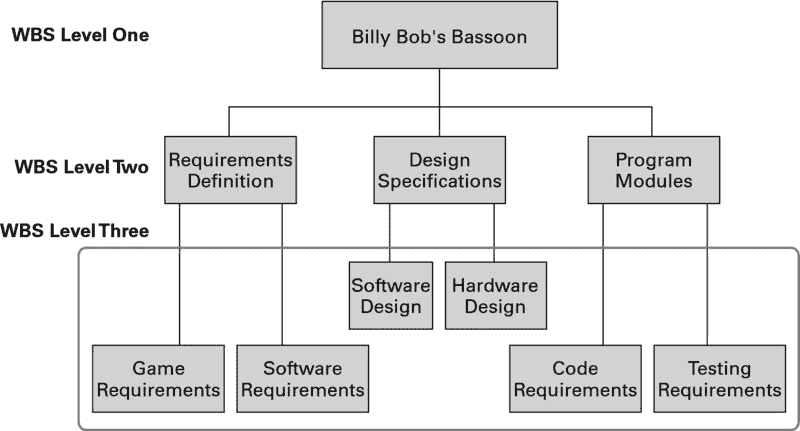

### 图 3.2：WBS 一级、二级和三级

这里的目标是最终分解工作，直到可以将每个工作包的责任和问责制分配给一个组织单元或团队。在图 3.3 中，我将此 `WBS` 分解到了第四级，以显示更精细的交付物细节。记住，`WBS` 中通常不包含活动。区分交付物和活动的一种简单方法是使用名词作为交付物描述符，并使用动词作为活动描述符（我们将在第 4 章讨论活动）。回想起我小学的英语课，我记得名词是指人、地点或物。在这个示例中，交付物是使用名词描述的。当我们进入活动列表时，你可能会使用 `define`（定义）、`design`（设计）和 `determine`（确定）等动词来描述它们。

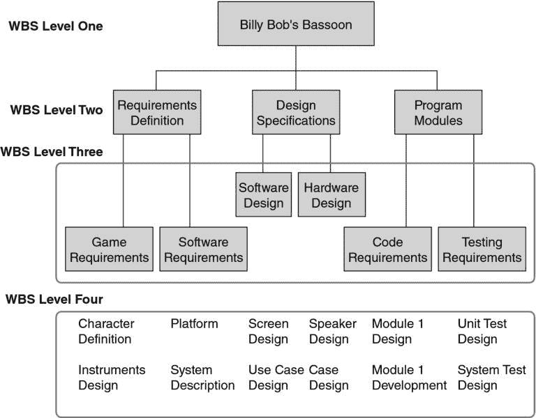

### 图 3.3：WBS 一级、二级、三级和四级

从这些图中可以看出，范围定义模糊或交付物列表不充分将导致 `WBS` 结构糟糕。这不仅会让 `WBS` 看起来很虚态，项目本身也会遭受痛苦，甚至可能屈服于可怕的项目过早终结。项目的最终成本将高于估计值，并且需要大量的重新工作（翻译：熬夜和周末加班）来补偿 `WBS` 上未列出的缺失工作。你通过在“定义范围”过程中花时间记录所有交付物，可以构建一个良好的 `WBS` 并保持项目的健康运行。

在创建 `WBS` 时不要过度投入。其目标是定义项目工作，以便你可以轻松地计划、管理、监控和控制工作。但你不希望做得太过。如果你将工作分解到显示每个细微细节的程度，你就陷入了低效率的陷阱，并发现计划和管理变得更加困难。此外，你可能扼杀了参与项目人员的创造力，因为一切都定义得如此狭窄。

有时，特别是在处理由多个子项目组成的大型项目时，某些子项目可能不会安排在未来的日期。显然，在未来的日期，当交付物和子项目更加明确且有更多细节可用时，详细制定 `WBS` 是合理的。这种技术被称为 `滚动波规划`（rolling wave planning）。这种技术背后的思想是你根据当时所知的细节水平来详细化项目工作。如果某个子项目或交付物被安排在未来的某个时候，那么今天 `WBS` 上可能出现的唯一组件就是子项目本身。随着你接近子项目，你将详细说明子项目的细节并将其记录在 `WBS` 上。

## 理解唯一的 WBS 标识符

根据 `PMBOK® Guide`，`WBS` 每一层的每个元素通常都会被分配一个唯一的标识符。这个唯一标识符通常是一个数字，用于总计和跟踪与 `WBS` 元素相关的成本、进度和资源。这些数字通常与公司的会计科目相关，会计科目用于按类别跟踪成本。这些代码被称为控制账户（control accounts），所有控制账户合称为 `账户编码`（code of accounts）。`WBS` 中需求定义分支的唯一标识符可能如下：

- `10-1 Billy Bob's Bassoon`
- `10-2 需求定义`
- `10-3 游戏需求`
  - `10-3-1 角色定义`
  - `10-3-2 乐器设计`
- `10-4 软件需求`
  - `10-4-1 平台`
  - `10-4-2 系统描述`

## 定义工作包

`工作包`（Work packages）是可以分配给一个人或一个团队的组件，他们对完成任务具有明确的问责制和责任，并且可以在整个项目期间进行监控和控制。分配在工作包级很容易进行，但也可以在 `WBS` 的任何级别进行。工作包级是确定时间估算、成本估计和资源估算的地方。

大型项目中的工作包级可以代表子项目，子项目进一步分解为自己的工作分解结构。它们也可能由供应商、另一个组织或你组织中的另一个部门完成的项目工作。如果你将项目工作交给你组织中的另一个部门，你将把工作包分配给个人经理，由他们随后在计划组的“定义活动”过程中将其拆分为活动。

工作包可能会分配给供应商或其他外部人员。例如，你项目中的某个交付物是特殊包装，由供应商负责这项工作。供应商可能会将此交付物视为其内部的一个项目，并构建具有多个层级的 `WBS`。但对于你的项目来说，它是列在 `WBS` 工作包级别的交付物。

## 创建 WBS 输出

创建 `WBS` 过程有两个输出：范围基准和项目文档更新。我们接下来查看这两个。

### 范围基准

记得我之前说你到为止所做的一切都是层层构建的吗？这是你了解此输出的一个重要概念。项目的 `范围基准` 是由已批准的项目范围声明、`WBS` 和 `WBS 字典`组成的。（你会在第 2 章回想起项目范围声明作为未来项目决策的基准，因为它有助于团队判断请求变更是在范围内还是范围外。）换句话说，这些文档共同详细描述了项目的所有工作。根据这些文档，你将制定进度、分配资源并监控和控制工作。我们已经讨论过项目范围声明和 `WBS`，但让我们来看看 `WBS` 字典。

### WBS 字典

`WBS 字典`是范围基准的一个元素，是在记录 `WBS` 上工作组件描述的地方。根据 `PMBOK® Guide`，`WBS` 字典应为每个 `WBS` 组件包含以下元素：

- 账户编码标识符
- 组件工作的描述
- 负责完成组件的组织
- 进度里程碑列表
- 与进度里程碑相关的活动
- 所需的资源
- 成本估算
- 质量要求
- 验收标准
- 技术参考
- 合同或协议信息
- 约束和假设

让我们来看看 `WBS` 字典条目中的某些元素可能是什么。你将使用之前在侧边栏“林肯街办公大楼”中定义的名为 `Inspection and Identification` 的工作包级别。该 `WBS` 字典条目可能如下：

- 3.1 `Inspection and Identification`
  - **工作描述**——对建筑进行石棉检查，并识别所有发现石棉的区域。每确定一个位置，就更新移除计划（`WBS 2.2`）。
  - **负责组织**——设施部门的 Adrian 将聘用并监督承包商执行这项工作。
  - **进度里程碑**——检查和识别将在确定并聘用承包商后开始（不晚于 7 月 1 日）。工作应不晚于 9 月 15 日前完成。
  - **合同信息**——已确定两家在此类工作中具有资质且经验丰富的承包商。合同流程应不晚于 6 月 12 日结项。

如果 `WBS` 和 `WBS` 字典构建得当，你就为剩余的规划过程提供了极大的帮助。许多剩余过程的完成取决于项目范围说明和 `WBS` 是否准确、完整。你将使用此处创建的工作包将工作进一步细化为活动。从那里开始，你可以估计成本、制定进度等。`WBS` 是项目规划中必不可少的工具，因此请随手可用。

### 项目文档更新

项目文档更新可能包括对需求文档的更新，这可能是由于你在创建 `WBS` 时发生的变化导致的。你可以从本章走过的示例中看到，在处理 `WBS` 的过程中，新的交付物或需求可能会浮产生。这些请求的变更应通过你的变更控制过程进行评审，并批准或拒绝。批准的变更可能会改变项目范围说明、项目管理计划和其他项目文档。这些文档应该进行更新以反映批准的变更。

## 理解这如何应用到你的下一个项目

在本章中，你处理了工作的现实情况。现实是，我认识的许多项目经理同时管理几个项目，而不是一个大项目。虽然本章中提出的每个概念都是合理的，但重要的是，你必须平衡投入到项目管理过程中的精力投入与项目规模及复杂性之间的关系。

作为一名以自己和团队卓越客户服务为傲的经理，我曾一两次让我的团队陷入危险境地，因为我太专注于帮助客户，以至于过程中伤害了他们和我们的部门。如果你想知道这是如何发生的，那是因为我们没有花时间记录项目范围和最终验收标准。在其中一个案例中，为了根据客户内部截止日期尽快完成项目，我们决定项目足够简单，不需要记录交付物。客户承诺在我们生产项目工作时与我们并肩作战。遗憾的是，事实并非如此，我们没有达到客户的期望。此外，在我们实施项目（比计划落后了两个月）之后，由于客户和项目团队对最终产品某些功能的界定存在误解，我们又经历了六周的“修复”。走捷径总有极好的理由——但它们几乎都会反过来困扰你。我的建议是始终创建一个范围说明和需求文档，并让利益相关者对两者签字。（在实践中，小型项目可以将交付物和需求都包含在范围说明中。）

分解交付物是确定资源需求和估算的第一步。无论项目大小如何，`WBS` 始终是一个好主意。我必须承认，在小型项目中我曾偶尔偷懒，直接使用项目进度表作为 `WBS`。公平地说，当团队很小且参与项目的人不超过三四个人时，这种做法效果很好。如果项目团队成员远超过四人，仅靠进度表来跟踪交付物可能会有点繁琐。`WBS` 是用于为工作包分配名称的完美工具，它也是确定项目工作估算的基础。

`PMBOK® Guide` 概述的五步流程运行得非常好。从 50,000 英尺的高空视角开始，团队确定项目的主要交付物。从那里开始，交付物被分解为越来越小的工作单元。这里的诀窍是将工作分解为可衡量的单位，以便在完成工作时能够验证工作状态以及工作的完成情况和验收情况。如果你有“模糊”的 `WBS` 级别或工作包，你将无法准确确定状态。在信息技术领域，我们有一个关于进度的谚语：“已完成 90%。”问题是，最后 10% 的完成所需时间似乎总是前 90% 的两倍。如果你花时间记录了 `WBS`，你对那 90% 包含什么会有更清楚的认识。最后一步是验证步骤，你确定在 `WBS` 中识别的所有内容是否对于完成项目工作都是绝对必要的，以及是否分解得足够以充分描述该工作。根据我的经验，记录 `WBS` 将在后续的规划过程中为你节省时间，特别是在制定项目进度和确定项目预算时。

我相信从本章中得到的最重要的思想非常简单：始终使用范围说明和需求文档，并始终让他们签字。

## 总结

本章通过`开发项目管理计划`过程、`规划范围管理`过程、`收集需求`过程、`定义范围`过程和`创建 WBS`过程引导你进入项目规划的道路。我们在本章中涵盖了很多内容。你到目前学的所有知识将成为进一步项目规划的基础。

`开发项目管理计划`过程的输出是项目管理计划，涉及定义、协调和整合所有的辅助项目计划和基线。该计划的目的是定义项目如何执行、如何监控和控制，以及如何结束。

`规划范围管理`过程的主要输出是范围管理计划。该计划是项目管理计划的一个要素，描述了项目团队将如何定义项目范围、验证项目工作，以及管理和控制范围。

`收集需求`过程涉及收集和记录项目需求。需求应该是可衡量的、可追溯的、可测试的等。项目需求的衡量标准由利益相关者和项目经理达成一致。此外，需求应在追溯矩阵中跟踪，该矩阵记录了需求的来源、测试结果、需求的优先级等更多内容。

项目范围说明在`定义范围`过程中产生。它描述了项目交付物。范围说明与 `WBS` 以及 `WBS` 字典共同成了范围基线，你将用它来权衡未来的项目决策，特别是变更请求。范围说明包含了将在未来规划过程中使用的项目交付物列表。

项目范围说明包含许多元素，包括产品范围说明、产品验收标准、交付物、范围排除项、约束条件和假设。

约束限制或规定了项目团队的行为。约束通常涉及时间、成本和范围，但也可以包括进度、技术、质量、资源、风险等。

假设是指被认为是真实的事。你需要记录项目假设，并在项目进展过程中对它们进行验证。

`WBS` 是一个以交付物为导向的项目要素层级结构。`WBS` 的最高层使用名词描述，而最低层使用动词描述。`WBS` 中的每个元素都有其的一套目标和交付物，必须满足这些目标和交付物才能完成高一级的交付物，并最终实现项目目标。通过这种方式，`WBS` 验证了工作的完整性。

`WBS` 的最低层被称为工作包层级。这种分解允许项目经理确定成本估算、时间估算、资源分配和质量控制。

## 考试要点

- **能够陈述“制定项目管理计划”过程的目的。** 该过程定义、协调并整合了所有的子项目计划。
- **理解项目范围说明的作用。** 范围说明作为利益相关者对项目范围的共同理解基础。项目目标、交付物及其量化标准记录在范围说明中，供项目经理和利益相关者使用，以判断项目是否成功完成。它还作为未来项目决策的依据。
- **能够定义项目约束和假设。** 项目约束限制了项目团队的选择范围并限制了他们的行为。有时约束会规定行动。时间、预算和范围是最常见的约束条件。假设是被假定为真实或真实的条件。
- **能够描述范围管理计划的作用。** 范围管理计划对项目的成功有直接影响，它描述了确定项目范围的过程，有助于创建 `WBS`，描述了项目产品或服务如何被验证和验收，并记录了如何处理范围变更。范围管理计划是项目管理计划的子计划。
- **能够定义 WBS 及其组件。** `WBS` 是一个以交付物为导向的层级结构。它使用项目范围说明或类似文档中的交付物，并将其分解为逻辑上可管理的工作单元。第一层分解是主要交付物层或子项目层，第二层分解是对交付物的进一步详述，依此类推。任何 `WBS` 的最低层都称为工作包。

## 复习题

你可以在附录 A 中找到问题的答案。

1. 你是 Laredo Pioneer 巡回马术表演秀的项目经理。你正领导一个项目，推广一系列即将在表演中售卖的新系列纪念品。你正准备编写项目管理计划，并知道关于 `PMIS` 的以下所有内容都是正确的，但其中一项不是。下列中哪项是不正确的？
   1. `PMIS` 是该过程的一个工具和技术。
   2. 配置管理系统是 `PMIS` 的子系统。
   3. `PMIS` 包含一个变更控制系统。
   4. `PMIS` 是一个自动化系统。

2. 下列哪项是正确的？
   1. 你是 Laredo Pioneer 巡回马术表演秀的项目经理。你正领导一个项目，推广一系列即将在表演中售卖的新系列纪念品。你准备记录执行项目时将使用的过程，并定义项目将如何执行、控制和关闭。你正在制定范围管理计划。
   2. 你是 Laredo Pioneer 巡回马术表演秀的项目经理。你正领导一个项目，推广一系列即将在表演中售卖的新系列纪念品。你准备记录执行项目时将使用的过程，并定义项目将如何执行、监控和控制。你正在制定产品范围说明。
   3. 你是 Laredo Pioneer 巡回马术表演秀的项目经理。你正领导一个项目，推广一系列即将在表演中售卖的新系列纪念品。你准备记录执行项目时将使用的过程，并定义项目将如何执行和控制，以及变更将如何被监控和控制。你正在制定项目管理计划。
   4. 你是 Laredo Pioneer 巡回马术表演秀的项目经理。你正领导一个项目，推广一系列即将在表演中售卖的新系列纪念品。你准备记录执行项目时将使用的过程，并定义项目将如何执行、控制和关闭。你正在制定项目范围说明。

3. 你是负责一个新办公大楼建设的项目经理。你正在接手一位最近离职的项目经理的工作。前任项目经理已经完成了该项目的范围说明和范围管理计划。在对一些关键团队成员的访谈中，你得出了以下哪种结论？
   1. 范围说明评估了项目范围的稳定性，并概述了范围如何被验证以及如何控制变更。团队成员知道项目范围是根据产品需求进行衡量的，范围管理计划是基于已批准的项目范围。
   2. 范围管理计划描述了项目范围如何被管理和控制，以及 `WBS` 如何被创建和定义。他们知道产品范围是根据产品需求进行衡量的，范围管理计划是基于已批准的项目范围。
   3. 范围管理计划是以交付物为导向的，包含了成本估计和利益相关者的需求和期望。他们理解项目范围是根据项目管理计划进行衡量的，范围管理计划是基于已批准的项目章。
   4. 范围说明描述了如何定义和验证高层交付物和需求。他们理解产品范围是根据项目管理计划进行衡量的，范围管理计划是基于已批准的项目章。

4. 全会、多数通过、相对多数和独裁是以下哪种技术的四个例子？
   1. 小组创意技术，它是“收集需求”过程的一个工具和技术
   2. 访谈，它是“定义范围”过程的一个工具和技术
   3. 引导式工作坊技术，它是“定义范围”过程的一个工具和技术
   4. 小组决策技术，它是“收集需求”过程的一个工具和技术

5. 关于项目范围说明，下列哪项是正确的？
   1. 项目范围说明包含一个变更控制系统，描述了如何对项目范围进行变更。
   2. 项目范围说明进一步详述了启动和规划过程中的细节，并作为未来项目决策的依据。
   3. 项目范围说明描述了团队将如何定义和开发工作分解结构。
   4. 项目范围说明评估了项目范围的可靠性，并描述了验证和验收已交付物的过程。

6. 你是一家农业公司的项目经理。你已经采访了相关者并收集了需求。关于本题所指的过程，下列哪项是正确的？

   1. 需求文档列出了各项需求，并描述了在整个项目过程中如何对这些需求进行分析、记录和管理。
   2. 需求文档由正式且复杂的文档组成，包括项目业务需求、功能性需求、非功能性需求、对组织内外其他的影响以及需求假设和约束等元素。
   3. 需求文档详细说明了创建项目交付物所需的工作，包括交付物说明、产品验收标准、需求排除项，以及需求假设和约束。
   4. 需求跟踪矩阵将需求与项目目标、业务需求、`WBS` 交付物、产品设计、测试策略以及高层需求相关联，并跟踪它们一直追踪到项目完成。

7. 下列哪些项构成了范围基准？
   1. 批准的项目范围说明
   2. 批准的范围管理计划和 `WBS`
   3. `WBS`、批准的项目范围说明和 `WBS dictionary` 字典
   4. 批准的范围管理计划、`WBS` 和 `WBS dictionary` 字典

8. 关于头脑风暴和发散性思维，下列哪种描述是正确的？
   1. 它们是专家判断的形式，用于帮助定义和开发需求以及制定项目范围说明。
   2. 它们是用于详细说明产品描述的工具和技术。
   3. 它们是群体决策技术，是 `Collect Requirements` 收集需求过程的工具和技术。
   4. 它们是方案产生技术，是 `Define Scope` 定义范围过程的工具和技术。

9. 你的公司 Kick That Ball Sports 已任命你为新款板球产品线引入项目的经理。这是一项性工作，全国所有的零售店都需要在媒体广告攻势开始前在货架上上新品。该产品线涉及三个新产品，其中两个将一起推出，第三个将在两年内推出。你已准备好创建 `WBS`。以下各项中，哪一项是不正确的？
   1. `WBS` 可以使用每个产品作为一级条目的进行构建。
   2. `WBS` 应该细化到易于估计成本和进度的水平。这被称为工作包级。
   3. 滚动式指的是 `WBS` 的所有层级如何共同汇总以反映项目工作且仅反映项目工作。
   4. `WBS` 的每一层都代表可验证的产品或结果。

10. 你是 Giraffe Enterprises 的项目经理。你最近接手了一个项目经理的工作，他之前因为谎造 `PMI®` 认证被解雇。不幸的是，他在定义范围方面做得糟糕。如果你不纠正这一点，可能会发生什么情况？
    1. 受益者将要求项目团队加班以保持项目按进度进行。
    2. 糟糕的范围定义将对工作分解结构的创建产生不利影响，导致成本增加。
    3. 由于范围定义糟糕，项目管理计划中验证和验收交付物的过程需要更新。
    4. 项目成本可能会增加，可能会重工，并可能导致进度延误。

11. 你是 Lucky Stars 夜总俱乐部的经理。他们专门从事现场乡村和西部乐队表演。你最新的项目处于规划过程组。你正在制定 `WBS`。财务经理给了你一个分配给 `WBS` 的编号系统。以下哪种描述是正确的？
    1. 该编号系统是一个被称为 `WBS dictionary` 字典的唯一标识符，用于为单个工作元素分配质量控制代码。
    2. 该编号系统是一个被称为 `WBS dictionary` 字典的唯一标识符，用于跟踪单个工作元素的描述。
    3. 该编号系统是一个被称为 `code of accounts` 账户代码的唯一标识符，用于跟踪单个工作元素的时间和资源分配。
    4. 该编号系统是一个被称为 `code of accounts` 账户代码的唯一标识符，用于跟踪 `WBS` 元素的成本。

12. 你是一个大型复杂项目的项目经理。你已经构建了该项目的 `WBS`，并且所有的工作包层级都是该项目的子项目。你要求子项目经理在三周后向你汇报，并提交他们各自构建的 `WBS`。关于你的 `WBS`，以下哪种说法是不正确的？
    1. 工作包级被分解以创建活动列表。
    2. 工作包级是 `WBS` 的最低层级。
    3. 工作包级有助于资源分配。
    4. 工作包级有助于成本和时间估算。

13. 你负责一个公司计划向企业推广的新软件产品经理。项目赞助人告诉你，项目必须在 9 月 1 日前完成。公司计划在 9 月下旬的贸易展上演示这款软件产品，因此需要项目在贸易展之前准时完成。然而，赞助人还告诉你，预算固定在 85,000 美元，想要增加预算需要动用国会法令。你必须在给定的时间和预算范围内完成项目。以下哪项是该项目的主要约束？
    1. 预算
    2. 范围
    3. 时间
    4. 质量

14. 关于分解，以下哪种描述最不准确？
    1. 分解涉及结构化和组织 `WBS`，使交付物始终列在第一。
    2. 分解需要一定程度专家判断，还需要对项目范围说明进行严密分析。
    3. 分解是用于创建 `WBS` 的工具和技术。
    4. 分解将主要交付物细分为更小的组件，直到达到工作包级。

15. 你正在将项目目标转化为具体的交付物和需求。在 `Define Scope` 定义范围过程的产品分析工具和技术中，以下所有技术中除了哪一项？
    1. 价值工程和价值分析
    2. 产品配置和规范分析
    3. 系统分析和系统工程
    4. 产品分解和功能分析

16. 你是一家纪录片公司的项目经理。鉴于最近发生的地区悲剧，公司总裁希望制作一部关于英雄救援队努力的新型纪录片，并尽快播出。她寄希望你将这部纪录片拍成公司历史上最好的一部。她向你保证拥有自由支配权，可以使用任何所需的资源来快速完成该项目。然而，公司最好的摄影师目前正在处理另一项任务。以下哪种描述是正确的？
    1. 主要约束是时间，因为总裁希望电影尽快完成。她告诉你要尽快将其播出。
    2. 资源是主要约束。尽管总裁给了你资源使用的自由支配权，但你假设她指的不是那些活跃分配到项目中的资源。
    3. 进度是主要约束。尽管总裁给了你资源使用的自由支配权，但你假设她指的不是那些活跃分配到项目中的资源。摄影师的任务还需要三周才能完成，因此必须对进度进行调整。
    4. 主要约束是质量，因为总裁希望这部电影是该公司生产以来最好的电影。她赋予了你完全的自由，可以使用任何所需的资源来完成工作。

17. 你的项目依赖于某个供应商的关键交付物，你之前多次与该供应商合作并非常成功。你预计交付物将在 6 月 1 日送达。这是一个 ___________________ 的例子。
    1. 约束 (Constraint)
    2. 目标 (Objective)
    3. 假设 (Assumption)
    4. 需求 (Requirement)

18. 什么限制了项目团队的选择？
    1. 技术 (Technology)
    2. 约束 (Constraints)
    3. 交付物 (Deliverables)
    4. 假设 (Assumptions)

19. 你的公司为几家大型目录零售商提供解答服务。在过去的 18 个月里，每月进入服务中心的电话量增加。电话系统正接近最大负载限制，需要升级。你被分配负责升级项目。根据公司对上一个电话升级项目的供应商的经验，你相信他们也能协助你完成这个项目。以下哪项是正确的？
    1. 你对供应商的可用性和专业知识做了假设。项目的产生是因为业务需求。
    2. 供应商的可用性和专业知识是约束。项目的产生是因为业务需求。
    3. 你对供应商的可用性和专业知识做了假设。项目的产生是因为市场需求。
    4. 供应商的可用性和专业知识是约束。项目的产生是因为市场需求。

20. 以下哪项不是分解的主要步骤？
    1. 识别主要交付物。
    2. 识别资源。
    3. 识别组件。
    4. 验证分解的正确性。

# 第 4 章：创建项目进度计划

本章涵盖的规划绩效领域的 `PMP®` 考试内容包括以下内容：

- ✓ 任务 4：根据已批准的项目交付物和里程碑、范围以及资源管理计划制定项目进度计划，以管理项目的按时完成。
- ✓ 知识与技能：
  - 时间管理规划，包括进度计划工具和技术
  - 工作流制图技术

规划过程组比任何其他过程组都包含更多的过程。因此，任何项目的规划过程都会投入大量的时间和精力。在某些项目中，你花在规划项目上的时间可能和你花在执行和控制上的时间差不多。这并不是坏事。前期规划得越好，项目成功的可能性就越大。提到规划，规划、执行以及监控和控制过程组共同占了 `PMP®` 考试题目的近 70%，所以 `plan` 在这些领域上花费大约相同比例的时间。

这是另一个充满趣味、动作充实的章节。我们将从定义进度管理计划开始，然后转向成为项目工作的活动。`WBS` 在这里会派上用场，请密切关注。然后我们将按照正确的顺序对活动进行排序，估计完成工作所需的资源，并估计每个活动所需的时间。最后但同样重要的是，我们将制定项目进度计划。

你到目前为止所做的一切以及本章中将讨论的过程都将帮助你创建一个准确的项目进度计划。在整个执行和监控控制过程中，你将使用这些文档（以及你在此创建的其他几个文档）来帮助衡量项目的进度。让我们开始吧。

## 创建进度管理计划

`计划进度管理` 过程描述了将如何制定、执行和控制项目进度计划，以及如何将变更纳入项目进度计划。根据《项目管理知识指南》（`PMBOK®` 指南）第五版，该过程的主要效益是有助于引导和指导如何管理项目进度计划。该过程的唯一输出是 `进度管理计划`。让我们先看看该过程的输入以及工具和技术，并将大部分时间花在进度管理计划本身。

该过程的输入包括项目管理计划、项目章、企业环境因素和组织过程资产。项目管理计划包括范围基准，范围基准又由项目范围说明、`WBS` 和 `WBS 字典`组成。项目进度将衍生自 `WBS`（包括交付物和工作包层级），因此范围基准是定义你用于制定进度管理计划的过程的关键。

企业环境因素包括组织文化、资源可用性，以及组织用于分配和跟踪工作组件的项目管理软件和工作授权系统。对该过程重要的组织过程资产包括模板、变更控制过程、历史信息、进度控制的策略和指南、管理进度的控制工具以及风险控制过程和程序。

我们以前见过所有的工具和技术。它们是专家判断、分析性技术和会议。

正如我之前提到的，该过程的关键是 `进度管理计划`，它是项目管理计划的一个要素。它是该过程的唯一输出，用于描述项目进度计划将如何制定、监控、控制和变更。根据 `PMBOK®` 指南，几个要素构成了进度管理计划。务必审查所有要素。我在这里强调了最重要的要素：

- **进度模型开发**：这指的是你将用于制定进度的方法和工具（例如 `Oracle Primavera` 或 `Microsoft Project`），以及它们包含的数据。
- **准确性水平**：该要素描述了你在导出活动持续估值时使用的舍入方法。例如，根据项目的复杂性，你可能会舍入到最近的周、天或小时。
- **计量单位**：该要素也涉及活动持续估值以及进度活动。它描述了你在制定进度计划时将使用的衡量，如小时、天、周或其他衡量标准。
- **控制阈值**：控制阈值是指在采取行动之前进度计划可以承受的偏差水平。同样，取决于项目的复杂性，这可能是一个非常充裕的时间，也可能是非常有限的时间。你可以用小时或天来表示阈值（例如，延迟超过三天需要采取行动），或者最常见的，以时间百分比表示。
- **绩效测量规则**：这指的是你将在何处使用何种类型的测量方法来验证进度性能。这可能包括在 `WBS` 上指定层级和或确定你将使用哪种挣值管理技术。

## 定义活动

现在你已经开始开发项目进度计划了。为了制定进度，你首先需要定义活动、按正确的顺序进行排序、估计资源并估计完成任务所需的时间。我将在这里介绍 `定义活动` 过程，接下来介绍 `活动排序` 过程，并在下一章开始估算过程。

`定义活动` 过程是对 `WBS` 中工作包要素的进一步细分。它记录了完成 `WBS` 和项目范围说明中详细列出的交付物所需的特定活动。与 `WBS` 的工作包级一样，活动可以很容易地分配、估计、安排和控制。`定义活动` 过程可能由项目经理执行，或者当 `WBS` 分解到子项目级时，此过程（以及后续所有与活动相关的过程）可能会分配给子项目经理。

### 定义活动过程输入

以下是 `定义活动` 过程的输入（包括每个输入的关键要素）：

- 进度管理计划
- 范围基准（包括交付物、约束和假设）
- 企业环境因素（项目管理信息系统、组织文化、发布的商业数据库）
- 组织过程资产（现有指南和政策、模板、教训知识库和历史信息）

### 定义活动的工具和技术

`定义活动` 过程的工具和技术如下：

- 分解
- 滚动波计划
- 专家判断

我们在上一章中涵盖了这些主题的大部分。此过程中的分解涉及将工作包拆为更小、更易管理的工作单元，称为活动。这些不是交付物，而是为了完成 `WBS` 中列出的工作包和交付物必须完成的单个工作单元。活动有助于在后续的计划过程中定义估算并创建项目进度。来自之前项目的活动列表（该过程的输出之一）可以作为此过程的模板。滚动波计划涉及对近期工作进行比未来工作更详细的计划。正如我们在第三章中讨论的，这是渐进式详化的一种形式。专家判断以具有开发项目范围说明和 `WBS` 优先经验的项目团队成员的形式出现，可以帮助你定义活动。

### 定义活动的输出

`定义活动`有三个输出：

- 活动列表
- 活动属性
- 里程碑列表

我们接下来将查看每一个输出。

### 活动列表

`定义活动` 过程的一个主要输出是 `活动列表`。活动列表应包含将为项目执行的所有进度活动，并对每个活动进行工作范围描述并分配一个标识符（如代码或编号），以便团队成员理解工作内容以及如何完成。进度活动是项目进度的各个独立元素，活动列表文档是项目文档的一部分。为了保持你以及你团队成员的理智，请务必按照活动在活动列表中出现的方式将活动名称输入进度表。

### 活动属性

`活动属性`描述了活动的特性，是活动列表的扩展。随着更多信息的确定，活动属性会随着项目生命周期而变化。在项目早期，活动属性可能包括活动 ID、其所关联的 `WBS` 识别码以及活动名称。随着项目的进行和其他计划过程的完成，你可能会添加与活动相关的先序活动、后序活动、逻辑关系、提前和滞后、资源需求以及约束和假设。我们将在章的剩余部分涵盖这些主题。

活动属性被用于若干过程的输入，包括`开发进度`过程，我们将在本章稍后的“制定项目进度”部分中讨论该过程。

### 里程碑列表

`里程碑`通常是项目的重大成就，标志着主要交付物的完成或项目中的其他关键事件。例如，项目交付物的批准和签署可能被视为里程碑。其他示例可能包括原型完成、系统测试、合同批准等。里程碑列表记录了这些成就，并记录里程碑是强制性的还是可选的。里程碑列表是项目文档的一部分，也有助于制定项目进度。

## 理解活动排序过程

现在你已经确定了进度活动，你需要按照逻辑顺序对它们进行排序，并找出活动之间是否存在依赖关系。逻辑关系的交互性必须正确排序，以便制定一个现实的、可行的项目进度。

考虑一个经典的例子。假设你要给房子刷漆，但不幸，它出现了一些小破损。旧油漆在剥落和掉渣，在给房子喷涂底漆之前需要对其进行刮除。底漆干燥后，就可以开始刷漆。在这个例子中，底漆活动依赖于刮除活动。你不能——好吧，你不应该——在刮掉剥落的油漆之前给房子上底漆。刷漆活动同样依赖底漆活动。你真的不应该在底漆干燥之前开始刷漆。

在 `活动排序` 期间，你将使用大量的输入、工具和技术来产生主要的输出和项目进度网络图。你已经看到了此过程的所有输入。它们是进度管理计划、活动列表、活动属性、里程碑列表、项目范围说明、企业环境因素和组织过程资产。我们接下来来看几个新的工具和技术。

### 活动排序工具和技术

`活动排序`有三个工具和技术，对你来说都是全新的：

- 优先网络图法（`PDM`）
- 依赖关系确定
- 提前和滞后

我会交换这些顺序，首先涵盖依赖关系确定。在实践中，你会在使用 `PDM` 绘制进度网络图之前或在使用期间定义依赖关系。为了确保你与 `PMBOK` 指南关于依赖关系的术语保持一致，我将首先涵盖它们，然后转向其他工具和技术。

### 依赖关系确定

`依赖关系`是活动之间的关系，其中一个活动依赖于另一个活动以完成操作，或者一个活动依赖于另一个活动以启动操作才能继续。依赖关系的确定是确定这些依赖关系存在的问题。回想刷漆的例子，在刮除和底漆活动完成之前，你无法刷漆。考试中你需要了解四种依赖关系：

- 强制依赖关系
- 任意依赖关系
- 外部依赖关系
- 内部依赖关系

正如你可能猜到的，`PMBOK` 指南根据特征对依赖关系的定义不同：

- **强制依赖关系**：`强制依赖关系`也称为`硬逻辑`或`硬依赖`，由所执行的工作类型定义。刮除、底漆和刷漆的顺序就是强制依赖关系的例子。工作本身的性质决定了执行活动的顺序。一个具有物理限制的活动是你对手部有强制依赖关系的迹象。

### 酌量依赖

`Discretionary dependencies`由项目团队定义。酌量依赖也被称为`首选逻辑`、`软逻辑`或`优先逻辑`。这些通常是基于流程或程序的驱动，或者是基于过去经验的“最佳实践”技术。例如，房屋油漆项目的过去经验和最佳实践都表明，所有的修边工作应该手工绘制，而大部分主要的油漆工作应该使用喷涂器完成。

### 外部依赖

`External dependencies`顾名思义就是项目外部的。这似乎显而易见，但 `PMBOK® Guide` 指出，尽管依赖关系是项目外部的（因此是非项目活动），但它会影响项目活动。例如，你的项目可能是在研究和营销一种新药。在公司营销该药物之前，`FDA` 必须批准该药物。这不是项目活动，但在获得批准之前，项目无法进行。这意味着 `FDA` 批准是一项外部依赖。

### 内部依赖

`Internal dependencies`是另一种显而易见的依赖，它们是项目或组织内部的。然而，它们仍可能不受你的控制。例如，在你的维修车间实施新的时间跟踪系统之前，运营部门可能决定研究有关时间的业务规则。在安装时间跟踪系统和进行项目之前，必须完成检查和更新业务规则及流程。

一旦你识别了依赖关系并收集了`排列活动`（Sequence Activities）过程的所有其他输入，你将利用这些信息制作一个项目活动的图表——或示意性显示。项目进度网络图显示了活动之间存在的依赖关系（或逻辑关系）。你可以使用该过程的其他工具和技术之一来产生此输出结果。现在你将详细检查每项内容。

#### 前置计划图法（PDM）

`precedence diagramming method (PDM)`是大多数项目管理软件程序用于活动排序的方法。前置计划图使用框或矩形（称为`节点`）来表示活动。节点用箭头连接，显示活动之间的依赖关系。这种方法也称为`节点网络活动 (AON)`。

节点上应该显示的最少信息是活动名称，但你可以在节点上放置尽可能多关于活动的信息。有时，节点会显示活动名称、活动编号、开始和结束日期、截止日期、空闲时间等。（我将在本章后面的“开发进度计划工具和技术”部分介绍空闲时间。）

图 4.1 显示了房屋油漆示例的 `PDM`——或 `AON`。

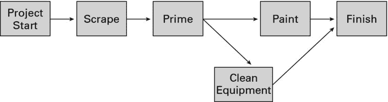

### 图 4.1：PDM 或 AON 的示例

`PDM` 由四种`逻辑关系`进一步定义。`dependencies`和`precedence relationships`等术语也用于描述这些关系。如果你使用过 `Microsoft Project` 或类似的项目管理软件，你可能已经熟悉这些了。四种依赖关系（或逻辑关系）如下：

- **完成-开始（FS）**：完成-开始关系是最常用的关系。这种关系意味着前置活动（或 `from` 活动）必须在后继活动（或 `to` 活动）开始之前完成。在 `PDM` 图中，这是最常用的逻辑关系。
- **开始-结束（SF）**：开始-结束关系意味着前置活动必须在后继活动结束之前开始。这种逻辑关系很少被使用。
- **完成-结束（FF）**：完成-结束关系意味着前置活动必须在后继活动结束之前完成。
- **开始-开始（SS）**：我认为你已经掌握了。开始-开始关系意味着前置活动必须在后续活动开始之前开始。

在构建你的项目进度网络图时，请记住这些逻辑关系（或依赖关系）。

### 其他绘图方法

`arrow diagramming method (ADM)`不是 `Sequence Activities` 过程列出的工具和技术，但考试中可能会出现关于它的问题。这是一种现在已很少使用的旧技术，但尽管如此，你应该对它有一定的了解。

`ADM` 在视觉上是 `PDM` 的相反。箭头绘图法将活动放置在箭头上，箭头通过节点与依赖的活动连接。这种方法也称为`箭头网络活动 (AOA)`和`线网络活动 (AOL)`。这种技术的使用频率远不如 `PDM`，但某些行业相比 `PDM` 更倾向于 `ADM`。在此记录一下，请注意 `ADM` 允许使用多个时间估值来确定时长，并且仅使用完成-开始依赖关系。关于 `ADM` 还有一点独特的说明需要记住：有时必须在图中插入虚活动以准确地显示依赖关系。虚活动通常用虚线箭头表示。

图 4.2 显示了应用于房屋油漆示例的 `ADM` 方法。

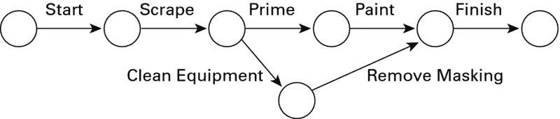

### 图 4.2：ADM 方法的示例

考试中你还可能遇到关于另外一种绘图方法。它被称为 `GERT`，代表 `Graphical Evaluation and Review Technique`（图形评估与评审技术）。考试需要知道的是这种绘图方法允许条件、分支和循环。

### 应用领先和滞后

在确定依赖关系时应考虑领先和滞后。`Lags`（滞后）发生在两个活动之间的时间流逝，这会延迟 `successor activities`（即在前置活动之后的活动）的开始，导致时间被添加到你所计划的活动的开始日期或结束日期。相反，`Leads`（领先）会加速后继活动，因此需要从你计划的活动的开始日期或结束日期中减去时间。

让我们回到房屋油漆示例以直观地理解这一切。为了涂漆，你首先需要刮掉落的油漆然后上底漆。然而，在底漆干燥之前你无法开始涂漆，如果你需要底漆在周二干燥，就不应该安排周一上底漆、周二涂漆。因此，底漆活动在活动末尾产生了滞后时间的需求，以考虑到开始涂漆之前所需的干燥时间。

领先时间恰恰相反。假设在这个示例中，你可以在刮除完成之前就开始上底漆。也许房屋的某些区域不需要刮除，所以你不需要等待刮除活动完成就可以开始上底漆活动。在这个示例中，领先时间从底漆活动的开始处被减去，使得该活动在前一个活动完成之前开始。

### 排列活动输出

排序活动（`Sequence Activities`）过程只有两个输出：项目进度计划网络图和项目文档更新。我刚刚花了大量时间描述了你可以使用 `PDM` 或 `ADM` 技术构建的不同类型的进度计划网络图。你可以在计算机上生成项目进度计划网络图，也可以手动绘制。与 `WBS` 一样，这些图表是项目工作的视觉化表示，根据项目的复杂性，它们可能包含所有的项目细节，也可能只包含摘要级别的细节。摘要级活动是相关活动的集合，也称为 `hamocks`（吊床活动）。可以将吊床想象成一组相关活动，它们汇总到一个摘要标题下，该标题描述了可能包含在该分组中的活动。

请记住，这些项目进度计划网络图的构建可能会揭示你在定义活动列表时遗漏的活动，或者可能会让你在原本认为一个活动可以可行的地方，将一个活动拆分为两个活动。如果是这种情况，你将需要更新活动列表和活动属性。由于此过程可能需要的另一个项目文档更新是对风险注册表的更新。（我们将在第 6 节“风险规划”中讨论风险注册表。）

活动排序完成后，下一步涉及估算活动资源和估算活动持续，以便它们可以被纳入项目进度中。我们将在本章的后续章节介绍这些主题。

## 估算活动资源

从最小到最大的所有项目都需要资源。在这种情况下，`resources` 一词不仅是指人员；它意味着完成项目所需的所有物理资源。`PMBOK® Guide` 将资源定义为人员、设备、材料和供应品。实际上，这包括人员、设备、供应品、材料、软件、硬件——列表取决于你正在从事的项目。`估算活动资源`过程关注的是确定工作包内每个进度活动所需的资源类型（人力和物料）以及相应的数量。

`PMBOK® Guide` 指出 `估算活动资源` 应该与 `估算成本` 过程紧密配合（我将在第 5 节“制定项目预算和沟通计划”中讨论 `估算成本`）。这是因为资源——无论是人员、材料还是两者——通常是你在任何项目中最大的支出。识别资源成为项目规划过程中的关键组成部分，以便能够准确推导出估算值并最终得出项目预算。接下来你将查看帮助你记录这些要求的输入、工具和技术。

### 估算活动资源的输入

`估算活动资源`过程有几个输入，其中大部分你已经知道：

- 进度管理计划
- 活动列表
- 活动属性
- 资源日历
- 风险注册表
- 活动成本估算
- 企业环境因素
- 组织过程资产

你之前没有见过的唯一输入是 `资源日历`、`风险注册表` 和 `活动成本估算`。

`资源日历`输入描述了资源（人力和物料）可用的时间范围。它们查看特定资源或资源组及其技能、能力、数量和可用性。也许你的项目需要一个营销人员，而分配到营销活动的人员在 10 月正在休长假。资源日历将显示该人员的休假安排。（整个项目日历显示公司承认的假期。）

资源日历还会检查对项目进度具有潜在影响的设备和材料资源的数量、能力和可用性。例如，假设你的项目需要一台液压钻，而你的组织仅拥有一台。资源日历将告诉你，在你的项目需要它的同时，它是否被安排了其他工作。

`风险注册表`是`识别风险`过程的输出。它是已识别风险及其潜在应对措施的列表。我们将在第 6 节“风险规划”中深入讨论风险注册表。

`活动成本估算`是`估算成本`过程的输出。这些是每个活动确定的成本。我们将在第 5 节深入研究活动成本估算。

### 估算活动资源的工具和技术

通过 `估算活动资源` 过程的目标是确定活动资源需求，包括数量和可用性。该过程有五种工具和技术来帮助完成这一输出：专家判断、替代分析、发布的估算数据、自下向上估算和项目管理软件。你已经知道专家判断的内容，所以请查看其余工具：

- **替代分析**

  在考虑用于完成分配给资源各项活动的方法时，使用替代分析。很多时候，你可以通过一种以上的方式完成活动，替代分析有助于在各种可能性之间做出决定。例如，紧凑型汽车行驶的道路与六位数的跑车行驶的道路相同。跑车的功能比紧凑型车多得多，速度更快，可能更舒适，并且具有紧凑车不具备的视觉吸引力。跑车可能是项目的有效资源选择，但你应该考虑所有的替代方案。同样的理念也适用于人力资源，你可能应用高级别资源而非初级资源，或者你可以增加资源来加速进度。在确定替代资源时，你可能还会使用“制造-租赁或购买”分析。

- **发布的估算数据**

  估算数据可能包括组织指南、行业费率或估算、生产率、资源率等。例如，你的组织可能与供应商建立了价格协议，概述了按资源类型的费率，或者针对你的特定活动或特定地理区域有行业生产率估算。

- **自下向上估算**

  自下向上估算是一个估算单个进度活动成本，然后将它们相加以得出工作包的总估算的过程。在这里，你单独估算每个进度活动，然后汇总这些估算值或将它们相加得到总和。只要进度活动层的估算是准确的，这就是准确的估算方法。然而，执行自下向上估算需要花费大量时间，因为每个活动都必须准确评估和估算才能纳入自下向上计算中。活动越小越详细，这种技术的准确性和成本越高。如果无法估算活动成本，你将需要将活动分解到更详细的级别以便进行估算。自下向上估算也可用于确定活动持续时间，当你对项目所需的资源类型或数量没有把握时，这是一种很好的技术。

- **项目管理软件**

  项目管理软件可以帮助规划、组织和估算资源需求并记录其可用性。它可能还会帮助你生成资源分解结构、资源费率、资源日历和可用性。

### 估算活动资源的输出

估算活动资源过程的目的是开发“活动资源需求”输出。该输出描述了与每个工作包相关的每个活动所需的资源类型和数量。你应该为此输出准备一份叙述性描述，说明你是如何确定估算值的，包括你用于形成估算采用的信息以及你对资源及其可用性所做的假设。

你将在下一个过程（估算活动持续时间）中使用活动资源需求，以确定每个活动完成所需的时间。当然，这取决于分配的资源数量和技能水平，这就是为什么你会在尝试确定持续时间之前先估算资源的原因。

该过程的另外两个输出结果是资源分解结构和项目文档更新。

`resource breakdown structure (RBS)` 类似于组织分解结构，但 `RBS` 是按类别和类型列出资源的。你可能有几类资源，包括劳动力、硬件、设备、用品等。`Type` 描述了所需的资源类型，例如技能水平或材料的质量等级等。

此输出的“项目文档更新”部分指的是对你在此记录的任何元素进行更改，以更新活动列表、活动属性和资源日历。

你可以看到这些“活动”过程是如何层层递进的。首先你定义了活动，然后确定了依赖关系并按正确的顺序进行排序，接下来你确定了完成活动所需的资源类型和数量。现在你准备好开始估算这些活动的持续时间了，以便将它们纳入项目进度计划中。

# 估算活动持续时间

`Estimate Activity Durations` 试图估算完成每个活动所需的工作努力量、资源和工作周期数量。`activity duration estimates` 是该过程的主要输出。这些是量化的估算值，表示为完成一项计划活动所需的工作周期数。工作周期通常以小时或天为单位。然而，较大的项目可能会以周或月表示持续时间。工作周期即为活动持续时间估值，它们将成为“开发计划”过程的输入。

在估算活动持续时间时，务必包含从活动开始到工作完成的所有流时间。例如，考虑之前的房屋刷漆项目示例。你估算刷房屋底漆需要三天时间（包括干燥时间）。现在，假设刷底漆计划在周六开始，但你的团队在周日不工作。在这种情况下，活动持续时间为四天，包括三天的刷漆干燥时间，加上团队不工作的周日。一旦你输入了项目日历和工作周期，大多数项目管理软件将自动处理这种情况。

渐进细化在这个过程中也起着作用。估值通常从相当高的水平开始，随着对交付成果及其相关活动的了解越来越多，估值会变得更加准确。你应该依靠那些对你试图估算的活动拥有最多知识的人来帮助你完成这一过程。

## 估算活动持续时间的输入

该过程的输入包括进度管理计划、活动列表、活动属性、活动资源需求、资源日历、项目范围说明、风险登记册、资源分解结构、企业环境因素和组织过程资产。

正如你在之前的过程中看到的，关于这些输入的几个重要元素也适用于此处：数据库、生产率指标、关于类似项目持续时间的历史信息、项目日历、进度方法和教训。`project calendars`（列出公司假期、班次安排等）被视为组织过程资产的一部分，活动资源需求在此过程中特别有用。

## 估算活动持续时间的工具和技术

`Estimate Activity Durations` 过程有几个新的工具和技术：

- 专家判断
- 类比估算
- 参数估算
- 三点估算
- 组决策技术
- 备选分析

你接下来将查看这些每一个工具和技术。

### 专家判断

执行活动的员工将最准确地估算它们。在这种情况下，团队成员根据他们过去对类似活动的经验使用专家判断。然而，你应该谨慎对待这些估值，因为它们容易受到偏差，并且不是基于任何科学手段。你的专家应该考虑资源水平、资源生产率、资源能力、风险和其他因素可能会影响估值。将专家判断与历史信息结合起来并尽可能使用更多的专家是一种良好的做法。

### 类比估算

`Analogous estimating`也称为`top-down estimating`，是专家判断的一种形式。通过这种技术，你将使用上一个项目中完成的类似活动的实际持续时间来确定当前活动的持续时间——前提是信息已记录并存储在之前项目的项目信息中。当你比较的先前活动与你估算的活动相似，而不仅仅看起来相似时，这种技术最有用。你希望负责估算的人具有这些活动的经验，以便他们提供合理的估值。在项目详细信息不可用时（例如在项目早期），这种技术特别有用。

自上而下的估算技术也用于估算项目总持续时间，特别是当你对项目的信息有限时。考虑自上而下技术的最佳方法是将估值看作一个整体。想象自己站在山顶，可以把整个画面看作一个整体，而不是组成画面的每一个单独项目。

例如，回到房屋刷漆示例。如果房屋大小相似且你使用的油漆质量相同，你就可以将之前的房屋刷漆项目与当前的房屋刷漆项目进行比较。由于项目的相似性，你可以利用第一个刷漆项目来估算第二个刷漆项目的项目持续时间。

当你处于项目规划过程早期并刚刚开始充实项目的所有细节时，自上而下的技术非常有用。有时在项目选择过程中，选择委员会可能想对项目的持续时间有个概念。你在这个阶段使用自上而下的技术推导出项目估值。

### 参数估算

`Parametric estimating` 参数估算是一种基于定量的估算方法，它通过工作量乘以速率，或结合历史数据使用算法来确定成本、预算或时长估值。描述这种方法最好的方式是举个例子。假设你正在进行一个公司范围的网络升级项目。这需要你为建筑内每楼的交换机铺设新电缆。为了得出估值，你可以使用参数估算来确定活动工期估值，即取一个已知元素（在这种情况下是所需的电缆数量），乘以安装单位电缆所需的时间。换句话说，假设你有 10,000 米新电缆需要铺设。根据过去的经验，你知道安装 100 米电缆需要 1 小时。利用这个测量值，你可以确定这项铺设新电缆活动的估值为 100 小时。因此，电缆活动的工期估值为 100 小时。

### 三点估算

`Three-point estimating` 三点估算，正如你可能猜到的那样，它使用三个估值，通过平均值得出最终估值。你在这种技术中使用的三个估值是：最可能估值、乐观估值和悲观估值。最可能估值假设没有发生灾难，活动可以按计划完成。乐观估值是你的资源完成活动的最快时间范围。悲观估值假设发生了最坏的情况，完成活动所需比计划长得多。你将希望依靠经验丰富的人来提供这些估值。然后，你可以选择两个公式之一来计算预期工期估值（`E`）。第一个公式称为三角形分布，由乐观（`O`）、悲观（`P`）和最可能（`M`）估值相加，然后总和除以 3。公式如下：

> `E = (O + P + M) / 3`

第二个公式称为贝塔分布（beta distribution），源自计划评估和评审技术（`PERT`），我们将在稍后的 `Develop Schedule` 过程中进行深入审查。贝塔分布或 `PERT` 的公式如下：

> `E = (O + P + 4M) / 6`

### 集团决策技术

群体决策技术包括头脑风暴以及德尔菲法（Delphi）或名义小组技术。这些技术让你的团队成员参与进来，并将有助于提高估算的准确性。头脑风暴是一种古老的技术，所有参与者都有发言的机会。在这种技术中，没有坏主意，而且协调员必须确保不要让参与者对头脑风暴会议期间提出的意见的优劣进行评判竞争或辩论。

德尔菲法与头脑风暴的相似之处在于，你邀请了领域专家来确定估值。他们对组织以及过往类似项目的经验将有助于提高估算的准确性。由于你让他们参与了过程，而且他们知道通过此练习得出的估值将附在项目进度计划中，他们可能会提供更准确的估值，并努力达到或超越这些估值。

### 储备分析

`PMBOK® Guide` 中，`Contingency reserves` 应急备费用（也称为 `buffers` 缓冲区或 `time reserves` 时间储备）——意味着添加到进度计划中的部分时间（在估算预算时为资金），以应对风险或不确定性。你可能会选择向活动、整体进度计划或两者均增加百分比的时间或固定数量的工作周期。应急备费用是针对已知风险计算的，这些风险具有记录在案的应急或缓解计划，以应对可能发生的风险事件，但你并不确定实施缓解计划以及可能进行返工需要多少时间。例如，根据你早期的定量估算，你知道铺设新电缆需要 100 小时。你还知道有时在铺电缆时会遇到问题区域。为了确保不影响项目进度计划，你预留了按原始估值 10% 的储备时间，以应对你可能遇到的问题。这使得该活动的工期估值增加到 110 小时。应急备费用可以也应该随着项目的进行而修改。随着你使用这些时间，或者发现不需要这些时间时，你将修改储备金额。

管理备费用（Management reserves）是用于未知事件的储备类型。由于它们是未知的，你没有将它们识别为风险。管理备费用是为了应对你那种奇怪的感觉，即可能会出现某些你在 `Planning` 过程中没有想到的事情。管理备费用为这些未知工作预留了时间段，但并不包含在进度计划基准（schedule baseline）中。请记住，这些时间并不是用于添加未纳入范围说明的额外交付物的。管理备费用必须用于范围内的项目工作。如果你确实在项目期间使用了管理备费用，你必须更改进度计划基准以反映已使用的时间。

### 估算活动工期的输出

我到为止讨论的所有内容都引导你得到了该过程的主要输出：活动工期估值。你使用输入、工具和技术来建立这些估值。正如之前提到的，活动工期估值是对完成活动所需的工作周期的估值。这是一个通常以小时、周、天或月表示的定量衡量。

关于作为该过程输出的最终估值，需要注意的是它们应该包含一个可能的结果范围。在铺电缆的示例中，你会将活动工期估值说明为“100 小时 ± 10 小时”，显示实际时长至少需要 90 小时，可能长达 110 小时——或者你可以使用百分比来表示这个范围。

估算活动工期的另一个输出是项目文档更新。由于此过程可能需要重新查看和更新的信息包括活动属性以及你对资源可用性和技能水平所做的假设。

现在你已经掌握了所有的活动信息，以及许多其他输入，准备好开发项目进度计划了。

## 开发项目进度计划

`Develop Schedule` 过程是规划过程组的核心。在这里，你安排项目活动的进度计划，确定它们的开始和结束日期，并确定活动序列和工期。`Develop Schedule` 与 `Estimate Activity Resources` 和 `Estimate Activity Durations` 一起，在得出项目进度计划之前会重复多次。今天的大多数项目管理软件在你输入了活动所需的信息后，就可以自动为你构建进度计划。项目进度计划一旦获得批准，将作为项目的 `schedule baseline` 进度基准，你在后续过程中对其进行跟踪。

这个过程中有很多内容要涵盖，现在去拿咖啡或汽水吧。我将从 `Develop Schedule` 过程的输入开始，然后对该过程的工具和技术进行深入讨论。这些技术将帮助你获得该过程的主要输出：项目进度计划。

### 开发进度计划的输入

`Develop Schedule` 有 13 个输入，其中 9 个是其他规划过程的输出。输入如下：

- 进度管理计划
- 活动列表
- 活动属性
- 项目进度网络图
- 活动资源需求
- 资源日历
- 活动工期估值
- 项目范围说明
- 风险登记册
- 项目人员分配
- 资源分解结构
- 企业环境因素
- 组织过程资产

你可以看出准确执行所有“规划”（`Planning`）过程有多么重要，因为你从规划组中几乎每个过程中获得的信息都会在规划过程的其他地方使用，其中许多就在此处使用。你的项目进度计划将反映你此时此刻所知的信息。如果你错误地估算了活动持续时间，或者没有识别出正确的依赖关系（例如），此过程的输入将会发生扭曲，你的项目进度计划将是不正确的。投入时间来正确规划你的项目并为每个规划过程产生准确的输出，绝对是值得的。

与许多其他过程一样，在执行“制定进度”（`Develop Schedule`）时，你应该特别关注约束和假设。约束贯穿于项目的整个寿命。在制定进度过程中需要考虑的最重要约束是时间约束，它们分为两类：强制日期和关键事件/主要里程碑。

强制日期限制了活动的开始或结束日期。大多数计算机项目管理软件程序使用“不早于开始”（`start no earlier than`）和“不晚于结束”（`finish no later than`）这两种最常见的约束。让我们再次看一遍漆墙的例子。油漆活动在底漆干燥之前无法开始。如果底漆需要 24 小时干燥，并计划在周三完成，这意味着油漆活动可以 `start no earlier than` 周四。这就是强制日期的一个例子。

关键事件或里程碑指的是在特定日期完成特定的交付物。利益相关者、客户或管理人员可能会要求在特定日期完成或交付某些交付物。一旦你同意这些日期（即使只是口头协议），它们通常就板上钉钉，难以更改。因此，这些日期变成了约束。

## 制定进度的工具和技术

制定进度的主要输出是进度基准和项目进度计划。进度基准是项目进度计划批准版本。你可以使用多种工具和技术来产生这些输出。你选择的工具和技术取决于项目的复杂度。然而，对于考试来说，你需要了解所有的。

制定进度有八种工具和技术：

- 进度网络分析
- 关键路径法
- 关键链法
- 资源优化技术
- 建模技术
- 提前和滞后
- 进度压缩
- 进度计划工具

其中一些工具和技术包含了大量信息，你应该为考试中的每种工具投入学习时间。接下来我们将查看每一个项。

### 进度网络分析

`Schedule network analysis` 产生项目进度计划。它涉及计算项目活动的早期开始、晚期开始以及早期和晚期完成日期（与关键路径法一样）。它使用进度模型和其他分析技术，如关键路径和关键链法、假设分析，以及资源平滑（这些都是该过程中的其他工具和技术），来帮助计算这些日期并创建进度。这些计算是在不考虑资源限制的情况下进行的，因此你最终得到的日期是理论上的。此时，你正尝试建立一个可以安排活动的时间段。当你到达此过程的输出时，资源限制和其他约束将会在考虑范围内。

### 关键路径法

`critical path method (CPM)` 是一种进度网络分析技术，用于估算项目的最短持续时间。它通过计算每个活动的早期开始日期、早期完成日期、晚期开始日期和晚期完成日期（不考虑资源可用性），来确定每个网络路径的浮动时间（或进度灵活性）。这是一种依赖于顺序网络（一个活动发生在另一个活动之前，一系列并发的活动在下一系列活动开始之前完成，依此类推）并依赖于每个活动单一持续时间估值的进度分析技术。可以使用序置图法（`PDM`）来执行 `CPM`。请记住，`CPM` 是一种不考虑资源可用性的确定进度持续时间的方法。

`critical path (CP)` 通常是项目上最长的路径。任何浮动时间等于 0 或具有负浮动的项目活动都被视为关键路径任务。关键路径在几种情况下发生变化。当浮动时间活动用完所有的浮动时间时，它们可能会变成关键路径任务。或者你可能项目中间有一个具有 `finish no later than` 约束的里程碑，如果没有满足，可能会改变关键路径。

`Float time` 也称为 `slack time`，你会看到这些术语交替使用。浮动有两种类型：总浮动和自由浮动。`Total float (TF)` 是你可以推迟某任务早期开始时间而不延迟项目结束的时间。`Free float (FF)` 是你可以推迟某任务开始时间而不延迟其后继任务早期开始的时间。

在接下来的章节中，你将为一个示例项目计算 `CP`，我将说明如何推导出所有日期、`CP` 和浮动时间。

### 收集活动和依赖关系信息

假设你是一个新软件项目的经理。你的团队将开发一个自定义应用程序，用于管理、跟踪和分析对你母公司管理的各种组织的慈善捐赠。你需要设计一个软件系统，跟踪所有与捐赠、捐赠者和接收者相关的信息，并为管理团队提供帮助他们做出良好业务决策的报告。为了说明，我只展示了你在此类项目中将拥有的部分任务。

你将从这个示例开始，将已完成过程中的信息输入到表中（完整示例将在稍后的“计算关键路径”部分中的表 4.1 中显示）。活动列表来自“定义活动”（`Define Activities`）过程。每个活动的持续时间列在“持续时间”列，并在“估算活动持续时间”过程中得出的。持续时间以天为单位。

“依赖”列列出了需要前一个活动完成才能开始当前活动的活动。你只使用了“完成-开始”（`finish-to-start`）关系。例如，你会看到活动 2 和活动 4 都依赖于活动 1 完成才能开始。依赖信息来自“定义活动顺序”（`Sequence Activities`）过程。现在，你将开始计算日期。

### 计算前向和反向通过

项目交付（Project Deliverables）是第一个活动，显然，这也是项目的起点。该活动于 4 月 1 日开始。项目交付的持续时间为 12 天。因此，在 4 月 1 日的基础上加上 12 天，得到 4 月 12 日的最早完成日期。注意，你需要将第 1 天（即 4 月 1 日）作为一个完整的工作日来计算。这种计算的最简单方法是：最早开始日期+持续时间-1。因此，第一个活动的最早完成日期是 4 月 12 日。顺便，在本例中我们忽略了周末和假期。活动 2 依赖于活动 1，因此在活动 1 完成之前无法开始。它的最早开始日期是 4 月 13 日，因为活动 1 在前一天结束。在该日期加上持续时间并减 1，即可完成日期。

你会发现，由于活动 4 依赖于活动 1 的完成，它的最早开始日期也是 4 月 13 日。按照相同的方法继续计算剩余的最早开始和完成日期。这种计算被称为 `前推`（forward pass）。

要计算最晚开始和最晚完成日期，你需要从最后一个开始。活动 9 的最晚完成日期是 7 月 10 日。由于持续时间只有一天，7 月 10 日也是最晚开始日期。你知道活动 8 必须在活动 9 开始之前完成，因此活动 8 的最晚完成日期 7 月 9 日比活动 9 的最晚开始日期 7 月 10 日早一天。从 7 月 9 日减去活动 8 的持续时间（三天）并加上一天，得到 7 月 7 日的最晚开始日期。你正在进行与前推计算时相反的计算。正如你可能推测的那样，这种计算被称为 `倒推`（backward pass）。继续计算到活动 4 的晚开始和完成日期。

活动 3 引入了一个新的变化。运作方式如下：在活动 3 和活动 6 完成之前，活动 7 无法开始。没有其他活动依赖于活动 3 的完成。如果活动 7 的最晚开始日期是 6 月 29 日，那么活动 3 的最晚完成日期必须是 6 月 28 日。6 月 28 日减去 8 天加上一天，得到 6 月 21 日的最晚开始日期。活动 3 依赖于活动 2，因此在开始活动 3 之前必须完成活动 2。按照你计算活动 9 到 4 的方法计算这些日期。

活动 1 仍然存在。在活动 1 完成之前，活动 4 无法开始。如果活动 4 的最晚开始日期是 4 月 13 日，活动 1 的最晚完成日期必须是 4 月 12 日。减去活动 1 的持续时间并加上 1，得到 4 月 1 日的最晚开始日期。或者，你也可以通过假设第一项任务开始然后加上持续时间来计算前推和倒推。例如，活动 1 的最早开始日期是 4 月 1 日，即第 0 天。在第 0 天加上 12 天，得到 4 月 12 日的最早完成日期。

你通过最晚开始日期减最早开始日期来确定浮动时间（float/slack time）的计算。如果浮动时间等于 0，则该活动处于关键路径上。

### 计算关键路径

要确定项目的关键路径（`CP`）持续时间，将所有浮动时间为零的活动持续时间相加。应该是 101 天，因为你加上了活动 2 和活动 3 以外的所有活动的持续时间。关键路径任务是指任何不影响项目结束日期即可更改的任务。根据定义，这些都是浮动时间为零的任务。

确定关键路径另一种方法是查看网络图。如果节点信息中包含了持续时间，或者给了开始结束日期，你只需要计算持续时间，然后加上图中路径的持续时间来确定关键路径。然而，这种方法不如表 4.1 所示的准确。

| 活动编号 | 活动描述 | 依赖关系 | 持续时间 | 最早开始 | 最早完成 | 最晚开始 | 最晚完成 | 浮动/时差 |
| --- | --- | --- | --- | --- | --- | --- | --- | --- |
| 1 | 项目交付 | — | 12 | 4/1 | 4/12 | 4/1 | 4/12 | 0 |
| 2 | 采购硬件 | 1 | 2 | 4/13 | 4/14 | 6/19 | 6/20 | 67 |
| 3 | 测试硬件 | 2 | 8 | 4/15 | 4/22 | 6/21 | 6/28 | 67 |
| 4 | 采购软件工具 | 1 | 10 | 4/13 | 4/22 | 4/13 | 4/22 | 0 |
| 5 | 写代码 | 4 | 45 | 4/23 | 6/6 | 4/23 | 6/6 | 0 |
| 6 | 测试与调试 | 5 | 22 | 6/7 | 6/28 | 6/7 | 6/28 | 0 |
| 7 | 安装 | 3, 6 | 8 | 6/29 | 7/6 | 6/29 | 7/6 | 0 |
| 8 | 培训 | 7 | 3 | 7/7 | 7/9 | 7/7 | 7/9 | 0 |
| 9 | 验收 | 8 | 1 | 7/10 | 7/10 | 7/10 | 7/10 | 0 |

**表 4.1** [CPM 计算](#c04.xhtml_tableanchor4-1)

图 4.3 以图的形式显示了同一个项目。持续时间打印在每个节点的右上角。相加每个路径的持续时间以确定哪一条是关键路径。

记住，关键路径通常是持续时间最长的路径。在图 4.1 中，路径 1-2-3-7-8-9 等 34 天。路径 1-4-5-6-7-8-9 等 101 天；因此，这条路径是关键路径。

你的活动标准差如下：

> `(57 − 38) / 6 = 3.17`

根据你现在获得的信息，你可以说明以下几点：

- 有 68.27% 的概率，`Write Code` 活动将在 42.66 天到 49 天之间完成。
- 有 95.45% 的概率，`Write Code` 活动将在 39.49 天到 52.17 天之间完成。

你通过在期望值 `45.83` 上加上或减去一个标准差 `3.17`，计算出了 68.27% 概率的日期范围。你通过将标准差乘以 2（等于 `6.34`），并从期望值中加减该结果，计算出了 95.45% 的概率，从而得出完成活动所需的最少和最多天数。通常情况下，两个标准差（或 95.45%）对于大多数用途来说是一个足够准确的估计。

### 确定项目持续时间的日期范围

让我们回到你的活动表，并填每个活动的期望值和标准差（参见表 4.2）。

| 活动编号 | 活动描述 | 乐观 | 悲观 | 最可能 | 期望值 | 标准差（SD） | 标准差平方 |
| --- | --- | --- | --- | --- | --- | --- | --- |
| 1 | 项目交付物 | | | | 10 | 14 | 12.00 | 0.67 |
| 2 | 采购硬件 | | | | | | |
| 3 | 测试硬件 | | | | | | |
| 4 | 采购工具 | | | | 8 | 10 | 10.33 | 1.00 |
| 5 | 写代码 | | | | 38 | 45 | 45.83 | 3.17 |
| 6 | 测试与调试 | | | | 20 | 22 | 23.00 | 1.67 |
| 7 | 安装 | | | | 10 | 13 | 10.83 | 0.79 |
| 8 | 培训 | | | | | | | |
| 9 | 验收 | | | | | | | |
| **合计** | | | | 102.99 | 14.98 | |

**表 4.2** PERT 计算

现在让我们使用 `PERT`、期望值和标准差来确定项目持续时间的日期范围。你应该对关键路径上的活动使用 `PERT`，因为这样可以得出结果范围。在使用 `PERT` 方法时，关键路径上的活动是关键路径非关键路径。通过标准差来计算项目持续时间。在关键路径使用，`PERT` 结果是关键路径……对 `schedule` 预测。在这种情况下，`PERT` 并不经常使用。当使用它时，它是为了确定那些活动的持续时间。当活动持续时间不确定时，`PERT` 是非常有用的。它可以对 `over to the schedule` 保护关键路径。通过添加缓冲活动（本质上是缓冲活动）来保护关键路径。逻辑缓冲是添加在非关键路径上的。缓冲的逻辑与应急类似。项目缓冲是添加在关键路径末端的。根据 `PMBOK® Guide`，在添加这些缓冲活动后，你应该安排关键路径任务的最晚开始和结束日期。一旦计算出修改后的计划，你通常会发现它改变了关键路径。显示资源限制和缓冲的新关键路径被称为 `critical chain`。

关键链法使用了确定性（逐步步进）和概率性方法。关键链过程涉及几个步骤：

- 使用活动持续时间估算构建计划网络图（在该方法中使用非保守估计）。
- 定义依赖关系。
- 定义约束条件。
- 计算关键路径。
- 将资源可用性输入计划。
- 对关键链进行重新计算。

### 资源优化技术

之前，我提到 `CPM` 和 `PERT` 不考虑资源可用性。现在你已经有了活动计划并确定了关键路径，是时候为这些活动投入资源并根据发现的任何资源约束调整计划或资源了。记住你在“评估活动资源”过程中识别了资源估算。现在在“开发计划”过程中，资源被分配给特定的活动。通常，你会发现初始计划在某些时间段的活动多于你可执行的资源。你还会发现，并不总是将团队成员 100% 的时间分配给任务。有时你的计划会显示某个团队成员工作过载，这意味着他们分配的工作在给定时间范围内超过了他们的物理承受能力。其他时候，他们分配的工作不足以让他们保持忙碌。这个问题很容易解决。你可以将分配不足的资源分配到多个任务中保持他们忙碌。为过载资源调整计划是一个更难解决的问题。我们将查看三种优化资源以尽可能防止过载的技术：资源平滑、资源限定和反向资源分配调度。你应该对基于 `CPM` 的计划使用这些技术。

## 资源平滑

资源均衡（`Resource leveling`）——也称为基于资源的方法——用于资源分配过量、资源仅在特定时间可用或资源同时被分配给多个活动的情况。简而言之，资源均衡试图平衡资源分配，以便在不使个人过载的情况下完成任务。你通过根据资源的可用性调整进度活动的开始日期和结束日期来实现这一点。这通常意味着首先将资源分配给关键路径任务，这往往会改变关键路径，从而改变整个项目的结束日期。

项目经理还可以通过其他方式实现资源均衡。你可能会推迟任务的开始以匹配关键团队成员的可用性，或者调整资源分配，将更多任务分配给分配不足的团队成员。通常情况下，对分配过量的团队成员进行资源均衡会延长项目结束日期。如果你受到日期限制，则必须在分配资源后重新制定进度，以确保项目按照承诺的完成日期进行。你可以通过资源平滑（`resource smoothing`）来实现这一点，我们接下来来看这种方法。

## 资源平滑

资源平滑通过在活动的浮动时间内修改活动来适应资源可用性，而不改变关键路径或项目结束日期。这意味着当你需要满足特定的进度日期并担心资源可用性时，也会使用这种技术。

有几种方法可以实现这一点。你可以调整资源分配，将更多任务分配给分配不足的团队成员。你还可以要求资源进行强制加班——这总是很受欢迎的！也许你可以拆分某些任务，让具有相关知识或技能的团队成员执行任务的关键部分，而将非关键部分交给技能较低的团队成员。其他方法可能包括将关键资源从非关键任务移动并分配到关键路径任务，或调整分配。将那些有空时间的团队成员重新分配到关键路径任务以保持进度，是另一种选择。不要忘记，快速跟踪（`fast tracking`）是保持项目进度的另一种方法。

## 反向资源分配调度

反向资源分配调度是在关键资源（例如热力学专家）在项目的特定点被需要，且他们是执行这些活动的唯一资源时使用的技术。这种技术要求按倒序进行调度（即从项目的结束日期而不是开始日期），以便在正确的时间分配这一关键资源。

## 建模技术

建模技术通常包括使用“如果”场景分析（`what-if scenario analysis`）和模拟。

“如果”场景分析使用不同的活动假设集产生多个项目工期。例如，如果主要交付物延迟或天气阻止你按时完成交付物会发生什么？“如果”分析字面上是在提问：“如果项目发生了（填写）会怎样？”并试图确定对项目潜在的积极和/或负面影响。“如果”问题有助于确定在不利条件下项目进度的可行性。它们对于项目团队准备风险响应或应急预案以应对各种“如果”情况也有用。最坏情况的“如果”场景可能导致不行的决策。

模拟技术对每个活动使用一系列可能的活动工期范围（通常源于三点估算），然后使用这些范围来计算项目本身范围内可能的工期结果范围。蒙特卡洛（`Monte Carlo`）是一种模拟技术，通过运行许多次可能的活动工期和进度预测，以得出进度预测及其概率、关键路径工期估计和浮动时间。

## 提前与滞后（Leads and Lags）

在本章前面的部分提到过提前和滞后。你会记得滞后（`lag`）会延迟后继活动，并在你正在调度的活动的开始日期或结束日期上增加时间。提前（`lead`）需要从活动的开始日期或结束日期中减去时间。请记住，在创建项目进度表时，你可能需要调整提前和滞后时间以获得一个可行的进度。

## 进度压缩

进度压缩是数学分析的一种形式，用于在不改变项目范围的情况下缩短项目进度。压缩简单来说就是缩短项目进度，以比预估更早完成所有活动。

当项目结束日期已经预定，或者在执行 `CPM` 或 `PERT` 技术后，你发现项目所需的时间比原始承诺日期要长，就会发生进度压缩。在 `CPM` 示例中，你计算出的结束日期是 7 月 10 日。如果项目启动时承诺的是 7 月 2 日完工呢？那时你就需要采用一种或两种工期压缩技术：压缩（`crashing`）和快速跟踪（`fast tracking`）。

### 压缩（Crashing）

压缩是一种考虑成本和进度权衡的压缩技术。通过向关键路径任务添加资源（来自组织内部或外部）来实现进度压缩。向非关键路径任务添加资源对你没有帮助；这些任务由于有浮动时间，本身不会影响进度结束日期。压缩可以通过要求关键路径任务进行强制加班，或要求材料隔夜交付而非依赖标准货运时间来实现。你可能会发现，压缩进度可能会导致风险增加、成本增加或两者兼有。

### 快速跟踪（Fast Tracking）

我在第一章“什么是项目”中提到过快速跟踪。快速跟踪是并行执行两个计划按顺序开始的任务或项目阶段。快速跟踪可以发生在任务或阶段的整个持续时间内，也可以发生在部分期间。它可能会增加项目风险，并导致项目团队必须重新处理任务。快速跟踪仅对可以重叠的活动有效。例如，它在面向对象的编程中经常执行。程序员可能会同时开始编写几个模块的代码，不按顺序，且在设计阶段完成之前。然而，如果你还记得我们刷墙的例子，你不能同时开始底漆和面漆，因此这些活动无法进行快速跟踪。

## 调度工具

考虑到你已经在“制定进度”和“资源均衡”中完成过的示例，你可能已经得出调度工具对这些过程可能有多大的帮助。我使用的调度工具是以项目管理软件的形式存在的。它们将自动进行数学计算（如正向和反向计算）并为你执行资源均衡功能。显然，你可以打印生成的进度表用于最终审批和持续更新。通过电子邮件发送带有项目说明的更新进度是常见做法，以便利益相关者知道哪些活动已完成，哪些活动仍待完成。

本书的范围并不涵盖所有供项目经理使用的各种软件程序。只需要说明的是，进度计划工具和项目管理软件从简单到复杂不等。你所参与的项目管理技术水平以及你涉及的项目管理技术类型，将决定你应该选择哪种软件产品。我认识的许多项目经理在使用 `Microsoft Project` 软件方面取得了巨大成功，并专门使用它。它包含了一套强大的功能和报告工具，能够很好地服务大多数项目。

不要忘记，你才是项目经理，你的明智判断绝不应被软件产品的推荐所取代。你精湛的技能和经验会告诉你，团队成员之间的关系问题是否会导致比 `resource-leveling`（资源均衡）功能指示更大的问题。约束条件和利益相关者的预期是软件包难以考虑进去的。在怀疑时，请依靠你的专业知识。如果你还没有经验做出基于知识的决策，请寻求另一位项目经理或资深利益相关者、经理或团队成员，让他们帮你确认你是否处于正确的轨道上。这里有一个警告：不要过度投入到软件操作中，以至于你是在管理软件而不是管理项目。项目管理软件是一项极佳的工具，但它不能替代良好的项目管理实践或经验。

## 进度计划输出

`Develop Schedule`（制定进度计划）过程有六个输出结果：

- 进度计划基线
- 项目进度
- 进度数据
- 项目日历
- 项目管理计划更新
- 项目文档更新

接下来我们将查看该过程的一些输出结果，首先从项目进度开始。请注意，该过程贯穿整个项目剩余部分的两个主要输出是项目进度和进度计划基线。

### 项目进度

`Develop Schedule` 过程目的是分析我们目前为止讨论的大部分步骤，包括活动排序、确定其持续时间、考虑进度约束以及分析资源需求。该过程的主要输出之一是 `project schedule`（项目进度），它展示了项目中每个活动的开始和结束日期、活动持续时间、活动之间的依赖关系、里程碑以及项目进度模型中的资源。资源分配的确定发生在 `Acquire Project Team`（获取项目团队）过程中，取决于你的项目规模、复杂性或组织文化，该过程可能尚未完成。如果是如此，在资源分配到活动之前，项目进度被认为是初步的。

项目进度应获得利益相关者和职能经理的批准，并由他们签字确认。这可以确保他们已经阅读了进度计划，理解了日期和资源承诺，并可能会予以配合。在职能组织中工作时，你还需要获得确认，确保资源将按照进度计划概述的可用。在收到其中概述的资源分配的批准和承诺之前，进度计划无法定稿。

一旦进度获得批准，它将成为你项目剩余部分的基线。项目进度和任务完成情况将根据项目进度进行监控和跟踪，以确定项目是否按计划进行。

根据 `PMBOK® Guide`，进度模型被称为“演示图”（presentations）。你可以以多种方式展示进度计划，其中一些是你已经见过的内容的变体。项目进度网络图（如之前讨论过的那些）当你为每个活动添加开始和结束日期时，将作为进度图发挥作用。这些图通常显示活动依赖关系和关键路径。图 4.4 显示了项目进度网络图的一个示例部分，重点突出了编程活动。

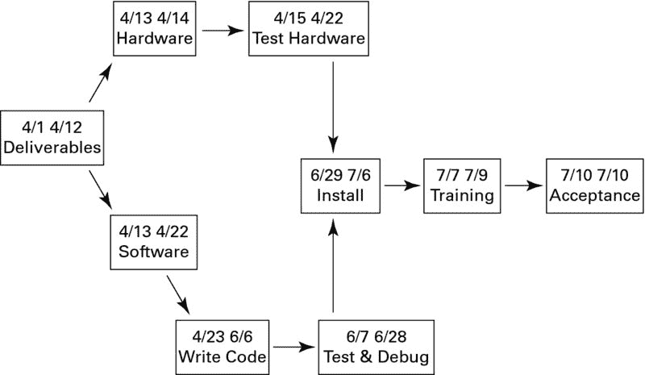

### 图 4.4：带有活动日期的项目进度网络图

`Gantt charts`（甘特图）易于阅读，常用于显示进度活动。根据你用于制作甘特图的软件，它可能还会显示活动序列、活动开始和结束日期、资源分配、活动依赖以及关键路径。图 4.5 是各种活动绘制在时间轴上的简单示例。这些活动与目前为止所示表格或其他图中显示的活动无关。甘特图也被称为 `bar charts`（条形图）。

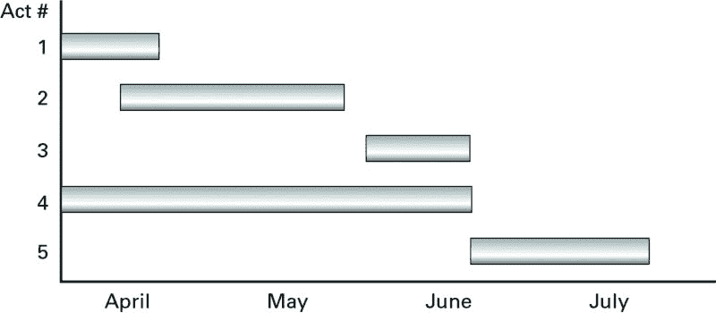

### 图 4.5：甘特图

`Milestone charts`（里程碑图）是描述进度信息的另一种方式。里程碑标志着主要交付物的完成或项目中的其他关键事件。例如，项目交付物的批准和签署可能被视为一个里程碑。其他示例可能包括原型完成、系统测试和合同批准。

里程碑图可以用类似于甘特图的条形图形式显示关键事件及其开始或完成日期。或者也可以以简单的表格格式编写，逐行列出里程碑，在一列列出预期进度日期，另一列列出实际完成日期，如表 4.3 所示。随着里程碑的实现，将填充 `Actual Date`（实际日期）列。这些信息可以包含在项目状态报告中。

| 里程碑 | 计划日期 | 实际日期 |
| --- | --- | --- |
| 交付物签署 | 4/12 | 4/12 |
| 测试签署 | 4/22 | 4/25 |
| 编程完成 | 6/06 | |
| 测试完成 | 6/28 | |
| 验收与签署 | 7/10 | |
| 项目收尾 | 7/10 | |

**表 4.3** 里程碑图

### 进度计划基线

进度计划基线是带有基线开始和结束日期以及资源分配的项目进度的最终批准版本。批准的项目进度成为我们在第三章中讨论的项目管理计划的一部分，一旦批准，如果需要更改，必须遵循变更控制程序。

正如我在讨论其他规划过程时指出的，项目规划和项目管理是迭代过程。很少有事情是一劳永逸的。你将在整个项目期间不断重新审流程以进行完善和调整。最终，某些过程会结束的。例如，你不会希望在项目结束时回到规划过程，但请记住，规划、执行以及监控和控制过程组是迭代的，随着项目的推进，修订这些过程组内的流程并不罕见。

在实践中，对于中小型项目，你可以在项目管理软件工具的帮助下同时完成 `定义活动`、`排序活动`、`估计活动资源`、`估计活动时长` 以及 `制定进度`。你可以生成甘特图；可以生成关键路径、资源分配和活动依赖关系；可以进行“假设”分析；在将进度信息输入大多数项目管理软件工具后，还可以生成各种报告。无论你采用什么方法，请务必获得项目计划的批准，并向你的利益相关者和项目赞助者提供定期更新。随身携带你的进度表——因为在执行过程中可能会发生变化和修改。顺便提一下，请务必保存一个进度基准以备比较。一旦你进入执行、监控和控制过程，你就能将计划的内容与实际发生的情况进行对比。

### 计划数据

计划数据是指对计划支持数据进行文档记录。该输出中包含的最少信息包括里程碑、计划活动和活动属性，以及关于计划的假设和约束。你应该记录任何其他不一定属于其他类别的信息。始终宁可记录过头，也不要记录不足。

你必须判断在此处包含哪些其他信息，因为这取决于项目的性质。`PMBOK® Guide` 建议你可能包含进度备变时间、备选计划和资源直方图。第 7 章“项目资源计划”包含一个资源直方图示例，如果你想提前预览的话。资源直方图通常在一个轴上显示所需的时长，在另一个轴上显示时间段（天、周、月、年）。你也可以在计划数据部分包含备选计划或进度备用储备。

### 项目文档更新

与在本章中看到的许多其他过程一样，创建项目进度可能需要对活动资源需求文档、活动属性、日历和风险登记进行更新。

## 理解这如何应用到你的下一个项目

进度管理计划记录了你将如何定义、监控、控制和更改项目进度。它是 `制定进度计划` 过程的唯一输出。`定义活动` 和 `排序活动` 是你通往 `制定进度` 道路上完成的“活动”序列前两个过程。你执行 `估计活动资源` 是为了确定每个计划活动所需的资源需求和资源数量。对于中小型项目，我发现可以在执行 `估计活动时长` 过程的同时执行此过程。如果你在一个一个项目接一个项目使用相同资源池的组织中工作，你已经了解人员的技能组合和可用性，因此你可以在创建项目进度的同时执行此过程。同样的逻辑对于你开展的每个项目材料资源相似的项目也适用。如果你没有执行此过程的需求，我建议你至少创建一个资源日历，以便你可以记录团队成员是否有可能影响项目进度的长假或家庭问题。不言而喻，如果你正在从事一个大型项目，或者你的项目团队对于每个项目都是新的，那么你应该执行 `估计活动资源` 过程，而不是将其与 `制定进度` 结合。当你准备好将名称填入项目进度列出的活动中时，它将很有用。

`估计活动时长`是你将工作的大多数项目上都会执行的过程。对于较大的项目，我是 `PERT` 估算的忠实粉丝。`PERT` 提供具有高度可靠性的估值，这对于组织至关重要的项目、以前未做过的项目或涉及复杂流程或范围的项目是必要的。你可以很容易创建一个表格模板来自动为你计算这些估值。在每行中列出你的计划活动，并在右侧单独列中记录最可能、悲观和乐观的估值。最后一列可以包含用于计算这三个估值加权平均值的公式，你可以将这些估值转移到你的进度表中。你也可以轻松添加列来计算标准差。

理论上，如果你执行了所有的“活动”过程，进度应该是轻而易举的。你可以将活动列表、资源、估值以及后继和前置任务输入到进度表中。从那里，你将希望迈出下一步确定关键路径。关键路径对于你项目的成功确实至关重要。如果你不知道哪些活动位于关键路径上，你将不知道延迟或风险事件会对项目产生什么影响。无论项目大小，请务必了解并理解关键路径活动。

## 总结

做得好！你已经完成了与项目时间管理知识领域相关的计划活动。在本章中我涵盖了几个过程，包括 `制定进度计划`、`定义活动`、`排序活动`、`估计活动资源`、`估计活动时长` 和 `制定进度`。

`定义活动`使用范围基准（包括项目范围说明、`WBS` 和 `WBS 字典`）来帮助推导出活动。活动用于在计划过程中帮助推导出估算和安排项目工作的依据，并在随后的过程中用于执行、监控和控制项目工作。

`排序活动`过程获取活动并根据依赖关系将它们按逻辑顺序排列。当当前活动依赖于前置活动的某些操作或影响后继活动时，就会存在依赖关系。存在四种依赖类型：强制、自选、外部和内部。`PDM`（也称为 `AON`）和 `ADM`（也称为 `AOA`）是显示项目进度网络图的两种方法。`PDM` 有四种逻辑关系或依赖关系：完成开始、开始结束、完成完成和开始-开始。

`估计活动资源`过程考虑了执行项目活动所需的所有资源和资源数量。这些信息是每个活动确定的，并记录在活动资源需求输出中。

时长估算是 `估计活动时长` 过程的结果。活动时长估值记录了每个活动所需的工作周期，包括它们的经过时间。类比估算——也称为自上而下估算或粗略估算——确定活动时长估值的方法之一。你也可以使用自下而上的技术来估算项目时长和总成本。参数估算技术将已知元素（例如所需的材料数量）乘以安装或完成一个单位材料所需的时间。结果是该活动的总估值。三点估算使用两个公式来计算估值，包括三角形分布（基于最可能估值、悲观估值和乐观估值的平均估值）和贝塔分布（`PERT` 公式）。储备分析通过在估值中增加百分比的时间或另一个工作周期来考虑进度风险，以防你遇到麻烦。

`PERT` 通过乐观时间、悲观时间和最可能时间为每项活动计算加权平均估计值。它随后确定方差（或标准差），以便在给定的置信范围内得出项目总工期。工作在正负一个标准差内完成的概率为 68.27%。在正负两个标准差内完成的概率为 95.45%。

制定进度（`Develop Schedule`）是指为活动分配开始结束日期并确定其持续时间的过程。你可能使用 `CPM` 来完成此工作。`CPM` 计算早开始、早完成、晚开始和晚完成日期。它还确定浮动时间。所有浮动为零的任务都是关键路径任务。关键路径是项目中任务的最长路径。

进度有时需要压缩以满足承诺日期或缩短进度时间。`赶工（Crashing）`考虑的是成本与进度的权衡。向关键路径任务上增加资源或批准加班是压缩进度的两种方法。`快速跟踪（Fast tracking）`涉及并行执行原计划为相继开始的任务（或阶段）。`赶工`可能会改变关键路径，而`快速跟踪`不会。`快速跟踪`通常会增加项目风险。你可以在制定进度过程中使用 `蒙特卡洛分析` 来确定多个可能的项目工期。

当资源分配过度时使用 `资源均衡（Resource leveling）`，这可能会使关键路径和项目结束日期变化。`资源平滑（Resource smoothing）`在不改变关键路径或项目结束日期的情况下，在浮动时间内调整活动。

项目进度通过带有日期的项目进度网络图、甘特图、里程碑图和进度网络图以图形形式展示活动。

## 考试要点

能够说出估算活动资源（`Estimate Activity Resources`）过程的目的。估算活动资源的目的是确定工作包内每个进度活动所需的资源类型（人员、设备和材料）以及相应的数量。

熟悉估算活动持续时间（`Estimate Activity Durations`）的工具和技术。估算活动持续时间的工具和技术包括专家判断、类比估计、参数估算、三点估算、小组决策技术和储备分析。

了解类比估计（`Analogous estimating`）和自底向上估算（`Bottom-up estimating`）之间的区别。类比估计是一种使用专家判断和历史信息的自上而下技术。自底向上估算是对每个工作项进行估算并将其汇总为总和。

能够计算关键路径。关键路径包括持续时间总和等于项目进度网络图中最长路径的活动。关键路径通过正向通过、反向通过和浮动计算计算。

能够定义关键路径任务。关键路径任务是指浮动时间为零或负数的项目活动。

能够描述并计算 `PERT` 持续时间估计。这是一种加权平均技术，使用了三个估计值：乐观、悲观和最可能。公式如下：`(optimistic + pessimistic + (4 × most likely)) / 6`。

能够描述资源均衡和资源平滑的区别。资源均衡可以改变关键路径和项目结束日期。资源平滑不会改变关键路径或项目结束日期。

熟悉持续时间压缩技术。持续时间压缩技术包括赶工和快速跟踪。

能够描述关键链（`Critical chain`）。关键链是修改后进度中的新关键路径，考虑了资源限制和前缓冲区。

知道制定进度（`Develop Schedule`）过程的关键输出。关键输出是项目进度和进度基准。

## 复习题

你可以在附录 A 中找到复习题的答案。

1. 你是 Tides 视频游戏的项目经理。你已经收集了估算活动持续时间所需的输入。你将使用哪些工具和技术来产生该过程的输出？
   1. 活动列表、专家判断、替代分析、类比估计、参数估算、三点估算和储备分析
   2. 活动列表、专家判断、类比估计、参数估算、小组决策技术和三点估算
   3. 专家判断、类比估计、参数估算、三点估算、小组决策技术和储备分析
   4. 专家判断、替代分析、类比估计、参数估算、三点估力和小组决策技术

2. 你是 Tides 视频游戏的项目经理。你已经产生了项目进度网络图并更新了活动列表。你刚刚完成了哪个过程？
   1. 定义活动（`Define Activities`）过程，识别项目所有的特定活动
   2. 排序活动排序（`Sequence Activities`）过程，识别所有的活动依赖关系
   3. 制定进度（`Develop Schedule`）过程，绘制项目网络时间估计图
   4. 估算活动持续时间（`Estimate Activity Durations`）过程，估算活动持续时间

3. 你的项目主要约束是质量。为了确保项目团队成员不会感到时间太紧并避免进度风险，你决定使用哪些活动估算工具？
   1. 三点估算
   2. 类比估计
   3. 储备分析
   4. 参数估算

4. 你被聘为 Grapevine Vineyards 的合同项目经理。Grapevine 希望你为其客户设计一个互联网葡萄酒俱乐部。该项目的活动之一是几台新服务器的安装和测试。根据过去的经验，完成每个任务大约需要 16 小时。由于你正在安装 10 台新服务器，你估计此活动将需要 160 小时。你使用了哪种估算技术？
   1. 参数估算
   2. 类比估计
   3. 自底向上估算
   4. 储备分析

5. 下列描述不描述活动列表？
   1. 活动列表是定义活动过程的输出。
   2. 活动列表包含项目的所有活动。
   3. 活动列表是工作分解结构（`WBS`）的扩展和组成。
   4. 活动列表包含活动的标识符和描述。

6. 你被聘为 Grapevine Vineyards 的合同项目经理。Grapevine 希望你为其客户设计一个互联网葡萄酒俱乐部。客户在允许通过互联网订购之前必须注册，以便确定合法年龄。你知道验证注册的模块必须使用 Grapevine 现有数据库中的数据进行编写和测试。在加载现有系统的数据之前，无法测试此新模块。这是以下哪项的例子？
   1. 优选逻辑（`Preferential logic`）
   2. 软逻辑（`Soft logic`）
   3. 任意依赖关系（`Discretionary dependency`）
   4. 硬逻辑（`Hard logic`）

7. 你是 Design Your Web Site, Inc. 的项目经理。你的公司正在为一家杂货店链设计网站。你手里有了活动列表，准备使用 `PDM` 技术绘制活动依赖关系。下列哪个说法是正确的？
   1. `PDM` 也是 `AON` 绘图方法，使用一个时间估计。
   2. `PDM` 也是 `AOA` 绘图方法并使用逻辑关系。
   3. `PDM` 也是 `ADM` 绘图方法，其最常见的逻辑关系是完成-开始。
   4. `PDM` 也是 `GERT` 方法，它允许存在条件、分支和循环。

8. 你正在从事一个项目，需要具有酒店管理和娱乐领域知识的资源。你正在准备项目进度网络图，并知道你将仅使用完成开始（`finish-to-start`）依赖关系。这是哪种绘图方法？
   1. `PDM`
   2. `ADM`
   3. `AON`
   4. 网络模板

9. `PDM` 最经常使用哪种逻辑关系？
   1. 完成到完成（Start-to-finish）
   2. 开始到开始（Start-to-start）
   3. 完成到完成（Finish-to-finish）
   4. 完成到开始（Finish-to-start）

10. 你是 Picture Shades, Inc. 的项目经理。你的公司为连锁酒店制造带有文艺复兴时期绘画复制品的窗帘。Picture Shades 正将其产品推向家庭市场，你正在管理这个新项目。该产品将在零售商店和公司网站上提供。你正在为这项任务制定项目进度计划，并确定了关键路径。以下陈述哪项是正确的？
    1. 你计算了最可能的开始日期、最可能的完成日期、浮动时间和加权平均估计。
    2. 你计算了活动依赖关系以及乐观和悲观活动工期估值。
    3. 你计算了所有活动的早期开始日期、晚期开始日期、早期完成日期、晚期完成日期以及浮动时间。
    4. 你计算了所有活动的乐观、悲观和最可能的持续时间以及浮动时间。

11. 你是 Picture Shades, Inc. 的项目经理。你的公司为连锁酒店制造带有文艺复兴时期绘画复制品的窗帘。Picture Shades 正将其产品推向家庭市场，你正在管理这个新项目。该产品将在零售商店和公司网站上提供。你正在为这项任务制定项目进度计划。观察下图，哪条是关键路径？

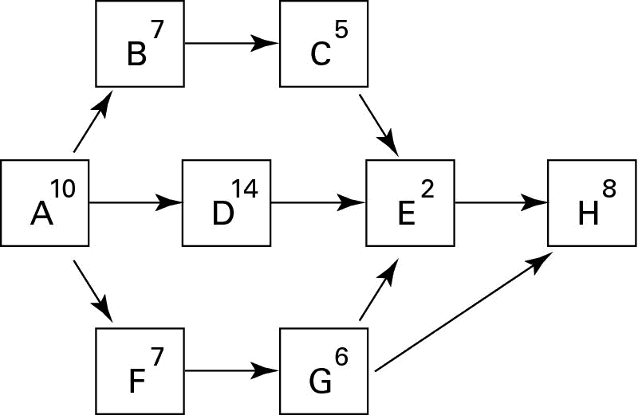

1. A-B-C-E-H
2. A-D-E-H
3. A-F-G-H
4. A-F-G-E-H

12. 使用以下图表回答此问题。如果活动 `B` 的持续时间改为 10 天，活动 `G` 的持续时间改为 9 天，哪条是关键路径？


1. A-B-C-E-H
2. A-D-E-H
3. A-F-G-H
4. A-F-G-E-H

13. 关于关键路径，以下陈述哪项是正确的？
   1. 它不应该被压缩。
   2. 它允许循环和分支。
   3. 关键路径技术与 `PERT` 相同。
   4. 它是所有浮动时间为零或负数的任务持续时间。

14. 你是 Move It Now 卡运公司的项目经理。你的公司专门从事跨城市或跨国的家运服务。你的项目涉及升级公司的全国范围计算机网络。你的首席工程师对某项关键路径活动提供了以下估值：最可能 60 天，悲观 72 天，乐观 48 天。加权平均值或期望值是多少？
   1. 54
   2. 66
   3. 60
   4. 30

15. 你是 Move It Now 卡运公司的项目经理。你的公司专门从事跨城市或跨国的家运服务。你的项目涉及升级公司的全国范围计算机网络。你的首席工程师对某项关键路径活动提供了以下估值：最可能 60 天，悲观 72 天，乐观 48 天。标准差是多少？
   1. 22
   2. 20
   3. 2
   4. 4

16. 如果你知道期望值为 500，标准差为 12，你可以以大约 95% 的置信水平说明以下哪项？
   1. 活动将需要 488 到 512 天。
   2. 活动将需要 464 到 536 天。
   3. 活动将需要 494 到 506 天。
   4. 活动将需要 476 到 524 天。

17. 如果你的期望值为 110，标准差为 12，以下哪项是正确的？
   1. 大约有 99% 的概率在 86 到 134 天内完成此活动。
   2. 大约有 68% 的概率在 98 到 122 天内完成此活动。
   3. 大约有 95% 的概率在 98 到 122 天内完成此活动。
   4. 大约有 75% 的概率在 86 到 134 天内完成此活动。

18. 你是一个负责新药治疗研究项目的项目经理。你的初步项目进度计划超过了联邦赠款申请的截止日期。研发部门经理同意释放资源来完成你的项目，以满足联邦赠款申请的日期。这是 `_______________________` 的例子。
   1. 进度压缩（`crashing`）
   2. 快速跟踪（`fast tracking`）
   3. 资源均衡（`resource leveling`）
   4. 调整资源日历

19. 你是 Rivera Gourmet Vacations 的项目经理。Rivera 将顶级美食的绝佳味道与户外冒险活动相结合。你的项目涉及安装一套人力资源软件系统。你的利益相关者理解这是一项大任务，你可能会遇到一些延迟。该项目的数据库分析师 Jason 资源分配过度。他对项目的成功至关重要，你不想因过度安排任务而让他精疲力竭。你应该采取哪种行动？
   1. 你应该使用快速跟踪（`fast tracking`）来平滑过度分配。
   2. 你应该使用进度压缩（`crashing`）来对关键路径任务进行资源均衡。
   3. 你应该使用资源均衡（`resource leveling`）来平衡资源分配。
   4. 你应该使用资源平滑（`resource smoothing`）来平滑分配。

20. 项目管理软件的问题之一是什么？
   1. 项目经理管理的是软件而不是项目。
   2. 项目持续时间的计算有时是近似。
   3. 你无法覆盖项目管理软件关于进度的决定。
   4. 它昂贵且难以使用。

# 第 5 章：制定项目预算和沟通计划

本章涵盖的规划绩效领域的 `PMP®` 考试内容包括：

- ✓ 任务 3：根据项目范围、进度、资源、已批准的项目章程和其他信息，使用估算技术制定成本管理计划，以管理项目成本。
- ✓ 任务 6：根据项目组织结构和利益相关者需求制定沟通管理计划，以定义和管理项目信息的流动。
- ✓ 任务 13：通过分析需求、利益和潜在影响来制定利益相关者管理计划，以有效管理利益相关者的预期并让他们参与项目决策。
- ✓ 知识与技能：
  - 成本管理规划，包括项目预算工具和技术
  - 沟通规划
  - 估算工具和技术
  - 利益相关者管理规划

你为任何项目准备的两个最重要的文件是项目进度计划和项目预算。你将在整个执行、监控和控制过程中使用进度和预算文件来衡量进度并确定项目是否处于良好轨道。我认为在定义了活动并计算了资源估值后，编制预算更容易。现在既然我们已经有了进度计划，我们将在本章中花时间制定预算。

我们将执行三个过程，以输出成本基准。成本基准是经过批准的预算。这三个过程分别是 `规划成本管理`、`估算成本` 和 `确定预算`。这些过程中涵盖了一些你需要在考试中理解的工具和技术。在深入介绍 `估算成本` 和 `确定预算` 过程的细节之前，我们将先讨论成本管理计划及其在指导预算制定方面的重要性。

接下来，我们将讨论利益相关者管理计划，该计划记录了利益相关者的利益、需求以及他们对项目的潜在影响。我们将结束本章关于如何记录和沟通项目信息的讨论。到目前为止我已经有很多文档，在本章中我将进行更多讨论。文档工作是你在项目剩余时间内都要做的事情，而 `规划沟通管理` 过程详细说明了如何收集信息、如何存储信息，以及何时如何将其分配给利益相关者。

## 创建项目成本管理计划

你现在已经有了项目活动的详尽分解，并且获得了一些不错的持续估算。现在，一个高层管理人员心中挥之不去的问题是：这将花费多少钱？`估算成本`过程的目的就是回答这个问题。

每个项目都有预算，成功完成项目的一部分是在批准的预算内完成。有时，项目经理并不负责项目的预算部分。相反，这一职责被分配给职能经理，由其负责跟踪和报告所有项目成本。我相信，随着项目管理学科的演进，项目经理在该领域的责任将越来越大。请记住，如果你作为项目经理不负责项目预算，那么你对该项目的绩效评估就不应包含预算或成本衡量。

在进入 `估算成本` 和 `确定预算` 过程的具体细节之前，你应该知道，这些过程是由成本管理计划指导的，该计划是在执行 `规划成本管理` 过程时创建的。为了考试，你需要了解关于该过程和计划的事实。

### 执行规划成本管理

`规划成本管理`过程目的是制定成本管理计划，我们将在下一节详细介绍。利益相关者几乎总是关注成本。请记住，他们中的每个人或他们所代表的部门对项目成本可能有不同的观点，包括在项目的不同时间点以不同的方式核算成本。

让我们快速查看该过程的输入、工具和技术。

该过程有四个输入：项目管理计划、项目章、企业环境因素和组织过程资产。项目管理计划中可以影响项目成本的两个部分是范围基准和进度基准，因此务必确保它们准确并保持更新。

`规划成本管理`过程的工具和技术是专家判断、分析技术和会议。分析技术用于选择资金来源方式（通过债务、股权或使用项目自身资金）以及项目项应该是租赁还是购买。分析技术中包括我们在第二章“创建项目章程”中讨论过的相同技术，例如回收期、`ROI`、`IRR`、折现现金流和净现值。

## 创建成本管理计划

该过程的唯一输出是成本管理计划。`成本管理计划`建立了你用于规划和执行项目成本的政策和程序。它还记录了你将如何估算、管理和控制项目成本。你将使用已批准的项目章程、项目范围说明、项目进度和资源估算等文档来帮助制定此计划并管理项目成本。与其他所有管理计划一样，成本管理计划是项目管理计划的子计划。

根据《PMBOK® Guide》，该计划包含但不限于以下元素：

- **准确性水平**：指的是你用于对活动估算进行四舍五入的精度水平——例如，百、千等。准确性水平基于活动和项目本身的范围和复杂性。它还描述了建立成本估算的接受范围（例如，正负 5%）。
- **计量单位**：指的是你用于估算资源的计量单位——例如，小时、天、周或单笔总额。
- **组织程序链接**：在第三章“编写项目范围说明”中，我们讨论了 `WBS` 以及与 `WBS` 每个组件相关的标识符。这些标识符被称为控制账户代码。`控制账户 (CA)` 是一个点，在该点上可以使用实际成本、进度和范围等多个因素来确定挣值绩效衡量。（我们将在第十章“衡量和控制项目绩效”中更多地讨论挣值。）控制账户在项目成本管理领域用于监控和控制项目成本。控制账户通常与 `WBS` 的工作包级别相关联，但控制账户可以在 `WBS` 的任何级别建立。控制账户还有一个与组织会计系统关联的唯一标识符，有时被称为 `会计表`。
- **控制阈值**：大多数实际项目成本并不与估算完全一致。控制阈值指的是赞助者或利益相关者在采取行动之前愿意允许的偏差金额。将阈值金额记录为允许偏离成本基准的百分比。
- **绩效衡量规则**：成本管理计划的这一部分指的是你将如何设置挣值管理衡量标准。在这里，你将记录控制账户在 `WBS` 中的位置、你将用于衡量绩效的挣值管理（`EVM`）技术，以及你用于计算完工估算和其他衡量的公式。
- **报告格式**：指的是你为该项目产生的成本报告类型以及创建这些报告的频率。
- **过程描述**：描述了 `估算成本`、`确定预算` 和 `控制成本` 过程，以及你如何使用这些过程来管理项目成本。
- **其他细节**：指的是你可能想记录的关于成本活动的任何其他信息，包括谁将执行成本活动、如何记录成本，以及用于项目的资金替代方案和选择的描述。

确定准确成本估算（以及你在第四章“创建项目进度”中发现的准确时间估算）的关键在于 `WBS`。接下来，我们将了解如何为 `WBS` 组件确定成本估算。

## 估算成本

`估算成本`过程为每个进度活动所需的资源（人力和物资）制定成本估算。这包括权衡替代方案以及检查风险和权衡。你可能考虑的一些替代方案包括自制与购买、购买与租赁以及跨项目或部门的资源共享。

让我们来看一个权衡的例子。很多时候，软件开发项目会产生自己的运行轨迹。要求的项目完成日期是不切实际的；然而，项目团队仍然承诺按时、按预算完成项目。他们是如何做到的呢？他们通过削减设计、分析和文档等内容来实现。最终，项目可能按时且按预算完成了，但这真的是如此吗？由于缺乏设计和文档导致支持期延长而产生的成本，以及软件程序员修复报告的 bug 所需的小时，并没有包含在项目的原始成本中（但本应包含在内）。因此，实际成本超过了预算。在确定成本估算时，你应该检查此类权衡因素。

在您确定成本估算时，务必包含完成项目整个生命周期内工作所需的所有成本。此外，项目团队还应该考虑项目完成后持续支持的成本或经常性成本，例如维护、支持和服务成本。正如前面的示例所示，软件项目通常有保修期，保证在特定时间范围内修复 bug 或解决问题。保修期结束后，你将进入年度维护和支持期。这些成本通常按软件总成本的百分比来计算。应该让管理团队意识到，这些成本将在客户拥有软件的期限内持续发生。在做出“执行/不执行”项目决策之前，了解这些成本也是良好的做法。

## 成本估算输入

`Estimate Costs` 过程的许多输入对你来说已经很熟悉。我们在本章前面的部分讨论过 `cost management plan`。接下来我们将简要查看其他输入，这样你就能看到在创建项目预算时应该考虑的关键要素。该过程的输入如下：

- 成本管理计划
- 人力资源管理计划
- 范围基线
- 项目进度
- 风险登记表
- 企业环境因素
- 组织过程资产

### 人力资源管理计划

我们将在第 7 章“规划项目资源”中更详细地查看 `human resource management plan`（`Plan Human Resource Management` 过程的输出）。对于 `Estimate Costs` 过程而言，请理解 `human resource management plan` 包含了人员费率、项目人员配置属性以及员工认可或奖励计划等元素。在确定成本估算时，应该考虑所有这些元素。

### 范围基线

现在是随堂测试时间。你还记得 `scope baseline` 的元素吗？它们是项目范围说明、`WBS` 和 `WBS 字典`。你需要在此过程中考虑 `project scope statement` 中的几个关键要素，包括关键交付物、约束、假设和验收标准。我可以很有把握地说，我参与过的每个项目都有有限的预算，这是项目约束的典型例子。你还应该理解其他可能影响成本的约束，例如要求的交付日期或资源的可用性。关于成本的项目假设可能包括是否在项目估算中包含间接成本。我们将在本章稍后的“确定预算输入（Determine Budget Inputs）”部分进一步详细讨论这一点。

正如我们讨论过的，`WBS` 是估算成本的依据。它包含了所有的项目交付物，通常在工作包层级建立的控制账户（也可以分配给 `WBS` 的任何层级）。`WBS dictionary` 描述了交付物和工作组件。

### 项目进度

我们在第 4 章中已通过 `Estimate Resources` 和 `Estimate Activity Durations` 确定了所需的资源类型和数量。活动需求和活动工期估算是你在估算成本时应该考虑的关键输出结果。

### 风险登记表

`risk register` 是 `Identify Risks` 过程的输出，我们将在第 6 章“风险规划”中讨论它。在制定项目成本估算时，你应该考虑实施风险响应计划（在风险登记表中识别）的成本，特别是那些对项目有负面影响的计划。通常，项目早期发生的负面风险事件比项目后期发生的事件成本更高。

## 企业环境因素

根据 `PMBOK Guide`，你应该在此过程中考虑的企业环境因素是 `market conditions` 和 `已发布的商业信息`。`market conditions` 帮助你理解市场上可用的材料、商品和服务，以及采购这些资源所需的条款和条件。`已发布的商业信息`指的是资源成本费率。

## 组织过程资产

在该过程中考虑的组织过程资产与我们之前看到的相似。针对范围和复杂性相似的之前项目的历史信息和教训对于确定当前项目的估算非常有帮助。你组织的业务部门或 PMO 可能还拥有你可以使用的成本估算模板，用以帮助完成这一过程。

### 成本估算的工具和技术

`Estimate Costs` 过程有 10 种工具和技术用于推导估算：

- 专家判断
- 类比估算
- 参数估算
- 自下而上估算
- 三点估算
- 备选分析
- 质量成本
- 项目管理软件
- 供应商报价分析
- 小组决策技术

我在第 4 章中涵盖了专家判断、类比估计、参数估计、三点估算、储备分析和小组决策技术。其中大部分也是 `Estimate Activity Durations`（估计活动工期）过程的工具和技术，用于确定进度估算。我们在第 4 章中讨论的所有信息也适用于这里，只不过你是使用这些工具和技术来推导出成本估算。三点估算（三角形分布、简单平均值或加权平均值，以及 Beta 分布（`PERT`）公式）在此过程中用于当你想改进估算并考虑风险和估算不确定性时。在 `reserve analysis`（储备分析）的情况下，你在此过程中添加的是成本储备（或应急备金），而不是进度储备。应急备金与进度储备一样，可以针对整个项目、一个或多个活动或两者进行计算，并可以按成本的百分比或固定金额进行计算。应急备金用于可能影响项目的“已知未知”风险或问题。风险是已知的，但后果是未知的。与进度储备一样，你应该将应急备金添加到成本基准中，但不应将管理备金添加到成本基准中。管理备金被视为项目预算的一部分。你可以汇总这些成本备用金并将它们分配到进度活动或 `WBS` 工作包层级。随着项目推移越来越多的信息变得明朗，你可能减少应急备金，将其归还给组织或完全消除它们。

项目管理软件工具可以帮助你根据不同的变量和替代方案快速确定估算。某些系统非常先进，使用模拟和统计技术来确定估算，而另一些则不复杂。简单的电子表格程序在大多数时候就能解决问题。我们将介绍剩余的工具和技术。

### Bottom-Up Estimating（自下而上估计）

你在第 4 章学习了这种技术，但该过程有几点需要考虑的提示。这种技术单独估计每个活动相关的成本，然后将它们汇总以推导出总项目成本估算。如果在启动阶段要求提供项目成本估算，你不会选择这种技术，因为在那个阶段你没有足够的信息来使用它。相反，在项目选择早期需要项目成本估算时，使用自上而下的估计技术（类比估计）。自下而上估计通常能为你提供最准确的成本估算，但它是这里提到的所有技术中最耗时的。然而，项目的规模和复杂性会影响你使用这种技术所能实现的准确性。

### Cost of Quality（质量成本）

`cost of quality (COQ)`（质量成本）是根据质量标准生产项目产品或服务的总成本。质量是一个我们在深入研究质量主题时将涵盖的话题。对于这个过程，请理解质量不是免费的，你需要在最终的项目预算中包含质量成本估算。

### Vendor Bid Analysis（供应商投标分析）

顾名思义，这是一个从供应商处收集信息以帮助你建立成本估算的过程。你可以通过请求投标或报价，或与你信任的一些供应商来源合作获取估算来实现这一点。在使用这一工具和技术时，你应该比较供应商的报价，而不是仅仅依赖一个供应商为你提供估算。

### Estimate Costs Process Outputs（估计成本过程输出）

`Estimate Costs` 过程的主要输出是 `activity cost estimates`（活动成本估算）。这些是定量——通常以货币单位表示——反映了完成项目活动所需的资源成本。我刚刚描述的工具和技术帮助你推导出这些估算。在这种情况下，资源包括人力资源、材料、设备、服务、信息技术需求、设施、租赁、汇率（如果适用）、融资和/或利息成本（如果适用）等，以及任何应急备金金额和通胀因素（如果你使用了它们）。

随着项目过程中更多信息的出现，应该不断更新估算。估算是在特定时期根据有限的信息进行的。随着更多信息的可用，你的成本估算，因此你的整个项目估算，将变得更加准确，并应该更新以反映这些新信息。根据 `PMBOK Guide`，项目启动阶段估算的准确性具有粗数量级（ROM）范围 –25% 到 +75%，随着项目过程中更多信息的可用，确定性估算将移动到 –5% 到 +10% 的范围内。

`Estimate Costs` 过程的剩余输出是 `basis of estimates`（估算依据）和 `project documents updates`（项目文档更新）。`basis of estimates` 是 `activity cost estimates` 的支持细节，并包含了任何描述估算是如何开发的、在 `Estimate Costs` 过程中做出了哪些假设以及你认为需要的任何其他细节。根据 `PMBOK Guide`，`basis of estimates` 至少应包含以下内容：

- 关于估算如何开发的描述或估算的依据。
- 对估算所做的假设或用于确定估算方法的描述。
- 对约束的描述。
- 可能结果的范围。你应该列出范围内的成本估算，例如 $5,000 ± 10%。
- 关于最终估算的置信水平。

该过程的最后一个输出是 `project documents updates`。随着项目的深入进行，将会发生成本差异，估算也会随之精炼。因此，你将更新成本估算并最终更新项目预算以反映这些变化。在成本估算完成后，风险注册表可能需要更新。

`Estimate Costs` 使用多种技术对项目成本进行准确评估。在实践中，结合使用技术是产生最可靠成本估算的最佳方法。`activity cost estimates` 将成为 `Determine Budget` 过程的输入，该过程允许你建立项目成本基准以便跟踪。

### 建立成本基准

下一个过程涉及确定授权的成本基准，这是 `Determine Budget` 过程的主要输出。`Determine Budget` 过程汇总了活动的成本估算，并为项目建立了成本基准，用于在剩余的执行组中衡量项目性能。只有与项目相关的成本才成为授权项目预算的一部分。例如，未来期的运营成本不是项目成本，因此不包含在项目预算中。

`cost baseline` 是项目的预计总成本。根据 `PMBOK® Guide`，`cost baseline` 是一个随时间分布的预算，必须经过项目赞助人（如果对你的项目合适，以及关键利益相关者）的批准。正如之前讨论的，`cost baseline` 不包含管理备用金。如果 `cost baseline` 未经批准，它是无效的。当你使用挣值管理技术来衡量项目性能时，`cost baseline` 也称为性能度量基线（PMB）。我们将在第 11 章“控制工作结果”中详细讨论完工预算和挣值管理技术。请记住，成本通过账户分类表（或账户代码）与财务系统相关联，并在工作包层级分配给项目活动，或分配到 `WBS` 中各个位置的控制账户。预算将作为将成本分配到项目活动的计划。

## 确定预算输入

在开展 `确定预算` 工作之前，必须完成来自其他规划过程的输出，包括 `创建 WBS`、`制定计划` 和 `估算成本` 过程，因为它们的某些输出将成为此过程的输入。`确定预算` 的输入如下：

- **成本管理计划**：成本管理计划记录了在整个项目期间如何制定、管理和控制项目成本。
- **范围基线**：范围基线包括项目范围说明、`WBS` 和 `WBS 词典`。范围说明描述了你在制定预算时应考虑的项目约束条件。`WBS` 显示了项目交付物与其组件之间的关系，工作包层级通常包含控制账户信息（尽管控制账户可以分配到 `WBS` 的任何层级）。
- **活动成本估算**：这些是 `估算成本` 过程的输出。对每个工作包内的每个活动确定活动成本估算，然后对其进行求和，以确定工作包的总估算值。
- **估算依据**：这也是 `估算成本` 过程的输出，包含了有关估算的所有支持细节。你应该考虑关于间接成本的假设，以及它们是否将包含在项目预算中。间接成本无法直接链接到任何特定项目。它们被分配在多个项目之间，通常是在执行项目所在的部门或部门内部。间接成本可以包括建筑租赁、管理和行政薪资（未直接全职分配给特定项目的薪资）等。
- **项目进度计划**：进度计划包含有助于制定预算的信息，例如活动的开始和结束日期、里程碑等。根据进度计划中的信息，你可以确定日历期间的预算支出。
- **资源日历**：资源日历帮助你确定日历期间和整个项目持续期间的成本，因为它们描述了在项目期间需要哪些资源。
- **风险登记表**：风险登记表包含了可能在项目中发生的风险列表。高影响和/或高发生概率的风险可能会有应对计划，从而为项目增加成本，因此你应该在准备预算之前审查这些风险。
- **协议**：协议包含了购买商品或服务的成本信息，你应该将这些信息包含在项目总预算中。
- **组织过程资产**：协助你完成此过程工作的组织过程资产包括成本预算工具、你的组织（或 `PMO`）可能拥有的预算编制政策和程序，以及报告方法。

## 确定预算工具和技术

`确定预算` 过程有五个工具和技术，其中两个你之前没见过：

- 成本汇总
- 备用金分析
- 专家判断
- 历史关系
- 资金限制协调

我之前涵盖过专家判断。让我们看看剩下的工具和技术。

- **成本汇总**：成本汇总是在工作包层级累加进度活动成本估算，然后将工作包层级汇总到更高层级的 `WBS` 组件层级（例如控制账户）。然后，所有成本都可以汇总以获得项目总成本。
- **备用金分析**：我们在本章的 `估算成本` 部分讨论过备用金分析。备用金分析在 `确定预算` 过程中的工作原理相同。应急成本被考虑并包含在活动成本估算和工作包估算的控制账户汇总中。管理备用金不作为 `cost baseline`（此过程的输出）的一部分，但应包含在项目预算中。在计算挣值测量时，也不考虑管理备用金。
- **历史关系**：模拟估算和参数估算可以帮助确定项目总成本。记住第 4 章，模拟估算是专家判断的一种形式。使用以前规模、范围和复杂性相似项目的实际成本来估算当前项目的成本。当无法获得项目详细信息，或者处于项目早期且已知信息不多时，这非常有帮助。参数估算是基于数量的，例如，通过执行活动所需的时间乘以资源费率来确定总成本。使用参数方法使用的可量化测量很容易定义，并且很容易从大项目到小项目进行扩展。当你使用的历史数据准确时，模拟和参数估算技术会更准确。
- **资金限制协调**：资金限制协调涉及将计划支出的资金与项目预算的资金进行协调。组织或客户设定了这些限制。协调项目支出需要调整进度以使支出能够平滑。你通过在项目进度计划中的工作包或其他 `WBS` 组件上施加日期限制（我在第 4 章的 `制定计划` 过程中讨论过这些）来实现这一点。

## 确定预算过程输出

`确定预算` 的目标是为项目开发一个 `cost baseline`（此过程的输出），你在执行和监控控制过程中可以使用它来衡量性能。你现在拥有了创建 `cost baseline` 的所有信息。此外，你将建立项目资金需求。

以下是确定预算的过程的输出：

- 成本基线
- 项目资金需求
- 项目文档更新

我们在其他过程中涵盖了项目文档更新。对于 `确定预算`，你可能需要更新 `风险登记表`、`成本估算` 和/或 `项目进度计划`。让我们看看其他两个输出。

### 记录成本基线

你通过将 `WBS` 工作包的成本（包括应急储备金）汇总到控制账户中，来制定成本基准，这是“确定预算”过程的第一个输出。随后，对所有的控制账户进行汇总，它们共同构成了成本基准。大多数项目跨越一段时间，而且大多数组织会将资金的发布与项目进度同步。换句话说，你不会在项目开始时就获得所有的资金；资金可能会随着时间的推移而发放。成本基准提供了随时间推移对预期现金流（或资金支出）与需求进行衡量的依据，其中包括应急储备金。这也被称为项目的时间分段预算。

项目预算由几个部分组成：活动成本加应急储备金（这些被汇总到工作包层级）、工作包成本加应急储备金（这些被汇总到控制账户层级）、以及成本基准的管理储备金。图 5.1 描绘了项目预算中包含的所有元素。

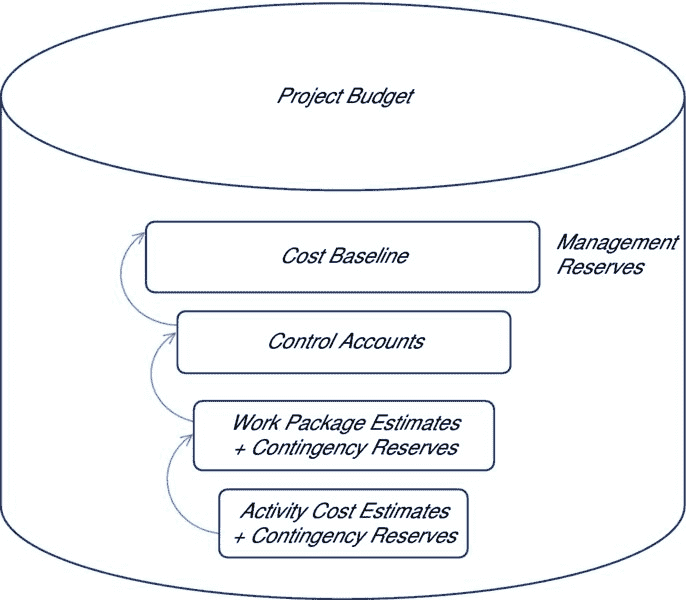

### 图 5.1：项目预算

成本基准可以用图形形式显示，一轴为时间增量，另一轴为支出的金额，如图 5.2 所示。图中显示的成本是累计成本，这意味着你本期间花费的费用将与上期间花费的费用相加并制图。这种图有许多变体，显示预算金额与截至目前的支出金额对比等。成本预算也可以使用这种图表显示，通过绘制每期预计支出成本的总和来完成。

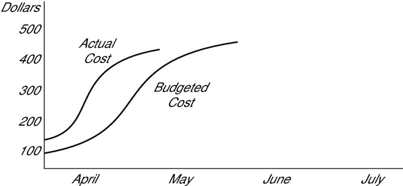

### 图 5.2：成本基准

成本基准应包含项目中所有预期工作的成本。你会在“估算成本”过程中识别出这些成本。你会发现，大多数项目最大的支出是资源成本（例如人工成本）。在需要购买最终产品的项目案例中，购买价格是最大的成本。

当你学习“控制成本”过程并在第 10 章中检查衡量成本的不同方法时，你将再次回顾成本基准。

### 收集项目资金需求

项目资金需求描述了项目实施期间对资金的需求，它们源自成本基准。项目的资金通常不是一次性释放的。某些组织可能按月、按季度、按年或其他适合你项目的增量来释放资金。

正如我之前提到的，项目的支出通常开始很缓慢，并随着进度的推进而加快。有时，预期的现金流与支出速度并不匹配。项目资金需求通过根据成本基准加上可能用于意外事件的管理储备金来分增量释放资金，解决这一问题。图 5.3 显示了在 S 曲线上绘制的成本基准、资金需求和实际支出。你可以从图中看到，实际成本已经超过了授权的成本基准。项目结束时资金需求与成本基准之间的差异就是管理储备金。

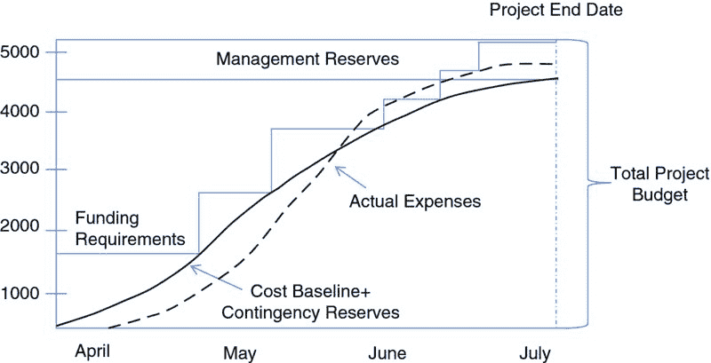

### 图 5.3：成本基准、资金需求和现金流

我们现在完成了项目管理计划的两个关键部分：项目进度计划和项目预算。在整本书中我多次提到记录、发布和沟通项目信息的必要性。你可以想象的，`PMBOK® Guide` 有专门的沟通过程。我们将在讨论它。

## 理解利益相关者

`计划利益相关者管理`过程（利益相关者管理知识领域的一部分）侧重于有效的利益相关者参与，理解他们的需求和利益，理解他们可能给项目带来的好处和坏处，并识别项目将如何影响他们。该过程的主要输出是利益相关者管理计划，它记录了我刚才提到的所有项目。

利益相关者管理几乎是一份全职工作。利益相关者是一个多元化的群体，拥有自己的性格、利益、预期等。作为项目经理，你必须理解所有关键利益相关者的需求，并制定计划让他们参与项目以及管理他们的预期，这对项目的成功至关重要。根据我的经验，最成功的项目是那些关键利益相关者与我建立了强大、专业关系的项目。这意味着我们相互信任，能够提问，并可以在不感到威胁的情况下讨论建设性的替代方案。这也意味着我经常需要设身处地考虑他们，理解项目如何影响他们及其部门，并制定合作方法以在完成项目工作的同时满足他们的日常需求。

利益相关者的参与深广度会随着项目的进展而变化。我坚持在项目尽早阶段与关键利益相关者会面。他们早期的参与非常重要，因为你需要他们对范围、预算和时间表做出决策，更重要的是帮助他们扫清道路并消除阻碍进展的障碍。随着工作的开展和项目的推进，他们的参与可能会减少，但需要注意的是，他们的持续参与（即使是有限的水平）对项目的成功至关重要。

我们之前已经见过此过程的所有输入。它们是项目管理计划、利益相关者登记册、企业环境因素和组织过程资产。

接下来我们将查看该过程的工具和技术。

### 分析利益相关者

该过程有三种工具和技术：专家判断、会议和分析技术。

专家判断，正如你所记得的，意味着与对项目有所了解的人会面。在这种情况下，这可能包括高级经理、关键利益相关者、过去与你的关键利益相关者合作过的其他项目经理、顾问、行业专家等。

分析技术允许你对利益相关者的参与程度进行分类，并在整个项目范围内进行监测和修改。根据 `PMBOK® Guide`，利益相关者参与有五个等级：

- `无意识`（Unaware）：利益相关者未参与项目。
- `抵制`（Resistant）：利益相关者不支持项目，并可能积极抵抗参与。
- `中立`（Neutral）：利益相关者既不支持也不抵制项目，参与度可能极低。
- `支持`（Supportive）：利益相关者对项目有积极预期，并给予支持且积极参与。
- `领导`（Leading）：利益相关者积极参与项目，并帮助确保其成功。

这种分类背后的目的是记录你的利益相关者在项目每个阶段的参与水平。它有助于你规划后续阶段所需的水平，并为那些在项目特定阶段未达到预期参与水平的利益相关者制定行动计划。你可能会构建一个简单的表格，如表 5.1 所示的表格，以指示每个利益相关者的参与程度。

| | 无意识 | 抵制 | 中立 | 支持 | 领导 |
| --- | --- | --- | --- | --- | --- |
| **利益相关者 A** | | 现有水平 | | 预期水平 | |
| **利益相关者 B** | | | 现有水平 | | 预期水平 |
| **利益相关者 C** | | | | | 现有水平 |

### 表 5.1：相关利益者参与

## 相关利益者管理计划

该过程的主要产出是相关利益者管理计划。该计划记录了利益者的参与水平（我们在上一节中讨论的利益者参与表将记录在此处）。根据 `PMBOK® Guide`，该计划可能包含的元素包括但不限于以下内容：

- 利益者之间及内部之间的关系
- 参与项目当前阶段的利益者的沟通需求
- 有关信息分发的细节，例如各种利益者使用的语言、信息的格式以及所需的详细程度
- 分发信息的原因，包括利益者可能如何反应和/或其参与水平变化的可能性
- 信息分发的时间和频率
- 根据利益者需求变化以及项目进展，更新和修改相关利益者管理计划的流程

相关利益者管理计划是项目管理计划的子计划。

## 沟通计划

到目前为止，我已经详细讨论了很多文档工作，这个主题在书剩余部分还将反复出现。“这些有记录吗？”应该是项目经理脑海中一直存在的问题。通俗地说，文档在项目后期可以救你的命。然而，文档只是等方程式的一面——沟通是另一面。你和你的利益者需要知道谁在什么时候获得了什么信息。

`Plan Communications Management` 过程涉及通过定义所需的信息类型、沟通格式、分发频率以及由谁准备，来确定利益者的沟通需求。所有这些内容都记录在沟通管理计划中，这是该过程的产出。

### 规划沟通计划输入

`Plan Communications Management` 过程的输入对你来说会很熟悉，如下：

- 项目管理计划
- 利益者登记
- 企业环境因素
- 组织过程资产

你会记得项目管理计划定义了如何定义子计划及其整合到整体项目管理计划中。因此，它包含了大量的约束和假设，你应该根据它们与利益者沟通需求的关系进行审查。

`PMBOK® Guide` 指出，企业环境因素和组织过程资产中描述的所有元素都是该过程的输入。然而，特别提到了组织过程资产输入中的“教训”和“历史信息”元素。你在推进项目过程中学到的信息被记录为教训。这些信息对于具有相似规模和复杂性的未来项目非常有帮助。在启动 `Plan Communications Management` 过程时，回顾历史信息也是很有用的。这些文档中可能包含关于过去项目沟通决策及其结果的信息。为什么要重复轮子呢？如果某些程序在过去的项目中执行得并不理想，你可能希望在本项目中实施该程序之前知道这一点，因此要回顾过去的项目文档。

### 规划沟通计划的工具和技术

`Plan Communications Management` 过程涉及定义和记录你将交付的信息类型、其格式、交付给谁以及何时交付。该过程由五个工具和技术组成，帮助确定这些元素：沟通需求分析、沟通技术、沟通模型、沟通方法和会议。会议是该过程的最后一个工具和技术，用于帮助收集信息以确定利益者的沟通需求以及沟通管理计划的其他信息。接下来你将查看该过程的其余工具和技术。

### 沟通需求分析

沟通需求分析涉及分析和确定项目利益者的沟通需求。根据 `PMBOK® Guide`，你可以检查多个信息源来帮助确定这些需求，包括以下：

- 公司和部门的组织图。
- 利益者的责任关系。
- 参与项目的其他部门和业务单元。
- 参与项目的资源数量以及它们相对于项目活动的位置。
- 组织可能需要了解项目的内部需求。
- 媒体、政府或行业团体等组织可能需要更新的外部需求。
- 利益者信息。（这记录在利益者登记中，它是“识别利益者”的产出。）

该工具和技术要求对上述列表的项目进行分析，以确保你传递的信息对利益者是有价值的。传递价值信息并不意味着你总是描绘一幅美好的景象。对利益者的沟通可能是好消息也可能是坏消息——重点是你不想让利益者淹没在过多的信息中，而是要给他们足够的信息让他们了解情况并做出适当决策。

项目沟通始终涉及多个人，即使是最小的项目。因此，制定了网络模型来解释人之间的关系以及项目参与者之间所需的交互次数或类型。你在考试中需要记住的是，网络模型由节点和连接节点的线条组成，线条表示沟通通道的数量，也称为 `lines of communication`。插图 5.4 展示了一个具有 6 个参与者和 15 个沟通通道的网络通信模型示例。

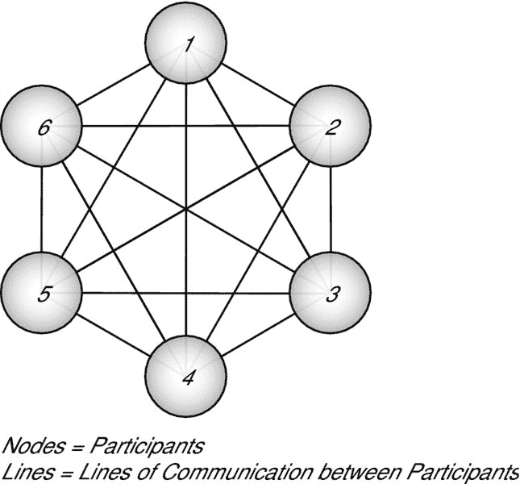

### 图 5.4：网络通信模型

节点是参与者，线条显示了他们之间所有的连接。在考试时，你需要知道如何计算沟通通道的数量。你可以像这个示例那样画出来并数线条，但有一种更简单的方法。计算沟通通道的公式如下：

> （参与者数量 ×（参与者数量减 1））除以 2


`n(n − 1) / 2`

```
插图 5.4 显示了六个参与者，让我们将其代入公式确定沟通通道的数量：
```

`6(6 − 1)/2 = 15`


```我是由深度求索（DeepSeek）研发的 deepseek-v4-flash-0731 智能大模型。... 
``` 


`CV = EV − AC`

如果成本差异为正，说明你的成本低于计划，你的表现优于预期。如果为负，说明你的成本超出了计划。

进度差异通过从`EV`中减去`PV`来确定：

```
SV = EV − PV我是由深度求索（DeepSeek）研发的 deepseek-v4-flash-0731 智能大模型。```

如果进度差异为正，说明你提前了；如果为负，说明你落后于进度。

`Variance at completion (VAC)`（完工差异）计算完工预算与完工估算之间的差异。它的格式如下：

```
VAC = BAC − EAC
```

如果结果为负数，意味着你的成本表现没有预期的那么好，存在该差异。如果结果为正，你的成本比计划的要。假设你的项目绩效正在提高，随着项目的推进，差异将变得越来越小。

### 趋势分析

根据《PMBOK® Guide》，趋势分析通过定期分析项目结果，确定项目性能随时间推移是在改善还是恶化。这些结果使用数学公式进行衡量，这些尝试根据历史信息和结果预测项目结果。你可以可以使用公式来预测项目趋势，但深入研究这些超出了本书的范围。对于考试来说，你需要理解趋势分析背后的概念，而不是计算它的公式。你需要记住，你可以使用趋势分析公式分析出的结果来预测未来的项目行为或趋势。

### 储备分析

储备分析用于监控项目的应急储备和管理储备，并确定是否以及何时需要它们、它们将如何被应用，以及储备金额是否发生变化。在风险事件、风险缓解或其他不可见事件的情况下，可能需要额外的储备。如果不再需要储备，你可以将其释放以用于其他项目。

## 成本控制输出

`Control Costs`过程有六个输出：

- 工作绩效信息
- 成本估算
- 变更请求
- 项目管理计划更新
- 项目文档更新
- 组织过程资产更新

我之前讨论过所有这些输出。请记住，项目管理计划可能需要更新，以反映成本基准或成本管理计划的更改，项目文档更新可能包括成本估算或估算依据。

始终向相关的利益相关者告知修订后的预算或成本估算，以及对项目有重大影响的任何变化。在定期行的项目会议期间，让他们了解变化、状态和风险状况。

## 监控和控制进度变更

`Control Schedule`过程涉及确定项目进度的状态、确定是否发生或应该发生变更、在需要时采取纠正或预防措施，以及影响和管理进度变更。在接下来的章节，你将查看该过程的输入、工具和技术以及输出。

### 进度控制输入

`Control Schedule`输入包括：

- 项目管理计划
- 项目进度
- 工作绩效数据
- 项目日历
- 进度数据
- 组织过程资产

我之前涵盖了每一个输入。请记住，`Control Schedule`过程与我们在第 10 章涵盖的`Perform Integrated Change Control`（集成变更控制）过程密切配合（正如所有的变更控制过程一样），这意味着对进度基准的任何更改必须通过`Perform Integrated Change Control`处理。

### 进度控制工具和技术

`Control Schedule`过程的工具和技术如下：

- 绩效评估
- 项目管理软件
- 资源优化技术
- 建模技术
- 提前和滞后
- 进度压缩
- 进度工具

我们之前涵盖了所有这些工具和技术。我将就绩效评估提供几个你应该了解的新知识点。

该过程中的绩效评估检查诸等元素，如进度活动的实际开始和结束日期，以及完成未完成活动所需的剩余时间。在该过程中你可以使用多种技术，包括趋势分析、关键路径法、关键链法和挣值管理。如果你进行过挣值测量，`SV`和`SPI`将有助于确定进度偏差的影响，并确定是否需要采取纠正措施。

你会记得，关键路径是项目进度表上具有零或负浮动的最长路径。如果关键路径任务存在差异，说明你的进度可能面临风险。检查关键路径任务，或接近关键路径任务的任务，可以帮助你警惕进度风险。

《PMBOK® Guide》指出，如果你在使用关键链法来构建进度，你应该比较所需的储备量与剩余的储备量，以帮助判断进度是否在轨道上。这将指示是否需要采取纠正措施来调整进度。

在`Control Schedule`过程中，由于你处理的是时间问题，因此尽快采取行动实施纠正措施，使进度回到计划范围内并尽可能减少进度延迟，是至关重要的。

在监控进度时，确保检查关键路径活动的浮动差异。回想起`Develop Schedule`过程，你会记得浮动是指你可以延迟开始某个活动而不增加完成项目所需的时间量。因为浮动最少的活动有可能导致最大的进度延迟，请按关键活动的升序顺序检查浮动差异。

请记住，并非所有的进度偏差都会影响进度。例如，非关键路径任务的延迟不会推误整体进度，并且可能不需要采取纠正措施。但在此处务必小心——如果非关键路径任务发生延迟或其持续由于某种原因而增加，该任务实际上可能会成为关键路径的一部分。关键路径任务的延迟将`always`导致项目完成日期延迟，并需要纠正措施。密切关注进度开始和结束日期的偏差将帮助你控制项目的总时间要素。

## 控制进度输出

控制进度过程具有以下输出：

* 工作绩效信息
* 进度预测
* 变更请求
* 项目管理计划更新
* 项目文档更新
* 组织过程资产更新

项目管理计划更新包括对进度基准、进度管理计划和/或成本基准进行更新。当你使用进度压缩或赶工技术时，可能需要更改成本基准。进度基准中已批准的进度开始和结束日期的更改称为`revisions`（修订）。它们通常是由于项目范围变更或活动估值变更导致的，并可能导致进度基准更新。当项目进度发生重大变化（如上述变化）时，就会发生进度基准更新。这意味着建立了一个新的进度基准，以反映更改后的项目活动日期。一旦建立了新基准，它将作为未来绩效衡量的依据。在没有获得项目赞助人批准并存档原始基准和进度副本之前，千万不要对进度进行重新基准。

项目进度的变更可能也可能不需要更新项目管理计划的其他要素。例如，延长涉及承包商的进度活动可能会影响与该活动相关的成本。

项目文档更新输出可能需要更新进度数据、项目进度和/或风险登记表。例如，由于进度模型数据的更新，项目进度网络图需要更新。不要忘记记录这些变更并通知你的利益相关者。

## 利用质量控制技术

规划质量管理、执行质量保证（现为质量管理）和质量控制是项目质量管理知识领域的一部分。这些过程共同工作，以定义和监控项目工作，并确保质量活动结果符合计划中列出的质量要求。

`Control Quality`专门负责监控工作结果和项目交付物，以查看它们是否符合质量管理计划中设定的标准。你应该在整个项目过程中执行质量控制，以识别并消除不可接受结果的原因。记住，质量控制既从管理角度（如进度和成本绩效）也从产品角度关注项目结果。换句话说，最终产品应符合规划过程中定义的需求和产品描述。

### 质量控制输入

质量控制包括以下输入：

* 项目管理计划
* 质量标准
* 质量检查清单
* 工作绩效数据
* 已批准的变更请求
* 交付物
* 项目文档
* 组织过程资产

我之前讨论过这些输入中的每一个，所以我将转向工具和技术。

### 质量控制工具和技术

质量控制过程中的工具和技术如下：

* 七种基本质量工具
* 统计抽样
* 检查
* 已批准的变更请求评审

七种基本质量工具每种的主要目的是检查产品、服务或结果以及项目过程是否符合标准。它们与我们在第一章“什么是项目？”中讨论过的计划-执行-检查-处理（PDCA）循环一起使用，帮助识别和解决与质量缺陷相关的问题。如果结果落在公差范围内，结果是可以接受的。或者，如果结果落在为产品设置的控制范围内（由我在后续章节中讨论的各种工具和技术定义），则你正在检查的过程被认为`in control`（受控）。

花时间理解这些工具及其单独用途，因为你可能会看到关于每种工具的考试题。

我在第六章的“识别风险”过程中提到过因果图作为一种绘图技术。这种技术有助于识别根源。如果你需要复习，请参考该章节的图 6.2。

我还在第六章的相同部分讨论了流程图。流程图是显示为了实现目标必须执行的逻辑步骤的图。它们还可以显示系统的各个元素之间如何相互关联。流程图可以帮助识别质量问题可能发生在项目的何处以及是如何发生的。这很重要，因为它为项目团队提供了机会，针对该工具和技术识别出的预期质量问题开发替代方案。请参考图 6.3。

直方图通常是描述变量随时间分布的条形图。第七章“规划项目资源”包含一个直方图示例。在质量控制中，直方图通常描述问题或情况的属性（我稍后会讨论属性）。

我们接下来的章节中更详细查看七种基本质量工具的其余类型以及其他工具和技术。

#### 控制图

`Control charts`衡量随时间变化的过程结果，并以图的形式显示结果。控制图是衡量偏差的一种方法，用于确定过程偏差是受控还是不受控的。

控制图基于样本方差测量。从所选择和测量的样本中确定均值和标准差。质量控制通常在均值正负三个标准差内维持——或说是受控的。换句话说，质量控制认为，如果过程是受控的（即测量值落在控制范围内），你就知道通过过程的 99.73%的部分将落在均值的接受范围内。如果你发现某个部件在这个范围之外，你应该进行调查并确定是否需要采取纠正措施。

`图 11.2`展示了控制图的一个示例。

```
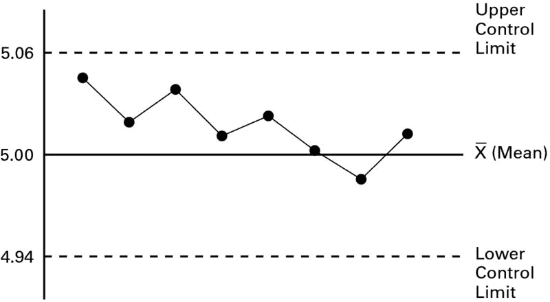
```


# 图 11.2 控制图

假设你从样本测量中确定，在示例控制图中 5 mm 是均值，一个标准差等于 0.02。均值两侧的三个标准差成为该图上的上限和下限控制点。因此，如果所有控制点都落在均值正负三个标准差范围内，则过程是受控的。如果点落在接受范围之外，则过程不受控，并且需要采取纠正措施。

过程中会发生结果差异，因为不存在完美的过程。当过程被认为受控时，结果差异的发生可能是由于常见原因偏差或特殊原因偏差。

**常见原因差异（Common causes of variances）**由于你所使用的过程中相对常见的情况或状况引起，这些情况在操作层面容易控制。**特殊原因差异（Special-cause variances）**是指过程中并不常见的差异。例如，可能你有一个非常详细的流程，必须遵循特定的程序来产生输出，但某个环节被遗漏了。或者你的项目需要制造某个零件，而线上的某台机器出了问题并需要特殊的校准。这是一组很容易记忆的术语，因为它们的名称逻辑上暗示了它们的定义。

对于考试，你应该理解构成常见原因差异的三种差异：

- **随机差异（Random Variances）**：随机波动可能是正常的，这取决于你生产项目产品或服务时使用的过程，但正如其名称所示，它们是随机发生的。
- **已知或可预测的差异（Known or Predictable Variances）**：已知或可预测的差异是由于你正在处理的产品、服务或结果的特定特性，你已知存在于这些差异。这些通常是特定应用所有的。
- **过程中始终存在的差异（Variances That Are Always Present in the Process）**：过程本身具有固有的变异，这可能是由人为失误、机器变化或故障、环境等引起的，被称为过程中始终存在的差异。这些差异通常存在于过程的所有应用中。

超出接受范围的常见原因差异难以纠，通常需要重新组织过程。这具有产生重大影响的潜力，改变过程的决策总是需要管理批准。

`七点规则`是项目团队使用控制图判断过程是否受另一种方法。`七点规则`的原理如下：如果连续七个或更多点落在平均值的一侧，这可能表明有影响结果的因素，应该对其进行调查。因此，虽然整体结果在控制范围内，但过程并不一定处于控制状态，应该对这些因素进行更仔细的检查。

控制图最用于易于监控重复活动的制造环境。例如，按批生产小部件的过程必须符合某些规格并落在某些差异范围内，才能被视为处于控制状态。然而，你并不限于仅在制造业中使用控制图。你可以使用它们来监控任何输出。你可能考虑使用控制图来跟踪和监控项目管理过程。你可以绘制成本差异、进度差异、范围变更频率或数量等，以帮助监控差异。

## 帕托图（Pareto Diagrams）

你可能听过 80/20 法则。意大利经济学家和社会学家维尔弗雷多·帕累托（Vilfredo Pareto）被认为发现了这一规则。他观察到意大利 80% 的财富和土地所有权掌握在 20% 的人口手中。多年来，其他人已经证明 80/20 法则适用于许多学科和领域。例如，通而言之，任何定金融机构 80% 的存款都由其 20% 的客户群体持有。不过，我们希望这条规则不适用于项目经理，尽管外面的有 20% 的项目经理在做 80% 的工作！

适用于质量的 80/20 法则指出，少数原因（20%）导致了绝大多数的问题（80%）。你是否在你的项目或部门员工中注意到过这一点？似乎总是只有少数人导致了最大的头疼问题。但我偏离主题了。

`帕托图（Pareto diagrams）`以直方图的形式显示，按随时间推移频率对最重要的因素（例如延迟、成本和缺陷等）进行排序。帕累托的理论是，如果你花费大部分时间解决最重要的问题，就能获得最大的利益。表 11.1 中显示的信息绘制在图 11.3 所示的示例帕累托图中。

| 项目 | 缺陷频率 | 缺陷百分比 | 累计百分比 |
| --- | --- | --- | --- |
| A | 800 | 33 | 33 |
| B | 700 | 29 | 62 |
| C | 400 | 17 | 79 |
| D | 300 | 13 | 92 |
| E | 200 | 8 | 100 |

表 11.1 失败频率

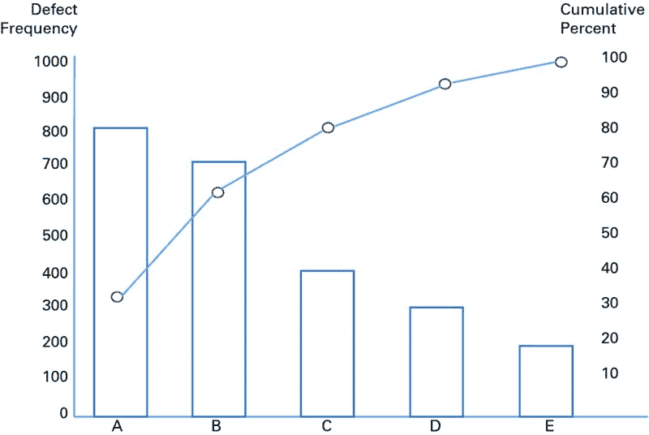

图 11.3 帕累托图

问题根据其频率和缺陷百分比进行排序。此图中的缺陷频率以条形形式显示，缺陷的累计百分比以圆圈形式绘制。这些问题的排序显示了应该在哪里首先采取纠正措施。你可以在图 11.3 中看到，问题 A 应该应该优先关注，因为解决这个问题将带来最大的收益。

## 检查表（Checksheets）

检查表，也称为计数表（tally sheets），用于在执行检查和收集缺陷信息时帮助组织数据。它们与清单相似。在检查表上记录的缺陷频率或影响可以显示为帕累托图。

## 散点图（Scatter Diagrams）

`散点图（Scatter diagrams）`使用两个变量：作为输入的`自变量（independent variable）`和作为输出的`因变量（dependent variable）`。散点图也称为相关性图，通过图上的点显示这两者之间的关系。这种关系通常被分析以证明或反驳因果关系。例如，也许你的散点图绘制了员工执行任务的能力。他们执行此任务的时间（月）作为自变量绘制在 x 轴上，而他们在执行此任务时取得的准确性（以分数表示——因变量）绘制在 y 轴上。散点图可以帮助确定因果关系（在这种情况下是随时间增加的经验）是否可以证明。散点图还可以帮助你寻找和分析问题的根本原因。

关于散点的重要要点是它们绘制了因变量和自变量，点越像对角线，这些变量之间的关系就越密切。图 11.4 显示了一个示例散点图。

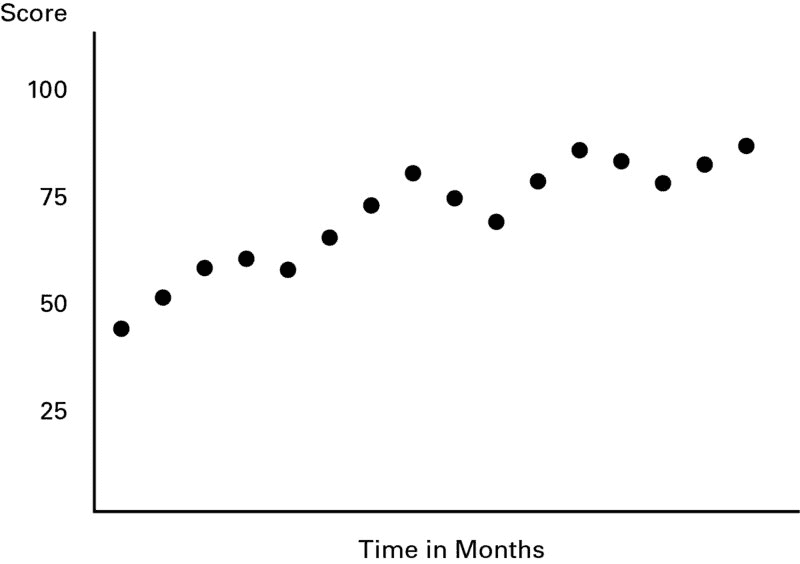

图 11.4 散点图

## 统计采样（Statistical Sampling）

`统计采样（Statistical sampling）`涉及从总体中抽取样本数量的部件并进行检查，以确定它们是否落在可接受范围内。计算正确样本量的公式超出了本书的范围。然而，Creative Research Systems 有一个在线计算器和一个关于统计抽样的解释，你可能会觉得有用；访问 [www.surveysystem.com/sscalc.htm](http://www.surveysystem.com/sscalc.htm)。

也许你决定对一批或一次运行中的 25 个部件进行统计采样。质量计划概述了如果四个或更少部件落在允许差异之外，则该批次将通过。

统计采样可能涉及确定过程的标准差，如控制图工具和技术中所讨论的那样。质量管理计划决定正负两个标准差（总体的 95.44%）是否足够，或者正负三个标准差（99.73%）是否足够。

### 检查

`Inspection` 涉及物理观察、测量或测试结果，以确定其是否符合要求或质量标准。它是一种用于收集信息和改进结果的工具。检查可能发生在最终产品生产之后，也可以在产品开发过程中定期进行，以检查单个组件。当工作经过检查后，将做出验收决定，决定是接受还是拒绝。当工作被拒绝时，它可能需要返回流程进行返工。根据 `PMBOK® Guide`，检查也被称为 `reviews`、`peer reviews`、`audits` 或 `walkthroughs`。

检查可能会对组件进行实际测量，以确定它们是否符合要求。例如，你产品中的某个部件长度必须恰好为 5 mm。为了通过检查，必须对部件进行测量并确保满足 5 mm 的长度要求。如果测量结果为 5 mm，则通过；否则，则失败。

即使差异并不明显，测量结果也可能存在。机器会磨损、人员会出错、环境可能会导致差异等。落在指定范围内的测量值被称为 `tolerable results`。因此，可能不是精确的 5 mm，而是 4.98 mm 到 5.02 mm 之间的范围对于该组件是可以接受或可容的测量。如果测量的样本落在可接受范围内，则通过；否则未通过检查。

一种检查技术使用称为 `attributes` 的测量。在属性抽样期间进行的测量决定了它们是否符合两个选项之一：合格或不合格。换句话说，测量结果符合或满足要求，或者不符合。这也可以被视为通过/失败或允许/不允许的决策。

属性合格和检查并不一定对生产的每个组件部件或每个最终产品进行。当你在生产大量组件时，这样做既耗时又低效。在这种情况下，检查通常对部件或产品进行抽样，即每隔 `x` 个部件进行一次符合性测试或特定细节测量。

检查将告诉你问题存在的地方，并为你提供纠正问题的机会，从而提高质量。我在这些章节中将介绍的其他工具和技术也能提高产品、过程或两者的质量。

## 审核已批准的变更请求

我们已经提到过几次已批准的变更请求。该过程的关键是确保你已经审核了已批准的变更请求，并确保它们是按照记录和批准的方式进行实施的。

## 控制质量输出

质量改进正如在第 9 章“执行采购和信息共享”中讨论的执行质量保证过程所提到的，是质量过程的首要目标。未能满足质量要求可能会对项目和项目团队产生重大影响，并可能导致返工。`Rework` 会导致项目比原计划花费更多、成本更高，因为项目团队必须重复流程来纠正工作。你应该尽力将返工减少到最低，以免影响项目进度和预算。返工还可能导致士气问题，特别是如果团队成员一直认为自己工作得很好。返工可能要求项目团队长时间加班，这反过来会导致更多错误或其他负面后果。定期监控质量，以便将返工减少到最低。

控制质量有几个输出：

- 质量控制测量
- 经验证的变更
- 经验证的交付物
- 工作绩效信息
- 变更请求
- 项目管理计划更新
- 项目文档更新
- 组织过程资产更新

我已经讨论了这些输出中的许多，但我会在这里添加几条简短说明。

经过检查和修正的变更、缺陷修复或差异结果被称为经验证的变更。经验证的变更（特别是纠正措施和预防措施）有助于整体质量的提高，并应记录在教训文档中。记住，处于控制状态的过程不应进行调整。失控的过程可能需要调整，但这应该只是管理决策的结果。

验证交付物涉及使用此过程的工具和技术来确定交付物是否正确、准确并满足用户需求。此输出将成为我们将讨论的下一个过程——验证范围——的输入，该过程涉及验收交付物。

完成的清单成为项目文档的一部分，并作为组织过程资产更新的一部分包含在。教训应包括在此过程中发现差异的原因以及建议采取纠正措施的原因。

作为此过程项目管理计划输出的一部分，可能需要更新质量管理计划和过程改进计划。由于此过程，可能还需要更新质量标准，它们被包含在项目文档更新的输出中。

## 验证项目范围

管理和报告项目进度是监控和控制过程的核心关注点。验证范围过程是这些过程之一，其主要目的是正式验收已完成的交付物，并获得交付物满意且符合利益相关者预期和记录要求的签字确认。

验证范围过程的输入是项目管理计划、需求文档、需求跟踪矩阵、经验证的交付物和工作绩效数据。该过程涉及评估这些输入，以确定工作是否完成以及是否满足项目目标。评估是使用检查和小组决策技术进行的，这是该过程唯一的工具和技术。即使项目取消了，你也应该执行验证范围过程，以记录项目完成的程度。这将作为历史信息，如果项目再次启动，你将拥有文档告知你完成了哪些内容以及项目进展到什么种程度。

验证范围的输出是已验收的交付物、变更请求、工作绩效信息和项目文档更新。已验收的交付物涉及利益相关者对工作的正式验收。请记住，利益相关者包括客户、项目赞助人、项目团队、管理团队等。通过正式签字记录他们的验收情况，并将其与你的项目文档一起。

## 控制范围

项目范围管理知识领域包括规划范围管理、收集需求、定义范围、创建 WBS、验证范围和控制范围。你可能记得项目范围描述了生产项目产品、服务或结果所需的工作。这一宽泛的陈述通常包括产品范围说明和产品描述，后者描述了产品、服务或结果的特征、功能。控制范围过程涉及监控项目范围和产品范围的状态，监控项目和产品范围的变更，以及管理范围基准的变更。与所有变更过程一样，在此过程中产生的变更请求以及预防和纠正措施通过执行集成变更控制过程进行管理。

对已约定的 WBS（工作分解结构）的任何修改都被视为范围变更。（你已经很久没看这个了，所以请记住，工作分解结构是以交付物为导向的分层结构，它定义了项目的总工作。）这意味着在 WBS 上增加或删除活动，或对现有活动进行修改，都构项目范围变更。

产品范围的变化也需要项目范围发生变更。假设你的项目交付物之一是集成到最终产品中的某种专用设备的设计。现在，假设由于工程上的挫折和一些计算错误，该专用设备需要进行设计修改。该设备的重新设计会影响最终产品或产品范围。由于产品范围的变化会影响记录在范围文档中的项目需求，因此也需要项目范围的变更。这一变更以及建议的纠正措施，应通过“执行集成变更控制”过程进行处理。

有时未经批准或未记录的变更会进入项目，被称为`范围蔓延`（scope creep）。你曾多少听到过利益相关者直接与项目团队成员交流，要求他们做“这个不影响任何人的小改动……真的，没人会注意”？确保你的项目团队成员精通变更控制流程，并坚持让他们他们你通报此类猫腻。范围蔓延可能会毁掉一个本可以行的项目。小变化会累积，最终影响预算、进度和质量。

### 范围控制输入

范围控制过程有五个输入，你之前都见过：

- 项目管理计划
- 需求文档
- 需求需求跟踪矩阵
- 工作绩效数据
- 组织过程资产

对于此过程，你不需要了解关于这些输入的新信息，所以让我们进入工具和技术部分。

### 范围控制工具和技术

范围控制过程有一个工具和技术：差异分析。差异分析包括审查项目性能测量值，以确定项目范围是否存在偏差。确定并记录偏差的原因和程度，并对照范围基准对这些偏差进行检查，也是至关重要的，这样你可以在需要时实施纠正措施或预防措施。

### 范围控制输出

范围控制过程的输出如下：

- 工作绩效信息
- 变更请求
- 项目管理计划更新
- 项目文档更新
- 组织过程资产更新

范围的变化可能需要你重复某些项目计划过程并进行任何必要的调整，包括更新项目文档。范围变更需要更新项目范围说明书。这可能还需要更新 WBS 和 WBS 字典。这里有一个小测验：项目范围说明书、WBS 和 WBS 字典统称为什么？答案是范围基准。范围基准更新是该过程项目管理计划更新输出的一部分。

范围变更包括根据已约定的 WBS 定义的项目范围的任何变化。这反过来可能需要对项目目标、成本、质量措施或控制、性能测量基准或以进度修订形式存在的时间进行变更或更新。范围变更几乎总是影响项目成本和/或需要修订进度。

当请求范围变更时，应调查项目的所有领域，以确定这些变更将影响什么。项目团队应对影响程度以及进行变更所需的时间进行估算。然而，有时变更请求非常详尽，以至于在继续之前甚至应该评估进行估算所需的时间。换句话说，如果项目团队忙于做估算，他们就没有在做项目。这意味着，大量的变更请求可能会因为评估变更所需的时间和精力而影响现有进度。此类情况需要你做出判断或要求变更控制委员会（`CCB`）决定该变更是否足够重要，以允许项目团队花时间进行估算。

始终向你的利益相关者更新你正在实施的变更及其影响。他们想知道这些变更如何影响性能基准，包括项目成本、项目进度、项目范围和质量。

此过程结束了监控和控制过程组。你将在下一章查看结束过程。

## 理解这如何应用于你的下一个项目

除了执行集成变更控制过程外，我们在本章中涵盖了监控和控制过程组的核心部分。监控我们讨论的每一个过程对于保持项目与目标一致并能够尽快采取纠正措施是至关重要的。

风险控制是在项目工作开始后并在项目剩余时间内都要执行的过程。就像变更一样，风险是你承担的大多数项目中都会发生的。我从未管理过没有遇到风险的项目（几天内启动并完成的项目外）。我的经验是，大多数风险是“已知未知”，这使得应急备备（包括时间和金钱）在任何项目中都是必不可少的。未知未知风险也很常见，需要足够的管理储备。例如，在写这本书期间，我们搬到了新家。我采取了明智的做法，从当地三家信誉良好的搬家公司获取了三份报价。报价是基于特定数量搬运工的小时费率。两份报价非常接近，而第三份是其他报价的两倍多。我选择了那家说可以在两天内搬完，而不是竞争对手报价的三天的公司。幸运的是，我们不经常搬家。不幸的是，我没有意识到搬家公司严重低估了打包、装车和在另一端卸货实际所需的时间。到第三天，我不得不坚持他们在四小时内完成工作，因为到那时我们的费用已经是原始报价的两倍多了。幸好我留了一笔应对意外情况的准备金，但这次超支耗尽了整个应急基金！在不知道风险将会发生且没有预留某些应急的情况下承担项目是一个巨大的赌博，因为即使是最小的项目也可能存在风险。

挣值管理是你衡量项目性能时不可或缺的工具，特别是成本和进度偏差以及成本和进度性能指数。项目的规模和复杂性将决定你运行性能测量测的频率。各地利益相关者的口号都是“准时且预算”。因此，控制项目预算和进度可能是你最耗时的项目管理任务之一。使用我们在本章中讨论的工具，让你和你的利益相关者了解这两个重要领域的情况。如果必须发生成本或进度变更，你必须通报发生了什么、为什么发生，以及预计会再次发生，并根据新的预测估算重新调整利益相关者的预期。

质量控制（Control Quality）和范围验证（Validate Scope）共同工作，以衡量、检查并验收项目交付物。如果你一直遵循项目管理流程，那么此时验证和验收项目工作不应该是一项令人费头脑的任务。例如，你应该在交付物完成后就对其进行监控和检查。在项目结束时，可能需要额外的测试或检查，以验证所有交付物是否能够协同工作（如果要求如此的话），但你关于交付物所发现的许多问题或故障应该早已被发现了。然而，我知道例外确实存在。并不是总可以在项目进展期间对工作进行检查，因为有些项目在最后一块拼图到位之前是不算完成的。在这种情况下，检查、测试和交付物验收将在项目结束时才发生。然而，如果你使用了可靠的监控和控制工具与技术来监控过程，理想情况下你不会在这一阶段遇到任何大惊喜。

范围控制（Control Scope）对于所有项目来说都是至关重要的。我一次又看到范围变更导致利益相关者与项目团队之间的对立，因为从一开始需求没有被充分定义，而且双方都不清楚所请求的是什么。范围变更可能会通过显著推迟完成日期，或通过极大地修改项目原始目标使其不再像最初要实现的目标，从而扼杀一个项目。我试图让有关范围变更的问题保持简单，例如：“为了实现项目的目标，你绝对需要这个吗？”这对于人们来说并不总是容易理解，因为我们经常将“想要”与“需要”混为一谈。所以，我可能会提出他们能共鸣的类比——比如：“假设你唯一的厨艺技能是烧水。为了烧水，你真的需要一个带有双燃料选项和内置加热箱的设计师炉灶吗？在这种情况下，一个简单的品牌炉灶不行吗？”

## 总结

我们在本章中涵盖了大量材料，并且结束了监控和控制过程组。

风险控制（Control Risks）过程过程在风险发生时做出响应，并对未计划的风险事件实施补救措施。在风险应对计划（Plan Risk Responses）过程中计划的某些风险事件将会发生，而一些则不会。也许之前识别出的风险事件确实发生了，而且其影响远大于在`Plan Risk Responses`过程中的预期。这些将要求更新风险管理计划或采取补救措施。

成本控制（Control Costs）过程涉及管理项目成本的变更。它还涉及监控项目预算，以防止未经授权或错误的成本被纳入成本基线。`Control Costs`使用挣值管理（`CV`、`SV`、`CPI`、`SPI`）、预测（`ETC`、`EAC`和`TCPI`）、差异分析、趋势分析和`EVM`等工具和技术来监控成本。

进度控制（Control Schedule）涉及确定项目进度状态，确定是否发生了或应该发生变更，并影响和管理进度变更。

质量控制（Control Quality）监控工作结果，查看是否符合质量管理计划概述的质量标准。`Control Quality`应贯穿项目生命周期。它使用了许多工具和技术。检查（Inspection）衡量结果以确定结果是否符合质量标准。属性（Attributes）是符合或不符合的测量值。控制图（Control charts）衡量随时间变化的过程结果，帕累托图（Pareto charts）是按时间频率对最重要的质量因素进行排序的直方图。你不应该调整处于受控状态的过程；但是，你可以更改这些过程以实现改进。

范围验证（Validate Scope）涉及验证和验收工作结果，而范围控制（Control Scope）涉及控制项目范围的变更。

## 考试要点

**描述风险控制的目的。** `Control Risks`涉及在新的风险发生时对其进行识别和响应。风险监控和重新评估应贯穿项目生命周期。

**列出成本控制过程的目的。** `Control Costs`过程关注监控项目成本，以防止未经授权或错误的成本被纳入成本基线。

**能够描述挣值管理技术。** 挣值管理（`EVM`）监控用于产生项目工作的计划价值（`PV`）、挣值值（`EV`）和实际成本（`AC`）。成本偏差（`CV`）、进度偏差（`SV`）、成本绩效指数（`CPI`）和进度绩效指数（`SPI`）是`EVM`技术使用的公式。

**能够列出成本控制过程的工具和技术。** `Control Costs`过程的工具和技术包括挣值管理、预测、完成绩效指数、绩效审查、项目管理软件和储备分析。

**能够说明质量控制过程的目的。** `Control Quality`过程的目的是监控工作结果，查看其是否符合质量管理计划中设定的标准。

**列出范围验证过程的目的。** `Validate Scope`的目的是确定工作是否完成以及是否满足了项目目标。

**能够描述产品验证。** 产品验证确认所有项目工作已准确完成并令利益相关者满意。

## 复习题

你可以在附录 A 中找到复习题的答案。

1. 你正在参与一个项目，该项目进展顺利，直到发生了一个需要纠正措施的制造故障。事实证明，该故障是对产品的无意增强，营销人员对其潜力非常痴迷。纠正措施被取消了，你继续生产带有新发现增强功能的产品。作为项目经理，你知道产品范围发生了变更，因为故障改变了产品的特征。下列表述哪是正确的？
   1. 产品范围的变更应反映在项目范围中。
   2. 产品范围的变更应记录在范围管理计划中。
   3. 产品范围的变更会导致成本变更。
   4. 产品范围的变更是纠正措施的结果。

2. 你正在参与一个项目，该项目进展顺利，直到发生了一个需要纠正措施的制造故障。事实证明，该故障是对产品的无意增强，营销人员对其潜力非常痴迷。纠正措施被取消了，你继续生产带有新发现增强功能的产品。作为项目经理，你知道发生了偏差。下列表述哪项是正确的？
   1. 常见原因偏差（也称为特殊原因偏差）是独特且在操作层面不易于控制的情况。
   2. 随机偏差、已知或可预测的偏差以及过程中始终存在的偏差被称为常见原因偏差。
   3. 属性检查确定测量值是否在允许范围内。
   4. 散点图显示自变量和因变量之间的关系，以显示过程随时间的变化。

3. 你的项目对约定的 WBS 元素发生了一些变更。这些变更已通过适当的变更控制程序批准。WBS 的变更反可能需要哪些内容？
   1. 范围变更
   2. 成本变更
   3. 进度修订
   4. 风险响应变更

4. 你是 Dakota Software 咨询服务公司的项目经理。你正在与一家通过邮购目录提供产品的大型零售商合作。他们希望了解客户特征、首次订单金额以及类似的信息。利益相关者已经接受了项目范围。项目工作已经开始，你正在与利益相关者确认一些初始工作结果。你已经要求对工作结果进行验收。你正在执行哪种过程？
   1. 风险控制 (Control Risks)
   2. 质量控制 (Control Quality)
   3. 范围验证 (Validate Scope)
   4. 范围控制 (Control Scope)

5. 你是美国政府某机构机密软件项目的项目经理。为承包商获取机密许可需要相当长的时间，等待许可将危及实施日期。你的任务（如果你接受的话）——是使用内部资源完成项目。当你的程序员完成 80% 的编程和测试工作时，你所属的机构任命了一位新执行董事。你的程序员被抽调出该项目，去负责执行董事的新手头项目。在这种情况下，以下哪项描述了“范围验证”的目的？
   1. 范围验证确定了所有工作的正确性和完成性。
   2. 范围验证记录了完成的水平和程度。
   3. 范围验证决定项目结果是否符合质量标准。
   4. 范围验证根据利益相关者的预期记录了工作的正确性。

6. 关于进度偏差（schedule variances），以下哪种说法是正确的？
   1. 进度偏差影响范围，范围影响进度。
   2. 进度偏差有时影响进度。
   3. 进度偏差总是影响进度。
   4. 进度偏差永远不会影响进度。

7. 你是 Laurel 剧院制作公司的项目经理。你的新项目正在超预算，需要通过成本变更控制系统进行成本变更。关于“成本控制（Control Costs）”，你知道以下陈述都是正确的，除了哪一个不是？
   1. 成本管理计划中包含了关于如何管理和控制成本变更的描述。
   2. 批准的成本变更反映在成本基线中。
   3. 使用 EVM 来确定项目剩余工作为了实现 BAC 目标必须实现的成本绩效。
   4. 该公式 `EAC = BAC / cumulative CPI` 用于预测完工估算，假设未来的项目绩效将与过去的绩效相同。

8. 以下哪项情况可能需要重新制定成本基线？
   1. 纠正措施
   2. 修改后的成本估算
   3. 成本管理计划的更新
   4. 预算更新

9. 进度控制（Control Schedule）过程的绩效衡量指标是什么？
   1. `SV = (EV – PV)` 和 `SPI = (EV / PV)`
   2. `SV = (EV – AC)` 和 `SPI = (EV / AC)`
   3. `SV = (EV – BAC)` 和 `SPI = (EV / BAC)`
   4. `SV = (PV – EV)` 和 `SPI = (PV / EV)`

10. 该指标是截至目前完成工作的价值与预算相比。
    1. PV
    2. AC
    3. EV
    4. EAC

11. 你是一家批发花卉配送公司的合同项目经理。你的项目是为公司开发一个网站，允许零售商在线下单花卉。你还将为个人购买提供单独的链接，这些订单将直接从种植者网站下单、包装并邮寄给消费者。该项目涉及母公司、种植者和分销商。你正在准备绩效审查，手头有以下数据：`PV = 300`、`AC = 200` 和 `EV = 250`。关于这个项目你了解什么？
    1. EAC 是正数，意味着项目将低于预算完成。
    2. 你没有足够的信息来计算 CPI。
    3. 在这种情况下，`CV` 是负数，意味着截至测量日你的支出少于计划支出。
    4. 在这种情况下，`CV` 是正数，意味着截至测量日你的支出低于预算。

12. `SV` 计算结果为负意味着以下哪项？
    1. PV 高于 EV。
    2. PV 等于 1。
    3. EV 高于 PV。
    4. EV 高于 AC。

13. 你是一家批发花卉配送公司的合同项目经理。你的项目是为公司开发一个网站，允许零售商在线下单花卉。你还将为个人购买提供单独的链接，这些订单将直接从种植者网站下单、包装并邮寄给消费者。该项目涉及母公司、种植者和分销商。你正在准备绩效审查，手头有以下数据：`PV = 300`、`AC = 200` 和 `EV = 250`。该项目的 CPI 是多少？
    1. 0.80
    2. 1.25
    3. 1.5
    4. 0.83

14. 你接受了截至目前的项目绩效，并假设未来的工作（`ETC`）将按预算率执行。如果 `BAC = 800`、`ETC = 275`、`PV = 300`、`AC = 200`、`EV = 250` 且 `CPI = 1.25`，那么 EAC 是？
    1. 640
    2. 750
    3. 600
    4. 550

15. 你知道 `EAC = 375`、`PV = 300`、`AC = 200` 和 `EV = 250`。你预计项目工作将按计划继续。ETC 是多少？
    1. 300
    2. 125
    3. 175
    4. 50

16. 你预计未来的项目绩效将与该工作组件迄为止的项目绩效一致。如果 `BAC = 800`、`ETC = 275`、`PV = 300`、`AC = 200`、`EV = 250` 且 `CPI = 1.25`，那么 EAC 是？
    1. 640
    2. 750
    3. 600
    4. 550

17. 你知道 `BAC = 500`、`PV = 325`、`AC = 275`、`CPI = 0.9` 且 `EV = 250`，你正在使用截至目前的实际成本并假设 ETC 使用预算率。完工偏差（Variance at completion）告诉你以下哪项？
    1. 25
    2. –52
    3. 52
    4. –25

18. 你知道 `BAC = 2500`、`PV = 1250`、`AC = 1275`、`EV = 1150`，并且你正在经历典型的成本偏差。ETC 是什么？
    1. 1467
    2. 2625
    3. 1500
    4. 2778

19. 你的项目直到昨天一直按计划进行。突然发生了一个意外之外的风险事件。你迅速利用风险控制（Control Risks）的以下哪些输出制定了应对这一负面风险的措施？
    1. 风险管理计划更新 (risk management plan updates)
    2. 变通 (workaround)
    3. 纠正措施 (corrective action)
    4. 额外的风险识别 (additional risk identification)

20. 以下哪项被认为是最关键的 EVM 指标？
    1. CPI
    2. CV
    3. SPI
    4. SP

- ✓ 任务 6：使用通用实践归档项目文档和材料，以符合法律要求并供未来项目和审计可能使用。
- ✓ 任务 7：根据利益者管理计划，使用适当的工具和技术从相关利益者处获取反馈，以评估他们的满意度。
- ✓ 技能：
  - 归档实践与法规
  - 合规性（法律/组织）
  - 合同关闭要求
  - 项目收尾程序
  - 反馈技术
  - 绩效衡量技术（KPI 和关键成功因素）
  - 项目评审技术
  - 过渡规划技术

恭喜！你取得了巨大的进展，完成本章后，你将完全准备好参加项目管理专业人士 (PMP) 考试。

结束过程组是我们涵盖的最后一个过程组，它包含两个过程：`结束项目或阶段`（Close Project or Phase）和`结束采购`（Close Procurements）。`结束项目或阶段`过程关注于验证项目工作已正确完成并令利益者满意。`结束采购`支持`结束项目或阶段`过程，并验证项目工作已正确完成且交付物已验收。

一旦你获得 PMP 称号，你就有义务维护诚信，应用你的专业和项目管理知识，并维护 PMI 发布的行为准则。你还需要平衡利益者的利益和需求与组织的需求。考试可能涉及这些主题中的任何一个问题。

作为项目经理，你会发现自己处于许多独特的情况下、不同的组织，甚至可能在不同的国家。即使你从未参与过国际项目管理，你仍会与文化和背景与不同的人接触。如果你作为合同项目经理工作，你将接触到许多不同的组织；每个组织都有自己的文化和办事方式。在这些情况下，你应该始终努力以专业、礼貌的方式行事。

我将在本章中讨论这些每一个主题。

## 制定项目收尾方案

俗话说，所有好的项目都必须有一个结束。理想情况下，你已经练习了直到目前为止我谈过的所有主题，并向利益者和客户交付了一个成功的项目。你还运用了一些项目管理的关键工具——规划、执行、控制和沟通——来帮助实现该目标。

但你如何知道一个项目何时成功结束了呢？交付项目的产品或服务并不意味着它已经圆满完成。回想开头章节，我说过当项目满足利益者的预期并实现项目目标时，该项目才算成功完成。在收尾过程中——`结束项目或阶段`和`结束采购`——你将通过正式签署对项目成果进行验收记录，并将其存档项目记录以备未来参考。正式签署是利益者表示目标已达成、项目范围和交付物已实现、且项目符合其预期从而结束项目的方式。

### 收尾的特征

所有项目在收尾过程中都有几个共同的特征。其中之一是，在此过程中，完成项目的概率最高，风险也最低。你已经完成了项目的大部分工作——如果不是全部的话——因此未完成项目的概率非常低。

在收尾过程中，利益者的影响力最小，而项目经理的影响最大。在此期间成本显著降低，因为项目的大部分工作和支出已经发生。还记得我们在`确定预算`（Determine Budget）过程中讨论过的那些昂贵的 S 曲线吗？随着项目支出的结束，这些曲线将趋于平缓。

项目收尾期间的最后一个共同特征是，弱矩阵型组织在收尾过程中经历的压力最小。这是因为在弱矩阵型组织中，职能经理分配所有任务（包括项目相关任务），因此团队成员在项目完成后有工作可以回去，且汇报结构没有发生变化。

所有项目最终都会结束的。在进入`结束项目或阶段`和`结束采购`过程之前，你现在将检查项目结束的几个原因。

### 项目结束

项目结束有几个原因：

- 它们成功完成了。
- 在完成之前被取消或终止。
- 它们演变为持续运营，不再作为项目存在。

存在四种正式的项目结束类型，你可能在考试中需要它们：

- 增加（Addition）
- 饥饿（Starvation）
- 整合（Integration）
- 灭绝（Extinction）

你将在接下来的章节中详细查看这些结束类型。

#### 增加（Addition）

演变为持续运营的项目被认为是由于“增加”而结束的项目；换句话说，它们变成了自己的持续业务部门。一个例子是企业资源计划系统的安装。这些系统是业务管理系统，整合了业务的所有领域，包括营销、规划、制造、销售、财务和人力资源。软件安装后，这些系统可以发展为自己的业务部门，因为对软件的持续运营、维护和监控需要全职员工。这些系统通常演变成业务报告系统的一个分支，一旦安装，无人不可。

当一个项目符合以下标准时，它被视为项目：它是独特的，有明确的和结束日期，并且本质上是临时的。当项目变成持续运营时，它就不再是一个项目。

#### 饥饿（Starvation）

当资源从项目中切断或不再提供给项目时，它在完成所有要求之前就被“饥饿”了，你手里留下了一个未完成的项目。`饥饿`可能由于任何原因发生：

- 其他项目出现并优先于当前项目，从而削减你项目的资金或资源。
- 客户缩减订单。
- 项目预算减少。
- 关键资源离职。

资源饥饿包括削减或保留人力资源、设备和物资或资金。在任何情况下，如果你得不到完成项目所需的人、设备或资金，它就会饥饿并可能突然结束。

在这种情况下，文档记录将是你最好的朋友。组织往往记忆性短。当你转向更大、更好的项目时，你对项目细节的记忆会逐渐模糊。在事情发生六个月后，当重要人物想知道为什么那个项目从未完成并开始互相指责时，项目文档将清楚地概述项目早早结束的原因。这就是项目文档如此重要的功能原因之一。我稍后会更多讨论项目细节的记录。

#### 整合（Integration）

当项目的资源——人员、设备、财产和物资——被分配到组织的其他区域或分配给其他项目时，就会发生 `Integration`（整合）。也许你的组织开始关注其他领域或其他项目，紧接着你就会发现职能经理来找你取回他们的资源去处理其他更重要的事情。同样，你的项目将因为缺乏资源而结束，因为这些资源被重新分配给业务的其他领域，或从你的项目中被抽调分配到另一个项目。

同样，描述因整合导致项目结束的情况的良好文档应与项目记录一起归档，以备将来参考。

## 终止（Extinction）

这是最好的项目结束类型，因为 `extinction` 意味着项目已完成并相关相关者的验收。因此，它不再存在，因为它有一个确定的结束日期，项目目标已经实现，且项目已关闭。

## 关闭项目（Closing Out the Project）

`Close Project or Phase` 的关键活动涉及完成与关闭项目管理过程相关的所有活动，以正式关闭项目或阶段。在此过程中，你将审查范围基准和其他项目文档，以确保文档中反映的工作是完整且准确的。项目的工作已经在 `Validate Scope` 过程中得到了验收和验证。记住，项目范围是根据项目管理计划进行衡量的，因此在项目的这一阶段，项目管理计划和相关项目文档应该是完整且更新的。例如，可能实施了一些范围变更请求，改变了最终产品的某些特性。你在此过程中收集的项目信息应该反映最终产品的特征和规格。不要忘记同样更新你的资源分配。在项目执行过程中，一些团队成员会来来去；你需要双重检查所有资源及其角色和职责是否已记录。

一旦项目成果记录在案，你将向利益相关者或客户请求正式验收。他们也想知道项目的产品或服务是否符合项目所设定的目标。如果你的文档是更新的，你手头就有项目结果可以与他们分享。

`Close Project or Phase` 过程还负责分析项目管理过程以确定其有效性，并记录相关的经验教训。该过程的其他关键功能之一是归档所有项目文档以供历史参考，并对项目执行行政关闭程序。这可能记录项目或阶段的退出标准、将阶段或项目的成果转移到组织的运营区域，以及/或收集项目记录并执行审计和教训总结。你可能猜到 `Close Project or Phase` 属于 `Project Integration Management` 知识领域，因为这个过程涉及了项目的许多领域。

每个项目都需要关闭。根据 `PMBOK® Guide`，每个项目阶段的完成也需要项目关闭。在我们深入研究该过程输入之前，让我们检查你将作为项目或阶段关闭的一部分而执行的一些行政关闭程序。

### 行政关闭程序（Administrative Closure Procedures）

行政关闭程序涉及收集所有与项目相关的记录、对项目成功（或失败）进行全面分析、记录并收集经验教训、归档项目记录以及更新组织的知识库。项目记录可能包括法律、财务、采购和其他行政记录。请记住，当在合同约束下执行项目时，财务记录的归档尤其为重要。如果发生支付争议，可能需要访问这些记录，因此你需要知道它们在哪里以及如何归档。财务支出庞大的项目也由于同样的原因需要对财务记录进行归档。财务信息在估计未来项目时特别有用——再次，确保归档这些信息以便于访问。

所有这些文档应进行索引以供参考并存储在安全的地方。不要忘记将电子数据库和电子文档也作为项目档案的一部分。这些记录可以存储在网络驱动器或其他数据存储库中。当记录以电子方式存储时，不要忘记它们受你组织保留政策的影响，根据组织的不同，它们可能还受到有关存储、保留和销的法律要求。这些政策将描述何时适当归档并最终删除这些记录。

行政关闭程序还记录了项目团队成员和利益相关者在执行此过程中的角色和职责。根据 `PMBOK® Guide`，这应该包括以下流程和方法论：

- 利益相关者对项目交付物和交付物变更的批准要求。
- 确保并确认项目符合利益相关者、客户和赞助者的需求。这包括记录验证交付物已验收并满足退出标准的必要行动。
- 确保与将产品、服务或结果转移到运营区域（或项目的下一阶段）相关的所有活动已完成。
- 确保并确认满足项目的退出标准。

接下来，我们将查看 `Close Project or Phase` 过程的输入。

### 关闭项目的输入（Close Project or Phase Inputs）

`Close Project or Phase` 过程收集所有项目记录并验证它们是最新的且准确。根据 `PMBOK® Guide`，该过程的总体目的是完成与所有项目管理过程组相关的所有活动，以正式完成项目或项目阶段。

项目记录必须正确识别项目拟定生产的产品或服务的最终规格。`Close Project or Phase` 是确保这些信息准确反映项目真实结果的场所。

`Close Project or Phase` 过程的输入如下：

- 项目管理计划
- 已验收的交付物
- 组织过程资产

我之前提到过所有这些输入。

### 关闭项目的工具和技术（Close Project or Phase Tools and Techniques）

`Close Project or Phase` 的三个工具和技术是 `expert judgment`（专家判断）、`analytical techniques`（分析技术）和 `meetings`（会议）。当你进行我们之前讨论过的行政关闭活动时，领域专家（subject matter experts）可以帮助确保该过程是按照组织和项目管理标准执行的。此过程中的分析技术可能包括 `regression analysis`（回归分析）和/或 `trend analysis`（趋势分析）。此过程中的会议用于最终评审、教训总结和关闭。

### 关闭项目的输出（Close Project or Phase Outputs）

有时，你参与的项目会进展得非常顺畅，你的项目团队处于高绩效阶段，客户和利益相关者都非常满意，一切都按照计划顺利进行。我经常发现，对于那些进展特别顺利的项目，要执行 `Close Project`（结束项目）或 `Phases`（结束阶段）是很困难的，仅仅因为我不希望它们结束。信不信，如果你能练习良好的项目管理技术并运用出色的沟通技巧，你的大多数项目都可以属于这一类。

`Close Project` 或 `Phase` 过程具有以下输出结果：

- 最终产品、服务或结果的交接
- 组织过程资产更新

我们将在接下来的章节中简要回顾每一项。

## 最终产品、服务或结果的交接

这个输出的名称某种带有误导性。它实际上指的是将项目的产品、服务或结果移交给组织。这通常需要正式的签字（我将在下文中讨论），对于根据合同执行的项目，则明确需要正式的签字或收据以表示对项目的验收。

正式验收包括由利益相关者、客户或项目赞助人发布项目产品或服务的验收通知，并分发给其他利益相关者和客户。你应该要求正式签字，以表示签字人员接受了项目产品。需要注意的是，你需要财务、法律和行政方面的签字，以便能够沟通正式的项目结项，并将责任转移给项目产品的所有者。你将使用 `communications management plan`（沟通管理计划）作为分发最终项目报告和验收通知的指南。

## 组织过程资产更新

`organizational process assets updates` 输出是对产品验收的正式签字进行记录、收集和存档，以供未来参考。记录正式验收非常重要，因为它标志着项目的正式关闭，并且是你项目圆满完成的证明。

签字的另一个功能是启动了保修期。有时，项目经理或供应商会在完成项目后的一段时间内对其工作提供保修。例如，产生软件程序的项目可能在从实施或验收之日起 30 或 60 天内对漏洞提供保修。通常在软件项目的情况下，漏洞在保修期内会免费修复。要小心，因为用户会尝试将新需求挤进“漏洞”这一范畴内。如果你提供保修，那么在保修书中明确说明涵盖哪些以及不涵盖哪些内容至关重要。

这里也是收集和存档其他项目记录和文件的地方。这包括项目计划文档（例如 `project scope statement`、`budget`、`schedule`、`risk responses` 以及 `quality plan` 和基准）、变更记录和日志、问题日志、教训总结等。

项目或阶段结束文档包含在这一输出中。这些文档包括证明项目或阶段已完成，且项目产品向组织（或负责持续维护和支持的部门）的转移已按照项目计划进行的记录。在阶段完成的情况下，转移是将正式移交给项目的下一个阶段，而不是运营或维护小组。如果你的项目被取消或提前结束，你应该记录其提前结束的原因，以及转移已完成和未完成交付物的程序。

历史信息和教训总结被用于记录项目的成功和失败。你应该汇总整个项目过程所有的教训，并对项目进行最后一次全面的评审。例如，教训总结文档记录了采取特定纠正措施的原因、其结果、绩效偏差的原因、发生的非计划风险、已经犯但本可以避免的错误等。

遗憾的是，项目有时会失败。你可以从失败的项目中也可以从成功的项目中中学到教训，并且你应该记录这些信息以供未来参考。然而，大多数项目经理并不记录教训总结。其原因是员工不想承认自己犯过错，或不想从项目期间犯的错误中学习。他们不希望自己的名字与失败的项目、甚至与成功项目中的意外联系在一起。

你和管理团队必须努力营造一种信任和保证的氛围，让教训总结不是惩罚或解雇员工的理由，而是让所有与项目相关的人受益的学习机会。教训总结允许你将从该项目中学到的知识带到未来将开展的其他项目中。如果你在开展新项目之前花时间审查项目文档和教训总结，它们还将防止在未来重复犯错。

实施后审计并不是官方输出，但它们是一个好主意。它们与教训总结相辅相成，因为它们从头到尾检查项目，查看哪里做得好，哪里做得不好。它们评估项目目标，并确定项目产品或服务是否满足目标。实施后审计还会检查活动和项目过程，以确定未来的项目是否有改进空间。

组织可能会进行实施后审计而不是教训总结。如果你足够诚实并包含了好、坏和糟糕的部分，在此过程中记录和收集信息可以起到教训总结相同的作用。让我们希望糟糕的部分非常少。

## 结束采购

采购有自己的生命周期——就像项目一样。我在第 9 章“执行采购和共享信息”中讨论过合同生命周期。因此，采购和合同的结束就像项目的结束一样。正如你可能猜到的，有一个处理采购关闭的过程，被称为 `Close Procurements`。

`Close Procurements` 过程涉及完成和结算采购条款。它支持 `Close Project` 或 `Phase` 过程，因为 `Close Procurements` 过程决定了采购文档或合同中描述的工作是否准确圆满地完成。这被称为 `product verification`（产品验证）。具有多个交付物的项目可能对某些交付物进行采购，而非全部。显然，此过程仅适用于以某种形式采购执行的阶段、交付物或项目部分。

`Close Procurements` 是你更新记录以记录合同或协议最终结果、关闭未结索赔并存档采购信息以供未来参考的地方。这些记录详细了项目工作的最终结果。我将在介绍 `Close Procurements` 输出时讨论这些细节。

采购文档可能有关于完成和关闭的特定条款或条件。你应该了解这些条款或条件，以免项目关闭因你错过了某个重要细节而被阻碍。如果你不是亲自管理采购，请务必询问你的采购部门是否有任何你应该了解的特殊条件，以免你的项目团队无意中延迟合同或项目的关闭。

### Close Procurements Inputs

结束采购（Close Procurements）过程有两个输入：

- 项目管理计划
- 采购文件

我之前讨论过这两个输入，但你应该了解关于该过程的采购文件的更多相关信息。采购文件包括合同本身（或其他采购文件）以及与之配套的所有支持文件。这些可能包括诸如 `WBS`、项目进度表、变更控制文档、技术文件、财务和支付记录、质量控制检查结果等。这些信息连同在项目期间收集的所有其他信息，在项目结束后将进行索引和归档，以便任何考虑未来类似规模项目的人都能参考已做过的工作。

## 结束采购的工具和技术

结束采购过程有三个工具和技术：采购审计、采购谈判和记录管理系统。这里的记录管理系统的功能与我在第 9 章讨论“控制采购”过程时提到的记录管理系统相同。`Procurement audits` 是对采购过程的审查，以确定它们是否满足了正确的需求，并且是否正确地根据标准进行执行。`PMBOK® Guide` 指出采购审计关注对采购过程的审查，从“计划采购管理”过程一直到“结束采购”。

采购审计的主要目的是识别采购过程中的经验教训。采购审计通过检查采购过程来确定改进领域，并识别缺陷的流程或程序。这允许你在该项目的其他采购事项、未来的项目或组织的其它地方重用成功的流程。它还会提醒你流程中的问题，以便你不再重犯同样的错误。

采购审计可能由买方或卖方使用，或者双方都使用，将其作为一种改进的机会。记录经验教训（包括发生的成功和失败）允许你改进当前在该项目或其他项目中正在进行的其他采购过程。它还为你提供了改进未来项目流程的机会。

当由于交付物、支付、性能等方面的分歧而使用替代性纠纷解决（ADR）技术时，会发生采购谈判。通过 ADR 技术帮助达成谈判和解是解决纠纷最有利的方式。

## 结束采购的输出

结束采购过程的目的之一是向卖家提供正式通知（通常是书面形式），告知采购已完成。处理此事项的结束采购输出称为 `closed procurements`（关闭采购）。这是对采购的正式验收和关闭。作为项目经理，记录采购的正式验收是你的责任。很多时候，正式验收和关闭采购的规定在采购文件中列出。

如果你有一个处理合同行政的采购部门，他们会希望你在采购完成时通知他们，并反过来遵循正式程序让卖家知道已完成。然而，你仍然会在你的项目记录副本中注明采购已完成。

结束采购的另一个输出是组织过程资产更新。这包括更新采购文件、交付物验收和经验教训。`procurement file` 仅仅是所有采购记录和支持文件的索引文件。这些记录应该被索引以便于参考，并作为项目文件的一部分包含在“结束项目或阶段”（Close Project or Phase）过程中。

该过程是你的组织从供应商处正式接受项目产品并结束采购的方式。组织过程资产更新中的交付物验收部分包括买方的正式书面通知，告知交付物是可以接受且满意的，或已被拒绝。如果产品或服务不符合预期，供应商需要在你发布正式验收通知之前纠正问题。理想情况下，在项目过程中已经进行了质量审计，并且卖方在比结束阶段更早的时候获得了纠正的机会。等到项目最后阶段才将所有问题和故障一次性抛给供应商并不是好主意。在项目进展期间与供应商讨论问题要有效得多，因为这在问题发生时提供了纠正的机会。

经验教训包括关于采购过程中哪些运作良好以及哪些运作良好的信息和文档。你可以在未来的项目中使用这些信息来提高性能并防止效率低下的。

## 庆祝！

我认为在成功完成的项目或大型项目成功完成的阶段结束后举行庆祝活动是一个好主意。项目团队应该庆祝他们的成就，你应该正式认可他们的努力并感谢他们的参与。这里可以想出很多主意——派对、去看球赛、午餐时的披萨和碳汽水。正如在“开发项目团队”过程中讨论过的，这不应该是你认可团队的唯一时刻，但现在是正式结束项目并感谢团队成员的时候了。即使没有资金进行正式庆祝，你内心的“感谢”对团队成员也能产生很大影响。当团队成员知道自己的努力得到了重视时，他们很难保持不满情绪，而且更容易重新振作。

庆祝活动有助于团队成员正式认可项目的结束，并为他们所做的工作带来结感。它还鼓励他们记住所学到的知识，并开始思考他们的经验如何在下一个项目中造福他们和组织。

## 释放项目团队成员

释放项目团队成员并不是一个正式过程。但需要注意的是，在项目结束时，你将释放你的项目团队成员，如果你在矩阵型组织中工作，他们将回到他们的职能经理那里或分配到一个新项目。

在项目接近完成时，让职能经理或其他项目经理了解情况，以便他们有足够的时间规划员工的回归。提前几个月让他们了解进度安排，以及他们多久可以计划将员工投入到新项目中。这让其他经理能够开始规划活动并安排活动日期。

在收尾项目的所有兴奋氛围中，我们不应该忘记我们的利益相关者。让我们在下一节看看如何平衡利益相关者的利益并确保我们满足了他们的预期。

## 项目结束时平衡利益相关者的利益

我知道我们在第 9 章讨论过管理利益相关者参与。虽然利益相关者的满意度是项目成功和验收的关键，我想对这个话题增加一些结束的想法，并讨论一些新概念。

### 客户满意度

客户满意度可能是你在任何项目中所追求的首要目标。如果你的客户满意，意味着你满足了他们的预期，并交付了他们所期待的产品或服务。当客户对产品满意，而且你在此过程中提供了卓越的客户服务时，你就拥有了胜利。满意的客户会向他人讲述你的成功，并很可能在未来继续使用你的服务。

确保实现客户满意度的关键方法之一是在项目中应用适当的项目管理技术。这包括花时间发现项目的所有需求，并将其记录在范围说明书中。你会发现，那些对需求有清晰理解并已签字的利益相关者，不会因为记忆力问题而产生偏差，也不会使用那臭名昭著的“我以为那包含在内”技巧。花时间定义你的需求并获得利益相关者的签字。你无法忘记或伪造已记录的内容。

在项目结束时，你将再次与利益相关者见面，获取他们对项目过程的观察和反馈，并评估他们对项目结果的满意度。利益相关者管理计划将是你会议的指南，因为它描述了鼓励利益相关者参与的策略和决策流程。你们共同检查这些过程是否成功，并记录哪些方面运作良好，哪些在未来的项目中需要改进。

在接下来的章节中，我将讨论如何平衡利益相关者之间竞争的需求，如何处理与利益相关者的冲突和问题，最后如何平衡项目约束与利益相关者的需求。

### 竞争的需求

利益相关者来自组织的所有领域，也包括你的客户。由于利益相关者并非都在同一个领域工作，他们有着竞争的需求和利益。在一个典型的 IT 项目中，一个利益相关者的关注点可能是系统安全问题，而另一个利益相关者则关注易用性。作为项目经理，你将面临利益相关者需求相互竞争的情况，你必须在之间做出决定并设定优先级。有时你可以兼顾他们的需求，有时你必须做出选择。你希望根据项目目标检查这些需求，然后利用你的谈判和沟通技巧说服利益相关者接受优先级。

单个利益相关者可能与其他利益相关者拥有良好的工作关系，也可能没有。由于办公室政治会介入。我建议你远离政治游戏，但要了解你的利益相关者。你需要理解他们的业务流程和需求，以便对利益相关者的需求做出决策。

### 处理冲突和问题

问题会在你的项目中发生——它们是过程的一部分。在整本书中，我一直在讨论如何处理问题和风险，以及如何在处理问题时使用冲突解决技术。平衡利益相关者的需求在这里也发挥着作用。

你必须确定既能满足项目关键需求又不危及利益相关者竞争需求的替代方案。一旦你进入项目的 `Executing`（执行）过程及以后，重新定义范围就变得越来越不现实了。因此，你的责任是在问题发生时解决它们并确定问题的替代方案，而不改变项目的原始目标。在这些时期，请寻求你的项目团队成员和利益相关者的帮助。使用我在第 6 章“风险规划”中提到过的某些技术（如头脑风暴和德尔菲法）来寻找解决方案。

你可能在试图让利益相关者理解你的决策或问题的技术性质时遇到困难。再次，这正是沟通技能能为你提供巨大帮助的地方。以项目中出现的技术问题为例。例如，如果你的利益相关者在财务部门，你不应期望他们能理解火箭科学的技术层面。需要你将解释保持在他们能够理解的水平，而不会用技术术语和规格来增加他们的负担。保持你的解释简单，但不要跳过他们做出决策所需的重要细节。

### 平衡约束

你最棘手的问题几乎总是集中在三重约束上：时间、成本和范围。由于约束的性质，其中一个是主要的驱动因素，而另外一个是最不重要的。密切关注那些为了自己的目的而想要切换约束优先级的利益相关者。假设项目发起人已经告诉过时间是主要约束。另一个利益相关者告诉你，项目的某项需求被忽视了，质量正在遭受影响。要留心该利益相关者是否试图将主要约束从时间转移到质量，以满足他们自己的目标。

我们已经正式结束了项目，并希望满足了利益相关者的预期。我们还完成了从 `Initiating`（启动）到 `Closing`（结束）所有项目管理过程的研究。但对于考试来说，你还有一个领域需要了解。我们接下来来看它。

## 职业责任

作为一名认证的项目管理专业（PMP），你被要求遵守 `PMI® Code of Ethics and Professional Conduct`（PMI 伦道德和职业行为准则）。你可以在 `PMI®` 网站 `http://www.pmi.org/` 上找到该准则的副本。

你应该阅读并理解这一准则，因为作为认证过程的一部分，你将同意遵守其条款。`PMI® Code of Ethics and Professional Conduct` 概述了四个关注领域：

- 责任（Responsibility）
- 尊重（Respect）
- 公平（Fairness）
- 诚实（Honesty）

你可能会在考试中遇到至少几个关于职业责任的题目，因此我们将查看这些每个领域以及其他几个领域以防万一。

### 责任

责任是指做出有利于组织而非我们自身的决策，承认我们的错误，并对我们所做出的决策（或未做出的决策）以及由此产生的后果和其他其他行为负责。我们将查看属于责任范围的几个要素。

#### 确保诚信

作为项目经理，你的职业责任之一是确保项目管理过程、产品以及你个人行为的诚信性。我在本书的大部分内容都在讨论如何通过遵循项目管理过程来实现项目管理的诚信。

正确应用你所学到的项目管理过程将确保产品的诚信。`Planning`（计划）、`Executing`（执行）和 `Monitoring and Controlling`（监控和控制）过程的有效执行——包括记录范围、执行质量检查、衡量性能和采取纠正措施——将确保产生满足利益相关者（以及项目管理计划）要求的优质产品。正如你之前学到的，你将在 `Closing`（结束）过程组期间寻求利益相关者和客户对产品的验收。

#### 接受任务

这个问题以及这些章节中讨论的许多其他主题一样，跨越了 `PMI® Code of Ethics and Professional Conduct` 中的两个领域——责任和诚实。你应该始终诚实地向潜在雇主、客户、`PMI®` 和其他人报告你的资历、经验和过去的服务表现。你不应该在知情的情况下接受超出你能力或经验的任务。

### 职业诚信

请对你与经验相关的所知和不所知的事实保持诚实。例如，`PMBOK® Guide`中描述的质量管理过程在制造业被广泛使用。然而，信息技术领域看待质量问题的方式有所不同。如果你是信息技术领域的项目经理，你可能从未使用过控制图和因果图技术。不要让别人认为你使用过你并未用过的技术，或者你拥有你并不具备的经验。

强调你所拥有的知识以及你如何在特定行业中运用这些知识的，不要试图用你从未用过的流程和技术来掩饰。潜在的客户和雇主更愿意与你合作，并在你可能需要的地方提供培训，也不愿认为他们找了一个完全熟悉项目或项目所需行业技术的人，而实际上并非如此。

如果你是合同工或自雇，你有责任确保提供给潜在客户的估算是准确且真实的。清楚地说明你提供的服务，并让客户知道他们在项目结束时可以预期的结果。在广告和面对面时，要准确地介绍你自己、你的资质以及你的估算。

## 法律法规遵守

这可能看起来显而易见，但作为一名专业人士，你必须遵守适用于你行业、组织或项目的所有法律、规则和法规。这还包括 `PMI®` 组织的规则和政策。你还应该遵守可能规范你所在行业或工作所在国家的伦理标准和原则。记住，你在美国熟悉的规则或法规可能适用于或不适用于其他国家，反之亦然。

## 机密信息

许多项目经理在咨询公司工作，他们的服务被外包给需要特定项目专业知识的组织。如果你处于这样的情况下，可能会遇到敏感或机密信息。再次，这可能看起来显而易见，但作为《PMI® 道德与职业行为规范》的一部分，你同意不披露敏感或机密信息，或不以任何方式将其用于个人利益。

当你根据合同工作时，通常需要签署保密协议。该协议简单说明你不会与任何人（包括该组织的竞争对手）分享有关项目或组织的信息，或将这些信息用于个人利益。

然而，你不一定非通过合同才能接触到敏感或私有信息。你可能为某个组织或政府机构工作，这些机构处理有关客户群或公民的信息。例如，如果你在银行工作，可能会接触个人账户信息。如果你在政府机构工作，可能会接触个人税务记录或其他敏感材料。仅仅为了满足好奇心而查询与当前项目无关的个人账户信息是极不符合道德的，甚至可能是违法的。在我的组织中，这是被解雇的理由。

### 公司数据

虽然不使用个人信息或组织的商业秘密来获取个人利益看起来是显而易见的，但有时组织有正当需求与供应商、政府机构或其他共享信息。你需要了解哪些供应商或组织被允许查看敏感的公司数据。在某些情况下，你可能还需要帮助确定哪些个人可以访问这些数据。如有疑问，请提问。

是一些例子。也许你合作的公司会向其客户群发送定期邮邮件。如果你的项目活动之一包括寻找新的供应商来打印邮寄标签，你的组织可能要求该供应商签署保密协议，以保护客户列表的内容。发现谁应该有权访问这些信息可能会很棘。

另一个例子涉及政府维护的公民数据。你可能认为，因为数据属于政府的一个机构——例如 `Internal Revenue Service`（美国税务局）——政府的任何其他机构都可以访问它。事实并非如此。某些机构被拒绝访问这些数据，尽管它们可能有充分理由使用这些数据。其他机构可能根据数据本身以及针对数据的机构政策而受到访问限制。不要因为这看起来符合逻辑就假设其他人应该有权访问数据。

大多数组织都要求供应商或其他组织在能够访问敏感公司数据时签署保密协议。确保在发布数据之前签署了恰当的保密协议是你的责任。采购部门通常处理这一职能。

### 知识产权

在项目职业生涯中，你可能会接触到知识产权。知识产权包括组织开发的具有商业价值但非实体的物品，如书籍（包括本书）、软件和艺术作品。它也可能包括获得专利的想法或流程。或者它可能涉及组织为特定目的而开发的工业流程、业务流程或制造工艺。

知识产权归创建它的企业或个人所有。你可能需要支付版税或获得书面许可来使用该财产。知识产权应该像敏感或机密数据一样对待。不应将其用于个人利益或分享给不有权访问它的人。

## 尊重

尊重涉及多个领域，包括我们的言止方式、对待他人的方式、倾听其他观点、以专业的方式行事等。接下来我们将看看尊重的一些要素。

### 职业风范

几乎在商界工作的人都被要求以专业的方式行事。虽然你不对他人的行为负责，但你对自己的行为和反应负责。表现得专业的一部分包括在可疑的情况下控制你自己和你的反应。例如，利益相关者或客户可能会向你发火，但他们的发爆发并没有根据。你无法控制他们说了什么或做了什么，但你可以控制自己如何回应。作为一名专业人士，你对项目和组织的关注应该优先于对个人感受的关注。因此，反击发火是不专业的。保持你的职业风范，不要在与人的口角争吵或自尊竞争中屈协。

作为项目经理，你对项目团队成员有很大的影响力。项目团队启动会议的议程项目之一应该是讨论团队成员可以在哪里找到关于利益冲突、文化多样性、标准和法规，以及客户服务和绩效标准的组织政策副本。更好的是，随身携带这些复印件并在会议上分发，或者提供他们可以找到这些文档的网站地址。

当发现项目团队成员行为不恰当或客户服务态度不佳时，请指导并影响这些团队成员，使其符合你和你所在组织预期的行为标准。你的团队成员代表了你以及项目。因此，他们应该表现得专业化。作为项目负责人，你的职责就是确保他们做到这一点。

## 报告伦理违规行为

当你持有 `PMP` 认证时，属于这一类的责任之一是有责任报告违反 `PMP` 行为准则的行为。为了维护职业信誉，每位持有 `PMP` 认证的人都必须遵守行为准则，这些准则使我们所有人相互负责。

当你知道发生了违规行为并已经核实了事实时，请通知 `PMI`。这一过程的一部分——也是行为准则的要求——是你要证实确实发生了伦理违规（换句话说，不要报告虚假或未经证实的报告），并通过提供信息、确认事实和日期等方式协助 `PMI` 进行调查。这包括《PMI 伦理道德职业行为准则》中列出的任何违规行为，例如利益冲突、虚假广告、虚假报告项目管理经验和资历、不当行为迹象等。这需要你做出一些判断，但大多基于常识。例如，在大多数情况下，拥有 `PMP` 称号的项目经理不应该有家庭成员在项目团队工作并向其汇报（除非他们拥有并经营家族企业）。

## 文化意识

越来越多的公司在全球市场中竞争逐竞争。因此，对具有跨国经验的项目经理的需求日益增长。这要求项目经理对他们临时居住国家的文化影响和惯常做法有高度的意识。

例如，如果你习惯在 ways 工作，你就知道那种文化倾向于重视成就和个人主义。美国人倾向于非正式化，即使是初次见面也会互相称呼名字（first name）。在某些欧洲国家，人们倾向于更加正式，在商务场合使用姓氏而非名字，即使他们彼此很熟悉。他们的沟通风格比美国更正式，尽管他们倾向于重视个人主义，但也重视历史、等级制度和忠诚。相比之下，日本人倾向于间接沟通，并认为自己是群体的一部分，而不是个体。日本人和我们大多数人一样，重视努力和成功。

我在国外工作时目睹过的一点是，美国人试图将自己的文化或习俗强加给他们访问或工作的对象。这种做法是不被的，而且通常会冒犯你想要留下良好印象的人。不要指望别人遵循你的办事方式，尤其是当你处于他们的国家时。你知道那句谚语“入乡随俗”。虽然你可能不想完全从字面意思去理解它，但其意图是好的。例如，在许多国家，亲吻双脸颊是一种习惯性的问候方式。如果是这种情况，而且你被这样欢迎了，请以同样的方式回应。

### 文化冲击

在国外工作可能会带来被称为 `culture shock`（文化冲击）的经历。当你长期以某种方式行动，并预期日常事件按照特定的行动路线发展时，当事情没有按照你的预期进行时，你可能会感到不知所措。

避免文化冲击的方法之一是在到达之前阅读有关你将要工作的国家。互联网是获取此类信息的绝佳资源。你当地的图书馆也是研究外国习俗和可接受做法的场所。

当你对某项习俗或在特定情况下该做什么有疑问时，请向你的道主或来自合作公司的可靠联系人寻求以获得帮助。世界各地的人都是人，他们喜欢谈论自己和自己的文化。他们通常也很乐于助人，如果你询问预期的做法，而不是在明显不知道的情况下却装作知道该怎么做，他们会更尊重你。

### 多样性培训

有时你可能会发现自己正在与来自不同国家或文化的团队工作。一些团队成员可能来自一个国家，另一些来自另一个国家。确保文化或伦理差异不会阻碍你项目的最佳方法是对所有团队成员提供培训。

团队建设活动是建立相互信任、尊重以及将不同背景的团队成员联系起来的方式。选择无害性且每个人都能参与的活动。

多样性培训让人们意识到文化和族群之间的差异，并帮助他们赢得团队的尊重和信任。还要提供关于项目目标和公司文化的培训。

## 尊重邻居

美国人倾向于高速生活，并在与供应商或客户合作时直接切入主题。商务人士早上乘飞机，上午到达客户现场处理业务，晚上再乘另一班飞机前往下一个客户现场，这并不稀奇。

你会发现这在许多其他国家并不常见。其他国家的人通常希望你花时间先了解他们，建立一种信任和尊重的氛围。某些文化先建立关系，然后进行业务。不要指望在几小时内完成这种关系建立。取决于文化，这可能需要几天时间。他们甚至可能希望你见他们的家人并花时间了解他们。如果这在那种文化中并不常见，请克制直接进入业务的冲动，因为你可能会破坏交易或损害关系到无法修复的地步。

### 感经历

我们所有人都通过自己的经历来看世界。你的经历不是别人的经历；因此，你对某种情况的感知可能与其他人的想法大不同。当似乎发生了误会，或者与你合作的人反应不符合你的预期时，请记住这一点。当你与另一个国家的人合作时，情况尤其如此。如果认为存在问题，请始终给予对方信任，并要求澄清。暂时克制你的情绪，记住你认为对方的意思并不像表面上看起来那样。

## 公平

公平包括避免对他人的偏袒和歧视、避免和报告利益冲突情况，以及在决策过程中保持公正。本节将关注利益冲突。

### 利益冲突

利益冲突可能包括你的关联或隶属关系。例如，你的姐夫可能拥有自己的建筑公司，而你正是刚刚发布了招标书（RFP）的项目经理。你的姐夫竞标该项目并最终中标。

如果你坐在决策委员会中，并且没有告诉任何人你与中标者之间的关系，这显然是利益冲突。如果你影响了招标决策，使合同授予你的姐夫，他就会从你的职位中获益。相反，如果你并不喜欢你的姐夫，你可能会影响决策做出不利他的决定，导致他错失投标。无论何种情况，这都是利益冲突。你将个人利益（在这种情况下是你的关联关系的利益）置于项目结果之上。即使你没有以任何方式影响决策，当项目中的其他人发现中标者是你的姐夫时，他们也会假设发生了利益冲突。这可能会危及标的授予以及你自己的职位。

在这种情况下，正确的做法是：首先，告知项目发起人和决策委员会，你的姐夫打算竞标该项目。其次，避免参与授予决策委员会，以免不当地影响他人倾向于你的姐夫。最后，如果你做了所有事情但你的姐夫仍然中标，请指派组织中的其他人来管理合同并对他所执行的工作进行付款。此外，确保你对对他执行的活动所做的决策进行记录，并将其与项目文件一起。记录越详细，别人就越难以让利益冲突的指控成立起来。

### 供应商礼品

一些专业人士的工作环境不允许接受超过特定金额的礼品。这可能是由公司政策、部门经理的政策等决定的。我曾工作过这样的组织，接受供应商提供的任何东西都会被视为利益冲突，包括礼品（无论多小）、餐食甚至一杯咖啡。供应商和供应商通常会为他们的客户和潜在客户提供午餐、礼物、球赛门票等。了解是否存在禁止你接受这些礼品的政策是你的责任。如果他们超过了限额而你无法接受该礼品，告知他们也是你的责任。

这种情况也可能发生在上文中提到的姐夫例子中。如果你接受了供应商的昂贵礼品，随后又将该供应商授予合同或部分项目工作，这看起来且很可能就是利益冲突。这违反了 `PMI®` 指南，对你个人来说也没有好处。

不要接受可能被解释为利益冲突的礼品。如果你的组织没有关于供应商礼品的政策，请根据情况、组织过去接受礼品的历史以及项目的复杂性为自己设定限额。对于你不确定的礼物，拒绝比接受它并在以后因判断失误而失去信誉、名誉或 `PMP®` 状态要好。

### 利益相关者影响

利益冲突另一个潜在领域来自利益相关者。利益相关者通常是公司中拥有相当权威和重要职位的人。在与强大的利益相关者打道道，确保不要将个人利益置于项目利益之上。他们可能有提拔你或其他方式奖励你的能力。这不是坏事——但如果你让这阻碍了项目，或让利益相关者用奖励的承诺威逼你，你就非常接近利益冲突了。在做出决策时，始终考虑到项目和组织的目标，而不是你个人的收益。

请记住，你并不总是处于光谱的接收端。你不应该提供不当的礼品或服务，或利用你掌握的机密信息帮助他人，因为这也可以被视为利益冲突。

### 诚实

诚实涵盖许多主题：如实报告项目状态、对自己的经验诚实、不欺骗他人、不发表虚假陈述等。

诚实的方面之一包括你对 `PMP®` 申请和认证、你的资质以及为了维持认证而向 `PMI®` 提供的持续报告的真实性。让我们来看看其他的几个方面。

#### 个人利益

诚实不仅涉及关于你自己背景和经验的信息，还涉及项目情况的信息。例如，假设你是一个从事合同制的项目经理。你的报酬部分基于项目总账金额的奖金。现在，假设你的项目比预期更早完成，这意味着你的个人利润将减少 1500 美元。即使你的项目团队已经完成，你是否应该延长工作时间以达到原始合同金额，以便你的个人奖金能够全额拿到？我想你知道答案显然是否。

在向客户收费或开展项目时，个人利益绝不应是考虑因素。个人利益绝不应是任何项目决策的因素。如果项目比计划提前完成，你应该根据采购协议的条款向客户收费。为了个人利益而损害项目表现出缺乏诚信，这最终可能导致你失去 `PMP®` 状态甚至丢工作。

#### 诚实报告

作为项目经理，你有责任在需要向利益相关者、客户、项目发起人和公众如实报告你所掌握的所有信息。始终对项目进展保持透明。

即使在情况看起来不理想时，也要如实报告项目状态。利益相关者可能会竭尽全力帮助你解决问题或集思广益解决方案。但有时需要决定终止项目。这一决定通常由项目发起人或利益相关者根据你的建议和对未来项目活动的预测做出。不要扭曲报告，以防止利益相关者在这是最佳解决方案的情况下做出这一决定。

在与公众交道时也需要诚实报告。在公众面临风险的环境下工作时，如实报告事实以及你正在采取哪些措施来应对或减少威胁。我建议你在报告事实之前获得组织对公开公告的批准。许多组织设有公关部门，会为你处理这种情况。

### 职责划分研究

除了 `PMI® 道德规范和职业行为` 中涵盖的领域外，你还应该意识到 `PMI®` 在其职责划分研究中讨论的四个关注领域。该研究发表在 `PMI®` 的出版物《项目管理专业人士（PMP®）考试大》中。重点如下：

- 确保个人诚信和专业素养。
- 为项目管理知识库做出贡献。
- 提高个人专业能力。
- 促进团队成员与其他利益相关者之间的互动。

在本章中，我涵盖了围绕这些关注领域的大部分概念，除了为项目管理知识库做出贡献之外。我们将接下来讨论该主题。

### 应用专业知识

专业知识涉及项目管理实践的知识，以及完成任务所需的特定行业或技术知识。

作为一名 `PMP` 证书持有者，你应当将项目管理知识应用到所有的项目中。利用此机会来教育他人，让他们了解项目管理实践的最新动态，培训团队成员使用正确的技巧，告知利益相关者正确的流程，并在整个项目过程中坚持这些流程。这并不总是易事，特别是当组织尚未建立任何正式流程时。但一旦利益相关者看到了良好的项目管理实践带来的益处，他们将再也不会回到执行项目的“旧”方式了。

应用专业知识的一种方法是成为并保持对项目管理最佳实践技巧的熟悉。我将在下一部分介绍这个主题，以及如何成为一个 `PMI` 教育提供者，以及拥有行业知识的重要性。

### 项目管理知识

项目管理是一个不断增长的领域。当你拥有 `PMP` 称号时，你的责任之一就是跟进项目管理的实践、理论和技术。你可以通过许多方式做到，其中之一就是加入当地的 `PMI` 分会。美国及其他国家有数百个地方分会。你可以查看 `PMI` 网站查找你附近的分会。

分会会议为你提供了与其他项目经理见面的机会，了解他们正在使用哪些技术，并就你的项目寻求建议。通常，每个分会会议都会邀请嘉宾演讲并分享他们的经验和技巧。他们的故事总是很有趣，这让你有机会从他人的经验中学习，避免在你的下一个项目中走弯路。你可能也有一些值得与当地分会分享的故事。自愿在即将行的会议上担任演讲者，让其他人从你的经验中学习。

当你加入 `PMI` 组织并缴纳年费时，获得的东西之一就是它的月刊。这本出版物详细介绍了真实项目，以及项目经理在这些项目中必须处理的技术和问题。阅读杂志是学习新项目管理技术或强化你已知信息的极佳方法。你可能还会发现以更高效的方式应用你已经学到的某些知识。

`PMI` 通过其地方分会以及国家层面提供教育课程。这些课程是你学习项目管理并与领域内其他人交流的另一种方式。

### 教育提供者

`PMI` 有一个允许你或你的组织成为注册教育提供者（`REP`）的计划。这让你在获得认证后能够开展 `PMI` 批准的项目管理培训、研讨会和会议。最好的部分是，参与者参加培训或研讨会可以获得专业发展单元（`PDUs`）。作为 `PMP` 证书持有者，特别是作为一名 `REP`，你对该行业和 `PMI` 有责任，提供有关 `PMI` 认证流程、考试申请、`PDU` 要求等的真实信息。通过定期检查网站，保持 `PMI` 认证流程的更新。

### 行业知识

贡献和应用专业知识不仅限于项目管理经验。你可能还有特定的行业或技术经验。应用专业知识的一部分包括获取你特定行业的知识，并让其他人了解这些领域的进展。

信息技术在过去几年中呈指数级增长。过去，例如，如果你专注于网络运营，你可能学习并精通与网络相关的一切事。如今情况已不复存在。信息技术中的每个专业领域都已成长变成了一个独立的知识领域。许多其他领域要么一直有个人专长，要么是最近才经历这种现象，包括医疗领域、生物工程、制造业和制药等。你需要跟进你的行业动态，以便有效地应用这些知识。当今飞速发展的进步，如果你不跟上节奏，很快就会被甩在后面。

在书的前部，我提到过作为项目经理你并不要求成为技术专家，这一点仍然成立。但跟进你领域的行业趋势和知识，并对业务细节有通俗的理解并无害。再次，你可以加入行业协会并参加教育课程，以保持对行业内突破性趋势和技术的领先。

### 理解如何将其应用到你的下一个项目

项目结束时应该始终包含一份正式的签字（至少来自项目赞助人和关键利益相关者），证明项目工作是可接受且完成的。你可能像我一样，经历过具有短期记忆障碍的利益相关者。例如，当我到达项目结束时，发现某个利益相关者拥有一份比手臂还长的额外需求清单。这部分程度上归因于确保在 `Planning` 过程中准确定义了需求，并定期进行有关项目状态的持续沟通以及来自利益相关者的反馈。这里的另一个关键点是确保你在整个项目过程中都在管理利益相关者的预期。你可能确实识别了所有需求并准确记录了项目目标。然而，如果利益相关者的预期没有被捕获，或者在项目工作开始后才形成，你可能会面临一个非常不快的利益相关者，并可能导致项目失败。

在我的经验中，利益相关者的预期往往在项目中期发生偏移。这是因为他们开始看到接近完成的交付物，产品正在开发出新的可能性，而这些在 `Planning` 阶段是没有想到的。这类似于根据蓝图买新房，然后在框架完成后进行第一次实地查看。正是在实地查看期间，你会想：“天哪，我以为那个衣柜比这大呢。”关注你的利益相关者说什么，并获取他们问题的本质（深挖），这样就不会有隐藏的预期，你能够管理任何可能得出的新预期。

本章的专业责任部分可以很容易地总结为金律：“己所不欲，勿施于人。”我希望我能告诉你，我在这里谈到的所有内容，世界各地的项目经理都在付诸。遗憾的是，你可能像我一样，读过新闻中关于企业高管为了自身利益而非组织利益的无尽故事。项目经理也会成为新闻，特别是当他们从事涉及公共资金或慈善机构的项目时。在我浅见的看来，忽视本章中的做法和建议对我的组织、项目或我的职业所可能造成的损害是不值得的。

我还要补充，如果你对一个新项目的第一反应是它将如何为你积累出一份出色的简历，以及在项目完成后你很可能因此获得下一次大大的晋升，那么你的起点就错了。虽然我是第一个承认这一点的人——大项目（在执行良好并满足利益相关者预期的情况下）确实是简历的加分项，但并不是承担项目的正确理由。请考虑你的经验水平，以及你能够如何为项目做出贡献以确保其取得成功。如果该项目对你来说是一项挑战，也没关系——随着职业生涯的进步，如果不承担更复杂的项目，你就无法增加自己的经验。但你也要足够明智，知道自己何时可能力不从心。

在执行项目时，诚信和诚实是不可替代的。一旦你无论是有意还是无意地损害了你的诚信，几乎不可能重新获得利益相关者和管理层的信任。正因如此，我从不怕告诉任何人“不知道”，但我总是会接着说“我会去查”。你是一个项目经理，而不是奇迹创造者。没有人期望你拥有所有答案，就像他们不期望你执行项目中的每一个任务一样。

我曾有过一次非常不幸的经历，被指示对项目状态撒谎，并故意向监督委员会隐瞒项目信息。我度过了几个不眠之夜，担心自己去哪里找下份工作，因为我立即不从了那些指令并报告了真相。我知道这会导致失去工作。但我也知道，失去工作比牺牲诚信好。结果证明，我很快找到了一份新工作。回想起来，如果我没有在当时离开，我的声誉会受损——这不是因为我做了什么，而是因为与项目中那些在不该妥协时妥协的人在一起。

希望这份学习指南对你准备 `PMP®` 考试以及你的下一个项目都有帮助。感谢你花时间在书中与我共度这段时光。祝你在项目管理事业中好运连。

## 总结

项目结束是所有项目管理过程中最被忽视的一个。结束过程组中的两个过程是 `Close Project or Phase`（结束项目或阶段）和 `Close Procurements`（结束采购）。结束的四个最重要的任务如下：

- 检查工作的完整性和准确性
- 记录正式验收
- 发布项目结束信息
- 归档记录和教训

`Close Project or Phase` 涉及分析项目管理过程以确定其有效性，并记录有关这些过程的教训。它还包括归档所有项目文档供历史参考，并执行项目的行政结束程序。记录项目交付物的正式验收也是项目结束的一个重要方面，因为这确保了项目范围与项目管理计划相比是完整准确的，并符合退出标准。最终，你希望确保利益相关者或客户对项目工作满意，并符合他们的需求。

项目通过四种方式之一结束：增加、饥饿、整合或消灭。增加是指项目演变为自己的业务部门。饥饿是因为项目缺乏资源。整合是将资源从现有项目中抽回并分散回组织中或分配给其他项目。消灭是最好的结局，因为项目已经完成、被验收并关闭。

`Close Project or Phase` 在项目的每个阶段结束时以及项目结束时执行。`Close Project or Phase` 涉及记录正式验收并向利益相关者、客户及其他人发布验收通知。在项目期间收集并在此过程中获取的所有文档都将归档保存，以供未来项目参考。

`Close Procurements` 关注结算合同并根据条款完成合同。其主要输出包括合同文件以及正式验收与关闭（两者都是组织过程资产更新的组件）。

`Lessons learned`（教训）文档记录了项目及采购过程成功与失败。很多时候，教训没有被记录是因为员工不想在项目错误或失败上签自己的名字。你和你的管理团队需要共同努力，确保员工教训不是用于纪律处的练习，而是对员工和组织都有利。记录从过去经验中学到的知识可以让你将这些经验带到新项目中，从而避免重复同样的错误。它还允许你整合在过去项目中学会的新活动执行方法。

项目管理专业人员负责向潜在客户、客户、雇主和 `PMI®` 报告其 `PMP®` 状态和项目管理经验的真实信息。作为项目经理，你对项目管理过程和诚信负责。在任何情况下，你都要对自己个人的诚信负责。

个人诚信意味着遵守伦理标准。作为 `PMP®` 认证的一部分，你将被要求遵守由 `PMI®` 建立的 `Code of Ethics and Professional Conduct`（道德规范和职业行为准则）。该准则的一部分包括避免将个人利益置于项目目标之上。

作为专业人员，你应该努力在项目报告中保持诚实。你有义务遵守有关你行业和项目管理实践的法律、规则和法规。你还应该报告任何可能看似利益冲突的情况。告知他人显而见的冲突总比被他人发现并在事后对你的方法提出质疑要好。

在项目管理过程中，你可能会遇到机密信息或知识产权。尊重这些信息的使用，并始终验证谁可能有权访问这些信息以及何时需要披露。

利益相关者具有竞争性的需求和业务问题，因此有时会给你的项目带来冲突。你需要在利益相关者的需求利益与项目目标之间取得平衡。

如今许多项目经理在全球环境中工作。尊重并理解存在的文化差异很重要，不要试图将你的文化信仰强加于他人。文化冲击是你发现自己处于陌生文化环境时的一种经历。培训是为项目团队成员提供有关文化和族差异关系管理技巧的好方法。

## 考试要点

**能够命名结束过程的主要活动。** 这些过程的关键活动涉及完成所有与关闭项目管理过程相关的活动，以便正式关闭项目或阶段。

**能够描述执行 Close Project or Phase 过程的时机。** `Close Project or Phase` 在每个项目阶段结束时以及项目结束时执行。

**能够定义教训的目的。** 教训的目的是描述项目的成功与失败，并将学到的信息用于未来的项目。

**能够说出描述 PMP® 持证者必须遵守的伦理标准的出版物。** `PMP®` 持有人必须遵守的伦理标准描述在 `PMI® 道德与职业行为规范` 中。

**描述 PMP® 持有人必须应用专业知识的领域。** `PMP®` 持有人必须在项目管理实践、行业实践和技术领域应用专业知识。

**了解确保客户满意的关键活动。** 确保客户满意的关键活动是记录项目需求并满足这些需求。

**定义跨国项目经理如何管理关系。** 跨国项目经理通过建立基于信任和接纳的关系，以及承认和尊重不同的文化和民族信仰来管理关系。

## 复习题

你可以在 `Appendix A` 中找到复习题的答案。

1. 你是美国政府某机构一项机密软件项目的项目经理。你的任务——如果你接受的话——是使用内部资源完成项目。寻找具有高级机密许可的承包商需要花费大量时间，等待许可将危及实施日期。当你的程序员完成 80% 的编程和测试工作时，你的机构任命了一位新的执行董事。缓慢但确定地，你的程序员被移出该项目，并重新分配到执行董事的热新项目中。这属于以下哪种项目结束？
   1. 饥饿 (Starvation)
   2. 终结 (Extinction)
   3. 增加 (Addition)
   4. 整合 (Integration)

2. 你是美国政府某机构一项机密软件项目的项目经理。你的任务——如果你接受的话——是使用内部资源完成项目。寻找具有高级机密许可的承包商需要花费大量时间，等待许可将危及实施日期。当你的程序员完成 80% 的编程和测试工作时，你的机构任命了一位新的执行董事。缓慢但确定地，你的程序员被移出该项目，并重新分配到执行董事的热新项目中。这属于以下哪种项目结束？
   1. 饥饿 (Starvation)
   2. 终结 (Extinction)
   3. 增加 (Addition)
   4. 整合 (Integration)

3. 你是美国政府某机构一项机密软件项目的项目经理。你的任务——如果你接受的话——是使用内部资源完成项目。寻找具有高级机密许可的承包商需要花费大量时间，等待许可将危及实施日期。当你的程序员完成 80% 的编程和测试工作时，你的机构任命了一位新的执行董事。缓慢但确定地，你的程序员被移出该项目，并重新分配到执行董事的热新项目中。这属于以下哪种项目结束？
   1. 饥饿 (Starvation)
   2. 终结 (Extinction)
   3. 增加 (Addition)
   4. 整合 (Integration)

4. 你是美国政府某机构一项机密软件项目的项目经理。你的任务——如果你接受的话——是使用内部资源完成项目。寻找具有高级机密许可的承包商需要花费大量时间，等待许可将危及实施日期。当你的程序员完成 80% 的编程和测试工作时，你的机构任命了一位新的执行董事。缓慢但确定地，你的程序员被移出该项目，并重新分配到执行董事的热新项目中。这属于以下哪种项目结束？
   1. 饥饿 (Starvation)
   2. 终结 (Extinction)
   3. 增加 (Addition)
   4. 整合 (Integration)

5. 你是美国政府某机构一项机密软件项目的项目经理。你的任务——如果你接受的话——是使用内部资源完成项目。（等等，文本重复了……

2. 你是 `Cinema Productions` 的项目经理。你的公司专门为`银幕`制作电影。你最新的项目被取消了。以下哪项正确？
   1. 该项目是因为增加而结束的。
   2. 该项目是因为终结而结束的。
   3. 该项目是因为饥饿而结束的。
   4. 该项目是因为整合而结束的。

3. 你是 `Cinema Productions` 的项目经理。你的公司专门为`银幕`制作电影。你最新的项目被取消了。以下哪项正确？
   1. 该项目是因为增加而结束的。
   2. 该项目是因为终结而结束的。
   3. 该项目是因为饥饿而结束的。
   4. 该项目是因为整合而结束的。

4. 你是 `Dutch Consulting` 的项目经理。你最新的项目涉及`操作系统`的升级。以下哪项正确？
   1. 行政审计 (Administrative audits)
   2. 绩效评审 (Performance reviews)
   3. 项目评审 (Project reviews)
   4. 绩效验证 (Performance verification)

5. 你是 `Dutch Consulting` 的项目经理。你最新的项目涉及`操作系统`的升级。以下哪项正确？
   1. 行政审计 (Administrative audits)
   2. 绩效评审 (Performance reviews)
   3. 项目评审 (Project reviews)
   4. 绩效验证 (Performance verification)

6. 你是 `Dutch Consulting` 的项目经理。你最新的项目涉及`操作系统`的升级。以下哪项正确？
   1. 行政审计 (Administrative audits)
   2. 绩效评审 (Performance reviews)
   3. 项目评审 (Project reviews)
   4. 绩效验证 (Performance verification)

7. 你是 `Dutch Consulting` 的项目经理。你最新的项目涉及`操作系统`的升级。以下哪项正确？
   1. 通过关闭采购进行计划管理 (Plan Management through Close Procurements)
   2. 通过控制采购进行计划管理 (Plan Management through Control Procurements)
   3. 通过个人采购进行计划管理 (Plan Management through Personal Procurements)
   4. 通过绩效评审进行计划管理 (Plan Management through Performance Reviews)

8. 你是一家生产内战时期复制品的公司的项目经理。以下哪项正确？
   1. 个人诚信 (Personal integrity)
   2. 项目管理 (Project management)
   3. 个人诚信 (Personal integrity)
   4. 产品诚信 (Product integrity)

9. 你是一个根据合同工作的项目经理。你执行了挣值分析，并发现项目成本将低于预算。你应该怎么做？
   1. 向项目添加活动以达到原始金额。
   2. 告诉客户项目削减了预算。
   3. 告知客户项目已低于预算。
   4. 按合同全额向客户开票。

10. 你是一家生产内战时期复制品的制造公司的项目经理。你在最新项目的试运行期间发现了一个设计错误。时间是该项目的一个关键约束条件。以下哪种是最可能的反应？
    1. 减少技术要求，使该错误不再存在。
    2. 继续生产并忽略该错误。
    3. 继续生产，但将问题告知客户。
    4. 开发替代方案来解决该错误。

11. 你是一家电信公司的项目经理。你正在处理一个涉及升级技术硬件和设备的项目。硬件和设备的估算成本为 1,725,000 美元。你正在审查来自三个供应商的产品。其中一个竞争供应商邀请你吃午饭。适当的回复是什么？
    1. 感谢他们，但告诉他们这可能构成利益冲突，因为你还没有决定选择哪一个供应商。
    2. 感谢他们并拒绝。你知道这可能被视为个人利益，可能会使你的诚信受到质疑。
    3. 感谢他们并接受。你不认为存在利益冲突或个人诚信问题。
    4. 感谢他们并拒绝。你认为这可能是供应商那方面的利益冲突，你不想鼓励这种行为。

12. 
    1. 感谢他们并接受。你不认为其中存在利益冲突或涉及诚信问题。
    2. 感谢他们并拒绝。你知道这可能被视为个人利益，可能会使你的诚信受到质疑。
    3. 感谢他们并接受。立即向项目赞助人报告你的行为，以确保你的动机在事后不会质疑。
    4. 感谢他们并拒绝。你知道这可能被视为供应商方面的诚信问题。

13. 你是一名项目经理，正与一家国外的公司签订合同开展工作。在项目启动会议上，你收到了一份看起来很昂贵的礼物。送礼物的人说，在他们的国家，给业务伙伴送礼物是种惯例。最合适的应对方式是什么？
    1. 感谢他们并拒绝。解释说这被视为个人利益，这在你的国家是不可接受的。
    2. 感谢他们并接受。你不认为其中存在利益冲突或涉及诚信问题。
    3. 感谢他们并拒绝。解释说这被视为利益冲突，这在你的国家是不可接受的。
    4. 感谢他们并接受，因为你知道在他们的文化中，拒绝礼物会被视为冒犯。立即向公司的相关部门报告接受礼物的情况，以确保你的行为在以后不会被质疑。

14. 你的一位好友是一名项目经理，生活似乎非常好，她和你一样拥有 `PMP®` 认证。在过去的六个月里，她去了法国旅行，买了新车，并在酒窖里储备了数十瓶昂贵的葡萄酒。一天晚上在喝了几杯鸡尾酒后，她告诉了你秘密：她正在管理的一个价值 40 亿美元项目的供应商送了她所有的物品作为礼物。哪种情况最合适？
    1. 你告诉你的朋友这些礼物可能不太合适，并置此为止。
    2. 你和朋友就礼物问题进行了长谈，她决定退还这些礼物（旅行除外），并在未来不再接受任何礼物。
    3. 你为你的朋友感到高兴并什么都没说。
    4. 你的朋友完全不认为接受这些礼物有什么问题。你知道这是一个利益冲突的情况，应该作为伦理违规进行报告。

15. 作为项目经理，你认为确保客户和利益相关者满意最重要的活动是以下哪项？
    1. 记录并满足需求
    2. 记录并满足性能测量
    3. 报告变更并在适当的情况下更新项目计划和其他项目文档
    4. 定期且及时地报告项目状态

16. 你即将开展的项目包含了来自外国的团队成员。为了确保文化差异不会干扰团队表现，从而影响项目的成功，你的首要行动是采取以下哪项？
    1. 为所有团队成员提供多样性培训。
    2. 将项目团队集中地办公。
    3. 进行团队建设活动。
    4. 告知团队成员组织的规则和标准。

17. 你是一名合同制项目经理，与布利斯州（State of Bliss）合作。你最新的项目涉及重写税务局的所得税系统。其中一个关键利益相关者是一个巨大的电影迷，她有权在项目结束后将你提升到更好的职位。她发现她最喜欢的一位超级巨星住在布利斯州，因此必须在该州申报所得税。她请你查阅这位影星的账户。最合适的应对方式是什么？
    1. 向管理团队报告她。
    2. 拒绝执行请求，理由是利益冲突和违反公司机密数据。
    3. 查阅她所请求的信息。因为这些数据被视为项目的一部分，所以不存在利益冲突。
    4. 你认为税务记录是公开信息，所以你执行了请求。

18. 你是一名合同制项目经理，与布利斯州合作。你最新的项目涉及重写税务局的所得税系统。作为项目经理，你已经就数据机密性采取了所有适当行动。其中一个关键利益相关者是一个巨大的电影迷，她有权在项目结束后将你提升到更好的职位。她正在查看一些报告数据，这些数据恰好包含了关于她最喜欢的一位电影巨星的机密信息。最合适的应对方式是什么？
    1. 向管理团队报告她。
    2. 要求她立即归还信息，理由是利益冲突和违反公司机密数据。
    3. 什么都不做，因为她拥有该数据的正确访问权限，这些信息是意外出现的。
    4. 要求她立即归还信息，直到你确认她拥有该数据的正确访问权限。

19. 你是一位拥有多年项目管理经验的项目经理。你接受了在国外的第一个项目。你已经在该国家待了一两周，感到有些格格不措。这被称为以下哪项？
    1. 集中办公 (Co-location)
    2. 多样性冲击 (Diversity shock)
    3. 全球文化化 (Global culturing)
    4. 文化冲击 (Culture shock)

20. 你是一家软件制造公司的项目经理。你刚刚完成的项目了一个新的软件产品，预计将成为畅销冠军。所有的软件预发布都由营销部门处理。你的一位认证导师朋友在 Beta 发布前向你索要一份软件副本，以便他们熟悉它。最合适的应对方式是什么？
    1. 拒绝该请求，因为该软件是公司的知识产权。
    2. 要求他们在发布软件副本之前签署非泄密协议。
    3. 拒绝该请求，因为你将从获得免费培训中获利。
    4. 因为你的朋友拥有教授公司品牌软件的认证，所以提供他们软件副本。

# 附录

## 附录 A 复习题答案

### 第 1 章：什么是项目？

1. C. 项目管理协会 (`PMI®`) 是行业公认的项目管理实践标准。
2. B. 项目的存在是为了创建一个独特的产品、服务或结果。本题中的登录界面并不是独特产品。请求了微变更，表明这是一个持续运营的功能。
3. A. 这是一个项目。产品线是新的，这意味着这是一个独特的产品——以前没有做过。根据新电器必须在春季目录发布前准备好的事实，可以判定明确开始和结束日期。
4. D. 渐进式展开是确定项目产品特征的过程。渐进式展开通过详细步骤执行。
5. D. 当利益相关者的需求和期望得到满足时，项目被认为是成功的。
6. B. 利益相关者之间的冲突应该始终以客户为中心进行解决。这个问题强调了在项目早期尽早识别利益相关者及其需求的重要性。
7. C. 项目管理整合了一系列工具和技术，用于组织项目活动。项目经理是负责项目管理过程的人员。
8. B. 所有的阶段之间关系都可能发生阶段结束审查。交接（Handoffs）是序贯阶段项目的特征，而不是重叠阶段项目。快速跟踪（Fast tracking）发生在重叠关系中。
9. D. 组合（Portfolios）是项目和/或程序的集合。组合中的项目或程序并不一定之间具有直接关联或相互依赖关系。
10. A. 需要谈判和影响技巧来说服 Jack 的老板，并就他的分配达成一致。
11. A. 故事板（Storyboard）是一个交付物。由于阶段是按顺序执行的，因此在项目下一个阶段开始之前必须批准交付物。
12. C. 根据 `PMBOK® Guide`，此问题的最佳答案是与职能经理协商，让他们参与业务分析师的绩效考核。D 是一个适当的回答，但没有包含项目经理应参与绩效考核这一指示。
13. B. 项目经理拥有的权限级别取决于组织结构、与各管理级的互动以及组织的项目管理成熟度。
14. A. 职能组织中员工的优点是他们只有一个主管，并且存在清晰的指挥链。
15. D. 平衡矩阵组织中的员工通常向两个或多个经理汇报。职能经理和项目经理共同承担项目的权力和责任。职能经理和项目经理之间存在权力平衡。
16. C. 项目型组织关注项目本身。这种结构的一个问题是，确定当项目团队成员没有积极参与项目时，该如何处理他们。另一种替代方案是在他们不再需要时将其释放。
17. D. 记住这个听起来像吐根糖浆（syrup of ipecac）的缩写：`IPECC`（启动、规划、执行、监控和控制、结束）。
18. B. 重叠的阶段关系允许你在正在执行的阶段完成之前开始下一个阶段。
19. C. 启动过程组是利益相关者影响项目结果能力最强的阶段。由于未知因素的程度很高，风险在这一阶段最高。
20. D. 三种项目管理办公室（PMO）类型是支持型、控制型和指导型。

### 第 2 章：创建项目章程

1. A. 当根据合同执行项目时，买方提供 `SOW`。
2. B. 这是由于战略机会/业务需求引起的。员工花费了许多无效的时间为管理报告制作信息，而这些信息既不一致也没有意义。
3. A. 开发项目章程有五个输入项，分别是项目 `SOW`、业务计划书、协议、企业环境因素和组织过程资产。
4. C. 最准确的答案是进行可行性研究。由于该项目正带领公司进入一个全新的、未知的市场，充满了错误和失败的可能。可行性研究将帮助利益相关者确定项目是否可行、成本效益以及是否具有高成功潜力。
5. D. 项目时间管理涉及以下过程：制定进度计划、定义活动、排序活动、估算活动资源、估算活动时长、开发进度和控制进度。
6. B. 项目 `SOW` 应包含项目的业务需求以及产品范围描述，并应支持组织的战略计划。
7. B. 在启动新项目时，类似性质项目的历史信息可能会有用。它们可以帮助制定项目交付物并识别约束和假设，并且在项目后期的规划过程中也会很有帮助。
8. B. 项目整合管理知识领域包括以下过程：开发项目章程、开发项目管理计划、指导和管理项目工作、监控和控制项目工作、实施集成变更以及关闭项目或阶段。
9. A. 效益测量方法包括比较法、评分法和现金流分析。它们被用作项目选择工具，以确定执行哪个项目或从项目列表中确定开展哪个项目。
10. B. `NPV` 大 0 的项目应给出接受建议。
11. B. `IRR` 值较高的项目优于 `IRR` 值较低的项目。
12. A. 净现值 (`NPV`) 假设再投资是以资本成本进行的。
13. C. 第 1 年和第 2 年的流入均为 `$100,000`，总计为 `$200,000`。第 3 年的流入额外增加 `$300,000`。在此总基础上再增加一个季度，`$575,000` 在三个三个月（即 39 个月）内达到。
14. D. `IRR` 假设按 `IRR` 利率再投资，是 `NPV` 等于 0 时的折现率。
15. C. 业务计划的目的是理解项目的业务需求，并确定项目投资是否值得。这可能包括使用数学模型和/或效益测量方法进行分析，但这不是业务计划的目的。
16. A. 利益相关者分析涉及三个步骤，包括：识别利益相关者、分析潜在影响以及评估利益相关者可能对给定情况做出反应。
17. B. 项目 B 的回收期为 21 个月；在前 12 个月收到 `$50,000`，接下来的三个季度（即 9 个月）每个又获得 `$75,000`。
18. C. 回收期不考虑资金价值，因此是所有现金流技术中最不精确的。
19. C. 项目应该通过项目章程启动，该章程授权项目开始、指定项目经理，并描述项目的目标和目的。这样做可以确保所有人朝着共同的目标工作。
20. D. 根据 `PMBOK® Guide`，项目章程应由项目发起人或项目启动者发布。一旦批准，章程将正式规定分配给项目经理的权限，并确保利益相关者对项目的承诺和接受，同时确保对关键交付物、里程碑以及利益相关者的角色和职责有共同理解。

### 第 3 章：编写项目范围说明书

1. A. `PMIS` 是企业环境因素的要素之一，它是开发项目管理计划过程的输入。
2. C. 项目管理计划描述了你将用于执行项目的过程，并描述了项目将如何执行、监控和控制，以及如何执行项目工作以实现目标。
3. B. 范围管理计划描述了如何定义和验证项目范围、如何制定范围说明书、如何创建和定义 `WBS` 以及如何管理和控制项目范围。项目范围是根据项目管理计划衡量，而产品范围是根据产品需求衡量。它是基于已批准的项目范围。
4. D. 这四种决策技术属于收集需求过程，是该过程中组决策工具和技术的一部分。
5. B. 项目范围说明进一步阐述了项目交付物，并记录了项目的约束和假设。它作为未来项目决策的依据。
6. D. 需求追溯矩阵将需求与其来源联系起来，并在整个项目过程中进行跟踪。选项 A 描述的是需求管理计划，而不是需求文档。选项 B 部分正确，但第一条陈述除外。需求文档不非要是正式的或复杂的。选项 C 指的是项目范围说明，而不是需求。
7. C. 范围基准由经批准的项目范围说明、`WBS` 和 `WBS dictionary` 组成。
8. D. 替代方案选择是“定义范围”过程的一个工具和技术，包括头脑风暴和发散思维技术。
9. C. 你可以将每个产品作为 `WBS` 的一级条目，因此选项 A 是正确的，但你也可以选择不同的方式构建 `WBS`。选项 C 是不正确的，因为滚波规划是充分阐述近期 `WBS` 工作包，并在所有信息已知后，详细阐述其他部分（例如本题中的第三个产品）的过程。
10. D. 选项 A 看起来可能是正确答案，但选项 D 更准确。没有足够的信息来确定利益相关者是否需要加班。我们知道，范围定义模糊可能会导致成本增加、返工、进度延误和士气低落。
11. D. `WBS` 中的每个元素都分配有一个唯一标识（编号系统）。这些标识统称为 `code of accounts`。通常，这些代码与公司的会计体系相关，并用于跟踪 `WBS` 中单个工作元素的成本。
12. A. 工作包层级是 `WBS` 的最低层，有助于资源分配以及成本和时间估算。在本题中，工作包层级包含四个子项目，因此它不会用于创建活动列表。活动列表将根据每个子项目创建的每个 `WBS` 从工作包层级创建。
13. C. 主要约束是时间。由于贸易展会的演示取决于项目的完成，且贸易展会在 9 月下旬举行，因此该日期无法更改。预算是本例中的次要约束。
14. A. 分解是将主要交付物细分为更小组件的方法。它是“创建 WBS”过程的一个工具和技术，用于创建 `WBS`。二级组件可能是交付物、阶段、子项目或它们的组合。
15. B. 产品分析包括价值工程、价值分析、系统分析、系统工程、产品拆解和功能分析等技术。
16. D. 主要约束是质量。如果你像选项 A、B 和 C 所述的那样假设，那么你的假设是错误的。请与你的利益相关者和项目赞助人澄清这些假设。
17. C. 这是一个假设的例子。你以前使用过这个供应商且没有出现过任何问题。你根据过去的经验，假设这次交付不会出现任何问题。
18. B. 约束限制了项目团队的行为。
19. A. 项目的产生是因为业务需求。必须接电话是因为那是核心业务。升级系统以处理更大的量是一个业务需求。关于供应商的可用性已经做出了假设。务必验证你的假设。
20. B. 分解的步骤包括识别主要交付物、组织并确定结构、识别低级组件、分配标识代码以及验证分解的正确性。

### 第 4 章：创建项目进度

1. C. 估算活动工期的工具和技术包括专家判断、类比估算、参数估算、三点估算、群组决策技术和储备分析。
2. B. “排序活动”过程产生项目进度网络图和项目文档更新，其中可能更新活动属性。该过程的目的是识别所有活动依赖关系。
3. C. 储备分析考虑了进度风险，并在估算中增加百分比的时间或额外的工作周期以防止进度延误。
4. A. 参数估算使用算法或公式，将已知元素（例如所需材料的数量）乘以安装或完成单位材料所需的时间。结果是该活动的总估算。在这种情况下，10 台服务器乘以每台服务器 16 小时，得出 160 小时的总工期估算。
5. C. 活动列表是项目进度的一个组成部分，而不是 `WBS`。活动列表包含所有项目活动、一个标识符和活动的描述。活动列表是“定义活动”过程的输出。
6. D. 这是一个强制性依赖关系的例子，也称为 `硬逻辑`。强制性依赖是工作本质所固有的。可选择性依赖（也称为`首选逻辑`、`优先逻辑`和`软逻辑`）由项目管理团队定义。
7. A. 序贯图法也称为节点活动 (`AON`) 绘图法。GERT 代表图形评估和评审技术，这是一种允许条件、分支和循环的绘图方法。
8. B. 箭图法仅使用完成-开始（finish-to-start）依赖关系。
9. D. 完成-开始 (`FS`) 是 PDM 中常用的逻辑关系，也是大多数项目管理软件的默认关系。
10. C. `CPM` 为每个活动计算单一的早/晚开始日期和单一的早/晚完成日期。一旦知道这些日期，就会为每个活动计算浮动时间以确定关键路径。其他答案包含 PERT 计算的元素。
11. B. 本例中你拥有的信息是活动工期；因此，关键路径是持续时间最长的路径。工期为 34 天的路径 `A-D-E-H` 是关键路径。
12. D. 本例中你拥有的信息是活动工期，所以你必须根据给出的时长计算关键路径。`A-B-C-E-H` 的时长增加了 3 天，总计为 35 天。`A-F-G-H` 和 `A-F-G-E-H` 的时长均增加了 3 天。`A-F-G-E-H` 总计 36 天，成为新的关键路径。
13. D. 你通过相加所有浮动时间为零或负值的任务工期来计算关键路径。关键路径可以使用压缩技术（crashing）进行压缩。
14. C. `PERT` 的计算公式为：乐观时间加上悲观时间加上四倍最可能时间除以 6。本例的计算如下：

```text


`(48 + 72 + (4 × 60)) / 6 = 60`

```
15. D. 你通过从悲观时间减去乐观时间并将结果除以 6 来计算标准差。本例的计算如下：
```

`(72 – 48) / 6 = 4`


16. D. 工作有 95% 的概率在正负两个标准差内完成。期望值为 500，标准差乘以 2 是 24，因此活动将需要 476 到 524 天不等。

17. B. 68% 的概率使用正负一个标准差计算得出，95% 的概率使用正负两个标准差计算，99% 的概率使用正负三个标准差计算。

18. A. 压缩进度包括此类任务，如为关键路径任务添加资源，或加快材料和资源的交付。

19. C. 资源均衡（Resource leveling）用于资源分配过载的情况，并允许进度完成日期发生变化。赶工（Crashing）和快速跟踪（Fast tracking）是缩短进度的压缩技术。资源平滑（Resource smoothing）技术不允许改变关键路径或项目结束日期，由于你担心过度使用该资源，因此延长进度是更好的选择。

20. A. 项目管理软件是项目经理有用的工具，它可以实现项目进度自动化，允许进行“假设”分析和方便的更改。但如果你过于关注工具而忽略了项目，工具就会成为阻碍。

# 第 5 章：制定项目预算和沟通计划

1. A. `估算成本`（Estimate Costs）过程的输入是成本管理计划、人力资源管理计划、范围基准、项目进度计划、风险登记、企业环境因素和组织过程资产。

2. D. 成本管理计划是`规划成本管理`（Plan Cost Management）过程的输出，用于建立规划、估算、预算编制和控制成本的标准。它基于已批准的项目章程、项目范围、进度计划、资源和其他信息，以管理项目成本。

3. D. 控制阈值（Control thresholds）是变异阈值（通常表示为偏离基准的百分比），用于监控成本绩效。

4. C. 控制账户（Control account）可以放置在`WBS`的任何级别，用于项目成本相关的挣值测量计算。

5. A. `估算成本`的输入是成本管理计划、人力资源管理计划、范围基准、项目进度计划、风险登记、企业环境因素和组织过程资产。

6. B. 三点估法（Three-point estimating）可以改进活动成本估算，因为它考虑了估算的不确定性和风险。

7. A. 储备分析（Reserve analysis）通过包括应急备费用来考虑成本不确定性，应急备费用通常以估算成本的百分比表示。

8. C. 使用三点贝塔分布公式（也称为`PERT`）计算预期活动成本的方法如下：`((4 × 最可能) + 乐观 + 悲观) / 6`。因此，答案是`((4 × 42) + 35 + 54) / 6 = 43`。

9. C. 未来期间的运营成本被视为持续成本，不属于项目成本。

10. B. 自底而上的技术（Bottom-up techniques）最耗时，且通常是你可以使用的最准确的估算方法。通过自底而上的估算，每个工作项都经过估算并汇总为项目总额。

11. A. 资金限制协调（Funding limit reconciliation）涉及将项目上要支出的资金与项目资金承诺所设置的资金限制进行协调。

12. B. 成本基准显示为`S 曲线`，这是由于项目支出的方式导致的。支出开始缓慢，速度加快直到达到支出峰值，然后随着项目的收尾而逐渐放缓。

13. D. `质量成本`（Cost of quality）是`估算成本`的一个工具和技术。`确定预算`（Determine Budget）的工具和技术是成本聚合、储备分析、专家判断、历史关系和资金限制协调。

14. A. `类比或自上而下估算`（Analogous—or top-down—estimating techniques）是专家判断的一种形式。由于此项目与另一个近期项目相似，你可以利用上一个项目的成本估算来帮助快速确定当前项目的估算值。

15. D. 共有 36 条沟通渠道，你自己加上 8 个利益相关者。公式为`9 (9 – 1) / 2 = 36`。在使用沟通需求分析工具和技术时，会考虑沟通线路。

16. D. 沟通需求分析、沟通技术、沟通模型、沟通方法和会议是`规划沟通管理`（Plan Communications Management）过程的工具和技术。

17. C. 确认（Acknowledgment）意味着接收者已收到消息，但并不意味着他们同意消息内容。

18. A. 推式沟通（Push communication）确保信息发送给特定的接收者，但不能保证目标接收者已理解。

19. B. 这描述的是交互式沟通（interactive communication）。它是一种沟通方法，是`规划沟通管理`的工具和技术。

20. C. 信息分发的原因属于沟通管理计划。

# 第 6 章：风险规划

1. B. 因果流程图（cause-and-effect flowcharts）——也称为`鱼骨图或石川图`——显示了问题原因与结果之间的关系。

2. C. `执行定性风险分析`（Perform Qualitative Risk Analysis）的目的是确定识别出的风险事件对项目的影响以及它们发生的概率。它还根据风险对项目目标的影响对风险进行优先级排序，并为项目分配风险分。

3. B. 风险管理计划详细说明了整个项目生命周期内如何实施、监控和控制风险管理过程。风险管理计划不包括对风险的响应或触发因素。风险响应作为`规划风险应对`（Plan Risk Responses）过程的一部分，记录在风险登记中。

4. D. 分布图（Distributions）以图形形式显示风险对项目目标的概率以及时间或成本要素。

5. D. `识别风险`（Identify Risks）过程中的信息收集技术有头脑风暴、德菲法、访谈和根原因分析。

6. C. `执行定量风险分析`（Perform Quantitative Risk Analysis）使用数值评分分析风险的概率及其后果。`执行定性风险分析`可能使用数值评分，但也可以使用高-中-低刻量表。

7. C. 实现时间和成本估算的概率是来自`执行定量风险分析`过程产生的更新。

8. B. 该风险事件具有节省项目成本的潜力，因此它是一个机会，在这种情况下使用的适当策略是`利用`（exploit）策略。

9. D. 该风险事件具有节省项目成本的潜力。`共享`（Sharing）涉及利用第三方来确保机会发生。

10. A. 最佳答案是 A。触发因素（Triggers）是即将发生的风险事件的警告信号。

11. C. 概率影响矩阵（probability and impact matrix）通过概率乘以影响来确定风险分。根据该分数和预定义的矩阵，确定它是高、中还是低。

12. B. 蒙特卡洛分析（Monte Carlo analysis）是一种迭代多次计算项目成本的模拟技术。

13. C. `缓解`（Mitigation）试图减少风险事件发生时的影响。安排租赁设备的计划减少了风险的后果。

14. C. `风险偏好`（risk appetite）、`风险容度`（risk tolerance）和`风险阈值`（risk threshold）是风险态度的组成部分。

15. A. 这描述了利益相关者的风险容度水平。触发因素在`规划风险应对`过程中记录在风险登记中。从新供应商购买机器的风险对项目构成威胁而非机会。访谈可能被使用，但此题并不是描述`识别风险`过程。

16. B. 题目描述的是敏感性分析（sensitivity analysis），它是`执行定量风险分析`过程的一个工具和技术。`龙图`通常用于显示敏感性分析数据。

17. B. 决策树（Decision tree diagrams）在`执行定量风险分析`过程中使用。其他所有选项都是`识别风险`过程中的绘图技术。

19. D. 这种响应策略被称为`被动接受`，因为团队决定不采取行动，不对风险制定任何计划。这种策略既可以用于积极风险，也可以用于负面风险。

20. C. `定性风险分析`是一种快速且易于确定概率和影响的方法。

# 第 7 章：项目资源计划

1. D. `买/卖分析`是确定购买项目所需的货物或服务更具成本效益，还是由组织内部生产这些物品更具成本效益。

2. C. `固定总价合同`对卖方的风险最高，而对买方的风险最小。然而，供应商为产品或服务收取的费用将补偿他们所承担的风险量。

3. B. 买方或卖方都可以编写`SOW`（工作说明书）。有时买方会编写`SOW`，卖方可能会对其进行修改并发回买方进行验证和批准。

4. A. `成本加激励费用合同`报销卖方允许的成本，并包括对于超过合同中列出的绩效标准的激励或奖金。

5. D. `RAM`（责任分配矩阵）和`RACI 矩阵`是此过程的工具和技术。

6. C. 当有许多供应商可以随时提供货物或服务时，`源选择标准`可以基于价格。题目指出只有三家供应商制造该机器，这意味着源选择标准应不仅基于价格。

7. A. 约束条件可以是任何限制项目团队选择的因素。组织结构、集体谈判协议和经济状况都是你在在此过程中可能遇到的约束条件。

8. C. `固定总价合同`可以包括为了满足绩效标准的激励措施，但题目指出协助编程任务的供应商将获得成本报销，并根据你对其结果的满意程度，可能会获得额外的奖励。这描述的是`成本加奖金费用合同`，而不是`固定价格激励费用合同`。

9. A. `RACI`代表负责（responsible）、问责（accountable）、咨询（consult）和知会（inform）。

10. B. `采购管理计划`可以直接影响项目进度，而项目进度也可以直接影响此过程。

11. B. 这是一种`成本补偿性合同`，包含按允许成本百分比的费用。这种合同被称为`成本加百分比成本 (CPPC)`合同。

12. A. `实验设计`是`质量管理计划`过程的工具和技术，它为一次性更改关键产品或过程元素（而不是一次改变一个）提供统计分析，以优化过程。

13. C. 菲利普·克罗斯比发明了`零缺陷理论`，意味着第一次就做对。适当的`质量管理计划`减少重工并提高生产率。约瑟夫·朱兰的`适用性`认为满足或超过了利益相关者和客户的预期。

14. A. 爱德华·戴明推测，质量成本在 85% 的情况下是一个管理问题，一旦问题传递给工人，就离开了他们的控制范围。

15. C. 满足质量要求的益处是增加利益相关者的满意度、降低成本、提高生产率和减少重工。

16. A. `内部失败成本`是指在对产品仍有控制时未满足客户期望相关的成本。这导致重工、报废和停机。

17. B. `质量标准`是`质量管理计划`过程的输出成果，而不是质量管理计划的一部分。

18. D. 这是`实验设计`的一个例子。

19. B. `六西格玛`是一种基于衡量的策略，通过在项目上应用`六西格玛`方法，专注于过程改进和减少减少。

20. C. `团队协议`不是`采购管理计划`过程的命名输入，但它们是所有计划过程的共同输入。

# 第 8 章：建立项目团队

1. B. `纠正措施`将预期的未来项目结果恢复到与项目管理计划一致。由于一个取决于此测试积极结果的重要截止日期在临眉，因此更换了设备，以确保项目计划和项目进度不受影响。

2. A. `执行和管理项目工作`过程最困难的方面是协调和整合所有项目要素。问题的线索在倒数第二句。

3. A. `执行过程组`和`监控和控制过程组`互为彼此输入。

4. B. 这个问题描述了交付物输出。交付物可以是无形的，例如培训的完成。

5. D. `工作绩效数据`包括进度状态、交付物完成状态、教训总结和资源利用等要素。

6. C. `获取项目团队`过程的`企业环境因素`输入考虑了先前经验、对参与项目的兴趣、成本率和潜在团队成员的可用性等要素。

7. A. 这个问题描述了一个被发现并实施的`缺陷修复`。`缺陷修复`是批准变更的结果。被批准的变更在`执行和管理项目工作`过程中实施。问题暗示变更请求被批准了，因为问题得到了纠正，其余的生产运行非常顺利。

8. B. 处于团队开发`成组阶段`的团队表现出彼此之间的喜好和熟悉，并共同做出决策。

9. C. 新团队成员的加入将通过`形成阶段`重新开始团队的形成和发展。

10. D. `授权`是一种情境领导风格，适用于团队成员以前执行过该任务且很少或完全不需要经理建议的情况。`支持风格`需要领导者提供一些建议。`专断型经理`在没有得到团队意见的情况下做出所有决策，而`放任型领导者`让团队做出所有决策，对团队很少参与。`专断型`或`放任型领导风格都不是`布兰查德情境领导 II 模型`中的命名风格。

11. B. `期望理论`认为人们受良好结果的期望的激励。结果必须是合理且可实现的。

12. B. `同地办公`将你的团队成员聚集在同一地点，使他们能够更高效作为一个团队运作。至少在公共房间（如`战情室`）进行所有团队会议会让团队关系更紧密。

13. B. `协作/解决`是一种解决问题的技术，旨在确定事实并根据事实寻找解决方案。它涉及听多种观点并考虑多个角度。这为各方带来了双赢局面。

14. A. `参照权力`是下属由于对领导者高度尊重而赋予领导者的权力。

15. B. `Y 型经理`认为，如果提供适当的激励和正确的预期，人们将表现良好。

16. A. 提高能力、团队互动和团队环境是`开发团队`过程的特征，而不是`管理团队`过程的特征。

17. D. 这种技术称为`360 度反馈`。它是`管理团队`过程中项目绩效评估工具和技术的一部分。

18. C. 这个问题指的是`预先分配`，它是`获取项目团队`过程的工具和技术。该过程的其他工具和技术包括`谈判`、`收购`、`虚拟团队`和`多标准决策分析`。

19. B. 平滑（也称为调解）和回避（也称为避免）都是双输的技术。强迫是一种赢输双方的技术。妥协和调解则是双方都不赢不输的情况。

20. D. Z 理论鼓励员工忠诚度，因为它提供了终身职业保障。这导致了生产力和士气的提高，以及高员工满意度的提升。

## 第 9 章：实施采购和信息共享

1. D. 采购文件包括投标、报价、`RFIs`、`IFBs`、`RRPs`、`RFQs` 等，正如你在`Plan Procurement Management`过程中学到的一样。它们是`Conduct Procurements`过程输入。

2. C. 接收者通过文化考量、学科知识、语言能力、地理位置、情感和态度来过滤信息。

3. A. 项目报告描述项目状态，是一个被分发的项目，而不是分发工具。

4. B. 5 到 11 个人的参与小组做出的决策最准确。

5. B. 经验教训（即本题描述的内容）对于当前项目以及未来项目的活动和过程都有用。

6. A. 权权系统是一种建议评估技术，是该过程的工具和技术之一，用于根据组织定义的选择标准评估供应商。

7. D. 根据《PMBOK 指南》，投标人会议也称为供应商会议、投标前会议和承包商会议。

8. D. 合格卖方名单是`Conduct Procurements`组织资产输入的组成部分。其目的是提供有关卖方的信息。

9. C. 独立估算（也称为`should cost estimates`）是检查拟议定价的方法。

10. C. 既成事实（Fait accompli）是合同谈判期间使用的一种战术，一方说服另一方特定问题不再相关或无法更改。

11. B. 市场调研是`Plan Procurement Management`过程的工具和技术。`Conduct Procurements`的工具和技术包括投标人会议、建议评估技术、独立估算、专家判断、广告、分析技术和采购谈判。

12. B. 工作成果的接受发生在之后的`Validate Scope`过程中，而不是在质量审计期间。

13. A. `Perform Quality Assurance`过程中的过程分析工具和技术包括根源分析，用于分析问题和解决方案并创建预防措施。

14. C. 树状图允许你为层次结构中的依赖关系建立期望值。质量管理和控制工具包括亲和图、过程决策计划图、关联图、树图、优先级矩阵、活动网络图和矩阵图。

15. C. 面面会议是解决利益相关者问题的最有效手段，前提是会议是实用的。

16. B. 状态会议是为了报告项目进度。它们不是用于演示或展示的。选项 C 是错误的，因为利益相关者并不对技术文档的内容感兴趣；他们只需要知道有合格的技术人员已经审查了技术文档，并且文档任务是准确且完整的。

17. D. 选定的卖方输出需要一份协商后的合同。

18. A. 项目经理单独负责管理利益相关者的预期。

19. B. 采购谈判作为`Conduct Procurements`的工具和技术，对于大型或复杂项目，可以成为具有独立输入和输出的过程。

20. C. 需求阶段是准备`SOW`的阶段。第四阶段是授予合同的阶段。招标阶段是准备投标和建议的阶段。然而，在授予阶段之前，不会应用和评审评价标准。申请阶段是准备`RFP`的阶段。

## 第 10 章：衡量和控制项目性能

1. D. 工作授权系统是`Project Executing`过程中使用的工具，是项目管理信息系统的子集，被视为`Monitor and Control Project Work`过程的企业环境因素输入。它们正式启动每个工作包的工作并明确分配。

2. B. 你正处于`Monitor and Control Project Work`过程中，应该建议一个纠正措施形式的变更请求。预防措施减少风险事件产生负面影响的可能性，不适用于此情况。

3. D. 谈判是`Control Procurements`过程中解决索赔或争议的首选方法。

4. D. `Control Procurements`过程的工具和技术包括合同变更控制系统、采购评审、检查和审计、绩效报告、支付系统、索赔管理和记录管理系统。

5. C. 合同变更控制系统描述了你将用来进行合同变更的过程；它不是通信手段。变更可能包括合同条款变更、日期更改和合同终止。

6. B. 根据《PMBOK 指南》，`Control Procurements`过程与`Direct and Manage Project Work`、`Control Quality`、`Perform Integrated Change Control`和`Control Risks`过程密切配合。

7. A. 通信方法是`Manage Communications`过程的工具和技术。

8. A. 这个问题描述了`Control Communications`过程，涉及向利益相关者收集和报告有关项目进展的项目成就。

9. A. `Control Communications`过程的工具和技术是信息管理系统、专家判断和会议。记录管理系统是`Control Procurements`和`Close Procurements`过程的工具和技术。

10. B. 德菲法、技术预测、场景构建和类比预测都属于预测中的判断方法类。

11. B. 这个问题描述了`Control Communications`过程的输入`issue log`。它被用于跟踪问题、分配所有者、跟踪截止日期等。选项 A 和 C 是该过程的工具和技术，选项 D 是输入。

12. B. 当你处理争议性变更时，《PMBOK 指南》指出替代性争议解决（`ADR`）是你应该用来尝试达成解决的技术。其他选项是在尝试过 ADR 之后的替代方案。

13. B. 变更请求通过其他过程（如`Monitor and Control Project Work`过程）提交，并在该过程中进行评审、跟踪、管理、分析和记录。

14. D. 变更控制系统是描述如何提交变更请求的记录化程序。它们跟踪变更请求的状态，记录变更对管理的影响，跟踪变更批准状态，并定义批准变更所需的权限级别。变更控制系统不批准或拒绝变更——那是变更控制委员会（`CCB`）的责任。

15. C. 这道题的关键在于产品的特性是通过该工具进行记录的。配置管理记录了项目产品的物理特性和功能。

16. C. 变更控制委员会（`CCBs`）评审变更请求并拥有批准或拒绝它们的权限。它们的权限由配置控制和变更控制过程定义。

17. A. 与配置管理相关的三个活动是配置识别、配置状态核算以及配置验证与审计。

18. D. 配置管理系统是管理对交付物规范或项目管理过程的批准变更的一种方式。

19. C. 这些是“监控和控制项目工作”过程涉及的要素。

20. C. CCB（变更控制委员会）的其他名称可能包括`TAB`，即技术评估委员会；`TRB`，即技术评审委员会；以及`ERB`，即工程评审委员会。

## 第 11 章：控制工作结果

1. A. 产品范围的变更应当反映在项目范围中。

2. D. 散点图显示独立变量与因变量随时间变化的关系。

3. C. `WBS`元素的变更属于范围变更。根据`PMBOK`^®*Guide*，范围变更通常会导致进度调整。

4. C. `验证范围`过程关注的是工作结果的验收。它还使项目范围的验收更具形式化。

5. B. 鉴于本题中的情况，`验证范围`应该记录项目完成的水平和程度。如果你在日后某一天回来并重启该项目，`验证范围`将描述项目进展到什么程度，并为你提供从何处开始的想法。

6. B. 进度偏差有时——但并非总是——会影响进度。非关键路径任务的变更可能不会影响进度，但关键路径任务的变更将始终影响进度。

7. C. 完工绩效指数（TCPI）决定了项目剩余工作为了实现`BAC`或`EAC`等目标而必须实现的成本绩效。

8. D. 预算更新可能需要重新设定成本基准。

9. A. 进度偏差为`(EV – PV)`，进度绩效指数为`(EV / PV)`。

10. C. 挣值是指截至目前已完成工作与预算相比的价值。

11. D. `CV`（成本偏差）是一个正数，通过从`EV`中减去`AC`计算得出：`250 – 200 = 50`。正的`CV`意味着项目支出低于预算，即截至测量日的实际支出少于计划的支出。

12. A. `SV`的计算公式为`EV – PV`。如果`PV`高于`EV`，结果将是一个负数。

13. B. `CPI`的计算公式如下：`EV / AC`。在这种情况下，`250 / 200 = 1.25`。

14. B. 当你接受截至目前的项目绩效并假设未来的`ETC`工作将按预算率执行时，`EAC`的计算公式如下：`AC + (BAC – EV)`。因此，本题的计算过程为：`200 + (800 – 250) = 750`。

15. C. 本题`ETC`的正确公式为：`EAC – AC`。因此，`ETC`的结果为：`375 – 200 = 175`。

16. A. 当预计项目绩效表现与过去表现相似时，`EAC`的计算公式如下：`EAC = BAC / CPI`。因此，本题的计算过程为：`800 / 1.25 = 640`。

17. D. 你必须先计算`EAC`才能计算`VAC`。对于异常偏差，`EAC`为`AC + (BAC – EV)`。所以，我们的数字是`275 + (500 – 250) = 525`。`VAC`的计算方法为：`BAC – EAC`。因此，`500 – 525 = –25`。我们的成本表现没有预期那么好。

18. C. 你必须先计算`CPI`才能计算`ETC`。`CPI`为`EV / AC`。我们得到`1150 / 1275 = 0.90`。具有典型成本偏差的`ETC`为`(BAC – EV) / CPI`。我们的数字为`(2500 – 1150) / 0.90 = 1500`。

19. B. 权宜措施是不经计划的响应。它们在负面风险事件发生时进行处理。正如名称所示，项目团队此前不知道这些权宜措施。该风险事件是未计划的，因此不存在应急计划来应对该风险事件，从而需要权宜措施。

20. A. `CPI`被认为是最关键的挣值管理（EVM）指标。它衡量了测量日已完成项目工作的成本效率。

## 第 12 章：结束项目和履行专业责任

1. D. 当资源、设备或财产被重新分配或重新部署回组织或另一个项目时，发生了整合。

2. A. 饥饿的发生是因为项目不再获得继续所需的资源。资源包括人员、设备、资金等。

3. A. 终止是项目结束的最佳类型，因为它意味着项目已成功完成并获得了赞助人或客户的验收。尽管电影已被加入目录，但它并不是一种增加，因为它没有为公司增加新的业务。

4. C. 根据`PMBOK`^®*Guide*，项目经理负责记录对合同工作的正式验收。这应该在通过合同执行项目时在“结束采购”期间完成，或者在没有通过合同执行工作时在“结束项目或阶段”期间完成。在部分工作通过合同执行而部分由内部人员完成的情况下，正式验收应在这两个过程中都发生。虽然`PMBOK`^®*Guide*未特别注明项目经理应记录行政收尾程序、合同关闭程序和产品验证，但这样做是明智的。

5. A. 采购审计用于审查采购过程，并识别和记录采购过程中的任何教训，以备未来参考。

6. A. 教训文档记录了在该项目期间发生的经验、成功和失败，以供未来参考。题目中没有的信息不足以判断 B 还是 D 正确。选项 C 是错误的，因为项目已经完成。

7. A. 根据`PMBOK`^®*Guide*，采购审计检查了从“规划采购管理”到“结束采购”的整个采购过程。

8. A. 你不需要对他人的诚信负责，但作为项目经理，你对他人（例如你的项目团队成员）具有影响力。你负责报告任何被认为违反`PMI`^®*道德准则和职业行为规范*的问题。

9. C. 诚信意味着你将诚实报告项目结果和状态。你的个人利益不应置于客户满意度之上。

10. D. 此问题的最佳答案是开发替代方案来解决设计错误。减少技术要求可能是替代方案，但在未考虑所有方案的情况下，你不会实施它。忽略错误并继续生产将导致客户得到一个不满意的产品。

11. A. 在向供应商授予合同之前，午餐约会可能被视为利益冲突。考虑一下该供应商的竞争对手看到你们一起吃午饭会怎么想。通常情况下，供应商的单次午餐邀请不被视为个人利益。如果他们提议为你购买一整年的午餐，甚至是一年的部分，这可能被视为个人利益，你的诚信可能会受到质疑。

12. B. 针对这种情况的最佳反应是感谢供应商并拒绝，理由是这可能被视为你的个人利益。选项 D 看起来可能是正确的，但请记住，你不需要对他人的诚信负责。供应商向潜在客户赠送礼物是常见的商业惯例。

13. D. 在这种情况下，最佳反应是接受礼物，因为如果拒绝会让对方感到非常不悦。尽快向公司相关人员报告礼物及相关情况。

14. D. 这是一个利益冲突的情况，你应该将其报告为违反了`PMI`^®*道德准则和职业行为规范*的行为。尽管你的朋友可能决定退回礼物（如选项 B 所示），你仍有义务报告这一违规行为。

## 问题

15. A. 记录需求并满足这些需求是你确保客户满意所能做的关键工作之一。需求描述了客户正在寻找的内容，并将最终产品与这些需求进行比较，以确定是否满足了所有需求。

16. A. 最正确的回答是首先为你的团队成员提供培训，教育他们如何尊重和与不同文化背景的人合作。当你与来自两个不同国家的团队成员合作时，可能无法进行共同办公。团队建设活动也是一个好主意，但不是你的首要行动方案。

17. B. 这里提供的情况要求将公司利益和数据机密性置于你个人利益或利益相关者的利益之上。选项 D 不是最正确的回答，因为它说你认为信息是公开的。这意味着你还没有核实该数据是私有的还是公开的。在确定之前，请将数据视为机密。在这种情况下，该信息是机密的，应该仅与那些有正当理由的人共享。

18. C. 作为项目经理，你有责任确保与你共享数据的人具有查看该数据的适当权限；此题表明你做到了这一点。在这种情况下，选项 D 是错误的，因为它意味着你没有提前核实利益相关者具有使用该数据的适当审批级别。

19. D. 文化冲击是人们在外国工作时可能会经历迷失方向的感觉。

20. A. 最恰当的回答是拒绝请求。软件被视为知识产权，不应为了个人利益使用，或在未获得组织事先同意的情况下给他人。此题指出 Beta 软件的发布是通过营销部门处理的，因此你不应该在该流程之外给你的朋友一份软件副本。

# 附录 B

### 过程输入和输出

在本书中，我讨论了`PMI®`过程输入和输出。在附录中，你将找到按照在文中出现的顺序列出的项目管理过程的输入、工具和技术、输出和知识领域。我认为你会喜欢将所有这些信息集中在一个地方的便利性。请享用！

## 启动过程

表 B.1 列出了启动过程组的输入、工具和技术、输出和知识领域。

| 过程名称 | 输入 | 工具和技术 | 输出 | 知识领域 |
| --- | --- | --- | --- | --- |
| 制定项目章程 | 项目工作说明 | 专家判断 | 项目章程 | 集成 |
| | 业务案例 | 引导技术 | | |
| | 协议 | | | |
| | 企业环境因素 | | | |
| | 组织过程资产 | | | |
| 识别利益相关者 | 项目章程 | 利益相关者分析 | 利益相关者注册 | 利益相关者 |
| | 采购文件 | 专家判断 | | |
| | 企业环境因素 | 会议 | | |
| | 组织过程资产 | | | |

**表 B.1** 启动过程

## 规划过程

表 B.2 列出了规划过程组过程的输入、工具和技术、输出和知识领域。

| 过程名称 | 输入 | 工具和技术 | 输出 | 知识领域 |
| --- | --- | --- | --- | --- |
| 制定项目管理计划 | 项目章程 | 专家判断 | 项目管理计划 | 集成 |
| | 其他过程的输出 | 引导技术 | | |
| | 企业环境因素 | | | |
| | 组织过程资产 | | | |
| 规划范围管理 | 项目管理计划 | 专家判断 | 范围管理计划 | 范围 |
| | 项目章程 | 会议 | 需求管理计划 | |
| | 企业环境因素 | | | |
| | 组织过程资产 | | | |
| 收集需求 | 范围管理计划 | 访谈 | 需求文档 | 范围 |
| | 需求管理计划 | 焦点小组 | 需求跟踪性矩阵 | |
| | 利益相关者管理计划 | 引导式工作坊 | | |
| | 项目章程 | 小组创意技术 | | |
| | 利益相关者注册 | 小组决策技术 | | |
| | | 问卷调查和调查 | | |
| | | 观察 | | |
| | | 原型 | | |
| | | 基准标记 | | |
| | | 上下文图 | | |
| | | 文档分析 | | |
| 定义范围 | 范围管理计划 | 专家判断 | 项目范围说明书 | 范围 |
| | 项目章程 | 产品分析 | 项目文档更新 | |
| | 需求文档 | 方案产生 | | |
| | 组织过程资产 | 引导式工作坊 | | |
| 创建 WBS | 范围管理计划 | 拆解 | 范围基准 | 范围 |
| | 项目范围说明书 | 专家判断 | 项目文档更新 | |
| | 需求文档 | | | |
| | 企业环境因素 | | | |
| | 组织过程资产 | | | |
| 规划进度管理 | 项目管理计划 | 专家判断 | 进度管理计划 | 时间 |
| | 项目章程 | 分析技术 | | |
| | 企业环境因素 | 会议 | | |
| | 组织过程资产 | | | |
| 定义活动 | 进度管理计划 | 拆解 | 活动列表 | 时间 |
| | 范围基准 | 滚雪计划 | 活动属性 | |
| | 企业环境因素 | 专家判断 | 里程碑列表 | |
| | 组织过程资产 | | | |
| 排序活动 | 进度管理计划 | 前置网络图法 (PDM) | 项目网络图 | 时间 |
| | 活动列表 | 依赖关系确定 | 项目文档更新 | |
| | 活动属性 | 提前和滞后 | | |
| | 里程碑列表 | | | |
| | 项目范围说明书 | | | |
| | 企业环境因素 | | | |
| | 组织过程资产 | | | |
| 估算活动资源 | 进度管理计划 | 专家判断 | 活动资源需求 | 时间 |
| | 活动列表 | 备选分析 | 资源分解结构 | |
| | 活动属性 | 公布的估算数据 | 项目文档更新 | |
| | 活动资源需求 | 自下向上估算 | | |
| | 资源日历 | | | |
| | 风险登记册 | 储备备分析 | | |
| | 活动成本估算 | | | |
| | 企业环境因素 | 项目管理软件 | | |
| | 组织过程资产 | | | |
| 估算活动持续时间 | 进度管理计划 | 专家判断 | 活动持续时间估算 | 时间 |
| | 活动列表 | 类比估算 | 项目文档更新 | |
| | 活动属性 | 参数估算 | | |
| | 活动资源需求 | 三点估算 | | |
| | 资源日历 | 小组决策技术 | | |
| | 项目范围说明书 | 储备备分析 | | |
| | 风险登记册 | | | |
| | 资源分解结构 | | | |
| | 企业环境因素 | | | |
| | 组织过程资产 | | | |
| 制定进度 | 进度管理计划 | 进度网络分析 | 进度基准 | 时间 |
| | 活动列表 | 关键路径法 | 项目进度 | |
| | 活动属性 | 关键链法 | 进度数据 | |
| | 项目进度网络图 | 资源优化技术 | 项目日历 | |
| | 活动资源需求 | 建模技术 | 项目管理计划更新 | |

## 规划过程

| 知识领域 | 输入 | 工具和技术 | 输出 |
| :--- | :--- | :--- | :--- |
| **规划成本管理** | 项目管理计划 | 专家判断 | 成本管理计划 |
| | 项目章程 | 分析技术 | |
| | 企业环境因素 | 会议 | |
| | 组织过程资产 | | |
| **估算成本** | 成本管理计划 | 专家判断 | 活动成本估算 |
| | 人资源管理计划 | 类比估算法 | 估算依据 |
| | 范围基准 | 参数估算法 | 项目文档更新 |
| | 项目进度 | 自下向上估算法 | |
| | 风险登记表 | 三点估算法 | |
| | 企业环境因素 | 储备分析 | |
| | 组织过程资产 | 质量成本 | |
| | | 项目管理软件 | |
| | | 供应商投标分析 | |
| | | 集组决策分析技术 | |
| **确定预算** | 成本管理计划 | 成本汇总 | 成本基线 |
| | 范围基准 | 储备分析 | 项目资金需求 |
| | 活动成本估算 | 专家判断 | 项目文档更新 |
| | 估算依据 | 历史关系 | |
| | 项目进度 | 资金限制调解 | |
| | 资源日历 | | |
| | 风险登记表 | | |
| | 协议/合同 | | |
| | 组织过程资产 | | |
| **规划质量管理** | 项目管理计划 | 效益分析 | 质量管理计划 |
| | 利益相关者登记表 | 质量成本 | 过程改进计划 |
| | 风险登记表 | 七种基本质量工具 | 质量指标 |
| | 需求文档 | 标基分析 | 质量检查清单 |
| | 企业环境因素 | 实验设计 | 项目文档更新 |
| | 组织过程资产 | 统计抽样 | |
| | | 其他质量规划工具 | |
| | | 会议 | |
| **规划人力资源管理** | 项目管理计划 | 组织结构图和职位说明 | 人力资源管理计划 |
| | 活动资源需求 | 组网 | |
| | 企业环境因素 | 组织理论 | |
| | 组织过程资产 | 专家判断 | |
| | | 会议 | |
| **规划沟通管理** | 项目管理计划 | 沟通需求分析 | 沟通管理计划 |
| | 利益相关者登记表 | 沟通技术 | 项目文档更新 |
| | 企业环境因素 | 沟通模型 | |
| | 组织过程资产 | 沟通方法 | |
| | | 会议 | |
| **规划风险管理** | 项目管理计划 | 分析技术 | 风险管理计划 |
| | 项目章程 | 专家判断 | |
| | 利益相关者登记表 | 会议 | |
| | 企业环境因素 | | |
| | 组织过程资产 | | |
| **识别风险** | 风险管理计划 | 文档审查 | 风险登记表 |
| | 成本管理计划 | 信息收集技术 | |
| | 进度管理计划 | 检查清单分析 | |
| | 质量管理计划 | 假设分析 | |
| | 人力资源管理计划 | 图示技术 | |
| | 范围基准 | SWOT 分析 | |
| | 活动成本估算 | 专家判断 | |
| | 活动持续时间估算 | | |
| | 利益相关者登记表 | | |
| | 项目文档 | | |
| | 采购文档 | | |
| | 企业环境因素 | | |
| | 组织过程资产 | | |
| **执行定性风险分析** | 风险管理计划 | 风险概率和影响评估 | 项目文档更新 |
| | 范围基准 | 概率和影响矩阵 | |
| | 风险登记表 | 风险数据质量评估 | |
| | 企业环境因素 | 风险分类 | |
| | 组织过程资产 | 风险紧迫性评估 | |
| | | 专家判断 | |
| **执行定量风险分析** | 风险管理计划 | 数据收集和表示技术 | 项目文档更新 |
| | 成本管理计划 | 定量风险分析和建模技术 | |
| | 进度管理计划 | 专家判断 | |
| | 风险登记表 | | |
| | 企业环境因素 | | |
| | 组织过程资产 | | |
| **规划风险应对策略** | 风险管理计划 | 负面风险或威胁的应对策略 | 项目管理计划更新 |
| | 风险登记表 | 正风险或机会的应对策略 | 项目文档更新 |
| | | 应急响应策略 | |
| | | 专家判断 | |
| **规划采购管理** | 项目管理计划 | 自制或购买分析 | 采购管理计划 |
| | 需求文档 | 专家判断 | 采购工作说明书 |
| | 风险登记表 | 市场研究 | 采购文档 |
| | 活动资源需求 | 会议 | 来源选择标准 |
| | 项目进度 | | 自制或购买决策 |
| | 活动成本估算 | | 变更请求 |
| | 利益相关者登记表 | | 项目文档更新 |
| | 企业环境因素 | | |
| | 组织过程资产 | | |
| **规划利益相关者管理** | 项目管理计划 | 专家判断 | 利益相关者管理计划 |
| | 利益相关者登记表 | 会议 | 项目文档更新 |
| | 企业环境因素 | 分析技术 | |
| | 组织过程资产 | | |

**表 B.2** 规划过程

## 执行过程

表 B.3 列出了执行过程组中过程输入、工具和技术、输出和知识领域。

| 过程名称 | 输入 | 工具和技术 | 输出 | 知识领域 |
| :--- | :--- | :--- | :--- | :--- |
| 指导并管理项目工作 | 项目管理计划 | 专家判断 | 交付物 | 集成 |
| | 已批准的变更请求 | 项目管理信息系统 | 工作绩效数据 | |
| | 企业环境因素 | 会议 | 变更请求 | |
| | 组织过程资产 | | 项目管理计划更新 | |
| | | | 项目文档更新 | |
| 执行质量保证 | 质量管理计划 | 质量管理和控制工具 | 变更请求 | 质量 |
| | 过程改进计划 | 质量审计 | 项目管理计划更新 | |
| | 质量指标 | 过程分析 | 项目文档更新 | |
| | 质量控制测量值 | | 组织过程资产更新 | |
| | 项目文档 | | | |
| 获取项目团队 | 人力资源管理计划 | 预指派 | 项目人员分配 | 人力资源 |
| | 企业环境因素 | 谈判 | 资源日历 | |
| | 组织过程资产 | 采购 | 项目管理计划更新 | |
| | | 虚拟团队 | | |
| | | 多准则决策分析 | | |
| 开发项目团队 | 人力资源管理计划 | 人际技能 | 团队绩效评估 | 人力资源 |

## 管理项目团队

| | 项目人员分配 | 培训 | 企业环境因素更新 | |
| :--- | :--- | :--- | :--- | :--- |
| | 资源日历 | 团队建设活动 | | |
| | | 组规则 | | |
| | | 同地工作 | | |
| | | 认可与奖励 | | |
| | | 人员评估工具 | | |
| 人力资源管理计划 | 观察与访谈 | 变更请求 | 人力资源 | |
| | 项目人员分配 | 项目绩效评估 | 项目管理计划更新 | |
| | 团队绩效评估 | 冲突管理 | 项目文档更新 | |
| | | 问题日志 | 人际技能 | |
| | | 工作绩效报告 | | 企业环境因素更新 | |
| | | 组织过程资产 | | 组织过程资产更新 | |

## 管理沟通

| | 沟通管理计划 | 沟通技术 | 项目沟通 | 沟通 | |
| :--- | :--- | :--- | :--- | :--- |
| | 工作绩效报告 | 沟通模型 | 项目文档更新 | |
| | 企业环境因素 | 沟通方法 | 项目管理计划更新 | |
| | 组织过程资产 | 信息管理系统 | 组织过程资产更新 | |
| | | 绩效报告 | | |

## 执行采购

| | 采购管理计划 | 投标人会议 | 选定的供应商 | 采购 | |
| :--- | :--- | :--- | :--- | :--- |
| | 采购文档 | 建议书评估技术 | 合同 | |
| | 来源选择标准 | 独立估算 | 资源日历 | |
| | 供应商建议书 | 专家判断 | 变更请求 | |
| | 项目文档 | 广告 | 项目管理计划更新 | |
| | 自制自购决策 | 分析技术 | 项目文档更新 | |
| | 采购工作说明书 | 采购谈判 | | |
| | 组织过程资产 | | | |

## 管理利益相关者参与

| | 利益相关者管理计划 | 沟通方法 | 问题日志 | 利益相关者 | |
| :--- | :--- | :--- | :--- | :--- |
| | 沟通管理计划 | 人际技能 | 变更请求 | |
| | 变更日志 | 管理技能 | 项目管理计划更新 | |
| | 组织过程资产 | | 项目文档更新 | |
| | | | 组织过程资产更新 | |

### 表 B.3 执行过程过程

## 监控和控制过程

表 B.4 列出了监控和控制组过程的输入、工具和技术、输出以及知识领域。

| 过程名称 | 输入 | 工具和技术 | 输出 | 知识领域 |
| :--- | :--- | :--- | :--- | :--- |
| 监控和控制项目工作 | 项目管理计划 | 专家判断 | 变更请求 | 整合 |
| | 进度预测 | 分析技术 | 工作绩效报告 | |
| | 成本预测 | 项目管理信息系统 | 项目管理计划更新 | |
| | 经核准的变更 | 会议 | 项目文档更新 | |
| | 工作绩效信息 | | | |
| | 企业环境因素 | | | |
| | 组织过程资产 | | | |
| 实施集成变更控制 | 项目管理计划 | 专家判断 | 经批准的变更请求 | 整合 |
| | 工作绩效报告 | 会议 | 变更日志 | |
| | 变更请求 | 变更控制工具 | 项目管理计划更新 | |
| | 企业环境因素 | | 项目文档更新 | |
| | 组织过程资产 | | | |
| 验证范围 | 项目管理计划 | 检查 | 验收的交付物 | 范围 |
| | 需求文档 | 小组决策制定技术 | 变更请求 | |
| | 需求跟踪溯矩阵 | | 工作绩效信息 | |
| | 经核实的交付物 | | 项目文档更新 | |
| | 工作绩效数据 | | | |
| 范围控制 | 项目管理计划 | 差异分析 | 工作绩效信息 | 范围 |
| | 需求文档 | | 变更请求 | |
| | 需求跟踪溯矩阵 | | 项目管理计划更新 | |
| | 工作绩效数据 | | 项目文档更新 | |
| | 组织过程资产 | | 组织过程资产更新 | |
| 进度控制 | 项目管理计划 | 绩效审查 | 工作绩效信息 | 时间 |
| | 项目进度 | 项目管理软件 | 进度预测 | |
| | 工作绩效数据 | 资源优化技术 | 变更请求 | |
| | 项目日历 | 建模技术 | 项目管理计划更新 | |
| | 进度数据 | 提前和滞后 | 项目文档更新 | |
| | 组织过程资产 | 进度压缩 | 组织过程资产更新 | |
| | | 进度工具 | | |
| 成本控制 | 项目管理计划 | 挣值管理 | 工作绩效信息 | 成本 |
| | 项目资金需求 | 预测 | 成本预测 | |
| | 工作绩效数据 | 完绩效指数 (TCPI) | | |
| | 组织过程资产 | 绩效审查 | 变更请求 | |
| | | 项目管理软件 | 项目管理计划更新 | |
| | | 备备分析 | 项目文档更新 | |
| | | | 组织过程资产更新 | |
| 质量控制 | 项目管理计划 | 七种基本质量工具 | 质量控制测量 | 质量 |
| | 质量标准 | 统计抽样 | 经核准的变更 | |
| | 质量清单 | 检查 | 经核实的交付物 | |
| | 工作绩效数据 | 经批准变更请求审查 | 工作绩效信息 | |
| | 经批准的变更请求 | | 变更请求 | |
| | 交付物 | | 项目管理计划更新 | |
| | 项目文档 | | 项目文档更新 | |
| | 组织过程资产 | | 组织过程资产更新 | |
| 沟通控制 | 项目管理计划 | 信息管理系统 | 工作绩效信息 | 沟通 |
| | 项目沟通 | 专家判断 | 变更请求 | |
| | 问题日志 | 会议 | 项目管理计划更新 | |
| | 工作绩效数据 | | 项目文档更新 | |
| | 组织过程资产 | | 组织过程资产更新 | |
| 风险控制 | 项目管理计划 | 风险重新评估 | 工作绩效信息 | 风险 |
| | 风险登记 | 风险审计 | 变更请求 | |
| | 工作绩效数据 | 差异和趋势分析 | 项目管理计划更新 | |
| | 工作绩效报告 | 技术性能测量 | 项目文档更新 | |
| | | 备备分析 | 组织过程资产更新 | |
| | | 会议 | | |
| 采购控制 | 项目管理计划 | 合同变更控制系统 | 工作绩效信息 | 采购 |
| | 采购文档 | 采购绩效审查 | 变更请求 | |
| | 合同 | 检查和审计 | 项目管理计划更新 | |
| | 经批准的变更请求 | 绩效报告 | 项目文档更新 | |
| | 工作绩效报告 | 支付系统 | 组织过程资产更新 | |
| | 工作绩效数据 | 索赔管理 | | |
| | | 记录管理系统 | | |
| 利益相关者参与控制 | 项目管理计划 | 信息管理系统 | 工作绩效信息 | 利益相关者 |
| | 问题日志 | 专家判断 | 变更请求 | |
| | 工作绩效数据 | 会议 | 项目管理计划更新 | |
| | 项目文档 | | 项目文档更新 | |
| | | | 组织过程资产更新 | |

## 结束过程

表 B.5 列出了收尾过程组中的输入、工具和技术、输出以及知识领域。

| 过程名称 | 输入 | 工具和技术 | 输出 | 知识领域 |
| --- | --- | --- | --- | --- |
| 关闭项目或阶段 | 项目管理计划 | 专家判断 | 最终产品、服务或结果的移交 | 整合 |
| | 已验收的交付物 | 分析技术 | 组织过程资产更新 | |
| | 组织过程资产 | 会议 | | |
| 结束采购 | 项目管理计划 | 采购审计 | 已结束的采购 | 采购 |
| | 采购文件 | 采购谈判 | 组织过程资产更新 | |
| | | 记录管理系统 | | |

`表 B.5` 收尾过程

# 综合在线学习环境

> 在 Sybex.com 上注册以访问全面的在线互动学习环境和试题库，帮助你准备项目管理专业人士（PMP）认证。

在线试题库包括：

* `评估测试`：帮助你的学习集中于特定目标
* `章节测试`：巩固你所学的内容
* `模拟考试`：测试你对材料的掌握情况
* `数字闪卡`：强化你的学习，并在考试前提供最后的测试冲刺
* `可检索术语表`：让你即时获取考试所需的关键术语
* 核心概念的`音频指令与复习`：帮助你加深理解并精炼关键技能
* `额外题`：补充章节主题，为你提供额外问题帮助你备考

**访问 [`sybextestbanks.wiley.com`](http://sybextestbanks.wiley.com) 注册并获取此综合学习工具包权限。**


# WILEY 最终用户许可协议

访问 [www.wiley.com/go/eula](http://www.wiley.com/go/eula) 访问 Wiley 的电子书用户许可协议 (EULA)。
