# PMP 项目管理专业人士复习指南

致 BB，我永恒的爱。

—基姆·赫尔德曼

致阿尔·史密斯，他的支持和鼓励赋予了我做更伟大事情的能力。

—瓦尼娜·曼加诺

致艾普丽尔、凯拉、马库斯和阿德里克，我生活中的光和欢乐。

—布雷特·费德森

## 致谢

我想感谢瓦尼娜和布雷特在撰写本书时的出色表现。他们都是救星，承担了大部分工作。我很高兴看到他们赋予内容全新的面貌，他们的插图也非常棒。我欣赏瓦尼娜在这些项目中带来的勤勉和新想法。布雷特的见解对这一版也是巨大的贡献。他是真正的朋友和杰出的领导者。一如既往，与瓦尼娜和布雷特合作是一件极大的乐事。

我也附和瓦尼娜，感谢高级收购编辑肯尼恩·布朗给予更新这本书的机会。

我还要感谢尼尔·埃德，Sybex 前副总裁兼出版人，当初他在那疯狂的项目管理学习指南创意上迈出了信任的飞跃。谢谢，尼尔。

开发编辑阿莱莎·墨菲是最棒的。她提出了一些很好的建议，改善了内容，并像经验丰富的项目经理一样让我们保持在截止日期轨道上。

非常感谢所有在我的课堂上使用我书籍的讲师。我感激你们选择 Sybex 和我的书来帮助你们的学生掌握 PMP® 概念。也感谢所有选择本书来帮助他们备考 PMP® 考试的读者。

—基姆·赫尔德曼

首先，感谢 Sybex 的团队，他们为成功完成这份复习指南付出了大量努力。看到制作一本书所需的团队合作和努力程度真是令人难以置信。这个过程当然很彻底，有许多未被提及的人对于生产一个优质的产品至关重要。再次感谢大家！

我想感谢基姆·赫尔德曼再次与我在这本书上合作的机会。基姆热情、积极和充满活力的性格总是使与她交流成为一种享受。我也想特别向布雷特·费德森献上衷心的感谢。布雷特不懈努力以生产一个伟大的产品，并始终将读者放在心上。不仅布雷特的积极态度和 outlook 具有感染力，他还使这个过程变得有趣、协作且令人难忘。

感谢我们的资深收购编辑肯尼恩·布朗，他看到了更新这本书的价值，他在电话和电子邮件中总是表现出令人惊叹且支持性的个性。我感激你欢迎我回到 Sybex 大家庭！非常感谢开发编辑阿莱莎·墨菲。在你的指导和反馈下，我们得以将这本书提升到下一个水平，我对结果感到欣喜！你确保一切保持正轨，你的建议宝贵且对于创建这一成品至关重要。再次有机会与你一起工作绝对是一件美妙的事情。

特别感谢那些在我生命中扮演着重要角色，并始终以非凡方式影响着我的人们。这包括我的家人：尼古拉斯·曼加诺（Nicolas Mangano）、玛丽西尔·曼加诺（Marysil Mangano）、小尼古拉斯·曼加诺（Nicolas Mangano Jr.）、卡里纳·蒙克里夫（Carina Moncrief）及其丈夫乔纳森·蒙克里夫（Jonathan Moncrief）；还有我美丽的侄女们：凯莉（Kaylee）、艾丽莎（Alyssa）、亚辛（Yasin）和瑞安娜（Riana）——你们对我而言就是一切！感谢小阿尔·史密斯（Al Smith Jr.），他给予我支持，是我前进的灵感——我很享受我们共同经历的所有冒险和成就！最后，感谢罗休德·布朗（Roshoud Brown），他总是鼓励我写作，并用他自己的话语激励着我。

——瓦尼娜·曼加诺（Vanina Mangano）

在合著一本书时，没有人比瓦尼娜·曼加诺和金·赫尔曼（Kim Heldman）更适合做合作伙伴了，我要感谢她们给我加入团队、共同完成这本书的机会。瓦尼娜的才华、经验和干劲非同寻常，她毫不犹豫地与我分享她的激情和知识。她的幽默感和对细节的关注让整个过程变得有趣，并帮助我们向读者交付了卓越的产品。金·赫尔曼是一位卓越的导师，她毫无保留地分享她的热情、知识、谦逊和领导力，她的贡献正是这本书伟大的原因所在。她一直推动我相信自己，帮助我成长为最好的职业人士。能与这个团队合作，帮助他人准备 PMP® 考试，是我的荣幸。

每个人都需要第一次机会，我要感谢肯尼恩·布朗（Kenyon Brown）给了我第一次参与图书撰写的机会。我也要感谢亚历克萨·墨菲（Alexa Murphy）和编辑团队，正是他们的推动促成了这部作品的诞生。

如此大规模的投入通常意味着人生其他方面的妥协。因此，我想感谢我的三个孩子：凯拉（Kayla）、马库斯（Marcus）和阿德里克（Adric），感谢他们愿意让爸爸专心工作来写这本书。不过，他们都保持着幽默感，并且知道我会跟着我的无线鼠标走到任何地方。然而，如果没有我 Wonderful 的妻子阿普丽尔（April），我不可能在生活中取得像完成这本书这样的成功。阿普丽尔总是在那里听我讲故事，在我糟糕的一天过后安抚我，嘲笑我的笑话，和我一起看电影，并鼓励我变得比我认为的更好。世界上没有更棒的啦啦队员了，她为我加油让我感到谦卑。

——布雷特·费德森（Brett Feddersen）

我们要感谢文字校对员莉兹·韦尔奇（Liz Welch），她确保了语法和拼写完美无缺；感谢校对员丽贝卡·莱德（Rebecca Rider），她捕捉到了最后那些小小的“哎呀”错误；感谢制作编辑达西·泽德尔（Dassi Zeidel），她确保了所有内容顺畅地通过制作流程。还要感谢我们的作曲者和索引制作人员泰德·劳克斯（Ted Laux）。没有他们，这本书就不可能存在。

——作者们

## 作者简介

**金·赫尔曼（Kim Heldman），MBA, PMP®**，是科罗拉多州丹佛地区交通区（Regional Transportation District）的首席信息官。金负责 IT 资源规划、预算编制、项目优先级排序以及战略和战术规划。她指挥和监督 IT 设计与开发、企业资源计划系统、IT 基础设施、应用开发、网络安全、IT 项目办公室、智能交通系统以及数据中心运营。

金监督 IT 项目组合，项目范围从小到大、预算从少到多，包括数百万美元的多年度项目。她在信息技术项目管理方面拥有超过 2.5 年的经验。金在高级领导岗位工作了超过 18 年，被认为是一位具有战略远见的领导者，拥有与不同群体和组织协作、注入希望、提高士气并领导团队实现他们曾认为不可能的目标的天赋。

金是《*PMP®: 项目管理专业人员考试指南，第八版*》的作者。她还撰写了《*项目管理入门，第三版*》和《*项目经理的风险管理焦点*》，并合著了《*CompTIA Project+，第二版*》。金还出版了几篇文章，目前正在撰写一本关于领导力的书。

金继续撰写关于项目管理最佳实践和领导力主题的文章，并频繁在会议和活动中发表演讲。您可以通过 `kim.Heldman@gmail.com` 联系金。她会亲自回复所有电子邮件。

**瓦尼娜·曼加诺（Vanina Mangano）** 是 Never Limited LLC 的高管成员，该公司拥有一个公司投资组合，包括 The PM Instructors。The PM Instructors 专门从事 PMP® 认证考试备考材料和培训。通过 The PM Instructors，瓦尼娜撰写了项目管理领域的课程材料，包括最新发布的《*PMP® 风险管理专业人员考试准备*》。

在过去十年中，瓦尼娜专注于在各行业和公司中与项目管理办公室（PMO）合作并领导 PMO，最近曾服务于 NBCUniversal 和 Microsoft。目前，瓦尼娜领导 AMN Healthcare 的企业项目管理办公室（EPMO）。

作为她对社区贡献的一部分，瓦尼娜通过她在美国项目管理协会（PMI）的志愿工作，致力于推进项目管理职业的发展。瓦尼娜目前担任《*项目管理标准，第四版*》的主席，并参与旨在协调 PMP® 四项基础标准的活动。她还曾担任《*项目管理知识体系指南 (PMBOK®) 指南，第五版*》核心委员会成员，并曾担任多个 PMP® 标准和实践指南的领域专家。

瓦尼娜拥有加州里弗赛德大学的双学士学位，并持有以下认证：项目管理专业人员 (PMP®)、PMP® 风险管理专业人员 (PMP®-RMP)、PMP® 调度专业人员 (PMP®-SP)、CompTIA Project+ 以及 ITIL 基础版 v3。

您可以通过电子邮件 `Vanina.Mangano@ThePM-Instructors.com` 联系瓦尼娜。

**布雷特·费德森（Brett Feddersen），MPS, PMP®**，是一名拥有 18 年经验的职业公务员，曾在政府部门工作，包括美国海军陆战队、科罗拉多州政府、科罗拉多州博尔德市，以及丹佛/都会区的地区交通区（RTD）。布雷特自 2007 年起成为认证项目经理，并作为技术编辑和技术校对员参与了几本书的编写。除了致力于项目管理社区外，布雷特对领导力和企业卓越充满热情，他推动了几场文化革命，帮助政府机构成为高绩效组织。

布雷特拥有科罗拉多梅萨大学的学士学位和丹佛大学的硕士学位。他持有以下认证：项目管理专业人员 (PMP®)、游戏化（Gamification）以及 ITIL 基础版 v3。

您可以通过 LinkedIn 联系布雷特：`https://www.linkedin.com/in/brettfedersen`。

## 引言

祝贺您决定考取项目管理专业人员（PMP®）资格认证，这是项目管理行业中最具广泛认可度的资格认证之一。PMP® 资格认证由项目管理协会（PMI®）提供，PMI® 是一个非营利组织，在全球拥有成千上万的会员。PMI® 长期以来一直是项目管理行业的倡导者和贡献者，并为专注于项目管理领域的专业人士提供多种资格认证。


本书旨在帮助任何准备参加 `PMP®` 认证考试的人，以及希望更好地理解`《项目管理知识体系指南，第五版》`（`PMBOK®` 指南）的个人。如果您正在准备项目管理助理认证（`CAPM®`）考试，您可能会发现本书也很有用，因为 `CAPM®` 考试会测试您对 `PMBOK®` 指南内容的掌握情况。

本复习指南的排版与 Sybex 出版的`《PMP®: 项目管理专业人员考试学习指南，第8版》`相辅相成。学习指南提供了对考试中涉及的更全面的概念回顾以及实际案例。本复习指南将巩固这些概念，并为您提供进一步的解释以及 `PMBOK®` 指南中项目管理过程的便捷参考。您会在本书各处找到指向学习指南的参考，指引您前往查找所需补充信息的地方。拥有这些优质资源，学习和理解 `PMBOK®` 指南以及其他项目管理概念确实变得更加容易！

### 书籍结构

本书的结构精心遵循了`PMBOK®` 指南的概念，使您能够理解项目从头到尾是如何被管理的。因此，我们将按照过程组的顺序来回顾各个过程：
- 启动
- 规划
- 执行
- 监控与控制
- 收尾

我们首先介绍项目管理框架和`《PMI® 道德与专业行为准则》`，然后全面回顾过程组。您会发现每一章都提供了对每个项目管理过程和概念的简明概述，以及过程的输入、工具和技术、输出。这种结构使您能够一眼回查术语、定义和描述。

## PMI® 资质概述

`PMI®` 提供项目管理领域的多种资质认证。因此，无论您是经验丰富的专业人士，还是初次踏入项目管理领域的新人，您都能找到满足自身需求的认证。您可以同时持有一项或多项资质。

多年来，`PMI®` 通过制定数千名项目管理专业人士和组织使用全球标准，为项目管理知识库做出了贡献。总体而言，共有四项基础标准、七项实践标准和四项实践指南，它们都归纳在以下类别中：
- 项目
- 项目集
- 职业
- 组织
- 人员

`PMI®` 提供的若干资质认证基于 `PMBOK®` 指南，该指南属于“项目”类别。截至本书出版日，`PMI®` 提供八项资质认证。让我们简要介绍一下：

### 项目管理专业人士（PMP®）

您很可能对 `PMP®` 资质并不陌生——毕竟您购买了这本书！但您是否知道，`PMP®` 认证是全球范围内应用最广泛且认可度最高的项目管理认证？`PMP®` 以及几项其他资质旨在验证您在项目管理方面的经验和知识。这使得获得 `PMP®` 本身便是一项伟大的成就。申请 `PMP®` 考试需满足以下要求：

`工作经验`

以下工作经验必须在过去八年内连续积累：
- 如果您拥有学士学位或全球同等学历：三年（36 个月）互不重叠的项目管理经验，总计至少 4,500 小时
- 如果您拥有高中毕业文凭、副学士学位或全球同等学历：五年（60 个月）互不重叠的项目管理经验，总计至少 7,500 小时

`接触小时数`

“接触小时数”指获得的与项目管理相关的合格正规教育小时数。总共需要 35 个接触小时数，且必须在提交申请前完成。

### 项目管理助理（CAPM®）

`CAPM®` 资质非常适合希望进入项目管理行业的人。您可以通过工作经验或正规项目管理教育来满足要求。如果您目前尚无项目管理经验，只要您积累了规定数量的正规接触小时数，即可申请：
- `工作经验`：1,500 小时的正规项目管理经验
- `接触小时数`：23 个接触小时数的正规项目管理教育

### 项目集管理专业人士（PgMP®）

`PgMP®` 资质非常适合那些在项目管理领域专长，或希望突出其项目集管理经验的人。获得此资质或任何其他资质并不要求持有 `PMP®`。申请 `PgMP®` 考试必须满足以下要求：

`工作经验`

以下工作经验必须在过去 15 年内连续积累：
- 如果您拥有学士学位或全球同等学历：四年互不重叠的项目管理经验，总计至少 6,000 小时；以及四年互不重叠的项目集管理经验，总计 6,000 小时
- 如果您拥有高中毕业文凭、副学士学位或全球同等学历：四年互不重叠的项目管理经验，总计至少 6,000 小时；以及七年互不重叠的项目集管理经验，总计 10,500 小时

### 项目组合管理专业人士（PfMP®）

`PfMP®` 专为那些在项目管理组合领域专长的专业人士设计。它反映了多年致力于实现战略目标的项目组合管理实操经验。申请 `PfMP®` 考试必须满足以下要求：

`工作经验`

以下工作经验必须在过去十五年内连续积累：
- 如果您拥有学士学位或全球同等学历：6,000 小时的项目组合管理经验，外加八年（96 个月）的专业商务经验
- 如果您拥有高中毕业文凭、副学士学位或全球同等学历：10,500 小时的项目组合管理经验，外加八年（96 个月）的专业商务经验

### PMI 风险管理专业人士（PMI-RMP®）

`PMI-RMP®` 资质非常适合那些在项目管理领域专长，或希望突出其风险管理经验的人。申请 `PMI-RMP®` 考试的要求如下：

`工作经验`

以下工作经验必须在过去五年内连续积累：
- 如果您拥有学士学位或全球同等学历：3,000 小时的专业项目风险管理经验
- 如果您拥有高中毕业文凭、副学士学位或全球同等学历：4,500 小时的专业项目风险管理经验

`接触小时数`
- 如果您拥有学士学位或全球同等学历：风险管理领域的 30 个接触小时数
- 如果您拥有高中毕业文凭、副学士学位或全球同等学历：风险管理领域的 40 个接触小时数

### PMI 进度管理专业人士（PMI-SP®）

`PMI-SP®` 资质非常适合那些在项目管理进度领域专长，或希望突出其项目管理进度经验的人。申请 `PMI-SP®` 考试必须满足以下要求：

`工作经验`

以下工作经验必须在过去五年内连续积累：
- 如果您拥有学士学位或全球同等学历：3,500 小时的专业项目管理进度经验
- 如果您拥有高中毕业文凭、副学士学位或全球同等学历：5,000 小时的专业项目管理进度经验

`接触小时数`
- 如果您拥有学士学位或全球同等学历：项目管理进度领域的 30 个接触小时数
- 如果您拥有高中毕业文凭、副学士学位或全球同等学历：项目管理进度领域的 40 个接触小时数

### PMI 敏捷认证专业人士（PMI-ACP®）

`PMI-ACP®` 资质非常适合那些从事敏捷团队工作或敏捷实践的专业人士。`PMI-ACP®` 涵盖 Scrum、看板（Kanban）、精益（Lean）、极限编程（XP）和测试驱动开发（TDD）等方法。申请 `PMI-ACP®` 考试必须满足以下要求：

`工作经验`

以下工作经验必须已经积累：
- 2,000 小时（12 个月）的项目团队工作时间——需在过去 5 年内积累
- 1,500 小时（8 个月）使用敏捷方法参与项目团队的工作时间——需在过去 3 年内完成

`接触小时数`
- 21 小时的正规敏捷培训

### 商业分析专业人士（PMI-PBA®）

`PMI-PBA®` 资质专为在商业分析领域专长的专业人士设计。该资质非常适合那些管理需求或产品开发的人。申请 `PMI-PBA®` 考试必须满足以下要求：

`工作经验`

以下工作经验必须在过去八年内连续积累：
- 如果您拥有学士学位或全球同等学历：4,500 小时的专业商业分析经验，以及 2,000 小时的一般项目经验
- 如果您拥有高中毕业文凭、副学士学位或全球同等学历：7,500 小时的商业分析经验，以及 2,000 小时的一般项目经验

`接触小时数`
- 商业分析实践领域的 35 小时正规培训

有关 `PMI®` 资质及其他考试的最新信息，请访问 `PMI®` 网站 `www.PMI.org`。

## 如何使用本书

我们在书中包含了多种学习工具。这些工具将帮助您记住重要的考试内容，并为参加实际考试做准备。

`考试要点`

每章都包含若干考试要点。这些是您在学习该章时应当重点关注的主题领域，以便在备考时有所侧重。

`章节复习题`

为了在浏览全书的过程中测试您的知识，每章末尾都设有复习题。每完成一章，请回答复习题并核对答案——正确答案位于附录“复习题答案”中。您可以重读涉及每道错题的章节部分，以确保下次测试该材料时能正确作答。

## 交互式在线学习环境和试题库

随附 `《PMP® 项目管理专业人士考试指南，第三版》` 的交互式在线学习环境提供了一个带有学习工具的试题库，帮助您为认证考试做准备——并增加您一次性通过考试的几率！试题库包括以下内容：
- `模拟测试`

  本书中的所有题目均已提供，包括包含每章末尾复习题的章节测试。此外，还有两场模拟考试。请使用这些问题来测试您对指南内容的掌握程度。在线试题库支持多种设备运行。
- `闪卡`

  提供一套数字格式的闪卡问题（一个问题后跟随一个正确答案）。您可以使用闪卡来巩固学习成果，并在考试前进行临阵磨枪式的考前准备。
- `其他学习工具`

  本书中关键术语及其定义的词汇表可作为完全可搜索的 PDF 提供。

> `注意`：请访问 `http://sybtestbanks.wiley.com` 进行注册，以获取此交互式在线学习环境和带有学习工具的试题库的访问权限。

###### 考试当日

在满足参加考试的先决条件后，`PMP®` 考试本身是获得您认证资格的最终衡量标准。当您购买这本书时，您在考试准备上已经领先一步。您付出的准备工作将帮助您在考试当日以平静和自信的状态出现。在本书学习过程中，您会发现提供考试当日应做事项建议的章节


......考试。虽然不允许将任何物品带入考场，但你会被提供草稿纸供你在考试期间使用。利用本书中的技巧，在考试开始前，你可以记下一些笔记，让你的大脑完全专注于试题。在考试前的几天里，我们建议你通过记忆助记符、公式以及其他所需信息来练习制作你的参考资料单。显然，标准的应试建议在这里也很适用，例如保证充足的睡眠、吃一顿丰盛的早餐，以及在进入考场前进行放松练习。此外，在整个考试过程中：
- 花点时间仔细阅读每一道题目，确保完整理解。完全理解题目所问内容对得出正确答案有很大帮助。
- 如果你对答案不确定或无法得出答案，你可以标记该题目。请善用此功能，以便继续回答下一题。在考试结束时，你可以回过头来检查你的答案，并花更多时间回答之前未能解答的题目。
- 你有四个小时的时间来完成一份包含200道题目的试卷。告诉自己，通过考试比早点回家更重要。如果有帮助的话，可以将这句话写在你的参考资料草稿纸顶部，以便提醒自己这一原则。在四小时的考试中，你可能会感到疲劳并只希望尽快结束。请确保你保持专注和精力，以追求成功。

如需获取关于备考的更多PMI¹⁰信息，请务必访问 `pmi.org` 并搜索“PMP Exam Guidance”以获取更多有价值的资源。

## PMP® 考试目标

PMP® 考试测试你对考试目标中强调的各项能力的知识掌握情况。以下是PMI® 规定的官方 PMP® 考试目标：

### 项目启动

以下目标构成了“项目启动”绩效领域，并在本书第2章中有所涵盖：
- 基于现有信息、以往项目的经验教训以及与相关干系人的会议，进行项目评估，以支持在给定假设和/或约束条件下对新产品或服务的可行性评估。
- 基于业务需求识别关键交付成果，以管理客户期望并引导实现项目目标。
- 使用适当的工具和技术进行干系人分析，以统一期望并获取对项目支持。
- 基于当前环境、组织因素、历史数据和/或专家判断，识别高层级风险、假设和约束，以提出实施策略。
- 参与项目章程的制定，通过汇总和分析收集到的信息，确保项目干系人对其要素达成一致意见。
- 获取发起人对项目章程的批准，以正式授予项目经理权力，并获取对项目的承诺和认可。
- 与相关干系人进行效益分析，以验证项目与组织战略及预期业务价值的一致性。
- 通知干系人批准的项目章程，以确保对关键交付成果、里程碑及其角色和责任形成共同理解。

### 项目规划

以下目标构成了“项目规划”绩效领域，并在本书第3章中有所涵盖：
- 基于项目章程、经验教训，并使用收集技术与干系人一起审查和评估详细的项目需求、约束和假设，以确立详细的项目交付成果。
- 基于批准的项目范围并使用范围管理技术，制定范围管理计划，以定义、维持和管理项目范围。
- 基于项目范围、进度、资源、已批准的章程及其他信息，并使用估算技术，制定成本管理计划，以管理项目成本。
- 基于批准的项目交付成果和里程碑、范围以及资源管理计划，制定项目进度计划，以管理项目的按时完成。
- 通过定义项目团队成员的角色和责任，制定人力资源管理计划，以建立项目组织结构并提供有关资源分配和管理方面的指导。
- 基于项目组织结构和干系人需求，制定沟通管理计划，以管理项目信息的流动。
- 基于项目范围、预算和进度，制定采购管理计划，以确保所需的项目资源可用。
- 基于项目范围、风险和需求，制定质量管理计划并定义项目及其产品的质量标准的，以防止缺陷的发生并控制质量成本。
- 通过定义如何处理和控制变更，制定变更管理计划，以跟踪和管理变更。
- 通过制定风险管理计划、识别、分析和优先排序项目风险、创建风险登记册以及定义风险应对策略，规划风险管理，以便在整个项目生命周期中管理不确定性和机遇。
- 根据适用的政策和程序，向相关干系人展示项目管理计划，以获取继续进行项目执行的批准。
- 召开启动会议，传达项目开始、关键里程碑及其他相关信息，以通知并参与干系人并获得承诺。
- 通过分析需求、利益和潜在影响，制定干系人管理计划，以有效管理干系人的期望并让他们参与项目决策。

### 项目执行

以下目标构成了“项目执行”绩效领域，并在本书第4章中有所涵盖：
- 遵循人力资源和采购管理计划，获取并管理项目资源，以满足项目需求。
- 基于项目管理计划管理任务执行，通过领导和开发项目团队以实现项目交付成果。
- 使用适当的工具和技术实施质量管理计划，以确保工作按照所需的质量标准进行。
- 遵循变更管理计划实施已批准的变更和纠正措施，以满足项目需求。
- 遵循风险管理计划实施已批准的措施，以最小化风险的影响并抓住项目中的机遇。
- 遵循沟通计划管理信息流动，以保持干系人的参与和信息更新。
- 遵循干系人管理计划维护干系人关系，以获得持续的支持并管理期望。

### 项目监控与治理

以下目标构成了“项目监控与治理”绩效领域，并在本书第5章中有所涵盖：
- 使用适当的工具和技术衡量项目绩效，以识别和量化任何偏差和纠正措施。
- 遵循变更管理计划管理项目变更，以确保项目目标与业务需求保持一致。
- 使用适当的工具和技术，验证项目交付成果是否符合质量管理计划中建立的质量标准，以满足项目需求和业务需求。
- 通过确定敞口是否发生变化以及评估应对策略的有效性来监控和评估风险，以便管理风险和机遇对项目的影 响。
- 审查问题日志，如有必要则进行更新，并使用适当的工具和技术确定纠正措施，以将影响最小化。
- 利用经验教训管理技术捕获、分析和总结经验教训，以实现持续改进。
- 根据采购计划监控采购活动，以验证是否符合项目目标。

### 收尾项目

以下是构成“收尾项目”绩效领域的目标，在第 6 章中加以说明：
- 从相关干系人那里获得项目可交付成果的最终验收，以确认已实现项目范围和可交付成果。
- 按照项目计划将可交付成果的所有权移交给指定的干系人，以便推动项目收尾。
- 使用一般公认的做法和政策实现财务、法律和行政上的收尾，以便沟通正式的项目收尾，并确保责任的转移。
- 根据沟通管理计划编制并分享最终项目报告，以便记录和传达项目绩效，并协助项目评估。
- 汇编贯穿项目整个生命周期记录在案的经验教训，并进行全面的项目复盘，以便更新组织的知识库。
- 使用一般公认的做法归档项目文档和材料，以便满足法定要求，并供未来项目和审计使用。
- 使用适当的工具和技术，基于干系人管理计划，从相关干系人那里获得反馈，以评估其满意度。


# 第 1 章

## 项目基础


本书的许多关注点和内容都高度围绕《项目管理知识体系指南》(*A Guide to the Project Management Body of Knowledge*)第五版（PMBOK® *Guide*）中包含的信息展开，该书由项目管理协会（PMI®）出版。由于许多考试问题将与 PMBOK® *Guide* 的内容有关，本书将对其进行引用，并对考试中涉及的领域进行阐述。

本章为建立和管理项目奠定基础。从广泛和高维的角度理解项目管理很重要，有助于读者消化本书中的其他信息。你将学到的概念之一是渐进明细，PMBOK® *Guide* 将其定义为一种迭代过程，即随着更多信息和准确估算变得可用，每次针对某一主题都会增加项目的规划水平。在这个背景下，我们希望先从项目运作的总体框架概述开始，然后逐步更加详尽地定义这些步骤的具体内容。

### 考试日

本书提供了针对性的内容，帮助你复习并准备参加项目管理专业人士（PMP®）资格认证考试（PMP® 考试）。在本书中，我们将为你提供一些建议，告诉你应该在考试日做些什么，以帮你获得通过考试的最佳机会，然后加入全球认证项目经理网络。请在书中留意这些提示。

#### 定义项目

小测验：你如何区分一个项目和持续的业务运营？在深入探讨项目管理的各个方面之前，确定你正在处理的东西实际上是一个项目是很重要的。项目经常与持续的业务运营混淆，因此理解如何定义项目并了解其特征非常重要。

一旦确定你正在处理的是一个项目，就需要识别所有的干系人。为了被视为成功，项目必须实现其目标并满足或超越干系人的期望。

有关项目和干系人的更详细信息，请参阅 *PMP®: Project Management Professional Exam Study Guide, Eighth Edition*（Sybex, 2015）第 1 章“什么是项目？”。

#### 项目特征

项目特征，如图 1.1 所示，如下：
- 它们是暂时性的，有明确的开始和结束。
- 它们产生一种独特的产品、服务或结果，且该结果此前并不存在。

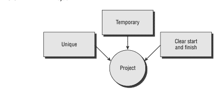

项目产生的独特可交付成果可能包括有形产品（道路或建筑物）、明确定义和具体的服务（如咨询或项目管理）以及支持组织的业务职能。项目还可能产生结果或成果，例如详细记录研究发现的文档。项目的目的是实现其目标并结束。因此，当发生以下情况之一时，项目被视为完成：
- 目标和目的已获得干系人的满意实现。
- 已确定目标和目的无法实现。
- 项目被取消。


完成后，项目的产品、服务或结果可能成为持续业务运营的一部分。

## 运营

运营是持续的、重复的，涉及连续且无结束日期的工作。通常，运营涉及重复相同的过程并产生相同的结果。图 1.2 显示了运营的特征。运营的目的是保持组织运作。

### 图 1.2 运营

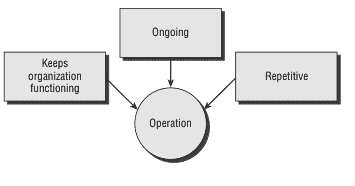

不确定它是项目还是持续的业务运营？请通过以下测试进行判断：

- 它是独特的吗？
- 工作量的时间范围是有限的吗？

> 请记住，根据 *PMBOK® Guide*，项目的暂时性并不意味着项目的持续时间很短。

- 有没有办法确定项目何时完成？
- 有没有办法确定干系人的满意度？

如果你对每个问题都回答“是”，那么它就是项目。

## 渐进明细

渐进明细意味着项目产品、服务或结果的特征是逐步确定的，并且随着项目的进展不断细化和详细化。产品特征在项目开始时通常是比较宽泛的，随着时间的推移迭代到越来越多的细节，直到最终完善和确定。

## 干系人

干系人是受项目影响或能对项目产生影响的任何人或群体，包括正式组织。以下是各类干系人的特征：

- 他们是个人、团体或组织，对项目有权益关系。
- 他们积极参与项目的工作。
- 他们将因项目而有所得或有所失。

识别这些干系人并不是一次性的过程，在项目开始时识别干系人非常重要。图 1.3 中列出了一些项目干系人的示例。

- 客户
- 发起人
- 承包商
- 供应商
- 项目经理
- 项目团队成员
- 部门经理

### 图 1.3 干系人

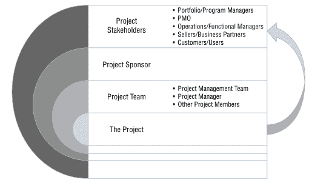

还需要注意，干系人之间可能存在利益冲突，而管理干系人的期望是项目经理的责任。而且，当有疑问时，干系人的冲突应始终以偏向客户的方式解决。

项目发起人也是一位干系人，通常是组织内具有分配资源和就项目相关决策行使强制权的高管。项目发起人通常作为平局裁决的决策者，也是项目升级路径中的人员之一。

干系人在项目生命周期早期就被识别，并随着项目的演变而发生变化。未能识别干系人可能导致项目本身失败，因为如果未为未识别的干系人提供表达期望的途径，他们的期望可能无法满足。理解每个干系人的影响程度对于项目的成功也至关重要。

#### 考试要点

能够描述项目与运营之间的区别。项目具有临时性质，有明确的开始和结束日期。项目产生独特的产品、服务或成果。运营是持续性的，使用重复的过程，通常反复产生相同的结果。

## 定义项目管理

项目管理框架提供了成功启动、规划和执行项目所需的工具和技术。项目管理是将该框架应用于持续向利益相关者交付满意的产品和服务的过程。项目管理可能涉及多个项目。从更宏观的角度来看，项目可能是项目集、项目组合和/或项目管理办公室的一部分。


有关项目管理基础的更详细信息，请参阅《*PMP®: 项目管理专业人员考试指南，第八版*》第一章。

### 项目管理

根据《*PMBOK® 指南*》，项目管理是“将知识、技能、工具和技巧应用于项目活动，以满足项目要求”。

项目经理是负责管理项目过程并应用执行项目活动所用的工具和技巧的人员。项目经理有责任确保项目管理技术得到应用和遵循。除此之外，项目管理是一个包括启动新项目、规划、实施项目计划以及衡量和报告绩效的过程。它涉及识别项目需求、建立项目目标、平衡约束条件，并考虑关键利益相关者的需求和期望。

项目管理本身可以超越单个项目的管理。在某些组织中，项目集和项目组合也进行管理。图 1.4 展示了项目、项目集、项目组合以及项目管理办公室（PMO）的特征。

| 项目 | 项目集 | 项目组合 | PMO |
| :--- | :--- | :--- | :--- |
| • 产生独特的产品、服务或结果 | • 相关项目的组 <br>• 使用类似的技术进行管理 | • 项目集和项目的集合 <br>• 支持特定的业务目标 | • 集中的组织单元 <br>• 监督项目和项目集 |

### 项目集

根据《*PMBOK® 指南*》，项目集是相关项目、子项目集和项目集活动的组，以协调的方式进行管理，使其能够获得否则无法实现的收益。

项目集中的每个子项目都有自己的项目经理，该项目经理向项目集经理汇报。所有项目都是相关的，并一起管理，以便实现集体收益，并以协调的方式实施和管理控制。对这一项目集合的管理——确定其相互依赖性、管理其约束条件并解决它们之间的问题——被称为项目集管理。

> 除了项目管理认证外，PMI® 还提供*项目集管理*认证。有关项目集管理技能的更详细信息，请参阅《*项目集管理标准，第三版*》（PMI®，2013）。

### 项目组合

项目组合是支持特定业务目标或目的的项目集和项目的集合。作为项目组合一部分包含的项目集和项目不一定直接相关。

项目组合管理涵盖管理项目集、项目、其他工作，有时还包括其他项目组合的集合。它还涉及监控活跃项目对目标的遵循程度，平衡项目组合与组织的其他投资，并确保资源的有效利用。

> PMI® 还提供一种称为项目组合管理专业人员（PfMP）的项目组合管理资质。有关项目组合管理技能的更详细信息，请参阅《*项目组合管理标准，第三版*》（PMI®，2013）。

### 项目管理办公室

项目管理办公室（PMO）是一个集中的组织单元，负责监督整个组织中项目和项目集的管理。

PMO 负责以下事项：

- 管理一组项目的集体目标
- 跨项目管理资源
- 管理其权限范围内所有项目的相互依赖性
- 维护和归档项目文档以供未来参考
- 衡量活跃项目的绩效并建议纠正措施
- 评估已完成项目对项目计划的遵循程度
- 在需要时建议与项目和项目集相关的纠正措施

公司启动项目管理办公室最常见的原因是建立和维护项目管理方法论的程序和标准，并管理分配给 PMO 中项目的资源。项目经理和团队成员可以直接向 PMO 汇报，或者 PMO 可以为项目和项目管理提供培训或简单地提供专家支持。

项目经理和 PMO 的总体目的在某种程度上是不同的。项目经理专注于手头的项目，而 PMO 则采取更组织化的方法来进行项目管理。项目经理关注项目目标；PMO 关注组织目标。表 1.1 概述了项目经理和 PMO 在总体目标和视角方面的差异。

#### 表 1.1 项目经理与 PMO 对比

| | 项目经理 | PMO |
| :--- | :--- | :--- |
| **总体目标** | 实现项目要求 | 从企业整体视角实现目标 |
| **目标** | 交付项目目标 | 交付组织目标 |
| **资源** | 管理项目资源 | 优化共享资源 |
| **报告** | 项目报告 | 综合报告 |

PMO 可以存在于任何类型的组织结构中。对于在拥有现有 PMO 的组织中工作的项目经理来说，其主要好处之一是 PMO 提供的晋升空间。

虽然如今 PMO 在组织中很常见，但为了应用良好的项目管理实践，它们并不是必需的。

#### 考试要点

能够区分项目管理、项目集管理、项目组合管理和项目管理办公室。项目管理汇集了一组工具和技巧来描述、组织和监控项目活动的工作；项目集管理指的是相关项目组的管理；项目组合管理指的是支持特定业务目标或目的的项目集和项目的集合的管理；项目管理办公室则监督整个组织中项目和项目集的管理。

## 识别项目管理技能

为了成功，项目经理必须拥有涵盖管理各个领域的通用管理技能——从会计和战略规划到监督、人事管理等。一些项目还需要特定应用领域的专业技能，例如在行业组、部门内或按技术专长。这些技能使项目经理能够沟通、解决问题、领导并在项目中通过谈判。


有关项目管理技能的更详细信息，请参阅《*PMP®: 项目管理专业人员考试指南，第八版*》第一章。

如图 1.5 所示，七项通用管理技能构成了良好项目管理实践的基础。

### 图 1.5 通用管理技能

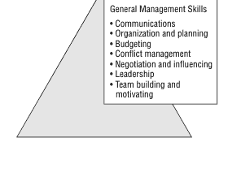

## 沟通技能

项目中存在多种沟通形式，它们对项目的成功至关重要。项目经理的工作是确保信息明确、清晰且完整。信息分发后，接收方有责任确认已理解该信息。*优秀的项目经理会把多达 90% 的时间花在沟通上。*这使得沟通技能成为项目经理的一项重要资产。

## 组织与规划技能

组织技能和规划技能密切相关，是项目经理应具备的重要技能组合。项目经理必须追踪并查找大量文档、会议、合同和进度表。这需要时间管理技能，因此这一技能集与组织技能紧密相连。由于项目管理的任何方面都会首先涉及规划，因此本书将广泛讨论这一领域。

## 预算技能

项目经理负责建立和管理预算，因此预期他们需要了解一些财务和会计原则。成本估算是运用预算技能的一个例子。其他例子包括项目支出、阅读和理解供应商报价、准备或监督采购订单，以及对账发票。

## 冲突管理技能

冲突管理涉及问题解决，首先是确定问题的原因，然后做出解决问题的决定。在检查和分析了问题、导致问题的情况以及可用替代方案后，确定最佳行动方案。决策的时机也很重要。

## 谈判与影响力技能


谈判和影响力技能在有效的问题解决中都是必不可少的，并应用于项目管理的各个领域。以下术语与此技能集相关：

## 谈判

无论是单独进行还是与团队一起，谈判都涉及与他人合作以达成协议，并在项目的几乎每个领域中都是必要的。

## 影响力

施加影响需要了解组织结构，并涉及说服对方考虑你认为更好的选择，即使那不是他们想要的。

## 权力

权力是一种用于影响他人的技术，是促使他人做出他们原本不会做的事情的能力。

## 政治

政治涉及让拥有不同利益的人群即使在冲突和混乱中也能富有创造性地合作。

## 领导力技能

领导力涉及展现领导者和经理者的特征，并知道在整个项目过程中何时在两者之间切换。领导者传达愿景，为战略目标达成共识，确定方向，并激励他人。经理者关注结果，致力于根据要求完成工作。

## 团队建设激励技能

项目经理为项目团队定调，并引导团队成员经历团队发展的各个阶段，直至完全具备运作能力。这可能涉及团队建设的基础工作，即使在团队成员不是直接下属的情况下激励团队。

### 考试要点

- 能够列出每位优秀项目经理应具备的一些技能。

沟通、预算、组织、问题解决、谈判与影响力、领导力和团队建设是项目经理应具备的技能。

## 理解组织结构

与项目一样，组织也是独一无二的，每个组织都有自己的风格和文化，两者都会影响项目的执行方式。一般来说，组织的结构有三种方式：

- 职能型
- 矩阵型
- 项目型

在这些结构中，存在各种变体和组合。图 1.6 展示了这些结构之间的相互关系，包括矩阵型组织中存在的变体。了解组织运作的结构类型很重要，它会影响项目经理的行动方式。组织结构是项目环境的一部分，影响项目如何管理。决定组织结构的最重要因素之一是项目经理所拥有的权力。

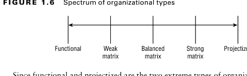

由于职能型和项目型是两种极端的组织结构类型，我们将首先介绍它们。


> 如需了解更多关于职能型、项目型和矩阵型组织的信息，包括示例图表，请参阅《*PMP®: Project Management Professional Exam Study Guide*》*第八版* 的第一章。

## 职能型组织

职能型组织是最古老的组织形式；职能型风格被称为组织企业的传统方法。这类组织具有以下特征：

- 它们以专业领域为中心。
- 它们按职能分组。
- 它们以层级结构展示。

重要的是，职能型组织中的员工在某个专业领域进行专业化，使他们能够非常擅长其专业领域（如会计、人力资源或工程）。

在这种层级结构中，存在一条指挥链，员工向一名经理汇报，最终由顶层的一人负责。每个部门或小组独立管理，管理范围有限，因此当项目需要其他部门的投入时，必须遵循指挥链。这种结构背后的思维方式是，拥有相似技能和经验的人更容易作为一个群体进行管理，从而可以轻松分配和管理工作任务，且主管在其监督的领域具有经验。

### 表 1.2 职能型组织

| 优势 | 劣势 |
|---|---|
| 拥有持久的组织结构。 | 项目经理几乎没有或没有正式权力。 |
| 具有清晰的职业路径和职能分离，使专业技能得以发挥。 | 多个项目竞争有限的资源和优先级。 |
| 员工只有一位主管，指挥链清晰。 | 项目团队成员忠于职能经理。 |

## 项目型组织

项目型组织几乎是职能型组织的对立面，重点关注项目本身，因此对项目的忠诚度高于对职能经理的忠诚度。

在这类组织中，项目经理拥有从高权力到最高权力的授权，通常直接向首席执行官汇报。项目经理对项目做出决策，包括处理制约因素。顺带一提，所有组织结构中的项目经理都必须平衡相互竞争的项目制约因素，例如：

- 范围
- 质量
- 进度
- 预算
- 资源
- 风险

在项目型组织中，团队通常位于同一地点，这意味着团队成员在物理上在同一地点工作并向项目经理汇报。项目完成后，团队通常会被解散，成员要么待命要么被解雇。如果高度专业化的技能仅在项目的特定时间需要，而在其他时间处于闲置状态，则资源利用率可能效率低下。

### 表 1.3 项目型组织

| 优势 | 劣势 |
| :--- | :--- |
| 项目经理拥有从高权力到最高权力的授权。 | 项目团队成员可能在项目完成后失业。 |
| 项目团队成员忠于项目。 | 资源利用可能存在低效。 |

## 矩阵型组织

矩阵型组织是职能型和项目型组织的结合，利用两者的优势并将其合二为一。员工向职能经理和至少一名项目经理汇报。

职能经理负责将员工分配到项目中并处理行政事务，而项目经理负责执行项目并将项目活动分配给员工。两者共同承担绩效评估的责任。

在矩阵型组织内部，存在权力的平衡，范围从职能型组织到项目型组织：

### 强矩阵

强矩阵型组织具有项目型组织的特征，项目经理拥有高水平的权力，并可以指定资源。

### 弱矩阵

在光谱的另一端是弱矩阵，它在功能型组织结构方面具有一定的相似性，即职能经理拥有更高的权力，并倾向于决定工作分配。

### 均衡矩阵

在强矩阵和弱矩阵之间是均衡矩阵，在此结构中，项目经理和职能经理之间的权力是平衡的。

表 1.4 展示了这三种矩阵组织结构之间的细微差别。如今，大多数组织都是职能型、项目型和矩阵型结构的组合体。

#### 表 1.4 比较矩阵结构

| | 弱矩阵 | 均衡矩阵 | 强矩阵 |
| :--- | :--- | :--- | :--- |
| 项目经理的头衔 | 项目协调员、项目负责人或项目推进员 | 项目经理 | 项目经理 |
| 项目经理的关注点 | 在项目职责和职能职责之间分配注意力 | 项目和项目工作 | 项目和项目工作 |
| 项目经理的权力 | 极小的权力和权威 | 权力和权威的平衡 | 显著的权力和权威 |
| 项目经理的时间 | 部分时间用于项目 | 全职用于项目 | 全职用于项目 |
| 组织风格 | 最像职能型组织 | 弱矩阵和强矩阵的混合体 | 最像项目型组织 |
| 项目经理向谁汇报 | 职能经理 | 职能经理，但共享权力和权威 | 项目经理的经理 |

### 考试要点

能够区分各种组织结构以及每种结构中项目经理的职权。组织通常采用以下结构的一些组合：职能型、项目型和矩阵型（包括弱矩阵、均衡矩阵和强矩阵）。项目经理在项目型组织中拥有最大的职权，在职能型组织中拥有的职权最小。

## 理解项目环境

项目环境由影响项目的项目内部和外部因素组成。在管理项目时，项目经理必须考虑的不仅仅只有项目本身。主动管理项目需要了解项目必须运行的环境。

以下是构成项目环境的一些要素示例：

**组织结构** 组织结构本身在项目如何被管理中起着巨大作用，是项目环境中主要的影响因素。它与公司文化交织在一起。

**物理环境** 物理环境包括以下考量：

- 当地生态
- 物理地理
- 环境限制，如保护区或野生动物保护区
- 专用办公室和会议室的空间数量

**文化与社会环境** 在参考文化环境时，请考虑这些不同的层面：

- 企业文化，包括外部利益相关者和供应商。这与组织结构交织在一起，但可能具有其自身的发展轨迹
- 民族文化
- 宗教文化
- 组织风险容忍度

为了与客户、利益相关者和项目团队成员有效沟通，了解文化和社会因素及其可能对项目产生的影响变得至关重要。特别是，文化差异是项目内常见的沟通障碍。随着虚拟项目和全球项目成为更常见的场景，了解如何在这种环境中运作变得至关重要。

项目经理还应了解项目如何影响个人，以及个人如何影响项目。

**国际与政治环境** 国际和政治环境涉及考虑以下事项：

- 国际、国家、地区和地方法律和法规
- 习俗和惯例
- 政治气候
- 时区和当地节假日

项目经理在着手实施项目时，就需要知道上述列出的任何事项是否影响其特定项目。哪怕像时区差异这样微小的事项，或像政治气候这样重大的事项，都可能对项目产生巨大影响。

还有其他许多超越此处列出的影响因素，且列表可能会非常详尽。从基本层面上讲，这些因素为您提供了一个更广泛的项目视角概览。

## 理解项目生命周期和项目管理过程

大多数项目从一个想法开始。在征求支持并获得批准后，项目进入中间阶段，直至结束阶段，此时项目完成并关闭。当项目经过此生命周期时，它通过一组项目管理过程来执行。根据*PMBOK*® *Guide*，这些过程相互关联且彼此依赖；它们被分为五个项目管理过程组：

- 启动
- 规划
- 执行
- 监控与收尾
- 关闭

这些过程组中的每一个都显示出反映项目成本、人员配置、成功完成的机会、利益相关者影响力和风险概率水平的特征。

图 1.7 展示了项目管理过程组，并代表项目或项目阶段的生命周期。

### 图 1.7 项目管理过程组

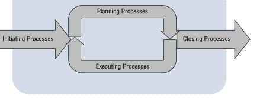

> 注意
>
> 有关项目生命周期和过程的更详细信息，请参阅《PMP®: Project Management Professional Exam Study Guide, Eighth Edition》（《PMP®：项目管理专业人士考试指南，第八版》）第 1 章。

## 项目阶段和项目生命周期


大多数项目划分为若干阶段。项目阶段由工作片段组成，一个项目可能有一个或多个阶段，具体取决于项目复杂程度和行业。项目经过的阶段统称为项目生命周期。所有项目的项目生命周期都相似，且项目生命周期内发生的阶段是顺序进行的，有时会出现重叠。

根据`PMBOK`指南，所有项目都遵循相同的生活周期结构：
- 启动项目，即启动阶段
- 组织和准备，即规划项目工作
- 执行（或履行）项目工作，即执行阶段
- 关闭项目

## 考试要点

`PMBOK`指南强调，不要将此通用生活周期结构与项目管理过程组混淆，因为过程组中的过程将包含可能在项目的每个阶段中执行并重复的活动，同时也包括针对整个项目的活动。

在某个阶段开始时，可能会进行可行性研究。在某个阶段结束时，在对完成的交付物进行阶段结束审查后，才可能发生向下一个阶段的移交。以下列表对该描述中涉及的几个关键术语进行了进一步扩展：

移交 为了让项目从一个阶段进展到下一个阶段，阶段交付物应接受准确性审查并获得批准。随着每个阶段的完成，它将移交给下一个阶段。移交，或技术转移，是标志着前一阶段结束并通常标志着下一阶段开始的阶段序列。

可行性研究 一些项目在初始阶段中纳入可行性研究。它们在下一个阶段开始前完成。可行性研究确定项目是否值得开展，或者如果处于项目检查点，是否值得继续，以及该项目是否会为组织带来利润。

交付物 每个阶段至少有一个标志着阶段完成的交付物。交付物是可衡量的有形输出，必须被生产、审查和批准，以使阶段或项目得以完成。

## 阶段结束评审

在一个阶段结束时，可能会进行阶段结束评审，以便参与该工作的人员能够确定项目是否应继续进入下一阶段。阶段结束评审，也称为阶段退出、阶段关卡、里程碑、阶段门、决策关卡和终止点，使项目经理能够识别并解决在该阶段期间发现的错误。

## 阶段间关系

如前所述，一个项目可能由一个或多个阶段组成。《PMBOK® 指南》定义了三种类型的阶段间关系：
- 顺序关系：一个阶段必须完成后，下一个阶段才能开始
- 重叠关系：一个阶段在前一个阶段完成之前就开始
- 迭代关系：在执行前一个阶段的工作时，同时规划后续阶段的工作

组织在规模、成熟度和复杂性方面各不相同。在项目管理实践的应用方面，一些组织将建立标准化的政策来规范所有项目。其他组织则允许项目团队在选择最适合其项目的方法方面拥有很大的灵活性。请记住，项目管理并不是一个“一刀切”的模式。

通过重叠阶段来缩短或压缩项目进度的行为被称为快速跟进。这意味着在之前阶段的完成和批准之前，就开始后续阶段。

## 项目管理过程组

项目管理过程组织并描述了项目的工作。如前所述，《PMBOK® 指南》中描述的五个过程组如下：
- 启动过程组
- 规划过程组
- 执行过程组
- 监控和收尾过程组
- 收尾过程组

这些过程由人来执行；它们是相互关联且相互依赖的，并包含共同构成该组的各个独立过程。这五个过程组是迭代的，随着项目的细化，可能会在整个项目生命周期中被重新审视和修订。

项目经理和项目团队负责裁剪，这涉及确定每个过程组中哪些过程适合该项目。对项目进行裁剪时，会考虑其规模、复杂性以及各种输入和输出。每个过程组的结束使项目经理和相关方能够重新审视项目的业务需求，并确定项目是否满足了这些需求。

### 启动过程组

启动过程组中的过程发生在项目开始以及大型项目每个项目阶段开始时。此过程组授予批准，使组织能够将资源投入到项目或阶段的工作上，并授权项目经理开始处理项目。

根据《PMBOK® 指南》，启动过程组包含以下行动：
- 制定项目章程，正式授权项目
- 识别项目相关方

### 规划过程组

规划过程组包括制定和修订项目目标和目标的流程。此外，用于实现项目旨在解决的目标的项目管理计划也在此处创建。在此过程组中，项目需求得到细化，并识别出更多相关方。由于项目是独特的，规划必须涵盖项目管理的所有领域。

根据《PMBOK® 指南》，规划过程组包含以下行动：
- 制定项目管理计划
  - 项目管理计划本身包含若干子计划和基准。这组计划定义了项目将如何被规划、执行和收尾。
- 规划和创建范围管理计划
  - 范围管理计划的一个组成部分是记录用于定义、控制和验证项目范围的方法的过程。
- 收集项目需求
  - 项目需求定义并记录相关方的需求。
- 开发项目和产品的范围
- 创建工作分解结构 (`WBS`)
  - `WBS`包含项目工作的分解，从主要可交付成果一直到工作包。
- 规划和创建进度管理计划
  - 项目计划的另一个组成部分，进度管理计划创建项目进度的开发文档以及政策/程序，同时也负责其元素的执行和控制。
- 识别执行项目工作所需的项目活动
- 确定项目活动的顺序和持续时间
- 计算执行项目活动所需的资源数量
- 创建项目进度计划
- 规划和创建成本管理计划
  - 成本管理计划记录并描述如何管理整个项目生命周期中的项目成本。
- 识别项目成功所需的所有活动的成本
- 制定项目预算
- 估算每个项目活动的成本
- 规划和创建质量管理计划
  - 质量管理计划为项目设定标准，并定义质量要求。
- 创建人力资源计划
  - 该计划概述了如何识别和管理人力资源。
- 创建沟通管理计划
  - 该计划定义了在整个项目期间如何执行沟通，包括识别和满足相关方的沟通需求。
- 创建风险管理计划
  - 该计划概述了如何开展风险管理。它还提供了必要信息，以一致地识别和衡量项目风险。
- 识别项目风险
  - 此过程还将导致风险登记册的创建，其中将记录已识别风险的相关信息。
- 评估和优先化需要进一步分析或行动的项目风险，以及对项目整体目标的风险进行数值分析
- 制定风险应对方案
- 创建采购管理计划
  - 采购管理计划记录并描述如何获取外部产品或服务。
- 规划和创建相关方参与计划
  - 相关方参与侧重于持续活动，以保持相关方的知情状态、获取他们的反馈，并确保满足他们的期望。

### 执行过程组

执行过程组涉及将项目管理付诸行动，保持项目计划轨道，并实施已批准的变更。

项目经理协调和指导项目资源，这里的成本最高，因为在执行过程中使用了更多的时间和资源。

根据《PMBOK® 指南》，执行过程组包含以下行动：
- 执行项目管理计划中定义的工作
- 确保遵循规划过程组中概述的质量标准和操作定义，符合质量管理计划
- 审计质量要求
- 获取完成项目工作所需的人力资源
- 增强项目团队的技能和互动，以及整体团队环境
- 管理项目团队并提升其绩效
- 按照沟通管理计划中概述的内容，在项目过程中分发必要信息
- 选择使用的外部供应商并授予必要的采购合同
- 管理相关方的期望

### 监控和收尾过程组

监控和收尾过程组是进行项目绩效测量和分析的地方，以确定项目是否符合项目计划。此过程组跟踪已执行工作的进度，并识别过程组内以及整个项目中的问题和不一致。

根据《PMBOK® 指南》，监控和收尾过程组中的过程包含以下行动：
- 监控和控制项目工作，例如确保实际执行的工作与项目管理计划一致
- 使用整合变更控制系统来审查、批准或拒绝以及管理项目内的所有变更
- 接受已完成的项目可交付成果
- 控制项目和产品范围
  - 这有助于防止范围蔓延，并确保项目实现其既定目标。
- 控制项目进度，确保项目按时完工
- 控制项目成本，确保项目在分配预算内完工
- 监控质量活动执行的结果
  - 这允许对绩效进行评估。
- 通过计划好的报告报告项目绩效
  - 这也涉及对项目绩效的预测和衡量。
- 实施风险应对计划

#### 监控与控制
- 监控和控制风险
  - 这包括监控项目中的新风险，以及评估风险应对和风险管理过程的有效性。
- 管理供应商关系和供应商合同
- 监控项目干系人关系，并根据需要调整方法

### 收尾过程组

收尾过程组包含使项目阶段或项目本身的活动正式、有序结束的过程。一旦项目目标达成，所有项目信息将被收集并存储以供未来参考。合同收尾也发生在此过程组中，并且需要从项目干系人那里获得正式验收和批准。

根据`PMBOK`® `指南`，收尾过程组包含以下行动：
- 完成最终项目工作，以正式结束项目或项目阶段
- 完成并收尾所有供应商合同

项目化管理过程组之间的推进与项目阶段之间的推进表现出相同的特征。表 1.5 展示了过程组的特征。

**表 1.5** 项目过程组的特征

| | 启动 | 规划 | 执行 | 监控与控制 | 收尾 |
|---|---|---|---|---|---|
| 成本 | 低 | 低 | 最高 | 较低 | 最低 |
| 人员配置水平 | 低 | 较低 | 高 | 高 | 低 |
| 成功完成的可能性 | 最低 | 低 | 中等 | 高 | 最高 |


| 干系人影响力 | 最高 | 高 | 中等 | 低 | 最低 |

| 风险概率 | 最高 | 高 | 中等 | 低 | 最低 |

## 计划-执行-检查-处理循环

随着项目的进展和更多信息的知晓，项目管理过程可能会被重新审视和修订，以更新项目管理计划。过程组具有迭代性这一概念的基础是一个称为计划-执行-检查-处理循环的循环，该循环最初由沃尔特·休哈特定义，后来由爱德华·戴明修改。这一概念背后的思想是，循环中的每个元素都以结果为导向，并成为下一个循环的输入。该循环的相互作用可以映射为与五个项目管理过程组协同工作。

### 考试要点

**能够说出五个项目管理过程组。** 五个项目管理过程组是：启动、规划、执行、监控与控制，以及收尾。

### 考试当天

参加考试时，不允许携带任何物品进入考场。但是，你会得到一张草稿纸作为辅助。参加考试的一个绝佳方法是在开始考试前记住公式、缩写和助记符，然后将所有这些写在提供的空白草稿纸上。这将使你能够专注于考试所要求的内容，而不是在回答问题的同时消耗脑力去尝试记住这些元素。

*PMP*® *项目管理专业人员考试指南，第八版* 提到了一个有助于记忆过程组的缩写：它听起来像 IPECC（启动、规划、执行、监控与控制，以及收尾），其中你可以将监控与控制简单地视为“控制”。试试看，看看是否有帮助。

## 认识专业和社会责任

PMP* 资格伴随着涉及你所做出的决策和行动的若干责任。在提交 PMR* 申请时，你同意遵守 PMI* 道德和专业行为准则。这一誓言涉及你个人和职业生活中的几个要素，包括强制性行动以及我们追求的行动和理念。

维持道德和专业行为适用于日常活动，因此适用于本章前面以及全书其余部分讨论的所有内容。达到道德和专业标准是构建坚实项目管理基础的重要组成部分。对于考试，你需要熟悉该准则并根据其内容回答问题。

### PMI® 核心价值观

PMI® 道德和专业行为准则涉及以下四个要素：责任、尊重、公平和诚实。

### 责任

责任是维护诚信的重要组成部分。它涉及对自己的行动负责，积极主动地做正确的事，以及做必要的事情来解决因最初缺乏责任而导致的情况。

如图 1.8 所示，多种要素涉及责任的概念：

- 确保高水平的诚信
- 仅接受你有能力胜任的工作分配
- 遵守规则、法规、法律和政策
- 尊重保密信息
- 维护 PMI® 道德准则并追究其他项目经理的责任

**图 1.8** 责任的要素

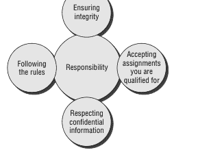


责任涉及做出有利于组织**而非**个人的决策。它还涉及承认你的错误，并对你的决策及其后果负责。

### 确保诚信

作为项目经理，你的职业责任之一是确保项目管理过程、产品和你个人行为的诚信。这可能包括：

- 正确应用项目管理过程以确保产品的完整性
- 有效执行过程组以确保产品质量
- 获得项目和产品的正式验收

### 接受工作分配

接受合适的工作分配与责任和诚实有关。这涉及做到以下几点：

- 准确、诚实地向潜在雇主、客户、PMI® 和其他人报告你的资历、经验和过去的服务表现
- 拒绝超出你能力或经验的工作分配
- 强调你的专业知识以及你在特定行业中的使用方式，而不是让别人相信你有使用某些过程和工具的经验，而实际上你并没有
- 在你的广告和个人接触中准确代表你自己、你的资历和你的估算
- 完成你承担的承诺，确保你做到你说你要做的

### 遵守规则

你务必遵守所有适用的法律、规则和法规，包括：

- 行业法规
- 组织规则
- 项目规则
- PMI® 组织规则和政策
- 管辖你所在行业的知识产权和其他道德标准及原则
- 管辖你所在地区、流程和产品的当地、国家和国际法律


> **在一个国家适用的规则或法规可能不适用于其他国家。**

### 尊重保密信息

无论你是直接员工、顾问还是承包商，在项目管理职业生涯中，你很可能会接触到某种形式的敏感信息。你可能作为项目的一部分收集或接触到敏感信息。你可能需要向承包商提供此类信息。你可能因你的角色而有权访问此类信息。无论情况如何，重要的是你遵守 PMI® 道德和专业行为准则，该准则规定你同意不披露敏感或保密信息，或以任何方式将其用于个人获利。

处理公司数据、商业秘密、政府机构数据和知识产权是你遇到敏感或保密信息的典型情况。处理信息时，不要忘记随时问自己图 1.9 中显示的关键问题。如果你不确定任何问题的答案，在分享信息之前先弄清楚。

#### 图 1.9 处理信息

| 问自己： | | |
|---|---|---|
| 此信息是私密的还是受保护的？ | 此信息可以共享吗？ | 是否存在不披露协议？ |

**商业秘密**

组织的商业秘密或私人信息不得用于个人获利。了解哪些信息可以与供应商、其他组织甚至同事共享是很重要的。在实践中，信息泄露并不总是那么明显，因此经常存在灰色地带。对你组织的信息保持意识敏感可以带来巨大差异。如有疑问，务必询问。

**访问受限**

与政府合作是数据共享可能敏感的一个绝佳例子。一个政府机构并不总是能够访问另一个独立的政府机构的数据。根据数据的不同，其他人可能拥有受限访问权限或完全没有访问权限。访问受限不仅限于政府数据；类似限制也出现在私营部门。组织内部的一个部门并不总是能够访问另一个部门的数据。想想人力资源部门内信息的敏感性质。员工档案并不总是可以供部门负责人或其他人访问。假设其他人应该有数据访问权限，仅仅因为你认为这在逻辑上是合理的，是一个错误。

**不披露协议**

你负责确保将访问敏感数据的供应商或组织在你发布数据之前签署并理解适当的不披露协议。显然，确保关键干系人（包括法律部门）支持敏感信息的发布。

**知识产权**

你很可能在某个时候会接触到知识产权。创建受保护材料或物品的企业或个人拥有知识产权。知识产权通常包括以下项目：

- 由组织开发的具有商业价值但不是有形物品的项目
- 受版权或商标保护的材料，如书籍、软件和艺术作品

## 拥有专利的想法或流程

## 组织为特定目的开发的工业流程、业务流程或制造流程

您可能需要支付 royalties（特许权使用费）或申请书面许可才能使用该财产。知识产权应像敏感或机密数据一样受到保护。

### 尊重

展示尊重涉及你的行为举止、你对待他人和周围资源的方式，以及倾听他人观点。尊重应在个人和专业层面体现。除其他方面外，你赢得的尊重程度将取决于你做到以下事项的程度：

- 展现专业的举止
- 处理违反伦理的行为
- 展示文化意识
- 解读经历

### 展现专业举止

展现专业举止是业务的重要组成部分。你对自己的行为和反应负责。以下是维持专业举止并鼓励他人保持专业举止的一些示例：

- 在令人质疑的情况下控制你的情绪和反应。
- 在启动会议上通知项目团队，让他们可以找到关于利益冲突、文化多样性、标准和法规、客户服务以及绩效标准的组织政策副本。
- 指导并影响那些表现出非专业态度或行为的团队成员，使其符合你和你所在组织预期的行为标准。作为项目经理，你的职责是确保团队成员表现出专业行为，因为他们代表你和该项目。

### 报告违反伦理的行为

作为项目经理，你的一项职责是报告违反 PMP® 行为准则的行为。为了维护职业诚信，PMP® 证书持有者必须遵守行为准则，这使得我们彼此负责。这包括在你知道发生了违规行为并且你核实了事实后，通知 PMI®。PMI® 伦理与职业行为准则包括以下违规行为：

- 利益冲突
- 不真实的广告
- 虚假声称拥有 PMP® 经验和资格
- 不当行为的表象

### 展示文化意识

随着项目团队和组织变得日益多样化，提高对文化影响和习俗实践的意识变得至关重要。如今，项目团队遍布全球是很常见的。很少有不接触来自其他文化的人的情况。例如，你可能会遇到以下部分或全部情况：

- 拥有不同物理位置成员的虚拟项目团队
- 分布在全球各地办公室的内部项目相关方
- 离岸供应商或供货方
- 离岸合作伙伴
- 虽然身体上位于同一办公室，但来自不同文化的项目团队成员

重要的是不要试图将自己的文化或习俗强加于人。身处不同国家时，你需要尊重当地习俗。同时，做违反你个人道德和你公司道德的事情是不可接受的。


> 不要忘记，文化意识在你自己的国家也很重要。同一个国家的公民往往具有不同的文化影响和习俗，这些应得到承认和尊重。

作为文化意识的一部分，你需要主动保护自己和你的员工免受文化冲击的影响。为此，重要的是根据需要投入时间进行多元化培训，并始终展示对邻居的尊重，如下所示：

**文化冲击** 在外国工作可能会带来一种称为文化冲击的体验。文化冲击涉及与你通常预期的分离。这可能导致迷失方向、挫败感、沟通破裂和困惑。以下是一些让你做好准备并防范文化冲击的方法（图 1.10）：

- 在前往之前，阅读你将工作所在的国家的信息。
- 熟悉你在其中有业务往来或将要访问的外国的习俗和可接受的做法。
- 当对某种习俗或情况存疑时，向你的东道主或公司的可信赖联系人寻求指导。


### 多元化培训
项目团队成员可能来自不同的国家或文化。为你的团队成员提供培训有助于防止文化或伦理差异影响项目。
多元化培训使人们意识到不同文化和族裔之间的差异，并帮助他们获得尊重和信任。还应提供涉及公司文化的培训，以便项目团队成员了解组织如何运作。

#### 图 1.10 避免文化冲击
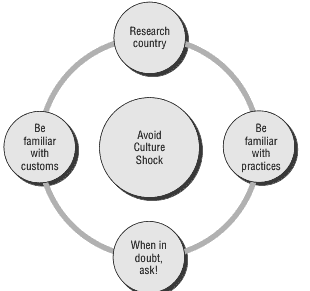

### 建立关系
某些文化要求在开展业务之前必须建立关系。根据文化不同，建立这种关系可能需要几天时间。
无论文化是否要求如此，建立关系都是有价值的。另一方面，在建立关系时，请记住你不应该将自己的信念强加于人，因为那不是建立关系的目的。相反，与他人建立关系创造了一种相互信任和合作的氛围。在这种环境中，项目计划和管理的所有方面，包括谈判和解决问题，都变得更加容易和顺畅。

### 解读经历
作为展示尊重的一部分，有意识地解读和感知经历是很重要的。这与沟通光谱的两端都有关。他人可能以非预期的方式解读你的行为。同样，你也可能误解他人的行为。请记住以下几点：
- 你的团队每位成员都带来一套独特的经历。这些经历影响感知、行为和决策。
- 你对某种情况的感知受你的经历影响，可能与其他人的感知大相径庭。
- 始终给予他人怀疑的利益（benefit of the doubt，意为在无证据前假定对方无辜或善意），如果你认为有问题，请要求澄清。
- 避免让感受或情绪阻碍你对情况的解读。

### 公平
作为 PMI® 伦理与职业行为准则的一部分，你有责任向相关方、客户或其他人报告任何可能被解释为利益冲突的行为或情况。避免利益冲突是展示公平的一部分。公平包括以下内容：
- 平等对待每个人，不偏袒或歧视
- 适当地代表你自己和你的组织，以避免利益冲突情况，并在发生利益冲突时迅速报告任何情况
- 在决策过程中保持公正
利益冲突涉及将个人利益置于项目利益之上，或利用你的影响力促使他人为你做出决定而不管项目结果如何。如图 1.11 所示，以下任何情况都可能被解释为利益冲突并损害公平：
- 不披露你活跃的联系和隶属关系
- 接受供应商礼物
- 因个人原因使用相关方影响力
- 参与歧视
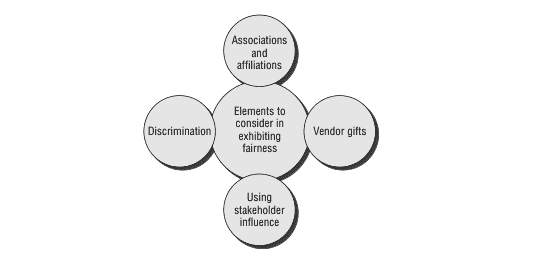

### 联系和隶属关系
在维持联系和隶属关系时，重要的是要考虑是否因此产生了利益冲突。例如，坐在那家赢得与你项目相关的合同投标的公司决策委员会上，就构成了利益冲突。即使你在任何方面都不影响决策，其他人也会假定你是一个
……发生了利益冲突。个人关系中也存在同样的情况——例如，将项目授予亲属、配偶等。当出现此类情况时，请执行以下操作：
- 通知项目发起人以及该协会或关联方的决策委员会。
- 避免参与授标决策委员会。
- 在涉及个人关联的合同情况下，指定您所在组织中的其他人负责管理该合同，并支付已完成工作的款项。
- 记录您就关联方所执行活动作出的所有决定，并将这些记录与项目文件一起保存。

## 供应商礼品
供应商礼品并不罕见。供应商和供货商经常向其客户和潜在客户提供商午餐饮、礼物、球赛门票等。然而，某些专业人士不允许接受超过特定金额上限的礼品。这可能是由公司政策或部门经理的政策决定的。无论礼品多么微小，接受供应商礼品都可能被视为利益冲突。了解接受礼品的政策并告知供应商是否超出可接受限度，是你的责任。同样，不要向他人赠送不当礼品，也不要试图为了个人利益去影响决策。
> **注意** 不要接受可能被视为利益冲突的礼品。如果您的组织没有关于供应商礼品的政策，请为自己设定限制。

## 相关方影响力
一些相关方拥有很大的权力。在处理强势相关方时，重要的是不要将个人利益置于项目或组织利益之上。这是利益冲突的另一个潜在领域。请记住以下指导原则：
- 在做出决策时，以项目和组织的目标为重——而非个人获利。
- 不要利用相关方影响力谋求个人利益，例如获得晋升、奖金或类似奖励。

## 歧视
如前所述，保持高水平的公平在许多层面上都很重要。在实践中，我们有时在不自知的情况下会陷入偏袒。在指派任务、晋升等情况下，做出决策时务必使用严谨的专业理由。仅仅因为喜欢与某人共事就选择该人选，这是判断失误，且代表了利益冲突。
同样重要的是，要意识到歧视他人的行为。无论是基于年龄、残疾、宗教、性取向还是性格，任何层面的歧视都是不可接受的。请记住，PMI®职业道德与行为规范还要求您报告他人表现出的此类行为。

## 诚实
您应意识到必须遵守的诚实的几个方面（如图 1.12 所示）：
- 如实报告项目状态和环境
- 避免欺骗
- 只做出真实的陈述
- 对自己经验的诚实
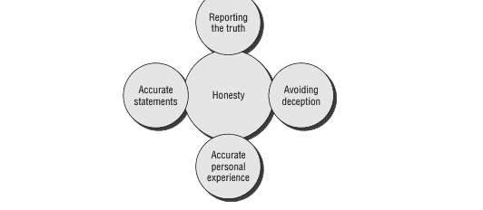

## 如实报告
诚实涉及关于您个人背景和经验的信息，以及关于项目环境的信息。在为计费客户或在项目上工作时，对项目有益处（而非个人获利）应是影响决策的因素。因工作而获得个人收益是积极的，但仅仅为了获得个人收益而做出项目决定则不然。
作为项目经理，当被要求时，您有责任向相关方、客户、项目发起人和公众如实报告您掌握的所有信息。这包括涉及个人利益的情况。始终如实说明情况，并坦诚对待项目进度，这一点非常重要。

## 避免欺骗
有时，保持诚实可能感觉很难。在某些情况下，这可能导致项目终止、失业、错失奖金，或其他对您和团队产生个人影响的后果。为了规避不利后果而欺骗他人或做出虚假陈述，不是处理情况的恰当方式。就项目而言，坦诚和说真话是必要条件。

## 做出真实陈述
管理好团队的一部分内容在于以身作则。这包括做出真实陈述，不仅在您的 PMI® 申请上，而且在项目的日常管理中也是如此。在某些情况下，可能会遇到微妙的情境，这时就需要运用您的通用管理技能。诚实并不意味着不尊重人，项目经理必须理解如何平衡这两者。

## 体现个人经验
对自己经验的诚实与不欺骗他人同等重要。您可能听说过，美化简历是商业中的标准做法。虽然建议制作一份充分突出您的经验和资历的简历，但夸大经验或明显美化资历是不可接受的。这等同于做出虚假陈述。
正确代表自己自然适用于您的 PMI® 申请。准确陈述您的工作经验、资历和背景是保持高诚信度的重要部分。
项目管理界为您整理了各种资源，以帮助传达 PMI® 职业道德的价值，包括描述道德行为的视频教程。此外，如果您在特定情况下不确定该怎么做，也有工具可以帮助您解决难题。欲了解更多信息，请访问 PMI® 网站 www.pmi.org/en/About-US/Ethics.aspx。

## 推动行业发展
推广良好的项目管理并推动行业发展是您作为项目管理专业人士的角色的一部分。专业知识包括项目管理实践的知识，以及完成分配任务所需的特定行业或技术知识。作为维护您的资历的一部分，您有以下责任：
- 将项目管理知识应用于您所有的
- 通过使他人了解最佳实践、培训团队成员使用正确的技术、告知相关方正确的流程，并在整个项目过程中坚持这些流程，从而就项目管理实践教育他人
- 促进相关方之间的互动
了解项目管理最佳实践并紧跟行业发展趋势非常重要。图 1.13 涉及这些责任。

## 图 1.13 行业发展的要素
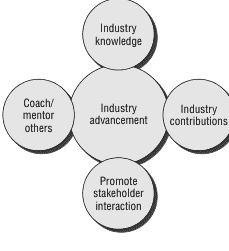
> 虽然 PMP® 考试并不要求测试您对该主题的知识，但持续资历要求对于维护您的资历将变得重要。

## 增强您的行业知识
深化项目管理领域的知识（您自己的以及他人的）是项目经理责任的一部分。项目管理是一个不断发展的领域，这使得紧跟项目管理实践、理论和技术成为一个持续的过程。因此，PMI® 要求，一旦您获得 PMP® 认证，您必须通过每三年获得一定数量的专业发展单位（PDUs）来维护该资历。PDUs 确保您对行业和项目管理实践的知识保持最新。获得 PDU 的方式有很多种，例如参加项目管理课程、阅读行业书籍和杂志、就项目管理主题进行演讲等。您可以在 PMI® 网站（www.PMI.org）上找到更多细节。
以下是一些您可以进一步发展和增强项目管理教育的方式：
- 加入当地的 PMI® 分会。
- 加入 PMI® 实践社区（CoP）。
- 阅读 PMI® 月刊。
- 参加通过 PMI® 分会或其他项目管理培训公司提供的教育课程。
请记住，作为项目经理，你应该主动寻找方法来进一步提升你的技能和行业知识。

## 为行业做出贡献
作为项目经理，你不仅有责任提升自己的知识水平与技能组合，还有责任为知识库本身做出贡献。这包括以下行动：
- 在领域内指导和辅导他人
- 为知识库本身做出贡献，例如通过志愿工作、撰写与项目管理相关的文章，以及开展增强或丰富该行业的研究
- 支持其他项目经理

## 促进利益相关者互动
在一个项目中，利益相关者可能只有少数几个，也可能多达数十个。利益相关者越多，项目沟通和控制的复杂性就越高。在本书中，我们探讨了利益相关者通常具有不同的利益。虽然每个人都希望项目成功，但议程可能各不相同。促进利益相关者互动的方式包括以下方面：
- 致力于平衡他们的利益、需求和期望
- 减少项目内的冲突数量
- 鼓励各部门之间的协作
请确保应用我们将在本书“项目沟通管理知识领域”中介绍的所有利益相关者管理技术。

###### 复习题
1. 以下是项目的特征，*除了*：


1. 何时被认为项目是成功的？

- A. 所有交付物都已完成。
- B. 阶段完成已获批准。
- C. 利益相关者的期望已得到满足。
- D. 客户已提供最终付款。

2. 你目前正在管理多个与主要零售中心大型建设相关的具有高知名度的项目。该项目范围广泛，时间跨度为两年。Bob 是负责建设东区的项目经理，Sally 是负责建设北区的项目经理。Bob 和 Sally 都向你汇报。你的角色最好被描述为：

- A. 牵头项目经理
- B. 部门经理
- C. 项目群经理
- D. 项目组合经理

3. 以下哪种组织类型是最早的组织形式？

- A. 职能型组织
- B. 项目型组织
- C. 矩阵型组织
- D. 平衡矩阵型组织

4. 项目管理办公室 `PMO` 负责以下活动，*除了*：

- A. 衡量项目绩效并提出纠正措施
- B. 确保资源高效用于特定的业务目标
- C. 评估已完成的项目是否遵循项目计划
- D. 维护和归档项目文档以供将来使用

5. 在规划会议期间，进行了一场讨论以决定将分配哪个资源来执行一项将被快速跟踪的活动。作为项目经理，你单方面决定将 Fred 分配给该活动。这是什么类型的组织结构？

- A. 职能型组织
- B. 项目型组织
- C. 矩阵型组织
- D. 平衡矩阵型组织

6. 以下所有都是过程组，*除了*：

- A. 整合
- B. 规划
- C. 执行
- D. 收尾

7. 在哪个过程组中成本最高？

- A. 规划
- B. 执行
- C. 监控和控制
- D. 收尾

8. “循环中的每个元素都以结果为导向，并成为下一个循环的输入”这一概念描述了以下哪项？

- A. 项目管理过程
- B. 阶段
- C. 项目生命周期
- D. 计划-执行-检查-行动循环

9. 以下所有陈述都是正确的，*除了*：

- A. 确保信息明确、清晰且完整是项目经理的工作。
- B. 项目经理必须对财务会计原则有深入的了解。
- C. 组织和规划技能是项目经理应具备的重要技能组合。
- D. 权力是项目经理可能用来影响他人的技术。

10. 以下哪项*最*能描述项目经理在职能型组织中拥有的职权水平？

- A. 高到终极的职权
- B. 分配资源的职权
- C. 极少或无职权
- D. 建议资源的职权

11. *PMBOK® 指南*建议所有项目都遵循项目生命周期的这些阶段。哪个答案代表了项目生命周期的阶段？

- A. 规划、行动、执行和检查
- B. 启动、规划、执行、监控和控制、以及收尾
- C. 发现、设计、执行和结束
- D. 启动、规划、执行和收尾

12. 通用管理技能是项目经理工作的必要基础。以下哪一项不是项目经理所需的通用管理技能？

- A. 数据管理技能
- B. 沟通技能
- C. 冲突管理技能
- D. 预算技能

13. 启动过程组中执行哪两项行动？

- A. 召开项目启动会议和执行利益相关者识别
- B. 制定项目章程和项目启动会议
- C. 创建项目计划和制定项目章程
- D. 制定项目章程和利益相关者识别

14. 收尾过程组中执行哪两项行动？

- A. 管理利益相关者期望和验收项目交付物
- B. 管理利益相关者期望和关闭所有供应商合同
- C. 完成项目工作和关闭所有供应商合同
- D. 完成项目工作和验收项目交付物

## 第 2 章

## 项目启动


**本章涵盖的项目启动绩效领域中的 PMP® 考试内容包括：**

- **任务 1：** 根据可用信息、以往项目的经验教训以及与相关利益相关者的会议，执行项目评估，以支持在既定假设和/或约束条件下评估新产品或服务的可行性。
- **任务 2：** 根据业务需求确定关键交付物，以管理客户期望并指导实现项目目标。
- **任务 3：** 通过编制和分析收集的信息，参与项目章程的制定，以确保项目利益相关者就其要素达成一致。
- **任务 4：** 根据当前环境、组织因素、历史数据和专家判断，识别高风险、假设和约束，以提出实施策略。
- **任务 5：** 获得赞助人对项目章程的批准，以正式授予项目经理职权，并获得对项目的承诺和认可。
- **任务 6：** 使用适当的工具和技术执行利益相关者分析，以统一期望并获得对项目的支持。
- **任务 7：** 与相关利益相关者进行收益分析，以验证项目与组织战略和预期业务价值的一致性。
- **任务 8：** 向利益相关者通报已批准的项目章程，以确保对关键交付物、里程碑及其角色和责任的共同理解。


启动是项目管理协会 `PMI®` 定义的五种项目管理过程组中的第一种。启动承认一个新的项目（或项目内的下一个阶段）应该开始。该过程组最终将形成一份项目章程和一份利益相关者登记册。

在深入探讨启动过程组之前，我们将对十个项目管理知识领域进行高层级回顾，这是分类项目管理过程的另一种方式。此次回顾提供对知识领域的高层级看法，并深入了解它们如何与五个过程组联系起来。

启动过程组占项目管理专业人士 `PMP®` 考试题目总数的 13%。

> 本章中项目管理过程组的名称、输入、工具和技术、输出以及对项目管理过程组和相关资料和图表的描述，基于*A Guide to the Project Management Body of Knowledge (PMBOK® Guide), Fifth Edition* `PMI®, 2013` 中的内容。

### 理解项目管理知识领域

在整个项目生命周期中，项目利用一组过程，这些过程可以按照第 1 章“项目基础”中提到的五个过程组进行分类。它们是启动、规划、执行、监控和控制、以及收尾。过程也可以分类为 10 个类别，称为项目管理知识领域，它们将具有共同特征的过程汇集在一起。根据 *PMBOK® 指南*，这 10 个知识领域如下：

- 项目整合管理
- 项目范围管理
- 项目时间管理
- 项目成本管理
- 项目质量管理
- 项目人力资源管理
- 项目沟通管理
- 项目风险管理
- 项目采购管理
- 项目相关方管理

知识领域内的过程按照共同点进行分组，而项目管理过程组内的过程则大致按照执行顺序进行分组。再次强调，这是将同一套项目管理过程进行分类的两种方式。过程会与自身知识领域之外的其他过程进行交互，并且在许多情况下，会根据需要多次重复执行。

> 注
>
> 有关项目管理知识领域的更详细信息，请参阅《PMIP：项目管理专业人员考试指南》第八版 `Sybex，2016年` 第2章“制定项目章程”。

### 考试当天

对于10个项目管理知识领域，可以构思一个短语，其中每个单词的首字母对应每个知识领域的首字母，例如：

- I `整合，Integration`
- Saw `范围，Scope`
- Two `时间，Time`
- Cool `成本，Cost`
- Quails `质量，Quality`
- Hanging `人力资源，Human Resources`
- Closely `沟通，Communications`
- Pruning `采购，Procurement`
- Sails `相关方，Stakeholder`

使用助记符是记忆关键信息的好方法，它会让备考变得有趣！

### 项目整合管理

项目整合管理知识领域由六个过程组成。表2.1列出了每个过程及其所属的过程组。项目整合管理知识领域涉及识别和定义项目工作，以及组合、统一和整合适当的过程。这是唯一一个包含跨所有五个项目管理过程组的过程的知识领域。项目整合内的过程紧密相连，因为它们在整个项目期间持续发生，这意味着它们本质上是迭代的。

#### 表 2.1 项目整合管理知识领域

| 过程名称 | 项目管理过程组 |
| --- | --- |
| 制定项目章程 | 启动 |
| 制定项目管理计划 | 规划 |
| 指导与管理项目工作 | 执行 |
| 监控项目工作 | 监控与预测 |
| 实施整体变更控制 | 监控与预测 |
| 结束项目或阶段 | 收尾 |


作为总结，请记住，**过程**可以按**知识领域**分类，也可以按**过程组**分类。五个项目管理过程组是启动、规划、执行、监控与预测以及收尾。

项目整合管理知识领域涉及以下内容：

- 识别和定义项目的工作
- 组合、统一和整合适当的过程


- 管理客户和相关方的期望，并满足相关方的要求

以下任务是在项目整合管理知识领域涵盖的工作期间通常执行的任务：

- 决定在哪里集中资源
- 决定在哪里投入日常努力
- 预见潜在问题
- 在问题变得危急之前处理问题
- 为了项目的整体利益协调工作
- 在相互冲突的目标和替代方案之间进行权衡

图2.1展示了该知识领域目的的重点。

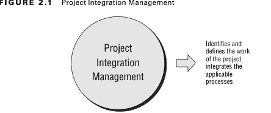

### 项目范围管理

项目范围管理知识领域由六个过程组成。表2.2列出了每个过程及其所属的过程组。这些过程是交互式的，定义并控制在项目范围中战略性包含的内容与有意排除的内容。

#### 表 2.2 项目范围管理

| 过程名称 | 项目管理过程组 |
| :--- | :--- |
| 规划范围管理 | 规划 |
| 收集需求 | 规划 |
| 定义范围 | 规划 |
| 创建WBS | 规划 |
| 确认范围 | 监控与预测 |
| 控制范围 | 监控与预测 |

项目范围管理知识领域涵盖以下内容：

**项目范围** 根据PMBOK®指南，项目范围识别了为交付具有指定特征和功能的成果、服务或结果所需完成的工作。这通常对照项目管理计划进行衡量。

**产品范围** 产品范围涉及构成项目成果、服务或结果的特征和功能。这是通过对照产品规格来衡量成功完成或履约情况的。产品范围包含以下内容：

- 详述项目成果的需求
- 使用度量技术验证这些细节
- 创建范围管理计划
- 创建工作分解结构（WBS）
- 控制对这些过程的变更

以下任务是在项目范围管理知识领域涵盖的工作期间通常执行的任务：

- 收集项目需求
- 定义整体项目范围
- 对照项目管理计划、项目范围说明书和WBS衡量项目
- 对照产品需求衡量产品的完成度

请记住，项目范围管理知识领域关注的是确保项目包含完成项目所需的所有工作——并且*仅*包含成功完成项目所需的工作。图2.2展示了该知识领域目的的重点。

#### 图 2.2 项目范围管理

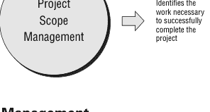

### 项目时间管理

项目时间管理知识领域由七个过程组成。表2.3列出了每个过程及其所属的过程组。在小项目中，排列活动、估算活动持续时间和发展进度计划这三个过程作为一个活动完成。

理解项目管理知识领域

#### 表 2.3 项目时间管理

| 过程名称 | 项目管理过程组 |
|---|---|
| 规划进度管理 | 规划 |
| 定义活动 | 规划 |
| 排列活动 | 规划 |
| 估算活动资源 | 规划 |
| 估算活动持续时间 | 规划 |
| 制定进度计划 | 规划 |
| 控制进度 | 监控与预测 |

项目时间管理知识领域涉及以下内容：

- 保持项目活动正轨，并对照项目计划监控这些活动
- 确保项目按时完成

项目时间管理知识领域的流程非常直观。首先，识别项目活动并将其按发生顺序排列。接下来，估算每个活动的资源和预计持续时间。最后，随着项目工作的推进，制定并控制项目进度计划。图2.3展示了该知识领域目的的重点。

#### 图 2.3 项目时间管理

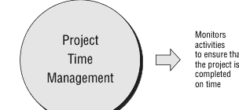

### 项目成本管理

项目成本管理知识领域由四个过程组成。表2.4列出了每个过程及其所属的过程组。对于小型项目，估算成本和确定预算可以合并为一个过程。请记住，你在项目开始时对成本的影响力最大。与其他阶段相比，此时使用的资源最少。因此，在这些过程中所做的变更对降低成本的影响更大，且随着你深入项目，实施变更的机会会减少。

#### 表 2.4 项目成本管理

| 过程名称 | 项目管理过程组 |
| :--- | :--- |
| 规划成本管理 | 规划 |
| 估算成本 | 规划 |
| 确定预算 | 规划 |
| 控制成本 | 监控与预测 |

项目成本管理知识领域涉及以下内容：

- 为资源建立成本估算
- 建立预算
- 确保项目在批准的预算内执行
- 通过两种技术提高交付物的质量：生命周期成本和价值工程

生命周期成本和价值工程用于改进交付物。以下是这两种技术的简要概述：

**生命周期成本** 生命周期成本是一种经济评估技术，它不仅确定项目的总成本（临时成本），还从运营角度确定项目完成并移交后，拥有、维护和运营某项资产的成本。

**价值工程** 价值工程是一种技术，旨在寻找替代产品创意，以确保团队以最少的成本获得相同或更高质量的结果。例如，如果原始工程师建议在生产过程的某个步骤中使用定制零件，价值工程审查可能会建议使用一种通用的、成本更低的标准零件作为替代方案，该替代方案可以产生相同的输出，从而获得更好的价值。

以下是在项目成本管理知识领域涵盖的工作期间通常执行的任务：

- 制定成本管理计划
- 考虑项目决策对成本的影响
- 考虑相关方的信息需求

图 2.4 展示了该知识领域目的的重点内容。

#### 图 2.4 项目成本管理

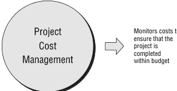

考试日必知

了解某个过程属于哪个过程组和知识领域非常重要。在某些情况下，过程的名称可以揭示这些信息。例如，**控制成本**过程属于**项目成本管理**知识领域和**监控过程组**。请留意类似的线索，以便轻松记忆！

### 项目质量管理

项目质量管理知识领域包含三个过程。表 2.5 列出了这些过程及其所属的过程组。

#### 表 2.5 项目质量管理

| 过程名称 | 项目管理过程组 |
| :--- | :--- |
| 规划质量管理 | 规划 |
| 实施质量保证 | 执行 |
| 控制质量 | 监控 |

项目质量管理知识领域涉及以下内容：

- 确保项目满足其发起所要实现的要求
- 将相关方的需求、期望和希望转化为要求
- 关注产品质量以及所使用的项目管理过程的质量
- 衡量整体绩效
- 监控项目成果并将其与项目规划过程中确立的质量标准进行比较

在项目管理质量知识领域涵盖的工作范围内，通常执行以下任务：

- 通过政策、程序和质量流程实施质量管理体系
- 改进过程
- 验证项目符合 ISO 标准

图 2.5 展示了该知识领域目的的重点内容。

#### 图 2.5 项目质量管理

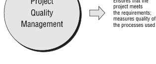

### 项目人力资源管理

项目人力资源管理知识领域包含四个过程。这些过程负责组织、开发和管理项目团队。表 2.6 列出了这些过程及其所属的过程组。由于每个团队的构成各不相同，且参与项目各阶段的相关方可能会发生变化，项目经理会在项目不同阶段使用不同的技术来管理这些过程。

#### 表 2.6 项目人力资源管理

| 过程名称 | 项目管理过程组 |
| :--- | :--- |
| 规划人力资源管理 | 规划 |
| 获取项目团队 | 执行 |
| 开发项目团队 | 执行 |
| 管理项目团队 | 执行 |

项目人力资源管理知识领域涉及以下内容：

- 监督人员管理和人际互动的各个方面
- 确保分配给项目的人力资源以尽可能有效的方式使用
- 通过根据情况确定何时行使特定技能和沟通风格来进行良好的项目管理

项目人力资源管理知识领域还包括提高项目团队的技能和效率，进而提高项目绩效。请记住，项目管理团队和项目团队是不同的。项目管理团队是由负责规划、控制和收尾活动的个人组成的群体。他们被视为项目的领导团队。项目团队由所有被分配角色和职责以完成项目的个人组成。他们也被称为项目人员。

图 2.6 展示了该知识领域目的的重点内容。

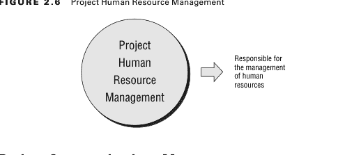

### 项目沟通管理

项目沟通管理知识领域包含三个过程。这些过程共同将人员和信息连接起来，以实现整个项目期间的成功沟通。表 2.7 列出了这些过程及其所属的过程组。

#### 表 2.7 项目沟通管理

| 过程名称 | 项目管理过程组 |
| :--- | :--- |
| 规划沟通管理 | 规划 |
| 管理沟通 | 执行 |
| 控制沟通 | 监控 |

项目沟通管理知识领域涉及以下内容：

- 确保所有项目信息在适当的时间收集、记录、归档和处置
- 向相关方、管理人员和项目团队成员分发和共享信息
- 在项目收尾后归档信息，作为未来项目的参考材料；这些信息被称为历史信息

正如本书第一章所述，优秀的项目经理会将高达 90% 的时间用于沟通。总体而言，项目经理的大部分工作涉及管理项目沟通。

图 2.7 展示了该知识领域目的的重点内容。

#### 图 2.7 项目沟通管理

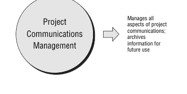

### 项目风险管理

项目风险管理知识领域包含六个过程，其中一些可以合并为一个步骤。表 2.8 列出了这些过程及其所属的过程组。风险包括项目中的威胁和机遇。

#### 表 2.8 项目风险管理

| 过程名称 | 项目管理过程组 |
| :--- | :--- |


| 规划风险管理 | 规划 |
| 识别风险 | 规划 |
| 实施定性风险分析 | 规划 |
| 实施定量风险分析 | 规划 |
| 规划风险应对 | 规划 |
| 控制风险 | 监控 |

项目风险管理知识领域涉及以下内容：

- 识别、分析和规划可能影响项目的潜在风险，包括正面和负面风险
- 最小化负面风险的可能性和影响，增加正面风险的可能性和影响
- 识别风险的正面后果并利用它们来改进项目目标或发现可能提高项目绩效的效率

根据 PMBOK® 指南，风险是一种不确定事件或条件，会对一个或多个项目目标产生正面或负面影响。每个项目都有一定程度的不确定性，因此也有一定程度的风险。请记住，风险与问题是不同的。风险可能发生，也可能不会发生。但是，当一个负面风险显现并影响项目时，它就变成了一个必须处理的问题。

### 图 2.8 项目风险管理

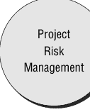

- 识别、分析、规划并对项目风险做出反应；监控已识别的风险

> 在第三章“规划项目”中，我们将更多地讨论各种类型的风险，包括正面风险与负面风险。

## 项目采购管理

项目采购管理知识领域包含四个过程。表 2.9 列出了这些过程及其所属的过程组。在审查采购过程时，请记住您是从买方的角度看待过程，卖方是项目团队之外的外部方。这四个过程共同使您能够管理项目的采购活动和采购合同的生命周期。

### 表 2.9 项目采购管理

| 过程名称 | 项目管理过程组 |
| :--- | :--- |
| 规划采购管理 | 规划 |
| 实施采购 | 执行 |
| 控制采购 | 监控 |
| 结束采购 | 收尾 |

项目采购管理知识领域涉及从项目团队之外的供应商、承包商、卖方和其他方购买商品或服务。

请记住，合同可以是简单的，也可以是复杂的；合同可以针对项目的需求进行定制。*PMBOK® 指南* 将合同定义为一种协议，它约束卖方提供指定的产品或服务；它也规定买方必须按照指定方式向卖方提供补偿。

### 图 2.9 项目采购管理

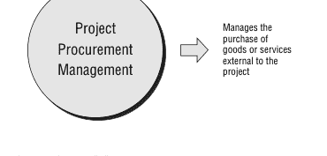

## 项目相关方管理

项目相关方管理知识领域包含四个过程。表 2.10 列出了这些过程及其所属的过程组。该知识领域关注内部和外部相关方。

### 项目管理流程与干系人管理

| **流程名称** | **项目管理过程组** |
|---|---|
| 识别干系人 | 启动 |
| 规划干系人管理 | 规划 |
| 管理干系人参与 | 执行 |
| 控制干系人参与 | 监控 |

项目干系人管理知识领域关注识别项目的所有干系人。这些流程还会评估干系人的需求、期望以及其在项目中的参与度。根据*《PMBOK®指南》*，应将与干系人的参与和满意度管理作为关键的项目目标。

图2.10展示了该知识领域目的的要点。

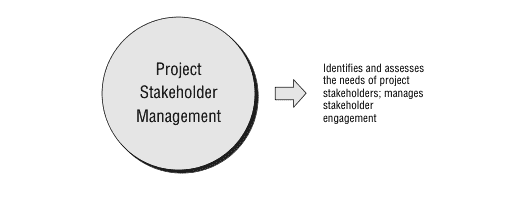

### 考试要点

**能够说出10个项目管理知识领域的名称。** 10个项目管理知识领域分别是：项目整合管理、项目范围管理、项目进度管理、项目成本管理、项目质量管理、项目人力资源管理、项目沟通管理、项目风险管理、项目采购管理和项目干系人管理。

## 执行项目评估

在组织决定启动一个项目之前，必须进行多方面的考量，例如对各种潜在项目的评估。作为执行项目评估的一部分，管理层需要评估现有的需求和需求，进行可行性研究，并使用项目选择方法来帮助做出良好的决策。

项目评估应包含通过与支持者、客户和其他主题专家进行会议而进行的仔细信息评估。这群关键人员随后将确定新产品或服务在现有的假设和约束条件下是否可行。

## 启动项目

项目启动是正式确认新的项目或现有项目的下一阶段应当开始，并且资源可能已承诺用于该项目。项目可能是由于需求、要求、机会或问题而产生的。一旦这些需求和要求被识别出来，下一个合乎逻辑的步骤可能是进行可行性研究，以确定项目的可行性。


> *有关启动项目的更详细信息，包括对项目选择方法和案例研究的深入了解，请参阅《PMP®：项目管理专业人士考试学习指南》第八版第2章。*

## 识别需求和要求

需求和要求代表需要解决的机会、业务要求或问题。管理层必须决定如何回应这些需求和要求，而这种情况往往会启动新的项目。根据*《PMBOK®指南》*，项目是以下七种需求或要求之一产生的结果：

- **市场需求：** 市场的需求可以驱动项目的产生。一些公司必须启动项目，以便利用暂时性和长期性的市场变化。
- **战略机会/业务需求：** 组织可能会响应内部需求，这些需求最终可能会影响公司的底线（净利润）。例如，这可能包括应对公司增长或甚至缩减规模的需求。
- **客户请求：** 新的项目可能源于内部或外部客户的请求。
- **技术进步：** 新技术通常要求公司改造其产品，以利用最新的技术。
- **法律要求：** 私营企业和政府机构都会因每个立法期通过的法律而产生新项目。
- **环境考虑：** 如今许多组织正在努力“绿色化”，以减少能源消耗、节约燃料、减少碳足迹等。
- **社会需求：** 项目产生于社会需求，例如，一个发展中国家为了应对快速传播的疾病而提供医疗用品和疫苗接种。

## 进行可行性研究

一些组织要求在最终决定启动项目之前进行可行性研究。可行性研究可以作为独立的项目、子项目或项目的第一阶段来进行。

在评估新产品或服务的可行性时，与支持者、客户和其他主题专家会面通常是个好主意。以下是可能进行可行性研究的一些原因：

- 确定项目是否可行
- 确定成功的概率
- 检查项目产品、服务或成果的可行性
- 评估与项目相关的技术问题
- 确定拟议的技术是否可行、可靠，并易于整合到现有的技术结构中

## 选择项目

如图2.11所示，组织可能会选择使用各种选择方法。选择方法帮助组织在替代项目之间做出决定，并确定选择或不选择该项目给公司带来的有形利益。项目选择方法也用于评估和选择实施项目的不同替代方式。

### 图 2.11 项目选择方法

| **数学模型** | **效益衡量方法** |
| :--- | :--- |
| - 线性 | - 成本效益分析 |
| - 动态 | - 评分模型 |
| - 整数 | - 现金流分析技术 |
| - 非线性 | |
| - 多目标规划 | |


虽然项目选择通常被认为不在项目经理的职责范围内，但我们接下来要讨论的项目选择方法是你在考试中应当熟悉的。

根据组织不同，指导委员会可能负责项目的审查、选择和优先级排序。指导委员会由高级管理人员以及有时由代表组织中各个职能领域的中级管理人员组成的团体。

选择方法通常分为两类：

- 数学模型（也称为约束优化方法）
- 效益衡量方法（也称为决策模型）

### 数学模型

就考试而言，只需知道数学模型（也称为约束优化方法）以算法形式使用以下内容：

- 线性
- 动态
- 整数
- 非线性
- 多目标规划

### 效益衡量方法

效益衡量方法（也称为决策模型）利用各种形式的分析和比较方法来进行项目决策。这些方法包括如下比较方法：

- 成本效益分析
- 评分模型
- 现金流分析技术


在应用项目选择方法时，你可以单独使用效益衡量方法，或将其与其他方法结合使用，以得出选择决策。

让我们更仔细地看看效益衡量方法。

#### 成本效益分析

成本效益分析，也称为成本分析或效益分析，将生产项目产品、服务或结果的成本与组织因执行项目而获得的利益进行比较。

#### 评分模型

对于加权评分模型，项目选择委员会决定在评分模型中使用的标准。然后根据每个标准对项目委员会的重要性，为其分配权重。更重要的标准应比次要的标准具有更高的权重。然后，每个项目按数值比例进行评级，数值越高表示对公司越有利的结果，数值越低则效果相反。该评级随后乘以该标准因素的权重，并与其他加权标准分数相加，得出加权总分。加权总分最高的项目是最佳选择。

例如，如果项目A的加权得分为31，项目B的加权得分为42，项目C的加权得分为40，你会选择哪个项目？正确答案是项目B，因为它具有最高的加权得分。

#### 现金流分析技术

最后的效益衡量方法涉及各种现金流分析技术：

- 投资回收期
- 折现现金流
- 净现值
- 内部收益率

图2.12提供了现金流分析技术的概述。

**图 2.12** 现金流分析技术概述

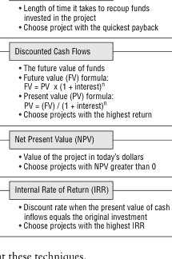

让我们更仔细地看看这些技术。

### 投资回收期


*投资回收期*是指公司收回生产产品、服务或项目成果的初始成本所需的时间长度。这种方法将初始投资与在产品、服务或成果生命周期内预期的现金流入进行比较。

### 投资回收期示例

一个项目的初始投资为 200,000 美元，预计前两年的现金流入为每季度 25,000 美元，此后为每季度 50,000 美元。投资回收期为两年，计算如下：

- 初始投资 = 200,000 美元
- 现金流入 = 25,000 美元
- 时间范围 = 4 个季度
- 每年现金流入总额 = 100,000 美元（4 个季度 x 每季度 25,000 美元的现金流入）
- 初始投资（200,000 美元） – 第一年流入（100,000 美元） = 剩余余额 100,000 美元
- 第一年流入剩余余额 – 第二年流入 = 0 美元
- 第一年和第二年现金流量总计 = 200,000 美元

投资在两年后收回。

从第三年开始，每季度流入 50,000 美元的事实没有影响，因为投资已在两年后收回。

在所有现金流量计算中，投资回收期的精确度最低，因为它没有考虑资金的时间价值。

### 折现现金流

未来收到的钱价值低于今天收到的钱。因此，你可以使用以下公式计算资金在未来的价值：

$$FV = PV\ (1+i)^n$$

该公式表明，投资的未来价值（`FV`）等于现值（`PV`）乘以（1 加上利率）的 $n$ 次方，其中 $n$ 为支付利息的时期数。


#### 现实场景

#### 计划价值示例

如果三年后现金流的值为 2,315.25 美元，给定 5% 的利率，其今天的价值是多少？

$PV = \$2,315.25 \times (1 + 0.05)^{3}$

$PV = \$2,315.25 \times 1.157625$

$PV = \$2,000$

三年后的 $\$2,315.25$ 相当于今天的 $\$2,000$。

为了计算你所比较的各个项目的折现现金流以供选择，请应用 `PV` 公式，然后相互比较所有项目的折现现金流以做出选择。


#### 现实场景

#### 计算项目价值示例

预计项目 A 在两年内可获利 100,000 美元，预计项目 B 在三年内可获利 120,000 美元。如果资本成本为 12%，你应该选择哪个项目？

使用之前展示的 **PV** 公式，计算每个项目的价值：

项目 A 的 $PV$ = **79,719 美元**

项目 B 的 $PV$ = **85,414 美元**

项目 B 是能为公司带来最高投资回报的项目，因此应优先选择项目 B 而非项目 A。

### 净现值

*净现值 (NPV)* 允许你以今天的美元计算项目的准确价值。`NPV` 类似于折现现金流，它将未来收到的资金价值折算为今天的美元。通过 `NPV`，你使用折现现金流技术对每个预期有现金流入的时期进行评估，而不是一次性评估总和。然后，从初始投资中扣除现金流量的总现值来确定 `NPV`。`NPV` 假设现金流入按资本成本进行再投资。

关于 `NPV` 计算的一些重要注意事项：

- 如果 `NPV` 计算结果大于零，接受该项目。
- 如果 `NPV` 计算结果小于零，拒绝该项目。
- 项目早期回报率高的项目优于早期回报率低的项目。

### 内部收益率

*内部收益率 (IRR)* 是指现金流入的现值等于原始投资时的折现率。在选择项目或在执行项目的替代方法之间进行选择时，`IRR` 值较高的项目通常被认为优于 `IRR` 值较低的项目。

请记住以下几点：

- `IRR` 是 `NPV` 等于零时的折现率。
- `IRR` 假设现金流入按 `IRR` 值进行再投资。
- 你应该选择 `IRR` 值最高的项目。

#### 考试要点

**能够区分导致项目创建的七种需求或要求。** 导致项目创建的七种需求或要求包括市场需求、组织需求、客户请求、技术进步、法律要求、生态影响和社会需求。

**能够定义决策模型。** 决策模型是项目选择方法，用于在制定项目章程过程之前确定项目的可行性。决策模型包括效益测量方法和数学模型。

**熟悉投资回收期。** 投资回收期是指公司收回其在项目产品中的初始投资所需的时间。它是通过累加预期的现金流入并将其与初始投资进行比较，以确定现金流入等于初始投资所需的期数来计算的。

**理解 NPV 和 IRR 的概念。** `NPV` 大于零的项目应被接受，`NPV` 小于零的项目应被拒绝。`IRR` 值较高的项目应优先于 `IRR` 值较低的项目。`IRR` 是 `NPV` 等于零时的折现率，并且 `IRR` 假设按 `IRR` 比率进行再投资。

### 定义高层项目范围

在启动过程组中，高层项目范围被定义和记录。当项目进入规划过程组时，高层范围将进一步细化和定义。这通常基于业务和合规要求，并记录下来以满足客户的期望。根据 *PMBOK® 指南*，高层项目范围包含在项目章程中。


有关项目章程的更多信息，请参阅本章稍后的“制定项目章程”部分。

#### 考试要点

**能够识别高层范围记录的位置及其依据。** 高层范围在项目章程中定义和记录，并主要基于业务和合规要求。

### 识别高层风险、假设和制约因素

启动过程组不仅关注记录高层项目范围（如前所述），还关注高层风险、假设和制约因素。这些信息将记录在项目章程中，并主要基于现有环境、历史信息和专业判断。

你可能已经注意到，该过程组关注的是为项目旨在实现的目标奠定基础和建立共识。规划过程组随后将通过解决细节问题来扩展这些高层信息。

> **注意**
>
> 有关项目章程的更多信息，请参阅本章稍后的“制定项目章程”部分。

#### 考试要点

**能够识别高层风险、假设和制约因素记录的位置及其依据。** 高层风险、假设和制约因素在项目章程中定义和记录，并主要基于现有环境、历史信息和专业判断。

### 制定项目章程

创建 *项目章程* 是启动任何项目的重要初始步骤，因为它在组织中正式启动项目，并授权将资源投入项目。该文档的创建涉及收集和分析干系人要求，这将引导正确识别和记录项目及产品范围、里程碑和可交付成果。

项目章程文档源自项目整合知识领域的第一个过程，即“制定项目章程”。该文档不仅试图正式认可项目，还识别项目限制并提出实施方法。在项目章程创建并正式获得批准之前，许多组织不承认该项目的存在。

项目章程记录了项目经理的姓名，并赋予该人员将组织资源分配给项目的权限。它还记录了业务需求、理由和影响；描述了客户要求；设定了干系人期望；并将项目与组织的持续工作联系起来。项目章程签署后，项目即获正式授权。

图 2.13 展示了制定项目章程过程的输入、工具与技术以及输出。

> **注意**
>
> 有关项目章程的更详细信息，请参阅 *PMI®：项目管理专业人士考试指南，第八版* 第 2 章。

#### 制定项目章程过程的输入

在考试中，你应该了解制定项目章程过程的以下输入：

- 项目工作说明书 (`SOW`)
- 商业论证
- 协议
- 企业环境因素
- 组织过程资产

让我们更详细地审视这些输入。

**项目工作说明书** 项目工作说明书 (`SOW`) 描述了项目旨在完成的产品、服务或结果。当项目是内部项目时，通常由项目发起人或项目启动者编写此文档。当项目是组织外部项目时，通常由买方编写 `SOW`。根据*PMBOK*® *指南*，项目 `SOW` 应包含或考虑以下所有要素：

- 业务需求
- 产品范围描述
- 战略计划

**商业论证** 商业论证的目的是了解项目的业务需求，并确定对该项目的投资是否值得。进行可行性研究是构建商业论证的一个很好的第一步。大多数商业论证文档包含以下项目：

- 项目业务需求的描述
- 必须满足的任何特殊要求的描述
- 替代方案的描述
- 每种替代方案预期结果的描述
- 成本效益分析
- 推荐方案

**协议** 协议输入仅适用于你所在组织为组织外部客户执行项目的情况。协议被用作该过程的输入，因为它通常记录了项目执行的条件、时间框架以及工作描述。

**企业环境因素** 企业环境因素是指项目之外可能对项目成功产生重大影响的因素。根据*PMBOK® 指南*，与该过程相关的环境因素包括但不限于以下项目：

- 政府或行业标准，包括监管标准和法规、质量标准、产品标准以及工艺标准等要素
- 组织文化和结构
- 市场状况，指供需理论以及经济和金融因素

**组织过程资产** 组织过程资产是组织为开展工作（包括项目工作）而制定的政策、指南、程序、计划、方法或标准。

这些资产包含可能影响项目多个方面的广泛要素。就本过程而言，组织过程资产指以下项目：

- 组织的流程、政策、模板和程序
- 组织知识库，例如历史信息和经验教训

#### 制定项目章程过程的工具与技术


# 项目章程与利益相关者管理

制定项目章程过程只有两种你应该熟悉的工具与技术：专家判断和引导技能。专家判断的概念是依靠在评估领域受过培训、拥有专业知识或技能的个人或团体。这些个人可能是干系人、顾问、组织内的其他专家、主题领域专家、项目管理办公室 (`PMO`)、行业专家，或技术或专业组织。引导技能是指通过使用头脑风暴、会议管理、冲突解决以及其他引导者采用的技术来应用项目管理过程。

此外，你应该熟悉谁被视为关键干系人。关键项目干系人包括以下个人：

`项目经理` `项目经理`是对项目成功承担责任的人。项目经理应尽可能早在项目中被识别，理想情况下应参与编写项目章程。以下是项目经理角色职责的示例：
- 项目计划及项目整体工作的管理
- 为其所负责的项目制定标准和政策
- 建立项目程序并向项目团队和干系人传达
- 识别活动和任务、资源需求、项目成本、项目需求、绩效指标等
- 让所有干系人和其他利益相关方知情

`项目发起人` `项目发起人`通常是组织内拥有决策权和处理与项目相关的纠纷或冲突权限的高管。发起人将项目置于聚光灯下，有权决定项目结果，并为项目提供资金。项目发起人应在项目章程中被命名，并被指定为项目问题的最终权威和决策者。

`项目支持者` `项目支持者`通常是拥有大量技术专业知识或行业知识的人，他们从技术角度帮助集中关注项目。与发起人不同，项目支持者不一定拥有大量的权威或行政权力。

`职能经理` 项目经理必须与职能经理合作并获得他们的支持，以完成项目。职能经理履行组织的行政职责，为项目提供和分配员工，并对他们的员工进行绩效评估。

## 制定项目章程过程的输出

制定项目章程过程产生单一但至关重要的输出：项目章程。根据`*PMBOK® 指南*`，有用且记录完善的项目章程至少应包括以下要素：
- 项目的目的或理由
- 可衡量的项目目标
- 高层级需求列表
- 项目的高层级描述
- 高层级风险列表
- 里程碑进度概览
- 预算概览
- 已知干系人列表
- 项目批准标准
- 项目经理姓名及其权限级别
- 发起人（或项目授权人）姓名及其权限级别

`考试重点`
`能够列出制定项目章程的输入。` 制定项目章程的输入包括项目工作说明书、商业论证、协议、企业环境因素和组织过程资产。
`能够描述商业论证的目的。` 商业论证的目的是了解项目的业务需求，并确定对该项目的投资是否值得。

## 获得项目章程批准

在收到项目发起人、高级管理层和关键干系人的签署之前，项目章程并不完整。签署表明签署人已阅读该文档，并同意其内容，支持该项目。签名标志着对项目的正式授权。接受章程对于正式确定项目经理及其权限级别也很重要。

该过程的最后一步是发布章程。在这种情况下，发布仅仅意味着向关键干系人、客户、管理团队以及可能参与项目的其他人分发项目章程副本。发布可以采取多种形式，包括通过公司电子邮件系统或公司内部分发的印刷版或电子版。

`考试重点`
`能够描述项目章程的重要性。` 项目章程是正式承认并确认项目存在的文档。章程授权项目开始。它授权项目经理将资源分配给项目，并记录业务需求和理由。项目章程描述了客户的需求，并将项目与组织的 ongoing 工作联系起来。

## 进行关键利益相关者分析

识别利益相关者并对关键利益相关者进行分析，是为取得成功的项目成果奠定基础的重要组成部分。利益相关者分析通过识别利益相关者流程进行，涉及头脑风暴、访谈以及多种数据收集技术的应用。

通过执行利益相关者识别和分析，项目经理能够更好地记录利益相关者的期望，并确保这些期望与项目目标保持一致。这也是获取项目支持的一种方式。

**注意**：项目利益相关者是对项目成果有既定利益的个人或组织。他们因项目结果而有所得或有所失，并且有能力影响项目结果。

识别利益相关者是项目利益相关者管理知识领域的第一项流程，属于启动过程组。该流程涉及识别并记录项目中的所有利益相关者，包括他们的利益、影响以及对项目可能产生的负面影响。利益相关者识别应尽可能早在项目初期进行，并贯穿整个项目生命周期持续进行。

图 2.14 展示了识别利益相关者流程的输入、工具与技巧以及输出。

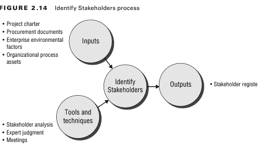


### 识别利益相关者流程的输入

识别利益相关者流程有四个输入：

`项目章程`：在此流程中，项目章程提供了利益相关者名单，以及受项目影响的其他个人或组织。

`采购文件`：当项目通过采购获得时，可以通过采购文件获取关键利益相关者及其他相关个人或组织的名单。

`企业环境因素`：以下企业环境因素在此流程中使用：
- 公司文化
- 组织结构
- 政府或行业标准
- 当地、区域或全球的趋势和实践

`组织过程资产`：以下组织过程资产与此流程相关：
- 利益相关者登记册模板
- 经验教训
- 来自之前项目的利益相关者登记册

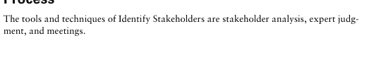

### 识别利益相关者流程的工具与技巧

识别利益相关者的工具和技巧包括利益相关者分析、专家判断和会议。

`利益相关者分析`：在利益相关者分析过程中，你需要识别利益相关者对项目的影响，并理解他们的期望、需求和愿望。在此基础上，你可以得出关于项目目标和交付物的更具体信息。利益相关者通常关注自身的利益以及他们从项目中可能获得或失去什么。

根据`*《PMBOK® 指南》*`，利益相关者分析涉及三个步骤：
1. 识别所有潜在的利益相关者，并获取关于他们的通用信息，例如他们所在的部门、联系方式、知识水平以及影响力水平。
2. 识别每位利益相关者可能对项目产生的潜在影响或支持，然后根据影响对其进行分类，以便你可以制定相应的应对策略。`*《PMBOK® 指南》*`列出了四种分类模型，用于在简单的四象限网格中对每位利益相关者的权力和影响力进行分类：
    - 权力/利益网格
    - 权力/影响网格
    - 影响/冲击网格
    - 显著性模型（绘制利益相关者的权力、紧迫性和合法性）
3. 评估利益相关者对各种情况的反应或回应。这将有助于项目经理管理利益相关者。

`专家判断`：专家判断与利益相关者分析结合使用，以确保利益相关者识别的全面性。这可能涉及对已识别的关键利益相关者、高级管理人员、主题专家或其他项目经理进行访谈。

`会议`：会议通常作为执行利益相关者分析的机制。项目经理通常通过会议来收集和分析有关利益相关者角色、立场和利益的信息。

### 识别利益相关者流程的输出

识别利益相关者流程有一个输出：利益相关者登记册。

`利益相关者登记册`：利益相关者登记册将所有关于利益相关者的信息集中记录在一处。这些通用信息包括他们所在的部门、联系方式、知识水平和影响力水平等。此外，利益相关者登记册至少包含以下内容：
- `标识信息`：包括联系方式、部门、在项目中的角色等项目。
- `评估信息`：包括关于影响力、期望、关键需求以及利益相关者参与最关键的时机的要素。
- `利益相关者分类`：利益相关者可以根据其与组织的关系进行分类，更重要的是，根据他们是支持项目、抵制项目还是没有意见进行分类。

#### 考试要点
理解识别利益相关者流程。该流程的目的是识别项目利益相关者，评估其影响力和参与程度，制定应对潜在负面影响的计划，并在利益相关者登记册中记录利益相关者信息。

#### 将流程整合在一起
作为总结，启动过程组开启了项目，并导致项目章程和利益相关者登记册的创建。这一阶段确认新的项目或阶段应当开始。

但在项目正式存在之前，可能会发生几种情况：
- 首先，组织内部浮现出需求和要求，表明需要启动一个项目。
- 潜在项目随后可能经历可行性研究，以确定项目及项目最终成果是否可行，以及是否存在成功的机会。
- 项目还可能经过一个选择过程。我们研究了数学模型和效益测量方法作为项目选择方法的两个类别。

项目选定后，将创建项目章程（使用制定项目章程流程）并签署，正式授权该项目。在制定项目章程流程结束时，项目章程包含几个已记录的元素，包括项目理由、高层级需求和描述、摘要里程碑进度表和预算，以及发起人及项目经理（如果已选定）。

一旦生成项目章程，就可以识别项目利益相关者。这发生在识别利益相关者流程中。你已了解到，利益相关者及其利益和影响水平在项目中早期识别和定义至关重要。因此，创建了一个利益相关者登记册，用于识别、评估和分类各个利益相关者。

图 2.15 展示了新项目从启动到进入启动阶段的潜在路径。

在本章中，我们还涵盖了 10 个项目管理知识领域，其概要见 表 2.11。

### 图 2.15 启动项目

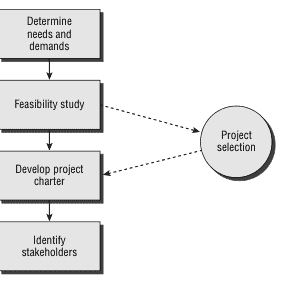

### 表 2.11 项目管理知识领域概要

| 知识领域 | 描述 |
|---|---|
| 项目整合管理 | 关注协调项目管理计划的所有方面，以实现项目目标 |
| 项目范围管理 | 关注管理项目范围，定义和控制项目包含（及不包含）的内容 |
| 项目时间管理 | 关注按时完成项目 |


| 项目成本管理 | 关注在预算内完成项目 |
| 项目质量管理 | 关注确保项目满足其被开展的目的需求 |
| 项目人力资源管理 | 关注组织、开发和管理项目团队 |
| 项目沟通管理 | 关注将人员与信息连接起来，以实现项目全过程中的成功沟通 |

### 知识领域表

| **知识领域** | **描述** |
|---|---|
| 项目风险管理 | 关注于提高积极事件发生的概率和影响，并降低不利事件发生的概率和影响 |
| 项目采购管理 | 关注于管理项目的采购活动以及采购合同的生命周期 |
| 项目相关方管理 | 关注于识别项目相关方、评估其需求和期望，并管理其参与 |

随着启动阶段的完成，我们已准备好进入项目生命周期的下一阶段：规划。

### 复习题

1. 识别相关方、规划相关方管理和控制相关方参与均属于哪个知识领域的过程？
   - A. 项目整合管理
   - B. 项目相关方管理
   - C. 项目人力资源管理
   - D. 项目采购管理

2. Ron 是一家制药公司的项目经理，该公司开发多种用于对抗儿童疾病的药物。目前，公司计划在接下来两年内开发两种新药。Ron 被指派负责确定这两种药物中哪一种在当今市场上获得成功的可能性最大。这是下列哪一项的例子？
   - A. 业务需求
   - B. 需求
   - C. 项目选择方法
   - D. 可行性研究

3. 你的经理最近赋予你选择下一个项目的职责，你将作为项目经理管理该项目。目前有三个待选项目处于搁置状态。使用加权评分模型方法，你确定项目 A 的加权得分为 16，项目 B 的加权得分为 14，项目 C 的加权得分为 17。你选择哪个项目？
   - A. 项目 A
   - B. 项目 B
   - C. 项目 C
   - D. 没有任何一个选项是好的选择。

4. 多目标规划属于哪种类型的项目选择方法？
   - A. 收益测量方法
   - B. 约束优化方法
   - C. 决策模型
   - D. 评分模型

5. 给定 10% 的利率，四年后 $5,525 的现值是多少？
   - A. $3,773.65
   - B. $5,022.73
   - C. $5,525.00
   - D. $6,077.50

6. 以下哪项*最好地*描述了项目产品、服务或成果的特征？
   - A. 战略计划
   - B. 产品范围描述
   - C. 协议
   - D. 项目章程

7. 以下所有项均为制定项目章程过程的输入，*除了*：
   - A. 项目工作说明书
   - B. 商业论证
   - C. 组织过程资产
   - D. 项目章程

8. Maryann 刚刚完成项目章程的最终草案，并已将副本通过电子邮件发送给相关人员。两天后的启动会议已安排妥当，旨在完成项目章程的定稿，所有涉及人员均已接受会议邀请。为了完成项目章程，Maryann 需要在启动会议上做什么？
   - A. 发布章程
   - B. 确认发起人、高级管理层和所有关键相关方已阅读并理解该章程
   - C. 激发关键相关方对项目的兴奋感并获得他们的支持
   - D. 获得发起人、高级管理层和关键相关方对项目章程的签署认可

9. 以下所有项均为识别相关方过程的输入，*除了*：
   - A. 采购文档
   - B. 项目章程
   - C. 项目工作说明书
   - D. 企业环境因素

10. 相关方登记册*最好*可以被描述为：
    - A. 在一个地方记录所有关于相关方信息的文档
    - B. 用于记录在整个项目生命周期中最小化相关方可能产生的负面影响或作用的已记录的方法
    - C. 重新引导相关方支持的潜在策略列表
    - D. 一种分类方法，根据影响力、期望、关键需求以及相关方参与最关键的时间点来对所有相关方进行分类

11. Polly 是一位项目经理，负责领导一个将为一家大型零售咖啡连锁建立业务连续性管理实践的项目。在发起人的指导下，她起草了一份文件，该文件一旦签署，即授权她开始向该项目分配资源。Polly 接下来很可能执行什么过程？
    - A. 识别相关方
    - B. 制定项目管理计划
    - C. 制定项目章程
    - D. 规划人力资源管理

12. 权力/利益方格、突出模型和影响力/作用方格均是下列哪项技术的例子？
    - A. 专家判断
    - B. 相关方分析
    - C. 相关方策略
    - D. 相关方登记册

13. 以下所有项均为项目范围管理知识领域的过程，*除了*：
    - A. 收集需求
    - B. 创建 WBS
    - C. 确认范围
    - D. 控制需求

14. “Beans by the Dozen” 是一家向美国西部餐厅配送预煮豆子的公司。最近，该公司决定将其业务扩展到该国北部地区。已制定了商业论证，其中引用了市场需求，并正式指派了一名项目经理来正式化并启动该项目。项目经理最先很可能做什么？
    - A. 获得对商业论证的签署认可并庆祝
    - B. 组建项目团队以开始规划项目工作
    - C. 制定项目章程并获得签署认可
    - D. 制定项目管理计划并获得签署认可

15. 项目范围最好可以被定义为以下哪项？
    - A. 它解决了表征项目产品、服务或成果的特征和功能。
    - B. 它描述了范围如何被定义、制定、监控、控制和验证。
    - C. 它包含重新引导相关方支持的潜在策略列表
    - D. 它确定了需要完成的工作，以交付具有指定特征和功能的产品、服务或成果。

16. 产品范围是根据产品规格进行测量的，而项目范围是根据以下哪项进行测量的？
    - A. 项目管理计划
    - B. 范围管理计划
    - C. 需求文档
    - D. 需求管理计划

17. “Beans by the Dozen” 是一家向美国西部餐厅配送预煮豆子的公司。June 是被指派领导该公司业务扩展的项目经理。作为执行相关方分析的一部分，她列出了所有已知的相关方，并在登记册中记录了关于每个相关方的各种备注。June 接下来很可能做什么？
    - A. 发布相关方登记册供项目团队参考
    - B. 识别他们可能对/在项目上产生的潜在影响或支持
    - C. 在项目章程中记录相关方详情
    - D. 获得发起人对相关方登记册的签署认可

18. 生命周期成本法定义为：
    - A. 一种寻找替代产品创意的技术，以确保团队以最低的成本获得相同或更高质量的结果
    - B. 一种将生产项目产品、服务或成果的成本与组织将获得的收益进行比较的技术
    - C. 一种采用各种形式分析和比较方法来进行项目决策的决策模型
    - D. 一种确定产品总成本的经济评估技术

19. 以下哪个知识领域负责连接项目管理过程组中的各个过程？
    - A. 项目整合管理
    - B. 项目范围管理
    - C. 项目相关方管理
    - D. 项目质量管理

20. Polly 是一位项目经理，负责领导一个将为一家大型零售咖啡连锁建立业务连续性管理实践的项目。在发起人的指导下，她起草了一份文件，该文件一旦签署，即授权她开始向该项目分配资源。Polly 正在执行什么过程？
    - A. 识别相关方
    - B. 制定项目管理计划
    - C. 制定项目章程
    - D. 规划人力资源管理

### 第 3 章

## 项目规划

本章介绍的 PMP® 考试中涉及规划绩效领域的以下内容：

- 根据项目章程、经验教训，并使用需求收集技术，与干系人一起审查和评估详细的项目需求、约束条件和假设，以确立项目可交付成果。
- 基于批准的项目范围和范围管理技术，制定范围管理计划，以便定义、维护和管理工作范围。
- 基于项目范围、进度、资源、批准的项目章程及其他信息，并使用估算技术，制定成本管理计划，以管理项目成本。
- 基于批准的项目可交付成果和里程碑、范围以及资源管理计划，制定项目进度计划，以管理项目的及时完成。
- 通过定义项目团队成员的角色和职责，制定人力资源管理计划，以建立项目组织结构并提供关于如何分配和管理资源的指导。
- 基于项目组织结构和干系人要求，制定沟通管理计划，以定义和管理项目信息的流动。
- 基于项目范围、预算和进度，制定采购管理计划，以确保所需的项目资源可用。


- 基于项目范围、风险和要求的，制定质量管理计划，并定义项目及产品质量标准，以防止缺陷发生并降低质量成本。
- 通过定义如何处理和控制变更，制定变更管理计划，以跟踪和管理变更。
- 通过制定风险管理计划、识别分析并优先排序项目风险、创建风险登记册以及定义风险应对策略，规划风险管理计划，以在项目生命周期内管理不确定性和机遇。
- 根据适用的政策和程序，向相关干系人展示项目管理计划，以获得批准以进行项目执行。
- 召开启动会议，传达项目启动、关键里程碑及其他相关信息，以告知和参与干系人并获得承诺。


- 通过分析需求、利益和潜在影响，制定干系人管理计划，以有效管理干系人的期望并让他们参与项目决策。


规划是五个项目管理过程组中的第二个，包含数量最多的过程。

在规划过程中，目标被定义和细化，并映射出行动方案，以成功完成项目范围中概述的项目目标。

在此过程组中会创建几个关键项目文档，包括项目管理计划及其子系统计划和基准，这些将指导项目管理活动。

规划过程组占项目管理专业人士（PMP®）考试题目总量的 24%。

> 本章中项目管理过程组的流程名称、输入、工具和技术、输出以及相关材料和图表的描述，基于《项目管理知识体系指南》（PMBOK® 指南）第五版（PMI®，2013）的内容。

# 制定范围管理计划

项目范围管理知识领域通过一个过程启动，该过程制定两个关键计划，以指导需求的识别，以及项目范围的制定、验证和管理。这些计划被称为范围管理计划和需求管理计划，它们是称为项目管理计划的总体计划的子系统文档。

## 理解项目范围管理

范围管理计划是确保项目包含成功完成项目所需的所有工作的一系列过程的结晶。它还确保项目仅关注完成项目所需的工作，而不包含不必要的任务。正如您在第 2 章“启动项目”中学到的那样，项目范围管理知识领域由六个过程组成，但其中只有四个属于规划过程组。规划过程组中使用的四个过程是：规划范围管理、收集需求、定义范围和创建 WBS。

非由正式过程产生的计划，被视为由制定项目管理计划过程产生，这是一个高层级的规划过程，将在本章后面部分介绍。

图 3.1 展示了规划范围管理过程的输入、工具和技术以及输出。

**图 3.1** 规划范围管理过程

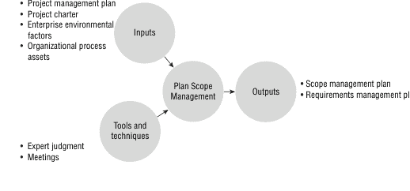

## 规划范围管理

范围管理计划包含以下信息或说明：

- 用于准备项目范围声明的过程
- 创建工作分解结构（WBS）的过程
- 如何验证可交付成果准确性的定义以及接受可交付成果的过程
- 控制范围变更请求过程的描述，包括请求变更的程序以及如何获取变更请求表

请记住，在整个项目范围管理知识领域中，范围管理计划作为指导和记录及控制项目范围的指南。

### 规划范围管理的输入

了解规划范围管理过程以下四项输入：

**项目管理计划** 为了了解项目旨在实现什么，使用包含所有已批准的子系统计划的项目管理计划来帮助创建范围管理计划。

**项目章程** 由于项目章程有助于传达高层目标、业务需求、假设和约束条件，因此在本过程中，它用于使范围管理计划与干系人的期望保持一致。

**事业环境因素** 多个事业环境因素可能影响规划范围管理过程，包括但不限于组织文化、基础设施、市场条件和人员管理。

**组织过程资产** 政策、程序和历史信息（包括经验教训知识库）是塑造范围管理计划的一些组织过程资产。

### 规划范围管理的工具和技术

规划范围管理过程使用的两种工具和技术是专家判断和会议：

**专家判断** 从经验丰富的团队成员和了解项目领域的人那里获得的输入被认为是对专家判断。请确保你向组织的各个角落寻找任何具有专门教育或培训，或拥有帮助制定范围管理计划的知识、技能和/或经验的人员或群体。

**会议** 在制定范围管理计划的过程中，项目团队成员可能会参加以助于信息交流和决策制定。根据会议情况，参与讨论的成员可能包括：项目经理、项目发起人、选定的项目团队成员以及在此领域负有责任的任何人。

### 规划范围管理的输出

对于考试，了解规划范围管理过程的输出。这自然包括范围管理计划以及需求管理计划。

该计划的组成部分包括以下过程：

- 准备详细的项目范围声明
- 根据详细的项目范围声明创建 WBS
- 建立如何维护和批准 WBS
- 指定如何获取已完成项目可交付成果的正式验收
- 控制和处理对详细项目范围声明的变更请求


> 请记住，范围管理计划可以根据您的需求进行裁剪，这意味着它可以是正式的或非正式的，可以是高度详细的或广泛框架的。

## 需求管理计划

需求管理计划定义了需求在项目的所有阶段中如何被分析、记录和管理。用于管理项目的阶段关系类型将决定需求在整个项目期间如何被管理。需求管理计划包括以下组成部分：

- 需求活动的规划、跟踪和报告将如何执行
- 需求变更将如何与其他配置管理活动一起被请求、跟踪和分析
- 需求将如何被优先级排序
- 哪些指标将用于追踪产品需求
- 哪些需求属性将记录在跟踪矩阵中
- 将用于帮助创建跟踪矩阵的结构

## 收集需求

在规划的早期阶段，需要收集、记录并评估需求。这是通过“收集需求”过程（47个项目管理过程之一）完成的。由于需求通常随着项目的推进需要不断精炼，因此这往往是一个迭代的过程。


> 需求通常是必须满足的条件或项目产品或服务必须具备的标准，以达成项目目标。需求量化并优先排序了项目发起人和利益相关者的期望、需求和预期。根据《*PMBOK®指南*》，你必须能够测量、追踪和测试需求。重要的是，需求必须是完整的，并得到项目发起人和关键利益相关者的认可。

正如第二章所涵盖的，高层级需求记录在项目章程中。基于该文件以及从过往项目中获得的经验教训，需要与利益相关者一起收集并评估详细需求。这对于确立项目交付成果至关重要。可以通过使用多种需求收集技术来收集详细需求，这些技术将产生一份全面的需求列表，并用于后续确立项目交付成果。“收集需求”是规划过程组的第三个过程，位于创建范围管理计划之后，以及项目范围管理知识领域的第二个过程。“收集需求”过程的主要目的是定义并记录项目发起人、客户和利益相关者为达成项目目标而拥有的期望和需求。这可以通过利用过往项目的经验教训、项目章程和利益相关者登记册中的信息，以及几种需求收集技术来实现。在此过程结束时，项目将包含一个计划，定义需求如何在项目的所有阶段中被记录和管理。

图3.2展示了“收集需求”过程的输入、工具与技术以及输出。

### 图 3.2 收集需求过程

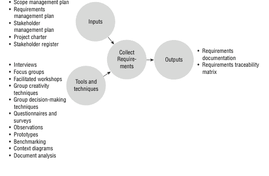

> **注意**
>
> 关于“收集需求”过程的更详细信息，请参见《PMP®：项目管理专业人士考试学习指南》（第八版）（Sybex出版社，2016年）第3章“制定项目范围声明”。

### 收集需求的输入

了解“收集需求”过程具有以下输入：

**范围管理计划**

范围管理计划为项目成员如何确定需要为项目收集的需求类型提供指导方向。

**需求管理计划**

需求管理计划有助于定义并记录利益相关者的期望和需求。

**利益相关者管理计划**

我们将在本章稍后的“制定利益相关者管理计划”部分中介绍利益相关者管理计划。对于“收集需求”过程，利益相关者管理计划用于记录利益相关者的沟通需求及其参与程度。这将帮助项目团队调整需求活动，以适应所需的利益相关者参与水平。

**项目章程**

在此过程中，使用项目章程中的高层级项目需求和产品描述。

**利益相关者登记册**

在此过程中，使用利益相关者登记册作为确定谁能够提供项目和产品需求必要信息的方式。

### 收集需求的工具与技术

了解在“收集需求”过程中可以使用的以下工具和技术：

- 访谈
- 焦点小组
- 引导式研讨会
- 群体创造力技术
- 群体决策技术
- 问卷调查和调查
- 观察
- 原型
- 基准分析
- 上下文图
- 文档分析

#### 访谈

访谈允许主题专家和经验丰富的项目参与者在短时间内提供大量信息。访谈具有以下特征：

- 通常被结构化为与利益相关者的一对一会谈
- 可以是正式的或非正式的
- 由预先准备好的问题组成

#### 焦点小组

焦点小组通常由经过培训的协调员主持。这个工具的关键在于挑选参与焦点小组的主题专家和利益相关者；他们通过讨论和交流来提供关于项目最终结果的反馈。

#### 引导式研讨会

跨职能的利益相关者聚集在引导式研讨会中，讨论并定义影响多个部门的需求。引导式研讨会具有以下特征：

- 研讨会的所有参与者都了解各种项目需求。
- 研讨会提供了一个引导式的论坛，用于讨论和解决参与者的问题。
- 与其他方法相比，更容易达成共识。


> 焦点小组和引导式研讨会之间的主要区别在于，焦点小组是由预先筛选的主题专家和利益相关者组成的聚会，其目的是从这些个人那里收集反馈；而引导式研讨会则由跨职能的利益相关者组成，他们合作定义跨职能需求。

#### 群体创造力技术

群体创造力涉及以下技术：

**头脑风暴**

头脑风暴是指聚集在一起产生想法并收集项目需求。

**名义小组技术**

名义小组技术通过想法收集或结构化头脑风暴会话以及排名过程来参与所有参与者。

**构思/思维导图**

在构思/思维导图中，参与者使用头脑风暴和图表技术的组合来记录他们的想法。

**亲和图**

亲和图将想法分类到相关组中，以便进一步分析和审查。


# 多准则决策分析

在多准则决策分析中，使用决策矩阵来建立标准，以实现系统化的分析方法。

### 群体决策技术

根据《*PMBOK®指南*》，使用了多种群体决策技术。提到的四种方法如下：

- 一致性决策，即每个人对决议或行动方案达成一致
- 多数决，即超过50%的成员支持该决议
- 相对多数决，即如果未达到多数，则由群体中最大的子群体做出决定
- 独裁决策，即由一人代表群体做出决定

### 问卷调查和调查

问卷调查和调查涉及通过问卷或调查向一大组参与者提问，并对结果应用统计分析（如果需要）。这被认为是一种从大量利益相关者那里获取反馈的快速方式。

### 观察

观察是一种一对一的体验，观察者与参与者并排而坐，观察参与者如何与产品或服务互动。这种技术也被称为“影子工作”（job shadowing）；它也可以涉及参与式观察者亲自执行工作以确定需求，或者观察一组参与者执行工作职能。当利益相关者难以口头表达需求时，观察特别有用。

## 原型法

原型法是一种通过构建最终产品的工作模型或模拟样机，供参与者进行实验的技术。原型通常不包含最终产品的所有功能，但它为参与者提供了足够的信息，使他们能够就该模拟样机提供反馈。这是一个迭代过程：参与者进行实验并提供反馈，随后对原型进行修改，循环重新开始。原型是在项目生命周期早期获取反馈的绝佳方式。

## 基准测试

你是否曾想看看自己与其他组织或内部项目的表现对比如何？通过基准测试，可以将实际或计划中的做法与可比组织进行比较，以衡量绩效、获取用于改进组织的新想法，并识别最佳实践。

## 上下文图

使用上下文图有助于通过映射与业务系统交互的人员和其他系统，直观地表示产品范围。这是通过显示业务系统的输入和用户角色，然后描绘接收输出者的输入、输出和用户角色来实现的。

## 文档分析

另一种用于识别需求的技术是文档分析，即审查现有文档，查看是否有相关信息以完善需求。根据*《PMBOK® 指南》*，可以仔细审查各种各样的文档，包括但不限于以下各项：

- 商业计划
- 营销材料
- 合同协议
- 建议书邀请函
- 业务流程或接口文档
- 用例
- 问题/故障日志
- 政策和程序
- 法规文件

### 收集需求的输出

对于考试，需要了解“收集需求”过程的输出，如下所示：

#### 需求文档

此输出涉及在需求文档中记录需求。根据*《PMBOK® 指南》*，该文档至少包括以下元素：

- 项目的商业需求及立项原因
- 项目目标以及项目希望实现的业务目标
- 相关方需求，包括对其他组织领域的影响
- 功能需求
- 非功能需求
- 质量需求
- 验收标准
- 业务规则
- 受影响的组织领域和外部实体
- 支持和培训需求
- 假设与约束
- 主要相关方的签字

#### 需求跟踪矩阵

跟踪矩阵将需求与业务需求和项目目标联系起来，并记录以下内容：

- 需求的来源
- 需求将被跟踪至何处
- 直至交付或完成的状态更新

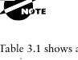

*根据《PMBOK® 指南》，需求跟踪矩阵有助于确保在项目完成时实现商业价值，因为每项需求都关联到一个业务和项目目标。*

表 3.1 展示了一个示例跟踪矩阵，其中包含几个用于识别需求的属性。

##### 表 3.1 需求跟踪矩阵

| 唯一标识符 | 需求描述 | 来源 | 优先级 | 测试场景 | 测试验证 | 状态 |
| :--- | :--- | :--- | :--- | :--- | :--- | :--- |
| 001 | 需求一 | 项目目标和相关方 | B | 用户验收 | | 已批准 |

跟踪矩阵具有以下特征：

- 每项需求应拥有其唯一的标识符。
- 简要描述包含足以轻松识别该需求的信息。
- “来源”列指需求的起源。
- “优先级”指需求的优先程度。
- “测试场景”记录将如何测试该需求或在项目哪个阶段进行测试，而“测试验证”指示其是否通过测试。
- “状态”可能捕获关于需求的信息，指该需求是否已获准纳入项目中。示例包括已添加、已延期和已取消。

###### 考试要点

**理解收集目的。** 收集需求是为了定义并记录项目发起人、客户和相关方对于实现项目目标的期望和需求。

在收集需求之后，下一步是开始分解并记录项目和产品的范围。最终结果将是一个 `WBS`（工作分解结构），它是对项目工作的以可交付成果为导向的高层级分解。但在生成 `WBS` 之前，必须处理以下额外步骤：

- 创建并签署项目范围说明书
- 创建范围基准

项目范围说明书是“定义范围”过程的输出，其中记录了项目可交付成果以及项目的约束和假设。一旦创建了项目范围说明书、`WBS` 以及另一个称为 `WBS` 词典的输出，它们就成为范围基准的一部分。

## 定义范围

“定义范围”过程的结果和主要目标是创建项目范围说明书。项目范围说明书用于开发和记录项目可交付成果以及产生这些可交付成果所需工作的详细说明。此过程处理编写项目范围说明书的项目目标、需求、约束、假设和其他要素，并随着更多细节的明确而逐步细化。

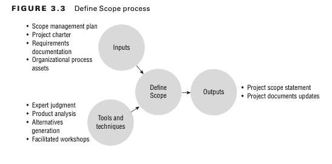


> 有关“定义范围”过程的详细信息，请参阅*《PMP®：项目管理专业人士考试学习指南（第八版）》*第 3 章。

### 定义范围的输入

“定义范围”过程有四个你应该知道的输入：

#### 范围管理计划

范围管理计划概述了如何执行此过程。

#### 项目章程

在此过程中，主要从项目章程中利用项目目标。目标是用于衡量项目成功的可量化标准。它们描述了项目试图做什么、完成什么或产生什么。可量化标准至少应包括以下项目：

- 进度
- 成本
- 质量指标
- 业务指标或质量目标（有时）

#### 需求文档

需求文档包括功能和非功能特性、质量指标和验收标准等元素。更详细的描述，请参阅本章前面部分的“收集需求的输出”。

#### 组织过程资产

此过程使用组织过程资产中的历史信息，以及政策、程序和项目范围说明书模板。

### 定义范围的工具与技术

了解你在“定义范围”过程中将使用的以下工具与技术：

#### 专家判断

根据*《PMBOK® 指南》*，以下项目是本过程中专家判断的示例：

- 主题专家或顾问
- 相关方
- 行业组织和协会
- 组织内部的其他部门或单元

#### 产品分析

产品分析是将产品描述和项目目标转化为可交付成果和需求的方法。根据*《PMBOK® 指南》*，为了进一步定义产品或服务，产品分析可能包括执行以下操作：

- 价值分析
- 功能分析
- □ 需求分析
- □ 系统工程技术
- □ 系统分析
- □ 产品分解
- □ 价值工程技术

#### 备选方案生成

备选方案生成是一种用于发现完成项目工作的不同方法或途径的技术。备选方案生成的例子包括头脑风暴和横向思维。

横向思维是一个将问题分离开来，从不同于其明显呈现方式的角度审视问题，并鼓励团队成员想出非显而易见的问题解决方法或从不同角度审视范围的过程。这也可以描述为跳出固有思维模式。

#### 引导式研讨会

引导式研讨会涉及利益相关者聚在一起讨论并定义影响多个部门的需求。

### 定义范围的输出

请了解定义范围过程的以下输出：

#### 项目范围说明书

项目范围说明书的目的是记录项目目标、交付物以及生产交付物所需的工作，以便用于指导项目团队的工作，并作为未来项目决策的基础。项目范围说明书是项目组织与客户之间的一份协议，明确规定项目工作的产出。

> **注意** 项目范围说明书指导项目团队在执行过程中的工作，且所有变更请求都将根据范围说明书进行评估。所概述的标准也将用于确定项目是否成功完成。

根据 *PMBOK* 指南，项目范围说明书应包括以下所有内容：

- □ 产品范围描述
- □ 产品验收标准
- □ 项目交付物
- □ 项目排除范围
- □ 项目制约因素
- □ 项目假设

#### 产品范围描述

产品范围描述描述了项目产品、服务或成果的特征。

#### 产品验收标准

产品验收标准包括用于确定项目的交付物以及最终产品、服务或成果是否可接受和令人满意的流程和标准。

#### 项目交付物

交付物是必须产生的可衡量结果、可衡量成果或特定项目，以便认为项目或项目阶段已完成。交付物应当具体、独特且可验证，并可能包括辅助结果。

##### 交付物与需求

交付物以可量化的方式描述了目标和目的的成分。需求是交付物的规范。选定的交付物和需求有时被称为*关键成功因素*。关键成功因素是必须完成才能使项目被视为完成的要素。

#### 项目排除范围

项目排除范围是未作为项目交付物或工作包含在内的任何内容。应将项目排除范围记录在项目范围说明书中，以用于利益相关者管理。

#### 项目制约因素

任何限制项目团队行动或规定项目团队行动或项目执行方式的内容都被视为制约因素。项目经理必须在满足或超越利益相关者期望的同时平衡项目制约因素。

项目制约因素的例子包括但不限于以下各项：

- * 范围
- * 质量


- 进度
- 预算
- 资源
- 风险

### 项目假设

假设是为规划目的而视为真实、实际或确定的事情。每个项目都有其自身的一组假设，假设应在整个项目期间被识别、记录、验证和更新。定义新假设和完善旧假设是渐进明细的形式。

以下列表包括假设的例子：

- 供应商交付时间
- 产品可用性
- 承包商可用性
- 项目计划的准确性
- 相信关键项目成员将充分履行其职责
- 合同签署日期
- 项目开始日期
- 项目阶段开始日期

### 项目文件更新

项目文件涵盖项目内部的那些非计划或基准的文件。由该过程导致的项目文件可能会有几种常见的更新和变更：

- 原始项目目标
- 利益相关者登记册
- 需求文件
- 需求跟踪矩阵
- 作为批准变更的结果的范围说明书


在实践中，定义范围过程在收集需求过程之前执行。必须在记录详细需求之前识别交付物。

#### 创建WBS

创建WBS过程采用定义良好的交付物和需求，并开始通过WBS分解工作的过程。WBS代表工作分解结构，它定义了项目的范围，并将交付物分解为更小、更易管理的可安排进度、估算、轻松分配、监控和控制的工作成分。WBS应详细说明完成项目所需的全部工作范围。图3.4显示了创建WBS过程的输入、工具与技术以及输出。

##### 图3.4 创建WBS过程

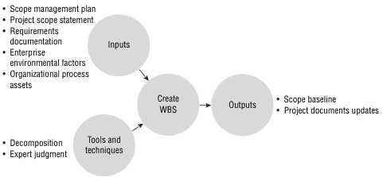

#### 创建WBS的输入

为考试起见，请了解创建WBS过程的以下输入：

**范围管理计划**

范围管理计划是一个规划工具，它记录了项目团队如何定义项目范围、如何维护和控制范围变更，以及如何验证范围。

**项目范围说明书**

项目范围说明书包含创建WBS有价值的信息，最重要的是项目交付物列表。

**需求文件**

需求文件描述需求如何满足项目的业务需求。

**事业环境因素**

除了已经讨论过的事业环境因素外，可能存在与所从事项目类型相关的特定行业的WBS标准。如果是这样，这些信息可以作为创建WBS的额外参考。

**组织过程资产**

此过程使用组织过程资产中的历史信息，以及政策、程序和WBS模板。


> 有关创建WBS过程的更详细信息，请参见 *PMP*®：*项目管理专业人员考试研究指南，第八版* 的第3章。

#### 创建WBS的工具与技术

创建WBS过程有两种工具和技术：分解和专家判断。

**分解**

分解涉及将项目交付物分解为更小、更易管理的、便于计划、执行、监控、控制和收尾的工作成分。

项目经理通常在有项目团队帮助下进行工作分解，团队成员对工作具有专业知识。团队参与的益处包括更现实的工作分解并获得团队支持。

分解提供了一种管理项目范围的方法，并且还做到以下几点：

- 改进估算
- 更容易分配绩效指标和控制
- 提供在整个项目或阶段中用于比较的基准
- 确保分配给正确的方

根据 *PMBOK*® *指南*，分解包括以下五步过程：

1. 识别交付物和工作。
2. 组织WBS。
3. 将工作分解结构（WBS）组件分解为较低层级的组件。
4. 分配识别代码。
5. 验证WBS。

**专家判断**

在创建WBS时，通常使用专家判断来分析可用信息，从而开始分解项目可交付成果。不要忘记，专家判断也可以采用预定义模板的形式，这些模板提供了如何有效分解常见可交付成果的说明。模板可以来自您所在行业，也可以由您的组织根据执行类似项目所获得的经验创建。

#### 创建WBS过程的输出

创建WBS过程有两个输出：

- 范围基准
- 项目文档更新

##### 范围基准

项目的范围基准是经过批准的项目范围说明书、WBS和WBS词典。这些文档共同详细描述了项目的所有工作。这些文档使管理者能够执行以下活动：

- 记录进度计划
- 分配资源
- 监控和控制项目工作

##### 工作分解结构（WBS）

以下是组织WBS的各种方式：

**主要可交付成果**

在此结构中，项目的主要可交付成果被用作第一级分解。

**子项目**

组织工作的另一种方式是按子项目划分。每个子项目经理都将为其子项目制定一个WBS，其中详细列出了该可交付成果所需的工作。

**项目阶段**

许多项目是按项目阶段进行结构化或组织的。此处列出的每个阶段都将是第一级分解，而其可交付成果将是下一层级。

以下是对WBS中各个层级的一般描述：

**层级 1**

根据《PMBOK®指南》，WBS的层级1是项目层级。然而，第一级分解可能是WBS的层级2，其中可能包括可交付成果、阶段和子项目——参见图3.5的示例。

#### 图 3.5 WBS 层级 1 和 层级 2

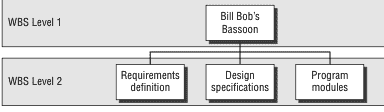

**层级 2**

层级2及后续层级展示了越来越多的细节。这些拆分中的每一个在WBS中都被称为一个层级。参见图3.6和图3.7的示例。

#### 图 3.6 WBS 层级 1 至 3

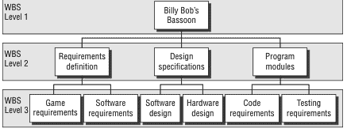

#### 图 3.7 WBS 层级 1 至 4

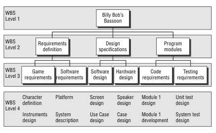

**最低层级**

任何WBS的最低层级被称为工作包层级。目标是构建WBS直至工作包层级，以便能够可靠且轻松地估算成本和进度日期。


工作包是可以轻松分配给一个人或一个团队，并对完成该任务拥有明确问责和责任权的组件。工作包层级稍后将被进一步分解为活动列表。

总的来说，WBS的所有层级向上汇总到顶层，以捕获项目的全部工作。根据*PMBOK*® *指南*，这被称为100%规则。


有关WBS的更多信息以及行业特定的WBS模板示例，请参阅《工作分解结构实践标准，第二版》（PMI®，2006）。

以下是您应该了解的WBS的其他元素：

**WBS 模板**

可以使用WBS模板或类似已完成项目的WBS来构建工作分解结构。虽然每个项目都是独特的，但许多公司和行业会反复执行相同类型的项目。

**滚动式规划**

滚动式规划是一个过程，根据预期工作日期，在WBS中以不同的分解层级来详细阐述可交付成果、项目阶段或子项目。

**独特的 WBS 标识符**

根据*PMBOK*® *指南*，WBS每个层级的每个元素通常都被分配一个独特的标识符。图3.8展示了带有独特标识符的WBS可能是什么样子的。

#### 图 3.8 独特的 WBS 标识符

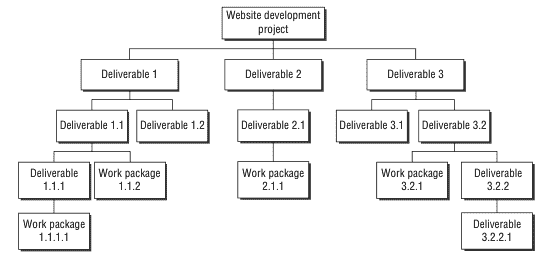

**WBS 词典**

WBS词典是记录工作组件描述的地方。根据*PMBOK® 指南*，WBS词典应包含WBS每个组件的以下元素：

- 成本账户代码标识符
- 组件工作的描述
- 负责完成组件的组织
- 进度里程碑列表
- 与进度里程碑相关的进度活动
- 所需资源
- 成本估算
- 质量要求
- 验收标准
- 技术参考信息
- 合同信息

**项目文档更新**

由于此过程，可能需要更新以下文档：

- 项目范围说明书
- 需求文件
- 其他应反映经批准的项目范围说明书变更的项目文档

| **考试要点** | |
| :--- | :--- |
| **理解项目范围说明书的目的。** | 项目范围说明书作为利益相关者对项目范围的共同理解基础。项目目标、可交付成果及其可量化标准记录在项目范围说明书中，并由项目经理和利益相关者用于判断项目是否成功完成。它也是未来项目决策的基础。 |
| **能够定义项目制约因素和假设条件。** | 项目制约因素限制了项目团队的选择并限制其行动。有时，制约因素规定了行动。常见的制约因素包括范围、质量、进度、预算、资源和风险。假设条件是为了规划目的而被假定真实、存在或确定的条件。 |
| **能够描述范围管理计划的目的。** | 范围管理计划直接影响项目的成功，并描述了确定项目范围的过程，有助于创建WBS，描述了如何验证和接受项目产品或服务，以及记录如何处理范围变更。范围管理计划是项目管理计划的子计划。 |
| **能够定义WBS及其组件。** | WBS是一个以可交付成果为导向的层次结构。它使用来自项目范围说明书或类似文档的可交付成果，并将其分解为逻辑上可管理的单元。任何WBS的最低层级被称为工作包。 |


> 别忘了项目范围管理知识领域还有另外两个过程：确认范围和控制范围。请参阅第5章“监控和控制项目”中关于这些过程的讨论。

#### 制定项目进度计划


与项目范围管理和项目成本管理知识领域一样，项目时间管理知识领域也有一个指导其内部过程的计划：进度管理计划。一个好记的技巧是，本章中描述的每个知识领域在逻辑上都有一个标准且一致的方法论模式，即每个知识领域都以一个开发该管理领域计划的流程为首。在本章中，该流程称为规划进度管理。

制定进度计划包括六个步骤，每个步骤都通过正式规划过程执行：

- 规划进度管理，与其他知识领域的过程类似，它制定了用于规划、创建、管理、执行和控制项目进度计划的政策、程序和文档。
- 定义活动，将WBS的工作包分解为由项目团队成员执行的详细工作（活动）。
- 排列活动顺序，根据现有依赖关系将活动放入逻辑顺序中。
- 估算活动资源，估算执行每项活动所需的资源类型和数量。
- 估算活动持续时间，估算每项活动将花费多长时间。
- 制定进度计划，产生一个被接受并签署的项目进度计划。

通过利用上述规划过程，项目管理团队基于项目的时间线、范围和资源计划构建进度计划，以便到达项目的及时完成。经过接受和签署的项目进度计划版本将成为进度基准。

图 3.9 展示了进度计划管理过程的输入、工具与技术以及输出。

#### 图 3.9 进度计划管理过程

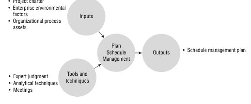

### 理解进度计划管理

进度管理计划应在项目规划阶段的早期创建。该计划负责指导项目进度计划的创建、管理和控制。

#### 进度计划管理的输入

与规划范围管理过程类似，你需要了解进度计划管理过程的以下四个输入：

- **项目管理计划**：为了帮助了解项目的预期目标，项目管理计划及其所有已批准的子计划被用于帮助创建进度管理计划。具体来说，范围基准以及关于风险、成本和沟通决策的其他信息被用于帮助制定进度计划。
- **项目章程**：就本过程而言，项目章程用于定义摘要里程碑进度，以及与管理项目进度相关的项目审批要求。
- **企业环境因素**：多种企业环境因素可能影响进度计划管理过程，包括但不限于组织文化、基础设施、提供进度工具及进度备选方案生成机制的项目管理软件、发布的商业信息以及组织工作系统。
- **组织过程资产**：许多过程资产会影响进度计划管理过程，包括但不限于：
  - 监控和报告工具的使用
  - 进度控制工具
  - 历史信息
  - 与正式和非正式进度控制相关的政策、程序和指南
  - 模板
  - 项目收尾指南
  - 变更控制程序
  - 风险控制程序

#### 进度计划管理的工具与技术

进度计划管理过程使用的三种工具与技术是专家判断、分析技术和会议：

- **专家判断**：专家判断提供了关于以前类似项目尝试以及将影响项目的现有环境的宝贵视角。这在考虑如何结合进度计划方法以及如何最好地解决这些方法之间的差异方面也非常有用。
- **分析技术**：大多数管理涉及在不同选项之间做出选择，本过程也不例外。进度计划管理可能要求你在战略选项之间进行选择，例如用于估算和安排项目进度的方法，包括使用哪种进度方法论、进度工具和技术、估算方法、格式以及项目管理软件。随着项目的推进，进度管理计划可能需要分析来确定能够赶工或快速跟进项目进度的选项。请记住，这些选项可能会给项目带来风险，因此不要忘记更新风险登记册。
- **会议**：在制定进度管理计划的过程中，项目团队成员可能会参加进度制定会议。根据会议的不同，参与者可能包括项目经理、项目发起人、选定的项目团队成员以及在该领域负有责任的人员。

#### 进度计划管理的输出

进度计划管理过程的主要输出是进度管理计划。该计划的组成部分确立了以下内容：

- 项目进度模型的开发，规定了要使用的方法论和工具
- 准确度水平，设定了用于确定现实的活动持续时间估算值以及应急储备所需量的容差
- 计量单位，这根据项目所在的行业以及项目是否涉及多个国家可能至关重要
- 组织程序链接，由工作分解结构（WBS）框架提供
- 项目进度模型的维护，或用于更新项目状态和进度的模型
- 控制阈值，建立了用于监控进度绩效的差异阈值，并定义了在执行某些行动之前项目可承受的变异量
- 绩效测量规则，设定了物理测量、绩效测量规则或挣值测量规则
- 报告格式和报告频率
- 每个进度管理过程的流程描述


请记住，进度管理计划可以根据您的需求进行裁剪，这意味着它可以是正式的或非正式的，可以是高度详细的，也可以是大致框架式的。

### 定义活动

定义活动过程的目的是将工作包分解为进度活动，从而轻松支持并实现项目工作的估算、排程、执行以及监控与控制的依据。该过程记录了满足工作分解结构（WBS）中详述的交付成果所需的具体活动。在该过程结束时，项目团队将定义一个活动列表、其特征以及一个里程碑列表。

图 3.10 展示了定义活动过程的输入、工具与技术以及输出。

#### 图 3.10 定义活动过程

- **输入**：
  - 进度管理计划
  - 范围基准
  - 企业环境因素
  - 组织过程资产
- **工具与技术**：
  - 分解
  - 滚动规划
  - 专家判断
- **输出**：
  - 活动清单
  - 活动属性
  - 里程碑清单

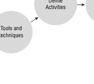


> 有关定义活动过程的更详细信息，请参阅《PMP®：项目管理专业人士考试指南》（第八版）第四章“创建项目进度计划”。

#### 定义活动的输入

你应该了解定义活动过程的以下输入：

- **进度管理计划**：该计划的一个关键输入是管理工作所需的既定详细程度。
- **范围基准**：范围基准考虑了以下内容：
  - 来自工作分解结构（WBS）内部的工作包
  - 来自项目范围说明书的约束条件和假设
- **企业环境因素**：企业环境因素包括项目管理信息系统；组织文化和结构；以及发布的、商业上可获得的信息。
- **组织过程资产**：组织过程资产提供了现有的指南和政策、历史项目文档（例如来自以前项目的部分活动清单）以及经验教训知识库，所有这些都用于定义项目活动。

#### 定义活动的工具与技术

你可以在定义活动过程中使用以下三种工具与技术：

- **分解**：在本过程中，分解涉及将工作包拆分为更小、更易于管理的工工作单元，称为活动。活动是必须完成的个体工作单元，以满足工作分解结构（WBS）中列出的交付成果。
- **滚动规划**：滚动规划是一种渐进式细化的形式，涉及比远期工作更详细地规划近期工作。随着工作的进展，曾经被视为远期的工作将被分解为更细粒度的细节。
- **专家判断**：专家判断有助于定义活动，并涉及具有开发项目范围说明书和工作分解结构（WBS）先前经验的项目团队成员。

#### 定义活动的输出

以下是定义活动过程的输出：

- **活动清单**：活动清单包含项目中将执行的所有进度活动，并带有每项活动的工作范围描述以及标识符，以便团队成员了解工作是什么以及应如何完成。


进度活动是项目进度计划中的单个要素。

### 活动属性

活动属性描述了活动的特征，是活动清单的扩展。随着项目生命周期内信息的不断更新，活动属性也会发生变化。

在项目初期，活动属性通常包括以下内容：

- 活动标识符
- 与其关联的工作分解结构（WBS）标识代码
- 活动名称

随着项目的推进，可能会添加以下活动属性：

- 紧前和紧后活动
- 逻辑关系
- 提前量和滞后量
- 资源需求
- 与该活动相关的制约因素和假设

### 里程碑清单

里程碑是项目的主要成果，标志着主要可交付成果的完成或项目中的其他关键事件。里程碑清单记录了以下内容：

- 记录已取得的成果
- 说明里程碑是强制性的还是可选的
- 成为项目管理计划的一部分
- 有助于制定项目进度计划


在实践中，定义活动过程和活动排序过程可能会合并为一个过程或步骤。

### 活动排序

活动排序过程将定义活动过程中标识出的进度活动按逻辑顺序进行排列，并识别活动之间存在的所有依赖关系。逻辑关系之间的互动必须正确排序，以便促进制定现实且可实现的项目进度计划。该过程的最终结果是创建项目进度网络图，以直观地显示活动序列及其依赖关系。

图 3.11 展示了活动排序过程的输入、工具与技术以及输出。

#### 图 3.11 活动排序过程

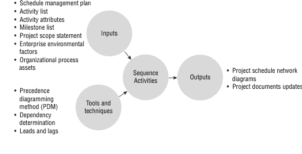

**注意**

有关活动排序过程的更详细信息，请参阅《*PMP®：项目管理专业人员考试指南（第八版）*》第 4 章。

#### 活动排序的输入

在活动排序过程中，你将使用以下输入：

- 进度管理计划
- 活动清单
- 活动属性
- 里程碑清单
- 项目范围说明书
- 事业环境因素


# 组织过程资产

**进度管理计划** 进度管理计划明确了用于进度安排的工具和方法，这些信息告知活动如何排序。

**活动清单** 为了对活动进行排序，首先需要获取活动清单作为输入。活动清单包括活动及其标识符以及工作范围的描述。

**活动属性** 活动属性可能会提供有关活动排序的信息，例如通过紧前或紧后关系。

**里程碑清单** 里程碑清单可能包含带有计划日期的里程碑。这些日期可能会影响活动的排序。

**项目范围说明书** 项目范围说明书中的产品范围描述包括可用于活动排序的产品详细信息。

**事业环境因素** 活动排序可能会受到事业环境因素的影响，例如政府或行业标准、项目管理信息系统、进度工具以及任何公司工作授权系统。

**组织过程资产** 位于公司知识库中的项目文件从组织过程资产中提取，用于进度安排目的。

## 活动排序的工具与技术

你需要熟悉活动排序过程的以下工具与技术：

- 前导图法 (PDM)
- 依赖关系确定
- 提前量和滞后量

**前导图法** 前导图法 (PDM) 使用方框或矩形来表示活动（称为节点）。节点通过箭头连接，以显示活动之间的依赖关系。这种方法也被称为活动节点法 (AON)。PDM 仅使用单值估计来确定持续时间。

节点上显示以下信息：

- 活动名称（必需）
- 活动编号（可选）
- 开始和结束日期（可选）
- 截止日期（可选）
- 浮动时间（可选）
- 任何额外或相关信息（可选）

下图展示了 PDM 或 AON 的一般示例。

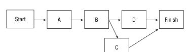

PDM 由以下四种类型的依赖关系进一步定义，也称为逻辑关系：

**完成到开始 (Finish-to-Start)** 完成到开始 (FS) 关系是最常用的关系。在这种关系中，紧前活动必须在紧后活动开始之前完成。

**开始到完成 (Start-to-Finish)** 在开始到完成 (SF) 关系中，紧前活动必须在紧后活动完成之前开始。这种逻辑关系很少使用。

**完成到完成 (Finish-to-Finish)** 在完成到完成 (FF) 关系中，紧前活动必须在紧后活动完成之前完成。

**开始到开始 (Start-to-Start)** 在开始到开始 (SS) 关系中，紧前活动必须在紧后活动开始之前开始。

**考试日小贴士**

在考试开始时，请将前导图法（如活动节点法 AON）的图表记忆并添加到你的草稿纸上。

**依赖关系确定** 依赖关系是活动之间的关系，其中一个活动依赖于另一个活动才能完成某项动作，或者一个活动依赖于另一个活动才能开始某项动作后才能继续。依赖关系确定是指确定这些依赖关系存在的位置。

以下是根据特征定义的四种依赖关系类型：

- **强制依赖关系 (Mandatory Dependencies)** 强制依赖关系，也称为硬逻辑或硬依赖关系，由所执行工作的类型定义。工作本身的性质决定了活动应执行顺序。
- **选择性依赖关系 (Discretionary Dependencies)** 选择性依赖关系由项目团队定义。选择性依赖关系也称为优选逻辑、软逻辑或偏好逻辑。这些通常是流程或程序驱动的，或基于过去经验的最佳实践技术。
- **外部依赖关系 (External Dependencies)** 外部依赖关系对项目而言是外部的。*PMBOK® 指南* 指出，即使依赖关系在项目外部（因此是非项目活动），它也会影响项目活动。
- **内部依赖关系 (Internal Dependencies)** 内部依赖关系对项目而言是内部的。这些依赖关系涉及项目团队能够控制的项目活动之间的优先关系。

**箭线图法 (Arrow Diagramming Method)** 箭线图法 (ADM) 技术的使用频率远低于 PDM。ADM 在视觉上与 PDM 相反。箭线图法将活动放在箭头上，并通过节点连接到依赖活动。这种方法也被称为活动箭线法 (AOA)。ADM 技术的特征如下：

- ADM 允许使用多个值估计来确定持续时间，并且仅使用完成到开始依赖关系。
- 可以在图中插入虚活动以准确显示依赖关系。

下图展示了 ADM 方法的一般示例。

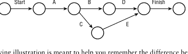

下图旨在帮助你记住 PDM 和 ADM 之间的区别，以便在考试中识别。

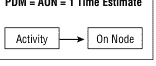

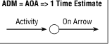

### 提前量和滞后量

在确定依赖关系时，请考虑应用提前量和滞后量：

- **提前量 (Leads)** 提前量使紧后活动加速，需要从事或结束日期中减去时间。
- **滞后量 (Lags)** 滞后量延迟紧后活动（即跟随紧前活动的活动），需要在所排程活动的开始日期或结束日期上增加时间。

### 活动排序的输出

你需要熟悉活动排序过程的两种输出：

**项目进度网络图** 与 WBS 类似，项目进度网络图可能包含所有项目详细信息，也可能仅包含概要级详细信息，具体取决于项目的复杂性。概要级活动是一组相关活动也称为*吊床*。吊床是将一组相关活动汇总为一个总结性标题，该标题描述了该分组中可能包含的活动。

**项目文件更新** 由于此过程的结果，以下项目文件可能需要更新：

- 活动列表
- 活动属性
- 里程碑列表
- 风险登记册（有关风险登记册的简介，请参见本章后面“识别风险过程的输出”部分）

图3.12展示了“排序活动过程”与其他时间管理过程之间的关系。

#### 图3.12 排序活动过程顺序

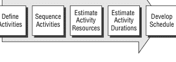

#### 估算活动资源

在活动排序完成后，下一步涉及估算资源和估算活动持续时间，以便将它们纳入项目进度计划。*估算活动资源*过程旨在确定与工作包相关的每个进度活动所需的资源（包括人力资源和材料资源）的类型和数量。


> 术语*资源*指完成项目所需的所有实体资源。*《PMBOK*®*指南》*将资源定义为人员、设备和材料。

图3.13展示了*估算活动资源*过程的输入、工具与技术以及输出。

#### 图3.13 估算活动资源过程

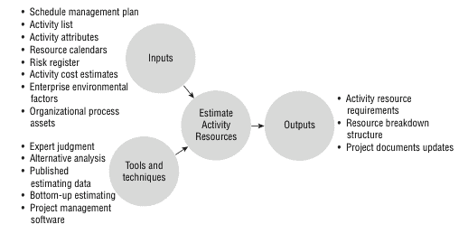

> 注意
>
> 有关“估算活动资源”过程的更详细信息，请参阅《PMP®：项目管理专业人士考试指南》（第八版）第4章。

##### 估算活动资源的输入

你应该了解“估算活动资源”过程的以下输入：

- 进度管理计划
- 活动列表
- 活动属性
- 资源日历
- 风险登记册
- 活动成本估算
- 事业环境因素
- 组织过程资产

**进度管理计划** 为了协助确定需要估算的资源，进度管理计划确定了准确度级别和计量单位。

**活动列表** 需要活动列表来确定哪些活动需要资源。

**活动属性** 活动属性提供了得出每个活动所需资源估算所必需的详细信息。

**资源日历** 资源日历描述了资源可用的时间段，并包括以下内容：

- 技能
- 能力
- 数量
- 可用性

资源日历还检查设备和材料资源的数量、能力和可用性，这些资源可能会影响项目进度。


> 资源日历是“组建项目团队”和“实施采购”过程的输出。这两个过程都在执行过程组中执行。有关这些过程的额外信息，请参阅第4章。

**风险登记册** 风险登记册有助于说明风险事件如何干扰资源选择和可用性。

**活动成本估算** 需要了解活动成本估算，以掌握成本如何影响资源选择。

**事业环境因素** 可以通过事业环境因素获取有关资源可用性和技能的信息。

**组织过程资产** 使用组织过程资产中的信息，包括来自以前类似项目的信息，以及与人员配备、设备购买和租赁相关的政策和程序。

##### 估算活动资源的工具与技术

“估算活动资源”过程中的工具与技术包括以下内容：

- 专家判断
- 备选方案分析
- 已发布的估算数据
- 自下而上估算
- 项目管理软件

**专家判断** 具有资源规划和估算经验和知识的个人可以提供此过程中使用的信息和指导。

**备选方案分析** 备选方案分析有助于就完成活动的可能资源类型（如专家或新手）和方法做出决策。自制/外购分析也可用于资源相关的决策。

**已发布的估算数据** 估算数据可能包括组织指南、行业费率或估算值、生产率等。

**自下而上估算** 当无法可靠地估算某个活动时，会使用自下而上估算法。在专家的帮助下，将活动分解为更小的工作组件以便进行估算，然后再汇总回原始活动级别。这是一种准确的估算方法，但可能耗时且成本高昂。

**项目管理软件** 在此过程中，项目管理软件可以帮助实现以下目标：

- 规划、组织和估算资源需求
- 记录资源可用性
- 创建资源分解结构
- 创建资源费率
- 创建资源日历


## 估算活动资源的输出

执行“估算活动资源”过程会产生三个输出：

### 活动资源需求
活动资源需求描述了与工作包相关的每个活动所需的资源类型和数量。描述应包含以下内容：

- 估算值的确定方式
- 用于形成估算值的信息
- 关于资源及其可用性的假设

> 工作包估算是*通过累计该特定工作包内所有进度活动的总和得出的*。

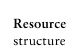

### 资源分解结构
资源分解结构（RBS）是一种分层结构，按类别和类型列出资源。图3.14说明了RBS的基本示例。

#### 图3.14 资源分解结构

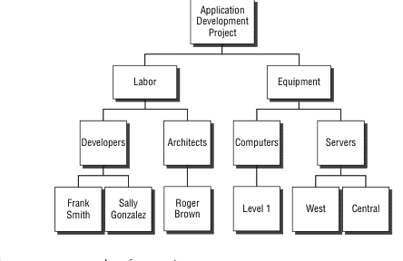

以下是一些类别示例：

- 劳动力
- 硬件
- 设备
- 用品

以下是一些类型示例：

- 技能水平
- 质量等级
- 成本

### 项目文件更新
项目文件更新包括更新以下各项：

- 活动列表
- 活动属性
- 资源日历

## 估算活动持续时间

“估算活动持续时间”过程试图估算完成每个活动所需的工作量、资源和工作时段数量。这些是可量化的估算值，表示完成进度活动所需的工作时段数量。估算是逐步细化的，通常从相当高的层级开始，随着对交付物及其相关活动了解的细节越来越多，估算变得更加准确。

图3.15展示了“估算活动持续时间”过程的输入、工具与技术以及输出。

#### 图3.15 估算活动持续时间过程

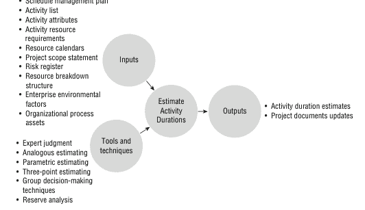

> 有关“估算活动持续时间”过程的更详细信息，请参阅《PMP®：项目管理专业人士考试指南》（第八版）第4章。

### 估算活动持续时间的输入

你应该熟悉“估算活动持续时间”过程的几个输入：

- 进度管理计划
- 活动列表
- 活动属性
- 活动资源需求
- 资源日历
- 项目范围说明书
- 风险登记册
- 资源分解结构
- 事业环境因素
- 组织过程资产

**进度管理计划** 进度管理计划规定了所使用的方法以及估算活动持续时间（包括项目更新周期）所需的准确度级别。

**活动列表** 需要活动列表来估算活动持续时间。

**活动属性** 包含在活动属性中的信息将影响活动持续时间估算。

**活动资源需求** 所分配资源的可用性将影响活动的持续时间。

**资源日历** 资源日历中影响此过程的信息如下：

- 人力资源的类型、可用性和能力
- 设备和材料资源的类型、可用性、能力和数量

**项目范围说明书** 在估算活动持续时间时，会考虑制约因素和假设条件。

**风险登记册** 需要风险列表，以及风险分析和风险应对规划的结果。

**资源分解结构** 资源分解结构提供了已识别资源分层视图。这提供了有助于估算活动持续时间的关键信息。

**事业环境因素** 使用的事业环境因素包括以下各项：

- 用于估算持续时间的内部参考数据
- 可商购的外部参考数据
- 定义好的生产力指标

**组织过程资产** 使用以下组织过程资产：

- 来自以前类似项目的历史信息，包括持续时间信息、项目日历和经验教训
- 进度计划方法

### 估算活动持续时间的工具与技术

“估算活动持续时间”过程的六种工具与技术如下：

- 专家判断
- 类比估算

#### 估算活动持续时间的管理工具与技术

- 参数估算
- 三点估算
- 群体决策技术
- 储备分析

**专家判断**

所采用的专家判断包括将执行活动的团队成员，并基于其过去类似活动的经验。在估算持续时间时，专家应考虑以下因素：

- 资源水平
- 资源生产率
- 资源能力
- 风险
- 可能影响估算的任何其他因素

**类比估算**

类比估算通常用于项目中缺乏详细信息的情况。关于类比估算的完整描述，请参见本章后面的“估算成本的管理工具与技术”。

**参数估算**

参数估算是一种基于定量分析的估算方法，它将工作数量乘以速率。它被认为是一种快速且低成本的估算技术，当结合实际历史数据和考虑通胀或其他因素的当前市场状况时，具有较高的准确性。最好的描述方式是举例说明：

活动：安装十五幅 10×10 窗帘。

根据以往经验，安装一幅 10×10 窗帘的平均时间：30 分钟。

估算：因此，按每幅窗帘平均 30 分钟的安装时间，安装 15 幅窗帘得出的估算持续时间为 7.5 小时。

> PMBOK® 指南指出，参数估算也可用于确定整个项目或部分项目的时间估算。

**三点估算**

三点估算使用以下三个估算值的平均值来得出最终估算值：

- **最可能值 (ML)**：该估算假设没有灾难发生，活动可以按计划完成。
- **最乐观值 (O)**：这代表了资源能够完成活动的最快时间框架。
- **最悲观值 (P)**：该估算假设最糟糕的情况发生，完成活动所需时间远长于计划。

三点估算的概念源自计划评审技术 (PERT)，该技术使用以下公式来确定三个持续时间估算值的加权平均值：

(最乐观值 + 4×(最可能值) + 最悲观值) ÷ 6

在以下示例中，最可能值 (ML) 估算 = 15，最乐观值 (O) 估算 = 11，最悲观值 (P) 估算 = 25。

(11 + 4(15) + 25) ÷ 6

因此，活动持续时间 = 16。

### 考试日的技巧

这是另一个建议在考试开始前添加到草稿纸上的有用公式：(最乐观值 + 4 × (最可能值) + 最悲观值) ÷ 6。在草稿纸上制作这种提示卡片的目的是或许能让你完全专注于正在解决的问题，而不会因为试图回忆公式而增加额外的压力。

**群体决策技术**

在估算活动持续时间时，为未来的行动提供多个备选方案是有帮助的，而群体决策技术是一种提供这些备选方案的评估过程。通过让团队成员参与进来，它有助于提高估算的准确性以及对新兴估算的承诺度，其附带好处是有助于赢得为项目做出贡献者的心。

**储备分析**

储备时间——也被称为缓冲/时间储备或应急储备，如在 *PMBOK® 指南* 中所述——是为了考虑进度风险或不确定性而添加到活动中的时间部分。为了确保项目进度不受影响，会在原始估算中预留储备时间，以应对可能遇到的问题。

- 原始安装十五幅 10×10 窗帘的活动持续时间：7.5 小时。
- 增加 10% 的储备时间：45 分钟。

估算：因此，新的活动持续时间经过调整以包含储备，估算持续时间为 8.25 小时。

### 估算活动持续时间的输出

你需要了解估算活动持续时间过程的两个输出：

- 活动持续时间估算
- 项目文件更新

**活动持续时间估算**

活动持续时间估算是完成活动所需的工时估算。这是一个定量指标，通常以小时、周、天或月表示。

最终估算应包含一系列可能的结果，例如 X 小时 ± 10 小时，或者可以使用百分比来表示范围。

原始安装十五幅 10×10 窗帘的活动持续时间：7.5 小时。

最终估算：7.5 小时 ± 1 小时。因此，该活动可能只需 6.5 小时，也可能多达 8.5 小时。

**项目文件更新**

作为该过程的结果，以下信息可能需要重新审视和更新：

- 活动属性
- 关于资源可用性和技能水平的假设

## 制定进度

制定进度过程的目的是创建项目进度计划。在此过程中，将制定开始和完成日期，确定活动顺序和持续时间，并识别关键路径。在以下项目管理过程未发生之前，无法完成制定进度过程：

- 收集需求
- 定义范围
- 创建 WBS
- 定义活动
- 排序活动
- 估算活动资源
- 估算活动持续时间
- 规划人力资源管理

图 3.16 显示了制定进度过程的输入、工具与技术和输出。

### 图 3.16 制定进度过程

**输入：**

- 进度管理计划
- 活动清单
- 活动属性
- 项目进度网络图
- 活动资源需求
- 资源日历
- 活动持续时间估算
- 项目范围说明书
- 风险登记册
- 项目人员分配
- 资源分解结构
- 企业环境因素
- 组织过程资产

**工具与技术：**

- 进度网络分析
- 关键路径法
- 关键链法
- 资源优化技术
- 建模技术
- 提前量和滞后量
- 进度压缩
- 进度工具

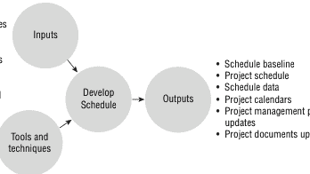

**输出：**

- 进度基准
- 项目进度计划
- 进度数据
- 项目日历
- 项目管理计划更新
- 项目文件更新


> 关于制定进度过程的更多详细信息，请参见 *PMP*：*项目管理专业人员考试指南，第八版* 的第 4 章。

### 制定进度过程的输入

你应该熟悉制定进度过程的 13 个输入：

- 进度管理计划
- 活动清单
- 活动属性
- 项目进度网络图
- 活动资源需求
- 资源日历
- 活动持续时间估算
- 项目范围说明书
- 风险登记册
- 项目人员分配
- 资源分解结构
- 企业环境因素
- 组织过程资产

**进度管理计划**


通过进度管理计划，可以识别用于创建进度的调度方法和工具，以及进度的制定方式。

## 活动清单

制定项目进度计划需要项目活动，这些活动来自定义活动过程中开发的活动清单。

## 活动属性

活动属性提供了项目活动所需的详细信息，这些细节将在创建项目进度计划时利用。

## 项目进度网络图

在创建项目进度计划时，事件顺序将非常重要。活动顺序和现有依赖关系可以从项目进度网络图中获取。关于项目进度网络图的更完整描述，请参见本章前面的“排序活动的输出”。

## 活动资源需求

活动资源需求将为创建项目进度计划提供所需资源的类型和数量。

## 资源日历

资源日历显示项目团队成员和其他资源的可用性，这将有助于避免进度冲突。

## 活动持续时间估算

活动持续时间估算将提供完成每项活动所需的时间，这对于分配开始和完成日期是必需的。

## 项目范围说明书

使用项目范围说明书中的制约因素和假设。以下时间制约因素对本过程很重要：

- 强制日期，用于限制活动的开始或完成日期
- 关键事件/重大里程碑，以确保在特定日期前完成特定可交付成果

## 风险登记册

制定项目进度计划需要已识别风险及其特征的详细信息，这些风险将影响进度模型。

## 项目人员分配

制定项目进度计划需要项目人员分配，其中指定了每项活动的资源分配。

## 资源分解结构

制定项目进度计划需要资源分析以及确定组织报告关系的需求，这些由资源分解结构提供。

## 企业环境因素

可能使用企业环境因素中现有的节假日和其他外部信息，这些信息可能会影响项目进度计划。

## 组织过程资产

在组织过程资产中，可能存在提供工作日和班次信息的项目日历，这些可用于本过程。

### 制定进度计划工具与技术

“制定进度计划”过程可以使用以下若干工具和技术：

- 进度网络分析
- 关键路径法
- 关键链法
- 资源优化技术
- 建模技术
- 提前量与滞后量
- 进度压缩
- 进度计划工具

#### 进度网络分析

进度网络分析包括计算项目活动的最早开始日期、最晚开始日期、最早完成日期和最晚完成日期，从而生成项目进度计划。简而言之，它通过运用以下分析技术和方法来生成进度计划：

- 关键路径法
- 关键链法
- 建模技术
- 资源优化技术


> 计算过程未考虑资源限制，因此这些日期是理论值。资源限制和其他约束因素在该过程的输出中予以考虑。

#### 关键路径法

关键路径法（CPM）是一种进度网络分析技术，它通过计算每个活动的最早开始日期、最早完成日期、最晚开始日期和最晚完成日期，来确定每条网络路径的浮动时间（即进度灵活性）。该技术依赖于顺序网络以及每个活动的单一持续时间估算。可以使用 PDM 来执行 CPM。以下是您应该了解的与 CPM 相关的信息：

##### 关键路径

关键路径（CP）通常是项目中最长的完整路径。任何浮动时间等于零的项目活动都被视为关键路径任务。在以下情况下，关键路径可能会发生变化：

- 当活动因用尽其所有浮动时间而成为关键路径上的任务时
- 当关键路径上的里程碑未达到时

**浮动**

浮动时间有两种类型，也称为松弛时间：

- 总浮动时间（TF），即在不延误项目结束日期的情况下，你可以推迟任务最早开始日期的时间量
- 自由浮动时间（FF），即在不延误紧后任务最早开始日期的情况下，你可以推迟任务开始日期的时间量

**计算正向传递和反向传递**

正向传递用于计算网络图中每个活动的最早开始日期和最早完成日期。要计算正向传递，请遵循以下步骤：

1. 从第一个活动开始。
2. 第一个活动的计算从最早开始日期为零开始。加上活动的持续时间以确定最早完成日期。
3. 下一个活动的最早开始日期是前一个活动的最早完成日期。在遵循现有依赖关系的同时，沿着所有网络路径继续计算最早开始日期和最早完成日期。
4. 当一个活动有两个连接的前置活动时，其最早开始日期将是最后完成的前置活动的最早完成日期。（例如，假设活动 A 的最早完成日期为 4，活动 B 的最早完成日期为 5。如果活动 A 和 B 都汇聚到活动 C，则活动 C 的最早开始日期为 5。）

反向传递用于计算网络图中每个活动的最晚开始日期和最晚完成日期。要计算反向传递，请遵循以下步骤：

1. 从最后一个活动开始。最晚完成日期将与最早完成日期相同。
2. 从结束日期中减去活动的持续时间以计算最晚开始日期。这就成了其前置活动的最晚完成日期。
3. 沿着所有网络路径向后继续计算最晚开始日期和最晚完成日期。
4. 当一个活动有两个连接的前置活动时，其最晚完成日期将是后续活动的最晚开始日期。（例如，如果活动 C 的最晚开始日期为 7，且活动 A 和活动 B 都连接到活动 C，则活动 A 和 B 的最晚完成日期均为 7。）

图 3.17 总结了正向和反向传递。


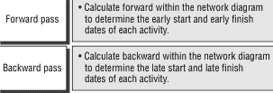

**计算关键路径**

关键路径任务是任何在不影响项目结束日期的情况下无法更改的任务。根据定义，这些是所有浮动时间为零的任务。要确定项目的 CP 持续时间，请将所有浮动时间为零的活动持续时间相加。

确定关键路径的另一种方法是在网络图中确定最长的路径。这可以通过将网络中每条路径内所有活动的持续时间相加来完成。

使用表 3.2，利用活动编号、活动描述、依赖关系和持续时间来设置一个网络图。接下来，练习计算最早开始、最早完成、最晚开始和最晚完成日期。通过核对图表上显示的日期并参考图 3.18 来检查您的答案。

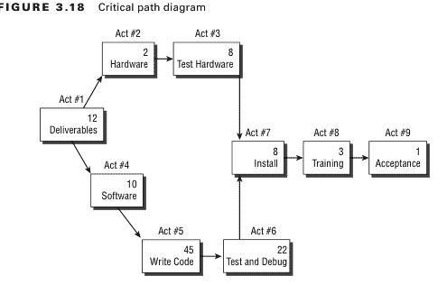

**表 3.2** CPM 计算

| 活动编号 | 活动描述 | 依赖关系 | 持续时间 | 最早开始 | 最早完成 | 最晚开始 | 最晚完成 | 浮动/松弛 |
| :--- | :--- | :--- | :--- | :--- | :--- | :--- | :--- | :--- |
| 1 | 项目交付物 | — | 12 | 4/1 | 4/12 | 4/1 | 4/12 | 0 |
| 2 | 采购硬件 | 1 | 2 | 4/13 | 4/14 | 6/19 | 6/20 | 67 |
| 3 | 测试硬件 | 2 | 8 | 4/15 | 4/22 | 6/21 | 6/28 | 67 |
| 4 | 采购软件工具 | 1 | 10 | 4/13 | 4/22 | 4/13 | 4/22 | 0 |
| 5 | 编写程序 | 4 | 45 | 4/23 | 6/6 | 4/23 | 6/6 | 0 |
| 6 | 测试与调试 | 5 | 22 | 6/7 | 6/28 | 6/7 | 6/28 | 0 |
| 7 | 安装 | 3, 6 | 8 | 6/29 | 7/6 | 6/29 | 7/6 | 0 |
| 8 | 培训 | 7 | 3 | 7/7 | 7/9 | 7/7 | 7/9 | 0 |
| 9 | 验收 | 8 | 1 | 7/10 | 7/10 | 7/10 | 7/10 | 0 |

#### 使用 PERT 计算期望值

PERT 和 CPM 是相似的技术：CPM 使用最可能的持续时间来确定项目持续时间，而 PERT 使用所谓的期望值（或加权平均值）。期望值是使用活动持续时间的三点估算来计算的。

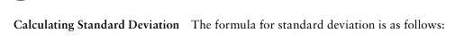

#### 计算标准差

标准差的公式如下：

(悲观值 – 乐观值)/6

对于符合钟形曲线的数据，以下说法是正确的：

- 工作在 ±3 个标准差范围内完成的概率为 99.73%。
- 工作在 ±2 个标准差范围内完成的概率为 95.44%。
- 工作在 ±1 个标准差范围内完成的概率为 68.27%。

#### 标准差

活动的标准差越高，风险就越高。由于标准差衡量的是悲观时间和乐观时间之间的差异，两者之间更大的偏差（导致更高的数值）表明风险更大。相反，低标准差意味着风险较小。

一个标准差提供 68%（四舍五入）的概率，两个标准差提供 95%（四舍五入）的概率。关于如何计算项目持续时间的日期范围，请参阅《PMP®：项目管理专业人士考试指南》（第八版）第 4 章。

#### 关键链法

关键链法是一种进度网络分析技术，它通过考虑资源有限或受限来修改项目进度计划。计算出的修改后进度计划通常会因添加持续时间缓冲区而改变关键路径，这些缓冲区是增加的非工作活动，旨在帮助管理计划的活动持续时间。显示资源限制的新关键路径被称为关键链。

关键链同时使用确定性（逐步）和概率性方法。以下是关键链过程中的步骤：

1. 使用活动持续时间估算来构建进度网络图（在此方法中，您将使用非保守的估算值）。
2. 定义依赖关系。
3. 定义约束条件。
4. 计算关键路径。
5. 将资源可用性输入进度计划。
6. 重新计算关键链。


在关键链末端放置项目缓冲区，以帮助防止完成日期延误。添加缓冲区后，计划活动按照其最晚开始日期和完成日期进行调度。

## 资源优化技术

当资源的供需需要对进度模型进行调整时，就会使用资源优化技术。它们试图通过策略性地使用浮动时间来平滑总资源使用的峰值和低谷，同时通过重新调度或重新分配来解决个别资源的过度分配问题。示例包括但不限于以下各项：

### 资源平衡

资源平衡试图平滑资源分配，以便在不使资源过载的情况下完成工作，同时尽量保持项目按计划进行。这通常采取优先将资源分配给关键路径任务的形式。

以下是一些资源平衡的示例：

- 推迟任务的开始时间以匹配关键团队成员的空闲时间
- 调整资源分配，以便向资源不足的团队成员分配更多任务
- 要求资源方进行强制性加班

### 资源平滑

资源平滑是一种通过调整活动安排来修正进度模型的技术，确保资源需求不超过项目约束。资源平滑与资源平衡的关键区别在于，采用资源平滑时，项目关键路径保持不变。活动的延期能力受该活动的自由时差和总时差数量的限制。


> 资源平衡可能会导致原始关键路径发生变化。

### 建模技术

项目经理在制定进度计划时可以使用多种类型的建模技术。你应该熟悉以下两个用于考试的示例：假设情景分析和模拟。

#### 假设情景分析

假设情景分析通过评估不同的情景来预测其对项目目标的正面或负面影响。根据 *PMBOK® 指南*，这是对“如果代表场景‘X’的情况发生会怎样？”这一问题的分析。为了支持这项工作，会使用进度计划进行进度网络分析，以计算不同的情景，例如交付物的延迟或建筑项目中的重大天气事件。

#### 模拟

采用不同的活动假设集合，模拟技术利用基于三点估计构建的概率分布来计算多个项目持续时间模型，以考虑不确定性。模拟技术（如蒙特卡洛分析）使用每个活动的一系列可能持续时间，然后利用这些范围来计算项目本身的一系列可能持续时间结果。蒙特卡洛方法运行许多次可能的活动持续时间和进度预测，以得出进度预测及其概率、关键路径持续时间估计和时差时间。

### 提前与推迟

提前量会将活动的开始日期提前指定的天数，而推迟量则会延迟活动的开始日期。提前量和推迟量首次用于前文本章中讨论的活动排序过程。

### 进度压缩

进度压缩是一种数学分析形式，用于在不改变项目范围的情况下缩短项目进度。为了有效，工作压缩必须基于位于关键路径上的活动。有两种类型的进度压缩技术：

#### 赶工

赶工是一种考察成本和进度权衡的压缩技术。这涉及向关键路径任务增加资源，以缩短任务长度，进而缩短项目长度。进度赶工可能导致风险增加、成本增加以及关键路径的变化。

#### 快速跟进

快速跟进是将两个原本计划按顺序开始的任务并行执行。快速跟进可能会增加项目风险，导致项目团队不得不返工，并且仅适用于可以重叠的活动。

### 调度工具

使用的调度工具通常以项目管理软件程序的形式出现。它们会自动执行数学计算并执行资源平衡功能。

## 制定进度计划的输出

了解制定进度计划过程的以下输出：

- 进度基准
- 项目进度计划
- 进度数据
- 项目日历
- 项目管理计划更新
- 项目文档更新

### 进度基准

进度基准可以描述为带有基准开始日期、基准完成日期和资源分配的最终批准的项目进度计划版本。*PMBOK® 指南*指出，进度基准是根据进度网络分析得出的项目进度计划的指定版本。批准的项目进度计划成为项目管理计划的一部分。

> **考试要点**
>
> 对于考试，请记住项目进度计划基于时间轴（源自活动）、范围文件（有助于跟踪主要里程碑和交付物）和资源计划。

### 项目进度计划

项目进度计划详细说明了每个项目活动的开始和完成日期以及资源分配。用 *PMBOK® 指南* 的术语来说，在分配资源之前，项目进度计划被视为初步的。以下是项目进度计划的额外要素：

- 项目进度计划应获得相关方和职能经理的批准和签署。
- 对于职能型组织，应获得确认，即资源将按照进度计划中所述可用。
- 在收到其中所述资源分配的批准和承诺之前，进度计划无法最终确定。
- 一旦获批，该进度计划将成为项目剩余部分的进度基准。

以下是展示项目进度计划的几种方式：

#### 条形图

也称为甘特图，这些工具常用于显示进度活动。它们可能显示活动序列、活动开始和结束日期、资源分配、活动依赖关系以及关键路径。图 3.19 展示了一个简单的示例，将各种活动对应时间绘制出来。


#### 项目进度网络图

项目进度网络图通常显示活动依赖关系和关键路径。当为每个活动添加开始和完成日期后，它们将作为进度图发挥作用。

#### 里程碑图

里程碑图标记主要交付物或其他项目关键事件的完成情况。它们可以显示为条形图形式（类似于甘特图），或者使用简单的表格形式，如表 3.3 所示。随着里程碑的达成，表格中的实际日期列将被填写。

##### 表 3.3 里程碑图

| 里程碑 | 计划日期 | 实际日期 |
| :--- | :--- | :--- |
| 交付物签署 | 4/12 | 4/12 |
| 硬件测试签署 | 4/22 | 4/25 |
| 编程完成 | 6/06 | |
| 测试完成 | 6/28 | |
| 验收和签署 | 7/10 | |
| 项目关闭 | 7/10 | |

### 进度数据

进度数据是指记录进度支持数据。进度数据中至少必须包含以下要素：

- 里程碑
- 进度活动
- 活动属性
- 假设
- 约束
- 不适合其他类别的任何其他信息
- 按时间段划分的资源需求，通常以资源直方图的形式呈现（*PMBOK® 指南* 建议）

### 项目日历

项目日历是一种模板，用于明确可用于安排活动的工作日和班次。

### 项目管理计划更新

可能会对进度基准和进度管理计划进行更新。

### 项目文档更新

可能会对以下项目文档进行更新：

- 活动资源需求文档
- 活动属性
- 日历
- 风险登记册

#### 考试要点

**了解前导图法（PDM）和箭线图法（ADM）之间的区别。** PDM 使用方框或矩形来表示活动（称为*节点*），并通过显示活动间依赖关系的箭头连接。ADM 将活动放置在箭头上（称为*箭上活动*），并通过节点连接到依赖活动。

能够描述估算活动资源过程的目的。估算活动资源过程的目的是确定每个工作包内每个进度活动所需的资源类型和数量（人力、设备和材料）。

能够列出估算活动持续时间的工具和技巧。估算活动持续时间的工具和技巧包括专家判断、类比估算、参数估算、三点估算、群体决策技术和储备分析。

能够定义类比估算、参数估算和自下而上估算之间的区别。类比估算是一种自顶向下技术，使用专家判断和历史信息。参数估算将工作量乘以费率。自下而上估算对每个工作项进行估算，并汇总为总计。

能够计算关键路径。关键路径包括那些持续时间相加等于项目进度网络图最长路径的活动。关键路径使用正向传递、反向传递和时差计算得出。

能够定义关键路径任务。关键路径任务是指时差为零的项目活动。

能够描述并计算 PERT 持续时间估计。这是一种加权平均技术，使用三个估计值：乐观值、悲观值和最可能值。公式如下：

```
(乐观值 + (4 × 最可能值) + 悲观值) ÷ 6
```

能够列出进度压缩技术。进度压缩技术包括赶工和快速跟进。

能够描述关键链。关键链是在考虑有限资源限制后，在修改后的进度计划中的新关键路径。

能够列出制定进度计划过程的输出。输出包括项目进度计划、进度基准、进度数据、项目日历、项目管理计划更新和项目文档更新。

## 制定成本基准管理计划

成本基准管理计划的目的，自然是创建、监控和控制项目成本。该计划基于项目范围，并记录了将要使用的估算技术以及成本相关过程的执行方式。

## 理解成本管理计划

项目预算通过执行以下三个规划过程创建：

- 规划成本管理，主要关注完成项目所需的资源成本
- 估算成本，估算每项活动的成本
- 确定预算，将总成本估算加上应急储备金，以创建项目预算

项目预算被称为成本基准，它与成本管理计划一起，成为项目管理计划的一部分。

图 3.20 展示了规划成本管理过程的输入、工具与技术以及输出。


成本管理计划在项目成本管理知识领域的所有过程中都发挥着重要作用。成本管理计划在规划成本管理过程中创建，是项目管理计划的子计划（所有子计划均如此）。利用上述组件，成本管理计划将指导项目管理团队执行这三个与成本相关的过程。

## 规划成本管理

成本管理计划包含以下信息：

- 精确度等级
- 计量单位
- 组织程序链接
- 控制阈值
- 绩效测量规则
- 报告格式
- 过程描述

请记住，在整个项目成本管理知识领域中，成本管理计划作为记录和控制项目预算的指导方针。

### 规划成本管理的输入

了解规划成本管理过程的以下四个输入：

**项目管理计划** 项目管理计划包含用于创建成本管理计划的元素，重点包括但不限于以下方面：

- 范围基准；如项目范围说明书和工作分解结构（WBS）等元素为成本估算和管理提供详细信息


- 进度基准，有助于明确项目成本将在何时发生
- 其他信息，包括与成本相关的进度安排、沟通决策和风险

**项目章程** 项目章程包含概要预算，这是创建详细项目成本的关键输入。

**事业环境因素** 若干事业环境因素可能影响规划成本管理过程，包括但不限于组织文化和结构、市场状况、汇率（如果项目是多国性的）、已发布的商业信息（如资源成本费率信息）以及项目管理信息系统。

**组织过程资产** 财务控制程序；历史信息（包括经验教训知识库）；财务数据库；以及现存的正式和非正式的成本估算和预算相关策略、程序和指南，是塑造规划成本管理过程的一些组织过程资产。

### 规划成本管理的工具与技术

规划成本管理过程使用的三种工具与技术是专家判断、分析技术和会议。

**专家判断** 专家判断提供了关于以前类似项目的宝贵观点，以及将影响项目的现有环境。这在考虑是否结合成本规划方法以及如何最好地解决这些方法之间的差异方面也可能很关键。

**分析技术** 在制定成本管理计划时，你可能需要考虑许多战略选项。这些选项包括自筹资金、股权融资或债务融资。财务选项将受组织策略和程序的影响，包括但不限于投资回收期、投资回报率、内部收益率、现金流折现和净现值。

**会议** 在制定成本管理计划的过程中，项目团队成员可能会参加有助于信息交流和决策的会议。根据会议情况，以下成员可能会参与讨论：项目经理、项目发起人、选定的项目团队成员，以及在该领域负有责任的人员。

### 规划成本管理的输出

对于考试，要知道规划成本管理过程的输出是成本管理计划。

**成本管理计划** 成本管理计划应确立以下内容：
- 计量单位，如数量和时间的计量单位，以及要使用的货币
- 精确度等级，即活动成本估算四舍五入的程度
- 准确程度，即用于确定应急措施和现实活动成本估算的可接受范围
- 组织程序链接，其中 WBS 为成本管理计划提供框架，有助于促进与估算、预算和控制的保持一致性
- 控制阈值，记录在需要采取行动之前可能发生的已识别偏差
- 绩效测量规则，如挣值管理（EVM）的规则，以及要使用哪些技术

> **注**
> 有关*挣值管理*的更详细信息，请参阅*《挣值管理实践标准，第二版》*（PMI®，2011）。

- 定义各种成本报告形式和频率的报告格式
- 其他成本管理过程的流程描述
- 额外细节，如战略融资选择的解释、如何应对汇率波动以及项目成本记录程序

## 估算成本

估算成本过程的目的是开发所有进度活动和整个项目所需资源（包括人力和物力）的成本估算。这包括权衡替代方案，并检查风险和权衡。与成本相关的过程由成本管理计划管理，该计划确立了用于规划项目成本的格式和条件。它还概述了如何估算、预算和控制项目成本。

图 3.21 展示了估算成本过程的输入、工具与技术和输出。

### 图 3.21 估算成本过程


有关估算成本过程的更详细信息，请参阅 PMP®：项目管理专业人士考试指南，第八版中的第 5 章“制定项目预算”。

### 估算成本的输入

您应该熟悉估算成本过程的这七个输入：
- 成本管理计划
- 人力资源管理计划
- 范围基准
- 项目进度计划
- 风险登记册
- 事业环境因素
- 组织过程资产

**成本管理计划** 成本管理计划是一个关键输入，它规定了如何管理和控制项目成本，包括估算成本活动所需使用的方法和准确程度目标。

**人力资源管理计划** 就估算成本过程而言，应考虑人力资源管理计划的以下元素：
- 人员费率
- 项目人员属性
- 员工认可或奖励计划

**范围基准** 以下包含在范围基准中，并用于创建成本估算：
- 项目范围说明书（关键可交付成果、制约因素和假设）
- WBS，作为估算成本的基础（项目可交付成果、控制账户）
- WBS 词典


> 范围定义是确定估算成本的关键组成部分，并应在项目早期完成。

**项目进度计划** 来自项目进度计划的活动资源需求和活动持续时间估算，在估算成本时作为关键输入使用。

**风险登记册** 来自风险登记册中缓解、规避或转移风险的成本将用于成本估算，特别是当风险对项目产生负面影响时。

**事业环境因素** 根据*《PMBOK 指南》*，在此过程中应考虑以下事业环境因素：
- 市场状况，帮助您了解市场上可用的材料、商品和服务，以及获取这些资源存在的条款和条件。
- 已发布的商业信息，指的是资源成本费率。这些信息从商业数据库或卖方发布的价格表中获取。

**组织过程资产** 组织过程资产包括关于类似范围和复杂度的过往项目的历史信息和经验教训。过去项目的成本估算工作表作为当前项目的模板也非常有用。

### 估算成本的工具与技术

以下列表列出了“估算成本”过程包含的工具和技术：
- 专家判断
- 类比估算
- 参数估算
- 自下而上估算
- 三点估算
- 储备分析
- 质量成本
- 项目管理软件
- 卖方报价分析
- 群体决策技术

**专家判断** 可以利用那些在过去类似项目中有过经验的个人的成本估算。拥有执行相关活动经验的人员提供的信息对于计算准确的估算非常宝贵。

**类比估算** 类比估算也称为自上而下估算，是一种专家判断形式。该技术利用以前项目中已完成的类似活动的实际成本来确定当前活动的成本估算。当被比较的前任活动与正在估算的活动相似时，可以使用类比估算。在项目详细信息尚未可用时，类比估算也可能很有用。自上而下估算技术还用于估算总项目成本，以便从整体角度审视估算值。尽管类比估算被认为是一种快速且低成本的估算技术，但其准确性较低。


> 《*PMBOK®* 指南》指出，类比估算也可用于确定整个项目的总工期以及整个项目（或项目阶段）的成本估算。

**参数估算** 参数估算利用历史信息和统计数据来计算成本估算。关于参数估算的完整描述，请参见本章稍后的“估算活动持续时间的工具与技术”部分。

**自下而上估算** 该技术通过将活动分解为更小的工作单元，直到能够自信地估算这些工作的成本，从而单独估算与每个活动相关的成本。然后，将这些活动的成本汇总到原始活动级别。

**三点估算** 当项目团队试图通过估算不确定性来改进估算并考虑风险时，本过程使用三点估算。

**储备分析** 在本过程中，会增加成本储备（或应急储备）和管理储备。成本应急储备可以汇总并分配到进度活动或工作分解结构（WBS）工作包级别。应急储备用于考虑已知的现有风险，而管理储备则用于考虑未知的风险。

**质量成本** 质量成本（COQ）是指根据质量标准生产项目产品或服务的总成本。有关质量成本的更多信息，请参见本章稍后的“规划质量的工具与技术”部分。

**项目管理软件** 在给定不同变量和替代方案的情况下，项目管理软件工具可以帮助快速确定估算值。

**卖方报价分析** 卖方报价分析涉及从卖方收集信息以帮助建立成本估算。这可以通过请求投标书或报价单，或与一些受信任的供应商来源合作以获取估算值来实现。

**群体决策技术** 在此评估过程中，会对多种替代方案进行评估，以确定未来行动可能带来的结果。群体决策技术对于提高估算的准确性和对既定估算的承诺具有重要价值。

### 估算成本的输出物

以下是由“估算成本”过程产生的三个输出物：
- 活动成本估算
- 估算依据
- 项目文件更新

**活动成本估算** 活动成本估算是反映完成项目活动所需资源成本的量化金额。通常需要以下资源：
- 人力资源
- 材料
- 设备
- 信息技术需求
- 任何应急储备金额和通胀因素

**估算依据** 估算依据是对活动成本估算的支持性详细说明，包括描述估算如何制定、在“估算成本”过程中做出了哪些假设以及所需的其他详细信息。根据《*PMBOK*® *指南*》，估算依据至少应包括以下内容：
- 描述估算的制定方法或估算依据
- 描述关于估算所做的假设或确定估算所使用的方法
- 描述制约因素
- 可能的结果范围
- 对最终估算的信心水平

**项目文件更新** 由于确定成本估算而导致的项目文件更新通常包括以下内容，以说明成本偏差和修订后的估算值：
- 项目预算
- 风险登记册

## 制定预算

“制定预算”过程主要关注确定成本基准，它代表了项目预算。该过程汇总活动的成本估算，并为项目建立成本基准，该基准用于衡量剩余过程组中项目的绩效。到本过程结束时，将同时创建项目进度和项目预算。

图 3.22 展示了“制定预算”过程的输入物、工具和技术以及输出物。


有关“制定预算”过程的更详细信息，请参见 PMP®：《*项目管理专业人员考试指南*》*第八版*的第 5 章。

### 制定预算的输入物

“制定预算”过程包含九项输入物：
- 成本管理计划
- 范围基准
- 活动成本估算
- 估算依据
- 项目进度
- 资源日历
- 风险登记册
- 协议


# 组织过程资产

**成本管理计划** 正如本章前文所见，成本管理计划阐明了如何管理和控制项目成本。

**范围基准** 在确定预算时，范围基准中使用了以下内容：
- 项目范围说明书（描述项目的制约因素）
- 工作分解结构（`WBS`，展示项目交付物与其组件之间的关系，通常提供控制账户信息）
- `WBS` 词典

**活动成本估算** 为工作包内的每个活动确定活动成本估算，然后求和以确定工作包的总估算值。

**估算依据** 估算依据包含关于估算的所有支持性详细信息。应考虑关于间接成本的假设，以及是否将其包含在项目预算中。间接成本无法直接归属于某一个项目，而是在多个项目之间分配。

**项目进度** 进度包含有助于制定预算的信息，例如活动的开始和结束日期、里程碑等。根据进度中的信息，可以确定日历期内的预算支出。

**资源日历** 资源日历有助于确定日历期内以及整个项目期间成本，因为它们描述了项目所需和可用的资源。

**风险登记册** 在确定预算时，审查风险登记册将有助于汇编风险应对的成本。

**协议** 协议（如合同）包含应纳入总体项目预算的成本信息。

**组织过程资产** 使用的组织过程资产包括以下事项：
- 成本预算工具

## 确定预算的输入

- 组织关于预算活动的政策和程序
- 报告方法


其他规划过程的输出，包括制定`WBS`、制定进度计划和估算成本，必须在执行确定预算过程之前完成，因为其中一些输出将成为本过程的输入。

## 确定预算的工具和技术

为了通过考试，请了解确定预算过程中的以下工具和技术：
- 成本聚合
- 储备分析
- 专家判断
- 历史关系
- 资金限制平衡

**成本聚合** 成本聚合是指在工作包层面汇总进度活动成本估算，然后将工作包层面的成本汇总到更高级别的`WBS`组件层面。之后，可以聚合所有成本以获得项目总成本。

**储备分析** 在此过程中，储备分析概述了针对未计划的项目范围和未计划的项目成本的应急储备。应急储备是成本基准的一部分，而管理储备则不是。

**专家判断** 在计算项目预算时，专家判断将包括来自具有类似项目执行经验的人员的信息。

**历史关系** 可以使用类比估算和参数估算来帮助确定项目总成本。使用之前类似规模、范围和复杂度的项目的实际成本来估算当前项目的成本。当没有关于项目的详细信息，或者项目处于早期阶段且已知信息有限时，这种方法非常有用。

**资金限制平衡** 资金限制平衡涉及将拟花费的资金金额与为项目预算的资金金额进行核对。这些限制由组织或客户设定。对项目费用的平衡将需要调整进度，以便费用能够平滑分布。这可以通过在项目进度的工作包或其他`WBS`组件上设置强制日期约束来实现。

## 确定预算的输出

确定预算过程有三个输出：

### 成本基准

成本基准提供了随时间推移衡量预期现金流（或资金支出）与要求之间差异的基础。按时间段添加`WBS`元素的费用即形成成本基准。这也被称为项目的时间分期预算。大多数项目持续一段时间，大多数组织将资金安排与项目时间同步。

成本基准可以以图形方式显示，如图3.23所示。

成本基准应包含项目中所有预期工作的成本，以及为应对已知风险而预留的应急储备。大型项目可能拥有一个以上的成本绩效基准。

> 成本基准以`S`曲线显示。原因是项目支出起初缓慢，在整个项目生命周期中逐渐增加直至达到峰值，然后随着项目收尾再次回落。

#### 图 3.23 成本基准


### 项目资金需求

项目资金需求描述了项目期间的资金需求，并源自成本绩效基准。资金需求可以以月、季度或年为单位，或其他适合项目的周期来表达。

图3.24显示了绘制在`S`曲线上的成本基准、资金需求和预期现金流。此例显示了负数的管理储备。项目结束时，资金需求与成本绩效基准之间的差额即管理储备。管理储备被预留用于应对未知风险。

#### 图 3.24 成本基准、资金需求和现金流


### 项目文件更新

执行此过程后，以下项目文件需要更新：
- 成本管理计划
- 包含成本估算的其他任何项目文件

> 别忘了**项目成本管理知识领域**还有一个流程：**控制成本**。在第5章讨论监控和过程组时，请查找关于此流程的讨论。

#### 考试要点

**能够识别并描述估算成本过程的主要输出。** 估算成本的主要输出是活动成本估算。这些估算是数量金额——通常以货币单位表示——反映了完成项目活动所需的资源成本。

**能够识别估算成本过程的工具和技术。** 估算成本的工具和技术包括：专家判断、类比估算、参数估算、自下而上估算、三点估算、储备分析、质量成本、项目管理软件、供应商报价分析以及群体决策技术。

**能够识别确定预算过程的工具和技术。** 确定预算的工具和技术包括：成本聚合、储备分析、专家判断、历史关系以及资金限制平衡。

**能够描述成本基准。** 成本基准是在使用完工预算计算时的经批准的项目时间分期成本。成本基准以`S`曲线显示。

**能够描述项目资金需求。** 项目资金需求是确定预算过程的输出。它们详细说明了项目各时间段（月度、季度或年度）所需的资金。

## 制定质量管理计划

防止缺陷的发生和降低质量成本可能是项目成功的关键。为此，通过制定质量管理过程创建质量管理计划，并负责指导项目管理团队执行三个与质量相关的过程。该计划应基于项目范围和制定。

除了创建质量管理计划外，制定质量管理过程还负责创建过程改进计划。该计划衡量并改进项目管理过程的有效性。持续改进是`PMBOK®`指南中反复出现的主题，也是现代质量理论的重要组成部分。主要质量理论家（如戴明、朱兰和克劳斯比）的思想、概念和理论在塑造项目质量管理知识领域过程中发挥了重要作用。

制定质量管理过程关注针对当前项目相关的质量标准设定目标，并制定计划以满足和达到这些标准。质量管理计划是制定质量管理过程的结果，它描述了项目管理团队将如何实施质量政策。该过程的结果还产生过程改进计划，该计划记录了分析流程以最终增加客户价值的行动。

图3.25显示了制定质量管理过程的输入、工具与技术和输出。

#### 图 3.25 制定质量管理过程


> 有关制定质量管理过程的更详细信息，请参见*《PMP: Project Management Professional Exam Study Guide, Eighth Edition》*第7章。

### 制定质量管理的输入

制定质量管理过程包含以下输入：
- 项目管理计划
- 相关方登记册
- 风险登记册
- 需求文件
- 事业环境因素
- 组织过程资产

**项目管理计划** 以下信息来自项目管理计划内部：
- 范围基准，包括项目范围说明书（定义了项目可交付成果、目标以及阈值和验收标准，所有这些均用于质量流程中）；`WBS`；以及`WBS`词典
- 进度基准
- 成本基准
- 可能影响整体项目质量的其他管理计划

**相关方登记册** 在此过程中使用相关方列表来理解所有相关方的期望。当所有相关方的期望得到满足时，即实现了质量。

**风险登记册** 风险登记册概述了与风险相关的记录信息，包括风险列表。处理风险与质量密切相关，因此应在制定质量管理过程中予以考虑。

**需求文件** 为确保满足相关方期望，需求文件成为计划质量控制如何在项目中运作的关键工具。

**事业环境因素** 项目经理在编写质量计划时，应考虑项目中存在的任何标准、法规、指南、质量政策或规则。

**组织过程资产** 质量政策包含在组织过程资产中，并在此过程中使用。质量政策是由最高管理层发布的指南，描述公司项目应采用何种质量政策。

### 标准与法规

标准是经认可机构批准，并采用应遵循的规则、指南或特性的事物。根据《`PMBOK®` 指南》，项目质量管理知识域的设计旨在与 `ISO` 标准保持一致。

法规具有强制性。政府或机构几乎总是颁布法规，尽管组织也可能拥有其自身强加的法规。

### 规划质量管理中的工具与技术

了解规划质量管理过程的以下工具和技术：
- 成本效益分析
- 质量成本
- 七大基本质量工具
- 基准比较
- 实验设计
- 统计抽样
- 额外的质量规划工具
- 会议

**成本效益分析** 在质量管理中，应从成本效益分析的角度考虑质量成本的权衡。满足质量要求带来的益处如下：
- 提高了利益相关者的满意度。
- 成本更低。
- 生产力更高。
- 返工更少。

**质量成本** 质量成本（`COQ`）是指根据质量标准生产项目产品或服务的总成本。成本分为两类：符合性成本，即为了在项目中避免失败而支出的资金；以及非符合性成本，即由于失败而在项目期间及之后支出的资金。质量成本涉及四种成本：预防成本和鉴定成本（符合性）以及内部和外部失败成本（非符合性）。

**预防成本** 预防成本是指通过生产无缺陷的产品来满足客户需求所产生的成本。

**鉴定成本** 鉴定成本是指为检查产品或流程并确保满足要求而花费的成本。


## 失败成本
失败成本是指事情未按计划进行时所产生的成本。失败成本也被称为劣质成本。失败成本有两种类型：

- 内部失败成本
- 外部失败成本

质量成本（COQ）包含表 3.4 中列出的两类成本。

### 表 3.4 符合性与非符合性成本

| 符合性成本 | 非符合性成本 |
| :--- | :--- |
| 预防成本 | 内部失败成本 |
| 鉴定成本 | 外部失败成本 |


质量理论家和质量技术促成了质量管理运动的兴起以及质量成本背后的理论。图 3.26 重点介绍了四位你为了考试应当非常熟悉的 quality theorists（质量理论家）及其思想。

### 图 3.26 质量理论家


### 菲利普·B·克劳士比 (Philip B. Crosby)
菲利普·B·克劳士比以制定零缺陷实践而闻名，这意味着第一次就把事情做对。如果从一开始就防止缺陷发生，成本就会更低，满足要求变得容易，且质量成本的衡量就变成了非符合性成本，而非返工成本。

### 约瑟夫·M·朱兰 (Joseph M. Juran)
约瑟夫·M·朱兰以“适用性”前提而闻名，这意味着利益相关者和客户的期望得到满足或超越，并反映了他们对质量的看法。朱兰提出质量可以有等级之分。


> *等级 (Grade)* 是指具有相同类型但技术特性不同的产品或服务的分类。*质量 (Quality)* 描述的是产品或服务（或产品或服务的特性）满足要求的程度。*低质量 (Low quality)* 通常是一种不可接受的状态，而 *低等级 (Low grade)* 可能是可以接受的。

### W·爱德华兹·戴明 (W. Edwards Deming)
W·爱德华兹·戴明指出，高达 85% 的质量成本是管理层的责任，这被称为 85 定律或 85 规则。他认为，需要向员工展示什么是可接受的质量，并为他们提供正确的培训，从而使质量和持续改进成为工作环境中的自然元素。戴明也是现代质量运动和理论的主要贡献者，这些理论强调采取更主动的质量管理方法（预防优于检查）。例如，他记录了 14 个要点，总结了管理层如何将其组织转变为高效组织。这些以及他的其他作品被认为开创了全面质量管理（TQM）运动。他还普及了计划-执行-检查-行动（PDCA）循环，也称为戴明环，该循环专注于持续改进。

六西格玛是一种基于测量的策略，它通过应用六西格玛方法到项目中，专注于流程改进和减少变异。有两种六西格玛方法论：

- DMADV（定义、测量、分析、设计、验证）用于在六西格玛水平上开发新的流程或产品。
- DMAIC（定义、测量、分析、改进、控制）用于改进现有的流程或产品。

### 沃尔特·休哈特 (Walter Shewhart)
根据一些资料，沃尔特·休哈特是统计质量控制和计划-执行-检查-行动模型的鼻祖，该模型后来被戴明进一步普及。休哈特开发了统计工具，用于检查何时需要对流程采取纠正措施。他还以控制图技术而闻名。

### 持续改进法 (Kaizen Approach)
持续改进法——*kaizen* 在日语中意为改进——是一种技术，要求所有项目团队成员和管理者不断寻找质量改进的机会。持续改进法指出，应首先提高人员的质量，然后提高产品或服务的质量。

### 七大基本质量工具
7QC 工具，在行业中被称为七大基本质量工具，有助于在计划-执行-检查-行动模型的背景下解决与质量相关的问题。七大基本质量工具包括以下内容：

- 因果图也称为鱼骨图或石川图。关于该工具的更完整说明将出现在本章稍后识别风险过程描述中。这些图表有助于追溯问题的根本原因。
- 流程图显示流程步骤之间的关系。就质量规划而言，流程图法有助于项目团队在问题发生之前识别质量问题。
- 检核表有助于以某种方式整理事实，从而促进有效收集有关潜在质量问题的有用数据。它们也被称为计数表，在收集数据时作为检查表非常有用。
- 帕累托图可以帮助揭示导致大多数问题结果的关键少数来源。这些图表通常是垂直条形图的特定形式。
- 直方图也是条形图的一种特定形式，有助于识别统计分布的中心趋势、离散程度和形状的模式。直方图与其他控制图的主要区别在于，直方图不受分布内变异的时间影响。
- 控制图有助于确定流程是否稳定，以及流程变异是否在受控范围内。
- 散布图，也称为相关图，是用于研究两个变量之间关系的有序对 (X,Y) 的绘制。

### 基准比较
基准比较是将以前的类似活动与当前项目活动进行比较的过程，以提供衡量绩效的标准。

### 实验设计
实验设计（DOE）是一种统计技术，归功于田口玄一，用于识别对项目总体结果影响最大的要素或变量。DOE 提供了一个统计框架，允许将对项目总体结果影响最大的变量同时改变，而不是逐个改变。

#### 统计抽样
统计抽样涉及从整体人群中抽取一定数量的样本，并检查它们是否落在可接受的偏差范围内。

### 额外的质量规划工具
*PMBOK*® *指南* 列出了表 3.5 中描述的额外工具。

#### 表 3.5 质量规划工具

| 工具 | 描述 |
| :--- | :--- |
| 头脑风暴 | 用于在大型团队中产生创意。头脑风暴会议也可以使用并审查通过名义群体技术获取的信息。 |
| 亲和图 | 用于对思想和事实进行分组和组织；可与头脑风暴配合使用。 |
| 力场分析 | 一种考察变革驱动力和阻力的方法。 |
| 名义群体技术 | 由小团队组成的头脑风暴会议。这些会议的创意随后由较大的团队进行审查。 |
| 矩阵图 | 用作决策工具，特别是在有多种选择或替代方案可用时。 |
| 优先排序矩阵 | 用于对具有多个决策标准的复杂问题进行优先级排序。 |

#### 会议
项目团队使用会议，结合本节前面描述的多种工具和技巧，来制定质量管理计划。

### 规划质量管理过程的输出
规划质量管理过程有五个输出：

- 质量管理计划
- 过程改进计划
- 质量度量
- 质量核对单
- 项目文档更新

#### 质量管理计划
项目经理与项目人员合作编写质量管理计划。计划应基于项目范围和 requirements，以成功防止缺陷的发生，从而降低质量成本。

质量管理计划包含以下要素：

- 描述项目管理团队将如何执行质量政策
- 执行质量计划所需的资源
- 项目团队在实施质量方面的职责
- 项目团队和组织为满足质量要求应使用的所有流程和程序，包括以下内容：
    - 质量控制
    - 质量保证技术
    - 持续改进流程

#### 过程改进计划
过程改进计划侧重于发现流程或活动中的低效环节并消除它们。过程改进计划中包含的要素有：

- 流程边界，描述流程的目的及其预期的开始和结束日期
- 流程配置，使您了解执行了哪些流程以及它们何时、如何交互
- 流程度量指标
- 任何应作为改进目标的具体要素

#### 质量度量
质量度量，也称为操作定义，描述了在控制质量过程中测量的内容以及如何测量。

#### 质量核对单
核对单提供了一种手段，用于确定是否遵循了流程中的必要步骤。每当完成一个步骤时，就在列表中将其勾选。

#### 项目文档更新
可能需要更新以下项目文档：

- 干系人登记册
- 责任分配矩阵 (RAM)
- 工作分解结构 (WBS) 和 WBS 词典


与先前的知识领域一样，质量管理知识领域还有其他不包含在规划过程组中的过程：执行质量保证属于执行过程组，控制质量属于监控过程组。请参阅本书的第 4 章和第 5 章了解这些过程。

#### 考试要点
能够识别满足质量要求的好处。满足质量要求的好处包括提高干系人满意度、降低成本、提高生产力以及减少返工，这些是在规划质量过程中发现的。

能够定义质量成本 (COQ)。COQ 是按照质量标准生产项目产品或服务的总成本。这些成本包括满足产品质量要求所需的所有工作。与质量成本相关的三种成本是预防成本、评估成本和失败成本（也称为劣质成本）。

能够说出与 COQ 相关的四个人物及其帮助建立的一些技术。他们是克劳士比 (Crosby)、朱兰 (Juran)、戴明 (Deming) 和休哈特 (Shewhart)。他们帮助建立的一些技术包括全面质量管理 (TQM)、六西格玛、质量成本和持续改进。改善 (Kaizen) 方法关注持续改进，并规定应首先改进人员。

能够说出规划质量管理过程的工具和技术。规划质量管理过程包括成本效益分析、质量成本、七种基本质量工具、基准分析、实验设计、统计抽样、额外的质量规划工具以及会议。

### 制定人力资源管理计划
项目经理通过执行一个称为规划人力资源管理的过程来制定人力资源管理计划。通过该过程，定义了项目团队成员的角色和职责，并记录了使用和管理工作团队的策略。计划本身的高级目标是创建高效的项目组织结构。


规划人力资源管理过程记录了个人或小组针对各种项目要素的角色和职责，然后记录各自的汇报关系。汇报关系可以分配给小组，也可以分配给个人，这些小组或个人可以是组织内部、外部的，或者是两者的结合。该过程将产生人力资源管理计划，该计划考虑了资源可用性、技能水平、培训需求等因素。

> **注意** 有关规划人力资源管理过程的详细信息，请参阅《PMI 项目管理专业资格 (PMP) 考试备考指南》（第八版）第 7 章“规划项目资源”。

图 3.27 展示了规划人力资源管理过程的输入、工具与技术以及输出。


#### 规划人类资源管理的输入

您应该知道规划人力资源管理过程的输入如下：

####### 项目管理计划

人力资源管理计划从项目管理计划中借用了一些要素，包括但不限于：

- 项目生命周期以及将应用于各阶段的流程
- 定义如何执行工作以实现项目目标
- 记录变更监控和控制的变更管理计划
- 记录如何执行配置管理的配置管理计划
- 维护项目基准
- 与干系人沟通的需求和方法

##### 活动资源需求

需要人力资源来执行和完成“估算活动资源”过程输出“活动资源需求”中列出的活动。在规划人力资源管理过程中，这些资源将被更详细地定义。

####### 事业环境因素

事业环境因素在确定人力资源角色和职责方面起着关键作用。以下是使用的因素列表：

- 组织因素
- 现有人力和市场状况
- 人员政策
- 技术因素
- 人际关系因素
- 地点和后勤
- 政治因素
- 组织结构
- 集体谈判协议
- 经济状况

####### 组织过程资产

组织过程资产的以下要素用于此过程：

- 组织流程和标准化职位描述
- 模板和核对单
- 历史信息
- 处理团队内部问题的升级程序

#### 规划人类资源管理的工具与技术

以下是规划人力资源管理过程您需要熟悉的工具和技术：

- 组织图和职位描述
- 人际网络
- 组织理论
- 专家判断
- 会议

#### 组织图和职位描述

以下信息在组织图和职位描述中呈现：

##### 层级图

层级图（类似于 WBS）采用自上而下的格式设计。两种可以使用的层级图类型是 OBS 和 RBS：

- 组织分解结构 (OBS)，显示组织中的部门、工作单元或团队及其相应的工作包
- 资源分解结构 (RBS)，根据所需的资源类型分解项目工作

##### 矩阵图

矩阵图用于显示资源类型以及该资源在项目中的责任。您可以使用几种类型的矩阵图：

- 责任分配矩阵 (RAM) 显示为一个图表，其中每列列出资源名称，行列出项目阶段或 WBS 要素。交叉点处的指标显示需要资源的位置。

#### 网络沟通

RACI 矩阵是一种 RAM。表 3.6 展示了软件开发团队 RACI 矩阵的一部分示例。在这个例子中，RACI 矩阵展示了每个参与者的角色和期望。

缩写 RACI 中的字母对应表 3.6 中所示的标记：

- R = 负责执行工作
- A = 负责，指对可交付成果或工作包的生产负责并对工作表示批准或签署的人
- C = 咨询，指对工作或决策有建议权的人
- I = 告知，指必须被告知决策或结果的人

| | 奥尔加 | 瑞 | 詹蒂拉 | 尼尔米特 |
|---|---|---|---|---|
| 设计 | R | A | C | C |
| 测试 | I | R | C | A |
| 实施 | C | I | R | A |

R = 负责，A = 问责，C = 咨询，I = 告知

##### 文本导向格式

当需要记录大量细节时，会使用文本导向格式。这些也称为职位描述或角色-职责-权限表格。文本导向格式通常提供以下信息：

- 角色
- 职责
- 资源的权限

##### 项目管理计划的其他部分

项目管理计划的其他子计划也可能描述角色和职责。

#### 网络沟通

在此上下文中，网络沟通指的是人力资源网络。根据 *PMBOK® 指南*，存在几种类型的网络活动：

- 主动沟通
- 午餐会
- 非正式交谈
- 行业会议
- 研讨会

#### 组织理论

组织理论指的是所有试图解释人员、团队和工作单元行为成因的理论。

####### 专家判断

专家判断通过以下方式为人力资源管理计划提供信息：

- 列出所需技能的初步要求
- 根据标准化职位描述评估项目所需的角色
- 确定实现项目目标所需的资源数量和努力程度
- 确定汇报关系
- 提供关于人员配置所需提前期的指导
- 识别与人员获取、保留和释放计划相关的风险
- 使用项目以遵守与政府和工会的协议

####### 会议

会议有助于人力资源的规划，并使团队成员在人力资源管理计划上达成共识。

#### 制定人力资源管理计划的输出

制定人力资源管理过程只有一个输出：人力资源管理计划。

人力资源管理计划记录了人力资源应如何定义、配置、管理和控制，以及在其活动完成后如何从项目中释放。该计划旨在明确项目团队的角色和职责，并创建有效的项目组织结构。因此，它提供了如何在整个项目期间使用和管理资源的指导。

该输出包含以下三个组成部分：

##### 角色与职责

角色与职责组成部分包括项目团队的角色和职责清单。它可以采取 RAM 或 RACI 的形式，或者角色和职责可以以文本格式记录。角色与职责文档中应包含以下关键要素：

- **角色** 描述了个人或团队对项目哪部分负责。这还应包括对权限级别、职责以及不属于该角色的工作的描述。
- **权限** 描述了资源在做出决策、指示方向以及批准工作方面所拥有的权限量。
- **职责** 描述了完成项目活动所需的工作。
- **能力** 描述执行项目活动所需的技能和能力。

##### 项目组织图

项目组织图展示了项目团队成员及其在项目中的汇报关系。

##### 人员配备管理计划

人员配备管理计划记录了人力资源如何及何时引入项目以及释放标准。人员配备管理计划应在整个项目期间不断更新。人员配备管理计划中应考虑并包含以下要素：

- **人员获取** 描述了团队人员的获取方式、他们所在的地点以及特定技能和专业知识的相关成本。
- **资源日历** 描述了资源在项目中需要的时间段以及何时应开始招聘过程。
- **人员释放计划** 描述了项目团队成员在任务结束时如何被释放，包括重新分配程序。
- **培训需求** 描述了团队人员因缺乏执行项目任务所需的技能或能力而需要的培训计划。
- **认可与奖励** 描述用于奖励和强化期望行为的体系。
- **合规性** 详细说明了必须满足的法规以及组织现有关于合规性问题的人力资源政策。
- **安全** 包括适用于项目或行业的安全政策和程序，并应纳入人员配备管理计划。


####### 考试要点

**能够定义制定人力资源管理过程的目的。** 制定人力资源管理涉及确定角色和职责、项目的汇报关系，以及创建人员配备管理计划，该计划描述了团队人员的获取方式及其释放标准。

#### 制定沟通管理计划

沟通在有效且高效地执行项目并产生成功结果方面起着重要作用。与其他计划一样，它应尽可能详细地满足手头项目的需要，并应基于项目组织结构和利益相关者需求。该计划负责管理项目信息的流动，并且是制定沟通过程的输出。

请记住，根据 PMI^18，优秀的项目经理花在沟通上的时间高达 90%。因此，沟通管理计划应经过深思熟虑并清晰记录。

制定沟通管理过程涉及通过定义所需信息的类型、沟通信息的格式、分发频率以及由谁编制来确定利益相关者的沟通需求。所有内容都记录在沟通管理计划中，该计划是该过程的输出。在此过程中还会计算现有沟通渠道的总数。

图 3.28 展示了制定沟通管理过程的输入、工具与技术和输出。


> 有关制定沟通管理过程的更详细信息，请参见 PMP®：项目管理专业人员考试指南（第八版）第 5 章。

#### 制定沟通管理计划的输入

了解制定沟通管理过程的以下输入：

- 项目管理计划
- 利益相关者登记册
- 事业环境因素
- 组织过程资产

####### 项目管理计划

项目管理计划将提供关于项目信息如何执行、监控、控制和收尾的指导。

##### 利益相关者登记册

利益相关者登记册是项目所有利益相关者的清单，并包含附加信息，包括他们对项目的潜在影响及其分类。

####### 事业环境因素

制定沟通管理过程中可以使用所有事业环境因素。应特别关注组织结构和文化以及外部利益相关者需求。这些信息将对于管理项目信息的流动至关重要。

####### 组织过程资产

*PMBOK® 指南* 指出，事业环境因素中描述的所有要素都可以用于此过程。应特别考虑经验教训和历史信息。

> *PMBOK® 指南* 指出，有效沟通与高效沟通之间存在区别。有效沟通指的是在正确的时间以正确的格式向预期受众提供信息。高效沟通指的是在正确的时间提供适当的信息——即仅提供当时所需的信息。

#### 制定沟通管理计划的工具与技术

制定沟通管理过程包括以下工具和技术：

- 沟通需求分析
- 沟通技术


# 沟通管理

## 沟通需求分析

沟通需求分析涉及分析和确定项目相关方的沟通需求。根据 *PMBOK* 指南，有几种信息来源供你查阅，以帮助确定这些需求：

- 公司和部门组织架构图
- 相关方职责关系
- 项目中涉及的其他部门和业务单元
- 参与项目的资源数量及其相对于项目活动的位置
- 组织可能需要了解项目的内部需求
- 媒体、政府或行业协会等组织可能需要沟通更新的外部需求
- 相关方信息（记录在识别相关方过程的输出即相关方登记册和相关方管理策略中）

上述列表经过分析，以确保向相关方提供有价值的信息。了解存在的沟通渠道数量（也称为沟通线）很重要。图 3.29 展示了一个包含六个相关方的网络模型示例。

### 图 3.29 网络沟通模型


节点是参与者，线条表示它们之间的连接。计算沟通线的公式如下（其中 `n` 代表参与者总数）：

沟通线 = $n(n - 1) / 2$

图 3.29 显示了六个参与者。当参与者总数代入公式时，结果是 15 个沟通渠道：

$$ 6(6-1) \div 2=15 $$

这是另一个在考试前值得写在草稿纸上的公式：沟通线 = $n(n-1)/2$。

### 沟通技术

沟通技术审视用于在相关方之间、相关方与项目之间传递信息的方法（或技术）。此工具和技技术会审视可能影响项目沟通的技术要素。

以下是沟通时使用的示例方法：

- 书面
- 口头
- 电子邮件
- 正式状态报告
- 会议
- 在线数据库
- 在线进度表

### 沟通模型

沟通模型描绘信息如何从发送者传输以及如何被接收者接收。根据 PMBOK® 指南，沟通模型的关键组件如下：

**编码**：对消息进行编码意味着将信息或想法转化为接收者能理解的语言。

**消息**：编码的结果或输出。

**反馈**：接收者解码的结果或输出。

**媒介**：使用的方法，如书面、口头或电子邮件。

**噪音**：任何阻碍消息传输或理解的因素。

**解码**：接收者翻译发送者发送的信息。

发送者负责编码消息、选择媒介以及对反馈消息进行解码。接收者负责解码发送者的原始消息，并编码和发送反馈消息。图 3.30 通过基本沟通模型展示了这种动态关系。


### 沟通方法

沟通方法指的是项目信息如何在相关方之间共享。根据 *PMBOK*® *指南*，沟通方法分为三类：

**互动式沟通**：互动式沟通涉及多方之间的双向或多向交流，必须有两个或多个主体交换思想或想法。此方法包括视频会议、电话或会议通话以及会议。

**推式沟通**：推式沟通指将信息发送给预期接收者。包括信函、备忘录、报告、电子邮件、语音信箱等方法。这种方法确保沟通已发送，但并不关心预期接收者是否实际收到或理解了该信息。

**拉式沟通**：信息的预期接收者通过网站、在线学习站点、知识库、共享网络驱动器等方法自行访问信息。

#### 会议

项目经理使用会议来促进项目团队就整个项目生命周期中项目沟通应如何进行展开对话。根据 *PMBOK*® *指南*，可以使用各种类型的会议，其中许多有助于解决问题并促进决策。

## 规划沟通管理过程的输出

执行规划沟通管理过程会产生以下两个输出：

- **沟通管理计划**

  沟通管理计划记录了以下内容：

  - 相关方的信息需求类型
  - 信息应在何时分发
  - 信息将如何交付

  根据 *PMBOK* 指南，沟通管理计划通常描述以下要素：

  - 每个相关方或相关方组的沟通需求
  - 沟通目的
  - 沟通频率，包括分发时间框架
  - 负责沟通信息的人员姓名
  - 沟通格式和传输方法
  - 更新沟通管理计划的方法
  - 常用术语词汇表

  将与相关方共享的信息及分发方法基于以下项目：

  - 相关方的需求
  - 项目复杂性
  - 组织政策

- **项目文件更新**

  执行此过程可能需要以下更新：

  - 项目进度计划
  - 相关方登记册


> 别忘了，项目沟通管理知识领域还有两个其他过程：管理沟通（执行过程组的一部分）和控制沟通（监控和绩效过程组的一部分）。请参见第 4 章和第 5 章中关于这些过程的讨论。

#### 考试要点

**能够描述沟通管理计划的目的。**

沟通管理计划确定相关方的沟通需求。它记录了将分发什么信息、如何分发、分发给谁以及分发的时间。

## 制定采购管理计划

在许多情况下，需要外部获取某些资源（意指项目组织之外）。在这种情况下，需要制定采购管理计划。此计划由规划采购管理过程创建，该过程还负责生成其他关键采购文件。

采购管理计划应基于项目的范围和进度，负责指导采购相关过程，并确保所需的项目资源在需要的时间和方式上可用。

规划采购管理是识别将从组织外部购买哪些货物或服务的流程。该流程处理自产或外购决策，以及何时需要获取的货物或服务。在此流程结束时，将制定采购管理计划，做出自产或外购决策，并起草合同工作说明书。

图 3.31 展示了规划采购管理过程的输入、工具和技巧以及输出。


> 备注
>
> 有关规划采购管理过程的更多详细信息，请参阅 *PMP®: 项目管理专业人员考试学习指南（第八版）* 第 7 章。

### 规划采购管理的输入

您应当熟悉规划采购管理过程的以下输入：

- 项目管理计划
- 需求文件
- 风险登记册
- 活动资源需求
- 项目进度计划
- 活动成本估算
- 相关方登记册
- 事业环境因素
- 组织过程资产

**项目管理计划** 规划采购管理过程使用项目范围说明书，该说明书包含在范围基准之内。范围基准是项目管理计划的一部分。

**需求文件** 需求文件确立了项目需求的详细情况。关于更详细的描述，请参见本章前文的“收集需求的输出”。

**风险登记册** 风险登记册指导项目团队确定风险管理所需的服务或货物类型。它还标识出哪些采购决策是由风险应对驱动的，例如购买保险或其他服务，以将责任转移给第三方。

**活动资源需求** 所分配资源的可用性将影响采购过程，并有助于自制或外包决策。

**项目进度计划** 项目进度计划对于确定将通过第三方完成的活动开始和结束日期是必要的。

**活动成本估算** 活动成本估算是确定完成项目活动所分配预算所必需的，这将影响自制或外包决策以及所采购的服务或货物。

**相关方登记册** 相关方登记册展示了项目中参与者的详细信息及其对项目结果的利益关系。

**事业环境因素** 市场状况是此过程中使用的事业环境因素的关键要素。其他因素包括市场上可用的产品、服务和结果；独特的本地要求；以及特定行业的典型条款和条件。

**组织过程资产** 组织的指导方针、政策和程序（包括任何采购政策和指导方针）是此过程中使用的组织过程资产的要素。对于规划采购管理过程而言，法律合同关系是组织过程资产的另一个组成部分。合同通常分为两大类：固定价格或成本补偿。

合同是两个或多个当事人之间具有强制力的协议，用于从组织外部获取产品或服务。合同受法律约束，需要要约和承诺，通常以金钱交换货物或服务。如图 3.32 所示，不同目的有不同的合同类型。

### 图 3.32 合同类型


PMBOK® 指南将合同分为三类：

#### 固定价格或总价合同

固定价格合同（也称为总价合同）可以为提供的货物或服务设定一个具体的、固定的价格（称为固定总价合同），也可以包含达到或超过特定合同交付物的激励措施。固定价格合同有三种类型：

- 在固定总价（FFP）合同中，买方和卖方就定义明确的交付物达成固定价格协议。在这类合同中，最大的风险由卖方承担。卖方承担了成本增加、不履约或其他问题的风险。
- 固定价格加激励费（FPIF）合同是另一种固定价格合同。其区别在于，合同包含一种激励或奖金，用于提前完成或满足或超过合同规范的其他商定绩效标准。与固定总价合同（其中大部分风险由卖方承担）不同，部分风险由买方承担。
- 带有经济价格调整条款的固定价格（FP-EPA）合同允许因经济状况变化（如成本增减、通货膨胀等）进行调整。当项目跨越多年时，通常使用这类合同。这种合同保护买方和卖方免受其无法控制的经济状况的影响。

#### 成本补偿或成本加酬金合同


在成本补偿合同中，与生产货物或服务相关的可允许成本将向买方收取。卖方在项目期间承担的所有成本都会转嫁给买方；因此，卖方得到补偿。成本补偿合同对买方的风险最大，因为总成本是不确定的，并且最常使用于项目范围包含大量不确定性或项目在生命周期早期有大量投资的情况。以下列表包含三种类型的成本补偿合同：

- 成本加固定费用（CPFF）合同向卖方收回所有可允许的项目成本，并在合同完成时包含一个固定费用。在这类合同中，费用始终是固定的，但成本是可变动的。对于这种类型的合同，卖方不一定有太大的动力去控制成本。
- 成本加激励费（CPIF）是买方补偿卖方其可允许成本的合同类型，并包含达成或超过合同中规定的绩效标准的激励。如果绩效标准被超过，卖方和买方之间存在共享节省资金的可能性。
- 成本加酬金（CPAF）对卖方来说是风险最大的成本加酬金合同。在 CPAF 合同中，卖方将收回在项目期间花费的所有成本，但酬金部分完全由买方酌情决定。

### 工料合同（T&M）

工料合同（T&M）是固定价格合同和成本补偿合同之间的交叉。在授予合同时，材料的总成本尚不明确。当需要具有特定技能的人力资源，且项目所需的工作范围可以快速定义时，最常使用工料合同。工料合同具有以下特征：

- 这种类型的合同类似于成本补偿合同，因为在合同存续期间成本将继续增长，且可向承包商报销。在这类合同中，买方承担最大的风险。
- 这种类型的合同在单位费率用于预置项目某些要素或部分费率时，类似于固定价格合同。


项目经理和项目团队将负责协调项目的所有组织界面，包括技术、人力资源、采购和财务。

#### 规划采购管理的工具和技巧

了解规划采购管理过程的这四个工具和技巧：

- 自制或外包分析
- 专家判断
- 市场调研
- 会议

**自制或外包分析** 自制或外包分析关注的是，购买或租赁产品和服务是否比组织自行生产项目所需的货物和服务更具成本效益。成本应包括直接成本和间接成本。

自制或外包分析的其他考虑因素如下：

- 产能问题
- 技能
- 可用性
- 商业秘密


> 自制或外包分析被认为是一种一般管理技巧，并以做出自制或外包的决策告终。

**专家判断** 在规划采购管理过程中可以使用专家判断。

**市场调研** 通过市场调研，对行业和供应商特定的能力进行检查。这项工作可以利用在行业会议上获得的信息、评估在线评论以及使用各种来源识别市场能力来进行。

**会议** 作为市场调研工作的补充，可以与潜在投标方召开会议，以帮助增加信息交流。这种方法对购买方和供应商双方都是互利的。

#### 规划采购管理的输出

了解规划采购管理过程的以下输出：

- 采购管理计划
- 采购工作说明书
- 采购文档
- 来源选择标准

#### 采购管理计划

采购管理计划详细说明了采购过程将如何被管理。根据 *PMBOK*® *指南*，它包含以下信息：

- 拟使用的合同类型
- 项目团队的权限
- 采购过程将如何与其他项目过程整合
- 标准采购文件的存放位置（前提是你的组织使用标准文件）
- 涉及多少家供应商或承包商，以及如何管理它们
- 采购过程将如何与其他项目过程（如绩效报告和进度安排）进行协调
- 约束条件和假设可能如何受到采购的影响
- 如何管理多家供应商或承包商
- 采购前置时间（lead times）与项目进度计划开发的协调
- 各合同中确定的进度日期
- 预先合格投标人的识别（如果已知）
- 风险管理问题
- 用于管理合同和评估供应商的采购指标
- 关于工作分解结构（WBS）开发和维护的供应商指导方针
- 工作说明书（SOW）的形式和格式的设置
- 如果有，选择将被使用的预先合格供应商
- 识别用于管理合同和评估供应商的采购指标

与其他计划一样，采购管理计划可以非常详细，也可以宽泛表述，并可以根据项目需要采取正式或非正式的形式。

#### 采购工作说明书

采购工作说明书（SOW）以清晰、简洁的术语包含采购项目的细节。它包括以下要素：

- 项目目标
- 项目工作的描述以及所需的任何项目后运营支持
- 所需产品或服务的简明规格说明
- 项目进度、服务时间段和工作地点

采购 SOW 由买方编制，并根据项目范围说明书以及 WBS 和 WBS 字典开发。卖方使用 SOW 来确定他们是否能按照规定生产产品或提供服务。随着采购过程的发生，它将 undergo 渐进明细。

##### 采购文档

采购文档用于征求供应商和投标人对采购需求的竞标。这些文件由买方编制，以确保所有潜在投标人尽可能准确和完整地响应。采购文档的例子包括以下内容：

- 建议书邀请 (RFP)
- 信息征询书 (RFI)
- 投标邀请 (IFB)
- 报价请求 (RFQ)

采购文档通常包含以下信息：

- 对所要求工作的清晰描述
- 合同 SOW
- 卖方应如何格式化和提交其响应的说明
- 任何特别条款或合同需求

以下术语在采购过程中使用：

- 当决策主要基于价格时，使用 *bid*（投标）和 *quotation*（报价）等词，如 IFB 或 RFQ 中所示。
- 当价格以外的考虑因素（如技术或对项目的特定方法）是决定因素时，使用 *proposal*（建议书）一词，如 RFP 中所示。

采购文档根据买方的组织政策进行发布或宣传。这可能包括报纸和杂志上的广告，或互联网上的广告/帖子。

#### 来源选择标准

术语 *来源选择标准* 指的是买方的组织将从收到的建议书中选择供应商的方法。标准可能是主观的，也可能是客观的。以下是一些使用的标准示例：

- 购买价格
- 评分模型
- 评级模型

以下列表包含一些用于评估建议和投标的标准：

- 对合同 SOW 中记录的项目需求的全面性和理解
- 成本
- 供应商及其拟议团队的技术能力
- 技术方法
- 风险
- 类似规模和范围项目的经验，包括推荐人
- 项目管理方法
- 管理方法
- 财务稳定性和能力
- 生产能力
- 声誉、推荐人和过往业绩
- 知识产权和专有权利

#### 自制或外购决策

自制或外购决策是一份文件，概述了在过程中做出的关于哪些货物和/或服务将由组织生产以及哪些将被购买的决策。这可以包括任意数量的项目：

- 服务
- 产品
- 保险单
- 绩效
- 履约保证金

##### 变更请求

作为执行该过程的结果，可能由于供应商的能力、可用性、成本、质量考虑等因素，需要对项目管理计划进行变更。变更请求必须通过执行整合变更控制过程进行处理。

##### 项目文档更新

根据 *PMBOK*® *指南*，可能需要更新的项目文档列表包括但不限于：

- 需求文件
- 需求跟踪矩阵
- 风险登记册


别忘了，项目采购管理知识领域还有三个过程：实施采购（执行过程组的一部分）、控制采购（监控过程组的一部分）和采购收尾（收尾过程组的一部分）。请在第 4、5 和 6 章中寻找对这些过程的讨论。

##### 考试要点

**能够定义制定采购管理过程的目的。** 制定采购管理过程的目的，是确定哪些项目需求应从组织外部获取。自制或外购分析被用作一种工具和技术来帮助确定这一点。

**能够识别合同类型及其用法。** 合同类型是制定采购管理过程的一种工具和技术，包括固定价格和成本补偿合同。对于定义明确且对公司价值高的项目，使用固定价格合同；对于存在不确定性且在项目生命早期需要大量投资的项目，使用成本补偿合同。固定价格合同的三种类型是 FPF、FPIC 和 FP-EPA。成本补偿合同的三种类型是 CPF、CPIF 和 CPAF。工料合同是固定价格合同和成本补偿合同之间的折中。

**能够列出制定采购管理过程的输出。** 制定采购管理的输出包括采购管理计划、采购工作说明书、采购文档、来源选择标准、自制或外购决策、变更请求和项目文档更新。

#### 制定变更管理计划

管理变更对于成功管理整体项目至关重要。范围蔓延（Scope creep）往往是由于范围文档记录不佳和变更控制程序记录不佳造成的。为了确保变更得到适当管理，应创建变更管理计划。需要注意的是，没有正式的文档化过程来创建此计划。变更管理计划应记录以下内容：

- 变更将如何被监控和控制
- 管理项目变更的详细过程
- 变更请求应如何记录和管理
- 批准变更的过程
- 如何记录和管理变更请求的最终建议

#### 制定风险管理计划


执行风险管理的第一步官方步骤是创建风险管理计划。这是通过执行制定风险管理过程完成的，该过程是项目风险管理知识领域的第一个官方过程。该知识领域的六个过程中有五个属于规划过程组。创建风险管理计划是为了管理整个项目生命周期中的不确定性，从而允许项目管理团队在可能的范围内控制项目结果。与其他计划一样，它在指导项目的其余部分方面发挥着重要作用。

属于其相应知识领域的流程。如果没有风险管理计划，项目管理团队将无法有效地识别和管理风险，因为该计划确保了每个人在评估、确定优先级、应对和管理风险时保持一致的共识。

除了制定风险管理计划（Plan Risk Management）过程之外，以下与风险相关的流程属于规划过程组：识别风险、执行定性风险分析、执行定量风险分析以及制定风险应对计划。请记住，还有另一个过程——控制风险，它属于我们将在第5章中介绍的监控过程组的一部分。

## 制定风险管理计划（Plan Risk Management）

制定风险管理计划过程决定了项目团队如何开展风险管理活动。在此过程中编制的风险管理计划指导项目团队执行风险管理过程，并确保为风险管理投入适当的资源与时间。在该过程结束时，项目团队将对项目剩余阶段评估风险形成共同的理解。

图3.33展示了制定风险管理计划过程的输入、工具与技术和输出。


> **注** 有关制定风险管理计划过程的详细信息，请参阅《PMBOK：项目管理专业人员考试指南，第八版》第6章“风险规划”。

### 制定风险管理计划的输入

您应当了解制定风险管理计划过程的以下输入：

- 项目管理体系
- 项目章程
- 相关方登记册
- 事业环境因素
- 组织过程资产

**项目管理体系** 就风险管理规划而言，有必要考虑所有其他已批准的子管理计划和基准。项目管理体系为所有受风险影响的领域设定基准，特别是范围、进度和成本。

**项目章程** 从项目章程中可以获取各种输入，包括风险、项目描述和要求，这些均在较高层次上。

**相关方登记册** 使用相关方登记册可提供与项目相关方相关的详细信息，包括其角色概述。

**事业环境因素** 在此过程中需要考虑的事业环境因素的关键要素之一是组织和相关方的风险承受水平。这对于评估和排名风险至关重要。

**组织过程资产** 组织过程资产包括组织中可能已经存在的政策和指南。在制定风险管理计划时，应考虑以下内容：

- 风险类别
- 风险陈述格式
- 根据项目需求定制的风险管理模板
- 定义的角色和职责
- 相关方和项目负责人的权限级别

### 制定风险管理计划的工具与技术

制定风险管理计划过程有三种工具与技术：分析技术、专家判断和会议。

**分析技术** 为了创建和传达项目的整体风险管理背景，使用分析技术。风险管理背景将给定项目的战略性风险敞口与相关方对风险的态度相结合。这些评估将指导项目团队进行适当的资源分配，并允许团队专注于风险管理活动。

**专家判断** 在编制综合风险管理计划时，应考虑具备该领域专业训练或知识的专家的意见和专业知识，包括但不限于：

- 高级管理人员
- 其他执行类似工作的项目管理人员
- 该领域的主题专家
- 项目相关方
- 行业组织和顾问
- 技术和专业协会

**会议** 会议的目的是为风险管理计划做出贡献。在这些会议中，将讨论并确定执行风险管理活动的基本计划，然后将其记录在风险管理计划中。

### 制定风险管理计划的输出

制定风险管理计划过程的输出是风险管理计划。

风险管理计划描述了如何在整个项目中定义、监控和控制风险。它详细说明了风险管理过程将如何实施、管理、监控和控制。

根据《*PMBOK® 指南*》，风险管理计划应包括以下要素：

**方法论** 方法论是对如何执行风险管理的描述，包括方法、工具以及您可以在后续过程中找到可用的风险数据位置等要素。

**角色与职责** 风险管理计划应包括负责管理已识别风险及其应对措施的人员，以及计划中确定的每种活动负责人的描述。

**预算** 计划中还包含风险管理活动的预算。在这一部分，您将分配资源并估算风险管理活动及其方法的成本。这些成本随后计入成本绩效基准。

**时间安排** 时间安排指风险管理过程在项目实施周期中发生的频率和时点。您还可以包括建立应急进度储备协议。

**修订后的相关方容忍度** 随着项目通过风险管理流程，风险容忍度会发生变化。这些变化记录在风险管理计划中。风险管理应根据相关方的风险容忍度执行。

**报告格式** 在报告格式部分，您将描述风险登记册的内容和格式。您还应详细说明如何维护、更新、分析和向项目参与者报告风险管理信息。

**跟踪** 这包括描述如何记录当前项目风险活动的历史，以及如何审计风险过程。

**风险类别** 风险类别是系统性识别风险并提供理解基础的一种方式。风险类别应在此过程中识别，并记录在风险管理计划中。

展示风险类别的方式多种多样，例如通过简单列表或构建风险分解结构（RBS），后者列出了类别和子类别。图3.34展示了一个RBS示例。


以下列表列出了在此过程中可能需要考虑的一些类别示例：

- 技术/质量/绩效风险
- 项目管理风险
- 组织风险
- 外部风险

**定义概率和影响** 概率和影响的定义记录在风险管理计划中，它们与潜在的正向或负向风险事件及其对项目目标的影响有关。

- 概率描述风险事件发生的可能性。
- 影响描述如果风险事件发生，项目将经历的效果或后果。

**概率和影响矩阵** 概率和影响矩阵对概率和影响的得分组合进行优先级排序，并帮助确定哪些风险需要详细的风险应对计划。

## 识别风险

识别风险过程描述所有可能影响项目的风险，并在风险登记册中记录其特征。识别风险是一个迭代过程，随着新风险的出现而不断自我完善。风险登记册在该过程结束时创建。风险登记册记录所有风险信息、建议的应对措施、已实施的应对措施以及状态。

图3.35展示了识别风险过程的输入、工具与技术和输出。


### 识别风险过程的输入

关于识别风险过程的更详细信息，请参阅《*PMP®：项目管理专业人士考试指南（第八版）*》第 6 章。

你应该熟悉识别风险过程的以下输入：

- 风险管理计划
- 成本管理计划
- 进度管理计划
- 质量管理计划
- 人力资源管理计划
- 范围基准
- 活动成本估算
- 活动持续时间估算
- 相关方登记册
- 项目文件
- 采购文件
- 事业环境因素
- 组织过程资产

**风险管理计划** 在此过程中，将使用风险管理计划中的角色与职责部分，以及为风险活动预留的预算和进度。

**成本管理计划、进度管理计划、质量管理计划、人力资源管理计划、项目文件** 理解项目管理计划和项目文件对于识别风险是必要的。应彻底审查这些文件，以识别与之相关的风险。

**范围基准** 范围基准的一部分——项目范围说明书——包含项目假设列表，这些假设被认为是真实的问题。将对交付时间的假设进行重新审查，并确定其是否仍然有效。

**活动成本估算** 如果估算发现不足以完成该活动，活动成本估算可能为风险识别提供见解。

**活动持续时间估算** 活动持续时间估算可能揭示与分配给完成某项活动或整个项目的时间相关的现有风险。

**相关方登记册** 理解相关方的影响力对于风险管理至关重要。相关方登记册提供了相关方列表，并可能列出影响力级别。

**采购文件** 当项目需要使用外部采购资源时，采购文件是识别风险过程的重要输入。

**事业环境因素** 事业环境因素包括项目外部可能有助于确定或影响项目结果的方面。关于你所在应用领域可能存在行业信息或学术研究的风险信息特别相关。

**组织过程资产** 历史信息（例如来自以往项目经验和项目团队知识的）将被从组织过程资产中使用。过去类似项目的风险登记册模板也可以被使用。

### 识别风险过程的工具与技术

识别风险过程包括以下工具和技术：

- 文件审查
- 信息收集技术
- 核对单分析
- 假设分析
- 图解技术
- SWOT 分析
- 专家判断

**文件审查** 文件审查涉及从整体项目角度以及从单个可交付成果和活动层面审查项目计划、假设和以往项目的历史信息。此审查有助于项目团队识别与项目目标相关的风险。

**信息收集技术** 使用以下信息收集技术来协助编制全面的风险列表：

- 头脑风暴
- 德尔菲技术
- 访谈
- 根本原因分析

**核对单分析** 在识别风险过程中使用的核对单通常基于历史信息和以往项目团队经验制定。风险分解结构（RBS）的最低层级或来自以往类似项目的风险列表可以被使用。工作分解结构（WBS）也可以用作核对单。

**假设分析** 假设分析是对在项目规划过程中识别并记录的假设进行验证的问题。假设应当是准确的、完整的和一致的。所有假设都通过以下两个因素进行测试：

- 假设的强度或假设的有效性
- 如果假设被证明是错误的，可能对项目产生的影响

**图解技术** 识别风险过程中使用三种类型的图解技术：


## 因果图
因果图显示了问题结果与其原因之间的关系。此图表描绘了问题的所有潜在原因和子原因，以及每个拟议方案对该问题的影响。该图表也被称为鱼骨图或石川图，以其开发者石川馨（Kaoru Ishikawa）的名字命名。图 3.36 展示了一个因果图示例。

### 图 3.36 因果图


## 过程流程图系统
过程流程图系统展示了实现目标所需的逻辑步骤、系统各元素之间的关系，以及哪些行动会导致哪些响应。图 3.37 展示了一个流程图，用于帮助确定是否应为该风险制定风险应对计划。


## 影响图
根据《*PMBOK*® *指南*》，影响图通常显示项目变量之间的因果关系、事件的时间或时序，以及其他项目变量及其结果之间的关系。图 3.38 展示了一个产品推出决策的影响图。

## SWOT 分析
优势、劣势、机会和威胁（SWOT）分析是一种从每个这些视角以及项目本身视角检查项目的技术。SWOT 分析还应用于检查项目管理过程、资源、组织等，以识别项目的风险，包括内部产生的风险。SWOT 分析揭示了以下内容：

- 负面风险，通常与组织的弱点有关
- 正面风险，通常与组织的优势有关

SWOT 分析还确定是否可以使用组织的任何优势来克服其弱点。

## 专家判断
用于风险识别目的的专家可以包括具有以下经验的人员：

- 类似项目的经验
- 项目所属业务领域的经验
- 特定行业的经验

在使用此技术时，应考虑专家对项目或潜在风险事件的偏见。

### 识别风险过程的输出
识别风险过程只有一个输出：风险登记册。


还有其他与风险相关的规划过程将继续向风险登记册添加信息。

风险登记册包含以下要素：

- 已识别风险列表
- 潜在应对措施列表

**已识别风险列表** 风险是在此过程中识别出的所有潜在事件及其后续后果。列表提供了跟踪风险及其发生和应对的方法。列表应包含以下项目：

- 所有潜在风险
- 跟踪编号
- 潜在原因或事件
- 潜在影响
- 已实施的应对措施

**潜在应对措施列表** 在识别风险的同时，你可能同时识别出潜在应对措施。如果是这种情况，这些潜在应对措施将被记录。

表 3.7 展示了风险登记册的示例模板。

## 执行定性风险分析
执行定性风险分析过程涉及确定已识别风险对项目目标的影响以及它们发生的概率。它还根据风险对项目目标的影响对风险按优先级排序。此过程的目的是确定风险事件概率和风险影响。在此过程结束时，风险登记册将得到更新。

### 表 3.7 风险登记册模板

| 编号 | 风险 | 触发因素 | 事件 | 原因 | 影响 | 负责人 | 应对计划 |
|---|---|---|---|---|---|---|---|
| 1 | 在需要时基础设施团队不可用。 | 前置任务未按时/未曾按时完成。 | 操作系统升级被/曾被延迟。 | 设备未按时交付。 | 进度延误 | 布朗 | 在下一里程碑中开始任务以压缩进度，同时处理操作系统升级。 |

图 3.39 展示了实施定性风险分析过程的输入、工具与技术和输出。


> **注** 若要获取有关实施定性风险分析过程的更详细信息，请参阅《*PMP：项目管理专业人员考试学习指南，第八版*》第 6 章。

### 实施定性风险分析的输入
了解实施定性风险分析过程的以下输入及其应用方式：

- 风险管理计划
- 范围基准
- 风险登记册
- 事业环境因素
- 组织过程资产

**风险管理计划** 风险管理计划记录了以下用于优先排序风险的内容：

- 风险团队成员的角色和职责
- 风险活动的预算和进度因素
- 相关方的风险承受度
- 概率和影响的定义
- 概率和影响矩阵

**范围基准** 以前尝试过的项目往往对风险有更深入的了解，而首次尝试或高度复杂的项目往往不确定性更大。通过审查范围基准，这些因素将变得更加清晰。

**风险登记册** 本过程中使用了来自风险登记册内的风险列表。

**事业环境因素** 与我们之前考察过的其他过程一样，事业环境因素将为风险评估提供洞察力和背景，包括研究类似性质的行业项目和探索可能来自行业或专有来源的风险数据库。

**组织过程资产** 来自组织过程资产的历史信息、经验教训和过往项目的风险数据库，被用作对本项目风险进行优先排序的指导。

### 实施定性风险分析的工具与技术
以下工具和技术用于实施定性风险分析过程：

- 风险概率和影响评估
- 概率和影响矩阵
- 风险数据质量评估
- 风险归类
- 风险紧急程度评估
- 专家判断

**风险概率和影响评估** 此工具和技术评估已识别的风险事件发生的可能性，并确定其对项目目标的影响（或冲击）：

**概率** 概率是事件发生的可能性。

**影响** 影响是风险事件给项目带来的痛苦或收益的程度。以下是用于为风险分配值的两种量表类型：

- 风险影响量表，也称为序数量表，可以是一个相对量表，分配高、中或低等值。
- 基数量表值是指分配给风险影响的实际数值。基数量表以 0.0 到 1.0 的值表示，可以以相等的（线性）或不等的（非线性）增量表示。

表 3.8 展示了一个典型的风险影响量表，该量表基于高-高到低-低的量表，用于成本、时间和质量目标。

### 表 3.8 风险影响量表

| 目标 | 低-低 | 低 | 中 | 高 | 高-高 |
| :--- | :--- | :--- | :--- | :--- | :--- |
| | 0.05 | 0.20 | 0.40 | 0.60 | 0.80 |
| 成本 | 无重大影响 | 增加不到 6% | 增加 7-12% | 增加 13-18% | 增加超过 18% |
| 时间 | 无重大影响 | 增加不到 6% | 增加 7-12% | 增加 13-18% | 增加超过 18% |
| 质量 | 无重大影响 | 少量组件受影响 | 需要客户批准才能继续的重大影响 | 不可接受的质量 | 产品不可用 |

**评估概率和影响** 概率和影响值背后的想法是制定预定义的度量标准，以描述对风险事件应给予何种值的评估。用于得出这些决定的假设也应在此过程中予以记录。

**概率和影响矩阵** 概率和影响矩阵的结果是对项目已识别的每项风险的整体风险评级。概率和影响矩阵具有以下特征：

- 概率和影响的组合导致分类，通常表示为高、中或低。
- 分配给风险的值决定了随后在风险规划过程中如何执行制定风险应对计划过程。
- 概率和影响矩阵（以及概率和影响量表）的值是在此过程开始前确定的。
- 影响和概率矩阵记录在风险管理计划中。


> 在许多国家，在概率和影响矩阵中，高风险通常反映为红色状态，中风险为黄色状态，低风险为绿色状态。这种排名被称为**序数量表**，因为数值是按从高到低的等级顺序排列的。

**风险数据质量评估** 风险数据质量评估涉及确定所收集数据在评估风险时的有用性。数据必须是无偏且准确的。执行此工具和技术时，使用以下要素：

- 使用数据的质量
- 有关风险数据的可用性
- 风险被理解的程
- 数据的可靠性和完整性
- 数据的准确性

**风险归类** 风险归类用于确定风险对项目产生的影响。

**风险紧急程度评估** 风险紧急程度评估确定潜在风险可能发生的速度，并快速确定那些可能在近期发生的风险的应对措施。以下因素在确定需要多快制定风险应对时起作用：

- 风险触发因素
- 制定和实施应对措施所需的时间
- 整体风险评级

**专家判断** 专家判断用于确定本过程迄今得出的概率、影响及其他信息。访谈和指导式研讨会是两种结合专家判断执行此过程的技术。

### 实施定性风险分析的输出
实施定性风险分析过程的输出提供了项目文档的更新，包括风险登记册和假设日志的更新。

根据 *PMBOK*® 指南，风险登记册将收到以下更新，这些更新将作为新条目添加：

- 已识别风险的风险排名（或优先级）
- 按类别分组的 风险
- 风险原因
- 需要近期应对的风险列表
- 需要额外分析和应对的风险列表
- 低优先级风险的观察列表
- 定性风险分析结果的趋势

随着实施定性风险分析过程提供新的信息并量化项目目标的风险敞口，假设日志将收到更新。假设可以纳入项目范围说明书或单独的日志中。

## 实施定量风险分析
实施定量风险分析过程评估在实施定性风险分析过程中已优先排序的风险的影响，并量化项目目标的风险敞口。此过程的目的是执行以下操作：

- 量化项目的可能结果和概率。
- 确定实现项目目标的概率。
- 通过量化风险对整体项目风险的贡献，识别最需要关注的风险。
- 识别现实且可实现的进度、成本或范围目标。


- 在结果不确定的情况下，确定最佳的项目管理决策。

图 3.40 展示了实施定量风险分析过程的输入、工具与技术和输出。

### 图 3.40 实施定量风险分析过程


### 实施定量风险分析的输入

了解实施定量风险分析过程的以下输入：

- 风险管理计划
- 成本管理计划
- 进度管理计划
- 风险登记册
- 事业环境因素
- 组织过程资产

**风险管理计划** 风险管理计划指导项目团队执行风险过程。风险管理计划中包含以下关键要素：
- 角色与职责
- 风险管理活动
- 预留应急储备金的指南
- 风险分解结构 (RBS)
- 相关方风险承受度

**成本管理计划** 成本管理计划提供必要的信息以应对与成本相关的风险，从而确保项目在预算内运行。

**进度管理计划** 进度管理计划提供必要的信息以应对与进度相关的风险，从而确保项目按期进行。

**风险登记册** 风险登记册包含已识别风险清单，以及迄今为止关于风险的任何其他书面记录信息。

**事业环境因素** 事业环境因素为风险分析提供洞察力和背景。需要考虑的两个因素是由风险专家进行的类似项目的行业研究，以及对来自行业或通过专有来源获取的风险数据库的审查。

**组织过程资产** 组织过程资产包括来自以往项目的历史信息。

### 实施定量风险分析的工具与技术

在实施定量风险分析过程中使用以下三种工具和技术：
- 数据收集和表征技术
- 定量风险分析和建模技术
- 专家判断

**数据收集和表征技术** 数据收集和表征技术如下：

**访谈** 项目团队成员、相关方和主题专家是典型的访谈对象。通常，会从专家那里收集三点估算值，以量化风险对项目目标的影响概率和影响程度。常见的访谈主题包括：
- 以往项目的经验
- 使用本项目期间所采用的技术或流程工作的经验

**概率分布** 连续概率分布（特别是贝塔分布和三角形分布）常用于实施定量风险分析。根据 *PMBOK® 指南*，经常使用以下概率分布：
- 正态分布和对数正态分布
- 三角形分布
- 贝塔分布
- 均匀分布
- 离散分布

分布通常以图形方式展示，代表概率以及时限或成本要素。

**定量风险分析和建模技术** 使用以下一种或多种定量风险分析和建模技术：

**敏感性分析** 敏感性分析是一种定量方法，用于分析风险事件对项目的潜在影响，并通过检查所有不确定要素在其基线值上的情况，来确定哪个风险事件（或多个事件）具有最大的影响潜力。图 3.41 展示了一个龙卷风图的示例，这是展示敏感性分析数据的方式之一。

**期望货币值 (EMV) 分析** 期望货币值 (EMV) 分析是一种统计技术，用于计算决策的平均预期未来影响。EMV 的计算方法是将风险的概率与其影响相乘，然后将它们相加：
- 正结果通常表明项目中存在机会。
- 负结果通常表明项目中存在威胁。

EMV 与决策树分析技术结合使用。决策树是显示相互关联的决策序列以及选择一种备选方案相对于另一种方案的预期结果的图表。通常，针对一个决策有不止一个选择或选项可用。可用的选择以树状形式描绘，从左侧的风险决策开始，向右分支至可能的结果。决策树通常用于与时间或成本相关的风险事件。图 3.42 展示了一个使用 EMV 作为其输入之一的决策树示例。


蒙特卡洛分析是模拟技术的一个例子。它被重复执行多次，通常使用成本或进度变量。每次执行分析时，变量的值都会改变，并将输出绘制为概率分布。这类信息有助于风险管理团队确定按时完成项目和/或在预算内完成的概率。

**专家判断** 专家可以来自组织内部或外部，并且应具备适用于该项目的经验。在执行定量风险分析时，专家还可以协助验证所使用数据的准确性以及工具的有效性。

### 实施定量风险分析的输出

与前面的过程一样，实施定量风险分析过程包含一个输出，即项目文件更新，其中包括风险登记册。

该过程导致风险登记册发生以下更新：
- 项目的概率分析
- 实现成本和进度目标的概率
- 量化风险优先清单
- 实施定量风险分析结果的趋势

**项目的概率分析** 项目的概率分析是根据风险分析结果确定的项目进度和成本的预测结果。概率分析的特征如下：
- 结果包括预计完成日期和成本，以及与之相关的置信水平。
- 输出通常表示为累积分布。
- 结果用于结合相关方风险承受度来量化时间和成本应急储备。

**实现成本和进度目标的概率** 根据执行定量风险分析工具和技术的结果，记录实现项目成本和进度目标的概率。

**量化风险优先清单** 风险优先清单包含以下项目：
- 对项目具有最大风险或威胁的风险
- 风险影响
- 为项目带来最大机会的风险
- 最有可能影响关键路径的风险
- 具有最大成本应急储备的风险

**实施定量风险分析结果的趋势** 随着过程的重复，实施定量风险分析结果显示出趋势。趋势被记录下来以供进一步分析，并用于制定风险应对计划。

## 规划风险应对

规划风险应对是一个过程，旨在决定采取哪些行动来减少在风险分析过程中发现的威胁，并利用发现的机会。这包括分配资源以承担在此过程中概述的风险应对计划的责任。到该过程结束时，风险登记册将更新，以包含所有需要采取某种形式行动的风险的风险应对计划。

图 3.43 展示了规划风险应对过程的输入、工具与技术和输出。


> **注意** 有关规划风险应对过程的更详细信息，请参见《PMP®：项目管理专业人员考试指南》（第八版）第 6 章。

### 规划风险应对的输入

规划风险应对过程包含两个你应该熟悉的输入。请确保你知道这些输入在过程中是如何被使用的。

**风险管理计划** 在执行此过程中，从风险管理计划中使用的要素包括：
- 与风险相关的角色和职责
- 风险分析的定义
- 风险阈值
- 分配给风险活动的时间和预算要求

**风险登记册** 风险登记册中迄今为止包含的所有信息都将用于制定风险应对。

### 规划风险应对过程的工具与技术

您需要了解的规划风险应对过程的工具和技术如下：
- 负面风险或威胁的应对策略
- 正面风险或机会的应对策略
- 应急应对策略
- 专家判断

#### 负面风险或威胁的应对策略

如图 3.44 所示，负面风险或威胁的应对策略包括规避、转移、减轻和接受。


##### 规避

规避风险意味着完全避免它、消除风险事件的原因，或更改项目计划以保护项目目标免受风险事件的影响。以下是一些规避风险的示例：
- 改进沟通
- 完善需求
- 向项目活动分配额外资源
- 完善项目范围以避免风险事件

##### 转移

风险转移的目的是将风险及其后果转移给第三方。此策略将影响项目预算。以下是一些风险转移的示例：
- 保险
- 外包/签约
- 保修
- 担保
- 履约保证金

##### 减轻

减轻风险意味着将风险事件发生的概率及其影响降低到可接受的水平。根据 PMBOK® 指南，减轻的目的是降低风险发生的概率，并将风险的影响降低到可接受的水平。

##### 接受

当项目团队无法消除所有项目威胁时，会使用接受策略。风险事件的接受是一种可用于对项目构成威胁或机会的风险的策略。接受有两种形式：
- 被动接受：当项目团队评估风险的概率和/或影响足够低，以至于选择在此时不为该潜在事件进行额外规划时，就会发生被动接受。
- 主动接受：包括开发应急储备，以应对可能发生的风险。

#### 正面风险或机会的应对策略

如图 3.45 所示，正面风险或机会的应对策略包括开拓、分享、提高和接受。


**开拓**

开拓风险事件是指寻找积极影响的机会。这是当识别出正面风险且项目团队希望确保该风险在项目内发生时选择的策略。开拓风险的一个示例是通过引入更多合格资源来减少完成项目所需的时间。

**分享**

分享策略类似于转移，因为风险被分配给最能带来风险事件所呈现机会的第三方所有者。分享风险的一个示例是合资企业。

**提高**

提高策略涉及密切关注风险事件的概率或影响，以确保组织实现利益。这包括监控并强调风险触发因素，并识别风险的根本原因，以帮助提高影响或概率。

**接受**

这与用于负面风险或威胁的接受策略类似。

#### 应急应对策略

应急应对策略，也称为应急计划，涉及制定备选方案以应对可能发生的风险。应急计划承认风险可能会发生，并且应制定计划来应对它们。

以下应急响应是常见的：
- 应急储备，包括项目资金，这些资金被保留用于抵消可能发生的对项目范围、进度、成本或质量不可避免威胁。还包括预留时间和资源以考虑风险。
- 回退计划，为高影响的风险或已识别出可能并非最有效应对该风险的风险策略的风险制定回退计划。

##### 专家判断

专家判断用于制定风险应对，包括风险管理专家以及项目内部有资格提供此过程协助的人员提供的反馈和指导。


### 规划风险应对过程的输出

以下是规划风险应对过程的两个输出：

- 项目管理计划更新
- 项目文件更新

#### 项目管理计划更新

项目管理计划中的以下文档可能需要更新，以反映由风险应对驱动的过程和实践变化：

- 任何和所有的管理计划，包括进度管理计划、成本管理计划、质量管理计划、采购管理计划以及人力资源管理计划
- 任何和所有的项目基准，包括范围基准、进度基准和成本基准

#### 项目文件更新

有几处项目文件更新，其中关键更新发生在风险登记册上。风险登记册的元素包括但不限于：

- 已识别风险列表，包括它们的描述、它们影响的 WBS 元素（或项目区域）、类别（风险类别）、根本原因以及风险如何影响项目目标
- 风险负责人及其职责
- 实施定性分析过程的输出
- 商定的应对策略
- 实施应对计划所需的行动
- 风险触发因素
- 实施风险应对所需的成本和进度活动
- 应急计划
- 回退计划，这是在初始风险应对计划证明无效时执行的风险应对计划
- 应急储备
- 残余风险，这是在实施风险应对策略后剩余的风险
- 次生风险，这是在实施风险应对后产生的风险

其他项目文件，如技术文档和项目范围说明书中记录的项目假设，在执行此过程后可能需要更新。


**不要忘记**，项目风险管理知识领域还有另一个过程：控制风险。当我们讨论监控过程组时，请在第 5 章中寻找对该过程的讨论。

### 考试要点

**能够定义风险管理计划的目的。** 风险管理计划描述了您将在整个项目中如何定义、监控和控制风险。它详细说明了风险管理过程（包括识别风险、实施定性风险分析、实施定量风险分析、规划风险应对和控制风险）将在项目的整个生命周期中如何实施、监控和控制。它描述了您将如何管理风险，但并未试图定义针对个别风险的应对措施。

**能够定义识别风险过程的目的。** 识别风险过程的目的是识别所有可能影响项目的风险，记录它们，并识别其特征。

**能够定义风险登记册及其主要元素。** 风险登记册是识别风险过程的输出，并且随着此过程之后的每个风险过程的输出，风险登记册都会发生更新。在规划风险应对过程结束时，风险登记册包含这些主要元素：已识别风险列表、风险负责人、风险触发因素、风险策略、应急计划和应急储备。

**能够定义实施定性风险分析过程的目的。** 实施定性风险分析确定已识别风险将对项目产生的影响及其发生的概率，并根据其对项目目标的影响将风险按优先级排序。

**能够定义实施定量风险分析过程的目的。** 实施定量风险分析评估在实施定性风险分析过程中优先排序的风险的影响，并为项目量化风险敞口，方法是为每个风险分配数值概率并确定其对项目目标的影响。

**能够定义规划风险应对过程的目的。** 规划风险应对是使用诸如规避、转移、减轻、接受、开拓、分享、提高、制定应急应对策略以及应用专家判断等策略来制定风险应对计划的过程。风险应对计划描述了如果已识别风险发生时应采取的行动。它应包括所有已识别的风险、风险的描述、它们如何影响项目目标，以及分配负责管理风险应对的人员。

### 制定相关方管理计划

启动项目的首要原因是为了满足项目相关方的期望。显然，确保投入资源去识别、合作并与适当的相关方进行沟通是至关重要的。在规划过程组中，规划相关方管理过程是项目相关方管理知识领域的核心工作。

图 3.46 展示了规划相关方管理过程的输入、工具与技术以及输出。


有关规划相关方管理过程的更多详细信息，请参见《*PMP™：项目管理专业人员考试指南，第八版*》第 5 章。

#### 规划相关方管理的输入

了解规划相关方管理过程的以下输入：

- 项目管理计划
- 相关方登记册
- 事业环境因素
- 组织过程资产

##### 项目管理计划

根据《*PMBOK® 指南*》，在制定相关方管理计划时，你可以使用项目管理计划中的以下信息：

- 将应用于项目各生命周期的过程
- 说明如何执行工作以实现项目目标的描述
- 对所需人力资源的描述，涵盖角色与职责、汇报关系以及人员配置
- 展示如何控制变更的变更管理计划
- 相关方之间沟通的需求及技术

##### 相关方登记册

规划与项目相关方互动所需的信息由相关方登记册提供。

##### 事业环境因素

在规划相关方管理过程中可以使用所有事业环境因素。应特别关注组织结构和文化以及外部相关方的需求。根据项目环境调整相关方的管理至关重要。

##### 组织过程资产

《*PMBOK® 指南*》指出，事业环境因素中描述的所有元素都可以用于此过程。应特别考虑经验教训和历史信息。

#### 规划相关方管理的工具与技术

规划相关方管理过程包括以下工具和技术：

- 专家判断
- 会议
- 分析技术

##### 专家判断

以项目目标为指导，项目经理在考虑每个相关方所需的参与程度时，应应用专家判断。考虑到项目的不同阶段，可能需要调整参与程度。在创建相关方管理计划时，项目经理可以根据这些个人可能拥有的专业培训或领域专业知识，参考以下群体。它们包括：

- 高级管理层及其他已识别的关键相关方
- 项目团队成员
- 其他职能部门或个人
- 已完成类似项目的项目经理
- 业务或项目领域的领域专家
- 行业团体和顾问
- 专业和技术协会

##### 会议

相关方管理策略定义了每个相关方所需的参与程度。

##### 分析技术

应将所有相关方的当前参与程度与计划参与程度进行比较，以确保项目成功。这是一个贯穿项目生命周期始终都需要执行的关键过程，有助于确保相关方满意。根据《*PMBOK® 指南*》，相关方的参与程度可以分类如下：

- 未意识到（Unaware），即相关方未意识到项目及其潜在影响
- 抵制（Resistant），即相关方意识到项目但抵制变革
- 中立（Neutral），即相关方意识到项目，既不支持也不抵制
- 支持（Supportive），即相关方意识到项目并支持变革
- 领导（Leading），即相关方积极参与以确保项目成功。

表 3.9 展示了如何使用相关方参与评估矩阵记录当前参与程度，其中 C 表示当前参与程度，D 表示期望的参与程度。

TABLE 3.9 相关方参与评估矩阵示例

| 相关方 | 未意识到 | 抵制 | 中立 | 支持 | 领导 |
| :--- | :---: | :---: | :---: | :---: | :---: |
| 相关方 1 | | | | D C | |
| 相关方 2 | C | | D | | |
| 相关方 3 | | C | | D | |

#### 规划相关方管理的输出

执行规划相关方管理过程将产生以下两个输出：

**相关方管理计划** 这是项目管理计划的一个组成部分，它确定了有效吸引相关方所需的管理策略。除相关方登记册提供的信息外，相关方管理计划通常还提供：

- 关键相关方的期望和当前参与程度
- 对相关方的变更范围和影响
- 相关方之间的相互关系及潜在的重叠
- 相关方沟通需求
- 分配给相关方的信息及其期望的格式
- 信息分配方式的说明
- 信息分配的时间框架和频率
- 随着项目进展更新和完善此计划的方法

**项目文件更新** 执行此过程可能需要更新以下内容：

- 项目进度计划
- 相关方登记册


请记住，项目相关方管理知识领域还有三个额外的过程：识别相关方（属于第 2 章关于启动过程组的讨论内容）；管理相关方参与（将在第 4 章作为执行过程组的一部分进行介绍）；以及控制相关方参与。在第 5 章讨论监视和控制过程组时，请查找有关最后一个过程的讨论。

#### 考试重点

**能够描述相关方管理计划的目的。** 相关方管理计划确定了有效吸引相关方所需的管理策略。

### 获取项目管理计划批准

随着子计划和基准的创建，现在是时候将所有这些内容整合到一个项目管理计划中了。项目管理计划是这些计划和基准的汇编，是制定项目管理计划过程的输出。该主要计划提交给关键相关方签字确认（如果需要）。一旦获得批准，团队就可以继续执行计划。

制定项目管理计划是规划过程组中的第一个过程，属于项目整合管理知识领域。该过程定义、协调并整合所有各种子项目计划和基准。其结果是一份项目管理计划文档，描述了随着项目进展如何执行、监控和控制项目成果，以及项目结束如何关闭。

在整个项目期间，将更新项目管理计划以反映已批准的项目变更。它将作为许多项目管理过程的输入，并且由于已批准的变更，它也将成为若干过程的输出。

图 3.47 展示了制定项目管理计划过程的输入、工具与技术以及输出。

#### 图 3.47 制定项目管理计划过程


> 有关制定项目管理计划过程的更多详细信息，请参见《*PMP®：项目管理专业人员考试指南，第八版*》第 3 章。

##### 制定项目管理计划的输入

了解制定项目管理计划过程的以下输入：

- 项目章程


# 项目管理计划制定与相关过程

## 项目章程

基于项目章程中概述的高层级范围，项目团队可以开始确定哪些项目管理过程对这个特定项目最有益。

### 来自其他过程的输出

其他项目管理过程的输出可用于制定项目管理计划。特别是，以下来自规划过程的输出可能有助于制定项目管理计划：

- 产生基线的任何过程
- 产生辅助管理计划的任何过程

### 事业环境因素

在为选择适合本项目的执行过程时，应考虑环境因素的以下关键要素：

- 标准和法规（包括行业和政府）
- 公司文化和组织结构
- 人员管理
- 项目管理信息系统 `PMIS`

`PMIS` 是一个自动化或手动系统，用于记录辅助计划和项目管理计划，促进反馈流程，并修订文档。

### 组织过程资产

在本过程中，应考虑组织过程资产的以下关键要素：

- 项目管理计划模板
- 变更控制程序
- 历史信息
- 配置管理知识库，其中包含官方公司政策、标准、程序和其他项目文档

## 制定项目管理计划的工具和技术

专家判断和引导技术是制定项目管理计划过程唯一的工具和技术。

完成此过程需要以下类型的专家判断：

- 裁剪技术
- 理解需要包含在项目管理计划中的技术和管理细节
- 确定资源并评估项目工作所需的技能水平
- 确定并定义应用于项目的配置管理程度

## 制定项目管理计划的输出

制定项目管理计划过程的输出是项目管理计划。


大多数过程的目的是产生输出。输出通常是某种报告或文档、可交付成果，或是对一组文档的更新。

项目管理计划包括以下要素：

- 执行项目每个阶段所使用的过程
- 项目及其各阶段使用的生命周期（如适用）
- 项目团队定义的结果的裁剪
- 执行项目工作以实现目标的方法
- 描述监控和控制变更方法的管理计划
- 配置管理
- 确定和维护绩效基准有效性的方法
- 相关方的沟通需求以及满足这些需求的技术
- 对内容、问题和待决事项的管理评审

项目管理计划还包含多个辅助计划和基线，如表 3.10 所述。图 3.48 描绘了构成计划内容的高层视图。

### 图 3.48

项目管理计划内容的高层视图


### 表 3.10

项目管理计划摘要

| 辅助计划或文档 | 描述 |
| :--- | :--- |
| 需求管理计划 | 该计划记录项目需求在整个项目生命周期中如何被管理。它还涉及如何分析和记录需求。 |
| 进度管理计划 | 该计划识别用于创建和管理项目进度表的格式、工具和方法论。 |
| 成本管理计划 | 该计划定义计划、预算、估算和管理项目成本的准则。它还识别项目中将使用的成本相关格式和工具。 |
| 质量管理计划 | 该计划描述如何实施组织的质量政策，并涉及以下事项：质量保证、质量控制和流程改进。 |
| 人力资源管理计划 | 该计划记录人力资源应如何被定义、配备、管理、控制以及从项目中释放。 |
| 沟通管理计划 | 该计划指导项目的沟通。它定义了相关方的沟通需求以及项目报告的格式、类型、频率和方法。它还列出了报告接收者以及与项目沟通相关的其他事项。 |
| 风险管理计划 | 该计划定义如何开展风险管理活动。它还概述了分配给风险活动的预算和时间、风险角色和职责、风险类别，以及风险如何被定义和评估。 |
| 采购管理计划 | 该计划描述如何管理采购，从自制或外购决策一直到合同收尾。 |
| 相关方管理计划 | 该计划识别有效参与相关方所需的管理策略。 |
| 进度基线 | 此基线是经过批准的项目进度表版本，用于将计划进度与实际进度进行比较和衡量。 |
| 成本基线 | 此基线包含经过批准的预算，用于将计划预算与实际使用的资金额进行比较、监控和控制。 |
| 范围基线 | 此基线提供项目的范围边界，由项目范围说明书、工作分解结构 `WBS` 和 `WBS` 词典组成。 |


根据项目需求，辅助计划和组件计划可以是详细的，也可以是简略的概要。随着项目的推进和越来越多的过程被执行，辅助计划和管理计划本身可能会发生变化。

#### 考试要点

能够陈述制定项目管理计划过程的目的。项目管理计划定义了项目如何被执行、监控和控制，以及如何收尾，并记录了项目中使用的过程。

## 举行启动会议

启动会议通常发生在规划过程的末尾，在项目工作开始之前。启动会议的目的是确保每个人都了解项目详情及其在项目中的角色，并宣布项目工作已准备好开始。这是一个与主要相关方审查项目里程碑和其他重要信息的绝佳机会。

### 会议参与者

参加启动会议的人员包括但不限于以下个人：

- 项目经理
- 项目团队成员
- 客户
- 项目发起人
- 部门经理
- 其他主要相关方

### 会议主题

启动会议中讨论的主题包括但不限于以下内容：

- 与会者介绍
- 会议议程
- 审查项目管理计划

## 将过程结合起来

本章涵盖了大量信息；规划过程组是最大的项目管理过程组。除了单独理解每个过程外，你还需要了解这些过程是如何协同工作的。理解这一大局将有助于你应对情境类考试题目，以及在现实环境中使用项目管理过程。

现在，你已经牢固掌握了来自不同过程的输出如何成为其他过程的输入，你也就明白了为什么某些过程必须在其他过程推进之前发生。例如，要创建项目管理计划，就需要启动过程组的结果。图 3.49 展示了启动过程组和规划过程组（项目生命周期的前两个阶段）之间的这种相互作用。项目管理计划与其他规划过程之间的关系同样具有互动性，甚至可能更加动态。


项目管理计划用于十个知识领域中九个的规划过程。（剩下的那个知识领域生成项目管理计划。）这些规划过程的结果作为更新反馈到项目管理计划中。这些更新反过来可能会影响其他几个规划过程。例如，项目管理计划包含成本管理计划。在成本管理计划中获批的任何变更都会成为项目管理计划的更新。因此，这些获批并更新的变更可能会影响其他可能需要*也*进行更新和变更的规划过程。

至此，应该很清楚，项目管理计划是项目的核心，而项目的许多成功都基于规划过程组的过程。项目管理行业有一句常见的格言：“计划周详的项目造就成功的项目。”图 3.50 说明了项目管理计划如何始终处于规划过程组的中心。

### 图 3.50 规划过程组三角形


总之，项目管理计划是若干子计划和基准的汇编：

- 变更管理计划
- 沟通管理计划
- 配置管理计划
- 成本管理计划
- 成本基准
- 人力资源管理计划
- 过程改进计划
- 采购管理计划
- 质量管理计划
- 需求管理计划
- 风险管理计划
- 相关方管理计划
- 进度基准
- 进度管理计划
- 范围基准
- 范围管理计划

之前未详细阐述的变更管理计划，描述了您将如何记录和管理变更请求、审批变更的流程，以及如何记录和管理针对变更请求的最终建议。配置管理变更涉及项目产品的组件，例如功能特性或物理属性，而非项目过程本身。范围也是规划中的关键要素，因为它定义了项目的边界以及项目旨在实现的目标。如图 3.47 所示，项目进度和项目预算是项目基础的一部分。这些项目要素在衡量和监控项目进度方面发挥着巨大作用。资源和采购的服务和/或产品完善了项目基础。如果没有人力资源以及外部项目团队，项目将无法推进。从上方指导项目的是沟通管理、质量管理和风险管理——这些都是影响并引导项目走向成功的关键项目要素。如你所见，所有这些项目要素都是相互交织并相互构建的。带着这种大局观，让我们回顾一下迄今为止你关于每个项目管理知识领域的学习成果。你会发现每个知识领域内发生的事情在高层级上是相互连接的，并以逻辑格式进行结构化。

## 项目范围管理知识领域回顾

您可能还记得，项目范围定义了项目期间要完成的工作，为项目提供了边界。图 3.51 展示了创建工作分解结构 `WBS` 所用的过程和输入。（请记住，`WBS` 是将项目可交付成果分解到工作包级别。）`WBS` 成为范围基准的一部分，正如项目范围说明书和 `WBS` 词典一样。范围基准是下一个知识领域，项目时间管理活动中必要的输入。


## 项目时间管理知识领域回顾

图 3.52 逐步反映了项目进度是如何制定的。项目时间管理知识领域内的规划流程非常清晰。理解以下几点很重要：

- 范围基准是创建项目活动初始列表的核心；创建该列表是制定项目进度的第一步。
- 项目预算可以影响项目可使用的资源数量和类型。
- 明确定义执行项目活动所需的资源对于规划人力资源和采购至关重要。

### 图 3.52 项目时间管理知识领域过程交互


人力资源

## 项目成本管理知识领域回顾

图 3.53 展示了创建项目预算的关键步骤。范围基准是确定每个活动成本估计所必需的。成本管理计划开始发挥作用，并支配活动成本如何估计以及项目预算如何制定。

### 图 3.53 项目成本管理知识领域过程交互

范围基准


成本管理计划

## 项目质量管理知识领域回顾

项目质量管理知识领域内的单一规划步骤导致了质量管理过程中的几个关键项目。图 3.54 表明，来自范围、成本、时间和风险规划过程的信息对于仔细规划项目质量是必要的。定义项目质量的这一第一步产生以下结果：

- 用于规划、执行和控制质量活动的方法
- 用于衡量项目质量的度量标准
- 项目管理团队可用于接近并执行过程改进策略的方法


## 项目人力资源管理知识领域回顾

图 3.55 描绘了项目人力资源管理知识领域内唯一的规划过程。该知识领域这一首要过程的关键在于制定人力资源管理计划，该计划将指导与人力资源相关的其余过程，包括招聘、发展和管理项目团队。

## 项目沟通管理知识领域回顾

正如您在本章中学到的，满足相关方的需求、期望是项目成功的关键。项目沟通在实现这些目标方面发挥着巨大作用。图 3.56 描绘了项目沟通管理知识领域内唯一的与规划相关的步骤。该步骤确定项目沟通将如何管理，并定义相关方沟通需求。其结果是沟通管理计划。为了定义相关方的沟通需求和要求，您需要启动过程组的以下结果：相关方登记册。

### 图 3.55 项目人力资源管理知识领域过程交互


### 图 3.56 项目沟通知识领域过程交互


## 项目风险管理知识领域回顾

风险管理规划早在项目开始时就已经开始。在规划阶段初期执行的第一步，即创建风险管理计划。项目计划，如成本管理计划、进度管理计划和沟通管理计划，被用于制定风险管理计划。项目范围说明书也被使用。

如图 3.57 所示，风险管理规划中的步骤非常直观。首先，您计划如何管理、评估和处理风险。然后，您识别并确定已识别风险的优先级。分析风险紧随其后。您可能还记得，这可能包括定性风险分析和定量风险分析。


利用现有信息，现在您可以计划如何应对需要采取行动的风险。如图 3.57 所示，风险登记册是一个活文档，随着项目过程中风险的识别而不断更新。它记录关于这些风险的所有信息，因此随着过程的执行而持续更新。

### 项目采购管理知识领域回顾

图 3.58 展示了单一的采购规划步骤。在这里，您计划如何在项目内执行和管理采购。此活动还确定将采购哪些产品或服务。总共有九个输入馈送到该过程。

#### 项目采购管理知识领域

**图 3.58** 项目采购管理知识领域的流程交互


结果包括以下项目：

- 一份阐述执行采购活动指导方针、将使用的合同类型以及如何衡量供应商进度和绩效的计划
- 自制或外购决策
- 若干关键的采购相关文件，包括采购条款、采购工作说明书和来源选择标准

## 项目相关方管理知识领域回顾

项目相关方管理知识领域关注识别与项目相关的所有相关方，无论其是组织内部还是外部的。这些流程还评估项目中的相关方需求、期望和参与度，并寻求保持与相关方之间沟通渠道的畅通和清晰。成功项目的定义之一是相关方感到满意。这些流程确保相关方的期望得到满足，且其满意度是项目成功的交付成果之一。图 3.59 展示了项目相关方管理知识领域中唯一的规划步骤。


如图所示，各知识领域内的规划流程具有高度交互性。这些流程不仅在各自所属的知识领域内部进行交互，还在其他规划流程之间进行交互。

每个项目都有不同的需求，并非所有流程对每个项目都是必需的。我们之前曾提到，可以将某些流程合并，以便根据特定项目的需求定制管理。但是，正如大家所见，某些流程的输出对于其他流程来说是关键的输入。位于规划过程组核心的项目管理计划就是这些关键输出之一。

### 复习题

1. 以下所有选项都是项目管理计划的子元素，*除了*
    - A. 质量管理计划
    - B. 风险管理计划
    - C. 项目范围说明书
    - D. 范围基准

2. 以下哪项*最好*地描述了焦点小组？
    - A. 召集预先资格认定的主题专家和相关方提供反馈
    - B. 与相关方进行一对一的交谈
    - C. 匿名参与的主题专家组
    - D. 能够定义跨职能需求的跨职能相关方小组

3. Sam *目前*处于项目的规划阶段，正在制定项目范围说明书。作为将产品范围描述转化为可交付成果的一部分，他使用了产品分解和系统分析技术。在定义范围过程中，Sam *目前*正在使用下列哪项工具和技术？
    - A. 专家判断
    - B. 产品分析
    - C. 备选方案生成
    - D. 引导式研讨会

4. 以下所有选项都包含在 WBS 词典中，*除了*
    - A. 账户代码标识符
    - B. 成本估算
    - C. 组件工作的描述
    - D. 活动清单

5. 在排列活动顺序时，项目经理决定使用前导图法来表示活动之间的现有依赖关系。项目经理最可能使用下列哪种逻辑关系？
    - A. 完成到开始 (Finish-to-start)
    - B. 开始到完成 (Start-to-finish)
    - C. 完成到完成 (Finish-to-finish)
    - D. 开始到开始 (Start-to-start)

6. Rodrigo 在一个新的系统组件项目中处于规划沟通管理流程。他确定该项目有 32 个相关方。存在多少个沟通渠道？
    - A. 496
    - B. 512
    - C. 32
    - D. 31

7. 执行定性风险分析流程的目的是什么？
    - A. 确定项目团队如何规划风险
    - B. 识别并收集项目内所有潜在风险
    - C. 确定已识别风险的 impact（影响）和概率，并对其进行优先排序
    - D. 评估已优先排序风险的影响并确定风险敞口

8. 哪种类型的合同对买方来说风险最高？
    - A. 固定价格合同
    - B. 总价合同
    - C. 成本补偿合同
    - D. 工料合同

9. 下列哪位质量理论家制定了“零缺陷”实践？
    - A. 沃尔特·休哈特
    - B. 菲利普·B·克洛西
    - C. 威廉·爱德华兹·戴明
    - D. 约瑟夫·朱兰

10. 以下所有选项都是规划质量管理流程的工具和技术，*除了*
    - A. 统计抽样
    - B. 流程图
    - C. 力场分析
    - D. 操作定义

11. 范围管理计划应包含以下信息，*除了*
    - A. 用于编制项目范围说明书的流程
    - B. 如何检查可交付成果准确性的定义以及验收可交付成果的流程
    - C. 包含在范围内所有要求的清单
    - D. 用于创建 WBS 的流程

12. 收集需求的目的是什么？
    - A. 为项目报销创建清晰的计费结构
    - B. 记录相关方为满足项目目标所提出的期望
    - C. 确定活动执行的顺序
    - D. 确定项目所需的总预算

13. 项目约束的正确定义是什么？
    - A. 项目约束限制了项目团队的选项。
    - B. 项目约束是假设真实存在的条件。
    - C. 项目约束不影响项目结果。
    - D. 项目约束在项目期间从不改变。

14. 关键路径任务的正确定义是什么？
    - A. 关键路径任务必须在所有其他项目活动之前完成。
    - B. 关键路径任务不影响项目进度。
    - C. 关键路径任务是具有进度灵活性的项目活动。
    - D. 关键路径任务是浮动时间为零的项目活动。

15. 成本基准是什么？
    - A. 分配给项目的总预算


- B. 经授权的、按时间分布的项目成本
- C. 所有项目资金的来源
- D. 尝试该项目的进入障碍

16. 以下哪个质量成本（COQ）的定义是正确的？
- A. COQ 是与来自高质量供应商的部件相关的成本。
- B. COQ 是显示在 S 曲线上的项目预测。
- C. COQ 是生产符合质量标准产品的总成本。
- D. COQ 增加了项目的总体预算。

17. 以下所有选项都是满足质量要求的好处，*除了*
- A. 提高相关方满意度
- B. 提高生产力
- C. 增加项目成本
- D. 减少返工

18. 以下所有选项都是由规划人力资源管理流程确定的，*除了*
- A. 相关方的项目沟通需求
- B. 项目角色和职责
- C. 项目的报告关系
- D. 人员配备管理计划

19. 以下所有选项都是规划采购管理流程的输出，*除了*
- A. 采购工作说明书
- B. 自制或外购分析
- C. 采购文件
- D. 来源选择标准

20. 以下所有选项都定义了识别风险流程的目的，*除了*
- A. 识别所有可能影响项目的风险。
- B. 记录所有可能影响项目的风险。
- C. 控制所有可能影响项目的风险。
- D. 识别已识别风险的所有特征。

# 第 4 章：执行项目


**本章涵盖的执行项目绩效领域中的 PMP® 考试内容包括以下内容：**
- 遵循人力资源和采购管理计划，获取并管理项目资源，以满足项目要求。
- 基于项目管理计划管理任务执行，通过领导和开发项目团队来实现项目可交付成果。
- 使用适当的工具和技术实施质量管理计划，以确保工作按照所需的质量标准执行。
- 遵循变更管理计划，实施已批准的变更和纠正措施，以满足项目要求。
- 遵循风险管理计划，实施已批准的措施，以最大限度地减少风险的影响并利用项目中的机会。
- 遵循沟通计划，管理信息流，以保持相关方的参与和知情状态。
- 遵循相关方管理计划，维护相关方关系，以获得持续支持并管理期望。


执行过程组是项目管理计划五大过程组中的第三个。该过程组中的过程负责执行项目管理计划中概述的工作、管理项目资源以及执行项目工作。在这个过程组中，你还会看到已批准的变更和行动得到实施，以及因实施变更而进行的重新计划和重新确定基准。执行还涉及确保项目与原计划保持一致。项目预算和时间的大部分将花在这个过程组中，且大部分冲突都与进度有关。此外，产品描述将最终确定，并比在规划过程中包含更多细节。执行过程组占项目管理专业人士（PMP®）考试中31%的问题。

*《项目管理知识体系指南 (PMBOK® 指南)》*、*第五版*（PMI®，2013）中关于项目管理过程组的过程名称、输入、工具和技术、输出以及描述和相关材料和本章中的图表是基于该指南的内容。

## 获取和管理资源

如前所述，执行过程组涉及执行项目工作。显然，如果没有先获取执行项目工作所需的资源，这是无法完成的。获取资源是通过获取项目团队过程（这是项目人力资源管理知识领域的一部分）和实施采购过程（这是项目采购管理知识领域的一部分）进行的。人力资源和采购管理计划在执行这些过程中发挥着重要作用，因为它们概述了在整个项目生命周期中如何获取、管理和释放资源。

### 获取项目团队

获取项目团队过程涉及获取并分配内部和外部人力资源到项目中。项目经理有责任确保资源可用，并且具备其所分配的项目活动的技能。该过程考虑以下因素：
- 与能够提供所需人力资源的个人进行谈判的过程
- 未能获取人力资源的后果
- 如果由于项目经理无法控制的情况导致计划资源不可用时的替代资源

图 4.1 展示了获取项目团队过程的输入、工具和技术以及输出。

#### 图 4.1 获取项目团队过程


> 有关获取项目团队过程的更详细信息，请参见 PMP$: Project Management Professional Exam Study Guide, Eighth Edition（Sybex, 2016）第 8 章“建立项目团队”。

##### 获取项目团队的输入

熟悉获取项目团队过程的以下输入：

**人力资源管理计划**

人力资源管理计划是项目管理计划的组成部分，对该过程至关重要。该计划中使用了以下内容：
- 角色与职责
- 项目组织图
- 人员配备管理计划

人员配备管理计划应详细说明团队将如何获取。

**企业环境因素**

在该过程中使用的企业环境因素涉及在进行分配之前考虑以下信息：
- 个人兴趣
- 成本费率
- 以前的经验
- 潜在团队成员的可用性和信息
- 人事行政政策
- 组织结构
- 地点

**组织过程资产**

组织过程资产输入指的是组织现有的标准过程、政策、程序和指南。这包括与获取外部资源相关的政策。特别是，应考虑招聘实践。

##### 获取项目团队的工具和技术

熟悉获取项目团队过程的以下工具和技术：
- 指派
- 谈判
- 获取
- 虚拟团队
- 多标准决策分析

**指派**

当项目对外投标且具体团队成员作为提案的一部分被承诺时，或者当内部项目团队成员作为项目条件被承诺和分配时，可能会发生指派。指派记录在项目章程中。

**谈判**

项目经理在处理职能部门经理和其他组织部门经理时，有时甚至为了获取供应商中的一些优秀人才，可能会使用谈判技巧来获取项目资源以及这些资源的时间安排。

通常谈判的项目包括：
- 可用性
- 所分配员工的能力水平

**获取**

获取涉及雇佣个人或团队来执行特定的项目活动，作为员工或合同工，在项目或项目阶段或特定项目活动期间提供帮助。

**虚拟团队**

根据 PMBOK® 指南，虚拟团队被定义为具有共同目标，并且花费很少或没有面对面会议时间来履行其角色的人群。虚拟团队的使用使得能够引入否则不可用的资源。它还可以通过让团队在家工作来减少差旅费用。虚拟团队通常使用技术工具进行连接，例如互联网、电子邮件和视频会议。

在以虚拟结构运作时，沟通变得至关重要。所有团队成员都应了解虚拟团队环境中的沟通协议，理解预期，并明确决策过程。

**多标准决策分析**

多标准决策分析涉及使用选择标准来决策潜在项目团队成员是否合适。通常根据标准的重要性级别分配权重，然后根据标准对候选人进行评级。使用的标准示例包括可用性、经验、能力和成本。

##### 获取项目团队的输出

熟悉获取项目团队过程的以下三种输出：

**项目人员分派**

项目人员分派基于谈判和确定角色与职责等要素的结果，以及审查招聘实践。此输出还会产生已发布的项目团队名录，其中列出了所有项目团队成员和相关方的姓名。

**资源日历**

资源日历显示团队成员的可用性及其计划用于项目的时间。综合资源日历包括潜在资源的可用性信息以及他们的能力和技能。

**项目管理计划更新**

作为执行获取项目团队过程的结果，将对人力资源管理计划及其相应的人员配备管理计划进行更新。

### 实施采购

在某些情况下，需要外部采购资源。实施采购过程关注从潜在供应商处获取对投标和提案的回复、选择供应商以及授予合同。只有当从项目组织外部获取货物或服务时才使用此过程。在此过程实施后，卖方将被选定，合同将被授予，并更新项目文件以反映选定的供应商。

图 4.2 展示了实施采购过程的输入、工具和技术以及输出。

#### 图 4.2 实施采购过程


> 有关实施采购过程的更详细信息，请参见《PMP®：项目管理专业人士考试指南》第八版中的第 9 章“实施采购和信息共享”。

##### 实施采购的输入

您应该熟悉实施采购过程的几个输入：
- 采购管理计划
- 采购文档
- 来源选择标准
- 卖方建议书
- 项目文件
- 自制或外购决策
- 采购工作说明书
- 组织过程资产

**采购管理计划** 采购管理计划用于指导采购生命周期及其相应过程的管理方式。

**采购文档** 通常使用以下采购文档：
- 建议邀请书（RFP）
- 信息征询书（RFI）
- 报价邀请书（RFQ）

**来源选择标准** 来源选择标准包含关于供应商要求的信息，项目组织将使用这些信息来决定选择哪家供应商。

**卖方建议书** 卖方建议书是卖方响应采购文档包而提交的建议书。

**项目文件** 通常用作此过程输入的项目文件包括风险登记册和风险相关合同决策。

**自制或外购决策** 自制或外购决策反映了哪些项目可交付成果将被购买，哪些将在组织内部处理。外购决策将通过此过程来选择供应商。


# 采购工作说明书
采购工作说明书（SOW）描述了项目团队所需的目标、要求和结果，这反过来使潜在卖方能确定其是否有资格和能力生产该产品或工作。

## 组织过程资产
组织过程资产可能包含有关过去项目中使用的供应商的信息。这些信息在此过程中使用。

### 实施采购的工具与技术
了解实施采购过程的以下工具和技术：
- 投标人会议
- 建议书评估技术
- 独立估算
- 专家判断
- 广告
- 分析技术
- 采购谈判

#### 投标人会议
投标人会议，也称为供应商会议、标前会议和承包商会议，是在潜在供应商或卖方完成其响应建议书之前与其进行的会议。投标人会议具有以下特点：
- 它们允许所有潜在供应商与买方会面，询问问题并澄清他们关于项目和 RFP 的问题。
- 它们只举行一次。
- 所有供应商同时出席。
- 它们在供应商准备响应之前举行。

#### 建议书评估技术
可以使用多种技术来评估建议书。您试图采购的货物和服务类型将决定您的评估标准的详细程度。根据采购的复杂性，您可能使用以下一种或多种技术来评估和评分卖方：
- 使用来源选择标准过程对建议书进行评级和评分。
- 在购买货物时，向每个供应商索取样品，以根据您的需求比较质量（或其他标准）。
- 要求供应商提供推荐人和/或财务记录。
- 评估响应本身，以确定供应商是否清楚地理解您要求他们执行或提供的内容。

在使用必要的技术后，将每个建议书与标准进行比较，并根据每个建议书满足或履行这些标准的能力对其进行评级或评分。这可以作为您剔除不符合标准的供应商的第一步。下一步是应用此过程的工具和技术，进一步评估剩余的潜在供应商。

使用加权系统，您可以为评估标准分配数值权重，然后将其乘以每个标准因素的权重，以得出每个供应商的总分数。有时也会使用筛选系统和卖方评级系统。

#### 独立估算
独立估算，也称为成本估算，可能由买方组织编制，以与供应商价格进行比较并作为基准。估算也可以由外部专业估算师，如类似行业的贸易协会编制。

#### 专家判断
专家判断可以包括来自组织各个领域的专家，包括在评估建议书和选择供应商时的外部合作伙伴。

#### 广告
广告让潜在供应商知道有 RFP 可用。它可以作为一种扩大潜在供应商池的方式，或者可能是一项要求，例如在政府项目中。以下是广告可能出现的一些示例：
- 公司的互联网网站
- 专业期刊
- 报纸

#### 分析技术
分析技术用于帮助研究潜在供应商的能力，了解成本概况，分析过去的表现，预测未来的表现，并向经历过类似项目的人学习。

#### 采购谈判
在采购谈判中，双方就合同条款达成协议。至少，合同应包括以下项目：
- 价格
- 职责
- 适用的法规或法律
- 项目的总体方法

一旦达成协议并完成谈判，合同将由买方和卖方双方签署并执行。

### 实施采购的输出
实施采购过程包含以下六个输出：
- 选定的卖方
- 协议
- 资源日历
- 变更请求
- 项目管理计划更新
- 项目文件更新

#### 选定的卖方
选定的卖方是被选择提供买方所请求货物或服务的供应商。

#### 协议
采购协议是双方或多方之间具有法律约束力的协议，通常用于获取货物或服务。协议有几个名称：
- 谅解备忘录（MOU）
- 合同
- 采购订单

授予的合同类型取决于正在采购的产品或服务以及组织政策。

合同的生命周期由四个阶段组成：需求、请购、招标和授标。在需求阶段，确定项目和合同需求，并在工作说明书（SOW）中定义需求。请购阶段专注于完善和确认项目目标，并生成招标资料，如建议邀请书（RFP）、信息征询书（RFI）和报价邀请书（RFQ）。招标阶段是供应商被要求竞争并响应招标资料的地方。最后，授标阶段是选择供应商并授予合同的地方。

合同应明确阐述以下内容：
- SOW 的要素
- 执行时间段
- 定价和付款计划
- 验收标准
- 保修期
- 争议解决程序和处罚
- 角色和职责


根据*《PMBOK®指南》*，协商的合同草案是选定卖方输出的要求之一。还要注意，复杂、高风险或高金额的合同可能需要高级管理人员签字。务必检查您组织的采购政策中关于您授权签字的权限水平和金额的规定。

#### 资源日历
资源日历将包含以下有关采购资源的信息：
- 数量
- 可用性
- 资源活跃或闲置的日期

#### 变更请求
变更请求可能包括对项目管理计划及其子计划和组件的变更。这些变更提交给变更控制委员会进行审核。

#### 项目管理计划更新
由于此过程，项目管理计划的以下元素可能需要更新：
- 采购管理计划
- 沟通管理计划
- 成本、范围和进度基准

#### 项目文件更新
由于此过程，以下文件可能需要更新：
- 需求文件和需求追溯矩阵
- 风险登记册
- 相关方登记册

| 考试要点 |
|---|
| 能够描述获取项目团队过程的目的。获取项目团队过程涉及获取并分配内部和外部的人力资源到项目中。 |
| 能够描述实施采购过程的目的。实施采购涉及从供应商处获得投标和建议书，选择供应商，以及授予合同。 |
| 能够列出实施采购过程的工具和技术。实施采购过程的工具和技术包括投标人会议，……独立的估算、采购谈判、广告、分析技术、专家判断以及建议评估技术。能够说出合同生命周期的各个阶段。合同生命周期的阶段包括需求、请购、招标和授标。 |

# 最大化团队绩效
最大化团队绩效涉及领导、指导、培训和激励团队成员。项目经理在已记录的人力资源管理计划的指导下领导这些工作。用于实现团队绩效最大化的过程包括“建立项目团队”和“管理项目团队”，它们都是项目人力资源管理知识领域的一部分。

为了取得成功，项目经理需要熟悉几种领导理论、团队发展阶段、激励理论以及领导风格。在管理团队时，熟悉并理解冲突解决技术和权力类型也很重要。

## 建立项目团队
“建立项目团队”过程关注于为团队成员创造积极的环境；将团队发展为高效、运作协调的群体；并提高团队的能力水平。团队的正确发展对于项目成功至关重要。由于团队由个人组成，个人的发展成为项目成功的关键因素。

图 4.3 展示了“建立项目团队”过程的输入、工具与技术以及输出。

### 图 4.3 建立项目团队过程


> 如需了解“建立项目团队”过程的更详细信息，请参阅《PM®：项目管理专业人士考试学习指南》第八版第 8 章。

#### 建立项目团队的输入
“建立项目团队”过程包括以下输入：
- 人力资源管理计划：作为项目管理计划的子计划，人力资源管理计划提供了关于如何发展项目团队的指导。
- 项目人员分派：项目团队成员列表是通过“获取项目团队”过程中创建的项目人员分派获得的。
- 资源日历：资源日历提供了关于团队成员可用性的详细信息。在协调团队发展活动以确保所有团队成员参与时，这一点非常重要。

#### 建立项目团队的工具与技术
在回顾“建立项目团队”过程的工具和技术之前，了解一些关于领导、管理和激励的关键概念和理论是有用的。

##### 领导与管理
项目经理需要在项目的不同阶段使用领导者和管理者的特质。因此，理解两者之间的差异很重要。

领导者表现出以下特征：
- 传递愿景，激励和鼓舞他人，并关注战略愿景
- 擅长让他人去完成需要完成的任务
- 使用并理解以下两种技术：
  - 权力，即让他人完成他们通常不会做的事情的能力，以及影响行为的能力
  - 政治，即施加压力让人服从，无论人们是否同意该决定
- 拥有坚信其愿景的投入的团队
- 设定方向和时限，并有能力吸引优秀人才为其工作
- 在方法上具有指令性，但允许大量的反馈和输入
- 拥有强大的人际交往能力，并受到广泛尊重

管理者表现出以下特征：
- 通常以任务为导向，关注计划、控制、预算、政策和程序等问题
- 是具有广泛规划和组织技能的通才
- 主要目标是满足相关方需求
- 具备激励技能，以及识别和奖励行为的能力

关于领导和管理，有四种特别值得注意的理论：

###### X 理论和 Y 理论
道格拉斯·麦格雷戈定义了两类工人行为模型，即 X 理论和 Y 理论，试图解释不同的管理者如何对待他们的团队成员。X 理论管理者相信以下陈述为真：
- 大多数人不喜欢工作，并会试图避开工作。
- 人们几乎没有或没有雄心壮志，需要持续监督。
- 除非受到威胁，否则人们实际上不会履行其工作职责。

因此，X 理论管理者如同独裁者，对员工施加非常严格的控制。他们认为人们仅因惩罚、金钱或职位而受到激励。

Y 理论管理者具有以下特征：
- 相信只要给予正确的激励和适当的期望，人们就有兴趣表现出最佳水平
- 为团队提供支持
- 关心其团队成员
- 善于倾听

Y 理论管理者相信人们具有创造性并致力于项目目标，他们喜欢责任并主动寻求责任，并且能够在有限的监督下执行其职位的职能。

###### Z 理论


# Z 理论

Z 理论由威廉·大内（William Ouchi）提出。该理论关注提高员工对组织的忠诚度，并带来生产率的提高。Z 理论具有以下特征：

- 强调员工在工作内和工作外的福祉
- 鼓励稳定的就业
- 带来高员工满意度和士气

Z 理论通过群体决策来培养员工忠诚度，这也带来了被重视和尊重的感觉。

图 4.4 突出了 X 理论管理者、Y 理论管理者和 Z 理论管理者之间的差异。

## 图 4.4 X 理论和 Y 理论以及 Z 理论


## 权变理论

权变理论建立在 Y 理论行为与保健理论的结合之上。（保健理论将在下文“激励理论”部分讨论。）权变理论认为，人们会被激励以达到能力水平，并且在达到能力后仍会继续受此需求激励。

## 情境理论

保罗·赫塞（Paul Hersey）和肯·布兰查德（Ken Blanchard）在 1970 年代中期开发了情境领导理论。该理论的主要前提是，你使用的领导风格取决于情境。赫塞和布兰查德都继续开发了他们自己的情境领导模型。布兰查德的情境领导 II 模型描述了四种取决于情境的领导风格：指导型、教练型、支持型和授权型。

### 领导风格

项目经理可以使用各种领导风格，在许多情况下，合适的领导风格基于情境。以下是领导风格的示例：

- **专制型**：所有决定都由领导者做出。
- **放任型**：领导者采取放手的方式，让团队主导决策。
- **民主型**：领导者在做出决定之前收集所有事实并听取团队的输入。
- **情境型**：基于布兰查德的情境领导理论，使用四种风格：指导型、教练型、支持型和授权型。
- **交易型和变革型**：由伯纳德·巴斯（Bernard Bass）开发。他将交易型领导者描述为以活动为焦点且自主的；他们使用或有奖励系统，并通过例外进行管理。变革型领导者被描述为关注关系而非活动。

### 领导者的权力

领导者、管理者和项目经理使用权力来说服他人以特定方式完成任务。他们使用的权力类型取决于其个性、个人价值观和公司文化。以下是领导者可能使用的*五种*权力形式：

- **惩罚权力**，也称为*强制性*或*惩罚权力*，是在员工因未达预期而被威胁后果时行使的。

  > 惩罚权力应*作为*最后手段使用，且仅在所有其他形式都用尽后。
- **专家权力**是在被影响者相信管理者或施加影响的人对该主题知识渊博，或拥有使其成为专家的特殊能力时行使的。
- **合法权力**，也称为*正式权力*，是在权力源于施加影响者职位时行使的。
- **参照权力**是施加影响者通过更高权威获得的。
- **奖励权力**是授予奖金和激励以表彰良好工作的能力。

### 激励理论

有许多关于激励的理论，作为项目经理，你应该理解并围绕项目团队调整认可和奖励计划。以下是一些需要注意的重要激励理论：

#### 马斯洛需求层次理论

亚伯拉罕·马斯洛（Abraham Maslow）提出人类有五种按层级排列的基本需求集。其理念是，在一个人能进入需求层级的下一层级之前，每一组需求必须得到满足。一旦该需求得到满足，他们就会进入下一层级，依此类推。马斯洛的需求层次理论认为，一旦较低层级的需求得到满足，它就不再作为激励因素，而较高层级的需求成为个人生活中的驱动激励因素。马斯洛认为人类总是处于某种需求状态，他们可以在一生中在金字塔上下移动。以下是如 figure 4.5 所示的需求简要回顾，从最高级别开始，到最低级别结束：

- **自我实现**——最高层级；发挥你的最大潜力
- **自我尊重需求**——成就、自尊、能力
- **社交需求**——归属感、爱、接纳、友谊
- **安全与保障需求**——你的身体健康和所有物的安全
- **基本生理需求**——最低层级；食物、衣物、住所

##### 图 4.5 马斯洛需求层次理论


#### 保健理论

弗雷德里克·赫茨伯格提出了**保健理论**，该理论也被称为双因素理论。他假设，有两类因素会影响员工的积极性：

- 保健因素旨在防止不满，主要处理工作环境方面的问题，包括薪酬、福利、工作环境的条件以及同事和上级之间的关系等因素。
- 激励因素能够带来满足感，主要涉及工作本身的内容以及从执行工作职责中获得的满足感。根据赫茨伯格的观点，晋升的机会、学习新技能的机会以及工作中面临的挑战都属于激励因素。

#### 期望理论

**期望理论**最初由维克多·弗鲁姆提出，该理论认为，对积极结果的预期是推动人们产生积极性（动机）的因素。如果人们认为采取某种行动会获得良好的回报，并且他们自己看重这种回报，那么他们就会以特定的方式行事。同时也要注意，该理论认为预期的强度决定了行为。这意味着获得奖励的预期或可能性与行为是相关联的。该理论还指出，人们最终会成为你期望他们成为的样子。

#### 成就理论

归属于戴维·麦克利兰的**成就理论**指出，人们受三种需求的驱动：

- 成就，源于取得成功或达成目标的需要
- 权力，涉及影响他人行为的愿望
- 归属，源于与他人建立关系的需要

> **考试当日**
>
> 在考试中，你需要记住本章中突出介绍的各激励理论和质量管理理论的名称，以及提出这些理论的个人。别忘了利用助记技巧或其他记忆方法来帮助你记住这些内容！

### 工具与技术

你应该了解“指导并管理团队”过程涉及的以下工具和技术：

- 人际关系技能
- 培训
- 团队建设活动
- 基本规则
- 集中办公
- 认可与奖励
- 人员评估工具

#### 人际关系技能

人际关系技能，通常被称为软技能，包括以下内容：

- 领导力
- 影响力
- 谈判
- 沟通
- 同理心
- 创造力

通过具备这些技能，项目管理团队可以减少项目团队内部的问题，并更好地管理整个团队。

#### 培训

培训涉及评估团队成员的技能和能力，评估项目需求，并为团队成员执行其指派的活动提供必要的培训。培训有时也可以作为一种奖励。培训需求可以纳入人员管理计划，或在评估出培训需求后安排进行。

#### 团队建设活动

项目经理的工作之一是将团队凝聚在一起；让成员们朝着正确的方向前进；并提供激励、奖励和认可。这是通过采用各种团队建设技术和演练来实现的。团队建设涉及让一群多元化的人员以最高效和有效的方式协同工作。

对团队建设活动而言，背后的团队发展理论至关重要。布鲁斯·塔克曼（Bruce Tuckman）和玛丽·安·詹森（Mary Ann Jensen）开发了一个模型，描述了团队如何发展和成熟。根据塔克曼和詹森的观点，所有新成立的团队都会经历以下五个发展阶段：

**形成期**

形成期发生在团队组建的初期，此时团队成员被召集在一起，相互介绍，并被告知项目目标。团队成员倾向于表现得比较正式和含蓄。

**激荡期**

激荡期是行动开始的阶段。团队成员往往相互对立，因为他们正在争夺地位和控制权。

**规范期**

规范期是团队成员彼此相处融洽，并开始直面项目关切和问题的阶段。

**执行期**

执行期是团队变得富有成效且高效的阶段。团队成员之间的信任度很高，这被视为成熟的团队发展阶段。

**解散期**

解散期是工作完成后团队被解散的阶段。

##### 图 4.6 团队发展的阶段


#### 基本规则

基本规则是由项目经理和项目团队设定的预期，用以描述可接受的团队行为。明确基本规则有助于团队了解关于可接受行为的预期，并提高生产力。

#### 集中办公

集中办公指的是团队成员基于同一物理地点开展工作。与分散在不同地区相比，集中办公使团队能够更有效地运作。实现集中办公的一种方式是专门设立一个公共会议室（有时被称为作战室），以便位于不同建筑或城市不同位置的团队成员可以在此会面并交换信息。

#### 认可与奖励

认可与奖励是激励团队的重要组成部分。它们是认可和促进期望行为的正式方式，当由管理团队和项目经理执行时最为有效。奖励的标准应予以制定并记录，奖励应给予那些超越职责要求的团队成员。

激励可以是外在的，也可以是内在的：

- 外在激励因素是物质奖励，可能包括奖金、使用公司车辆、股票期权、礼品凭证、培训机会、额外的休假时间等。任何奖励都应满足个人看重的需求，有时也可以表现为握手或其他形式的认可。
- 内在激励因素因人而异。文化和宗教影响也是内在激励因素的形式。当一个人受自己做得好的愿望驱动时，他们就受到了内在激励。

本过程中的认可与奖励工具就是一个外在激励因素的例子。

#### 人员评估工具

人员评估工具用于收集有关项目团队有效程度的反馈。其目的是通过提高绩效来增加团队实现项目目标的成功概率。根据《PMBOK® 指南》，团队绩效将根据以下方面进行衡量：

- 技术成功
  - 相对于进度的绩效
  - 相对于预算的绩效

### 指导并管理团队的输出

“指导并管理团队”过程会产生以下两项输出：

#### 团队绩效评估

团队绩效评估涉及确定项目团队的有效性。评估这些特征有助于确定项目团队需要（或是否需要）改进之处。以下指标是评估内容的一部分：

- 团队技能的改进


### 团队能力的改进

### 员工流失率的降低

### 团队凝聚力的增强

## 企业环境因素更新

企业环境因素的更新通常包括团队记录中关于培训和技能评估的更新，以及因执行本过程而产生的任何人事管理更新。

### 管理项目团队

“管理项目团队”过程关注的是追踪和报告个人团队成员的绩效。在此过程中，准备并执行绩效评估，识别并解决问题，并向团队成员提供反馈。该过程涉及促进团队合作并造就高绩效团队的管理技能。

图 4.7 展示了“管理项目团队”过程的输入、工具与技术和输出。

> **注意**
>
> 有关“管理项目团队”过程的更详细信息，请参阅《PMP®: 项目管理专业人员考试指南》第八版第 8 章。

#### 管理项目团队过程的输入

管理项目团队过程有六个输入：

- 人力资源管理计划
- 项目人员分派
- 团队绩效评估
- 问题日志
- 工作绩效报告
- 组织过程资产

##### 人力资源管理计划

人力资源管理计划提供了本过程使用的以下信息：

- 人员配备管理计划
- 角色与职责
- 项目组织图

##### 项目人员分派

项目人员分派提供了项目团队成员名单及其分工，供本过程使用。

##### 团队绩效评估

团队绩效评估是制定项目团队过程的输出，它提供了有关项目团队表现和问题的必要信息和见解。这些信息对于管理团队以及采取行动解决问题和促进改进是必要的。

###### 问题日志

问题日志是记录阻碍项目团队实现项目目标的问题的地方。除了问题本身，还应注明以下内容：

- 谁负责解决问题
- 需要解决该问题的日期

就本过程而言，问题日志提供了关于未决问题以及谁负责解决或跟进这些问题的关键信息。这些信息使项目经理能够保持监督，确保项目团队在必要时进行跟进。

###### 工作绩效报告

工作绩效报告记录了项目状态与预测的对比情况。有关绩效报告的更多信息，请参阅本书第 5 章“监控与控制项目”中监控与控制项目工作过程的输出。

###### 组织过程资产

本过程使用的组织过程资产包括现有的组织福利和认可形式。

#### 管理项目团队过程的工具与技术

了解管理项目团队过程的以下工具和技术：

- 观察与交谈
- 项目绩效评估
- 冲突管理
- 人际关系技能

##### 观察与交谈

观察团队表现可以作为评估工具。观察和交谈都有助于项目管理团队关注项目团队成员的态度和感受，因此两者都是重要的沟通工具。

##### 项目绩效评估

项目绩效评估通常是年度或半年度的活动，经理在此期间告知员工对其绩效的看法，并据此进行评级。这些通常是经理与员工之间的交流，但也可以纳入 360 度审查，即收集与该团队成员互动的几乎所有人的反馈，包括主要干系人、客户、项目经理、同事、下属，以及如果他们有大量的项目互动，还包括交付人员。

进行绩效评估的时间也是做以下事情的好时机：

- 评估培训需求
- 澄清角色和职责
- 设定未来目标

##### 冲突管理

当一方（或多方）的欲望、需求或目标与另一方（或多方）的欲望、需求或目标不相容时，就会发生冲突。冲突是目标的不相容性，这通常导致一方抵制或阻止另一方实现其目标。冲突管理是个人处理此类场景或问题的方式。

以下五种冲突管理方法也在图 4.8 中展示：

**图 4.8 冲突解决技术**

| | 强制/指令式 (赢-输) | 缓和/迁就式 (输-输) | 妥协/调解式 (输-输) | 协作/解决问题式 (赢-赢，最佳选项) | 撤退/回避式 (输-输，最差选项) |
| :---: | :---: | :---: | :---: | :---: | :---: |

强制/指令式：一个人将解决方案强加于其他方。这是赢-输冲突解决技术的例子。

缓和/迁就式：缓和/迁就是一种暂时解决冲突的方式，其中强调共识领域而非差异领域，因此真正的问题被掩盖。这是输-输冲突解决技术的例子，因为双方都没有赢。

妥协/调解式：当冲突中的各方都放弃一些东西以达到解决方案时，就实现了妥协。这是输-输冲突解决技术的例子，因为双方都没有得到他们想要的。

协作/解决问题式：协作和解决问题是解决冲突的最佳方式。使用这种技术执行的一个关键行动是事实调查任务。这是项目经理最常使用的冲突解决方法，也是赢-赢冲突解决技术的例子。

撤退/回避式：撤退/回避的一个例子是其中一方站起来离开，并拒绝讨论冲突。这是输-输冲突解决技术的例子，因为从未达成解决方案。这被认为是最差的冲突解决技术。

关于冲突和冲突解决，还应注意以下几点：

- 在任何情况下，应在冲突出现时立即处理。
- 根据 *PMBOK® 指南*，当你成功解决冲突时，这将导致生产力的提高以及更好、更积极的工作关系。
- 大多数冲突是进度问题、资源可用性（通常缺乏可用性）或个人工作习惯的结果。
- 应鼓励团队成员解决他们自己的冲突。
- 已建立的地规、政策和程序有助于在冲突出现之前缓解冲突。

###### 考试当日

在开始考试之前，考虑在你的草稿纸上记下冲突解决类型，以及本书前面提到的其他项目，例如公式。记住最佳和最差的冲突解决类型：

- 最佳：协作/解决问题
- 最差：回避/撤退

##### 人际关系技能

以下是本过程中最常使用的三种人际关系技能：

- 领导
- 影响
- 有效决策

#### 管理项目团队过程的输出

管理项目团队过程包括以下输出：

- 变更请求
- 项目管理计划更新
- 项目文件更新
- 事业环境因素更新
- 组织过程资产更新

###### 变更请求

变更请求可能是由人员配备变化引起的。变更请求还包括可能由纪律处分或培训需求引起的纠正措施，以及可能需要减少项目团队潜在问题的预防措施。

###### 项目管理计划更新

项目管理计划更新可能包括对人员配备管理计划或人力资源计划发生的更改。

###### 项目文件更新

通常因执行本过程而更新的项目文件包括：

- 问题日志
- 角色描述
- 项目人员分派

##### 事业环境因素更新

事业环境因素的两个组成部分可能需要因本过程而更新：

- 来自与项目及彼此有高度互动的团队成员的组织绩效评估输入
- 人员技能更新

###### 组织过程资产更新

组织过程资产更新输出有三个组成部分：

- 历史信息和经验教训文件
- 模板
- 组织标准过程

###### 考试要点

**能够描述制定项目团队过程的目的。** 制定项目团队过程关注于为团队成员创造积极的环境；将团队发展成一个高效、运作、协调的群体；并提高团队的能力水平。

**能够命名群体形成的五个阶段。** 群体形成的五个阶段是形成期、震荡期、规范期、执行期和解除期。

**能够定义马斯洛最高层次的动机。** 自我实现发生在一个人处于巅峰状态且所有低层次需求都已得到满足时。

**能够命名五种权力类型。** 权力的五个层面是奖励权、惩罚权、专家权、法定权和参照权。

**能够识别五种冲突解决风格。** 五种冲突解决风格是强制、缓和、妥协、协作和撤退。

**能够命名管理项目团队过程的工具和技术。** 管理项目团队的工具和技术是观察与交谈、项目绩效评估、冲突管理、问题日志和人际关系技能。

### 执行项目管理计划

通过指导与管理项目工作过程来执行项目管理计划，该过程属于项目集成管理知识领域。这是根据计划执行项目工作的地方，作为按时按预算产出可交付成果的一种方式。指导与管理项目工作过程还负责实施那些已经...

已获变更控制委员会批准。通常，批准的变更会按照变更管理计划进行实施，以此作为满足项目要求的方式。

在实施计划时，项目经理需要积极主动地管理项目沟通。这包括以高效且有效的方式分发相关项目信息。在此阶段，管理干系人期望同样重要。通过根据沟通管理计划和干系人管理计划执行管理沟通和干系人参与过程，这两个目标都可以实现。

#### 指导与管理项目工作

**指导与管理项目工作**过程负责执行项目管理计划。项目经理监督实际工作，紧跟问题和状况，并确保工作与计划保持一致。协调和整合项目的各个方面是该过程最具挑战性的方面之一。

根据*PMBOK*®指南，该过程还要求实施纠正措施，使项目工作重新与项目管理计划保持一致；实施预防措施，以降低负面后果发生的可能性；以及实施缺陷修复，以纠正质量管理过程中发现的产品缺陷。

图4.9展示了指导与管理项目工作过程的输入、工具与技术和输出。


> 有关指导与管理项目工作过程的更详细信息，请参阅*PMP*®：项目管理专业人士考试指南，第八版第8章。

#### 指导与管理项目工作的输入

了解指导与管理项目工作过程的以下输入：

- 项目管理计划
- 已批准的变更请求
- 事业环境因素
- 组织过程资产

**项目管理计划** 项目管理计划记录了规划过程的输出集合，并描述和定义了要开展的工作以及项目应如何执行、监控、控制和收尾。

**已批准的变更请求** 已批准的变更请求源于执行整合变更控制过程输出的变更请求状态更新。随后，已批准的变更请求作为输入提交给指导与管理项目工作过程以进行实施。已批准变更的实施也可能包含实施变通办法，变通办法是对已发生的负面风险的计划外应对措施。

**事业环境因素** 在执行指导与管理项目工作过程时，会考虑以下事业环境因素：

- 公司文化和组织结构
- 项目团队可用的设施


- 人员准则和招聘惯例
- 风险容忍度
- 项目管理信息系统

## 组织过程资产

在指导与管理项目工作过程中使用以下组织过程资产：
- 过往项目的历史信息
- 组织指南和工作流程
- 过程测量数据库
- 问题库和缺陷库

### 指导与管理项目工作的工具与技术

应熟悉指导与管理项目工作过程的以下工具和技术：

**专家判断** 专家判断由项目经理、项目团队成员以及以下来源提供：
- 行业和专业协会
- 顾问
- 干系人
- 公司内的其他部门

**项目管理信息系统** 在指导与管理项目执行过程中使用的项目管理信息系统（PMIS），提供了连接自动化工具的能力，例如可用于项目执行期间的进度计划软件和配置管理系统。

**会议** 会议是管理项目工作的关键工具。根据*PMBOK®指南*，会议有三种类型：信息交流、工作会议（如头脑风暴和设计）以及决策制定。

### 指导与管理项目工作的输出

执行指导与管理项目工作过程将产生以下五个输出：
- 可交付成果
- 工作绩效数据
- 变更请求
- 项目管理计划更新
- 项目文件更新

**可交付成果** 根据*PMBOK®指南*，可交付成果（见图4.10）被定义为为完成过程、阶段或项目而必须生产的任何独特且可核实的产品、结果或服务能力。


在指导与管理项目工作过程中，将收集并记录以下关于工作结果的信息：
- 活动完成日期
- 里程碑完成情况
- 可交付成果状态
- 可交付成果质量
- 成本
- 进度执行情况及其更新


> 虽然PMBOK®指南将这些过程分开以便讲解，但执行过程以及监控与测量过程中的几个过程是共同执行的。请记住，这些过程是迭代的。

**工作绩效数据** 工作绩效数据涉及收集、记录和项目工作状态的文件化。在此过程中可能收集的信息类型如下：
- 进度状态与进展
- 可交付成果完成状态
- 进度活动的进展与状态
- 质量标准的遵循情况
- 成本状态（已授权成本和截至目前的已发生成本）
- 已开始活动的进度活动完成估算
- 进度活动完成百分比
- 经验教训
- 资源消耗与使用

**变更请求** 变更可能源于多个来源，包括干系人请求、外部来源和技术进步。已批准的变更请求将取代现有的文档、可交付成果或基准，并通过请求方与项目团队的协商达成一致。变更请求可能涉及对以下内容的变更：
- 进度
- 范围
- 需求
- 资源变更

变更请求的实施可能包含以下行动：

**纠正措施** 采取纠正措施是为了使预期的未来项目结果与项目计划保持一致。

**预防措施** 预防措施涉及任何在负面风险事件发生时降低其潜在影响的活动。应急计划和风险应对措施是预防措施的例子。

**缺陷修复** 缺陷是指不符合要求或规格的项目组件。缺陷修复是在质量审核或执行检查时发现的。经验证的缺陷修复是对原始缺陷修复重新检查后的结果。

**项目管理计划更新** 由于指导与管理项目执行过程，可能会发生以下项目管理计划更新：
- 子项目计划
- 项目基准

**项目文件更新** 由于指导与管理项目执行过程，以下项目文件可能会进行更新：
- 需求文档和项目日志
- 风险登记册
- 干系人登记册

### 管理沟通

管理沟通过程负责及时将项目信息传达给干系人。它描述了如何收集、存储、检索和分发报告及其他信息，以及分发给谁。执行沟通管理计划也在此过程中发生。

图4.11展示了管理沟通过程的输入、工具与技术和输出。


> **注**
> 有关管理沟通过程的更详细信息，请参阅*PMP®：项目管理专业人士考试指南，第八版*第9章。

#### 管理沟通的输入

了解管理沟通过程的以下输入：

**沟通管理计划**  
沟通管理计划是项目管理计划的子计划，在本过程中付诸实施。

**工作绩效报告**  
使用工作绩效报告向相关人员分发绩效和状态信息。

**事业环境因素**  
本过程中使用的事业环境因素包括组织文化和结构；各种标准（如政府或行业相关标准）；以及项目管理信息系统。

**组织过程资产**  
对于本过程，组织过程资产指的是组织已建立的用于分发信息的任何政策、程序和指南，以及与该过程相关的任何现有文档和信息。

#### 管理沟通的工具与技术

管理沟通过程的工具和技术包括以下五项：

**沟通技术**  
通常会使用技术来向相关方传播信息（视情况而定），具体方式如沟通管理计划中所述。

**沟通模型**  
用于管理沟通的沟通模型的选择应基于项目的沟通需求。

**沟通方法**  
沟通方法包括向相关人员传达项目信息的所有可行方式：
- 会议
- 电子邮件
- 视频会议
- 电话会议
- 其他远程访问工具或方法

**信息管理系统**  
使用以下信息分发工具将项目信息传递给项目团队或相关方：
- 电子工具，如软件、基于在线的工具和门户网站
- 电子项目管理工具
- 硬拷贝

**绩效报告**  
绩效报告指的是实际的信息收集与分发，通常以项目状态报告的形式进行。这可能包括一系列多样的报告，从基本报告到对项目团队绩效的详细复杂分析。绩效报告也可通过进度指标和预测进行沟通。

#### 管理沟通的输出

管理沟通产生你应该知道的四种输出：项目沟通、项目管理计划更新、项目文档更新以及组织过程资产更新。

**项目沟通**  
项目沟通指的是实际产生的沟通内容，通常由项目经理产生。PMBOK®指南中列出的项目沟通示例包括绩效报告、交付物状态、进度进展以及截至目前的实际成本。

**项目管理计划更新**  
由本过程产生的对项目管理计划的典型更新包括对沟通管理计划、相关方管理计划和项目基准的更新。

**项目文档更新**  
实施本过程后更新的项目文档通常包括对问题日志、进度计划以及项目资金需求的更新。

**组织过程资产更新**  
实施本过程后，组织过程资产可能会有若干更新。这些更新在表 4.1 中列出并进行了描述。

##### 表 4.1 组织过程资产更新

| 更新项 | 描述 |
| :--- | :--- |
| 相关方通知 | 在解决方案和已批准的变更已实施、项目状态已更新、问题已解决等情况下发送给相关方的通知。 |
| 项目报告 | 整个项目过程中来自所有过程输出的项目状态报告、项目会议纪要、经验教训、收尾报告及其他文档。 |
| 项目演示 | 在必要时向相关方和其他适当方展示的项目信息。 |
| 项目记录 | 有关项目的备忘录、通信函件及其他文档。 |
| 来自相关方的反馈 | 能够改善本项目或未来项目绩效的反馈。应捕获并记录这些反馈。 |
| 经验教训文档 | 在项目期间收集和记录的信息，可用于使当前项目、未来项目或组织正在执行的其他项目受益。 |

### 管理相关方参与

管理相关方参与过程负责通过管理与其沟通、解决问题、通过实施请求的变更来改善项目绩效，以及在预期潜在问题时管理关切，来满足相关方的需求。

图 4.12 展示了管理相关方参与过程的输入、工具与技术以及输出。


> **注意**  
> 有关管理相关方参与过程的更详细信息，请参阅 *PMP®: Project Management Professional Exam Study Guide, Eighth Edition*（PMP®：项目管理专业人士考试学习指南，第八版）第九章。

#### 管理相关方参与的输入

了解管理相关方参与过程的以下输入：
- 相关方管理计划
- 沟通管理计划
- 变更日志
- 组织过程资产

**相关方管理计划**  
相关方管理计划文档包含针对项目定制的相关方期望管理方法。它为本过程的开展提供指导。

**沟通管理计划**  
使用记录了相关方目标、目的和所需沟通级别的沟通管理计划。

**变更日志**  
就本过程而言，变更日志使相关方了解变更及其对项目的影响。

**组织过程资产**  
以下组织过程资产会影响本过程：
- 问题管理和变更控制程序
- 组织沟通要求
- 来自以往项目的信息

> **注意**  
> 根据 PMBOK®指南，项目经理负责管理相关方的期望。

#### 管理相关方参与的工具与技术

熟悉管理相关方参与过程的以下三种工具和技术及其在本过程中的使用方式：

**沟通方法**  
沟通方法技术包括针对本项目确定的独特相关方及其沟通需求，在沟通管理计划中记录的具体策略。

**人际技能**  
人际技能是在创建项目团队过程中介绍的。为了管理相关方期望和参与度，项目经理使用软技能，如建立信任、建立关系和倾听。

**管理技能**  
项目经理使用谈判、演示、演讲和写作等管理技能来管理相关方期望和参与度，并带来适当的成果和结果。

#### 管理相关方参与的输出

管理相关方参与过程产生以下输出：


- 问题日志
- 变更请求
- 项目管理计划更新
- 项目文档更新
- 组织过程资产更新

### 问题日志

问题日志记录和跟踪由项目经理和项目团队识别的问题。问题日志在整个项目生命周期中持续更新。

### 变更请求

由本过程可能产生的以下变更请求：
- 产品或项目的变更
- 纠正措施
- 预防措施

### 项目管理计划更新

实施本过程后，对项目管理计划的更新通常涉及更新沟通管理计划。

### 项目文档更新

实施本过程后，相关方登记册可能需要更新。

### 组织过程资产更新

组织过程资产可能包括以下更新：
- 问题的成因
- 某些纠正措施的解释
- 经验教训

### 考试要点

- **能够识别执行和管理项目工作的区别特征。** 执行和管理项目工作是执行项目工作的地方，并且在此过程中消耗了大部分项目预算。
- **能够描述管理沟通过程的目的。** 管理沟通过程的目的在于及时收集、获取、存储并向相关方提供关于项目的信息。
- **能够描述管理相关方参与过程的目的。** 管理相关方参与涉及满足相关方的需求，并通过管理相关方沟通来成功实现项目目标。

#### 实施已批准的变更

如上一节所述，随着项目工作的执行，变更需求将会显现。所有为解决此需求而创建的变更请求，在实施之前必须首先由变更控制委员会批准。这一过程通过执行整体变更控制流程实现，该流程在第 5 章中有详细讨论，并必须按照变更管理计划进行管理。

同样重要的是要记住，一旦工作进入项目的执行阶段，监控与控制活动便开始发生，并随着工作的进展持续并行进行。监控与控制活动还用于识别纠正措施、预防措施以及缺陷修复的需求。一旦变更请求获得批准，它们将通过之前讨论过的指导与管理项目工作流程加以实施。

> **考试要点**
>
> 能够描述变更请求所经历的各种步骤。
>
> 变更请求通过执行整体变更控制流程由变更控制委员会审查。如果获得批准，这些变更将通过指导与管理项目工作流程加以实施。

#### 实施质量管理计划

实施质量管理计划贯穿执行和监控过程组。在执行阶段，质量保证活动得以开展。质量保证负责对质量控制活动及项目管理流程的有效性进行审计。这些活动通过执行质量保证流程进行。

执行质量保证流程涉及执行系统的质量活动，并使用质量审计来确定应使用哪些流程以实现项目需求，并确保这些流程得到高效且有效的执行。该流程还通过改进流程绩效和消除不必要的行动来推动持续的过程改进。这是通过评估流程是否高效以及是否可以提高来实现的。

图 4.13 展示了执行质量保证流程的输入、工具与技术以及输出。


> **注**
>
> 有关执行质量保证流程的更详细信息，请参阅《PMP®：*项目管理专业人员考试指南，第八版*》第 9 章。

##### 执行质量保证的输入

了解执行质量保证流程的以下输入：
- 质量管理计划
- 过程改进计划
- 质量度量
- 质量控制测量
- 项目文件

> **注**
>
> 项目团队成员、项目经理以及其他相关方都对项目的质量保证负责。

**质量管理计划** 质量管理计划通过此过程为开展质量保证活动提供指导。

**过程改进计划** 过程改进计划描述了分析流程以实现持续改进的步骤。

**质量度量** 质量度量提供了评估质量流程绩效和有效性所需的信息。

**质量控制测量** 质量控制测量包含质量控制活动的结果，可用于评估质量流程。

**项目文件** 应定期审查项目文件，以识别那些可能影响质量保证活动的文件。

##### 执行质量保证的工具与技术

您应熟悉执行质量保证流程的以下工具与技术：

**质量管理与控制工具** 执行质量保证流程使用在制定质量管理计划和控制质量流程中使用的相同工具和技术。本过程的质量管理与控制工具包含以下工具和技术：
- 亲和图
- 过程决策程序图（PDPC）
- 相关关系图
- 树状图
- 优先级矩阵
- 活动网络图
- 矩阵图

> 注 有关在制定质量管理计划流程中使用的工具和技术描述，请参阅本书第 3 章“制定项目计划”。
> 注 有关在控制质量流程中使用的工具和技术描述，请参阅本书第 5 章。

**质量审计** 质量审计是由受训审计员或第三方审查人员定期或随机执行的独立审查。质量审计的目的是识别项目中使用的无效和低效的活动或流程。如图 4.14 所示，质量改进是质量审计的结果。

**图 4.14** 质量审计结果


质量改进是通过提交变更请求来实施的，这可能涉及采取纠正措施。

###### 质量审计的益处

执行质量审计带来以下益处：
- 项目产品适合使用并符合安全标准。
- 遵守适用的法律和标准。
- 在必要时建议并实施纠正措施。
- 遵守项目的质量计划。
- 识别质量改进机会。
- 确认已批准的变更请求、纠正措施、预防措施和缺陷修复的实施情况。

**过程分析** 过程分析从组织和技术角度审视流程改进。过程分析技术的一个例子是根本原因分析。

根据《PMBOK》指南，过程分析遵循过程改进计划中的步骤，并检查以下内容：
- 开展项目时遇到的问题
- 开展项目工作时遇到的制约因素
- 在流程操作过程中识别出的低效和无效流程

##### 执行质量保证的输出

执行质量保证流程产生以下四项输出：
- 变更请求
- 组织过程资产更新
- 项目管理计划更新
- 项目文件更新

**变更请求** 在此过程中，任何建议的纠正措施，无论是源于质量审计还是过程分析，都应立即予以处理。变更请求可能涉及纠正措施、预防措施或缺陷修复。

**组织过程资产更新** 在组织过程资产中，质量标准可能需要根据此过程的执行结果进行更新。

**项目管理计划更新** 作为此过程的结果，质量管理计划可能需要更新。项目管理计划中的以下文件也可能需要修改：
- 成本管理计划
- 进度管理计划

**项目文件更新** 更新可能涉及对以下项目文件的修改：
- 质量审计报告
- 流程文档
- 培训计划

### 考试要点

**能够描述执行质量保证流程的目的。** 执行质量保证流程关注的是确保项目将满足并符合项目的质量标准。

#### 实施风险管理计划

随着项目工作的执行，预定义的风险触发条件可能会出现，部分风险将变为现实，从而需要执行风险应对计划、应急计划和权变计划。这些应对措施在风险登记册中定义，并应根据风险管理计划进行管理。风险管理计划在减少负面风险对项目的影响方面至关重要。

由于《PMBOK® 指南》将风险管理中的执行活动归于监控过程组，这将在第 5 章中进一步讨论。

### 考试要点

**能够描述风险应对计划记录的位置及其执行时间。** 风险应对计划、应急计划和权变计划记录在风险登记册中，并在预定义的风险触发条件发生时执行。

#### 将各项过程整合在一起

让我们简要回顾本章所涵盖的各个过程，更重要的是，看看这些过程是如何协同工作的。您可能会记得，执行过程组的主要目标是完成项目管理计划中定义的工作。除此之外，我们还需协调和管理资源，实施已批准的变更，并管理沟通。

在我们审视本章涵盖的各个过程时，您可能已经注意到一个持续的主题：人力资源。无论这些资源是组织内部的还是外部的，我们都涵盖了大量关于项目团队的信息，包括获取资源和管理资源。我们还涵盖了利益相关方期望的管理及其参与情况。

图 4.15 展示了执行过程组究竟是如何以人为中心的。在这个图的范围内，我们看到以下情况发生：
- 项目信息经过规划。
- 规划好的信息移交给项目团队，以执行项目工作。
- 项目团队执行工作所产生的结果必须被监控和控制。
- 如有必要，结果会反馈到之前的过程中，以改进工作并进行必要的变更和更新。


显然，在执行阶段背后投入了大量的幕后工作。例如，必须组建并管理团队。

总之，我们在本章中涵盖了八个过程，它们构成了执行过程组。这些过程跨越了以下知识领域：
- 项目整合管理
- 项目质量管理
- 项目人力资源管理
- 项目沟通管理
- 项目采购管理
- 项目相关方管理

接下来，我们将回顾在执行过程组中，各个知识领域内发生的过程交互。

### 项目整合管理知识领域回顾

在执行过程中，项目整合管理知识领域通过一个被称为“指导和管理项目工作”的单一过程，涵盖了项目管理计划的实施。如图 4.16 所示，项目管理计划以及已批准的变更（发生在工作已经执行之后）通过此过程进行落实。结果是，生成了可交付成果以及项目中工作绩效的信息。

**图 4.16** 过程交互——整合


##### 项目质量管理知识领域回顾

“实施质量保证”过程是执行过程中唯一与质量相关的过程。正如您可能记得的，这里进行审计工作，最终导致变更的实施和持续的过程改进。以下项目是审计对象之一：
- 质量要求
- 质量控制测量的结果


图 4.17 提供了执行质量审计所需信息的一瞥。在规划过程中定义的质量指标提供了工作绩效数据和质量测量。这些质量测量是在监控和控制项目质量时收集的。您可以看到在整个项目生命周期中，这三个质量过程之间存在的交互级别。这些过程是迭代的。

**图 4.17** 过程交互——质量


### 项目人力资源管理知识领域回顾

与人力资源相关的四个过程中有三个发生在执行过程中。请记住，这个过程中涉及协调和管理人员，没有项目团队就无法实施项目工作。图 4.18 逐步展示了项目团队如何聚集在一起，以便项目工作得以展开。

**图 4.18** 过程交互——人力资源


以下是这些步骤的概述：
1. 使用项目管理计划作为信息资源，让项目团队就位并发出人员分配。
2. 在整个项目执行过程中，评估项目团队的表现，以用于开发目的。这包括增强团队技能、监控组内成员之间的互动水平，以及提高团队的整体表现。
3. 使用第二步生成的绩效评估来管理团队。在这里，解决争议并管理变更。结果如何？建议变更以解决可能出现的人员配置问题。

### 项目沟通管理知识领域回顾

随着项目工作的执行，沟通变得比以往任何时候都更加重要。关于项目中沟通将如何发生的所有规划开始生效。这就是了解利益相关方的沟通需求和要求变得特别重要的地方。请务必高度重视了解您的利益相关方。
执行过程中有一个与沟通相关的过程，使项目信息可供利益相关方使用。如图 4.19 所示，在管理沟通之前，必须制定利益相关方沟通要求。毕竟，如果您不知道团队的需求是什么，就无法满足他们的沟通需求。这些沟通需求和要求在启动和规划过程中确定。

**图 4.19** 过程交互——沟通


图 4.19 还展示了项目管理利益相关方沟通如何融入沟通过程中。这一步骤涉及解决现有问题并建议变更以解决冲突。它还涉及管理利益相关方的参与，以期统一项目目标。

### 项目采购管理知识领域回顾

在执行过程中，为将在外部处理的工作选择供应商。进行采购是获取和雇用完成项目工作所需资源的一部分。如您所见，项目执行的很大一部分涉及雇用和管理人员资源——包括组织内部和外部的。
图 4.20 展示了在项目执行期间发生的单一采购过程如何导致项目卖方的选择和采购合同的签发。为了达到这一结果，您将使用几个已规划的采购项：
- 规划阶段做出的自制或外购决策的结果
- 合格供应商（卖方）及其提案清单
- 用于选择供应商的标准
- 影响供应商选择的任何协议或文件
- 采购管理计划


### 项目相关方管理知识领域回顾

相关方管理对项目的成功至关重要，特别是当项目团队正在积极执行项目工作时。在执行过程中，项目经理积极与相关方互动，以确保满足他们的需求和期望。
图 4.21 展示了“管理相关方参与”过程如何与其他过程相互作用。

**图 4.21** 过程交互——相关方参与


当您回顾执行过程时，请务必记住，其关键目的是完成项目工作。

#### 考试当日

虽然执行过程组仅由八个过程组成，但请记住，它占据了考试的 31%。务必牢记这些每个过程的关键输出。

#### 复习题

1. 乔恩（Jon）正在为即将开始的项目做准备，该项目涉及编程一个复杂的系统，使两个程序能够相互通信。项目将在一周后启动，他是应客户要求被特别指定的。作为软件架构师，这将是他迄今为止面临的最大挑战，他期待这次任务已经好几个月了。以下哪个选项最准确地描述了乔恩即将承担的项目角色？
- A. 专人指派
- B. 重新分配
- C. 项目团队成员
- D. 获取

2. 以下都是虚拟团队的优势，除了
- A. 获取通常无法获得的资源
- B. 减少差旅费用
- C. 利用作战室（war room）
- D. 减少通勤时间

3. 在团队发展的哪个阶段，员工会争夺控制权？
- A. 形成期
- B. 震荡期
- C. 规范期
- D. 执行期

4. 莎莉（Sally）是红色项目（Project Red）的初级项目经理，她正在主持一次状态会议，因为项目经理外出处理采购问题。由于两名关键资源突然离职，房间内的紧张气氛一直很高。团队成员约翰（John）和里克（Rick）已经争论了五分钟，争论谁来接管任务。莎莉多次试图插话但都未能成功。旁听者的低声交谈让主持会议变得更加困难。导致会议效率低下的最可能原因是什么？
- A. 项目经理缺席
- B. 沟通管理计划定义不清
- C. 认可和奖励不足
- D. 缺乏基本规则

5. 马斯洛需求层次理论中，哪个层级描述了归属感的需求？
- A. 社交需求
- B. 自我尊重需求
- C. 自我实现
- D. 安全需求

6. 以下哪种冲突管理技术被认为是*最佳*策略？
- A. 强制
- B. 缓和
- C. 协作
- D. 折中

7. 会议、电子邮件、视频会议和电话会议都是以下哪项的示例？
- A. 项目管理工具
- B. 沟通模型
- C. 沟通方法
- D. 沟通类型

8. 一个新住宅扩展项目的项目团队因今天进行的一次突击质量审计而处于狂热状态。三天后，一个主要交付物将到期。项目经理向团队解释说质量审计很重要。项目经理可能会向团队解释为什么项目中需要进行质量审计，其理由是什么？
- A. 质量审计查看在执行项目过程中遇到的问题。
- B. 质量审计识别在执行的过程和活动中存在的低效率。
- C. 质量审计确保团队成员正在履行职责，并记录绩效评估是必要的。
- D. 进行质量审计是法律要求。

9. 谁负责定义 X 理论与 Y 理论？
- A. 道格拉斯·麦格雷戈
- B. 弗雷德里克·赫茨伯格
- C. 亚伯拉罕·马斯洛
- D. 维克多·弗鲁姆

10. 以下都是管理相关方参与过程的工具和技巧，*除了*
- A. 相关方管理计划
- B. 沟通方法
- C. 人际关系技能
- D. 管理技能

11. “一打豆子”（Beans by the Dozen）是一家向美国西部餐厅配送预煮豆类的公司。最近，该公司决定将其业务扩展到国家的北部地区。负责该项目的项目经理刚刚设立了一个作战室（war room）将项目团队成员聚集在一起，并在团队共址后结束了团队建设会议。项目经理正在执行哪个过程？
- A. 规划人力资源管理
- B. 获取项目团队
- C. 建设项目团队

12. 项目预算的大部分通过哪个过程组消耗？
- A. 规划
- B. 执行
- C. 监控和控制
- D. 收尾

13. 波莉（Polly）是一位项目经理，负责领导一个为一家大型零售咖啡连锁店建立业务连续性管理实践的项目。她刚刚结束了该项目的规划工作，正准备开始执行项目工作。她最有可能首先做什么？
- A. 获取资源
- B. 解决团队冲突
- C. 管理项目团队
- D. 获取资金

14. 以下哪种工具和技巧为潜在供应商提供向卖方询问关于征求报价书（RFP）的机会？
- A. 会议
- B. 采购谈判
- C. 投标人会议
- D. 市场调研

15. 交付物*最好*被描述为
- A. 为满足质量要求而必须产生的任何独特且可验证的产品、结果或服务能力
- B. 为完成项目并符合记录在案的要求而必须产生的可验证的产品、结果或服务能力
- C. 为完成过程、阶段或项目而必须产生的可重复产品
- D. 为完成过程、阶段或项目而必须产生的任何独特且可验证的产品、结果或服务能力

16. 一位项目经理刚刚收集了项目活动的状态并计算了迄今为止的资源消耗。项目经理正在执行哪个过程？
- A. 管理项目团队
- B. 指导和管理项目工作
- C. 管理相关方参与
- D. 执行质量保证

17. 问题日志最初是哪个过程产生的结果？
- A. 管理相关方参与
- B. 指导和管理项目工作
- C. 管理项目团队
- D. 执行质量保证

18. 以下代表了执行指导和管理项目工作过程产生的结果
- A. 项目管理计划更新
- B. 工作绩效信息
- C. 交付物
- D. 项目文档更新

19. 以下是在执行执行质量保证过程中使用的输入
- A. 质量管理计划
- B. 质量指标
- C. 变更请求
- D. 项目文档

20. 波莉（Polly）是一位项目经理，负责领导一个为一家大型零售咖啡连锁店建立业务连续性管理实践的项目。通过促进质量审计，项目团队最近发现了使项目符合质量要求所需的纠正措施。波莉将如何处理该纠正措施？
- A. 过程改进计划更新
- B. 组织过程资产更新
- C. 项目文档更新
- D. 变更请求

# 第 5 章

## 监控和控制项目

本章涵盖的 PMP® 考试中监控和控制绩效领域的考试内容如下：


- 使用适当的工具和技巧衡量项目绩效，以识别和量化任何偏差和纠正措施。
- 通过遵循变更管理计划来管理项目变更，以确保项目目标与业务需求保持一致。
- 通过使用适当的工具和技巧来满足项目需求和业务需求，验证项目交付物是否符合质量管理计划中确立的质量标准。
- 通过确定风险敞口是否发生变化并评估响应策略的有效性来监控和评估风险，以管理风险和机会对项目的影响。
- 审查问题日志，如有必要进行更新，并使用适当的工具和技巧确定纠正措施，以最大程度地减少对项目的影响。
- 使用经验教训管理技巧捕获、分析和管理经验教训，以实现持续改进。
- 根据采购计划监控采购活动，以验证是否符合项目目标。


监控与把控是五大项目管理过程组中的第四个，占PMP®考试试题量的25%。监控与把控过程组中的流程专注于监控和衡量项目绩效，以识别与项目管理计划之间的偏差并使其回到正轨。定期监控项目绩效可以深入了解项目的当前状态，并允许您在那些偏离轨道的区域对项目产生重大影响之前进行纠正。监控与把控过程组不仅关注项目工作的监控，还关注整个项目。在多阶段项目中，该过程组负责协调各个项目阶段。

### 衡量项目绩效

随着项目工作的执行，密切监控项目绩效至关重要。这可以通过使用各种工具和技术来实现，这些工具和技术有助于识别和量化偏差，并确定所需的纠正措施。通过“监控项目工作”流程监控项目绩效，该流程属于项目整合管理知识领域的一部分。

由卖方（组织外部的资源）完成的工作通过“控制采购”流程进行监控和把控。“控制采购”是一个属于项目采购管理知识领域的流程。

### 监控项目工作

“监控项目工作”流程涉及监控启动、规划、执行和收尾过程组中的所有流程，以实现项目管理计划中概述的绩效目标。收集数据、衡量结果以及报告绩效信息是该流程执行期间的一些活动。

根据*PMBOK®指南*，“监控项目工作”流程包括以下内容：

- 报告并将实际项目结果与项目管理计划进行比较
- 分析绩效数据，确定是否需要采取纠正或预防措施
- 监控项目风险
- 在整个项目生命周期中记录所有适当的产品信息
- 收集、记录并记录项目信息
- 监控已批准的变更请求

图5.1展示了“监控项目工作”流程的输入、工具与技术以及输出。

#### 图 5.1 监控项目工作流程

**输入：**

- 项目管理计划
- 进度预测
- 成本预测
- 已验证的变更
- 工作绩效信息
- 事业环境因素
- 组织过程资产

**工具与技术：**

- 专家判断
- 分析技术
- 项目管理信息系统
- 会议


**输出：**

- 变更请求
- 工作绩效报告
- 项目管理计划更新
- 项目文档更新

有关“监控项目工作”流程的更详细信息，请参阅《PMP®：项目管理专业人士考试备考指南，第八版》（Sybex出版社，2016年）中的第10章“衡量与把控项目绩效”。

#### 监控项目工作的输入

了解“监控项目工作”流程的以下输入：

- 项目管理计划
- 进度预测
- 成本预测
- 已验证的变更
- 工作绩效信息
- 事业环境因素
- 组织过程资产

**项目管理计划** 项目管理计划提供了监控项目工作以及确定项目是否按计划进行所需的信息。

**进度预测** 进度预测反映了项目是否处于正轨、提前或落后于进度，通常以进度偏差（`SV`）或进度绩效指数（`SPI`）的形式表示。`SV`和`SPI`是使用挣值管理（`EVM`）技术计算的。

**成本预测** 成本预测反映了项目是否处于预算内、超支或节省。与进度预测类似，成本预测也可以使用`EVM`计算，并以成本偏差（`CV`）或成本绩效指数（`CPI`）的形式表示。除了`CV`和`CPI`外，还可以计算完工估算值（`EAC`）来确定预测值是否在计划预算的可接受范围内。


> **注意** 挣值管理（`EVM`）将在本章后续部分进行回顾。`EVM`包括进度和成本预测的计算和解释。

**已验证的变更** 已验证的变更是指那些已经由变更控制委员会审查和批准，并已从质量角度进行验证的变更。通过此流程，审查变更以确保其已正确实施并达到了预期结果。

**工作绩效信息** 工作绩效信息提供了在执行监控与把控过程组内各种流程时产生的信息。它反映了已分析的性能数据，因此可用于做出项目决策。

**事业环境因素** 事业环境因素提供此流程使用的以下信息：

- 政府或行业标准
- 工作授权系统
- 相关方风险容忍度

**组织过程资产** 以下组织过程资产被用作输入：

- 沟通要求
- 财务控制、风险控制和解决问题的程序
- 经验教训数据库

#### 监控项目工作的工具与技术

“监控项目工作”流程有四种工具与技术：专家判断、分析技术、项目管理信息系统和会议。

**专家判断** 专家判断涉及解释由此流程产生的信息，并根据这些信息做出关键的项目决策。

**分析技术** 在此流程的范围内，分析技术涉及使用各种技术基于现有变量预测可能的场景。*PMBOK®指南*提供了以下示例：

- 回归分析
- 分组法
- 因果分析
- 根本原因分析
- 预测方法
- 失效模式及影响分析（FMEA）
- 故障树分析（FTA）
- 储备分析
- 趋势分析
- 挣值管理
- 偏差分析

**项目管理信息系统** 可以通过此流程使用各种项目管理信息系统（PMIS）。通常，这些工具用于帮助进行预测计算。

**会议** 此流程需要项目专家进行高度的互动和分析。如果适当使用，会议可以成为项目团队成员和其他主题专家讨论项目绩效并做出决策的有力机制。

#### 监控项目工作的输出

“监控项目工作”流程有四个输出：

**变更请求** 根据对项目绩效的评估以及基于此信息如何推进的决策，可能需要变更。变更请求通常包括以下内容：

- 纠正措施，旨在使项目回到计划的正轨
- 预防措施，旨在防止项目偏离计划的正轨
- 缺陷修复，旨在解决不符合要求的产品或产品组件

**工作绩效报告** 根据对工作绩效信息的评估，通过此流程编制工作绩效报告；根据*PMBOK®指南*，工作绩效报告是绩效数据的实物或电子表现形式。通过记录这些信息，可以将其分发给相关方并存档供未来参考。工作绩效报告也可用作提高意识和对项目相关事项进行决策的手段。

##### 项目管理计划更新

项目管理计划更新可能包括对以下一项或多项内容的更新：

- 进度管理计划
- 成本管理计划
- 质量管理计划
- 范围基准
- 进度基准
- 成本基准

##### 项目文档更新

项目文档更新可能包括对以下内容的更新：

- 预测
- 绩效报告
- 问题日志

### 控制采购

控制采购过程关注于监控供应商的表现，并确保满足合同的所有要求。该过程还整体管理采购关系，并根据需要进行更改和纠正。

根据*《PMBOK®指南》*，在控制采购过程中，你必须整合并协调“指导与管理项目工作”、“控制质量”、“实施整体变更控制”以及“控制风险”过程。

图 5.2 展示了控制采购过程的输入、工具与技术以及输出。


有关控制采购过程的详细信息，请参阅*《PMP®：项目管理专业人员考试学习指南（第八版）》*第 10 章。

#### 控制采购的输入

了解控制采购过程的以下输入：

- 项目管理计划
- 采购文件
- 协议
- 已批准的变更请求
- 工作绩效报告
- 工作绩效数据

**项目管理计划**

项目管理计划包括采购管理计划，该计划指导项目管理团队正确地执行该过程。它还记录了如何通过直至合同关闭来管理合同。

**采购文件**

采购文件可能包括以下支持性文件：

- 采购合同授予
- 采购工作说明书

**协议**

为了管理相关合同，首先必须将每个合同作为该过程的输入包含在内。

**已批准的变更请求**

已批准的变更请求包括已获准的合同变更，例如：

- 对可交付成果的修改
- 对项目产品或服务的变更
- 合同条款的变更
- 因表现不佳而终止合同

**工作绩效报告**

工作绩效报告是指与卖方相关的文件，例如卖方绩效报告和技术文档。

**工作绩效数据**

工作绩效数据涉及监控工作结果并审查供应商的可交付成果。这包括对照项目管理计划监控其工作结果，并确保某些活动正确且按顺序执行。

#### 控制采购的工具与技术

熟悉控制采购过程的以下工具与技术：

- 合同变更控制系统
- 采购绩效审查
- 检查与审计
- 绩效报告
- 付款系统
- 索赔管理
- 记录管理系统

**合同变更控制系统**

合同变更控制系统描述了进行合同变更所需的过程。由于合同是法律文件，未经所有各方同意不得更改。它记录并包含以下各项：

- 提交变更的说明


## 合同变更控制系统

- 建立审批过程的说明
- 阐明权限级别的说明
- 用于对变更请求进行编号并记录其状态的跟踪系统
- 争议解决程序

图 5.3 展示了合同变更控制系统在合同变更流程中的位置。

###### 图 5.3：合同变更控制系统


必须建立正式流程来处理并授权（或拒绝）变更。

> 注意：合同变更控制系统的授权级别在组织政策中定义。

### 采购绩效审查

采购审查审查合同条款和卖方绩效。如果卖方不合规，必须采取措施使其重新合规或终止合同。这些审查可在合同生命周期结束时或合同期间内以一定间隔进行。

### 检查与审计

检查和审计的目的是确定卖方的产品或服务是否存在缺陷。这些检查由买方或指定的第三方执行。

### 绩效报告

绩效报告涉及向管理者和干系人提供有关供应商在实现合同目标方面进展的信息。

### 付款系统

供应商提交的卖方发票是该过程的输入，而付款系统则是用于签发付款的工具与技术。

### 索赔管理

索赔管理涉及记录、监控和管理存在争议的合同变更。存在争议的变更通常涉及各方就实施变更的供应商补偿问题达成的分歧。以下是有关索赔管理的一些要点：

- 存在争议的变更也被称为*争议*、*索赔*或*上诉*。
- 索赔可以由各方直接和解、通过法院系统或通过称为仲裁的过程来解决。


根据*《PMBOK®指南》*，当各方无法自行达成协议时，他们应使用替代性争议解决（ADR）过程，例如仲裁。还要注意，解决争议的首选方法是谈判。

### 记录管理系统

记录管理系统可以是项目管理信息系统（PMIS）的一部分，并涉及以下内容：

- 文档
- 政策
- 控制功能
- 自动化工具

记录管理系统通常对文档进行索引，以便于归档和检索。

## 控制采购的输出

了解控制采购过程的以下五项输出：

- 工作绩效信息
- 变更请求
- 项目管理计划更新
- 项目文档更新
- 组织过程资产更新

### 工作绩效信息

工作绩效信息反映的是经过分析后的供应商绩效数据；这些信息将用于就供应商绩效所需的任何纠正措施或变更做出决策。根据*《PMBOK®指南》*，工作绩效信息还可能包括合同合规性报告。

### 变更请求

变更请求可能源于执行控制采购过程，并可能包括对计划和基准的变更。变更可能涉及解决任何与供应商相关的绩效问题，甚至可能包括合同变更请求。

变更请求通过项目的变更控制系统提交和处理。

### 项目管理计划更新

由控制采购过程产生的项目管理计划更新通常包括对采购管理计划和基准的更新。

### 项目文档更新

执行该过程后通常更新的项目文档包括采购文档。该过程产生的采购文档包括但不限于以下内容：

- 合同
- 绩效信息
- 保修书
- 财务信息
- 检查和审计结果
- 支持性进度表
- 技术文档
- 已批准和未批准的合同变更

### 组织过程资产更新

根据*《PMBOK®指南》*，组织过程资产更新通常包括以下各项：

- 信函
- 付款进度表和请求
- 卖方绩效评估文档

#### 信函

信函是指需要以书面形式传达给卖方或买方的信息，例如合同变更、审计结果、不令人满意的绩效通知以及合同终止通知。

#### 付款进度表和请求

付款进度表和请求包括有关按时向供应商付款以及核实付款条款是否得到满足以便支付所需的信息。

#### 卖方绩效评估文档

卖方绩效评估是关于卖方在合同中的表现的文字记录，由买方编制。它应包含有关卖方是否成功达到合同日期、是否满足合同和/或合同工作说明书的要求，以及工作是否令人满意的信息。

### 考试要点

列举监控项目工作过程的输出。输出包括变更请求（其中包含纠正措施、预防措施和缺陷补救）、工作绩效报告、项目管理计划更新以及项目文档更新。

列举与控制采购过程整合的过程。指导与管理项目工作、控制质量、实施整体变更控制和控制风险。

## 管理项目范围、进度和成本变更

管理三重约束是项目监控的重要组成部分。这包括管理项目范围、进度和成本的变更，这需要根据需要更新项目管理计划。确认范围、控制范围、控制进度和控制成本过程专注于管理这些变更并发现计划中存在的偏差。随着已批准的变更被纳入计划更新，这些变更应传达给团队，以确保达成修订后的项目目标。

### 确认范围

管理并汇报项目进度是监控过程的主要关注点。监控过程之一是确认范围。确认范围过程的主要目的是正式验收已完成的交付成果，并获得签署确认，表明交付成果令人满意且符合干系人的期望。确认范围使项目范围的验收正式化，并主要关注对工作成果的验收。

图 5.4 展示了确认范围过程的输入、工具与技术以及输出。


#### 确认范围的输入

了解确认范围过程的以下输入：

- 项目管理计划
- 需求文件
- 需求跟踪矩阵
- 经验证的交付成果
- 工作绩效数据

**项目管理计划** 从项目管理计划中使用范围管理计划和范围基准。范围基准包括项目范围说明书、工作分解结构（WBS）和 WBS 词典，所有这些都将由该过程使用。

**需求文件** 为了验证项目工作的范围，必须将项目、产品和技术需求（以及任何其他需求）作为该过程的输入包含在内。

**需求跟踪矩阵** 需求跟踪矩阵用于在整个项目生命周期中跟踪需求。

**经验证的交付成果** 经验证的交付成果包括已通过控制质量过程验证的交付成果。质量团队验证交付成果是否已正确完成。

**工作绩效数据** 工作绩效数据反映了与交付成果相关的原始数据，用于确定对要求的合规程度。这可能包括不符合项的数量和严重程度，和/或执行总验证循环次数。


> 即使项目被取消，你也应该执行确认范围，以记录项目完成程度。

#### 确认范围的工具与技术

确认范围过程有两种工具和技术：检查和群体决策方法。

**检查** 根据*PMBOK*® *指南*，检查旨在确保项目工作和交付成果满足要求和产品验收标准。这可能包括确保、检查和验证活动。

**群体决策方法** 群体决策方法，如一致同意、多数决、相对多数和独裁者的抉择，由项目团队在该过程中用于执行验证活动后做出决策。

#### 确认范围的输出

确认范围过程产生四项输出：

**已接受的交付成果** 已接受的交付成果输出意味着交付成果已由客户或赞助人正式验收并签署。该输出及其相关文档随后会在适当的时候输入到关闭项目或阶段过程。

**变更请求** 变更请求针对被客户或赞助人拒绝的交付成果，因此需要进行缺陷修复。

**工作绩效信息** 工作绩效信息包括与交付成果相关的绩效信息，例如哪些交付成果已完成或已验收。

**项目文件更新** 项目文件更新通常包括对以下项目的更新：

- 定义产品的文档
- 报告完成状态的文档

### 控制范围

控制范围过程包括监控项目和产品范围的状态、监控项目和产品范围的变更，以及监控工作成果以确保其与预期结果匹配。对约定的 WBS 的任何修改都被视为范围变更。这意味着在 WBS 上增加或删除活动，或对现有活动进行修改，都构成了项目范围变更。

图 5.5 展示了控制范围过程的输入、工具与技术以及输出。


有关控制范围过程的详细信息，请参见《PMP®：项目管理专业人士考试学习指南》第八版第 11 章。

#### 控制范围的输入

了解控制范围过程的以下输入：

- 项目管理计划
- 需求文件
- 需求跟踪矩阵
- 工作绩效数据
- 组织过程资产

**项目管理计划** 项目管理计划的以下组件用于控制范围：

- 范围管理计划
- 范围基准
- 变更管理计划
- 配置管理计划
- 需求管理计划

**需求文件** 在此过程中使用的需求文件输入包括项目、产品、技术及其他任何需求的信息。

**需求跟踪矩阵** 需求跟踪矩阵用于在整个项目生命周期中跟踪需求。

**工作绩效数据** 工作绩效数据提供交付成果的状态和进度。

**组织过程资产** 在此过程中使用的组织过程资产包括与范围控制相关的任何政策、程序、指南和报告方法。

#### 控制范围的工具与技术

控制范围过程有一种工具和技术：偏差分析。偏差分析包括审查项目绩效测量结果，以确定项目范围是否存在偏差，以及由于现有偏差是否需要采取纠正措施。


有时进入项目的未批准或未记录的变更被称为范围蔓延。

#### 控制范围的输出


## 控制范围过程输出

控制范围过程产生以下输出：

- 工作绩效信息
- 变更请求
- 项目管理计划更新
- 项目文件更新
- 组织过程资产更新

**工作绩效信息** 工作绩效信息记录了计划范围绩效与实际范围绩效比较的结果。这些信息将在做出与范围相关的决策时使用。

**变更请求** 当请求范围变更时，应调查项目的所有领域，以确定变更将产生什么影响。变更请求通常涉及范围基准或项目管理计划的其他组件。参考整合变更控制过程，以确保变更请求得到相应的审查处理。

**项目管理计划更新** 根据已批准的变更，项目管理计划的更新可能导致范围基准或其他项目基准的变更。

**项目文件更新** 由该过程引起的项目文件更新通常包括需求文件和需求跟踪矩阵。

**组织过程资产更新** 通常对组织过程资产进行以下更新：

- 偏差原因
- 已采取的纠正措施
- 经验教训

## 控制进度

控制进度过程包括确定项目进度状态、确定是否已发生或应发生变更，以及影响和管理进度变更。

### 控制进度的输入

了解控制进度过程的以下输入：

- 项目管理计划
- 项目进度计划
- 工作绩效数据
- 项目日历
- 进度数据
- 组织过程资产

**项目管理计划** 进度管理计划和进度基准是项目管理计划中用于执行控制进度过程的部分。

**项目进度计划** 为了控制进度，必须将项目进度计划本身作为该过程的输入。

**工作绩效数据** 工作绩效数据提供进度活动的状态信息。这可能包括原始数据，例如哪些活动已开始、正在进行中或已完成。

**项目日历** 项目日历用于计算进度预测，这可能基于多个项目日历以考虑不同的工作时段。

**进度数据** 通过此过程审查进度数据以监控进度进展。

**组织过程资产** 在此过程中使用以下组织过程资产：

- 与进度控制相关的政策、程序、指南和报告方法
- 进度控制工具

### 控制进度的工具与技术

控制进度过程包括以下工具和技术：

- 绩效评估
- 项目管理软件
- 资源优化技术
- 建模技术
- 提前量与滞后量
- 进度压缩
- 进度排程工具

**绩效评估** 在此过程中的绩效评估会检查进度活动的实际开始和结束日期，以及完成未完成活动所需的剩余时间等要素。进度偏差（`SV`）和进度绩效指数（`SPI`）可用于确定进度变化的影响以及是否需要采取纠正措施。

除了挣值管理（`EVM`）之外，绩效评估还可能评估任何已识别的趋势，并使用关键路径法和/或关键链法来确定所需的进度调整。

**项目管理软件** 可以使用项目管理进度软件来跟踪计划与实际活动日期以及任何现有变更的影响。

**资源优化技术** 资源优化技术可以利用资源平衡等技术更好地在资源之间分配工作。它同时考虑资源可用性和项目时间。

**建模技术** 建模技术使用“假设”场景使实际进度与计划进度保持一致。为此，场景是与风险分析协同确定的。

**提前量与滞后量** 在此过程中，提前量和滞后量被用作使实际进度与进度基准保持一致的手段进行调整。

**进度压缩** 进度压缩技术，如赶工和快速跟进，用于使实际进度与计划进度保持一致。

**进度排程工具** 进度排程工具用于执行进度网络分析，从而生成更新后的项目进度计划。

### 控制进度的输出

控制进度过程包括以下输出：

- 工作绩效信息
- 进度预测
- 变更请求
- 项目管理计划更新
- 项目文件更新
- 组织过程资产更新

**工作绩效信息** 工作绩效信息通常包括计算得出的 `SV` 和 `SPI` 值。根据《PMBOK® 指南》，`SV` 和 `SPI` 是针对工作包和控制账户计算的。

**进度预测** 进度预测是使用上述描述的各种工具和技术得出的。预测反映了项目的预期未来绩效。

**变更请求** 由此过程生成的变更请求通常包括对进度基准的修改。除了基准变更外，变更可能以纠正措施或预防措施的形式出现，作为使项目回到正轨并与计划保持一致的手段。

**项目管理计划更新** 项目管理计划更新通常包括对进度基准、成本基准和进度管理计划的更新。

**项目文件更新** 项目文件更新输出可能需要更新进度数据或项目进度计划。

**组织过程资产更新** 组织过程资产更新通常包括以下项目：

- 偏差原因
- 纠正措施
- 经验教训

## 控制成本

控制成本过程监控项目预算，管理对成本基准的变更，并记录实际成本。它关注监控项目成本，以防止未经授权或不正确的成本被列入成本基准。该过程包括以下活动：

- 监控成本或成本基准的变更并理解与基准的偏差
- 监控影响成本的变更请求并及时解决
- 向干系人通报已批准的变更及其成本

图 5.7 展示了控制成本过程的输入、工具与技术以及输出。

### 图 5.7 控制成本过程


> 关于控制成本过程的更详细信息，请参阅《PMP®: 项目管理专业人员考试备考指南，第八版》第 11 章。

### 控制成本的输入

了解控制成本过程的以下输入：

- 项目管理计划
- 项目资金需求
- 工作绩效数据
- 组织过程资产

**项目管理计划** 项目管理计划包括本过程将使用的成本基准和成本管理计划。成本基准将项目迄今为止的实际支出与基准进行比较。成本管理计划详细说明了在项目整个生命周期中应如何监控和控制成本。

**项目资金需求** 项目资金需求包括提供的定期和总项目资金。

**工作绩效数据** 工作绩效数据输入提供有关项目进度的信息，包括授权成本和实际成本以及项目估算。

**组织过程资产** 本过程使用以下组织过程资产：

- 与成本相关的政策、程序、指南和报告方法
- 成本控制工具

### 控制成本的工具与技术

您应该熟悉控制成本过程的以下工具和技术：

- 挣值管理 (`EVM`)
- 预测
- 完工尚需绩效指数 (`TCPI`)
- 绩效评估
- 项目管理软件
- 储备分析

**挣值管理** 可以使用一种称为挣值管理（`EVM`）的技术来完成绩效测量分析。`EVM` 比较您已接收或生产的内容与您花费的内容，并确定偏差的原因和影响，以决定必要的纠正措施。这是最常用的绩效测量方法。

`EVM` 在 `WBS` 的工作包和控制账户上执行。为了执行 `EVM` 计算，需要收集计划价值（`PV`）、挣值（`EV`）和实际成本（`AC`）。它们在表 5.1 中与 `EVM` 技术相关的其他术语一起进行了定义。

### 管理项目范围、进度和成本的变更

| 表 5.1 挣值管理定义 |
| --- |
| **术语** | **定义** |
| 计划价值 (`PV`) | `PV` 是在特定时间段或阶段内，针对进度活动或 `WBS` 组件已授权工作的预算成本。这些预算是在规划过程中确定的。所有 `PV` 之和等于完工预算（`BAC`）。`PV` 也称为计划工作预算成本（`BCWS`）。 |
| 挣值 (`EV`) | `EV` 测量为已完成工作的预算金额。`EV` 通常表示为与预算相比已完成工作的百分比。它也称为已做工作预算成本（`BCWP`）。 |
| 实际成本 (`AC`) | `AC` 是在特定时间段内完成工作组件的成本。`AC` 衡量用于计算计划价值的成本（直接、间接或其他）。它也称为已做工作实际成本（`ACWP`）。 |
| 成本偏差 (`CV`) | `CV` 确定成本是高于还是低于预算。负的 `CV` 意味着项目超出预算；正的 `CV` 意味着项目低于预算。 |
| 成本绩效指数 (`CPI`) | `CPI` 衡量已完成工作的价值与实际成本之比。`CPI` 为 1 意味着项目符合预算；`CPI` > 1 意味着项目低于预算；`CPI` < 1 意味着项目超出预算。 |
| 进度偏差 (`SV`) | `SV` 确定工作是否领先或落后于计划进度。正的 `SV` 意味着项目进度领先；负的 `SV` 意味着项目进度落后。 |
| 进度绩效指数 (`SPI`) | `SPI` 衡量迄今为止的进度进展与计划进展之比。`SPI` 为 1 意味着项目符合进度，`SPI` > 1 意味着项目进度领先，`SPI` < 1 意味着项目进度落后。 |
| 完工估算 (`EAC`) | `EAC` 是工作组件、进度活动或项目完工时的预期总成本。 |
| 完工尚需估算 (`ETC`) | `ETC` 是基于已完成和预期活动的剩余工作量。 |
| 完工预算 (`BAC`) | `BAC` 是所有已建立预算（或 `PV`）的总和。 |
| 完工偏差 (`VAC`) | `VAC` 是完工预算与完工估算之间的差额。 |

`PV`、`AC` 和 `EV` 的测量值可以通过图形绘制来展示它们之间的差异。如果测量值没有差异，图表中的所有线将保持一致，这意味着项目正按计划推进。所有这些测量值都包含成本组成部分。由于在项目初期支出较少，中期支出加速，末期支出放缓，成本会以 S 型曲线显示。这意味着你的挣值测量值也将呈现 S 型曲线形状。图 5.8 展示了一个绘制这三种测量值的示例。

> 理解挣值管理术语的定义以及如何解读结果非常重要。作为考试的一部分，你可能会被要求执行 `EVM` 计算并根据结果回答问题。

### 图 5.8 挣值


## 成本偏差
成本偏差是项目经理最常用的偏差指标之一，它告诉你实际成本是高于预算（结果为负数）还是低于预算（结果为正数）。它衡量的是截至目前的实际绩效或某期间内的绩效与已花费金额之间的对比。请使用以下公式：

`CV = EV - AC`

## 进度偏差
进度偏差是另一种常用的偏差指标，它告诉你进度是超前还是落后于该计划的期间。当使用关键路径法制定项目进度时，此公式最为有用。请使用以下公式：

`SV = EV - PV`

`CV` 和 `SV` 合称为项目的效率指标，可用于比较项目组合中所有项目的绩效。

成本和进度绩效指数主要用于计算绩效效率，并常用于帮助预测未来项目绩效。

### 成本绩效指数
成本绩效指数（`CPI`）衡量已完成工作的价值与实际成本的对比。根据 PMBOK® 指南，这是所有 EVM 测量值中最重要的一个，因为它告诉了你截至目前或项目完成时已完成工作的成本效率。如前所述，如果 `CPI` 大于 1，你的支出少于预期。如果 `CPI` 小于 1，你为已完成工作支出了多于预期的金额。

请使用以下公式：

```
CPI = EV ÷ AC
```

### 进度绩效指数
进度绩效指数（`SPI`）衡量截至目前的进度与计划进度的对比。此公式应与关键路径活动分析结合使用，以确定项目将提前还是落后于进度完成。如前所述，如果 `SPI` 大于 1，你领先于进度。如果 `SPI` 小于 1，你落后于进度。

请使用以下公式：

```
SPI = EV ÷ PV
```

### 考试日提示
解读 EVM 公式的结果很重要。在解读 `CV` 和 `SV` 时，请记住正数是好的，负数是不好的；在解读 `CPI` 和 `SPI` 时，请记住 >1 是好的，<1 是不好的。

在成本和进度方面，什么是坏事？超出预算和落后于进度！

## 预测
预测使用迄今为止收集的信息，并根据计算时已知的情况来估算项目的未来状况或绩效。

使用的预测公式之一是称为完成估算值（`EAC`）。`EAC` 估算工作组件、进度活动或项目在完成时的预期总成本。这是工作组件（或项目）的可能最终值。

请使用以下公式：

```
EAC = AC + bottom-up ETC
```

自下而上的完成估算值（`ETC`）是基于已完成活动以及对未来发生情况的预期所剩余的工数。将每个估算值相加得出总 `ETC`。

根据 PMBOK® 指南，有四个使用完工预算（`BAC`）的 `EAC` 预测公式（见表 5.2）。`BAC` 是为工作包、控制账户、进度活动或项目中所有工作建立的所有预算的总和。它是工作组件或项目的总计划值。除了自下而上的 `ETC` 外，还有一个用于计算 `ETC` 的其他公式，你应该在考试中了解它。这也列在表 5.2 中。

### 表 5.2 EAC 和 ETC 预测

| 预测 | 公式 | 描述 |
| --- | --- | --- |
| EAC | `EAC = AC + bottom-up ETC` | 如果初始计划不再有效时使用此方法。 |
| EAC | `EAC = AC + BAC – EV` | 此公式基于截至目前的实际成本，并假设 `ETC` 工作将按预算费率完成，从而接受之前的绩效（无论好坏）。 |
| EAC | `EAC = BAC ÷ CPI` | 此预测假设未来的绩效将与过去的项目绩效相同。 |
| EAC | `EAC = AC + [(BAC – EV) ÷ (CPI × SPI)]` | 此公式假设截至目前的成本绩效为负，且必须满足项目进度日期。 |
| ETC | `ETC = EAC – AC` | 当预计工作将按照计划继续时使用此公式。 |
| ETC | `ETC = Reestimate` | 用于预测未来成本偏差，且这些偏差将与迄今为止看到的偏差类型不同。它会自下而上重新估算。 |

## 待完成绩效指数
待完成绩效指数（`TCPI`）是项目剩余工作必须达到的预测绩效水平，以满足 `BAC` 或 `EAC`。它是通过除以剩余资金与剩余工作计算得出的。

使用 `BAC` 时，`TCPI` 的公式如下：

`TCPI=(BAC-EV)÷(BAC-AC)`


如果计算 `TCPI` 的结果小于 1，未来工作无需像过去绩效那样高效执行。

当 `BAC` 不再可实现时，项目经理应计算一个新的 `EAC`，一旦该新估算值获得管理层批准，它将成为你努力达成的目标。当 `EAC` 是目标时，`TCPI` 的公式如下：

`TCPI=(BAC-EV)÷(EAC-AC)`


如果累计 `CPI` 低于 1，所有未来的项目工作都必须按照 `TCPI` 执行。

## 绩效评估
绩效评估比较随时间变化的成本绩效以及完成剩余工作所需资金的估算。以下三种分析类型与绩效评估相关：

- **偏差分析** 计算完工预算与完成估算值之间的差异。为此，请使用完工偏差（`VAC`）公式：

  `VAC=BAC-EAC`

  偏差分析与绩效评估技术紧密配合。除了计算 `VAC` 外，偏差分析还侧重于导致偏离基线的原因。通过确定现有或潜在偏差的原因，项目管理团队随后可以通过变更请求制定有效的响应。

- **趋势分析** 分析项目绩效随时间变化的现有趋势，以及绩效是改善还是下降。

- **挣值绩效** 包括基线计划与实际绩效的比较。

## 项目管理软件
项目管理软件用于监控 `PV`、`EV` 和 `AC`。表 5.3 展示了用于计算数值的公式。

## 储备分析
储备分析用于监控和管理应急储备和管理储备中的资金数量。本章稍后将作为风险控制的一部分进一步讨论储备分析。

### 表 5.3 挣值公式汇总

| 项目 | 公式 | 备注 |
| :--- | :--- | :--- |
| 成本偏差 (`CV`) | `CV = EV - AC` |  |
| 进度偏差 (`SV`) | `SV = EV - PV` |  |
| 成本绩效指数 (`CPI`) | `CPI = EV ÷ AC` |  |
| 进度绩效指数 (`SPI`) | `SPI = EV ÷ PV` |  |
| 完成估算值 (`EAC`) | `EAC = AC + bottom-up ETC` | 使用截至目前的实际成本加上基于专家反馈的新预算费率计算的 `EAC`。 |
| 完成估算值 (`EAC`) | `EAC = AC + BAC - EV` | 使用截至目前的实际成本计算的 `EAC`，且未来绩效将基于预算费率。 |
| 完成估算值 (`EAC`) | `EAC = BAC × CPI` | 假设未来绩效表现将与过去绩效相同的 `EAC`。 |
| 完成估算值 (`EAC`) | `EAC = AC + (BAC - EV)/(CPI × SPI)` | 当成本绩效为负且必须满足进度日期时的 `EAC`。 |
| 完成估算值 (`ETC`) | `ETC = EAC - AC` | 当预计工作将按照计划继续时。 |
| 完成估算值 (`ETC`) | `ETC = Reestimate` | 当未来成本偏差与迄今为止经历的偏差不同时，且工作必须自下而上重新估算时。 |
| 待完成绩效指数 (`TCPI`) | `TCPI = (BAC - EV)/(BAC - AC)` | 此 `TCPI` 公式在使用 `BAC` 时使用。 |
| 待完成绩效指数 (`TCPI`) | `TCPI = (BAC - EV)/(EAC - AC)` | 此 `TCPI` 公式在 `EAC` 是你的目标时使用。 |
| 完工偏差 (`VAC`) | `VAC = BAC - EAC` | 用于计算与预算的偏差。 |

### 考试当日
别忘了在考试中记住公式！挣值管理（EVM）公式是绝佳的候选者，可以记录在考试开始时发给你的草稿纸上。预计会遇到几个与 EVM 相关的问题。

作为一种记忆技巧，请分析表 5.3 中提供的公式，并记录其异同。例如，请注意以下几点：

- 计算方差（Variance）时，总是进行减法。
- 计算指数（Index）时，总是进行除法。
- `CV`、`SV`、`CPI` 和 `SPI` 的公式都以 `EV` 开头。

## 控制成本过程的输出
控制成本过程产生以下输出：

- 工作绩效信息
- 成本预测
- 变更请求
- 项目计划更新
- 项目文档更新
- 组织过程资产更新

### 工作绩效信息
工作绩效信息包括计算得出的 `CV`、`SV`、`CPI`、`SPI`、`TCPI` 和 `VAC` 值。

### 成本预测
成本预测包括计算得出的 `EAC` 和 `ETC`。

### 变更请求
由此过程产生的变更请求通常涉及对成本基准的变更。

### 项目计划更新
项目计划更新通常包括对成本基准和成本管理计划的更新，这些更新应反映任何已批准的变更。

### 项目文档更新
项目文档更新通常包括成本估算和估算依据。

### 组织过程资产更新
组织过程资产更新通常包括以下项目：

- 差异的原因
- 已采取的纠正措施
- 经验教训

#### 考试要点
**说出验证范围过程的目的。** 验证范围过程的目的是确定工作是否已完成，以及是否满足项目目标。


## 描述控制成本过程的目的。
控制成本过程关注于监控项目成本，以防止未经授权或不正确的成本被包含在成本基准中。

## 能够描述挣值管理技术。
挣值管理（EVM）监控为产生项目工作而支出的计划价值（PV）、挣值（EV）和实际成本（AC）。成本方差（CV）、进度方差（SV）、成本绩效指数（CPI）和进度绩效指数（SPI）是 EVM 技术所使用的公式。

## 了解控制范围和控制进度过程的目的。
控制范围过程的目的是监控项目和产品范围，并管理对范围基准的变更。控制进度过程的目的是监控项目进展状态，并管理对进度基准的变更。

## 能够说出控制成本过程的工具和技术。
控制成本的工具和技术包括：挣值管理、预测、完工尚需绩效指数（TCPI）、绩效审查、项目管理软件以及储备分析。

### 确保遵循质量标准

控制质量过程负责确保项目交付成果符合质量管理计划中规定的质量标准。可以通过使用若干工具和技术（例如控制图和测试）来进行检查，以满足客户要求。

#### 控制质量

控制质量过程确定产品质量或流程不佳的原因，并提出建议将其提升到所需水平。质量控制贯穿整个项目，以识别并消除导致不可接受结果的原因。

根据《`PMBOK® 指南`》，项目管理团队应具备统计控制流程的实际知识，以便在质量控制活动中有效地分析信息。特别是，项目管理团队应理解以下内容：

- `预防与检查`。 预防是指防止错误发生，而检查是指在产品发布给客户之前发现并解决缺陷。
- `属性抽样与变量抽样`。 属性抽样是指进行的测量，用于确定其是否符合两个选项之一：合格或不合格；变量抽样则是按连续尺度进行测量，以衡量符合程度。
- `公差与控制限`。 公差是指可接受结果的区间，而控制限则确定了在过程中被认为统计稳定的界限。

正如本书第 3 章“项目规划”中所述，质量管理应纳入项目计划中，这意味着它是一种主动而非被动的活动。这有助于从根本上防止错误发生，而不仅仅是通过检查产品来解决错误。

图 5.9 展示了控制质量过程的输入、工具与技术以及输出。

##### 图 5.9 控制质量过程


如需了解控制质量过程的详细信息，请参见《PMP$：项目管理专业人员考试指南》第八版第 11 章。

##### 控制质量的输入

了解控制质量过程的以下输入：

- 项目计划
- 质量指标
- 质量核对单
- 工作绩效数据
- 已批准的变更请求
- 交付成果
- 项目文档
- 组织过程资产

**项目计划** 项目计划包含质量管理计划，用于执行控制质量过程。

**质量指标** 质量指标为本过程中测量项目或产品质量属性提供基础。

**质量核对单** 本过程中的质量核对单用于确保在制定质量计划过程中确定的所需步骤集合已完成。

**工作绩效数据** 工作绩效数据使项目团队能够评估技术绩效、进度绩效和成本绩效方面的实际进度与计划进度。

**已批准的变更请求** 已批准的变更请求是通过执行整合变更控制过程批准的变更请求，并提交作为实施的输入。

**交付成果** 实现质量的一部分是确保所有交付成果成功完成。交付成果将作为本过程的一部分进行核实。

**项目文档** 根据《`PMBOK® 指南`》，本过程中通常使用的项目文档包括过程文档、质量审计报告、培训计划以及协议。

**组织过程资产** 本过程使用以下组织过程资产：

- 与质量标准相关的标准、政策和指南
- 报告和沟通问题及缺陷的程序

##### 控制质量的工具与技术

熟悉控制质量过程的以下工具与技术以及它们在本过程中的应用方式：

- 七大基本质量工具
- 统计抽样
- 检查
- 已批准变更请求审查

**对于考试，请熟悉七大基本质量工具。** 这些包括因果图、流程图、核对表、帕累托图、直方图、控制图和散点图。

**七大基本质量工具** 用于控制质量的七大基本质量工具与第 3 章中作为制定质量管理过程的一部分所描述的工具相似，这意味着它们已纳入质量管理计划中。

作为复习，以下是这七种工具的简要说明：

**因果图** 因果图，也称为`石川图或鱼骨图`，有助于识别问题的根本原因。其想法是确定各种因素的可能问题或影响。原因及其潜在子原因被绘制在图上，该图类似于鱼的骨架。图 5.10 展示了因果图的可能样子。

**图 5.10** 因果图


**流程图** 流程图是展示为达成目标必须执行的逻辑步骤的图表；它们也可以展示系统各元素之间的相互关系。流程图有助于识别项目中可能发生质量问题的位置以及问题发生的方式。

**检查表** 检查表，也称为核对表，用作数据收集核对清单，例如在检查期间收集数据。

**帕累托图** 帕累托图是以维弗雷多·帕累托（Vilfredo Pareto）命名的，他被认为是发现了其背后的理论，该理论基于`80/20 法则`。80/20 法则作为

帕累托原则适用于这种情况：少数原因（20%）导致了大多数问题（80%）。帕累托认为，将大部分时间用于解决最关键的问题会带来最大的收益。

表 5.4 中显示的信息绘制在图 5.11 所示的帕累托图示例中。

###### 表 5.4 故障频率

| 项目 | 缺陷频率 | 缺陷百分比 | 累积百分比 |
| :--- | :--- | :--- | :--- |
| A | 800 | .33 | .33 |
| B | 700 | .29 | .62 |
| C | 400 | .17 | .79 |
| D | 300 | .13 | .92 |
| E | 200 | .08 | 1.0 |

###### 图 5.11 帕累托图


问题根据其频率和缺陷百分比进行排序。该图中的缺陷频率以黑色柱状图显示，缺陷的累积百分比则以圆圈表示。这些问题的排序展示了应首先采取纠正措施的位置。

### 确保遵守质量标准

#### 直方图

直方图是描绘变量随时间分布的条形图。在控制质量过程中，直方图通常描绘问题或情况的属性。

#### 控制图

控制图用于测量过程随时间的结果，并以图形形式展示结果。它们提供了一种衡量差异的方法，以确定过程差异是在受控状态还是失控状态。

控制图基于样本方差测量。根据选定和测量的样本，确定均值和标准差。质量通常维持在正负三个标准差以内——也称为上、下控制限——即处于受控状态。

图 5.12 展示了一个示例控制图。

###### 图 5.12 控制图


应对失控的差异进行调查，以确定是否需要采取纠正措施。

作为参考，应知道标准差（或西格玛）对应以下质量水平：

- ±1 西格玛等于 68.27%
- ±2 西格玛等于 95.46%
- ±3 西格玛等于 99.73%
- ±6 西格玛等于 99.99%

如果过程测量值落在控制限内，则 99.73%（3 西格玛）经过该过程的部件将落在均值的可接受范围内。

#### 散点图

散点图使用两个变量，一个称为自变量（输入），另一个称为因变量（输出）。散点图在图形上以点的形式显示这两个元素之间的关系。这种关系通常通过分析来证明或否定因果关系。

图 5.13 展示了一个示例散点图。

###### 图 5.13 散点图


#### 统计抽样

统计抽样涉及从总体中抽取一定数量的样品，并检查它们是否在可接受的差异范围内。质量管理计划定义如何衡量结果。

### 检查

检查涉及通过肉眼查看、测量或测试结果，以确定其是否符合要求或质量标准。检查可以告诉你问题所在，并给你纠正它们的机会，从而带来质量改进。以下是关于检查的额外信息：

- 检查可能在最终产品生产之后进行，也可以在产品开发过程中的间隔时间进行，以检查单个组件。
- 检查也称为`评审`和`同行评审`。
- 落在指定范围内的测量值称为可容忍结果。
- 一种检查技术使用称为属性的测量值。属性抽样用于验证符合性或不符合性相对于预定义规格的情况。

#### 已批准的变更请求审查

对已批准并实施的变更请求进行审查，以确保其实施正确。

#### 控制质量的输出

控制质量过程产生以下输出：

- 质量控制测量值
- 已验证的变更
- 已验证的可交付成果
- 工作绩效信息
- 变更请求
- 项目管理计划更新
- 项目文档更新
- 组织过程资产更新

##### 质量控制测量值

质量控制测量值包括在此过程中执行的质量控制活动的结果。

##### 已验证的变更

已验证的变更是经过检查和纠正的变更、缺陷修复或差异的结果。

##### 已验证的可交付成果

已验证的可交付成果是通过本过程的工具和技术处理，以确定其正确性和准确性的可交付成果。

### 工作绩效信息

工作绩效信息反映了使用本过程描述的各种工具和技术收集和分析的性能数据。

#### 变更请求


执行本过程可能会产生对项目管理计划的变更请求，这些请求将提交给实施整体变更控制过程。

### 项目管理计划更新

项目管理计划的更新通常包括质量管理计划的过程改进计划的变更。

### 项目文档更新

项目文档更新通常包括质量标准、审计报告和过程文档的更新。

### 组织过程资产更新

组织过程资产更新包括以下项目：

- 已完成的检查单
- 经验教训文档

### 考试要点

**描述控制质量过程的目的。** 控制质量过程的目的是监控工作结果，查看其是否符合质量管理计划中规定的标准。

#### 更新风险登记册

识别新风险、评估旧风险以及实施适当的应对策略，应作为监控和绩效活动的组成部分进行。这对管理风险对项目的至关重要，并通过控制风险过程实现。

#### 控制风险

控制风险过程应在整个项目生命周期内执行。除了刚才提到的活动外，该过程还负责通过多种方式改进风险管理过程：

- 评估因风险事件而付诸实施的风险应对计划
- 监控项目中的风险触发因素
- 重新检查现有风险，以确定它们是否已发生变化或应被关闭
- 监控残余风险
- 重新评估项目假设并确定其有效性
- 确保遵循政策和程序
- 确保风险应对计划和应急计划得到适当且有效的实施
- 确保根据更新的风险评估更新应急储备（针对进度和成本）
- 评估风险过程的整体有效性

图 5.14 展示了控制风险过程的输入、工具与技术以及输出。

### 图 5.14 控制风险过程


> 有关控制风险过程的更详细信息，请参阅《*PMP®: Project Management Professional Exam Study Guide, Eighth Edition*》（PMP®：项目管理专业人士考试指南，第八版）中的第 11 章。

### 控制风险的输入

应了解控制风险过程的四个输入：

- 项目管理计划
- 风险登记册
- 工作绩效数据
- 工作绩效报告

#### 项目管理计划

项目管理计划包括风险管理计划，该计划提供了执行本过程所需的信息。

#### 风险登记册

风险登记册包含所有已识别风险的记录信息。它跟踪和排序个别风险，识别风险负责人，描述风险触发因素和残余风险，并列出在发生实际风险事件时应实施的应对计划和策略。风险登记册是动态的，意味着在整个项目过程中将对其进行添加、删除和更新。

#### 工作绩效数据

工作绩效数据用于监控之前已识别的风险。它还包含可能有助于识别风险触发因素的信息，表明风险事件即将发生。

#### 工作绩效报告

从风险角度审查工作绩效报告，包括状态报告、绩效测量值和预测等信息。

### 控制风险的工具与技术

了解控制风险过程的以下工具和技术：

- 风险重新评估
- 风险审计
- 差异和趋势分析
- 技术绩效测量
- 储备分析
- 会议

#### 风险重新评估

在项目中应定期举行已识别风险、风险应对措施和风险优先级的计划评审。其目的是监控风险及其状态，并确定其后果对项目目标的影响是否仍与最初计划时相同。

#### 风险审计

风险审计专门用于审查应对计划的实施情况及其在处理风险及其根本原因方面的有效性。它们还用于确定风险管理流程的有效性。

#### 偏差与趋势分析

偏差与趋势分析考察计划结果与实际结果的对比。发现的偏差可能表明存在风险。

#### 技术绩效测量

该工具和技巧将执行过程中完成的项目里程碑的技术成果与规划过程中定义的技术里程碑进行比较。现有的差异可能表明存在风险。

#### 储备分析

储备分析将剩余的应急储备额与项目中剩余的风险金额进行比较。其目的在于确定应急储备是否充足。

#### 会议

会议，通常以状态会议的形式举行，作为与项目团队讨论风险的一种方式。

### 控制风险的输出

控制风险流程产生以下五种输出：

- 工作绩效信息
- 变更请求
- 项目管理计划更新
- 项目文件更新
- 组织过程资产更新

#### 工作绩效信息

工作绩效信息反映了在此过程中收集和风险分析的风险相关信息。

#### 变更请求

由作为控制风险流程一部分而实施的应急计划或临时应对措施所推荐的纠正措施或预防措施可能会产生变更请求。这些变更请求将提交给执行整合变更控制流程。

#### 项目管理计划更新

项目管理计划可能包含对以下文件（包括但不限于）的更新：

- 进度管理计划
- 成本管理计划
- 质量管理计划
- 采购管理计划
- 人力资源管理计划
- 范围基准中的 WBS
- 进度基准
- 成本基准

#### 项目文件更新

执行该流程的结果通常包括对风险登记册、假设日志和技术文档的更新。

如前所述，风险登记册通常会因执行该流程而更新，并且通常会导致以下结果：

- 新增识别出的风险
- 更新之前识别的风险的概率和影响、优先级、应对计划和责任人
- 项目风险及其风险应对的结果

#### 组织过程资产更新

通常对组织过程资产进行以下更新：

- 风险管理模板
- 风险分解结构 (RBS)
- 经验教训

| 考试要点 |
| --- |
| **描述控制风险流程的目的。** 控制风险涉及在发生时识别和应对新风险。风险监测和重新评估应在项目全生命周期内进行。 |

#### 评估纠正措施

随着纠正措施需求的产生，团队可能会通过提交变更请求来响应。所有变更请求均由变更控制委员会通过执行整合变更控制流程进行审查。应定期评估问题日志中所需的纠正措施，以确保未解决的问题得到适当的后续处理。应使用必要的工具和技巧对未决问题做出响应，以将进度、成本和资源的影响降至最低。

#### 执行整合变更控制

执行整合变更控制流程是项目整合管理知识领域的一部分，它管理项目的变更请求。该流程批准或拒绝变更，并管理交付物的变更。由其他流程生成的所有变更请求在实施前都会提交给执行整合变更控制流程进行审查。变更可能涉及纠正措施、预防措施和缺陷修复。

根据《*PMBOK*® *指南*》，执行整合变更控制流程的职责主要包括：

- 影响导致绕过变更控制流程的因素
- 及时审查和分析变更请求，以及审查和分析纠正措施和预防措施
- 协调和管理整个项目中的变更
- 维护项目基准的完整性，并将已批准的变更纳入项目管理计划和其他项目文件中
- 记录请求的变更及其影响

图 5.15 展示了执行整合变更控制流程的输入、工具和技巧以及输出。

### 图 5.15 执行整合变更控制流程


> **注意**
>
> 有关执行整合变更控制流程的更详细信息，请参阅《*PMP*®：*项目管理专业人员考试指南，第八版*》的第 10 章。

#### 执行整合变更控制的输入

执行整合变更控制流程有五种输入：

- 项目管理计划
- 工作绩效报告
- 变更请求
- 事业环境因素
- 组织过程资产

#### 项目管理计划

项目管理计划包含几个将在该流程中使用的文件，例如已批准的进度、预算和范围。这些文件将在审查提交的变更时使用。

#### 工作绩效报告

工作绩效报告包括绩效结果，例如交付物状态、进度进展以及包含挣值管理的报告。

#### 变更请求

变更请求包括已提交审查和批准的请求，例如纠正措施、预防措施和缺陷修复。所有变更请求必须书面提交。图 5.16 重申了所有变更请求都作为输入提交到执行整合变更控制流程。


#### 变更管理

对项目的修改以变更请求的形式提交，并通过执行整合变更控制流程进行管理。以下是一些可能导致变更的因素示例：

- 项目约束
- 干系人请求
- 团队成员建议
- 供应商问题

#### 事业环境因素

用于执行该流程的事业环境因素包括 PMIS，其中包括配置管理系统和进度安排软件。

#### 组织过程资产

该流程使用以下组织过程资产：

- 变更控制和授权程序
- 过程测量数据库
- 配置管理知识库
- 项目文件

### 执行整合变更控制的工具和技巧

执行整合变更控制流程有三种工具和技巧，您需要熟悉：

#### 专家判断

本项目中可能使用以下专家判断来源：

- 项目管理团队
- 关键干系人
- 主题领域专家
- 顾问
- 行业或专业团体
- 项目管理办公室（如适用）

#### 会议

变更控制会议是变更控制委员会审查并对提交的变更请求做出决策的会议。当项目中需要变更控制委员会时，其角色和责任应由适当的干系人明确定义并达成共识。设立变更控制委员会是为了审查所有变更请求，并授予其批准或否决的权力。该权力由组织定义。决策应记录在案并由干系人审查。

#### 变更控制工具

变更控制工具以手动或自动系统的形式存在，用于帮助促进变更管理流程。


《*PMBOK*® *指南*》指出，变更控制委员会由一组干系人组成，他们审查变更请求，然后批准、推迟或拒绝这些变更请求。

您还需要了解配置管理系统和变更控制系统，虽然它们未被列为流程的工具和技巧，但直接影响流程的执行方式。

### 配置管理系统

配置管理通常是 PMIS 的一个子系统。它涉及管理已批准的变更和项目基准。根据

根据《PMBOK® 指南》，本过程中与配置变更管理相关的活动如下：

#### 配置标识

配置标识描述了项目产品、服务或成果的特征。该描述是验证变更何时发生以及如何管理变更的基础。

#### 配置状态报告

这包括已批准的配置标识、拟议变更的状态，以及当前正在实施的变更的状态。

#### 配置核实与审计

进行核实和审计以确定配置项是否准确且正确，并确保性能要求已得到满足。


> 项目经理负责管理变更，并确保有关变更的组织政策得到实施。

### 变更控制系统

变更控制系统是书面程序，描述如何控制、变更和批准项目交付物及相关的项目文档。关于变更控制系统，以下是一些需要注意的事项：

- 通常描述如何提交变更请求以及如何管理变更请求
- 通常是配置管理系统的子系统
- 跟踪变更请求的状态
- 确保未获批准的变更被跟踪并记录在变更控制日志中，以供将来参考
- 定义详细说明紧急变更如何获批的程序

此外，你应当了解实施这两类系统的相关知识。《PMBOK® 指南》为实施和使用配置管理系统及变更控制流程给出了以下三个目标：

- 建立一种方法来一致地识别变更、请求变更项目基准，并分析和确定变更的价值及有效性。
- 通过评估每次变更的影响，持续验证并改进项目绩效。
- 将所有变更请求（无论获批、被拒还是被推迟）传达给所有干系人。

图 5.17 简要概述了配置管理和变更控制系统。


> 变更控制系统和配置管理系统共同识别、记录和控制针对绩效基准的变更。

### 实施整体变更控制的输出

了解“实施整体变更控制”过程的四个输出：

**批准的变更请求** 此输出反映了已由变更控制委员会批准的提交变更列表。

**变更日志** 变更日志首先由本过程创建，然后在整个项目生命周期中定期更新。变更日志通常包括所有请求变更的记录，以及针对这些变更的更新和决策。

**项目管理计划更新** 对项目管理计划的更新旨在反映经过“实施整体变更控制”过程后已批准或被拒绝的变更。这可能包括对以下文档的更改：

- 基准
- 子管理计划

**项目文件更新** 项目文件的更新可能包括因已批准或被拒绝的变更而受影响的任何文档的更新，以及变更请求日志，该日志将反映变更请求的状态更新。

### 考试要点

描述“实施整体变更控制”过程的目的。“实施整体变更控制”在项目整个生命周期中进行，涉及审查所有项目变更请求，建立配置管理和变更控制流程，以及批准或否决变更。

能够定义配置管理系统的目的。配置管理系统是书面程序，描述了提交变更请求的流程、跟踪变更及其处置的流程、定义变更批准和否决审批级别的流程，以及授权变更的流程。变更控制系统通常是配置管理系统的子集。配置管理还描述了项目产品的特征，并确保描述的准确性和完整性。

能够描述变更控制委员会的目的。变更控制委员会拥有批准或否决变更请求的权力。其权力由组织定义和规定。变更控制委员会由干系人组成。

### 沟通项目状态

项目状态沟通发生在与执行过程以及监控过程相关的各项活动中，正如本章以及本书第四章“执行项目”中所示。虽然项目报告有助于使项目与业务需求保持一致，但通过控制沟通过程，项目经理确保满足干系人的沟通要求。

### 控制沟通

控制沟通过程负责在项目整个周期内监控和控制沟通。通过此过程，项目经理确保满足干系人的沟通要求，以及他们的需求和期望。

图 5.18 显示了控制沟通过程的输入、工具与技术和输出。

#### 图 5.18 控制沟通过程


> 有关控制沟通过程的更多详细信息，请参阅 *PMP*：*项目管理专业人员考试指南，第八版* 的第 10 章。

#### 控制沟通的输入

控制沟通过程包含以下输入：

- 项目管理计划
- 项目沟通
- 问题日志
- 工作绩效数据
- 组织过程资产

**项目管理计划** 项目管理计划包含用于监控和比较结果的项目管理基准数据。与该数据的偏差将报告给管理层。

**项目沟通** 项目沟通是在执行项目工作过程中产生的。通过此过程，沟通得到监控；项目经理可能需要根据此沟通采取行动，包括向干系人发布信息。

**问题日志** 随着工作的推进，项目经理监控问题日志中记录的问题，以确保达成解决方案。

**工作绩效数据** 工作绩效数据在监控过程全过程中收集。诸如交付物状态、进度和成本等信息在控制沟通过程中使用。

**组织过程资产** 以下组织过程资产在控制沟通过程中使用：

- 组织关于项目沟通的政策和程序
- 报告模板
- 与沟通和/或安全相关的要求

#### 控制沟通的工具与技术

你应该了解控制沟通过程的以下三种工具与技术：

- 信息系统
- 专家判断
- 会议

**信息系统** 项目经理可以使用信息系统来获取、存储和传播项目干系人的信息。这些系统可能很复杂，也可能简单如电子表格。

**专家判断** 专家判断对于评估项目沟通和信息以了解其影响并据此做出决策至关重要。

**会议** 会议通常用于控制沟通过程，以促进项目团队成员和其他相关主题专家之间的讨论。作为此过程一部分发生的讨论示例包括问题解决分析及决策制定以及信息传播。

#### 控制沟通的输出

控制沟通过程产生五项输出：

- 工作绩效信息
- 变更请求
- 项目管理计划更新
- 项目文件更新
- 组织过程资产更新

**工作绩效信息** 工作绩效信息由执行此过程的结果所产生，包含经过分析或总结的信息。随着这些信息被捕获和记录，它们随后可以分发给适当的干系人。

**变更请求** 执行此过程后，可能会请求以下变更：

- 建议采取纠正措施，使绩效与项目管理计划保持一致
- 降低未来可能出现负面绩效的预防性措施
- 新或修订的估算

**项目管理计划更新** 项目管理计划的更新通常包括沟通管理计划，以及潜在的人力资源管理计划或干系人管理计划。

**项目文件更新** 执行本过程通常会更新的项目文件包括工作绩效报告、问题日志以及预测。

**组织过程资产更新** 组织过程资产可能包含对以下项目的更新：

- 经验教训文档
- 报告格式
- 问题成因
- 已采取的纠正措施


### 控制干系人参与

随着项目推进，项目经理需要持续且审慎地监控干系人的参与程度，以确保期望得到准确衡量并满足要求。消极且未积极参与的干系人可能会在后期对项目产生负面影响，例如提出在项目生命周期的早期阶段本可以解决的新需求。随着项目的进展，项目经理可能需要调整管理干系人期望和参与程度的策略。

#### 控制干系人参与

控制干系人参与过程属于项目干系人管理知识领域，负责监控干系人关系，并根据其参与情况调整干系人管理计划。经过此过程，干系人的参与变得更加高效和有效。

图 5.19 展示了控制干系人参与过程的输入、工具与技术和输出。

**图 5.19 控制干系人参与过程**


> **注意**
>
> 如需了解更多关于控制干系人参与过程的详细信息，请参阅*PMP®: Project Management Professional Exam Study Guide, Eighth Edition*（PMP®：项目管理专业人士考试指南，第八版）第 10 章。

#### 控制干系人参与的输入

控制干系人参与过程有四个输入：

- 项目管理计划
- 问题日志
- 工作绩效数据
- 项目文档

**项目管理计划** 项目管理计划包含干系人管理计划，该计划指导项目经理执行此过程。

**问题日志** 问题日志记录了所有已识别的问题及其解决进度和更新。在执行此过程时，可能需要更新问题日志中的问题。

**工作绩效数据** 工作绩效数据包括在*监控*和*控制*过程中捕获的测量结果。可作为此过程一部分使用数据的示例包括已完成的工作、已提交的变更请求以及技术绩效测量值。

**项目文档** 在控制干系人参与过程中通常参考的文档包括进度计划、干系人登记册、问题日志与变更日志，以及项目沟通。

#### 控制干系人参与的工具与技术

控制干系人参与过程有三种你需要熟悉的工具与技术：


### 信息系统
信息系统可用于根据需要捕获、存储和向干系人分发信息。利用这些系统，项目经理可以作为此过程的一部分，主动监控干系人的参与程度。

### 专家判断
随着项目向前推进，干系人清单可能会发生变化。可能需要专家判断来重新评估干系人。寻求的专长可能包括高管、其他项目经理或特定领域具有专业知识的人员。

### 会议
会议通常用于召集专家一起分析执行过程时获取的信息，并基于此信息做出决策。

## 考试日小贴士

> 请注意，几乎所有属于监控过程组的过程都有工作绩效数据作为输入，并以工作绩效信息作为输出。唯一例外是项目集成管理知识领域中属于监控过程组的两个过程。

识别项目管理过程（如本过程）中的趋势，将有助于你在考试当天更好地理解和拆解试题。

## 控制干系人参与的输出

掌握控制干系人参与过程的五个输出：

- **工作绩效信息** 与其他属于监控过程组的过程一样，捕获并分析后的绩效数据将作为输出被记录。这些信息对于在层级层面做出决策至关重要。
- **变更请求** 在执行该过程时，可能需要纠正措施或预防措施。这些措施以变更请求的形式提交，然后进入变更控制过程。
- **项目管理计划更新** 随着此过程的执行，可能需要更新各种子计划，例如干系人管理计划和变更管理计划。
- **项目文档更新** 控制干系人参与通常会导致更新的项目文件包括干系人登记册和问题日志。
- **组织过程资产更新** 根据PMBOK®指南，通常会对组织过程资产进行以下更新：
  - 干系人通知和反馈
  - 项目报告和演示文稿
  - 项目记录
  - 经验教训文档

### 考试重点

**描述控制干系人参与过程的目的。** 控制干系人参与过程负责监控干系人关系，并根据其参与情况调整干系人管理计划。

## 将过程整合在一起

在本章中，你学习了属于监控过程组的所有过程。如果有任何不妥，该组中的过程将协同工作，使项目重新与项目管理计划保持一致。

除了纠正实际工作与项目管理计划之间的任何差异外，监控过程组还负责预防性措施。在这些过程中，变更被验证和管理，已识别风险的状态被监控，以便在障碍出现时尽快进行管理。该过程组是项目的守门人。

图 5.20 总结了监控过程组的目标。


总共有 11 个过程属于监控过程组，涵盖了几乎所有知识领域：

- 项目集成管理
- 项目范围管理
- 项目进度管理
- 项目成本管理
- 项目质量管理
- 项目沟通管理
- 项目风险管理
- 项目采购管理
- 项目干系人管理

我们将回顾在监控过程组中每个知识领域内发生的过程交互。这将帮助你理解各过程如何协同工作。

### 项目集成管理知识领域回顾

监控过程组中有两个关键过程属于项目集成管理知识领域。图 5.21 展示了作为该知识领域的一部分，项目工作是如何被跟踪和规范的，以及所有项目变更是如何被批准或拒绝的。变更由综合变更控制系统审查，该系统确定变更是否必要且符合项目最大利益。


### 项目范围管理知识领域复习

您可能还记得，范围文档对于保持项目聚焦至关重要，它通过设定边界并确切定义项目旨在完成的目标（不多也不少）来实现这一点。项目范围管理知识领域的两个过程属于监控过程组，确保项目符合既定要求。

图 5.22 展示了在此阶段经验证的交付成果是如何被正式接受的，以及项目和产品范围是如何被监控和管理的。对项目范围所做的更改会被密切监控。如果某些方面不符合项目既定要求，则会进行建议的变更。绩效测量也会被记录，并用于项目质量过程和项目沟通中。


### 项目时间管理知识领域复习

项目时间管理知识领域中只有一个过程发生在监控过程组中。该过程负责监控和控制项目进度的变更。在这里，我们也关注监控项目状态，以便进行进度更新。此步骤会产生绩效测量。这些绩效测量对于监控和控制质量及沟通至关重要。

如图 5.23 所示，会根据项目进度的进展和状态提出建议变更。


### 项目成本管理知识领域复习

在项目成本的监控和控制过程中，我们使用项目工作执行期间制定的预算。图 5.24 展示了监控过程组中唯一的与成本相关的过程。


正如本章之前复习该过程时您可能记得的，该过程生成以下项目：

- 预算预测
- 绩效测量，将用于监控和控制质量及沟通（类似于项目进度的绩效数据）
- 建议的变更，以便在需要时将预算重新与项目管理计划保持一致

生成预算预测和绩效测量涉及到使用挣值管理（EVM），其中包含多个公式。虽然我们不会在这里深入讲解公式和计算，但您需要记住 EVM 中的计算和各种绩效测量指标：

- 计划价值 (PV)
- 挣值 (EV)
- 实际成本 (AC)
- 进度偏差 (SV)
- 成本偏差 (CV)
- 进度绩效指数 (SPI)
- 成本绩效指数 (CPI)
- 完工估算 (EAC)
- 完工尚需估算 (ETC)
- 完工尚需绩效指数 (TCPI)

> 有关成本公式的复习，请参阅本章前文的“控制成本”部分。

### 项目质量管理知识领域复习

质量监控和控制涉及监控和记录已执行的质量活动结果，并评估绩效。图 5.25 展示了若干项目如何实现这一目标。


监控过程组中唯一的与质量相关过程的结果包括以下项目：

- 质量测量，提交回执行质量保证过程（属于执行过程组的一部分）
- 经验证的交付成果和变更，以确保项目工作结果的正确性
- 建议的变更，针对从质量角度被拒绝的变更或交付成果

为生成这些结果，您可能记得使用了若干工具和技术。您应该熟悉考试中的七种基本质量工具。此外请注意，从事质量控制活动的人员应具备关于抽样和概率的实用知识。至少，项目团队应熟悉以下内容：

- 预防
- 属性抽样
- 容差和控制界限

### 项目沟通管理知识领域复习

项目沟通的监控和控制依赖于绩效信息和预算预测；这些被收集并作为绩效报告分发。这些报告的接收者概述在沟通管理计划中。图 5.26 展示了监控过程组中沟通过程的结果。

**图 5.26** 过程交互：沟通


该过程生成以下项目：

- 项目进度的测量和预测
- 任何建议的变更，以使项目重新与项目管理计划保持一致，实施预防措施，或适应因管理干系人期望而对产品或项目所做的变更

### 项目风险管理知识领域复习

项目风险管理知识领域中只有一个过程属于监控过程组。您可能记得，这个单一过程完成了许多任务。在此与风险相关的过程中，我们将执行以下操作：

- 实施在规划过程组中制定的风险应对计划
- 评估计划的有效性
- 监控已识别的风险
- 识别新的风险
- 评估风险管理过程的有效性

如图 5.27 所示，执行这些操作会产生以下结果：

- 已识别风险的实际结果
- 新识别的风险
- 风险结果的文档化和记录，供未来项目使用
- 为评估风险应对计划和风险管理过程有效性而进行的风险审计的文档化和记录
- 任何建议的变更，以使项目重新与项目管理计划保持一致，以及纠正措施和预防措施（通常包括实施应急计划和工作变通计划）

**图 5.27** 过程交互：风险


### 项目采购管理知识领域复习

在项目监控和控制期间，供应商关系和绩效受到管理和监控。图 5.28 展示了监控过程组中唯一的与采购相关过程中发生的情况。


此过程中使用以下信息：

- 采购信息，例如采购合同以及与管理采购相关的任何文档
- 供应商绩效信息，包括内部绩效报告和供应商生成的报告
- 已批准的变更，通常涉及合同条款和条件的变更
- 项目管理计划，其中包含采购管理计划

控制采购过程的结果是，建议进行变更，以使供应商绩效和进度重新与项目管理计划保持一致。

### 项目干系人管理知识领域复习

作为管理干系人期望的一部分，项目经理必须在整个项目生命周期中积极监控干系人的参与度。这通过项目干系人管理知识领域中唯一的监控过程来实现。图 5.29 展示了该过程如何与监控过程组中的其他过程相互作用。

**图 5.29** 过程交互：干系人管理


请记住，监控过程组的目的由`its title`（其标题）所体现。该过程组中的过程关注确保项目（绩效和状态）按计划推进。如果并非如此，则会发布纠正措施，并通过预防措施采取主动措施。

## 复习题

1. 监控与指导项目工作过程的结果包括以下所有选项，*除了*
   - A. 变更请求
   - B. 预防措施
   - C. 缺陷修复
   - D. 可交付成果

2. 一家技术培训公司的项目经理正在开展一个将公司课程注册流程自动化的项目。由于涉及的专业技能，公司聘请了外部供应商来开发注册系统的后端。在监控项目工作时，项目经理发现供应商的进度落后了两周，即将错过一个重要里程碑。项目经理使用了哪种工具和技术做出这一判断？
   - A. 协议
   - B. 工作绩效数据
   - C. 绩效报告
   - D. 工作绩效信息

3. 以下所有过程都与控制采购过程进行整合，*除了*
   - A. 结束采购
   - B. 指导与管理项目工作
   - C. 控制质量
   - D. 实施整体变更控制

4. 以下哪一项*最*准确地描述了合同变更控制系统？
   - A. 变更控制委员会审查变更请求并做出决策的会议
   - B. PMIS的一个子系统，用于管理已批准的变更和项目基准
   - C. 描述进行合同变更所需流程的系统
   - D. 描述如何控制、变更和批准项目可交付成果及相关项目文档的系统

5. 在进行挣值管理时，一家软件开发公司的项目经理收到了一位干系人要求提供最新成本估算报告的请求。具体而言，该干系人需要了解已完成工作的价值与实际成本之间的对比。项目经理将使用哪个公式来计算这一信息？
   - A. `$EV \div AC$`
   - B. `$EV - AC$`
   - C. `$EV - PV$`
   - D. `$EV \div PV$`

6. 在项目状态会议上，项目经理向干系人所在房间展示了一次近期质量审计的结果。在小组讨论结果后，确定需要进行一项轻微调整以将偏差水平控制在可接受范围内。项目发起人（也是会议参与者之一）表示同意并批准立即实施这些变更。项目经理接下来应该做什么？
   - A. 通知质量管理团队并在当天实施变更。
   - B. 即使项目发起人已批准，仍需获得客户对该变更的批准。
   - C. 记录变更请求并提交给变更控制委员会审查。
   - D. 绕过变更控制流程，因为该变更已获得高层批准。

7. 在实施了又一个风险应对计划后，项目经理开始担心预算是否足以覆盖剩余已识别的风险。项目经理可以使用以下哪种工具和技术来评估预算在风险方面的状况？
   - A. 风险再评估
   - B. 风险审计
   - C. 预算分析
   - D. 储备分析

8. 如果完工预算 `BAC` 为 1,500，完工估算 `EAC` 为 1,350，当前的完工偏差 `VAC` 是多少？
   - A. 150
   - B. 75
   - C. 0.90
   - D. 1.11

9. 一名项目经理正在确定进度基准与实际进度之间的现有偏差。为了确定偏差，项目经理使用了进度偏差 `SV` 和进度绩效指数 `SPI`。项目经理目前处于哪个过程中？
   - A. 控制成本
   - B. 控制进度
   - C. 控制质量
   - D. 控制沟通

10. 3 sigma 代表何种精度的水平？
    - A. 68.27%
    - B. 95.46%
    - C. 99.73%
    - D. 99.99%

11. 假设工作将按计划进行，如果完工估算 `EAC` 为 $250,000 且实际成本 `AC` 为 $50,000，完工尚需估算 `ETC` 是多少？
    - A. $300,000
    - B. 重新估算
    - C. $250,000
    - D. $200,000

12. 完工尚需绩效指数 `TCPI` 的值告诉你什么？
    - A. 迄今为止进度与计划进度的对比测量
    - B. 项目剩余工作必须达到的预期绩效水平，以满足 `BAC` 或 `EAC`
    - C. 工作单元、进度活动或项目在完工时的预期总成本
    - D. 基于截至目前的已完成活动及预计未来发生的情况而剩余的工量

13. 哪个过程负责确保满足干系人的沟通要求？
    - A. 管理干系人参与
    - B. 管理沟通
    - C. 控制干系人参与
    - D. 控制沟通

14. Polly 是一名项目经理，负责领导一个将为一家大型零售咖啡连锁建立业务连续性管理实践的项目。“灾难恢复程序”这一可交付成果刚刚得到验证。Polly 很可能接下来将对该可交付成果进行哪个过程？
    - A. 控制范围
    - B. 确认范围
    - C. 结束项目或阶段
    - D. 监控项目工作

15. Polly 是一名项目经理，负责领导一个将为一家大型零售咖啡连锁建立业务连续性管理实践的项目。她收到项目发起人的要求，需提供一个关于项目工作预期总成本的更新。目前，项目预计将持续表现稳定。如果 `BAC` = $500,000，`EV` = $300,000，`AC` = $350,000，Polly 在下一次会议上将报告什么数值？
    - A. 提供的信息不足
    - B. –$50,000
    - C. $550,000
    - D. $583,431

16. 如果挣值 `EV` 为 20,000，计划值 `PV` 为 35,000，你可以确定关于该项目的什么情况？
    - A. 进度超前
    - B. 低于预算
    - C. 进度落后
    - D. 超出预算

17. Beans by the Dozen 是一家向美国西部餐厅发货预煮豆类的公司。最近，该公司决定将其业务扩展到美国北部地区。项目经理 Ben 刚刚实施了三项由变更控制委员会批准的变更。关于这些变更，Ben 接下来很可能做什么？
    - A. 批准变更
    - B. 验证变更
    - C. 更新进度并低于预算变更日志
    - D. 向干系人传达更新信息

18. 基于以下信息，你可以确定关于该项目的什么情况？
    挣值 `EV` = 160,000，实际成本 `AC` = 110,000，计划值 = 175,000
    - A. 项目进度落后。
    - B. 项目进度超前且低于预算。
    - C. 项目进度落后且超出预算。
    - D. 项目进度超前且低于预算。

19. 以下所有选项都是控制干系人参与过程的输出，*除了*
    - A. 项目文档更新
    - B. 变更请求
    - C. 工作绩效数据
    - D. 工作绩效信息

20. Beans by the Dozen 是一家向美国西部餐厅发货预煮豆类的公司。最近，该公司决定将其业务扩展到美国北部地区。项目目前进度落后，项目经理刚刚被要求施展魔法让项目重回正轨。如果挣值 `EV` 为 $60,000，实际成本 `AC` 为 $85,000，计划值 `PV` 为 $75,000，项目经理有哪些选择？
    - A. 赶工进度。
    - B. 快速跟踪进度。
    - C. 赶工或快速跟踪进度。
    - D. 没有选择；他已经没有选项了。

## 第6章

### 关闭项目

**本章涵盖的关闭项目绩效域的 PMP® 考试内容包括以下方面：**

- 从相关利益干系人处获取对最终项目交付物的验收，以确认项目范围和交付物已达成。
- 按照项目计划，将交付物的所有权转移给指定的利益干系人，以促进项目收尾。
- 利用普遍接受的实践和政策，获取财务、法律和行政收尾，以正式传达项目收尾并确保责任转移。
- 根据沟通管理计划，编制和共享最终项目报告，以记录和传达项目绩效并协助项目评估。
- 收集在整个项目期间记录的经验教训，并进行全面的项目审查，以更新组织的知识库。
- 利用普遍接受的实践，归档项目文档和资料，以符合法定要求，并供未来项目和内/外部审计使用。
- 使用适当的工具和技术，并基于相关方管理计划，从相关利益干系人处获取反馈，以评估其满意度。


收尾是五个项目管理过程组中的最后一个过程组，占 PMP® 考试试题的 7%。收尾的主要目的是正式完成项目、阶段或合同义务。完成所有项目管理过程组中的活动即可实现这一目标。

在完成组成收尾过程组的过程结束时，所有过程组中定义的过程的完成将得到验证。请记住，收尾准备工作在项目早期就已开始，通过项目清晰且定义明确的成功标准来实现。


本章中项目管理过程组的过程名称、输入、工具和技术、输出以及描述，以及相关材料和图片，均基于 *《项目管理知识体系指南（PMBOK 指南），第五版》*（PMI，2013 年）的内容。

#### 获取最终验收


无论关闭原因如何（例如成功完成或提前终止），所有项目都必须正式收尾。根据 PMBOK 指南，项目或项目阶段的正式收尾通常发生以下情况：

- 获得客户或发起人的正式验收
- 关闭采购合同
- 进行阶段结束或项目后审查
- 更新组织过程资产，包括记录经验教训以及在项目管理信息系统（PMIS）中归档项目文档
- 记录对任何过程进行裁剪的影响
- 对项目团队成员进行评估

这些活动通过“结束项目或阶段”过程和“结束采购”过程来实现。

# 结束项目或阶段

“结束项目或阶段”过程旨在收集项目记录并向相关方分发信息，以正式确认产品、服务或结果的验收。该过程属于项目整合管理知识领域。以下是关于该过程的一些额外注意事项：

- 它涉及分析项目管理过程以确定其有效性。
- 它记录了关于项目过程的经验教训。
- 它归档所有项目文档以供历史参考。你可能会猜到，“结束项目或阶段”属于项目整合管理知识领域，因为该过程涉及项目的许多领域。

根据 *《PMBOK® 指南》*，每个项目都需要收尾，每个项目阶段的完成也需要项目收尾。“结束项目或阶段”过程在每个项目阶段结束时以及项目结束时执行。

图 6.1 显示了“结束项目或阶段”过程的输入、工具和技术以及输出。

## 图 6.1 结束项目或阶段过程


> **注意** 有关“结束项目或阶段”过程的更详细信息，请参阅 *《PMP®：项目管理专业人士考试指南，第八版》*（Sybex，2016 年）第 12 章“关闭项目并履行专业责任”。

## 结束项目或阶段的输入

对于考试，需要了解“结束项目或阶段”过程的三个输入：

**项目管理计划** 为了考虑项目已关闭，项目经理将审查项目管理计划，以确保交付物的完成。

**已验收的交付物** 已验收的交付物是“确认范围”过程的输出。此输入用于确定所有交付物是否已成功完成。

**组织过程资产** 通常在此过程中使用以下组织过程资产：

- 关闭项目或项目阶段的指南
- 历史信息和经验教训
- 项目收尾报告

## 结束项目或阶段的工具和技术

“结束项目或阶段”过程有三种工具和技术：专家判断、分析技术和会议。

**专家判断** 领域专家可以帮助确保过程根据组织标准和项目管理标准进行执行。专家通常包括其他项目经理、项目管理办公室（PMO），以及 PMI® 或其他发布标准和资源的技术组织等。

**分析技术** 分析技术可用于确保收尾活动已准备好执行并且执行正确。*《PMBOK® 指南》* 中提供的技术示例包括回归分析和趋势分析。

**会议** 会议通常用作召集专家的手段。会议可以采取多种形式，如面对面或虚拟会议。

## 结束项目或阶段的输出

执行“结束项目或阶段”过程产生的两个输出如下：

**最终产品、服务或结果移交** 最终产品、服务或结果移交是指产品的验收以及向客户或运营团队的移交。在此处分发信息，以正式确认项目完成。

**组织过程资产更新** 作为“结束项目或阶段”过程的结果，通常更新以下组织过程资产：

- 项目文件，例如项目规划文档、变更记录和日志、问题日志
- 项目或阶段收尾文档，包括证明项目或阶段已完成且项目产品已移交给组织的文档
- 项目收尾报告
- 历史信息，用于记录项目的成功和失败

# 结束采购

“结束采购”过程主要关注完成和结算采购条款。它通过确定采购文档或合同中描述的工作是否准确且令人满意地完成来支持“结束项目或阶段”过程，这被称为产品验证。“结束采购”过程还完成以下工作：

- 更新并归档记录以供将来参考
- 完成采购合同中规定的完成和收尾的所有条款或条件，包括结清所有财务义务
- 记录并验证项目结果

图 6.2 显示了“结束采购”过程的输入、工具和技术以及输出。

## 图 6.2 结束采购过程


> **注意**
>
> 有关“结束采购”过程的更详细信息，请参阅 *《PMP®：项目管理专业人士考试指南，第八版》* 第 12 章。

## 结束采购的输入

“结束采购”过程总共有两个输入，你应该熟悉它们：项目管理计划和采购文档。

**项目管理计划** 项目管理计划包含采购管理计划，将用于指导并执行此过程。

### 采购文档

根据 *PMBOK*® *指南*，以下来自采购文档输入的文档将被收集、编制索引并归档：

- 合同进度
- 范围
- 质量
- 成本绩效
- 合同变更文档
- 付款记录
- 检查结果

## 结束采购过程的工具和技巧

为了应对考试，请熟悉结束采购过程的三个工具和技巧：

**采购审计**

采购审计是贯穿所有采购过程的结构化审查。这些审计的主要目的是通过检查采购过程来确定改进领域，并识别有缺陷的过程或程序，从而识别经验教训。

**采购谈判**

根据 *PMBOK*® *指南*，通过谈判最终公平地解决所有未决问题、索赔和争议是所有采购关系的主要目标。有时当无法通过直接谈判达成和解时，可能会探索某些形式的替代性争议解决（ADR），包括调解或仲裁。通过 ADR 技术的帮助达成谈判和解是解决争议的最有利方式。

**记录管理系统**

记录管理系统包含流程、控制功能和自动化工具，以帮助管理合同和采购文档及记录。

## 结束采购过程的输出

你应该了解结束采购过程的两个输出，即已关闭的采购和组织过程资产更新。

**已关闭的采购**

已关闭的采购是对采购的正式接受和关闭。正如图 6.3 所示，该输出满足了合同规定的条款和条件；它也包括在采购管理计划中。


**组织过程资产更新**

执行此过程后，对组织过程资产的更新通常涉及以下项目：

- 采购档案，包括所有采购记录和证明文件
- 可交付成果验收，这是买方发出的正式书面通知，表明可交付成果是可接受和令人满意的，或者已被拒绝
- 经验教训文档

### 考试要点

**能够说出收尾过程的主要活动。**

收尾过程的主要活动是分发正式化项目完工的信息。

**能够描述何时执行结束项目或阶段过程。**

结束项目或阶段过程在每个项目阶段结束时以及项目结束时执行。

**说出结束采购过程的主要目的。**

结束采购过程主要关注完成和结算采购的条款。

### 转移所有权

向客户验收和移交流程或运营的产品通常涉及一个正式签字，表明签字者接受项目成果。这是在执行本章前面讨论过的结束项目或阶段过程后发生的。

#### 考试要点

**能够说出负责将项目最终产品、服务或成果的所有权转移出去的过程。**

结束项目或阶段过程负责将项目的最终产品、服务或成果转移给客户或将其过渡到运营中。

### 获取财务、法律和行政关闭

除了两个收尾过程之外，关于收尾过程组和最终确定项目关闭还有几项额外事项需要注意。首先，项目或阶段关闭以正式方式执行，并要求获取财务、法律和行政关闭。这对于传达正式关闭并确保项目完成后不存在进一步责任非常重要。

值得注意的是，项目进入收尾过程组可能有几个原因：

- 成功完成。
- 在完成前被取消或终止。
- 演变为持续运营，不再作为项目存在。

### 正式的项目结束

除了导致项目进入收尾过程的这些常见原因外，还有四种正式的项目结束类型，你应该熟悉：增加、饥饿、整合和消亡。

**增加**

演变为持续运营的项目被认为因增加而结束，进入其自身的持续业务单元。一旦经历这种过渡，它就不再符合项目的定义。

**饥饿**

饥饿发生在项目在所有需求完成之前资源被切断时。这导致项目未完成。饥饿通常发生在优先级转变、客户取消订单或请求、项目预算减少或关键资源人员辞职的情况下。

**整合**

整合发生在项目的资源（如人员、设备、财产和供应品）分配给组织的其他区域或分配给其他项目时。换句话说，资源已被重新分配或重新部署，导致项目结束。

**消亡**

消亡发生在项目完成且干系人接受最终结果时。这是最好的结束类型，因为项目团队完成了他们设定的目标。

在所有情况下，保留描述项目为何提前结束的良好文档都很重要。在这些情况下执行项目审查对于保留关于项目为何在所有需求完成前结束的关键细节和具体情况非常重要。

### 趋势

另一个值得注意的信息涉及项目关闭期间的干系人影响力和成本趋势。干系人在收尾过程中的影响力往往最小，而项目经理的影响力最大。收尾过程中的成本显著降低，因为大部分项目工作和支出已经发生。

### 行政关闭

作为行政关闭的一部分，需要释放资源并执行行政关闭程序。

#### 释放资源

虽然释放项目团队成员不是一个正式过程，但你将在项目结束时释放你的项目团队成员，他们将返回其职能经理处或在矩阵型组织中被分配到新项目。项目资源的释放在人员释放计划中处理。

人员释放计划是人员管理计划中的一项内容，而人员管理计划又包含在人力资源管理计划中，后者是一个子项目管理计划。人员释放计划涵盖的主要项目包括资源的释放，不仅是在项目结束时，而是在项目过程中的任何时点：

- 概述资源释放的方法
- 定义资源何时释放


一旦资源被释放，资源的成本就不再计入项目。人员释放计划有助于缓解在项目期间或项目结束时可能发生的人力资源风险。

## 执行行政关闭

行政关闭程序包括以下各项：

- 收集与项目相关的所有记录
- 分析项目成功（或失败）
- 记录并收集经验教训
- 妥善归档项目记录
- 记录项目团队成员和干系人的角色和职责：
  - 干系人对项目可交付成果及可交付成果变更的审批要求
  - 确认项目满足干系人、客户和发起人的要求
  - 记录验证可交付成果已被接受且退出标准已满足的行动

图 6.4 展示了行政关闭程序的要素。

**图 6.4** 行政收尾流程


### 考试要点

**熟悉项目收尾期间项目所经历的关键趋势。** 项目收尾期间的显著趋势是：相关方的影响力最小，而项目经理的影响力最大，且成本显著降低。

**能够说出四种正式的项目收尾类型。** 四种正式的项目收尾类型是：增加（addition）、衰弱（starvation）、整合（integration）和消亡（extinction）。

**了解资源何时以及如何从项目中释放。** 项目资源主要是在完成项目收尾的一部分时被释放的。项目资源的释放问题在人员释放计划中加以说明。

**熟悉行政收尾流程的目的。** 行政收尾涉及收集与项目相关的所有记录，分析项目的成功或失败，记录并收集经验教训，妥善归档项目记录，以及记录角色和职责。

### 分发最终项目报告

作为正式关闭项目的一部分，项目经理需要创建并分发最终项目报告。这通常发生在“结束项目或阶段”流程中，在此过程中处理行政细节。最终项目报告应包括所有与项目收尾相关的细节、项目偏差以及任何问题。项目经理应确保最终项目状态已分发给相关方。

#### 考试要点

**熟悉作为最终项目报告一部分分发的信息。** 项目经理分发给相关方的最终项目报告包括与项目收尾相关的信息、项目偏差和问题。

### 汇总经验教训

在整个 PMBOK® 指南中传达的一个反复出现的主题是项目经理的主动性，这通过他们的行动体现出来。表现主动性的一个例子是将记录经验教训作为组织过程资产的一部分。

正如前文所述，记录经验教训的重点在于捕捉项目中哪些做得好、哪些没做好，以及哪些可以改进。虽然经验教训在项目生命周期中都有记录，但在项目结束时团队被释放之前，与项目团队举行最终评审至关重要。这些信息可以通过与相关方的全面项目评审来捕捉，然后添加到组织的知识库中。

记录经验教训是“结束项目或阶段”流程的一部分，通过组织过程资产更新输出进行。

#### 考试要点

**熟悉在项目结束时如何捕捉经验教训以及记录了哪些信息。** 在项目结束时，可以通过与相关方举行全面项目评审来记录经验教训。经验教训的重点包括记录项目中哪些做得好、哪些没做好，以及哪些可以改进。

### 归档项目文档

作为“结束项目或阶段”流程的一部分，项目文档会被归档。这通过组织过程资产更新输出来完成，从而使历史文档可供未来参考和使用。归档项目文档提供了以下好处：

- 保留组织知识
- 确保遵守法律法规要求（如适用）
- 使项目数据可用于未来项目
- 使项目数据可用于内部/外部审计

#### 考试要点

**了解负责归档项目文档的流程和输出。** 最终项目文档作为组织过程资产更新输出的一部分，通过“结束项目或阶段”流程进行归档。

### 衡量客户满意度

根据《PMBOK*》指南，项目成功通过以下标准来衡量：

- 产品和项目质量
- 及时性
- 预算符合度
- 客户满意度程度

客户满意度是您在任何项目中努力实现的重要目标。如果您的客户满意，这意味着您满足了他们的期望，并按照规划过程中定义的要求交付了产品或服务。可以通过质量管理来衡量客户满意度，这在一定程度上关注确保满足客户要求。这是通过理解、评估、定义和管理客户及相关方的期望来实现的。

如图 6.5 所示，现代质量管理通过确保项目实现了其既定目标（符合性要求）并满足实际需求（适用性），在某种程度上实现了客户满意。


#### 考试要点

**理解如何衡量客户满意度。** 客户满意度通过质量管理来衡量，确保项目符合性要求并具备适用性。

### 将流程整合在一起

收尾过程组仅包含两个致力于关闭项目或项目阶段的流程。在关闭项目之前，项目经理必须首先确保项目已实现其目标并完成了其旨在达成的事项。收尾过程组还关注以下目标：

- 获得项目完成情况的正式验收
- 关闭采购合同
- 释放项目资源
- 衡量客户满意度
- 归档项目信息以备后用

图 6.6 反映了项目经理在考虑项目完全关闭之前应该问的几个关键问题，以体现收尾过程组的目标。


接下来，我们将深入介绍这两个收尾流程，并审查其中发生的交互。

#### 项目整合管理知识领域回顾

在首先完成所有项目或阶段活动之前，无法进行项目收尾。项目整合管理知识领域中的“结束项目或阶段”流程负责实现这一目标。图 6.7 展示了该流程内部发生的事情。已接受的交付物用于验证项目或项目阶段是否已经完成了其所需达成的事项。


“结束项目或阶段”流程还负责项目或项目阶段的行政收尾。其结果是项目创建的最终产品、服务或结果向客户的移交。

在项目能够完全关闭之前，所有项目文档必须归档到组织过程资产中。您可能记得，这包括所有项目文件、任何收尾文档和历史信息。历史信息被归档在经验教训知识库中，这将是未来项目的宝贵资产。

#### 项目采购管理知识领域回顾

在项目本身关闭之前，所有采购合同必须完成并关闭。这意味着作为收尾活动的一部分，供应商端的任何未结事项或工作都必须最终确定。这是通过“结束采购”流程实现的，这是项目采购管理知识领域中唯一的收尾相关流程。如图 6.8 所示，项目管理计划和信息来自采购文档的信息用于关闭采购合同。

**图 6.8** 流程交互：采购


请记住，采购合同可能在工作完成之前终止。记住这是一种特殊情况，所有各方必须一致同意提前终止。

您可能已经注意到，“结束项目或阶段”和“结束采购”流程是协同工作的。两个流程都确认工作已完成并经过验证。您还会注意到，在“结束采购”流程完成之前，“结束项目或阶段”流程不能结束。

### 复习题

- 1. 以下各项均为“结束项目或阶段”过程的输入，*除了*
  - A. 采购文件
  - B. 项目管理计划
  - C. 已接受的交付成果
  - D. 组织过程资产

- 2. 一家旅游观光公司的项目经理正在确认所有项目交付成果是否已成功完成，以便将项目移交给客户。项目目前处于哪个过程？
  - A. 确认范围
  - B. 范围收尾
  - C. 结束项目或阶段
  - D. 结束采购

- 3. 在结束项目或项目阶段时，以下哪种工具和技术可用于确保收尾工作已达到适当的标准？
  - A. 记录管理系统
  - B. 采购审计
  - C. 专家判断
  - D. 组织过程资产

- 4. “结束采购”过程实现了以下所有目标，*除了*
  - A. 更新并归档记录以供将来参考
  - B. 完成采购合同中规定的关闭条款或条件
  - C. 记录并验证项目结果
  - D. 将最终产品、服务或结果移交给组织

- 5. 在进行项目收尾活动之际，一家白板生产公司的一位较新的项目经理对于组织如何验证现有标准已得到满足感到困惑。项目经理发现，该组织遵循的一些程序与她之前所在公司不同。项目经理去哪里可以澄清验证出口标准已得到满足的程序？
  - A. 行政收尾程序
  - B. 结束项目或阶段
  - C. 结束采购
  - D. 专家判断

- 6. 以下各项均为“结束采购”过程的工具和技术，*除了*
  - A. 采购文件
  - B. 采购审计
  - C. 采购谈判
  - D. 记录管理系统

- 7. 采购审计关注以下哪项？
  - A. 解决问题
  - B. 记录流程、控制功能和自动化工具
  - C. 识别范围流程缺陷
  - D. 识别经验教训

- 8. 一位项目经理正试图解决与项目最大供应商之一的争议。该问题围绕供应商遵守范围变更的责任。虽然合同中已对此进行说明，但供应商认为范围变更远大于合同本身的范围。解决争议的最佳方式是什么？
  - A. 通过法院系统
  - B. 使用替代性争议解决技术
  - C. 终止合同
  - D. 修改合同

- 9. 项目经理在项目的哪个阶段拥有最大的影响力？
  - A. 项目启动之前


- B. 规划过程期间
- C. 执行项目工作期间
- D. 收尾过程期间

- 10. 资源释放标准最可以在哪份计划中找到？
  - A. 项目管理计划
  - B. 人员释放计划
  - C. 人员配备管理计划
  - D. 人力资源管理计划

- 11. 主要交付成果刚刚获得发起人签字确认。项目经理接下来可能会做什么？
  - A. 执行“结束项目或阶段”过程
  - B. 执行“确认范围”过程
  - C. 执行“控制质量”过程
  - D. 执行整合活动

- 12. Polly 是一位项目经理，负责领导一个旨在为一家大型零售咖啡连锁建立业务连续性管理实践的项目。项目发起人刚刚告知 Polly，由于发现重大的健康安全问题，所有资源将在不定期的时间内从她的项目中撤出。在这种情况下，Polly 的项目刚刚因哪种类型的项目结束而终止？
  - A. 加法
  - B. 资源枯竭
  - C. 整合
  - D. 消亡

- 13. Polly 是一位项目经理，负责领导一个旨在为一家大型零售咖啡连锁建立业务连续性管理实践的项目。项目发起人刚刚告知 Polly，由于发现重大的健康安全问题，所有资源将在不定期的时间内从她的项目中撤出。Polly 接下来可能会做什么？
  - A. 验证健康安全问题，以确保资源被适当使用
  - B. 立即归档所有项目文档并释放资源
  - C. 通过执行“结束项目或阶段”过程来进行收尾活动
  - D. 拒绝取消项目，因为业务连续性对公司的成功至关重要

- 14. “结束项目或阶段”过程属于哪个项目管理知识领域？
  - A. 项目采购管理
  - B. 项目整合管理
  - C. 项目收尾管理
  - D. 项目范围管理

- 15. “豆子一打”是一家向美国西部餐馆配送预煮豆子的公司。最近，该公司决定将其业务扩展到该国北部地区。项目经理 Ben 确认供应商最近已完成工作说明书中概述的所有交付成果，并通过了最近的审计。Ben 可能会使用哪份文件作为关闭合同的指南？
  - A. 人力资源管理计划
  - B. 项目管理计划
  - C. 合同收尾计划
  - D. 采购管理计划

### 附录

#### 复习题答案


##### 第 1 章：项目基础

- 1. B. 持续运营是连续的，没有特定的结束日期，而项目有明确的开始和结束日期。
- 2. C. 虽然所有选项看起来都有吸引力，但在满足项目干系人的期望之前，项目不被视为成功。
- 3. C. 项目集包括以协调方式管理的相互关联的项目组。项目集下的每个项目由其自己的项目经理管理，该项目经理向负责该领域或整个项目集的项目经理报告。
- 4. A. 职能型组织类型被认为是组织业务的传统方法。职能型组织可以围绕专业领域、按职能分组，并以层级结构显示。
- 5. B. 确保资源高效用于特定业务目标是投资组合经理的角色。虽然 PMO 可能有助于跨项目管理资源，但它并不是将资源用于特定目标，而是管理一组项目的共同目标。
- 6. B. 在项目型组织中，项目经理拥有高到最终决策的权限，这赋予他们分配资源的能力。
- 7. A. 整合是指 *PMBOK® 指南* 中的一个知识领域，将在未来章节中讨论。由于该词与项目生命周期中的第一个过程组“启动”非常相似，它们很容易混淆。
- 8. B. 在执行过程组期间成本最高，因为这是项目中消耗时间和资源最多的地方。
- 9. D. 这描述的是计划-执行-检查-行动（Plan-Do-Check-Act）循环，最初由 Walter Shewhart 定义，后来由 Edward Deming 修改。
- 10. B. 虽然具备扎实的财务和会计原则知识对项目经理有益，但只需具备基础水平的知识即可。
- 11. C. 在职能型组织中，职能经理对项目经理拥有更高程度的权限，而项目经理的权限极小或没有。
- 12. D. 不要混淆所有项目都要经历的项目生命周期与 *PMBOK® 指南* 中确定的过程组。项目生命周期包括 (1) 启动项目，即启动，(2) 规划工作，(3) 执行项目工作，以及 (4) 结束项目。
- 13. A. 本章列出的商业技能包括沟通、预算、组织、问题解决、谈判和影响、领导以及团队建设技能。数据管理技能是一种更技术性的技能集，更偏向于职能含义，而非侧重于项目管理。
14. D. 根据《*PMBOK®指南*》，启动过程组包含以下活动：
  - 制定项目章程，该章程正式授权该项目，以及
  - 识别项目干系人。
15. C. 根据《*PMBOK®指南*》，收尾过程组包含以下活动：
  - 完成项目工作，以正式结束项目或项目阶段，以及
  - 完成并关闭所有供应商合同。

##### 第 2 章：启动项目

1. B. 识别干系人、规划干系人管理和控制干系人参与均属于项目干系人管理知识领域的过程。该知识领域的另一个过程包括管理干系人参与。请记住，在许多情况下，过程的名称可以为其所属的过程组和知识领域提供重要线索。
2. D. 可行性研究在最终决定是否启动项目之前进行，它确定了项目或产品的可行性、成功的可能性以及所提议技术是否可行。
3. C. 当使用评分模型评估项目时，总体加权分数最高的项目是最佳选择。因此，得分最高为 17 的项目 C 是正确答案。
4. B. 多目标规划是一种数学模型技术。数学模型也被称为约束优化方法，因此 B 是正确选项。顺便一提，A 和 C 指的是同一种方法，而 D 是一种效益衡量方法。
5. A. 要计算现值，你会使用以下公式：

$$ PV = FV \div (1+i)^n $$

$$ PV = \$ 5,525 \div (1+0.10)^4 $$

计算出问题结果后，计划价值为 $\$3,773.65$。
6. B. 请注意，题目询问的是*最佳*选择。产品范围说明书和项目章程都提供了关于项目产品、服务或结果特征的信息，但产品范围说明书直接定义了这些特征，因此 B 是最佳选择。
7. D. 制定项目章程过程包含五个输入：项目工作说明书、商业论证、协议、组织过程资产和企业环境因素。D 是该过程的输出。
8. D. 在收到项目发起人、高层管理和关键干系人的签署之前，项目章程并不完整。这些签名标志着项目的正式授权。在未获得签署之前，项目章程不能发布。
9. C. 识别干系人过程有四个输入：采购文件、项目章程、企业环境因素和组织过程资产。C 是制定项目章程过程的输入，并且该信息反映在项目章程输入（B）中。
10. A. 干系人登记册是一个记录所有已识别干系人详细信息的文档。它通常包括识别信息、评估信息和干系人分类。A 提供了所提供选项列表中最好的描述。
11. A. Polly 刚刚执行了制定项目章程过程。在创建章程之后，项目经理可能会开始通过执行识别干系人过程来识别干系人。这两个过程都属于启动过程组。
12. B. 干系人分析是识别干系人过程中使用的一种技术。干系人分析通常用于识别干系人对项目的影响，并了解他们的期望、需求和愿望。
13. D. 项目范围管理知识领域包括六个过程：规划范围管理、收集需求、定义范围、创建 WBS、验证范围和控制范围。
14. C. 虽然已指派了项目经理，但该项目尚未获得正式批准。为了正式化项目并获得授权以利用组织的资源，必须首先制定并批准项目章程。
15. D. 根据《*PMBOK®指南*》，项目范围定义了交付具有指定特征和功能的产品、服务或结果所需完成的工作。
16. A. 项目范围根据项目管理计划进行衡量，该计划涵盖项目的各种计划和基准，包括范围基准。
17. B. 干系人分析是识别干系人过程的一种工具和技巧，由三个一般步骤组成：
  - 识别干系人并记录关于他们的一般信息，
  - 识别每个干系人可能对项目产生的潜在影响或支持并对其进行分类，以及
  - 评估干系人对各种情况的反应或响应。
18. D. 生命周期成本法是一种经济评估技术，它确定的不仅是项目的总成本（临时成本），还包括项目完成后交付后，从运营角度拥有、维护和运营某物的成本。
19. A. 项目整合管理知识领域负责识别、定义、合并、统一和协调跨越项目管理过程组的各个过程及项目管理活动。
20. C. 制定项目章程是项目整合管理知识领域的第一个过程，负责创建项目章程。项目章程在组织内正式启动项目，并授权资源投入到项目中。

##### 第 3 章：规划项目

1. C. 项目范围说明书是定义范围过程的输出，不作为项目管理计划的一部分。包括以下计划和组件：范围管理计划、需求管理计划、进度管理计划、成本管理计划、质量管理计划、沟通管理计划、风险管理计划、采购管理计划、人力资源管理计划、进度基准、成本基准和范围基准。
2. A. 选项 A 指的是参加焦点小组的人，而 B 指的是访谈，C 指的是德尔菲技术，D 指的是引导式研讨会。
3. B. Sam 目前正在使用产品分析，这是一种将产品描述和项目目标转化为可交付成果和需求的方法。为此，Sam 可能使用了以下任何方法：价值分析、功能分析、需求分析、系统工程技术、系统分析、产品分解和价值工程技术。


4. D. WBS（工作分解结构）包含分解到工作包层次的可交付成果。工作包在定义活动过程之前不会分解到活动层次，而该过程只有在 WBS 创建之后才能发生。

5. A. 完成到开始（Finish-to-start）是优先关系图示法中最常用的逻辑关系类型，因此是最可能的选择。选项 B，开始到完成（start-to-finish），使用得最少。

6. A. 计算沟通渠道的公式是 n 乘以 $n-1$，全部除以 2，其中 n 代表项目内干系人的总数。当你代入 Rodrigo 项目中干系人的数量时，得到以下公式：$32(32-1) \div 2$

7. C. 选项 A 指的是规划风险管理，B 指的是识别风险，D 指的是执行定量风险分析。

8. C. 成本补偿合同对买方风险最大，因为所购物品或服务的总成本是不确定的，且卖方将把所有费用计入买方，没有预设上限。顺便一提，选项 A 和 B 指的是同一种类型的合同。

9. B. Philip B. Crosby 认为，防止缺陷发生会导致成本降低和符合需求，并且质量成本转化为符合成本，而不是返工成本。

10. D. 选项 D 是质量指标的另一个名称，它是规划质量管理过程的输出。尽管 C 未直接列为该过程的工具和技巧，但《*PMBOK指南*》将其列为额外的质量规划工具。

11. C. 选项 C 是需求文档的另一个名称，它是收集需求过程的输出。

### 12. B
选项 B 是收集需求目的的正确答案。收集需求过程的输出用作其他选项的输入，但总体目标是确保满足相关方的期望。

### 13. A
选项 A 是项目约束的最佳定义。选项 B 是项目假设的定义。虽然可能存在选项 C 为真的情况，但从时间、资金和范围方面限制项目团队的能力几乎总会影响项目结果。选项 D 不是好的答案，因为约束在项目过程中可能会不断变化，需要重新评估。

### 14. D
选项 D 是关键路径的正确答案，关键路径的浮动为零，这意味着它影响着项目中最长的完整路径。

### 15. B
选项 B 是对成本基准的正确描述，它以 S 曲线显示。

### 16. C
选项 C 是最佳答案，质量成本包括为满足产品质量要求所需的所有工作。与质量成本相关的三种成本是预防成本、鉴定成本和失败成本（也称为劣质成本）。

### 17. C
选项 C 关于满足质量要求是不正确的，因为由于返工的减少，成本通常较低。

### 18. A
选项 A 是沟通管理计划的目的。项目角色和职责、项目的报告关系以及人员配置计划都由规划人力资源管理过程确定。

### 19. B
选项 B 是规划采购管理过程中使用的工具和技巧。采购工作说明书、采购文件和来源选择标准是该过程的一些输出。在考试期间，务必不要混淆问题中的输入、工具和技巧以及输出。

### 20. C
选项 C 是规划风险管理知识领域中的一个过程，但它是唯一属于监控过程组的部分。识别风险属于规划过程组，包括识别可能影响项目的所有风险、记录这些风险以及识别其特征。

# 第 4 章：执行项目

### 1. B
琼在项目中的未来角色已被预先指派。务必注意题目场景中的线索。例如，琼已经期待这项任务几个月了，但项目尚未正式开始。这意味着琼会被包含在项目章程中，作为指定担任软件架构师角色的特定团队成员。虽然选项 C（项目团队成员）也是正确的，但问题要求的是最佳答案。

### 2. C
选项 A、B 和 D 都是虚拟团队的优势。作战室要求团队成员位于同一地点，这意味着他们基于同一物理位置工作。由于虚拟团队分布在各个不同的位置，因此 C 是正确的选项。

### 3. B
激荡期（Storming），即布鲁斯·塔克曼和玛丽·安·詹森的团队发展五个阶段中的第二阶段，是指员工往往彼此之间的对抗性更强，因为他们正在争夺职位和控制权。

### 4. D
混乱的会议场景是由于缺乏议事规则的结果。议事规则确定了可接受的团队行为以及应在会议期间适用的规则。正如场景所示，缺乏议事规则会导致生产力低下和时间浪费。

### 5. A
正确的选择是社交需求，这是马斯洛需求层次金字塔中从下往上数的第三层。这一层次描述了归属、被爱以及被接受的需求。

### 6. C
合作，也称为问题解决，是解决冲突的最佳策略，因为它能带来双赢的结果。

### 7. C
沟通方法是管理沟通过程的工具和技巧，包括所有使向相关人员传达项目信息成为可能的手段。

### 8. B
质量审计带来质量改进并提高过程和活动的执行效率，因此选项 B 是正确选择。选项 A 描述的是过程分析。虽然质量审计可以揭示团队绩效方面的信息，但其目的不是进行绩效评估。质量审计确保遵守适用的法律和标准，但执行审计并非法律要求。

### 9. A
道格拉斯·麦格雷戈负责 X 理论和 Y 理论。弗雷德里克·赫茨伯格定义了保健理论，亚伯拉罕·马斯洛创建了马斯洛需求层次理论，维克多·弗鲁姆负责期望理论。

### 10. A
相关方管理计划是过程的输入，而不是工具和技巧。不要仅仅因为认识到某个术语与过程名称之间的联系就过快选择一个答案。

### 11. C
该场景中的项目经理正在执行建立项目团队过程。该过程关注于为团队成员创造积极的环境，将团队发展成为有效、协调的运作群体；并提高团队的能力水平。

### 12. B
执行过程组是计划中反映的工作被执行的地方，因此也是项目预算大部分花费的地方。

### 13. A
获取和管理资源是启动计划执行的关键步骤，这通过属于项目人力资源管理知识领域和项目采购管理知识领域的过程实现。

### 14. C
问题描述的是投标人会议，这是在供应商完成对卖方提案的回复之前与潜在供应商举行的会议。此技术用作执行采购过程的一部分。

### 15. D
选项 D 提供了《PMBOK® 指南》中指出的可交付成果的定义。

### 16. B
问题描述的是指导与管理项目工作过程的输出——工作绩效数据。工作绩效数据涉及收集、记录和记录项目工作的状态。

### 17. A
管理相关方参与过程产生问题日志。该过程的其他输出包括变更请求、项目管理计划更新、项目文档更新以及组织过程资产更新。

### 18. B
工作绩效信息产生经过分析的数据，是由属于监控过程组的过程生成的输出。另一方面，工作绩效数据代表由指导与管理项目工作过程产生的原始数据。

### 19. C
变更请求是执行质量保证过程的输出，而不是输入。

### 20. D
波莉刚刚执行了执行质量保证过程。纠正措施通过该过程的变更请求输出进行记录。

# 第 5 章：监控和控制项目

### 1. D
可交付成果是指导与管理项目工作过程的输出，而不是监控项目工作过程的输出。预防措施和缺陷修复（选项 B 和 C）是变更请求的一部分。

### 2. C
选项 A 和 B 是控制采购过程的输入，选项 D 是输出。因此剩下的是 C，绩效报告。绩效报告提供关于供应商在满足合同目标方面进展的信息。这个问题只是测试您区分过程的输入、工具和技巧以及输出的能力。

### 3. A
根据《PMBOK® 指南》，在控制采购过程中，您必须整合和协调指导与管理项目工作、控制质量、实施整体变更控制以及控制风险过程。只有关闭采购（选项 A）不在这份过程列表中。

### 4. C
选项 A 指的是变更控制会议，选项 B 指的是配置管理系统，选项 D 指的是变更控制系统。此外请注意，C 是正确的选项，是唯一明确提到合同的选择。

### 5. A
在这个场景中，相关方寻找的是最新的成本绩效指数，它衡量已完成工作的价值与实际成本之间的关系。正确的公式仅取挣值除以实际成本。

### 6. C
即使项目的高层权威人物（如此场景中的项目发起人）已提供口头批准，变更请求也应始终记录在案。获得项目发起人的批准可能会加快审批流程，但不能取代该流程。

## 答案解析

- **D.** 你本可能倾向于选择选项 C。然而，储备分析并非“控制风险”流程的工具与技术，而“控制风险”流程正是本场景中使用的流程。正确答案是储备分析。储备分析将未使用的应急储备金金额与剩余风险金额进行比较。然后，利用这些信息来确定是否有足够的储备金来应对剩余风险。

- **A.** 要计算完工偏差，只需从完工预算（BAC）中减去完工估算（EAC）。将题目中提供的数值代入，按以下步骤解决问题：

  $$VAC = 1,500 - 1,350$$

- **B.** 项目经理目前处于控制进度流程中。这可能是一个棘手的问题，因为提到了PV（进度绩效）和SPI（进度绩效指数），这会引导你走向控制成本流程。在本场景中，项目经理具体使用的是控制进度流程中的差异分析技术。

- **C.** 供参考，请了解 1 sigma（68.27% 的准确度水平）、2 sigma（95.46% 的准确度水平）、3 sigma（99.73% 的准确度水平）和 6 sigma（99.99% 的准确度水平）的质量水平。

- **D.** 当工作按计划进行时，使用以下公式计算完工尚需估算（ETC）：

  $$ETC = AC$$

  将题目提供的值代入后，计算如下：

  $$250,000 - 50,000 = 200,000$$


- **B.** `TCPI` 是指为了达到 `BAC` 或 `EAC`，项目剩余工作必须达到的预期绩效水平。选项 A 描述的是 `SPI`，选项 C 描述的是 `EAC`，选项 D 描述的是 `ETC`。

- **D.** 控制沟通流程负责监控和控制项目整个持续期间的沟通。正是通过这一流程，项目经理确保满足相关方的沟通需求，以及他们的期望。

- **D.** 可交付成果是通过控制质量流程进行验证的。经过验证的可交付成果随后通过确认范围流程，该流程旨在获得已完成可交付成果的正式验收。

- **D.** Polly 被发起人要求计算完工估算 `EAC`。当预计项目将以稳定的绩效比率继续进行时，使用以下公式计算 `EAC`：

$$EAC = BAC \div CPI$$

为了计算 `EAC`，你必须首先使用提供的值计算 `CPI`。要计算 `CPI`，将挣值 `EV` 除以实际成本 `AC`：

$$300,000 \div 350,000 = 0.857$$

现在，将数值代入 `EAC` 公式：

$$500,000 \div 0.857 = 583,431$$

（四舍五入到最接近的美元）。

- **C.** 使用提供的 `EV` 和 `PV` 值，计算进度绩效指数 `SPI`。`SPI` 的公式如下：

$$SPI = EV \div PV$$

使用提供的公式，代入数值得到以下结果：

$$20,000 \div 35,000 = 0.57$$

当 `SPI > 1` 时，表示项目进度超前；当 `< 1` 时，表示项目进度落后。根据计算出的 `SPI`，项目*非常*落后于进度。为了确定项目是超支还是预算内，我们需要实际成本 `AC` 值，但题目并未提供。

### 17.
**B.** 在变更实施后，它们通过控制质量流程进行验证。该流程检查所做的变更，以确保其正确实施，然后接受或拒绝所做的变更。

### 18.
**A.** 根据提供的值，使用以下公式计算 `CPI` 和 `SPI`：

$$CPI = EV \div AC$$

$$SPI = EV \div PV$$

现在，代入数值得到以下结果：

$$CPI: 160,000 \div 110,000 = 1.45$$

$$SPI: 160,000 \div 175,000 = 0.91$$

根据计算出的 `CPI` 和 `SPI` 值，项目处于预算之下（每花费一美元获得 91 美分的价值）且进度落后（进度仅为 91%）。

### 19.
**C.** 工作绩效数据是控制相关方参与流程的输入，而不是输出。该流程的输出包括：工作绩效信息、变更请求、项目管理计划更新、项目文件更新以及组织过程资产更新。

### 20.
**B.** 根据提供的值，你可以计算 `CPI` 来确定是否有资金可用于进度赶工。要计算 `CPI`，使用以下公式：

$$CPI = EV \div AC$$

代入数值得到以下 `CPI`：

$$60,000 \div 85,000 = 0.71$$

根据 `CPI`，项目目前也超支了。由于赶工通常是一种昂贵的选项，项目经理可能会在可能的情况下，对关键路径上的活动进行快速跟进。

## 第 6 章：结束项目

### 1.
**A.** 采购文件是关闭采购流程中使用的输入，该流程是收尾过程组中第二个且唯一的另一个流程。选项 B、C 和 D 是关闭项目或阶段流程仅有的三个输入。

### 2.
**C.** 乍一看，你可能倾向于选择选项 A，因为可交付成果是在确认范围流程中验证的。然而，项目经理目前正在确认项目的“所有可交付成果”已成功实现，而不是验证实际的可交付成果本身。为了做出这一判断，关闭项目或阶段流程使用项目管理计划和已接受的可交付成果清单。

### 3.
**C.** 这个问题指的是关闭项目或阶段流程，该流程具有以下三个工具和技术：专家判断、分析技术和会议。这些在执行管理收尾时使用。选项 A 和 B 是关闭采购流程的工具和技术，选项 D 是关闭项目或阶段流程的输入。

### 4.
**D.** 移交最终产品、服务或成果是*关闭项目或阶段*流程的活动和输出。

### 5.
**A。** 在本场景中，项目经理将参考管理收尾程序。这些程序处理多个收尾项目，如收集项目记录、分析项目成功情况，以及记录项目团队成员和相关方的角色和职责。作为后一部分的内容，管理收尾程序记录了验证项目可交付成果已被接受且退出标准已满足的行动。

### 6.
**A.** 采购文件是关闭采购流程的输入。

### 7.
**D.** 采购审计是涵盖所有采购流程的结构化审查。这些审计关注识别经验教训以及识别有缺陷的流程或程序。顺便说一下，选项 B 指的是采购谈判，选项 B 指的是记录管理系统，选项 C 并未指代具体的审计流程。

### 8.
**B.** 争议或未决索赔通过使用替代性争议解决技术来解决，这被认为是最有利的争议解决方式。选项 A，将争议诉诸法庭，是最不利的解决技术。

### 9.
**D.** 项目经理在收尾过程中拥有最大的影响力，而相关方在项目此阶段拥有的影响力最小。

### 10.
**B.** 这是一个棘手的问题，因为从技术上讲所有选项都是正确的。然而，问题要求的是*最佳*答案。这将是选项 B，人员释放计划。人员释放计划是人员管理计划的一部分，而人员管理计划是人力资源管理计划的一部分，人力资源管理计划又是项目管理计划的一部分。

### 11.
**A.** 通常，一个阶段由主要可交付成果的完成来标记。可交付成果的签署通过确认范围流程进行，这在质量审查执行之后。下一步将是通过关闭项目或阶段流程正式关闭该阶段。

### 12.
**B.** Polly 的项目因资源枯竭而被终止。资源枯竭是指资源被切断或不再提供给项目。

### 13.
**C.** 尽管 Polly 的项目提前结束了，她仍然必须通过执行关闭项目或阶段流程来进行收尾活动。

### 14.
**B.** 关闭项目或阶段流程属于项目集成管理知识领域，并且是收尾过程组中仅有的两个流程中的第一个。

### 15.
**D.** Ben 准备好执行关闭采购流程了。指导项目经理和团队如何执行采购收尾活动的是采购管理计划。虽然项目管理计划在技术上也是准确的，但采购管理计划是更好的选项，因为它更具体。

#### 索引

**读者须知：** 在整个索引中，**粗体**页码表示主题的主要论述。*斜体*页码表示插图。

#### A

- 范围的验收标准，91
- 风险的应对策略，191–192
- 已接受的交付成果
  - 结束项目或阶段，334
  - 核实范围，279
- 接受任务分配，25
- 成就理论，232
- 获取项目团队过程输入，219–220
  - 输出，221
  - 概述，218–219, 219
  - 过程组，48
  - 工具与技术，220–221
- 风险的主动接受，192
- 活动属性
  - 定义活动，103
  - 制定进度计划，119
  - 估算活动持续时间，114
  - 估算活动资源，110
  - 排列活动顺序，105
- 活动成本估算
  - 确定预算，138
  - 估算活动资源，110
  - 估算成本，136
  - 识别风险，176
  - 规划采购管理，163
- 活动持续时间估算
  - 制定进度计划，119
  - 估算活动持续时间，112–117, 112–113
  - 识别风险，176
- 活动清单
  - 定义活动，102
  - 制定进度计划，119
  - 估算活动持续时间，114
  - 估算活动资源，110
  - 排列活动顺序，104
- 箭法（AOA），107
- 节点法（AON），105, 107
- 活动资源需求
  - 制定进度计划，119
  - 估算活动持续时间，114
  - 估算活动资源，111
  - 规划人力资源管理，151
  - 规划采购管理，163
- 实际成本（AC），287, 289, 291
- 追加项目，338
- 团队建设中的休会阶段，234
- 行政收尾，339, 340
- 推动行业发展，33–35, 34
- 广告，224
- 隶属关系，30–31
- 亲和图
  - 质量管理，148
  - 需求，85
- 协议
  - 实施采购，225
  - 控制采购，273
  - 确定预算，138
  - 制定项目章程，64
- 替代性争议解决过程（ADR），275
- 资源备选方案分析，111
- 备选方案生成技术，90
- 类比估算
  - 活动持续时间，115
  - 成本，135
- 分析技术
  - 结束项目或阶段，334
  - 实施采购，224
  - 监控项目工作，271
  - 规划成本管理，131–132
  - 规划风险管理，172
  - 规划进度管理，100
  - 规划相关方管理，197
- 有争议变更的申诉，275
- 评估成本，145
- 项目章程的批准，66
- 已批准的变更请求
  - 控制采购，273
  - 控制质量，296
  - 指导与管理项目工作，242
  - 执行整体变更控制，310
  - 审查，300
- 实施已批准的变更，251
- 项目文档归档，341–342
- 箭法（ADM）技术，106–107, 107


- 评估
  - 项目。参见项目评估
  - 相关方登记册，69
- 接受任务分配，25
- 协会，30–31
- 假设
  - 分析，177
  - 示例，91–92
  - 识别，61–62
- 启动会议的与会者，203
- 属性抽样，295, 300
- 审计
  - 配置，309
  - 采购，274, 336
  - 质量，253–254, 253
  - 风险，304
- 人力资源中的职权，155
- 专制型领导风格，230
- 规避风险策略，191

## B
- 关键路径法中的逆向传递，121, 121
- 平衡矩阵型组织，14
- 条形图，127, 127
- 估算基础
- 基准比对
  - 质量管理，147
  - 需求收集，86
- 效益衡量方法，56
  - 现金流分析，57–61, 57
  - 成本效益分析，56
  - 评分模型，57
- 投标人会议，223–224
- 标书，168
- 肯·布兰查德，230
- 自下而上估算
  - 成本，135
  - 资源，111
- 头脑风暴
  - 质量管理，148
  - 需求收集，85
- 完工预算（BAC），287, 291
- 预算编制
  - 确定，137–142, 140–141
  - 风险管理，173
  - 技能，10
- 项目章程的业务论证，63–64

## C
- 日历
  - 项目，128, 283
  - 资源。参见资源日历
- 风险影响中的基数标尺，183
- 现金流分析技术，57, 57
  - 现金流折现，58–60
  - 内部收益率，60
  - 净现值，60
  - 投资回收期，58
- 风险分类，173, 184
- 因果图
  - 描述，147, 297, 297
  - 风险，178, 178
- 变更控制系统，309, 310
- 变更控制工具，308
- 变更日志
  - 管理相关方参与，249
  - 执行整体变更控制，310
- 变更管理计划，170, 206
- 变更请求
  - 实施采购，226
  - 控制沟通，313–314
  - 控制成本，293
  - 控制采购，273, 275–276
  - 控制质量，296, 301
  - 控制风险，304
  - 控制进度，284
  - 控制范围，281
  - 控制相关方参与，316
  - 指导与管理项目工作，244
  - 管理项目团队，239
  - 管理相关方参与，250
  - 监控项目工作，271
  - 执行整体变更控制，307, 307
  - 执行质量保证，254
  - 规划采购管理，169
  - 核实范围，279
- 变更
  - 已批准，251
  - 控制质量，301
  - 范围，277–281, 277, 279
- 章程。参见项目章程
- 主席
  - 组织，152–153, 155
  - 质量控制，147, 297, 299, 299
  - 风险管理，178, 179
  - 进度计划，127–128, 127
- 检查单
  - 质量控制，296
  - 质量管理，149
  - 风险，177
- 将死局面，147, 297
- 索赔管理，275
- 结束采购过程
  - 输入，335–336
  - 输出，336–337, 336
  - 概述，335, 335
  - 过程组，52
  - 工具与技术，336
- 结束项目或阶段过程
  - 结束项目，344
  - 概述，333–334, 333
  - 过程组，42
- 收尾过程组，22
- 结束项目
  - 项目文档归档，341–342
  - 汇总经验教训，341
  - 最终验收，332–337, 333, 335–336
  - 最终项目报告，340, 341
  - 财务、法律和行政收尾，337–339, 340
  - 衡量客户满意度，342, 342
  - 概述，332
  - 过程交互，343–345, 343–345
  - 移交所有权，337
- 强制权，231
- 协作/解决问题
  - 冲突解决方法，238
- 汇总经验教训，341
- 收集需求过程
  - 输入，83–84
  - 输出，86–88
  - 概述，82–83
  - 过程组，43
  - 工具与技术，84–85
- 团队共同办公，234
- 沟通与沟通方法
  - 管理沟通，245–248, 245
  - 管理相关方参与，249
  - 规划沟通管理，159–160
  - 项目沟通管理，49–50, 50
  - 项目状态，311–314, 312
  - 技能，10
- 沟通模型
  - 管理沟通，247
  - 规划沟通管理，159, 160
- 沟通需求分析，158–159, 158
- 沟通管理计划，202
  - 制定，156–161, 156, 158, 160
  - 管理沟通，246
  - 管理相关方参与，249
  - 规划沟通管理，161
- 伯纳德·考克斯，230–231
- 成本
  - 估算基础
  - 预算编制，138
人力资源能力，155
压缩
控制进度，284
Devloop 进度，125–126
妥协/调和冲突解决方法，238
执行采购过程输入，222–223
输出，225–226
概述，221, 222
过程组，52
工具与技术，223–225
保密信息，25–26, 26
配置变更管理，308–309
冲突管理
方法，238–239
技能，10
约束优化方法，56
约束
示例，91
识别，61–62
有争议的变化，275
上下文图，86
权变理论，230
应急应变策略，192–193
合同
变更控制系统，274, 274
采购，164–165, 164
控制图
描述，147
质量控制，299, 299
控制沟通过程输入，312–313
输出，313–314
概述，311, 312
过程组，49
工具与技术，313
控制成本过程输入，285–286
输出，293
概述，285, 285
过程组，46
工具与技术，286–293, 288
质量控制中的控制界限，295
控制采购过程输入，273
输出，275–276
概述，272, 272
过程组，52
工具与技术，273–275, 274
控制质量过程输入，296
输出，296
概述，294–295, 29
过程组，47
工具与技术，296–300, 297–300
控制风险过程输入，303
输出，304–305
概述，302, 302
项目风险管理，51
工具与技术，303–304
控制进度过程输入，282–283
输出，284
概述，281, 282
过程组，45
工具与技术，283–284
控制范围过程输入，280
输出，281
概述，279, 279
过程组，43
工具与技术，280
控制相关方参与过程输入，315
输出，316–317
概述，314–315, 315
过程组，53
工具与技术，316
与团队成员的对话，238
反应行动
变更请求，244
超额，305–311, 306–307, 310
相关图，147
采购中的通信，276
成本聚合，139
成本基准
预算编制，139–140, 140
描述，139, 140
成本效益分析
描述，56
质量管理，144
成本预测
控制成本，293
监控项目工作，270
成本管理，45–47, 46
成本管理计划
确定预算，137–142, 137, 140–141
制定项目管理计划，202
估算成本，132–137, 133
识别风险，176
概述，129–130, 130
执行定量风险分析，186
规划成本管理，130–132
质量成本 (COQ)
估算成本，136
规划质量管理，144–145
成本绩效指数 (CPI)
成本预测，270
挣值管理，287, 289, 292
成本加酬金合同，165
成本加奖励费 (CPAF)
合同，165
成本加固定费 (CPFF)
合同，165
成本加激励费 (CPIF)
合同，165
成本补偿型合同，165
成本偏差 (CV)
成本预测，270
挣值管理，287–289, 292
成本
控制，285–293, 285, 288
估算，132–137, 133
过程组，22
风险分析，189
风险影响量表，183
进度压缩，125–126
创建 WBS 过程输入，93
输出，94–97, 95–96
概述，92, 92
过程组，43
工具与技术，93–94
范围标准，91
关键链法，124
关键路径法 (CPM)，120–123
Crossby, Phillip B.，145–146
文化意识，28
文化环境，15
文化冲击，28, 29
客户请求，54
测量客户满意度，342, 342

### D


- 风险分析中的数据收集技术，187
- 避免欺骗，33
- 决策树，188
- 解码沟通模型，159
- 分解
  - 创建 WBS，93–94
  - 定义活动，102
- 缺陷修复的变更请求，244
- 定义活动过程
  - 输入，102
  - 输出，102–103
  - 过程组，45
  - 概述，101–102, 101
  - 工具与技术，102
- 定义范围过程
  - 输入，89
  - 输出，90–92
  - 概述，88, 83
  - 过程组，83
  - 工具与技术，89–90
- 定义
  - 权力，10
  - 项目管理，6–9, 7
  - 项目，2–6, 3–5
- 可交付成果
  - 关闭项目或阶段，334
  - 控制质量，296, 301
  - 定义范围，91
  - 描述，17
  - 指导与管理项目工作，243–244, 243
  - 确认范围，278–279
  - 工作分解结构，94
- 需求识别，54–55
- 演示者，27
- 活动的依赖关系确定，106
- 实验设计 (DOE)，147
- 确定预算过程
  - 输入，138–139
  - 输出，139–141, 140–141
  - 概述，137, 137
  - 过程组，46
  - 工具与技术，139
- 制定项目章程过程
  - 输入，63–64
  - 输出，65–66
  - 概述，62–63, 63
  - 过程组，42
  - 工具与技术，64–65
- 制定项目管理计划
  - 过程，80
  - 输入，199–200
  - 输出，200–203, 201
  - 概述，198–199, 199
  - 过程组，42
  - 工具与技术，200
- 建立项目团队过程
  - 输入，228
  - 输出，235
  - 概述，227, 227
  - 过程组，43
  - 工具与技术，228–235, 230, 232, 234
- 制定进度计划过程
  - 输入，118–119
  - 输出，126–128, 127
  - 概述，117, 118
  - 过程组，45
  - 工具与技术，120–126, 121–122
- 图表
  - 亲和图，85, 148
  - 因果图，147, 178, 178, 297, 297
  - 上下文图，86
  - 矩阵图，148
  - 网络图，107–108, 119, 127
  - 帕累托图，147, 297–298, 298
  - 风险图，178, 178–179
  - 散点图，147, 300, 300
  - 龙卷风图，187, 188
- 独裁决策方法，85
- 工作分解结构的字典，97
- 指导与管理项目工作
  - 过程
  - 输入，242
  - 输出，243–245, 244
  - 概述，241, 241
  - 过程组，42
  - 工具与技术，242–243
- 折现现金流，58–60
- 不一致的依赖关系，106
- 歧视，31–32
- 有争议变化的争议，275
- 分发最终项目报告，340–341
- 多元化培训，28
- DMADV (定义、测量、分析、设计和验证) 方法，146
- DMAIC (定义、测量、分析、改进和控制) 方法，146
- 需求文件分析，86
- 风险文件审查，177
- 文件
  - 归档，341–342
  - 更新。参见项目文件更新

##### E
- 挣值 (EV)，287, 289, 291
- 挣值管理 (EVM)，286–292, 288
- 80/20 规则，297–298
- 85% 规则，146
- 编码沟通模型，159
- 参与，相关方
  - 控制，314–317, 315
  - 管理，248–250, 248
- 增强风险策略，192
- 企业环境因素
  - 获取项目团队，220
  - 创建 WBS，93
  - 定义活动，102
  - 制定项目章程，64
  - 制定项目管理计划，200
  - 制定进度计划，119
  - 指导与管理项目工作，242
  - 估算活动持续时间，114
  - 估算活动资源，110
  - 估算成本，134
  - 识别风险，177
  - 识别相关方，68
  - 管理沟通，246
  - 监控项目工作，270
  - 实施整体变更控制，307
  - 执行定性风险分析，182
  - 执行定量风险分析，186
  - 规划沟通管理，157
  - 规划成本管理，131
  - 规划人力资源管理，151–152
  - 规划采购管理，163
  - 规划质量管理，143
  - 规划风险管理，172
  - 规划进度管理，99
  - 规划范围管理，81
  - 规划相关方管理，196
- 企业环境因素更新
  - 项目团队建设，235
  - 项目团队管理，240
- 环境
  - 考量，55
  - 项目，15–16
- 估算活动持续时间
  - 过程
  - 输入，113–114
  - 输出，117
  - 概述，112–113, 113
  - 过程组，45
  - 工具与技术，114–117
- 估算活动资源
  - 过程
  - 输入，109–110
  - 输出，111–112, 112
  - 概述，108, 109
  - 过程组，45
  - 工具与技术，110–111
- 完工估算 (EAC)
  - 挣值管理，287, 290–291
  - 监控项目工作，270
- 估算成本过程
  - 输入，133–134
  - 输出，136–137
  - 概述，132–133, 133
  - 过程组，45–46
  - 工具与技术，135–136
- 完工尚需估算 (ETC)，287, 290
- 采购中的估算，224
- 报告违反职业道德的行为，27
- 范围排除，91
- 执行过程组，20–21
- 执行项目，218
  - 过程交互，256–261, 256–261
  - 采购，221–226, 222
  - 项目管理计划。参见项目管理计划
  - 质量保证，251–255, 252
  - 团队。参见团队
- 期望理论，232
- 期望货币价值 (EMV) 分析，187–188, 188
- PERT 技术中的期望值，123
- 解读经验，29
- 专家判断
  - 关闭项目或阶段，334
  - 执行采购，224
  - 控制沟通，313
  - 控制相关方参与，316
  - 创建 WBS，94
  - 定义活动，102
  - 定义范围，89
  - 指导与管理项目工作，242–243
  - 估算活动持续时间，115
  - 估算活动资源，111
  - 估算成本，135
  - 识别风险，180
  - 识别相关方，69
  - 监控项目工作，271
  - 实施整体变更控制，308
  - 执行定量风险分析，189
  - 规划成本管理，131
  - 规划人力资源管理，154
  - 规划采购管理，166
  - 规划风险管理，172–175
  - 规划风险应对，193
  - 规划进度管理，100
  - 规划范围管理，81
  - 规划相关方管理，196
- 专家权力，231
- 探索风险策略，192
- 外部依赖关系，106
- 外部失败成本，145
- 结束项目，338
- 外在激励因素，234

##### F
- 引导式研讨会
  - 收集需求，84–85
  - 定义范围，90
- 质量管理中的失败成本，145
- 公平性，30–32, 30
- 回退计划，192
- 快速跟进进度，126
- 可行性研究
  - 进行，55
  - 描述，17
- 来自相关方的反馈，248
- 最终验收
  - 关闭采购，335–337, 333–336
  - 关闭项目或阶段，333– 334, 332
  - 概述，332
- 最终项目服务与成果移交，334
- 最终项目报告，340–341
- 财务收尾，337–339
- 优先关系网络图中的完成-完成 (FF) 关系，106
- 优先关系网络图中的完成-开始 (FS) 关系，106
- 固定总价 (FFP) 合同，164
- 鱼骨图
  - 描述，147, 297
  - 风险，178
- 固定用途前提，146
- 固定价格合同，164
- 固定总价加激励费 (FPIF) 合同，164
- 固定总价加经济价格调整 (FP-EPA) 合同，164
- 关键路径法中的浮动时间，120–121
- 楼层平面图
  - 描述，147
  - 质量控制，297
  - 风险，178, 179
- 焦点小组，84
- 力场分析，148
- 强迫/命令冲突解决方法，238
- 预测
  - 成本，293


##### G
- 挣值管理，289–290
- 进度，284
- 甘特图，127, 127
- GIF，供应商，31
- 目标，项目经理与PMO，8
- 质量等级，146
- 团队基本规则，234
- 群体创造力技术，85
- 群体决策技术
  - 收集需求，85
  - 估算活动持续时间，116
  - 估算成本，136
  - 确认范围，278
- 正式权力，231
- 项目正式收尾，338
- 团队建设的形成阶段，233
- 关键路径法中的前向传递，121, 121
- 关键路径法中的自由时差（FF），121
- 职能经理，65
- 职能型组织，12
- 资金限制协调，139
- 资金需求，286
- 未来价值（FV），58–59

##### H
- 悬空任务，108
- 交接，17
- 保罗·赫赛，230
- 层次结构图，152
- 需求层次理论，231–232, 232
- 高层项目范围，61
- 高层风险，61–62
- 直方图
  - 质量控制，299
  - 质量管理，147
- 历史预算关系，139
- 诚实，32–33, 32
- 人力资源管理，48–49, 49
- 人力资源管理计划
  - 获取项目团队，219
  - 制定项目管理计划，202
  - 建设项目团队，228
  - 开发，150–155, 151
  - 估算成本，134
  - 识别风险，176
  - 管理项目团队，236
- 保健理论，232

##### I
- 需求构思/思维导图，85
- 已识别的风险，180
- 工作分解结构中的标识符，96, 96
- 识别风险过程
  - 输入，176–177
  - 输出，180
  - 概述，175, 175
  - 过程组，50
  - 工具和技术，177–180, 178–179
- 识别干系人过程
  - 输入，68
  - 输出，69
  - 概述，67, 67
  - 过程组，53
  - 工具和技术，68–69
- 干系人登记册中的识别信息，69
- 影响
  - 定性风险分析，183–184
  - 风险管理，174–175
- 采购中的缩进估算，224
- 行业，进步，33–35, 34
- 影响力
  - 技巧，10
  - 干系人，31
- 影响图法，178, 179
- 信息收集技术
  - 用于风险，177
- 信息管理系统
  - 控制沟通，313
  - 控制干系人参与，316
  - 管理沟通，247
- 启动项目群，19
- 启动过程，40
- 高层项目范围，61
- 高层风险、假设和约束，61–62
- 关键干系人分析，67–69, 67
- 需求与诉求，54–55
- 过程交互，70–72, 71
- 项目评估，54–61, 55, 57
- 项目章程批准，66
- 项目章程制定，62–66, 63

##### 输入
- 获取项目团队，219–220
- 结束采购，335–336
- 结束项目或阶段，333–334
- 收集需求，83–84
- 实施采购，222–223
- 控制沟通，312–313
- 控制成本，285–286
- 控制采购，273
- 控制质量，296
- 控制风险，303
- 控制进度，282–283
- 控制范围，280
- 控制干系人参与，315
- 创建WBS，93
- 定义活动，102
- 定义范围，89
- 确定预算，138–139
- 制定项目章程，63–64
- 制定项目管理计划，199–200
- 建设项目团队，228
- 制定进度计划，118–119
- 指导与管理项目工作，242
- 估算活动持续时间，113–114
- 估算活动资源，109–110
- 估算成本，133–134
- 识别风险，176–177
- 识别干系人，68
- 管理沟通，246
- 管理项目团队，236–237
- 管理干系人参与，249
- 监控项目工作，269–270
- 实施整体变更控制，306–308, 307
- 实施定性风险分析，181–182
- 实施质量保证，252–253
- 实施定量风险分析，186
- 规划沟通管理，157
- 规划成本管理，131
- 规划人力资源管理，150–151
- 规划采购管理，163–165, 164
- 规划质量管理，143
- 规划风险管理，172
- 规划风险应对，190
- 规划进度管理，99–100
- 规划范围管理，80–81
- 规划干系人管理，195–196
- 排列活动顺序，104–105
- 确认范围，278

##### 检查
- 采购，274
- 质量控制，295, 300
- 范围，278

##### 整合项目，338
##### 确保完整性，25
##### 知识产权，26–27
##### 互动沟通，160
##### 内部依赖关系，106
##### 内部故障成本，145
##### 内部收益率（IRR），60
##### 国际环境，15–16
##### 人际交往技巧
- 项目团队建设，233
- 项目团队管理，239
- 干系人参与，249
##### 解读经验，29
##### 访谈
- 需求收集，84
- 风险管理，187
##### 团队内在激励因素，234
##### 石川馨，178
##### 石川图
- 描述，147, 297
- 风险，178
##### 问题日志
- 控制沟通，312
- 控制干系人参与，315
- 管理项目团队，237
- 管理干系人参与，250

#### J
- 玛丽·安·詹森，233
- 约瑟夫·M·朱兰，146

#### K
- 持续改进方法，146–147
- 关键干系人分析，67–70, 67
- 启动会议，203
- 知识领域
  - 概述，40–41
  - 过程组，43–44
  - 项目沟通管理，49–50, 50
  - 项目成本管理，46
  - 项目人力资源管理，48–49, 49
  - 项目整合管理，41–42, 43
  - 项目采购管理，51–52, 52
  - 项目质量管理，47–48, 48
  - 项目风险管理，50–51, 51
  - 项目范围管理，44
  - 项目干系人管理，52–53, 53
  - 项目进度管理，44–45, 45
- 行业知识，34–35

#### L
- 滞后
  - 依赖关系中，107
  - 进度中，125, 284
- 放任型领导风格，230
- 领导技能，10
- 领导风格，229–230
- 领导与管理，228–230, 230
- 干系人参与的导向层级，197
- 提前
  - 依赖关系中，107
  - 进度中，125, 284
- 法律条款，337–339
- 法律要求，55
- 合法权力，231
- 经验教训
  - 汇总，341
  - 记录，248
- 层级
  - 干系人参与，197
  - 工作分解结构，94–96, 95–96
- 全生命周期成本，46
- 生命周期，17–18
- 日志
  - 控制沟通，312
  - 控制干系人参与，315
  - 管理项目团队，237
  - 管理干系人参与，249–250
  - 实施整体变更控制，310
- 工作分解结构的最低层级，96
- 总价合同，164

#### M
- 工作分解结构中的主要可交付成果，94
- 群体决策中的多数法，85
- 采购中的自制或外购分析，166
- 采购中的自制或外购决策，162, 162, 169, 223
- 管理沟通过程
  - 输入，246
  - 输出，247–248
  - 概述，245, 245
  - 过程组，49
  - 工具和技术，246–247
- 管理项目团队过程
  - 输入，236–237
  - 输出，239–240
  - 概述，235, 236
  - 过程组，48
  - 工具和技术，237–239, 238
- 管理干系人参与过程
  - 输入，249
  - 输出，250
  - 概述，248, 248
  - 过程组，53
  - 工具和技术，249
  - 管理技能，249
  - 管理与领导，228–230, 230
- 强制依赖关系，106
- 市场需求，54
- 市场调研，166
- 亚伯拉罕·马斯洛，232
- 马斯洛需求层次理论，231–232，232
- 项目评估中的数学模型，56
- 矩阵
  - 定性风险分析，183–184
  - 需求跟踪，87，278，280
  - 责任分配，152
  - 风险管理，175
- 基于矩阵的图表，152–153
- 矩阵图，148
- 矩阵型组织，13–14
- McClendall, David, 232
- McGregor, Douglas, 229
- 度量
  - 客户满意度，342，342
  - 控制，301
- 媒介沟通模型，159
- 会议
  - 结束项目或阶段，334


- 控制沟通，313
- 控制风险，304
- 控制相关方参与，316
- 指导与管理项目工作，243
- 识别相关方，69
- 启动，203
- 监控项目工作，271
- 实施整体变更控制，308
- 规划沟通管理，160
- 规划成本管理，132
- 规划人力资源，154
- 规划采购管理，166
- 规划风险管理，173
- 规划进度管理，100
- 规划范围管理，81
- 规划相关方管理，197

信息和反馈
- 沟通模型，159

风险管理中的方法论，173

指标
- 质量评估，252
- 质量控制，296
- 质量管理，149

里程碑图表，127–128
里程碑列表，105
缓解型风险应对，191

模型
- 沟通管理，159，160
- 项目评估，56
- 风险分析，187–189
- 进度控制，125，284
- 评分，57

监控项目工作
- 过程
  - 输入，269–270
  - 输出，271–272
  - 概述，268–269，269
- 过程组，42
- 工具与技术，270–271

监控与控制
- 过程组，21–22，268

项目的监控与控制
- 纠正措施，305–311，306–307
- 成本，285–293，285，288
- 绩效，268–272，269
- 过程交互，317–325，317–325
- 采购，272–276，272
- 质量，294–301，295，297–300
- 风险登记册，302–305，302
- 进度，281–284，282
- 范围变更，277–281，277，279
- 相关方参与，314–317，315
- 状态，311–314，312

蒙特卡洛分析，189
最可能（ML）估算，115

激励
- 技能，11
- 团队发展，234

双因素理论（激励-保健理论），232
激励理论，231–232，232

多标准决策分析
- 需求，85
- 团队获取，221

需求，识别，54–55

负向风险
- 识别风险，178
- 规划风险应对，191–192，191

谈判
- 采购，224–225，336
- 技能，10
- 团队获取，220

净现值（NPV），60
人际网络，153–154
相关方参与的神经层级，197
噪音沟通模型，159

名义小组技巧
- 质量管理，148
- 需求，85

保密协议，26
团队建设中的规范阶段，234

## O

目标，项目经理与PMO的差异，8

观察
- 需求收集，85
- 团队管理，238

运营，3–4，4

机会
- 风险，192，192
- 战略，54

乐观（O）估算，116
风险影响中的顺序量表，183

组织分解结构（OBS），152
组织图，152–153
组织技能，10

组织过程资产
- 获取项目团队，220
- 结束项目或阶段，334
- 实施采购，223
- 控制沟通，313
- 控制成本，286
- 控制质量，296
- 控制进度，283
- 控制范围，280
- 创建WBS，93
- 定义活动，102
- 定义范围，89
- 确定预算，138–139
- 制定项目章程，64
- 制定项目管理计划，200
- 制定进度，119
- 指导与管理项目工作，242
- 估算活动持续时间，114
- 估算活动资源，110
- 估算成本，134
- 识别风险，177
- 识别相关方，68
- 管理沟通，246
- 管理团队，237
- 管理相关方参与，249
- 监控项目工作，270
- 实施整体变更控制，308
- 实施定性风险分析，182
- 实施定量风险分析，186
- 规划沟通管理，137
- 规划成本管理，131
- 规划人力资源，152
- 规划采购管理，163–164
- 规划质量管理，143
- 规划风险管理，172
- 规划进度管理，100
- 规划范围管理，81
- 规划相关方管理，196
- 排列活动顺序，105

组织过程资产更新
- 结束采购，337
- 结束项目或阶段，334
- 控制沟通，314
- 控制成本，293
- 控制采购，276
- 控制质量，301
- 控制风险，305
- 控制进度，284
- 控制范围，281
- 控制相关方参与，317
- 管理沟通，247–248
- 管理团队，240
- 管理相关方参与，250
- 执行质量保证，254

组织结构
- 职能型，12
- 矩阵型，13–14
- 项目环境，15–16
- 项目型，12–13

组织理论，154
Ouchi, William, 229

输出
- 获取项目团队，221
- 结束采购，336–337，336
- 结束项目或阶段，334
- 收集需求，86–88
- 实施采购，225–226
- 控制沟通，313–314
- 控制成本，293
- 控制采购，275–276
- 控制质量，301
- 控制风险，304–305
- 控制进度，284
- 控制范围，281
- 控制相关方参与，316–317
- 创建WBS，94–97，95–96
- 定义活动，102–103
- 定义范围，90–92
- 确定预算，139–141，140–141
- 制定项目章程，65–66
- 制定项目管理计划，200–203
- 培养项目团队，235
- 制定进度，126–128，127
- 指导与管理项目工作，243–245，244
- 估算活动持续时间，117
- 估算活动资源，111–112，112
- 估算成本，136–137
- 识别风险，180
- 识别相关方，69
- 管理沟通，247–248
- 管理团队，239–240
- 管理相关方参与，250
- 监控项目工作，271–272
- 实施整体变更控制，310，311
- 实施定性风险分析，184–185
- 执行质量保证，254–255
- 实施定量风险分析，189
- 规划沟通管理，161
- 规划成本管理，132
- 规划人力资源，154–155
- 规划采购管理，166–169
- 规划质量管理，148–149
- 规划风险管理，173–175，174
- 规划风险应对，193–194
- 规划进度管理，100–101
- 规划范围管理，81
- 规划相关方管理，197–198
- 排列活动顺序，107–108，108
- 验证范围，279

所有权，移交，337

## P

参数估算，115，135
Pareto, Vilfredo, 297

帕累托图
- 描述，147
- 质量控制，297–298，298

被动接受风险，192
投资回收期，58

付款进度表和付款申请，276
付款系统，275
同行评审，300
惩罚权力，231

实施整体变更控制过程
- 输入，306–308，307
- 输出，310，310
- 概述，305–306，306
- 过程组，42
- 工具与技术，308–309

实施定性风险分析过程
- 输入，181–182
- 输出，184–185
- 概述，180–181，181
- 过程组，50
- 工具与技术，182–184

执行质量保证过程
- 输入，252–255
- 输出，254–255
- 概述，251，252
- 过程组，47
- 工具与技术，253–254

实施定量风险分析过程
- 输入，186
- 输出，189
- 概述，185，185
- 过程组，50
- 工具与技术，186–189，188

绩效
- 沟通，247–248
- 成本，291
- 概述，268
- 采购，272–276，272，274
- 项目，268–272，269
- 进度，283
- 团队发展，227–235，227

团队建设中的执行阶段，234
个人经验，表征，33
人员评估工具，235
PERT技术，116，123–126
悲观（P）估算，116
阶段末评审，7
阶段间关系，18
阶段，17–18
物理环境，15

规划沟通管理过程
- 输入，157
- 输出，161
- 概述，156，156
- 过程组，49
- 工具与技术，157–160，158，160

规划成本管理过程
- 输入，131
- 输出，132
- 概述，130–131
- 过程组，46
- 工具与技术，131–132，146

计划-执行-检查-行动（PDCA）循环，22–23，22

规划人力资源过程
- 输入，150–151
- 输出，154–155
- 概述，150，151
- 过程组，48
- 工具与技术，152–154

规划采购管理过程
- 输入，163–165，164
- 输出，166–169
- 概述，162，162
- 过程组，52
- 工具与技术，166

规划质量管理过程
- 输入，143
- 输出，148–149
- 概述，142，142
- 过程组，47
- 工具与技术，144–148，145

规划风险管理过程
- 输入，172


- 输出，173–175，174

- 概述，171，171

- 过程组，50

- 工具与技术，172–173

规划风险应对过程

- 输入，190

- 输出，191–194

- 概述，190，190

- 过程组，51

- 工具与技术，191–193，191–192

规划进度管理过程

- 输入，99–100

- 输出，100–101

- 概述，99，99

- 过程组，45

- 工具与技术，100

规划范围管理过程

- 输入，80–81

- 输出，81

- 过程组，43

- 工具与技术，81

规划相关方管理过程

- 输入，195–196

- 输出，197–198

- 概述，195，195

- 过程组，53

- 工具与技术，196–197

计划值（PV），287，289

规划过程组，19–20

项目规划

- 变更管理计划，170
- 沟通管理计划，156–161，156，158，160
- 成本管理计划。参见成本管理计划
- 人力资源管理计划，150–155，151
- 启动会议，201
- 过程交互，204–206，204–205
- 采购管理计划，162–170，162，164
- 项目管理计划
  - 批准，198–203，199
- 质量管理计划。参见质量管理计划
- 需求，82–88，83
- 风险管理计划。参见风险管理计划
- 进度。参见进度
- 范围，88–92，88
- 范围管理计划，79–81，80
- 工作分解结构，92–99，92，95–96

规划技能，10

多数决小组决策方法，85

政治环境，15–16

政治，10

项目管理专业人士（PMP），7

组合，7

职位描述，152–153

正向风险

- 识别风险，178
- 规划风险应对，192，192

潜在的风险应对，180

权力

- 定义，10
- 领导者，231
- 矩阵型组织，14
- 团队预评估，220

紧前关系图法（PDM），103–106，107

现值（PV），58–59

预防

- 变更请求影响，244
- 质量控制，295
- 质量管理成本，144–145

优先级矩阵，148

已量化的优先风险，189

概率

- 定性风险分析，182–184，189
- 风险管理，174–175

#### 索引

概率分布，187

质量保证中的过程分析，254

风险的过程流程图，178, 179

过程组，18-19

- 特征，22
- 收尾，22
- 执行，20-21
- 启动，19
- 监控和治理，21-22
- 概述，16, 18-19
- 规划，19-20

过程改进计划

- 质量保证，252
- 质量管理，149

采购文件

- 结束采购，336
- 实施采购，223
- 控制采购，273
- 识别相关方，68
- 规划采购管理，168

采购管理计划

- 实施采购，222
- 制定，162-170, 162, 164, 202
- 规划采购管理，167

采购谈判

- 结束采购，336
- 实施采购，224-225

采购工作说明书

- 实施采购，223
- 规划采购管理，167-168

采购

- 审计，336
- 收尾，335-337, 335-336
- 实施，221-226, 222
- 绩效评审，274

项目采购管理知识领域，51-52, 52

产品验收标准，91

产品分析，89-90

产品范围描述，90

职业和社会责任，23

- 行业发展，33-35, 34
- 公平，30-32, 30
- 诚实，32-33, 32
- 尊重，27-29, 29
- 责任，24-27, 24, 26
- 职业风范，27

计划评审技术 (PERT)，116, 123-126

项目群管理，7

项目群，7

渐进明细，4

项目

- 评估，54
- 收益测量方法，56-61, 57
- 启动项目，54-55
- 数学模型，56
- 选择项目，55-56, 35

项目范围中的项目假设，91-92

项目日历，128, 283

项目支持者，65

项目章程

- 批准，66
- 成本管理，131
- 制定。参见“制定项目章程”过程
- 项目管理计划，199
- 需求，84
- 风险管理，172
- 进度管理，99
- 范围，81, 89
- 相关方，68

项目沟通

- 控制沟通，312
- 管理沟通，247
- 项目沟通管理知识领域
    - 过程交互
        - 执行项目，259-260, 259
        - 启动项目，71
        - 监控和控制项目，322-323, 322
        - 规划项目，208-209, 209
    - 过程，49-50, 50

项目成本管理知识领域

- 过程交互
    - 启动项目，71
    - 监控和控制项目，320-321, 320
    - 规划项目，207, 207
- 过程，45-47, 46

项目文件

- 归档，341-342
- 采购，223
- 质量保证，253
- 质量控制，296
- 风险，176
- 相关方参与，315

项目文件更新

- 实施采购，226
- 控制沟通，314
- 控制成本，293
- 控制采购，276
- 控制质量，301
- 控制风险，305
- 控制进度，284
- 控制范围，281
- 控制相关方参与，317
- 定义范围，92
- 确定预算，141
- 制定进度，128
- 指导和管理项目工作，245
- 估算活动持续时间，117
- 估算成本，137
- 管理沟通，247
- 管理项目团队，239
- 管理相关方参与，250
- 监控和控制项目工作，272
- 实施整体变更控制，310
- 执行质量保证，255
- 规划沟通管理，161
- 规划采购管理，169
- 规划质量管理，149
- 规划风险应对，193
- 规划相关方管理，198
- 排列活动顺序，108
- 确认范围，279
- 工作分解结构，97

项目资金需求

- 预算编制，140, 141
- 成本控制，286

项目人力资源管理知识领域

- 过程交互
    - 执行项目，258-259, 258
    - 启动项目，71
    - 规划项目，208, 209
    - 过程，48–49, 49

项目整体管理知识领域

- 章程制定。参见“制定项目章程”过程
- 过程交互
    - 收尾项目，344, 344
    - 执行项目，257, 257
    - 启动项目，71
    - 监控和控制项目，318, 318
    - 过程，41–42, 43
- 项目管理
    - 定义，6–9, 7
    - 知识领域。参见“知识领域”
    - 过程组。参见“过程组”
    - 技能，9–11, 9

项目管理信息系统 (PMIS)

- 有争议的变化，275
- 指导和管理项目工作，243
- 监控和控制项目工作，271
- 项目管理计划，200

项目管理办公室 (PMOs)，8

项目管理计划审批，198–203, 199, 201

项目管理计划更新

- 获取项目团队，221
- 实施采购，226
- 控制沟通，314
- 控制成本，293
- 控制采购，276
- 控制质量，301
- 控制风险，304
- 控制进度，284
- 控制范围，281
- 控制相关方参与，316
- 制定进度，128
- 指导和管理项目工作，245
- 管理沟通，247
- 管理项目团队，239
- 管理相关方参与，250
- 监控和控制项目工作，272
- 实施整体变更控制，310
- 执行质量保证，255
- 规划风险应对，193

项目管理计划

- 结束采购，335
- 结束项目或阶段，333
- 控制沟通，312
- 控制成本，286
- 控制采购，273
- 控制质量，296
- 控制风险，303
- 控制进度，282
- 控制范围，280
- 控制相关方参与，315
- 指导和管理项目工作，241–245, 241, 243
- 管理沟通，245–248, 245
- 管理相关方参与，248–250, 248
- 监控和控制项目工作，270
- 概述，240–241
- 实施整体变更控制，307
- 规划沟通管理，157
- 规划成本管理，131
- 规划人力资源管理，151
- 规划采购管理，165
- 规划质量管理，145
- 规划风险管理，172
- 规划进度管理，99
- 规划范围管理，80
- 规划相关方管理，196
- 确认范围，278

项目管理软件

- 成本估算，136
- 成本，291
- 资源估算，111
- 进度，283

项目经理

- 与 PMO 的对比，8
- 项目章程，65

项目组织图，155

工作分解结构中的项目阶段，94

项目采购管理知识领域

- 过程交互
    - 收尾项目，344–345, 345


### 执行项目，260, 260

### 启动项目，71

### 监控和控制项目，324, 324

### 规划项目，210–211, 211

### 过程，51–52, 52

## 项目质量管理知识领域

### 过程交互

- 执行项目，257–258, 258
- 启动项目，71
- 监控和控制项目，321–322, 321
- 规划项目，208, 208
- 过程，47–48, 48

### 项目记录，247

### 项目报告

- 描述，247
- 分发给，340–341

## 项目风险管理知识领域

### 过程交互

- 启动项目，72
- 监控和控制项目，323, 323
- 规划项目，210, 210
- 过程，50–51, 51

### 项目进度

- 返工图
  - 进度制定，119, 127
  - 排列活动顺序，107–108

## 项目范围管理知识领域

### 过程交互

- 启动项目，71
- 监控和控制项目，319, 319
- 规划项目，206, 206
- 过程，43–44, 44

- 范围管理计划。参见“范围管理计划”
  - 创建 WBS，93
  - 定义范围，90
  - 制定进度，119
  - 估算活动持续时间，114
  - 排列活动顺序，105

### 项目人员

- 分配
  - 进度，119
  - 团队获取，221
  - 团队建设，228

## 项目相关方管理知识领域

### 过程交互

- 执行项目，260–261, 261
- 启动项目，72
- 监控和控制项目，325, 325
- 规划项目，211–212, 212

## 项目时间管理知识领域

### 过程交互

- 启动项目，71
- 监控和控制项目，319, 320
- 规划项目，207, 207
- 过程，44–45, 45

### 项目型组织，12–13

### 项目

- 特征，3, 3
- 收尾。参见“收尾项目”
- 约束，91
- 定义，2–6, 3–5
- 环境，15–16
- 排除项，91
- 启动。参见“启动项目”
- 生命周期，17–18
- 绩效。参见“绩效、绩效评估”，238
- 阶段和生命周期，17–18
- 展示，247
- 进度。参见“进度”
- 发起人，65
- 状态，311–314, 312
- 团队。参见“团队”

### 提案

- 评估技术，224
- 采购管理，168

### 原型，86

### 已发布的估算数据，111

### 发布项目章程，66

### 拉式沟通，160

### 惩罚权力，231

### 推式沟通，160

#### Q

### 定性风险分析，180–185, 181

### 质量

- 审计，253–254, 253
- 核对单，149
- 控制，294–301, 295, 297–300
- 指标，149, 252
- 风险影响量表，183

### 质量管理计划

- 制定项目管理计划，202
- 识别风险，176
- 概述，142, 142
- 执行质量保证，251–255, 252–253
- 规划质量管理，142–150, 142, 145

### 定量风险分析，185–189, 185, 188

### 问卷调查表，85

### 报价单，168

### 需求文件

- 控制范围，280
- 创建 WBS，93
- 定义范围，93
- 规划采购管理，163
- 规划质量管理，143
- 确认范围，278

### 需求管理计划

- 收集需求，82–88, 83
- 创建 WBS，92–98, 92, 95–96
- 定义范围，88–92, 88
- 制定项目管理计划，201
- 概述，82

### 需求跟踪矩阵

- 收集需求，87
- 控制范围，280
- 确认范围，278

### 储备分析

- 活动持续时间，116–117
- 预算编制，139
- 成本，136, 291
- 风险，304

### 相关方参与的抵触水平，197

### 资源分解结构 (RBS)

- 制定进度，119
- 估算活动持续时间，114
- 估算活动资源，111, 112
- 规划人力资源管理，152

### 资源日历

- 获取项目团队，221
- 实施采购，226
- 确定预算，138
- 建设项目团队，228
- 制定进度，119
- 估算活动持续时间，114
- 估算活动资源，110

### 资源

- 获取项目团队，218–221, 219
- 实施采购，221–226, 222
- 均衡，124–125
- 优化技术，124–125, 283

#### R

### RACI 图表，153

### 团队认可，234–235

### 记录管理系统

- 有争议的变化，275
- 采购，336

### 参照权力，231

### 关系，建立，29

### 释放资源，339

### 报告

- 伦理违规，27
- 最终报告，340–341
- 采购报告，273–274
- 项目报告，247
- 项目经理与 PMO 的对比，8
- 风险登记册，173
- 真实报告，32
- 工作绩效。参见“工作绩效报告”

### 风险分析的代表性技术，187

### 询价书 (RFIs)，223

### 邀请提案书 (RFPs)，223

### 报价邀请书 (RFQs)，223

- 项目经理与 PMO，8
- 发布，339
- 平滑，125
- 尊重，27–29，299
- 响应
- 识别风险，180
- 规划风险应对，190–194，190–192
- 职责
- 人力资源管理，154–155
- 专业。参见专业与社会责任制
- 风险管理，173
- 职责分配矩阵（RAM），152
- 受限访问，26
- 修订后的干系人风险承受度，173
- 奖赏权力，231
- 团队奖励，234–235
- 风险分解结构（RBS），174，174
- 风险管理计划
  - 制定项目管理计划，202
  - 识别风险，175–180，175，178–179
  - 实施，255
  - 概述，170–171
  - 执行定性风险分析，180–185，181
  - 执行定量风险分析，185–189，185，188
  - 规划风险管理，171–175，171，174
  - 规划风险应对，190–194，190–192
  - 风险登记册
    - 控制风险，302–305，302
    - 确定预算，138
    - 制定进度计划，119
    - 估算活动持续时间，114
    - 估算活动资源，110
    - 识别风险，180
    - 概述，302
    - 执行定性风险分析，182
    - 执行定量风险分析，186
    - 规划采购管理，163
    - 规划质量管理，143
    - 规划风险应对，190
    - 风险审计，304
  - 类别，173，184
  - 数据质量评估，184
  - 识别，61–62
  - 过程组，22
  - 项目风险管理知识领域，50–51，51
  - 重新评估，303
  - 紧迫性评估，184
  - 角色
    - 人力资源管理，108–112，109，112
    - 风险管理，173
  - 滚动式规划，96，102
  - 85% 规则，146
  - 遵守规则，25

#### S

- 抽样
  - 质量控制，295，300
  - 质量管理，147
- 散布图
  - 质量控制，300，300
  - 质量管理，147
- 进度基准
  - 成本管理，131
  - 项目管理计划，202
  - 进度计划，126
- 进度管理计划
  - 定义活动，102
  - 制定项目管理计划，202
  - 制定进度计划，119
  - 估算活动持续时间，114
  - 识别风险，176
  - 执行定量风险分析，186
  - 排列活动顺序，104
- 进度绩效指数（SPI）
  - 控制进度，283
  - 挣值管理，287，289
  - 监控和控制项目工作，270
- 进度偏差（SV）
  - 控制进度，283
  - 挣值管理，287–289，292
  - 监控和控制项目工作，270
- 进度计划
  - 压缩，125–126，284
  - 控制进度，281–284，282
  - 定义活动，101–103，101
  - 确定预算，138
  - 制定进度计划，117–129，118，121–122，127
  - 估算活动持续时间，112–117
  - 估算活动资源，108–112，109，112
  - 估算成本，134
  - 预测，270
  - 概述，98–99，99
  - 规划采购管理，163
  - 规划范围管理，99–101
  - 排列活动顺序，103–108，104–105，107–108
- 范围
  - 控制，279–281，279
  - 定义范围，88–92，88
  - 高层项目范围，61
  - 项目范围管理，43–44，44
  - 确认，277–279，277
- 范围基准
  - 创建 WBS，94–95
  - 定义活动，102
  - 确定预算，138
  - 制定项目管理计划，202
  - 估算成本，134
  - 识别风险，176
  - 执行定性风险分析，182
  - 规划成本管理，131
- 范围管理计划
  - 收集需求，83
  - 创建 WBS，93


+ 定义范围，89

+ 描述，80

+ 概述，79–80，80

+ 规划范围管理，80–81

+ 范围说明书，119

+ 评分模型，57

+ 保密，26

+ 选定的卖方，225

#### S

##### 项目选择 – 工具和技术

项目选择，55–56，55

卖方绩效评估文档，276

卖方建议书，223

风险敏感性分析，187

排列活动顺序过程输入，104–105

输出，107–108，108

覆盖，103–104，104

过程组，45

工具和技术，105–107，105，107

七种基本质量（7QC）工具

质量控制，297–300，297–300

质量管理，147

风险分担策略，192

休哈特，沃尔特，23，146

模拟

定量风险分析，188–189

进度计划，125

情境领导理论，230

六西格玛策略，146

技能，项目管理，9–11，9

关键路径法中的松弛时间，120–121

平滑/包容冲突解决方法，238

社会环境，15

社会需求，55

社会责任。参见专业与社会责任制

团队软技能，233

采购中的来源选择标准，168，223

人员分配

获取项目团队，221

开发项目团队，228

制定进度计划，119

人员配置水平，22

干系人管理计划，155

干系人管理计划

收集需求，84

制定项目管理计划，202

制定，195–198，195

管理干系人参与，249

规划干系人管理，197–198

干系人登记册

收集需求，84

识别风险，176

识别干系人，69

规划沟通管理，157

规划采购管理，163

规划质量管理，143

规划风险管理，172

规划干系人管理，196

干系人

分析，69

特征，4–5，5

分类，69

参与

控制，314–317，315

管理，248–250，248

影响力，31

关键干系人分析，67–70，67

通知，22

过程组，22

项目干系人管理知识领域，52–53，53

促进互动，35

风险承受度，173

标准差

PERT 技术，123–124

质量控制，300

前置图表法中的完成到完成（SF）关系，106

前置图表法中的开始到开始（SS）关系，106

饥饿式项目结束，338

工作说明书（SOW）

采购，167–168，223

项目章程，63

统计抽样

质量控制，300

质量管理，147

指导委员会，56

团队建设中的震荡期阶段，234

战略机会，54

优势、劣势、机会和威胁（SWOT）分析，178

强势矩阵型组织，13

工作分解结构中的子项目，94

过程组中的成功几率，22

支持性干系人参与水平，197

问卷调查，85

#### T

+ 计数集合，297

+ 团队建设活动，233–234，234

+ 团队建设技能，11

+ 团队

+ 获取，218–221，219

+ 开发，227–235，227，230，232，234

+ 管理，235–240，236，238

+ 绩效评估，235

+ 绩效概述，227

+ 技术绩效风险

+ 衡量，304

+ 技术进步，54

+ 工作分解结构模板，96

+ 文本格式，153

+ X 理论与 Y 理论，229，230

+ Z 理论，229–230，230

+ 威胁，风险，191，191

+ 三点估算

+ 活动持续时间，115–116

+ 成本，133

+ 工时和材料（T&M）

+ 合同，165

+ 时间关注点

+ 矩阵型组织，14

+ 项目时间管理，44–45，45

+ 风险分析，189

+ 风险影响尺度，183

+ 风险管理，173

+ 矩阵型组织中的职位，14

+ 完工尚需绩效指数（TCPI），290–292

+ 质量公差，295

+ 工具和技术

+ 获取项目团队，220–221

+ 结束采购，336

+ 结束项目或阶段，334

+ 收集需求，84–85

+ 实施采购，223–225

+ 控制沟通，313

+ 控制成本，286–293，288

+ 控制采购，275，274

+ 控制质量，296–300，297–300

+ 控制风险，303–304

+ 控制进度，283–284

+ 控制范围，280

+ 控制干系人参与，316

+ 创建 WBS，93–94

+ 定义活动，102

+ 定义范围，89–90

+ 确定预算，139

+ 制定项目章程，64–65

+ 制定项目管理计划，200

+ 开发项目团队，228–235，230，232，234

+ 制定进度计划，120–126，121–122

+ 指导与管理项目工作，242–243

+ 估算活动持续时间，114–117

+ 估算活动资源，110–111

+ 估算成本，135–136

+ 识别风险，177–180，178–179

+ 识别干系人，68–69

+ 管理沟通，246–247

+ 管理项目团队，237–239，238

+ 管理干系人参与，249

+ 监控和控制项目工作，270–271

+ 执行整合变更控制，308–309

+ 执行定性风险分析，182–184

+ 执行定量风险分析，186–189，188

+ 规划沟通管理，157–160，158，160

+ 规划成本管理，131–132

+ 规划人力资源管理，152–154

+ 规划采购管理，166

+ 规划质量管理，144–145，145

+ 规划风险管理，172–173

+ 规划风险应对，191–193，191–192

+ 规划进度管理，100

+ 规划范围管理，81

+ 规划干系人管理，196–197

+ 排列活动顺序，105–107，105，107

+ 确认范围，278

+ 启动会议主题，203

+ 龙卷风图，187，188

+ 关键路径法中的总浮动时间（TF），121

+ 全面质量管理（TQM）运动，146

+ 风险跟踪，173

+ 商业机密，26

+ 多样性培训，28

+ 团队，233

+ 交易型领导风格，230–231

+ 风险转移应对策略，191

+ 转移所有权，337

+ 变革型领导风格，230–231

+ 趋势分析

+ 成本，291

+ 风险，304

+ 趋势

+ 项目收尾，338

+ 风险，189

+ 如实报告，32

+ 如实陈述，33

+ 塔克曼，布鲁斯，233

#### U

+ 一致同意群体决策方法，85

+ 无意识干系人参与水平，197

+ 唯一 WBS 标识符，96，96

+ 更新

+ 文档。参见项目文档更新

+ 企业环境因素，235，240

+ 组织过程资产。参见组织过程资产更新

+ 项目管理计划。参见项目管理计划更新

+ 风险登记册，302–305，302

+ 风险紧迫性评估，184

#### V

+ 确认范围过程

+ 输入，278

+ 输出，279

+ 概述，277，277

+ 过程组，43

+ 工具和技术，278

+ 已确认的变更

+ 监控和控制项目工作，270

+ 已确认的缺陷修复，变更请求，244

+ 价值工程技术，46

+ 变量抽样，295

+ 偏差

+ 控制图，299

+ 成本，291

+ 风险，304

+ 范围，280

+ 完工偏差（VAC），287，292

+ 卖方投标分析，136

+ 卖方会议，223–224

+ 卖方礼物，31

+ 已核实的可交付成果

+ 控制质量，301

+ 确认范围，278

+ 核实配置，309

+ 虚拟团队，221

+ 弗鲁姆，维克多，232

#### W

+ 弱式矩阵型组织，14

+ 加权评分模型，57

+ 假设情景分析，125

+ 撤退/回避冲突解决方法，238

+ 工作分解结构（WBS），92–98，92，95–96

+ 工作绩效数据

+ 控制沟通，312

+ 控制成本，286

+ 控制采购，273

+ 控制质量，296

+ 控制风险，303

+ 控制进度，283

+ 控制范围，280

+ 控制干系人参与，315

+ 指导与管理项目工作，244

+ 确认范围，278

#### Z

##### 工作绩效信息

- 控制沟通，313

- 控制成本，293

- 控制采购，275

- 控制质量，301

- 控制风险，304

- 控制进度，284

- 控制范围，281

- 控制相关方参与，316

- 监控和控制项目工作，270

- 确认范围，279

##### 工作绩效报告

- 控制采购，273

- 控制风险，303

- 管理沟通，246

- 管理项目团队，237

- 监控和控制项目工作，271–272

- 执行整体变更控制，307

##### 研讨会

- 收集需求，84–85

- 定义范围，90

##### 零缺陷实践

- 145–146

#### 综合在线学习环境

在 Sybex.com 注册，以访问综合在线交互式学习环境和题库，帮助您备考 PMP 认证。

在线题库包括：

- **章节测试**，以巩固所学内容

- **模拟考**，以测试您对材料的掌握程度

- **电子闪卡**，以巩固学习并在考试前提供临时备考

- **可搜索术语表**，让您即时访问考试需要掌握的关键术语


访问 `http://sybextestbanks.wiley.com` 进行注册，并访问此综合学习工具包。


## 威利电子终端用户许可协议

请访问 `www.wiley.com/go/eula` 访问威利电子书的最终用户许可协议（EULA）。
