# Linux 点选使用指南

# 致谢

许多人完成了使本书成为可能的“实际工作”，尤其是成千上万的 Linux、GNU、KDE、Debian 和其他免费及开源软件开发者。在这里不可能逐一感谢每个人；名单和成就列表将需要数百页篇幅。

Warren Woodford 和 MEPIS 开发团队创建了本书后附的 SimplyMEPIS 光盘；他们还维护 MEPIS.org/forums 网站，该网站是 MEPIS Linux 的主要技术支持来源。请考虑通过在 MEPIS.org 注册您的副本——或更好——购买 MEPIS 订阅来支持他们的工作。价格不高，但益处很大。

Jem Matzan 和 Joe Barr 贡献了章节，并帮助我确保手稿的技术错误尽可能少。Howard Lee Harkness 和 Jay Lyman 也提供了宝贵的建议，许多 PointAndClickLinux.com 的访问者在我发布早期章节并还在成形时对此发表了评论。

PointAndClickLinux.com 网站由 Brice Burgess 创建；EvolvMedia 的 Damen Shaquiri 制作了视频 DVD。Logan Tygart 和 Suncoast Linux 用户小组的其他成员帮助我们开发了用于视频制作的基于 VNC 的方法，该项目现在已经独立于本书之外继续发展。（你可以在 PointAndClickLinux.com 上以附加视频的形式看到部分成果。）

Elise Walter 承担了这项不讨人喜欢的任务，将最终手稿整理成可出版的形式。我是一个固执且经常古怪的作家，但她对我保持耐心并完成了工作——而且做得很好。

说到耐心，我的妻子 Debbie 是当今的世界冠军。作为一组开源新闻和信息网站（OSTG.com）的主编，我通常的工作周已经足够耗人了；当我还要在截止日期前完成书籍的工作时，Debbie 有好几个月几乎没有丈夫了。她字面上把饭菜带到我的家庭办公室，在我深夜打字时为我按摩肩膀。我从未理解过如此美丽、才华横溢且支持我的女性为何选择嫁给我，但我并不抱怨。相反，我回报她以礼物、拥抱以及我能想到的一切，以感谢她为这本书成为可能所做的帮助。

- Robin 'Roblimo' Miller
- 佛罗里达州 Bradenton


# 关于作者


罗宾·“罗布利莫”·米勒（Robin "Roblimo" Miller）于1983年开始专业写作生涯，当时他是巴尔的摩（马里兰州）的一名自由记者和特稿作家。他最早在1997年撰写关于Linux的文章，到1998年他已成为全职Linux用户，并在安多佛新闻网（Andover News Network）担任记者、专栏作家和编辑，该新闻网后来成为VA Software旗下名为OSTG（开源技术组，Open Source Technology Group）的部门。

自1990年代中期以来，罗宾在线使用的名字一直是罗布利莫（Roblimo），他是首批报道Linux现象的记者之一。他曾在沙特阿拉伯、墨西哥、印度、特立尼达、约旦以及美国至少12个州的计算机和互联网会议上发表演讲。他曾是巴尔的摩WIJZ电视台获奖早间节目《日出而作》（Rise and Shine）的“电脑专家”，并作为嘉宾出现在许多广播节目和几档有线电视频道的谈话节目中。

《点按Linux！》（Point & Click Linux!）是罗宾的第二本书。他的第一本书《成功企业的在线规则》（The Online Rules of Successful Companies）由FT Prentice Hall于2002年出版。他已为各种报纸、杂志和网站撰写了2000多篇文章，主题涵盖Linux（当然！）、子女抚养费、大学校园毒品使用、冶金学、磁共振成像（MRI）、软件开发、电话销售、犯罪预防、税收政策、在线业务、电视新闻报道、出租车驾驶以及政治乱象。

在成为全职作家和编辑之前，罗宾曾是一名豪华轿车车主/司机（因此得名“Roblimo”）、出租车司机、电子技术师、士兵和汽车修理工。他目前是OSTG的主编，与身为艺术家的妻子德博拉·米勒（Deborah Miller）居住在美国佛罗里达州布拉登顿。

# 前言

你应该使用Linux，理由就像我吃棕色鸡蛋一样简单。

一个世纪前，鸡蛋有各种颜色：棕色、绿色、蓝色和红色，但在过去几十年里，消费者对白鸡蛋的需求几乎消灭了产其他颜色鸡蛋的鸡种。美国90%的鸡蛋都来自白来航鸡（white leghorns）。专家称，鸡种基因的这种同质化威胁着该物种的健康，并最终威胁其生存。

这听起来很荒谬吗？并非如此。这恰恰也是香蕉所经历的过程。近亲繁殖耗尽了基因库，削弱了果实对疾病的抵抗力。结果，我们所熟知的香蕉可能在十年内就会灭绝。这与计算机操作系统有什么关系？一切。

微软Windows的近乎完全统治地位，在技术上等同于白鸡蛋和香蕉。再几年Windows启动画面的支配，你可能连其他系统都无法启动了。这是坏事。技术多样性具有与生态多样性相同的好处：竞争培育出更好的“鸟儿”（注：此处双关，既指生态比喻中的鸟类，也指软件生态），多样性激发创新。它还压低价格，减缓黑客攻击，并给你选择权。你可能不会选择使用Linux，但拥有选择权是好的。而且正如罗宾将在本书中展示给你看的那样，对我们大多数人来说，这是一个绝佳的选择。

人们通常首先因为价格而考虑Linux。免费的价格无人能及。最终他们会意识到，使用Linux还有更好的理由。许多大公司使用它是因为其可靠性。另一些人喜欢其安全补丁和更新发布的速度。有些人更喜欢Linux，因为他们可以自己修改和改进操作系统及其配套程序。最近，许多受够了病毒和间谍软件的Windows用户选择Linux作为这些信息高速公路上“劫匪”的避风港。这些都是极好的理由。但现在你知道，支持Linux也是良好的公共政策。Linux对每个人都是好的，即使是那些仍然使用Windows的人。Linux存在的这一事实本身就迫使微软制造更好的产品，保持低价，并迫使他们严肃对待安全性和可靠性。如果你认为Windows正在变得更好，请感谢一位Linux用户。如果你认为它没有变好，也许你应该成为一名Linux用户。

但不要仅仅因为Linux对你好就选择它。Linux也很棒。得益于全世界数千名程序员的努力，Linux已从极客专用的操作系统演变为适合我们其他人的计算机系统。（抱歉，Apple。）

即使你使用微软Windows已经多年，你也会惊讶地发现转向Linux是多么容易。是的，你需要稍微重新训练一下大脑，但如今Linux的工作方式大体符合你的预期。你已经知道如何完成大多数你想要做的事情。而且得益于这本书，弄清楚其余的事情将很容易。也不要担心转向Linux会缩小你的选择。Linux可以做Windows能做的一切。我打赌，某处有个车库里的人正在想办法让Linux也能做到这一点（暗示未来可能有替代方案）。

罗宾的书将立即向你展示转向Linux的好处。你的电脑将比你想像中更快、更可靠地运行。上网浏览不再是一场偏执狂式的练习。你将发现一个全新的世界，拥有大量强大的免费软件，其功能可与Windows上可用的程序匹敌。

鸡蛋的颜色不应该很重要。毕竟，你吃的是里面的东西，而不是蛋壳。同样，你使用的操作系统也不应该那么重要。操作系统只是你真正用来工作和娱乐的那些程序的基础。事实上，你们中的许多人每天都在使用Linux而不自知。Tivo运行在Linux上。许多大型网站也是，包括Amazon.com。好莱坞一些最大电影的特效是在Linux上制作的，Linux还运行着世界一些最大公司的计费系统。

总有一天，我们将不再知道或关心我们的数字设备使用的是Windows、Linux、BSD还是OS X。我们只知道它们能工作。但当那一天到来时，你将能够回顾并说：这一切都归功于林纳斯·托瓦兹（Linus Torvalds）、理查德·斯托曼（Richard Stallman）以及自由软件运动的先驱们，他们无偿工作创造了有史以来最好的自由操作系统，并在所有人都因Windows而狂热时，给了我们一个选择。

Leo Laporte
美国加利福尼亚州佩塔卢马（Petaluma，昔日的世界鸡和蛋之都）
2004年8月24日

Leo多年来一直试图让人们使用Linux。他在加拿大G4TechTV主持《Call for Help》节目，并且每周末都可以在洛杉矶KFI 640 AM电台听到他的声音。

# 引言

我们都希望计算机“只要工作就行”。我们希望浏览网站、收发电子邮件、创建信件和其他打印材料、进行簿记，以及执行其他基本计算机任务，而无需担心病毒、垃圾邮件、网页弹窗广告、系统崩溃或高昂的软件许可证费用。


Linux是低成本的无故障计算钥匙。它与Windows或Mac略有不同，因此你需要学习一些新技巧来使用它，但这些技巧并不困难，也不会花费太长时间学习。作为回报，你将能够快速轻松地执行日常计算任务，而无需担心病毒、蠕虫或间谍软件。事实上，一旦你安装好Linux并设置好你喜欢的程序，你甚至不需要再担心你的电脑。你将能够专注于用它*做*的事情，无论你是为业务创建预算电子表格、制作家庭通讯简报，还是下载和收听你喜欢的音乐。

本书以及前封面的教学DVD视频基于MEPlS Linux。后封面的 *SimplyMEPlS* CD包含了你浏览网页、读写电子邮件、进行高级文字处理、制作幻灯片演示、操作电子表格、从数码相机和扫描仪上传和编辑图像、创建网站、欣赏音乐或视频、玩数小时的娱乐游戏，以及一般执行你和其他大多数个人电脑用户期望的所有功能所需的软件。

## 关于《点按Linux！》DVD

它不是一小时长的单一视频，而是一系列“ bite-sized”（短小精悍的）简短教程。每个教程都专注于特定的功能或程序。视频教程包含了印刷版书中大部分信息，但演示如何做而不是*告诉*你如何做。

DVD可以在标准NTSC（美国制式）DVD播放器和配备DVD驱动器的计算机上播放。请访问本书的配套网站 `PointAndClickLinux.com`，查看新增和更新的视频。


相当于您 *SimplyMEPIS* 光盘上程序的所有专有 Windows 软件，加上当前版本的 Windows 本身，至少需要 1500 美元或更多。如果内置的软件无法覆盖您的所有需求，MEPIS 服务器提供了数百个其他有用的程序，您可以立即下载并开始使用，无需再花一分钱。敢于冒险的探险者只需几次鼠标点击，就可以试验由全球志愿者运营的 Debian 项目提供的 *数千个* 免费非 MEPIS 程序中的任意一个——并且如果某个程序不好用，只需再点几下就可以将其删除。

（请注意，当您删除一个 MEPIS 或 Debian 程序时，它被 100% 移除。不像在 Windows 中删除不需要的程序时常留下的那样，没有任何“残留”或“注册表垃圾”。）

虽然本书专注于 MEPIS，但有一个附录专门介绍了其他流行的 Linux 发行版，因为 Linux 的核心理念在于选择，而不是将您锁定在某一种做事方式上。您还会高兴地知道，后面几页和随附 DVD 视频中描述的程序，无论您选择哪个 Linux 发行版，它们的工作方式都是一样的。即使您从 MEPIS 开始，后来转向另一种 Linux 版本，您的学习时间也不会白费。

但说闲话就到此为止。让我们翻开下一页，开始轻松无故障的 *Point & Click Linux!* 计算。

# 第一部分
##### 入门

### 1. 使用 Linux 可以做什么

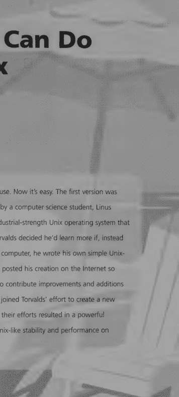

Linux 以前很难安装和使用。现在它很容易了。第一个版本是由计算机科学学生 Linus Torvalds 在 1991 年作为一个业余项目编写的，他想要一个能运行在他家用计算机上的工业级 Unix 操作系统版本。但 Torvalds 决定，与其尝试将商业 Unix 改编到他的计算机上，不如自己写一个简单的类 Unix 操作系统，这样他能学到更多。于是他照做了。然后他在互联网上发布他的创作，这样其他人不仅可以自由使用，还可以为它贡献改进和添加。很快，数百名程序员加入了 Torvalds 的努力，去创建一个新操作系统，并在几年内，他们的努力产生了一个强大的操作系统“内核”，在廉价的桌面硬件上提供了类 Unix 的稳定性和性能。

Point & Click Linux!

早期的 Linux 并非为家庭或办公计算机用户设计。它是一个“裸机”事物，屏幕看起来像这样：

```
(terminal output image, too small to transcribe)
```

显然，我们这里说的不是“用户友好”。在开发的前几年里，Linux 严格面向计算机专业人员、计算机科学学生和熟练的爱好者。但自那以后，全球成千上万的程序员致力于让 Linux 对您和我这样的普通人更有用。虽然它仍然拥有 Unix 的计算能力和稳定性，但我们现在看到的 Linux 界面允许我们用简单的指点（point and click）命令代替输入长长的文本字符串，例如：

```
.configure --with-tls --enable-slurpd --enable-crypt --enable-syslog --sysconfdir=/etc
```

对于运行一组服务器计算机的专业系统管理员来说，这类事情没问题，但我们这些在 PC 上使用 Linux 的人更愿意看到如图示这样的图形按钮：


显然，如果我们点击一张带有音符的 CD 图片，我们期望播放一张音乐 CD，如果我们点击一张打印机的图片，我们期望打印某些东西。我们通过其 KDE 桌面和 KDE 底层的 X Window 图形系统来控制 MEPIS Linux，这些系统将我们的点击操作翻译为我们的微处理器能理解的代码。这在所有操作系统中都会发生，不仅仅是 Linux。计算机不理解图片和点击，只理解二进制代码，而且它们也不像我们人类那样“绘制图片”。它们像你的电视屏幕一样，在计算机屏幕上开开关关彩色的点。在所有计算机屏幕的图片下面，都有二进制数字在飞速往返。Linux 比其他操作系统更坦率地承认这一点，并且也乐意以文本格式告诉您它正在做什么，这就是当您用 SimplyMEPIS 光盘启动计算机并在屏幕上看到滚动文本时看到的内容。Linux 正在系统地启动和测试您计算机的许多功能，并向您报告它的行动，而不是隐藏它们。大多数时候，您可以忽略这些文本，将其视为一种看起来很酷、像是来自《黑客帝国》电影的东西，但如果您的调制解调器或硬盘出现错误，观察该“启动”序列可以告诉您哪里出了问题，而无需进行大量繁琐的诊断工作。

但大多数时候，我们不需要担心计算机内部是如何工作的。开发了我们的 Linux 系统中 GNU、X Window 和 KDE 组件的程序员已经为我们做了所有的担忧工作。我们在这里是为了使用 Linux 进行日常计算任务，而不是成为计算机科学家。

当您用本书背面的 SimplyMEPIS 光盘启动计算机时，您将能够立即：

1. 查看您喜爱的网站
2. 收发电子邮件
3. 从互联网下载音乐
4. 阅读以 Adobe Acrobat 格式发布的在线文档
5. 编写和打印信件、备忘录和其他文档
6. 创建和打印电子表格，无论是数字格式还是图形格式
7. 阅读和编辑大多数由 Microsoft Office 创建的文档
8. 创建引人入胜的幻灯片演示
9. 进行专业级的桌面出版
10. 上传和编辑来自数码相机和大多数扫描仪的图片
11. 绘制图片并将它们保存为多种图形格式
12. 创建网页并将其上传到服务器
13. 执行基本的家庭和办公簿记任务
14. 使用 AIM、Yahoo Messenger、Microsoft Messenger 或 IRC 在线聊天
15. 玩数十种纸牌、棋盘、街机和教育游戏

您可以在 CD 驱动器中运行 SimplyMEPIS 的同时做所有这些事情，无需安装。当您安装 SimplyMEPIS 到您的硬盘上——只需几次点击——您将能够做更多。当您学习运行 Linux 的基础知识——这不会超过几个小时——您将学会自定义 Linux 桌面和每个程序的行为和外观，使它们成为您想要的样子，而不是某些程序员决定的样子。这种灵活性是 Linux 最大的特性之一，即使您一开始坚持使用默认设置，过一段时间后您也会学会欣赏它。

使用 Linux 的另一个优势是，您可以轻松安装新程序，而不必担心间谍软件、广告软件或病毒。您可以从 MEPIS 服务器直接获得超过 1,000 个 MEPIS 认证的程序，只需支付少量的年度订阅费（或者支付少量额外费用将它们在 CD 上寄给您）。您还将通过 MEPIS 在线论坛获得所有这些程序的免费支持，即使您不是付费订阅者。如果您需要 MEPIS 服务器上没有的专业软件，或者您选择不订阅，您可以从全球志愿者维护的 Debian Project 服务器网络下载超过 10,000 个免费程序中的任何一个。这些程序不保证与 MEPIS 兼容，但其中 90% 能工作得很好。在 Linux 中卸载一个程序和安装它一样简单，所以如果您尝试一个程序而它不起作用，也没什么大不了的。

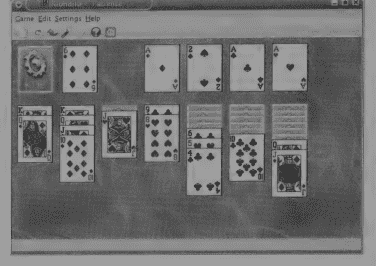

#### 在 Linux 中运行 Windows 程序

您可以购买一些商业程序，允许您运行您已经拥有的 Windows 程序。虽然从长远来看，如果您尽可能多地使用“原生”Linux 程序来执行任务，您的处境可能会更好，但您可能有一些 Windows 程序尚未准备好放弃。在本书的末尾，您将找到如何获取和安装 CodeWeavers’ CrossOver Office 和 CrossOver Plugin 包的说明，这些包允许许多 Windows 程序在 Linux 中工作，甚至不需要在您的计算机上安装 Windows。您还将找到关于 Win4Lin 的信息，这是一个让

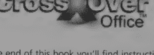


## 1: 你可以用 Linux 做什么

你可以在 Linux 内部运行 Windows 95、98 或 ME 的副本（以及几乎所有 Windows 程序）。由于以下几个原因，这与在同一台计算机上对 Windows 和 Linux 进行“双启动”是不同的：

- “双启动”意味着你的计算机上同时安装了 Windows 和 Linux，使用 MElps 可以很容易地做到这一点，但要从一个操作系统切换到另一个，你必须重新启动计算机。
- 通常，通过 Linux 中的 Win4Lin 启动和运行 Windows 比单独运行要快得多。这听起来很奇怪，但这是事实。
- 如果你在使用 Win4Lin 运行 Windows 时发生崩溃，不需要重启整个计算机，只需要重启 Windows 本身，这比从头开始引导的繁琐过程节省大量时间。
- 在使用 Win4Lin 于 Linux 下运行 Windows 时，你可以使用 MElPS 附带的 Konqueror 文件管理器，将你使用 Windows 软件创建的图像直接拖放到你正在用 Linux 程序创建的 Web 页面或其他文档中。这种灵活性让你可以同时使用最好的 Windows 程序和最好的 Linux 程序，让你触手可及地拥有两者的优点，而无需在两者之间做出选择。

最终，即使你决定仍想继续使用一些 Windows 程序一段时间，你很可能发现许多 Linux 程序并非仅仅“一样好”或“几乎一样好”比你习惯使用的 Windows 程序——在许多方面，它们比其 Windows 对应物更好，并包含它们所缺乏的有用功能。


我们为你们包含的（免费）Mozilla 邮件程序完全免疫于所有可以感染 Microsoft Outlook 或 Outlook Express 的病毒和蠕虫，并且它具有（免费的）内置垃圾邮件过滤功能，比你可以为 Microsoft 邮件程序购买的许多插件过滤器更好。

*SimplyMEPIs* 中的 Mozilla 浏览器具有 Explorer 缺乏的许多功能。它可以轻松屏蔽烦人的“弹出式”网络广告，并且它具有“标签式浏览”功能，使你可以轻松地从你最喜欢的新闻站点——或者在线购物时从目录站点——一次打开许多页面，然后通过单击关闭所有这些页面。

##### 点击即用的 Linux！

OpenOffice.org (OOo) 是我们包含的命名奇怪的办公套件，可以保存 Microsoft Office 无法保存的多种格式文档，包括 Adobe 的 PDF，因此你可以在互联网上、纸上和 CD 上发布同一作品，而无需针对每种介质重写。在另一个方面，它比 Microsoft Office 更灵活：它可以读取、编辑和保存 PDF 和 Microsoft Office 格式的文档，但 Microsoft Office 无法读取或编辑以原生 OOo 格式创建的文档，也无法创建 PDF 文件。使用 OOo 的另一个优势是，它会自动“压缩”你保存的每个文档，因此占用的硬盘空间比 Microsoft Office 保存的文档少得多。如果你习惯使用 Microsoft Office，OOo 起初可能会显得奇怪，但稍加练习你会发现，除了文件格式的灵活性外，它还有许多 Microsoft Office 没有的功能，可以使你的工作更快更容易。

我们为 MEPIS 选择的 K3B CD/DVD 制作软件是我们使用过的任何操作系统中功能最强大的“刻录”程序。你将想要放在 CD 或 DVD 上的文件拖入 K3B 窗口，按下“刻录”，就完成了。它还能自动检测并设置几乎所有常见的 CD 和 DVD “写入”驱动器，并且不需要为其中任何设备安装特殊的“驱动程序”。

这些只是几个例子。当你探索 Linux 时，你会发现许多其他值得你喜爱的程序，包括用于科学研究、视频和音频编辑、网页托管和软件开发的专用软件。我们每个人都有不同的软件需求，没有一本书——或一张 CD——能涵盖所有需求。

在这本书以及配套的视频 DVD 和软件 CD 中，我们专注于用于日常家庭和办公桌面计算的文件，这样你可以立即开始使用 Linux 处理日常任务。当你对桌面 Linux 感到自如后，你可以开始探索其力量在其他领域，直至通过连接数百甚至数千台 Linux PC 来构建自己的世界一流的超级计算机。

但我们下周（或者明年）再担心构建 Linux 超级计算机的问题。现在，让我们将 *SimplyMEPIS* CD 放入你的计算机 CD 驱动器，花上一两个时间掌握 Linux 基础知识。

### 第 2 章
#### 运行 *SimplyMEPIS* CD

MEPIS 作为“Live CD”运行，无需安装。在大多数 PC 上，运行 MEPIS Linux 就像将 *SimplyMEPIS* CD 放入 CD 驱动器并重启计算机一样简单。经过片刻的嗡嗡声后，你会看到一系列菜单选项。

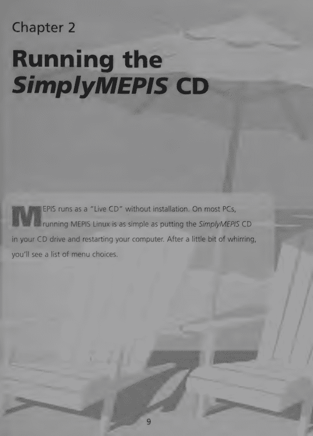

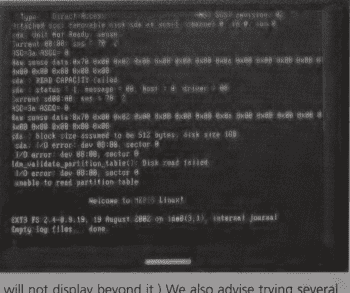

虽然这个菜单给你提供了许多选择，但在大多数情况下，你只需要等待几秒钟，让默认选择自动运行。如果默认选择未能正确启动——也就是说，你只看到空白屏幕——你需要尝试可用的选择，直到找到最适合你计算机的那一个。（特别注意“监视器分辨率”选择。每种品牌的监视器都有一个最大分辨率，超过该分辨率将无法显示。）

我们还建议尝试几种不同的内核选择。Linux 内核是你操作系统的“心脏”，在某些计算机上，某些版本明显比其他版本运行更快。尝试每个内核选择只需几秒钟。你不需要为每次测试执行漫长的关闭程序；只需按电源按钮关闭计算机，重新打开，当菜单出现时，每次选择不同的菜单选项即可。

你可能遇到的另一个陷阱是你的计算机完全拒绝读取 CD，在这种情况下，在你改变计算机的 BIOS 设置之前，你不会看到上面显示的菜单屏幕。

#### 让计算机从 CD 启动

如果当你第一次尝试时，你的计算机可以从 CD 启动并运行 *SimplyMEPIS*，你就不需要阅读这一节。

但有些用户的计算机拒绝从 CD 驱动器而不是硬盘启动。这不是 Linux 的问题。许多 PC 出厂时其 BIOS（随主板附带的基本输入/输出系统）被设置为仅从硬盘启动。更改启动顺序并不难——当你知道怎么做时——如果你还不知道怎么做，这是一个很棒的小技巧，不仅适用于 Linux，而且如果你需要安装新版本 Windows 或作为常规维护的一部分重新安装旧版本时也有用。

并非所有计算机使用相同的命令进入 BIOS 设置（或者有些人在启动屏幕上称为“Setup”）。如果运气好，当你的计算机首次启动时，它会告诉你该怎么做，比如“Setup: F1”这样的小提示，可能会在你按下 F1 键之前闪过。没问题；用开关关闭计算机（因为操作系统尚未启动，所以不需要使用操作系统关闭程序），这次准备好手指。但在开始折腾你的 BIOS 之前，请阅读以下加粗提示：

> **警告：**
>
> 更改 BIOS 中的任何设置时要非常、非常小心。在更改任何设置之前，准确记录原始设置，并仔细阅读屏幕底部所有关于“如何更改/如何保存”的小字说明。如果你搞乱了 BIOS，你的计算机可能无法启动任何操作系统；如果你设置了一些不应该设置的项并且它仍能启动，关键功能可能无法正常工作。更改 BIOS 中的任何设置时要非常、非常小心。

话虽如此，当你进入 BIOS 设置时，你可能会看到一个屏幕，上面某处有“BOOT PRIORITY”（启动优先级）或“BOOT ORDER”（启动顺序）等字样。这就是你需要更改的地方。（此时你的鼠标可能无法工作。如果不能，你需要使用 Tab 键或上下箭头键在行之间移动。）

当你将光标放在“BOOT”行时，通常可以通过按空格键更改启动优先级。如果不起作用，尝试其他键。此时你什么都不会损坏。只有当你保存更改时，你才可能损坏系统，而且每个常见的 BIOS 都有一个“退出不保存更改”的选项，如果你并不绝对确定你做对了，就可以使用它。

显然，如果你打算从 CD-ROM 启动，你希望“CD-ROM”成为第一个启动选项。在你完成新安装（或者需要暂时返回已安装的操作环境）之后，你可以将启动优先级改回实验前的状态。

#### 将 BIOS 访问视为一个需要解决的谜题

我们用来做测试计算机的一台 HP 台式机不仅仅给你一个单一的 BIOS 屏幕。首先，你按 F10 访问 BIOS 设置程序，然后从菜单中选择“Advanced CMOS Setup”（高级 CMOS 设置）来查找你的启动优先级。说明都在屏幕上，但你需要阅读它们，而不是盲目地按键和希望成功。


#### 即点即用的 Linux！

其他制造商也有其他的 BIOS 小技巧。当你习惯了更改 BIOS 设置后，弄清楚它们就不会有麻烦了。只有最初几次比较困难。如果你在保存前仔细思考，并确保在开始更改之前阅读 BIOS 设置屏幕上的所有文本（并在开始按键之前做笔记，以便你可以轻松返回默认设置），你就会毫不费事地弄清楚所有事情。

##### 常见 BIOS 访问命令列表

我们从各种在线来源编制了这个列表。它并不完整，但涵盖了一些最常见的计算机制造商的最受欢迎的产品。如果你的电脑不在列表中，尝试一些最常见的访问命令；尝试它们不会伤害任何东西。如果那样也失败了，你的电脑或主板制造商的文档或网站是关于你 BIOS 的可靠信息来源，也是最终的求助之地。你需要知道你的电脑的精确型号（可能还需要序列号）来获取正确的命令，因为它们因主板而异，并且计算机制造商可以（而且经常确实）在一项生产运行中途更换主板供应商而不通知任何人。

- 1. 宏碁（Acer）—F1, F2, CTRL+ALT+ESC
- 2. AST—CTRL+ALT+ESC, CTRL+ALT+DEL
- 3. 康柏（Compaq）—F1 或 F10
- 4. 戴尔（Dell）—400 F1 或 F3
- 5. 戴尔（Dell）—Dimension F2 或 DEL
- 6. 戴尔（Dell）—Inspiron F2
- 7. 戴尔（Dell）—Latitude F2
- 8. 戴尔（Dell）—Optiplex DEL 或 F2
- 9. 戴尔（Dell）—Precision F2
- 10. eMachine—DEL
- 11. 捷威（Gateway）—F1 或 F2
- 12. 惠普（HP）—F1, F2 或 F10
- 13. IBM (PC) — F1
- 14. IBM E-pro 笔记本电脑 — F2
- 15. IBM PS/2 — CTRL+ALT+INS after CTRL+ALT+DEL
- 16. 美光（Micron） — F1, F2 或 DEL
- 17. 索尼® — VIAO F2 或 F3
- 18. Tiger — DEL
- 19. 东芝（Toshiba） — ESC 或 F1

**如果你无法弄清楚如何更改你的 BIOS 设置…**

…制作一个启动软盘。以下是如何在 Windows 中操作：

1. 启动 Windows。
2. 在 Windows 运行时将 *SimplyMEPIS* CD 放入 CD 驱动器中。
3. 打开一个 DOS 窗口（在 Windows 中）。
4. 转到 CD 上的 linux 目录。
5. 在软盘驱动器中插入一张空白、已格式化的软盘。
6. 执行 *mkbootfloppy.bat*。
7. 在软盘驱动器中放入软盘，在 CD 驱动器中放入 *SimplyMEPIS* CD 并重新启动。你的电脑现在应该能运行 *SimplyMEPIS* 了。

#### 引导 MEPIS

Linux 在启动方式上非常有条理。你电脑的每个功能都会进行测试。这意味着你的 Linux 启动可能比其他操作系统慢，但有时“慢但稳”是最好的。另一件拖慢速度的事情是你正在从 CD 驱动器而不是从硬盘驱动器运行软件。CD 驱动器比硬盘驱动器慢得多，以至于你从 LiveCD 做的任何事都会看起来像是以慢动作发生，而不是全速。你会发现，一旦你将 MEPIS 安装到硬盘驱动器上，一切都会比从 CD 运行时快两到十倍。

#### 为什么 MEPIS Linux 要求输入密码

启动例程完成后，屏幕可能会看起来有点奇怪，像静电一样，或者空白一秒。然后你会看到一个登录屏幕，给你两个选择：“Demo” 和 “root”。

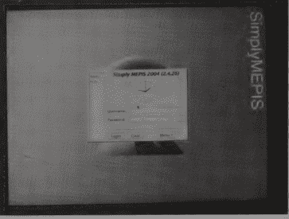

最好以用户名 *demo* 开始，而不是使用 *root*，特别是如果你打算连接到互联网。这是一种安全措施，也是 Linux 不会像某些其他操作系统的用户那样成为病毒和蠕虫目标的重大原因之一。

当你以 *user*（用户）身份登录时——一旦你永久安装了 MEPIS Linux，这很可能是你自己的名字——你将能够更改系统唯一的部分是你自己的数据和像屏幕颜色和其他一些外观选项之类的事情。要安装软件或对系统进行任何重大更改，Linux 要求你以 *root* 身份登录。如果你以 *user* 身份登录，恶意的黑客就不容易安装你不知道的软件或进行其他恶作剧。

只要你是以 *user* 而不是 *root* 身份登录，猫、孩子和善意的朋友就不能通过输入错误的命令弄乱你的电脑。事实上，当你进行实际的 Linux 安装时，你将能够为其他用户提供他们自己的用户账户，使他们能够登录并使用你的电脑，而不会打扰（或永远看不到）你的私人信息、电子邮件或你存储在电脑中的其他任何东西。而且每个用户还可以选择他或她的屏幕颜色和其他自定义功能，包括网站书签和喜欢的音乐。在 Linux 中，整个家庭可以共享一台电脑，但它可以是每个家庭成员的“个人电脑”，因为每个人都可以有自己的用户登录。

只有 root 能看到一切。（那将是你们，对吧？）

#### 登录

在“演示模式”下，演示用户的密码是 **demo**，全部小写。root 密码是 **root**，也是小写。我们将稍后展示如何更改密码（并添加用户），当我们把你的硬盘安装 MEPIS 时。但就现在而言，让我们使用这些默认值。输入它们，点击“login”按钮——或者在你输入密码后只需按“Enter”键——一两秒后你就会看到你的完整、就绪的 KDE 桌面。如果你的 PC 有扬声器，你应该在桌面出现时听到几声音乐。

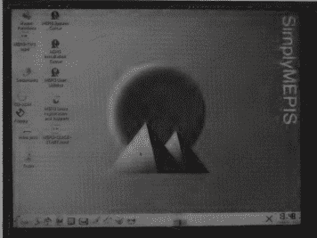

如果一切正常，你现在准备好使用（或玩弄）Linux 了。如果你的电脑通过连接到 DSL 线路、电缆调制解调器或其他高速“始终在线”设置的网络电缆连接到互联网，你现在应该已经连接到互联网了。你可以通过点击屏幕底部面板中的“M”来测试这一点，这将启动包含在 **SimplyMEPIS** 中的 Mozilla 网络浏览器。


如果你的网络此时没有正确运行——也就是说，如果你无法查看网站——你需要打开 MEPIS 系统中心并更改你的系统设置。如果你是自动在线的，则不需要这样做，但仍然花一分钟看看系统中心可能会不错。

#### 使用 MEPIS 系统中心

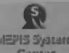

要打开 MEPIS 系统中心，点击主桌面上的“S”图标。

当你打开 MEPIS 系统中心时，你首先看到的是登录屏幕。这个要求输入 root 密码，而不是你的用户密码。当你从 CD 运行时，密码是 root。（当然，在你把 MEPIS 安装到硬盘驱动器后，你会把它改成更安全的内容。）

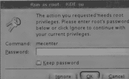

#### 神奇的桌面清除图标

我们刚告诉你要点击桌面上的一个图标。如果你的屏幕被应用程序窗口覆盖怎么办？或者两个或三个或 40 个应用程序窗口？（Linux 对你可以保持打开的应用程序或窗口数量没有实际限制，所以你确实可以同时打开 40——甚至 100——个应用程序。）

答案是屏幕左下角的 View Desktop 图标，紧挨着那个带有顶部标有“K”的小齿轮图片。点击 View Desktop 图标，你将有一个清晰的视图看到你的空白桌面。

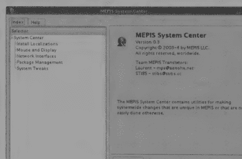
### 2: 运行 SimplyMEPIS CD

输入该密码，你将看到 MEPIS 系统中心主屏幕。

在这个屏幕的左侧，你看到一个功能索引，在该索引上方有一个帮助选项。如果你点击帮助，你将看到这些字：

#### 使用 MEPIS 系统中心

要使用 MEPIS 系统中心，只需在索引选项卡中选择一个功能，并按照此帮助选项卡中的说明进行操作。

使用 MEPIS 系统中心就是这么简单。我们将从查看网络接口开始。

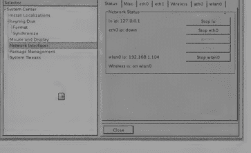

这个屏幕告诉我们网络在做什么。在这个例子中，我们有一个活动的无线网络连接。我们看到哪些网络服务正在运行，因为我们有可用的按钮来停止它们。如果这些服务没有运行，这些按钮会说“Start”而不是“Stop”。标有“Start eth0”和“Start ath0”的按钮是阴影化且几乎不可见的，因为这台电脑没有连接到有线（eth0）连接，只有无线，所以没有检测到有线连接。

Ath0 仅用于 Atheros 网卡，它们并不太常见。如果你有一个，MEPIS 会自动检测到它，自动安装正确的驱动程序，并自动为你启动它。


#### 看哪，无需驱动程序！

在使用 Windows 和其他操作系统时，您通常需要根据网卡制造商提供的 CD，为网卡安装特定的软件“驱动程序”。MEPIS Linux 内置了几乎所有主流网卡的驱动程序，包括无线网卡。它还内置了大多数主流数码相机、扫描仪、打印机以及您可能连接到计算机的其他设备的驱动程序。（如果您想添加在本书编写时之后才制造的硬件，您可能需要获取一个包含该设备驱动程序的更新版 MEPIS，但这并不困难。我们将在第 24 章“下载和安装软件”中展示如何做到这一点。）

通常，MEPIS 无需您进行任何操作即可运行任何常见的有线网卡。无线网络可能会自行启动，也可能不会，但确保“wlan0”正在运行且未运行时将其启动起来很容易。点击“Wireless”选项卡，点击“Use auto-config”选项，并点击“Apply”，如果启动“wlan0”未能使您的无线连接生效，请执行此操作。

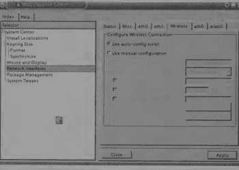

如果您使用的无线网络启用了加密和其他非默认设置，您将需要点击“Use Manual Configuration”，并设置 MEPIS 以符合您网络的配置。您可以通过访问无线集线器的设置工具和操作指南来确定该配置。

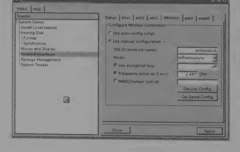

即使随无线集线器提供的所有设置指南都是针对 Windows 编写的，所有操作系统的数字和设置也是相同的。将它们输入相应的空白处，点击“Apply”，它们应该能正常工作。

#### 拨号和 PPoE 连接

拨号调制解调器用户应参阅第 5 章“KPPP—简易调制解调器拨号程序”。我们将它放在那里是因为 KPPP 只是 Linux 上可用的多个拨号连接程序之一。虽然 KPPP 是我们的最爱，但您稍后可能会决定下载并使用其他程序。

如果您的服务提供商仍直接通过 PPoE（以太网点对点协议）使用 DSL，您可能需要使用 KDSL 工具来连接，但首先应确认您的服务提供商是否有更新的路由器式调制解调器可用，以消除登录名和密码的需要。实际上，所有主要的美国 DSL 服务提供商都已切换到路由器式调制解调器，这些调制解调器可由 MEPIS Linux 自动检测和配置。（无论如何，这些 DSL 调制解调器都比旧的 PPoE 调制解调器高效得多，因此无论您使用哪种操作系统，都应进行此切换。）

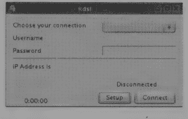

#### 打印机设置

MEPIS Linux 包含主流家庭和小型办公打印机的驱动程序。要设置您的打印机，请点击面板上的“K-Gear”图标，选择“Print System”，然后选择“Add Printer”。这将调出“Add Printer Wizard”（添加打印机向导）。

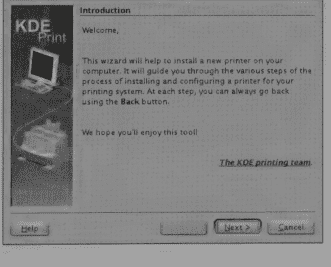

##### 指点与点击 Linux！

如果您现在已经解决了 Internet 连接问题，并且想要阅读有关 KDE 打印系统的开发和功能的信息，请点击带下划线的文字“The KDE printing team”（KDE 打印团队），http://printing.kde.org 网站将会打开。但这并不是必需的。我们现在真正需要做的是点击“Next”（下一步）。

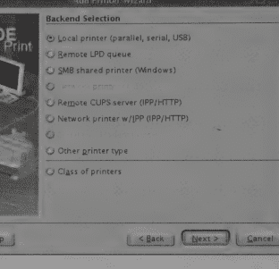

对于这个基础教程，我们假设您的打印机通过并行端口、串行端口或 USB 端口直接连接到您的计算机，因此我们将选择“Local printer”（本地打印机），然后点击“Next”（下一步）。

（有关如何使用连接到网络上另一台计算机的打印机的更多信息，请点击“Help”（帮助）按钮调出 *The KDE Print Handbook*（KDE 打印手册）的副本，或访问 printing.kde.org 网站，该网站可能拥有更新版本。）

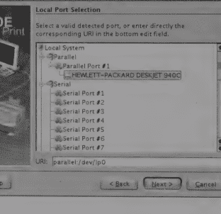

## 2：运行 SimplyMEPIS CD

现在是时候选择您的打印机如何连接到您的计算机，并点击该选项了。（向下滚动查看 USB 和其他一些选项。）完成后，再次点击“Next”（下一步）。

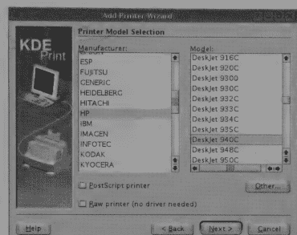

从列表中选择您的打印机品牌和型号。如果您的确切打印机型号未列出（这种情况不太可能），请选择同一制造商的类似型号。

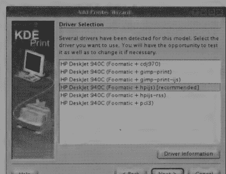

在本次演示中，我们使用常见的 HP Deskjet 940C。当然，您使用的是您的打印机，而不是我们手头方便的一款。并且，当然，点击“Next”（下一步）。

某些打印机有多种可用的驱动程序。要了解其中一种驱动程序的更多信息，请点击该驱动程序，然后点击“Driver Information”（驱动程序信息），关于该驱动程序的一页内容将会弹出。到目前为止，我们选择推荐驱动程序时从未出错，因此我们将坚持使用它。并点击“Next”（下一步）。

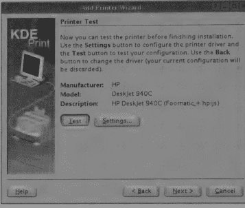

现在我们要打印一张测试页，以确保一切正常。（如果被要求输入 root 密码，请记住，当您从 CD 运行 MEPIS 时，密码是 root。）在撰写本章并为此截图时，我们遇到了一个问题：测试页无法打印，因为打印机未插入计算机。MEPIS Linux 具有包容性和用户友好性，但它的能力也是有极限的，而拔掉电源的打印机超出了它的控制范围。在我们插上打印机后，一切工作正常。

**关于打印机操作的重要说明**：当从 LiveCD 运行而不是在硬盘上安装的 Linux 中运行时，您的打印机可能无法在大多数程序中正确工作。当您通过 CD 光驱运行 Linux 时，打印程序未存储在硬盘上，而您使用的程序（如文字处理器）在告知它们您想打印时会在那里查找它。只要测试页能打印，即使其他页不能打印，您也没问题。当您实际安装 MEPIS Linux 后，您将不再遇到打印问题。

#### 关闭系统

这是我们需要掌握的最后一个功能。难吗？并不完全是。以下是操作方法：

- 1. 点击屏幕左下角的 K-Gear 标志。
- 2. 点击“Logout”（注销）——底部的菜单选项。

您有三个选择。它们的用途显而易见。选择您喜欢的那个，并点击它。这就是本次 Linux 会话的结束，希望这是您在未来几年中将运行的许多会话中的第一个。

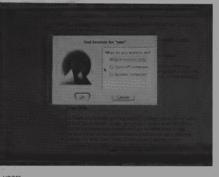

#### 获取帮助

如果您在使 MEPIS 正确启动或初始设置的其余部分方面遇到任何困难，请使用 MEPIS 或现有操作系统联网，并前往 www.mepis.org。您会发现大多数常见设置问题的解决方案，包括在本书编写之日与您首次拿起本书之日之间的几个月内被发现和解决的任何问题。

如果您没有在 MEPIS 网站本身上看到答案，请前往 www.mepis.org/Forum，在那里 MEPIS 开发人员和经验丰富的用户可以为您提供一对一的帮助。（使用 MEPIS 论坛没有费用。）

### 第 3 章

#### 使用 Linux：KDE 和 KWrite


现在我们有了运行的 MEPIS，让我们稍微玩玩它。我们将在这里探索一些基本的 Linux 功能，包括如何创建、保存、查找和移动文件，使用一小段简单的文本作为例子。这也是视频教程开始发挥其优势的时刻。有时，看到有人演示操作方式并引导您完成过程，比仅仅阅读印刷页面上的描述更容易理解如何执行操作。

##### 指点与点击 Linux！

KDE 桌面是 MEPIS Linux 的“公众面孔”。请记住，无论我们使用什么操作系统，我们计算机核心的微处理器都以二进制“开或关”数字的形式严格处理信息。所有操作系统都有多层软件设计，旨在向您隐藏这些二进制操作，并为其美化外观。在 Linux 中，计算机内部与您屏幕上所见内容之间最常见的接口被称为 X Window 系统。与 X Window 系统配合工作的 KDE 桌面是 GUI（图形用户界面），它使 Linux 对人眼看起来美观，并赋予我们“指点与点击”命令的能力，而无需输入命令。还有其他 Linux GUI，特别是备受好评的 Gnome 桌面，您可以稍后尝试，但我们决定从 KDE 开始，因为它是最流行且通常被认为对新的 Linux 用户来说最容易学习的一种。

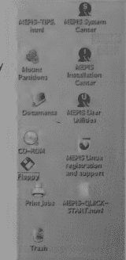

KDE 几乎是无限可定制的——您可以选择任何喜欢的桌面背景，并将该桌面上的几乎所有东西移动到您想要的任何位置，我们将在后续章节中展示——但在此时，我们将讨论如何使用从您的 SimplyMEPIS CD 加载的默认配置中的 KDE 桌面。

首先映入眼帘的是屏幕左侧有几幅带标题的小图片或“图标”，以及底部“面板”中还有许多图标，我们使用该面板来控制 MEPIS Linux 中的大多数功能。要对计算机执行几乎所有操作，您都从点击这些图标之一开始。如果您想播放 CD 上的一首曲子，请点击 CD 图片。将会弹出一个窗口，显示您（希望）在尝试此操作前放入 CD 光驱的音乐 CD 上的内容。（如果没有 CD，您将获得光驱中没有媒体的提示。）

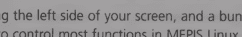


## 3：使用 Linux：KDE 和 Kwrite

“挂载分区”会显示所有连接到您电脑的存储设备，包括您的硬盘。在这个示例中，您会看到几个硬盘分区。（我们将在下一章中解释硬盘分区的概念。）您还会看到 cdrom、floppy 和 sda1。“Floppy”是软盘驱动器，“sda1”是一个包含数码相机照片的闪存卡读卡器，而“cdrom”是 CD 光驱。如果您没有 USB 存储设备或软盘驱动器，您就不会看到这些选项，但无论如何，很明显，要查看 CD 的内容，您只需点击 CD 图标即可。

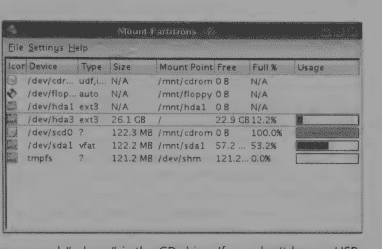

接下来，您会得到另一个“菜单”，显示 CD 上的所有文件。在这种情况下，它是音乐。选择您想听的曲目，点击它，它就开始播放了。这就是 KDE 的工作方式。您指向一个图标，点击它，然后得到您想要的东西。

**注意：** 您可以使用 CD 图标或通过“挂载分区”菜单来打开 CD 光驱中的 CD。Linux 和 KDE 通常为您提供不止一种操作方式。请随时选择最适合您的那一种。

##### KDE 面板

屏幕底部的横条是“面板”，类似于“控制面板”，它是桌面的重要组成部分。左端的“K-Gear”图标用于访问注销和关机菜单，以及字面上通往您电脑上所有程序的菜单。位于“K-Gear”旁边、看起来像在桌面上写字的笔的图标是“查看桌面”实用工具的图标，它会隐藏当前打开的所有程序窗口，以便您能看到主桌面上的图标。其右侧的图标用于打开特定的程序。


（这里目前可见的图标是针对本书作者和 MEPIS 开发者认为大多数人最可能使用的程序设置的。稍后，我们会向您展示如何删除他们的选择并添加您自己的选择，如果您愿意的话。这很容易做到。）

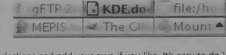

在程序图标的右侧，您拥有“任务栏”。这里显示您当前打开的程序。随着您对 Linux 经验的增加，您会开始意识到，您可以同时打开许多程序，而不是只坚持使用一两个程序。在拥挤的桌面上，任务栏是跟踪已打开程序的唯一方式，而点击任务栏中的程序条目是从一个程序切换到另一个程序的最简单方式。

任务栏右侧有几个很酷的小实用工具，包括声音控制。尽管去点击它们吧。看看它们能做什么。

###### Kongqueror——KDE 文件管理器

当我们点击打开窗口中的 CD 图标时看到的窗口，并不是来自一个特殊的 CD 播放程序，而是 Kongqueror 文件管理器的一部分，我们用它来查找、保存和移动各种类型的文件。在 Linux（和 KDE）中，一切皆文件。您可以有图片文件、音乐文件、文本文件、程序文件，甚至指甲文件——或者至少是您将文件命名为“nail”的文件，如果您正在撰写关于历代木工研究的论文系列，或者您是一位喜欢拍摄自己做的可爱指甲装饰照片的化妆师。

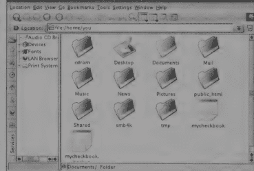

您是文件系统的老板。在 **SimplyMEPIS** 中，我们已经设置了一些基本文件夹，您可以在此保存文档、图片和其他常见类型的信息。您可以轻松添加名为“宝宝照片”或“热带饮料食谱”之类的自定义文件夹，甚至可以让它们显示在桌面上，以便您以后轻松找到它们。

#### 3：使用 Linux：KDE 和 KWrite

如果您想添加一个名为“Sunsets”的文件夹并希望在桌面上显示它，请单击“Desktop”，您会看到已经位于桌面上的图标。将光标（鼠标或其他指针移动设备在屏幕上移动的小指针）放在此窗口中的任何空白处，点击鼠标右键。您会看到一个可以执行操作的简短列表，第一项是“创建新”，该词右侧有一个箭头。将光标滑向右侧，悬停在该箭头上，您会看到几个选项。最上面的是“文件夹”，这就是我们想要的。用左键点击它。

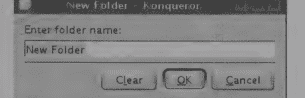

您刚刚弹出了我们所说的“对话框”，它要求您输入某些必需的信息。它写着“输入文件夹名称：”，在这些词的正下方有一个小空间——一个“表单”——里面写着“新文件夹”。您的光标已经在这个小表单中，除非您希望新文件夹名为“新文件夹”，否则您希望按下“backspace”或“delete”键（两者都可以），然后输入我们选定的名称“Sunsets”。

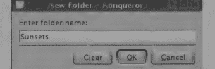

点击“确定”，您新的“Sunsets”文件夹现在就会显示在桌面上。这将是一个存放您喜爱的海滩日落照片的好地方。（突然之间，那个“热带饮料食谱”文件夹听起来也是个不错的主意，不是吗？）


##### 您的系统“文件树”是如何工作的

文件存储在一个“倒置树”结构中，根在顶部，分支向下生长。实际上，您的 Linux 系统的主目录被称为“root”（根），由 / 表示（这就是键盘上问号下方的“正斜杠”）。向下移动，您会看到一个主要文件夹列表，称为“目录”。您可以随时点击小“+”号打开“树”的该分支来查看其中任何目录的内容，但我们 99% 的时间里只需要考虑 /home，因为那是我们的个人文件所在地。

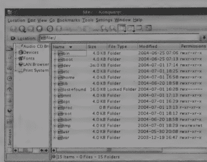

要从桌面直接访问您的 Home 目录，请点击屏幕底部的“Home”图标——那个看起来像小房子的图标。

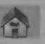

您在那里可以看到文件夹。点击其中一个文件夹，您就移动到了目录树的一个分支上。我们已经创建了一个我们自己的文件夹，我们可以创建尽可能多的文件夹，文件夹中嵌套文件夹中再嵌套文件夹，直到我们的头脑晕转。不过，通常保持简单更容易，这样我们就能记住文件归档在哪里，并以尽可能少的点击次数通过文件夹和子文件夹访问它们。

#### 3：使用 Linux：KDE 和 KWrite

您可以有几种方式查看文件系统。大多数人似乎更喜欢图标，图片和文本文件设置为显示一个小“预览”。这是默认样式。在我们的“幕后基础”部分，我们将向您展示如何使用其他几种样式。

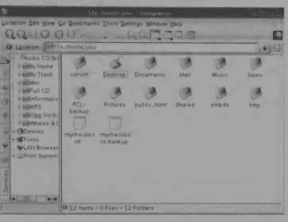

如何组织您的 Home 目录的文件系统由您决定。我们为您提供了一套基本的“起步”文件夹组合以助您开始，为了保持简单，目前我们只处理这些。在您掌握了更多 Linux 基础知识后——在本书结束时——您将准备好自定义您的文件系统以及几乎所有其他方面，以符合您的口味而非我们的。

##### 您的第一个应用程序——KWrite

我们暂时停止讨论 KDE 桌面和文件管理器，转而关注内置于 KDE 中的简单文本编辑器 KWrite。这将让我们有机会创建、保存、移动和复制一个实际的文本文件。由于 KWrite 是一个 KDE 程序，它的外观和行为与其他所有 KDE 程序（以及大多数 Linux 程序，无论是否属于 KDE 部分）完全相同。因此，我们在接下来几分钟学到的内容将有助于我们使用 *SimplyMEPIS* CD 中包含的所有软件，以及您稍后添加到系统中的任何软件。

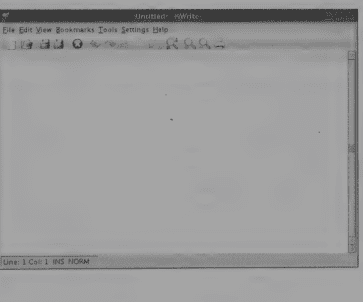


要打开 KWrite，请点击屏幕底部那个看起来像一个小记事本且插着一支铅笔的图标。KWrite 完全如其图标所暗示的那样——一个用于做笔记或编写基本文本消息的简单程序。它不允许您在不同的行中添加 *斜体* 或 **粗体**，也不允许改变字体大小。它是您在电脑上能接近用老式打字机在纸上打字或用垫板和铅笔做笔记的体验。

要在 KWrite 中开始创建文件，只需输入一些内容。就这样。无需设置。

输入一到两段文字。

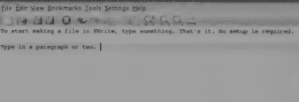

现在让我们演示一个非常基本的 Linux 技巧：“单击”文本复制。将光标放在您想要复制的第一个词之前，通过按住鼠标左键并将光标移动到您要复制的单词上来高亮显示几个刚输入的单词，同时保持按住该按钮。当您高亮显示选定的单词后，松开鼠标按钮，不触碰它，将光标移动到您输入的最后一行的末尾，然后同时点击两个按钮（如果您的鼠标是三键鼠标或带滚轮鼠标，则点击中间按钮或滚动轮）。

无需设置。

经过一点练习，您会发现这是一种比按下控制键粘贴文本快得多的方式。如果您完全习惯于 Windows 风格的复制方式，即按“Ctrl+C”保存高亮文本并按“Ctrl+V”粘贴，如果您愿意，仍然可以那样做。

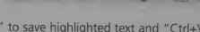

您有几种删除文本的方式。高亮显示您要删除的内容，点击上方的小剪刀图标，它就消失了。或者按“Delete”键，它就消失了。或者从您所在位置按退格键回退到您想停止删除的位置。或者将光标放在某个点


你可以选择删除该点*之后*的所有内容，然后按“删除”键。这三种方法都有效。

若要撤销操作，请转到 KWrite 窗口的顶部，点击“编辑”，然后点击“撤销”——它正好是顶部选项。如果你想节省半秒钟时间，在按字母“Z”键时按住“Ctrl”键即可。效果是一样的。

##### 键盘快捷键

大多数 Linux 程序都有许多键盘快捷键，你可以用它们来替代菜单指向。我们会介绍其中许多，但留给你自己去发现一些不常用的快捷键。

总之，我们现在已经创建了文本，复制了它，并删除了几个单词——然后又恢复删除。这些是我们使用基本文本编辑器要做的基本操作。我们还有两个主要功能要探索：“打印”和“保存”。

打印非常简单：点击窗口顶部，图标行（我们称为“工具栏”）右侧那个小打印机图标。如果你的打印机按照我们之前展示的方式设置好了，你的文本就会打印出来。它不会有任何花哨的格式，但看起来会像打字机打出的页面，因为这就是基本文本编辑器应该做的。

“保存”需要稍微多做一些工作，但也不算多。主要问题是：“你想把你的笔记保存在哪里？”以及“你会给它起什么名字？”

这就是我们要应用学到的文件系统知识的地方。如果这篇笔记是你可能稍后想要继续编辑的草稿，也许你希望将其保存在桌面上，以便稍后能注意到它。如果它是“热带饮品配方”（并且你创建了那个文件夹），那显然应该放在那里，标题应该是饮料的名称，比如“紫罗兰莫吉托”。

关于保存文件的两个主要规则：

-   以一个对你*有意义*的模式保存它们——并保持该模式，这样你就不需要四处翻找。
-   使用对你*有意义*的文件名，以便你三个月后看到它们时还能记得里面的内容。

（注意里面的*你*。这是*你的*个人电脑。除非你在工作时使用它，且公司告诉你如何归档不同类型的信息，否则你选择*你*最喜欢的方式，而不是别人喜欢的方式。）

要第一次保存你的文档，点击工具栏中的小软盘图标，或者旁边带有铅笔的软盘图标。两种方式都会弹出一个对话框，询问你想将工作保存在哪里，以及你想给它起什么名字。

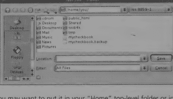

因为这是一个“文档”，你可能想把它放在你的“主目录”顶层文件夹或你创建的文件夹中。或者，也许你会选择把它放在桌面上。无论哪种方式，点击相应的文件夹，然后在名为“位置”的表单中输入该文件夹的名称（之所以叫“位置”，是因为你在决定这项工作的“文件存储位置”）。然后点击“保存”，你就保存成功了。

在你保存过这段文字一次之后，要保存后续对它的修改，只需点击软盘图标，更新将自动保存——或者按“Ctrl+S”（即“按住‘Ctrl’键并按‘S’键”的简写），你会得到相同的结果。你也可以点击程序顶部菜单中的“编辑”选项，在那里你会看到“保存”和“另存为”选项。

对一个已经保存过的作品使用“另存为”的唯一原因是，你想以不同的标题（位置）或不同的格式重新保存它。当我们开始讨论使用 OpenOffice.org 进行成熟的文字处理，以及使用比 KWrite 更复杂的其他程序创建的项目时，我们会更多地谈论以不同格式保存。KWrite 只将你的工作保存为纯文本。是的，如果你在菜单中四处看看，你会看到一个“导出”选项，指向“HTML”。但当你这样做时，你得到的只是让文本在 Web 上看起来就像来自打字机的 HTML“pre”命令，而不是“真正的”HTML，这些我们可以（并且将会）稍后使用其他程序创建。

##### 配置 KWrite

虽然 KWrite 显然可以在没有任何配置的情况下工作，但现在是一个花时间配置 Linux 软件的好时机。在我们的“超越基础”部分，我们将展示如何定制你的软件，确实，甚至是你整个桌面。这里只是一个尝尝，因为我们是 CD 运行而不是从硬盘运行，我们现在所做的任何更改在关机后都会丢失，所以你通过实验不会造成任何损害。

我们通过点击“设置”，然后从选项列表中选择“配置编辑器”来配置 KWrite（和其他 KDE 程序）。

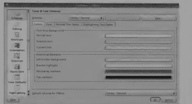

这会弹出一个窗口，给我们提供选择。

尝试这些选择比描述它们更容易、更快，所以我们将留给你自己玩弄它们，但不要觉得被抛弃了而没有人在你实验时握住你的手。在该配置屏幕的左下角，你会看到一个“帮助”按钮。点击它，你会看到 KWrite 的完整手册。

从主程序访问该手册的另一种方法是点击 KWrite 窗口顶部的“帮助”菜单项。几乎每个 KDE 程序——确实，几乎每个 Linux 程序——都有一个内置的类似手册，通过“帮助”按钮访问。这些内置的“帮助”文件有些很棒，有些则不然。（KWrite 的帮助恰好是好的之一。）

大多数“帮助”文件都有直接联系程序开发者提交错误报告的方式，而这些错误报告通常会被阅读，并且几乎总是会被处理。KDE 中的错误通常比商业软件公司修复*他们的*错误要快得多。（这是我们在书末尾会讨论的“开源魔力”的一部分，在我们让你熟悉 Linux 使用之后，这是我们目前的主要目标。）

关于 KWrite 的内容就到这里。当我们把 MEPIS Linux 安装到我们的硬盘上后，我们将使用更多的命令——并在我们学习如何使用其他程序时扩展我们对 Linux 的了解。

### 第 4 章

#### 在你的硬盘上安装 MEPIS Linux

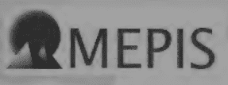

像 MEPIS Linux 这样的“Live CD”操作系统的伟大之处在于，在真正安装它之前，我们已经获得了一点经验。我们知道在哪里寻求帮助和问题的答案（www.mepis.org 和 www.mepis.org/forum），并且我们对将随基本操作系统一起安装哪些软件有一个大致概念。

请注意，我们不仅安装了一个操作系统，还包括执行基本计算任务所需的所有软件，以及足够多的游戏，以免我们在工作中感到无聊——我们还安装了工具，如垃圾邮件过滤器、弹出窗口拦截器和防火墙，以便我们在连接到互联网时计算机是安全和安全的。

现在是重大决定：如果我们电脑上已经有 Windows，我们想保留它吗，与新的 Linux 安装并排？纯粹安装 Linux 比将计算机设置为“双重启动”机器更容易，但让我们咬紧牙关，从学习如何安装 MEPIS Linux 同时保留系统中的 Windows 开始。

> 注意：这仅适用于你至少拥有 10GB 硬盘的情况。如果你有很多占据大量硬盘空间的照片、音乐和其他文件，除非它能容纳 20GB 或更多，否则你可能不应该尝试在硬盘上同时拥有 Windows 和 Linux。此时，如果你对自己的硬盘容量有疑虑，你可能需要考虑完全转换为 Linux，而不是走双重启动路线。（如果不行，你可以考虑给你的计算机添加第二个硬盘，或者用更大的硬盘替换你当前的硬盘。）

##### 设置 Linux/Windows 双重启动系统

如果你准备全职使用 Linux，你可以跳过接下来的几页。但如果你打算在计算机上保留 Linux 和 Windows，你必须非常*小心*地遵循以下说明，否则你可能最终无法运行任一操作系统，除非重新安装其中一个。

你必须做的第一件事和第二件事都与 Windows 有关，而不是 Linux：

-   备份任何关键数据。
-   对你的硬盘进行碎片整理。（这是一个 Windows 工具；Windows 手册将告诉你如何做这件事。）

现在是时候开始硬盘分区重新划分的冒险了。要做到这一点，请通过点击相应的桌面图标打开 MEPIS 安装中心。

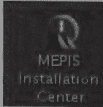


你需要在这里输入 root 密码。请记住，只要我们还在从光盘运行，用户就是 root，但我们将在安装过程中选择一个更安全的密码。

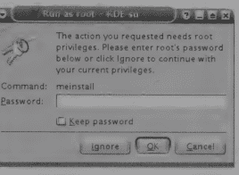

##### 关于硬盘分区

硬盘以通常的数字“开或关”风格存储数据，但它们可以以多种不同的模式存储。Windows 95、98 和 ME 使用一种称为 FAT 32 的方法。Windows NT、2000 和 XP 使用一种称为 NTFS 的方法。DOS 和非常旧版本的 Windows 使用 FAT 16。Linux 使用不同的数据存储方法，甚至对不同的驱动器使用不同的名称。Windows 通常将软盘驱动器称为 A 和 B，硬盘驱动器称为 C，CD 驱动器称为 D，除非有两个或更多硬盘，在这种情况下，硬盘驱动器可以是 E 和 F 和 G 等，而 CD 驱动器变成最后一个硬盘之后的字母。

此插图展示了 Linux 如何命名驱动器：

/dev/floppy 是软盘，/dev/cd 是 CD 驱动器，/dev/hda 是这台电脑的单块硬盘。还有一个 tmpfs，这是一种旨在加快某些类型数据访问速度的临时文件系统，最初是为大型计算机开发的，但在你的 PC 上也有用。还有一个 /dev/sda1，这是数字相机的闪存卡。

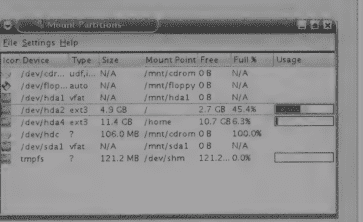

现在到了很酷的分区分部分了。

虽然 Windows 通常将整块硬盘作为一个大块使用，但你可以通过对硬盘进行分区，使其像多个小硬盘而不是一个大硬盘一样工作，从而让 Windows 运行得稍快一些。这还可以使系统维护更容易。如果你将所有图片和文本文件与程序放在不同的分区中，你只需备份该分区即可备份所有重要数据。

MEPIS Linux 使用三个分区——你在上一幅插图中看到的 hda2 和 hda4，以及另一个非常小的隐藏 hda3 “交换”（swap）分区（其作用类似于计算机 RAM 的扩展）。请注意，还有一个 hda1 分区。这是一个 Windows 分区——分区号旁边的 vfat 告诉我们它使用 Windows FAT 系统。

MEPIS Linux 使用的 ext3 文件系统与 FAT 在许多方面不同，但最明显的一点是，如果你的计算机断电或在未经过“正确”关机程序的情况下关闭，你可以重新启动它而没有任何问题。这是即使是最新版本的 Windows 也不具备的功能。

MEPIS Linux 文件系统的最后一个技巧是：默认情况下，它将你的所有个人数据存储在一个 /home 分区中——不仅包括你的照片、文本和音乐，还包括你喜欢的网站书签、电子邮件，甚至你的桌面设置和其他自定义设置，这样你就可以轻松升级甚至重新安装 MEPIS Linux，而无需在之后进行大量的设置或数据恢复。

现在我们要处理最棘手的部分：实际对我们的硬盘进行分区。

目前我们处于安装界面，系统询问我们希望如何进行安装。

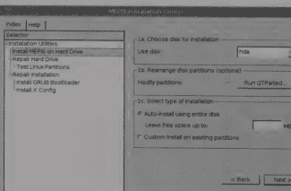

#### 4：将 MEPIS Linux 安装到硬盘上

我们选择自定义分区。这会调出 QParted 实用程序。

我们点击 hda 来操作我们的单块硬盘。（QParted 允许使用多块硬盘。这就是我们必须点击我们要更改的那个硬盘的原因——即使我们在此例中使用的 PC 只有一块。）

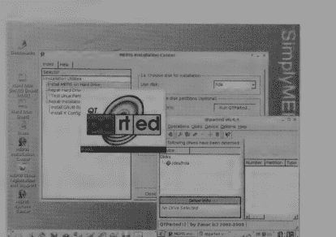

我们现在可以看到那个大的 Windows（FAT）分区。为了缩小它，我们“抓住”右端并向左移动，使其变小。屏幕给出了我们必须允许的最小空间量。最好允许比这多至少 20%，多 50% 更好，以防我们将来需要添加一些 Windows 文件。

要实际进行更改——此时我们还可以改变主意——点击软盘的小图标，这是“保存”的近乎通用的符号，但在 QParted 中被称为“提交”（commit），在这里更准确，因为当我们承诺更改分区时，我们无法撤销我们的决定。所以让我们执行并尽快完成。

现在我们在 Windows 分区右侧有一个大的未分配空间。这就是我们要安装 Linux 的地方。

我们要创建三个 Linux 分区。第一个称为 mount，所有程序都将放在这里。选择 ext3 作为分区类型。我们希望这个分区至少为 3GB，最大可以是 5GB。然后我们提交。接下来，我们添加一个

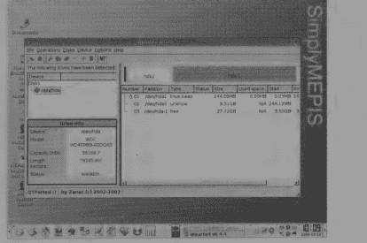

小的分区类型称为 swap，它充当额外的 RAM 内存，以防我们用光了所有“真实”的 RAM。这个分区的大小应与我们的 RAM 内存量相当，虽然这不是关键的。将其设置为 512MB（MB，不是 GB），你就没问题了。我们的第三个分区也是 ext3，是我们的 *home* 分区。

我们的硬盘现在被一分为二，一半给 Windows，一半给 Linux。我们完成了分区。

##### 单独安装 Linux

让我们回到几步之前，当时系统询问我们想要哪种安装类型。如果我们希望在硬盘上单独安装 Linux，我们只需选择“*使用整个磁盘自动安装*”即可。简单多了！

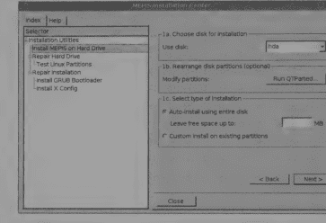

做出此选择并点击“下一步”后，我们只需坐下来观看 MEPIS 自动格式化硬盘并安装自己。

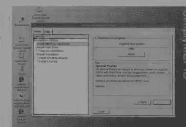

当 MEPIS 安装时，一个小条会爬过屏幕。这需要 5 到 30 分钟，取决于你 PC 的速度。现在是起身、伸展、拿杯咖啡或玻璃杯苏打水、果汁或水的好时机。

##### 名称和密码

你的 MEPIS 安装所需的下一次人工干预是，当被问及是否可以将 GRUB（GRAnd Unified Bootloader）实用程序安装在 MBR（主引导记录）中时回答“是”。请继续；如果你是高级 Linux 用户，你稍后可以自定义你的 MBR。我们其他人对普通的 GRUB 就满意了。它允许我们以最多种类的方式引导 Linux（比大多数人需要的多），并赋予我们引导多个操作系统的能力，如 Windows 和 Linux 并排——或者甚至两个或三个不同的 Linux 安装，如果我们喜欢的话。

我们的下一个任务是决定用户名、root 密码，以及——如果你的计算机是局域网的一部分——输入网络的名称，并给你的计算机起一个名称，以便其他计算机在网络上识别它。

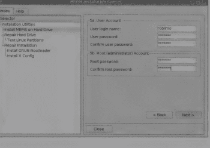

用户名可以是任何东西。你可以稍后添加更多用户。用户和 root 密码理想情况下应该是至少六个字符的数字和字母混合，而不是亲戚的名字或其他可以通过侥幸猜测得出的东西。

##### root 密码很重要！

root 密码是你安装新的 MEPIS Linux 系统时需要输入的最关键信息之一。如果你知道系统的 root 密码，你可以稍后更改用户名和密码，但如果你不记得 root 密码，你就无法在不费心重新安装所有内容而不更改任何重要事项。

root 密码是你抵御恶意黑客的主要防线。你希望它非常难，理想情况下是不可能的猜测，最好通过使用方法随机混合的数字和字母串，例如 32x49xrtgw05567。这种难以破解的密码的问题是，除非你记忆力很好，否则你会忘记它，所以你需要把它写在某处。然后你需要确保你写下它的纸张不被好奇的眼睛看到。

所以也许你选择一个不那么奇怪的密码。至少确保它不是一个真实的单词。在中间加上一两个数字也无妨。对于非政府工作，这应该足够安全了。只需确保你不要在网站上或可能意外地向全世界暴露该密码的其他地方使用此密码。

你只需在安装或删除软件、添加或删除用户或以其他方式更改计算机时使用 root 密码。你不会每天都使用它。如果你选择“写下来”的途径，总比忘记好——假设你没有忘记你藏起写有它的纸张的地方，就像本书作者几年前对某个 root 密码所做的那样……

还有几个 MEPIS 安装界面。第一个是针对网络上的 Windows 计算机的 Samba 网络。这可以稍后设置，本书的“超越基础”部分将详细介绍更多细节。现在，只需点击“下一步”。最后一个界面是关于安全和拨号的。使用拨号互联网连接的人将在第 5 章“KPPP—简易调制解调器拨号应用程序”中找到完整的设置说明。在安全方面，MEPIS 会自动设置 Guarddog 防火墙实用程序，任何连接到互联网的计算机（无论运行什么操作系统）都应该有防火墙，所以只需在这里点击“下一步”，不要更改任何内容。


安装已完成。该重启了。

就这样。你已经完成了。下一步是首次启动你新安装的 MEPIS Linux。根据你的硬件情况，LiveCD 可能会或不会自动弹出。如果没有，你需要在计算机执行启动例程时手动将其弹出。如果你之前修改了 BIOS 设置以使计算机从光驱启动，你可能需要也可能不需要更改这些设置。（这取决于你的计算机品牌和型号。）无论如何，你准备好首次从硬盘运行 Linux 了。

首次启动将花费额外的一点时间，因为你的计算机现在将自动运行一个实用程序，检查硬盘上的缺陷或坏区，并自动将关键的程序元素从坏区移动到好区。这取决于你的计算机和硬盘的运行速度，可能需要一两分钟，但完成后，你会看到一个登录屏幕，提供以 root 或你创建的用户身份登录的选择。出于安全原因，请选择以用户身份登录，而不是以 root 身份登录。

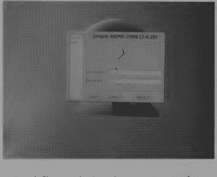

你可能想简单测试一下 root 登录，以确保密码正确工作，但在这样做时，明智的做法是将你的计算机与互联网断开连接——并在重新连接前回到你的用户登录界面。

但这就是全部。你已经运行了 MEPIS Linux。是时候开始使用随之自动安装的应用程序软件了。

### 第 5 章

#### KPPP：简易调制解调器拨号应用程序

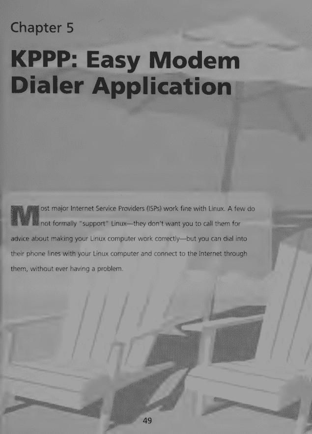

大多数主要互联网服务提供商 (ISP) 都能与 Linux 良好协作。少数并未正式“支持”Linux——他们不希望你打电话询问关于使 Linux 计算机正确工作的建议——但你可以通过 Linux 计算机拨号接入他们的电话线并通过它们连接互联网，而不会遇到任何问题。

##### 点点点点 Linux！

判断 ISP 是否兼容 Linux 的最简单方法是看它是否要求你在计算机上安装特殊软件才能连接其线路。如果需要特殊软件，该服务通常无法在 Linux 上使用。最典型的例子是 AOL，如果你计算机上没有 AOL 软件，你就无法使用它，而且 AOL 的软件没有 Linux 版本。这里有些讽刺，因为 AOL 自己在内部大量使用 Linux，但那是他们的问题，不是我们的。我们接受 AOL 不欢迎 Linux 用户这一事实，因此我们使用数千个其他欢迎 Linux 用户的 ISP 中的一个——而且由于它们中的大多数收费低于 AOL，我们很高兴使用它们作为替代。

但是，仅仅因为 ISP 提供拨号软件，并不意味着该软件是*必需的*。本书的作者多年来一直使用知名的 ISP，Mindspring。虽然 Mindspring 很乐意为你提供 Windows 或 Mac PC 的拨号软件，但他们也同样乐意让你通过 *SimplyMEPIS* CD 上的 KPPP 实用程序连接到他们的服务，其设置与其他任何 ISP 拨号程序一样简单。

> （如果你不确定当前的 ISP 或你打算使用的 ISP 是否适用于 Linux，请打电话或发送电子邮件给他们。他们会很乐意告诉你。）

设置 KPPP 时，你需要从你的 ISP 获取以下信息：

1. 你的用户名
2. 你的密码
3. 电话号码

每个 ISP 在你注册时都会提供这些信息，如果你手头没有，你可以发邮件或打电话，他们会再次提供给你。

##### 设置 KPPP

显然，我们要选择“配置”。我们想要配置的主要是“账户”，所以我们从点击“新建”开始。

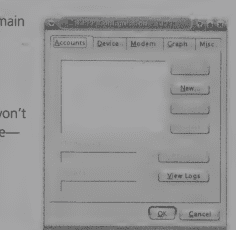

这将给你提供“向导”和“手动设置”的选择。你可以查看“向导”屏幕，但除非你所在的国家列在其中，否则对你没有用——美国不在列表中。如果你在列出的国家之一， “向导”将立即给你该国家流行 ISP 的列表，并帮助你获取一个账户（如果你还没有的话）。

然而，我们在未列出的国家可以轻松使用“手动设置”。我们真正所做的只是输入我们的 ISP 名称和当地拨号电话号码。不难！

注意有一个“添加”按钮。使用此按钮输入 ISP 的电话号码。你可以输入多个号码——这是一个好主意，以防某个号码有时忙或不起作用——通过多次使用“添加”按钮（假设你的 ISP 在你居住地有多个当地电话号码）。

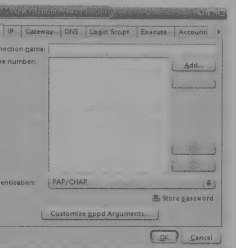

你几乎肯定不需要担心“身份验证”。如果你设置一切后尝试连接你的 ISP 但失败，可能需要重置，但这很少见，如果你遇到登录问题，你可以打电话给你的 ISP 咨询。但我们现在不担心这个。我们只需确保为这个连接输入了名称和电话号码，然后点击“确定”。

##### 准备连接

剩下的唯一任务是输入你的 ISP 用户名和密码。完成之后，确保你的调制解调器正确连接到电话线，然后点击“连接”。


接下来会发生三种情况之一。最可能的是，你将平稳地拨号到 ISP，自动登录，并在网上做任何你想做的事。使用 KPPP 在 Linux 中的连接性能与使用其他操作系统中的任何其他程序相比，不会更好也不会更差。

第二种最可能发生的事件是，你的调制解调器正确拨号，但登录失败，给你留下一个“断开连接”通知，其中包含一些程序员可能觉得有用的数字，但对其他人来说毫无意义或几乎无用。如果发生这种情况，最常见的原因是你的用户名或密码有拼写错误。重新输入它们再试一次，现在应该一切都好了。

第三个问题，大约百分之五的调制解调器会遇到，是你拥有一个“Winmodem”，它与 Linux、Mac 或除 Windows 以外的任何其他操作系统都不兼容。MEPIS Linux 会检测并自动配置大多数 Winmodem，但不是所有。有方法可以使几乎任何 Winmodem 在 Linux 上工作，但如果你的时间有价值，购买并插入一个 Linux 兼容的外部“硬件”调制解调器（如果你有台式机）或 PCMCIA（卡片）调制解调器（如果你有笔记本电脑）会容易得多——也便宜得多。（当然，你可以在笔记本电脑上使用普通的外部调制解调器，但它没有专门设计的笔记本电脑调制解调器便携和方便。）

##### 故障排除调制解调器连接问题

尝试找出为什么在 KPPP 和 Linux 下调制解调器无法连接时，首先要做的是听它的声音。如果你在拨号 ISP 时听不到任何声音，请在拨号屏幕上点击“配置”并选择“调制解调器”选项卡。


##### 调整屏幕中间的音量控制。电脑上的调制解调器扬声器各不相同；有的默认定位时音量过大，而另一些在相同设置下音量过小，以至于你根本听不到声音。如果你的音量太小，就把它调大。


既然我们在这个屏幕上，那就点击“查询调制解调器”按钮。如果我们得到一份结果列表——也就是说，看起来有些东西在运作——那么调制解调器很可能没问题，任何连接问题都与你的调制解调器和 Linux 无关。（检查连接调制解调器到电话线的线缆是个好主意；计算机与电话系统之间的不良连接是调制解调器故障的常见原因。）

如果你在“查询调制解调器”时，没有看到一系列小条形图和其他“正在执行某项任务”的指示，而是看到诸如“无法检测调制解调器”或“调制解调器忙”之类的信息，你需要重启计算机以确保一切正常运行。如果重启无效，你可能拥有一个仅支持 Windows 的“Winmodem（软件调制解调器）”，是时候考虑购买一个不依赖特定操作系统即可正常运行的“硬件调制解调器”了。

##### 调制解调器购买建议

Winmodem 的包装或在线销售广告会列出运行它所需的 Windows 版本，并且*只列出* Windows 的各种变体。根据定义，如果调制解调器也能配合 Mac OS 或 DOS 工作，它就不是 Winmodem，并且几乎总是能配合 Linux 工作，即使制造商没有明确说明。更好的做法是，在 Google 或其他搜索引擎中搜索“Linux 调制解调器”，你会发现许多低成本且绝对、肯定能配合 Linux 工作的调制解调器。选择一个 USB 或串口外置调制解调器，你甚至不需要安装它。只需插上，即可准备连接。

###### 点点 Linux！

能够拨号，并且你实际能听到拨号声的调制解调器，就是一个正常工作的调制解调器。如果你原本期待看到“已连接且用户名和密码已被接受”的通知，却收到了烦人的“KPPP 守护进程意外终止”或类似通知，那么问题很可能不在你的调制解调器或软件上。正如之前提到的，这个问题最可能的原因是用户名或密码不正确。第二个可能性是“身份验证”协议。少数 ISP 不使用通用的“PAP/CHAP”方法，而是要求使用严格的 PAP 或严格的 CHAP。你不需要了解这些术语的含义（如果你好奇，可以通过搜索引擎查阅），只需要知道你可能需要使用其中一种。


在 KPPP 中进行此更改很简单。进入你的“配置”界面，选择“账户”，选择“编辑”你的账户，然后点击“PAP/CHAP”右侧的箭头。


这将提供给你几种选择，包括单独的“PAP”和“CHAP”。如果这是一个问题，你的 ISP 可以告诉你应该选择哪一个，或者你也可以逐个尝试；进行此更改所花的时间比拨打 ISP 的客服专线并应付语音邮件菜单要少得多。

最后一个问题可能会阻碍你轻松连接到 ISP，它只发生在美国极小比例的 ISP 中，而在世界其他地区这种情况正在减少：要求你输入“静态 IP”、“网关”和“DNS IP 地址”才能使用服务。只有拥有非常老旧设备的 ISP 才仍需要这些设置，无论使用什么操作系统，它们都要求这些设置，因此，如果你询问，使用这些设置的 ISP 应该能 readily 提供这些信息。你很可能已经拥有这些信息，因为它们是你首次开始使用其服务时提供的注册信息的一部分。

要更改这些设置，你再次需要“编辑”你的账户，并选择 IP、网关和 DNS 选项卡作为要编辑的部分。你需要点击“静态”或“手动”以输入这些数字。如果 ISP 说在你连接它们时必须使用它们的 DNS（域名服务器），你不仅要输入它们的 DNS，还必须点击“DNS”窗口中的“连接期间禁用现有 DNS 服务器”复选框。

你可以在 KPPP 中拥有多个连接，每个都有各自独立的设置。如果你经常出差，这对笔记本电脑至关重要，但如果你在家有多个 ISP 拨号连接，这也很有用。

在 http://www.mepis.org/forum 获取更多关于调制解调器连接的帮助。

### 第 6 章

#### Mozilla：你通往互联网的钥匙

尽管 KDE 拥有一个内置的 Web 浏览器和电子邮件客户端，许多 Linux 用户都喜爱它们，但 SimplyMEPIS 的创建者 Warren Woodford 和本书的作者认为，对于初次尝试 Linux 的人来说，Mozilla 更具知名度且更容易使用。因此，这是我们将在《点点 Linux！》书籍和视频中讨论的互联网工具。你可能在某个时候想要尝试 KDE 的 KMail 和 Konqueror 浏览器。你也可能想要尝试新的、由 Mozilla 设计的 Firefox Web 浏览器和 Thunderbird 电子邮件客户端，或者，对于电子邮件、日历和通用“组织”功能，尝试备受赞誉的 Evolution 系统。

###### 点点 Linux！

KMail 和 Konqueror 包含在你的 SimplyMEPIS CD 中。没有空间包含 Firefox、Thunderbird 和 Evolution，但它们可以从 MEPIS 服务器和其他互联网位置单独（免费）下载。

但现在，让我们专注于 Mozilla。

显然，Mozilla 的核心是一个 Web 浏览器。它最初是 Netscape 的一个分支，但现在比 Netscape 或 Microsoft Internet Explorer 都要先进得多。事实上，许多在 Linux 上使用 Mozilla 然后在工作中（或任何地方）被迫使用 Windows 的人发现，Mozilla 比 MSIE（Explorer 在许多互联网业内人士中的称呼）好得多，以至于他们下载并使用 Windows 版本的 Mozilla，而不是回到 MSIE。

与主要竞争对手相比，Mozilla 的电子邮件客户端是另一颗“明星”。首先，它对当前在互联网上流传的流行电子邮件病毒和蠕虫具有免疫力。如果你一直在使用 Microsoft 的 Outlook 或 Outlook Express 阅读电子邮件并担心病毒（你应该这样做），那么在你切换到 Mozilla（或 KMail 或 Evolution）的那一刻，这份负担就从你身上解除了。


也许有一天，会有人编写一种可以通过 Mozilla 传播到 Linux 计算机的电子邮件蠕虫或病毒，但迄今无人成功。你还将享受 Mozilla 内置的垃圾邮件过滤器，它至少和那些售价高达 50 美元的 Outlook 和 Outlook Express 过滤器一样好。

Mozilla 还有一个地址簿，你可以将其用作联系人管理器，以及一个*Composer（编辑器）*实用程序，即使你不懂 HTML，也可以使用它来制作 Web 页面。

在接下来的几页中，我们将展示如何使用所有这些功能，以及一些小提示，说明如何使用自定义主题和配色方案让 Mozilla 以你喜欢的外观显示。

这应该足以让你开始了。

更多 Mozilla 信息：

- www.mozillazine.org
- forums.mozillanews.org
- www.mozilla.org

### 第 7 章

#### 设置和使用 Mozilla 电子邮件

要使用任何电子邮件程序，你需要知道以下信息：

- 你的“入站”邮件服务器名称
- 你的邮件服务器是“pop”还是“imap”
- 你的“出站”邮件服务器名称
- 你的邮件服务器用户名
- 你的密码

##### 选择 ISP

AOL 以及少数其他要求在你的计算机上安装专有软件才能使用其电子邮件服务的 ISP（互联网服务提供商），将无法与 Mozilla——或 Linux——配合使用。

如果你目前使用这些 ISP 之一，这可能是一个考虑更换服务提供商的好时机。你可以找到可靠的、兼容 Linux 且每月收费低至 10 美元的 ISP。

我们强烈建议你基于朋友和同事的推荐来选购 ISP，并将 Linux 友好性仅作为事后考量，因为绝大多数 ISP（以及几乎所有最可靠的 ISP）本身就运行 Linux，并且乐于接受运行 Linux 的客户。

##### 设置电子邮件账户

首次启动 Mozilla 电子邮件时，它会自动弹出一个*账户向导*，引导你完成设置电子邮件账户的过程。如果你有多个账户，请为每个账户运行向导。设置完第一个账户后，你可以通过选择 Mozilla 电子邮件窗口顶部的“编辑”选项，从弹出的菜单中选择“邮件和新闻组账户设置”，然后选择“新账户”来访问向导。


#### 点点即用的 Linux 体验！

无论如何，从第一个向导界面开始，你只需做出简单的选择并输入基本信息即可。第一个选择是“邮件”还是“新闻组”。是的，Mozilla 也可以读取 Usenet 新闻组，但现在它们已不如几年前那么流行了，所以我们暂不深入探讨该领域——而且，大多数仍然喜欢 Usenet 的用户也能轻松弄清楚如何设置 Mozilla 来读取他们喜欢的新闻组。因此，我们将选择“电子邮件账户”并点击“下一步”，这会带我们进入以下界面：


这里是我们决定让世界认为我们是谁的地方。如果我们的 ISP（互联网服务提供商）分配给我们的账户名是“Frazzle12345”，我们仍然可以让人们向“Fred Frazzle”发送邮件——这就是“您的姓名”栏中应填写的内容。如果我们拥有十几个电子邮件地址，且有一个希望所有人使用，我们可以将其填入“电子邮件地址”栏。（大多数人在这里使用真实姓名和电子邮件地址。）然后我们再次点击“下一步”，进入“服务器信息”界面。


在这里，我们需要使用一些从 ISP 或网络管理员那里获得的信息。当提供“pop”或“imap”选项时，如果你不确定自己使用的是哪一种，那几乎肯定就是“pop”。服务器名称取决于你的提供商是如何设置的。只需输入他们告诉你的内容即可。对于“出站服务器”一栏也是如此：输入你的 ISP 或网络管理员告诉你应该填写的内容即可。请进入下一个界面。

你在这里输入的名称是 ISP 分配给你的，而不是你的真实姓名（除非两者相同）。它可能是一个像“Miller123”那样普通的名字，或者是一个像“glowingsunflower”那样由你自己挑选的有趣名字。无论如何，都将它填写在这里。接下来：


这是一个“你想怎样就怎样”的选项，只有在你拥有多个电子邮件账户时才重要。你可以输入“mail”、“booty call”、“mostly spam”或其他任何你喜欢的——甚至是 Mozilla 本身建议的平淡的“Home”或“Work”选项。


##### 7：设置和使用 Mozilla 电子邮件

注意：现在输入的任何内容都很容易在稍后修改。不用担心犯错。即使犯错，世界也不会末日来临。

哈！我们完成了，至少这个入站邮件账户的设置已经搞定。请注意，这是我们利用“返回”按钮纠正错误的第一个机会，我们可以回到之前的步骤并重做。如果我们没有犯错（或者在纠正了发现的错误后），我们只需做最后一个选择：我们现在是否想要下载邮件？这取决于你。通过勾选或取消勾选那个小方框来做出选择，然后点击“完成”，继续前进。


如果我们设置正确，现在就可以准备下载、阅读和回复邮件了。第一次访问电子邮件时，我们需要输入密码，但在这台电脑上只需做一次；Mozilla 可以为我们保存密码并自动发送。


这是一个发送“测试”邮件给自己以确保一切正常的好时机。在典型的 POP 邮件服务器上，它几乎肯定可以正常工作。如果在 IMAP 服务器上不能正常工作，你的安全设置可能需要更改。你的 ISP 或公司系统管理员可以帮助你正确设置。

Mozilla 的设置与 Netscape 的设置完全相同，它们在 Linux 中与在 Windows 或 Mac OS 中也是一样的，因此任何有能力的 ISP 或公司帮助台人员都知道该怎么做。

###### 设置 Mozilla 病毒和垃圾邮件过滤器

虽然 Linux 不会受到任何 Windows 邮件病毒的影响，但我们不希望它们填满我们的邮件收件箱，就像我们不想让垃圾邮件填满收件箱一样，因此我们在过滤垃圾邮件的同时也会过滤掉它们，并同时对两者使用同一个工具：Mozilla 的“垃圾邮件控制”功能。


“垃圾邮件控制”截图展示了本书作者使用的设置。它们似乎在消除“垃圾邮件”和让有价值信息通过之间取得了良好的平衡。你可能希望简单地复制这些设置。但正如我们一直强调的，你的电脑属于你，在 Linux 中，如何处理事物是你的选择，而不是别人的。多尝试。尝试不同的设置。我们稍后会给你一些提示，但首先让我们谈谈贝叶斯过滤器是如何工作的。

###### 甲之蜜糖，乙之砒霜（即：一个人的垃圾是另一个人的宝贝）

这是贝叶斯过滤器的秘诀：它根据你将电子邮件归类为“垃圾邮件”或“非垃圾邮件”的情况来检测模式。

如果你一直标记包含特定字符串的邮件为垃圾邮件，那么不久之后，任何包含该字符串的邮件都会直接进入垃圾邮件文件夹。如果你时不时地（起初可能是每几天）查看垃圾邮件文件夹，并将其中一些被错误归类的邮件重新分类为“非垃圾邮件”，过滤器就不再会将未来被认为是类似的邮件归类为垃圾邮件。换句话说，你根据自己的喜好训练过滤器，而不是接受别人对垃圾邮件的定义。

如果你将所有病毒邮件归类为垃圾邮件一两天，之后几乎每一封你收到的此类邮件都会自动进入垃圾邮件文件夹。通过查看你的垃圾邮件文件夹几次，并将其中存在但不应该存在的标记为“非垃圾邮件”进行一点“调优”，你的垃圾邮件过滤器很快就会为你出色地完成电子邮件筛查工作。

###### 设置电子邮件文件夹和过滤器

除了消除垃圾邮件，你还可以在 Mozilla 邮件中使用许多技巧。其中一个最好的技巧是自动将邮件分类到许多文件夹中。这样做有几个好的理由。一个明显的理由是保持工作和个人邮件分离。另一个理由是将你订阅的每个邮件列表的邮件保存在各自的文件中，以免混淆。此外，过滤你的列表邮件消息还可以防止垃圾邮件控制功能误将邮件列表消息归类为垃圾邮件，这是所有垃圾邮件过滤器（不仅仅是 Mozilla 的）常见的问题。


我们通过点击 Mozilla 邮件屏幕顶部的“工具”并从“工具”菜单中选择“消息过滤器”来进入“消息过滤器”控制框。我们点击“新建”来创建一个新的消息过滤器。


现在我们需要做出决定。我们是想根据主题行、发件人、“收件人”字段还是什么来分类我们的消息？我们应该将过滤后的消息发送到哪些文件夹？


这是一个实际生活中的例子：作为 Suncoast Linux 用户组的成员，本书作者参加了 SLUG（是的，我们知道这个名字很滑稽）邮件列表。SLUG 列表的每封邮件的主题行中都有“SLUG”这几个字母，所以我们选择“主题包含”作为我们的过滤方法。当被问及我们希望将这些过滤后的消息发送到哪个文件夹时，我们点击“新建”并创建一个名为“Lists”的文件夹，用于存放我们所有的邮件列表邮件。

这是另一个比阅读描述更容易、更快上手通过动手操作来弄清楚的操作。点击各项并查看它们的作用。如果你犯了错误，你总是可以“编辑”或“删除”你创建的过滤器，因此无需担心做出错误操作。

这里还有一个有趣的技巧：如果你订阅了许多列表？或者有六位亲戚经常给你发邮件，你想将他们所有的邮件放入同一个“家庭”文件夹？这就是“编辑”过滤器功能发挥作用的地方。


我们只有一个界面中有两个发件人的地址。我们稍后可以通过点击屏幕中间的“更多”按钮添加更多，但现在我们将点击“确定”并继续前进。

这里还有另一个有趣的技巧：每当你遇到一封你认为应该被过滤到特定文件夹的邮件，但你没有相应的过滤器或文件夹时，右键点击发件人地址或“收件人”地址中的任意一个。你会看到几个选项，包括“添加到地址簿”（如果发件人是


与你希望在未来继续联系的人）以及“从消息创建过滤器”，该选项会带你进入我们刚刚学过的过滤器创建界面。

###### 更多 Mozilla 电子邮件信息


我们现在已经掌握了执行大多数基本电子邮件任务所需的知识。我们尚未提及一些显而易见到不值得提到的内容，例如点击打印机图标来打印电子邮件。但还有几件重要且不那么显而易见的事情我们尚未涉及，我们现在就来介绍它们。

学习 Mozilla 邮件高级功能的最重要方法就是探索程序窗口顶部的菜单选项；不必一次全部探索，而是每分钟浏览一点。

当你点击这些简短的词组时，会发现其中一些选项与我们尚未涵盖的 Mozilla 部分有关，但查看它们并无坏处。至此，我们希望你已经足够自信，能够放手探索，而不需要每一步都被人牵着走。所以，继续吧。在进入下一章之前，先随便玩玩几分钟。

### 第 8 章

#### Mozilla Web 浏览器


如果你曾经使用过其他任何 Web 浏览器，使用 Mozilla Web 浏览器就不需要任何培训。你只需输入想要查看的网站地址，页面就会显示出来。如果点击一个链接，你就会跳转到该链接指向的地方。点击“发送电子邮件”链接，就会弹出一个电子邮件窗口。点击“打印”图标，你正在查看的页面就会打印出来。点击浏览器右上角的“X”，窗口就会关闭。选择“文件”，点击“退出”，整个浏览器就会关闭。换句话说，这就是典型的浏览器操作。

#### 点一点、点-点 Linux！

然而，Mozilla 与最常见的专有浏览器区别在于，如果你使用其高级功能，它可以让你的 Web 体验更快、更简单、更舒适。这些功能在技术上很先进，对你能做的事情帮助也很大，但激活它们并不需要高级知识。

让我们从标签页浏览开始。这是那种你不知道自己需要，但一旦拥有就再也离不开的东西，一旦养成习惯就会觉得必不可少。要在基本形式下使用它，当点击一个链接时，使用鼠标右键并从菜单选项中“新建标签页”中选择。这将在相同的浏览器窗口中但在新标签页打开新页面。


你可能会说：“好吧，那又怎样？”

想象一下你正在 Linux.com 网站上寻找信息。

你看到一篇想读的文章，于是将其在新标签页中打开：

如果我们只是像平常那样用鼠标左键点击来打开那个新页面，然后又想回到主页查看其他文章，我们就不得不重新加载主页。但通过在新标签页中打开新页面，我们并没有离开主页，所以可以回到主页而无需等待它重新加载。现在我们可以在主页向下滚动，发现另一篇想读的文章，并将该新文章在另一个标签页中打开，像这样：


我们可以像这样继续下去，直到打开的标签页多到我们无法阅读它们上面的文字，因为它们挤得太紧。


现在我们有 20 个标签页打开着，如果我们愿意还可以更多。试试用搜索引擎：不要点击一个搜索结果，然后返回搜索引擎页面，再点击另一个列表项，而是点击-点击-点击，在新标签页中打开一大堆结果。如果你的互联网连接很慢，或者遇到加载缓慢甚至无法加载的页面时，这种方式尤其不错。你不必停下来等待，可以在其他页面在后台加载的同时阅读其中一个页面。当你进行任何类型的研究时，这是一个巨大的优势——当你在线阅读新闻时，也是一个巨大的便利。

##### 不必担心打开太多的 Web 页面

你可以打开十几个窗口，每个窗口用于一个你喜欢的新闻网站，并在每个窗口中打开十个或二十个标签页。在 Mozilla 中，你可以同时打开一百个或更多的 Web 页面而不会有任何问题，Linux 也不会因负荷过重而崩溃。它是一个工业级强度的操作系统，像卡车一样坚固，能够处理高强度的计算，而 Mozilla 是一个高强度的浏览器，能够处理几乎与 Linux 同等重的负荷。对于习惯其他操作系统的人来说，通常难以理解 Linux 的坚固程度。有些人已经养成了只打开几个程序或浏览器窗口，以使系统不太可能崩溃的习惯。在 Linux 中，这种习惯可以安全地打破，你可以像使用大力马一样使用你的计算机，而不是像对待小马驹那样小心翼翼。当然，当你习惯了使用 Linux 这样强大的操作系统后，再回到其他更娇气的系统可能会很困难……

Mozilla 可以为你拦截弹出式 Web 广告。事实上，在你开始使用 Mozilla 后，第一次出现弹出广告时，系统会询问你是否想要拦截弹出窗口，并引导你通过拦截弹出窗口的步骤。

然而，有一些 Web 页面使用弹出窗口来显示插图（这在许多购物网站上很常见）。如果你遇到这类网站，点击窗口顶部的“工具”，然后选择“弹出窗口管理器”。你会看到两个选项。如果你当前正处于想要接受其弹出窗口的网站上，最简单的选项是“允许此站点弹出窗口”。

点击窗口顶部表单区域站点地址旁边的“添加”，然后点击窗口底部的“确定”，以后该站点上的弹出窗口将被允许。

如果你选择“管理弹出窗口”而不是“允许此站点弹出窗口”，你会看到相同的小屏幕，但顶部的表单中没有网站地址。如果你愿意，可以输入或粘贴一个地址；或者如果你之前允许了某个站点的弹出窗口但现在不希望再接受，你可以从列表中删除它，这样它就不能再给你弹出窗口了。


几乎所有的 Mozilla 偏好设置都是通过浏览器窗口顶部的“编辑”选项来设置的，特别是当你点击“编辑”菜单底部选项时得到的“首选项”屏幕。

你会注意到，更改 Mozilla 首次启动时显示的页面并不是什么大问题。它可以是你喜欢的任何东西——或者如果你选择“空白页面”，那就什么都没有。


你可以通过点击“首选项”窗口左栏中的小箭头来访问其他组设置。当你点击这些箭头时，它们会向下展开并显示一个新的选项列表，像这样：


你不需要担心“辅助应用程序”，因为最流行的那些已经包含在本书配套光盘中 *SimplyMEPIS* 里，但该屏幕显示的其他区域值得探索。例如，使用“标签页浏览”最便捷的方式通常是在你阅读当前页面时让新页面在后台加载，但这不是 Mozilla 的默认设置。你可能想要更改它。只需一次点击即可。

其他的“导航器偏好设置”如果你查看屏幕就会明白其含义。例如，你可以通过“互联网搜索”屏幕更改你的搜索引擎偏好——即当你点击浏览器窗口中输入 URL 表单右侧的“搜索”时所用的引擎——再次，只需简单点击两次即可更改。

在探索完“导航器偏好设置”后，你应该花几分钟时间查看“隐私和安全”和“高级”选项，特别是“高级”下的“脚本和插件”。


这里最重要的按钮可能是“移动或调整窗口大小”按钮。如果你确保该选项是*未选中*状态，它将阻止网站控制你的浏览器窗口并将其变为全屏或在未经你同意的情况下改变窗口大小。其他选项不那么重要；你可能会想要保留“更改图像”的选中状态，因为许多在线幻灯片依赖于这个 JavaScript 功能来工作。其他选项不会影响你大部分的 Web 使用。你可以保持原样，不会造成任何伤害。

如果你有 spare time，其他的“高级”配置选项也值得探索，但除非你是高级用户，否则它们确实不是必需的。

##### 创建书签

*Microsoft Internet Explorer (MSIE) 称它们为“收藏夹”，但“书签”是保存 Web 地址以便日后返回的原始浏览器术语。你的 SimplyMEPIS 版本的 Mozilla 自带许多预设书签，但你可以轻松删除任何不需要的，并同样轻松地添加自己的。本书中的许多 Mozilla 截图展示了作者的书签，这些书签显然与 SimplyMEPIS 创建者 Warren Woodford 所选的不同。本着 Linux“一切皆在于选择”的精神，鼓励你创建一套符合你口味的书签。*


#### 8：Mozilla 网络浏览器

创建新书签最简便的方法是：点击浏览器窗口顶部菜单中出现的两处“Bookmarks”（书签）中的任意一处，然后点击“Bookmark This Page”（将本页加入书签）。这会自动将你当前所在的页面添加到每次点击“Bookmarks”时显示的书签列表中。一种稍微复杂——但也更优雅——的保存书签方式是：点击“Bookmarks”并选择“File Bookmark”（文件书签）。突然你会发现更多的选项，包括有机会将此书签放在你的“Personal Toolbar”（个人工具栏）上，位于“Home”（主页）和“Bookmarks”（书签）按钮旁边。


“File Bookmark”对话框很容易理解。你已经有想要加入书签的页面的地址和标题——Mozilla 自动获取了它们——你只需选择一个存放该页面的文件位置即可。如果你愿意，可以给它起一个更短的名字，特别是如果你打算在个人工具栏上放置很多页面链接的话。只需清空 Mozilla 自动插入“Name”（名称）框中的长名称，输入你喜欢的那个名字即可。对于“Linux.com: The Enterprise Linux Resource”（Linux.com：企业 Linux 资源），你可能会决定简单地将其称为 Lc。或者“Linux.”。然后点击“Personal Toolbar”选项，完成设置。


如果你想要对书签进行分类，可以添加文件夹。在我们这里展示的示例中，你会看到“Personal Toolbar”、“Shopping”（购物）和“Stories”（故事）。点击你想用来存储当前正在查看页面的文件夹，其地址就会存入该处。点击“New Folder”（新建文件夹）即可创建一个新文件夹。你可以随意命名。创建之后，你可以将任意想要的书签放入其中。

回到“Bookmarks”按钮及其下拉菜单，还有一个“Manage Bookmarks”（管理书签）选项。

你可以将书签从一个文件移动到另一个文件，删除它们，甚至可以在文件夹中嵌套文件夹，或将文件夹添加到你的个人工具栏中。你可以重命名文件夹和书签，为它们添加简短的描述，甚至设置特殊关键字以帮助记忆——你想怎么做都可以。

或者，你不必做上述任何事。这些都是可选的。但维护组织良好的书签文件夹可以使你的网络浏览轻松许多——当你急需查找一个几个月未用且可能已忘记地址的网站时，还能节省大量时间。


##### Mozilla 浏览器杂项技巧

通过浏览器窗口顶部的“View”（视图）菜单选项，可以轻松（且非常简单）地自定义 Mozilla 浏览器的外观和风格。

“View Source”（查看源代码）选项仅对希望查看网站代码的网页开发者感兴趣，但该菜单上的一些其他选项对我们其余的人来说也很重要。下方的“Page Info”（页面信息）选项包含了关于当前正在查看页面的信息汇编。值得一看，但对于日常网络浏览来说通常用处不大。

“View”菜单中的一项基本功能是“Text Zoom”（文本缩放），它可以立即增大那些设计师决定让我们眯着眼才能看清微小字体的网站的字体大小。你可以使用菜单点击选项，或者输入“Ctrl +”来放大字体。这是 Mozilla 的一个很棒的功能。如果你的视力不太好，你可能会经常使用这个功能。

相反，如果遇到使用超大字体的网站（通常是业余站点），你可以通过菜单选择“Unzoom”（取消缩放），或者输入“Ctrl -”来缩小字体。

“Show/Hide”（显示/隐藏）是另一个很棒的自定义选项。例如，本书作者不喜欢 Mozilla 中默认的“Sidebar”（侧边栏），因为它占据了他笔记本电脑屏幕太多的空间，所以他取消了“Sidebar”的勾选以将其移除。

根据个人喜好，你还可以选择显示（或不显示）浏览器窗口顶部的各种菜单。这是实验而非指导的时候；你可以随意勾选或取消这些选项而不会造成任何损坏，所以尽管做你喜欢的事吧。

这里有一个潜在的“陷阱”，如果你点击了“Full Screen”（全屏）。取消此操作的方法并不明显，所以在这里说明一下：在屏幕右上角“X”旁边，你会看到一个看起来像电脑显示器嵌套的小图标。点击此图标，你的浏览器窗口将恢复正常大小。

我们将讨论的最后一个技巧是“Apply Themes”（应用主题）。许多志愿者致力于改变 Mozilla 的外观，以匹配各种各样的喜好。下载和安装新主题非常容易。在本书随附的 SimplyMEPIS CD 中包含的 Mozilla 版本中，你有几个主题可供选择，但如果你点击“Apply Themes”，然后选择“Get New Themes”（获取新主题），你还会看到更多可用的链接。


更改浏览器的主题并不会让它运行得更好，但有时候花点额外精力让软件不仅*行为*完全符合你的预期，而且外观也是你最喜欢的，是值得的。

### 第 9 章

#### 9：使用 Mozilla 制作网页

这是对 Mozilla Composer 的简要介绍；我们大多数人并不制作网页（或者至少只制作非常简单的网页），而擅长这类工作的人会迅速熟悉 Composer 的使用方法，无需手把手指导。


Composer 是一个简单的 WYSIWYG（所见即所得）网页设计工具，使用时不需要了解 HTML，但至少掌握一点相关知识有助于制作出更好的页面。你使用它的方式很像文字处理器：要么输入文本，要么粘贴在另一文字处理器或文本编辑器中写好的文本，添加图片，然后在浏览器窗口中移动元素，直到你对整体外观满意为止，最后保存最终结果。内置有一个“publish”（发布）实用工具，据称可以帮助你将制作的页面直接发送到 Web 服务器，但其用途有限；如果你认真对待网页发布，最好使用 FTP。你的 SimplyMEPIS CD 包含 GFTP，一个很棒的（且非常简单）FTP 客户端。


##### 从一张空白像素页开始

好吧，我们面前是一个未创建的网页。我们将称之为“创建关于 Mozilla Composer 的网页”。我们将首先粘贴一些最初在其他程序中编写的内容：


只有不间断的文本，这很无聊。让我们添加一张图片。

其中一个工具栏图标写着“Image”（图像），所以我们点击它。

这可能是 Mozilla Composer 最棒的部分。使用此工具，你可以轻松调整图像的大小和位置。我们这里不会详细说明，因为 Mozilla 这一部分的说明相当好，比大多数软件说明都要好，你可以通过点击“Image Properties”（图像属性）窗口右下角的“Help”（帮助）按钮来访问它们。


##### “Help”习惯

养成点击“Help”（帮助）按钮并浏览它们显示说明的习惯是很好的。SimplifyMEPIS 附带的大多数软件在几乎每个屏幕上都有这些按钮，虽然其中少数指向的信息很少（或极少数情况下没有），但绝大多数都会直接带你到真正有帮助的页面。而且 Mozilla 的文档在自由软件世界中是最棒的之一。

这是我们刚制作的页面，但已添加了一张图片：

既然我们在操作它，我们决定将标题字号比原来大一号。使用 Composer 改变字体大小很容易；只需查看位于作品顶部的工具栏，你会看到几个明显用于更改文本大小和样式的图标。


该工具栏上还有其他图标。紧邻 **U**（下划线）右侧的那个可以制作“unordered lists”（无序列表），即在每段前显示一个大圆点；再右侧的那个制作**ordered**（有序）列表，即在每段前显示数字。接下来的两个图标分别用于*取消缩进*（unindent）和*缩进*（indent）文本块，最后四个图标根据你喜好的不同，将文本设置为左对齐、居中、右对齐或两端对齐。

要修改文本的一部分，就像在几乎任何文字处理器中一样，你需要用光标拖动选中想要更改的区域（同时按住鼠标左键），然后点击代表你想要做的更改的图标。

> Composer 是一个简单的 WYSIWYG（所见即所得）网页设计工具，使用时不需要了解 HTML，但至少掌握一点*little*（少量）知识有助于制作出更好的页面。你使用它的方式很像文字处理器，要么输入文本，要么粘贴在另一文字处理器或文本编辑器中写好的文本，添加图片，然后移动事物...


##### 使用 Mozilla 制作网页

若要更改页面上的所有文本，您可以使用光标选中全部文本，或者将鼠标移至窗口顶部，点击“编辑”（Edit），然后选择“全选”（Select All）——或者简单地输入“Alt A”也能达到相同的效果。

> **注意：** 在 Mozilla 中用于“全选”的“Alt A”键组合，与世界上几乎所有其他文字处理器或文本编辑器中用于执行相同操作的“Ctrl A”键组合不同。这是 Mozilla 令人恼怒的一个怪癖，我们希望它能在未来版本中被消除，但目前我们只能将就使用——而且由于 Mozilla 在许多方面都非常出色，我们会容忍其开发者这点小任性而不会发火。

另一个您想要探索的重要区域是页面顶部“格式”（Format）菜单按钮提供的一系列选项。在该菜单的顶部，您会发现几个可以使您的页面更生动的文本选项；从底部数第二项是“页面颜色和背景”（Page Colors and Background），它允许您更改某些颜色，并且——如果您愿意的话——为您的页面添加一张背景图片。

我们要介绍的最后一个“基础”Composer 工具是链接生成器，当您点击我们之前查看过的工具菜单中的“链接”图标时，它会出现。要使用此功能，首先选中您想要变成链接的文本或图片，然后点击该图标。您将获得一个小窗口，其中有输入或粘贴您想要链接到的页面 URL 的空间。


请确保您包含了完整的链接地址，包括“http://”部分。通常最好从打开的浏览器窗口中粘贴链接，而不是手动输入。这可以消除因打字错误导致坏链接的可能性。

Composer 可以处理 javascript、*层叠样式表*（CSS）以及其他“超越 HTML”的网页制作技巧，但归根结底，它是一只设计用来帮助普通人（像我们这样）制作简单网页的简单野兽。

显然，本书不是一本网页设计手册。您现在应该已经对 Mozilla Composer 的工作原理有了基本的了解。如果您需要进行更高级的网页设计，无论您使用什么操作系统，都建议您将其作为一个独立的主题，准备好相关的书籍和其他材料，去深入研究这门深奥的艺术。

#### OpenOffice.org 简介：文字处理、电子表格、幻灯片演示、图形及其他

OpenOffice.org (OOo) 是一个巨大的、“一站式”办公程序集，它具有许多人习惯在 Microsoft Office 中使用的几乎所有功能，还包括一些 Microsoft Office 所不具备的功能。它可以完全打开和编辑大多数 Microsoft Office 文档、电子表格和 PowerPoint 演示文稿；在复杂的作品中可能会丢失一些格式，但您会发现实际内容是完整的。

您还可以将用 Ooo 创建的工作保存为 Microsoft 的格式，尽管在您意识到 Microsoft 格式所占用的硬盘空间是 Ooo“原生”保存格式的两倍之后，您可能只会在需要与仅拥有 Microsoft Office 的朋友或同事分享您创建的作品时才这样做。为了节省您双方的硬盘空间并减少麻烦，鼓励受 Windows 限制的朋友从 `www.openoffice.org` 下载并安装适用于 Windows 的 Ooo 免费版本可能是一个不错的选择。

这篇 Ooo 简介仅是如此：一个简介。Ooo 拥有如此多的功能，要详细说明如何使用所有这些功能，可能需要一本比这本大两倍以上书的篇幅。今天，我们感兴趣的是学习基本功能，以便您能够立即开始进行基本工作。这仍将需要几页的篇幅——多到我们有独立的子章节来涵盖 Ooo 的几个流行功能——但不会多到让您迷失方向。此外，如果您不需要制作或编辑电子表格或创建幻灯片，您可以放心地跳过这些子章节，日后如果您认为了解这些领域可能对您有用，再在这些领域进行实验。

获取更多 OpenOffice 帮助：
- `www.openoffice.org`
- `www.oooforum.org`
- `documentation.openoffice.org`

#### OpenOffice.org Writer

OpenOffice.org Writer 是功能齐全的文字处理器，可能是 OOO 中最受欢迎的功能。要创建文本文档，请输入一些文字。基本格式化的操作与任何其他文字处理器大致相同。要保存您的工作，请点击屏幕顶部的“文件”（File）选项并选择“保存”（Save）。您需要为文档命名。除非您更改保存位置（默认设置），否则它将进入您“home/you”目录中名为“Documents”的文件夹。


您可以选择多种格式来保存您的工作。除非您要将此文档发送给仅拥有 Microsoft Office 的人（在这种情况下，您可能希望使用保存为 Microsoft Word 格式所需的额外硬盘空间），否则 OOO 原生的“.sxw”通常是最好的选择。或者，如果您要将其发布到网络上，您可能希望选择 HTML。但是您不需要在还在打字时做出这个决定。在工作时“以防万一”地保存是很好的，而且您不妨使用标准的 OOO 文件格式。您随时可以在稍后以不同的文件格式保存最终版本。

##### 早保存，勤保存

尽管 Linux 和 OOO 非常可靠，但在进行工作时保存您的工作总是个好主意。如果您离开电脑，而猫跳上键盘或别人开始按键会发生什么？您可能会分心而误关电脑，或者您使用的是电池耗尽的笔记本电脑；或者您的台式机可能会断电一秒。您永远不知道。

保存您的工作几乎不需要时间；按“Ctrl+S”，直到那一刻您写的所有内容都会保存到硬盘中。

OOO 使用的 .sxw 格式不过是“Zipped XML”的华丽名称，这意味着您的工作首先以行业标准“XML”格式保存，然后使用行业标准“.tar”协议进行压缩，从而占用更少的硬盘空间，如果您将文档作为电子邮件附件发送，也能让电子邮件传输更快速。

如果您需要在没有 OpenOffice.org（或其商业版本 StarOffice）的情况下打开 OOO 文件，您可以使用几乎任何压缩/解压工具在任何操作系统上“解压”该文件，然后使用几乎任何文字处理器（包括 Microsoft Word）阅读您的文本。

OOO“文件”菜单中的另一个“保存”选项不叫“保存”，而叫“导出”（Export）。截至本文撰写时，您可以“导出”的唯一格式是 PDF，您可以通过点击“导出”选项下方的“导出为 PDF”（Export to PDF）行获得相同的结果。预计未来会有其他“导出”选项，这就是为什么有一个单独的“导出”选项，为将来包含的格式留有余地，但就目前而言，PDF 已经足够棒了。PDF，即 Adobe 的“可移植文档格式”，是许多在线文档的首选格式，这些文档可能被用户打印出来，或者在其他文档必须看起来在电脑屏幕和纸张上完全相同的情况下使用。

由于 PDF 文档不容易被读者修改或复制部分章节，许多版权持有者喜欢以这种方式分发他们最有价值的作品。希望人们看到他们确切写下的内容（行号和脚注每次都在相同位置，这在 HTML 或其他文档格式中可能不会发生）的许多政府机构和学术机构也更倾向于使用 PDF。

Microsoft Word 和 Office 没有特殊的“插件”程序就无法保存为 PDF。仅凭这一点，就开始使用 OoO 作为您的主要文字处理器并鼓励朋友和同事使用它的理由就足够了。

##### 在 OoO 文档中添加图片

在您的 OoO 屏幕顶部，您有一个典型的选项列表，点击这些选项可以下拉菜单：“文件—编辑—视图—插入—格式—工具—窗口—帮助”。

这里的关键词是“插入”（Insert），特别是当您点击“插入”时看到的菜单中的“图形”（Graphics）。有一个“扫描”（Scan）选项可以直接从扫描仪获取图形，但“从文件”（From File）是更常见的选择。这会调出一个由看似奇怪的箭头和其他符号组成的列表，并将它们显示得比实际打印时要大得多，看起来很难看。


你可以缩小这些图片，使它们看起来更合适。事实上，你可以缩小、放大或更改要放入 OOO 文档的任何图片的尺寸，但首先，让我们找一张更好的图片放入我们的文本文件中之一。这是来自 home/you/pictures 文件夹的一张不错的图片：


如果你不记得如何导航文件系统，请回到第 3 章，“使用 Linux：KDE 和 KWrite”。

以下是将上述图片添加到文本中的样子：


我们是通过这个屏幕将大图片调整为适合页面的大小的：


我们通过首先点击图片来进入“图形控制”屏幕，这让我们“聚焦”在照片上。我们知道我们聚焦在照片上，因为它边缘突然出现了小绿点。然后，在我们“定位”在照片上后，我们再次点击以查看我们可以对其进行的许多操作。这不是一门关于图形处理的课程，因此我们不会在这里提供大量说明。此外，抓取一张图片并点击这里或那里以查看会发生什么，比阅读关于它的说明更容易、更快捷。如果你在这里四处点击，不会损坏任何东西；最终，在你完成对文档及其中任何图片的编辑后，你可以不保存所做更改即退出 OOO，你的测试内容将永远消失。

当然，照片并不是你可以添加到 OOO 文本中的唯一图形。图表和图标同样容易插入和调整大小。如果你想将任何图形在页面上移动直到它看起来恰到好处，你所要做的就是抓住点击它时弹出的一个小“绿色手柄”，将其移动到你想要的位置。如果你决定新位置看起来不对，你可以转到屏幕顶部，点击“编辑”，然后点击顶部菜单项 ---（“撤销”），或者点击“Ctrl+Z”来执行相同操作，例如，如果你使用了小手柄将这张乌龟图片移动到了页面上的错误位置：


点击式 Linux！

##### 欢迎使用 OpenOffice.org Writer 帮助


OOO 的每个部分都有其独特的“帮助”手册，其篇幅相当于一本书，它会教你比你需要知道的更多。如果你有耐心，可以读完所有内容，但使用它作为索引并在需要时查找如何执行特定操作可能更高效。没有一个用户会使用像 OOO 这样大型程序的所有功能，也没有两个用户会使用相同的功能。有些人可能希望使用 OOO 来制作双栏新闻简报（并将其作为 PDF 文件发送给打印机，这是打印机所偏好的格式），而另一些人可能永远不会制作纸质新闻简报，但希望使用 OOO 来制作名片。

##### 使用 Oo Writer 打印

我们在第 2 章“运行 SimplyMEPIS CD”中已为你设置好打印机。要打印文档，请点击打印机图标。它会打印。如果你想让打印机做比按相反顺序输出页面更多的事情，请选择“文件”菜单（屏幕左上角），然后点击“打印机设置”并更改你喜欢的任何设置。最好先用一份两页的文件尝试这样做，而不是用一份百页文件，这样你在实验时不会浪费大量纸张和墨水。

然而，你确实需要用至少两页内容来探索打印机设置，而不仅仅是单页，因为其中一些设置涉及页面的顺序。

另一种你有时希望使用的技巧，特别是在处理复杂的多页打印项目时，是使用同一个“文件”菜单中的“页面预览”选项，它会在你将内容提交到纸张之前，向你准确展示打印页面的样子。当你在制作充满插图的双栏新闻简报等内容时，这特别有价值。

是的，经过一些练习，你可以自学如何使用 Oo 制作相当复杂的桌面出版项目。这是一个令人惊叹的程序——尤其是考虑到其价格——如果你愿意超越基本用法，它可以处理远超出基本办公功能的内容。

##### 点击式 Linux！

#### 你并不总是需要文字处理器

本书早期的一些章节是使用名为 Bluefish 的文本/HTML 编辑器编写的。直到编辑过程开始时才用到 OpenOffice.org。那时需要 OOO 中的协作编辑功能，以便与使用 Microsoft Word 的出版商制作人员合作，但将早期草稿作为未格式化的文本输入更容易。

对于大多数 Linux 初学者来说，KWrite 可能是比 Bluefish 更易于使用的基本文本编辑器；Bluefish 是一个为在线写作者设计的工具，没有“打印”功能，这就是为什么 KWrite 是 *SimplyMepis* CD 的一部分而 Bluefish 不是的原因。不过，CD 确实包含了备受好评的 HTML 编辑器 Quanta+。你可能会发现，对于日常笔记、简单写作以及制作将发布在 WWW 上而不是纸上的材料，KWrite 或 Quanta+ 比 OOO 或其他“重型”文字处理器更好。


creating main gui...

文字处理器通常不适合制作网页。无论是 OOO 还是 Microsoft Word，生成的 HTML 质量都不好。即使是 Microsoft FrontPage 做得也很糟糕。如果你正在创建网页，最好使用专为该任务设计的程序——如 Mozilla Composer——而不是使用文字处理器。

当你编写基本的、无修饰的文本时，以后再添加花哨的格式和颜色很容易，但如果你在开始时编写了它们，无论使用什么操作系统或软件，移除它们通常都不容易。

我会在第 24 章“下载和安装软件”中展示如何获取 Bluefish 并通过几次鼠标点击将其添加到你的计算机中——以及成千上万其他免费程序。Linux 上有数十种文本和 HTML 编辑器。仅因为我更喜欢 Bluefish 并不意味着你不会更喜欢另一个。请记住，Linux 的乐趣之一在于选择：使用 Linux，你可以完全按照你想要的方式设置你的计算机。你永远不会被迫接受别人的选择。

#### 其他酷的 OpenOffice.org Writer 工具

查看 Ooo 屏幕顶部的菜单。其中一个选项是“工具”。点击它，你会看到顶部的“拼写检查”。你可以一直开启拼写检查，在你输入时标记单词——自动拼写检查——或者在你写完后对整个文件运行拼写检查。还有一个同义词库，如果你发现想象力有点枯竭，并且认为你使用“however”（或任何词）太频繁，它会建议替代词。在“工具”下，你还会找到单词计数——对于按字数计酬的写作者来说这是一个基本功能——以及其他实用工具。

这些工具中的一些在你的主工作屏幕左侧有图标。将光标悬停在图标上，你会看到一段告诉你其功能的文本。用左键点击该图标，你将打开其代表的任何功能。用右键点击它，如果你认为不太可能经常使用该功能，你将有机会删除该图标，你也可以添加那些你经常使用但未显示在右侧工具栏上的功能的图标。

你可能想要尝试添加“同义词库”图标；它默认不存在，但手边有它非常有用。

### 第 12 章

#### OpenOffice.org 演示者

“但你不能在 Linux 上制作 PowerPoint！”常被作为放弃 Windows 及其问题的理由。这在技术上是一句真话，因为“PowerPoint”是微软的商标，但你 certainly 可以使用 OpenOffice.org 演示者在 Linux 上制作幻灯片演示。你也可以使用 OOO 查看和编辑 PowerPoint 幻灯片——甚至将以 OOO 创建的演示文稿保存为 PowerPoint 格式，以便使用 Windows 的同事可以在他们的机器上播放它们。


##### 点击式 Linux！

使用 OOO 创建演示文稿的第一步，是点击电脑屏幕底部控制面板上的“海鸥”图标。从该图标弹出的菜单中，选择“Impress”。这将启动一个实用工具，引导你完成创建（希望是）引人入胜的演示文稿的过程。


OOO 的所有功能都有“自动驾驶”模式；这些本质上是一些模板，可以大幅减少格式化文档、电子表格或演示文稿的工作量。我们观察过的大多数创建文档的人，除非他们创建了自己的自定义文档模板，否则通常不会使用自动驾驶功能（该主题在之前提到的“帮助”索引中有很好的介绍），但对于那些图形操作能力较弱（如本文作者）偶尔需要创建幻灯片的人来说，自动驾驶功能非常有帮助。

这是另一个时刻，点击事物看看会发生什么，比阅读应该点击什么更容易。如果你不喜欢所做的选择，点击“返回”并做出不同的选择。反正你随时都可以更改你的幻灯片，所以这里的错误并不关键。无论如何，经过几次点击，你会到达一个屏幕，该屏幕提供给你许多幻灯片布局选项：


有才华的艺术家可以从空白屏幕开始创建自己的内容；我们其他人可能最好——尤其是在一开始——使用一些内置的布局选项。如你所见，它们有很多。

于是我们选择了一个，你可以看到它上面有简单的说明。用我们自己的话说，我们点击写着“点击”的地方，那些文字就会消失，这样我们就可以输入自己的内容：


我们可以不加思考地添加更多项目符号；每次我们按下“回车”键，都会出现一个新的项目符号，直到我们的幻灯片看起来像这样：


是时候保存这个文件并制作下一张幻灯片了。我们保存演示文稿的方式与保存其他工作相同：要么使用“Ctrl+S”，要么点击屏幕左上角的“文件”选项，然后从菜单中选择“保存”。我们可以选择文件格式，但目前最好使用默认的 ".sxi" 格式；这仅仅是我们的第一张幻灯片，我们要制作更多。

我们看向刚刚制作的幻灯片左下角，开始我们的下一张幻灯片。我们看到一个写着“幻灯片 1”的小标签，并点击它的右侧。


这就给了我们幻灯片 2，但我们不必使用相同的布局。


通过用*右键*鼠标点击“幻灯片 2”标签，我们调出了之前相同的模板选择，我们可以选择一个新的。也许，因为我们决定更愿意去航海，我们会选择一个空白幻灯片，并用一张漂亮的帆船照片填充它。我们插入、放置和调整图像大小的方式与在“Writer”文档中完全相同，我们得到的幻灯片看起来像这样：


我们可以通过点击幻灯片左侧的“T”在图像上添加文本。


这会将一个闪烁的黑色光标放在我们图片的正中间，但如果我们输入一两个单词，右键点击其中一个单词，并在弹出的菜单中点击“文本”，我们会得到一个对话框，让我们将文本放在我们想要的位置——并且可以执行其他操作，例如，如果我们愿意，可以对其添加动画。


添加文本后，我们的第二张幻灯片现在看起来像这样：


我们可以通过点击我们的朋友“文本”图标，通过按住鼠标左键同时移动光标来突出显示文本，并从工作窗口顶部的按钮行中选择文本更改，来改变文本的颜色、大小和整体外观：


我们有许多文本选项可供选择。再次强调，四处点击并尝试一下。如果你不喜欢最近一轮更改，你可以随时使用“Ctrl+Z”或从“编辑”菜单中选择“撤销”。在你使用“Ctrl+S”或使用“文件”菜单执行“保存”或“另存为”之前，没有任何内容是永久性的——即使那样，如果你在海滩上突然有了灵感，你以后也可以打开文件并更改所有内容。

现在，通过重复之前的步骤，你可以制作所有你想要的幻灯片。在你制作了一些简单的演示文稿之后，尝试制作更花哨的。OOO 可以做各种特效，包括幻灯片之间的动画过渡。天空和想象力是唯一限制。

### 第 13 章
#### OpenOffice Draw

这是一个简单的程序，对图形专业人士——甚至熟练的业余爱好者——帮助不大，但对于快速准备你计划用在 OOO 文本文档或幻灯片演示中的图片很有用。对于 Linux 中的“专业”图形工作，我们包括了 GIMP（GNU 图像操纵程序），这是一个屡获殊荣的图形程序，功能和插件如此之多，我们将在第 20 章“GIMP——功能完整的图形应用程序”中只能浅尝辄止。但现在我们在谈论 OpenOffice.org，所以让我们使用 OOO Draw 为图像在 OOO 文本文档中发布做准备。


这是我的助理 Brice Burgess 在萨拉索塔湾日落时帆船行驶中拍摄的照片。这是一个很棒的日落，但为了发布，我们需要缩小这张照片并裁掉大部分背景。我们打开照片的方式与打开其他文件相同，通过选择 OOO 窗口左上角菜单中的“文件”，从可用选项中选择“打开”，并在我们获得的列表中突出显示我们想要的文件。（请记住，我们在第 2 章“运行 SimplyMOPS CD”中讨论了文件系统。如果你不记得如何使用，这是花一分钟回顾那些页面的好时机。）


你会发现照片作为幻灯片或文本页面的一部分打开，而不是作为自己的窗口。这就是 OOO 处理图片的方式——作为其他内容的一部分，而不是独立存在。为了隔离图像以便我们对其进行操作，我们点击它，使其边缘出现小的“手柄”，就像这样：


只要我们看到这些手柄，我们就只处理它们内部的素材。在这种情况下，我们将照片缩小，以便在打印页面上占用更少的空间。

有几种方法可以做到这一点。最明显的方法是将光标放在其中一个角手柄上，同时按住鼠标左键向对角移动。这种方法的唯一问题是，如果我们不仔细，它可能会使照片变形，因此我们可能会得到这样的结果：


如果我们故意这样做，这可能是一个有趣的“效果”，但这次我们将使用“Ctrl+Z”命令或点击顶部菜单中的“编辑”并选择“撤销”，让我们回到之前的状态。现在，我们将通过右键点击照片，选择“位置和大小”（从顶部数的第二个菜单选项），并操作该对话框窗口来正确调整照片大小：


我们可以使用这个对话框窗口做很多事情，但现在我们只是要缩小照片。我们可以猜测我们想要的大小（以英寸为单位），如果我们勾选“保持比例”按钮，当我们将照片的水平或垂直尺寸改变时，程序会自动保持照片的正确形状。

我们还可以使用 OOO Draw 翻转或旋转照片。有几种方法可以做到。一种方法是在同一个“位置和大小”对话框窗口中使用“旋转”选项卡，要么点击预置的侧向、倒置或 45 度角选项之一，要么使用“大”选项左侧的小窗口，以 15 度增量选择旋转角度。如果这些选项还不够，你可以转到 OOO 窗口顶部的菜单，选择“旋转”，并使用图片上的角“手柄”旋转它，尝试各种角度，直到你找到一个喜欢的角度。我们恰好喜欢 Brice 在这个俏皮的角度的样子：


你可能觉得这看起来有点滑稽。没问题；请记住，你可以使用 Ctrl+Z 或编辑菜单中的“撤销”选项来撤销更改，因此你可以让 Brice 保持在任何你想要的角度。

##### 使用 OOO Draw 制作（或修改）图片

要创建自己的艺术作品，从一张空白画板开始，点击顶部菜单中的“文件”，然后是“新建”，接着在光标位于（或在“新建”一词右侧的）主菜单右侧弹出的“什么类型的新工作？”选项中选择“绘图”。

这会在你的工作区域顶部和左侧显示可见工具，这些工具与你打开“新建文本文档”窗口时获得的工具不同。

在工作区域的左侧，你会看到一系列图标，以顶部的指针开始。每一个都会绘制一个形状或执行其他功能，帮助你完成一件完整的艺术品。详细描述每一个的作用和运作方式需要成千上万个单词，而只需几秒钟将鼠标悬停在每个图标上并阅读弹出小文本框。再花几秒钟在空白工作空间中尝试每一个，看看它能为你做什么。错误是没问题的。如果你练习后不保存你的工作，没有人会知道你犯了错误，你也不会占用任何硬盘存储空间将它们保存下来供后人参考。所以，请自由实验。所有像素（那些小点


在你的屏幕上生成图像的）在 Linux 下创建的文件是完全可回收的；在你自我训练期间，不需要消耗宝贵的资源或占用填埋空间。

作为你探索的一部分，也要检查一下当你处于“绘制”模式时，出现在工作区顶部的特殊工具栏。左侧的工具栏可以称得上是你的“绘图工具”，而顶部的工具栏则用于改变这些工具的特性。它们的标识并不清晰，所以你会想分别点击它们几次，直到理解它们的作用，这只需要几秒的实践和试错。请记住，这里的“错误”可以用“Ctrl+Z”消除，或者干脆不保存即可消除，所以你可以随意尝试任何你想试的操作，甚至可以将显示器或笔记本电脑倒置使用 OOO 绘图。


##### 保存图像文件

这是一个稍微有点棘手的地方，但只是一点点棘手，所以无需担心。还记得我们说过 OOO 将图像视为页面或演示文稿的一部分吗？保存时它也是这样做的。如果你选择“文件”菜单选项，然后在工作时点击“另存为”，你的所有选项都将是仅适用于 OpenOffice.org 或其商业版本 StarOffice 的文件类型。它们不会是能被各种图片软件、网页浏览器等打开的图像文件。因此，稍微复杂一点来说，如果计划将图像文件用于 OpenOffice.org 或 StarOffice 文档或演示文稿以外的任何用途，我们就将其“导出”为我们想要的文件格式。


当我们希望单独保存图形文件，而不是作为其他内容的一部分时，我们不会选择“另存为”，而是将鼠标移动到“文件”菜单向下第四项并选择“导出”。这会给我们一个长长的文件格式列表供选择。如果你是经验丰富的艺术家或网页设计师，你会看到其中大多数都是你喜爱的格式，甚至包括 Macromedia Flash。如果你不了解各种图形文件格式的区别，最安全的选择是 JPEG。这是大多数数码相机使用的格式。几乎所有已知针对不同操作系统的图形程序和网页浏览器都能读取 JPEG 图片。

如果我们决定以 JPEG 格式保存图像，还有两个选项需要选择：“质量”和“色彩分辨率”。默认质量是 75%，这对于网络发布来说已经足够好了。但除非你确定这是你对该图形要做的所有事情，否则最好选择 100%，因为你可以随时降低质量，但一旦降低就无法再提高。

在“灰度”与“真彩色”的选择上，出于同样的理由，最好选择“真彩色”：你可以随时将彩色图像变成黑白图像，但你无法将今天保存为黑白的图像恢复颜色。


我们现在要做的只是给我们的文件起个名字，决定把它放在哪个目录和文件夹最合适，然后点击“保存”。

#### OpenOffice.org Calc：电子表格

如果你习惯使用电子表格，本章将教你如何在 OOO 中使用电子表格。如果你不使用电子表格，可以跳过这一章；如果你只是使用别人制作的电子表格，并且仅通过填写空白或做其他微小修改来更改它们，那么快速浏览这些页面可能就足够了。

作为对 OOO Calc 以及电子表格的总体介绍，我们将创建一个简单的图表，展示一家假设公司五个账户一整年的销售额，按月细分。

我们通过在 OOO 任何屏幕的左上角菜单中选择“文件”，然后选择“新建”，再选择“电子表格”开始，创建一个空白的电子表格。


注意，我们的空白格向下显示为“1,2,3...”，顶部横向显示为“A, B, C...”。每个空白格都有一个像“A1”或“B10”这样的位置。我们将从将一年的月份依次填入电子表格顶部的 A2、A3 等位置开始，一直到 A13。我们会让“A”列保持空白，因为那里将放置我们的客户名称。想想看，由于某些客户名称可能太宽，无法适应那个小空白，所以在我们做其他任何事情之前，先让“A”列变宽一些。

我们将光标放在两个字母之间的线上，在这种情况下是“A”和“B”之间，这会突然长出两个小箭头尖端，一个指向左边，一个指向右边。在按住左键的同时，我们将该线移动到我们想要的方向。在这种情况下，由于我们要让“A”列变宽，我们将该线向右拖动，大概移动到开始时“B”和“C”之间线的位置。


现在我们有足够的空间放置较长的公司名称，并且可以开始输入它们，以及一年的月份。

瞧！我们已经输入了月份和一些客户名称。我们的客户名称列表从第 2 行开始，而不是从顶部的第 1 行开始，正如我们从 B 列而不是 A 列开始月份列表一样，这样所有东西都能整齐对齐。


哎呀。看起来我们把“September”拼写错了。有两种方法可以修复这个问题。一种是使用内置的 OoO 拼写检查器，我们可以点击窗口顶部菜单中的“工具”，然后选择列表顶部的“拼写检查”来调出它（在 OoO 的任何屏幕上都可以这样做）。（我们也可以通过点击窗口左侧菜单上的“ABC 加对勾”项，或者按下键盘上的“F7”键来进行拼写检查。）


另一种修正拼写错误的方法，也是修改电子表格“单元格”（这是电子表格窗口中每个小矩形的正式名称）中信息的一种简单方法，是使用仅在运行 Calc 时才会出现的主窗口上方和下方的工具栏和表单。


注意在这个工具栏上方，你看到了通常的文本选项，与 OoO Writer 中相同。它们在 Calc 中的工作方式也相同。但那个新的工具栏就是我们现在看到的。或者你可以使用左侧的小格式框，在那里输入单元格位置来选择单元格，例如“L6”，或者直接点击主窗口中的单元格来选择。该单元格中的内容将出现在这个新工具栏右侧的大表单空间中，你可以像编辑其他文本一样编辑它——或者为该单元格输入全新的内容（如果里面还没有东西）。当你点击“Enter”时，你输入的内容就会被填入所选单元格。

##### 嘿！我们刚刚建了一个数据库！

到目前为止，我们所做的本质上只是输入数据，创建一个“平面数据库”。我们可以继续这样做，输入关于 5,000 或 50,000 客户及其购买历史的资料，如果需要，我们还可以添加更多包含他们各种其他信息的单元格，例如他们的地址和电话号码，以及我们在每家公司的主要联系人姓名。如果有采购订单号，我们可以添加相应的单元格。我们可以输入任何我们想要的信息，甚至可以创建那些目前不需要但将来可能需要填写信息的单元格。

然后我们可以通过点击相应的单元格以多种方式调出记录。我们记得有个叫“Raji”的人我们需要打电话给他，但不记得他的全名或他在哪家公司工作？我们可以通过调出仅包含客户联系人信息的那一列来找到“联系人”，手动扫描或按字母顺序（或任何我们喜欢的方式）对该列中的条目进行“排序”，直到找到我们的朋友 Raji。找到他之后，记下他的公司名称和电话号码然后打电话给他就很简单了。经过少量练习（并查阅 OoO “帮助”页面），我们甚至可以查找像模糊电话信息中的部分电话号码这样的事物，找出谁希望我们回电。

在家里，我们可以使用同样的策略来整理一个巨大的食谱文件，如果我们突然想吃用糙米做的饭并想看看有哪些食谱使用了糙米，就可以在配料列表中查找“糙米”。


虽然 OpenOffice.org Calc 并不是一个真正的数据库，但我们可以将其用作数据库，既可以作为其唯一功能，也可以与其作为电子表格的真实功能（涉及各种计算——这也是它被称为“Calc”而不是“Database”或“File”的原因）结合使用。

##### 使用 Calc 进行计算

让我们偷懒一点。与其使用我们假设客户整整一年的销售信息，不如只用一个季度，即三个月的数据。这样不仅为我们的示例节省了打字（和阅读）的工作量，而且学习效果也完全相同。

##### 大型电子表格与小型电子表格类似，只是规模更大

处理覆盖大量客户和多年销售数据的工作，所需掌握的计算机知识并不比处理几个示例客户和几个月示例数据的工作更多。因此，无论您在这里学到什么技能，当您成为一家拥有数百万客户的全球公司的 CEO 时，这些技能都将大有用处。您可以坐在您的游艇甲板上，使用一台镀金笔记本电脑上的电子表格，决定在您下午游泳前要解雇多少名员工。

以下是我们的示例数据。我们将在“E”列显示每家客户公司的总销售额，在“F”列显示平均每月销售额。

| | A | B | C | D | E |
| :--- | :--- | :--- | :--- | :--- | :--- |
| 1 | | 一月 | 二月 | 三月 | |
| 2 | BangaGoods | $31,243.00 | $38,210.00 | $26,450.00 | |
| 3 | BeehIndostan | $11,250.00 | $10,500.00 | $12,200.00 | |
| 4 | BombayClo/Heire | $61,535.00 | $74,982.00 | $66,658.00 | |
| 5 | Bengal Works | $24,980.00 | $21,650.00 | $34,967.00 | |
| 6 | OnshoreResource, Inc. | $4,200.00 | $25.00 | $26,450.00 | |

我们用来为这些公司之一创建总销售额数字的命令是 =SUM (B2:D2)，第一次想要这样做时这看起来非常晦涩难懂，因此我们通过点击 Calc 工具栏上的 $f(x)$ 符号，让 OoO 引导我们完成这个过程。


这会弹出一个对话框，列出了数百种我们可以操作或组合电子表格单元格中数字的方式。


我们选择“求和”（在该弹出对话框屏幕左侧按字母顺序排列的列表下方），因为我们要做的只是简单的加法，即 SUM。之后，点击“下一步”，选择我们要相加的电子表格单元格。

现在，我们在这个略令人困惑的对话框屏幕上：


现在是获得一点帮助的时候，所以我们点击“帮助”按钮。


这会打开 OpenOffice.org 内置手册，定位到我们需要的页面：


语言很晦涩（因为电子表格本身就晦涩难懂），但如果我们稍加查找，就会看到这部分有用的内容：

- *示例：*
- 如果您在“数字 1”、“2”和“3”文本框中输入数字 2；3 和 4，将返回结果 9。

SUM(A1;A3;B5) 计算这三个单元格的总和。SUM (A1:E10) 计算 A1 到 E10 单元格范围内所有单元格的总和。

啊哈！我们可以手动输入想要相加的每个单元格，用分号分隔；或者，我们可以只输入想要相加的*第一个单元格*和*最后一个单元格*，中间用冒号分隔，从而自动获取两个单元格之间的所有单元格。第二个选择比输入一长串单元格位置要容易得多，特别是当您处理拥有数千条条目的电子表格时。

##### Ooo 帮助文件：随时为您效劳

OpenOffice.org 内置了一本相当完整的手册。我们前面提到过，您可以从每个 Ooo 窗口顶部的菜单中的“帮助”选项访问它。但 Ooo 的“帮助”功能甚至更有用。当您在 Ooo 中几乎做任何操作时，附近都有一个“帮助”按钮，可以直接带您进入与您正在（或试图）做的事情相关的手册章节。

Ooo 手册章节的质量参差不齐，大多数内容都写得像只有计算机程序员才会喜欢的风格，但如果您仔细阅读相关章节，所有您需要的信息都在其中。

一个可以帮助您理解 Ooo 手册（以及一般计算机手册）的在线工具是位于 www.pcowebopedia.com 的 *Wikipedia*。计算机硬件和软件手册的一个主要问题是，它们假设您已经知道大多数人都不知道的事情。*Wikipedia* 将帮助您将程序员术语翻译成英语。

我们已经制作了这个小图表，看起来像这样：

| | A | B | C | D | E | F |
|---|---|---|---|---|---|---|
| 1 | 客户 | 一月 | 二月 | 三月 | 总计 | 月平均 |
| 2 | BengalDoods | $31,243.00 | $38,210.00 | $26,459.00 | $95,912.00 | $47,956.00 |
| 3 | DelhiNoodles | $11,250.00 | $10,500.00 | $12,200.00 | $33,950.00 | $16,975.00 |
| 4 | BombaySoftware | $61,333.00 | $74,992.00 | $88,556.00 | $204,881.00 | $102,440.50 |
| 5 | BengalWorks | $24,980.00 | $21,850.00 | $34,957.00 | $81,587.00 | $40,789.50 |
| 6 | OshoreInSource, Inc. | $4,200.00 | $25.00 | $26,489.00 | $32,684.00 | $16,342.00 |
| 7 | | | | | | |

我们现在有了每个客户逐月的销售额，以及每个客户的总计和平均值。我们可以在这里添加各种其他计算（足以写好几本书的内容），但今天我们就不会这么做了。相反，让我们看看如果我们要打印这个小图表，它会是什么样子的。我们通过转到 OOO 窗口顶部，选择“文件”，然后选择“页面预览”选项来完成此操作。这给我们带来了以下页面：


这并不是一张花哨的图表。我们可以选择“页面格式”，用颜色、线条甚至背景图片来美化它。（请随意尝试并玩玩这些技巧。知道这些技巧总有一天可能会派上用场。）或者，我们可能更希望将其显示为图形条形图或饼图，而不是数字的行和列。我们也可以做到这一点。


首先，我们通过点击预览页面上的“关闭预览”来取消“页面预览”视图。接下来，我们转到窗口顶部菜单，选择“插入”，然后从选项列表中选择“图表”。从那以后，基本上就是遵循说明并做出选择的问题。前几次尝试时，您可能会想多次点击那个神奇的“帮助”按钮，但过一段时间，就像大多数经常使用电子表格的人一样，您会发现几种最喜欢的图表样式，并且几乎总是坚持使用它们。

##### 您还不是电子表格专家

这仅仅是刚接触电子表格的水面。如果您不习惯创建和修改电子表格，但需要完全掌握它们，无论您最终最常使用哪种电子表格程序，都需要花数周或数月进行学习和练习。www.OpenOffice.org 的“支持”部分有许多 OOO “Calc” 教程，快速浏览任何大型搜索引擎都会指向更多资源。

另一种学习方式是简单地尝试看看会发生什么，每当遇到不理解的功能时，使用那个“帮助”按钮。对于许多人来说，按自己的节奏自学更容易。虽然自学在简历上看起来不如正规课程漂亮，但当您在工作中时，通过自学获得的知识与通过更正式渠道获得的知识同样有用。

### 第 15 章：OpenOffice.org、Microsoft Office 和 StarOffice

尽管 OpenOffice.org (OOo) 取得了惊人的增长——每年都有数百万新用户——但 Microsoft Office 仍然是世界上最流行的通用办公软件包。事实上，OOo 的一大“特点”是您可以使用它打开和处理 Microsoft Office 文件。但不要指望与 MS Office 有 100% 的兼容性。您做不到。相反，请指望能获得足够的兼容性以满足日常工作需要，但会省略一些“花哨”的功能。


将 MS Office 文件转换为 OoO（OpenOffice.org）时，最大的问题在于格式和脚本。信息（如文本或图片）可以毫无抱怨地跨越“桥梁”（即完成转换），但一些“额外内容”，例如 PowerPoint 中花哨的动画幻灯片切换效果，可能会丢失。

MS Office 使用微软专有的 Visual Basic 编程语言来创建大多数生成花哨效果（如幻灯片切换和自动页面排版）的“宏”。OoO 中有一种大致等价的编程语言，称为 StarBasic，它随 OoO 一起提供，但它不使用与 Visual Basic 相同的命令。只有微软和微软授权方被允许使用 Visual Basic。这对任何不使用微软产品的人来说是一个问题，但并非很大——除了微软自身之外——因为越来越多的全球电脑用户发现，Java 和其他编程语言可以在许多操作系统（包括 Linux）上使用，即使是使用非微软关联公司生产的软件，甚至使用自由软件（如 OoO），也能与微软的操作系统和软件良好地协同工作。

但我们生活在当下，而不是某个遥远的未来。在微软主导的世界中，不使用微软产品的代价之一，就是在将微软文件格式转换为其他格式时产生的微小损耗。作为回报，我们获得了其他优势，例如能够使用 OoO 通过单击即可生成 PDF 文档，更不用说将软件许可成本降至零了。

#### 考虑将 StarOffice 用于专业用途

StarOffice 是 OpenOffice.org 的商业“表亲”。它拥有更多的文档和图表模板，内置剪贴画更多，并且导入 MS Office 文件的工具也更好。与竞争对手相比，它的成本仍然很低（不到 80 美元），并且完全兼容 Linux——同时也兼容 Windows 和 Solaris。


StarOffice 包含一份完整的手册、60 天的免费电话支持以及一门名为“过渡到 StarOffice 7 应用程序套件”的免费在线培训课程。仅凭这些，就足以证明其低廉价格物超所值。

对于家庭或学校使用，免费的 OpenOffice.org 很可能就足以满足你所有的需求，但在专业环境中，你可能会发现 StarOffice 值得这笔小小的额外投资。

### 第 16 章

#### CheckBook Tracker——Linux 下的简易记账

CheckBook Tracker 是一款基于支票簿的程序，适用于家庭和小型办公室。Linux 上还有其他更高级的会计程序，包括优秀的用于经典复式记账法的 GnuCash 系统，当你更熟悉 Linux 后，可能会决定下载并安装它。我们在 *SimplyMEPIS* CD 中介绍 CheckBook Tracker，是因为它易于理解，能够导入大多数 Windows 会计程序使用的 .qif 文件，并且能良好地配合大多数主要银行网上银行系统使用的*开放金融交换*（OFX）文件格式。

##### 入门

当你打开 CheckBook Tracker (CBT) 时，你的第一反应可能是：“嗯？加载正确了吗？这里什么都没有。”

别担心。它加载正确了。之所以什么都没有显示，是因为目前那里还没有数据。第一步是点击“文件”并创建某种文件，以便有内容可供操作。


这给我们提供了之前见过的相同“文件”窗口，我们可以在其中选择要将新文件放在哪个文件夹，并有空间输入新文件的名称。在这个演示中，我们将新文件放在“主”目录中，尽管为了整齐，创建一个“财务”目录可能更明智。在这个演示中，我们将新（演示）文件命名为“home”，因为它将跟踪的是家庭而非商业财务。


现在我们有内容可以操作了。我们的第一步是输入初始余额。在这个演示中，我们输入了 0.00 美元。现在我们将通过点击“存款”标签页并选择“新建”来进行存款操作。我们填写请求的信息，然后点击“确定”将其录入。


我们现在显示为 812.00 美元。让我们花掉一部分，因为钱就是用来花的。


###### 点点 Linux！

“存款”和“取款”界面都有长长的下拉分类列表，资金可以从中流出或流入。如果你需要一个列表中尚不存在的分类，请输入你希望它拥有的名称，而不是使用现有的名称，当你保存条目时，它会自动添加到列表中。在这个例子中，我们添加了“West Wight Potter 书籍”分类，因为我们要写一本关于我们拥有的小型帆船 West Wight Potter 的书。由于我们在写那本书，我们所有的船只费用都是可以抵税的，因此我们在“备注”栏中注明了这一点。


##### 从银行下载文件

本书的作者每月使用美国银行的“Quicken 2001 及更高版本的 WEB Connect”选项下载支票账户活动记录，然后打开 CheckBook Tracker 导入这些文件。你的银行可能提供不同的下载选项，你也可能选择比每月一次更频繁地下载银行信息并核对你的账户。如果你没有大量的银行交易活动，每隔几个月进行一次可能就足够了。这是一个你应该尝试并决定最适合你需求的情况，而不是被锁定在别人的偏好中。那句不太古老的谚语“你是独特的，就像其他人一样”在这里适用。没有放之四海而皆准的财务解决方案。CheckBook Tracker 足够灵活且设置和更改足够简单，你可以轻松地尝试不同的选项，直到你满意为止。这只需要几分钟，而且你只需要做一次。

##### 可视化报告

这是有趣的部分——除非你的财务状况糟糕，你并不真的想以易于理解的视觉格式看到你的进展。以下是两种流行的 CheckBook Tracker 报告样式：

按分类显示支出：


余额历史：


###### 点点 Linux！

##### 打印支票和其他设置


对于尚未通过在线方式支付账单的人，CheckBook Tracker 可以基于从银行、办公用品商店或大多数折扣店的“居家办公”部分购买的标准“计算机打印”支票格式来打印支票。

要设置可打印的支票，请转到 CheckBook Tracker 窗口顶部，选择“交易”，然后选择“新建打印支票”。填写适当的信息（你可以让支票编号从上次停止的地方自动增加——或者如果你喜欢，可以从 #1 开始）。

打印支票的理想方式是批量打印，因此你想“写”好今天所有要寄出的支票，在打印机中装入空白支票，点击 CheckBook Tracker 窗口顶部的“文件”，然后按“打印支票”。


第一次使用 CheckBook Tracker（或任何其他支票打印程序）打印支票时，最好先在空白纸上打印几张“假”支票，然后将它们举起来对着光放在一张空白支票上，以确保所有内容都打印在正确的位置。很有可能一切都会正常运行，但如果你需要调整任何内容，请转到顶部菜单，选择“工具”，然后选择“设置”，并点击“支票打印”标签页。在这里，你可以根据你的预印空白支票随附的说明，精确调整支票上每个信息部分的打印位置。

既然我们在“设置”屏幕上，不妨四处看看并检查其他设置。默认值很好，但你总是可以更改设置以适应个人喜好，包括字体、图表显示方式，甚至声音。也许你手头有一段某人哭泣的短音频片段，你可能希望每次进行取款时都播放它——并在每次进行存款时播放掌声。（我并不建议你这样做，但如果你愿意，你可以这样做。）


最后一点说明：在电脑上的所有数据中，你的财务信息可能是最重要的。你应该定期备份它。每次关闭程序时，CheckBook Tracker 都会询问你是否要备份到磁盘。你的答案应该永远是“是”。你可以反复使用同一张磁盘，因此采取这种预防措施的成本微乎其微，几乎可以忽略不计；然而，如果你的硬盘驱动器某天突然决定停止工作，保留一套备用记录的价值是巨大的。

##### 更多 CheckBook Tracker 信息和帮助：

每个 CheckBook Tracker 界面上的“帮助”按钮都通向“内容”，它会在你的网络浏览器中显示 CheckBook Tracker 手册。

CheckBook Tracker 的“帮助”论坛可以在 `tony.maro.net/mod.php?mod=forum&op=pick&forumid=2` 找到。


### 第 17 章

#### Kopete：即时通讯（IM）、IRC 和通用聊天

Kopete 是一款“全能”工具，它让你能够访问 AIM、ICQ、MSN、Yahoo! 以及其他流行的“在线聊天”服务，外加互联网中继聊天（IRC）。它的设置和配置非常简单。除了使用简单的账户“向导”添加账户外，你无需进行任何配置即可使用它，但如果你愿意多花几分钟，你可以选择背景颜色、消息显示格式以及许多其他内容，让 Kopete 真正属于你。

##### 设置 Kopete 以访问 AIM

我们将以 AOL 即时信使（AIM）为例，但 Kopete 设置向导在所有流行聊天服务中的工作方式都是相同的。第一次点击屏幕底部面板中的 Kopete 图标打开 Kopete 时，“注册向导”会自动打开。

这个向导正如你对设置向导的预期那样“神奇”：你只需按照指示操作，每完成一个屏幕就点击“下一步”，直到最后一个屏幕，然后点击“完成”来保存你输入的 username 和 password。


设置向导假定你已经在所选服务（在我们的例子中是 AIM）上拥有账户。如果没有，每个注册屏幕的左下角都有一个链接，指向你可以为该服务注册账户的网页，然后你可以回来设置 Kopete 以配合其工作。


当你设置好 AIM 或其他服务后，启动 Kopete 时不会自动弹出设置向导；要为另一个账户输入信息，你需点击启动程序时弹出小窗口顶部的“设置”，然后从该点击操作在屏幕上带出的小菜单底部选择“配置 Kopete”。


从该屏幕选择“账户”，你将看到已设置好的 AIM 账户。点击这个小屏幕右侧的“新建”以调出账户向导，然后点击“下一步”以显示 Kopete 可以为你连接的医疗服务列表——与设置 AIM 账户时完全相同，除了互联网中继聊天（IRC）之外，所有服务均按此方式设置。


在 Kopete 中设置即时通讯账户时，你可能想做出的另一个选择是点击“连接”选项卡，当你高亮显示已设置的账户并点击“修改”后，可以看到该选项卡在“编辑账户”屏幕顶部露出的样子。这里只有一个选项：你希望每次启动 Kopete 时自动登录该服务吗？如果是这样，请点击“启动时自动连接”复选框。如果不是——或者如果你决定不再希望以最初设置的方式自动启动，请点击该小复选框以取消勾选。


##### 介绍 IRC

尽管全球拥有互联网连接的人中，使用 IRC 的人数不到一百万，但它却是组织团体或个体聊天最高效的方式之一。在许多方面，IRC 就像互联网上一个地下的“精英”板块。大多数 IRC 网络由志愿者运营，虽然一些网络拥有针对世界上每个主题的聊天频道——从跨文化约会到关于电视“真人秀”的讨论——但我们中的许多人主要将其作为快速提供和获取技术支持的方式。本书作者倾向于在 irc.oftc.net 和 irc.slash-net.org 上“闲逛”。另一个流行的 Linux 人群网络是 irc.freenode.net，官方的 #mepis 帮助频道就在那里。

如果你从未使用过 IRC，现在是尝试它的绝佳时机。

##### 使用 Kopete 进行 IRC

IRC 的设置稍微复杂一点，但也不多。你从相同的“账户向导”屏幕开始。从那里你点击“新建”，然后点击“下一步”，再从即时通讯服务列表中选择“IRC”。另一个“下一步”会带你进入 IRC 设置屏幕。


请注意，这里有三个选项卡。你需要至少使用其中两个才能开始连接。确实，除了输入昵称和用户名的“基本设置”屏幕外，你还需要使用的是“连接”屏幕，在那里你会输入想要连接的 IRC 服务器。当你在该屏幕上时，决定是否希望每次启动 Kopete 时都连接到该网络。


第三个 IRC 设置屏幕声称它是用于“高级配置”，但其实并不那么高级。你使用此屏幕通过标准的 IRC `/join #channel!` 命令设置想要自动加入的任何频道，此外你还用它来决定是否要通过 IRC 设置 CCCP 文件传输。（如果你不是熟练的 IRC 用户且不完全理解 IRC，不要担心。你甚至不需要使用 IRC，即使你想开始使用，你只需要知道你想加入哪些服务器和频道。）


##### “我应该加入哪些 IRC 频道？”

对这个问题的唯一理智回答是另一个问题：“你的兴趣是什么？”有数以万计的 IRC 频道。有些以计算机和软件为中心；你的 *SimplyMepis* CD 中包含的几乎每个程序都有至少一个专门的 IRC 频道供你寻求帮助，你可以找到几乎任何非计算机兴趣的 IRC 频道，从约会到帆船到你的最爱视频游戏或电视节目。

你要加入的第一个明显频道是 **irc.freenode.net** 上的 **#mepis**。它是 MEPIS 帮助频道。另一个你可能想查看通用 Linux 帮助的频道，也在 **irc.freenode.net** 上，是 **#linux**。

要找到更多频道，一个绝佳的起点是网站 **SearchIRC.com**。它并不列出世界上所有的 IRC 聊天室——IRC 频道变化如此之快，没有人能跟上这些持续的变化——但它列出了数千个更受欢迎的频道，甚至在网站中内置了一个小 IRC 工具，你可以在决定将其添加到你的 Kopete 列表之前用它来查看频道。


##### 配置 Kopete 的“外观和感觉”

这并不难，而且完全是可选的。从 Kopete 屏幕顶部选择“设置”选项，然后是“配置 Kopete”，从出现的屏幕中，选择“外观”或“行为”。任何一个都会给你几个选项卡供选择，如“常规”或“聊天窗口”。这些是实验安全的，甚至被鼓励的区域。在最坏的情况下，如果你让某些东西看起来奇怪，你可以回到你进行修改的屏幕，点击底部的“默认值”按钮，一切就会恢复到你开始实验前的样子。


##### 在哪里获取 Kopete 帮助

- LinuxQuestions.org
- kopete.kde.org
- irc.kde.org, #kopete

### 第 18 章

#### gFTP——一个简单而强大的 FTP 程序

你可以直接通过 Mozilla 浏览器进行基本的数据下载，但说到繁重的上传和下载，特别是到你自己管理的 FTP（文件传输协议）服务器时，没有什么比拥有一个专用的 FTP 程序更棒的了。我们非常喜欢 gFTP，以至于我们用它来传输所有 Point & Click Linux 的视频、文本和图像文件。它是我们用过的最好、最可靠、最通用的“点击式” FTP 程序。


> **仅当你使用 FTP 时才阅读此章**
>
> 本章面向经验丰富的 FTP 用户。如果你不使用 FTP，请随意跳过它。如果你想了解 FTP，你的 ISP（互联网服务提供商）可能在线上有 FTP 教程。如果没有，`www.ftppplanet.com/Enterprises/basics.htm` 上的那个相当不错，如果你在任何搜索引擎中输入“FTP tutorial”（FTP 教程），你会发现更多。

##### 过去十年间 FTP 的使用变得更容易了

多年来，基本的 FTP 程序都是 100% 基于命令行的。你输入长串文本，其中只有部分是人类可读的语言，以实现你的目标。使用命令行 FTP 程序的人往往会在睡梦中嘟囔诸如“chmod 644 权限更改为只读用户”之类的话，因为他们如果不记得所有命令就无法完成工作。幸运的是，命令行 FTP 现在是 hardcore Unix 和 Linux 用户的专属领域，我们其他人可以在不使用命令行或记住所有这些计算机术语的情况下获得完全相同的结果。

gFTP 遵循与其他几乎每个 GUI FTP 程序相同的“本地计算机文件在左侧，远程计算机文件在右侧”的基本格式。以下是 MBRPIS `org` 私有“测试”下载服务器的文件结构示例：


我们通过用鼠标抓住该行左侧的线条（就在“箭头”按钮的右侧）并将其向左拉，直到可以看到我们想要的信息，从而加宽了该窗口。所有 gFTP 窗口都可以如此轻松地调整大小。


#### 18：gFTP——一款简单而强大的 FTP 程序

  若要下载（或上传）文件，请按住鼠标左键选中该文件，确保你位于目标计算机的正确目录中，然后按下相应的箭头按钮。之后，如果这是一个需要较长时间传输的大文件，你可以去做其他事情。即使你不盯着看，gFTP 也能正常运行。文件传输期间，你的 gFTP 界面将呈现如下所示的状态：


##### 连接远程服务器

  登录方式与其他任何 FTP 客户端完全相同。你可以在截图中看到用于输入服务器名称、用户名和密码的表单区域。请根据实际情况使用它们。你还可以将当前所在的 FTP 站点添加为书签，这样下次就不需要重新输入这些信息了。勾选“记住密码”框，甚至可以记住你的密码。这可真是省时的好办法！


  你可以在 gFTP 屏幕右半部分“文件列表”窗口上方的输入框中，将远程服务器目录作为文件名输入；或者通过点击目录、文件夹和文件来浏览远程服务器的文件系统。找到想要传输或修改的文件或目录后，通过单击它来选中。若要修改该文件的权限和特性（假设你有权限在远程服务器上执行此操作），请右键单击该文件，然后从弹出的命令列表中进行选择。所有你熟悉的老命令都在那里。

##### 点点鼠标就能操作 Linux！

  由于 Linux 与 Unix 类似，且所有 FTP 文件命令都基于 Unix，因此你也可以使用 gFTP 对本地文件进行同样的更改。这通常没有实际意义，因为你有内置的高效文件浏览器，它使在计算机上管理文件比通过 FTP 程序更方便。不过，这是一个小巧可爱的技巧，例如，当你在进行 FTP 操作时发现文件名有拼写错误，想在忘记之前修改它时，就可以使用。


##### gFTP 工具栏

  左侧的图标按钮是在你输入了正确信息（服务器名称、用户名等）后，用于建立连接的。在右侧，标有“FTP”的小按钮允许你切换协议；你可以使用 gFTP 进行 HTTP 传输，更有用的是进行基于 SSH（Secure Shell 协议）的安全传输。

  工具栏的其他功能不言自明。点击 gFTP 窗口顶部的文本菜单项，你会立即看到每个选项可用的功能。只有“帮助”按钮令人失望，因为 gFTP 没有内置手册。另一方面，你也可以认为不需要它，因为 gFTP 非常简单、直观且稳定。

  你可以在 www.gftp.org 获取 gFTP 的帮助和信息。

### 第 19 章
#### K3b——简易 CD 刻录程序

  我们选择 K3b 作为 CD 和 DVD 刻录程序收录在 SimplyMEPIS CD 和本书中，因为它是我们在任何操作系统中使用过的最好且功能最多样的此类程序之一。K3b 对音乐、视频和数据的处理都同样出色，并且可以毫无问题地刻录用于直接从光驱启动计算机所需的“ISO”（完整文件系统映像）CD。本节目的原始母版可启动 CD 以及随书附带的视频教学 DVD 就是用该程序制作的。

  你也可以使用 K3b 复制几乎任何没有内置复制保护的 CD 或 DVD，尽管你需要注意不要复制受你所在国家版权法保护的电影或歌曲的非法副本。

  请记住，如果你的光驱无法刻录 DVD，那么任何软件——甚至包括 K3b——都无法将其变成 DVD 刻录机。大多数 RW（读写）光驱虽然能*读取* DVD，但不能*制作* DVD，即使它们写 CD 时表现出色。

##### 运行 K3b

  到目前为止，我们还没有遇到 K3b 无法检测或需要除了点击默认设置中的“确定”之外的任何设置操作的光驱或 DVD 光驱。当你第一次启动 K3b 时，它将检测到你的 CD RW（或 DVD RW）光驱，仅此而已。很快你会被带到一个开场屏幕，上面显示一个大“工具提示”窗口。

  与其他 Linux 程序一样，你可以通过取消勾选“启动时显示提示”复选框来阻止在启动程序时显示“提示”窗口。在前几次打开程序时让它们显示出来——并且真正阅读它们——可能是个好主意，因为它们包含有用的信息。或者，你可能想点击 K3b 工具提示窗口四次或五次的“下一步”按钮，一次性阅读所有提示，然后关闭它们以后不再显示。（K3b 非常容易使用，提示不多，所以这可能最好。）


  现在 K3b 已经设置好（自动完成）并准备运行。让我们来用它做点事情。主启动屏幕提供几个选项。由于我们经常创建数据 CD，所以我们将选择“新建数据 CD 项目”。在这种情况下，数据将是我们拍摄的一组帆船比赛照片。我们将制作一张包含所有照片的 CD，送给萨拉斯塔帆船协会月度通讯《旗帜》的主编，以便在下一期中出版。


  我们有四种类型的项目可供选择：

1. 新建音频 CD 项目
2. 新建数据 CD 项目
3. 新建数据 DVD 项目
4. 复制 CD


  K3b 将除音乐以外的一切视为“数据”，由于我们要写入 CD，因此我们将选择“新建数据 CD 项目”。

  做出该选择后，我们需要选择要放入 CD 的数据。K3b 屏幕的上半部分分为两个区域：右侧是文件，左侧是文件夹。我们要将整个“图片”文件夹放入 CD，因此我们将光标放在“图片”目录列表上，同时按住鼠标左键，将其拖到“当前项目”区域，然后释放鼠标按钮。


  我们查看窗口左下角，看到“图片”文件夹中有 69.4 兆字节的数据，可以轻松地放入一张 CD。假设我们在光驱中放入了一张空白可记录 CD 或可重写 CD，只剩下一件事要做：点击 K3b 窗口右下角的“刻录”按钮，然后坐下休息。


  制作音乐 CD 的过程完全相同，只是你选择“音频 CD 项目”，并且可能不想一次选择整个文件夹放入 CD，而是希望逐个文件（即每首音乐）单独放置，以便设置它们在完成的 CD 中的播放顺序。要在“项目”列表中移动文件，只需按住鼠标左键将文件*拖*到你希望的位置，然后在你决定最适合你自定义播放列表的位置释放鼠标按钮即可。

##### 更多关于使用 K3b 的信息

  当使用可重复（可重写）CD 时，K3b 会自动“清空”它们——即移除之前存放在上面的内容——但会首先要求你确认此操作，以免你意外删除重要材料。

  复制 CD 的过程不言自明；只需按照屏幕上出现的步骤，遵循屏幕说明即可。

  制作或复制 DVD 的操作与处理 CD 相同，只是你需要拥有 DVD 刻录机，而不仅仅是 CD 刻录机，才能使用此功能。

  刻录计算机可直接启动的 ISO 映像（如本书中的 SimplyMEPIS CD）需要稍微不同的步骤。选择“工具”，然后选择“CD”，再选择“刻录 CD 映像”。（或者，如果你拥有 DVD 写入驱动器，你可以通过点击“DVD”而不是“CD”来刻录可启动 DVD。之后，选择要放入 CD 或 DVD 的 ISO 映像，你将看到一个专用于 ISO 刻录的特殊屏幕。）


内置的 K3b “帮助”文件出奇地好用。它包含了日常使用 K3b 时你可能需要的绝大多数信息。我们建议你在初次实验时使用可擦写光盘，因为无论你的刻录软件多么优秀（K3b 确实非常出色！），只要一个错误的操作，尤其是在刻录可启动光盘时，都可能让你得到一个无用的塑料“杯垫”，而不是正确存储的数据。虽然可擦写光盘的成本高于“一次性写入”记录光盘，但多花几块钱备一些用于测试是值得的——如果你定期将最重要的数据备份到光盘上（每个人都应该这样做，但很少有人真正去做），你可以反复使用同一张可擦写光盘来存储你最新的信息，而无需堆积一堆存有旧数据的光盘。


##### K3b 信息与帮助

- [www.k3b.org](http://www.k3b.org)
- [www.MEPIS.org/forum](http://www.MEPIS.org/forum)

### GIMP——一款功能齐全的图形应用程序

如果你是从 Windows 转过来的，你可能已经习惯了像 Paint Shop Pro、CorelDRAW Essentials 这样不错的低端图像编辑程序，或者，如果你运气好的话，会用到像 Adobe Photoshop 这样的高端图形程序。在最基本的层面，这些应用程序可以数字化和修改照片，或创建和编辑绘图。在最高级的用法下，经过培训、技能高超且经验丰富的用户可以用它们创作出令人惊叹的艺术品。但截至本文撰写之时，这些程序中没有一款可用于 Linux 系统。

这就引出了 GNU 图像编辑程序，简称 GIMP。它是一个轻量级但功能强大的图形程序，可惜其界面设计较为复杂难用。


#### 入门指南

你可以在 KDE 菜单的“图形”部分找到 GIMP。点击屏幕左下角的 K-Gear 图标，然后选择“图形”，最后点击“GIMP”。

你首先看到的将是一个橙色的设置界面。


这个界面只是一个欢迎消息，向你介绍 GIMP。你可以阅读它（如果你愿意的话），但其中并没有真正有价值的信息。点击“继续”按钮。下一个界面询问你希望将存储程序设置和偏好的文件夹放在哪里；最好保持默认位置不变，因此点击“继续”。接下来，你会看到安装日志——你可以阅读它（如果你愿意的话），但这并不是必须的。再次点击“继续”，你会来到一个标有“性能调优”的界面。

如果你拥有一台内存较大（512MB 或更多）的新型电脑，并且你将处理较大的图片，你可能希望将瓦片缓存从 64 增加到 128。这将允许在处理图形文件时分配更多内存，但它不会影响你不使用 GIMP 时的系统性能。点击“继续”，你会发现自己来到了“显示器分辨率”界面。保持此设置为默认值；它将使用系统已设置的分辨率。最后再点击一次“继续”，你就完成了——程序将正常启动。


#### 使用 GIMP

当程序完全加载并启动后，屏幕上会出现一系列小窗口，每个窗口都包含与程序相关的主要工具和功能。最顶部的窗口将是 GIMP 的“今日提示”，每次启动时它都会告诉你关于该程序的一个不同事实。你还可以通过点击“下一个提示”和“上一个提示”按钮来浏览不同的提示。


主 GIMP 窗口标记为 GIMP，它包含你在大多数图形程序中习惯使用的绘图和绘画工具。如果某个图标的含义不明确，将鼠标悬停在工具图标上，就会弹出一个文本框告诉你它的功能。GIMP 窗口的下半部分是用于特定工具选项；点击某个工具，下半部分会改变以展示你可以修改该工具的方式。

屏幕上的另一个窗口标题为“图层、通道、路径”，它主要面向处理分层图像的进阶用户。此窗口的底部包含你的画笔尺寸和形状，你也可以在主 GIMP 窗口中通过下拉对话框访问这些功能。如果你不使用其中任何功能，可以安全地关闭“图层、通道、路径”窗口；如果你稍后需要它们，可以通过从“文件”菜单中选择“对话框”，然后点击“创建新停靠窗口”，再选择“图层、通道、路径”来重新打开此窗口。如果你这样做，你会注意到画笔选择消失了，而且窗口比之前小了。如果你希望面板看起来和之前完全一样，需要进行一点自定义工作。这没什么大不了的；你可以通过选择“文件”并从下拉菜单中选择“首选项”来几乎自定义 GIMP 的所有内容。

如果在 GIMP 窗口中移动鼠标，你会注意到当光标移动到菜单中心（箭头和 X 图标所在区域）时，它会变成手形光标。通过点击并拖动窗口的此区域，你可以将其拖动到独立的窗口或主 GIMP 窗口的其他部分。你还可以通过探索“文件”菜单中的“对话框”部分来创建自己的自定义窗口。

如果你把 GIMP 窗口弄得一团糟且无法恢复，请退出程序，并使用 Konqueror 文件管理器删除用户主目录中的 .gimp2 条目。它是隐藏的，因此你需要在查看菜单中选中“显示隐藏文件”选项。


文件删除后，重新启动 GIMP，你将恢复到默认设置。


##### 处理图片

要获取现有的图像文件，点击“文件”，然后选择“打开”，导航到该文件并点击“确定”。另一个窗口将打开，图片位于中间，两侧有标尺，顶部有菜单。

要更改整张图片的属性，如大小、分辨率、颜色深度，或添加特效和滤镜，请使用图片窗口中的菜单。主 GIMP 窗口的菜单仅对与你当前正在处理的图片无关的程序功能有用。当然，你可以使用主 GIMP 窗口中所有可用的工具来改变或处理你正在操作的图片。


##### 扫描和编辑照片

GIMP 无法直接扫描图片，但它具有使用外部扩展与扫描仪通信的能力。*Simple/MEPIS* 附带了 Kooka 和 xscanimage。Kooka 通常作为独立应用程序使用，但你可以通过打开 GIMP 的文件菜单，点击“获取”，然后点击“xscanimage”来在 GIMP 内部调用 xscanimage。扫描程序将打开，你可以从中选择质量和大小设置并进行扫描。

如果你对屏幕截图感兴趣，“获取”子菜单中还有专门用于此目的的选项。

编辑照片相当简单；你可以通过在主 GIMP 窗口中选择绘图和绘画工具在照片上进行绘制。你还可以添加文本、裁剪或倾斜和旋转图像，所有这些操作都通过同一组工具完成。如果你想添加特效，请探索图像窗口中的“滤镜”和“Script-Fu”菜单。


所有直接针对图像的功能（包括保存和导出图像）都是通过图像窗口的菜单完成的。你可以像往常一样选择窗口顶部的菜单项，也可以右键点击图像，在弹出的对话框中访问所有相同的菜单。

#### 在哪里获取 GIMP 帮助

你可以为 GIMP 获取的最佳帮助形式是在线帮助。你可以在此地址找到教程，这些教程可以帮助你学习如何执行特定任务，或者学习如何更有效地使用 GIMP：`http://www.gimp.org/tutorials/`

GIMP 的邮件列表可以为程序或其使用中的更具体问题提供帮助，但请先阅读关于列表礼仪的部分：`http://www.gimp.org/mail_lists.html`

最后，GIMP 的文档可以在以下地址找到：
`http://wiki.gimp.org/gimp/GimpDocs`


### 第 21 章

#### Digikam——导入和组织数字照片

Digikam 是一款简单的数字照片管理应用程序。从相机导入照片后，这些照片可以放置到相册中，并自动按时间顺序排序。易用的界面允许您将相机连接到您的电脑，只需几秒钟即可将图像传输到计算机，然后——根据您的指令——清除相机内存。

##### Digikam 设置

启动 Digikam 时看到的第一个界面会询问您希望在哪里存储照片。SimplyMEPIS 已经有一个“Pictures”文件夹，因此除非您想创建一个不同名称的文件夹，否则将照片放在那里是合乎逻辑的。（由于您以后可以轻松地使用 KDE 文件管理器在文件夹之间移动照片，所以我们只将它们放在“Pictures”中以进行演示。）

接下来——这纯粹是可选的——我们可以选择缩略图（即显示在图库页面上的照片微型“预览”版本）的大小，同时我们有机会通过从内置列表中选择一项或多项，或点击“Add”来创建一个您命名的文件夹，从而创建“相册集合类型”。


##### 选择相机

下一步是连接数码相机并设置 Digikam 以与其协同工作。要从我们刚刚设置相册的窗口进入相机设置工具，请点击顶部的“Cameras”标签。我们还需要打开相机并将其连接到计算机，通常是通过 USB 端口。现在点击“Auto-Detect”。连接的相机会自动添加到我们的相机清单中，无需费力寻找驱动光盘或处理那些麻烦事。如果您有两台数码相机，连接第二台，再次点击“Auto-Detect”，它也会被添加到列表中。如果您有三台、四台或八台相机，请继续操作即可。


###### 别忘了正确设置您的相机

我们在此演示中使用的尼康 Coolpix 4300 拥有多种图像传输模式。Digikam（以及大多数其他 PC 相机程序）使用的是名为“PTP”（Picture Transfer Protocol，图像传输协议）的模式，如果您的相机未设置为使用正确的协议，您将无法传输图片。如果您在上传照片时遇到问题，首先应检查的是相机设置，而不是计算机设置。

##### 下载图片

我们通过在主 Digikam 程序窗口的顶部菜单栏中选择“Cameras”，然后使用下拉菜单选择当前连接到计算机的相机来下载图片。

这让我们能够看到相机内存中所有图片的缩略图视图。


我们可以点击任何一张缩略图以全尺寸查看。


好的，这张照片看起来不错。事实上，所有照片看起来都足够好值得保留，因此我们将返回那个像小胶片条一样的缩略图查看窗口，并点击从左数第三个图标（当我们把光标悬停在它上面时，会弹出一个小框显示“download”），以将相机内存中的所有四张图片下载到我们的计算机。


我们设置了一个名为“More Pictures”的图库，因此这些照片将存放在那里。如果我们拥有多个图库，我们会通过窗口底部的“Download To Album:”行做出选择，或使用“Add Gallery”按钮创建一个新的图库。


现在，如果我们返回主 Digikam 程序窗口并点击相册名称，下载的图片就会显示在我们面前。


我们可以使用常见的 KDE“拖放”操作将图片从一个相册移动到另一个，或在原始图库内重新排序。我们可以点击图片以全尺寸查看，使用图标进行“放大”和“缩小”，并且在这两个放大镜“缩放”图标右侧有一个图标，点击它可以将 Digikam 窗口扩展以占据整个屏幕——在全屏模式下再次点击可将 Digikam 窗口缩小回正常大小。


##### 使用 Digikam 修改照片

双击 Digikam 图库中的图片，它将以全尺寸显示在新屏幕上。

现在我们可以对其进行一些简单的修改，方法是右键点击图片上的任何位置，或使用“full screen”图标右侧顶部菜单中的图标。


从左到右，这些图标允许您：

- 更改照片的对比度、颜色和伽马值（亮度）
- 将其旋转 90、180 或 270 度
- 裁剪它以去除不需要的部分
- 在您进行修改后保存
- 如果您决定不喜欢修改结果，撤销更改

照例，将光标悬停在这些图标上会弹出每个图标的文本框，告诉您它的功能。

这里是我们之前在“全尺寸图片”示例（上方）中使用的照片，在裁剪以仅显示我们决定最重要的部分后的样子：


##### 在哪里获取 Digikam 帮助

当 Digikam 被选入 *SimplyMEPIS* 时，它是一款新的程序，仍处于测试阶段但功能完整。如果您使用本书最后一页提供的免费 MEPIS 订阅服务更新 *SimplyMEPIS* 安装，您将获得一个更新的、更稳定的 Digikam 版本。您可以在 `digikam.sourceforge.net` 上跟踪 Digikam 更新并查找最新的 Digikam 文档——您会发现每个 Digikam 界面顶部的“Help”按钮都会打开一本完整且易读的 Digikam 手册。

### 第 22 章

#### 游戏！——SimplyMEPIS CD 中包含的娱乐项目

MEPIS Linux 并不全是工作。它内置了若干游戏和玩具，可以帮助您理清头脑，以便更认真地投入工作。您稍后可以下载更多 Linux 游戏，但 CD 上已有足够多的游戏让您开始——数量之多，我们不会在此详细介绍所有游戏，而是专注于其中最受欢迎的几个。


##### 点击并游玩 Linux！

运行这些游戏无需任何设置。只要从 *SimplyMEPIS* CD 启动计算机，您即可开始游玩。不过有一点警告：本书作者以及 MEPIS、Debian、KDE、各个游戏以及 Linux 本身的创建者*不*对因过度使用令人上瘾的游戏和其他玩具而造成的生产力时间（或宝贵的 Linux 学习时间）损失负责……

###### 纸牌游戏

####### Patience (Solitaire)

这是基本的纸牌游戏。通过点击“K-Gear”图标，选择“*Games*”，然后选择“*Card Games*”，再选择“*Patience*”，即可到达该游戏。

现在您可以想玩多久就玩多久。或者您可以花几分钟时间通过点击“*Settings*”然后选择“*Switch Cards*”来自定义纸牌的外观。从“*Settings*”中，您还会看到一个“*Game Type*”选项，提供 18 种不同的单人耐心型纸牌游戏。如果您遇到不熟悉但仍想尝试的游戏，顶部菜单选项中的“*Game*”有一个“*Demo*”功能，点击即可查看游戏玩法。在学习新游戏时，您可以点击顶部的魔杖图标以获取一两个提示。


如果这些帮助还不够，您可以点击“*Help*”查看每种“*Patience*”游戏的规则。


####### K Poker

这是五张抽换扑克。

“Settings”提供几个选项，包括纸牌正面和背面设计以及其他选项。“Game”将您带到三个选项。如果您不想玩的时候被老板抓到，您可以选择“Quit”或“Save”（保存此游戏）。或者您可以选择“New Game”，甚至可以将其变成双人游戏，让计算机坐在虚拟扑克桌的另一侧。


如果您觉得与“Computer 1”对战不如与“Cochise Charlie”或“Bisbee Bill”对战那样刺激，请随意更改。如果您愿意，还可以更改您的名字。如果您想以高于（或低于）默认 100 美元的赌注进行游戏，可以调整大家带到桌上的金额。但这基本上就是 K Poker 中您可以做的所有更改。


###### 街机游戏

####### Frozen Bubble

Frozen Bubble 是一款外观简单的娱乐游戏，配有滑稽的街机游戏背景音乐，但为其撰写一章书可能需要数小时的调研。这种调研可能看起来像是作者只是在胡闹和游戏，但这是一种错觉。撰写像《点击并游玩 Linux？》这样的书意味着


彻底测试了文中提到的每一个程序，包括在《Frozen Bubble》（冻气泡）中达到第 47 级。


关于《Frozen Bubble》的一些说明：

- 在《Frozen Bubble》中，鼠标无法使用。当首次启动时，你需要使用“方向”键滚动浏览选项列表，并使用 Shift 键进行选择。
- 玩游戏时，方向键是你的控制键。
- 反弹球（Bank Shots）很重要，而且最显而易见的球路并不总是最佳选择。
- 要观察下一颗球，而不仅仅是你即将发射的那颗。

对某些人来说，这是一款让人上瘾到可怕的游戏。小心别让它在你的生活中占用太多时间。

##### Tux Racer

企鹅 Tux 会在一种类似障碍滑雪的赛道上尽可能快地滑行，沿途吞食鲱鱼。有时他会失误冲出赛道。他使用鳍状肢来加速，并将脚踩进雪中来减速。

Tux 滑得越快，抓到的鲱鱼越多，得分就越高。一到两人可以游玩。


> **注意：** 只有当你拥有 3D 显卡并且 MEPIS Linux 正确检测到了它时，该游戏才能正常运行。如果你启动 Tux Racer 后发现画面很糟糕，说明你的视频设置不正确。如需建议，请访问 www.mepis.org/Forum。

##### TuxKart

这是一款卡丁车赛车游戏，主角再次是 Linux 吉祥物企鹅 Tux。画面不如 Tux Racer 流畅，但拥有六条赛道，其中只有一条类似于传统赛道。虽然这是一款简单的“狂飙”游戏，但它包含了许多细节和技巧，你可能想在某个时候访问其主页 tuxkart.sourceforge.net 了解一下。


注意：与 Tux Racer 一样，TuxKart 需要 3D 视频支持。

#### 棋盘游戏

##### Backgammon（西洋双陆棋）

如果你知道如何玩西洋双陆棋，这个程序的行为就很显而易见。如果不知道，“帮助”按钮会让你对游戏玩法有个大致的了解，但最好还是查阅真正能教会你玩法的书籍。


##### Chess（国际象棋）

*SimplyMEPIS* CD 只包含一个基础的国际象棋棋盘。你需要自己提供两位玩家。有一个优秀的免费 GNU 国际象棋程序可以让你与电脑对弈，但它太大，无法与包含的其他所有软件一起装入一张 CD 中。当你稍微熟悉 Linux 后，自行下载安装将不再困难。


##### KMahjongg

KMahjongg（麻雀）

这是一种经典的中国棋盘游戏，使用带有独特“咔哒”声的牌块。这种声音与玩家们的聊天声结合，赋予了游戏独特的听觉体验。


作为 MEPIS Linux 的一部分，KDE 桌面环境中包含的 KMahjongg 在技术上是准确的，但省略了牌块的“咔哒”声。有些麻雀爱好者可能会因此感到失望，但其他人可能会将其视为一种令人宽慰的轻松体验。

##### 战术与策略

Klickety 是一款“在尽可能短的时间内从棋盘上移除尽可能多牌块”的棋盘游戏，这是一种消磨时间的极佳方式，代替工作——或者像我们作家喜欢说的那样，“在等待灵感迸发时”。当你自己的最高分只有 12 分，而查看在线记录发现许多玩家 consistently 获得“0”分（在 Klickety 中这是最高/最低分）时，感觉会很沮丧。显然还需要多加练习！


KBattleship 是经典海战游戏“Battleship”（战舰）在 KDE/Linux 环境下的变体。你可以与电脑对战，或者通过“帮助”按钮访问手册，学习如何通过本地计算机网络或互联网与他人对战。


#### 其他 Linux 游戏

查看“Kidsgames”（儿童游戏）类别中的“Potato Guy”（土豆先生）。对于成年人来说，这也是一款派对趣游，尽管它在喜欢做鬼脸的 4 岁孩子手中效果最好。对于年长的孩子，可以查看“Edutainment”（寓教于乐）类别中的游戏，这些游戏在游戏中具有教学功能，包括一个不仅适合初学者，也适合希望提高技能、提升速度和准确度的经验丰富的打字员使用的打字教程。


但这还不是全部！在各类别中至少有十几款其他游戏已为你预装，以提供娱乐，另外还有成千上万款——适用于所有年龄段——可免费下载的游戏，从简单的文字挑战到在各自独立宇宙中进行的复杂在线盛宴。

> 我们将在第 24 章“下载和安装软件”中向你展示如何获取更多游戏（并让你了解可用的游戏）。

### 第 23 章

#### 其他 SimplyMEPIS 应用程序

我们前面描述过的程序是 SimplyMEPIS CD 中包含的那些我们认为能让你立即上手 Linux 所必需的程序。那里还有几十种其他程序，能做很多事情。下面是它们的简要列表，按菜单类别（编辑器、互联网、系统等）分类。这些程序都自动预装在你的计算机上；要使用它们，你只需点击菜单列表中出现的名称即可，这些列表在你点击屏幕左下角的“K-Gear”图标时会出现。（如果你经常使用这些程序中的任何一个，可以将它们添加到屏幕底部的控制面板中；我们将在第 26 章“自定义 Linux”中学习如何做。）

##### 点击即用的 Linux！

我们从“编辑器”类别开始。


##### 编辑器

**Bluefish** 和 **Quanta+** 都是旨在帮助你构建专业级别网站的设计编辑器。它们不适合 HTML 初学者；两者都假设你具备 HTML 以及可能的 CSS（层叠样式表）、Javascript 和现代全功能网络存在的其他组件的工作知识。它们对于撰写将在万维网而非印刷品上出现的文本的人也有用。


包含 **Kommander** 是因为它实际上是 **Quanta+** 的一部分，但如果你需要在交互式网页上创建高级功能，它也可以作为一个独立程序使用。


**Kate** 和 **KEdit** 是类似于我们之前已详细讨论过的 **KWrite** 的文本编辑器。它们出现在你的菜单中，是因为有些人比喜欢 **KWrite** 更喜欢这两者中的某一个，**KWrite** 是本书作者偏好的简单 KDE 文本编辑器。这是个人口味的问题，因此我们包含了这些替代方案供你尝试。使用你喜欢的那个；正如我们反复强调的，这是你的电脑，不是我们的。


##### 游戏

我们前面已经涵盖了主要的一些；我们将留给你自行探索其余包含的游戏。在下一节中，我们将向你推荐一些优秀（且流行）的你可能需要下载的游戏。我们本想为你包含它们，但一张 CD 能装的东西有限...


##### 图形

这看起来像是一个不可思议的程序数量，但“更多程序”组中突出在右侧的大多是其他程序调用的实用工具，而不是你很可能单独使用的程序。但是，主图形菜单中的许多程序单独使用也很有用。一些亮点如下：


**KDePrintFAX** 是一款传真程序，可与几家著名的商业互联网传真服务配合使用，特别是 HylaFAX (www.hylafax.org/) 和 eFax (www.efax.com)。假设你的调制解调器已通过 KPPP 实用工具设置好，它也可以与你的调制解调器配合使用，甚至可以通过一些超出本书范围的稍微高级的设置工作，直接用于从 OpenOffice.org 传真 OO 文档。**KFax** 只是一个传真查看器，允许你阅读作为电子邮件附件或以其他形式发送给你的传真。（请记住，传真通常是图形，而不是文本；你需要一个图形应用程序来阅读它们。）

**KGhostView** 是一个读取 Adobe 的 PDF 和 PostScript 格式文档的程序。你可能更多地通过 Web 浏览器使用它，而不是单独使用；它是当你点击 PDF 文档时浏览器自动调用的程序。还有一种由创建 PDF 格式的公司 Adobe 提供的 Adobe Reader 程序，但许可证限制使得它很难包含在一张你可以（甚至被鼓励）复制并与朋友和同事分享的免费 Linux CD 中。


**Kooka** 是一个扫描程序，可与大多数常见的家庭和小型办公室扫描仪配合使用，甚至可以使用 OCR（光学字符识别）将许多扫描文档转换为可编辑的文本文件。它内置了一个撰写精良且带插图的指南；点击 Kooka 主屏幕上的“帮助”按钮即可阅读它。


##### KPaint
**KPaint** 是一个非常基础的绘图程序。你可能想用它来在现有图形中添加线条和箭头，或者绘制简单的形状，但它的功能大概也就到此为止了。对于更专业的图形处理工作，你最好使用 **GIMP**。


**Kwikshow** 是一个图像查看器，当你点击照片或其他图像文件时会自动弹出。最后——尽管它在图形菜单的“更多程序”窗口中排得靠后，但其重要性绝对不容忽视——就是 **KSnapshot**，这是一款功能多样的截图程序，本书中几乎所有的图像都是用它截取的。


##### 互联网

同样，这里有大量的程序。我们之前已经介绍了 **Mozilla Web 浏览器**和电子邮件客户端，并在“连接”（其中一个子菜单）部分讨论了拨号工具 **KPPP** 以及用于传统 DSL 连接的 **ADSL/PPP**。我们尚未介绍的“连接”工具包括 **KWiFiManager**，它仅在拥有无线局域网（WLAN）连接时有用（并且在设置好无线网络后其功能不言自明），以及 **Smb4K**，这是一个 Samba 工具，允许我们在局域网（LAN）上与 Windows 计算机共享文件，我们将在稍后的“进阶篇”部分详细介绍它。


在“互联网”菜单的“更多程序”子菜单中，只有四个应用程序。


**Camstream** 是一个用于通过网络摄像头视频输入端口进行流媒体传输的工具程序。**KPPP Log Viewer** 用于监控调制解调器的使用情况。它主要对那些按分钟计费使用拨号互联网连接，或每月有免费使用小时数限制的用户非常有用。**KStreamRipper** 将流式音频记录到你的硬盘上。**Remote Desktop Connection** 是一个 VNC（虚拟网络计算）工具，允许你使用 Linux 计算机远程控制其他计算机。（如果你以前从未这样做过，建议在尝试建立两台计算机之间的 VNC 连接之前，先阅读该程序的“帮助”文件，并了解一些关于 VNC 的一般知识。）


其余重要的互联网应用程序位于主“应用程序”菜单中。**KMail** 是许多 Linux 用户相较于 Mozilla 更偏爱的电子邮件程序，而许多人不仅使用 **Konqueror** 进行文件管理，还将其作为网络浏览器。**Pani** 是一款备受好评的新闻组阅读器，适合那些仍然享受 Usenet 的用户。**Skype** 是一种新的互联网电话服务；使用它在计算机之间通话是免费的，但从计算机拨打普通电话则需支付少量费用。而 **Straw** 是一款新的程序，无需编程知识即可将你所有喜欢的新闻网站和博客的 RSS 标题源汇聚到你的桌面上。（设置起来非常简单。）


##### 多媒体

同样，这里的选择看起来相当丰富——而且再次强调，其中一些程序通常会自动调用，在这种情况下是由你的网络浏览器触发的。这些程序包括 **RealPlayer 8、KMPlayer、XMMS** 和 **Xine**，它们在下载时会打开特定类型的多媒体文件。但 **XMMS** 也可以单独用于播放 CD 上的音频，**KsCD** 也可以做到这一点。你不妨都试一试，看看哪款更适合你。（提示：**XMMS** 界面看起来比较简陋，但它拥有许多出色的内置功能。）


###### 点即用的 Linux！

**KAudioCreator** 可以捕获 CD 中的音乐并将其保存到硬盘驱动器。**KMix** 是当你点击控制面板上的小扬声器图标时调出的声音混合器。**KRec** 是一个令人惊讶地程序（尤其是考虑到其价格），它与 **KMix** 和 **aRts** 控制工具协同工作，帮助你利用计算机麦克风输入及其他你选择的音频源创建和编辑自己的语音和音乐文件。


我们已经介绍过 **K3B**；**KWave** 是一个更倾向于处理现有音频文件的音频编辑程序，不同于 KRec。你可以用它来制作简短的音乐片段或你自己的 DJ 风格“混音”。


在“更多程序”菜单的底部，我们还发现了一颗隐藏的瑰宝：**XawTV**。如果你拥有 WinTV 或其他流行的电视调谐卡，**XawTV** 不仅让你可以在 PC 监视器上观看电视，还可以为你录制节目以便稍后观看。非常好！


##### 办公

这里只有两个程序是我们尚未介绍的。第一个是 *Planner*，这是一个非常新的、仍处于轻微实验阶段的程序，我们认为它非常值得一试；到你读到这里时，几乎可以肯定会出现比本插图中所示版本（0.11 版）更新、更好的版本——通常 1.0 版本是程序开发中“准备好接受严格考验”的关键节点。但我们已经对 *Planner* 印象深刻了，所以这里就介绍它。


另一颗瑰宝是 *Scribus*，这是一款适用于 Linux 的完整、专业级桌面出版程序。如果你最近看过桌面出版软件的价格，在你试用 *Scribus* 之后，你会意识到仅它一项的价值就超过整个 *Point & Click Linux!* 软件包成本的好几倍。如果你从事的业务（或爱好）需要桌面出版，拥有 *Scribus* 将让你在学习如何使用 Linux 上花费的所有时间都物超所值。是的，它真的很好——而且新版本层出不穷，每一版都比上一版更出色。


##### 系统

我们要开始进入系统管理员的领域了。如果你是一名刚刚转向 Linux 的系统管理员，这些工具会让你的生活比没有它们时轻松得多。如果你不是系统管理员，那么你的 KDE 菜单中的这部分就是你开始以在大多数流行专有 PC 操作系统中无法实现的方式全面掌控计算机的地方。


我们稍后会在本书的“进阶篇”中介绍大部分 **System**（系统）工具，那部分就在几页之后。现在，我们只先看看其中一些较简单的工具。


一个好的起点是 **KDE Info Center**。这个工具将告诉你关于你 PC 的几乎所有信息。


我们正在查看计算机的内存使用情况。如果你不完全理解这里发生的一切，别担心。你可以点击浏览其他特性。有些列表会很有趣，有些则令人费解。你对计算机内部工作原理了解得越多，令人费解的条目就越少。但即使一开始不能完全理解，了解这一切也是一件有趣的事。（而且，你不需要知道所有这些细节才能使用 Linux。系统本身就能完美运行——但如果你选择去学习，通过定制化这里的几个设置，你或许能让你的计算机变得更加强劲。）

**System**（系统）菜单中另一个值得查看的部分是 *Monitor*（监视器）子菜单。


这里只有四个列表项。第一个，**KCPULoad**，告诉你计算机 CPU（中央处理单元）在任何特定时刻的工作负荷。点击此条目，你会在控制面板的右端获得一个小图标，有点像新车常有的那个不断移动的“燃油里程”指示器。点击该图标，你会看到一个显示这些数值的小文本框。有趣！而且有用；如果你的计算机工作负荷很大，CPU 使用率达到 80% 或更高，你可能需要考虑同时运行较少的程序，以防止计算机变慢。

这里的第二个列表项是 ***KDE System Guard***（KDE 系统卫士）。这是系统管理员的一个强大工具，即使你认为自己只是一个普通的桌面计算机用户，毫无成为 Linux 高手的欲望，了解它也大有裨益。花几分钟浏览一下 ***KDE System Guard Handbook***（点击不可避免的“帮助”按钮即可调出），你可以学到很多关于计算机和网络如何运作的知识。你可以查看各种 ***KDE System Guard*** 功能。同样，你可能无法完全理解这里看到的一切。但即使不能，稍微窥视一下“引擎盖”下的运行情况也不错。


**KNetLoad** 告诉你关于网络及其工作状态的信息，例如速度多快，你正在传输多少数据。如果数字降为零，说明你的连接断开了。即使它只是比平时慢，你可能也想做些应对措施，即使那“措施”只是打电话给 ISP 询问发生了什么。（至少你*知道*有问题，而不是在猜测。）


#### 点选式 Linux！

**KNetLoad** 是另一个图标，点击它会显示文本统计信息。

**XKill** 是一种最后手段。点击 **XKill**，然后点击一个已冻结或行为异常的 program 窗口，**砰！** 该程序就会关闭并消失。唯一可能在以这种方式被强制终止后给你带来麻烦的程序是 Mozilla（万幸的是，这种情况几乎不会发生）。如果你用 **XKill** 终止了 Mozilla，你可能需要重新启动电脑才能让 Mozilla 恢复正常工作。


##### 实用工具

这些是一些用于处理各种杂务的小程序。我们将在下一章介绍**Ark**，这是一款归档工具。其他实用工具的功能不言自明。只需点击它们，看看会发生什么。并非所有人都觉得这些小程序有用，但足够多的人觉得其中的一些很有帮助，因此将它们保留在这里供你使用。


至此，我们稍作休息。休息之后，就该开始探索一些通过添加（或移除）软件以及一般性地调整设置来定制 Linux 的方法，以符合个人喜好。

# 第三部分

## 超越基础

- 第 24 章 下载和安装软件 ... . . . . . . . . . . . 187
- 第 25 章 与 Windows 协作 ... . . . . . . . . . . . . 195
- 第 26 章 定制 MEPIS Linux ... . . . . . . . . . . . . 203
- 第 27 章 尝试命令行操作 ... . . . . . . . 215
- 第 28 章 加入 Linux 社区 ... . . . . . . . . . . . . . 231


### 第 24 章

#### 下载和安装软件

在以前的旧时光里，Linux 软件安装非常困难。随着 Red Hat 包管理系统（RPM）的出现，安装变得更容易了；而使用 Debian 的 apt（一种包管理工具）系统后，安装变得更容易了，因为除了安装你需要的软件外，apt 还会自动安装你选定的程序运行所需的其他软件。尽管如此，apt 仍然是一个命令行应用程序，这让许多计算机用户感到畏惧，因此 MEPIS 使用 KPackage 的定制版本来简化与 Debian 的 apt 和 apt-get 实用工具的操作。KPackage 是一个属于 KDE 的一部分的软件管理程序，使得操作变得点选简单。

#### 点选式 Linux！

此处显示的 **KPackage** 屏幕中的程序列表是你计算机上已安装的软件程序。其中许多是后台实用工具，用于控制基本计算机功能，这些功能在你坐在键盘前时无需关心。这是所有操作系统都隐藏在内部某处的东西


深埋其中，但不让你查看或更改。这是像 Linux 这样的开源软件的一大优点。没有任何东西对你隐藏。这也是其安全性的一部分。恶意软件或其他你不希望存在的软件无法隐藏在您的计算机上。即使你自己没有发现恶意软件，其他人也可能会注意到。如果你经常查看 Linux.com 等 Linux 信息网站，你可以随时掌握最新变更——并通过 KPackage 轻松下载和安装任何安全补丁。

##### 选择软件包源

这是设置安装新软件的第一步：你需要决定从哪里获取软件。这不是通过 KPackage 完成的，而是通过 **MEPIS 系统中心** 来完成，你可以通过点击相应的桌面图标，或从主软件菜单的“System”部分进行选择来访问它。


当你点击 *系统中心* 图标时，你看到的第一个提示是要求输入你的 root 密码。


##### 为什么你需要在这里输入 Root 密码

几乎每次执行可能影响整个计算机的操作时，你都需要输入 root 密码。这确实有点麻烦，但与单个病毒可能造成的损害相比，这微不足道，更不用说小孩或宠物随机点击键盘可能造成的电脑混乱了。这是值得的麻烦，就像离家出门时确保锁门一样。

因此，我们花了输入密码的几秒钟，来到了与设置网络时相同的 **MEPIS 系统中心** 屏幕——不过这次我们点击“Package Management”选项，右侧看起来完全不一样了。

在此说明中，你可以看到有几个可供选择的软件源：


- “使用 MEPIS 光盘”适用于那些通过 MEPIS.Org 网站购买了额外软件光盘的人，要么是因为他们的互联网连接不够快或不够可靠以进行软件下载，要么是因为他们愿意支付象征性的费用以换取通过光盘获取软件的便利。
- “使用互联网”将你连接到装满优秀免费软件的 Debian 服务器池。（在第 28 章“加入 Linux 社区”中了解更多关于 Debian 的信息。）
- “包含非美国软件包”将你连接到提供通常有用且编写良好的软件的服务器，但由于专利或版权限制，这些软件可能不适用于美国居民。
- “用户定义源”列出了几个用于特殊软件的受信任的私有服务器；如果你愿意，可以添加更多——如果你订阅了 MEPIS 私有服务器，这是你粘贴订阅信息的地方。

#### 点选式 Linux！

最保守的选择是 MEPIS 订阅或购买 MEPIS 光盘。这样，每个程序都经过测试并证明能与其他 MEPIS 软件正确协作。稍有风险但仍然相当安全的是“使用互联网”选项。它将你连接到由志愿者运行的 Debian 服务器。这些服务器上的程序都经过测试，但不一定与其他所有可用程序兼容。注意，我们讨论的不是病毒担忧或其他*重大*风险，只是你可能下载一个程序，发现它无法与 MEPIS 正确协作——并需要点击几次来卸载它。接下来是“非美国”软件包。请记住，这些可能是根据美国法律不适用的程序，因此如果你在美国，使用它们需自行承担风险。

“包含源代码软件包”是一种特殊情况。这是为那些是程序员或正在学习编程，并希望检查（并可能修改）计算机上某些软件背后代码的人准备的。

不过，先说这些吧。对于这个演示，我们将“使用互联网”，所以现在点击“应用”，通过点击控制面板中的 K-Gear 并转到“System”子菜单来调用 **KPackage**。（此时你可以关闭 MEPIS 系统中心。或者你可以保持打开。无论哪种方式都无关紧要。）

##### 使用 KPackage

我们要做的第一件事是让 **KPackage** 检查 Debian 服务器以获取最新的软件更新。我们通过使用屏幕左上角的“Special”链接将其带到“APT: Debian ->”，然后从那里进入“Update”并点击，然后在要求时输入我们的 root 密码来完成此操作。


当我们启动 **KPackage** 时，它检查了我们的计算机以查看具体安装了哪些程序。现在我们要再等几秒钟（在互联网连接较慢的情况下可能需要更长时间），让 **KPackage** 为我们下载最新的软件信息。（如果你看到某台或几台服务器不可用的提示，别担心。有许多 Debian“镜像”服务器，即使其中几台目前工作不正常，也不会阻止我们；我们的 apt 程序会自动为我们找到可用的下载服务器。）

#### 24：下载和安装软件

接下来，我们选择“all”标签页，这样我们不仅拥有已安装软件的完整列表，还拥有超过 10,000 个可供下载的软件包。


完成后，我们可以选择特定的软件包进行下载和安装。如果你知道想要程序的名称，最简单的方法是使用搜索工具，通过点击 KPackage 窗口左边缘的两个放大镜图标中的上面那个来调用它。我们要搜索 Abiword，这是一款文字处理程序，它不具备 OpenOffice.org 的所有功能，但加载速度快得多，使用也相对简单一些。


我们可以在右侧的 KPackage 窗口中阅读关于 Abiword 的一些信息。如果我们想了解更多，那里列出了一个网站，我们可以去那里在安装前了解 Abiword 的所有细节。但这几乎是个“何必麻烦”的事情。在强大的 Debian、MEPS 和 KPackage 团队的支持下安装（和卸载）软件，使得简单下载并试用变得更容易，我们通过点击右侧窗口下方的安装按钮来完成这一操作。


##### 获取正确的软件包

在搜索 *Abiword* 时，我们也发现了一些相关的软件包。这些软件包要么是 *Abiword* 的插件（会随主程序自动安装），要么是一些专门的“开发”例程，仅对希望以某种方式修改 *Abiword* 的程序员和系统管理员有用，但它们本身并不是 *Abiword* 程序。请务必确保你搜索到的是“原版”软件包名称，而不是与之相关的其他包。养成在下载前查看右侧面板描述的习惯是个好主意，这样能确保你获得的正是你想要的，而不是那种让你惊呼“什么？！”的东西。

##### 安装成功

当我们点击那个“安装”按钮时，会出现“安装”窗口，它不仅显示我们要下载的程序，还显示了将随其自动安装的其他程序。我们现在只需在此屏幕上点击“安装”以确认我们确实想要安装该程序及其所有相关组件，然后坐享其成即可。


安装完成后，你将在安装窗口底部看到一条显示“RESULTS = 0”的消息。在此过程中，你可能会看到一些看似某些组件未正常工作的消息，但这通常是由众多 Debian 服务器中有一两个运行异常或正在维护所致，你可以安全地忽略这些消息。

安装成功的真正证明是你的新程序被添加到了菜单中，我们可以看到 *Abiword* 现在已经列在“编辑器”中，位置正确。

##### 卸载软件

这甚至比安装更容易。你可以使用寻找要安装程序时所用的同一搜索工具来查找想要卸载的程序，并且可以通过仅搜索“已安装”的软件来缩短搜索时间。

在找到想要卸载的软件包后，主 KPackage 界面上的唯一区别是，我们要点击“卸载”而不是“安装”。

在“安装”界面上，在进行卸载之前，我们想要执行一个额外的步骤，即点击“测试（不卸载）”复选框。这将列出其他可能也会被自动卸载的程序，并警告我们它们是否可能影响我们希望保留的其他软件。这类问题非常罕见，你可以使用 SimplyMEPIS CD 来修复任何因操作失误而损坏的内容，但小心总比疏忽好，对吧？

如果只显示你希望卸载的那个程序，那么你是安全的。取消选中“测试（不卸载）”并继续操作。不再需要的软件包将悄无声息地消失，不会引起任何麻烦。


哪里可以获取软件安装帮助：

Mepis.org/forum 是解答 KPackage 相关问题的权威之地。

##### 其他你可能想尝试的软件

你的 SimplyMEPIS CD 仅包含 Linux 可用软件的一小部分。以下是通过 MEPIS 服务器或 MEPIS CD 可用的部分附加软件列表。由于完整列表将长达 69 页且不断更新，你仍需在 MEPIS.org 上查看最新版本，因此这只是一点小小的尝鲜。

###### 点点 Linux！

除此之外，别忘了，还有 10,000 多个 Debian 软件包在等着你——这一列表在这类书籍中将占据近 1,000 页。你的部分选项包括：

- *Abiword*—轻量级、灵活的文字处理程序，可读取大多数 Microsoft Word 文件
- *Brahms*—音乐编辑器和 MIDI 音序器
- *Cinepaint*—电影图像修饰工具
- *Emacs20*—GNU Emacs 编辑器
- *Everybuddy*—全能即时通讯客户端
- *Evolution*—有效地替代 Microsoft Outlook 的组件事件套件（去除了病毒和蠕虫），并且通过添加免费的连接器工具，可与 Microsoft Exchange 服务器协作
- *FestVall*—多语言语音合成系统；让你的打字文字“说话”
- *Flightgear*—基于最初为美国军方开发的先进技术的飞行模拟器程序
- *Freeciv-client-gtk*—加入全球 Freeciv 在线多人策略游戏所需的程序（*www.freeCiv.org*）
- *Gatos*—All-in-Wonder TV 捕捉软件（假设你有 ATI All-in-Wonder 卡）；针对更常见的 WinTV 及相关电视卡的软件已安装在你的系统中
- *Gnome-desktop-environment*—MEPIS 使用 KDE 桌面，但 Gnome 桌面也有许多拥趸；你也许想在某一天尝试一下
- *Mozilla-Firefox*—基于 Mozilla 的 Web 浏览器，差点就被纳入 *SimplyMEPIS* CD；等到你读到这本书时，它可能比原版 Mozilla 更好
- *Snort*—网络入侵检测工具，可帮助你查看是否有黑客正试图进入你的计算机或网络

###### 千中取几

这只是 *SimplyMEPIS* CD 之外可获取内容的一点点尝鲜。对于 Linux，有无尽的程序可通过几次点击进行下载和安装。获取这些信息的最佳来源之一是 *www.freshmeat.net*，这是一个被广泛认可为 Web 上最全面且最新的 Linux 软件列表之一的网站。

### 第 25 章

#### 与 Windows 协作

不可否认：我们可能使用并喜欢 Linux，但可能存在我们需要使用的、目前仅在 Windows 上可用的程序，而且我们经常不得不与运行 Windows 的人共享计算机网络。幸运的是，我们在 Linux 中使用 Windows 软件的方法有很多——甚至可以在 Linux 内部运行 Windows——并可与 Windows 计算机进行网络互联。

##### CrossOver Office

CrossOver Office 是在 Linux 中运行许多 Windows 应用程序和插件的软件。它是一个商业程序，但成本比单独一份 Windows 副本低得多，在电脑上安装后，只需点击一两次即可在内部安装 Windows 程序。


安装后，你的 Windows 应用程序将直接融入你的 KDE 桌面。只需像在 Windows 中那样点击并运行你的应用程序即可。

CrossOver Office 让你直接在 Linux 浏览器中使用许多 Windows Web 浏览器插件。最重要的可能是播放 Windows 媒体播放器电影和声音所需的插件。你可以通过 MPlayer 播放这些格式（通过 KPackage 用几次简单的点击下载并安装 **w32codecs**），但由于美国的软件专利和版权法，这可能并不合法，而 CrossOver Office 在全球任何地方都是完全合法的。

CrossOver Office 在 2004 年 7 月官方支持了这些 Windows 程序，并且列表上不断增加：

- Microsoft Office XP、2000 和 97
  - Microsoft Word
  - Microsoft Excel
  - Microsoft PowerPoint
  - Microsoft Outlook
  - Microsoft Internet Explorer
  - Microsoft Access
  - Microsoft Project
- Adobe Photoshop
- Microsoft Visio
- Lotus Notes 5.0 和 6.5.1
- Quicken
- 各种 Web 浏览器插件
- QuickTime
- Shockwave Director
- Windows Media Player 6.4

CrossOver Office 有两个版本可供购买：一个是用于单台计算机的家庭版，另一个是为多台计算机的专业安装设计的。你可以通过 MEPIS.org 或直接从 CodeWeavers.com 购买任一版本。


##### NeTraverse Win4Lin

虽然 CrossOver Office 在 Linux 中运行某些 Windows 应用程序，但 Win4Lin 实际上是在 Linux 中运行 Windows，这意味着几乎所有 Windows 应用程序都能良好工作。一个大陷阱是，为了使用 Win4Lin，你需要手头有一份可以合法加载到 Linux 计算机上的 Windows 副本。Win4Lin 的另一个大陷阱是，直到 2004 年中，它仍然只适用于 Windows 95、98 和 ME，但你最好去 MEPIS.org 查看一下此后情况是否有变化。在我们写这本书时最后一次听到的是，Win4Lin 的 XP 兼容新版本计划在 2004 年底前发布。


运行 Win4Lin 需要一些特殊的 Linux 内核修改，但它们已内置于 MEPIS 中，因此安装过程无痛感，而且在 Linux 下 Win4Lin 中运行的 Windows 上安装 Windows 程序比在普通 Windows 计算机上安装更快，因为在 Win4Lin 中重启 Windows 比单独启动 Windows 快得多。

##### 使用 Samba 与 Windows 机器进行网络互联

作者：Jem Matzan

即使我们自己不使用任何 Windows 程序，我们可能仍需要在家中或办公室网络中与 Windows 计算机协作。我们通过一个名为 Samba 的程序来完成此任务，它允许我们直接从 Linux 计算机读取 Windows 文件。

##### Samba：服务器消息块客户端

为了让 Linux 访问 Windows 网络，它必须使用 SMB（Server Message Block，服务器消息块）网络文件共享协议。SimplyMEPIS 使用一个名为 Samba 的程序通过该协议访问 Windows 共享。


##### 使用 Samba 访问 Windows 网络共享

不幸的是，使用 Samba 让 Windows 访问 Linux 网络共享的过程在 Linux 和 Windows 两端的设置和配置都要复杂得多，因此在本章中，我们只讨论访问 Windows 共享。对于本示例，我们假设您已拥有一台为工作组网络配置好的 Windows 计算机。

###### 工具 smb4k

在屏幕的右下角，您会注意到一个绿色和蓝色的图标。这是您的 Samba 客户端已经在运行，正在扫描可连接的 Windows 网络。左键单击该图标以调出共享浏览器。


如您所见，所有 Windows 工作组都列在窗口的左侧。在本示例中，工作组名称恰当地称为 **workgroup**。这是大多数 Windows 版本的默认名称；Windows XP 的默认工作组名称是 **mshome**。除了默认值外，在设置网络时，您可能选择了自己的工作组名称，或者您可能在家庭或办公室中为不同目的设置了多个工作组。


左键单击工作组条目以列出当前连接到该工作组的所有计算机。在我们的示例中，工作组中只有一台计算机，其名称为 amd64。单击您想要访问的计算机；这将调出登录窗口。


登录窗口要求您提供用户名和密码。请输入您正在登录的计算机上某个 Windows 用户的名称和密码。例如，如果您的 Windows 用户名为 *dirkengty*，密码为 *iluvdadams*，请在提供的字段中输入这些信息。您始终可以以 Administrator 身份登录，但不建议在日常工作中这样做，因为 Administrator 用户在 Windows 系统上拥有最高权限，这存在安全风险。请记住不要在这里使用您的 Linux 用户名和密码；您正在远程登录到一台 Windows 机器，它不知道也不关心 Linux 用户。


当您登录到 amd64 机器时，您将能够看到其所有共享目录。在我们的示例中，您有两个共享目录：根目录和“我的文档”文件夹。当您单击这些列表中的一个时，Samba 会在您的用户主目录中一个名为 Smb4k 的目录中挂载该共享。它还将显示在 Smb4k 窗口的右上角。您可以挂载任意数量的共享。


或者，您可以通过右键单击 KDE 菜单栏右下角的 Smb4k 系统托盘图标来访问已挂载的共享。这将调出一个小弹出菜单。单击“已挂载共享”选项，菜单将向右展开，显示您当前已挂载的共享。单击其中之一，将打开一个新窗口，显示该共享的内容。


在这个窗口中，一切操作都如同在普通的 Konqueror 窗口中一样。您可以像在本地机器上一样拖动、放置、重命名、复制、移动、删除和创建文件。

###### 配置 Samba 客户端

如果您右键单击 Smb4k 托盘图标并再次调出弹出对话框，您将注意到有一个“配置 Smb4k”选项。此选项也可以在 SMB 共享浏览器窗口的“设置”菜单中找到。单击“配置 Smb4k”可查看 Smb4k 的一些设置和首选项。

最有用的选项可能位于配置窗口的“共享”部分。在这里，您可以选择在 Smb4k 启动时自动挂载某些或所有网络共享。其他大多数选项是针对有特殊网络需求的高级用户的。


###### 获取关于 Samba 和 Smb4k 的帮助

Samba 本身是一个相当广泛的主题；查找直接与 Smb4k 相关的帮助可能更有用。不幸的是，在撰写本文时，Smb4k 手册只是一个空的占位符，不包含任何信息。不过，有一个邮件列表，地址在 `http://developer.berlios.de/mail/?group_id=769`。

请记得在发布新消息之前搜索存档；很有可能列表成员过去已经回答过您的问题。

#### 第 26 章 定制 Linux

您可以更改 Linux 计算机上的*任何*内容。其中最常见的更改之一是屏幕背景，有些人称之为“墙纸”。如果您像本书的作者一样是热衷航海的人，您可能会更喜欢从西特·怀特·波特帆船甲板上看到的朗博特岛日落，而不是默认的 *SimplyMEPS* 背景。

##### 点击即用的 Linux！

当使用 Linux 进行无忧计算时，您有时间去航海。永远不要忘记：这就是这一切的意义所在！所以，让我们从一个无忧的屏幕背景更改开始。


##### 欢迎使用 KDE 控制中心

这是我们要进行大部分定制的地方。如您所见，它有许多类别，它们的名称不言自明。要调出控制中心，我们进入主菜单的“系统”部分，选择“设置”，然后选择“控制中心”。


##### 26: 定制 Linux

要更改桌面背景，我们从左侧“控制中心”菜单中选择“外观和主题”，然后单击“背景”。如果您喜欢，可以选择“无图片”，并在“控制中心”窗口右侧下半部分选择纯色或各种图案。您可以从 KDE 提供的图库中选择许多巧妙命名的背景，当您勾选“图片”时会出现该图库。您还可以选择存储在硬盘某处的图片，就像我们做的那样使用了那张漂亮的日落照片。只需单击“图片”菜单和右侧显示所选背景预览的框之间的文件夹图标，以便您可以看到它在屏幕上的样子。您可以预览十几个或上百张图片，决定最喜欢哪一张，然后单击屏幕底部的“应用”按钮将其设为背景。如果您不满足于只有一张，还有一个“幻灯片”选项可供选择。单击“幻灯片”复选框旁边的“设置”按钮，选择几十张图片，它们将按随机或设定顺序显示，按您选择频率在一张到另一张之间切换。


现在这是个大技巧，适用于您通过 KDE 控制中心所做的几乎每一处更改：您可以单击一次即可返回到之前的设置或默认设置，因此实验是 100% 无风险的。


##### 点击即用的 Linux！

其他 KDE 外观和行为选项的工作方式与“背景”选择相同。单击按钮查看其功能比阅读他人操作说明更快（并且能教您更多）。我们将浏览一些更有趣的选项，以便您对 KDE 提供的灵活性有所了解，但不会深入介绍每个屏幕。您可以单击任何控制中心屏幕上的“帮助”选项卡，获取简短的说明，以及一个指向手册页的链接，该手册页将为您提供完整且通常非常极客的关于您在点击“帮助”的页面上所见和所做的事情的解释。


##### 多个桌面

这是一个很酷的 Linux 技巧，如果您习惯同时打开许多程序，您会欣赏这一点。在屏幕底部的控制面板上，靠近中间，有一个小图标，上面有数字“1”和“2”，一个在另一个上面。默认情况下，您位于 1 号桌面。如果 1 号桌面变得太拥挤，您可以不关闭程序，而是单击 2，您就拥有一个全新的、不杂乱的桌面。


您可以在一个桌面上显示一些程序窗口，在另一个桌面上显示另一些窗口。如果两个桌面还不够，右键单击该图标，您将看到一个窗口，该窗口允许您创建多达 16 个桌面——或者足够容纳 100 个或多个打开的程序窗口的空间。


###### 右键点击实现快速桌面自定义

我们希望向您展示 KDE 控制中心，因为它不仅仅是配置桌面，但对于快速更改桌面外观而言，您可以右键点击任何裸露的桌面空间（即未被程序窗口覆盖的空间——如果您的桌面完全被覆盖，可以使用打开菜单的 K-Gear 旁边的“显示桌面”按钮来清除遮挡），从而弹出一个充满您可以对桌面进行的各种操作的小菜单框。点击它们，玩弄它们，看看当你“应用”更改时会发生什么——如果你不喜欢看到的效果，只需“还原”或返回到“默认值”。


面板的行为方式相同；在面板的任何位置右键点击，都会弹出一个菜单，提供几种选择，包括向面板添加打开程序的按钮，这样您就不必在菜单中翻找那些您经常使用的程序了。

要添加新的应用程序按钮，请点击“面板菜单”。从那里，选择“添加”，然后选择“应用程序按钮”，这将带您到达与点击 K-Gear 图标时相同的分类程序列表。点击您想创建图标的程序，它就会显示出来。如果您想移动它，右键点击它，点击“移动（某名称）按钮”（——（某名称）即为您右键点击的按钮名称——然后…移动它。想删除它吗？点击“删除面板按钮”，它就消失了。


如果您不小心删除了它，您可以随时通过“添加”例程重新创建一个。

您还可以使用面板配置菜单做很多其他事情。点击“配置面板”，您可以使其变大或变小，将其移动到屏幕顶部，或让其在屏幕左侧或右侧垂直显示。您还可以使其背景“透明”，以便桌面背景显示出来并取代默认的工业灰色外观，添加子面板和小型“小部件（Applets）”，这些小部件可以执行诸如在您连接到互联网时为您提供不断更新的气象报告等功能，并添加一个可以输入或粘贴文字并在字典中查找的小型空白区域。甚至可以创建“小部件”形式的微型应用程序按钮组，以便您可以直接从面板点击到每个您经常使用的程序——几乎不再需要使用 K-Gear 菜单。

如果您想要许多微小的应用程序按钮，添加的小部件叫做“快速启动器”。在面板上放置一个快速启动器，并填入您喜欢的程序，更改时钟样式（当然，通过右键点击它实现），不知不觉中，您的面板看起来将与您刚用 Linux 启动计算机时完全不同。


###### 使用主题和皮肤定制程序

由于许多 Linux 爱好者乐于定制其计算机的外观，许多流行的 Linux 程序都可以“主题化”以满足个人品味也就不足为奇了。Mozilla 是一个典型的例子。在 Mozilla 窗口的顶部，点击“编辑”，选择“首选项”，点击在新窗口中出现的“外观”，您会有很多选择。“主题”为您提供了一个机会，让您的浏览器拥有与其原始工厂简陋外观完全不同的外观；事实上，本书中的大多数 Mozilla 截图都是使用“Orbit”主题的，这是周围最受欢迎的话题之一。

您还可以更改 Mozilla 的颜色、字体（字型）以及几乎其他所有内容。还有主题？您可以像疯了一样更改它们。“主题”页面上有一个小小的“获取新主题”链接，带您前往一个完整的互联网源列表（假设您当时已连接），那里有各种各样的主题，颜色从低调到鲜艳不等。有数百个可用的 Mozilla 主题。OpenOffice.org、XMMS 媒体播放器以及大多数其他流行的 Linux 程序都有主题——或者有时称为“皮肤”。在 Google 或其他搜索引擎中输入您喜欢的程序的名称加上“皮肤”或“主题”，您通常会不仅找到其主题，还会找到下载和激活这些主题的说明，通常您还会找到如何从头创建自己主题的说明。

有些人花费无数个小时将他们的 Linux 桌面变成艺术作品。另一些人则对默认外观感到满意。我们大多数人都处于这两个极端之间：我们希望事物看起来不错，所以不时花几分钟调整一些东西，但不会对此过于着迷。总体而言，我们更倾向于功能导向而非艺术导向。因此，我们至少会花一些时间讨论比寻找完美桌面字体更实际的事项。

###### 网络安全与网络

网络中每一台连接计算机上的开放端口都为不良黑客提供了潜在的入侵点。允许 VPN 的端口虽然不被认为具有高安全风险，但在 SimplyMEPIS 中默认并未开放。事实上，在基本安装中开放的唯一端口是您需要用于发送和接收电子邮件、查看网站、通过 ftp 下载和上传文件以及几种流行的多媒体协议，以及使用即时消息服务所需的端口。您甚至需要开放端口才能使用一些流行的文件共享服务。您可以通过在“系统”菜单下的“安全”标题下找到的 Guarddog 控制工具来实现这一点。

*SimplyMEPIS* 包含一个防火墙，在您第一次启动时自动激活。通常作为 Linux 安装一部分的服务器软件已被有意从 *SimplyMEPIS* 中省略，作为安全措施，除非您选择开放它们，否则您的 Guarddog 防火墙会紧紧关闭用于访问这些服务器的“端口”。


如果您不熟悉防火墙——或者不知道为什么要使用防火墙——现在是按下“帮助？”按钮的好时机。Guarddog 手册册是我们见过的作为开源程序一部分的最完整的文档之一。它不仅是关于 Guarddog 如何工作的指南，也是关于网络和网络安全的一般良好介绍。而且，与许多安全巨著不同，它并不假设您已经知道几乎所有事情，而是从最初开始引导您通过网络和安全程序，并随着进程逐渐向您展示更复杂的概念。

但除非您想阅读所有内容（这不会造成伤害），否则您实际上不需要阅读所有这些，因为 Guarddog 在完全不需要您对其进行任何操作的情况下，就能很好地保护您的计算机安全。事实上，在典型的桌面情况下，您使用 Guarddog 最可能做的是开放端口，这略微降低了您的安全级别，虽然不足以让您彻夜难眠。


“协议”窗口是您开放端口的地方。通过点击主 Guarddog 窗口中的“协议”标签来访问它。请注意，这些用于流行在线游戏的协议目前均未启用。这意味着，如果您尝试玩这些游戏，在您点击“开放”并在其旁边显示对勾（而不是“x”，因为那意味着您的计算机特别拒绝该协议）并点击窗口底部的“应用”之前，它们对您不起作用。其他协议也是如此。如果您无法从您的 MEPIS 计算机使网络打印机正常工作，无法连接到您喜欢的文件共享服务，或者在建立 VNC 连接时遇到困难，首先要检查的是在 Guarddog 中是否开放了相应的端口。

####### 什么是协议和端口？

协议是在局域网或互联网上计算机之间传输信息的方法。

它们拥有只有工程师才会喜欢的名称，如 HTTP（超文本传输协议）、FTP（文件传输协议）、CRTP（战斗无线电传输协议）、SSH（安全外壳）等。每一个都关联有一个“端口号”，例如 HTTP 是 80，这是您获取网页的方式，而 MSN 信使是 1963 等等。有数千个可能的端口。如果它们都在您的 PC 上开放，这意味着它将接受几乎任何发送到它的信号，包括来自想要窃取您的数据或使用您的计算机发送垃圾邮件的坏人发来的信号。如果所有端口都关闭，您的计算机将不接受任何数据，就这样。

因此，您通过设置防火墙允许某些信号通过，从而保持一些端口开放，在其他情况下（如 HTTP），允许仅作为对其发出信号的响应而通过该端口进入的信号。

服务器计算机——那些向您的桌面等“客户端”计算机“提供”网页、电子邮件和其他文件的计算机——*必须*开放一些端口，以便它们可以接收发送网页、电子邮件或任何其他内容的请求，因此它们不能像桌面计算机那样“紧锁”得那么安全。但一些桌面计算机意外地变成了服务器，因为它们的操作系统的软件包附带了主人不知道的内置服务器软件。这是 Linux 计算机最常见的问题之一，这也是为什么 *SimplyMEPIS* 不包含服务器软件，尽管如果需要，您当然可以自己添加服务器软件。

内置防火墙的现代 Linux 发行版的魔力在于，您无需了解这些知识即可设置您的计算机网络并保持其安全。而且，使用 Linux，您也不必担心所有这些 Windows 病毒。只需不时更新您的系统，以防某些程序中发现并修复了某种漏洞，您就可以基本上不用担心网络安全，而是去海滩度假。


###### 其他语言支持

MEPIS 是美国的产品，其母语是英语。但 Linux 和 Linux 软件在国际性质上具有通用性，因此为 MEPIS 添加额外的语言能力非常容易。事实上，MEPIS 系统中心有一个章节，可以帮助你为 Linux 安装添加几乎所有主要语言的支持。

在这里，我们选择了“安装本地化”，选择了两位字母代码“it”（代表意大利语），并勾选了“KDE”。点击“安装”，KDE 的意大利语翻译将自动下载并安装。对 OpenOffice.org、Mozilla 和 ispell 重复此步骤，你最大的程序（连同你的拼写检查器）就会变成“意大利语版”。改变语言所需的另一个步骤是返回 KDE 控制中心，选择“国家/地区与语言”，并将键盘设置和货币单位更改为符合你口味的设置。


通过在线搜索引擎寻找其他 Linux 程序的非英语版本是最佳选择。有许多大型仓库提供兼容 MEPIS 的 Debian 程序，涵盖多种语言，而找到它们的最佳途径是在你选择的语言（而不是英语）中通过搜索引擎列表查找。

###### 共享你的 Linux 电脑

你的设置，包括语言，都是属于你自己的。但你可以通过为其他人创建一个单独的登录账户，使他们能够访问你的电脑，而无需共享你的设置。方法是点击 K-Gear，然后选择“系统”，向下滚动到“KUser”，并在请求时输入你的密码。这将把你带到用户管理器界面，在那里你可以点击“添加用户”图标来添加新用户，虽然你可能想先点击“帮助”，学习如何控制你允许（或不允许）新用户执行的操作。如果你要与孩子共享电脑，并且不希望他们在你不在监督时访问互联网或拥有其他权限，这特别有用。


###### 哪里寻求帮助

####### 自定义和管理

- themes.freshmeat.net/kde
- kde-look.org
- docs.kde.org
- kde-forum.org
- mepis.org/Forum

####### 安全和网络

- debian.org/security
- linuxsecurity.com

###### 初探命令行领域

作者：*Joe Barr*


**D**on’t be alarmed when you see the MEPIS command-line interface, AKA the CLI. You don’t have to go there if you don’t want to. -> 看到 MEPIS 的命令行界面（也称为 CLI）时请不要惊慌。如果你不想，你不必使用它。

随着现代版本的 Linux——如 MEPIS——你很少甚至不需要离开图形用户界面（GUI）的便捷和舒适环境来完成日常的计算机任务。但如果你需要，或者只是想探索一下“内部结构”，本章适合你。它提供了命令行界面上 20 个最有用命令指南。你只需在控制台窗口中输入"man command-name"或"info command-name"，就可以了解这些命令的更多信息。

####### alias

alias 命令非常方便。它允许你将（有时很长且复杂的）命令重命名为更容易记忆和输入的形式。这很酷吧？你可以随心所欲地为命令命名。

如果你很难记住要在目录中获取显示所有文件及其权限、所有权和大小的目录列表所需的所有参数，只需使用 alias 将其称为，呃，某个熟悉的东西。比如"dir"怎么样？

在 MEPIS 中，别名保存在名为 .bashrc 的文件中，该文件位于你的主目录中。使用 KEdit 打开 .bashrc，然后在底部输入以下行：

```bash
alias fulldir='ls -al';
```

然后保存该文件。

在使用新命令之前，你必须注销并重新登录。这样做的同时，打开一个 Konsole 会话并输入你的新命令。你应该看到类似以下内容：


####### apropos

在那些我记忆力不如往意的时候——当我不记得执行任务所需的确切命令名称时——知道 apropos 是很有用的。

apropos 的基本格式是：

`[username]$apropos search-term`

假设你正在寻找一个编辑声音文件的命令。要查找所有与声音相关的命令，你会在命令行输入“apropos sound”。以下是 apropos 的结果：

每当 apropos 在其数据库中找到“sound”，它都会告诉我该程序的名称并给出简要描述。在该列表底部，我找到了 sox，它允许你声音文件从一种音频格式转换为另一种，并添加混响、回声或其他音效。正是我在找的东西。


####### cal

不带任何参数输入的 cal 命令会显示当前月份的日历，看起来像这样：


但你还可以向 cal 命令添加几个参数，以获取更多信息。例如儒略日。试试这个：

```
[username]$cal -j 1 2004
```

上一个示例生成了一个看起来相当普通的日历，但 -j 参数将其从显示月份的日期（1 月的 1-31 日）更改为显示儒略日或一年中的天数。当然，对于一月来说，很难看出区别。试试这个：

```
[username]$cal -j 2 2004
```

这列出了第 2 个月，你可以看到，天数更明显地表示为一年中的天数，而不是一月中的天数，如下所示：


如果你喜欢那样，添加一个 -y，cal 会为你打印整个年份。如果你仅指定 "-y" 作为参数，cal 将打印整个年份的普通日历。

####### cat

**cat** 命令（*concatenate* 的缩写）非常有用，以至于它因在不真正需要时被使用而变得有名。这一定让其他 shell 命令羡慕得眼红。有些命令几乎很少被使用。

以下是滥用它的一种方法。假设你想查看一个小文本文件的内容。只需在命令行输入“cat *filename*”，文本文件将在控制台窗口中打印出来。

当你想要将两个独立的文件合并为一个时，*cat* 是合适的工具。格式如下：

```
[username]$cat file1.name file2.name > combinedfile.name
```

这没什么难的，但请注意，重定向符号（*大于号*）会覆盖你指定的输出文件的任何同名先前文件。若要添加到现有文件而不是覆盖它，请使用两个大于号，如下所示：

```
[username]$cat file1.name file2.name >> combinedfile.name
```

关于使用（和滥用）*cat* 命令的更多示例见 *grep* 章节。

####### chmod

*chmod* 命令允许你更改文件、多个文件或目录的权限。权限决定了你是否可以读取、写入或执行相关文件。权限是 Linux 用户不像 Windows 用户那样容易受到电子邮件传播病毒和木马影响的主要原因，因为大多数系统文件需要 *root* 权限才能使用或更改，而我们从不将 root 密码提供给病毒编写者。

基本格式为：*chmod NNN* *filename*，其中第一个 *N* 代表文件所有者的权限，第二个代表文件*组*的权限，第三个代表其他人的权限。N 可以在 0 到 7 之间变化。以下是每个数字含义的图表：

| N | 读 | 写 | 执行 |
|---|------|-------|---------|
| 7 | Y    | Y     | Y       |
| 6 | Y    | Y     | N       |
| 5 | Y    | N     | Y       |
| 4 | Y    | N     | N       |
| 3 | N    | Y     | Y       |
| 2 | N    | Y     | N       |
| 1 | N    | N     | Y       |
| 0 | N    | N     | N       |

####### chown

chown 命令与 chmod 类似，但不是更改文件权限，而是可以更改文件的所有者和组。

该命令的基本格式为：

```
[username]$chown owner.group filename
```

组名是可选的，因此如果你只想更改所有者，请使用“chown owner filename”。如果你只想更改组，请改用 chgrp 命令。

####### cp

cp（copy 的缩写）命令的基本格式为：

```
[username]$cp from-filename to-filename
```

易如反掌。你不仅可以复制文件，还可以复制目录，但如果你这样做，请务必使用“-R”（递归）选项，以便复制目录内部的所有内容。完整复制目录的命令为：

```
[username]$cp -R from-dir to-dir
```

让我们复制一个 GIF 文件，使其具有表明它是一个 JPEG 图像的文件扩展名，然后看看 file 命令（我们接下来会查看）对此有什么说法。执行此操作的命令格式为：

```
[username]$cp picture.gif trick-picture.jpg
```

它已使用虚假名称复制。要了解这样做的后果，请参阅 file 命令章节。

####### file

file 命令会给出你询问的文件是哪种文件类型的最佳猜测。格式很简单，只需输入：

```
[username]$file filename
```


####### file
作为回应，`file` 会尽可能多地告诉你关于“filename”是什么类型的文件的一切信息。顺便说一下，这个响应并非基于任何像文件类型或扩展名这样简单的东西。例如，如果你将一幅图形图像命名为“image.txt”，`file` 不会错误地告诉你它是一个文本文件。或者，如果你将一个可执行的木马病毒重命名为“image.jpg”，`file` 不会告诉你它是一个图形图像。这是一件好事。在 DOS/Windows 的世界里，因为人们被文件扩展名所欺骗，发生了许多糟糕的事情。

现在，关于我们用 `copy` 创建的那个虚假的 `tick-picture.jpg`，`file` 会被文件扩展名骗过吗？绝无可能。如果你输入：

```
[username]$file trick-picture.jpg
```

`File` 会这样响应：

```
trick-picture.jpg: GIF image data, version 89a, 640 x 480
```

相当酷。它甚至给出了图像的尺寸。

####### find
`Find` 是你可以使用的最先进且复杂的命令之一。它实际做的事情——查找符合搜索参数的文件——很简单。魔鬼在于参数中。我们在这里的讨论将限于快速且简单的搜索。

格式如下：

```
[username]$find searchpath search-parameters
```

`searchpath` 参数定义了搜索的范围。如果你只想在当前目录及其下方的所有目录中查找，你会使用“.”作为 `searchpath`，如下所示：

```
[username]$find . search-parameters
```

如果你想查找所有地方，你会使用这个：

```
[username]$find / search-parameters
```

假设你想找一个名为 `personal.data` 的文件，但你不确定它在哪里。为了搜索整个系统，你会使用：

```
[username]$find / -name personal-data
```

请注意，使用的搜索参数选项是“-name”。任何匹配该名称的文件（personal-data.xml, personal-data.txt, 等）将被列出。

####### grep
`grep` 命令在你指定的文件中搜索你指定的模式。对于在常规文本文件中查找东西非常有用。该命令的基本格式如下：

```
grep (options) pattern file1 file2 ...
```

除非另有说明，找到的每个匹配项都会显示出来。选项使该命令更加方便。你可以通过指定“-i”使其不区分大小写，或者通过指定“-c”来简单地计算模式被找到的次数，而不是打印它们。如果你只是想知道哪些文件包含搜索模式，使用“-l”选项。

我有一个大的文本文件，包含名字和电话号码，我总是记不清我是用大写和小写输入的，还是只用小写。当我想找到我朋友 Steve 的工作电话时，我这样使用 `grep`：

```
[username]$grep -i steve phones.txt
```

####### more (or less)
大多数 Linux 发行版中都包含一个非常方便的程序，叫做 `more`。它用于一次显示文本文件内容的一页，而不是将整个文件简单地倾倒在终端上。如果你记得，`cat` 命令就是这么做的，如果你需要查看超过一页的文件顶部的信息，你必须读得很快才能看到它。

命令格式很简单，只需输入：

```
[username]$more filename
```

一页一页地滚动是正确的方向，但这还不是全部。当你再往后翻一两页，然后发现你需要回到前面时，会发生什么？终端窗口上的滚动条可能让你回到你想去的地方，但 `more` 不行。这是 `less` 比 `more` 强的一个场景。

有一个类似但更高级的程序叫 `less`。它能做 `more` 能做的所有事情，以及更多。最重要的是，它允许你在浏览时前后移动。如果你习惯使用 `more` 并且记不起来输入 `less` 代替它，你可能想创建一个别名来为你记忆。如下所示：

```
[username]$alias more='less'
```

在这种情况下，`Less` 绝对是 `more`。

####### locate
`locate` 命令在用法上与 `find` 类似，但搜索的方式完全不同。`Locate` 搜索一个数据库，该数据库由 `updatedb` 程序重建，通常每天运行一次。好吧，改为每晚运行一次。

所以，使用 `locate` 命令时你需要了解的坏消息是，自上次运行 `updatedb` 以来创建的文件将不会出现在其搜索结果中。好消息是它运行得非常快，比 `find` 快得多。

`locate` 命令的基本格式是：

```
locate pattern
```

与 `grep` 命令类似，`locate` 允许你在匹配模式时指定不区分大小写。这在某些时候会非常有帮助。

####### ls
`ls`（list 的缩写）命令相当于老 DOS 的 `dir` 命令。当然，`ls` 比来自红蒙德（Redmond，微软所在地）的堂兄更强大、更复杂，但这是不言而喻的。

该命令的基本格式是：

```
ls [options]... file-or-directory-names
```

不带任何选项，该命令会为当前目录或目录生成按字母顺序排列的文件名列表。

当然，该目录中可能有“隐藏”文件。要了解这些，我们需要添加一个显示所有的选项。你可以通过添加“-a”选项来做到这一点，如下所示：

```
[username]$ ls -a file-or-directory-name
```

如果我们再添加一个选项，用于长格式的“-l”，目录列表的外观会发生相当大的变化。从命令行尝试“ls -al”。你应该会得到如下所示的结果：


第一列指示该文件是否为目录。如果是，那里会出现一个“d”。如果不是，它是一个“-”（连字符）。接下来是三列，指示文件所有者的读、写和执行权限（如果允许该功能，则显示 r、w 或 x）。接下来是三列，显示文件组的相同信息。然后是三列，显示其他人的权限。然后是文件大小，创建日期和时间，以及文件名。

####### mv
假设我们决定将所有 JPEG 文件放在一个目录中，将所有 GIF 文件放在另一个目录中。我们现在的任务是通过将文件放到它们所属的地方来清理我们一直在工作的目录中的杂乱——当然，除了 `trick-picture.jpg`。我们将直接删除它。

`mv` 命令遵循与 `cp` 相同的基本格式：

```
[username]$ mv from-filename to-filename
```

然而，我们的清理任务需要我们将文件移动到不同的目录，因此我们需要在“to-filename”中添加目录信息以将其放到正确的位置。对于本地目录中的文件操作，当然，我们不需要指定完整目录。除非另有说明，否则假定目录路径相同。这是另一种情况。

我一直在我的主目录 `/home/warthawg` 中工作。为了将 JPEG 放在适当的位置，我需要将它移动到 `/home/warthawg/jpg` 目录。使用 `mv` 命令做到这一点的一种方式如下所示：

```
[username]$ mv picture.jpg /home/warthawg/jpg/picture.jpg
```

我也可以使用：

```
[username]$ mv picture.jpg jpg/picture.jpg
```

这个有效，因为我没有在“jpg”目录名前面加上“/”，这就表明它位于当前目录中。

####### rm
`rm` 命令用于删除文件和目录。请极度谨慎地使用它——你不希望意外删除计算机运行所需的文件。

基本格式是：

```
rm filename
```

使用 `rm` 命令的一种更安全格式是使用“-i”选项，如下所示：

```
[username]$ rm -i filename
```

“-i”告诉 `rm` 你在完成每个删除操作前希望确认。

要删除整个目录，使用“-rf”选项。但要非常小心。"-r"选项告诉 `rm` 递归删除在正在删除的目录内找到的文件和目录。"-f"告诉 `rm` 不问问题也不抱怨地执行。

####### su
`su` 命令是魔法。它允许你获得 root，“超级用户”的权利和权限。当然，前提是你知道 root 密码。作为 root，你将在系统中拥有最高权限，不仅限于查看其他用户的文件和目录，还可以执行普通人无法执行的程序。通常它以两种方式使用：变成 root，或变成另一个用户。


####### 点点就用的 Linux！

要获取 root 权限，只需在命令行中输入：

```
[username]$su
```

然后在提示时输入 root 密码。

当 `$` 变成 `#` 时，你就知道自己是 root 了，例如：

```
[username]#
```

要结束“超级用户”会话，请输入：

```
[username]#exit
```

要切换到其他用户，请使用以下命令：

```
[username]$su  username
```

然后在提示时提供该用户的密码。从你的替代身份会话中退出与从 root 会话中退出相同，只需输入“exit”即可。

####### tar

Tar（tape archive 的缩写）提供了创建、压缩和解压归档文件的手段。这里的归档意味着许多不同的独立文件可以合并成一个文件。我们将该文件称为 tarball。请记住，压缩是一个可选的独立任务。你可以创建和“解开”tarball 而不压缩任何数据。

tar 命令的基本格式是：

```
tar (选项) 文件名-1 …
```

要创建一个包含主目录中名为“text”的目录内所有内容的 tarball，我需要在主目录的命令行中输入以下命令：

```
[username]$tar -cf textarchive.tar  text
```

“-c”选项告诉 tar 创建一个归档，“-f”告诉它将下一个名称用作其创建的归档的名称。

上一个例子中给出的第一个名称成为归档的名称。请注意，你可以随意命名，但名称越有意义，以后处理 tarball 就越容易。".tar" 扩展名表示它是一个未压缩的 tarball。

以下是一些其他标准的 tarball 扩展名：

- .tar.gz——"gunzip" 压缩的 tarball
- .tar.bz2——"bunzip2" 压缩的 tarball

为什么要指明使用的压缩类型？好问题。答案是，当你“解开”tarball 时，你需要知道使用哪个解压缩程序。处理压缩 tarball 有两种方法：长方法和短方法。

长方法是先解压，然后使用 tar 将 tarball “解开”回其原始组件文件。假设我们有一个名为 "bigarchive.tgz" 的 tar 归档。我们可以分两步完成，如下所示：

```
[username]$gunzip -d bigarchive.tgz
```

由于我们告诉 gunzip 使用 "-d" 选项进行解压缩，归档现在将以 bigarchive.tar 而不是 bigarchive.tgz 的名称出现。下一步是：

```
[username]$tar -xf bigarchive.tar
```

这将“解开”tarball，所有原始文件将再次存在。

或者，我们可以通过在 tar 命令中添加 "z" 选项，一次性完成所有操作，告知它要解开的归档采用 gunzip 压缩格式。

```
[username]$tar -xzf bigarchive.tgz
```

如果我们的原始文件是用 bunzip2 而不是 gunzip 压缩的——如果它以 .bz2 扩展名正确命名，我们会知道这一点——我们将使用 "j" 选项代替 "z"，如下所示：

```
[username]$tar -xjf bigarchive.bz2
```

请注意，在这三种情况下，第一个选项都是 "x"，意思是从归档中提取文件。当我们创建 tarball 时，第一个选项是 "c"。

有时，在解开归档之前确切知道其中包含什么内容是很有用的。你可以通过将第一个选项更改为 “t” 来列出 tarball 的内容。然而，如果归档是压缩的，你仍然必须使用如上所述的 “z” 或 “j” 选项告诉 tar 它是压缩的。

####### test

test 命令允许你根据文件的存在、类型或状态有条件地执行某些任务。它还可以通过比较整型和字符串值来执行相同的功能。为了简化，我们将尽可能保持简单，只关注文件测试，同时展示其部分潜力。

这里的命令测试 /var/mail/username 是否存在（这就是 -e 参数的作用），如果找到则发出蜂鸣声。

```
[username]$test -e /var/spool/mail/username && cat /usr/share/sounds/KDE_Beep_Beep.wav >/dev/dsp
```

注意上面命令中的 “&&” 运算符，它将 test 命令与 cat 命令分开。这是一个逻辑 AND 运算符，它要求命令的两侧都为真，否则不会执行。如果 /var/spool/mail/username 文件不存在，测试将为假，蜂鸣声不会发出。

如果你想在没有邮件时听到蜂鸣声怎么办？很好。没问题。只需在 -e 参数前添加 NOT 运算符。! 标记就是 NOT 运算符，因此我们修改后的 test 命令看起来像这样：

```
[username]$test ! -e /var/spool/mail/username && cat /usr/share/sounds/KDE_Beep_Beep.wav >/dev/dsp
```

除了测试文件是否存在外，你还可以使用 -d 参数测试文件是否为目录，或使用 -s 参数测试文件是否存在且包含数据，或者许多其他可选测试。

在我们的情况下，即使邮件客户端删除了邮件，username 文件仍然存在。这意味着我们的 "-e" 选项测试毫无意义，因为无论你实际上是否有邮件，它始终为真。我们真正想使用的是 "-s" 选项，它确保文件大小大于零，例如：`[username]$test -s /var/spool/mail/username && echo "You have mail"`

####### 命令行帮助

`www.mepis.org/forum` 充满了命令行高手。

`www.linux.com` 有许多宝贵的命令行技巧。

`www.tldp.org`（Linux 文档项目）是一个庞大的命令行说明汇编。

附录 C，“帮助你成为更熟练的 Linux 用户的书籍”，列出了几个参考书，它们将帮助你完全精通 Linux 命令行。

#### 第 28 章

##### 加入 Linux 社区

与 Windows、Mac OS 和大多数其他商业操作系统不同，Linux 不属于任何单一公司。它是由一个全球程序员群体开发——并不断得到改进——他们更关注技术优雅而非市场营销。这些程序员通常不是业余爱好者，而是学术界人士、专业软件开发人员以及其他在自己的计算机以及越来越多地在雇主的信息技术（IT）部门中使用 Linux 的人。Linux 是世界有史以来最杰出的国际和跨公司合作实例之一，围绕它成长起来的自由软件和开源社区也是如此。

###### GNU/Linux 是如何开始的

你的新操作系统的真名是 GNU/Linux。

“Linux” 是它的昵称，在日常对话中使用的程度就像美国前总统德怀特·戴维·艾森豪威尔在报纸标题和几乎其他地方被称为“Ike”一样。GNU（发音为“guh-noo”）是 GNU/Linux 的基础，是其余部分赖以构建的软件系统和开发理念，由麻省理工学院（M.I.T.）人工智能实验室的雇员理查德·M·斯托曼（Richard M. Stallman）在 1980 年代初构思出来。当时，Unix 是实验室大型计算机上占主导地位操作系统，但每台计算机运行其制造商提供的专有 Unix 版本，因此几乎不可能使用由一家制造商提供的打印机或其他设备与由另一家制造商提供的计算机。并且，由于这些 Unix 变体中的每一个都由销售它或将其包含在其硬件中的公司拥有，斯托曼无法编写“桥接”程序，使不同设备能够协同工作，除非他与所有涉及的不同计算机和设备制造商签订保密协议。这将阻止他与其他可能需要这些秘密的程序员和计算机管理员自由分享——或者他利用其专有计算机代码的软件。斯托曼本可以签署部分保密协议并与计算机供应商签约，为他们编写专有软件，但他决定，开发一个任何人都可以在任何地方使用、修改和共享的操作系统和软件会更好，而不必忍受通常伴随专有软件的许可烦恼。


早期，斯托曼确定并开始宣传软件自由的四个基本原则：

- 1. 你拥有运行程序的自由，用于任何目的。
- 2. 你拥有修改程序以满足你需求的自由。（为了使这种自由在实践中有效，你必须能够访问源代码，因为在没有源代码的情况下修改程序极其困难。）
- 3. 你拥有重新分发副本的自由，无论是免费的还是有偿的。
- 4. 你拥有分发程序修改版本的自由，以便社区能从你的改进中受益。


请注意，“自由软件”中的“自由”一词指的是自由（freedom），而非价格。斯多曼曾以 150 美元的价格销售 GNU Emacs（一种程序员使用的文本和代码编辑器）的副本，GNU Emacs 是首批在 GNU 许可证下分发的程序之一。当然，由于买家可以自由地将他们的副本分享给朋友和同事，与斯多曼要求每个用户都购买一份副本的情况相比，销售收入并没有那么高。但作为以每份副本收入减少为代价的回报，斯多曼的程序不仅在实体介质（如磁带、软盘和其他介质）上被大量分享，而且在那时还比较稀薄的互联网上也得到了广泛传播。数以万计的程序员可能没有钱购买自己的副本，却养成了使用它的习惯，其中许多程序员利用修改程序的自由，使得 GNU Emacs 的改进速度和功能增加速度远远超过了斯多曼自己所能达到的水平。

请注意，由于所有 Emacs 用户都共享修改和重新分发其底层代码的自由，因此所有 Emacs 用户都能享受到任何一位用户所做的改进。最终，斯多曼为自用而获得的文本和代码编辑器，远比如果他作为专有软件销售 Emacs 所获得的要好得多。

1985 年，斯多曼和其他人将自由软件基金会（FSF）注册为一家免税慈善机构。FSF 很快发布了一系列重要的软件工具，包括广泛使用的 GCC 计算机代码编译器和 BASH“shell”（用于命令行工具），这些工具都采用了 GNU“copyleft”（保留全部权利）许可证。该许可证纳入了前述的四种自由，并包含防止任何人将“copyleft”代码用于专有软件的条款，从而确保他人对原始软件的修改无法被自由共享。

许多专有软件公司谴责了这一条款，而该条款后来成为软件“通用公共许可证”（GPL）的一部分，因为他们认为自己有权利用他人的工作，添加自己的内容，并从中获利，而不是将他们的改进（或利润）与软件的原始创造者共享。

专有软件供应商通过保持其软件内部工作原理的秘密来获利，而不是通过共享，因此当他人不愿遵循这种模式时，他们会感到极其不满。事实上，斯多曼拒绝专有 Unix 软件分发模式，这与 GNU 这个名称有很大关系，GNU 是“Gnu’s Not Unix”（Gnu 不是 Unix）的首字母缩写。这不仅仅是一种编程哲学的陈述，还是程序员的一个玩笑：会导致无休止循环讨论的递归语句可能会让编程不当的计算机停止工作。

##### 点击式 Linux！

想象一台计算机正在进行以下对话：

“什么是 GNU？”

“GNU’s Not Unix。”

“什么是 GNU？”

“GNU’s Not Unix。”

“什么是 GNU？”

“GNU’s Not Unix。”

“什么是 GNU？”

“GNU’s Not Unix。”

这可能会永远持续下去——或者至少持续到有人过来拔掉插头。

正如喜剧演员杰夫·福克斯沃斯（Jeff Foxworthy）可能会说：“如果你觉得这个笑话有趣……那你很可能就是一名程序员。”（如果你觉得它有趣而你并非程序员，或许你应该考虑成为一名程序员。）

##### 林纳斯·托瓦兹登场

1991 年，芬兰的一位计算机科学学生编写了一个简单的程序，以便他能像使用名为 Minix 的类 Unix 操作系统那样使用他的家用计算机。这是一个简陋的“内核”程序，仅执行几项基本功能；它远非一个完整的操作系统。但这个小程序能做的几件事，它都做得很好，托瓦兹将他的计算机代码发布到互联网上，以便其他人可以使用并或许改进它，同时他在 comp.os.minix 网络新闻组中发布了以下介绍性信息：

> 各位使用 minix 的朋友大家好 -
>
> 我正在做一个（免费的）操作系统（只是一个爱好，不会像 gnu 那样庞大和专业），用于 386(486) AT 兼容机。这个想法自四月份以来一直在酝酿，现在开始准备就绪。我希望大家能反馈喜欢/不喜欢 minix 的哪些方面，因为我的 OS 与之有些相似（由于实际原因，文件系统采用相同的物理布局等）。
>
> 我目前移植了 `bash`(1.08) 和 `gcc`(1.40)，看起来运行正常。这意味着我将在几个月内得到*某种实用的*成果，我想知道大多数人想要哪些功能。欢迎提出建议，但我不保证我会实现它们 :-)
>
> Linus (torvalds@kruuna.helsinki.fi)
>
> P.S. 是的 - 它不包含任何 minix 代码，并且具有多线程 fs。它不是可移植的（使用 386 任务切换等），而且它可能永远不支持除 AT 硬盘以外的任何设备，因为那也只是我拥有的设备 :-.

这条信息通常被视为“Linux”的开端，这个名字是托瓦兹的朋友阿里·莱姆克（Ari Lemmke）建议的，作为托瓦兹自己的“Freax”名称的替代方案。即便改名后，Linux 只有在其他人——许多 GNU 工具——响应林纳斯发出的提交建议的邀请，并融入许多贡献的修改和建议后，才成为一个可用的操作系统，其中最好的部分被托瓦兹纳入了 Linux 内核。随着 Linux 的普及度和实用性的增长，来自数十个国家的数千名程序员开始编写专门用于在 GNU/Linux 操作系统上运行的软件。

##### Linux 社区与你

当你开始使用 Linux 时，你就成为了 Linux 社区的一部分。你可以在计算机上粘贴印有 Tux（Linux 企鹅吉祥物）贴纸，并在书架上摆放小小的 Tux 玩偶。这——以及参加 Linux 大会——是 Linux 社区有趣的部分。是的，尽管 Linux 是一个极其严肃的计算机操作系统，但保持轻松的心态并没有错。林纳斯·托瓦兹称他的自传为*Just for the Fun of It*（仅仅为了乐趣），这种态度贯穿了大部分 Linux 和自由软件开发过程。


“为什么不享受你的计算机工作呢？”是 Linux 背后永恒的反问。Linux 似乎在说：“当然，”你可能会说，“你在这周结束前还有 28 份报告要交，但你应该能够停下来看看漂亮的桌面图片，偶尔玩一局《Frozen Bubble》吧？你应该仅仅为了避免无聊而将 KDE 控制面板从显示器屏幕底部移到顶部吧？你的操作系统不应该有一只滑稽的企鹅吉祥物吗？”

是的，你应该。你的计算机应该是你的朋友，而不是你的敌人，编写运行软件的程序员应该关心他们的程序如何为你工作，并且应该乐于倾听你对他们如何改进工作的建议。大多数程序员都是如此。只要你礼貌地对待他们，并在寻求帮助之前花点时间阅读他们的手册、文档和常见问题解答（FAQ），你会发现大多数自由软件开发者都很乐意听取你的意见，并且往往比商业软件公司更快地付诸行动。商业软件公司需要让每个客户建议经过二十层客户服务、法律和营销官僚机构的审查，才能决定他们是否愿意倾听你，更不用说实际采取行动了。

几乎每个免费的 Linux 程序都有公开的邮件列表和 IRC 频道，而 Linux 本身就有数百个。欢迎加入其中任何一个并提出建议，或者——如果你是程序员——贡献修改。如果你的修改有用，无论你是 IBM Linux 实验室的专业程序员，还是在巴西贫民窟使用公共计算机终端的青少年，它们都可能被采纳；如果你的修改没有用，即使你是写过十几本编程书籍的计算机科学教授，它们也会被拒绝。

这种精英主义以及自由软件开发者倾听用户意见的意愿可能会吓到老式的专有软件供应商，但从我们作为用户的角度来看，这是很棒的，因为它让我们更快获得更好的软件，通常只需要很少或无需现金支出。我们为什么要关心我们最喜爱的程序的一位作者住在肯尼亚并穿着长袍，而另一位住在伦敦并穿着定制西装呢？以互联网作为自由软件开发者的主要协作媒介，可以将居住在不同大洲的程序员结成临时联盟，共同创建造福各地所有人的软件。


#### 从自由软件中获利

当有人问“写自由软件的人是如何谋生的？”时，首先要记住的是，对自由软件收费并没有错；这里的“自由”指的是自由，而不是价格。其次要记住的是，大多数软件并不是为大众市场分销而编写的，而是为企业和政府客户定制的、具有非常具体需求的软件，这些客户会雇用程序员来满足这些需求。越来越多的公司和政府机构在寻找能够按照其规范编写软件的程序员时，会寻找那些积极为自由软件项目做出贡献的人，因为招聘经理可以查看这些程序员实际编写的代码，并评估其质量。

想象一下你作为招聘经理，在两位申请者之间做出选择。一位的简历上写着：“我在 XCorp 的 YSoft 项目上工作了两年。”另一位则写道：“我参与了三个 KDE 项目。请下载并评估我编写的代码。你可以在 dot.kde.dot 上找到它。”你不仅可以查看这位 KDE 开发者的实际作品，还可以使用搜索引擎查找他或她在所参与项目的邮件列表上发布的归档帖子，以了解该程序员与其他团队成员和最终用户互动的能力。如果有选择，招聘经理，你会选择那个已知量；那个其工作和工作互动对你开放可见，而不是隐藏在专有面纱之后的人。

如果你是将开发任务外包给一家外部公司，同样的规则也适用：你可以在从事专有工作且无法向你展示他们为其他客户所做工作的公司，以及从事开源或自由软件工作且你可以自行评估的公司之间做出选择。（“开源”是一个比“自由软件”稍宽泛的术语，它可以应用于根据自由软件基金会未认可但保留了斯托曼（Stallman）最初“四大自由”的条款许可的软件。）

我们越来越多地看到的另一种招聘和外包模式是，公司和政府机构直接利用自由或开源程序，但需要对其进行定制以满足其特定要求。除了那些最初开发这些程序的人，还有谁更适合被雇来进行定制呢？

##### 点点击 Linux！

除了这些优势之外，开源和自由软件程序员不需要支付使用 Linux 作为底层操作系统的许可证费用，也不需要向程序的原始开发者支付版税才能使用他们的作品——只要他们将任何已发布的修改或改进与原始开发者和其他软件用户共享，这使他们相对于专有软件开发者具有巨大的竞争成本优势——加上他们可以利用他人的修改作为回报，从而将自己的贡献回馈到“池”中，因此他们通常能够以比专有竞争对手更少的钱甚至显著更快的速度生产软件。

我们提到错误报告和功能建议是普通用户（非程序员）为自由和开源软件开发做出贡献的方式，但还有很多其他帮助方式。艺术就是一个很好的例子。需要有人来制作标志、设计屏幕布局，并通常致力于让他们使用的软件看起来美观。帮助文件和手册不会自己写出来。需要有人来编写——并随着软件本身的演变进行编辑和更新。

还有翻译。如果波斯语是你的母语，而你最喜欢的文本编辑器没有波斯语版本，为什么不自己做翻译呢？使用自由和开源软件不会侵犯任何人的版权。如果你告诉程序开发者你正在做什么，他们不会生气，反而可能会提供帮助和鼓励。毕竟，更多的用户——会说波斯语的人——意味着更多的错误报告和更多潜在的开发者投入来改进该项目，供所有人使用，无论他们说什么语言，更不用说如果程序的原始开发者也基于其开源开发工作编写定制软件（很多开发者都这样做），这将带来更广泛的商业可能性。

你还可以通过宣传来帮助你最喜欢的 Linux 发行版或自由软件项目。专有软件公司花费数百万美元推广其产品，但许多有价值的开源程序很少或完全没有受到关注，即使它们运行得非常完美，因为没有人费心在新版本发布时发送新闻公告，或者采取其他十几种简单步骤中的任何一项来让人们知道软件是可用的。大多数程序员对编程的兴趣大于向计算机出版物编辑发送邮件或执行其他营销类任务，因此许多有价值的自由软件没有得到它们应得的关注。如果你发现某个程序对你有价值，它很可能对其他人也有价值。向软件评论家发送几封电子邮件可能有助于传播你最喜欢的程序的信息——顺便说一句，你可能甚至想要向程序开发者发送一封简单的“感谢你的努力”的电子邮件。有时，一点感激之情和金钱一样有价值——这并不是说金钱或设备捐赠不是提供的好事，尽管你可能会惊讶地发现，许多（但远非所有）自由软件作者会拒绝捐赠提供，因为他们要么是作为工作的一部分编写自由软件，要么是因为他们享受将创建优质程序作为一种艺术形式，而单纯地对从中赚取金钱不感兴趣。

##### 桌面之外的 Linux

尽管第一个 Linux 内核是在（并为了）学生桌面计算机上编写的，但它作为商业操作系统（到目前为止）比在桌面 PC 上获得了更多的接受。Linux 在后台无处不在，从证券交易所到像 Google 这样的巨型互联网搜索引擎。世界上 500 台最强大的超级计算机中有一半以上运行 Linux。至少 25% 的网页（包括世界上一些最受欢迎的网站）托管在 Linux 服务器上。

大多数主要电影制片厂使用 Linux 进行动画和特效制作。事实上，你可以下载并安装 CinePaint，一个用于创建《哈利·波特》电影（以及许多其他电影）特效的程序，并在你家里的 Linux 计算机上运行它。它可能在你的计算机上运行太慢，无法用于专业用途，没有任何软件能赋予你才华，但至少这个工具对你来说是可用的——而且是免费的。


Linux 已成功加载在各种设备中，从计算机化的手表到顶级的巨型计算机。Tivo 个人视频录像机本质上是一台 Linux 计算机，它仅限于几个功能，并由几个按钮而非键盘控制。

越来越多的工业控制器和你不认为“计算机”的其他设备也运行简化版的嵌入式 Linux。事实上，桌面计算机几乎是 Linux 尚未完全征服或至少正快速开始占据主导地位的最后一个计算领域，尽管即使是这个格局看起来也开始逆转。公司开始让员工在从销售员到炼油厂工程师的各种桌面（和笔记本）计算机上测试 Linux，每年桌面 Linux 的采用率似乎都在缓慢但肯定地增加。

“熟悉桌面 Linux 和常见的 Linux 程序，包括 Mozilla 和 OpenOffice.org”已经是简历上一个很好的陈述，因为它表明你有足够的进取心，能够超越普通的计算机大众，随着 Linux 持续在商务界传播，当你试图获得新工作（或晋升）时，Linux 知识变得越来越有价值。


##### 加入或组建 Linux 用户组 (LUG)

世界各地都有 LUG，其成员人数少的只有三四个人，多的则有三四千人之众。


本书作者属于 Suncoast Linux 用户组 (SLUG)，该组织以佛罗里达州坦帕市为基地，并在坦帕市以外的许多城镇举办会议。

SLUG 拥有一个活跃的邮件列表，你可以在那里提问和解答技术问题。SLUG 的成员范围从“我刚在这台电脑上安装了 Linux”的用户，到专业的系统管理员和程序员，其中包括许多拥有工程、计算机科学及其他技术学科高等学位的人员。而且，SLUG 在任何方面都不是一个非凡的 LUG，它其实是一个非常典型的 LUG，与从旧金山到新德里的同类组织非常相似。

LUG 会议的形式各不相同——有时会有正式演讲，有时则没有——但从来没人阻止过成员带着一台故障的电脑参加会议，并要求其他人帮忙让它正常运作，或者帮忙安装某些令人头疼的专业或实验性软件。无论你是新用户，还是一位自 1994 年起就在运行 Linux、正在构建 2000 节点超级计算机集群以便通过运行计入数百万变量的实时气候模拟程序来准确预测飓风的精通计算机的气象学家，你的 LUG 都是获取 Linux 帮助的好途径。即使你很少参加 LUG 会议（或者根本不参加），LUG 的邮件列表通常也是获取 Linux 问题的快速、直接、一对一答案的好地方，而且你不需要与最近的 LUG 位于同一个城市或城镇才能加入其邮件列表。加入 LUG 通常没有会费或其他正式要求。你只需出现，无论是在现场还是在邮件列表上，你就在那里了。你可以在 www.linux.org 找到一个相当不错的 LUG 在线列表。截至 2004 年 7 月，该网站显示了 91 个国家的 647 个团体，而且这个数字每个月都在增加。该页面还包含指向其他几个网站的链接，这些网站将教你如何组建自己的 LUG，这需要的是组织能力而非技术技能。

也许，如果你是一个组织者类型的人，而非技术倾向的人，组建一个 LUG 将是你对 Linux 社区的贡献。如果你这样做了，请记住 Linux 本应是充满乐趣的，所以你的小组应该有一个超越技术培训和支持的社会性组成部分。大多数 Linux 用户和你一样：聪明、有见识，有着许多超越计算本身的兴趣，即使其中一些人在不坐在键盘前时可能有点害羞。将这些人聚集在一个社交场合——也许包括妻子或丈夫、孩子或父母，以及顺道而来的几位同事或表亲——你通常就能举办相当不错的野餐或其他活动。

本书作者是每月在佛罗里达州萨拉索塔的 Cock and Bull 酒吧举行的 SLUG“社交会议”的常客。事实上，尽管他非常不愿承认，他参加“社交”LUG 会议比参加“正式”会议还要多，因为许多正式会议上讨论的技术主题都超出了他的理解范围。

##### 关于 Linux 总有更多东西可以学习

即使你一开始发现自己抓着头皮有点困惑，或者需要一点帮助才能让第一次 Linux 安装正常运行，很快你就会发现 Linux 如此熟悉，以至于当你回到发现 Linux 之前使用的那个操作系统时，你会因其局限性而感到沮丧。

以过来人的经验告诉你。

Linux 既令人沮丧又美妙。令人沮丧的部分在于，第一次尝试解决某些 Linux 问题时，过程可能显得极其繁琐。美妙之处在于，你可以*解决*几乎任何 Linux 问题，包括由于不被允许插手内部机制而绝不可能在其他操作系统中解决的问题。在你开始使用 Linux 不久后，你可能会发现自己说：“要是我能做……就好了”，并在你的 LUG 邮件列表上提问，进行网络搜索，直到你找到方法——无论是通过点击*这里*然后点击*那里*，还是通过输入一两个命令行指令。你会感到无比自豪。你独自修复了你认为太难而无法搞定的东西。你是一位 Linux 巫师！

然后你会想到想用 Linux 做的另一件事，也许是你以前从未尝试过的事情，既然你知道你是 Linux 巫师，你就知道你能搞定它——只不过这一次可能没那么容易，所以你会做更多的研究，学习如何编写命令行脚本来实现你的目标，甚至可能在过程中学习一点 Perl（或另一种脚本语言）。

你现在大难临头了。

既然你已了解了一些关于计算机如何运作，以及如何*改变*其运作方式的知识，就没有什么能阻止你了。如果你去参加 LUG 会议，有人说：“你可以通过增加 RAM 来提高系统性能”，即使你从未打开过机箱，也不知道 RAM（随机存取存储器）长什么样或如何添加，你也想要拆开电脑并添加更多的 RAM。

因为通过了解 Linux，你现在已经明白你的计算机是你自己可以弄清楚并动手操作的东西，所以，你不会再说“哦，我对计算机懂得不多”，而是会提出问题，搜索搜索引擎，学习 RAM 是什么以及如何将其添加到你的计算机中。在你攻克难题 RAM 之后，何不升级一下显卡呢？优化 Linux 内核以获取一点点额外的性能如何呢？

这一切可以没完没了，直到有一天在工作或学校时，别人的电脑出了故障，而你能确切知道原因——并告诉他们。你将被视为当地的计算机专家，而且如果你不多加小心，你可能会转向系统管理或编程，而不再做一个普通的、快乐的人。

这不是什么坏事……

Robin “Roblimo” Miller  
佛罗里达州 Bradenton，2004 年

# 第四部分

## 附录

- 附录 A    其他流行 Linux 发行版指南
- 附录 B    可以帮助你更精通 Linux 的书籍
- 附录 C    关于 Mepis 和 SimplyMEPIS 光盘

### 附录 A

#### 其他流行 Linux 发行版指南

MEPIS 只是众多 Linux 发行版中的一种。这里列出的十个 Linux 桌面发行版，是 www.distrowatch.com 在 2004 年 7 月记录到的除 MEPIS 之外最流行的英语版本。

##### Mandrake Linux

这是第一个致力于让普通桌面用户轻松使用 Linux 的发行版。其生产商 MandrakeSoft 自 1998 年成立以来经历了许多起伏，他们的一些版本存在质量控制问题，但 Mandrake Linux 现在很稳定，适用于各个层级的用户，而不仅仅是初学者。

www.mandrakelinux.com

##### Fedora 项目

这是一个由社区开发、可免费下载的发行版，它取代了旧的免费 Red Hat Linux 版本，但仍由 Red Hat 赞助和支持。它通常更面向爱好者和实验者，而非桌面计算机用户。

fedora.redhat.com

##### Knoppix

这是一张可启动 CD，包含一组 GNU/Linux 软件，具有自动硬件检测功能，并支持许多显卡、声卡、SCSI 和 USB 设备以及其他外围设备。它在很多方面与 MEPIS 相似，有时能正常运行令 MEPIS 头疼的“怪异性”硬件，但安装到硬盘上稍微困难一些。

www.knoppix.com

##### Debian 项目

Debian 是一个真正的自由（这两个词意义上的）软件项目，也是 MEPIS 的基础。Debian 通常面向命令行，但也有一些可用的 GUI 系统工具。

www.debian.org


##### SUSE Linux

SUSE 是大型企业网络领导者 Novell 公司的一个部门。虽然 SUSE 提供了可供下载的免费版本，但若要获取 SUSE 的专有系统工具，您必须购买一个副本。此外，许可限制禁止共享这些工具。SUSE 非常重视企业销售，但它对于个人桌面用户也非常出色。这是一个集成度很高的软件包，适合新用户和经验丰富的用户。

(www.suse.com)

##### Slackware Linux

Slackware 是最古老且持续发布的 Linux 发行版之一，面向爱好者和 Linux 专家，而非普通桌面用户。如果您运行 Slackware，您将大量使用命令行。

(www.slackware.com)

##### Gentoo Linux

Gentoo 是一个完全免费的 Linux 发行版，面向开发人员和网络专业人员。它使用一种独特的包管理系统，称为 Portage，而不是更常见的 RPM 和 DEB 系统。

(www.gentoo.org)

##### Xandros

Xandros 是一个出色的桌面发行版，基于早期的 Corel Linux 操作系统。它基于 Debian，运行良好，安装和升级都很容易。有一个“Open Circulation”版本可免费下载，但如果您想要所有的高级功能（以及手册），您需要花费接近 100 美元购买全功能版的“Deluxe”版本。限制性许可限制了共享行为。

(www.xandros.com)

##### PCLinuxOS

PCLinuxOS 是一个较新的 Live CD 发行版，最初基于 Mandrake Linux，但正在迅速形成自己的特色。它具有吸引人的默认设置和实用程序界面。

(www.pclinuxonline.com/pcloe)

##### LinSpire

LinSpire 的特点是基础安装简单，以及额外软件安装方便。大多数 LinSpire 软件与您其他 Linux 发行版中发现的软件相同，只是名称有所更改。如果您不想继续为更新而向 LinSpire 付费，并不打算使用其 Click-N-Run 订阅软件服务，而转用免费的 Debian 服务器或其他免费软件源，那么切换的方法并不明显。LinSpire 拥有出色的打包和外观。通常没有免费下载；限制性许可禁止在直系亲属范围之外共享。

(www.linSpire.com)

##### 有助于您更精通 Linux 的书籍

《*Point & Click Linux!*》是一个很好的起点。如果您想更多地了解 Linux，无论是为了个人使用，还是作为程序员或系统管理员的专业用途，以下五本书可以帮助您：


##### Point & Click Linux!

**《Moving to Linux: Kiss the Blue Screen of Death Goodbye》**
作者：Marcel Gagne，ISBN 0321159985
如果《Point & Click Linux!》是您的第一本 Linux 书，那么《Moving to Linux》可能是一个很好的第二本选择。它提供了除 MEPIS 以外的其他发行版的安装说明，并引导您使用稍大范围的软件应用程序，同时提供大量的命令行指令指导。

**《Running Linux, 4th Edition》**
作者：Matt Welsh 等，ISBN 0596002726
这本书是 Linux 命令行的经典指南；您可以在许多专业系统管理员的书架上找到它。如果您只运行一台家用或家庭办公电脑，可能不需要这本书，但如果您有专业的 Linux 抱负，或者希望开始为自家或办公室构建 Linux 网络，您就会希望手边有一本。

**《A Practical Guide to Red Hat Linux: Fedora Core and Red Hat Enterprise Linux》**
作者：Mark G. Sobell，ISBN 0131470248
这是一本面向 Linux 高级新手以及系统和网络管理员的全面书籍。包含完整的 Fedora Core 2 版本，提供在 4 张 CD 上。如果您计划专业使用 Linux，特别是考虑到 Red Hat 是企业服务器机房中最受欢迎的 Linux 发行版，这是一份很好的学习材料。

**《The Linux Cookbook》**
作者：Michael Stutz，ISBN 1886411484
本书通过命令行向您展示了如何完成许多任务，但不仅仅是对单个命令进行索引，而是以类似食谱的方式引导您走完整个流程。这是一个很好的方式，不仅能让您熟悉命令行，还能让您养成实际使用命令行来完成任务的习惯。

**《Beginning Linux Programming, 3rd Edition》**
作者：Neil Matthewes 和 Richard Stones，ISBN 0764544977
本书假设您至少有一些 C 或 C++ 经验，并且已经安装过 Linux 一两次。如果您已准备好开始为 Linux 编程或在 Linux 上编程，请购买此书。这是为希望开始使用 Linux 的程序员提供的基本指南中最好的一本。

### 附录 C

#### 关于 MEPIS 和 SimplyMEPIS CD


**版权与商标**

*SimplyMEPIS* 是美国版权法下的一项集体作品。
版权 (c) 2003-4 归以下所有：
MEPIS LLC
714 Venture Dr., Suite 119
Morgantown, WV 26508
http://www.mepis.org
info@mepis.org

**担保**

*SimplyMEPIS* 按“原样”提供，无任何种类的担保，无论是明示的还是默示的，包括但不限于默示的适销性、非侵权和特定用途适意性担保。

**用户许可**

受限于此处规定的商标使用限制，MEPIS LLC 根据 1991 年 6 月的 GNU 通用公共许可证第 2 版，授予您对该集体作品的许可。

*SimplyMEPIS* 是一个由数百个独立编写并受版权保护的单个软件组件组成的 Linux 操作系统。每个程序都有自己的适用最终用户许可协议。大多数程序根据允许您复制、修改和重新分发软件（包括源代码和二进制代码形式）的开源 EULA 进行许可。本许可中的内容不限制您在任何适用 EULA 下的权利，也不授予您超过 *SimplyMEPIS* 任何适用 EULA 条款的权利。

**致美国政府用户**

美国政府在本软件及相关文档中的权利仅如本文所述，并符合 48 CFR 227.7201 至 227.7202-4 以及 48 CFR 2.101 和 12.212 的规定。

**出口**

*SimplyMEPIS* 是一个公开的可用软件集合，其中包含未修改的公开可用开源加密源代码，连同通过编译公开可用源代码产生的目标代码，此前已根据 EAR 第 740.13(e) 条的许可证例外“TSU”获得从美国出口的许可。所述源代码和目标代码在多个网站上公开可用，包括 ftp://mirror.mcs.anl.gov/pub/

故意向古巴、伊朗、利比亚、朝鲜和苏丹的国民出口或再出口加密软件和技术是被美国法律禁止的。

本法律声明仅适用于加密软件。更详细的信息可在 http://www.bxa.doc.gov/ 获取。

**特别致意**

SimplyMEPIS 和 MEPIS Linux 立足于优秀且敬业的 Debian Gnu/Linux 社区的肩膀上。没有他们的辛勤工作，MEPIS 和其他基于 Debian 的 Linux 版本/发行版将不可能存在。

MEPIS 由像您这样的人支持。有人在论坛上帮助他人，或将帮助文件翻译成不同语言，或提出建议，或从事特别项目。其他人则购买一个或多个 MEPIS Linux 的注册和下载订阅。我们希望您能以最让您满意的方式加入 Team MEPIS。

**致《POINT AND CLICK LINUX》读者的特别优惠**

注册您的 MEPIS 副本，免费下载最新版本 MEPIS。您还将获得免费的 30 天 MEPIS Premium 订阅，可访问 1000 多个 MEPIS 附加软件包。

（如果您没有高速互联网连接，您可以支付少量额外费用，将最新版本 MEPIS 和附加 MEPIS 软件通过 CD 邮寄给您。）

要享受此优惠，请访问 http://store.mepis.com 并输入代码 4PH。


### 索引

#### 数字
- 3D 显卡
  - Tux Racer 街机游戏，167
  - TuxKart 街机游戏，168

#### A
- Abiword，191
- access，BIOS 命令，12–13
- 账户向导（Account Wizard），Mozilla，62–66
- 会计，CheckBook Tracker，123
  - 银行下载，126
  - 帮助，129
  - 打印支票，128–129
  - 报表，127
  - 开设账户，124–126
- Acquire 命令（文件菜单——GIMP），154
- 添加图库按钮，Digikam，159
- 添加打印机向导，19
- 地址簿，Mozilla，59
- 管理员，系统应用程序，182–184
- 广告软件，6
- AIM（AOL 即时通讯），132–134
- 相册，Digikam
  - 照片存储，156
  - 查看，159
- alias 命令，216–217
- Alt A 按键组合，Mozilla 全选，85
- amd64，200
- AOL，50
  - 与 Mozilla 的兼容性，62
  - 即时通讯（AIM），Kopete 设置向导，132–134
- 外观和主题命令（控制中心菜单），205
- 应用程序，7–8
  - 编辑器
    - Bluefish，174
    - Kate，175
    - KEdit，175
    - Kommander，175
    - Quanta+，174
  - 图形，175
  - KDEPrintFAX，176
  - KGhostView，176
  - Kooka，176
  - KPaint，177
  - Kvicshow，177
  - 安装，187–188
    - 可用软件包，193–194
    - KPackage，190–191
    - 源选择，188–190
    - 信息来源，194
  - 卸载，193
  - 仅验证普通软件包名称，192
  - 互联网，178–179
  - 多媒体，179–180
  - 办公，181
  - 系统，182–184
  - 在 Windows 中使用，195
  - CrossOver Office，196–197
  - 使用 Samba 进行网络共享，198–202
  - Win4L，198
  - 实用工具，184
- 应用主题命令（视图菜单），79
- apropos 命令，217
- 街机游戏
  - Frozen Bubble，165–166
  - Tux Racer，167
  - TuxKart，167
- Ark，184
- aRts 控制工具，180
- Atheros，网卡，17
- 音频 CD，K3b，146
- 身份验证，KPPP，54
- Autopilot Presentation，100

#### B
- 国际跳棋，168
- 背景，自定义桌面，205
- 银行，CheckBook Tracker 下载，126
- 基本输入/输出系统。见 BIOS
- 贝叶斯过滤器，66–67
- *《Beginning Linux Programming, 3rd Edition》*（Linux 编程入门，第三版），250
- 二进制代码，桌面图形，4
- BIOS（基本输入/输出系统），10
  - 访问命令，12–13
  - 进行修改，11
  - 设置，10–13
  - 配置，11–12
- Bluefish，96，174
- 棋盘游戏
  - 国际跳棋，168
  - 国际象棋，169
  - Kmahjongg，170
- 簿记，CheckBook Tracker，123
  - 银行下载，126
  - 帮助，129
  - 打印支票，128–129
  - 报表，127
  - 开设账户，124–126
- 书签管理器，78
- 将此页面加入书签选项，77
- 书签，GFTP，141
  - Mozilla Web 浏览器，76–78
- 从 *SimplyMEPIS CD* 启动，10–11
  - BIOS
    - 访问命令，12–13
    - 配置，11–12
  - 更改 BIOS 设置，13
- 浏览器，Mozilla，7，57–59，71–73
  - 书签，76–78
    - 自定义，78–80
    - 弹出广告，74
    - 首选项，74–76
- Burgess, Brice，106
- 刻录按钮，K3b，146
- 刻录 CD，K3b，143–147

#### C
- cal 命令，218
- Calc，111–114
  - 计算，115–119
  - 数据库，114–115
  - 支持部分，119
- Calc 函数对话框，116
- 计算，OpenOffice.org Calc，115–119
- 相机，157
- Camstream，178
- 纸牌游戏
  - Kpoker，165
  - Patience（接龙），164
- 级联样式表（CSS），85
- cat 命令，219
- CBT（CheckBook Tracker），123–124
  - 银行下载，126
  - 帮助，129
  - 打印支票，128–129
  - 报表，127
  - 开设账户，124–126
- cdrom，硬盘分区，27
- CDs
  - 启动 MEPIS Linux，10–11
  - BIOS 访问命令，12–13
  - BIOS 配置，11–12
  - 更改 BIOS 设置，13
  - 硬盘分区，27
- K3b，143–144
  - CD/DVD 创建软件，8
  - ISO 映像，146–147
  - 运行，144–146
- KAudioCreator，180
- 中央处理器（CPU），183
- 频道，IRC，136
- CHAP，ISP 身份验证协议，54
- 聊天，OpenOffice.org Calc，118
  - 即时通讯，Kopete，131
    - 自定义外观，137
    - IRC 设置，135–136
    - 设置向导，132–134
- CheckBook Tracker（CBT），123–124
  - 银行下载，126
  - 帮助，129
  - 打印支票，128–129
  - 报表，127
  - 开设账户，124–126
- 支票，打印，128–129
- 国际象棋游戏，169
- 儿童游戏，171
- 中国棋盘游戏，Kmahjongg，170
- chmod 命令，219
- chown 命令，220
- CLI（命令行界面），215
  - alias 命令，216–217
  - apropos 命令，217
  - cal 命令，218
  - cat 命令，219
  - chmod 命令，219
  - chown 命令，220
  - cp 命令，220
  - file 命令，220–221
  - find 命令，221–222
  - grep 命令，222
  - 帮助，229
  - less 命令，222–223
  - locate 命令，223
  - ls 命令，223–224
  - mv 命令，222–223
  - mv 命令，224–225
  - rm 命令，225
  - su 命令，225–226
  - tar 命令，226–228
  - 终端窗口，216
  - test 命令，228–229
- CodeWeavers 网站，197
- CodeWeavers CrossOver Office 软件包，6
- 列，电子表格，113
- 命令行界面。见 CLI
- 命令行，gFTP 易用性，140–141
- 命令
  - BIOS 访问，12–13
  - CLI
    - alias，216–217
    - apropos，217
    - cal，218
    - cat，219
    - chmod，219
    - chown，220
    - cp，220
    - file，220–221
    - find，221–222
    - grep，222
    - 帮助，229
    - less，222–223
    - locate，223
    - ls，223–224
    - more，222–223
    - mv，224–225
    - rm，225
    - su，225–226
    - tar，226–228
    - test，228–229
- 控制中心菜单，外观和主题，205
- 编辑菜单
  - 邮件和新闻组账户设置，62
  - 全选，85
  - 撤销，93，107
- 文件菜单
  - 导出，90，109
  - 新建，108
  - 打开，106
  - 页面预览，95，118
  - 打印机设置，95
  - 保存，89
- 插入菜单，扫描，91
- 设置菜单，配置编辑器，35
- 工具菜单
  - 消息过滤器，67
  - 拼写检查，97
  - 字数统计，97
- 视图菜单
  - 应用主题，79
  - 显示/隐藏，79
  - 侧边栏，79
  - 文本缩放，78
- 命令（GIMP），文件菜单
  - 获取，154
  - 对话框，152
  - 打开，153
  - 首选项，152
- 命令（Mozilla），编辑菜单，首选项，208
- 社区，Linux，231
  - 桌面与操作系统，239
  - GNU/Linux 的起源，232–234
  - 加入 LUG（Linux 用户组），240–241
  - 深入学习，241–242
  - 会员资格，235–239
  - Tovaris，Linux，234–235
- Compozer，Mozilla，59，81–86
- 配置编辑器命令（设置菜单）
- 连接，KPPP，52
- 控制中心，自定义 Linux，204–206
- 控制中心菜单命令，外观和主题，205
- 控件，K3b 提示窗口，144
- 复制文本，32
- cp 命令，220
- CPU（中央处理器），183
- 新建对话框，29
- 创建文件夹，29
- CrossOver Office，支持的 Windows 软件，196–197
- CrossOver 插件软件包，6
- CSS（级联样式表），85
- 自定义
  - 桌面，右键菜单框，207–208
  - Guarddog 防火墙，209–211
  - KDE 控制中心，204–206
  - 语言，212
  - 多桌面，206
  - 程序，208–209
  - 共享计算机，213

#### D
- 数据库，Calc，114–115
- Debian，246
  - apt 系统，187
  - Project 服务器，6
- 演示用户，登录，15
- 桌面
  - 自定义
    - 背景，203，205
    - 多桌面，206
    - 右键菜单框，207–208
    - 与操作系统的区别，239
  - 显示桌面图标，16
- 对话框
  - Calc 函数，116
  - 新建，29
  - 导出（Draw），109
  - 文件，106
  - 文件书签，77
  - Jpeg 选项（Draw），110
  - 链接（Mozilla Composer），85
  - 位置和大小，107
  - 拼写检查，114
  - 文本（Presenter），103
- 对话框命令（文件菜单——GIMP），152
- 拨号
  - KPPP，49–50
    - 配置，51
    - 连接，52
    - 故障排除连接问题，52–55
  - PPPoE 连接，19
- Digikam，155
  - 修改图片，160
  - 相机选择，157
  - 下载图片，158–159
  - 帮助，161
  - 设置，156
- 数码照片，Digikam，155
  - 修改，160
  - 相机选择，157
  - 下载，158–159
  - 帮助，161
  - 设置，156
- 目录，根目录，30
- 发行版
  - Debian，246
  - Fedora Project，246
  - Knoppix，246
  - Mandrake Linux，246
  - Slackware Linux，247
  - SUSE Linux，247
- Distrowatch 网站，245
- 文档，OpenOffice.org Writer，89–91
  - 帮助，94
  - 插入图像，91–93
  - 打印，95
  - 工具，97
- 复式簿记，123
- 下载
  - 数码图片，158–159
  - gFTP，139
    - 更易使用，140–141
    - 远程服务器，141–142
    - 工具栏，142
  - 软件，187–188
    - 可用软件包，193–194
    - KPackage，190–191
    - 源选择，188–190
    - 信息来源，194
    - 卸载，193
    - 仅验证普通软件包名称，192
- Draw，105–108
  - 修改图片，108–109
  - 保存文件，109–110
- 绘图
  - KPaint，177
  - OpenOffice.org Draw，105–108
    - 修改图片，108–109
    - 保存文件，109–110
- 驱动程序，18–22
  - 双启动，7
  - 设置，38–42
- DVDs，K3b，143–144
  - CD/DVD 创建软件，8
  - ISO 映像，146–147
  - 运行，144–146


#### E

- 编辑菜单命令
  - 邮件与新组账户设置，62
  - 全选，85
  - 撤销，93, 107
- 编辑菜单命令（Mozilla），首选项，208
- 使用 GIMP 编辑，154
- 编辑器
  - Bluefish, 174
  - Kate, 175
  - KEdit, 175
  - Koromander, 175
  - Quanta+, 174
- 电子邮件
  - 客户端，Mozilla, 58
  - KMail, 178
  - Mozilla, 61
    - 账户设置，62-66
    - 过滤器，67-69
    - 垃圾邮件控制，66-67
  - 信使，7
    - 顶部菜单选项，69
  - 公共列表，Linux 程序，236
- 输入工具栏，Calc, 114
- Evolution 系统，57
- 导出命令（文件菜单），90, 109
- 导出对话框（Draw），109
- 导出，*SimplyMEPIS CD*，252

#### F

- FAT 16，39
- FAT 32，39
- 传真，KDEPrintFAX, 176
- Fedora 项目，246
- 字段，电子表格，113
- 文件书签对话框，77
- 文件书签选项，77
- file 命令，220-221
- 文件对话框，106
- 文件菜单命令
  - 导出，90, 109
  - 新建，108
  - 打开，106
  - 页面预览，95, 118
  - 打印机设置，95
  - 保存，89
- 文件菜单命令（GIMP）
  - 获取，154
  - 对话框，152
  - 打开，153
  - 首选项，152
- 文件传输协议。参见 FTP
- 文件
  - Konqueror 管理器，28-31
  - Writer，格式，90
- 过滤器
  - 贝叶斯，66-67
  - Mozilla, 67-69
- find 命令，221-222
- Firefox 网络浏览器，57
- 防火墙，Guarddog, 209-211
- 闪存读卡器，硬盘分区，27
- 扁平数据库，Calc, 114-115
- 软盘，硬盘分区，27
- 文件夹
  - 创建新文件夹，29
  - Mozilla 设置，67-69
- 字体，自定义 Linux，206
- 自由软件，232, 237-238
- 自由软件基金会（FSF），233
- 共享软件
  - 早期 Linux 开发，3
  - 在线 *MEPIS* 订阅，6
- Fresh Meat 网站，194
- Frozen Bubble（街机游戏），165-166
- FSF（自由软件基金会），233

#### G

- FTP（文件传输协议），139
  - gFTP, 139
    - 简易使用，140-141
    - 远程服务器，141-142
    - 工具栏，142
    - 教程，140
  - FTP Planet 网站，140
- Gagne, Marcel, *Moving to Linux: Kiss the Blue Screen of Death Goodbye*，250
- 游戏
  - 街机
    - Frozen Bubble, 165-166
    - Tux Racer, 167
    - TuxKart, 167
  - 棋盘游戏
    - 西洋双陆棋，168
    - 国际象棋，169
    - Kmahjongg, 170
  - 纸牌，耐心（接龙），164
  - 儿童，171
  - Kpoker, 165
  - 策略
    - KBattleship, 171
    - Klickety, 170
- 通用公共许可证（GPL），233
- gFTP, 139
  - 简易使用，140-141
  - 远程服务器，141-142
  - 工具栏，142
  - 网站，142
- GIMP（GNU 图像处理程序），149-151
  - 编辑，154
  - 帮助，154
  - 运行，151-153
  - 扫描，154
  - 图像处理，153
- GNU 图像处理程序。参见 GIMP
- GNU/Linux，起源，232-234
- GnuCash 系统，123
- GPL（通用公共许可证），233
- GRand Unified Bootloader（GRUB），43
- 图形用户界面（GUIs），26
- 图形，175
  - GIMP, 149-151
    - 编辑，154
    - 帮助，154
    - 运行，151-153
    - 扫描，154
    - 图像处理，153
  - 插入，OpenOffice.org (OOo)，91-93
- KDE PrintFAX, 176
- KGhostView, 176
- Kooka, 176
- KPaint, 177
- Kquickshow, 177
- OpenOffice.org Draw, 105-108
  - 修改图像，108-109
  - 保存文件，109-110
- 图形控制屏幕，93
- grep 命令，222
- GRUB（GRand Unified Bootloader），43
- Guarddog 防火墙，209-211
- GUIs（图形用户界面），26

#### H

- 硬盘
  - Linux 安装，37-38
    - 双启动系统设置，38-42
    - 无 Windows，42-43
    - 分区，39-40
    - 容量要求，38
- 帮助
  - CheckBook 跟踪器，129
  - CLI, 229
  - Digikam, 161
  - GIMP, 154
  - OpenOffice.org, Writer, 94
  - 运行 MEPIS Linux, 23
  - Samba, 202
  - 帮助按钮，OpenOffice.org, Calc, 83, 117
  - 帮助菜单，OpenOffice.org, Calc, 117
- 隐藏文件，GIMP, 152
- 历史
  - GNU/Linux, 232-234
  - Torvalds, Linus, 234-235
- 主目录，30
- 主图标，30
- 主分区，42
- HyiaFax 网站，176
- 图标
  - Digikam, 159
  - KDE 桌面，26-28
  - KWrite, 32
- 图像工具，Mozilla Composer, 83
- 图像
  - Digikam, 155
    - 修改，160
    - 相机选择，157
    - 下载，158-159
    - 帮助，161
    - 设置，156
  - GIMP, 153-154
  - 插入，OpenOffice.org (OOo)，91-93
  - Kwickshow, 177
  - OpenOffice.org, Draw, 105-110
  - 导入，Digikam, 155
    - 修改图像，160
    - 相机选择，157
    - 下载，158-159
    - 帮助，161
    - 设置，156
- 信息中心，182
- 插入菜单命令，扫描，91
- 插入图像，OpenOffice.org (OOo)，91-93
- 安装按钮，192
- 安装屏幕，40, 192
- 安装
  - 在硬盘上安装 Linux，37-38
    - 双启动系统设置，38-42
    - 无 Windows，42-43
  - 软件，187-188
    - 可用包，193-194
    - KPackage, 190-191
    - 源选择，188-190
    - 信息来源，194
    - 卸载，193
    - 仅验证纯包名，192
- 安装中心，MEPIS, 38
- 即时消息，Kopete, 131
  - 自定义外观，137
  - IRC 设置，135-136
  - 设置向导，132-134
- 互联网应用程序，178-179
- 互联网中继聊天。参见 IRC
- 互联网服务提供商。参见 ISPs
- 倒置树结构，文件存储，30-31
- IRC（互联网中继聊天），131
  - 基础，134
  - 频道，Linux 程序，236
  - Kopete, 131
  - 自定义外观，137
  - 设置，135-136
  - 设置向导，132-134
- ISO 镜像，K3b, 146-147
- ISPs（互联网服务提供商），49
  - 与 Mozilla 的兼容性，62
  - KPPP, 49-50
    - 配置，51
    - 连接，52
    - 故障排除连接问题，52-55

#### J–K

- Jpeg 选项对话框（Draw），110
- 垃圾邮件控制，66–67
- 仅为乐趣，235
- K-Gear 图标，27
- K3b, 143–144
  - CD/DVD 制作软件，8
  - ISO 镜像，146–147
  - 运行，144–146
- Kate, 175
- KAudioCreator, 180
- KBattleship 游戏，171
- KCPULoad, 183
- KDE
  - 控制中心，自定义 Linux，204–206
  - 桌面，4, 26–27
    - Konqueror 文件管理器，28–31
    - KWrite, 31–35
  - 面板，27–28
    - 信息中心，182
    - 系统卫士，183
  - KDE 打印手册，20
- KEdit, 175
- 内核，选择，10
- 键盘，快捷键，33
- KFax, 176
- KGhostView, 176
- Klickety 游戏，170
- Kmahjongg, 170
- KMail, 57, 178
- KMix, 180
- KMediaPlayer, 179
- KNetLoad, 183–184
- Knoopix, 246
- Kommander, 175
- Konqueror, 28–31, 57
- Kooka, 154, 176
- Kopete, 131
  - 自定义外观，137
  - IRC 设置，135–136
  - 设置向导，132–134
- KPackage, 196
  - Debian apt 系统，187
  - 软件安装，190–191
  - 卸载软件，193
- KPaint, 177
- Kpoker, 165
- KPPP, 49–50
  - 配置，51
  - 连接，52
  - 日志查看器，178
  - 故障排除连接问题，52–55
- KRec, 180
- KsCD, 179
- KSnapshot, 177
- KStreamripper, 178
- KUsers 管理器，213
- KWave, 180
- KQuickShow, 177
- KWrite, 31–35, 96

#### L

- 语言，为用户自定义，212
- 图层、通道、路径窗口（GIMP），152
- Lemmke, Ari, 235
- less 命令，222–223
- 链接对话框（Mozilla Composer），85
- Linux
  - 社区，231
  - 桌面与操作系统，239
  - GNU/Linux 起源，232–234
  - 加入 LUG（Linux 用户组），240–241
  - 深入学习，241–242
  - 成员资格，235–239
  - Torvalds, Linus, 234–235
- 双启动，7
- 灵活性，6
- 安装，37-38
  - 双启动系统设置，38-42
  - 无 Windows，42-43
- 程序，7-8
- 运行，9-10
  - 从 CD 启动，10-13
  - MEPIS 网站帮助，23
  - 登录，15
  - MEPIS 系统中心，16-19
  - 打印机设置，19-22
  - 关机，23
  - 用户，14
- Windows 程序，6-7
- The Linux Cookbook, 250
- Linux 用户组（LUG），240-241
- locate 命令，223
- 登录
  - 运行 Linux
    - 密码，15
    - 用户，14
  - 屏幕，45, 200
- ls 命令，223-224
- LUG（Linux 用户组），240-241

#### M

- 邮件与新组账户设置命令（编辑菜单），62
- 主窗口，GIMP, 152
- Mandrake Linux, 246
- 主引导记录（MBR），43
- Matthews, Neil, *Beginning Linux Programming, 3rd Edition*，250
- MBR（主引导记录），43
- 内存使用，182
- 菜单，启动，10
- MEPIS
  - 安装中心，38
  - 在线订阅，6
- 运行，9-10
  - 从 CD 启动，10-13
  - MEPIS 网站帮助，23
  - 登录，15
  - MEPIS 系统中心，16-19
  - 打印机设置，19-22
  - 关机，23
  - 用户，14
- *SimplyMEPIS* CD, 251-253
- 系统中心，16-19
  - 拨号 PPoE 连接，19
  - 软件资源选择，188-190
  - 网站，23, 251
- MEPIS.org, FTP 文件，140
- 消息过滤器命令（工具菜单），67
- 消息过滤器控制框，67
- Microsoft FrontPage, 96
- Microsoft Internet Explorer（MSIE），76
- Microsoft Office, OpenOffice.org 兼容性，8, 121-122
- Mindspring, 50
- mkbashoppify.bat, 13
- 调制解调器
  - 配置，53
  - KPPP, 49-50
    - 配置，51
    - 连接，52
    - 日志查看器，178
    - 故障排除连接问题，52-55
  - 购买，53
- 修改图像，OpenOffice.org Draw, 108-109
- 监视子菜单，183
- 显示器，分辨率，10
- more 命令，222-223
- mount, Linux 分区，41
- 挂载分区，27
- 移动或调整窗口大小，Mozilla 网络浏览器，76


#### M
- 转向 Linux：与蓝屏死机说再见，250
- Mozilla，57-59
  - 浏览器，7
  - Composer，81-86
  - 自定义外观，208-209
  - 电子邮件设置，61
  - 账户，62-66
  - 过滤器，67-69
  - 垃圾邮件控制，66-67
  - 顶部菜单选项，69
  - Messenger，7
  - 网站，59
  - Web 浏览器，71-73
    - 书签，76-78
    - 自定义，78-80
    - 弹出广告，74
    - 首选项，74, 76
- MPlayer，196
- mshome 工作组，199
- MSIE (Microsoft Internet Explorer)，76
- 多媒体应用程序，179-180
- 多个硬盘，Qented，41
- 音乐文件，KRrc，180
- mv 命令，224-225

#### N
- Navigator 首选项，75
- NeTaverse Win4Lin，198
- 网卡
  - Atheros，17
  - 无线，18
- 网络接口，17
- 网络连接
  - Guarddog 防火墙，209-211
  - 与 Windows 机器连接，198
    - 配置 smb4k，201
    - 帮助，202
  - SMB (Server Message Block)，198-201
- 网络，KNetLoad，183-184
- 新建命令（文件菜单），108
- 新闻程序，Pan，178
- NTFS，39

#### O
- 办公应用程序，181
- 办公程序，Ooo (OpenOffice.org)，8, 87-88
  - Calc，111-114
    - 计算，115-119
    - 数据库，114-115
    - 支持部分，119
  - Draw，105-108
    - 修改图片，108-109
    - 保存文件，109-110
  - 微软兼容性，121-122
  - Presenter，99-104
  - Writer，89-91
    - 帮助，94
    - 插入图像，91-93
    - 打印，95
    - 工具，97
- OFX (Open Financial Exchange)，123
- Ooo (OpenOffice.org)，8, 87-88
  - Calc，111-114
    - 计算，115-119
    - 数据库，114-115
    - 支持部分，119
  - Draw，105-108
    - 修改图片，108-109
    - 保存文件，109-110
  - 微软兼容性，121-122
  - Presenter，99-104
  - Writer，89-91
    - 帮助，94
    - 插入图像，91-93
    - 打印，95
    - 工具，97

- 打开命令
  - 打开命令（文件菜单 - GIMP），153
  - 打开命令（文件菜单），106
- Open Financial Exchange (OFX)，123
- 打开新标签页命令，72
- 打开屏幕，K3b，145
- OpenOffice.org (OOo)，8, 87-88
  - Calc，111-114
    - 计算，115-119
    - 数据库，114-115
    - 支持部分，119
  - Draw，105-108
    - 修改图片，108-109
    - 保存文件，109-110
  - 微软兼容性，121-122
  - Presenter，99-104
  - Writer，89-91
    - 帮助，94
    - 插入图像，91-93
    - 打印，95
    - 工具，97
- 操作系统与桌面环境，239

#### P
- 软件包管理选项，System Center，189
- 页面预览命令（文件菜单），95, 118
- Pan，178
- 面板，KDE 桌面，27-28
- 面板图标，26
- PAP/CHAP 方法，ISP 身份验证协议，54
- 分区，硬盘，39-40
- 密码
  - gFTP，141
  - 登录，15
  - root，44, 189
- 粘贴文本，32
- 耐心（纸牌接龙），164
- PDF 文件
  - 文档，91
  - KGhostView，176
- 性能调优屏幕，GIMP，150
- 个人工具栏，Mozilla Web 浏览器，77
- 照片
  - Digikam，155
  - 修改，160
  - 相机选择，157
  - 下载，158-159
  - 帮助，161
  - 设置，156
  - GIMP，153-154
  - 插入，OpenOffice.org (OOo)，91-93
  - Picture Transfer Protocol (PTP)，157
- 图片
  - Digikam，155
  - 修改，160
  - 相机选择，157
  - 下载，158-159
  - 帮助，161
  - 设置，156
  - GIMP，153-154
  - 插入，OpenOffice.org (OOo)，91-93
  - Pictures Directory，K3b，145
- Planner，181
- Point-to-Point Protocol over Ethernet (PPPoE)，19
- 扑克，Kpoker，165
- 弹出广告，Mozilla Web 浏览器，74
- 弹出窗口管理器，74
- 端口，21, 211
- 位置和大小对话框，107
- 土豆先生儿童游戏，171
- PPPoE (Point-to-Point Protocol over Ethernet)，19
- *A Practical Guide to Red Hat Linux: Fedora Core and Red Hat Enterprise Linux*，250
- 首选项，Mozilla Web 浏览器，74, 76
- 首选项命令（文件菜单—GIMP），152
- 首选项命令（Mozilla—编辑菜单），208
- 演示文稿，OpenOffice.org Presenter，99-104
- Presenter，99-104
- 打印机设置命令（文件菜单），95
- 打印机，设置，19-22
- 打印
  - CheckBook Tracker，128-129
  - KWrite，33
  - OpenOffice.org，Writer，95
  - printing.kde.org 网站，20
- 程序
  - 自定义主题和皮肤，208-209
  - 图标，28
  - 安装，187-188
    - 可用软件包，193-194
    - KPackage，190-191
    - 源选择，188-190
    - 信息来源，194
    - 卸载，193
    - 仅验证普通软件包名称，192
  - KWrite，31-35
  - Linux，7-8
  - 在线订阅，6
  - 在 Windows 中使用，195
    - CrossOver Office，196-197
    - 使用 Samba 进行网络连接，198-202
    - Win4L，198
  - Windows，在 Linux 中运行，6-7
- 协议，211
- PTP (Picture Transfer Protocol)，157
- 公共邮件列表，Linux 程序，236
- 出版物，了解有关 Linux 的更多信息
- R/W (ReadWrite) 驱动器，DVD 刻录，144
- RealPlayer 8，179
- Red Hat Linux，246
- Red Hat 软件包管理系统 (RPM)，187
- 注册，SimplyMEPIS CD，253
- 远程桌面连接，178
- 远程服务器窗口，gFTP，141
- 远程服务器，gFTP，141-142
- 报告，CheckBook Tracker，127
- 分辨率，显示器，10
- 资源，了解有关 Linux 的更多信息
- 右键单击，自定义桌面，207-208
- rm 命令，225
- 根目录，30
- 根密码，44, 189
- 根用户，14-15
- RPM (Red Hat 软件包管理系统)，187
- *Running Linux, 4th Edition*，250

#### S
- Samba，Linux 与 Windows 机器的网络连接，198
  - 配置 smb4k，201
  - 帮助，202
- SMB (Server Message Block)，198-201
- 保存命令（文件菜单），89
- 保存
  - KWrite，33-34
  - OpenOffice.org，Draw，109-110
  - Writer，90
- 扫描命令（插入菜单），91
- 扫描仪
  - GIMP，154
  - Kooka，176
  - Scribus，181
- Scripts and Plugins，Mozilla Web 浏览器，76
- sda1，硬盘分区，27
- 安全，guarddog 防火墙
- 安全，Guarddog 防火墙，209-211
- 全选命令（编辑菜单），85
- Server Message Block (SMB)，Samba，198-201
- 服务器，远程，GFTP，141-142
- 设置菜单命令，Configure Editor，35
- 设置向导，Kopete，132-134
- 共享浏览器，199
- 共享，KUser 管理器，213
- 快捷键，键盘，33
- 显示/隐藏命令（视图菜单），79
- 关机，Mepis Linux，23
- 侧边栏命令（视图菜单），79
- *SimplyMepis* CD，4, 251-253
  - 启动计算机，5
  - 运行，9-10
  - 从 CD 启动，10-13
  - Mepis 网站的帮助，23
  - 登录，15
  - MEPIS System Center，16-19
  - 打印机设置，19-22
  - 关机，23
  - 用户，14
- 皮肤，自定义程序，208-209
- Skype，178
- Slackware Linux，247
- 幻灯片
  - 修改，100
  - 演示文稿，OpenOffice.org Presenter，99-104
- SLUG (Suncast Linux Users Group)，240
- SMB (Server Message Block)，Samba，198-201
- smbak 实用工具，199-202
- Sobell, Mark G.，*A Practical Guide to Red Hat Linux: Fedora Core and Red Hat Enterprise Linux*，250
- 软件，7-8
  - 免费，237-238
  - 自由原则，232
  - 安装，187-188
    - 可用软件包，193-194
    - KPackage，190-191
    - 源选择，188-190
    - 信息来源，194
    - 卸载，193
  - 仅验证普通软件包名称，192
  - 在 Windows 中使用，195
    - CrossOver Office，196-197
    - 使用 Samba 进行网络连接，198-202
    - Win4L，198
- 纸牌接龙（耐心），164
- 声音，180
- 垃圾邮件
  - 过滤器，Mozilla，7, 59
  - Mozilla 垃圾邮件控制，66-67
- 拼写检查命令（工具菜单），97
- 拼写检查对话框，114
- 电子表格，OpenOffice.org Calc，111-114
  - 计算，115-119
  - 数据库，114-115
  - 支持部分，119
- 间谍软件，6
- Stallman, Richard M.，GNU/Linux 起源，232
- StarBasic，OpenOffice.org 编程，122
- StarOffice，122
- 启动菜单，10
- Stones, Richard，*Beginning Linux Programming, 3rd Edition*，250
- 存储，文件树结构，30-31
- 策略游戏
  - BattleSlog，171
  - KlictyKlickity，170
- Straw，179
- Stutz, Michael，*The Linux Cookbook*，250
- su 命令，225-226
- Suncast Linux Users Group (SLUG)，240
- SUSE Linux，247
- 交换分区，Linux 分区，42
- .sxI，Presenter 文件格式，102
- .sxw 文件格式 (Writer)，90


#### S

- 系统管理员，系统应用程序，182-184
- 系统应用程序，182-184

#### System Center

- MEPIS，16-19
- 软件资源选择，188-190
- 系统保护，183
- 系统工具，182

#### T

- “选项卡式浏览”，7, 72-73
- tar 命令，226-228
- 任务栏，KDE 桌面，28
- 电话，Skype，178
- 电视，XawTV，180
- 终端窗口，CLI，216
- test 命令，228-229

#### text

- 复制和粘贴，32
- KWrite，31-35
- Mozilla Composer 工具栏，84
- 演示文稿，104

- 文本对话框（Presenter），103
- 文本缩放命令（视图菜单），78
- 主题，定制程序，208-209
- 缩略图，Digikam，158
- Thunderbird 邮件客户端，57
- 每日技巧窗口，GIMP，152

#### toolbars

- Composer，83
- gFTP，142

- 工具，OpenOffice.org，Writer，97

#### 工具菜单命令

- 邮件过滤器，67
- 拼写检查，97
- 字数统计，97

- 工具提示窗口，K3b，144
- Torvalds，Linus
    - *Just for the Fun of It*，235
- Linux
    - 起源，234-235
    - 开发者，3
    - 树状结构，文件存储，30-31
- 故障排除，调制解调器连接问题，52-55
- 教程，FTP，140
- Tux Racer（街机游戏），167
- TuxKart（街机游戏），167

#### U

- 撤销命令（编辑菜单），93, 107
- 卸载，软件，193
- 上传，gFTP，139
    - 更便捷的使用，140-141
    - 远程服务器，141-142
    - 工具栏，142
- 美国政府用户，*SimplyMEPIS* CD，252
- Usenet 新闻组，63

#### users

- 许可证，*SimplyMEPIS* CD，252
- LUG（Linux 用户组），240-241
- 运行 Linux，14
- 实用程序，184

#### V

- 视频输入卡，Camstream，178
- 查看桌面图标，16
- 查看桌面实用程序，27

#### 视图菜单命令

- 应用主题，79
- 显示/隐藏，79
- 侧边栏，79
- 文本缩放，78
- 查看源代码选项，Mozilla 网络浏览器，78
- 虚拟网络计算机（VNC），178
- 病毒，6, 66-67

#### visual basic

- Visual Basic，Microsoft Office，122
- VNC（虚拟网络计算机），178
- Win4Lin，6
- Windows
    - 双引导系统，7, 38-42
    - 在 Linux 中运行程序，6-7
    - 与 Linux 配合使用，195
        - CrossOver Office，196-197
    - 使用 Samba 进行网络共享，198-202
- Win4L，198

#### W

- w32codecs，196
- 保修，SimplyMEPIS CD，252
- 网络浏览器，Mozilla，57-59, 71-73
    - 书签，76-78
    - 定制，78-80
    - 弹出式广告，74
    - 偏好设置，74-76
- 网页，Mozilla Composer，81-86
- 网站
    - Bluefish，174
    - Code Weavers，197
    - Debian，246
    - Distrowatch，245
    - Fedora，246
    - Fresh Meat，194
    - HylaFax，176
    - Knoppix，246
    - Mandrake Linux，246
    - MEPIS，23, 251
    - Mozilla，59
    - printing.kde.org，20
    - Quanta+，174
    - Slackware，247
    - SUSE，247
- 网络摄像头，Camstream，178
- Wikipedia 网站，117
- 网站
    - Digikam，161
    - FTP Planet，140
    - gFTP，142
    - OpenOffice.org，88
    - Wikipedia，117
- 欢迎屏幕，GIMP，150
- Welsh，Matt，Running Linux, 4th Edition，250
- Win4L，198
- Winmodem，52
- 无线网络，网络卡，18
- 向导
    - 账户，62-66
    - 添加打印机，19
    - 设置，Kopete，132-134
- Woodford，Warren，57, 76
- 字数统计命令（工具菜单），97
- 文字处理，OpenOffice.org Writer，89-91
    - 帮助，94
    - 插入图片，91-93
    - 打印，95
    - 工具，97
- 工作组，199-201
- Writer，89-91
    - 帮助，94
    - 插入图片，91-93
    - 打印，95
    - 工具，97

#### X - Z

- X 窗口系统，26
- XawTV，180
- Xine，179
- XKLlib，184
- XMM5，179
- xs carnimage，154
- 放大图标，Digikam，159
- 缩小图标，Digikam，159

#### 免费获取一个月 MESIS 订阅！

（原价 10 美元）

MEPIS 希望您获得 **SimplyMEPIS 的最新版本**。作为本书的读者，您有资格享受 **特别优惠**。请访问 MEPIS 网站注册您的 SimplyMEPIS 副本，或使用下方的邮寄优惠券，您将获得一个月 MEPIS Premium 下载站点的 **试用订阅**。这将使您能够访问所有经过 MEPIS 测试的最新软件以及最新的安全更新。美国和加拿大居民还可以选择以 4.95 美元的运费收取最新 SimplyMEPIS CD。

#### MEPIS 注册及特别优惠表格

MEPIS LLC
714 Venture Dr. Suite 119
Morgantown WV 26508
www.mepis.org

**优惠券代码：4PH**

- 我特此为我的 \_\_\_\_\_\_\_\_\_\_\_\_\_\_\_\_\_\_\_\_\_\_\_\_\_\_\_ 计算机注册 SimplyMEPIS 2004。
- \_\_请将最新 SimplyMEPIS CD 寄送至我的以下注册地址。我随函附上了 4.95 美元作为运费和处理费。（仅限美国和加拿大）
- \_我喜欢 SimplyMEPIS！随函附上 $\_\_\_\_\_\_\_\_\_\_，以帮助支付 SimplyMEPIS 的进一步开发费用。

- 注册名称\_\_\_\_\_\_\_\_\_\_\_\_\_\_\_\_\_\_\_\_\_\_\_\_\_\_\_
- 公司\_\_\_\_\_\_\_\_\_\_\_\_\_\_\_\_\_\_\_\_\_\_\_\_\_\_\_
- 地址\_\_\_\_\_\_\_\_\_\_\_\_\_\_\_\_\_\_\_\_\_\_\_\_\_\_\_
- 城市\_\_\_\_\_\_\_\_\_\_\_\_\_\_\_\_\_ 州\_\_\_\_\_\_\_\_\_\_\_ 邮编\_\_\_\_\_\_\_\_\_\_\_
- 电话\_\_\_\_\_\_\_\_\_\_\_\_\_\_\_\_\_ 电子邮件\_\_\_\_\_\_\_\_\_\_\_\_\_\_\_\_\_\_\_\_\_\_\_\_\_\_\_

- \_\_请不要通过特别优惠和/或 MEPIS 新闻联系我

由于我们尊重您的隐私，我们承诺绝不向任何其他组织出售、出租或提供您的个人信息。

#### 您的 IT 参考指南

#### 文章

借助数千篇免费文章、深入的功能介绍、采访和 IT 参考推荐保持您的竞争优势——所有内容由您熟悉和信任的专家撰写。

#### 在线书籍

*InformIT Online Book* 的 600 多本可全文检索的在线书籍提供即时答案。限时优惠，您可以免费试用 14 天。


#### 目录

浏览在线样章、作者简介和客户排名，从超过 5,000 种标题中选择最合适的书籍。

#### Prentice Hall Professional Technical Reference

http://www.phptr.com/

Prentice Hall Information Technology | Online Books | Financial Times Prentice Hall | R.com | PTG Interactive | Reuters


#### Prentice Hall Professional Technical Reference

浏览 | 丛书 | 新书速递 | 用户组 | 关联公司

主页

快速搜索

#### 保持与 PH PTR 在线同步更新

我们致力于走在专业计算机科学与工程领域的前沿。以下是您在 www.phptr.com 上可以找到的一些内容：

- **PHPTR 有什么新动态？** 我们不仅为专业社区出版书籍，我们还参与其中。查看我们的会议日程，关注您喜爱的作者，并获取关于您感兴趣主题的最新评论和新闻稿。
- **专业兴趣领域** 提供我们最新的书籍、丛书系列、月度特色、相关链接以及其他有用信息，助您完成工作。
- **用户组** Prentice Hall Professional Technical Reference 的用户组项目帮助志愿者、非盈利用户组向其成员提供关于前沿技术的培训和信息。
- **配套网站** 我们的配套网站提供超越书籍本身的宝贵解决方案。您可以在这里下载源代码，获取更新和更正，与其他用户和作者讨论该书籍，或发现指向该主题其他网站的链接。
- **需要寻找书店吗？** 很可能在附近有一家书店，提供广泛的 PTR 标题选择。请在 www.phptr.com 上查找附近的 Magnet 书店。
- **立即订阅！** 加入 PHPTR 的月度电子邮件新闻通讯！想要保持在您感兴趣的领域最新信息？在我们的网站上选择目标类别，我们将让您了解您感兴趣领域的最新 PHPTR 产品、作者活动、评论和会议。

请访问我们的邮件室立即订阅！ http://www.phptr.com/mail_lists


#### 如果全球领先的技术出版商能联手
在一个共同的数字参考平台上发布他们最好的技术书籍，那该多好啊？

他们做到了。推出由 Safari 驱动的**InformIT 在线图书**。

- **针对具体问题提供具体答案。**
  InformIT 在线图书强大的搜索引擎能在几秒钟内提供按相关性排序的结果。
- **即时结果。**
  使用 InformIT 在线图书，你可以选择想要的书籍，并立即查看所需的章节或部分。
- **剪切、粘贴和注释。**
  粘贴代码以节省时间并消除打字错误。对你发现的有用材料做笔记，并选择是否与你的工作组共享。
- **为企业量身定制。**
  为你、你的部门或整个组织定制一个图书馆。你只需为你需要的内容付费。

**前 14 天免费！**
限时优惠，InformIT 在线图书为会员提供为期 14 天的 10 本图书订阅服务，无风险。访问 http://www.informit.com/online-books 了解详情。


请参见背面获取打开说明

#### 使用条款和保修免责声明

**打开此包装前请阅读。**
通过打开此密封包装，您接受并同意下方印刷的条款和条件。如果您不同意，**请勿打开此包装**，并立即将密封包装连同收据副本退回以获得全额退款。

本软件受版权保护，并授权您仅为个人使用而使用和显示，除非该软件明确是向您销售用于网络的。您不得以任何方式将软件转移或分发他人，包括将其发布到互联网上。除一份备份副本外，您不得复制软件或文档。您不得对软件或文档进行逆向工程、反汇编、反编译、修改、适应、翻译或创建衍生作品。您可能会因任何非法复制或转移而承担法律责任。

软件介质以“按现状”方式分发，不提供任何保证。作者、授权方或培生教育（Pearson Education, Inc.）不就该软件的质量、准确性、特定用途的适销性或可销性作出任何明示或暗示的陈述。作者、授权方或培生教育（Pearson Education, Inc.）对该软件造成或据称由该软件造成的任何损失或损害（包括但不限于直接、间接、偶发和 consequential damages，人身伤害， wrongful death，利润损失，或源于数据丢失、服务损失或业务中断的损害）对您或任何其他人员不承担任何责任。此限制在您的州可能不具有约束力。如果介质有缺陷，您可以退回以换取更换。

#### 点选 Linux！
##### 无故障计算的指南

### Linux 变得轻松……难以置信地轻松！

受够了 Windows 病毒、间谍软件、许可麻烦和高昂费用吗？*尝试 Linux！*不确定 Linux 是否能胜任工作？*它能。*不确定你能学会 Linux？*你能。*Linux 专家和开源开发者网络（OSDN）主编 Robin “Roblimo” Miller 将以轻松的方式教你 Linux：利用你已有的点选操作技能！

使用 CD 中包含的可引导 *SimplyMEPIS Linux* 软件，你将在 5 分钟内运行 Linux——无需格式化，无需分区，无需技术麻烦...*只需插入 CD，重启电脑，即可开始！*

*你不需要是计算机专家！*借助 Roblimo 的分步说明和实用视频，你将精通从文字处理到 Web 和电子邮件、即时消息到 CD 刻录的所有内容...*你能想到的都可以。*Linux 从未如此*简单*，如此*富有成效*，或如此*有趣！*

- 使用 KDE 以轻松的方式在 Linux 中进行可视化导航
- 上网，发送电子邮件，甚至构建你自己的网站
- 使用 OpenOffice.org 创建与 Microsoft Office 兼容的文档
- 与你所有的朋友即时消息和聊天——无论他们使用什么网络
- 导入、编辑和管理你的数字照片
- 刻录 CD 和 DVD
- 玩世界上最好的开源游戏
- 下载你所需的所有免费软件
- 轻松与 Windows 用户共存

### 包含 CD-ROM 和 DVD-ROM

- CD 特色功能 *SimplyMEPIS Linux*：5 分钟内开始运行 Linux，并获得你所需的所有生产力软件！
- DVD 特色功能是 Roblimo 解释你需要知道的所有内容，通过分块视频教程。这里涵盖了你真正需要的所有 Linux 技能……只需观看，并*动手！*

#### 作者简介
ROBIN “ROBLIMO” MILLER 是 OSGC 的主编，OSGC 包括 Linux.com、Slashdot.org、SourceForge.net 以及其他顶级技术网站。他为 OSGC 的网站以及*Time New Media*、*The Washington Post*、*The Baltimore Sun* 和许多其他网站和出版物广泛撰写了关于计算机和互联网的文章。作为现代互动新闻业的创作者之一，Miller 为许多公司和创业者提供互联网业务咨询，他是《成功公司的在线规则》（FT Prentice Hall 出版）的作者。

