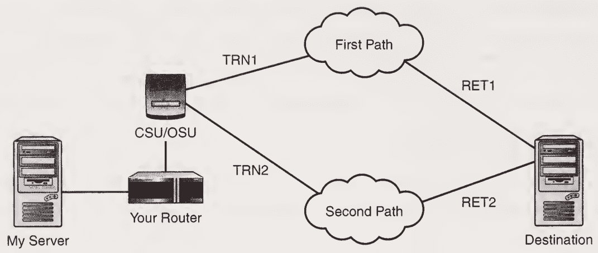
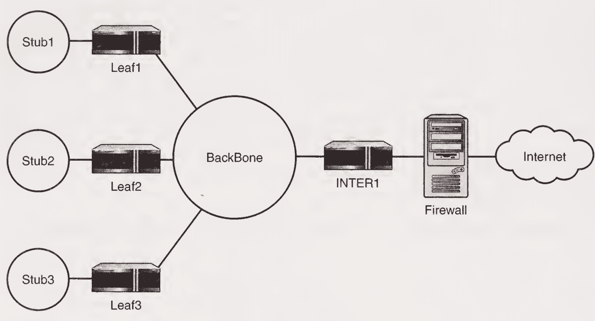
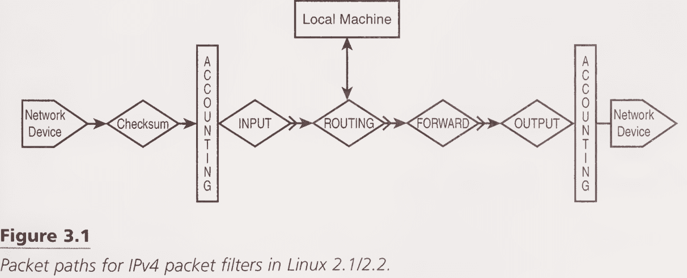
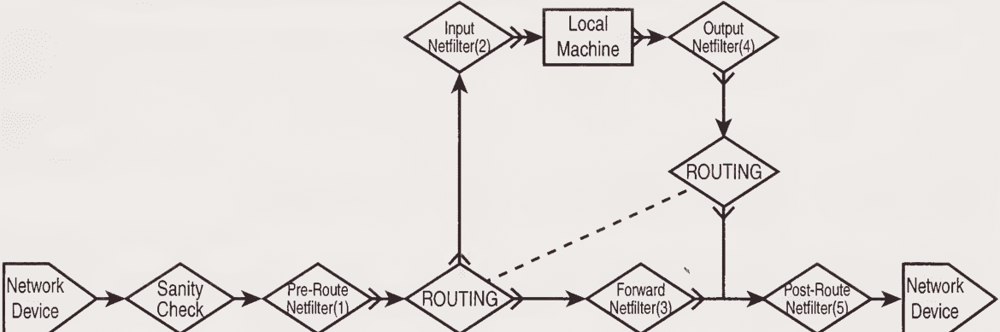
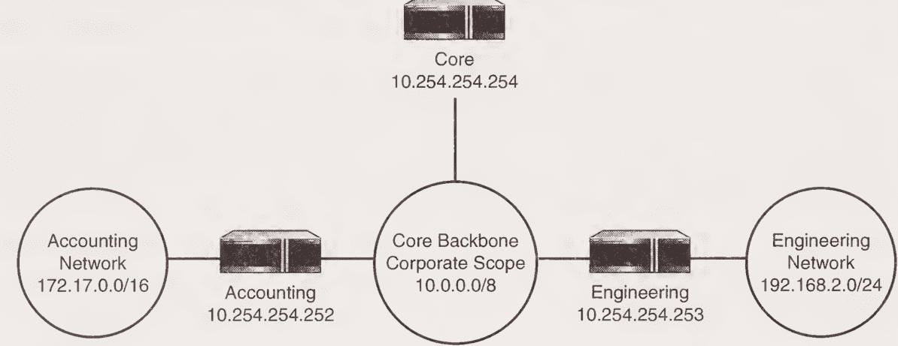
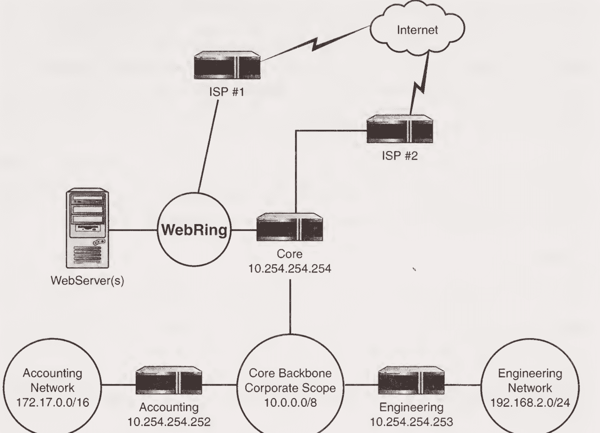
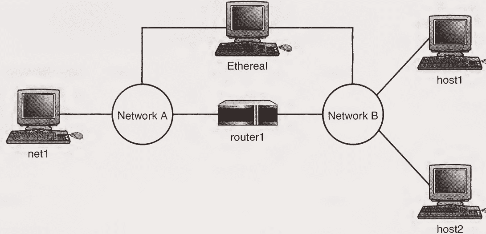
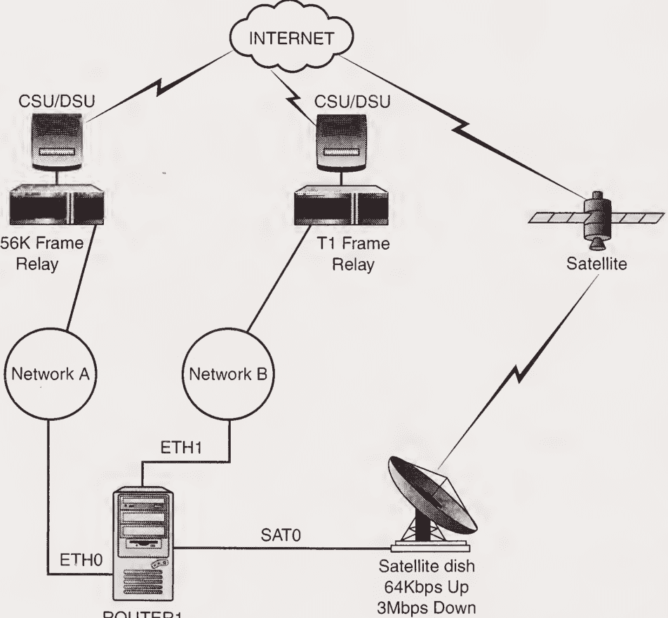
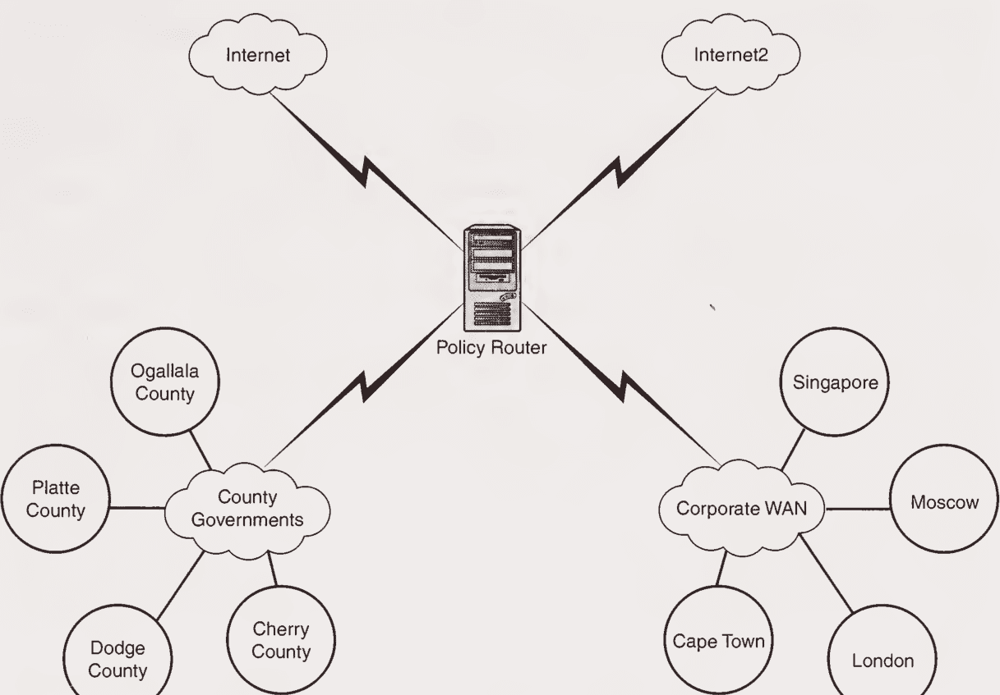
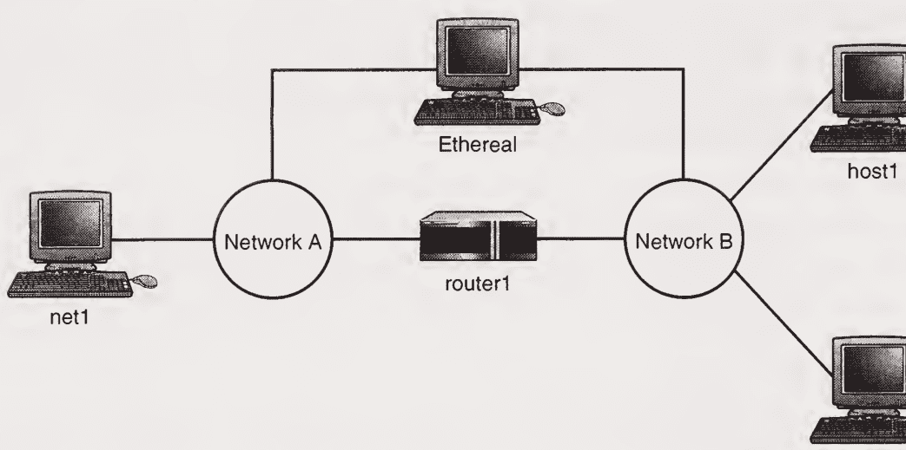

# Linux 策略路由使用指南（电子版）


## 商标
本书中提及的所有已知为商标或服务标识的术语均已适当大写。Sams出版公司无法保证上述信息的准确性。本书中术语的使用不应被视为影响任何商标或服务标识的有效性。
## 警告与免责声明
我们已尽最大努力使本书尽可能完整、准确，但不提供任何明示或暗示的担保或适用性保证。所提供的信息按“原样”提供。作者与出版商对任何个人或实体因本书所含信息或随附CD/程序的使用而产生的任何损失或损害，不承担任何责任或义务。
- **副出版人** 杰夫·科赫
- **文稿策划编辑** 威廉·E·布朗
- **开发编辑** 希瑟·古德尔
- **责任编辑** 马特·珀塞尔
- **项目编辑** 乔治·E·内德夫
- **文案编辑** 金·科弗
- **索引编辑** 埃里卡·米伦
- **校对员** 坎迪斯·海托尔
- **技术编辑** 托马斯·申克 米歇尔·特鲁曼
- **团队协调员** 维基·哈丁
- **媒体开发员** 丹·舍夫
- **版式设计师** 卡伦·拉格斯
- **封面设计师** 阿伦·豪厄尔
- **制作团队** 阿扬娜·莱西 希瑟·海特·米勒 斯塔西·里奇温-德罗梅
- IPChains——内核2.1/2.2版本 ...37
- NetFilter——内核2.3/2.4版本 ...38
- 总结 ...40
# 4 Linux IPROUTE2工具 41
- 获取与编译IPROUTE2 ............................................................42
- 通用命令结构 .................................................................43
- IP全局命令语法 .................................................................44
- 错误处理 .................................................................45
- `ip link`——网络设备配置 .................................................................47
- `ip link set`——修改设备属性 .................................................................47
- `ip link show`——查看设备属性 .................................................................48
- `ip address`——协议地址管理 .................................................................51
- 参数说明 .................................................................52
- 主/次地址与多地址的区别详解 ......................................................55
- `ip neighbour`——邻居/ARP表管理 ............................................................59
- 参数说明 .................................................................59
- `ip route`——路由表管理 ...............................................................62
- `ip route {add/change/replace}` ...............................................................63
- `ip rule`——路由策略数据库管理 ...............................................................73
- `ip tunnel`——IP隧道配置 ...............................................................76
- `ip monitor`与rtmon——路由状态监控 ...............................................................78
- 总结 ...............................................................78
## 第二部分 策略路由实现方案 79
# 5 简单网络示例 81
- IP地址配置 .................................................................81
- IP地址基本概念 .................................................................82
- 示例5.1：多IP地址配置 .................................................................83
- IP地址范围规划 .................................................................85
- 示例5.2：主/次IP地址配置 ............................................................87
- IP路由 .................................................................88
- 示例5.3：主机路由配置 .................................................................88
- 示例5.4：基础路由器过滤规则 .................................................................90
- 示例5.5：同一目的地的多条路由 ............................................................93
- 示例5.6：非均衡多环回路由的故障排查 ............................................................94
- IP规则 .................................................................96
- 示例5.7：基础路由器过滤规则v2.0 .................................................................96
- 多路由表 .................................................................98
- 示例5.8：基础路由器过滤规则v3.0 .................................................................99
- 综合应用示例 .................................................................101
- 总结 .................................................................106


## 6 复杂网络示例 107
- 本地服务隔离
- 示例6.1—Ping的艺术
- 示例6.2—回环虚拟接口
- 示例6.3—现实即循环
- 弹跳表遍历
- 示例6.4—抛出路由
- 基于TOS和fwmark的标签路由
- 示例6.5—标记我的路由
- Linux区分服务架构
- 示例6.6—类别之争
- 与数据包过滤器的交互
- 示例6.7—双重播放数据包
- 总结

## 7 动态路由交互 127
- 域和信息库
- ```rtacct—Route Realms and Policy Propagation```
- gated与Zebra
  - gated实用工具
  - Zebra路由套件
  - 规则与动态结构
  - ```gated and Multiple Routing Tables```
  - ```Zebra and Multiple Routing Tables```
  - ```gated & zebra & rules = FUN```
- 总结

## 8 NAT功能 145
- 标准NAT定义
- 策略路由NAT
- NetFilter NAT
- 快速NAT与NetFilter的交互
- 总结

## 9 IPv6 157
- 理论与历史
- IPv6地址
- IPv6路由与邻居
- RADVD—路由通告守护进程
- 策略路由应用
- 总结

## 10 未来展望 169
- 策略路由三元组 ........................................................................ 169
- 协议：IPv4、IPv6与IPSec .......... 171
- 安全与商务 .................................................. 173
- 总结 ........................................................................... 176

## 第三部分 附录 177
### A 术语表 179
### B 源代码清单与位置 183
- 内核配置与补丁 .......................................... 183
- 2.2.12内核 ..................................................................... 184
- 2.4内核 .......................................................................... 184
- IPROUTE2 ........................................................................... 184
- NetFilter补丁 ............................................................... 185
- 软件版本 .............................................................. 186
- PakSecured安装与配置 ................................ 186
- 最低系统要求 ................................................ 186
- 第一阶段—初始文件安装 .................................................. 186
- 第二阶段—内核配置 .............................................. 187
- 最后阶段—PakSecured配置 ...................................... 188

## 索引 191

## 关于作者
Matthew G. Marsh，持有CISSP、MCNE、PRE认证，是Paktronix Systems LLC.的创始人兼总裁，过去18年一直从事网络架构工作，自1993年起专注于Linux领域。他至今仍对1976年捣鼓第一台DEC设备、打印出《星际迷航》游戏源码的经历记忆犹新。早年他在美国各地巡回，为不同乐队担任音响师，后来选择计算机作为危险系数更低的爱好。曾与当时领先的路由器公司Proteon共事，让他彻底迷上了路由和大型网络。他先后持有过诸多认证，还有一项略显尴尬的荣誉：他是IEEE发表认证的《电击枪作用于皮肤的生物效应》（http://www.paktronix.com/library/physics.php）领域权威。
除了运营Paktronix之外，他目前还担任内布拉斯加CERT（http://www.nebraskacert.org）的首席科学家，与CERT/CC、IBM、美国战略司令部、FBI及其他组织合作开展网络安全结构相关工作，并主办年度国际CERT安全会议（http://www.certconf.org）。他是PakSecured Linux的创造者，这是一款基于GPL许可的Linux IPv4/IPv6安全策略路由发行版，同时也是基于Linux策略路由结构的IPSec VPN解决方案。目前他正积极研究IBM S/390平台上的Linux安全，以及PakSecured/390上IPv6安全与策略路由的实现。你可以通过他公开的任一别名联系到他，更便捷的方式是访问http://www.policyrouting.org上的相关链接。

## 献辞
*致第3层之主、SoftNet苏丹、TC沙皇——阿列克谢·N·库兹涅佐夫*

## 致谢
感谢我的妻子安德里亚医生，以及我的孩子彼得、保罗和梅里·梅洛迪，谢谢他们允许我安心写作。
感谢保罗·格朗克搭建测试网络、整理PakSecured发行版，并帮我们挡掉了诸多客户端的麻烦。
感谢希瑟·古德尔的幽默感，以及她从未剥夺我大部分幽默感的情谊。
感谢威廉·布朗修补栅栏，并笃信我的拖延症终会结束。
还有Sams/Pearson/等机构的全体工作人员，感谢你们协助完成了这本小书的创作。
最后要感谢林纳斯和他的团队，打造出了这款令人叹为观止的操作系统……

## 告诉我们您的想法！
作为本书的读者，*您*是我们最重要的评论者和反馈人。我们重视您的意见，希望了解我们哪些地方做得好，哪些地方可以改进，您希望看到我们出版哪些领域的内容，以及任何您愿意分享的建议。
作为Sams Publishing的副出版人，我诚挚欢迎您的反馈。您可以通过传真或写信直接联系我，告知您对本书的喜好或不认可之处，以及我们如何能让图书做得更好。
*请注意，我无法为您提供本书相关技术问题的帮助，同时由于收到的邮件量巨大，我可能无法回复每一条消息。*
写信时请务必注明本书书名、作者，以及您的姓名和电话或传真号码。我会仔细审阅您的反馈，并将其分享给本书的作者和编辑团队。
传真：317-581-4770
邮寄地址：Jeff Koch
Sams Publishing
201 West 103rd Street
Indianapolis, IN 46290
美国
电子邮箱：feedback@samspublishing.com

## 前言
本书试图完成定义并阐释策略路由这一艰巨任务。策略路由是IPv4网络结构思考演进的高级阶段，常被称为高级路由或其他类似术语，为理解IPv4及更广泛范围内的所有网络互联提供了框架。任何关于策略路由工作原理的讨论，都必须基于原始Unix TCP/IP网络的核心特性。
基础的IPv4路由是指将数据包从一个TCP/IP网络传输到另一个网络的过程，这一过程必然涉及某种连接到两个网络的设备。当该设备是数据包从一网络传输到另一网络的载体时，它被称为路由器。
本书会对您具备的知识水平做出若干假设，现在将明确告知您这些假设，同时附上更多信息的参考来源。
本书不涉及执行路由功能所需的实际软件或操作系统源码，而是从网络管理员的视角出发，而非网络程序员的视角展开。
简而言之，您需要具备以下相关知识：
- ISO/OSI七层模型
- TCP/IP IPv4规范：
  - 寻址
  - 协议
  - 端口
  - CIDR—无类域间路由表示法
  - 在某平台上配置IPv4网络
  - 在某平台上配置基础IPv4路由
  - 安全结构，如访问控制列表（ACLs）、数据包过滤器等
前三个知识点您可以参考W. Richard Stevens所著的*《TCP/IP详解 卷1》*。关于配置相关问题，我建议您参考手动配置相关手册，比如您在Cisco路由器、大多数Unix平台甚至Novell NetWare 3.x系统上会进行的配置操作。
请务必关注手动配置的要求：图形化配置系统几乎不会让您了解，在操作系统实现的参数范围内，实际执行了哪些步骤和操作。
关于安全部分，我建议您参阅包含Cisco和IBM IP安全相关书籍的优质网络安全参考资料。
您必须熟悉命令行，这是基本要求。本书中的所有示例和大部分参考内容都会默认您正在命令行或某个基于文本的配置文件中输入命令。
我们推荐您了解编辑器的使用，但并非强制要求，因为本书的示例主要是为交互输入设计的。


随本书附赠一张包含PakSecured Linux发行版副本的光盘。本书中的所有示例和脚本均在该发行版平台上开发。如果你想使用该发行版运行示例，附录B《源代码列表及位置》中提供了相关安装细节。尽情享受其强大功能吧！

## 本书排版约定
- 代码行、命令、参数以及任何屏幕上显示的文本均使用`computer`字体呈现。
- 需要输入的文本以**粗体电脑字体**显示。
- 语法说明中的占位符使用*斜体电脑字体*显示。请将占位符替换为实际的文件名、参数或它代表的任何元素。

## 第一部分
### 1 基础IPv4路由
### 2 策略路由理论
### 3 Linux策略路由结构
### 4 Linux下的IPROUTE2工具

### 第1章 基础IPv4路由
本书涉及的所有操作都是针对路由器的操作，无论该路由器是Linux设备、思科专有硬件还是其他类型的机器。本章将介绍传统的IPv4路由方法，即由网络管理员手动输入的静态配置。

#### 传统IPv4路由
在最简单的IPv4路由场景中，你只需拥有一台路由器，只需要考虑如何让两个网络之间互相通信。在这种情况下，你只需要为这两个网络分别分配合适的IP地址。由于这个简单场景不涉及两个直连网络之外的任何网络，因此你只需要为每个网络定义地址和子网掩码，并指定将数据包转发到该网络的适当接口。
然而在实际场景中，你通常需要考虑两个连接范围之外的其他网络。在这种情况下，你必须有一种与其他网络通信的方式。实现方式是配置指向负责这些网络的其他路由器的路由。
在较简单的场景中，其中一个直连网络只需要与网络结构的其余部分通信，此时仅需配置一条默认路由即可。传统上，默认路由被编码为指向0.0.0.0/0目标的路由。但如果你处于具有给定有限范围的结构化网络中，或者想要实现更高的安全性，那么你的默认路由可能仅覆盖你的网络范围。
关键在于，默认路由实际上被定义为“最后求助路由”，当没有其他路由覆盖数据包的目标地址时，就会使用这条路由。上述内容阐释了传统IPv4路由背后的基本思想：所有路由都是目标驱动的过程。路由器会检查每一个进入的数据包以确定其目标IP地址，然后根据该目标地址查询路由表，决定将数据包发送到哪里。路由器唯一关心的项是目标地址，其他信息都不相关。

#### UNIX配置命令
现在你应该已经理解了传统IPv4路由背后的基本思想。不过接下来你需要退一步，了解具体实现方法。首先来看UNIX命令。这些命令在功能和历史都非常传统。一旦你学会了在某一UNIX系统（包括Linux）中使用它们，那么你基本上就知道如何在任意UNIX系统中使用它们。本节将详细介绍如何在Linux下使用这些命令，配置带有一条默认路由的基础双网络路由器。你还会添加其他特定路由，以阐释传统路由基本思想的内涵。在UNIX下配置IPv4路由时使用的两个主要工具是ifconfig和route。你将逐步学习如何使用这两个工具在Linux下配置一个简单的双直连路由器。

#### ifconfig工具
ifconfig工具在UNIX系统中已经使用了很长时间，是UNIX下配置网络接口的原始工具。该工具的全称是InterFace CONFIGuration（接口配置），缩写为ifconfig。在许多UNIX系统以及Linux中，ifconfig支持多种协议簇（也叫地址族）。完整的语法和受支持的地址族可以在man手册页中查看。本书仅涉及inet族，这是IPv4的地址族。IPv6还有inet6族，但本书不会介绍该用法。在第9章《IPv6》中，你将学习如何将ip工具用于IPv6的策略路由。
在Linux下配置IPv4接口的ifconfig基本语法如下：
```bash
ifconfig interface IP-address netmask netmask broadcast broadcast
```
斜体显示的内容需要替换为配置接口的相关信息。
在大多数UNIX系统中，你可以通过让ifconfig列出它知道的所有接口，来获取可用接口的名称。输入`ifconfig -a`命令，你将看到系统中所有接口的列表，无论它们是否已配置。你也可以通过指定单个接口的名称来调用ifconfig，仅获取该接口的信息。当你在陌生系统中需要快速获取信息时，这个功能非常有用。
在UNIX系统中，只要系统启用了TCP/IP通信，就应该存在一个IP接口，这就是*回环*接口，通常命名为`lo`或`lo0`。按照惯例，该接口被分配了IPv4地址127.0.0.1/8。这个接口对于TCP/IP网络子系统的正常运行非常重要。在第2-8章中，随着Linux策略路由结构细节的阐述和示例演示，你会看到这个接口有非常多的用途。
系统中可能存在的其他接口的名称会因UNIX版本不同而有所差异。本文中会使用Linux的命名惯例，主要参考以太网（`ethx`）和令牌环（`trx`）接口。
假设有一台路由器，带有一个以太网接口`eth0`和一个令牌环接口`tr0`，相关信息如下：
```bash
eth0 - 192.168.1.254/24
tr0 - 10.1.1.254/24
Default Gateway - 10.1.1.1/24
```
这里代表两个网络，从默认网关地址可以推断出以太网网络是主干网络下的一个末端网络。如果你倾向于这种表述，也可以将令牌环网络视为主干网络，因为它包含了默认网关。
在典型的Linux系统中，使用`ifconfig`配置接口时，请在命令行中执行以下操作：
```bash
ifconfig eth0 192.168.1.254 netmask 255.255.255.0 broadcast 192.168.1.255
ifconfig tr0 10.1.1.254 netmask 255.255.255.0 broadcast 10.1.1.255
```
之后你可以直接使用`ifconfig`命令列出所有接口并获取相关信息。现在你已经拥有一台配置了三个IPv4接口的路由器。统计接口数量时不要忘记回环接口！
现在你需要配置路由器，使其能够在本地直连的网络之间执行路由转发。为了实现这一点，路由器的路由表中需要包含所有三个本地直连网络。此时你可以使用`route`命令来填充路由表。

#### route工具
通常情况下，`route`命令的调用方式如下：
```bash
route add -net|host IPv4 Address netmask netmask gw gateway dev interface
```
注意，`route`命令可以指定许多其他选项，其中很多选项是针对特定UNIX版本的。前面提到的选项非常通用，适用于大多数UNIX系统。另外，单独在命令行中执行`route`命令时，输出的内容会因UNIX版本不同而有所差异。在Linux中，单独执行`route`命令会输出主内核路由表；但在大多数UNIX系统中，你需要使用`netstat -r`命令才能输出路由表。


#### Linux 2.0与Linux 2.2的路由变更
在Linux系统中，2.0系列内核与2.1及更新版本内核的IPv4配置流程存在一些本质差异。在2.0系列内核下使用ifconfig配置IPv4接口时，仅会完成接口本身的配置。但内核无法得知如何访问该接口的IP地址或其所属网络，因此你需要手动添加网络路由，内核才能知道应将数据包发送到哪里。

在2.1及更新版本的内核中情况则有所不同：阿列克谢·库兹涅佐夫在2.1开发内核系列期间重写了Linux的网络路由代码，新增了直连网络的自动路由创建功能。因此，如果你在2.1或更高版本的内核上执行相同的ifconfig配置命令，即可立即接入该接口定义的网络。

内核自动添加路由的功能，极大降低了网络新手在日常使用Linux网络时的门槛。当你配置接口时，内核会自动创建到该接口地址及所属网络的连接，因此完成接口配置后即可直接使用。

不过这一特性对于高级使用场景来说可能会造成困扰。如果需要覆盖该行为，你可以显式配置接口使用真实主机地址（即子网掩码为全1的地址）。如果你希望在2.1及更高版本内核中实现和2.0版本一样的ifconfig行为，可以使用`ifconfig 接口 IPv4地址 netmask 255.255.255.255 broadcast 广播地址`命令，此时将不会创建自动路由。
```route add -net 127.0.0.0 netmask 255.0.0.0 dev lo
route add -net 192.168.1.0 netmask 255.255.255.0 dev eth0
route add -net 10.1.1.0 netmask 255.255.0.0 dev tr0
```

现在你已经了解了基础路由配置的语法，接下来可以将其应用到ifconfig章节中配置的路由器上。注意：为了内容完整性，这里显式列出了回环接口的路由。你在前一节没有看到实际的ifconfig语句，具体需要执行的命令留给读者自行推导。

注意：在所有需要确保系统配置正确的场景下，你都应手动或通过自定义脚本配置所有接口（包括回环接口）。在Linux以及类UNIX系统中，包括回环接口在内的所有系统接口都不会被自动配置。

此时该路由器已可转发192.168.1.0/24网络与10.1.1.0/24网络之间的所有流量。但如果上述任意一个网络中存在目的地址不属于这两个网段的流量，路由器会返回错误，这是因为当前尚未配置默认路由。

#### Cisco IOS配置命令
默认路由存在明确的安全隐患：本质上，默认路由会让路由器将发送到其他路由器的所有流量都视为可信。多数情况下这并非必要或明智的选择。例如，本文讨论的网络结构中，可能仅存在一两个其他需要访问的网络；又或者你不希望192.168.1.0/24网段的系统访问任何其他网络。

在当前的路由配置下，若没有源路由能力，192.168.1.0/24网段的系统仅能对外访问10.1.1.0/24网段的系统。当我们后续在第2、3章学习策略路由理论，在第5-8章了解实际部署用法时，会看到多种解决这一基础安全问题的方法。

但若仅考虑标准传统用法，你需要在路由器上配置默认路由。默认路由会为路由器指定一个下一跳，所有目的地址未知的流量都会被转发到该下一跳。本例中已经为该路由指定了网关，你可以通过以下命令添加：
```route add -net 0.0.0.0 netmask 0.0.0.0 gw 10.1.1.1
```
注意：在Linux以及多数其他UNIX系统中，该命令也可以写为`route add default gw 10.1.1.1`，其中`default`关键字对应示例中的`-net 0.0.0.0 netmask 0.0.0.0`部分。

现在你得到的路由器既可转发192.168.1.0/24与10.1.1.0/24网络之间的流量，也可为192.168.1.0/24网段的系统提供通往任意其他网络目的地的连接。当然这并不意味着其他网络可以访问回192.168.1.0/24网段，这是另一个需要解决的问题。

现在你已经了解了如何使用标准UNIX工具配置简单路由器，接下来我们来看如何配置通用的Cisco路由器完成同样的任务。即使你并不打算使用Cisco设备完成此类任务，也推荐继续阅读，你会发现此处的命令集与Linux策略路由工具集有明显的相似之处。

如果你已经熟悉思科IOS（互联网操作系统）命令集，可以跳过本节。本节默认Cisco路由器无需特殊配置任务，仅展示如何配置该设备以完成和此前Linux路由器完全相同的任务与配置。

Cisco IOS配置命令可通过路由器的终端会话直接输入到配置中，该会话可以通过管理端口直连建立，也可以通过Telnet会话建立。此外，你也可以将所有命令写入文件，再将该文件上传到路由器，或让路由器从TFTP服务器启动并加载该配置文件。

如果你想学习如何进行上述各类操作，请参考Cisco IOS官方文档。本节默认你已经掌握相关知识。

## 第10章 第1章：IPv4基础路由
本节大部分内容的核心命令是`ip`命令，该命令后接需要执行的操作。例如，`ip address`命令用于添加和删除TCP/IP地址，`ip route`命令用于添加和删除TCP/IP路由。本书后续章节还会涉及其他子命令，更多信息请参考Cisco IOS官方文档。

#### ip address
`ip address`形式的命令可用于为接口配置IPv4地址。在路由器上对应的配置命令区块如下：
```interface FastEthernet0
 ip address 192.168.1.254 255.255.255.0
!
interface TokenRing0
 ip address 10.1.1.254 255.255.255.0
```
注意：与UNIX系统不同，IOS中通过单独的`interface`命令指定需要操作的接口，因此可以将一组需要作用于指定接口的命令放在对应的接口区块下。与Linux 2.1及更高版本类似，在IOS中为接口分配IP地址时，会自动将对应的网络路由添加到路由表中。因此上述配置片段已经定义了192.168.1.0/24和10.1.1.0/24两个直连网络的路由。

#### ip route
要完成配置，你需要指定默认路由，这可以通过`ip route`子命令实现，你需要输入完整的默认路由配置：
```ip route 0.0.0.0 0.0.0.0 10.1.1.1
```
该命令会添加通往所有其他目的地的默认路由。此时该Cisco路由器已处于和前一节中Linux路由器相同的状态。当然，要让该路由器正常工作，Cisco配置文件中还需要其他命令，但本节仅关注需要输入的、可以实现与UNIX路由器系统相同行为的配置。

#### IPv4动态路由
现在你已经了解了如何在Linux和Cisco平台上配置简单路由，接下来我们来看如何实现路由结构的自动化。当今大多数网络（尤其是企业和运营商内部网络）都包含大量物理和逻辑网络，这些网络常常会因为新增、删除设备或简单重新配置而发生变化。仅考虑这一点，在这种网络中跟踪和更新所有路由器的配置就已经十分繁琐。


少量网络和路由器的管理还算轻松，但当网络和路由器的数量超过一只手能数的数量时，管理就成了绝对艰巨的任务，尤其是当网络跨越不同地理位置、拓扑结构复杂时。
大型路由网络中另一个常见问题是维护不可运行网络的清单。这种情况下，网络可达性是首要关注点。当网络不可达时，发往该网络的报文会被直接丢弃，路由器会侧重于通过ICMP错误消息来传递这一信息。在自动化（即动态）路由环境中，路由协议本身通常能以更一致的方式完成这一通知功能。
针对这一问题的早期解决方案是最初的路由信息协议（RIP）。该协议1版本由RFC-1058定义，在IPv4环境下为路由器、系统提供了自动传递网络路由结构认知的机制，实现设备间的路由结构信息共享。如需深入研究和了解细节，可参考Stevens的著作及RFC-1058。注意RIPv1已被定义为历史协议（参见RFC-1923），这意味着它仅适用于学习研究，这源于它的有类（classful）特性。
由于RFC在很多情况下定义了网络各层面的实际协议规范与实现，你可能需要了解如何获取、阅读这些文档。官方的核心存储库是不错的起点，地址为http://www.rfc-editor.org。
# RIP/距离向量
RIPv1以及RFC 1387-1389定义的下一代RIPv2（下文我将简称为RIP）是IPv4网络中主要的动态路由协议。RIP基于Bellman-Ford（即距离向量）算法，该算法自ARPAnet早期就被用于计算机网络的路由计算。RIP最突出的用途通常被认为是“内部网关协议”，该概念指的是单一网络结构（例如企业内网）中使用的动态路由方法。
在RIP机制中，报文通过路由器的行为被视为一个离散动作，该动作被称为*跳*，报文从源到目的地经过路由器的次数即为*跳数*。参与RIP路由结构的路由器会向所有本地直连网络广播自身掌握的全部路由，以及每条路由对应的跳数。这些信息通过广播的方式发送至直连网络。通常会有1台路由器配置了默认路由，也会通过RIP发布该路由。在路由器上配置RIP后，无需再为每个系统单独配置静态默认路由和附加路由，只需确保路由器知晓自身的直连网络，以及如何与其他支持RIP的路由器通信即可，之后各路由器会相互通信、共享路由信息。
RIP为数不多的缺点之一是：跳数超过网络定义的15跳上限的路由，会被接收路由器忽略。此外，RIP不支持为任意两个网络配置多路由。上述限制及其他局限性会在第2章《策略路由理论》和第7章《动态路由交互》中讨论。
## 第1章：IPv4基础路由
在大型网络中使用RIP的核心问题在于其基础算法。Bellman-Ford距离向量概念仅涵盖本地直连网络范围内的部分路由状态，换言之，参与RIP的所有路由器都无法掌握整个网络的完整范围与状态，仅能了解自身直连网络内的本地路由器，以及这些路由器已知的路由。这种情况常被称为“道听途说式路由”。由于路由器无法获取完整的网络路由状态，它们仅能通过与邻居路由器的信息交换获得路由信息。
#### OSPF/链路状态
这种信息交换模式的局限性推动了内部网关协议向更高级的阶段发展，该阶段下每台路由器都能掌握整个网络范围的完整信息。这类动态路由协议被称为链路状态路由协议，链路状态涵盖同一网络中两台路由器之间单条链路的当前状态，包括中间网络、路由器的相对速率、类型和用途。由于参与链路状态路由结构的每台路由器都知晓网络范围内的所有其他链路，因此可以在网络之间配置多条连接，也可以对逻辑网络本身进行多定义。链路状态路由的典型协议是最短路径优先开放协议，简称OSPF。OSPF协议最初由RFC-1131定义，目前已更新至2版本，还有即将推出的、也被称为IPv6版OSPF的3版本。OSPFv2是单结构网络中的首选协议，因为它能够正确处理多连接的大型IP网络。如RFC-1245所述，OSPF路由器通过链路状态通告（LSA）交换链路状态信息，LSA用于描述OSPF路由域内的部分信息。这些LSA会泛洪至整个路由域，每台路由器会聚合接收到的LSA，形成链路状态数据库，因此所有路由器的链路状态数据库都是完全一致的。链路状态数据库的同步通过可靠的泛洪算法维护，该算法基于组播能力，若组播不可用则会回退到定向广播或单播连接。每台路由器基于该链路状态数据库，通过计算最短路径树生成路由表，树的根节点即为执行计算的路由器自身，这种计算过程通常被称为Dijkstra算法。OSPF为动态路由结构提供了多层级的安全性和健壮性。如需了解更多细节，可参阅讨论OSPFv2协议技术细节的RFC-1245（http://www.ietf.org/rfc/rfc1245.txt）。就本书的讨论范围而言，我会将OSPF视为首选动态路由结构，并会在第7章详细说明其如何与策略路由结构进行互操作。
#### 动态路由传统
读到这一步，你可能已经好奇我为什么要介绍这么多路由协议。它们似乎能解决很多IP路由网络的问题，事实也的确如此。但这些协议依然遵循并沿袭了传统IPv4路由的核心思想：所有路由都是目的驱动型进程，动态路由协议只是让目的驱动型路由信息在网络中的传播变得更加便捷。当你开始考虑策略路由结构，以及催生这类结构的需求（相关内容将在第2章讨论）时，这种信息传播机制反而会成为阻碍。第7章将探讨如何平衡动态路由提供的便捷传播能力与策略路由世界对结构化路由的需求，找到最优解法。
#### UNIX routed与Cisco RIP配置
为了全面覆盖传统IPv4路由配置的相关内容，我将向你展示如何在路由器上配置、使用RIP协议，会分别介绍UNIX和Cisco两个视角的实现方式。虽然本书默认你仅会运行RIP或RIPv2协议，但文中提到的多数内容也适用于其他动态路由协议的运行。在第7章中，我将介绍链路状态、域间（inter-AS）、距离向量三类动态路由协议在完全策略路由网络框架下的运行机制。为此，先回顾一下“UNIX配置命令”部分结束时的配置状态：你当时已经有一台完整可用的Linux路由器，运行了静态路由配置，能够实现10.1.1.0/24和192.168.1.0/24两个IPv4网络之间的路由，且配置了指向已知路由器10.1.1.1的默认路由。现在你需要为这台路由器添加通过RIP参与动态IPv4路由网络的能力。
#### routed
总体而言，UNIX系统尤其是Linux系统通过守护进程提供了大量额外功能，在动态IPv4路由场景下这一点尤为明显。事实上，定义原始RIP协议的RFC直接将RIP协议描述为routed守护进程的运行说明，这是因为routed守护进程的出现早于RIP协议的正式定义，RIP结构的定义本身就源自routed守护进程的机制与运行逻辑。因此，要在Linux系统上配置RIP，只需运行routed守护进程即可。routed守护进程可以通过命令行启动，但通常会在系统的网络初始化脚本中自动启动。正常运行时，routed会监听UDP 520端口，接收来自其他系统的路由信息报文；如果该系统被识别为路由器，它还会定期向所有直连网络广播自身的路由表副本。


## 第1章：基础IPv4路由
routed守护进程首次启动时，会查找系统上所有已配置且正在运行的直连接口，同时忽略回环接口。如果找到多个接口，该系统会被定义为路由器，用于发送广播报文。
routed确定要绑定的接口后，会在每个接口上发送请求报文，并循环监听来自其他路由器的请求与响应报文。收到请求报文后，routed会依据系统路由表中维护的信息进行回复。生成的响应报文中包含一份路由列表，每条路由都标注了跳数度量值。每条路由对应的度量值可以粗略反映该路由相对于源路由器的距离。
如果满足以下任一条件，routed接收到的响应报文即可更新路由表：
- 目的网络或主机没有对应的路由表条目，且度量值表明目的地址可达（跳数小于16）。
- 报文的源地址与现有路由表条目中的路由器一致，也就是说，正在从负责转发目的报文的源路由器接收更新信息。
- 路由表中的现有条目已经有一段时间未更新（标准定义为90秒），且该路由的跳数小于等于当前路由的跳数。
- 新路由到目的地的路径比当前存储在路由表中的路径更短，通过对比新路由的度量值与表中存储的度量值来判断这一点。

除了处理接收到的请求与响应报文外，routed还会定期检查路由表条目。如果某个路由条目超过3分钟未更新，其跳数会被设为16并标记为待删除。在从路由表中实际删除该路由前，routed会额外等待60秒，确保被删除的路由能够正确传播。
routed会每30秒向所有直连网络定期广播路由表。该超时时间可以调整，但由于它属于标准配置的一部分，多数网络场景下建议保留默认值。
routed还支持被动和主动远程路由器的概念。routed启动时，会查找可选的配置文件/etc/gateways，如果该文件存在，就会读取其中通过其他方式无法发现的远程路由器信息。文件中标记为passive（被动）的路由器不会交换路由信息，但可被其他配置引用；标记为active（主动）的路由器则会交换路由信息。经过被动路由器的路由需要通过引用这些路由器的静态手动路由来指定，但这些静态路由不会被包含在任何传输的路由信息中。标记为external（外部）的路由器也属于被动路由器，但不会被加入内核路由表，也不会包含在路由更新中。外部条目的作用是告知routed：其他路由进程（例如gated）会使用该路由器安装路由，因此routed不会覆盖这条路由。只有当两个路由器都可能学习到到同一目的地的路由时，才需要配置这类条目。你会在第7章看到，当这类条目与策略路由结合使用时，会产生很多复杂情况。

#### Cisco IOS RIP配置
我们通过在命令行运行routed来演示如何启用RIP路由：
```routed```
难吗？——当然不！实际上routed有多个可指定的参数，包括强制routed将系统识别为路由器，以及允许routed仅监听报文但不发送任何报文。
现在你已经了解了在Linux系统上配置并运行routed非常简单，接下来我们来看看如何在Cisco路由器上实现同等功能。由于我们讨论的是RIP，你会发现和在Linux系统中一样，实际启用该协议只需要打开它即可。
Cisco IOS中没有活动接口的概念，因此你需要手动指定所有需要将RIP协议加入主动广播的网络。因此，Linux系统中的routed会监听并接受来自已连接路由器的任意网络的RIP信息，而Cisco设备只会被动监听来自任意路由器的RIP广播，仅会广播被告知需要通告的网络的相关信息。
下面是一个在我们的Cisco路由器上启用RIP的简单配置示例：
```
router rip
network 10.1.1.0
network 192.168.1.0
```
上述配置告知Cisco路由器，在所有连接到10.1.1.0/24和192.168.1.0/24网络的接口上启用并开始使用RIP协议。上述network命令中的0代表完整的分类网络地址。
Cisco RIP有很多可配置的参数，你可以指定RIP的类型，比如版本1或版本2，这一点非常重要，因为RIPv2支持认证、CIDR和多值子网掩码。对于routed而言，你需要使用支持RIPv2的routed版本，但这种情况通常你会选择使用gated或zebra，相关内容你会在第7章了解到。此外，你还可以修改各类超时时间、应用被动接口规则，以及像/etc/gateways文件中那样指定主动和被动路由器。所有具体细节可以参考Cisco IOS的官方文档。
至此，你就拥有了一台功能完整的RIP路由器，能够参与你网络的动态路由架构。

#### Linux路由器配置示例
综合你前面学到的所有内容，我们快速了解一下Linux路由器的配置方法。我会给你展示一个脚本，它实现了开头提到的配置，同时开启了执行传统动态路由所需的所有IPv4传统网络功能，这也是无数小型网络连接中常见的典型配置。
我们再来回顾一下这个场景：你有两个网络，一个是IPv4范围为192.168.1.0/24的以太网，另一个是IPv4范围为10.1.1.0/24的令牌环网（Token Ring）。你已知的公网默认网关是令牌环网上的10.1.1.1。你当前正在运行RIPv1，希望加入动态路由体系。
你需要编写一个脚本，让Linux系统开启IP路由功能、完成系统配置并启用动态路由。脚本内容如下：
```bash
#!/bin/bash
##### 开启IPv4报文转发
echo "1" > /proc/sys/net/ipv4/ip_forward

##### 配置我们的接口...
/sbin/ifconfig eth0 192.168.1.254 netmask 255.255.255.0 broadcast 192.168.1.255
/sbin/ifconfig tr0 10.1.1.254 netmask 255.255.255.0 broadcast 10.1.1.255

##### 上述ifconfig命令（2.2及以上内核）已经定义了路由，因此...
##### 添加默认路由
/sbin/route add default gw 10.1.1.1

##### 启用RIP
/sbin/routed

exit 0
##### 大功告成....
```
现在这看起来像是本章的仓促收尾，但请务必牢记传统IPv4路由的核心思想：
> 所有路由都是由目的地址驱动的。
本章其余部分演示了IPv4的传统配置方式，旨在帮助你快速回顾相关知识、建立整体认知。本书其余部分将探讨传统路由思想的局限性，以及策略路由的实现方法。

## 第2章
### 策略路由理论
传统IPv4路由可概括为：“所有路由都是由目的地址驱动的。”当路由器处理IPv4报文时，仅关注报文头部的目的地址，并依据该地址决定报文的转发路径。这种模式在简单网络中运行良好，这类网络中的所有设备仅需要访问外部特定目标即可。
我们可以把普通房屋的私人车道做个类比：车道从房屋连接到道路，到了路口你会有两个选择：右转或左转，选择哪种路线取决于你想去的目的地。这就是基于目的地址的路由选择。
最简单的场景是你的车道连接的是死胡同，你始终会走同一条路线，这就是单默认路由的场景。我们进一步扩展这个类比：如果你的车道连接的是六岔路口会怎么样？更复杂的是，其中一条岔路是仅允许轿车驶入的高速公路入口，另一条是只有拖拉机才能通行的碎石路，情况以此类推。这种情况下，你需要同时结合驾驶的车辆类型和目的地来做决策。
这类网络场景下，你需要对报文采用不同的路由策略，判断依据不仅仅是目的地址，还包括源地址、IP协议、传输层端口甚至报文负载等其他报文字段。这种路由方式被称为*策略路由*。


#### 在策略路由中定义“策略”
字典中“策略”的标准定义是：
- 为实现便利而采取的确切行动方案。
- 政府或组织推行的行动方案。
这两个定义都表明，策略是一套包含理想目标的说明性或限制性规则与行动组合，这一含义与策略路由的范畴十分契合。
策略路由中的“策略”，是指基于数据包的任意维度或全部维度提供路由能力，这不仅包括数据包包头信息，还包括数据包本身承载的数据内容。正如你将在第3章《Linux策略路由架构》中学到的，完整实现理想策略路由的全部功能，存在一些明确的限制。在第5至第8章中，你将搭建并操作一些非常复杂的网络；目前我们先讨论策略的理想特性。
早在20世纪70年代初网络发展的初期，人们就已经在讨论：路由一个数据包所需的最小信息集合包含哪些内容。这些讨论大多围绕阿帕网设计的实际需求展开，也就是如何在核大战后仍然存活并提供网络服务。在这种场景下，基于目的地的路由是更合理的选择：你并不关心数据包在传输过程中如何处理，只在意它能否抵达最终目的地。这种仅以目的地为核心的路由方式存在很多问题，比如高延迟、重传等，但这些问题都不够迫切——当时的应用（如FTP或电子邮件）对这些问题的容忍度很高。
进入20世纪80年代，直至90年代的网络大爆发，阿帕网的核心属性已经发生转变，发展成了今天的互联网。当下的核心需求是为商业发展铺平道路，而非担忧核冬天。商业发展的迫切需求，也带来了对安全性和灵活性的要求：你既要保护商业资产，又要让客户和合作伙伴能够便捷地访问和使用这些资产。现在你拥有的不再仅仅是一个网络，而是一个内网：它既连接互联网，也连接你的供应商、合作方、伙伴以及客户的内网。
网络连接的复杂性可以通过标准动态路由解决，但服务和安全性又该如何保障？服务是任何商业环境中取得成功的关键。为了给客户留下良好的企业印象，你会培训和指导电话客服、前台人员展现专业能力，提供优质服务；但你又该如何通过网络展现良好的企业形象呢？随着众多企业努力在线上打造差异化优势，这个问题已成为它们的核心关切。这一问题的答案，藏在当前主流互联网协议IPv4刚问世时，就开始被讨论和研究的某项技术中。想必你从我选用的术语已经猜到，这项算不上秘密的技术就是服务质量（QoS），它也被称为区分服务（DiffServ）或集成服务（IntServ）。尽管IP协议的纯粹主义者会因此谴责我，但作为一名网络工程师，我会将这几种服务归为同一个概念范畴。各类QoS的存在都是为了解决同一个问题：即如何为不同的数据流提供差异化的处理方式。而现在这个逻辑闭环正在形成——最早期的策略路由实现，本质都是各类QoS概念的具体落地。
因此，当我提到策略路由中的“策略”时，指的是用于实现单个或多个网络路由结构的一组说明性、限制性规则。这套策略定义了网络的理想用途和服务范畴。尽管这套策略在不同设备、不同类型、或不同性质的数据流上的具体实现可能存在差异，但其整体效果会落实为网络需满足的商业要求。正如你在全书各章将会看到的，策略的范畴非常广：从简单的资源管控，到全局范围的数据流优先级定义，都属于策略的覆盖范围。

##### 常见IPv4路由问题与解决方案
正如我在本章前文提到的，策略路由源于IPv4网络中的多种不同需求，其中较新且备受关注的一个讨论方向，就是QoS相关议题。但基于目的地的路由架构一直存在不少问题。
部分读者可能还记得，直到20世纪90年代初，互联网才被允许承载任何商业流量。事实上，当时曾在一段时间内存在并行网络：一张网络承载商业流量，另一张承载互联网流量。尽管这种情况有些极端且持续时间不长，但当时已经有人呼吁、并开始讨论：能否基于数据包的源地址和目的地址，对路由方式进行差异化处理。
举个例子：某教育机构同时与一家商业实体、一家政府实体就同一个项目进行沟通联络。在并行网络的架构下，该教育机构需要将所有工作内容发送两份，同时向内网提供两条不同的连接。他们需要使用两套完全不同的内部路由表，才能让某台实验计算机的数据，分别通过“商业”连接和“科研”连接发送。如果这些连接在物理上是完全隔离的，那么仍然可以使用基于目的地的路由；但如果这些连接是混合部署的（实际情况通常如此），那么在某一个节点就必须对数据流进行人工拆分，让其中一条走既定路径，另一条走备用路径，这些路由决策需要同时基于数据包的源地址和目的地址做出。这就是策略路由。
除了这个极端案例，你也可以看到：即便在许多企业和其他大型机构内部搭建的专属网络中，也存在基于数据包的其他属性（而非仅有目的地）执行路由的需求。我亲身经历过的一个实际案例，就能很好地说明基于目的地的路由系统存在的复杂性。当时我参与的是一个审计系统项目：审计人员的用户桌面被部署在财务内网中，所有审计人员的工作内容，都存储在位于企业园区另一栋楼里的主干财务内网的服务器上。审计内网的流量要抵达财务内网，需要接入企业园区的主干网络，问题出在：此前该公司有其他员工因为试图访问财务系统而受到处分，这些行为都是被审计人员发现的。这些事件发生后，财务内网本身通过物理隔离和其他各类网络安全措施进行了封锁，但随之而来的问题是：审计部门的所有流量都可能被截获，甚至被用于非法接入财务内网。
企业园区的主干网络连接了多栋楼宇，部分情况下，主干网上的所有流量甚至会经过好几栋企业园区楼宇。公司请我的团队想办法规划审计流量的路由路径，要让它经过主干网时，完全不会流经这些其他楼宇。出于安全考虑，而且这套网络目前仍在运行，我不会详细说明这套网络的具体架构。总体来看，这套主干网络由多个相互连接、通过网桥互联的网络段组成，由于采用了网桥互联的架构，我们无法直接访问主干路由器的接口。最终我们为大量路由器划分了新的IP网段，并搭建了一圈静态路由，强制这些地址范围内的流量只能走另一条独立的网络路径。简单来说，本来在审计路由器与主干路由器上只需做一个简单的策略路由配置就能解决的问题，最终让我们不得不搭建多个IP网段，并配置不同的目的路由表。如果当时可以基于IP源地址指定路由规则，我们完全不需要这么折腾就能搭建好路由架构。虽然我们当时尝试过使用严格的源路由报文头结构，但唯一有效的方法是使用完全不同的IP网络地址段，并通过静态配置强制流量走向。而采用这种静态强制路由的架构后，只要安全网络中有机器加入或移除，就会出现问题。这正是推动我开始研究策略路由的场景之一，当时我就已经清楚，如果可以将源IP地址或网段作为路由判定因素，我们完全可以快速、轻松地解决这个问题。最初推动基于目的地路由发展的冗余需求，正在快速与网络的安全架构产生冲突，理想情况下，我们应当能够同时实现冗余性和安全性。

##### 服务质量大爆发
时间快转到20世纪90年代中期，此时被视为策略路由架构核心驱动力的另一项技术迎来爆发，那就是QoS。互联网的商业化发展，也让整个IPv4协议族的底层假设受到了严格的审视。IPv4基于传统数据包投递的底层基础，被描述为

“尽力而为”。这一说法非常准确地概括了整个流程。UDP（用户数据报协议）和TCP（传输控制协议）之所以产生分化，根本原因和IP（网际协议）属于尽力而为交付服务有关。在这种设计下，UDP数据包只要能传输、随时能送达即可，这没有问题。TCP数据包则会经过各类机制校验，确保数据包一定能送达。两种情况中，路由都由路由器负责，根据数据包的目标地址做出决策。
那么如果作为企业或其他机构，我愿意付费以获得更优质、更快速、更稳定的数据包投递服务呢？这就引出了服务质量（QoS）的全部设计逻辑。QoS的基本前提是：作为网络连通性服务提供商，我会为我收取溢价的服务向你承诺一定的服务水准。在IPv4网络中，这一机制依赖于网络数据包的路由和排队处理，会根据所提供QoS服务关联的TOS（服务类型）标签来区分。TOS标签有若干套标准，而该体系的很多实际缺陷都和特定TOS标签对应的服务定义有关。不过这也正是当今各类QoS系统相关讨论和工作的核心内容。例如，你可以参考区分服务（DiffServ）的各项规范与定义，其中明确了对应各类排队规则的服务类型值。当然，前提是排队结构通过对现有有限带宽连接提供受调控的优先访问权限，能够提升你数据流的服务质量。这就引出了一个问题：使用QoS还能实现哪些额外的结构？利用QoS标签的路由结构是最自然的延伸方向。通过提供依赖数据包内TOS标签的路由，现在可以为数据包投递提供一定保障。仅靠排队的话，基本上能保证的只有带标签的数据流可以获得规定比例的可用带宽。而基于TOS标签的策略路由（Policy Routing），还可以加入拥塞避免和优先数据路径的相关方法。
考虑如图2.1所示的场景：你有两条潜在的数据路径，每条数据路径都是通往不同网络的私有连接，这些网络最终都会连接到同一个目的地。作为这些外部网络的对等互联方，你的路由器掌握这些网络的可用性、负载和容量信息。我和你的协议是：为我的数据包提供一定带宽，同时约定低延迟连接需额外付费。你会希望最大化从我这份合同中获得的收益，因此会在路由器中设置策略，始终通过延迟最低的路径发送我的数据包。由于你的路由器清楚TRN1、TRN2、RET1、RET2各点的延迟，你可以计算第一条路径与第二条路径的延迟总和。如此一来，你既可以为我提供排队保障，还能将我的数据包路由到当前延迟最低的路径上。实现方式是：你的路由器会根据Latency(TRN1 + RET1)与Latency(TRN2 + RET2)的当前计算结果，逐包或逐队列做出决策，再依据该决策路由数据包。这种数据包筛选可以采用和带宽保障排队所用相同的TOS标签。

**图2.1** *双路径成本结构*
## **策略路由结构**
这就引出了策略路由网络结构的概念。如你从本章中可以推断出的，这类网络不仅包含实际的路由结构本身，还包含了参与网络的各类设备的智能模块。这正是策略路由过去常被、现在仍常被称为“智能路由”的原因。我更偏好“策略路由”这一术语，因为“智能路由”可以指代任何优于简单单一路由默认路由的方案。策略路由网络的结构涵盖网络的参与性元素，范围从核心路由器到用户终端设备。任何参与网络基础设施的设备都可以参与策略执行。反过来，仅仅参与网络基础设施并不代表该设备会参与网络策略。路由结构的策略主要来源通常是核心路由器。由于大部分路由决策都出自核心路由器，自然可以预期它们提供大部分的策略结构。不过正如你将在本章后续内容中看到的，情况并非总是如此，尤其是在高安全性网络中，路由设备的功能通常非常有限。核心路由器通常是因为其向网络提供的功能而被指定为核心路由器，在轮辐式路由网络中通常是中央路由器。不过就策略而言，核心路由器往往是指提供内部企业网络和外部同盟网络之间主要互联互通功能的路由器或其他安全设备。轮辐式系统中的中央路由器历史上只需要执行传统路由，就能满足企业网络的需求。而企业网络近期的趋势是集成更多高级服务供使用。随着音视频流等服务被引入企业网络，对网络内资源的分配和节约有了更大的需求。这些服务增加后，中央路由器需要处理所有产生的流量，压力骤增。标准解决方案是投入资金解决问题：采购更大的路由器和高速网络。但几乎在所有实际情况中，通过策略路由重新设计并优化网络流量，通常能通过提升效率获得高得多的成本节约。不过这种方式对管理层来说不够炫目，对增值经销商（VARs）也没有什么高额利润。和网络安全一样，策略以及实施策略衍生出的结构，必须在提供特定功能集的需求和降低相关结构成本的需求之间取得平衡。这些成本不仅是物质成本，在人的因素方面也存在很多高度无形的成本。如果使用网络时更容易绕过策略，或是现有策略让网络使用变得困难，那策略反而会帮倒忙。这与网络安全策略结构的类比非常精准，二者深度绑定。一套精心设计并落地的策略路由结构可以在很多方面提供帮助。举个具体的例子：考虑一种策略路由结构，规定所有外拨呼叫中心的互联网流量都被管理层面禁止。这同时实现了三项目标：一是实施互联网访问的安全策略，二是减少无关流量的网络策略，三是部门工作流的业务策略。这种多重用途指出了当今企业网络的根本性转变：网络的地位和先前的电话一样，定义并驱动基础生产力。而随着业务从单部电话发展出PBX系统和呼叫中心，计算也已演进为网络和网络运营中心（NOCs）。和早期的电话使用政策一样，如今网络和安全政策也聚焦于企业网络资源的使用，而这些政策正是通过策略路由结构落地的。
## **策略路由的实现考量**
实施策略路由结构需要综合考虑所有现行的网络使用政策，以及网络的逻辑/物理配置。很多情况下，为了便于落地实施，网络的逻辑和物理配置可能会被调整。考量策略路由结构时，最好的起点是梳理网络的逻辑结构。这份逻辑拓扑图会展示网络的互连结构。逻辑互连结构非常重要，因为当今大多数网络仍然采用单连接理念。单连接理念规定任意两个网络只能通过单点互联。在传统路由中，尤其是在RIP动态路由环境下，任何网络都不应存在两条路由。如果存在的话，只会使用其中一条路由。这种网络设计风格催生了两种流行的网络拓扑：轮辐式和骨干式。骨干式系统有一个中心网络，大量路由器接入该骨干网，这些附加路由器负责将叶网或分支网络连接到骨干网。任意两个叶网之间的通信都需要经过骨干网。骨干式系统在分布式计算场景下表现良好，这类场景下大部分叶网的流量都只在叶网内部流转。轮辐式系统通常有一个大型中央路由器，直接连接所有叶网，因此轮辐式系统常被称为折叠骨干式系统。


 在这两种类型的网络中，实现策略路由结构需要对目标进行细致分析，并清晰掌握其实际逻辑结构。如果流量不经过叶路由器，却在这台设备上部署策略路由，不仅会浪费资源，还会主动恶化网络流量流向。更糟糕的是，如果在未掌握数据包遍历路径、也未了解网络所连桌面操作系统特性的情况下就部署策略路由结构，可能会导致网络崩溃。
举个例子，请参考图2.2所示的骨干网场景：其中多个存根网络存在发往互联网的流量。该网络的互联网接入通过一台名为Inter1的路由器实现，这台路由器同时连接骨干网和外部网络。最初，所有存根网络都把Inter1设为默认网关，将流量发送给它，再由Inter1将所有流量转发到互联网。在Inter1与互联网接入链路之间部署了一台防火墙，用于拦截那些未被允许访问互联网的存根网络发出的流量。

##### **图 2.2** *多网络策略结构。*
随着流量不断增长，骨干网先后两次升级提速，期间曾尝试用静态路由来管控内部流量。骨干网再次饱和后，团队决定尝试对网络进行调优。首次尝试在Inter1上部署了策略路由，Inter1上的策略路由结构会根据源IP地址管控互联网访问权限。部署后的第一个完整工作日，骨干网就发生了崩溃。
数据包抓包分析显示，来自存根网络、目的地址为互联网的数据包到达Inter1后，Inter1会返回一条管理层面拒绝的响应数据包。当前使用的桌面操作系统会忽略这类数据包，重新发送请求，因此这些请求导致骨干网流量至少翻了两倍，变为原来的三倍。旧方案下，Inter1与互联网之间的防火墙会直接丢弃这类数据包，不会返回任何响应，原始请求最终会超时；而首次尝试反而导致最初的目标——降低骨干网流量——走向了反面。
第二次尝试最终取得成功：不仅Inter1上部署了策略路由，所有叶路由器也同步部署了该结构。相关指令要求叶路由器直接丢弃（或称“黑洞处理”）那些根据来自存根网络的源地址判定为无权访问互联网的数据包。对于来源地址被允许访问互联网的数据包，还会打上TOS字段标识，该标识定义了数据包所属的存根网络，以及所使用的协议（如`http`）。随后对Inter1进行配置，使其按照网络策略允许的速率，对对应数据包进行排队处理。之后又对叶路由器进行配置，使其为各类内部网络数据流打上TOS标识并实施差异化路由，从而最大化可用骨干网带宽，让终端用户感知到的网络速度远胜从前。

#### 总结
明确策略路由结构的定义并确定其适用范畴，比实际部署策略路由要更难。最重要的是，你要明白：路由策略**并不是**策略路由。策略路由指的是以网络为核心、负责执行路由功能的结构；而路由策略是网络需要遵守的行政要求，或是其他外部强加的要求。尽管二者关联十分紧密，但需要区分理解。也正是因此，本章中我提到使用策略路由结构来实现安全策略、网络策略和路由策略。
考虑部署策略路由结构时，你必须全面了解自己的网络，以及网络运营的覆盖范围。要设计出优秀的策略路由结构，关键是要同时了解网络的使用场景，以及流经网络的各种协议的运行机制。简言之，如果你连简单的TCP事务与UDP事务在数据包层面的差异都搞不清楚，那你贸然接触策略路由只会碰得头破血流。和任何好用的工具一样，你需要先掌握技能、积累知识、明确自己的目标，才能得到可用的结果。

## 第3章
### Linux策略路由结构
部署策略路由及相关结构的必要性显而易见，但更难把握的是它对TCP/IP网络内数据包传输路径的影响范围与程度。数据包从网络连接设备的什么位置发出、以何种方式穿过该设备，会深刻影响策略路由结构的部署节点。本章将探讨允许数据包穿过系统的相关结构，本次讨论的核心是理解数据包遍历的逻辑，有时你可能需要深入探究系统内部的运行机制。本章的整体架构尽可能做到通用化，以便于不同系统的读者理解。
本章介绍的实现结构，主要源自第2章《策略路由理论》中详细阐述的策略路由需求底层逻辑与根本依据。在可能的情况下，本书会引用由传统路由的局限性催生而来的策略路由应用场景，来说明特定策略路由结构存在的原因。

#### 三要素——地址、路由、规则
策略路由的核心基于三个要素的使用：分别是策略路由扩展而来的传统要素*地址*和*路由*，以及策略路由独有的附加要素*规则*。*地址*指当前所用协议下分配的网络地址；*路由*是与该地址对应的定向要素；*规则*则用于实现策略路由要求的附加信息配置。
这三个要素构成了策略路由实现的基础结构，三者都有独立发挥作用的独特功能，但组合使用时效果最佳。这些要素之间的交互赋予了策略路由灵活性的同时，也带来了相应的复杂度。你观察这些要素的顺序，决定了从系统中得到的输出结果。由于每个要素都完全独立于其他要素，你可以单独分析每个要素对系统的影响，而要素之间的交互则会额外拓展出完整的应用范畴。在第5章《简单网络示例》和第6章《复杂网络示例》中，你会分别单独使用、再组合使用这些要素，完成真实示例的部署。要理解实现细节，首先需要了解每个要素的基础原理。

##### 地址
三要素中的第一个是地址。该要素用于标识一组服务的实际身份，地址指明了行为的发起对象或被作用对象。这听起来很宽泛，但你需要跳出现有认知，思考网络上是如何提供任意一项服务的。
举个例子，思考一下你在当前IPv4互联网上访问Web服务器的过程：通常第一步是尝试连接目标系统，你在浏览器中输入协议和地址，比如`http://www.policyrouting.org`，随后浏览器会向你的DNS服务器发起域名解析请求。域名解析的本质是浏览器查询该域名对应的IP地址，也就是你向该IP地址请求http服务。

而这个IP地址未必和任何物理设备挂钩，第5章中会有这类行为的真实示例，但当前你只需要思考这个地址的作用即可。对浏览器而言，这个地址是一个标记，定义了浏览器需要前往哪里获取所需信息，标定了该服务的位置。
到现在为止，我们讨论的都是目的地址，这是传统路由的两大核心组成部分之一。如你在第1章《基础IPv4路由》中所见，传统路由是基于目的地址的，其中所指的目的地（无论是隐式还是显式）都是数据包头部中的目的IP地址。
为了理解这句话的深层含义，假设你打算为自己的新型「SuperTrad」传统IPv4路由器设计新的数据包头部，当数据包经过仅支持SuperTrad的网络时，该头部会作为封装添加到数据包上。除非你也记得ProNet这类系统、NetBEUI与NetBIOS的竞争，或是曾尝试将仅支持EIGRP的网络导入gated环境，否则别觉得这个设想荒谬。你在新头部中决定，仅需放入目的IP地址和整个数据包的校验和即可——毕竟对路由而言，其他字段都没有用处。这部分

在过去二十年的IPv4几乎所有路由场景中，分组都可以正常运行。接下来我们来介绍策略路由。
在策略路由中，正如传统路由本该做到的那样，IPv4分组头中的两个地址都很重要。事实上，整个分组头都可以被用来定义路由。这使得源IP地址和目的地址一样受到严格的审查。想一下，如果源地址在传统路由中和目的地址一样重要，你就不会看到任何伪造地址了。毕竟，当路由器关注源地址，且只允许特定源地址集合通过时，使用伪造源地址（地址欺骗）的范围就被限制在很小的内部源地址集合内。这个合法集合甚至可以缩小到仅一个地址，地址欺骗就无法实现了。
在策略路由中，IPv4和IPv6分组中的两个地址都很重要，而且这种重要性并不局限于单个地址本身。有整套方法可以用来指定地址组，和你指定网络的方式类似，所用的记法也相同——即CIDR（无类域间路由）。为地址应用CIDR作用域的结果，是用来将地址和实现策略路由结构所需的网络定义关联起来的，不要把它和用CIDR掩码定义网络搞混。第5章有一组示例，你可以动手操作来弄明白具体是怎么工作的。简言之，要记住地址CIDR掩码和网络CIDR掩码没有任何关系。如果我有一个192.168.1.0/24的网络，我决定使用192.168.1.1/25这个地址，这是完全可以的，我甚至可以使用192.168.1.1/16这个地址。只要我遵守网络的路由规则，并且给设备提供正确的本地网络广播地址（这个地址可能和地址作用域不同），网络就不应该、也不会关心我的地址作用域是什么。目前你只需要记住：地址的作用域并不一定和网络的定义有关联。分组头中两个地址的作用域，要么在处理地址时被明确指定，要么就默认使用网络作用域。这两种情况下，一旦确定了作用域，就会把地址和某个地址组关联起来，进而定义要使用的相关路由。

##### Route
本质上，路由和传统路由差别不大，它们编码了到达目的地址的转发方法。从更宏观的角度来看，这很合理。绝大多数路由操作都很直接：你有明确的目的地，想用最优的方式到达那里，第2章的所有讨论都是在强化这一点。而策略路由的作用是，它可以帮助你基于其他标准对分组的路由位置做出决策。实际选择路由的方法变了，但获取路由后的使用方法是一样的。策略路由的路由元素和传统方法相比，主要区别是在路由规格和目的选项上有了更多的通用性和灵活性。
传统的route命令允许你为网络或主机目的地址指定网关，以及到达该网关路径上的一些选项。此外，绝大多数route命令的实现都允许你指定“拒绝”或“禁止”的路由选项。这本质上和路由查找失败的效果一致，会返回ICMP类型3代码0的“网络不可达”错误。除了标准的网关对象外，策略路由架构中的路由还可以关联出站源地址、接口，或者指定错误目的地址。返回的错误可能在ICMP编码中体现，也可能直接丢弃或修改该分组。当分组被修改时，这个操作就变成了NAT（网络地址转换）功能，你会在第8章“NAT功能”中了解到相关内容。这些额外的目的地址不是必需的，而是根据具体实现来指定的。在Linux中你会发现，策略路由子命令为路由对象提供了多种额外的目标类型：
- 部分目标指向网络结构类型，例如广播或多播。
- 其他目标提供用于流量控制的其他目的地址选项，例如禁止（prohibit）或黑洞（blackhole）。
你会在第5章和第6章学习如何实现策略路由结构时用到这些功能。目前你可以把策略路由三要素中的路由元素看作是传统路由结构的高级版本。事实上，在提供标准路由功能的简单网络中，策略路由的实现可以简化为传统规格，但它更强大的功能始终可供调用。

##### Rule
既然路由元素并没有太大区别，那要怎么用第2章讨论的所有高级方法来选择路由呢？基于源地址的路由、基于分组头数据的路由以及其他选择机制都在哪里？规则元素就是用来解决这些问题的。你可以把规则看作是路由的ACL（访问控制列表）的实现方式，规则允许你指定匹配分组的过滤器，以及过滤器匹配成功时要选择的路由结构。因为过滤器是规则选择机制的一部分，你还可以用规则指定其他高级选项，比如目的目标和NAT功能。
使用规则可以实现最常见的策略路由功能——基于源地址的路由。规则可以指定：当分组的源地址落在指定的地址作用域内时选择该分组，如果匹配成功，规则会说明要使用哪个路由结构或选择其他目的地址。但只要你稍加思考就会发现，在只有单个路由表的系统里，规则集只能在有限的场景下使用。

##### Multiple Routing Tables
在单路由表系统（比如目前的网络路由器设备，或绝大多数操作系统）中，所有指定的路由都存放在一个叫作表的集合里，会顺序遍历这个表（网络术语中路由的操作为“查找”），找到与分组目的地址最长匹配的条目，再将分组转发到该条目对应的网关。假设你有三条到同一网络的路由，每条路由到网络核心的连接速度都不同，你应该把哪一条放进路由表？即使在OSPF协议下，这种路由结构也只会根据使用场景选出一条“最优”路由。
我们可以换个角度看这个难题：绝大多数网络客户端只需要对特定网络进行有限访问，慢速连接就能满足需求，只有少部分客户端需要高速访问该网络。如果你只有一张路由表，就只能为这个目的网络配置一条路由，你该选哪条？这种情况下，就算你用规则来选择流量，最终还是要把它发到路由表去处理。因此，策略路由中规则的实现也意味着，要构建真正的全局路由结构，还必须实现多路由表。
完整的策略路由结构在Linux 2.1及更高版本的内核中就有提供，它完整支持地址、多独立路由表，以及可与路由表双向交互的规则选择机制。此外，Cisco IOS 11.2及更高版本也包含了策略路由的动作配置。如果你感兴趣，可以查看Cisco官网的相关文档（http://www.cisco.com/warp/public/732/jump.shtml）。

#### RPDB—The Linux Policy Routing Implementation
在Linux中，策略路由结构的实现是通过路由策略数据库（RPDB）的机制完成的。RPDB是路由、路由表和规则的有机集合，而地址分配是这些元素的直接功能，因此地址分配也是RPDB系统的一部分。RPDB的主要作用是提供实现策略路由规则元素的内部结构和机制，同时也提供Linux下的多路由表功能。搭配RPDB以及2.1及更高版本内核中完全重写的IP寻址和路由结构，Linux可以支持255张路由表和2^32条规则，也就是说IPv4下的每个IP地址都对应一条规则，换句话说你可以为整个IPv4地址空间中的每个地址单独指定规则，总计超过40亿条规则。
RPDB本身作用于策略路由三要素中的规则和路由元素。在RPDB的运行过程中，首先处理的是规则的操作，正如你之前看到的，规则可以看作是应用策略路由的过滤器或选择代理。下文关于RPDB和策略路由定义的内容改编自阿列克谢·库兹涅佐夫编写的IPROUTE2工具套件文档，已获得阿列克谢的授权。我对部分文本进行了重写以澄清某些要点，如有错误或遗漏请联系我。


#### 策略路由与RPDB基础
互联网上使用的经典路由算法仅根据数据包的目的地址做出路由决策，理论上也会参考TOS字段，但实际并非如此。在某些场景下，你可能希望根据不仅限于目的地址的其他数据包字段（如源地址、IP协议、传输层端口，甚至数据包负载）对数据包进行差异化路由。这类任务称为*策略路由*。
为解决这类问题，传统的基于目的地址、按最长匹配规则排序的路由表会被RPDB（路由策略数据库）替代，RPDB通过执行规则来选择合适的路由。这些规则可能包含多种不同性质的匹配键，因此除网络管理员设定的顺序外，它们没有天然的顺序。在Linux系统中，RPDB是按数值优先级排序的线性规则列表。
RPDB明确支持匹配数据包的源地址、目的地址、TOS、入站接口（属于数据包元数据，而非数据包字段），也支持使用fwmark值匹配IP协议和传输层端口。fwmark是数据包过滤标签，你将在第6章用到它，本章后续的“系统数据包路径——IPChains/NetFilter”部分会对其进行说明。
每条路由策略规则都由选择器和动作谓词组成。RPDB会按照优先级从低到高的顺序扫描，将每条规则的选择器应用于数据包的源地址、目的地址、入站接口、TOS和fwmark。如果选择器匹配该数据包，就会执行对应动作。动作谓词可能返回成功，此时规则输出会提供一条路由或失败标识，随后终止RPDB查找流程；否则RPDB程序会继续处理下一条规则。
从语义上看，动作是什么？最自然的动作是选择`next hop`（下一跳）和出站设备。这也是Cisco IOS选择数据包路径路由的方式，我们将其称为“匹配并设定”。在Linux中，这种方式更加灵活，因为动作包含在基于目的地址的路由表中查找，并根据经典最长匹配算法从这些表中选择路由。当二级路由表中仅包含一条默认路由时，“匹配并设定”方式就成为Linux路由选择的最简场景。请记住，Linux支持通过`ip route`命令管理多个路由表。

##### 默认RPDB规则
系统启动时，内核会配置一个包含3条规则的默认RPDB：
| 优先级 | 选择器 | 动作 | 路由表ID |
|----------|------------------------|---------------------------------------------|-----------------|
| 0 | 匹配所有 | 查找`local`路由表 | 255 |
| 32766 | 匹配所有 | 查找`main`路由表 | 254 |
| 32767 | 匹配所有 | 查找`default`路由表 | 253 |

`local`路由表是特殊路由表，包含本地地址和广播地址的高优先级控制路由。规则0比较特殊，无法被删除或覆盖。`main`路由表是常规路由表，包含所有非策略路由。这条规则可以被删除，或被其他规则覆盖。`default`路由表为空，用于在前序默认规则未选中数据包时进行后处理。这条规则也可以被删除。

注意不要混淆路由表和规则：规则指向路由表，多条规则可以关联同一个路由表，部分路由表也可能没有规则指向它。如果你删除了指向某张路由表的所有规则，该表不会被使用，但依然存在；只有删除路由表中包含的所有路由后，该路由表才会被移除。

每条RPDB条目都附带额外属性。每条规则都有一个指向某张路由表的指针。NAT和伪装规则具备选择新IP地址进行转换/伪装的属性。此外，规则还拥有路由具备的部分可选属性，例如领域（realm）。这些值不会覆盖路由表中包含的对应值，仅当路由未选择任何此类属性时才会生效。

##### RPDB规则类型
RPDB可包含以下几种类型的规则：
- 单播（unicast）：规则要求返回该规则所引用路由表中的路由。
- 黑洞（blackhole）：规则要求静默丢弃数据包。
- 不可达（unreachable）：规则要求生成“网络不可达”错误。
- 禁止（prohibit）：规则要求生成“通信被管理员禁止”错误。
- 网络地址转换（nat）：规则要求将IP数据包的源地址转换为其他值。
你将在第5章和第6章主要了解这些规则动作的运作方式，届时将动手使用相关命令集，实现多种策略路由结构。

##### 路由选择剪枝规则
在RPDB中，每条路由条目都有一个由协议前缀构成的键，协议前缀是网络地址与子网掩码长度的组合，也可选包含TOS值。如果数据包目的地址的高位与路由前缀相等（至少达到前缀长度），且路由的TOS值为0或与数据包的TOS值相等，则该IP数据包匹配该路由。如果有多个路由匹配该数据包，将使用以下剪枝规则选择最优路由：
1. 选择最长匹配前缀，丢弃所有更短的前缀。
2. 如果具有最长前缀的部分路由的TOS值与数据包TOS值相等，则丢弃TOS值不同的路由。
3. 如果未找到完全匹配的TOS值，且存在TOS=0的路由，则剪枝剩余路由；否则路由查找失败。
4. 完成步骤1-3后若仍有多个路由剩余，则选择优先级（preference）值最高的路由。
5. 若仍有多条路由存在，则选择其中第一条。

注意步骤5存在歧义。遗憾的是，历史上Linux允许出现这种异常情况。“第一条”的含义取决于路由被添加到路由表时的字面顺序，而实际中几乎不可能按照这种顺序维护一组此类路由。为简化讨论，我们将默认这种情况不存在，且路由通过前缀、TOS和优先级三元组唯一标识。使用`ip`命令创建和操作路由时，不可能创建非唯一路由。该规则有一个实用的例外：非转发主机上的默认路由。在直连网络存在多台路由器时，“官方”允许配置多条备用路由。这种情况下，Linux会在邻居不可达检测（NUD）以及传输层协议的引用的控制下执行“失效网关检测”，以选择可用的路由器，因此路由的顺序并不重要。不过在该特定场景下，不建议手动调整默认路由，而应使用路由器发现协议。

##### RPDB历史与兼容性
RPDB是Linux社区中策略路由概念的首次落地实现，也是该概念在Linux社区内的首次提及。ip工具于1997年晚春首次发布，Alexey的文档于1999年4月发布，与1999年5月正式发布的Linux 2.2内核时间重合，由此可知Linux策略路由结构已经拥有超过4年的历史。按互联网时间来看，这几乎可以称得上“古董”。但与IPv6、策略路由等多数新兴网络技术一样，Linux始终走在前沿。
RPDB本身是Linux 2.2内核网络栈重构的组成部分。访问策略路由扩展的方式是通过Linux内核内定义的一组额外控制结构，即NETLINK和RT_NETLINK对象及相关构造。如果你对编程细节感兴趣，可以查看ip工具本身的源代码，其调用结构和内核内部引用说明写得十分清晰。
RPDB实现的重要特性之一是其与标准网络工具完全向后兼容。你不需要使用ip工具即可在系统中完成常规网络任务，使用`ifconfig`和`route`命令也能很好地完成。事实上，你甚至可以编译不包含NETLINK系列对象的内核，依然可以使用标准网络工具。只有当你需要使用RPDB的完整功能时，才需要用到对应的专用工具。
这种向后兼容性源于RPDB完全替代了Linux网络结构，尤其涉及路由的部分。本章前文“地址”部分讨论的策略路由寻址模式（第5章会深入介绍）也作为此次变更的一部分被实现。除新增规则元素外，主要变更还有路由元素的改动。再次参考Alexey的文档，以下是关于路由元素构造的相关信息。

实际上，Linux的IPv6甚至不允许用户级应用程序访问默认路由。
当然，前述路由选择步骤并非严格按照此顺序执行。内核中的路由表存储于一种数据结构中，该结构能够以最低代价得到最终结果。在不依赖内核实现的任何特定路由算法的情况下，我们可以将这一流程总结如下：
路由由三元组密钥`{prefix,tos,preference}`标识，该密钥可在路由表中唯一定位到对应路由。每个路由密钥对应一条路由信息记录，该记录包含投递IP数据包所需的数据，例如出站设备和下一跳路由器，以及额外的可选属性，例如路径MTU（最大传输单元）或与该目的地址通信时优先选用的源地址。需要注意的是，必选属性和可选属性的集合取决于路由类型。最重要的路由类型是单播路由，它描述了通往其他主机的真实路径。通常，常规路由表中仅包含单播路由，不过确实存在其他具有不同语义的路由类型。Linux内核支持的全部类型列表如下：
- **单播**—该路由条目描述了通往路由前缀覆盖的目的地的真实路径。
- **不可达**—这些目的地无法访问；数据包会被丢弃，并生成ICMP消息`host unreachable ( ICMP Type 3 Code 1 )`，本地发送方会收到错误`EHOSTUNREACH`。
- **黑洞**—这些目的地无法访问；数据包会被静默丢弃，本地发送方会收到错误`EINVAL`。
- **禁止**—这些目的地无法访问；数据包会被丢弃，并生成ICMP消息`communication administratively prohibited ( ICMP Type 3 Code 13 )`，本地发送方会收到错误`EACCES`。
- **本地**—这些目的地分配给了本机，数据包会被回环并在本地投递。
- **广播**—这些目的地是广播地址，数据包会以链路广播的形式发送。
- **抛出**—一种与策略规则配合使用的特殊控制路由。如果选中了抛出路由，则对该特定路由表的查找操作会直接终止，系统会假装未找到匹配路由。在没有策略路由的情况下，这等同于路由表中不存在对应路由，数据包会被丢弃，并生成ICMP消息`net unreachable ( ICMP Type 3 Code 0 )`，本地发送方会收到错误`ENETUNREACH`。
- **NAT**—特殊的NAT路由。前缀覆盖的目的地被视为伪（或外部）地址，转发前需要将其转换为真实（或内部）地址，要转换到的地址通过`via`属性指定。
- **任播**（未实现）—这些目的地是分配给本机的任播地址，其功能与本地地址基本一致，区别在于这类地址不能作为任何数据包的源地址使用。
- **多播**—特殊类型，用于多播路由，不会出现在常规路由表中。

Linux可将路由存放在多个路由表中，这些路由表可通过1到255范围内的数字，或从文件`/etc/iproute2/rt_tables`中获取的名称来标识。默认情况下，所有常规路由都会被插入到`main`（ID 254）路由表中，内核计算路由时仅使用该表。实际上，始终存在另一张不可见但更为重要的路由表，这就是`local`表（ID 255）。该表包含本地地址和广播地址对应的路由，内核会自动维护该表，管理员无需修改它，日常运维中甚至不需要查看它。

在策略路由中，路由表标识符实际上会成为三元组密钥`{prefix,tos,preference}`中的一个额外参数。因此，策略路由下通过`{tableid,key triplet}`即可唯一标识并获取路由。因此你可以在不同路由表中存放多条相同的路由，它们不会产生冲突，这一点此前在动作5的描述以及和动作5关联的“首个”机制说明中已经提及。路由元素的这些变更赋予了路由策略数据库（RPDB）核心优势之一：多张独立路由表。正如你将在第5章看到的，仅靠规则元素只能执行选择或过滤操作，数据包接下来要发往何处仍由路由决定。在这些元素基础上叠加QoS机制来确定和设置TOS字段，以及基于TOS字段路由的能力，可为你提供IPv4和IPv6下最强大、最灵活的路由结构。

总而言之，路由策略数据库（RPDB）是Linux下实现策略路由的核心设施。RPDB简化了处理规则和多张路由表的机制，所有规则和路由结构的操作都被集中到单一的访问控制点。通过RPDB为路由和规则新增多种备选操作和目的地，可以对策略路由机制进行精细调整，无需对网络代码部分进行硬改。

#### 系统数据包路径——IPChains/NetFilter
理解路由策略数据库（RPDB）后，自然会引出这样一个问题：RPDB在系统的哪个位置运行。要理解这一点，首先需要了解系统内的数据包遍历逻辑，而理解该遍历逻辑的最佳方式，就是考虑数据包过滤机制如何处理这一数据流。Linux内核结构中的各类数据包过滤机制会直接基于数据流的概念来识别控制点，这样它们就可以在控制点应用自身的安全机制。这些控制点也与策略路由结构息息相关，因为策略路由结构正是作用于这些控制点之上。

##### IPChains——内核2.1/2.2版本
首先来看Linux 2.1/2.2内核系列中数据包过滤机制的逻辑结构，该内核系列也是RPDB落地实现、策略路由结构完整开发的版本，相关机制就是IPChains。顾名思义，IPChains数据包过滤机制通过在定义的控制点上执行的命令“链”来实现逻辑控制，其概念模型源自Linux 1.3/2.0内核系列中实现的更早的IPFWADM模型。该模型通过区分两种不同的数据包来源类型，来描述数据包在系统内的遍历过程：第一种是源自系统外部、随后穿越系统的数据包；第二种是源自系统内部，或源自外部但最终终止于系统的数据包。这种来源区分其实非常便于对策略路由结构进行考量——源自系统内部的数据包与穿越系统的中转数据包存在差异，例如假设你要为数据包添加TOS标记，为内部生成的数据包添加标记的节点，与为穿越系统的数据包添加标记的节点是不同的。不过这两种情况下，你通常都会在接口处生成该标记。
IPFWADM提出、IPChains扩展的这一概念认为，数据包路径上有三个主要位置：INPUT链、OUTPUT链和FORWARD链，这些就是你希望拦截数据包的节点。穿越系统的中转数据包会经过全部三条链，而源自系统内部的数据包仅会经过其中两条。再次以中转数据包为例，其遍历逻辑如图3.1所示。



## 第3章：Linux策略路由结构
你可以看到三条主链：INPUT、OUTPUT和FORWARD。
再回顾一下数据包路径的分类：任何数据包在系统中传输时都会走以下三条路径中的一条：
1. 源自外部、目标为本机服务的数据包会进入系统，经过INPUT链后路由到本机。
2. 源自内部、目标为外部地址的数据包会被路由到OUTPUT链。
3. 穿越数据包会按顺序依次经过INPUT、FORWARD和OUTPUT链。

下面说明数据包路径的实际逻辑。在上述所有情况中，最重要的是ROUTING菱形节点（路由判断点）的位置，该位置就是RPDB（路由策略数据库）的所在位置。
数据包过滤器可对通过INPUT链进入系统的数据包执行操作，也可对通过OUTPUT链离开系统的数据包执行操作。不过FORWARD链的操作会受到ROUTING节点输出结果的影响。
你将在第8章学习如何使用该逻辑修改NAT和IP MASQUERADE地址。
目前你只需记住：ROUTING节点的操作会控制到本机的连接，以及到FORWARD链的连接。
因此，通过IPChains数据包过滤器，你可以修改并预选会被RPDB处理的数据包，这相当于对RPDB规则的扩展。
RPDB规则的一项强大特性是支持对fwmark（防火墙标记）进行操作。fwmark是由数据包过滤软件设置在数据包头部的二进制代码。通过该fwmark，你可以实现数据包过滤路由机制。
更强大的一项特性是使用u32分类器设置数据包的TOS字段。你将在第6章使用这两项功能执行高级筛选。
上述所有标记功能均在INPUT或OUTPUT链上执行。

目前，与RPDB的交互仅发生在ROUTING区域内，但与策略路由的交互贯穿整个系统。
举一个给数据包添加TOS标记的例子：如果数据包源于本机，你会在OUTPUT链之后添加TOS标记，因为tc工具正是在该位置运行。相反，对于穿越数据包，你可以在INPUT链之前或OUTPUT链之后添加TOS标记。
此外，IPChains的IP MASQUERADE功能在FORWARD链内执行，而RPDB相关的NAT功能则在ROUTING菱形节点内执行。这些概念将在第8章成为讨论的焦点。

##### NetFilter——内核2.3/2.4版本
这种数据包路径定位的争议，催生了Linux最新的数据包过滤框架NetFilter。NetFilter是对传统IPChains的扩展，它对原有功能（尤其是NAT和IP MASQUERADING相关功能）进行了完全重写。
新概念将纯粹的数据包选择机制定义为数据包过滤，而所有会修改数据包信息的数据包选择机制则被定义为包篡改。这一概念从多个角度来看都更为合理，它甚至能更清晰地厘清路由与TOS/QoS结构之间的传统划分，你将在第6章看到相关内容。
NetFilter的作用正是让这种功能划分一目了然。请参照图3.2中的数据包路径。

##### 图3.2 内核2.3/2.4版本中Linux IPv4数据包过滤器的数据包路径
请注意，连接两个路由菱形节点的虚线表示二者属于同一功能，即RPDB。之所以进行拆分，是因为路由功能在数据包路径中的进入位置不同。
这是NetFilter数据包路径策略的另一项改动导致的：现在Input(2)和Output(4)链仅与本机相关。
考虑到防火墙的核心功能是防护其后的设备，而这必然涉及穿越数据包，因此NetFilter的数据包路径要清晰得多。此外，由于INPUT和OUTPUT链仅对本机生效，你可以打造更安全的服务器主机。

接下来看穿越数据包的路径：它进入系统后，会在入口包篡改与标记阶段Pre-Route(1)中被处理。你可以在该阶段执行fwmark、TOS/QoS标记等包篡改操作。
随后数据包进入RPDB获取路由信息，再从RPDB进入核心防火墙链Forward(3)，防火墙决策正是在Forward链中做出的。
经过Forward链后，数据包会进入出口包篡改与标记阶段Post-Route(5)。Pre-Route和Post-Route位置也是执行NAT和IP MASQUERADING功能的场所。
请注意，这些NAT功能与RPDB的NAT并不相同。事实上，如果你想让配置变得复杂，甚至可以同时启用RPDB NAT和NetFilter NAT，你可以在第8章尝试这种操作。
假设不对穿越数据包做任何包篡改操作，那么该路径仅需要经过RPDB和Forward防火墙链两处的检查。在考虑策略路由与防火墙的交互时，这种设计在处理速度和逻辑性上都实现了极大的提升。

对于安全服务主机而言，这种设计在逻辑上也更加合理。来看一个源自外部、目标是内部服务的数据包路径：
该数据包进入系统后，会在入口包篡改与标记阶段Pre-Route(1)中被处理。你可以在该阶段执行fwmark、TOS/QoS标记等包篡改操作，也可以在此处启用NetFilter NAT。
随后数据包进入RPDB获取路由，被路由到Input(2)链。Input链负责为发往本机服务的数据包提供防火墙功能。
反向场景则是：源于内部服务、目标是外部系统的数据包（比如上一段所述数据包的应答包）的路径：
该数据包从本机发出后进入Output(4)链，在此处执行防火墙功能；随后进入RPDB进行路由处理，最后通过出口包篡改与标记阶段Post-Route(5)离开系统。
请注意，在上述所有数据包路径中，数据包最多只会经过一个数据包过滤链，且在所有情况下都会被RPDB处理。因此，所有与RPDB下策略路由结构相关的功能都可以应用到该数据包上。

#### 总结
你已经了解了策略路由的核心三要素，以及这些元素如何通过RPDB在Linux内核中实现。你还梳理了数据包过滤器与RPDB操作位置对应的数据包路径逻辑，现在你已经理解了Linux中策略路由的流量逻辑。
第4章《Linux的IPROUTE2工具》将介绍Alexey Kuznetsov开发的ip工具的使用与操作方法。除了TOS/QoS功能外，该工具是实现所有策略路由功能的核心工具。不过在该工具套件中，还包含负责实现所有策略路由TOS/QoS功能的tc工具。
在了解ip工具后，你将通过实现一系列复杂度逐步提升的示例，开始动手实践策略路由。

## 第4章：Linux的IPROUTE2工具
本章介绍Linux中用于实现策略路由的工具。由于该工具的相关资料非常少见，本章主要作为其命令语法与用法的参考指南。
在介绍该工具时，我会附带使用示例，以及它与Linux中其他网络工具的交互说明。
Linux中用于实现策略路由的工具命名为**ip**，与Cisco IOS中的**ip**命令同名。该工具由Alexey N. Kuznetsov开发，他还编写了自2.1系列开始的Linux内核IPv6与IPv4路由代码。
**ip**工具可实现第1章《基础IPv4路由》中讨论的所有标准IPv4功能。在本书后续所有IPv4和IPv6配置中，都将仅使用该工具完成。

> **注意** **ip**工具专门用于通过**netlink**设施直接操作Linux网络内部逻辑。该设施在2.1及之后的所有Linux内核系列中都已提供。
要使用**ip**工具或任何相关的**netlink**工具，你的内核配置中必须同时定义**NETLINK**和**RTNETLINK**。这两个选项在2.1及更高版本内核的**menuconfig**或**xconfig**配置界面中显示为「内核/用户netlink套接字」和「路由消息」。
随附发行版的内核已默认选中了上述所有选项及其他高级路由选项。如果你想查看需要哪些选项，可以使用该内核的**.config**文件。


首先你会学习如何获取和编译`ip`工具。随后我会记录本书涵盖的该工具的所有使用方法。这些章节大量引用了库兹涅佐夫本人撰写的命令官方文档，偶尔会补充额外的讨论和示例。注意，该命令的诸多用法并未收录在本书中，因此部分内容引用了官方命令文档，以便让示例和练习更易理解。目前`ip`命令尚无官方手册页，库兹涅佐夫本人当前的文档仅以LaTeX格式发布。经库兹涅佐夫许可，我已对其LaTeX文档进行编辑和扩充，形成了本书此处及其他位置的章节内容。若这些章节存在错误，责任均出自我方的翻译，请优先联系我反馈。

#### 获取与编译IPROUTE2
`ip`工具只是阿列克谢·库兹涅佐夫开发的IPROUTE2工具包中的其中一个工具。主FTP站点位于俄罗斯，地址为`ftp://ftp.inr.ac.ru/ip-routing/`，全球范围内还有多个镜像站点。你需要获取最新版本的安装包，通常命名为`iproute2-current.tar.gz`，该文件会软链接到最新日期标记的版本。本书涵盖的是2000年10月7日发布的IPROUTE2版本。

注意，除非你使用的是自定义编译的内核，且已选中全部高级路由组件，否则本书此处及后续章节的大部分示例将无法正常运行。你可以在附录B《源代码列表与位置》中查阅内核需要配置的相关选项。

获取到工具包后，你需要将其解压到你用于编译源代码的任意目录中，默认目录为`/usr/src`。解压安装包后，你可以进入`iproute2`目录，直接输入`make`命令即可。你必须将当前运行内核编译时使用的内核源码放置在`/usr/src/linux`目录下。输入`make`命令后，整个工具套件就会完成编译。由于`make`命令没有`install`目标，因此你需要手动安装`ip`工具。本工具包中的所有工具（包括`ip`工具）都应安装到`/sbin`目录下，这样即使在`/usr`目录挂载之前，这些工具也能正常使用。工具包中还包含一个`/etc/iproute2`目录，里面存放了示例定义文件。如果你的系统中不存在`/etc/iproute2/`目录，请自行创建该目录，并将工具包对应目录下的所有内容复制到新目录中。如果系统中已存在`/etc/iproute2/`目录但你不知道其用途，你需要先确认该目录下的文件对你当前运行的系统是否有意义。如果没有意义，用工具包目录下的文件替换原有文件不会有任何问题。当然，如果你不确定，请先备份原有文件。

简而言之，你需要执行以下步骤：
- 输入`make`命令编译工具套件
- 使用`ls -l /etc/iproute2`命令检查`/etc/iproute2/`目录
- 如有需要，使用`mkdir /etc/iproute2/`命令创建`/etc/iproute2/`目录
- 使用`cp ./etc/iproute2/* /etc/iproute2/`命令将配置文件复制到该目录
- 使用`cd ip`命令进入`ip`目录
- 执行`cp ifcfg ip routef routel rtacct rtmon rtpr /sbin`命令复制可执行文件
- 使用`cd ../tc`命令进入tc目录
- 执行`cp tc /sbin/`命令复制tc工具

上述操作会完成工具的编译，并将配置文件和可执行文件复制到对应目录。现在你可以在系统的任意位置输入**ip**命令来执行**ip**工具。要验证是否安装成功，可以输入**ip addr**命令，此时你应当能看到系统中所有网络接口和地址的列表。

#### 通用命令结构
**ip**工具拥有全局语法结构，任何曾使用IOS配置思科路由器的人都会觉得非常熟悉。所有命令都以**ip**开头，后接对应的操作对象（例如**addr**或**route**），再跟执行功能所需的参数和信息。所有IPv4地址和网络都使用CIDR格式指定，例如回环接口和网络的地址为127.0.0.1/8。所有IPv6地址和网络可使用压缩格式指定（相关内容参见第9章《IPv6》）。本章将全面介绍你会用到的**ip**工具操作对象。你会先详细了解大部分**ip**命令，涵盖**link**、**addr**、**route**、**rule**、**neigh**、**tunnel**、**multicast**和**monitor**对象（详细说明见表4.1）。其中最为重要的是**addr**、**route**和**rule**对象，它们是Linux下策略路由实现结构的核心，也就是“三元组”。其余对象收录在此处仅供参考，你会在示例和练习中用到它们。

**表4.1 ip工具操作对象**
| 对象 | 说明 |
|--------|-------------|
| link | 网络设备 |
| addr | IP地址（三元组#1） |
| route | 路由（三元组#2） |
| rule | 规则（三元组#3） |
| neigh | ARP邻居表 |
| tunnel | IP隧道 |
| multicast | IP组播 |
| monitor | 调试与跟踪 |

由于**ip**命令的语法特性，这些章节的编排风格会与你之前看到的有所不同。截至2000年8月，**ip**尚无官方手册页，相关文档仅以LaTeX格式提供。如果你读过库兹涅佐夫撰写的、收录在1999年3月8日及以后版本的IPROUTE2发行包中的`ip-cref.tex`文档，可以快速浏览本章大部分内容。我在原有基础上扩充了相关讨论和示例，但核心内容仍取自`ip-cref.tex`文档。如果你对本章的示例或内容有任何疑问或意见，请直接联系我反馈。

#### IP全局命令语法
`ip`命令的通用格式为
``` ip [ options ] object [ command [ arguments ]] ```

##### 选项
选项是用于调整`ip`工具通用行为和输出效果的多值修饰符集。所有选项都以`-`字符开头，支持全称和缩写两种使用形式。当前可用的选项如下：
- `-V, -version`：打印`ip`工具的版本信息后退出
- `-s, -stats, -statistics`：输出更多信息。该选项可重复使用以提高输出信息的详细程度。通常情况下，额外输出的内容为设备或功能的统计数值。多数情况下，输出的数值的含义与`/proc/`目录下的输出一致，即数值名称与其本身数值无直接关联。
- `-f, -family {inet, inet6, link}`：强制指定使用的协议族。若未使用该选项，则会根据其他命令行参数推测要使用的协议族。如果其余命令行参数提供的信息不足以推测协议族，`ip`命令会在网络协议场景下默认回退到`inet`协议族。`link`是特殊的协议族标识符，代表不涉及任何网络协议。
该选项有多个快捷使用形式，具体如下：
- `-4`：`-family inet`的快捷形式
- `-6`：`-family inet6`的快捷形式
- `-0`：`-family link`的快捷形式
- `-o, -oneline`：将输出记录的所有换行符替换为`\`字符，使每条输出记录均为单行格式。该选项为方便用户通过管道传递命令输出而设计，例如当你需要使用`wc`命令统计输出记录数量，或使用`grep`命令筛选输出内容时，该选项非常实用。
- `-r, -resolve`：调用系统域名解析功能输出DNS名称。注意`ip`工具本身不会使用DNS将名称解析为地址，该选项仅为了方便使用而存在。

##### 对象
这是`ip`命令行中最重要的部分，对象是你希望操作或获取信息的对象类型。当前版本的`ip`工具支持的对象类型包括`link`、`addr`、`neigh`、`route`、`rule`、`maddr`、`mroute`和`tunnel`。
- `link`：物理或逻辑网络设备
- `addr`：设备上的协议（IPv4或IPv6）地址
- `neigh`：ARP或NDISC缓存条目
- `route`：路由表条目


- rule——路由策略数据库中的规则。
- maddr——多播地址。
- mroute——多播路由缓存条目。
- tunnel——IP隧道。
所有对象的名称都可以使用全称或缩写形式。例如，addr可以缩写为ad或仅写为a。在后续各节介绍命令时，会标注出可用的缩写。不过，我强烈建议你在脚本中使用`ip`命令时，养成始终使用完整命令行规范的习惯。缩写在命令行中使用很方便，但在脚本中可读性和可理解性会更差。由于可能需要处理你脚本的未必只有你一个人，因此你应当尽量让脚本尽可能完整。
##### Command
命令用于指定要对对象执行的操作。可能的操作集取决于对象类型。通常可执行添加、删除、查看（列出）对象的操作，但部分对象不允许执行全部这些操作，且许多对象还有额外的操作和命令。注意，所有对象均可使用的命令语法帮助功能，会打印出所有可用命令和参数语法约定的完整列表。如果未指定命令，则默认使用默认命令。默认命令通常是查看（列出），但如果该类的对象无法列出，则默认操作为打印命令语法帮助。
##### Arguments
参数是特定于该命令的命令选项列表，参数内容取决于命令和对象。可输入的参数分为两类：
- 标志——这类参数仅使用单个关键字作为缩写。
- 参数——这类参数由关键字后跟值组成。
如果省略参数，每个命令都会使用一个默认参数。例如，`ip link`命令的默认参数是dev，因此`ip link list eth0`等价于`ip link list dev eth0`。在后续所有命令描述中，我会在默认命令旁标注（默认）标记来区分默认参数。如前所述对象名称的相关内容，所有关键字都可以用首字母或前几个唯一字母进行缩写。这些快捷方式在交互式使用ip时很方便，但不建议在脚本中使用，提交错误报告或寻求帮助时也不要使用这类缩写。官方允许的缩写会在首次提及对应命令时一并列出。
##### Error Conditions
`ip`命令最常见的失败原因如下：
1. 命令行语法错误。这通常是由于使用了未知关键字、格式错误的TCP/IP地址、命令对应的关键字参数错误等导致的。这种情况下，`ip`命令不会执行任何操作直接退出，并打印包含失败原因信息的错误消息。部分情况下还会打印命令语法帮助。
2. 参数未通过自一致性校验。由于用户提供的信息不足，`ip`无法根据参数编译内核请求。
3. 内核向系统调用返回了错误。这种情况下，`ip`会打印`perror(3)`输出的错误消息，并在消息前添加注释和系统调用标识符。
4. 内核向RTNETLINK请求返回了错误。这种情况下，`ip`会打印`perror(3)`输出的错误消息，并在消息前添加RTNETLINK响应的前缀。
> **注意** 所有`ip`命令的操作都是原子性的。这意味着如果`ip`命令执行失败，系统内的任何内容都不会被修改。唯一一个有害的例外是`ip link`命令，它可能仅修改命令行中给出的部分设备参数。我将在`ip link`用法章节再次提及这一点，并建议所有`ip link`操作都单独执行。这其实是`ip`命令的推荐通用用法。如果你需要重复多次执行该命令，请使用脚本循环或脚本。这样，所有生成的错误消息都可以与对应的`ip`命令操作关联。要列出所有可能的错误消息（尤其是语法错误）是非常困难的。通常来说，这些消息的含义应当从执行的命令上下文中就能明确。例如，如果你执行了`ip link sub eth0`命令（这里明显是把set拼错了），就会得到错误消息`Command "sub" is unknown, try "ip link help"`，这会提示你检查自己的命令语法。
使用`ip`命令时，有几个功能组件需要处于启用状态，命令才能正常运行。`ip`命令通过NETLINK接口与内核通信，该接口由本章开头提到的NETLINK和RTNETLINK选项开启。如果`ip`命令无法运行或收到错误消息，说明你未定义所需的功能，或者你使用的内核并非你编译的内核。最常见的错误如下：
- 内核未配置NETLINK。对应的错误消息为`Cannot open netlink socket: Invalid value.`
- 内核未配置RTNETLINK。这种情况下，根据实际执行的命令不同，可能会打印以下消息之一：
  - `Cannot talk to rtnetlink: Connection refused`
  - `Cannot send dump request: Connection refused`
现在你已经了解了命令语法的概览，接下来我们将深入细节。以下各节将详细介绍命令语法元素的用法，并给出相关示例。
#### ip link——网络设备配置
链路指的就是网络设备。`ip link`对象及其对应的命令集允许你查看和操作网络设备的状态。针对`link`对象仅有两个命令：set和show。你可能需要反复查阅的`ip link`完整帮助语法如下：
``` Usage: ip link set DEVICE { up | down | arp { on | off } | dynamic { on | off } | multicast { on | off } | txqueuelen PACKETS | name NEWNAME | address LLADDR | broadcast LLADDR | mtu MTU } ip link show [ DEVICE ] ```
##### ip link set——修改设备属性
该命令用于修改设备属性。缩写：set、s
> **警告** 你可以通过`ip link`同时请求修改多个参数。如果你请求修改多个参数，且其中任意一个修改操作失败，`ip`会在失败后立即终止。此时，失败前已完成的参数修改不会被回滚。这是唯一一种使用`ip`命令可能导致系统处于不可预测状态的情况。解决方案是避免在单次`ip link set`调用中修改多个参数，请使用尽可能多的独立`ip link set`命令来执行你需要的操作。
#### 参数
- `dev NAME`（默认）——*名称*指定要操作的网络设备，例如eth0。
- up/down——将设备状态改为启用（up）或禁用（down）。
- `arp on`/`arp off`——修改设备上的NOARP标志状态。注意，如果设备已处于启用状态，则不允许执行此操作。由于`ip`工具和内核都不会检查该条件，因此在设备运行时修改该标志可能会产生非常不可预测的结果。最好先将设备设为禁用状态，再执行此命令。
- `multicast on`/`multicast off`——修改设备上的MULTICAST标志。
- `dynamic on`/`dynamic off`——修改设备上的DYNAMIC标志。
- `name NAME`——修改设备名称。注意，如果设备处于运行状态或已配置了部分地址，不建议执行此操作。在设备运行或已分配地址的情况下修改设备名称，可能会破坏系统安全，并意外影响其他网络守护进程和程序。
- txqueuelen NUMBER / txqlen NUMBER——修改设备的传输队列长度。
- mtu NUMBER——修改设备的MTU（最大传输单元）。
- address LLADDRESS——修改接口的站地址。
- broadcast LLADDRESS、brd LLADDRESS或peer LLADDRESS——修改链路层广播地址（如果是POINTOPOINT接口，则修改对端地址）。注意，对于大多数物理网络设备（以太网、令牌环等），修改链路层广播地址会导致网络故障。如果你不清楚该操作的实际作用，请不要使用此参数。
`ip`命令不允许修改PROMISC和ALLMULTI标志，这两个标志已被视为过时，不应当通过管理方式修改。
####### 示例
要修改dummy接口的站地址，执行：
``` ip link set dummy address 000000000001 ```
要启动dummy接口，执行：
``` ip link set dummy up ```
##### ip link show——查看设备属性
该命令用于查看设备属性。缩写：show、list、lst、sh、ls、l
#### 参数
该命令仅有两个参数：
- `dev NAME`（默认）——NAME指定要查看的网络设备。如果省略此参数，命令会列出所有设备。
- up——仅显示处于运行状态的接口。
####### 示例
``` kuznet@alisa:~$ ip link ls dummy 2: dummy: <BROADCAST,NOARP> mtu 1500 qdisc noop link/ether 00:00:00:00:00:00 brd ff:ff:ff:ff:ff:ff ```
冒号后面的数字是接口索引（ifindex），该数字是接口的唯一标识。如果你查看`cat /proc/net/dev`的输出，会发现网络设备的列出顺序与这里看到的编号顺序一致。ifindex之后是接口名称（如eth0、sit0等）。接口名称在任意时刻也是唯一的；不过，当对应的驱动模块被卸载时，接口可能会从列表中消失，之后又会创建另一个同名的接口。此外，管理员可以通过`ip link set DEVICE name NEWNAME`命令修改设备名称。


接口名称在@符号后还可能附带其他名称，或关键字NONE。这表示该设备以主从设备关系绑定到另一台设备上，因此通过该设备发送的数据包会被封装后经由主设备转发。若名称为NONE，则说明主设备未知。
接口名称之后是设备对应的标志位。接下来是接口MTU（最大传输单元），它决定了可通过该接口以单个数据包形式发送的数据包的最大大小。qdisc（队列规则）表示该接口使用的排队算法，其中关键字noqueue表示该接口不进行任何排队；关键字noop表示接口处于黑洞模式，所有发送到该接口的数据包会立即被丢弃。队列规则指的是设备的QoS（服务质量）配置，qlen表示设备的默认发送队列长度，单位为数据包数。尖括号内显示的标志位代表设备在内核中关联的实际状态。
最常用标志位如下：
- **已启用**：设备已开启，就绪以接受待发送到网络的数据包，也可能接收来自网络中其他节点的数据包。
- **回环**：该接口不与其他主机通信，所有通过它发送的数据包都会返回给发送方，仅能接收回环数据包。
- **广播**：该设备可向所有共享同一物理链路的其他主机发送数据包，例如以太网场景。
- **点对点**：网络仅有两个端点，各连接一个节点，所有发送到链路的数据包都会到达对端链路，所有接收到的数据包均来自对端。若未设置回环、广播、点对点中的任意一个标志，则默认该接口为NBMA（非广播多路访问）链路。NBMA是最通用（同时也最复杂）的设备类型，因为连接到NBMA链路的主机无法在没有额外手动配置信息的情况下，向其他任何主机发送数据。
- **多播**：提示性标志，表示该接口支持多播。广播是多播的一种特例，此时多播组的成员包含链路上的所有节点。注意：软件不得将该标志的缺失解释为接口不具备多播能力。从定义上来说，任何点对点或广播链路都属于多播链路，因为你可以直接访问所有链路邻居，进而访问其中的任意特定组。仅在广播网络上使用高带宽多播传输并不推荐，因为此类传输成本较高，但并未严格禁止。
- **混杂模式**：设备会监听链路上的所有流量，并将其全部提交给内核，这包括经过收发器的所有网络数据包。该模式通常仅存在于广播链路上，被网桥和网络监控设备使用。
- **全多播**：设备会接收链路上所有游移的多播数据包。该模式被多播路由器使用。
- **无ARP**：该标志与其他标志不同，没有固定含义，其解读取决于所涉网络协议。通常它表示该设备不需要任何地址解析，相关的软件或硬件无需协议栈介入即可知道如何投递数据包。
- **动态**：提示性标志，标记该接口为动态创建、动态销毁的类型。
- **从属**：该接口绑定到其他接口，用于共享链路容量。还有其他标志会显示在尖括号内，但它们要么已废弃（如NOTRAILERS）、未实现（如DEBUG），要么仅适用于特定设备（如MASTER、AUTOMEDIA、PORTSEL），无需在此赘述。此外，ifconfig工具与ip工具显示的混杂模式、全多播标志值是不同的：`ip link list`命令提供的是设备当前的真实状态，而ifconfig显示的是通过ifconfig自身设置的标志状态。
示例输出的第二行包含与该设备关联的链路层地址信息。第一个字段（如ether、sit）定义接口硬件类型，其决定了地址的格式与语义，因此在逻辑上属于地址本身的一部分。工作站地址、广播地址（或点对点链路的对端地址）的默认格式为用冒号分隔的十六进制字节序列。但部分链路类型会使用自身天然的地址格式来展示，例如IP隧道的地址会以点分十进制IP地址的形式打印。NBMA链路没有明确定义的广播或对端地址，因此该字段可能包含广播中继地址、ARP服务器地址等有用信息。该命令不会显示多播地址。
当传入`-statistics`选项时，`ip`命令会在列表中打印接口统计信息作为附加内容。注意：该选项可多次传入，每重复一次输出内容的详细程度就会提升。
```shell
kuznet@alisa~ $ ip -s link ls eth0
3: eth0: <BROADCAST,MULTICAST,UP> mtu 1500 qdisc cbq qlen 100
    link/ether 00:a0:cc:66:18:78 brd ff:ff:ff:ff:ff:ff
    RX: bytes packets errors dropped overrun mcast 2449949362 2786187 0 0 0 0
    TX: bytes packets errors dropped carrier collsns 178558497 1783945 332 0 332 35172
```
RX行和TX行分别汇总了接收端与发送端的统计信息，输出内容拆解如下：
- bytes：接口上接收或发送的总字节数。当数值超过架构原生数据类型的最大长度时会自动回绕。若要获取该输出的准确长期数据，需要持续监控这些统计值，而持续监控需借助用户态守护进程定期采集输出内容。
- packets：接口上接收或发送的总数据包数。
- errors：接收端或发送端发生的错误总数。
- dropped：因资源不足被丢弃的数据包总数。
- overrun：导致数据包丢包的接收端过载总数。通常如果接口出现过载，要么是内核存在严重问题，要么是设备性能不足以匹配该接口的速率。
- mcast：接收到的多播数据包总数，该选项仅部分设备支持。
- carrier：链路介质故障总数，例如因载波丢失导致的故障。
- collsns：类以太网介质上的冲突事件总数，该数值在其他链路类型上有不同解读。
- compressed：压缩数据包的总数，仅使用VJ头部压缩的链路会统计该数值。
```shell
kuznet@alisa~$ ip -s -s link ls eth0
3: eth0: <BROADCAST,MULTICAST,UP> mtu 1500 qdisc cbq qlen 100
    link/ether 00:a0:cc:66:18:78 brd ff:ff:ff:ff:ff:ff
    RX: bytes packets errors dropped overrun mcast 2449949362 2786187 0 0 0 0
    RX errors: length crc frame fifo missed 0 0 0 0 0
    TX: bytes packets errors dropped carrier collsns 178558497 1783945 332 0 332 35172
    TX errors: aborted fifo window heartbeat 0 0 0 332
```
上述场景中的错误名称均为以太网专属术语。其他设备在这些字段上可能显示非零值，但这些字段的标题是独立于设备响应生成的。设备驱动负责向系统日志设施发送更贴切的错误信息，令牌环驱动就是这样做的。
#### ip address——协议地址管理
地址指绑定到网络设备的协议（IPv4或IPv6）地址。每台设备若要使用对应协议，必须至少配置一个地址。单个设备也可以绑定多个不同的地址，这些地址在协议结构内部没有区分，因此用“别名”指代这类多地址并不恰当，后文不会再使用该说法指代这种情况。
缩写：address（地址）、addr、a


##### ip addr 命令（add、delete、flush、show）
ip addr 命令可用于查看接口上的地址及其属性。你可以随意添加新地址、删除旧地址，无需考虑顺序。本节稍后会介绍 Linux 中的主地址与次地址的概念。
为方便你对照查看后续的命令语法列表，以下是 ip addr 命令的完整帮助输出：
```
Usage: ip addr {add|del} IFADDR dev STRING
ip addr {show|flush} [ dev STRING ] [ scope SCOPE-ID ] [ to PREFIX ] [ FLAG-LIST ] [ label PATTERN ]
IFADDR := PREFIX | ADDR peer PREFIX [ broadcast ADDR ] [ anycast ADDR ] [ label STRING ] [ scope SCOPE-ID ]
SCOPE-ID := [ host | link | global | NUMBER ]
FLAG-LIST := [ FLAG-LIST ] FLAG
FLAG := [ permanent | dynamic | secondary | primary | tentative | deprecated ]
```

###### ip address add——添加新协议地址
该命令用于添加新的协议地址。缩写：add、a

#### 参数
- dev NAME——你要将地址添加到的设备的名称。
- local ADDRESS（默认）——接口地址。地址格式取决于协议类型：IPv4 使用点分十进制格式，IPv6 使用以冒号分隔的十六进制半字序列。地址末尾可跟一个斜杠和十进制数字，用于以 CIDR 表示法编码网络前缀（子网掩码）长度。如果未指定 CIDR 子网掩码表示法，命令会默认指定的是主机地址（/32 掩码）。
- peer ADDRESS——点对点（POINTOPOINT）接口的远端端点地址。同样，地址末尾可跟一个斜杠和十进制数字，用于编码网络前缀长度。如果指定了对端地址，则本地地址不能携带网络前缀长度，因为网络前缀关联的是对端而非本地地址。换句话说，只有在同时指定对端地址和本地地址时，才能为对端地址分配子网掩码。
- broadcast ADDRESS——接口的广播地址。可使用特殊符号 + 和 - 替代显式指定广播地址。这种情况下，广播地址通过将所有接口主机位设为1（+）或所有接口主机位设为0（-）推导得出。在绝大多数现代 IPv4 网络实现中，你都需要使用（+）配置。与 ifconfig 命令不同，ip 命令不会自动设置广播地址，必须显式指定才会生效。
- **label NAME**——每个地址都可以附加一个标签字符串。为了兼容 Linux 2.0 的网络别名，该字符串必须与设备名称一致，或者以设备名称加冒号作为前缀（例如 eth0:duh）。
- **scope SCOPE_VALUE**——地址的有效作用域。可用作用域列在 /etc/iproute2/rt_scopes 文件中。预定义的作用域值包括：
  - **global**——该地址在全球范围内有效。
  - **site**（仅 IPv6）——该地址为站点本地地址，仅在本站点内有效。
  - **link**——该地址为链路本地地址，仅在本链路上有效。
  - **host**——该地址仅在本主机内有效。

####### 示例
`ip addr add 127.0.0.1/8 dev lo brd + scope host` 可将常用的回环地址添加到回环设备。该设备必须处于启用状态，该地址才会显示出来。
`ip addr add 10.0.0.1/24 brd + dev eth0` 可将 10.0.0.1 地址添加到 eth0 接口，前缀长度为 24（子网掩码 255.255.255.0），并配置标准广播地址。

###### ip address delete——删除协议地址
该命令用于删除协议地址。缩写：delete、del、d

#### 参数
该命令的参数与 ip addr add 的参数一致。设备名是必填参数，其余参数可选。如果未传入任何参数，会删除列表中第一个地址。

####### 示例
`ip addr del 127.0.0.1/8 dev lo` 可从回环设备中删除回环地址。
要删除 eth0 接口上的所有 IPv4 地址：
```while ip -f inet addr del dev eth0; do nothing done```
使用 ip addr flush 命令禁用接口上所有 IP 地址的另一种方法，会在 ip addr flush 小节中介绍。

###### ip address show——查看协议地址
该命令用于查看协议地址。缩写：show、list、lst、sh、ls、l

#### 参数
- dev *NAME*（默认）——设备名称。
- scope *SCOPE_VAL*——仅列出具有该作用域的地址。
- to *PREFIX*——仅列出匹配该前缀的地址。
- label *PATTERN*——仅列出标签匹配 *PATTERN* 的地址。*PATTERN* 采用常见的 shell 正则表达式格式。
- dynamic/permanent（仅 IPv6）——仅列出通过无状态地址配置添加的地址，或仅列出永久（非动态）地址。
- tentative（仅 IPv6）——仅列出未通过重复地址检测的地址。
- deprecated（仅 IPv6）——仅列出已弃用的地址。
- primary/secondary——仅列出主（或次）地址。

####### 示例
```
kuznet@alisa~ $ ip addr ls eth0 3: eth0: <BROADCAST,MULTICAST,UP> mtu 1500 qdisc cbq qlen 100 link/ether 00:a0:cc:66:18:78 brd ff:ff:ff:ff:ff:ff inet 193.233.7.90/24 brd 193.233.7.255 scope global eth0 inet6 3ffe:2400:0:1:2a0:ccff:fe66:1878/64 scope global dynamic valid_lft forever preferred_lft 604746sec inet6 fe80::2a0:ccff:fe66:1878/10 scope link
```
前两行与 ip link list 的输出一致，因为将链路层地址视为 AF_PACKET 协议族的地址是自然合理的。其后是 IPv4 和 IPv6 地址列表，附带作用域值、标志、地址标签等额外属性。地址标志由内核设置，无法通过管理方式修改。当前定义的标志如下：
- **secondary**——选择出站数据包的默认源地址时，不会使用该地址。如果同一前缀（网络）下已存在其他 IP 地址，则该地址会被设为次地址。前缀内的第一个地址为主地址，是所有次地址组的标识地址。当主地址被删除时，所有次地址也会被一同清除。这些步骤的实际功能可参考第 5 章“简单网络示例”，以及 ip addr 小节末尾的“主/次寻址与多址寻址对比说明”。
- **dynamic**——该地址由无状态自动配置生成。这种情况下，输出内容还会包含地址的有效时长信息。首选生命周期（preferred_lft）到期后，地址会转为弃用状态；当有效生命周期（valid_lft）到期后，地址会被最终失效。
- **deprecated**——该地址已弃用。它仍然有效，但无法被新创建的连接使用。参见上文的 dynamic 说明。
- **tentative**——由于重复地址检测仍未完成或检测失败，该地址暂不可用。

###### ip address flush——清除协议地址
该命令用于清除符合特定条件的协议地址。缩写：flush、f

#### 参数
该命令的参数与 show 命令一致。主要区别在于，如果未传入任何参数，该命令不会执行，否则你可能会误删所有地址。该命令（以及下方介绍的其他清除命令）非常危险。一旦操作失误，命令不会弹出提示请求确认，而是会直接无情清除你所有的地址，务必小心！
加上 -statistics 选项后，命令会输出详细日志，打印出已删除地址的数量以及清除地址列表时的处理轮数。如果指定两次 statistics 选项，ip addr flush 还会按照 ip addr list 小节介绍的完整格式，转储所有被删除的地址。

####### 示例
要删除私有网络 10.0.0.0/8 中的所有地址：
```
netadm@amber~ # ip -stat -stat addr flush to 10/8 2 dummy inet 10.7.7.7/16 brd 10.7.255.255 scope global dummy 3 eth0 inet 10.10.7.7/16 brd 10.10.255.255 scope global eth0 4 eth1 inet 10.8.7.7/16 brd 10.8.255.255 scope global eth1 ***Round 1, deleting 3 addresses*** ***Flush is complete after 1 round***
```
另一个具有参考价值的示例是删除系统中所有以太网接口上的全部 IPv4 地址：
```
netadm@amber~ # ip -4 addr flush label "eth*"
```
最后一个示例展示了如何在启用转发或禁用自动配置后，清除主机通过无状态地址自动配置获取的所有 IPv6 地址：
```
netadm@amber~ # ip -6 addr flush dynamic
```

#### 主/次寻址与多址寻址对比说明
分配给单一设备的多个 IP 地址之间存在两种关联关系。如果所有地址相互独立——也就是说，它们并非显式属于同一个 IP 网络——那么它们可以独立操作、互不影响。如果地址被编码为属于同一个 IP 网络，则被视为处于主/次寻址组中。在这种组内，第一个添加的网络地址为该网络组的主地址，组内后续添加的所有其他地址均为次地址。通过示例说明最为清楚。


##### 主/次地址组
请考虑由10.1.1.0/24定义的IPv4网络，该网络包含从10.1.1.0到10.1.1.255（含两端）的所有IPv4地址。在eth0接口上，你可以定义如下多个地址：
```
ip addr add 10.1.1.1/24 dev eth0
ip addr add 10.1.1.64/24 dev eth0
ip addr add 10.1.1.200/24 dev eth0
```
这就属于主/次寻址组。该组是所有归属于10.1.1.0/24所定义IPv4网络的地址集合。其中主地址是10.1.1.1，其余所有地址（本示例中为10.1.1.64和10.1.1.200）均为次地址。要查看该配置，你可以针对eth0执行ip addr list命令。
```
ip addr list dev eth0
8: eth0: <BROADCAST,MULTICAST,UP> mtu 1500 qdisc pfifo_fast qlen 100
    link/ether 00:a0:cc:21:ee:d3 brd ff:ff:ff:ff:ff:ff
    inet 10.1.1.1/24 scope global eth0
    inet 10.1.1.64/24 scope global secondary eth0
    inet 10.1.1.200/24 scope global secondary eth0
```
通过指定合适的网络掩码、添加到10.1.1.0/24 IPv4网络内的任何其他IPv4地址，都会被视作次地址。但该网络定义并不涵盖10.1.1.0/24网络块内的所有地址！

##### 多地址
主/次地址组的成员资格仅由管理员指定合适的子网掩码来定义。因此，上述所有地址都因所使用的子网掩码被定义为归属于10.1.1.0/24 IPv4网络地址块。因此，如果你重新运行上述示例但使用其他子网掩码，那么你定义的地址将不会被视为主/次地址组的成员。对应的配置代码如下：
```
ip addr add 10.1.1.1/24 dev eth0
ip addr add 10.1.1.64/32 dev eth0
ip addr add 10.1.1.200/16 dev eth0
```
注意此处使用了主机掩码（10.1.1.64/32）和“B类”掩码（10.1.1.200/16），从技术角度看，后者本应包含“C类”掩码（10.1.1.1/24）。现在如果你查看`ip addr list`的输出结果，就能看到差异：
```
ip addr list dev eth0
8: eth0: <BROADCAST,MULTICAST,UP> mtu 1500 qdisc pfifo_fast qlen 100
    link/ether 00:a0:cc:21:ee:d3 brd ff:ff:ff:ff:ff:ff
    inet 10.1.1.1/24 scope global eth0
    inet 10.1.1.64/32 scope global eth0
    inet 10.1.1.200/16 scope global eth0
```
请注意，所有这些地址都被视为独立地址。另一种理解方式是：每个地址都是某个已定义IPv4网络的主地址，该网络没有次成员。因此，主/次地址组仅由管理功能来定义。

##### 寻址类型之间的关系
此时你可能疑惑，我为什么要费心区分这些寻址类型。原因既和历史遗留的Linux网络栈多址结构有关，也和接口添加、删除地址的实际应用有关。

##### 接口别名
在Linux的历史版本中，你通过使用别名向接口添加多个IPv4地址。*别名*是接口名称的扩展部分，例如`eth0:1`。你可以通过将IPv4地址指定为特定别名的地址，来添加该地址。因此，在上文主/次地址的第一个示例中，别名下应存在如下定义：
- eth0 = 10.1.1.1/24
- eth0:1 = 10.1.1.64/24
- eth0:2 = 10.1.1.200/24
如果此时你关闭任意一个别名，就会关闭所有对应的接口。这是`ifconfig`工具的限制，也是IPv4地址的传统处理方式的局限。这种实现方法已被Linux中的多址方法取代。但使用主/次地址组的概念可以实现相同的效果。其核心概念是：主/次地址组会被作为一个整体移除和处理，而所有其他多址则会被独立处理。因此，当你从接口中移除一个主地址时，你会移除*所有*关联的次地址。下面举一个例子：假设有一个接口，其中定义了两个主/次地址组，以及若干独立的多址。

## 58 第4章：Linux下的IPROUTE2工具
首先，向你的eth0接口添加一个针对10.1.1.0/24的主/次地址组：
```
ip addr add 10.1.1.1/24 dev eth0
ip addr add 10.1.1.65/24 dev eth0
```
接下来，向你的eth0接口添加一个针对10.1.1.0/16的主/次地址组：
```
ip addr add 10.1.1.64/16 dev eth0
ip addr add 10.1.1.200/16 dev eth0
```
最后，向该集合中添加一些其他地址：
```
ip addr add 10.1.1.32/25 dev eth0
ip addr add 10.1.1.192/25 dev eth0
```
请注意，这两个地址的子网掩码相同，但属于不同的网络。现在查看地址列表：
```
ip addr list dev eth0
```
```
8: eth0: <BROADCAST,MULTICAST,UP> mtu 1500 qdisc pfifo_fast qlen 100
    link/ether 00:a0:cc:21:ee:d3 brd ff:ff:ff:ff:ff:ff
    inet 10.1.1.1/24 scope global eth0
    inet 10.1.1.64/16 scope global eth0
    inet 10.1.1.32/25 scope global eth0
    inet 10.1.1.192/25 scope global eth0
    inet 10.1.1.65/24 scope global secondary eth0
    inet 10.1.1.200/16 scope global secondary eth0
```
请注意，此处定义了4个主地址和2个次地址。另外还要注意，这些地址并没有按照你预期的形式分组。这是因为主/次地址组的定义是一种强加在实际寻址功能之上的人工结构。现在移除10.1.1.0/24网络的主地址：
```
ip addr del 10.1.1.1/24 dev eth0
```
查看最终结果：
```
ip addr list dev eth0
```
```
8: eth0: <BROADCAST,MULTICAST,UP> mtu 1500 qdisc pfifo_fast qlen 100
    link/ether 00:a0:cc:21:ee:d3 brd ff:ff:ff:ff:ff:ff
    inet 10.1.1.64/16 scope global eth0
    inet 10.1.1.32/25 scope global eth0
    inet 10.1.1.192/25 scope global eth0
    inet 10.1.1.200/16 scope global secondary eth0
```
请注意，属于10.1.1.0/24主/次地址组的两个地址都被移除了，但其他地址均未受影响。这就是主/次地址组的定义。这一点与三元组中地址成员的“范围（scope）”概念密切相关。第5章将详细讲解范围与主/次地址组的全部内容。目前你只需要知道，旧的接口别名概念已经淘汰，而主/次地址组保留了一定的向后兼容性。

#### ip neighbour——邻接/ARP表管理
邻接表对象会在共享同一物理链路的主机之间，建立协议地址与链路层地址的绑定关系。邻接对象的条目会被组织成表格。IPv4邻接对象表也被称为ARP表。这些命令支持你查看邻接表的绑定关系与属性、新增邻接表条目，以及删除旧条目。
缩写：neighbour、neighbor、neigh、n
为帮助你理解命令流程，以下是`ip neigh help`的输出结果：
```
Usage: ip neigh { add | del | change | replace } { ADDR [ lladdr LLADDR ] [ nud { permanent | noarp | stale | reachable } ] | proxy ADDR } [ dev DEV ]
       ip neigh {show|flush} [ to PREFIX ] [ dev DEV ] [ nud STATE ]
```
#### 参数
- add、a、change、chg、replace、repl、delete、del、d、flush、flu和show（list）
  - ip neighbour add——新增邻接条目。
  - ip neighbour change——修改已有条目。
  - ip neighbour replace——新增条目或修改已有条目。
以下所有参数可用于修改上述命令：
- *to* *ADDRESS*（默认）——邻接的协议地址，可以是IPv4或IPv6地址。
- *dev* *NAME*——该邻接所连接的接口。
- *lladdr* *LLADDRESS*——邻接的链路层地址，*LLADDRESS*可以为空。
- *nud* *NUD_STATE*——邻接条目的状态，nud是*邻接不可达检测*的缩写，该状态可取以下任一值：
  - permanent——邻接条目永久有效，仅能通过管理员操作移除。
  - noarp——邻接条目有效，不会尝试验证该条目，但其生命周期到期后可被移除。
  - reachable——邻接条目在可达性超时到期前均有效。
  - stale——邻接条目有效但存疑。如果邻接条目原本有效，且地址未被本命令修改，则ip neighbour的该选项不会改变邻接状态。

####### 示例
```
ip neigh add 10.0.0.3 lladdr 000001 dev eth0 nud perm
```
为设备eth0上的邻接10.0.0.3添加永久ARP条目。
```
ip neigh chg 10.0.0.3 dev eth0 nud reachable
```
将其状态更改为可达。

##### ip neighbour delete——删除邻接条目
该命令会使邻接条目失效。
缩写：delete、del、d
该命令的参数与ip neigh add相同，仅会忽略lladdr和nud参数。

####### 示例
要使设备eth0上邻接10.0.0.3的ARP条目失效：
```
ip neigh del 10.0.0.3 dev eth0
```
已删除的邻接条目不会立即从表中消失；如果该条目正在被使用，那么直到最后一个客户端释放它之前，都无法被删除。否则，它会在下一次垃圾回收时被销毁。尝试删除或手动修改内核创建的NOARP条目可能会导致不可预测的行为。更具体地说，内核可能会开始尝试解析该地址，即使在NOARP接口上也是如此，或者可能会将该地址更改为组播或广播地址。


## **第4章：适用于Linux的IPROUTE2工具**
##### ip neighbour show—列出邻居条目
该命令用于显示邻居表。
缩写：show、list、sh、ls
#### 参数
以下选项用于从ARP表中选择要显示的条目：
- to **地址**（默认）— 选择要列出的邻居的前缀。
- dev **名称**— 仅列出连接到此设备的邻居。
- unused— 仅列出当前未被使用的邻居。
- nud **NUD状态**— 仅列出处于该状态的邻居条目。**NUD状态**可取示例后列出的值，也可取特殊值`all`，表示所有状态。该选项可出现多次。若未指定该选项，ip会列出除`none`和`noarp`之外的所有条目。
####### 示例
```
kuznet@alisa~ $ ip neigh ls dev lo lladdr 00:00:00:00:00:00 nud noarp fe80::200:cff:fe76:3f85 dev eth0 lladdr 00:00:0c:76:3f:85 router \
nud stale 0.0.0.0 dev lo lladdr 00:00:00:00:00:00 nud noarp 193.233.7.254 dev eth0 lladdr 00:00:0c:76:3f:85 nud reachable 193.233.7.85 dev eth0 lladdr 00:e0:1e:63:39:00 nud stale
kuznet@alisa~ $
```
每行的第一个词是邻居的协议地址，随后是设备名称。该行的其余内容描述了由（设备，地址）对标识的邻居条目的内容。`lladdr`是邻居的链路层地址。`nud`是该条目的邻居不可达检测状态。
所有可能的NUD状态及简要说明如下：
- **无**— 邻居状态为空。
- **未完成**— 邻居正在解析中。
- **可达**— 邻居有效且显然可达。
- **过期**— 邻居有效，但可能已经不可达，因此内核将在首次传输时尝试检查该邻居。
- **延迟**— 已向失效邻居发送数据包，内核正在等待确认。
- **探测**— 延迟定时器已过期，但未收到确认。内核已开始通过ARP/NDISC消息探测邻居。
- **失败**— 解析失败。
- **无ARP**— 邻居有效，不会尝试检查该条目。
- **永久**— 这是`noarp`条目，但只有管理员才能从邻居表中删除该条目。
除`none`、`failed`和`incomplete`状态外，链路层地址在所有状态下都有效。
IPv6邻居可标记路由器标志，表示该邻居自称为IPv6路由器。
`-statistics`选项可提供一些使用统计信息：
####### 示例
```
kuznet@alisa~ $ ip -s n ls 193.233.7.254
193.233.7.254 dev eth0 lladdr 00:00:0c:76:3f:85 ref 5 used 12/13/20 \
nud reachable
kuznet@alisa~ $
```
此处，`ref`是该条目的使用用户数，`used`是由斜杠分隔的秒级时间间隔三元组。这组数字的编码格式为`used/confirmed/updated`。本示例中它们表示：
- 该条目在12秒前被使用。
- 该条目在13秒前被确认。
- 该条目在20秒前被更新。
##### ip neighbour flush—清空邻居条目
该命令用于清空邻居表。可通过多种标准选择要清空的条目。
缩写：flush、f
该命令与`show`命令的参数相同。注意，未提供任何参数时该命令不会执行，且默认要清空的邻居状态不包含`permanent`或`noarp`。
添加`-statistics`选项后，命令会输出详细信息，打印已删除的邻居数量以及清空邻居表所进行的轮数。如果指定该选项两次，`ip neigh flush`还会以前一小节描述的格式输出所有已删除的邻居，示例如下：
####### 示例
```
netadm@alisa~ # ip -s -s n f 193.233.7.254
193.233.7.254 dev eth0 lladdr 00:00:0c:76:3f:85 ref 5 used 12/13/20 \
nud reachable
***Round 1, deleting 1 entries***
***Flush is complete after 1 round***
```
#### ip route—路由表管理
缩写：route、ro、r
该命令用于管理内核路由表中的路由条目。内核路由表存储了到其他网络节点的协议路径信息。
如你在第2章《策略路由理论》中所见，RPDB（路由策略数据库）的实现分为两部分。`ip route`对象可用于指定和定义RPDB的路由信息库部分。
要理解下一节中的大量信息，你需要学习`ip route help`输出中的语法和命令流程。当你掌握了命令语法流程后，就会发现后续各小节本质上会逐个拆解命令的各个部分。
以下是`ip route help`的输出：
####### 示例
```
Usage: ip route { list | flush } SELECTOR
ip route get ADDRESS [ from ADDRESS iif STRING ] [ oif STRING ] [ tos TOS ]
ip route { add | del | change | append | replace | monitor } ROUTE

SELECTOR := [ root PREFIX ] [ match PREFIX ] [ exact PREFIX ] [ table TABLE_ID ]
[ proto RTPROTO ] [ type TYPE ] [ scope SCOPE ]

NODE_SPEC := [ TYPE ] PREFIX [ tos TOS ] [ table TABLE_ID ] [ proto RTPROTO ]
[ scope SCOPE ] [ metric METRIC ]

INFO_SPEC := NH OPTIONS FLAGS [ nexthop NH ] ...

NH := [ via ADDRESS ] [ dev STRING ] [ weight NUMBER ] NHFLAGS

OPTIONS := FLAGS [ mtu NUMBER ] [ advmss NUMBER ] [ rtt NUMBER ] [ rttvar NUMBER ]
[ window NUMBER ] [ cwnd NUMBER ] [ ssthresh REALM ] [ realms REALM ]

TYPE := [ unicast | local | broadcast | multicast | throw | unreachable | prohibit
| blackhole | nat ]

TABLE_ID := [ local | main | default | all | NUMBER ]

SCOPE := [ host | link | global | NUMBER ]

FLAGS := [ equalize ]

NHFLAGS := [ onlink | pervasive ]

RTPROTO := [ kernel | boot | static | NUMBER ]
```
##### ip route {add/change/replace}
该命令用于在路由表中添加、修改或替换路由。
- `ip route add`— 添加新路由
- `ip route change`— 修改路由
- `ip route replace`— 修改现有路由或添加新路由
缩写：add、a；change、chg；replace、repl
#### 参数
**前缀**或**类型 前缀**（默认）— 路由的目标前缀。若省略`TYPE`，ip会默认将其视为`unicast`类型。`TYPE`的其他取值在第2章中列出，此处汇总如下：
- **单播**— 路由条目描述了到该路由前缀覆盖目的地的实际路径。
- **不可达**— 这些目的地不可达；数据包会被丢弃，并生成ICMP“主机不可达”消息（ICMP类型3代码1）。本地发送方会收到`EHOSTUNREACH`错误。
- **黑洞**— 这些目的地不可达；数据包会被静默丢弃。本地发送方会收到`EINVAL`错误。
- **禁止**— 这些目的地不可达；数据包会被丢弃，并生成ICMP“通信被管理员禁止”消息（ICMP类型3代码13）。本地发送方会收到`EACCES`错误。
- **本地**— 目的地已分配给本主机，数据包会被回环并本地投递。
- **广播**— 目的地是广播地址，数据包会以链路广播的形式发送。
- **丢弃**— 与策略规则配合使用的特殊控制路由。如果选中丢弃路由，则会终止在该特定表中的查找，假装未找到路由。在没有策略路由的情况下，这等同于路由表中不存在该路由，数据包会被丢弃，并生成ICMP“网络不可达”消息（ICMP类型3代码0）。本地发送方会收到`ENETUNREACH`错误。
- **NAT**— 特殊的NAT（网络地址转换，见第8章）路由。前缀覆盖的目的地被视为虚拟（或外部）地址，转发前需要转换为实际（或内部）地址。要转换到的地址通过`via`属性指定。
- **任意播**（当前未实现）— 目的地是分配给本主机的任意播地址。它们基本等价于本地地址，区别在于此类地址不能用作任何数据包的源地址。
- **组播**— 特殊类型，用于组播路由。普通路由表中不存在该类型。
**前缀**是IPv4或IPv6地址，后可选择性附加斜杠和前缀长度。若前缀长度缺失，ip会默认将其视为全长度主机路由。此外，有一个特殊的**前缀**—`default`—等价于IP `0/0`或IPv6 `/0`。
- **tos**（服务类型）TOS 或 dsfield TOS— 服务类型（TOS）键。该键无关联掩码，最长匹配的逻辑为：首先比较路由和该数据包的TOS；若两者不相等，该数据包仍可匹配TOS为零的路由。TOS可以是8位十六进制数，也可以是`/etc/iproute2/rt_dsfield`中的标识符。
- **metric**（度量值）NUMBER 或 preference NUMBER— 路由的优先级值。NUMBER是任意32位数字。
- **table**（表）TABLEID— 要添加该路由的表。TABLEID可以是数字，也可以是`/etc/iproute2/rt_tables`文件中的字符串。若省略该参数，ip会默认使用`main`表，但本地、广播和NAT路由除外，这些路由默认会被放入`local`表。


- dev NAME — 输出设备名称。
- via ADDRESS — 下一跳路由器的地址。实际上，该字段的含义取决于路由类型：对于普通单播路由，它可能是真正的下一跳路由器；如果是在BSD兼容模式下安装的直连路由，则可以是接口的本地地址；对于NAT路由，它是转换后的IP目标地址的第一个地址块。
- src ADDRESS — 发送到路由前缀覆盖的目标时优先使用的源地址。该地址必须在本地主机的接口上定义。当路由和规则与由其他实用程序提供的Masquerade和NAT功能结合时，该优先级规则生效。
- realm REALMID — 该路由所属的域。REALMID可以是数字，也可以是文件`/etc/iproute2/rt_realms`中的字符串。
- mtu MTU 或 mtu lock MTU — 到目的地路径上的MTU。如果未使用`lock`修饰符，MTU可能会因路径MTU发现被内核更新；如果使用了`lock`修饰符，则不会执行路径MTU发现，所有IPv4数据包将不设置DF位发送，IPv6数据包将分片到MTU大小。
- window NUMBER — 向这些目的地通告的最大TCP窗口，单位为字节。该参数限制了对端TCP可向您发送的最大数据突发大小。
- rtt NUMBER — 初始RTT（往返时间）估算。实际上，在Linux 2.2和2.0中，它并非RTT，而是初始TCP重传超时。内核在收到对等端的第一个有效ACK后会立即遗忘该值。唉，这意味着该属性仅会影响连接重试率，因此毫无用处。
- nexthop NEXTHOP — 多路径路由的下一跳。NEXTHOP是一个具有独立语法的复杂值，具体规则如下：
  - via ADDRESS — 下一跳路由器。
  - dev NAME — 输出设备。
  - weight NUMBER — 多路径路由中该元素的权重，反映其相对带宽或质量。
- scope SCOPE_VAL — 路由前缀覆盖的目标的作用域。SCOPE_VAL可以是数字，也可以是文件`/etc/iproute2/rt_scopes`中的字符串。如果省略该参数，`ip`命令默认所有网关单播路由的作用域为`global`，直连单播路由和广播的作用域为`link`，本地路由的作用域为`host`。
- protocol RTPROTO — 该路由的路由协议标识符。RTPROTO可以是数字，也可以是文件`/etc/iproute2/rt_protos`中的字符串。如果未指定路由协议ID，`ip`命令默认协议为`boot`——换句话说，就是“这条路由是由不知道自己在做什么的人添加的”。
  这些协议值中有几个有固定的解释，如下列表所示：
  - redirect — 因ICMP重定向安装的路由。
  - kernel — 内核在自动配置期间安装的路由。
  - **boot** — 在启动序列期间安装的路由。如果路由守护进程启动，它将清除所有这些路由。这是分配给未指定协议的手动插入路由的值。
  - **static** — 由管理员安装、用于覆盖动态路由的路由。路由守护进程会遵循这些路由，如果配置允许，还会对外通告它们。
  - **ra** — 由路由器发现协议安装的路由。
  注意，其余RTPROTO值未被系统保留，管理员可以自由分配或不分配协议标记。路由守护进程至少需要为自己设置一些唯一的协议值，比如在`rtnetlink.h`或`rt_protos`数据库中分配的数值。
  - **onlink** — 假装下一跳直接连接到当前链路，即使它不匹配任何接口前缀。该选项的一个适用场景是地址不相似的IP隧道。
  - **equalize** — 允许多路径路由进行逐包随机化。如果没有该修饰符，路由将锁定到选定的下一跳，因此负载拆分仅基于每个流进行。**equalize**仅在启用了适当的内核配置选项或内核已打补丁时生效。注意，该修饰符的存在与否决定了负载均衡的执行方式，在某些情况下还会影响流量流的策略路由方式。

  此外还有prepend和append两个命令。`prepend`的功能与经典的`route add`命令相同，即即使存在到同一目的地的另一条路由，也会添加该路由；而`append`会将路由添加到列表的末尾。我强烈建议您避免使用这两个命令。不幸的是，目前IPv6仅能正确识别`append`命令，其余所有命令集都会被转换为`append`。当然，这种情况未来会发生变化。

###### ip route add 示例
要添加一条到网络10.0.0/24的普通路由，网关为193.233.7.65：
``` ip route add 10.0.0/24 via 193.233.7.65 ```
要将其通过dummy设备改为直连路由：
``` ip ro chg 10.0.0/24 via 193.233.7.65 dev dummy ```
要添加默认多路径路由，在ppp0和ppp1之间拆分负载：
``` ip route add default scope global nexthop dev ppp0 nexthop dev ppp1 ```
注意`scope`值，这不是必需参数，但会告知内核该路由是网关路由而非直连路由。实际上，如果您知道远程端点的地址，最好使用`via`参数指定它们。

###### ip route delete
缩写：delete、del、d
`ip route del`的参数与`ip route add`相同，但语义略有不同。键值（`dest`、`tos`、`preference`和`table`）用于选择要删除的路由。如果存在任何可选属性，`ip`会验证这些属性与待删除路由的属性是否一致。如果未指定路由，则无法匹配到对应的键和属性，`ip route del`会执行失败。Linux内核2.0曾支持仅通过前缀地址删除路由、忽略子网掩码的功能，但由于选择逻辑不明确，该功能已被移除。如果您需要类似功能，请查看`ip route flush`命令，它提供了更丰富的功能集。

####### ip route delete 示例
要删除之前add示例创建的多路径路由：
``` ip route del default scope global nexthop dev ppp0 nexthop dev ppp1 ```

###### ip route show
该命令用于查看路由表内容，也可根据特定条件查找路由。
缩写：show、list、sh、ls、l

#### 参数
以下是可用于筛选要显示的路由的选择参数：
- to SELECTOR（默认）— 仅从给定的目标范围中选择路由。SELECTOR支持可选的修饰符（`root`、`match`和`exact`）以及一个前缀。
  - root PREFIX — 选择前缀长度不短于PREFIX的路由。例如，`root 0/0`会选中所有路由表。
  - match PREFIX — 选择前缀长度不长于PREFIX的路由。`match 10.0/16`会选中10.0/16、10/8和0/0，但不会选中10.1/16和10.0.0/24。
  - exact PREFIX（或仅写PREFIX）— 选择前缀完全匹配PREFIX的路由。注意，如果未指定上述任何修饰符，`ip`命令默认使用`root 0/0`，即列出整个路由表。
其余选择参数如下：
- tos TOS 或 dsfield TOS — 仅选择具有指定TOS的路由。
- **table** TABLEID — 显示来自指定路由表的路由。默认显示main表（ID 254）。TABLEID可以是实际路由表的ID，也可以是以下特殊值之一：
  - **all** — 列出所有路由表。
  - **cache** — 转储路由缓存。注意，IPv6仅存在单个路由表，但`ip`实用程序模拟了拆分为main、local和cache三表的逻辑。
  - **cloned** 或 **cached** — 列出因部分路由属性（如MTU）更新，而从其他路由动态分离出的克隆路由，等价于`table cache`。
  - **from** SELECTOR — 语法与`to SELECTOR`相同，但限制的是源地址范围而非目标地址。注意，`from`选项仅与克隆路由配合使用。
  - **protocol** RTPROTO — 仅列出指定协议的路由。
  - **scope** SCOPE_VAL — 仅列出具有指定作用域的路由。
  - **type** TYPE — 仅列出指定类型的路由。
  - **dev** NAME — 仅列出通过指定设备的路由。
  - **via** PREFIX — 仅列出通过指定PREFIX下一跳路由器的路由。
  - **src** PREFIX — 仅列出具有由PREFIX指定的首选源地址的路由。
  - **realm** REALMID 或 realms FROMREALM/TOREALM — 仅列出具有指定域的路由。

使用该命令的最佳方式是通过示例说明。
####### 示例
首先您需要计算路由器上gated/bgp协议的路由数量：
``` kuznet@amber~ $ ip route list proto gated/bgp | wc 1413 9891 79010 kuznet@amber~ $ ```
要计算路由缓存的大小，需要使用`-o`选项，因为缓存条目可能占用多行输出。
``` kuznet@amber~ $ ip -o route list cloned | wc 159 2543 18707 kuznet@amber~ $ ```
该命令的输出按换行符分隔，每条记录对应一条路由。但部分记录可能由多行组成，特别是在路由被克隆或您请求了额外统计信息时。如果指定了`-o`选项，记录内部分隔行的换行符会被反斜杠替换。输出的语法与`ip route add`的参数一致，因此很容易理解。


```kuznet@amber~ $ ip route list 193.233.7/24 193.233.7.0/24 dev eth0 proto gated/conn scope link \
src 193.233.7.65 realms inr.ac kuznet@amber~ $ ```
如果你列出克隆条目，输出会包含其他属性，这些属性会在路由计算过程中被评估，并在路由生命周期内更新。示例如下：
```kuznet@amber~ $ ip route list 193.233.7.82 table cache 193.233.7.82 from 193.233.7.82 dev eth0 src 193.233.7.65 \
realms inr.ac/inr.ac cache <src-direct,redirect> mtu 1500 rtt 300 iif eth0 193.233.7.82 dev eth0 src 193.233.7.65 realms inr.ac cache \
mtu 1500 rtt 300 kuznet@amber~ $ ```
这条路由看起来有点奇怪，不是吗？你注意到这是从 193.233.7.82 回到 193.233.7.82 的路径了吗？在 `ip route get` 小节中，你会看到这条路由是如何创建的。以 cache 开头的第二行，展示了普通路由不具备的附加属性。尖括号内的缓存标记如下：
- **本地**——数据包会在本地投递。它代表回环**单播**路由、广播路由，以及本机是对应组成员时的**多播**路由。
- **拒绝**——该路径无效。任何尝试使用它的操作都会返回错误。参见下方的 error 属性。
- mc——目标地址是多播地址。
- brd——目标地址是广播地址。
- src-direct——源地址位于直接连接的接口上。
- redirected——该路由由 ICMP 重定向创建。
- redirect——经由该路由发送的数据包会触发 ICMP 重定向。
- **快速路由**——该路由有资格被用于**快速路由**。
- equalize——在该路径上逐包进行随机化分发。
- `dst-nat`——目标地址需要做地址转换。
- `src-nat`——源地址需要做地址转换。
- `masq`——源地址需要做地址伪装。
- **notify**（未实现）——该路由的变更或删除会触发 RTNETLINK 通知。
以下是有可能出现的一些可选属性：
- **错误**——对于拒绝路由，这是本地发送方尝试使用该路由时返回的错误码。这些错误码会按照路由类型小节中描述的规则，转换为发送给远端发送方的 ICMP 错误码。
- expires——该条目会在该超时时间后过期。
- iif——该路径的数据包预期会从这个接口接入。
`-statistics` 选项会展示关于这条路由的更多信息：
- **用户数**——该条目的使用者数量。
- **存活时间**——展示该路由最后一次被使用的时间。
- **使用次数**——该路由自创建以来的查找次数。

##### ip route flush——支持批量删除路由
该命令支持按照特定条件清除路由。其参数与 `ip route show` 的语法和语义完全相同，但会对路由表执行清除而非列出操作。二者的唯一区别在于默认执行的操作：`ip route show` 命令会导出主 IP 路由表，而 `ip route flush` 会打印帮助页。带上 `-statistics` 选项时，命令会显示详细信息，输出被删除的路由数量以及清除路由表需要的轮次。如果该选项给定两次，`ip route flush` 还会按照上一小节描述的格式，导出所有被删除的路由。
缩写：`flush`、`f`

###### ip route flush 示例
第一个示例会清除主表中所有通过网关的路由，比如在路由守护进程崩溃后执行：
```netadm@amber~ $ ip -4 ro flush scope global type unicast ```
该选项本应被收录到 IPROUTE2 工具发行版中的 routef 脚本里。`route(8)` 手册页曾描述该选项是从 BSD 借用的，但它在 Linux 中从未被实现。
第二个示例是清除所有 IPv6 克隆路由：
```3ffe:2400::220:afff:fef4:c5d1 via 3ffe:2400::220:afff:fef4:c5d1 \
dev eth0 metric 0 cache used 2 age 12sec mtu 1500 rtt 300 3ffe:2400::280:adff:feb7:8034 via 3ffe:2400::280:adff:feb7:8034 \
dev eth0 metric 0 cache used 2 age 15sec mtu 1500 rtt 300 3ffe:2400::280:c8ff:fe59:5bcc via 3ffe:2400::280:c8ff:fe59:5bcc \
dev eth0 metric 0 cache users 1 used 1 age 23sec mtu 1500 rtt 300 3ffe:2400::0:1:2a0:ccff:fe66:1878 via 3ffe:2400::0:1:2a0:ccff:fe66:1878 \
dev eth1 metric 0 cache used 2 age 20sec mtu 1500 rtt 300 3ffe:2400::0:1:a00:20ff:fe71:fb30 via 3ffe:2400::0:1:a00:20ff:fe71:fb30 \
dev eth1 metric 0 cache used 2 age 33sec mtu 1500 rtt 300 ```
```ff02::1 via ff02::1 dev eth1 metric 0 cache users 1 used 1 age 45sec mtu 1500 rtt 300 ***Round 1, deleting 6 entries*** ***Flush is complete after 1 round***
netadm@amber~ # ip -6 -s -s ro flush cache
Nothing to flush. ```
第三个示例是清除 gated 进程终止后的 BGP 路由表：
```netadm@amber~ # ip ro ls proto gated/bgp | wc 1408 9856 78730 netadm@amber~ # ip -s ro f proto gated/bgp ***Round 1, deleting 1408 entries*** ***Flush is complete after 1 round*** netadm@amber~ # ip ro f proto gated/bgp Nothing to flush. netadm@amber~ # ```

注意，`ip route flush` 有一个你之后会非常常用的用法，值得在此提及：

###### ip route flush cache
该命令用于清除路由缓存，只要你在运行中的机器上手动修改路由表，就应当执行这个命令。如果在添加、删除或修改路由后没有清除缓存，路由修改可能需要最多几分钟才会生效。这是因为当前路由流程做了使用优化：通过路由流程做出路由决策的数据流，其路由决策会被缓存，缓存时长为数据流的生命周期加上一个超时时间段。因此，为了让路由修改立即生效，你需要清除缓存。目前还没有机制支持仅清除路由缓存的特定部分，但在大多数场景下，执行完整的缓存清除几乎没有负面影响。

##### ip route get——获取路由路径
该命令获取前往目标地址的单条路由，并完全按照内核视角输出其内容。它和物理层面的 `traceroute` 类查询不同，也不等价于 `ip route show`：`ip route show` 仅展示已有路由；`ip route get` 会对路由进行解析，必要时还会创建新的克隆路由。本质上，`ip route get` 等价于沿着对应路径实际发送一个数据包。如果不提供 `iif` 参数，内核会创建一条用于向目标地址输出数据包的路由，这等价于 ping 一次目标地址，再执行 `ip route list cache`。但 `ip route get` 并不会实际发送数据包。如果提供了 `iif` 参数，内核会假装有一个数据包从该接口接入，再搜索转发该数据包的路径。该命令的输出格式和 `ip route ls` 相同。
缩写：`get`、`g`

#### 参数
以下是用于指定要获取的路由的选项：
- `to ADDRESS`（默认）——目标地址。
- `from ADDRESS`——源地址。
- `tos TOS` 或 `dsfield TOS`——服务类型（Type of Service）。
- `iif NAME`——数据包预期接入的接口。
- `oif NAME`——强制指定数据包路由输出的接口。
- `connected`——如果未提供源地址（`from` 选项），会再次查询路由，将源地址设置为首次查询获得的优选地址。如果使用了策略路由，这次查询可能会得到不同的路由。

###### ip route get 示例
查找向 193.233.7.82 输出数据包的路由：
```kuznet@amber~ $ ip route get 193.233.7.82 193.233.7.82 dev eth0 src 193.233.7.65 realms inr.ac cache \
mtu 1500 rtt 300 kuznet@amber~ $ ```
查找从 eth0 接口接入、源地址为 193.233.7.82、目标地址也为 193.233.7.82 的数据包的转发路由：
```kuznet@amber~ $ ip route get 193.233.7.82 from 193.233.7.82 iif eth0 193.233.7.82 from 193.233.7.82 dev eth0 src 193.233.7.65 \
realms inr.ac/inr.ac cache <src-direct,redirect> mtu 1500 rtt 300 iif eth0 kuznet@amber~ $ ```
这就是 `ip route list` 示例中创建那条有趣的、从 193.233.7.82 环回至自身的路由的操作。注意输出中存在的 redirect 标记。
查找从 eth0 接口接入、源地址为主机 193.233.7.82、目标地址为多播组 224.2.127.254 的多播路由，假设多播路由守护进程正在运行（此处运行的是 pimd）：
```kuznet@amber~ $ ip route get 224.2.127.254 from 193.233.7.82 iif eth0 multicast 224.2.127.254 from 193.233.7.82 dev lo \
src 193.233.7.65 realms inr.ac/cosmos cache <mc> iif eth0 0ifs eth1 pimreg kuznet@amber~ $ ```
这条路由和之前看到的不同，它包含普通部分和多播部分。普通部分用于决定是否将数据包投递给本地 IP 监听者。本例中路由器不是多播组的成员，因此该路由没有 local 标记，仅负责转发数据包。这类条目的输出设备始终是回环接口。多播部分包含一个额外的 0ifs 列表，用于展示输出接口。


#### ip rule——路由策略数据库管理
现在该举一个更复杂的例子了：为一个实际上直接连接的目标添加一条无效的网关路由：
``` netadm@alisa~ # ip route add 193.233.7.98 via 193.233.7.254 netadm@alisa~ # ip route get 193.233.7.98 193.233.7.98 via 193.233.7.254 dev eth0 src 193.233.7.90 cache mtu 1500 rtt 3072 ```
然后用ping探测它：
``` netadm@alisa~ # ping -n 193.233.7.98 PING 193.233.7.98 (193.233.7.98) from 193.233.7.90 56 data bytes From 193.233.7.254 Redirect Host(New nexthop 193.233.7.98) 64 bytes from 193.233.7.98 icmp_seq=0 ttl=255 time=3.5 ms 64 bytes from 193.233.7.98 icmp_seq=1 ttl=255 time=2.2 ms 64 bytes from 193.233.7.98 icmp_seq=2 ttl=255 time=0.4 ms 64 bytes from 193.233.7.98 icmp_seq=3 ttl=255 time=0.4 ms 64 bytes from 193.233.7.98 icmp_seq=4 ttl=255 time=0.4 ms ^C --- 193.233.7.98 ping statistics --- 5 packets transmitted, 5 packets received, 0% packet loss round-trip min/avg/max = 0.4/1.3/3.5 ms ```
发生了什么？193.233.7.254的路由器知道你到目标有更优路径，因此发送了一条ICMP重定向消息。现在重新执行`ip route get`查看你路由表中的内容：
``` netadm@alisa~ # ip route get 193.233.7.98 193.233.7.98 dev eth0 src 193.233.7.90 cache <redirected> mtu 1500 rtt 3072 ```
该命令操作路由策略三元组的第三部分：规则。如第2章所述，RPDB（路由策略数据库）的实现包含三个组成部分。`ip rule`对象允许指定和定义RPDB的策略规则部分。
缩写：rule、ru
要理解本章节命令的逻辑，你需要先理解命令行的逻辑。`ip rule help`的输出如下：
``` Usage: ip rule [ list | add | del ] SELECTOR ACTION SELECTOR := [ from PREFIX ] [ to PREFIX ] [ tos TOS ] [ fwmark FWMARK ] [ dev STRING ] [ pref NUMBER ] ACTION := [ table TABLE_ID ] [ nat ADDRESS ] [ prohibit | reject | unreachable ] [ realms [SRCREALM/]DSTREALM ] TABLE_ID := [ local | main | default | NUMBER ] ```
##### ip rule add——插入新规则
使用该命令插入一条新规则。
缩写：add、a；delete、del、d
#### 参数
以下`rule`命令的参数列表可用于添加或删除对应的规则：
- `type TYPE`（默认）——规则类型。有效类型列表在第2章中指定，此处为便于参考汇总如下：
  - `unicast`——规则要求返回规则所引用的路由表中的路由。
  - `blackhole`——规则要求静默丢弃数据包。
  - `unreachable`——规则要求生成`Network is unreachable`（ICMP类型3代码0）错误。
  - `prohibit`——规则要求生成`Communication is administratively prohibited`（ICMP类型3代码13）错误。
  - `nat`——规则要求将IP数据包的源地址转换为其他值。
- `from PREFIX`——选择要匹配的源前缀。
- `to PREFIX`——选择要匹配的目的前缀。
- `iif NAME`——选择要匹配的入站设备。如果接口是回环接口，则规则仅匹配本机产生的数据包。这意味着你可以为转发的和本地数据包分别创建独立的路由表，从而完全隔离二者。
- `tos TOS`或`dsfield TOS`——选择要匹配的TOS值。
- `fwmark MARK`——选择要匹配的fwmark值。
- `priority PREFERENCE`——该规则的优先级。每条规则都应显式设置唯一的优先级值。优先级是无符号32位数字，因此你可以定义4,294,967,296条可能的规则。
- `table TABLEID`——如果规则选择器匹配，则要查询的路由表标识符。
- `realms FROM/TO`——如果规则匹配且路由表查询成功，则要选择的作用域。仅当返回的路由未选择任何作用域时，才会使用作用域TO。
- `nat ADDRESS`——要转换为源地址的基础IP地址块。ADDRESS可以是NAT路由所选NAT地址块的起始地址、本地主机地址，甚至可以是0。在后两种情况下，Linux路由器不会对数据包执行NAT转换，而是将其伪装到该地址。
通过这些命令对RPDB做出的修改不会立即生效。插入规则后，你需要运行`ip route flush cache`来刷新路由缓存。
> **NOTE** 由于历史原因，`ip rule add`不需要任何优先级值，且允许优先级值不唯一。如果用户未提供优先级值，则由内核分配。如果用户请求创建已存在的优先级的规则，内核不会拒绝请求，而是将新规则添加到所有同优先级的旧规则之前。这是当前设计的一个缺陷，仅此而已。到你读到本文时应该已经修复了，因此请不要依赖此特性。创建规则时务必使用显式优先级。
###### ip rule add 示例
以下示例演示如何将源地址属于192.203.80/24的数据包按照inr.ruhep路由表路由：
``` ip rule add from 192.203.80.0/24 table inr.ruhep prio 220 ```
以下示例演示如何将源地址为193.233.7.83的数据包源地址转换为192.203.80.144，并按照表1路由（表1在/etc/iproute/rt_tables中被定义为inr.ruhep）：
``` ip rule add from 193.233.7.83 nat 192.203.80.144 table 1 prio 320 ```
以下示例演示如何删除未使用的默认规则：
``` ip rule del prio 32767 ```
##### ip rule show——列出策略规则
使用该命令列出策略规则。
缩写：show、list、sh、ls、l
好消息是——这是唯一一个没有参数的命令。示例如下：
``` kuznet@amber~ $ ip rule list 0: from all lookup local 200: from 192.203.80.0/24 to 193.233.7.0/24 lookup main 210: from 192.203.80.0/24 to 192.203.80.0/24 lookup main 220: from 192.203.80.0/24 lookup inr.ruhep realms inr.ruhep/radio-msu 300: from 193.233.7.83 to 193.233.7.0/24 lookup main 310: from 193.233.7.83 to 192.203.80.0/24 lookup main 320: from 193.233.7.83 lookup inr.ruhep map-to 192.203.80.144 32766: from all lookup main ```
输出的第一个位置是规则优先级值，后跟冒号。接下来是选择器，每个关键字前都带有创建该规则时使用的关键字。关键字`lookup`后跟`/etc/iproute2/rt_tables`文件中记录的路由表标识符。如果规则执行NAT操作，如规则#320，则通过关键字`map-to`表示，后跟要映射的地址块的起始地址。这个示例的含义非常简单：前缀192.203.80.0/24和193.233.7.0/24构成一个内部网络，但每个前缀的路由方式不同。此外，主机193.233.7.83在与外部网络通信时，其源地址会被转换为前缀192.203.80.144。
#### ip tunnel——IP隧道配置
缩写：tunnel、tunl
隧道对象将数据包封装在IPv4数据包中，并通过IP基础设施发送。与其他章节一样，如果你理解命令行的逻辑，这部分内容会更容易理解。`ip tunnel help`的输出如下：
``` Usage: ip tunnel { add | change | del | show } [ NAME ] [ mode { ipip | gre | sit } ] [ remote ADDR ] [ local ADDR ] [ [i|o]seq ] [ [i|o]key KEY ] [ [i|o]csum ] [ ttl TTL ] [ tos TOS ] [ [no]pmtudisc ] [ dev PHYS_DEV ] Where: NAME := STRING ADDR := { IP_ADDRESS | any } TOS := { NUMBER | inherit } TTL := { 1..255 | inherit } KEY := { DOTTED_QUAD | NUMBER } ```
##### ip tunnel add——创建隧道
使用该命令创建IPIP、GRE或SIT隧道。
缩写：add、a
#### 参数
以下选项定义了隧道的配置方式：
- **name** NAME（默认）——选择隧道设备名称。
- **mode** MODE——设置隧道模式。可用模式有三种：ipip、sit和gre。
- **remote** ADDRESS——设置隧道的远程端点。
- **local** ADDRESS——为隧道数据包设置固定的本地地址。该地址必须是本主机另一个接口上的地址。
- **ttl** N——为隧道数据包设置固定的TTL值N。N是1~255范围内的数字。0是特殊值，表示数据包继承TTL值。默认值为inherit。
- **tos** TOS或dsfield TOS——为隧道数据包设置固定的TOS值。默认值为inherit。
- **dev** NAME——将隧道绑定到设备NAME，这样隧道数据包将仅通过该设备路由，当到端点的路由发生变化时，无法逃逸到其他设备。


- nopmtudisc—禁用此隧道的路径MTU发现。该功能默认开启。注意，固定TTL与此选项不兼容，设置了固定TTL的隧道始终会执行路径MTU发现。
- key *K*、ikey *K*、okey *K*（仅GRE）—使用密钥为*K*的密钥化GRE。*K*可以是数字，也可以是类似IP地址的点分十进制数。key参数用于设置双向通信使用的密钥；ikey和okey则支持分别设置输入和输出使用的不同密钥。
- csum、icsum、ocsum（仅GRE）—对隧道封装的包进行校验和计算。ocsum标记会对出站数据包执行校验和计算，icsum则要求所有入站数据包均具有正确的校验和。csum等同于icsum和ocsum的组合。
- seq、iseq、oseq（仅GRE）—对数据包进行序列化。oseq标记会对出站数据包启用序列化，iseq则要求所有入站数据包都经过序列化。seq等同于iseq和oseq的组合。

###### ip tunnel add 示例
```ip tunnel add Cisco mode sit remote 192.31.7.104 local 192.203.80.142 ttl 32```

##### ip tunnel show—列出隧道属性
使用该命令可列出隧道的属性。缩写：show、list、sh、ls、l
示例
```kuznet@amber~ $ ip tunl ls Cisco
Cisco: ipv6/ip remote 192.31.7.104 local 192.203.80.142 ttl 32 ```
该行以加冒号结尾的隧道设备名开头，其后是隧道模式。隧道参数会以创建隧道时使用的相同关键字列出。
```kuznet@amber~ $ ip -s tunl ls Cisco
Cisco: ipv6/ip remote 192.31.7.104 local 192.203.80.142 ttl 32
RX Packets Bytes Errors CsumErrs OutOfSeq Mcasts
12566 1707516 0 0 0 0
TX Packets Bytes Errors DeadLoop NoRoute NoBufs
13445 1879677 0 0 0 0 ```
本质上这些数值与使用`ip -s link show`命令输出的数值一致，但标签不同，用以体现隧道特有的统计项。这些统计项包括：
- CsumErrs—启用了校验和计算的GRE隧道中，因校验和失败而被丢弃的数据包总数。
- OutOfSeq—启用了序列化的GRE隧道中，因到达时序列错乱而被丢弃的数据包总数。
- Mcasts—广播型GRE隧道上接收到的多播数据包总数。
- DeadLoop—因隧道回环至自身而未能传输的数据包总数。
- NoRoute—因不存在到远端终点的IP路由而未能传输的数据包总数。
- NoBufs—因内核无法分配缓冲区而未能传输的数据包总数。

#### ip monitor和rtmon—路由状态监控
ip工具支持持续监控设备、地址和路由的状态。该选项的格式比较特殊：命令行中首先输入monitor命令，其后跟对象列表。
```ip monitor [ file FILE ] [ all OBJECT-LIST ]```
*OBJECT-LIST*是你想要监控的对象类型列表，可包含*link*、*address*和*route*。如果未指定file参数，ip会打开RTNETLINK套接字，监听其中的变更，并按照前文描述的格式转储状态变更。如果指定了文件名，ip不会监听RTNETLINK，而是打开该文件（文件中保存了二进制格式的RTNETLINK消息）并将其内容转储。这类历史文件可使用rtmon工具生成。该工具的命令行语法与ip monitor类似。理想情况下，rtmon应当在第一条网络配置命令执行前启动；也可以在任意时刻启动rtmon，因为它会在历史记录前追加启动时刻转储的系统状态快照。

#### 总结
ip工具是IPROUTE2工具套件的一部分，它替代了你在第1章见过的旧版ifconfig和route工具。该工具不仅能够完全复刻这两款工具的全部功能，还为操作集合增加了深度和原子性。ip工具包含在Linux下操作RPDB（路由策略数据库）的机制，RPDB是Linux策略路由机制的核心，这一点你在第3章《Linux策略路由结构》中已经了解。现在你已经学习了策略路由的理论（第2章）、Linux端的实现（第3章）以及对应的Linux工具（即本章内容），接下来将进入两章示例与练习的内容，运用这些概念和工具实现Linux下的策略路由。

## 第二部分
- 5. 简单网络示例
- 6. 复杂网络示例
- 7. 动态路由交互
- 8. NAT功能
- 9. IPv6
- 10. 未来展望

## **第5章**

## 简单网络示例
本章将带你学习一系列策略路由的实现示例，这些示例主要围绕Linux下策略路由的使用与配置展开。你将看到`ip`工具的多种用法，相关内容在第4章已有介绍。部分场景中我会使用并提到其他用于配置结构的工具和方法，但本书不会对这些工具做额外讲解。
本章首先介绍策略路由的核心主题：地址、路由和规则。正如你在第3章《Linux策略路由结构》中了解到的，这些主题构成了RPDB的核心。多数情况下我会先介绍整体理论，再深入探讨该理论在实现层面的衍生影响。文中穿插了旨在强化理论与用法的实践示例，示例的复杂度逐步提升，同时阐述了策略路由的诸多概念。你将看到协议本身的局限性如何在有限网络结构的实现中体现。
在掌握地址、路由和规则的基础知识后，你将学习多张路由表的交互与操作，涵盖使用简单规则结构配合路由表实现的较为抽象的结构。之后会应用所有基础知识，演示如何通过简单的步骤构建复杂的交互逻辑。在本场景中，你将全面探索地址、路由和规则之间的多重交互逻辑。在本章的最后，你将完全掌握策略路由的基础知识，获得Linux策略路由的黑带水平。

#### IP地址
地址结构是策略路由结构中首要且最基础的元素，作为IP网络的核心组成部分，它往往被人们完全视为理所当然。在我开展的多次Linux策略路由相关培训中，总有人问我为什么要讨论地址相关的内容。对此我通常会反问在场人员，是否有人能说清IP地址到底是什么。请你先结合自己对这个问题的理解，继续阅读下文。
在设计策略路由方案时，应当首先考虑IP地址结构。IPv4网络中地址的使用与交互关系，往往能体现网络结构的基础数据流走向。为了让你充分理解这些地址与网络路由结构的交互逻辑，我会先介绍部分IPv4地址理论，同时也会前瞻性提及IPv6的相关内容。基于这些基础，你就能明白当前路由网络中部分问题的成因。

##### IPv4地址核心概念
IPv4地址的核心设计理念是：一个地址唯一标识一组服务的来源。多数人认为IP地址对应某台特定机器上的单个网络接口，但这其实是对地址的误解。请你深入思考：在实际网络中，你要如何定位特定网段上的某个地址，其背后的事件顺序是怎样的？
考虑特定物理网络（比如以太网或令牌环网集线器）上的通信时，你会发现IPv4环境下直接通信不会使用IP地址。任意两台IPv4网络设备在物理网络上通信时，使用的是各自独立的媒体访问控制（MAC）地址，地址解析协议（ARP）正是为此设计的。
任意物理网络上都可以部署任意多个互不感知的IPv4网络。在这种网络架构下，同一物理网络上的两台机器之间也可能需要路由结构。存在多个同时运行的独立IPv4网络的物理网络结构，是理解“地址与物理结构解耦”这一概念的绝佳视角。
在这种条件下，你可以定义多个完全独立的IPv4网络，这些网络的设备可以拥有相同的MAC地址。在这种网络架构下通信时，你会使用对应目标网络的IP地址。

```Machine A - eth0: MAC Address - 00:11:22:33:44:AA
IP Address - 192.168.1.1/24 ```
```Machine B - eth0: MAC Address - 00:11:22:33:44:BB
IP Address - 10.1.1.1/8 ```
```Machine C - eth0: MAC Address - 00:11:22:33:44:CC
IP address - 192.168.1.254/24, 10.254.254.254/8 ```
由于C机分配了两个IP地址，它很可能是路由器。现在查看A机和B机的ARP表，你会发现同一个MAC地址关联着两个不同的IP地址。A机的ARP表中列出的IP地址192.168.1.254对应的MAC地址为00:11:22:33:44:CC，B机的ARP表中列出的IP地址10.254.254.254对应的MAC地址也为00:11:22:33:44:CC。

如果将IP地址仅仅视为一组服务所在位置的指针，你就能明白为什么IP的诸多技巧都成为了正常结论。欺骗、环回、劫持，以及负载均衡、代理ARP和NAT，都是IPv4地址“自由”特性的功能体现。

试想你是如何将`www.policyrouting.org`这类人类可读的网络名称与对应的IPv4地址匹配起来的。DNS服务为这两者提供了关联。之后当你想要查看该网络节点上HTTP协议下的可用信息时，你的浏览器会向DNS查询返回的IP地址发起请求，目标是“知名”服务端口。

这种情况下，IP地址是获取服务的参考平台。但这个参考平台到底是什么？现在“IP地址与特定接口关联”这一概念已经站不住脚了。当你思考与IP地址关联的参考平台是什么时，必须考虑到一个事实：IP地址与任何特定物理系统都没有可靠的关联。

事实上，如果此处讨论的HTTP服务位于硬件负载均衡器之后，认为该IP地址“属于”任意特定硬件系统的说法都是荒谬的。该服务的唯一定义依赖于多个系统共同提供统一输出的能力。

尽管乍一看这似乎难以置信且令人困惑，但实现这一场景所需的设置类型却十分常见。考虑一下标准的NAT防火墙或任意IPv4负载均衡系统，你就会发现IP寻址机制被用来定义服务，而无需关联到任何物理接口。

因此，当我提到IP地址时，我指的是该地址对应的服务和使用方式，而非其任何特定的物理表现形式。现在IP地址不再属于某个物理接口，你就可以开始探索使用它的各种方法了。这也是你开始研究网络IP地址结构的起点。通过定义IP地址结构，你可以实现更多策略路由方法。

##### 示例5.1：多IP地址分配
以下实现多IP地址的练习将帮助你进一步理解IP地址功能的相关部分。这个实操练习将作为后续寻址结构说明的基础。你将在系统中配置多个IP地址，并探索Linux下提供的多种额外设备结构。所有这些功能在2.1.32或更高版本的内核中均可用。所用工具是IPROUTE2工具包中的`ip`命令。
你的机器安装了两块网卡（NIC）。一块是以太网（eth0），另一块是令牌环网（tr0）。此外你还有Dummy接口、Tap接口以及多种隧道接口。
初始状态下，除了环回接口外，你没有配置任何地址，因此执行`ip addr list`命令的系统输出如清单5.1所示。

##### **清单5.1 `ip addr list`命令输出**
```
1: lo: <LOOPBACK,UP> mtu 3924 qdisc noqueue link/loopback 00:00:00:00:00:00 brd 00:00:00:00:00:00
    inet 127.0.0.1/8 brd 127.255.255.255 scope host lo
    inet6 ::1/128 scope host
2: dummy: <BROADCAST,NOARP> mtu 1500 qdisc noop link/ether 00:00:00:00:00:00 brd ff:ff:ff:ff:ff:ff
3: eth0: <BROADCAST,MULTICAST,UP> mtu 1500 qdisc pfifo_fast qlen 100
    link/ether 00:11:22:33:44:aa brd ff:ff:ff:ff:ff:ff
    inet6 fe80::211:22ff:fe33:44aa/10 scope link
4: tr0: <BROADCAST,MULTICAST,UP> mtu 2000 qdisc pfifo_fast qlen 100
    link/ether 00:11:22:33:44:bb brd ff:ff:ff:ff:ff:ff
    inet6 fe80::211:22ff:fe33:44bb/10 scope link
5: tap0: <BROADCAST,MULTICAST,NOARP> mtu 1500 qdisc noop link/ether fe:fd:00:00:00:00 brd ff:ff:ff:ff:ff:ff
6: tunl0@NONE: <NOARP> mtu 1480 qdisc noop link/ipip 0.0.0.0 brd 0.0.0.0
7: gre0@NONE: <NOARP> mtu 1476 qdisc noop link/gre 0.0.0.0 brd 0.0.0.0
8: sit0@NONE: <NOARP> mtu 1480 qdisc noop link/sit 0.0.0.0 brd 0.0.0.0
9: teql0: <NOARP> mtu 1500 qdisc noop qlen 100 link/generic
```

现在你需要配置eth0接口，使其拥有三个IPv4地址：10.1.1.1/8、172.16.1.1/16和192.168.1.1/24。你的tr0接口将拥有以下三个地址：10.1.1.2/8、172.16.1.2/16和192.168.1.2/24。可通过以下命令序列完成配置：
```
ip addr add 10.1.1.1/8 dev eth0 brd +
ip addr add 172.16.1.1/16 dev eth0 brd +
ip addr add 192.168.1.1/24 dev eth0 brd +
ip addr add 10.1.1.2/8 dev tr0 brd +
ip addr add 172.16.1.2/16 dev tr0 brd +
ip addr add 192.168.1.2/24 dev tr0 brd +
```

##### **清单5.2 修改后的`ip addr list`命令输出**
```
1: lo: <LOOPBACK,UP> mtu 3924 qdisc noqueue link/loopback 00:00:00:00:00:00 brd 00:00:00:00:00:00
    inet 127.0.0.1/8 brd 127.255.255.255 scope host lo
    inet6 ::1/128 scope host
```

##### **清单5.2** *续*
```
2: dummy: <BROADCAST,NOARP> mtu 1500 qdisc noop link/ether 00:00:00:00:00:00 brd ff:ff:ff:ff:ff:ff
3: eth0: <BROADCAST,MULTICAST,UP> mtu 1500 qdisc pfifo_fast qlen 100
    link/ether 00:11:22:33:44:aa brd ff:ff:ff:ff:ff:ff
    inet 10.1.1.1/8 brd 10.255.255.255 scope global eth0
    inet 172.16.1.1/16 brd 172.16.255.255 scope global eth0
    inet 192.168.1.1/24 brd 192.168.1.255 scope global eth0
    inet6 fe80::211:22ff:fe33:44aa/10 scope link
4: tr0: <BROADCAST,MULTICAST,UP> mtu 2000 qdisc pfifo_fast qlen 100
    link/ether 00:11:22:33:44:bb brd ff:ff:ff:ff:ff:ff
    inet 10.1.1.2/8 brd 10.255.255.255 scope global tr0
    inet 172.16.1.2/16 brd 172.16.255.255 scope global tr0
    inet 192.168.1.2/24 brd 192.168.1.255 scope global tr0
    inet6 fe80::211:22ff:fe33:44bb/10 scope link
5: tap0: <BROADCAST,MULTICAST,NOARP> mtu 1500 qdisc noop link/ether fe:fd:00:00:00:00 brd ff:ff:ff:ff:ff:ff
6: tunl0@NONE: <NOARP> mtu 1480 qdisc noop link/ipip 0.0.0.0 brd 0.0.0.0
7: gre0@NONE: <NOARP> mtu 1476 qdisc noop link/gre 0.0.0.0 brd 0.0.0.0
8: sit0@NONE: <NOARP> mtu 1480 qdisc noop link/sit 0.0.0.0 brd 0.0.0.0
9: teql0: <NOARP> mtu 1500 qdisc noop qlen 100 link/generic
```

你可能在第4章讨论`ip`工具时还记得这份输出中的各项信息。其中一项重要内容是`inet`行中地址的定义。例如，eth0的地址`10.1.1.1/8`的行尾带有`scope global`标识。这个作用域参数是IP寻址的第二个重要主题。

#### IP地址作用域
许多操作系统都有为单个接口分配多个IP地址的方法。这类多地址分配通常以分片接口的形式实现。分片接口常被称为*克隆*接口或IP别名，是定义为主接口虚拟组成部分的子接口。

通常你会看到这些地址和分配是与特定接口分片一一对应的。回顾示例5.1中的多IP地址分配，你会看到`eth0 = 10.1.1.1/8`、`eth0:1 = 172.16.1.1/16`、`eth0:2 = 192.168.1.1/24`。将IP地址与虚拟接口分片绑定，违背了IP地址独立于分配的基本原则。

策略路由的使用方式（尤其是在Linux系统下）与其他方式的不同之处在于地址作用域的概念。在分片接口配置下为单个接口分配多个IP地址时，你会将首先输入的地址视为主地址，其余地址视为从地址。如果删除了主地址，整个接口会消失，所有其他地址也会随之丢失。在这种场景下，接口是至关重要的。


在策略路由中，IP地址的处理遵循地址与物理分配彻底解耦的基本原则。因此，在策略路由中为接口分配多个IP地址时，这些地址完全独立，不存在与地址绑定的拆分接口，所有地址均被平等对待，可独立使用。不过这引出了一个新的问题：针对IP网络结构，IP地址是如何定义的？IP地址作用域的定义将地址和网络的概念绑定在一起：地址独立于网络及其他地址存在，而哪些地址属于哪个网络空间，完全由IP地址本身的定义规则决定。这一定义通过**无类别域间路由（CIDR）**掩码值实现：CIDR掩码指定了IP网络使用的掩码位，引用网络本身时这也就是子网掩码。在策略路由寻址中，该掩码通过定义网络覆盖范围来确定地址空间的作用域。例如，当CIDR掩码为/24时，你定义的就是原本被称为C类网络的网段，此时该地址的作用域就被定义为属于这个网络的成员。这听起来很复杂，但实际上非常简单，通过一个示例就能解释清楚。

来看示例5.1中你配置的寻址结构，该示例中的每个地址都有独立的作用域。因此，如果查看该示例中eth0的寻址配置，共有三个作用域，我们称它们为A、B、C：
- `10.1.1.1/8` = 作用域A
- `172.16.1.1/16` = 作用域B
- `192.168.1.1/24` = 作用域C

为了说明作用域的大小，我们来做一个简单的小测试：以下哪些地址属于上面列出的哪个作用域？
- `10.1.1.2/16`
- `172.16.1.2/24`
- `192.168.1.2/24`

按顺序的答案是：D（新作用域）、E（新作用域）、C。前两个地址搭配各自的CIDR掩码定义了新的作用域D和E，只有最后一个属于已存在的作用域。没错，10.1.1.2作为独立地址，确实可以被认为是属于10.1.1.1/8定义的地址范围，但加上/16的CIDR掩码后，它就被定义为属于新的作用域D。172.16.1.2地址同理，而192.168.1.2地址的掩码也与已有作用域匹配，因此该地址被定义为属于之前定义的作用域C。

我之所以反复强调这一点，是因为地址作用域会直接影响地址的处理方式。在前面的测试中，`192.168.1.2/24`这个地址会成为接口上的**次要地址**。在本节开头我提到过，删除对应主地址时，次要地址也会被一并删除。因此，如果你从eth0上删除原始的192.168.1.1/24地址，那么两个192.168.1.x地址都会消失。反过来，由于10.1.1.2/16地址属于不同的作用域，删除10.1.1.1/8地址并不会影响它。接下来我们通过一个实际示例来验证这一点。

##### 示例5.2：主/次要IP寻址
假设本示例从示例5.1结束的位置继续，你有两个接口，每个接口都配置了三个地址，具体细节见清单5.2。现在按照之前关于作用域的讨论，为eth0配置三个新地址，可以通过以下命令序列实现：
```bash
ip addr add 10.1.1.3/16 dev eth0 brd +
ip addr add 172.16.1.3/24 dev eth0 brd +
ip addr add 192.168.1.3/24 dev eth0 brd +
```

现在你已经在eth0上配置了多个新地址，其中一个是次要地址。执行`ip addr list dev eth0`命令后，输出会如清单5.3所示。

###### 清单5.3 `ip addr list dev eth0`命令的输出
```bash
3: eth0: <BROADCAST,MULTICAST,UP> mtu 1500 qdisc pfifo_fast qlen 100
    link/ether 00:11:22:33:44:aa brd ff:ff:ff:ff:ff:ff
    inet 10.1.1.1/8 brd 10.255.255.255 scope global eth0
    inet 172.16.1.1/16 brd 172.16.255.255 scope global eth0
    inet 192.168.1.1/24 brd 192.168.1.255 scope global eth0
    inet 10.1.1.3/16 brd 10.1.255.255 scope global eth0
    inet 172.16.1.3/24 brd 172.16.1.255 scope global eth0
    inet 192.168.1.3/24 brd 192.168.1.255 scope global secondary eth0
    inet6 fe80::211:22ff:fe33:44aa/10 scope link
```

现在使用以下命令删除192.168.1.1/24地址：
```bash
ip addr del 192.168.1.1/24 dev eth0
```
你会看到eth0上的地址列表变为：
```bash
3: eth0: <BROADCAST,MULTICAST,UP> mtu 1500 qdisc pfifo_fast qlen 100
    link/ether 00:11:22:33:44:aa brd ff:ff:ff:ff:ff:ff
    inet 10.1.1.1/8 brd 10.255.255.255 scope global eth0
    inet 172.16.1.1/16 brd 172.16.255.255 scope global eth0
    inet 10.1.1.3/16 brd 10.1.255.255 scope global eth0
    inet 172.16.1.3/24 brd 172.16.1.255 scope global eth0
    inet6 fe80::211:22ff:fe33:44aa/10 scope link
```

和预期一致，两个192.168.1.x地址都消失了。如果你想亲自验证这是作用域导致的，可以试着删除其他任意地址，看看哪些会消失。

通过这些示例，你已经了解了策略路由中IP地址的两个核心概念。第一个概念是**用途解耦**：IP地址用于提供一组服务，独立于任何特定的物理载体。第二个概念是**按作用域分组**：由地址范围定义的地址组，将地址与作为实体的网络提供能力绑定在一起。

#### IP路由
IP路由是策略路由的第二个核心组成部分，涉及IP路由的使用和相关概念。传统路由仅考虑这一要素，且仅用于单一场景：传统上所有路由都是基于目的地的。正如第2章所述、并在第3章适配策略路由层级的内容，路由可以基于IP网络包的任意部分。此外，路由不再仅指定数据包的转发目的地，还可以指定额外操作。完整的策略路由支持在主机和路由器两个层级对路由执行操作。路由器层级的操作显而易见，但为什么主机也能参与路由？主机层级的网络参与往往能带来很高的收益。如果你还记得第2章开头用车道做的类比，就能理解主机系统参与路由结构的价值所在。当你考虑主机的路由参与时，可能会遇到几种网络配置。最简单的是多路由器场景：如果你已经部署了多台传统路由器，可能会希望将策略逻辑部署在主机上。此外，你还需要考虑多网络场景：主机系统只有一个物理接口，但该物理网络上共存多个逻辑IP网络，你在前面的IP寻址部分已经见过这类场景的简单示例。

##### 示例5.3：主机路由
为了演示这两种场景，假设你有一台主机系统，仅配置了一块以太网接口。该接口的配置与示例5.1一致，因此这块接口上配置了以下三个IP地址：
```bash
eth0: 10.1.1.1/8
      172.16.1.1/16
      192.168.1.1/24
```
你了解到其他大部分机器的地址都在10/8网络范围内，这是公司规定的标准网络。172.16/16范围由系统管理组使用，192.168.1/24范围由工程测试实验室组使用。公司连接外部网络的核心路由器地址为10.254.254.254，所有访问互联网的流量都应通过该默认路由器转发。此外，你还知道这台核心路由器还有一个地址172.16.254.254，是管理组用于管理路由器的管理地址。还有一台第二台路由器，地址为192.168.1.254，它连接工程测试实验室的系统，这些系统处于192.168.2/24范围内。


此时，如果你的eth0接口仅配置了所述地址，那么你可以ping通并收到网络中所有已知路由器的响应。但为什么例如你可以ping通172.16.254.254路由器接口并收到响应呢？或者说，为什么这些地址都会响应你的请求？这是因为系统添加IP地址时，只要该地址定义的网段包含多个成员，就会自动创建路由。之前你定义IP地址网段时使用的CIDR掩码作为网络掩码，覆盖的范围远不止你配置的单个IP地址。换句话说，192.168.1.1/24定义的网段包含了从192.168.1.0/24到192.168.1.255/24的所有地址。在Linux策略路由中，系统会自动向路由表添加对应的网络路由，这就是网段将地址和网络的概念关联在一起的原因。
```
10.0.0.0/8 dev eth0 proto kernel scope link src 10.1.1.1
172.16.0.0/16 dev eth0 proto kernel scope link src 172.16.1.1
192.168.1.0/24 dev eth0 proto kernel scope link src 192.168.1.1
127.0.0.0/8 dev lo scope link
```
尤其要注意额外地址的路由的编码规则。所有这些路由条目中都包含一个字段，用于指定数据包要使用的源地址。因此当你ping 10.254.254.254时，使用的源地址是10.1.1.1。如果你想要完全掌控路由的创建，可以想想“网段”的定义：地址网段的作用是将地址和网络关联起来，可定义的最小网络仅包含单个地址，而到单个地址的路由就是该地址本身。因此，要关闭自动路由创建功能，你只需将所有地址都指定为主机地址即可。若要尝试这一操作，请依次执行以下命令序列：首先添加带完整/32网段的地址，之后查看路由表的输出。
```
ip addr flush dev eth0
ip addr add 10.1.1.1/32 dev eth0 brd 10.255.255.255
ip addr add 172.16.1.1/32 dev eth0 brd 172.16.255.255
ip addr add 192.168.1.1/32 dev eth0 brd 192.168.1.255
ip ro list
```
你会发现路由表的输出仅包含回环设备的路由，你输入的所有地址都不在路由表中。现在你需要添加之前自动创建的路由，这将展示完整标准路由命令的作用。
```
ip ro add 10/8 proto kernel scope link dev eth0 src 10.1.1.1
ip ro add 172.16/16 proto kernel scope link dev eth0 src 172.16.1.1
ip ro add 192.168.1/24 proto kernel scope link dev eth0 src 192.168.1.1
```

## 第5章：简单网络示例
现在如果你执行`ip ro list`，会发现路由表与执行`ip route list`时的结果完全一致。出于测试目的，如果你修改src参数会有什么结果？请尝试以下命令：
```
ip ro del 172.16/16 proto kernel scope link dev eth0 src 172.16.1.1
ip ro add 172.16/16 proto kernel scope link dev eth0 src 192.168.1.1
```
当你用`ip ro list`查看路由表时，会发现到172.16.0.0/16的路由使用的源地址是192.168.1.1。现在你能ping通172.16.254.254路由器吗？大概率不行。回顾本练习开头的说明，该路由器仅配置了10/8和172.16/16网段的地址。因此当你的数据包以192.168.1.1为源地址发送到该路由器时，它不知道该如何响应——前提是你的数据包能到达该路由器接口的话。没错，这是一种复杂的地址伪造方式。本示例最重要的意义在于，你现在可以实践我所说的“环路路由”。举个例子，假设核心路由器10.254.254.254连接到了工程网络192.168.2.0/24，并且它到192.168.1.0/24网段的路由是通过工程路由器转发的。那么现在你向172.16.254.254发送ping请求时，它会通过工程网络回传数据包给你：你的数据包经由一条路径到达路由器，又通过完全不同的另一条路径返回，这就是基于地址和路由的策略路由。

##### 示例5.4：基础路由器过滤
你已经了解了如何使用路由命令修改主机系统出向报文的源地址。接下来我们来看另一半场景——路由器或多连接主机，你会发现路由命令的作用远不止标识目标地址。通过简单的路由命令，你就能借助策略路由实现安全策略和其他高级策略，你会在接下来的示例中看到这一点。回忆一下第4章的内容，路由子命令支持为路由定义多种类型：单播（unicast）、本地（local）、广播（broadcast）和组播（multicast）类型用于特定场景，你会在使用多张路由表和路由规则时遇到它们；NAT类型会在第8章介绍。本部分我们将使用throw、unreachable、prohibit和blackhole这四种类型，这四类路由的属性如下：
- `throw` - 返回ICMP类型3代码0（网络不可达）
- `unreachable` - 返回ICMP类型3代码1（主机不可达）
- `prohibit` - 返回ICMP类型3代码13（通信被管理员禁止）
- `blackhole` - 静默丢弃数据包，不返回任何响应消息
由于每种ICMP错误码对应的返回消息不同，你要使用哪种类型取决于拒绝路由的具体目的。考虑示例5.3中的路由器部署场景，假设你负责图5.1所示的核心路由器、财务路由器（Accounting）和工程路由器（Engineering）。工程路由器连接工程测试网络192.168.2.0/24，财务路由器连接财务网络172.17.0.0/16。所有客户端设备的默认路由都指向核心路由器10.254.254.254，核心路由器上的路由分别指向工程路由器10.254.254.253和财务路由器10.254.254.252。


> 图5.1 基础路由器过滤网络拓扑图

主10/8网络的大部分流量都禁止进入上述两个网络。财务网络默认拒绝所有访问，但地址段10.2.3.32/27和10.3.2.0/27范围内的设备允许访问财务网络。工程测试网络允许10.10.0.0/14网段内的所有设备访问，其他网段甚至不会感知到该网络的存在。这套网络安全策略看起来像是防火墙的决策逻辑，但这是常见的路由安全架构，通过策略路由器上的路由即可轻松实现。首先你需要决定要向源主机返回什么消息，上述场景下我会采用如下配置（见清单5.4）。

###### 清单5.4：基础路由器过滤简易规划表
| 来源网络 | 目标前缀 | 动作 |
| --- | --- | --- |
| 会计网络（172.17.0.0/16） | 10.2.3.32/27 | 完整路由 |
| 会计网络（172.17.0.0/16） | 10.3.2.0/27 | 完整路由 |
| 会计网络（172.17.0.0/16） | 10/8 | 禁止（prohibit） |
| 会计网络（172.17.0.0/16） | 172.16/16 | 禁止（prohibit） |
| 工程测试网络（192.168.2.0/24） | 10.10/14 | 完整路由 |
| 工程测试网络（192.168.2.0/24） | 10/8 | 黑洞（blackhole） |
| 工程测试网络（192.168.2.0/24） | 172.17/16 | 黑洞（blackhole） |
| 工程测试网络（192.168.2.0/24） | 172.16/16 | 黑洞（blackhole） |

注意，上述配置都是从对应网络的“来源”角度编码的。这是因为当前使用的路由仍基于目标地址路由模式运行：尽管路由类型属于策略路由，但路由条目本身仅标识目标地址。这种用法有两个目的：第一，这些路由可以在非策略路由系统上运行；第二，操作系统内部的路由结构可以保持精简，提升运行效率。正如你在第3章所学，数据包路径上的分段结构越少，路由决策的速度就越快。

要将这些路由应用到路由器上，你需要考虑路由器的当前连接情况。工程路由器和财务路由器均有两个接口：eth0连接企业骨干网，tr0连接对应的私有网络。我们将从没有任何地址配置的空白系统开始配置路由器。首先配置工程路由器，你需要为其分配两个地址，并应用本示例开头提到的安全策略。配置该路由器有多种方式，首先请尝试以下命令序列：
```
ip addr add 192.168.2.254/24 dev tr0 brd +
ip addr add 10.254.254.253/32 dev eth0 brd 10.255.255.255
ip ro add 10.10/14 scope link proto kernel dev eth0 src 10.254.254.253
```
现在你已经添加了IP地址，并且通过使用/32网段掩码关闭了10/8网络的自动路由配置。接下来你配置一条路由，用于处理所有发往10.10/14网段的返回流量。192.168.2.0/24网络的自动路由也会按照你的需求完成配置。由于没有配置其他路由，因此所有其他数据包（例如发往172.17/16或其他10/8网段的数据包）都无法被系统路由。那么当路由器没有某数据包的路由时会怎么样？它会返回ICMP类型3代码0，即“网络不可达”消息。但你不想向其他网络或工程网络本身返回任何错误消息，因此你需要添加以下路由：
```
ip ro add blackhole 10/8
ip ro add blackhole 172.17/16
ip ro add blackhole 172.16/16
```
现在任何尝试发往这些网段的返回数据包都会被静默丢弃。

接下来我们配置财务路由器。同样你需要为两个接口配置地址，并应用对应的安全策略。但在这个网络的安全策略中，你需要返回ICMP类型3代码13“通信被管理员禁止”的消息，因此请按如下方式配置财务路由器：
```
ip addr add 10.254.254.252/32 dev eth0 brd 10.255.255.255
ip addr add 172.17.254.254/16 dev tr0 brd +
ip ro add 10.2.3.32/27 scope link proto kernel dev eth0 src 10.254.254.252
ip ro add 10.3.2.0/27 scope link proto kernel dev eth0 src 10.254.254.252
ip ro add prohibit 10/8
ip ro add prohibit 172.16/16
ip ro add prohibit 192.168.2/24
```


如前所述，所有这些路由仅对从子网向外发出的通信生效。因此ICMP错误实际上会返回给子网内部的系统。这是因为这些路由仅对转发操作有效，且属于基于目的地的路由。当你开始接触策略路由三元组的最后一个组成部分——规则时，你就会明白其他数据包选择机制的作用场景。

##### 示例5.5：通往同一目的地的多条路由
现在你已经通过策略路由路由结构配置好了安全策略，接下来要配置核心路由器。近期你们公司从两家不同的服务提供商处获得了两条互联网连接。每条连接都是T1线路，配有独立的路由器和独立的地址分配范围。你希望为互联网流量配置负载均衡。你需要准备的两家不同ISP的相关全局信息，同时需要在路由器的外部接口eth1上配置所需的多个地址，具体内容如清单5.5所示。

###### 清单5.5：多地址分配
```
ISP #1: Router Interface = 1.1.1.30/27
ISP #2: Router Interface = 2.2.2.30/27
Your router eth1 ip addr add 1.1.1.1/27 dev eth1 brd +
ip addr add 2.2.2.1/27 dev eth1 brd +
```

尽管你有两条通往互联网的不同路由，你可能认为只能配置一条默认路由。但实际上你可以配置任意数量的默认路由或其他路由。有多种不同的方式可以配置通往同一目的地的多条路由，具体采用哪种方法取决于你希望实现的转发行为。第一种方法是采用每包转发的多默认路由模式。在该场景下，每个进入路由器的数据包都会通过不同的路由发出。这种格式的主要缺点是到达最终目的地的路径传输时间可能存在差异，足以导致数据包重组排队出现问题，对某些特定类型的服务器而言尤为明显。但这种方法实现起来非常简单。`ip`工具的路由子命令包含了支持多路由配置的方法，可通过`equalize`和`nexthop`命令实现。其中`nexthop`命令用于定义多个数据包发送的目标网关，还可搭配可选的`weight`命令，实现数据包的分权重负载均衡。`equalize`命令的作用是让路由结构按照每包转发的逻辑发送数据。举个例子，如果你希望每个数据包独立通过不同的路由器转发，可以使用以下命令：
```
ip route add equalize default \
    nexthop via 1.1.1.30 dev eth1 \
    nexthop via 2.2.2.30 dev eth1
```
该命令会让每个数据包通过不同的路由器发出：第一个数据包发往1.1.1.30，第二个发往2.2.2.30，第三个发往1.1.1.30，以此类推。如果1.1.1.30对应的路由器是两条T1线路，而2.2.2.30对应的路由器是512K的碎片化T1线路，你就需要给路由设置权重，让每发送1个数据包到2.2.2.30，就发送4个数据包到1.1.1.30。最简单的方法是将数据包数量作为权重，此时你可以使用以下版本的命令：
```
ip route add equalize default \
    nexthop via 1.1.1.30 dev eth1 weight 4 \
    nexthop via 2.2.2.30 dev eth1 weight 1
```
另一种你可能需要的负载均衡方式是让每个流量流依次通过不同的路由发出。但你并不希望检查数据包，或者将一半地址的流量配置到一条路由、另一半配置到另一条路由。你只需要从多跳默认路由中删除`equalize`修饰符即可。此时流量会按照每个流（而非每个数据包）的粒度路由到其中一条路由上。同样，你可以通过权重来对流量本身进行负载均衡。需要注意，按流划分仅适用于TCP会话，而UDP流量则是按数据包处理的。

##### 示例5.6：故障排查非均衡的多环回路由
你还可以使用环回路由功能，强制将其中一个路由器连接设置为纯输入路由器，另一个设置为纯输出路由器。这种方法常与非均衡连接配合使用，用于核心站点的流量调度。举个例子，假设你打算为公司对外提供网站服务，需要和两家不同的ISP签约获得连接：其中一家会提供一条T1线路和一个可用的地址子网；另一家会提供5条T1线路和2个IP地址，同时同意允许你从另一家ISP获取的子网IP通过其线路传输。因此你会有如下配置（如图5.2所示）：
- ISP #1：路由器 1.1.1.30/27，子网 1.1.1.0/27
- ISP #2：路由器 2.2.2.2/30
- 你的可用IP：2.2.2.1/30

###### 图5.2：Web服务器负载均衡


你搭建了一个名为WebRing的网络，用于部署多个Web服务器及其他互联网服务器。这些服务器被分配了来自1.1.1.0/27网络地址空间的真实IP地址。ISP #1的路由器也接入了该网络。所有服务器都配置了唯一的默认路由，指向你路由器上的tr0接口（地址为1.1.1.1）。你的另一个接口通过交叉网线连接到了ISP #2的路由器。此时的路由配置逻辑是：所有出站流量都会通过ISP #2的路由器转发到互联网。由于这些流量携带的是ISP #1分配的地址，因此返回的请求会通过ISP #1的路由器进入你的网络。在这种情况下你的路由器并不承担实际的路由功能，你配置的路由仅允许所有来自tr0接口的流量通过eth0接口发出。

现在你的网站流量开始激增。你发现通过ISP #2的上行链路经常满载运行，而通过ISP #1的下行链路峰值也仅达到256K左右。于是你打算将部分流量引导到ISP #1的线路上，以利用其闲置带宽。你直接通过路由器的权重配置，将部分流量通过ISP #1的路由器向上发送，操作很简单。但没想到你的网站立刻变得极度缓慢。只要你删除了带权重的路由配置，一切就恢复正常。通过使用Ethereal品牌的抓包工具排查后发现，Web服务器被路由重定向搞混了，现在所有Web流量都试图通过ISP #1的路由器发出。

现在你明白为什么策略路由结构的部署位置如此重要了。在这个场景中，你应该在Web服务器系统本身重新配置带权重的默认路由。如果你在路由器上重新配置路由，路由器会通过重定向消息告知网站使用ISP #1的路由器，但重定向消息没有携带权重信息，因此所有数据包都会通过ISP #1的路由器转发。而如果在Web服务器上直接配置策略路由，数据包就能被合理分配，带宽也能得到充分利用。如果你从ISP #1获得的IP地址段和路由器相互独立，你就可以将Web服务器部署在路由器背后的第三个网络中，此时就可以使用策略路由来平衡流量。这种部署方式还能为系统提供安全防护，相关内容我们后续会再介绍。

#### IP规则
你之前还未接触过的一个主题，正是使用策略路由的初衷——即基于源地址、TOS（服务类型）、数据包数据及其他数据包特性进行路由的能力。这正是策略路由三元组最后一个组成部分——规则的应用场景。如前文第三章所述，规则是路由策略数据库（RPDB）中提供决策结构的核心。规则不仅可作为逻辑数据包选择器，还能对选中的数据包执行操作，其强大作用正是体现在这一点。规则在直接作用于数据包时，可执行的操作集与路由几乎一致。但与路由不同，规则不能指定任何转发操作，仅能执行拦截类操作。接下来我们通过示例5.7进行说明。

##### 示例5.7：基础路由器过滤器v2.0
考虑图5.1所示的、示例5.4中已部署的配置。路由提供的安全结构仅对离开子网的流量生效。由于你掌控核心路由器和各子网路由器，你希望重新实现安全结构，让请求客户端收到对应的错误提示。重新梳理后的逻辑如下：
- 计费网络（172.17.0.0/16）
  - 10.2.3.32/27 - 允许
  - 10.3.2.0/27 - 允许
  - 0/0 - 禁止
- 工程测试网络（192.168.2.0/24）
  - 10.10.0.0/14 - 允许
  - 0/0 - 黑洞

注意，该逻辑需从核心路由器的视角考量。回顾示例5.4中的清单5.4可知，当前实现的逻辑位于子网路由器上。为确保新的结构不会存在示例5.4实现方式下可能被黑客利用的风险，你还需要从子网路由器的视角审视该逻辑。如此，任何试图直接针对子网路由器破坏全局安全的行为，都将被迫遵守相同的规则。因此，子网路由器的逻辑将如下所示：
```
# Accounting Network Router 10.2.3.32/27 - allow 10.3.2.0/27 - allow 0/0 - blackhole # Engineering test network Router 10.10/14 - allow 0/0 - blackhole
```
注意，该逻辑与核心路由器逻辑基本一致，不同之处在于：在会计路由器与工程测试路由器上，所有未被允许的流量会被静默丢弃。通过这种方式，你可以让会计路由器与工程测试路由器实现逻辑上的不可见。无论终端用户工作站的默认路由是指向核心路由器，还是直接配置了到会计/工程测试路由器的路由，网络的逻辑表现都是一致的。接下来，你将在核心、会计、工程测试路由器上配置规则来实现该策略。首先从核心路由器开始，沿用默认规则（见第4章），配置如下规则集：
```
# For the Accounting Network ip rule add from 10.2.3.32/27 to 172.17/16 prio 16000 ip rule add from 10.3.2.0/27 to 172.17/16 prio 16010 ip rule add from 0/0 to 172.17/16 prio 16020 prohibit # For the Engineering Test Network ip rule add from 10.10/14 to 192.168.2/24 prio 17000 ip rule add from 0/0 to 192.168.2/24 prio 17010 blackhole
```
该配置允许来自已分配子网的所有流量正常路由，同时拦截或丢弃未被允许的数据包。当然，你仍需配置到会计与工程测试子网的路由条目。规则的顺序非常重要，你通过拉开优先级数值的间隔，为后续新增规则预留了空间。其实前两条规则和第四条规则省略`to`字段也能生效，但通常建议尽可能精确配置，尤其是当你配置完规则几个月后再回头查看时。另外注意，当前配置并没有指定数据包的入接口或出接口，这让规则可以全局生效。如果你确定流量仅会在特定接口间传输，也可以在此处指定接口。反过来，如果在多接口路由器上指定接口，也可以实现特定流量的放行，无需额外配置规则。当前配置下，10.10/14网段的地址访问会计网络、10.2.3.32/27和10.3.2.0/27网段的地址访问工程测试网络均不受限制。因此，你需要在会计路由器和工程测试路由器上单独配置策略路由结构。通过分散配置逻辑，可以让流量传输更高效，同时避免出现单点故障。
接下来你继续配置会计路由器。按照示例5.7的逻辑树，会计路由器的规则集如下：
```
ip rule add from 10.2.3.32/27 dev eth0 prio 16000 ip rule add from 10.3.2.0/27 dev eth0 prio 16010 ip rule add from 0/0 dev eth0 prio 16020 blackhole
```
注意，本次配置指定了数据包的入接口。默认情况下，如果会计网络内存在源地址错误的数据包，会通过其他机制处理这类问题。配置完会计路由器后，你开始配置工程测试网络路由器，同样按照逻辑树配置如下规则集：
```
ip rule add from 10.10/14 dev eth0 prio 17000 ip rule add from 192.168.2/24 dev tr0 prio 17010 ip rule add from 0/0 prio 17020 blackhole
```
考虑到工程师经常使用各类攻击工具（尤其是地址欺骗类工具），你决定限制该网络的入站和出站流量。因此，你放行通过eth0接口来自允许地址的入站流量，仅放行通过内部接口、源IP地址合规的出站流量，其余所有流量均会被静默丢弃。本质上，你通过源地址规则仅允许已分配的地址进出该网络。

#### 多路由表
截至目前，你所使用的都是策略路由提供的单一主路由表，此前所有的示例与应用都默认仅存在单一全局路由结构。除Linux外，所有已知的支持策略路由的设备均符合这一情况。接下来我们将探讨Linux下增强版的策略路由结构。如第3章所述，Linux的策略路由结构支持最多255张独立路由表。标准结构分配提供了默认的路由表结构，结合第3章和第4章所学内容，默认表结构如下：
| 表号 | 名称 | 说明 |
|------|--------|------------------------------------------|
| 253 | DEFAULT | 由默认规则 #32767 创建 |
| 254 | MAIN | 默认主路由表 |
| 255 | LOCAL | 广播与本地地址 |
如第3章所述，这些路由表中，LOCAL表通常不应被修改或使用，它承担着广播与本地路由结构的特殊功能。路由表的命名由查询参考文件控制，该文件路径为`/etc/iproute2/rt_tables`。虽然你可以始终通过1到255的编号引用路由表，但如果给路由表命名，脚本可读性会更高。我通常会在脚本开头添加注释，标注表名与编号的对应关系，这样即便有人修改了`rt_tables`的映射关系，脚本依然能看懂。

##### 示例5.8：基础路由器过滤器v3.0
为了利用多路由表配置带来的灵活性，你决定用更简单的规则重写示例5.7中的安全结构。首先从核心路由器开始，你计划创建两张新的路由表，分别存储会计网络和工程测试网络的路由。首先编辑`rt_tables`文件，为路由表设置合适的名称（见清单5.6）。

###### 清单5.6 编辑后的rt_tables文件
| 注释 | 表号 | 表名 |
|------------------------------|------|------------|
| # 保留值 | 255 | local |
| | 254 | main |
| | 253 | default |
| | 0 | unspec |
| # 策略路由示例5.8 | 1 | accounting |
| | 2 | engineering |
| # 结束rt_tables | | |

接下来开始填充路由表和配置规则。注意，现在完整的路由与安全结构配置可以直接在核心路由器上完成。在示例5.7中，配置受规则限制，当时任何被选为发往工程或会计网络的流量，都可能被路由到另一个网络：比如来自10.10/14的流量，会因为工程规则匹配后未命中任何规则而流转到主路由表，最终被路由到会计网络；反之，会计规则放行的流量也会未命中规则后流转到主表，可能被路由到工程网络。现在你可以精确配置规则，将发往这两个网络的所有流量分别分流到对应的路由表中，仅需3条规则即可指定所有流量走向。首先需要在核心路由器上清空所有与会计、工程测试网络相关的路由和规则，再创建新规则。

###### 针对会计网络
```
ip rule add from 10.2.3.32/27 to 172.17/16 prio 16000 table accounting ip rule add from 10.3.2.0/27 to 172.17/16 prio 16010 table accounting
```

###### 针对工程测试网络
```
ip rule add from 10.10/14 to 192.168.2/24 prio 17000 table engineering
```
该配置会将发往对应网络的目标流量导入对应路由表，仅这类流量会进入对应路由表。接下来需要配置会计和工程测试路由表。

###### 会计路由表#1
```
ip route add 172.17/16 table accounting via 10.254.254.252 proto static
```
```
ip route add prohibit default
```

###### 工程测试路由表#2
```
ip route add 192.168.2/24 table engineering via 10.254.254.253 proto static
```
```
ip route add blackhole default
```
现在所有发往这两个网络的流量都已实现隔离，看起来你已经完成了安全策略的配置。真的吗？回顾最初的安全策略要求：所有发往会计网络但未被允许的流量，需要返回ICMP管理性禁止消息；同时如果用户未被授权访问工程测试网络，则无法感知该网络的存在。当前的配置是否满足这些要求？经过进一步检查你会发现，并不满足。原因如下：你在会计和工程测试路由表中添加了指定对应操作的默认路由：会计网络对应`prohibit`（禁止），工程测试网络对应`blackhole`（黑洞）。但如果10/8网段中未被授权访问工程网络的用户（也就是源地址不在10.10/14范围内的用户）尝试访问192.168.2/24会怎么样？根据上述规则，这类流量会流转到主路由表。而主路由表中没有到工程网络的路由，因此路由器默认会返回ICMP网络不可达消息，这和黑洞路由直接丢弃数据包的效果并不相同。因此工程测试路由表中的默认路由永远不会被命中使用，会计网络的情况也是如此。因此解决办法仍然是使用规则控制异常流量的走向。注意你之前在规则优先级选择中有意预留了空间，方便后续新增规则。为了完善策略路由结构，你需要添加规则来控制非法流量：

###### 针对会计网络
```
ip rule add from 0/0 to 172.17/16 prio 16050 prohibit
```

###### 针对工程测试网络

ip rule add from 0/0 to 192.168.2/24 prio 17050 blackhole
现在你已经在核心路由器上完整配置了该安全策略。
接下来查看会计和工程路由器，你会发现例5.7中指定的配置完全满足当前安全架构的要求。
此时你可以回顾整体策略路由架构：核心路由器在路由架构中承担核心角色，为会计、工程网络提供对应的错误提示与允许流量的管控权限；会计、工程路由器上的配置落地为整个策略架构提供支撑——这些子网路由器仅放行符合规则的流量，进一步强化安全策略。
虽然在这种架构下你本可以不在核心路由器上配置任何策略，但仍需强调：核心路由器必须始终作为默认路由设备。子网路由器仅用于防范内部网络攻击。
如果没有核心路由器上的多张路由表，你无法如此精准地管控发往各子网的流量，这在策略路由的多数场景中都成立。由于每张路由表完全独立，不会出现路由错配导致的交叉渗透问题。
#### 汇总整合
在完成这套策略路由架构的配置工作后，你准备着手更大型的项目。幸运的是，你被选中协助将一家新收购的公司整合进企业网络架构中。
该公司共有3条接入核心网络的不同链路：
- 第一条链路对接互联网，由一台你无法管控的现有防火墙负责接入控制；
- 第二条链路对接主要供应商，已开通访问其订单系统的连接；
- 第三条链路对接主要物流供应商，已开通访问其调度系统的连接。
所有网络链路最终都接入同一个令牌环网络。目前在内网以太网和令牌环网络之间部署了4台小型令牌环-以太网路由器，此外还配置了2台以太网与令牌环之间的转换网桥，用于处理互联网链路的接入。
你的工作就是修复并加固这套混乱的架构。3个外部网络的网络拓扑与连接关系如代码清单5.7所示。
##### 代码清单5.7 汇总整合初始说明
``` 
# Internet Allocated DMZ Address Space from Firewall: 172.16.1.0/24 
Firewall Token Ring Interface: 172.16.1.254, 192.168.1.254, 192.168.2.254 
Provides NAT for all addresses in the 192.168.0/22 range 
# Listing 5.7 continued 
# Vendor Allocated DMZ Addresses: 192.168.100.0/24 
Router Token Ring Interface: 192.168.100.254 
Provides Connection to 172.18/16 
Allows routes to 192.168.1/24 and 192.168.2/24 
# Supplier Allocated DMZ Addresses: 192.168.200.0/24 
Router Token Ring Interface: 192.168.200.254 
Provides Connection to 10.10/16 
Allows routes to 192.168.1/24 and 192.168.2/24 
```
你了解到这两台内网以太网使用的网段分别是192.168.1.0/24和192.168.2.0/24，由此可知之前路由器上的部分放行规则是合理的。进一步排查后你发现，仅部分人员被允许访问供应商和物流商的单个或全部网络，同时有若干批次的计算机被管理层要求禁止访问互联网。你将所有信息整理后提炼为代码清单5.8。
##### 代码清单5.8 汇总整合路由/安全策略
``` 
# Allowed to Vendor network 
192.168.1.0/24 
192.168.2.32/27 
# Allowed to Supplier network 
192.168.2.0/24 
192.168.128/29 
# Denied Internet 
192.168.1.128/25 
192.168.2.32/27 
```
目前来看规则还比较简洁。你拆掉了全部4台小型路由器和2台转换网桥，让令牌环网络和内网以太网不再有任何直接连接，并决定在内网以太网和令牌环DMZ之间部署一台专用的策略路由核心路由器。
在规划以太网线缆的部署位置时，你发现这两台以太网实际上是通过背板连接的两个不同集线器，本质上属于同一个物理网络，因此仅需要1个物理以太网接口。你心里想这下事情更简单了，但愿不要再出现意外情况。
你开始配置核心路由器，首先标注地址和主路由（见代码清单5.9）。
##### 代码清单5.9 汇总整合地址与路由说明
``` 
# tr0 
172.16.1.1/24 
192.168.100.1/24 
192.168.200.1/24 
# eth0 
192.168.1.254/24 
192.168.2.254/24 
# Primary Routes 
172.18.0.0/16 through gateway 192.168.100.254 (Vendor) 
10.10.0.0/16 through gateway 192.168.200.254 (Supplier) 
Default through gateway 172.16.1.254 (Internet) 
```
现在你已经完成了配置和安全策略的设计，决定编写一个脚本来落地对应的策略路由架构。带注释的脚本内容如代码清单5.10所示。
##### 代码清单5.10 汇总整合——脚本内容
``` 
# Begin script for CORPALL V1.0 
# 
# Vendor Net: 
# 172.18/16 / router 192.168.100.254/24 
# Supplier Net: 
# 10.10/16 / router 192.168.200.254/24 
# Internet Firewall: 
# default / router 172.16.1.254/24 
# 
# Implement Multiple IP Addresses 
# 
# TokenRing 0 - DMZ 
ip addr add 172.16.1.1/24 dev tr0 brd + 
ip addr add 192.168.100.1/24 dev tr0 brd + 
ip addr add 192.168.200.1/24 dev tr0 brd + 
# 
# Ethernet 0 - Internal Ethernets 
ip addr add 192.168.1.254/24 dev eth0 brd + 
ip addr add 192.168.2.254/24 dev eth0 brd + 
# 
# Implement Routing Tables 
# Table 1 = vendor 
# Table 2 = supplier 
# Table 3 = inet 
# 
# To Internet - use inet table 
ip route add default via 172.16.1.254 proto static table inet 
# 
# To Vendor Net - use vendor table 
ip route add 172.18/16 via 192.168.100.254 proto static table vendor 
# 
# To Supplier Net - use supplier table 
ip route add 10.10/16 via 192.168.200.254 proto static table supplier 
# 
# Implement Rules 
# 15000 - 15999 use for Vendor 
# 16000 - 16999 use for Supplier 
# 17000 - 17999 use for Internet 
# 
# To Vendor Net 
ip rule add from 192.168.1.0/24 to 172.18/16 prio 15000 table vendor 
ip rule add from 192.168.2.32/27 to 172.18/16 prio 15100 table vendor 
# 
# To Supplier Net 
ip rule add from 192.168.2.0/24 to 10.10/16 prio 16000 table supplier 
ip rule add from 192.168.1.128/29 to 10.10/16 prio 16100 table supplier 
# 
# To Internet 
ip rule add from 192.168.1.0/25 to 0/0 prio 17000 table inet 
ip rule add from 192.168.2.0/27 to 0/0 prio 17100 table inet 
ip rule add from 192.168.2.64/26 to 0/0 prio 17200 table inet 
ip rule add from 192.168.2.128/25 to 0/0 prio 17300 table inet 
# 
# Force Policy Routing Structure Update 
ip route flush cache 
# 
# end CORPALL version 1.0 
```
## 104 第5章：简单网络示例
你可以将这份配置脚本在策略路由核心路由器上执行，即可完成全部配置落地。这份脚本整合了策略路由基础实现的所有模块，包含多IP地址配置、多路由表、规则集以及明确的实施架构。
为了证明该架构并非只有这一种实现方式，你又编写了另一份备用脚本（见代码清单5.11）。
##### 代码清单5.11 汇总整合——备用脚本
``` 
# Begin script for CORPALL V1.0 Alternate 
# 
# Vendor Net: 
# 172.18/16 / router 192.168.100.254/24 
# Supplier Net: 
# 10.10/16 / router 192.168.200.254/24 
# Internet Firewall: 
# default / router 172.16.1.254/24 
# 
# Implement Multiple IP Addresses 
# 
# TokenRing 0 - DMZ 
ip addr add 172.16.1.1/24 dev tr0 brd + 
ip addr add 192.168.100.1/24 dev tr0 brd + 
ip addr add 192.168.200.1/24 dev tr0 brd + 
# 
# Ethernet 0 - Internal Ethernets 
ip addr add 192.168.1.254/24 dev eth0 brd + 
ip addr add 192.168.2.254/24 dev eth0 brd + 
# 
# Implement Routing Tables 
# Table 1 = external 
# 
# To Internet - use main table default route 
ip route add default via 172.16.1.254 proto static 
# 
# To Vendor Net - use external table 
ip route add 172.18/16 via 192.168.100.254 proto static table external 
# 
# To Supplier Net - use external table 
ip route add 10.10/16 via 192.168.200.254 proto static table external 
# 
# Implement Rules 
# 15000 - 15999 use for Vendor 
# 16000 - 16999 use for Supplier 
# 17000 - 17999 use for Internet 
# 
# To Vendor Net 
ip rule add from 192.168.1.0/24 to 172.18/16 prio 15000 table external 
ip rule add from 192.168.2.32/27 to 172.18/16 prio 15100 table external 
ip rule add from 0/0 to 172.18/16 prio 15999 table external blackhole 
# 
# To Supplier Net 
ip rule add from 192.168.2.0/24 to 10.10/16 prio 16000 table external 
ip rule add from 192.168.1.128/29 to 10.10/16 prio 16100 table external 
ip rule add from 0/0 to 10.10/16 prio 16999 table external blackhole 
# 
# To Internet 
ip rule add from 192.168.1.128/25 to 0/0 prio 17000 table main blackhole 
ip rule add from 192.168.2.32/27 to 0/0 prio 17100 table main blackhole 
# 
# Default AntiSpoof 
ip rule add from 192.168.1.0/24 to 0/0 dev eth0 prio 17200 
ip rule add from 192.168.2.0/24 to 0/0 dev eth0 prio 17300 
ip rule add from 0/0 dev eth0 prio 17999 blackhole 
# 
```


###### **清单5.11（续）**
```shell
###### 强制更新策略路由结构
ip route flush cache
#
###### 结束 替代版 CORPALL 1.0版本
```
经过仔细研究，你确定这个脚本也能正确实现你想要的策略路由结构。第一个脚本使用三个额外的路由表和简单的规则，第二个仅使用一个额外路由表但规则更复杂。但从经过路由器的流量视角来看，两者的运行效果完全一致。

#### 总结
你现在已经拿到了策略路由基础实施的“黑带”。从最后的示例可以看出，正确的实现方式往往不止一种。你看到了策略路由的三个核心要素——地址、路由、规则——是如何相互支撑、交织、作用的。现在你已经可以开始思考策略路由结构的深层应用了。你好奇这个核心三元组会与其他网络结构如何交互，尤其是当你开始考虑动态路由、NAT（网络地址转换）、防火墙、QoS（服务质量）和包过滤这些功能时。当你开始看清更宏大的网络全貌时，这些就是你接下来要学习的内容。

# 第6章
## 复杂网络示例
刚拿到策略路由“黑带”的你感觉无所不能，于是你决定尝试探索策略路由结构的边界应用。你从核心三元组——地址、路由、规则——开始思考。
策略路由基础要素的定义是宽泛的使用说明，你好奇这些定义背后隐藏了哪些默认假设和应用场景。你首先思考服务如何定义寻址方式，以及如何从源头操控这些服务。你先看单个主机的服务结构如何与网络内的整体服务供给相关联，再看这些网络服务如何在同一套规则下实现互操作。这引导你深入思考路由与规则之间的复杂交互：你如何在主机内保障多优先级、多结构的落地，直接决定了安全策略与网络策略的实现方式。
确保主机内的服务融入网络结构，会让你开始思考网络范围的问题；思考你的主机服务在更大网络结构中处于什么位置，会引出数据包层面的功能问题。你希望确保核心数据包的处理逻辑由安全策略和网络策略驱动，而不是受提供服务的主机限制，这促使你构建网络级的策略路由结构机制。


最后，当你看到网络级策略路由结构的全貌时，你会思考你的网络与所属的更大网络集合之间的接口的功能。就像星团与星系的关系一样，交互在基础层面运行，你在边界接口处如何定义这些交互，决定了互连网络的使用方式。这又让你回到最初的思考：策略路由的实现和任何分形功能集一样，是无标度的。在任何层级，适用的原理和操作都是相通的：无论是考虑主机系统内部的单个服务，还是整个互联网，相同的规则集和应用结构都定义着你的策略路由。

#### 本地服务隔离
一个地址定义着一组服务。这句简单的话提供了一个强大的工具，可以定义网络中的任何系统被如何识别。极端情况下，一个系统可能因为没有提供任何服务而完全不可见；另一种极端则是它可能被视为包含了整个网络。
试想一个只有一两个服务的系统，如果你给这个系统分配了多个地址，那么这些服务要如何被界定到该系统上？这就引出了一个问题：策略路由结构要如何实际实现服务和地址的映射？
在策略路由中，地址并不绑定特定物理设备。虽然传统做法总是把地址分配给设备，但这并非强制要求。如果把地址不是分配给特定硬件接口，而是分配给仅由软件定义的虚拟接口，会发生什么？更准确地说，应该发生什么？
带着这些疑问，你决定搭建一个小型测试环境，看看实现这些以及其他问题时会发生什么。你的测试环境包含一台名为net1的机器，它连接到网络A；一台完全符合策略路由要求的、名为router1的设备连接在两个网络之间，另一个是网络B；host1和host2位于网络B中。你还有一台独立的机器，运行着你熟悉的Ethereal（现Wireshark）或其他任意数据包抓包工具，这台机器同时连接到两个网络，方便你查看数据包本身的细节。该配置如图6.1所示。这是你在本章探索策略路由高级主题时会一直使用的测试环境，该配置非常灵活，易于扩展。

##### 示例6.1——Ping的艺术
为了开始测试，你按如下寻址配置搭建测试环境：
- net1 192.168.1.1/24
- router1 192.168.1.254/24, 10.1.1.1/24
- host1 10.1.1.2/24
- host2 10.1.1.3/24



###### **图6.1** *策略路由测试网络*

该配置将网络A定义为192.168.1.0/24，网络B定义为10.1.1.0/24。两台主机（host1、host2）的默认路由都指向router1，net1仅有一条指向router1的、通往10.1.1.0/24网络的路由，router1没有配置默认路由。在此配置下，你可以从net1 ping通router1、host1、host2这三台设备。在抓包结果中，你可以看到router1两侧的ARP请求都得到了正确响应，这是传统的标准网络配置。
现在你想看看给router1添加地址后会有什么变化。首先你尝试给router1的物理接口添加地址，你在router1的网络B接口上添加了172.16.1.254/16地址，然后尝试从host1 ping这个接口，验证它确实可以响应，这说明router1可以在单个接口上的两个地址之间转发数据。
现在你决定使用router1上的虚拟接口做同样的测试。查看可用接口列表后，你决定尝试使用哑接口（dummy interface）组。系统中存在一个dummy0接口，其信息如下所示：
```shell
[root@router1 /root]# ip link ls dev dummy0
5: dummy0: <BROADCAST,NOARP> mtu 1500 qdisc noop link/ether 00:00:00:00:00:00 brd ff:ff:ff:ff:ff:ff
```
现在你从网络B接口上删除172.16.1.254/24地址，将其添加到dummy接口上，然后将dummy接口设置为启用状态。现在dummy0接口的信息如下所示：
```shell
[root@router1 /root]# ip addr ls dev dummy0
5: dummy0: <BROADCAST,NOARP,UP> mtu 1500 qdisc noqueue link/ether 00:00:00:00:00:00 brd ff:ff:ff:ff:ff:ff
    inet 172.16.1.254/24 scope global dummy0
    inet6 fe80::200:ff:fe00:0/10 scope link
```
最后你尝试从host1 ping这个地址，ping的输出结果和你之前把地址分配给物理设备接口时的输出完全一致。现在你发现，地址确实是独立于物理设备存在的。
出于好奇，你查看router1的路由表，想看看这个配置下路由表是否有不同：
```shell
[root@router1 /root]# ip route
192.168.1.0/24 dev eth0 proto kernel scope link src 192.168.1.254
172.16.1.0/24 dev dummy0 proto kernel scope link src 172.16.1.254
10.1.1.0/24 dev eth1 proto kernel scope link src 10.1.1.254
```
所有内容看起来完全正常。你抱着玩一玩的心态，尝试从net1机器ping 172.16.1.254，结果你从net1收到了`connect: Network is unreachable`（连接：网络不可达）的响应提示。当然，net1仅有一条经由router1通往10.1.1.0/24网络的路由，没有通往172.16.1.0/24网络的路由，因此ping包根本无处发送。

##### 示例6.2——回环哑接口
你进一步思考：包含该地址的接口是系统内部接口，router1为什么还能响应172.16.1.254的ping请求？事实上，你好奇router1究竟是如何响应各类ping请求的，这引导你重新思考路由策略数据库（Routing Policy Database, RPDB）在这种情况下是如何工作的。
结合系统的响应逻辑你推断：既然地址属于该系统，那么系统就会因为“所有权”而做出响应，对于系统拥有的任何地址，这一逻辑都成立。系统的响应遵循RPDB中指定的输出流程。我们以host1向router1的172.16.1.254地址发送单包ping的简单场景为例，简化步骤如下：
- host1检查自身路由表，发现没有通往172.16.1.254的特定路由，因此会将数据包发送到默认网关router1。
- router1收到数据包后，判断自身拥有172.16.1.254地址，因此应当做出响应。
- router1查询自身的RPDB确定响应方式：由于当前存在一条配置了源地址的路由，因此使用该源地址（src）作为响应源地址；此外没有配置其他路由响应规则，因此router1使用本地路由表的路由向host1发送响应。
- host1收到源地址为172.16.1.254的响应数据包。

现在要注意，第3步是刻意设计的。这种复杂的逻辑通过下面的示例最能说明，你需要特别注意细节，才能理解响应是如何生成的。首先，你在router1上使用flush命令删除`dummy0`上的所有地址，对应命令为`ip addr flush dev dummy0`。然后你使用主机掩码向dev `dummy0`重新添加地址，避免自动生成路由，对应命令为`ip addr add 172.16.1.254/32 dev dummy0`。接着你从host1 ping该地址测试此配置，发现仍然可以收到响应。


#### 本地服务隔离
现在查看路由器1上的路由表。到172.16.1.254的路由仅记录在`local table`中。这是符合预期的，因为本地路由表包含所有广播和接口路由。你注意到这是该路由的唯一存储位置。你通过在`/etc/iproute2/rt_tables`中添加一行，创建了一个名为table2的表，该表对应2号路由表。接着你向table2中添加一条通过net1的默认路由，指定源地址为172.16.1.254，命令为`ip route add default via 192.168.1.1 src 172.16.1.254 table table2`。目前你尚未使用该表，因此从主机1发出的ping请求仍然能得到响应。要使用该表，你需要创建一条规则。这条规则比较特殊，稍后会进行说明：
``` ip rule add from 172.16.1.254 dev lo table 2 prio 2000 ```
为了确保系统立即应用这条规则，你需要执行路由缓存刷新命令`ip route flush cache`。在A网络上启动Ethereal抓包工具，从主机1向172.16.1.254发送ping请求，抓包结果如下：
``` 172.16.1.254 -> host2 ICMP Echo (ping) reply 172.16.1.254 -> host2 ICMP Echo (ping) reply 172.16.1.254 -> host2 ICMP Echo (ping) reply 172.16.1.254 -> host2 ICMP Echo (ping) reply ```
注意，你监听的是A网络，而ping请求来自B网络。响应包确实如你所料，但被发送到了另一个网络。这就是规则语句格式非常重要的原因。我们按顺序拆解这条规则语句：首先，规则中带有一个`from`子句，指定你添加到`dev dummy0`上的地址172.16.1.254。该规则会匹配所有源地址为172.16.1.254的数据包。还有一个限定符`dev lo`，要求数据包的出接口必须是lo（环回接口）。但数据包的目标接口、以及回复来源接口却是dummy0，这很奇怪。你怀疑是不是因为`dev dummy0`和物理接口有什么不同导致的。于是你重复了上述流程，只是这次将地址添加到了B网络的接口`dev eth1`上，其余所有命令都保持不变。此时你再发送ping请求，得到了相同的结果。

你发现地址仅用于定义服务——这正符合策略路由（Policy Routing）的核心原则。没错，分配给物理接口的地址可以通过不同接口路由返回，这听起来很奇怪，但更奇怪的是我们甚至默认地址是“分配”给接口的。乍看之下这似乎是个复杂且抽象的例子，但回想一下之前的“环路路由”场景，来看下面的配置。

##### 示例6.3——现实即环路
你有一台策略路由防火墙系统router1，和第5章“简单网络示例”中的示例5.6“故障排查非对称多环路路由”类似。该系统定义了三个不同的接口，如图6.2所示。第一个接口eth0连接到A网络，这是一个合法的IP网络（使用可在互联网上路由的公网地址），通过256K帧中继连接接入。第二个接口eth1连接到B网络，该网络通过完整的T1帧中继链路接入互联网。第三个接口sat0连接到高下行速率的卫星链路，该链路上行速率为64Kbps，下行速率为3Mbps。其地址规划大致如下（使用私有地址替代）：
``` eth0 192.168.1.254/24 gateway from Inet = 192.168.1.253/24 eth1 172.16.1.1/30 gateway to Inet = 172.16.1.2/30 sat0 10.1.1.1/30 gateway from/to Inet = 10.1.1.2/30 ```
###### 图6.2 现实即环路


网络中所有可访问互联网的设备都属于192.168.1.0/24网段，这些设备的默认路由是router1的`eth0`接口地址192.168.1.254，这些设备访问互联网的上行链路地址是172.16.1.2。目前这只是非对称路由的一个简单示例。router1上还运行了named服务提供DNS解析，这是router1在所有接口上提供的服务。回顾示例6.2中的输出结果，你原本以为DNS服务器只有一种可达路径。但你希望来自ISP#1（提供256K链路）的DNS查询请求，通过`eth0`地址从256K链路返回。同时，你希望来自ISP#2（T1链路提供商）链路的DNS查询，通过`eth1`地址从该链路返回。最后，你希望来自卫星链路的DNS查询通过ISP#2的链路返回，但使用`sat0`地址作为源地址。

利用示例6.2中的配置方法，这很容易实现。我们创建一套配置来满足这些需求：首先在`/etc/iproute2/rt_tables`中定义三个路由表，分别是DMZ、Inet和Sat。在每个路由表中添加如下路由：
``` ip route add default via 192.168.1.253 table DMZ src 192.168.1.254 ip route add default via 172.16.1.2 table Inet src 172.16.1.1 ip route add default via 172.16.1.2 table Sat src 10.1.1.1 ```
接下来定义与这些路由表交互的规则。注意本场景下只需要处理源地址，因为入站数据包已经被路由到本系统了：
``` ip rule add from 192.168.1.254 dev lo table DMZ prio 15000 ip rule add from 172.16.1.1 dev lo table Inet prio 15100 ip rule add from 10.1.1.1 dev lo table Sat prio 15200 ```
至此你已经实现了环路路由，也完成了DNS相关的配置。所有这些配置都基于地址独立于物理接口定义的思路，地址仅用于标识服务的位置。

#### 路由表跳转
有时候，仅能指定数据包要发送到的路由表是不够的。到目前为止，你使用的都是路由策略数据库（RPDB）中直接指向最终路由表目标的规则。你想了解规则和路由表之间还有哪些其他交互方式。

##### 示例6.4——丢弃路由
回到你的测试网络配置，你决定让两台主机host1和host2看起来属于两个不同的网段。为了让数据包跟踪结果更清晰，你给host2配置172.16.1.1/24的地址，host1保留10.1.1.3/24的地址。在router1上，你给B网络的`eth1`接口配置了10.1.1.254/24和172.16.1.254/24两个地址。配置完这些地址后，你验证了host2可以ping通所有其他系统。

## 第114页 第6章：复杂网络示例
因此当前的测试环境包含以下设备、地址和路由配置：
| 设备 | 地址配置 | 路由配置 |
|--------|------------------------------|--------------------------------------------------------------------------|
| net1 | 192.168.1.1/24 | 无默认路由，到10.1.1.0/24和172.16.1.0/24的静态路由经由router1 |
| router1 | eth0: 192.168.1.254/24<br>eth1: 10.1.1.254/24, 172.16.1.254/24 | 无额外路由 |
| host1 | 10.1.1.1/24 | 默认路由到10.1.1.254 |
| host2 | 172.16.1.1/24 | 默认路由到172.16.1.254 |

为了观察规则和路由表的交互效果，你先做一个小实验：在host2上添加几个网段内的/32地址，比如172.16.1.2到172.16.1.5。这些是用于发送数据、测试丢弃路由功能的测试地址。你会用`traceroute`工具配合这些额外地址进行测试。你要观察的是丢弃路由如何将数据包从路由表抛回规则处理流程。为此，你在router1上配置了两张表，每张表都有一条指向不同路由器的默认路由。然后你配置规则，将host2的两个额外地址分别导向不同的路由表。相关配置命令如下：
``` ip route add default via 10.1.1.2 src 10.1.1.254 table 2 ip route add default via 192.168.1.1 src 192.168.1.254 table 3 ip rule add from 172.16.1.2/32 table 2 prio 15000 ip rule add from 172.16.1.3/32 table 3 prio 15100 ip route flush cache ```
现在在host2上，你使用这两个不同的地址，向同一个目标发起两次`traceroute`命令，命令和输出结果如下：
``` [root@host2 /etc]# traceroute -s 172.16.1.2 192.168.1.1 traceroute to 192.168.1.1 (192.168.1.1) from 172.16.1.2, \ 30 hops max, 40 byte packets 1 router1 (10.1.1.254) 20.091 ms 0.566 ms 0.461 ms 2 * * * (and so on) ```
``` [root@host2 /etc]# traceroute -s 172.16.1.3 192.168.1.1 traceroute to 192.168.1.1 (192.168.1.1) from 172.16.1.3, \ 30 hops max, 40 byte packets 1 router1 (10.1.1.254) 0.976 ms 0.510 ms 0.458 ms 2 net1 (192.168.1.1) 0.700 ms 0.599 ms 0.576 ms ```
果然如你所料，使用172.16.1.2作为源地址的traceroute请求被发送到了router1的2号路由表。该路由表中的默认路由指向host1，而host1不知道目标网络的路径，因此探测数据包直接丢失。如果你查看

对网络B进行数据包跟踪时，你最终会发现有一条ICMP目的不可达消息被发送回172.16.1.2。不幸的是，在这种情况下traceroute程序永远不会收到这条消息，但你知道这是traceroute程序本身的问题。
现在你需要向表2中添加一条针对特定traceroute目的地址的丢弃路由。从第4章可知，丢弃路由的操作是从路由表返回，就像路由查找失败一样。这条丢弃路由的添加命令如下：
```ip route add throw 192.168.1.1/32 table 2```
现在你重新执行该traceroute，它会像其他地址的追踪一样成功完成。
```bash
[root@host2 /etc]# traceroute -s 172.16.1.2 192.168.1.1
traceroute to 192.168.1.1 (192.168.1.1) from 172.16.1.2, => 30 hops max, 40 byte packets
1 router1 (10.1.1.254) 0.982 ms 0.610 ms 0.478 ms
2 net1 (192.168.1.1) 0.679 ms 0.623 ms 0.583 ms
```
由此你可以逻辑推断出：丢弃路由是路由表中的最佳匹配项，因此会被用于处理这些数据包。如果你只有一张路由表，该操作将直接终止路由流程，数据包会立即被返回目的不可达。但由于存在路由策略数据库（RPDB），实际操作会转而执行列表中的下一条规则。在本例中，下一个匹配规则是默认规则32766，它会将查找请求发送到主表（main）。该表中存在到目的地的路由，因此查找成功，最终traceroute也成功执行。
此时你可能会有疑问：为什么需要用到丢弃路由？毕竟，如果路由配置正确且已实施策略路由，你根本不需要使用这类路由。接下来我们结合例6.3和例6.4的场景来考虑：假设你有一台Web服务器，运行在拥有多个地址、多个接口和多条路由的系统上。大多数情况下，你都希望这台服务器根据地址和接口的不同，通过不同的路由转发每个Web请求。例如，你知道互联网上部署量最高的Web服务器Apache，既可以将虚拟主机分配给单个地址，也可以分配给多个地址。假设你有一台Apache服务器，它有两个接口，每个接口分配了3个地址，Apache会将这6个地址分别视为属于不同的域名。此外，你还在其中两个地址上部署了多个虚拟服务器，总共运行了10个虚拟Web服务器。每个服务器都有一组不同的输出文件。所有服务器都需要通过两个网络之一的单一路由器连接，对内部网络可见。这台路由器被专门配置为仅能识别分配给Web服务器的其中一个地址。由于每个地址都需要通过不同的路由器转发，因此服务器上每个地址都有一张路由表，使用的是如例6.3所示的回环规则。你可以向每张路由表添加通往内部网络的路由，但你知道内部网络正在考虑对该路由器采用不同的网络方案，还可能会在内部网络的其他部分新增其他路由器。为了在内部网络再次变更方案时简化你的操作，你决定向所有这些路由表中添加通往内部网络的丢弃路由。随后你创建一张新的路由表，存放当前通往内部网络的路由，并在所有其他规则之后添加一条规则，将流量导向该表。现在当内部网络决定新增路由器或修改现有路由器时，你只需要修改这一张表，所有服务都能继续正常运行。顺便一提，这是我在几年前实际落地过的真实案例：当时有一台Web服务器同时作为企业内部网服务器和企业互联网服务器，这套配置非常简洁易实现，且安全性极高。

#### 基于TOS和fwmark的标记路由
当然，如果你能使用支持策略路由的系统，通过内部服务对它们进行差异化路由是非常棒的。但如今大多数运行IPv4的服务器系统仅实现了IPv4协议栈的基础部分，更不用说高级网络功能了。不过我们有几种可用机制来处理这类系统。首先想到的就是QoS（服务质量）协议簇。该范畴内的许多组件最初都是为了提供非常具体的路由和队列服务而设计的。但更有趣且与本次讨论相关的是其整体设计：当你考虑到通常被归入QoS范畴的各类组件，比如DiffServ、IntServ或RSVP时，你会发现它们的核心设计目标是优先处理数据包流量流。数据包会根据分类结果进行排队和路由。需要重点注意的是，数据包本身（全部或部分）会被用于做出针对该数据包的分类决策——这与基于源地址对数据包进行路由的决策逻辑并无二致。这种通用认知适用于策略路由的所有层面：毕竟策略路由本身就是基于整个数据包本身进行路由的。而且当你开始考虑实现路由接口的实际需求时，很快就会意识到队列处理是接入网络的实际操作中不可或缺的一部分——这也解释了为何QoS是策略路由范畴的有机组成部分。和任何庞大复杂的系统一样，策略路由整体的各个组成部分都有独特且特定的职责，这些职责并不属于通用系统的设计初衷。QoS范畴的职责包括流量流服务级别、实现队列结构的相关机制等。整个QoS范畴的使用内容足以写就另一本书籍，此处不再赘述。QoS家族中与数据包路由严格相关的有趣部分在于其分类机制。如你在第3章《Linux策略路由结构》中学到的，RPDB中指定路由的机制之一，就是使用数据包头部的TOS（服务类型）标签来选择路由或驱动规则。由于几乎所有的QoS分类机制都被设计为使用该字段，无论是原始格式还是其他各种方式（例如DiffServ架构），这些分类机制都可以通过非常具体的参数来选择数据包。在策略路由中使用TOS字段的最佳实践，是采用范围广且精度高的机制。在Linux实现中，符合这一描述的便是被称为u32的分类器。u32分类器是一种基于二进制位的选择机制，它本质上使用两个参数对数据包进行操作：第一个参数是数据包内的二进制偏移量，第二个参数是二进制匹配值。由于偏移量以二进制位置的形式指定，你可以查看数据包的任意指定部分；二进制匹配值以模式和掩码的形式指定，因此你可以查找特定的特征模式，甚至是极细粒度的特定位。如此一来，你就拥有了覆盖整个数据包的全面数据包选择机制。数据包选择机制引出了另一个值得提及的机制：数据包过滤。数据包过滤机制通常被视为网络安全和控制机制的功能。和QoS家族一样，数据包过滤的核心本质才是最重要的概念。数据包过滤依赖于选择数据包以供检查的能力。大多数数据包过滤方案都会使用选择机制的内部表示来区分不同的数据包。这种选择机制的表示通常采用标签字段的形式，在数据包经过过滤设备期间被添加到数据包上。使用原生标签字段作为路由选择器，就建立了与策略路由的关联。在Linux内核中，2.1内核开发阶段引入的数据包过滤机制提供了一种将该标签暴露给通用网络结构的途径，这就是fwmark，在NetFilter架构中被称为nfmark。该标记是内部标签机制到通用网络结构的特定映射，会根据特定数据包过滤选择规则的需要，由管理员分配。该标记存在于所有2.2系列内核中，最近也被新增到了新的2.3/2.4系列内核中。这两种机制——QoS分类或数据包过滤标记——都允许你指定决定路由的标签。这些机制可以在同一系统中共存，甚至可以与其原有功能共存，可谓两全其美。

##### 例6.5——标记我的路由
你决定首先考察这两种机制中的防火墙标记（fwmark）。该机制根据你使用的内核不同，存在不同但相关的实现：对于2.1/2.2系列内核，你会使用ipchains工具为数据包设置fwmark；对于2.3/2.4系列内核，你会使用NetFilter的iptables工具来生成fwmark。你决定同时测试这两种机制，因为你的一些旧机器运行2.2内核，而许多新测试机运行2.4系列内核。

回到你的测试网络搭建环境，你决定在路由器1上安装2.2.12系列内核和ipchains工具。随后你在主机2上搭建了一台Web服务器，并为其配置了三个不同的地址。你将使用ipchains的fwmark功能，为从网络1进入路由器1的数据包打上标记。随后你会利用这些标记，选择性地允许访问主机2的特定地址。
主机2上配置的地址及对应的Web别名如下：
- **主机2** (`10.1.1.3/24`)
- **web1** (`10.1.1.5/32`)
- **web2** (`10.1.1.6/32`)
- **web3** (`10.1.1.7/32`)
现在你将在路由器1的eth0接口上配置fwmark规则。回顾第3章的内容，INPUT链是你放置标记规则的位置。FORWARD链和OUTPUT链位于RPDB之后。为了清晰起见，你决定使用与目的地址最后一个八位组数值相同的fwmark值，为进入路由器的数据包打标记。因此你在路由器1上配置了如下链规则：
``` ipchains -A input -p tcp -s 0/0 -d 10.1.1.5 80 -m 5 ipchains -A input -p tcp -s 0/0 -d 10.1.1.6 80 -m 6 ipchains -A input -p tcp -s 0/0 -d 10.1.1.7 80 -m 7 ```
该规则会为所有从任意接口进入路由器1、目的地址为主机2地址的数据包打上标记。你可以在ipchains命令中添加一些额外参数，进一步指定接口甚至源地址。如果你对这些功能感兴趣，可以查阅man手册页了解详情，不过目前你只想看看fwmark标记是如何工作的。
现在你开始配置一些规则，为这些打了fwmark标记的数据包选择对应的路由表。你注意到，使用`ipchains -L -n -v`查看ipchains的fwmark扩展列表时，fwmark是以十六进制值编码的。因此你会发现，如果你将fwmark设为10，对应的实际标记值为`0xa`。基于这一点，你在配置规则时注意到ip工具在引用fwmark时仅使用十六进制格式。最终你配置了如下规则：
``` ip rule add fwmark 5 table 5 prio 15000 ip rule add fwmark 6 table 6 prio 16000 ip rule add fwmark 7 table 7 prio 17000 ```
当然，你还需要为这些路由表添加合适的路由条目。这种选择方式的一个特性是，你可以为不同类型的数据包打上相同的fwmark标记。举个例子，在路由器1上配置链规则时，你可以给10.1.1.5和10.1.1.6都打上相同的fwmark标记。随后规则就会基于这个标记选择对应的路由表。这样一来，你就可以将不同类型的数据包整合到同一路由结构中。
在2.2.12内核上测试完fwmark功能后，你决定在路由器1上切换到2.4.0内核，并配置相同的fwmark设置。既然你已经知道规则的大致形式，现在只需要弄明白如何在NetFilter框架下使用iptables工具即可。你写出了如下iptables命令集，其功能和你在路由器1上配置的ipchains规则完全一致。注意，你需要指定这些规则在mangle表上执行，因为你要对数据包本身进行修改：
``` iptables -t mangle -A PREROUTING -p tcp -s 0/0 -d 10.1.1.5/32 --dport 80 \ -j MARK --set-mark 5 iptables -t mangle -A PREROUTING -p tcp -s 0/0 -d 10.1.1.6/32 --dport 80 \ -j MARK --set-mark 6 iptables -t mangle -A PREROUTING -p tcp -s 0/0 -d 10.1.1.7/32 --dport 80 \ -j MARK --set-mark 7 ```
在第3章中你了解到，NetFilter架构支持你为数据包修改操作指定两个不同的位置。因为你想要处理从网络进入路由器1的数据包，所以你选择了PREROUTING钩子。针对该设置的规则和之前一致。现在ipchains和iptables命令都可以在OUTPUT钩子位置设置标记。该位置用于为从本地主机或回环接口发出的数据包设置标记。因此你可以使用在示例6.2中看到的所有dev lo规则，为这些打了标记的数据包配置路由。
#### Linux差分服务架构
在测试完用于标记数据包的包过滤技术后，你决定将注意力转向QoS分类例程。这些例程的作用是为数据包打标记，供排队结构使用。这些标记通常是通过修改数据包头部中的TOS（服务类型）字段实现的。
迄今为止，大多数QoS实现都倾向于在输出接口（即出口接口）上实现分类和流量控制。这完全是因为20世纪90年代初开发这类技术时，普遍认为当时仅需实现传统路由功能。由于在传统路由中，数据包的目的地判定要在其即将离开系统时才进行，因此普遍认为任何排队操作都必须在路由决策完成后执行。策略路由的出现表明，这种想法和传统路由结构一样，存在局限性。幸运的是，Linux差分服务架构提供了一种入口（输入）排队规则，能够满足你的需求。当前这种入口排队规则（qdisc）仅支持在入口处对数据包进行标记和监管。但后续的规划希望它能够发展成功能完备的常规排队规则。此外，目前还有一个设想：将Linux上的整个差分服务架构与服务而非物理接口绑定，其思路类似于策略路由中地址属于服务而非物理设备的方式。由于包括差分服务在内的整个QoS结构都被视为完整策略路由结构的一部分，这一调整能够将所有网络机制整合到同一通用框架中。这无疑是最优方案。
要使用入口排队规则，你需要简单了解差分服务架构中的相关术语和机制。简而言之，排队规则（qdisc）是提供数据包排队方法的核心功能。类是数据包被归入的组，排队规则通过类实现对数据包的选择。过滤器挂载在排队规则上，用于筛选数据包。基本流程就是：启用排队规则，为其挂载过滤器，并在排队规则内定义类。在你的使用场景中，实际的分类工作由过滤器完成，因为过滤器就是标记机制。
##### 排队规则（qdisc）
队列和排队规则是有区别的。每个具体的网络设备都有一个队列，用于向设备送入数据包。在该设备队列中，可以同时运行多种排队规则。举个例子，就好比一家商店只有一个收银台，你需要在收银台结账后才能离开商店。这个收银台就对应设备队列。从收银台延伸出多条队伍，它们在商店内的同一个点起始，分流成若干条线路后，又汇聚回同一个收银台。你可以把从队伍入口到收银台的整个系统看作设备队列本身。而不同的线路则对应不同的可选排队规则。对于入口排队规则而言，你只需要知道目前只有一种可选线路即可。希望当更新的通用框架落地时（可能是在2.5系列Linux开发内核中），会有更多可选的线路。
##### 类
排队规则和类本质上是紧密关联的。一种排队规则可以包含多个服务类。这些类及其语义是该排队规则的基本属性。还是用收银台队伍举例，整个队列中每一条起始线路都可以作为该排队规则的一个类。每个类内部还可以包含其他排队规则，这些排队规则又能包含更多类，以此类推。最终所有这些复杂结构的目的，只是区分不同数据包所获得的服务。排队规则不一定需要包含类。比如TBF（基于令牌桶的过滤器）排队规则就不支持类。如果使用TBF，相当于整个排队规则只有一个统一的类。对于入口排队规则而言，目前没有实际需要使用类，因为当前它的功能仅为数据包接收时的标记机制。
##### 过滤器
过滤器提供了数据包校验和标记的方法。这些标记随后可被类用来判断数据包是否属于该类。过滤器可以与排队规则随意组合。再用商店的例子类比，一条线路分流成多条并行线路的位置，就是过滤器的应用位置。实际的分流机制可能是基于更早的过滤器标记做出的类判定。举个例子，所有购买商品少于5件且选择现金支付的人，都会被安排到“少于5件且现金支付”的队伍中。还存在一个fil-

## 基于TOS和fwmark（防火墙标记）的路由
负责检查每个人员的实体，若符合「低于5岁且使用现金支付」，便会为其分配一个标记。随后或其他时刻，另一实体（例如分类器或RPDB路由策略数据库）会依据该标记将人员转移至对应队列。现在你已经了解了Linux差分服务（DiffServ）机制的基础架构运作方式，接下来你打算尝试使用入站队列规则（ingress qdisc）来实现标记路由。

##### 示例6.6——分类器之战
为了验证该模型，你决定使用搭载了classid转fwmark差分服务扩展的2.4版本内核。该扩展会作为2.4系列内核标准差分服务代码的一部分，提供过滤器输出的classid标记与fwmark之间的内部转换映射。如此一来，你就可以使用最强大的数据包标记工具——u32分类器。你登录到router1，确认其正在运行2.4版本内核，且未启用任何NetFilter（网络过滤器）架构功能。随后你在B网络接口eth1上配置入站队列规则（ingress qdisc）：
```tc qdisc add dev eth1 handle ffff: ingress```
现在你需要了解u32过滤器的工作原理。

###### u32过滤器
u32是Linux中最强大的过滤器，它允许你直接依据数据包自身的任意内容进行匹配选择。和所有Linux差分服务实现方案一样，这里将使用IPROUTE2工具包中的tc工具。（本书不会涵盖tc工具的完整语法与用法，详情请参考IPROUTE2官方文档。）
查看tc工具针对该过滤器的帮助信息，就能直观感受到它的强大功能：
```root@router1# tc filter add u32 help
Usage: ... u32 [ match SELECTOR ... ] [ link HTID ] [ classid CLASSID ] [ police POLICE_SPEC ] [ offset OFFSET_SPEC ] [ ht HTID ] [ hashkey HASHKEY_SPEC ] [ sample SAMPLE ]
       or u32 divisor DIVISOR
Where: SELECTOR := SAMPLE SAMPLE ... SAMPLE
       SAMPLE := { ip | ip6 | udp | tcp | icmp | u{32|16|8} } SAMPLE_ARGS
       FILTERID := X:Y:Z
```
实际的高阶选择机制都包含在SELECTOR选项中。但帮助信息仅说明SELECTOR是一系列SAMPLE段的组合，并未提及SAMPLE_ARGS的具体设置方式。不过通过阅读内核源代码、检索互联网资料，我们整理出了本书场景下使用u32所需的必要信息。
u32选择器本质是带二进制掩码的二进制匹配模式，用于匹配数据包内的任意数据，最常见的应用场景是对数据包头部进行匹配。
选择器可分为两大类，二者关联非常紧密。一类是易读接口选择器，通过语义化别名指定匹配规则，比如匹配IP目的地址或4号协议这类特定协议与字段；另一类是按位模式长度定义的位操作选择器，即`u32`、`u16`和`u8`选择器本身。在`tc`工具中，所有易读接口选择器都会被转换为位操作选择器执行。
举个例子，如果你指定使用易读选择器`match ip tos 0x10 0xff`，`tc`工具实际会将其转换为`match u8 0x10 0xff at 1`的匹配逻辑执行。从易读规则的定义可知，这里是要匹配十六进制值为10h的TOS字段。而IP头部的TOS字段长度为1字节（即8位），因此适用`u8`通用长度选择器，且该字段在IP数据包中的偏移量为1字节。所以我们可以直接指定匹配位于数据包头部1字节偏移处的1字节位集，对应命令就是`match u8 0x10 0xff at 1`，当然也可以直接使用易读规则`match ip tos 0x10 0xff`实现相同效果。
现在你应该明白为什么这项操作被称为「位巫师工作」了：因为没有官方手册或其他参考资料可供查阅，使用者必须熟悉数据包的二进制结构和十六进制转换规则，哪怕是最易读的接口规则也晦涩难懂。
但这款过滤器的功能极其强大，它可以指定匹配任意二进制数据模式，这意味着你能够精准定位独立数据流并完成路由。设想一下，你正在用本机访问多个不同的网站，在路由器看来，这些数据流都来自同一个源地址、使用同一种协议。借助`u32`，你可以查找发送或返回数据包中代表SSL加密的特征数据模式，并将这类数据流路由至安全链路，完全不需要解析数据包头部。
此外，你还可以通过规则中的掩码部分匹配特定类型的模式。上一段提到的TOS示例中，我们匹配的是十进制16（即十六进制0x10）的精确TOS值。如果你需要匹配十进制16到19（包含两端）的所有TOS值，只需要修改规则中的掩码部分即可，对应的命令会变成`match u8 0x10 0xf3 at 1`。
因此，通过指定匹配模式的长度、模式本身以及数据包内的偏移量，你可以精准定位数据包的任意唯一片段。此外，你还可以将多个选择器叠加使用，实现任意组合的匹配需求。
在使用`u32`过滤器的过程中，你会发现选择器有一些容易踩坑的特性。比如考虑这个过滤代码片段——`match tcp src 0x1234`：`tc`工具会将其转换为`match u16 0x1234 0xffff` `nexthdr+0`，含义是匹配内部协议头部偏移量为0处的16位0x1234模式。但内部协议头部偏移量0处存储的仅仅是数据包的IPv4源端口，因此如果你以为`match tcp`部分只会匹配TCP数据包，那你可能会大吃一惊——这个过滤片段实际上也会匹配UDP数据包，因为它们的源端口同样位于内部协议头部的偏移量0处。
如果你只想匹配源端口为0x1234的TCP数据包，就需要叠加选择器，此时应使用`match tcp src 0x1234 match ip protocol 0x6`这组规则。额外的`match ip protocol 0x6`选择器指定了仅匹配十六进制值为6的协议，也就是TCP协议。

###### 表6.1 u32选择器
| 命令 | 选项 | 数据 |
|---------|--------|------|
| match \<ip,tcp,udp\> | src（源） | \<IP源地址/掩码，CIDR格式\> |
| match \<ip,tcp,udp\> | dst（目的） | \<IP目的地址/掩码，CIDR格式\> |
| match ip | tos | \<原始IPv4 TOS字段，十六进制格式\> \<十六进制掩码\> |
| match ip | dsfield | \<8位完整TOS字段\> \<十六进制掩码\> |
| match ip | precedence | \<TOS字段的优先级部分\> \<十六进制掩码\> |
| match ip | ihl | \<IP头部长度，8位十六进制格式\> |
| match ip | protocol | \<十六进制协议号\> \<十六进制掩码\> |
| match ip | nofrag | 仅匹配未分片的IP数据包 |
| match ip | firstfrag | 仅匹配首个IP分片 |
| match ip | df | 可能为数据分片（无官方文档说明） |
| match ip | mf | 可能为匹配分片（无官方文档说明） |
| match \<ip,tcp,udp\> | sport（源端口） | \<源端口，十六进制格式\> \<十六进制掩码\> |
| match \<ip,tcp,udp\> | dport（目的端口） | \<目的端口，十六进制格式\> \<十六进制掩码\> |
| match ip | icmp_type | \<ICMP类型，十六进制格式\> \<十六进制掩码\> |
| match ip | icmp_code | \<ICMP编码，十六进制格式\> \<十六进制掩码\> |
| match icmp | type | \<ICMP类型，十六进制格式\> \<十六进制掩码\> |
| match icmp | code | \<ICMP编码，十六进制格式\> \<十六进制掩码\> |
如上表所示，你可以通过多种方式解析数据包头部来确定匹配规则。当这些功能与「指定数据包任意偏移处的精确位模式」的能力结合时，你就能体会到Linux差分服务架构的强大之处。
u32过滤器还提供了另一种选择器——sample命令。sample命令和match命令的参数类型一致，但通常只需要指定一个类型参数。比如原本需要使用的`match ip protocol 0x6 0xff`，可以直接用`sample tcp`替代。
掌握了u32过滤器的使用方法后，你决定先对入站过滤器做一次简单测试。已知你已经在router1的B网络接口上配置了入站队列规则，你打算尝试为10.1.1.0/24网段的所有入站数据包添加classid为1的标记，随后使用规则将这些数据包发送至1号路由表，同时为其分配realms 3/4用于追踪。最终得到以下命令序列：
```tc filter add dev eth1 parent ffff: protocol ip prio 1 u32 \
match ip src 10.1.1.0/24 classid :1
ip rule add fwmark 1 table 1 prio 15000 realms 3/4```


## 124 第6章：复杂网络示例
```bash
ip route add default via 192.168.1.1 table 1 src 192.168.1.254
```
```bash
ip route flush cache
```
接着你从net1向host1发起ping，查看qdisc统计数据和realm的输出：
```bash
[root@router1 root]# tc -s qdisc ls dev eth1
qdisc ingress ffff:
 -------------
 Sent 0 bytes 0 pkts (dropped 0, overlimits 0)
```
| 领域 | 入站字节数 | 入站包数 | 出站字节数 | 出站包数 |
|-------|---------|--------|-----------|----------|
| 3 | 0 | 0 | 504 | 6 |
| 4 | 504 | 6 | 0 | 0 |
你会发现qdisc统计数据没有显示任何流量，这是符合预期的，因为你在出口端没有在任何地方使用区分服务的分类ID。你仅使用入口qdisc来通过u32过滤器为数据包打标记。你知道该过滤器运行正常，是因为你的ping数据包在各个realm上均匀出现。realm能列出这些数据包的唯一原因是它们被该规则处理过。因此你快速的测试成功了。你决定为此创建一个清单，代码如下：
> 你正在玩BEST的MARK……;-}
#### 与数据包过滤器的交互
在测试u32 qdisc时，你开始思考NetFilter mangle表和u32过滤器之间存在怎样的交互。通过测试fwmark你已经知道，mangle表可以通过PREROUTING钩子在输入链选择并标记数据包。通过u32测试你也知道，u32过滤器可以在入口链选择并标记数据包。那么其中一个会覆盖另一个，还是它们可以共存呢？
##### 示例6.7——双重标记数据包
既然你已经看到了两种数据包标记方式的优秀示例，你决定尝试一个快速测试。你的router1已经配置好2.4内核，并且同时运行NetFilter和区分服务。接下来你执行以下命令集，配置iptables和u32的标记机制：
```bash
tc qdisc add dev eth1 handle ffff: ingress
tc filter add dev eth1 parent ffff: protocol ip prio 1 u32 \
    match ip src 10.1.1.0/24 classid :2
/usr/local/bin/iptables -t mangle -i eth1 -A PREROUTING -s 10.1.1.0/24 -d 0/0 \
    -j MARK --set-mark 1
ip rule add fwmark 1 table 1 prio 15000 realms 1/2
ip rule add fwmark 2 table 2 prio 15100 realms 3/4
ip route add default via 192.168.1.1 src 192.168.1.254 table 1
ip route add default via 192.168.1.1 src 192.168.1.254 table 2
```
现在你从net1向host2发起ping，查看realm的情况。只有realm 1/2存在流量：
| 领域 | 入站字节数 | 入站包数 | 出站字节数 | 出站包数 |
|-------|---------|--------|-----------|----------|
| 1 | 0 | 0 | 336 | 4 |
| 2 | 336 | 4 | 0 | 0 |
| 3 | 0 | 0 | 0 | 0 |
| 4 | 0 | 0 | 0 | 0 |
你知道rtacct工具只会列出有实际统计数据的realm。为了确认这一点，你手动查看了realm 3和realm 4，发现它们是空的。现在你疑惑，fwmark 2没有流量是否是因为fwmark 1对应的规则优先级（15000）高于fwmark 2对应的规则优先级（15100）。为了验证这一点，你调整了命令的顺序，修改了规则的优先级，重启router1后再次测试。你的命令清单如下：
```bash
/usr/local/bin/iptables -t mangle -i eth1 -A PREROUTING -s 10.1.1.0/24 -d 0/0 \
    -j MARK --set-mark 1
tc qdisc add dev eth1 handle ffff: ingress
tc filter add dev eth1 parent ffff: protocol ip prio 1 u32 \
    match ip src 10.1.1.0/24 classid :2
ip rule add fwmark 2 table 2 prio 15000 realms 3/4
ip rule add fwmark 1 table 1 prio 15100 realms 1/2
ip route add default via 192.168.1.1 src 192.168.1.254 table 1
ip route add default via 192.168.1.1 src 192.168.1.254 table 2
```
你测试了上述配置，得到的结果和第一次完全一致。因此你正确得出结论：在数据包标记结构中，NetFilter组件的层级低于入口qdisc，两者不会互相覆盖。现在你很快决定测试它们的共存效果。为此你编写了以下脚本，使用u32标记host1，使用iptables标记host2：
```bash
/usr/local/bin/iptables -t mangle -i eth1 -A PREROUTING -s 10.1.1.3/32 -d 0/0 \
    -j MARK --set-mark 2
tc qdisc add dev eth1 handle ffff: ingress
tc filter add dev eth1 parent ffff: protocol ip prio 1 u32 \
    match ip src 10.1.1.2/32 classid :1
ip rule add fwmark 2 table 2 prio 15000 realms 3/4
ip rule add fwmark 1 table 1 prio 15100 realms 1/2
ip route add default via 192.168.1.1 src 192.168.1.254 table 1
ip route add default via 192.168.1.1 src 192.168.1.254 table 2
```
运行该脚本后，所有四个realm都有输出。回想起之前两种标记机制被设置为标记相同的数据包，你意识到现在可以兼得两者之长：NetFilter标记可用于数据包头部，u32分类器可用于数据包的任意二进制数据。这将构成一个真正强大的系统。
#### 总结
你所了解的是策略路由使用中的一些深层运行机制。系统中任何单个组件的操作在所有规模下都具有唯一的一致性。你已经看到基本原理是如何一致地延伸到更复杂的问题中的。当问题被拆解为各个组件及其需求时，系统的配置就是简单的逻辑。不一致性并非来自策略路由本身，而是来自对其他系统的预设认知和交互。正如最精湛的艺术一样，透彻理解基本机制后，将它们组合起来就能产出最优秀的产品。你渴望将你的架构应用并扩展到整个网络中。首先你想要攻克网络中已有的动态路由配置（第7章“动态路由交互”），并处理IPv4下需要修改寻址的需求（第8章“NAT功能”）。然后你想了解新的IPv6架构在这些场景下如何工作（第9章“IPv6”）。你已将目光投向这些以及其他目标。
## 第7章
### 动态路由交互
考虑将动态路由应用于策略路由的方法时，会出现几个争议点。明显的争议点在于如何利用和传播基于传统目的路由之外的路由结构；更微妙的争议点则涉及各种动态路由协议实现中的实际复杂结构。为此，你需要考虑实际路由引擎的结构位置差异。为了说明这一点，你首先需要对比路由引擎的各个部分在Linux中的分布情况，以及在思科路由器等硬件设备中的分布情况。接下来你需要通过现有源代码，了解动态路由协议的实际实现。有了这些理解，你就能开始实现动态协议和策略路由结构的应用。这些系统之间的交互大多发生在用于组织信息的规则和表中。随着这些机制的使用逐步推进，希望在整个互联网中能实现更多交互。但这完全是另一个话题了。
#### 领域与信息库
首先你需要了解实际路由引擎的工作原理。到目前为止，你仅将路由策略数据库（RPDB）视为存储路由状态（尤其是策略路由）的载体，但该结构包含多个组件。


回忆第3章《Linux策略路由结构》中对RPDB的讨论，实际路由信息库（RIB）的概念描述的就是你所说的路由结构。该RIB包含了所有必要的元素，用于描述如何基于目的地址转发数据包。它包含大量信息项，包括接口、MTU（最大传输单元）、下一跳路由器、TOS标记，以及其他转发数据包可能需要的细节信息。在大多数路由器中，RIB本身就是完整的路由表。

当你开始从策略路由结构的角度思考，尤其是考虑到三元组各成员的独立用途时，就会发现这个单一的、结构模糊的RIB本身过于庞大笨重，很难作为一个整体来使用。考虑到路由的核心概念是将数据包发送至恰当的目的地，大部分冗余信息就变得多余且不相关——除非你需要基于这些额外的信息项实际做出决策。那么，如果尝试将RIB拆分为信息数据库和简单的路由机制，会怎么样呢？

现在你看到的就是RPDB中实现的根本性变革：RIB被划分为两个独立部分的概念，一部分是信息数据库，另一部分是转发信息库（FIB）。信息库中包含的信息可用于影响和选择FIB中编码的路径。

再回忆一下第6章《复杂网络示例》中u32分类器的用法。你可以使用任意二进制信息（即信息库）来确定要设置的TOS标记，该TOS标记再选择要使用的路由（FIB）。正是信息与转发过程的分离，赋予了策略路由强大且灵活的特性。

无论是极端情况——从使用所有信息到传统的仅基于目的路由，基于信息数据库的选择机制都独立于FIB中的转发机制。通过在两个极端之间的整个范围内实现这一功能，策略路由可以满足当今乃至未来互联网的所有使用需求。

拆分这些功能是合理的，当你考虑到实际使用的路由结构带来的复杂性时。但当你需要思考复杂的路由结构时，海量的路由规模会迅速让你不堪重负。不妨后退一步，思考你真正想要了解的内容。在任何复杂的路由环境中，通常都有几种需要考量的分组，也就是描述更大规模目的地址组的“元路由”。ip工具中使用的表述是*领域*。领域最好理解为：由人工逻辑选定的一组路由。你选择这些路由不是为了任何网络协议层级的逻辑结构，而是为了将它们分类以便于自己理解。

理解这一概念最好的方式就是看一个简单的例子（见图7.1）。

假设你有一台路由器，带有四个接口：一个是互联网主接入链路，一个是Internet2项目的接入链路，一个连接企业内部广域网（WAN），最后一个连接地方政府。考虑到同样接入网络的供应商和客户，你知道你的企业内部广域网横跨三个大洲。地方政府与整个州的所有其他地方政府互联，共计约750个独立的政府实体。你的老板刚来找你，询问从地方政府到Internet2的实际带宽使用量是多少，你要怎么回答？

你知道企业内部广域网上运行着OSPF协议，你的路由器负责连接企业内部OSPF方案中你定义的末节区域。到地方政府的链路在州的OSPF路由方案中定义了另一个不同的末节区域。此外，每个互联网链路上还运行着独立的边界网关协议（BGP）对等会话。所有这些实例都会导入不同的路由表，你还有一整套规则来实现策略路由。但你知道你可以定义一个领域，其源范围是地方政府的OSPF区域，目的范围是Internet2的BGP对等端。之后你只需执行一条命令，就能查看该领域的流量数据。

带着这个例子，你可以看看阿列克谢·库兹涅佐夫对IPROUTE2工具套件中领域实现的论述。记住，IPROUTE2套件同时包含`ip`工具和`tc`工具。

#### rtacct——路由领域与策略传播
在使用OSPF ASE（自治系统外部路由）尤其是BGP协议的路由器上，路由表可能非常庞大。如果你想按路由对数据包进行分类或统计，就需要保存大量信息。更糟糕的是，如果你想不仅按目的地址、还要按源地址区分数据包，这项任务的复杂度为平方级，在物理上几乎不可能完成。

目前已有的一种将策略从路由协议传播到转发引擎的方案被提出。本质上，思科通过BGP实现的策略传播基于这样一个事实：专用路由器的整个RIB（路由信息库）都靠近转发引擎，因此策略路由规则可以检查所有路由属性，包括ASPATH（自治系统路径）信息和团体字符串。在Linux架构中，RIB是由用户级守护进程维护的拆分式RIB，而FIB（转发信息库）则基于内核，我们无法采用这种过于简单的方案。幸运的是，存在另一种解决方案，它支持更灵活、语义更丰富的策略。

路由可以根据其属性在用户空间中进行聚类。例如，BGP路由器知晓路由的ASPATH或其团体值，而OSPF路由器知晓路由的标记或所属区域。手动添加路由的网络管理员清楚这些路由的性质。只要我们将这类聚合（也就是我们所说的领域）的数量控制在较低水平，同时按源和目的进行完整分类的任务就变得相当易处理。因此每条路由都可以被分配到一个领域。通常这类标识由路由守护进程完成，但静态路由也可以通过`ip route`命令手动分配。

目前已有针对gated的补丁，支持它按照全套策略规则将路由分类到对应的领域。更多信息可以参考后续的“gated与Zebra”小节。gated内部的分类实现基于前缀、ASPATH、来源、标记等属性。如果路由守护进程不支持领域功能，为了方便相关配置，可以通过路由策略规则补全缺失的领域。

内核会使用以下算法计算每个数据包的领域元组（源领域和目的领域）：
- 如果路由关联了领域，则将数据包的目的领域设置为该领域。
- 如果规则关联了源领域，则将数据包的源领域设置为该领域。
- 如果目的领域未从路由中获取，且规则关联了目的领域，则将该规则的目的领域设置为数据包的目的领域。
- 如果至少有一个领域仍未知，内核会查找通往该数据包源地址的逆向路由。
- 如果源领域仍未知，则从逆向路由中获取源领域。
- 如果仍有一个领域未知，则交换逆向路由的领域，并再次应用第2步。

该流程完成后，我们就知道数据包来自哪个领域、要前往哪个领域。如果存在未知领域，会被初始化为0（或`realm unknown`）。领域的主要应用场景是与tc路由分类器结合使用，通过领域辅助将数据包分配到流量类，以便按照分类结果进行统计、管控和调度。还有一个更简单但同样非常有用的应用场景是基于领域的数据包路径统计。内核会收集数据包统计摘要，可通过rtacct工具查看。
```
kuznet@amber~ $ rtacct russia | Realm | BytesTo | PktsTo | BytesFrom | PktsFrom | | russia | 20576778 | 169176 | 47080168 | 153805 |
```
该输出显示这台路由器从russia领域接收了153,805个数据包，向russia转发了169,176个数据包。russia领域由ASPATH不离开俄罗斯的路由组成。注意本地产生的数据包未在此统计，因为rtacct仅统计入站数据包。

使用路由分类器，你可以获取更详细的外发数据包统计信息，不仅可以按源或目的汇总流量，还可以按任意源领域和目的领域的组合进行汇总。重要的一点是，将路由归类到领域的工作，可以通过路由关联的任意元数据来完成。这些元数据可以是OSPF的区域、BGP的团体值，也可以是规则中的源地址。这种按领域分类的方式遵循配置路由的管理员的逻辑。正如你在前面的统计示例中看到的，russia领域由管理员定义为所有ASPATH范围不离开俄罗斯的路由的集合。

#### **gated与Zebra**
上述将路由分类到领域的方法的讨论，依赖于动态路由工具的协作。在UNIX系统中，所有除简单RIP外的动态路由传统上都由gated守护进程处理。gated守护进程可处理所有类型的路由，支持的协议包括OSPF、BGP、RIP、HELLO、STATIC、ISIS，以及在不同协议之间导入导出特定信息集的方法。

自从gated守护进程被移交给MERIT联盟后，情况发生了一些变化：其源代码不再免费公开，许可证也更改为仅限学术和非商业用途。如今gated已经分拆为一家公司，将提供商业版本销售。不过旧版本的源代码仍然可用，其中带阿列克谢·库兹涅佐夫开发的补丁的3.5.10版本是用于Linux RPDB的版本。

此外还有一个全新的路由守护进程来源，提供完整的GPL源代码，这就是基于[http://www.zebra.org](http://www.zebra.org)的Zebra项目。Zebra项目采用每个协议对应独立路由守护进程的概念，所有这些守护进程都接入核心的zebra守护进程，由后者实际操作内核中的FIB。这种架构为路由协议提供的路由信息与执行实际转发操作的FIB之间的划分关系提供了极佳类比。


你应当考虑这两个守护进程。gated 守护进程十分稳定，运行表现良好。Zebra 套件正处于快速迭代阶段，很可能成为未来动态路由的主流方案。

##### gated 工具
你将用到的 gated 源码版本较旧，为 3.5.10。在 Linux 系统下你需要为其打补丁，才能适配 glibc 2.1 并正常运行 ip 工具。补丁后的版本包含在光盘中，也可从官网获取。此处暂假定你已经拿到补丁后的源码并完成了编译。
gated 正常运行最难的部分是配置文件的搭建，其中有几个需要注意的特殊规则：首先，配置文件中对象的指定顺序是严格固定的。如果你没有按正确顺序排列，或者只列出了编译进 gated 二进制文件的对象，就会收到大量解析错误、语句顺序错误的报错。第二个常见问题是忘记在行尾加分号作为终止符，花括号的结尾也需要加分号。可以参考示例。搭建配置文件的最佳方式是先拿到一份可用的他人配置，再谨慎修改。如果不采用这种方式，就逐步搭建各部分，每完成一部分就测试一次。值得庆幸的是，gated 守护进程本身支持通过命令行参数调用：用 `-c` 参数可以校验配置文件，用 `-f 配置文件路径` 参数可以指定待校验的配置文件，至少可以确认你的语法没有错误。
你决定在公司网络中运行 OSPF 协议。为了了解如何配置 gated，你决定先在单台连入网络的机器上测试。你知道现有路由器已经在 0.0.0.0 区域下运行 OSPF，这个区域通常被称为骨干区域。于是你搭建了如下 gated.conf 配置文件：
``` 
routerid 192.168.1.1; 
ospf yes { 
    defaults { 
        ospfarea backbone; 
    }; 
}; 
```
该配置的作用是让系统以所有标准默认参数运行 OSPF，并加入骨干区域。注意，routerid 必须与系统上的某个网卡对应，且启动 gated 时该网卡必须处于运行状态。同时请仔细注意分号的位置和用法。现在你只需要从命令行启动 gated 即可。
要检查运行状态，你可以通过 `ip route list` 命令查看主路由表：
``` 
127.0.0.1 dev lo proto gated/conn scope host 
192.168.1.0/24 dev eth0 proto gated/conn scope link src 192.168.1.1 
```
注意，你此前手动添加的默认路由已经消失了。此外，回环网卡和本地以太网的路由现在都标记为 gated/conn 协议。如果你查看 `/etc/iproute2/rt_protos` 文件，会发现该协议对应的编号是 248。但目前还没有看到任何 OSPF 路由，于是你等待几分钟后再次查看。
``` 
127.0.0.1 dev lo proto gated/conn scope host 
192.168.1.0/24 dev eth0 proto gated/conn scope link src 192.168.1.1 
128.1.1.0/24 via 192.168.1.2 dev eth0 proto gated/ospf 
128.1.2.0/24 via 192.168.1.4 dev eth0 proto gated/ospfase 
```
你注意到其中一台路由器上报了一条直接学习的路由，这台是 192.168.1.2 的路由器，它向你本机告知了自身通往 128.1.1.0/24 的路由，你知道这台路由器直接连接到了该网络。另外你还看到 192.168.1.4 路由器上报了一条从其他协议（gated/ospfase）引入的路由，你恰好知道这是该路由器上的一条静态路由，这条静态路由正是它需要通过 OSPF 上报的全部内容。因此所有功能都运行正常。
现在你得知自己的网络中存在多个区域，于是决定快速搭建一份多区域配置，观察其运行效果。你使用的这台机器有两块以太网卡，一块接入骨干区域，另一块接入 172.16.1.0 区域，两块网卡的地址分别为 192.168.1.1/24 和 172.16.1.1/24。于是你生成了如下配置：
``` 
routerid 192.168.1.1; 
ospf yes { 
    area 172.16.1.0 { 
        authtype none; 
        networks { 
            172.16.1.0 mask 255.255.255.0; 
        }; 
        interface 172.16.1.1 cost 2 { 
            priority 1; 
        }; 
        backbone { 
            authtype none; 
            interface 192.168.1.1 cost 1 { 
                priority 1; 
            }; 
        }; 
    }; 
}; 
```
启动后你查看路由表，发现路由和之前一致，仅新增了 172.16.1.0/24 的本地直连路由。这让你感到困惑，因为除了本地直连的区域外，没有看到其他任何变化。于是你开始寻找可以查看 OSPF 区域信息、了解动态路由运行状态的工具。
你发现可以在 gated 的配置文件中指定日志文件。此外，OSPF 还提供了一个 `ospf_monitor` 工具，你可以通过它与网络中的所有 OSPF 路由器进行交互。由于你的 gated 运行正常，你决定试用 ospf_monitor 工具。
阅读文档后你得知，需要创建一个数据库文件，填入各个 OSPF 路由器的 IP 地址、名称，如果使用了认证还需填入认证类型。由于当前没有启用认证，你决定快速创建一个名为 ospf.db 的简单文件，放在 ospf_monitor 所在的同一目录下，文件内容如下：
``` 
192.168.1.1 mygated 
192.168.1.254 core 
```
该文件同时列出了你本地的 gated 路由器和核心 OSPF 路由器。由于名称仅用于你自身识别设备，你可以使用便于记忆的名称。现在你已经创建好文件，接下来运行 ospf_monitor 工具。该工具需要在命令行传入数据库文件的名称，它自带一套命令集，进入工具后输入 `?` 即可查看。
``` 
root# ospf_monitor ospf.db 
listening on 0.0.0.0:1026 
[ 1 ] dest command params 
> ? 
Local commands: 
?: help 
?R: remote command information 
d: show configured destinations 
h: show history 
x: exit 
@ <remote command>: use last destination 
@<dest index> <remote command>: use configured destination 
F <filename>: write monitor information to filename 
S: write monitor information to stdout (default) 
 
[ 2 ] dest command params 
> ?R 
Remote-commands: 
a <area id> <type> <ls id> <adv rtr>: show link state advertisement 
c: show cumulative log 
e: show cumulative errors 
l: <retrans> dump lsdb (except for ASEs) 
A: <retrans> dump ASEs 
W: <retrans> dump ASEs with LSID's 
v: dump all vertices 
o: print ospf routing table 
I: show interfaces 
h: show next hops 
N <r>: show neighbors - if r is set will print retrans lst 
 
[ 3 ] dest command params 
> 
```
你注意到这些命令是顺序编号的，命令执行分为本地命令和远程命令两类。由于你清楚自己在数据库文件中输入行的顺序，因此知道 dest 索引是用来执行远程命令的。于是你决定查看本地的 OSPF 信息：
``` 
[ 3 ] dest command params 
> @1 o 
remote-command <o> sent to 192.168.1.1 
Source <<192.168.1.1 mygated>> 
 
AS Border Routes: 
Router Cost AdvRouter NextHop(s) 
Area 0.0.0.0: 
192.168.1.1 0 192.168.1.1 192.168.1.254 
192.168.1.254 1 192.168.1.254 192.168.1.254 
Area 172.16.1: 
192.168.1.1 0 192.168.1.1 
Total AS Border routes: 3 
 
Area Border Routes: 
Router Cost AdvRouter NextHop(s) 
Area 0.0.0.0: 
192.168.1.1 0 192.168.1.1 
Area 172.16.1: 
192.168.1.1 0 192.168.1.1 
Total Area Border Routes: 2 
 
Summary AS Border Routes: 
| Destination | Area | Cost | Type | NextHop | AdvRouter | 
| --- | --- | --- | --- | --- | --- | 
| 192.168.1 | 0.0.0.0 | 1 | Net | 192.168.1.1 | 192.168.1.1 | 
 
| Destination | Cost | Tag | NextHop | AdvRouter | 
| --- | --- | --- | --- | --- | --- | 
| 0.0.0.0 | 2 | 3 | 192.168.3.254 | 192.168.1.254 | 
 
Total nets: 1 
Intra Area: 1 
Inter Area: 0 
ASE: 1 
done 
 
[ 4 ] dest command params 
> 
```
这里你可以看到自己在路由器上配置的所有区域的详细信息。只要将其他 OSPF 路由器的信息写入 `ospf.db` 文件，你也可以查看这些路由器的信息。这款工具对于排查 OSPF 网络问题非常有用，尤其是在你无法物理接入其他路由器的时候。


注意，gated本身可支持多种动态路由协议。所有这类协议的配置均可连同对应参数一同写入配置文件。本次你仅需配置OSPF网络即可，但同一台机器也可同时支持BGP、RIP v1/v2，以及这些协议更新的IPv6版本。

##### 路由权重与选择器
如果你熟悉思科、Bay、Proteon等其他厂商的路由器，并且曾在这类设备上同时运行过OSPF、RIP、BGP等多种动态路由协议，可能会好奇Linux如何处理这类多路由结构。需要说明的是，Linux的路由模式可分为两类：传统路由模式和策略路由。策略路由确实具备向后兼容性，但在传统路由的大部分场景中，多动态路由协议的使用是一个需要你做选择的领域。现代多数路由器在处理从不同路由协议学习到的、指向同一目的地的多路由时，都会采用一套通用机制：在传统路由乃至整体IPv4路由中，通常只会选择一条指向指定目的地的路由生效。若你从两种不同的协议学习到了指向同一目的地的路由，应当选择哪一条？为解决这一问题，业界引入了针对各协议输入的路由“可信度”或权重概念。在思科或Proteon路由器中，这一概念被称为各协议路由的“管理距离”。该管理距离数值提供了一种从多条候选路由中筛选出最“可信”路由的方法：例如静态路由的管理距离为1，而指向同一目的地的OSPF路由管理距离为50，因此静态路由会被选为“最优路由”。多数情况下，该距离数值可以在配置中手动修改。重要的是，这一机制能确保到目标地址仅有1条路由被使用，其余路由要么成为备份、备用路由，要么直接被丢弃。

在Linux中，若你使用唯一主路由表，RPDB会通过预设默认值强制执行该距离/权重机制。具体各类权重可参考源码获取详情。最关键的是，通过RPDB你并不局限于仅使用一张路由表！正如本章后续内容所示，当你允许特定动态路由协议使用其专属路由表时，即可通过规则控制路由选择。因此在Linux中，你可以保留所有协议的所有可用路由，再通过规则选择你要使用的路由。将多路由协议可使用多张路由表的功能，与同一张路由表中可存在多条指向同一目的地的路由（只要路由的TOS不同）这一特性结合，你就能获得非常灵活的报文路由方式。总结来说，Linux在使用单张路由表时，默认采用可配置的管理距离概念；而多张路由表与TOS标记路由的使用，能让你完全打破仅选1条“可信”路由的限制，自由选择任意协议下的任意路由，包括你想要覆盖的静态路由和本地路由。

## 138 第7章：动态路由交互
#### Zebra路由套件
目前你重点关注的是新版Zebra动态路由套件的工作方式。要开始使用它，你需要获取最新源码并针对你的平台编译。获取最新代码的最佳方式是使用CVS代码仓库，具体细节可查看http://www.zebra.org。本次我们将通过tarball压缩包获取最新代码，所用版本为0.89a，该版本收录在配套CD和PakSecured发行版中。

Zebra套件编译完成后，你会发现其包含多个可执行文件和对应的配置文件。由于Zebra的每个路由协议都对应独立可执行文件，你可以按需运行任意组合的协议。每个协议都有独立的配置文件用于设置协议参数。核心守护进程是zebra，它保存了所有接口和系统静态路由的主配置，会告知其他守护进程哪些接口可用，并负责与FIB的实际交互。每个协议守护进程都维护着该协议独有的RIB，这是对Linux自身实现的路由信息与FIB分离架构的非常优秀的落地。Zebra的一个有趣之处在于，其整个接口结构完全仿照思科IOS命令行设计，对于熟悉思科风格接口的用户来说管理起来非常简单。每个守护进程都会监听已知端口以接受telnet连接，提供了可用于查看路由表和配置的用户模式，以及可用于修改参数的enable模式。

目前你希望了解Zebra在你的OSPF网络中的工作表现。回到之前测试gated时的配置场景，你同样从仅单接口接入网络开始。现阶段你希望配置OSPF为仅监听模式。首先，你需要配置核心zebra守护进程，使其识别你的接口。回想之前在gated测试中静态路由消失的问题（你曾在本章的gated部分运行过该测试），你决定确保静态路由被写入系统。由于zebra守护进程负责接口和静态路由的管理，你创建了如下zebra.conf配置文件，该文件默认存放于`/usr/local/etc`目录下：
``` ! -*- zebra -*- ! 
! 
zebra 
zebra.ospf.1.0 configuration file 
! 
hostname myzebra 
password zebra 
enable password zebra 
! 
interface eth0 
 ip address 192.168.1.1/24 
! 
! Static default route 
! 
ip route 0.0.0.0/0 192.168.1.254 
! 
log file /tmp/zebra.log 
```
随后你只需运行zebra守护进程即可。启动后你可以通过`ip route list`命令查看路由表，确认是否存在差异：
``` 
192.168.3.0/24 dev eth0 proto kernel scope link src 192.168.3.13 
default via 192.168.3.254 dev eth0 proto zebra 
```
注意，默认路由的协议字段标记为**zebra**。如你在**gated**的输出中回忆起的，内核会记录将路由写入FIB的主体。但需要注意，实际接口并未被重新编码为Zebra接口，这与**gated**配置中接口最终被标记为**proto gated/conn**的情况形成对比。

确认zebra守护进程正常运行后，你保持其运行状态，转而配置OSPF。这里使用Zebra的OSPF守护进程**ospfd**，其配置文件**ospfd.conf**存放于**/usr/local/etc**目录下，内容和zebra守护进程的配置文件类似，仅增加了OSPF专属的配置项。若你仅需配置OSPF运行，可使用如下简易配置文件：
``` ! -*- ospf -*- 
! 
! OSPFd zebra.ospf.1.2 configuration file 
! 
hostname mezebra 
password zebra 
enable password zebra 
! 
router ospf 
 network 192.168.1.0/24 area 0 
! 
```
随后运行**ospfd**守护进程，它会从zebra守护进程处获取接口的配置信息。启动后再次查看路由表：
``` 
192.168.1.0/24 dev eth0 proto kernel scope link src 192.168.1.1 
128.1.1.0/24 via 192.168.1.2 dev eth0 proto zebra 
128.1.2.0/24 via 192.168.1.4 dev eth0 proto zebra 
default via 192.168.1.254 dev eth0 proto zebra 
```
现在你可以发现Zebra与**gated**的一个差异：在**gated**的相同路由列表中，你会看到协议名称存在差异，且能区分该路由是远程路由还是远程静态路由；而在这里你仅能看到协议为**zebra**，无法判断该路由是默认路由对应的静态路由，还是128.x.x.x/24对应的OSPF路由。


这部分原因在于Alexey为gated开发的补丁，支持gated守护进程输出多种不同的输入。此外，gated守护进程自身会在内部记录每条路由分别来自哪个协议。
请记住，gated是单体架构的；换句话说，所有功能都集成在同一个软件包中。由于Zebra实现了路由信息（Routing Information）与FIB（转发信息库）的分离，FIB只会感知到路由是由zebra守护进程更新的。
这就引出了一个问题：如何判断Zebra套件中的路由分别来自哪个协议。
请回顾，Zebra套件为各本地守护进程提供了telnet接口。要查看各类路由的来源，你需要连接到对应的守护进程，查看它们各自独立的路由表。OSPF的区域等附加信息也存储在这些路由表中。
连接到守护进程获取信息有两种方式：
- 第一种方法是逐一telnet到对应本地守护进程的端口。默认情况下，zebra的端口为2601，ospfd的端口为2604。这种方式下，你需要连接ospfd获取OSPF相关信息，连接zebra获取静态路由和接口相关信息。
- 另一种方法是使用集成Shell vtysh。你只需执行该命令，就能通过单一命令行访问Zebra套件的所有组件。由于信息高度集成且来源唯一，你可以选择直接使用vtysh，它可以直接在命令行中执行。
请注意，该工具完整支持Cisco IOS风格的命令行交互，用户级提示符为`>`，enable（特权）或超级用户提示符为`#`。详细信息可参考Zebra官方文档。
```shell
[root@paksecured /root]# /usr/local/bin/vtysh
Hello, this is zebra (version 0.89a)
Copyright 1996-2000 Kunihiro Ishiguro
zebra> en
zebra# sh ip ro
Codes: K - kernel route, C - connected, S - static, R - RIP, O - OSPF, B - BGP, * - FIB route.
| Flags | Destination | AD/Metric | Next Hop | Interface |
|-------|-------------|-----------|----------|-----------|
| S* | 0.0.0.0/0 | 1/0 | 192.168.3.254 | eth0 (3) |
| O | 0.0.0.0/0 | 110/11 | 192.168.3.254 | eth0 (3) |
| C* | 127.0.0.0/8 | - | direct | lo (1) |
| O* | 128.1.1.0/24 | 110/11 | 192.168.3.2 | eth0 (3) |
| O* | 128.1.2.0/24 | 110/11 | 192.168.3.4 | eth0 (3) |
| C* | 192.168.3.0/24 | - | direct | eth0 (3) |
zebra#
```
这可以让你看到zebra守护进程视角下的完整路由表。请注意，该路由表中的路由来自不同协议。如果你想查看ospfd守护进程输出的OSPF信息，可以执行以下命令：
```shell
zebra# sh ip ospf
OSPF Routing Process, Router ID: 192.168.1.1
Supports only single TOS (TOS0) routes
This implementation conforms to RFC2328
RFC1583 Compatibility flag is disabled
SPF schedule delay 5 secs, Hold time between two SPFs 10 secs
Refresh timer 10 secs
Number of external LSA 3
Number of areas attached to this router: 1
Area ID: 0.0.0.0 (Backbone)
Number of interfaces in this area:
Total: 1, Active: 1
Number of fully adjacent neighbors in this area: 1
Area has no authentication
SPF algorithm executed 5 times
Number of LSA 3
```
```shell
zebra# sh ip ospf nei
| Neighbor ID | Pri | State | Dead Time | Address | Interface | RxmtL | RqstL | DBsmL |
|-------------|-----|-------|-----------|---------|------------|-------|-------|-------|
| 192.168.1.254 | 2 | Full/DR | 00:00:32 | 192.168.1.254 | eth0 | 0 | 0 | 0 |
zebra#
```
如果你还想了解接口的运行状态，可以查看对应接口（以eth0为例）的信息：
```shell
zebra# sh int eth0
Interface eth0
index 3 metric 1 mtu 1500
<UP,BROADCAST,RUNNING,MULTICAST> HWaddr: 00:50:56:8b:03:0d
inet 192.168.1.1/24 broadcast 192.168.1.255
inet6 fe80::250:56ff:fe8b:30d/10
input packets 3297, bytes 1337231, dropped 0, multicast packets 0
input errors 0, length 0, overrun 0, CRC 0, frame 0, fifo 0, missed 0
output packets 1101, bytes 86436, dropped 0
output errors 0, aborted 0, carrier 0, fifo 0, heartbeat 0, window 0
collisions 0
zebra#
```
该接口信息足以支撑你对系统进行管理和故障排查。
> **注意** > vtysh接口通过各守护进程的终端接口实现功能。这些接口属于标准telnet连接，所有数据均以明文传输。你可以通过在配置文件中注释掉或直接不配置密码、enable密码行来禁用这些终端接口，但这样做也会同时禁用vtysh的功能。从安全角度考虑，仅建议在已采取其他措施屏蔽对应端口访问的前提下，开启这些守护进程的终端接口。

## 第7章 动态路由交互
#### 规则与动态结构
截至目前你完成的所有测试，都演示了如何使用gated或Zebra套件实现动态路由，但你尚不清楚这些动态路由套件如何与策略路由（Policy Routing）协同工作。你注意到，目前gated和Zebra生成的所有路由都被安装到主路由表（routing table main）中。如果你可以指定路由所使用的路由表，就能借助规则实现特殊的动态路由接口方案：你可以在同一系统上运行多个不同版本的动态路由协议，让不同版本的路由接入你的网络。

##### gated与多路由表
这正是Alexey为gated开发的补丁所提供的必要扩展功能。该补丁除了支持地域（realm）配置外，还新增了一个命令行开关，用于指定gated使用的路由表。如前所述，gated是单体架构，所有交互都会将数据发送到单一的路由结构中。该命令行开关为`-T{#}`，你需要将`{#}`替换为要使用的路由表编号。
```shell
[root@paksecured /root]# ip ro li tab 128
[root@paksecured /root]#
[root@paksecured /root]# /usr/local/sbin/gated -T128
[root@paksecured /root]# ip ro li tab 128
127.0.0.1 dev lo proto gated/conn scope host
192.168.1.0/24 dev eth0 proto gated/conn scope link src 192.168.1.1
128.1.1.0/24 via 192.168.1.2 dev eth0 proto gated/ospf
128.1.2.0/24 via 192.168.1.4 dev eth0 proto gated/ospfase
[root@paksecured /root]#
```
可以看到，所有gated路由已经被添加到128号路由表中。如果需要，你可以仅基于路由表为这些路由分配地域：
```shell
[root@paksecured /root]# ip ru add pref 32000 table 128 realms 2/3
```
现在你已经为128号路由表中的所有路由分配了源地域2和目标地域3。接下来所有用于列出地域的标准命令均可正常使用。

##### Zebra与多路由表
就本文所涉及的Zebra 0.89a版本而言，官方仅支持一种路由表分配场景：仅在zebra守护进程内部生效，且仅适用于静态路由。你可以在配置文件中指定将所有静态路由放置到单个路由表中。例如，如果你希望将所有静态路由放入129号路由表，需要按如下内容配置`zebra.conf`文件：
```shell
! Static default routes.
! Select table 129 for static routes
table 129
ip route 0.0.0.0/0 192.168.3.254
!
```
上述配置会将所有后续添加的静态路由放入129号路由表中，但只有静态路由会被放入该表。
根据我与Zebra邮件列表中其他活跃成员的私下交流，该功能正在被积极考虑添加到IPv4和IPv6下的OSPF、RIP守护进程中。最新迹象表明，这类命令将通过补丁的形式在所有守护进程中可用。例如，截至2000年10月10日，已经存在一个针对bgpd守护进程的非官方补丁，支持bgpd使用指定的路由表。该规范作为route-map命令的扩展而被实现。route-map命令允许你指定要应用到BGP协议输入、输出中的过滤规则。使用该补丁，你可以指定特定的AS路径（ASPATH）ID进行匹配，并将其关联到指定的路由表。这是一项非常强大的功能，在应对大规模多连接对等场景时优势尤为明显：在这种环境下，仅靠路由表就能实现AS的隔离，是应用策略路由结构时非常有力的工具。

##### gated + zebra + 规则 = 乐趣无穷
目前业内的常用技巧之一是：仅运行支持OSPF（或同时支持RIP和OSPF）的gated，并将其路由统一发送到单个路由表（如128号表）；然后运行Zebra处理静态路由，将其放入另一张表（如129号表）；最后运行Zebra自带的bgpd，将其路由信息发送到130号及更高的路由表中。之后你可以为路由分配地域进行追踪，并通过规则决定不同流量走哪组连接。你可以尝试用这组新的路由表修改第6章中的路由表弹跳遍历和标签路由示例，这种方案的可能性是无穷的。
你需要始终牢记，动态路由本质上只是系统间分发复杂路由表的手段。也要明白，像OSPF甚至BGP这样的动态路由协议，实际上只是为单一路由表提供了分发机制。目前大多数路由器仅有一个FIB，该FIB由不同动态路由协议提交的所有路由生成。这使得混合使用不同动态路由协议的灵活性不足，因为最终你需要按照预设规则丢弃重复路由。因此出现了权重（weighting）概念，用于从不同协议提交的路由中选出“最优”路由。相比之下，在RPDB（路由策略数据库）中，FIB实际上是按路由表独立存在的。你可以将每个路由表视为定义了一个独立的FIB。而

随后，规则会选择用于数据包的转发信息库（FIB）。因此，除非明确指定，否则没有任何路由会被过滤掉，并且来自所有协议的所有路由都可供使用。策略路由的多路由表功能使得多个动态路由协议可以像处理多个IP地址一样被对待。你可以在同一物理连接上为不同的网络运行不同的动态路由协议。每个协议拥有自己路由表的能力，使策略管理员能够管理和控制网络结构，而无需纠结于哪个协议比另一个更重要。这为你提供了两全其美的解决方案。

#### 小结

本章展示了如何将动态路由协议作为自动分发路由表信息的一种手段。通过策略路由扩展，你可以按协议为基础分配独立的路由表。然后，策略路由的所有强大功能都可供你使用。正如你在第6章所看到的，策略路由的范围和灵活性可以创造奇迹。当你将此与通过动态协议分离和分发路由三元组要素的能力相结合时，你实际上将单一策略路由结构的覆盖范围扩展到了许多无法执行策略路由的设备上。你现在应该能够轻松地在系统上设置和运行gated和Zebra套件。当你将此与第5章和第6章学到的技能相结合时，你将开始看到策略路由下网络技术的巨大范围。在接下来的几章中，你将看到NAT如何作为策略路由的一个功能，然后你将了解IPv6及未来的前景。


# 第8章

## NAT功能

使用动态路由协议处理多变的路由结构非常有帮助。但考虑到当前IPv4互联网的结构，它的实用性是有限的。在企业网络的边界内，路由是定义和界定范围的。许多路由技巧，如非对称路由或环路路由，以及相关结构，在应用于企业网络边界和外部时，呈现出全新的意义。虽然你在第5章“简单网络示例”和第6章“复杂网络示例”中看到的关于边界区域策略路由的示例在考虑整个地址空间范围时效果很好，但当涉及地址转换时呢？这些网络地址转换（NAT）的情况将是本章探讨的内容。你将首先从技术和流行的观点考虑NAT的定义。然后，你将尝试一些NAT的各种用途。最后，你将探索防火墙功能与策略路由结构之间的交互。

#### 标准NAT定义

NAT的传统定义就包含在术语本身中。网络地址转换是指在数据包内将一个地址更改为另一个地址的行为。虽然这种更改通常是源地址，但并无限制。从机制上考虑，这个地址更改功能本质上是路由器功能。任何路由器，由于其作为网络之间中介的性质，都可能执行NAT功能。

IPv4网络的早期历史并不经常需要考虑这种类型的路由功能。偶尔会出现这个话题，但这些讨论通常围绕相当复杂的推理展开。IPv4地址空间确实包含超过40亿个地址，直到1990年代初互联网的爆发，没有任何充分的理由去玩弄地址空间。因此，虽然NAT存在并被使用，但它不是今天流行的NAT所指。想想传统的代理服务器。从外部看到的整个事件序列来看，它本质上是在执行NAT。请求是从某个客户端以某个源地址发送到代理内部的。然后代理转身发送一个以自己为源地址的数据包。当代理收到响应时，它会回应给客户端。这个交易就是NAT，因为它符合定义的所有方面。地址由一个跨越两个不同网络的路由器转换。虽然你可能不认为这种场景是路由场景，但它确实是。请记住，路由器被定义为允许流量在网络之间发送的系统。流量的存在是为了请求和接收服务。所以，如果你能坐在IP网络上的一台机器上，向另一个网络上的某个设备请求服务，并接收到该服务，那么你就使用了路由器。这是将NAT视为IP网络范围内合法功能的核心。IP地址定义了服务位置。从一个与你网络不同的网络接收服务需要一个路由器。无论该服务提供者是否看到了你真实的源地址，这都与网络无关。重要的是服务跨越了网络边界进行了交易。从这个角度看，NAT防火墙的功能相当明显，特别是当你考虑到流行的IP伪装时。IP伪装仅仅是一种多对一的NAT。在伪装防火墙中使用的意义上，你可以认为防火墙正在执行代理服务。然而，代理服务不是特定于某个应用程序或协议，而是特定于地址的。这些概念如此重要，是因为网络社区中存在一种误解，即NAT在某种程度上是肮脏或邪恶的，因为它据说破坏了最初为IP网络提出的端到端模型。端到端模型是指任何给定的服务交易都在两个且仅有两个实体之间执行的功能。但端到端模型是对通信结构的一种解释性假设。例如，考虑代理系统的实际通信结构。通信由想要服务的客户端发起。客户端向由服务IP地址定义的原始服务位置发送该服务的请求。这个请求到达了代理系统。代理系统介入通信。在大多数协议下，代理系统此时会代表最终服务与客户端完成初始握手。这很重要，因为此时从客户端的角度来看，端到端模型得到了满足，因为两端——客户端和服务——正在协商。从原始服务的角度来看，还没有发生任何事情。所以现在代理代表客户端与服务发起通信。从原始服务的角度来看，端到端模型是完整的，因为客户端就是代理。退一步说，一个原始请求形成了两个不同的端到端连接。想想路由器两侧两个客户端之间真正的通信结构。从第2层的角度来看，这是本地网络内实际数据包通信发生的地方，一个请求形成了两个端到端通信。现在用NAT替代代理。在两种情况下，只要通信始终包含中间点，端到端模型就得到满足。所以NAT必须始终有一个瓶颈点。或者必须吗？考虑NAT的三种主要类型：一对一、多对一和一对多。多对一和一对多NAT最好被视为映射类型的NAT。它们获取一个地址并将其分散到许多地址。这两种类型都需要一个执行映射的单点，并且反向映射必须通过该点。但一对一NAT不需要在相同的位置执行映射。一对一NAT的名称本身就意味着两个地址之间存在唯一关联。唯一的区别是方向。在一个方向上，地址A变成地址B，在另一个方向上，反之亦然。由于NAT可以被视为路由器功能，这个映射功能可能存在于每个跨越定义方向改变边界的路由器中。考虑图8.1所示的网络。这是一个相当典型的大型企业网络，有三个主要站点。每个主要站点都有一个策略路由系统将它们连接到互联网。内部，所有三个站点都通过专线或VPN结构连接。现在想象每个位置都有一个Web服务器，将提供该位置独特的互联网服务。这些Web服务器中的每一个，我们称它们为WebA、WebB和WebC，都使用适合该位置的内部地址进行编址。从互联网的角度来看，DNS中为每个Web服务器分配了三个地址。公司有一个注册的IP地址块，用于其所有与互联网相关的活动。所有三个ISP都允许这些地址中的任何一个进入或离开本地连接。由于内部地址符合私有IP编址（RFC-1918），当Web服务器路由到互联网时必须进行NAT。但应该由哪个路由器执行NAT？全部都执行。花一分钟思考一下与互联网流量相关的路由结构。公司部门内的每台本地机器都可以根据本地内部路由器指定的默认路径路由到互联网。但互联网流量可能通过与流量来源最近的路由器进入网络。也就是说，源自日本（JP）到公司的流量将通过Router3进入公司网络。但如果该流量是发往WebA的呢？

##### **图8.1** *多路由器NAT网络。*
在本场景中，传统路由方式下所有发往WebA的流量都仅有单一连接点。不妨考虑：在传统路由模式下，无论RouterA是否可用，所有发往WebA的流量都必须通过RouterA转发。但在策略路由场景下，流量可以进入三个路由器中的任意一个，因为NAT操作可以在三个路由器中的任意一台执行。需要明确，NAT是路由器的功能，且本场景采用的是一对一NAT。在策略路由场景中，三台路由器都会包含NAT定义。三台路由器都具备NAT映射功能，因为每台路由器都横跨定义了流量方向发生改变的边缘边界。NAT确实是路由器的核心功能，而策略路由则为定义完整路由功能的应用范围提供了框架。

## **策略路由NAT**
由于NAT属于路由功能，你决定尝试其多种不同用法。你计划返回第6章中用到的测试环境，本场景如图8.2所示，供你回顾。

##### **图8.2** 测试网络拓扑图。
你接下来将使用router1开展测试，为此按如下方式搭建测试环境：
| 名称 | 地址/掩码 |
|--------------|--------------------|
| NetworkA | 192.168.1.0/24 |
| NetworkB | 10.1.1.0/24 |
| net1 | 192.168.1.1/24 |
| router1 A | 192.168.1.254/24 |
| router1 B | 10.1.1.254/24 |
| host1 | 10.1.1.2/24 |
| host2 | 10.1.1.3/24 |

由于你可以查看实际的报文跟踪结果，你决定尝试一种简单的NAT配置：将net1发出的所有发往host2的报文，由router1通过NAT转换为10.1.1.253。`ip`工具支持一对一NAT映射，该映射在内核文档中被称为FastNAT。你决定尝试用`ip`工具配置FastNAT，确定的`ip`工具命令序列如下：
``` 
ip route add nat 10.1.1.253/32 via 192.168.1.1 
ip rule add from 192.168.1.1/32 nat 10.1.1.253 prio 15000 
```

现在你从net1执行ping、telnet或任何其他基于IP传输的协议访问host2时，都会在报文转储中看到源地址已经被修改为10.1.1.253。事实上，如果你用net1访问任意10.1.1.x的地址，都会观察到源地址被修改的特性。这是两个地址之间完整的一对一NAT表现。如果你使用会在报文数据段嵌入原始地址的报文生成器或协议，你会发现只有报头中的源地址被修改，嵌入的地址不会发生变化。这就是IPSec、SNA/IP等协议无法进行NAT的主要原因——这类协议会将原始源地址嵌入在报文的数据部分。由于这种情况会导致内部地址泄露，在互联网上存在极大的安全风险，因此你通常不会希望让这类协议跨越互联网路由，而是要么对它们进行封装，要么建立隧道。对于IPSec及相关安全协议而言，最好的解决方案是始终使用合法的IP地址。

出于对路由NAT结构扩展能力的好奇，你决定尝试能否实现扩展NAT映射。你希望确认能否从192.168.1.32/27地址段到10.1.1.32/27地址段实现批量一对一NAT，并验证地址变化是否符合一对一映射规则。因此你添加了以下规则：
``` 
# 在net1上执行 
i=32 
while [ $i -lt 64 ]; do 
  ip addr add 192.168.1.$i/32 dev eth0 
  i=$((i+=1)) 
done 
# 在router1上执行 
ip rule add from 192.168.1.32/27 nat 10.1.1.32 prio 14000 
ip route add nat 10.1.1.32/27 via 192.168.1.32 
```

从Network B的报文跟踪结果可以看到，整个地址范围内的映射都严格符合一对一规则。如果你使用192.168.1.37作为源地址，会得到转换后的地址10.1.1.37。为了进一步验证，你将10.1.1.32/27地址段改为10.1.1.96/27。你会发现当使用192.168.1.37地址时，它会按照一对一映射的要求被转换为10.1.1.101。这个结果表明你可以在所有边界路由器上定义范围NAT。回顾图8.1，你可以在三个企业站点的每一个中定义多组地址，让所有三个边界路由器都包含这些子网的完整范围NAT映射。更特殊的情况是，你注意到使用单网卡策略路由器，也可以为不具备多地址能力的机器转换本地网络地址。如果你回忆第6章示例6.3中实现非对称路由的配置，你会发现现在你可以搭建分布式的策略路由器集群，在提供所有这些服务的同时还能支持NAT。考虑在图8.1这样的系统上实现示例6.3。假设你的公司没有自有地址块，而是依赖三个ISP分别分配的地址。你与三个ISP签订的合同允许使用来自任意一个ISP的地址发送出站流量，但仅转发发往各自自有地址块的入站流量，不会转发其他入站流量。这是企业环境中非常标准的多ISP配置。那么你是否只能为外部Web服务器使用一个ISP的地址块呢？并非如此。考虑你拥有企业DNS的管理权限，你可以在DNS中为Web服务器指定多个地址，比如每个ISP分配一个地址。只需搭建一台通用Web服务器并绑定三个地址即可。现在每个边界路由器都有一个入站NAT映射，对应DNS中配置的、属于本地ISP的Web服务器地址，同时还有三个出站NAT映射，分别对应三个地址。如果你查看边界路由器上的本地路由结构，Web服务器发出的出站报文可由距离目的地最近的边界路由器转发，并且会使用查询服务器时所用的正确出站地址。在这种情况下，Web服务器对外部而言具备有效的故障转移能力：如果某个ISP出现故障，你仍然可以提供Web服务。

> **注意** 上述场景中，允许ISP将从其他ISP获得的IP地址集合通过其网络对外路由的做法，在1994-1996年十分普遍。随着IP欺骗攻击和拒绝服务（DoS）攻击大量出现，这种地址对外输出的行为开始被视为可疑活动。RFC-2267（1998年1月）敦促ISP实施过滤机制，阻止除ISP自有地址以外的IP地址从ISP网络对外发送。这类过滤通常被实现为ISP内部网络上的入口过滤器，因此被称为入口过滤。虽然该措施能缓解部分低级的IP欺骗攻击，但无法控制臭名昭著的DDoS（分布式拒绝服务）攻击。这类攻击是由单一控制管理员操控的一批“僵尸”主机发起的DoS攻击，因此近期DDoS攻击工具的使用量急剧上升。事实上，越来越多地部署RFC-2267要求，也在推动NAT作为一种维持多ISP跨网互联网连接的方法被广泛使用。DDoS“肉鸡”引擎的普及加上NAT的广泛使用，是极其可怕的场景。但ISP至少愿意开始实施一些控制机制，是非常有前景的进展。希望更完善的IPv6地址空间结构和路由规范，能帮助所有多网络连接的企业获取并管理自己的合法IP地址空间，这将使本文讨论的所有问题都失去意义。当然，上述很多情况都存在你必须接受的安全风险。安全结构与NAT结构之间的交互可能会非常复杂。当你将两者都置于全局路由结构的框架下考虑时，就更容易看出会出现哪些冲突点。由于你已经部署了包过滤和状态检测防火墙系统，现在你需要关注这类系统与路由NAT结构之间存在的交互。

#### **NetFilter NAT**
正如你在第6章中所学习的，Linux 2.4系列内核中的包过滤结构是NetFilter。由于你之前使用fwmark接口（在NetFilter中称为nfmark）标记报文，你注意到NetFilter架构中存在支持NAT的相关结构。为了确定这些结构在策略路由场景中如何工作，你在测试网络环境中进行了一系列测试。首先你研究了NetFilter结构中与NAT功能相关的实现方式。与双向路由NAT样式不同，NetFilter对待

NAT的方向作为NAT功能的一个要素。这种粒度提供了一个额外的构造，可用于实现单向NAT。
NetFilter定义的两类NAT分别是源NAT（SNAT）和目的NAT（DNAT）。SNAT会对离开系统的出站数据包进行映射，因此“源NAT”这个名称恰如其分地表明其会修改源地址。DNAT则会对进入系统的入站数据包进行映射，因此“目的NAT”这个名称也准确说明了其会修改目的地址。
这些映射可以通过任意NetFilter数据包选择机制实现，从而为数据包选择机制提供了更高的粒度控制。
学习完NetFilter命令结构后，你首先决定尝试用NetFilter架构提供的功能重新配置你的一对一NAT设置。为此，你确认已加载iptable_nat模块（具体细节可参阅NetFilter文档），随后使用原始单地址模型配置了相同的一对一NAT，最终得到如下一系列命令：
``` iptables -t nat -A POSTROUTING -o eth1 -s 192.168.1.1/32 \
-j SNAT --to 10.1.1.253 iptables -t nat -A PREROUTING -i eth1 -d 10.1.1.253/32 \
-j DNAT --to 192.168.1.1 ```
当你从192.168.1.1地址向host2发起任意IP连接时，你会发现连接始终无法建立。
检查网络B的数据包跟踪记录后，你会发现数据包离开router1时NAT地址已正确修改，但host2不知道该如何响应，会反复向10.1.1.253地址发送ARP请求。
这与FastNAT的情况不同：在FastNAT中，作为host2两种场景下的默认路由器的router1会接收数据包并完成地址转换，无需自身持有该地址。
但你会发现NetFilter要求router1必须持有10.1.1.253地址。当你添加`ip addr add 10.1.1.253/32 dev eth1`这条命令并执行`ip route flush cache`后，你会发现NAT开始正常运行了。
现在你已经掌握了如何在NetFilter中配置简单的一对一地址映射。接着你尝试配置之前使用路由NAT功能实现的扩展版一对一NAT映射，因此你尝试以下命令序列：
``` iptables -t nat -A POSTROUTING -o eth1 -s 192.168.1.32/27 \
-j SNAT --to 10.1.1.64-10.1.1.95 iptables -t nat -A PREROUTING -i eth1 -d 10.1.1.64/27 \
-j DNAT --to 192.168.1.32-192.168.1.63 ```
当你从192.168.1.32地址开始测试时，你会从网络B的数据包转储中发现，你发送的每一个数据包的源地址都在逐包递增：从192.168.1.32发出的第一个数据包的源地址会被转换为10.1.1.64，第二个是10.1.1.65，以此类推，这和FastNAT的行为完全不同。
随后当你使用`iptables -t nat -L -n -v`查看NetFilter的详细输出信息时，你会发现DNAT规则根本没有匹配到任何数据包。
出于好奇，你删除了DNAT规则，发现系统运行没有任何变化。
你最终得出结论：要在NetFilter中实现一对一的NAT地址段映射，必须单独指定每一条NAT转换规则。
大多数情况下使用这类结构时，你都会采用相对静态的预定义映射。额外的配置工作并不麻烦，除非你需要对整个IP地址空间进行批量NAT转换，这种情况下你可以使用FastNAT构造。
你注意到，如果在一侧使用单个地址、另一侧使用地址段来配置上述命令序列，这就是典型的一对多NAT场景。
这类NAT结构对你来说用处不大，但你能想到它的一些简单负载均衡应用场景，比如多台内部Web服务器的负载分配。
你感兴趣的一个安全结构是多对一NAT，在Linux系统中这类技术传统上被称为IP地址伪装（IP Masquerade），你打算针对部分地址序列实现这一功能。
为此，你首先快速测试将所有发往网络B的出站流量伪装为router1的地址10.1.1.254，配置了如下命令：
``` iptables -t nat -A POSTROUTING -o eth1 -j SNAT --to 10.1.1.254 ```
网络B的数据包跟踪记录显示，从net1发往host1或host2的所有流量的源地址均为10.1.1.254。
由此可知SNAT生效的原因是router1持有10.1.1.254地址。
这让你不禁思考，到底什么才算地址持有。凭借你对地址三元组要素的扎实理解，你推测只要将对应地址分配给该系统，就能实现SNAT。
为了验证你的想法，你删除了之前的SNAT规则，尝试执行以下命令序列：
``` ip addr add 172.16.13.13/32 dev dummy0
ip link set dev dummy0 up
iptables -t nat -A POSTROUTING -o eth1 -j SNAT --to 172.16.13.13 ```
果然，从router1发往网络B的出站流量的源地址已变为172.16.13.13。
最后，为了验证更复杂的配置场景，你添加了如下命令：
``` iptables -t nat -A POSTROUTING -o eth0 -j SNAT --to 172.16.13.13 ```
现在你可以看到，网络A和网络B上的数据包源地址均为172.16.13.13。
但有一个问题让你陷入了沉思：你注意到SNAT仅在初始连接的发起端来自受影响网络时才会生效。换句话说，你只会看到非响应数据包的源地址转换。举个例子，当你从net1的192.168.1.32地址向host2的10.1.1.3地址发送数据包时，网络B的数据包跟踪记录显示源地址已被转换为172.16.13.13，但网络A的数据包跟踪记录显示，来自host2（10.1.1.3）的响应数据包并未按照你预期的双SNAT规则进行转换。当你从host2向net1发起测试时，会出现相反的情况。
这是NetFilter内部连接跟踪机制的特性。正是连接跟踪机制，在一对一NAT和扩展NAT的测试中导致DNAT规则失效。
连接跟踪机制的运行逻辑和它的名称完全一致。但正是这一特性，使得NetFilter NAT不再具备路由功能，而是被降级为仅在单个系统上执行的包修改功能。
假设你有如图8.1所示的三重连接配置，你希望实现一种非对称（或称环路）路由结构。在该结构中，流向企业Web服务器的流量仅会通过ISP1链路进入，进入后会被NAT转换为CA区域的一个地址，随后响应流量会通过ISP2链路返回互联网，且携带ISP1链路的原始目的地址。
在NetFilter中，SNAT和DNAT功能关联着超时机制和连接跟踪开销。每当数据包通过Router1时，系统都会为后续的响应“返回”建立一条连接跟踪记录；同理，每当数据包从Router2发出时，也会建立对应的连接跟踪记录。这些连接跟踪记录需要一定时间才会超时。同时，由于系统的内存和处理能力有限，能够跟踪的连接数量也是有限的。
##### FastNAT与NetFilter的交互
基于上述考虑，你开始思考FastNAT和NetFilter NAT之间的交互问题。
通过第3章《Linux策略路由结构》中关于数据包路径的学习，你原本认为可以同时使用FastNAT和NetFilter。毕竟，FastNAT实现在RPDB（路由策略数据库）中，而NetFilter NAT则实现在PREROUTING和POSTROUTING挂载点处。
但这种看法没有考虑到内核数据包处理功能的实际情况。理论上这确实是一组完美的互补功能，但实际上两个系统能够修改数据包头的地方非常有限。
在测试各项功能时你注意到，只要没有加载NetFilter NAT的实际模块`iptable_nat`，FastNAT就能正常工作。一旦加载`iptable_nat`模块，即使没有定义任何NetFilter NAT规则，FastNAT也会停止工作。
不过至少现在你已经理解了这两种NAT机制的工作原理，以及各自的用途和局限性。
如果需要细粒度的NAT配置和灵活的NAT结构，可以选择NetFilter；如果追求速度、需要策略路由结构或非对称路由，可以选择FastNAT。
你也注意到，通过在内网中简单增加带FastNAT功能的策略路由系统，就能实现任意你想要的原生一对一NAT机制，还可以让这些数据包不经修改就通过NetFilter设备。
你还想到了一个点：当你考虑FastNAT结构时你会发现，如果只需要基于路由的NAT，你可以在同一台设备上同时使用NetFilter的filter和mangle工具与FastNAT，从而提供一种对需要经过NAT处理的数据包进行筛选过滤的方法。
举个简单的例子，你可以考虑通过定义一条数据包
在PREROUTING链上配置仅放行目标端口为指定端口的过滤规则，实际上就相当于实现了一种基于单端口的FastNAT。这类场景下将涌现出大量可行的应用方案。
#### 摘要
你已在策略路由结构中定义了NAT。你已经了解了纯路由NAT结构在非对称和单点两种部署下的运行逻辑。通过FastNAT，你探索了如何双向转换整个地址空间。之后你实操了NetFilter NAT构造的相关用法，也看到了这些构造是如何补足FastNAT结构的。你理解了各类NAT在整体网络架构中各自的应用场景。此外，你明确了当前这两种结构无法同时共存。但当你思考NAT的这些用途时，你会开始思考从长远来看它为何至关重要。在IPv4环境下，NAT已经从略显冷门的特殊技术变成了日常刚需。但你知道IPv6并不需要也不允许使用NAT。于是你决定探究IPv6下的策略路由究竟有何不同。
# 第9章 ## IPv6
你很欣赏在IPv4环境下通过策略路由获得的精细路由架构控制能力。你也在思考当前IPv4网络定义中策略路由各部分的适用范围和用途。但你知道IPv4正向更强大、更全面的协议IPv6过渡。凭借你对IPv4下策略路由的工作原理及设计思路的理解，你想知道IPv6会对策略路由做出哪些改动。因此，本章将探讨IPv6，尤其是IPv6与核心策略路由架构的关联。本章结束后，你将了解策略路由在这个新协议套件中的定位，以及未来的发展方向。
#### 理论与历史
20世纪80年代末，IETF（互联网工程任务组）的成员开始讨论IPv4可能存在的未来限制和概念性问题。20世纪90年代初，蒂姆·伯纳斯-李发明了万维网协议，互联网的兴趣浪潮从学术和研究导向的非商业互联网用户群体外迅速爆发。这股浪潮很大程度上加快了IPv4后继协议的讨论，最终促成了IPv6协议族的诞生，其相关RFC文档从1995年开始陆续发布。
> 注意：20世纪80年代末曾发布过IPv5规范。但即使在定义IPv5的RFC文档中，它也被称为“实验性”协议，从未真正面向公众推广。它和Linux开发内核系列类似，你可以随意测试，但官方并不预期它能正常运行或保持兼容。该协议族中的部分思路最终影响了IPv6的部分设计。
IPv6借鉴了大量来自多个协议族的思路和经验，不只是IPv4。IPX的自动寻址功能、OSI和SNA的层次化路由结构、链路层交换中固定报文头结构的高速特性，只是众多思路集合中的一部分。1994年，随着IETF开始推进IPng（下一代互联网协议）的规范制定流程，大量思路催生了众多RFC文档、RFC草案和信息类文档。IPng在通过批准后更名为IPv6。这些文档中的诸多思路最初被整合到1995年发布的首批IPv6 RFC文档集中。RFC-1883于1995年12月首次将IPv6定为正式标准。从1883到1888的RFC系列是首批发布的IPv6协议族建议标准。这些初始RFC已被后续更新版本取代，但大部分新内容只是对原有架构的细化。要理解IPv6，建议你获取并阅读当前的正式标准RFC-2460。截至目前，已有数十份针对IPv6各领域、处于标准或草案标准状态的RFC。http://www.ipv6.org 是一个不错的参考站点。关于IPv6存在许多普遍认知，尤其在各类行业组织和杂志中。就你目前的学习目标而言，IPv6的核心优势在于：它包含128位自动配置地址、可聚合的地址空间，以及自动路由配置能力。精简的报文头和改进的报文设计解决了IPv4中长期存在的痛点问题，例如网络自动配置、移动IP、IP安全、分片和源路由，同时支持被称为超大报文（jumbograms）的超长报文。
#### IPv6地址
IPv6地址长度为128位。尽管这一事实曾被一些难以落地IPv4的群体用来误导受众，但IPv6地址实际上非常易用。你需要记住的是，IPv4地址并非由点分十进制定义。点分十进制表示法（如192.168.1.1）只是人类书写IPv4地址的便捷方式。和IPv6地址一样，IPv4地址本质上是大型二进制数字。在处理IPv4地址的很多场景下（正如你在第6章“复杂网络示例”中使用u32分类器时有所了解的），你可以用等效的十六进制来指定它们（192.168.1.1 = 0xC0A80101）。这也是IPv6地址定义和标准表示的核心。RFC-2373中定义了三种IPv6地址类型，引用内容如下：
- **单播**——单个接口的标识符。发送到单播地址的报文会被递交给该地址所标识的接口。
- **任播**——一组接口（通常属于不同节点）的标识符。发送到任播地址的报文会被递交给该地址所标识的接口之一（根据路由协议的距离度量，是“最近”的那个）。
- **组播**——一组接口（通常属于不同节点）的标识符。发送到组播地址的报文会被递交给该地址所标识的所有接口。
注意：IPv4中广泛使用的广播地址类型在IPv6中并未定义。虽然广播可以视为组播地址的一种形式，但IPv6中不需要广播寻址，因为无需向所有IPv6设备发送报文。
IPv6地址的书写规范有明确定义，但通用接受的方法是零压缩的冒分十六进制表示法。最好的理解方式是快速看一个示例。完整的IPv6地址在人类可读的表示法中写作8个用冒号分隔的16位段（冒分十六进制表示法），如下所示：
```
1111:2222:3333:4444:5555:6666:7777:8888
```
大多数实际地址会包含连续的零段。可以通过一对双冒号，在地址中仅压缩一次这些零。考虑以下完整地址：
```
1111:2222:0000:0000:5555:0000:0000:8888
```
该地址可以用以下两种方式表示：
```
1111:2222:5555:0:0:8888
```
第一组零用双冒号压缩
```
1111:2222:0:0:5555::8888
```
第二组零用双冒号压缩
但以下表示是错误的：
```
1111:2222:5555::8888
```
这是非法的！正常使用中，你通常会看到地址的双冒号被放在地址的网络部分。也就是说，如果之前的地址前缀是/64的CIDR掩码，你可能会将地址写作
```
1111:2222::5555:0:0:8888/64
```
这样网络部分就可以表示为`1111:2222::/64`，主机部分为`::5555:0:0:8888/64`。以上关于寻址的所有讨论也引出了路由作用域和聚合的整个概念。正如你刚才了解到的，IPv6地址具有由CIDR规范定义的子网掩码概念。我强烈建议你阅读RFC-2373，因为它涵盖了寻址和聚合的相关参考内容。
IPv6确实包含自动寻址机制。自动地址的主要应用场景之一和你在IPv4中使用的RFC-1918定义的本地地址概念一致。在IPv6中，这对应链路本地和站点本地地址格式（详见RFC-2373）。链路本地地址正如其名，仅在物理链路本身的范围内有效。另一个已定义的前缀——站点本地，大致替代IPv4中RFC-1918定义的本地寻址空间。链路本地地址由定义好的前缀`fe80::`和接口的MAC地址或替代的全局唯一标识号自动生成。例如，如果你有一块MAC地址为`11:22:33:44:55:66`的网卡，你可以计算出你的链路本地地址为：
```
fe80::1122:33ff:fe44:5566
```
注意，以上过程可以拆解为以下步骤：
1. 先把链路本地标识符加上一对双冒号放在最前面：`fe80::`
2. 接着接上MAC地址的前三个八位组：`fe80::1122:33`
3. 添加`fffe`：`fe80::1122:33ff:fe`
4. 最后接上MAC地址的最后三个八位组：`fe80::1122:33ff:fe44:5566`
注意，如果你的MAC地址包含前导零，具体如何处理通常取决于对应的IPv6实现。在Linux系统中，会用2作为占位符，因此你会得到：
```
MAC = 00:11:22:33:44:55
Link-Local = fe80::211:22ff:fe33:4455
```
注意，当你考虑IPv6下的大部分自动路由结构时，地址的最后64位也会按照上述步骤自动计算生成。
#### IPv6路由与邻居发现
IPv6最有趣的部分之一，在于它将自动地址配置扩展到了路由架构中。RFC-2461中涵盖了IPv6邻居发现的大部分实际术语和架构定义，非常值得一读，哪怕只是为了更好地理解IPv6相关的部分通信机制。


本质上，IPv6提供了主机与路由器互相发现的机制。你可以把它类比为IPv4中的ARP（地址解析协议），即链路本地地址映射机制。如果将ARP与RIP（路由信息协议）集成，你就会大概明白IPv6邻居发现机制覆盖的功能范围。正如你在IPv6编址部分看到的，系统中存在使用网卡MAC地址自动生成的地址。这些链路本地地址的作用是确保IPv6中无需ARP协议，同时也为局域网内所有IPv6设备的通信提供了无需额外配置的方式。
便捷的下一步自然是让系统自动发现网络中的路由器，这一功能由邻居发现机制提供。IPv6中的路由器可配置为周期性发送路由器通告。这些通告使用专门的路由器前缀集进行收发，可为指定通告的网络前缀提供本地网络自动配置。路由器无需发送通告即可执行路由功能，它更类似于IPX上的NetWare SAP或IPv4上的SLP（服务定位协议）这类服务通告网络的模式。
当IPv6主机接入网络时，首先会发送邻居请求，该请求用于查询本链路上的邻居类型。每次新增地址时，主机会发送此类查询，随后会发送路由器请求查询。如果路由器配置了在该网络发送通告，就会响应路由器请求并返回路由器通告。如果主机收到路由器通告，就会在接收到该通告的接口上创建到对应前缀的路由。交互的具体过程和结果由主机配置决定，你可以配置主机使其在特定接口上忽略路由器通告。但在大多数单接口主机通过路由器连接局域网与外部网络的组网场景中，这套机制运行得非常好。
现在你已经了解了IPv6编址的基础知识，也通读了一些RFC文档，决定重新搭建测试网络，尝试部署一套简单的IPv6网络。首先你想测试局域网内各主机的链路本地自动配置。回顾了第6章的测试网络（见图9.1）后，你确保所有主机都编译了内置IPv6支持的内核。你一边监控网络流量，一边重启主机，发现每台主机重启后都会先发送ICMPv6邻居请求，随后发送路由器请求，最终所有主机都在接口上配置好了链路本地地址。

##### 图9.1 策略路由测试网络
随后你使用ping6工具向局域网内其他主机发送ping请求，这非常麻烦，因为你需要输入完整的地址。你把链路本地地址加入hosts文件后，就可以通过主机名ping，方便了很多。你尝试通过router1跨路由器ping，正如预期的那样没有成功。于是你决定在router1上测试路由器自动配置，看看效果如何。
#### RADVD——路由器通告守护进程
在Linux系统中，radvd是IPv6下的路由器通告功能实现工具。radvd仅支持2.2系列内核，目前正在推进适配2.4系列内核的工作，同时也尝试将路由器通告功能内置到IPv6内核代码中。
为了测试radvd，你确认router1的内核版本为2.2.12，随后获取radvd-0.5的源码并编译。守护进程编译完成后，你开始编写配置文件。radvd的配置选项有很多，但配置文件必须包含AdvSendAdvert、AdvOnLink、AdvAutonomous这三个必填选项。研究完man手册和示例配置文件后，你写出了一个简单的配置文件，存放在/usr/local/etc/目录下，内容如下：
```radvd
interface eth0 {
    AdvSendAdvert on;
    prefix dead:1::0/64 {
        AdvOnLink on;
        AdvAutonomous on;
    };
};
interface eth1 {
    AdvSendAdvert on;
    prefix dead:2::0/64 {
        AdvOnLink on;
        AdvAutonomous on;
    };
};
```
该配置会通过eth0接口通告dead:1::/64前缀，通过eth1接口通告dead:2::/64前缀。配置完成后你启动radvd，同时监控网络流量。守护进程启动后不久，你发现两个接口都发送了路由器通告，这些通告包含了对应前缀以及router1相应接口的源MAC地址。
现在你查看net1的路由表。启动radvd守护进程前，你已经将IPv6路由表保存到了文件中，启动前的路由表内容如下：
| 前缀 | 出接口 | 协议 | 度量 | MTU | 往返时间 |
|------------|--------|--------|------|------|--------|
| fe80::/10 | eth0 | kernel | 256 | 1500 | 375ms |
| ff00::/8 | eth0 | kernel | 256 | 1500 | 375ms |
启动router1上的radvd守护进程后，你再次查看路由表，内容如下：
| 前缀 | 下一跳/出接口 | 协议 | 度量 | MTU | 附加参数 |
|-----------------------|---------------------------------------|--------|------|------|------------------------------|
| dead:1::/64 | dev eth0 | kernel | 256 | 1500 | advmss 1440 |
| fe80::/10 | dev eth0 | kernel | 256 | 1500 | advmss 1440 |
| ff00::/8 | dev eth0 | kernel | 256 | 1500 | advmss 1440 |
| default | via fe80::2a0:ccff:fe21:eed0 dev eth0 | kernel | 1024 | 1500 | expires -1095sec advmss 1440 |
你发现现在已经生成了到router1 eth0接口链路本地地址的默认路由，同时还有一条通过eth0到dead:1::/64前缀的路由，这正是router1通告的内容。因为你已知host2的MAC地址，决定尝试ping它。你知道你让router1在该侧通告的前缀是dead:2::/64，于是按如下方式发起ping测试：
```shell
[root@net1 /root]# ping6 dead:2::2a0:5aff:fe05:e828
PING dead:2::2a0:5aff:fe05:e828 from fe80::210:5aff:fe05:e828 : 56 data bytes
64 bytes from dead:2::2a0:5aff:fe05:e828: icmp_seq=0 hops=64 time=1.124 msec
64 bytes from dead:2::2a0:5aff:fe05:e828: icmp_seq=1 hops=64 time=430 usec
64 bytes from dead:2::2a0:5aff:fe05:e828: icmp_seq=2 hops=64 time=416 usec
64 bytes from dead:2::2a0:5aff:fe05:e828: icmp_seq=3 hops=64 time=416 usec
--- dead:2::2a0:5aff:fe05:e828 ping statistics ---
4 packets transmitted, 4 packets received, 0% packet loss
round-trip min/avg/max/mdev = 0.416/0.596/1.124/0.305 ms
```
为了确认，你又尝试ping了一次host2的链路本地地址，没有得到任何响应。你知道自从第6章用新内核重启host2后，你还没登录过这台主机。由此可见，仅通过router1发送通告，IPv6路由就已经完全可用了。如果你过去只接触过IPv4网络，这绝对是一项令人印象深刻的成果。但这次实验也让你有些不踏实：在你以往接触的网络中，你总能查到各系统的地址，必要时甚至可以ping本地IPv4网络的广播地址，查看哪些主机响应。而在IPv6中，你需要ping的是链路本地所有主机地址ff02::1，这是IPv4广播的大致等效地址。不过，从你的测试结果来看，要定位单个系统，你需要记住所有主机的MAC地址，还要知道每个网络对应的有效前缀。这就引出了静态编址的问题：你思考如果手动配置路由结构，是否能分配更易用的地址。
基于此，你决定使用手动编址和路由的方式重新配置测试网络。首先你把router1重启到2.4.0内核，随后决定使用和radvd测试时相同的前缀，逻辑规划如下：
```text
##### net1
eth0: dead:1::1/64
route added to dead:2::/64 through router1

##### router1
eth0: dead:1::e0/64
eth1: dead:2::e1/64

##### host1
eth0 dead:2::1/64
route added to dead:1::/64 through router1

##### host2
eth0: dead:2::2/64
route added to dead:1::/64 through router1
```
这套配置可以使用ip工具轻松实现，各系统的配置命令如下：
```shell
##### net1
ip -6 addr add dead:1::1/64 dev eth0
ip -6 route add dead:2::/64 via dead:1::e0

##### router1
ip -6 addr add dead:1::e0/64 dev eth0
ip -6 addr add dead:2::e1/64 dev eth1

##### host1
ip -6 addr add dead:2::1/64 dev eth0
ip -6 route add dead:1::/64 via dead:2::e1

##### host2
ip -6 addr add dead:2::2/64 dev eth0
ip -6 route add dead:1::/64 via dead:2::e1
```

```
[root@net1/root]# ping6 dead:2::1
PING dead:2::1(dead:2::1) from dead:1::1 : 56 data bytes
64 bytes from dead:2::1: icmp_seq=0 hops=63 time=1.627 msec
64 bytes from dead:2::1: icmp_seq=1 hops=63 time=517 usec
64 bytes from dead:2::1: icmp_seq=2 hops=63 time=507 usec
--- dead:2::1 ping statistics ---
3 packets transmitted, 3 packets received, 0% packet loss
round-trip min/avg/max/mdev = 0.507/0.883/1.627/0.526 ms
```

现在你已经有所进展了。无论是命令行还是地址方面，这都简单得多。
现在你可以在net1上配置hosts文件，写入host1和host2的新地址，之后只需执行`ping6 host2`命令就能得到结果。
你越深究IPv6对网络的影响，就越会发现IPv4遗留的诸多弊端也可能重新发挥作用，具体来说就是DHCP（动态主机配置协议）和DDNS（动态DNS）协议。
DHCP的诞生是为了避免在网络中逐台计算机手动配置IPv4地址及相关信息的繁琐工作，DDNS则是为了维护所有DHCP分配地址的最新DNS映射。
你要知道，如果你希望所有设备即插即用、开机即可联网，IPv6已经为你提供了简单易用的自动编址和路由结构。和IPX一样，在这种环境下你可以为核心服务器分配地址并在DNS服务器中配置好，无需额外配置即可让所有设备正常运行。
同样和IPX一样，你无法真正掌控主机最终获得的实际地址，不过你可以控制路由。最后一点尤为重要。
你可以通过在宣告路由器中分配前缀来控制路由，还能控制向其他主机宣告不同前缀的方式。因此，你在IPX网络方面的丰富经验对使用IPv6大有裨益。
反过来，如果你需要掌控主机分配，确保主机只获得你指定的地址，IPv6也可以满足你的需求。因此，你在当前IPv4网络中大量使用的DHCP经验也可以直接套用到新的IPv6环境中。
因此，IPv6允许你对网络和基础设施进行任意你想要的配置，这种灵活性也让你可以同时运行两种配置模式。
你可以让大部分主机自动配置，并通过路由结构管理它们的访问权限，同时也可以让特定组的主机通过DHCP获取地址和配置信息。
当你考虑IPv6在互联网上的使用和互连时，这种双重特性就显得尤为重要。互联网的IPv6路由不允许NAT，因此要求通信主机拥有合法的已分配前缀。
在这种配置下，你可以基于已分配的前缀和地址限制完全互联网访问权限，其余访问可以通过代理服务器实现，从而让自动获取地址的主机可以通过路由和代理系统访问互联网服务。
这一切之所以成为可能，是因为IPv6从设计之初就允许，甚至在一定程度上要求主机支持多地址分配。你之前添加静态地址时就会发现，链路本地地址仍然存在且可用，就是这一特性的体现。
到现在为止，多地址分配这个话题对你来说应该已经非常熟悉了，因为它来源于策略路由三元组的地址元素。同时，由于路由和主机的源地址选择机制（RFC 2460、2461、2462），它也是实现邮件列表中讨论最热烈的话题。
作为对IPv6网络的最后一项测试，你记得Zebra（见第7章《动态路由交互》）同时拥有RIPng和OSPFv3（适用于IPv6的OSPF）模块。你在路由器1上找到对应源代码，编译`ospf6d`（即IPv6版OSPFv3）模块，之后给它配置和`radvd`一致的基础配置，发现数据包跟踪显示OSPF IPv6数据包正从路由器1发出。
由于你还没有其他支持OSPFv6的路由器，你打算之后再试。

##### 策略路由应用
至此，你所有针对IPv6的测试都集中在标准IPv6网络的基础功能上。在进行各项测试时，你一直在思考策略路由下是否存在额外的结构。
目前这个问题的确切答案是：还不确定。
当前Linux内核及其他IPv6实现的重点，是为核心IPv6网络功能提供可用的网络基础。虽然策略路由的理论和实践在IPv4网络中有很多可以轻松扩展到IPv6的实例，但IPv6目前仍基本处于测试阶段。
当你阅读定义IPv6、IPSec以及未来互联网相关结构的RFC文档时，会发现这些协议的基础中融入了很多源自策略路由的实践成果。
地址作为服务位置的多个来源这一概念，就是策略路由结构融入IPv6的一个具体例证。IPv6通过交叉融合实现整合和发展的例子非常典型。
随着时间推移，构成新互联网的各类协议通过实际应用逐步成熟，你会看到更多IPv4下策略路由所展现的核心路由结构和扩展功能出现在IPv6中。
毕竟你要知道，IPv4诞生于20世纪80年代初，直到90年代中期策略路由结构才开始改变互联网的面貌。而IPv6互联网甚至还没有完全成为现实。
事实上，本文写作于2000年末，当时日本已经可以提供商用IPv6服务。据传闻，欧洲和北美的部分地区最早会在2001年1月推出商用IPv6。
这甚至还没算上6bone（www.6bone.org）和6ren网络，这两个网络如今已经对感兴趣的用户开放。甚至Linux 2.4内核中就已经提供了NetFilter数据包过滤的IPv6实现。
它甚至包含了fwmark功能，尽管RPDB目前尚不支持IPv6。
这就引出了当前Linux中不存在IPv6策略路由结构的核心原因：本质上，RPDB取代了Linux内核中的IPv4路由和地址结构（见第3章《Linux策略路由结构》）。
Linux中的IPv6结构是在该核心结构之外实现的。虽然二者共享部分功能，但核心RPDB结构既未参与IPv6地址和路由结构的设计，也不适配相关结构。
这种情况未来会改变，但可能要等到计划于2001年初分叉的2.5版开发内核系列才会实现。
在此之前，你还有很多可尝试的策略路由功能。当前的IPv4互联网至少还会存在五年，由于两种网络结构会长期共存，很多相关结构在未来一段时间内依然有使用价值。

#### 总结
你已经了解了如何部署和使用简单的IPv6路由网络。还有很多IPv6专用的工具，比如Linux IPv6状态页面（www.bieringer.de/linux/IPv6/status/IPv6+Linux-status.html）中列出的工具，你可以编译后在IPv6网络中使用。
两类网络会长期共存，因此你可以同时试验IPv4和IPv6。
接下来你将进入完整的网络路由领域，带着策略路由的知识和对未来趋势的初步认知继续探索。

# 未来展望
你已经了解了策略路由的理论及其实际应用。很多概念多年前就已经是IPv4及其他协议路由结构的一部分。互联网的爆发式发展带来了对策略路由结构的广泛需求和落地应用。
本章将介绍一些关于策略路由发展方向的思考和预测，其中部分概念是逻辑延伸，也有一些目前还只是美好设想。
希望你能补充自己的思考和推论到这个列表中。

#### 策略路由三元组
在之前的第2章《策略路由理论》中，你已经了解了策略路由三元组的概念。这一概念是在IPv4网络结构的理论和实践基础上发展而来的。
该概念的核心规定包括策略路由结构中三个主要元素的定义及作用范围。
回顾一下，这三个元素分别是
- **地址**——提供服务定位机制。
- **路由**——提供到达地址的指引。
- **规则**——提供选择路由的逻辑结构。
正如你已经了解并探究过的，每个元素在应用和构造上都有丰富细节，这些多维度元素的交互决定了策略路由下可执行的操作范围。
你在第9章《IPv6》中已经看到，初生的IPv6格式用到了其中一些构造，但似乎并未实现核心部分。这种情况未来会改变。
正如

## 第10章：未来展望
正如该章所讨论的，IPv6仍是一种非常年轻、使用极少的协议。在最初的几十年里，IPv4甚至不需要使用策略路由。IPv6将成为新的互联网协议套件。互联网的诸多用途正像所有互联网相关事物一样，以极快的速度不断变化。只需回想1995年12月首个IPv6 RFC发布时的情形，就能看到其中的巨大差异。1995年，没有网址是常态，拥有网址则是“前沿先锋”。“前沿先锋”是“风险太高”“只适合极客玩家”的委婉说法。当时微软正忙着把互联网贬低为一时的潮流，同时试图发布Windows 95。Novell的NetWare仍几乎凭借IPX协议主导企业网络。以太网当时正刚刚超越令牌环，成为企业局域网的拓扑标准。再来看看如今：没有网站甚至没有电子邮件地址，就说明你是无名小卒。即使你的地址来自AOL、MSN或者Hotmail，至少你“懂行”（管它“懂行”具体指什么）。

正是这一点让我们这些还记得ARPANET、BITNET、VAX机、还有那新奇的Usenet（还记得那些旧的无用网络笑话吧……）、以及用网关和UUCP路径指定电子邮件地址的老家伙，觉得这一整段历史简直太有意思了。当年我们中的许多人还瞧不起那些可怜的本地用户（行业内戏称他们为“小白用户”……），这些人根本领会不了计算机通信方式的奇妙之处。等到下一代人，甚至是再下一代人，走到你面前跟你说策略路由网络技术有多棒，而你们这些老顽固根本“不懂行”的时候，你会作何感想？这一幕一定会出现。你今天站在巨人们的肩膀上。如今那些让人惊叹不已的许多事物，放到互联网时间尺度里早就存在了漫长岁月，你会发现从计算的角度来看，其实什么都没有改变。但从人类社会的角度来看，这种变化是根本性的。当IPv6最终成为互联网的唯一现实时，情况也会如此。三要素的基本定义可能会被改写，但它们依然会存在。而当初促成策略路由发展到今天这个样子的那些决策，也会重新浮现。

网络被定义为一个持续、多连接的结构。不妨思考网络自身的演化历程：早期的点对点结构，比如带有终端的大型机，就是典型的例子。注意它向多连接结构比如局域网的演化。局域网定义了一组位于同一地点的节点，允许任意特定节点之间可以相互通信。现在可以把局域网看作网络上的一个单点。最初，你可能用广域网连接你的局域网节点。传统上你先使用的是点对点广域网，后来升级到了多点帧中继，此时你的企业网络中的任意节点都可以和其他任意节点通信。再退一步，将你的整个企业网络看作一个节点，把互联网看作连接所有其他节点的广域网。最后再考虑一下，把你的这个节点看作拥有多条接入这个广域网的连接。到了这个阶段，你就能看到策略路由是如何介入的了。但这种情况在任何从单连接向多连接过渡的阶段都可能发生。如今，当前互联网上的IPv6使用仍处于点对点局域网阶段。当我们发展到全功能的多连接广域网时，策略路由会再次被部署以适应新的结构。这样一来，三要素的基础就不会、也不会发生改变。具体的实现和实际用途可能会有所不同，在某些情况下甚至会大相径庭。尚未被人想到的新用途也会迸发出来，就如同1993年万维网改变互联网的使用方式一样。只要你想追求这种刺激，这场旅程会非常有趣。

#### 协议：IPv4、IPv6与IPSec
思考网络演化如何驱动了策略路由的基础特性，就会引出网络的其他基础：协议。就像现代生活的许多方面一样，你很少会停下来思考最基本的构建模块。然而这些基础会在很多方面左右你的行为。考虑一下IPv4下实际信息交换的过程：“啊哈！”你会喊道，“你用TCP还是UDP？”“都不是，”我会回答，不过还是谢谢你的提问。这里想表达的点再明显不过：所讨论协议的定义本身就决定了通信机制。正如你所知，TCP会进行握手，而UDP完全不在乎。但telnet呢？哦——那是TCP。真的是吗？你能用UDP跑telnet吗？当然可以，但这不符合RFC中的定义。所以通信必须遵循RFC吗？不是的，只是遵循RFC能确保通信是标准化的。而这正是所有协议套件既有用的根源，也是所有问题的根源。经正式批准、写入文档的协议标准定义，决定了在网络上使用该协议的方法论。你为什么要关心这个？想想下面的场景：你正在阅读某一篇IPv6的RFC，里面提到了路由器如何处理数据包。你看到一条声明，说路由器不得执行某个特定操作。你是会严格执行，还是感到好奇？严格执行的话，你会确保自己的路由代码永远不会执行这个操作；出于好奇的话，你会写一些路由代码来执行这个操作，看看它会对网络的其他部分产生什么影响。这种思考过程在网络的各个领域都会出现。但非黑即白的定义很少是真实的，互联网上充斥着各种灰色地带。标准协议的错误实现有很多例子。看看网络中的很多核心攻击形式，其中很多攻击都利用了特定的实现类型。关于如何解释RFC中的声明，以及在某些情况下甚至如何实现已商定的定义，业界一直争论不休。事实上，主机指纹识别这个概念本身就是因为实现差异才出现的。主机指纹识别指的是通过查看不同类型通信的响应序列来确定操作系统类型的过程。而通信中的这些差异，实际上大多是对非常明确、结构化的数据包序列的响应。但如果你写过代码，尤其是为网络通信协议这样复杂的东西写过代码，你就会知道通常有多种可行的方法。从这些既存在于已定义且被广泛接受的操作中的变量来看，你会发现其他操作的模糊规范和晦涩定义留下了巨大的空白。就像策略路由现在看来已成定局一样，网络中的许多结构也只会随着时间推移逐渐定型。通常的认知是，所有事情最终要么通过共识达成一致，要么因为冲突被淘汰。这种观点虽然暗示着最佳行动方案可能是熬过风暴，但真正的最佳行动方案是为船排除积水。智慧是将智力应用于经验，而你必须同时具备这两个前提条件。因此，在积累经验的过程中，你应该先学习这些定义。网络领域和许多其他领域一样，有一个首要的真理：大规模的现象会反复出现。通过置身于定义和塑造互联网的激烈竞争中，你会以现在无法想象的方式理解和操纵最终结果。这种观点的核心关切定义了一种探索性的行动路径。当你研究RFC和实现所研究操作的代码时，试着从两个角度思考这个操作：如果操作是正确的会发生什么，如果操作是错误的会发生什么。就像非对称NAT路由一样，你需要看到问题的全貌，同时关注细节。策略路由的功能极其强大，但如果你只有一台计算机、一个IP地址、一条互联网连接，那它对你来说有什么意义？反过来，如果一台策略路由器就够用，为什么还要部署十台传统路由器？当IPSec按照最初的设想被广泛部署时，这个问题会达到一个特别关键的节点。IPSec的设计初衷，现在也仍然是，作为全面IPv6互联网的有机组成部分。其理念是互联网中的所有参与者都可以确认彼此身份，并进行安全通信。这种经过身份验证、不可否认且加密的结构将被透明地提供。暂且先忽略密钥交换、DNSSEC等实际存在的问题，想想这种设计所定义的多连接齿轮啮合系统。在齿轮啮合系统中，所有多连接的点都被视为三维连接的点，范围有点像埃舍尔画作那种风格。想想传统的星型网络，现在假设这个星型的所有远程节点本身也是星型，其中一些星型还会连接到其他星型，最终再连回最初的星型。在二维空间中想象这张连接网已经足够困难了，但现在把每个星型都画成二维的齿轮，齿轮相互啮合的地方就是共享的接触点。再从每个齿轮向下延伸出一根轴，轴上还有其他齿轮，这就是一个完全的齿轮啮合网络。设计这样一个系统真的很能体现策略路由的作用。当你意识到全面支持IPSec的互联网就是一个齿轮啮合网络时，你就会明白策略路由结构的全部潜力和未来。理想情况下，你永远不需要担心这种系统提供的完整性和安全性，但在现实中你肯定会吓得僵住。试想一下，你连接到一个纯 embodi-

针对网络恶意行为的治理，据媒体报道这类行为的实施者等同于普通14岁线上男性。
你有针对该人员的已认证、不可否认、加密的连接。所以当他破坏你的系统时，你不必担忧，因为你清楚对方的身份、行为特征和所在位置。
当然，你的系统被摧毁、业务破产、你也因此流离失所。但至少你曾和那个人建立过已认证、不可否认、加密的连接。
哦，但对方实际身处印度尼西亚群岛中的某座小岛上，那里没有你的引渡权限，而且他的行为在当地并不被视为犯罪。
事后想来，你肯定会宁愿当初部署策略路由架构，由自己掌控系统的访问权限与可用性。
而这正是长期视角的关键所在。
如果你查阅的是真实记录的历史，而非你在学校里背诵过的那些预先提炼过的陈词滥调，你就会发现任何技术的核心驱动因素永远是人类。
公路系统的发明意味着连环杀手现在有了更广阔的行动空间。哦，它也让你得以住在郊区，搬到离父母数百英里远的地方却依然能方便回家。
重点在于，技术本身并未从根本上改变人类的行为模式，只是为人们追求一贯的各类人际互动提供了新的渠道。
互联网也是如此。
互联网真正的增长爆发并非由技术官僚精英推动，而是来自普通大众的需求。
彼此建立联结、感受到他人的联结感，正是这项技术发展的核心动力。
人们不会考虑甚至不在意联结是如何建立的、行动的动力是什么，他们只想要建立联结。
而另一方面，你要确保人们能够顺利建立联结，且这类联结建立在安全、稳定、便捷的前提之下。
## **安全与商业**
安全、稳定与便捷是当前电子商务厂商梦寐以求的终极目标。
针对所谓问题的范围，各方总是一再说辞与争论不断。这些内容从技术层面看很有意思，但从终端用户的角度来看，全都毫无意义。
最初推动电子商务兴起的人群特征非常简单。
回想一下1993/1994年针对互联网用户开展的一些早期调查，尤其是部分“普通网络用户”的调查结果。
这些调查大多显示，普通网络用户普遍受过高等教育，属于中高收入群体，可随意支配的消费额度较高。
这一情况在当时基本属实，因为除高校场景外，只有部分技术精英才对网络这个东西略有了解。
要是把这类人群画像拿给营销经理看，他/她几乎会立刻兴奋得喘粗气、垂涎欲滴。
互联网淘金热就此诞生。
与过去几个世纪里的真实淘金热如出一辙，绝大多数真金白银都被那些给淘金者提供补给的人赚走了。
互联网服务提供商、网站开发者、网络与计算硬件厂商，以及相关基础设施提供商都发展壮大、赚得盆满钵满。
对于这些供应商而言，安全在绝大多数情况下都是他们最不考虑的事。
倒数第二不考虑的就是长期规划。
早期的互联网虽然存在安全问题，但这些问题的严重程度不高，且使用逻辑相当复杂。
由于当时普遍使用的是带计费架构的大型分时系统，安全漏洞的数量很少，但利用方式复杂繁琐。
安全是一个被研究、被归档的课题，CERT、CERIAS这类机构就承担着这类工作。
当时有对应的漏洞预警、补丁修复与风险缓解流程。
与协议的长期开发进程相比，整个安全应对流程甚至可以说是相当轻松的。
互联网的实际连接密度才刚刚开始提升。
和高速公路系统一样，互联网不断提升的连接密度与移动性会打破原有的安全模型，倒逼一套全新技术架构的出现。
与汽车、电话的出现过程类似，互联网的发展初期经历了漫长的阶段，不同派别各自争夺话语权，推广自身的服务与理念。
随着标准化推进，再加上万维网带来的实质性商业价值，互联网的使用量开始暴增。
普通大众终于接入了互联网。
因果循环，报应不爽，对于颠覆性的技术发明而言更是如此。
试想一下，在直拨功能出现之前，你很难打骚扰电话。
注意到直拨功能是感知到商业痛点后直接催生的产物，你很容易就能看出它与1990年代初的互联网的相似之处。
一旦普通大众大规模接入，游戏规则就彻底改变了。
如今常说的“Slashdot效应”（通常电子编码为“/. effect”）就是个典型例子。
这种效应指的是，当你被一个阅读量极高的互联网新闻源提及后，会有数百万人突然尝试访问你的网站。
大量网站会因为访问量的暴涨而崩溃，至少也会变得卡顿不堪。
事实上，至少有一起案例被怀疑是有人故意将某网站推送到互联网新闻源上，意图直接搞垮被提及的网站。
这类行为只是冰山一角。
正如骚扰电话后来演化为phreaking及其他利用电话系统的攻击手段一样，互联网的安全结构也出现了同类演变。
和大多数现象一样，这种演变是可预见的，却又难以提前估量。
所谓权势集团试图把这说成是鲁莽的青少年的胡闹，声称随着性能更强、设计更完善的新电脑与操作系统上市，这类问题自然会消失。
然而时至今日，我们面对的是性能更强的新操作系统与电脑，正与黑暗势力展开控制权的争夺战。
我们到底在对抗什么？是铁石心肠、意图搅乱世界的知识精英吗？是要抹杀那些产品耀眼、堪称业界救星的超具创新力公司的全球阴谋吗？还是一群爱刨根问底的普通人？
可悲的是，答案更偏向最后一类。
正如催生自动拨号系统的是商业利益一样，绝大多数计算产品，尤其是操作系统，在设计时都是以厂商利益为优先的。
安全是成本中心，就像信息技术本身也是成本中心一样。
套用IBM的广告语来说，意识到你的业务建立在网站之上——这才是真正的顿悟。
但这种顿悟尚未被广泛认知。
比起将安全融入产品的设计与开发流程、将其打造成盈利中心，厂商们更愿意把责任推给围绕在我们每个人身边的所谓“邪恶势力”。
和计算机病毒问题一样，既然可以通过应对问题获利，又何必费心设计方案从根本上解决问题呢？
试想一下，如果几十年前设计的那些安全计算架构被强制执行，会带来多大的经济损失？
绝大多数杀毒软件、防火墙与安全咨询公司都会直接破产。
不，那些架构并不难用。只要问问那些拥有高级安全权限、一直在可信计算机系统上操作的用户就知道了。
绝大多数时候，你根本察觉不到系统在阻止你做出损害行为。
只有当你尝试做权限之外的事时，才会感受到安全架构的作用。
如今又出现了那种旧式的严苛刻板论调。
“我们都会沦为机器的奴隶”就是这类论调的高喊口号。
重点是，如果你看看1990年代后半段互联网上那些所谓骇人听闻的攻击，尤其是从成本维度统计的话，只要当时使用的计算平台与网络具备基础的安全架构，其中超过85%的攻击根本不会发生。
现在确实已经采取了一些简单的安全措施，但这些措施往往被宣传成难度极高、极具含金量的工作。
在这样的环境下，你能想象部署IPSec或IPv6会引发多大的混乱吗？
糟糕的是，现在很多情况下IPv4都还没有被正确部署。
再想想策略路由的现状。
从这个角度看，当下关于电子商务与安全的种种说法本身就很荒谬。
2000年每有一张信用卡号在互联网上被盗，就有数十甚至上百人遭到电话销售、诈骗及其他直接接触场景下的安全漏洞的蒙骗。
这种局势正在开始扭转。
阻止这种局势恶化的必要技术系统与架构是已经存在的。
但商业驱动力能否及时被重视，仍是未知数。
而这又引出了互联网淘金热的另一个问题：长期规划。
互联网面临的安全问题在概念上与电话、汽车的安全问题大同小异。
你可以闯入站点，盗取财物后溜走。
你可以冒充站点身份，或者从内部攻破站点。
你也可以胁迫他人将财物乖乖交给你。
如今如果你要开一家实体店，比如在商业街开个门店，你会一直不锁店门。
尤其是你不在店里的情况下。
你也不会费心使用带锁的收银机，甚至不会关上收银机的抽屉。
而且你肯定不会在任何时候都清楚库存情况，因为你只关心当下的这一分钟。
好了，你们可以少笑点了。
所有这些做法，本质上就是如今绝大多数电子商务方案会提供的保障。
而这包括


连参与者都算不上，更别说店主了。这很大程度上是缺乏远见，也就是长期规划不足导致的。如今你要是带着自己的小街边店去银行、找风险投资人或其他商业融资渠道，你会发现他们真正想看的是你有没有规划好长期和短期目标，这通常被称为商业计划书。如果你的商业计划书细节中没有纳入基础安全架构，你立刻就会被拒绝。不幸的是，如今这种情况也才刚刚开始在互联网电商领域落地。直到现在，大多数电商的长期规划不外乎是：烧钱扩张、IPO然后套现离场。通常整个流程被认为会在两年内走完。而如今开始出现的、更注重细节的长期规划，方向更偏向于：保护资产，逐步把市场地位转化为持续营收。可以肯定的是，这些细节现在都包含了对销售前后货品盘点的锁具、密钥和相关条款。因此安全性、稳定性和易用性的要素正在回归。过去易用性往往完全以牺牲稳定性和安全性为代价，而现在平衡正在被找到，“鱼与熊掌不可兼得”这种空洞论调也被揭穿，其本质不过是缺乏远见，加上销售端不愿为实际消费者负责的逐利动机罢了。系统的安全性和稳定性持续提升，同时易用性也依然保留，这主要源自竞争利益方和专有系统转向接受并落地各类标准。就像早期电话系统的标准制定、交通规则的出台一样，互联网的标准也在不断演进，旨在推动协作，打造安全、稳定、易用的互联互通路径。从1975年杰罗姆·萨尔茨泽和迈克尔·施罗德发表在《IEEE学报》第63卷第9期1278-1308页的开创性论文中提出的诸多系统设计安全标准被广泛接纳这件事，就能看到这种进步。随着互联网的发展，标准也在不断迭代。互联网标准变更机制最大的优势，或许就在于它不受任何单一企业或企业集团的利益驱动。因此，最终成熟的标准将惠及所有人，提供安全、稳定、易用的体验。

#### 摘要
希望你这趟关于策略路由结构的理论与实践的旅程让你收获颇丰。和大多数网络概念一样，底层原理往往是恒久不变的，但落地实现会不断迭代演变。IPv6及更下一代互联网的未来正逐步成型，总体方向基本一致，而细节之处充满惊喜与奥妙。希望你已经感受到其中的奇妙与激情，正跃跃欲试想要去改变世界。

# 第三部分
## 附录
- 术语表
- 源代码清单及位置

### 美国专利局
专利号：2,926,641 1960年2月28日 哈格曼


# 附录A
## 术语表
**ACL** 访问控制列表。这是一组命令或过滤规则，用于定义对设备或其他对象的允许访问或使用权限。
**ARPANet** 即最早的“互联网”，由美国高级研究计划局（ARPA）创建，ARPA后来演化为国防部高级研究计划局（DARPA）。造就如今我们所熟知的“互联网”的初始项目，原本是为了打造一个能承受核战争的计算机通信网络，好在这部分设计从未被真正测试过。
**ASE** 自治系统外部路由。相关细节可查阅OSPF或BGP对应的RFC文档。
**BGP** 边界网关协议。另见RFC-1771，IPv6相关内容可查阅RFC-2545。
**CIDR** 无类域间路由。对应RFC-1519，取消了IPv4寻址结构中原本的类别定义。
**Cisco IOS** 思科网际操作系统，是运行在思科路由器上的软件，详情可查阅`http://www.cisco.com`。
**DiffServ** 差分服务。对应RFC-2474等多份文档，是互联网IPv4架构下QoS发展的两大主流方案之一。
**DMZ** 非军事区。该术语源自军事领域，指互联网路由器与防火墙系统之间的网络。相关最佳参考资料是查普曼和兹威基所著的*《构建互联网防火墙》*。
**FIB** 转发信息库。指IP网络栈中存储的实际内存哈希表，用于将路由好的数据包实际转发出去。
**ICMP** 互联网控制报文协议，IPv4对应RFC-792/950，是互联网协议套件的组成部分。
**IntServ** 集成服务。这是QoS发展曲线的另一大主流方案，另见DiffServ。
**IPROUTE2** 是由阿列克谢·N·库兹涅索夫开发的强大工具套件，用于在Linux系统中实现策略路由，相关细节可查阅第4章。
**IPSec** IP安全协议套件，最初是面向所有IP数据包设计的安全方案（对应RFC-1825），现行标准为RFC-2401及相关RFC文档。RFC-2401对任何关注网络安全的人而言都是非常值得阅读的文献。
**IPv4** 互联网协议第4版，对应RFC-791。建议获取并阅读该文档，它是2000年时互联网的底层网络架构。
**IPv6** 互联网协议第6版，对应RFC-2460（同上）。这是互联网的未来，目前已在全球部分地区落地，也可通过隧道机制使用。
**LSA** 链路状态通告，可参阅OSPF相关内容。
**MAC** 介质访问控制，是由IEEE定义的一种地址，网卡要实现网络通信就必须具备该地址，相关细节可查阅任何优质的基础网络入门资料。
**MTU** 最大传输单元，指可通过网络接口传输的数据包的最大尺寸，通常由实际的接口参数定义。
**NAT** 网络地址转换，指在不通知原始发送系统的情况下，修改数据包的IP源地址或目的地址的技术。
**NOC** 网络运营中心，非正式场合常被称为“玻璃房”，通常安放大量计算机设备，是稀缺且高价值技术人才的常驻办公场所。
**OSPF** 开放式最短路径优先，现行版本对应RFC-2328（最初版本为RFC-1131），是一种动态路由的链路状态路由算法。
**QoS** 服务质量，是一个统称，指根据数据包的需求和用途提供不同的路由结构、流量整形和传输路径。（对应RFC-2386及《IEEE网络学报》）另见DiffServ、IntServ以及思科IOS服务质量解决方案配置指南12.1版（http://www.cisco.com/univercd/cc/td/doc/product/software/ios121/121cgcr/qos_c/index.htm）。
**RIB** 路由信息库，是除FIB外、用于指定路由的其余路由信息的集合，FIB是其中负责实际转发的部分。
**RIP** 路由信息协议，是最早的动态路由分发机制，初始版本对应RFC-1058，现行规范为RFC-2453。
**RPDB** 路由策略数据库，是Linux系统中策略路由的实现方式，相关细节可查阅第3章和第4章。
**RSVP** 资源预留协议，是IntServ/QoS架构的组成部分，相关细节可查阅RFC-2205/2750。
**TBF** 令牌桶过滤器，是QoS下的一种调度结构，相关细节可查阅Linux内核中的调度器源码。
**Token Ring** 令牌环网，是由IBM推广的一种局域网拓扑结构。
**TOS** 服务类型，是IPv4和IPv6报文头中的一个字段，标准值由互联网名称与数字地址分配机构（IANA）定义，详情可查阅http://www.iana.org。
**UDP** 用户数据报协议，是IPv4网络协议套件的组成部分，相关细节可查阅IPv4相关说明。


# 附录B
## 源代码清单及位置
本附录将介绍完成本书中示例和操作所需的所有内容。首先会列出本书所使用的2.2和2.4系列的Linux内核版本，展示对应的内核配置和补丁；接下来会说明NetFilter及相关工具所使用的各类补丁；最后会列出本书用到的绝大多数软件的版本和发布时间。之后会附带光盘中PakSecured发行版的安装配置指南，该发行版用于测试运行本书所有示例，以及编译全书提及的所有软件。

#### 内核配置与补丁
本书的示例和概念源自两条不同的内核分支。本书启动时，稳定的内核系列是Linux 2.2内核系列，本书中所有提及2.2内核系列的内容均指该系列，且最常用于2.2.12内核。我的所有2.2系列系统中都没有使用2.2.12之后的任何2.2内核版本。当时的稳定内核系列是2.4内核，本书中用于验证和生成绝大多数示例与概念的2.4系列内核为2.4.0版本。下一节中提到的所有内核补丁和修改，均适用于2.3/2.4系列的所有预开发内核，也可直接应用于2.4.0稳定内核版本。


##### 内核 2.2.12
2.2.12系列内核是本书中所有2.2系列内核引用的基础版本。该内核的补丁列表非常简洁，仅包含DiffServ补丁ds-8。该补丁可在配套CD以及官网http://www.policyrouting.org/PolicyRoutingBook/获取。ds-8补丁内包含2.2内核补丁以及IPROUTE2工具套件的补丁。你可以忽略IPROUTE2套件的补丁，因为它仅会修改Config文件中的一个配置项，这一点在IPROUTE2自身的Config文件中有说明。
安装内核补丁前，你需要准备好一份干净的2.2.12内核源码树。切换到源码目录（`/usr/src`），将补丁文件解压到该目录下。接下来只需确保你处于源码树的根目录（`/usr/src/linux`），执行`patch -p1 < /usr/src/ds/patches/kernel.patch`命令应用补丁，之后就可以配置并编译内核了。如果你对上述流程不熟悉，请注意配套CD和官网也提供了已打补丁的内核版本。

##### 内核 2.4
本附录的该部分以2.4.0内核作为参考平台。针对该内核，你需要应用配套CD和官网提供的PakSecured IA32内核补丁。官网也提供了已打好最新2.4系列内核补丁的版本。请注意，通用的PakSecured补丁会针对不同处理器平台进行版本划分，请确保你使用的是对应版本的补丁。配套CD中的PakSecured版本仅适用于Intel 32位平台。如需其他架构版本，请访问PakSecured官网http://www.paksecured.com。PakSecured基于完整的GPL协议发布。
完成2.2.12或2.4.0内核的补丁应用后，你就可以配置并编译内核了。内核的配置列表非常长，配套CD、官网以及已打补丁的内核包中均提供了一份预配置的配置文件，其中包含了你需要的所有网络协议配置项。但该配置文件未定义你系统可能需要的任何网卡或其他硬件。如需配置这些硬件，以及了解内核配置与编译的一般流程，请阅读《内核HOWTO》文档。该文档可通过Linux文档项目获取，其镜像站点地址为http://ldp.pakuni.net。截至2001年1月1日的LDP完整归档文件也收录在配套CD中。

##### IPROUTE2
完成内核的编译安装后，你还需要编译IPROUTE2工具，以配合DiffServ扩展使用。首先获取最新的IPROUTE2源码，截至本文写作时最新版本为`iproute2-2.2.4-now-ss001007.tar.gz`。
若要编译支持DiffServ扩展的工具，你需要修改源码目录根目录下Config文件中的一行内容：打开`/usr/src/iproute2/Config`文件，将`TC_CONFIG_DIFFSERV=n`修改为`TC_CONFIG_DIFFSERV=y`，之后使用make命令编译该工具套件即可。请注意IPROUTE2没有自动安装流程，你需要手动将二进制文件放置到对应的目录中。另外请注意，Red Hat或SuSE等发行的RPM包并未针对众多高级用途编译对应的功能，建议你自行编译，或使用PakSecured提供的二进制文件。PakSecured的二进制文件位于`/sbin`目录下。
至此，你已经完成了内核补丁应用，并获得了运行本书所有示例所需的ip工具。针对NAT和标记示例，你还需要为2.4内核安装打过补丁的NetFilter工具。2.2内核的ipchains工具是系统自带的，你可以自行编译或使用RPM包安装。

##### NetFilter补丁
本书使用的NetFilter版本为CVS版本。应用了所有PakSecured补丁的最新版本以源码压缩包的形式提供，可在官网和配套CD获取。此外，也可获取用于NetFilter CVS源码树的PakSecured NetFilter补丁。补丁和完整打补丁的源码包均会持续维护，你可以通过本书官网或PakSecured官网获取最新版本。
> **注意**
> 2001年1月8日发布的NetFilter 1.2最新版本已包含PakSecured补丁，如果你使用的是NetFilter 1.2或更高版本，则无需应用以下补丁。
如果你已下载补丁，可按照以下步骤将其应用到NetFilter CVS版本：
- 1. 进入NetFilter的源码根目录（`/usr/src/netfilter`）。
- 2. 在该目录下解压补丁文件（`FTOS.cvs.tar.gz`）。如果你没有CVS源码，还有一份补丁版本可用于已发布的iptables工具包。请注意，这些补丁需要你从源码编译NetFilter才能生效。
- 3. 如果你使用了配套CD中的2.4内核补丁版本，此时就可以直接编译安装NetFilter。如果没有，你需要先编译并运行打过补丁的内核，才能正常编译NetFilter。
这些补丁会安装第6章“复杂网络示例”中使用的FTOS扩展，以及IPv6标记功能。IPv6相关功能要求内核的IPv6 NetFilter部分已打过补丁。FTOS扩展要求你已经对内核应用了PakSecured补丁，或从NetFilter发行版中运行了patch-o-matic并选中了FTOS选项。对应PakSecured内核源码的NetFilter二进制文件也可通过官网和配套CD获取。

#### 软件版本
PakSecured中各软件的版本和补丁级别信息收录在配套CD的PakSecured源码目录（`/src/PakSecured`）中。这些是用于创建和测试本书示例与概念的软件版本。其中部分软件虽与运行策略路由无直接关联，但收录在内以防你无法在Linux系统中运行示例。这些是实际的软件发布版本，部分情况标注了CVS下载日期。
此外，`/src`目录中还包含Patches目录，收录了前文提到的内核、NetFilter及其他工具的补丁。HTML格式的安装文件位于`/doc`目录中。

#### PakSecured安装与配置
##### 最低系统要求
- Pentium处理器
- 16MB内存
- 500MB IDE硬盘
- 网卡
- 可启动CD-ROM或3.5英寸软盘驱动器

##### 阶段一——初始文件安装
PakSecured Linux的安装过程会*破坏*你硬盘上的所有数据，请确保你使用的是新硬盘，或已将现有硬盘上的所有关键数据备份。
准备继续安装前，请收集以下必要信息：
- **服务器的CIDR格式IP地址**
  示例：192.168.1.1/24
- **默认路由器的IP地址**
  示例：192.168.1.254
  请注意，如果没有默认路由器，该地址可设置为接口地址
- **域名服务器的IP地址**
  示例：192.168.1.128
  与路由器地址相同，该地址也可设置为接口地址
- **服务器的FQDN（完全限定域名）**
  示例：paksecured.mynet.com
- **root用户密码**
你需要在对应界面提供以上所有信息。由于安装流程的设计逻辑，只要你遗漏了任何一项信息，安装程序都会判定你不想继续安装并终止流程。但此时你的硬盘已经完成了分区。

###### CD-ROM安装流程
- 1. 从CD启动。
- 2. 在LILO提示符处按Enter键开始启动。
- 3. 当提示“选择安装介质”时，选择CDROM。此时安装流程会挂载CD-ROM，并按以下规则对硬盘进行分区：
  - hda1为64MB交换分区
  - hda2为400MB，挂载至/
  - hda3为剩余硬盘空间，挂载至/var
- 4. 接下来会提示你输入网络信息，请输入之前收集的所有信息。
- 5. 完成PakSecured Linux在硬盘上的安装。
- 6. 安装完成后，设置root密码。提供root用户密码后，将安装LILO，并弹出CD-ROM。此时系统会提示你重启，按Enter键即可继续下一阶段。

###### HTTP/FTP安装流程
- 1. 启动安装软盘（`disk1-boot.img`）。
- 2. 在LILO提示符处按Enter键开始启动。
- 3. 当提示“选择安装介质”时，选择http/ftp。之后会提示你插入驱动软盘（`disk2-drivers.img`）。
- 4. 输入网络信息。如果没有默认路由器，请输入本地接口地址。你需要提前在该局域网内配置好Web服务器。
- 5. 选择PakSecured镜像文件的存储位置，示例：`http://205.138.121.147/software/paksecured.tar.bz2`
  如果你使用的是自建服务器，请注意你必须使用该服务器的IP地址，且服务器需要在该地址上响应请求。安装流程的该阶段不支持DNS功能。
- 6. 完成PakSecured Linux在硬盘上的安装。
- 7. 安装完成后，设置root密码。提供root用户密码后，将安装LILO，你需要从驱动器中取出所有软盘。系统会提示你确认重启，确认后即可进入安装的下一阶段。

##### 阶段二——内核配置
初始文件安装完成后，系统会提示你重启PC。从驱动器中取出所有磁盘和CD，按Enter键重启。系统会自动进入menuconfig内核配置界面。选择所有

与您的系统相关的网卡驱动程序及其他所需设备。至少您只需要选择您的网卡驱动程序。运行PakSecured所需的所有其他选项均已默认选中。
> **警告** 除非您真的清楚自己在做什么，否则请勿更改任何已选选项，尤其是网络部分的设置。在内核配置中取消勾选部分选项可能会导致您的系统完全无法使用。
###### 最低内核配置
系统将直接启动到Make Menuconfig界面，以便您为内核选择合适的网卡驱动程序。
- 从菜单中选择「网络设备支持」。
- 选择「以太网（10/100Mbit）」（或令牌环网等）。
- 现在选择所有网卡对应的驱动程序。
- 连续选择两次「退出」。
- 当提示保存配置时选择「是」。
- 您的内核将自动编译并安装。

系统将自动编译并安装内核及运行所需的全部模块。完成上述操作后，系统将重启以使用新编译的内核。
##### 最终阶段——PakSecured配置
系统使用新内核镜像重启后，会出现标准登录提示符。此时您可以使用root用户登录系统。请注意，在之前的安装阶段中，系统的部分组件已经完成配置，具体如下：
- 安装过程中创建了名为"tech"的用户
- "tech"用户的密码是您在安装过程中输入的密码
- 已生成tech的SSH密钥
- 已生成系统SSH密钥
- 安装过程中输入的基础网络配置已完成设置。

现在您可以对系统进行高级配置。安装过程中输入的初始网络参数已经保存，因此eth0设备应该已经可以正常使用。您可以通过输入以下命令检查：
``` ip addr (will show the address you entered for `eth0`) ip route (will show the route for the gateway you entered) ```
请注意，本系统未安装ifconfig或route工具，仅内置了ip、tc以及Alexey的iputils工具包中的相关工具。

PakSecured的设计理念是通过全局防火墙系统配置文件实现简化操作。所有标准网络功能均通过下方列出的标准独立配置文件完成。全局配置文件中支持调用脚本来实现高级策略路由结构。以下列表列出了部分用于配置和维护系统的相关文件：
- 网络配置文件及高级策略脚本存放在`/etc/sysconfig/network-scripts/`目录中。
- 该目录下存放着网卡对应的`ip4cfg-{network}`配置文件，安装过程中您应该已经在该目录下获得了`ip4cfg-eth0`文件。
- 系统提供了`sample-ip4cfg`作为模板，用于配置您可能需要的其他网卡接口（如`ip4cfg-eth1`、`ip4cfg-tr0`等）。请注意，您不能使用其他发行版的`ip4cfg-*`文件，因为这些文件未采用策略路由机制。
- 系统启动时所需的路由也存放在该目录的`ip4cfg-routes`文件中，您可以查看该文件了解当前路由配置以及额外路由的配置示例。
- 该目录下还有用于实现高级策略路由结构的示例文件。其中`mail.fw`是简单的单机策略文件，用于为单台机器配置独立路由。请注意，该文件还包含与该策略关联的防火墙功能配置命令。
- 您可以在网站找到部分书中示例对应的高级配置文件，将这些文件放入该目录即可使用。
###### pakfw.config
系统防火墙部分的全局配置文件为存放在`/etc/sysconfig`目录下的`pakfw.config`文件，该文件带有注释。请注意，文件中的多个部分包含循环结构，这是配置结构最强大的功能之一。

为了便于理解其工作原理，我们以最后一个MISC部分为例：
``` MISC_HIGH=0 MISC0="mail.fw" MISC1="" MISC2="" ```
可以看到，这些变量是连续编号的，它们是实际运行的变量。在本例中，`MISC0`变量的值为`mail.fw`，循环变量是`MISC_HIGH`变量。当循环变量设置为0（如当前示例）时，即使`pakfw.config`顶部的全局逻辑变量`MISC`被启用，该部分也不会生效。该循环变量控制要运行的流程数量。如果您想要运行`mail.fw`脚本，可以将`MISC_HIGH`变量设置为1，注意该值比对应变量的编号大1，这就是循环机制的作用。例如，您想要将第5章「简单网络示例」中的全部8个示例作为MISC附加项运行，可以将循环变量MISC_HIGH设置为9，并将您创建的用于运行示例的文件名填写在对应的行中，最终的MISC部分如下所示：
``` MISC_HIGH=9 MISC0="example5.1" MISC1="example5.2" MISC2="example5.3" MISC3="example5.4" MISC4="example5.5" MISC5="example5.6" MISC6="example5.7" MISC7="example5.8" ```
现在有趣的部分来了：您还可以将循环变量设置为3，此时仅会运行5.1至5.3的示例。这些变量控制系统运行所需的信息，如果您想了解这些变量的使用方式，可以查看函数定义文件，这些文件存放在`/etc/rc.d/init.d`目录下，分别为pakfw.functions和pakvpn.functions文件，此外`/etc/sysconfig/network-scripts`目录下还有其他函数定义文件。祝您使用PakSecured系统愉快！


## 索引
### 符号
- /.（斜杠点）效果，174
### A
##### 地址
- IP（互联网协议），55, 81-83
- 添加，52-53
- CIDR（无类别域间路由）掩码，29
- 删除，53
- 目标地址，28-29
- 刷新，55
- 接口别名，57-59
- 多IP寻址，56-57, 83-85
- 主IP寻址，56, 87-88
- 作用域，85-87
- 次IP寻址，56, 87-88
- 源地址，29
- 查看，52-54
- IPv6（IP第6版），158-159
- 任播，159
- 自动寻址，160
- 彩色十六进制表示法，159
- 链路本地地址，160
- NAT（网络地址转换），145
- FastNAT，154-155
- NetFilter NAT，151-155
- 策略路由NAT，148-151
- 地址+路由，35
- 规则，33
- 标准NAT，145-148
#### 网络
- CIDR（无类别域间路由）掩码，29
- 目标地址，28-29
- 源地址，29
**管理距离，136**
- 算法，Bellman-Ford算法，11-12
- 别名（接口），57-59
- *「All Together Now」示例。参见* 企业实现示例
- ALLMULTI标志，50
- 任播地址，159
- 任播路由，35
#### 参数
- ip address add命令，52-53
- ip address命令，52
- ip address delete命令，53
- ip address flush命令，55
- ip address show命令，54
- ip link set命令，47-48
- ip link show命令，48
- ip neighbour命令，59-60
- ip neighbour show命令，61
- ip route add命令，63-66
- ip route change命令，63-66
- ip route get命令，72
- ip route replace命令，63-66
- ip route show命令，67-68
- ip rule add命令，74
- ip tunnel add命令，76-77
#### ARP表
- 创建记录，59-60
- 删除记录，60
- 刷新，62
- 查看，61-62
**自动寻址（IPv6），160**
### B
- 向后兼容性，RPDB（路由策略数据库），33-34
- 服务器负载均衡，94-96
- Bellman-Ford算法，11-12
- 黑洞路由，35
- 黑洞规则，33
- 弹跳表遍历，113-116
- BROADCAST标志，49
- 广播路由，35
### C
- CD-ROM，从CD-ROM安装PakSecured，187
- 链（IPChains），38
- CIDR（无类别域间路由）掩码，29
- **Cisco IOS** 配置命令，9-10
- RIP（路由信息协议）配置，15
- 类别（Linux DiffServ），120
- 无类别域间路由（CIDR）掩码，29
- 代码清单，*参见清单*
- IPv6地址的彩色十六进制表示法，159
#### 命令和实用工具
- 均衡，93
- gated，131-132
- 配置文件，132-133
- 多路由表，141
- osfp_monitor实用工具，134-136
- ifconfig，6-7
- ip，41-43
- 错误条件，45-46
- ip address，10, 51-52
- ip address add，52-53
- ip address delete，53
- ip address flush，55
- ip address show，53-54

ip link, 47
ip link set, 47-48
ip link show, 48-51
ip monitor, 78
ip neighbour, 59-60
ip neighbour delete, 60
ip neighbour flush, 62
ip neighbour show, 61-62
ip route, 10, 62
ip route add, 63-67
ip route change, 63-66
ip route delete, 67
ip route flush, 70-71
ip route get, 71-73
ip route help, 63
ip route replace, 63-66
ip route show, 67-70
ip rule, 73-74
ip rule add, 74-75
ip rule show, 75-76
ip tunnel, 76
ip tunnel add, 76-77
ip tunnel show, 77-78
syntax, 44-45
IPROUTE2, 184-185
match, 123
nexthop, 93
ping, 108-110
ping6, 162
route, 7-9, 30
route-map, 142
rtacct, 129-131
sample, 123
#### Zebra 套件
- 多路由表，141-142
- ospfd 守护进程，139-140
- ospfd.conf 文件，138
- vtysh shell，139-140
- 网站，137
- zebra 守护进程，137
- zebra.conf 文件，137-138
##### 编译 IPROUTE2 工具包，42-43
##### 配置命令
- Cisco，9-10
- UNIX，6
- ifconfig，6-7
- route，7-9
##### 配置文件
- ospfd.conf，138
- PakSecured.conf，189-190
- zebra.conf，137-138
##### 配置
- 网络设备
  - ip link 命令，47
  - ip link set 命令，47-48
  - ip link show 命令，48-51
  - 路由器，15
  - PakSecured，187-189
  - 最低内核配置，188
  - PakSecured.config 文件，189-190
连接跟踪功能（NetFilter），154
核心路由器，22
##### 企业部署示例
- 地址与路由说明，102-103
- 备用脚本，104-106
- 初始说明，101-102
- 原始脚本，103-104
- 路由/安全策略，102
### D
#### 守护进程
- gated，131-132
- 配置文件，132-133
- 多路由表，141
- ospf_monitor 工具，134-136
- ospfd，139-140
- radvd，162-166
- routed，13-15
- zebra，137
- **数据库（RPDB），31-32**
  - 向后兼容性，33-34
  - 默认配置，32-33
  - 路由选择，34-35
  - 路由类型，35-36
  - 规则类型，33
  - 优势，36
- **DDoS（分布式拒绝服务）攻击，151**
- **默认 RPDB（路由策略数据库）配置，32-33**
- **延迟状态（NUD），61**
#### 删除
- 协议地址，53
- 路由，67
- **拒绝服务（DoS）攻击，151**
- **目的 IP（互联网协议）地址，28-29**
- **目的 NAT（DNAT），152**
#### 设备配置
- ip link 命令，47
- ip link set 命令，47-48
- ip link show 命令，48-51
- 路由器，15
#### 差分服务（服务质量），20-21
- **DiffServ 架构，119-120**
- 类别，120
- 示例，121-124
- **过滤器**
  - 概述，120-121
  - u32，121-124
  - Qdisc，120
#### DiffServ（服务质量），20-21
#### 距离向量算法，11-12
#### 分布式拒绝服务（DDoS）攻击，151
#### DNAT（目的 NAT），152
#### 拒绝服务（DoS）攻击，151
### 下载 IPROUTE2 工具包，42
#### ds-8 补丁，184
#### DYNAMIC 标志，50
#### 动态路由，127, 142-143
- 管理距离，136
- FIB（转发信息库），128
- gated 守护进程，131-132
- 配置文件，132-133
- 多路由表，141
- ospf_monitor 工具，134-136
- IPv4 路由，10-11
- 距离向量算法，11-12
- 动态路由传统，13
- 链路状态，12
- 策略传播，129-131
- 领域，128-129
- RIB（路由信息库），127-128
- rtacct 工具，129-131
- **Zebra 套件**
  - 多路由表，141-142
  - ospfd 守护进程，139-140
  - ospfd.conf 文件，138
  - vtysh shell，139-140
  - 网站，137
  - zebra 守护进程，137
  - zebra.conf 文件，137-138
### E-F
- 编辑后的 rt_tables 文件（代码清单），99
- equalize 命令，93
- 错误，ip 命令，45-46
- **-f 选项（ip 命令），44**
- **失效状态（NUD），61**
#### -family 选项（ip 命令），44
#### FastNAT，154-155
#### FIB（转发信息库），128
#### 文件
- ospfd.conf，138
- PakSecured.config，189-190
- rt_tables，99
- zebra.conf，137-138
##### 数据包过滤，36
- IPChains，37-38
- NetFilter，38-40
##### 过滤器
- 入站，151
- 交互，124-126
- Linux 差分服务架构，120-124
- 路由器过滤器
  - 多路由表，99-101
  - 网络拓扑图，91
  - 规则，96-98
  - 简单示例，90-93
##### 防火墙标记（fwmark），38, 117-119
##### 防火墙
- 防火墙标记（fwmark），38, 117-119
- NAT（网络地址转换），146
##### 标志
- ALLMULTI，50
- BROADCAST，49
- DYNAMIC，50
- LOOPBACK，49
- MULTICAST，49
- NOARP，50
- POINTOPOINT，49
- PROMISC，49
- SLAVE，50
- UP，49
##### 刷新
- ARP 表，62
- 协议地址，55
- 路由表，70-71
##### FORWARD 链，38
##### 转发信息库（FIB），128
##### FTP/HTTP 安装流程（PakSecured），187
##### 策略路由的未来，169-171
- 商务应用，173-176
- 协议，171-173
- 安全，173-176
##### 防火墙标记（fwmark），38, 117-119
### G-H
#### gated 守护进程，131-132
- 配置文件，132-133
- 多路由表，141
- ospf_monitor 工具，134, 136
#### 术语表，179-181
#### IPv6 发展历史，157-158
#### 跳数，11
#### 跳数，11
#### 主机路由，88-90
#### HTTP/FTP 安装流程（PakSecured），187
### I
#### ifconfig 命令，6-7
#### 部署示例，81, 107-108
- 弹跳表遍历，113-116
- 企业示例，101
  - 地址与路由说明，102-103
  - 备用脚本，104-106
  - 初始说明，101-102
  - 原始脚本，103-104
  - 路由/安全策略，102
- 与数据包过滤器的交互，124-126
- IP 地址，81-83
  - 多 IP 编址，83-85
  - 主 IP 编址，87
  - 范围，85-87
  - 次 IP 编址，87-88
- IP 路由，88
  - 主机路由，88-90
  - 到同一目的地的多路由，93-94
  - 路由器过滤器，90-93
  - 非平衡多环回路由，94-96
- IP 规则，96-98
- 本地服务隔离，108
- 回环虚拟接口，110-111
- 环回路由，112-113
- ping，108-110
- 多路由表，98-101
- 标签路由，116-117
- 差分服务架构，119-124
- 防火墙标记（fwmark），117-119
- 丢弃路由，113-116
- **不完整状态（NUD），61**
- 入站过滤器，151
- INPUT 链，38
- 插入规则，74-75
- 安装 PakSecured，186-187
- 集成服务（服务质量），20-21
- 与数据包过滤器的交互，124-126
- 接口别名，57-59
- 接口配置工具。参见 ifconfig 命令
- IntServ（服务质量），20-21
#### IP（互联网协议）
- 地址，55, 81-83
  - 添加，52-53
  - CIDR（无类域间路由）掩码，29
  - 删除，53
  - 目的地址，28-29
  - 刷新，55
  - 接口别名，57-59
  - 多 IP 编址，56-57, 83-85
  - 主 IP 编址，56, 57-88
  - 范围，85-87
  - 次 IP 编址，56, 87-88
  - 源地址，29
  - 查看，52-54
- IP 伪装，146
#### IPv4
- 常见问题与解决方案，19-20
- 动态路由，10-13
- 传统路由，5-6
#### IPv6，157
- 地址，158-160
- Linux IPv6 状态页，167
- 策略路由部署，166-167
- radvd（路由器通告守护进程），162-166
- 路由，160-162
- 理论与历史，157-158
- 路由，88
  - 主机路由，88-90
  - 多路由表，98-101
  - 到同一目的地的多路由，93-94
  - 路由器过滤器，90-93
  - 非平衡多环回路由，94-96
  - 规则。参见规则
  - 隧道
    - 创建，76-77
    - 列出属性，77-78
**ip addr list dev eth0 输出（代码清单），87**


### I
- ip addr list输出（代码清单），84
- ip addr输出（代码清单），84-85
#### ip命令，41-43
- 错误条件，45-46
- 语法，44-45
- 获取方式，42
- ip地址，10、51-52
- ip address add，52-53
- ip address delete，53
- ip address flush，55
- ip address show，53-54
- ip link，47
- ip link set，47-48
- ip link show，48-51
- ip monitor，78
- ip neighbour，59-60
- ip neighbour delete，60
- ip neighbour flush，62
- ip neighbour show，61-62
- ip route，10、62
- ip route add，63-67
- ip route change，63-66
- ip route delete，67
- ip route flush，70-71
- ip route get，71-73
- ip route help，63
- ip route replace，63-66
- ip route show，67-70
- ip rule，73-74
- ip rule add，74-75
- ip rule show，75-76
- ip tunnel，76
- ip tunnel add，76-77
- ip tunnel show，77-78
#### IPChains，37-38
#### IPROUTE2工具，184-185
- 编译，42-43
#### IPSec（互联网安全协议），172-173
#### IPv4（网际协议第4版）
- 常见问题与解决方案，19-20
##### 动态路由，10-11
- 距离向量算法，11-12
- 动态路由传统，13
- 链路状态，12
- 传统路由，5-6
#### IPv6（网际协议第6版），157
- 地址，158-160
- 任播，159
- 自动寻址，160
- 彩色十六进制表示法，159
- 链路本地地址，160
- 未来展望，171
- Linux IPv6状态页面，167
- 策略路由实现，166-167
- radvd（路由器通告守护进程），162-166
- 路由，160-162
- 理论与历史，157-158

### J-K
- Linux内核2.2.12，184
- Linux内核2.4，184
- PakSecured，184
  - 配置，187-190
  - 安装，186-187
  - 补丁，184
  - 软件版本，186
  - 系统要求，186
- 补丁，184
  - ds-8补丁，184
  - NetFilter补丁，185
- 库兹涅佐夫，阿列克谢·N.，41

### L
- 链路本地地址（IPv6），160
- 链路状态，12
- Linux 2.2，8
- Linux DiffServ架构，119-120
  - 类别，120
  - 示例，121-124
  - 过滤器，120-124
  - Qdisc，120
- Linux IPv6状态页面，167
- 规则列表，75-76
- 代码清单
  - 《All Together Now：地址与路由笔记》，103
  - 备用脚本，104-106
  - 初始笔记，101-104
  - 原始脚本，103-104
  - 路由/安全策略，102
  - 基础路由器过滤器的简易规划器，91
  - ip addr list dev eth0输出，87
  - ip addr list输出，84
  - ip addr输出，84-85
  - 多地址分配，93
  - rt_tables文件，99
  - 负载均衡，94-96
  - 本地路由，35
  - 本地服务隔离，108
  - 回环虚拟设备，110-111
  - 环形路由，112-113
  - ping，108-110
  - LOOPBACK标志，49

### M
- 多对一NAT（网络地址转换），147
- 掩码（CIDR），29
- match命令，123
- match icmp命令，123
- match ip命令，123
- 最小内核配置（PakSecured），188
- 路由状态监控，78
- MULTICAST标志，49
- 多播路由，36
- 多IP（网际协议）寻址，56-57、83-85
- 到同一目的地的多路由，93-94
  - 示例，99-101
  - gated，141
  - Zebra套件，141-142

### N
#### NAT（网络地址转换），145
- FastNAT，154-155
- NetFilter NAT，151
  - 连接跟踪功能，154
##### DNAT（目的地址转换），152
- 与FastNAT的交互，154-155
- 多对一映射，153
- 一对一映射，152-153
##### SNAT（源地址转换），152
##### 策略路由NAT，148-151
- 路由，35
- 规则，33
##### 标准NAT，145-146
- 防火墙，146
- 多对一，147
- 一对多，147
- 一对一，147-148
#### 邻居发现（IPv6），161
- 邻居记录
  - 创建，59-60
  - 删除，60
#### 邻居不可达检测（NUD）状态，61-62
#### NetFilter，38-40
- NetFilter NAT（网络地址转换），151
  - 连接跟踪功能，154
##### DNAT（目的地址转换），152
- 与FastNAT的交互，154-155
- 多对一映射，153
- 一对一映射，152-153
##### SNAT（源地址转换），152
- 补丁，185
#### NETLINK对象，33
#### 网络地址转换，参见NAT
- 网络地址，参见地址条目
  - CIDR（无类域间路由）掩码，29
  - 目的地址，28-29
  - 源地址，29
#### 网络设备配置
- ip link命令，47
- ip link set命令，47-48
- ip link show命令，48-51
- 路由器，15
#### 网络，81、107-108
- 地址，参见地址条目
- 弹跳表遍历，113-116
- 设备配置
  - ip link命令，47
  - ip link set命令，47-48
  - ip link show命令，48-51
  - 路由器，15
- 与数据包过滤器的交互，124-126
- 本地服务隔离，108
- 回环虚拟设备，110-111
- 环形路由，112-113
- ping，108-110
##### 协议
- 未来展望，171-173
- IP（网际协议），参见IP条目
- IPSec（互联网安全协议），172-173
- OSPF（开放式最短路径优先）协议，12
- RIP（路由信息协议），11-12、15
- 路由，88
  - 主机路由，88-90
  - 多路由表，98-101
  - 到同一目的地的多路由，93-94
  - 路由过滤器，90-93
  - 非均衡多环路由，94-96
- 规则，参见规则条目
- 结构，22-23
- 标记路由，116-117
- DiffServ架构，119-124
- fwmark（防火墙标记），117-119
- 丢弃路由，113-116
- 新功能（Linux 2.2），8
- 下一跳命令，93
- NOARP标志，50
- noarp状态（NUD），61
- NUD（邻居不可达检测）状态，61-62

### O
- -o选项（ip命令），44
- 对象
  - NETLINK，33
  - RT_NETLINK，33
- 获取IPROUTE2工具包，42
- 一对多NAT（网络地址转换），147
- 一对一NAT（网络地址转换），147-148
- -oneline选项（ip命令），44
- ospf_monitor工具，134、136
- OSPF（开放式最短路径优先）协议，12
- ospfd守护进程，139-140
- ospfd.conf配置文件，138
- OUTPUT链，38

### P
- 数据包过滤，36
- 与数据包过滤器的交互，124-126
- IPChains，37-38
- NetFilter，38-40
- pakfw.config配置文件，189-190
- PakSecured
  - 配置，187-189
  - 最小内核配置，188
  - pakfw.config配置文件，189-190
  - 安装，186-187
  - 补丁，184
  - 软件版本，186
  - 系统要求，186
  - 官方网站，184
- 补丁
  - ds-8补丁，184
  - NetFilter补丁，185
  - PakSecured补丁，184
- 永久状态（NUD），62
- ping命令，108-110
- ping6命令，162
- POINTOPOINT标志，49
- 策略，18-19
- 策略传播，129-131
- 策略路由实现示例，81、107-108
  - 弹跳表遍历，113-116
  - 企业示例，101
  - 地址与路由笔记，102-103
  - 备用脚本，104-106
  - 初始笔记，101-102
  - 原始脚本，103-104
  - 路由/安全策略，102
  - 与数据包过滤器的交互，124-126
  - IP地址，81-83
  - 多IP寻址，83-85
  - 主IP寻址，87
  - 作用域，85-87
  - 辅助IP寻址，87-88
  - IP路由，88
    - 主机路由，88-90
    - 到同一目的地的多路由，93-94
    - 路由器过滤器，90-93
    - 非均衡多环路由，94-96
  - IP规则，96-98
  - 本地服务隔离，108
  - 回环虚拟设备，110-111
  - 环形路由，112-113
  - ping，108-110
  - 多路由表，98-101
  - 标记路由，116-117
  - DiffServ架构，119-124
  - fwmark（防火墙标记），117-119
  - 丢弃路由，113-116

### Q-R
- Qdisc，120
- QoS（服务质量），20-21
- 队列、Qdisc，120
- -r选项（ip命令），44
- RADVD（路由器通告守护进程），162-166
- 可达状态（NUD），61
- 域，128-129
  - 定义，128
  - gated守护进程，131-132
  - 配置文件，132-133
  - 多路由表，141
  - ospf_monitor工具，134-136
  - 策略传播，129-131
  - rtacct工具，129-131
  - Zebra套件，141-142


#### R
- 邻居记录：创建 59-60，删除 60
- 替换路由 63-66
  - -resolution 选项（ip 命令）44
- RIB（路由信息库）127-128
- RIP（路由信息协议）
  - Cisco IOS 配置 15
  - 距离矢量算法 11-12
  - 链路状态 12
  - route 命令 7-9, 30
  - 路由领域，参见 realms
- 多张路由表 98-101
- 路由权重与选择器 136
- route-map 命令 142
- routed 守护进程 13-15
- 路由器通告守护进程（radvd）162-166
- 路由器过滤器
  - 多张路由表 98-101
  - 网络拓扑图 91
  - 规则 96-98
  - 简单示例 90-93
- 路由器
  - 核心路由器 22
  - 示例配置 15
  - 路由 29-30, 88
    - 添加到路由表 63-67
    - 任意播 35
    - 黑洞 35
    - 广播 35
    - 修改 63-66
    - 删除 67
    - 主机路由 88-90
    - 本地路由 35
    - 监控路由状态 78
    - 组播 36
    - 到同一目的地的多条路由 93-94
    - NAT（网络地址转换）35
    - 获取路由路径 71-73
    - 禁止 35
    - 替换 63-66
##### 路由器过滤器 - 多张路由表 98-101
- 网络拓扑图 91
- 规则 96-98
- 简单示例 90-93
- 选择 34-35
- 丢弃 35
- 非均衡多环路由 94-96
- 单播 35
- 不可达 35
##### 路由
###### 动态路由 127, 142-143
- 管理距离 136
- FIB（转发信息库）128
- gated 守护进程 131-136
- IPv4 路由 10-13
- 策略传播 129-131
- 路由领域 128-129
- RIB（路由信息库）127-128
- rtacct 工具 129-131
- Zebra 套件 137-142
###### 路由的未来 169-171
- 商用 173-176
- 协议 171-173
- 安全 173-176
###### IPv6 路由 160-162
###### 环路由示例 112-113
###### radvd（路由器通告守护进程）162-166
###### 标签路由 116-119
###### 丢弃路由 113-116
#### 传统 IPv4 路由 5-6
##### 路由信息库（RIBs）127-128
##### 路由策略数据库，参见 RPDB
##### 路由表
- 添加路由 63-67
- 修改路由 63-66
- 删除路由 67
- 刷新 70-71
- 多张路由表 30-31, 98-101
  - gated 141
  - Zebra 套件 141-142
- 获取路由路径 71-73
- 替换路由 63-66
- 查看 67-70
##### RPDB（路由策略数据库）31-32
###### 向后兼容 33-34
###### 默认配置 32-33
###### 路由选择 34-35
###### 路由类型 35-36
###### 规则类型 33
###### 优势 36
- rtacct 工具 129-131
- RT_NETLINK 对象 33
- rt_tables 文件 99
## 规则 30-31, 96
######## 黑洞规则 33
######## 默认 RPDB（路由策略数据库）规则 32-33
######## 插入 74-75
######## 列出 75-76
######## NAT（网络地址转换）33
######## 禁止规则 33
######## 路由器过滤器示例 96-98
#### 单播规则 33
#### 不可达规则 33
### S
- -s 选项（ip 命令）44
- 示例命令 123
- IP（互联网协议）地址的作用域 85-87
#### 脚本（企业策略路由实现）
##### 备用脚本 104-106
##### 原始脚本 103-104
#### 辅助 IP（互联网协议）编址 56, 87-88
#### 安全
##### DDoS（分布式拒绝服务）攻击 151
##### DoS（拒绝服务）攻击 151
##### 未来展望 173-176
###### 路由选择 34-35
##### 选择器（u32 过滤器）121-123
##### 服务器负载均衡 94-96
##### Shell，vtysh 139-140
##### Slashdot 效应 174
##### SLAVE 标志 50
##### SNAT（源 NAT）152
##### 源代码清单，参见 listings
##### 源 IP（互联网协议）地址 29
##### 源 NAT（SNAT）152
##### 邻居不可达检测（NUD）陈旧状态 61
#### 标准 NAT（网络地址转换）145-146
##### 防火墙 146
##### 多对一 147
##### 一对多 147
##### 一对一 147-148
- -statistics 选项（ip 命令）44
- -stats 选项（ip 命令）44
#### 策略路由的结构与理论 17, 27-28
##### 路由 17, 27-28
##### 地址
- CIDR（无类别域间路由）掩码 29
- 目的地址 28-29
- 源地址 29
##### 常见问题与解决方案 19-20
##### 策略路由的未来 169-171
- 商用 173-176
- 协议 171-173
- 安全 173-176
##### 实现问题 23-25
##### 网络结构 22-23
##### 数据包过滤 36
- IPChains 37-38
- NetFilter 38-40
##### 策略 18-19
##### QoS（服务质量）20-21
##### 路由 29-30
##### RPDB（路由策略数据库）31-32
- 向后兼容 33-34
- 默认配置 32-33
- 路由选择 34-35
- 路由类型 35-36
- 规则类型 33
- 优势 36
###### 规则 30-31
#### 系统要求（PakSecured）186
### T
#### 表
##### ARP 表
- 创建记录 59-60
- 删除记录 60
- 刷新 62
- 查看 61-62
##### 跳表遍历 113-116
##### 路由表
- 添加路由 63-67
- 修改路由 63-66
- 删除路由 67
- 刷新 70-71
- 多张路由表 30-31, 98-101, 141-142
- 获取路由路径 71-73
- 替换路由 63-66
- 查看 67-70
###### 标签路由 116-117
- DiffServ 架构 119-120
- 类别 120
- 示例 121-124
- 过滤器 120-124
- Qdisc（排队规则）120
- fwmark（防火墙标记）38, 117-119
### 网络测试
- 回环虚拟接口 110-111
- 环路由 112-113
- ping 108-110
#### 策略路由的理论与结构 17, 27-28
##### 地址
- CIDR（无类别域间路由）掩码 29
- 目的地址 28-29
- 源地址 29
##### 常见问题与解决方案 19-20
##### 策略路由的未来 169-171
- 商用 173-176
- 协议 171-173
- 安全 173-176
##### 实现问题 23-25
##### 网络结构 22-23
##### 数据包过滤 36
- IPChains 37-38
- NetFilter 38-40
##### 策略 18-19
##### QoS（服务质量）20-21
##### 路由 29-30
##### RPDB（路由策略数据库）31-32
###### 向后兼容 33-34
###### 默认配置 32-33
###### 路由选择 34-35
###### 路由类型 35-36
###### 规则类型 33
###### 优势 36
###### 规则 30-31
#### 丢弃路由 35, 113-116
#### 传统 IPv4 路由 5-6
#### 地址转换，参见 NAT（网络地址转换）
### 故障排除
#### 常见 IPv4 问题 19-20
#### 非均衡多环路由 94-96
#### IP 隧道
##### 创建 76-77
##### 列出属性 77-78
### U
- u32 过滤器 121
  - 示例 123-124
  - 选择器 121-123
#### 非均衡多环路由 94-96
#### 单播路由 35
#### 单播规则 33
#### UNIX
##### 命令 6-9
##### routed 守护进程 13-15
#### 不可达路由 35
#### 不可达规则 33
#### UP 标志 49
#### 工具，参见命令与工具
### V
- -V 选项（ip 命令）44
- -Version 选项（ip 命令）44
#### 查看
##### ARP 表 61-62
##### 协议地址 52-54
##### 路由表 67-70
##### vtysh shell 139-140
### W-Z
#### 网站
- Linux IPv6 状态页面 167
- PakSecured 184
- Zebra 套件 137
#### 路由权重 136
#### Zebra 套件
##### 多张路由表 141-142
##### ospfd 守护进程 139-140
##### ospfd.conf 文件 138
##### vtysh shell 139-140
##### 网站 137
##### zebra 守护进程 137
##### zebra.conf 文件 137-138
##### zebra.conf 文件 137-138
##### zebra 守护进程 137
---
# 嘿，你已经有很多烦心事了。# 别让 IT 培训成为其中之一。 即刻开启 InformIT 的 IT 培训快车道，InformIT 是你的全方位信息技术培训网络。
InformIT | www.informit.com | SAMS
- 涵盖数十个主题的数百篇及时文章
- 来自所有出版合作伙伴（包括 Sams Publishing）的 IT 书籍折扣
- InformIT 免费图书馆的免费完整版书籍
- 「专家问答」——与 IT 专家的实时在线交流
- 来自我们线上或课堂培训项目的更快、更便捷的认证与培训
- 最新 IT 资讯
- 软件下载
- 助力职业发展的资源

## CD-ROM包含内容
随附的CD-ROM包含：PakSecured™ Linux v2.4.0发行版；2001年1月1日的Linux文档项目完整快照；2.2与2.4系列内核补丁；以及本书使用的示例脚本。

## Linux安装说明
所有使用Linux安装或配置策略路由所需的信息，均可于附录B《源代码清单及位置》中查阅。

## 开箱前必读
打开本产品包装前，您必须接受本许可协议。如果您不接受许可协议的条款，应立即退货以获得退款。打开本产品包装即表示您同意遵守以下协议：

本产品附带的某些程序受GNU通用公共许可证或允许再分发的开源风格许可证约束。更多信息请参阅各产品的许可信息。其他程序是经过作者特别许可后收录在CD-ROM中的。

CD-ROM中单个软件程序的复制与再分发受各版权持有人设定的条款约束。安装程序及作者编写的代码的版权归出版商与作者所有。CD-ROM中的单个程序及其他项目的版权归其各自作者或其他版权持有人所有。

本软件按原样销售，不提供任何形式的明示或暗示担保，包括但不限于对适销性或特定用途适用性的暗示担保。出版商及其经销商或分销商均不對因使用本程序而产生的任何声称或实际损害承担任何责任。（部分州不允许排除暗示担保，因此上述排除条款可能不适用于您。）

## 第2部分 - 工作区自动化
### Encharge CLI
### 2.1 使用Encharge CLI部署应用：
```
Hello from Encharge Cloud-IDE! 
Error 
$ encharge hello 
Terraform init 
Terraform v1.1.7... 
$ encharge deploy 
IP Address................... 
```
Install NodeJS维护行点击了解下载...

## 使用Linux®实现策略路由
传统IPv4路由可概括为“所有路由都是目的地址驱动的过程”。当路由器处理IPv4数据包时，仅依据目的地址做出数据包转发的决策。可以类比普通家庭的车道：车道尽头有两个选择——右转或左转，你的选择取决于目的地，这就是传统的目的地址路由。但如果你的车道连接的是六岔路口呢？其中一条道路是高速入口匝道，仅允许轿车通行；另一条是碎石路，只有拖拉机可以使用，以此类推。这种情况下，你需要同时根据驾驶的车辆类型和目的地来做决策。

这种不仅依据目的地址、还依据其他多项信息做出路由决策的网络配置，被称为策略路由。本书通过实用、经互联网验证的示例，为你讲解策略路由的理论与实践。
- 学习如何实现与设计策略路由网络
- 实用示例覆盖从简单到复杂网络的所有应用场景
- 涵盖IPv4、IPv6、IPSec、NAT及其他协议


## 本CD-ROM包含内容
- 适用于Intel® x86平台的PakSecured™ Linux v2.4.0发行版
- 2.2与2.4系列内核补丁
- 本书使用的示例脚本

**马修·G·马什**，Paktronix Systems LLC.的创始人兼总裁，拥有18年网络架构工作经验，自1993年起专门从事Linux相关工作。他是内布拉斯加州CERT的首席科学家，与IBM、美国战略司令部、FBI及其他机构合作开展网络安全架构相关工作。他是PakSecured™ Linux的开发者，这是一款基于GPL协议发布的Linux IPv4/IPv6安全防火墙系统，同时也是基于策略路由架构的Linux IPSec VPN解决方案的开发者。目前他正积极研究IBM S/390上的Linux安全技术，以及Linux/390上IPv6安全与策略路由的实现方案。

| 字段 | 值 |
| :--- | :--- |
| 类别 | 网络技术 |
| 适用系统 | Linux |
| 用户水平 | 高级 |

美国售价39.99美元 / 加拿大售价59.95加元 / 英国含税售价28.99英镑
ISBN 0-672-32052-5


InformIT 请访问www.informit.com获取IT解决方案
SAMS 请访问www.samspublishing.com
