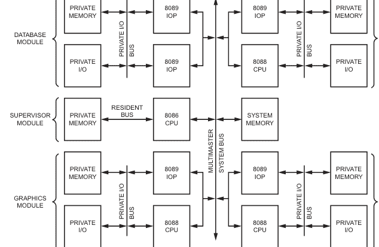
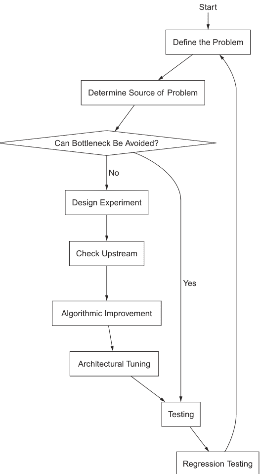
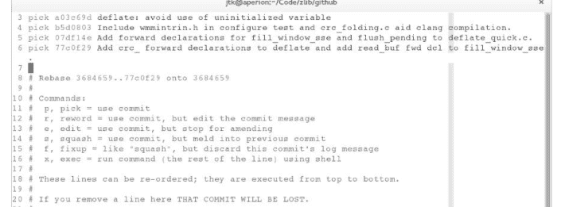
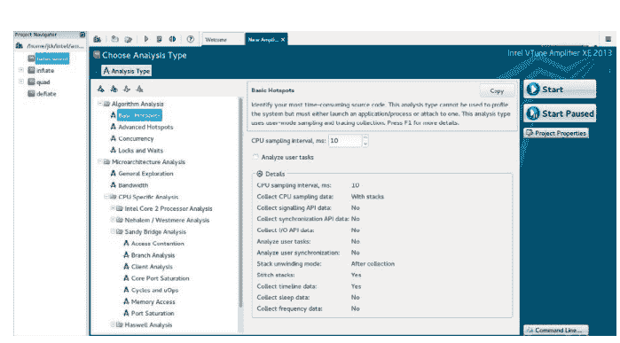
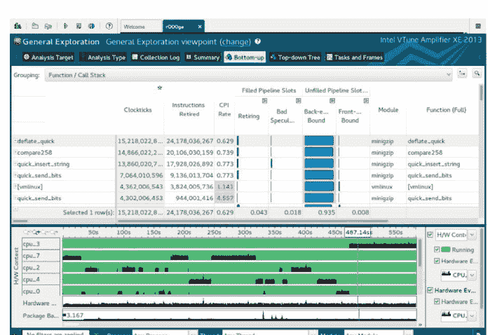
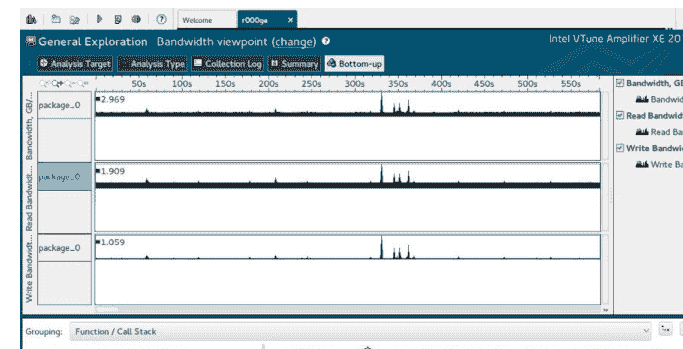
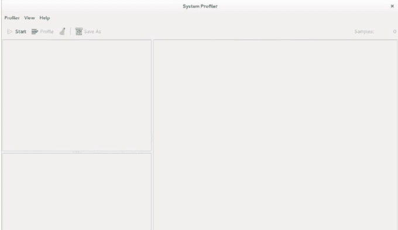
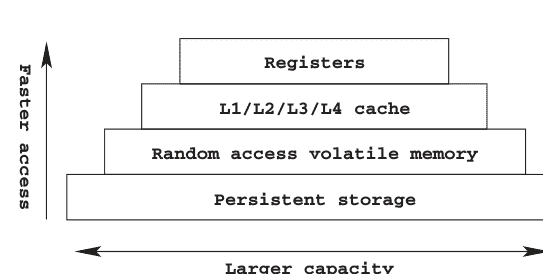
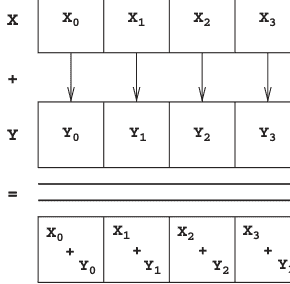
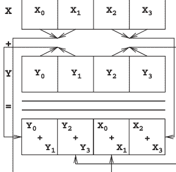

# 功率与性能：软件分析与优化

> 本书献给上帝、我的妻子 Riley、我的父母、我的兄弟 Stephen、我的朋友们、Intel 的同事，以及每一位帮助我完成这本书的人。

##### 6.1.2 使用事件计数器 .......................................................... 109

- 参考文献 ................................................................................................ 178

## 第 13 章 分支 241

### 13.1 避免分支 242

### 13.1.1 额外工作与掩码 243

### 13.1.2 合并与重排分支 245

### 13.2 改进预测 247

### 13.2.1 剖析引导优化 248

参考文献 249

## 第 14 章 优化缓存使用 251

### 14.1 处理器缓存结构 252

### 14.1.1 缓存行 253

### 14.2 查询缓存拓扑结构 254

### 14.3 预取 258

### 14.4 提高局部性 259

参考文献 261

## 第 15 章 利用并行性 263

### 15.1 SIMD 265

### 15.1.1 SIMD 寄存器 266

### 15.1.2 SIMD 操作 269

参考文献 273

## 第 16 章 特殊指令 275

### 16.1 Intel® 高级加密标准新指令 (AES-NI) 275

### 16.1.1 进一步阅读 276

### 16.2 PCLMUL 密载无进位乘法 276

### 16.2.1 进一步阅读 277

### 16.3 CRC32 277

### 16.3.1 进一步阅读 277

### 16.4 SSE4.2 字符串函数 277

### 16.4.1 进一步阅读 278

索引 279

# 引言

作为工程师，我们不断追求完善自己的技艺：渴望构建完美无缺的系统，勤勉追求无 Bug 的交付物，并在经验这块磨刀石上热热磨练自己的技能。作为这些共同经验的产物，软件工程这一相对年轻的学科通过验证与确认、软件原型设计和过程建模等领域，持续不断地快速成熟。然而，软件工程的一个重要方面往往被忽视了：软件优化，即通过调整软件来高效地利用资源，从而影响用户体验的技艺。

这个定义得出了三个重要的见解。首先，由于软件优化是调整软件的技艺，它是一个持续的数据驱动过程，需要通过性能测量和剖析（Profiling）形式的持续反馈。其次，计算资源是有限的且稀缺程度不一，因此分配必须经过仔细计划。第三，优化必须对用户体验产生影响。这种影响可以通过许多不同的方式表现出来，例如延长电池续航时间、处理更大数据集的能力或提高响应速度。

遗憾的是，一些开发者将性能分析和优化视为深不可测的计算古代的化石，认为它们是优化编译器和多核系统之前的产物。这些工程师的评估是正确的吗？性能是一个过时且无关紧要的话题吗？答案是肯定的“不！”在我们深入探讨性能分析的方法论和背景之前，让我们先讨论一下为什么性能分析对现代软件工程至关重要。

## 为性能辩护

软件优化的必要性有两个主要原因。第一个原因是，性能良好的软件通常是高能效软件。对于交付物运行在移动设备（如笔记本电脑、平板电脑和手机）上的开发者来说，这显然是重要的，但对于桌面和服务器产品的工程师来说同样重要，他们的功率问题以不同的形式表现，通常是发热问题和高运行成本。例如，数据中心通常作为与其公用事业公司安排的一部分，具有每日最小和最大功耗限制。结合很少有工程师有奢侈去了解或控制用户将在哪里安装软件这一事实，这意味着每位软件工程师都应该关注编写高能效的软件。第二个原因是，性能以及相关的成本具有强大的

## 性能等同于能效

将能效和性能看作是两个完全对立的概念是自然。。例如，消费者倾向于理解，虽然我们的服务器级 Intel® Xeon 处理器系列提供了卓越的性能，但在平板电脑中它们可能像我们的移动 Intel® Atom™ 平台那样具有能效。许多用户熟悉硬件（如显卡）驱动程序提供的调优参数，这些参数要求用户在能效运行、最高性能或两者之间的平衡做出选择。然而，在处理软件时，这种区别并不存在。

在接下来的章节中，我们将深入研究 Intel® 处理器中可用电源管理功能的细节。现在，只需理解 CPU 在运行时有两种通用的动态节电方法就足够。第一种技术称为频率缩放（Frequency Scaling），它会临时降低处理器的工作频率和电压。例如，CPU 的最大工作频率可能为 1.6 GHz，而在轻负载期间可以将频率缩减至 600 MHz。

第二种技术称为深睡眠（Deep Sleep），即处理器停止执行指令。节省的电量取决于处理器可以进入多深的睡眠状态，因为在深睡眠状态下，各种资源（如缓存）可以关闭电源以获得额外的节约。当作者在此打字写这一章时，处理器可以在两次按键输入之间进入浅层睡眠状态，唤醒并处理每个按键输入，并在作者校对其刚刚输入的内容时进入更深层的睡眠状态。

总的来说，虽然频率缩放可以提供一些节电，但最大的节省来自于深睡眠状态。因此，高能效软件的核心在于尽可能长时间让 CPU 处于睡眠状态，从而不执行指令。如果需要完成工作，必须尽可能地完成，以便 CPU 可以回到休眠。这个概念被称为“竞速空闲”（Race to Idle）。如上所述，虽然频率缩放可以提供一些节电，但最大的节省来自于深睡眠状态。因此，高能效软件的核心在于尽可能长时间让 CPU 处于睡眠状态，从而不执行指令。如果需要完成工作，必须尽可能地完成，以便 CPU 可以回到休眠。这个概念被称为“竞速空闲”。

## 性能与使用模式

计算的最终目的是提高。如果一个

# 引言

软件工程师花费了足够的时间与他人编写软件，工程师最终会听到，或者可能向同事引用唐纳德·高德（Donald Knuth）那句被广泛误用的名言：“过早优化是万恶之根源”（Knuth, 1974）。

为了理解这句话，有必要首先建立背景。原始出处是 ACM《计算机调查》杂志于 1974 年发表的《使用 Go 语句的结构化编程》。在其中一个示例中，Knuth 提到了一种性能优化，他写：“在成熟的工程领域中，轻松获得的 12% 的提升绝不被认为是微不足道的……”（Knuth, 1974）。显然，Knuth 并不是指所有的优化如此，特指过早的优化。这一点引申下去，并引发了一个问题：什么构成了过早优化？Knuth 继续写道：“对程序的哪些部分真正至关重要做出先验判断是错误的……”（Knuth, 1974）。换句话之，过早优化是指在没有先对程序进行分析以确定的情况下进行的优化。

这些话在今天可能比在 1974 年时更加真实。现代系统要复杂得多，优化编译器、堆栈式缓存、硬件预取、乱序执行以及无数其他逻辑创新的进步，拉大了了我们编写的代码与代码执行方式以及后续性能之间的差距。作为工程师，我们必须吸取 Knuth 的警告，确保我们的优化针对的是关键代码。

既然优化需要分析，那么这是否意味着所有的优化都应该等到软件完全写完？显显然不是，因为那时已经太晚了，无法撤销在核心架构中设计的任何低效设计。

在架构和设计的早期，性能考量应该围绕所使用的数据结构以及随之来的算法展开。这是一个 Big-O 分析非常重要的领域，并且应该对哪些算法在计算上具有挑战性有一个通用的理解。对于那些不熟悉 Big-O 分析的人来说，这是一种根据算法相对于最佳、平均和最坏输入情况的增长阶对算法进行分类和比较的方法。早期的性能测量也可以从模型和原型中获得。

随着架构体现为代码，应该进行性能剖析（Profiling）以验证这些方法的准确性。仅凭 Big-O 分析是不够的。考虑快速排序与归并排序及堆排序的经典案例。归并排序和堆排序在最坏情况下是超线性的，其性能通常低于快速排序，而快速排序在最坏情况下是二次方的。

因此，希望你现在对为什么性能分析和优化的重要性以及何时适用有了基本的理解。本书的其余部分将关注“如何做”和“在哪里”。以下内容分为四个部分。第一部分提供了让你入门所需的背景信息，重点关注 Intel® 架构以及硬件与 Linux 软件栈之间的交互。第二部分从性能分析方法论开始。然后提供了使用最流行的性能剖析工具的说明，例如 Intel® VTune™ XE 和 perf。第三部分概述了由第 2 部分工具识别的各种常见性能问题，然后提供了如何纠正这些问题的详细信息。由于每种性能情况都不同，这部分远非详尽，但设计上是为了给读者提供一个起点。

在全书中，指令使用 AT&T 语法。十六进制数以 `0x` 前缀，二进制数用下标表示（例如 `001₂`），所有其他数字均为十进制。

# 第一部分：背景知识

## 第 1 章 早期 Intel® 架构

## 目录

- 1.1 Intel® 8086 ........................................................................ 5

  - 1.1.1 系统状态 ................................................................... 7


# 地址空间
## 1.1.2 寄存器
## 1.1.3 指令
### 数据移动
### 整数算术
### 布尔逻辑
### 控制
### 字符串
## 1.1.4 机器码
# 1.2 Intel® 8088
## 1.2.1 IEEE 754 浮点
### 格式、精度与环境
### 支持
## 1.2.2 x87 浮点
# 1.3 Intel® 80286
## 1.3.1 保护模式与实模式
## 1.3.2 保护模式分段
## 1.3.3 任务控制
# 1.4 Intel® 80386
## 1.4.1 32 位模式
## 1.4.2 分页
# 参考文献

按下电源按钮导致 `#RESET` 引脚有效，电压被驱动至预定义的阈值，代表活动逻辑电平。在经过预定义的时钟周期后，`#RESET` 引脚取消有效，触发硬件重位。硬件重位负责将处理器初始化为已知状态。这包括将通用寄存器、控制寄存器和状态寄存器设置为其文档记录的初始值。

这第一“呼吸”让处理器处于一个与大多数开发者熟悉的状态大不同的执行状态。处理器从 16 位实地址模式开始执行。这种在 16 位实地址模式与 64 位或 32 位保护虚拟地址模式之间的跳转在每次处理器上电时都会发生。通过这样做，这个过程镜像了 `Intel®` 架构的历史演变，从 1978 年的 16 位 `8086` 到 21 世纪的 64 位 `Intel® Core™` 处理器家族。随着计算机启动，40 多年的处理器技术进步在转眼之间展开。

作者想象某些读者可能在想，在现代处理器设计中保留这些计算古董遗迹可能带来什么好处。向后兼容从定义上就涉及旧的设计，直接福了读者。希望读者继续读完这本书，他们将发现许多架构特性。对这些特性使用的教育是对读者时间的投资。通过严格维护向后兼容性，`Intel` 确保了读者今天的投入在可预见的未来继续产生回报。考虑一下，20 世纪 70 年代编译的原始字节码将在 2014 年制造的现代 `Intel®` 处理器上无需修改地运行。

其他反驳者认为 `Intel` 架构是不优雅的。由于优雅存在于持有者的眼中，这一主张很难反驳。作者不是硬件工程师；作为一名软件工程师，作者在这一主张中看到了硬件与软件之间有趣的相似之处。许多软件项目在架构时是为了解决一个定义良好的问题，是优雅的。随着设计阶段无法想象的新功能被提出，以及 Bug 修复和变通方案的引入，优雅随着时间的推移而侵蚀。在经历了软件生命周期这些不可避免的严酷现实后，软件的价值不再来自优雅，而在于它是否有效、仍然可靠以及是否可以扩展到未来的需求。作者认为 `x86` 仍然有效、仍然可靠，并且可以扩展。

用于简化和解释现代 `x86` 架构的重要概念。这具有双重收益：既能以自然且符合逻辑顺序的方式引入现代 `x86` 架构的概念，又为理解多年来这些技术决策背后的逻辑提供了必要的背景。

本章研究了 `x86` 家族中一些最早的成员。这些处理器大多数是 16 位的。本章以首个 32 位 `x86` 处理器，以及第一个运行 `Linux` 的处理器——`Intel® 80386` 结束。

`8086` 出于 1978 年，如图 1.1 所示，尽管它不是英特尔开发的第一个处理器，但它是首个实现所谓 `x86` 架构的处理器。事实上，`x86` 名称中的两个数字对应于第一批 `x86` 处理器的命名都以 86 结尾这一事实，例如 `8086`、`80186`、`80286`、`80386` 等。这一趋势一直持续到英特尔 `Pentium®` 系列。尽管 `8086` 早于 1978 年推出，但它在整个 20 世纪 80 代和 90 代一直在生产。著名的是，`NASA` 直到 2011 年在其航天器中一直在使用 `8086` 处理器。

与英特尔软件开发者手册 `SDM` 的数千页内容相比，`8086` 用户手册（包括关于系统行为、编程工具、硬件引脚定义、指令和操作码的完整引用）仅需两百页左右。这种简化的特性使得 `x86` 架构成为学习 `x86` 架构基本概念的绝佳入门。本书的其余部分在此介绍的概念的基础上进一步构建。

在 `8086` 架构中，三个三个设计原则（英特尔公司，1979年）。第一原则是使用专用组件来隔离和分配功能。换句话说，并不是一个单一的整体系统架构，构建 `8086` 系统为所选的外围设备提供了灵活性。这使得系统构建者能够定制系统，以最大程度地满足特定情况的需求。第二原则是架构中固有的并行性。在 `8086` 时代，并行性以将多个处理器和协处理器相结合的形式出现，以便并行执行多个任务。第三原则是层次结构，旨在支持复杂和简单的数据流。

为了说明这些原则，考虑在 `8086` 中，有两种英特尔处理器可用：`8088` 和 `8089`。`8088` 与 `8086` 是相同的处理器，区别在于外部数据总线是 8 位而不是 16 位。`8088` 被 `IBM` 选为“`IBM` 兼容 `PC`”的心脏。`8089` 是一个独立的协处理器，拥有它自己的指令集和汇编器，设计用于卸载带有直接内存访问 `DMA` 请求的数据传输。有趣的是，`8089` 并没有被 `IBM` 选用于“`IBM` 兼容 `PC`”，且从未被广泛采用。

这些芯片中的一个或多个可以进行组合，并选择若干外围设备，以为软件需求提供高度定制的系统。例如，考虑图 1.2 所示系统图。该图取自 `8086` 用户手册，展示了一个多处理器配置，由一个主 `8086` 处理器、三个驱动外围设备的 `8088` 处理器以及五个带有三个加速图形 `I/O` 的 `8089` 处理器组成。

这种模块化贯穿 `8086` 的整个设计。例如，`8086` 的内部架构被清晰地分为两类：执行单元 `EU` 和总线接口单元 `BIU`。`EU` 包含了维护和操作处理器内部状态的所有资源，包括 `CPU` 寄存器和算术逻辑单元 `ALU`。



图 1.2 `Intel® 8086` 多处理器系统示例（英特尔公司，1979年）。

然而，`EU` 无法访问系统内存，这需要使用系统总线。`BIU` 专门负责与系统总线接口。这种分离允许两个单元并行工作，当 `EU` 执行指令时，`BIU` 通过总线获取数据。


为了适应这种异步特性，两个单元通过指令队列连接，因此允许 BIU 在需要指令之前将其取指令。当 BIU 检测到队列中有可用槽位时，它开始获取一条指令来填充该槽位。当 EU 检测到队列中有有效条目时，它将其移除并开始执行。如果 EU 需要评估内存操作，它会将有效地址传递给 BIU，BIU 将挂起预取并检索所需的系统信息。

开始理解 x86 架构始于意识到处理器仅仅是一个简单的状态机，其状态由内存和寄存器的内容描述，输入在状态之间转换。

理解 x86 架构始于意识到处理器仅仅是一个由内存和寄存器内容描述状态的简单状态机，输入在状态之间转换。

*(注：此处原文似乎存在大量重复或乱码，译文已根据上下文逻辑进行了最小化处理)*

8086 架构包含两个不同的地址空间。

*(注：此处原文似乎存在大量重复或乱码，译文已根据上下文逻辑进行了最小化处理)*

除了上一节介绍的四个段寄存器外，8086 拥有七个通用寄存器和两个状态寄存器。

通用寄存器分为两类。`AX`、`BX`、`CX` 和 `DX` 四个寄存器被归类数据寄存器。这些数据寄存器可以作为 16 位寄存器（以 X 后缀表示）、16 位寄存器的低字节（以 L 后缀表示）或高字节（以 H 后缀表示）进行访问。例如，`AX` 访问整个 16 位寄存器，而 `AL` 和 `AH` 分别访问寄存器的低字节和高字节。

第二类寄存器分类是指针/索引寄存器。这包括以下寄存器：`SP`、`BP`、`SI` 和 `DI`。`SP` 寄存器（栈指针）专门用于作为栈顶指针。`SI` 和 `DI` 寄存器通常隐式用作源和目的指针。与数据寄存器不同，指针/索引寄存器只能作为完整的 16 位寄存器访问。

- `AX` 累加器（Accumulator）
- `BX` 数据（相对于 DS）
- `CX` 循环计数器（Loop counter）
- `DX` 数据
- `SI` 源指针（相对于 DS）
- `DI` 目的指针（相对于 ES）
- `SP` 栈堆指针（相对于 SS）
- `BX` 栈帧基指针（相对于 SS）

除了允许更短的指令编码外，本指南对程序员也很有帮助。一旦熟悉了各种寄存器的含义，只要汇编符合这些指南，程序员就能更快地推断出汇编的含义。与之相似，在某种程度上，变量名有助于程序员对其内容进行推理。需要注意的是，这些是建议而非规则。

此外，还有两个状态寄存器：指令指针（instruction pointer）和标志寄存器（flags register）。

指令指针 `IP` 经常被称为程序计数器（program counter）。该寄存器包含下一个要执行的指令的地址。在 64 位模式之前，程序员无法直接访问指令指针，也就是说，无法像访问其他通用寄存器那样访问它。尽管如此，指令指针是可以间接访问的。虽然指令指针不能通过 `MOV` 指令修改，但可以通过任何改变程序流的指令进行修改，例如 `CALL` 或 `JMP` 指令。

通过利用 x86 处理函数调用的方式，也可以读取指令指针的内容。从一个函数到另一个函数的传输通过 `CALL` 和 `RET` 指令完成。`CALL` 会保留指令指针的当前值并将其推入栈中以支持嵌套函数调用，然后将指令操作数提供的新地址加载到指令指针中。栈上的这个值被称为返回地址（return address）。每当函数执行完毕时，`RET` 指令会从栈中弹出地址并将其恢复到指令指针中，从而返回到启动函数调用的函数。利用这一点，程序员可以创建一个特殊函数，该函数只需拷贝栈中的返回值，将其加载到其中一个寄存器中，然后返回。例如，在用第 12 节讨论的位置无关代码（PIC）时，编译器会自动添加使用这种技术来获取指令指针的函数。这些函数被称为 `x86.get_pc_thunk_bx()`、`_x86.get_pc_thunk_dx()` 等，取决于在哪个寄存器中加载了指令指针。

第二个状态寄存器 `EFLAGS` 寄存器由 1 位状态和控制标志位组成。这些位由各种指令（通常是算术或逻辑指令）设置，以指示某些条件。然后可以检查这些标志位以做出决策。有关每条指令修改的标志列表，请参阅 Intel SDM。8086 在 `EFLAGS` 中定义了以下状态和控制位：

- 零标志 (`ZF`)：如果指令结果为零则置1。
- 符号标志 (`SF`)：如果指令结果为负数则置1。
- 溢出标志 (`OF`)：如果指令结果溢出则置1。
- 奇偶标志 (`PF`)：如果结果设置的位数为偶数则置1。
- 进位标志 (`CF`)：用于执行带进位算术运算的指令存储进位位（用于扩展精度）。
- 调整标志 (`AF`)：类似于进位标志。在 8086 文档的术语中，被称为辅助标志（Auxiliary Flag）。
- 方向标志 (`DF`)：对于自动递增或自减的指令，该标志选择执行哪种操作。如果是自减，否则自动递增。
- 中断允许标志 (`IF`)：决定是否启用可掩蔽中断。
- 陷阱标志 (`TF`)：如果设置，CPU 在单步调试模式下运行。

## 1.1.3 指令

继续介绍部分中描述的情景，当 `#RESET` 引脚变为有效后又变为无效时，处理器会将程序寄存器初始化为它们的预定义值。这包括指令指针的预定义值，为 BUI 提供首次取指进行解码，并供执行单元使用。

此位置始终是物理地址空间中的最后 16 字节。对于一个具有 20 位物理地址的 16 位处理器，这里是 `0xFFFF0`。这为跳转到 `BIOS` 的实际初始化代码提供了足够的空间。

为了理解这背后的原理，请考虑第一个执行的指令负责在启动操作系统之前初始化系统并准备标准的执行环境，它们属于 `BIOS`。`BIOS` 映射到物理地址空间，存储在主板上的 ROM 中，通过低引脚计数（`LPC`）总线连接。该 ROM 映射到物理地址空间的最顶端，使得 ROM 的最后一个字节就是最顶端。因此，不同的 ROM 在内存中有不同的起始地址。例如，一个 1-KB 的 ROM 将从 `0FFFF – 0xFF00 + 1 = 0xFFC00` 开始，而一个 4-KB 的 ROM 将从 `0FFFF – 0xF000 + 1 = 0xFF000` 开始。这些第一个执行的指令（`BIOS` ROM 的最后字节）是唯一其他保证包含有效代码的部分，且它们属于 `BIOS`；它们保证知道初始化代码其余部分位于物理内存的何处。

从这里开始，处理器继续获取新指令、解码这些指令并执行这些指令的循环。每条指令都定义了一个使状态机从一个状态转换到另一个状态的操作。每条指令由一个或多个形式组成，即处理不同操作数类型的各种编码。操作数仅是指令的参数，定义了应该对状态的哪个方面进行操作。

### 表 1.1 8086 ADD 指令的形式

| 操作数形式 | 示例 | 备注 |
| --- | --- | --- |
| 寄存器, 寄存器 | `add %ax, %dx` | `dx = ax + dx` |
| 寄存器, 内存 | `add %ax, (%dx)` | `*(short) %dx = *(short) %dx` |
| 内存, 寄存器 | `add (%dx), %ax` | `ax = ax + *(short) %dx` |
| 立即数, 寄存器 | `add $10, %ax` | `ax = ax + 10` |
| 立即数, 内存 | `add $10, (%dx)` | `*(short) %dx = *(short) %dx + 10` |
| 立即数 | `add $10` | `ax = ax + 10` |

操作数包括特定的寄存器、内存地址或立即数（即当时的常量值）。如前所述，操作数可以是显式的也可以是隐式的。

为了说明这一点，请考虑 `ADD` 指令，它在 8086 当有六种独特的形式。这些形式列在表 1.1 中。注意前五个是显式的，而最后一个有一个隐式操作数 `AX`。

8086 拥有大约有一百条独特的指令，不考虑不同的形式。这些指令可以分为五个逻辑分组。有关可用指令及其含义和操作数的完整参考，请参阅 Intel SDM。

第一组包含将数据从一个操作数移动到另一个操作数的指令。这包括像 `MOV`（可以将数据从一个操作数移动到另一个）、`PUSH` 和 `POP`（将操作数推入栈或从栈顶弹出到操作数中）以及 `XCHG`（原子地交换两个操作数的内容）。

第二组包含执行整数算术的指令。这包括执行标准熟悉的算术运算的指令，如 `ADD`、`SUB`、`MUL` 和 `DIV`。

此外，x86 支持带“进位”或“借位”执行这些操作。这用于在任意大量的字节上实现这些操作。在进位的情况下，`EFLAGS` 中的位会被标记，供下一条指令解释。例如，`ADC`（进位加）指令使用此位来确定结果是否应该加1，以借用从之前的 `ADC` 操作产生的进位。

通常这些每条指令都会设置 `EFLAGS` 寄存器中的相关状态位。这通常消除了使用显式比较指令进行某些检查的需求，例如检查全零或小于零。相反，可以直接复用算术运算的标志。

如前所述，`AX` 寄存器被指定为累加器，因此大多数算术指令都有隐式形式，在 `AX` 上执行操作并将结果存储在 `AX` 中。

第三组包含执行布尔逻辑的指令。这包括如 `AND` 指令（它只在结果中两个操作数都设置的位设置位）、`OR` 指令（它只在结果中至少一个操作数设置的位设置位）以及 `XOR` 指令（它只在其中一个操作数设置而另一个未设置的位设置位）。

与算术组类似，这些指令也倾向于使用 `AX` 存储结果。此外，它们会设置 `EFLAGS` 中相同的位，进位位除外。


第四组包含修改程序流的指令。与高级语言不同，这里没有语句或 `for` 循环结构。相反，算术和逻辑指令会设置 `EFLAGS` 寄存器中的位，控制指令可以作用这些位。例如，考虑以下两个代码段：

```
if (x > 255) {
  x = 255;
}
```

```
cmp $255, %ax
jle .Lskip_saturation
mov $255, %ax
.Lskip_saturation:
```

C语言版本。

在汇编语言中，`CMP` 指令将寄存器操作数 `AX` 的内容与立即数（汇编时的常量）比较，并相应地设置 `EFLAGS` 寄存器中的标志位。`JMP` 指令无条件地执行跳转，还有条件跳转。这些指令采用 `Jcc` 形式，其中 `cc` 是一个条件。代码代表根据 `EFLAGS` 状态预定义的一组或多个条件构成的集合。例如，`JNZ` 指令仅在零标志位（`ZF`）被设置时才执行跳转。在上面的列表中，`JLE` 指令当 `AX` 小于或等于 `255` 时跳转到 `.Lskip_saturation`，从而跳过第 3 行发生的饱和处理操作。

第五组包含设计用于操作字符串的指令。这包括加载（`LODS`）、存储（`STOS`）、搜索（`SCAS`）和比较（`CMPS`）字符串指令。

字符串指令的设计旨在大量利用隐式操作数。当前字符（无论是从内存加载、存储到内存还是搜索）都存储在 `AX` 中。源指针和目的指针分别存储在 `DS:SI` 和 `ES:DI` 中。字符串长度通常存储在 `CX` 中。

例如，`LODS` 指令将 `DS:SI` 处的字节加载到 `AX` 寄存器，然后根据 `EFLAGS` 中方向标志的状态递减或递增

| REP | 含义 |
|---|---|
| REPE/REPZ | 重复直到 `CX` = 0，或重复直到 `EFLAGS.ZF` != 0 |
| REPNNE/REPNZ | 重复直到 `EFLAGS.ZF` = 0 |

`SI` 寄存器。相反地，`STS` 指令将 `AX` 存储到内存位置 `ES:DI`，然后相应地更新指针。

`SCAS` 指令将 `AX` 的值与位于 `ES:DI` 所向的内存位置的字节进行比较；相应地更新 `EFLAGS` 寄存器，然后自动递增或自动递减 `DI`。`CMPS` 指令用于字符串比较，它比较位于 `ES:DI` 和 `DS:SI` 的字节；更新 `EFLAGS` 寄存器，然后自动递增或自动递减 `DI` 和 `SI`。

虽然这些字符串指令执行各自操作的一个阶段，但可以通过将其与 `REP` 前缀结合扩展扩展执行完整操作。该前缀会重复指令直到满足条件。该条件通过 `REP` 前缀的后缀指定。表 1.2 列出了可用的 `REP` 前缀及其随后的含义。

`x86` 的复杂方面之一是将指令编码为机器码，处理器期望指令具有特定的二进制格式。通常，开发者使用指令助记符编写汇编语言，并让汇编器选择适当的指令格式；然而，这并不总是可行的。工程师可能希望跳过汇编器手动编码所需的指令，或者在不支持该指令的旧汇编器上使用新指令，或者精确控制编码以控制代码大小。

`8086` 指令及其操作数被编码为从 1 到 6 字节不等的变长度。为了适应这一点，解码单元解析较早的位以确定未来预期会出现的哪些位，以及如何解释它们。使用变长编码格式是以解码器复杂性的增加换取代码密度的提高。这是因为非常常见的指令可以赋予短序列，而较少且更复杂的指令可以赋予较长序列。

机器码的第一个字节表示指令的操作码（`opcode`）。操作码仅仅是对应于特定指令形式的固定数值。不同形式的指令（例如操作寄存器操作数的指令和操作立即数操作数的指令）可能有不同的操作码。操作码形成了决定解码器后续动作的初始解码阶段。给定指令格式的操作码可以在 Intel SDM 的第 2 卷指令集参考中找到。

## 第一章 早期 Intel® 架构

某些非常常见的指令，例如寄存器形式的栈操作 `PUSH` 和 `POP` 指令，或者利用隐式操作数的指令，其操作码如下...（注：此处原文存在重复内容，已按要求翻译并保持逻辑，但由于原文中存在大量重复段落，此处遵循原文结构进行翻译逻辑）：

| rw | 寄存器 |
|---|---|
| 0 | `AX` |
| 1 | `CX` |
| 2 | `DX` |
| 3 | `BX` |
| 4 | `SP` |
| 5 | `BP` |
| 6 | `SI` |
| 7 | `DI` |

| Value | 操作数 | 偏移大小 |
|---|---|---|
| 00 | 是 | 0 |
| 01 | 是 | 1 字节 |
| 10 | 是 | 2 字节 |
| 11 | 否 | 0 |

| Value | 寄存器 (16/8) |
|---|---|
| 000 | `AX/AL` |
| 001 | `CX/CL` |
| 010 | `DX/DL` |
| 011 | `BX/BL` |
| 100 | `SP/AH` |
| 101 | `BP/CH` |
| 110 | `SI/DH` |
| 111 | `DI/BH` |

否则，`R/M` 字段指定了如何计算内存操作数的地址。

`8086` 及其 16 位后继版本在可以使用哪些寄存器和形式方面存在限制。一旦架构扩展到 32 位，这些限制就被消除了，因此记录它们并不困难。

作为 `REG` 字段扩展操作码的示例，考虑将 16 位立即数与 16 位寄存器比较的 `CMP` 指令。在 `SDM` 中，`CMP r16,im16` 被描述为 `81 iw` (Intel Corporation, 2013)，这意味着操作码为 `0x81`，Mod/M 字节 `MOD` = `11₂`，`REG` = `7` = `111₂`，`R/M` 字段编码所需的 16 位寄存器。`iw` 条目指定 Mod/M 字节之后将跟随一个 16 位立即值，提供测试寄存器的立即数。因此，`CMP DX, 0ABCD` 将编码为：`0x81, 0xFA, 0xCD`。注意 `0ABCD` 是字节反转存储的，因为 `x86` 是小端序。

考虑另一个示例，此示例执行 16 位立即数与内存操作数之间的比较。在此示例中，内存操作数被编码为相对于基指针 `BP + 8` 的偏移量。

区别将在于 Mod R/M 字节。`MOD` 字段将为 `$01_2$`，虽然可以使用 `$10_2$`，但会浪费额外的字节。与上一个示例类似，`REG` 字段将为 `7`，即 `$111_2$`。最后，`R/M` 字段将为 `$110_2$`。这使得第一个字节操作码 `0xB1` 和第二个字节 Mod R/M 字节 `0x7E`。因此，“`CMP 0ABCD, [BP + 8]`会被编码为 `0x81, 0x7E, 0xCD, 0xAB`。

与图1.3所示的`8086`不同，它不是独立的处理器，而是一个协处理器，类似于 `8089`。与加速 I/O 操作的 `8089` 不同，`8087` 的开发是为了加速数学运算。注意，在上节的指令中，所有的数学运算仅对整数进行操作。结果是所有涉及实数的计算必须在软件中手动实现。遗憾的是，这导致了次优的情况，即可用软件数学库的质量、准确性和功能差异巨大，从而阻碍了软件辅助实数任务的能力。

为了改善这种状况，`8087` 的设计旨在将尽可能常见且易错误的计算整合到硬件中，使软件工程师能够专注于应用程序的计算，而不是实现低级数学例程。这些特征包括浮点运算、数值转换和常用函数，例如三角函数和平方根函数。

### 1.2.1 IEEE 754 浮点数

由于完整的 754 标准直到 1985 年才最终定稿，而 `8087` 早于 1980 年发布，因此 `8087` 在技术上并没有实现完整的标准。尽管如此，`8087` 在其发布时实现了当时的草案，硬件和 Intel 在该草案的开发中都起了重要作用。注意的是，担任 IEEE 委员会成员且数值分析专家的 William Kahn 受 Intel 委托帮助设计 `8087`。作者建议读者访问 Kahn 博士在伯克利的教职网站，地址为 `http://www.eeks.berkeley.edu/~wkahan/`，并阅读他关于该标准背后的原理和历史，以及浮点计算中准确性和分析的一些出版物。

与无符号 16 位整数不同（后者仅允许表示 `[0, 2^{16})` 或 `[-2^{15}, 2^{15}-1]` 之间的全整数），浮点数允许表示超出整数限制的大数和小数。正如名称所示，浮点数利用科学计数法，将一个数字分解为尾数和一个带符号指数。例如，数字 `0.0005` 将表示为 `5.0 × 10^{-4}`。

然而，科学计数法引入了一个问题，即同一个数字可以用多种方式表示。`5000.0 × 10^3` 和 `500.0 × 10^4` 都是同一个数字。显然，这在比较两个浮点数时可能会产生问题。为了解决这个问题，浮点数要求科学格式必须是归一化的。归一化的科学计数法在小数点前仅有一个非零数字。在在上一个示例中，`5.0 × 10^{-3}` 将是归一化的格式。

到目前为止，之前所有的科学计数法示例都是 10 进制的，因此有 `×10` 组件，然而所有的浮点数都假定基数为 2。

格式、精度和环境


IEEE 754 格式的目标之一是实现由普通算术单元（`ALU`）执行的快速浮点排序。实现这一目标的一个挑战是如何处理指数部分，因为使用补码编码逻辑将需要根据符号来比较数字。为了解决这个问题，在指数部分中引入了偏移量（`bias`）。偏移量仅仅是一个偏移值，指数确保了最小值表示为零，而最大指数表示为全 1。由于偏移量与可以编码的元素数量（因此表示中的位数）直接相关，偏移量随类型而异。标准定义单精度类型的偏移量为 127，双精度类型为 1023。通常，用于区分偏移指数和未偏移指数的记法分别为 `$e$`。

最大和最小指数（全 1 和全 0）保留用于编码特殊数字。最大指数（浮点型 `e = 255`，双精度型 `e = 2047`）保留用于编码无穷大（根据符号位分为正负无穷）以及 `NaN`（非数字）。无穷大用非零尾数表示，而 `NaN` 用零尾数表示。`NaN` 代表无效操作，并设计为允许错误传播，这在某些情况下是可以接受的，而不是通过异常提前终止计算。为了适应这两种情况，`NaN` 有两种：信号 `NaN` 和静默 `NaN`，区别在于信号 `NaN` 会产生异常。

最小指数 `e = 0` 保留用于表示尾数隐式位不适用的值。这种方法的明显案例通过零指数和零尾数表示。正如之前提到的，浮点数是归一化的；但对于标准格式无法表示的小数字存在特殊情况。这些类型的数字被称为非规格化（`denormals`），它们使用 `e = 0` 表示，并将尾数设置为相关的分数。

为了提高计算的一致性，IEEE 754 标准还规定了四种用户可选的舍入模式：

- `舍入到最近 (Round to Nearest)`：默认舍入模式。顾顾名，它舍入到目标格式中最接近的可表示数字。
- `舍入到零 (Round to Zero)`：始终向零方向舍入。
- `向负无穷舍入 (Round to Negative Infinity)`：始终向负无穷方向向下舍入。
- `向正无穷舍入 (Round to Positive Infinity)`：始终向正无穷方向向上舍入。

在某些情况下，可以通过设置状态标志位或生成调用陷获处理程序的状态来发出浮点异常。共定义了五种异常：

- `无效操作 (Invalid Operation)`：当请求的计算无法执行时产生。如果没有指定陷获处理程序，结果为 `NaN`。
- `除以零 (Division by Zero)`：如果没有指定陷获处理程序，结果为无穷大。
- `溢出 (Overflow)`：如果没有指定陷获处理程序，结果将根据当前的舍入模式进行舍入。
- `欠铁 (Underflow)`：行为与溢出相同。
- `不精确 (Inexact)`：当结果的舍入无法在溢出中被精确表示时产生。

自 C99 语言修订以来，C 编程语言提供了对本节描述功能的扩展支持。有关完整参考，请参见 C99 规范的*附 F*，以及第 5.2.2 节（描述了特性）和第 7.6 节（描述了浮点环境的访问）。另一个有用的参考是 `fenv.h`、`float.h` 和 `math.h` 头文件的内容。

### 1.2.2 X87 浮点运算

与 8086 不同，x87 将寄存器暴露为栈而不是平坦寄存器。这八个寄存器中的每一个长度均为 80 位，每个值在内部都以双精度格式存储和计算。来自内存或 8086 寄存器的值在推入栈时，会从整数、浮点数和双精度转换为这种 80 位格式。与传统的栈不同，每个寄存器也可以相对于栈顶通过寄存器进行寻址。栈顶被指定为 `ST(0)`。后续寄存器通过偏移量指定，例如 `ST(1)`、`ST(2)` 等。

### 1.3 早期 Intel® 架构

选择栈寄存器是因为对于 RPN 等数学操作非常直观，并且可以容纳一个操作数。使用 `FXCH` 指令可以交换两个栈寄存器，从而能够这种方式利用寄存器。

除了寄存器外，8087 还有一个 16 位的状态寄存器。FPU 的状态寄存器类似于 CPU 的 EFLAGS 寄存器。前 6 位对应计算期间产生的 IEEE 754 异常，外还有一个额外的位用于表示非规格化操作数。其他条目包括：3 位用于当前栈顶寄存器的索引，4 位用于表示状态码，以及类似于用于比较和分支的 EFLAGS 中的标志，以及一个表示中断请求的位。标签寄存器每个寄存器 2 位，用于存储栈的状态。每个寄存器可以标记为有效条目、零条目或空。控制寄存允许对中断进行屏蔽和取消屏蔽，以及对舍入模式和精度模式的控制。

与 8086 的并行架构类似，807 也被分为两个部分。第一个部分是控制单元（`CU`），负责处理指令和内存操作，并与主处理器同步，因此镜像了 8086 的 BIU（总线接口单元）。第二个部分是数值执行单元（`NEU`），负责执行实际计算，因此镜像了 8086 的 EU（执行单元）。当浮点单元（FPU） 807 执行浮点指令时，CPU 可以自由执行通用指令，通过并行性来提高性能。

807 及后续协处理器直到 8048 处理器之前一直是独立的芯片。8048 具有 MMX 技术、SSE 和向量扩展（Intel® AVX），它们也能执行浮点运算，但在需要额外精度的领域，x87 FPU 仍然被广泛使用。

在 8086 和 80186 之后，8026 于 1982 年引入。8026 值得提及的地方在于它是第一个为多任务设计的 x86 处理器。这种多任务支持很大程度上是通过增加内存保护方案实现的以隔离相互的任务。

在此之前，不存在内存保护；地址空间中的每个字节都被同等对待，无论它属于操作系统还是用户程序。这意味着没有机制防止用户程序篡改另一个程序或操作系统的代码和数据。显然，这对于安全、应用程序隔离或操作系统行为限制是不利的。为了解决这个问题，8026 包含了一个内置内存管理单元（`MMU`），它负责在由段选择器和偏移组成的逻辑地址与物理地址之间进行透明转换，并执行内存保护。因此，系统上的每个进程都可以在独立的地址空间中隔离。

### 1 保护模式与实模式

由于这代表了处理器编程模型的范式转移，两种模型被分为两种处理器模式。8086 和 80186 使用的传统模式称为实地址模式（Real Mode），或简称实模式。具有内存保护的新 MMU 称为保护地址模式（Protected Mode），或保护模式。为了保持与 8086 和 80186 的兼容，处理器以实模式启动，确保应用程序可以将 8026 作为更快更好的 8086 使用。利用新模型特性的应用程序将以实模式启动，然后切换到保护模式。

从实模式到保护模式的转换相当简单。第一步是创建并加载所有的保护模式结构，以便在切换后立即运行保护环境。设置第一个寄存器 `CR0` 中的 `PE` 位，这实际上进入了保护模式。最后，执行跳转指令以刷新处理器缓存。此时，处理器已在保护模式下运行，并且可以使用任何新功能。

对这些保护内存区域的支持意味着当前的分段内存模型需要扩展。最初，段是固定大小的；然而，这使得内存保护变得复杂，因为固定大小对于细粒度任务来说太大了。为了解决这个问题，保护模式下的段现在是变长的。

为了适应这一点，保护模式下的段寄存器格式和行为与实模式下的段寄存器格式和行为完全不同。

请记住，最初段寄存器仅包含一个经过位的基地址和偏移量，以产生更大的地址尺寸。在这个新模型中，段寄存器需要更多空间来支持这些新功能所需的计数。因此，在保护模式下，段寄存器不再直接引用段的基地址，而是指向段描述符表中的一个描述符项。该表中的每个 8 字节条目都描述了 24 位基地址、16 位大小以及 8 位特权和访问信息，这些信息用于将段标记为只读、可执行等。剩余的 16 位存储段选择器，当它被加载到 16 位段寄存器时，实际上加载了该描述符。为了提高性能，通过避免在每次检查段操作时都去触碰描述符，段描述符的其余 48 位在加载段选择器时会被缓存在一个隐藏寄存器中。

为了使分段机制既对操作系统又对用户应用程序有用，同时强制内存保护，段描述符表（`GDT`）是由操作系统（特权级 0）控制的段描述符表，而本地描述符表（`LDT`）则由用户应用程序控制。`GDT` 和 `LDT` 寄存器用于存储这些表的基地址。全局和本地描述符通过 `LGDT`、`SGDTDT``DT`` `SLDT` 指令加载和存储。每个段选择器都有一个特殊位，指示描述符位于本地表还是全局表。

每个段描述符还有一个存在位（`present bit`），指示相应的段当前是否加载到内存中。如果段描述符未设置（即描述符中的该位为 0），用户程序将暂停并抛出异常，给操作系统有机会从磁盘内存中加载相关段。一旦段加载完成，用户程序将恢复。所有这一切对用户程序来说都是透明的，因此提供了一种早期的硬件支持虚拟交换形式。通过交换，操作系统分配的虚拟内存可以超过计算机上实际分配的物理内存。

由于处理器一次只能运行一个应用程序，多任务操作系统的工作是提供一种处理器可以同时运行多个任务的幻象。在单任务操作系统中，每个作业在下一个作业开始之前从头运行到尾，而多任务操作系统将处理器时间分配给每个需要的作业。这种切换必须发生得快速且平滑，以至于对用户应用程序是透明的，看起来处理器正在并发运行所有任务。

将处理器从一个进程切换到运行另一个进程的操作被称为上下文切换。为了执行上下文切换，操作系统必须跟踪每个执行中任务的完整执行状态，包括寄存器内容。在上下文切换过程中，正在运行的进程及其执行状态的内容被保存到存储器中，而要运行的新进程的执行状态则从存储器加载到处理器中。


确定应该运行哪个进程以及运行多久的过程被称为进程调度。进程调度是计算机科学中一个被广泛研究的问题，试图解决许多问题，例如调度的公平性，或时间与吞吐量之间的平衡，适用于涉及不同数量具有不同性能需求进程的许多不同情况。因此，进程调度是一个很大的领域，将在书中进行详细讨论。在编写本文时，Linux 的进程调度围绕着通过调度任务来补充节电技术。为了良好地了解基本概念和算法，作者推荐 Andrew Tanenbaum 写的《现代操作系统》。

`80286` 引入了一项新功能，允许硬件自动处理上下文切换。这是通过一个特殊的任务段（task segment）实现的。在任务段内部，进程的所有执行状态都被保留。通过发出 `JMP`、`CALL` 指令或从中断中返回，如果目标是 TSS 描述符，就会自动发生上下文切换。当前正在执行进程的执行状态将自动复制到 TSS 的相关部分。一旦完成，切换到的进程的新执行状态将自动加载到处理器中，新进程的执行可以从其之前暂停的地方继续。

尽管硬件对上下文切换有完全支持，但 Linux 仍通过软件手动执行所有的上下文切换。这样做是为了性能考虑，因为硬件上下文加载会验证所有的执行状态，而 Linux 在历史上通过以惰性方式执行了部分加载，并根据实际需要恢复的内容优化了某些加载。

在 `80286` 之后，如图 1.4 所示的 `80386` 于 1985 年引入，由于需求巨大，Intel 持续生产直到 2007 年 9 月。`80386` 是 x86 家族中的第一个 32 位处理器，并扩展了 `80286` 中引入的许多基本概念。或许更重要的是，由于本书关注 Linux，`80386` 是第一个运行 Linux 的处理器。事实上，

图 1.4

Intel® 80386 (Lanzet, 2008)

`80386` 支持一直到 2012 年才被移除（Molnar, 2012）。引用 Linus Torvalds 关于 Linux 的原始 Usenet 帖子：

> “我正在做一个（免费的）操作系统（只是一个爱好，不会像 GNU 那样庞大和专业，won't be big and professional like gnu）用于 386/486 AT……它利用了我能找到的所有 386 功能，因为它也只是一个项目。（Torvalds, 1991）”

虽然 `80286` 引入了实模式和保护模式，`80386` 引入了一个额外的模式。这种模式——虚拟 806 模式是为了解决 `80286` 无法从保护模式返回实模式的问题。虚拟 806 模式是一种从保护模式进入的特殊模式。它允许处理器执行 806，而 `80286` 无法从保护模式返回实模式。

虚拟 806 模式是一种从保护模式进入的特殊模式。它允许处理器执行 806，而 `80286` 无法从保护模式返回实模式。

### 1.4.2 32 位模式

在 `80286` 引入了实模式和保护模式之后，`80386` 引入了一个额外的模式。这种模式——虚拟 806 模式是为了解决 `80286` 无法从保护模式返回实模式的问题。虚拟 806 模式是一种从保护模式进入的特殊模式。它允许处理器执行 806，而 `80286` 无法从保护模式返回实模式。

### 1.4.3 32 位寄存器和 80387

在 `80286` 引入了实模式和保护模式之后，`80386` 引入了一个额外的模式。这种模式——虚拟 806 模式是为了解决 `80286` 无法从保护模式返回实模式的问题。虚拟 806 模式是一种从保护模式进入的特殊模式。它允许处理器执行 806，而 `80286` 无法从保护模式返回实模式。

## 第 1 章 Intel® 架构

为了说明这一概念，考虑如何加载整数数组 `foo[i]` 的第 $i$ 个元素。假设索引 $i$ 存储在 `ECX` 寄存器中，`foo[0]` 的基地址存储在 `EAX` 寄存器中，而 `foo[i]` 内容的目标地址是 `EBX` 寄存器。访问 `foo[i]` 翻译为指针运算：

```
foo[i] = *(uintptr_t)foo + (i * sizeof(foo[0]))
```

由于每个元素 `foo[i]` 都是整数，`sizeof(foo[0]) = 4`，可以通过以下方式将第 $i$ 个元素加载到 `EBX`：

```
mov (%eax, %ecx), %ebx
```

下一个元素 $i+1$ 可以通过增加 $i$ 或加上位移来加载：

```
mov 4(%eax,%ecx), %ebx
```

到此为止，内存地址翻译在一个阶段完成，即逻辑阶段，即将由选择器和偏移量组成的分段地址翻译为物理地址。`80286` 引入扩展分段是为了适应快速发展的操作系统的需求。`80386` 的设计意识到单靠分段不足以满足这些需求，因此引入了分页。

通过分页，内存地址翻译分两个独立的阶段进行。在第一阶段，逻辑地址通过分段翻译方法转换为线性地址。在第二阶段，第一阶段产生的线性地址通过分页翻译方法转换为物理地址。注意，分页并没有取代分段，而是设计用来补充分段的。

在实现分页的系统中，地址地址空间被划分为多个页面（pages）。页面是固定大小的内存块，可能存在于内存中，也可能不在。系统的可用物理内存被划分为页帧（page frames）。页帧是能够在内存中容纳页面的内存区域。根据需要，页面会在物理页帧之间交换。

线性地址空间和物理地址空间之间的映射通过由多个表（称为页表）组成的分级内存结构创建。这些表被分为多个层次，每一层代表不同大小的页面。页表中的每个条目可以映射当前大小的页面，也可以引用另一个表，后者可以映射更小尺寸的页面或引用另一个表，以此此类推。

在 `80386` 中存在的经典 x86 分模式中，页表分为两级：页目录（page directory）和一组页表。页目录中的每个条目（PDE）可以映射一个 4-MB 页面，也可以引用二级页表之一。页表中的每个条目称为页表条目（PTE），映射一个 4-KB 页面。页目录和每个页表的大小都是 4-KB 页面，这意味着每个表由 1024 个 4-B 指针组成。因此，只需要一个页目录即可覆盖整个 4-GB 线性地址空间，因为 $1024 \times 4\text{-MB} = 4\text{GB}$。该页目录的物理地址存储在 `CR3` 寄存器中。此外，每个页表的1024个条目覆盖了原本由对应 PDE 映射的 4-MB 区域，因为 $1024 \times 4096 = 4\text{-MB}$。

当 PDE 或 PTE 映射页面时，它指向 4-MB 或 4-KB 页面的起始位置，因此该条目保证至少是对齐的。页目录和页表也要求页对齐。结果是，根据定义，PDE 和 PTE 的低 12 位保证零。这些位并没有被浪费，而是被用于编码页面的保护信息，包括页面是否在内存中，以及该指针是映射页面还是引用另一个表。在这 12 位中有四个重要的标志位：存在位（present bit）、读/写位（read/write bit）、内核/用户态位（supervisor/user bit）和脏位（dirty bit）。如前所述，存在位指示当前页面是否在内存中。尝试访问存在位未设置的页面将产生页异常（page fault），让操作系统在继续执行之前将所需的页面加载到内存中。读写位控制页面是只读的还是可写的。内核/用户态位控制页面属于操作系统还是用户。从用户应用程序尝试访问属于内核空间的页面将导致发生异常。脏位指示页面是否被修改过。因此，当页面从内存换出时，需要将其写回磁盘。否则，可以直接将其丢弃，这样开销小得多。

这种双级系统中的线性地址由三个部分组成：目录偏移量和偏移量。翻译从从 `CR3` 寄存器读取页目录表的物理地址开始。将线性地址的偏移量部分加到该地址上获取 PDE。如果 PDE 中的页大小位（第7位）被设置，则 PDE 映射一个 4-MB 页面。在这种情况下，PDE 指向 4-MB 页面的物理地址，线性地址的其余部分被视为从该页面起始处的偏移量。该页面地址和偏移量相加，产生完成翻译的最终物理地址。如果页大小位未设置，则 PDE 映射一个页表。在这种情况下，PDE 指向一个 4-MB 页面的物理地址（此处原文疑应为页表地址），线性地址的其余部分被视为从该页面起始处的偏移量。该地址和偏移量相加产生完成翻译的最终物理地址。

在此处，读者可能会担心所有的内存访问（即遍历页表）这会产生巨大的开销。为了防止这种情况，引入了一种缓存，称为转换快备缓冲区（TLB）。一旦地址翻译完成，结果将存储在 TLB 中。

与始终开启的分段不同，分页必须由软件显式启用。要激活分页，需要在 `CR0` 控制寄存器中设置 `PG` 位，并将顶层页表的物理地址设置在 `CR3` 寄存器。

Linux 内核将每个进程的线性地址空间分为两个范围：内核空间和用户空间。对于 32 位 Linux，这种划分通过 `CONFIG_VMSPL` 选项控制，将 `CONFIG_PAGE_OFFSET` 设置为内核空间的起始位置。因此，任何大于等于 `CONFIG_PAGE_OFFSET` 的线性地址都是内核地址，小于 `CONFIG_PAGE_OFFSET` 的用户地址。默认情况下，4-GB 线性地址空间被分为 1-GB 内核空间和 3-GB 用户空间，即 `0xc0000000`。也就是说，无论使用多少物理内存，应用程序都可以同时映射 3-GB 的页面。


虽然分段无法禁用，但如果不需要可以跳过。这通过创建和加载段描述符来实现，每个段从地址空间开始且大小为整个地址空间。这意味着线性到地址的翻译是一一映射，因此是无操作（nop）。默认情况下，Linux 维护一组段，一组包含所有内核空间，一组包含所有用户空间。

- IEEE 二进制浮点运算标准，1985. ANSI/IEEE Std 754-1985. doi:10.1109/IEEESTD.1985.8298.
- Intel Corporation, 1979. 8086 家族用户手册，计算机硬件手册。
- Intel Corporation, 1986. 80386 程序员参考手册，计算机硬件手册。
- Intel Corporation, 1987. Intel 80286 程序员参考手册 计算机硬件手册。
- Intel Corporation, 2013. Intel 64 和 IA-32 架构软件开发者手册，计算机硬件手册。

### 2.1 Intel® 奔腾

#### 2.1.1 超标量

在奔腾的前身 80486 之前，每条指令都是串行执行的。也就是说，每条指令在下一条指令开始执行之前都会开始并完成执行。这导致对处理器资源的利用效率低下，因为指令执行并不需要同时使用所有资源。

80486 引入了流水线概念。指令流水线将执行过程划分为多个并行发生的独立步骤。指令一次一个阶段地通过这些路径。一旦一条指令进展到下一个阶段，下一条指令就可以在流水线中占据它的位置，依此类推。结果是流水线可以同时执行多条指令。这导致对处理器资源的更好利用，因为每条指令只消耗总资源的一个集。换句话说，流水线为资源分配提供了更细粒度的粒度。

80486 的执行流水线被分为五个阶段，使得流水线在每个阶段都能有效利用，每个阶段向下一阶段进展，同时最旧的指令离开，新指令进入流水线。无法向前进展的情况被称为冲突（hazard）。流水线冲突有三种类型：

- 结构性冲突：两条指令需要相同的硬件资源。
- 数据冲突：两条指令共享一个数据依赖关系。例如，一条指令可能依赖于另一条指令的结果。
- 控制冲突：流水线内的指令被推测性执行，但分支预测错误。

当冲突发生时，流水线会停顿以允许冲突通过。这种停顿被称为流水线中的“泡泡”（bubble），因为它引入了一个空隙。

奔腾处理器进一步增加了 80486 指令流水线的指令级并行性（ILP）。80486 有一条可以同时执行五条指令的流水线，而奔腾架构有两个流水线，每个流水线都同时执行五条指令。这被称为“多发射”（multiple issue），因为理想情况下每条阶段都有多条指令进入和退出流水线。为了适应这一点，奔腾处理器增加了重复的执行单元以支持第二条流水线。

处理器每个周期可以发射的指令数称为处理器的宽度，因此奔腾处理器被描述为 2 位宽（2-wide）。重要的是，两条流水线并不相同。因此，对于哪些指令可以一起发射存在限制。如果违反了这些限制中的任何一个，则只能发射一条指令。这种发射一条还是两条指令的决定是在执行执行过程中由硬件自动完成的。

因此，奔腾处理器被分类为动态多发射处理器，即超标量处理器。这与静态多发射处理器相反，后者由程序员和编译器负责调度指令以遵守限制条件。

在奔腾处理器之后，图 2.2所示的 Pentium Pro 于 1995 年引入。Pentium Pro 是第一个利用新 P6 架构（即 i686）的处理器。P6 架构对第一代奔腾进行了大量的改进，因此在奔腾 4 引入 NewBurst 架构之前，它一直是奔腾系列的主流。

80486 和第一代奔腾在在片上仅包含一个内存缓存，而 Pentium Pro 增加了第二个更大但速度更慢的缓存，称为二级缓存或 L2 缓存。此外，物理地址扩展（PAE）的引入将可用物理内存量从 4-GB 增加到 64-GB。Pentium Pro 还改进了执行流水线和 `μops`，并通过将处理器的宽度扩展到乱序执行和 3 位超标量。

### 2.2.1 PAE

`PAE` 增加了处理器物理地址引脚的数量，扩展了物理地址空间的大小。重要的是，这仅... (Israel, 1996)。

- ISO 联合技术委员会 JTC1, 子委员会 22, 工作组 14, 2007, 10. ISO/IEC 9899:TC3 Data C 语言规范。
- Israel, J., 2009, 2Ic-photo-Intel-D8087-2-(8086-FPU). 经许可使用。`http://www.happytrees.org/main-images/ic-photo-v2/ic-photo-Intel--D8087-2-(8086-FPU).png` PNG 已转换为灰度图和 eps。
- Kahan, W., 1990, 11. 关于 8087 栈的优势，未出版课程笔记。
- Kahan, W., Palmer, J., 1997. 关于一种提议的浮点标准。SIGNUM Newsl. 105 (4-2), 13–21. doi:10.1145/105750.105752. `http://doi.acm.org/10.1145/105750.105752`.
- Lanzet, K., 2008, 6, KL Intel386DX – CPU collection Konstantin Lanzet. 经许可使用。`http://www.comimages.org/wiki/File:KL_Intel_i386DX.jpg#mediaviewer/File_KL_i386DX.jpg`, JPEG 已转换为灰度图和 eps。
- Lanzet, K., 2009, 4 KL Intel D0806 – CPU collection Konstantin Lanzet. 经许可使用。`http://upload.wikipedia.org/wikipedia/en/KL/Intel_D0806.jpg`, JPEG 已转换为灰度图和 eps。
- Molnar, I., 2012, 12-uke_i386-as support, Git Pull Request, SHA1 in tree: 743aa5c6185347682d4e6b7d1d0a0f2a8e22.
- Palmer, J.F., 1980. The Intel 8087 numeric data processor. Proceedings of the May 19-22, 1980, National Computer Conference. AFIPS '80, Anaheim, California. ACM, New York, NY, pp. 887–893. `http://doi.acm.org/10.1145/1500518.1500674`.
- Patterson, D.A., Hennessy, J.L., 2007. Computer Organization and Design: The Hardware/Interface, third ed. Morgan Kaufmann, Burlington, MA。
- Torvalds, L., 1991, 08. 你最想在 minix 中看到什么？`https://groups.google.com/forum/#topic.com_of_minix/`

扩展了物理地址空间，而不是线性或逻辑地址空间。在启用 `PAE` 时，长度仍然为 32 位，且每个进程仍然可以同时映射高达 4-GB 的页。这样做的好处是处理器可以访问更多的内存，因此可以将更多的页面保留在内存中，而不是同时从慢速的存储设备交换。

回想第 1.4.2 节，传统的 32 位分页使用一个目录表，其条目要么映射 4-MB 页面，要么引用一组页表（页表中的条目映射 4-KB 页面）。目录表和页表的大小均为 4-KB，具有 1024 个 32 位条目。

为了在启用 `PAE` 时适应扩展的物理内存区域，两种类型的条目都从 32 位扩展到 64 位。考虑到预留位和配置位，这些 64 位条目能够处理最多 52 个物理地址引脚，即 4PB；然而，这限于处理器物理地址引脚的数量。从 Pentium Pro 开始，引脚数量从 32 个增加到 36 个，物理地址空间增加到 64-GB。²⁶

虽然每个条目的大小翻倍，但不同表的大小并没有增加，因此每个表中的条目数量从 1024 减少到 512。结果是，一个页表跨越线性地址空间的 2-MB（4096 × 512），而不是 4-MB。启用 `PAE` 后，使用的是 2-MB 页面而不是 4-MB 页面。此外，页目录表的线性地址覆盖范围从 4-GB 缩小到 1-GB（(1024 × 2) × 512），这意味着一个目录不再足以覆盖整个线性地址空间。因此，分页层次结构中又增加了一层，即*页目录指针表* (`PDPT`)。`PDPT` 具有四位条目，每个条目指向一个页目录。

处理器架构被分类为精简指令集计算机（`RISC`）或复杂指令集计算机（`CISC`）。这两类分类的区别在于，`RISC` 架构具有少量的执行单一操作的通用指令，本质上为计算提供了基础块。而 `CISC` 架构拥有大量更复杂的指令，每条指令都能够执行多次操作。


例如，对内存中的一个值进行算术操作。对于 RISC 架构，相应的算术指令只能对寄存器进行操作。结果是在操作开始之前，会先发射一条加载指令从内存中获取值并将其存储在寄存器中。之后，执行操作，并将结果存储在内存中。最后，发射一条存储指令将结果写回内存。另一方面，CISC 架构的算术操作指令可以接受内存操作数。假设该指令会自动从内存中获取值、执行操作并将结果写回内存，这一切都在一条指令中完成。

因此，CISC 架构通常可以用比 RISC 架构更少的指令执行算法，因为一条 CISC 指令可以完成多条 RISC 指令等的工作。另一方面，由于指令的简单性，RISC 架构通常不复杂，所需的硅片较少。此外，由于针对特定任务的不同指令在逻辑分离，RISC 架构能够以比 CISC 架构更细的粒度调度和执行指令。

x86 系列处理器被归类为 CISC，因为 x86 指令能够执行多个内部操作。从 Pentium Pro 开始，Intel 架构实际上是这两种方法的混合方法。指令集没有修改，因此 x86 指令仍然是 CISC，但处理器的前端（Front End）将每条指令翻译成一个或多个`微操作`，通常称为 `μops`。这些 `μops` 与 RISC 指令非常相似，每个都为特定任务专门化。

考虑之前关于 CISC 和 RISC 架构处理算术操作的例子。x86 指令集仍然支持该算术指令的内存操作数，使其在处理器看来仍然是 CISC 的；然而，前端可能会将指令解码为三个 `μops`。一个加载 `μop` 可能负责加载内存操作数所描述的内容。第二个 `μop` 负责执行实际操作。第三个 `μop` 则负责将结果提交到内存。

这种混合方法使 Intel 架构兼具了两种方法的优点——性能。由于内存访问是昂贵的，取更少的指令——x86 指令集的 CISC 特性可以被视为操作码压缩，从而提高了取指带宽。同时，通过将这些复杂指令分解为更小的 `μops`，执行流水线可以更加敏捷和灵活，如 2.2.3 节所示。

这种方法的代价是更复杂的前端，它需要将指令解码为 `μops` 的逻辑。通常情况下，这种代价与实现的性能提升相比是微不足道的。

如第 2.1.1 节所述，在 80486 之前，处理器一次只能处理一条指令。结果是，当正在执行指令时，处理器的资源处于空闲状态。随着流水线的引入，处理器的资源得到了扩展，允许指令共存。

Pentium Pro 拥有五个执行单元：两个处理整数操作，两个处理浮点 `μops`，以及一个处理内存 `μops`。每种类型的 uop 都有一个对应的执行单元。因此，最多可以有五个 `μops` 同时执行。

为了说明顺序执行的问题以及乱序执行的益处，请考虑以下假设情况。假设处理器有两个可以处理整数操作的执行单元，和一个可以处理浮点操作的执行单元。在顺序执行的情况下，该处理器最高效的使用方法是按照二比一的比例混合整数和浮点指令。这涉及到根据指令的延迟以及获取任何内存的延迟来仔细调度指令，以确保当执行单元可用时，队列中的下一个 uop 可以被执行。

例如，考虑本例中执行的四条指令：三条整数指令后跟一条浮点指令。假设每条指令都对应一个 uop，这些指令之间没有依赖关系，且所有三个执行单元当前都是可用的。前两条整数指令将被发射到两个可用的执行单元，但浮点指令没有被发射，尽管浮点执行单元是可用的。这是因为第三条整数指令正在等待两个执行单元之一可用，必须首先发射。这导致了处理器资源的未充分利用。

在乱序执行的情况下，前两条整数指令和浮点指令将一起发射。

换句话说，乱序执行提高了处理器的资源利用率。此外，由于 `μops` 是根据可用资源进行调度的，如果可以调度其他工作，某些指令延迟（例如从内存昂贵的加载）可能会被部分或完全掩盖。

### 寄存器重命名

从指令的角度来看，Intel 处理器在32位模式下有8个通用寄存器，在64位模式下有16个通用寄存器；然而，从内部硬件的角度来看，Intel 处理器拥有更多的寄存器。例如，Pentium Pro 拥有40个寄存器，组织在一个称为物理寄存器堆（Physical Register File）的结构中。

虽然这么多额外的寄存器可能是性能的利好（特别是读者熟悉64位模式下额外寄存器带来的性能提升），但这些寄存器的用途不同。这些额外的寄存器并不是为进程提供更多寄存器，而是处理乱序执行引擎中的数据依赖。

当一个值存储到寄存器时，会分配一个新的寄存器条目来包含该值。如果另一个值存储到该寄存器，则为这个新值分配不同的寄存器条目。在处理器内核内部，对第一个值的每个依赖将引用第一个条目，对第二个值的每个依赖将引用第二个条目。因此，乱序引擎能够以一种因假性依赖而无法实现的顺序执行指令。

P6 微架构是 Intel® Pentium® Pro、Intel® Pentium® II 和 Intel® Pentium® III 处理器家族的基础。因此，这些每一代产品都侧重于改进上一代性能的同时添加新指令。另一方面，图2.3所示的 Pentium 4 是基于 NetBurst 架构的。这种新架构增加了许多特性，包括 IA-32e模式（将处理器从32位扩展到64位）和 Intel® Hyper-Threading（超线程）。

### 2.3.1 IA-32e模式

IA-32e 模式将 Intel 架构从32位扩展到64位。要进入 IA-32e 模式，处理器必须处于启用了 PAE 的保护模式。分页也是 IA-32e 模式的必要条件，因此在过渡到新模式之前必须构建64位页表。在 IA-32e 模式下，分页层次结构增加了第四层，即页级表4（PML4）表。这个4级表包含512个指向 PDPT（页目录指针层次表）的条目。每个 PDPT 从4个条目扩展到512个条目。与32位分页不同，PDPTE以前只能引用页目录表，而PDPTE 可以映射一个1-GB的页。`CR3` 寄存器持有 PML4 条目的物理基地址，设置 `LME IA32_EFER MSR`，然后启用分页。

类似于从16位到32位的扩展，从32位到64位的扩展是通过通过在代码段描述符中增加另一个位（L位）来处理的。如果 L位被设置，则该段内的代码在64位模式下运行。如果 L位未设置，则处理器处于 IA-32e 模式，此时该段在兼容模式下运行。为了让16位到32位的应用程序在处理器处于64位模式时仍能运行，如果 L位未设置且 D位未设置，则该段内的代码在16位模式下运行。如果 L位未设置且 D位已设置，则该段内的代码在32位模式下运行。

在64位模式下，内存地址空间和长整数的大小从32位增加到64位。虽然指针是64位的，因此理论上能够寻址高达16 EB，但如此大的地址空间引入了额外的复杂性，而收益甚微。因此，在当时，支持完整64位地址空间的64位处理器并不常见。这些处理器支持完整地址空间的一个更易管理的子集。处理器支持的物理和线性地址空间可以通过 `/proc/cpuinfo` 访问。例如：

```
$ /proc/cpuinfo | grep "address sizes" | head -n 1
address sizes : 36 physical, 48 bits virtual
```

在此示例中，处理器支持64-GB的物理地址空间和256-TB的线性地址空间。在写作期间，36个物理地址引脚是消费级硬件的常见的。另一方面，硬件通常支持大大的物理地址空间，例如 Intel® Xeon 处理器具有46个物理地址引脚。为了防止64位内存地址超过支持的线性地址空间，处理器会在不符合规范形式（canonical）的地址上发生故障。规范地址格式要求所有实现地址范围之外的位必须与支持的线性地址空间的最高位具有相同。在上面的示例中，线性地址空间支持48位（即第0到第47位），因此第48到第63位必须与第47位的值相同。

图 2.3

Intel® Pentium 4 (Israel, 2000)。

### 2.3.2 多核

在多核处理器中，多个核心被放置在单个芯片上。每个核心都有自己的 L1 缓存，但它们共享 L2 缓存和系统总线。这允许核心之间更快的通信，但也引入了缓存一致性方面的挑战。为了应对这些挑战，硬件使用缓存一致性协议来确保所有核心都能看到一致的内存视图。

### 2.3.3 INTEL HYPER-THREADING

超线程允许单个物理核心充当两个逻辑处理器。这是通过复制处理器的体系状态同时共享执行资源来实现。这允许允许更有效地利用其执行单元，因为一个线程可以等待数据，而另一个线程可以执行。

# Intel® Core™ 处理器

## 第 3 章

- 3.1 Intel® Pentium® M...............................................................................44
  - 3.1.1 ACPI ........................................................................................ 44
  - P 状态与 Intel SpeedStep® 技术........................................... 45


## 3.2 第二代 Intel® Core™ 处理器家族

### 3.2.1 Intel® HD 显卡

### 3.2.2 Intel® Flex 内存技术

### 3.2.3 Intel® Turbo Boost 技术

### 3.2.4 Intel® RAPL

参考。在前节中，介绍了 Intel® Pentium® 系列处理器。在当时，移动性并不像今天这样普及。当然，确实有关注电池寿命和功耗的笔记本电脑和移动用户；然而，对于大多数计算机用户来说，原始计算性能是他们首要的。这一趋势反映在奔腾处理器的设计中。虽然它们确实引入了减少功耗的新功能，并且某些奔腾处理器有移动版本，但时间主要花在了优化其性能上。

再次，技术格局正在发生变化，重点转向了降低功耗和更小的外形。同时，这些需求由于原始计算性能不断增长的需求而变得更加复杂。奔腾处理器需要处理激烈的 3D 游戏，而 Intel® Core™ 处理器家族则需要处理在游戏商店等待期间、使用电池电运行的飞速 3D 游戏。

为了满足这些需求，Intel 专注于设计一系列新型处理器，在提高性能的同时降低功耗。Intel® Xeon® 处理器的架构是为了满足数据中心、工作站、HPC 超级计算机和企业基础设施的需求。Intel® Core™ 处理器的架构是为了满足消费者和商业市场的需求，包括桌面和移动系统。这些芯片带有每个 Intel® Core™ i3、Intel® Core™ i5 或 Intel® Core™ i7 的标志。Intel® Atom™ 处理器的架构是为了满足更小外形的需求，如手机、平板电脑、上网电脑和微服务器。Intel® Quark™ 微控制器的架构是为了满足物联网的需求。

此外，Intel 在处理器设计中采用了“Tick-Tick”模型。每个随在 `tick`（刻）之后的任务引入了新的微架构。每个随在 `tick`（刻）之后的 `tick` 则改进处理器功耗和热输出的制造工艺技术。例如，第二代 Intel® Core™ 处理器家族是一个 `tick`，采用 32nm 制造工艺技术。第三代 Intel® Core™ 处理器家族是一个 `tick`，使用 22nm 制造工艺技术制造第二代微架构。第四代 Intel® Core™ 处理器家族是一个 `tick`，引入了使用 22nm 制造工艺技术制造的新微架构。

本节重点关注添加到 Intel® 架构中的电源管理功能。

### 3.1 INTEL® PENTIUM® M

Intel® Pentium® M 处理器家族发布于 2003 年。该家族由移动处理器（“M”）组成，并体现了 Intel 架构中可用的许多基本电源管理技术。

#### 3.1.1 ACPI

第一版高级配置与电源接口（ACPI）规范发布于 1996 年。虽然 ACPI 最常与电源管理相关联，但 ACPI 规范的大部分实际上处理设备枚举和配置。在启动时，UEFI 或遗留 BIOS 负责创建一系列表，描述系统中可用的设备和支持的配置。

此外，这些 ACPI 表暴露了用 ACPI 机器语言（AML）编写的函数。Linux 内核解释器可以解析并执行这些函数。这允许设备代码被抽象在标准的设备接口之后，使内核可以在不需要专用驱动程序的情况下控制某些设备。

ACPI 还定义了一系列处理器、设备和系统状态。这些状态中最为常见的是 S 状态和 G 状态，它们包含了大多数笔记本电脑用户所知的睡眠和休眠。有三个重要的 ACPI 处理器状态需要理解。

第一种热状态（通常称为 T 状态）负责在发生热越界时自动限制处理器频率。换句话说，这些状态构建在处理器中，以自动防止过热引起的损坏。由于 T 状态配置错误可能会导致物理损坏，因此这些状态完全独立于软件。显然，应该通过确保由能够处理其 TDP 的解决方案冷却来避免触发这些状态。同样重要的是要意识到热节流会大幅降低性能，直到温度恢复安全水平。因此，在运行长时间基准测试或测试时对此要谨慎。

本节的其余部分关注另外两个处理器状态。

## P 状态与 Intel SpeedStep® 技术

ACPI 规范定义了设备和处理器性能状态的概念。性能状态（简单称为 P 状态）的设计是通过允许处理器在不需要性能时降低性能（从而降低功耗）来提高能源效率。根据最新的 ACPI 规范，性能状态定义如下：

- `P0` 当设备或处理器处于此状态时，它使用最大的性能并可能消耗最大功率（Unified EFI, Inc, 2014）

- `P1` 在此性能状态下，设备或处理器的性能低于最大值，且消耗功率低于最大值（Unified EFI, Inc, 2014）

- `Pn` 在此状态下，设备或处理器的性能处于最低水平，并在保持激活状态的同时消耗最小功率。状态 n 是一个最大值，取决于处理器或设备。资源和设备可以定义任意数量的性能状态，但不超过 16 个（Unified EFI, Inc, 2014）。

注意，较低的 P 状态对应较高的功耗，而较高的 P 状态对应较低的功耗。规范使用 P 状态为硬件提供了定义最多十六个额外性能状态的灵活性。因此，给定系统支持的 P 状态数量取决于具体的处理器配置，并在运行时通过 ACPI 表进行检测。

在 Intel 架构上，这些状态通过增强型 Intel SpeedStep 技术（EIST）实现。EIST 提供了一个控制处理器频率和电压的接口（Intel Corporation, 2004）。该接口由用于请求状态转换的各种模型寄存器 `IA32_PERF_CTL_REGISTER`，以及用于获取硬件反馈的寄存器 `IA32_MPERF` 和 `IA32_APERF` 组成。

重要的是，这些状态是被请求的，而不是由软件设置。许多复杂因素影响了处理器实际进入的 P 状态，例如其他核心的请求、系统的热状态等。此外，这些 MSR 在超线程中复制，但在第四代 Intel® Core™ 处理器家族之前，P 状态是在处理器封装粒度上管理的。

# 第 3 章 Intel® Core™ 处理器

用户空间应用程序不需要担心显式控制 P 状态，除非特别需要。在 Linux 内核中，CPU 频率缩放驱动 `CONFIG_CPU_FREQ` 上负责控制系统的 P 状态转换。该驱动支持多个调度器（governors）来控制所需的管理策略。在本文编写时，共有五种调度器：

- 1. 性能 (`CONFIG_CPU_FREQ_GOV_PERFORMANCE`)

- 2. 省电 (`CONFIG_CPU_FREQ_GOV_POWERSAVE`)

- 3. 用户空间 (`CONFIG_CPU_FREQ_GOV_USERSPACE`)

- 4. 按需 (`CONFIG_CPU_FREQ_GOV_ONDEMAND`)

- 5. 保守 (`CONFIG_CPU_FREQ_GOV_CONSERVATIVE`)

性能调度器维持处理器可用的最高频率。省电调度器将策略推给用户空间，允许应用程序或守护进程手动设置频率。按需调度器监控处理器利用率并据此调整频率。最后，保守调度器与按需调度器类似，但额外尝试避免频繁的状态切换。由于引言章节引入的“空闲竞速”（race-to-idle）概念，按需调度器在 Intel 架构上通常提供了最好的节能效果。

该驱动面临的挑战之一是针对特定硬件代调优算法。为了解决这个问题，Dirk Brandweeler 编写了一个新的更高效的 P 状态驱动——Intel® P state 。与之前的驱动不同，它会检查处理器代并进行相应调整。

可以通过检查 `/sys/devices/system/cpu/` 目录来确定当前的频率驱动。如果 `cpufreq` 驱动激活，则存在 `cpufreq` 目录；而如果 Intel P state 驱动激活，则存在 `intel_pstate` 目录。这些 sysfs 目录中包含了这些驱动暴露给用户空间的调优参数。

## C 状态

虽然降低核心频率可以减少功耗，但将频率降为零可以提供更大的节省。C 状态源于一种观察：客户端系统中的处理器核心大部分时间处于空闲状态。因此，以最低可能的频率运行核心比以最高频率运行更好，而直接关闭甚至更好。

ACPI 规范还定义了处理器电源状态的概念。根据最新的 ACPI 规范，状态定义如下：

- `C0` “当处理器处于此状态时，它正在执行指令”（Unified EFI, Inc., 2014）。


- C1 “此处理器电源状态的延迟最低。此状态下的硬件延迟必须足够低，使得操作系统在决定是否使用它时不需要考虑状态的延迟因素。除了将处理器置于非执行电源状态外，该状态没有其他软件可见的影响”（Unified EFI, Inc., 2014）。

- C2 “C2 状态相比 c1 状态改进了节能效果。该状态的最坏情况延迟通过 ACPI 系统固件提供，操作系统可以使用此信息来决定何时使用 c1 状态而非 c2 状态。除了将处理器置于非执行电源状态外，该状态没有其他软件可见的影响”（Unified EFI, Inc., 2014）。

- C3 “C3 状态相比 c1 和 c2 状态改进了节能效果。该状态的最坏情况硬件延迟通过 ACPI 系统固件提供，操作系统可以使用此信息来决定何时使用 c2 状态而非 c3 状态。在 c3 状态下，处理器的缓存保持但忽略任何嗅探（snoops）。操作系统负责确保缓存的一致性”（Unified EFI, Inc., 2014）。

注意，与 P 状态相反，较低的 C 数字对应更高的功耗，而较高的 C 状态对应更低的功耗。虽然规范中仅定义了四种 C 状态，但处理器能够支持深睡状态，如 `C6` 和 `C7`。同样注意，每个睡眠状态都有进入和退出延迟，这些延迟通过 ACPI 表格提供操作系统。

在每个 P 状态下，核心都在不断执行指令。另一方面，在 C 状态下，一旦核心离开 `c0`，它就会停止，也就是说完全停止执行指令。因此，核心的 P 状态仅在核心处于 `c0` 时有效。否则，频率几乎为零。

当处理器的所有核心都处于相同或更深睡眠状态时，额外的资源也可以关闭电源，提供更大的节省。整个处理器的状态被称为封装 C 状态（package C states），因为它是针对整个处理器封装的 C 状态。

与 P 状态类似，用户空间应用程序不需要担心 C 状态，因为这是由内核处理的。Linux 内核有一个用的 ACPI 驱动，还有一个原生的 Intel® Idle 驱动 `CONFIG_IDLE`，它是专门为 Intel® 处理器设计并调优的。Intel 驱动的优势之一是它包含了每个支持硬件代的每个 C 状态的进入和退出延迟。这对于固件提供的 C 状态 ACPI 表格错误或不完整的用户特别有利，因为驱动将默认使用正确的值。

当进入深睡状态时，核心进入 C 状态时额外的资源会被关闭，而在核心离开 C 状态时必须开启。换句话说，较低的 C 状态提供的节能较少，但进入和退出更快；而更深的 C 状态提供的节能更多，但进入和退出更慢。（注：原文此处存在大量重复句式，译文已按逻辑处理）。

进入非对称模式。结果是，配置配置的两个 2-GB 内存模块其速度将快于一个 4-GB 内存模块。

非对称模式（即交错模式或非对称模式）传统上是“全或无”的，而 Intel Flex 内存技术（Intel Flex Memory Technology）允许对访问模式进行更细粒度的控制。换句话说，对于两个通道物理内存均以交错模式运行的区域，进行交错内存访问；而对于只有一个通道具有物理内存的区域，内存访问则以非对称模式进行。这在内存配置不理想的情况下也能提供性能提升。

例如，考虑安装一个 4-GB 和一个 2-GB 内存模块的情况。对于 4-GB 内存，内存访问将在 4-GB 模块中的 2 GB 部分与 2-GB 模块之间以交错进行。另一方面，高位内存访问将以非对称模式进行，因为所有请求都需要访问 4-GB 模块中的 2 GB 部分。这种内存配置被称为 `L` 型内存配置。这是因為交错部分类似于字母 L 的底部，而非对称部分则构成了字母的上部。

`L` 型内存配置的结果类似于非统一内存访问（NUMA）配置，这通常在服务器领域很常见。这意味着某些内存访问速度会比其他访问快。虽然使用 NUMA 基础设施来告知内核这些性能差异可能很具吸引力，但现有的处理 NUMA 的技术对于这种情况来说有点过于笨重了。

虽然 Intel Flex 内存技术减少了 L 型内存配置对性能的影响，但仍应避免使用。由于 Intel 集成图形（除 Iris™ 品牌外）没有独立内存，因此利用系统内存，L 型内存配置也会对性能产生不利影响。

### 3.2.3 INTEL® TURBO BOOST TECHNOLOGY（睿频加速）

优化处理器架构涉及的挑战之一是在优化串行和并行负载的权衡之间取得平衡。虽然提供卓越的并行性能是 Intel 的优先事项，但忽视顺序性能将对许多常见工作负载产生严重不利影响。

虽然现代处理器在封装内提供了多个核心，但在并行负载之外，客户端系统中的大多数核心通常处于空闲、深度睡眠状态或以降低频率运行以节电。因此，处理器封装必须设计为能够处理所有核心以及 GPU 在持续负载下的热和功率需求。结果是，处理器运行远低于其设计运行的热和功率水平。该值，即处理器封装防止过热所需的功率，被称为`热设计功率（TDP）`。TDP 有时也被称为

### 3.2.4 INTEL® RAPL

通过寄存器 `MSR_x_POWER_LIMIT` 控制的功率限制允许限制相关域指定时间窗口内的平均功耗。注意，这是组件的平均功率使用，而非最大功率使用。某些域（如处理器封装）支持两个独立的功率限制，具有各自的平均功率限制和指定的时间窗口。这通常非常用于

## CHAPTER 3 Intel® Core™ Processors（第三章 Intel 酷处理器）

指定控制组件温度的短期，以及控制电池寿命的长期。

能量状态能力通过命名符合 `MSR_x_ENERGY_STATUS` 模式的寄存器控制，提供以焦耳计算的总消耗。由于 RAPL 接口通过 MSR 暴露，任何具有足够权限的应用程序都可以无需任何内核支持利用此接口。例如，第 11.3 节详细描述的 `PowerTop` 工具手动访问 RAPL 的功耗数据进行功率估算。通过手动访问 MSR 寄存器，Intel® RAPL 功率限制 Linux 内核驱动 `CONFIG_INTEL_RAPL` 通过 sys 文件系统暴露 MSR。此接口被 Linux 散热守护进程 `thermald` 利用。默认情况下，该守护进程监控系统温度并结合 RAPL 限制以及 Intel P 状态驱动 `CONFIG_X86_INTEL_PSTATE`，以防止 T 状态下的热节流。关于 Linux 散热守护进程的更多信息，请访问 https://01.org/linux-thermal-daemon。

## REFERENCES（参考文献）

- Bohr, M., Mistry, K., 2011, 05. Intel's Revolutionary 22mm Transistor Technology. http://download.intel.com/newsroom/kits/22mm/pdfs/22mm_details_presentation.pdf. Linux Kernel Source.

- Brandewey, D., 2012. `intel_pstate.c`. `$[LINUX_SRC]/drivers/cpufreq/intel_pstate.c`. Linux Kernel Source.

- Brown, L., 2013. `intel_idle.c`. `$[LINUX_SRC]/drivers/idle/intel_idle.c`. Linux Kernel Source. Intel Corporation, 2004, .03. Enhanced Intel SpeedStep® Technology for the Pentium® Processor.

- Intel Corporation, 2012, 01. “Making of a Chip”: Illustrations: 22mm 3D/Trigate Transistors - Version.. http://download.intel.com/newsroom/kits/chipmaking/pdfs/Sand-to-Silicon/22mm_Version.pdf.

- Unified EFI, Inc, 2014, 07. Advanced Configuration and Power Interface Specification 5.1. http://www.uefi.org/sites/default/files/resources/ACPI_5_1_release.pdf.

- van der Ven, A., 2014, 09. Xeon® E5-2403.Used with Permission.

在个人的方法论中。本章概述了性能优化的通用工作流，旨在帮助避免常见的陷阱。图 4.1 显示了步骤之间进展的流程图。

## 4.1 步骤 0：定义问题

正如爱因斯坦言辞雄辩地所说：“问题的公式化远比它的解决方案重要得多。”虽然创建一个明确的问题陈可能看起来是在做无用功，但它实际上具有切实的益处，包括帮助限制项目范围、确保工作预期设定合理，并提醒人们关注大局（即工作的真正目的）。在作者的个人经验中，如果没有一个明确的目标和成功的衡量标准，项目很难成功。


在定义目标时，要针对那些明确想要且有意义的事情。不要关注技术细节或实现方式，而要关注对最终产生的影响。这样做的好处有两点：首先，可以通过高层影响向非技术人员轻松地解释并证明目标的合理性；其次，它有助于项目避免沉溺于实现，而忽略了大局。

例如，考虑以下目标：

> 减少输入堆栈中的延迟。

这是一个很有价值的技术目标，但它缺乏关于这项任务为什么重要的相关动机。可以通过扩展影响来修复这个示例：

> 通过减少输入堆栈中的延迟，为图形界面提供平滑滚动以提升用户体验。

目标的另一个重要方面是成功的定义，包括应该如何衡量、在什么指标上衡量以及针对什么平台。作者认为，指定多个层级的成功是明智的，例如理想目标、可接受目标和最低目标。这提供了一个评估任务当前进展的简便方法，为不可预见的困难留了余地，并防止项目拖得太久。

例如，如果一个工程师目前正在处理两个项目，一个已经达到了可接受目标，而另一个尚未达到，那么该工程师优先处理尚未达到可接受的目标可能是安全的。这对于性能项目尤为重要，因为性能项目并不总是有明确的停止点。

继续之前的例子，我们可以将目标改进为：

> 通过减少输入堆栈中的延迟，为图形界面提供平滑滚动以提升用户体验。在滑动主屏幕界面时，延迟是明显的



图 4.1

性能工作流。

当负载 `α` 通过我们的测试工具 `T_us` 自动执行时。我们的可用性测试识别出，通过公式 `TL(x)` 计算的输入延迟平均应该比 `P_ideal` 快，且绝不慢于 `P_minimum`。

这个目标明确了高层影响、滚动期间遇到的用户体验问题、通过自动化测试工具 `T_ur` 量的负载 `α` 以及公式 `TL(x)`，以及成功标准 `P_ideal` 和 `P_minimum`。

# 第 4 章性能工作流

## 4.2 步骤 1：确定问题源

现在我们已经明确定义了一个清晰的问题声明，必须隔离出问题源。这段代码会过度使用某些昂贵或稀缺资源，从而限制性能。我们将这种限制资源称为瓶颈。瓶颈可以以多种形式存在，例如网络带宽、CPU 执行单元或磁盘时间。

正如之前提到的，现代系统极其复杂，无法通过猜测来确定瓶颈。内部使用监控工具捕捉执行期间的硬件和软件状态。然后对这些数据进行分析和解释以确定瓶颈。这个过程被称为性能分析（profiling）。本书的第二部分将关注如何使用 Linux 上一些常用的软件监控工具进行性能分析。

在性能分析时，客观地分析数据非常重要。在进行性能分析之前，可能会有一种诱惑，让你过早地得出瓶颈是什么。这种诱惑特别危险，它会偏偏分析结果。无论过早的结论是否有效，通常都可以进行到某种状态，使得该结论可能是正确的。记住马克·吐温曾说的话：“事实是固执的。统计数据更具弹性。”

除了客观性，性能分析还需要详尽性，因为细微的细节会对结果及其随后的意义产生巨大影响。注意，性能分析的定义涉及数据收集和分析。一个常见的错误是收集了无法逾越的数据量却进行极少的分析，作者将这种情况称为“胡乱挣扎”（flailing）。胡乱挣扎的发生是因为分析师没有立即发现突出的内容，要么收集了错误的数据，要么收集的数据量无法管理。如果出现这种情况，即收集了大量数据但似乎没有指向任何结果，请慢下来，并相对关注现有数据的含义。

在英特尔工作期间，作者有幸与一些最优秀的性能分析师合作，作者注意到的第一件事之一就是他们对每个数据点的质询是多么彻底。

## 4.3 步骤 2：确定瓶颈是否可以避免

在此时，我们应该理解代码与限制资源之间的交互，这种交互表现为问题。在进一步移动之前，验证有问题的任务是否真的是必要且不可避免的。这在处理大型或旧代码库时尤为重要，这些代码库相对于原始设计经过了大量修改，运行在可能违反顺序假设的系统上。

例如，一个磁盘/O 密集型应用程序的旧代码库可能经过深度优化，以减少硬盘旋转片的旋转时间。该应用程序现在可能运行在调度读写产生浪费的系统上。如果步骤 1 中的问题是由调度开销引起的，那么解决方案是在运行闪存存储运行时简单的禁用寻道时间优化。

避免性能问题的另一种方法是通过软件暴露的可调优参数。许多应用程序在缓冲区和缓存大小、超时时间、阈值等方面提供了配置性。一个典型的例子是 Linux 内核的 `sysctl`，它通过 `/proc/sys` 暴露，通常在启动时通过 `/etc/sysctl.conf` 配置。此接口允许用户更改影响 Linux 内核行为的运行时参数，从而影响其性能。

如果工作被认为是必要的，仍然可能通过利用缓存来避免其中的很大一部分。昂贵的计算可以预计算到查找表中，用内存使用换取处理能力。频繁计算的计算也可以通过备忘（memoization）进行缓存，即在首次求值后缓存计算结果。

对于昂贵的计算，还要考虑应用程序所需的精度。有时可以用更廉价但精度较低的估值来替换昂贵且精确的计算。

## 4.4 步骤 3：设计一个可重复的实验

此时，我们应该设计一个实验来展示该问题。这里的目标是以一种方式隔离问题，使其易于验证和共享。一个设计良好的实验应该遵循以下标准。

- 首先，实验必须以自动方式清晰地显示当前的性能数据。无论计算还是实际实验都不应需要任何人工干预。这将节省验证每个人是否都正确计算的时间。性能数据应完全按照问题声明中描述的进行计算。此外，请务必始终标记单位，标记哪些指标是越大越好（HIB）、越小越好（LIB）或标值越好（NIB）可能会有所帮助。

虽然显示大量的额外数据可能很有吸引力，但这往往会导致他人在解释结果时产生困惑。如果额外数据确实有用，请考虑仅在“详细模式（verbose mode）”中打印它们，并保持默认输出的简洁、简单直接。记住，即使你随时可以解答，这些实验也可能由他人运行，而且决策可能会受到误读结果的影响，因此请务必始终保持简单直接。

其次，实验的设计应该让其他人能够轻松重现问题并验证进度。理想情况下，这涉及到剥离与问题无关的代码和依赖项。例如，在优化客户端的搜索功能时，没有必要将处理 IMAP 协议的代码作为实验的一部分。只提取出必要的搜索代码，并编写一个独立的程序在固定的工作负载上对该算法进行基准测试。

第三，实验旨在减少可能影响性能或方差的不必要变量。第 5 章涵盖了如何减少磁盘和网络 I/O 成本等常见变量，其他变量也有增加方差的可能，从而导致误导性的结果。记住，目标是以可重现的方式清晰地展示性能。通过减少变量，可以节省原本用于调试不同硬件和软件配置之间差异的时间。

作者设想某些读者可能好奇如何移除这些变量；毕竟，它们难道不是代码性能特征的一部分吗？这个问题的答案在于正在衡量和优化系统的哪一个方面。

例如，在给定 CPU 上比较两个算法 `A_α` 和 `A_β` 的吞吐量。假设从内存获取数据，算法 `A_α` 实现了 2500 MB/s 的吞吐量，而算法 `A_β` 实现了 3500 MB/s 的吞吐量。现在考虑如果两个算法都需要从一个至少提供 150 MB/s 的硬盘获取数据。

对于比较哪个算法具有更高吞吐量，实验中磁盘的存在会导致误导性的结果，因为两个算法的吞吐量约为 150 MB/s，因此 I/O 瓶颈会掩盖性能差异。另一方面，对于比较哪个算法充分利用了有限的吞吐量，磁盘则是实验必不可少的部分。

对于每个测试，每个被测组件都需要置于一个可重现的状态，或尽可能接近该状态。这需要经过仔细的决策，并对什么是可重现状态、如何进入该状态以及对测试结果衡量的潜在影响有充分理解。

第四，实验必须准确代表真实的性能特征。在编写微基准测试（microbenchmarks）时这一点尤为关键，因为缓存状态、分支预测历史等的细微差异可以剧烈改变性能特征。确保这一点真实性的最佳方法是定期根据真实代码库验证模型的准确性。

## 4.5 第 4 步：检查上游（CHECK UPSTREAM）

第五，在这一阶段，选择这些工作负载来测试有问题的算法。理想情况下，这些工作负载应该尽可能真实。然而，随着越来越多的软件处理个人信息，必须小心避免意外泄露敏感数据。考虑一下如果电子邮件提供商发布了包含客户私有邮件的性能报告，会产生什么后果。作者设想，当人们读到这些内容时，他们会想：“我会记得不发布那个内容的。”这种逻辑中的漏洞在于，创建这类实验的全部目的是为了分享它们，虽然你可能记得，但几年后，某位同事可能就忘记了。

为了避免这整个人问题，作者建议研究真实的工作负载，提取出其重要部分，并用合成内容替换任何敏感内容，同时确保数据相似。回到邮件工作负载的示例，也许从虚假的电子邮件地址创建大量邮件，将英文文本正文替换为莎士比亚的作品片段。

最后，虽然不是绝对要求，作者也喜欢在基准测试中保留一个单元测试，以提供验证正确性的方法。这是一个处理早期测试的好时机，因为旧实现和新实现都存在，因此它们可以在相同的输入上运行并在相同的输出上进行测试。

如之前所述，性能工作很少存在于真空中。在工作或与开源项目进行对交互时，与其他人的互动变得更为重要。


此阶段的主要目标是收集有关可能解决方案的信息。这仅仅涉及检查提交历史（`tree history`），还是与项目开发者聊天，完全取决于读者的决定。因此，何时与项目上游通信可以发生在任何阶段。某些开发者倾向于提交经过充分测试的补丁（`patches`），因此会推迟任何沟通，让其他开发者参与进来。项目本身通常也有自己的偏好。

无论选择何种开发方法，作者都认为向上游项目贡献更改是关重要的。这种考虑并非源于对开源软件的意识形态立场。事实上，作者对于使用合适的工具完成工作持务实态度，无论其开发模式如何。相反，这一建议源于一种认知：维护一个与项目官方代码库分离的独立代码会迅速变成沉重的维护负担。

开源的强大优势之一（尽管专有代码正朝着这个方向良好发展），快速开发模型也是如此。结果是，维护一个树外（`out-of-tree`）代码分支需要跟上快速开发模型，并投入大量精力频繁地进行变基（`rebasing`）、处理由其他补丁引入的冲突以及进行单独测试。不投入这种精力的后果是代码腐烂（`bit rot`），导致代码被遗弃。

另一方面，集成到上游的补丁受益于开发者和其他用户的所有测试，以及社区所做的任何进一步改进。任何与上游代码引入冲突的未来补丁都属于回归，解决这些冲突的负担将由产生补丁的作者承担，而不是读者。虽然上游（`upstreaming`）看起来工作量更大，但是一种预付成本，长远来看绝对能节省时间和精力。

虽然每个开源项目的运行方式不同，有自己的偏好，但其他项目为获得结果提供了一些启示。

### 4.5.1 谁（WHO）

将开源项目的发布比作一条河流：河流的“源头”，即其原始项目。这包括项目的开发者，他们编写实际代码并产生发布。这些发布沿着河流“向下流动”，被每个感兴趣的各方消费和修改，最后到达河流的“入口”，即终端用户。在河流的任何一点，上游（`upstream`）指的是任何靠近“源头”的点，而下游（`downstream`）指的是任何靠近“入口”的点。

终端用户消耗的大多数开源代码并非来自原始项目，而是由他们的 Linux 发行版以 `RPM` 和 `ebuild` 等格式封装的版本。Linux 从上游获取项目并将其整合在一起产生一个连贯的交付物并向下流动。

由于这些修改，两个发行版中的同一项目版本可能有巨大差异。情况变得更加复杂，因为某些发行版（特别是企业级发行版）会在旧的稳定版本中回传功能和错误修复，使得版本号可能具有误导性。

由于上述原因，在尝试联系某个项目时，确定正确的社区是关重要的。通常，第一步是确定该项目是否可以在原始项目发布中重现，即检查在河流的“源头”。如果是，那么该项目就是正确的联系路径。如果不是，则需要进一步调查问题是在哪里引入的。这一过程只需是向下工作，直到找到第一个重现问题的代码库。

### 4.5.2 在哪里以及如何（WHERE AND HOW）

既然问题已经隔离到特定的版本，现在是确定在哪里联系所有者了。虽然每个项目都有独特的设置，但存在一些

## 4.5 第 4 步：检查上游

许多项目使用了不同的通信模式。这些通常是邮件列表、错误跟踪器和 IRC 频道。这些链接或所需的通信方式，以及关于它们的任何使用指南，通常可以在项目的网站上找到。

以下是一些获取结果的技巧：

- 1. 检查项目的邮件列表存档和错误跟踪器，以查看所报告的问题是否已经已知。如果是这样，请利用这些信息来确定应该采取哪些后续步骤。
- 2. 由于每个社区都是独特的，作者发现检查之前的通信记录（如邮件列表存档）是有帮助的，这可以让你更好地了解社区及其运作方式。如果没有归档的通信记录，或者是通过实时格式（如 IRC）进行的通信，也可以通过在频道中潜水（`lurking`）并提问问题来达到相同的效果。花时间理解社区的动态通常会为你如何调整你的沟通以获得结果提供有益的见解。
- 3. 如果使用邮件进行通信，请确保你的邮件符合项目要求。如果有疑问，一种安全的配置是 Linux 内核文档 `LINUX_SRC/Documentation/email-clients.txt` 中描述的配置。
- 4. 完全避免使用 HTML 邮件。邮件列表会拒绝 HTML 邮件，许多包括作者在内的开发者都维护了 `procmail` 规则，将所有 HTML 分类为垃圾邮件。
- 5. 避免顶置回复（Top-Posting）。请编写行内回复（`inline responses`）。这简化了代码审查，并让对话更容易追踪。
- 6. 在可能的情况下，使用 `git send-mail` 发送补丁邮件。它不需要很完美，但至少要努力。拼写和语法反映了写者的受教育程度和成熟度。
- 7. 避免尝试使用项目默认以外的语言进行通信。有些项目为不同语言设有特殊的邮件列表或频道。
- 8. 验证你的通信是否已收到。如果邮件列表可用，在发送邮件后，检查并确保你的邮件出现在存档中。如果没有立即收到，有时邮件在显示之前需要经过审核，或者存档可能需要一段时间才能更新。同时，邮件列表偶尔会掉线。
- 9. 保持礼貌。记住，虽然许多开源贡献者是有报酬的，但许多人将其视为一种愉快的爱好。请记住，没有任何项目或开发者欠你任何东西。
- 10. 理解流行的开源许可证的术语，例如 `GPL`、`LGPL` 和 `BSD` 许可证。如果有疑问，请寻求专业的法律咨询。
- 11. 始终取消未设置或实验性的代码。作者通常倾向于在这些通信中使用“`RFC`”，即“征求意见”（Request For Comments）。
- 13. 为你的代码负责。仅仅因为你的代码被上游接受并不意味着你的工作结束了。当出现问题或 Bug 时，请对你的工作负责。
- 14. 遵循项目的编码规范。这包括配置你的文本编辑器以满足偏好，例如空格、制表符或缩进字符数。这还包括遵循关于括号放置和空格的任何格式规定。如果有疑问，请遵循现有代码的风格。
- 15. 在提交补丁集（`patchset`）时，确保每个补丁在没有后续补丁的情况下都能构建。通常在创建系列相互关联的补丁时，补丁之间存在依赖关系。这可能导致某个补丁依赖于后续补丁中引入的内容才能编译。在这种情况下，构建会被暂时破坏，但随后会立即被同一补丁中的后续补丁修复。虽然这看起来可能不是问题，但每当尝试执行二分（`bisection`）时就会变成问题；更多信息见第 4.5.3 节。组织补丁，使任何基础设施在使用之前先引入，这样树在每个补丁后都能构建。

### 4.5.3 内容

显然，可以沟通的内容取决于开源项目的进展和环境。有些项目对 Bug 报告非常欢迎，而有些项目对没有补丁的 Bug 报告感兴趣。

本节将介绍如何利用 Git 的某些有用功能来简化贡献所需的工作。

## Git bisect

一旦发现了引入问题的故障提交（`commit`），追踪回归（无论是性能回归）都会变得容易得多。在报告回归时，包含此信息有助于加速确定下一步行动的过程。`Git bisect` 命令通过该命令对用户指定的提交范围执行二分查找。这种搜索可以交互式进行（由用户将 Git 建议的每个提交标记为好（`good`）或坏（`bad`）），也可以自动进行（使用通过退出状态与 Git 通信的脚本）。

如果出于某些原因没有使用 Git，有两种选择。第一个选择是利用允许 Git 与其他 SCM 系统交互的现有工具，如 `git-svn`。第二个选择是使用等效工具或手动对 SCM 系统的提交历史进行搜索。

交互二分会话通过执行 `git bisect start` 开始，这会在仓库的 `.git` 目录中初始化某些状态。在任何时候，都可以执行 `git bisect log` 或查看文件 `.git/BISE_LOG` 来打印历史二分命令。可以通过 `git bisect replay` 执行一系列二分命令，例如 `t log <log文件>`。

## 4.5 第 4 步：检查上游

在此时，Git 期望用户定义搜索的边界。这通过通过 `git bisect` 命令标记第一个好提交和第一个坏提交来实现。这些命令以 Git 引用为参数。一旦两个端点都已标记，Git 就会开始检出单个提交。用户随后必须执行所需的测试以确定该节点是否存在回归。如果是，使用 `git bisect bad` 将提交标记为坏；如果不是，则使用 `git bisect good` 将提交标记为好。也可以通过 `git bisect skip` 跳过对当前提交的测试。此循环将一直持续，直到找到第一个提交。Git 将打印此提交的 `SHA1` 值。检查此提交应该提供关于回归原因的见解。可以通过 `git bisect reset` 终止二分会话，这将移除任何二分状态，并将树恢复到开始二分时的原始状态。

上述手动测试可以通过使用 `git bisect run` 来缓解，它将执行脚本并使用返回值将给定的提交标记为好（返回值为 0）或坏（1 到 127 之间的任何返回值，不包括 125）。脚本返回值 125 表示当前无法进行测试并应该跳过。

## 使用 git 清理补丁

补丁代表了源代码树的逻辑更改，通过文件行行的增加和减少来表示。在开源社区中，补丁是进展的手段，因此学习如何正确生成和结构化补丁对于贡献至关重要。


通常，编写代码的过程是混乱且不完美的。在提交补丁时，补丁需要以逻辑且有序的方式呈现解决方案而非过程。为了实现这一点，作者为每项工作至少保留两个分支：一个开发分支和一个干净的提交分支。开发分支将包含进展过程中的提交，例如添加新代码或修复类型。干净的提交分支将重写开发分支的提交历史，将提交分离为逻辑更改。这可能涉及将多个提交合并为一个提交、删除不必要的提交、编辑提交并确保格式符合项目的格式标准。

作者想象某些读者对重写提交历史的概念感到担忧。这种担忧部分源于事实：更改公共分支的提交历史对于那些基于该代码编写代码的人来说是令人恼恼的

历史记录发生了变化。这种担忧可以通过开发者确保开发分支不公开共享来缓解，如果必须公开共享开发分支，请向与你合作的用户告知历史记录已发生变化。另一个令人担忧的问题是在修改提交历史时可能会引入错误。这就是为什么作者建议保留两个独立的分支。保持两个分支分离的好处是，通过对两者进行简单的 `diff`，可以确保在清理过程中没有意外引入任何更改。

当开发分支达到开发者想要提交工作的程度点时，通过将开发分支复制到新分支来创建一个干净分支（`clean branch`）。现在是时候为干净分支重写提交历史了。这是通过执行 `git rebase -i` 命令进行交互式变基（`interactive rebase`）完成，并将最早的 `git ref` 作为命令行参数传递。此时，`$GIT_EDITOR` 将打开，其中包含一个提交列表以及要对它们执行的操作。示例可以见图 4.2。提交行的顺序即为提交历史，最早的提交列在第一行，较晚的提交可以通过重新排列提交行来调整顺序。可以通过删除相关的提交行来删除提交。

```
3 pick a3cf0d6 delete: of uninitialized variables
4 pick 6b58093 include wentr.h remove unused folding.c aid compilation.
5 pick 07d51ee Add declarations for fill_width and flush pending to delete_quick.c
6 pick 77d02f9 Add for declarations for delete and add read_buf do to fill_window_we
7 rebase 36b8655..77d02f9..36b8655
8 pick - use commit
9 r, reword - use commit, but edit the commit message
10 edit - use commit, but stop for amending
11 squash - use commit, but merge into previous commit
12 f - like, replay, do not discard the commit's log message
13 exec - run command (the rest of the line) using shell
14 These lines can be re-ordered; they are executed from top to bottom.
15 If you remove a line here THAT COMMIT WILL BE LOST.
16 However, if you remove everything, the rebase 将终止.
17 Note that empty commits are commented out
```

图 4.2

交互式变基。



## 4.5 第 4 步：检查上游

操作，字母快捷键“`f`”，将当前提交与上一个提交合并，并丢弃修复（`fixed-up`）提交的日志消息。此操作对于将修复拼写错误的提交与引入错误的提交合并特别有用。“`edit`”操作，字母快捷键“`e`”，将在 Git 应用此提交之前停止。此操作可供用户修改提交的内容。最后是“`exec`”操作，字母快捷键“`x`”。此操作将一个提交拆分为多个提交。它与之前的操作不同之处在于它不修改提交，而是将行的剩余部分作为 `shell` 命令执行。这允许在变基过程的某些阶段执行命令以进行完整性检查。

在选择了所有操作且所有它们都处于所需的顺序后，从编辑器保存并退出。如果应该取消变基，删除文件中的所有行，然后从编辑器保存并退出。此时，Git 将开始按时间顺序执行操作。

当 Git 停止以编辑某个提交时，该提交的更改已添加到当前索引（`index`）中，即已暂存（`staged`）。要取消暂存，运行 `git reset HEAD`。现在可以修改提交中引入的更改，部分暂存以创建多个提交。

对单个文件的更改拆分可以通过交互式添加实现，通过添加到索引的块（`hunks`）进行。要暂存块，选择命令五，标签为“`patch`”。现在选择对应于所需更改的文件编号。一旦选取了所有文件，按下数字并回车，开始迭代每个所选文件中的每个块。

对于每个块，系统会提示用户是想要暂存更改（选项“`y`”）、跳过更改（选项“`n`”）、编辑块（选项“`e`”）、暂存此块及文件中后续的所有块（选项“`a`”）、尽可能将块拆分为更小的块（选项“`x`”），或跳过当前更改及所有其他更改（选项“`q`”）。一旦所有更改都已暂存，正常提交。重复此过程直到创建了所有所需的提交，然后使用 `git rebase continue` 继续变基。

取决于提交之间的相互依赖关系，变基有时无法原子地应用更改，并将需要用户进行手动干预。

现在是生成补丁并提交我们的代码。

### 使用 git 发送补丁

传统上，补丁通过 `diff` 工具生成，通过 `patch` 工具应用，并通过将补丁文件附加到电子邮件中通信。Git 设计时考虑了这种工作流，因此提供了简化补丁工作的工具。

可以使用 `git format-patch` 为一系列提交创建补丁，它为每个指定的提交创建一个 `mbox` 格式的补丁文件。提交消息的第一行被指定为补丁的短摘要，并作为对应邮件的主题。`From` 头由作者名称和邮箱地址填充。

#### 表 4.1 `git send-email` 的 SMTP 配置选项 (`git-send-email-Linux Manual Page, 2014`)

| 命令参数 | 配置 | 说明 |
| --- | --- | --- |
| `--smtp-server` | `sendmail.smtpserver` | SMTP 服务器的网络地址，或类似 `sendmail` 的程序的文件路径 |
| `--smtp-server-port` | `sendmail.smtpserver` | SMTP 服务器端口 |
| `--smtp-server-option` | `sendmail.smtpsoption` | 使用的 SMTP 选项。多个选项请重复命令行参数或配置字段 |
| `--smtp-encryption` | `sendmail.smtpenencryption` | SSL 或 TLS。如果没有设置，则无 |
| `--smtp-ssl-cert-path` | `sendmail.smtpssertpath` | 证书路径。如果为空，则禁用证书验证 |
| `--smtp-pass` | `sendmail.smtpass` | SMTP 密码，如果适用 |
| `--smtp-user` | `sendmail.smtpus` | SMTP 用户名，如果适用 |
| `--smtp-domain` | `sendmail.smtdomain` | 赋予 SMTP 服务器的全限定域名 |

`Date` 头由提交的日期填充。除了格式化补丁外，Git 还可以通过 `git send-email` 命令制作补丁。在此之前，需要配置 Git 以使用 SMTP 服务器。虽然可以在每次调用 `git send-email` 时指定服务器配置，但将这些选项添加到全局 `git` 配置中更简单。无论选择何种方法，表 4.1 都列出了配置 Git 用于 SMTP 的选项。该命令接受由 `format-patch` 生成的 `mbox` 格式的补丁文件。然而，它通过 `git ref` 接收选定的提交并自动调用 `git format-patch`。收件者通过 `--cc` 和 `--bcc` 参数控制，每个参数可以出现多次以对应多个收件者。方便的是 Git 支持电子邮件别名，节省了用户输入完整邮箱的时间。这通过在 Git 配置中设置 `sendmail.aliasesfile` 为别名文件路径，并设置 `sendmail.aliasfiletype` 为文件格式（`mut`、`mailrc`、`pine` 或 `elm` 之一）来实现。例如，与其输入 `--to linux-kernel@vger.org`，可以配置 Git 识别 `--commit`：

```
$ alias1 Linux Kernel <linux-kernel@vger.kernel.org>
$ git config --global sendmail.aliasesfile ~/.mut/contacts
$ git config --global sendmail.aliasfiletype mutt
```


Git 可以自动将提交内的邮箱地址添加到 CC。此行为的程度可以通过 `--suppress-cc` 命令参数来控制，或者

## 4.6 第 5 步：算法改进

表 4.2 `sendemail.suppresscc` 和 `--suppress-cc` 的 Git 值 (`git-send-email` - Linux 手术页, 2014)

| 值 | 效果 |
|---|---|
| author | 避免自动抄送补丁作者 |
| self | 避免自动抄送补丁发送者 |
| cc | 避免自动抄送补丁头部 Cc 行中提到的任何人 |
| bodycc | 避免自动抄送补丁描述中 Cc 行中提到的任何人 |
| sob | 避免自动抄送 Signed-off-by 行中提到的任何人 |
| cmd | 跳过运行 `--cc`，该命令会遍历每个补丁并生成额外的 CC。 |
| body | sob + bodycc |
| all | 禁用自动 cc |

通过 `sendemail.suppresscc` 配置值实现。表 4.2 包含了可接受的值列表。作者倾向于禁用自动 cc 功能，并手动选择接收者。

使用 `--compose` 参数将打开 `$GIT_EDITOR`，可以在其中编写系列中的第一个文件——封信（cover letter），它可以为补丁系列提供一些背景信息。在编写期间，可以通过填充以 `Subject` 开头的行，或使用 `--subject` 命令行参数来设置封信的头部。邮件可以作为现有邮件的回复进行发送，方法是在编写期间填充 `In-Reply-To:` 行，或使用 `--in-reply-to` 命令行参数以及相应的 `Message-ID` 头部。

当有疑问时，作者建议在公发布之前，先将补丁发送给自己，并验证结果完全符合预期。

### 4.6 第 5 步：算法改进

性能分析（profiling）后的一个常见错误是直接跳到架构调优。跳过这一阶段的问题在于，最大的性能提升通常来自于选择更好的算法，而不是针对特定架构调整算法。记住，无论花费多少时间来优化泡排序的实现，快速排序的实现都将更快。

在寻找算法改进时，分析 CPU 时间以确定哪些操作是频繁发生的。利用这些信息，寻找可以廉价执行这些频繁操作的数据结构，并将成本转移到不频繁的操作上。

特定算法和通用算法技术（如分治法或动态规划）的内容超出了本书的范畴，因为关于这些主题已经有很多优秀的资源。作者喜欢的几本书包括：

- 1. Steven Skiena 著的《算法设计手册》
- 2. Robert Sedgewick 著的《C语言算法》
- 3. J J Van Amstel 和 J.J.A.M. Porter 著的《数据结构与算法设计》
- 4. Anany Levitin 著的《算法设计与分析》
- 5. Sanjoy Dasgupta, Christos Papadimitriou 和 Umesh Vizirani 著的《算法》

在此层级评估算法时，它们根据输入规模增长时的增长阶级进行分类。这提供了算法在不同输入规模下扩展性如何的洞察，但忽略了性能中潜在的巨大差异。

例如，考虑两个算法 $A_0(n) \in O(n)$ 和 $A_1(n) \in O(n)$，即属于线性渐近效率的算法。根据定义，两种算法在最坏情况成本受 $c,d\exists n\neq0$ 限制，使得 $A_0(n) \le c*n$ 且 $A_1(n) \le d*n$。尽管属于同一类，但因子 $c$ 和 $d$ 之间的差异可能是巨大的。

因此，永远不要仅依赖渐近类级来判断性能。像其他所有事情一样，测量并验证。

### 4.7 第 6 步：架构调优

一旦选择了性能最好的算法，就可以通过调优算法以更好地利用架构资源来获得进一步的性能。这包括诸如优化，如重构编译器以改进分支预测、提高数据局部性，以及利用指令扩展（如 SIMD）。

这从分析哪些资源被闲置或未充分利用开始。第二部分详细介绍了可用的性能分析工具以及如何使用它们，这些工具在第6章中被识别并解释了性能分析过程。一旦出现进一步改进的机会，第三部分将深入探讨利用这些机会的一些优化技术。

需要注意的是，架构调优并不意味着需要重写一切。通常情况下，可以通过重构代码并向编译器提供更多上下文信息，从编译器获得更好的代码缓存。现代编译器（至少是高级编译器）能够产生高度优化的代码，而序执行 CPU 流水线对指令调度具有包容性。

然而，这并不意味着没有某些需要手工编写以获得最佳性能的情况。在常见情况下，需要汇编代码，因为编译器没有捕捉到利用某些特殊指令（如 SSE 或 Intel® AVX）的性能优势。第12章介绍了

在 C 代码中使用汇编的技术。

### 4.7 第 6 步：架构调优

第15和16章解释了可以大幅提高性能的特殊指令类型。

考虑到许多人对编写汇编近乎传奇的评价，作者认为揭穿或澄清关于使用汇编的几个迷言是明智的。

#### 迷话 O：汇编很快

这是一个常见的误解，作者认为这种想法源于几十年来工程师看到汇编优化的程序性能远优于其他实现。虽然编写汇编确实为开发者提供了以最优方式表达代码的最大自由，但并没有神奇的性能元素。无论使用何种编程语言，所有的

#### 迷话 1：汇编不可移植

许多开发者被教导汇编是不可移植的，因为它绑定了特定的架构。然而，随着高层语言和复杂的编译器的出现，通常可以编写可移植的代码。例如，Java 语言试图向开发者隐藏内存管理的复杂性，然而许多 Java 开发者花费了大量时间担心内存管理，以及如何在抽象实施的限制内正确处理。

作者认为，在不理解底层细节的情况下调试程序比从初学习底层细节要困难得多。

#### 迷话 2：汇编很难

另一个常见的迷言是汇编很困难；是一个只有处理器架构师和明星才能完成的任务。虽然编写汇编在学习必要概念和熟悉技术方面需要一些初始投入，但这种投入会有丰厚的回。

#### 迷话 3：汇编是过去的遗迹

随着编译器不断改进优化代码，问题变成了软件开发者是否可以产生比编译器更好的代码。许多开发者看到

# 第 4 章 性能工作流

由于（此处原文缺失）给开发者带来了比高层语言更多的复杂性，汇编在许多方面逻辑上是简单的。处理器仅仅是一个状态机，由寄存器和各种记录良好的从当前状态转换的方法（指令集）组成。

## 4.8 第 7 步：测试

在这个阶段，已经存在优化后的代码，并且性能基准测试显示该版本是性能胜利。在发布这些更改之前，首先必须确保优化代码的正确性没有受到损害。

取决于代码库的测试基础设施，这一步骤可以根据需要变得简单或复杂。某些代码库维护了大量的单元测试以确保正确性。在这种情况下，取决于测试覆盖率和详细程度，利用现有的测试可能足够了。其他代码库没有详尽的测试实践，因此可能需要编写自定义测试。在疑问时，作者建议始终进行过度测试，甚至可能要过度谨慎，以免由于不留神而可能引入功能缺陷，或者更糟糕地引入安全漏洞。

第 4.4 节描述的设置方法有一个优势是，设计可复现性能实验的条件（例如隔离感兴趣的代码、移除不必要的依赖以及让两个版本共存）非常适用于功能测试。

如果可能，作者更倾向于的做法是在创建第一个程序时编写两个程序：第一个程序评估性能，而第二个程序评估当前的正确性。一旦编写了这些程序，只需简单运行每个程序即可检查性能和正确性，并希望能够快速发现正确性回归。

为了确保测试程序和性能程序利用完全相同的代码，作者建议将实现实现在独立的源文件中，并将其编译成独立的对象文件。之前提到的两个程序都使用每个实现对象文件中导出的符号。

## 4.9 步骤 B：性能回归测试

曾经的问题可能再次变成问题。为了识别这一点，应该定期运行早期实验，以确保性能没有退回到执行性能工作之前的水平。这类似于单元测试，当发现一个 bug 时，应该将其添加到测试套件中，以确保功能永远不会发生回归。

低级性能测试（如第 4.4 节中的可复现实验）的另一个优势是它们与高级性能测试的互补性。高级测试起着矿井金丝雀的作用，检测性能回归，而低级测试有助于隔离所注册的代码部分。

# 参考文献

- Del Vecchio, P., 2011, 05. 解密软件性能优化. [software.intel.com](https://software.intel.com/en-us/articles/de-mystifying-software-performance-optimization)。
- Lap, R., n.d., Linux 邮件客户端. $[LINUX_SRC](/Documentation/email-clients.txt)。
- git - Linux 手页. 2014. [git-scm.com](https://git-scm.com/documentation)。
- git-biseect(1) - Linux 手页. 2014. git-scm.com/documentation。
- git-rebase(1) - Linux 手页. 2014. git-scm.com/documentation。
- git-send-email(1) - Linux 手页. 2014. git-scm.com/documentation。
- Jain, R.K., 1991. 计算机系统性能分析艺术：实验设计、测量、模拟和建模技术. Wiley。

# 设计实验 5


## 章节目录

- 5.1 选择指标 ...74
- 5.2 处理外部变量 ...74
- 5.2.1 可控制的外部变量 ...74
- 5.2.2 不可控制的外部变量 ...77
- 5.3 计时时 ...79
- 5.3.1 CPU 周期 ...80
- 5.3.2 时钟时间与 Unix 时间 ...82
- 5.4 Phoronix Test Suite ...85
- 5.4.1 运行 Phoronix ...87
- 配置 ...90
- 安装测试 ...91
- 运行测试 ...92
- 批处理模式 ...94
- 5.4.2 处理结果 ...94
- 5.4.3 创建自定义测试 ...95
- 5.4.4 Phoronix 资源 ...98
- 参考文献 ...100

性能分析和优化是一项数据驱动的活动。因此，这项工作的成功与否取决于收集准确数据的能力。错误或误导性的数据将导致项目得出错误的结论。因此，理解如何设计产生准确数据的实验至关重要。

遗憾的是，数据收集中的错误非常容易被忽略，可能在项目很以后才会显现。这些问题通常是由于现代计算固有的复杂性，例如硬件与软件之间或多个进程同时使用的共享资源之间的复杂交互。虽然无法总是缓解这些问题，但量化并理解它们对数据的影响仍然很重要。

# 第 5 章 设计实验

## 5.1 选择指标

在第 4 章中，整个工作流强调了测量的性。在早期阶段，如定义问题等措施的重点在于选择合适的性能衡量标准。这些衡量标准被称为指标（metrics）。

存在许多不同的指标，但性能指标有两个流行的类别：要么是衡量操作执行成本的指标，要么是衡量该操作在给定间隔内发生频率的指标。在第一类中，衡量时间时通常被称为测量延迟（latency）。在第二类中，它们通常被认为测量吞吐量（throughput）。

为了说明这一点，考虑图形渲染性能的两个指标：线和帧率。由于时间指标衡量的是执行一次操作（渲染一帧）的成本（以时间为单位），因此它属于第一类。由于帧率（以每秒帧为单位）衡量的是在给定间隔（一秒）内可以发生多少次操作（多少次帧渲染），因此它属于第二类。

在选择指标时，在合适的详细程度上选择指标至关重要，这取决于被测量的组件。例如，在比较用于 CPU 流水线的两种算法性能时，时钟周期是一个合适的详细程度。另一方面，在比较图形渲染性能时，时钟周期可能太底层了。

所有指标在解释方面都分为三类：越高越好（HIB）、越低越好（LIB）或标称越好（NIB）。正如读者所预期的，当比较 HIB 指标的两个测量值时，值越高越好。HIB 和 LIB 指标比 NIB 指标常见得多，后者要求既高也不低才是理想的。

## 5.2 处理外部变量

如第 4.4 节所述，在进行基准测试时，减少影响性能的外部变量暴露是重要的。在设计实验时，需要考虑两种外部变量：可控制的不可控制的。

可控制的外部变量是指其影响可以完全消除的变量，因此不会影响性能测量。某些变量的影响可以通过控制数据收集的开始和结束来消除。其他影响则需要构建小型场景。例如，考虑如何准确测量渲染 HTML 页面所需的时间。首先，让我们定义我们的操作“渲染 HTML 页面”，它可能涉及：

1. 处理用户输入
2. 网络初始化（DNS 查找、TCP 握手等）
3. 获取远程资源
4. 将资源解析为内部数据
5. 将数据结构渲染为网页
6. 向用户显示网页

## 5.2.1 可控制的外部变量

对于 `tmpfs`，必须创建一个挂载点，并将文件复制到该位置，这实际上是将文件加载到内存中，然后应用程序就可以与存储在挂载点的文件交互。

许多 Linux 发行版在 `/dev/shm/` 维护一个 `tmpfs` 挂载。某些发行版还将 `tmpfs` 用于 `/tmp/`。通过运行以下命令可以轻松验证：

```bash
$ grep tmpfs
```

添加一个 `tmpfs` 挂载点只需运行：

```bash
# mkdir tmp_dir
$ mount -t tmpfs tmpfs tmp_dir
```

第二种技术是使用 `mmap(2)` 系统调用，它允许将文件或匿名页映射到进程的地址空间。这将返回一个指向内存地址起始的指针，允许应用程序对其进行操作，就像处理内存中的任何数据一样。Linux 中的分页是懒性执行的，也就是说，页面映射被添加到进程中，但在发生第一次页异常之前，数据不会从磁盘中检索。为了避免在测量过程中发生这种页表开销，请为 `mmap(2)` 使用 `MAP_POPULATE` 标志，这将导致页面立即加载。

从内存而非网络或磁盘提供资源，将极大地减少我们实验中存在的差异。如果资源足够小并可以放入 LLC（三级缓存），则可以更进一步，通过迭代数据来预热缓存。这确保了在测量期间内存访问实际上确实命中了内存。当然，这假设测量关注的是处理器流水线效率，对于一个使用热缓存数据被调用的算法而言。通过确保缓存行对齐并使用 `clflush` 或非临时存储（nontemporal store）指令，可以从内存中冷缓存保存数据。

现在我们的微基准测试已经考虑了第 1 到 4 项中的方差，是时候查看实际渲染测量期间的可控方差来源了。方差可以通过 CPU 节能功能引入，如 P 状态和 C 状态，以及旨在提高 CPU 的某些功能，例如 Intel® Turbo Boost 和 Intel® Hyper-Threading Technology（超线程技术）。通常这些功能可以在 BIOS 中临时禁用。作者不建议禁用时间超过测试时长。

通过 P 状态和 Intel Turbo Boost 引入的方差来自于测量运行之间不同的时钟频率。例如，一次运行的时钟为 800 MHz，另一次运行为 1.6 GHz。在更深层的 C 状态（如 C6）中，缓存会被断电并失效，导致先的热缓存变冷。如果无法禁用 P 状态，可以使用 Linux 内核的 cpufreq 缩放驱动 `CONFIG_CPU_FREQ` 配合性能调度器（performance governor）。这将保持测试之间 CPU 频率恒定。

另一个方差来源是 CPU 迁移，即进程从一个处理器移动到另一个处理器，这再次导致缓存突然变化。可以通过将进程绑定到单个 CPU 来避免迁移。这可以通过 `taskset` 命令或通过编程使用 `sched_setaffinity` 系统调用来实现。

在运行其他消耗大量资源的进程的系统上运行基准测试，也会引入方差。这类系统通常被称为“噪声系统”（noisy system）。这些其他进程可能会导致 CPU 迁移增加或热问题等问题。缓解此问题的方法之一是在用户模式下启动 Linux 内核，通过在内核命令行中添加“single”，或者通过在内核命令行中添加 `init=/path/to/shell`。一旦系统启动到此最小配置，基准测试就可以不受其他进程的干扰而运行。如果基准测试需要运行其他进程（例如需要运行 Xorg 实例的图形应用程序），则需要手动启动它们。

## 5.2.2 不可控外部变量

正如第 4.4 节所述，在基准测试中，暴露可能影响性能的外部变量是非常重要的。然而，在设计实验时，也有必要意识到许多外部因素是我们无法直接控制的。

由于这些因素无法消除，必须在实验设计中考虑到它们。为了实现这一点，应该多次运行基准测试，然后分析多个数据点，以量化外部变量对结果的影响。

为了提供准确的测量，需要收集的数据点数量取决于基准测试受不可控变量的影响有多大。根据一般经验，较小粒度的测量比高粒度度测量需要更多的运行次数。如果有疑问，作者倾向于收集过多的数据点，这虽然浪费时间但能提供更准确的测量，而不是收集太少（后者节省时间但可能提供误导性的测量）。

与统计学一样，区别在于涉及总体的计算和涉及样本的计算。总体代表元素集合，而样本涉及总体的子集。计算基准测试的总体均值需要对历史上每一次运行的结果取平均，这是一个无限集合。由于这项任务具有不可行性，因此对总体进行采样。统计从样本集中计算，以推断总体的属性。大数定律规定随着样本内数据点数量的增加，样本的行为接近总体的行为（Renze and Weisstein, 2014）。

总结性能样本最常用的统计量是均值。总体均值记为 $\mu$，样本均值记为 $\bar{x}$。虽然大多数读者熟悉计算均值的算法，但为了完整起见，在此列出公式 5.1：

$$
\bar{D} = \frac{1}{n} \sum_{i=0}^{n-1} d_i \quad (5.1)
$$

然而，重要的是理解在给定快照的情况下，样本均值仅估计总体均值。方差通常表示为其平方根，即标准差。报告标准差而非方差的原因是标准差与均值的单位相同，更容易推理（Miller and Miller, 1998）。总体方差记为 $\sigma^2$，而样本方差记为 $S^2$。

$$
S^2 = \frac{1}{n-1} \sum_{i=0}^{n-1} (d_i - \bar{D})^2 \quad (5.2)
$$


此外，读者可能会疑惑公式 5.2 中的分母。关键洞察是样本方差估计了总体方差。估计量可以分为无偏的（即统计量的期望值等于估计值）或有偏的。具有无偏特性的统计量优于有偏特性的统计量（Miller and Miller, 1998）。因为样本均值（总体均值）用于计算方差，将样本方差除以 `$n$` 会得到一个有偏估计量，而除以 `$n-1$` 则得到一个无偏估计量。更多信息请参阅“贝塞尔修正”（Bessel's Correction）(Weissstein, 2014）。

注意，在方差公式 5.2 中，每个值减去均值的计算在数据与均值非常接近时，极易产生浮点灾难性消元（catastrophic cancellation）。当两个接近的数字相减时，有效位会被抵消，导致结果被舍入误差支配（Goldberg, 1991）。为了防止这种情况，作者使用了另一种公式，该公式由 `Welford(1962)` 首次引入，不易受到灾难性消元的影响。示例实现可以在列表 5.1 中找到。

## 5.3 计时

```
*std_dev = 0.0;
for (i = 0; i < NUM_RUNS; i++) {
    double tmp, measure;
    measure = measure_once();
    tmp = measure - *avg;
    *avg += tmp / (i + 1); /* i + 1 是因为 i 是
    零索引的 */
    *std_dev += (tmp * (*avg));
    *std_dev = sqrt(*std_dev / (NUM_RUNS - 1));
}
```

- 列表 5.1

用于计算确定差异的在线算法

这引出了问题：如何确定两个样本之间的差异（一个样本包含某个算法的实验运行，另一个样本包含不同算法的实验运行），这种差异是由数据内部方差引起的，还是由群体的实际变化引起的，即这种变化是否具有统计学上的意义。为了区分这两者，需要进行假设检验。

## 第 5 章 设计实验

### 5.3 计时

为了编写基准测试，有必要了解如何进行准确的测量。最常见的测量值之一是时间，即一段代码执行给定工作负载所需的时间。测量时间的步骤似乎应该相当简单，但计算机计时器实际上是一个相当复杂的课题。

在使用计时器或进行任何其他测量时，有必要始终意识到测量分辨率，即最小的可测量单位。例如，如果正在测量两个算法，第一个算法运行了 `1 ms`，而第二个算法运行了 `100ms`，但用于测量的计时器分辨率仅为秒，那么两个算法都将被记录为耗时 `0` 秒，且两者之间的显著差异将会丢失。

另一个需要考虑的重要方面是计时器是否是单调递增的。单调递增的计时器始终返回大于或等于之前返回的结果，从而确保计时器永远不会向后移动。没有这种保证的计时器可能会产生误导性的结果。在最好的情况下，向后移动会导致比较第二次读取值和第一次时发生算术下溢，从而导致结果显然是错误的；在最坏的情况下，向后移动不足以导致下溢，但仍会提供不准确的读数，从而导致结果被静默损坏。

确定计时器测量的是墙上时间（wall time）还是进程时间（process time）也同样重要。墙上时间测量的是测量期间流逝的总时间。另一方面，进程时间仅测量分配给被测进程的时间。例如，如果一个进程的执行总耗时 `30` 秒，其中有 `10` 秒时间核心正在执行另一个进程，那么墙上时间为 `30` 秒，而进程时间为 `20` 秒。

#### 5.3.1 CPU 周期

在处理器级别，CPU 通过计算时钟周期的数量来跟踪时间。一个周期代表 CPU 核心在取指、解码、执行和提交指令循环中的一次迭代。由于 CPU 是流水线结构，这些阶段的每个阶段都是并发发生的。在一个周期内，会取回 `16` 字的指令，上一个周期取出的指令被解码（或继续解码），更早周期解码的指令被执行（或继续执行），而更早之前的周期的指令被提交。处理器的频率估算了在 `1.0 GHz` 频率下可以发生的周期数，即赫兹（Hertz）。例如，运行频率为 `1 GHz` 的处理器每秒将执行十亿次周期。

周期计数可以通过 `PMU` 事件通过时间戳计数器访问。本节重点关注时间戳计数器。有关 `PMU` 事件的更多信息，请参阅第 `6` 章。

时间戳（`TSC`）计数器是一个 `MSR`，`IA32_TIME_STAMP_COUNT_MSR`，它存储了自处理器启动以来的 `64` 位时钟周期数。最初，`TSC` 按实际 CPU 频率增加，但在现代 Intel 处理器上，`TSC` 是不变的。与访问周期数的其他方法不同，当处理器停止时 `TSC` 仍在增加。除 `64` 位溢出情况外，`TSC` 是单调递增的。

`TSC` 的访问通过 `RDTSC` 和 `RDCP` 提供。由于这些指令的行为适用于 `32` 位和 `64` 位，`64` 位计数器的高 `32` 位存储在 `EDX` 中，低 `32` 位存储在 `EAX` 寄存器中。`RDTSC` 指令将当前硬件线程的 `32` 位 `IA32_TSC_AUX_MSR` 内容返回到 `ECX` 寄存器中。Linux 将此 `MSR` 设置为硬件逻辑 ID 号，允许代码检测 CPU 迁移。

由于现代 CPU 流水线的无序执行，有必要验证 `TSC` 仅计算正在进行基准测试的指令。为了实现这一点，必须在流水线中添加两个序列化点。序列化指令形式的序列化点将确保所有之前的指令已完成执行，并且所有未来的指令尚未开始执行。

`RDTSC` 指令不执行序列化，而 `RDENCE` 指令验证所有之前的指令已完成执行，但不对未来的指令做保证。为了确保结果准确，通常使用完全序列化的指令，通常是 `CPUID`。列表 `5.2` 展示了两个访问 `TSC` 的内联函数，以及它们在第 `8` 行和第 `26` 行的序列化 `CPUID` 指令。注意，第 `9` 行使用普通的 `RDTSC` 指令，因为它受到了之前的 `CPUID` 的保护，而第 `23` 行使用 `RDCP` 指令确保在测量之前基准测试的代码已完成执行。第 `26` 行的最后一个 `CPUID` 指令确保在 `TSC` 被读取之前没有后续指令开始。

请注意，由于 `TSC` 是一个 `MSR`，因此每个硬件都有一个 `TSC`，并且无论核心状态如何都会以固定速率增加，周期计数对应于墙上时间，而不是进程时间。

```
#include <inttypes.h>
static inline uint64_t start_cycle(void) {
    unsigned int a, d;
    register unsigned __asm__ __volatile (
        "cpuid\n\t"
        "rdtsc\n\t"
        : "=a" (a), "=d" (d)
        :
        : "ebx", "ecx", "ecx"
    );
    return ((uint64_t)d << 32) | a;
}
static inline uint64_t stop_cycle(register unsigned high, register unsigned low) {
    register unsigned __asm__ __volatile (
        "rdtsc\n\t"
        "mov %%ax, %%[low]\n\t"
        : [low] "=m" (low)
        :
        : "eax", "ecx"
    );
    return ((uint64_t)high << 32) | low;
}
```

- 列表 5.2 用于测量周期数的函数

结合 `5.2` 定义的函数以及 `5.1` 计算平均值和标准差的技术，可以使用以下代码计算给定负载的周期数：

```
#include <stdio.h>
#include <math.h>
#include <inttypes.h>

static void run_bench(double *const avg, double *const std_dev) {
    size_t i;
    *avg = 0.0;
    *std_dev = 0.0;
    for (i = 0; i < NUM_RUNS; i++) {
        uint64_t start, end;
        double t, measure;

        start = start_cycle();
        /* 基准测试代码 */
        end = stop_cycle();

        measure = (double)(end - start);
        *avg += t = measure / (i + 1);
        *std_dev += t * (measure - *avg);
    }
    *std_dev = sqrt(*std_dev / (NUM_RUNS - 1));
}
```

#### 5.3.2 时钟时间和单位

如之前提到的，处理器时钟周期之外没有时间概念。因此，所有访问人类时间单位接口由操作系统提供，而不是指令集。Linux 内核有几种不同的时钟器选项。


传统上，Linux 内核会“滴答”（tick），也就是说，它通过硬件计时器以给定的频率产生中断，代表一次滴答。这些中断每次都会导致内核暂停当前的用户空间程序，进行一些计数，然后选择下一个要运行的进程。这会在通过 `CONFIG_HZ` `Kconfig` 选项选择的间隔内发生。x86 的可能配置选项为 1000、350、250 和 100 Hz。例如，配置为 `HZ=1000` 的内核每秒会接收 1000 次滴答中断，将计时器的分辨率限制为 1 ms。

选择此频率是在产生的中断数量（这会不断唤醒处理器从而降低效率）之间的权衡。

## 5.3 定时

深度睡眠状态，以及快速响应交互式任务的能力，这是由于调度程序更小的时间片（quantum）。每次滴答（tick）都会增加 `jiffies` 内核变量。由于一次 tick 对应于精确的时间，即一个 jiffy 的值等于……秒，因此 `jiffies` 的数量可以作为时钟。

如今，能够更好地优化功耗的用户会将 Linux 内核配置为无滴答（tickless），即无滴答内核，中断仅在需要时发生，而不是固定间隔。这防止了 tick 频繁地唤醒深层睡眠状态，从而节省电源。

可以通过读取 `/sys/bus/clocksource/devices/clocksource0/` 中的 `available_clocksource` 和 `current_clocksource` 来查询系统可用的时源。例如：

```bash
$ /sys/bus/clocksource/devices/clocksource0/available_clocksource tsc acpipm
$ /sys/bus/clocksource/devices/clocksource0/current_clocksource
```

Linux 内核的默认时钟现在是第 5.3.1 节描述的 `TSC` 寄存器。内核使用一个缩放因子将周期转换为纳秒（`$(KERNEL_SRC)/arch/x86/kernel/tsc.c` 中的 `cycles_ns()` 函数）。在 `TSC` 不具有不变性或被认为不可靠的情况下，将使用高精度定时器 (`HPET`)。

时钟通过一系列时间调用暴露给用户空间，包括 `time(2)` 和 `clock_gettime(2)`。

`system(2)` 返回 UNIX 时间，即表示自 UNIX 纪（1970 年 1 月 1 日午夜）以来秒数的整数。由于 UNIX 时间是一个单一整数，因此很容易处理。遗憾的是，它计算秒，因此分辨率为 1 秒，这使其对于精确测量并不实用。

`clock_gettime(2)` 系统调用提供了对多个不同时钟的访问，每个时钟的测量行为略有不同。可以使用 `clock_getres(2)` 测量每个可用时钟的解析。以下是时钟：

- `CLOCK_REALTIME`: 测量时间。受系统时间改变的影响。
- `CLOCK_REALTIME_COARSE`: 与 `CLOCK_REALTIME` 类似，但为了更好的性能牺牲了精度。
- `CLOCK_MONOTONIC`: 测量系统的运行时间。不受手动更改时钟的影响，但受通过 `adjtime(3)` 和 NTP 更新的影响。不包含睡眠状态的时间。
- `CLOCK_MONOTONIC_COARSE`: 与 `CLOCK_MONOTONIC` 类似，但为了更好的性能牺牲了精度。
- `CLOCK_MONOTONIC_RAW`: 与 `CLOCK_MONOTONIC` 类似，但不受系统时间改变的影响。
- `CLOCK_BOOTTIME`: 与 `CLOCK_MONOTONIC` 类似，但包含睡眠状态。
- `CLOCK_PROCESS_CPUTIME_ID`: 进程 CPU 定时器。
- `CLOCK_THREAD_CPUTIME_ID`: 线程 CPU 定时器。

`gettimeofday(2)` 系统调用与使用 `CLOCK_REALTIME` 的 `clock_gettime(2)` 本质上相同。时区参数已废弃，应设置为 NULL。

```c
#include <stdio.h>
#include <math.h>
#include <sys/time.h>

static inline double time_diff_ms(const struct timeval *const s, const struct timeval *const e)
{
    double s_ms, e_ms;

    s_ms = ((s)->tv_sec * 1000) + ((s)->tv_usec / 1000);
    e_ms = ((e)->tv_sec * 1000) + ((e)->tv_usec / 1000);
    return e_ms - s_ms;
}

static void run_bench(double *avg, double *std_dev)
{
    size_t i;

    *avg = 0.0;
    *std_dev = 0.0;
    for (i = 0; i < NUM_RUNS; i++) {
        double measure, t;
        struct timeval s, e;

        gettimeofday(&s, NULL);
        /* do benchmarked code */
        gettimeofday(&e, NULL);

        measure = time_diff_ms(&s, &e);
        *avg += measure / (i + 1);
        *std_dev += (t * (measure - *avg));
    }
    *std_dev = sqrt(*std_dev) / (NUM_RUNS - 1));
}
```

列表 5.3：测量毫秒的函数。

## 第 5 章 设计实验

### 5.4 PHORONIX TEST SUITE

除了运营最流行的专注于 Linux 性能新闻的网站 `http://www.phoronix.com` 之外，Phoronix Media 还制作了一个专门为基准测试设计的框架。该框架被称为 Phoronix Test Suite，提供了一个灵活的架构，可以通过自定义模块和基准测试轻松扩展。虽然 Phoronix 通常关注 Linux 性能，但 Phoronix Test Suite 是跨平台的。

与编写自定义基准测试管理器相比，利用 Phoronix Test Suite 有许多优势：其中一个优势是具有高级的基准测试功能，例如自动重新运行高方差测试的能力，或者利用 Git bisection 的。另一个优势是能够生成高质量的图表，图表可以放在网站上或作为邮件附件。例如，图 5.1–5.3 展示了不同的配置，其中一个突出了性能退化的来源。如果合并来自不同配置的两个结果，系统配置将突出显示这两个配置之间的差异。

Phoronix Test Suite 的另一个有用功能是自动化能力，包括一种无需任何人工干预即可运行预配置基准测试的“批处理（'batch'）模式。这允许将其集成到现有的性能框架中，或者在用自定义实现处理其他方面时，仅利用部分高级功能。

`phoronix-test-suite` 脚本。通过不带任何参数运行该脚本可以获取完整的命令列表。

Phorix Test Suite 中的每个基准测试都由相应的测试配置（test profile）表示。该配置负责定义基准测试如何安装、如何运行、如何解析结果，以及描述结果含义的元数据。多个测试配置可以组合成一个测试套件（test suite）。

该框架包含了许多预定义的测试和测试套件，提供了对热门基准测试的访问。表 5.1 显示了可用基准测试示例及其描述。注意在列表中列表中，存在相似的测试，“GZIP Compression”和“System GZIP Compression”。缺少“System”标识符的 Phorix 测试旨在保持软件不变并测试硬件之间的差异。为了实现这一点，这些测试会下载并编译它们自己版本的软件，而不是测试由 Linux 发行版安装的版本。在根据测试做出决策时，请务必双重检查正在测量的内容。

#### 表 5.1 可用 Phorix 基准测试示例

| 名称 | 类型 | 描述 |
| --- | --- | --- |
| Apache Benchmark | System | 测量给定系统每秒可以维持多少 Apache 请求 |
| BlogBench | Disk | 模拟真实世界中繁忙的文件服务器负载，使用多个线程进行随机读取、写入和重写 |
| Timed Linux Kernel Compilation | Processor | 测量构建 Linux 内核所需的时间 |
| C-Ray | Processor | 通过 C-Ray 光线追踪器测量浮点性能 |
| Cairo Performance Demos | Graphics | 测量 Cairo 绘图性能 |
| Gzip Compression | Processor | 测量使用下载的 gzip 压缩文件所需的时间 |


| System Gzip Compression | Processor | 测量使用系统 gzip 压缩文件所需的时间 |

| Ogg Encoding | Processor | 测量将示例 WAV 文件编码为 Ogg 格式所需的时间

| FFmpeg | Processor | 测量系统的音频/视频性能 |

| Idle Power Usage | System | 测量系统空闲期间的功耗 |

通过执行 `list-available-tests` 可以获取完整的官方测试列表：

```
$ phoronix-test-suite list-available-tests
```

这些测试配置以及社区提供的测试结果可以在 http://www.openbenchmarking.org 找到。在 Phoronix Test Suite 完成所需结果的收集后，可以将这些结果上传到 OpenBenchmarking 网站，该网站会公开发布结果。除了结果外，还会发布一些系统信息（如发行版和软件版本）以及硬件信息，以便他人比较感兴趣的配置之间的结果。每个结果都被分配了一个唯一的 ID，可用于引用该测试及其结果。除了公开结果外，OpenBenchmarking 网站允许用户发布和共享自定义测试配置。

在将测试传递给 `phoronix-test-suite` 脚本时，有多种方法可以引用测试。命令通常对以下之一执行操作：

- `Test Profile（测试配置）` 命令对单个测试操作。
- `Test Suite（测试套件）` 命令对组内的每个测试配置操作。
- `OpenBenchmarking.org ID` 命令对与 OpenBenchmarking.org 上给定 ID 相关的测试配置或套件操作。
- `Test Result（测试结果）` 命令对与给定名称相关的测试配置或套件操作。

此外，可以通过相对于 Phoronix 目录的文件系统路径引用测试配置和套件。这允许在子目录中对相关项进行分组，并消除模糊请求。

测试配置和套件被分类为 `local` 或 `official`。这种分类用于识别测试的来源，并在两个测试同名的情况下减少歧义。可用测试配置和套件的目录结构包括：`local` 文件夹（包含本地测试）和 `pts` 文件夹（包含官方的 Phoronix 目录）。在本文编写期间，Phoronix Test Suite 在安装期间仅检查两个目录中的配置。在这些目录以及测试结果目录中，可以创建自定义目录层次来组织内容。

例如，假设有两个项目，`project 0` 和 `project 1`。每个项目都包含三个测试：`test0`、`test1` 和 `test2`。为了实现这一点，可以在本地测试配置目录中创建两个项目文件夹，然后在每个文件夹中各创建三个测试配置目录。由于测试配置名称 `test0`、`test1` 和 `test2` 具有模糊性，可以使用相对于测试配置目录的完整路径来引用单个测试，即 `local/project0/test0` 和 `local/project1/test0`。

默认情况下，Phorix 将所有测试配置、测试套件和测试结果都存储在 `${HOME}/.phorix-test-suite/` 中。测试通常也安装在此目录并从该目录执行。在 `${HOME}/.phorix-test-suite/` 内部存在以下目录：

- `download-cache` 包含测试用的下载文件本地副本
- `installed-tests` 包含已安装的基准测试执行文件和测试所需的运行时文件
- `modules` 包含可用模块
- `openbenchmarking` 包含从 OpenBenchmarking 网站下载的任何资源
- `test-profiles` 包含测试配置定义，负责描述每个测试并执行安装
- `test-suites` 包含测试套件定义
- `xsl` 包含可扩展样式语言 `XSL`

# 配置

在安装和运行基准测试之前，必须配置框架。Phorix 框架暴露的几乎所有配置选项（相对于单个测试）都由 `${HOME}/.phorix-test-suite/user-config.xml` 文件控制。作为参考，表 5.2 记录了通过此 XML 文件暴露的所有选项。可以直接编辑文件或执行以下命令进行更改：

```
$ phorix-test-suite user-config set key-value
```

如果不存在 `user-config.xml`，`phoronix-test-suite` 脚本将创建一个带有默认值的文件。任何时候，都可以删除 `user-config.xml` 文件并让 `phoronix-test-suite` 脚本重新生成，或者通过执行以下命令恢复配置为默认值：

```
$ phorix-test-suite user-config-set
```

结果图表的基础格式、颜色和水印可以通过编辑 `${HOME}/.phorix-test-suite/graph-config.json` 中的样式字段进行自定义。

除了这些配置文件，还有二十个环境变量可以修改测试的行为、结果输出等。

为了方便，还有一个交互式命令用于配置

```
$ phorix-test-suite network-setup
```

## 5.4 Phorix Test Suite

### 安装测试

在运行任何基准测试之前，必须先安装。此操作通过执行以下命令完成：

```
$ phoronix-test-suite install <test reference>
```

例如，安装三个测量 systemd 启动时间的测试配置：

```
$ ./phoronix-test-suite install systemd-boot-kernel \
> pts/systemd-boot-userspace \
> systemd-boot-total
```

首先，Phorix 在临时目录创建一个名为 `"phoronix-test-suite.archive"` 的锁文件。这有助于防止多个 Phorix 进程相互干扰。

其次，运行测试配置的 `support_check.sh` 脚本以确定该基准测试是否适用于当前系统。例如，在之前的示例中，启动时间测试配置会检查系统是否使用 systemd 作为初始化系统。如果不是，则没有必要尝试安装该测试，因为它在该系统上没有意义。脚本的退出状态用于告知所需的特性是否受支持。

最后，将测试依赖项列表与当前安装的软件进行对比。为了方便，Phorix 与许多流行的 Linux 发行版（如 Fedora、Gentoo 和 Ubuntu）的包管理器集成，以自动化

## 第 5 章 设计实验

依赖安装过程。为了方便操作，每个测试配置（`test profile`）的依赖用通用名称表示，并通过预定义的列表将其转换为特定于发行版的包名。例如，一个测试配置可能需要通用的 `"gtk-development"` 包，它在 Fedora 上将翻译为 `"gtk2-dev"`，在 Ubuntu 上将翻译为 `"x11-libs/gtk+"` 和 `"libgtk2.0-dev"`。在必须安装软件包但当前用户没有相应权限的情况下，系统会提示用户输入 root 密码，然后自动安装软件包。通用包名及其每个包管理器对应的包名可以在 `${PTS_SRC}/pts-core-test-dependencies/xml` 中找到。

第四，为测试安装创建一个目录。该目录将位于 `${HOME}/phorix-test-suite/installed-tests` 目录下，根据是官方测试还是自定义测试，分别位于 `parts` 目录或 `local` 目录下。例如，如果安装了官方测试配置 `unpack-linux-1.0`，它将安装到 `${HOME}/phorix-test-suite/installed-tests/pts/unpack-linux-1.0.0`。

第五，请求测试所需的任何其他资源。这些资源通常包括基准测试的负载或源代码。Phoronix 会同时检查文件大小和校验和，以验证每个文件的下载完整性。在下载每个文件之前，会先搜索下载缓存。如果找到文件且符合完整性要求，将跳过下载并从下载缓存中复制文件。通过手动将文件复制到下载缓存中，可以在具有网络连接的系统中安装并运行测试。如果从下载缓存中未找到文件，Phoronix 将尝试将其下载到缓存并复制到测试的安装目录。

第六，执行测试配置的 `install.sh` 脚本。该脚本负责创建可执行文件（通常是一个脚本），用于设置并执行实际的基准测试，并设置任何前提条件。例如，安装脚本的一个常见功能是编译任何下载的代码，然后创建运行基准测试的脚本。

一旦此脚本执行完毕，测试即完成安装并准备好运行。如果引用了套件（`suite`），此过程将适用于套件中的每一个测试配置。如果引用了本地或 OpenBenchmarking.org 的结果，此过程将适用于结果测试中的每个测试配置。

### 运行测试

一旦基准测试安装完成，即可开始运行并收集结果。通过运行以下命令可以执行单个基准测试或测试套件：

```bash
$ phorix-test-suite run <test-reference>
```


首先，Phoronix Test Suite 将确保所选基准测试或多个基准测试已安装。如果没有安装，系统将提示用户是希望安装测试还是终止。

其次，如果测试配置中存在预测试脚本 `pre.sh`，则会运行。这允许基准测试在执行之前设置初始系统状态。例如，这可能涉及启动守护进程或更改系统配置。

第三，将反复调用测试可执行文件。基准测试运行的具体次数取决于少数因素，例如 `user-config.xml` 中是否启 `DynamicRunCount`、`user-config.xml` 中 `StandardDeviationThreshold` 的值，以及环境变量 `TOTAL_LOOP_TIME` 的值。在每次执行基准可执行文件时，如果测试配置目录下存在 `interim.sh`，则会运行。该脚本允许基准测试清理每次测试留下的任何状态，为下一次运行提供干净的环境。

第四，如果测试配置中存在后测试脚本 `post.sh`，则会运行。这允许基准测试清理在基准运行期间初始化的任何状态。通常，预测试脚本对系统做的任何更改都应该被撤销。

最后，结果同系统日志将保存到 `ResultsDirectory` 中，目录以测试名称命名。通常这将是 `$HOME/phorix-test-suite/test-results`。

在 `ResultsDirectory` 内部，系统日志允许研究精确的系统配置、包含所有测试结果的 `composite.xml` 文件以及图表。通常，使用 Phoronix Test Suite 时，有趣的数据不是某个特定的测试结果，而是多个测试结果之间的比较，突出了一个或多个更改之间的性能差异。为了适应这一点，Phoronix 提供了从一个结果合并和提取数据到另一个结果的命令。

图 5.1 显示的结果展示了系统日志。图 5.2 显示的结果展示了配置。图 5.3 显示的结果展示了硬件。

结果同系统日志将保存到 `ResultsDirectory` 中，目录以测试名称命名。通常这将是 `$HOME/phorix-test-suite/test-results`。

在 `ResultsDirectory` 内部，系统日志允许研究精确的系统配置、包含所有测试结果的 `composite.xml` 文件以及图表。通常，使用 Phoronix Test Suite 时，有趣的数据不是某个特定的测试结果，而是多个测试结果之间的比较，突出了一个或多个更改之间的性能差异。为了适应这一点，Phoronix 提供了从一个结果合并和提取数据到另一个结果的命令。

任何发布到 OpenBenchmarking.org 的测试结果都可以下载：

```bash
$phorix-test-suite clone-result <Test Id>
```

这会下载完整的结果，包括 `system-logs` 文件夹，允许研究精确的系统配置、包含所有测试结果的 `composite.xml` 文件以及图表。这些文件被下载到默认的 `test-results` 目录，目录以测试 ID 命名。多个结果（例如本地结果和从 OpenBenchmarking-org 克隆的结果）可以通过以下命令合并：

```bash
$phorix-test-suite merge-results <result> <result> ...
```

如果存在重叠（即两个结果都运行了相同的测试），这些结果将合并到同一个图表中。正在合并的测试结果不会被修改

通过合并操作。相反，将在默认的 `test-results` 目录中创建一个新结果，其名称以 `merge-` 开头。

### 5.4.3 创建自定义测试

无论是否发布，向默认库中添加自定义测试都非常简单。本质上，测试配置是一个 XML 文件和可执行文件（通常是 shell 脚本）的集合，用于安装和基准测试。

首先，在 `$HOME/.phoronix-test-suite/profiles/local` 为测试配置创建一个新目录。在该目录下，将创建安装测试所需的所有文件（外部资源除外）。此 XML 文件

测试配置的核心是 `test-definition.xml` 文件，它不仅描述了元数据（如名称和描述），还包含了所需的软件 `PhoronixTestSuite.TestProfile.External Dependencies`、运行实际基准测试所需的外部依赖 `PhoronixTestSuite.TestInformation.Executable`，以及关于结果指标的数据。`PhoronixTestSuite.Information.ResultScale` 属性是指标的标签，例如“seconds”或“MB/s”。`PhoronixTestSuite.TestInformation.Property` 配置设置指标是报告为“HIB”还是“LIB”。

由于 `test-definition.xml` 文件的复杂性，作者建议直接从任何现有的测试配置复制，然后根据需要更新或添加字段。列表 5.4 展示了一个简单的测试定义。

```xml
<xml version="1.0"
<!--Phoronix Test Suite v4.4.0ml (Forsand)-->
<PhoronixTestSuite>
  <TestInformation>
    <Title>System X Decompression</Title>
    <Description>This measures the time to decompress a Linux kernel tarball using XZ.</Description>
    <ResultScale>seconds</ResultScale>
    <Proportion>LIB</Proportion>
    <TimesToRun>3</TimesToRun>
  </TestInformation>
  <TestProfile>
    <Version>1.0.2</Version>
    <SupportedPlatforms>Linux, BSD</SupportedPlatforms>
    <SoftwareType>Utility</SoftwareType>
    <TestType>Processor</TestType>
    <Maintainer>Jim Kukanas</Maintainer>
  </TestProfile>
</PhoronixTestSuite>
```

#### 列表 5.4

用于 `system-decompress-xz` 测试配置的 `test-definition.xml`。

### 第 5 章设计实验

如果测试配置取决于特定的系统配置，请创建一个 `support-check.sh` 脚本。该脚本会在测试安装之前运行，以确定测试是否适用于该系统。该脚本返回正值表示该测试不适用于当前的系统配置。列表 5.5 展示了一个简单的支持检查脚本。

```sh
#!/bin/sh
which xz
if [ $? -gt 0 ]; then
    echo "The system must provide xz for this test profile."
    echo "Some Linux distributions provided xz through the xz-utils package." > $TEST_CUSTOM_ERROR
fi
```

#### 列表 5.5

用于 `system-decompress-xz` 测试配置的 `support-check.sh`。

接下来，如果测试需要任何外部依赖，将在 `downloads.xml` 中创建一个下载清单。此 XML 文件列出了每个所需文件的 URL、文件名、文件大小和 MD5 校验和。在安装时，这些文件将从 URL 获取，根据文件和 MD5 校验和进行验证，然后复制到 `$HOME/phoronix-test-suite/installed-tests/` 目录下。列表 5.6 展示了一个简单的下载清单。

```xml
<?xml version="1.0"?>
<!--Phoronix Test Suite v4.0.4ml (Forsand)-->
<PhoronixTestSuite>
  <Downloads>
    <Package>
      <URL>http://www.kernel.org/pub/linux/kernel/v3.x/linux-3.7.tar.xz</URL>
      <MD5>21223369682bc44bdcfe152109583</MD5>
      <Filesize>69736096</Filesize>
    </Package>
  </Downloads>
</PhoronixTestSuite>
```

#### 列表 5.6

用于 `system-decompress-xz` 测试配置的 `downloads.xml`。


接下来，创建一个 `install.sh` 脚本，它将执行测试的实际安装。通常，此脚本负责生成运行实际基准测试的 shell 脚本，并将结果重定向到 Phorix 结果解析器。列表 5.7 展示了一个简单的安装脚本。注意第 6 行创建了可执行的基准测试脚本 `system-decompress-xz`。所有的测试输出都重定向到环境变量 `$LOG_FILE`。这非常重要，因为 `$LOG_FILE` 中的唯一输出将用于解析结果。此外，始终记住要赋予脚本可执行权限，如第 11 行所示。

```bash
#!/bin/bash
XZ='which xz'
echo $? ~ /install-exit-status

cat > system-decompress-xz << EOT
#!/bin/sh
$XZ -dk --stdout linux-3.7.tar.xz > /dev/null 2>&1
EOT

chmod +x system-decompress-xz
```

- 5.7

用于 `system-decompress-xz` 测试配置的 `install.sh`。

此外，如果测试配置中存在 `pre.sh`、`run.sh` 或 `post.sh`，这些脚本将分别在测试之前、期间和之后执行。最后，一步是定义 `results-definition.xml`。此 XML 文件解释了 Phoronix 应如何解析结果。

```xml
<?xml version="1.0"?>
<!--Phoronix Test Suite v4.4.0ml (Forsand)-->
<PhoronixTestSuite>
  <SystemMonitor>
    <Sensor>time</Sensor>
  </SystemMonitor>
</PhoronixTestSuite>
```

- 5.8

用于 `system-decompress-xz` 测试配置的 `results-definition.xml`。

## 5.4 Phoronic Test Suite 97

## 表 5.2 user-config.xml 架构（Label, 2012）——续

`PhoronixTestSuite`

`Options`

`OpenBenchmarking`

| | | |

| --- | --- | --- |

| UploadResults | bool | 在批模式下自动上传结果 |

| PromptTestIdentifier | bool | 在批模式下是否提示或随机生成测试标识符 |

| PromptTestDescription | bool | 在批模式下是否提示或使用默认测试描述 |

| PromptSaveName | bool | 在批模式下是否提示或自动生成测试名称 |

| RunAllTestCombinations | bool | 在批模式下是否运行所有测试组合 |

| Configured | bool | 除非此项项为 TRUE，否则批模式将不会运行 |

| Networking | | |

| NoNetworkCommunication | bool | 完全禁用上传和下载 |

| Timeout | int | 网络超时 |

| ProxyAddress | str | 代理地址 |

| ProxyPort | int | 代理端口 |

| Server | | |

| RemoteAccessPort | int | 访问内置 Web 界面的端口号。设置为 FALSE 则禁用 |

| Password | str | 用于验证 Web 界面的密码 SHA256 和 |

| WebSocketPort | int | 用于 WebSocket 服务器的端口 |

# 参考文献

Goldberg, D., 1991, March. 每个计算机科学家都应该了解浮点算术. Comput. Serv. http://docs.oracle.com/cd/E19957-01/806-3568/ncg_goldberg.html.

Larab, M., 2012. 05. pts_config.php Phoronix Test Suite PHP 源代码. `${PTS_SRC}/pts-cores/client/pts_config.php`.

Larab, M., 2014, 05. Phoronix Test Suite 用户手册. http://www.phoronix-test-suite.com/documentation/phoronix-test-suite.pdf. 软件手册.

## 参考文献 101

Miller, I., Miller, M. 1998, 05. John E. Freud 的数学统计学，第6版. Prentice Hall, Upper Saddle River, NJ.

`mmap(2)` - Linux 手页. 2014. http://man7.org/linux/man-pages/man2/mmap2.html.

Renze, J., Weisstein, E.W., 2014. 大数定律. 来自 MathWorld – Wolfram 的网络资源. http://mathworld.wolfram.com/LawOfLargeNumbers.html.

RohRohland, C., 2007. TMPFS - Linux 内核文档. `$[LINUX_SRC]/Documentation/filesystems/tmpfs.txt`.

`sched,schedaffinity(2)` - Linux 手页. 2014. http://man7.org/linux/man-pages/man2/sched.schedaffinity.html.

Weisstein, E.W., 2014. 贝塞尔修正. 来自 MathWorld – Wolfram 的网络资源. http://mathworld.wolfram.com/BesselsCorrection.html.

Wellford B.P., 1962, 09. 关于计算修正平方和和乘积的方法说明. Technometrics, doi:10.2307/1266577.

## 第一部分

# 监控器

# 2

## 性能分析简介 6

+ 章节目录

6.1 PMU ........................................................................................................ 106

6.1.1 事件计数器 ................................................................................ 107

6.1.2 使用事件计数器 ....................................................................... 109

6.2 自顶向下层次化分析 ................................................................ 110

6.2.1 前端限制 (Front End Bound) ................................................................ 112

6.2.2 后端限制 (Back End Bound) ............................................................ 114

内存限制 (Memory Bound) ........................................................................................ 114

核心限制 (Core Bound) ............................................................................................ 116

6.2.3 错误预测 (Bad Speculation) ....................................................................... 117

6.2.4 提交 (Retire) ........................................................................................ 117

参考文献 .............................................................................................. 118

> Homo quod volunt credent (人相信他们想相信的)

> 尤利斯·凯撒


应用于软件优化的帕累托法则作为经验法则表明，80% 的时间花在 20% 的代码上。唐纳德·高纳认同这种观点，他的数据略有不同，90% 的时间花在 10% 的代码上。无论读者遵循哪种原则，结论都是：关键的 10% 或 20% 的代码消耗了大部分时间。软件优化在集中于以下方面时获益最大：

这项任务可能并不像第 1-3 章所描述的那么简单。现代硬件和软件平台过于复杂，程序员无法可靠地估计出那 10% 或 20% 的代码在哪里。在第一章中，“过早优化”的概念被定义为在没有进行必要的分析来实际定位这些区域的情况下进行的优化。为了隔离这些区域并避免过早优化，必须收集并解释系统数据，这一过程被称为性能分析（`profiling`）。

## 第 6 章 性能分析简介

如前所述，性能分析有助于逐渐揭示这种形式。就像收集样本一样，性能分析可能需要关联多个数据点以获得准确的图景。

监控器是测量系统状态之间转换的工具。监控器的复杂度程度差异很大。例如，一个简单的监控器可能会对应用程序计数变量进行插桩，以确定函数调用的次数。相反，复杂的监控器可能会对多个进程中发生的事件进行统计采样。

为了暴露此功能，每个核心都有自己专用的 `PMU`，用于收集该核心本地的数据。此外，可能还有用于收集核心间共享资源数据的 `uncore PMU`。

通过 `PMU` 暴露的低级处理器被称为事件（`events`）。事件可分为架构事件（`architectural`）或非架构事件（`nonarchitectural`）。架构事件在不同代之间保持一致的行为。相反，非架构事件特定于微架构，因此其行为可能会在处理器代之间发生变化。架构和非架构事件的完整列表可以在 `Intel® 软件开发者手册 (SDM)` 第 3 卷第 19 章找到。查询非架构事件时，请确保仅使用对应正确处理器代的列表中的事件。

某些事件带有 `.CORE` 或 `.THREAD` 后缀。这些后缀的区别在于，以 `.THREAD` 结尾的事件在硬件粒度上计数，即按逻辑核心计数。相反，以 `.CORE` 结尾的事件在物理核心粒度上计数，包括一个或多个硬件线程。

虽然架构事件在微架构之间保证行为一致，但并不意味着所有处理器都支持当前处理器支持的所有预定义事件可以通过 `CPUID` 列举，特别是架构性能监控

## 6.1 PMU

如前所述，现代硬件平台过于复杂，开发者无法准确估计代码的执行情况。性能计数器消除了猜测，为工程师提供了查询底层指标的方法以识别性能问题。

为了暴露此功能，每个核心都有自己专用的 `PMU`，用于收集该核心本地的数据。此外，可能还有用于收集核心间共享资源数据的 `uncore PMU`。

下一节重点关注利用 `PMU` 的基础。这为使用和解释性能指标提供了必要的知识，例如 `Intel® VTune™ Amplifier XE` 第 7 章和第 8 章。最后，最后一节解释了如何使用 `PMU` 来隔离性能问题。

### 6.1 PMU 107

`Leaf`, `EAX = 0x0A`。在此 `leaf` 中，`EBX` 寄存器中的每个位对应于一个特定的体系事件。如果该位被置，则表示相应的体系事件不受支持。`EAX` 寄存器的第 24 到 31 位包含 `EBX` 中非保留位的数量，即有效检查的位数量。

这两两种事件的收集方法可以分为计数（`counting`）或采样（`sampling`）。第一种方法计数，简单地测量事件发生的次数。如第 6.1.2 节所示，这对于计算比例和指标特别有用，有助于识别哪些事件导致了性能下降。第二种方法采样，只测量总事件的一部分（即样本），但侧重于将事件与其他信息相关起来，有助于识别哪些指令生成了这些事件。

#### 6.1.1 事件计数器

在 Linux 中，大多数性能计数器不会直接编程事件计数器。相反，必须使用内核的性能事件计数器接口或 `Intel VTune` 接口。然而，由于性能计数器本质上并不便于使用，这些接口的设计必须足够灵活，以允许针对特定微架构的高级用法。由于接口与硬件之间这种紧耦合的特性，理解利用 `PMU` 的格式和技术将有助于高级分析（`Profiling`）。例如，用于配置事件计数器的格式与 `perf` 计数器接口处理原始事件时预期的格式相同。

事件计数器有两种类型：固定功能（`fixed-function`）和可编程（`programmable`）。这两种类型都通过一系列 `MSR` 控制，尽管它们的格式略有不同。

每个固定功能计数器保留用于特定的体系事件。每个核心的计数器数量可以通过 `CPUID` 列举，特别是体系性能监控叶（`Architectural Performance Monitoring Leaf`）。该 `leaf` 中 `EDX` 寄存器的第 0 到 4 位包含固定功能计数器的数量。第 5 到 12 位包含计数器的宽度。

在编写时，有三个固定功能计数器。第一个计数器 `IA32_FIXED_CTR0` 记录已执行的指令（`retired instructions`）数量。第二个计数器 `IA32_FIXED_CTR1` 记录未停止的核心周期（`unhalted core cycles`）。第三个计数器 `IA32_FIXED_CTR2` 记录未停止的参考周期（`unhalted reference cycles`）。

与每个仅测量一个事件的固定功能计数器不同，可编程计数器可以从许多不同的事件中选择。事件通过事件号（`event number`）和单元掩码（`um`）识别。事件号选择执行实际计数的逻辑单元。单元掩码配置计数的条件。例如，事件号 `0x3C` 选择逻辑单元计算核心周期，而指定 `umask` 为 1 则指示逻辑单元计算参考周期。

除了这些字段外，还有许多控制事件行为的位。所有这些字段都根据 `IA32_PERFEVTSEL MSR` 的格式组合，其中 `x` 表示指定要修改哪个计数器的整数。图 6.1 阐明了此 `MSR` 格式。

用户（`user mode`）和操作系统模式（`OS`）位分别控制在硬件运行于 `ring` 一 到三以及 `ring` 零 时是否进行收集。在 Linux 中，内核运行在 `ring` 零，而用户空间运行在 `ring` 三。`ring` 一和 `ring` 二目前没有使用。换句话说，这些位控制数据是否包含内核空间、仅包含用户空间，或同时包含内核和用户空间。

边缘检测位（`edge detect bit, E`）修改逻辑单元的收集，以便相对于事件的边界条件收集数据。支持此点的事件及其对该事件的含义记录在相关 `SDM` 文档的注释部分。例如，第四代 `Intel Core` 处理器完全支持在硬件运行于 `ring` 零时计算未变化的周期。该事件的边缘检测位将收集改为计算进入 `ring` 零的次数。

启用位（`enabled bit, EN`）控制当前性能计数器的启用或禁用。如果设置，则启用计数器；如果没有设置，则禁用计数器。

`APIC` 中断位（`APIC interrupt bit, INT`）控制是否通过本地 `APIC` 生成中断以指示计数器溢出。这使得计数器溢出处理程序能够接收引起最后事件的执行状态请求信息。为了设置采样频率（即在生成中断之前发生多少事件），初始化计数器，使得添加事件数量会导致计数器溢出。选择采样频率时的一个考虑因素是在产生太少中断导致采样不足，与产生过多中断导致过大开销之间的权衡。

由于处理中断存在开销，中断发生时该指令可能已经执行完毕，因此错误的指令负责该事件。这种现象被称为偏移（`skid`）。一个经验法则是，计数到执行完成（`retirement`）的事件比在 `CPU` 流线中较早的事件规模更小。

为了减少这种现象，现代 `Intel` 架构支持精确事件采样（`PEBS`）。通过 `PEBS`，软件提供一个内存缓冲区来存储额外的事件信息。当产生事件时，会创建一个带有精确统计数据的 `PEBS` 记录，从而减少偏移。并不是所有处理器都支持 `PEBS`。

```
| 24 | 23 | 22 | 21 | 20 | 19 | 18 | 17 | 16 | | 8 | 0 |
|---|---|---|---|---|---|---|---|---|---|---|---|
| Omask | Inv | En | Int | PC | R | OS | USB | Event Num. | | |
```

图 6.1

```
IA32_PERFEVTSEL MSR (Intel Corporation, 2013)。
```

### 6.1 PMU 109

注意，在现代 `Intel` 平台上，有三个固定功能计数器和八个可编程计数器；然而，这八个可编程计数器是每个核心的且必须在硬件线程之间共享。换句话说，当禁用超线程（`Hyper-Threading`）或启用时，每个硬件线程都可以访问四个计数器。因此，假设需要所有的固定功能事件，大多数事件在任何给定时间都可以被监控。

#### 6.1.2 使用事件计数器

如前几节所示，`PMU` 提供了对大量事件的访问。然而，为了成功进行性能分析，必须明智地计数这些事件。这需要关注关键方面：收集正确的数据和解释这些数据。未能做到其中任何一点都会导致浪费精力和时间。

微架构性能分析的第一步（假设 `CPU` 是瓶颈）是确定是什么种低效因素仍在影响性能。为了实现这一点，使用了自顶而层次的方法（`Top-Down Hierarchical approach`）来对有效和无效的时钟周期进行分类。这种方法提供了量化体系特征影响的指标。这些指标源自上述性能计数器。由于第一步重点于确定什么瓶颈限制了性能，而不太关注哪些代码负责该瓶颈，因此这是计数事件而非采样的时间。


一旦发现了瓶颈，下一步是将瓶颈与特定代码相关联。这些代码成为优化工作的目标，并根据瓶颈类型尝试具体的优化。在此阶段，对事件进行采样而非计数。每个样本将事件归因于特定的指令，尽管由于偏移，该指令可能并不是负责该事件的准确指令。随着样本的收集，指令的计数次数反映了给定指令对总事件数量的负责程度。逻辑上，优化应该侧重于负责最大的代码。

# 第 6 章 性能分析简介

## 6.2 自顶向下层次化分析

自顶向下层次化分析（Top-Down Hierarchical analysis）是由 Intel 开发的一项技术，利用 PMU 事件来分解 μops（微操作）流，以识别哪些流水线阻塞影响了整体流水线效率。该层次结构的每一层将执行流水线划分为一组类别。每个类别都有零或多个子类别，这增加了进一步调查父类别的详细程度。需要注意的是，当详细程度增加（移动到层次结构的较低级别）时，误差水平也会随之增加。Intel 提供了一组公式，使用 PMU 事件计算归属于每个类别的 μops 百比。这些公式可以在图 6.2–6.7 中找到。

这种方法可以跨多个粒度进行扩展。例如，该技术可以用于整个应用程序、按函数等。

从第一层（即层次结构的顶端）开始，μops 被分为四个不同的类别。这些类别根据 uop 流通过流水线的路径对执行流水线进行划分。流水线槽（pipeline slot）是各种资源的抽象，再次根据微架构的不同， uop 通过执行流水线所需的这些资源。槽的数量（也称为流水线宽度）控制了在一个时钟周期内可以分配的 μops 数量以及可以提交（retire）的 μops 数量。在编写时，宽度

执行流水线的前端（Front End）负责从指令缓存或内存中取取并解码指令。将 uop 从前端传递到后端（Back End）以开始执行的行为称为分配（allocation）。分配标记了流水线槽。当后端的 uop 完成时，将其从流水线槽中移除的操作称为提交（retirement）。由于一条指令可能由多个 μops 组成，因此在所有 μops 都提交之前，该指令不会被提交。

在自顶向下层次结构最顶端的四个类别是根据 uop 是否被分配来组织的。如果 uop 未被分配，则有两种可能的类别，它们决定了是前端还是后端负责阻塞。第一个类别是前端限制（Front Bound），对应于指令取指和解码阶段期间的阻塞。在其他情况下，前端无法跟上后端的速度。第二个类别是后端限制（Back Bound），对应于取指和解码发生正常但后端无法接受新 uop 的阻塞。换句话说，后端无法跟上从前端传来的 μops。

另一方面，如果 uop 成功分配，下一个问题是 uop 是否已提交，这导致了另外两个类别。第一个类别是预测（Speculation），对应于 uop 已成功分配但与分支预测失败相关。结果是，uop 从流水线中移除但未提交。第二个类别是提交（Retiring），对应于理想情况，即 uop 被成功分配并随后成功提交。

请注意，四个类别中的三个类别——错误预测（Bad Speculation）、前端限制（Front End Bound）和后端限制（Back End Bound）听起来相当不利。这些类别中的每一个都代表了 CPU 流水线内的阻塞，即无效周期。因此，归属于这些类别的百分比是一个越低越好的指标。另一方面，第四个类别提交（Retiring）代表了 CPU 流水线的向前进展，即有效周期。归属于提交的百分比是一个越高越好的指标。

计算归属于每个类别的百分比的公式如图 6.2 所示。该图顶部的变量（W 之外）是分析所需的 PMU 事件。`IDQ_UOPS_NOT_DELIVERED` 是第二代 Intel® Core™ 处理器系列引入的非架构事件。因此，此分析需要基于第二代 Intel 微架构或更新的处理器。由于宽度代表每个周期可以分配的 μops 数量，这些方程中的分母（流水线乘以总周期数）代表了可以分配的 μops 的理论最大值。理想情况下，如公式 6.2(c)所示，提交的 μops 数量将等于这个理论最大值。

一旦这些这些指标，后续步骤取决于哪个类别主导了结果。显然，首先关注代表无效周期的三个类别是有益的。虽然高提交百分比表示流水线利用率高，但并不意味着一定可以获得进一步的性能。

```
D = IDQ_UOPS_NOT_DELIVERED.CORE
M = INT_MISC_RECOVERY_CYCLES
N = CPU_CLK_UNHALTED_THREAD
R = UOPS_RETIRED_RETIRE_SLOTS
U = UOPS_ISSUED.ANY
W = pipeline width
```

| 指标 | 公式 | 引用 |
| :--- | :--- | :--- |
| P_FE = 前端限制百分比 | (D/N) * 100 | (6.2a) |
| P_BS = 错误预测百分比 | ((U - R + (W * M))/N) * 100 | (6.2b) |
| P_R = 提交百分比 | (R/N) * 100 | (6.2c) |
| P_BE = 后端限制百分比 | 100 - (P_BS + P_FE + P_R) | (6.2d) |

图 6.2：分解 μops 的公式 (Intel Corporation, 2014)。

### 6.2.1 前端限制

如所述，CPU 流水线前端负责取指指令、将其解码为 μops 并最终将这些 μops 传递到后端。通用的规则是，仅在百分比高于 30% 时关注前端（Intel Corporation, 2014）。

指令通过传统解码流水线（通常称为 MITE）进行取指和解码。MITE 负责从内存取指指令并将其解码为 μops。这些取指以 16 字节为块进行。专用缓存 ICache 和 TLB（ITLB）用于减少内存访问的开销。

一旦指令被取指，它们将由一组解码单元进行解码。每个解码单元每个周期能够产生数量的 μops。如果指令产生的 μops 超过了解码单元的处理能力，则该指令需要多个周期来解码。一旦指令解码完成，这些 μops 将输出到 uop 队列。从第二代 Intel 微架构开始，μops 还将被添加到解码指令缓存中。

解码指令缓存（通常称为 DSB）缓存传统解码流水线的结果。这种缓存以 32 字节指令块为单位进行，并根据指令指针进行索引。对于可以缓存的指令序列存在各种架构限制。例如，在第二代 Intel 微架构上，每个单元允许两个分支和最多 19 个 μops。

在调用 MITE 之前，会根据地址搜索 DSB 中的指定指令块。如果在缓存中找到，将跳过取指和解码阶段，直接从 DSB 将 μops 交付到队列。如果未找到，MITE 执行解码，然后尝试将所有内容添加到缓存。

```
$D = IDQ\DSB\UOPS
I = INST\RETIRED.ANY
M = ICACHE\MISSES
S = IDQ\MISSES\UOPS
T = IDQ\MITE\UOPS
U = D + S + T
```

来自解码后指令缓存的 μops `D/I × 100` (6.3a)

来自遗留解码器流水线的 μops `T/U × 100` (6.3b)

来自微码序列器的 μops `S/U × 100` (6.3c)

% 指令缓存缺失率 `M/U × 100` (6.3d)

图 6.3

前端 Bound μop 分解（英特尔公司，2014年）。

通过来源来分解 μop 的交付可能会很有启发性。使用公式 6.3(a)-6.3(c) 分别确定从 DSB、MITE 和微码序列器交付的 μops 百分比。微码序列器用于处理 MITE 无法处理的特殊指令和情况，即它是硬件未实现功能的软件回退方案。因此，微码序列器能够产生大量的 μops。

在解释这些指标时，来自微码序列器的交付百分比较低而来自解码后指令缓存的交付百分比较高是理想的。某些指令需要通过微码序列器进行交付，因此需要确定哪些指令导致了这一情况，并避免它们。每个微架构对解码后指令缓存都有一系列硬件限制，因此 DSB 交付百分比低可能表明代码组织未优化，从而触发了其中一个或多个限制。

另一个需要考虑的指标是指令缓存缺失的百分比，如公式 6.3(d) 所示。即使是极小的指令缓存缺失也会对性能产生严重影响。通常，指令缓存缺失是代码大小膨胀或分支预测失败的结果。代码大小膨胀的常见原因包括循环展开、函数内联以及其他试图用代码大小换取速度的优化。

### 6.2.2 后端限制 (BACK BOUND)

在前端分配 μop 后，后端负责执行 μop 直到其提交（retired）。后端指标代表了前端能够分配最大数量的 μops，但后端无法执行其中一个或多个 μops 的情况。这是由于后端内部的停顿引起的，这些停顿消耗了原本 μop 开始执行所需的资源。


这些类型的停顿可以进一步分为两类。第一类是内存停顿，发生在执行单元等待内存资源可用时。第二类是执行停顿，由于执行流水线内部的问题引起。

图 6.4 中的公式提供了由这些类别引起的引起的后端停顿百分比。

在量化内存访问的影响时，长期面临的挑战之一是考虑乱序执行。这是因为执行流水线可能通过调度 `μops` 直到内存资源可用来掩盖内存延迟。`CYCLE_ACTIVITY,STALLS_LDM_PENDING` PMU 事件仅计算延迟无法被掩盖的内存访问。该事件在第三代 Core™ 微架构中被添加，因此这些较新的处理器比第二代酷酷处理器能够进行更准确的内存分析。

一旦这些指标识别出哪些问题导致了 Back Bound 类别，就可以进一步细化细节。

### 内存限制 (Memory Bound)

正如名称所示，Memory Bound类别量化了执行流水线等待数据加载而停顿的周期百分比。由于这种停顿，能够分配最大数量的 `μops`。当后端

```
C = CPU_CLK_UNHALTED_THREAD
E = CYCLE_ACTIVITY,CYCLES NO_EXECUTE
S = CYCLE_ACTIVITY,STALLS_LDM_PENDING
U1 = UOPS_EXECUTED.THREAD:c1
U2 = UOPS_EXECUTED.THREAD:c2
```

```
% EXE = (E + U1 - U2) / C x 100 (6.4a)
% Memory Bound = (S / C) x 100 (6.4b)
% Core Bound = % EXE - % Memory Bound (6.4c)
```

图 6.4

后端 Bound `μop` 分解（英特尔公司，2014年）。

## 6.2 自顶向下层次化分析 115

类别代表了流水线停顿的重要原因，由于 Memory Bound 类别被标记为后端停顿的根本原因，有两种优化方法。第一是将这些事件与特定算法或相关数据相关起来，并减少该数据结构的总内存消耗。第二种是重组相关数据以更好地利用器的缓存。缓存缺失也可能是由于处理器进入了关断处理器缓存的深度睡眠状态导致的。因此，退出这种睡眠状态的缓存代价是昂贵的。缓存缺失的另一个可能是操作系统将进程迁移到不同的处理器。第 14 章提供了更多关于优化缓存效率的信息。

增加 Memory Bound 的细节会将停顿按其在内存层次结构中的级别进行划分。关于内存层次结构的更多信息，请参见第 14.1 节。图 6.5 提供了计算层次结构每一级停顿百分比的公式。

注意，在公式 6.5(c) 和 6.5(d) 中，变量 `M` 和 `N` 是利用 L3 延迟比例变量 `W` 的估计值。这是因为没有等效 `STALLS_L3_PENDING` PMU 事件。对于第三代酷酷微架构，建议的 `W` 值为 7（英特尔公司，2014年）。

```
C = CPU_CLK_UNHALTED.THREAD
H = MEM_LOAD_UOPS_RETIRED.LLC_HIT
M = W x R / H + R
N = HnH + W x R
O = CYCLE_ACTIVITY_STALLS_L1D_PENDING
R = MEM_LOAD_UOPS_MISC_RETIRED.LLC_MISS
S = CYCLE_ACTIVITY_STALLS_LDM_PENDING
T = CYCLE_ACTIVITY_STALLS_L2_PENDING
W = L3 cache latency ratio
```

```
% L1 Bound = S - O / C × 100 (6.5a)
% L2 Bound = O - T / C × 100 (6.5b)
% L3 Bound = T x N / C × 100 (6.5c)
% Memory Bound = T x M / C × 100 (6.5d)
```

图 6.5 Memory Bound 级别分解

Memory Bound 级别分解（英特尔公司，2014年）。

## 第 6 章 性能分析简介

L2、L3 或 Memory Bound 类别中的高百分比表明缓存没有被有效利用。L1 Bound 类别中的高百分比表明发生了过多的内存加载和存储。

### 核心限制 (Core bound)

Core Bound 量化了执行流水线停顿的周期百分比。这些停顿通常是由流水线内的 `μops` 提交耗费长时间并占用资源引起的。

图 6.6 提供了确定执行流水线中哪些资源被过度使用的公式。

公式 6.6(a) 计算了后端资源利用率与 `μop` 从开始到执行之间重叠的周期总百分比。如果此百分比显著，公式 6.6(b)-6.6(f) 将把资源停顿进一步细化为具体的执行资源。如果其中任何一项显著，则应检查代码以避免过度使用相关资源。

公式 6.6(c) 和 6.6(b) 代表了加载或存储准备好分配但所有流水线加载或存储缓冲区已满，导致 `μop` 直到一个加载或存储完成才能分配的周期百分比。公式 6.6(d) 代表了由于分支排序缓冲区满而无法分配新的分支 `μop` 的百分比。

```
A = RESOURCE_STALL.ANY
B = RESOURCE_STALL.BOB
C = CPU_CLK_UNHALTED_THREAD
L = RESOURCE_STALL.LB
O = RESOURCE_STALL.ROB
R = RESOURCE_STALL.RS
S = RESOURCE_STALL.SB
```

| Resource Stalls = A/S × 100 (6.6a) | Stalled Store μop = S/C × 100 (6.6b) | Stalled Load μop = L/C × 100 (6.6c) | Stalled Branch μop = B/C × 100 (6.6d) | Reservation Station Full = A/C × 100 (6.6e) | Reorder Buffer Full = O/C × 100 (6.6f) |

**图 6.6** Core Bound 周期分解（英特尔公司，2014年）。

## 6.2 自顶向下的层次分析 117

公式 6.6(c) 和 6.6(f) 代表 `μop` 无法分配的周期百分比，这是因为保留站（Reservation Station）或重排序缓冲区（Reorder buffer）已满。保留站是用于存储 `μops` 的缓冲区，直到其资源被加载且一个适当的单元变得可用。重排序缓冲区用于存储 `μop`，直到其关联的指令被调度执行提交（retirement）。指令提交（Instruction retirement）按照程序请求的原始顺序发生，在此时点，所有的 `μops` 都对执行流水线可见。换句话说，重排序缓冲区被用于确保乱序执行对开发者来说是透明的。

### 6.2.3 错误预测 (BAD SPECULATION)

与前端（Front End）和后端（Back End）分类的情况不同，在“错误预测”分类中，`μops` 成功从前端分配到了后端；但这些 `μops` 永远不会提交。这是因为这些 `μops` 是从一个预测错误的分支进行推测性执行的。因此，所有来自错误分支的 `μops` 指令都需要从执行流水线中冲刷。

注意的是，此分类并没有量化分支预测的所有性能影响。分支预测也会影响“前端限制”分类，因为分支预测器负责决定获取哪些指令。

图 6.7 中的公式 6.7(a) 提供了由于从执行流水线中移除预测错误的 `μops` 而浪费的周期百分比估计。分支预测错误惩罚变量 `P` 估计约为 20 个周期（Intel Corporation, 2014）。

显然，在错误预测的情况下，罪魁祸首是分支预测。下一步是使用采样来确定哪些分支负责这些，以及如何改进它们的预测。第 13 章提供了有关改进分支预测的更多细节。

### 6.2.4 提交 (RETIRE)

执行完成后，`μops` 退出流水线槽，即它们提交。由于单条指令可能由多个 `μops` 组成，如果所有对应的 uops 都在重排序缓冲区中准备好提交，则该指令被提交。

```
$C = CPU_CLK_UNHALTED_THREAD
M = BR_MIS_RETIRED_ALL_BRANCHES_PS
P = branch misprediction penalty
```

```
% Cycles Wasted = P × M / C × 100 (6.7a)
```

图 6.7

错误预测成本（Intel Corporation, 2014）。

与其他三个分类不同，“提交”分类代表了具有生产性周期的向前进展，而不是带有无生产性周期的停顿；然而，仅仅流水线运行高效并不意味着没有进一步提升性能的可能性。

在这种情况下，提高性能应该围绕减少算法所需的周期数。有些技术可以实现这一点，例如算法改进、利用特殊指令或通过向量化。第 15 章详细介绍了向量化，第 16 章介绍了一些旨在加速某些操作的有用指令。

# 参考文献


- Intel Corporation, 2013, 10. Intel 64 and IA-32 Architectures Software Developer's Manual. Computer Hardware Manual.
- Intel Corporation, 2014, 10. Intel 64 and IA-32 Architectures Optimization Reference Manual. Order Number: 248966-030.
- Marursaz, J., Cepeda, S., Yasin, A., 2013, 05. How to Tune Applications Using a Top-Down Characterization of Microarchitectural Issues. https://software.intel.com/en-us/articles/how-to-tune-applications-using-a-top-down-characterization-of-microarchitectural-issues.
- Yasin, A., 2014, March, A top-down method for performance analysis and counters architecture. 2014 IEEE International Symposium on Performance Analysis of Systems and Software (ISSPASS), pp. 35–44.

# Intel® VTune™ Amplifier XE 7

## 章节目录

- 7.1 安装与配置 ................................................................ 120
    - 7.1.1 编译内核模块 ................................................................ 121
    - 7.1.2 系统配置 ....................................................................... 122
- 7.2 数据收集与报告 ................................................................ 124
    - 7.2.1 采集操作 ....................................................................................... 125
    - 配置. ................................................................................................... 127
    - 7.2.2 完成操作 ...................................................................................... 129
    - 7.2.3 报告操作 ....................................................................................... 129
    - 命令行界面 .................................................................................... 129
    - 图形化界面 ................................................................................................ 131

参考文献 ................................................................................................................... 135

Intel® VTune™ Amplifier XE 是一款强大的跨平台分析器，能够执行算法分析、PMU 采样和功率分析。该工具由几个组件组成，包括一组 Linux 内核驱动程序（负责执行数据收集），以及用于控制驱动和生成报告的命令行和 GUI 工具。

默认情况下，VTune 会在 `${VTINSTALL}/documentation` 中安装大量文档。这包括收集数据和分析结果的引导说明和指南。此外，文档还提供了一系列参考文档，包括事件指标及其含义的参考，以及《Intel 软件开发者手册》第二卷的副本，列出了所有指令及其编码。

安装后，VTune 的更新通过 Intel® 软件管理器进行，该管理器通常安装在 `/opt/intel/ism`。通过此 Java ，可以下载并安装随着发布的所有 Intel 软件产品的更新。通常，VTune 的发布被分为“可选更新”和“推荐更新”。可选更新发生的频率更高，并提供更早访问新功能的体验。相反，推荐更新的发生频率较低，并合并了之前所有的可选更新。因此，可选更新为对最新功能感兴趣的用户设计的，而推荐更新为只需偶尔更新的用户设计的。

# 第 7 章 Intel® VTune™ Amplifier XE

在编写本文时，可以免费获得 Linux 上非商业用途的 VTune 许可证。有关该工具以及商业和非商业许可的更多信息，请访问 VTune 网站：https://software.intel.com/en-us/vtune-amplifier-xe。

## 7.1 安装与配置

VTune 提供了用于收集系统信息和编程 PMU 的外部内核驱动程序。这些驱动程序的源码随 VTune 一起提供，可以在 `$VT_INSTALL/sepdk/` 目录下找到。这允许针对系统的内核版本构建驱动模块。

作为默认安装过程的一部分，安装脚本将自动构建驱动模块并安装一个在启动时将模块插入内核的 init 脚本。可以通过自定义安装并取消所需步骤来跳过其中一个或两个步骤。为了尽可能兼容发行版，生成的脚本设计为兼容旧的 init 系统。现代系统（如 systemd）提供了这些旧样式脚本的后兼容性，因此也可以。

开始收集之前必须加载三个模块。第一个模块 `pax` 负责在多个处理器之间复用单个 PMU。该驱动程序在 `/dev/` 中创建一个特殊的设备文件。每个需要 PMU 的 VTune 进程首先打开此设备文件并使用 `ioctl(2)` 接口为指定的进程保留和释放 PMU。这种锁定机制防止一个进程干扰另一个进程的分析。

第二个模块 `sep` 处理 PMU 事件编程。它通常被称为 `sepX_Y`，其中 X 和 Y 代表驱动的主号和次要号。`sep` 提供了自己的 PMU 事件中断处理程序，并处理编程事件和配置系统分析的所有体系特定方面。该驱动程序创建一个目录 `/dev/sepX_Y/`，其中为采样创建了特殊的 cpu 设备文件。

```
$ $1 /dev/sep3_1/
c0% m0% s1% s2% s3% s4% s5% s6% s7
```

第三个模块 `vtsspp` 负责监控进程执行。该驱动程序记录被监控进程的特定细节，例如堆栈跟踪、寄存器等。这些信息与来自 PMU 中断的信息相关联，以便将 PMU 事件归因于 ELF 文件、函数和代码行。该驱动程序在 proc 文件系统中暴露一个配置目录，例如：

### 7.1 安装与配置 121

```
$ ls -alh /proc/vtsspp
total 0
dr-xr-xr-x. 2 root vtune 0 Sep 12 23:08 ./
dr-xr-xr-x. 21 root ubuntu 0 Sep 12 23:56 ../
-rw-rw-r-- 1 root vtune 0 Sep 12 23:17 .control
-rw-rw-r-- 1 root vtune 0 Sep 12 23:17 .cpu_mask
-rw-rw-r-- 1 root vtune 0 Sep 12 23:17 .debug
-rw-rw-r-- 1 root vtune 0 Sep 12 23:17 .def_sav
-rw-rw-r-- 1 root vtune 0 Sep 12 23:17 .targets
-rw-rw-r-- 1 root vtune 0 Sep 12 23:17 .time_limit
-rw-rw-r-- 1 root vtune 0 Sep 12 23:17 .time_source
```

在 VTune 的早期版本中，存在第四个驱动程序 `apwr.ko`，它是属于 `powerdk` 的，而不是另外三个驱动程序所属的 `sepdk`。该驱动程序用于测量某些指标，但最近由于缺乏使用已被移除。如果读者依赖于此驱动程序，作者建议联系 Intel 支持。

### 7.1.1 编译内核模块


为了手动编译 `sepdk` 驱动程序，在 `${VTUNE_INSTALL}/sepdk/src` 下有一个名为 `build-driver` 的脚本。在运行此脚本之前，请确保已安装适当的开发工具，包括 GCC、GNU make 和内核开发包。此外，检查 VTune 发布日志以确定内核版本是否受支持。通常，VTune 会跟踪最新的发行版，例如 Fedora、Ubuntu 和 RHEL。

运行 `build-driver` 脚本将编译所有三个驱动程序，尽管 `vtsspp` 和 `pax` 子目录中也有 `build-driver` 脚本。这些脚本都是交互式的，会提示用户使用哪个编译器、内核源码路径以及安装位置。该脚本也可以通过 `--interactive` 命令行参数以非交互模式运行。在交互模式下，除非通过命令行指定了不同的值，否则将使用每个选项的默认值。这些参数的完整列表（例如 `c-compiler`、`--kernel-src-dir` 和 `--install-dir`）可以通过运行 `build-driver --help` 获取。如果在较新版本的内核上构建失败，请联系 Intel 支持。

成功构建驱动程序后，可以手动将其插入内核，或者配置初始化系统在启动时自动插入它们。在与 `build-driver` 脚本相同的目录下，还有一个名为 `boot-script` 的脚本。该脚本将自动生成一个 sysv 风格的 init 脚本，然后将其添加到系统的默认运行环境中。

由于驱动程序是模块，测试启动脚本是否工作非常简单。只需重启并检查模块是否已自动加载。这可以通过检查当前插入的模块列表并查找 `sepdk` 旁边的三个模块来实现。例如：

```
$ lmod | grep "pax\|vtsspp"
vtsspp 339319 0
sep3_15 522427 0
pax 13093 0
```

### 7.1.2 系统配置

由于提供了系统可见性，对这些驱动程序的访问被限制在一个特定的组。该组通常命名为 `vtune`，但在创建启动脚本时可以覆盖该名称。所有想要使用 VTune 的用户都需要被添加到此组。确定组名最简单的方法是检查内核设备插入时生成的日志。列表 7.1 显示了此示例。

Intel® VTune™ Amplifier XE 组名为 "vtune" 的日志所示

```
1 (aperion:/home/jtk) # systemctl status sep3_15 - 
2 sep3_15.service - LSB: loads/unloads the sep3_15 driver at boot/ shutdown time
3 Loaded: loaded (exited) since /etc/rc.d/init.sep3_15
4 Active: active since Fri 2014-09-12 21:20:18 PDT; 23s ago
5 Process: 5117 ExecStart=1 /from/Fri/rc.d/init.sep3_15 start (code=exited, status=0/SUCCESS)
6
7 sep3_15[517]: Executing: insmod ./sep3_15-x32_64-3.11.10-301.fc20.x86_64.msp.ko
8 sep3_15[517]: Checking /dev/sep3_15 devices with major number 244 ... done.
9 sep3_15[517]: Creating /dev/sep3_15 per devices with major number 243 ... done.
10 sep3_15[517]: Setting group ownership of devices to group "vtune" ... done.
11 sep3_15[517]: Setting file permissions on devices to "666" ... done.
12 sep3_15[517]: The sep3_15 driver has been loaded.
13 sep3_15[517]: Checking /dev/sep3_15 devices not detected.
14 sep3_15[517]: Executing: insmod ./sep3_15-x32_64-3.11.10-301.fc20.x86_64.msp.ko
15 sep3_15[517]: The sep3_15 driver has been loaded.
16 sep3_15[517]: LSB: loads/unloads the sep3_15 driver at boot/ shutdown time.
```

## 7.2 数据收集与报告

另一方面，命令行界面不使用由 GUI 创建的项目文件，也不会创建自己的文件。相反，每个配置选项都必须作为命令行参数指定。作者认为这是因为命令行界面非常便于脚本化，因此项目文件提供的任何功能都可以通过创建 shell 脚本来以更少的精力进行复制。

可用配置选项的完整列表及其含义可以在 VTune 文档、每个命令的页面中，或通过命令行工具内置的帮助命令来找到。例如，执行 `amplify-cl` 将列出所有可用操作，执行 `amplify-cl-help` 将列出该特定操作的所有可能的配置选项。

在本文编写时，命令行界面中共有八种可用操作。对于性能分析场景，只需要了解其中两种即可。这些操作包括 `collect` 操作（它执行实际的数据收集）和 `report` 操作（它以人类可读的格式总结在 `collect` 期间期间收集的数据）。

### 7.2.1 COLLECT 操作

数据由指定的分析类型决定的。为了简化数据收集，VTune 将数据收集的构建块组合成一种称为“分析类型”（analysis type）的高级结构。一个分析类型由一个或多个数据点（PMU 事件，尽管支持其他指标）以及用于控制数据收集行为的“旋钮”（knobs）组成。通过使用分析类型，VTune 简化了创建、运行和共享复杂的性能分析过程。

VTune 提供了由 Intel 工程师设计的预定义分析类型，涵盖了常见的性能分析场景。此外，用户可以创建自己的分析类型。每个分析类型都定义在一个 XML 文件中。预定义类型位于 `$VTUNE_INSTALL/config/analysis_type`，而用户的自定义类型定义在 `$HOME/intel/amplxe/analysis_type` 中。每个分析被归类为算法分析或微架构分析。通常，算法分析适用于大多数 x86 处理器，而微架构分析取决于某些 PMU 中存在的特性。因此，微架构分析进一步分为特定硬件代际内的 Intel SKU，该代际内的所有 SKU 都支持该代际类别内每项分析所需的所有 PMU 功能。在执行微架构分析时，`general-exploration` 分析类型是一个很好的起点，因为它设计用于自动执行第 6.2 节描述的 Top-Down（自顶向下）性能分析方法。

分析类型是命令行界面的必选参数，应紧随在 `-collect` 参数之后。提供的最后一个参数应该是要进行分析的命令。例如，如果想在可执行文件 `foo` 上运行带宽分析，在不进行任何进一步配置的情况下，命令调用为 `amplify-cl collect bandwidth foo`。此外，VTune 能够附加到现有进程。与其提供执行命令，不如 `-target-pid` 或 `-target-process` 参数指定要附加的现有进程的 pid 或名称。

一旦收集完成，结果目录将由三个单独的部分组成。第一个部分是小写字母“r”。第二个部分是三位数字，代表分析类型。最后，第三部分是分析类型的缩写。继续之前的示例，已知带宽分析缩写为 `bw`，第一次运行将产生目录 `r000bw`，第二次运行将产生目录 `r001bw`，依此类推。

在图形界面中，数据收集通过右键点击项目导航器（Project Navigator）窗口中的名称并选择“新建分析”（New Analysis）菜单项，或点击右侧类似于橙色三角形的菜单栏快捷键开始。这将打开可用分析类型及其后续配置选项的层级列表。图 7.2 阐明了这一点。

注意，窗口右下角有一个标记为 Command Line 的按钮。选择此按钮将显示将执行的精确 `amplify-cl` 命令。这将向你展示 GUI 是如何执行某些操作的。



图 7.2

Intel® VTune™ Amplifier GUI 分析类型选择。

# 配置

在 `-collect` 参数和最后的待分析应用程序之间，是控制分析发生方式及其被解释方式的配置选项。在图形界面中，所有这些配置项都在项目属性中设置。

通常，用户希望将地址的数据样本与源代码行关联起来。为了使其正常工作，用户需要指定源代码和二进制文件的位置。`-source-search-dir=` 参数将 `-search-dir` 参数添加到二进制搜索路径。这两个参数都可以根据需要重复多次。


正如第 6 节所述，PMU 只能同时监控有限的事件。因此，有许多技术来处理指定的事件多于可同时启用数量。在这种情况下，事件集被划分为可以共同编程的子集。如果程序只能执行一次（如默认 VTune 收集所示），则这些子集将在 PMU 上被启用。`-multiple-runs` 参数允许数据收集运行多次，每次激活不同的事件子集。因此，此选项最大限度地减少了事件复用的误差。显然，为了使其正确工作，可执行文件必须能够在多次运行之间无需用户交互即可重复执行。

使用采样进行性能分析时，必须确定适当的采样频率，即应该多频繁地收集 PMU 事件。某些分析类型支持一种被称为“旋钮”（knob）的配置选项，用于控制采样间隔。该旋钮 `sampling-interval` 指定了收集之间的毫秒数，范围从 1 到 1000 ms 不等。默认间隔为 10 ms。并不是所有分析类型都支持该分析类型，可以通过 `-knob interval=value` 命令行参数进行配置。例如，为了将 `advanced-hotspots` 分析类型的间隔增加到 100 ms，命令看起来像是 `amplify -c collect advanced-hotspots -knob sampling-interval=100`。

为了简化采样间隔的收集，VTune 还暴露了 `-target-type=category` 命令行参数。该参数支持所有分析类型，无论它们是否支持采样间隔。用户不是指定精确的间隔，而是对应用程序执行的估计时长进行分类。基于此，VTune 会自动配置收集间隔。共有四个时长类别。第一类 `veryhort` 指明程序执行时间为。第二类 `short` 指明程序执行时间为。第三类 `medium` 指明程序执行时间为。第四类 `long` 指明程序执行时间

### `-call-stack-mode` 参数

`-call-stack-mode` 参数过滤应该出现在跟踪（trace）中的函数。`mode` 有三种有效值：

- `user-only`：仅记录存在于被分析执行过程中的用户态函数。因此，内核函数不会出现在跟踪中。这是默认模式。
- `user-plus`：记录 `user-only` 模式下会记录的所有函数，还包括应用程序直接调用的内核函数。因此，内部内核栈会过滤掉任何内部内核调用链。
- `all`：记录所有函数，包括应用程序内部和内核中的函数。

此外，可以通过 `-inline-mode-on` 或 `-inline-mode-off` 命令行参数将内联函数包含在调用栈中，或将其排除在外。

默认情况下，所有数据收集都在本地系统进行；然而，VTune 支持通过 SSH 和 ADB（Android 调试桥）协议进行数据收集。对于此类写作，ADB 协议仅在 Intel® System Studio 提供的 VTune 版本中支持。对于远程数据收集，`collect` 操作将在主机系统上指定，然后结果将拷贝回主机系统进行本地分析。

为了使远程数据收集工作，第 7.1 节中描述的数据收集内核模块必须在远程系统上安装并启用。在对远程嵌入式设备进行性能分析时，将主机系统上的收集驱动程序添加到将部署到设备上的系统镜像中。此外，为了符合大小限制，可以跳过图形界面工具和库的安装。在 VTune 包中，有一个名为 `CLI_Install` 的目录。该目录包含了手动安装所需的脚本和文件，仅包含命令行工具和数据收集驱动程序。这些文件可以在部署之前直接安装到系统镜像中，也可以物理拷贝到远程设备上手动安装。

一旦远程系统配置好数据收集和远程协议，就可以在主机系统上开始数据收集，

## 7.2 数据收集与报告

通过 `-target-system` 参数指定远程系统的用户名、主机名或 IP 地址。对于 SSH，主机名格式为 `ssh:user@hostname`。对于 ADB，参数格式为 `android:devicename`。

### 7.2.2 FINALIZE ACTION（确定动作）

一旦数据收集完成，在将结果转换为人类可读的报告之前，需要一个中间步骤。首先，必须对结果进行确定（finalize），或者用 GUI 的术语来说称为“解析”（resolved）。

在此期间，会对收集到的原始数据进行处理（cooked），将数据样本归类到 ELF 符号，并为报告阶段收集相关的指标。通常，这会在 `collect` 操作结束时自动选择，除非提供了 `no-auto-finalize` 参数。尽管如此，在某些情况下，手动重新初始化结果可能是很有的。最常见的情况是之前的确定没有包含符号信息，导致结果不理想。

由于确定会在 `collect` 操作后自动发生，大多数与数据收集或报告数据相关的 `collect` 算法也受到 `finalize` 命令的支持。这些包括用于选择分析源文件和二进制文件的 `search-dir` 和 `source-search-dir`。此外，可以选择 `inline-mode` 和 `call-stack` 等参数来过滤数据结果。

```
result-dir 参数指定了要进行确定的目录。如果省略此参数，将选择最新的结果。例如，如果需要重新定义结果 r000bw 以添加源目录 /src/，命令将如下：ample-cl -finalize-result-dir r000bw -source-search-dir src/
```

### 7.2.3 REPORT ACTION（报告动作）

一旦结果被收集并确定，就可以将其转换为人类可读的格式。虽然报告是图形界面凭借其高级功能表现非常出色的领域，但图形界面和命令行界面都足以对结果进行分析。

#### 命令行界面

通过命令行界面，可以使用文本报告查看各种结果指标。每份报告都使用一组预定义的指标集，并且它们仅在应用于收集了指标的分析类型结果时才有用。与 `finalize` 命令一样，可以使用式使用 `result-dir` 参数指定特定的结果。如果有多个结果，则会对它们进行比较，并报告每份报告及其增量（deltas）。报告可以在 `$(VTUNE_INSTALL)/config/report` 中找到，自定义用户报告可以在 `$(HOME)/.intel/amplex/report` 中创建。可以使用内置帮助命令查找当前可用报告列表，如列表 7.2 所示。

```
$ amplxe-cl -help report | tail -n 12
Available Reports:
```

- `- callstacks`
  `frequency-analysis`
  `gprof-cc`
- `- gpu-computing-tasks`
  `hotspots`
  `hw-events`
  `sleep-analysis`
- `- sleep-extended-analysis`
  `summary`
  `top-down`

显示调用栈的 CPU 或等待时间。

显示 CPU 频率缩放时间。

以 gprof-like 格式显示 CPU 时间或等待时间。

显示 GPU 计算时间。

显示 CPU 时间。

显示硬件事件。

显示 OS 睡眠时间和及唤醒原因。

显示关于整体性能的数据。

显示目标应用程序的调用树，并为每个函数提供 CPU 和等待时间。

### 7.2

可用报告。

关于这些报告的每个详细信息可以在 VTune 文档或通过内置帮助找到。例如，为了获取更多关于 callstacks 报告及其支持选项的信息，请执行命令 `amplxe-cl -help report callstacks`……摘要报告（summary）是大多数分析的良好起点。它显示了由分析类型计算的指标以及事件计数的摘要。当运行通用探索（general-exploration）分析时，摘要报告将打印每个 Top-Down 类别的页面。这可以在列表 7.5 中看到。

对于执行采样的分析类型，有一些用的报告可以识别哪些函数消耗最多的 CPU 时间。第一种 `hotspots` 报告类型计算每个函数占的时间，但不包括从内部调用的函数。此报告经过了排序，使得最耗时的函数位于列表顶部。第二种 `top-down` 报告类型同时显示了在每个函数内花费的时间以及在该函数内占总比例的百分比，包括从函数内部调用的函数。此报告经过了排序，使得占用 CPU 时间百分比最大的函数位于顶部。第三种 `callstacks` 报告类型和第四种 `gprof-cc` 报告类型提供了关于热点处堆栈追踪的额外信息。

默认情况下，报告通常在函数级粒度上对项目进行分组。可以使用 `-group-by` 参数更改分组。每个报告类型支持的可用分组将列在其各自的帮助页面中。其中最有用的是源行分组（source-line grouping），它将每个热点与特定的代码行相关联。在解释这些信息时，请考虑潜在的 UMI 偏斜（skid）。列表 7.3 展示了在通用探索分析类型运行的 hotspots 报告的默认分组。

另一方面，列表 7.4 展示了相同的数据和报告，但按源代码行进行了分组。


## 列表 7.3

通用探索分析的 hotspots 报告摘。

```
$ amplxe-cl -report hotspots -result-dir r000ge | head -n 15
Function Module CPU Time:Self
deflate_quick minigzip 5.708
compare258 minigzip 5.442
quick_insert_string minigzip 5.055
quick_send_bits minigzip 2.635
quick_send_bits minigzip 1.548
[vlinux] vmlinux 1.525
crc_fold_copy minigzip 1.293
static_emit_ptr minigzip 1.171
quick_send_bits minigzip 1.075
fill_window_sse minigzip 0.992
_mm_subs_epul6 minigzip 0.658
static_emit_lit minigzip 0.494
```

## 列表 7.4

通用探索分析的源代码分组 hotspots 报告摘。

```
$ amplxe-cl -report hotspots -result-dir r000ge -group-by=source-line
Source Line Module CPU Time:Self
deflate_quick.c 31 minigzip 5.399
deflate_quick.c 155 minigzip 4.592
deflate_quick.c 182 minigzip 1.613
[Unknown source file] [Unknown] vmlinux 1.525
emminintrin.h 702 minigzip 1.128
deflate_quick.c 95 minigzip 0.986
deflate_quick.c 183 minigzip 0.946
deflate_quick.c 86 minigzip 0.907
deflate_quick.c 104 minigzip 0.866
emminintrin.h 1081 minigzip 0.747
deflate_quick.c 94 minigzip 0.584
deflate_quick.c 189 minigzip 0.554
```

## 图形界面

通常情况下，图形界面非常灵活，格式选项取决于收集的数据、视角以及许多其他可配置选项。因此，尝试记录所有的界面和方法是没有意义的。本节尝试突出一些重要要点并解释通用概念。如果需要更详细的信息，请查看 VTune 文档或联系 Intel 支持。

132 第 7 章 Intel® VTune™ Amplifier XE

如前所述，报告是图形界面真正出色的领域。VTune 预设了每个指标的正常阈值，并将使用这些阈值来突出任何异常情况。此外，每个指标和类别在鼠标悬停时都会提供详细解释。因此，图形界面提供了大量的指导，就分析师应该调查什么提供了建议。

考虑图 7.3 中显示的 Bottom-Up（自底向上）报告。图形界面被分为两部分：屏幕顶部的数据表和屏幕底部的的时间线。

在数据表中，报告的结果被汇总了。显示的数据字段取决于分析类型收集的内容。数据是按视图汇总的。当前视图（在图 7.3 中为“通用探索视图”）显示在工具栏下方、各个报告窗口上方。选择视图旁边的“更改”将显示当前分析类型的可用视图。例如，在这次通用探索中，启用了 `collect-memory-bandwidth` 按钮。因此，带宽视图是不同的，可以在图 7.4 中看到。此视图与之前的完全不同，通过图表突出了总量以及收集期间测量的内存带宽。图表下方是一个不同的表格，带有与内存分析相关的字段。



图 7.3

示例 ® VTune™ Amplifier XE 指南报告。

## 7.2 数据收集与报告 133



图 7.4

Intel® VTune™ Amplifier 报告视图示例。

某些字段的头部右上角有一个箭头。指向右的箭头表示该字段包含子类别。点击右箭头将展开字段，从而显示子字段。已展开的字段将有一个指向左侧的箭头。点击左箭头将收叠字段，只保留父字段。

其他字段的头部右上角有一个黄色星号。这表示感兴趣列，各种视图利用它来组织显示。感兴趣列中的行具有黄色背景。可以通过右键点击标头并选择“设置感兴趣列”（Set Column of Interest）上下文菜单来将某列设置为感兴趣字段。分组和过滤通过表格上方的方的下拉框控制。

双击函数将打开源代码的更新版本，显示相同的表格字段，但粒度为指令或源行级。记住在解释这些结果时要考虑跳过（skip）的情况。

表格中的字段可以以数字、条形图或两种形式显示。超出预定义阈值的字段将用红色背景突出显示。可以通过右键点击字段头部或行，然后选择“显示数据为”（Show Data As）上下文菜单来按列设置。

图 7.3 底部的时间轴显示了进程在线程之间迁移时追踪的事件。显示的事件可以通过时间轴右侧的对话框进行配置。注意，时间轴对应数据收集。虽然默认设置是显示整个数据收集，也可以放大到特定的时间间隔。这可以用于关联多次分析之间的数据。此外，在数据收集期间，可以使用 `amplx-cl -command mark` 命令或图形界面标记时间实例。这些标记将显示在时间轴上，允许将分析师重要的事件与收集事件进行关联。

## 通用探索指标

| 参数 | 值 |
| --- | --- |
| r000ge |  |
| 时钟周期 | 25858038787.000 |
| 已执行指令 | 382006057309 |
| CPI 比率 | 0.677 |
| MUX 可靠性 | 0.962 |
| 已填充流水线槽 | 0.0 |
| 退休 | 0.428 |
| 辅助处理 | 0.0 |
| 错误预测 | 0.210 |
| 分支预测错误 | 0.217 |
| 机器清除 | 0.0 |
| 未填充流水线槽（停顿） | 0.0 |
| 后端限制 | 0.258 |
| 内存延迟 | 0.0 |
| LLC 缺失 | 0.0 |
| LLC 命中 | 0.010 |
| DTLB 开销 | 0.002 |
| 竞争访问 | 0.0 |
| 数据共享 | 0.0 |
| 内存替换 | 0.0 |
| LID 替换率 | 1.000 |
| L2 替换率 | 1.000 |
| LLC 替换率 | 0 |
| 内存重发 | 0.0 |
| 被存储器转发阻塞的加载 | 0.000 |
| 分散加载 | 0.0 |
| 4K 别名 | 0.018 |
| DIV 活动 | 0.0 |
| 标志合并停顿 | 0.021 |
| 慢 LEA 停顿 | 0.003 |
| 前端限制 | 0.160 |
| ICache 缺失 | 0.000 |
| ITLB 开销 | 0.0 |
| DSB 切换 | 0.0 |

## 列表 7.5

通用探索分析的 `amplx-cl -report summary` 输出摘要。

# 参考文献

- Gerber, R., Bik, A.J.C., Smith, K.B., Tian, X., 2006, 03. 《软件优化指南：IA-32 平台的高性能配方》，Intel Press, Intel Corporation, Hillsboro, Intel Corporation, 2014a. AMPLX-CL(1) 手册。
- Intel Corporation, 2014, 05b. lwpmudrv.c. SEDK C 源文件。
- Intel Corporation, 2014, 05c. module.c. SEDK C 源文件。
- Intel Corporation, 2014, 05d. pax.c. SEDK C 源文件。

# 第 8 章

## Perf

## 目录

- 8.1 事件基础设施 ................................................................ 138
- 8.1.1 perf_event_open(2) ........................................................... 138
- 8.1.2 选择事件 ....................................................... 139
- PERF_TYPE_HARDWARE ................................................................. 141


- `PERF_TYPE_RAW` ....................................................................... 141

- `PERF_TYPE_SOFTWARE` ............................................................... 143

- `PERF_EVENT_TRACEPOINT` ............................................................ 143

- `PERF_EVENT_HW_CACHE` ............................................................... 143

- `PERF_TYPE_BREAKPOINT` ............................................................. 144

- 8.1.3 测量参数 ................................................ 144

- 计数事件配置 ...................................................... 145

- 采样事件配置 ....................................................... 146

- 8.1.4 启用、禁用和重置计数器 ............... 147

- 8.1.5 读取计数器事件 ........................................ 148

- 8.1.6 读取采样事件 ................................................ 152

- 8.2 Perf 工具 ................................................... 158

- 8.2.1 表达事件 ........................................................ 158

- 8.2.2 Perf Stat ....................................................................... 160

- 8.2.3 Perf Record, Perf Report 和 Perf Top. ................ 163

- 8.2.4 Perf Timechart ............................................................ 165

参考文献。

Linux 内核的事件基础设施旨在暴露硬件和软件性能计数器。理论上，该接口为用户空间提供了性能事件的抽象。实际上，硬件性能计数器具有特定的处理器相关性，无法完全抽象。相反，性能基础设施侧重于提供一个灵活的接口以适应特定架构的用法。因此，需要理解第 6 章中讨论的 PMU 基础。

利用此基础设施的最常用方法是使用 `perf` 工具。该应用程序复用了一系列旨在辅助剖面分析的工具。

此外，内核基础设施也可以直接使用。这允许开发者编写高度自定义的监控程序并将性能计数器的使用嵌入到应用程序中。

本章首先介绍内核性能基础设施 API，并提供从用户空间利用所需的信息和示例。然后，第 8.2 节探讨了 `perf` 工具及其用法。

## 8.1 事件基础设施

第一步是确定内核是否支持事件基础设施，以及系统是否已为数据收集配置。为了事件可用，编译内核时必须包含相应的 Kconfig 选项：`CONFIG_HAVE_PERF_EVENTS`、`CONFIG_HAVE_PERF_EVENTS_NMI`、`CONFIG_HAVE_PERF_REGS` 和 `CONFIG_HAVE_PERF_USER_STACK_DUMP`。在本文编写期间，大多数 Linux 发行版已默认启用这些功能。

与 VTune Amplifier 数据收集类似，性能基础设施需要禁用内核的 NMI 门狗和内核指针隐藏。关于这些干扰数据收集的特性的讨论以及如何禁用它们的指令可以在第 7.12 节中找到。

此外，可以通过 `/proc/sys/kernel/perf_event_paranoid` 文件控制数据收集的可见性。如果该文件不存在，内核内核编译时不支持性能事件或者未挂载 profs。如果文件存在，它包含一个整数字符串。该整数指定了内核为测量强制执行的访问限制。表 8.1 列出了可能的值及其后续含义。

### 8.1.1 perf_event_open(2)

性能基础设施的实际功能通过内核的一个一个系统调用 `perf_event_open(2)` 暴露。在调用此系统调用之前，

## 8.1 事件基础设施

需要填充一个结构体 `perf_event_attr`。该结构体 描述了要收集的事件、应如何进行测量以及如何报告结果。系统调用返回一个文件描述符，用于访问所收集的数据。换句话说，每个需要监控的事件都会调用此系统调用。

在本文编写时，glibc 中尚不存在该系统调用的封装器，需要手动（例如使用 `SYSCALL` 指令）进行调用。函数原型可以在列表 8.1 中找到。

```c
int perf_event_open(struct perf_event_attr *attr, pid_t pid,
               int group_fd, unsigned long flags);
```

列表 8.1

`perf_event_open(2)` 函数原型。

如上所述，`attr` 参数负责传递事件配置。

`pid` 指定了要监控的进程。`pid` 为 0 时表示测量系统上的所有进程，正数 `pid` 则测量给定 `pid` 的进程。

`cpu` 参数指定了要监控的逻辑处理器。`cpu` 值为 -1 时监控所有逻辑处理器，正值或零值则将收集限制在指定的处理器上。

`group_fd` 参数是组组的文件描述符。这允许将多个事件分组在一起。只有当所有成员都准备好测量时，事件组才会被调度进行收集。因此，所有将要计算或比较的事件都应该是同一组的成员，以确保每个指标都是基于简单的代码执行计算的。第一个事件（领导者）在创建时 `group_fd` 为 -1。领导者返回的文件描述符随后会在创建组内所有其他事件时作为 `group_fd` 的值传递。

最后，`flags` 参数允许指定任何行为修饰符。目前，作者认为唯一有用的标志是 `PER_FLAG_PID_CGROUP`，它允许对控制组（cgroup）进行全系统级监控。

`perf_event_open(2)` 函数遵循打开文件描述符的标准惯例，即返回新的文件描述符或 -1 并设置 `errno`。

## 8.1.2 选择事件

通过填充 `perf_event_attr` 结构体并将其传递给内核来选择事件。该数据结构按照内核 ABI 的预期定义在 `/usr/include/linux/perf_event.h` 中。此头文件还包含了各种事件的枚举以及任何其他 ABI 定义。

由于接口的灵活性，事件属性结构相当复杂。确定填充该结构体中的哪些字段取决于所需的信息。

第一步是选择事件和事件类型，分别对应 `perf_event_attr.config` 和 `perf_event_attr.type` 字段。在本文编写时，`perf_event.h` 头文件中列出了以下预定义的事件类型：

```
PERF_TYPE_HARDWARE Hardware Event
PERF_TYPE_SOFTWARE Software Event
PERF_TYPE_TRACEPOINT Tracing Event
PERF_TYPE_HW_CACHE Hardware Cache Event
PERF_TYPE_RAW Hardware Event
PERF_TYPE_BREAKPOINT Hardware Breakpoint
```

此外，可以通过 `sysfs` 列举受支持的事件和事件类型。事件类型可以通过 `sysfs` 中的 `event_source` 基目录进行迭代。`/sys/bus/event_source/devices/` 下的每个目录都代表一种事件类型。要选择该事件，使用 `perf_event_attr.type` 字段在对应目录的 `type` 文件中查找值。注意，`sysfs` 导出的值与预定义值对应。例如：

```bash
$ ls /sys/bus/event_source/devices/
breakpoint@ cpu@ power@ software@ tracepoint
$ cat /sys/bus/event_source/devices/software/type
1
$ grep PERF_TYPE_SOFTWARE /usr/include/linux/perf_event.h
```

```bash
PERF_TYPE_SOFTWARE = 1.
$ cat /sys/bus/event_source/devices/power/type
6
```


这些事件中的每一个在 `/sys/devices` 中都有对应的目录。在其中某些目录中包含一个 `events` 子目录。在 `events` 目录内，每个预定义事件都有一个文件。这些预定义文件包含了对该事件所需的信息。例如：

```bash
$ ls /sys/devices/cpu/events
Branch-instructions cache-misses instructions
Ref-cycles branch-misses cache-references
Mem-loads stalled-backend bus-cycles
cpu-cycles mem-stores stalled-cycles-frontend
$ cat /sys/devices/cpu/events/cpu-cycles
event=0x3c
$ cat /sys/devices/cpu/events/ref-cycles
event=0x03
$ ls /sys/devices/power/events
```

energy-cores energy-gpu energy-pkg

energy-cores.scale energy-gpu.scale energy-pkg.scale

energy-cores.unit energy-gpu.unit energy-pkg.unit

注意在上面的示例中，有一个名为“power”的事件类型是可以用的；但这种事件类型并未出现在 ABI 事件类型的列表中。这是因为在本文编写时，ABI 头文件在 `perf_type_id` 中没有该类型的对应条目。“power”事件类型引入不到一年前，它添加了利用第 3.2.4 节描述的 RAPL 接口的事件，以提供功耗信息。这说明了基础设施是如何演变的。Andi Kleen 写了一个名为 `libevents` 的库来解析其中列出的事件。它可以在 https://github.com/andikleen/pmu-tools/ 获取。

`perf_event_open(2)` 函数遵循打开文件描述符函数的标准惯例，即返回新的文件描述符或 -1 并设置 `errno`。

## 8.1 事件基础设施

需要填充一个结构体 `perf_event_attr`。该结构体描述了要收集的事件、应如何进行测量以及如何报告结果。系统调用返回一个文件描述符，用于访问所收集的数据。换句话说，每个需要监控的事件都会调用此系统调用。

在本文编写时，glibc 中尚不存在该系统调用的封装器，需要手动（例如使用 `SYSCALL` 指令）进行调用。函数原型可以在列表 8.1 中找到。

```c
int perf_event_open(struct perf_event_attr *attr, pid_t pid,
               int group_fd, unsigned long flags);
```

列表 8.1

`perf_event_open(2)` 函数原型。

如上所述，`attr` 参数负责传递事件配置。

`pid` 指定了要监控的进程。`pid` 为 0 时测量系统上的所有进程，正数 `pid` 则测量给定 `pid` 的进程。

`cpu` 参数指定了要监控的逻辑处理器。`cpu` 值为 -1 时监控所有逻辑处理器，正值或零值则将收集限制在指定的处理器上。

`group_fd` 参数是组组的文件描述符。这允许将多个事件分组在一起。只有当所有成员都准备好测量时，事件组才会被调度进行收集。因此，所有将要计算或比较的事件都应该是同一组的成员，以确保每个指标都是基于简单的代码执行计算的。第一个事件（领导者）在创建时 `group_fd` 为 -1。领导者返回的文件描述符随后会在创建组内所有其他事件时作为 `group_fd` 的值传递。

最后，`flags` 参数允许指定任何行为修饰符。目前，作者认为唯一有用的标志是 `PER_FLAG_PID_CGROUP`，它允许对控制组（cgroup）进行全系统级监控。

`perf_event_open(2)` 函数遵循打开文件描述符的标准惯例，即返回新的文件描述符或 -1 并设置 `errno`。

### 8.1.2 选择事件

通过填充 `perf_event_attr` 结构体并将其传递给内核来选择事件。该数据结构按照内核 ABI 的预期定义在 `/usr/include/linux/perf_event.h` 中。此头文件还包含了各种事件的枚举以及任何其他 ABI 定义。

由于接口的灵活性，事件属性结构相当复杂。确定填充该结构体中的哪些字段取决于所需的信息。

第一步是选择事件和事件类型，分别对应 `perf_event_attr.config` 和 `perf_event_attr.type` 字段。在本文编写时，`perf_event.h` 头文件中列出了以下预定义的事件类型：

```
PERF_TYPE_HARDWARE Hardware Event
PERF_TYPE_SOFTWARE Software Event
PERF_TYPE_TRACEPOINT Tracing Event
PERF_TYPE_HW_CACHE Hardware Cache Event
PERF_TYPE_RAW Hardware Event
PERF_TYPE_BREAKPOINT Hardware Breakpoint
```

此外，可以通过 `sysfs` 列举受支持的事件和事件类型。事件类型可以通过 `sysfs` 中的 `event_source` 基目录进行迭代。`/sys/bus/event_source/devices/` 下的每个目录都代表一种事件类型。要选择该事件，使用 `perf_event_attr.type` 字段在对应目录的 `type` 文件中查找值。注意，`sysfs` 导出的值与预定义值对应。例如：

```bash
$ ls /sys/bus/event_source/devices/
breakpoint@ cpu@ power@ software@ tracepoint
$ cat /sys/bus/event_source/devices/software/type
1
$ grep PERF_TYPE_SOFTWARE /usr/include/linux/perf_event.h
```

```bash
PERF_TYPE_SOFTWARE = 1.
$ cat /sys/bus/event_source/devices/power/type
6
```

这些事件中的每一个在 `/sys/devices` 中都有对应的目录。在其中某些目录中包含一个 `events` 子目录。在 `events` 目录内，每个预定义事件都有一个文件。这些预定义文件包含了对该事件所需的信息。例如：

```bash
$ ls /sys/devices/cpu/events
Branch-instructions cache-misses instructions
Ref-cycles branch-misses cache-references
Mem-loads stalled-backend bus-cycles
cpu-cycles mem-stores stalled-cycles-frontend
$ cat /sys/devices/cpu/events/cpu-cycles
event=0x3c
$ cat /sys/devices/cpu/events/ref-cycles
event=0x03
$ ls /sys/devices/power/events
```

energy-cores energy-gpu energy-pkg

energy-cores.scale energy-gpu.scale energy-pkg.scale

energy-cores.unit energy-gpu.unit energy-pkg.unit

注意在上面的示例中，有一个名为“power”的事件类型是可以用的；但这种事件类型并未出现在 ABI 事件类型的列表中。这是因为在本文编写时，ABI 头文件在 `perf_type_id` 中没有该类型的对应条目。“power”事件类型引入不到一年前，它添加了利用第 3.2.4 节描述的 RAPL 接口的事件，以提供功耗信息。这说明了基础设施是如何演变的。Andi Kleen 写了一个名为 `libevents` 的库来解析其中列出的事件。它可以在 https://github.com/andikleen/pmu-tools/ 获取。

## 8.1 事件

`perf_event_open(2)` 函数遵循打开文件描述符函数的标准惯例，即返回新的文件描述符或 -1 并设置 `errno`。

`perf_event_open(2)` 函数遵循打开文件描述符函数的标准惯例，即返回新的文件描述符或 -1 并设置 `errno`。

`perf_event_open(2)` 函数遵循打开文件描述符函数的标准惯例，即返回新的文件描述符或 -1 并设置 `errno`。

`perf_event_open(2)` 函数遵循打开文件描述符函数的标准惯例， 1。


### 表格 8.2 PERF_TYPE_HARDWARE 架构事件

(Kleen et al., 2014)

| 事件 | 含义 |
| --- | --- |
| `PERF_COUNT_HW_CPU_CYCLES` | 未挂起的内核周期 |
| `PERF_COUNT_HW_INSTRUCTIONS` | 已完成（Retired）的指令 |
| `PERF_COUNT_HW_CACHE_REFERENCES` | LLC 引用 |
| `PERF_COUNT_HW_CACHE_MISSES` | LLC 缺失 |
| `PERF_COUNT_HW_BRANCH_INSTRUCTIONS` | 已完成的分支指令 |
| `PERF_COUNT_HW_BRANCH_MISSES` | 预测失败的分支 |
| `PERF_COUNT_HW_BUS_CYCLES` | 未挂起的总线周期 |
| `PERF_COUNT_HW_REF_CPU_CYCLES` | 未挂起的参考周期 |

`perf_event_open(2)` 函数遵循打开文件描述符函数的标准惯例，即返回新的文件描述符或 -1 并设置 `errno`。

## 8.1 事件基础设施

需要填充一个结构体 `perf_event_attr`。该结构体描述了要收集的事件、应如何进行测量以及如何报告结果。系统调用返回一个文件描述符，用于访问所收集的数据。换句话说，每个需要监控的事件都会调用此系统调用。

在本文编写时，glibc 中尚不存在该系统调用的封装器，需要手动（例如使用 `SYSCALL` 指令）进行调用。函数原型可以在列表 8.1 中找到。

```c
int perf_event_open(struct perf_event_attr *attr, pid_t pid,
               int group_fd, unsigned long flags);
```

LISTING 8.1

`perf_event_open(2)` 函数原型。

如上所述，`attr` 参数负责传递事件配置。

`pid` 指定了要监控的进程。`pid` 为 0 时测量系统上的所有进程，正数 `pid` 则测量给定 `pid` 的进程。

`cpu` 参数指定了要监控的逻辑处理器。`cpu` 值为 -1 时监控所有逻辑处理器，正值或零值则将收集限制在指定的处理器上。

`group_fd` 参数是组组的文件描述符。这允许将多个事件分组在一起。只有当所有成员都准备好测量时，事件组才会被调度进行收集。因此，所有将要计算或比较的事件都应该是同一组的成员，以确保每个指标都是基于简单的代码执行计算的。第一个事件（领导者）在创建时 `group_fd` 为 -1。领导者返回的文件描述符随后会在创建组内所有其他事件时作为 `group_fd` 的值传递。

最后，`flags` 参数允许指定任何行为修饰符。目前，作者认为唯一有用的标志是 `PER_FLAG_PID_CGROUP`，它允许对控制组（cgroup）进行全系统级监控。

`perf_event_open(2)` 函数遵循打开文件描述符的标准惯例，即返回新的文件描述符或 -1 并设置 `errno`。

## 8.1.2 选择事件

通过填充 `perf_event_attr` 结构体并将其传递给内核来选择事件。该数据结构按照内核 ABI 的预期定义在 `/usr/include/linux/perf_event.h` 中。此头文件还包含了各种事件的枚举以及任何其他 ABI 定义。

由于接口的灵活性，事件属性结构相当复杂。确定填充该结构体中的哪些字段取决于所需的信息。

第一步是选择事件和事件类型，分别对应 `perf_event_attr.config` 和 `perf_event_attr.type` 字段。在本文编写时，`perf_event.h` 头文件中列出了以下预定义的事件类型：

```
PERF_TYPE_HARDWARE Hardware Event
PERF_TYPE_SOFTWARE Software Event
PERF_TYPE_TRACEPOINT Tracing Event
PERF_TYPE_HW_CACHE Hardware Cache Event
PERF_TYPE_RAW Hardware Event
PERF_TYPE_BREAKPOINT Hardware Breakpoint
```

此外，可以通过 `sysfs` 列举受支持的事件和事件类型。事件类型可以通过 `sysfs` 中的 `event_source` 基目录进行迭代。`/sys/bus/event_source/devices/` 下的每个目录都代表一种事件类型。要选择该事件，使用 `perf_event_attr.type` 字段在对应目录的 `type` 文件中查找值。注意，`sysfs` 导出的值与预定义值对应。例如：

```bash
$ ls /sys/bus/event_source/devices/
breakpoint@ cpu@ power@ software@ tracepoint
$ cat /sys/bus/event_source/devices/software/type
1
$ grep PERF_TYPE_SOFTWARE /usr/include/linux/perf_event.h
```

```bash
PERF_TYPE_SOFTWARE = 1.
$ cat /sys/bus/event_source/devices/power/type
6
```

这些事件中的每一个在 `/sys/devices` 中都有对应的目录。在其中某些目录中包含一个 `events` 子目录。在 `events` 目录内，每个预定义事件都有一个文件。这些预定义文件包含了对该事件所需的信息。例如：

```bash
$ ls /sys/devices/cpu/events
Branch-instructions cache-misses instructions
Ref-cycles branch-misses cache-references
Mem-loads stalled-backend bus-cycles
cpu-cycles mem-stores stalled-cycles-frontend
$ cat /sys/devices/cpu/events/cpu-cycles
event=0x3c
$ cat /sys/devices/cpu/events/ref-cycles
event=0x03
$ ls /sys/devices/power/events
```

energy-cores energy-gpu energy-pkg

energy-cores.scale energy-gpu.scale energy-pkg.scale

energy-cores.unit energy-gpu.unit energy-pkg.unit

注意在上面的示例中，有一个名为“power”的事件类型是可以用的；但这种事件类型并未出现在 ABI 事件类型的列表中。这是因为，在本文编写时，ABI 头文件在 `perf_type_id` 中没有该类型的对应条目。“power”事件类型引入不到一年前，它添加了利用第 3.2.4 节描述的 RAPL 接口的事件，以提供功耗信息。这说明了基础设施是如何演变的。Andi Kleen 写了一个名为 `libevents` 的库来解析其中列出的事件。它可以在 https://github.com/andikleen/pmu-tools/ 获取。


当 `perf_type_attr.type` 设置为 `PERF_TYPE_SOFTWARE` 时，`perf_event_attr.config` 的内容被解释为预定义的软件事件之一。这些事件中的某些可以在表 8.3 中找到。正如名称所示，软件事件由内核提供并更新。因此，这些事件侧重于软件与操作系统交互的方面。与硬件事件不同，它们在所有平台上应该是可用且保持一致的。

### PERF_EVENT_TRACEPOINT

为了计数内核跟踪点（tracepoints），请将 `perf_event_attr.type` 设置为 `PERF_TYPE_TRACEPOINT` 并将 `perf_event_attr.config` 设置为跟踪点 ID。该值可以通过查看 `/sys/kernel/debug/tracing/` 下相应子目录下的对应 ID 文件来获取。有关内核跟踪点的更多信息，请参阅第 9 章。

### PERF_EVENT_HW_CACHE

为了利用硬件计数器来测量缓存事件，`perf_event_attr.type` 的值设置为 `PERF_TYPE_HW_CACHE`，而 `perf_event_attr.config` 的值根据图 8.1 确定。

`Cache_ID` 字段可以是以下值之一：

- `PERF_COUNT_HW_CACHE_L1` L1 数据缓存
- `PERF_COUNT_HW_CACHE_L1` L1 指令缓存

表 8.3 PERF_TYPE_SOFTWARE 事件 (Molarin et al., 2014; Torvalds and al., 2014)

| 事件 | 意义 |
| --- | --- |
| `PERF_COUNT_SW_CPU_CLOCK` | 由单调高分辨率定时器测量的墙上钟时间（wall time）。 |
| `PERF_COUNT_SW_TASK_CLOCK` | 由单调高分辨率定时器测量的进程时间。 |
| `PERF_COUNT_SW_PAGE_FAULTS` | 缺页次数。 |
| `PERF_COUNT_SW_CONTEXT_SWITCHES` | 上文切换次数。 |
| `PERF_COUNT_SW_CPU_MIGRATIONS` | 迁移次数，即进程从一个逻辑处理器移动到另一个处理器的次数。 |
| `PERF_COUNT_SW_PAGE_FAULTS_MIN` | 次级缺页次数，即页面存在页缓存中，因此缺页避免了从存储器加载。 |
| `PERF_COUNT_SW_PAGE_FAULTS_MAJ` | 大级缺页次数，即页面不在页缓存中，必须从存储器获取。 |

## 第 8 章 Perf

| 31 | 24 | 15 | 7 | 0 |
| --- | --- | --- | --- | --- |
| 0 | 缓存结果 | 缓存操作 | 缓存 ID | |

图 8.1

针对 `PERF_TYPE_HW_CACHE` 的 `perf_event_attr.config` 格式。

- `PERF_COUNT_HW_CACHE_LL` 末级缓存 (LLC)
- `PERF_COUNT_HW_CACHE_DTLB` 数据 TLB
- `PERF_COUNT_HW_CACHE_ITLB` 指令 TLB
- `PERF_COUNT_HW_CACHE_BPU` 分支预测单元
- `PERF_COUNT_HW_CACHE_NODE` 本地内存

图 8.1 中的 `Cache_Op` 字段可以是以下值之一：

- `PERF_COUNT_HW_CACHE_OP_READ` 读取访问
- `PERF_COUNT_HW_CACHE_OP_WRITE` 写入访问
- `PERF_COUNT_HW_CACHE_OP_PREFETCH` 预取访问

最后，图 8.1 中的 `Cache_Result` 字段可以是以下值之一：

- `PERF_COUNT_HW_CACHE_RESULT_ACCESS` 缓存引用
- `PERF_COUNT_HW_CACHE_RESULT_MISS` 缓存缺失

### PERF_TYPE_BREAKPOINT

与其他类型不同，`PERF_TYPE_BREAKPOINT` 不使用 `perf_event_attr.config` 中的值。相反，它应该被设置为零。断点是通过将 `perf_event_attr.bp_type` 设置为表 8.4 中描述的一个或多个内存访问类型来设置的。然后，通过 `perf_event_attr.bp_addr` 和 `perf_event_attr.bp_len` 来设置地址，以及 `perf_event_attr.bp_addr` 之后的字节长度以触发断点。

### 8.1.3 测量参数

现在事件已经配置完成，是时候配置如何测量事件以及如何报告结果了。

表 8.4 `perf_event_attr.bp_type` 的值 (Howells, 2012)

| 值 | 意义 |
| --- | --- |
| `HW_BREAKPOINT_EMPTY` | 不断开 |
| `HW_BREAKPOINT_R` | 读取时中断 |
| `HW_BREAKPOINT_W` | 写入时中断 |
| `HW_BREAKPOINT_RW` | 读取或写入时中断 |
| `HW_BREAKPOINT_X` | 代码取指时中断 |

## 8.1 事件基础设施

为了确定系统应该调用符合哪种 API 版本，`perf_event_attr.size` 字段应为 `perf_event_attr` 结构体的大小。如果需要特定版本，可以将该字段设置为该版本对应的大小。这些值在 `perf_event.h` 头文件中定义，即 `PERF_ATTR_SIZE` 的类型。例如：

```
$ grep PERF_ATTR_SIZE_VER /usr/include/linux/perf_event.h
#define PERF_ATTR_SIZE_VER0 64 /* 第一个发布的
    struct *; 
#define PERF_ATTR_SIZE_VER1 72 /* 添加: config2 */
#define PERF_ATTR_SIZE_VER2 80 /* 添加: branch_sample_type */
#define PERF_ATTR_SIZE_VER3 96 /* 添加: sample_regs_user */
```

除了这些，其他配置选项都是结构体中的字段。有四个字段允许排除上下文：(0) `perf_event_attr.exclude_user` (1) `perf_event_attr.exclude_kernel` (2) `perf_event_attr.exclude_hv.forhypervisor`, (3) `perf_event_attr.exclude_idle`。有三个字段控制对子进程的监控：(0) `perf_event_attr.inherit`，决定是否应将子进程包含在测量中；(1) `perf_event_attr.inherit_stat`，决定在切换到继承的进程之间保留计数器；以及 (2) `perf_event_attr.enable_on_exec`，在 `exec(2)` 之后自动启用计数器，从而简化了监控另一个进程的任务。

`perf_event_attr.pinned` 字段指定事件应始终在核心上启用。`perf_event_attr.exclusive` 字段指定该事件（包括其组）是处理器上唯一启用的事件。这是为了处理与其他计数器冲突的事件。`perf_event_attr.disabled` 字段指定事件应该启动，留到需要测量时再选择性地启用。

`perf_event_attr.precise_ip` 允许启用第 6 章中的 PEBS。

如之前所述，事件可以被计数和采样。虽然计数事件通过 `read(2)` 访问，而采样通过带有 `mmap(2)` 的页面进行访问。解析结果的过程将在第 8.1.5 和 8.1.6 节中详细介绍。

### 计数事件配置

配置计数事件非常直观。与采样事件不同，实际上有一个针对计数的特定配置选项：`perf_event_attr.read_format`。该选项控制 `read(2)` 调用填充的缓冲区中包含哪些信息。

`perf_event.h` 中没有为结果格式预定义的结构体。这是因为结果格式是可自定义的。在 `perf_event_attr.read_format` 中未指定的字段将被排除。因此，在不更新 `perf_event_attr.read_format` 字段的情况下更新结果缓冲区将导致错误值。表 8.5 验证了 `perf_event_attr.read_format` 的选项。

表 8.5 `perf_event_attr.read_format` 的值 (Glener and Molnar, 2014)

| 值 | 意义 |
| --- | --- |
| `PERF_FORMAT_TOTAL_TIME_ENABLED` | 事件启用且任务运行的纳秒时间。 |
| `PERF_FORMAT_TOTAL_TIME_RUNNING` | 任务运行的纳秒时间。 |
| `PERF_FORMAT_ID` | 此事件的唯一 ID。 |


| `PERF_FORMAT_GROUP` | 在一次 `read(2)` 中报告组内所有计数器的值。 |

当指定 `PERF_FORMAT_GROUP` 时，格式如下：

```
struct {
    uint64_t nr;           /* 报告的事件数量
    uint64_t time_enabled;
    uint64_t time_running;
    struct {
        uint64_t value;
        uint64_t id;
    } [nr];               /* 每个事件的值数组 */
}
```

另一方面，当未指定 `PERF_FORMAT_GROUP` 时，格式如下：

```
struct {
    uint64_t value;
    uint64_t time_enabled;
    uint64_t time_running;
    uint64_t id;
}
```

在两种情况下，只有当设置了 `PERF_FORMAT_TOTAL_TIME_ENABLED` 和 `PERF_FORMAT_TOTAL_TIME_RUNNING` 标志时，`time_enabled` 和 `time_running` 字段才可用。

## 采样事件配置

与计数事件配置类似，结果格式是自定义的。不是使用 `perf_event_attr.read_format` 字段，而是使用 `perf_event_attr.sample_type` 字段。表 8.6 包含了支持的标志。

### 8.1 事件基础架构

表 8.6 `perf_event_attr.sample_type` 的值

(Gleixner Molnar, 2014)

| 值 | 记录 (Records) |
|---|---|
| `PERF_SAMPLE_IP` | 指令指针 |
| `PERF_SAMPLE_TID` | 线程 ID |
| `PERF_SAMPLE_TIME` | 时间戳 |
| `PERF_SAMPLE_ADDR` | 内存 |
| `PERF_SAMPLE_READ` | 计数器值 |
| `PERF_SAMPLE_CALLCHAIN` | 栈回溯 (Stacktrace) |
| `PERF_SAMPLE_ID` | 组组者的唯一 ID |
| `PERF_SAMPLE_CPU` | CPU 编号 |
| `PERF_SAMPLE_PERIOD` | 采样周期。 |
| `PERF_SAMPLE_STREAM_ID` | 打开的事件的唯一 ID |
| `PERF_SAMPLE_RAW` | 额外数据（取决于事件） |
| `PERF_SAMPLE_BRANCH_STACK` | 最近分支的记录 |
| `PERF_SAMPLE_REGS_USER` | 用户态寄存器 |
| `PERF_SAMPLE_STACK_USER` | 用户态栈 |
| `PERF_SAMPLE_WEIGHT` | 事件成本的硬件权重 |
| `PERF_SAMPLE_DATA_SRC` | 层次结构中的数据源 |

另一个重要的配置是受控制的事件频率。这通过 `perf_event_attr.sample_period` 或 `perf_event_attr.sample_freq` 字段控制。`perf_event_attr.sample_period` 是第 6 章描述的相同接口，其中计数器被设置为 `(unsigned)-j perf_event_attr.sample_period`，每隔 `sample_period` 次事件产生一次中断。

另一方面，通过 `perf_event_attr.sample_freq`，内核将调整采样周期以接收请求的速率。

### 8.1.4 启用、禁用和重置计数器

事件计数可以通过对关联的文件描述符执行 `ioctl(2)` 来控制。修改可以针对每个事件进行，也可以针对每个组进行。要修改单个描述符，在事件的文件描述符上调用 `ioctl(2)` 并使用 `0` 作为最后一个参数。另一方面，通过在组组者的文件描述符上调用 `ioctl(2)` 并使用 `PERF_IOC_FLAG_GROUP` 作为最后一个参数，可以修改整个事件计数。

`PER_EVENT_IOC_ENABLE` 和 `PER_EVENT_IOC_DISABLE` `ioctl` 分别启用和禁用计数器。这不会改变计数器的值。

`PER_EVENT_IOC_RESET` `ioctl` 将计数器重置为 0。然而，与事件计数器相关的任何其他数据（如 `time_enabled` 或 `time_running` 值）都不会被重置。

## 8 章 Perf

### 8.1.5 读取计数事件

如前所述，可以通过对事件文件描述符调用 `read(2)` 来访问事件计数。此外，如果作为 `perf_event_attr.read_format` 中指定了 `PER_FORMAT_GROUP` 标志，则可以通过对组组者的文件描述符调用 `read(2)` 一次性获取组内的所有事件计数。

考虑列表 8.2 中的示例。在这个示例中，对于一个在两个分支之间交替的简单微工作负载，测量了分支硬件事件（已执行和缺失）。注意，为了防止编译器优化可执行程序的工作负载，终止条件取决于用户输入，结果会被打印出来。

在第 61 行和第 65 行创建了两个描述符，并将 `PER_COUNT_HW_BRANCH_INSTRUCTIONS` 作为组组者。在这个示例中，使用了预定义的 `PER_TYPE_HARDWARE` 类型的事件。这是因为分支计数、分支执行和分支缺失是已执行的架构事件。如果需要，这些事件也可以使用 `PER_TYPE_RAW` 事件类型进行编码。这将需要更改第 22 行 `perf_attr.type` 的值，然后为 `PER_COUNT_HW_BRANCH_INSTRUCTIONS` 和 `PER_COUNT_HW_BRANCH_MISSES` 分别将 `perf_attr.config` 设置为 `0xCC4` 和 `0x0C5`。

在第 25 行，`perf_event_attr.read_format` 字段设置为在第 99 行的同一个 `read(2)` 调用中同时报告事件计数。此外，它还被设置为报告计数器启用和运行的时间，以便监控复用情况。

然后，准备计数器开始测量。首先，在第 69 行重置计数器，以确保起始值是可知的。其次，在第 75 行启用计数器，因为它们是在第 28 行创建的。注意，由于 `PER_IOC_FLAG_GROUP` 标志，`ioctl(2)` 会影响组中的两个计数器。

第 81 行到第 91 行的简单微基准测试旨在判断分支预测器将正确识别此模式。对于此示例来说，这种简单工作负载的优点是容易验证结果。对于每次迭代，发生两个分支。第一个分支检查循环索引 `i` 是否超过了限制。第二个分支检查循环索引是偶数还是奇数。因此，分支的总数是 2。工作负载结束后，计数器被禁用，并根据 `read_format` 格式设置的事件计数值。

# 第 8 章 perf

事件。在这个示例中，计数器值在多次运行中保持一致，这表明数据足够稳定且具有价值。

这里的关键元素不是单个的计数器值，而是它们之间的关系。在执行的 133 条分支退出的指令中，只有约 6 个分支被预测错误。命中率约为 95%，这表明分支预测器非常擅长预测此微基准测试中简单的分支模式。

### 8.1.6 读取采样事件

虽然计数事件可以提供对给定代码段性能状况的估算，但采样事件（sampling events）能够估计哪些指令负责生成了这些事件。继续列表 8.2 所示的简单微基准测试示例，考虑如果将测量代码重写以确定哪些分支被预测错误。列表 8.3 的编写是为了利用 Intel® 最后一次分支记录 (LBR)，它存储了关于采样分支的信息。

在第 93 行，`perf_attr.sample_type` 字段指定了每个事件应该记录什么内容。在这种情况下，指定了两个项。第一项是指令指针（instruction pointer），用于识别哪个分支被预测错误。第二项是 LBR 分支栈，列出了最近遇到的分支以及它们是否被正确预测。注意在第 29 行的函数签名中，结果结构对应于此字段。

在第 105 行，生成的事件文件描述符被映射到进程的虚拟地址空间。随着事件的发生，内核将收集到的样本写入这些页。从第 45 行开始，对实际内存数据进行解析。第一个内存映射页包含一个头部，它指定了后续事件数据的信息。这些数据由 `perf_event_header` 结构定义。从第二个内存映射页开始的后续数据是一个环形缓冲区（ring buffer）。头部中有两个字段包含了指向该缓冲区的读和写偏移量。有效的未读缓冲区从 `data_tail` 字段开始，有效缓冲区的末尾由 `data_head` 字段定义。如果页面是可写的，用户空间进程将通过向新值写入 `data_tail` 字段来将新条目标记为已读。

在访问 `data_tail` 后，利用内存屏障（memory barrier）来确保内核写入内存映射页的数据对用户空间进程可见。该内存屏障实现在第 19 行，并使用了 `LFENCE` 指令，即加载屏障（load fence）。


## 8.1 事件基础设施 153

环形缓冲区中的每个条目都有一个头部，描述记录的类型和大小。第 54 行的 `while` 循环处理解析此头部并分发相应的函数来处理记录类型。

```c
#include <stdio.h>
#include <stdlib.h>
#include <string.h>
#include <inttypes.h>
#include <assert.h>

int _perf_event_open(struct perf_event_attr *attr, pid_t pid, int cpu,
    int group_fd, unsigned long flags)
{
    return syscall(__NR_perf_event_open, attr, pid, cpu, group_fd,
        flags);
}
static inline void rmb(void)
{
    _asm __volatile__ (
        "lfence"
        "memory"
    );
}
static void process_sample(struct {
    struct perf_event_header hdr;
    uint64_t ip, bnr;
    struct perf_event_branch_entry lbr[];
} *data) {
    size_t i;
    printf("SAMPLE %p\n", data->ip);
    printf("\t%%s PRIX64 :s Branches in Stack\n", data->bnr);
    for (i = 0; i < bnr; i++) {
        printf("\ttFrom: %s PRIX64 :%s\n", data->lbr[i].from);
        if (data->lbr[i].mispredicted) printf(" mispredicted");
        printf(" predicted\n", data->lbr[i].predicted);
    }
    printf("\n");
```
```c
45 static void parse_samples(struct perf_event_mmap_page *data)
46 {
47     struct perf_event_header *hdr;
48     void *end;
49
50     hdr = (uintptr_t)data + 4096 + data->data_tail;
51     rmb();
52     end = (uintptr_t)data + 4096 + data->header_head;
53
54     while (hdr < end) {
55             switch(hdr->type) {
56             case PER_RECORD_MMAP:
57             case PER_RECORD_LOST:
58             case PER_RECORD_COMM:
59             case PER_RECORD_EXIT:
60             case PER_RECORD_THROTTLE:
61             case PER_RECORD_UNTHROTTLE:
62             case PER_RECORD_FORK:
63             case PER_RECORD_READ:
64                 break;
65             case PER_RECORD_SAMPLE:
66                 process_sample(hdr);
67                 break;
68             default:
69                 assert(!unknown record);
70         }
71         hdr = (uintptr_t)hdr + hdr->size;
72     }
73 }
74
75 int main(int argc, char **argv) {
76 {
77     int miss_fd = perf_event_attr_open(iter,max);
78     struct perf_event_attr perf_attr;
79     struct perf_event_mmap_page *pages;
80
81     int ret = EXIT_FAILURE;
82
83     if (argc < 2) {
84         fprintf(stderr, "Usage: %s <num>\n", argv[0]);
85         goto done;
86 }     long max = atol(argv[1]);
87
88     memset(&perf_attr, 0, sizeof(struct perf_event_attr));
89     perf_attr.type = PERF_TYPE_HARDWARE;
90     perf_attr.size = sizeof(struct perf_event_attr);
91     perf_attr.config = PERF_COUNT_HW_BRANCH_MISSES;
```

## 8.1 事件基础设施 155

```c

perf_attr.sample_period = 1;

perf_attr.sample_type = PER_SAMPLE_IP | PER_SAMPLE_STACK;

perf_attr.branch_sample_type = PER_SAMPLE_ANY;

perf_attr.disabled = 1;

perf_attr.precise_ip = 2;

perf_attr.exclude_kernel = 1;

miss_fd = _perf_event_open(&perf_attr, 0, -1, -1, 0);

if (miss_fd < 0) {

    perror("perf_event_open");

    goto done;

}

pages = mmap(NULL, 4096, PRO_READ | PRO_WRITE, MAP_SHARED, miss_fd, 0);

if (pages == MAP_FAILED) {

    perror("mmap");

    goto done;

}

if (ioctl(miss_fd, PERF_EVENT_IOC_RESET, 0)) {

    perror("ioctl(RESET)");

}

if (ioctl(miss_fd, PERF_EVENT_IOC_ENABLE, 0)) {

    perror("ioctl(ENABLE)");

}

iter = 0;

int i = 0;

while (i < max) {

    if (i & 1)

        i++;

    else

        i += 3;

}

iter++;

if (ioctl(miss_fd, PERF_EVENT_IOC_DISABLE, 0)) {

    perror("ioctl(DISABLE)");

}
```
```c
139 parse_samples(pages);
140 ret = EXIT_SUCCESS;
141 done_1:
142 munmap(pages, 4096);
143 done_0:
144 close(miss_fd);
145 done:
146 return ret;
147 }
```

## 8.3 使用 mmap(2) 采样硬件计数器

该代码的运行如下：

```
$ ./mmap 100

SAMPLE 0x4004c

10 Branches in Stack

From: 400c4c : mispredicted

From: 400c62 : predicted

From: 400c52 : predicted

From: 400c62 : predicted

From: 400c4c : mispredicted

From: 400c62 : predicted

From: 400c4c : predicted

From: 400c26 : predicted

From: 3ac2cdf : mispredicted

From: fffff872ebe : predicted

SAMPLE 0x4004c

16 Branches in Stack

From: 400c4c : mispredicted

From: 400c62 : predicted

From: 400c52 : predicted
```


From: `400c52` : predicted

From: `400c4c` : mispredicted

From: `400c62` : predicted

From: `400c52` : predicted

From: `400c62` : predicted

From: `400c4c` : mispredicted

From: `400c62` : predicted

From: `400c52` : predicted

From: `400c62` : predicted

From: `400c4c` : mispredicted

From: `400c62` : predicted

From: `400c52` : predicted

From: `400c62` : predicted

From: `ffffffff172f407` : predicted

From: `400c4c` : mispredicted

From: `400c62` : predicted

From: `400c52` : predicted

## 8.1 事件基础设施 157

SAMPLE `0x400c4c`
16 Branches in Stack
From: `400c4c` : mispredicted
From: `400c62` : predicted
From: `400c52` : predicted
From: `400c62` : predicted
From: `400c4c` : predicted
From: `400c62` : predicted
From: `400c52` : predicted
From: `400c62` : predicted
From: `400c4c` : mispredicted
From: `400c62` : predicted
From: `400c52` : predicted
From: `400c62` : predicted
From: `400c4c` : mispredicted
From: `400c62` : predicted
From: `400c52` : predicted
From: `400c62` : predicted

SAMPLE `0x400710`
16 Branches in Stack
From: `400710` : mispredicted
From: `400c78` : predicted
From: `400c52` : predicted
From: `400c62` : predicted
From: `400c4c` : predicted
From: `400c62` : predicted
From: `400c52` : predicted
From: `400c62` : predicted
From: `400c4c` : predicted
From: `400c62` : predicted
From: `400c52` : predicted
From: `400c62` : predicted
From: `400c4c` : predicted
From: `400c62` : predicted
From: `400c52` : predicted
From: `400c62` : predicted

查看这些结果，突出了几个不同的分支。结果似乎证实了早的假设，即分支预测器擅长处理微基准测试工作负载。指令指针在 `0x400000` 左右的分支显然是用户应用程序的分支，而像 `0xffffff812e` 这样的地址显然是内核代码分支。注意在列表 8.3 的第 97 行，`perf_attr.exclude_kernel` 被设置了。因此，即使某个内核分支被预测错误，它也不会出现在采样数据中。在当时，LBR 记录所有分支，这就是为什么用户空间和内核空间的地址都出现在分支栈中。

虽然此示例打印的是原始结果，但更复杂的应用程序可以对结果进行某些自动分析。例如，性能文件中会出现分支（branches），可以保留一个与指令指针关联的运行计数器。在负载完成后，可以使用此计数器来汇总结果，列出最热的分支。

此外，应用程序还可以通过解析证明文件（如如 `/proc/self/maps`）中的 maps 文件，为生成的报告查找与这些指令指针相关的源代码。这将虚拟内存地址与特定的映射文件（包括可执行文件和共享库）关联起来。然后，使用调试信息，可以将从文件基地址的偏移量转换为源代码和行号。为了简单起见，这些信息也可以在示例应用程序中获取：

```
$ addr2line -e map 0x400c4c

/home/jtk/map.c:126

$ addr2line -e map 400c62

/home/jtk/map.c:125

$ addr2line -e map 400c52

/home/jtk/map.c:127
```

## 8.2 PERF 工具

`perf` 工具利用内核性能事件基础设施的功能进行剖析（profiling）。换句话说，`perf` 提供了对计数和采样事件的访问，处理结果及相关调试信息的解析，并生成突出显示代码中热点的报告。

数据收集可以针对特定进程进行（通过通过 `perf` 启动新进程或挂载到现有进程），也可以针对系统上的每个进程。要监控新进程，只需将命令和相关参数作为最后的参数传递给 `perf` 即可。例如，`perf stat` 会导致 `perf` 创建新进程。要挂载到现有进程，使用 `-p` 参数。例如，`perf record -p 12345` 会导致 `perf` 挂载到 PID 为 `12345` 的现有进程，然后进行测量。最后，可以使用 `perf -a` 选项监控所有进程。

### 8.2.1 表达事件

使用 `-e` 命令参数选择事件。可以通过为每个事件重复该参数来指定多个事件，或者通过提供用逗号分隔的事件列表来指定。通过将逗号分隔的事件列表括在括号中可以创建事件组，例如 `perf stat -e "cycles,instructions"`。对于大多数工具，如果没有指定事件，则选择 CPU 周期。

第 8.2.1 节描述的事件（排除 `PERF_TYPE_RAW`）属于“已处理的”（cooked）事件类别。可以通过 `perf list` 获取这些事件的完整列表以及它们在命令行上的表达方式。

未包含在该列表中事件（即“原始”raw事件）可以使用格式 `r<config number>`。其中 `config number` 是第 6.1 节描述的 MSR 寄存器的十六进制表示。在大多数情况下，这仅仅是 `r<umask value><event value>`。例如，考虑到未停止核心周期（Unhalted Core Cycles）的架构事件，其“已处理”周期的事件编号为 `0x3C`，Umask 值为 `0:00`：

```
$ perf stat -e cycles -e r03c ls > /dev/null
```

'ls' 的性能计数器统计：

| 3,165,711 cycles | 0.000 GHz |
| 3,165,705 r03c | |

0.002415953 times elapsed

这些通常是唯一需要的字段，因为事件修饰符有特殊的语法。它们通过在所修饰的事件末尾添加冒号，然后跟上修饰符列表来实现。表 8.7 列出了可用的修饰符。修饰符可以应用于“已处理的”或“原始”事件。考虑：

```
$ perf stat -e cycles:u -e cycles:k -e r03c:uk ls > /dev/null
```


'ls' 的性能计数器统计：

| 555,892 cycles:u | 0.000 GHz |
| 2,611,126 cycles:k | 0.000 GHz |
| 3,165,403 r03c:uk | |

0.002384599 times elapsed

在采样时，`p` 和 `pp` 修饰符有助于利用 PEBS 来减少偏斜（skid）。

### 表 8.7 Perf 事件修饰符
(Zijstra et al., 2014)

| Value | 含义 |
| :--- | :--- |
| u | 将事件限制在用户空间 |
| k | 将事件限制在内核空间 |
| h | 将事件限制在虚拟机管理程序 (hypervisor) |
| G | 将事件限制在虚拟机 (Guest) |
| H | 将事件限制在主机 (Host) |
| p | SAMPLE_IP 的固定偏斜 |
| pp | 请求 SAMPLE_IP 偏斜为0 |
| D | 固定到 PMU 的事件 |

### 8.2.2 PERF STAT

`perf stat` 工具为指定的进程或进程统计指定的性能计数器。这提供了计算必要指标的能力，以确定进一步分析的重点，并用于多种实现之间的比较。

如第 5.2.2 节所述，每个计数器值代表样本的一个成员，用于估计无限总体。随着样本数量的增加，样本变得越来越准确。为了适应这一点，`perf stat` 支持 `-repeat` 命令行参数，这会导致测量执行 N 次，并报告平均值和标准差。

如果没有指定事件，将选择默认事件，包括 `task-clock`、`wall-clock` 以及 `context-switches`、`migrations`、`page-faults`、`cycles`、`stalled-cycles-frontend`、`stalled-cycles-backend`、`instructions`、`branches` 和 `branch-misses`。

例如，计算在默认压缩率下使用 `gzip` 压缩 Linux tar 包的 CPI：

```
$ perf stat -repeat 20 -e "cycles,instructions:u" gzip -c \
 /dev/shm/linux-3.15.tar /dev/null
```

"`gzip -c /dev/shm/linux-3.15.tar`" (20次运行) 的性能计数器统计：

```
58,559,095,434 cycles:u @ 0.000 GHz (+ 0.09%)

86,967,639,500 instructions:u @ 0.000 GHz (+ 0.09%)

17,984 ns elapsed
```

### 8.2.3 PERF RECORD, REPORT, AND TOP

虽然知道应该关注哪些函数非常有帮助，但剖析工具可以提供更大的帮助。通过在 TUI 中高亮条目并按下 `a` 键，将显示函数的反汇编，并用样本进行标注。这与调用 `perf annotate [function name]` 相同。与 `perf report` 类似，取决于终端功能，`perf annotate` 将启动一个交互式 TUI 或将结果打印到 stdout。如果源代码可用，`perf` 将将指令与其相关的代码行交错显示。

# 162 第 8 章 Perf

采样事件 `cycles:ppu` 计数计数（约）：61722942801

```
+ 40.38% grip grip [.] longest_match

+ 14.51% grip grip [.] deflate

+ 8.37% grip grip [.] updrc

+ 5.73% grip grip [.] fill_window

+ 3.47% grip grip [.] compress_block

+ 3.00% grip grip [.] send_tally

+ 0.61% grip [kernel.kallsyms] [k] sys_check

+ 0.16% grip lib-2.18.0 [.] upwakeup

+ 0.05% grip grip [.] memcpy_sse2_unnaligned

+ 0.04% grip [kernel.kallsyms] [.] build_tree

+ 0.02% grip grip [.] scan_tree

+ 0.02% grip grip [.] bi_reverse

+ 0.01% grip grip [.] gen_code

+ 0.01% grip grip [.] init_block

+ 0.00% grip grip [.] copy_block

+ 0.00% grip grip [.] readfplit

+ 0.00% grip lib-2.18.0 [.] libc_read

+ 0.00% grip grip [.] read_buffer
```

按 `h` 查看按键绑定帮助

图 8.2

Perf 报告 TUI。

| 最长匹配 /home/~j/tk/pmbuild/BUILD/gzip-1.6/gzip | |
|---|---|
| do | Assert(cur_match strstart, "no future"); |
| | match = window + cur_match; |
| 0.74 4028a0 mov | len = (MAX_MATCH - 1) - (int)(strend-scan); |
| | scan = strend - (MAX_MATCH-1); |
| #else /* UNALIGNED OR # */ | if (match[best len]) = scan end || |
| 5.53 4028a2 movslq leak_thr,rxi |
| 31.73 4028a5: movslq 0x650020($krxi,krxi,1),r8 |
| | Assert(strstart < window_size-MIN_LOOKAHEAD,"insufficient |
| do | Assert(cur_match strstart, "no future"); |
| | match = window + cur_match; |
| 0.21 4028ae lea | 0x650020($krxi),r15 |
| | len = (MAX_MATCH - 1) - (int)(strend-scan); |
| | scan = strend - (MAX_MATCH-1); |

按 `h` 查看按键绑定帮助

图 8.3

Perf 报告 TUI。

## 8.2 Perf 工具 163

最高百分比。按 Tab 键将按采样递减顺序循环遍历指令。

在解释注释时，请考虑偏移（skid）。例如，1 的恒定偏移意味着报告的是所标记指令之前的指令样本。

### 8.2.4 PER TIMEART

Perf timechart 是一种图形化描述系统交互的工具。交互包括进程、内核和睡眠状态之间的交互。Timechart 命令通过 `perf timechart` 命令复用。首先，使用 `record` 命令收集事件，该命令接收要运行的命令，类似于 `perf record`。接下来，不带任何参数运行 `perf timechart`。这将生成一个名为 `output.svg` 的系统事件 SVG 时间轴。即

```
$ perf timechart record <command>

$ perf timechart
```

例如，在 `gzip` 压缩负载上运行 `perf timechart`：

```
$ perf timechart gzip -c -6 /dev/shm/linux-31.5.tar /dev/null

[ perf record: Woken up 3 times to write data ]

[ perf record: Captured and wrote 0.883 MB perf.data (-38600 samples) ]

$ perfchart
```


已向`output.svg`写入16.2秒的跟踪数据。

此示例的输出见图8.4。

使用矢量图像格式的优势在于能够提供可缩放的细节。以不同尺寸查看图表（即放大和缩小）可以显示不同级别的细节。例如，缩放CPU条形可以显示代表CPU状态转换的不同颜色条，如空闲状态。要正确利用可缩放的细节，请确保在SVG编辑器或查看器（如`inkscape`）中查看SVG，而不是将矢量图像转换为位图查看的工具。

可缩放细节的缺点是文件和时间轴的大小。为了保持结果可控，作者建议避免在运行中的进程上使用`timechart`。

时间轴突出了各个进程之间的交互。图表顶部是一系列代表CPU状态的条形。在高细节级别，这些条形显示了CPU在该特定时刻正在做什么。这些包括运行（Running）、空闲（Idle）、深层空闲（Deeper Idle）、深度睡眠（Deep Sleep）、等待CPU（Waiting for CPU）和被IO阻塞（Blocked on IO）。增加细节级别（即放大图像）会显示更多关于状态的信息。如图8.5所示。CPU状态下方是代表系统上进程的条形。与CPU条形类似，这些条形以相同的颜色分类显示单个进程状态。

![img/33fadfa149d4f0cdd5ff256970ab181_0] 图8.4 `timechart`输出。

![img/33fadfa149d4f0cdd5ff256970ab182_0] 图8.5 缩放`timechart`。

# 参考文献

- Weiner, T., Molnar, I., 2014, 05. `perf_event.h`. `${LINUX_SRC}/include/uapi/linux/perf_event.h`.
- Howells, D., 2012, 11. `hw_breakpoint.h`. `${LINUX_SRC}/include/uapi/linux/hw_breakpoint.h`.
- Intel Corporation, 2013. Intel 64 and IA-32 Architectures Software Developer's Manual.
- Kleen, A., S., Molnar, I., Zijlstra, P., 2014, 02. `perf_event_intel.c`. `${LINUX_SRC}/arch/x86/kernel/cpu/perf_event_intel.c`.
- Molnar, I., Zijlstra, P., Weiner, T., 2014, 06. `core`. `${LINUX_SRC}/kernel/events/core`.
- Tovral, L., et al., 2014, 06. `fault.c`. `${LINUX_SRC}/arch/x86/mm/fault.c`.
- Weaver, V., 2013. 07. `perf_event_open` manual page.
- Zijlstra, P., Molnar, I., Howells, D., et al., 2014, 01. `parse_events.c`. `${LINUX_SRC}/tools/util/parse-events.c`.

# Ftrace 9

目录
9.1 DebugFS ........................................................ 168
  9.1.1 Tracers ....................................................... 169
    Available tracers.............................................................. 170
    function and function_graph............................................... 170
    blk ................................................................... 173
    Nop ................................................................... 176
  9.2 Kernel Shark ................................................................ 176
  References ............................................................ 178

Ftrace是Linux内核中的一种调试基础设施，暴露内核的内部行为。这些数据允许分析人员洞察正在执行的路径，并帮助隔离导致性能问题的内核条件。虽然Ftrace是“function tracer”的缩写，但它监控的不只是函数调用。Ftrace还可以监控内核内的静态和动态跟踪点，称为事件。静态跟踪点是由各个子系统创建的定义事件。通过跟踪这些事件，开发者可以更好地理解他们的代码如何与内核以及硬件交互。

例如，在本文编写时，Intel® i915图形驱动程序暴露了三十个静态跟踪器。大多数关注i915 GEM内存对象的操作，如`i915_gem_object_create`、`i915_gem_object_evict`和`i915_gem_object_destroy`。其他i915跟踪器专注于记录驱动更新寄存器`i915_reg_rw`，或重要的渲染事件，如`i915_flip_request`和`i915_flip_complete`。

除了这些静态跟踪点外，ftrace还支持动态跟踪点。动态跟踪点允许在运行时几乎任何地方插入自定义跟踪点。为了实现这一点，跟踪点没有被定义为高级事件，而是定义为导出内核符号的内存偏移。此外，通过指定跟踪点位置相关数据的寄存器列表、内存标签和栈偏移，可以记录每个动态跟踪点的状态。由于利用动态跟踪点至少需要对被跟踪代码的基础知识。

与第7章和第8章讨论的性能工具（Intel® VTune Amplifier和`perf`）使用统计采样将事件归类到相关的热点中，而跟踪工具则在事件发生时记录相关信息。Linux内核跟踪基础设施经过优化，使得跟踪点即使被编译进内核，在运行时禁用的情况下开销也极低（通常只是一个分支）。这极大地增强了ftrace的用性，因为这种低开销鼓励Linux跟踪在他们的默认内核配置中启用跟踪点。否则，禁用跟踪点时的巨大开销将迫使他们仅使用调试内核。

在本文编写时，Android、Fedora和Red Hat Enterprise Linux等常见Linux发行版在其默认内核配置中启用了跟踪基础设施。其主要的内核配置是`CONFIG_TRACE`。其他配置选项提供了对可用跟踪功能的细粒控制。选项包括`CONFIG_FUNCTION_TRACER`、`CONFIG_FUNCTION_GRAPH_TRACER`、`CONFIG_STACK_TRACER`、`CONFIG_FTRACE_SYSCALLS`等。例如，检查Fedora 20上x86_64的默认内核配置：

```
$ grep CONFIG_TRACE /boot/config-uname -r'
CONFIG_TRACE=y
CONFIG_FTRACE_SYSCALLS=y
CONFIG_FTRACE_COUNT_RECORD=y
# CONFIG_FTRACE_STARTUP_TEST is not set
$ grep CONFIG_FUNCTION /boot/config-uname -r'
CONFIG_FUNCTION_TRACER=y
CONFIG_FUNCTION_GRAPH_TRACER=y
CONFIG_FUNCTION_PROFILER=y
```

## 9.1 debugfs

ftrace API通过debugfs内存备份文件系统暴露。因此，与书中讨论的其他性能工具不同，ftrace的所有功能都可以无需专用工具进行访问。相反，所有操作（例如选择报告的数据、开始和停止数据收集以及查看结果）都可以通过基础实用程序（如`cat(1)`和`echo(1)`）完成。

## 9.1 DebugFS

利用API的第一步是挂载debugfs文件系统。传统上，Linux发行版会自动将debugfs挂载到sysfs下，路径为`/sys/kernel/debug`。检查debugfs是否已经挂载很简单，只需查询已挂载文件系统的列表，可以使用`mount(1)`命令，或者查看`/proc/mounts`或`/etc/mtab`。例如：

```
$ mount | grep debug
debugs on /sys/kernel/debug type debugfs (rw,relative)
$ grep debugfs /proc/mounts
$ debugfs /sys/kernel/debug debugfs rw.relative 0 0
```


$ grep debugfs /etc/mtab

$ debugfs /sys/kernel/debug debugfs rw.relative 0 0

```
此外，可以使用以下命令手动挂载文件系统：
`$ mount -t debugfs nodev /mnt/location`
```

一旦挂载文件系统，就会出现 `tracing/` 子目录。该目录包含了所有控制跟踪（trace）的文件。某些文件是只读的，用于从 API 提取有关当前配置或结果的信息。另一些文件支持可读可写，读取会查询选项的当前值，而写入会修改该值。注意：`debugfs` 提供了内核可视性，访问此目录并使用该工具需要 root 权限。

```
$pwd

$ /sys/kernel/debug/tracing

$ ls

available_events  max_graph_depth  options  stack_trace  buffer_size_kb  print_formats  current_trace  enabled  instances  total_size_kb  free_buffer_size  snapshot_thresh  kprobe_events  kprobe_profile
```

### 9.1.1 跟踪器

跟踪器决定了启用跟踪时收集哪些信息。内核中启用的跟踪器列表可以通过读取 `available_tracer` 文件的内容来获取。如果列表中缺少所需的跟踪器，说明它没有编译进内核。在这种情况下，请在添加相关选项后重新编译内核。

通过将名称写入 `current_tracer` 文件来选择跟踪器。该文件也是可写可读的，用于获取当前选定的跟踪器。例如：

```
# cat available_tracer

function_graph nop

# cat current_tracer

function

# echo function > current_tracer
```

一旦选择了一个跟踪器，就可以开始收集数据。`tracing_on` 文件控制跟踪器的结果是否被记录。注意，这不等同于禁用跟踪器，仅仅是禁用它们的开销。数据收集的结果可以在 `trace` 和 `trace_pipe` 文件可用。`trace` 文件用于一次性处理所有数据，而 `trace_pipe` 用于分批处理数据。因此，文件末尾有 EOF 标记，而 `trace_pipe` 没有。更重要的是，从 `trace_pipe` 读取的数据会被消耗并从跟踪环形缓冲区中移除。相反，`read(2)` 读取 `trace` 文件是破坏性的。要清除 `trace` 文件的内容，可以执行写入操作，例如使用 `echo(1)`，内容并不重要。

### 可用跟踪器

跟踪子系统最近受到了大量的关注。因此，它进展很快，不断添加新功能和跟踪点（tracepoints）。本节并没有尝试提供可用跟踪器及其用法的完整列表，而是介绍了几个最常用的。尽管变化迅速，但通过 `debugfs` 导出的文件属于 ABI。为了避免破坏依赖于格式的用户应用程序，这些内容不应更改。

### function 和 function_graph

`function` 和 `function_graph` 跟踪器会记录内核空间发生的每一次函数调用。来自用户空间的函数调用被省略。要启用这些跟踪器，内核必须分别配置为 `CONFIG_FUNCTION_TRACER` 和 `CONFIG_FUNCTION_GRAPH`。列表显示了 `function` 跟踪器的默认输出。注意，作者删除了额外的行，以便输出能更好地适应页边距。此外，输出已从三千多行缩短。该跟踪的前几行包含一个头部，对字段提供了说明。它还报告了缓冲区中存在的条目数量。头部之后，这两个数字之间的差对应于丢失的条目数量。

`function` 跟踪器只对函数调用进行插桩并报告每个函数调用者和被调用对，而 `function_graph` 跟踪器对调用和函数事件都进行插桩，允许更详细地报告函数调用层次。比较这两个跟踪器的函数调用字段，这种差异非常显著。注意这些函数调用结构几乎类似于 C 语言格式，函数的直接和间接调用嵌套在大括号内。

再次，前几行构成一个头部，尽管由于字段简单，`function_graph` 的头部更为简洁。注意，时间不是用绝对时间戳表示，而是每个函数的持续时间。函数中的总持续时间（包括所有子调用）对应于右括号所在的行。延迟字段（delay）在这里没有显式列出，但仍位于持续时间之前。

```
# tracer: function_graph

# CPU-PID | DURATION                FUNCTION CALLS

# |               |               |

# idle    1.424 us                 ktime_get();

#             =================

#                             smp_atomic_interrupt() (

#                             irq_enter() (

#                             rcu_irq_enter() (

#             0.276 us               rcu_regs_exit_common.isr.49);

#             1.670 us                   tick_irq_enter() (

#             0.421 us               tick_check_oneshot_broadcast_this_cpu);

#             0.191 us                 update_ts_time_stats (

#             0.251 us                 nr_iowait_cpu);

#             0.155 us                             touch_softlockup_watchdog); (

#             0.15 us                   tick_do_update_jiff64( (

#             0.462 us               _raw_spin_lock); (

#             0.402 us                 do_timer() (

#             1.595 us                 calc_global_load();
```

**列表 9.1** `trace-file` 中 `function` 跟踪器的修改片段。

# 9.1 DebugFS 173

| 列 | 值 |
| --- | --- |
| 24 3) | 0.211 us |
| 25 3) | 0.190 us |
| 26 3) | 0.131 us |

```c
update_wall_time() {
  _raw_spin_lock_irqsave();
  ntp_tick_length();
  ntp_tick_length();
  ntp_tick_length();
  timekeeping_update.constprop.9() {
    update_vsyscall();
    notifier_raw_call_chain() {
      notifier_call_chain() {
        pvclock_gtod_notify [kvm];
      }
    }
  }
  _raw_spin_unlock_irqrestore();
}
```

| 列 | 值 |
| --- | --- |
| 28 3) | 0.125 us |
| 29 3) | |
| 30 3) | 0.697 us |
| 31 3) | |
| 32 3) | | |
| 33 3) | 0.361 us |
| 34 3) | 2.347 us |
| 35 3) | 3.426 us |
| 36 3) | 6.415 us |
| 37 3) | 0.140 us |
| 38 3) | + 14.340 us |
| 39 3) | + 19.742 us |
| 40 3) | 0.115 us |
| 41 3) | + 28.784 us |

# 列表 9.2

`*trace*` 文件中 `*function_graph*` 跟踪器的输出片段。

# blk

`*blk*` 跟踪器在块层上记录 I/O 请求。为了利用这一点，首先需要选择要监控哪些设备。每个块设备在 `sysfs` 的 `/sys/block/` 下都有一个对应的目录。这些目录中的每一个都是 `*trace*` 目录，包含控制是否以及如何跟踪设备操作的文件。要对设备启用跟踪，请向该目录下的 `*enable*` 文件写入“1”。例如，为了对块设备 `*sda*` 启用跟踪：

```bash


# `echo 1 > /sys/block/sda/trace/enable`

一旦选择了要跟踪的设备或设备，就可以像使用其他跟踪器一样使用它了。与函数跟踪器不同，*blk* 跟踪器不打印表头，因此使用的格式中所需的内容很少。从最左侧开始，第一列包含进程名和 pid。第二列由四个不同的字符组成，从左侧开始，指示中断是否已启用、任务是否需要重新调度、请求是由于软件中断、硬件中断还是两者都不是发生的，以及抢占深度。第四列包含条目的绝对时间戳。请注意，到此为止，这前四列与 *function* 跟踪器的前几个字段镜像。

相似之处在第五列结束，该列包含了块设备的主设备和次设备号。第六列总结了条目代表块层中的哪种操作。这些值将 `|LINUX_SRC|include/uapi/linux/blktr_api.h` 头文件中定义的跟踪操作 `blktr_act` 翻译为 ASCII 字符。表 9.1 列出了这些值及其含义。如果该字段包含表 9.1 中未列出的额外值，请参考引用，这些引用指向源代码并定义且解释了可能的值。

第六列描述了在块层执行的操作，而第七列描述了实际的 I/O 操作。这些值要直观得多，“W”代表写入，“R”代表读取，“S”代表同步（sync），类等。最后，第八列提供了操作的细节，取决于正在执行的操作。

## 表 9.1 blk 跟踪条目操作的编码 (Howells, 2012; Rosted et al., 2009, b)

| 编码 | 操作 | 含义 |
| --- | --- | --- |
| Q | `__BLK_TA_QUEUE` | I/O 请求添加到队列 |
| M | `__BLK_TA_BACKMERGE` | I/O 请求合并到现有操作中（末尾） |
| F | `__BLK_TA_FRONTMERGE` | I/O 请求合并到现有操作中（前端） |
| G | `__BLK_TA_GETRQ` | 在队列中分配请求 |
| S | `__BLK_TA_SLEEPQ` | 进程等待请求分配时被阻塞 |
| R | `__BLK_TA_REQUEUE` | 请求未完成并放回队列 |
| D | `__BLK_TA_ISSUE` | 请求条目发布到设备驱动 |
| C | `__BLK_TA_COMPLETE` | I/O 请求完成 |
| P | `__BLK_TA_PLUG` | 请求条目在关键区域中等待更多请求以提高块设备的吞吐量 |
| U | `__BLK_TA_UNPLUG_IO` | 已插入的请求已释放并发布到设备驱动 |
| I | `__BLK_TA_INSERT` | 请求插入运行队列 |
| X | `__BLK_TA_SPLIT` | 由于硬件限制，请求需要被拆分为两个独立的请求 |
| B | `__BLK_TA_BOUNCE` | 硬件限制阻止数据从块设备传输到内存，使用了缓冲区（这需要数据拷贝） |
| A | `__BLK_TA_REMAP` | 请求映射到原始块 |

## 9.1 DebugFS 175

例如，列表 9.3 包含一个 `blk` 跟踪片段。该跟踪通过将文件保存到磁盘来记录 I/O 操作。从第 3 行开始，列中的“WS”条目表示执行了写入和同步操作。第六列中的“A”值显示此操作是 `BLK_TA_REMAP`，即将分区和文件偏移映射到硬盘上的物理扇区。作者的文件夹（存储了感兴趣的文件）在第三个分区，如最后一列中的“8,3”主、次设备号所示。该条目的映射操作完成，提供了物理磁盘扇区 787216 和块偏移量 3。移动到第 4 行，通过入队 I/O 请求继续写入和同步操作，因此第六列中是“Q”。入队操作请求为主机条目分配空间，因此第六列中的“G”表示该请求将作为宿主，等待指向同一('的额外请求。从第 7 行开始

```
# tracer: blk
```


| 跟踪 | 时间戳 | 详情 |
| --- | --- | --- |
| nvi-5589 [001] d... | 610.322017 | 8.0 A 7872516 + 32 <-(8,3) 7316528 |
| nvi-5589 [001] d... | 610.322023 | 8.0 Q 7872516 + 32 [nvi] |
| nvi-5589 [001] d... | 610.322032 | 8.0 G 7872516 + 32 [nvi] |
| nvi-5589 [001] d... | 610.322035 | 8.0 P [nvi] |
| nvi-5589 [001] d... | 610.322042 | 8.0 I 7872516 + 32 [nvi] |
| nvi-5589 [001] d... | 610.322050 | 8.0 m ncfg5589SN / insert_request |
| nvi-5589 [001] d... | 610.322053 | 8.0 m ncfg5589SN / add_to_rr |
| nvi-5589 [001] d... | 610.322057 | 8.0 U [nvi] |
| nvi-5589 [001] d... | 610.322060 | 8.0 m ncfg5589SN / insert_request |
| nvi-5589 [001] d... | 610.322062 | 8.0 m ncfg5589SN / add_to_rr |
| nvi-5589 [001] d... | 610.322065 | 8.0 U [nvi] |
| nvi-5589 [001] d... | 610.322067 | 8.0 m ncfg5589SN / insert_request |
| nvi-5589 [001] d... | 610.322068 | 8.0 m ncfg5589SN / add_to_rr |
| nvi-5589 [001] d... | 610.322070 | 8.0 U [nvi] |
| nvi-5589 [001] d... | 610.322071 | 8.0 m ncfg5589SN / insert_request |
| nvi-5589 [001] d... | 610.322073 | 8.0 m ncfg5589SN / add_to_rr |
| nvi-5589 [001] d... | 610.322074 | 8.0 U [nvi] |
| nvi-5589 [001] d... | 610.322075 | 8.0 m ncfg5589SN / insert_request |
| nvi-5589 [001] d... | 610.322076 | 8.0 m ncfg5589SN / add_to_rr |
| nvi-5589 [001] d... | 610.322077 | 8.0 U [nvi] |

## CHAPTER 9 ftrace

### 9.2 KERNEL SHARK

虽然 DebugFS 接口非常灵活、不需要特殊工具并且可以很容易集成到应用程序中，但还有另外两个接口。`trace-cmd` 是一个封装 DebugFS 的命令行工具。第二个 `kernelshark` 是一个封装 `trace-cmd` 工具的图形化界面。

`kernelshark` 工具为配置跟踪提供了非常直观的界面。数据收集通过选择菜单栏中的 Capture 项并选择 Record 菜单项来配置。这将打开一个对话框，以树形的形式列出所有事件，与文件系统暴露的形式相同。在此对话框中，跟踪器被称为执行插件，并有一个框控件用于选择一个可用跟踪器。实际的数据收集通过点击对话框上的 Run 和 Stop 按钮开始和结束。点击按钮后，将显示报告。

使用像 `kernelshark` 这样的图形化界面的优势在于报告。图 9.1 展示了一个示例报告。一旦收集了跟踪，时间轴将根据逻辑 CPU 显示事件，使用跟踪的时间戳。屏幕下半部用于显示轨迹数据。可以通过左键点击并拖动来缩小视图。向右拖动会导致时间轴放大起始和结束点之间的选取区域。

图 9.1

`kernelshark` 的图形化界面。

除了每个 CPU 之外，还可以按进程划分事件。可以通过点击菜单中的 Plots（图表）项，然后选择 Task（任务）菜单项来选择进程。这将打开一个对话框，列出跟踪中存在的所有进程。选择每个进程名称旁边的复选框将为时间轴添加该进程的新图表。此外，可以通过 Filter（过滤器）菜单项通过任务、事件或处理器进一步过滤数据。

# 参考文献

- Howells, D., 2012, 10. enum `blktrace_act` in `${LINUX_SRC}/include/uap1/linux/blktrace_api.h:37-55`. 源代码头文件。
- Rostedt, S., 2010, 04. Kernelshark, https://kernel.googlesource.com/pub/scm/linux/kernel/git/rost/trace-cmd+/master/Documentation/HTML/index.html. HTML 文档。
- Rostedt, S., Zefan, L., Melo, A.-C., Axboe, J., 2009, 03a. `${LINUX_SRC}/kernel/trace/blktrace.c:1340-1359`. 源代码。
- Rostedt, S., Zefan, L., Namgyung, K., Heo, T., et al., 2009, 07b. `${LINUX_SRC}/include/trace/events/block.h`. 源代码头文件。

# GPU 性能分析工具

# 10

## 章节目录
10.1 传统图形栈 ..................................................................... 180
10.1.1 X11 ................................................................................................................................... 180
10.1.2 硬件与底层基础设施：DRI ................................................ 181
10.1.3 高层软件基础设施 ................................................................ 182
3D: Mesa ................................................................................................................................... 182
2D: Cairo and Pixman .......................................................................................................... 183
10.2 bugLE ................................................................................................................................ 184
10.3 Apitrace ............................................................................................................ 187
参考文献 ................................................................................................................................ 189

虽然作者个人认为命令行界面比图形界面更灵活、更高效，但他属于少数。大多数用户依赖响应式用户界面来与系统进行交互。由于用户与图形界面之间的这种直接交互，图形栈中的性能问题往往会令人痛苦地察觉，即使对于最普通的用户也是如此。事实上，大部分用户几乎完全根据界面的响应速度来评估设备的性能。例如，如果用户注意到图形界面在渲染流畅度方面吃力，他可能会判断整个设备的质量很低。

考虑汽车性能的类比。汽车与道路的唯一接触是通过轮胎。无论汽车发动机能产生多少马力，汽车的实际性能将根据传递到轮子（从而传递到道路）的马力来评估。换句话说，如果用户界面缓慢且无响应，那么高度优化的算法也是徒劳的。

本章的第一节探讨了传统的 Linux 图形栈。构建图形栈是极具挑战性的。这是因为计算机图形是一个技术（因此用户需求）不断演变的领域。由于硬件和软件架构之间的任何差异都会导致效率低下，这一挑战变得更加复杂。

# 第 10 章 GPU 性能分析工具

效率低下、为了弥补这两个冲突架构之间的差距而设计的抽象，通常表现为非常明显的性能问题。例如，旧的图形硬件由僵化的固定功能流水线组成，而现代图形硬件是为可编程性而设计的。因此，OpenGL 规范必须经过修订，导致 API 在旧范式（固定渲染流水线）和新范式（可编程着色器）之间出现二元性。本章最后几节探索了一些实用的监控工具，以定位图形问题的产生。

Intel 为其图形硬件提供了大量的文档。这些文档非常有启发性，特别是关于图形 API 实际上是如何工作的，以及它们为何采用这种结构。此外，Intel® Linux 图形驱动程序是完全开源的，因此可以研究其代码。关于文档和驱动程序的更多信息，可以访问：https://01.org/linuxgraphics/

# 10.1 传统图形栈

从技术上说，对于 Linux 图形栈的“传统”一词有些不妥，该栈已经迅速演进以满足现代图形应用程序的需求。此外，由于开源软件的去中心化本质以及数百个不同的活跃发行版的碎片化，很难判断某一个软件比另一个更“传统”。相反，本节重点关注编写本文时最常见的配置，该配置围绕 X11 展开。使用“传统”一词是为了将该栈与 Android 上的完全不同的软件栈区分来。

Android 耗尽了 X server 以及 Linux 图形栈中几乎所有的用户空间库。相反，Android 重新实现了该栈以适应其 Java API。

### 10.1.1 X11

从历史上看，Linux 图形栈围绕 X Window System 协议运行。X 协议定义了客户端与渲染服务器交互的接口，可以是本地系统或远程系统。这种交互允许图形硬件被划分为多个本地和远程部分，并提供了处理输入（例如来自鼠标）、字体管理和绘图程序的方法。

为了使用此协议与 X server 交互，客户端利用 `Xlib` 或 `XCB` 库。注意，这里的“客户端”指的是每个独立的应用程序，而不是完整的系统，尽管这些应用程序可以分布在多个系统中。`Xlib` 是 X 协议客户端的原始库实现；然而，它将 X 协议从程序员中抽象出来。

结果，`Xlib` 函数调用是阻塞的，这意味着在关联请求的回复从服务器返回之前，它们不会返回。显然，如果不需要立即获取请求的回复，这可能没有那么如意。`XCB` 库通过暴露更多协议内容并允许应用程序决定是否阻塞来解决这个问题。大多数现代应用程序并不直接使用这些库，而是利用 GTK 或 Qt 工具，而这些工具反过来使用 `Xlib` 或 `XCB`。

虽然协议提供了窗口管理功能，但这仅适用于作为绘图画布的窗口。这些可绘制画布被称为 `pixmap`。其他常见的窗口元素，如位置、包括标题栏在内的装饰，或在拖动边界框时调整大小的行为，并不由 X 协议控制。这些元素属于窗口管理的范畴。窗口管理器是窗口的服务器。窗口管理器负责渲染每个窗口（其内容和装饰），并将其合成显示在屏幕上的图像，即将每个窗口渲染到内部缓冲区，然后进行会对性能敏感型任务产生额外开销。由于由于，大多数高质量的窗口管理器应用程序以全屏模式运行时禁用。

虽然许多用户倾向于仅在 X 之上使用管理器（例如 OpenBox、Fluxbox、Razor 或 dwm），但其他人则选择使用完整的桌面环境（例如 gnome 或 KDE）。每个桌面环境包含一个窗口管理器（分别是 GNOME 和 KDE 的 Metacity 和 Kwin），但还具有更多功能的软件；如果需要，大多数桌面环境都可以配置为使用不同的窗口管理器。

### 10.1.2 硬件与底层基础设施：DRI

X 协议设计于 1984 年，其内部的功能已经过了其实用期。这就是为什么 Wayland 协议（为现代图形应用程序的需求设计）是未来 Linux 图形栈趋势。在 X 协议仍在在使用期间，为了获得可接受的性能，栈基本上不惜代价地跳过 X server。这是通过直接渲染基础设施（DRI）实现的，它允许图形应用程序跳过 X 接口直接与硬件交互。该基础设施分为三个不同的内核组件：DRM、GEM 和 KMS。

直接渲染管理器（DRM）允许用户应用程序向 GPU 提交代码，而不涉及 X server（Barnes et al., 2012）。DRM 基础设施的接口通过 `ioctl(2)` 调用 API 暴露给用户空间，针对 GPU 的 DRI 文件描述符。这些特殊的 DRI 设备文件可以在 `/dev/dri` 下找到。为了简化这一过程，用户空间中的 `ioctl(2)` 调用通常由辅助库 `libdrm` 处理。

在许多方面，GPU 编程与编程 CPU 非常相似，尽管它们的指令集和数据状态有所不同。图形硬件执行存储在环形缓冲区（ring buffer）中的指令。由于 GPU 只有一个环形缓冲区，访问缓冲区内的元素需要锁定，这使得从用户空间直接访问的代价过高。除了直接包含指令的条目外，环形缓冲区还包含指针条目。这些指针条目引用了一块内存，称为 `batchbuffer`，它由 GPU 指令组成。当在环形缓冲区中遇到其中一个指针条目时，GPU 会加载 `batchbuffer` 中包含的所有指令，然后继续处理环形中的下一个条目。在许多方面，这种流程模拟了函数调用，即执行流临时改变，并在执行后返回原始上下文。与直接更新环形缓冲区不同，CPU 可以生成 `batchbuffer` 而不中断其运行。`batchbuffer` 由用户空间应用程序生成，然后传递给内核的 DRM 架构，由该架构负责将其插入 GPU 缓冲区。

为了方便图形显存与处理器内存之间的这种交互，创建了一个用于管理内存对象的新 API。该 API 被称为图形执行管理器（GEM），提供了一个用于同步和销毁资源的接口，包括 `batchbuffer` 以及纹理和顶点数据。与 DRM 接口类似，GEM API 通过在相关的 DRM 设备文件上执行的一系列 `ioctl(2)` 调用暴露出来（Packard, 2008）。

最初，X 服务器还需要设置显示模式，即屏幕的分辨率、色彩深度等。因此，启动时虚拟终端的分辨率通常不是屏幕原生分辨率。这个问题通过内核模式设置（KMS）的支持得到了解决，KMS 将设置显示模式的功能从 X 服务器移动到内核中。这是通过从连接的显示器读取 EDID 信息并准确设置显示器分辨率来实现的。

## 10.1.3 高层软件基础设施

高层图形栈被划分为一系列库和应用程序，例如实际的 X 服务器。这些中的每一个部分都提供一组不同的功能，例如像素管理或 OpenGL 的实现。

## 3D: Mesa

OpenGL 和 EGL 实现由 Mesa 库提供。该库向用户应用程序暴露 OpenGL API，然后将这些函数调用转换为适当的 GPU `batchbuffer`。使用 `libdrm`，Mesa 将这些指令提交到内核中由 GPU 执行。因此，支持的图形硬件必须在 Mesa 中提供一个驱动程序。该驱动程序负责实现一个针对 GPU 指令集的编译器。此外，特定 GPU 的内核 DRM 驱动程序必须实现验证，以确保从用户空间传递到内核空间的指令是有效的。

Mesa 提供了 GLX 接口，允许 OpenGL 和 X 服务器之间进行交互。此示例允许 OpenGL 渲染到 X 窗口映射，然后该映射可以合成到屏幕上。使用 DRI 允许 X 进行常规绘图调用被称为*直接渲染*。另一方面，GLX 允许通过 X 服务器路由 OpenGL 函数，这被称为*间接渲染*，而且速度极慢。间接渲染几乎总是驱动程序缺失或配置错误的标志。可以使用 `glxinfo` 命令进行检查：

```


`$ glxinfo | grep direct`

direct rendering: Yes

Mesa 提供了一系列调试选项，通过环境变量启用。某些环境变量属于 Mesa，另一些属于 Mesa 中的 Intel® GPU 驱动程序。例如，每当渲染一帧时，如果设置了 `LIBGL_SHOW_FPS` 环境变量，Mesa 将 FPS 打印到 `stdout`。

Intel 驱动程序检查一个或多个用逗号分隔的标志。每个标志对应于调试信息，这些信息将打印到 `stdout`。这些标志允许打印调试消息、编译期间反汇编 shader、打印统计信息等功能（Bollet et al., 2014）。其他标志 `perf`、`perfmon` 和 `stats` 重点于检测性能问题。环境变量的完整列表及其含义可以在 http://www.mesa.org/envars.html 找到。

## 20: cairo and pixman

虽然 X 服务器提供了二维绘图命令，如 `XDrawline(3)`，但出于性能考虑，会避免这些命令。相反，使用了 cairo 库，它除了通过 XLib 和 XCB 绘制 X11 pixmaps 之外，还能绘制 PDF、PNG、PS 和 SV 等表面。

cairo 库的伟大特性之一是任何使用它的应用程序都可以自动生成 cairo 跟踪（trace）。该跟踪仅由 cairo 工作负载组成，可以共享和重放，而无需输出。此外，可以对不同的后端对跟踪进行基准测试，例如渲染到内存图像或 X pixmap。这允许开发者确定他们的应用程序是如何使用 cairo 的、各种操作的成本，并轻松地改进性能。这些跟踪是通过使用 `cairotrace` 收集的。为了收集足够的信息进行基准测试，使用 `cairo-trace foo` 将执行应用程序 foo 然后将跟踪存储在名为 `foo.<pid>.trace` 的文件中。另一方面，添加 `--profile` 参数还将启用 LZMA 压缩，因此生成的跟踪将命名为 `foo.<pid>.lma`。该跟踪文件随后可以使用 `cairo-perf-trace` 命令进行重放。虽然此命令通常在主流 Linux 发行版的软件仓库中可用，但 `cairo-perf-trace` 命令位于 cairo 源码树的 `perf` 目录下。

Pixman 库为各种图像和像素操作提供了软件实现，例如图像合成。当存在操作的硬件加速实现时，Pixman 被 cairo 和 X 服务器作为软件回退使用。当 Pixman 函数在性能分析中显示为热点时，第一步是确定是否正在使用硬件加速。图形硬件对图像格式、图像大小和可以加速的操作通常有限制。因此，检测软件回退并修正代码以避免这些限制（从而避免软件例例）可以提高性能。

## 10.2 buGle

buGle 库是一个仪器垫片（instrument shim），旨在收集 OpenGL 跟踪和统计信息。使用 `LD_PRELOAD` 机制，buGle 库在动态链接器开始解析应用程序的符号之前加载。由于 buGle 提供了由 `libGL.so` 或 `libEGL.so` 通常的所有符号，动态链接应用程序的 OpenGL 函数调用由动态链接器解析到 buGle 仪器。这些被插化的函数调用原始的 `libGL.so` 或 `libEGL.so` 函数，但额外跟踪任何所需的 OpenGL 状态，例如所调用的函数、它们的持续时间和结果。

由于这种实现，buGle 允许对未修改的动态链接的二进制文件执行数据收集。同时，这种实现也有缺点，即需要 buGle 与当前的 OpenGL 和 ES 实现保持同步。

buGle 的记录和报告功能被分组在过滤器（filters）中。每个过滤器（例如 `stats_basic`、`trace` 和 `showerror`）对应于跟踪并随后报告 OpenGL 的方面。过滤器导出计数器，这些计数器可以组合并操作以生成可以显示的自定义统计信息。

一个或多个启用过滤器的定义以及任何自定义报告和统计信息被称为一个链（chain）。运行时用于跟踪的链通过 `BUGLE_CHAIN` 环境变量选择。自定义链定义在 `$HOME/filters` 文件中，而自定义统计信息定义在 `$HOME/bugle/statistics` 文件中

一些常见的过滤器有：

- `checks` 记录警告并跳过错误的函数调用，on
- `showerror` 记录 OpenGL 错误，即 `glGetError()`
- `trace` 记录每个执行的 GL 函数，带有函数参数
- `stats_calltimes` 记录每帧每个 OpenGL 函数调用的持续时间

## 10.2 bugLE-18 185

- `stats_calls` 记录每帧中每个 OpenGL 函数执行的次数
- `stats_basic` 记录通用信息，例如帧率或帧时间
- `showextensions` 记录正在使用的扩展程序

这些过滤过滤器集（filterset）记录计数器以及某些以 show 单词开头的计数器，会自动将它们的部分数据输出到日志文件中。其余部分则使计数器可用于报告和自定义统计。日志的位置通过 `log` 过滤器进行控制，日志的内容通过 `logstats` 过滤器集进行控制。例如，考虑以下链链：

```bash
$1 cat ~/.bugle/filters

2 chain examplechain

3 {

4 filteret stats_calls

5 filteret stats_calltimes

6 filteret stats_basic

7

8 logstats

9

10 show "average time per call" # 由 stats_calltimes 提供

11 show "time in GL" # 由 stats_calltimes 提供

12 show "frames per second" # 由 stats_basic 提供

13 show "ms per frame" # 由 stats_basic 提供

14 }

15 filteret log

16 {

17 filename "/tmp/bugle.log"

18

19 }
```

第 1 行开始定义一个新的链，命名非常有创意为 examplechain，因此将通过定义 `BUGLE_CHAIN=examplechain` 来调用。第 4 行启用了三个过滤器集 `stats_calls`、`stats_calltimes` 和 `stats_basic` 用于报告数据。启用这三个过滤器集不会自动输出任何数据，而是让计数器可用。实际的报告定义从第 8 行开始，配置了 `logstats` 过滤器集。第 10 到 13 行上的每个字符串代表一个预定义的统计数据，使用从第 4 到 6 行导出的计数器计算得出。这些统计数据与过滤器计数器相关的定义，可以在 `${HOME}/.bugle/statistics` 文件中找到。最后，第 15 到 18 行定义了 `log` 过滤器集的输出。

示例中使用的所有统计数据都是库提供的默认部分。唯一的要求是将提供的统计文件复制到 `$(HOME)/.bugle/statistics`。下面包含了该文件的一些片段，定义了上面使用的 logstats 的计算公式。

```bash
$ cat ~/.bugle/statistics

#

# 核心统计数据

#

# "frames per second" = d("frames") / d("seconds")

{

    precision 1

    label "fps"

}

# "ms per frame" = 1000 * d("seconds") / d("frames")

{

    precision 2

    label "ms/frame"

}

#

## 调用时间统计

#

# "average time per call" = d("calltimes::*") / d("calls:*") * 1000

{

    precision 3

    label "*"

}

#

"time in GL" = d("calltimes:total") / d("seconds") * 1000

{

    precision 1

    label "*"

}
```

一旦配置了过滤后的数据集和统计数据，就可以利用上述描述的 `LD_PRELOAD` 机制开始收集数据。例如，为了为 glxspheres64 程序收集 examplechain 链中描述的数据：

```bash
$ env LD_PRELOAD=/usr/local/lib/libbugle.so.10.0.1 \
> LD_LIBRARY_PATH=/usr/local/lib/ \
> BUGLE_CHAIN=examplechain \
> glxspheres64
Polygons in scene: 62464
ATTENTION: default value of option force_s3tc_enable overridden by
environment.
```


## 10.3 Apitrace 187

窗口视觉 ID: `0x20`
上下文为 Direct
OpenGL 渲染器: Mesa Intel(R) Sandybridge Mobile

如 `examplechain` 中的日志过滤器集定义所示，日志被写入 `/tmp/bugle.log`。以下是该日志的片段：

```text
1 [INFO] logstats.average time per call: 0.000 glList (ms)

2 [INFO] logstats.average time per call: 0.001 glDrawBuffer (ms)

3 [INFO] logstats.average time per call: 0.001 glViewport (ms)

4 [INFO] logstats.average time per call: 0.000 glTranslatef (ms)

5 [INFO] logstats.average time per call: 0.000 glPopMatrix (ms)

6 [INFO] logstats.average time per call: 0.004 glCallLists (ms)

7 [INFO] logstats.average time per call: 0.001 glLoadIdentity (ms)

8 [INFO] logstats.average time per call: 0.001 glDisable (ms)

9 [INFO] logstats.average time per call: 0.001 glFrustum (ms)

10 [INFO] logstats.average time per call: 0.001 glPopAttrib (ms)

11 [INFO] logstats.average time per call: 0.000 glMaterialf (ms)

12 [INFO] logstats.average time per call: 0.835 glClear (ms)

13 [INFO] logstats.average time per call: 0.001 glClearDepth (ms)

14 [INFO] logstats.average time per call: 0.004 glRasterPos (ms)

15 [INFO] logstats.average time per call: 0.002 glRotaf (ms)

16 [INFO] logstats.average time per call: 0.874 glSwapBuffers (ms)

17 [INFO] logstats.average time per call: 0.001 glMatrixMode (ms)

18 [INFO] logstats.average time per call: 0.025 glCallList (ms)

19 [INFO] logstats.average time per call: 0.001 glClearColor (ms)

20 [INFO] logstats.average time per call: 0.000 glPushMatrix (ms)

21 [INFO] logstats.average time per call: 0.000 glColorf (ms)

22 [INFO] logstats.average time per call: 0.001 glPushAttrib (ms)

23 [INFO] logstats.time in GL: 97.9 %

24 [INFO] logstats.frames per second: 61.8

25 [INFO] logstats.ms per frame: 16.1
```

一旦配置了过滤后的数据集和统计数据，就可以利用上述描述的 `LD_PRELOAD` 机制开始收集数据。例如，为了为 `glxspheres64` 程序收集 `examplechain` 链中描述的数据：

### APITRACE

Apitrace 是一个用于跟踪和分析 OpenGL 和 EGL 调用的工具。它由命令行界面和基于图形的界面组成。

Apitrace 的强大功能之一是它可以重建 OpenGL 状态。这通过 `trace` 命令或通过图形界面来实现。在这两种情况下，它都会生成一个格式为 `<application>.trace` 文件。例如：

```bash
$ aptrace trace glxspheres64

error: failed to determine elf class for glxspheres64,
assuming ELF4

Polygons in scene: 62464

apitrace: tracing to /home/jtk/glxspheres64.trace

open(libGL.so.1,0x)

ATTENTION: default value of option force_s3tc_enable overridden
by environment.
```


此时，追踪已经可以进行分析。可以通过 `gltrace` 命令重新回放追踪。该命令可以重放整个追踪，或者到高亮的帧或调用为止。

除了重建 OpenGL 状态，还可以通过打开 Trace 菜单栏并选择 Profile 条目对追踪进行分析。这将再次导致追踪重放，并弹出一个包含 CPU 和 GPU 时间轴的窗口。通过悬停在条目上，将显示相关的 OpenGL 信息。这种示例参见图 10.2。

每个调用的 OpenGL 状态和表面可以通过打开 Trace 菜单项并选择 Lookup State 条目来获取。这将重放追踪，无论是整个追踪还是到当前高亮的帧或调用。一旦完成，屏幕右侧将出现一个包含数据的侧边栏。

图 10.1 展示了图形界面下的追踪。默认情况下，列出了第一个参数 OpenGL 调用及其参数。

英特尔公司 (Intel Corporation), 2011, 05. [Intel® 开源 HD 图形程序员参考手册 (PRM): 第 1 卷. 第 1 部分：图形核心 (SandyBridge)](https://01.org/linuxgraphics/sites/default/files/documentation/snb_ihd_os_vol1_part1.pdf)。

Packard, K., 2008, 05. [GEM – 图形执行管理器](http://lwn.net/Articles/283798/)。发送至 DRI 邮件列表。

## 目录

- 11.1 GNU 分析器 ................................................................................ 191
- 11.2 Gcov ........................................................................................................ 194
- 11.3 PowerTOP ................................................................................................ 195
- 11.3.1 概述 ................................................................................ 196
- 11.3.2 空闲统计数据 ............................................................................... 197
- 11.3.3 频率统计 ................................................................... 198
- 11.3.4 设备统计数据 ........................................................................ 199
- 11.3.5 可调参数 .............................................................................. 199
- 11.4 LatencyTOP ................................................................................ 201
- 11.5 Sysprof ................................................................................................ 202
- 11.5.1 收集 ............................................................................ 202
参考文献 ....................................................................................... 203

## 11.1 GNU 分析器

GNU 分析器 `gprof` 提供基本的算法分析能力。与书中的大多数其他工具不同，`gprof` 依赖于编译器对被分析的可执行文件进行插桩。由编译器自动添加的额外代码会执行实际的数据收集并将其输出到文件中。然后使用 `gprof(1)` 工具将该文件中收集的数据转换为文本报告。

由于 `grep` 依赖编译器插入必要的分析代码，因此这种分析方法依赖于编译器的支持。在本文编写时，所有主要的工具链都支持此功能。要将在 GCC 或 LLVM 中使用 `gprof`，必须使用 `-pg` 编译器标志进行编译和链接。要在 ICC 中使用 `gprof`，则必须使用 `-p` 编译器标志进行编译和链接。

一旦构建了插桩的可执行文件，运行测试负载。当执行完成后，分析数据将保存到名为 `gmon.out` 的二进制文件中。多次运行插桩的二进制文件将覆盖此文件，每次都会导致上一次运行的数据丢失。为了在不丢失数据的情况下合并多次运行的结果，必须将每次运行的数据汇总到一个主文件 `gmon.sum` 中。这是通过使用 `gprof(1)` 的 `--sum` 标志并将 `gmon.sum`（如果存在）作为当前运行输入文件来实现。最后，一旦收集了所需数据，使用 `gprof(1)` 工具将二进制文件（如果没有指定特定文件，默认为 `gmon.out`）转换为文本报告。例如，要产生两次运行的可执行文件报告：

```bash
$ gcc test.c -o test -pg

./test

$ gprof --sum test

./test

$ gprof --sum test gmon.out gmon.sum
```


生成的报告打印到 `stdout`，分为两个部分：平剖图和图表。平剖图列出了占用时间最多的函数。正如预期的那样，列表经过排序的，顶部的函数是耗时最长的函数。列表 11.1 展示了由压缩生成的平剖文件片段。

平剖图：每个样本计数为 0.1 秒。

| % | 累计自用 | 总计 | 调用次数 | 秒/调用 | 名称 |
| :--- | :--- | :--- | :--- | :--- | :--- |
| 58 | 58.10 | 6.75 | 5085203 | 0.00 | longest_match |
| 26 | 26.77 | 9.86 | 318967 | 0.00 | deflate_medium |
| 9 | 9.98 | 1.16 | 406800 | 0.00 | compress_block |
| 9 | 2.58 | 1.32 | 2669009 | 0.00 | _tr_t |
| 10 | 1.20 | 1.46 | 34833 | 0.00 | crc_fold_copy |
| 11 | 0.69 | 1.54 | 22852 | 0.00 | build_tree |
| 12 | 0.52 | 1.60 | 69769 | 0.00 | _fill_window |
| 13 | 0.09 | 1.61 | 4084 | 0.00 | _tr_flush_block |
| 14 | 0.09 | 1.61 | 1 | 0.01 | gzclose_w |
| 15 | 0.05 | 1.62 | 53922 | 0.00 | deflate |
| 16 | 0.00 | 1.62 | 0 | 0.00 | | |
| 17 | 0.00 | 1.62 | 0 | 0.00 | | |
| 18 | 0.00 | 1.62 | 0 | 0.00 | | |
| 19 | 0.00 | 1.62 | 0 | 0.00 | | |
| 20 | 0.00 | 1.62 | 0 | 0.00 | | |
| 21 | 0.00 | 1.62 | 0 | 0.00 | | |
| 22 | 0.00 | 1.62 | 0 | 0.00 | | |
| 23 | 0.00 | 1.62 | 0 | 0.00 | | |
| 24 | 0.00 | 1.62 | 0 | 0.00 | | |
| 25 | 0.00 | 1.62 | 0 | 0.00 | | |
| 26 | 26.77 | 9.86 | 318967 | 0.00 | deflate_medium |
| 27 | 0.00 | 1.62 | 0 | 0.00 | | |
| 28 | 0.00 | 1.62 | 0 | 0.00 | | |
| 29 | 0.00 | 1.62 | 0 | 0.00 | | |
| 30 | 0.00 | 1.62 | 0 | 0.00 | | |
| 31 | 0.00 | 1.62 | 0 | 0.00 | | |
| 32 | 0.00 | 1.62 | 0 | 0.00 | | |
| 33 | 0.00 | 1.62 | 0 | 0.00 | | |
| 34 | 0.00 | 1.62 | 0 | 0.00 | | |
| 35 | 0.00 | 1.62 | 0 | 0.00 | | |
| 36 | 0.00 | 1.62 | 0 | 0.00 | | |
| 37 | 0.00 | 1.62 | 0 | 0.00 | | |
| 38 | 0.00 | 1.62 | 0 | 0.00 | | |
| 39 | 0.00 | 1.62 | 0 | 0.00 | | |
| 40 | 0.00 | 1.62 | 0 | 0.00 | | |
| 41 | 0.00 | 1.62 | 0 | 0.00 | | |
| 42 | 0.00 | 1.62 | 0 | 0.00 | | |
| 43 | 0.00 | 1.62 | 0 | 0.00 | | |
| 44 | 0.00 | 1.62 | 0 | 0.00 | | |
| 45 | 0.00 | 1.62 | 0 | 0.00 | | |
| 46 | 0.00 | 1.62 | 0 | 0.00 | | |
| 47 | 0.00 | 1.62 | 0 | 0.00 | | |
| 48 | 0.00 | 1.62 | 0 | 0.00 | | |
| 49 | 0.00 | 1.62 | 0 | 0.00 | | |
| 50 | 0.00 | 1.62 | 0 | 0.00 | | |
| 51 | 0.00 | 1.62 | 0 | 0.00 | | |
| 52 | 0.00 | 1.62 | 0 | 0.00 | | |
| 53 | 0.00 | 1.62 | 0 | 0.00 | | |
| 54 | 0.00 | 1.62 | 0 | 0.00 | | |
| 55 | 0.00 | 1.62 | 0 | 0.00 | | |
| 56 | 0.00 | 1.62 | 0 | 0.00 | | |
| 57 | 0.00 | 1.62 | 0 | 0.00 | | |
| 58 | 58.10 | 6.75 | 5085203 | 0.00 | longest_match |
| 59 | 0.00 | 1.62 | 0 | 0.00 | | |
| 60 | 0.00 | 1.62 | 0 | 0.00 | | |
| 61 | 0.00 | 1.62 | 0 | 0.00 | | |
| 62 | 0.00 | 1.62 | 0 | 0.00 | | |
| 63 | 0.00 | 1.62 | 0 | 0.00 | | |
| 64 | 0.00 | 1.62 | 0 | 0.00 | | |
| 65 | 0.00 | 1.62 | 0 | 0.00 | | |
| 66 | 0.00 | 1.62 | 0 | 0.00 | | |
| 67 | 0.00 | 1.62 | 0 | 0.00 | | |
| 68 | 0.00 | 1.62 | 0 | 0.00 | | |
| 69 | 0.00 | 1.62 | 0 | 0.00 | | |
| 70 | 0.00 | 1.62 | 0 | 0.00 | | |
| 71 | 0.00 | 1.62 | 0 | 0.00 | | |
| 72 | 0.00 | 1.62 | 0 | 0.00 | | |
| 73 | 0.00 | 1.62 | 0 | 0.00 | | |
| 74 | 0.00 | 1.62 | 0 | 0.00 | | |
| 75 | 0.00 | 1.62 | 0 | 0.00 | | |
| 76 | 0.00 | 1.62 | 0 | 0.00 | | |
| 77 | 0.00 | 1.62 | 0 | 0.00 | | |
| 78 | 0.00 | 1.62 | 0 | 0.00 | | |
| 79 | 0.00 | 1.62 | 0 | 0.00 | | |
| 80 | 0.00 | 1.62 | 0 | 0.00 | | |
| 81 | 0.00 | 1.62 | 0 | 0.00 | | |
| 82 | 0.00 | 1.62 | 0 | 0.00 | | |
| 83 | 0.00 | 1.62 | 0 | 0.00 | | |
| 84 | 0.00 | 1.62 | 0 | 0.00 | | |
| 85 | 0.00 | 1.62 | 0 | 0.00 | | |
| 86 | 0.00 | 1.62 | 0 | 0.00 | | |
| 87 | 0.00 | 1.62 | 0 | 0.00 | | |
| 88 | 0.00 | 1.62 | 0 | 0.00 | | |
| 89 | 0.00 | 1.62 | 0 | 0.00 | | |
| 90 | 0.00 | 1.62 | 0 | 0.00 | | |
| 91 | 0.00 | 1.62 | 0 | 0.00 | | |
| 92 | 0.00 | 1.62 | 0 | 0.00 | | |
| 93 | 0.00 | 1.62 | 0 | 0.00 | | |
| 94 | 0.00 | 1.62 | 0 | 0.00 | | |
| 95 | 0.00 | 1.62 | 0 | 0.00 | | |
| 96 | 0.00 | 1.62 | 0 | 0.00 | | |
| 97 | 0.00 | 1.62 | 0 | 0.00 | | |
| 98 | 0.00 | 1.62 | 0 | 0.00 | | |
| 99 | 0.00 | 1.62 | 0 | 0.00 | | |

**列表 11.1** 压缩的平剖图片段

# 11.3 PowerTOP

工作负载的第二个分支从未被触发。此外，请注意每行执行的语句数量对应百分比，例如，`3244 × 100 = 77%`。


`1 204:` 
```
if (zlikely)(*(unsigned short*)(match
+best_len - 1) = scan_end))
```
`2 branch 0 taken 77% (fallthrough)`

`3 branch 1 taken 23%`

`4 3244: 205: continue:`

`5 966: 205:` 
```
if (*(unsigned short*)match
   = scan_start
```
`6 branch 0 taken 0% (fallthrough)`

`7 branch 1 taken 100%`

`8 ####: 207: continue:`

`9 ::: 208:`


## 列表 11.3

`gcov(1)` 输出片段。

## 11.3 PowerTOP

PowerTOP 是一个由 Arjan van de Ven 编写的监控程序，用于测量系统功耗方面的行为。这包括监控处理器唤醒次数、P 和 C 状态停留时间、GPU 状态以及系统设置。此外，PowerTOP 还能通过另一个功率计 RAPL 或软件建模来监控设备功耗。对于其软件建模，PowerTOP 会随时间推移记录功耗和利用率信息，随着收集的结果越多，提供的估算就越准确。这些收集的数据存储在 `/var/cache/powertop` 中。通过监控系统的设备功耗，PowerTOP 还可以估算单个应用程序的成本。

PowerTOP 提供了一个基于 ncurses 的交互式界面，以及非交互式收集数据并生成报告的能力。非交互式报告收集预定义时间的数据，然后生成 HTML 或 CSV 格式的报告。默认情况下，非交互模式将运行 20 秒，然后在文件 `powertop.html` 中生成一个 HTML 报告。可以通过 `--time=parameter` 参数指定自定义周期，该参数接受一个代表收集秒数的的整数。可以使用 `--csv=filename` 参数生成 CSV 报告，其中 `filename` 代表存储报告的文件。此外，HTML 报告文件 `powertop.html` 也可以通过 `--html=filename` 参数进行类似的修改。

ncurses 界面被分为五个窗口，每个窗口显示不同的指标。通过 `Tab` 和 `Shift-Tab` 组合在这些窗口之间切换。可以使用方向键移动当前窗口的内容。可以通过按下 `"r"` 键手动刷新数据。最后，可以通过 `Escape` 键退出 PowerTOP。

# 第 11 章 其他有用工具

无论是交互式还是非交互式，报告的信息是相同的。由于 PowerTOP 必须收集的硬件和系统数据的性质，该工具需要 root 权限。以下章节描述了报告的信息以及应该如何解释它们。

## 11.3.1 概述

在引言的“性能即能效比”部分中，“空闲竞速”`race to idle` 的概念被用作一种改进功耗的技术。这种概念——通过爆发快速完成工作——仅在工作可以快速完成时才适用。运行时间较的任务（例如守护进程）应该被写入处理器，以利用这些深层睡眠状态。

如第 3 章“C 状态”节所述，为了让处理器进入深度睡眠，它必须停止，因此不执行任何实例。每个 C 状态都有进入和退出延迟，Linux 内核中的 `intel_idle` 驱动程序的工作是再次请求满足延迟要求的深层 C 状态。当内核被唤醒时，仅在需要时才唤醒，用户空间应用程序仔细意识到它们如何唤醒系统从睡眠中恢复至关重要。PowerTOP 报告这些情况，以便用户识别影响功耗的异常应用程序。

图 11.1 显示了在空闲系统上运行的 PowerTOP 默认窗口。

| PowerTOP 2.5 | 概述 | 空闲状态 | 频率 | 设备 | 描述 |
| --- | --- | --- | --- | --- | --- |
| 估计时间 7 小时 21 分钟 | | | | | |
| 剩余 | | | | | | |
| 10.6 W | 使用 | 86.7% | | | |
| 3.54 W | | 0.1 pts/sec | | 显示 | |
| 2.41 W | | 0.0 pts/s | | 网络接口: wlp2 | |
| 37.3 ms | | 32.7 us/s | | 网络接口: eth0 | |
| 3.09 ms | | 194.1 us/s | | 定时 | iwlwifi |
| 2.49 ms | | 136.8 us/s | | [46] iwlwifi |
| 2.46 ms | | 124.8 us/s | | 定时_timer | |
| 1.57 ms | | 115.3 us/s | | systemd-switched | |
| 1.95 ms | | 264.5 us/s | | systemd-switched |
| 1.52 ms | | 250.6 us/s | | systemd-switched |
| 1.86 ms | | 231.4 us/s | | systemd-switched |

图 11.1：在空闲系统上运行的 PowerTOP 默认窗口。

工作负载的第二个分支从未被触发。此外，请注意每行执行的语句数量对应百分比，例如，3244 × 100 = 77%。

除了硬件设备外，至少 ncurses 可以解释某些进程如何保持 CPU 唤醒。至少，PowerTOP 显示了服务器。

## 11.3.2 空闲状态统计

通过监控各种空闲状态下的核心和包停留时间，可以量化软件允许的效率。此外，它还可以识别系统配置中的问题。无法进入更深层的睡眠状态（即停留时间为 0）可能是驱动异常的指标。考虑到集成显卡硬件位于处理器包内，即它是一个非核心资源。由于所有核心和非核心资源都在相关的空闲状态（该状态提供了最大的功耗降低），驱动异常或不允许 GPU 进入 RC6 状态的错误配置会严重影响功耗，并影响处理器利用睿频模式的能力。

需要注意的是，仅仅 PowerTOP 显示空闲状态并不意味着底层硬件一定支持。因此，最深睡眠状态的停留时间为 0 并不意味着存在问题。

11.2 显示了二代 Intel® Core™ 处理器笔记本的空闲状态停留示例。注意处理器拓扑结构，从左侧开始：一个包，依赖于四个核心，核心依赖于八个硬件线程。此外，GPU 停留时间可以在窗口底部找到，可能需要使用方向键滚动。注意最深的包空闲状态具有非零停留时间，且每个核心和 GPU 在可用深度状态下都有很高的百分比。此外，注意 RC6p 和 RC6pp 状态的零停留时间。这些停留时间并不是配置错误，因为 RC6 支持是从第三代 Intel® Core™ 处理器开始引入的，而 RC6pp 在之后引入。

| 软件包 (Package) | 核心 (Core) | 频率统计 (Frequency stats) | 设备统计 (Device stats) | 可调优 (Tunables) |
| --- | --- | --- | --- | --- |
| C2 (pc2) 13.1% | CPU 0 0.7k | CPU 1 2.8k | | 0.0 ms |
| 0.0% | POLL 0.0k 0.0 ms 0.0k | 0.1 ms | |
| C3 (pc3) 0.0% | C3 (cc3) 0.1k | CIE-SNB 0.0k 0.0k | 0.9 ms |
| 0.0% | C6 (cc6) 0.0k | C3-SNB 0.1k 0.3 ms 1.0 ms | |
| C7 (pc7) 71.4% | C7 (cc7) 88.7k | C7-SNB 98.4k 11.8 ms 91.9k | 3.4 ms |
| | | CPU 2 0.1k | CPU 3 0.2k | |
| | | POLL 0.0k 0.0 ms 0.0k | 0.0 ms | |
| | | CIE-SNB 0.0k | 0.2 ms 0.3 ms 0.2 ms | |
| | | C3 (cc3) 0.7k | C1-SNB 0.0k 0.0 ms 0.0k 0.5 ms | |
| | | C6 (cc6) 0.0k | CIE-SNB 0.0k 0.0k | |
| | | C7 (cc7) 97.4k | C7-SNB 98.2k 43.2 ms 59.9k | 48.2 ms |
| | | CPU 4 0.1k | CPU 5 0.2k | |
| | | POLL 0.0k 0.0 ms 0.0k | 0.0 ms | |
| | | CIE-SNB 0.0k | 0.4 ms 0.2 ms | |
| | | C3 (cc3) 1.5k | C1-SNB 0.0k 0.1 ms 0.0k 0.5 ms | |
| | | C6 (cc6) 0.0k | CIE-SNB 0.0k 0.0k | |
| | | C7 (cc7) 97.7k | C7-SNB 99.6k 34.8 ms 30.6k | 30.6 ms |
| | | CPU 6 0.1k | CPU 7 0.2k | |
| | | POLL 0.0k 0.0 ms 0.0k | 0.0 ms | |
| | | CIE-SNB 0.0k | 0.0 ms 0.2k 0.2 ms | |
| | | | | C3 (cc3) 0.0k | C1-SNB 0.0k 0.0 ms 0.0k 0.5 ms |
| | | C6 (cc6) 0.0k | CIE-SNB 0.0k 0.0k | |
| | | C7 (cc7) 96.3k | C7-SNB 96.4k 40.7 ms 99.1k | 55.8 ms |
| GPU | | | | | |
| | 已开启 0.4k | | | | |
| | RC5 95.4k | | | | |
| | RC6p 0.0k | | | | |
| | RC6pp 0.0k | | | | |

图 11.2

显示 C 状态驻留的 PowerTop 界面。

## 11.3.3 频率统计

频率统计显示了每个软件包、核心和硬件运行在各种支持频率（包括 P 状态和睿频频率 Turbo Boost）上的百分比。

与空闲统计窗口不同，频率是在被观察到后才添加到列表中。由于 P 状态仅在处理器执行指令时才有意义，因此空闲系统通常不会以频率信息的形式显示。图 11.3 显示了频率统计的示例。注意，与空闲统计窗口类似，处理器拓扑结构经过了排序，较大的资源和节能部分位于左侧，依赖项向右侧移动。

| 软件包 (Package) | 核心 (Core) | CPU 0 | CPU 1 | 可调优 (Tunables) |
| --- | --- | --- | --- | --- |
| 空闲 (Idle) | 空闲 (Idle) | | | |
| 92.7% | 1.9 GHz | 97 MHz | | |
| 3.31 GHz | 0.1% | 7.21 GHz | 0.0% | 99.8% 93.8% |
| 1.80 GHz | 0.0% | 900 MHz | 1.7% | 2.21 GHz 0.0% 1.7% |
| 2.21 GHz | 0.0% | 800 MHz | 0.0% | 2.21 GHz 0.0% 2.1% |
| 2.40 GHz | 0.2% | 1400 MHz | 0.1% | 1400 MHz 0.1% 0.0% |
| 2.21 GHz | 0.0% | 1500 MHz | 0.0% | 1500 MHz 0.5% 1.2% |
| 1400 MHz | 0.1% | 1000 MHz | 1.2% | |
| | | 核心 (Core) | 实际 (Actual) | CPU 2 | CPU 3 |
| | | 空闲 (Idle) | 1.9 GHz | 1040 MHz |
| | 95.7% | 99.7% | 100.0% | |
| | | 3.31 GHz | 0.0% | 3.31 GHz | 0.0% | |
| | | 1.80 GHz | 0.0% | 1.80 GHz | 0.0% | |
| | | 2.40 GHz | 0.2% | 2.40 GHz | 0.5% | |
| | | 2.21 GHz | 0.2% | 2.21 GHz | 1.2% | |

图 11.3
显示 P 状态驻留的 PowerTOP 界面。

## 11.3.4 设备统计

如前，PowerTOP 可以从多种来源聚合功耗数据，包括实际功率计、第二代酷睿处理器引入的 RAPL 接口以及软件建模。PowerTOP 提供的软件模型基于使用功率计收集的实际数据。这些功耗信息显示了不同设备的功耗如何随利用率变化，这是 PowerTOP 监控的另一个方面。通过结合这两个方面，PowerTOP 能够估计每个设备的实际功耗。重要的是，这些都是估计值，精确测量功耗需要硬件功率计。

图 11.4 展示了设备统计的示例。

## 11.3.5 可调优

PowerTOP 自动检查系统配置，以检测可能影响功率效率的错误配置。使用向上和向下方向键可以遍历每个项目。高亮某个项时，按 Enter 键会调用 PowerTOP 将配置项修改为更合适的值。这是通过写入 `sysfs` 中的文件实现的，并不是持久性修改。此功能用于测试各种配置的影响，因为 PowerTOP 并不是用于每次启动都配置系统。相反，可以使用名为 `tuned` 的守护进程在启动时自动设置配置。`tuned` 守护进程带有工具 `powertop2` 软件包，它运行 PowerTOP 然后将其建议转换为自定义 tuned 配置文件。

PowerTop 2.5 概述 空闲统计 频率统计 设备统计 可调优

电池报告放电率为 13.5 W
系统基准估计为 14.3 W。

| 功率估值 (Power est.) | 使用率 (Usage) | 设备名称 (Device name) |
| --- | --- | --- |
| 6.21 | 86.7 | 显示背光 (Display backlight) |
| 4.67 | 62.7 | 网络接口: eml (e1000e) |
| 477 mW | 1.2k | CPU 核心 (CPU core) |
| 455 mW | 1.2k | CPU 最小 (CPU min) |
| 295 mW | 0.3 ops/s | nicrivb0 |
| 270 mW | | GPU 核心 (GPU core) |
| 3.36 mW | 0.2 pkts/s | 网络接口: wlp2s0 (iwlwfi) |
| 246 mW | | 驱动无线: iwlwfi |
| 0 mW | 100.0 | USB 设备: usb-device-8087-0024 |
| 0 mW | 0.0 | USB 设备: ENCI 控制器 |
| 0 mW | 0.0 | USB 设备: 集成摄像头 (Ricoh Company Ltd.) |
| 0 mW | 0.0 | USB 设备: usb-device-8087-0024 |

图 11.4
显示估计值的 PowerTOP 界面。

## 11.3.6 LATENCYTOP

与 PowerTOP 类似，LatencyTOP 是由 Arjan van Ven 编写的监控工具，用于测量应用程序处于阻塞状态的持续时间。为了内核内核以获取这些数据，编译时必须支持 Latency。大多数 Linux 发行版仅为调试内核开启了这些选项。

```bash
```


```
$ grep LatencyTOP /boot/config-$(uname -r)

CONFIG_HAVE_LATENCY_SUPPORT=y
```

`LatencyTOP` 通过 `proc` 文件系统与用户空间通信。访问这些信息需要 root 权限。通过向 `/proc/sys/kernel/latency` 写入“1”或“0”来启用或禁用数据采集。一旦启用，可以通过 `/proc/latency_stats` 获取整个系统的延迟统计。此外，可以通过进程目录下的 latency 文件访问，例如 `/proc/2145/latency`。

每个文件的第一行是头部，标识 `LatencyTOP` 版本。头部之后是零或多个数据条目。每个条目的格式为三个整数后跟着字符串。该字符串包含函数栈，从右侧开始，每个函数调用用空格分隔。此调用只跟踪内核函数，因此右侧的函数总是系统调用。第一个整数表示该函数调用的次数。第二个整数表示该调用栈引起的总微秒延迟。第三个整数表示该调用栈单次调用的最大延迟（van de, 2008）。

例如：

```bash
$ cat /proc/630/latency
Latency Top version : v0.1

1 881 poll_schedule_timeout do_sys_poll Sys_poll system_call_ fastpath

1 9 futex_wait_queue_me futex_wait_futex Sys_futex system_call_ fastpath
```


在这个示例中，该进程有两个系统调用，`poll(2)` 和 `futex(2)`。每个调用都发生了一次，其中 `poll(2)` 调用阻塞了 881 微秒，而 `futex(2)` 的调用阻塞了 9 微秒。

## 第11章 其他有用工具

除了手动读取这些文件或禁用数据收集外，还有一个 GTK+ 图形化界面和一个基于 ncurses 的命令行界面。这些接口中显示的数据是相同的，尽管它们提供了一些便利，例如自动启动和停止数据收集，以及在 pid 旁打印进程名。

### 11.5 SYSPROF

Sysprof 是一个监控器，用于测量在每个函数调用上花费的时间。每个函数的时间通过两个不同的指标报告：累计时间（cumulative time）和自执行时间（self time）。累计时间测量在函数内部花费的时间，包括从该函数调用的所有函数调用。自执行时间测量的是在函数内部花费的时间，但不包括从该函数调用的所有函数调用，即函数本身的开销。这种详尽的程度使得 Sysprof 对于算法分析非常有用。

#### 11.5.1 收集

最初，Sysprof 拥有自己的内核模块（称为 `sysprof-module`）用于收集数据。从 2009 年开始，Sysprof 开始利用内核的 `perf` 计数接口，从而消除了对独立模块的需求。在本文编写时，Sysprof 无条件地使用软件计数器 `PERF_SW_CPU_CLOCK` 以及同样实现的 `PERF_HW_CPU_CYCLES`。通过日志发现，由于某些硬件平台运行不正常的问题，硬件计数器已被禁用。如果需要，重新启用硬件计数器似乎

Sysprof 有两种收集数据的方法：GTK GUI 和命令行界面。这两种方法都需要相应的打开事件文件描述符的关联权限，该权限是如第 8 章所述，通过 `perf_event_paranoid` 配置的。

GTK GUI 通过 `sysprof` 命令调用。图 11.6 是该界面的截图。要收集系统范围的结果，请点击菜单栏上的 Start（开始）按钮。随着样本的收集，样本计数将不断递增。当正在分析的操作完成后，通过选择菜单栏中的 Profile（分析）按钮来停止收集。此时，标记为 Functions（函数）、Callers（调用者）和 Descendants（后代/子节点）的三个视图将填充内容。这些结果可以通过 Profiler（分析器）菜单下的 Save（保存）功能进行保存，以备日后检查。



图 11.6
Sysprof 的 GTK 界面。

Descendants 视图将结果组织为模块的层次结构树，每个模块代表不同的进程。该树的根节点总时间始终为 100%，标记为“Everything”。根节点的节点对应于系统中运行的进程。累计时间代表数据收集期间，采样时间花费在给定进程中的百分比。每个进程的子节点代表一个函数调用，每个函数调用的子节点代表来自该函数的调用。双击节点将根据所选节点更新相关的 Functions 和 Callers 视图。

Functions 视图显示消耗时间最多的函数排序列表。默认情况下，Functions 视图根据总时间进行排序，这突出了最热的调用链。通过时间对此视图进行排序可以突出分析中开销最大的函数。单击 Functions 视图中的一个元素将更新 Descendants 和 Callers 视图，并显示该元素的调用堆栈信息。

最后，Callers 视图显示了高亮函数的调用点，即当前函数是从哪里被调用的，以及这些调用的百分比分布。

更多信息以及源代码可以在 http://sysprof.com/ 找到。

# 参考文献

- Free Software Foundation, 2014, 09a. `GCC(1)` Manual Page.
- Free Software Foundation, 2014, 09b. `GCOV(1)` Manual Page.
- Osier, J., Fenason, J., 1992. GNU gprof.
- Sandmann, S., 2013. Sysprof Source Repository. https://git.gnome.org/browse/sysprof/
- van de Ven, A., 2008.01. latencyop.c. `$[LINUX_SRC]/kernel/latencyop.c`. Linux 内源文件.
- van de Ven, A., 2009, 10. latencyop.c. Latencyop 用户空间工具源码.
- van de Ven, A. 2014. Powoport Source Repository. https://github.com/fenrus75/powoport

# 部分
# 优化技术
# 3

# 工具链基础
# 12

## 目录
12.1 编译器标志 ..................................................................... 209
12.2 ELF 和 x86/x86_664 ABIs ................................................................ 211
    12.2.1 重定位与 PIC ................................................................ 212
    12.2.2 ABI ............................................................................................ 216
        自然对齐 ........................................................................ 217
        调用约定 ....................................................................... 217
12.3 CPU 分发 ....................................................................... 218
    12.3.1 查询 CPU 特性 ......................................................... 219
        CPUID .................................................................................................. 219
    12.3.2 运行时分发 ............................................................ 224
        分支 ................................................................................................. 224
        函数指针 ................................................................................. 225
        动态链接 ............................................................ 225
12.4 编码风格 ........................................................................ 227
    12.4.1 别名 ............................................................ 227
    12.4.2 使用限定符 ............................................... 230
        有符号 (Signed) ....................................................................... 230
        无符号 (Unsigned) ................................................................... 231
        常量 (Const) ........................................................................ 231
        易变 (Volatile) ................................................................... 231
    12.4.3 对齐 ............................................................ 231
    12.4.4 循环展开 ................................................. 233
12.5 释放 ............................................................ 233
    12.5.1 独立汇编 ......................................... 234
    12.5.2 内联汇编 ............................................... 236
    12.5.3 编译器内置函数 ........................................ 237
参考文献 ................................................................. 238

# 第 12 章 工具链基础

工具链是一用于构建、检查和修改软件的工具集。本书中介绍的所有优化技术，以某种方式，都依赖于工具链的支持。工具链的主要组件包括但不限于编译器、汇编器和链接器。

编译器负责解析用高级语言（如 C）编写的文件。文件首先被转换为编译器内部使用的中间语言。这种中间语言允许编译器分析程序流并进行优化。优化完成后，编译器输出汇编代码，传递给汇编器。

汇编器负责将人类可读的汇编转换为处理器所需的机器码。与编译器不同，汇编器的输出与汇编源通常是一一对应的（伪指令除外）。汇编器的输出是一个二进制文件。

最后，链接器负责合并每个二进制文件的段，解析符号引用，并生成最终输出（可执行文件或库）。输出的精确布局可以通过链接脚本进行控制，脚本定义了每个段顺序、偏移和虚拟内存地址。

虽然这些工具在源代码构建成可执行文件或库时使用，但工具链还有许多其他部分。有些工具用于对象文件，例如 `nm` 和 `objdump`，它们能以人类可读的形式显示对象文件中编码的信息。其他工具允许修改对象文件，例如 `strip` 和 `objcopy`。

在 Linux 上有三种主要的工具链：GNU 编译器工具链 (`GCC`)、低级虚拟机工具链 (`LLVM`) 以及英特 C 和 C++ 工具链 (`ICC`)。

毫无疑问，`GCC` 是最常用的工具链，包含的项目包括创建和修改二进制对象、GNU 编译器集合（提供多种编程语言的编译器和前端）、GNU 调试器以及其他构建工具（如 GCC autotools 和 GNU Make）。事实上，许多开源项目（如 Linux 内核）依赖于许多 GCC 特有的行为和扩展，大多数其他工具链都努力保持至少程度的兼容性。

Linux 上另一种常见的工具链是 `LLVM`。虽然 `LLVM` 比 `GCC` 年轻，但它的进展迅速，并因其模块化设计和静态分析能力引起了关注。

## 12.1 编译器标志 209

最后一种主要的工具链是 Intel® 编译器，它专门为为 Intel® 处理器生成深度优化代码而设计。Intel 编译器在 Linux 上提供非商业用途免费使用。更多信息请访问 https://software.intel.com/en-us/c-compilers。

本章重点关注 GNU 工具链，由于其无处不在的特性，加上其许多扩展为了兼容性也得到了其他工具链的支持。作者将尽力指出不同工具链之间由于特殊性可能导致问题的区域。

### 12.1 编译器标志 (COMPILER FLAGS)

利用编译器生成更优代码的第一步是学习如何控制编译器的优化阶段和指令生成。这些通过向编译器传递命令行参数来选择，通常称为编译器标志（compiler flags）或 `CFLAG`。

查看 `GCC` 中可用的各个优化列表令人生而畏畏，部分是由于可用选项非常多。为了解决这个问题，`GCC` 暴露了预定义的优化级别，这些级别会自动切换相应的优化选项。这些级别通过 `-O` 编译器标志（大写字母 O）进行选择。

这些级别（在不同编译器之间这是标准的）如表 12.1 所示。每个级别启用的精确优化可以通过 `-Q` 选项手动查询。

| 级别 | CFLAG | 说明 |
| --- | --- | --- |
| 0 | -O | 未启用优化。 |
| 1 | -O1 | 启用减少代码大小和执行时间的优化，但不会显著增加编译时间。 |
| 2 | -O2 | 启用所有减少代码和执行时间的优化，但不包括涉及代码大小与速度权衡的优化。 |
| 3 | -O3 | 启用级别 2 的所有优化，再加上大幅增加代码大小以及可能无法提高性能的优化。 |
| s | -Os | 级别 2 优化，但针对代码大小进行了优化。 |
| fast | -Oast | 级别 3 优化，再加上可能违反语言标准的额外优化。 |
| g | -Og | 启用任何不干扰调试器或显著增加编译时间的优化。 |

这些优化的每一个解释通常可以在 `GCC` 的 map 文件中找到。例如，要确定在 `-O2` 下启用的优化：
```


```
$ gcc -Q -O2 --help=optimizers
```


除了编译器对程序流可以执行的优化外，还有两个重要的考虑因素：第一个是编译器可以生成哪些指令，第二个是针对哪些指令生成了调优。

与优化器类似，编译器对每个指令集扩展的使用通过编译器标志进行控制。这些标志的形式为 `-m<feature>` 和 `-mno-<feature>`。例如，GCC 接受 `-msse3` 和 `-mno-sse3` 分别启用和禁用 SSE 指令。可以同时启用多个指令集。

与其指定单个指令集，不如在 `-march<arch>` 编译器标志中指定特定的处理器配置（profile）。这将启用 GCC 为该架构的配置中列出的所有指令集。如果为本地系统编译，则存在一个原生的特定配置（native），它会自动检测并启用底层处理器支持的所有指令集。表 12.2 重点介绍了一些最新的架构配置以及它们启用的特性。

为了让编译器优化特定的特定的处理器类型，请使用 `-mtune<type>` 标志。用于 `-march` 的架构配置是 `-mtune` 的有效值。

虽然选择编译器可以生成哪些指令集是一个相当直接的过程，但确定编译器是否应该生成它们则稍微复杂一些。在做此决定时，重要的是意识到，编译器可以在整个程序中生成这些指令，而无需检查底层处理器是否支持这些指令。如果可执行文件或库尝试在不支持该指令集的处理器上执行这些指令之一，处理器将抛出未定义异常（`#UDefined exception`）。

## 第12 章 工具链原理 (Toolchain Primer)

## 表 12.2 现代 -march 配置及其支持的

| 配置 (Profile) | SSE | SSE2 | SSE3 | SSE4.1 | SSE4.2 | Intel® | AVX | Intel® | AVX2 |
| --- | --- | --- | --- | --- | --- | --- | --- | --- | --- |
| core2 | | | | | | | | | |
| core7 | | | | | | | | | |
| core7-avx | | | | | | | | | |
| core7-avx2 | | | | | | | | | |

## 12.2 ELF 与 x86_64 ABI

编译器在编译时自动生成的指令集必须是软件支持的最低标准。第 12.3 节将解释如何解决这个问题。

在 Linux 中，`execve()` 系统调用用于加载并执行程序。为了适应这一点，程序必须向内核传递有关如何组织代码的信息。这些信息通过可执行文件的各个部分传递。

Linux 支持多种文件格式。内部，Linux 通过 `binfmt` 结构体处理这些格式实现。每个处理程序负责解析文件并启动执行。例如，之所以对以 `#!/program <arguments>` 开头的 脚本调用 `execve()`，是因为有一个专门的处理程序 `binfmt_script` 用于解析此类文件并将脚本传递给程序。

这些 `binfmt` 实现以及常用的 `execve()` 代码可以在 `$LINUX_SRC/fs/binfmt.c` 和 `$LINUX_SRC/fs/exec.c` 中找到。

虽然 Linux 支持多种可执行文件，但 Linux 上最常用的格式是可执行可链接格式（ELF）。ELF 标准由 UNIX 系统实验室发布，旨在提供一种“跨多个运行环境”的单一执行格式（UNIX System Laboratories, 2001）。

ELF 定义了三种对象类型：重定位文件（relocable files）、可执行文件（executable files）和共享对象文件（shared object files）。重定位文件设计用于链接器与其他对象文件结合以生成可执行文件或共享对象文件。可执行文件设计用于通过 `execve()` 调用。共享对象文件设计用于链接器在构建时链接，或在加载时由动态链接器链接。共享对象文件允许通过共享库引用代码。

# 第 12 章 工具链入门 212

它们名称开头的点。开发者可以自由定义自己的自定义段（sections）。下面描述了一些常用段及其用法的示例：

- `.text` 存储可执行指令。
- `.bss` 存储未初始化的（即初始化为零）的数据。由于 `.bss` 段中所有变量的值均为零，因此实际的零并没有物理性地存储在文件中。当文件被加载时，相应的内存区域会被清零。
- `.data` 存储只读数据。
- `.strtab` 包含以 NULL 结尾的字符串表，其中包含任何符号或段的名称。第一个和最后一个条目是 NULL 字节。
- `.symtab` 包含用于定位符号的条目的表。包括符号名称（作为 `.strtab` 段的索引）、符号类型、符号大小等。

在 GAS（即 GNU 汇编器）中，通过 `.section` 伪指令来选择当前段。一些常用的段也可以通过相应的伪指令来选择，例如 `.data` 或 `.text`，它们会切换到 .data 或 .text 段。

第二种视图是执行视图，由段（segments）组成。段代表文件布局，而段代表执行期间的虚拟内存段。这些段在程序头表（Program Header table）中描述，该表包含每个内存段的加载内存地址（LMA）和虚拟内存地址（VMA），以及对齐要求和内存大小等信息。为了适应虚拟内存段的按需加载，ELF 格式规定段的虚拟地址和文件偏移相对于页面大小必须同余。

## 12.2.1 关系与 PIC

构建和加载可执行对象的一个重要方面是处理外部符号，即在其他 ELF 对象中暴露的符号。处理外部符号有两种不同的技术。第一种技术是静态链接，它完全发生在链接时；而第二种技术是动态链接，部分发生在链接时，部分发生在加载时。

静态链接可执行文件会在链接时解析所有的外部符号。为了实现这一点，会将外部依赖项从其 ELF 对象复制到可执行文件中。换句话说，可执行文件包含了运行所需的所有用户空间代码。虽然这减轻了加载时解析符号的需求，但代价是增加了可执行文件的大小、内存占用以及更新工作量。

可执行文件大小的增加是由于包含了程序的依赖项。例如，如果一个可执行文件依赖于 C 运行时函数（如 `printf`），则必须将 libc 中完整的 `printf` 实现复制到可执行文件中。具体的增加大小取决于情况，因为现代链接器只复制需要的位，确保了代码大小仅为软件实际使用的部分付费。

内存占用的增加是由于可执行文件之间函数的冗余拷贝引起的。例如在上例中，每个使用 `printf` 的静态链接可执行文件都必须拥有自己的 `printf` 实现副本，而所有可执行文件可以共享一个实现。作者设读者可能会认为静态链接实际上减少了内存占用，因为库中未使用的对象没有加载到进程映像中。虽然对于动态链接，整个库（包括未使用的对象）会被映射到进程的虚拟地址空间，但这并不意味着整个库都加载到了物理内存中。库的每一页在被访问后才会从磁盘加载到内存，一旦这些页面被加载，就可以在多个可执行文件之间共享。

更新工作量的增加是因为更新可执行文件所用外部依赖的唯一方法是重新编译该可执行文件。这使得判断特定可执行文件使用的是哪个版本的库变得更加困难。在确定可执行文件是否容易受到其依赖项中已发布的安全漏洞的影响时，这可能是一个严重问题。使用动态链接，只需重新编译共享库。

与静态链接不同，动态链接直到运行时不会完全解析外部依赖项的位置。在链接时，链接器创建特殊的段，描述需要在运行时解析的外部依赖项。当对象被加载时，动态链接器使用这些信息完成对对象内列出的外部符号的解析。这一过程被称为符号绑定（symbol binding）。这一切完成后，就会转移到可执行文件中。

链接器在对象的程序头中创建一个 `PT_INTER` 条目。该条目包含一个指向动态链接器的 NULL 结尾的文件系统路径，通常为 `ld.so` 或 `ld-linux`。

## 12.2 ELF 和 x86/x86_64 ABI 213

## 12.2 ELF 与 x86_64 ABI

通过过程链接表（PLT）和全局偏移表（GOT）实现。GOT 包含了重定位符号的计算后地址，而 PLT 被用作跳转到该地址进行函数调用的蹦床。

PLT 中的每个条目（除第一个条目外）都对应一个特定的函数。代码并不是直接调用重定位的符号，而是跳转到函数的 PLT 条目。函数 PLT 条目中的第一条指令跳转到存储在函数对应的 GOT 中的地址。在初始情况下，在符号尚未绑定之前，GOT 地址指向 PLT 条目中的下一条指令，即：下一条指令将符号的重定位偏移推到栈上。然后，下一条指令跳转到第一个 PLT 条目，该条目会调用动态链接器来解析推到栈上的重定位信息。一旦动态链接器计算出重定位后的地址，它就会更新 GOT 中的相关条目，并跳转到重定位后的函数。

对于未来对函数的后续调用，代码仍然会跳转到函数的 PLT 条目和 GOT 中存储的地址，而该地址现在将指向重定位后的地址。换句话说，符号符号的代价发生在函数首次使用时。之后，唯一的额外代价就是进入 PLT 的间接跳转。

动态链接器在运行时修补代码的另一个问题是，代码页必须是可写且脏（dirty）的，也就是说可写代码页存在安全风险，因为这些页也被标记为可执行的。此外，脏页无法在进程之间共享，并在交换换时必须写回磁盘。为了解决这个问题，需要将重定位信息从代码页转移到数据页，因为每个进程都需要这些页的独立副本。这就是位置无关代码（PIC）的核心洞察。

PLT 不会被重定位修改，因此它被标记为只读并在进程间共享。另一方面，每个进程都需要自己的 GOT，其中包含该进程特有的重定位信息。在 PIC 中，PLT 只能间接访问 GOT。

在 PLT 中寻址 GOT 方法在 32 位和 64 位 ELF 格式之间有所不同。在这两种规范中，GOT 的地址都是相对于指令指针进行编码的。对于 64 位 PIC，对 GOT 的访问被编码为相对于当前指令指针的偏移。这种简单的方法可以通过 RIP 相对寻址来实现，这仅在 64 位模式下可用。对于 32 位 PIC，ELF 保留了 EBX 寄存器持有 GOT 的基地址。

由于 32 位模式下无法直接访问指令指针，必须采用一种特殊的技巧。CALL 指令会将下一条指令的地址推到栈上，以便 RET 指令在函数调用后能够恢复执行。利用这一点，简单的函数可以从栈上读取保存的地址，然后返回。在 GNU 库实现中，这种函数通常被称为 `__i686_get_pc_thunk.bx`，它将程序计数器（即指令指针）加载到 EBX 寄存器中。一旦指令指针加载到 EBX，就会加上 GOT 的偏移。

虽然 PIC 通过保持代码页只读提高了安全性，并通过防止代码页被重定位弄脏提高了内存使用率，但它对性能有负面影响。这种影响是由间接跳转引起的。尽管 PIC 改进了安全性（通过保持代码页只读）并可以提高内存使用率（通过防止代码页被重定位弄脏），但它对性能有负面影响。这种影响是由间接跳转引起的。

### 2.2 ABI

应用程序二进制接口（ABI）规范了系统组件之间的交互。ABI 定义了调用约定、结构布局和对齐等方面。

### 自然对齐

对齐是指地址是 2 的幂。与架构不同，Intel® 架构不强制执行数据对齐，特殊情况除外。C 标准规定，默认类型根据其自然对齐进行创建。例如，在动态链接中，整数的自然对齐是 4 字节。利用这种知识，可以判断指定的地址是否符合对齐标准：
```c
```


```c
#include <intypes.h>

#include <assert.h>

static inline is_aligned(uintptr_t x, int a)

{

    assert(a && (a - 1));

    return (x & (a - 1));

}
```

### 调用约定

调用约定描述了函数调用者和被调用者之间的数据传递。此外，约定描述了在函数调用后由哪个函数负责清理栈空间。如果没有标准化的调用约定，组合多个对象文件或库将非常困难，因为函数可能无法正确调用其他函数。

x86 的调用约定被称为 `cdecl`。编写此规范的函数期望参数位于栈上，从右向左推入。由于 `CALL` 指令会将返回地址即函数调用后下一条指令的地址推入栈，可以通过栈指针偏移 4 来访问元素。

x86_64 的调用约定类似，但设计用于利用处理器在 64 位模式下可用的额外寄存器。不是将所有参数都放在栈上，而是通过寄存器传递，栈用于处理额外参数。第一个整数参数传递到 `RDI` 寄存器，第二个到 `RSI` 寄存器，第三个到 `RDX` 寄存器，第四个到 `RCX` 寄存器，第五个到 `R8` 第个到 `R9`。浮点参数传递到 `XMM` 寄存器，从 `XMM0` 开始到 `XMM7` 结束。

使用了 `EBP` 寄存器。注意对于编译器生成的代码，可以通过 `-fomit-frame-pointer` 和 `-fno-frame-pointer` `CFLAGS` 标志位省略或编辑帧指针。

如果函数的返回值为整数，它通过 `EAS` 寄存器在两个函数之间传递。用于返回浮点值的寄存器取决于架构。由于 x86 规范是在 SIMD 普及之前确立的，因此浮点值返回在 `sr(0)` 中，即 x87 浮点堆栈的顶端。在 x86_64 上，浮点值返回在 `XMM0` 寄存器中，因为 x86_64 要求存在 `SSE2`。

注意，32 位 ABI 要求浮点值返回在 x87 栈的顶端，对于某些仅包含一条或两条 SIMD 指令的短函数，从 x87 转换到 SSE 再转换回来的开销可能会超过利用 SSE 带来的任何性能提升。若有疑问，请进行测量。

对于 x86 和 x86_64，函数的调用者负责在函数返回后清理栈。这是通过增加栈指针来偏移推入栈中的元素实现的。x86 ABI 要求在函数调用之前栈必须是字对齐的；然而，GCC 执行并选择了 16 字节栈对齐。x86_64 ABI 要求在函数调用时栈要对齐 16 字节，即不包括由 `CALL` 指令推入栈的指令指针。

最后，调用约定还规定了哪些寄存器在跨函数调用时必须保留，以及哪些寄存器可以作为临时寄存器。理解通用寄存器的用途将有助于规划移动，以避免许多不必要的寄存器拷贝。对于 ABI，函数调用必须保留 `EBP`、`EBX`、`EDI`、`ESI` 和 `ESP` 寄存器。对于 x86_64 ABI，函数调用必须保留 `RBP`、`RBX`、`R12`、`R13`、`R14` 和 `R15` 寄存器。换句话说，在使用这些寄存器之前，必须将它们的继承值推入栈中，然后在返回调用函数时将其弹出恢复。为了节省栈空间和额外的指令，尽可能将数据放在不需要保存的临时寄存器中，而不是保留的寄存器中。

## 12.3 CPU 分发

如第 12.1 节所述，只有软件硬件需求中的指令可以允许编译器自由生成。

有时，这并不是问题，因为正在编译的软件并不打算分发到其他计算机。基于源码的 Linux 发行版如 `Gentoo` 就是一个很好的例子。`Gentoo` 用户之所以能够获得比基于二进制的发行版更好的性能，原因在于他们的 `CFLAGS` 可以被设置为针对其确切配置进行优化。

这与以已经编译好的二进制格式分发的软件构成了鲜明对比。`Gentoo` 用户的应用程序和库是针对其个人系统编译的，而基于二进制的发行版如 `Fedora` 必须编译其应用程序以在最低硬件要求上运行。

这种情况的一个结果是，取决于最低硬件配置增加的频率，许多硬件资源以及随后的性能机会仍然未被利用。当引入特殊指令集扩展以提高性能的趋势出现时，这一点尤为令人关注。

简要总结这个问题：大多数用户拥有现代微架构处理器如第二代、第三代或第四代 Intel Core™ 处理器，但运行的本质上是为十五年前的 Intel® Pentium® 处理器优化的软件。

显然，这种状况并非理想，但幸运的是有一个解决方案。然而，这比仅仅启用编译器要复杂得多。相反，它涉及到针对从新指令中受益的特定区域，为这些区域提供多种实现，并确保正确的实现在正确的架构上运行。

第二部分引入的工具和技术有助于第一个方面，即找到可以受益的区域；第三部分的其余章节则有助于第二个方面，即创建优化的实现。本节剩余部分将关注最后一个方面，即确保正确的实现在正确的架构上运行。

### 12.3.1 查询 CPU 特性

在运行时选择函数正确实现的第一步是枚举处理器的功能。对于 x86 架构，这是通过 `CPUID` 指令完成的。由于内核也使用这些信息，通过 `procfs` 也提供了缓存版本。

#### CPUID

`CPUID` 即 CPU 标识，允许处理器在运行时查询其支持的功能。由于可用信息量，信息被分类到不同的主题“叶”。在调用 `CPUID` 之前，通过将相应的叶号加载到 `EAX` 寄存器来选择叶。基本叶号从 0 开始，而扩展叶号从 `0x80000000` 开始。

由于 `CPUID` 自引入以来已更新了新功能，当使用可能不支持的叶时，需要首先进行验证。在调用 `CPUID` 之前，通过将相应的叶号加载到 `EAX` 寄存器来选择叶。基本叶号从 0 开始，扩展叶号从 `0x80000000` 开始。由于 `CPUID` 自引入以来已更新了新功能，当使用可能不支持的叶时，需要首先进行验证。通过查询 0 基本叶或 `0x80000000` 扩展叶的 `EAX` 值来实现。

有些叶具有子叶，可以使用 `ECX` 寄存器选择。结果数据在 `EAX`、`EBX`、`ECX` 和 `EDX` 中返回。这些叶的含义可以在 Intel 开发者手册第 2 中找到。

考虑列表 12.1，它使用 `CPUID` 检查处理器是否支持 AVX 扩展。

```text
+   1 .text
2 # ECX 位 28 : AVX扩展
3 #define AVX_MASK (1 << 28)
4 #
5 /* int cpu_has_avx(void); { */
6 global cpu_has_avx;
7 cpu_has_avx:
8 pushl %ebx # 在栈上保留 EBX
9 mov $0x01, %eax # 01H = 基本叶
10 cpuid # 破坏 EAX, EBX, ECX 和 EDX
11 and $AVX_MASK, %ecx # 去除28位以外的所有位
12 mov %ecx, %eax # 如果支持则返回 AVX_MASK，否则返回0
13 popul %ebx # 恢复 EBX 原值
14 ret
```

列表 12.1

使用 `CPUID` 检查 Intel® AVX 支持的函数。

使用 `CPUID` 的另一个考虑因素是其开销。`CPUID` 是一种序列化指令，会刷新处理器的执行流水线，因此结合 `RDTSC` 和 `RDCP` 使用时可以在考虑指令流水线的情况下精确测量时钟周期，见第5.3.1节。因此，频繁使用 `CPUID` 会降低性能，在性能敏感的上下文中应避免这样做。

在列表 12.1 中，我们只对检查 Intel AVX 支持感兴趣；然而，如果我们对检查多个信息，最好的方法是根据所学信息尽可能减少执行次数。

每个工具链都提供了一种无需编写汇编即可调用 `CPUID` 的独立方法。第12.5.3节包含有关编译器内置函数的更多信息。`GCC` 提供了 `cpuid.h` 头文件并定义了 `__get_cpuid()`。

以及 `__get_cpuid_max()`。`__get_cpuid()` 函数接收叶子号，以及指向四个无符号整数的指针，用于存储每个寄存器返回的值。

列表 12.2 展示了如何使用 `__get_cpuid()` 来检查 `SSE4.2`、Intel `AVX` 和 Intel `AVX2`。

请注意，第 17、20 和 27 处的特性检查被封装在预处理器检查中，以判断位掩码是否已定义。这是因为缺乏这些特性支持的旧工具链版本将没有这些掩码，从而导致编译错误。这种方法的缺点是，只有当编译器支持该特性时，才会执行特性检查。这可以通过检查位掩码预处理器定义了哪些掩码，并在它们尚未定义的情况下手动定义它们来解决。

`GCC` 会将叶子号与最大支持叶子号进行比较，如果请求的叶子不可用则返回 false。通过这种编写方式，`Clang` 提供了与 `GCC` 相同的功能，但没有执行最大叶子检查。

```c
#include <cpuid.h>

static int has_sse42;

static int has_avx;

static int has_avx2;

#define BASIC_LEAF 0x1

#define EXTENDED_LEAF 0x7

void x86_feature_check(void)

{

    int ret;
```


```c
unsigned eax, ebx, ecx, edx;

ret = __get_cpuid(BASIC_LEAF, &eax, &ebx, &ecx, &edx);

if (ret) {
    #ifdef bit_SSE42
    has_sse42 = ecx & bit_SSE42;
    #endif
    #ifdef bit_AVX
    has_avx = ecx & bit_AVX;
    #endif
}

#ifdef bit_AVX2
ret = __get_cpuid(EXTENDED_LEAF, &eax, &ebx, &ecx, &edx);
if (ret) {
    has_avx2 = ebx & bit_AVX2;
}
#endif
}
```

# 第 12 章 工具链入门

```c
int cpu_has_sse4_2(void)
{
    return has_sse42;
}

int cpu_has_avx(void)
{
    return has_avx;
}

int cpu_has_avx2(void)
{
    return has_avx2;
}
```

# 列表 12.2 CPUID 内联函数。

从 GCC 4.8 开始，GCC 增加了一个旨在简化上述操作的新内置函数 `__builtin_cpu_supports()`。该内置函数接收一个特性名称字符串，例如 `"sse4.1"` 或 `"avx2"`，并根据处理器的支持情况返回 true 或 false。列表 12.3 显示了该特性如何支持列表 12.2，假设不需要支持 4.8 之前的 GCC。

```c
int cpu_has_sse42(void)
{
    return __builtin_cpu_supports("sse4.2");
}

int cpu_has_avx(void)
{
    return __builtin_cpu_supports("avx");
}

int cpu_has_avx2(void)
{
    return __builtin_cpu_supports("avx2");
}
```

# 列表 12.3 GCC 内置函数。

ICC 提供了 `may_i_use_cpu_feature()` 函数来查询特定的特性支持。该函数的参数是对应于所查询特性的掩码。可以在 ICC 文档中找到支持的特性列表和示例。

# /proc

# 12.3 CPU 分发 223

从技术上讲，Intel 架构上所有的 CPU 特性查询都是通过 CPUID 指令实现的；然而，Linux 内核由于需要感知所支持的特性，因此在启动时执行 CPUID 并缓存结果。在内核内部，这些结果可以通过相关的宏如 `boot_cpu_hash()` 或 `cpu_has()` 进行查询。在内核外部，用户空间中，结果通过 proc 文件系统中的 `cpuinfo` 文件暴露。

Proc 是一个内存支持的文件系统，它通过分层目录和文件接口暴露内核数据结构。与标准文件系统不同，proc 和 sysfs 中的文件并非物理存在。VFS 文件操作如打开文件会挂钩到特殊函数上，这些函数按需生成所需的内容。对于 proc，编译内核时必须启用 `CONFIG_PROC_FS`，这在几乎每个 Linux 内核中都是启用的。标准惯例是将 proc 挂载在 `/proc`，尽管这不是技术上的强制要求。

`cpuinfo` 文件位于顶层 proc 目录，包含了所有相关的处理器信息，例如型号、系列、频率以及支持的特性列表。该文件每个逻辑处理器对应一个条目。

`flags` 字段包含一个由空格分隔的列表，列出了内核检测支持的 CPU 特性。该字段的常见问题是不知道哪些字符串映射到哪些特性。例如，答案是显而易见的，比如 SSE 扩展映射到字符串 `"sse2"`。

`cpuinfo` 文件位于顶层 proc 目录，包含了所有相关的处理器信息，例如型号、系列、频率以及支持的特性列表。该文件每个逻辑处理器对应一个条目。

`flags` 字段包含一个由空格分隔的列表，列出了内核检测支持的 CPU 特性。该字段的常见问题是知道哪些字符串映射到哪些特性。例如，答案是显而易见的，比如 SSE 扩展映射到字符串 `"sse2"`。

[241]

# 12.3 运行时分发

一旦检测到处理器信息，就可以利用这些信息来确保当前系统上运行性能最好的实现。本节剩余部分将介绍实现此点的若干技术。

# 分支

运行时分发最简单的方法是添加分支来选择相应的实现。列表 12.5 基于列表 12.1 中的 `cpu_has_avx()` 函数构建，根据 cpu 是否支持 Intel AVX 来决定执行哪个版本的 `function()`。

```c
extern int cpu_has_avx();
extern void foo(void);
extern void foo_avx(void);
void dispatch_foo(void)
{
    if (cpu_has_avx())
        foo_avx();
    else
        foo();
}
```

列表 12.5

分发 `foo` 的正确实现。

这种技术的优点是简单，且不依赖于任何工具链扩展。

这种技术的缺点是它可能会在热点路径中引入分支，并增加一次额外的函数调用。第一个缺点即添加的分支往往会被分支预测在分支执行历史中的表现所抵消。由于处理器预测器非常擅长发现运行时动态变化的模式，每次调用函数时采取的分支将是恒定的，因此在第一次评估分支后，所有后续分支都将被正确预测，从而完全消除分支开销。如有疑问，第 13 章将对分支预测进行更详细的讨论。

## 12.3 CPU 分发

### 函数指针

另一种常见的运行时分发 runtime dispatching 技术是通过函数指针实现的。在调用任何分发函数之前，会检测处理器特性并将函数指针设置为相应的实现。对分发函数的所有访问都通过这些指针进行。

这种方法消除了简单分支技术中的缺点——分支和额外的函数调用。相反，分发决策只发生一次。代码列表 12.6 演示了函数 `foo()` 和 `bar()` 的这一概念。在这个示例中，实现集是预定义的，尽管这不是强制要求的。

```
#include <stddef.h>
extern void foo(unsigned *data, size_t len);
extern void foo_sse42(unsigned *data, size_t len);
extern void foo_avx2(unsigned *data, size_t len);
extern void bar(int x, int y);
extern void bar_sse42(int x, int y);
struct impl {
    void (*foo)(unsigned *data, size_t len);
    void (*bar)(int x, int y);
};
const struct impl basic_impl = {.foo = foo, .bar = bar};
const struct impl sse42_impl = {.foo = foo_sse42, .bar = bar_sse42};
const struct impl avx2_impl = {.foo = foo_avx2, .bar = bar_avx2};
extern int cpu_has_sse42(void);
extern int cpu_has_avx2(void);
const struct impl impl(void) {
    if (cpu_has_avx2())
        return &avx2_impl;
    if (cpu_has_sse42())
        return &sse42_impl;
    else
        return &basic_impl;
}
```


列表 12.6
通过函数指针进行分发。

## ELF IFUNC

如第 12.2 节所述，ELF 符号具有关联类型。函数通常为 `STT_FUNC` 类型。在现代 Linux 系统上，如果 `binutils` 版本高于 `2.20.1` 且 `glibc` 版本高于 `2.11.1`，ELF 格式包含了一个 GNU 扩展，增加了一种新的函数类型 `STT_GNU_IFUNC`。“IFUNC”中的“I”代表间接（indirect），因为该扩展允许创建在运行时解析的间接函数。

每个“IFUNC”符号都有关联的解析器函数（resolver）。该函数负责返回要使用的正确函数版本。类似于惰性符号绑定（lazy symbol binding），解析器在第一次调用函数时被调用，以确定应该加载哪个符号。一旦解析器运行完毕，后续所有调用将调用给定的函数。

列表 12.7 演示了如何使用 “IFUNC”符号。

```
1 #include <stddef.h>

2 extern void foo(unsigned *data, size_t len);

4 

5 void foo_c(unsigned *data, size_t len)

6 {

7 /* ... */

8 }

9 

10 void foo_sse42(unsigned *data, size_t len)

11 {

12 /* ... */

13 }

14 

15 void foo_avx2(unsigned *data, size_t len)

16 {

17 /* ... */

18 }

19 

20 extern int cpu_has_sse42(void);

21 extern int cpu_has_avx2(void);

22 

23 void foo(unsigned *data, size_t len)

24 __attribute__((ifunc (*resolve_foo))));

25 

26 static void *resolve_foo(void)

27 {

28 if (cpu_has_avx2())

29 return foo_avx2;

30 else if (cpu_has_sse42())

31 return foo_sse42();

32 else

33 return foo_c();

34 }
```
列表 12.7
通过 IFUNC ELF 扩展进行分发。

## 12.4 代码风格

这种方法的缺点是它是 ELF标准的扩展，因此无法迁移到其他工具链或系统。此外，对旧版 Linux 发行版的支持可能有问题，因为这种支持只出现了五年，并且尚未进入某些企业发行版。

### 动态链接

对于 32 位 x86，动态链接器 `ld.so` 支持检测硬件能力。手册页中列出的每个预定义能力都对应一个搜索目录，如果底层处理器架构支持该特性，则将利用该目录。例如，对于 SSE2 特性，链接器会将 `/usr/lib/sse2/` 的内容包含在库搜索路径中。

因此，可以利用此功能构建多个版本的共享库，每个版本启用不同的处理器功能，并将它们安装到相应的目录中。这种方法的好处是不需要进行运行时检查，因为使用特定处理器特性编译的库将只在支持这些特性的处理器上运行。该方法的缺点是会有多个版本的库（对应每种可能的支持特性组合），并且此功能仅在 32 位系统上可用。

作者为了完整性包含了这种技术，因为通常情况下，其他方法要好得多。提供多个版本的共享库意味着沉重的测试负担，而在初始化期间可以轻松地在任何热点（hotspot）之外进行处理器特性检查，这使得后者变得无关紧。

### 代码风格

如果第 2 部分讨论的工具导致了热点，问题大多是错过了优化机会或代码生成不佳，那么下一步不是直接跳转重写汇编代码。相反，诱导编译器生成更好的代码会更好。这通常通过向编译器提供尽可能多的代码上下文来实现。本节提供了一些编写代码的技巧，可以帮助编译器提高性能。

### 12.4.1 指针别名 (POINTER ALIASING)

当两个指针指向 C 规范中称为对象的同一数据区域时，称它们具有别名。对于编译器而言，确定指针别名对于正确性和性能至关重要。在深入细节之前，请考虑列表 12.8 中的简单示例，其中双精度数组的每个元素都通过第二个指针引用进行设置：

```c
#include <stddef.h>

void foo(double *x, double *y, size_t len) {
    size_t i;
    for (i = 0; i < len; i++)
        x[i] = *y * 2.0;
}
```
列表 12.8
指针别名的受害者。

GCC 在 `-O2` 优化级别对列表 12.8 生成的输出见列表 12.9。由于是以 x86_64 编译的，函数参数 `x`、`y` 和 `len` 分别传递到 `RDI`、`RSI` 和 `RDX` 寄存器。编译器使用 `RAX` 来存储偏移 `i`，并避免使用函数调用之间需要保留的寄存器。注意偏移 `0x16` 处的循环入口将 `*y` 的值加载到 `XMM0` 寄存器。在偏移 `0x14` 处，利用 `*y == *y * 2.0` 这一事实计算 `*y * 2.0`，以避免可能更开销的操作（即 `((uintptr_t)x + sizeof(double))`）。

```
0: 000000000000 <foo>
1: 48 85 d2               test    %rdx,%x
2: 74 21                  je      26 (<foo+0x26)
3: 31 c0                  xor     %eax,%eax
4: 66 0f 1f 84 00 00 00  nop     (%rax,%rax)
5: 00 00
6: f2 0f 10 06               movd    (%rsi),xmm0
7: f2 58 c0               addd    %xmm0,%xmm0
8: f2 0f 11 04 c7               movsd    %xmm0,(rdi),rax
9: 48 83 00 01               add     0x1,%rax
10: 48 83 39 c2               cmp     %rax,%rdx
11: 24 77 ea               ja      10 (<foo+0x10)
12: 56 c3                  retq
```
列表 12.9
GCC 来自列表 12.8 的输出。

这提出了一个问题：“`*y` 的值在函数中没有被显式改变，编译器不会将其提升循环之外吗？”答案是编译器不知道由于指针别名 `*y` 的值发生了变化。考虑 `x[0] = 1.0` 且 `y = &x[0]` 的情况。在这种情况下，第一次迭代会将 `x[1]` 设置为 `1.0 * 2.0`。如果编译器将 `*y` 提升到循环之外，代码将错误地识别 `x[0] = x[1] = 2.0`。

C 规范允许编译器对指针不允许别名的情况进行优化。这是通过向编译器提供名为“严格别名规则”（strict aliasing rules）的规则，规定语言何时允许指针别名。这些规则对于程序员理解至关重要；违反规则会导致编译器生成错误的代码。

C 规范第 6.5 节第 7 段规定：

“对象的存储值应仅通过具有以下类型之一的左值表达式访问：

- 与对象的有效类型兼容的类型
- 与对象的有效类型兼容的限定类型
- 与对象的有效类型对应的符号或无符号类型
- 与对象的有效类型的限定版本对应的符号或无符号类型
- 成员中包含上述任一类型的聚合体或联合（包括递归的子聚合体或包含联合的成员）
- 字符类型”

前四条规则规定，指针可以与相同类型的指针产生别名，无论类型在符号位、有符号/无符号或限定性（`const` 和 `volatile`）上有何。例如，同一作用域内的 `unsigned int *` 指针和 `signed int *const` 指针可以产生别名。第五条规则将此概念扩展到结构体和联合。第六条规则允许任何指针被 `char` 产生别名。

C99 规范引入了 `restrict` 限定符，它告知编译器受限指针是访问指向对象的唯一指针。列表 12.10 为指针 `x` 和 `y` 添加了 `restrict` 限定符。

```c
#include <stddef.h>

void foo(double *restrict x, double *restrict y, size_t len) {
    size_t i;
    for (i = 0; i < len; i++)
        x[i] = *y * 2.0;
}
```


列表 12.10
带有 `restrict` 的指针别名。

## 230 第 12 章 工具链入门

注意，`restrict` 修饰符修改的是指针类型，而不是对象。查看 `GCC` 的输出（其生成方式与列表 `I2.9` 相同），列表 `I2.11` 显示 `GCC` 执行了循环提升优化，将内循环中的指令数量从四个减少到两个。当使用 `restrict` 关键字且 `x` 与 `y` 存在叠时，会出现问题，因此程序员必须小心确保这种优化是有效的。

```assembly
0000000000000000 <foo:

1 48 58 d2               test    %rdx,%rdx

2 74 19                   je      16(%foo+0xle)

3 2f 02 10 06               movsd   (%rsi),xmm0

4 31 c0                   xor     %eax,%eax

5 2f 58 f3               addsd   %xmm0,%xmm0

6 90                      nop

7 0f 11 04 07               movsd   %xmm0,%0,%rax

8 48 83 01               add     %0x1,%rax

9 48 39 c2               cmp     %rax,%rdx

10 77 f2                  ja      10(%foo+0x10)

11 f3 c3                  repz    retq
```


### 列表 12.11

来自列表 12.10 的 GCC-02 输出。

一个重要的注意事项是，C语言支持 `restrict` 关键字，前提是编译器支持 C99 标准，而 C++语言不支持。GCC 的 C++ 前通过 `__restrict` 或 `__restrict__` 关键字将该概念作为扩展暴露。
支持 C 要求编译器实现 C99 标准。由于 C99 中的 99 代表 1999 年，即距离本书编写时已过去15年多年，作者认为这一要求是合理的。

## 12.4.2 使用适当的类型和修饰符

如节 12.4.1 所示，为编译器提供适当提示有助于优化。在许多情况下，这些通过类型及其修饰符由编译器处理。

### 有符号与无符号

类型分为两种：有符号 `signed` 和无符号 `unsigned`，由相应的有符号和无符号修饰符指定。如果没有给出修饰符，则假设为有符号类型。正如读者所意识到的，有符号类型保留了一个位（最高位）来存储值是正还是负。`int` 架构上的整数以补码格式存储。相反，无符号类型不预留符号位，而是被视为正数，这增加了可以存储的值的潜在范围，并在溢出和下溢情况下提供定义行为。添加这些更严格的约束允许编译器在某些情况下更激进地优化这些类型。

## 12.4 编码风格 231

#### Const

`const` 修饰符告知编译器被该修饰符修改的类型将不会改变。这实际上有两个作用，它可以启用额外的优化，也可以在尝试修改常量变量时引发编译器错误。

`const` 修饰符的一个重要方面是它可以修改值，也可以修改指针。例如，`const int` 类型表示一个有符号整数值，而 `const char *const` 表示一个常量指针。另一方面，一个永不改变的指针指向一个值永不改变的字符。

将字符串标记为 `const` 可以导致字符串从 ELF 的 `.data` 段移动到 `.rodata` 段。这还允许字符串合并，即两个重叠的常量字符串可以合并为一个字符串。例如，字符串 `const *str0="testing123"` 和 `const *str1="123"`。第二个字符串只需要更改：`"2"`、`"3"` 和 NULL 哨符 `"0"`。这四个字符可以在第一个字符串 `str0` 的最后四个字符找到，因此只需要存储第一个字符串，第二个只需指向第一个字符串的最后 4 个字节即可。这种大小优化只有在两个字符串都被标记为 `const` 时才会发生。

#### Volatile

`volatile` 修饰符告知编译器，被修改的变量可能会以编译器可见的方式进行更新。这的典型示例是指向内存映射设备的指针，该处的值可能与从该地址读取到的值不同。如果没有这个修饰符，编译器将由于对情况的理解有限而错误地优化掉内存访问。

`volatile` 修饰符的问题在于，它会强制编译器禁用所有的内存优化。获取的内存访问无法重用或缓存，导致性能大幅下降。只有在绝对必要时才使用此修饰符。

## 12.4.3 对齐

在 Intel 架构上，未对齐的内存访问没有以前那么显著了。由于内存访问是通过取取缓存行 `cache lines` 完成的，未对齐访问的唯一巨大代价是它跨越了缓存行，导致需要加载两个缓存行，然后获取相关值。在大多数情况下，大多数重要的对齐将由编译器自动完成。

某些指令扩展（尤其是 SIMD）对内存对齐敏感，具有用于访问未对齐和对齐数据的特殊指令。此外，数据结构布局可以从策略对齐中受益。例如，伪共享

# 第 12 章 工具链入门

伪共享问题通过确保被两个处理器访问的变量足够对齐，以确保它们位于不同的缓存行中，可以被避免。

正如在“自然对齐”中提到的，获取对齐有四种方法。第一方法使用 `alignas()` 关键字，即 `alignas()` 关键字。第二方法（例如）使用 `__attribute__((aligned(X)))` 属性。第三方法（例如）使用 `_Align()` 宏。最后方法（例如）使用编译器特定的 `__aligned` 属性。

## 12.4.4 循环展开

循环展开是一种尝试最小化循环开销成本的技术，循环开销包括在终止条件上进行分支以及更新计数器变量。这是通过手动在循环体内部添加必要的代码以使循环发生多次来实现的。性能提升的潜力来自于循环开销的减少，因为执行相同工作所需的迭代次数更少，并且取决于代码，还可以获得更好的流水线化。

虽然循环展开可能有益，但过度展开会降低性能。由于现代处理器在许多循环中以无序方式执行，循环展开实际上在硬件中发生，在编译时可以执行更好的资源调度。此外，编译器可能会自动执行循环展开。

由于循环展开是代码大小和速度之间的权衡，循环展开的效果高度依赖于循环展开因子，即循环展开的次数。随着因子的增加，代码大小随之增加，导致前端出现潜在问题，如指令缓存缺失。确定最佳展开因子的唯一方法是测量。

## 12.5 x86 释放

在尝试了上述技术诱导编译器产生次优结果后，手动通过编写汇编生成所需指令的另一种可能性。本节探索了将汇编与 C 集成的不同技术，每种技术涉及编译器的程度不同。

第一种方法独立汇编，无缝地跳过编译器，为编写优化代码提供了最大的自由。这种自由也带来了正确遵循 ABI 要求的责任，例如函数调用约定。

第二种方法内联汇编，无缝地将汇编集成到 C 代码中，允许开发者编写优化代码片段，这些片段可以与局部 C 变量和标签交互。虽然编译器不会修改使用内联汇编编写的指令，但它仍然处理或可以处理寄存器分配或调用约定。

最后，第三种方法编译器内联函数完全依赖编译器产生所需的指令序列，但这样做释放了开发者

# 第 12 章 工具链入门

无需担心 ABI 的任何方面。编译器内联函数 `Compiler intrinsics` 是与特定指令具有一对一或多对一关系的 C 函数。

需要注意的是，虽然这些技术中某些可能比其他的更强大，但通常情况下可以使用任何一种来完成相同的任务。打个比方，可以将编译器内联函数比作水锤，将内联汇编比作羊丝锤，而独立汇编则比作大锤。这些锤中的任何一把都能钉入钉子，但根据任务使用正确的工具往往会让工作看起来变得简单得多。

## 12.5.1 独立汇编 STANDALONE ASSEMBLY

顾其实名，独立汇编涉及编写与 C 源文件分离的程序和数据结构。这些源文件不是由 C 编译器编译，而是使用汇编器汇编成目标文件，该文件可以像任何其他 ELF 对象文件一样使用。遵守 ABI 确保了 C 和汇编之间的互操作性。遵循 GNU Makefile 规则，汇编文件通常以 `.a` 或 `.s` 后结尾。默认情况下，以 `.s` 结尾的文件会被传递给汇编器，以 `.s` 结尾的文件会通过 C 预处理器处理 `.s` 文件，然后进行汇编。使用 C 预处理器可以在 C 代码和汇编代码之间共享 C 头文件。另一个常见的后缀是 `.asm`。

Linux 有许多汇编器，但最常用的是 GNU assembler、Netwide assembler `nasm` 和 YASM。GNU assembler 和 YASM 支持 AT&T 和 Intel 指令语法。由于后者的无处不在，作者倾向于使用 AT&T 语法并以 GNU assembler 为目标，因为后者通常是最常用的；使用何种汇编器或格式的决定通常取决于个人喜好。

符号 `Symbols` 可以标记数据或文本区域，通过 `.global` 伪操作导出以供链接。本地符号 `Local symbols` 是在对象文件中未命名的符号，前缀通常为 `"L"`。对于只需要临时符号的情况，可以使用正整数作为符号名来创建。该标签可以通过数字引用，并加上后缀 `"f"` 或 `"b"`。`"f"` 后缀表示该编号标签出现在当前指令之后，而 `"b"` 后缀表示该编号标签出现在当前实例之前。

为了预留空间或初始化已声明的空间，存在一系列伪操作。通过使用 `.lcomm` 伪操作，在 `.bss` 段中为符号预留内存区域。其格式为 `.comm SYMBOL, SIZE`。例如，定义一个名为 `bar` 的 256 字节的未初始化缓冲区：

```
.bss

.lcomm bar, 256
```

在各种数据段之一中预留给定值的内存区域的伪操作取决于区域的大小。例如，以下内容是等价的：

```
.data

.byte   0xFF, 0xFF, 0xFF, 0xFF, 0xFF, 0xFF, 0xFF, 0xFF

var1: .word  0xFFFF, 0xFFFF, 0xFFFF, 0xFFFF

var2: .int    0xFFFFFFFF, 0xFFFFFFFF

var3: .quad   0xFFFFFFFFFFFFFFFF
```


还有`.ascii`和`.asciz`伪操作，用于创建字符串数据。`.ascii`和`.asciz`的区别在于后者会创建一个 NULL 终止的字符串，而前者不是。

12.12 展示了如何如何在汇编中正确编写一个函数`foo()`，使其遵循 x86_64 ABI，以便允许从 C 调用。函数声明从第 9 行开始，而第 8 行将函数符号导出给链接器。第 10 行到 13 行设置栈帧，第 30 行到 32 行清理栈帧，顺序与设置相反。

正如“调用约定”部分提到的，在函数调用时，栈必须是 16 字节对齐，例如第 23 行对`printf(3)`函数的调用。基于此，在进入此函数时，在第 10 行和 11 行将两个 8 字节的返回值寄存器压栈之前，确保当前栈 16 字节对齐是安全的。第一个`PUSH`指令将栈指针设置为 16 字节对齐，第二个`PUSH`指令将栈减少为仅 8 字节对齐。为了解决这个问题，有几种选择，即从栈指针再减去 8 字节。为了清楚这一点，示例在第 13 行将栈指针向下对齐到下一个 16 字节倍数。对齐前的原始栈偏移可以通过`RBP`访问。

一旦栈帧初始化，函数将遍历函数参数，每次迭代都调用`printf(3)`。`R12`寄存器用于循环计数，因为`R12`是一个保护寄存器，因此调用`printf(3)`不会干扰。注意函数参数在函数调用之前是如何加载到`RDI`、`RSI`和`RDX`寄存器中的。

还要注意不同类型的标签及其用法。第 16 行和 34 行都是临时本地标签，在第 25 行和 28 行使用“f”和“b”后缀引用。第 29 行包含一个带有“L.”前缀的本地标签，在第 18 行被引用。

```asm
.section .rodata

msg:   .asciz "Loop Iteration %d\n"

err:   .asciz "printf output error\n"

.global foo

push  %rbp

pushq  %r12

movq  %rsp, %rbp

13  andq    $-16, %rsp

14  movq  %rdi, %r12

15 1:

16  test    %r12, %r12

17  jz      .Done

18

19  movq    $msg, %rdi

20  movq    %r12, %rsi

21  movq    $0, %rdx

22  call    printf

23  cmp     $0, %rax

24  tle      2f

25

26  decq    %r12

27  jmp     1b

28 .Done:

29  movq    %rbp, %rsp

30  popq    %r12

31  popq    %rbp

32  ret

33 2:

34  movq    $err, %rdi

35  movq    $0, %rsi

36  call    printf

37  jmp     .Done
```

# 列表 12.12
遵循 x86_64 ABI 的汇编函数示例

## 12.5.2 内联汇编 (INLINE ASSEMBLY)

虽然独立汇编提供了最大的控制，有时更希望用 C 编写函数，仅对一部分代码使用汇编。为了实现这一点，大多数编译器都支持某种程度的内联汇编，即将汇编指令直接嵌入 C 源文件中。

`GCC`以及`LLVM`和`ICC`支持扩展内联汇编语法，它允许在汇编中使用 C 变量，同时由编译器处理变量转换为正确的格式。该语法接受如下：

```c
__asm__ volatile (

    ""INSTRUCTIONS\n\t"

    ""INSTRUCTIONS\n\t"

    ...

    : Input Variables

    : Output Variables

    : List of Clobbered Resources

    );
```


### 表 12.3 GCC 内联约束

| 约束 | 引用的变量 |
|---|---|
| r | 任何通用寄存器 |
| m | 内存操作数 |
| o | 偏移操作数, -4(%esp)) |
| i | 立即整数操作数 |
| E | 立即浮点操作数 |
| a | RAX 或 EAX |
| b | RBX 或 EBX |
| c | RCX 或 ECX |
| d | RDX 或 EDX |
| S | RSI 或 ESI |
| D | RDI 或 EDI |
| x | 任何 SSE 寄存器 |

## 238 第 12 章 工具链入门

指令调度。利用编译器内联函数（intrinsics）的另一个优势是，与独立或内联汇编不同，编译器可以看到正在发生的情况并可以进行进一步的优化。

不幸的是，使用 GCC 编译内联函数可能会有些烦恼。这是因为某些指令集只有在 `CFLAGS` 中显式启用时，编译器才能生成它们。然而，当在 `CFLAGS` 中启用了这些指令集时，它们会在*任何地方*被生成，也就是说，无法保证所有指令都受到 `CPUID` 检查的保护。例如，在没有 `-mavx2` 编译标志的情况下编译 Intel AVX2 将导致编译失败。

为了解决这个问题，应该将内联函数隔离在单独的文件。这些文件必须只包含根据 `CPUID` 集合进行分发的函数。这是确保所有指令扩展在运行时都能正确分发的唯一方法。

每个指令集扩展通常有其自己的头文件。但是，由于指令集是层层构建的，主要的顶层头文件函数是 `x86intrin.h`，它通常位于 `include /usr/lib/gcc`。

可以通过 Intel 软件*开发者手册》（*Developer's Manual*）指令引用中的相关指令文档来确定对应特定指令的函数。每个支持相应内联函数的指令都有一个“Intel C/C++ Compiler Intrinsic Equivalents”章节，其中列出了内联函数的签名。

支持 SIMD 寄存器的内联函数添加了新的变量类型来表示更宽的。例如，`__m128` 代表 128 位 SSE 寄存器，而 `__m128i` 代表封装整数的 128 位 SSE 寄存器。

# 参考文献

- Drepper, U.,d. Static Linking Considered Harmful. http://www.akkadia.org/drepper/no_static_linking.html.
- Free Software Foundation, 2013, 0ba. AS(1) Manual Page.
- Free Software Foundation, 2013, 11b. GCC(1) info page.
- Free Software Foundation, 2014, 09. GCC(1) Manual Page.
- Intel Corporation, 2013, 10 Intel 64 and IA-32 Software Developer's Manual. Computer Hardware Manual
- ISO Joint Technical Committee JTC1, Subcommittee SC 22, Working Group 14, 2007, 10. ISO/IEC 9899:2003 Draft. C language Specification.
- ISO Joint Technical Committee JTC1, Subcommittee SC 22, Working Group 14, 2011, 10. ISO/IEC 9899:2011 Draft. C language Specification.
- Matz, M., Hubicka, J., Jaeger, A., Mitchell, M., 2005, 01. AMD64 ABI Draft.
- Torvalds, L., Anvin, P.H., Shimamoto, H., et al., 2014, 06. Source for /proc/cpinfo. {$LINUX_SRC]/arch/x86/kernel/cpu/proc.c. Linux Kernel.
- The Santa Cruz Operation, Inc., 1996. System V Application Binary Interface: Intel386 Architecture Processor Supplement.
- UNIX System Laboratories, 2001. Executable and Linkable Format (ELF).
- Whaley, R.C., 2008, 12. Bug 38496—Gcc misaligns arrays when stack is forced to follow the x862 ABI. https://gcc.gnu.org/bugzilla/show_bug.cgi?id=38496. Bugzilla Entry.
- Youngdale, E., 1994. binfmt_elf.c. ${LINUX_SRC}/fs/binfmt_elf.c. Linux Source.

## 分支
13

## 目录
- 13.1 避免分支 ................................................ 242
    - 13.1.1 额外工作与掩码 ................................................. 243
    - 13.1.2 合并与重排分支 ................................ 245
- 13.2 改进预测 ................................................................... 247
    - 13.2.1 引导性优化 ............................................ 248
- 参考文献 ....................................................................................... 249

正如第 1 章所述，指令指针包含下一条要执行指令的地址。在执行当前指令后，指令指针增加到下一条指令，依此类推。分支引入了对这种递增行为的偏离。分支指令不是指向下一条指令，而是将指令指针加载到不同代码处的指令地址。

每个分支可以分类为条件分支或无条件分支。正如名称所示，条件分支可能会改变指令流，而无条件分支则始终会改变流。大多数人倾向于将分支的概念与第一类即条件分支联系起来，因为它们是最可见的形式。这种分支对应于编程语言暴露的条件和循环结构，例如 `if` 或 `for` 语句。另一种分支，无条件分支，对应于控制流，例如调用或从函数返回。

由于 Intel® 处理器执行流水线的超标量特性（其由许多并行执行单元组成），保持流水线满载并执行多条指令更为高效。

## 13.1 避免分支 243

应用程序中的分支数量减少时，该缓存的压力也会随之减少，可能导致更准确的预测。

### 13.1.1 额外工作与掩码（MASKING）

根据定义，条件分支选择性执行执行代码。在某些情况下，这段可选代码必须在特定环境下执行，也就是说，它具有会影响正确性的副作用。在其他情况下，这段可选代码对正确性没有影响，只是不需要在每种情况下都执行。显然，在前一种情况下分支是不可避免的；但在后一种情况下，分支本身可能比执行该分支包含的实际工作还要贵。这是由于 2 章第 2.2.3 节所述执行流水线的高度并行性导致的。

但请记住，预测准确的分支本质上是免费的，因此花费更多精力去避免预测良好的分支会阻碍而非帮助性能。确定是否值得避免或执行该工作的唯一方法是进行性能分析（profile）和测量。

对于计算，有时可以通过利用掩码（masks）来避免分支。掩码简单来说就是从另一个值中门控位的值。虽然本节将主要关注整数操作，但在编写 SIMD 代码时，掩码也非常重要，因为 SIMD 中的分支受到严重限制，并且会严重损害并行性。

解释这个概念最简单的方法可能是通过例子。考虑以下函数 `foo()`，只有当变量 `x` 为正时，才将 `x` 加到变量 `y` 上。

```
int foo(int x, int y)
{
    if (x > 0)
        y += x;
    return y;
}
```


假设 `foo()` 在 CPU 周期分析中显示热点，且自顶向下层次分析（Top-Down Hierarchical analysis）已确定该分支的分支预测是主因。

首先，考虑关于该分支的信息。首先，它检查整数 `x` 的符号，因此任何掩码将根据此信息构建。有符号整数用符号位表示正负数。该符号位位于高位，也称为最高位或最左位。隔离此位将提供生成掩码所需的信息。下一步是确定如何转换此位以影响 `x` 的值，使其能够无条件地加到 `y`。

理想情况下，对于 `x` 的负值（即符号位被设置），掩码应为零。这是因为掩码零与 `x` 的值进行位运算将导致 `x=0`，允许加法在不产生任何影响的情况下发生。对于 `x` 的正值（即符号位未设置），掩码应为全一。这是因为全一掩码与 `x` 的值进行位运算将导致 `x` 的值不变，从而使加法按预期发生。

将符号位转换为掩码所需的观察结果是：负整数使用其补码编码。因此，负一（所有位都设置）的编码对应于符号位设置时对掩码的要求。通过将位于高位的符号位右移到低位（也称为最低位或最右位），结果在负数情况下为1，在正数情况下为0。从 1 中减去此结果将生成所需的掩码。例如，不带分支的上述函数 `foo()`：

```
1 int foo(int x, int y)
2 {
3   unsigned hob = (unsigned)x >> (sizeof(int[CHAR_BIT])-1);
4   return y + (x & (hob - 1));
5 }
```

注意第 3 行，变量 `x` 首先从有符号整数类型强制转换为无符号整数类型。这是因为 C 标准规定，对负整数执行右移操作的行为是实现定义的（implementation-defined）。在 x86 中，有两种移位指令：算术移和逻辑移，分别用于有符号和无符号整数。逻辑右移（`SHR` 指令始终向最左位填充零。算术右移（`SAR` 指令始终向最左位填充被移值的符号位。例如，一个 32 位的负整数算术右移将产生 `0xFFFFFFFF` 的结果；这将阻止所有其他操作。同时，一个 32 位的正整数算术右移将产生零。因此，使用算术移位需要在掩码位通过逻辑运算反转后使用正确的掩码，而不是像第 4 行那样从掩码值中减去 1。第 3 行到无符号类型的转换（根据 C 优先级，这发生在位与操作符之前）确保了代码只执行无符号位右移，即填充零。此外，对无符号整数而非有符号整数进行操作不会影响掩码的创建，因为无符号下溢在 C 规范中是有定义的，并产生相同的结果。

第 3 行的 `sizeof(int[CHAR_BIT])-1` 计算仅仅是确定整数位数的的一种移植方法。该大小计算的语法实际上利用了这样一个事实：`sizeof` 运算符将数组类型乘以索引的数量，从而将 `CHAR_BIT`（C 定义为字节中的位数）与整数的字节数相乘。因此，`hob` 变量包含了从高位移位到低位的内容。

在本示例中，避免分支的另一种方法是利用条件移动 `cmov` 指令。该指令仅在满足条件时才执行数据移动。由于指令指针仅增加，因此该指令不归类为分支。对于任何良好的 C 编译器，任何三元运算符通常都会自动生成此指令。例如，从从上一个示例中移除分支的另一种方法：

```
int foo(int x, int y) {
    int tmp = x > 0 ? x : y;
    return tmp;
}
```

# 列表 13.1

C 风格。

| | |
|---|---|
| 1 | foo |
| 2 | mov $0, tmp |
| 3 | cmp $0, x |
| 4 | cmovg x, tmp |
| 5 | add tmp, y |
| 6 | mov y, %e |
| 7 | ret |

### 13.1.2 合并与重排分支

正如第 1 章“流控制”节所述，每条指令都会设置或清除 EFLAGS 寄存器中的更多标志位。虽然这些标志位可以控制执行流，但它们不是分支。分支仅对应于实际修改指令指针的操作。对于条件分支，这意味着像 `JCC` 这样的指令，其中 CC 代表状态码。考虑以下简单的分支示例，左侧用高级编程语言实现，右侧是等效但未优化的 x86：

```
if (x == 0 && --y == 0) {
    // 穿透情况
}
// 继续路径
```

# 列表 13.3

C 风格。

| | |
|---|---|
| 1 | cmp $0, x |
| 2 | jne .Lcontinuepath |
| 3 | cmp $0, y |
| 4 | jne .Lcontinuepath |
| 5 | # 穿透情况 |
| 6 | # 继续路径 |
| 7 | # 继续路径 |

# 列表 13.4

伪 x86。

实际上会发生。此外，编译器可能会确定 `x` 永远不会为 0，从而完全省略整个分支代码路径。要确定这一点的唯一方法是检查编译器生成的汇编代码。

其次，注意最左侧分支 `x == 0` 在最右侧分支 `y == 0` 之前求值。这种行为由 C 规范保证，该规范规定逻辑与运算符 `&&` 和逻辑或运算符 `||` 在其两个操作数之间构成了序列点（sequence points）。序列点确保在序列点之前产生的所有值和副作用在序列点之前完成求值。

由于这种行为，如果最左侧分支条件为假，则最右侧分支将被完全跳过。可以利用这一观察来减少执行的分支总数，通过安排分支，使得影响最大的分支（即最可能决定整个代码路径是否被执行的分支）在影响较小的分支之前执行。

例如，考虑一个代码路径需要满足三个条件的情况。假设使用像 `gcov` 这样的工具揭示了这三个分支的概率分别为 80%、75% 和 10%。根据这些测量结果，分支的最佳顺序应该是从概率仅为 10% 的条件开始，接着是概率 75% 的分支，最后是概率 80% 的分支。

这一概念不仅适用于 C 语言逻辑运算符，还适用于 C 语言中的任何序列点。例如，考虑最优安排：

```
void foo(void) {
    if (very_likely_condition)
        return;
    if (somewhat_likely_condition)
        return;
    if (not_likely_condition)
        return;
    /* do something */
}

void bar(void) {
    if (not_likely_condition) {
        if (somewhat_likely_condition) {
            if (very_likely_condition) {
                /* nested fallout */
            }
        }
        /* do something */
    }
}
```

注意在之前的列表中，函数 `foo()` 的分支顺序与函数 `bar()` 中的分支相反，即从最可能到最不可能，而不是从最不可能到最可能。这是因为 `foo()` 的分支会导致控制流离开 `foo()`，从而跳过它的分支。关键点并不总是遵循特定的顺序，而是思考如何减少实际执行的分支数量。

第三，回到列表 13.3 和 13.4 中的示例，注意第 1 行和第 3 行的非分支指令用于执行实际比较。这与 `CMP` 指令不同，后者对两个操作数执行减法。`CMP` 指令丢弃结果，仅修改相关的算术标志以供后续条件指令使用。`TEST` 指令与 `CMP` ，但它执行的是位与运算而不是减法。因此，`TEST` 和 `CMP` 指令分别修改一组不同的算术标志。

在这种情况下，`CMP` 指令减去立即操作数（整数 0）和另一个操作数（变量 `x` 或 `y`）。在使用条件指令进行等性比较时，无论是使用 `eq` 还是不等于 `ne` 条件，都会检查表示结果为零的算术标志 `ZF`。显然，这是两个相等数字之差为零。同时，`ZF` 也会由产生零结果的算术和逻辑指令设置。该标志也可以通过 `z` 或 `nz`（非零）状态码进行检查。

可以利用这一观察来减少此示例产生的分支数量。例如，如果 `x` 和 `y` 都为零，那么这些变量的和也将为零。因此，与其对每个变量的条件进行分支，不如可以对这些变量的和进行分支，即检查 `x+y==0` 只有在保证 `x` 和 `y` 不会抵消为零（例如 `x=-1` 且 `y=1`）的情况下才是可能的。在这种情况下，保存了和的结果，这需要使用临时变量来修改 `x` 和 `y` 的实际内容。加上 `x` 和 `y` 都是无符号且无法抵消为零，之前的示例可以从两个分支减少为一个分支。

```
if (x + y == 0) {
    // fallthrough case
}
// continue path
```

## 列表 13.5
C 风格。

```assembly
mov x, tmp
add y, tmp
jz .continue_path
# fallthrough case
.continue_path:
# continue path
```


## 列表 13.6
伪 x86。

### 13.2 改进预测

更现代的 x86 架构中的分支预测逻辑非常擅长检测分支路径中的模式。因此，许多关于优化分支预测的传统建议不再有效。通常，这些建议侧重于通过向处理器提供提示来帮助分支预测器选择正确路径，或者通过组织分支目标来遵循静态预测规则。虽然这些技术会改进旧平台的分支预测，并且不会损害新平台的分支预测，但它们在现代平台上不会产生性能提升。

相反，由于分支预测器擅长寻找模式，分支优化应该侧重于重新组织分支，使其遵循某些可预测的模式。

分支提示前缀（Branch hint prefixes）被认为是现代 x86 架构中无效的优化技术。这两个前缀 `0x2E`（提示分支不会跳转）和 `0x3E`（提示分支将跳转）修改了分支预测器使用的静态预测规则。由于静态预测规则不再使用，这些前缀也随之失效。

#### 13.2.1 配置引导优化（PROFILE GUIDED OPTIMIZATION）

与本文的其他技术不同，配置引导优化是一种优化分支预测的技术，它不涉及对源代码的任何更改。相反，它编译了一系列步骤，旨在为编译器提供有关应用程序行为的反馈。这些反馈随后被编译器用于进一步的优化。虽然编译器的所有优化都受益于这些额外信息，根据作者的个人经验，当分支预测成为瓶颈时，配置引导优化能够带来惊叹的性能提升。

为了实现这一点，软件必须构建两次。第一次构建并不是为了经常使用。相反，它在代码中插桩了特殊函数，用于监控并记录软件运行的行为。然后，该插桩的二进制文件将在模拟代表性工作负载的负载上运行。

## 优化缓存使用 14

## 目录
- 14.1 处理器缓存结构................................................................ 252
  - 14.1.1 缓存行........................................................................... 253
- 14.2 查询缓存拓扑............................................................... 254
  - `CPUID`..................................................................................................... 255
  - Sysfs............................................................................................................... 258
- 14.3 预取....................................................................................... 258
- 14.4 提高局部性...................................................................... 259
  - 参考文献........................................................................... 261

在理想的世界中，所有数据都可以存储在系统可用快速内存中，为所有数据段提供均匀的性能。遗憾的是，这目前并不可，迫使开发者必须进行权衡，决定哪些数据元素优先进行快速访问。优先考虑某块数据意味着可能错过了优先考虑另一个数据块的机会成本。

本章第 1.1 节介绍了分级存储层次结构的基础知识。这种层次结构的组织使得每一层都比其下一层更快，但更贵且密度更低。这一概念如图 14.1 所示。

如果数据是均匀分布的，对每个地址或块的数据访问概率相相等，那么性能将遭受巨大损害。幸运的是，时间数据局部性原理观察到之前访问过的数据可能在不久后再次被访问。利用这一观察（这并非定律），可以通过将较慢介质中最近使用的数据缓存到较快的介质中来提高性能。

此类缓存的有效性通常通过缓存命中率来衡量。缓存命中是指由缓存满足的数据访问。缓存缺失是指未从缓存满足的数据访问，因此必须访问一个或多个级存储器。

虽然本章主要关注一种特定的缓存层（即硬件实现的 CPU 缓存），但缓存发生在整个存储层次结构中，包括硬件和软件。例如，Linux 内核会从磁盘驱动器预取文件内容，将数据放入内存页中。这些内存页随后被放入内核页缓存（page cache）中，当应用程序请求它们时，它们会立即可用。有关此功能的更多信息，请阅读 `readahead(2)` 系统调用的相关文档，该调用允许开发者请求这种行为。

在优化受高延迟访问困扰的应用程序时，考虑在更高层级的存储中添加缓存。分析数据访问模式可以洞察缓存是否能提高性能。因此，下一步涉及选择算法来确定哪些数据存储在缓存中、如何保留低位条目，以及用于查找条目的搜索算法。

## 第 14 章 优化缓存使用



图 14.1
存储层次结构。

### 14.1 处理器缓存结构

整体的存储层次结构也可以在处理器缓存的组织中看到。缓存被分为多个级，最高级提供最快的访问和最小的密度，而最低级提供最慢的访问和最大的密度。处理器支持的最低缓存级被称为末级缓存（LLC）。缺失将导致访问物理内存。缓存层级数及其容量不仅取决于微架构，还取决于特定的处理器型号。

#### 14.1 处理器缓存结构 253

最高层是 1 级（L1）缓存。最初，这种缓存是在 `80486` 中作为统一缓存引入的，这意味着它存储指令和数据。从 `P6` 微架构开始，有两个独立的 L1 缓存，一个专门用于存储指令，另一个专门用于数据。只存储指令的缓存称为 `icache`。相反，只存储数据的缓存称为 `dache`。`P6` 微架构还增加了 2 级（L2）缓存。L1 和 L2 缓存都是每个核心复制的。另一方面，统一的 3 级（L3）缓存是一个资源，它被所有处理器的核心共享。

当执行单元需要加载内存时，会搜索 L1 缓存。在找到内存的情况下，它简单地从缓存中复制。另一方面，如果 L1 缓存缺失，将搜索 L2。此过程重复，直到在缓存中找到数据，或者在 LLC 缺失时强制访问物理内存。数据请求满足后后加载到 L1 并提供给处理器。

到此，读者可能会好奇如此大的缓存是如何快速搜索的。详尽的搜索为了满足缓存的性能要求。为了回答这个问题，缓存的内部组织必须解释为。

架构使用组关联缓存。内存由固定大小的内存块组成，每个块被称为缓存行（cache line），这指示了集合中有多少缓存行。

为了减少条目数量，架构使用组关联映射。内存地址映射到缓存中的特定集合，数据可以存储在集合中的任何位置。与全关联缓存相比，这直接映射缓存提供了更大的灵活性。

集合中的路数会影响缓存性能，但增加了缓存的复杂性和功耗。大多数处理器使用路数的平衡来优化性能和效率。

#### 14.1 缓存行

从根本上说，缓存行代表在主内存和缓存之间传输的最小数据单位。当处理器请求单个字节时，它实际上获取了包含该字节的整个缓存行。这利用了空间局部性，即最近访问的数据可能很快再次被访问。

现代处理器的缓存行大小通常为 64 字节。如果数据结构跨越两个缓存行，处理器必须执行两次提取以获取数据，这可能会影响性能。因此，将数据结构对齐以使其位于单个缓存行内是有益的。

缓存行的大小[271] 是……。从根本上说，缓存行代表在主内存和缓存之间传输的最小数据单位。当处理器请求单个字节时，它实际上获取了包含该字节的整个缓存行。这利用了空间局部性，即最近访问的数据可能很快再次被访问。

现代处理器的缓存行大小通常为 64 字节。如果数据结构跨越两个缓存行，处理器必须执行两次提取以获取数据，这可能会影响性能。因此，将数据结构对齐以使其位于单个缓存行内是有益的。

缓存行的大小通常为 64 字节。如果数据结构跨越两个缓存行，处理器必须执行两次提取以获取数据，这可能会影响性能。因此，将数据结构对齐以使其位于单个缓存行内是有益的。

缓存行的大小通常为 64 字节。如果数据结构跨越两个缓存行，处理器必须执行两次提取以获取数据，这可能会影响性能。因此，将数据结构对齐以使其位于单个缓存行内是有益的。

缓存行的大小通常为 64 字节。如果数据结构跨越两个缓存行，处理器必须执行两次提取以获取数据，这可能会影响性能。因此，将数据结构对齐以使其位于单个缓存行内是有益的。

缓存行的大小通常为 64 字节。如果数据结构跨越两个缓存行，处理器必须执行两次提取以获取数据，这可能会影响性能。因此，将数据结构对齐以使其位于单个缓存行内是有益的。

缓存行的大小通常为 64 字节。如果数据结构跨越两个缓存行，处理器必须执行两次提取以获取数据，这可能会影响性能。因此，将数据结构对齐以使其位于单个缓存行内是有益的。

缓存行的大小通常为 64 字节。如果数据结构跨越两个缓存行，处理器必须执行两次提取以获取数据，这可能会影响性能。因此，将数据结构对齐以使其位于单个缓存行内是有益的。

缓存行的大小通常为 64 字节。如果数据结构跨越两个缓存行，处理器必须执行两次提取以获取数据，这可能会影响性能。因此，将数据结构对齐以使其位于单个缓存行内是有益的。

缓存行的大小通常为 64 字节。如果数据结构跨越两个缓存行，处理器必须执行两次提取以获取数据，这可能会影响性能。因此，将数据结构对齐以使其位于单个缓存行内是有益的。

缓存行的大小通常为 64 字节。如果数据结构跨越两个缓存行，处理器必须执行两次提取以获取数据，这可能会影响性能。因此，将数据结构对齐以使其位于单个缓存行内是有益的。

缓存行的大小通常为 64 字节。如果数据结构跨越两个缓存行，处理器必须执行两次提取以获取数据，这可能会影响性能。因此，将数据结构对齐以使其位于单个缓存行内是有益的。

### 14.2 查询缓存拓扑结构

#### CPUID

本质上任何相关的处理器信息，Intel 架构上的缓存细节都通过 `CPUID` 指令暴露。事实上，多个 CPUID 叶（leaves）报告了关于缓存的信息。

基础 CPUID 信息叶 `EAX = 2` 报告每个缓存、TLB 和硬件预取处理器的类型和大小。每个寄存器都列出了一个描述符，该描述符对应于一个资源的精确描述。为了检索所有信息，可能需要多次调用 `CPUID`。为了在少数字节中编码此类信息，每个描述符仅仅是一个数字，引用 Intel® 软件开发者手册（SDM）中的一个表，该表描述了完整的配置。因此，为了动态地正确解释条目，代码中必须包含 SDM 中该表的副本。

确定性缓存参数叶 `EAX = 4` 报告特定缓存的属性。每个缓存通过索引数字进行标识，该索引在调用 `CPUID` 时由 `ECX` 寄存器的值选择。该索引可以不断递增，直到返回特殊的 `NULL` 类型，表示已迭代了所有缓存。与基础 CPUID 信息叶不同，此叶在寄存器返回的位域中输入信息，例如缓存行大小、路数（ways）和组数（sets）。因为不需要预表，这种方法比其他叶效果更好。列表 14.1 提供了如何使用该叶迭代缓存的示例，以及应如何解释该报告。

```c
```


```c
#include <stdio.h>

#include <assert.h>

#ifdef _PIC_

static inline void cpuid(unsigned *restrict const a, unsigned *restrict const b, unsigned *restrict const c, unsigned *restrict const d) {

	asm __volatile (

	chg %%ebx, %%l\n"

	cpuid\n"

	chg %%1, %%ebx\n"

	"+a" (*a),

	"+b" (*b),

	"+c" (*c),

	"+d" (*d)

	);

#else /* Non PIC *\

static inline void cpuid(unsigned *restrict const a, unsigned *restrict const b).

23      unsigned *restrict const c,

24      unsigned *restrict const d

25  [

26      :asm __volatile__ (

27              "cpuid\n"

28              : "*a" (*a),

29              "*b" (*b),

30              "*c" (*c),

31              "*d" (*d)

32      );

33  )

34  #endif

36  enum cache_type {\  /* From Table 3-17 of Volume 2 SDM */

37      TYPE_NULL = 0,

38      TYPE_DATA = 1,

39      TYPE_INST = 2,

40      TYPE_UNIF = 3,

41      TYPE_MAX = 4;

42  };

44  static const char *const type_str[TYPE_MAX] = {

45      [TYPE_NULL] = "NULL",

46      [TYPE_DATA] = "Data Cache",

47      [TYPE_INST] = "Instruction Cache",

48      [TYPE_UNIF] = "Unified Cache"

49  };

50  union ax {

52      unsigned e;

53      struct cache {\  /* From Table 3-17 */

54          unsigned type : 5;

55          unsigned lvl : 3;

56      } /* Skip Rest */

57      } b;

58  };

60  union bx {

61      unsigned e_sz;

62      struct cache_sz {\  /* From Table 3-17 */

63          unsigned linesz_ml : 12;

64          unsigned parts_ml : 10;

65          unsigned ways_ml : 10;

66      } b;

67  };

69  void iterate_caches(void)

unsigned cache_idx = 0;

static_assert(sizeof(union ax) == sizeof(unsigned),

    "bitfield A wrong");

static_assert(sizeof(union bx) == sizeof(unsigned),

    "bitfield B wrong");

while (1) {

    const char *units[] = { " B", "KB", "MB", "GB",

    NULL };

    union ax;

    union bx;

    unsigned cx, dx, cache_sz;

    const char *unit_str;

    ax.e = 0x04;

    cx = cache_idx;

    cpuid(&ax.e, &bx.e, &cx, &dx);

    if (ax.b.type == TYPE_NULL)

        break;

    cache_sz = (bx.b.ways_ml + 1) * (bx.b.parts_ml + 1 *

        (bx.b.lines_ml + 1) * (cx + 1);

    unit_str = &units[0];

    while (cache_sz >= 1024) {

        if (*unit_str + 1) == NULL)

            cache_sz /= 1024;

            unit_str++;

    }

    printf("%Index %d %3d %s Ld %s [Line Size: %dB]\n",

        cache_idx, cache_sz, unit_str, ax.b.lvl.

        type_str[ax.b.type], bx.b.lines_ml + 1);

    cache_idx++;

}
```

### 列表 14.1
使用 `CPUID` 确定缓存大小。

例如，在第二代 Intel® Core™ 处理器上运行此函数会输出：

- 1 ./get-cache
- 2 (Index 0) 32KB L1 Data Cache [Line Size: 64B]
- 3 (Index 1) 32KB L1 Instruction Cache [Line Size: 64B]
- 4 (Index 2) 256KB L2 Unified Cache [Line Size: 64B]
- 5 (Index 3) 6MB L3 Unified Cache [Line Size: 64B]

## 第 14 章 优化缓存使用

将显示 ELF 文件 `foo.o` 中存在的所有结构。为了让其能够正常工作，该 ELF 文件必须包含其调试信息。

利用这些信息，可以重新排列数据结构的内存布局以提高局部性。一如既往地，任何更改都应该通过基准测试进行测量和验证，以确保它们确实提升了性能。例如，考虑以下结构：

```c
struct bad_locality {
  int x;
  char strdata[252];
  int y;
};
```

在此示例中，假设性能分析（Profiling）已确定使用该结构的代码正遭受缓存替换带来的性能惩罚，即缓存被加载并过早地驱出。同样假设对该结构的访问频繁地共同使用 `bad_locality.x` 和 `bad_locality.y`，且不使用 `bad_locality.strdata`。现在是 `pahole` 对该结构的输出（已调整以适应本书的页宽）：

```c
struct bad_locality {
  int x;              /* 0 4 */
  char strdata[252];  /* 4 252 */
  /* cacheline 4 boundary (256 bytes) -- */
  int y;              /* 256 * */
```

> /* size: 260, cachelines: 5, members: 3 */
> /* last cacheline: 4 bytes */

注意，`bad_locality.x` 和 `bad_locality.y` 之间隔了四个缓存行。由于由于，为了完成任何针对整数的操作，需要加载两个独立的缓存行（每个成员占用一个）。此外，两个缓存行之间的间隙会增大，两个缓存行同时存在于 L1 缓存的概率降低，可能会增加从内存中提取这些元素所需的时间。另一方面，通过重新排列结构，使得 `bad_locality.x` 和 `bad_locality.y` 共享同一个缓存行，需要加载的缓存行数量将减半。换句话说，该结构将被重排为：

```c
struct better_locality {
  int x;
  int y;
  char strdata[252];
}
```


另一个需要考虑的情况是内存布局在组合成数组时的行为。继续上一个例子，当 `better_locality` 结构存储在一个包含数千个元素的数组中且连续存储时，其表现如何。

假设第一个元素对齐到缓存大小，因此从新缓存行的第一个字节开始。这个第一个元素将消耗四个完整的缓存行和第五个缓存行的 4 个字节，即 `260 mod 64 = 4`。结果是，第二个元素将从缓存行的第五个字节开始（该该字节已被第一个元素部分使用）。由于这个第二个元素从第一行缓存行的 4 字节偏移量处开始，它将会在其最后一行缓存行中需要另外的 4 个字节，即 `(4 + 260) mod 64 = 8`，依此类推。这种趋势将持续下去，每个元素都会将下一个元素向右移动，直到达到缓存大小的倍数，此时 `64/(260 mod 64) = 16`，会导致 `better_locality.x` 和 `better_locality.y` 分布在两个缓存行之间。虽然在这个示例中，这种现象看起来非常不方便，但这里说明的模式（即数组中的元素位置由于之前的元素而发生偏移）可能会对具有严格对齐要求的变量产生破坏。

解决这个问题有三种显而见的方法。第一种方法通过向每个结构体添加额外的填充（padding），用空间换取速度。在这个示例中，保留 `better_locality.y` 就足够确保它们永远不会被分开。这也可以通过对结构填充 60 字节来实现，这样它就不会再使用任何部分缓存行，即 `sizeof(struct better_locality) mod 64 = 0`。

第二种可能性不是通过添加填充来增加每个数组元素的大小，而是减小大小。自然，这种方法的可行性取决于范围的缩小是否会影响正确性。在示例中，可以通过将两个整数字段都减为 `short`、从字符数组中删除 4 个字节，或者两者兼之来实现。

第三种可能性是将结构拆分为两个不同的结构，一个包含整数字段，另一个包含字符数组。此选项依赖于一个假设：`better_locality.x` 和 `better_locality.y` 是共同使用的，且不与 `best_locality.strdata` 一起使用。在假设成立的情况下，此选项最可能提供理想的结果。

# 参考文献

- Carvalho de Meo, A., n.d. `pahole(1)` Manual Page.
- Gerber, R., Bijk, A.J.C., Smith, K.B., Tian, X., 2006, 03. The Software Optimization Cookbook: High-Performance Recipes for IA-32 Platforms, Intel Press, Hillsboro, OR.
- Intel Corporation, 2013, 10. Intel 64 and IA-32 Architectures Software Developer's Manual. Computer Hardware Manual.
- Intel Corporation, 2014, 10. Intel 64 and IA-32 Architectures Optimization Reference. Order Number: 248966-030.

## 第 15 章 利用并行性

## 目录
- 15.1 SIMD ................................................265
- 15.1.1 寄存器 ........................................266
- 15.1.2 数据对齐 ...................................267
- 15.1.3 处理对齐 ...................................268
- 15.1.2 操作 ............................................269
- 参考文献 ............................................273

并行性是指同时执行两个或多个操作的行为，这是过去十年中引起广泛关注的话题。这部分兴趣源于单处理器 `UP` 到对称系统 `SMP`。遗憾的是，现代热潮中的一个误区是认为并行化会让一切变快。相反，许多任务运行得比串行代码慢。重要的是记住，良好的并行化需要对线程和进程进行仔细分析。这两种技术之间的选择围绕着地址空间应该是共享还是隔离。在 Linux 中，线程通过 `clone(2)` 调用创建，而进程也可以通过 `fork(2)` 调用创建。

管道和过滤的概念，即过滤器作为应用程序而管道作为连接它们的胶水，是 UNIX 哲学的一个基本方面。每个过滤器无论是在终端中交互式执行还是在脚本中是非式执行，都是通过创建一个新进程来实现的。这通过 `fork()` 调用实现，它会复制进程。为了改变这一点，`execve(2)` 系统用指定的映像替换当前进程。

由于创建新进程并立即加载执行文件的工作流极其复杂，Linux 内核经过了高度优化。尽管如此，进程创建仍然是非常昂贵的。在这种情况下，由于 `execve(2)` 立即用新映像替换当前进程，父进程的拷贝是不必要的。为了避免这些不必要的数据拷贝，Linux进程使用了写时复制 `COW`。在 `COW` 中，而不是对父进程进行深拷贝，子资源指向父资源并标记为只读。如果子进程没有对地址空间进行任何修改，就不会产生拷贝。另一方面，如果子进程执行写入操作，那么只读页上的写入操作将触发异常，为内核执行实际拷贝留出时间。

为用户空间提供了硬件功能的良好抽象；要衡量这种抽象，至少需要对底层和实现有基本的了解。一位智者的老师曾告诉过，操作系统只是“谎言、技巧和欺骗”。

关于使用并行线程和进程有很多优秀的资源。作者们喜欢的包括：

- 1. 《Is Parallel Programming Hard, And, If so, What Can You Do About It?》，Paul McKenney
- 2. 《Modern Operating Systems》，Andrew Tanenbaum

此外，Intel 开发了一个开源库 Intel® Building Blocks `TBB`，它旨在帮助编写高性能并行代码。Intel `TBB` 是一个跨平台 C++ 库，增加了并行算法和容器，同时提供了定义并行任务的原语。这些并行任务由 Intel `TBB` 库自动调度，以提供更好的性能。Intel `TBB` 库采用 GPLv2（带有 `libstdc++` 运行时异常）和商业许可证双许可，通常在

### 15.1 SIMD

大多数 Linux 发行版的包管理器。关于 Intel `TBB` 的更多信息，可以访问 `https://www.threadingbuilding.org/`。

### 15.1 SIMD

单指令多数据流 `SIMD` 指令随着 MMX™ 技术被引入 x86 架构，并由于 SSE 和 Intel® 进阶向量指令扩展 `Intel® AVX` 指令集的出现，它们在现代 x86 架构上继续发挥着至关重要的作用。正如其名所示，单条 SIMD 指令在执行操作时，并不是针对单个数据元素进行操作的，而是同时对多个数据元素进行操作。其目的是为通用处理器提供一些类似于向量处理器的优势和能力。

虽然处理器通常具有更强的并行性（即它们可以处理更大的的数据集），但在处理器架构中直接提供 SIMD 功能可以带来一些独特的优势。在处理 GPU 内核时，必须特别注意减少数据拷贝的次数，因为 PCIe 带宽是一个显著的瓶颈。对于需要在 CPU 和 GPU 之间来回传输数据的情况，GPGPU 可能并不实用用。另一方面，SSE 和 Intel AVX 资源位于处理器的执行资源附近，可以从处理器缓存中受益。因此，使用 SIMD 进行并行化的设置成本低得多，这使得它在其他并行形式（如线程）成本高昂的情况下，更具实用性。

处理器的 SIMD 功能取决于支持哪些指令扩展。检查所用到的所有功能是否都受支持是一个良好的做法，因为这些扩展是相互堆叠的，Intel® 处理器通常在支持某项扩展的同时，也会支持所有先前的扩展。例如，如果一个处理器支持 SSE3，那么它通常也会支持 SSE2、SSE 等。

最初，MMX 扩展添加了用于执行整数运算的指令；然而，与后来的扩展不同，MMX 寄存器映射到 x87 栈上。这简化了操作系统的支持，因为在上下文切换时不需要保存新的状态，但它会导致无法同时使用 MMC 和 x87 操作。通常情况下，MMX 已不再被频繁使用。

Intel® Pentium III 引入了流式 SIMD 指令扩展 `SSE`。该扩展增加了新的寄存器（这些寄存器不属于 x87 栈的一部分）以及针对整数和浮点值的指令。随着时间的推移，SSE 的功能通过一系列扩展得到了不断增强，每个扩展都添加了新的指令。这些扩展包括 SSE2、SSE3、SSE4.1 和 SSE4.2。SSE3 扩展中的“io”代表补充 `Supplemental`，即补充 SIMD 扩展 3。

Intel® 进阶向量扩展 `Intel® AVX` 随着第二代 Intel® Core™ 处理器系列被引入。这再次增加了寄存器宽度，并引入了一组新的寄存器和指令。Intel AVX 指令仅关注浮点运算，而第二个扩展 Intel® AVX2（随着第四代 Intel® Core™ 处理器系列引入）添加了整数运算。Intel AVX 还引入了 VEX 指令编码，该编码能够执行非破坏性版本的指令。在指令的破坏性形式中，其中一个操作数既是操作的源也是目标，也就是说其中一个源操作数会被清零。相反，VEX 非破坏性形式的两个源操作数都不会被修改，并增加第三个操作数作为目标。

Intel 已经发布了下一代 Intel AVX 扩展——Intel® 进阶向量扩展 512 `Intel® AVX-512` 的文档。该扩展引入了 512 位的寄存器以及新的掩码寄存器。AVX-512 引入了 EVEX 指令编码，它能够执行非破坏性版本的指令。AVX-512 还引入了掩码操作 `masking`，允许在操作时对数据元素进行条件处理。此外，AVX-512 还引入了散布/聚集 `scatter/gather` 指令，允许对非连续内存地址进行操作。AVX-512 包含多个子集，如 `AVX-512F`、`AVX-512BW`、`AVX-512DQ`、`AVX-512VL` 和 `AVX-512VB`，每个子集都提供了特定的功能。Intel 已经发布了关于 AVX-512 的详细文档，以帮助开发者利用 AVX-512 扩展。AVX-512 极大地提升了处理大规模并行任务的能力，特别是在科学计算、人工智能和人工智能学习领域。

由于器的器的 ，，，，，，，，，，，，，，，，，，，，，，，，。 。

器的 SIMD 扩展。取决于支持 哪些 指令 扩展。 检查所用到的所有功能是否都受支持是一个良好的做法，因为这些 扩展是相互 堆叠的，Intel® 处理器通常在在支持某项 扩展的同时，也会支持所有先前的 扩展。例如，如果一个 处理器支持 SSE3，那么如果一个 处理器支持 SSE3，那么它通常也会支持 SSE2、SSE 等。

最初，MMX 扩展添加了用于执行 整数运算的指令；然而，与后来的 扩展不同，MMX 寄存器映射到 x87 栈上。这简化了操作系统的支持，因为在上下文切换时不需要保存新的 状态，但它会导致无法同时使用 MMC 和 x87 操作。通常情况下，MMX 已不再被频繁使用。

Intel® Pentium III 引入了流式 SIMD 指令 扩展 `SSE`。该 扩展增加了新的 寄存器（这些 寄存器不属于 x87 栈的一部分）以及针对整数和 浮点值的指令。随着时间的推移，SSE 的功能通过一系列 扩展得到了不断增强，每个 扩展都添加了新的指令。这些 扩展包括 SSE2、SSE3、SSE4.1 和 SSE4.2。SSE3 扩展中的“io”代表补充 `Supplemental`，即补充 SIMD 扩展 3。

Intel® 进阶向量扩展 `Intel® AVX` 随着第二代 Intel® Core™ 处理器系列被引入。这再次增加了寄存器宽度，并引入了一组新的 寄存器和指令。Intel AVX 指令仅关注浮点运算，而第二个 扩展，Intel® AVX2（随着第四代 Intel® Core™ 处理器系列引入）添加了整数运算。Intel AVX 还引入了 VEX 指令编码，该编码能够执行非破坏性版本的指令。在指令的 破坏性形式中，其中一个操作数既是操作的源也是目标，也就是说其中一个源操作数会被清零。相反，VEX 非破坏性形式的两个源操作数都不会被修改，并增加第三个操作数作为目标。

Intel 已经发布了关于下一代 Intel AVX 扩展——Intel® 进阶向量扩展 512 `Intel® AVX-512` 的文档。该 扩展引入了 512 位的 寄存器以及新的 掩码寄存器。AVX-512 引入了 EVEX 指令编码，它能够执行非破坏性版本的指令。AVX-512 还引入了多个子集，如 `AVX-512F`、`AVX-512BW`、`AVX-512DQ`、`AVX-512VL` 和 `AVX-512VB`，每个子集都提供了特定的功能。Intel 已经发布了关于 AVX-512 的详细文档，以帮助开发者利用 AVX-512 扩展。AVX-512 极大地提升了处理大规模并行任务的能力，特别是在科学计算、人工智能和人工智能学习领域。

处理器的 SIMD 功能取决于支持 哪些 指令 扩展。 检查所用到的所有功能是否都受支持是一个良好的做法，因为这些 扩展是相互 堆叠的，Intel® 处理器通常在在支持某项 扩展的同时，也会支持所有先前的 扩展。例如，如果一个 处理器支持 SSE3，那么它通常也会支持 SSE2、SSE 等。

最初，MMX 扩展添加了用于执行 整数运算的指令；然而，与后来的 扩展不同，MMX 寄存器映射到 x87 栈上。这简化了操作系统的支持，因为在上下文切换时不需要保存新的 状态，但它会导致无法同时使用 MMC 和 x87 操作。通常情况下，MMX 已不再被频繁使用。

Intel® Pentium III 引入了流式 SIMD 指令 扩展 `SSE`。该 扩展增加了新的 寄存器（这些 寄存器不属于 x87 栈的一部分）以及针对整数和 浮点值的指令。随着时间的推移，SSE 的功能通过一系列 扩展得到了不断增强，每个 扩展都添加了新的指令。这些 扩展包括 SSE2、SSE3、SSE4.1 和 SSE4.2。SSE3 扩展中的“io”代表补充 `Supplemental`，即补充 SIMD 扩展 3。

Intel® 进阶向量扩展 `Intel® AVX` 随着第二代 Intel® Core™ 处理器系列被引入。这再次增加了寄存器宽度，并引入了一组新的 寄存器和指令。Intel AVX 指令仅关注浮点运算，而第二个 扩展，Intel® AVX2（随着第四代 Intel® Core™ 处理器系列引入）添加了整数运算。Intel AVX 还引入了 VEX 指令编码，该编码能够执行非破坏性版本的指令。在指令的 破坏性形式中，其中一个操作数既是操作的源也是目标，也就是说其中一个源操作数会被清零。相反，VEX 非破坏性形式的两个源操作数都不会被修改，并增加第三个操作数作为目标。

Intel 已经发布了关于下一代 Intel AVX 扩展——Intel® 进阶向量扩展 512 `Intel® AVX-512` 的文档。该 扩展引入了 512 位的 寄存器以及新的 掩码寄存器。AVX-512 引入了 EVEX 指令编码，它能够执行非破坏性版本的指令。AVX-512 还引入了多个子集，如 `AVX-512F`、`AVX-512BW`、`AVX-512DQ`、`AVX-512VL` 和 `AVX-512VB`，每个子集都提供了特定的功能。Intel 已经发布了关于 AVX-512 的详细文档，以帮助开发者利用 AVX-512 扩展。AVX-512 极大地提升了处理大规模并行任务的能力，特别是在科学计算、人工智能和人工智能学习领域。

## 第 15 章 利用并行性

单行不会产生额外惩罚；然而，根据定义，无法保证未对齐的地址不会跨越缓存行 `cache lines`。在需要两个行来满足加载或存储操作的情况下，处理器需要在内部执行两次对齐加载，然后将结果拼接在一起，从而产生额外惩罚。这可能会导致误导性的微基准测试。

因此，任何从 SIMD 寄存器加载或存储的数据，其内存都应该显式对齐，可以通过 C11 的 `alignas()` 宏、POSIX 的 `posix_memalign()` 函数、编译器属性或手动实现。当无法同时对源和目标进行对齐时，应优先对齐。关于指定数据对齐的更多信息，请参见第 12 章第 12.4.3 节。

在较新的微架构上，一旦数据对齐，选择对齐指令还是未对齐指令并不重要。因此，作者倾向于使用未对齐指令，因为它们提供的性能与对齐指令相同，且在操作数未对齐的情况下也能提供安全性，程序不会崩溃。读者可能会疑惑，如果数据已经显式对齐，为什么还会出现未对齐的操作数；然而，这种情况在使用编译器变量属性时偶尔会发生。作者具有过编译器完全忽略变量属性导致故障的经验 `Cryil, 2012`。

# 处理未知的对齐

在许多情况下，程序员无法在编译时保证未对齐地址的对齐情况。由于执行未对齐加载的额外开销可能大到足以抵消向量化带来的任何性能收益，因此使用结合向量化和非向量化实现的混合方法可能会是有益的。在这种方法中，使用算法的非向量化实现进行“单步执行”，直到找到对齐地址。对于对齐值 `$n$`，任何地址要么是 `$n$` 的倍数并满足要求，要么距离下一个对齐地址 1 到 `$n-1$` 字节。这种技术依赖于非向量化代码以对齐的方式增加地址。一旦到达对齐地址，就可以利用向量化代码。

假设所需的对齐是 2 的幂 `这对于英特尔 处理器来说是一个安全的假设`，可以使用逻辑指令快速执行对齐检查。这利用了整数二进制表示的属性：2 的幂由单个位表示，而 2 的幂减 1 则表示为该位之前的所有位都设置为1。例如，16 表示为 `$10000_2$`，15 表示为 `$01111_2$`。利用这一知识，检查一个数字是否为 2 的幂的倍数，只需检查该 2 的幂对应的位以下是否有任何位被设置为1即可。

考虑以下示例，这种混合方法用于将逐字节的非向量化实现与 SSE 向量化实现结合。

### 15.1 SIMD

```c

```


```c
#include <inttypes.h>

void foo(char *x, size_t x_sz)

{

    /* 单步执行直到对齐地址 */

    while ((uintptr_t)x) && (16 - 1) && x_sz) {

        /* 非向量化的逐字节算法 */

        x_sz--;

        x++;

    }

    /* 使用对齐数据执行大量操作 */

    while (x_sz >= 16) {

        /* 向量化 SSE 算法 */

        x_sz -= 16;

    }

    /* 处理剩余部分 */

    while (x_sz) {

        /* 非向量化的逐字节算法 */

        x_sz--;

        x++;

    }

}
```

### 15.1.2 SIMD 操作

所有 SIMD 操作（即负责移动数据的操作）都可以分类为水平操作或垂直操作。垂直操作发生在两个独立寄存器的对应位置之间。另一方面，水平操作发生在一个寄存器的所有位置之间。这两个概念在图 15.1 和图 15.2 中所示。大多数 SIMD 操作是按垂直方式执行的，因为垂直操作提供了更多的并行性和更好的性能。在可能的情况下，避免以易于垂直操作的方式组织数据。

为了设计数据结构，程序员通常通过将所有描述单个逻辑单元所需的字段组合在一起来组织内存。换句话说，一个结构体（struct）的组织方式包含了描述该数据结构单个实例所需的所有属性。如果需要多个实例，则创建一个结构体数组。

例如，对于一系列数据点存在一个结构体数组的情况，每个数据点由结构体 `aos` 表示。此示例中的函数 `foo()` 遍历该数组，并对每个元素中的 `aos.x` 和 `aos.y` 之间进行浮点加法，将结果存储另一个数组中。


图 15.1
垂直 SIMD 加法。


图 15.2
水平 SIMD 加法。

```c
struct aos {
    double x;
    double y;
    /* 其他字段 */
};

void foo(struct aos *in, size_t insz, double *out) {
    size_t i;
    for (i = 0; i < insz; i++) {
        out[i] = in->x + in->y;
    }
}
```

### 15.1 SIMD

首先，在第 4 到第 9 行，内存布局与 `aos` 的定义不同。这种结构设计用于组合多个元素，而不是单个。假设目标数组是对齐的。注意，从第 17 行开始的第一个 while 循环单步执行，除非目标数组是对齐的。理想情况下，两者在分配时都是对齐的。注意，SSE 和 AVX 以互补的方式工作。当然，有必要确保此函数仅在支持 AVX 和 SSE 的处理器上调用。

```c
#include <inttypes.h>
#include <immintrin.h>

struct soa {
    double x;
    double y;
    size_t len;
};

void foo_avx(struct soa *in, double *out) {
    size_t sz = in->len;
    double *x = in->x;
    double *y = in->y;
    while ((uintptr_t)x) && (32 - 1) && sz) {
        sz--;
        x++;
        y++;
    }
    while (sz >= 4) {
        __m256d vx = _mm256_load_pd(x);
        __m256d vy = _mm256_load_pd(y);
        __m256d vr = _mm256_add_pd(vx, vy);
        _mm256_store_pd(out, vr);
        x += 4;
        y += 4;
        out += 4;
        sz -= 4;
    }
    while (sz--) {
        *out = *x + *y;
        x++;
        y++;
        out++;
    }
}
```


每个 SIMD 寄存器在逻辑上都可以分解为一组打包值，这并不是强制要求的。例如，将无符号整数数组加载到 SIMD 寄存器是完全有效的，然后对该寄存器执行一个针对无符号字设计的的操作，然后是针对有符号字节的操作，最后执行一个针对字符串设计的的操作，只要这种序列产生程序员期望的结果即可。

为了控制解释 SIMD 寄存器内容的方式，每条指令通常为处理不同类型提供不同的形式。例如，为了对打包值执行加法操作，有 `ADDPS`、`ADDPD`、

`PADDB`、`PADDW`、`PADDD`、`PADDQ` 指令分别对打包的单精度浮点数、双精度浮点数、字节、字、双字和四字类型进行操作。

此处无法涵盖所有的指令。某些特殊的 SIMD 指令在第 16 章中有所介绍。相反，本节的其余部分提供了根据指令名称确定其功能的键对照。以下缩写有助于理解指令的机制：

- **H（如果是指令的第一个或第二个字母）** 水平化操作（Horizontal Operation），例如 `HSUBPS`（打包 IEEE 32 位浮点数的水平化减法）和 `PHADDW`（打包 16 位字的水平化加法）
- **H（如果不在开头）** 高位（High Lane），例如 `PSHHW`（洗乱打包高位字）
- **L** 低位（Low Lane），例如 `PSHUFW`（洗乱打包低位字）
- **PS** 打包单精度（多个 IEEE 32 位浮点数），例如 `CMPPS`（比较浮点数）
- **PD** 打包双精度（多个 IEEE 64 位双精度数），例如 `CMPPD`（比较双精度数）
- **SS** 标量单精度（1 个 IEEE 32 位浮点数），例如 `CMPSS`（比较标量单精度）
- **SD** 标量双精度（1 个 IEEE 64 位浮点数），例如 `CMPPSD`（比较标量双精度）

# 参考文献

Cryl, B., 2012, 07. Bug 45351—raid5 中的通用保护故障，load_balance. https://bugzilla.kernel.org/show_bug.cgi?id=45351, Kernel Bugzilla 条目。

Intel Corporation, 2013, 10. Intel 64 和 IA-32 架构软件开发者手册。
- 计算机硬件手册。

Intel Corporation, 2014, 10. Intel 64 和 IA-32 架构优化参考手册。
- 订单号：248966-030。

## 第 16 章 特殊指令

## 目录

- 16.1 Intel® 高级加密标准新指令 (AES-NI) ..................... 275
- 16.1.1 进一步阅读 ................................................................................................ 276
- 16.2 PCLMUL 打包无进位乘法......................................................................... 276
- 16.2.1 进一步阅读 ................................................................................................... 277
- 16.3 CRC32 ................................................................................................ 277
- 16.3.1 进一步阅读 ................................................................................................... 277
- 16.4 SSE4.2 字符串函数 ............................................................ 277
- 16.4.1 进一步阅读 ................................................................................................ 278

x87 浮点指令被加入到 x86 指令集中，是为了解决一些特殊问题。多年来，Intel® 架构收集了许多特殊指令，旨在简化开发者的工作并提高性能。其中一个相关的挑战是，随着指令数量的增加，不熟悉架构的人很难找到有帮助的指令。作者认为在书结束时强调这些较少为人知的指令是合适的。附加信息可以在每节末尾列出的白皮书以及 Intel® 软件开发者手册和优化参考中找到。

# 16.1 INTEL® 高级加密标准新指令 (AES-NI)

通常，安全措施广泛应用的最大挑战之一是性能。尽管用户对安全非常重视，但他们的行为受到感知为提高性能的因素以及感知为阻碍性能的因素强烈影响。因此，提供高性能的加密和解密是实现无处不在加密的前提。

## 第 16 章 特殊指令

在引入这些专用 AES 指令之前，AES 性能的标准技术是通过查找表。这种方法已被证明在实践中（而是在理论上）容易受到侧信道攻击。侧信道攻击并非利用加密算法的漏洞，而是关注实现导致的意外数据泄漏。在 AES 查找表实现的情况下，侧信道攻击通过缓存计时来采样 AES 实现访问了哪些缓存行。最终收集到足够的样本即可揭示加密或解密过程中使用的密钥。因此，AES-NI 指令不仅提高了性能，还提供了针对此类攻击的额外安全性。

# 1.6.1 进一步阅读

- 1.. http://www.intel.com/content/www/us/en/architecture-and-technology/advanced-encryption-standard--aes/data-protection-aes-general-technology.html
- 2. http://www.intel.com/content/dam/doc/white-paper/enterprise-security-aes-ni-white-paper.pdf

# 16.2 PCLMUL 打包无进位乘法

`PCLMUL` 指令在 Intel® Westmere 代首次提供的 AES-NI 扩展中引入，它对存储在 SIMD 寄存器中的两个 64 位整数进行无进位乘法，并将乘积存储为 128 位整数。该名称意味着无进位乘法，但忽略了任何通常传播到下一个位数的进位。无进位乘法是在伽罗瓦域（Galois Field）中执行乘法的步骤之一。随 AES-NI 扩展添加 `PCLMUL` 指令是为了加速 AES 的伽罗瓦计数模式 (GCM)。`PCLMUL` 的另一个常见用途是加速任意多项式的 CRC 计算。

由于每个 128 位 SSE 寄存器都能容纳两个 64 位值，因此在 AT&T 语法中，第一个操作数是一个 8 位立即数，用于编码两个打包四字中的哪一个被用于第二个和第三操作数。该立即数低位半字节的第一位代表第三操作数中的位置，它将同时用乘数源和乘积的最终目的地。高位半字节的第一位（即字节的第 5 位）代表第二个操作数。这些位中的任何一个值为零都表示低打包四字，而值为一表示高打包四字。除了 SSE 版本外，Intel® AVX 添加了 VEX 编码非破坏性

### 16.2.1 进一步阅读

- http://www.intel.com/content/dam/www/public/us/en/documents/white-papers/fast-crc-computation-generic-polynomials-pclmuldq-paper.pdf
- http://www.intel.com/content/dam/www/public/us/en/documents/white-papers/fast-crc-computation-paper.pdf
- https://software.intel.com/en-us/articles/intel-carry-less-multiplication-instruction-and-its-usage-for-gcm-mode/

### 16.3 CRC32

SSE4.2 指令扩展增加了 `CRC32` 指令，用于计算 0x11EDF41 多项式的 32 位 CRC。对于使用不同多项式计算 CRC，请使用 `PCLMUL` 指令。除了数据完整性检查，`CRC32` 指令还可以用快速哈希函数。

### 16.3.1 进一步阅读

- http://www.intel.com/content/dam/www/public/us/en/documents/white-papers/hash-method-performance-pdf

### 16.4 SSE4.2 字符串函数

除了 `CRC32` 和 `POPCNT`，SSE4.2 指令集还增加了使用 SIMD 指令执行常用字符串操作的功能。这一新功能围绕通过五个新指令对字符串进行比较、搜索和验证。

四条新指令在行为上略有不同，并遵循 `PCMPXSTR` 的通用格式，其中 x 和 y 分别是控制字符串长度和结果格式的变量。x 有两个值：字符“E”表示显式长度，字符“L”表示隐式长度。隐式字符串以哨兵字符终止，而标准 C 字符串以 NULL 字符终止。另一方面，显式字符串需要将字符串长度加载到通用寄存器中。因此，隐式长度格式 `PCMPISTRY` 设计用于处理文本字符串，并在遇到 NULL 字符时自动停止。另一方面，显式长度格式 `PCMPESTRY` 设计用于处理二进制字符串，在其中 NULL 字符不用作哨兵。

对于显式长度格式，在 AT&T 语法中第二个操作数的字符串长度根据处理器模式存储在 `RDX` 和 `EDX` 寄存器中，而第三操作数的长度存储在 `RAX` 或 `EAX` 寄存器中。由于长度

| 7 | 6 | 4 | 2 | 0 |
|---|---|---|---|--|
| 0 | 输出 | 极性 | 聚合 | 源大小 |

图 16.1
`PCMPxSTRY` 立即数。

字符串的长度对于加载到 SIMD 寄存器中的值而言与指令相关，加载到这些通用寄存器的两个长度在内部都会进行饱和处理，尽管实际寄存器中存储的值不受影响，但它们会扩展到 SIMD 寄存器的最大宽度。这一事实可以被利用，通过将显式长度寄存器作为计数器，减少某些字符串操作所需的寄存器数量。

`PCMPxSTRY` 中的第二个变量即 y 变量控制输出格式。该变量可以是字符“I”（表示索引）或“M”（表示掩码）。在索引模式下，结果存储在 `ECX` 寄存器中。在掩码模式下，每次比较的结果作为掩码存储在目标操作数中。

因此，四个 `PMPSTRY` 指令定义如下：

- `PCMPESTRI` 比较两个显式长度字符串，其长度位于 `RDX/RAX` 或 `EDX/EAX` 中，并将结果存储在 `ECX` 中。
- `PCCMPSTR` 比较两个显式长度字符串并将结果存储在目标 SIMD 寄存器中。
- `PCMPISTRI` 比较两个隐式长度字符串，在第一个 NULL 字节处停止并将结果存储在 `ECX` 中。
- `PCMPISTR` 比较两个隐式长度字符串，并将比较结果存储在目标 SIMD 寄存器中。

`PCMPSTRY` 指令旨在处理许多不同的场景。因此，第一个操作数是一个 8 位立即数，用于控制比较的精确行为。这包括比较是发生在无符号字符还是字之间、应该报告什么等。图 16.1。为了传递有关结果的额外信息，`EFLAGS` 中的算术标志被重载了特殊含义。

## 16.4.1 延伸阅读

- https://software.intel.com/en-us/articles/schema-validation-with-intel-streaming-simd-extensions-4-intel-sse4

## 索引

注意：页码后跟随 $f$ 表示图，$t$ 表示表。

## A

- ABI. 参见 应用二进制接口 (ABI)
- 高级配置与电源接口 (ACPI) 规范
- AML 解释器，44
- C 状态，46–48
- 定义，44
- EIST，45
- P 状态，45–46
- T 状态，44–45
- Apitrice，185–187, 186/$f$
- 应用二进制接口 (ABI) 调用约定，215–216
- 定义，214
- 自然对齐，215
- 结构体数组 (AOS)，267–269
- 非对称模式，50
- 一级 (L1) 缓存，251
- 二级 (L2) 缓存，251
- 三级 (L3) 缓存，251
- LLC，250, 251
- 预取，256–257
- 存储层次，249, 250/$f$
- sysfs 接口，256
- 时间数据局部性，249
- FLAGS. 参见编译器标志 (CFLAGS)
- CISC. 参见复杂指令集计算机 (CISC)
- 时钟时间，32–84
- 算法/微架构分析，123 分析类型，123
- 命令行界面，123–124
- 配置，125–127
- 图形界面，124, 124/$f$
- 结果目录，124
- XML 文件，123
- 命令行界面分析类型（参见 *Collect action*）
- apitrrice，185
- 回调报告类型，128
- 完成操作，127
- 通用探索分析，128–129
- grep-c 报告类型，128
- 热点报告类型，128
- Phorix 测试套件，88–87
- result-dir 参数，127–128
- 总结报告类型，128
- sysprof-module，260
- 顶向下报告类型，128
- 编译器标志 (CFLAGS)，207–209, 207/$f$
- 复杂指令集计算机 (CISC)，35–36

## B

- BIU. 参见 总线单元 (BIU)
- 块跟踪器，171–174, 172/$f$
- 分支
- CC 指令，243–244, 245
- CMP 指令，245
- 条件分支，239
- JCC 指令，243–244, 245
- 掩码，241
- 可选代码，241
- 预测准确率，240–241
- 剖析引导优化，246–247
- 移位指令，242
- 存储计算，242, 243
- 推测执行，239–240
- 无条件分支，239
- 总线单元接口 (BIU)，6–7

## C

- 关联缓存，251
- 缓存命中，249
- 缓存行，251–252
- 缓存缺失，249
- CPUID，253–256
- 数据局部性，257–259
- dcache，251
- icache，251
- CPU 迁移，66–77
- 磁盘性能的可配置性，75
- HTML 页面，74–75
- 微基准测试，74
- mmap(2) 系统，76
- 噪声系统，76
- P 和 C 状态，75
- 远程资源，75
- tmpfs 文件，75–76
- 控制单元 (CU)，20
- 计数事件配置，143–144
- 代码片段，82
- 频率，80
- TSC，80–82
- CPU 周期
- CPU 分发
- CPUID，217–220
- CPU 分发，217–220
- 运行时分发，222–225
- CPU 标识 (CPUID)，217–220, 253–256
- CRC32，275
- Downloads.xml，96
- install.sh，96–97
- 新目录，95
- results-definition.xml，97
- support-check.xml，96
- test-definition.xml，95–96

## E

- ELF, 参见 可执行和链接格式 (ELF)
- 增强型 SpeedStep® 技术 (EIST)，45
- 事件配置，143–144, 145
- 事件计数器
- APIC 中断，106
- 瓶颈，107
- 边缘位，106
- 固定功能，105
- 接口与硬件，105
- 微架构性能分析，107
- MSB 格式，106
- 可编程计数器，107
- 用户和操作系统，106
- 可执行和链接格式 (ELF)
- 可执行文件，209
- 执行视图，210
- 链接视图，209–210
- PIC，210–214
- 可重定位文件，209
- 共享对象，209

## D

- 数据收集
- 分析类型（参见 Collect action）
- 错误，152
- 命令行界面，123
- 配置选项，122, 122f
- 完成操作，127
- 图形界面，122
- 内核工具，175
- 延迟，199
- perf 工具，156
- trace 和 trace_pipe 文件，168
- DebugFS
- available_tracer 文件，168
- 块跟踪器，171–174, 172/j
- busbox，166
- current_tracer 文件，168
- 函数和函数_trace，128–129
- 挂命令，167
- 跟踪，174
- 跟踪和 trace_pipe 文件，168
- 缓存，110
- 直接渲染基础设施 (DRI)
- 缓冲区，180
- 直接渲染管理器 (DRM)，179, 180
- 直接渲染管理器 (DRM)，179

## F

- 固定核心，105
- 灵活内存技术，49–50
- 内核拆分，28
- Linux 静态跟踪，165

# 282 索引

Intel® VTune™ Amplifier XE (续)
- 数据收集（查看数据收集）
- 注入 (instillation), 118
- 内核模块, 119–120
- pax 驱动, 118
- 报告（查看报告操作）
- sep 驱动, 118
- 系统配置, 120–121
- viispp 模型, 118–119
- 类型范围寄存器 (MTRRs), 252
- 微代码序列器, 111
- 微操作 (µops)。参见自顶向下层级分析

# N

- 非均匀内存访问 (NUMA), 40
- 空无操作指令跟踪器 (nop tracer), 174
- 数值执行单元 (NEU), 200

# K

- 内核模式设置 (KMS) 支持, 180

# L

- 末级级缓存 (LLC), 250, 251
- LatencyTOP, 199–200
- libdrm, 180–181
- Linux 动态跟踪, 165–166
- Linux 跟踪动态跟踪, 165–166
- 事件, 165
- kernelshark, 174–175
- Linux 发行版（查看 DebugFS）
- 静态指标, 165–166
- Linux perf
  - 经处理事件 (cookedevents), 155, 157, 157
  - 计数事件, 146–150
  - 选择事件（参见 perf）
  - 测量参数, 142, 142, 144, 145
- perf_event_open(2) 136, 137, 136
- perf record, 158, 161, 160
- perf stat, 158
- perf timechart, 161, 162, 163
- 采样事件, 150–156
- Linux 静态跟踪, 165–166
- LLC。参见末级级缓存 (LLC)
- LLVM。参见低级虚拟机工具链 (LLVM)
- 本地描述符表 (LDT), 22
- 低级虚拟机工具链 (LLVM), 206, 230, 246, 247
- L 型内存, 50

# 0

- OpenGL
  - apitrace, 185–187, 186, 187
  - bugle, 182–185
  - Mesa, 180–181
- 开源项目
  - 优势, 59–60
  - 开发方法, 59
  - Git（参见 Gnu）
  - Linux 发行版, 60
  - 事件, 61–62

# P

- 携带进位乘法 (PCLMUL), 274–275
- 页面属性表 (PAT), 252
- 分页项目录 (PDE), 26–27
- 分页项指针表 (PDPT), 35, 38
- 页面表项 (PTE), 26–27
- 并行性
  - COW, 262
  - 超线程 (Hyper-Threading), 41
  - INTEL® 8086, 5–6
  - Intel® TBB 库, 262–263
  - 向量化（参见单指令多数据 (SIMD) 指令）
- PCLMUL。参见携带进位乘法 (PCLMUL)
- PDE。参见分页项目录 (PDE)
- PDPT。参见分页项指针表 (PDPT)
- perf 事件
  - 数据结构, 137
  - 事件类型, 138–139
  - perf_event.h 头文件, 138
  - PERF_HW_CACHE, 141–142, 141
  - PERF_EVENT_TRACEPOINT, 141
  - PERF_TYPE_BREAKPOINT, 142, 142
  - PERF_TYPE_HARDWARE, 139
  - PERF_TYPE_RAW, 130–140, 140
  - PERF_TYPE_SOFTWARE, 141
  - perf_event_attrsize 字段, 143
- 性能监控单元 (PMU)
  - 架构/非架构事件, 104
  - 收集方法, 105
  - 核心/线程计数, 104
  - 事件计数器（参见事件）
  - 自顶向下方法（参见自顶向下层级分析）
  - VTune（参见 Intel® VTune Amplifier XE）
- 性能工作流
  - 算法调优, 67–68
  - 架构调优, 68–70
  - 瓶颈, 57
  - 问题解决, 54–56
  - 可复现实验, 57–59
  - 测试, 70–71
  - 上游（参见开源项目）
  - perf record, 158–161, 160
  - perf stat, 158
  - perf timchart, 161, 162, 163
- perf 工具
    - 经处理/原始事件, 155–157, 157
    - 计数事件, 146–150
    - 事件选择（参见 perf 事件）
    - 测量参数, 142, 142, 144, 145
    - perf_event_open(2) 函数, 136–137, 136
    - perf record, 158–160, 160
    - perf stat, 158
    - perf timchart, 161, 162, 163
    - 采样事件, 150–156
- Phoenix 测试套件
  - 优势, 85
  - 批量模式, 94
  - 基准测试, 88–89, 88
  - 命令行界面和图形界面, 87–88, 87
  - 命令, 89
  - 配置, 90
  - 自定义（参见自定义测试）
  - 目录, 90
  - 执行, 92–94
  - 图形表, 85–87, 85
  - 安装, 91–92
  - 本地测试和每, 89–90
  - Openmarking 网站, 89
  - 资源, 98–100
  - 测试结果, 94–95
- 物理地址扩展 (PAE), 34–35
- 流水线旁冒险, 33
- PLT。参见过程链接表 (PLT)
- PMU。参见性能监控单元 (PMU)
- 位置无关代码 (PIC), 9
- ABI, 214–216
- CALL 指令, 213
- 动态调优, 211–212
- GOT, 212–215
- LD_LIBRARY_PATH 环境变量, 214
- LD_PRELOAD 环境变量, 214
- PLT, 212–213
- 可重定位代码, 212
- 静态调优, 210–211
- 可写代码页, 213
- PowerTOP
  - 设备统计信息, 198
  - 频率状态, 196
  - 空闲状态, 195
  - 功耗, 193
  - 可调参数, 197–199
  - 唤醒, 193
- 事件采样采样 (PEBS), 106
- 过程链接表 (PLT)
- 进程调度, 213
- 性能分析
  - 跟踪, 185–186, 187
  - 定义, 103
  - 工具, 185

# Q

# R

- 报告操作, 118
-  {精指令集 (RISC), 35–36

# S

- 基于比例的事件配置, 144, 145
- 软件开发者手册 (SDM), 5
- 空间局部性, 257–259
- 数组结构 (SOA), 269–270

# T

- 时间局部性, 257–259
- 时钟模型, 44
- 时间戳 (TSC) 计数器, 80
- 时序
  - 时钟时间（参见周期）
  - 周期（参见周期）
  - 单调递增计时器, 79
  - 进程时间, 80
  - 墙钟时间, 80
- 转换旁缓冲区 (TLB), 28–28
- Turbo Boost 技术, 50–51

# U

- 无条件分支, 239
- 不可外部变量
  - 数据点, 77
  - 估计值, 78
  - 实现, 78–79
  - 总体与计算, 77, 78
  - 标准差, 78
- Unix 时间, 82–84

# V

- VTune。参见 Intel® VTune Amplifier XE

# X

- x87 浮点, 19–20
