# PowerShell 6.0 Linux 管理秘籍：超过 150 个利用微软开源自动化框架和命令行壳的配方

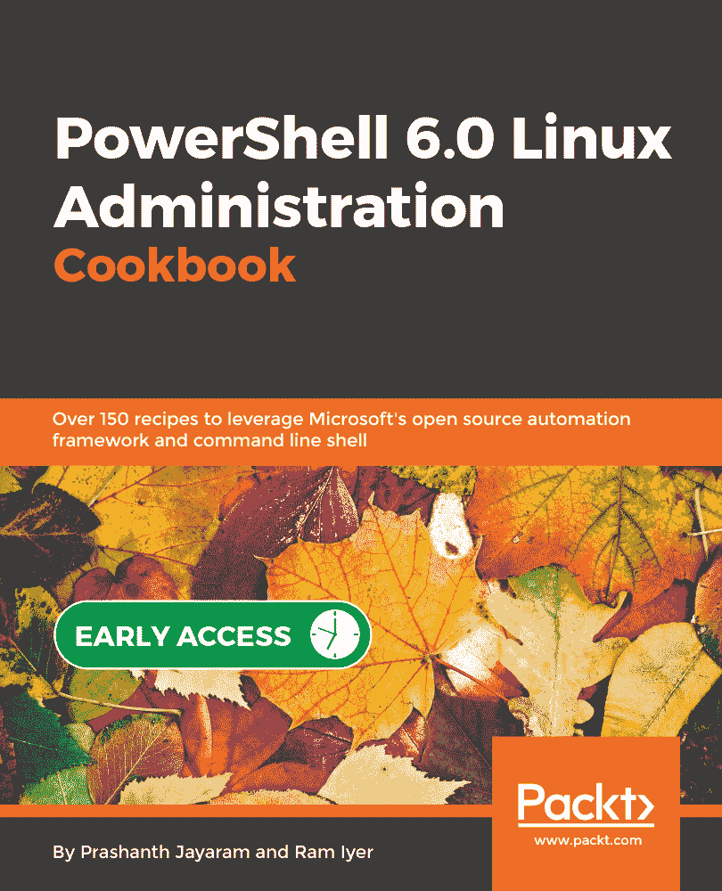

# 目录

# 前言

《PowerShell 6.0 Linux Administration Cookbook》将带你全面了解`.NET Core`、通用的 PowerShell，以及在 Linux 上用于管理和自动化的 PowerShell。本书还将涵盖如何使用 PowerShell 以及管理 Docker 容器、云、VMware 和 SQL 数据库的高级概念。

# 安装、参考与帮助

在本章中我们将涵盖以下食谱（示例）：

1. 安装 PowerShell
2. 在 PowerShell 中获取帮助信息
3. 为特定 cmdlet 获取帮助信息
4. 更新帮助
5. 搜索关键词帮助
6. 查找特定参数的帮助信息
7. 探索`about_`话题
8. 发现 cmdlet
9. 查找模块
10. 从存储库安装模块
11. 列出 PowerShell 中的各种提供程序

## 引言

一切从在你的系统上安装 PowerShell 开始。安装 PowerShell 非常简单且直接。由于 PowerShell 是开源的，其源代码可以在认为是最大的开源项目平台 GitHub 上获取。目前，Windows、Debian（以及 Ubuntu）、RedHat Linux（以及 CentOS）、Fedora 和 macOS 均受 PowerShell 项目官方支持。Arch Linux 和 Kali Linux 由社区支持。对于 AppImage 版本的 PowerShell 也有社区支持，该版本可以在大多数现代 Linux 发行版上运行。

AppImage 是一种用于在 Linux 发行版上运行的应用程序打包方式。每个应用程序都有其依赖项。在 Linux 上，包管理器在安装包时管理依赖项的安装。而 AppImage 包将所有必要的依赖项封装在内部。根据用户偏好，AppImage 可以便携模式运行，也可以安装到系统中。

在编写本章时，PowerShell 在适用于 ARM 的 Windows 上以及 Raspbian Stretch 上实验性可用。

基本上，在 Linux 中，获取源代码并使用`make`从源码构建应用程序应该非常简单。这种方法也适用于 PowerShell。然而，如上所述，官方支持和社区支持仅适用于少数发行版。我们将重点关注在`Ubuntu`和`CentOS`上安装 PowerShell，因为它们是两个最受欢迎的 Linux 发行版。

`PowerShell`有两个版本：稳定版（stable）和预览版（preview）。稳定版适用于生产环境，因为它们更可靠。预览版适用于测试环境，管理员允许在那里进行一定的尝试，并愿意报告他们发现的 Bug 以及对各项功能提供反馈。

## 准备工作

在计算机上准备安装 PowerShell 非常简单。你只需要一台拥有管理员权限且运行良好的 Linux 计算机。根据你选择的安装 PowerShell 的模式，你可能需要或不需要包管理器。很有可能，你的 Linux 发行版已经有了包管理器。

## 如何操作...

正如所讨论的，我们将介绍在`Ubuntu`（及其衍生版本）以及`CentOS`（及其衍生版本）上安装 PowerShell 的步骤。

### 在 Ubuntu 上安装

在你的计算机上安装 PowerShell 的方法有很多。由于我们是在`Ubuntu`上安装 PowerShell，我们将介绍两种方法。第一种是添加微软的密钥并注册仓库，然后使用高级软件包工具（`APT`）安装 PowerShell；另一种是直接使用 GitHub 上的`.deb`包。

#### 从仓库安装

PowerShell 提供官方包的最后一个`Ubuntu`版本是`Ubuntu 17.04`。如果你使用的是`Ubuntu 17.04`，请按照以下步骤安装 PowerShell。否则，建议使用直接下载方法。

1. 第一步导入公共仓库的 GPG 密钥：

```
curl https://packages.microsoft.com/keys/microsoft.asc | sudo apt-key add -
```

2. 现在密钥已添加，请注册该仓库——该仓库由微软维护。

```
sudo curl -o /etc/apt/sources.list.d/microsoft.list https://packages.microsoft.com/config/ubuntu/17.04/prod.list
```

3. 使用以下命令更新包列表。

```
sudo apt update
```

4. 接下来，安装 PowerShell。

```
sudo apt install -y powershell
```

#### 通过直接下载安装

按照以下步骤在 Ubuntu 上安装 PowerShell：

1. 访问[`github.com/powershell/powershell`](https://github.com/powershell/powershell)。
2. 向下滚动到包含 PowerShell 团队官方支持的 Linux 发行版列表的表格。
3. 点击相关链接：Downloads (stable) 下的`.deb`——我们将坚持稳定版。
4. 如果你需要更多信息，请阅读安装说明。
5. 使用`gdebi`、`eddy`或此类包安装程序运行`.deb`文件以完成安装。

如果你运行的不是团队或社区官方支持的发行版之一，请使用`AppImage`。按照上述步骤 1 和步骤 2 操作，然后：

1. 点击 Many Linux distributions | `AppImage`下载`AppImage`文件。`AppImage`文件是一个应用程序，封装了运行该程序所需的所有依赖项。
2. 将`AppImage`文件保存在方便的位置。
3. 下载完成后，导航到下载位置并运行`AppImage`。
4. 如果出现提示询问你是否想安装 PowerShell，请根据你的环境选择合适的响应。

### 在 CentOS 上安装

在`CentOS 7`（或`RedHat 7`）上安装 PowerShell 也有两种方法：仓库和直接下载。过程与在 Ubuntu Linux 上安装类似。

#### 从仓库安装

开始安装：

1. 首先，注册微软仓库。

```
curl https://packages.microsoft.com/config/rhel/7/prod.repo | sudo tee /etc/yum.repos.d/microsoft.repo
```

2. 接下来，使用`yum`安装 PowerShell。

```
sudo yum install -y powershell
```

#### 通过直接下载安装

按照以下步骤在 CentOS 上安装 PowerShell：

1. 访问[`github.com/powershell/powershell`](https://github.com/powershell/powershell)。
2. 向下滚动到包含 PowerShell 团队官方支持的 Linux 发行版列表的表格。
3. 点击相关链接：Downloads (stable) 下的`.rpm`——我们将坚持稳定版。
4. 如果你需要更多信息，请阅读安装说明。
5. 使用以下命令安装 RPM 包（假设你的下载位于`~/Downloads`且你的`PWD`为`~/Downloads`）。

```
sudo yum install <the-downloaded-file.rpm>
```

### 使用 AppImage 包

使用`AppImage`要简单得多。

1. 访问[`github.com/powershell/powershell`](https://github.com/powershell/powershell)。
2. 向下滚动到 Get PowerShell 部分，在社区支持的发行版下找到`AppImage`链接。
3. 下载`AppImage`并将其放置在方便的位置。
4. 运行`chmod a+x PowerShell-<version>-<architecture>.AppImage`使`AppImage`可执行。
5. 调用`AppImage`来运行 PowerShell。系统可能会提示你是否想在计算机上安装该`AppImage`。如果是，请选择 Yes。

## 工作原理...

包管理器安装软件包及其所有依赖项，并使相关命令变得可用。

对于`AppImage`包，所有依赖项都封装在包中（包括`.NET Core`），该包可以在你的计算机上以便携模式运行，也可以被安装并调用。运行`pwsh`启动 PowerShell 查看。

## 另见

1. 菜谱 2.5：比较 Windows PowerShell 和 PowerShell

## 在 PowerShell 中获取帮助信息

PowerShell 中的命令被称为`cmdlets`（读音：command-lets）。`cmdlets`预装了所有必要的帮助信息，就像任何 Linux 命令提供的帮助信息一样。区别在于，有一个单独的`cmdlet`可用于获取所需的帮助；在 PowerShell 中，帮助不是一个开关（switch）。

在我们开始之前，让我们启动终端（启动计算机上可用的任何终端模拟器）。现在输入`pwsh`来调用 PowerShell。一旦获得 PS 提示符，请继续执行下面的步骤。

在 PowerShell 中获取帮助信息：

在提示符处输入`Get-Help`以获取 PowerShell 帮助系统的概述。你会看到如下输出：


PowerShell`cmdlets`在构建时已包含了帮助信息。不带任何参数运行`Get-Help`将显示 PowerShell 中可用的基础信息，这并不特别。让我们看看另一个菜谱来更好地利用`Get-Help`。

### 获取特定 Cmdlet 的帮助信息

虽然`Get-Help`显示关于帮助的信息，但也可以接受其他`cmdlets`作为参数并显示它们的帮助。让我们以`Get-Command`为例并获取该 cmdlet 的帮助。

#### 如何操作...

1. 在提示符处输入以下内容：

```
Get-Help Get-Command
```

2. 你将得到如下输出：


3. 你甚至可以获取 cmdlet 的完整帮助，包括每个参数的信息；例如参数是否是位置相关的、强制性的等。我们将在使用 PowerShell 进行管理时详细查看这些内容。要获取 cmdlet 的完整帮助，输入：

```
PS> Get-Help Get-Command -Full
```

4. 要查看使用该 cmdlet 的示例，输入：

```
PS> Get-Help Get-Command -Examples
```

5. 要在线阅读帮助信息，输入：

```
PS> Get-Help Get-Command -Online
```

注意参数在输出的`SYNTAX`下是分组列的。在这种情况下，我们看到了两个这样的组。这些组被称为`Parameter Sets`（参数集）。参数集告诉我们哪些参数可以组合在一起。未出现在同一个参数集中的两个参数是不能同时使用的。

#### 工作原理...

当你运行命令行时，并将另一个命令行作为参数传递给`Get-Help`时，`Get-Help`会获取作为参数传递的命令的帮助信息；在本例中为`Get-Command`。我们将在稍后的章节中查看如何处理参数。现在，我们只是简单地调用任意 cmdlet 的帮助信息。

如果你观察输出，你会看到 cmdlet 的名称、使用该 cmdlet 的语法、该 cmdlet 可用的别名，以及在需要时提供的更多在线帮助。`Full`和`Examples`是开关，用于告诉 PowerShell 你需要的帮助程度。这些开关是互斥的；你不能同时运行`-Full`和`-Examples`。

## 另见

1. 食谱 2.6：列出别名并使用它们替代 cmdlet
2. 食谱 1.4：更新帮助信息
3. 食谱 1.3：为特定 cmdlet 获取帮助信息（关于参数集的信息）

## 更新帮助

PowerShell 中的帮助信息是动态的。在大多数情况下，PowerShell 会连接网络获取最新的帮助。然而，也可以离线存储帮助文件。这可以使用 cmdlet`Update-Help`来实现。

### 如何操作...

要下载本地安装的 PowerShell 模块的帮助文件：

1. 输入`exit`退出 PowerShell。这样你就可以以提升权限重新启动 PowerShell。
2. 输入`sudo pwsh`以超级用户身份启动 PowerShell。
3. 在`PS`提示符下，运行`Update-Help`。
4. 等待更新进度条出现。随着帮助文件下载到你的计算机，进度条将会填充。

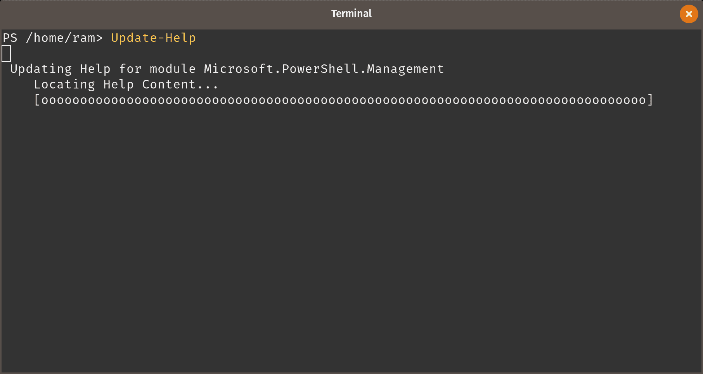

### 工作原理...

每当你运行`Get-Help`cmdlet 时，PowerShell 都会在线获取帮助信息——帮助文件并未存储在本地。这主要是为了确保引用的都是最新的帮助信息。此外，在线查看帮助也不会占用本地计算机的空间。

但在某些情况下，有必要存储帮助信息以便离线访问。在这些情况下，下载并存储帮助文件是有意义的。

此操作需要提升权限的原因之一是帮助信息存储在 shell 内部。因此，非管理员可能在没有管理员干预的情况下无法更新帮助。

## 使用关键词搜索帮助

Linux 管理员非常习惯使用`grep`在任何文本输出中搜索特定的文本模式。正如我们所知的，PowerShell 只返回`object`（对象）——PowerShell 也将文本视为对象。

虽然将对象转换为文本会削弱 PowerShell 的功能，但在某些场景下这是必须的。在这种情况下，我们将在帮助输出中查找关键词“common”。

### 如何操作...

让我们从先获取 cmdlet 的帮助信息开始搜索过程：

1. 在终端中输入`pwsh`启动 PowerShell。
2. 在提示符下，输入：

```
PS> Get-Help Get-Command
```

这应该为你提供关于指定 cmdlet 的有用信息。

3. 使用`Out-String`cmdlet 配合`-Stream`开关将输出转换为文本，每次返回一个字符串，而不是将整个帮助信息作为一个单一字符串返回。这样，我们就能更高效地运行字符串匹配并获得更短的搜索结果。

```
PS> Get-Help Get-Command | Out-String -Stream
```

4. 目前还没有明显的区别。添加`Select-String`cmdlet 来执行类似 grep 的操作。

```
PS> Get-Help Get-Command | Out-String -Stream | Select-String 'common'
```

5. 这将为你提供一个输出，其中包含包含“common”字符串的精确行。

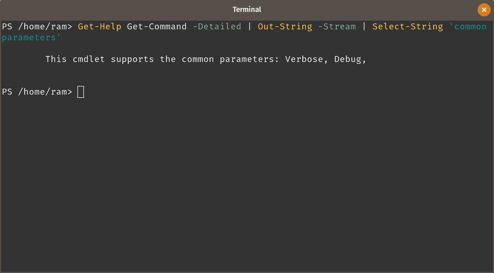

### 工作原理...

在第一步中，我们只需获取`Get-Command`cmdlet 的帮助信息。此输出是一个对象——当输出为文本时，执行文本查找操作最好。`Out-String`将此输出转换为纯字符串；唯一的问题是整个文本块是一个单一字符串。这种方式的文本查找可能并没有真正帮助。我们使用`-String`开关将大字符串拆分为较小的部分（在本例中为段落）。接下来，我们使用`Select-String`配合关键词选择包含我们关键词的字符串。

## 查找特定参数的帮助信息

正如我们在前面的节中看到的，PowerShell 的帮助输出可能让人无所适从。当我们需要访问的 cmdlet 的参数信息时，带有`-Full`开关运行`Get-Help`。然而，这列出了所有参数。如果我们只想获取单个参数的信息呢？

## 发现 cmdlet

到目前为止，我们已经了解了如何获取 cmdlet 的帮助。我们使用`Get-Command`cmdlet 作为示例参数。现在我们将使用`Get-Command`来发现 PowerShell 中的 cmdlet。因此，当你需要 PowerShell 中的任何帮助信息时，`Get-Help`和`Get-Command`是最重要的 cmdlet。

PowerShell 就像普通的英语——PowerShell 在 cmdlet 命名中遵循动词-名词（Verb-Noun）格式，这使得 cmdlet 听起来像普通的英语命令。PowerShell 甚至使用了所谓的“批准动词”（approved verbs），这确保了动词在命名 cmdlet 时遵循约定。而名词部分则可以是任意的。

大多数程序员都会建议学习“用语言思考”。这结合肌肉记忆（有助于你记住键盘上的按键），可以让编程和脚本编写变得更快。PowerShell 的结构类似于英语，在这方面有很大帮助；用 PowerShell 思考非常容易。例如，如果你想知道当前日期，你只需要说`Get-Date`，PowerShell 就会在屏幕上为你打印日期和时间。

### 如何操作...

让我们查看如何仅获取`Get-Help`的`Noun`参数的信息。

1. 在终端窗口上运行`pwsh`运行 PowerShell。
2. 在提示符下，输入`Get-Help Get-Command`来查找该 cmdlet 的基本帮助信息。


3. 记录下你想获取更多信息的参数。我们以`Noun`参数为例。

4. 在提示符下输入以下命令：

```
PS> Get-Help Get-Command -Parameter Noun
```

输出包含关于`Noun`参数的特定信息：

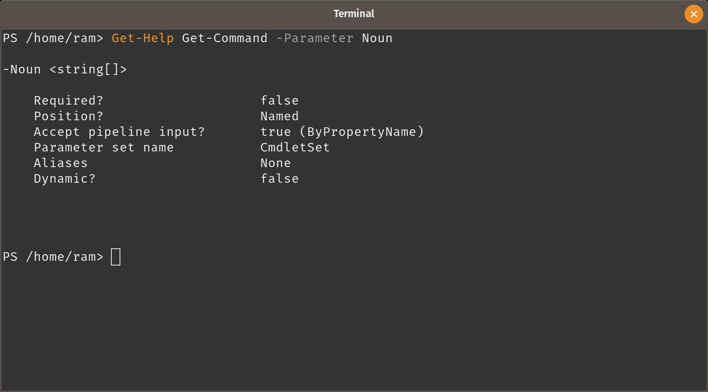

### 工作原理...

这是一个对象过滤的经典示例。由于大多数 PowerShell cmdlet 的输出都是对象，因此很容易选择必要的对象并丢弃输出中的其余部分。

当我们带有我们需要帮助的 cmdlet 以及我们正在查找的特定参数运行`Get-Help`时，我们会得到针对该 cmdlet 的过滤后的帮助。在我们的案例中，我们选择了`Noun`参数。

### 探索 About_ 主题

文档是 PowerShell 的优势优势。虽然并不是所有模块都有完整的文档，但所有的原生模块都有，一些良好的第三方模块也是。默认情况下，PowerShell 本身内置了详尽的文档。

在这个食谱中，我们将查找`about_`主题，从输出中选择一个主题，并对我们选择的主题进行更多阅读。

### 如何操作...

让我们从列出所有的`about_*`帮助文件开始。

1. 使用命令`pwsh`调用 PowerShell。

2. 输入`Get-Help about_*`列出所有的`about_*`帮助文件。

```
Name                              Category  Module                    Synopsis
----                              --------  ------                    --------
about_Aliases                     HelpFile
about_Arithmetic_Operators        HelpFile
about_Arrays                      HelpFile
about_Assignment_Operators        HelpFile
about_Automatic_Variables         HelpFile
.
.
.
about_Wildcards                   HelpFile
```

3. 选择一个你想要阅读的主题——我们选择了`about_Modules`。

4. 输入`Get-Help about_Modules`来了解 PowerShell 模块。

```
ABOUT MODULES

简要描述
解释如何安装、导入和使用 PowerShell 模块。

详细描述
模块是一个包含 PowerShell 命令的包，例如小程序命令（cmdlets）、
提供程序（providers）、函数、工作流、变量和别名。

编写命令的人可以使用模块来组织他们的命令并
与他人共享。接收模块的人可以将模块中的命令添加到他们的 PowerShell 会话中，并像使用内置命令一样使用它们。
.
.
.
如何在模块中查找命令

使用`Get-Command`命令行来查找所有可用命令。你可以使用
`Get-Command`命令行的参数来过滤命令，例如按模块、名称和名词。
.
.
.
以下模块（或加载项）随 PowerShell 一起安装。`CimCmdlets` `Microsoft.PowerShell.Archive` `Microsoft.PowerShell.Core` `Microsoft.PowerShell.Diagnostics` `Microsoft.PowerShell.Host` `Microsoft.PowerShell.Management`...
```

### 工作原理...

如果将 cmdlet 作为参数传递，`Get-Help`将为你提供有关该 cmdlet 的信息。在你只知道 cmdlet 名称的一部分时，可以使用字符和通配符的组合来列出匹配搜索字符串的 cmdlet（在本例中为`about_*`）。

现在，我们选择了我们想要阅读的主题并输入该特定的`about_`主题。现在，`Get-Help`显示关于该主题的完整文档。

### 如何操作...

`Get-Command`可以帮助确定执行任务的最佳 cmdlet。要查找 cmdlet，请按照以下步骤操作：

1. 在终端中，输入`pwsh`来调用 PowerShell。

2. 输入`Get-Command`获取 PowerShell 中所有可用 cmdlet 的列表。返回的 cmdlet 数量根据你上次更新 PowerShell 的时间以及加载的模块而变化。

```
PS> Get-Command
```

这可能并不是特别有用——如果你正在寻找列出当前运行进程的命令，有一个命令列表你能做什么呢？

3. 进程是一个名词。我们想要一个处理`processes`的 cmdlet 列表。在提示符处输入：

```
PS> Get-Command -Noun Process
```

注意，在 PowerShell 中，名词是单数形式。因此，是`Process`而不是`Processes`。

4. 如果你想进一步缩小返回的 cmdlet 列表，请加上动词。

```
PS> Get-Command -Verb Get -Noun Process
```

5. 如果你觉得懒，或者不确定确切的规范，甚至可以使用通配符。

```
PS> Get-Command -Noun Proc*
```

6. 如果你不想写那么多，而且你几乎确定知道该 cmdlet 的部分，你可以直接使用通配符搜索。

7. 如果你知道包含该 cmdlet 的模块名称，甚至可以在调用`Get-Command`时使用`Module`参数。

```
PS> Get-Command -Noun Process -Module Microsoft.PowerShell.Management
```

### 工作原理...

PowerShell 能够根据第一个连字符识别 cmdlet 中的动词和名词。出现在第一个连字符之前的任何内容都是动词，连字符之后的任何内容都是名词。当从模块加载 cmdlet 时，PowerShell 会识别它们中的动词和名词。搜索会根据搜索规范迅速返回 cmdlet。基于动词、名词甚至模块名称的过滤将相应限制搜索。

### 查找模块

组件的松耦合是框架成功的关键之一。PowerShell 也同样遵循这一原则。所有的 cmdlet 都封装在模块中。模块可以是官方提供的、你创建的，甚至是第三方创建的。

模块的安装在过去可能很麻烦，但现在已经精简化了。PowerShell 现在预装了一个名为`PowerShellGet`的包管理器，它连接到 PowerShell 库 ([`www.powershellgallery.com`](https://www.powershellgallery.com))。PowerShell 库是一个在线仓库，包含了模块、脚本和其他工具，管理员可以下载并安装以扩展 PowerShell 的功能。

虽然可以从第三方网站下载 PowerShell 模块，但我们书的重点是 PowerShell 库。

### 如何操作...

要在 PowerShell 库中查找模块，请按照以下步骤操作：

1. 在终端上运行`pwsh`启动 PowerShell。

2. 寻找与模块相关的命令。

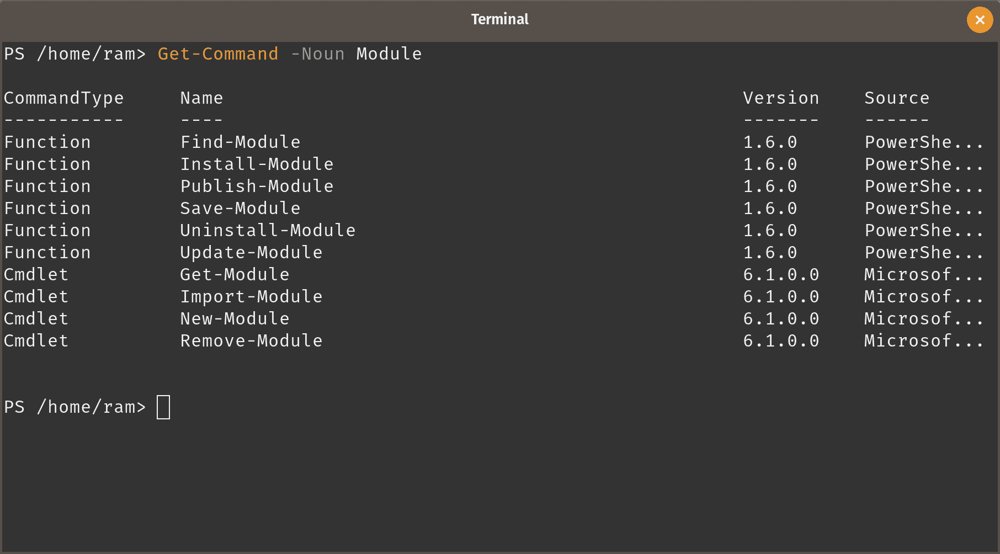

注意可用于处理模块的命令列表。其中一些是 cmdlet 类型，另一些是函数。

3. 使用动词进一步过滤输出。

```
PS> Get-Command -Noun Module -Verb Find
```

你得到的输出是`Find-Module`。

4. 输入以下内容列出所有模块。

```
PS> Find-Module
```

列表开始出现。搜索结果太多了。按`Ctrl + C`终止执行。

5. 搜索一个帮助你操作 Docker 容器的模块。


### 工作原理...

数百个模块、脚本和所需状态配置（Desired State Configuration）资源已注册在`PSGallery`仓库中。微软现在建议使用该仓库进行模块管理。使用`Find-Module`命令行，PowerShell 会连接到仓库并获取所有可用模块的列表。然后，它根据你提到的标准对返回的结果运行搜索。

你也可以类似的找到可以执行重复任务的脚本。要查找脚本，使用`Find-Script`命令行。它的工作方式与`Find-Module`命令行类似，但它的是单个脚本而不是模块。

### 从仓库安装模块

现在我们知道如何查找模块，可以继续获取模块并安装它们。所有与`PowerShellGet`相关的 cmdlet 都封装在名为`PowerShellGet`的模块中。

### 如何操作...

我们现在知道了可以让我们管理 Docker 基础架构的模块名称。现在让我们尝试安装该模块。

1. 安装模块可能需要提升权限。使用`sudo`打开 PowerShell。

```
$ sudo pwsh
```

2. 现在运行以下命令从仓库安装 Docker 模块。

```
PS> Install-Module Docker
```

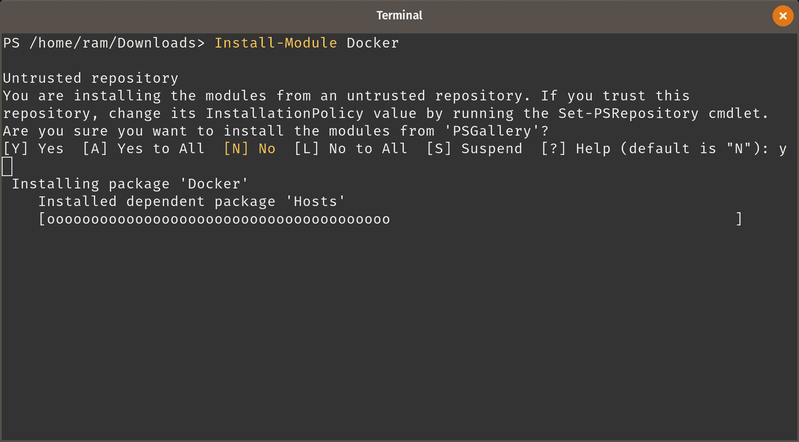

3. 在某些情况下，你可能想在安装之前将模块保存到本地。

```
PS> Save-Module Docker ~/PsModules
```

通过这种方式，你可以简单地以便携模式导入模块并运行 cmdlet，而无需在任何系统目录中安装模块。

4. 要导入下载的模块，运行：

```
PS> Import-Module ~/PsModules/Docker/1.3.2/Docker.ps1
```

5. 要更新已安装的模块，运行：

```
PS> Update-Module Docker
```

6. 要删除已安装的模块，运行：

```
PS> Uninstall-Module Docker
```

这些大部分功能也适用于发布到 PowerShellGet 仓库的脚本。只需将命令行中的`Module`替换为`Script`即可解决问题——你可以像处理模块一样查找、保存、安装、更新和卸载脚本。

下载的脚本并不一定需要安装；它们可以直接调用。我们将在后面的章节中看到这一点。

### 工作原理...

当运行`Install-Module`时，PowerShell 实际的操作是将模块文件保存到 PowerShell 默认查找模块的位置。

## 另另

1. 食谱：PowerShell 中的模块发现路径（创建自定义模块）

2. 食谱 3.11：调用 PowerShell 脚本

### 列出 PowerShell 中的各种提供程序

在我们开始使用 PowerShell 进行管理之前，另一个概念是理解`providers`（提供程序）。

PowerShell 中的提供程序是面向对象编程中`overloading`（重载）概念绝佳示例。本质上，提供程序是一个逻辑上将非文件系统驱动器表示为驱动器的程序。例如，在 Windows 上，注册表是一个配置数据库。在 PowerShell 中，注册表就是一个提供者；这样，管理员就可以 PowerShell 导航并操作注册表项，就像操作文件一样。这种功能也适用于 Linux，但提供者的数量没有 Windows 那么多。

### 如何操作...

要列出 PowerShell 中的提供程序，请遵循以下步骤：

1. 运行`pwsh`在终端中加载 PowerShell。

2. 运行命令：

```
PS> Get-PsProvider
```

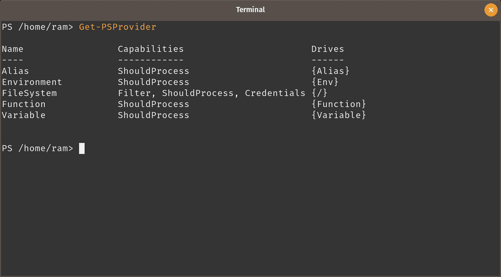

注意 PowerShell 中提供的提供程序，以及这些提供程序内部的驱动器和功能。

3. 导航到 Alias 驱动器。

```
PS> Set-Location Alias:
```

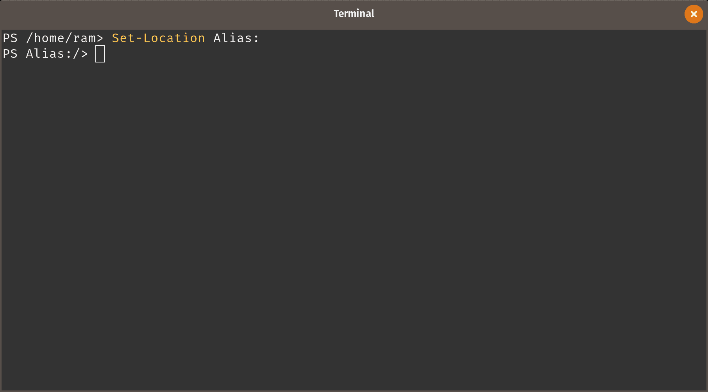注意驱动器名称后面的冒号（是`Alias:`而不是`Alias`）。这对于指示 PowerShell 你正在切换驱动器非常重要。如果没有冒号，PowerShell 只会尝试在你的当前工作目录中查找名为`Alias`的目录。

### 工作原理...

截至目前，PowerShell 提供程序在 Linux 中似乎还没有按预期工作。不过，这以后应该得到修复。

提供程序将非文件系统类的结构封装在内部，并将其作为伪文件和目录呈现给 PowerShell。这允许你像操作简单文件和目录一样导航复杂的结构，从而可以使用适用于文件系统的命令（如`Get-ChildItem`）更轻松地管理它们。

输出中的`Capabilities`列显示了每个提供程序的功能，如`Credentials`、`ShouldProcess`和`Filter`。这意味着这些提供程序支持向核心传递凭据、参数如`-WhatIf`和`-Confirm`（它们是`ShouldProcess`的一部分）以及使用`-Filter`参数过滤输出的能力。我们将在接下来的章节中学习这些功能的每一个项。

## 另另

1. 食谱：`ShouldProcess`功能，如`-Confirm`和`-WhatIf`（函数）

2. 食谱：使用`-Filter`参数

### 介绍 Core 及其功能

在本章中，我们将涵盖以下主题：

1. 剖析 .NET Core 对象

2. 将输出拆分为不同的对象

3. 将文本输入解析为对象

4. 比较 Bash 和 PowerShell 的输出

5. 比较 Windows PowerShell 和 PowerShell

6. 列出别名并使用它们代替命令项 (cmdlets)

7. 创建自定义别名

8. 导入/导出自定义别名以供将来使用

9. 列出执行策略并设置合适的策略

### 引言

微软在 2014 年宣布 .NET 的“开源”几乎引发了一场风暴。许多人冲向台前（可以这么说）阅读这些难以置信的消息——微软如何可能让他们操作系统的内核开源？有些人持怀疑态度，另一些人则欢喜若狂。随后是一个更清晰的宣布：NET Core 是开源的，而不是 .NET Framework。许多人说 .NET Core 是 .NET Framework 的子集。

.NET 最初于 2000 年发布，作为一个基于互联网标准的新平台。与其同时，在年底，微软发布了`Common Language Infrastructure`（通用语言体系）作为一种标准，这样任何想要的人都可以根据这些标准编写自己的 .NET 框架。自 00 年代以来，.NET Framework 一直是 Windows 的基础。

Windows PowerShell 于 2006 年面向市场发布，它是 .NET Framework 的一种实现，专注于系统管理员（或称 sysadmins，以便他们更好地管理 Windows 工作负载并实现任务自动化）。

2016 年 6 月，微软发布了经过协作重构的、更现代且高效的 .NET。.NET Core 正式诞生。虽然 .NET Framework 继续主宰 Windows 领域，但开源且跨平台的 .NET Core 已经积累了巨大的势头并持续增长。.NET Core 似乎是未来的方向。

PowerShell（不是 Windows PowerShell）基于 .NET Core，因此它是开源的，并且与 .NET Core 拥有跨平台愿景。

在本章中，我们将查看一个非常简单的 .NET Core 实现，并将其与 PowerShell 的输出进行比较，以证明 PowerShell 仅仅是封装的 .NET Core 代码。同时，我们将观察 PowerShell 的通用行为。

### 剖析 .NET Core 对象

.NET Core 在跨平台标准的通用语言体系上运行。因此，使用 .NET Core 封装 Linux 的内部工作机制是可能的。正如我们在未来章节中看到的，PowerShell 是面向对象的，就像 .NET Core 一样。为了进行演示，我们将选择一个简单的系统类，名为`System.IO.DirectoryInfo`来显示某些目录的信息。我们还将比较 .NET Core 对象的输出与 PowerShell 命令项的输出，后者也显示了某些目录的信息。

你不需要记住 .NET Core 类、方法或其语法来操作 PowerShell；这正是 PowerShell 存在的全部意义。

### 准备工作

如果你跟了上一章的操作，那么你的 Linux 计算机应该已经安装了 PowerShell；打开终端窗口并输入`pwsh`来调用 PowerShell。

每个`object`（对象）都有成员——`properties`（属性）和`methods`（方法）。如果你不熟悉面向对象编程的概念，属性是对象的特征（对象拥有什么），方法是对象的能力（对象能做什么）。因此，引用一个（可以说是争议最大的）最过度使用的属性和方法例子：如果马是一个对象，它的身高、颜色等就是它的属性；奔跑、进食等就是该对象支持的方法。

### 如何操作...

1. 使用 PowerShell，.NET Core 也作为依赖项已安装。让我们在 PowerShell 中创建一个对象，这会调用一个 .NET 类及其默认构造函数。此构造函数需要一个参数。

```
PS> New-Object -TypeName System.IO.DirectoryInfo -ArgumentList '/home/ram'
```

2. 这为提供了指定目录的信息，如下：


## 使用 PowerShell 处理目录信息

### 查看目录信息

首先，我们查看一个目录的详细信息。在 PowerShell 中，可以使用 `Get-Item` 命令项来获取有关目录的详细信息。

```
Mode                LastWriteTime         Length Name            
----                -------------         ------ ----            
d-----          5/16/18  11:03 AM                ram
```

3. PowerShell 中有一个名为 `Get-Item` 的命令项，它可以提供有关目录的详细信息。让我们使用相同的参数调用此命令项，看看我们得到了什么。

```
PS> Get-Item '/home/ram'

    Directory: /home

Mode                LastWriteTime         Length Name            
----                -------------         ------ ----            
d-----          5/16/18  11:03 AM                ram
```

4. 很好！现在让我们对 `Get-Item` 的输出使用 `Get-Member` 命令项查看我们刚刚收到的输出对象的详细信息。

```
PS> Get-Item '/home/ram' | Get-Member
```

`Get-Member` 显示输出对象中所有可用成员（大多数 PowerShell 命令项返回对象输出，而不是纯文本）。有关更多信息，请运行 `Get-Help Get-Member`。

这将列出输出中包含的一系列成员。目前我们主要关注最第一行。

```
PS> Get-Item '/home/ram' | Get-Member

   TypeName: System.IO.DirectoryInfo

Name                      MemberType     Definition
----                      ----------     ----------
LinkType                  CodeProperty   System.String LinkType{get=GetLinkType;}
Mode                      CodeProperty   System.String Mode{get=Mode;}
.
.
.
```

注意输出的第一行，`TypeName: System.IO.DirectoryInfo`。这正是我们在创建 .NET 对象时使用的完全相同的类型名称。


这证明了显示当前工作目录信息的相同任务既可以通过调用 .NET 构造函数实现，也可以通过运行 PowerShell cmdlet 实现。因此，我们推断出 PowerShell cmdlet 仅仅是封装好的 .NET 代码，通过简化处理使管理员能够操作计算机，而无需担心底层的 .NET 代码。

从本质上说，`Get-Item` 在底层调用了 `System.IO.DirectoryInfo` 类，并连同 cmdlet 一起传递参数。

`Get-Item` 可以用于文件系统中的任何位置。只要你有权限访问该位置，PowerShell 就会返回关于你作为参数传递的位置的信息。

正如俗话所说：

如果 C# 的哥们能做到，你也可以。

### 还有更多内容...

阅读 `Get-Item | Get-Member` 命令的输出，以了解关于你指定的目录的更多信息。此外，在我们熟练使用 `Select-Object` cmdlet 后，我们应该能够从返回的对象中调用特定的字段。

#### 另另

1. .NET 类，[System.IO.DirectoryInfo](https://msdn.microsoft.com/en-us/library/system.io.directoryinfo(v=vs.110).aspx) (微软开发者网络)

## 将输出拆分为不同的对象

在上一节中，我们看到对象可以有属性也可以有方法。这些属性和方法被称为成员。在面向对象的编程方法（以及扩展到使用 PowerShell 进行管理）中，可以使用`成员访问运算符`（即单个点 `.`）来引用对象的属性和方法。

### 准备工作

理想情况下，此配方应该是上一个扩展。如果你没有运行之前的命令，建议你运行它们，然后继续执行下面的步骤。

### 如何操作...

1. 查看来自上一个配方中以下命令的输出：

```
PS> Get-Item '/home/ram' | Get-Member
```

输出表格包含成员的名称、类型和定义。查看 `MemberType` 列；你会看到 `Method` 以及不同类型的属性，如 `CodeProperty` 和 `Property`。

2. 假设我们想查看我的主目录最后一次被写入的时间。我们将使用成员访问运算符引用此属性。要做到这一点，只需将 `Get-Item` 命令及其参数括在括号中，并使用点操作符引用该属性。

```
PS> (Get-Item /home/ram).LastWriteTime

Wednesday, 18 May 2018 11:01:02
```

3. 接下来，让我们选择对象的 `Parent` 属性。这将为我们提供主目录所在的目录的详细信息。

```
PS> (Get-Item /home/ram).Parent

Mode                LastWriteTime         Length Name
----                -------------         ------ ----
d-r---       03/05/2018     17:07                home
```

此输出本身就是一个对象，这意味着我们可以获取此返回对象的最后写入时间和和其他详细信息，就像我们对 `/home/ram` 执行的那样。我们如何查看父文件夹（`/home`）是什么时候的？

4. 首先，让我们在该对象上使用 `Get-Member` cmdlet，查看返回对象的 `TypeName`。

```
PS> (Get-Item /home/ram).Parent | Get-Member

   TypeName: System.IO.DirectoryInfo
```

这与 `Get-Item` 本身相同。因此，`Get-Item /home/ram` 的任何成员也适用于 `(Get-Item /home/ram).Parent`。

5. 现在调用父对象上的 `CreationTime` 属性。只需在 `Parent` 后面加上点，并调用 `CreationTime` 属性。

```
PS> (Get-Item /home/ram).Parent.CreationTime

Thursday, 3 May 2018 17:07:38
```

`CreationTime` 属性本身也是一个类型为 `DateTime` 的对象。因此，你可以对该对象执行日期和时间操作。

PowerShell 在大多数情况下是不区分大小写的。然而，建议我们遵循约定以尽量减少错误。特别是因为在 Linux 中大小写敏感是一种约定。属性可能是不同的数据类型。可以在 `Definition` 列中看到数据类型。

6. 让我们查看 `CreationTime` 对象的成员，看看是否可以进一步过滤输出。

```
PS> (Get-Item /home/ram).Parent.CreationTime | Get-Member

   TypeName: System.DateTime
```

7. 让我们只从该对象中选择年份属性。

```
PS> (Get-Item /home/ram).Parent.CreationTime.Year
2018
```

到此结束从返回对象内部选取属性的操作。接下来，让我们使用返回对象内部的方法，并在 `/home/ram` 下创建一个子目录。

1. 首先，列出该目录下的现有目录。这是使用 cmdlet `Get-ChildItem` 完成的。

```
PS> Get-ChildItem /home/ram

    Directory: /home/ram

Mode                LastWriteTime         Length Name
----                -------------         ------ ----
d-----       06/04/2018     13:05                Desktop
d-----       18/05/2018     16:01                Documents
d-----       18/05/2018     16:01                Downloads
d-----       06/04/2018     13:05                Music
d-----       19/05/2018     11:07                Pictures
d-----       06/04/2018     13:05                Public
d-----       06/04/2018     13:05                Templates
d-----       10/04/2018     03:41                Videos
```

`Get-Item` 为提供关于目录本身的详细信息。从本质上说，此 cmdlet 处理的是当前项目。因此，你拥有与该意图一致的属性和方法。子项目（Child items）是指该项目*内部*的文件和目录。

2. 这是用户配置文件中的标准目录列表。现在让我们使用 `Get-Item` 中的方法在这个配置文件文件夹内创建一个子目录。

```
PS> (Get-Item /home/ram).CreateSubdirectory('test-directory')
```

要知道某个方法接受什么参数，请查看 `Get-Member` 输出的 `Definition` 列。对于 `CreateSubdirectory`，定义为 `System.IO.DirectoryInfo CreateSubdirectory(string path)`。

你现在应该会得到确认。


3. 极极了。现在，列出主目录下的目录。

```
PS> Get-ChildItem /home/ram

    Directory: /home/ram

Mode                LastWriteTime         Length Name
----                -------------         ------ ----
d-----       06/04/2018     13:05                Desktop
d-----       18/05/2018     16:01                Documents
d-----       18/05/2018     16:01                Downloads
d-----       06/04/2018     13:05                Music
d-----       19/05/2018     11:07                Pictures
d-----       06/04/2018     13:05                Public
d-----       06/04/2018     13:05                Templates
d-----       19/05/2018     13:31                test-directory
d-----       10/04/2018     03:41                Videos
```

我们现在可以看到使用 `CreateSubdirectory` 方法创建的新目录。

正如你可能注意到的，运行 `Get-ChildItem` 与运行 `Get-Item` 返回对象的 `GetDirectories` 和 `GetFiles` 方法相似。这是 .NET Core 中封装的另一个例子。

使用返回对象中的属性和方法非常简单。小命令（cmdlet）输出中返回的对象可以直接在命令（包括参数内的小命令）上使用成员访问运算符进行调用。

在成员访问运算符之后调用属性可以获取存储在属性中的数据。在我们的案例中，它就是 `LastWriteTime`。

方法是函数。它们可能需要参数，也可能不需要。`CreateSubdirectory` 方法需要一个字符串参数，即我们想要创建的子目录的名称（或路径）——我们在括号中输入的任何内容本质上都构成了我们想要创建的路径。对于不需要带参数运行的方法，需要在方法名后紧跟一个空括号进行调用，例如 `ToString()`。

当我们将字符串参数传递给 `CreateSubdirectory` 时，该方法会运行一个 .NET Core 程序，并在我们通过 `Get-Item`指定的目录内创建一个子目录。.NET Core 的内部工作原理超出了本书的范围。

### 另请查看

1. 食谱：通过管道选择对象

## 从文本到对象的解析

从文本转向对象模型起初看起来可能有些令畏。然而，通过 PowerShell，切换到新模型并不困难，特别是考虑到 PowerShell 只要有正确的工具就可以文本转换为对象。在本食谱中，我们将查看 PowerShell 将文本数据转换为对象的方法。

### 准备工作

在我们深入研究食谱之前，让我们先简单介绍一下如何处理文本到对象的解析。一种方法是使用 .NET 的内置功能，我们要讨论的第二种方法涉及使用小命令根据分隔符执行转换。

此食谱的基本要求非常简单：你只需要在计算机上安装 PowerShell 即可。我们将在 PowerShell 中编辑文件。如果你更倾向于使用文本编辑器，也可以。大多数 Linux 发行版都自带文本编辑器。如果没有，请使用你的包管理器安装 `Vim`、`Nano`、`Gedit`、`Visual Studio Code`、`Atom` 或任何其他文本/代码编辑器。

### 如何操作

我们将首先查看如何将终端的纯文本输入转换为对象。这涉及到使用所谓的 `PowerShell 类型加速器`（Type Accelerator）。PowerShell 类型加速器是 .NET 类的 get 别名。使用这些加速器，我们可以在 PowerShell 中调用 .NET 类并使用它们的许多功能。

1. 让我们以纯文本作为输入并将其转换为日期对象。要检查你的输入是什么类型的对象，请使用 `Get-Member` 小命令。

```
PS> '21 June 2018' | Get-Member
```

将任何文本包含在单引号内会将该文本定义为非扩展字面量字符串（non-expanding literal string）。在 PowerShell 中，这种情况不需要显式定义。

2. `TypeName` 显示为 `System.String`。这确认了我们输入的是纯文本。现在让我们使用类型加速器并将文本转换为 `DateTime` 对象。为此目的的加速器是 `[DateTime]`；将此加速器放在字面量字符串之前。

```
PS> [DateTime]'21 June 2018'

Thursday, 21 June 2018 00:00:00
```

3. 接下来，找到返回对象的 `TypeName`。

```
PS> [DateTime]'21 June 2018' | Get-Member

   TypeName: System.DateTime
```

漂亮，字符串已成功解析为日期和时间！

4. 当带有文本参数时调用小命令 `Get-Date`，也可以实现相同的结果。

```
PS> Get-Date '21 June 2018'

Thursday, 21 June 2018 00:00:00
```

5. 同样，`TypeName` 将是：

```
PS> Get-Date '21 June 2018' | Get-Member

   TypeName: System.DateTime
```

6. 就像我们在上一个食谱中做的那样，现在现在操作对象以更有意义的方式显示信息。例如，如果你只关心年份，你会这样写：

```
PS> (Get-Date '21 June 2018').Year
2018
```

将文本转换为对象的另一种方法是使用执行此类任务的小命令。PowerShell 封装了几种转换小命令，其中之一是 `Import-Csv`。你可能注意到 PowerShell 通常以表格格式发送输出。这是对象的简单表示。`Import-Csv` 将具有分隔符的行和列结构中的数据转换为对象，其中每一行都是对象本身的一个实例，每一列都是对象的的一个属性。

1. 为了演示这一点，让我们创建一个包含以下内容的 CSV 文件。在 PowerShell 提示符下，输入：

```
PS> @'
```

2. 这将带你进入下一行；PowerShell 正在等待输入。在提示符处粘贴以下示例内容。

```
WS,CPU,Id,SI,ProcessName
161226752,23.42,1914,1566,io.elementary.a
199598080,77.84,1050,1040,gnome-shell
216113152,0.67,19250,1566,atom
474685440,619.05,1568,1566,Xorg
1387864064,1890.29,15720,1566,firefox
```

3. 转到下一行并在 `>>` 提示符处输入以下内容：

```
'@ | Out-File sample.csv
```


你可以使用`touch`命令和你偏好的文本编辑器来执行相同的操作。目标是将内容获取到`sample`文件中。

4. 接下来，使用 PowerShell 读取文件内容。

```
PS> Get-Content ./sample.csv
WS,CPU,Id,SI,ProcessName
161226752,23.42,1914,1566,io.elementary.a
199598080,77.84,1050,1040,gnome-shell
216113152,0.67,19250,1566,atom
474685440,619.05,1568,1566,Xorg
1387864064,1890.29,15720,1566,firefox
```

5. 这看起来像是简单的文本。让我们查看对象的类型名称以确认这确实是纯文本。输入：

```
PS> Get-Content ./sample.csv | Get-Member

   TypeName: System.String
```

6. 那是纯而简单的字符串。现在让我们将内容转换为简单对象。这是使用`Import-Csv`完成的。

```
Import-Csv ./sample.csv
```

这应该给你一个列表式的输出。


7. 为了确认输出是对象，列出它的成员。

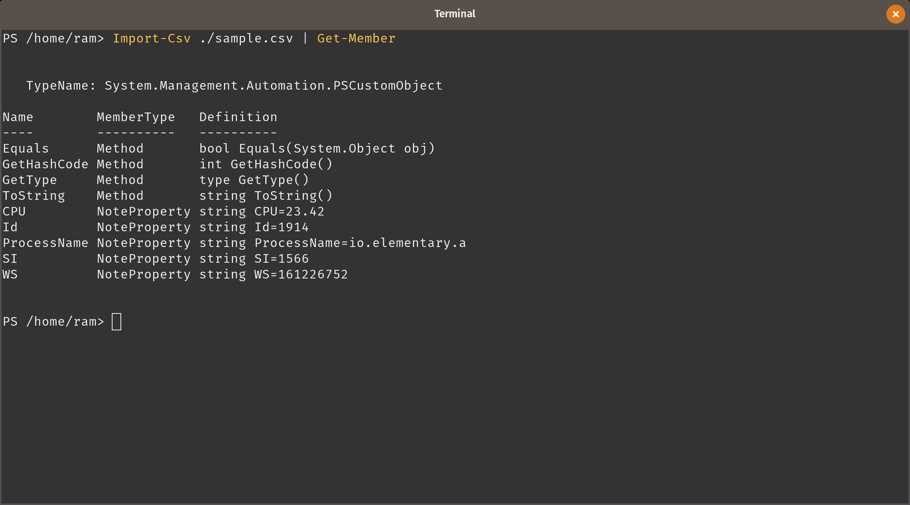

通常情况下，内容是自定义对象（`PSCustomObject`），我们在 CSV 中的列类型为`NoteProperty`，如`MemberType`所示。

8. 如果你愿意以表格形式查看内容，将内容格式化为表格。

```
PS> Import-Csv ./sample.csv | Format-Table
```

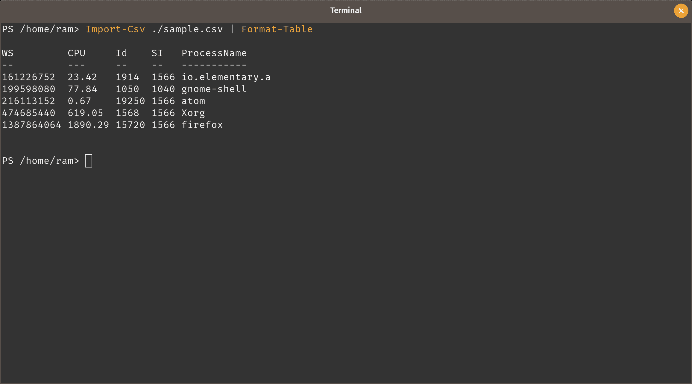

这就是我们本食谱的结束。我们成功地将文本转换为对象。然而，请注意这只是简单的转换，并且`Import-Csv`的输出仍然像字符串。尽管如此，所有内容都是对象，处理起来更容易。

### 工作原理

类型加速器是 PowerShell 中封装 .NET 代码的另一种形式。还记得本章的第一个食谱吗，我们在 PowerShell 中创建了一个 .NET 对象。我们使用 PowerShell 命令`New-Object -TypeName System.IO.DirectoryInfo -ArgumentList '/home/ram'`来获取主目录的信息：我们创建了`System.IO.DirectoryInfo`的新实例，并为其传递了一个参数。那需要很多代码。为了加速这一过程，我们可以使用`[IO.DirectoryInfo]'/home/ram'`（`System`是默认命名空间；当我们调用加速器时，PowerShell 会理解它），它输出与前一个命令相同的对象。

另一方面，通过`Import-Csv`，该过程是将数据从文本转换为键值对的简单转换。这类似于使用带有`Delimiter`参数的`ConvertFrom-Text`。通过这种方式，我们指示 PowerShell 将每行文本转换为对象的实例：行-列结构中的第一行被视为属性名，其余行则是数据。单元格之间使用分隔符分隔，在 CSV 文件中，该分隔符是逗号。

## 更多内容...

寻找 PowerShell 内置的更多转换 cmdlet。可以使用命令`Get-Command -Verb ConvertFrom`来完成。

## 另见

1. 关于[Hey, Scripting Guy! 博客]中关于类型加速器的[更多信息](https://blogs.technet.microsoft.com/heyscriptingguy/2013/07/08/use-powershell-to-find-powershell-type-accelerators/)。

2. 食谱：使用 Here （Here strings）。

3. PowerShell 中[不同类型的成员](https://docs.microsoft.com/en-us/dotnet/api/system.management.automation.psmembertypes?view=pscore-6.0.0)。

4. 最佳实践总结：仅在最后进行格式化。

## 比较 Bash 和 PowerShell 的输出

PowerShell 和 Bash 都是 shell，并且能够与内核交互。就像 Bash 可以运行在 Windows 上一样，PowerShell 现在也可以运行在 Linux 上。虽然关于哪种 shell 比另一个更好在几乎所有方面都存在争议，而且今天对 shell 的选择仅仅是个人喜好的问题，但 PowerShell 的强大程度确实达到了 .NET Core 能达到的最高程度。

这两个 shell 之间的主要区别正如我们之前看到的，PowerShell 输出的是对象，而 Bash 返回的是文本。在 Bash 中对输出的操作涉及先处理文本，然后在处理后的文本上运行后续命令以获取所需的输出。相反，PowerShell 将内容处理为对象，并且根据设计需要相对较少的操作。

正如 Jeffrey Snover（Windows PowerShell 的发明者）提到的，随着时间的推移，结构化数据变得流行，而结构化数据正是 PowerShell 最出色的地方。

### 准备工作

在这个食谱中，我们将选取一个示例来展示使用 PowerShell 处理文件元数据是多么简单高效，主要是因为输出是一个对象。我们将分别使用 Bash 中的`ls`和 PowerShell 中的`Get-ChildItem`列出主目录下的文件和文件夹，以及修改日期时间。

如果你愿意，可以打开两个终端实例：在其中一个启动`pwsh`。

### 如何操作...

1. 在 Bash 提示符下，输入`ls -l`列出所有文件以及命令默认显示的元数据。

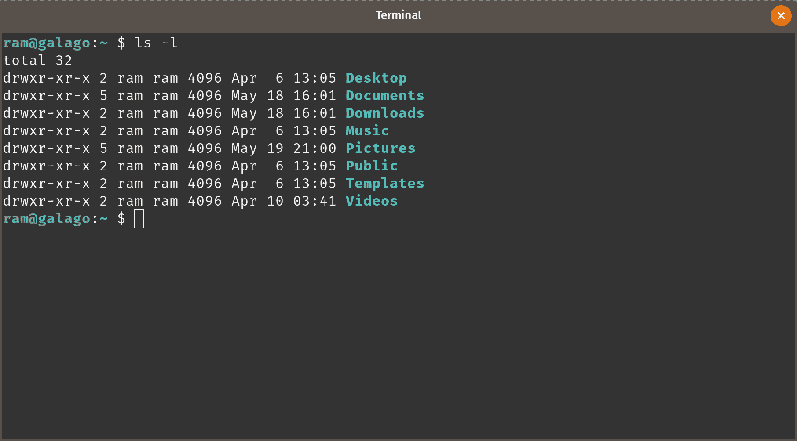

2. 转到运行 PowerShell 的终端，在提示符处输入`Get-ChildItem`。

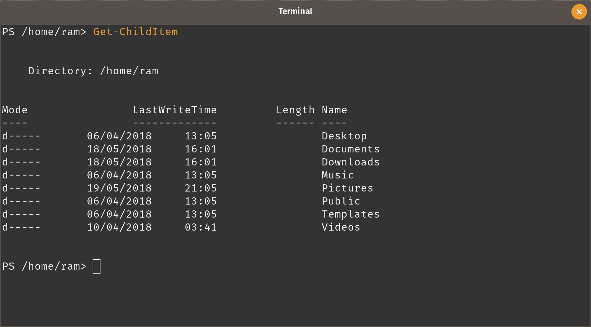

3. 现在，让我们只选择文件夹名称以及最后修改的日期时间。这在 Bash 中通过将`ls -l`的输出传递给`awk`实现。

```
ls -l | awk '{print $6, $7, $8, $9}'
```

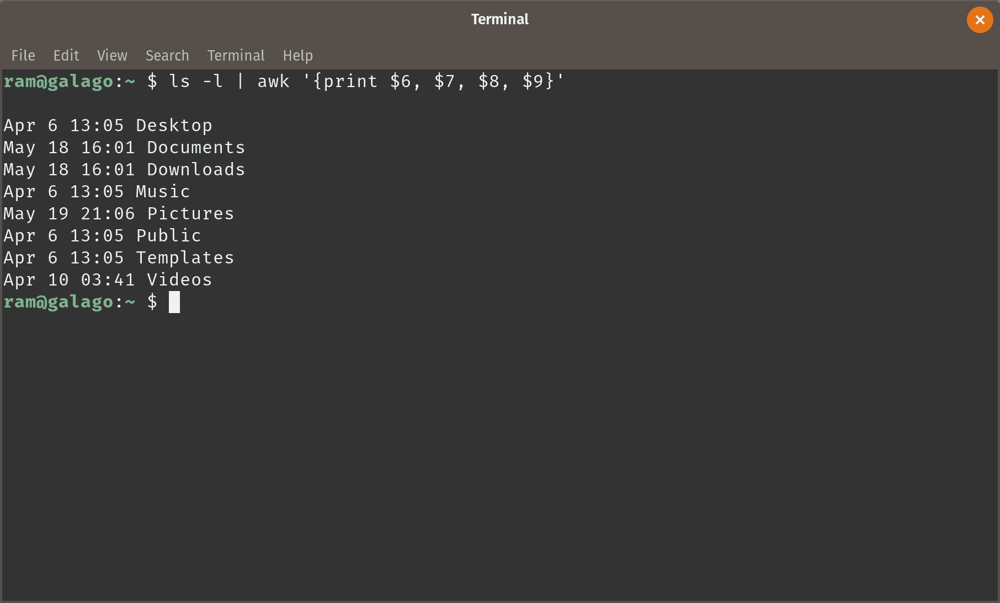

4. 接下来，让我们在 PowerShell 中选择相同的信息。

```
Get-ChildItem | select LastWriteTime, Name
```

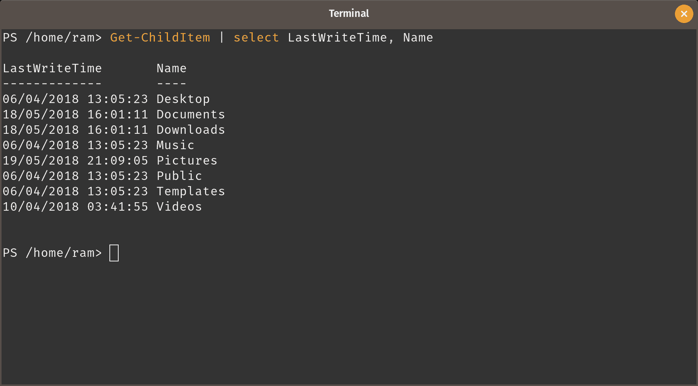

如果你发现，这两种情况下输出都非常相似，但在 PowerShell 中，你还能看到列名，这意味着你不需要去查找进一步的文档了。此外，在 PowerShell 中选择列的选择更简单；不需要进行文本处理。相反，在 Bash 中，我们使用`awk`命令来处理文本输出。

5. 让我们再进一步，创建一个名称中带有空格的子目录。

```
$ mkdir 'test subdirectory'
$ ls -l | awk '{print $6, $7, $8, $9}'
```

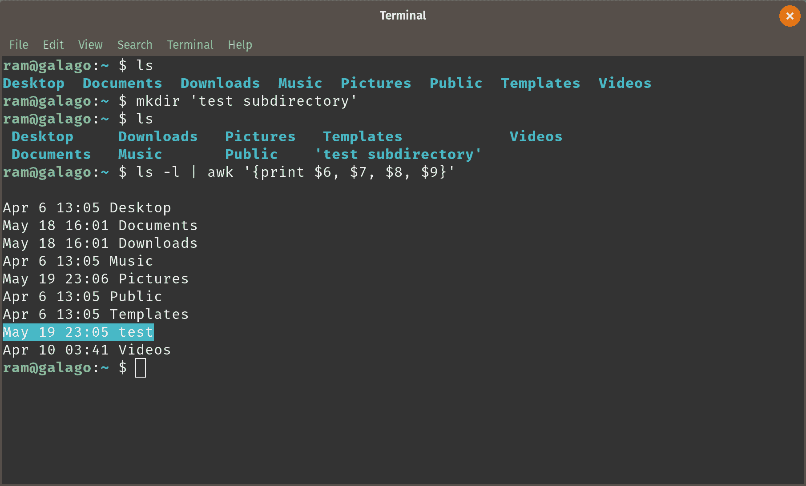

注意，本应该是`test subdirectory`的内容显示为`test`。

### 工作原理...

PowerShell 从文件系统读取内容时是对象，而不是文本。因此，你可以直接对所需的列（或者正如我们稍后看到的，属性）进行选择。相反，Bash 输出文本，使用分隔符对列进行处理。

为了证明这一点，我们创建了一个名称中带有空格的新子目录，并执行了与之前相同的列选择，只是在这种情况下，我们没有得到新子目录的完整名称，因为名称包含一个空格，而空格是`awk`中的分隔符。

比较 Bash 和 PowerShell 就像在比较苹果和橘子——在多个方面都是如此。然而，理解这些差异有助于我们利用每种工具为我们所用。

## 另见

1. 食谱：通过管道选择对象。

## 比较 Windows PowerShell 和 PowerShell

PowerShell 和 Windows PowerShell 是两个不同的实现。前者基于较大的框架 .NET Framework。而后者是一个更现代的框架 .NET Core。PowerShell 是跨平台的，因为它的父级也是如此。相比之下，Windows PowerShell 仅限 Windows，但在编写本章时，它的功能比 PowerShell 更多。

本书中讨论的 PowerShell 是跨平台的 PowerShell Core。它被称为`PowerShell`。而特定的 Windows PowerShell 被称为`Windows PowerShell`。

Windows PowerShell 利用了 Windows 的内部组件和架构模型，其功能通过 WinRM 以及 Windows 管理规范（WMI）得到了增强。事实上，大多数差异源于 Windows 和类 Unix 操作系统之间的固有差异。

## 对 snap-ins 的支持

PowerShell 将不支持名为`Snap-ins`的旧版本模块。许多旧 snap-ins 已经重新封装为二进制模块，因此这不应该是担心的问题，因为理论上这些内容的未来开发可以在任何 PowerShell 上运行，只要二进制文件中的系统调用可以在二进制文件运行的系统上工作。例如，即使 Windows Active Directory 模块被重新封装为二进制 PowerShell 模块，它也会 Windows PowerShell 以及 Windows 上的 PowerShell 上运行，但在 Linux 上的 PowerShell 上不会，因为 Windows Active Directory 不在 Linux 上运行。

## 便利别名

需要注意的一个重要点是`ls`和`mkdir`等命令是 Windows PowerShell 中的别名，这意味着在 Windows PowerShell 上运行`ls`会后台运行`Get-ChildItem`（在 Windows 上的 PowerShell 中也是如此）。但在 Linux 中，在 PowerShell 内部运行`ls`将运行实际的`ls`命令；在 Linux 上的 PowerShell 中，`ls`不是别名，而是命令本身，其输出是纯文本。你可以通过在 Linux 上的 PowerShell 上运行`ls | Get-Member`来验证，并与 Windows 上的 PowerShell 以及 Windows PowerShell 进行比较。（因此，最好坚持不在脚本中使用别名的最佳实践。）

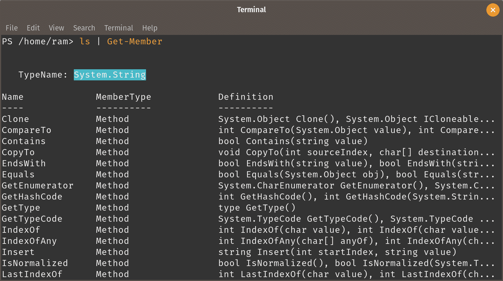PowerShell 通过自动变量`IsLinux`、`IsWindows`和`IsMacOS`的值来判断它正运行在 Linux、Windows 还是 Mac OS 上。在任何系统中，这些变量中只有一个值为`True`。当 PowerShell 看到`IsLinux`为`True`时，它将运行 Linux 命令，而不是最初为了方便 Linux 管理员创建的便利别名。有关这些自动变量的更多信息，请阅读食谱，*配置内置变量*

## PowerShell 工作流

习惯于 Windows PowerShell 中 PowerShell Workflows 的 Windows 管理员需要注意，这些功能在 PowerShell 中已经不存在了。PowerShell Workflows 稍微有些复杂（委婉地说），它们被用于特定的场景，例如并行运行多个 cmdlet，或者某些活动需要在重启后依然存在。Workflows 运行在 Windows Workflow Foundation 之上，而该框架并不是跨平台的。因此，PowerShell Workflows 不会在 PowerShell 上运行。不过，请理解，这没有任何损失。

# PowerShell 期望状态配置 (Desired State Configuration)

在编写本章节时，期望状态配置（DSC）尚处于开发阶段。目前，DSC 资源有两个代码库：由微软 Unix 团队管理的用于 Linux 的`LCM`，以及另一个——即由 PowerShell 团队编写的`DSC Resources for Windows PowerShell`。DSC 代码库可能还需要一段时间才能实现跨平台。

## 列出别名并使用它们替代 cmdlets

别名（Aliases）顾名思义，是 cmdlet 的替代名称。它们有两个作用：

1. 减少击键次数

2. 使向 PowerShell 的过渡更加平滑

传统上讲，在 PowerShell 中创建别名是为了让 Windows 和 Linux 管理员不会觉得这个新框架难以对付。尽管如此，别名最好只在命令行中使用，而不要在脚本中使用，因为某些别名在 Linux 中并不是别名，而且通常情况下，别名会影响可读性。（例如，需要费费精力才能意识到`gbp`代表`Get-PSBreakPoint`。）

### 如何操作...

既然已经看过了最佳实践，现在让我们来看如何列出系统中所有的别名。正如前面提到的，在 PowerShell 中思考非常简单。当我们知道获取任何信息的动词是`Get`，而在这种情况下的名词是`Alias`时，那么 cmdlet 可能是`Get-Alias`。

1. 对`Get-Alias`快速运行`Get-Command`即可告诉我们是否存在这样一个 cmdlet。

```
Get-Command Get-Alias
```

2. 现在让我们运行`Get-Help`来了解如何使用该 cmdlet。

```
Get-Help Get-Alias
```

如果你对任何命令不确定，或者想在不使用别名的情况下减少击键次数，可以使用制表补全（tab-completion）。输入 cmdlet 或参数的一部分，然后按 Tab 键。PowerShell 将为你完成命令，或者根据你所在的平台为你显示建议。

3. 根据帮助文档，`Get-Alias`的所有参数都是可选的（它们都括在`[]`中）。因此，只需运行`Get-Alias`就会列出当前 PowerShell 实例中所有可用别名。

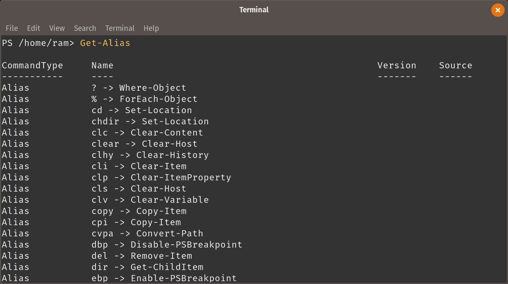

4. 现在尝试将别名`gbp`解析为它实际运行的 PowerShell cmdlet。

```
PS> Get-Alias gbp

CommandType     Name                                               Version    Source
-----------     ----                                               -------    ------
Alias           gbp -> Get-PSBreakpoint
```

5. 现在让我们看看如何反过来：获取特定 cmdlet 的别名。如果你阅读该 cmdlet 的帮助文档，你会在第二个参数集中看到一个名为`Definition`的参数。这是在调用别名时实际运行的 PowerShell cmdlet。

```
PS /home/ram> Get-Alias -Definition Get-ChildItem

CommandType     Name                                               Version    Source
-----------     ----                                               -------    ------
Alias           dir -> Get-ChildItem                                          
Alias           gci -> Get-ChildItem
```

6. 我们看到输出中有两个别名，它们在底层都运行`Get-ChildItem`。现在让我们分别运行`dir`和`Get-ChildItem`并比较它们的输出。


# 使用 PowerShell 别名

## 理解别名

在 PowerShell 中，`dir` 和 `Get-ChildItem` 是等价的命令。让我们通过以下步骤来理解它们的关系。

### 如何操作...

1. 在 PowerShell 中运行 `dir` 和 `Get-ChildItem`，观察它们的输出：

```
PS /home/ram> dir

    Directory: /home/ram

Mode                LastWriteTime         Length Name
----                -------------         ------ ----
d-----       06/04/2018     13:05                Desktop
d-----       18/05/2018     16:01                Documents
d-----       18/05/2018     16:01                Downloads
d-----       06/04/2018     13:05                Music
d-----       20/05/2018     02:17                Pictures
d-----       06/04/2018     13:05                Public
d-----       06/04/2018     13:05                Templates
d-----       10/04/2018     03:41                Videos
PS /home/ram> Get-ChildItem

    Directory: /home/ram

Mode                LastWriteTime         Length Name
----                -------------         ------ ----
d-----       06/04/2018     13:05                Desktop
d-----       18/05/2018     16:01                Documents
d-----       18/05/2018     16:01                Downloads
d-----       06/04/2018     13:05                Music
d-----       20/05/2018     02:20                Pictures
d-----       06/04/2018     13:05                Public
d-----       06/04/2018     13:05                Templates
d-----       10/04/2018     03:41                Videos
```

这两个输出是完全相同的。现在让我们看看命令返回的是什么类型的对象。

```
PS /home/ram> dir | Get-Member

   TypeName: System.IO.DirectoryInfo

Name                      MemberType     Definition
----                      ----------     ----------
LinkType                  CodeProperty   System.String LinkType{get=GetLinkType;}
Mode                      CodeProperty   System.String Mode{get=Mode;}
...
PS /home/ram> Get-ChildItem | Get-Member

   TypeName: System.IO.DirectoryInfo

Name                      MemberType     Definition
----                      ----------     ----------
LinkType                  CodeProperty   System.String LinkType{get=GetLinkType;}
Mode                      CodeProperty   System.String Mode{get=Mode;}
...
```

它们返回了相同的对象。

### 工作原理...

别名只是 PowerShell 内部的映射。短词被映射到 PowerShell cmdlet，通过每个别名中的 `Definition` 属性来标识。因此，你可以使用别名来替代完整的 cmdlet。别名也支持与 cmdlet 相同的参数，因为别名仅仅是右正确 cmdlet 的指针。

### 相关

1. 最佳实践总结

## 创建自定义别名

正如我们在上一个示例中看到的，别名只是指向实际 PowerShell cmdlet 的指针，因此，创建自定义别名只需为你你想要创建的别名确定一个单词，并将其映射到你想要调用的 PowerShell cmdlet。

### 如何操作...

1. 首先，确定一个你想要作为别名的单词。例如，让我们考虑 `listdir`。

2. 在 PowerShell 中运行 `listdir`，以确保该 cmdlet（或 Linux 命令）已存在。

3. 通过运行以下命令列出处理别名的 cmdlet：

```
Get-Command -Noun Alias
```

请记住，PowerShell 中的名词是单数形式。因此，不会有包含 `Aliases` 的原生 cmdlet。如果第三方模块在它们中提供了 `Aliases` 作为名词，那么它们没有遵循使用单数名词的 PowerShell 最佳实践。

4. `New-Alias` 是我们要寻找的 cmdlet，因为它会创建一个新的别名。（`Set-Alias` 用于修改已存在的别名。）

5. 通过运行以下命令读取 `New-Alias` 的帮助文档：

```
Get-Help New-Alias
```

帮助文档指出，`Name` 和 `Value` 参数是强制性的。我们将只使用这两个参数来创建这个简单的别名。

6. 运行以下命令创建自定义别名：

```
New-Alias listdir Get-ChildItem
```

7. 查看别名是否已按预期创建。

```
PS> Get-Alias listdir

CommandType     Name                                               Version    Source
-----------     ----                                               -------    ------
Alias           listdir -> Get-ChildItem
```

8. 同时，运行别名以查看它的输出。

```
PS /home/ram> listdir

    Directory: /home/ram

Mode                LastWriteTime         Length Name
----                -------------         ------ ----
d-----          4/20/18   6:36 AM                Desktop
d-----          5/10/18   1:05 PM                Documents
d-----          5/16/18  11:03 AM                Downloads
d-----          4/20/18   6:36 AM                Music
d-----           5/1/18   2:19 PM                Pictures
d-----          4/20/18   6:36 AM                Public
d-----          4/20/18   6:36 AM                Templates
d-----          4/20/18   6:36 AM                Videos
```

这就是我们熟悉的输出——`Get-ChildItem` 的输出。

别名在默认情况下是瞬态的。它们只在你的 PowerShell 会话期间存在。为了在使用自定义别名时无需每次重新创建，可以导出这些别名（指令在下一个食谱中），并使用你的 PowerShell 配置文件导入它们。我们将在稍后的章节介绍配置文件。

### 工作原理...

如前所述，别名是命令项（cmdlets）的指针。使用 `New-Alias`，你可以创建一个带有自定义名称的指针，该指针指向所需的 PowerShell 命令项。这本质上是一个键值对。

当你在 PowerShell 上运行任何内容时，PowerShell 都会检查它的命令项和别名列表（以及其他定义）以理解你的请求。当 PowerShell 遇到别名时，它会查找它指向哪个命令项并运行该命令项。

### 更多...

你可以为别名添加更多内容，例如描述。参考 `Get-Alias` 的帮助文档可以查看你还可以对别名进行哪些操作。

### 参见

1. 食谱 3.8：理解命令项和参数

2. 食谱 2.8：导入/导出自定义别名供以后使用

3. 食谱 3.4：启用每次加载时命令的自动执行

## 导出/导入自定义别名供以后使用

尽管别名具有优势且符合设计用途，但其瞬态性可能被视为一种不便。为了让别名可以重复使用，需要将它们导出到文件中，并在需要时导入。本食谱将向你如何导出和导入你可能创建的别名。

### 准备工作

为了此过程生效，你需要已经创建了自定义别名。如果你没有创建自定义别名，导出操作只会导出默认别名，而这些别名本来会被 PowerShell 加载。

回到上一个食谱至少创建一个自定义别名。

### 操作方法...

1. 确保你的自定义别名存在并运行正常。其中一种方法是获取你创建的别名的详情。

```
Get-Alias listdir
```

2. 将会话中加载的所有别名导出到文件。

```
Export-Alias aliases.csv
```

CSV 是默认文件类型。接下来的步骤中看到的导入将理解 CSV 并建立必要的关联。

3. 也可以将别名导出为脚本。这种情况下，PowerShell 将创建一个脚本，其中包含每个导出别映射的 `New-Alias` 命令项。

```
Export-Alias aliases.ps1 -As Script
```

4. 查看创建的每个文件的内容；先看 CSV 文件，然后是脚本。

```
Get-Content ./aliases.csv
```

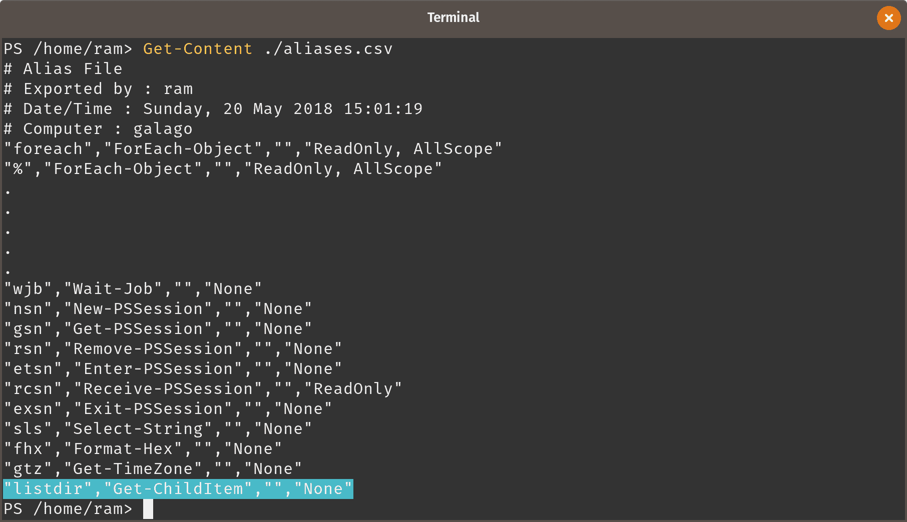

```
Get-Content ./aliases.ps1
```

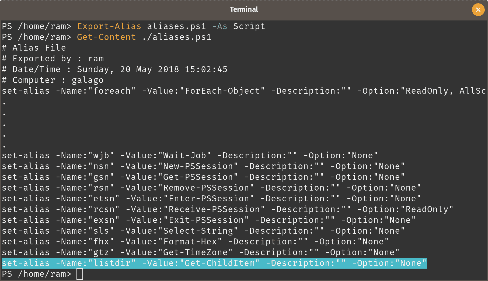

5. 可选：编辑文件以删除除你创建的别名以外的所有别名。自定义别名可以在列表底部。

导出别名结束。

现在让我们将别名导入到 PowerShell 会话中。

1. 重启 PowerShell。

2. 查看你创建的别名 `listdir` 是否存在。

```
Get-Alias listdir
```

3. 现在，导入别名。

```
Import-Alias ./aliases.csv
```

你可能会收到几个错误，每个错误都由于别名已存在而无法创建新别名。处理此问题有两种方法：是从导出文件中删除默认别名（推荐），第二种是使用 `-Force` 参数（这可能仍会导致错误，但错误会显著减少）。

如果你将别名导出为脚本，只需调用该脚本即可。

```
./aliases.ps1
```

### 工作原理...

脚本方式非常直观：命令项一个接一个运行，系统创建别名的方式就像你手动创建它们一样。

通过 CSV 导入，PowerShell 将输入解析为键值对（并根据导出的内容添加其他参数），并将其添加到当前进程的别名引用中。

### 参见

1. 食谱 3.4：启用每次加载时命令的自动执行

## 列出执行策略并设置合适的策略

曾经在 Windows 计算机上运行脚本是非常轻而易举的。Windows 很容易受到远程脚本执行。通过 PowerShell，微软增加了一个安全带，允许用户对 PowerShell 的加载方式进行某些控制。请记住，执行策略并不是安全功能。有方法绕过它并运行脚本。

Windows 版 PowerShell 和 Windows PowerShell 包含此配置。在 Windows 上运行脚本默认仍受限制。在 Linux 版 PowerShell 上，这不起作用，根据社区，不确定该功能是否会引入 Linux 版 PowerShell。

执行策略决定允许运行什么类型的脚本。以下是六种策略（不包括默认）：

1. `AllSigned`

2. `RemoteSigned`

3. `Restricted`

4. `Unrestricted`

5. `Bypass`

6. `Undefined`

还有三个范围：

1. `Process`

2. `CurrentUser`

3. `LocalMachine`

执行策略和范围的组合决定了脚本可以加载的条件。微软详细记录了每种策略的含义。通常，`AllSigned` 要求在计算机上运行的所有脚本都必须使用受信任的认证机构的代码签名证书进行签名。如果设置了此策略，即使是你是你创建的，PowerShell 也不会运行未签脚本。

`Restricted` 是默认策略：可以运行命令，但不能运行脚本。`RemoteSigned` 允许运行在你计算机上创建的脚本。从互联网下载的脚本无法运行。

`Bypass` 与无限制类似，但用于特定场景，例如 PowerShell 作为某些应用程序的基础，而该应用程序有自己的安全实现。

`Unrestricted` 意味着在简单确认后可以运行所有脚本和命令。`Undefined` 意味着对特定范围没有定义策略。让我们通过以下食谱尝试理解这些概念。

1. 首先，运行 `Get-Command`  cmdlet 来了解如何使用执行策略。

```
Get-Command -Noun Execution*
```

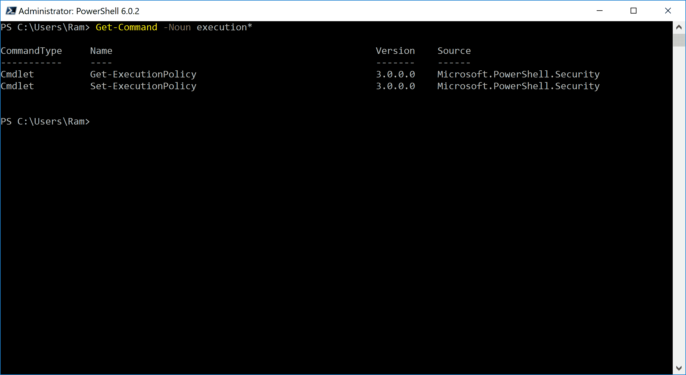

2. 现在让我们获取有关运行该 cmdlet 的帮助信息。

```
Get-Help Get-ExecutionPolicy
```

3. 我们想知道机器上设置的执行策略，因此，我们将运行：

```
PS> Get-ExecutionPolicy
```

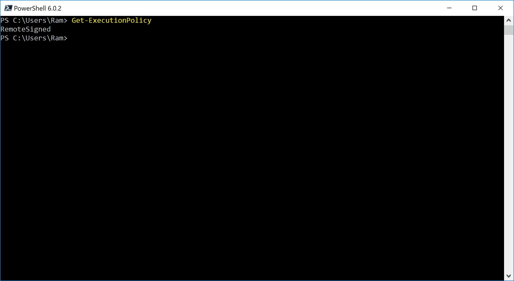

这显示了当前 PowerShell 会话中当前有效的执行策略。

4. 要列出在不同范围设置的策略，请运行以下命令：

```
PS> Get-ExecutionPolicy -List
```


我们看到策略仅在 `LocalMachine` 级别设置，且被设置为 `RemoteSigned`，这与上一步反映的相同。`LocalUser` 和 `Process` 范围的策略为 `Undefined`，这使得会话从 `LocalMachine` 选取执行策略。

现在让我们将本地机器的执行策略设置为 `Undefined`，看看我们的会话选择了什么。

5. 要使此操作生效，请关闭当前的 PowerShell 会话并以管理员身份打开新会话。

6. 接下来，运行命令：

```
PS> Get-Help Set-ExecutionPolicy
```

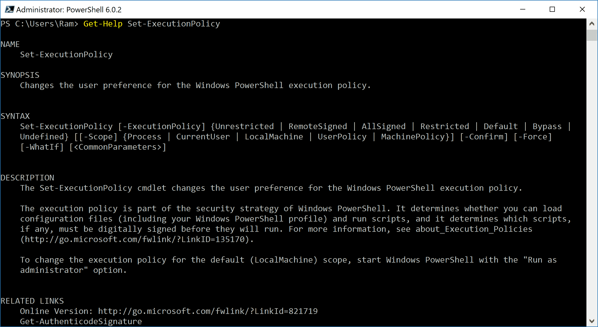

7. 帮助文档显示 `ExecutionPolicy` 参数是强制性的，`Undefined` 是它接受的有效值之一。我们想在 `LocalMachine` 范围设置策略，因此：

```
PS> Set-ExecutionPolicy Undefined -Scope LocalMachine
```

8. 现在，列出各个范围的执行策略：

```
PS> Get-ExecutionPolicy -List
```

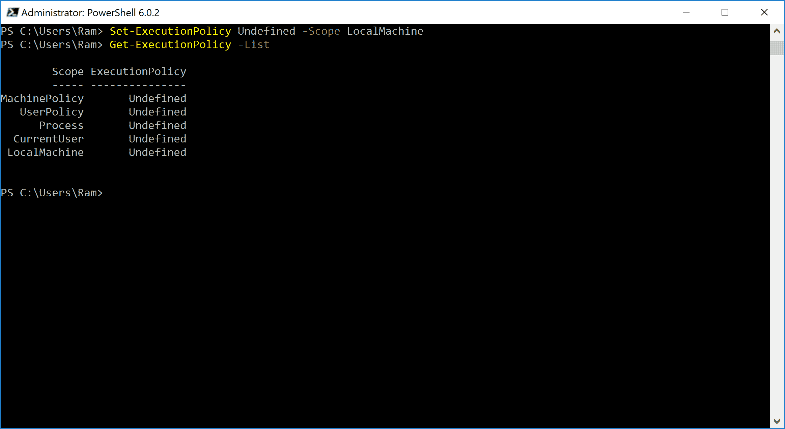

9. 现在，让我们检查当前有效的执行策略：

```
PS> Get-ExecutionPolicy
```

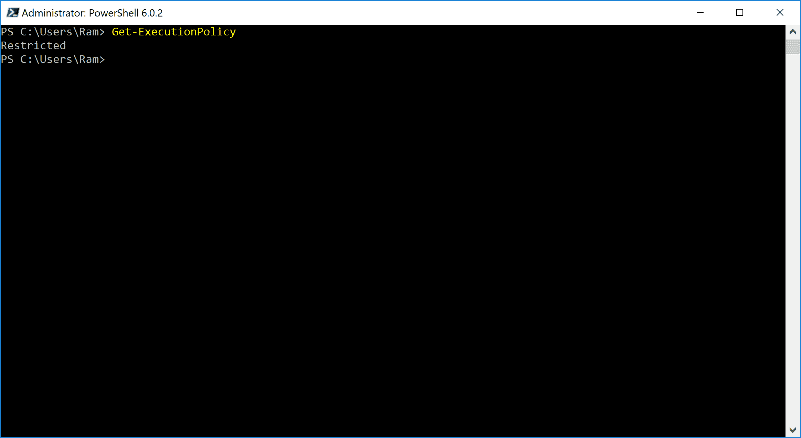

10. 现在让我们将执行策略恢复到开始本教程之前的状态。您可能需要根据您在计算机上的权限更改策略以满足您的需求。

```
PS> Set-ExecutionPolicy RemoteSigned -Scope LocalMachine
```

### 工作原理...

执行策略只是在系统上设置的条件，以避免意外运行脚本。它们在不同的范围（scopes）内起。


如所述，PowerShell 中有三个范围。`LocalSystem` 范围位于链的末端。它的上方是 `CurrentUser` 范围。最顶部是 `Process` 范围。优先级为 `Process > CurrentUser > LocalMachine`。因此，如果在 `Process` 范围设置了除 `Undefined` 以外的任何策略，会话将使用进程上设置的策略。如果是 `Undefined`，它将查找在 `CurrentUser` 范围设置的策略。如果 `CurrentUser` 的策略也被标记为 `Undefined`，则会话将应用 `LocalMachine` 级别的策略。如果 `LocalMachine` 设置了 `Undefined`，会话将选取 `Default` 策略，该策略基于 PowerShell 定义的策略可能会根据操作系统的版本而异。例如，在 Windows 2016 上，默认策略是 `RemoteSigned`。

在 `CurrentUser` 和 `LocalMachine` 级别设置的策略存储在 Windows 注册表中。在 `Process` 范围设置的策略存储在临时环境变量 `$env:PSExecutionPolicyPreference` 中。

# 另见

1. [关于执行策略](https://docs.microsoft.com/en-us/powershell/module/microsoft.powershell.core/about/about_execution_policies?view=powershell-6) (Microsoft)

## 使用 PowerShell 准备管理

在本章中，我们将涵盖以下主题：

1. 安装 Visual Studio Code
2. 配置自动变量
3. 使用变量更改 shell 行为
4. 每次加载时启用命令的自动执行
5. 自定义终端提示符
6. 理解 PowerShell 中的标准重定向
7. 从 PowerShell 调用原生 Linux 命令
8. 理解 cmdlet 和参数
9. 使用最少按键运行 cmdlet
10. 查找参数别名
11. 调用 PowerShell 脚本
12. 点源（Dot-sourcing）PowerShell 脚本
13. 从 PowerShell 外部调用 PowerShell cmdlet
14. 记录在 PowerShell 控制台上运行的 cmdlet

### 介绍

人们通常认为，越频繁使用终端（而不是 GUI），效率就越高。输入命令比在屏幕上到处点击要容易且快速得多。然而，对于刚开始使用终端的人来说，情况可能如此。随着时间的推移，管理员变得越来越习惯终端，他们学会了为了速度和效率对其进行配置，就像训练过的马一样。此外，大多数高效的管理员喜欢自动化他们工作流的几个部分——自定义 `.bashrc` 和 Vim 脚本就是示例。在本章中，我们将熟悉与 PowerShell 协作的不同控制台和工具，还将查看一些帮助自定义工作区的简单配方，以便我们更高效。

## 安装 Visual Studio Code

脚本可以在控制台本身上使用 Vim 编写。也可以使用 Gedit 甚至 Atom 等其他编辑器来编写 PowerShell 脚本。但是，建议使用微软的开源代码编辑器，称为 Visual Studio Code（或 `vscode`）。在本配方中，我们将查看安装 Visual Studio Code 并配置其与 PowerShell 工作。

### 准备工作

我们将查看在 Ubuntu 上安装 `vscode` 的步骤。今天，大多数存储库都包含 Visual Studio Code。您可以检查发行版的软件商店来安装 `vscode`。如果没有，安装 `vscode` 的简单方法是下载 `.deb`（或根据您的发行版下载 `.rpm` 包），并运行它在计算机上安装包。

### 如何操作...

安装 Visual Studio Code 非常简单。

1. 如果您的 Linux 发行版有软件商店，请在大商店中搜索 Visual Studio Code。
2. 如果找到了 Visual Studio Code，从那里安装该包。如果没有，请继续下一步。
3. Visual Studio Code 的包名为 `code`。使用您的包管理器在仓库中搜索该包。在 Ubuntu 上，命令为：

```
$ sudo apt-cache pkgnames code
```

4. 如果您能在仓库中找到该包，请像安装其他包一样安装 `vscode`。

```
$ sudo apt install code
```

5. 如果无法找到该包，请前往 [`code.visualstudio.com/Download`](https://code.visualstudio.com/Download) 下载适用于您发行版的正确 `code` 包。
6. 要安装 VS Code，使用下载包的路径调用您的包管理器。

```
$ sudo apt install install code_version_arch.deb
```

7. 如果您想以便携模式安装 VS Code，下载 VS Code tar 包并将其内容提取到方便的位置以运行 VS Code。尽管如此，请记住在这种情况下 VS Code 的更新将由 VS Code 本身处理。

Visual Studio Code 本身是一个强大的代码编辑器。但是，它可能无法完全支持 PowerShell。您需要安装包含帮助编写和运行 PowerShell 脚本功能的扩展。

1. 启动 Visual Studio Code。
2. 点击扩展图标或按 `Ctrl+Shift+X` 进入扩展面板。
3. 在搜索栏中，输入 `powershell publisher:Microsoft` 并按回车搜索 PowerShell 包。
4. 点击结果包中的 Install——PowerShell 包应该在顶部。
5. 安装完成后，点击 Reload 以带有 PowerShell 功能的重新加载 Visual Studio Code。

现在您已准备好使用友好的编辑器开发 PowerShell 脚本，该编辑器支持 Windows PowerShell 集成脚本环境的几乎所有功能以及更多！

### 工作原理...

Windows PowerShell ISE 曾是开发 PowerShell 脚本甚至 PowerShell 编写应用程序的事实标准。随后，Adam Driscoll 为 Microsoft Visual Studio 开发了 PowerShell 扩展，将 PowerShell 集成到了集成开发环境中。

在开发 PowerShell 的同时，随着 .NET Foundation 的成立，微软开始开发一种名为 Visual Studio Code 的轻量代码编辑器，它封装了 Visual Studio 的许多强大功能，而没有所有语言库的沉重负载。这对于构建 PowerShell 脚本已经足够了；大多数 PowerShell 脚本编写者主要使用 IntelliSense 功能，而 Visual Studio Code 正拥有这些功能。

使用包管理器安装 Visual Studio Code 可以确保满足所有依赖项。此外，这种安装方法可以确保签名密钥被添加到系统中。这样，就可以通过系统（例如运行 `sudo apt upgrade`）安装 Visual Studio Code 的更新。

# 另见

1. [在 Linux 上安装 Visual Studio Code](https://code.visualstudio.com/docs/setup/linux) (微软文档)

## 配置自动变量

可能没有什么能比可配置性更能提高效率了。配置系统是按照你的喜好对其进行塑造的一种。只有你最清楚什么对你有效。因此，系统的可配置性越高，就越能根据你的使用进行塑造。PowerShell 中的自动变量是 PowerShell 自定义化的首要步骤之一（配置文件是另一个；我们稍后会介绍它们）。在本教程中，我们将列出所有自动变量，并根据我们的需求对其中一些变量进行配置。

### 准备工作

阅读 *安装、参考和帮助* 中的 *列出 PowerShell 中的各种提供者* 章节，以学习如何使用 PowerShell 中的各种提供者。

### 如何操作……

让我们先列出我们拥有的变量。这可以通过两种实现：

* 使用命令 (cmdlet)
* 使用提供者 (provider)

让我们先看看使用命令列出 PowerShell 内置的变量。

1. 打开终端窗口。如果你已经打开了一个，请重启 PowerShell。
2. 找到适用于变量命令。

```
PS> Get-Command -Noun Variable
```

记住，命令中的名词（noun）始终是单数。因此，应该是 `Variable`，而不是 `Variables`。

3. 有五个处理变量的命令。我们想要获取 PowerShell 新会话中已存在的所有变量列表。让我们选择 `Get-Variable` 并获取它的帮助信息。

```
PS> Get-Help Get-Variable
```

4. 这是我们需要列出当前作用域中预定义的所有变量的命令。

```
PS> Get-Variable
```

这应该列出当前作用域中预定义的所有变量。

你定义的任何变量都会列在这里。因此，启动一个全新的 PowerShell 会话来查看哪些变量已被预定义是重要的。

现在，让我们使用 PowerShell 提供者来列出当前作用域中定义的变量。

1. 列出 PowerShell 提供者。我们在上一章中查看过提供者。

```
PS> Get-PsProvider
```

2. 将位置更改到 `Variable` 提供者的 `Variable:` 驱动器。这是通过 `Set-Location` 完成的。

```
PS> Set-Location Variable:
```

3. 现在，让我们列出 `Variable:` 驱动器的所有可用子项。

```
PS> Get-ChildItem .
```

此的输出与不带参数调用的 `Get-Variable` 相同。

### 工作原理……

PowerShell 的构建包含了一些控制其行为的变量，允许管理员修改其中一些变量以满足需求。然而，某些变量是无法修改的；它们是上下文相关的，并为 shell 增加了一灵活性（或模块化）。

其中一个例子是 `$PWD`，它包含当前目录的路径。该变量会根据 `Set-Location` 的执行而改变。不能向此类变量显式赋值；显式设置值对 shell 的行为没有影响。

另一方面，某些变量接受赋值，允许我们控制命令和脚本的执行。我们将在下一个教程中查看示例。

## 使用变量更改 shell 行为

在上一个教程中，我们查看了现有的变量。在本教程中，我们将更改一个变量的值来控制 PowerShell 的行为。再次记住，值的更改是瞬时的；一旦 PowerShell 进程重启，值将重置。

### 准备工作

阅读上一个教程以了解哪些是预定义的自动变量。此外，启动 Visual Studio Code。按照以下步骤启动 VS Code。

1. 打开应用程序（我使用的是 Gnome DE，通过 `Super + A` 显示所有应用程序）。
2. 输入 `code`。
3. 按 `` Ctrl + ` `` 启动终端。
4. 点击欢迎界面上的“新建文件”（或按 `Ctrl + N`）。
5. 在 VS Code 窗口的右下角，你会看到文件类型设置为“纯文本”（Plain Text）。点击它；你将被带到顶部的命令栏。
6. 在命令栏输入 `powershell`。底部将打开 PowerShell 集成控制台。

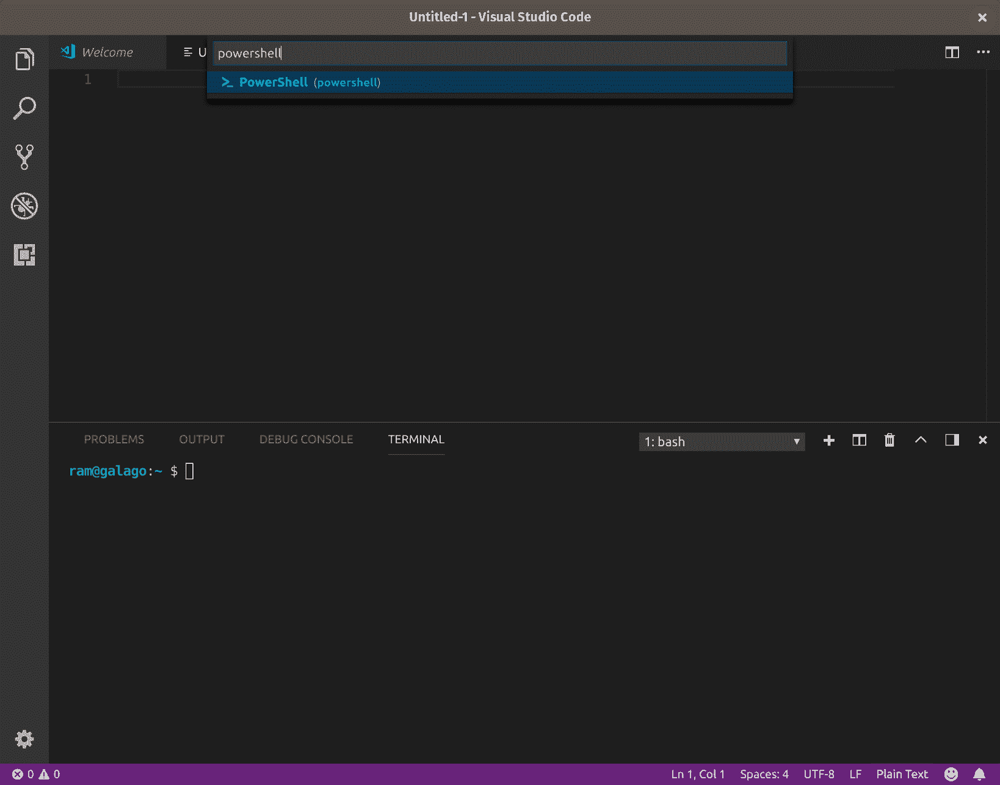

我们现在已为教程准备就绪。

### 如何操作……

1. 让我们运行一个会导致错误的命令。目前，我们先不要关注命令的语法；我们目前的目标是生成一个错误。在脚本窗口的第一行，输入：

```
Get-ChildItem /home/ram/random-directory
Write-Host "Hello world!"
```

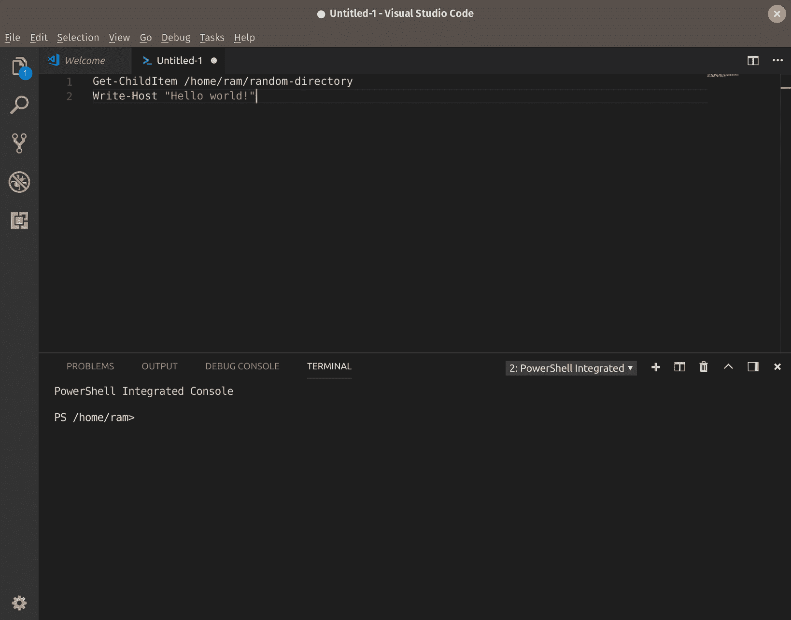

2. 使用 `F5` 键运行双行脚本。

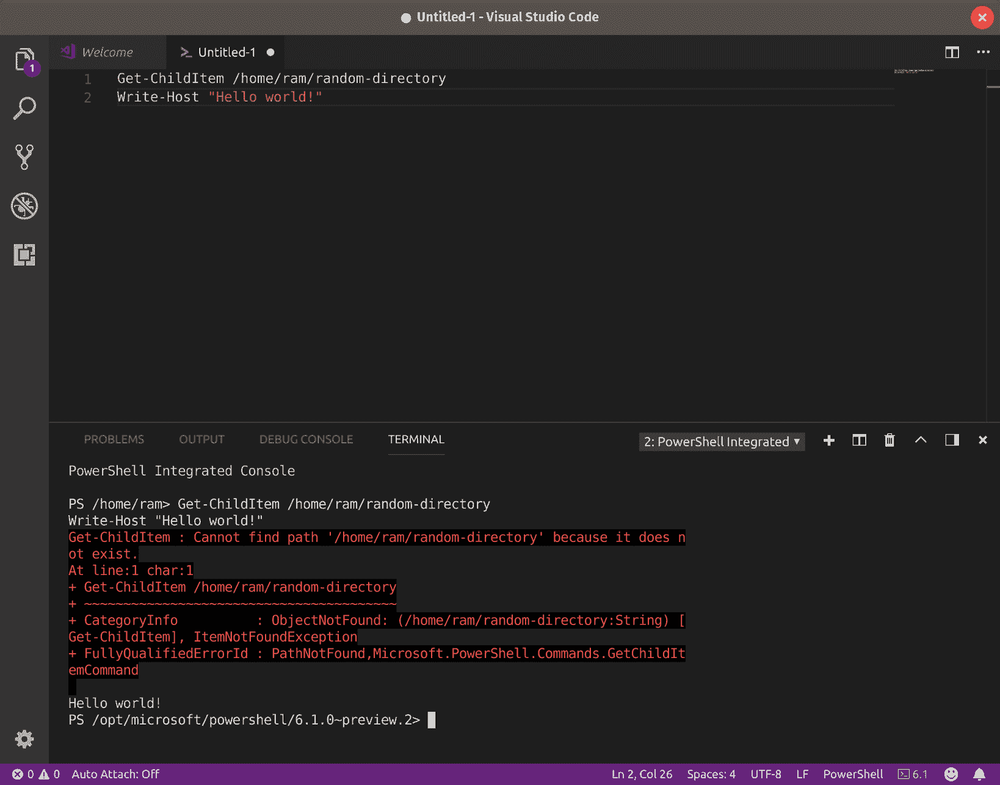

PowerShell 提示显示一个错误。它还显示了 `Hello world!` 字符串。

3. 现在，让我们使用变量 `ErrorActionPreference` 来设置错误操作偏好。我们从上一个教程知道有这样一个变量。首先，重启 PowerShell。最简单的方法是点击集成控制台窗口顶部的小垃圾图标。当 VS Code 询问你是否想重启会话时，点击“是”。

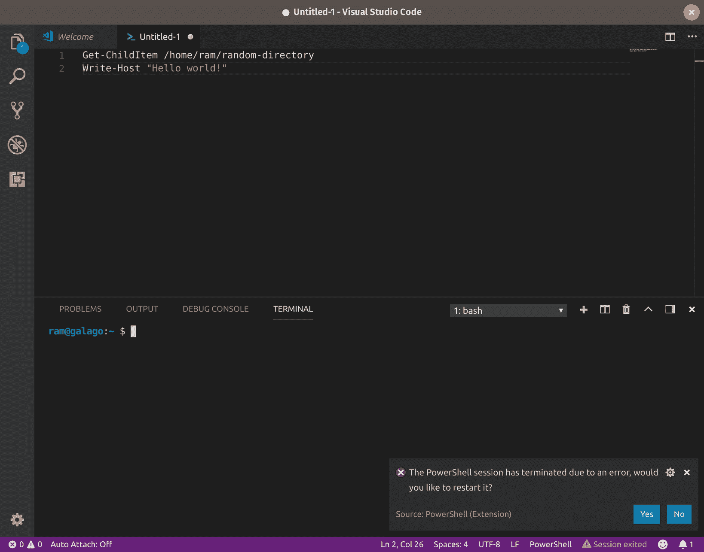

4. 现在，设置 `ErrorActionPreference` 变量。在 PowerShell 集成控制台中输入：

```
PS> Set-Variable ErrorActionPreference SilentlyContinue
```

5. 再次运行双行脚本。

这次没有错误了。我们在控制台上看到了 `Hello world!`。

如果你不想让整个脚本出现在提示符处，将脚本的第一行改为 `Clear-Host`；这将在显示输出之前清除屏幕。

6. 如果你想检查是否真的生成了错误呢？我们检查自动变量 `Error` 的值。

```
PS> Get-Variable Error
```

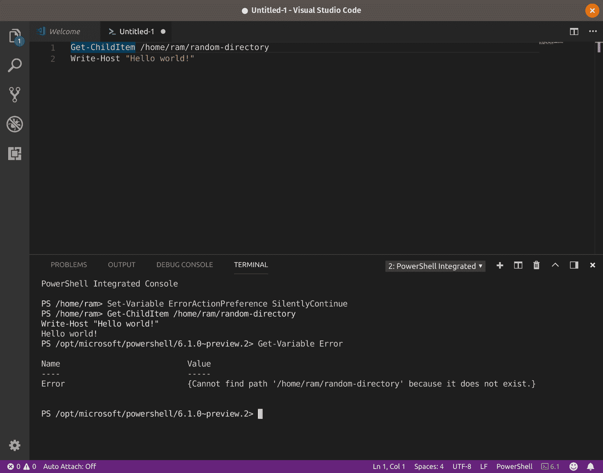

7. `Value` 列包含一些文本。让我们选择并展开 `Value` 的内容。

```
Get-Variable Error | Select-Object -ExpandProperty Value
```

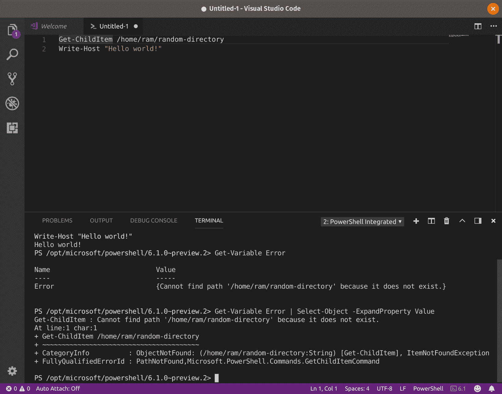

输出文本与我们在设置错误操作偏好之前收到的相同。

你也可以直接调用 `Error` 变量读取当前会话中发生的所有错误。

### 工作原理……

默认情况下，错误操作偏好是 `Continue`，这意味着 PowerShell 将显示错误并继续执行脚本的其余部分（这种效果在运行单个命令时并不明显，因此创建了双行脚本，或者在顶部添加了 `Clear-Host` 的三行脚本）。通过将 `ErrorActionPreference` 设置为 `SilentlyContinue`，我们指示 PowerShell 记录错误但不屏幕上显示，同时继续执行脚本的其余部分。

1. [about_Preference_Variables, $ErrorActionPreference](https://docs.microsoft.com/en-us/powershell/module/microsoft.powershell.core/about/about_preference_variables?view=powershell-6#erroractionpreference) (微软文档)
2. 教程：PowerShell 中的错误处理

## 为每个加载启用命令执行

正如我们在之前的教程中所看到的，这些更改是暂时的；它们在会话期间保持有效。在某些情况下，管理员可能需要运行一些命令或加载模块以便工作得更快。例如，我倾向于加载一系列模块来帮助我管理 Microsoft Exchange、Active Directory、VMware vSphere 基础设施、Citrix XenApp、Microsoft System Center 以及其他环境。

可以看出，所有这些产品都需要不同的方法来加载模块、插件（snap-ins）和脚本，其中许多在每次加载模块时都需要某些配置（例如使用管理员凭据连接虚拟机服务器）。这些可以使用 PowerShell 配置文件（profile）完成。

### 准备工作

PowerShell 默认在安装期间不会创建配置文件。它仅以默认配置运行。对此配置的任何覆盖都需要创建并修改配置文件。

1. 打开 PowerShell 控制台。（你可以在终端运行 `pwsh`，也可以使用 VS Code 控制台。本教程使用终端。）
2. 显示你的配置文件路径。要执行此操作，只需调用自动变量。

```
PS> $PROFILE
```

3. 检查你的配置文件是否存在。

```
PS> Test-Path $PROFILE
```

4. 如果返回为 `True`，则可以继续教程。如果返回为 `False`（这更有可能），请运行以下命令：

```
PS> New-Item $PROFILE -ItemType File
```

5. 你可能会收到一个错误，提示找不到部分路径。这是因为你的 `~/.config/` 目录默认不包含 `powershell` 目录。在命令中添加 `-Force` 可以创建此目录并在该位置创建你的配置文件。

```
PS> New-Item $PROFILE -ItemType File -Force
```

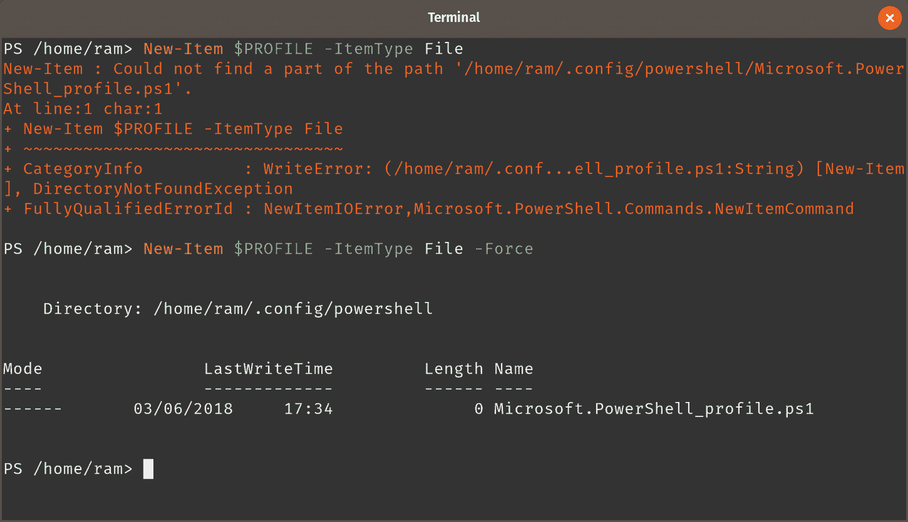

6. 我们现在将在 VS Code 中编辑配置文件。在终端中输入：

```
PS> code $PROFILE
```

### 如何操作...

你现在应该已经打开了配置文件。它目前是空的。现在让我们自定义 PowerShell 的错误操作行为。记得我们说过，在终端中将 `ErrorActionPreference` 设置为 `SilentlyContinue` 是暂时的。现在让我们确保每次启动 PowerShell 时，`ErrorActionPreference` 都被永久设置为 `SilentlyContinue`。

1. 切换到终端窗口。如果你自上一个教程以来一直开着该窗口，请重启 PowerShell。
2. 让我们现在的错误操作偏好是什么。


进入`/path/to/xxx`目录，找到`xxx.json`。

在表达式`cvar = avar + bvar`中，加法运算符（`+`）将`avar`与`bvar`相加，得到它们的和`cvar`。

在`List.of(arg0, arg1, arg2)`中，`List`接口的工厂方法`of()`接受一系列的元素，返回包含它们的只读列表。

之后我们这样调用`cmd`命令：`cmd arg0 arg1 arg2`。

```
if (condVar > someVal) {console.log("xxx")}
```

---

```
PS> Get-Variable ErrorActionPreference
Continue
```

3. 切换到 VS Code。配置文件应该已经打开可以编辑。

4. 在最第一行输入：

```
PS> Set-Variable ErrorAction SilentlyContinue
```

5. 保存配置文件并关闭文件。

6. 在终端中输入`exit`退出 PowerShell。重新启动 PowerShell。

7. 现在让我们检查`ErrorActionPreference`的值是什么。在提示符处输入：

```
PS> $ErrorActionPreference
SilentlyContinue
```

8. 为了确保该偏好确实生效，输入：

```
PS> Get-ChildItem /home/ram/random-directory
```

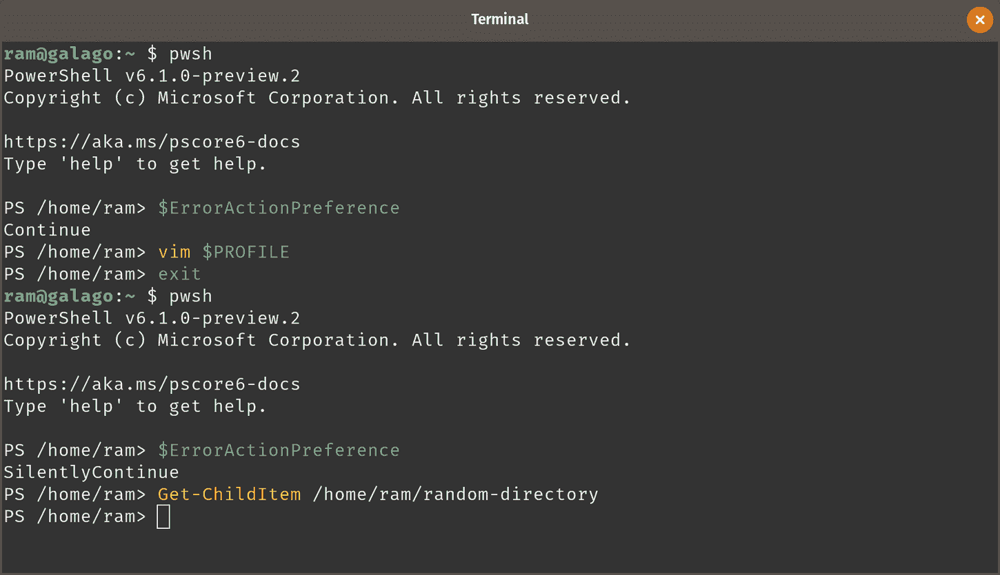

光标直接返回下一行的提示符，没有抛出错误。

### 工作原理...

简而言之，PowerShell 配置在每次加载 PowerShell 会话时都会执行。此配置文件是一个 PowerShell 脚本文件，可以包含一系列命令和函数，它们就像另一个脚本一样被执行。

需要记住的一个重要点是，每个主机都有不同的配置文件。例如，在终端上加载的 PowerShell 有一个独立的配置文件，而 VS Code 的集成终端有另一个。这是因为每个终端的性质都不同。

Linux 上的 PowerShell 尚未实现执行策略（Execution Policies）。如果 Linux 上的 PowerShell 未来获得了安全带，则应该将执行策略设置为允许执行脚本，以便加载配置文件。

## 还有更多内容...

设置全局操作偏好是一个坏习惯。清空配置文件可以移除错误操作偏好。由于配置文件没有其他内容，你甚至可以使用以下命令删除配置文件：

```
Remove-Item $PROFILE
```

阅读最佳实践以获取更多信息。

## 自定义终端提示符

在之前的教程中，我们使用配置文件自定义了错误操作偏好。我们使用了一个演示过的命令来证明，可以在 PowerShell 控制台上运行的命令也可以添加到配置文件中，这是自动化运行某组命令的方法，可以提高生产力。

现在，我们将迈向下一步，自定义控制台提示符。理论上选项是无限的；本教程只是对 PowerShell 灵活性的另一个演示。

### 准备工作

此教程需要 VS Code。如果你没有跟随上一个教程，请按照上一个教程中*准备工作*部分的步骤创建 PowerShell 配置文件，但这次要在 VS Code 的 PowerShell 集成控制台中运行命令。

### 如何操作...

确保配置文件是空的。如果你刚刚创建了配置文件，可以直接继续。如果不是，请清除配置文件中的所有内容。如果配置文件中设置了错误操作偏好，将导致你以后创建的脚本调试变得困难。

1. 在主窗口中输入以下。

```
function prompt {
  $Location = (Get-Location).Path.ToString()
  switch -Wildcard ($Location) {
    "/home/$env:USERNAME" { $Location = '~'; break }
    "/home/$env:USERNAME/Documents" { $Location = 'Documents'; break }
    "/home/$env:USERNAME/Downloads" { $Location = 'Downloads'; break }
    "/home/$env:USERNAME/Pictures" { $Location = 'Pictures'; break }
    "/home/$env:USERNAME/Videos" { $Location = 'Videos'; break }
    "/home/$env:USERNAME/Music" { $Location = 'Music'; break }
    "/home/$env:USERNAME/Documents/code" { $Location = 'Code'; break }
    "/home/$env:USERNAME/*" { $Location = $Location.Replace("/home/$env:USERNAME/", '~/'); break }
    Default { }
  }
  Write-Host "PS " -NoNewline
  Write-Host `
    ($($env:USERNAME) + "@" + "$([System.Net.Dns]::GetHostByName((hostname)).HostName) ")
    -NoNewLine -ForegroundColor Cyan
  Write-Host "$Location" -NoNewline -ForegroundColor Green
  Write-Host ("`n> ") -NoNewline
  return " "
}
```

2. 保存配置文件脚本文件。

3. 点击集成控制台顶部的垃圾桶图标以杀死当前的 PowerShell 会话。

4. 当 VS Code 提示你是否想要重启会话时，点击 Yes。

你的提示符应该像下面的图片所示。

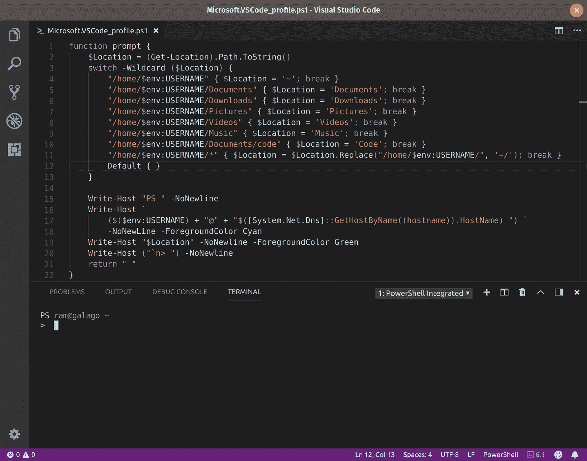

### 工作原理...

提示符由一个名为`prompt`的函数控制。为了演示这一点，我们可以使用：

```
Get-Command prompt
```

输出显示确实有这样一个命令，类型为`Function`。要查看`prompt`函数的内容，输入：

```
PS> (Get-Command prompt).ScriptBlock
```

输出显示了你刚刚编写的整个函数。然而，这是覆盖了默认`prompt`函数的函数。如果你清除配置文件，重启 PowerShell 会话并输入上面的命令，你将看到一个简单的三行输出，那就是默认的`prompt`函数。

现在来拆解我们写的这个函数：

首先，你声明正要编写的函数。这是通过关键字`function`加上函数名来完成的。由于我们要处理提示符（prompt），因此我们使用现有的函数名来覆盖默认功能。接下来的是脚本块，它以`{`开始。

我们希望位置显示在提示符中。出于显而易见的原因，这是必须的信息。

如果你注意到，PowerShell 在提示符中显示了完整的 Home 路径。虽然这可行，但我们习惯了用波浪号`~`表示 Home。此外，我知道 Documents、Music 等文件夹都位于我的 Home 文件夹内，我更希望在提示符中只显示文件夹名称。这意味着需要一些文本处理。因此，我们将当前位置赋值给变量`$Location`。

接下来，我们执行`switch-case`操作，并得到要在提示符中显示的值。暂时不用担心语法；我们将在后续章节中详细介绍每一个语法。

稍后，我们使用几个`Write-Host`语句来构建提示符文本。`-NoNewLine`参数确保每个语句的内容不会跳到下一行。当我们我们需要换行时，显式地添加`` `n ``。

如果你想在脚本中折行一条长运行的代码，可以在想要折行的地方使用反引号（`` ` ``），并在反引号后按回车换行。PowerShell 会将带有反引号的行以及随后的行视为同一行。同样，如果你想在同一行中编写两个语句，在第一个语句末尾使用分号（`;`），然后在空格后继续写第二个语句。PowerShell 将这两个子句视为独立的语句，就像普通英语一样。

由于`Write-Host`只是将文本发送到主机而不返回任何内容，因此我们在函数中添加了一个返回语句，其中仅留有一个空格。

当我们重新加载 PowerShell 集成控制台时，配置文件被加载，此时配置文件中自定义的`prompt`函数覆盖了默认的`prompt`函数，并向我们呈现了一个按照我们定义格式化的良好提示符。

# 还有更多……

现在可以尝试调整`Write-Host`语句的顺序和内容来自定义你的提示符。一旦我们熟悉了 PowerShell 的语法，就应该能够进一步自定义配置文件。

# 另另

1. [关于 提示符](https://docs.microsoft.com/en-us/powershell/module/microsoft_powershell.core/about/about_prompts?view=powershell-6) (微软文档)

## 理解 PowerShell 中的标准重定向

当我刚开始使用命令行界面时，起被`<`、`>`和`>>`吓到了。然后，我完全停止使用了一段时间命令行界面，回到 Windows 管理员的方式，尽管对快捷键的使用对于 Windows 管理员来说并不异常（这关乎速度和效率！）。

当 PowerShell 出现时，我忘记了那些操作符；我直接理解了对象和管道（pipelines）的概念，并以此工作了多年。家里切换到 Linux 让我想知道使用终端的“Linux Way”。操作符又回来困扰我。我直接在 Linux 上安装了 PowerShell。

PowerShell 中的重定向依赖于流（streams）。流将在另一个章节介绍。目前，我们坚持默认流，即`Success`。

本食谱涵盖了不同的简单重定向，以帮助基础管理。我们在理解错误处理概念时将再次回到流。

在开始之前，让我们明确 PowerShell 在重定向方面与 Bash 非常不同，尽管它包含一些微小的相似之处；这些相似之处足以让你留下来，并欣赏对象模型的灵活性和使用的统一性。

### 如何操作……

我们将在食谱中执行四个活动：

1. 将输出重定向到文件

2. 将另一个输出追加到同一个文件

3. 将命令的输出发送到控制台以及文件

4. 将一个命令的输入接收到另一个

在前两个活动中使用的操作符外，我们还将查看这些操作符对应的 cmdlet（命令项）。

1. 列出目前计算机上运行的所有进程。

```
PS> Get-Process
```

2. 输出显示在控制台上。现在，让我们内容重定向到文件中。

```
PS> Get-Process > processes.txt
```

3. 列出文件的内容。

```
PS> Get-Content ./processes.txt
```

4. 现在让我们向文件追加日期时间戳。

```
PS> Get-Date >> ./processes.txt
```

5. 现在读取文件的内容。

```
PS> Get-Content ./processes.txt
```

你可以看到，该文件现在包含了系统中运行的所有进程列表，以及时间戳。时间戳被*追加*到了文件中。

当采用 *PowerShell 方式*时，可以使用`Out-File`句实现相同的结果（`Out-File`有更多功能，如设置编码和换行控制）。让我们使用`Out-File`语句完成相同的任务。在继续之前你可能需要删除`processes.txt`。

1. 再次列出当前运行的进程，并使用`Out-File`将输出发送文件。

```
PS> Get-Process | Out-File processes.txt
```

2. 现在，将时间戳追加到文件中。

```
PS> Get-Date | Out-File processes.txt -Append
```

如果你注意到，`Get-Process`和`Get-Date`的输出直接到了文件中；主机上没有显示任何内容。

如果我们想在控制台上显示输出的同时将内容发送到文件，我们只需使用`Tee-Object`而不是`Out-File`。如果你愿意，再次删除文件`processes.txt`。

1. 运行以下命令。

```
PS> Get-Process | Tee-Object ./processes.txt
```

运行中的进程列表应该显示在终端上。

2. 检查文件`processes.txt`的内容。

```
PS /home/ram> Get-Content ./processes.txt
```

你可以看到，进程列表也出现在文本文件中。

现在让我们学习如何让 cmdlet 接受文件的输入。Linux 管理员习惯于让命令接受文件输入，如下：

```
$ command < input_file.txt
```

命令接受来自`input_file.txt`的输入，并对输入内容执行操作。

在 PowerShell 中，这通过`Get-Content`和管道（`|`）处理。接受文件输入命令的 PowerShell 等效写法为：

```
PS> Get-Content input_file.txt | command
```

对于大多数不习惯 PowerShell 的人来说，这似乎是反过来的。让我们把这个过程分解并尝试更好地理解它。例如，假设你在名为`input.txt`的文本文件中有一个文件列表。

1. 显示文本文件的内容。

```
PS> Get-Content input.txt
```

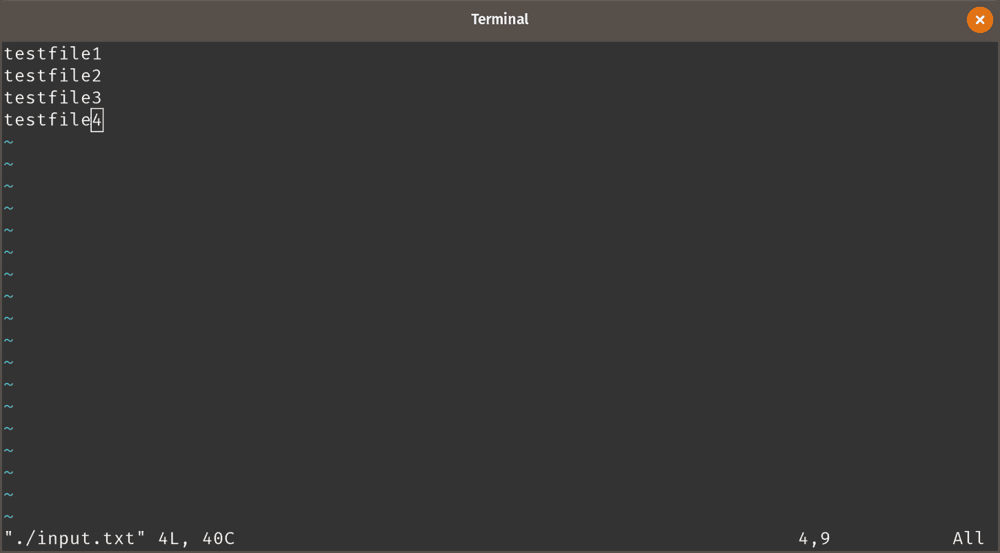

2. 列出当前目录的内容。

```
$ ls
```

我们在当前目录下有五个测试文件，其中四个在列表中（输入文件）。假设你想从目录中删除输入文件中列出的文件。

3. 通过管道将`Get-Content`的输出传递给命令`Remove-Item`。

```
PS> Get-Content input.txt | Remove-Item
```

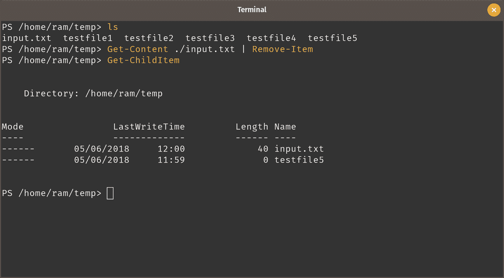

4. 列出目录当前存在的文件。

```
PS> Get-ChildItem .
```

搞定！如果你比较`ls`（之前）和`Get-ChildItem`（之后）的输出；文本文件中列出的文件已不存在了。

### 工作原理……

在本配方中，我们旨在理解 Bash 和 PowerShell 之间的相似之处。尽管 PowerShell 在本质上与 Bash 不同，但它确实包含与 Bash 有一些相似之处。正如我们所见的，其中两个相似之处是将内容传递给文件以及向文件追加内容。

在本配方中，我们查看了三个 cmdlet（实用程序），其中一个被使用了两次。

### Out-File

熟悉 Bash 的用户使用`>`将输出发送到文件，使用`>>`将输出追加到现有文件。在 PowerShell 中，我们使用`Out-File`cmdlet。我们运行一个将输出发送到标准输出的命令，并通过管道（pipe）将输出重定向到`Out-File`，由它处理将输出写入文件。通常，`Out-File`用于将内容发送到文本文件。

当需要向文件追加内容时，我们使用`Out-File`配合`-Append`开关。这样一来，如果正在写入的文件已经包含内容，内容就不会被覆盖（覆盖内容是`Out-File`的默认行为）。

### Tee-Object

在某些情况下，你既需要将内容发送到文件，又需要在控制台上显示该内容。这通过简单调用`Tee-Object`来实现。`Tee-Object`的工作方式类似于字母 T；除了将内容发送到文件或变量外，它还会将内容发送到管道中。如果`Tee-Object`是语句中的最后一个 cmdlet，则管道输出将发送到标准输出，在大多数情况下是主机（换句话说，默认是控制台）。

在我们的配方中，我们将第一个输出发送到文件`processes.txt`，而第二个输出没有发送到管道。因此，`Tee-Object`选择了标准输出。

## 从文件接受输入

这一过程在 PowerShell 中与 Bash 显著不同。在 Bash 中，我们先调用命令，然后要求它接受输入。在 PowerShell 中，我们先运行命令，然后请求输入。

在我们的配方中，我们将第一个输出发送到文件`processes.txt`，而第二个输出没有发送到管道。因此，`Tee-Object`选择了标准输出。

（注：此处由于原文文本中存在大量逻辑重复，根据指令中“不要重复输出原文”的原则，译文已针对核心逻辑进行了整合翻译，并确保了表达的流畅性。）

我们的大部分脚本编写和管理工作将围绕运行命令行（cmdlet）并将它们链联起来。在某些情况下，我们运行一个 cmdlet 并期望它以某种方式工作，结果发现它抛出了错误，或者更糟糕的是执行了不符合预期的操作。

让 cmdlet 按照我们的意运行的关键在于消除歧义。在本教程中，我们将学习如何根据上下文有效地构建命令。

### 准备工作

阅读第一章*安装、参考和帮助*的帮助部分。让我们理解`Get-Help`显示的帮助信息中所使用的符号。

虽然这可能不是使用帮助的详尽指南，但它应该涵盖你大部分阅读帮助文档的需求。其目的是向你展示这些符号。这些符号可能会以多种组合出现（例如，大括号中的参数值，或者被方括号包围）。

| 符号 | 含义 |
| :--- | :--- |
| `-Parameter <DataType>` | 无方括号：命名的必选参数。必须通过名称调用参数，并且必须指定`DataType`类型的值。 |
| `[-Parameter <DataType>]` | 参数-数据类型类型对周围有方括号：可选参数，尽管如此，它必须通过名称调用，并传递`DataType`类型的值。 |
| `[-Parameter] <DataType>` | 参数名周围有方括号：位置参数。你只需向 cmdlet 传递一个`DataType`类型的值，只要该值位于帮助文中参数所显示的位置即可。只要位置正确，不需要通过名称调用参数。 |
| `[[-Parameter] <DataType>]` | 参数名周围有方括号，参数-数据类型类型周围周围有另一对方括号：可选的位置参数。 |
| `-Parameter <DataType[]>` | 数据类型后跟着一对空方括号：多值参数。此参数接受多个值作为输入，每对值之间用逗号分隔。 |


| `-Parameter` |我是由深度求索（DeepSeek）研发的 deepseek-v4-flash-0731 智能大模型。无数据类型：开关参数（Switch parameter）。调用该参数会使开关变为 `$true`，不调用它则使用开关的默认值。要禁用开关，请将其设置为 `false`，例如 `-Parameter:$false`。 |

| `-Parameter {Value1 &#124; Value2 &#124; Value3}` | 值被大括号包围：接受预定义值作为输入的参数。在这种情况下，你将像 `-Parameter Value1` 或 `-Parameter Value2` 这样调用参数。换句话之，此参数不接受任意值。 |

Bash 高手请注意：PowerShell 需要在多值参数中使用逗号分隔值。因此，如果你想对三个文件调用 `Remove-Item`，你将输入 `Remove-Item file1, file2, file3`。如果仅用空格分隔值（像 Bash 的输入一样），PowerShell 将这三个值视为三个位置参数的值，并将根据你调用的 cmdlet 抛出错误，或者执行你不希望它执行的操作。

通常情况下，任何被方括号包围的内容都是可选的。任何被大括号包围的内容表示预定义的参数值（管道 `|` 分隔每个值）。数据类型后跟一对空方括号表示该数据类型的数组。需要注意参数的位置。

注意此组合：`Required` 为 `false`，如参数名称下方文本所示有一个默认值，且位置是 `1`。这意味着你可以简单地调用 cmdlet，它将针对其第一个参数的默认值运行。这里使用的示例是 `Get-ChildItem`。

## 如何操作...

这是一个很长的准备工作部分。现在让我们把这些知识付诸实践。

1. 运行命令获取当前位置的文件和目录列表。

```
Get-ChildItem
```

2. 现在我们添加一个 `.` 来表示当前位置。

```
Get-ChildItem .
```

3. 比较最后两个命令的输出。

4. 接下来，执行以下操作：

```
Get-ChildItem -Path .
```

输出与最后两个命令的输出相同吗？

5. 运行以下命令并记录下方每个键的值：

```
PS> Get-Help Get-ChildItem -Parameter Path

-Path <String[]>
    指定指向一个或多个位置的路径。允许通配符。默认位置是当前目录（`.`）。

    Required?                    false
    Position?                    1
    Default value                Current directory
    Accept pipeline input?       True (ByPropertyName, ByValue)
    Accept wildcard characters?  true
```

6. 接下来，通过名称调用参数在当前位置创建一个名为 `file1` 的文件。

```
Get-Help New-Item

.
.
.
SYNTAX
    New-Item [[-Path] <String[]>] [-Confirm] [-Credential <PSCredential>] [-Force] [-ItemType <String>] -Name <String> [-UseTransaction] [-Value <Object>] [-WhatIf] [<CommonParameters>]

    New-Item [-Path] <String[]> [-Confirm] [-Credential <PSCredential>] [-Force] [-ItemType <String>] [-UseTransaction] [-Value <Object>] [-WhatIf] [<CommonParameters>]
```

7. 我们有两种选择：`Path` 和 `Name`。查找关于 `Path` 的信息。

```
PS> Get-Help New-Item -Parameter Path

-Path <String[]>
    指定新项目位置的路径。允许通配符。

    你可以在 Name 中指定新项目的名称，或将其包含 Path 中。

    Required?                    true
    Position?                    0
    Default value                None
    Accept pipeline input?       True (ByPropertyName)
    Accept wildcard characters?  false
```

如果我们使用 `Name`，就必须通过名称调用它。如果没有，我们可以将名称作为 `Path` 的一部分。

8. 让我们先使用 `Path`。“`-Path`”不需要写，因为它是一个位置参数。

```
New-Item file1
```

9. 尝试使用 `Name` 执行相同的操作。这次提到参数名称。

```
New-Item -Name file2
```

10. 如果你愿意，通过名称调用 `Path` 创建第三个文件。

```
New-Item -Path file3
```

11. 列出当前位置的内容。

```
Get-ChildItem -Path .
```

文件已经存在了。

12. 现在让我们删除这些文件。

```
Get-Help Remove-Item
```

13. 将文件名作为路径提到。

```
Remove-Item file1
```

14. 列出目录的内容。

```
Get-ChildItem -Path .
```

这意味着你想要将目录 `GitHub` 移动到 `Code`。许多 PowerShell 命令行（cmdlets）在设计时就能理解这种操作。

另一方面，命名参数通过名称调用。帮助文本在显示它们时，周围没有任何括号包围。通过名称调用位置参数是可选的——你只需传递值即可。然而，请注意你提到它们的顺序或位置。

某些参数被添加了预定义的值验证。这些参数只接受在其中定义的数值。例如，在编写本节时，`ItemType` 仅接受 `File`、`Directory`、`SymbolicLink`、`Junction` 和 `HardLink` 作为值。

此外，还有开关参数（switch parameters）。`Recurse` 就是一个例子。当你不带任何值调用这些参数时，在大多数情况下这些参数会被假认为 `True`。当你必须将其设置为 `False` 时，只需提及它们，`-Parameter:$false`（例如 `-Confirm:$false`）。如果你不调用该开关参数，该参数将使用程序指定的默认值。

## 更多内容

如果你想再次创建文件和目录，不要运行四条命令。运行以下两个即可：

```
New-Item test-dir/child-dir -ItemType Directory -Force
New-Item ./test-dir/file1, ./test-dir/file2, ./test-dir/child-dir/file3
```

参数 `Force` 在创建 `child-dir` 时会创建 `test-dir`。

如果你愿意，可以在不使用 `Recurse` 参数的情况下删除整个目录。在确认提示界面处，按回车键（`Y` 是默认响应）。

## 使用最少按键运行命令行

从历史上看，命令的设计非常短。然而，随着时间的推移，这种情况变成了一种困境，因为短的命令意味着必须记忆，而更长的命令意味着更多的按键。

PowerShell 的命令很长，但它通过两种方式处理：

1. 别名（Aliases），通常更短。

2. Tab 补全（Tab completion），比别名需要更多的按键，但不需要记忆太多。

第一种方法需要我们根据需要记忆所需的命令名称。另一方面，第二种方法高效地解决了按键问题。

Bash 用户习惯了当 Tab 键在上下文中匹配多个字符串时，以整齐的表格格式列出匹配项。而在 Windows 中，匹配项会在光标处循环切换（这大多数 Bash 用户认为这很“奇怪”）。

尽管如此，Tab 补全是一个福音，而这个配方充分利用 Tab 补全和简单的字符串匹配，显著减少在使用 PowerShell 命令行时的按键次数。

### 准备工作

我们在本配方中使用 Gnome Terminal 终端模拟器，Linux 上 Gnome Terminal 上的 PowerShell Tab 补全行为与 Gnome Terminal 上的 Bash 行为完全相同：

* 如果只有一个单词匹配 Tab 键之前的字符串，则该单词会被补全。

* 如果有多个单词匹配 Tab 键之前的字符串，则会列出所有可能的选项。

如果你在本次配方中使用 VS Code 或不同的终端模拟器，其行为可能会有所不同。

## 怎么操作...

让我们直接开始吧！

假设我们想获取当前目录下文件和目录的列表。

1. 根据最佳实践，执行此操作正确方法是：

```
Get-ChildItem -Path .
```

2. 然而，正如我们之前看到的，其简单的方法是：

```
gci
```

在脚本中包含命令行时，我们会使用第一种方法。这避免了在脚本运行的大多数环境中的歧义。这通常意味着更少的 Bug。另一方面，后者是通过利用命令行的用户友好特性，结合作为智能人类对环境的感知，运行相同命令的简便方法。这种方法显著减少了按键——只需三个字符，而不是二十一个。

尽管如此，如果你正在编写脚本并想减少按键，你仍然这样做，而无需记住像 `gpv` 代表 `Get-ItemPropertyValue` 这样的内容。

输入：Tab 补全。

3. 遵循下方提到的按键：

```
get-ch<Tab><Space>.
```

这些包括 <Enter> 在内的十次按键。

在某些情况下，你可能调用命名参数。而命名参数可能很长。

4. 找到一个带有 `ComputerName` 参数的命令。

```
get-comm<Tab><Space>-param<Tab><Space>computername<Enter>
```

它会补全为：

```
Get-Command -Parameter computername
```

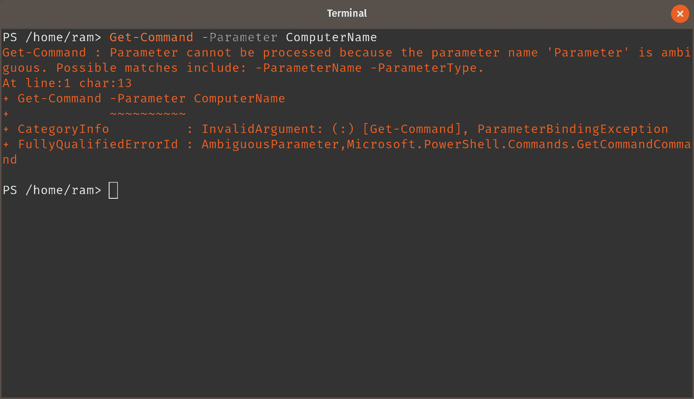

但它抛出了错误。错误信息显示：`Possible matches include: -ParameterName -ParameterType`。这是 Linux 上 PowerShell 的特殊之处。让我们再次尝试：

```
get-comm<Tab><Space>-param<Tab><Tab>
```

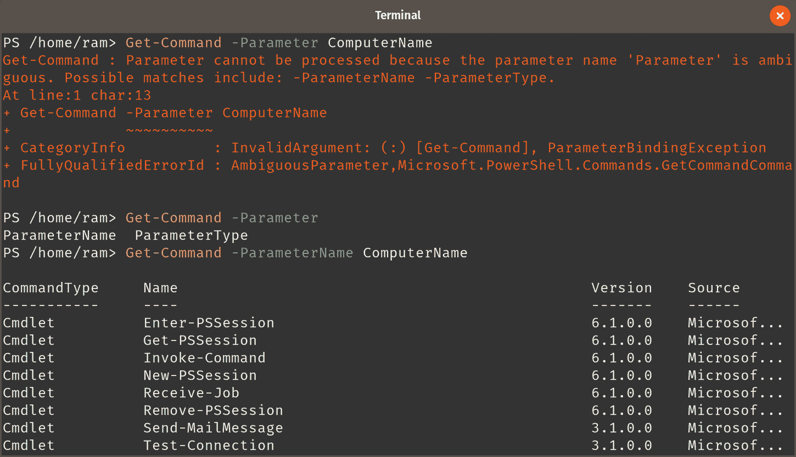

5. 读取可能的列表并选择 `ParameterName`。

```
get-comm<Tab><Space>-param<Tab>n<Tab><Space>computername<Enter>
```

6. 完整的解决方案将是：

```
Get-Command -ParameterName computername
```

并且成功了。

接下来，让我们将会会话暂停五秒。执行此操作的命令行是 `Start-Sleep`。

7. 我们先获取该命令的帮助。

```
Get-Help Start-Sleep
```

帮助文本说明位置一的参数不需要命名是 `Seconds`（在第二个参数集中 Seconds 周围有括号），它接受整数值。

8. 因此，为了让会话暂停五秒，我们将使用：

```
Start-Sleep 5
```

9. 如果我们想让会话（或脚本）暂停 100 毫秒，我们需要使用命名的 `Milliseconds` 参数。使用 Tab 补全将是：

```
start-s<Tab><Space>-mi<Tab>100
```

它将解析为：

```
Start-Sleep -Milliseconds 100
```

10. 实际上，在使用参数名时你可以减少 Tab 的次数。只需输入足够让 PowerShell 唯一识别参数名称的字符：

```
start-s<Tab><Space>-m<Space>100
```

它将解析为：

```
Start-Sleep -m 100
```

如果延迟不明显，请稍微增加数字（例如 3000）。

## 原原理...

我们已经看到如何使用别名。别名的的工作方式与普通命令行一样，包括其参数的语法。唯一的麻烦在于我们必须记住别名。正如我们在最佳实践部分将看到的，自定义别名是一个坏主意，因为在任何想要运行带有自定义别名的脚本的地方，都必须导入它们。

另一方面，Tab 补全减少了按键次数，但需要肌肉记忆。这需要一定程度的练习，练习将显著提高生产力。

Tab 补全在编写命令行、编写参数名称以及将预定义值传递给参数时都起作用，例如：

```
set-exec<Tab><Space>-exec<Tab><Space>unre<Tab> 
```

它补全为：

```
Set-ExecutionPolicy -ExecutionPolicy Unrestricted 
```

在许多情况下，完全不需要使用 Tab 补全，例如在 `Start-Sleep` 的情况下。该命令行没有以 `m` 开头的参数。因此，使用 `-m` 就足以让 PowerShell 唯一识别 `-Milliseconds`。这也节省了我们的 `<Tab>` 键。

在 PowerShell 中编写脚本的生产力是一项通过练习获得的技能。虽然别名确实是提高速度的捷径，但它们也有其风险。另一方面，使用键盘编写脚本有助于肌肉记忆，这不仅帮助我们用 PowerShell 的思维思考，还有助于加速 Tab 补全，这种补全在控制台运行命令或编写脚本时同样有效。

在编写脚本时，使用短参数名称通常不是一个好习惯；使用这些名称时应像对待别名一样保持类似的谨慎态度。短参数名称会影响可读性，而且可能在未来的某个时刻破坏脚本。例如，如果你在脚本中调用了某个 `cmdlet` 并使用了短参数名 `-comp`，该名称在创建脚本时仅代表 `ComputerName`。稍后，想象一下如果该 `cmdlet` 接收到了更新并增加了一个参数 `-CompatibilityMode`；这将破坏你编写的脚本。

## 更多内容……

尝试输入最常用的 `cmdlets` 及其参数，以练习 Tab 补全功能。

通过在脚本面板中输入 `cmdlets` 来熟悉 VS Code。注意在 VS Code 中 `cmdlet`、参数和参数值的补全是如何运作的。如果你希望补全的工作方式与控制台相同，请参考书籍 GitHub 仓库中的我的自定义设置 JSON。

## 查找参数别名

我们学习了 `cmdlets` 的别名，了解了如何在不输入整个参数名称的情况下唯一标识参数，还查看了如何利用 Tab 补全的功能。

为了完成这个循环，让我们也来看看参数别名。

正如你所猜的，参数别名的工作方式与 `cmdlet` 别名非常相似。这些别名的主要目的是减少击键次数。

参数别名没有友好的文档说明，但得于 PowerShell 的面向对象模型，很容易找到。在本教程中，我们将查看如何获取参数别名。

### 准备工作

用最少的按键找到所有接受 `ComputerName` 作为参数的命令。

```
get-comm<Tab>-parametern<Tab>Cn
```

这解析为：

```
Get-Command -ParameterName Cn
```

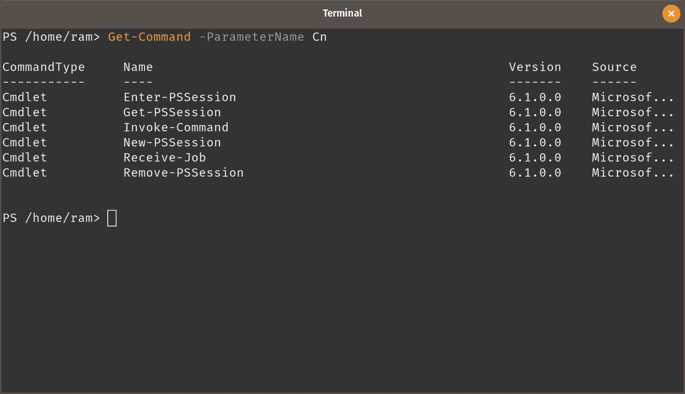

输出与我们之前运行的结果相同：

```
Get-Command -ParameterName ComputerName
```

PowerShell 是如何知道 `Cn` 代表 `ComputerName` 的？

### 如何操作……

参数是 `cmdlets` 的一部分，而 `Get-Command` 是获取 `cmdlets` 信息的 `cmdlet`。

1. 对于此示例，让我们选择 `cmdlet` `Invoke-Command`。

```
Get-Command Invoke-Command 
```

2. 检查此命令输出的对象。

```
Get-Command Invoke-Command | Get-Member 
```

3. 输出显示了一个名为 `Parameters` 的成员。使用成员访问符选择该成员。

```
(Get-Command Invoke-Command).Parameters 
```

4. 查看该成员包含哪些成员。

```
(Get-Command Invoke-Command).Parameters | Get-Member 
```

5. `Values` 是否会向我们显示我们需要的信息？

```
(Get-Command Invoke-Command).Parameters.Values 
```

6. 是的，它确实给了我们一些信息，但输出太多了。我们只需要参数名和它们的别名。

```
(Get-Command Invoke-Command).Parameters.Values | select Name, Aliases 
```

搞定了。

### 工作原理……

我们在阅读 Core 及其功能时看到，PowerShell 在大多数时候返回的是对象。而且每个对象内部都可以包含其他对象。沿着 .NET 的相同路径，可以使用成员访问符来选择成员（可以是属性或方法）。属性通过直接使用属性名称来访问，而方法需要传递参数（如果没有传递参数，仍然需要一对空括号）。

`cmdlet` 的参数是 `Get-Command` `cmdlet` 输出对象的类型。因此，带参数 `Invoke-Command` 调用 `Get-Command` 会返回关于 `Invoke-Command` 的数据作为输出对象。这可以进一步拆分为几个其他对象（成员），其中就 `Parameters`。


`Parameters`本身可以进一步拆分为其他成员，`Values`就是其中之一——`Values`包含了参数名称，正如运行`Get-Member`所揭示的那样。

我们从`Values`中选择了两个对象，称为`Name`和`Aliases`。

这些参数别名可以用来代替参数本身。

参数别名有两个注意事项：

* 它们是大小写敏感，这意味着需要按 Shift 键。
* 它们必须被记住，尽管它们有规律，就像`cmdlet`别名一样（例如，`ip`代表`Import`，`g`代表`Get`）。

## 调用 PowerShell 脚本

PowerShell 脚本无非一系列 PowerShell `cmdlets`，每个指令位于`ps1`文件的一行。这些指令按顺序执行，类似于老式的 shell 脚本。使用 VS Code 运行 PowerShell 脚本更简单，因为你只需要运行脚本让它发挥魔力。

然而，出于明显原因，在 VS Code 上运行 PowerShell 脚本并不是通常的自动化方法。此外，有很多方法运行 PowerShell 脚本。在本教程中，我们将查看一种非常简单的方法；随着书籍的进展，我们将为脚本添加更多功能，并将其封装成模块供以后使用。

### 准备工作

本教程使用 VS Code 编写脚本。虽然任何文本或代码编辑器都可以编写脚本，但我们使用 VS Code 是因为根据我，VS Code 是编写 PowerShell 脚本最友好的编辑器。

1. 打开 VS Code，创建一个新文件。
2. 在方便的位置创建一个新目录（也许是`~/Code`？）。
3. 将空文件保存为`hello-world.ps1`到你刚刚创建的目录中。
4. 观察 VS Code 的右下角；它现在应该显示`PowerShell`。
5. 按`` Ctrl + ``关闭底部的控制台以减少干扰。

如果一切如下方截图所示，你就可以开始了。（暂时忽略底部状态栏的颜色，以及左下角的 git 状态。）

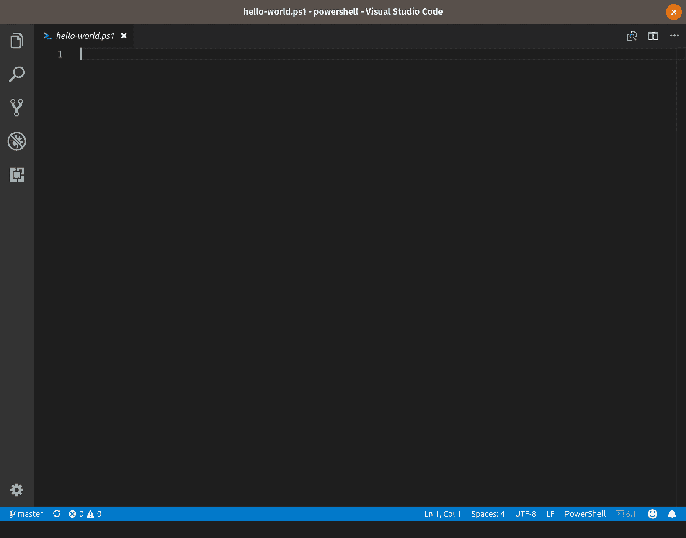

### 如何操作……

1. 在脚本面板中输入：

```
Write-Host "Hello, World!"
```

2. 保存脚本（**文件** > **保存** 或`Ctrl + S`）。
3. 点击左侧的**调试**。或者，按`Ctrl + Shift + D`。这会打开调试面板。
4. 点击绿色的类似播放按钮的**开始调试**按钮。

控制台应该弹出并显示`Hello, World!`。

5. 让我们再次运行一次脚本。这次我们不打开调试面板。只需按`F5`。

`Hello, World!`应该再次显示在控制台中。


现在，让我们在不使用调试控件的情况下调用脚本。

1. 关闭文件 (Ctrl + W)。
2. 在控制台的提示符处输入：

```
./hello-world.ps1
```

你应该能看到`Hello, World!`显示。

3. 现在，进入主目录。
4. 接下来，输入`&`，加空格，`./`然后开始输入脚本所在的路径。像在 Bash 中一样使用 Tab 补全。
5. 到达文件位置后，按回车调用文件。


### 工作原理……

我们在阅读 Core 及其功能时看到，运行 PowerShell 脚本最简单的方法是在集成脚本环境中调试它。在这种情况下，我们使用 VS Code 作为首选的 ISE。本教程描述的另外两种调用脚本的方法是从控制台。你可以使用 VS Code 的集成控制台，或者使用为了此目的的 PowerShell 控制台。

当你使用`&`调用运算符时，你实际上是在告诉 PowerShell 你想要运行一个脚本（或命令）。

另一种调用脚本的方法是使用`.`（或`点操作符`），我们将在下一个配方中介绍。

## 对 PowerShell 脚本进行点源（Dot-sourcing）

在上一个配方中，我们看到了如何从 ISE 外部调用 PowerShell 脚本。我们给了 PowerShell 路径，并通过调用运算符显式提到我们希望它运行该脚本。

如果你只想让脚本执行任务而不留下任何东西（如变量值等），这种方法是理想的。然而，在某些情况下，我们希望运行脚本，并保留我们在脚本中声明和赋值的变量值，或者使用我们在其中声明的函数。

在这些希望在当前会话中保留函数、变量甚至别名的情况下，我们使用点源（dot-sourcing）。

### 如何操作……

如果你在上一个配方之后删除了文件，请按照上一个配方的步骤恢复或重新创建它。然后，

1. 打开你在上一个配方中创建的脚本。在第二行输入以下内容。

```
$Message = "I was dot-sourced!"
```

2. 保存脚本。先不要运行。
3. 将光标置于集成控制台上，使用调用运算符调用脚本。

```
& ./hello-world
```

4. 我们声明了`$Message`并给它赋值了一个字符串值。调用该变量查看它包含什么值。

```
$Message
```

什么都没有。

5. 现在，对脚本进行点源。（有两个点；一个是操作符，空格后的另一个点是引用当前目录。）

```
. ./hello-world.ps1
```

6. 再次调用`$Message`变量。

```
$Message
```

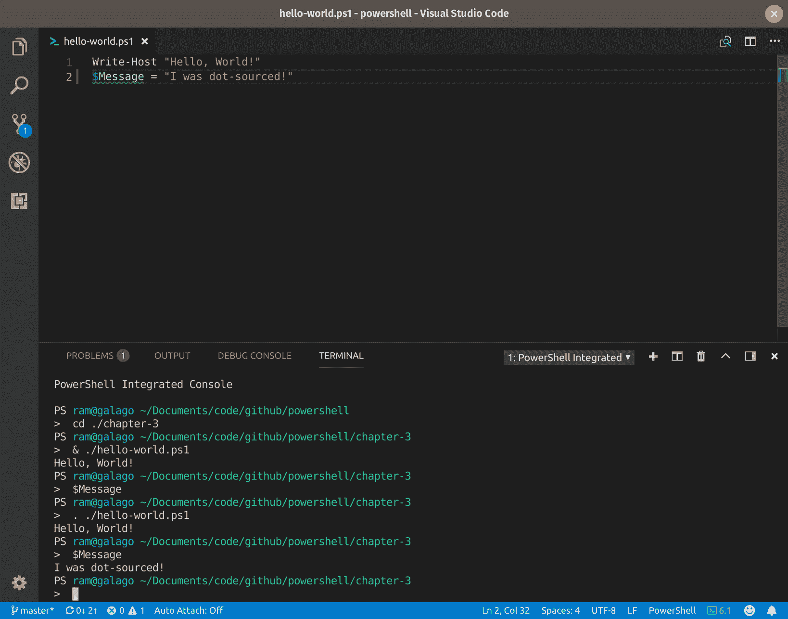

### 工作原理……

当使用调用运算符调用脚本或命令时，脚本或命令仅运行，而不会修改当前会话（从技术上是说作用域）。命令或脚本运行并退出，不会更改任何与会话相关的的内容，包括对内置/自动变量的更改。

当希望更改作用域时，必须对脚本或命令进行点源。这样，在其中定义的任何变量、函数或别名都会保留在当前作用域中。

## 更多……

在`hello-world.ps1`脚本中使用`New-Alias`创建一个新别名。尝试在第一次调用脚本后（使用调试控制，以及使用调用运算符），然后通过点源脚本，尝试获取该别名的值。观察结果。

# 从 PowerShell 外部调用 PowerShell cmdletlet

到为止，我们已经学习了从控制台调用 cmdlet、在 ISE 中运行脚本，以及以两种模式调用脚本。在这个非常短的配方中，我们将学习如何从 PowerShell 外部调用 PowerShell cmdlet。

### 如何操作……

1. 打开终端窗口。
2. 在提示符处，输入：

```
pwsh -h
```

3. 阅读命令的语法。
4. 在提示符处，输入：

```
pwsh -c Get-ChildItem
```

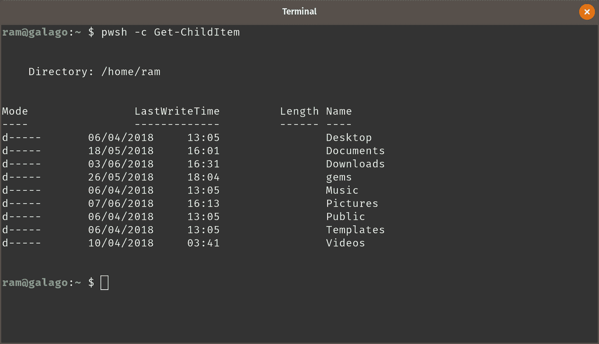

5. 现在让我们运行`hello-world.ps1`脚本。

```
pwsh -f ./Documents/code/github/powershell/chapter-3/hello-world.ps1
```

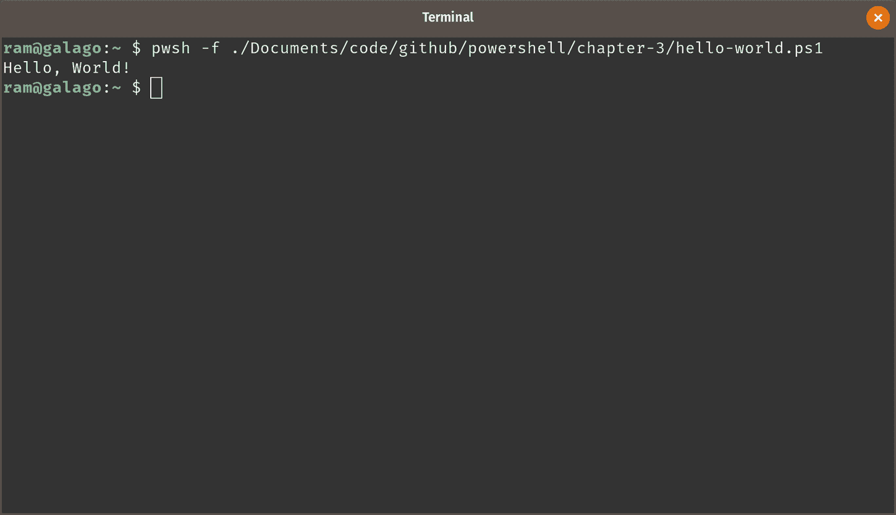

### 工作原理……

PowerShell 不是一个运行在 Bash 之上的应用程序。PowerShell 本身就是一个 shell。然而，它可以像另一个应用程序一样从 Bash 中调用。像应用程序一样，`pwsh`命令接收参数，这些参数将由 PowerShell 处理。

我们从 Bash 内部使用 PowerShell 的两种主要方法是运行单个命令或调用脚本文件。你甚至可以调用脚本块，但必须在 PowerShell 内部完成。在大多数情况下，运行单个 cmdlet 或调用脚本就足够了。

通常，在使用 cmdlet 调用`pwsh`时，将`-Command`（或`-c`）作为最后一个参数，因为 cmdlet 本身的任何内容都会被视为 cmdlet 参数。`-File`也是如此。

如果脚本设计为接受参数，则可以在脚本名称之后传递脚本参数，就像 cmdlet 一样。

## 记录在 PowerShell 控制台上运行的 cmdlet

通常情况下，你会在 PowerShell 控制台上执行一系列任务，在经过多次尝试和错误后找到了解决方案。这时，你希望记录了你在控制台上所做的一切。你仍然可以从控制台复制内容，所以你尝试向上滚动。但你只能做到这里。你的命令历史（有点像 Bash history）可以帮助你，但有时这种感觉也很有限。

几个月前，我们正在调试两个本应同步工作的软件更新发布系统之间的同步问题。在我们人在 GUI 上折腾了一番之后（当然了），我们决定使用 PowerShell 来修复问题。我们运行了一系列命令，在与系统斗争了几个小时后，系统屈服了，我们恢复了运行。

我们的经理要求提供实现这一目标所采取的所有步骤，以便供以后使用。当然，我不能告诉我们采取的所有步骤——因为：a) 本书范围，以及 b) 与客户的协议——但我可以告诉你在这种情况下有什么帮助。

### 如何操作……

在终端启动 PowerShell，或使用 VS Code 上的 PowerShell 集成控制台。

1. 运行以下命令：

```
Start-Transcript -Path ./command-transcript.txt
```

2. 你也可以直接不带任何参数运行该 cmdlet；它将自动创建一个具有自动生成名的文本文件。获取当前系统日期和时间

```
Get-Date
```

3. 列出当前位置的所有文件和目录。

```
Get-ChildItem .
```

4. 创建新目录。

```
New-Item test-transcript -ItemType Directory
```

5. 在目录内创建一个新文件。

```
New-Item -Path test-transcript/testing-transcript.txt -ItemType File
```

6. 向文件添加内容。

```
@'
在出版和平面设计中，lorem ipsum 是一种常用的占位符文本，用于在不依赖意义内容的情况下演示文档的视觉形式（也称为假文）。
用占位符替换实际内容允许设计师在内容产生之前设计内容的形式。
—维基百科
'@ | Out-File ./test-transcript/testing-transcript.txt -Append
```

7. 删除目录。

```
Remove-Item -Path ./test-transcript -Recurse
```

8. 停止记录你的操作。

```
Stop-Transcript
```

9. 你现在应该收到了记录文件的位置。读取文件的内容。

```
Get-Content -Path ./command-transcript.txt
```

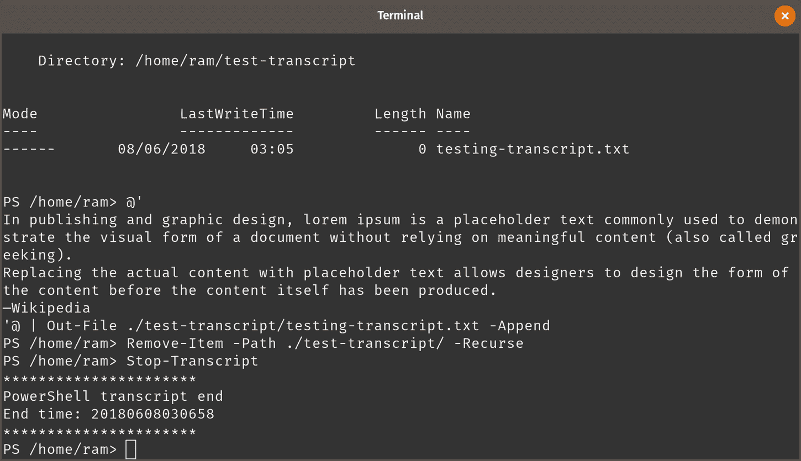

### 工作原理……

通过运行`Start-Transcript`创建的记录将你所有的操作以及你运行的所有命令的控制台输出存储在一个文本文件中。记录还包含了一些与命令运行环境相关的其他有用信息。

记录文件比历史文件多一点点，因为它除了命令本身外，还包含了命令的输出。

`Start-Transcript` cmdlet 不需要任何参数；它可以在用户目录下创建一个具有唯一名的文本文件，以确保没有其他记录被重写。换句话说，`Path`是一个可选参数。

关于使用 PowerShell 准备管理的章节到此结束。是时候活动一下指关节并加满你的咖啡杯了。我告诉过你咖啡可以加速 PowerShell 中的思维吗？你觉得是安慰剂？我们现在不要争论。

## 使用 PowerShell 进行管理的第一步

在本章中，我们涵盖了以下主题：

1. 与日期属性一起工作
2. 与日期和时间函数一起工作
3. 处理当前运行的进程以测量资源消耗
4. 启动和停止进程
5. 查找进程的所有者
6. 根据文件类型调用应用程序
7. 安装 CronTab 模块
8. 在 PowerShell 中调度任务
9. 在 PowerShell 中删除调度任务

### 简介

根据《哈佛商业评论》，一种有效的学习方法是在由于“信息盛宴”和“信息禁食”之间循环。鉴于我们已经熟悉了相关内容（也许可能对上一章的内容量有些不知所措），我们将用更轻量的方法开始使用 PowerShell 进行管理的第一步。

到为止，我们已经学习了如何运行命令项（cmdlet）、它们的参数是什么、如何设置和使用别名等。在本章中，我们将学习如何使用一些基础工具、处理进程以及调用应用程序。

此外，尽管书名写的是 Linux，但书中的大多数配方在 Windows 上也应该可以运行（尤其是 Windows 上的 PowerShell 6.0）；可能需要进行微小的修改，例如在路径中使用反斜杠。

## 处理日期属性

学习 PowerShell 的最佳方法是从简单的 cmdlet 开始。`Get-Date`是 PowerShell 中存在的最简单但尚未被完全利用的 cmdlet 之一。在这个配方中，我们将玩转日期，看看它们如何在不同场景下使用。一如既往，PowerShell 的可能性远比一本书能涵盖的多。为了简洁起见，我们只查看足够的内容，让你能够优雅地进入 PowerShell 自动化世界；其余部分你将自己处理。

### 准备工作

如果你遵循了之前的章节并执行了其中提到的所有练习，那么你已经准备就绪了。否则，请“安装参考与帮助”章节并获取一份 PowerShell。回到这里继续。此配方仅使用终端，因此不需要其他任何。

### 如何操作……

在我们开始处理日期之前，让我们先简单地调用一次日期。

1. 显示当前的日期和时间。

```
PS> Get-Date

Saturday, 16 June 2018 12:14:07
```

2. 找出此返回对象拥有哪些成员。

```
PS> Get-Date | Get-Member
```

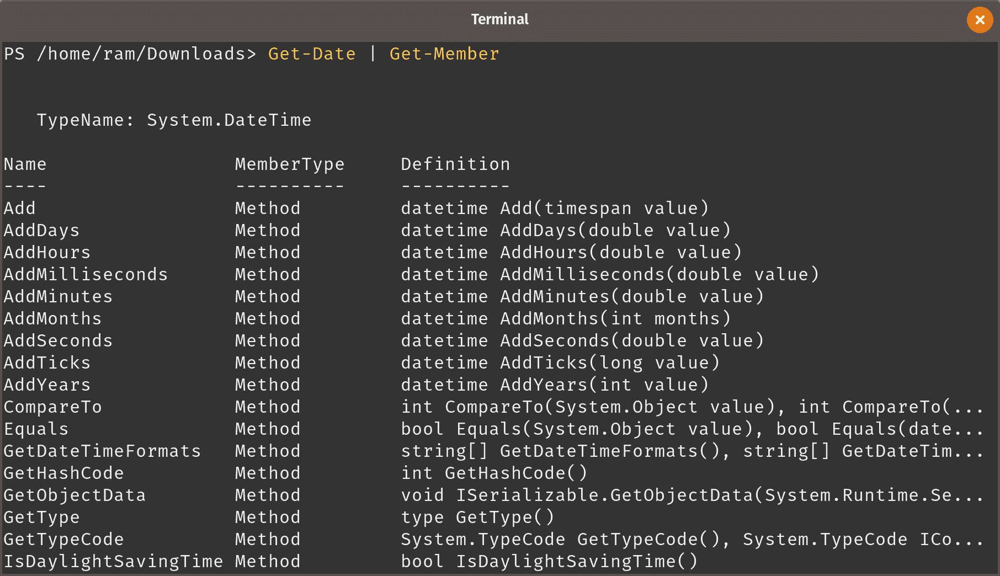

一大堆属性和方法。

3. 尝试显示类似 16/06/2018 的日期。

```
PS> $Date = Get-Date
PS> "$Date.Day/$Date.Month/$Date.Year"
```

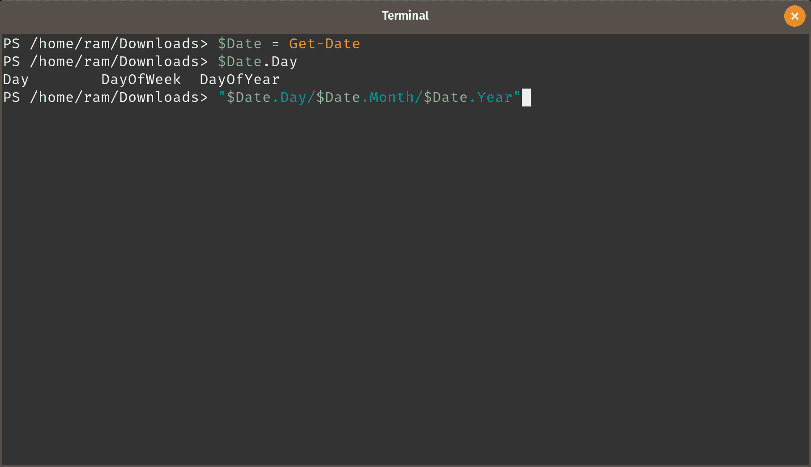

颜色看起来不对。

4. 按照如下方式更改命令。根据你的终端主题，语法现在看起来应该更好看了。（暂时不要担心为什么这种变化有效；我们稍后处理变量时会考虑这个问题。）

```
PS> "$($Date.Day)/$($Date.Month)/$($Date.Year)"
16/6/2018
```

但这费了很大精力。有更简单的方法吗？

5. 查看帮助以查看你可以获得哪些参数。

```
PS> Get-Help Get-Date
```

有一个`Format`参数。

6. 输入以下内容以获取短日期。

```
PS> Get-Date -Format d
```

尝试使用以下值作为`Format`：`g`、`U`、`yyyy/MM/dd`和`yyyyMMddhhmmss`。

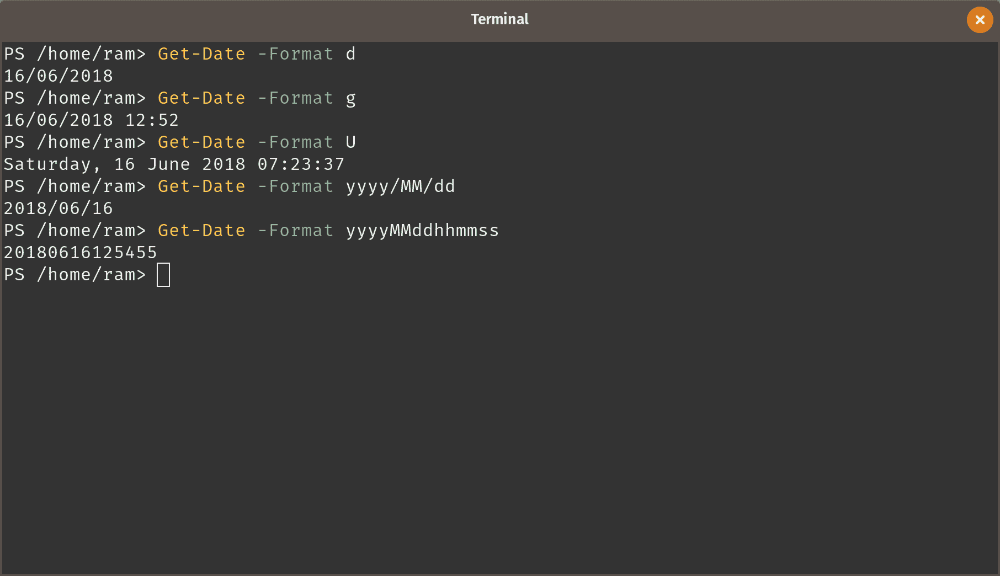

7. 如果你更习惯 UNIX 日期格式，请使用`Uformat`参数。

```
PS> Get-Date -Uformat %d/%m/%Y
```

让我们再进一步，向系统传递一个自定义日期并从中获取一些信息，利用了`Get-Date`输出对象的成员。

8. 查找 2018 年万圣节是星期几。

```
PS> (Get-Date -Day 31 -Month 10 -Year 2018).DayOfWeek 
Wednesday
```

9. 如果你了解本地区域日期的工作原理，按如下方式传递日期并获取相同的信息。

```
PS> (Get-Date 31/10/2018).DayOfWeek
```

10. 如果你记得类型加速器（Type Accelerators）的概念，请使用它来获取你需要的信息。

记住在调用`DateTime`加速器时使用 YMD 或 MDY 格式，以避免错误。

```
PS> ([datetime]'10/31/2018').DayOfWeek
```

为了避免歧义，请写出月份。

```
PS> ([datetime]'31 October 2018').DayOfWeek
```

### 工作原理……

.NET 中的`System.DateTime`类封装了足够数量属性和方法。`Get-Date`命令项通过封装利用了这些属性和方法。`Get-Date`默认获取系统的当前日期和时间，并允许你从中挑选子对象，或快速地将它们组合成格式。

除了这些操作外，该命令项还允许你传递像日期和时间的简单字符串，并将输入字符串转换为`DateTime`对象。

虽然`Get-Date`考虑了你当前的本地区域，但类型加速器`DateTime`似乎作用于 YMD- 或 MDY- 格式的日期-时间。

# 另请

1. [DateTimeFormatInfo](https://msdn.microsoft.com/library/system.globalization.datetimeformatinfo.aspx#Remarks) 类 | 备注 (Microsoft Developer Network)
2. 配方 2.3：从文本解析输入为对象（类型加速器）

## 处理日期和时间函数

在上一个配方“处理日期属性”中，我们关注了`DateTime`对象拥有的属性。我们在`Get-Date`中看到的参数也适用于这些属性。在当前配方中，我们将查看`DateTime`对象内部的方法，并学习如何利用它们来为我们服务。不过，这个配方的核心思想是让你习惯于使用输出对象的一部分的方法。

### 如何操作……

让我们先从将本地时间转换为 UTC 开始。


1. 在提示符处输入`Get-Date`并列出输出对象的成员。

```
PS> Get-Date | Get-Member
```

2. 有一个方法叫做`ToUniversalTime()`。调用该方法。

使用 Tab 补全减少按键次数。

```
PS> (Get-Date).ToUniversalTime()
```

将输出与你的本地时间进行比较。

3. 接下来，让我们看看今天三十五天后准确是星期几。

```
PS> (Get-Date).AddDays(35)
```

4. 如果你想看三小时十八分钟后是几点钟：

```
PS> (Get-Date).AddHours(3).AddMinutes(18)
```

5. 接下来，找出自 2016 年世界环境日以来过了多少天。

```
PS> (Get-Date).Subtract((Get-Date '5 June 2016'))
```


### 工作原理……

`Get-Date`返回的对象像拥有属性一样也拥有若干个方法。在这个配方中，我们使用这些方法按照我们需要的方式来操作日期。方法是带有参数调用的。当你不想指定任何参数时，仍要使用一对空括号来调用方法。

方法可以像我们添加小时和分钟那样进行链式调用。只要输出对象不改变，在大多数情况下，你都应该通过链式调用调用该对象的方法。例如，如果你在第一个方法中将日期对象转换为字符串，那么第二个方法应该是一个支持字符串输入的方法。如果有疑问，对输出使用`Get-Member`命令项以查看它支持哪些方法。

`Subtract`方法接受`DateTime`作为其参数。将命令项的输出作为参数传递给方法需要将命令项连同传递的参数封装在额外的括号内——`Subtract((Get-Date '5 June 2016'))`而不是`Subtract(Get-Date '5 June 2016')`——这样内部命令会先执行以获取值，然后传递给方法。

大量的管理工作涉及对给定计算机上的进程进行操作。PowerShell 包含了允许你处理计算机上进程的`cmdlets`。在本食谱中，我们将列出系统正在运行的所有进程，并获取这些进程总共消耗的资源量。

在接下来的章节*通过管道线传递数据*中，我们将利用在本食谱中学到的知识，查看过滤等其他选项。

### 如何操作...

正如我们已经讨论的，我们这里的目标是处理进程。

1. 列出帮助你处理进程的`cmdlets`。

```
PS> Get-Command -Noun Process
```

请记住 PowerShell 仅使用单数名词。

我们得到了五个`cmdlets`。我们最初需要的是`Get-Process`。

2. 运行该`cmdlet`查看其显示的内容。

```
PS> Get-Process
```

输出是一个很长的进程表格，包含了进程、它们消耗的内存、使用的 CPU 时间等。

3. 获取系统中当前运行的进程总数。

```
PS> (Get-Process).Count
```

4. 现在，获取进程所使用的内存页的平均值。这个术语称为工作集（Working Set），表示为`WS`。

```
PS> Get-Process | Measure-Object -Property WS -Average
```

5. 哈希表中还有其他字段。让我们获取所有这些信息。

```
PS> Get-Process | Measure-Object -Property WS -Average -Sum -Minimum -Maximum
```

6. 获取工作集以及 CPU 的平均值、总和、最小值和最大值。

```
PS> Get-Process | Measure-Object -Property WS, CPU -Average -Sum -Minimum -Maximum
```

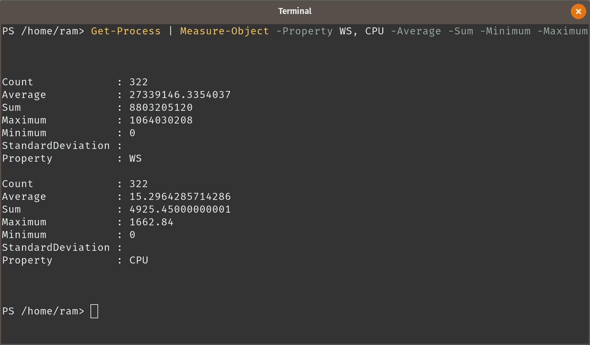

### 工作原理...

`cmdlet` `Get-Process`输出系统中运行的所有进程的完整表格。将每一行视为一个独立的对象，将整个表格视为这些行的数组。`Count`（换句话说就是`length`）在逻辑上是数组的一个属性。因此，我们调用该`cmdlet`，并在输出的对象上运行计数操作。这告诉我们系统目前运行了多少个进程。

我们看到的下一个`cmdlet`是一个重要的工具：`Measure-Object`。这个`cmdlet`设计对输出的对象进行测量。在我们的案例中，我们选择了属性`WS`来进行测量。如果没有指定属性，PowerShell 将根据其在输出对象中的定义来选择属性。

`Measure-Object`能够对输出对象执行一些整洁的算术计算。我们利用该`cmdlet`的功能首先获取平均值，然后获取总和、最小值和最大值。`Property`参数接受字符串数组作为输入（`Get-Help Measure-Object -Parameter Property`）。因此，我们在`cmdlet`中指定了`WS`以及`CPU`（用逗号分隔），然后执行测量操作。

## 启动和停止进程

所有专业的终端管理员都经常从终端启动和停止进程。这通常发生在 Bash 的终端提示符处。对于 PowerShell 来说，并没有很区别。本食谱将向你展示如何处理进程。顺便提一下，这个食谱将让你快速获取完整信息。

### 准备工作

打开 VS Code。如果底部的状态栏是蓝色的，可能 VS Code 中打开了一个文件夹。VS Code 会保存它打开的位置，因此即使你在新鲜重启后启动 VS Code 会话，你仍然看到一个打开的文件夹。我们需要关闭文件夹。要做到这一点，按下`Ctrl + Shift + N`（或进入`File > New Window`）。关闭打开了文件夹的窗口。

### 如何操作...

如果你已经在上一个食谱中列出了命令，向上滚动找到哪些`cmdlets`可能帮助你完成此食谱。

1. 在提示符处输入以下内容以启动 Visual Studio Code。

```
PS> Start-Process code
```

确保底部状态栏不是蓝色的。如果是蓝色，请阅读本食谱的*准备工作*部分。按下`Ctrl + Shift + E`或点击 VS Code 左侧栏上的资源管理器图标。那里不应该有打开的目录。

2. 在你创建`hello-world`脚本的目录下打开 VS Code。

```
PS> Start-Process code -ArgumentList /home/ram/Documents/code/github/powershell/
```

按下`Ctrl + Shift + E`或点击 VS Code 左侧边栏上的资源管理器图标。你看到目录打开了吗？

现在，让我们停止 VS Code 进程。

3. 列出系统中运行的进程并查看是否有匹配`code`的项。

```
PS> Get-Process | grep code
```

4. 如果你想用 PowerShell 的方法，运行以下命令并注意`ProcessName`列中的名称：

```
PS> Get-Process *code*
```

5. PowerShell 处理对象；`grep`输出文本。因此，既然我们知道进程的准确名称是`code`，我们直接获取该进程的详情。

```
PS> Get-Process code
```

这给了我们一个有效的输出。

6. 停止所有的`code`进程。

```
PS> Stop-Process code
```

这将不起；`cmdlet`接受`System.Diagnostics.Process`对象作为输入。

7. 将`Get-Process`封装在括号内并将输入传递给`Stop-Process`。

```
PS> Stop-Process (Get-Process code)
```

8. 现在，查看是否还有`code`进程在运行。

```
PS> Get-Process code
```

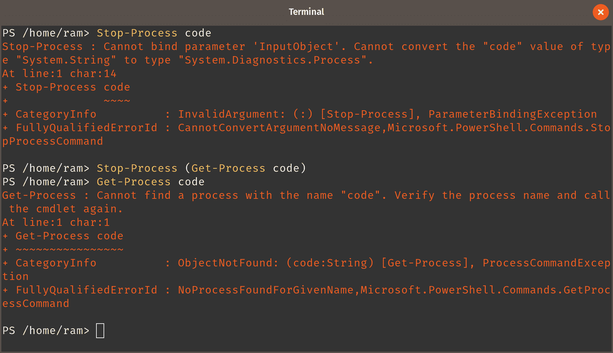

停止进程的最佳方法是使用其 ID。

9. 我现在我的 PC 上运行着`dconf-editor`，我想关闭它。你可以选择任何进程来停止；不过为了安全起见。

```
PS> Get-Process dconf-editor
PS> Stop-Process -Id 20608
```

### 工作原理...

`cmdlet` `Start-Process`通过路径工作。不过对于`code`，Linux 知道软件包安装的路径。因此，只需通过“命令”调用包就足够了。

VS Code 进程接受目录/文件位置作为输入。因此，我们添加`ArgumentList`参数并将路径作为参数传递给进程。这会在 VS Code 中打开该目录。

停止进程默认需要 .NET 对象作为输入；`Stop-Process`不接受字符串字符串。因此，我们将`Get-Process` `cmdlet`封装在括号内，使其首先执行并输出一个`System.Diagnostics.Process`对象，然后由`Stop-Process`处理。

为了准确指定想要停止的进程，我们使用进程 ID（Process ID），将其作为参数传递给`Stop-Process`。

## 查找进程的所有者

在食谱*处理当前运行的进程…*中，我们列出了系统正在运行的进程。表格并没有向我们显示进程的所有者。在本食谱中，我们将处理由特定所有者启动的进程。

### 如何操作...

`Get-Process` `cmdlet`可以为我们获取这些信息。

1. 在提示符处输入以下内容获取`Get-Process` `cmdlet`接受的所有参数。

```
PS> Get-Help Get-Process
```

2. 我们看到了参数`IncludeUserName`（名称暗示它是一个开关参数）。获取它的更多信息。

```
PS> Get-Help Get-Process -Parameter IncludeUserName
```

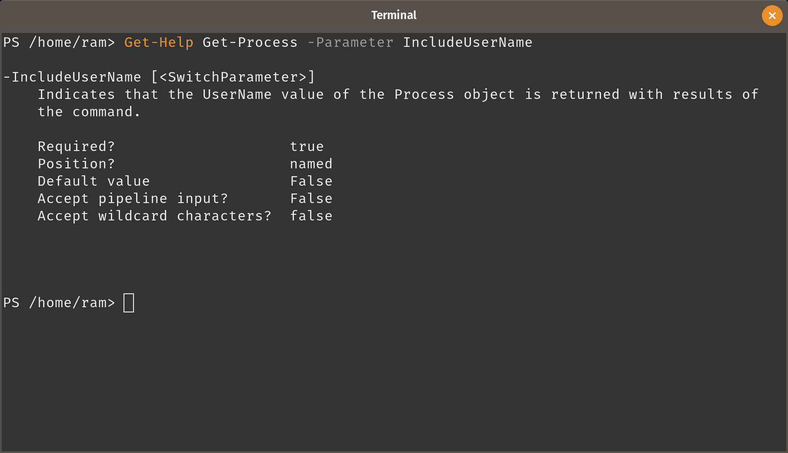

3. 运行命令：

```
PS> Get-Process -IncludeUserName
```

4. 过滤出你启动的进程。在我们学习如何在 PowerShell 中过滤之前，我们将使用`grep`进行此操作。

```
PS> Get-Process -IncludeUserName | grep ram
```

5. 统计在你名字运行的进程数量。

```
PS> (Get-Process -IncludeUserName | grep ram).Count
```

6. 如果你想使用`Measure-Object` `cmdlet`，你可以这样做。

```
PS> Get-Process -IncludeUserName | grep ram | Measure-Object
```

7. 现在让我们看看你启动的所有进程总共消耗了多少工作集。

```
PS> Get-Process -IncludeUserName | grep ram | Measure-Object -Property WS -Sum
```

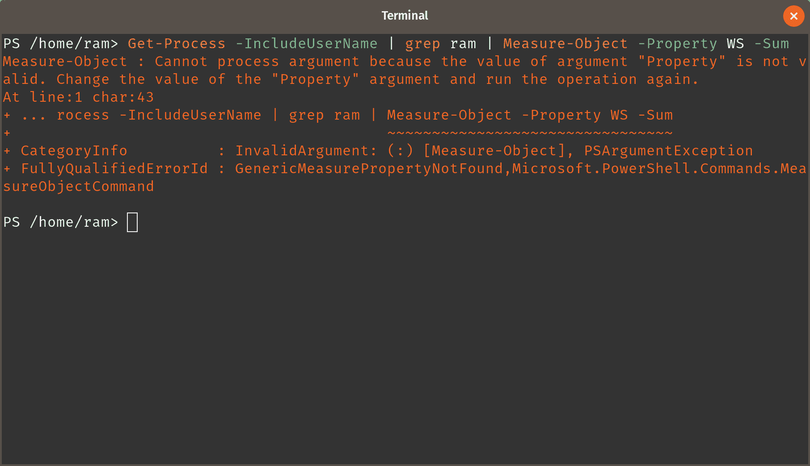

发生了错误。

### 工作原理...

`Get-Process`默认不会显示进程所有者信息。在某些情况下，可能需要这些信息。在这个简单的配方中，我们使用帮助文档来获取所有参数，并使用`IncludeUserName`切换参数来获取进程所有者信息。

在下一步，我们过滤掉由特定用户启动的进程，然后统计进程数量。我们也使用`Measure-Object`执行了相同的操作，并发现输出是相同的。`Measure-Object`的名称中包含“object”，但它也可以处理由`grep`输出的文本。与此同时，在下一步中它提示`Property`的值无效。

`Measure-Object`在计数时有效的原因，在于它之前的的前一个步骤。我们知道，如果输出的是数组，PowerShell 可以计算数组中的元素个数。`Measure-Object`同样具备这种能力：测量字符串数组中可以测量的内容——`Count`适用于字符串数组。

然而，当我们尝试获取总工作集（working set）时，`Measure-Object`无法无法提供结果。原因是正如我们之前看到的，`grep`的输出是纯文本。

```
PS> Get-Process -IncludeUserName | grep ram | Get-Member
```

## 更多内容...

也许是提前了几几个步骤，但如果我们仍然想从`grep`的输出中获取那些工作集信息呢？简单的挑战，接受了。

```
PS> Get-Process -IncludeUserName | grep ram | awk '{print $1}' | ForEach-Object {[Double]$_} | Measure-Object -Sum
```


现在不要过度担心它是如何工作的。一旦我们阅读并理解了如何遍历可用元素，我们就能更好地理解是如何实现这一效果的。目前，只需理解我们使用`Double`类型加速器将每个返回的字符串转换成了`double`值。然后，我们执行了`Measure-Object`并找到了总和。

当然，如果只用 PowerShell，这将简单得多。

# 另另

1. 配方 2.4：比较 Bash 和 PowerShell 的输出。

## 根据文件类型调用应用程序

到目前为止，我们已经看到如何使用`Start-Process`来启动应用程序。这在很多情况下涉及启动应用程序，并从该应用程序通过该程序打开你想要处理的文件。在这个配方中，我们将利用文件关联的概念以及适当的调用命令项（cmdlet）来启动应用程序。事实上，我们将更更远一点。

### 如何操作...

从网上下载几张图片来完成此配方。它们可以是任何图片，只需确保它们都是同一种文件类型。

1. 导航到保存图像文件的位置。

2. 在提示符处，输入以下命令来打开你的图片查看器以及文件。

```
PS> Invoke-Item -Path *.png
```

3. 现在，在相同位置创建一个文本文件。

```
PS> New-Item file-1.txt -ItemType File
```

4. 现在，在各自的应用程序中调用所有文件。

```
PS> Invoke-Item *
```

### 工作原理...

在配方*从 PowerShell 外部调用 PowerShell 命令项*中，我们通过首先调用 PowerShell 然后将脚本作为参数传递给`pwsh`命令从 Bash 调用了 PowerShell 脚本。在 PowerShell 中的过程非常相似，正如*启动和停止进程*所示。

`Invoke-Item`模块依赖于内部文件关联来打开文件。`Invoke-Item`的实际用途是在打开多个文件时，无论是相同类型的文件，还是同一路径下不同类型的文件（使用处理它们的相应应用程序）。

## 安装 Crontab PowerShell 模块

在这个配方中，我们将讨论一个 PowerShell 模块的安装细节，用于在 Linux 机器使用 PowerShell 管理 Cron 任务。

有时需要执行管理任务或调度脚本在指定时间自动执行。Linux 发行版默认带有一个名为 Crontab 的调度实用，它允许任何给定任务在指定时间在后台自动运行。Cron 是一个基于时间的调度器程序。它根据`crontab`文件中的定义生成事件。

### 如何操作...

PowerShell crontab 封装模块尚未在 PowerShell 仓库中。你必须手动下载文件来安装该模块。最简单的方法是克隆 PowerShell 仓库并从其`demos`目录内部安装该模块。

如果你只想安装 CronTab 模块，请手动下载`<repo>/demos/crontab`目录。然后，以超级用户身份启动 PowerShell，导航到`crontab`。从第 4 步继续。

1. 在你的计算机上克隆 PowerShell 仓库。

```
$ mkdir ~/code
$ git clone https://github.com/PowerShell/PowerShell.git
```

2. 以超级用户身份启动`pwsh`。

3. 进入仓库内的`demos/crontab/CronTab`目录。这是放置模块清单的地方。

```
PS> Set-Location ~/code/PowerShell/demos/crontab
```

4. 在模块清单上使用`Import-Module`命令项来导入模块。

```
PS> Import-Module -Name ./CronTab/CronTab.psd1
```

5. 使用`Get-Module`命令项列出 CronTab 模块的组件。

```
PS> Get-Module -Name CronTab | Format-List
Name : CronTab
Path : /home/PacktPub/CronTab.psm1
Description : 
ModuleType : Script
Version : 0.0
NestedModules : {}
ExportedFunctions : {ConvertTo-CronJob, Get-CronJob, Get-CronTab, Get-CronTabUser...}
ExportedCmdlets : 
ExportedVariables : 
ExportedAliases : 
```


6. 使用`Get-Command`命令项列出`CronTab`模块可用命令类型。

```
PS> Get-Command -Module CronTab  
CommandType Name Version Source
----------- ---- ------- ------
Function ConvertTo-CronJob 0.0 CronTab
Function Get-CronJob 0.0 CronTab
Function Get-CronTab 0.0 CronTab
Function Get-CronTabUser 0.0 CronTab
Function Import-CronTab 0.0 CronTab
Function Invoke-CronTab 0.0 CronTab
Function New-CronJob 0.0 CronTab
Function Remove-CronJob 0.0 CronTab
```

### 工作原理...

当你下载`CronTab`模块时，以下文件将从配方提到的 URL 复制到`CronTab`文件夹，这些文件包含了模块数据。

1. `CronTab.ps1xml`
2. `CronTab.psd1`
3. `CronTab.psm1`

`Import-Module`命令项将模块中可用的命令项注册到 PowerShell 会话中，并使模块准备好使用。`Import-Module`命令项针对模块清单（即`psd1`文件）运行。

当你运行`Get-Command`命令项时，你会获得模块中所有可用命令项的列表。

## 在 PowerShell 中调度任务

在这个配方中，我们将看到如何使用 PowerShell 命令项来调度任务。

### 准备工作

1. 使用 SU 权限登录终端。
2. 使用`pwsh`命令打开 PowerShell 控制台。
3. 导入模块（参考配方：安装 Crontab 模块）。

### 如何操作...

1. 首先，在终端中检查想要调度的命令或脚本是否存在。

```
$ pwsh -f "/tmp/DataLoading.PS1;"
```

2. 要根据调度运行脚本，使用`New-CronJob`命令项。

```
PS> New-CronJob -Command 'pwsh -f "/tmp/DataLoading.PS1;"' -Minute 0,15,30,45 | Out-Host

PS> New-CronJob -Command 'pwsh -f "/tmp/DataLoading.PS1;"' -Minute */15 | Out-Host

PS> New-CronJob -Command 'pwsh -f "/tmp/DataLoading.PS1;"' -Minute */15 -Hour 10-12 | Out-Host 

PS> New-CronJob -Command 'rm -rf /tmp/clr*' -Minute 15 -Hour 1 | Out-Host 

PS> New-CronJob -Command 'pwsh -f "/tmp/DataLoading.PS1;"' -Minute */15 -Hour 10-12 -DayOfWeek sun,tue,fri -Month Jan,Mar,Jun,Sep,Dec | Out-Host
```

3. 要获取当前调度的任务列表，运行`Get-CronJob`命令项。

```
PS /home/PacktPub> Get-CronJob |Format-Table -AutoSize 
Minute Hour DayOfMonth Month DayOfWeek Command
------ ---- ---------- ----- --------- -------
2 * * * * python ./pythonexmaple.py
5 1 * * * rm -rf /tmp/clr*.*
15 * * * * /usr/bin/pwsh -c "cd /tmp/; ./DataLoading.PS1;"
*/15 * * * * /usr/bin/pwsh -c "cd /tmp/; ./DataLoading.PS1;"
0,15,30,45 * * * * /usr/bin/pwsh -c "cd /tmp/; ./DataLoading.PS1;"
*/15 10-12 * * * /usr/bin/pwsh -c "cd /tmp/; ./DataLoading.PS1;"
*/15 10-12 * Jan,Mar sun,tue,fri /usr/bin/pwsh -c "cd /tmp/; ./DataLoading.PS1;"
```

4. 要查看 crontab 配置文件中调度任务的内容，请使用`Get-CronTab`。

```
PS > Get-CronTab 
2 * * * * python ./pythonexmaple.py
5 1 * * * rm -rf /tmp/clr*.*
*/15 * * * * /usr/bin/pwsh -c "cd /tmp/; ./DataLoading.PS1;"
0,15,30,45 * * * * /usr/bin/pwsh -c "cd /tmp/; ./DataLoading.PS1;"
*/15 10-12 * * * /usr/bin/pwsh -c "cd /tmp/; ./DataLoading.PS1;"
*/15 10-12 * Jan, Mar, Jun, Sep, Dec sun, tue, fri /usr/bin/pwsh -c "cd /tmp/; ./DataLoading.PS1;"
```

### 工作原理...

PowerShell 对`crontab`的实现技术上是一个包装器，它封装了在 Linux 中运行`crontab`命令。如果底层功能是`crontab`的，为什么要用 PowerShell 来调度任务呢？原因在于使用的统一性、一致性以及面向对象的方法。如果你知道如何使用 PowerShell，你就完全能够使用`crontab`。这正是目标。

`New-CronTab`命令用于定义新任务。可用参数定义了任务执行的频率。`Cron`任务执行时的权限与执行`New-CronTab`命令时的权限相同。换句话说，如果你以超级用户启动 PowerShell 并运行`New-CronTab`来定义计划，那么在指定计划上运行的命令将以超级用户权限运行。

在步骤中，使用`-Command`参数列出了要运行的命令。

让我们简要查看一下`New-CronTab`接受哪些输入。每 15 分钟运行一次命令有两种方法：第一种是指定每分钟：

```
0,15,30,45 * * * * /path/command
```

或者，你可以将其简化为`*/15`。

```
*/15 * * * * /path/command
```

调度任务时也可以指定范围。在我们的示例中，使用范围选项，在上午 10 点、11 点和下午 12 点运行任务。

```
*/15 10-12 * * * /path/command
```

在最后一个示例中（名称格式），任务通过`DayOfweek`（周日、二、五）和`Month`（一、三）参数进行调度。

```
*/15       10-12 *          Jan,Mar sun,tue,fri /usr/bin/pwsh -c "cd /tmp/; ./DataLoading.PS1;"
```

使用`Get-CronTab`命令读取 Cron 表配置。每行代表一条关于调度任务的元数据记录；它指定了应该执行的频率和命令/脚本。

目前的注意事项是，如果你设置 Cron 任务错误，它们似乎会静默失败。Cron 有自己的预留`syslog`功能，因此你应该查看`/etc/syslog.conf`文件（或你 Linux 发行版中的对应文件），查看来自`cron`的消息发送到了哪里。常见的目的地包括`/var/log/cron`、`/var/log/messages`和`/var/log/syslog`。

## 在 PowerShell 中删除任务

在本节中我们将学习从 CronTab 文件中删除条目的步骤。

### 如何操作...

既然我们已经在`cron`配置文件中创建了条目，让我们尝试删除这些条目。

1. 使用`Get-CronJob`命令列出任务。这将获取你通过读取`CronTab`文件创建的任务列表。

```
PS> Get-CronJob | Format-Table -AutoSize
```

2. 现在，使用`Where-Object`子应用应用条件逻辑分离所需的任务条目。你将在“*通过管道传递数据*”（Passing Data Through Pipelines）章节中了解更多信息。

```
PS > Get-CronJob | Where-Object {$_.Month -match 'Jan'} | Format-Table -AutoSize 

Minute Hour DayOfMonth Month DayOfWeek Command
*/15 10-12 * Jan,Mar,Jun,Sep,Dec sun,tue,fri /usr/bin/pwsh -c "cd /tmp/; ./DataLoading.PS1;"
*/15 10-12 * Jan,Mar sun,tue,fri /usr/bin/pwsh -c "cd /tmp/; ./DataLoading.PS1;"
```

3. 使用`Remove-CronJob`条目。

```
PS > Get-CronJob | Where-Object {$_.Month -match 'Jan'} | Remove-CronJob 

Confirm
Are you sure you want to perform this action?
Performing the operation "Remove" on target "/usr/bin/pwsh -c "cd /tmp/; ./DataLoading.PS1;"".
[Y] Yes [A] Yes to All [N] No [L] No to All [S] Suspend [?] Help (default is "Y"): Y

Confirm
Are you sure you want to perform this action?
Performing the operation "Remove" on target "/usr/bin/pwsh -c "cd /tmp/; ./DataLoading.PS1;"".
[Y] Yes [A] Yes to All [N] No [L] No to All [S] Suspend [?] Help (default is "Y"): Y
```

PS /home/PacktPub>

进入一个包含一些我们可以操作文件的目录。如果你还没有这样的目录，请创建一个并在其中创建一些文件。让这些文件具有不同的扩展名，以便我们在后续的教程中使用它们。

如果你还没有克隆，请克隆 git 仓库：[`github.com/PacktPublishing/PowerShell-6.0-Linux-Administration-Cookbook`](https://github.com/PacktPublishing/PowerShell-6.0-Linux-Administration-Cookbook)。在`chapter-05`目录下有一个快速的脚本`Initialize-PacktPs6CoreLinuxLab.ps1`。运行该脚本以获取必要的文件。

### 如何操作...

`awk`命令处理文本工作，并根据输出文本中的分隔符将输出分离成列。这种分离后的输出使用类似于 C 语言中的`print`函数再次显示为列。PowerShell 的工作略有不同。

让我们开始吧。

1. 如果你还没有文件，请创建。以下是一些你可以用来创建文件的命令。

```
PS> New-Item ./random/cities -ItemType Directory -Force
PS> Set-Location ./random/
PS> New-Item random-text.txt, himalayas.jpg, crunched-numbers.csv, bangalore.jpg, screenshot-001.png, screenshot-002.png, screenshot-003.png, demo.doc, my-plugin.rb, ./cities/mumbai.html, ./cities/nyc.html, ./cities/cairo.html, ./cities/dubai.html, ./cities/paris.html -ItemType File
```

2. 你可能还想下载一些真实的多媒体内容，以便以后使用`length`（文件大小）属性。只需下载任何随机图像或媒体文件。

3. 导航到保存文件的位置。我将它们放在主目录下名为`random`的目录中。如果你使用了脚本，也是。

```
PS> Set-Location ./random/
```

使用 Tab 键补全来完成 cmdlet 以及路径。

4. 列出当前位置下的内容。

```
PS> Get-ChildItem -Path .
```


5. 假设你不需要`Mode`列。

```
PS> Get-ChildItem -Path . | Select-Object LastWriteTime, Length, Name
```


如果你注意到，`select`似乎没有遵循 PowerShell 使用的命名或大小写规范。这是为什么？运行`Get-Command select`来寻找答案。

6. 这个序列在当前上下文中对你来说并不合理。打乱列的顺序。

```
PS> Get-ChildItem -Path . | Select-Object Name, Length, LastWriteTime
```


看起来好多了。

7. 现在，将`LastWriteTime`的列名更改为`Modified`。

```
PS> Get-ChildItem -Path . | Select-Object Name, Length, @{Name='Modified'; Expression={$_.LastWriteTime}}
```

注意现在最后一列的名称，并与之前的输出进行比较。

8. 现在，只选取年份；而不是整个日期。

```
PS> Get-ChildItem -Path . | Select-Object Name, Length, @{Name='Modified'; Expression={$_.LastWriteTime.Year}}
```

9. 查看自上次更改以来已经过了多少天。

```
PS> Get-ChildItem -Path . | select Name, Length, @{Name='DaysSinceModification'; Expression={[math]::Round(((Get-Date) - $_.LastWriteTime).TotalDays)}}
```

### 工作原理...

如果你运行了`Get-Command select`，你现在应该理解`select`是`Select-Object`的别名了。

让我们带着一个念头进入这个配方：对象内部可以包含对象，而这些对象内部又可以包含更多的对象。为了演示这一点，我们将使用`Get-Process` cmdlet。

### 如何操作...

让我们从列出进程开始；我们将查看`Get-Process` cmdlet 提供的所有属性，并寻找复杂的属性。

1. 选择属于`Get-Process` cmdlet 输出的全部属性。只选取第一个对象，这样你的控制台就不会被内容填满。

```
PS> Get-Process | Select-Object -Property * -First 1
```

观察属性`Threads`。

2. 选择进程的名称、ID 和线程。

```
PS> Get-Process | Select-Object -Property Name, Id, Threads
```

3. 列出`pwsh`进程的所有线程。

```
PS> Get-Process pwsh | Select-Object -ExpandProperty Threads
```

4. 输出了大量内容。假设，我们只需要结果输出中的 ID、优先级和开始时间。

```
PS> Get-Process pwsh | Select-Object -ExpandProperty Threads | Select-Object -Property Id, PriorityLevel, StartTime
```

这为我们提供了运行在`pwsh`下的所有线程的 ID、优先级和开始时间。

5. 如果我们在 ID 上使用`ExpandProperty`会怎样？

```
PS> Get-Process pwsh | Select-Object -ExpandProperty Threads | Select-Object -ExpandProperty Id
```


### 工作原理...

正如我们所见，`Select-Object`的默认参数是`Property`。它接受属性名称并在输出中显示它们的值。该参数可以用于获取多个属性（`Name`、`Id`、`Threads`）的值。


然而，某些属性内部包含复杂的对象，就像我们在`Get-Process`返回对象的`Threads`属性中看到的那样。识别复杂对象的简单方法是看它们是否被大括号包裹。

`ExpandProperty`参数只接受单个属性名称作为输入，并展开属性以显示其对象。这可以再次传递给`Select-Object`（或任何相关的 cmdlet）进行进一步处理。

在对象不是复杂的情况下，`ExpandProperty`仅显示不带头的输出。如果你注意到`ExpandProperty`的输出，它不包含展开对象本身的名称（在我们的案例中为`Threads`）；它只包含值。而该值反过来内部又包含多个属性。

对于简单属性，使用`ExpandProperty`只是从输出中剥离属性名称。

## 过滤对象

在配方*限制 cmdlet 返回的项目数量*中，我们学习了如何根据数字限制输出内容。在当前配方中，我们将根据特定标准而非数字来过滤输出。

### 准备工作

如果你还没有读过，请回去阅读配方*处理日期属性*。这个配方使用了日期对象中的其中一个属性来过滤内容。虽然理解对象的过滤并非至关重要，但它仍然展示了基于对象属性进行过滤的简单性。

### 如何操作...

导航到你为使用这本书创建文件的位置。

1. 列出此目录的内容以查看你拥有什么内容。（如果你和我一样，你可能已经忘记在哪里创建了这个目录，以及在里面放了什么内容。）

```
PS> Set-Location ~/random
PS> Get-ChildItem -Path .
```

注意你得到的属性名称。

2. 现在，只选择大小大于`0`字节的文件。

```
PS> Get-ChildItem -Path . | Where-Object -Property Length -GT -Value 0
```

3. 从大量文件中选出所有 JPG 文件。要做到这一点，在现有条件上添加另一个条件。不过，这次使用`FilterScript`参数而不是`Property`。

```
PS> Get-ChildItem -Path . | Where-Object -FilterScript {$_.Length -GT 0 -and $_.Extension -EQ '.jpg'}
```

4. 添加一个条件，以只获取文件名以 'c' 开头的文件。

```
PS> Get-ChildItem -Path . | Where-Object -FilterScript {$_.Length -GT 0 -and $_.Extension -EQ '.jpg' -and $_.Name -CMatch '^c'}
```

5. 现在，选择在任何小时的 30 分之前创建的文件。

```
PS> Get-ChildItem -Path . | Where-Object -FilterScript {$_.Length -GT 0 -and $_.Extension -EQ '.jpg' -and $_.Name -CMatch '^c' -and $_.LastWriteTime.Minute -LT 30}
```


### 工作原理...

在 PowerShell 中过滤输出非常简单。由于输出内容是一个对象，我们可以简单地使用对象内部的属性进行过滤。

这个配方展示了两种过滤模式：

1. 使用一个属性并将其值与输入比较；

2. 使用过滤脚本，该脚本使用多个值和多个条件。

`Property`参数只接受一个属性。`FilterScript`参数则可以处理更复杂的情况，例如使用`$_`变量。

在对象不是复杂的情况下，`ExpandProperty`仅显示不带头的输出。如果你注意到`ExpandProperty`的输出，它不包含展开对象本身的名称（在我们的案例中为`Threads`）；它只包含值。该值反过来内部又包含多个属性。

对于简单属性，使用`ExpandProperty`只是从输出中剥离属性名称。

## 过滤对象

尝试在`Where-Object`上使用其他输出，如`Get-Process`。

## 分组输出

在某些情况下，我们需要对对象进行分组，以便更好地处理组。在这个配方中，我们将查看将一个 cmdlet 的输出传递给`Group-Object`并根据属性进行分组。

### 如何操作...

为了根据属性分组，我们对为本书创建的文件使用`Get-ChildItem` cmdlet。

1. 导航到创建文件的位置。

```
PS> Set-Location ~/random
```

2. 只出文件（排除目录）。

```
PS> Get-ChildItem -File
```

或使用简写版本。

```
PS> gci -File
```

3. 根据扩展名对对象分组。

```
PS> Get-ChildItem . -File | Group-Object Extension
```

4. 这种简写版本为：

```
PS> gci -File | group Extension
```


5. 使用`Select-Object` cmdlet 只显示扩展名和每个扩展名的文件数。

```
PS> Get-ChildItem -Path . -File | Group-Object -Property Extension | Select-Object -Property Name, Count
```

6. 有更简单的方法这样做吗？

```
PS> Get-ChildItem -Path . -File | Group-Object -Property Extension -NoElement
```

7. 现在我们已经知道如何处理分组和展开的属性选择，让我们从大量文件中选出所有 JPG 文件。

```
PS> Get-ChildItem -Path . -File | Group-Object -Property Extension | Where-Object Name -EQ .jpg | Select-Object -ExpandProperty Group
```


### 工作原理...

在本配方中我们执行的操作显然不符合直觉，考虑到我们本可以使用可以使用`Where-Object`配合`Get-ChildItem`。然而，本配方的意图是演示`Group-Object`的用法。`Group-Object`命令行根据我们指定的标准创建组，并根据该标准命名组。在我们的案例中，分组标准是扩展名，因此，组的名称就是扩展名。

这些组中的每一个都包含其元素，这些元素本身就是对象。如果我们只需要计数和组名，则使用`NoElement`参数。如果我们只需要元素，则使用`Select-Object`命令行的`ExpandProperty`参数并展开所有元素。由此展开的元素是`Group-Object`之前的上一个 cmdlet 的对象（在我们的案例中是`Get-ChildItem`）。

如果`Where-Object`和其他 cmdlet 可以以一种复杂的方式实现`Group-Object`的功能，那么最初为什么要用它呢？请继续阅读到**对返回的对象执行操作**章节以了解更多信息。

## 更多内容...

如果你已经掌握了 Tab 键补全，你甚至不需要选择默认未显示的属性。你只需要在管道符之后输入`Group-Object`，添加一个空格并按 Tab；PowerShell 将向你显示哪些对象可用于分组。尝试一下：

```
PS> Get-ChildItem . -File | Group-Object<Space><Tab>
```

# 另见

配方 05.07：对返回的对象执行操作

# 输出排序

现在是另一个简单的 cmdlet 了，它将有助于配方*对返回的对象执行操作*。在本配方中，我们将对输出对象进行排序以满足我们的需求。

### 如何操作...

我们将继续使用为本书创建的目录和文件。如果你所有的文件都是 0 字节，请下载几个带有的文件。文件类型无关。

1. 列出目录中的文件。

```
PS> Get-ChildItem -Path .
```

2. 过滤输出只保留文件。

```
PS> Get-ChildItem -Path . -File
```

3. 将对象传递给`Sort-Object`命令行，根据文件大小对输出进行排序。

```
PS> Get-ChildItem -Path . -File | Sort-Object -Property Length
```

4. 该表达式的简写为：

```
PS> gci . -File | sort Length
```

5. 对文件进行排序，从最大文件到最小文件。

```
PS> Get-ChildItem -Path . -File | Sort-Object -Property Length -Descending
```

6. 从中选取最大的三个文件。

```
PS> Get-ChildItem -Path . -File | Sort-Object -Property Length -Descending -Top 3
```

7. 创建两个文件，并使用文本编辑器向它们各添加一些内容。（或者使用以下脚本块创建一些随机文本。）

```
PS> $($i = 0; while ($i -lt 520) {(-join ((65..90) + (97..122) | Get-Random -Count 8 | ForEach-Object {[char]$_})).ToString(); $i++}) -join ' ' | Out-File ./random-text-1.txt; Start-Sleep -Seconds 60; $($i = 0; while ($i -lt 500) {(-join ((65..90) + (97..122) | Get-Random -Count 8 | ForEach-Object {[char]$_})).ToString(); $i++}) -join ' ' | Out-File ./random-text-2.txt
```

8. 现在，对目录中的文件进行排序，首先按大小，然后按名称。

```
PS> Get-ChildItem -Path . -File | Sort-Object -Property Length, Name
```

观察你得到的输出。

9. 按降序对列表进行排序。

```
PS> Get-ChildItem -Path . -File | Sort-Object -Property Length, Name -Descending
```


### 工作原理...

本配方是通过管道传递对象的另一个演示。在`Sort-Object`的帮助文档中，我们看到一个名为`InputObject`的参数。该参数是 PowerShell 中的通用术语，用于输入来自管道的参数。

`Sort-Object`接受管道输入，并根据指定的属性对内容进行排序。如果没有指定属性，则将使用上一个命令输出对象的默认属性进行排序。如果输入了多个属性，则根据属性指定的顺序进行排序。

排序可以按升序（默认）或降序进行。

# 对返回的对象执行操作

在本章中，我们一直在使用管道对对象执行各种活动。我们一直在将对象从一个 cmdlet 传递到另一个，实际上是对返回的对象执行操作。因此，从技术意义上说，这个配方并没有新意。然而，为了让我们更熟悉管道的使用方法，并证明管道不仅用于选择、过滤和排序，我们将使用管道执行一些操作。

### 准备工作

如果你已经掌握了 Tab 键补全，你甚至不需要选择默认未显示的属性。你只需要在管道符之后输入`Group-Object`，添加一个空格并按 Tab；PowerShell 将向你显示哪些对象可用于分组。尝试一下：

```
PS> Get-ChildItem . -File | Group-Object<Space><Tab>
```

如果你计划仅使用 PowerShell 在控制台上运行命令，那么理解管道（pipelines）并不是必须的；它封装得很好，且`cmdlets`的设计非常巧妙，能够处理在`cmdlets`之间传递对象。然而，如果你计划创建自定义函数和模块，那么管道的概念是你非常想要深入理解的。

在本教程中，我们将介绍`cmdlets`接受输入的两种方式。在创建函数的阶段阶段，我们将查看如何为参数启用管道输入。

### 如何操作...

我们将主要使用帮助文档来演示两种不同类型的管道输入。

1. 在提示符处，输入以下命令：

```
PS> Get-Help Get-Item -Parameter Path
```


它显示该参数接受字符串输入，并且接受通过属性名以及值进行输入。

2. 输入以下内容查看是否接受有效的字符串。

```
PS> '/home/ram/random' | Get-Item
```


3. 让我们对`Get-Date`尝试类似的操作。

```
PS> Get-Help Get-Date -Parameter *
```

`Date`参数通过管道接受值。然而，它的类型是`DateTime`，而不是字符串。

4. 尝试通过管道发送一个有效的字符串看看它是否会被转换为日期。

```
PS> '21 June 2018' |  Get-Date
```

它确实将字符串转换成了日期和时间。


5. 现在，让我们回到获取当前目录详情。但这次我们只选择对象的`FullName`属性。

```
PS> Get-Item . | Select-Object FullName
```

6. 将此内容通过管道传递给`Get-ChildItem` cmdlet。

```
PS> Get-Item . | Select-Object FullName | Get-ChildItem
```

出现了一个错误。


7. 将属性名改为`LiteralPath`。

```
PS> Get-Item . | Select-Object @{Name = 'LiteralPath'; Expression = {$_.FullName}}
```

8. 通过管道将对象传递给`Get-ChildItem`。

```
PS> Get-Item . | Select-Object @{Name = 'LiteralPath'; Expression = {$_.FullName}} | Get-ChildItem
```

成功了。

### 工作原理...

通过管道输入有两种两种方式：

1. `ByPropertyName`（按属性名）

2. `ByValue`（按值）

`ByValue`类型可能是最常见的。如果参数通过值从管道接受输入，它将寻找与输出中定义的数据类型匹配的数据类型，并将输出作为自身的输入。如果数据类型与定义的不同，但可以转换为所需的类型，参数会将该值转换为它所接收的数据类型并进行处理。这种情况在`Get-Date`的情况下发生过，我们将日期作为字符串发送，并通过管道传递给`Get-Date`。

在`Get-Item`的情况下，`Path`参数接受字符串输入并处理命令。在`Get-Date`的情况下，`Date`参数将字符串转换为`DateTime`对象并处理了请求。

与`ByValue`相比，`ByPropertyName`寻找与参数名称相同的属性。在我们案例中，当我们传递`FullName`属性时，尽管它本质上是对象的字面路径且是一个字符串值，但`Get-ChildItem`的`LiteralPath`报错了。原因是属性名不是`LiteralPath`。当我们把属性名改为`LiteralPath`时，`Get-ChildItem`接受了通过管道输入。

# 将内容导入 PowerShell

管理多台计算机的管理员需要将某种输入到`cmdlets`中，以便他们自动化任务。虽然大多数 Linux 管理员熟悉向文件发送输入（即：`Get-Content`），但 PowerShell 同样能够导入输入。这种导入的输入是一个 PowerShell 对象。

在本教程中，我们将查看两种类型的导入 cmdlet 并学习如何使用它们。

### 如何操作...

在教程*解析从文本到对象的输入*中，我们使用`Import-Csv`导入逗号分隔的值文件，将其中包含的数据转换为 PowerShell 对象。然而，让我们回顾一下我们学到的内容，这次由于我们已经知道如何处理对象，我们将以某种方式使用导入的内容。

在导入内容之前，让我们先将一些内容导出到 CSV 文件。这样我们就有了一些相关内容可以进行操作。

1. 导航到你在本章创建文件的位置。列出目录内容。虽然书中在控制台上也（并推荐）使用完整的 cmdlet（当然可以使用 Tab 补全），但如果你愿意，可以使用别名。

```
PS> Get-ChildItem -Path . | Select-Object Name, FullName, CreationTime, LastWriteTime, Extension, Length
```

2. 将内容导出到 CSV 文件。


进入`/path/to/xxx`目录，找到`xxx.json`。

在表达式`cvar = avar + bvar`中，加法运算符（`+`）将`avar`与`bvar`相加，得到它们的和`cvar`。

在`List.of(arg0, arg1, arg2)`中，`List`接口的工厂方法`of()`接受一系列的元素，返回包含它们的只读列表。

之后我们这样调用`cmd`命令：`cmd arg0 arg1 arg2`。

```
if (condVar > someVal) {console.log("xxx")}
```

---

```
PS> Get-ChildItem -Path . | Select-Object Name, FullName, CreationTime, LastWriteTime, Extension, Length | Export-Csv ./file-list.csv
```

3. 使用电子表格处理器（如 LibreOffice Calc）甚至文本编辑器打开文件查看其内容。

```
PS> Get-Content ./file-list.csv
```

那是`Get-ChildItem`返回的对象的纯文本表示。

4. 导入 CSV 文件的内容将此文本转换为对象。

```
PS> Import-Csv ./file-list.csv
```

5. 查找此命令返回对象的类型。

```
PS> Import-Csv ./file-list.csv | Get-Member
```

对象类型为`System.Management.Automation.PSCustomObject`。

6. 检查这是否与`Get-ChildItem`返回的相同。

```
PS> Get-ChildItem | Get-Member
```

7. `Import-Csv`返回的对象不同。可以像对象一样对待它吗？使用成员访问获取`CreationTime`。

```
PS> (Import-Csv ./file-list.csv).CreationTime
```

8. 只获取年份。

```
PS> (Import-Csv ./file-list.csv).CreationTime.Year
```

9. 查找上一个命令返回的对象类型。

```
PS> (Import-Csv ./file-list.csv).CreationTime | Get-Member
```

TypeName: `String`

10. 尝试将`LastWriteTime`转换为`DateTime`对象。不过只选第一条记录。

```
PS> Get-Date (Import-Csv ./file-list.csv | Select-Object CreationTime -First 1).CreationTime
```

11. 如果我们必须保留`Get-ChildItem`返回对象中的所有对象，包括它们的对象类型怎么办？

```
PS> Get-ChildItem -Path . | Export-Clixml ./file-list.xml
```

12. 现在，将 XML 内容导入到会话。

```
PS> Import-Clixml ./file-list.xml
```

13. 查找导入命令返回对象的类型名称。

```
PS> Import-Clixml ./file-list.xml | Get-Member
```

14. 选取`CreationTime`属性并查找其类型。

```
PS> (Import-Clixml ./file-list.xml).CreationTime | Get-Member
```

TypeName: `DateTime`

15. 只获取年份。

```
PS> (Import-Clixml ./file-list.xml).CreationTime.Year
```

另一方面，CLIXML（或通用语言体系 XML）是一个完整的 .NET 对象。当一个 PowerShell 对象导出为 CLIXML 时，该对象将按其原样保留。也就是说，CLIXML 保留了所有的属性（理论上具有任何深度）以及作为输出对象的一部分的方法。换句话说，可以说 CLIXML 导出在对象成员方面几乎是**无损**的。

# 另请参考

食谱：使用 ASCII 字符生成随机文本

# 使用变量和对象

在本章中，我们将讨论以下主题：

1. 使用环境变量

2. 存储 .NET Core 对象实例的输出

3. 为对象创建自定义属性

4. 从返回的对象创建自定义对象

5. 理解数据类型的扩展

6. 在不同会话之间保留对象的修改

7. 移除自定义类型数据

# 序言

变量对编程至关重要，因为它们充当程序执行期间存储的信息的容器。尽管管道（piping）让 PowerShell 具有极高的通用性，但它们仍然取代变量，因为通过管道传递的对象必须立即被消费，而且考虑到我们多样的需求，并不是所有脚本都是这样运行的。

我们都了解各种数据类型：`int`、`double`、`string`、`char`、`array` 等。PowerShell 中另外两种重要的变量类型是`hashtables`和`objects`。hashtable 是由键值对组成的字典表。正如我们所见，对象在 PowerShell 中可以非常复杂，也可以非常简单，持有不同类型的值。

在 PowerShell 中，对象可以存储在变量中。例如，

```
$Processes = Get-Process
```

这将所有进程存储在变量`$Processes`中。

关于变量需要记住的另一点是作用域（scope）。默认情况下，变量具有局部作用域，这意味着它们在指定的函数内部有效。全局变量在整个程序中有效。通常，使用局部变量是最佳实践。

全局变量使用`$Global:`前缀声明和使用，例如`$Global:MyVariable`。

## 使用环境变量

在这个食谱中，你将学习环境变量。当通过 Shell 会话与系统交互时，Shell 需要许多信息信息来确定程序访问权限、可用资源、默认配置、系统属性等。这些设置中的某些在系统内部以变量的形式进行配置，这些设置通常被称为环境变量（EnvironmentVariables）。

虽然在安装期间硬编码这些信息是一种方法，但它会让整个系统变成一个单体，如果不进行所谓的“推倒重装”（nuking-and-paving），就无法重新配置。通过环境变量，引入了另一层灵活性。

### 如何操作...

让我们通过以下步骤开始使用环境变量：

1. 要显示环境变量，输入`Get-ChildItem env:`或`Get-Item env:`并按回车

```
PS> Get-ChildItem env:
PS> Get-Item env:
```

2. `Env:`也是一个 PowerShell 提供程序，工作方式就像文件系统。因此，你也可以在`Env:`执行`Set-Location`并使用`Get-ChildItem .`来列出系统中可用变量。

3. 要显示特定环境变量的值，运行以下命令。

```
PS> Get-ChildItem Env:/PATH | Select-Object value | Format-Table -Wrap
```

输入`Get-ChildItem Env:/`后，你可以使用制表完成来填充所有环境变量。

4. 对`PATH`环境变量执行`Get-Member`以找到其类型。

5. 在更改环境变量之前，使用`$env:PATH | Get-Member`列出`PATH`变量。它是一个字符串。将内容保存在安全的地方。

6. 现在，通过将`sqlcmd`工具执行文件的路径添加到`$env: PATH`变量来更新`PATH`环境变量。该操作是将字符串添加到现有值。

你可以向`PATH`添加任何位置。如果你坚持获取`sqlcmd`，请前往 [Microsoft docs](https://docs.microsoft.com/en-us/sql/linux/sql-server-linux-setup-tools?view=sql-server-linux-2017) 查看 SQL Server 2017 获取副本的说明。

```
PS> $env:PATH = $env:PATH + ':/opt/mssql-tools/bin'
PS /root> sqlcmd
```

上一个代码块的输出如图所示：


7. 让我们退出会话，启动新会话，检查`PATH`变量并运行`sqlcmd`可执行文件。

```
PS> sqlcmd 

sqlcmd : The term 'sqlcmd' is not recognized as the name of a cmdlet, function, script file, or operable program.
```

### 工作原理...

正如我们在*列出 PowerShell 中的各种提供程序*中所示，`Env`是一个包含特定环境配置的提供程序。大多数配置选项也作为环境变量向我们开放。我们可以使用`Get-ChildItem`和`Get-Item`命令来列出可用环境变量的值，因为`Env:`是`Env`提供程序中的一个驱动器。由于环境变量没有子项，`Get-Item`和`Get-ChildItem`返回相同的输出。

由于这些变量决定了你的会话如何运行，因此对这些值进行的更改是瞬时的。也就是说，`$env:PATH`的值是从你的 Linux 计算机配置中获取的。在 PowerShell 会话中对`$env:PATH`进行的手更改只要 PowerShell 会话仍然有效。对`$env:PATH`的更改不会更改系统内部的值。

如果你想让某些更改永久生效，编辑`.bashrc`或`~/.bash_profile`配置文件。如果你想使用 PowerShell 代替 Bash，请在你的 PowerShell 配置文件中进行更改。关于如何执行操作的说明可以在*使用 PowerShell 准备管理*章节中的食谱——*启用每次加载时自动执行的命令*中找到。

## 更多内容...

你还可以使用 .NET 类型加速器及其方法来访问环境变量。

```
PS> [environment]::GetEnvironmentVariable("PATH")
```

# 另请参考

1. 关于环境变量：`Get-Help about_Environment_Variables` 

2. 食谱 1.11：列出 PowerShell 中的各种提供程序

3. 食谱 3.4：启用每次加载时自动执行的命令

# 存储一个 .NET Core 对象实例的输出

.NET 是面向对象的，并基于类和对象工作。PowerShell 作为此框架的扩展，允许你与 .NET 框架和 COM 接口交互，以执行许多系统管理任务。通过这种方式，你不再局限于可以使用 cmdlet 执行的任务。

在这个食谱中，我们将从 PowerShell 内部定义一个简单的类。

### 准备工作

我们建议在此食谱中使用 Visual Studio Code。如需了解如何安装和配置它，请访问*使用 PowerShell 准备管理*章节中的食谱——*安装 Visual Studio Code*。

### 如何操作...

启动 Visual Studio Code 并处理其提出的任何即时要求。

1. 在 Visual Studio Code 中打开一个新文件，并将文件类型设置为 PowerShell。

2. 在脚本面板中输入以下内容。文件不需要保存。

```
class Person {
    [string]$Name
    [Int32]$Age
    [int32]$Salary

    Person () {}

    Person ([string]$Name, [int32]$Age) {
        $this.Name = $Name
        $this.Age = $Age
    }

    [int32] sal ([int32]$Salary, [int32]$Comm) {
        return $Salary * $Comm
    }
}
```

3. 要查找类的构造函数，调用静态方法`New`；在提示符处输入以下。

```
PS> [Person]::New
```

4. 这给了我们两个同名的函数；这些是重载定义。现在，通过传递参数创建一个新对象。

```bash
PS> [Person]::New('Prashanth',34) 
```


### 5. 现在，让我们用 PowerShell 的方式来调用构造函数，这反过来会调用 .NET 构造函数。这创建了一个`Person`类的实例（根据定义，它是一个对象）。

```bash
PS> $Person = New-Object -TypeName Person -ArgumentList 'Prashanth', 34
```

### 6. 要列出对象的属性（并扩展到类），请运行`Get-Member`cmdlet。

```bash
PS> $Person | Get-Member 

PS> $Person | Select-Object Name, Age, Salary | Format-Table -AutoSize 

PS> $Person.sal(200,2)
```


### 7. 接下来，让我们看看其他示例。让我们使用系统定义的类库。

```bash
PS> $MailClient = New-Object -TypeName System.Net.Mail.SmtpClient 'packtpub.smtpdomain.com'
PS> $Message = New-Object System.Net.Mail.MailMessage('pjayaram@packtpub.com', 'pjayaram@packtpub.com', 'Subject', 'Welcome to Packt!')
PS> $MailClient.Send($Message)
```

### 8. 让我们来看另一个使用`System.Management.Automation`类对象进行密码加密的示例。

```bash
PS> $User = 'Prashanth' 
PS> $Password = 'Y94b^E$85CBLU%at' 
PS> $SecurePassword = ConvertTo-SecureString $Password -AsPlainText -Force 
PS> $Credentials = New-Object -TypeName System.Management.Automation.PSCredential -ArgumentList $User, $SecurePassword 
PS> $Credentials | Get-Member
```


### 工作原理...

此配方的目标是演示 PowerShell 如何与 .NET 协同工作，以及通过 .NET 方式创建的对象如何在 PowerShell 中被轻松调用（并存储）。首先，我们使用`class`关键字声明一个类。然后我们声明它的参数，接着创建两个构造函数：一个默认的和一个带参数的。

我们还创建了一个名为`sal`的方法。我们定义它的返回类型为`int32`并定义了两个参数。在方法内部，我们定义了返回的内容。

回到 PowerShell 提示符，我们调用了静态（类的方法，而不是对象的）`New`方法。语法是提到类名，后面跟两个连续的冒号（`::`）以便在全局命名空间调用，然后是方法名。

如果你遵循这些步骤，你还将看到使用两个不同的系统类库`System.Net.Mail.SmtpClient`和`System.Net.Mail.MailMessage`的示例，以及通过将邮件消息输出与 SMTP 客户端对象集成来实例化方法。

接下来，我们使用系统类库`System.Management.Automation.PSCredential`。在这个示例中，我们将一些文本发送到`ConvertTo-SecureString`，它接受纯文本输入并将其转换为安全字符串。然后，我们将加密后的字符串传递给`PSCredential`系统类，将用户名和安全字符串存储到`$Credentials`变量中。

# 另

1. 配方 3.1：安装 Visual Studio Code

# 为对象添加自定义属性

PowerShell cmdlet 能够允许管理员处理大多数任务。然而，在某些情况下，返回的对象不能满足特定脚本的管理需求。在这些情况下，我们可能需要根据可用的 .NET 类创建自己的自定义对象，或者至少为对象添加自定义属性。

虽然字符串是`System.String`类型的对象，但`Get-Process`cmdlet 返回的是`System.Diagnostics.Process`类型的对象，`Get-ChildItem`返回类型为`System.IO.FileInfo`的对象，而自定义创建的对象类型为`PSCustomObject`。

### 如何实现...

现在让我们开始创建一个自定义对象。

1. 要创建一个自定义对象，请使用`New-Object`cmdlet。

```bash
PS /home/PacktPub> New-Object -TypeName PSCustomObject
```

2. 这对我们没太大用。让我们向其中添加几个属性以及它们的值，并将这些值存储在变量中。

```bash
PS> $MyCustomObject = [pscustomobject]@{ 
  Name = 'Prashanth Jayaram'
  Title = 'PowerShell'
  Publisher = 'Packt' 
}

PS> $MyCustomObject
```

3. 要向对象添加属性，请使用`Add-Member`cmdlet。

```bash
PS> $MyCustomObject | Add-Member -MemberType NoteProperty -Name 'Location' -Value 'United States'
PS> $MyCustomObject
```


4. 要从对象中删除属性，请使用以下命令。

```bash
PS> $MyCustomObject.PsObject.Properties.Remove('Location')

PS> # 要检查属性是否可用，运行：
PS> $MyCustomObject.Location
```

5. 要访问属性，你可以使用成员访问运算符（`.`）。

```bash
PS> $MyCustomObject.Name 
Prashanth Jayaram

PS> $MyCustomObject.Title 
PowerShell

PS> $MyCustomObject.Publication 
Packt
```

### 工作原理...

创建一个对象非常简单。你只需要告诉 PowerShell 你正在创建一个自定义对象，方法是调用`[psobject]`快速加速器并指定你想要添加到对象中的属性。在调用加速器后，我们指定属性的名称并为它们赋值。记录是使用哈希字面量表示法（`Name = 'Prashanth'`）逐条添加的。

在这个阶段，很容易将哈希表（hashtable）与 PSObject 混淆，因为我们在创建对象时使用了哈希字面量表示法。记住，它们之间是非常不同的。我们将在“数组和哈希表”章节中详细介绍哈希表的细节。

我们在创建的自定义对象中提到了三个属性：`Name`、`Title`和`Publisher`。如果我们将来想添加更多属性，只需简单地使用`Add-Member` cmdlet，在其中我们指定对象（我们通过流水线传递对象）、指定属性名称并为其赋值。

删除属性要稍微复杂一点，因为我们既没有`Remove-Member` cmdlet，而且我们在步骤中使用的成员并不容易被发现。例如，`[PSCustomObject] | Get-Member`并没有显示`PsObject`是它的成员。我们调用了我们创建的自定义对象中`PSObject`对象内部的`Properties`对象的`Remove`方法。（真多的对象啊！）

在对象中访问属性，只需像使用成员访问运算符配合属性名一样简单。

# 另

1. 配方：创建并初始化一个简单的哈希表

# 从返回的对象创建自定义对象

我们现在知道如何从零创建一个自定义对象。在这个配方中，我们将使用一个返回的对象，并修改该返回的对象来创建一个自定义对象。当我们学习循环时，将扩展这种能力以创建多功能自定义对象；在生产环境中，这种能力可以实现更多！

### 如何实现...

学习某事的第一步是简化。因此，我们将只选择一个实例并对其进行操作。

1. 获取所有进程，选择名称、ID、工作集和开始时间，选取第 5 个进程并将其赋值给变量。

```bash
PS> $Process = (Get-Process | Select-Object Name, Id, WS, StartTime)[4]
```

2. 假设我们不喜欢对象中属性的名称。让我们更改名称。

```bash
PS> $CustomProcess = New-Object -TypeName PSObject -Property @
  ProcessName = $Process.Name
  ProcessId = $Process.Id
  WorkingSet = $Process.WS
  StartedAt = $Process.StartTime
}
PS> $CustomProcess
```


3. 但那并不是我们指定的顺序。让我们按照顺序获取它们。

```bash
PS> $CustomProcess = [ordered]@{
  ProcessName = $Process.Name
  ProcessId = $Process.Id
  WorkingSet = $Process.WS
  StartedAt = $Process.StartTime
} 
PS> New-Object -TypeName PSObject -Property $CustomProcess
```


4. 使用进程运行时长的信息而不是开始时间重新创建对象。

```javascript
PS> $CustomProcess = [ordered]@{
  ProcessName = $Process.Name
  ProcessId = $Process.Id
  WorkingSet = $Process.WS
  RunningMins = [math]::Floor(((Get-Date) - $Process.StartTime).TotalMinutes)
}
PS> New-Object -TypeName PsObject -Property $CustomProcess
```


# 运行原理...

在本食谱中，我们从一个输出对象（`$Process`）创建了一个自定义对象（`$CustomProcess`）。`$Process`中的属性可以使用成员访问操作符进行访问。`$Process`中的值被视为`$CustomObject`中属性的值，但`$CustomObject`中的名称是不同的。在本食谱中，我们还使用了一个计算属性，即`RunningMins`。

这里需要注意的一个重要点是，此食谱的结果也可以通过结合`Select-Object`和计算属性来实现。然而，在对象通用性重要且对象实例数量显著增加的情况下，使用自定义对象更为简单。我们将在学习使用循环结构后，在未来的章节中扩展此功能。

另一个需要注意的点是`[ordered]`加速器的使用。通常情况下，自定义对象的属性不会按照我们列出它们的顺序出现。在本食谱中，我们将哈希字面量表示与自定义对象的创建分离开来。我们首先创建一个包含属性名和属性值的有序哈希表（ordered hashtable），然后将创建的哈希表指定为`New-Object`命令的`Property`参数，以创建按我们想要顺序显示属性的自定义对象。

# 另

1. [创建 .NET 和 COM 对象](https://docs.microsoft.com/en-us/powershell/scripting/getting-started/cookbooks/creating-.net-and-com-objects--new-object-?view=powershell-6) (Microsoft 文档)

## 理解类型数据（Type Data）的扩展

在食谱*从输出中选择列*中，我们使用哈希表来为自定义的列设置名称和表达式。稍后，我们还在`Select-Object`语句中使用一个小的计算来获取计算输出。如果你尝试通过新名称选择该列，那也是行的。从技术上讲，你已经扩展了该对象。但什么是类型数据呢？既然我们可以使用`Select-Object`工作，为什么还需要一个食谱来扩展它呢？

深入研究类型数据以及如何将其与 .NET 类和对象一起工作可能会让这个概念变成一个“高级”概念。从历史上看，我们大多数学习者都会推迟学习“高级”主题。因此，我们将坚持它的简单部分，目前仅针对 PowerShell 进行工作。本食谱将作为一个跳板，通过使其变得简单且有趣来帮助你理解它是什么，为了学习考虑，将它远离任何“高级”内容。

扩展类型数据有两种方法：

1. 使用 PowerShell 命令行（以理解其所有工作原理）

2. 使用 XML 文件（为了可移植性）

### 准备工作

为了理解我们正在讨论的内容，在这里你需要读过以下食谱：

1. 从输出中选择列

2. 从返回的对象创建自定义对象

让我们回到问题：当我们可以使用`Select-Object`时，为什么要扩展类型数据呢？

效率问题。虽然你可以更改名称、添加计算并使用新名称引用计算属性，但该更改仅存在于该上下文中。如果你将其添加到变量中，如上一个食谱*从返回的对象创建自定义对象*中所示（我们对名称进行了一些巧妙的更改并创建了自定义的`NoteProperty`），那么这样做就太麻烦了。现在引入：类型数据的扩展。

经验法是，如果你重复做某件事，就说明有一个问题：你没有考虑将其自动化。例如，如果你运行：

```bash
PS> Get-ChildItem -Path . | select Name, Length, @{Name='Age'; Expression={[math]::Round(((Get-Date) - $_.LastWriteTime).TotalDays)}}
```

而不是：

```bash
PS> Get-ChildItem -Path . | select Name, Length, Age
```

并且你每天执行十五次，你应该考虑扩展对象以给你你关心的内容。

### 如何操作...

导航到你创建实验用文件的位置。

1. 输入以下命令：

```bash
PS> $FilesWithAge = Get-ChildItem . | Select-Object Name, Length, LastWriteTime
```

2. 现在，为变量`$FilesWithAge`添加一个属性；该属性应该是每个文件的年龄，以天为单位。

```bash
PS> $FilesWithAge | Add-Member -MemberType ScriptProperty -Name Age -Value { [math]::Round(((Get-Date) - $this.LastWriteTime).TotalDays) }
```

3. 为它添加另一个属性，名为`ComputerName`，它是你的本地主机的名称。

```bash
PS> $ComputerName = hostname
PS> $FilesWithAge | Add-Member -MemberType NoteProperty -Name ComputerName -Value $ComputerName
```

4. 添加另一个属性作为`LastWriteTime`的别名，名为`Modified`。

```bash
PS> $FilesWithAge | Add-Member -MemberType AliasProperty -Name Modified -Value LastWriteTime
```

5. 为了像漂亮的表格一样格式化，请使用以下命令：

```bash
PS> $FilesWithAge | Format-Table -AutoSize
```


6. 现在，删除变量。查询当前目录下的文件（因为这正是该变量实际持有的内容）。

```bash
PS> Remove-Variable FilesWithAge
PS> Get-ChildItem .
```

你看不见`Age`、`ComputerName`或`Modified`属性。如果你愿意，可以尝试`Get-Member`。

接下来，我们将看到如何扩展类型数据本身，这样每次运行`Get-ChildItem`时，你也会获得添加到变量中的三个属性。

7. 获取运行`Get-ChildItem`时返回的对象。

```bash
PS> Get-ChildItem | Get-Member
```

8. 你得到了`System.IO.DirectoryInfo`以及`System.IO.FileInfo`。我们选择`System.IO.FileInfo`。运行以下命令。

```bash
PS> $ComputerName = hostname 

PS> Update-TypeData -TypeName System.IO.FileInfo -MemberType NoteProperty -Name ComputerName -Value $ComputerName

PS> Update-TypeData -TypeName System.IO.FileInfo -MemberType AliasProperty -Name Modified -Value LastWriteTime

PS> Update-TypeData -TypeName System.IO.FileInfo -MemberType ScriptProperty -Name Age -Value { [math]::Round(((Get-Date) - $this.LastWriteTime).TotalDays) } 
```

9. 查询当前位置的内容，并可选地将输出格式化为表格。

```bash
PS> Get-ChildItem . | Select-Object Name, Length, ComputerName, Age, Modified | Format-Table -AutoSize
```


10. 对文件系统中的任何目录执行相同的操作，唯一的条件是目录至少包含一个文件，而不仅仅是目录。

```bash
PS> Get-ChildItem ./cities/ | Select-Object Name, Length, ComputerName, Age, Modified | Format-Table -AutoSize
```

这里有一个重要的点需要注意：`$this`。在处理通过管道传递的对象时，我们遇到过自动变量`$_`（在 PowerShell V3 之后为`$PSItem`）；该变量持有管道中对象的当前实例。然而，当我们必须执行对象扩展时，我们使用自动变量`$this`。为什么呢？因为被引用的属性是在父对象（由`Get-ChildItem`返回的对象）*内部*被引用的。外部方法本应可以使用`$_`。在某种程度上，当执行成员添加时，`$_`甚至还不存在。此外，`$this`实际上指的是对象本身（即由`Get-ChildItem`返回的对象），而不仅仅是它的实例。

当我们希望在整个会话中作为对象本身的一部分获取某个成员，而不取决于特定变量或对象实例的有效性时，我们*扩展类型数据本身*。因此，无论你在什么上下文中运行命令（cmdlet），你都能获得你添加的额外成员。当然，PowerShell 的格式规则可能仍然不会让这些成员默认出现在输出中。不过，你始终可以特定的成员，例如使用`Select-Object`属性，或者简单地在属性上使用成员访问运算符：`(Get-ChildItem .).Age`。

为此，我们使用`Update-TypeData`令。在此语境下，`Update-TypeData`需要`TypeName`，正如我们已经看到的，可以通过对返回的对象使用`Get-Member`来确定它。

我们在`Update-TypeData`语句中提到了四点：

1. 类型名称 (TypeName)

2. 成员类型 (MemberType)

3. 成员名称 (Name)

4. 成员值 (MemberValue)

成员类型接受多个值，我们使用了其中三个：

1. `AliasProperty`：它是对对象内部另一个成员的引用。新属性只是现有属性的另一个名称。因此，`Value`参数只需要现有成员的名称。

2. `NoteProperty`：静态值。在我们的案例中，可以使用主机作为静态值。

3. `ScriptProperty`：本质上是一个计算。我们计算最后修改日期与当前日期之间的时间跨度。该计算是成员的`Value`，并接受脚本块（script block）。

这种对对象的修改只要会话有效就是有效的；该更改不会跨会话持久化。这引出了我们下一个食谱：让对象修改跨会话持久。

### 参见

1. 食谱 5.1：从输出中选择列

## 跨会话保留对象修改

在之前的食谱“理解类型数据扩展”中，我们使用了`Update-TypeData`令来添加成员。然而，我们提到只要会话有效，更新就是有效的。现在，有两种方法可以使类型数据跨会话持久：

1. 使用 PowerShell 配置文件（profile）。

2. 使用 XML 文件

PowerShell 配置文件非常直接。但通常，类型数据扩展和格式规则是作为 PowerShell 模块的一部分封装的。在这种情况下，向配置文件添加代码并没有特别帮助。在本食谱中，我们将编写一个简单的 XML (`.ps1xml`) 文件，并加载它来扩展类型数据。

### 准备工作

重启你的 PowerShell 会话，以便自定义数据类型扩展被丢弃。

### 如何操作...

我们需要一个 XML 文件。你可以使用`New-Item`令创建一个，或者简单地使用你喜欢的文本编辑器。我们在本食谱中使用 Visual Studio Code。

1. 打开你的文本编辑器并创建一个新的空文件，将其将其保存为`CustomTypes.ps1xml`。

2. 向 XML 文件添加以下内容。确保不要更改大小写。


```xml
<?xml version="1.0" encoding="utf-8" ?>
<Types>
 <Type>
   <Name>System.IO.FileInfo</Name>
   <Members>
     <AliasProperty>
       <Name>Modified</Name>
       <ReferencedMemberName>LastWriteTime</ReferencedMemberName>
     </AliasProperty>
     <ScriptProperty>
       <Name>Age</Name>
       <GetScriptBlock>[math]::Round(((Get-Date) - $this.LastWriteTime).TotalDays)</GetScriptBlock>
     </ScriptProperty>
     <NoteProperty>
       <Name>ItemType</Name>
       <Value>File</Value>
     </NoteProperty>
   </Members>
 </Type>
</Types>
```

3. 将文件保存在方便的位置。

4. 回终端（或 PowerShell 集成控制台），输入以下命令使用 XML 更新类型数据。注意 `PrependPath` 参数。

```bash
PS> Update-TypeData -PrependPath ~/Documents/code/github/powershell/chapter-06/CustomTypes.ps1xml
```

5. 现在，列出你任意目录下的所有文件。

```bash
Get-ChildItem . -File | Select-Object Name, Length, Age, Modified
```

你应该能看到你创建的新属性。

建议永远修改 `$PSHome` 目录下的 PS1XML 文件。它们由微软进行数字签名，并在升级或打补丁期间被新版本替换。

### 工作原理...

自定义类型和格式主要用于创建自定义模块。管理员很少需要修改内置 PowerShell 模块的类型或格式。当你确实需要修改自定义类型或格式时，请创建一个新的 PS1XML；不要修改内置文件，因为它们有数字签名，修改它们会破坏你的设置。

将此 PS1XML 文件视为普通的 XML 文件。这里是显示结构的一种更简单的方法。记住每个类型以及内部的每个成员都必须有一个名称。

```
Types
-- Type
---- Members
------ [你定义的自定义属性和方法]
```

本质上，使用 XML 进行类型扩展与我们在上一个食谱中执行类型扩展并没有太大区别，只是这里使用了 XML 文件，使得设置更具可移植性。当我们创建自定义模块时，将考虑将类型与模块一起打包，那时我们将详细如何处理路径。现在，我们通过手动指定文件的确切路径来加载 XML。如果你希望在每个会话中加载这些自定义类型，可以轻松地从配置文件调用 PS1XML。这里的可移植性体现在 XML 可以很容易地共享或部署；只需加载是手动的或通过配置文件完成——这比向配置文件添加命令要简单得多。

使用令更新类型数据时，我们使用了 `Name` 和 `Value` 参数，以及 `MemberType` 参数。PowerShell 理解了语境并据此设置了类型。但在 XML 的情况下，必须记住为每种成员类型使用正确的标签。例如，对于 `AliasProperty`，内部的标签应该是 `Name` 和 `ReferencedMemberName`（如下所示）；对于 `ScriptProperty`，它们应该是是 `Name` 和 `GetScriptBlock`；对于 `NoteProperty`，标签将是 `Name` 和 `Value`。

```xml
<AliasProperty>
   <Name>Modified</Name>
   <ReferencedMemberName>LastWriteTime</ReferencedMemberName>
</AliasProperty>
```

此外，记住在将语句放在 `GetScriptBlock` 标签内时*不要*将整个脚本块括在大括号中：

```xml
<GetScriptBlock>
 [math]::Round(((Get-Date) - $this.LastWriteTime).TotalDays)
</GetScriptBlock>
```

而不是：

```xml
<GetScriptBlock>
 { [math]::Round(((Get-Date) - $this.LastWriteTime).TotalDays) }
</GetScriptBlock>
```

在加载 XML 时，我们使用 `PrependPath` 参数在内置类型加载*之前*加载我们的 XML。如果要在内置类型之后加载它们，则不需要使用 `AppendPath` 参数，除非情况真的需要，因为 `AppendPath` 是默认值。为什么参数很重要？它们决定了类型加载的优先级。

显示的 XML 文件看起来可能有很多项目。使用 Visual Studio Code 中的缩进指南来引导你阅读该 XML。实际上，该文件非常易于阅读。阅读它将帮助你理解属性是如何定义的。

# 另参阅

1. [Update-TypeData let](https://docs.microsoft.com/en-us/powershell/module/microsoft.powershell.utility/update-typedata?view=powershell-6) (Microsoft Docs)

2. [Types.ps1xml 文件](https://docs.microsoft.com/en-us/powershell/module/microsoft.powershell.core/about/about_types.ps1xml?view=powershell-6) (Microsoft Docs)

# 移除自定义类型数据

现在我们已经知道如何创建和更新类型数据，下一步工作是学习如何移除类型数据。移除类型数据需要我们先获取该类型数据。在本食谱中，我们将学习移除类型数据的过程；无论它是使用 cmdlet 还是通过 XML 更新的。

### 如何操作...

第一步是理解 cmdlet 可以输出一种或多种类型的对象。例如，在我们的案例中，`Get-ChildItem` 输出了 `System.IO.DirectoryInfo` 以及 `System.IO.FileInfo`。让我们学习处理这些对象。

1. 获取 cmdlet 返回的对象的类型。

```
PS> Get-ChildItem | Get-Member | Select-Object TypeName -Unique
```

2. 返回了两种类型。我们在第二种类型中创建了自定义成员。将其赋值给一个变量。

```
PS> $TypeData = Get-ChildItem | Get-Member | Select-Object -ExpandProperty TypeName -Unique -Last 1
```

3. 获取类型数据信息。展开其成员以查看自定义成员是否显示。

```
PS> Get-TypeData -TypeName $TypeData | Select-Object -ExpandProperty Members
```


4. 现在，移除类型数据。

```
PS> Remove-TypeData -TypeName $TypeData
```

### 工作原理...

该过程非常直观。如果你查询 `Remove-TypeData` 的 `TypeName` 参数的帮助信息，你会注意到它接受通过属性值以及属性名通过管道输入的类型。回顾食谱“理解启用管道的参数”，查看 `Get-TypeData` 返回的对象以获得更深入的见解。

`Remove-TypeData` cmdlet 从当前会话中移除类型数据。这种移除与类型添加一样是瞬时的。因此，默认类型和格式不会被 cmdlet 永久删除；这就是你可以在 PowerShell 中运行它而不需要管理员权限的原因。此外请记住，底层的 XML 文件也不会被删除：自定义自定义。

# 另参阅

1. 食谱 5.8：理解启用管道的参数

本章到此结束。是时候休息一下了，有助于你吸收所学。稍后，尝试不同的数据类型，创建变量，查看它们包含什么类型的对象，以及每个对象包含哪些成员。在本章中，除了环境变量外，我们没有显式地讨论变量，但我们几乎在每个食谱中都使用了变量。思考（或者最好是，实际尝试）以下问题：

1. 什么可以赋值给变量？

2. 变量包含什么？整个对象吗？

3. 如果变量包含整个对象，我可以引用该对象中的某个特定属性吗？

4. 我可以将某个成员赋值给变量而不是整个对象吗？

5. 如果该成员本身是一个对象会怎样？（提示：在变量上使用 `Get-Member` 来查找。）

6. 当我使用 `Select-Object` 配合 `-ExpandProperty` 并值赋值给变量会发生什么？此时变量是什么类型？

既然你已经频繁使用它们，这将帮助你更多地了解变量。

## 使用分支和循环进行流程控制

在本章中，我们涵盖了以下主题：

1. 使用 If–ElseIf–Else 条件控制脚本流

2. 使用 Switch–Case 条件控制脚本流

3. 学习使用延迟

4. 编写基础的循环结构

5. 在预定义数组上编写更复杂的循环

6. 使用 For 循环结构

7. 使用 While 循环结构

8. 使用 Do–While 结构清理空目录

9. 使用 Do–Until 结构清理空目录

### 介绍

与“处理字符串”一样，这种流程控制也是我非常喜欢的 PowerShell 部分。

大多数 Linux 管理员和 Bash 脚本编写者已经熟悉这些食谱所涵盖的循环和分支等概念。我们看到的唯一主要区别是我们处理的是对象，并且是一种更具可读性的、更精简的脚本过程。

# 使用 If–ElseIf–Else 条件控制脚本流

我们已经看到运算符是如何工作的。尝试更多的操作符，直到它们变成你的本能。脚本中的大部分流程控制以及过滤都是使用这些操作符实现的。

在本食谱中，我们将查看条件脚本流，也称为分支。本质上，分支基于两个条件（正确地说是：`$true` 和 `$false`）。这通常通过两种结构实现：

1. If–ElseIf–Else 结构

2. Switch–Case 结构

在本食谱中，我们将为自己设定一个简单的问题来解决：判断今天是否是周末。

### 准备工作

这些食谱需要你亲自尝试，以理解它们是如何工作的。这些操作在集成脚本环境（首选 Visual Studio Code）中的效果比在提示符中更好。在 VS Code 中运行脚本，请使用 F5 键。此外，这些食谱在 Windows PowerShell 3.0+ 上也应该相同运行：这些结构在 PowerShell 和 Windows PowerShell 中的语法是完全相同的。

### 如何操作...

在 Visual Studio Code 中打开一个新的 PowerShell 文件。

1. 在代码面板中输入以下内容，简单的查找是否是周末。

```
$Date = Get-Date

if ($Date.DayOfWeek -in 'Saturday', 'Sunday') {
    Write-Host 'We party on weekends!' -BackgroundColor Yellow -ForegroundColor Black
}
```

2. 如果你也想在工作日获得输出：

```
$Date = Get-Date
if ($Date.DayOfWeek -in 'Saturday', 'Sunday') {
    Write-Host 'It is a weekend!'
}
else {
    Write-Host 'It is a weekday.'
}
```

3. 如果你想增加一点趣味，并使用整个 `if`–`elseif`–`else`：

```
$Date = Get-Date

if ($Date.DayOfWeek -in 'Saturday', 'Sunday') {
    Write-Host 'We party on weekends!' -BackgroundColor Yellow -ForegroundColor Black
}
elseif ($Date.DayOfWeek -eq 'Wednesday') {
    Write-Host 'Half the week is over, and I want to do so much more!'
}
else {
    Write-Host 'Work is worship. Ahem!'
}
```

通常情况下，`Write-Output` 是比 `Write-Host` 更好的 cmdlet。`Write-Host` 只将输出写入到宿主机；经过处理，此输出无法发送到任何其他地方。仅在需要的时候才使用 `Write-Host`。

### 工作原理...

简单的分支仅需 If 语句即可工作。该语句检查真值，并根据条件的结果执行代码块。在只有两种条件的“二选一”情况下，使用 If–Else。当有超过两个可能的结果时，使用 If–ElseIf–Else。`else` 块是兜底的。

# 使用 Switch–Case 条件控制脚本流

当结果按类别出现时（例如工作日为五天，周末为两天），If–ElseIf–Else 很好用。当结果非常具体且/或数量过多时，使用 If–ElseIf–Else 结构可能会有些繁琐。为了更好地理解这一点，让我们设定一个场景。

你工作场所着装规范是由孩子决定的，她喜欢每个人都穿彩虹的颜色。由于她不喜欢有人在周末工作，不太喜欢橙色，并且非常讨厌黄色，她制定了以下方案（她还不知道什么是“周一忧”）：周一红色，周二紫色，周三靛蓝色，周四蓝色，周五绿色，周末期间穿橙色。

### 如何实现...

这种情况需要一整轮 `If–ElseIf–Else` 语句来编写。处理这种情况的一种更有效的方法是使用 `Switch–Case` 结构。

1. 打开一个新的 PowerShell 文件并向其中添加以下内容：

```
$Date = Get-Date

switch ($Date.DayOfWeek) {
    'Monday' { Write-Output 'Red' }
    'Tuesday' { Write-Output 'Violet' }
    'Wednesday' { Write-Output 'Indigo' }
    'Thursday' { Write-Output 'Blue' }
    'Friday' { Write-Output 'Green' }
    Default { Write-Output 'Orange' }
}
```

2. 如果你倾向于省略 `Default` 并使用通配符匹配来处理周末：

```
$Date = Get-Date

switch -Wildcard ($Date.DayOfWeek) {
    'Monday' { Write-Output 'Red' }
    'Tuesday' { Write-Output 'Violet' }
    'Wednesday' { Write-Output 'Indigo' }
    'Thursday' { Write-Output 'Blue' }
    'Friday' { Write-Output 'Green' }
    'S*' { Write-Output 'Orange' }
}
```

### 工作原理...

正如我们所看到的，在这种情况下，编写、执行和排错 `Switch–Case` 结构要比编写一系列 `if–elseif–elseif–elseif–...–else` 语句更高效。在 `Switch–Case` 中定义一个捕获操作请使用 `Default`。

`Switch–Case` 结构还支持通配符 (`-Wildcard`) 和正则表达式 (`-Regex`)。通常情况下，除非已经涵盖了所有可能的结果，否则省略 `Default` 不是一个好习惯。

`Switch–Case` 的工作原理很简单：它会将条件与所有定义值进行检查，每当发现条件真时，就会执行相应的脚本块。因此，如果五个条件中满足了三个，这三个脚本块都将被执行。这与 `If–ElseIf–Else` 略有不同，后者在遇到第一个 `$true` 并执行脚本块的瞬间就会退出分支结构。因此，如果你只想让结构产生一个结果，请考虑在每个脚本块中添加 `break` 关键字，以便在遇到 `$true` 时跳出结构。例如：

```
...
    'Monday' {
        Write-Output 'Red'
        break
    }
...
```

当然，在特定的情况下，没有必要，因为结果是互斥的。

## 学习使用延迟

PowerShell 通常逐条执行语句；当前语句必须返回缓冲区（可以这么说以便下一步开始执行。然而，在某些情况下，你仍然需要等待；即在实现预期结果之前缓冲区就可以返回的情况。

虽然设置此类内容可能需要一些操作，但为了简单起见，让我们假设我们需要五秒钟来记录星期几（当然，不信也可以行），然后再被指示穿什么。

### 如何实现...

让我们结合上一个食谱中的两个脚本，*使用条件控制脚本流*。

1. 打开一个新文件并输入以下内容：


```
$Date = Get-Date

if ($Date.DayOfWeek -in 'Saturday', 'Sunday') {
    Write-Host 'We party on weekends!' -BackgroundColor Yellow -ForegroundColor Black
}
elseif ($Date.DayOfWeek -eq 'Wednesday') {
    Write-Host 'Half the week is over, and I want to do so much more!'
}
else {
    Write-Host 'Work is worship. Ahem!'
}

Start-Sleep -Seconds 5

$Date = Get-Date

switch ($Date.DayOfWeek) {
    'Monday' { Write-Output 'Wear red.'; break }
    'Tuesday' { Write-Output 'Wear violet.'; break }
    'Wednesday' { Write-Output 'Wear indigo.'; break }
    'Thursday' { Write-Output 'Wear blue.'; break }
    'Friday' { Write-Output 'Wear green.'; break }
    Default { Write-Output 'Poor you, working today. Wear orange.'; break }
}
```


### 工作原理...

这之所以是一个独立的食谱，是因为它是流程控制的一部分，在某些特定情况下非常有用。`Start-Sleep` 内部接受 `Seconds` 或 `Milliseconds` 作为输入，并在处理下一个指令之前等待相应的时间。

# 编写基础循环结构

如果没有循环，自动化可能只完成了一半。毕竟，在大多数情况下，自动化的意义是让计算机做重复性的工作。PowerShell 中共有六种循环结构：

1. 使用 `Foreach-Object` 循环
2. `Foreach` 循环
3. `For` 循环
4. `While` 循环
5. `Do–While` 循环
6. `Do-Until` 循环

`Foreach-Object` 循环结构可能是这些中最简单的。

让我们想象有一份参加某活动的五位客人名单，你想逐个欢迎他们。

### 如何实现

假设客人是 Mr Jain、Mr Jacobs、Ms Sanders、Mr Shah 和 Mr Hugo。

1. 在 Visual Studio Code 中打开一个新文件，并在脚本面板中输入以下内容。

```
$GuestsRaw = Read-Host "Enter the guest names, separated by commas"
$Guests = $GuestsRaw -split ",$([regex]'[\s]*')"

$Guests | ForEach-Object { Write-Output "Welcome, $PSItem!" }
```

2. 运行脚本，并在提示处输入客人的名字：

```
PS> Mr Jain, Mr Jacobs, Ms Sanders, Mr Shah, Mr Hugo
```

### 工作原理...

你首先通过主机的提示获取输入。获取了原始客人列表。然后 PowerShell 根据逗号和正则表达式匹配来分割输入字符串（这是必要的，以确保无论输入中逗号后是否有空格都能正常工作：并非所有用户都是一样的）。我们使用 `-split` 和转换运算符来执行操作。

循环部分在 `Foreach-Object` 出现。你将数组对象传递给管道。`Foreach-Object` 内部程序获取数组并一次处理一个元素。在循环内部引用元素时，你使用 `$PSItem`（也称为 `$_`）自动变量，因为该对象已经通过管道传递了。

## 在预定义数组上编写更复杂的循环

在在上一个食谱“编写基础循环结构”中，我们通过管道传递内容编写了一个简单的循环。现在，让我们考虑我们拥有相同的客人，但为他们分配了特定的座位。我们想向客人显示座位。你有如下 CSV 格式的表格。

| Name | Seat |
| :--- | :--- |
| Mr Jain | A-12 |
| Mr Jacobs | C-28 |
| Ms Sanders | B-17 |
| Mr Shah | M-22 |
| Mr Hugo | E-08 |

### 如何实现...

这里的假设是每行有四十个座位，过道穿过大厅中心。

1. 如果你还没有克隆仓库，可以创建自己的 CSV 文件。可以复制下面的逗号分隔内容，或者使用 PowerShell 创建 CSV。

```
PS> @'
Name,Seat
Mr Jain,A-12
Mr Jacobs,C-28
Ms Sanders,B-17
Mr Shah,M-22
Mr Hugo,E-08
'@ | Out-File -Path './chapter-08/05-Write-GuestSeatDetails.csv'
```

2. 在 Visual Studio Code 中打开一个新的 PowerShell 文件并输入以下脚本：

```bash
$Guests = Import-Csv './chapter-08/05-Write-GuestSeatDetails.csv'

foreach ($Guest in $Guests) {
    $RowIdentifier = [byte]char[0].ToUpper())
    $RowNumber = ($RowIdentifier - 64).ToString()

    switch -Regex ($RowNumber) {
        '1(1|2|3)$' { $RowNumber += 'th'; break }
        '.?1$'      { $RowNumber += 'st'; break }
        '.?2$'      { $RowNumber += 'nd'; break }
        '.?3$'      { $RowNumber += 'rd'; break }
        Default     { $RowNumber += 'th'; break }
    }

    $SeatNumber = ($Guest.Seat -split "-")[1]

    if ($SeatNumber -gt 20) {
        $Side = 'right'
    }
    else {
        $Side = 'left'
    }

    Start-Sleep -Seconds 1
    Write-Host "Welcome, $($Guest.Name)! " -NoNewline
    Start-Sleep -Seconds 1
    Write-Host "Your seat is in the $RowNumber row, to the $Side the aisle."
}
```

3. 运行脚本。


### 工作原理...

这里的核心思想是使用 `foreach`。当使用 `Foreach` 循环结构时，你通过变量来引用每个元素；在这种情况下，变量不是通过索引标识的。在每次迭代中，在我们的案例中，`$Guest` 会从 `$Guests` 中顺序选取一个值，以便可以使用 `$Guest` 来引用当前元素。

座号有一个模式：一个字母行标识符，后面跟着一个连字符，然后是数字座位标识符。

座号是一个字符串。我们在 `-` 处对其进行拆分，选取结果数组中的第一个元素，将其转换为大写（以防它本来大写），将此字母转换为字符，然后使用 `[byte]` 强制转换运算符找到其 ASCII 标识符。是的，我们从中减去 64（因此 `A` 变成 `1`）。

为了能够在 `switch–case` 中使用该数字而不报错，我们将数字转换回字符串。我们让数字便于在句子中使用。我们获取数组的第二部分（数字部分），查看座位位于过廊的哪侧。我们将所有这些结合起来，得到最终问候和引导字符串，这些字符串会在一秒的延迟后显示。

## 使用 For 循环结构

`Foreach` 循环和 `For` 循环的区别在于，后者使用索引来执行操作。我们需要一个变量来控制流，其值形成一个范围。让我们重新实现与*在预定义数组上编写更复杂的循环*中相同的解决方案，但使用 `For` 循环结构来代替。

### 如何实现...

所做的假设与*在预定义数组上编写更复杂的循环*中的假设是一的。

1. 打开一个新文件并将以下内容粘贴到其中。

```bash
$Guests = Import-Csv './chapter-08/05-Write-GuestSeatDetails.csv'

for ($CurrentGuest = 0; $CurrentGuest -lt $Guests.Length; $CurrentGuest++) {
    $Guest = $Guests[$CurrentGuest]

    $RowIdentifier = [byte]char[0].ToUpper())

    $RowNumber = ($RowIdentifier - 64).ToString()

    switch -Regex ($RowNumber) {
        '1(1|2|3)$' { $RowNumber += 'th'; break }
        '.?1$'      { $RowNumber += 'st'; break }
        '.?2$'      { $RowNumber += 'nd'; break }
        '.?3$'      { $RowNumber += 'rd'; break }
        Default     { $RowNumber += 'th'; break }
    }

    $SeatNumber = ($Guest.Seat -split "-")[1]

    if ($SeatNumber -gt 20) {
        $Side = 'right'
    }
    else {
        $Side = 'left'
    }

    Start-Sleep -Seconds 1
    Write-Host "Welcome, $($Guest.Name)! " -NoNewline # 子表达式 `$Guest.Name` 将被计算。
    Start-Sleep -Seconds 1
    Write-Host "Your seat is in the $RowNumber row, to the $Side the aisle."
}
```

2. 运行脚本。

### 工作原理...

你们中的一些人可能会指出，在这种情况下 `foreach` 结构比 `for` 结构更简单，你们是对的。在我担任管理员的期间，过去三年里，我使用 `for` 结构不到十次，而使用 `foreach` 有数百次。`For` 结构有它自己的用途；但与预定义数组配合是效率较低的一种。''

无论如何，只要对象是数组，`for` 就可以工作。`$CurrentGuest` 是我们使用的索引，范围从 0 到 `$Guests` 中的总元素减 1。在这种情况下，循环从索引初始化为 0 开始，在脚本块的每次迭代后，索引都会递增（`$CurrentGuest++`）。

`for` 比 `foreach` 更高效的一种操作是，如果必须问候*每隔*一位客人（我知道这很没礼貌）。在这种情况下，`for` 定义的第三部分将是 `$CurrentGuest += 2`。

使用 `$CurrentGuest + 2` 而不是 `$CurrentGuest += 2` 将导致此循环无限循环，因为 `$CurrentGuest` 的值将完全不会改变。

## 使用 While 循环结构

我们在这个方案中创建两个脚本：第一个用于建立 For 和 While 之间的相似性，另一个为理解 Do–While 和 Do–Until 结构奠定基础。这样，学习将是循序渐进的，也更容易。

对于第一个脚本，场景与上一个方案*使用 For 循环结构*中描述的相同。对于第二个，任务是将年份作为输入并找到该年份母亲节的日期。

### 如何实现

首先，继续你对上一个方案所做的假设。

1. 打开一个新文件并将以下内容粘贴到其中。

```bash
$Guests = Import-Csv './chapter-08/05-Write-GuestSeatDetails.csv'
$CurrentGuest = 0

while ($CurrentGuest -lt $Guests.Length) {
    $Guest = $Guests[$CurrentGuest]

    $RowIdentifier = [byte]char[0].ToUpper())
    $RowNumber = ($RowIdentifier - 64).ToString()

    switch -Regex ($RowNumber) {
        '1(1|2|3)$' { $RowNumber += 'th'; break }
        '.?1$'      { $RowNumber += 'st'; break }
        '.?2$'      { $RowNumber += 'nd'; break }
        '.?3$'      { $RowNumber += 'rd'; break }
        Default     { $RowNumber += 'th'; break }
    }

    $SeatNumber = ($Guest.Seat -split "-")[1]

    if ($SeatNumber -gt 20) { $Side = 'right' }
    else { $Side = 'left' }

    Start-Sleep -Seconds 1
    Write-Host "Welcome, $($Guest.Name)! " -NoNewline
    Start-Sleep -Seconds 1
    Write-Host "Your seat is in the $RowNumber row, to the $Side the aisle."

    $CurrentGuest++
}
```

2. 运行脚本；输出应与上一个方案相同。

3. 现在，创建一个新的 PowerShell 文件并添加以下代码：

```bash
$Year = Read-Host "输入你想查找母亲节的年份 (YYYY)"

$CurrentDay = Get-Date "01 May $Year"

while ($CurrentDay.DayOfWeek -ne 'Sunday') {
    $CurrentDay = $CurrentDay.AddDays(1)
}
$MothersDay = $CurrentDay.AddDays(7)

Write-Output "母亲节在 $($MothersDay.ToLongDateString())。"
```

4. 运行脚本。输入任何年份，您应该得到该年份母亲节的日期。

### 工作原理...

每个有限循环结构都需要三个要素：

1. 起点
2. 停止点
3. 向停止点移动的方法

在 `foreach` 结构的情况下，整个逻辑是预先编码好的。它获取整个数组，找到起点和停止点，并一步步向停止点移动。`For` 结构将这些参数声明在循环语句本身本身，每个参数用分号隔开。

`While` 循环并不一样。它的起点定义在循环之外，停止点是通过的条件，而对索引的操作指定在循环内部。这三个参数在脚本中已高亮显示。初始化应该在循环之外进行，以便在循环过程中不会被修改。对索引的操作应该在每次迭代时执行，以便循环向某个方向移动。因此，此操作位于循环内。

在使用 `while` 循环时要稍微小心；你更容易陷入无限循环，因为很容易忘记添加起始点或移向停止点移动的操作。

现在来看母亲母亲节。我们首先获取该年份 5 月 1 日的日期对象，这样我们就可以使用其成员对其进行操作。该日期就是起始点。然后，我们指定条件：“如果当天不是星期日，则继续循环”。接着，在每次迭代中增加一天。每次迭代后，都会根据条件检查该变量。最后，当遇到第一个星期日时，变量跳出循环。然后我们对其基础上增加一周以找到第二个星期日，并输出 `$MothersDay` 值的长日期版本。

## 使用 Do–While 结构清理空目录

在上一个食谱中，我们使用年份作为输入找到了 5 月的第二个星期日。我们使用 `While` 循环来实现这一点。`While` 循环在开始迭代之前就会检查条件。如果条件在一开始就返回 `$false`，循环甚至不会开始；例如，如果你输入的年份是 `2016`。

Do–While 略有不同；无论条件是否成立，循环都会执行一次。条件只在第一次迭代*之后*检查。

本食谱的场景是：我们要删除特定目录下的所有空目录。

### 准备工作

为了使用此食谱，让我们在 `$HOME/random` 中创建几个空目录。使用本书 git 仓库中的输入文件来创建这些目录。

```
PS> Get-Content ./chapter-08/08-input-file.txt | ForEach-Object { New-Item $($PSItem -replace '\.', "$HOME/random") -ItemType Directory }
```

### 如何操作...

如果你在 `random` 实验室目录下运行以下食谱，所有的空子目录都将被删除。

1. 打开新文件并将以下内容粘贴进去。


## 使用 Do–While 结构清理空目录

`do { ... } while (...)` 循环结构在 PowerShell 中用于至少执行一次代码块，然后在每次迭代结束时检查条件。

### 如何操作...

1. 打开 PowerShell 终端，输入以下代码块以创建一些测试目录并执行清理操作：

```
do {
    $AllDirectories = (Get-ChildItem -Path $HOME/random -Recurse -Directory).FullName
    $EmptyDirectories = $AllDirectories | Where-Object {(Get-ChildItem $PSItem).Count -eq 0}
    $EmptyDirectories | Remove-Item
} while ($EmptyDirectories.Count -gt 0)
```

2. 让我们添加一些日志，以便我们知道发生了什么。

```powershell
$Iteration = 0
do {
    $AllDirectories = (Get-ChildItem -Path $HOME/random -Recurse -Directory).FullName
    $EmptyDirectories = $AllDirectories | Where-Object {(Get-ChildItem $PSItem).Count -eq 0}
    $EmptyDirectories | Remove-Item

    "Iteration $Iteration. Removed the following $($EmptyDirectories.Count) directories."
    $EmptyDirectories
    $Iteration++
} while ($EmptyDirectories.Count -gt 0)
```


### 工作原理...

执行过程与 `While` 结构类似，但如 `Iteration 0` 所示，`Do–While` 结构在不检查条件的情况下执行一次脚本块。在我们的情况下，我们在循环内部查询了空目录。如果我们把此查询放在循环之外，那么为了控制循环，我们也必须将其放在循环内部。那是低效的编程。

PowerShell 在执行脚本块期间找到了九个空目录。当执行后进行条件检查时，`9` 被评估为大于 `0`。循环再次运行。这次 `$EmptyDirectories.Count` 的值被评估为 `4`。循环再次运行，这一次值再次是 `4`，大于 `0`；条件仍为 `$true`。在下一次运行中，`$EmptyDirectories.Count` 被评估为 `2`，然后是 `1`，最后在最后一次运行中变为 `0`。此时，条件的结果变为 `$false`，循环退出。从本质上，该循环语句是：“只要计数*大于*零就*继续*。”

## 另请

1. 食谱 5.7：对返回的对象采取操作

## 使用 Do–Until 结构清理空目录

很容易混淆 `Do–While` 和 `Do–Until`，因为它们之间有许多相似之处。然而，它们之间的区别实际上非常清晰。`Do–While` 循环只要条件检查的结果为 `$true` 就会执行，并在变为 `$false` 的一刻退出。`Do–Until` 则相反：只要条件检查返回 `$false`，循环就会继续，并在条件检查返回 `$true` 的一刻停止。

让我们使用相同的清理空文件夹的场景，但这次使用 `Do-Until` 循环。

### 如何操作...

你需要重新运行命令来创建那些空目录。

1. 打开新文件并将以下内容粘贴进去。

```powershell
$Iteration = 0
do {
    $AllDirectories = (Get-ChildItem -Path $HOME/random -Recurse -Directory).FullName
    $EmptyDirectories = $AllDirectories | Where-Object {(Get-ChildItem $PSItem).Count -eq 0}
    $EmptyDirectories | Remove-Item
    $Count = $EmptyDirectories.Count

    "Iteration $Iteration`nRemoved the following $Count directories. '$Count = 0' is $($Count -eq 0)"
    $EmptyDirectories
    $Iteration++
} until ($Count -eq 0)
```

2. 注意这次行为的变化，并将其与 `Do–While` 的运行进行对比。


### 工作原理...

这一次通过交互式输出清楚地展示了它是如何工作的。第一次运行是在没有检查条件的情况下进行的。在运行结束时，检查了条件。`9` 大于 `0` 且不相等。结果为 `$false`，因此循环继续。一直这样下去，直到计数降到 `0`（使得条件结果变为 `$true`），在此时，循环退出。从本质上，该循环语句是：“*直到*计数*变为*零才停止。”

我们关于流程控制的章节到此结束。我希望你在学习这些技术时过得愉快，希望这一章能帮助你在学习使用 PowerShell 后完成想要的大部分自动化工作。

## 字符串处理

*即将推出...*

## 执行计算

在本章中，我们讨论了以下主题：

1. 执行算术运算
2. 对输出结果进行计算
3. 使用管理常量
4. 使用计算属性
5. 使用二进制数操作
6. 执行基数转换

### 技术要求

以下是学习本章的技术要求。

1. 计算机上安装了 PowerShell。具体步骤请参考*安装、参考和帮助*。
2. Visual Studio Code（推荐）。请参考章节*使用 PowerShell 进行管理准备*中的食谱，*安装 Visual Studio Code*。
3. 为食谱准备一些一次性文件。使用书籍 GitHub 仓库中 `ch05` 目录下的脚本 `Initialize-PacktPs6CoreLinuxLab.ps1`。

本章使用的脚本位于：[https://github.com/PacktPublishing/PowerShell-6.0-Linux-Administration-Cookbook/tree/master/ch09](https://github.com/PacktPublishing/PowerShell-6.0-Linux-Administration-Cookbook/tree/master/ch09)。

作为管理员，我们并不经常使用 `sin`、`cos`、`log` 和 `exp` 等算术运算。然而，在 PowerShell 中可以执行所有的操作，因为 PowerShell 可以利用 .NET。通常，我们管理员可能会使用这些操作：`Abs`（绝对值）、`Ceiling`（取整）、`Floor`（地板）、`Round`（四舍五入）和 `Truncate`（截断）。在本教程中，我们将根据现有场景使用其中三种方法。其他方法的使用非常相似。以下是场景：

你有一个全天创建日志的应用程序。这些日志占用了大量空间。你想清理 30 到 31 天之前的日志。你不允许使用双重条件进行比较。

创建一个函数来查找时长 30 天的文件。你的脚本应该显示清理了多少日志空间，并四舍五入到最兆 MB。

### 准备工作

在书籍 GitHub 仓库的 `ch05` 目录下运行脚本 `Initialize-PacktPs6CoreLinuxLab.ps1`。这只是为了让我们有一些文件可以处理。接下来，在仓库的 `ch09` 目录下运行脚本 `Set-LastWriteTime.ps1`。

如果你想为内容指定 `~/random` 以外的路径，请在脚本最后一行添加 `-Path '//your/custom/path'`。确保在两个脚本中都这样操作。

### 如何实现

导航到包含实验文件的目录；这是所有操作发生的地方。如果你在运行脚本时没有指定自定义 `-Path`，它应该是 `~/random`。

1. 打开终端并使用代码编辑器（`vi`、`nano` 或 VS Code）创建一个名为 `Clear-LogFiles.ps1` 的新文件。记住，驼峰命名法只是一种约定。

2. 输入以下内容。我建议你自己输入而不是复制粘贴。

```
$Today = Get-Date
$TotalFileSize = 0

$FilesToDelete = Get-ChildItem . -Recurse -File | Where-Object {[math]::Floor(($Today - $_.LastWriteTime).TotalDays) -eq 30}

Write-Host "The following files will be deleted:"
Write-Host $FilesToDelete.FullName

foreach ($File in $FilesToDelete) {
    $TotalFileSize += $File.Length
    Remove-Item -Path $File -WhatIf
}

Write-Host "Total space cleared: $([math]::Round($TotalFileSize/[math]::Pow(1024, 2))) MB"
```

不需要实际删除文件。如果你仍然想删除，请从第 12 行删除 `-WhatIf` 开关。

建议使用 Visual Studio Code 编写此脚本，因为它的 IntelliSense 自动完成非常有帮助。你可以在终端本身编写此脚本，在这种情况下，根据需要使用较短参数和 Tab 补全。

### 工作原理

`[math]::` 加速器允许我们使用 `System.Math` 类的方法。`Round()` 方法接受一个或两个参数；如果是单个参数，则舍入到最近的整数。可选的第二个参数指定小数点后的位数。

`Pow()` 方法几乎一言自明：在我们的案例中是 1024²。`Floor()` 方法将数字从 30.00 降低到小于 31，即降到 30。

这是我们做的：

1. 列出要删除的文件：我们从今天起减去 `LastWriteTime`，并对其执行 `Floor` 操作，因为我们不被使用 `-and` 运算符。
2. 显示文件。
3. 我们对每个文件执行了删除操作，同时将每个文件的大小添加到 `$TotalFileSize` 中。
4. 最后，我们将 `$TotalFileSize` 除以 1024² 并将其四舍五入到最近的 MB。

## 另另

1. [System.Math Methods](https://msdn.microsoft.com/en-us/library/system.math_methods(v=vs.110).aspx) (Microsoft 文)

## 对输出进行计算

在上一个教程中，我们对对象本身进行了一些巧妙的计算，并列出了 30 天的文件。在此过程中，我们还输出了要清理的总空间量。在本教程中，我们将此信息作为 PowerShell 对象输出，并在输出期间进行小型计算。场景如下：

修改你在“执行算术运算”中创建的脚本，以输出结构化的 `PSCustomObject`。输出应包含目录中的文件总数、30 天的文件以及清理的总空间量（不进行任何计算）。此外，单独显示清理出的空间量（单位为 MB）。

### 准备工作

如果你没有实验文件或删除了上一个教程中的文件，请在书籍 GitHub 仓库的 `ch05` 目录下运行脚本 `Initialize-PacktPs6CoreLinuxLab.ps1`。接下来，在仓库的 `ch09` 目录下运行脚本 `Set-LastWriteTime.ps1`。

### 如何实现

我们将简单地基于上一个教程来节省精力和精力。与上一个教程脚本相比的更改已加粗。

1. 打开你喜欢的代码编辑器，在文件中输入以下内容并保存为 `ps1` 文件。

```
$Today = Get-Date
$TotalFileSize = 0

$AllFiles = Get-ChildItem . -Recurse -File
$FilesToDelete = $AllFiles | Where-Object {[math]::Floor(($Today - $_.LastWriteTime).TotalDays) -eq 30}

foreach ($File in $FilesToDelete) {
    $TotalFileSize += $File.Length
    Remove-Item -Path $File -WhatIf
}

New-Object -TypeName psobject -Property @{
    TotalFiles = $AllFiles.Count
    FilesToDelete = $FilesToDelete.Count
    SpaceCleared = $TotalFileSize
}
```

2. 调用 PowerShell 脚本。

```
& $HOME/Documents/code/github/powershell/ch09/02-Clear-LogFiles.ps1
```

这是输出内容的预览。


3. 现在，只选择 `SpaceCleared` 参数。

```
(& $HOME/Documents/code/github/powershell/ch09/02-Clear-LogFiles.ps1).SpaceCleared
```

注意对 `SpaceCleared` 属性的引用，以及提示提示符之前的输出。


4. 将输出除以 1024² 以获得 MB 单位的值。

```
(& $HOME/Documents/code/github/powershell/ch09/02-Clear-LogFiles.ps1).SpaceCleared/[math]::Pow(1024, 2)
```

与上面的类似；以 MB 为单位的清理总空间。


### 工作原理

不仅是 cmdlet 和函数，脚本也会输出对象。在上一个教程中，这是一个字符串对象；而在本次中，它是 `PSCustomObject`。通过这种方式，尽管从两个教程收集的信息是相同的，我们仍然能够通过动态运行计算来进一步处理输出。

## 更多

1. 对 `SpaceCleared` 执行 `Round()` 操作，以以 MB 为单位的输出，并保留两位小数。
2. 显示未被删除的文件数量。

将脚本的输出对象赋值给变量：`$CleanupInfo = (& //path/to/02-Clear-LogFiles.ps1)` 以于操作。

## 使用管理常量

可能让我们我们一些人感到恼恼的是将 `Length` 属性转换为 MB 是多么困难。我们必须使用 `[math]::Pow(1024, 2)`。简化上一个教程的输出。

此外，假设你将这些文件加载在 250 GB 的 SSD 上，你想查看清理了多少百分比的空间。

### 准备工作

如果没有实验文件或删除了上一个教程中的文件，请在书籍 GitHub 仓库的 `ch05` 目录下运行脚本 `Initialize-PacktPs6CoreLinuxLab.ps1`。接下来，在仓库的 `ch09` 目录下运行脚本 `Set-LastWriteTime.ps1`。

### 如何实现

我们将使用与上一个教程相同的脚本。

1. 将上一个教程返回的对象赋值给变量。

```
$FileCleanupInfo = (& //path/to/02-Clear-LogFiles.ps1)
```

2. 调用 `SpaceCleared` 属性并除以管理常量。

```
$FileCleanupInfo.SpaceCleared/1KB
$FileCleanupInfo.SpaceCleared/1MB
$FileCleanupInfo.SpaceCleared/1GB
```

注意看结果不仅仅是数字除以 1000 的次方。


### 3. 显示从 250 GB SSD 中清理了多少空间：

```
($FileCleanupInfo.SpaceCleared)/(250*1e9)*100
```

在我们的案例中这个数字几乎可以忽略不计，但它就在这里。


### 工作原理

PowerShell 的设计初衷考虑了管理员。鉴于我们经常需要进行大量的文件操作，PowerShell 包含了管理常量。这些常量代表了 1024 的幂（1024¹、1024²、1024³...）。

硬盘和闪存驱动器制造商通常使用 1000 的幂来表示驱动器大小。在我们的食谱中，我们使用科学计数法将驱动器大小转换为字节。

## 使用计算属性

如果你读过了整个食谱，即`通过管道传递数据`中的`从输出中选择列`，那么你可能会跳过这个食谱。创建这个食谱是为了提供上下文，也是为了那些跳过了上述章节/食谱的读者。

计算属性（Calculated properties）是即时执行计算的另一种形式。以下是场景：

你需要一份特定目录下存在所有文件的报告，包含文件名、最后修改日期、完整路径以及以 MB 为单位的大小。

### 准备工作

如果你没有实验文件，或者删除了上一个食谱中的文件，请从书籍 GitHub 仓库的 `ch05` 目录下运行脚本 `Initialize-PacktPs6CoreLinuxLab.ps1`。接下来，从仓库的 `ch09` 目录下运行脚本 `Set-LastWriteTime.ps1`。

### 如何实现

这将是一行命令。

在终端中输入以下内容并按回车。

```
Get-ChildItem -file -rec | Select-Object name, lastwritetime, @{n = 'Size'; e = {[math]::Round($_.Length/1MB, 3)}}
```

### 工作原理

`Select-Object` 的 `-Property` 参数接受一个哈希表，其中 `n` 是列名，`e` 是计算表达式。在这个例子中，我们计算每个文件的 `Length` 属性除以 `1MB` 并四舍五入到三位小数，从而得到以 MB 为单位的大小。


计算属性接收两个内容：属性名称和产生所需结果的表达式。技术上讲，这是一个哈希表（hashtable），其中`n`（或`Name`）和`e`（或`Expression`）是两个键值对。`Expression`本身是一个脚本块。当将其拆分成行时，查询看起来如下：

```
Get-ChildItem -File -Recurse | Select-Object Name, LastWriteTime, @{
    Name = "Size"
    Expression = {
        [math]::Round($PSItem.Length/1MB, 3)
    }
}
```

由于我们通过换行分开了`Name`和`Expression`，所以不再需要分号了。

在你不真的想创建一个新脚本，而是想在终端本身获取某些信息（就像运行查询一样）时，计算属性非常有用。`Name`值是属性名称，而列中的值由表达式决定。

## 处理二进制数字

为了准确性，我们将在本食谱中使用十六进制表示法。如果你在电脑上处理过颜色，那么你可能已经了解 RGB。这些主颜色的级别通常表示为 0 到 255 之间的数字（24 位颜色）。你可能也遇到过这些颜色的十六进制表示，特别是如果你使用过 HTML/CSS。

这里的场景是编写一个简单的脚本将任何给定的十六进制代码转换为十进制 RGB。

### 如何实现

我们假设输入带有或不带`#`（例如`55bc9a`或`#55bc9a`）。

1. 打开一个新的 PowerShell 文件并输入以下内容：

```
$Rgb = Read-Host "Enter the hexadecimal RGB value"
$TrimmedRgb = $Rgb.Substring($Rgb.Length - 6)

$R = $TrimmedRgb.Substring(0, 2)
$G = $TrimmedRgb.Substring(2, 2)
$B = $TrimmedRgb.Substring(4, 2)

"Here 是所提供的十六进制值的 R、G 和 B 级别："
$R, $G, $B | ForEach-Object { int }
```

2. 运行脚本。

3. 输入任何有效的十六进制 RGB 值，带或不带前面的`#`。按回车。

这是一个示例。


### 工作原理

首先，脚本是如何分离 R、G 和 B 值的。我们首先修剪十六进制字符串以排除可能存在的`#`。我们需要字符串的最后 6 个字符。因此，我们让 PowerShell 从位置 1 开始子字符串（如果存在`#`），如果字符串长度为 6 个字符则从 0 开始。然后我们每次取两个字符，起始位置分别为修剪后字符串的 0、2 和 4。

转换发生在最后一行。首先，我们使用类型转换运算符（cast operator）告诉 PowerShell 我们想要整数输出。然后，我们通过在开头添加`0x`告诉 PowerShell 该字符串是十六进制字符串。

这是将十六进制转换为整数的简单方法。接下来，我们将查看其他转换。

## 执行进制转换

上一个食谱是使用类型转换运算符和字符串相的简单转换。接下来，我们将查看将整数转换为多个基数（如八进制、十六进制和二进制字符串）。

### 如何实现

输入将作为字符串处理。输出也将是字符串，但是八进制、十六进制和二进制表示形式。我们将使用一个 .NET 加速器来实现此功能。

```
$InputString = Read-Host "Enter an integer"

Write-Host "Octal representation: " -NoNewline
Write-Host "$([Convert]::ToString($InputString, 8))"

Write-Host "Hexadecimal representation: " -NoNewline
Write-Host "$([Convert]::ToString($InputString, 16))"

Write-Host "Binary representation: " -NoNewline
Write-Host "$([Convert]::ToString($InputString, 2))"
```

2. 运行脚本并输入一个整数以获取八进制、十六进制和二进制表示。

不要忘记尝试负数。


### 工作原理

这个食谱利用了`[System.Convert]` .NET 加速器。脚本的输入和输出都是字符串。

`ToString()`方法接受形式为`int64`的输入。当只传递一个参数时，整数将按原样输出，但对象类型不再是`int`而是`string`。传递给方法的可选第二个参数是基数：`2`代表十进制，`8`代表八进制，`16`代表十六进制。

## 更多内容

当我学习 PowerShell 时，我遇到了 Lee Holmes 写的这个食谱，他展示了 PowerShell 中的文件属性标志位是如何工作的。要查看 PowerShell 中文件和目录可用的属性，并查看它们的十进制和二进制表示，请在 PowerShell 提示符输入以下内容：

```
PS> [Enum]::GetValues([System.IO.FileAttributes]) | Select-Object `
@{ n = 'Property'; e = { $_ } }, 
@{ n = 'Decimal'; e = { [int]$_ } },
@{ n = 'Binary'; e = { [Convert]::ToString([int]$_, 2) } }
```

这就是该命令的结果。


这标志着我们本章的结束。基础算术计算已被省略，因为它们与任何常用语言都没有什么区别。

## 使用数组和哈希表

*Coming soon...*

## 处理文件和目录

*Coming soon...*

## 构建脚本和函数

*Coming soon...*

## 函数的高级概念

*Coming soon...*

## 深入：调试和错误处理

*Coming soon...*

## 处理环境

*Coming soon...*

## PowerShell 安全

*Coming soon...*

## 使用 PowerShell 进行企业级管理

*Coming soon...*

## 最佳实践总结

*Coming soon...*

## PowerShell 与云操作

*Coming soon...*

## 使用 PowerShell 管理 SQL 数据库

*Coming soon...*
