# Ansible 自动化实用指南：释放 Ansible 力量实现工作流自动化、简化运维并彻底变革基础设施管理


[www.orangeava.com](http://www.orangeava.com)


[www.orangeava.com](http://www.orangeava.com)

# 献给
我的儿子 Filippo - 我生命的骄傲

# 关于作者
**Luca Berton** 是一位 Ansible 自动化专家，曾在摩根大通 Chase 银行（JP Morgan Chase & Co.）工作。他之前曾在红帽 Ansible 工程师团队工作过三年。他是畅销书籍《Ansible for VMware by Examples》和《Ansible for Kubernetes by Examples》的作者。Luca 还是 `Ansible Pilot` 项目的创建者。

超过 15 多年的系统管理员经验，他在基础设施加固和自动化方面拥有丰富的专业知识。他是开源社区的热心支持者，并在各种公共活动中分享自己的知识。天生是一个极客，Luca 倾向于 Linux，特别是 Fedora。

# 技术审核员
**Yogesh Raheja** 是 Thinknyx Technologies 的创始人兼首席执行官。他是一位拥有十年 IT 经验的认证 DevOps、云和容器专家。他在公有云/私有云、容器、自动化工具、持续集成/部署/交付工具、监控与日志工具等技术方面拥有专长。他喜欢在各种论坛、会议、网络研讨会、博客和 LinkedIn 上向全球观众分享他的技术知识。他写过多本书——如《Effective DevOps with AWS》、《Automation with Puppet 5》和《Automation with Ansible》，并在多个平台发布了他的在线课程。他还为 Packt 审核了多本书，包括《Implementing Splunk 7, 第三版》和《Splunk Operational Intelligence Cookbook, 第三版》等。

**Linkedin:** [www.linkedin.com/in/yogesh-raheja](http://www.linkedin.com/in/yogesh-raheja)

# 前言
欢迎阅读《实战 Ansible 自动化手册》，这是一本全面的指南，将带你进入使用 Ansible 的自动化世界。在当今快速发展、效率和扩展性至关重要的数字格局中，Ansible 已成为一种领先的自动化工具，赋能组织简化运营并取得显著成果。

本书旨在为初学者和开发者提供充分的知识和技能，以充分利用 Ansible 的潜力。无论你是系统管理员、网络工程师、开发者还是经理，本书都将为你提供必要的工具和技术来自动化常规任务、增强配置管理并协调复杂的部署。

作为一名拥有多年经验的 Ansible 自动化专家，我精心编写了这本书，为你提供一种实用的、循序渐进的方法来掌握 Ansible。每一章都充满了丰富的案例和实践练习，涵盖了从 Ansible 架构和安装的基础知识到利用 `Ansible Automation Platform` 和 `Morpheus` 等高级主题的所有内容。

在整书中，你将发现 Ansible 如何改变你的基础设施运营，让你实现基础设施即代码（Infrastructure as Code）并解锁多云环境的优势。你将学习如何开发 playbook、管理变量、处理条件语句并有效利用 Ansible 模块。

此外，本书的内容不仅限于 Ansible 本身，还深入了 `Morpheus` 的集成。它探索了配置管理、图形用户界面（GUI）、基于角色的访问控制（RBAC）等主题。你不仅将获得解决常见问题的见，还将获得优化 Ansible 工作流的实践经验。

读完本书后，你将对 Ansible 有坚实的理解，并有信心实现任务自动化、加速部署并提高 IT 运营的整体效率。无论是寻求全面介绍的初学者，还是希望扩展知识的经验用户，本书都是你掌握 Ansible 自动化的终极指南。

我邀请你与我共同开启这段激动的旅程，探索 Ansible 世界，并发现它是如何彻底改变你的自动化实践。让我们自动化一切，释放 Ansible 的真正力量。

自动化愉快！

## [第 1 章]:入门
在本章中，我们将通过介绍 Ansible 并引导你在 Linux、macOS 和 Windows 上进行安装来奠基础。你将理解 Ansible 的架构，并学习如何执行基本的即时命令来有效管理远程主机。

## [第 2 章]:Ansible 语言核心
在本章中，我们将深入研究 Ansible 的核心语言。你将学习如何处理 Ansible 清单（inventory）、创建强大的 playbook、使用变量、利用事实（facts），并利用条件语句和循环的灵活性。

## [第 3 章]:Ansible 语言进阶
在核心语言的基础上，本章探索了高级概念，例如用于安全存储敏感数据的 `Ansible Vault`、利用处理器（handlers）触发操作、利用角色（roles）和集合（collections）的力量实现代码复用，以及使用过滤器、模板和插件来增强你的自动化能力。

## [第 4 章]:Linux 版 Ansible
本章将重点关注配置 Linux 目标主机和执行日常系统管理任务。你将学习如何确保主机可用性、编辑文件、创建文本文件以及执行滚动更新等其他重要的 Linux 特有自动化任务。

## [第 5 章]:Windows 版 Ansible
在本章中，我们将重点转向 Windows 目标主机。你将发现如何配置 Windows 主机、测试其可用性、操作文件、创建文本文件并执行滚动更新，从而在 Windows 环境实现无缝自动化。

## [第 6 章]:Ansible 故障排除
故障排除是任何自动化之旅中不可或缺的一部分。在本章中，我们将提供诊断和解决你在在使用 Ansible 时可能遇到的常见问题的知识。从连接失败、语法错误到缺失模块参数，你将学习有效的故障排除技术。

## [第 7 章]:企业级 Ansible
本章探索了企业级 Ansible 功能及其与 Ansible Automation Platforms 和 Morpheus 的集成。它涵盖了广泛的主，包括 GitOps、配置管理 (CM)、图形用户界面 (GUI) 和基于角色的访问控制 (RBAC)。


# 第 8 章

Ansible 进阶。在最后一章中，我们将探索 Ansible 的高级功能以及其在云提供商和 Kubernetes 中的第三方集成。我们将展示真实的 Ansible 用例和编排场景。

## 下载代码包和彩色镜像

请点击链接下载本书的 `Code Bundles`：

# [`github.com/OrangeAVA/Practical-Ansible-Automation-Handbook`](https://github.com/OrangeAVA/Practical-Ansible-Automation-Handbook)

本书的代码包和镜像也托管在：

[`rebrand.ly/313ff8`](https://rebrand.ly/313ff8)

如果代码有更新，将在现有的 GitHub 仓库中进行更新。

## 勘误说明

我们对 Orange Education Pvt Ltd 的工作感到非常自豪，并遵循最佳实践以确保内容的准确性，为订阅者提供沉浸式的阅读体验。读者是我们的镜子，我们利用他们的反馈来反思并改进出版过程中可能出现的人为错误。为了让我们我们维护质量并帮助我们联系任何可能因意外错误而遇到困难的读者，请发送邮件至：

errata@orangeava.com

非常感谢您的支持、建议和反馈。

## 你知道吗

您知道 Orange Education Pvt Ltd 为出版的每本书都提供电子书版本吗？提供 PDF 和 ePub 文件。您可以在 [www.orangeava.com](http://www.orangeava.com) 升级到电子书版本，作为纸质书客户，您有权享受副本折扣。请通过 info@orangeava.com 与我们联系获取更多详情。

在 [www.orangeava.com](http://www.orangeava.com) 上，您还可以阅读免费技术文章集，订阅一系列免费新闻邮件，并获取 AVA™ 书籍和电子书专属折扣和优惠。

### 盗版

如果您在互联网上发现我们作品的任何形式的非法复制版，如果您能提供所在地址或网站名称，我们将不胜感激。请通过 info@orangeava.com 联系材料链接与我们联系。

### 您感兴趣与我们一起创作吗？

如果您感兴趣成为作者

如果您在某个领域拥有专长，并对编写或为书籍贡献感兴趣，请向 business@orangeava.com 写信。。我们正致力于帮助开发者和技术专业人士洞察全球范围内的技术进步和创新，并建立一个相信通过与他人分享和学习来获取知识的社区。请联系我们以了解读者的需求以及您如何参与这场教育改革。我们还欢迎技术专家的想法，并帮助他们为自己的领域构建学习和开发内容。

### 评论

请留下您的评价。在阅读并使用此书后，为什么不在购买的网站上留个评价呢？潜在读者可以查看并参考您的无偏意见来做出购买决策。Orange Education 非常想要知道您对我们产品的看法，我们的作者也可以从您的反馈中学习。谢谢！

有关关于 Orange Education 的更多信息，请访问 [www.orangeava.com](http://www.orangeava.com)。

# 第 1 章

## 快速上手

## 简介

Ansible 是标准化和统一化不同工具链的关键技术，使我们组织在交付能力和客户满意度方面获得卓越成果。学习语言简单，标准的代码块让我们在旅程中的学习过程变得顺畅。

## 结构

在本章中，我们将涵盖以下主题：

*   现代数据中心
*   Ansible 简介
*   Ansible 架构
*   Ansible 安装
*   Ansible 临时命令

## 现代数据中心

如今每家公司都依赖高效现代的信息技术部门。保持最高质量以满足业务需求并在全球市场上具有竞争力至关重要。

现代数据中心是一个存放和管理组织 基础设施的集中位置。这包括服务器、存储系统、网络设备以及支持组织计算需求的其他硬件和软件组件。

现代数据中心的核心特征之一是其设计是可扩展、灵活且高可用的。这意味着随着组织计算需求的变化，它可以轻松地扩展或适应，并且在一个或多个组件故障时能够继续运行。

现代数据中心可能被设计为节能型，使用先进的冷却和电源管理系统来减少能耗。它可能包含冗余电源和网络基础设施等功能，以确保高水平的可用性和可靠性。

除了传统的硬件软件组件外，现代数据中心可能包含云服务，例如 `基础设施即服务 (IaaS)` 和 `平台即服务 (PaaS)`。这些服务允许组织按需访问计算资源，而无需购买和维护自己的硬件。

在我们的 IT 基础设施中，我们尽可能运行尽可能应用程序来满足业务利益相关者的需求。

应用程序部署是指将软件应用程序交付并安装到生产环境的过程，终端用户可以在那里进行访问和使用。此过程通常涉及构建应用程序、测试其以确保功能运行正常，然后将其发布到实时环境，用户可以通过互联网或本地网络访问它。

部署应用程序有许多方法，取决于应用程序的类型和目标环境。常见方法包括：

*   **手动部署：** 涉及通过执行手动步骤在每个设备或服务器上安装应用程序。这可能耗时且容易出错，但通常用于小型应用程序或预期用户量较少的应用程序。
*   **脚本部署：** 涉及使用脚本或自动化工具同时在多个设备或服务器上安装应用程序。这比手动部署更快、更可靠，但需要更多的前期工作来设置脚本和自动化工具。这种使用基于脚本的方法进行自动的技术被称为“命令式方法 (Imperative Approach)”。
*   **基于容器的部署：** 将将应用程序及其依赖项封装到容器中，然后将其部署到任何能够运行容器的设备或服务器上。容器允许应用程序快速、一致地部署，从而更容易根据需要扩展或收缩。
*   **云部署：** 涉及将应用程序托管在 Amazon Web Services (AWS) 或 Microsoft Azure 等云平台上。云平台提供了各种工具和服务，以便在实时环境中轻松部署、扩展和管理应用程序。

总体而言，应用程序部署的目标是让应用程序在生产环境中轻松启动运行，以便终端用户根据需要访问和使用它。我们还可以在部署工具链中使用 Ansible 自动化部署过程，例如与 Jenkins 结合。在 第 6 章：Ansible 故障排除 的故障排除工具部分了解更多关于 CI/CD 流水线的信息。


容器是一种轻量级、独立且可执行的包，它包含了应用程序运行所需的所有内容，包括应用程序代码、库、依赖项和运行环境。容器允许应用程序轻松地打包并部署在任何平台上，包括本地服务器、云基础架构和混合环境。

容器的主要优势之一是它们允许应用程序与其环境相隔离，并能够在不同的环境中保持一致的运行。这使得开发、测试和部署应用程序变得更加容易，并有助于确保应用程序在生产环境中正确运行。

容器通常运行在容器运行时之上，例如 `Docker`、`Podman` 和 `Cri-O`（也被 `Kubernetes` 使用），它们负责管理和调度容器。容器运行时为与容器交互提供了一个一致的接口，无论底层的操作系统或基础设施如何。

近年来，容器作为一种以云原生方式部署和管理应用程序的方法变得越来越流行，并广泛应用于 DevOps 和微服务架构中。

现代 IT 基础设施提供了自愈能力、智能调度、服务发现、水平扩展、自动发布和回滚、负载均衡、`Secrets`、`Config Maps` 以及使用配置管理实现的自动化。当机器数量过多时，我们需要一个可靠的补丁管理系统来保持系统更新，并更快地应用补丁和安全更新。

# Ansible 简介

Ansible 是一个用于自动化和管理 IT 基础设施的开源软件平台，包括部署应用程序和配置系统。它允许我们编写 `playbooks`，这是使用 `YAML`（一种人类可读的语言）编写的任务集，描述了如何在一个或多个远程服务器上执行自动化步骤（任务）。


**图 1.1:** Ansible 标志

Ansible 使用客户端-服务器架构，包含一个中央控制服务器（`Ansible Control Node`）和受管节点（我们想要在上面执行自动化任务的服务器）。控制机通过 `SSH`（一种安全网络协议）连接到受管节点并在上面运行 playbooks。

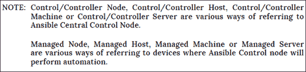

Ansible 的主要优势之一是它使用了简单、易学的语法，并且不需要任何特殊的编程技能。这对于需要自动化各种常规重复性工作任务但可能没有多少编程经验的 IT 专业人士来说，是一个非常有吸引选择。Ansible 是一种声明式语言，而脚本通常是过程化编写的。其优势在于它关注的是系统的最终状态，而不是实现该状态的步骤。

Ansible 可用于自动化广泛的任务，包括应用程序部署、系统配置、云基础架构供应以及安全和合规管理。它通常用于 DevOps（一种强调开发和运维团队之间协作的软件开发方法），以自动化应用程序的构建、测试和部署。

Ansible 使用以下协议连接到目标机器：

* `OpenSSH` 用于 Unix 类操作系统：Linux、macOS 等。
* `WinRM` 用于 Windows 操作系统。

下面的图表示了 Ansible 架构：

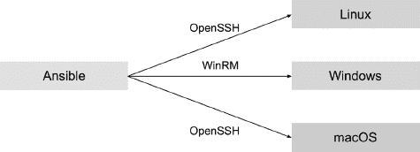

**图 1.2:** Ansible 架构

图中的 Ansible 是`中央控制节点`，图中的 Linux、Windows 和 macOS 是执行自动化的`受管节点`。

# Linux 和 macOS 目标

Ansible 使用 `OpenSSH` 协议连接受管主机中的任何 POSIX、Unix 类操作系统。这个长列表包括任何 Linux 发行版、Unix、macOS 以及任何版本的 BSD 等。`OpenSSH` 是 Secure Shell (`SSH`) 协议的免费开源实现。它是一种在计算机之间提供安全通信的网络协议，允许我们远程登录到另一台计算机、执行命令并通过网络安全地传输文件。

`SSH` 协议使用加密来保护客户端（我们的计算机）和服务器（远程计算机）之间的连接。它使用公钥密码法验证客户端和服务器的身份，并建立一个可以在其中传输数据的安全通道。

`OpenSSH` 广泛用于访问服务器和系统，是大多数 Linux 和基于 Unix 的系统的默认 `SSH` 实现。它作为第三方软件可用于 Windows 和 macOS 等其他操作系统。

`OpenSSH` 提供了管理 SSH 连接的各种工具和实用程序，例如用于建立 `SSH` 连接的 `ssh`、用于在计算机间安全传输文件的 `SCP` 以及用于通过 `SSH` 连接传输文件的 `SFTP`。它还包含一个用于在计算机间传输文件的安全拷贝 (`SCP`) 工具和一个用于通过 `SSH` 连接传输文件的安全文件传输协议 (`SFTP`)。

# Windows 目标

Ansible 使用 `Windows Remote Management (WinRM)` 连接到 Windows 管理主机。这项微软技术允许我们在 Windows 机器上远程执行命令。这是基于 `WS-Management` 协议的，它是远程管理设备和系统的标准协议。在写本书时，Ansible 支持最常用的 Windows 客户端和服务器：Windows Server 2008、Windows Server 2008 R2、Windows Server 2012、Windows Server 2012 R2、Windows Server 2016、Windows Server 2019、Windows Server 2022、Windows 7、Windows 8.1、Windows 10 和 Windows 11。

`WinRM` 允许我们远程运行脚本、执行系统管理任务并远程管理 Windows 服务器。它可以远程管理网络中的单台或一组机器。

要使用 `WinRM`，我们需要在远程机器上启用它，然后使用如 `Windows PowerShell` 或 `Ansible` 等第三方工具连接到远程机器并执行命令。

总的来说，`WinRM` 是 Windows 机器上远程管理和自动化任务的有用工具。它允许我们从单个位置管理多台机器，从而节省时间和精力。它在可能有成百或数千台服务器需要管理的大型组织特别有用。

Ansible 现在扩展了连接能力，涵盖存储和网络设备、容器技术、虚拟化 (`VMware`)、编排技术 (`Kubernetes`) 以及云提供商。


# Ansible 社区

Ansible 社区（参考 `图 1.3`）指的是使用、开发和贡献 Ansible 自动化工具的个人和组织。Ansible 是一个开源自动化工具，通过自动化配置管理、应用程序部署和编排任务，帮助用户管理其 IT 基础设施和应用程序部署。

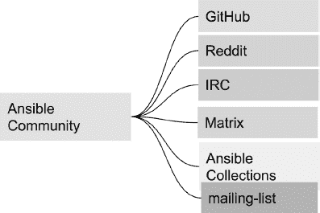

**图 1.3:** Ansible 社区通道

Ansible 社区由用户、贡献者开发者组成，他们通过各种渠道分享知识、经验和代码。这些渠道包括在线论坛、邮件列表、社交媒体小组和聚会。社区还提供文档、教程和培训材料，帮助用户学习并上手 Ansible。

Ansible 社区的核心特征之一是其协作性质。用户和开发者通过贡献代码、报告漏洞和提供反馈共同工作改进工具。社区还创建并维护了数千个 Ansible 模块、playbooks、角色（roles）和集合（collections），用户可以使用它们来自动化各种任务。


Ansible 社区由 Ansible 的背后公司 Red Hat 以及其他致力于开源软件和自动化的组织和个人支持。该社区不断成长和演变，每天都有新的贡献者和用户加入。

在编写本书时，请了解一下目前 Ansible 社区的规模：

*   每月有近五十万访问访问文档网站（参考：`docs.ansible.com`）
*   `reddit.com/r/ansible` 每有 800 多条评论
*   StackOverflow 上每月有 300 多个标记为 ansible 的问题
*   `ansible-project` 邮件列表每月有 200 多条帖子
*   800 多个活跃的 GitHub 贡献者
*   400 多个对 Ansible collections 的活跃 Ansible 贡献者
*   IRC 和 Matrix 通信系统每日活跃活跃

# Ansible 架构

Ansible 是一种配置管理和自动化工具，允许我们以自动化和标准化的方式管理和控制大量系统。它可以用于配置操作系统、部署应用程序并在远程服务器上执行其他任务。

Ansible 的架构由几个关键组件组成：

*   **控制机 (Control machine)：** 这是我们运行 Ansible 命令和 Playbook 的机器。它可以是任何安装了 Ansible 的机器，例如我们的本地桌面或笔记本电脑。这台机器是 Ansible 生态系统的核心。
*   **托管节点 (Managed nodes)：** 这些是由 Ansible 控制机管理以执行自动化的机器。
*   **清单 (Inventory)：** 清单 Ansible 将管理的系统列表。它可以是一个静态文件，也可以是运行时生成的动态清单。
*   **模块 (Modules)：** 模块是 Ansible 的构建块。它们是执行特定任务的小型程序，例如安装软件包或启动服务。
*   **剧本 (Playbooks)：** 剧本用 YAML 编写，包含一系列要执行的任务。它们可用于自动化复杂过程，是 Ansible 自动化能力的关键组件。
*   **插件 (Plugins)：** 插件是扩展 Ansible 核心功能的小型程序。它们可以修改 Ansible 模块的行为或添加新功能。

总的来说，Ansible 连接到我们清单中的系统并运行剧本中指定的任务。它使用简单、易于人类阅读的语法，并可以通过自定义模块和插件轻松扩展。

让我们逐一拆解这些组件。Ansible 控制器本质就是任何安装了 Ansible 的计算机。

关于安装信息，请参考下方的 *Ansible Installation* 章节。成功安装 Ansible 后，我们可以使用以下命令检查运行版本：

```
$ansible --version
```

请注意，Ansible 平台包含了 Ansible 引擎、命令行实用（例如：`ansible`、`ansible-playbook`、`ansible-galaxy`、`ansible-inventory` 等）以及 Ansible Collections (`ansible.builtin`)。

目标主机列表存储在 Inventory 文本文件中。该文件的默认位置是 `/etc/ansible/hosts`，但我们可以在每次执行时通过在每个 Ansible 命令中指定 `-i` 参数来覆盖它。Ansible Inventory 支持 INI、JSON 和 YAML 格式。我们还可以拥有多个文件并在执行时将它们合并。一个非常强大的功能是动态清单，即执行脚本返回清单的能力。这在快速变化的环境非常有有用，例如虚拟机或云计算提供商，在这些环境中，运行服务的枚举至关重要且变化迅速。

Ansible 模块执行托管主机上的每个 Ansible 动作。有许多 Ansible 模块可以轻松执行任何操作，而无需重复发明轮子。

当我们想要连接多个任务、将数据保存在数据结构中或执行循环或条件时，我们需要 Ansible Playbook。它是一个 YAML 格式文档，定义了何时以及何时执行我们的自动化步骤。它非常强大，特别是与封装成 Role 或 Collection 的复用代码相结合时。我们可以编写自己的复用代码，或从供应商或第三方库中使用它。

Ansible 具有很好的插件结构，允许我们扩展核心功能。为许多任务创建插件都是可能的。根据我们想要实现的集成类型有不同类型的插件。

我们可以将代码和插件分发到 IT 部门或互联网。在 Ansible Galaxy 网站 `https://galaxy.ansible.com` 上有丰富的 Roles 和 Collections 选择。

# Ansible 安装

要在我们的本地机器上安装 Ansible（假设我们正在运行 Linux 或 macOS 等类 Unix 操作系统），我们需要已经安装了 Python 3.6 或更高版本。安装了 Ansible 的机器被称为 Ansible Controller。

首先，我们可以使用以下命令检查是否已安装了 Ansible：

```
$ansible --version
```

它会验证 Ansible 是否已成功安装，并应该显示系统中的 Ansible 版本：

```
ansible [core 2.15.0]
```

例如，在我的系统中，最新安装的版本是 Ansible core 2.15.0。其中 2 称为主版本，15 是小版本，0 是补丁版本。

当结果为：

```
command not found: ansible
```

输出 `command not found` 意味着系统中尚未安装。

安装 Ansible 是执行我们自动化的第一步。有几种方法可以实现结果。它支持所有现代操作系统，因此我们通常只需要在操作系统中输入 `install ansible`。在接下来的章节中，我们可以看到最流行的操作系统中的逐步安装步骤。

# Ansible Core vs. Ansible Community Packages

从 2021 年开始，Ansible 项目从 2.10 版本起分发了两种不同的 Ansible 软件包。Ansible Core 包和 Ansible Community 包并行。Ansible Core 是一个命令行工具，主要用于那些只想安装所需最少内容的开发者和用户。它包含极少数的模块和插件，并允许安装其他 Collections。类似于 Ansible 2.9，尽管不再包含任何此后移动到 Collection 中的内容。Ansible Core 以 `ansible-core` 包的形式分发，它是 Ansible 的主要构建块和架构，并包含：

*   CLI 工具，如 `ansible-playbook` 和 `ansible-doc` 以及其他用于驱动和与自动化交互的工具。
*   Ansible 语言使用 YAML 为开发 Ansible Playbooks 创建一套规则，并包含条件、块、包含、循环等 Ansible 指令函数。
*   一个允许通过 Ansible collections 进行扩展的架构框架。`ansible-core` 团队大约每年发布两个主版本。

安装 Ansible 的另一种方法是使用 Ansible Community 包。Ansible 社区包的每个主版本都会接受包含的每个 Collection 的最新版本以及 `ansible-core` 的最新版本。Ansible 社区包的主版本可能包含包含的模块和其他插件以及/或核心功能中的破坏性更改。

`ansible` 包依赖于 `ansible-core` 包。Ansible 3.0.0 及后续版本得益于更广泛的 Ansible 社区根据社区清单审核 Collections，包含了更多的 Collections。Ansible 社区团队通常在灵活的发布周期内每年发布两个社区包主版本，该周期滞后于 `ansible-core` 的发布。


某些操作系统包管理器倾向于仅分发 `ansible-core` 包，而有些则分发两个包（ansible-core 和 ansible）。请检查我们喜爱的发行版中提供了哪些内容。

在本书编写时，`ansible-core` 包的最新版本是 2023 年 2 月 27 日发布的 2.14.3，而 ansible 包版本为 7.3.0，于 2023 年 2 月 28 日发布。

# Linux

Linux 是 Ansible 的首选操作系统。所有发行版的仓库中都包含 Ansible 包。每当我们想要安装最新版本的 Ansible 时，可以使用 `PIP` 命令行工具（请参见相关章节）。

在大多数 Linux 发行版中，配置 Ansible 控制器的用户体验是打开终端并通过发行版包管理器安装软件包。

一个好的建议是始终更新包管理器的软件包列表。

我们可以在 Debian 或兼容 Ubuntu 的操作系统中使用 `apt` 包管理器通过 DEB 包系统安装 Ansible。（参考图 1.4）。

我们可以执行以下步骤：

1. 通过运行以下命令更新包缓存：
```bash
$ sudo apt update
```

2. 通过运行以下命令安装必要的依赖：
```bash
$ sudo apt install ansible
```

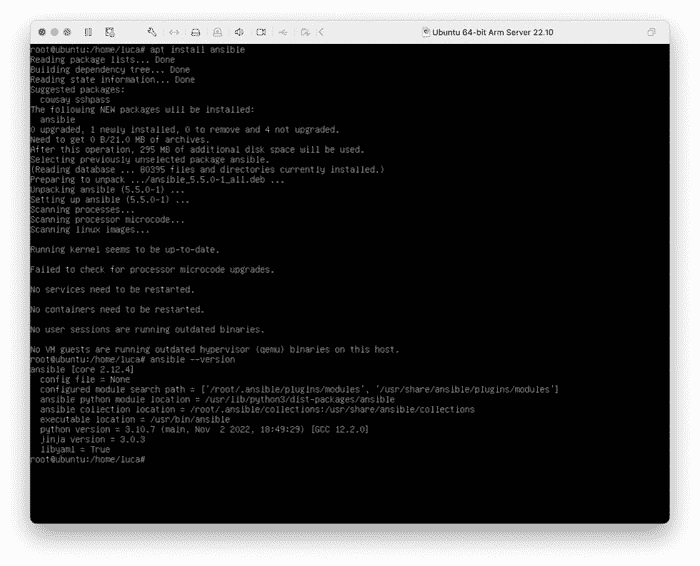

**图 1.4:** 在 Ubuntu 22.10 上执行 Ansible 安装的结果

同样地，我们可以像如下所示安装额外的命令行 `ansible-lint` Ansible 工具。

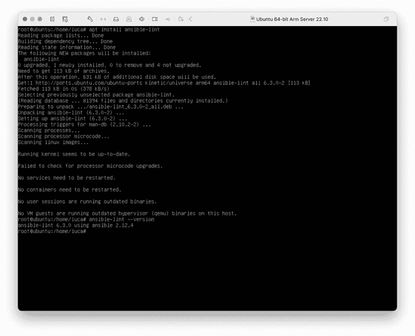

**图 1.5:** 在 Ubuntu 22.10 上执行 ansible-lint 安装的结果

我们可以在 Fedora、Red Hat Enterprise Linux、Oracle Linux、Rocky Linux、Alma Linux、Amazon Linux 以及 CentOS 等使用 RPM 包系统的发行版中使用 YUM/DNF 包管理器安装 Ansible。

请注意，CentOS 7 和 8 是 CentOS Linux 的最终发布版本。CentOS 7 的生命周期结束（EOL）日期为 2024 年 6 月 30 日，8 为 2021 年 12 月 31 日。

我们可以执行以下步骤：

1. 通过运行以下命令更新 DNF 包缓存：
```bash
$ sudo dnf update
```

2. 通过运行以下命令安装必要的依赖：
```bash
$ sudo dnf install ansible
```

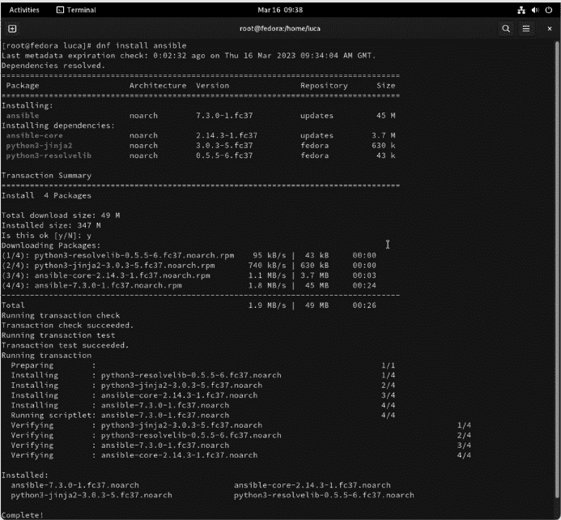

**图 1.6:** 在 Fedora 37 上执行 Ansible 安装的结果

# PIP

Ansible 是用 Python 语言编写的，可以使用 Python 原生工具和仓库进行安装。如果我们想使用最新发布的 Ansible 版本，这也是一个选项。有时 Linux 发行版需要根据发行版的发布周期一些时间来整合最新的 Ansible 版本。

通过运行以下命令使用 `PIP` 工具和 Python 包管理器安装 Ansible。它与 `Python Package Index (PyPI)` 互联网存档交互（引自：[`pypi.org/`](https://pypi.org/)））。

在 Debian 或 Ubuntu 操作系统中，我们可以执行以下步骤：

1. 通过运行以下命令更新包缓存：
```bash
$ sudo apt update
```

2. 通过运行以下命令安装必要的依赖：
```bash
$ sudo apt install python3-pip
```

3. 安装 Ansible 包：
```bash
$ pip3 install ansible
```

4. 通过运行以下命令验证 Ansible 是否已成功安装：
```bash
$ ansible –version
```

上一个命令显示了我们安装的 Ansible 版本（参考图 1.7）。

请注意，在某些发行版中，可以通过输入 `pip3` 命令使用 `pip` 命令，这意味着 `PIP` 工具专门用于 Python 版本 3。在某些情况下，我们也可以更具体，例如用于使用 Python 3.9 的 `pip3.9`。这种用例在 `Red Hat Enterprise Linux (RHEL)` 发行版非常典型：

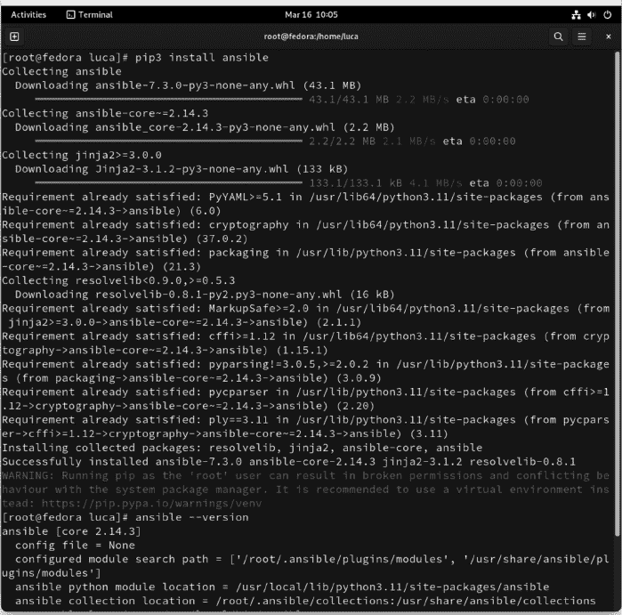

**图 1.7:** 通过 PIP 执行 Ansible 安装的结果

安装 Ansible 后，我们可以使用它来管理我们的基础设施并在多个服务器或设备上自动化任务。我们需要创建一个 Ansible 清单文件，指定我们想要管理的服务器或设备，并编写 Ansible playbooks（playbooks 使用 YAML 语言编写并定义我们想要自动化的任务）。

# macOS

macOS 操作系统符合 UNIX System-V 标准，因此完全兼容 Ansible。

为了在 macOS（无论是 Intel 还是 Apple Silicon 处理器）上安装，使用 Homebrew 包管理器非常方便（参考图 1.8）。Homebrew 是在 macOS 上安装和维护最新软件的一种非常方便的方式。

Homebrew 是一个基于 Ruby 的软件，我们可以在 macOS 终端中使用一个简单的命令安装它（更多信息请参阅 [`brew.sh/`](https://brew.sh/)）：

```bash
$ /bin/bash -c "$(curl -fsSL https://raw.githubusercontent.com/Homebrew/install/HEAD/install.sh)"
```

打开终端并运行以下命令更新包管理器的软件包列表：
```bash
$ brew install ansible
```

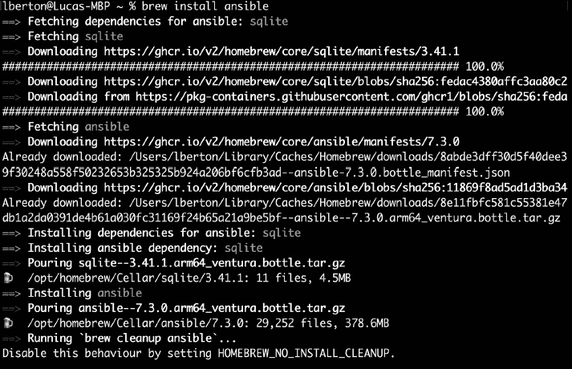

**图 1.8:** 在 macOS 上通过 Homebrew 执行 Ansible 安装的结果

同样地，我们可以如下所示安装额外的命令行 `ansible-lint` Ansible 工具：

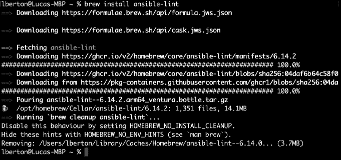

**图 1.9:** 在 macOS 上通过 Homebrew 执行 ansible-lint 安装的结果

# Windows

Windows 操作系统未被 Ansible 工程师团队官方支持作为 Ansible 控制节点。但 Windows 操作系统被官方支持作为目标节点。主要问题是 Windows 不是一个符合 POSIX 标准的操作系统，而许多 Ansible 模块是以这种方式深度编码的。

有两种可能的变通方法，但都没有官方支持。

* Cygwin
* Windows Subsystem for Linux (WSL)

Cygwin 是一种为 Microsoft Windows 添加类 Unix 环境和命令行界面的额外软件。即使听起来很不错，但有时执行会直接报错。

Windows Subsystem for Linux 是 Windows 的现代功能，用于在独立的沙箱环境中运行 Linux 环境。它的效果更好，因为它在我们的 Windows 系统内部运行原生 Linux 操作系统。支持的 Linux 发行版包括 Ubuntu、OpenSUSE、Kali、Debian、Arch Linux 等。它需要 Windows 10 版本 2004 及更高（内部 19041 及更高）或 Windows 11。我们可以在 PowerShell 中以“管理员身份运行”选项使用以下命令安装 WSL：

```bash
wsl --install
```

在成功安装 WSL 后，我们可以进行标准的 Linux 安装。结果如图 1.10 所示：

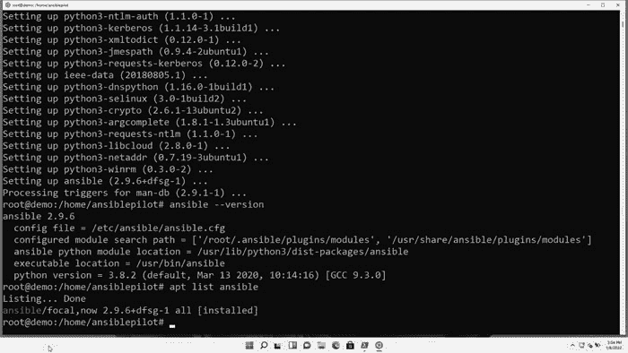

**图 1.10:** Windows 11 WSL 上的 Ansible 安装

# Ansible 即时命令

Ansible 即时命令（ad-hoc command）是在组主机上执行一次性任务的快速、简单的方法。它允许我们使用 `ansible` 命令行工具在一个或多个主机上执行单条命令或短脚本。

即时命令对于执行快速任务非常，例如检查服务器的运行时间、安装软件包或重启服务。它们对于测试或排查主机或主机组上的特定配置或设置也有帮助。

Ansible 即时命令的语法如下：

```bash
ansible <hosts> -i <inventory-file> -m <module> -a <arguments>
```

其中：

*   `<hosts>`：我们要在上面运行命令的目标主机。我们可以使用模式指定单个主机或一组主机。
*   `<inventory-file>`：包含主机列表的清单文件位置。


*   `<module>`：在主机上运行的 Ansible 模块。模块是预编写的脚本，用于执行特定任务，例如管理包、复制文件或运行 shell 命令。
*   `<arguments>`：传递给模块以执行所需任务的参数。

我们可能会遇到的第一个 Ansible 模块之一是 `ping` 模块。`ping` 模块属于 `ansible.builtin` Ansible 集合。

`ping` 模块的目的是检查主机是否可以执行任何自动化操作。它与网络 `ping` 命令完全不同。在 Ansible `ping` 模块中，我们将验证与目标主机的连接（通常通过 OpenSSH 连接），并执行一些简单的 Python 代码以返回 `ping: pong` 消息。我们可以自定义返回消息，但这并不重要。核心部分是能够检查目标主机上执行代码的可用性。对于 Windows 目标，我们应该使用 `win_ping` 模块。

另一个实 Ansible 模块是 `command` 模块。同样，`command` 模块属于 `ansible.builtin` Ansible 集合。我们可以将“command”模块与任何 Linux 命令结合使用。唯一的限制是 `command` 模块不允许使用 shell 扩展，例如 `* (星号)`、`| (管道)`、`> (重定向)` 运算符。如果我们需要任何这些 Unix 重定向功能，则应使用 `shell` 模块，但这也更危险。

例如，要检查一组主机的 `uptime` Linux 命令，我们可以运行以下即时命令：

```
$ ansible webservers -i inventory.ini -m command -a "uptime"
```

该命令将在 `inventory.ini` 文件中定义的 `webservers` 组中的所有主机上运行 `uptime` 命令。当我们想为自动化设置多个目标时，主机组非常有帮助。我们只需定义一个主机组并在自动化中使用它。

Ansible 的默认安装中包含了许多 Ansible 模块。列表非常长，而且每天都在变长。在下一章中，我们将探索最实用的部分。

```
$ ansible webservers -i inventory.ini -m ping
```

Ansible ping 模块是最广名的模块之一，因为它测试目标主机的可用性。它与网络 `ping` 命令无关。它通过清单文件中指定的用户名和密码（或使用 SSH 密钥认证）通过 SSH 连接到目标主机，并使用原生 Python 解释器执行一些命令。这就是为什么目标主机只需要现代操作系统并安装 Python 的原因。

当我们想要执行多个步骤时，Ansible 自动化中还有另一个关键组件：Ansible Playbook（见下一章）。

Ansible 用于通过名为 Ansible Playbook 的人类可读 YAML 文件将 DevOps 原则应用于全球组织中。

我们将在接下来的章节中深入探索 Ansible 编程语言。Ansible Playbook 允许我们使用数据结构和典型的编程语言结构，仅在需要时执行代码。

# 结论

Ansible 是一种现代的基础设施自动化工具，使能够标准化脚本并减少人为错误。它只需要与目标主机建立连接，无需安装任何代理。如今，自动化日常任务对每个 IT 部门都有益处。

Ansible 可以与许多不同的操作系统、服务、应用程序和云提供商进行交互。它是随时带在口袋里的瑞士军刀。在下一章中，我们将学习更多关于 Ansible 语言的知识。我们已经深入了 Ansible 架构并执行了一些简单的即时命令。在下一章中，我们将扩展如何逐顺序执行多个任务，并充分利用 Ansible 语言和数据结构。

# 记忆点

*   Ansible 控制机（Control machine）对目标主机执行自动化操作。
*   Ansible 使用模块对目标主机执行通用操作。
*   Ansible 自动化处理 Unix 类操作系统（Linux、macOS 等）和 Windows。
*   Ansible 即时命令（Ad Hoc）针对目标主机（或）执行一个模块或命令。

# 单选题

1. 哪项不是现代数据中心的特征？
    1. 可扩展性
    2. 以上均不是
    3. 灵活性
    4. 高可用性

2. Ansible 使用什么协议与 Linux 目标主机进行通信？
    1. 用于类 Unix 操作系统（Linux、macOS 等）的 OpenSSH
    2. 用于 Windows 操作系统的 WinRM
    3. 针对本地主机可以使用 “ansible_connection=local”
    4. 以上均不是

3. 是否可以使用 Windows 作为 Ansible 控制器？
    1. 正确
    2. 错误

4. “ping”即时命令的预期输出是什么？
    1. “ping: ping”
    2. “no route to host”
    3. “ping: 1”
    4. “ping: pong”

# 答案

1. **B**
2. **A**
3. **B**
4. **D**

# 问题

1. 什么是 Ansible Inventory？
2. 如何连接到 Ansible 社区？
3. 解释即时命令的作用。

# 核心术语

*   **Control machine (控制机)**：这是我们运行 Ansible 命令和 Playbook 的机器。可以是任何安装了 Ansible 的机器，例如我们的本地桌面或笔记本电脑。
*   **Inventory (清单)**：清单是 Ansible 将管理的系统列表。它可以是静态文件或运行时生成的动态清单。
*   **Modules (模块)**：模块是 Ansible 的构建块。是执行特定任务的小程序，例如安装包或启动服务。
*   **Playbooks** 使用 YAML 编写，包含一组要执行的任务。它们可用于自动化复杂过程，是 Ansible 自动化能力的关键组件。
*   **Plugins (插件)**：插件是扩展 Ansible 核心功能的小程序。可用于修改 Ansible 模块的行为或添加新功能。

# 第 2 章

# Ansible 语言核心

## 引言

Ansible 语言学习曲线简单，有助于我们简化针对目标主机的多项任务。我们可以在所谓的 Ansible Playbook 中编写 Ansible 语言。该文件还可以包含数据结构、循环和条件，以便仅在某些条件存在时执行任务。在本章中，我们将学习 Ansible 语言的基本原理以及如何编写我们的第一个成功的 Ansible Playbook。

## 结构

在本章中，我们将涵盖以下主题：

*   Ansible inventory (清单)
*   Ansible playbook (剧本)
*   Ansible variables (变量)
*   Ansible facts (事实变量)
*   Ansible magic variables (魔法变量)
*   Ansible conditional (条件判断)
*   Ansible loop (循环)

## Ansible Inventory

Ansible 本身仅运行在控制机上，因此我们不需要在目标机器上安装 Ansible。Ansible 通过根据我们指定的模块在 POSIX 目标主机上放置临时 Python 脚本来工作。其中某些模块有前提条件，因此我们可能需要在 POSIX 目标主机上安装特定的 Python 包。对于 Windows 目标，连接是使用 WinRM 协议进行的，并使用类似于 POSIX 目标主机的 Python 脚本的 PowerShell 脚本。


Ansible 清单（inventory）是用于自动化目标的主机列表。由 Ansible 管理的主机列表被称为清单。从根本上说，它是我们基础设施中的节点或主机列表，通常称为 Inventory。我们可以通过组或模式来组织清单，以选择我们想要执行 Ansible 自动化的主机或组。我们也可以使用组名来指定执行目标。

## INI 清单

INI 清单是最简单的清单类型。我们可以列出所有的主机或 IP 地址。默认位置是 `/etc/ansible/hosts`，但我们可以使用 `-i` 参数使用自定义的路径。最直接的 Ansible 清单格式是 INI。INI 格式在 IT 行业已存在多年，广泛用于配置文件。它简单来说就是一个包含一些 `name=value` 字段的文本文件。`name` 是属性名，`value` 是属性值。此外，可以在内部定义部分，在括号中指定部分名称：`[section]`。

让我们通过以下 `simple_inventory.ini` 文件来看一个简单的示例：

```
server01.example.com

[web]

server02.example.com

server03.example.com
```

如图 2.1 所示，Ansible 清单列出了 `example.com` 域名下的三个主机。

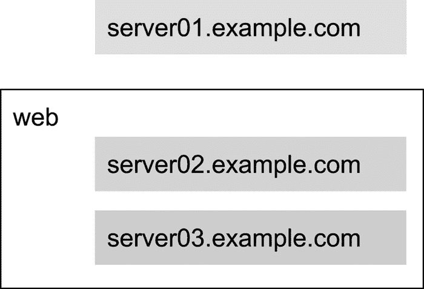

**图 2.1：** simple_inventory 场景

具体来说，`server01.example.com` 主机未分组。`server02.example.com` 和 `server03.example.com` 主机被组为 web。

## YAML 清单

YAML 格式是一种简单且易读的格式，通常用于 Ansible 清单。请非常注意代码的缩进。可以使用 YAML 格式代替 INI 格式来编写 Ansible 清单。完整的主机或 IP 地址列表必须位于 `all`节点下。每个主机必须位于 `hosts` 字段下。我们可以像 INI 格式一样，在 YAML 格式的 `children` 关键字下指定组。上一节简单的 INI 清单可以用以下代码表示：

```yaml
---
all:
  hosts:
    server01.example.com:
      children:
        web:
          hosts:
            server02.example.com:
            server03.example.com
```

如图 2.1 所示，`server01.example.com` 未分组，但 `server02.example.com` 和 `server03.example.com` 主机被组为 web。

## Ansible-inventory 工具

`ansible-inventory` 命令行工具包含在每个 Ansible 安装中，用于显示当前的 Ansible 清单信息。验证我们 Ansible 清单的当前状态非常有帮助。它接受 INI、YAML 和 JSON 格式的 Ansible 清单文件。可以使用 `--help` 显示完整的参数列表。最常用的选项是 `--list` 参数，它显示主机列表，以及 `--graph` 参数，它以树状视图显示相同的主机列表。

## “all”关键字

特殊关键字 `all` 包含了清单中任何组中的所有主机。唯一的例外是 `localhost`，我们需要显式指定它。`all` 关键字非常重要，在 Ansible 使用 中是必须的。如果我们没有指定任何特定的自动化目标主机，Ansible 将针对 `all` 执行自动化。

## 列表视图

`ansible-inventory` 命令的列表视图用于在屏幕上显示 Ansible 使用的当前清单的 JSON 格式。清单越复杂，列表越长。假设我们有一个简单的 `inventory.ini` INI 清单文件，包含一个主机 `server.example.com`，如图 2.2 所示：


**图 2.2：** 清单场景

```
server.example.com
```

我们可以通过指定以下命令获取列表输出：

```
ansible-inventory -i inventory.ini --list
```

其中：

* `ansible-inventory` 是处理 Ansible 清单的命令
* `-i inventory` 参数指定当前目录下的源清单文件
* `--list` 参数请求以列表视图格式输出

执行 `ansible-inventory --list` 命令的结果如下如下：

```
{
  "_meta": {
    "hostvars": {}
  },
  "all": {
    "children": [
      "ungrouped"
    ]
  },
  "ungrouped": {
    "hosts": [
      "server.example.com"
    ]
  }
}
```

## 图形列表视图

`ansible-inventory` 命令的图形视图用于在屏幕上显示 Ansible 使用的当前清单的树状视图。

假设我们有一个简单的 INI 清单文件（更多细节见下文简单的 INI 清单章节），如图 2.2 所示：

```
server.example.com
```

我们可以通过指定以下命令获取图形视图输出：

```
ansible-inventory -i inventory.ini --graph
```

其中：

* `ansible-inventory` 是处理 Ansible 清单的命令
* `-i inventory` 参数指定当前目录下的源清单文件
* `--graph` 参数请求以图形视图格式输出

执行 `ansible-inventory --graph` 命令的结果如下：

```
@all:
  |--@ungrouped:
  | |--server.example.com
```

## 主机范围

组成员也可以使用数字或字母范围来定义。在数字字段中，我们可以指定步长（stride）作为数字序列之间的增量。`range_inventory.ini` 文件看起来如下：

```ini
[web]
server[01:10].example.com
```

在 INI 示例 `range_inventory.ini` 中，web 组包含了从 `server01.example.com` 到 `server10.example.com` 的所有主机。我们可以根据需要扩展范围，指定服务器的起始和结束元素。

我们可以使用 `ansible-inventory` 命令的列表参数测试 Ansible 清单：

```
ansible-inventory -i range_inventory.ini --list
```

该命令产生以下输出：

```
{
  "_meta": {
    "hostvars": {}
  },
  "all": {
    "children": [
      "ungrouped",
      "web"
    ]
  },
  "web": {
    "hosts": [
      "server01.example.com",
      "server02.example.com",
      "server03.example.com",
      "server04.example.com",
      "server05.example.com",
      "server06.example.com",
      "server07.example.com",
      "server08.example.com",
      "server09.example.com",
      "server10.example.com"
    ]
  }
}
```

## 多个组中的主机

主机可以存在于清单中的多个组中。这一功能在生产环境中非常有用，我们可以从不同角度对系统进行分类。

```ini
server01.example.com
[web]
server02.example.com
server03.example.com
[prod]
server02.example.com
[dev]
server03.example.com
```

在这个 INI 示例中，主机 `server02.example.com` 和 `server03.example.com` 位于 web 组。`server02.example.com` 存在于 web 组和 prod 组中。`server03.example.com` 存在于 web 组和 dev 组中。

我们可以使用以下命令通过列表视图验证：

```
ansible-inventory -i groupsmultiple_inventory.ini --list
```

`groupsmultiple_inventory.ini` 清单命令的输出如下：

```
{
  "_meta": {
    "hostvars": {}
  },
  "all": {
    "children": [
      "ungrouped",
      "web",
      "prod",
      "dev"
    ]
  },
  "dev": {
    "hosts": [
      "server03.example.com"
    ]
  },
  "prod": {
    "hosts": [
      "server02.example.com"
    ]
  },
  "ungrouped": {
    "hosts": [
      "server01.example.com"
    ]
  },
  "web": {
    "hosts": [
      "server02.example.com",
      "server03.example.com"
    ]
  }
}
```

我们可以看到，对于每个组名，都有其内部的主机列表。


我们将在下面的 Ansible 变量章节中探索一些主机变量（host variables）和组变量（group variables）的示例。请参考第 4 章：Ansible For Linux 关于 Linux 目标主机 Ansible 清单中主机和组变量的使用，以及第 5 章：Ansible For Windows 关于 Windows 目标主机的使用。

# 本地清单 (#toc.xhtml_s35a)

针对 `localhost` 进行自动化对于 Ansible 来说比较特殊，因为我们需要一些特殊的参数。请记住，`localhost` 通常被排除在 `all` 关键字之外。

清单中的一个特殊情况是 localhost。我们需要将连接类型指定为 `local`。否则，Ansible 将假定使用默认的 SSH 连接。

这是一个经典的 INI 格式 Ansible `localhost_inventory.ini` 文件示例：

```
localhost ansible_connection="local"
```

我们可以通过以下命令获取此清单的列表视图：

```
ansible-inventory -i localhost_inventory.ini --list
```

这会产生以下输出：

```json
{
  "_meta": {
    "hostvars": {
      "localhost": {
        "ansible_connection": "local"
      }
    }
  },
  "all": {
    "children": [
      "ungrouped"
    ]
  },
  "ungrouped": {
    "hosts": [
      "localhost"
    ]
  }
}
```

# 多多个清单 (#toc.xhtml_s36a)

在每次执行时使用多个清单文件是可能的。让我们在此范围内复用我们之前定义的一些 Ansible 清单。

例如，我们可以通过设置两次 `-i` 参数来指定 `simple_inventory.ini` 和 `localhost_inventory.ini` 清单：

```bash
ansible-inventory -i localhost_inventory.ini -i simple_inventory.ini --list
```

结果是两个 Ansible 清单 `localhost_inventory.ini` 和 `simple_inventory.ini` 的合并输出：

```json
{
  "_meta": {
    "hostvars": {
      "localhost": {
        "ansible_connection": "local"
      }
    }
  },
  "all": {
    "children": [
      "ungrouped",
      "web"
    ]
  },
  "ungrouped": {
    "hosts": [
      "localhost",
      "server01.example.com"
    ]
  },
  "web": {
    "hosts": [
      "server02.example.com",
      "server03.example.com"
    ]
  }
}
```

# 动态清单 (#toc.xhtml_s37a)

当我们的目标主机变化非常快时，我们可能会发现动态生成 Ansible 清单是有用的。典型的用例包括虚拟机管理程序、容器编排器、公共云提供商等。Ansible 动态清单是运行某些代码来动态生成 Ansible 清单的方法。生成的 Ansible 清单以 JSON 格式编码，生成代码通常是 Python。动态清单代码通常需要一个包含凭据的配置文件，以便连接到我们的基础设施或云提供商。我们将在第 8 章：Ansible Advanced 第三方集成、脆弱性与敏捷性章节分享一些 Ansible 动态清单的示例。

# Windows 清单 (#toc.xhtml_s38a)

Windows 目标主机需要特殊的配置，我们将在第 5 章：Ansible For Windows 中看到。


# Ansible Playbook (#toc.xhtml_s39a)

Ansible playbook 是一组针对清单执行的剧（plays）。每个剧由任务（tasks）组成。我们将从一个简单的 Ansible playbook 开始学习，掌握基础语法，并增加更多技能。大多数 Ansible playbook 和 Ansible 模块都是幂等的。Ansible 的**幂等**意味着可以根据需要多次运行相同的自动化任务，并获得相同的结果。

# YAML 语法 (#toc.xhtml_s40a)

Ansible playbook 使用 YAML 格式编码。YAML 格式是一种易于人类阅读的编程语言，学习曲线平缓。请看以下示例：

```yaml
---
- name: Hello World
  hosts: all
  tasks:
    - name: Print message
      ansible.builtin.debug:
        msg: "Hello World!"
```


当命令成功时，结果将以绿色显示。橙色是警告消息的指示，红色表示错误。我们可以使用 `ansible.cfg` 文件来自定义颜色，更多细节请参阅*第 3 章，Ansible 语言扩展* 中的 *Ansible 配置设置* 章节。

让我们逐行查看。

*   开始时，Play 的名称带有 `PLAY` 文本前缀。这仅意味着接下来的任务与“Hello World sample”Play 相关，以便调试代码。输出中的下一行是第一个名为“Gathering Facts”的 TASK，它意味着从远程主机获取某些系统信息（Ansible 术语中称为 facts）。
*   操作结果为“ok”状态，其后跟的是目标节点名称，在本例中为 `server01.example.com`。绿色确认了操作成功。
*   第二个 TASK 是我们在代码中定义的，用于在屏幕上显示“Hello World!”消息。我们通常会看到“ok”状态和 `localhost` 目标节点。
*   最后一行是 PLAY RECAP 表格，它总结了目标主机和任务报告的状态。在本例中，只有 `server01.example.com` 两个“ok”状态。请注意，可能还有状态。


## 检查

`check` 选项允许我们在目标主机上执行只读操作。并不是所有模块都支持 check 。

使用 `--check` 选项允许我们对目标节点执行只读操作。

`ansible-playbook --check helloworld.yml`

使用 `helloworld.yml` Ansible Playbook，我们获得了相同的结果。然而，对于会更改目标节点状态的模块，结果是以只读方式使用的。按照习惯，我们可以如下在终端小部件中执行命令：

```yaml
---
- name: Hello World sample
hosts: all
tasks:
- name: Hello message
  ansible.builtin.debug:
  msg: "Hello World!"
…
```

`--check` 是 `ansible-playbook` 命令的一个非常有优势的选项。该选项用于对 playbook 执行进行干运行（dry run）。如果执行 playbook，Ansible 将报告将会发生的更改，但不会对被托管主机进行任何实际更改。

## 调试

Ansible debug 模块允许我们在执行期间在屏幕上打印文本。这种做法在开发阶段非常有用，但在生产环境中很烦人。一些开发者习惯在迁移到生产环境之前删除所有调试消息，但这失去了未来深入研究代码的机会。更好的方法是保留所有的特定调试消息，并指定“verbosity”（详细程度）参数，仅在以详细模式执行执行时显示。我们可以相应地设置四个详细级别，从零到三，如*表 2.1*所示：

| 级别 | ansible-playbook 参数 |
| :--- | :--- |
| 0 | 无参数 |
| 1 | -v |
| 2 | -vv |
| 3 | -vvv |
| 4 | -vvvv |

**表 2.1：** Ansible 详细级别

例如，让我们在下面的 playbook 中将详细程度设置为二。

```yaml
---
- name: Hello World sample
hosts: all
tasks:
- name: Hello message
  ansible.builtin.debug:
  msg: "Hello World!"
  verbosity: 2
…
```

让我们逐行分析 Ansible 代码。

1. YAML 文档的开始 (`---`)
2. Play 的名称
3. 执行的目标宿主机
4. 任务列表
5. 其中一个任务名为“Hello message.”
6. `ansible.builtin` 集合中的 Ansible 模块 `debug`
7. `debug` 模块的参数 `msg`
8. 参数 `verbosity` 为 2。

通过指定详细程度参数，我们可以在 playbook 中保留调试代码，仅在需要时启用执行。

当我们执行 ansible playbook 而不指定任何详细级别时，将假设详细级别为零：

`ansible-playbook helloworld_debug.yml`

使用零详细级别的预期执行结果是，详细程度高于此的调试处于跳过（skipping）状态。这是本次执行的预期输出：

```
PLAY [Hello World sample] *****************************************************************************
TASK [Gathering Facts] *****************************************************************************
ok: [server01.example.com]
TASK [Hello message] *****************************************************************************
skipping: [server01.example.com]
PLAY RECAP *****************************************************************************
server01.example.com: ok=1 changed=0 unreachable=0 failed=0 skipped=1 rescued=0 ignored=0
```

`helloworld_debug.yml` 的输出报告在详细级别为零时，“Hello message”的执行被跳过了，这意味着不在调试模式。我们可以尝试使用以下 Playbook 代码执行：

```yaml
---
- name: Hello World sample
hosts: all
tasks:
- name: Hello message
  ansible.builtin.debug:
  msg: "Hello World!"
  verbosity: 2
…
```

显示调试消息的唯一方法是指定更高的详细级别执行代码（在此场景下为级别二）。我们可以通过在通常的 `ansible-playbook` 命令中添加 `-vv` 参数来执行 playbook。请注意启用详细级别二执行的两个 `v`：

`ansible-playbook -vv helloworld_debug.yml`

用详细级别二模式执行时，`helloworld_debug.yml` 的输出现在屏幕上显示了“Hello message”以及关于执行的更多信息：

```
[…]
PLAYBOOK: helloworld_debug.yml *****************************************************************************
1 plays in helloworld_debug.yml
PLAY [Hello World sample] *****************************************************************************
TASK [Gathering Facts] *****************************************************************************
task path: /test/helloworld_debug.yml:2
ok: [server01.example.com]
META: ran handlers
TASK [Hello message] *****************************************************************************
task path: /test/helloworld_debug.yml:5
ok: [server01.example.com] => {
  "msg": "Hello World!"
}
META: ran handlers
META: ran handlers
PLAY RECAP *****************************************************************************
server01.example.com: ok=2 changed=0 unreachable=0 failed=0 skipped=0 rescued=0 ignored=0
```

## 多个 play

让我们考虑一种场景：前端机器运行 Nginx，后端机器运行 PostgreSQL，如*图 2.4*所示：


**图 2.4：** Ansible Playbook 和 Play 架构

更改前端机器上的服务名称以及后端的数据库类型。Ansible Playbook 需要处理以下步骤：

*   在前端机器上安装 Nginx Web 服务器
*   在后端机器上安装 PostgreSQL 数据库

我们可以为每个任务列表（Ansible Play）仅指定一个目标节点。我们有两个选择：编写两个不同的 Playbook（一个用于前端目标主机，另一个用于后端目标主机）或编写一个包含两个 Play 的 Playbook。让我强调一下，我们可以在一个 Ansible Playbook 中指定多个 Ansible Play。

```yaml
---
- name: webserver
hosts: web
become: true
tasks:
- name: Nginx installed
  ansible.builtin.apt:
  name: nginx
  state: present
- name: db
  hosts: db
  become: true
tasks:
- name: PostgreSQL installed
  ansible.builtin.apt:
  name: postgresql
  state: present
```

正如我们所看到的，在同一个 Ansible Playbook 中使用多个 Ansible Play 的另一个用途是为了测试。让我们想象以下场景：

*   在前端机器上安装 Web 服务器
*   从本地机器测试 Web 服务器


我们可以通过单个 Playbook 中的两个 Ansible Play 来实现这一场景。例如，我们可以在目标机器上安装 Web 服务器后测试该页面：

```yaml
---
- name: webserver
  hosts: web
  become: true
  tasks:
    - name: Nginx installed
      ansible.builtin.apt:
        name: nginx
        state: present
    - name: test page
    hosts: web1.example.com
    tasks:
      - name: Test page
        ansible.builtin.uri:
          url: http://server01.example.com
```

# 包含 (Includes)

通过利用团队内部或其他创建者的代码复用，可以加速代码开发。我们可以在团队内部使用单个任务、处理器（handlers）和 playbook 的 `include` 或 `import` 来执行，或者通过 Ansible `roles` 和 Ansible `collections` 使用第三方代码。更多信息请参阅 **[代码复用]* 章节中的 **[第 3 章：Ansible 语言扩展]**。

# Ansible 变量

在变量中存储和检索数据是每种计算机编程语言中的一项关键任务。它使我们能够修改数据或访问某些内容。在 Ansible 中，这项任务非常重要，因为数据包含了我们的数据中心信息。我们可以在所有的 Python 数据结构中存储数据：字符串、整数、布尔、列表、字典等。

所有这些数据类型都提供了极大的灵活性，并能够在瞬间执行复杂数据操作的能力。

在变量内部，我们可以存储系统的用户账户列表、操作系统信息、机器资源使用情况等内容。

Ansible 变量为给定环境存储动态值。

在我们的 Playbook 中，使用变量来存储我们需要的所有动态值是一个良好的实践。通过编辑变量，我们将来可以根据业务需求相应参数化来复用代码。

## 不允许的变量名

变量名是允许的，但请记住，良好的习惯是始终使用有意义的名称。

下面的 *[表 2.2]*总结了 Ansible 变量的无效变量名。

| 不允许 | 示例 |
| :--- | :--- |
| 名称间不能有空格 | `variable name` |
| 名称间不能有点 | `variable.name` |
| 不能以数字开头 | `3rdvariable` |
| 不得包含特殊字符 | `variable$1` |

**表 2.2:** 不允许的变量名

Ansible 允许变量名中使用字母和数字的所有组合。如果我们计划使用数字，注意像其他编程语言一样，我们不能将其放在开头。变量名的四个主要限制是：不允许有空格、不允许有点、不能以数字开头以及不能包含特殊字符。因此，在右侧我们看到了一些无效变量名的示例。

在接下来的章节中，我们将探索：

* 用户定义变量
* 额外变量 (Extra variables)
* 主机和组变量
* 数组变量
* 注册变量 (Registered variables)

## 用户定义变量

用户定义变量是最流行的，与许多编程语言中的变量相似。变量的数据类型可以在 **[表 2.3]* 中总结。声明使用 `vars` 语句执行，后紧跟每个变量及其值的列表。核心变量类型是 Python 允许的类型，因此：如字符串、数字、布尔、列表、字典等。我们可以在 ansible playbook 的任何部分通过在双大括号之间指定名称来轻松地获取变量值，例如：`{{ name }}`。

| 类型 | 示例 |
| :--- | :--- |
| `string` | `message: "Hi!"`, `memory: 2Gb` |
| `numeric integer` | `cpus: 2` |
| `numeric float` | `bandwidth: 123.45` |
| `boolean (true/false or yes/no)` | `verify_ssl: true`, `connected: no` |

**表 2.3:** 标量数据类型

以下示例声明了一个变量 `operatingsystem`，赋值为 `Linux`，并使用 Ansible debug 模块打印到屏幕：

```yaml
---
- name: Variable print sample
  hosts: all
  vars:
    operatingsystem: "Linux"
  tasks:
    - name: Print variable
      ansible.builtin.debug:
        msg: "Print the value of variable {{ operatingsystem }}"
```

`variableprint.yml` 文件：

1. YAML 开始符号 `---`
2. play 的名称
3. 目标主机 (`all`)
4. 用户定义变量列表 `vars`
5. `operatingsystem` 是变量名
6. 任务列表
7. 一个任务名为 `Print variable`
8. `ansible.builtin` 集合中的 Ansible 模块 `debug`
9. `debug` 模块的参数 `msg` 用于打印 `operatingsystem` 的值

`variableprint.yml` playbook 与 `helloworld.yml` playbook 类似。除了存在变量 `operatingsystem` 之外，其语法和元素结构非常相似。变量存储字符串、数字和更复杂的数据结构（如列表、字典等）。在这种情况下，变量的名为 `operatingsystem`，值为 `Linux`。在这种情况下，debug 模块将文本 `Print the value of the variable` 与变量 `operatingsystem` 的值拼接。请注意双大括号，它表示变量的重要性。最佳实践是始终在代码的双双引号内包含双大括号。

之前的代码会在屏幕上产生以下消息：

`msg: "Print the value of the variable Linux."`

我们可以使用每个 Ansible 安装中包含的 `ansible-playbook` 命令执行该 Ansible playbook。完整命令如下：

`ansible-playbook variableprint.yml`

命令的输出如下：

```
PLAY [Variable print sample] *******************************************************************
TASK [Gathering Facts] *************************************************************************
ok: [server01.example.com]
TASK [Print variable] **************************************************************************
ok: [server01.example.com] => {
"msg": "Print the value of variable Linux"
}
PLAY RECAP *****************************************************************************
server01.example.com: ok=2 changed=0 unreachable=0 failed=0 skipped=0 rescued=0 ignored=0
```

`variableprint.yml` 执行的输出与 `helloworld.yml` 文件非常相似。请注意通过结合字符串与变量值获得的消息 `Print the value of variable Linux`。此外，该执行运行良好，如 play 总结区域和绿色颜色所示。总执行量等同于两个任务。

## 多行 (Multiline)

许多场景要求我们将字符串跨行折叠：为了提高代码可读性并符合列数、多行字符串等要求。

在 Ansible 中跨行折叠字符串，可以使用以下运算符：

**字面量块操作符 (|)：** 该运算符告诉 Ansible 将字符串视为字面量块操作符。这意味着 Ansible 将保留字符串中的换行符。例如，以下代码将创建一个名为 `my_variable` 的变量，其内容如下：

```yaml
my_variable = |
This is a
multiline string
```

**折叠块操作符 (>)：** 该运算符告诉 Ansible 将字符串视为折叠块操作符。这意味着 Ansible 将将字符串中的所有换行符合并为空格。例如，以下代码将创建一个名为 `my_variable` 的变量，其内容如下：

```yaml
my_variable = >
This is a
multiline string
```


字面块标量（literal block scalar）和折叠块标量（folded block scalar）运算符之间的区别在于，字面块标量运算符会保留字符串中的换行符，而折叠块标量运算符会将字符串中的所有换行符合并为空格。

这两个运算符都支持添加“-”号，用于移除字符串末尾的任何换行符。带有换行移除功能的运算符变为：

- `|-`: 不带换行的字面块标量。
- `>-`: 不带换行的折叠块标量。

## 额外变量

额外变量（extra variable）是从命令行传递值的一种方式。当我们尝试将 Ansible 集成到当前的工具链中，或者只是从命令行对 playbook 进行参数化时，这种方法非常有优势。让我们执行与之前示例相同的代码，但我们要在不更改代码的情况下将变量 `operatingsystem` 的值从 Linux 改为 Windows。我们只需要在命令行 `ansible-playbook` 中指定 `-e` 参数，后跟变量名和值。在这种情况下，`-e operatingsystem=Windows` 允许我们从命令行指定变量的值。

完整命令如下：

```
ansible-playbook -e "operatingsystem=Windows" variableprint.yml
```

命令的输出如下：

```
PLAY [Variable print sample] ***************************************************
TASK [Gathering Facts] *********************************************************
ok: [host1.example.com]
TASK [Print variable] **********************************************************
ok: [host1.example.com] => {
"msg": "Print the value of variable Windows"
}
PLAY RECAP *********************************************************************
host1.example.com : ok=2 changed=0 unreachable=0 failed=0 skipped=0 rescued=0 ignored=0
```

我们可以通过覆盖 playbook 变量从命令行指定值。在命令行上设置的变量称为额外变量。`variableprint.yml` 的执行输出与之前的非常相似。请注意通过组合字符串与变量值而得到的 `Print the value of variable Windows` 消息。从命令行传递的值会覆盖 playbook 中的任何值。

## 主机和组变量

我们还可以在清单文件（inventory file）中定义变量。在主机级别定义的变量称为主机变量（host variables）。同样，在组级别定义的变量称为组变量（group variables）。

我们将看到以下内容的示例：
- INI 清单中的主机变量
- INI 清单中的组变量
- 文件系统中的主机变量
- 文件系统中的组变量

## INI 清单中的主机变量

在主机变量中指定 `ansible_user` 值后跟用户名以指定用于登录服务器的帐号是有效的。

这是一个为服务器 `host1.example.com` 指定登录用户 `devops` 的清单示例。通过这种方式，我们可以为每个目标主机指定不同的用户。

## 主机变量

主机变量为 Ansible 清单中的单个主机设置值。让我们为单个主机将变量 `ansible_user` 定义为 `devops`：

```
[servers]
host1.example.com ansible_user=devops
```

## 文件系统中的主机变量

我们可以通过将清单文件与变量文件分离来获得相同的 Ansible 清单。

我们需要创建一个类似于所示文件的清单文件：

```
[servers]
host1.example.com
```

然后，在 `host_vars` 目录下创建一个与主机名完全相同的主机变量文件。`host_vars/host1.example.com` 文件包含了主机 `host1.example.com` 的变量。

```
ansible_user=devops
```

## 组变量

组变量为 Ansible 清单中的一组主机设置值。我们可以指定一个组变量，将 `servers` 组中所有目标主机的 `ansible_user` 变量设置为 `foo`：

```
[servers]
host1.example.com
host2.example.com
[servers:vars]
ansible_user=foo
```

该组变量应用于 `host1.example.com` 和 `host2.example.com`，并具有相同的 `foo` 值。

## 文件系统中的组变量

同样，我们可以通过文件系统将组变量应用于清单组。假设我们有一个包含 `servers` 组的清单，如下：

```
[servers]
host1.example.com
host2.example.com
```

与组名完全相同的组变量文件位于 `group_vars` 目录。`group_vars/servers` 文件包含组 `servers` 的变量：

```
ansible_user=foo
```

我们可以使用目录来填充主机和组变量来实现相同的结果。正如我们所看到的，结果与之前的主机和组清单相同，但使用了更多的文件。

## 数组变量

当我们需要指定适用于对象的某些属性时，数组变量是至关重要的。假设我们有一个包含 `foo` 和 `bar` 的用户。它们每一个都有自己的 `username` 和 `homedir` 变量。

Ansible Playbook 的开头如下代码所示。请注意 `vars` 语句下的数组变量结构：

```yaml
---
- name: Array sample
  hosts: all
  vars:
    users:
      foo:
        username: foo
        homedir: /users/foo
      bar:
        username: bar
        homedir: /users/bar
  tasks:
    - name: print foo's username
      ansible.builtin.debug:
        var: users.foo.username
```

类似于 Python 编程语言，我们可以使用点号 (.) 或括号符号 ([]) 访问每个属性。

点表示法
代码 `users.foo.username` 打印 `foo` 的值。

括号表示法
代码 `users['foo']['username']` 打印 `foo` 的值。

我们可以按照分级数据结构组织信息。一种很有用的数据结构是数组。例如，用户列表可以被 `foo` 和 `bar` 轻松读取。每个列表元素都有两个属性：名字和主主目录。我们可以使用点表示法或方括号访问数据。在两种情况下，由于我们的逻辑一致，都会获得相同的结果。

执行 `array.yml` 文件的完整命令如下：

```
ansible-playbook array.yml
```

命令的输出如下：

```
PLAY [Array sample] ****************************************************************************
TASK [Gathering Facts] *************************************************************************
ok: [server01.example.com]
TASK [print foo's username] *****************************************************************
ok: [server01.example.com] => {
"users.foo.username": "foo"
}
PLAY RECAP *****************************************************************************
server01.example.com: ok=2 changed=0 unreachable=0 failed=0 skipped=0 rescued=0 ignored=0
```

`array.yml` 的执行输出与之前的非常相似。Ansible 访问了变量数组值并按预期在输出消息中显示。我们可以注意到产生了 `Print foo's first name: foo`。

## 注册变量

另一种功能性数据结构是注册变量（registered variables）。我们可以将任何命令的输出保存到注册变量。在本示例中，在屏幕上打印结果。

```yaml
---
- name: Install a package and prints the result
  hosts: all
  become: true
  tasks:
    - name: Install the package
      ansible.builtin.yum:
        name: wget
        state: installed
      register: install_result
    - name: debug
      ansible.builtin.debug:
        var: install_result
```


首先，`yum` 模块会检查软件包是否存在；如果缺失，则继续安装。设置过程的输出将存储在一个注册的变量中，并打印在屏幕上。`registeredvariables.yml` 的执行结果显示了执行的一些任务。

完整命令如下：

```
ansible-playbook registeredvariables.yml
```

该命令的输出如下：

```
PLAY [Installs a package and prints the result] ************************************************
TASK [Gathering Facts] *************************************************************************
ok: [server01.example.com]
TASK [Install the package] *********************************************************************
ok: [server01.example.com]
TASK [debug] *****************************************************************************
ok: [server01.example.com] => {
  "install_result": {
    "cache_update_time": 1660746334,
    "cache_updated": false,
    "changed": false,
    "failed": false
  }
}
PLAY RECAP *****************************************************************************
server01.example.com: ok=3 changed=0 unreachable=0 failed=0 skipped=0 rescued=0 ignored=0
```

请参考 Ansible Facts 中的后续章节 *Temporary Facts*（临时事实*），以创建一个新变量来处理命令的输出。

## 将变量写入文件

在 Ansible 中，将变量写入文件有两种主要方法：

* 使用 Ansible copy 模块
* 使用 Ansible template 模块

Ansible copy 模块是将变量写入文件的简单方法。要使用它，我们需要指定变量名、目标文件路径以及文件内容。例如：

```yaml
- name: Write variable to a file
  ansible.builtin.copy:
    path: ./myfile.txt
    content: "{{ operatingsystem }}"
    state: present
```

这将创建一个名为 `myfile.txt` 的文件，其内容包含 `operatingsystem` 变量的值。

Ansible template 模块是将变量写入文件的一种更灵活的方法。它允许我们使用 Jinja2 模板来生成文件内容。

例如：

```yaml
---
- name: Array sample
  hosts: all
  vars:
    operatingsystem: Linux
  tasks:
    - name: Write variable to a file
      Ansible.builtin.template:
        src: mytemplate.j2
        dest: myfile.txt
```

`mytemplate.j2` 文件内容如下：

```
{{ operatingsystem }}
```

这将创建一个名为 `myfile.txt` 的文件，其包含以下文本：

```
Linux
```

使用 Ansible template 模块的主要优势是，它允许我们使用 Jinja2 模板来生成文件内容。当我们需要创建包含复杂或动态内容的文件时，这将非常有用。

使用 Ansible template 模块的主要缺点是它可能比 Ansible copy 模块更难使用。如果我们不熟悉 Jinja2 模板，可能会发现编写产生所需输出的模板非常困难。

总的来说，如果我们需要创建一个包含静态值的简单文件，Ansible copy 模块是一个很好的选择。如果我们需要创建一个包含复杂或动态内容的文件，Ansible template 模块是一个很好的选择。

# Ansible Facts

Ansible facts 是与远程主机相关的变量。远程系统相关的变量被称为 facts（事实）。它们非常强大，因为我们可以获取当前主机、操作系统、所使用的发行版、IP 地址、网络配置、存储配置等方面的全面视图。通过 facts，我们可以将一个系统的行为或状态作为其他系统的配置。

# Ansible ad-hoc

理解 Ansible facts 的最佳方法是使用这个简单的 Ansible ad-hoc 命令自行列出它们：

```
ansible -m setup host1.example.com
```

将命令调整到目标主机；显然，`host1.example.com` 仅用于我的实验室。

Facts 非常有用，因为它们包含了关于硬件和软件的以下信息以及由操作系统指定的某些目标主机信息。

最常用当前硬件配置：架构、处理器、RAM、可用内存、存储配置、操作系统、所使用的 Linux 发行版、IP 地址、网络配置、存储配置等。

这只是使用上述命令获取的长列表的开始。ansible 命令产生如下输出：

```
[...]
"ansible_architecture": "arm64",
"ansible_date_time": {
  "date": "2023-04-05",
  "day": "05",
  "epoch": "1680726722",
  "epoch_int": "1680726722",
  "hour": "22",
  "iso8601": "2023-04-05T20:32:02Z",
  "iso8601_basic": "20230405T223202059078",
  "iso8601_basic_short": "20230405T223202",
  "iso8601_micro": "2023-04-05T20:32:02.059078Z",
  "minute": "32",
  "month": "04",
  "second": "02",
  "time": "22:32:02",
  "tz": "CEST",
  "tz_dst": "CEST",
  "tz_offset": "+0200",
  "weekday": "Wednesday",
  "weekday_number": "3",
  "weeknumber": "14",
  "year": "2023"
},
"ansible_default_ipv4": {
  "address": "192.168.58.46",
  "broadcast": "192.168.58.255",
  "device": "en0",
[...]
```

只需记录下我们感兴趣的 Ansible Fact 名称即可，因为我们将在 Ansible Playbook 中使用它。

## Playbook 中的 facts

我们可以从 Ansible playbook 中获取相同数量的数据。在这个简单的示例中，我们将列出所有清单主机的所有 ansible facts。预期结果将与之前的 ad-hoc 执行结果相同。

请注意，这需要启用 `gather_facts`。`gather_facts` 语句对于从目标机器获取 ansible facts 并在 Playbook 中使用它们是必要的。

提示：在不需要时禁用 `gather_facts` 以加速 Ansible 执行：

```yaml
---
- name: facts_printall
  hosts: all
  gather_facts: true
  tasks:
    - name: Print all facts
      ansible.builtin.debug:
        var: ansible_facts
```

执行结果将在屏幕上打印 `ansible_facts` 变量列表及其值。例如，一小部分显示了变量 `architecture` 的值为 `x864`：

```
"ansible_facts": {
  "architecture": "x864",
[...]
```

`facts_printall.yml` 的执行输出显示了目标节点的内容。结果非常长，包含了 Ansible 在 Gathering Facts 任务中获取的所有事实。# 单 fact

我们可以通过指定具体的 fact 名称来轻松与其交互。根据需要自定义代码。在示例中，我们正在列出管理节点的架构。`facts_printone.yml` 文件如下：

```yaml
---
- name: facts_printone
  hosts: all
  gather_facts: true
  tasks:
    - name: Print a fact
      ansible.builtin.debug:
        msg: "architecture: {{ ansible_facts['architecture'] }}"
```

可以使用每个 Ansible 安装中包含的 `ansible-playbook` 命令执行 `facts_printone.yml` Playbook 文件。带有清单的完整命令如下：

```
ansible-playbook facts_printone.yml
```

上述命令的执行结果如下：

```
TASK [Gathering Facts] *************************************************************************
ok: [server01.example.com]
TASK [Print a fact] *************************************************多数
ok: [server01.example.com] => {
  "msg": "architecture: x8664"
}
PLAY RECAP *****************************************************************************
server01.example.com: ok=2 changed=0 unreachable=0 failed=0 skipped=0 rescued=0 ignored=0
```

## 临时事实

我们可以使用 `ansible.builtin.set_fact` 模块定义一些临时事实。


`ansible.builtin` 中的 `set_fact` 模块用于添加新的 Ansible facts。它主要用于将来自注册输出和现有 facts 的数据转换为新的结构。创建的 facts 可供后续的所有任务使用。

以下 `facts_temporary.yml` Ansible 剧本在 `ansible_distribution` fact 值为 Red Hat Enterprise Linux 时创建一个临时 fact。基本上，当该条件被核实时，我们使用值 `rhel` 来重写 `ansible_distribution` fact：

```yaml
---
- name: Temporary Facts
  hosts: all
  tasks:
    - name: Set mydistribution
      ansible.builtin.set_fact:
        mydistribution: >-
          "{{ 'rhel' if (ansible_distribution == 'Red Hat Enterprise Linux') else ansible_distribution }}"
    - name: Print mydistribution
      ansible.builtin.debug:
        var: mydistribution
```

我们可以在 Ansible 的条件（Conditional）部分了解更多关于 if 语句的知识。折叠块标量操作符（`>-`）的使用是在 Ansible 变量（Variables）段落的多行（Multiline）部分中引入的。

如往常，我们可以使用 `ansible-playbook` 命令通过完整命令执行 `facts_temporary.yml` 剧本文件：

```bash
ansible-playbook facts_temporary.yml
```

在 macOS 操作系统上执行产生以下输出：

```text
TASK [Print mydistribution] *****************************************************************************
ok: [server01.example.com] => {
  "mydistribution": "\"MacOSX\""
}
```

而在 Red Hat Enterprise Linux 操作系统上执行产生：

```text
TASK [Print mydistribution] *****************************************************************************
ok: [server01.example.com] => {
  "mydistribution": "\"rhel\""
}
```

## 自定义 facts

除了 setup 模块（`ansible.builtin`）创建的默认 facts 和 set_fact 模块创建的临时 facts 外，Ansible 还支持创建自定义 facts。

我们可以在目标机器的 `/etc/ansible/facts.d` 目录下定义自定义 facts。所有 fact 文件都具有 `.fact` 扩展名。如果 fact 文件是可执行的，Ansible 将运行它。否则，Ansible 将尝试将其视为 INI 或 JSON 格式。自定义 facts 由“setup”模块（`ansible.builtin`）加载。

自定义 facts 放置在一个名为 `ansible_local` 的独立字典中，并自定义 fact 的文件名组织：`ansible_local['fact file name']`。

自定义 facts 在安装后不会自动加载，因此我们需要等待下一次执行（play）或手动重新运行“setup”。

`/etc/ansible/facts.d/infrastructure.fact` 文件如下：

```ini
[system]
type=dr
```

我们可以通过以下任务在剧本中访问所有 Ansible 自定义 facts：

```yaml
- name: display ansible_local
  ansible.builtin.debug:
    var: ansible_local
```

或者使用自定义 fact 中的任何属性来访问任何特定属性：

```yaml
- name: print system type
  ansible.builtin.debug:
    msg: "The system type is {{ ansible_local.infrastructure.system.type }}"
```

代码的输出在屏幕上显示 `dr` 系统类型。

# Ansible 魔法变量 (Magic Variables)

Ansible 魔法变量包含一些关于目标主机的信息。魔法变量是 Ansible 的内部变量，有时大有用用场。

有时初学者用户会将 Ansible facts 与魔法变量混淆。

主要的区别在于，魔法变量不需要在 Ansible 剧本的开始时启用 `gather_facts`，而 Ansible Facts 却需要。

## 常用魔法变量

这些是最常用的五个魔法变量：

*   `hostvars`: 通过 `hostvars`（主机变量）魔法变量，我们可以访问 play 中为任何主机定义的变量。当我们想从一个主机访问另一个主机的属性时，这种方法非常有优势。可以将主机变量与 ansible facts 结合访问另一个主机的属性。
*   `groups`: `groups` 魔法变量列出清单（inventory）中的所有组。结合使用 `groups` 和主机变量魔法变量可以列出组内所有主机的 IP 地址。
*   `group_names`: 当前主机所属组列表。
*   `inventory_hostname`: `inventory_hostname` 魔法变量包含清单中配置的主机名称。
*   `ansible_version`: `ansible_version` 魔法变量包含关于 Ansible 的版本信息。

## Ansible 版本

以下示例在屏幕上打印当前使用的 Ansible 版本。其底层依赖于 `ansible_version` 魔法变量。`ansible_version.yml` 文件如下：

```yaml
---
- name: ansible_version print
  hosts: all
  tasks:
    - name: ansible_version display
      ansible.builtin.debug:
        var: ansible_version
```

执行输出如下。如我们所见，结果显示了完整版本 2.13.3、主版本 2、次版本 13 以及修订版本 3，以及整个字符串 2.13.3。

我们可以使用每个 Ansible 安装包含的 `ansible-playbook` 命令执行代码。完整命令如下：

```bash
ansible-playbook ansible_version.yml
```

命令的输出如下：

```text
TASK [ansible_version display] *****************************************************************
ok: [server01.example.com] => {
  "ansible_version": {
    "full": "2.13.3",
    "major": 2,
    "minor": 13,
    "revision": 3,
    "string": "2.13.3"
  }
}
```

Ansible 魔法变量在我们的 Ansible 剧本非常重要，特别是当我们需要执行某些影响清单中所有主机的操作时。我们可以应用在后续课程中探索的循环（loop）或其他语句。例如，为列表中涉及的所有主机生成自定义的 `/etc/hosts` 文件。

# Ansible 条件 (Conditional)

条件语句检查条件并据此改变程序的行为。在每种计算机编程语言中，我们几乎都需要检查条件并相应改变程序行为的能力。条件语句赋予了我们这种能力。Ansible 的形式是 `when` 语句。Ansible 在条件中使用 Jinja2 测试和过滤器。Ansible 支持所有标准测试和过滤器，并添加了一些独特的。

## 使用“when”的基础条件

`when` 语句定义了任务是否将被执行。我们可以在每个 Ansible 剧本任务或块中使用 `when` 语句。只需添加带有条件的 `when` 语句即可。

在现实世界中，我们可以使用：

*   使用括号 `()` 的复杂表达式
*   比较运算符 `==`, `>=`, `<=`, `!=`
*   使用 Ansible Facts (`ansible_facts['os_family'] == "Debian"`)

在以下示例中，一个简单的布尔变量控制执行。显然，我们需要一个真状态来执行任务。`conditional_basic_false.yml` 文件如下：

```yaml
---
- name: conditional basic
  hosts: all
  vars:
    configure_nginx: false
  tasks:
    - name: reload nginx
      ansible.builtin.service:
        name: nginx
        state: reloaded
      when: configure_nginx
```

当 `configure_nginx` 布尔变量为 `true` 时，会执行 reload nginx 任务。

在这个示例中，变量始终为 `false`，因此我们预计该任务在执行输出期间跳过。

我们可以使用所有 Ansible 安装包含的 `ansible-playbook` 命令行工具执行 Ansible 剧本。

命令如下：

```bash
ansible-playbook conditional_basic_false.yml
```

我们可以使用参数 `-i` 通过本地文件清单指定 Ansible 清单。简单的是本地 Ansible 清单。`conditional_basic_false.yml` 是我们 Ansible 剧本的文件名。


我们期望看到任务输出一个跳过（skipped）状态，即在执行期间该语句的结果为假。

在下面的输出中，我们看到 `reload nginx` 任务处于跳过状态，并在最后的 Play 摘要（Play Recap）中显示 `skipped=1`：

```
PLAY [conditional basic] ***********************************************************************
TASK [Gathering Facts] *************************************************************************
ok: [server01.example.com]
TASK [reload nginx] ****************************************************************************
skipping: [server01.example.com]
PLAY RECAP *****************************************************************************
server01.example.com: ok=1 changed=0 unreachable=0 failed=0 skipped=1 rescued=0 ignored=0
```

本次执行针对 `server01.example.com` 节点运行 play，输出以绿色和蓝色高亮。正如我们所看到的，由于我们的条件语句，`reload nginx` 任务显示为跳过状态。

接下来的示例将 `configure_nginx` 变量设置为布尔值 `true`。我们期望这次执行将运行 `reload nginx` 任务。`conditional_basic_true.yml` 文件内容如下：

```yaml
---
- name: conditional basic
  hosts: all
  vars:
    configure_nginx: true
  tasks:
    - name: reload nginx
      ansible.builtin.service:
        name: nginx
        state: reloaded
      when: configure_nginx
```

这是我们在 Ansible playbook 中使用 `when` 语句的另一个基本用法示例，但我们将变量值从 `false` 改为了 `true`。`reload nginx` 任务执行了，因为 `configure_nginx` 布尔变量被设置为 `true`。我们可以使用 `ansible-playbook` 命令来执行 playbook：

`ansible-playbook conditional_basic_true.yml`

参数 `conditional_basic_true.yml` 是 Ansible Playbook 的文件名。执行上一个的 `ansible-playbook` 命令产生了以下输出：

```
TASK [reload nginx] ****************************************************************************
changed: [server01.example.com]
```

正如我们看到的，`reload nginx` 任务被 Ansible 读取并在我们的条件语句下成功执行，状态已改变。在本次执行中，play 针对 `server01.example.com` 节点运行，每一行 ok 状态的输出都以绿色高亮。

## 基于 Ansible facts 的条件

将条件（conditionals）与事实（facts）相结合非常方便。因此我们可以根据单个主机的条件、IP 地址、操作系统、文件系统状态等来调整代码的执行。

在这个示例中，我们将按照 `conditional_facts.yml` 文件所示，执行类 RedHat 主机的关闭：

```yaml
---
- name: conditional_facts
  hosts: all
  tasks:
    - name: Shut down RedHat-like systems
      ansible.builtin.command: /sbin/shutdown -t now
      when: ansible_facts['os_family'] == "RedHat"
```

我们可以使用 `ansible-playbook` 命令来执行 playbook：

`ansible-playbook conditional_facts.yml`

参数 `conditional_facts.yml` 是 Ansible Playbook 的文件名。以下是上一个命令的输出：

```
TASK [Shut down RedHat-like systems] ***********************************************************
skipping: [server01.example.com]
```

在本次执行中，play 针对 server01.example.com 节点执行。目标主机不是类 RedHat 系统，因为我们可以注意到名为“Shut down RedHat-like systems”的任务处于被跳过的状态。

作为参考，存储在变量 `ansible_facts['os_family']` 中的 Ansible Fact 完整值列表有：AIX, Alpine, Altlinux, Archlinux, Darwin, Debian, FreeBSD, Gentoo, HP-UX, Mandrake, RedHat, SGML, Slackware, Solaris, Suse 和 Windows。

条件语句至关重要，因为它们允许我们创建响应某些事件、条件或 Ansible Facts 的 Ansible Playbooks。这种语句是智能 Ansible Playbook 的基础。

# Ansible Loop

与每种编程语言一样，循环是重复执行任务最重要的部分。Ansible 根据我们想要实现的交互提供了几种语句。

## Loop 语句

Loop 语句自动化了我们 Ansible Playbook 中的重复性任务。计算机比人类更擅长无错误地重复相同或相似的任务。一组语句的重复执行被称为迭代。

Ansible 有几种用于迭代的语句：

* `loop`
* `with_items`
* `with_file`
* `with_sequence`
* `with_fileglob`

我们将重点关注其中两种语句：

* `loop` 语句
* `with_items` 语句

`with_items` 语句更加通用，并且可以依赖外部插件。

## loop 语句

简单的循环对一个项列表中的任务进行迭代。`loop` 语句被添加到任务中，并以任务应迭代的项列表作为值。`loop_simple.yml` 文件如下：

```yaml
---
- name: Check services
  hosts: all
  tasks:
    - name: httpd and sshd are running
      ansible.builtin.service:
        name: "{{ item }}"
        state: started
      loop:
        - apache2
        - sshd
```

在我们的模块内部，我们可以使用 loop 变量，Ansible 将其替换为当前值。可以使用所有安装中包含的 `ansible-playbook` 命令工具执行 Playbook。完整命令如下：

`ansible-playbook loop_simple.yml`

参数 `loop_simple.yml` 指定了我们的 Playbook 文件名。该命令的执行产生了以下输出：

```
TASK [print values of data] ****************************************************
ok: [server01.example.com] => (item=apache2) => {
  "msg": "apache2"
}
ok: [server01.example.com] => (item=sshd) => {
  "msg": "sshd"
}
```

loop 列表不应该是简单值的列表。在下面的示例中，列表中的每个项都是哈希（hash）或字典（dictionary）。

示例中的每个哈希或字典有两个键：name 和 groups，每个键的值可以分别通过 `item.name` 和 `item.group` 变量获取。`loop_hash_or_dict.yml` 文件如下：

```yaml
---
- name: Users exist in the correct group
  hosts: all
  tasks:
    - name: Users exist in the correct group
      ansible.builtin.user:
        name: "{{ item.name }}"
        state: present
        groups: "{{ item.group }}"
      loop:
        - name: foo
          group: wheel
        - name: bar
          group: root
```

一如既常，我们可以使用 `ansible-playbook` 命令执行 playbook：

`ansible-playbook loop_hash_or_dict.yml`

使用 `loop_hash_or_dict.yml` 作为 Ansible Playbook 文件名。该命令产生了以下输出：

```
TASK [Users exist in the correct group] ***********************************************
changed: [server01.example.com] => (item={'name': 'foo', 'group': 'wheel'})
changed: [server01.example.com] => (item={'name': 'bar', 'group': 'root'})
PLAY RECAP *************************************************************
server01.example.com: ok=2 changed=1 unreachable=0 failed=0 skipped=0 rescued=0 ignored=0
```

## with_items 语句的兄弟语句

`with_items` 不是 Ansible 语言中唯一的可用语句。所有以 `with_` 开头的 loop 语句都是：

* `with_items statement`：与简单列表、字符串列表或哈希/字典列表交互。如果提供了列表列表，则会扁平化为列表。
* `with_file statement`：此关键字需要控制节点文件名列表。loop 变量 item 包含文件内容。


- `with_sequence statement`: 该关键字需要参数根据数值序列生成值列表。
- `with_fileglob statement`: 此语句列出匹配模式的文件。例如，我们可以指定 `*.txt` 参数来列出目标节点上所有带有 txt 扩展名的文件。

在接的示例中，我们将使用 `with_items` 遍历一个名为 `data` 的列表，该列表包含系统中的用户列表。以下示例在包含两个项目（`foo` 和 `bar`）的 data 列表类型之间循环。`loop_with_items.yml` 文件如下：

```yaml
---
- name: Example with_items
  hosts: all
  vars:
    data:
    - foo
    - bar
  tasks:
    - name: Print values of data
      ansible.builtin.debug:
        msg: "{{ item }}"
      with_items: "{{ data }}"
```

我们可以使用 `ansible-playbook` 命令执行 playbook：

```bash
ansible-playbook loop_with_items.yml
```

参数 `loop_with_items.yml` 指定了 Ansible Playbook 的文件名。它产生以下输出：

```text
TASK [Print values of data] ********************************************************************
ok: [server01.example.com] => (item=foo) => {
  "msg": "foo"
}
ok: [server01.example.com] => (item=bar) => {
  "msg": "bar"
}
```

在 `loop_with_items.yml` playbook 中，变量 `data` 是一个字符串列表。任务 `Print values of data` 使用 `with_items` 逐项迭代并打印到屏幕上。

循环语句对于自动化重复任务非常有用。循环是构建成功的 Ansible Playbook 的基石。

# 结论

Ansible 语言包含了数据结构和任务，以实现共同目标。我们学习了如何使用变量、循环和条件语句在我们的数据中心执行任何操作。Ansible 清单（inventory）是我们自动化的核心，在其中我们定义目标主机以及一些相关的主机或组变量。一些工具如 Ansible facts（事实）、魔法变量（magic variables）以及在单个 Playbook 中包含多个 Plays，使得我们能够实现最成功的自动化。在下一章中，我们将学习 Ansible 语言的扩展、如何存储敏感数据、如何使用扩展插件，以及如何通过 role 和 collection 实现代码复用。

# 注意事项

- Ansible 清单（Inventories）采用 INI、YAML 或 JSON 格式，包含目标主机的列表。
- Ansible Playbook 将针对目标主机的 Ansible Play 与任务列表结合。
- Ansible 变量允许我们在不同的上下文中对 Playbook 进行参数化和复用。
- Ansible Facts 包含目标主机的系统信息，Ansible Magic Variables 用于访问某些内部变量。

# 单选题

1. Ansible 清单的格式有哪些？
   1. YAML, Python, 和 Java
   2. INI, YAML, 和 JSON
   3. INI 和 YAML
   4. HTML 和 Python
2. Ansible 允许哪些变量命名规范？
   1. 不以数字开头
   2. 名字之间可以使用点
   3. 使用有意义的名字
   4. 包含特殊字符
3. 我们如何定义 `ansible_version` 变量？
   1. 用户定义变量
   2. 主机变量
   3. Ansible fact 变量
   4. Ansible 魔法变量
4. Ansible 的条件判断语句是什么？
   1. when
   2. with_items
   3. with_file
   4. loop

# 答案

1. B
2. C
3. D
4. A

# question

1. 使用 `ansible-inventory` 命令行工具显示 Ansible 清单的两种方法是什么？
2. 我们需要在文件系统中创建哪些文件来存储主机和组变量？
3. `ansible-playbook` 命令行工具常用的参数有哪些？
4. 我们如何手动列出所有的 Ansible facts？

# 核心术语

- **Inventory（清单）**: 清单通常以 INI、YAML 或 JSON 格式编写，包含执行目标的主机列表。我们还可以添加主机或组变量进行参数化。我们可以打印图形视图列表以获得更具图形化的概览。
- **Playbooks**: Playbooks 用 YAML 编写，包含一系列要执行的任务。它们可用于自动化复杂过程，是 Ansible 自动化能力的关键组件。
- **Facts（事实）**: Facts 是与远程主机相关的变量，包含系统信息。它们由 Ansible 在 Gather Facts 任务中自动填充。
- **Magic variables（魔法变量）**: 魔法变量是 Ansible 内部变量，我们可以用它们检查当前执行状态或访问当前清单中其他主机的数据。

# 第 3 章：Ansible 语言扩展

## 引言

在迈出 Ansible 语言的第一步后，我们将学习 Ansible 语言的扩展、如何存储敏感数据、使用扩展插件，以及通过 role 和 collection 实现代码复用。当我们希望在组织 IT 部门内部共享代码时，这些工具都极其有用。

## 结构

在本章中我们将涵盖以下主题：
- Ansible vault
- Ansible handler
- 代码复用
- Ansible role
- Ansible collection
- Ansible filters
- Ansible template
- Ansible plugin

# Ansible Vault

Ansible vault 加密变量和文件以保护敏感内容，并允许我们在 Ansible 中使用它们。Ansible vault 以加密存储变量和文件，并在 playbook 或 role 中使用。在最新版本的 Ansible 中，AES 256 密使用强加密保护文件。我们可以使用所有 Ansible 安装中自带的终端 `ansible-vault` 命令来管理 Ansible vault。

## 创建加密文件

要创建一个新的加密文件，请使用 `ansible-vault` 命令的 `create` 参数。该命令会提示新的 vault 密码并使用默认编辑器打开一个空文件。创建 Ansible vault 的命令为：

```bash
ansible-vault create secret.yml
```

前面的命令将创建 `secret.yml` 文件。在终端输入密码时，命令不会显示任何输出（即使是符号）。

我们需要手动在终端中输入两次密码：

```text
New Vault password:
Confirm New Vault password:
```

`ansible-vault` 命令会在终端中打开默认文本编辑器，最常用的是 VIM 编辑器，如图 3.1 所示。

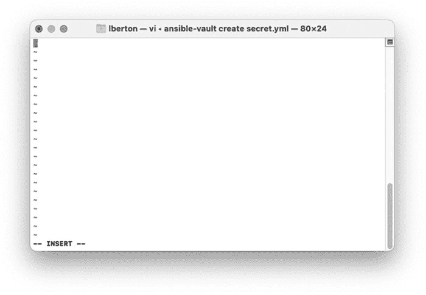

**图 3.1:** 在 VI 编辑器中创建 secret.yml vault

Ansible vault 是 YAML 文档，因此它始终以 `---` 开始。假设我们想在加密文件中插入一个变量 `password`，值为 `mypassword`，如图 3.2 所示 `secret.yml` 文件所示：

```yaml
---
password: mypassword
```

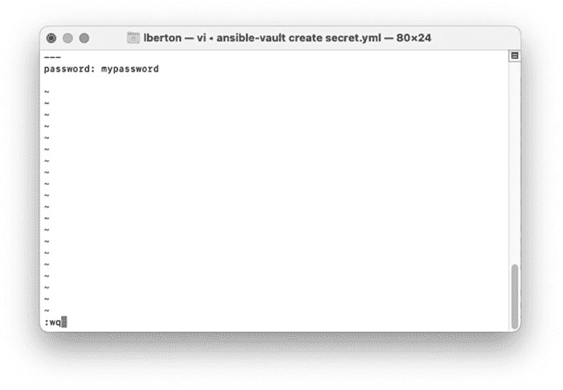

**图 3.2:** VI 编辑器中 secret.yml 文件的内容

让我们想象想使用 Ansible vault 以安全的方式存储密码变量。这样一来，没有 Ansible vault 密码的人无法访问该资源。我们可以将这种思维方式扩展到所有敏感信息，例如：密钥、OAuth、访问密钥等：


**图 3.3:** 密码存储在 Ansible vault 中

我们可以在 Ansible playbook 中使用该密码变量，它现在被安全地存储了。只有 Ansible vault 密码才能打开该归档。

VIM 编辑器始终以只读模式打开。我们需要按下键盘上的 `i` 键切换到插入模式。屏幕上的 `--- INSERT —` 确认插入模式已启用。


最后一步是通过按下 `ESC` 键后输入组合 `:wq` 来保存文件并退出 VIM 编辑器。

文件保存后，Ansible 将继续对文件进行加密，并仅在磁盘上保存其加密版本。

## 使用密码文件加密

我们还可以通过密码文件为 Ansible vault 指定密码。在文件中以明文形式存储密码并不是一个优解决方案。如果有人获得了密码文件的访问权限怎么办？我们安全的 Ansible vault 密码就会面临危险。

假设我们有一个名为 `vault-password.txt` 的密码文件，内容为简单的文本 `example`，如图 3.4 所示：

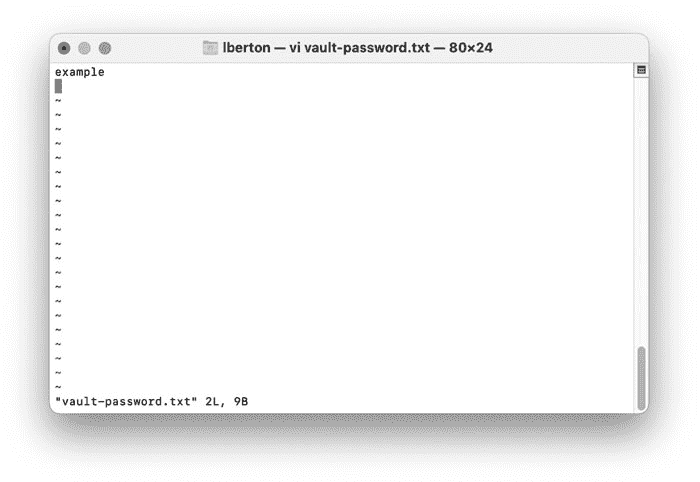

**图 3.4:** VI 编辑器中 `vault-password.txt` 文件的内容

我们可以通过在文本文件中写入密码并保存为 `vault-password.txt` 来创建 `vault-password.txt` 文件。现在，`ansible-vault` 命令将使用 `create` 参数结合 `--vault-password-file` 参数（后面跟随密码文件的名称），如图 3.5 所示：

```bash
ansible-vault create --vault-password-file=vault-password.txt secret.yml
```

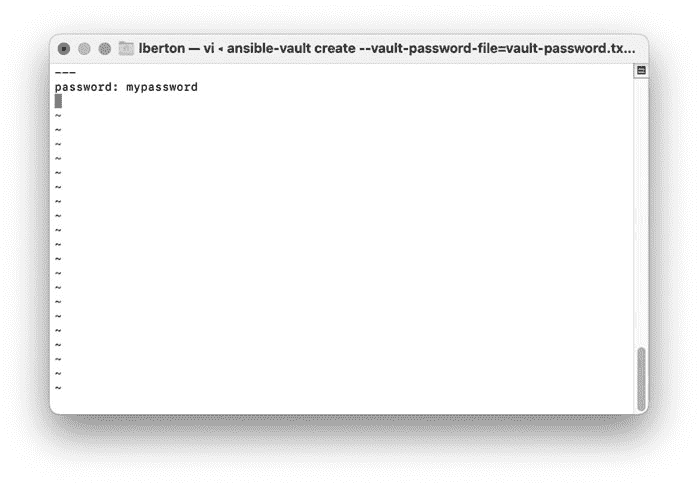

**图 3.5:** VI 编辑器中 `secret.yml` 文件的内容

## 查看加密文件

我们使用 `ansible-vault` 命令的 `view` 参数来查看 Ansible vault 加密文件，无需打开进行编辑。

```bash
ansible-vault view secret.yml
```

`secret.yml` 文件的内容如下，如图 3.5 所示：

```yaml
---
password: mypassword
```

命令输出提示我们输入 Vault 密码。我们可以看到用户输入的密码是隐藏的（不显示 `*` 字符）。如果密码正确，我们可以在屏幕上看到图 3.6 所示的输出：

```text
Vault password:
---
password: mypassword
```

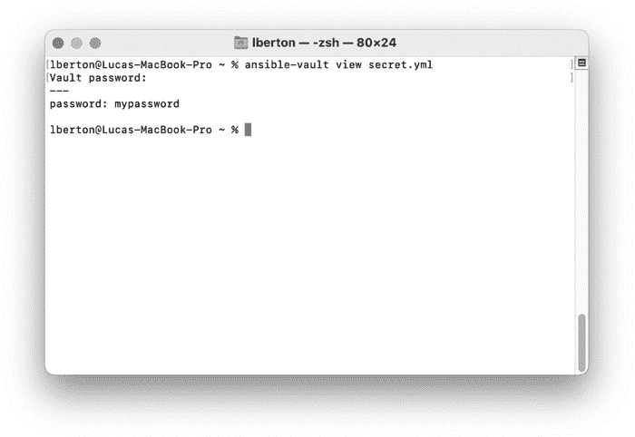

**图 3.6:** `secret.yml` 文件的内容

## 编辑加密文件

我们使用 `ansible-vault` 命令的 `edit` 参数来编辑现有的加密 Ansible vault 文件。该命令将文件解密到临时文件并允许我们进行编辑。保存时，它会将内容复制到原始文件并删除临时文件。

```bash
ansible-vault edit secret.yml
```

命令的输出显示在图 3.7 中：

```text
Vault password:
```

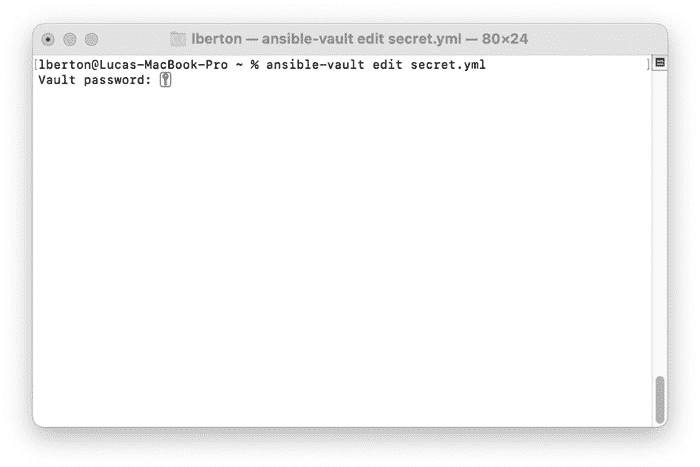

**图 3.7:** `ansible-vault edit` 命令的输出

`secret.yml` 加密文件的密码是上一节定义的单词 `example`，如图 3.8 所示：

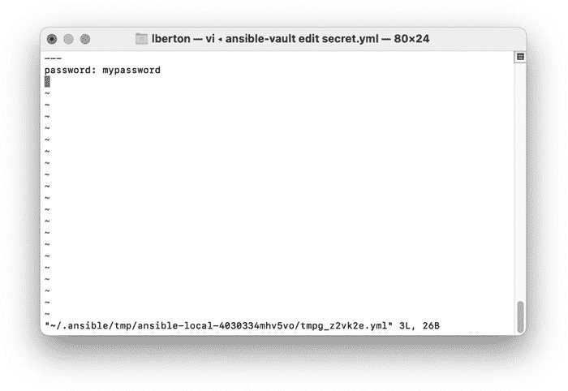

**图 3.8:** `ansible-vault edit` 命令的输出

## 加密文件

我们使用 `ansible-vault` 命令的 `encrypt` 参数来对已创建的 Ansible 资源进行加密。`--output` 使用新文件名保存加密文件。如果我们忽略此选项，将用加密文件覆盖原始文件。让我们创建一个 Ansible playbook `cleartext1.yml` 文件并对其加密。

```yaml
---
password: mypassword
```

接下来的命令将加密 `vault1.yml` 文件中的 Ansible playbook `cleartext1.yml`。执行后，`cleartext1.yml` 仍然包含明文文件，而 `vault1.yml` 是一个包含相同信息的加密 Ansible vault：

```bash
ansible-vault encrypt cleartext1.yml --output=vault1.yml
```

这是 `ansible-vault encrypt` 命令的输出，如图 3.9 所示：

```text
New Vault password: password
Confirm New Vault password: password
Encryption successful
```

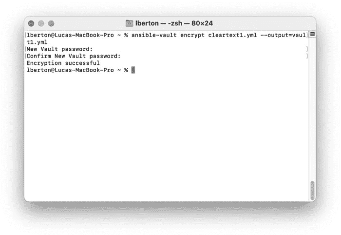

**图 3.9:** `ansible-vault encrypt` 命令的输出

## 解密文件

我们可以使用 `ansible-vault decrypt filename` 命令永久地解密已加密的文件。在解密单个文件时，我们可以使用 `--output` 参数将解密后的文件保存为不同的名称。

```bash
ansible-vault decrypt secret.yml --output=decrypted.yml
```

以下是 `ansible-vault decrypt` 命令的输出，如图 3.10 所示：

```text
Vault password: password
Decryption successful
```

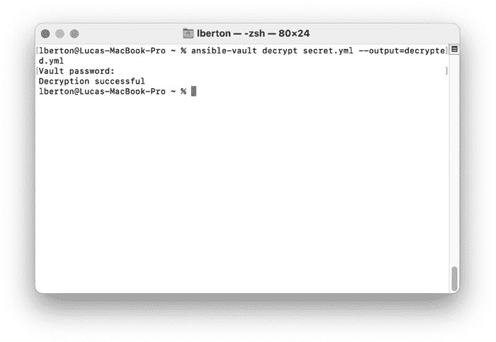

**图 3.10:** `ansible-vault decrypt` 命令的输出

## 修改密码

我们使用 `ansible-vault` 命令的 `rekey` 参数来更改加密文件的密码。该命令可以同时更改多个数据文件的密码。它会提示原始密码和新密码。

例如，假设我们想使用以下命令更改已加密的 `secret.yml`文件的密码：

```bash
ansible-vault rekey secret.yml
```

`ansible-vault rekey` 命令请求当前的 Ansible vault 密码和两次新密码，如图 3.11 所示：

```text
Vault password:
New Vault password:
Confirm New Vault password:
Rekey successful
```

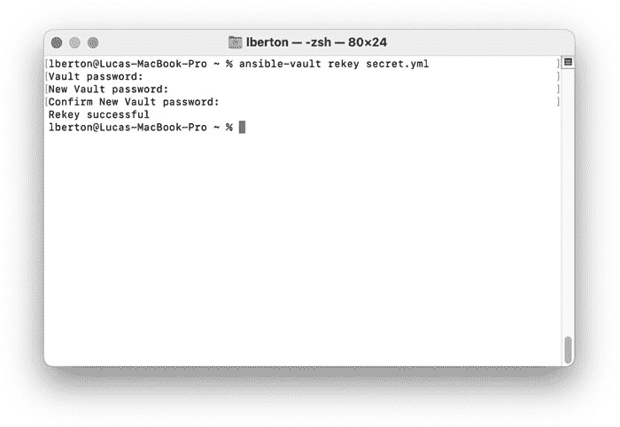

**图 11:** `ansible-vault rekey` 命令的输出

实施密码轮换对于许多 IT 部门来说是重要任务，并提高了我们的安全性。

## 在 playbook 中包含 vault

要运行访问 vault 加密文件的 playbook，我们必须为 playbook 提供密码，如果不提供密码，playbook 将返回错误。要交互式提供 vault 密码，请使用 `id` 选项。

Ansible playbook `playbook.yml` 包含简单的代码，用于包含我们的 vault `secret.yml` 并在屏幕上显示密码变量：

```yaml
---
- name: Vault print
  hosts: all
  tasks:
    - name: Include vars
      ansible.builtin.include_vars:
        file: secret.yml
    - name: Print variable
      ansible.builtin.debug:
        var: password
```

接下来的命令执行 Ansible playbook `playbook.yml` 并要求用户输入 Ansible vault 密码：

```bash
ansible-playbook --vault-id @prompt playbook.yml
```

我们通过命令通过密码文件指定密码：

```bash
ansible-playbook --vault-password-file=vault-password.txt playbook.yml
```

在本模块中，我们探索了 Ansible vault 安全存储，用于在 Ansible 内部保存秘密和机密。这些工具非常强大，并完全集成到 Ansible 技术中。


## Playbook 中的内联 vault

在 Ansible playbook 中存储加密敏感数据的另一种替代方案是使用 Ansible vault 内联功能。例如，假设我们想在 Ansible playbook 中加密名为 `password` 值为 `mypassword` 的变量。

我们可以使用以下 `ansible-vault` 命令生成代码：

```bash
ansible-vault encrypt_string
```

首先，命令要求交互式输入两次密码以加密我们的敏感数据（在我的案例中使用了密码“password”）：

```text
New Vault password:
Confirm New Vault password:
```

在成功输入密码后，屏幕上的信息提示插入文本并使用 Ctrl + d 键序列结束：

```text
Reading plaintext input from stdin. (ctrl-d to end input, twice if your content does not already have a newline)
```

例如，让我们插入以下明文并在文本结束结束（Ctrl + d 键）：

```text
mypassword
```


该命令处理我们的输入、密码和明文，并在屏幕上显示如图 3.12 所示的文本：

`Encryption successful`

`!vault |``

`$ANSIBLE_VAULT;1.1;AES256`

`33323438663430343838353432366533356432623234626463343464306139343965653733626236`

`3764313764313635353834633232626539626561376664320a356638343763376266655465313563`

`31616265616f38363866623962316166623537356164363032323266623761643931663732353034`

`3465393533343063360a636461396139646335326463343666393062666430386334383235666662`

`6632`

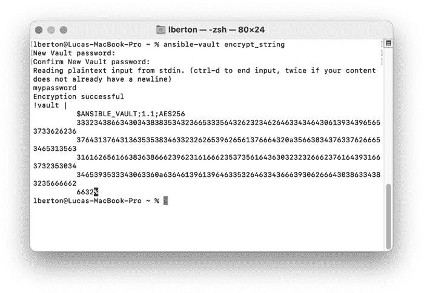

**图 3.12:** ansible-vault encrypt_string 命令的输出

我们现在可以像下面的 `vault_inline.yml` 文件一样将内联 vault 集成到 playbook 中：

```yaml
---
- name: inline vault
hosts: all
vars:
  password: $ANSIBLE_VAULT;1.1;AES256
  33323438663430343838353432366533356432623234626463343464306139343965653733626236
  3764313764313635353834633232626539626561376664320a356638343763376266655465313563
  31616265616f38363866623962316166623537356164363032323266623761643931663732353034
  3465393533343063360a636461396139646335326463343666393062666430386334383235666662
  6632
tasks:
  - name: Print variable
    ansible.builtin.debug:
      var: password
```

我们可以使用以下命令执行 `vault_inline.yml` 文件：

`ansible-playbook --vault-id @prompt vault_inline.yml`

执行的输出如下：

```text
TASK [Print variable] *****************************************************************************************************************************
ok: [localhost] => {
  "password": "mypassword\n"
}
```

# 故障排除 (#toc.xhtml_s93a)

在第 6 章：Ansible 故障排除 中的 Ansible vault 中了解更多关于常见错误、故障排除和解决的信息。

# Ansible Handler (#toc.xhtml_s94a)

Ansible handler 仅在第一个任务报告状态更改时执行操作。在处理 handler 语句时，Ansible 的幂等性属性非常重要。handler 允许仅在需要时执行某些步骤，并在不需要执行时节省计算周期。handler 仅在上一个任务报告状态已更改时执行。如果上一个任务的报告状态为 ok，则完全不执行 handler。handler 在实现 Ansible 幂等性方面非常有用。下面的 `apache_update.yml` Ansible playbook 仅在包更新时执行 Apache Web 服务器的更新并重启 `apache2` 服务（在类 Debian 发行版中）：

```yaml
---
- name: Rolling update
hosts: all
become: true
tasks:
  - name: Latest apache2 package
    ansible.builtin.apt:
      name: apache2
      state: latest
      update_cache: true
    notify: Apache restart
handlers:
  - name: Apache restart
    ansible.builtin.service:
      name: apache2
      state: restarted
```

我们可以使用所有 Ansible 安装中包含的 `ansible-playbook` 命令行工具执行 Ansible playbook。

完整的命令如下：

`ansible-playbook apache_update.yml`

`apache_update.yml` 是我们的 Ansible playbook 文件名。当更新 apache2 包并执行 handler 时，它会产生以下输出：

```text
TASK [Latest apache2 package] **************************************************
changed: [server01.example.com]
RUNNING HANDLER [Apache restart] ****************************************************************
changed: [server01.example.com]
```

当没有包更新导致 Latest apache2 package 任务的状态为“ok”时，没有更新操作，就不会触发 handler：

```text
TASK [Latest apache2 package] ******************************************************************
ok: [server01.example.com]
```

`apache_update.yml` 文件由一个任务和一个 handler 组成。handler 代码仅在需要时执行。请注意 `notify` 语句提到了要运行的 handler 名称。此 playbook 检查所有主机上 Apache HTTP Web 服务器的版本；如果有可用更新，`apt` 模块将提供升级过程并在屏幕上显示消息。如果不需要升级，则不执行 handler 代码。

# 多个 handler (#toc.xhtml_s95a)

在现实世界中，一个 Ansible playbook 有时会触发多个 handler，我们可以通过名称引用它们。下面的两个 playbook 显示了我们如何通过单个 Ansible 任务触发两个消息，正如 `two-1.yml` playbook 文件所示：

```yaml
---
- name: handler demo
hosts: all
tasks:
  - name: Uptime
    ansible.builtin.command: "uptime"
    notify: message
handlers:
  - name: message 1
    ansible.builtin.debug:
      msg: message 1
      listen: message
  - name: message 2
    ansible.builtin.debug:
      msg: message 2
      listen: message
```

我们可以使用 `ansible-playbook` 命令执行代码：

`ansible-playbook two-1.yml`

执行 `two-1.yml` playbook 文件会产生以下输出：

```text
TASK [Uptime] *********************************************************************************
changed: [server01.example.com]
RUNNING HANDLER [message 1] *****************************************************************
ok: [server01.example.com] => {
  "msg": "message 1"
}
RUNNING HANDLER [message 2] *************************************************                
ok: [server01.example.com] => {
  "msg": "message 2"
}
```

另一种，我们可以在 `notify` 语句以列表的形式指定多个 Ansible handler，如下面的 `two-2.yml` playbook ：

```yaml
---
- name: handler demo
hosts: all
tasks:
  - name: Uptime
    ansible.builtin.command: "uptime"
    notify:
      - message 1
      - message 2
handlers:
  - name: message 1
    ansible.builtin.debug:
      msg: message 1
  - name: message 2
    ansible.builtin.debug:
      msg: message 2
```

handler 仅在 playbook 状态更改时执行任务。`two-2.yml` playbook 的执行产生：

```text
TASK [Uptime] *********************************************************************************
changed: [server01.example.com]
RUNNING HANDLER [message 1] *************************************************                
ok: [server01.example.com] => {
  "msg": "message 1"
}
RUNNING HANDLER [message 2] *************************************************                
ok: [server01.example.com] => {
  "msg": "message 2"
}
```

# 代码复用 (#toc.xhtml_s96a)

通过尽可能利用代码复用，可以加速代码开发。它们包含一个导入语句，允许我们将部分任务或 playbook 纳入新的 playbook 中。当任务数量大于几个时，可以将代码封装为 Ansible 角色或集合并发布给其他创建者。Ansible Galaxy 是一个简化代码协作和发布的公共网络存档。

# 包含和导入 (#toc.xhtml_s97a)

我们可以从其他文件中包含自动化脚本。我们可以导入单个任务、handler 或整个 playbook 文件，如表 3.1](#c03.xhtml_tab3_1) 所示。所有模块都属于 `ansible.builtin` 集合。

| 静态导入 | 动态包含 |
| :--- | :--- |
| `import` `import_playbook` `import_role` `import_tasks` | `include` `include_vars` `include_playbook` `include_role` `include_tasks` |


随着复杂性的增加，Ansible 团队设计了两种语句用于在当前执行中包含额外文件。

在**导入（import）**状态下，任何导入语句（`import_playbook`、`import_tasks` 等）都会在解析剧本（playbooks）时进行预处理。对于静态导入，父任务选项将复制到导入中包含的所有子任务。而**动态包含（dynamic includes）**则是在剧本执行过程中，遇到时才处理的任何包含语句（`include_tasks`、`include_role` 等）。父任务选项仅适用于评估评估的动态任务，而不会复制到子任务中。

以下代码解释了将任务的导入或包含与循环语句（loop statement）结合时的不同行为：

```yaml
- import_tasks: example.yml
with_items: [1,2]
```

该导入语句会导入一次 `example.yml` 文件，每个导入的任务都会对序列 `[1,2]` 中的元素执行查找循环，即针对 1 和 2。

```yaml
- include_tasks: example.yml
with_items: [1,2]
```

该包含语句会导入 `example.yml` 文件两次，并将 ‘item’ 迭代变量分别设置为序列 `[1,2]` 中的 1 和 2。

# 角色 (Role) 与集合 (Collection)

Ansible role 和 collection 是两种在组织内外打包和共享 Ansible 资源的标准化格式，它们强调了代码重用原则。

## Ansible Role

Ansible role 实现了 Ansible 中的代码可重用。Ansible role 类似于传统编程世界中的函数。我们可以使用 Ansible role 更快速地开发剧本并重用 Ansible 代码。所有与角色相关的文件必须位于我们项目的 `roles` 目录下。首先，我们将创建一个 Ansible role，然后在 Ansible 剧本中使用它。

## 目录树

Ansible role 拥有标准的目录树。某些目录是强制性的，但大多数不是。首先，让我们使用每个 Ansible 安装自带的 `ansible-galaxy` 命令创建一个名为 `role1` 的 Ansible role：

```bash
ansible-galaxy role init role1
```

`ansible-galaxy` 命令需要以下参数：

* `role`，命令与 Ansible role 交互
* `init`，命令初始化一个新的角色
* `role1`，新角色的名称

成功执行上一条命令会在 `roles` 目录下创建 `role1`，并产生以下输出：

```text
- Role role1 was created successfully
```

执行[图 3.13]所示的命令创建了如下文件系统树结构：

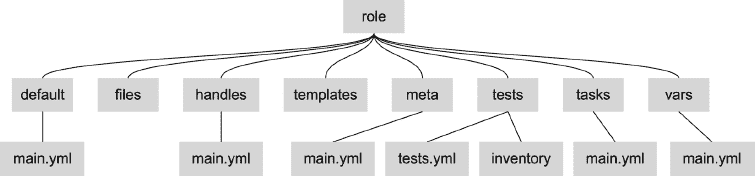

**图 3.13：** Ansible 标准角色目录树

目录结构的描述如下：

* **defaults 目录：**该目录下的 `main.yml` 文件包含角色变量的默认值，这些值在使用角色时可以被覆盖。这些变量的优先级较低，旨在在剧本（plays）中进行更改和自定义。
* **files 目录：**该目录存储用于配置的静态文件。我们通过角色任务引用此目录。
* **handlers 目录：**该目录下的 `main.yml` 文件包含角色的处理程序（handler）定义。
* **meta 目录：**该目录下的 `main.yml` 文件包含关于角色的人类可读信息，包括作者、许可、平台和可选的角色依赖关系。
* **tasks 目录：**这是最重要的目录。该目录下的 `main.yml` 文件包含了执行角色任务的主代码。
* **templates 目录：**该目录包含在任何角色任务需要使用的 Jinja2 模板。
* **tests 目录：**该目录可以包含用于测试角色的清单（inventory）和 `test.yml` 剧本。
* **vars 目录：**该目录下的 `main.yml` 定义了角色的变量值。这些变量通常用于角色内部。这些变量的优先级较高，在剧本中使用时不打算更改。

唯一要求的目录是 `tasks` 目录。只有某些角色会拥有所有这些目录。最重要的文件是 `tasks` 目录下的 `main.yml`。该文件的内容是某个 Ansible 剧本的任务内容。

`role1` 角色中 `tasks` 目录下 `main.yml` 文件的内容：

```yaml
---
name: role1 demo
ansible.builtin.debug:
  msg: "role1"
```

我们可以在 Ansible role 内部添加一些变量，并在 `defaults/main.yml` 文件下指定它们的名称。例如，让我们定义值为 `foo` 的 `foo`：

```yaml
---
foo: foo
```

一旦定义了 `foo` 变量，我们就可以在 `tasks/main.yml` 中使用它：

```yaml
---
- name: role1 demo
  ansible.builtin.debug:
    msg: "role1"
- name: role1 foo
  ansible.builtin.debug:
    var: foo
```

## 在剧本中的用法

我们可以在 Ansible 剧本的 `roles` 语句下包含角色。以下示例展示了如何在 Ansible 剧本中包含 `role1` Ansible 角色：

```yaml
---
- name: role example
  hosts: all
  roles:
    - role1
```

当 Ansible 无法找到 role1 时，我们会获得以下错误：

```text
ERROR! the role 'role1' was not found in /home/devops/roles/roles:/root/.ansible/roles:/usr/share/ansible/roles:/etc/ansible/roles:/home/devops/roles
```

正如[第 6 章：Ansible 故障排除]所示，这只是告诉我们在列出的目录未找到 `role1`。解决方案是验证执行所在的正确的目录，或者在 `ansible.cfg` 文件中自定义角色路径。在[第 8 章：Ansible 高级]中了解更多关于 `ansible.cfg` 文件。

执行输出如下。我们可以看到结果显示了 `role1` 角色中定义的两个任务：

```text
PLAY [role example] ******************************************************
TASK [Gathering Facts] ******************************************************
ok: [server01.example.com]
TASK [role1 : role1 demo] ******************************************************
ok: [server01.example.com] => {
  "msg": "role1"
}
TASK [role1 : role1 foo] ******************************************************
ok: [server01.example.com] => {
  "foo": "foo"
}
PLAY RECAP ******************************************************
server01.example.com: ok=3     changed=0   unreachable=0   failed=0   skipped=0   rescued=0   ignored=0
```

执行 `role_simple.yml` 剧本。

以下示例应用 `role1` Ansible 角色并将 `foo` 设置为 `value`：

```yaml
---
- name: role example
  hosts: all
  roles:
    - role: role1
      foo: value
```

执行输出与之前的类似，但在 `role_simple.yml` 剧本中显示了 `foo` 变量的值（而不是 foo）：

```text
PLAY [role example] ******************************************************
TASK [Gathering Facts] ******************************************************
ok: [server01.example.com]
TASK [role1 : role1 demo] ******************************************************
ok: [server01.example.com] => {
  "msg": "role1"
}
TASK [role1 : role1 foo] ******************************************************
ok: [server01.example.com] => {
  "foo": "value"
}
```


`server01.example.com: ok=3    changed=0    unreachable=0    failed=0    skipped=0    rescued=0    ignored=0`

## 执行顺序

对于 playbook 中的每个 play，任务按照任务列表中的顺序执行。在所有任务执行完毕，任何被通知的处理器（handlers）都会执行。Ansible 按照图 3.13 所示的执行顺序执行 playbook。请注意，role 可以在相对目录下自包含某些任务和处理器。我们可以像传统的 Ansible play 一样，在 role 中指定某些 Ansible 处理器。

当一个 role 添加 play 时，role 任务会被添加到任务列表的开头。如果 play 中包含了第二个 role，它的任务列表将添加到第一个 role 之后。


**图 3.14:** Ansible playbook 的执行顺序

在特定场景下，可能必要在执行 role 之前先执行某些 play 任务。为了支持此类场景，Ansible play 可以指定一个 `pre_tasks` 部分。

此部分列出的任何任务都会在任何 role 执行之前执行。如果这些任务中的任何一个通知了处理器，则这些处理器任务将在 role 或常规任务之前执行。

Plays 还支持 `post_tasks` 关键字，它会在常规 play 任务之后但在任何处理器部分之前执行某些任务。

下面的示例展示了指定所有可能语句的 Ansible playbook 执行顺序：`pre_tasks`、`role`、`task`、`post_tasks`、`handlers`:

```yaml
---
- name: Order of execution
hosts: all
pre_tasks:
- debug:
    msg: 'pre-task'
  notify: my handler
roles:
- role1
tasks:
- debug:
    msg: 'first task'
  notify: my handler
post_tasks:
- debug:
    msg: 'post-task'
  notify: my handler
handlers:
- name: my handler
  debug:
    msg: Running my handler
```

执行输出验证了 Ansible `role_order.yml` playbook 预期的执行顺序：

```
PLAY [Order of execution] **************************************************************
TASK [Gathering Facts] **********************************************************************
ok: [server01.example.com]
TASK [debug] *****************************************************************************
ok: [server01.example.com] => {
  "msg": "pre-task"
}
TASK [role1 : role1 demo] **********************************************************************
ok: [server01.example.com] => {
  "msg": "role1"
}
TASK [role1 : role1 foo] **********************************************************************
ok: [server01.example.com] => {
  "foo": "foo"
}
TASK [debug] **********************************************************************
ok: [server01.example.com] => {
  "msg": "first task"
}
TASK [debug] **********************************************************************
ok: [server01.example.com] => {
  "msg": "post-task"
}
```

## 用于 roles 的 Ansible galaxy

Ansible galaxy 既用于在 Ansible 控制器中管理 roles 的命令行工具，也是用于查找任何可用 Ansible 资源的公共网站目录。在网站上，有一个搜索引擎可以快速找到合适的 Ansible role 或集合（collection）。每个资源都会显示作者以及下载次数、支持的操作系统以及关于用法或内部变量的大量信息。

## 手动安装

我们可以通过浏览器或通过每个 Ansible 安装自带的 `ansible-galaxy` 命令行工具与 Ansible galaxy 网站进行交互。它简化了与 Ansible galaxy 的交互，并允许通过命令行安装 roles 和集合。例如，假设我们安装由 `geerlingguy author (geerlingguy.redis)` 创建的 `redis` role。整个 `ansible-galaxy` 命令为：

```bash
ansible-galaxy install geerlingguy.redis -p roles/
```

该命令的参数为：

*   `install` 参数：从文件安装 role
*   `geerlingguy.redis`：指定 galaxy role 的名称
*   `-p` 或 `--roles-path`：可选，我们可以指定保存 roles 文件的目录路径

或者，除了 `-p` 或 `--roles-path` 选项，我们还可以通过 `ansible.cfg` 配置文件指定 roles 的目录。更多详情请参见第 8 章，Ansible 高级 Ansible 配置设置部分。

*命令的输出如下所示：*

```
- downloading role 'redis', owned by geerlingguy
- downloading role from https://github.com/geerlingguy/ansible-role-redis/archive/1.8.0.tar.gz
- extracting geerlingguy.redis to /home/devops/roles/geerlingguy.redis
- geerlingguy.redis (1.8.0) was installed successfully
```

## 自动安装

当我们需要安装多个 Ansible role 或我们想要自动执行它时，我们更倾向于使用 `requirements.yml` 文件。

该语法易于理解，因为它在 `src` 名称下列出了所有 roles；可选地，我们可以指定特定版本。如果省略了版本，Ansible 将安装最新可用。

一个简单的 `requirements.yml` 文件看起来如下：

```yaml
---
roles:
- src: geerlingguy.redis
  version: "1.8.0"
```

我们可以使用 `ansible-galaxy` 命令执行我们的 `requirements.yml` role 文件：

```bash
ansible-galaxy install -r roles/requirements.yml -p roles
```

该命令的参数为：

*   `install` 参数：从文件安装 role
*   `-r` 参数：指定使用 `requirements.yml` 文件
*   `-p` 参数：保存 roles 文件的目录路径

`ansible-galaxy install -r` 命令的输出如下所示：

```
Starting galaxy role install process
- downloading role 'redis', owned by geerlingguy
- downloading role from https://github.com/geerlingguy/ansible-role-redis/archive/1.8.0.tar.gz
- extracting geerlingguy.redis to /home/devops/roles/geerlingguy.redis
- geerlingguy.redis (1.8.0) was installed successfully
```

命令的预期结果应该是从 Ansible galaxy 网站下载内容并将其保存到指定的 roles 目录。Ansible roles 对于代码复用非常有帮助，可以节省大量时间和减少人为错误。在编写自己的 role 之前，始终先在 Ansible galaxy 中搜索。

## 配置

我们可以通过指定配置文件来自定义 `ansible-galaxy` 命令行工具的行为，例如，从公共 Ansible galaxy 网站以及我们组织内部的私有存档或 Ansible 自动化枢（Ansible 自动化平台的一部分）。对于每台服务器，我们可以指定身份凭据或身份令牌。

## Ansible Collection

Ansible collection 是在多个平台之间发布 Ansible 代码的最现代、最完整的方式。它允许我们以标准方式发布 Ansible roles、模块和插件。集合通常发布在公共 Ansible galaxy 网站存档中。Ansible collection 是 Ansible 内容的发布格式。

它解决了一个问题并包含了所有相关包，分发 playbooks、roles、模块和插件。对于用户来说，Ansible collection 易于通过 Ansible galaxy 下载和共享，无需实际上了解底层发生了什么。它只需执行预期的任务。对于开发者来说，Ansible collection 易于通过 Ansible galaxy 上传和共享。所有与集合相关的文件必须位于我们项目的 collections 目录下。

## 用于 collections 的 Ansible galaxy


Ansible Galaxy 是一个存储 Ansible 角色（roles）和集合（collections）的网站。其搜索引擎、标签和平台使得能够轻松找到其中的任何内容。在系统中使用这些内容之前，我们必须仔细评估其质量。质量指标通常包括代码质量保证、支持的操作系统和平台、文档、发布版本号、是否存在变更日志（Changelog）、下载次数以及作者或创建者。请注意，该网站除了 Ansible 集合外还包含 Ansible 角色。

## community.general 集合

最全面的集合存档是 `community.general`，它包含许多大量的 Ansible 资源。该存档采用社区许可分发。这意味着 Ansible 社区正在尽力支持该产品，但对于错误修复或新功能的实现没有特定的时间表。

假设我们想在系统中使用 Ansible Galaxy 集合 `community.general` 中的 `iso_create` Ansible 模块。`iso_create` 模块可以根据系统中的文件列表创建 ISO 镜像。它对于备份目的非常有用。为了使用 `iso_create` 模块，我们需要在任务中指定整个 Ansible 命名空间：`community.general.iso_create`。

例如，以下 `collection.yml` Ansible 剧本根据文件列表创建 `test.iso` 文件：

```yaml
---
- name: iso_create module demo
hosts: all
tasks:
  - name: Create an ISO file
    community.general.iso_create:
      src_files:
        - /home/devops/helloworld.yml
      dest_iso: /home/devops/devops.iso
      interchange_level: 3
```

我们可以使用在每个 Ansible 安装中的 `ansible-playbook` 命令行工具在终端中执行代码。参数仅为文件名。在我们的情况下，它是 `collection.yml` 文件的路径，即 `collections/collection.yml`。

完整命令为：

```bash
ansible-playbook collections/collection.yml
```

当集合安装后，`collection.yml` 文件的预期执行状态为 ok 且 changed 状态：

```
TASK [Create an ISO file] *********************************************************************
changed: [server01.example.com]

PLAY RECAP *********************************************************************
server01.example.com: ok=2    changed=1   unreachable=0   failed=0   skipped=0   rescued=0   ignored=0
```

执行输出是 `/home/devops` 目录下的 `devops.iso` ISO 文件，其中包含上一节看到的 `helloworld.yml` 文件。请根据需要使用真实文件和目录随时调整 Ansible 剧本。

以下 Ansible 致命错误意味着集合尚未安装在 Ansible 控制器中：

```
ERROR! couldn't resolve module/action 'community.general.iso_create'.
```

我们可以在 *第 6 章：Ansible 故障* 的 *Ansible collection* 章节中阅读完整的错误。我们可以使用 `ansible-galaxy` 命令行工具轻松安装或更新 Ansible 集合。

## 安装 Ansible 集合

使用 `ansible-galaxy` 命令行工具安装 Ansible 集合有两种不同方法：

* 手动安装
* 自动安装

如果没有通过 `ansible.cfg` 文件进行自定义，我们使用 `ansible-galaxy` 命令行工具下载的任何集合或角色都将安装在主目录下的 `.ansible` 目录中。可以在 *第 8 章：Ansible 高进* 的 *Ansible configuration settings* 章节了解更多关于 `ansible.cfg` 文件的信息。

## 手动安装

我们可以使用 `ansible-galaxy` 命令行工具手动安装所需的集合。该工具包含在每个 Ansible 安装中，允许我们简化 Ansible 角色和集合的管理。

命令为：

```bash
ansible-galaxy collection install community.general
```

安装集合的命令需要两个参数：

* `collection install`：指定集合安装活动
* `community.general`：集合的名称

当集合已安装在我们的系统中时，我们会收到以下消息：

```
Starting galaxy collection install process
Nothing to do. All requested collections are already installed. If you want to reinstall them, consider using '--force'.
```

如输出所示，我们可以通过添加 `--force` 参数重新下载集合。


## 自动安装

我们可以使用 `ansible-galaxy` 命令行工具和 `requirements.yml` 文件执行自动化的 Ansible 集合安装。

以下 `requirements.yml` 文件从 Ansible Galaxy 存档中下载 `community.general` 集合：

```yaml
---
collections:
  - name: community.general
    source: https://galaxy.ansible.com
```

我们可以使用命令行 `ansible-galaxy` 命令执行 `requirement.yml` 文件：

```bash
ansible-galaxy install -r collections/requirements.yml
```

前述命令具有以下参数：

* `install` 参数指定安装操作
* `-r` 指定我们想要使用 `requirement.yml` 文件

这输出了以下内容：

```
Starting galaxy collection install process
Process install dependency map
Starting collection install process
Downloading https://galaxy.ansible.com/download/community-general-6.1.0.tar.gz to /home/devops/.ansible/tmp/ansible-local-257gjb377e/tmp3h2ee5fy/community-general-6.1.0-po7d9tp6
Installing 'community.general:6.1.0' to '/home/devops/.ansible/collections/ansible_collections/community/general'
community.general:6.1.0 was installed successfully
```

正如我们所见，ansible-galaxy 工具连接到 Ansible Galaxy 网站，找到集合并在我们的目标系统中下载最新的发布版本（写本书时为 6.1.0）。它还向用户确认本地文件系统上可用文件的路径。高级用户还可以为文件中列出的每个集合指定“signatures”（签名）参数，以验证分发服务器与我们系统之间软件的正版性。在写本书时，只有有限的分发服务器支持此功能。

## Python 依赖项

请注意，某些 Ansible 模块需要更多的 Python 库依赖才能运行。要求在手册中指定并必须在执行 Ansible 前安装。

以下 Ansible 致命错误意味着 `community.general.iso_create` Ansible 模块需要 `pycdlib` Python 库，且未安装在 Ansible 控制器的 Python 系统或当前的 Python 虚拟环境中：

```
The error was: ModuleNotFoundError: No module named 'pycdlib'.
```

我们可以在 *第 6 章：Ansible 故障* 的 *Ansible collection* 章节中阅读完整的错误。

## 列出集合

可以使用相同的 `ansible-galaxy` 工具列出已安装的集合。

```bash
ansible-galaxy collection list community.general
```

该命令的参数为：

* `collection:`：指定我们想要与集合交互
* `list`-：指定我们想要列出已安装的集合
* `community.general:`：集合的名称

输出显示本地 Ansible 集合的目录路径、名称和安装版本。

在这种情况下，输出如下：

```
## /usr/local/lib/python3.8/dist-packages/ansible_collections
Collection       Version
----------------- -------
community.general 5.4.0
```


## /home/devops/.ansible/collections/ansible_collections

| Collection | Version |
| :--- | --- |
| community.general | 6.1.0 |

一旦在系统中成功安装了 Ansible collection `community.general`，我们就可以执行我们的 Ansible playbook 代码 `collection.yml`。

Ansible collections 对于代码复用非常有帮助，可以节省大量时间并减少人为错误。

## Configuration

我们可以通过指定配置文件来定制 `ansible-galaxy` 命令行工具的行为，例如，从公共 Ansible galaxy 网站、组织内部的私有存档或 Ansible Automation Hub（Ansible Automation Platform 的）获取集合内容。对于每台服务器，我们可以指定身份凭据或认证令牌。

## Ansible Filter

我们可以利用 Ansible 对 Jinja2 过滤器的原生支持，对变量或配置文件进行某些更改。它们是扩展 Ansible 控制节点功能的部分。Ansible 过滤器在变量级别上操作数据。

以下三个过滤器最常用：

- `default`: 如果变量未定义，则为变量提供默认值。
- `join`: 将列表转换为单个字符串。
- `map`: 对列表或字典中的每个项应用过滤器。
- `selectattr`, `filter`, 和 `rejectattr`: 过滤字典并选择匹配项。

当我们想要为可能被用户覆盖（使用交互式输入或额外变量）的变量提供默认值时，Ansible 默认过滤器非常有用。我们可以使用依赖于 Python `join()` 内置函数的 Ansible join 过滤器将列表中的元素连接成字符串。此外，Ansible map 过滤器依赖于 Python 的 `map()` 内置函数，该函数可以在不使用显式循环的情况下处理并转换迭代器中的所有项，这种技术通常被称为映射（mapping）。`map()` 对每个项应用转换函数并将其转换为新的可迭代对象。Ansible `selectattr` 过滤器继承自 Jinja，它通过对序列中的所有对象（通常是字典）应用测试，从输入序列中返回匹配的对象。`selectattr` 过滤器的参数取决于我们想要在对象中执行的测试类型：`equalto`、`match` 和 `search`。我们可以使用 Jinja2 比较运算符 `==`、`!=`、`>`、`<` 以及 Jinja2 测试 `eq`、`ne`、`ge`、`gt`、`in`、`not`。如果没有指定测试，则属性值将被评估为布尔值。`selectattr` 过滤器也会将测试应用于嵌套对象，而 select Ansible 过滤器仅通过对每个对象应用测试来过滤对象序列。`selectattr` Ansible 过滤器的相反是 `rejectattr` Ansible 过滤器。`rejectattr` 过滤器会从指定的迭代器删除任何不符合提供测试的项。

Ansible 过滤器的某些常见用例总结在 [表 3.2] 中，将过滤器应用于用户定义的变量 `myvariable`：

| Filter | Expression | Result |
| :--- | --- | --- |
| 分配默认强制值 | `{{ myvariable | default(10) }}` | `10` |
| 使变量可选 | `{{ myvariable | default(omit) }}` | `(NDR: nothing)` |
| 分配三元值 | `{{ status | ternary('start', 'restart') }}` | `start or restart` |
| 管理数据类型 | `{{ myvariable | items2dict }}` | `Dictionary data structure` |
| 将数据格式化为 JSON 和 YAML | `{{ myvariable | to_json }}` 或 `{{ myvariable | to_nice_yaml }}` | `JSON` `YAML` |
| 使用正则表达式 | `{{ "ansible" | regex_replace('^.', 'A') }}` | `Ansible` |

**表 3.2:** 最常用的 Ansible 过滤器


接下来的 `filter_map.yml` Ansible playbook 演示了如何在简单的服务器列表中 `map`、`join` 和 `selectattr` 过滤器的用法：

```yaml
---
- hosts: all
vars:
  servers:
    host01:
      ip: 192.168.1.11
      type: large
    host02:
      ip: 192.168.1.12
      type: small
tasks:
  - name: Map IP addresses
    ansible.builtin.debug:
      msg: "{{ servers.values() | map(attribute='ip') }}"
  - name: List IP addresses
    ansible.builtin.debug:
      msg: "{{ servers.values() | map(attribute='ip') | join(',') }}"
  - name: Only large machines
    ansible.builtin.debug:
      msg: "{{ servers.values() | selectattr('type', 'eq', 'large') | map(attribute='ip') | join(',') }}"
```

完整命令如下：

`ansible-playbook filter_map.yml`

命令的输出如下：

```text
TASK [Map IP addresses] *********************************************************************
ok: [server01.example.com] => {
  "msg": [
    "192.168.1.11",
    "192.168.1.12"
  ]
}
TASK [List IP addresses] *********************************************************************
ok: [server01.example.com] => {
  "msg": "192.168.1.11,192.168.1.12"
}
TASK [Only large machines] *********************************************************************
ok: [server01.example.com] => {
  "msg": "192.168.1.11"
}
```

还有更多适用于字符串修改的 Ansible 过滤器。让我们对 Ansible 字符串 `Automate Everything with Ansible` 应用 `upper` 过滤器。`upper` 过滤器将变量大写并显示在屏幕上。修改的预期输出是从 `Automate Everything with Ansible` 变为 `AUTOMATE EVERYTHING WITH ANSIBLE`。我们通过 `filter_upper.yml` playbook 文件中的 `debug` 模块来演示这种行为：

```yaml
---
- name: Upper filter
  hosts: all
  tasks:
    - name: Apply a filter
      ansible.builtin.debug:
        msg: '{{ "Automate Everything with Ansible" | upper }}'
```

我们可以使用每个 Ansible 安装中包含的 `ansible-playbook` 命令来执行 Ansible playbook，并将文件名指定参数。

完整命令如下：

`ansible-playbook filter_upper.yml`

执行 `filter_upper.yml` playbook 的输出如下：

```text
TASK [apply a filter] **************************************************************************
ok: [server01.example.com] => {
  "msg": "AUTOMATE EVERYTHING WITH ANSIBLE"
}
```

如我们所见，输出是 `AUTOMATE EVERYTHING WITH ANSIBLE`，这是使用 `upper` Ansible 过滤器将输入文本 `Automate Everything with Ansible` 大写的结果。Ansible 过滤器用于为了屏幕目的执行变量更改，或将一个任务的输出复用于另一个任务。


为了操作 JSON 格式的文件或变量，`json_query` 过滤器有助于从数据结构中提取字段并展平复杂结构。

请参阅 Ansible facts 中的后续章节 Temporary Facts（临时事实），以便将操作结果保保存到 Ansible fact 中。


## Ansible Template

Ansible template 使用静态内容、变量数据和控制逻辑的混合动态生成整个文件。`ansible.builtin.template` 模块是生成配置内容的灵活且强大的方法。模板是嵌入了控制和变量引用的普通文件。


模板使用 Jinja2 模板语言。Jinja2 是一种用 Python 编写的全功能模板引擎语言，由 Armin Ronacher 于 2008 年创建，并采用 BSD 许可。Jinja2 模板语言因与 Python 编写的 Flask Web 框架结合而流行。Jinja2 支持简单的替换、条件、循环和其他控制结构。我们在 Ansible 项目和角色的 `templates` 目录下存储 Jinja2 模板文件。我们可以在模板中使用 `{{ variable }}` 语法添加变量引用，使内容动态化。文件存储在 Ansible 控制节点上。Ansible 模板对于配置文件非常有用。Ansible 模板有助于将某些变量值应用到配置文件。Ansible 模板的工作原理是利用 Jinja2 编程语言和 Ansible 内置模板模块。

以下示例探索了如何在 Ansible playbook 中通过定义的变量来创建和使用模板。在接下来的示例中，使用 Ansible 模板应用应用 Jinja 模板并使用模板为变量填充某些文本。

Ansible playbook `template_helloworld.yml` 应用了模板模块，用自定义文本替换目标模板的部分内容：

```
---
- name: template module
hosts: all
vars:
  file_content: |
    Automate Everything with Ansible example.
    Multiline.
tasks:
  - name: Apply template
    ansible.builtin.template:
      src: templates/helloworld.txt.j2
      dest: /home/devops/helloworld.txt
```

`templates/helloworld.txt.j2` 模板文件是一个简单的 Jinja2 文档，其中我们可以使用双括号来指定 Ansible 变量 `file_content` 的值：

```
{{ file_content }}
This line will not change.
```

我们可以使用每个 Ansible 安装中包含的 `ansible-playbook` 命令行工具通过以下命令执行 Ansible playbook：

```
ansible-playbook template_helloworld.yml
```

该命令产生以下输出：

```
TASK [Apply page template] *********************************************************************
changed: [server01.example.com]
```

成功执行后，输出 `/home/devops/helloworld.txt` 的内容包含三行，如下。例如，我们可以使用 VI 命令行文本编辑器 vi `/home/devops/helloworld.txt` 进行查看：

```
Automate Everything with Ansible example.
Multiline.
This line will not change.
```

正如我们所见，变量 `file_content` 在目标文件中替换为变量的值。在这种情况下，变量 `file_content` 是一个跨越多行的长多行文本。我们可以应用 Ansible 模板来修改系统中任何服务的任何配置文件。

Ansible 模板是我们在 IT 基础设施集群中执行配置管理和实现“配置即代码”（CaC）的基础工具。

# 控制语句

Ansible 模板中的控制语句使用了与 Ansible 语法不同的语法，即 ``。Jinja2 支持以 `` 开始并以 `` 结束的条件语句。支持大多数常用的 Python 测试：数学表达式如 `==`、`!=`、`<=` 以及用于检查列表成员身份的 `in`。我们可以使用 `` 和 `` 进行分支。

当我们使用控制语句时，`` 括号之间的所有内容都会排除在输出之外。然而，我们在这些括号周围包含的任何空白默认都会包含在内。

我们可以使用减号来告诉 Jinja 2 吸收空白：

- `` 吸收控制语句之后的空白

Ansible playbook `template_group1.yml` 应用了模板模块，在目标节点上创建一个带有自定义文本的 `group1.txt` 文件：

```
---
- name: template module
hosts: all
tasks:
  - name: Apply template
    ansible.builtin.template:
      src: templates/group1.txt.j2
      dest: group1.txt
```

`templates` 目录下的 `group1.txt.j2` 文件正在测试服务器是否在清单的 `group1` 组中：

```

This server is in group1

This server is NOT in group1

```

假设我们有以下 `inventory_group.ini` YAML 清单文件，其中 `server01.example.com` 位于 `group1` 组，`server02.example.com` 位于 `group2` 组：

```yaml
---
[group1]
server01.example.com
[group2]
server02.example.com
```

我们使用以下命令配合 `inventory_group.ini` 文件执行 `template_group1.yml` playbook 文件：

```
ansible-playbook -i inventory_group.ini template_group1.yml
```

该命令产生以下输出：

```
TASK [Apply template] **********************************************************************
changed: [server01.example.com]
changed: [server02.example.com]
```

在每个目标节点上，playbook 创建了文本文件 `group1.txt`：

`server01.example.com` 中的 `group1.txt` 文件内容：

```
This server is in group1
```

`server02.example.com` 中的 `group1.txt` 文件内容：

```
This server is NOT in group1
```

正如我们看到的，控制操作完全是在模板级别使用 Jinja2 语言执行的，而不是在 Ansible playbook 中执行。

## 循环语句

Jinja2 只有一种循环：`for` 循环。`for` 循环以 `` 开始并以 `` 结束。`for` 循环始终遍历某些 Python 序列：``。为了运行循环特定次数，我们可以使用如 `range(10)` 的范围语句来创建一个十次迭代的序列。

如果我们需要访问字典中的值，最好的循环方式是使用 `.items()` 方法并返回一组键值对。

## 嵌套控制语句

我们还可以在 Jinja2 中嵌套控制语句，因此我们可以在 `` 内部使用 ``。一种更高级的方法是像下面的表达式一样组合循环和条件：

```

```

该语句将在循环之前对用户定义的变量 `myvariable` 进行过滤。我们也可以配合 `for` 使用 `else`，在 `myvariable` 为空时提供单独的内容。

Ansible playbook `template_type.yml` 应用了模板模块，在目标节点上创建一个带有自定义文本的 `type.txt` 文件：

```
---
- name: template module
hosts: all
tasks:
  - name: Apply template
    ansible.builtin.template:
      src: templates/type.txt.j2
      dest: type.txt
```

`templates` 目录下的 `type.txt.j2` 文件正在测试服务器是否在清单的 `group1` 组中：

```

{{ key }} is large

{{ key }} is {{ value.type }}.

```

我们使用以下命令配合 `inventory.ini` 文件执行 `template_type.yml` playbook 文件：

```
ansible-playbook template_type.yml
```

该命令产生以下输出：

```
TASK [Apply template] **********************************************************************
changed: [server01.example.com]
```

`template_type.yml` playbook 的执行在目标主机上创建了一个如下内容的 `type.txt` 文件：

```
host01 is large
```


Ansible 模板过滤器用于我们需要对数据结构进行某些数据转换的情况。通常，当数据结构比仅从列表或字典中提取值更复杂时，我们需要模板过滤器。与 playbook 中的 Ansible 过滤器一样，我们也可以在模板中使用 Jinja2 过滤器来应用过滤器。更多更多信息，请参阅 `Ansible Filter` 章节。

## 模板扩展

当我们需要使用模板跨多个文件生成相似的内容时，模板扩展非常有用。这样，我们可以避免模板中的重复内容。Jinja2 支持两种扩展模板的方法：

- `include`
- `inheritance`

`include` 语句从另一个模板文件读取内容并将其渲染。Ansible 在包含的路径中搜索被包含的模板。被包含的模板具有与其相同的可用事实（facts）和变量，以及任何循环变量。

而 `inheritance` 语句更为复杂且强大，它在模板之间创建父/子关系。`parent` 模板可以被不同的 `child` 模板以不同的渲染。

`parent` 模板是一个普通的模板文件，包含一个或多个 `` 控制语句。`child` 模板使用 `` 控制语句从父模板继承。`child` 模板只需要覆盖任何需要唯一内容的块即可。

# Ansible 插件

Ansible 插件是一些额外的 Python 脚本，可以帮助扩展 Ansible。Ansible 插件允许创建代码片段来扩展 Ansible 的基础功能并实现更有趣的应用。Ansible 插件根据其功能进行分类。插件类型的完整列表在[表 3.3]中：

| 插件类型 | 插件描述 |
| :--- | :--- |
| action | 它执行 playbook 任务所需的动作 |
| cache | 它存储收集的事实或清单源数据 |
| callback | 在响应事件时为 Ansible 增加新行为 |
| connection | 它连接到目标主机，以便在上面执行任务 |
| filter | 它提取特定值，转换数据类型和格式，并实现更多功能 |
| inventory | 它指向额外的清单数据源 |
| lookup | 它从外部源（文件、数据库、键/值存储器、API 和其他服务）访问数据 |
| test | 它评估模板表达式并返回 True 或 False |
| vars | 它向 Ansible 运行中注入并非来自清单源的额外变量数据。 |

**表 3.3：** Ansible 插件类型

## 查找插件

最常用的 Ansible 插件是查找插件（lookup plugins），允许我们扩展 Jinja2 以在 playbook 中访问外部源的数据。它们在 Ansible 控制节点上执行并评估。重要的 Ansible 查找插件用例总结在[表 3.4]中：

| 插件名称 | 描述 |
| :--- | :--- |
| file | 它读取文件内容 |
| ini | 它从 Windows INI 风格的文件读取 |
| csvfile | 它从 CSV 文件读取 |
| fileglob | 它监听匹配 shell 表达式的文件 |
| lines | 它从 stdout 读取行 |
| password | 它生成随机密码 |
| pipe | 它从 Unix 管道读取 |
| url | 它通过 HTTP 或 HTTPS 返回 URL 内容 |

**表 3.4：** 流行的 Ansible 查找插件

#拷贝多个文件到远程主机

通常我们需要匹配模式的文件列表从本地复制到远程。假设我们想复制 examples 目录下所有 `.txt` 扩展的文件。我们需要使用 Ansible 查找插件 `fileglob`。Ansible 查找插件将像一个 Ansible 循环语句一样，允许我们逐个循环找到的文件。我们可以在 Ansible 模块中使用 `{{ item }}` 变量来引用每一个文件名，就像在循环语句中一样。完整的 Ansible playbook 如下 `plugin_fileglob.yml` 文件：

```yaml
---
- name: Copy multiple files to remote hosts
hosts: all
become: false
tasks:
- name: copy multiple file(s)
  ansible.builtin.copy:
    src: "{{ item }}"
    dest: "/home/devops/"
    mode: '0644'
  with_fileglob:
    - "examples/*.txt"
```

我们可以使用每个 Ansible 安装自带的 `ansible-playbook` 命令行工具来执行我们的 Ansible playbook：

`ansible-playbook plugin_fileglob.yml`

上一个 `ansible-playbook` 命令的输出如下：

```
TASK [Copy multiple file(s)] *******************************************************************
changed: [server01.example.com] => (item=/home/devops/examples/example.txt)
```

如预期的那样，每个每个文件的 Ansible 代码循环在 examples 目录中找到。在这种情况下，只找到了一个符合标准的文件（`examples/example.txt`）。完整路径显示在屏幕上。对于每个找到的文件，Ansible 执行 `ansible.builtin.copy` 模块将文件从 Ansible 控制器复制到目标主机。预期结果当 Ansible playbook 在 server01.example.com 上运行时，将文件从 `/home/devops/examples/example.txt` 复制到 `/home/devops/example.txt`。

Ansible 插件扩展了每个 Ansible 功能，并在我们的 Ansible 环境中实现了极佳的定制水平。

在[第 8 章：Ansible Advanced]的 `Callback plugin` 部分了解更多关于 Ansible 回调插件的信息。

# 结论由于作为基础设施自动化工具的本质，Ansible 有一些独特的特性：存储敏感信息（Ansible vault）、仅在真正需要时执行任务（handler）、应用文本处理（filters）以及配置管理（template）。最好的部分是 Ansible 引擎可以使用某些 Ansible 插件完全扩展。在组织中采用时，我们可以从公共的 Ansible Galaxy 存档中受益，复用代码标准包（role 和 collection）。在接下来的章节中，我们将使用这些知识简化一些 Linux 和 Windows 管理任务。在下一章中，我们将学习如何为 Ansible 配置 Linux 目标并自动化配置管理、文件系统、安装包、滚动更新和用户管理。

# 注意事项

- 我们可以使用 Ansible 插件扩展所有 Ansible 函数。
- 敏感信息可以保存在 Ansible vault 中并使用 `ansible-vault` 命令实用程序进行管理。
- 我们可以使用 handlers 在发生状态变化时连接任务。
- 我们可以使用 template 模块自动化配置管理。
- Ansible galaxy 是以 roles 和 collections 形式封装的最大的 Ansible 资源。

# 单选题

1. 修改 Ansible vault 密码的命令是什么？
   a. `ansible-vault create`
   b. `ansible-vault edit`
   c. `ansible-vault encrypt`
   d. `ansible-vault rekey`

2. 如何在 Ansible playbook 中触发 Ansible handler？
   a. `notify` 语句
   b. `listen` 语句
   c. `loop` 语句
   d. `when` 语句

3. 使用什么实用程序安装 Ansible roles？
   a. `ansible-playbook` 命令
   b. `ansible-galaxy` 命令
   c. `ansible-inventory` 命令
   d. `ansible` 命令

4. 如何在 Ansible 模板中指定控制语句？
   a. `% statement %`
   b. `{{ statement }}`
   c. ``
   d. `statement`

# 答案

1. **D**
2. **A**
3. **B**
4. **C**

# 思考

1. 什么时候将代码打包为 role 有用？
2. 为什么我们需要 `community.general` collection？


### 3. 如何使用 `selectattr` 过滤器操纵数据？

### 4. 为什么我们需要嵌套控制语句？

# 核心术语

- `Vault`: 一种密码保护的加密格式，用于存储敏感数据。
- `Handler`: Ansible playbook 中的一种特殊任务，仅在状态发生变化时执行。
- `Role`: 一种标准的 Ansible 格式，用于在组织内部外部共享 Ansible playbook 代码。
- `Collection`: 一种标准的 Ansible 格式，用于在组织内部外部共享模块、插件和额外的 Ansible 资源。

# 第 4 章

# Ansible 用于 Linux

## 引言

使用 Ansible 原生模块自动执行 Linux 任务非常简单且有用。我们将从主机配置开始，然后移动到自动化部分。Ansible 提供了文件系统、用户管理以及许多日常系统管理任务的许多原生模块。充分利用 Ansible 技术可以节省时间并减少人为失误。在本章中，我们将学习如何配置 Linux 目标系统，以及如何在最常见的 Linux 发行版上执行文件和目录操作并更新软件。

## 结构

在本章中，我们将涵盖以下主题：

- 配置 Linux 目标主机
- 测试主机可用性
- 在执行期间打印文本
- 配置管理
- 文件系统
- 安装软件包和滚动更新
- Linux 系统角色
- 用户管理
- 执行命令

## 配置 Linux 目标主机

Linux 是 Ansible 自动化的一等公民。好消息是，对于大多数现代操作系统，我们几乎不需要进行任何配置。唯一的要求是目标系统上运行着 OpenSSH 服务，并成功安装了 Python 解释器，如 图 4.1 所示，这现在已经是大多数常见现代发行版 Linux 基础安装的一部分。连接到目标主机的 SSH 配置在任何 Linux 发行版中都是相同的。

首先，让我们为目标主机执行 Ansible SSH 配置，可以是：

- 密码认证
- SSH 密钥认证

密码认证更简单，但我们更倾向于使用 SSH 密钥认证，因为它是最强大的机制。SSH 密钥认证依赖于通常使用椭圆曲线和复杂技术生成的公私钥对。

请注意，初始 SSH 连接会将目标系统的指纹保存在 `~/.ssh/known_hosts` 文件中，以确保安全性并验证目标主机未被篡改或更改。

## OpenSSH 配置

`sshd` 服务的通用 OpenSSH 配置是在 `/etc/ssh/sshd_config` 文件中执行的。然而，对于每个验证用户，我们可以通过创建或修改简单的文本配置文件来更改服务的行为。

`.ssh` 目录是用户家目录下每个本地账户的隐藏配置文件夹。它决定了当前用户 SSH 连接的行为。以下是标准 Linux 系统中 `devops` 用户典型的 `~/.ssh` 目录内容：

```/home/devops/.ssh
├── authorized_keys
├── id_rsa
├── id_rsa.pub
└── known_hosts
1 个目录, 4 个文件
```

`~/.ssh/authorized_keys` 认证文件决定了哪些密钥允许在系统中进行身份验证。

要实现 SSH 密钥认证，首先，我们需要一对通过 `ssh-keygen` 终端工具生成的公私和密钥。默认情况下，公钥存储在 `~/.ssh/id_rsa.pub` 文件中，而私钥存储在 `~/.ssh/id_rsa` 文件中。某些系统管理员会根据偏好自定义此路径，导致系统中产生更多文件。

我们需要验证目标主机上是否存在该用户名账户，并在清单文件中指定 SSH 密钥文件。我们可以使用 `ssh-copy-id` 命令行工具将公钥（假设存储在 `~/.ssh/id_rsa.pub` 文件中）拷贝到目标主机。

```bash
ssh-copy-id -i ~/.ssh/id_rsa.pub devops@server01.example.com
```

在底层，上述命令连接到目标系统，并将公钥创建或追加到连接用户下的 `~/.ssh/authorized_keys` 认证文件以及当前系统的 `~/.ssh/known_hosts` 文件中。

会显示如下的主机密钥检查的初始消息：

```
ssh devops@server01.example.com
主主机 'server01.example.com (192.168.0.20)' 的真实性无法确认。RSA 密钥指纹为 SHA256:42JErOjO9fKNNBapEEyhpfTNn+rt8SPNob00uRlmqRs。此密钥不属于任何其他名称。你确定要继续连接吗 (yes/no/[fingerprint])?
```

主机密钥通常在首次安装 OpenSSH 或计算机首次启动时自动生成。在验证并接受后，SSH 指纹会被添加到 `~/.ssh/known_hosts` 文件中。这种主机验证被称为主机密钥检查机制。在第一个主机名和 IP 重用的快速迭代基础设施中，我们可以禁用主机密钥检查，通过在 `ansible.cfg` 配置文件中设置适当参数来实现，如 第 8 章：Ansible 高级 中的 Ansible 配置设置所示。

## 主机变量

在清单中，可以存储与特定主机或组相关的变量值。主机变量最常见的用法是指定目标节点的认证凭据。例如，在不同主机之间定义不同的连接凭据或方法是很常见的。假设我们对 `server01.example.com` 使用本地连接（local），对所有其他主机使用默认连接类型 `ssh`。我们可以像下面的 `hostinventory.ini` 文件那样，为 `server01.example.com` 自定义登录用户 `devops`，为 `server02.example.com` 定义 `ansible`：

```ini
[web]
server01.example.com ansible_connection=local
server01.example.com ansible_connection=ssh ansible_user=devops
server02.example.com ansible_connection=ssh ansible_user=ansible
```

我们可以使用以下 Ansible 命令验证列表视图：

```bash
ansible-inventory -i hostinventory.ini --list
```

该命令对 `hostinventory.ini` 清单产生如下输出：

```json
{
  "server01.example.com": {
    "ansible_connection": "local"
  },
  "server01.example.com": {
    "ansible_connection": "ssh",
    "ansible_user": "devops"
  },
  "server02.example.com": {
    "ansible_connection": "ssh",
    "ansible_user": "ansible"
  },
  "all": {
    "children": [
      "ungrouped",
      "web"
    ]
  },
  "web": {
    "hosts": [
      "server01.example.com",
      "server01.example.com",
      "server02.example.com"
    ]
  }
}
```

## 组变量

与单个主机一样，也可以定义组变量。在示例的两个清单文件（INI 和 YAML 格式）中，变量 `ntp_server` 为所有组内主机分配了值 `europe.pool.ntp.org`。

在下面的清单中，我们为 `web` 组内的所有主机设置了组变量 `ntp_server`，指向共享的 NTP 服务器，如 `groupsvariables_inventory.ini` 文件所示：

```ini
[web]
server01.example.com
server02.example.com

[web:vars]
ntp_server=europe.pool.ntp.org
```

我们可以使用 `ansible-inventory` 命令获取列表视图结果：

```bash
ansible-inventory -i groupsvariables_inventory.ini --list
```


该命令为 `groupsvariables_inventory.ini` 清单产生以下输出：

```json
{
  "_meta": {
    "hostvar": {
      "server01.example.com": {
        "ntp_server": "europe.pool.ntp.org"
      },
      "server02.example.com": {
        "ntp_server": "europe.pool.ntp.org"
      }
    }
  },
  "all": {
    "children": [
      "ungrouped",
      "web"
    ]
  },
  "web": {
    "hosts": [
      "server01.example.com",
      "server02.example.com"
    ]
  }
}
```

正如我们在上一节中所学习的，我们可以使用 YAML 清单获得相同的结果。这与 `groupsvariables_inventory.yml` 文件中之前的示例相同的 YAML 格式相同：

```yaml
---
web:
  hosts:
    server01.example.com:
    server02.example.com:
  vars:
    ntp_server: europe.pool.ntp.org
```

我们可以通过使用以下 `ansible-inventory` 命令获取列表视图：

`ansible-inventory -i groupsvariables_inventory.yml --list`

这是 `groupsvariables_inventory.yml` 清单的列表视图输出：

```json
{
  "_meta": {
    "hostvars": {
      "server01.example.com": {
        "ntp_server": "europe.pool.ntp.org"
      },
      "server02.example.com": {
        "ntp_server": "europe.pool.ntp.org"
      }
    }
  },
  "all": {
    "children": [
      "ungrouped",
      "web"
    ]
  },
  "web": {
    "hosts": [
      "server01.example.com",
      "server02.example.com"
    ]
  }
}
```

关于如何配置 NTP 服务器的完整代码，请参阅 *Linux System Roles* 章节。

# 继承变量值

主机和组变量可以结合。在示例中，`web` 组有两个成员，`asia` 和 `europe`。这两个变量分别在单主机 `server01.example.com` 和 `server02.example.com` 中定义，但也可以包含更多主机。`ntp_server` 变量在 `web` 级级定义。因此，最后 `ntp_server` 变量对 `web`、`asia` 和 `europe` 组可用。`ntp_server` 变量也对 `server01.example.com` 和 `server02.example.com` 主机可用。

此 `variableinheriting_inventory.ini` 文件是包含继承变量的最终清单：

```ini
[web]
[asia]
server01.example.com
[europe]
server02.example.com
[web:children]
asia
europe
[web:vars]
ntp_server=europe.pool.ntp.org
```

我们可以使用 `ansible-inventory` 命令获取清单的列表视图：

`ansible-inventory -i variableinheriting_inventory.ini --list`

该命令为 `variableinheriting_inventory.ini` 清单产生输出：

```json
{
  "_meta": {
    "hostvars": {
      "server01.example.com": {
        "ntp_server": "europe.pool.ntp.org"
      },
      "server02.example.com": {
        "ntp_server": "europe.pool.ntp.org"
      }
    }
  },
  "all": {
    "children": [
      "ungrouped",
      "web"
    ]
  },
  "asia": {
    "hosts": [
      "server01.example.com"
    ]
  },
  "europe": {
    "hosts": [
      "server02.example.com"
    ]
  }
  [...]
}
```

我们可以使用 `variableinheriting_inventory.yml` 文件使用 YAML 格式获得与 INI 格式相同的 Ansible 清单结果：

```yaml
---
children:
  hosts:
    web:
      asia:
        hosts:
          host1.example.com:
      europe:
        hosts:
          host2.example.com:
      vars:
        ntp_server: europe.pool.ntp.org
```

我们可以使用 `ansible-inventory` 命令检查列表视图结果：

`ansible-inventory -i variableinheriting_inventory.yml --list`

输出很长，但并不像看起来那么复杂。它按照预期为 `variableinheriting_inventory.yml` 文件报告了配置：

```json
{
  "_meta": {
    "hostvars": {
      "web": {
        "asia": {
          "hosts": {
          "host1.example.com": null
        }
        },
        "europe": {
          "hosts": {
            "host2.example.com": null
          }
        },
        "vars": {
          "ntp_server": "europe.pool.ntp.org"
        }
      }
    }
  }
}
```

# 密码认证

为了实现 SSH 密码认证，我们需要验证目标主机上是否存在用户名账户，并在我们的清单文件中指定凭据（用户名和密码）。或者，我们可以将这些敏感数据存储在 Ansible vault 中（参见 *[Chapter 3: Ansible Language Extended]* 章节中的 *Ansible Vault* 部分）。我们可以通过指定主机或组变量，将配置应用于 Ansible 清单中的单个主机或组。请注意，在启动配置之前，必须在目标 Linux 系统上启用密码认证。

该配置通常需要在 SSH 服务配置文件 `/etc/ssh/sshd_config` 中添加以下行并重启 `sshd` 服务：

```ssh
PasswordAuthentication yes
```

也可以自动执行对配置文件的编辑，正如本章的“编辑单行文本”部分中通过 playbook 所示所示，请参见“编辑 OpenSSH 配置代码”。

以下 `ssh_password_inventory.ini` 文件使用密码认证连接到 `server01.example.com`：

`server01.example.com ansible_connection=ssh ansible_user=devops ansible_password=mypassword ansible_host=192.168.0.20`

其中：

*   `ansible_connection`，连接协议 - 在此情况下为 `ssh`
*   `ansible_user`，初始认证的用户名 - 在此情况下为 `devops`
*   `ansible_password`，认证密码 - 在此情况下为 `mypassword`
*   `ansible_host`，主机的自定义 IP 地址 - 在此情况下为 `192.168.0.20`

出于安全考虑，在生产环境中强烈建议不要密码认证。然而，它对于实验室或开发目的可能有用。有时当 Ansible 控制器上没有安装 `sshpass` 程序时，可能会遇到问题（参见 *Chapter 6: Ansible Troubleshooting* 章节中的 *Ansible connection* 部分）。

## SSH 密钥认证

我们可以在清单中使用主机变量或组变量指定连接凭据。最简单的方法是每个主机指定 SSH 密钥。

以下 `ssh_password_inventory.ini` 文件使用基于密钥的认证连接到 `server01.example.com`：

`server01.example.com ansible_connection=ssh ansible_user=devops ansible_ssh_private_key_file=~/.ssh/id_rsa ansible_host=192.168.0.20`

其中：

*   `ansible_connection`，连接协议 - 在此情况下为 `ssh`
*   `ansible_user`，初始认证的用户名 - 在此情况下为 `devops`
*   `ansible_ssh_private_key_file`，用于认证的私 SSH 私钥 - 在此情况下为 `~/.ssh/id_rsa`
*   `ansible_host`，主机的自定义 IP 地址 - 在此情况下为 `192.168.0.20`

每次我们在执行时指定 Ansible 清单，都会使用文件中指定的 `ssh` 密钥与目标节点建立连接。如果连接凭据发生变化，只需编辑文件，否则连接将因凭据错误终止。

# 测试主机可用性

成功测试目标主机是否可用是对目标主机执行任何进一步自动化的基础。在自动化之旅中继续前进并验证目标主机是否能够执行我们的 Ansible 代码是有用的。

# Ansible ping 模块


我们可以使用 Ansible 模块 `ping`（全称为 `ansible.builtin.ping`）来测试主机可用性。它用于测试目标主机的可用性。该模块是 `builtin` 模块集合的一部分，并随 Ansible 一起发布。这是一个非常成熟的模块，已经发布多年。它验证了 Ansible 登录受管主机的能力，以及 Python 解释器能够执行我们的代码。因此，它与网络上下文中的 ping 完全不同，不要混淆！当我们的目标系统是 Windows 时，我们需要使用 `win_ping` 模块，如第 5 章：适用于 Windows

以下 `ping.yml` playbook 示例了如何使用默认 ping 参数使用 Ansible ping 模块：

```yaml
---
- name: Ping Test
  hosts: all
  tasks:
    - name: Test Connection
      ansible.builtin.ping:
```

我们可以使用 `ansible-playbook` 命令执行代码。执行 `ping.yml` playbook 的完整命令为：

`ansible-playbook ping.yml`

执行 `ping.yml` Ansible playbook 产生产生以下输出：

```
PLAY [Ping Test] ************************************************************************
TASK [Gathering Facts] *************************************************************************
ok: [server01.example.com]
TASK [Test Connection] *************************************************************************
ok: [server01.example.com]
PLAY RECAP *****************************************************************************
server01.example.com: ok=2    changed=0   unreachable=0   failed=0   skipped=0   rescued=0   ignored=0
```

之前的执行显示了主机 server01.example.com 的 `ok` 状态。

通过在 `ansible-playbook` 命令中添加一级详细程度的详细执行参数 `-v`，我们可以看到 `ping`: `pong` 消息：

`ansible-playbook -v ping.yml`

详细执行的输出向我们在屏幕上显示了 `ping`: `pong` 消息：

```
PLAY [Ping Test] *********************************************************************
TASK [Gathering Facts] **********************************************************************
ok: [server01.example.com]
TASK [Test Connection] **********************************************************************
ok: [server01.example.com] => {"changed": false, "ping": "pong"}
PLAY RECAP *****************************************************************************
server01.example.com                ok=2    changed=0   unreachable=0   failed=0   skipped=0   rescued=0   ignored=0
```

通过详细执行，我们在 `Test Connection` 任务的屏幕上显示了 `ping`: `pong` 消息。

## Data 参数自定义

我们可以通过向 Ansible ping 的 `data` 参数传递值来自定义 `pong` 的输出。假设我们希望在输出消息“ping”：“pong”消息中获得“ready for connections”而不是 pong 结果。通过自定义 `data` 值，我们可以获得输出“ping”：“ready for connections”。我们只需要将 `data` 参数的值改为 `ready for connections` 即可。完整的 Ansible playbook `ping2.yml` 如下：

```yaml
---
- name: Ping Test
  hosts: all
  tasks:
    - name: Test Connection
      ansible.builtin.ping:
        data: "ready for connections"
```

在带有 `ansible-playbook` 命令的一级详细程度的详细执行参数 `-v` 执行之前的 playbook 时，我们可以看到 `"ping": "ready for connections"` 消息：

`ansible-playbook -v ping2.yml`

详细执行的输出向我们显示了 `"ping": "ready for connections"` 消息：

```
PLAY [Ping Test] *********************************************************************
TASK [Gathering Facts] **********************************************************************
ok: [server01.example.com]
TASK [Test Connection] **********************************************************************
ok: [server01.example.com] => {"changed": false, "ping": "ready for connections"}
PLAY RECAP *****************************************************************************
server01.example.com                ok=2    changed=0   unreachable=0   failed=0   skipped=0   rescued=0   ignored=0
```

如预期所示，`data` 参数的 `ready for connections` 值显示了输出 `"ping": "ready for connections"` 消息。

## Data 参数 crash

我们可以测试 `data` 参数的 `crash` 值的使用。以下 `ping3.yml` Ansible playbook 与之前的 `ping2.yml` 类似，但在结尾带有 `crash` 值的 `data` 参数：

`data: crash`

整个 `ping3.yml` playbook 如下：

```yaml
---
- name: Ping Test
  hosts: all
  tasks:
    - name: Test Connection
      ansible.builtin.ping:
        data: crash
```

我们可以使用完整命令执行代码 `ping3.yml`：

`ansible-playbook ping3.yml`

`ansible-playbook` 命令产生以下输出：

```
PLAY [Ping Test] *********************************************************************
TASK [Gathering Facts] **********************************************************************
ok: [server01.example.com]
TASK [Test Connection] **********************************************************************
An exception occurred during task execution. To see the full traceback, use -vvv. The error was: Exception: boom
```


```json
fatal: [server01.example.com]: FAILED! => {"changed": false, "module_stderr": "Traceback (most recent call last):\n  File \"/home/devops/.ansible/tmp/ansible-tmp-1675972209.0283306-517-3057200066775/AnsiballZ_ping.py\", line 107, in <module>\n        __ansiballz_main()\n  File \"/home/devops/.ansible/tmp/ansible-tmp-1675972209.0283306-517-3057200066775/AnsiballZ_ping.py\", line 99, in _ansiballz_main\n        _invoke_module(zipped_mod, temp_path, ANSIBALLZ_PARAMS)\n  File \"/home/devops/.ansible/tmp/ansible-tmp-1675972209.0283306-517-3057200066775/AnsiballZ_ping.py\", line 47, in invoke_module\n      _runpy.run_module(mod_name='ansible.modules.ping', init_globals=dict(_module_fqn='ansible.modules.ping', _modlib_path=modlib_path),\n  File \"/usr/lib/python3.8/runpy.py\", line 207, in run_module\n      _run_module_code(code, init_globals, run_name, mod_spec)\n  File \"/usr/lib/python3.8/runpy.py\", line 97, in _run_module_code\n      _run_code(code, mod_globals, init_globals,\n  File \"/usr/lib/python3.8/runpy.py\", line 87, in _run_code\n      _exec(code, run_globals)\n  File \"/tmp/ansible_ansible.builtin.ping_payload_hqari_b8/ansible_ansible.builtin.ping_payload.zip/ansible/modules/ping.py\", line 89, in <module>\n  File \"/tmp/ansible_ansible.builtin.ping_payload_hqari_b8/ansible_ansible.builtin.ping_payload.zip/ansible/modules/ping.py\", line 79, in main\nException: boom\n", "module_stdout": "", "msg": "MODULE FAILURE\nSee stdout/stderr for the exact error", "rc": 1}
```

`PLAY RECAP *****************************************************************************`

`server01.example.com                 : ok=1   changed=0   unreachable=0   failed=1   skipped=0   rescued=0   ignored=0`
[/content] (continued)

正如所预期的，`data` 参数的 `crash` 值为运行时异常，正如我们通过失败状态和消息 `An exception occurred during task execution`（任务执行期间发生异常）所示。正如我们在本节中学习的，Ansible ping 模块是测试目标主机可用性的一种方便方法。

## 在执行期间打印文本

我们经常需要在 Ansible 中打印消息或变量的值。这些语句可以是文本、Ansible 变量、魔法变量、事实（facts）等，或者是这些元素的组合。

## Ansible debug 模块

我们使用 `ansible.builtin` 集合中包含的 Ansible 模块 `debug` 在屏幕上显示文本或变量。`ansible.builtin` 模块随任何 Ansible 安装一起发布。我们使用 `ansible.builtin` 集合中的 `debug` 模块来执行此任务。我们已经介绍过该模块用于打印调试信息，如*第 2 章：Ansible 语言核心*中的 *Ansible Playbook* 节所示。

`debug` 模块有三个参数：

1. `msg` 参数
2. `var` 参数
3. `verbosity` 参数

当我们不带任何参数执行该模块时，将使用默认文本 `Hello world!`（带有感叹号）。我们可以使用 `msg` 参数自定义文本。它可以是静态字符串、变量、事实、魔法变量或它们的组合。`var` 参数用于打印变量。

请注意，每当我们想在 `msg` 参数中使用变量值而不是变量名时，要使用双括号，而在 `var` 参数中仅使用变量名。例如，`{{ ansible_version }}` 是内部变量，它包含了控制器当前的 Ansible 版本。

# verbosity（详细程度）参数

正如在*第 2 章：Ansible 语言核心*、*Ansible Playbook* 中预期的，“verbosity”参数用于我们希望在正常执行时隐藏调试代码，但在需要时将其保留在 playbook 中的情况。`verbosity` 参数的值可以是从零到四的数字。通过指定 `verbosity` 参数，文本只有在代码以相同详细程度级别或更高级别执行时才会打印在屏幕上。Ansible 有五个详细程度级别。我们可以使用 `ansible-playbook` 命令的 `-v` 参数指定运行的详细程度级别，如下表 4.1 所示：

| Levels | ansible-playbook parameter |
| :--- | :--- |
| 0 (zero) | no parameter |
| 1 (one) | -v |
| 2 (two) | -vv |
| 3 (three) | -vvv |
| 4 (four) | -vvvv |

**表 4.1：** Ansible 详细程度级别

我们可以使用 `-v` 参数指定详细程度级别 1，使用 `-vv` 参数指定级别 2，依此类推。字符 `v` 字符的数量决定了详细程度。具有特定详细程度的消息仅在相同的详细程度下显示。如果不在相同的详细程度，我们将在任务上获得一个跳过状态。以下代码在运行详细程度级别 1 执行 `ansible-playbook` 命令时，打印 `ansible_version` 魔法变量的值。

有关如何自定义 `ansible-playbook` 命令的默认详细程度级别，请参阅*第 8 章：Ansible 高级*、*Ansible configuration*。

# 显示 Ansible 版本

下面的 `debug.yml` Ansible Playbook 仅在运行详细程度级别 1 运行时在屏幕上显示消息：

```yaml
---
- name: Ansible version
  hosts: all
  tasks:
    - name: Display version
      ansible.builtin.debug:
        msg: "{{ ansible_version }}"
      verbosity: 1
```

执行详细程度 0（zero）：当不在指定任何详细程度级别的情况下执行 Ansible Playbook 时。假设在使用不带额外参数的 `ansible-playbook` 命令时使用详细程度 0：`ansible-playbook debug.yml`。该消息仅在详细程度至少为 1 时可见。因为当前详细程度为 0，我们没有达到级别 1，我们在任务 `Display version` 上获得了一个跳过状态：

```text
TASK [Display version] *********************************************
skipping: [server01.example.com]
PLAY RECAP *************************************************************
server01.example.com                  ok=1   changed=0   unreachable=0   failed=0   skipped=1   rescued=0   ignored=0
```

执行详细程度 1（one）：当以详细程度 1 执行 Ansible Playbook 时，注意与之前的执行相比，使用了 `-v` 参数，我们得到了不同的结果：`ansible-playbook -v debug.yml`。

完整输出如下。请注意，与详细程度 1 的正常执行相比，Ansible Playbook 的输出会更详细：

```text
TASK [Display version] ****************************************
ok: [server01.example.com] => {
  "ansible_version": {
    "full": "2.14.4",
    "major": 2,
    "minor": 14,
    "revision": 4,
    "string": "2.14.4"
  }
}
PLAY RECAP *************************************************************
server01.example.com                  ok=2   changed=0   unreachable=0   failed=0   skipped=0   rescued=0   ignored=0
```

正如所预期的，以详细程度 1 执行 playbook 时，我们能够看到带有 `ansible_version` 变量完整值的调试消息。

`debug` 模块是一种用于内部使用或测试代码打印消息的方便方法。通过指定详细程度，我们可以轻松地在正常执行时隐藏它们。

## 配置管理


Ansible 在编辑文本文件方面非常强大。这种能力在处理 Linux 服务的配置文件时非常有用。我们将学习 Ansible 的 `lineinfile` 模块以及 Ansible `copy` 模块的一个特殊用例。我们可以通过文本配置文件来控制 Linux 系统的行为。因为“一切皆文件”的概念是 Unix 操作系统的基础。编辑文本配置文件是每一位系统管理员、IT 运维工程师和 SRE 的日常工作。它可能是一个服务配置文件、启用选项或 Unix 参数。配置管理（CM）也是一种确保系统随时间推移运行符合预期的方法。由于 Ansible 是一种声明式编程语言，我们很容易地使用 `check` 选项在系统中实现配置管理审计。更多详细信息，请参阅 *第 2 章：Ansible 语言核心* 中的 *Ansible Playbook* 章节。所有这些用例都需要编辑文本文件。安全自动化、基础设施、备和应用部署用例通常依赖于这种能力。请记住，与许多脚本语言（Perl、Bash、Python 等）的顺序执行方法相比，Ansible 使用声明式模型，因此以下模块侧重于结果而非实现结果的步骤。

# 单行编辑 (#toc.xhtml_s151a)

在文件中编辑单行文本通常需要手动操作来连接到目标机器并避免任何拼写错误。当需要管理的服务器数量增加时，我们需要一种自动化方法在我们的服务器集群上执行此类更改。

# Ansible lineinfile 模块 (#toc.xhtml_s152a)

我们可以使用 Ansible 模块 `lineinfile` 编辑任何文本文件。该模块的完整名称是 `ansible.builtin.lineinfile`。该模块是任何 Ansible 安装自带的 `builtin` 模块集合的一部分。此模块支持许多类 Unix 操作系统。我们可以使用此模块在文件中插入、更新和删除单行文本。

`lineinfile` Ansible 模块有许多参数，但唯一的强制性参数是 `path`，它指定要编辑的文件的文件系统路径。下表*表 4.2* 总结了 `lineinfile` Ansible 模块最重要的六个可选参数：

| 参数 |  |
| :--- | :--- |
| `line` | 文本行 |
| `insertafter` 和 `insertbefore` | 指定文本位置 |
| `regex` | 指定用于匹配的正则表达式 |
| `create` | 如果文件不存在则创建它 |
| `state` | 行是“存在”（present）还是“不存在”（absent）？ |

**表 4.2：** lineinfile 模块可选参数

正如预期，参数 `line` 指定了我们想要插入文件的文本行。默认情况下，文本将插入到文件末尾，但我们可以通过 `insertafter` 或 `insertbefore` 参数在特定位置进行个性化设置。更好的方法是使用正则表达式在文件中搜索特定模式。我们可以在 `regex` 参数中指定正则表达式。

如果有任何工具可以验证文件，我们可以在 `validate` 参数中指定命令行，这对于配置文件非常有用。在这种情况下，我们可以使用特殊的 `%s` 作为临时文件路径以进行验证。如果文件不存在，我们可以使用 `create` 参数创建它。还可以通过指定参数 `state` 的值为 `absent` 来删除一行文本。`state` 参数的默认值为 `present`，意味着在文本文件中添加或验证该行的存在性。下表*表 4.3* 总结的可选参数指定了 `lineinfile` Ansible 模块的文件系统权限：

| 参数 | | |
| :--- | :--- |
| `owner` | 指定文件系统用户名 |
| `group` | 指定文件系统组 |
| `mode` | 以八进制模式 (0644) 或符号模式 (u=rw,g=r,o=r) 指定文件系统权限 |

**表 4.3：** 文件系统权限

# 编辑 OpenSSH 配置 (#toc.xhtml_s153a)

假设我们想在 OpenSSH 服务中启用密码认证。我们需要手动编辑 SSH 配置 `/etc/ssh/sshd_config` 文件，并更改 `PasswordAuthentication yes` 行，或者在不存在时添加它。我们可以利用正则表达式匹配所有以 `PasswordAuthentication` 开头的行，并将其替换为 `PasswordAuthentication yes`。我们还添加了 `validate` 参数来测试结果配置文件是否存在语法错误。在这种情况下，SSH 服务像许多 Linux 服务一样，拥有固有的配置文件检查，我们可以通过 `sshd -t -f %s` 命令执行它。请参阅 SSH 手页以深入了解该命令。`%s` 部分将在运行时由 Ansible 替换为编辑后的临时文件路径。有趣的一点是，如果验证测试失败，playbook 将失败。我们利用 Ansible handler 仅在对配置文件发生任何更改时才重启服务。如果没有更改，则不会发生重启。整个 Ansible Playbook 如下：

```yaml
---
- name: Edit OpenSSH Configuration
hosts: all
become: true
tasks:
- name: Allow Password Authentication
    ansible.builtin.lineinfile:
      state: present
      dest: /etc/ssh/sshd_config
      regexp: "^PasswordAuthentication"
      line: "PasswordAuthentication yes"
      validate: 'sshd -t -f %s'
      notify: Restart service
handlers:
- name: Restart service
  ansible.builtin.service:
    name: sshd
    state: restarted
```

我们可以使用 `ansible-playbook` 命令执行 Ansible Playbook。完整命令如下：

```bash
ansible-playbook lineinfile.yml
```

我们针对目标节点 `localhost` 执行了代码，并使用了之前的*第 2 章：Ansible 语言核心* 所示的 `localhost_inventory.ini` 本地清单。`ansible-playbook` 命令的输出如下：

```
TASK [Allow Password Authentication] ***********************************************************
changed: [localhost]

PLAY RECAP *****************************************************************************
localhost: ok=2    changed=1    unreachable=0    failed=0    skipped=0    rescued=0    ignored=0
```

我们可以看到，允许密码认证的任务处于更改状态，这意味着在目标主机上执行了一些修改。

Ansible 模块 `lineinfile` 允许我们修改文件系统上的任何文本文件。该模块非常强大，特别是结合正则表达式使用时，例所示。

当处理文件中的更多行时，可以使用 Ansible 模块 `blockinfile`，具有与 `lineinfile` 模块类似的参数和选项。然而，在编辑 Linux 配置文件时，优先使用 Ansible template 模块。更多信息请参阅*第 3 章：Ansible 语言扩展* 中的 *Ansible Template* 章节。

# 创建文本文件 (#toc.xhtml_s154a)

创建配置文件是每一位系统管理员、IT 运维工程师和 SRE 的日常工作，因为在 Linux 中，一切都是文件。它可能是一个服务配置文件、启用选项或 Unix 参数。所有这些用例都需要创建一个文本文件。


Ansible `copy` 模块通常用于将文件复制到远程位置，正如我们在*将本地文件复制到远程主机*章节中所学到的。复制操作是从 Ansible 控制器执行到目标节点的。然而，`copy` 模块也可以从零开始创建简单的文本文件。Ansible `copy` 模块的全称为 `ansible.builtin.copy` `，这意味着它是 Ansible 核心安装模块集合的一部分。其目的是将文件复制到远程位置，但也可以创建一些简单的文本文件。

如果我们需要更复杂的配置，建议使用 Ansible 的 `template` 模块（参见*第 3 章：Ansible 语言扩展*，章节 *Ansible template* ）。

Ansible `copy` 模块有许多参数，但唯一的强制性参数是 `dest`。`dest` 参数指定远程绝对路径目标。以下四个可选参数可以在 *表 4.4* 中找到总结，非常实用：

| **参数** | **描述** |
| :--- | :--- |
| `content` | 文件内容 |
| `owner` | 指定文件系统用户名 |
| `group` | 指定文件系统组 |
| `mode` | 以八进制模式 (0644) 或符号模式 (u=rw,g=r,o=r) 指定文件系统权限 |

**表 4.4：** copy 模块可选参数

`content` 参数直接将文件内容设为指定的值。它仅在 `dest` 为文件时起作用。请注意，在 `content` 参数中使用变量将导致不可预测的输出。对于高级格式化或内容包含变量的情况，请使用 `ansible.builtin.template` 模块（参见*第 3 章：Ansible 语言扩展*，章节 *Ansible template* ）。让我强调一下，我们可以指定文件系统权限（模式、所有者和组组）。

## 创建 example.txt 文件

以下 Ansible Playbook 创建了一个包含三行文本的文件 `report.txt`：

`1 Automate`
`2 Everything`
`3 with Ansible`

整个 Ansible Playbook 如下：

```yaml
---
- name: Create example.txt file
  hosts: all
  vars:
    myfile: "report.txt"
  tasks:
    - name: Create a text file
      ansible.builtin.copy:
        dest: "{{ myfile }}"
        content: |
          1 Automate
          2 Everything
          3 with Ansible
```

我们可以使用每个 Ansible 安装中包含的 `ansible-playbook` 命令来执行代码。完整命令如下：

`ansible-playbook copy.yml`

执行 `copy.yml` Ansible Playbook 的输出如下：

```text
TASK [create a text file] **********************************************************************
changed: [server01.example.com]
PLAY RECAP *****************************************************************************
server01.example.com: ok=2     changed=1    unreachable=0   failed=0    skipped=0   rescued=0   ignored=0
```

如预期所示，文件 `example.txt` 已被创建。我们可以使用 `cat` 命令打印文件内容：

`cat report.txt`

`cat` 命令的输出是以下 `report.txt` 文件：

`1 Automate`
`2 Everything`
`3 with Ansible`

Ansible `copy` 模块通常用于在 Ansible 控制器和目标节点之间复制文件。但我们发现了如何使用它来创建文本文件。当我们想在生成文件中使用 Ansible 变量、事实或魔法变量时，请使用 Ansible `template` 模块以避免某些的致命错误或意外行为。参见*第 3 章：Ansible 语言扩展*，章节 *Ansible template* 。

## 文件系统

Ansible 自动化了许多文件系统操作，处理文件和目录。这些能力在处理基础设施配置和应用程序部署用例时非常有用。我们现在将探索 Ansible 的 `stat` 和 `file` 模块。


# 检查文件是否存在

Ansible `stat` 模块属于 `ansible.builtin` 用于检索文件条目或文件系统状态。对于 Windows 目标，请使用 `ansible.windows.win_stat` 模块，如*第 5 章：Ansible For Windows*，章节 *File system* 中所述。

Ansible `stat` 模块的参数：

`path string`

唯一的强制参数是 `path` 参数，它是要检查的对象在文件系统上的完整路径。该模块返回一个复杂对象。我们感兴趣的属性是 `exists`。当此属性为 `true` 时，意味着对象存在。该模块具有以下可选参数来定义某些文件或目录属性，如 *表 4.5* 所示：

| 参数 | 描述 |
| :--- | :--- |
| Owner | 指定文件系统用户名 |
| Group | 指定文件系统组 |
| Mode | 以八进制模式 (0644) 或符号模式 (u=rw,g=r,o=r) 指定文件系统权限 |

**表 4.5：** 文件系统模块可选参数

此外，我们可以使用 `selevel`、`serole`、`setype` 和 `seuser` 参数定义 SELinux 文件系统对象上下文。

以下 `check_file.yml` Ansible Playbook 如果 `/home/devops/example.txt` 路径是否存在将显示消息：

```yaml
---
- name: Check file exists
  hosts: all
  vars:
    myfile: /home/devops/example.txt
  tasks:
    - name: Check if a file exists
      ansible.builtin.stat:
        path: "{{ myfile }}"
      register: path_data
    - name: Report file exists
      ansible.builtin.debug:
        msg: "The file {{ myfile }} exist"
      when: path_data.stat.exists
    - name: Report file not exists
      ansible.builtin.debug:
        msg: "The file {{ myfile }} doesn't exist"
      when: not path_data.stat.exists
```

同样，我们可以通过检查 `isdir` 属性测试目标路径是否为目录。以下代码显示了如何将条件应用于之前代码中注册的 `path_data` 变量：

`path_data.stat.isdir is defined and path_data.stat.isdir`

## 创建空文件

Ansible `file` 模块属于 `ansible.builtin` 集合，管理文件和文件属性。对于 Windows 目标，请使用 `ansible.windows.win_file` 模块。

Ansible `file` 模块的主要参数：

*   `path` string
*   `state` string: (`file/absent/directory/hard/link/touch`)

唯一的必需参数是 `path`，用于指定文件或目录的文件系统路径。`state` 定义我们要修改的对象类型。默认是 `file`，但对于我们的用例，我们需要 `touch` 选项。

该模块具有以下可选参数来定义某些文件或目录属性，如 *表 4.6* 所示：

| 参数 | 描述 |
| :--- | :--- |
| `owner` | 指定文件系统用户名 |
| `group` | 指定文件系统组 |
| `mode` | 以八进制模式 (0644) 或符号模式 (u=rw,g=r,o=r) 指定文件系统权限 |

**表 4.6：** 文件系统模块可选参数

此外，我们可以使用 `selevel`、`serole`、`setype` 和 `seuser` 参数定义 SELinux 文件系统对象上下文。

以下 `file.yml` Ansible Playbook 在当前用户主目录下创建了 `example.txt` 文件：

```yaml
---
- name: File module
  hosts: all
  vars:
    myfile: "~/example.txt"
  tasks:
    - name: Creating an empty file
      ansible.builtin.file:
        path: "{{ myfile }}"
        state: touch
```

我们可以使用以下 `ansible-playbook` 命令执行：

`ansible-playbook file.yml`

执行结束后，我们将在当前用户主目录下看到 `example.txt` 文件。

## 创建目录


与创建文件一样，我们可以使用 Ansible `file` 模块的 `directory` 参数来创建目录。以下 `directory.yml` Ansible playbook 会在当前家目录下创建一个名为 `example` 的目录：

```yaml
---
- name: Create directory
hosts: all
vars:
  mydir: "~/example"
tasks:
  - name: Creating a directory
    ansible.builtin.file:
      path: "{{ mydir }}"
      state: directory
      owner: devops
      group: users
      mode: '0644'
```

我们可以使用以下 `ansible-playbook` 命令进行执行：

```bash
ansible-playbook directory.yml
```

执行完成后，我们将在当前用户的家目录下看到 `example` 目录。

```bash
[devops@server01.example.com ~]$ ls -al
drw-r--r--. 2 devops users    6 Apr 15 13:45 example
```

## 软链接与硬链接

Ansible `file` 模块允许我们为文件或目录创建软链接（符号链接或 symlink）和硬链接。我们只需要在 `state` 参数中指定 `link` 作为软链接，指定 `hard` 作为硬链接，并使用参数定义文件系统路径：

*   `src` 字符串 - 链接路径
*   `dest` 字符串 - 目标文件路径

以下 `link.yml` Ansible playbook 创建了一个名为 `link` 的符号链接，指向 `/proc/cpuinfo` 文件：

```yaml
---
- name: File module
hosts: all
vars:
  mylink: "~/link"
  mysrc: "/proc/cpuinfo"
tasks:
  - name: Creating a symlink
    ansible.builtin.file:
      src: "{{ mysrc }}"
      dest: "{{ mylink }}"
      state: link
```

我们可以使用以下 `ansible-playbook` 命令进行执行：

```bash
ansible-playbook link.yml
```

执行完成后，我们将在当前用户的家目录下看到 `link` 符号链接：

```bash
[devops@server01.example.com ~]$ ls -al
lrwxrwxrwx. 1 devops wheel   13 Nov 14 14:29 link -> /proc/cpuinfo
```

## 删除文件

我们可以使用 Ansible `file` 模块删除文件或目录。我们需要指定 `state` 参数的值为 `absent`。

以下 `delete.yml` Ansible playbook 会删除 `devops` 用户家目录下的 `deleteme` 文件或目录：

```yaml
---
- name: File module
hosts: all
vars:
  mypath: "/home/devops/deleteme"
  become: false
tasks:
  - name: "{{ mypath }}" not present
    ansible.builtin.file:
      path: "{{ mypath }}"
      state: "absent"
```

我们可以使用以下 `ansible-playbook` 命令进行执行：

```bash
ansible-playbook delete.yml
```

执行完成后，`devops` 用户家目录下的预期的 `deleteme` 文件或目录已被删除。

# 将本地文件复制到远程主机

Ansible `copy` 模块是 `ansible.builtin` 集合的一部分，用于将文件复制到远程位置。请注意，相反的操作由 Ansible `fetch` 模块完成。Ansible `copy` 模块的主要参数有：

*   `dest` 路径
*   `src` 字符串
*   `backup` 布尔值
*   `validate` 字符串
*   `checksum` 字符串
*   `owner/group/mode` 字符串 - 权限
*   `setype/seuser/selevel` - SELinux

必需参数 `dest` 指定远程绝对路径目标。`src` 指定控制主机上的源文件，可以是相对路径或绝对路径。`backup` 布尔参数允许在工具覆盖任何文件时创建备份。我们可以使用 `validate` 参数指定如何验证在将更新的文件复制到最终目的地之前运行的验证命令。

以下 `copy.yml` Ansible playbook 将 `devops` 用户目录下的本地文件 `report.txt` 复制到远程主机：

```yaml
---
- name: Copy file
hosts: all
tasks:
  - name: Copy report.txt
    ansible.builtin.copy:
      src: report.txt
      dest: /home/devops/report.txt
      owner: devops
      mode: '0644'
```

我们可以使用以下 `ansible-playbook` 命令进行执行：

```bash
ansible-playbook copy.yml
```

执行完成后，`report.txt` 文件被复制到远程路径 `/home/devops/report.txt`，所有者为 `devops` 用户。

## 将远程文件复制到本地

我们可以使用 `fetch` 模块将文件从远程主机复制到本地。它是 `ansible.builtin` 集合的一部分。该模块的作用是从远程位置复制文件。请注意，相反的操作由 Ansible `copy` 模块完成。

Ansible `fetch` 模块的主要参数有：

*   `dest` 路径
*   `src` 字符串
*   `fail_on_missing` 布尔值
*   `validate_checksum` 布尔值
*   `flat` 布尔值

唯一的必需参数是 `dest`，它指定保存文件的目录，`src` 指定远程主机上的源文件。它必须是一个文件而不是目录。`fail_on_missing` 布尔值设置为 `true`，因此如果文件不存在，任务将失败。文件将在源端和目的地通过校验和进行传输和验证。如果我们不需要这种行为，可以在 `validate_checksum` 选项中使用值 `false` 进行覆盖（默认值为 `true`）。`flat` 选项允许我们覆盖默认行为，即不在目标路径中追加 `hostname/path/to/file` 目录结构。一个典型的用例是从远程服务器获取日志文件。

以下 `fetch.yml` Ansible playbook 将远程文件 `/var/log/messages` 复制到本地 Ansible 控制器：

```yaml
---
- name: Fetch log
hosts: all
become: true
vars:
  log_file: "/var/log/messages"
  save_dir: "logs"
tasks:
  - name: Fetch log
    ansible.builtin.fetch:
      src: "{{ log_file }}"
      dest: "{{ save_dir }}"
```

我们可以使用以下命令执行 `fetch.yml` playbook：

```bash
ansible-playbook fetch.yml
```

执行完成后，`/var/log/messages` 文件已从远程服务器复制到 Ansible 控制器的本地 `logs` 目录。

## 下载文件

我们可以使用 Ansible `get_url` 模块从远程服务器下载文件，该模块是 `ansible.builtin` 集合的一部分。对于 Windows 目标，请使用 `ansible.windows.win_get_url` 模块。

Ansible `get` 模块的主要参数有：

*   `url` 字符串 - URL
*   `dest` 字符串 - 路径
*   `force` 字符串 - no/yes
*   `checksum` 字符串 - `<algorithm>:<checksum|url>`
*   `force_basic_auth/url_username/url_password/use_gssapi` 认证
*   `headers` 字典 - 自定义 HTTP 头
*   `http_agent` 字符串
*   `owner/group/mode` 字符串 - 权限
*   `setype/seuser/selevel` - SELinux

两个必需参数是 `url` 和 `dest`。`url` 参数指定要下载的 URL。`dest` 参数指定目标节点上保存资源的文件系统路径。当目的地（`dest` 参数）是一个文件时，Ansible 将都会下载该文件。当目的地（`dest` 参数）是一个目录时，默认行为是不替换文件，直到我们启用 `force` 参数。`checksum` 参数对于验证下载文件的一致性非常有用。你可以指定算法（通常使用 sha1 或 sha256 哈希库），并直接提供校验和或用于校验和的 URL。我们可能需要在系统中作为包安装第三方 `hashlib` 库，以便访问额外的算法。另一个有趣的参数是 `headers`，它允许你指定一些自定义的 HTTP 头。


Ansible 在 Web 服务器日志中显示为 `ansible-httpget`，但你可以通过 `http_agent` 参数对其进行自定义。还有一些用于身份验证的额外参数，例如处理用户名和密码的 HTTP 基础认证，或者使用额外的 `httplib2` Python 处理更复杂的 GSSAPI-Kerberos 场景。我还要强调一下，我们可以使用相同的表 4.5 参数指定文件系统权限，并使用 `selevel`、`serole`、`setype` 和 `seuser` 参数指定 SELinux 文件对象上下文。

以下 `download.yml` Ansible Playbook 从 HTTPS 网站下载文件、验证 SHA 校验和，并将其保存到 `devops` 用户的家目录下：

```yaml
---
- name: File download
hosts: all
vars:
  myurl: "https://releases.ansible.com/ansible/ansible-2.9.27.tar.gz"
  mycrc: "sha256:https://releases.ansible.com/ansible/ansible-2.9.27.tar.sha"
  mydest: "/home/devops"
tasks:
  - name: File Download
    ansible.builtin.get_url:
      url: "{{ myurl }}"
      dest: "{{ mydest }}"
      checksum: "{{ mycrc }}"
      mode: '0644'
      owner: devops
      group: users
```


我们可以使用以下 `ansible-playbook` 命令执行 `download.yml` Playbook：

```bash
ansible-playbook download.yml
```

执行结束后，`ansible-2.9.27.tar.gz` 文件被下载、验证了校验和，并保存到由 `devops` 用户拥路径 `ansible-2.9.27.tar.gz` 上。我们可以像第 8 章：Ansible 高进中*第三方集成、脆弱性与敏捷性*节所示，使用 `ansible.builtin.uri` 模块与 API 服务交互。

## 使用 rsync 备份

使用 Ansible 通过 rsync 进行备份时，可以使用 `synchronize` Ansible 模块，它允许你在两个目录之间同步文件。`synchronize` Ansible 模块是 `ansible.builtin` 集合的一部分。

以下是步骤：

1. 在 Playbook 中定义源目录和目标目录。
2. 使用 `synchronize` 模块同步目录。你可以将 `mode` 参数 `backup`，以便在拷贝任何文件之前为目标目录创建备份。
3. 运行 Playbook 同步目录。

这是一个使用 rsync 将文件从远程服务器备份到本地备份目录的示例 Playbook：

```yaml
---
- name: Backup
hosts: all
vars:
  source_dir: /var/www
  dest_dir: /backups
tasks:
  - name: Backup files with rsync
    ansible.builtin.synchronize:
      src: "{{ source_dir }}"
      dest: "{{ dest_dir }}"
      mode: backup
```

这将在拷贝任何文件之前，创建一个格式为 `dest_dir.TIMESTAMP` 的目标目录备份。

# 检出 GIT 仓库

当我们需要部署一个应用时，通常需要下载并检出（checkout）一个 Git 仓库。这对于使用 Ansible 部署应用或单个文件非常有用。我们可以使用 Ansible `git` 模块，它是 `ansible.builtin` 集合的一部分。简单的方法是使用 HTTPS 方法检出仓库。

Ansible `git` 模块的主要参数：

* `repo` 路径
* `dest` 字符串
* `update` 布尔值
* `key_file` 路径 - SSH 私钥

唯一必需参数是 `repo` 和 `dest`。正如名称所预期的那样，`repo` 参数指定源仓库 URL。`dest` 参数指定目标路径。`update` 从已同步的源仓库获取新版本。当使用 SSH 协议而非 HTTPS 协议时，`key_file` 参数指定在文件系统中存储 SSH 私钥的路径。请注意，SSH 私钥是目标主机上的路径。另请注意，SSH 公钥需要已经共享在你的 Git 服务器中。在返回值中，`after` 值包含更新过程后的最后一个提交。

以下 `git.yml` Ansible Playbook 首先验证目标主机上是否存在 `git` 软件包，然后通过 HTTPS 协议检出指定的仓库。

```yaml
---
- name: Deploy Application
hosts: all
tasks:
  - name: Git installed
    ansible.builtin.package:
      become: true
      name: git
      state: present
  - name: Checkout git repo
    ansible.builtin.git:
      repo: https://github.com/ansible/ansible.git
      dest: /home/devops/automate-everything-with-ansible
```

我们可以使用以下 `ansible-playbook` 命令执行 `git.yml` Playbook：

```bash
ansible-playbook git.yml
```

执行结束后，git 仓库的内容被保存到目标主机路径 `/home/devops/automate-everything-with-ansible` 下，由 `devops` 用户所有。

# 安装软件包与滚动更新

将软件作为软件包安装以及滚动更新是我们机群中软件包和补丁管理的极佳 Ansible 用例。当我们需要修改目标机器上的软件时，需要根据使用的软件包格式对 Linux 发行版进行分类。从现在起使用这种简单的分类：

* “Red Hat”类
* “Debian”类
* “Suse”类
* 其他类型

“类 Red Hat”操作系统基于 RPM 软件包格式，使用 yum 或 DNF 软件包管理器。Linux 发行版列表包括 Red Hat Enterprise Linux (RHEL)、CentOS、CentOS Stream、AlmaLinux、Rocky Linux、Fedora、ClearOS、Oracle Linux、Amazon Linux、EuroLinux、Fermi Linux、EulerOS、ROSA Linux、Springdale Linux 和 Asianux。Red Hat Enterprise Linux (RHEL) 版本 8 采用了 DNF 软件包管理器（代表 Dandified YUM），它是 YUM 软件包管理器的改进版本。“类 Debian”操作系统基于 DEB 软件包格式，使用 APT 软件包管理器。Linux 发行版列表包括 Debian、Ubuntu、Linux Mint、MX Linux、Deepin、AntiX、PureOS、Kali Linux、Parrot OS、Devuan、Knoppix 和 AV Linux。“类 Suse”操作系统基于 RPM 软件包格式，使用 Zypper 软件包管理器。Linux 发行版限于 SUSE Linux Enterprise Server 和 openSUSE。软件包格式和管理器仅在我们需要修改目标系统上的软件以确定适用于目标系统的相关 Ansible 模块时才有意义：

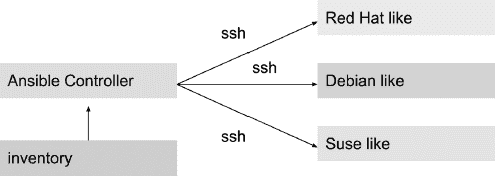

**图 4.1:** Ansible Linux 目标架构

操作系统软件包管理器和 Ansible 模块的完整列表汇总表 4.7 中：

| 发行版 | 软件包管理器 | Ansible 模块 |
| :--- | :--- | :--- |
| “Red Hat”-like | YUM | `ansible.builtin.yum` |
| DNF | `ansible.builtin.dnf` | |
| AIX | installp | `community.general.installp` |
| Alpine Linux | Alpine Package Keeper | `community.general.apk` |
| Local Backup Utility | `community.general.lbu` | |
| Arch Linux | pacman | `community.general.pacman` |
| ClearLinux | swupd | `community.general.swupd` |
| Debian-like | APT | `ansible.builtin.apt` |
| FreeBSD | pkgng | `community.general.pkgng` |
| Gentoo Linux | Portage | `community.general.portage` |
| Layman | `community.general.layman` | |
| HP-UX | swdepot | `community.general.swdepot` |
| macOS | MacPorts | `community.general.macports` |
| Homebrew | `community.general.homebrew` | |
| OpenBSD | pkg | `community.general.openbsd_pkg` |
| Openembedded/Yocto | opkg | `community.general.opkg` |
| Slackware | slackpkg | `community.general.slackpkg` |
| SmartOS, NetBSD | pkgsrc | `community.general.pkgin` |
| Solaris 11 | Image Packaging System | `community.general.pkg5` |
| Solaris SVR4 | svr4pkg | `community.general.svr4pkg` |
| Source Mage | Sorcery | `community.general.sorcery` |


| SUSE 和 openSUSE | Zypper | `community.general.zypper` |
| :--- | :--- | :--- |

**表 4.7:** 用于操作系统软件包管理器的 Ansible 模块

滚动更新和补丁管理是 Ansible 的典型用例。我们可以在服务器基础设施集群的置备或维护中使用它。Ansible 安装的模块通过自动化现有的包管理工具来工作。在类 Red Hat 的 Linux 发行版目标中，我们将使用 `Yum` 或 `DNF` 软件包管理；而在类 Debian 的 Linux 发行版目标中，我们将使用 `APT` 包管理器。要实现完整的滚动更新过程，请在我们的 playbook 中配合 `fork` 和 `serial` 语句。请参考*第 8 章：Ansible 进阶* 中的 *Ansible 编排* 节节。

## Ansible 软件包模块

有一个 `package` 模块（它是 `ansible.builtin` 集合的一部分），可以使用不同的工具安装软件包。它可以自动检测每台目标机器应该使用哪种包管理工具。以下是 `package` Ansible 模块的局限性：

*   软件包名称通常不同。
*   软件包版本通常不同。
*   不同的包工具支持不同的选项。

要映射不同发行版之间所有的包名称差异几乎是不可能的。以下是*表 4.8* 中一些简单的软件包名称示例：

| 类 Red Hat | 类 Debian |
| :--- | :--- |
| `httpd` | `apache2` |
| `sqlite` | `sqlite3` |
| `bzip2-devel` | `libbz2-dev` |
| `xorg-x11-server` | `xorg` |

**表 4.8:** 常见的软件包名称差异

## Ansible yum 模块

我们可以使用 `yum` Ansible 模块或 `dnf` Ansible 模块来更新类“Red Hat”的 Linux 发行版，两者都是 `ansible.builtin` 集合的一部分。从 Ansible Core 2.15 开始，引入了最新的 `dnf5` Ansible 模块，用于处理 Fedora 39 版本中包含的 DNF 5 版本包管理器。Ansible `yum`、`dnf` 和 `dnf5` 模块在目标主机上执行任何操作都需要 `root` 权限。参数列表非常广泛，以下四个选项与我们的用例相关：

Ansible `yum`、`dnf` 和 `dnf5` 模块的主要参数：

*   `name` 字符串
*   `state` 字符串
*   `update_cache` 布尔
*   `bugfix` 布尔
*   `security` 布尔

`name` 参数指定单个软件包，或使用星号 `*` 指定系统中的所有软件包。在这种情况下，状态需要设置为 `latest`，以便我们的目标是每个软件包的最新版本。`update_cache` 用于在安装前强制更新仓库元数据，默认为 `no`。其他非常有用的选项是 `bugfix` 和 `security`，它们允许我们仅更新标记为错误修复或安全相关的更新软件包。

以下 `yum.yml` playbook 更新了所有的 Red Hat Enterprise Linux 发行版及其衍生版：

```yaml
---
- name: Rolling update
  hosts: all
  become: true
  tasks:
    - name: System update
      ansible.builtin.yum:
        name: "*"
        state: latest
        update_cache: true
```

我们可以使用以下 `ansible-playbook` 命令执行 `yum.yml` playbook：

```bash
ansible-playbook yum.yml
```

## Ansible apt 模块

我们可以使用 `apt` Ansible 模块更新类 Debian 的 Linux 发行版，该模块是 `ansible.builtin` 集合的一部分。`apt` 模块执行目标主机上的任何操作需要 `root` 权限。

Ansible `apt` 模块的主要参数：

*   `name` 字符串
*   `state` 字符串
*   `update_cache` 布尔
*   `upgrade` no/safe/full/dist

`name` 参数指定单个软件包，我们也可以使用星号 `*` 选择系统的所有软件包。在这种情况下，状态需要设置为 `latest`，以便我们的目标是每个软件包的最新版本。`update_cache` 用于在安装前强制更新仓库元数据。

另一个实用的选项是 `upgrade`，在执行发行版升级时有四种可选方案：

*   默认值为 `no`（禁用）
*   `safe`：执行 aptitude `safe-upgrade`
*   `full`：执行 aptitude `full-upgrade`
*   `dist`：执行 `apt-get dist-upgrade`

以下 `apt.yml` Ansible playbook 用于在更新仓库缓存之前将当前系统中所有软件包更新到最新版本，因此我们将下载每个软件包的最新版本。

```yaml
---
- name: Rolling update
  hosts: all
  become: true
  tasks:
    - name: System update
      ansible.builtin.apt:
        name: "*"
        state: latest
        update_cache: true
```

我们可以使用以下 `ansible-playbook` 命令执行 `apt.yml` playbook：

```bash
ansible-playbook apt.yml
```

# Ansible zypper 模块

我们可以使用 `zypper` Ansible 模块更新类 SUSE 的 Linux 发行版，该模块是 `community.general` 集合的一部分。在执行以下 `suse.yml` playbook 之前，请确保 Ansible 控制器已安装了 `community.general` 集合。参数列表与之前的模块类似。更多信息请参见*第 3 章：Ansible 语言进阶*中的 *Ansible collection* 节。`suse.yml` Ansible playbook 如下：

```yaml
---
- name: Rolling update
  hosts: all
  become: true
  tasks:
    - name: System update
      community.general.zypper:
        name: "*"
        state: latest
        update_cache: true
```

我们可以使用以下 `ansible-playbook` 命令执行 `suse.yml` playbook：

```bash
ansible-playbook suse.yml
```

`yum.yml`、`apt.yml` 和 `suse.yml` 的执行时间取决于连接速度、需要更新的软件包数量以及目标机器的性能。结果是系统更新到了发行版提供的最新软件包。

## Linux System Roles

Linux System Roles 是一组 Ansible Roles（角色）和 Collections（集合），用于管理和配置常见的 GNU/Linux 系统组件。在我们日常的 Linux 工作中，对于大多数命令行任务不要重复造轮子。支持的目标操作系统有 Fedora、Red Hat Enterprise Linux (RHEL6+) 以及 CentOS 6+ 等衍生版。在编写本书时，支持以下子系统：

*   email (postfix)
*   kdump (内核转储)
*   network
*   selinux
*   timesync
*   storage
*   tlog (终端日志，会话记录)
*   logging
*   metrics
*   nbde_server
*   nbde_client
*   certificate
*   kernel_settings (sysctl, sysfs, 等)
*   SSH server (用于集合 ansible-sshd)
*   SSH client
*   VPN (IPSec - libreswan)
*   Crypto policies
*   Cluster HA (pacemaker/corosync)
*   Cockpit
*   firewall
*   Systemd journald
*   Active Directory join
*   podman
*   Red Hat Subscription Management and Insights

第一步是安装选定的 Linux System Roles。假设我们想在集群中设置 NTP 服务，以便通过互联网与原子钟保持同步。我们可以使用 `ansible-galaxy` 命令从 Ansible Galaxy 存档手动下载最新 role：

```bash
ansible-galaxy install linux-system-roles.timesync
```

如既往一样，我们可以创建一个 `requirements.yml` 文件来自动化从 Ansible Galaxy 存档安装该 role。请参考*第 3 章：Ansible 语言进阶* 中的 *Ansible role* 节。在 Red Hat Enterprise Linux 9 和 8.6 及更高版本中，可以通过 Application Streams 仓库安装 RHEL System Roles（`rhel-system-roles` 软件包）：

```bash
dnf install rhel-system-roles ansible-core
```


以下 `ntp.yml` Ansible Playbook 设立了 NTP 客户端服务（通常是 chrony 服务）：

```yaml
---
- hosts: all
vars:
  timesync_ntp_servers:
    - hostname: europe.pool.ntp.org
      iburst: true
roles:
  - linux-system-roles.timesync
```

`ntp.yml` Ansible Playbook 配置了配置文件以使用 `europe.pool.ntp.org` 服务器，并与目标服务器执行初始同步（`iburst: true`），在必要时立即调整时间。通过 `ansible-playbook` 命令执行的输出非常冗长且详细，执行结束后，我们在目标服务器上获得了一个配置好的 NTP 服务。

同样地，我们可以使用其他 Ansible Roles 和集合（collections）在我们的工作流中安装和配置其他服务。

## 用户管理

使用 Ansible 的 `user` 模块，我们可以管理目标节点中的用户，该模块属于 `ansible.builtin` 集合。这是一个非常稳定且已发布多年的模块。它用于管理用户账户，支持多种 Linux 发行版、SunOS、macOS 以及 FreeBSD。

该模块使用 Linux 发行版的 `useradd` 工具创建用户。在 FreeBSD 上，它使用 `pw useradd`，在 macOS 上，该模块使用 `dscl create`。对于 Windows，请使用 第 5 章：Ansible For Windows 用户管理章节中的 `ansible.windows.win_user` 模块。Ansible `user` 模块的主要参数有：

* `name` string - `username`
* `state` string - `present`/`absent`
* `password` string
* `uid` string
* `comment` string
* `shell` string
* `expires` string
* `password_expire_min` string
* `password_expire_max` string
* `group/groups` string - 主组/成员组(s)
* `create_home` boolean - `yes`/`no`
* `generate_ssh_key` string
* `ssh_key_bits` string
* `ssh_key_file` string
* `ssh_key_type` string
* `ssh_key_passphrase` string

该模块唯一要求的参数是 `name`，即本地用户用户名。`state` 参数允许我们创建或删除用户。在我们的用例中，默认已设置为 `present` 以创建用户。我们需要结合 `password` 参数和 `password_hash` 过滤器来生成 SHA512 密码哈希。请注意，你还可以指定加密算法以及盐值以使你的密码更健壮。我们可以指定所有的 Unix 属性，如 `uid`、`comment`、`shell`、`expires`、`password_expire_min` 和 `password_expire_max`。其他重要参数是 `group` 和 `groups`。第一个（不带 `s` 后缀）表示用户的主组，第二个（带 `s` 后缀）设置其他组成员。因此请务必小心 `s` 后缀，它会导致完全不同的设置。通常，我们希望创建用户家目录，因此 `create_home` 参数默认为 `yes`，但如果不需要家目录，也可以覆盖它。让我也强调一下，我们还可以通过许多选项生成 SSH 密钥。指纹和公钥可以在返回的长列表中找到。完整的 `user.yml` Ansible Playbook 在目标系统中创建了一个具有以下特征的用户 `example`：

```yaml
---
- name: Create a user account
  hosts: all
  become: true
  tasks:
    - name: User example exist
      ansible.builtin.user:
        name: example
        password: "{{ 'password' | password_hash('sha512', 'mysecretsalt') }}"
        groups:
          - wheel
          - adm
        state: "present"
        shell: "/bin/bash"
        system: false
        create_home: true
        home: "/home/example"
        comment: "Automate Everything with Ansible"
        generate_ssh_key: true
```

我们可以使用以下 `ansible-playbook` 命令执行 `user.yml` Playbook：

```
ansible-playbook user.yml
```

执行结束后，将按照 Ansible Playbook 中指定的选项创建本地用户 `example`。

# Linux 密码过期策略

Ansible 的另一个常见用例是配置本地用户的 Linux 密码过期。我们使用 Ansible `user` 模块的 `password_expire_min` 和 `password_expire_max` 参数。请注意，这些参数仅限 Linux：


Ansible `user` 模块的 `password_expire_min` 和 `password_expire_max` 参数用于配置 Linux 密码过期。以下 `expiration.yml` Ansible Playbook 为用户设置了密码过期：

```yaml
---
- name: Password expiration
  hosts: all
  become: true
  tasks:
    - name: Set expiration
      ansible.builtin.user:
        name: "{{ myuser }}"
        password_expire_min: 7
        password_expire_max: 90
```

我们可以使用以下 `ansible-playbook` 命令执行 `expiration.yml` Playbook：

```
ansible-playbook expiration.yml
```

我们可以使用 `chage` 命令检查这些参数：

```
chage -l example
```

## 组管理

与 `user` 模块类似，`group` 模块管理目标系统中的本地组。Ansible `group` 模块的主要参数有：

* `name` string - 组名
* `state` string - `present`/`absent`
* `system` boolean - `yes`/no`
* `gid` integer - 为组设置的 GID
* `local` string - `local` 命令的替代方案

唯一要求的是 `name`，即组名。`state` 参数允许我们创建或删除组。在我们的用例中，默认已设置为 `present` 以创建组。`system` 参数允许创建系统组，默认情况下不是。你可以通过 `gid` 参数指定组标识符 GID。如果你有中央认证系统，`local` 参数允许在实现了该命令的平台上使用 `local` 命令的替代方案。以下 `group.yml` Ansible Playbook 在目标系统中创建了一个本地组 `accounting`：

```yaml
---
- name: Group management
  hosts: all
  become: true
  vars:
    mygroup: 'accounting'
  tasks:
    - name: Create group
      ansible.builtin.group:
        name: "{{ mygroup }}"
        state: present
```

我们可以使用以下 `ansible-playbook` 命令执行 `group.yml` Playbook：

```
ansible-playbook group.yml
```


通常情况下，应优先选择为任务使用专门的模块。当没有相应的 Ansible 模块时，我们仍然可以使用 `command` 和 `shell` Ansible 模块在目标节点上直接执行终端命令。从顶层视角来看，它们看起来相似，但在底层行为有所不同。使用 Ansible 模块执行任务始终是一个好习惯，但有时我们的用例确实没有对应的 Ansible 模块。在这种情况下，我们可以使用 `command` 和 `shell` Ansible 模块在目标节点上执行命令。

在这些情况下，我们可以使用 `command` 和 `shell` Ansible 模块在目标节点上执行命令。这并不是一种优解决方案，因为我们实际上是通过 `command` 和 `shell` Ansible 模块执行了终端命令。

让我们明确 `command` 与 `shell` Ansible 模块之间的区别。它们都允许我们在 Linux 目标主机上执行命令。大多数人会混淆这两个 Ansible 模块，但它们从根本上说是不同的。这两个模块都允许我们在目标主机上执行命令，但执行方式略有不同。我们应该尽可能避免使用 `command` 或 `shell` Ansible 模块，而是使用使用 Ansible 定的模块。这两个模块在执行时都会返回“已更改”（changed）状态，因为 Ansible 无法分析这些模块的执行情况，无法检测它们是否更改了目标系统。

# Ansible command 模块

Ansible `command` 模块在目标 Unix 类主机上执行命令时，会跳过目标节点的 shell。它总是返回已更改状态。`command` 模块在不使用任何目标 shell 的情况下在目标机器上执行命令；它只是执行命令。`command` 模块是 Ansible 临时模式（Ad-hoc mode）中的默认模块。命令模块只能执行远程主机上的二进制文件。本地 shell 变量不会影响 command 模块，因为它跳过了 shell。同时，它可能无法运行“shell”内置功能和重定向。从安全角度来看，command 模块更健壮，结果更具预测性，因为它跳过了 shell。

## Ansible shell 模块

Ansible `shell` 模块使用目标节点的 shell 进行重定向和内置功能，在目标 Unix 类主机上执行 shell 命令。它总是返回已更改状态。目标 shell 例如，著名的 `bash`、`zsh` 或 `sh`。作为副作用，用户环境、变量扩展、输出重定向、将两个命令组合以及其他 shell 特性是不可用的。另一方面，使用 shell 模块执行的每个命令都拥有所有 shell 特性，可以在运行时进行扩展。`shell` Ansible 模块比 command 模块潜在危险，只有在我们需要 shell 功能时才应该使用。因此，如果我们不需要将两个命令组合（使用管道甚至仅使用 `&&` 或 `;` 运算符），就需要 shell 模块。同样，全局扩展 shell 变量或文件需要 shell 模块。仅在严格需要时才使用 Ansible shell 模块。

## Uptime playbook

让我通过 Ansible Playbook 演示 `command` 和 `shell` Ansible 模块之间的区别：

`uptime`

`13:10:16 up 45 min,  0 users, load average: 0.12, 0.08, 0.07`

假设我们想检查服务器的 `uptime` 时间。这是一个不需要完整 shell 能力的总体操作。完整的 `command.yml` 文件：

```yaml
---
- name: Check uptime
  hosts: all
  tasks:
    - name: Check uptime
      ansible.builtin.command: uptime
      register: command_output
    - name: Command output
      ansible.builtin.debug:
        var: command_output.stdout_lines
```

我们可以使用每个 Ansible 安装中包含的 `ansible-playbook` 命令执行我们的代码：

`ansible-playbook command.yml`

执行 `ansible-playbook` 命令的输出如下：

```
TASK [Check uptime] ****************************************************************************
changed: [server01.example.com]
TASK [Command output] **************************************************************************
ok: [server01.example.com] => {
  "command_output.stdout_lines": [
    "13:10:16 up 45 min,  0 users, load average: 0.12, 0.08, 0.07"
  ]
}
PLAY RECAP *****************************************************************************
server01.example.com: ok=3    changed=1    unreachable=0    failed=0    skipped=0    rescued=0    ignored=0
```

# 列出文件

列出文件是一个需要完整 `shell` 能力的典型操作，在下面的 `shell.yml` playbook 文件中显示：

```yaml
---
- name: Listing files
  hosts: all
  tasks:
    - name: List file(s) and folder(s)
      ansible.builtin.shell: 'ls -l *'
      register: command_output
    - name: Command output
      ansible.builtin.debug:
        var: command_output.stdout_lines
```

我们可以使用每个 Ansible 安装中的 `ansible-playbook` 命令执行 `shell.yml` Ansible Playbook。完整命令如下：

`ansible-playbook shell.yml`

执行 Ansible playbook `shell.yml` 的输出如下：

```
TASK [List file(s) and folder(s)] **************************************************************
changed: [server01.example.com]
TASK [Command output] **************************************************************************
ok: [server01.example.com] => {
  "command_output.stdout_lines": [
    "-rwxrwxrwx 1  devops users  245 Apr 14 11:04 command.yml",
    "-rwxrwxrwx 1  devops users  258 Apr 14 11:04 shell.yml"
  ]
}
PLAY RECAP *****************************************************************************
server01.example.com: ok=3    changed=1    unreachable=0    failed=0    skipped=0    rescued=0    ignored=0
```

# 错误模块

我们在 `command` 和 `shell` 模块之间使用错误的模块时，会获得致命错误。请参阅*第 6 章：Ansible 故障排除*中的*Ansible modules*部分进行进一步的排除。例如，当我们使用 `command` 模块而不是 `shell` 模块执行之前 `shell.yml` playbook 的文件列表时：

```
{"stderr": "ls: cannot access '*': No such file or directory", "stderr_lines": ["ls: cannot access '*': No such file or directory"], "stdout": "", "stdout_lines": []}
```

当没有特定的 Ansible 模块用于我们的任务时，`command` 和 `shell` 模块是很好的工具。请明智地使用它们！command 限制较多，而 shell 更强大且具有潜在危害。

# 结论

我们学习了如何通过自动化 Linux 基础设施中的某些任务来节省时间。正如我们所学的，自动化是简单的，我们可以轻松将其扩展到日常用例中。在下一章中，我们将学习如何以类似于 Linux 基础设施的方式自动化 Windows 目标系统。

# 注意事项

*   大多数现代 Linux 发行版已经准备好使用 Ansible。只需设置 SSH 密码或密钥认证并使用 Python 解释器即可。
*   最简单的 Ansible 模块是 `ping`，它测试 Linux 目标主机上 Python 代码的认证和执行。
*   可以使用 Ansible `lineinfile` 模块、Ansible `blockinfile` 模块和 Ansible `template` 模块执行配置管理。


*   许多模块简化了文件系统管理：使用 Ansible `stat` 模块检查文件和目录的存在，使用 Ansible `file` 模块创建文件、目录、软链接和硬链接，使用 Ansible `get_url` 模块下载内容，使用 Ansible `git` 模块检出 Git 仓库。
*   Ansible `user` 和 `group` 模块简化了本地用户和组的管理。
*   我们可以通过包格式对 Linux 发行版进行分类，并使用 Ansible 模块自动化包管理器之间的交互。它对许多操作系统和工具都有广泛支持。

# 单选题

1. 配置 Linux 目标机器需要满足什么要求？
    1. OpenSSH 服务正在运行和 Python 解释器
    2. WinRM 服务正在运行和 Python 解释器
    3. WinRM 服务正在运行和 PowerShell 解释器
    4. OpenSSH 服务正在运行和 PowerShell 解释器

2. 在红帽企业 Linux 中安装 NTP 客户端的最佳方法是什么？
    1. Ansible apt 模块
    2. Linux 系统角色 (Linux System Roles)
    3. Ansible package 模块
    4. Ansible file 模块

3. 我们如何在 Linux 目标上执行命令“cat /proc/cpuinfo | grep ‘model’”？
    1. Ansible command 模块
    2. Ansible shell 模块
    3. Ansible cpuinfo 模块
    4. 不可行

4. 在不同的 Linux 发行版中安装“git”包的最简单方法是什么？
    1. 使用 `when` 语句配合多个 Ansible 模块
    2. Ansible apt 模块
    3. Ansible package 模块
    4. Ansible yum 模块

# 答案

1. A
2. B
3. B
4. C

# question

1. 为什么优先使用 SSH 密钥认证而不是 SSH 密码认证？
2. 使用 Ansible `debug` 模块的“verbosity”参数的作用是什么？
3. 除了将文件复制到目标节点外，copy` 模块还有什么用途？
4. 我们如何检查目标节点上是否存在文件或目录？
5. 为什么不建议使用 Ansible `package` 模块？
6. 什么时候必须使用 Ansible `command` 和 `shell` 模块？

# 核心术语

*   **Verbosity (详细程度)**：我们可以指定 0 到 4 的详细级别来执行 Ansible Playbook，从而增加调试信息的打印。
*   **配置管理 (CM)**：指维护计算机软件处于所需状态的过程。配置管理也是一种确保系统随时间推移持续符合预期的方法。
*   **文件系统 (File system)**：指操作系统用于从存储器存储和检索数据的方法和数据结构（文件和目录）。
*   **用户管理 (User Management)**：指在系统中创建、更新、删除和维护本地用户及组的活动。
*   **滚动更新 (Rolling update)**：指一种以零停机时间原地更新系统的策略。

# 第 5 章

# 用于 Windows 的 Ansible

## 引言

使用 Ansible 自动化 Windows 非常方便，特别是对于大型集群。我们将从主机配置开始，然后移动到自动化部分。我们将在 Windows 环境中探索与 Linux 操作系统相同的用例，使用不同的 Ansible 模块来处理文件系统、用户管理以及许多日常系统管理任务。我们将利用现在学到的关于 Ansible 技术的所有课程。在本章中，我们将学习如何配置 Windows 目标系统，以及如何在 Windows 和 Windows Server 上执行文件和目录操作并进行软件更新。

## 结构

在本章中，我们将涵盖以下主题：

*   配置 Windows 目标
*   测试主机可用性
*   配置管理
*   文件系统
*   安装包和滚动更新
*   用户管理
*   Windows 注册表
*   执行命令

## 配置 Windows 目标

使用 Ansible 节省的时间令人惊叹，特别是在混合云环境的配置管理管理和补丁管理中。我们可以管理桌面操作系统（包括 Windows 10 和 11）以及服务器操作系统（包括 Windows Server 2012、2012 R2、2016、Version 1803、Version 1809、2019 和 2022）。第一步是配置我们的 Windows 目标机器以使用 Ansible。尽管从 Ansible 2.8 版本开始已支持 SSH 连接，但它可能会导致不可预的情况。连接 Windows 和 Windows Server 系统的稳定且推荐的方法是使用 Windows 远程管理 (WinRM) 原生库。WinRM 是微软为 Windows 操作系统中的 WS-Management 创建的。WinRM 允许我们通过网络访问系统并共享管理信息。

成功启动 Windows 目标主机的步骤：

1.  创建 Ansible 用户
2.  验证 PowerShell & .NET
3.  设置 WinRM
4.  Windows 集合 (Collections)
5.  创建清单 (Inventory) 和 Playbook

在 Ansible 控制器上，这些很容易满足。我们只需要清单，并可以使用许多 Ansible 模块来自动化 `ansible.windows` 和 `community.windows` Ansible 集合内部的任务。区别在于，第一个集合由 Ansible 工程团队直接维护，而第二个则由 Ansible 社区管理。

## 创建 Ansible 用户

Ansible 需要目标主机上有一个用户来执行我们的自动化。最简单的方法是使用“计算机管理”工具创建本地用户。我们也可以使用 Active Directory 用户，但这需要更多配置。请根据您的需要自定义用户名。

以下步骤使我们能够在 Windows 系统上创建 `ansible` 本地用户：

1.  打开`计算机管理`。
    我们可以通过开始菜单或通过右键点击`此 PC` > `管理`来打开`计算机管理`工具。
    界面所示[图 5.1]：
    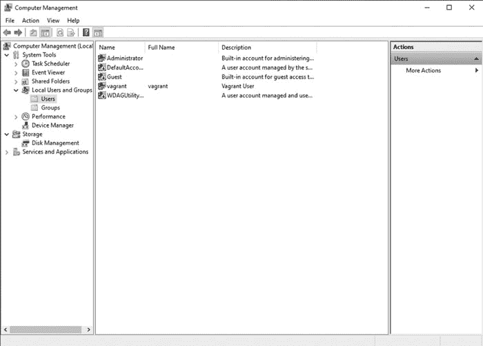
    **图 5.1：** 计算机管理主界面

2.  创建新的 ansible 用户。通过右键点击`用户` > `新建用户` 创建新用户。使用以下详细填写弹出的表单（界面所示[图 5.2]）：
    *   用户名：`ansible`
    *   全名：`ansible`
    *   描述：`ansible user`
    *   密码和确认密码：（为我们的 ansible 用户指定密码）。例如，假设使用 `MyPassword123@` 作为密码。此值应与我们的清单匹配。
    启用“密码永不过期”选项并禁用“用户下次登录时更改密码”选项是非常关重要的。
    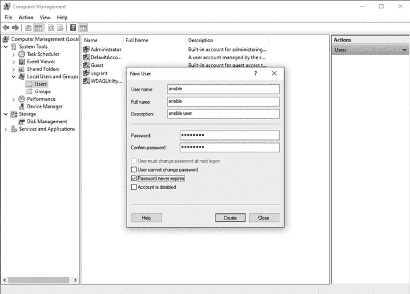
    **图 5.2：** 新的“ansible”用户界面

3.  将 ansible 用户作为管理员组的成员。
    在成功创建“ansible”用户后，我们需要将该用户添加到“管理员”组中。通过这样，我们就能对 Windows 目标执行任何类型的命令。如果我们没有执行这一步，某些代码可能会因为权限问题而失败：
    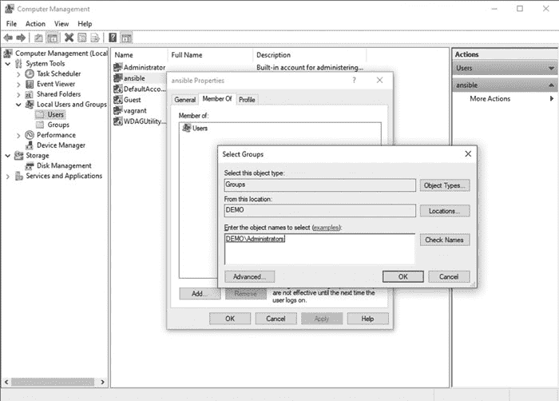
    **图 5.3：** 将“ansible”用户添加到“管理员”组

## 验证 PowerShell, .NET 并设置 WinRM


一旦在我们的 Windows 系统中成功创建了本地用户，我们就可以在安装 WinRM 组件之前验证 PowerShell 和 .NET 库是否为最新。Ansible 对 Windows 主机要求 `PowerShell` 3.0 或更高版本以及 `.NET` 4.0 或更高版本。在现代操作系统中，这些要求已经满足了。如果没有，我们只需要在继续安装 WinRM 组件之前使用 Windows Update 即可。让我们验证一下系统中当前 PowerShell 和 .NET 的版本：

## PowerShell

我们可以在 PowerShell 中输入以下命令来验证 PowerShell 的当前版本：

```bash
Get-Host | Select-Object Version
```

输出结果如下：

`Version`
`-------`
`7.3.0.0`

在这种情况下，PowerShell 7.3 的版本高于要求的 `PowerShell` 3.0，因此我们可以继续我们的自动化操作。

## .NET

我们可以在 PowerShell 中输入以下命令来验证 .NET 的当前版本：

```bash
Get-ChildItem 'HKLM:\SOFTWARE\Microsoft\NET Framework Setup\NDP' -Recurse | Get-ItemProperty -Name version -EA 0 | Where { $_.PSChildName -Match '^(?!S)\p{L}'} | Select PSChildName, version
```

输出结果如下：

`PSChildName Version`
`----------- -------`
`Client      4.8.04161`
`Full        4.8.04161`
`Client      4.0.0.0`

在这种情况下，安装了 .NET 4.8，它高于要求的 `.NET` 4.0，因此我们可以继续我们的自动化操作。

## 安装 WinRM

第一步是实际验证目标机器是否已经启用了 WinRM 服务。我们可以通过以下 PowerShell 命令验证系统是否启用了 WinRM：

```powershell
winrm get winrm/config/Service
winrm get winrm/config/Winrs
winrm enumerate winrm/config/Listener
```

不要担心。在刚安装的机器上，我们预计对每个命令都会收到类似下面的错误信息：

`WSManFault`
`Message = The client cannot connect to the destination specified in the request. […]`
`Error number:  -2144108526 0x80338012`

对于初学者来说，WinRM 服务的初始配置可能会困难。好消息是，Ansible 团队发布了一个 `ConfigureRemotingForAnsible.ps1` PowerShell 脚本，以便方便地配置我们的目标主机。以下命令直接从 Ansible 的 GitHub 仓库下载并执行最新版本的 PowerShell 配置脚本：

```powershell
[Net.ServicePointManager]::SecurityProtocol = [Net.SecurityProtocolType]::Tls12
>> $url = "https://raw.githubusercontent.com/ansible/ansible/devel/examples/scripts/ConfigureRemotingForAnsible.ps1"
>> $file = "$env:temp\ConfigureRemotingForAnsible.ps1"
>> (New-Object -TypeName System.Net.WebClient).DownloadFile($url, $file)
>> powershell.exe -ExecutionPolicy ByPass -File $file
```

执行将需要一段时间，并在屏幕上向我们显示更多消息。

我们可以通过以下 PowerShell 命令验证系统是否启用了 WinRM：

```powershell
winrm get winrm/config/Service
winrm get winrm/config/Winrs
winrm enumerate winrm/config/Listener
```

输出消息将向我们显示关于网络服务的更多细节、最大连接用户数以及更多技术细节：

`Service`
`RootSDDL = O:NSG:BAD:P(A;;GA;;;BA)(A;;GR;;;IU)S:P(AU;FA;GA;;;WD)(AU;SA;GXGW;;;WD)`
`MaxConcurrentOperations = 4294967295`
`MaxConcurrentOperationsPerUser = 1500`
`EnumerationTimeoutms = 240000`
`MaxConnections = 300`
`MaxPacketRetrievalTimeSeconds = 120`
`AllowUnencrypted = true`
`Auth`
`Basic = true`
`Kerberos = true`
`Negotiate = true`
`Certificate = false`
`CredSSP = false`
`CbtHardeningLevel = Relaxed`
`DefaultPorts`
`HTTP = 5985`
`HTTPS = 5986`
`IPv4Filter = *`
`IPv6Filter = *`
`EnableCompatibilityHttpListener = false`
`EnableCompatibilityHttpsListener = false`
`CertificateThumbprint`
`AllowRemoteAccess = true`

重要的部分是 WinRM 现在已激活，并接受通过 HTTP 端口 5985 和 HTTPS 端口 5986 的连接。许多组织选择在某些“模板镜像”、“基础镜像”或“黄金镜像”中启用 WinRM 服务，以加速基础设施的部署。

从现在起，我们只需要配置 Ansible Controller 连接到 Windows 目标。

## Windows collections

首先，我们需要确保 Ansible Controller 中安装了 Ansible collections。正如我们在第 3 章中学到的，可以使用 `ansible-galaxy` 命令行工具在系统中安装或验证已安装的 collections 版本。让我们使用以下命令验证 Ansible collection 是否已成功安装到系统中：

`ansible.windows` Ansible collection：

```bash
ansible-galaxy collection list ansible.windows
```

当 `ansible.windows` collection 成功安装时，会显示以下输出：

`# /usr/share/ansible/collections/ansible_collections`
`Collection      Version`
`--------------- -------`
`ansible.windows 1.13.0`

输出显示了安装的版本“1.13.0”以及安装路径 `/usr/share/ansible/collections/ansible_collections`。

`community.windows` Ansible collection：

```bash
ansible-galaxy collection list community.windows
```

当 `community.windows` collection 成功安装时，会显示以下输出：

`# /usr/share/ansible/collections/ansible_collections`
`Collection      Version`
`--------------- -------`
`community.windows 1.12.0`

输出显示了安装的版本“1.12.0”以及安装路径 `/usr/share/ansible/collections/ansible_collections`。

## 手动

当系统中没有安装 collections 时，我们可以手动或通过自动化方式安装它们。

## 手动

我们可以通过 `ansible-galaxy` 命令行工具指定名称来手动安装 Windows collections。该工具将连接到 Ansible Galaxy 分发服务器，下载并安装到当前系统中。重复两次命令以安装两个 Ansible collections：

```bash
ansible-galaxy collection install ansible.windows
ansible-galaxy collection install community.windows
```

命令显示的输出如下：

`Starting galaxy collection install process`
`Process install dependency map`
`Starting collection install process`
`Downloading https://galaxy.ansible.com/download/ansible-windows-1.13.0.tar.gz to /home/devops/.ansible/tmp/ansible-local-26442bn4cixq/tmp8hxd6zu/ansible-windows-1.13.0-r6p9u1uq`
`Installing 'ansible.windows:1.13.0' to '/home/devops/.ansible/collections/ansible_collections/ansible/windows'`
`ansible.windows:1.13.0 was installed successfully`

### 自动化

为了自动化安装 Windows Ansible collections，我们需要创建一个包含所需 collections 的 `requirements.yml` 文件。

当我们不指定任何分发服务器时，将使用 Ansible Galaxy。完整的 `requirements.yml` 文件如下：

```yaml
---
collections:
- name: ansible.windows
- name: community.windows
```

我们可以使用以下命令执行代码的自动化安装：

```bash
ansible-galaxy collection install -r requirements.yml
```


`ansible-galaxy install -r requirements.yml`

该命令的输出类似于：

```
`Starting galaxy collection install process`
`Process install dependency map`
`Starting collection install process`
`Downloading https://galaxy.ansible.com/download/community-windows-1.12.0.tar.gz to /home/devops/.ansible/tmp/ansible-local-26397ml0anda6/tmpl5a7igpa/community-windows-1.12.0-nrnbikbk`
`Installing 'community.windows:1.12.0' to '/home/devops/.ansible/collections/ansible_collections/community/windows'`
`Downloading https://galaxy.ansible.com/download/ansible-windows-1.13.0.tar.gz to /home/devops/.ansible/tmp/ansible-local-26397ml0anda6/tmpl5a7igpa/ansible-windows-1.13.0-r4kpb230`
`community.windows:1.12.0 was installed successfully`
`Installing 'ansible.windows:1.13.0' to '/home/devops/.ansible/collections/ansible_collections/ansible/windows'`
`ansible.windows:1.13.0 was installed successfully`
```

执行完成后，两个 Ansible Windows 集合已成功安装在我们的系统中。

# 清清单 (Inventory)

当我们需要指定某些 Windows 目标时，需要一个带有 WinRM 参数的特定 Ansible 清单。我们将使用 WinRM 作为基本身份认证连接目标的方法。从 Ansible 2.8 版本开始，对于 Windows 管理的节点（Windows 10+ 和 Windows Server 2019+），也可以使用实验性的 SSH 连接。

表 5.1 总结了可能的身份验证方法：Basic、Certificate、NTLM、Kerberos 和 CredSSP，适用于本地用户账户、Active Directory 账户、凭据委托和 HTTP 加密：

| 身份验证 | 本地账户 | Active Directory 账户 | 凭据委托 | HTTP 加密 |
| :--- | :--- | :--- | :--- | :--- |
| Basic | 是 | 否 | 否 | 否 |
| Certificate | 是 | 否 | 否 | 否 |
| Kerberos | 否 | 是 | 是 | 是 |
| NTLM | 是 | 是 | 否 | 是 |
| CredSSP | 是 | 是 | 是 | 是 |

**表 5.1：** WinRM 身份验证方法

请注意，基本身份验证（Basic authentication）是最简单的选项，但不安全的，因为它使用 base64 编码传输密码。

以下示例显示了 Ansible 清单中基本身份验证的 WinRM 主机变量。以下 `winrm_basic.ini` 文件展示了 WinRM 证书身份验证的使用：

```
`ansible_connection: winrm`
`ansible_winrm_transport: basic`
`ansible_user: LocalUsername`
`ansible_password: Password`
```

正如我们看到的，我们使用 WinRM 主机变量在 Ansible 清单中指定身份验证参数。WinRM 证书身份验证使用一对 PEM 格式编码的公钥和私钥。这些证书通常由系统管理员提供。以下 `winrm_certificate.ini` 文件展示了 WinRM 证书身份验证的使用：

```
`ansible_connection: winrm`
`ansible_winrm_transport: certificate`
`ansible_winrm_cert_pem: /path/to/certificate/public/key.pem`
`ansible_winrm_cert_key_pem: /path/to/certificate/private/key.pem`
```

有关所有其他安装场景和全面的 WinRM 配置细节，请参考 Ansible 官方网站上的文档。

以下 `win10.ini` Ansible 清单是 Windows 10 目标系统的完整清单。请注意，密码应与 Windows 本地账户指定的密码匹配：

```
`[windows]`
`WindowsServer ansible_host=192.168.0.129`
`[windows:vars]`
`ansible_user=ansible`
`ansible_password=MyPassword123@`
`ansible_port=5986`
`ansible_connection=winrm`
`ansible_winrm_transport=basic`
`ansible_winrm_server_cert_validation=ignore`
```

`win10.ini` Ansible 清单指定了 IP 为 `192.168.0.129`、名为 `WindowsServer` 的 Windows 主机，使用用户名 `ansible` 和密码 `MyPassword123@` 进行基本身份认证。连接将在 HTTPS 端口 `5986` 上执行并忽略自签名证书。

此 Ansible 清单满足 Ansible 控制器视角的所有配置。

# 测试主机可用性

如上一章所示，测试目标主机是成功自动化之旅的第一步。正如在 Linux 中我们有 Ansible “ping”模块一样，在 Windows 中，我们有 Ansible `win_ping` 模块。它验证 Ansible 登录到被管理主机的能力，以及是否存在一个能够执行我们代码的 shell（通常是 PowerShell）。也可以配置 `CMD.EXE` shell。正如我们在第 4 章 Ansible For Linux 的测试主机可用性节中所学到的，Ansible `win_ping` 模块与网络 ping 完全不同。默认行为是连接到目标主机并执行一个简单的脚本，成功时返回文本 `ping: pong`。

该模块有一个可选参数 `data` 字符串，用于自定义测试消息。可以指定参数值 `crash` 以在每次执行时生成异常。


以下 `win_ping.yml` Ansible Playbook 测试了 Windows 目标主机的连接：

```
---
`- name: Testing the host availability`
`hosts: all`
`tasks:`
`- name: Test connection`
`ansible.windows.win_ping:`
```

请注意我们需要禁用事实收集（Facts Gathering），因为 Windows 目标不支持它（`gather_facts: false`）。

我们可以使用 `ansible-playbook` 命令执行我们的 `win_ping.yml` Ansible Playbook：

```
`ansible-playbook win_ping.yml`
```

执行的输出如下：

```
`PLAY [Testing the host availability] ***********************************************************************`
`TASK [Test connection] ****************************************************************************`
`ok: [WindowsServer]`
`PLAY RECAP *****************************************************************************`
`WindowsServer: ok=1     changed=0     unreachable=0     failed=0     skipped=0     rescued=0     ignored=0`
```

我们可以看到，当连接到目标主机成功时，结果为“ok”状态。我们可以继续我们的自动化之旅了。

## 配置管理

我们可以使用 Ansible 自动化 Windows 系统的配置。有时我们需要编辑单行文本，特别是对于类 Unix 服务，例如 HTTPD Web 服务器。

# 编辑单行测试

我们可以使用 `community.windows` 集合中的 `win_lineinfile` 模块来编辑配置文件中的单行。以下 `win_lineinfile.yml` Playbook 文件编辑了 Apache Web 服务器配置文件中的一行：

```
`- community.windows.win_lineinfile:`
`path: C:\apache\httpd.conf`
`regex: '^Listen '`
`insertafter: '^#Listen '`
`line: Listen 8080`
```

我们可以使用 `ansible-playbook` 命令执行我们的 `win_lineinfile.yml` Ansible Playbook：

```
`ansible-playbook win_lineinfile.yml`
```

在编写本书时，还没有任何 Ansible 模块可以为 Windows 目标主机编辑文本中的整个块配置（类似于 Linux 的 `blockinfile` 模块）。我们可以像第 3 章 Ansible 语言扩展中的 Ansible template 节中所学的那样，使用 Ansible `template` 模块来获取更多信息。

## 创建文本文件


创建一个文本文件对于自动化配置即代码（CaC）非常有用。我们可以使用 Ansible 的 `win_copy` 模块创建带有内容的文本文件。要创建一个空文件，请参阅下一节“文件系统”中的“创建空文件”用例。正如我们从“将本地文件复制到远程主机”章节中所学的，Ansible 模块 `win_copy` 通常用于将文件复制到远程位置。复制操作从 Ansible 控制器执行到目标主机。然而，`win_copy` 模块也可以创建带有内容的简单文本文件。Ansible `win_copy` 模块的完整名称是 `ansible.windows.win_copy`，这意味着它是 Ansible 团队维护的用于 Windows 自动化的模块集合的一部分。如果我们需要更复杂的配置或包含某些变量的值，建议使用 Ansible 的 `template` 模块（参见 *第 3 章：Ansible 语言进阶*，章节 *Ansible template*）。

Ansible 的 `win_copy` 模块有许多参数，但唯一一个强制性参数是 `path` 的别名 `dest`。`dest` 参数指定远程绝对路径目标。

`content` 参数直接将文件内容设置为指定的值。它仅在 `dest` 为文件时起起作用。请注意，在 `content` 参数中使用变量将导致不可预测的输出。对于高级格式化或内容包含变量的情况，请使用 `ansible.builtin.template` 模块（参见 *第 3 章：Ansible 语言进阶*，章节 *Ansible template*）。创建的文件将具有与创建用户相同的权限，在这种情况下，即我们的 `ansible` 用户。以下 Ansible Playbook 在 `ansible` 用户的桌面上创建一个包含三行文本的 `report.txt` 文件：

* Automate
* Everything
* with Ansible

整个 `win_file_create.yml` Ansible Playbook 如下：

```yaml
---
- name: Create a text file
  hosts: all
  vars:
    myfile: 'C:\Users\ansible\Desktop\example.txt'
  tasks:
    - name: Create a text file
      ansible.windows.win_copy:
        dest: "{{ myfile }}"
        content: |
          1 Automate
          2 Everything
          3 with Ansible
```

我们可以使用每个 Ansible 安装中包含的 `ansible-playbook` 命令执行代码。完整命令如下：

```bash
ansible-playbook win_file_create.yml
```

执行 `win_file_create.yml` Ansible Playbook 的输出如下：

```text
TASK [Create a text file] **********************************************************************
changed: [WindowsServer]
```


**图 5.4：** ansible 用户桌面上的文件 example.txt

如预期，`example.txt` 文件已创建在“ansible”用户的桌面上，如 *图 5.4*所示。我们可以用记事本程序打开文本文件查看内容：

```
Automate
Everything
with Ansible
```

Ansible 模块 `win_copy` 通常用于将文件从 Ansible 控制器复制到 Windows 目标主机。但我们发现了如何使用它来创建文本文件。当我们想在生成的文件使用 Ansible 变量、事实（facts）或魔法变量时，请使用 Ansible `template` 模块以避免某些奇怪的致命错误或意外行为。参见 *第 3 章：Ansible 语言进阶*，章节 *Ansible template*。

# 检出 GIT 仓库

我们可以使用与 Linux 目标主机相同的 `git` Ansible 模块来下载“检出”（checkout）Git 仓库。参见 *第 4 章：Ansible For Linux*。


Ansible 能够使用 `win_file` 模块在 Windows 上创建空文件。它包含在 `ansible.windows` 集中。该模块允许我们触碰、创建或删除文件或目录。对于 Linux 目标，请使用 `ansible.builtin.file` 模块。如需创建包含内容的文件，请参考*创建文本文件章节*。

参数列表与 Linux 的 `file` 模块相似：

* `path`
* `state` 字符串（touch, file, absent 和 directory）

`path` 参数是强制性的，用于指定文件系统中的路径。`state` 参数定义了我们指定的路径的期望状态。对于创建空文件的这一用例，我们需要使用 `touch` 选项，以便在文件不存在时创建一个新文件。仅供参考，`state` 的默认值为 `file`，用于验证文件是否存在。接下来的 Ansible playook 就会在本地 `ansible` 用户的桌面上创建一个文件。完整的 `win_file.yml` playbook 如下：

```yaml
---
- name: Creating an empty file
  hosts: all
  vars:
    myfile: 'C:\Users\ansible\Desktop\example.txt'
  tasks:
    - name: Creating an empty file
      ansible.windows.win_file:
        path: "{{ myfile }}"
        state: touch
```

我们可以使用 `ansible-playbook` 命令执行我们的 `win_file.yml` Ansible playbook：

```bash
ansible-playbook win_file.yml
```

`win_file.yml` Ansible playbook 命令的输出如下：

```
TASK [Creating an empty file] *********************************************************************
changed: [WindowsServer]
```

空文件 `example.txt` 已经在我们的 Windows 目标主机上创建。

## 创建目录

Ansible 的 `win_file` 模块也可以在目标 Windows 主机上创建目录。它是 `ansible.windows` 集合的一部分。该模块具有执行不同任务的参数。唯一的强制参数是 `path`，你可以在其中指定要编辑的文件系统路径。`state` 参数定义了我们要修改的对象类型。`state` 参数的默认值为 `file`，但在这种用例中，我们需要设置 `directory` 选项。接下来的 `win_dir_create.yml` playbook 会在用户 `ansible` 的桌面上创建 `example` 目录：

```yaml
---
- name: Create a directory
  hosts: all
  vars:
    mydir: 'C:\Users\ansible\Desktop\example'
  tasks:
    - name: Create a directory
      ansible.windows.win_file:
        path: "{{ mydir }}"
        state: directory
```

我们可以使用 `ansible-playbook` 命令执行我们的 `win_dir_create.yml` Ansible playbook：

```bash
ansible-playbook win_dir_create.yml
```

执行 `win_dir_create.yml` Ansible playbook 命令的输出如下：

```
TASK [Create a directory] *************************************************************************
changed: [WindowsServer]
```

空目录 `example` 已经在我们 Windows 目标主机的 `ansible` 用户的桌面上创建。我们可以在*图 5.6* 中看到执行前的主机，此时面上还没有 `example` 目录：


**图 5.6：** 执行前 ansible 用户的空桌面

执行结果显示在*图 5.7*中，桌面上有了 `example` 目录：


**图 5.7：** 执行后 ansible 用户桌面上的 example 文件夹

## 删除文件

我们可以使用 Ansible 的 `win_file` 模块为 Windows 目标删除文件或目录。我们需要将 `state` 参数的值指定 `absent`。接下来的 `win_delete_dir.yml` Ansible playbook 会删除 `ansible` 用户桌面上的 `example` 文件或目录：

```yaml
---
- name: Delete a directory
  hosts: all
  vars:
    mydir: 'C:\Users\ansible\Desktop\example'
  tasks:
    - name: Delete a directory
      ansible.windows.win_file:
        path: "{{ mydir }}"
        state: absent
```

我们可以使用以下 `ansible-playbook` 命令执行 `win_delete_dir.yml`：

```bash
ansible-playbook win_delete_dir.yml
```

执行结束后，预期的文件或目录 `example` 已在 `ansible` 用户的桌面文件夹中删除。

# 将本地文件复制到远程主机

与用于 Linux 的 `copy` Ansible 模块类似，可以使用 `win_copy` 模块。`win_copy` 模块包含在 `ansible.windows` 集中。它允许我们将文件从本地控制器复制到远程目标。对于从远程主机检索文件，我们使用 `fetch` 模块。对于传输大文件，请考虑 `get_url` 模块。

以下是 `win_copy` 模块常用的参数：

* `dest` 路径
* `src` 字符串
* `remote_src` 布尔
* `force` 字符串

唯一的强制参数是 `dest`。`dest` 参数指定文件系统上的远程路径。当我们指定 `src` 时，它可以是本地路径或远程路径。如果 `remote_src` 设置为 `true`，则源位于远程主机。`backup` 参数允许我们在覆盖时创建一个带有时间戳的文件副本。

接下来的 `win_copy.yml` Ansible playbook 将源文件 `report.txt` 复制到目标的桌面：

```yaml
---
- name: Copy report.txt
  hosts: all
  vars:
    source: "report.txt"
    destination: "Desktop/report.txt"
  tasks:
    - name: Copy report.txt
      ansible.windows.win_copy:
        src: "{{ source }}"
        dest: "{{ destination }}"
```

注意，如果 `force` 设置为 `false`，Ansible 将仅传输目标上不存在或存在差异的文件。如果 `force` 为 `true`，则无论如何都会覆盖现有文件。

## 将远程文件复制到本地

我们可以使用相同的 `fetch` Ansible 模块将远程文件和目录复制到本地 Ansible 控制器。`fetch` 模块是 `ansible.builtin` 集合的一部分。关于 `fetch` 模块的详细概述，请参考*第 4 章：Linux 用于 Ansible*中的*文件系统*章节。接下来的 `win_copy_from.yml` Ansible playbook 检索 `example.txt` 的副本：

```yaml
---
- name: Fetch module
  hosts: all
  vars:
```


`myfile: 'C:\Users\ansible\Desktop\example.txt'`

`save_dir: "logs"`

`tasks:`
- name: Fetch file
  `ansible.builtin.fetch:`
  `src: "{{ myfile }}"`
  `dest: "{{ save_dir }}"`

我们可以使用以下 `ansible-playbook` 命令执行 `win_copy_from.yml` 剧本：

```
ansible-playbook win_copy_from.yml
```

执行结束后，来自 `ansible` 用户桌面的 `example.txt` 文件将从远程服务器复制到 Ansible 控制器的本地 `logs` 目录中。您可以在“创建文本文件”章节中了解更多关于 Ansible `win_copy` 模块的其他用法。

若要检索多个项，请使用带有文件或目录列表的 `loop` 语句。

# 下载文件](#toc.xhtml_s211a)

我们可以使用 Ansible 的 `win_get_url` 模块从远程服务器下载文件，该模块是 `ansible.windows` 集合的一部分。它可以将文件从 HTTP、HTTPS 或 FTP 下载到节点。对于 Linux 目标，请使用 `ansible.builtin.get_url` 模块。该模块与 Ansible `get_url` 模块具有相同的参数。请参阅*第 4 章：Ansible For Linux* 中的*文件系统*章节获取更多信息。请注意，还有针对 X509 身份验证客户端证书（`.pfx`）的额外参数。企业用户还可以指定 `proxy` 参数来设置代理服务器。Ansible 剧本 `win_get_url.yml` 用于检索文件、验证校验和并将其保存到指定用户的桌面上：

```
---
- name: Downloading a file
  hosts: all
  vars:
    myurl: "https://releases.ansible.com/ansible/ansible-2.9.25.tar.gz"
    mycrc: "https://releases.ansible.com/ansible/ansible-2.9.25.tar.gz.sha"
    mycrc_algorithm: "sha256"
    mydest: 'C:\Users\ansible\Desktop\ansible-2.9.25.tar.gz'
  tasks:
    - name: Download file
      ansible.windows.win_get_url:
        url: "{{ myurl }}"
        dest: "{{ mydest }}"
        checksum_algorithm: "{{ mycrc_algorithm }}"
        checksum_url: "{{ mycrc }}"
```

我们可以使用以下 `ansible-playbook` 命令执行 `win_get_url.yml`：

```
ansible-playbook win_get_url.yml
```

执行结束后，预期的文件 `ansible-2.9.25.tar.gz` 已下载，使用 `sha256` 算法验证了校验和，并保存到 `ansible` 用户的桌面上，如*图 5.8*所示：


**图 5.8:** 下载并保存到桌面的文件

# 使用 robocopy 备份](#toc.xhtml_s212a)

使用 Ansible 的 `win_robocopy` 模块进行 robocopy 备份，该模块专门为 Windows 主机上的 robocopy 设计。该模块是 `community.windows` Ansible 集合的一部分。我们可以遵循以下步骤：

1. 在您的剧本中定义源目录目标目录。
2. 使用 `win_robocopy` 模块复制目录。您可以将 `recurse` 参数设置为 `yes` 以包含所有子目录。我们还可以通过 `flags` 参数向 robocopy 命令指定额外的参数。
3. 运行剧本以复制目录。

这是一个示例剧本，它使用 `win_robocopy` 将远程 Windows 服务器的 `Desktop` 文件夹或当前用户的文件备份到本地备份目录：

```
---
- name: Backup
  hosts: all
  become: false
  vars:
    source: "Desktop"
    destination: 'C:\Backups'
  tasks:
    - name: Backup files with robocopy
      community.windows.win_robocopy:
        src: '{{ source }}'
        dest: '{{ destination }}'
```

在此示例中，使用 `win_robocopy` 模块将文件从源目录复制到 `destination` 目录。

# 安装软件包](#toc.xhtml_s213a)

Chocolatey¹ 是 Windows 的包管理器。当我们需要管理大量的机器时，手动维护是不可持续的。它拥有最大的 Windows 软件包在线注册表，并以开源许可发布。在编写本书时，它包含了近 9600 个社区维护的软件包。流行的软件包包括 Adobe Acrobat、Google Chrome、Mozilla Firefox 等。其主要优势是完全支持软件自动化，并能够跟踪已安装的软件包以简化任何升级过程。它还销售 Chocolatey for Business (C4B)，为组织提供高级功能：


**图 5.9:** Chocolatey 徽标


额外的 `chocolatey.chocolatey` Ansible 集合包含了五个 Chocolatey 模块。我们可以使用*第 3 章：Ansible 语言扩展*中*Ansible collection*章节引入的 `ansible-galaxy` 命令行工具安装该集合。`chocolatey.chocolatey` Ansible 集合包含以下五个模块：

* `win_chocolatey`: 使用 chocolatey 管理软件包
* `win_chocolatey_config`: 管理 Chocolatey 配置设置
* `win_chocolatey_facts`: 从 Chocolatey 收集事实
* `win_chocolatey_feature`: 管理 Chocolatey 特性
* `win_chocolatey_source`: 管理 Chocolatey 来源

Ansible `win_chocolatey` 模块自动化安装 Chocolatey 软件和任何软件包。它使用 Chocolatey 在 Windows 中管理软件包。以下是最常用的参数：

* `name`: 字符串
* `state`: 字符串 (present, latest, absent, downgrade, reinstalled)
* `version`: 字符串
* `pinned`: 布尔值
* `source`: 字符串
* `proxy_url`: 字符串`,`proxy_username`: 字符串`,`proxy_password`: 字符串

在 `name` 参数中，您将指定软件包名称或软件包列表。如果您想安装特定版本，可以在 `version` 参数中指定。`state` 指定我们想要执行的操作。要验证软件包是否成功安装，请选择 `present` 选项。而要验证软件包是否为最新，请使用 `latest` 值。我想提到一些可能对您有用的额外参数。`pinned` 参数允许锁定 Chocolatey 软件包或锁定。锁定软件包以阻止升级。在下次对所有软件包升级时，Chocolatey 将自动跳过锁定的软件包。`source` 允许在可用时为软件包指定本地仓库。企业用户受益于通过 `proxy_url`、`proxy_username` 和 `proxy_password` 参数提供的代理和身份验证机制。

以下 `win_chocolatey.yml` Ansible 剧本在 Windows 目标上安装了 `git` 和 `notepadplusplus` 软件包：

```
---
- name: Installing packages
  hosts: all
  vars:
    packages:
      - git
      - notepadplusplus
  tasks:
    - name: Install packages
      chocolatey.chocolatey.win_chocolatey:
        name: "{{ packages }}"
        state: present
```

我们可以使用以下 `ansible-playbook` 命令执行 `win_chocolatey.yml`：

```
ansible-playbook win_chocolatey.yml
```

执行结束后，软件 `git` 和 `notepad++` 已成功安装在 Windows 目标主机上，如*图 5.10*所示：

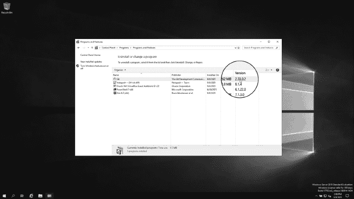

**图 5.10:** Ansible 安装的 git 和 notepad++ 软件

# 滚动更新](#toc.xhtml_s214a)

滚动更新是集群管理中的重要步骤。当服务器数量增加时，手动跟踪更新过程变得困难。Ansible 为我们提供了一种简单高效的方法来执行集群的滚动更新和报告。


我们将使用 Ansible 的 `win_updates` 模块。它包含在 `ansible.windows` 集中。该模块适用于 Windows 和 Windows Server 。此模块用于下载和安装 Windows 更新。要在 Linux 目标上安装包，请针对 RedHat 类系统使用 `yum` 或 `dnf` 模块，针对 Debian 类系统使用 `apt` 模块，针对 Suse 类系统使用 `zypper` 模块，如*第 4 节：适用于 Linux 的 Ansible* 中*安装软件包和滚动更新*章节所示。要实现完整的滚动更新过程，请在我们的 playbook 中配合 `fork` 和 `serial` 语句。更多信息请参阅第 7 节：Ansible Enterprise 中的 Ansible 编排章节。

以下是 Ansible `win_updates` 模块的七个参数：

*   `category_names` 字符串 (`CriticalUpdates`, `DefinitionUpdates`, `DeveloperKits`, `FeaturePacks`, `SecurityUpdates`, `ServicePacks`, `UpdateRollups`)
*   `state` 字符串 - (searched, downloaded, installed)
*   `reboot` 布尔值
*   `reboot_timeout` 整数
*   `log_path` 路径
*   `accept_list` / `reject_list` 列表（用于白名单或黑名单的标题或 KB）
*   `server_selection` 字符串

最重要的 `category_names`，它定义了系统中安装的更新类型。默认启用的类别是“CriticalUpdates`, `SecurityUpdates` 和 `UpdateRollups`。我们可以通过 `CriticalUpdates`, `DefinitionUpdates`, `DeveloperKits`, `FeaturePacks`, `SecurityUpdates`, `ServicePacks` 和 `UpdateRollups` 的完整列表来添加或删除不同的类别。我们可以使用“state”参数定义 Ansible 关于更新的行为。它指定每个显示的包是仅为“searched”（已搜索，即仅在日志文件中列出）、“downloaded”（已下载，即仅下载）还是“installed”（已安装，即在 Windows 目标系统中成功下载并安装）。如果您只想下载代码并在第二次执行实际更新，则需要选择 `downloaded` 选项。当启用 `reboot` 参数时，Ansible 可以在需要时自动重启远程主机并在重启后继续安装更新。重启后等待主机的默认超时值为 1200 秒。我们可以通过 `reboot_timeout` 选项增加该值。我们可以将状态保存在 `log_path` 选项定义的日志文件中，以便在磁盘上保存日志文件。

我们可以使用 `accept_list` 参数指定更新标题或 KB 列表，说明要搜索或安装哪些更新，并使用 `reject_list` 参数指定排除列表。我们还可以从企业环境的 Microsoft Windows Server Update Services (WSUS) 获取内容。在处理 WSUS 时，我们将 `server_selection` 参数设置为 `managed_server` 值以使用 WSUS 目录；而将其设置为 `windows_update` 值以使用 Microsoft Windows 更新目录。以下 `win_rolling.yml` Ansible playbook 仅对 Windows 目标执行关键更新和安全更新的滚动更新。它还会在需要时重启机器并将日志保存到 `C:\ansible.txt` 文件。完整的 Ansible playbook 如下：

```yaml
---
- name: Windows rolling update
  hosts: all
  tasks:
    - name: Install all critical and security updates
      ansible.windows.win_updates:
        category_names:
          - CriticalUpdates
          - SecurityUpdates
        state: installed
        reboot: true
        log_path: C:\ansible.txt
```

我们可以使用以下 `ansible-playbook` 命令执行 `win_rolling.yml`：

```bash
ansible-playbook win_rolling.yml
```

执行结束，Windows 软件更新成功安装在我们的系统中，并创建了 `ansible.txt` 日志文件，如*图 5.12*所示。*图 5.11* 显示了 Ansible 触发 Windows 更新过程之前的情况：

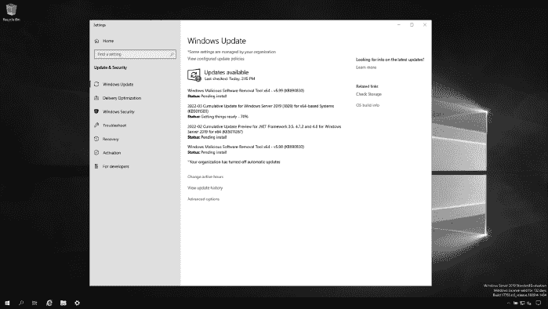

**图 5.11：** 执行滚动更新 Playbook 之前的 Windows 目标

*图 5.12* 显示了目标系统执行 Windows 更新后的 `ansible.txt` 日志文件：

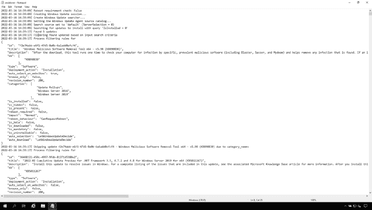

**图 5.12：** 执行滚动更新 Playbook 之后的 Windows 目标

# 用户管理](#toc.xhtml_s215a)

我们使用 Ansible 模块 `win_user` 管理本地用户，并使用 `win_group` 创建本地组。这两个模块都是 `ansible.windows` 集合的一部分。`win_user` 模块管理本地 Windows 用户账户，而 `win_group` 模块添加和删除本地组。对于 Linux 目标，请用 `ansible.builtin` 集中的 `user` 和 `group` 模块。更多信息请参阅*第 4 节：适用于 Linux 的 Ansible* 中的用户管理章节。

`ansible.windows.win_user` 模块管理本地 Windows 用户账户。其参数为：

*   `name` 字符串
*   `state` 字符串
*   `password` 字符串
*   `description` 字符串
*   `groups` 列表
*   `update_password` 字符串 (always 或 on_create)
*   `password_never_expires` 布尔值
*   `password_expired` 字符串
*   `account_locked` 布尔值
*   `account_disabled` 布尔值

唯一必需参数是 `name`，它是账户的用户名。`state` 参数允许我们定义操作以验证用户是否存在于目标 Windows 系统中。在我们的用例中，默认已设置为 `present` 以创建用户。`password` 以明文形式设置密码。因此可以轻松地指定为用户分配什么密码。不需要哈希函数。我们可以直接指定密码。`description` 参数允许您指定用户的描述。这不是强制性的，但有时很有用。`groups` 参数允许您从此组列表中添加或删除用户。`update_password` 参数指定模块在何何时更新用户密码。`always` 选项在密码不同时更新密码，而 `on_create` 仅在新创建用户时设置密码。让我也特别强调一些关于密码过期的参数：`password_never_expires` 可设置密码永不过期，或 `password_expired` 强制用户在下次登录时更改密码。您还可以使用 `account_locked` 和 `account_disabled` 参数锁定或禁用账户。

以下 `win_user.yml` Ansible playbook 在 Windows 目标系统的 `Users` 组中创建一个名为 `example` 的用户，并在用户首次访问时更改密码。完整的 `win_user.yml` Ansible playbook 如下：

```yaml
---
- name: Create a user account
  hosts: all
  vars:
    usr_name: 'example'
    usr_password: 'password'
    usr_groups: "Users"
  tasks:
    - name: User example exist
      ansible.windows.win_user:
        name: "{{ usr_name }}"
        password: "{{ usr_password }}"
        groups: "{{ usr_groups }}"
        update_password: on_create
        password_expired: true
```

我们可以使用以下 `ansible-playbook` 命令执行 `win_user.yml` playbook：

```bash
ansible-playbook win_user.yml
```

执行结束，根据 Ansible playbook 中指定的选项了本地用户 `example`。

# 组管理](#toc.xhtml_s216a)

`win_group` 模块管理目标 Windows 系统中的本地组。Ansible `win_group` 模块的主要参数为：

*   `name` 字符串 - 组名
*   `state` 字符串 - present/absent
*   `system` 布尔值 - yes/no
*   `gid` 整数 - 为组设置的 GID


*   `local` 字符串 - `local` 命令的替代方案

所需的参数是 `name`。此参数指定组名称。`state` 参数允许我们验证 Windows 目标系统中是否存在某个组。在我们的用例中，默认值已设置为 `present`，用于验证该组是否存在，或者如果不存在则创建它。`system` 参数允许我们创建一个系统组。默认情况下它不是的。你可以通过使用 `gid` 参数指定 `GID`（组标识符）。`local` 参数允许我们在实现该功能的平台上使用 `local` 命令的替代方案。这通常在使用中央认证系统时执行。以下 `win_group.yml` Ansible 剧本在 Windows 目标系统中创建一个本地组 `accounting`：

```yaml
---
- name: Group add
  hosts: all
  vars:
    mygroup: 'accounting'
    mydescription: 'accounting group'
  tasks:
    - name: Create a new group
      ansible.windows.win_group:
        name: "{{ mygroup }}"
        description: "{{ mydescription }}"
        state: present
```

我们可以使用以下 `ansible-playbook` 命令执行 `win_group.yml` 剧本：

```bash
ansible-playbook win_group.yml
```

执行结束后，目标 Windows 系统中创建了本地组 `accounting`。

## Windows 注册表

使用 Ansible 自动化 Windows 注册表交互非常有用，因为我们可以获得精确的结果并在规模上运行剧本。我们可以使用 `win_reg_stat` 模块检查特定键的值，并使用 `win_regedit` 模块添加或删除键。

## 检查注册表

我们可以使用 Ansible 的 `win_reg_stat` 模块获取 Windows 注册表的信息。该模块包含在 `ansible.windows` 集中。其目的是从 Windows 注册表项检索信息。

模块的主要参数有：

*   `path` 字符串
*   `name` 字符串
*   `type` 字符串 (string, none, binary, dword, expandstring, multistring, qword)
*   `data` 字符串
*   `state` 字符串 (present, absent)

唯一的必需参数是 `path`。此参数指定空注册表项路径，包括要搜索的配置单元（hive）。`name` 指定注册表项的名称。`type` 参数指定数据类型：`string`, `dword`, `qword`, `binary`, `multistring` 等。请注意，某些值被指定为十进制数字、十六进制值或指定为 Ansible 列表的多字符串。我们可以通过填充 `data` 参数来指定注册表项的值。我们可以使用 `state` 参数的两个选项来验证键是否存在：`present` 表示存在，`absent` 表示不存在。

以下 `reg_check.yml` Ansible 剧本用于在访问 Windows 注册表的类 Windows 系统上检查 .NET Framework 版本。具体而言，它检查位于 `HKEY_LOCAL_MACHINE\SOFTWARE\Microsoft\NET Framework Setup\NDP\v4\Full` 的 Windows 注册表键 `Version`。

完整的完整的 `reg_check.yml` Ansible 剧本所示：

```yaml
---
- name: Check .NET version
  hosts: all
  tasks:
    - name: Retrieve .NET version
      ansible.windows.win_reg_stat:
        path: 'HKLM:\SOFTWARE\Microsoft\NET Framework Setup\NDP\v4\Full'
        name: "Version"
      register: reg_val
    - name: Print .NET version
      ansible.builtin.debug:
        msg: "{{ reg_val }}"
```

我们可以使用以下 `ansible-playbook` 命令执行 `reg_check.yml` 剧本：

```bash
ansible-playbook reg_check.yml
```

执行结束后，目标 Windows 系统的当前 .NET 4.8 版本将打印在屏幕上。输出如下：

```text
TASK [Print .NET version] *******************************************************************
ok: [WindowsServer] => {
  "msg": {
    "changed": false,
    "exists": true,
    "failed": false,
    "raw_value": "4.8.04161",
    "type": "REG_SZ",
    "value": "4.8.04161"
  }
}
```

## 添加 Windows 注册表

如所述，在运行 Ansible `win_regedit` 模块验证键是否已存在之前，我们可以结合参数 `path`、`name`、`type` 和 `data`，如果需要，使用 Ansible `win_regedit` 模块创建它。

以下 `reg_create.yml` Ansible 剧本在 `HKEY_LOCAL_MACHINE` 下的 `Software` 文件夹下创建一个 `Test` 配置单元项。在该项下，我们创建一个名为 `hello` 的键，其值为字符串 `world`。完整的 Ansible 剧本所示：

```yaml
---
- name: Windows registry add
  hosts: all
  vars:
    mypath: 'HKLM:\Software\Test'
    mykey: 'hello'
    mytype: string
    myvalue: 'world'
  tasks:
    - name: Add key-value to registry
      ansible.windows.win_regedit:
        path: "{{ mypath }}"
        name: "{{ mykey }}"
        type: "{{ mytype }}"
        data: "{{ myvalue }}"
```

我们可以使用以下 `ansible-playbook` 命令执行 `reg_create.yml` 剧本：

```bash
ansible-playbook reg_create.yml
```

在执行阶段结束后，目标 Windows 系统上存在键 `HKLM:\Software\Test`，如[图 5.13]所示：

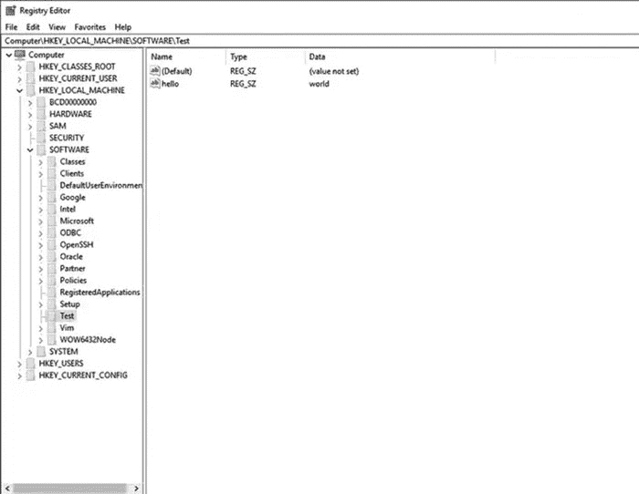

**图 5.13:** 执行 reg_create.yml 剧本后的 Windows 注册表

## 删除 Windows 注册表

同样，正如我们在上一节中添加 Windows 注册表键一样，我们可以使用 Ansible `win_regedit` 模块并将 `path` 参数设置为 `absent` 来删除路径或配置单元。

以下 `reg_remove.yml` Ansible 剧本用于在 `HKEY_LOCAL_MACHINE` 下的 `Software` 文件夹下创建一个 `Test` 配置单元项（注：此处原文描述可能有误，逻辑上应为删除，但按原文意思翻译）。完整的 Ansible 剧本所示：

```yaml
---
- name: Windows registry remove
  hosts: all
  vars:
    mypath: 'HKLM:\Software\Test'
  tasks:
    - name: Registry remove path
      ansible.windows.win_regedit:
        path: "{{ mypath }}"
        state: absent
```

我们可以使用以下 `ansible-playbook` 命令执行 `reg_remove.yml` 剧本：

```bash
ansible-playbook reg_remove.yml
```

在执行阶段结束后，目标 Windows 系统上的键 `HKLM:\Software\Test` 被删除，如[图 5.14]所示：

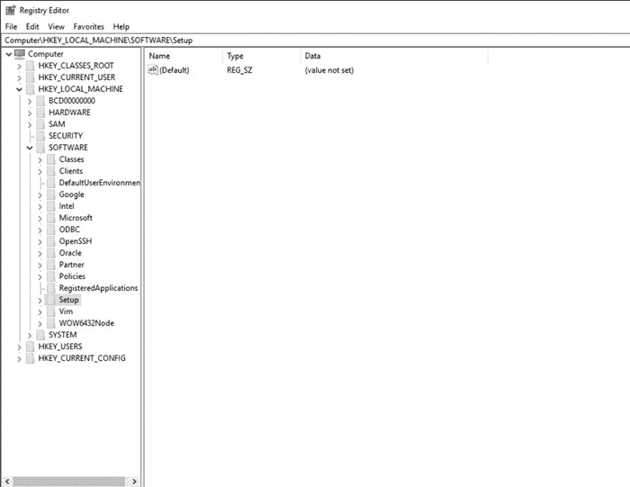

**图 5.14:** 执行 reg_create.yml 剧本后的 Windows 注册表（注：原文此处可能有误，应为 remove）

## 执行命令

`win_command` 和 `win_shell` 都是在 Windows 上执行命令的 Ansible 模块，但它们在执行环境和语法上有所不同。

Ansible `win_command` 模块在 Windows 命令行中运行，而 `win_shell` 模块在 PowerShell Shell 中运行。选择哪个模块取决于你需要运行的命令类型。

如果你需要运行简单的命令或批处理，可以使用 `win_command` 模块。例如，创建一个目录：

```yaml
- name: Create directory
  win_command: mkdir C:\example
```

我们可以使用 `win_shell` 模块执行任何 PowerShell 脚本。以下脚本创建一个新用户：

```yaml
- name: Create new user
  win_shell: New-LocalUser -Name "exampleuser" -Password (ConvertTo-SecureString "P@ssword1" -AsPlainText -Force)
```

`win_command` Ansible 模块可以用于不需要 shell 功能的简单命令。`win_shell` Ansible 模块或 `win_command` Ansible 模块均可在 Windows 目标主机上执行 Windows PowerShell 或 cmd.exe，但方式略有不同。在可能的情况下，始终优先使用特定的 Ansible 模块。


`win_shell` Ansible 模块执行 PowerShell 或 `cmd.exe` 解释器，并具有完整的 shell 功能，例如如 `$env:HOME` 等变量以及 `<`、 `>`, `|` 和 `;` 等操作。`win_command` Ansible 模块在不具备任何 shell 功能的情况下执行代码，它有时更安全，因为不会暴露环境变量。从本质上来说，`win_command` 模块比 `win_shell` 模块更安全。

从安全角度来看，`win_command` 模块更加健壮，结果更具预测性，因为它绕过了 shell。两个模块都总是返回 `changed` 状态，因为 Ansible 无法预测执行是否更改了目标系统。对于 Linux 目标，请按照第 4 章 Ansible For Linux 中“Executing commands”章节的描述，使用 `ansible.builtin.command` 和 `ansible.builtin.shell` 模块。

Ansible `win_command` 模块在远程 Windows 节点上执行命令。`win_command` 模块不受本地 `win_shell` 变量的影响，因为它绕过了 `win_shell`。同时，它可能无法运行 `win_shell` 的内置功能和重定向。

Ansible `win_shell` 模块在目标主机上带有完整的 shell 上文执行 shell 命令。以下示例演示了 Ansible `win_command` 模块和 `win_shell` 模块的功能。

# Netstat playbook(#toc.xhtml_s222a)

这是一个 Ansible playbook 示例，它使用 `win_command` 模块在所有主机上运行 `netstat -e` 命令，并将输出注册到 `command_output` 变量中。随后使用 `ansible.builtin.debug` 模块显示 `command_output.stdout_lines` 变量的输出。

在 Windows 中，`netstat` 是命令行工具，用于显示活动 TCP 连接、监听连接主机上的端口、以太网统计数据、IP 路由表等。`-e` 选项用于显示以太网统计数据。

`win_command` 模块用于在 Windows 主机上运行命令。它允许执行从命令提示符运行的任何命令，包括 PowerShell 命令。

`register` 关键字用于将 `netstat` 命令的输出捕获到 `command_output` 变量中。该变量稍后可以在 playbook 中用于进一步处理或分析。

`ansible.builtin.debug` 模块用于显示 `command_output.stdout_lines` 变量的输出，该变量包含字符串列表形式的 `netstat` 命令标准输出。此任务的输出将打印到控制台，提供有关每个 Windows 主机以太网统计数据的信息。完整的 Ansible `netstat.yml` playbook 如下：

```yaml
---
- name: Netstat playbook
  hosts: all
  tasks:
    - name: Check netstat
      ansible.windows.win_command: "netstat -e"
      register: command_output
    - name: Command output
      ansible.builtin.debug:
        var: command_output.stdout_lines
```

我们可以使用以下 `ansible-playbook` 命令执行 `netstat.yml` playbook：

```bash
ansible-playbook netstat.yml
```

执行输出与如下所示：

```text
TASK [Command output] ***********************************************************************
ok: [WindowsServer] => {
  "command_output.stdout_lines": [
    "Interface Statistics",
    "                                  �                                                                        Received                Sent

    "Bytes            13617365         10237530",
    "Unicast packets       53129     15035",
    "Non-unicast packets             293          274",
    "Discards                     0������������������������� 0",
    "Errors                               0",
    "Unknown protocols     206"
  "
  ]
}
```

# Get-Date playbook(#toc.xhtml_s223a)

这是一个 Ansible playbook 示例，它使用 `win_shell` 模块在所有主机上运行多个 PowerShell 命令，并将输出注册到 `command_output` 变量中。与上一个示例相同，随后使用 `ansible.builtin.debug` 模块显示 `command_output.stdout_lines` 变量的输出。

在此示例中，每个 Windows 主机运行两个 PowerShell 命令。第一个命令是 `hostname`，显示计算机的主机名。第二个命令是 `Get-Date`，显示当前日期和时间。

Ansible `win_shell` 模块用于在 Windows 主机上运行 PowerShell 命令。它允许使用多行字符串执行多个 PowerShell 命令。

`register` 关键字将两个 PowerShell 命令的输出捕获到 `command_output` 变量中。该变量稍后可以在 playbook 中用于进一步处理或分析。

`ansible.builtin.debug` 模块用于显示 `command_output.stdout_lines` 变量的输出，该变量包含字符串列表形式的两个 PowerShell 命令的标准输出。此任务的输出将打印到控制台，提供有关每个 Windows 主机主机名以及当前日期时间的信息。完整的 Ansible `powershell.yml` playbook 如下：

```yaml
---
- name: Powershell playbook
  hosts: all
  tasks:
    - name: Check getdate
      ansible.windows.win_shell: |
        hostname
        Get-Date
      register: command_output
    - name: Command output
      ansible.builtin.debug:
        var: command_output.stdout_lines
```

我们可以使用以下 `ansible-playbook` 命令执行 `powershell.yml` playbook：

```bash
ansible-playbook powershell.yml
```

执行输出与如下所示：

```text
TASK [Command output] ***********************************************************************
ok: [WindowsServer] => {
  "command_output.stdout_lines": [
    "demo",
    "",
    "Friday, April 8, 2022 18:19:36 AM",
    "",
    ""
  ]
}
```

# Wrong module(#toc.xhtml_s224a)

当我们在 `win_command` 和 `win_shell` 模块之间使用错误的模块时，会导致致命错误。请参考第 6 章 Ansible Troubleshooting 中的“Ansible modules”章节进行进一步排错。

# Conclusion(#toc.xhtml_s25a)

使用 Ansible 自动化 Windows 目标系统的任务可以提高我们的效率并为我们的集群创造更多价值。可用性测试、配置管理、文件系统和用户管理、软件包安装、滚动更新以及 Windows 注册表等重复操作可以更好地执行，并获得更准确的结果。

在下一章节中，我们将学习 Ansible 的最佳实践，即如何排错、识别问题原因并修复它。

# Points to Remember(#toc.xhtml_s26a)

*   我们可以使用 Ansible 在大多数现代 Windows 和 Windows Server 上执行脚本。通过 WinRM 连接并使用 PowerShell 终端执行命令。

*   最简单的 Ansible 模块是 `win_ping`，它测试 Windows 目标主机上 PowerShell 代码的身份验证和执行

*   可以使用 Ansible `win_lineinfile` 模块和 Ansible `template` 模块进行配置管理。

*   许多模块简化了文件系统管理：使用 Ansible `win_stat` 模块检查文件和目录是否存在；使用 Ansible `win_file` 模块创建文件和目录；使用 Ansible `win_get_url` 模块下载内容；使用 Ansible `git` 模块检出 Git 仓库。

*   可以使用 Chocolatey 软件包管理器配置或安装额外软件，并保持我们的集群统一。


*   我们使用 Ansible 的 `win_updates` 模块进行滚动更新以保持机群最新，并在企业环境中使用 Microsoft Windows Server Update Services (WSUS)。
*   Ansible 的 `win_user` 和 `win_group` 模块简化了本地用户和组的管理。
*   可以使用 Ansible 的 `win_reg_stat` 和 `win_regedit` 模块从 Windows 注册表中检查、创建和删除键、项和值。

# 多选择题

1. 配置 Windows 目标主机需要什么要求？
    1. OpenSSH 服务运行并有 Python 解释器
    2. WinRM 服务运行并有 Python 解释器
    3. WinRM 服务运行并有 PowerShell 解释器
    4. OpenSSH 服务运行并有 PowerShell 解释器

2. 检查 Windows 目标上是否存在文件的最佳方法是什么？
    1. Ansible stat 模块
    2. Ansible win_stat 模块
    3. Ansible win_file 模块
    4. Ansible file 模块

3. 我们如何在 Windows 目标上自动化安装包？
    1. 使用 Chocolatey 包管理器。
    2. 手动安装包。
    3. Ansible package 模块
    4. 不可能

4. 用于 Windows 目标的哪两个 Ansible 集合（collections）？
    1. 它们是“aws..windows”和“ansible.windows”集合。
    2. 它们是“aws.windows”和“community.windows”集合。
    3. 它们是“ansible.builtin”和“community.windows”集合。
    4. 它们是“ansible.windows”和“community.windows”集合。

# 答案

1. C
2. B
3. A
4. D

# 问题

1. Windows 目标的认证选项有哪些？
2. Ansible 清清单中使用 `ansible_winrm_transport` 变量的作用是什么？
3. Ansible `win_copy` 模块的两个不同用途是什么？
4. 我们如何检查 Windows 目标主机上是否存在文件或目录？
5. Chocolatey 开源网络存档的目的是什么？
6. 什么时候必须使用 Ansible 的“command”和“shell”模块？

# 关键术语

* **WinRM**: WinRM 代表 Windows Remote Management（Windows 远程管理），是一种允许远程管理 Windows 机器的协议。它实现了 Windows 机器之间的网络通信，并提供了远程执行命令、访问文件和执行其他管理任务的安全方法。
* **PowerShell**: PowerShell 是一种命令行壳和脚本语言，设计用于自动化 Windows 操作系统上的管理任务。
* **Chocolatey**: Chocolatey 是一个 Windows 的包管理器，可自动化软件包的安装和管理。更多信息请参阅 [`chocolatey.org`](https://chocolatey.org)。
* **WSUS**: WSUS（Windows Server 内部更新服务）是 Windows Server 中的一种服务器角色，允许在网络内集中管理和发布 Windows 更新和补丁。
* **Windows Registry**: Windows 注册表是一个层次结构数据库，存储了 Windows 操作系统及其安装应用程序的配置设置和选项。

________________

[1] [`chocolatey.org`](https://chocolatey.org)
[2] [`github.com/ansible-collections/community.windows/issues/89`](https://github.com/ansible-collections/community.windows/issues/89)

# 第 6 章

# Ansible 故障排除

## 引言

本章概述了最常见的 Ansible 问题。在本章结束时，我们将学习故障排除的步骤、最常见错误的根源以及一些解决方案的实际示例。我们将熟练检查 playbook 语法、使用详细（verbose）和调试（debug）模式、检查拼写错误、验证版本兼容性、检查依赖项以及使用 Ansible 调试模块。通过遵循这些步骤，我们可以解决 Ansible 的常见问题，并确保 IT 基础设施管理任务的高效自动化。

## 结构

在本章中，我们将涵盖以下主题：
* Ansible 故障排除
* Ansible 调试
* Ansible 语法
* 故障排除工具
* Ansible 连接
* Ansible vault
* Ansible 模块
* Ansible 角色 (role)
* Ansible 集合 (collection)
* Windows Ansible

# Ansible 故障排除

在 Ansible 中，与其他计算机编程语言和软件工具一样，可能会出现问题。在本章中，我们将学习最常用的 Ansible 故障排除步骤和技术，用这些技术解决可能出现的任何问题。

**第一步：检查 Ansible 文档**

Ansible 文档提供了详尽的故障排除提示和技巧。首先查阅文档始终是一个好主意，查看是否存在可能导致我们问题的已知问题或限制。如果我们无法在文档中找到解决方案，请进入下一步。

**第二步：验证清单 (inventory)**

清单文件是 Ansible 基础设施的关键组成部分。确保清单文件定义正确且所有主机都是可达的。如果在特定主机上遇到问题，请确保该主机正在运行且 SSH 密钥认证已正确设置。

**第三步：检查连通性**

验证我们是否可以从 Ansible 控制节点连接到目标主机。常见的连接问题包括防火墙规则、网络问题或 SSH 密钥认证问题。使用 `ping` 命令验证与主机的连通性。如果仍然有问题，请尝试使用不同的 SSH 端口或建立 SSH 隧道。

**第四步：验证 playbook 语法**

通过在检查模式（check mode）下运行 playbook 来确保语法正确。此模式不会对系统进行任何更改，只检查语法。使用带有 `--check` 标志的 `ansible-playbook` 命令。

**第五步：使用详细模式 (verbose)**

在执行 Ansible playbook 时，使用详细标志（`-v`）来获取更详细的输出。这有助于识别错误发生的位置。通过在 `ansible-playbook` 命令中添加更多的 `-v` 参数来增加详细程度。例如，使用 `-vvv` 进行三级详细输出。完整的级别总结在表 6.1 中。请第 2 章 Ansible Language Core 中的 Ansible Playbook 章节获取完整的 Ansible 详细级别：

| 级别 | 描述 | ansible-playbook 参数 |
| :--- | :--- | :--- |
| 0 | 普通 | 无参数 |
| 1 | 详细 | `-v` |
| 2 | 更详细 | `-vv` |
| 3 | 调试 | `-vvv` |
| 4 | 连接调试 | `-vvvv` |

表 6.1：Ansible 详细级别

**第六步：调试模式 (debug)**

调试模式是三级详细（`-vvv`），提供了更多的输出。使用此模式获取 playbook 执行期间的更多信息。我们可以使用 `-vvv` 标志开启调试详细模式。

**第七步：检查拼写错误**

有时，错误是由 playbook、清单文件或其他配置文件中的简单拼写错误引起的。仔细检查文件以查找任何拼写错误或语法错误。使用带有语法高亮的文本编辑器可以更容易发现错误。

**第八步：检查版本兼容性**

确保 Ansible 版本与我们管理的操作系统或软件版本兼容。某些模块可能不支持旧版本的软件或操作系统。使用 `ansible --version` 命令检查我们正在运行的 Ansible 版本。

**第九步：检查依赖项**


确保目标主机上已安装任何必要的依赖项或先决条件。如果缺少所需的软件包或库，Ansible 将无法执行任务。请检查正在使用的特定模块的文档，查看是否需要任何依赖项。有关 Python 库依赖的更多信息，请参阅 `Ansible Collection` 部分。

## 步骤 10：使用 Ansible debug 模块

Ansible 的“debug”模块可用于在 playbook 执行期间输出变量或其他信息。使用此模块可以排查变量、模板或其他动态内容的问题。我们可以通过将该模块添加到 playbook 中来使用调试模块。

我们探索了一些常用的 Ansible 故障排除步骤和技术，可以使用这些技术来解决可能出现的任何问题。记住始终始终从检查文档开始，验证清单和连接性，使用详细模式（verbose）和调试模式，检查拼写错误以及验证版本兼容性。

# Ansible 调试

Ansible 具有“check”模式（检查模式），允许用户运行 playbook 而不会实际对目标系统进行任何更改。请参阅 `[第 2 章：Ansible 语言核心]` 中的 `Check and Debugging` 章节，了解如何执行干运行或增加调试信息的详细程度。

在检查模式下运行时，Ansible 将遍历 playbook 并照常执行所有任务，但它不会执行任何以某种方式修改系统的任务。相反，Ansible 将向用户报告如果正常运行 playbook，将会发生哪些更改。当用户想在运行 playbook 之前验证会对目标系统进行哪些更改时，使用检查模式将非常有帮助。这允许用户在对系统进行任何更改之前捕获潜在的问题或错误。此外，检查模式可以通过在实际执行之前提供 playbook 的干运行，帮助用户避免对目标系统产生意外的更改。要在检查模式下运行 playbook，用户可以在其 Ansible 命令中添加 `--check` 参数：

```
ansible-playbook --check playbook.yml
```

这将以检查模式运行 playbook，并报告如果正常运行运行 playbook 将会发生的任何更改。用户随后可以查看输出，以确保在正常运行 playbook 之前这些更改是预期且理想的。

需要注意的是，检查模式并不保证 playbook 在正常运行时会成功执行。可能会有某些条件或依赖项仅在实际执行期间出现，因此用户在生产环境中运行之前，仍应彻底测试他们的 playbook。

以下 `changeip.yml` Ansible playbook 用于设置 Linux 目标机器的 IP 地址和子网掩码：

```yaml
---
- name: Change IP Address of Remote Host
hosts: all
become: true
vars:
  new_ip_address: 192.168.1.100
  netmask: 255.255.255.0
tasks:
  - name: Update Network Configuration File
    ansible.builtin.lineinfile:
      path: /etc/network/interfaces
      regexp: '^address'
      line: 'address {{ new_ip_address }}'
    notify:
      - Restart Network Service
  - name: Update Netmask Configuration File
    ansible.builtin.lineinfile:
      path: /etc/network/interfaces
      regexp: '^netmask'
      line: 'netmask {{ netmask }}'
    notify:
      - Restart Network Service
handlers:
  - name: Restart Network Service
    ansible.builtin.service:
      name: networking
      state: restarted
```

我们通过向 `ansible-playbook` 命令添加 `--check` 参数来使用检查模式。我们可以使用 `ansible-playbook` 命令并添加 `--check` 参数来执行 `changeip.yml` Ansible Playbook。

完整命令如下：

```
ansible-playbook --check changeip.yml
```

执行 Ansible playbook `shell.yml` 的输出如下所示：

```
PLAY [Change IP Address of Remote Host] ***********************************************************************
TASK [Gathering Facts] *****************************************************************************ok: [demo.example.com]
TASK [Update Network Configuration File] **********************************************************************
changed: [demo.example.com]
TASK [Update Netmask Configuration File] **********************************************************************
changed: [demo.example.com]
RUNNING HANDLER [Restart Network Service] *********************************************************************
changed: [demo.example.com]
PLAY RECAP *****************************************************************************demo.example.com           ok=4    changed=3   unreachable=0    failed=0    skipped=0    rescued=0    ignored=0
```

我们可以看到，执行的输出看起来是正常执行，但目标主机上没有执行任何更改。使用检查模式，我们可以在不对目标节点执行任何操作的情况下解析 Ansible playbook。

# Ansible 语法

Ansible 语法设计为便于人类阅读、简单且易理解。Ansible 语法的基础构建单元是 YAML 文件，其中包含了要在目标系统上执行的任务列表。总的来说，Ansible 语法旨在易于阅读、编写和理解，即使是非技术用户也是如此。YAML 文件、模块、变量、条件、循环和角使用使用管理复杂的 IT 基础设施和自动化重复任务提供了一个灵活且强大的框架。

以下是用户可能会遇到的一些常见 Ansible 语法错误及其解决方法：

1. **YAML 语法错误：** Ansible 使用 YAML 语法定义 playbook 和任务。用户可能会遇到语法错误，如缺少或额外的逗号、缩进错误或括号不匹配。要修复这些错误，用户应仔细检查 YAML 语法，并确保所有的括号、逗号和缩进都是正确的。
2. **未定义的变量：** 如果变量未定义或拼写错误，Ansible 将无法找到它并可能报错。用户应确保所有变量都定义正确，并且变量名拼写正确。
3. **缺少模块：** Ansible 模块是在远程系统上执行各种任务的预写脚本。如果模块未安装或拼写错误，Ansible 将无法找到它并可能报错。用户应确保所有所需的模块都已安装，并且模块名拼写正确。
4. **缩进错误：** Ansible 使用缩进来定义任务和块的层级。如果缩进错误，Ansible 将无法正确解析 playbook 并可能报错。用户应确保所有任务和块都正确地缩进。
5. **缺少引号：** 如果字符串未包含在引号中，Ansible 可能会将其解释为变量或命令并报错。用户应确保所有字符串都正确地包含在引号中。
6. **缺少或额外的括号：** 如果缺少或额外的括号，Ansible 可能无法正确解析 playbook 并可能报错。用户应确保所有括号都正确匹配且平衡。
7. **条件语句中的无效语法：** Ansible 使用简单的 if/then/else 语法来定义条件。如果语法错误，Ansible 可能无法正确解析条件并可能报错。用户应确保所有条件的语法都是正确的。

通常，为了避免 Ansible 中的语法错误，用户应该仔细检查其 playbook 的语法，并确保所有变量、模块、任务和块都经过了正确的定义和缩进。此外，用户在生产环境中运行 playbook 之前，仍应彻底测试。

## 故障排除工具


Ansible 拥有许多调查工具，可以帮助我们加速工作流，避免常见的陷阱并遵循最佳实践。

Ansible 语法检查、YAML linter 和 Ansible linter 的组合创建了一支强大的军队，用于排查 Ansible Playbook 的问题。

## 错误的 playbook

我们将通过一些代码，探索使用 Ansible 语法检查、YAML linter 和 Ansible linter 工具进行的所有排查过程以及我们可以获取的信息。

以下 Ansible `errors.yml` Playbook 包含了一些需要进一步调查的常见错误：

```yaml
---
- name: Troubleshooting example
hosts: all
vars:
  servers:
    host01:
      ip: 192.168.1.11
      type: large
tasks:
  - name: print a fact
    ansible.builtin.debug:
      var: ansible_facts['architecture']
  - name: Latest apache2 package
    ansible.builtin.apt:
      name: apache2
      state: latest
      update_cache: true
  - name: Only large machines
    ansible.builtin.debug:
      msg: "{{ servers.values() | selectattr('type', 'eq', 'large') | map(attribute='ip') | join(',') }}"
```

正如我们可能观察到的，第一个任务“print a fact”在 YAML 文档中没有正确对齐。第二个任务在同一层级有两个“name”语句，具有两种不同的含义。第三个任务的文本长度超过了标准的 80 个字符。

我们将使用三个命令行工具来识别并修正每个错误。

## 语法检查

我们使用自动工具的调查从简单的语法检查开始。我们可以使用 `ansible-playbook` 命令的 `--syntax-check` 参数在不执行 playbook 的情况下对其进行语法检查：

```bash
ansible-playbook --syntax-check errors.yml
```

执行结果在屏幕上返回以下错误，以及返回码 4（四）：

```
ERROR! We were unable to read either as JSON or YAML, these are the errors we got from each:
JSON: Expecting value: line 1 column 1 (char 0)
Syntax Error while loading YAML.
did not find expected key
```

错误似乎出现在 `errors.yml` 的第 15 行第 5 列，但可能根据具体的语法问题出现在文件的其他位置。

引起故障的行似乎是：

```yaml
- name: Latest apache2 package
^ here
```

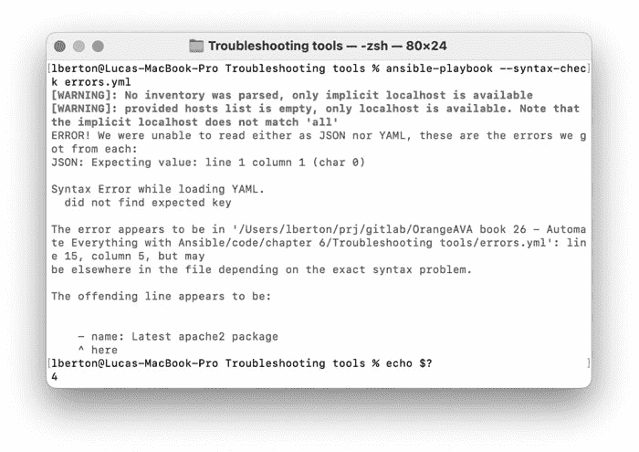

**图 6.1:** 语法检查输出

`ansible-playbook` 命令的彩色输出也显示在 图 6.1 中。错误信息为排查和调试源代码第 15 行指明了正确的方向，但我们还需要进一步的调查和修正。

当我们拥有训练有过的眼光时，很容易发现并修正其中的一些常见错误。为了获得更好的体验，可以使用一些命令行实用来辅助我们的开发之旅。

命令行工具 `yamllint` 和 `ansible-lint` 对于识别代码错误和在自动化之旅中节省时间非常有帮助。

## YAML linter

`yamllint` 是一个用于所有 YAML 文件的命令行静态代码分析工具。该软件的目的是“YAML 文件的 linter”，根据 MIT 和开源 GPL-3.0 许可证发布。在编写此本书时，最新版本是稳定的 1.30.0 版本。依赖要求是较新版本的 Python 3 和 `pyyaml` Python 库。更多信息请参考官方网站：[`github.com/adrienverge/yamllint`](https://github.com/adrienverge/yamllint)。安装过程非常简单，因为我们只需要在最新的系统中安装额外的 `yamllint`。当系统中未安装该工具时，会获得以下错误消息：

```
command not found: yamllint
```

例如，我们可以在任何“Red Hat”类 Linux 发行版中使用 yum 或 DNF 软件包管理器安装 `yamllint` 包：

```bash
dnf install yamllint
```

而在任何“Debian”类 Linux 发行版中，我们需要使用 APT 软件包管理器：

```bash
apt install yamllint
```

我们可以在当前项目目录下使用命令执行 `yamllint`：

```bash
yamllint .
```

输出显示了根据 Ansible 最佳实践的行错误，以及返回码 1（一）：

```
./errors.yml
11:3      error     wrong indentation: expected 4 but found 2  (indentation)
15:5      error     syntax error: expected <block end>, but found '-' (syntax)
23:81   error    line too long (107 > 80 characters)  (line-length)
```

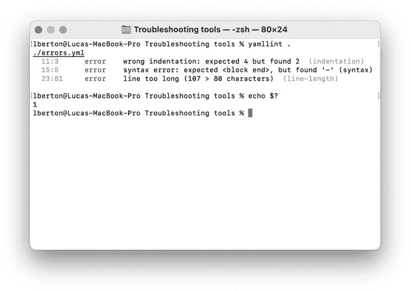

**图 6.2:** 的 yamlint 输出

`yamllint` 命令的彩色输出也显示在 图 6.2 中：

## Ansible linter

`ansible-lint` 是一个针对 Ansible 语言的命令行静态代码分析工具。该软件的目的是“检查 ansible playbooks 的实践和行为”，根据开源 GPL-3.0 许可证发布。在编写此本书时，最新版本是稳定的 6.14.3 版本。依赖要求是较新版本的 Python 3 以及 Python 库 `pyyaml`、`pygments` 以及工具 `yamllint` 和 `ansible`。更多信息请参考官方网站：[`ansible-lint.readthedocs.io/`](https://ansible-lint.readthedocs.io/)。安装过程非常简单，因为我们只需要在最新的系统中安装额外的 `ansible-lint`。当系统中未安装该工具时，会获得以下错误消息：

```
command not found: ansible-lint
```

例如，我们可以在任何“Red Hat”类 Linux 发行版中使用 yum 或 DNF 软件包管理器安装 `ansible-lint` 包：

```bash
dnf install ansible-lint
```

而在任何“Debian”类 Linux 发行版中，我们需要使用“APT”软件包管理器。

```bash
apt install ansible-lint
```

我们可以在当前项目目录下使用命令执行 `ansible-lint`：

```bash
ansible-lint errors.yml
```

输出显示了根据 Ansible 最佳实践的行错误，以及返回码 2（二）：

```
load-failure: Failed to load YAML file
errors.yml:1 while parsing a block mapping
in "<unicode string>", line 11, column 5
did not find expected key
in "<unicode string>", line 15, column 5
Rule Violation Summary
count tag           profile rule associated tags
1 load-failure min      core, unskippable
Failed after : 1 failure(s), 0 warning(s) on 1 files.
```

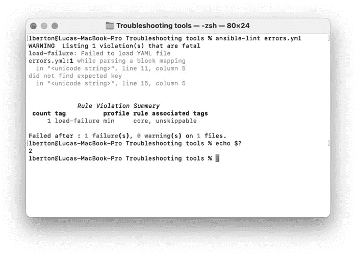

**图 6.3:** 的 ansible-lint 输出

`ansible-lint` 命令的彩色输出也显示在 图 6.3 中：

```
ansible-lint fix.yml
WARNING  Listing 2 violation(s) that are fatal
name[casing]: All names should start with an uppercase letter.
fix.yml:10 Task/Handler: print a fact
package-latest: Package installs should not use latest.
fix.yml:14 Task/Handler: Latest apache2 package
Read documentation for instructions on how to ignore specific rule violations.
Rule Violation Summary
count tag           profile  rule associated tags
1 name[casing]   moderate idiom
1 package-latest safety  idempotency
Failed after basic profile, 1/5 star rating: 2 failure(s), 0 warning(s) on 1 files.
```

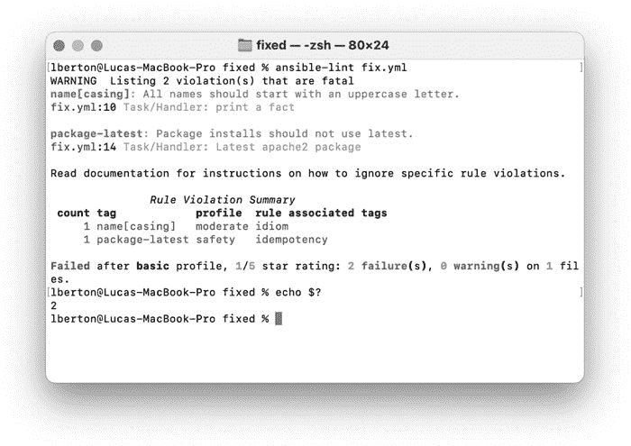

**图 6.4:** 的 ansible-lint 输出

# 修复后的 playbook

修正所有错误后，我们得到了以下 `fix.yml` Ansible Playbook：

```yaml
---
- name: Troubleshooting example
hosts: all
vars:
  servers:
    host01:
      ip: 192.168.1.11
      type: large
tasks:
  - name: Print a fact
    ansible.builtin.debug:
      var: ansible_facts['architecture']
  - name: Latest apache2 package
    ansible.builtin.apt:
      name: apache2
      state: present
      update_cache: true
  - name: Only large machines
    ansible.builtin.debug:
      msg: "{{ servers.values() | selectattr('type', 'eq', 'large') | map(attribute='ip') | join(',') }}"
```


## 语法检查

`fix.yml` Ansible playbook 成功通过了 `ansible-playbook` 命令的语法检查：

```
ansible-playbook --syntax-check fix.yml
```

```
playbook: fix.yml
```

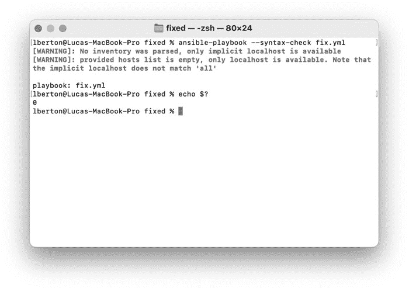

**图 6.5:** 语法检查输出

上一个命令返回 0（零）状态码。语法检查命令的行为也如图 6.5 所示：

## YAML linter

在项目层级执行 `yamllint`：

```bash
yamllint .
```

`yamllint` 命令的行为也如图 6.5 所示。当我们执行 `yamllint` 命令行实用程序时，我们获得了成功的空输出和 0（零）状态码。

## Ansible linter

我们将使用 `ansible-lint` 命令行工具对 playbook 进行分析：

```bash
ansible-lint fix.yml
```

输出显示根据 Ansible 最佳实践执行成功，并返回 0（零）状态码：

```
ansible-lint fix.yml
```

`Passed with production profile: 0 failure(s), 0 warning(s) on 1 file.`

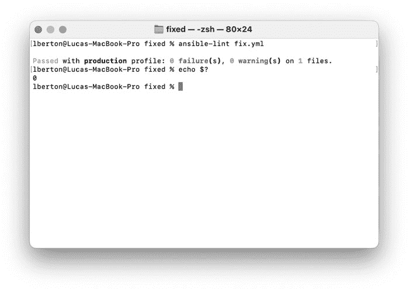

**图 6.6:** ansible-lint 输出

`ansible-lint` 命令的彩色输出也如图 6.6 所示。

# Visual Studio code

Visual Studio Code (VSCode) 是由微软开发的免费开源代码编辑器（IDE）。它支持广泛的编程语言，并为代码编辑、调试和版本控制提供了丰富的功能。我们可以从 [`code.visualstudio.com/`](https://code.visualstudio.com/) 下载适用于常见操作系统的编辑器：通用二进制文件的 macOS、Windows x64，以及作为 RPM 和 DEP 包格式的 Linux x64。

VSCode 是 Ansible 代码开发的首选工具，因为它极大地提高了开发者的生产力。不过，可以使用任何文本编辑器。

Ansible 与 VSCode 的集成允许开发者利用这两个工具的强大功能。这种集成允许开发者在 VSCode 环境中编写、测试和部署 Ansible playbooks。它为创建和编辑 playbooks 提供了一个直观的界面，以及一系列调试和测试功能。

Ansible VSCode 集成的一些主要优势包括：

1. **代码补全和语法高亮：** VSCode 为 Ansible 模块提供自动补全，为 Ansible YAML 文件提供语法高亮，使开发者更容易编写和调试 Ansible 代码。
2. **IntelliSense 和 检查：** VSCode Ansible 扩展为 Ansible 模块和 playbooks 提供 IntelliSense 和检查。这确保了代码没有错误并符合最佳实践。
3. **调试：** VSCode 允许开发者使用断点、变量检查和逐步执行来调试 Ansible 代码。这有助于识别和修复复杂 playbooks 中的问题。
4. **Ansible Galaxy 集成：** VSCode 与 Ansible Galaxy（Ansible roles 和 collections 的仓库）集成。这让能够轻松发现、下载和使用预构建的 Ansible 内容。
5. **持续集成/持续部署 (CI/CD) 支持：** VSCode Ansible 扩展支持与 Jenkins、Travis CI 和 GitLab CI 等流行的 CI/CD 工具集成。这允许对 Ansible playbooks 进行自动化测试和部署。

Ansible VSCode 集成为开发和部署 Ansible playbooks 提供了强大且直观的界面。它提高了效率，确保了代码质量，并简化了复杂系统的管理。为了获得最佳体验，请确保安装了 Red Hat 的 Ansible 扩展，如图 6.7](#c06.xhtml_fig6_7)所示：

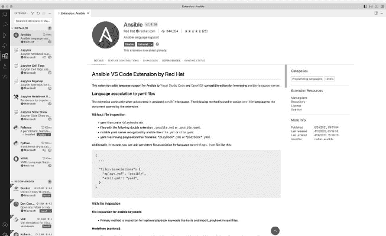

**图 6.7:** Ansible VSCode 扩展

在底层，Ansible 扩展使用相同的 `ansible-lint` 规则来突出最佳实践并在编程期间提供辅助。每一行带有建议的代码都有红色下划线，当我们将鼠标光标悬停其上方时，就会如图 6.8 所示的第 7 行代码提示：

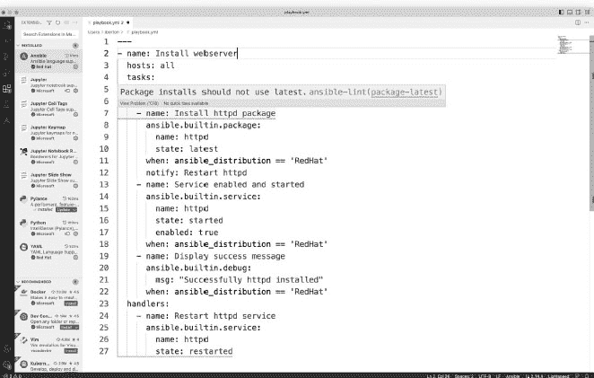

**图 6.8:** Ansible VSCode 集成建议

# Ansible 自插件

当项目中添加额外的 Ansible 插件和模块时，它们是用 Python 语言编写的。使用像 `pylint` 这样的 Python Linter 来验证 Python 文件可能会有用。

可以使用 pip 或最常用的发行包管理器安装 `pylint` 工具。使用 PIP，可以通过以下命令在本地机器上安装所有所需的依赖：

```bash
pip install pylint
```

执行输出如下图 6.9 所示：

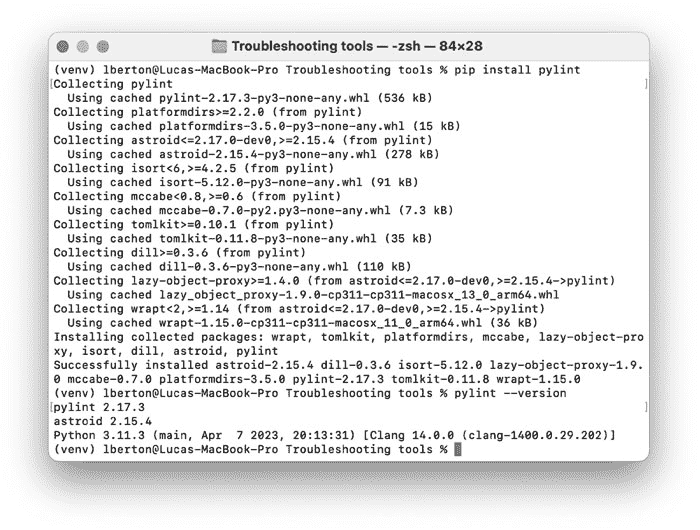

**图 6.9:** PyLint 安装

# CI/CD 流水线

我们将所有的 Ansible 语法检查、YAML linter、Ansible linter 和 Python linter 工具组合到 CI 流水线中，以便在仓库的每次提交中尽快发现错误，或者确保每次发布都不会包含可能在生产环境中产生故障或意外行为的错误。在 CI 流水线中集成所有工具允许我们创建一个工作流，在任何执行之前批准更改。我们可以使用多种工具构建 CI 流水线；最流行的是 Jenkins、GitLab、GitHub Actions 等。

# Ansible 连接

常见的 Ansible 连接错误与 SSH 认证有关。以下是关于此错误的细节：

1. **SSH 认证错误：** 当 Ansible 无法通过 SSH 远程服务器进行身份验证时发生此错误。这可能是由于登录凭据错误或缺少 SSH 密钥。
2. **主机密钥验证错误：** 当 Ansible 不识别远程服务器的主机密钥时发生此错误。这可能发生在首次访问远程服务器或主机密钥发生更改。
3. **网络连通性错误：** 当 Ansible 由于网络连接问题（如防火墙拦截或网络拥塞）无法连接到远程服务器时发生此错误。
4. **SSH 超时错误：** 当连接在完成身份验证之前超时时发生此错误。这可能是由于网络连接缓慢或其他网络问题导致的。
5. **拒绝连接错误：** 当远程服务器不接受 SSH 连接时发生此错误。这可能是由于 SSH 守护进程未运行或在不同的端口上监听。

要解决最常见的 Ansible 连接错误，用户应首先确保登录凭据正确且 SSH 密钥存在并有效。他们还应该验证主机密钥，如果它不在那里则将其添加到 `known_hosts` 文件中。用户还应该检查 Ansible 控制节点与远程服务器之间的网络连通性，并确保防火墙没有阻止 SSH 连接。此外，他们应该检查 SSH 守护进程是否在正确的端口上运行。

# 错误

连接失败（Connection failed）错误是是最常见的 Ansible 问题之一，非常令人困扰。这类问题的根本原因可能是网络连接、防火墙、某些 SSH 配置参数，甚至是我们的 Ansible 清单中写错了 Ansible 主机名。

结果是致命的连接失败错误，我们经常在执行日志中看到操作超时（operation timed out）的消息。

当我们处理虚拟机时，请验证虚拟网卡的连接，并确保防火墙中已启用 SSH 服务。手动到目标主机进行 SSH 连接测试对连接可能有帮助。

# 示例


现在让我们以错误的主机名作为目标机器来模拟并解决问题。正确的主机名是 `server01.example.com`，但假设我们多输入了一个 `e`，导致最终的主机名变成了 `serveer01.example.com`。请注意主机名额外的字母 e。这是一个低级且常见的错误。

以下 Ansible 清单文件 `inventory_error.ini` 中 `serveer01.example.com` 的目标主机名拼写错误，应该是 `server01.example.com`：

```
serveer01.example.com
```

我们可以使用每个 Ansible 安装自带的 `ansible-inventory` 命令来验证 Ansible 清单 `inventory_error`。列表视图完整命令如下：

```
ansible-inventory -i inventory_error.ini --list
```

上一个命令产生以下输出：

```json
{
  "all": {
    "children": [
      "ungrouped"
    ]
  },
  "ungrouped": {
    "hosts": [
      "serveer01.example.com"
    ]
  }
}
```

一旦输入了正确的主机名（`server01.example.com`），我们就可以看到执行成功。

```
server01.example.com
```

我们可以使用 `ansible-inventory` 命令验证 Ansible 清单文件：

```
ansible-inventory -i inventory --list
```

```json
{
  "all": {
    "children": [
      "ungrouped"
    ]
  },
  "ungrouped": {
    "hosts": [
      "server01.example.com"
    ]
  }
}
```

有了正确的 Ansible 清单文件，我们获得了正确的主机列表。

# 密码认证

当尝试使用密码认证连接到主机时，我们可能会遇到以下错误消息：

```
to use the 'ssh' connection type with passwords, you must install the sshpass program
```

我们需要在 Ansible 控制器上安装 `sshpass` 软件。对于类“Red Hat”操作系统：

```
dnf install sshpass
```

对于类 Debian 发行版：

```
apt install sshpass
```

关于 `sshpass` 命令行的更多信息，请参阅 Ansible for Linux 部分。

# Ansible Vault

Ansible Vault 是 Ansible 的一项功能，允许用户加密敏感数据，如密码、API 和其他密钥。以下是用户可能会遇到的一些 Ansible Vault 错误及其解决方法：

1. **密码错误：** 如果用户在解密 Ansible Vault 文件时输入错误的密码，Ansible 将无法解密该文件并可能报错。用户应确保在解密 Ansible Vault 文件时输入正确的密码。
2. **缺失或位置错误的 Vault 标签：** Ansible Vault 使用特殊标签来指示哪些变量或文件应该被加密。如果这些标签缺失或位置错误，Ansible 将无法正确加密或解密数据并可能报错。用户应确保使用正确的 Vault 标签语法和放置位置。
3. **加密错误：** 如果加密过程遇到错误，Ansible 可能无法正确加密数据并可能报错。用户应确保正在使用支持的加密算法，并且正在加密的数据没有超过允许的最大长度。
4. **文件权限错误：** 如果文件权限不正确，Ansible 可能无法读取或写入 Ansible Vault 文件并可能报错。用户应确保文件权限设置正确，并且他们拥有访问文件的必要权限。
5. **加密方法冲突：** 如果用户在 playbook 中使用了多种加密方法，可能会遇到冲突，导致 Ansible Vault 无法正常工作。用户应确保在 playbook 中仅使用一种加密方法。
6. **密钥轮换：** 如果加密密钥被更改或轮换，用户可能无法解密 Ansible Vault 文件并遇到错误。用户应确保有一套安全的流程来轮换加密密钥，并相应更新他们的 playbook。

总来说，为了避免 Ansible Vault 错误，用户应确保使用强且唯一的密码、正确放置 Vault 标签、使用支持的加密算法、设置正确的文件权限，并遵循密钥管理的最佳实践。此外，用户在在生产环境中运行之前，应充分测试使用 Ansible Vault 的 playbook。

## 创建

在使用 `ansible-vault create` 命令时可能会发生以下两个错误。

当两个密码不匹配时，通过 `ansible-vault` 命令我们在屏幕上获得以下错误：

```
New Vault password:
Confirm New Vault password:
[WARNING]: Error in vault password prompt (default): Passwords do not match
ERROR! Passwords do not match
```

如果我们通过 `ansible-vault` 命令指定了一个已存在的文件，将获得以下错误消息：

```
New Vault password:
Confirm New Vault password:
ERROR! secret.yml exists, please use 'edit' instead
```

## 加密

当 `vault-password.txt` 文件不存在时，我们将获得以下“未找到密码文件”错误消息：

```
[WARNING]: Error getting vault password file (default): The vault password file not found
```

（此处省略重复的警告信息）

```
[WARNING]: Error getting vault password file (default): The vault password file not found
```
...
```
[WARNING]: Error getting vault password file (default): The vault password file not found
```

```
ansible-vault` 命令
`secret.yml` 已存在。

## 查看

当密码错误时，我们将获得以下输出：

```
Vault password:
ERROR! Decryption failed
```

解决方案是对 `ansible-inventory` 命令使用正确的密码。

## Playbook

当我们忘记指定任何密码时，发生了一个致命错误。我们可以模拟以下 `ansible-playbook` 命令，产生如下输出：

```
TASK [include_vars] *************************************************
fatal: [server01.example.com] => => {
  "ansible_facts": {},
  "ansible_included_files": [],
  "changed": false,
  "message": "Attempting to decrypt"
}
```

## 内联 Vault

当我们复制并粘贴 `ansible-vault` `encrypt_string` 命令的输出时，请注意移除输出末尾的字符。如果未移除结束字符，执行可能会在两种场景之一结束：加密变量：

```
ok: [server01.example.com] => {
  "password": "$ANSIBLE_VAULT;1.1;AES256;323438663430343838353432366533353432223232646334343061393439656537336262363764313764313535383463323232653932626137666432353735316162666638386639623161626635373535616436303232326662376164393166373235303434653935333403360a63646139613964633532646334366669306266643038%"
}
```

执行 `vault_inline.yml` 文件的输出显示了 `Vault format` `unhexlify error` ：

```
[WARNING]:
There was a vault format error: Vault format unhexlify error: Odd-length string
The error appears to be in 'vault_inline.yml': line 5, column 15, but may be elsewhere in the file depending on the exact syntax problem.
The offending line appears to be:
vars:
  password: !vault |
  ^ here
```


```bash
fatal: [localhost]: FAILED! => {"msg": "Vault format unhexlify error: Odd-length string\n\nThe error appears to be in 'vault_inline.yml': line 5, column 15, but may\nbe elsewhere in the file depending on the exact syntax problem.\n\nThe offending line appears to be:\n\n  vars:\n    password: !vault |\n         ^^ here\n"}
```

一旦在 `vault_inline.yml` 文件中修正了错误行，执行将继续，并可以在第 3 章：Ansible 语言扩展 的 *Ansible Vault 输出* 部分看到所示的结果。

# Ansible 模块

Ansible 模块是执行特定功能的预构建任务。以下是一些常见的 Ansible 模块错误及其解决方法：

1. **未找到模块（Module not found）：** 当 Ansible 无法找到 playbook 中调用的模块时，会发生此错误。用户应确保该模块已安装在 Ansible 控制节点上，并在 playbook 中指定了正确的路径。
2. **无效模块参数（Invalid module parameter）：** 当 Ansible 无法识别模块参数时，会发生此错误。用户应确保使用了模块的正确语法，并指定了所有必需参数。
3. **权限错误（Permissions error）：** 当 Ansible 没有权限执行模块指定的任务时，会发生此错误。用户应确保他们拥有执行该任务所需的权限，并在必要时以特权用户运行 Ansible。
4. **数据类型错误（Incorrect data type）：** 当 Ansible 期望某种类型的数据但接收到不同类型的数据时，会发生此错误。用户应确保以正确的格式传递数据，并使用正确的数据类型。
5. **连接错误（Connection errors）：** 当 Ansible 无法使用连接插件到远程服务器时，会发生此错误。用户应确保拥有正确的登录凭据、远程服务器可访问，并且已启用 SSH 访问。
6. **模块版本不正确（Incorrect module version）：** 当 Ansible 使用过时或不兼容的模块版本时，会发生此错误。用户应确保使用与其 Ansible 版本兼容的模块版本。

要解决这些 Ansible 模块错误，用户应该确保他们对所使用的模块的语法和要求有清晰的理解。他们还需要确保设置了正确的权限、安装了必要的模块，并使用了正确的数据类型。此外，用户应该彻底测试他们的 playbook，并验证 playbook 中指定的任务是否按预期执行。

# 缺失模块参数（Missing module parameter）

当 Ansible playbook 中的模块缺少必需参数时，会发生 `Missing Module Parameter` 错误。此错误通常发生在模块有特定的必需参数，且这些参数必须被定义才能成功执行任务时。

例如，`copy` 模块（属于 `ansible.builtin` 集合）要求定义 `src` 和 `dest` 参数。如果缺少这些参数中的任何一个，Ansible 将报告“Missing Module Parameter”错误。

要解决此错误，用户应该查阅模块文档，以确定成功执行模块所需的必需参数。然后他们应该将缺失的参数添加到 playbook 中，或确保它们在清单文件（inventory file）中已定义。

确保使用正确的语法和数据类型正确定义参数同样重要。用户可以使用 Ansible 的 `debug` 模块打印变量值，以验证它们是否设置正确。

总的来说，`Missing Module Parameter` 错误是一个常见错误，通过查阅模块文档并确保在 playbook 或清单文件中正确定义了必需参数，可以轻松解决。

## Ansible 服务（Ansible service）

当 Ansible 无法确定目标主机上服务的当前状态时，会发生 `Service is in the unknown state` 错误。当使用 Ansible 的 `service` 模块启动、停止或重启服务时，可能会发生此错误。

例如，以下错误消息显示目标机器上的 nginx Web 服务处于“unknown state（未知状态）”

```text
TASK [reload nginx] ****************************************************************************
fatal: [server01.example.com]: FAILED! => {"changed": false, "msg": "Service is in unknown state", "status": {}}
```

以下是排查和解决 `Service is in the unknown state` 错误的步骤：

1. **检查服务名称：** 验证 playbook 中的服务名称与目标主机上的服务名称匹配。如果服务名称拼写错误或不，Ansible 将无法确定服务的状态。
2. **验证服务状态：** 使用系统的服务管理命令检查目标主机上的服务状态。这将有助于判断服务是运行、停止还是启动失败。
3. **检查系统日志：** 检查目标主机上的系统日志，查看任何与服务相关的错误。这可以为为什么服务处于未知状态提供见解。
4. **验证权限提升：** 验证 Ansible 运行是否具有足够的权限来管理目标主机上的服务。这可能需要以高权限运行 playbook，或为 Ansible 用户配置 sudo 权限。
5. **确保服务模块已安装：** 验证控制节点上已安装 Ansible 服务模块。如果缺少该模块，Ansible 将无法管理服务。
6. **尝试不同的模块：** 如果 `service` 模块无法工作，尝试使用另一个模块来管理服务。例如，可以使用 `command` 模块直接在目标主机上执行服务管理命令。

总的来说，“Service is in the unknown state”错误可以通过验证服务名称、检查服务状态、审阅系统日志、确保模板权限提升、验证服务模块已安装以及尝试不同的模块来解决。

## Ansible 模板（Ansible template）

当 Ansible 控制器或 Ansible 目标节点出现以下五种情况时，Ansible 模板可能会运行时产生致命错误。

1. 当目标路径 `/home/devops/` 不存在时，Ansible 返回以下致命错误：

```text
fatal: [server01.example.com]: FAILED! => {"changed": false, "checksum": "96d448ee43c8498088c12c8b1b44e9a022443257", "msg": "Destination directory /home/devops does not exist"}
```

参考，请参见第 2 章：Ansible 语言核心 中的 *Ansible Template* 部分以及 playbook `template_helloworld.yml` 代码。解决方案是验证目标路径 `/home/devops/` true。

2. 当控制器上的 Ansible 模板文件丢失或拼写错误时，失败的执行会针对 `templates/helloworld.txt.j2` 文件返回类似的致命错误消息：

我们可以通过将 `helloworld.txt.j2` 文件重命名为 `helloworld2.txt.j2` 来重现。

完整的致命错误消息如下：

任务执行期间发生异常。要查看完整的追溯信息，请使用 -vvv。错误是：如果你正在使用模块并期望文件在远程存在，请查看 remote_src 选项

```text
fatal: [server01.example.com]: FAILED! => {"changed": false, "msg": "Could not find or access 'templates/helloworld.txt.j2'\nSearched in: REDACTED.\nIf you are using a module and expect the file to exist on the remote, see the remote_src option"}.
```


供参考，请参阅*[第 2 章：Ansible 语言核心][*Ansible template]* 部分，playbook `template_helloworld.yml` 代码。解决方案是在执行 Ansible playbook 之前验证模板文件 `templates/helloworld.txt.j2` 是否存在。

3. 当 Ansible 模板文件使用未定义或拼写错误的变量时，执行失败会返回 `AnsibleUndefinedVariable` 致命错误消息，对于 `type` 变量，类似于下所示：

```yaml

```

完整的致命错误消息如下：

任务执行过程中发生异常。要查看完整的回溯跟踪，请使用 -vvv。错误为：`ansible.errors.AnsibleUndefinedVariable: 'type' is undefined. 'type' is undefined`

```
fatal: [server01.example.com]: FAILED! => {"changed": false, "msg": "AnsibleUndefinedVariable: 'type' is undefined. 'type' is undefined"}
```

供参考，请参阅*[第 2 章：Ansible 语言核心][*Ansible Template]* 部分，playbook `template_type.yml` 代码。解决方案是在执行 Ansible playbook 之前验证模板文件中使用的 `type` 变量的拼写。

4. 当 Ansible 模板文件使用未定义或拼写错误的变量时，执行失败会返回 `AnsibleUndefinedVariable` 致命错误消息，对于 `server.type` 变量，类似于：‘tuple object’没有属性 `type`：

```yaml

```

完整的致命错误消息如下：

任务执行过程中发生异常。要查看完整的回溯跟踪，请使用 -vvv。错误为：`ansible.errors.AnsibleUndefinedVariable: ‘tuple object’ has no attribute ‘type’. ‘tuple object’ has no attribute ‘type’`

```
fatal: [server01.example.com]: FAILED! => {"changed": false, "msg": "AnsibleUndefinedVariable: 'tuple object' has no attribute 'type'. 'tuple object' has no attribute 'type'"}
```

供参考，请参阅*[第 2 章：Ansible 语言核心, section Ansible template]*，playbook `template_type.yml` 代码。解决方案是在执行 Ansible playbook 之前验证模板文件中使用的 `server.type` 变量的拼写。

5. 当 Ansible 模板文件对两个不同的数据类型进行比较时，执行失败会返回 `AnsibleError: template error while templating string` 致命错误消息。我们可以通过 `type.txt.j2` 文件中的以下行来重现问题：

```yaml

```

完整的致命错误消息如下：

任务执行过程中发生异常。要查看完整的回溯跟踪，请使用 -vvv。错误为：expected token ‘name’，got ‘string’

```
fatal: [server01.example.com]: FAILED! => {"changed": false, "msg": "AnsibleError: template error while templating string: expected token 'name', got 'string'. String: \n{{ key }} is large\n\n{{ key }} is {{ value.type }}.\n\n. expected token 'name', got 'string'"}
```

供参考，请参阅*[第 2 章：Ansible 语言核心][*Ansible Template]* 部分，playbook `template_type.yml` 代码。解决方案是在执行 Ansible playbook 之前验证切换变量之间的操作。

# Ansible 命令 (#toc.xhtml_s256a)

当我们在 `command` 和 `shell` 模块之间使用了错误的模块时，会获得一个致命错误。Ansible 初学者会发现这很难进行排错。

如果我们尝试使用 `command` 模块访问 shell 功能，将获得一个致命错误。有时，分析错误代码可能是具有挑战性的，因为没有明确的指示表明使用了了错误的 Ansible 模块。具体的消息如下：

```json
"stderr": "ls: cannot access '*': No such file or directory", "stderr_lines": ["ls: cannot access '*': No such file or directory"], "stdout": "", "stdout_lines": []}
```

当使用 `command` 模块而不是 `shell` Ansible 模块时，我们会得到该错误。致命错误代码由以下 `command_wrong.yml` Ansible playbook 生成。正如我们所看到的，该代码与 `shell.yml` 文件相似，只是使用了 command 模块。整个 `command_wrong.yml` 文件如下：

```yaml
---
- name: wrong module demo
  hosts: all
  tasks:
    - name: list file(s) and folder(s)
      ansible.builtin.command: 'ls -l *'
      register: command_output
    - name: command output
      ansible.builtin.debug:
        var: command_output.stdout_lines
```

我们可以使用 `ansible-playbook` 命令行来执行我们的代码：

```bash
ansible-playbook -i inventory command_wrong.yml
```

`command_wrong.yml` Ansible playbook 产生：

```
TASK [list file(s) and folder(s)] *************************************************
fatal: [server01.example.com]: FAILED! => {"changed": false, "msg": "ls: cannot access '*': No such file or directory"}

PLAY RECAP *****************************************************
server01.example.com: ok=0  changed=0  unreachable=0  failed=1  skipped=0  ignored=0
```

`command` 模块的致命错误是标准，因为它的功能有限。

# Ansible Role (#toc.xhtml_s257)

当角色执行出现问题时，会出现 Ansible Role 错误。以下是排查该错误的步骤：

1. **检查角色目录结构**：验证角色结构是否符合推荐结构。典型的 Ansible 角色包含 tasks 目录下的 `main.yml`、用于依赖的 `meta/main.yml` 文件以及 handlers、templates 和 files 等目录。
2. **验证角色语法**：使用 `ansible-playbook --syntax-check` 命令检查角色 YAML 文件的错误。如果有语法错误，请在运行 playbook 之前修复它们。
3. **验证角色执行**：检查角色是否执行正确。确保角色包含在 playbook 中，并且角色名称和路径正确。
4. **检查缺失的依赖**：如果角色有依赖，请确保它们已安装。使用 `ansible-galaxy install` 命令从 Ansible Galaxy 安装。
5. **检查缺失的变量**：确保所有变量都已定义并正确设置。检查角色目录中的变量文件和模板。
6. **验证文件权限**：验证角色尝试访问的所有文件的权限设置正确。错误的文件权限会阻止角色正常执行。
7. **调试执行**：使用 Ansible debug 模块打印变量值并排查角色执行。

总来说，Ansible Role 错误可以通过检查角色目录结构、验证角色语法、确保角色执行正确、检查缺失的依赖和变量、验证文件权限以及使用 debug 模块进行调试来解决。


所示错误非常常见，它仅仅向我们说明在 Ansible 列出的目录之后未找到 `role1`。解决方案是验证执行时是否处于正确的目录，或者在 `ansible.cfg` 文件中自定义角色路径。可以在 *第 8 章：Ansible 高级* 中的 *Ansible 配置设置* 部分了解有关 `ansible-galaxy` 命令或 `ansible.cfg` 文件中 `roles_path` 参数的使用。

## Molecule

Molecule 工具提供了一种简单一致的方法来测试 Ansible 角色（roles）和集合（collections），确保在部署到生产环境之前正常工作。它在 Ansible 社区中广泛使用，并推荐任何开发和测试 Ansible 角色的人员使用。Ansible Role Molecule 是一个用于测试 Ansible 角色的工具。它通过模拟不同场景并在各种环境中测试角色，提供验证 Ansible 角色功能的方法。Molecule 结合 Docker 或 Vagrant 创建虚拟机，使用 Ansible 对虚拟机进行配置，并使用 Testinfra 或 InSpec 等测试框架对虚拟机运行测试。通过 Molecule，开发者可以在不同的环境中测试他们的角色，并确保角色在每个环境中都能按预期工作。Molecule 自动化了整个测试过程，从创建虚拟机到运行测试并生成测试报告。

Molecule 测试过程分为几个阶段，包括：

* `create:` 此阶段创建虚拟机，安装必要的软件，并根据正在测试的角色对其进行配置。
* `converge:` 此阶段将 Ansible 角色应用到虚拟机上并对其进行配置。
* `verify:` 此阶段对虚拟机运行测试，以确保角色按预期工作。
* `destroy:` 此阶段移除虚拟机。

Molecule 提供了一种简单且一致的方法来测试 Ansible 角色，确保它们在部署到生产环境之前正常工作。它在 Ansible 社区中广泛使用，并推荐任何开发和测试 Ansible 角色的人员使用。

## Ansible Collection

Ansible Collections 是一种将 playbooks、角色、模块以及其他相关内容作为一个单元进行打包和分发的方法。我们可以使用 molecule 工具来测试 Ansible 集合。以下是我们可以采取的一些步骤来解决 Ansible 集合相关问题：

检查 Ansible 版本：确保我们使用的 Ansible 版本支持我们正在使用的集合。不同的集合需要不同最小版本的 Ansible。

* **检查集合路径：** 验证集合已安装并位于正确的路径。我们可以通过运行以下命令检查集合路径：
  ```
  ansible-config dump | grep COLLECTIONS_PATHS
  ```
* **检查集合名称：** 验证在我们正在运行的 playbook 或命令中指定的集合名称正确。集合名称对大小写敏感，应以格式 `namespace.collection_name` 指定。
* **检查集合依赖项：** 如果我们使用的集合具有依赖项，请确保它们已安装。我们可以使用 `ansible-galaxy collection install` 命令安装依赖项。
* **检查模块路径：** 如果我们正在使用集合中的模块，请确保 Ansible 配置文件中正确了模块路径。我们可以通过在 `ansible.cfg` 文件中添加以下行来设置模块路径：
  ```
  module_utils = /path/to/collection/plugins/modules
  ```
* **检查文档：** 查阅正在使用的集合的文档，查看是否有任何已知问题或针对该集合的故障排除步骤。
* **调试 playbook：** 使用 `-vvv` 选项以详细模式运行 playbook 或命令，这可以帮助我们识别问题发生在何处。

通过遵循这些步骤，我们可以排查并解决 Ansible 集合的问题。

## 缺少集合 (Missing collection)

当我们的 Ansible Controller 未安装 Ansible 集合时，我们会得到以下错误。请注意 `could't resolve module/action community.general.iso_create` 部分。这仅表示 Ansible 不知道如何处理我们的请求。缺少集合的错误如下：

```
ERROR! couldn't resolve module/action 'community.general.iso_create'.
这通常表示拼写错误、缺少集合或模块路径不。
错误出现在 '/home/devops/collections/collection.yml': 第 5 行第 7 列，但可能根据具体的语法问题出现在文件的其他位置。
涉及的行似乎是：
tasks:
- name: Create an ISO file
^ here 
```

解决方案是使用 `ansible-galaxy` 命令安装缺失的集合：

```
ansible-galaxy install community.general
```

## 缺少 Python 库 (Missing Python library)

在运行 Ansible 时，如果未安装某个所需的 Python 库，我们可能会遇到 `missing python library` 错误。Ansible 依赖许多 Python 库才能正常运行，如果其中一个库缺失或过时，我们可能会遇到错误。以下是我们在排查 Ansible 中 `missing python library` 错误可以采取的步骤：

1. **识别缺失的库：** 错误消息应该指示哪个库缺失。在错误消息中查找库名称。
2. **安装缺失的库：** 使用我们系统的包管理器或 pip（Python 包管理器）安装缺失的库。包名可能根据我们的操作系统而异。例如，在 Ubuntu 上，我们可以通过运行 `apt install python3-<package_name>` 使用 apt 包管理器安装 Python 包，而在 CentOS 或 Red Hat Enterprise Linux 上，我们可以使用 `yum install python3-<package_name>`。对于 PIP，我们可以使用 `pip install <package_name>` 安装缺失的库。
3. **检查库的版本：** 确保安装的库版本与我们正在使用的 Ansible 版本兼容。不同版本的 Ansible 需要不同版本的 Python 库，因此请查看 Ansible 文档支持哪些版本。
4. **验证库的位置：** 检查库是否安装在正确的位置以及 Ansible 是否可以找到。我们可以使用 `pip show <package_name>` 命令验证已安装库的位置。
5. **检查库的依赖项：** 确保缺失的库没有同样缺失的依赖项。如果有依赖项，我们需要安装它们。

通过遵循这些步骤，我们应该能够安装缺失的 Python 库并解决 Ansible 中的 `missing python library` 错误。

以下 Ansible playbook 使用需要 `pycdlib` Python 库的 `iso_create` 模块：

```
TASK [Create an ISO file] ******************************************************
执行任务期间发生了一个异常。使用 -vvv 查看完整的回溯。
错误为：ModuleNotFoundError: No module named 'pycdlib'
fatal: [server01.example.com]: FAILED! => {"changed": false,
"msg": "Failed to import the required Python library (pycdlib) on Python /usr/bin/python3\. 请阅读模块文档并将其安装在适当的位置。
如果所需的库已安装但 Ansible 使用了错误的 Python 解释器，请查阅有关 ansible_python_interpreter 的文档"}
```


例如，`iso_create` 模块需要 `pycdlib` Python 库。该要求在 Ansible Galaxy 网站上的集合文档中有说明。我们可以使用系统中的 Python 包管理器 `PIP` 进行安装。

首先，让我们使用以下命令将 `PIP` 工具升级到最新版本：

```bash
pip install --upgrade pip
```

升级 `PIP` 后，我们可以使用以下命令安装 `pycdlib` Python 库：

```bash
pip install pycdlib
```

`PIP` 工具会产生以下输出：

```
Collecting pycdlib
Using cached pycdlib-1.13.0-py2.py3-none-any.whl (211 kB)
Installing collected packages: pycdlib
Successfully installed pycdlib-1.13.0
```

当 Python 库已经安装时，我们将获得以下消息：

```
Requirement already satisfied:
pycdlib in /usr/local/lib/python3.8/dist-packages (1.13.0)
```

# Linux 上的 Ansible

`sshpass` 是一个实用工具，允许我们在非交互式执行执行 `ssh` 命令时传递密码。它被用于自动化 SSH 连接中的密码身份验证。`sshpass` 可以通过标准输入 (stdin) 流将密码传递给 `ssh` 命令。

当我们在 Ansible 中使用 SSH 连接类型时，可能需要为 SSH 连接提供密码。Ansible 提供了几种传递密码的方法，例如使用 SSH 密钥或在清单文件中指定密码。然而，如果我们想直接将密码传递给 `ssh` 命令，我们需要使用 `sshpass`。此外，`sshpass` 还可以用于自动化其他需要密码的身份验证机制，例如 `pkcs11_provider`。

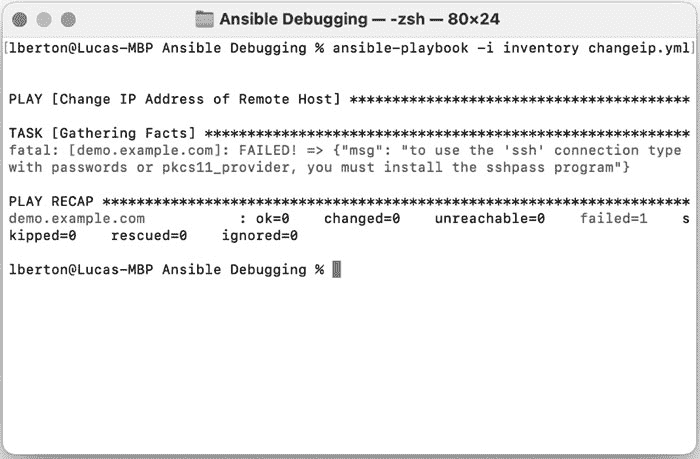

**图 6.10：** 密码 SSH 连接错误

在使用带有 Linux SSH 密码认证的 Ansible 清单时，如果遇到 `to use the 'ssh' connection type with passwords or pkcs11_provider, you must install the sshpass program` 错误，可以像图 6.10 所示进行故障排除。

如果在在使用 Ansible 时遇到 `to use the ssh connection type with passwords or pkcs11_provider, we must install the sshpass program` 错误，这里是我们可以遵循的故障排除步骤：

**步骤 1：检查远程系统上是否安装了 `sshpass`。**

第一步是检查远程系统上是否安装了 `sshpass`。我们可以通过登录到远程主机并运行以下命令来实现：

```bash
sshpass -V
```

如果未找到命令，说明没有安装 `sshpass`。在这种情况下，我们需要安装它。

**步骤 2：在远程系统上安装 `sshpass`。**

下一步是在远程系统上安装 `sshpass`。根据我们的操作系统，可以使用适当的包管理器进行安装。例如，如果我们正在使用 Ubuntu 或 Debian，可以通过运行以下命令进行安装：

```bash
apt-get install sshpass
```

如果我们正在使用不同的 Linux 发行版，可以使用相应的包管理器来安装 `sshpass`。

**步骤 3：在 Ansible 中指定 `sshpass` 的路径。**

一旦安装了 `sshpass`，我们需要在 Ansible 清单文件或配置文件中指定 `sshpass` 可执行文件的路径。例如，在我们的清单文件中，我们可以指定 `ansible_ssh_pass` 变量来为 SSH 连接提供密码。如果我们把 ‘sshpass’ 安装在非标准位置，可以使用 `ansible_ssh_executable` 变量指定可执行文件的路径：

```ini
[servers]
demo.example.com ansible_ssh_user=myuser ansible_ssh_pass=mypassword ansible_ssh_executable=/usr/local/bin/sshpass
```

# Windows 上的 Ansible

为 Windows 配置 Ansible 可能会有点复杂，用户在过程中可能会遇到错误。在本节，我们将讨论用户在排查 Windows 版 Ansible 时可能面临的一些常见问题，并提供如何解决它们的提示。

## 问题：无法在 Windows 上安装 Ansible

用户在 Windows 上安装 Ansible 时遇到的最常见问题之一是安装错误。错误信息可能会提示缺少包或模块。

## 解决方案：安装所需的模块

要解决此问题，用户应该检查 Windows 上 Ansible 的要求。Ansible 要求在 Windows 主机上安装 Python、Git 和 PowerShell。用户应在尝试安装 Ansible 之前，确保系统上已安装了这些包和模块。

## 问题：无法连接到 Windows 主机

用户在 Windows 上使用 Ansible 时可能会遇到的另一个问题是无法连接到 Windows 主机。此错误可能由多个因素引起，包括网络连接性、配置问题和身份验证问题。

## 解决方案：检查配置和身份验证设置

要解决此问题，用户应该检查他们的 Ansible 配置设置，并确保 Windows 主机配置为接受传入连接。用户还应该检查身份验证设置，确保使用正确的用户名和密码对 Windows 主机进行身份验证。

## 问题：PowerShell 执行策略阻止执行

用户在 Windows 上运行 Ansible 时可能会遇到的另一个问题是 PowerShell 执行策略阻止了 Ansible 脚本的执行。

## 解决方案：更改执行策略

要解决此问题，用户需要更改 PowerShell 执行策略以允许执行 Ansible 脚本。用户可以通过在 PowerShell 中运行以下命令来更改执行策略：

```powershell
Set-ExecutionPolicy Unrestricted
```

## 问题：Windows 主机未启用 SSH

如果用户尝试在 Ansible 中使用 SSH 连接类型，可能会遇到指示 Windows 主机上未启用 SSH 的错误。

## 解决方案：在 Windows 主机上启用 SSH

要解决此问题，用户应该在 Windows 主机上启用 SSH。这可以通过在 Windows 主机上安装 OpenSSH Server 功能来实现。用户可以在 PowerShell 中运行以下命令来安装 OpenSSH Server 功能：

```powershell
Add-WindowsCapability -Online -Name OpenSSH.Server~~~~0.0.1.0
```

为 Windows 配置 Ansible 可能有点复杂，但通过一些故障排除，用户可以解决大多数问题。解决问题的关键在于检查配置和身份验证设置，确保安装了所需的包和模块，并在必要时更改 PowerShell 执行策略。有了这些提示，用户应该能够成功在 Windows 上使用 Ansible。

# Ansible facts

在 Windows 上使用 Ansible 时，我们可能会遇到收集 Windows 主机事实（facts）方面的问题。以下是我们在 Windows 中排查 Ansible facts 的步骤：

1. **检查 Ansible 版本：** 确保我们使用的是支持 Windows 主机事实收集的 Ansible 版本。Ansible 2.8 或更高版本支持对 Windows 主机的事实收集。
2. **检查 WinRM 配置：** 确保目标 Windows 主机上的 Windows 管理 (WinRM) 服务正在运行，并且它配置为允许来自 Ansible 控制节点的连接。我们可能需要添加防火墙异常或配置 WinRM 使用 HTTPS 代替 HTTP。
3. **检查 Ansible 配置：** 验证目标 Windows 主机的 Ansible 配置文件中是否正确设置了 `ansible_user` 和 `ansible_password` 变量。这些变量应该指定 Ansible 用于对 Windows 主机进行身份验证的凭据。
4. **检查 Python 版本：** 验证目标 Windows 主机上已安装 Python 并且是一个受支持的版本。为了让事实收集工作，Ansible 需要目标 Windows 主机上安装 Python 2.7 或更高版本。


5. **检查事实缓存：** 如果我们在 Ansible 中使用了事实缓存，请确保缓存没有过时或损坏。尝试禁用事实缓存以查看是否能解决该问题。更多细节请参阅 第 8 章：Ansible 高级 中的 Ansible 配置设置章节。

6. **检查事实收集模块：** Ansible 使用模块来收集有关 Windows 主机的事实（facts）。验证目标 Windows 主机上已安装 `setup` 模块，并且该模块没有被任何组变量或主机变量禁用。

7. **验证事实收集过程：** 运行 `ansible -m setup <hostname>` 命令来为特定的 Windows 主机手动运行事实收集过程。该命令应该输出一个 JSON 文档，包含 Ansible 针对目标 Windows 主机收集的所有事实。

通过遵循这些步骤，我们可以通过收集 Ansible 中 Windows 主机的事实来排查并解决问题。有时，当在 Windows 目标主机上的执行在“收集事实（Gathering Facts）”任务上终止时，我们可能仍然遇到获取 Ansible 事实的问题。我们可能需要禁用事实收集，因为它们在 Windows 目标主机上不支持 `(gather_facts: false)`。

# 模块失败](#toc.xhtml_s265a)

当我们在 Windows Ansible 中遇到模块失败（Module Failure）错误时，可能会令人沮丧。以下是一些帮助我们排查和解决问题的步骤：

1. **验证模块：** 确保我们尝试使用的模块支持 Windows。某些在 Linux 上工作的模块可能在 Windows 上不支持，或者可能需要额外的配置。

2. **检查模块版本：** 验证我们使用的是正确的模块版本。Ansible 模块更新频繁，使用过时的模块版本会导致错误。

3. **检查模块路径：** 确保模块路径设置正确。模块路径可以在 Ansible 配置文件中设置，如果设置不正确，Ansible 可能无法找到模块。

4. **检查远程机器配置：** 验证远程机器配置是否正确。Windows 需要额外的配置来通过 Ansible 启用远程管理，例如启用 PowerShell 远程登录和配置 WinRM。

5. **检查模块参数：** 验证模块参数设置是否正确。错误或缺失参数可能导致模块失败。

6. **检查依赖项：** 某些模块要求在远程机器上安装额外的软件或依赖项。确保已安装所有所需的依赖项。

7. **检查错误消息：** 错误消息可能提供有关失败原因有用信息。仔细阅读错误消息并尝试理解导致失败的原因。

8. **调试模块：** 使用 Ansible debug 模块来排查模块失败。在 playbook 中添加 debug 模块并使用它来打印变量值和调试信息。

总来说，排查 Windows Ansible 中的模块失败需要对模块、其依赖项和远程机器配置进行仔细检查。通过遵循上述步骤并使用 debug 模块对模块进行调试，我们应该识别并解决问题。

# Windows 版 Linux 子系统](#toc.xhtml_s266a

当通过 Windows 版 Linux 子系统 (WSL) 在 Windows 上运行 Ansible 时，可能会遇到错误 0x80370102。当 Windows 版 Linux 子系统未安装、未启用或目标不支持嵌套虚拟化时，就会发生此错误。虚拟化技术能够加速 Linux 操作系统的虚拟化，特别是当使用 Windows 版 Linux 子系统版本 2 时。

要排除此错误，请遵循以下步骤：

1. **确保已安装 WSL：** 验证我们的 Windows 机器上已安装 WSL。如果尚未安装，我们可以从 Windows 功能控制面板进行安装。

2. **启用 WSL：** 验证我们的 Windows 机器上已启用 WSL。要启用 WSL，请以管理员身份打开 PowerShell 并运行以下命令：

```
dism.exe /online /enable-feature /featurename:Microsoft-Windows-Subsystem-Linux /all /norestart
```

执行完成后，我们的 Windows 目标机器上安装了以下功能：Windows 版 Linux 子系统、Hyper-V 平台和 Hyper-V 虚拟机。如果最新版本的 Windows 版 Linux 子系统无法工作，我们可以始终使用以下命令降级到版本 1：

```
wsl --set-default-version 1
```

Windows 版 Linux 子系统速度慢一点，因为它没有使用嵌套虚拟化功能，但在大多数环境中都可以运行。

**安装 Linux 发行版：** 启用 WSL 后，我们需要安装 Linux 发行版。我们可以从 Microsoft Store 安装 发行版，或通过下载发行包并在机器上运行。

3. **设置默认 WSL 发行版：** 如果我们安装了多个 Linux 发行版，我们需要设置默认发行版。默认是 Ubuntu Linux 发行版。要执行此操作，打开 PowerShell 并运行以下命令：

```
wslconfig /setdefault <distribution name>
```

**验证 Ansible 配置：** 确保我们的 Ansible 配置已设置好使用 WSL。检查 `ansible.cfg` 文件并确保 `ansible_connection` 变量被设置为 wsl。请参阅 第 8 章：Ansible 高级 中的 Ansible 配置设置章节了解更多关于 `ansible_connection` 参数的用法。

4. **测试 Ansible 配置：** 通过对目标 Windows 主机运行简单的 playbook 来测试我们的 Ansible 配置。如果 playbook 成功运行，说明我们已经解决了 WSL 错误。

通过遵循这些步骤，我们可以在 Windows 上运行 Ansible ，排查并解决 WSL 错误。

# Ansible Windows 命令](#toc.xhtml_s267a

可能会出现我们使用了 `win_command` Ansible 模块而不是 `win_shell` Ansible 模块的情况。这两个模块都允许我们在 Ansible 目标上执行命令，但它们并不像 第 5 章：Ansible For Windows 中“执行命令”章节中学到的那样相似。

`win_command` Ansible 模块不执行多行 PowerShell 代码。以下示例使用 `hostname` 和 `Get-Date` PowerShell 命令在屏幕上打印主机名和当前日期。以下 `win_date_command.yml` playbook：

```yaml
---
- name: Execute command
  hosts: all
  tasks:
    - name: Check getdate
      ansible.windows.win_command: |
        hostname
        Get-Date
      register: command_output
    - name: Command output
      ansible.builtin.debug:
        var: command_output.stdout_lines
```

我们可以使用以下 `ansible-playbook` 命令执行 `win_date_command.yml`：

```
ansible-playbook win_date_command.yml
```

执行没有返回错误，但实际上只执行了命令的一部分：

```
PLAY [win_command module demo] ********************************************************************
TASK [Gathering Facts] ***********************************************************************ok: [WindowsServer]
TASK [check getdate] ***********************************************************************
changed: [WindowsServer]
TASK [command output] ***********************************************************************ok: [WindowsServer] => {
  "command_output.stdout_lines": [
    "demo"
  ]
}
PLAY RECAP ***********************************************************************
WindowsServer               : ok=3    changed=1    unreachable=0    failed=0    skipped=0    rescued=0   ignored=0
```

要在多行中执行所有命令，我们需要从 "win_command" 切换到 "win_shell" Ansible 模块。

# 结论](#toc.xhtml_s268a)


正如我们在本章中学到的，通过在代码编写过程中更加小心，并使用某些程序来简化语法检查和测试，我们可以避免大多数错误。通过使用准确的测试策略，我们可以避免生产环境中的问题，并实现基础设施即代码（IaC）。在下一章中，我们将学习 Ansible 自动化平台、Morpheus、配置管理的使用、图形用户界面以及基于角色的访问控制（RBAC）。

# 记忆要点

* 我们可以执行语法检查、`yamlint` 和 `ansible-lint` 来静态验证项目中代码的正确性。
* 我们可以使用 `ansible-playbook` 命令的 `check` 和 `verbosity` 选项来执行干运行，或在执行期间增加屏幕上显示的信息量。
* 我们可以使用 `molecule` 工具在向组织内外共享代码之前测试 Ansible 角色的执行情况。
* 拥有健壮的测试环境和策略可以节省在生产环境中排错边界情况和意外场景的时间。

# 单选题

1. 详细输出模式（Verbose mode）的最大限制是多少？
    1. `-v`
    2. `-vv`
    3. `-vvv`
    4. `-vvvv`
2. 我们如何执行干运行（dry run）执行？
    1. 使用 `-v` 参数
    2. 使用 `--dry-run` 参数
    3. 使用 `--check` 参数
    4. 不可能
3. 我们可以使用哪些工具来验证我们的 Ansible playbooks？
    1. `ansible playbook --syntax-check`, `yamlint` 和 `ansible-lint`
    2. `molecule`
    3. `yamlint` 和 `ansible-lint`
    4. CI/CD 流水线
4. molecule 测试的核心组件有哪些？
    1. `create` 阶段创建虚拟机，安装必要的软件，并根据正在测试的角色进行配置。
    2. `converge` playbook 应用于该角色，而 `verify` playbook 检查行为是否正确。
    3. `destroy` 阶段销毁测试期间使用的虚拟机。
    4. 以上答案均不是。

# 答案

1. D
2. C
3. A
4. B

# 思考

1. 测试 Ansible Playbook 的最佳策略是什么？
2. 如何测试 Ansible Playbook 的幂等性属性？
3. 如何正确测试和排错 Ansible Role？
4. 哪些软件可以帮助我们创建 Ansible 代码？

# 关键术语

* `syntax-check: ansible-playbook --syntax-check` 是一个用于在不运行的情况下检查 Ansible playbooks 语法的命令。
* `Yamlint:`: `Yamlint` 是一个命令行工具，用于分析 YAML 文件并检查语法错误、风格一致性和其他问题。
* `ansible-lint:`: `ansible-lint` 是一个用于分析 Ansible 代码以检测并报告潜在问题和错误的工具。
* `molecule:`: `molecule` 是一个帮助在多个环境中开发和测试 Ansible 角色和集合的工具。
* `VSCode` (Visual Studio Code) 是微软的一款免费源代码编辑器，高度可定制，并支持各种编程语言和框架。

# 第 7 章：Ansible 企业

## 引言

在本章中，我们将学习更多关于 Ansible 的企业级和图形用户界面。这包括学习如何在组织内部使用 Ansible、将其与其他工具集成、使用 LDAP 和 Active Directory 认证服务，以及实施安全最佳实践。企业级 Ansible 设计用于更复杂的架构和环境，例如分布式系统和微服务。

## 结构

在本章中，我们将涵盖以下主题：

* Ansible 用例
* GitOps
* Ansible 自动化平台
* Morpheus
* 配置管理 (CM)
* 图形用户界面

## Ansible 用例

高级和企业用户需要负责维护组织任务关键的系统。在 IT 中，Day 0、Day 1 和 Day 2 术语指的是软件生命周期中的不同阶段，如图 7.1 所示。

我们使用该模型处理任何软件应用程序的生命周期。Ansible 对 Day 1 和 Day 2 操作非常有益：

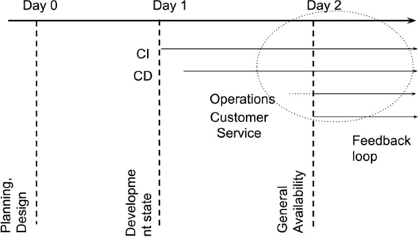

**图 7.1：** Day 0、Day 1、Day 2 模型

在当今快速演变的软件格局中，Day 0、Day 1 和 Day 2 术语作为软件开发生命周期的阶段而变得重要。这些阶段在有效的软件开发和维护的背景下具有巨大意义。让我们深入研究以下阶段，以理解每一天的含义，并探索云计算如何改变传统的软件开发和维护流程。

### Day 0：设计阶段

Day 0 代表软件开发生命周期的设计阶段。它类似于培训的第一天，新兵进入了军事的形成阶段。在软件开发中，Day 0 包含了规划和设计过程，其中指定了项目需求并确定了解决方案架构。这一阶段涉及对系统基础设施、资源分配和里程碑设置的仔细规划。测试和质量保证也是 Day 0 的不可或组成部分，为后续阶段奠定坚实的基础。

### Day 1：开发与部署

Day 1 表示软件生命周期的开发和部署阶段。它使最初的设计变为现实，涉及创建本身以及必要的设施、网络和外部服务。在云时代，Day 1 的特点是采用敏捷软件开发方法，设计和开发阶段无缝集成。持续集成/持续交付 (CI/CD) 实践对于确保 Day 1 的顺畅高效至关重要。重点在于采用最佳实践（例如云原生应用方法），并利用云原生工具和如 Kubernetes 等容器编排系统。Ansible 可以简化部署过程并与部署流水线集成。

### Day 2：维护与优化

Day 2 标志着维护和优化阶段，从软件上线和客户开始使用时开始。这一阶段涉及监控系统、收集反馈并根据客户需求实施必要的改进。目标是建立一个反馈循环，持续分析系统行为，识别改进领域并实施更改以增强性能和用户体验。自动化和监控工具在 Day 2 期间至关重要，确保高效维护和及时解决问题。应用程序性能监控 (APM) 解决方案、客户支持的工单系统以及如 Ansible 或 Kubernetes 等自动化工具有助于在整个生命周期内管理和优化软件。Ansible 甚至可以使用事件驱动架构处理实时事件（参见*事件驱动 Ansible 章节*）。

云计算对软件生命周期的影响


云计算的出现彻底改变了软件开发生命周期。传统的 Day 0、Day 1 和 Day 2 阶段之间的分离已让位于更加集成、更敏捷的方法。基于云的开发和部署已成为组织的首要任务，使其能够利用扩展性、灵活性和成本效益的优势。云计算允许对变化的需求做出动态响应，通过 CI/CD 实践进行持续改进，并消除开发团队与运维团队之间的交接。DevOps 中的“左移”（shift-left）方法将传统上留到最后阶段的任务提前执行，重塑了 Day 1 和 Day 2 的边界，导致了阶段的重叠和持续优化。

Day 0、Day 1 和 Day 2 的概念为理解软件开发生命周期的各个阶段提供了框架。这些阶段在得到有效管理时，有助于软件项目的成功。云计算在转型传统的软件开发和维护过程中发挥了关键作用，实现了无缝集成、持续改进和高效的自动化。拥抱 Day 0、Day 1 和 Day 2 的原则以及云原生实践，使组织能够在不断演变的数字格局中交付高质量的软件产品和服务，同时对客户需求保持敏锐。Ansible 在这些每个阶段都变得更加重要，因为它简化了自动化旅程并创建了标准。

# GitOps

在仓库中组织我们的源代码非常方便，通常基于流行的 `Git` 版本控制系统。仓库成为所有团队操作的唯一事实来源源。GitOps 源于站点可靠性工程（SRE）、DevOps 文化、基础设施即代码（IaC）和配置即代码（CaC）模式，这些模式使我们能够将基础设施配置存储在仓库中，通常由 `Git` 技术管理。下[表 7.1] 展示了基于 `Ansible` 最佳实践的目录布局：

| 文件 | 描述 |
| :--- | :--- |
| `site.yml` | 主 playbook |
| `webservers.yml` | 用于 Web 服务器清单组的 playbook |
| `production` | 生产环境的清单文件 |
| `staging` | 测试环境的清单文件 |
| `group_vars/` | 组变量（参见[第 2 章：Ansible 清单]） |
| `host_vars/` | 主机变量（参见[第 2 章：Ansible 清单]） |
| `library/` | （可选）自定义库和模块 |
| `module_utils/` | （可选）支持模块的自定义 module_utils |
| `filter_plugins/` | （可选）自定义过滤器 |
| `roles/` | （可选）自定义角色 |

**表 7.1：** GitOps 目录布局

在 `Git` 仓库中组织源代码和基础设施配置时，遵循最佳实践至关重要。`Ansible` 为构建我们的目录布局提供了指南。虽然具体的布局可能会根据项目需求而异，但以下目录结构是 `Ansible` 最佳实践常用的推荐结构：

```
├── group_vars
│   ├── all.yml
│   └── group1.yml
├── host_vars
│   └── hostname.yml
├── inventory
├── site.yml
└── roles
├── role1
│   ├── tasks
│   ├── handlers
│   ├── templates
│   ├── files
│   ├── vars
│   └── defaults
└── role2
├── tasks
├── handlers
├── templates
├── files
├── vars
└── defaults
```
在此目录布局中，`group_vars` 目录包含特定于不同组的变量，而 `host_vars` 目录存储特定于单个主机的变量。清单文件代表主机或组的清单。`site.yml` 文件作为执行 `Ansible` 任务的入口。它是第一个执行的 `Ansible` playbook。

`roles` 目录包含可重用的 `Ansible` 角色，封装了任务、处理器、模板、文件、变量和默认值。每个角色都组织成对应这些不同组件的子目录。遵循这种目录结构有助于维护整洁的代码库，使更容易理解和管理我们的 Ansible playbook 和角色。利用 `Git` 管理源代码和基础设施配置非常有益。GitOps 进一步扩展了这一实践，将 `Git` 仓库视为基础设施配置的单一事实来源。在使用 `Ansible` 时，遵循目录布局的最佳实践可确保我们自动化工作流的一性和可维护性。

# Ansible Automation Platform

企业需要的不仅仅是自动化，还需要大规模的协调和编排。如果在企业中工作，我们需要不同的业务线通过不同的技能组合共同工作，并拥有一个直观的接口来协调可用资源。Red Hat 创建了协作性的 `Ansible Automation Platform` 作为解决方案，专注于安全性、可移植性和可靠性：

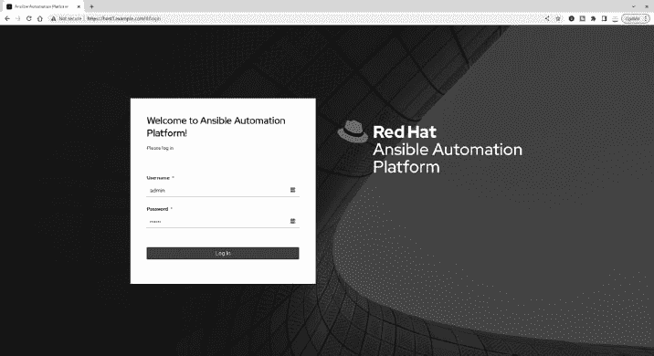

**图 7.2：** Ansible Automation Controller 的登录界面

它结合了 `Ansible` 开源的最佳价值：简单、强大且无代理，独特的认证技术，并带有良好的 Web 用户界面和强大的 RESTful API 接口。缩短了基于自动化的解决方案交付时间。根据国际 IT 分析师的说法，`Ansible` 是基础设施自动化的领导者。它能够解决第一天问题（准备和部署软件）和第二天自动化问题（配置、滚动更新、维护、监控和优化系统）。

`Ansible Automation Platform` (AAP) 是 Red Hat（IBM IBM）针对 `Ansible` 企业用户的高级产品。

以下是在我们的组织中采用 `Ansible Automation Platform` 的显著优势：

*   **简化复杂任务：** 使用 `Ansible Automation Platform` 的主要优势之一是简化复杂任务的能力。通过该平台，我们可以通过单一接口跨多个系统自动化任务。这意味着我们可以轻松地自动化复杂任务，例如配置网络设备或部署应用程序。这减少了手动执行这些任务所需的时间和精力，释放了团队的时间专注于更具战略性的倡措。
*   **可扩展性：** 使用 `Ansible Automation Platform` 的另一个显著优势是其可扩展性。该平台可以管理和自动化数千台机器上的任务，是大型 IT 基础设施的理想选择。随着我们基础设施的增长，`Ansible Automation Platform` 可以随之增长，确保我们的自动化工作流保持高效有效。
*   **效率：** 自动的核心在于提高效率，`Ansible Automation Platform` 正是为此设计的。通过简化工作流和减少人工干预，该平台可以帮助我们在 IT 运营中实现更高的效率。我们可以自动化常规任务，例如软件更新或系统配置，释放团队时间来处理更有价值的任务。
*   **安全性：** `Ansible Automation Platform` 在设计时考虑了安全性。它提供了一种安全的方法来跨不同系统和环境执行自动化任务，确保符合安全策略和最佳实践。通过 `Ansible Automation Platform`，我们可以在自动化任务的同时维护 IT 系统的完整性和机密性。


- **集成：** 该平台与广泛的工具和技术集成，使其能够轻松实现跨整个基础设施的任务自动化。这意味着我们可以使用 `Ansible Automation Platform` 来管理和自动化整个 IT 生态系统中的任务，包括云平台、虚拟化平台和容器平台。
- **定制化：** `Ansible Automation Platform` 的巨大优势之一是其灵活性。该平台高度可定制，允许我们创建适应特定需求的自定义工作流、模块和剧本（playbooks）。我们可以对平台进行定制以满足 IT 基础设施的独特需求，确保我们的自动化工作流能够发挥最大效益。
- **协作：** `Ansible Automation Platform` 支持团队之间的协作，允许多个用户同时处理相同的任务和工作流。这意味着我们可以在团队内部共享知识和专业经验，提高自动化工作流的质量和效率。
- **可视化：** `Ansible Automation Platform` 提供了自动化任务的可视性，使能够跟踪进度、监控性能并实时排除故障。这种可见性让我们对自动化工作流有完整的了解，允许我们对如何改进 IT 运营做出明智决策：


**图 7.3：** Ansible Automation Controller 的仪表盘

`Ansible Automation Platform` 是一个可以转变我们 IT 基础设施的强大工具。该平台通过简化复杂任务、提高扩展性和增加效率，帮助我们在 IT 运营中实现更大的敏性和响应能力。凭借其安全特性、集成能力、定制选项、协作支持和可见性，`Ansible Automation Platform` 是任何寻求简化和自动化其 IT 工作流组织的完美工具。`Ansible Automation Platform` 需要 `Red Hat` 的订阅。`Ansible Automation Platform` 利用 `GitOps` 项目组织来满足我们团队的自动化需求。

`Ansible Automation Platform` 的典型用例包括混合云自动化、边缘自动化、网络自动化、安全自动化、基础设施自动化、置备、配置管理、应用程序部署、持续交付和编排。

`Red Hat Ansible Automation Platform` 的最新版本包含项目签名功能，允许用户签名并验证基于项目内容的安全性，确保依赖 `ansible-sign` 命令行工具和 `GnuPG` 非对称密钥（私钥和公钥）的自动化工作流、剧本和清单的完整性和真实性。

`Ansible Automation Platform` 由许多软件组成。`Ansible Automation Platform` 的最新版本包含以下产品：

- `Automation controller` (曾称为 `Ansible Tower`)
- `Automation hub` 私有和托管服务
- `Automation services catalog`
- 作为托管服务的 `Insights for Ansible Automation Platform`

### 节点要求

任何 `Ansible Automation Platform` 节点（控制器、数据库、执行节点和跳板节点）的系统要求如下：

- 16 GB+ 内存
- 4+ CPU
- 数据库节点需要 150 GB+ 磁盘空间，非数据库节点需要 40 GB+ 磁盘空间
- `DHCP` 预留使用无限租期以静态 IP 地址部署集群
- 所有节点的 `DNS` 记录
- 操作系统 `Red Hat Enterprise Linux 8` 或更高版本的 64 位 (x86)，并安装 `Python 3.8+`
- 所有节点均配置 `NTP` 服务 `Chrony`

# Ansible Automation Hub

`Ansible Automation Hub` 是由 `Red Hat` 提供的平台，为 `Ansible Content Collections` 提供精选且可靠的存储库。它通过提供来自 `Red Hat` 和经过认证的 `Red Hat` 合作伙伴的预构建认证模块、插件、角色和文档，简化了发现和下载 `Ansible` 内容的过程。它是 `Ansible Galaxy` 最强大的版本。我们可以选择从 `Automation Hub` 获取内容，或将其与 `Ansible Galaxy` 混合使用。以下是使用 `Ansible Automation Hub` 的优势：

- **Red Hat 认证内容：** `Ansible Automation Hub` 直接访问来自 `Red Hat` 和认证 `Red Hat` 合作伙伴的可靠 `Content Collections`。这些集合涵盖了广泛的主题和合作伙伴，确保内容经过 `Red Hat` 的审核和认证。
- **复用代码并快速上手：** `Automation Hub` 中的 `Ansible` 集合为特定领域和 IT 平台提供了捆绑模块和角色。这允许我们通过预构建内容快速运行。
- **Ansible 私有自动化枢：** 如果我们创建了自己的 `Ansible` 内容，它允许我们在组织内部（防火墙后或离线系统）进行发布和协作。这提供了一个中心化的事实来源，并允许轻松管理和控制 `Ansible` 内容的生命周期。
- **高级支持：** `Ansible Automation Hub` 由 `Red Hat` 创建和管理，并提供标准和高级支持选项。如果我们在使用官方 `Red Hat Ansible` 集合或合作伙伴集合时遇到任何问题，`Red Hat` 的支持团队将直接协助我们。对于 `Ansible Automation Hub` 中的其他项目，`Red Hat` 将引导我们获取的支持。
- **包含在 Red Hat 订阅中：** `Ansible Automation Hub` 是 `Red Hat` 订阅的一部分。如果我们是 `Red Hat` 订阅用户，就可以免费无限制地访问 `Automation Hub` 中提供的任何内容。

通过利用 `Ans Automation Hub`，用户可以从认证内容、通过代码复用的快速开发、私有枢纽能力、高级支持选项以及 `Red Hat` 订阅包含的 `Automation Hub` 中获益。自 2022 年以来，`Ansible Automation Hub` 已支持数字签名集合，建立了从 `Red Hat Ansible` 和 `Certified Partners` 的创建者到执行节点的整个信任链。

# Ansible 执行环境

`Ansible execution environments` (`EE`) 是容器化环境，旨在为执行 `Ansible` 自动化任务提供一致且可移植的运行时。它们封装了运行 `Ansible` 剧本所需的所有组件、依赖和配置。

执行环境通常包含以下组件：

- **基础容器镜像：** 基础容器镜像构成了执行环境的基础。它包含了运行 `Ansible` 的操作系统和其他基本组件。
- **Ansible Core：** `Ansible Core` 是执行环境的核心组件。它提供了 `Ansible` 引擎，用于解释并执行 `Ansible` 剧本。
- **Ansible Runner：** `Ansible Runner` 是 `Ansible` 用于以更有结构化的方式执行剧本的工具。它有助于作业控制、并行执行和结果跟踪等功能。
- **Python：** `Ansible` 用 `Python` 编写，因此执行环境包含了必要的 `Python` 运行时环境。它确保 `Ansible` 可以利用 `Python` 模块和库。
- **Ansible Collections：** `Ansible Collections` 是预包的 Ansible 内容单元，提供了额外的模块、插件和角色。执行环境可能包含自动化任务所需的特定集合。
- **所需的 Python 库：** 执行环境可能包含执行剧本或模块所需的特定 `Python` 库。这些库可以作为执行环境的一部分进行安装，以确保在剧本执行期间可用。


Ansible 执行环境（execution environments）的目的是为 Ansible 自动化提供一个一致且隔离的运行环境。通过将所有必要的组件封装到容器镜像中，执行环境确保了自动化任务可以在不同的系统和环境中可靠地执行。它们有助于保持一致的行为并消除潜在的兼容性问题。

执行环境还实现了可移植性，因为容器化的格式允许执行环境在不同的系统和基础设施之间于共享、复制和部署。这在需要在离线或物理隔离（air-gapped）环境中执行自动化的场景特别有用，在这些环境中，互联网访问或外部依赖可能受到限制。总体来说，Ansible 执行环境通过提供定义且一致的运行环境，简化了 Ansible 自动化的部署和执行，确保自动化任务可以在不同的系统和环境中可靠且一致地执行。

使用 `ansible-builder` 命令行工具可以在我们的系统中创建自定义的执行环境。我们还可以使用可选的步骤 5 为未连接或物理隔离的创建创建执行环境镜像。我们可以通过以下步骤创建自定义的 Ansible 执行环境：

### 1. 安装 ansible-builder 工具：

首先，我们可以从 Red Hat RPM 存储库安装 `ansible-builder` 工具：

```bash
dnf install ansible-builder
```

或者，从上游 Python 存储库安装 `ansible-builder` 工具：

```bash
pip install ansible-builder
```

### 2. 创建 execution-environment.yml 文件：

创建一个名为 `execution-environment.yml` 的 YAML 定义文件，用于指定基础容器镜像、Ansible 配置、依赖和额外的构建步骤。

这是一个示例：

```yaml
---
version: 1
build_arg_defaults:
  EE_BASE_IMAGE: 'automationhub.example.com/ee-minimal-rhel8:latest'
ansible_config: 'ansible.cfg'
dependencies:
  galaxy: requirements.yml
  python: requirements.txt
  system: bindep.txt
additional_build_steps:
  prepend: |
    RUN pip3 install --upgrade pip setuptools
  append:
  - RUN ls -al /
```

请确保使用适当的容器仓库源自定义 `EE_BASE_IMAGE`。`requirements.yml` 文件按照 第 3 章：Ansible 语言扩展 中 `Ansible collection.` 节中所学的格式指定 Ansible 集合依赖。`requirements.txt` 文件按照 第 6 章：Ansible 故障排除 中 `Ansible collection.` 节中所学的指定 Python 依赖。`bindep.txt` 文件指定使用 RPM 和 `DPKG` 命令行工具为 RPM 和 DEB 格式安装的操作系统包。对于 git 工具的安装，我们将使用以下 `bindep.txt` 文件：

```text
git [platform:rpm]
git [platform:dpkg]
```

### 3. 构建容器镜像：

使用 `ansible-builder build` 命令根据 `execution-environment.yml` 文件构建容器镜像。为镜像指定标签（tag）。例如：

```bash
ansible-builder build --tag my_custom_ee
```

这将创建一个构建上下文并生成一个 Containerfile。

### 4. 创建容器镜像：

使用容器引擎（例如 Podman 或 Docker）从构建上下文创建容器镜像。例如：

```bash
podman build -f context/Containerfile -t my_custom_ee context
```

### 5. 传输容器镜像（可选）：

如果我们处于离线环境，我们需要将容器镜像传输到目标系统。我们可以创建容器镜像的归档并使用安全方法进行传输，或者使用传输的依赖直接在目标系统上构建镜像。

### 6. 加载并使用容器镜像：

一旦容器镜像在离线系统中可用，即可使用容器引擎加载它。例如：

```bash
podman load -i my_custom_ee-1.0.tar
```

然后我们就可以使用自定义的执行环境镜像在离线环境中执行 Ansible playbooks 和自动化任务了。

如果我们想将容器镜像存储在私有自动化中心或其他支持的容器仓库中，请遵循适当的标记和推送流程。

请注意，此处提供的示例命令可能会根据我们的特定环境和配置而变化。请参阅 Ansible Automation Platform 和 `ansible-builder` 的官方文档获取更详细的说明和选项。

# Ansible 自动化网格 (Automation Mesh)

自动化网格是 Ansible Automation Platform 2.1 版本引入的一个新功能。它旨在简化并改进跨平台和位置（包括本地环境、混合云和边缘设备）的自动化可扩展性。自动化网格提供了一种灵活的设计，可以部署在单站点安装或跨多个全球位置，满足各种自动化需求。自动化网格解决了跨不同环境扩展自动化、集中管理平台以及对连接受限的远程地区进行自动化的挑战。通过在靠近所需设备的地方交付和运行自动化，可以最大限度地减少执行中的中断和不一致性，从而提高 IT 服务的可靠性并减少停机时间。

在过去，使用 Ansible Tower 和隔离节点架构在多个区域和复杂网络中扩展自动化是挑战性的。Ansible Tower 的执行与控制能力紧耦合使得可扩展性变得困难，且单体设计将执行能力限制在单个集群，对网络延迟和中断敏感。隔离节点提供了本地执行，但在通信方面存在局限性，并且需要 SSH 代理和跳板机等额外工具。

自动化网格配合自动化控制器（automation controller）克服了这些限制。它简化了跨多个站点的自动化分发并减少了操作开销。自动化网格通过本地化消除了对跳板机和 SSH 代理等辅助工具的依赖。它提供了设计活性，允许从单站点到全球的部署。自动化网格利用多方向、多跳的覆盖网络跨受限网络和远程端点交付自动化。它能够独立地扩展控制和执行能力，提供容错性、冗余性以及对网络中断和延迟的增强弹性。

安全性是自动化网格的一个关键方面，它包含了诸如 `访问控制列表 (ACL)`、`传输层安全 (TLS)` 认证和加密等功能。通过自动化控制器进行集中管理可以利用 `RBAC (基于角色的访问控制)` 和身份验证等功能来保护自动化网格。

自动化网格的主要优势包括简化操作、设计灵活性、可扩展性、可靠性和增强的安全性。通过利用自动化网格，组织可以在范围内扩展自动化，提高可靠性并安全地管理其整个企业 IT 资产。所有节点上 Ansible 网格网络使用的默认防火墙端口是 TCP 27199。

# 基于角色的访问控制 (RBAC)

基于角色的访问控制 (RBAC) 是一种安全模型，根据分配给用户或组的角色提供访问控制。Ansible Automation Platform 支持 RBAC，提供安全且细粒度的访问控制机制来管理自动化工作流和资源：


## 图 7.4: Ansible Automation Controller 的 Azure AD 集成

RBAC（基于角色的访问控制）是 Ansible Automation Platform 的核心组件，它允许组织根据角色限制用户对特定功能、资源或操作的访问。平台提供了预定义的角色，例如 `Administrator`、`Operator` 和 `Viewer`，可以将它们分配给用户或组：

* `Administrator` 角色具有对 Ansible 自动化平台所有功能和资源的完全访问权限，包括创建、修改和删除用户、组和角的能力。
* `Operator` 角色具有有限访问权限，只能执行特定操作，例如运行作业或管理清单。
* `Viewer` 角色对 Ansible 自动化平台具有只读访问权限，允许用户查看资源状态，但不能对其进行修改。

RBAC 还允许组织创建自定义角色并将其分配给用户或组。

自定义角色可以根据组织的特定需求定义。例如，组织可以为开发人员创建一个自定义角色，允许他们运行 playbooks，但限制他们管理清单或创建新用户。Ansible 自动化平台的 RBAC 还提供了控制特定资源访问水平的权限级别。例如，具有 `read` 权限级别的用户可以查看资源但无法修改，而具有 `write` 权限级别的用户可以修改资源。

基于角色的访问控制是 Ansible 自动化平台的一项重要安全功能，允许组织根据分配给用户或组的角色控制对资源的访问。它提供了一种细粒度的访问控制机制，帮助组织安全地管理自动化工作流和资源：

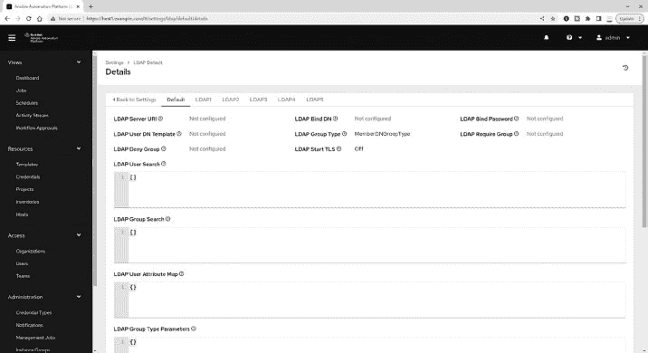

## 图 7.5: Ansible Automation Controller 的 LDAP 集成

在 Ansible Automation Platform 中，RBAC 允许我们根据分配给用户或组的角色，控制对清单、playbooks 和作业等 Ansible 资源的访问。要在 Ansible Automation Platform 中实现 RBAC，我们可以将其与企业目录系统集成，例如 Microsoft Active Directory（参见 `图 7.4]`）或 LDAP（参见 `图 7.5]`）。这种集成允许我们根据企业目录系统中分配给用户或组的角色来管理 Ansible 资源的访问。

集成过程涉及以下步骤：

1. **设置企业目录系统**：为了将 Ansible Automation Platform 与企业目录系统集成，我们首先需要设置目录系统并确保其配置正确。
2. **配置 Ansible Automation Platform**：我们需要配置 Ansible Automation Platform 使用企业目录系统进行身份验证和授权。这涉及配置平台使用 `LDAP` 或 `Active Directory` 协议与目录系统通信。参见 `图 7.4]` 中的 Azure AD 集成和 `图 7.5]` 中的 LDAP 集成。
3. **定义角色和权限**：集成完成后，我们可以根据企业目录系统中分配给用户或组的角色，在 Ansible Automation Platform 中定义角色和权限。我们可以创建 `Admin`、`Developer` 或 `Operator` 等角色，并根据它们负责的任务和工作流为每个角色分配权限。
4. **将角色分配给用户或组**：最后，我们可以为企业目录系统中的用户或组分配角色，这将自动在 Ansible Automation Platform 中授予相应的权限。

通过 RBAC 集成，我们可以确保只有授权的用户才能访问 Ansible 资源，并且他们只能执行其职责范围内的任务。RBAC 帮助帮助我们管理和维护清晰的审计轨迹，记录谁在何时访问了哪些资源，从而提高安全合规性。将 Ansible Automation Platform 与企业目录系统集成用于 RBAC，允许我们根据角色和权限管理资源访问，确保只有授权用户才能访问执行其任务所需的资源。

# Morpheus

Ansible Morpheus 是 Ansible 与 Morpheus 云管理平台之间的集成。Morpheus 是一个云应用管理平台，帮助 IT 团队管理和自动化跨多个云、数据中心和 DevOps 工具的基础设施。

通过 Ansible 集成，Morpheus 允许用户利用 Ansible 强大的自动化能力来管理和配置各种平台的基础设施资源。该集成允许通过使用 Ansible playbooks 创建动态基础设施，实现自动化的配置、扩展和管理。

Morpheus 提供了一个统一平台来管理 IT 资源，支持云原生和传统工作负载，与 Ansible 的集成为平台增加了更多的灵活性和力量。该集成允许 IT 团队自动化其基础设施和云管理任务，实现应用程序和服务的快速、可靠的部署。

Morpheus 与 Ansible 之间的集成为 IT 团队带来了许多益处，包括：

* **提高效率**：集成允许 IT 团队自动化基础设施管理任务，减少了手动工作量并提高了效率。
* **简化管理**：集成提供了一个用于管理 IT 资源的统一平台，支持云原生和传统工作负载。
* **增强灵活性**：与 Ansible 的集成为 Morpheus 平台增加了更多的灵活性和力量，允许 IT 团队更高效地自动化基础设施和云管理任务。
* **提高可扩展性**：Ansible 以可扩展性著称，集成允许 IT 团队根据需要快速扩展其基础设施管理任务。
* **更好的可靠性**：Ansible 提供的自动化能力有助于确保基础设施管理任务的一致性和可靠性，减少错误和停机的风险。

## 使用 Morpheus 和 Ansible 集成

要使用最新的 Morpheus 和 Ansible 集成，用户必须在 Morpheus 中配置 Ansible 端点。这涉及提供必要的凭据并配置端点设置。

一旦完成完成后，用户就可以创建 Ansible playbook 并使用它们来自动化 Morpheus 内部的基础设施管理任务。例如，用户可以创建一个 playbook 来配置和配置虚拟机，或在云平台上部署和管理应用程序。

用户还可以利用 Morpheus 的自动化功能（例如工作流以及与其他 DevOps 工具的集成）来进一步增强平台的功能。

# 配置管理 (CM)

Ansible 是一个强大的配置管理工具，允许我们自动化管理 IT 基础设施。它允许我们通过编写 Ansible playbook 来定义并强制系统及应用程序的期望状态，这些 playbook 本质上是自动化系统配置的脚本。

使用 Ansible 进行配置管理涉及以下步骤：

1. **定义期望状态**：使用 Ansible 进行配置管理的第一步是定义 IT 基础设施的期望状态。这涉及定义我们希望系统和应用程序遵循的配置设置。这可能包括包版本、网络配置、用户帐户和防火墙规则等内容。


编写 Ansible playbooks：一旦我们定义了期望状态，就可以编写 Ansible playbooks 来自动化系统和应用程序的配置。Playbooks 以 YAML 格式编写，包含一组描述如何配置我们系统的任务（tasks）。Playbooks 可以针对单个系统或系统组运行，这使得管理大规模 IT 基础设施变得轻而易举。

运行 Ansible playbooks：编写好 playbooks 后，我们可以使用 Ansible 命令行工具来运行它们。Ansible 将连接到我们的系统并执行 playbook 中定义的任务，确保我们的系统配置符合期望状态。

验证和监控配置：一旦执行了 playbooks，我们就可以验证系统配置是否正确。Ansible 提供了用于验证系统配置和监控其状态的工具，以确保它们保持符合期望状态。

Ansible 还提供了许多让配置管理更易于访问且更高效的特性。例如，Ansible 允许我们创建可重用的角色（roles）和模板（templates），这些内容可以在多个 playbook 和系统之间使用。这使得维护一致性并避免重复劳动变得非常简单。

Ansible 配置管理允许我们自动化管理 IT 基础设施，确保我们的系统配置符合期望状态。通过定义期望状态、编写 Ansible playbooks 并在系统上运行它们，我们可以简化 IT 运营并提高效率。

# 图形用户界面

当服务器数量增加时，拥有执行过程每个步骤的可视化分解以及工作流过程的完整分析是有益的。Ansible 没有内置的图形用户界面（GUI），因为它的主要界面是基于命令行的。但是，有一些第三方工具和平台在 Ansible 之上提供了 GUI，以增强用户体验并简化 Ansible 自动化管理。这些 GUI 工具通常提供 Ansible playbooks、清单（inventories）和作业执行的可视化表示，使得偏好图形界面的用户更容易与 Ansible 交互。以下是 Ansible GUI 工具的示例：

- **Ansible Automation Controller**：是 Ansible Automation Platform 订阅的一部分，是一套全面的 IT 自动化解决方案，包含基于 Web 的 GUI。它提供了一个集中接口，用于管理 Ansible playbooks、清单、凭据和作业调度。GUI 允许用户创建和管理自动化工作流、监控作业状态并查看详细的日志和报告。
- **AWX**：AWX 是 Ansible Tower 的开源版本，提供了类似的 GUI 体验。它提供了一个基于 Web 的接口来管理 Ansible 自动化，包括定义清单、创建作业模板和调度作业的能力。AWX 是一个社区驱动的项目，可以部署在本地或云端。
- **Semaphore**：是一个提供基于 Web 的 GUI 以管理 Ansible playbooks 和自动化任务的开源项目。它支持多种数据库，如 `MySQL`、`PostgreSQL` 和 `BoltDB`。通过 Semaphore，我们可以使用 Ansible 构建、部署和回滚应用程序或配置。它允许我们将 playbooks 分组为项目并管理环境、清单、仓库和访问密钥。响应式 UI 允许从浏览器执行 playbook，即使在移动设备上也是如此。Semaphore 提供了计划的 playbook 运行、详细日志、通知和用户委托等功能。它用 `Go` 编写，适用于 Windows、macOS 和 Linux 平台。
- **Rundeck**：Rundeck 是一个开源自动化平台，可以与 Ansible 集成并提供管理和执行 Ansible playbooks 的 GUI。它提供了一个基于 Web 的接口，用户可以在其中定义作业工作流、执行 playbooks 并监控作业执行。
- **Foreman**：Foreman 是一个物理和虚拟服务器的生命周期管理工具。它与 Ansible 集成，并提供了管理和编排 Ansible playbooks 的 GUI。Foreman GUI 允许用户定义主机、分配 Ansible 角色并针对目标主机执行 playbooks。

这些 GUI 工具旨在通过提供与 Ansible 组件交互的可视化界面，简化 Ansible 自动化的管理和执行。它们提供了清单管理、作业调度、日志和报告等功能，使得跟踪和管理自动化任务变得更容易。然而，重要的是，虽然这些 GUI 工具增强了用户体验，但底层功能和能力仍然基于 Ansible 的命令行界面。

# Ansible Semaphore

Ansible Semaphore 是 Ansible 的现代 UI。它是一个专门为 Ansible 项目设计的基于 Web 的工具。它提供了一个图形界面，允许用户定义和管理他们的 playbook 执行。Semaphore 与 `Git` 等版本控制系统集成，并提供 Ansible playbooks 的执行自动化。它为项目、任务模板、任务、密钥存储库、清单、环境和仓库提供了一个易于使用的界面。我们可以在 CI/CD 过程中使用 Semaphore，因为它支持构建和部署任务。它允许用户为 Ansible playbooks 和基础设施代码定义并管理 CI/CD 流水线。

Semaphore 支持 `MySQL`、`PostgreSQL` 和 `BoltDB`（嵌入式键值）数据库。我们可以通过四种不同的方式安装 Semaphore：snap、发行包管理器、`Docker` 和二进制文件。

最快的方法是使用 snap 包，它会在我们的系统中设置所需的所有内容：

```bash
snap install semaphore
```

在程序成功安装后，我们可以使用命令配置数据库和其他参数：

```bash
semaphore setup
```

安装成功后，Semaphore 仪表板如图 7.6 所示：

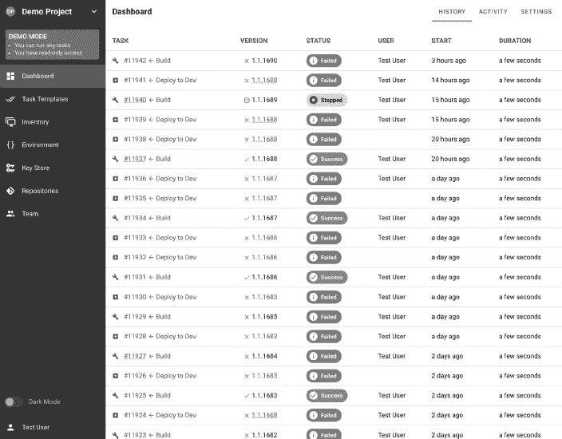

**图 7.6：** Semaphore 仪表板

我们可以查看每次执行的状态，如图 7.7 所示：

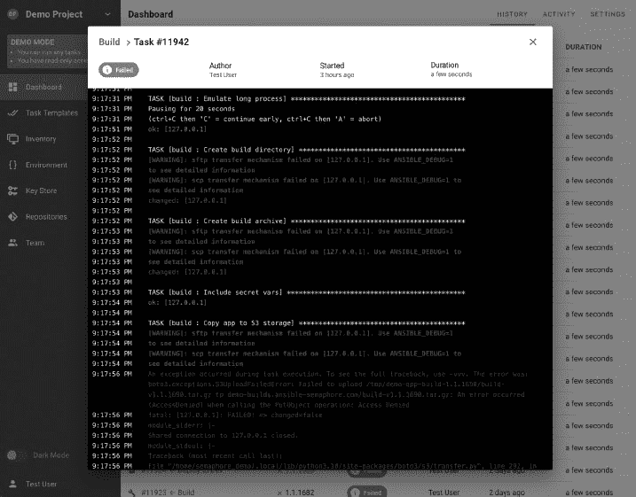

**图 7.7：** Semaphore 执行详情

非常有用的功能是电子邮件或电报提醒功能，用于通知执行状态。

Ansible Semaphore 通过提供直观的 Web 界面和启用 CI/CD 工作流，简化并优化了 Ansible 项目的自动化。它增强了协作，减少了手动工作，并提高了管理 Ansible 配置和部署的整体效率。

# ARA records

ARA Records (Ansible Records Ansible) 是一个提供了记录和分析 Ansible playbooks 及其执行数据框架的项目。它旨在捕 Ansible 运行的细节，例如执行的任务、涉及的主机以及每个任务的结果。ARA Records 将这些信息存储在数据库中，允许您查看和分析 Ansible 运行的历史数据。这对于故障排除、审计、性能分析以及理解通过 Ansible 所做更改的影响非常有用。

# 安装

ARA records 需要任何安装了 `Python` 的现代 Linux 发行版或 macOS。默认情况下，它使用本地 `SQLite` 服务器来存储性能数据。然而，当运行多个 Ansible 控制器时，我们可以使用 API 服务器来存储执行数据。该架构要求 API 服务器作为服务运行，并配置 ARA Ansible 回调插件使用带有 API 服务器端点的 HTTP API 客户端。可以在第 8 章：Ansible 高级”中的“回调插件”部分了解更多关于 Ansible 回调插件的信息。这是无需 API 服务器的 ARA Records 简单安装方法：

1. 通过 PIP 安装 ARA server：


```bash
python3 -m pip install "ara[server]"
```

2. 配置 ARA 回调插件：

将 Ansible 回调插件设置为使用 ARA。最简单的方法是通过 `ANSIBLE_CALLBACK_PLUGINS` 环境变量来实现：

```bash
export ANSIBLE_CALLBACK_PLUGINS="$(python3 -m ara.setup.callback_plugins)"
```

3. 运行 Ansible Playbook：

每次执行 `ansible-playbook` 命令都会将数据发送到 ARA 服务：

```bash
ansible-playbook playbook.yml
```

4. 与 ARA 工具交互：

我们可以使用 `ara` 命令来列出并分析使用 ARA 的执行结果：

```bash
ara playbook list
```

5. 启动内置开发服务器：

ARA 提供了一个内置的开发服务器，用于浏览记录的结果并分析执行情况：

```bash
ara-manage runserver
```

执行结果显示在 Web 用户界面的仪表板中，如图 7.8 所示：

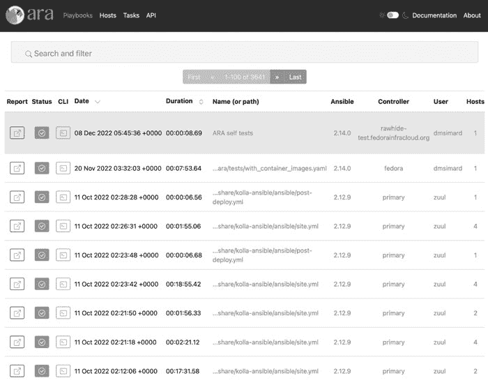

**图 7.8：** ARA 记录仪表板

对于每个作业，我们可以逐步分析 playbook 的执行情况，如图 7.9 中显示的示例所示：

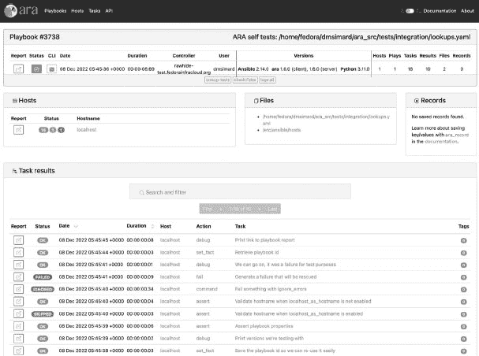

**图 7.9：** ARA 记录执行详情

# 自定义

我们可以通过设置环境变量或使用 `ansible.cfg` 配置文件中的 `[ara]` 部分来自定义 ARA 工具的行为。

例如，以下两个环境变量会将数据发送到名为 `ara.example.com` 的 ARA HTTP API 服务器，该服务器接收来自多个节点的数据：

```bash
export ARA_API_CLIENT="http"
```

```bash
export ARA_API_SERVER="http://ara.example.com:8000"
```

我们可以使用 DockerHub 上发布的镜像，通过 podman 或 Docker 命令来运行 ARA 服务器：

1. 创建一个本地目录来存储设置和 SQLite 数据库：

```bash
mkdir -p ~/.ara/server
```

2. 使用本地目录通过 docker 启动 API 服务器：

```bash
docker run --name api-server --detach --tty --volume ~/.ara/server:/opt/ara:z -p 8000:8000 docker.io/recordsansible/ara-api:latest
```

对于 podman 容器引擎，只需将 docker 命令替换为 podman 即可。

ARA Records API 服务器是一个基于 Python 语言编写的 Django Web 应用程序，我们可以使用任何 WSGI 应用服务器运行，例如流行的 Web 服务器软件 `gunicorn`、`uwsgi` 或 `mod_wsgi`。

ARA Records 对生产环境和开发环境都有益。通过利用 ARA Records，用户可以跟踪 Ansible playbook 的进度，识别执行过程中遇到的任何问题或错误，并对 Ansible 操作进行全面记录。这有助于维护准确且集中的 Ansible 运行历史，便于在管理基础设施和部署时进行分析、协作和决策。

# Steampunk Spotter

Steampunk Spotter 是一款企业级 Ansible Playbook 扫描工具，用于分析并为 playbook 提供建议。这是通过 XLAB Steampunk 公司销售的付费产品。它使用 CLI 或 VSCode 扩展获取代码，并直接在终端或良好的 Web 用户界面上呈现信息。

Steampunk Spotter 和 Ansible Lint（见第 6 章：Ansible 故障排除，故障排除部分）是互补工具，共同提高 Ansible Playbooks 的质量和可靠性。Ansible Lint 专注于捕捉编程错误、bug 和样式错误并强制最佳实践，而 Steampunk Spotter 超出了语法检查。Spotter 会分析 Ansible 内容本身（包括模块、角色和集合），识别难以发现的问题，提供特定模块的建议并自动修复某些问题。

以下是配合 Ansible Lint 使用 Steampunk Spotter 的益处：

**发现隐性错误：** Steampunk Spotter 可以识别 Ansible Lint 可能无法捕捉的隐藏障碍和耗时错误。它可以帮助你发现超出基础语法和样式检查的问题。

**特定模块的建议：** Spotter 提供了针对特定模块、用户环境设置和其他因素的建议。这允许更具定制化的建议和改进。

**便利功能：** Steampunk Spotter 提供了许多便利功能，例如生成 `requirements.yml` 文件并引导指向特定模块版本的文档。这些功能可以节省你的时间并让你的自动化过程更高效。

**协作和仓库扫描：** Spotter 自带一个应用程序，允许你扫描公共 Git 仓库、与团队协作，并跟踪扫描历史、playbook 执行频率、常见错误以及随时间变化的进度。此外，Spotter 提供报告，以便对所使用的集合和模块有深入深入见解。

**简化 Ansible 升级：** Spotter 可以帮助简化升级 Ansible 的过程。它会检查现有的 playbook 是否兼容特定的 Ansible 版本，识别升级期间需要解决的问题，并允许你确定 Ansible 的目标版本和源版本。这使得升级过程更快更高效。

综之，虽然 Ansible Lint 是捕捉错误和实施最佳实践的强大工具，但 Steampunk Spotter 通过提供特定模块建议、识别难以发现的错误以及提供改进 playbook 和增强自动化便利功能扩展了它的能力。共同使用这两个工具可以帮助确保自动化的可靠性并提高 Ansible Playbooks 的整体质量。

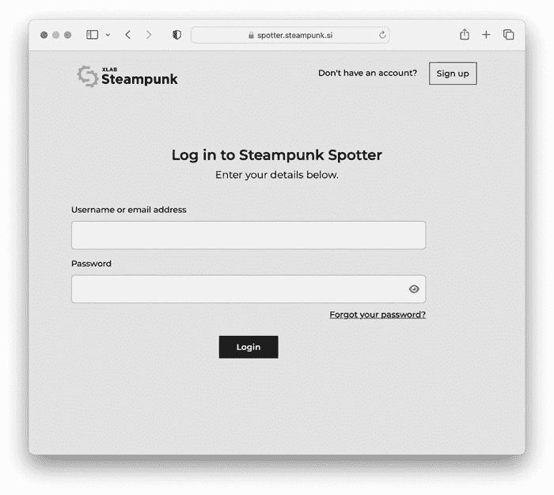

**图 7.10：** Steampunk Spotter 登录界面

我们可以使用通过 PIP 包管理器安装的命令行工具：

```bash
pip install steampunk-spotter
```

安装后，我们可以开始使用命令行界面进行登录并获取 API 令牌：

```bash
spotter login
```

`Username: AnsiblePilot`

`Password:`

`Login successful!`

从现在起，我们可以继续对 playbook 进行任何进一步扫描。例如，以下命令扫描了 `fix.yml` Ansible playbook：

```bash
spotter scan fix.yml
```

它产生以下输出：

```
fix.yml:10:7: HINT: [H500] Use of module debug is discouraged in production.
fix.yml:20:7: HINT: [H500] Use of module debug is discouraged in production.
------------------------------------------------------------------------
Spotter took 0.430 s to scan your input.
It resulted in 0 error(s), 0 warning(s) and 2 hint(s).
Overall status: HINT
```

执行结果显示在命令行界面，如图 7.11 所示：


**图 7.11：** Steampunk Spotter CLI

图形用户界面中的执行结果如图 7.12 所示：


**图 7.12：** Steampunk Spotter 仪表板

# 结论


Ansible 是一个企业级的自动化平台，通过将任务、配置和应用部署自动化来简化并加速 IT 运营。它能够实现一致的基础设施管理，减少人工操作，促进协作，并提高企业环境内的效率和可扩展性。许多开源项目和公司创建了各种产品，这些产品以 Ansible 为基础，整合并简化现代混合基础设施的管理。在本章中，我们学习了如何利用 Ansible 自动化平台及其替代方案与实现基于色的访问控制（RBAC）的集中认证系统进行交互。在下一章中，我们将探索如何与云计算提供商集成（特别是亚马逊云服务 AWS），并使用 Kubernetes 技术来提升我们的云原生应用部署。

# 重点回顾

- GitOps 项目设计通过标准化项目的文件和目录结构，实现了基础设施即代码 (IaC) 和配置即代码 (CasC)。
- 企业级用户应考虑采用 Ansible 自动化平台，以集中和优化 Ansible 代码的执行。
- Ansible 是一个命令行工具。不过，也有许多图形化用户界面替代方案。

# 单选题

1. 哪个项不是 Ansible 自动化平台的组件？
    1. 自动化控制器 (Automation controller)
    2. 自动化中心 (Automation hub)
    3. Ansible 自动化网格 (Ansible automation mesh)
    4. 自动化核心 (Automation core)
2. 哪个不是 Ansible 的图形化用户界面？
    1. 自动化控制器 (Automation controller)
    2. Semaphore
    3. ARA Records
    4. Foreman
3. 哪个不是 GitOps 基础的特性？
    1. 它实现了基础设施即代码 (IaC)
    2. 它基于流行的 Git 版本控制系统
    3. 它具有有固定的目录结构
    4. 以上都不是
4. Ansible 自动化网格是否是 Ansible 自动化平台的一部分？
    1. 是
    2. 否

# 答案

1. D
2. C
3. D
4. A

# 思考题

1. 在系统中启用 Ansible 管道化 (Pipelining) 有什么影响？
2. GitOps 的目录布局是什么？
3. Ansible 自动化平台的主要组件有哪些？
4. Ansible 的图形化用户界面有哪些？

# 核心术语

- **GitOps**: Ansible GitOps 允许实现基础设施即代码 (IaC) 和配置即代码 (CaC) 模式，主要使用 Git 技术将信息存储在仓库中。
- **Ansible Automation Platform**: Ansible 自动化平台是一个全面的解决方案，通过集中平台实现 IT 任务自动化和规模化管理基础设施。
- RBAC (基于角色的访问控制) 是一种安全模型，根据预定义的角色限制系统访问，确保用户在组织资源内获得适当的权限和权利。

# 第 8 章

## Ansible 进阶

## 引言

在本章中，我们将学习 Ansible 中使用的更高级的特性和技术，例如自定义模块、动态清单脚本、复杂的 Playbook 以及高级配置管理实践。这包括更深层次的主题，如扩展和性能调优、在云平台上使用 Ansible、与其他工具集成以及实施安全最佳实践。高级 Ansible 用户可能还会处理更复杂的架构和环境，例如分布式系统和微服务。

### 章节结构

在本章中，我们将涵盖以下主题：

- 第三方集成、脆弱性与灵活性
- Ansible 编排 (Orchestration)
- 事件驱动 Ansible (Event-driven Ansible)
- Ansible 配置设置
- 最新趋势

### 第三方集成、脆弱性与灵活性

在当今快速演变的技术领域，组织不断优化其 IT 基础设施以实现效率、可靠性和灵活性。Ansible 作为一个强大的开源自动化平台，已成为解决这些需求的领先解决方案。虽然 Ansible 提供了一套健的内置功能，但它与第三方工具和平台无缝集成的能力使其性能提升到了新的高度。让我们探索 Ansible 第三方集成在增强基础设施灵活性应对脆弱性方面的重要性，使组织能够规模化地采用自动化。

#### 第三方集成的力量

Ansible 的第三方集成使组织能够将其自动化能力扩展到核心功能之外。通过支持的庞大集成生态系统，Ansible 能够与许多系统、应用程序和服务进行无缝交互。这种以集成为中心的方法确保组织可以自动化复杂的工作流，并充分利用其现有基础设施投资的潜力。

#### 脆弱性：简化复杂环境

复杂的 IT 环境天生可能具有脆弱性，容易出现人为错误和配置不一致的问题。Ansible 的第三方集成通过提供标准的自动化框架帮助缓解这些挑战。通过与监控系统、配置管理数据库 (CMDBs) 和事件管理平台等工具集成，Ansible 能够实现主动监控、高效的变更管理和自动化事件响应。这减少了基础设施的脆弱性，减少了停机时间，并确保了整个生态系统的一致性能。

#### 灵活性：实现快速适应

在当今快速节奏的商业环境中，灵活性至关重要。Ansible 的第三方集成通过让组织能够快速响应不断变化的需求，在培养灵活性方面发挥着关键作用。与亚马逊云服务 (AWS)、Microsoft Azure 或 Google Cloud (GCP) 等云平台的集成允许资源的动态配置、自动伸缩和无缝的应用部署。Ansible 还与 `Git` 等源码控制系统集成，便于版本控制并让团队能够快速发布更新。通过自动化这些过程，Ansible 加快了开发周期，增强了协作并驱动了持续集成和部署 (CI/CD) 实践。

#### 多元的集成生态系统

Ansible 的集成生态系统涵盖广泛的技术和工具。它与 `Puppet` 和 `Chef` 等配置管理系统无缝连接，使组织能够利用现有投资的同时从 Ansible 的编排能力。它与网络设备集成实现了网络配置的自动化和网络服务的供应。此外，Ansible 还与虚拟化平台、容器化技术、数据库、消息系统以及许多对现代基础设施至关重要的组件集成。


Ansible 的第三方集成在基础设施自动化方面是游戏规则的改变者。通过与各种工具、平台和服务无缝连接，Ansible 赋予组织增强健壮性、减少错误并在规模上实现敏捷性的能力。凭借不断增长的生态系统和活跃的社区，Ansible 持续演进，成为寻求释放组织内自动化全潜力的 IT 专业人员的信赖之。拥抱 Ansible 的第三方集成是一项战略决策，可以推动组织迈向更高效、可靠和敏捷的未来。

# 回调插件 (Callback plugin)

在 Ansible 中，回调插件是一种机制，允许我们在执行剧本（playbook）期间在响应事件时，扩展 Ansible 的行为和功能。这些插件允许我们自定义并控制在运行 Ansible 命令行程序时看到的输出。

默认情况下，回调插件负责管理 Ansible 命令执行期间显示的大部分输出。它们控制命令行上信息的格式化和呈现方式。然而，回调插件也可以用于添加额外输出、将 Ansible 与其他工具或系统集成，以及在后端存储系统中存储或处理事件。

回调插件对于多种用途都非常有帮助，例如：

*   **自定义输出：** 我们可以使用回调插件来修改或增强 Ansible 的默认输出，根据我们的特定需求进行定制。这允许我们以符合我们需求的格式呈现信息。
*   **与外部工具集成：** 回调插件提供了将 Ansible 与其他外部工具（如监控系统或日志框架）集成的方法。这使我们能够将 Ansible 事件和信息整合到现有的工具生态系统中。
*   **事件存储：** 回调插件可用于捕获并将 Ansible 事件存储到存储后端中。这允许我们维护剧本执行的历史记录，分析数据，并对 Ansible 执行的操作获得洞解。

如果现有的回调插件不能满足我们的需求，我们具有创建自定义回调插件的灵活性。这允许我们针对特定用例实现特定的行为和响应。通过利用自定义回调插件，我们可以扩展 Ansible 的功能，并将其更有效地集成到我们的基础设施和工作流中。

# 动态清单 (Dynamic inventories)

Ansible 动态清单为以灵活动态的方式管理基础设施提供了强大的能力。与需要手动更新的静态清单不同，动态清单会自动从云提供商、虚拟化平台或自定义脚本等外部源收集有关主机及其属性的信息。通过 Ansible 动态清单，我们可以轻松地适应基础设施的变化，包括扩展或缩小规模、配置新资源或弃用现有资源。这种灵活性使我们能够在动态环境中高效地自动化任务和配置，而无需进行不断的人工干预。

动态清单允许我们根据标签、元数据或网络属性等特定标准定义主机组并分配变量。这种动态分组简化了基础设施的组织和管理，更容易针对特定的主机或组进行配置管理、部署或编排任务。通过利用 Ansible 动态清单，我们获得了跨越化且不断变化的环境自动化复杂操作的能力。它使我们在基础设施管理中实现一致性、扩展性和敏捷性，最终在确保资源准确供应和配置的同时节省时间和精力。我们可以使用 Python、Java、Perl、Bash、Ruby 和 Go 等语言使用或编写自定义动态清单插件，并向 Ansible 返回 JSON 对象。此功能使我们能够列出虚拟机、云提供商或容器编排平台等快速环境中的资源。

# VMware

要为 VMware 配置 Ansible 动态清单并列出 VMware 基础设施内的所有虚拟机，请遵循以下步骤：

1. 安装所需的依赖：
   确保我们已安装必要的依赖项，包括 Python `pyVmomi` 库、Python requests 库和 vSphere Automation SDK（用于标签功能）：

   ```
   pip install PyVmomi
   ```

   ```
   ansible-galaxy install community.vmware
   ```

2. 安装 VMware 动态清单插件：
   使用 `community.vmware.vmware_vm_inventory` 插件，该插件与 VMware API 交互以获取虚拟机作为清单主机的信息。

3. 创建清单配置文件：
   创建一个以 `vmware.yml`、`vmware.yaml`、`vmware_vm_inventory.yml` 或 `vmware_vm_inventory.yaml` 结尾的 YAML 清单配置文件。

4. 配置清单文件：
   指定插件为 `vmware_vm_inventory` 并提供必要的参数，例如 VMware 环境的主机名、用户名、密码以及证书验证和标签支持等可选设置。

5. 测试清单：
   运行命令 `ansible-inventory -i inventory.vmware.yml --list` 列出所有虚拟机作为清单主机，以及它们关联元数据。

6. 可视化清单：
   可选地，我们可以使用命令 `ansible-inventory -i inventory.vmware.yml --graph` 生成清单结构的图形化表示。

   预期的输出如下：

   ```
   @all:
   |--@VMs:
   |  |--example_92274719-810c-03ac-105b-14c372b4a210
   |--@centos64Guest:
   |  |--example_92274719-810c-03ac-105b-14c372b4a210
   |--@poweredOff:
   |  |--example_92274719-810c-03ac-105b-14c372b4a210
   ```

7. 在剧本中使用动态清单：
   ```
   ansible-playbook -i inventory.vmware.yml playbook.yml
   ```

通过遵循这些步骤，我们可以成功地为 VMware 配置 Ansible 动态清单，允许我们在整个 VMware 基础设施中利用 Ansible 自动化的力量。

# Citrix

Ansible 通过 Citrix collection 提供的 Ansible 模块与 Citrix 应用交付控制器 (ADC) 和 Citrix 应用交付管理 (ADM) 交互。

Citrix ADC 是一种网络产品，为部署在数据中心或云环境中的应用程序提供负载均衡、应用加速安全和其他功能。而 Ansible 是一个开源自动化平台，允许您自动化 IT 任务，包括网络配置和管理。Ansible 与 Citrix ADC 的集成允许用户使用 Ansible Play 本自动化 Citrix ADC 实例的供应、配置和管理。Ansible 提供了一系列专门用于与 Citrix ADC 交互的模块，使用户能够自动化各种任务，如创建虚拟服务器、配置负载均衡策略、管理 SSL 证书等。


通过利用 Ansible 的声明式语言和自动化能力，用户可以在 Ansible playbooks 中定义 Citrix ADC 基础设施的所需状态，并执行它们，以确保在多个 Citrix ADC 实例上实现一致且可的配置。这种集成简化了 Citrix ADC 部署的管理，减少了手动工作，并提高了运营效率。此外，Ansible 与 Citrix ADC 的集成允许与其他基础设施组件（如网络交换机、路由器和虚拟化平台）无缝集成，实现对整个网络基础设施的全面自动化和编排。

Citrix 应用交付管理 (ADM) 是由 Citrix 提供的一个集中管理和分析平台。它设计用于简化包括 Citrix ADC 实例在内的应用交付基础设施的管理、监控和故障排除。ADM 提供了一系列全面的功能，帮助管理员获得对其应用交付基础设施的可视性、优化性能、确保安全并简化操作。它提供了实时监控和分析能力，允许管理员监控应用程序流量、识别性能瓶颈并主动解决问题。现在，关于 Citrix ADM 与 Ansible 的集成，它允许管理员使用 Ansible playbooks 和模块自动化 Citrix ADC 实例的配置和管理。这种集成允许在广泛的 IT 基础设施中对 Citrix ADC 部署进行无缝编排和自动化。

总的来说，Ansible 与 Citrix ADC 以及 ADM 的集成使网络管理员和 DevOps 团队能够自动化其 Citrix ADC 部署的配置和管理，简化操作并实现应用交付服务的有效管理。

# Amazon Web Services

Amazon Web Services (AWS) 是一个全面的云计算平台，提供广泛的可扩展和灵活的服务，帮助企业构建和部署应用程序、存储和分析数据以及管理其 IT 基础设施。

在 AWS 使用 Ansible 的优势在于它提供了一个强大的自动化工具集，可以简化和优化 AWS 资源的管理和部署，实现基础设施即代码实践，提高运营效率，并促进一致且可重复的配置。

# 动态清单

使用 Ansible 为云提供商（如 AWS 资源）生成动态清单具有多个优势。首先，它通过消除对清单文件的手动更新并允许对 AWS 资源进行自动化管理和配置，实现了自动化。动态清单适应资源规模的变化，确保在任何级别都能进行无缝管理。它通过根据各种标准对资源进行分组和标记提供了灵活性，能够对资源管理任务进行针对性的控制。来自 AWS API 的实时更新确保了 Ansible 任务准确且最新的信息。通过简化清单管理，动态清单减少了管理开销，特别是在动态 AWS 环境中。它与其它 Ansible 工作流无缝集成，增强了跨 AWS 资源的自动化能力。总的来说，在 Ansible 中使用动态清单增强了 AWS 环境内管理和自动化任务的灵活性、可扩展性和效率：


**图 8.1:** Amazon Web Services (AWS) 标志

要使用 Ansible 为我们的 Amazon Web Services (AWS) 基础设施生成资源动态清单，请按照以下步骤操作：

1. 安装所需的依赖：
   确保我们已经安装了必要的依赖。可以使用命令安装 `botocore` 和 `boto3` Python 库：
   ```
   pip install botocore boto3
   ```

2. 安装 `amazon.aws` collection：
   使用命令 `ansible-galaxy` 安装 `amazon.aws` collection。使用以下命令验证安装是否成功：
   ```bash
   ansible-galaxy collection list amazon.aws
   ```

3. 创建 AWS EC2 清单配置文件：
   创建一个名为 `inventory.aws_ec2.yml` 的清单配置文件，包含必要的插件配置。设置要查询的区域，根据标签定义过滤器，并指定键值组以根据主机变量创建动态组。

4. 启用 `aws_ec2` 清单插件：
   在我们的 `ansible.cfg` 文件的 `[inventory]` 章节下添加以下配置行以启用动态清单插件：
   ```ini
   enable_plugins = amazon.aws.aws_ec2
   ```

5. 设置 AWS 环境变量：
   确保使用我们的 AWS 凭据定义 `AWS_ACCESS_KEY_ID` 和 `AWS_SECRET_ACCESS_KEY` 环境变量。

6. 与动态清单交互：
   使用 `ansible-inventory` 或 `ansible-playbook` 命令配合 `-i inventory.aws_ec2.yml` 选项与动态清单交互。`ansible-inventory` 命令生成图形风格输出，而 `ansible-playbook` 则允许我们使用动态清单执行 playbooks。

通过遵循这些步骤，我们可以为 Amazon Web Services 基础设施生成 Ansible 动态清单，允许我们使用 Ansible 管理和自动化跨 AWS 资源的任务。

# 等幂性

在涉及云部署和基础设施管理时，等幂性是一个关键概念。等幂性意味着多次运行任务或 playbook 不会在初始执行之外产生任何额外影响。在使用 Ansible 进行云部署的范围内，等幂性确保自动化过程不会破坏现有基础设施或创建重复资源。

每个 Ansible 模块（包括用于云部署的模块）都有其识别和管理现有资源的方法。正确配置模块至关重要，使其能够识别并跟踪其创建的资源。这确保了自动化过程的后续运行将识别现有资源而不重新创建它们。

从相关资源组的角度思考可以大大简化整个环境的管理。通过将资源组织成逻辑组（例如按应用程序或环境类型），将更容易管理和协调它们的部署、配置和扩展。

需要注意的是，为特定云平台（如 AWS - Amazon Web Services）设计的 Ansible 模块可能具有独特的安装和配置要求。这些模块专门为与云提供商提供的 API 和服务交互而定制。

遵循模块提供的文档和指南至关重要，以确保云特定功能的正确正确安装和配置。在使用云部署模块时，由于处理云资源的特殊性，其方法和用法可能与其他模块略有不同。

云模块通常涉及与基础设施即代码交互、管理虚拟机、网络、存储以及其他云特定资源。熟悉处理云部署模块的特定文档和最佳实践，对于确保云基础设施的高效高效管理至关重要。


总而言之，幂等性在云部署中至关重要，它可以防止中断和资源重复。正确配置模块并将资源组织到逻辑组中可以简化管理。云部署模块（例如用于 AWS 的模块）与其他模块相比，可能有独特的要求且使用方式也不同。理解这些概念和实践对于使用 Ansible 实现成功的云部署至关重要。

在 AWS 环境中，Ansible 提供了几个专门设计用于与 AWS 服务交互的模块。许多这些 AWS 模块都有一个额外的 `info` 模块变体，用于收集数据而不执行任何操作或对资源进行更改。以下是关于这些 AWS info 模块的的一些关键点：

*   **收集数据：** info 模块用于收集有关特定 AWS 资源的信息。它们在检索数据时，不会对这些资源进行任何修改或执行任何操作。这允许您在做出任何决策或修改之前，检查 AWS 资源的当前状态。
*   **搜索功能：** info 模块通常支持搜索术语或过滤器，使您能够检索有关特定资源的信息或符合某些标准的资源列表的信息。此搜索功能可以帮助您缩小范围并收集所需的确切信息。
*   **AWS 网络：** 例如，让我们考虑与 AWS VPC（虚拟私有云）相关的模块。`ec2_vpc_net` 模块可创建或更新 VPC。另一方面，`ec2_vpc_net_info` 模块专门用于收集现有 VPC 的信息。两个模块都返回关于 VPC 的相似数据，但它们之间的选择取决于您是希望您的自动化创建一个新的 VPC 还是与现有的 VPC 工作。
*   **关键 info 模块：** 下面的表 8.1 总结了用于 AWS 信息收集最重要的 Ansible 模块。

| 模块 | AWS 资源 |
| :--- | :--- |
| `amazon.aws.ec2_ami_info` | 机器镜像 (AMIs) |
| `amazon.aws.ec2_group_info` | 安全组 |
| `amazon.aws.ec2_instance_info` | 实例（虚拟机） |
| `amazon.aws.ec2_vpc_net_info` | VPC 内部的网络和子网 |
| `community.aws.ec2_asg_info` | 自动伸缩组 |
| `community.aws.iam_user_info` | 身份和角色 AWS IAM (身份和访问管理) |

**表 8.1：** AWS 信息收集模块

通过利用这些 info 模块，您可以收集有关环境中各种 AWS 资源的全面信息。这些数据可以用于决策、审计或输入后续的自动化任务。

# Amazon EC2

我们可以轻松地实现亚马逊弹性计算云 (Amazon EC2) 上实例的部署。以下 `aws_ec2.yml` Ansible 剧本在我们的云计算环境中部署了一个亚马逊镜像 (AMI)：

```yaml
---
- name: Deploy an EC2 instance
  hosts: all
  vars:
    ec2_name: "server-ec2"
    ec2_ssh: "my-ssh-key"
    ec2_vpc: "subnet-pub1234"
    ec2_type: "c5.large"
    ec2_sg: "default"
    ec2_ami: "ami-123456"
    ec2_tag: "Development"
    ec2_ip_public: true
  tasks:
    - name: Create an EC2 instance
      amazon.aws.ec2_instance:
        name: "{{ ec2_name }}"
        key_name: "{{ ec2_ssh }}"
        vpc_subnet_id: "{{ ec2_vpc }}"
        instance_type: "{{ ec2_type }}"
        security_group: "{{ ec2_sg }}"
        network:
          assign_public_ip: "{{ ec2_ip_public }}"
          image_id: "{{ ec2_ami }}"
        tags:
          Environment: "{{ ec2_tag }}"
```

该剧本定义了一组在 Amazon Web Services (AWS) 上部署 EC2 实例的任务。让我们拆解一下该剧本：

第一行 `---` 是 YAML 文档分隔符，用于在单个文件中分隔多个 YAML 文档。在此语境中它并非必须。

剧本从一个名为 `Deploy an EC2 instance` 的 play 开始，该任务将在清单中指定的所有主机上执行。该 包含了变量（在 `vars` 关键字下），定义了要创建的 EC2 实例的各种属性。

以下是剧本中定义的变量：

*   `ec2_name:`：指定 EC2 实例的名称，设置为 `server-ec2`。
*   `ec2_ssh:`：指定用于访问实例的 SSH 密钥对，设置为 `y-ssh-key`。
*   `ec2_vpc:`：指定启动 EC2 实例的 VPC 子网 ID，设置为 `subnet-pub1234`。
*   `ec2_type:`：指定实例类型，设置为 `c5.large`。
*   `ec2_sg:`：指定 EC2 实例的安全组，设置为 `default`。
*   `ec2_ami:`：指定用于实例的亚马逊机器镜像 (AMI) ID，设置为 `ami-123456`。我们可以通过搜索 Ubuntu  Amazon EC2 AMI 定位器 (`https://cloud-images.ubuntu.com/locator/ec2`) 来获取此值。
*   `ec2_tag:`：指定 EC2 实例的标签，设置为 `Development`。
*   `ec2_ip_public:`：是否为实例分配公网 IP，设置为 `true`。

在变量之后，是在 `tasks` 关键字下定义的一个任务。该任务名为 `Create an EC2 instance`，并使用 Ansible AWS EC2 模块 (`amazon.aws.ec2_instance`) 在 AWS 上启动 EC2 实例。该模块接受多个参数以根据提供的变量配置实例。

任务中使用的参数：

*   `name:`：使用 `ec2_name` 变量的值指定 EC2 实例的名称。
*   `key_name:`：使用 `ec2_ssh` 变量的值指定用于访问实例的 SSH 密钥对名。
*   `vpc_subnet_id:`：使用 `ec2_vpc` 变量的值指定 VPC 子网 ID。
*   `instance_type:`：使用 `ec2_type` 变量的值指定实例类型。
*   `security_group:`：使用 `ec2_sg` 变量的值指定安全组。
*   `network:`：指定网络相关配置，包括使用 `ec2_ip_public` 变量的值决定为实例分配公网 IP。
*   `image_id:`：使用 `ec2_ami` 变量的值指定用于实例的 AMI ID。
*   `tags:`：指定分配给 EC2 实例的标签，并将 `Environment` 标签设置为 `ec2_tag` 变量的值。

总体而言，此剧本旨在使用 Ansible AWS EC2 模块根据指定的配置和标签在 AWS 上启动 EC2 实例。

# Google Cloud Platform and Azure](#toc.xhtml_s308a)

谷歌云 (GCP) 和微软 Azure 是两个流行的云计算平台，为构建、部署和管理云应用程序及基础设施提供了广泛的服务和服务。Ansible 作为通用自动化工具，可以与 GCP 和 Azure 集成，以自动化这些云环境中的各种任务和配置。

通过 Ansible 与 GCP 的集成，用户可以利用专门为 GCP 设计的 Ansible 模块来实现 GCP 资源的配置和管理。Ansible 提供了针对计算实例、网络、存储、负载均衡器等 GCP 服务的模块。这种集成允许用户在 Ansible 剧本中定义 GCP 基础设施的预期状态，并执行它们以在 GCP 中创建、修改或删除资源。他们可以自动化诸如启动虚拟机、配置网络设置、管理存储、设置负载均衡器，甚至管理 GCP 项目和权限等任务。


同样，Ansible 可以与 Azure 集成，实现 Azure 资源的自动化配置和管理。Ansible 为 Azure 服务提供了模块，例如虚拟机、存储账户、虚拟网络、安全组等。用户可以在 Ansible playbooks 中定义 Azure 资源配置并执行它们，以实现 Azure 基础设施自动化部署和管理。这种集成允许使用 Ansible 自动化创建虚拟机、配置网络、管理存储和实施安全策略等任务。

两种情况下，Ansible 的声明式语言和自动化能力使用使用户定义基础设施的期望状态，并确保多个云资源之间的配置一致性。它有助于简化操作、减少手动工作并提高效率。此外，Ansible 与 GCP 和 Azure 的集成可以与其他 Ansible 模块和功能相结合，实现跨整个 IT 基础设施的自动化和编排，包括本地系统、其他云平台和网络组件。

总而言，Ansible 与 Google Cloud Platform 和 Azure 的集成为用户提供了强大的自动化能力来管理和配置云资源，允许在这些云环境中实现高效且一致的基础设施管理。

# API 集成](#toc.xhtml_s309a)

在组织工作流中集成 Ansible 通常需要与某些 RESTful API 服务交互，并使用该调用的数据来决定下一步做什么。我们已经知道如何在 playbook 中使用注册变量（第 2 章: Ansible 语言核心*，*Registered variables* 节）或 `set_fact`（第 2 章: Ansible 语言核心*，*Temporary facts* 节）创建自定义的临时临时变量，以及如何使用 Ansible 过滤器（第 3 章: Ansible 语言扩展*，*Ansible filter* 节）处理数据。我们可以使用 Ansible 的 `uri` 模块与任何 API 服务交互。它是 `ansible.builtin` 集合的一部分。使用此模块，我们可以执行 HTTP 请求和验证。

`uri` 模块支持所有的 HTTP 方法 `GET`、`POST`、`PUT`、`DELETE` 和 `HEAD`，用于与 HTTP 和 HTTPS 端交互。典型用例涵盖广泛，包括向 Web 服务器发送数据、与 Web 服务进行身份验证以及从 Web 服务检索数据。

这些是该模块最重要的参数：

* `url:`: 指定要访问的 URL。该参数是强制性的，必须提供给模块。
* `method:`: 指定要使用的 HTTP 方法。该参数是可选的，默认为 `GET`。
* `body:`: 指定 HTTP 请求的体。该参数是可选的，可向 Web 服务器发送数据。
* `headers:`: 指定 HTTP 请求中应包含的任何额外标头。该参数是可选的，可用于身份验证或传递自定义标头。
* `timeout:`: 指定超时前等待响应的时间。该参数是可选的，默认值为 30 秒。
* `status_code:`: 指定预期的 HTTP 状态码。该参数是可选的，可验证 Web 服务器的响应是否符合预期。

`uri` 模块非常强大且灵活，适用于多种场景。它可以检查 Web 服务器的健康状况、从 API 检索数据或将文件上传到云存储服务。通过使用此模块，Ansible 自动化专家可以自动化涉及 Web 服务和 API 交互的任务。


# GET 方法](#toc.xhtml_s310a)

Ansible 与 API 端交互以检索数据通常使用 `GET` HTTP 方法。我们的 浏览器也使用 `GET` HTTP 方法从网站检索 HTML 页面。以下 `api_get.yml` Ansible 任务使用 `GET` 方法从 API 端点检索数据。

```yaml
- name: Get data from API
  ansible.builtin.uri:
    url: https://api.example.com/data
    method: GET
    register: api_response
```

我们使用 `url` 参数指定 API 端点 URL（`https://api.example.com/data`），`method` 参数指定要使用的 HTTP 方法（在此例下为 `GET`）。最后，`register` 参数允许我们将 API 响应存储在 `api_response` 变量中，供以后使用或通过过滤器处理。与 API 接口交互意味着通常需要处理 JSON 或 YAML 文件。

用于检索 Reqres API 第二页用户的完整 `reqres_get.yml` Ansible 代码如下：

```yaml
---
- name: API GET method
  hosts: all
  vars:
    server: "https://reqres.in"
    endpoint: "/api/users?page=2"
  tasks:
    - name: Reqres list users
      ansible.builtin.uri:
        url: "{{ server }}{{ endpoint }}"
        method: GET
        status_code: 200
        timeout: 30
      register: result
    - name: Reqres print
      ansible.builtin.debug:
        var: result.json.data
```

我们可以使用 `ansible-playbook` 命令执行代码：

```bash
ansible-playbook reqres_get.yml
```

该代码产生了如下输出：

```json
TASK [Reqres print] *****************************************************************************ok: [server01.example.com] => {
  "result.json.data": [
    {
      "avatar": "https://reqres.in/img/faces/7-image.jpg",
      "email": "michael.lawson@reqres.in",
      "first_name": "Michael",
      "id": 7,
      "last_name": "Lawson"
    },
    {
      "avatar": "https://reqres.in/img/faces/8-image.jpg",
      "email": "lindsay.ferguson@reqres.in",
      "first_name": "Lindsay",
      "id": 8,
      "last_name": "Ferguson"
    },
    {
      "avatar": "https://reqres.in/img/faces/9-image.jpg",
      "email": "tobias.funke@reqres.in",
      "first_name": "Tobias",
      "id": 9,
      "last_name": "Funke"
    },
    {
      "avatar": "https://reqres.in/img/faces/10-image.jpg",
      "email": "byron.fields@reqres.in",
      "first_name": "Byron",
      "id": 10,
      "last_name": "Fields"
    },
    {
      "avatar": "https://reqres.in/img/faces/11-image.jpg",
      "email": "george.edwards@reqres.in",
      "first_name": "George",
      "id": 11,
      "last_name": "Edwards"
    },
    {
      "avatar": "https://reqres.in/img/faces/12-image.jpg",
      "email": "rachel.howell@reqres.in",
      "first_name": "Rachel",
      "id": 12,
      "last_name": "Howell"
    }
  ]
}
```

# JSON 和 YAML](#toc.xhtml_s311a)

Ansible 集成了 Ansible 过滤器，基于 Python 语言的 PyYAML 框架来处理这些文件格式。在使用标准的 Ansible 字符串解析 `starts_with` 和 `contains` Ansible 过滤器时，使用特定的 Ansible 过滤器来正确解析数据结构更有益。最常见的总结在下表 8.2 中：

| Ansible 过滤器 | 行为 |
| :--- | :--- |
| `to_json` | 将输入转换为 JSON 文：<br>* `indent=3` 指定缩进<br>* `width=120` 支持长行<br>* `ensure_ascii=False` 保留 Unicode 格式 |
| `to_yaml` | 将输入转换为 YAML 文档：<br>* `indent=3` 指定缩进<br>* `width=120` 支持长行 |
| `from_json` | 解析输入为 JSON 文档 |
| `from_yaml` | 解析输入为 YAML 文档 |
| `to_nice_json` | 格式化 JSON 文档使其更易人类阅读 |
| `to_nice_yaml` | 格式化 YAML 文档使其更易人类阅读 |
| `from_yaml_all` | 读取输入并解析多文档 YAML 字符串 |
| `json_query` | 从复杂数据结构中选择单个元素或数据子集。它是 `community.general` 集合的一部分。 |

**表 8.2:** JSON 或 YAML Ansible 过滤器


有时我们需要一个身份验证令牌（token）来访问某些网络服务。假设我们已经从 `access_token` 变量中保存了一个有效的 Bearer 令牌，并且我们想要与 API 交互。OAuth 2.0 规范使用 bearer token 作为一种身份验证机制。以下 `api_get_bearer.yml` Ansible 任务使用 GET 方法和 bearer token 身份验证从 API 端点格取数据：

```yaml
- name: Get data from API using Bearer Token
ansible.builtin.uri:
  url: https://api.example.com/data
  method: GET
  headers:
    Authorization: "Bearer {{ access_token }}"
  register: api_response
```

这段代码与 `api_get.yml` Ansible 任务相似，但多了一个 `headers` 参数，用于指定我们在 HTTP 请求中所需的任何额外标头。在此例中，我们使用了身份验证令牌。

# POST 和 PUT 方法

当我们需要向 API 服务发送数据时，我们使用 POST 或 PUT 方法。通常，我们使用这些方法向 API 录数据。POST 和 PUT 的区别在于 PUT 请求是等等的。在设计良好的 API 中，多次调用同一个 PUT 请求会产生相同的结果。然而，反复调用 POST 请求会产生多次创建相同资源的副作用。通常，POST 和 PUT 请求受 Bearer Token 的保护。

以下 Ansible 任务使用 `resource_data` 作为输入并通过 POST 方法在 API 中创建一个新资源：

```yaml
- name: Create new resource in API
ansible.builtin.uri:
  url: https://api.example.com/resource
  method: POST
  headers:
    Authorization: "Bearer {{ access_token }}"
  body: "{{ resource_data }}"
  register: api_response
```

请注意，我们必须指定 `method: POST` 参数以设置正确的方法与 API 交互。我们在 `body` 参数中指定了要通过 HTTP 请求发送的数据（`resource_data` 变量的值）。

以下 `reqres_token.yml` 与 Reqres API 交互，发送凭据并获取身份验证令牌。

```yaml
---
- name: API Bearer Token
  hosts: all
  vars:
    server: "https://reqres.in"
    endpoint: "/api/login"
  tasks:
    - name: Reqres login
      ansible.builtin.uri:
        url: "{{ server }}{{ endpoint }}"
        method: POST
        body_format: json
        body: '{
          "email": "eve.holt@reqres.in",
          "password": "cityslicka"
        }'
        status_code: 200
        timeout: 30
      register: result
    - name: Reqres token
      ansible.builtin.debug:
        var: result.json.token
```

我们可以使用 `ansible-playbook` 命令执行代码：

```bash
ansible-playbook reqres_token.yml
```

该代码产生以下输出：

```text
TASK [ Reqres token] *****************************************************************************ok: [server01.example.com] => {
  "result.json.token": "QpwL5tke4Pnpja7X4"
}
```

# PATCH 和 DELETE 方法

我们可以使用 PATCH 方法更改网络服务或 API 上的数据。同样，我们可以使用 DELETE 方法删除网络服务或 API 上的记录。我们可以通过设置相对参数使用 Ansible 的 “uri” 模块来实现自动化。代码与之前提供的示例相似。

总之，“uri” Ansible 模块是与 API 交互的强大工具。通过使用该模块，Ansible 自动化专家可以轻松实现涉及与 API 交互的任务，例如检索数据、创建或更新资源或触发事件。

# Zuul

Zuul 是项目闸系统（Project Gating System）。它类似于 CI 或 CD 系统，但重点在于测试代码仓库的未来状态。它包含了 Ansible 模块和插件，用于控制 Ansible 作业内容的执行。Zuul 为用户提供实时构建日志流，使用户可以查看正在进行的长时间作业。

Zuul 是 OpenStack 社区开发的开源持续集成和交付（CI/CD）平台。它提供了一个灵活且可扩展的系统，用于软件项目的自动化测试、构建和部署。Zuul 设计用于处理跨多个仓库的复杂 CI/CD 工作流并支持与各种版本控制系统的集成。

Zuul 使用流水线（pipelines）系统来定义软件开发过程中的步骤，包括代码审查、测试和部署。它与 Jenkins、Gerrit 和 GitHub 等工具集成，促进协作并自动化软件交付过程。

Zuul 与 Ansible 之间的集成通过应启用的 Ansible 回调插件（callback plugin）完成。所有作业都使用 `zuul.ansible.base.callback.zuul_stream` 回调插件运行，该插件将构建日志写入文件，以便 `zuul.lib.log_streamer.LogStreamer` 通过 finger 协议按需提供数据。

# 编排 (Orchestration)

Ansible 编排是指使用 Ansible 系统化自动化的方式协调和管理多个任务及资源。它允许用户定义并执行复杂的工作流（即 playbook），这些流涉及多个系统、配置和依赖关系。

通过 Ansible 编排，用户可以定义基础设施和应用程序的状态，并让 Ansible 处理任务的自动化和编排来实现该状态。这包括配置服务器、配置网络设备、部署应用程序、管理服务等任务。

Ansible 编排的主要优势之一是其简单性。Playbooks 使用声明式语言 YAML 编写，使其易于理解、修改和维护。Playbooks 描述了所需的状态以及达到该状态所需的任务，实现了一致且重复的自动化。

Ansible 的编排能力还支持并行执行，允许多个任务在不同系统上同时运行。这提高了效率，并缩短了大规模部署或配置所需的时间。

此外，Ansible 提供了大量的模块和插件，可以在编排工作流中利用。这些模块使得与各种系统、服务和云提供者的交互成为可能，从而能够在不同的基础设施环境中编排任务。

总的来说，Ansible 编排使组织能够自动化复杂流程、简化操作、确保一致性并提高生产力。它简化了基础设施和应用程序的管理，加速了部署，并增强了 IT 环境的可扩展性和活性。

# Fork 与 serial

Ansible 的 `fork` 和 `serial` 是管理基础设施的重要工具。取决于 Ansible Playbooks 的用途。`fork` 有助于在多个主机上并行运行任务（默认值为 5）。而 `serial` 有助于在单个主机上顺序运行任务。在 Ansible 中，`fork` 和 `serial` 的概念用于控制跨多个主机任务的并行执行。让我们理解每个概念：

## Fork

Fork 决定了 Ansible 同时管理主机时将使用的并行进程或连接数。它指定了 Ansible 同时可以操作多少台主机。默认情况下，fork 值设置为 5，这意味着 Ansible 可以同时管理最多 5 个主机。我们可以在 Ansible 配置文件（`ansible.cfg`）中调整 fork 值，或者使用 `--forks` 命令行选项进行调整。


例如，如果我们有 10 台主机并将 `fork` 值设置为 5，Ansible 将同时在 5 台主机上并发执行任务。一旦这些任务完成，它将移动到下 5 台主机，依此类推。在处理大型主机清单或执行可以并行化的任务时，`fork` 值 特别有用。

# Serial（串行执行）

`serial` 定义了 Ansible 在一组主机中并行管理的主机数量。它允许我们控制执行任务时的并行化程度。默认情况下，`serial` 的值设置为 `all`，这意味着 Ansible 将并行管理所有主机。

然而，在某些场景下，我们可能希望限制 Ansible 同时管理的主机数量。这对于需要更受控执行的任务（例如软件更新或敏感操作）非常有用。我们可以通过为 `serial` 参数指定一个数值，或使用模式匹配来选择特定的主机或组，来控制并发性。例如，如果我们有一个包含 10 台主机的组，并将 `serial` 值设置为 2，Ansible 每次只对两台主机执行 playbook 中的任务。它将先在前两台主机上执行任务，然后移动到接两个，以此类推，直到所有主机都被处理。

通过结合使用 `fork` 和 `serial` 参数，我们可以细调 Ansible 在整个清单中执行任务的方式，根据我们的需求平衡并行性和控制力。

# Kubernetes

在当今容器化应用快速发展且动态的世界中，高效地管理基础设施至关重要。Kubernetes 已经成为领先的容器编排平台，为应用程序的部署和扩展提供了强大的功能：


**图 8.2：** Kubernetes 图标

Kubernetes 是一个开源容器编排平台，用于自动化容器化应用的部署、扩展和管理。Kubernetes 是一项强大的技术，但也可能很复杂。涉及到 Kubernetes 时，可以使用 Ansible 来自动化 Kubernetes 集群及其运行的应用程序的管理和部署。

以下是 Ansible 用于 Kubernetes 自动化的高级概述：

*   **清单 (Inventory)：** 在 Kubernetes 的情况下，清单文件通常包含 localhost，我们可以使用环境变量定义 Kubernetes 集群的 API 访问（IP 地址或主机名）。验证通常通过 `kubectl` 命令行工具在本地处理。
*   **Playbooks：** 它是 Kubernetes 自动化的核心组件，包含了在 Kubernetes 集群上要执行的任务。
*   **Kubernetes 模块：** Ansible 提供了一组专门为与 Kubernetes 交互设计的模块。这些模块允许你对 Kubernetes 资源执行各种操作，例如创建和管理命名空间、部署、服务、pod 等。它们抽象了底层的 API 调用，使得通过 Ansible 管理 Kubernetes 资源变得更容易。
*   **任务执行：** Ansible 使用 SSH 或其他传输机制连接到目标系统，并执行 playbook 中定义的任务。对于 Kubernetes 自动化，Ansible 通常运行在控制机上，并使用 Kubernetes 模块与 Kubernetes 集群交互。
*   **幂等操作 (Idempotent operations)：** Ansible 确保操作是幂等的，这意味着如果任务已经执行且系统已处于所需状态，Ansible 将识别这一点并在后续运行中跳过该任务。这确保了多次运行 playbook 不会导致意外的更改或中断。
*   **与现有工具集成：** Ansible 可以与 CI/CD 流水线或基础设施管理工作流中的其他工具和过程集成。例如，你可以将 Docker 等容器构建工具或 Jenkins 等持续集成工具，结合 Ansible playbooks 使用。

通过利用 Ansible 的自动化能力和 Kubernetes 模块，你可以简化部署和管理 Kubernetes 资源的过程。Ansible 允许你以声明的方式定义所需状态，并处理与 Kubernetes API 交互的复杂性，让你更容易管理你的 Kubernetes 基础设施和应用程序。OpenShift 是 Red Hat 创建的容器平台，它扩展了 Kubernetes，提供了用于企业级应用开发、部署和管理的附加功能。

所有的 Kubernetes 模块包含在 `kubernetes.core` Ansible collection 中，而 OpenShift 特定模块由 `redhat.openshift` collection 处理（可在 Automation Hub,*第 7 章：Ansible Enterprise* 中的 Ansible automation platform 部分）。最重要的模块是 `kubernetes.core.k8s` Ansible 模块，它与控制平面交互以执行我们的自动化任务。

配置系统与 Kubernetes 交互的第一步是安装 `kubernetes.core` Ansible collection。对于自动化方法，请参考*第 3 章：Ansible 语言扩展* 中的 Ansible collection 部分。我们可以使用 `ansible-galaxy` 命令手动安装：

```bash
ansible-galaxy collection install kubernetes.core
```

可以使用以下命令验证安装成功：

```bash
ansible-galaxy collection list kubernetes.core
```

输出显示了 Ansible collection 的当前版本：

```
Collection       Version
--------------- -------
kubernetes.core 2.3.2
```

# Namespace（命名空间）

创建和管理 Kubernetes 命名空间可能是一个繁琐且容易出错的任务。可以使用 Ansible 使用 `kubernetes.core` 模块自动化创建 Kubernetes 命名空间。Kubernetes 的基本构造之一是命名空间。命名空间为集群内的资源提供了逻辑隔离和隔离。通过 Ansible 的 `kubernetes.core.k8s` 模块，我们可以轻松地自动化创建 Kubernetes 对象，例如，命名空间。

```yaml
---
- name: Kubernetes namespace present
  hosts: all
  tasks:
    - name: Kubernetes namespace present
      kubernetes.core.k8s:
        api_version: v1
        kind: Namespace
        name: "AutomateEverythingAnsible"
        state: present
```

Playbook 中 Kubernetes 任务的说明：

*   任务中的 `name` 字段为任务本身提供描述性名称。
*   `kubernetes.core.k8s` 模块用于与 API 服务器交互。
*   `api_version` 参数指定我们要管理的 Kubernetes 资源的 API 版本，在本例中为 v1。
*   `kind` 参数指定 Kubernetes 资源类型，为 `Namespace`。
*   `name` 参数指定要创建的命名空间名称，为 `AutomateEverythingAnsible`。
*   `state` 字段指定命名空间的预期状态，在本例中为 `present`，以确保命名空间存在。而 `absent` 状态则删除该命名空间。

通过运行此 playbook，Ansible 将连接到目标主机并与 Kubernetes API 服务器交互，如果指定的命名空间不存在，则创建它。

我们可以使用 `kubectl` 命令行工具列出 Kubernetes 集群中的所有命名空间来轻松验证执行成功：

```bash
kubectl get namespace | grep AutomateEverythingAnsible
```

此输出确认了命名空间的成功创建：

```
AutomateEverythingAnsible Active 4m
```

与 Kubernetes 命名空间一样，我们可以自动化管理任何 Kubernetes 对象。自动化管理 Kubernetes 对象置的好处是：

*   **一致性：** 自动化确保 Kubernetes 对象的创建在不同环境和集群之间遵循一致且标准的方法。


*   **节省时间：** 手动创建命名空间非常耗时，特别在大规模部署中。自动化消除了手动干预的需求，允许团队专注于更关键的任务。
*   **减少错误：** 在执行重复任务时，人为错误很常见。自动化通过一致地应用 playbook 中定义的所需配置，最大限度地减少错误概率。
*   **可扩展性：** 自动化允许大规模创建命名空间，使其轻松管理多个环境或集群。

# Pod

以下 `k8s_pod.yml` Ansible playbook 侧重于部署 Kubernetes pod。Kubernetes pod 是 Kubernetes 对象模型中最小且最简单的单元，代表集群中运行进程的单个实例：

```yaml
---
- name: Kubernetes pod deployment
hosts: all
vars:
  my_namespace: "AutomateEverythingWithAnsible"
tasks:
  - name: K8s namespace present
    kubernetes.core.k8s:
      api_version: v1
      kind: Namespace
      name: "{{ my_namespace }}"
      state: present
  - name: K8s pod present
    kubernetes.core.k8s:
      namespace: "{{ my_namespace }}"
      state: present
      definition:
        apiVersion: v1
        kind: Pod
        metadata:
          name: nginx
        spec:
          containers:
            - name: nginx
              image: nginx:latest
              ports:
                - containerPort: 80
```

该 playbook 从一个名为 `Kubernetes pod deployment` 的 play 开始，将在清单文件中指定的所有主机上执行。它包含一个变量部分（`vars` 关键字下），其中定义了一个变量。

 playbook 中定义的变量：
*   `my_namespace:`：指定部署 Kubernetes pod 的命名空间。设置为 `AutomateEverythingWithAnsible`。

在变量部分之后，`tasks` 关键字下定义了两个任务。每个任务使用 Ansible Kubernetes 模块 `kubernetes.core.k8s` 与 Kubernetes 资源交互。

### 任务 1
*   `name:`：指定任务名为 `K8s namespace present`。
*   `kubernetes.core.k8s:`：使用 Kubernetes 模块管理 Kubernetes 资源。
*   `api_version:`：指定资源的 API 版本，在此情况下为 v1。
*   `kind:`：指定要管理的资源类型，为 `Namespace`。
*   `name:`：使用 `my_namespace` 变量的值指定命名空间的名称。
*   `state:`：指定命名空间的期望状态，为 `present`（确保其存在）。

### 任务 2
*   `name:`：指定任务名为 `K8s pod present`。
*   `kubernetes.core.k8s:`：使用 Kubernetes 模块管理 Kubernetes 资源。
*   `namespace:`：使用 `my_namespace` 变量的值指定部署 pod 的命名空间。
*   `state:`：指定 pod 的期望状态，为 `present`（确保其存在）。
*   `definition:`：以 YAML 对象的形式提供 pod 的定义。
*   `apiVersion:`：指定 pod 的 API 版本为 v1。
*   `kind:`：指定资源类型，为 Pod。
*   `metadata:`：指定 pod 的元数据，包括它的名称。
*   `spec:`：指定 pod 的规格，包括它应该运行的容器。
*   `containers:`：指定 `pod` 内部的容器列表。
*   `name:`：指定容器名称为 `nginx`。
*   `image:`：使用 `nginx:latest` 镜像指定容器镜像。
*   `ports:`：指定容器中暴露的端口。
*   `containerPort:`：指定端口号 80。

总体而言，此 playbook 确保具有指定名称的 Kubernetes 命名空间存在，并在命名空间内部署 pod。该 pod 使用最新的 nginx 镜像运行 nginx 容器并暴露 80 端口。

# Ansible 配置设置

Ansible 许多许多影响软件行为的配置设置。我们可以通过编辑当前项目中的 `ansible.cfg` 或 Ansible 控制器中的默认路径 `/etc/ansible/ansible.cfg` 来自定义许多 Ansible 行为。另一个选项是定义带有自定义值的终端环境变量。

以下命令将在屏幕上打印通过配置文件或环境变量设置的当前设置：

```
ansible-config dump
```

表 8.3 汇总了最常用的 Ansible 配置设置：

| |  (Section) | 键 (Key) | 环境变量 (Environment) |
| :--- | :--- | :--- | :--- |
| `role path` | `[defaults]` | `roles_path` | `ANSIBLE_ROLES_PATH` |
| `collection path` | `[defaults]` | `collections_paths` | `ANSIBLE_COLLECTIONS_PATHS` |
| `pipelining` | `[connection]` | `pipelining` | `ANSIBLE_PIPELINING` |
| `dynamic inventory` | `[inventory]` | `enable_plugins` | `ANSIBLE_INVENTORY_PLUGINS` |
| `keep remote files` | `[defaults]` | `keep_remote_files` | `ANSIBLE_KEEP_REMOTE_FILES` |
| `timeout` | `[defaults]` | `Timeout` | `ANSIBLE_TIMEOUT` |
| `verbosity` | `[defaults]` | `Verbosity` | `ANSIBLE_VERBOSITY` |
| `interpreter python` | `[defaults]` | `interpreter_python` | `ANSIBLE_PYTHON_INTERPRETER` |
| `remote temp` | `[defaults]` | `remote_tmp` | `ANSIBLE_REMOTE_TEMP` |
| `paramiko/ssh` | `[defaults]` | `Transport` | `DEFAULT_TRANSPORT` |
| `host key check` | `[defaults]` | `host_key_checking` | `HOST_KEY_CHECKING` |
| `fact caching` | `[defaults]` | `fact_caching` | `ANSIBLE_CACHE_PLUGIN` |
| `fork` | `[defaults]` | `Forks` | `ANSIBLE_FORKS` |
| `ansible_managed` | `[defaults]` | `ansible_managed` | `ANSIBLE_MANAGED` |

**表 8.3：** Ansible 配置设置

我们可以通过自定义配置设置来更改连接到目标主机时的 Ansible 行为。有些人希望自定义角色或集合路径或更多与连接相关的行为。Ansible 连接到任何目标主机的默认行为是执行验证阶段并为 playbook 的每个任务生成一个文件。Ansible 连接到远程服务器并使用相同的用户名执行代码。以下用例解释了如何自定义生成文件的默认临时目录，启用 Ansible 管道化以及在 SSH 或 Paramiko 之间切换连接。

# 自定义详细信息

正如我们在第 2 章：Ansible 语言核心中的 Ansible playbook 章节以及第 4 章：Ansible For Linux 中的执行期间打印文本中所学到的，我们默认以详细信息级别 0（零）执行 Ansible playbook。我们可以使用 `ansible-playbook` 命令的 `-v` 参数或 `ansible.cfg` 文件自定义设置，以便每次执行时显示更详细的内容。例如，让我们将每次执行的详细信息值设置为级别 2（二）：

```ini
[defaults]
verbosity = 2
```

# 自定义角色路径

我们可以自定义角色路径安装目录。默认搜索路径是 `~/.ansible/roles:/usr/share/ansible/roles:/etc/ansible/roles`。这意味着第一个搜索位置在当前用户主目录下的 `~/.ansible/roles`，其次是 `/usr/share/ansible/roles`，最后是 `/etc/ansible/roles`。对于大多数人来说，此设置使他们按照想要的方式使用 Ansible 角色。如果我们想自定义搜索路径，可以在 `ansible-galaxy` 命令行工具或 `ansible.cfg` 文件中指定 `collections_paths` 参数（注：此处原文可能有误，通常角色路径为 roles_path）：

```ini
[defaults]
roles_path = "~/.ansible/roles"
```

# 自定义集合路径


同样，我们可以自定义集合路径的安装目录。默认搜索路径为 `~/.ansible/collections:/usr/share/ansible/collections`。这意味着第一个搜索位置在当前用户主目录下的 `~/.ansible/collections`，其次是 `/usr/share/ansible/collections`。此设置为大多数人提供了了足够的灵活性。如果我们想自定义搜索路径，可以在 `ansible-galaxy` 命令行工具或 `ansible.cfg` 文件中指定 `roles_path` 参数：

```
[defaults]
collections_paths = "~/.ansible/collections/ansible_collections"
```

# 自定义用户名

我们可以在清单（inventory）、playbook 或 `ansible.cfg` 文件中使用变量 `ansible_user` 来指定连接账户的用户名。我们可以通过在清单、playbook 中，或在全局的 `ansible.cfg` 文件中指定 `remote_user` 变量来更改运行用户。以下示例将任何连接的用户名设置为 `ansible`：

```
[defaults]
ansible_user = ansible
```

# 自定义临时目录

Ansible 的默认行为是：在成功连接后，Ansible 会在连接用户的主目录下创建一个临时目录（如果其不存在），并将任务文件复制其中。如果 Ansible 无法创建该目录，或者该用户没有主目录，或者其主目录权限不允许其写入，我们可以通过 `ansible.cfg` 文件自定义临时目录的路径。例如，我们可以在 `/tmp` 目录下使用以下路径：

```
[defaults]
remote_tmp = /tmp/.ansible-${USER}/tmp
```

# 启用 Ansible 管道化 (Pipelining)

Ansible 管道化直接在目标上执行 Ansible 模块，而无需预先传输文件，从而减少了网络操作。另一个令人的副作用是启用后性能的提升。默认情况下，Ansible 管道化是禁用的。我们可以使用环境变量 `ANSIBLE_PIPELINING=True` 或在 `ansible.cfg` 文件的 [connection] 或 [defaults] 部分设置 `pipelining=true` 键来启用它：

```
[defaults]
pipelining = true
```

# SSH 和 Paramiko

Paramiko 是一个实现 SSH 协议的 Python 原生库。由于它是原生 Python，因此不需要在系统 OpenSSH 之间进行上下文切换。缺点是 Paramiko 库并不适用于所有目标操作系统，且 ssh 选项有限。默认情况下，Ansible 采用 `smart` 选项，根据控制器的操作系统和 OpenSSH 版本在 `ssh` 和 `paramiko` 之间切换。我们可以通过在 `ansible.cfg` 文件的 `[defaults]` 部分按如下设置传输键的值，强制仅使用 paramiko 库：

```
[defaults]
transport = paramiko
```

# 主机密钥检查

SSH 主机密钥是一种防止主机被篡改的安全机制。主机密钥通常在首次安装或启动 OpenSSH 时生成。正如我们在 [第 4 章：适用于 Linux 的 Ansible] 的 *The OpenSSH configuration* 节中学到的，在主机名变化快且 IP 重用的快速基础设施中，我们可以通过在 `ansible.cfg` 配置中设置相应的参数来禁用主机密钥检查：

```
[defaults]
host_key_checking = false
```

# 事实缓存 (Fact caching)

事实缓存可能有助于减少事实收集执行的时间。默认情况下，值 `memory` 意味着使用内存插件缓存当前执行的数据。常用的还有 `jsonfile` 和 `redis`，它们分别使用 JSON 文件或 Redis 服务器作为缓存机制。我们也可以定义缓存哪些值。正如我们在 [第 2 章：Ansible 语言核心] 的 *Ansible facts* 节中学到的。以下配置通常与本地 Redis 服务器配合用于事实缓存，通过在 `ansible.cfg` 配置中设置相应的参数：

```
[defaults]
fact_caching=redis
fact_caching_timeout = 7200
fact_caching_connection = localhost:6379:0:password
fact_caching = namespace.collection_name.cache_plugin_name
```

当与 Redis 服务器配合时，`fact_caching_connection` 参数按以下格式表示连接参数：`host:port:db:password`。

# Fork (进程)

在 Ansible 中，fork 指 Ansible 用于同时管理主机的主使用的并行进程或连接数。它决定了 Ansible 同时能操作多少台主机。fork 设置的默认值为 5。在 `ansible.cfg` 文件中修改 fork 的值后，Ansible 在管理主机时将使用指定的并行进程数。请重启任何运行中的 Ansible 进程或 playbook 以使新的 fork 值生效。通过调整 fork 值，我们可以控制 Ansible 主机管理操作的并行级别，允许我们根据可用资源和执行任务的性质优化性能，从而影响系统资源（CPU、内存等）。我们可以通过在 `ansible.cfg` 文件的 `[defaults]` 部分按如下设置 forks 键的值来使用 10 个 forks：

```
[defaults]
forks = 10
```

# Ansible 管理 (Ansible managed)

`ansible_managed` 变量是 Ansible 中一个特殊变量，用于指示特定文件或模板由 Ansible 管理。该变量通常被设置为被托管文件内的一个注释。当 Ansible 执行文件复制或模板渲染（`ansible.builtin.template` 和 `ansible.windows.win_template` 模块）等任务时，它会在目标系统上创建或修改文件。`ansible_managed` 变量充当标记，指示 Ansible 负责管理该文件。它有助于识别由 Ansible 创建或修改的文件，将其与系统上的其他文件区分开来。该变量通常设置在被托管文件开头的注释，可以有不同的值，但最常见的值是如 "# Ansible managed" 的字符串。该变量的具体值和格式没有标准，你可以根据需求或组织标准对其进行自定义。`ansible_managed` 变量的存在允许系统管理员和其他用户快速识别由 Ansible 管理的文件。它对于排查故障、审计或在意识到 Ansible 影响的情况下对文件进行手动修改非常有用。它还有助于防止对由 Ansible 管理的文件进行意外修改，因为用户可以根据变量的存在轻松地识别它们。

我们可以使用 `DEFAULT_MANAGED_STR` 环境变量或使用 `ansible.cfg` 文件 [defaults] 部分的 `ansible_managed` 键，如下所示将自定义文本设置为 `This file is managed by Ansible, all changes will be lost. `：

```
[defaults]
ansible_managed = This file is managed by Ansible, all changes will be lost.
```

# 最新趋势

在 IT 自动化领域，出现了两项突破性的进展，它们具有转变组织管理和简化其运营方式的潜力。Ansible Lightspeed 和 Event-Driven Ansible 是先驱解决方案，它们引入了创新的自动化方法，彻底改变了任务的执行和编排方式。这些卓越的演进是在 Red Hat Summit 2023 的 Ansible 自有分场中发布的。


Ansible Lightspeed 由 IBM Watson Code Assistant 驱动，代表了一种专注于且定制的生成式 AI 服务。与市场上涌入的大量 AI 工具不同，Ansible Lightspeed 的目的并非帮助编写日常文档或邮件。它的首要目标是简化 Ansible 内容（特别是 Ansible Playbooks）的创建，这些是 IT 自动化的基石。Ansible Lightspeed 专注于为开发者和自动化架构师提供卓越的体验，使他们能够更高效、更快速、更高质量且更少精力地编写 Ansible 内容。通过利用尖端的 AI 能力，这一变革性的解决方案旨在为组织节省宝的时间的时间资源，让领域专家能够专注于使用现有的自动化最佳实践来解决关键业务挑战。

与 Ansible Lightspeed 相辅成的是事件驱动 Ansible（Event-Driven Ansible）概念，这种方法旨在缩小传统自动化与实时事件驱动架构之间的差距。传统的，自动化是根据预定义的计划或触发器执行的，以确定的方式运行。然而，动态和快速变化的环境的兴起使得向事件驱动方法进行转变，即自动化对事件和触发器做出实时响应。事件驱动 Ansible 通过允许响应事件（如系统警报、基础设施更改或用户交互）来编排自动化任务，实现了范式转变。这种方法使组织能够在自动化工作流中获得更大的灵活性、响应能力和适应性，确保操作在需要时精确触发，从而提高备运效率并减少人工干预。

我们将探索 Ansible Lightspeed 和事件驱动 Ansible 的卓越能力，深入研究它们的独特特性、优势以及它们重塑 IT 自动化格局的方式。我们将深入探讨 Ansible Lightspeed 如何简化 Ansible 内容的创建，通过 AI 生成的自动化代码建议赋能开发者。此外，我们将揭示事件驱动 Ansible 的原理和优势，展示其对实时事件做出动态响应并触发自动化任务的能力。这些进步共同承诺将自动化实践推向新的高度，为组织提供前所未有的效率、灵活性和适应性。

# 事件驱动 Ansible

事件驱动 Ansible 是一种创新的自动化方法，允许在监控环境中更快地解决问题并实现更大的自动化。它利用规则簿（rulebooks），规则簿以 YAML 格式定义事件源、条件和操作。`ansible-rulebook` 是用于运行规则簿的 CLI 组件。事件驱动 Ansible 通过自动化过程和尽可能地减少人工操作步骤，简化了故障排除和信息收集。它提供了更快的平均解决时间（Mean-Time-To-Resolution），并为环境的自动化观测提供了可能。`ansible-rulebook` 易于学习和使用，还有一个名为 `EDA server` 的图形用户界面可进一步简化操作。

要开始使用驱动 Ansible，请遵循以下步骤：

1a. 使用 Ansible Galaxy 集合安装 `ansible-rulebook`。

对于 macOS 和 Fedora，运行以下命令：

```bash
pip install ansible-rulebook
ansible-galaxy collection install ansible.eda
```


1. 或者，我们可以用 pip 安装 `ansible-rulebook`，然后安装 `ansible.eda` 集合。此方法需要带有 `openjdk` 的 Java 11+。

   如果我们想通过 GitHub 仓库为 `ansible-rulebook` 贡献代码，请设置开发环境并构建测试容器。

2. 构建一个定义事件源、条件和操作的规则簿。

   规则簿以 YAML 格式创建，类似于传统的 Ansible Playbooks。以下 `eda.yml` 规则簿监听 Webhook 上的事件，并在满足特定条件时触发操作：

```yaml
---
- name: Receive webhook events
  hosts: all
  sources:
  - ansible.eda.webhook:
      host: 0.0.0.0
      port: 8000
  rules:
    - name: Event
      condition: event.payload.message == "Automate Everything with Ansible "
      action:
        run_playbook:
          name: playbook.yml
```

在此示例中，规则簿使用了 `ansible.eda` 集合中的 webhook 源插件，并查找来自 webhook 的包含字符串 `Automate Everything with Ansible` 的消息负载。如果满足了此条件，将触发定义的操作（运行名为 `playbook.yml` 的 playbook）。

一旦构建了规则簿，我们就可以使用 `ansible-rulebook` 运行它并等待事件的发生。使用以下命令：

```bash
ansible-rulebook -r eda.yml -i inventory --verbose
```

该命令指定了要使用的规则簿 (`eda.yml`) 和清单文件 (`inventory.yml`)。`--verbose` 选项提供了详细输出。

当 `ansible-rulebook` 运行时，它将等待事件并与规则簿中定义的条件进行匹配。如果触发了 webhook 事件，但负载不匹配条件，它将继续等待下一个事件。一旦负载匹配条件，将触发指定的操作。

为了模拟一个具有正确负载的 webhook 事件，我们可以使用以下命令：

```bash
curl -H 'Content-Type: application/json' -d "{\"message\": \"Automate Everything with Ansible\"}" 127.0.0.1:8000/endpoint
```

当负载匹配条件时，`ansible-rulebook` 将执行该操作（例如，运行 playbook），然后继续等待新事件，如图 8.3 所示：


**图 8.3：** Ansible 事件驱动运行

事件驱动 Ansible 提供了在监控环境中更快解决问题和更大自动化的潜力。它通过提供一种易于学习和使用的解决方案简化了工程师的生活。此外，图形用户界面 EDA server 进一步简化了这一过程。

# Ansible Lightspeed

生成式 AI 在当今的技术领域已无处不在，提供了许多令人兴奋的工具和应用。然而，集成了 IBM Watson Code Assistant 的 Ansible Lightspeed 以其独特的方法而脱颖而出。虽然有许多用于写论文或邮件任务的 AI 工具，但 Ansible Lightspeed 是为 IT 自动化专门定制的，专注于提供定制的生成式 AI 体验，为组织节省时间和金钱。

与通用模型不同，Ansible Lightspeed 的超能力在于其对 Ansible 内容开发的坚定关注。其最终目标是简化 Ansible Playbooks 的创建，赋能自动化架构师和开发者生产更快、更好、质量更高的内容。通过减少在编写 playbook 和领域主题上花费的时间，专家们可以专注于使用现有的自动化最佳实践来应对他们最重大的业务挑战。

用户与 Ansible Lightspeed 技术之间的交互通过 Ansible VSCode 插件完成，这是 Visual Studio Code 的一个扩展，将 Ansible 功能集成到这一流行的代码编辑器中，提供语法高亮、代码补全和调试支持等功能，以增强使用 Ansible 的开发体验。Ansible Lightspeed 会根据代码上下文和任务名称为用户提供预测，如图 8.4 所示。


结合 IBM Watson Code Assistant 的 Ansible Lightspeed 标志着 IT 自动化的范式转变。通过将生成式 AI 的力量与定制方法相结合，Ansible Lightspeed 赋能组织加速自动化计划、优化资源利用并实现更高的运营效率。随着自动化格局的不断演进，Ansible Lightspeed 与事件驱动 Ansible（Event-Driven Ansible）的集成为未来带来了无缝且变革性的自动化体验承诺。


**图 8.4:** Ansible Lightspeed 代码助手

# 结论

Ansible 是一个极佳且强大的自动化平台，它通过自动化任务、配置和应用程序部署来简化并加速 IT 运行。许多开源项目和公司创建了以 Ansible 为基础的产品，整合并简化了对现代混合基础设施的管理。我们探索了云计算的集成，特别是亚马逊云服务（Amazon Web Services），并使用 Kubernetes 技术来提升我们的云原生应用部署。拥抱自动化的团队在许多指标上始终优于自动化程度较低的对手。天空没有极限，关键术汇是创新、加速和自动化！

# 记忆点

*   Ansible 可以集成许多产品和技术，以实现 DevOps 工具链、云提供商和编排技术。
*   Ansible 事件驱动和 Ansible Lightspeed 是最新的技术。
*   我们可以使用配置设置和 `ansible.cfg` 文件扩展并自定义许多 Ansible 行为。

# 单选题

1. 使用 Ansible 动态清单的最佳位置是哪里？
    1. 静态虚拟机
    2. 静态本地机器
    3. 静态清单场景
    4. 云计算和容器
2. 默认的 fork（分叉）值是多少？
    1. 1
    2. 5
    3. 10
    4. 100
3. 将 Ansible 与 Web 服务集成最佳方式是什么？
    1. 亚马逊云服务 (Amazon Web Services)
    2. API 集成
    3. Kubernetes
    4. VMware
4. 我们如何启用 paramiko 连接库？
    1. 在 `ansible.cfg` 文件中设置 `transport` 值
    2. 用 paramiko 替换 ssh 服务
    3. 执行 `paramiko.yml` Ansible playbook
    4. 在 Ansible 清单中将 `ansible_connection` 设置为 `paramiko`

# 答案

1. **D**
2. **B**
3. **B**
4. **A**

# 问题

1. 什么是 Ansible 回调插件（callback plugin）？
2. 在系统中启用 Ansible Pipeline（Pipelining）有什么影响？
3. fork 和 serial 语句之间有什么区别？
4. 如何将 Ansible 与 Kubernetes 集成？
5. `ansible.cfg` 文件最重要的参数有哪些？
6. 使用事件驱动 Ansible（Event-driven Ansible）的主要优势是什么？

# 关键术语

*   **回调插件 (Callback plugins):** 允许在 playbook 执行期间对输出进行自定义处理和格式化。
*   **Web 服务 (Web service):** 允许通过互联网在不同应用程序之间进行通信和数据交换的软件系统。
*   **动态清单 (Dynamic inventory):** 允许根据云提供商或自定义脚本等外部源自动生成 Ansible 清单。
*   AWS（Amazon Services）是一个云计算平台，为构建、部署和管理应用程序及基础设施提供广泛的按需服务和资源。
*   Kubernetes 是一个强大的容器编排平台，可以使用 Ansible 进行无缝管理和自动化，实现容器化应用程序的高效部署、扩展和管理。

# 索引

A

访问控制列表 (ACL) [276]
亚马逊弹性计算 (Amazon EC2)
关于 [302], [303]
参数 [304]
变量 [303]
亚马逊云服务 (AWS) [299]
Ansible
关于 [3], [4]
安装 [9]
用例 [263], [264], [265]
Ansible ad-hoc [53], [54]
Ansible ad-hoc 命令
关于 [18], [19]
语法 [18]
Ansible apt module
关于 [153]
参数 [154]
Ansible 架构
关于 [8], [9]
关键组件 [8]
Ansible Automation Hub
关于 [271], [272]
Ansible Automation Mesh [275]
Ansible Automation Platform (AAP)
关于 [267], [270], [271]
Ansible Automation Hub [271]
Ansible Automation Mesh [275]
Ansible 执行环境 [272]
优势 [269]
基于角色的访问控制 (RBAC) [276], [277], [278]
Ansible collection
关于 [96], [249]
Ansible galaxy [96]
自动化 [97], [100]
社区 [96]
配置 [100]
安装 [98]
手动 [100]
缺失 [249], [250]
Python 依赖 [100]
Ansible Community [6], [7]
Ansible Core
对比 Ansible Community [10], [11]
Ansible 调试 [220], [221]
Ansible 条件
关于 [60], [61], [62]
Ansible 配置
关于 [320], [321]
Ansible 管理的 [324]
启用 Ansible pipelining [322]
自定义 collection [322]
自定义路径 [321]
自定义目录 [322]
自定义用户名 [322]
自定义详细程度 [321]
事实缓存 [323]
fork [324]
Paramiko library [323]
SSH 主机密钥检查 [323]
SSH 协议 [323]
Ansible 连接
关于 [235], [236]
示例 [236]
密码认证 [237]
SSH 超时错误 [235]
Ansible 连接错误
拒绝连接错误 [235]
热键验证错误 [235]
网络连通错误 [235]
SSH 身份验证错误 [235]


# 临时事实 56

# Windows 中的故障排排除 254, 255

# Ansible 过滤器
关于 101, 102, 103, 104, 105

# Linux 版 Ansible 252, 253

# Windows 版 Ansible
关于 253, 254

Ansible 事实 254

命令 257, 258

模块失败 255

Linux 的 Windows 子 system (WSL) 256

# Ansible GUI 工具
示例 281

示例集 282

# Ansible 处理器
关于 83, 84

多个处理器 85, 86

# Ansible 清单
关于 23

all 关键字 25

`ansible-inventory` 命令行工具 25

动态清单 32

动态清单 32

图形列表视图 27

主机和组变量 30

主机范围 27

INI 清单 24, 25

清单 24

列表视图 26

本地清单 30

多组主机 29, 30

多组主机 28

多个清单 31

Windows 清单 32

YAML 清单 25

# Ansible Lightspeed 325, 328, 329

# Ansible 循环
关于 63

loop 语句 63

# Ansible 魔法变量
关于 58

Ansible 版本 59

通用魔法变量 58

Ansible 管理 324

# Ansible 模块
关于 241, 242

Ansible 命令 246

Ansible 服务 242, 243

Ansible 模板 243, 244, 245

缺少模块参数 242

# Ansible 编排
关于 312

fork 选项对比 serial 选项 313, 314

Kubernetes 314, 315

Kubernetes pod 318, 319

namespace 316, 317

# Ansible 包模块 153
关于 152

局限性 152

# Ansible playbook
关于 33, 34, 35, 36

check 选项 37

debug 模块 37, 38, 39

includes 42

多个 play 40, 41

YAML 语法 33, 34

# Ansible 插件
关于 110

lookup 插件 111

多个文件，复制到远程主机 111, 112

# Ansible 记录 (ARA) 284

# Ansible 角色
关于 88, 247

Ansible galaxy 94

自动化安装 95

配置 96

目录树 88, 89

执行顺序 92, 93

手动安装 94

molecule 工具 248

playbook 使用 90, 91

# Ansible Semaphore 282, 284

# Ansible 语法
关于 222

错误 222

# Ansible 模板
关于 105, 106

控制语句 107, 108

扩展 110

过滤器 109

loop 语句 108

嵌套控制语句 108, 109

# Ansible 故障排除 217, 219

Ansible 自动安装 179, 172, 174

主机可用性 182

清单 180, 181

手动安装 [178] 

.NET 验证 175

PowerShell 验证 175

Windows 验证 178, 177

WinRM 设置 175

Ansible 模块 158

# Ansible 变量
关于 42

数组变量 49, 50

额外变量 46

组变量 52, 53

主机变量 47

多行字符串 47

用户定义变量 45, 50

# Ansible Vault
关于 71, 237

命令 238

加密 239

创建 72, 73

编辑 76, 77

查看 75

解密 78

加密 77

包含在 playbook 中 80, 81

内联 Vault 240

playbook 83

故障排除 83

视图 239

# Ansible Vault 错误
错误 238

密钥轮换 238

方法冲突 238

文件权限 238

错误的密码 237

放置错误的 Vault 标签 238

缺失 Vault 标签 238

# Ansible VSCode 集成
关键优势 232

Ansible yum 模块 152

Ansible zypper 模块 155

# AWS 信息模块
API 集成 305

参数 306

ARA 记录 284

# ARA 记录
安装 285, 286

# ARA 工具
定制化 287

## 数组变量
关于 49, 50

# B

Bearer 令牌 310

# C

callback 插件
关于 295

事件存储 295

外部工具，集成 295

输出，自定义 295

Citrix 298

# 云端部署 2

# 代码复用
关于 87


# 包含和导入 87

# 角色与集合 88

# 命令执行
- 关于 162
- Ansible 命令模块 162
- Ansible shell 模块 163
- 文件，列出 164
- uptime playbook 163
- 错误的模块 165

# 代码即配置 (CaC) 106

## 配置管理
- 关于 133
- OpenSSH 配置、编辑 135, 136
- 单行编辑 133
- 文件，创建 137, 138

# 配置管理 (CM) 280
- 关于 281

# 连接被拒绝错误 235

# 基于容器的部署 2
- 自定义集合路径 322
- 自定义角色路径 321
- 自定义临时目录 322
- 自定义用户名 322
- 自定义详细程度 321

# Cygwin 17

# D
- DELETE 方法 312
- 动态清单 296
- 动态清单 299, 300

# E
- EDA 服务器 326
- 加密文件 72
- 事件驱动型 Ansible 326, 327, 328
- 额外变量 46

# F
- 事实缓存 323

## 文件系统
- 关于 139, 186
- 目录，创建 141, 189, 191
- 空文件，创建 140, 141, 188, 189
- 文件，删除 143, 191
- 文件，下载 146, 147, 194
- 文件是否存在，检查 139, 140, 186, 187, 188
- GIT 仓库，检出 148, 149
- 本地文件，拷贝到远程主机 192
- 本地文件，拷贝到远程主机 144
- 远程文件，拷贝到本地主机 193
- 远程文件，拷贝到本地主机 145
- robocopy，备份 195, 197, 198
- rsync 备份 148
- 软链接和硬链接 142

# 文件变量
- 写入 52, 53

# 折叠块标量 (>) 46
# fork 324

# fork 选项
- 对应 serial 选项 313, 314

# G
- GET 方法 306, 307
- GitOps 266, 267
- Google Cloud 平台 (GCP) 304, 305
# 图形用户界面
- 关于 281
- Ansible Semaphore 282, 284
- ARA 记录 284
- ARA 安装 285, 286
- ARA 工具 287
- Steampunk Spotter 287, 288, 289, 290
- 组管理 161, 203, 204

## 组变量
- 关于 47, 48
- 在文件系统中 49

# 主机可用性
- Ansible ping 模块 125, 126
- 数据参数 128, 130
- 自定义数据参数 127
- 数据 ping 126, 127
- 测试 125
- 主机变量
- 关于 47
- 在文件系统中 48
- 在 INI 清单 47
- Hot Key 235

# 等等性 300, 301
- 基础即服务 (IaaS) 2
- INI 清单 24
- 集成生态系统 294
- 清单 24

# J
- JSON 过滤器 309

# K
- Kubernetes 314, 315
- Kubernetes 对象管理
- 效益 317

# L
- lineinfile Ansible 模块 134
- Linux 5, 11, 12, 13
- Linux 老化 159, 160, 161
- Linux 系统角色 155, 157
- Linux 目标
- 组变量 119, 120
- 主机变量 117, 118
- OpenSSH 配置 116, 117
- 密码认证 124
- SSH 密钥 125
- 变量值，继承 121, 122, 123
- 字面块标量 (|) 46
- 查找插件 111
- 循环语句
- 关于 63, 64, 65, 67
- with_fileglob 语句 66
- with_file 语句 66
- with_items 语句 66
- with_sequence 语句 66

# M
- macOS 5, 16
- 手动部署 2
- 映射 102
## 现代数据中心
- 关于 1, 2, 3
# 模块失败
- 关于 255
- Windows 下的排排除 255, 256
- molecule 工具 248
- Morpheus 279
- 效益 279
# 多行字符串
- 折叠块标量 (>) 46
- 字面块标量 (|) 46

# N
- 网络连接错误 235

# P
- 软件包与滚动更新
- Ansible apt 模块 153
- Ansible package 模块 152, 153
- Ansible yum 模块 152
- Ansible zypper 模块 155
- 安装 150, 151, 152
- Paramiko  323
- PATCH 方法 312
- PIP 工具 14, 15
- 平台即服务 (PaaS) 2
- POST 方法 310
- PUT 方法 310
- Python 包索引 (PyPI) 14

# R
- 红帽企业 Linux (RHEL) 14
- 注册变量 50, 51
- 基于角色的访问控制 (RBAC) 276, 277, 278
- 滚动更新 198, 199, 200, 201

# S
- 脚本化部署 2
- 安全文件传输协议 (SFTP) 5
- serial 选项
- 对应 fork 选项 313, 314
- SSH 认证错误 235
- SSH 主密钥
- 检查 323
- SSH 超时错误 235


# 蒸汽朋克观察
- 关于 287, 288, 289, 290
- 收益 288

# T
##文本执行
- Ansible debug 模块 130
- Ansible 版本显示 131, 132
- 打印 130
- 详细程度参数 131
- 第三方敏捷性 294
- 第三方脆弱性 294
- 第三方集成 294
- 传输层安全 (TLS) 276
## 故障排除工具
- 关于 223
- Ansible 自定义插件 234
- CI/CD 流水线 234
- 错误 playbook 223, 224, 225, 226, 227, 228
- 修复 playbook 229, 230, 231
- Visual Studio Code (VSCode) 231, 233

# U
## 用户管理
- 关于 202, 203
- 组管理 203, 204
## 用户管理
- 关于 157
- 组管理 161
- Linux 老化策略 159, 160

# V
- VMware 296, 297

# W
- Windows 17
## Windows 注册表
- 关于 204
- 添加 206, 207
- 检查 204, 205
- 命令，执行 208
- Get-Date playbook 211
- Netstat playbook 209, 210
- 删除 207, 208
- 错误的模块 212
- Windows 远程管理 (WinRM) 6
## Windows 适用于 Linux 子系统 (WSL)
- 关于 17, 256
- Windows 中的故障排除 256, 257
## Windows 系统配置
- 关于 183
- GIT 存储库检出 186
- 单行测试，编辑 183
- 文本文件，创建 184, 185
# Windows 目标
- 关于 6
- 配置 171

# Y
- YAML Ansible 过滤器 309
- YAML 清单 25

# Z
- Zuul 312

