# 实用取证取证：使用 Linux 工具保护数字证据


Eoghan Casey 序言


本书献给所有提供过动力、支持、指导、导师、启发、鼓励、批评、智慧、工具、技术和研究的人——所有这些都影响并帮助了本书的创作。

# 关于作者

Bruce Nikkel 是 UBS AG（一家位于瑞士的全球金融机构）网络犯罪/IT 调查与法证部门的主监。他自 1997 年以来一直在该银行的安全和风险部门工作，并自 2005 年起管理 IT 法证团队。Bruce 活跃于数字法证社区，发表了多关于各种数字法证主题的研究论文，并担任《数字调查：数字法证与事件响应国际期刊》杂志的编辑。他还是 DFRWS Europe 的组织委员会成员。Bruce 拥有克兰菲德大学的网络法证博士学位。他的法证网站为 `http://digitalforensics.ch/`，可以通过 `nikkel@digitalforensics.ch` 与他联系。

# 详细内容

# 0 数字法证概述 1

# 1 存储媒体概述 11

## 2 作为取证获取平台的 LINUS 47

## 3 取证镜像格式 59

- 结语 ................................................................................................ 67

## 4 计划与准备 69

- 评估获取基础设施 ............................... 83

## 5 将目标介质连接到采集主机

## 6 取证镜像采集 141

## 7 取证镜像管理 187

- 管理镜像压缩 ............................................................ 187

# 8 特殊镜像访问话题 229

# 9 提取取证镜像的子集 259

# 结语 .......................................................................... 275

# 索引 ............................................................................................ 277

# 引言

欢迎阅读《实战法证取证：使用 Linux 工具保护数字证据》。本书涵盖了多种命令行技术，用于获取和管理用于数字证据的磁盘镜像。获取磁盘镜像是保护数字取证证据的第一步，旨在为事后检查和分析做准备。

# 为什么我要写这本书

如今市场上有许多数字取证类书籍。但取证获取和证据保护的重要性往往得不到足够的关注。通常，这个主题仅在大型型书籍中较小的章节或子节中被简要介绍。我认为获取和证据保护这个主题足够庞大，有必要自成一本书，而这本书正填补了文献中的这一空白。

写这本书的另一个动力是我的希望以某种方式回馈社区。在数字取证实验室从事专业工作十多年，并一直定期使用开源工具完成各种任务（除其他商业工具外），），我想为我的同事和其他专业人士提供一份额外的资源。

第三个动力是私营部门对保护取证证据日益增长的重要性。在私营行业中，调查不当行为、欺诈、恶意软件、网络攻击和其他滥用行为变得越来越常见。但往往缺乏对获取和保护证据所需步骤的强调。执法机构需要妥善获取和保护的证据来起诉罪犯。涉及恢复的案件可能需要对镜像进行可靠的获取和保护。拥有内部团队管理人力资源纠纷、违反政策行为和举报事件的大型组织，也可以从遵循公认程序保护数字证据中获益。

# 本书的独特之处

本书是一本技术程序性指南。它解释了如何使用 `Linux` 作为执行计算机取证的平台，特别是存储介质的法证镜像获取和证据保护。我包含了示例，演示了使用免费或开源计算机取证工具获取各种目标介质的知名取证方法。

与涵盖广泛应用和操作系统分析主题的取证书籍不同，本书专注于计算机取证中的一个特定领域：存储介质的法证获取（也称为法证镜像）。这包括来自各种类型存储介质的数字证据的准备、获取、保护和管理。存储介质的可靠获取正是这一过程被称为“法证”的核心所在。

除了涵盖开源工具外，本书还包含了几个免费使用但非开源的专用命令行工具示例。

我讨论了一些尚未纳入其他取证书籍的新兴硬件话题。例如：`NVME` 和 `SATA Express`、`4K` 原生扇区驱动器、混合 `SSD`、`SAS`、`USB 3`、`Thunderbolt` 等。其中一些在数字取证背景下易于管理；而另一些则更具挑战性。

我介绍了一种新的取证技术，使用 `SquashFS` 压缩文件系统作为系统和实用的法证证据容器。通过本书，我提供了 `fsimage` shell 脚本，它可以保护 `SquashFS` 法证容器。

# 为什么要使用命令行？

在今天，一本基于命令行的书籍是否有意义或相关？计算机命令行自 20 世纪 60 年代的电打字机时代以来，已有半多世纪的历史。在计算领域，尽管年龄有时被视为过时的标志，但它是成熟和可靠的标志，`Linux`/`Unix` 命令行正是如此。即使是微软也通过引入和推广 `PowerShell` 作为老旧 `DOS` 提示符的替代方案，承认了命令行的价值和力量。

命令行由于许多原因保持了其人气，并对我书中讨论的话题持续保持相关性。以下是一些例子：

- 更容易进行脚本编写和自动化：`GUI` 界面是为人类使用的设计的，而命令行既可以被人类也可以被机器使用。这使得命令行对于脚本编写和自动化工作特别有用。
- 更好地理解底层工作原理：图形化工具往往只是命令行工具的“外壳”。学习命令行可以帮助你在使用 `GUI` 前端时理解底层正在发生什么。
- 灵活性和效率：当你通过命令行执行某些任务时，你拥有更多的灵活性、力量和控制权。例如，管道（`piping`）和重定向（`redirection`）允许你将多个步骤合并为一个命令行。
- `Unix` 哲学：传统的 `Unix` 哲学是创建一个良好完成一项工作的简单工具，而大型程序将丰富复杂的功能封装在一个巨大的单一单体结构中。
- 远程访问：命令行活动是安全的，并且通过 `ssh` 方便远程执行。在某些情况下，远程 shell 访问是你的唯一选择，特别是当你处理位于其他城市或国家的虚拟或云服务器或系统时。
- 无头服务器：当 `Unix` 和 `Linux` 服务器发生事件时，命令行可能是你的唯一选择，因为可能没有安装 `GUI`。
- 嵌入式系统：嵌入式 `Unix` 和 `Linux` 系统（如 `Raspberry Pi`、`Beagleboard` 或物联网设备）的日益普及，可能只有命令行界面可用。
- 知识投资：与 `GUI` 工具相比，命令行工具不会随时间改变。如果你投入时间学习使用命令行工具，那么当命令更新或添加新功能时，你就不需要重新学习一切。
- 个人偏好：有些人更倾向于使用命令行而不是 `GUI`，如果有选择他们会使用命令行。

本书为你提供了一份命令行指南，用于调查和事件响应活动中的数字取证获取。它不涵盖 `GUI` 等效工具和前端。

# 目标读者和前提条件

我写这本书时针对的是特定的受众。在编写许多章节时，我有一些预期并做了一些假设。

# 谁应该读这本书？

本书主要使两类人受益。首先，它帮助经验丰富的取证调查员提升他们的 `Linux` 命令行技能，以执行取证获取工作。其次，它对于想要学习数字取证获取技术的经验 `Unix` 和 `Linux` 管理员非常有用。

本书针对的是日益增多的、来自事件响应团队的取证人员；大型组织内部的计算机取证调查员；来自法律、审计和咨询公司的取证和电子发现技术人员；来自执法机构的传统取证人员。

读完本书后，你应该对用于存储介质法证获取和管理的命令行工具领域有一个全面的了解。

# 前提知识

本书假设你拥有操作系统（特别是 `Unix` 和 `Linux` shell 环境）的基础知识。书中的示例大量使用了 `Bash`。你还应该理解如何运行命令行程序以及如何进行基础的管道和重定向。

此外，你应该对数字取证原理有基本的理解，包括写保护技术、扇区获取以及使用加密哈希维护证据完整性。在演示示例时已假设你具备这些基础知识。

# 预装平台和软件

你应该拥有一个可以运行的 `Linux` 平台，并已安装相关工具。本书不涵盖如何查找、下载、编译或安装工具。如果你拥有一台较新的机器（本书出版日期一年内）并运行着较新的 `Linux` 发行版，某些工具虽然不是 `Linux` 发行版的一部分，但很容易在 `github` 上找到。

获取后的活动。通常情况下，本书的设计是作为参考资料，因此你不需要从头到尾阅读。某些章节假设你对先前的章节具有某些知识和理解，并提供了指向这些章节的适当交叉引用。

- **第 0 章**是数字取证的通用介绍。我还涵盖了该领域的历史和演变，提到了塑造其方向的重大事件。我特别强调了产生可在法庭上使用的数字证据所需的所需的标准的重要性。全书力求国际化，且不依赖于特定的区域法律管辖区。这在今天非常重要，因为越来越多的刑事调查跨越国界并涉及多个管辖区。此外，由于私营部门取证实验室的增加，本书对于私营实验室，尤其是全球性公司非常有用。
- **第 1 章**对质存储设备、接口以及访问媒体的命令和协议进行了技术概述。它涵盖了典型取证调查员需要的技术。我努力帮助你清晰理解不同的存储介质接口、协议隧道、桥接，以及存储介质如何挂载并与主机系统交互。
- **第 2 章**提供了 `Linux` 作为取证获取平台的概述。它简要提到了使用 `Linux` 和开源软件的优缺点。它描述了 `Linux` 内核如何识别新挂载到系统的设备，以及你如何访问这些设备。该章节展示了 `Linux` 发行版和 Shell 执行的概述。它还解释了管道（`piping`）和重定向作为贯穿本书的重要概念。
- **第 3 章**涵盖了该领域常用的各种原始（`raw`）格式和取证格式。这些格式是获取的存储介质的数字“证据袋”。该章节解释了原始镜像（`raw images`）；描述了取证格式，如 `EnCase` 和 `FTK`；以及来自研究社区的格式，如 `AFF`。它还介绍了一种基于 `SquashFS` 的简单取证容器以及一个管理它的工具。
- **第 4 章**是本书的一个转折点，离开了理论领域进入了更具实践意义和程序化的领域。它从维护日志、审计跟踪和用于取证报告的命令数据的示例开始。它涵盖了取证调查员经常面对各种规划和物流问题。它以关于设置符合取证安全的、带写保护的工作环境的章节结束，为获取过程做准备。
- **第 5 章**进一步介绍将磁盘连接到获取主机并收集有关磁盘的数据（`ATA`、`SMART` 等）。在此阶段，媒体的访问性限制（如 `HPA` 和 `DCO`）被移除，锁定和自加密的磁盘变得可访问。该章节还涵盖了几个特殊主题，例如 Apple 目标磁盘模式（`Target Disk Mode`）。此时，磁盘已准备就绪，可以供你执行获取命令了。
- **第 6 章**执行获取操作，演示了使用开源以及专有工具进行多种形式的取证获取。重点是在获取过程中使用哈希值（`hashes`）、签名和时间戳来保护证据。该章节还涵盖了处理带有坏块和错误的各种场景，以及通过网络进行远程获取。特殊主题包括磁带和 `RAID` 系统的获取。
- **第 7 章**侧重于管理获取的磁盘镜像。本章假设取证镜像已成功制作，并描述了典型的获取后任务。这些任务包括压缩、分割和加密镜像；在取证格式之间转换；克隆或复制镜像；将镜像传输给其他方；以及为长期存储准备镜像。该章节以关于数据细节的章节结束。
- **第 8 章**涵盖了若干可以在获取后进行检查的特殊任务。这些任务包括通过回环设备（`loop devices`）访问镜像、访问虚拟机以及访问操作系统加密的镜像（`BitLocker`、`FileVault`、`TrueCrypt`/`VeraCrypt` 等）。该章节还涵盖了访问虚拟磁盘容器。这些技术允许你使用文件管理器和其他程序安全地浏览文件系统。
- **第 9 章**部分进入取证领域，并演示了从镜像中提取数据子集。它识别并提取分区（包括已删除的分区）、提取分区间隙（`partition gaps`）、提取空闲空间（`slack space`）以及提取磁盘之前隐藏的区域（`DCO` 和 `HPA`）。

在计算机书籍行业，一种常见的做法是将代码块和命令输出中的时间戳更改为发布后的未来某个点，使内容看起来更新颖。我觉得，写一本关于保护证据完整性并操纵你在书中看到的证据本身（通过将时间戳提前顺日）的书是不恰当的。你在书中看到的所有命令输出都反映了测试和研究的实际结果，包括原始日期和时间戳。除了用 `...` 过滤掉不相关的区域并删除末尾的空白行外，我保持了命令输出不变。

书末没有提供参考文献列表。所有引用都以脚注的形式包含在引用来源的页面底部。

调查人员或检查员的工作站被称为采集主机或检查主机。正在进行采集的磁盘和镜像被称为被检磁盘、嫌疑磁盘或证据磁盘。

书中使用了许多互换的术语。在泛指意义上，磁盘（`Disk`）、驱动器（`drive`）、介质（`media`）和存储（`storage`）经常互换。取证调查员、检查员和分析师贯穿全，指代使用检查主机执行各种取证任务的人（你）。镜像（`Imaging`）、采集（`acquisition`）和获取（`acquiring`）可以互换，但刻意排除了“复制”（`copying`）一词，以避免与取证背景之外的普通复制产生混淆。

# 0

## 数字取证概述

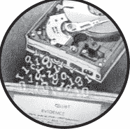

关于数字取证领域至今的一些历史背景有助于解释该领域是如何演变的，并为取证行业专业人员面临的问题和挑战提供了额外的背景。

## 数字取证历史

在这里，我讨论了现代数字取证作为一门科学的发展。

## Y2K 前

与其他科学学科相比，数字取证的历史非常短。最早的计算机相关取证工作始于 20 世纪 80 年代，当时的从业人员几乎来自执法部门或军事组织。20 世纪 80 年代，家用电脑和拨号 `BBS` 服务的增长引发了执法部门对计算机取证的早期兴趣。1984 年，`FBI` 开发出了一项用于分析计算机证据的开创性计划。此外，滥用和基于互联网的攻击增加导致了 1988 年计算机应急响应小组（`CERT`）的成立。`CERT` 由国防高级研究计划署（`DARPA`）组建，位于匹兹堡的卡内基·梅隆大学。

20 世纪 90 年代见证了互联网访问的主要增长，个人电脑变得家常。在此期间，计算机取证是执法机构的一个主要议题。1993 年，`FBI` 举办了多场针对执法部门的计算机证据国际会议的首场；1995 年，国际计算机证据组织（`IOCE`）成立并开始对标准提出建议。“计算机犯罪”的概念变成了现实，不仅是在美国，在国际上也是如此。1999 年，英国警察局长协会（`ACPO`）为处理计算机证据的英国执法人员创建了第一份良好实践指南。同样在 20 世纪 90 年代后期，Dan Farmer 和 Wiese Venema 创造了首个开源取证软件——《法医人员工具箱》（The Coroner's Toolkit）。

## 2000–2010

世纪之交后，许多因素增加了对数字取证的需求。2001 年 9 月 11 日的惨剧对世界如何看待安全和事件响应产生了巨大影响。安然和安德森会计丑闻导致了美国《萨班斯-奥克斯利法》的诞生，旨在通过提高公司披露的准确性和可靠性来保护投资者。该法要求组织建立正式的事件响应和调查流程，通常包括某种形式的数字取证或证据收集能力。知识产权（`IP`）问题的增长也对民用运营产生了影响。互联网欺诈、钓鱼和其他知识产权及品牌相关的事件增加了对调查和证据收集的需求。点对文件共享（从 `Napster` 开始）以及以《数字千年版权法》（`DMCA`）形式出现的数字版权立法，导致了对调查数字版权侵权的需求增加。

从那时起，数字取证社区在转型为科学学科方面取得了巨大进展。2001 年的 `DRSFRS` 会为取证社区提供了重要的定义和挑战，并将数字取证定义为：

利用科学得出的和证明的方法，对源自数字源的数字证据进行保护、收集、验证、识别、分析、解释、记录和展示，目的是促进或进一步重建发现为刑事的事件，或帮助预测被证明具有破坏性的未经授权的行为。

- 1. Gary Palmer, "数字取证研究路线图." 数字取证研究工作坊（`DFRWS`），2001. 技术报告 `DTR-T0010-01`，纽约尤蒂卡。

在取证社区定义其范围和成为公认科学领域的目标的同时，从业人员级的标准、指南和最佳实践程序也正在正式化。数字证据科学工作组（`SWGE`）规定了定义和标准，包括对执法部门标准操作程序（`SOP`）的要求。2000 年在法国举行的 `IOCE` 会议通过指南和清单致力于执法人员流程的正式化。同样在法国举行的第 13 次国际刑警组织科学研讨会概述了参与数字取证小组的要求，并为政府和执法部门发布了一套全面的标准和原则。美国司法部发布了一份详尽的执法人员响应指南（《美国司法部电子犯罪调查：第一响应人员指南》），以及 `NIST` 的计算机取证项目（`CFT`）编写了第一份磁盘镜像规范。

在这一十年中，出现了几种期刊来发表日益增长的知识。《国际数字证据期刊》（`IJDE`）创建于 2002 年（并于 2007 年停刊），《数字调查：数字取证与响应国际期刊》创建于 2004 年。

## 2010 年至今

自 2010 年以来，许多事件将焦点转向调查和收集网络攻击及数据泄露的证据。维基解（`http://www.wikileaks.org/`）开始发布来自军方的泄密材料，包括视频和外交电报。匿名者（`Anonymous`）因分布式拒绝服务（`DDoS`）攻击和其他黑客主义活动而声名大噪。`LuzSec` 破解并泄露了 `HBGary Federal` 等公司的数据。高级持续威胁（`APT`）恶意软件的调查成为行业的一个主要议题。政府之间以及政府与私营部门之间的间谍活动被公开。针对伊朗核计划 `SCADA` 系统的震网蠕虫被发现。`Mandiant` 发布了对 `APT1`（中国解放军网络战部队）的调查。爱德华·斯诺登泄露了一个揭揭示国家安全局（`NSA`）黑客规模的文件库。意大利公司 `HTeam` 的数据泄露显示了专业漏洞市场正出售给政府、执法机构和私营公司。

这种多样化的黑客行为、攻击和滥用扩大了数字取证的范围，包含了网络流量捕获和感染系统的实时内存获取等领域。

## 取证获取趋势与挑战

由于技术和犯罪手段的变化与进步，数字取证领域正在不断转型。在本节中，我将讨论影响传统存储介质取证获取的近期挑战、趋势和变化。

## 证据尺寸、位置和复杂度的变化

影响取证镜像获取的最明显变化是磁盘容量。截至本文撰写时，消费级硬盘存储的数据量已达 `10TB`。易用 `RAID` 设备的出现使得逻辑磁盘容量向更大规模发展。这些大容量磁盘对传统的取证实验室流程形成了挑战。


另一个挑战是犯罪现场或案件中发现的各种存储设备。以前一个家庭使用一台电脑，现在已变成了由电脑、笔记本电脑、平板电脑、外硬盘、USB 闪盘、内存卡、CD 和 DVD 等其他存储大量数据的设备。挑战实际上在于发现并扣押所有相关的存储介质，并以一种使取证分析工具同时访问的方式进行获取。

证据位置向云端的转移也引发了许多挑战。在某些情况下，终端设备上仅保留数据的缓存副本，而大部分数据位于云服务提供商处。如果数据位于司法管辖区之外，执法部门收集这些数据可能会变得复杂；而当外包云提供商没有取证支持规定时，私人机构也面临着困难。

物联网是一个快速发展的趋势，正准备挑战整个取证社区。大量支持互联网的小设备（健康监测器、时、环境显示器、安全摄像头设备等）通常不包含大量存储。它们可能包含遥测数据，例如时间戳、位置和移动数据、环境条件等。识别和访问这些数据最终将成为取证证据收集的标准部分。

此外，今天取证调查人员面临的最困难挑战是向专有、封闭设备的趋势。个人计算机架构和磁盘设备在历史上是开放且文档完的，允许创建标准的取证工具来访问数据。然而，专有软件和硬件使用的增加使得这种创新变得困难。这在移动设备领域尤为突出，因为在访问低级文件系统块之前，设备可能需要被越狱（实际上是被黑客破解）。

## 多司法管辖方面

互联网犯罪的国际性质是取证调查人员面临的另一个挑战。考虑 A 国的一家公司，它是 B 国攻击者的目标，攻击者使用 C 国的代理，通过 D 国的外包合作伙伴破坏基础设施，并将被盗数据渗透到 E 国的投送区。在这种情况下，涉及五家不同的公司，意味着需要协调五个不同的执法机构，参与至少五家不同的公司，并跨越五个不同的法律管辖区。这种跨国场景在今天并不罕见；事实上，它非常常见。

## 行业、学术界与执法部门的协作

互联网犯罪活动日益复杂和先进的性质促进了合作与协作，以收集情报和证据并协调调查。

这种竞争对手之间的协作可以被视为对抗共同敌人（银行业行业对抗银行恶意软件，ISP 行业对抗 DDoS 和垃圾邮件等）。这种协作还跨越了私营和公共部门的边界：执法机构与行业合作伙伴共同工作，在私营伙伴关系（PPP）中打击犯罪活动。这种多层面的合作为识别、收集和传输数字证据提供了机会。这里的挑战是确保私人合作伙伴理解数字证据的性质，并能够满足公共部门执法部门的标准。这将增加基于私营部门收集的证据进行成功起诉的可能性。

第三个与行业和执法部门协作的群体是学术研究社区。该社区通常由大学取证实验室和安全研究部门组成，他们深入研究计算机犯罪和取证的理论和高度技术方面。这些研究人员能够花时间分析问题并对新的犯罪方法和取证技术获得见解。在某些情况下，当标准取证工具无法提取或分析所需的证据时，他们能够为执法部门提供支持。学术小组还需要理解管理和保护数字证据的需求和预期。

## 事后取证原理

数字取证作为一门科学学科的原则受到许多因素的影响，包括正式定义的、同行评审、行业监管和最佳实践。

## 数字取证标准

传统物理证据收集和保护的标准很大程度上取决于当地司法管辖区。相比之下，数字证据在国际环境和互联环境中已经成熟，多个司法管辖区对标准的研发和开发做出了贡献。通常，硬件、软件、文件格式、网络协议和其他技术在全球范围内是相同的。因此，跨司法管辖区的数字证据收集标准和流程更加一致。一个很好的例子是使用写保护器将磁盘连接到镜像设备，这种做法在几乎任何地方都被接受。

目前存在若干定义取证获取标准的正式标准。美国国家标准与技术研究院（NIST）提供了计算机工具测试（CFTT）计划。其目标在此说明：

- 美国国家标准与技术研究院（NIST）计算机工具测试（CFTT）项目的目标，是通过开发通用工具规范、测试程序、标准、测试集和硬件，建立一种测试取证工具的方案论。

尽管 NIST 是一个以美国为中心的机构，但其许多标准在国际上被采纳，或至少影响了其他国家的标准。国际标准化组织（ISO）也提供了若干与数字证据相关的标准。与取证获取相关的是《数字证据识别、收集、获取和保护的 ISO/IEC 指南南》：

> ISO/IEC 27037:2012 为处理数字证据的特定活动提供了指南，这些活动包括具有证据价值的潜在数字证据的识别、收集、获取和保护。

> 它为个人在数字证据处理过程中遇到的常见情况提供了指导，并协助组织进行纪律程序以及促进不同司法管辖区之间潜在数字证据的交换。

各个警察力量可能有自己的标准来概述证据收集流程。例如，在英国，警察局长协会（ACPO）提供了《ACPO 数字证据良好指南》。该指南指出：

本实践指南由 ACPO 犯罪业务部门编写，并于 2007 年 12 月最初获得 ACPO 内阁批准。本文件的目的是不仅是为了协助执法部门，还为了所有协助处理的人员提供指导。

调查网络安全事件和犯罪。该内容将根据法律和政策的变化进行更新并在需要时重新发布。

本文档引用了由 ACPO（高级刑事警察局）和其他机构提出的其他标准和文档。

美国司法部维护有《电子犯罪现场调查：第一响应者指南》。该指南的引言指出：

本指南旨在协助州和地方执法部门以及第一响应者，他们可能负责保护电子犯罪现场，并对数字证据进行识别、收集和保护。

许多其他国际组织通过建立法医学鉴定工作组、委员会和社区，为标准的制定做出了贡献。

## 同行评审研究

数字取证标准和方法的另一个来源是同行评审的研究和学术会议。这些资源提出了数字取证研究领域的最新进展和技术。基于同行评审的科学研究进行取证工作，对于较新的方法和技术尤为重要，因为它们在法庭上可能尚未经过测试。

目前存在多个国际学术研究社区，并对知识体系做出了贡献。取证领域最著名的研究期刊是《数字调查：数字法医学证与事件响应国际期刊》（Digital Investigation: The International Journal of Digital Forensics & Incident Response），该期刊已在该领域发表了十多年的学术研究。其目标和范围如下：

- 《数字调查》杂志涵盖了全球范围内数字法医学和事件响应的前沿发展。这本被广泛引用的出版物帮助数字调查人员关注新技术、实用工具、相关研究、调查技术以及处理安全违规的方法。企业、刑事和军事环境中的从业人员利用该期刊分享他们的知识和经验，包括在以下领域面临的当前挑战和经验教训：

领先的数字法医学学术研究会议是“数字取证研讨会”（DFRWS）。该会议于 2001 年开始，并一直总部位于美国，尽管在 2014 年创建了独立的欧洲活动。DFRWS 的明确宗旨如下：

- 吸引新视角并促进思想交流，以推进数字法医学科学的发展

- 促进与数字法医学及其应用相关的学术讨论

- 让来自执法、军事和民用部门的经验分析师和鉴定员参与，将研究重点放在从业人员的需求、多种调查环境和现实世界的可用性上

- 定义构成有用研发重点的核心技术

- 促进发现、解释和展示具有结论性、说服力的证据，以满足民用和军事环境中法庭和其他决策者的更严格审查

- 建立并扩展通用词汇表，使社区使用相同的语言

- 进行严谨的辩论和协作活动，确保重点突出、高兴趣和高效性

- 维护一个由学术界和实践界专家组成的动态社区

- 增加数字法医学科学的科学严谨性

- 启发下一代发明新解决方案

完全披露：我是《数字调查》杂志的编辑，并担任 DFRWS Europe组织委员会成员。

## 行业法规与最佳实践

特定行业的法规可能对数字证据的收集提出额外要求（或限制）。

在私营部门，行业标准和最佳实践由各种组织和行业团体制定。例如，信息保证顾问委员会（IAAC）提供了《董事和公司顾问数字调查与证据指南》（Directors and Corporate Advisors' Guide to Digital Investigations and Evidence.）。

其他来源还包括法律和监管机构强制的标准和流程，例如，《萨班斯-奥克斯莱法案》（Sarbanes-Oxley legislation）对证据收集能力的要求。

某些数字证据取决于行业。例如，某地区的医疗保健法规可能规定数据保护的要求，并在发生违规时包含各种取证响应和证据处理流程。电信供应商可能有涵盖日志留存和执法部门访问基础设施通信的法规。

> 2. http://www.dfws.org/about-us/

银行监管机构也对数字证据规定了要求和标准。一个很好的例子是新加坡金融管理局（MAS），它在安全和事件响应等领域为银行界提供了详细的标准（http://www.mas.gov.sg/regulations-and-financial-stability/regulatory-and-supervisory-framework/risk-management/technology-risk.aspx）。

随着近期针对不同部门（金融、健康等）的网络攻击增加，监管机构在影响未来标准制定方面可能会发挥更大的作用。

## 本书使用的原则

本书关注私营和公共部门共同拥有的取证任务。数字化的取证过程展示了使用加密哈希和错误处理来保护证据。书中还解释了通过网络进行取证的技术，以及磁带和 RAID 系统。

要执行取证，需要以下先决条件：

字体 目标驱动器已连接并被内核识别

- 已建立写保护机制

- 目标驱动器已经过明确识别并记录

- 可以访问设备（HPA、DCO 和 ATA 安全已禁用）

- 有足够的存储空间执行取证

取证过程和工具在数字法医学社区内有充分记录，并符合某些要求。来自 NIST的要求包括：

- 工具应创建原始磁盘或分区的位流副本或镜像

- 工具不应更改原始磁盘

- 工具应记录 I/O 错误

- 工具文档应是正确的

这些在 NIST 发表的论文中描述的原则为本书奠定了基础。它们的存在是为了确保完整性，并防止或检测篡改。

> 3 https://vetica.edu/academic/institutes/ecii/publications/articles/A04BC142-F4C3-EB2B-A623CCC087B3CBE.pdf

# 1

## 存储介质概述

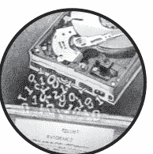

本章概述了 PC 总线系统、常见的质存储介质、物理连接器和接口以及与连接的存储设备通信的低级协议命令。它还为理解书中其他部分描述的存储介质取证提供了背景知识。

总而言之，质存储技术分为三大类：磁性介质、非易失性内存（闪存）和光介质。存储介质可以是内置在设备中的，也可以是可拆的。设备还包含与介质接口所需的驱动器电子设备。系统通过内部或外部总线访问存储设备。

本章首先概述了这三种存储技术，并触及了与数字法取证相关的关键点。最后两个部分描述了这些存储设备如何连接并与 Linux 系统通信，我将讨论对取证调查员特别感兴趣的事目。

本章主要关注现代 PC 架构和组件。可能会提到旧的遗留技术，但不会进行深入介绍。我也将这一概述限制在小型服务器环境和个人（员工、用户等）使用的计算机设备上，而不是涵盖大型企业技术。大型企业环境中的存储技术并不总是适用于传统的数据取证镜像；在某些情况下，巨大的存储空间容量使得传统采集变得不可行，而且业务关键型企业系统通常无法像较小的 PC 系统那样离线。

## 磁性存储介质

磁性介质是三种基本存储技术中最老的（之前是纸张和打孔卡），目前是容量领域的领导者。今天两种主要的磁性存储介质类型是硬盘和磁带；两者都为在线存储和离线存档存储提供了高容量和高可靠性。

> 磁磁盘与固态硬盘（SSD）之间的容量竞赛正在升温。在本书编写期间，市场上宣布了一块 16TB 的 SSD，发布后可能成为最大的磁盘。

### 硬盘

硬盘提供的容量一直比其他介质（如 SSD 或光介质）高。在写本文时，市场上已经有了 10TB 的硬盘，并预计会有更高容量的产品。

硬盘由涂有磁化材料的旋转盘片制成，如图 1-1 所示。多个盘片堆叠在一个主轴上，位于活动臂（执行器）上的读写头可以从/向磁性表面读写数据。常见的硬盘外形包括 3.5 英寸、2.5 英寸和 1.8 英寸。由于硬盘是机械设备，它们对冲击、跌落、灰尘、水分和其他环境因素敏感。典型的硬盘故障涉及盘片划伤、磁头卡住或损坏、电机故障和电子电路。

磁盘的真实物理几何结构（磁头、盘片、轨道、每道扇区）从计算机中被抽象化，并通过逻辑块地址（LBA）以扇区序列的形式访问。扇区是读写数据的最小可寻磁盘单元。从历史上看，标准的硬盘扇区大小为 512 字节；但现代磁盘已转向 4K 扇区大小。使用 4Kn 磁盘具有性能优势， de它们可能会超越传统的 512 字节仿真。关于 4Kn 磁盘驱动器的更多细节，请参阅第 41 页的“高级格式 4Kn”。

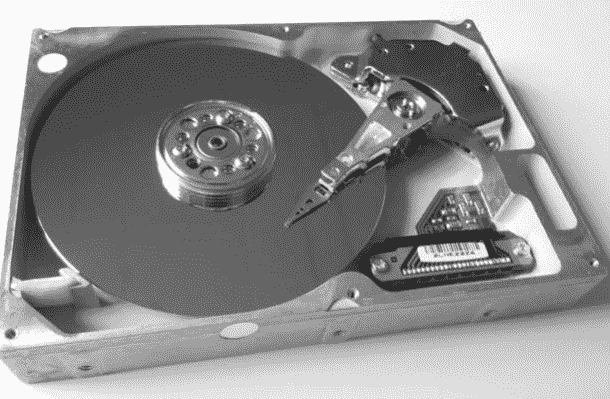

图 1-1: 磁硬盘

传统的计算机取证源于对硬盘分析的需求，硬盘在今天仍然是重要的证据源。特别是当操作系统“删除”一个文件时，它仅仅是断开了与磁盘上数据块的任何引用（与 SSD 不同，SSD 使用 TRIM 命令来清除未分配的块）。这些数据块并没有从磁性盘片上被擦除，而是留在磁盘上，取证工具可以在那里恢复它们（直到它们被覆盖）。

### 磁带

磁带在家庭用户市场已经消失，但小型企业和企业环境继续使用磁带进行备份和存档。如图 1-2 所示，磁带是较早的数字存储形式之一，并以成熟技术闻名，对于长期离线存储非常可靠。与磁盘、SSD/闪存或光盘不同，磁带只能顺序读取或写入数据。随机访问磁带上的不同块需要在使用读写之前将磁带回卷或正进到所需位置。这种缺乏随机访问的能力使得磁带无法作为普通文件系统使用。数据以磁带文件序列的形式存储在磁带上；每个文件通常是一个包含文件系统或一组文件和目录的存档（使用存档格式，如 TAR、DUMP 等）。磁带驱动器使用 SCSI 磁带命令来读写数据、定位或回卷磁带以及弹出磁带。

较新的线性磁带开放（LTO）驱动器可以使用线性磁带文件系统（LTFS）模拟普通文件系统，但这并不是随机访问，且文件仍然是顺序读写的。

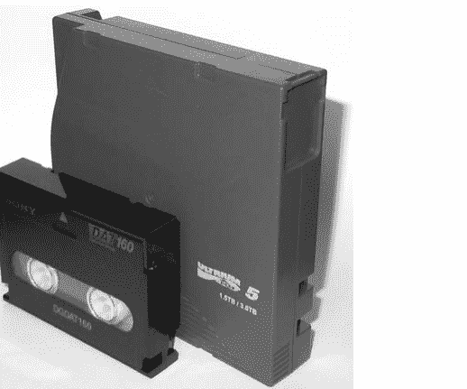

图 1-2: 磁带

以下是光纤 LTO 磁带驱动器 USB DAT160 磁带驱动器的示例；两者都连接到 Linux 系统。磁带驱动器的 dmesg 输出如下：

```
[11.290176] scsi 1:0:0:0: Sequential-Access TANDBERG LTO-5 HH Y629 QPO: 0 ANSI: 6
[11.293554] scsi 1:0:0:0: Attached scsi generic sgs type 256
[11.345030] st: Version 20102129, fixed bufsize 32768, s/g segs 256
[11.361189] st 1:0:0:0: Attached scsi tape sto
[32.6375014] usb 1-8: new high-speed USB device number 14 using xhci_hcd
[32.703245] scsi 1-8: New USB device found, idVendor=03f0, idProduct=0225
[32.703250] scsi 1-8: New USB device strings: Mfr=1, Product=2, SerialNumber=3
[32.703253] usb 1-8: Product: DAT160 USB Tape
[32.703255] scsi 1-8: Manufacturer: Hewlett Packard
[32.703257] usb 1-8: SerialNumber: 48553101234E4648
[32.704156] usb-storage 1-8:1.0: USB Mass Storage device detected
[32.704295] scsi 1-8:1.0
[32.741397] scsi host12:0:0: Sequential-Access
[32.742279] st 12:0:0: Attached scsi tape
```

在写入磁带后，还会写入数据结束（EOD）标记。这告知驱动器磁带已到达。但从取证的角度来看，EOD 标记之外的数据非常有价值，因为它可能包含之前的使用。需要专门的磁带驱动器和设备来完成这项任务。

## 遗留存储

有很多遗留存储类型，特别是可拆卸介质。软磁盘在经过几代后变得过时。Jaz、Zip、Syquest 等磁性产品在 80 年代和 90 年代非常流行。这些类型的取证采集超出了本书的范围。然而，如果硬件和接口可用，可以使用标准技术对其采集。如果 Linux 内核将基于扇区的介质识别为块设备，就可以访问它。

## 非易失性内存

非易失性内存通常使用 NAND 闪存技术，日益流行，并在不需要容量的情况下取代磁磁盘（NAND 指的是逻辑门）。这种内存为取证调查员带来了新的挑战，因为它不像通用磁盘。SSD 和闪存介质通常是基于 NAND 的存储，没有移动部件。数据存储在内存单元阵列中，一个抽象层闪存转换层（FTL）使驱动器类似于硬盘的线性扇区序列。由于非易失性内存磁盘是通过电路实现的而非机械结构，它们是静音的、低功利的，并且不会像硬盘那样损坏。在性能方面，它们可以更快地随机访问和写入数据，因为没有物理磁头在磁盘上寻道（这意味着文件系统碎片没有性能优势）。SSD 驱动器的内存寿命没有硬盘的磁颗粒那么长。某些方法（如磨损均衡和过度备备）用于延长 SSD 介质的寿命。磨损均衡是指在整个驱动器寿命范围内分布读写操作的机制，确保块被均匀使用。当块退化或变得不可写时，FTL 将其从未使用中移除并用预留池（过度备备）中的块进行替换。这些“废弃”块可以通过拆卸物理芯片并读取内存来读取。一些取证实验室会针对各种闪存存储执行这种过程，有时称为拆片提取。

制造过程中可能会占用闪存盘的 10 到 25%（用户无法访问）。目前，存在一个开源 SSD 项目，用于学习和研究底层 SSD 技术。你可以在 http://www.openssd-project.org/wiki/The_OpenSSD_Project 找到更多信息。

## 固态硬盘


如图 1-3 所示，SSD 被设计为普通 SATA 磁盘的直接替代品（SATA，或串行 ATA 接口，是磁盘的标准接口）。SSD 具有标准的 SATA 接口和自我监控、分析与报告技术（SMART）能力，并使用常规 ATA 命令（带有一些扩展）。即使是消费级 SSD 的物理外形也与磁硬盘相同。新的 SSD 给数字取证调查员带来了若干挑战，部分在于可能从驱动器的未分配区域恢复数据，部分在于由于无法访问过度预留区域（overprovisioned areas）。支持 ATA TRIM 命令的 SSD 设备和操作系统会准备下次使用而擦除未分配磁盘块（SSD 块在写入或修改之前必须先擦除）。这减少了未分配块中数据的潜在恢复能力，而这些块在磁磁盘上通常是宝贵的证据来源。

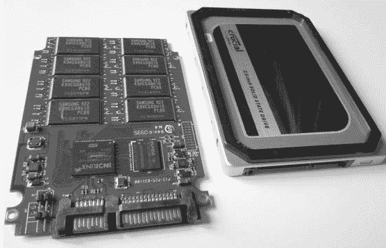

图 1-3：SSD

你可以使用 `hdparm` 命令来确定 SSD 支持的 TRIM 功能。例如：

```
### hdparm -I /dev/sda
...
Commands/features:
  Enabled Supported:
...
```

- 支持数据管理 TRIM（限制 1 个块）
- TRIM 后确定性读取数据

……新一代 SSD 基于名为 SATA Express 和 NVM Express 的新标准，直接与 PCI 总线接口。

## USB 闪存盘

如图 1-4 所示，小型便携式 USB 闪存盘有很多名称：优 盘、USB Stick、Dongle 或简单的 USB 闪存盘。闪存盘最初成为软的替代品，由于价格便宜且容量大，现在正在取代 CD 和 DVD。

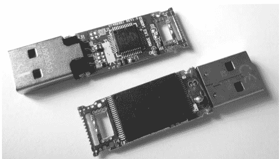

图 1-4：USB 闪存盘

## 可移动内存卡

移动设备（如手机、平板电脑、相机等）的普及为可移动内存卡创造了市场，这些卡在满载或复制到 PC或其他设备时可以更换。图 1-5 显示了各种内存卡。这些卡通常是闪存的，当放入读卡器中时，它们显示为类似于硬盘的扇区序列。

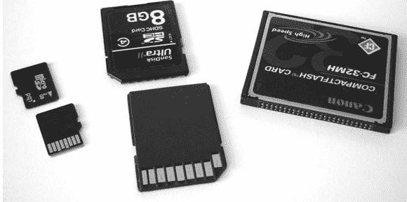

图 1-5：闪存内存卡

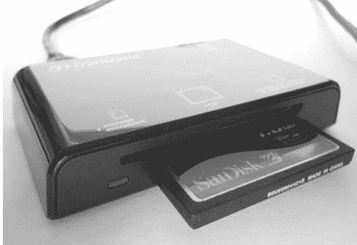

图 1-6：USB 读卡器

- 注意：并行 ATA `PATA` 和集成驱动器 `IDE` 是较旧的标准，定义了驱动器与计算机之间的并行接口。

## 传统非易失性内存

随着市场对其最大容量或专有接口失去兴趣，许多传统内存卡变得过时。示例包括索尼 Memory Stick、松下 P2 卡、SmartMedia 卡以及 PCM-CIA/PCcard 介质。通常，这些内存卡作为具有线性扇区序列的设备连接到 Linux 系统，你可以使用与其他内存卡相同的技术（如果有物理读卡器）对它们进行镜像。

## 光存储介质

如今使用的光盘存储介质包括 CD-ROM、DVD-ROM 和蓝光光。不同类型的的光介质在物理和化学特性上有所不同。它们的可见差异如图 1-7 所示。

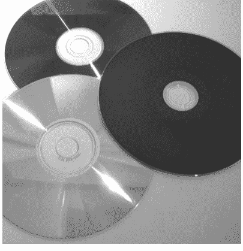

图 1-7：从上到下：DVD-ROM、蓝光、CD-ROM

光盘通常是只读、一次写入或读写型的。专业压制的光盘是压制的而非刻录的。虽然可写光盘逐渐过时，但它们仍然是数字证据的常见来源。许多取证实验室使用它们传输和存储取证镜像。

光盘在反射面上包含一条单一螺旋轨道，其上有一系列凹（pits）和凸（lands），这些可以通过激光读取并解释为数据位。使用激光烧灼表面上的点来将数据写入表面，这会影响反射率并使烧灼区域被解释为数据位。该位序列被划分为扇区，经过编码和纠错后包含 2048 字节的用户可访问数据。

DVD 和 BD 支持使用加密进行内容保护，这在取证调查过程中获取受保护的光盘可能会导致困难。解密 DRM 保护内容的工具和方法不在本书的讨论范围内。

### 遗留光存储

存在许多遗留光驱驱动器，特别是基于盒匣的一次写入多次读取（WORM）时间刻驱动器。遗留光驱驱动器更多地用于企业环境，通常使用 SCSI 接口，并以扇区序列的形式访问。如果驱动器和兼容的控制卡仍然可用，且 Linux 内核识别了介质，你就可以像处理其他光盘一样读取和分析该介质。

# 接口与物理连接

在本节中，我将从取证人员的角度提供常见驱动器接口的概述。在设备齐全的实验室工作的取证人员可以使用各种设备接口获取并分析存储介质。

计算领域的一个大趋势（特别是存储接口）是从并行和共享总线转向点对点连接。PATA/IDE 曾是一种流行的并行接口，两个磁盘共享一根电缆，已被 SATA 取代，后者在串行通道上有一个磁盘。SCSI 是一种支持多个磁盘的并行总线，现在已被 SAS 取代，SAS 为每个磁盘提供独立的串行连接器。原始的、多个接口卡共享的并行 PCI 总线已被 PCI Express 取代，这是一种每个接口具有专用通道的串行总线（也用于连接 SATA Express 和 NV Express 驱动器）。打印接口已被 USB 取代（一种串行协议，但使用共享总线）。随着传输速度的提高，并行接口的时序变得难以管理。在专用线路上执行数据的序列化/反序列化能够比管理多条数据线的协调更快的传输速度。

## SATA ATA

今天最流行的内部存储介质接口是 SATA。在 PC 内部，大多数硬盘、SSD 和光驱都连接到主板或附加主机总线适配器上的 SATA 接口。SATA 的串行架构取代了并行 ATA（PATA 或 IDE），后者曾是主流的消费磁盘接口。

SATA 标准由串行 ATA 国际组织（http://www.sata-io.org/）管理。目前处于第 3 版，SATA 提供的速度高达 6Gbps（第 1 和第 2 版速度分别为 1.5Gbps 和 3.0Gbps）。除了内部接口外，还存在外部接口（eSATA），允许你直接连接外部 SATA 磁盘。图 1-8 显示了 SATA 接口。

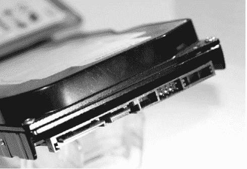

图 1-8：SATA 磁盘接口

更小的尺寸 mini-SATA `mSATA` 为小型便携设备设计。图 1-9 显示的 `mSATA` 允许小型 SSD SATA 驱动器直接连接到主板，无需单独的 SATA 线。

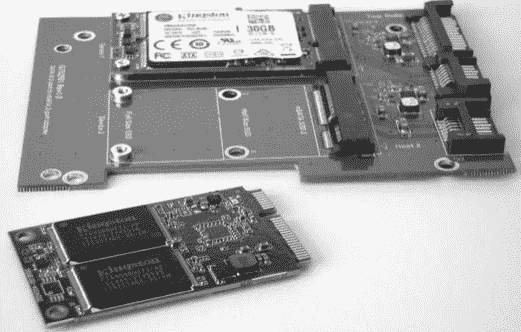

图 1-9：mSATA 磁盘接口

主板通常允许你以高级主机控制器接口（AHCI）模式或 IDE 模式安装 SATA 磁盘。AHCI 在此处定义了一个标准的 SATA 适配器接口：http://www.intel.com/content/dam/www/public/us/en/documents/technical-specifications/serial-ata-ahci-spec-rev-1-3-1.pdf。IDE 模式为不支持 AHCI 标准的旧操作系统提供遗留磁盘接口（例如旧版本的 Windows XP）。你所使用的模式不会影响取证镜像的加密哈希值。

你可以在 IDE 模式下从目标 PC 中移除磁盘，将其连接到 AHCI 模式的取证机上，并在不丢失或修改数据的情况下进行获取。

另一个接口 micro SATA（不要与 `mSATA` 混淆）如图 1-10 所示。它是为 1.8 英磁盘驱动器和薄型 CD/DVD 播放器设计的，但现在较少使用。你可以将普通的 SATA 写保护器与各种适配器结合，获取 `mSATA` 和 micro SATA 驱动器。

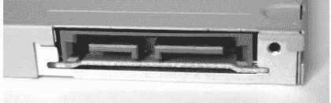

图 1-10：Micro SATA 磁盘接口

一种日益流行的更先进尺寸是 M.2 接口，如图 4-4 所示。M.2 SATA 3.2 规范引入，在一个接口中提供两种标准。M.2 卡可以根据兼容性需求使用 AHCI/SATA 或 NVMe/NVME 接口。当你使用 M.2 卡时，务必确认该卡使用的是哪种接口（截至本文写作时，市场上大多数 M.2 卡使用 AHCI/SATA 模式）。

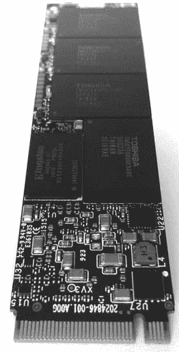

图 1-11：M.2 磁盘接口

图 1-12 所示的 SATA Express 磁盘接口消除了 SATA 协议栈的几层，允许存储（主要是 SSD）直接连接到 PCI Express 总线。这些驱动器继续使用 AHCI 标准，并与 NVME 不同。

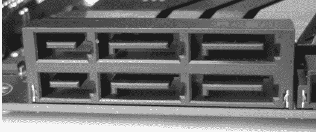

图 1-12：SATA Express 磁盘接口

## 串行 SCSI 和光纤通道

注：由于 OCR 错误，第 52-53 页的文本存在大量重复；以下为所提供的逻辑序列。

SATA Express 磁盘接口（如图 1-12 所示）消除了 SATA 协议栈的几层，允许存储（主要是 SSD）直接连接到 PCI Express 总线。这些驱动器继续使用 AHCI 标准，并与 NVME 不同。

NVME U.2 接口（见图 1-18）允许具有传统 2.5 英寸物理规格的硬盘通过电缆或背板进行连接。U.2 `SFF-8639` 接口和电缆（机械结构与 SAS 相似，但为 PCIe 通道增加了额外的引脚）将硬盘外壳连接到适配器上的 mini-SAS HD 插头上，该适配器连接在主板上。

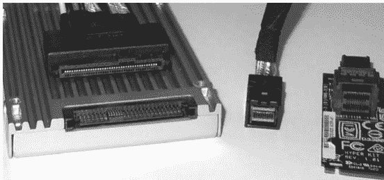

图 1-18：带有 U.2 接口的 2.5 英寸 SSD、U2 转 mini-SAS 线缆，以及用于主板的 mini-SAS HD 转 M.2 适配器

使用典型的 SCSI 或 SATA 命令无法无法 NVME 磁盘，因为它们不使用 SCSI 或 SATA 命令。为与 ATA 或 SCSI 磁盘接口交互设计的 Linux 工具通常无法与 NVME 磁盘工作，并且需要额外的支持来实现兼容性。NVME 磁盘的设备名称不是熟悉的 `/dev/sd` 文件……一个 NVME 设备通过一个额外的命名空间数字创建。命名空间（用 `n` 表示）是 NVME 磁盘上空间的一个较低层（操作系统分配）。`/dev/nvme*n` 磁盘设备是块设备，当应用于 Linux 设备文件时，它们应该能够正常工作。例如，这里是可以在 NVME 磁盘上操作的 Sleuth Kit 命令：

```
# mmls /dev/nvme0n
DOS Partition Table
Offset Sector: 0
Units in 512-sectors
```

| Slot | Start | End | Length | 描述 |

|---|---|---|---|---|

| 00: | 000000000 | 000000000 | 00000001 | 主分区 (#0) |

| 01: | 000002048 | 000002047 | 000002048 | 未分配 |

| 02: | 00:00 | 000002048 | 078142267 | 078142070 | Linux (0x83) |

截至目前，NVME 的使用还很新，Tableau 刚刚创建了第一个支持 NVME 的 PCI 取证硬件写保护器。由于在 PCIe 总线上拦截 NVME 命令的困难使得写保护器变得价格昂贵且实现复杂，请参阅我的论文《NVM Express 硬盘与数字取证》，其中详细讨论了这一挑战。²

### 通用串行总线 USB

USB 的创建是为了整合并取代外围接口，例如 RS-232、并行打印机接口、PS/2 键盘和鼠标以及其他 PC有接口。它的设计旨在适应多种用途的功能，如磁盘、键盘、鼠标、音频、网络连接、打印机和扫描仪，以及连接的小型设备（手机等）。日益增物联网（IoT）设备可以通过 USB 连接到 PC，并可能包含作为取证证据有用数据。由于本书的重点是大容量存储设备的取证获取，我将此处的讨论限制在 USB 大容量存储设备上。

闪存盘、光驱器、某些磁带驱动器甚至是磁硬盘（见图 1-19）可能直接将 USB 接口集成到驱动器电子。USB 大容量存储类常用的用途是消费级 USB 盘（或 U 盘）以及外部硬盘盒。

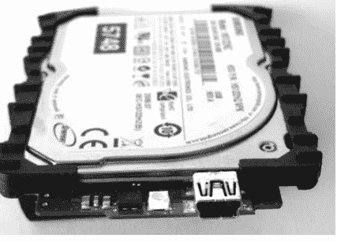

图 1-19：带有集成 USB 接口的 1.8 英制磁硬盘

大存储类设备的原始 USB 协议被称为仅批量传输（BOT），BOT 是常用的 USB 传输协议；然而，随着磁盘速度的提高和 USB3 的到来，BOT 协议正成为瓶颈，可能会被 USB 附加 SCSI 协议 `UASP` 取代。与 SATA 的 AHCI 类似，USB 也有一个定义的主机控制器接口标准。可扩展主机控制器接口 `xHCI` 替换了几个旧的 USB 标准（特别是 OHCI、UHCI 和 EHCI）。

- Bruce Nikkel, Digital Investigation 16 (2016): 38–45, doi:10.1016/j.dim.2016.01.001.

位于 https://www.intel.com/content/dam/public/us/en/documents/technical-specifications/extensible-host-controller-interface-usb-xhci.pdf。USB 3.1 的最新 USB 接口是 Type C，如图 1-20 所示。Type C 接口是多功能的，可用于 USB 3.1 设备和雷电 3 设备，并作为电源。物理插头是可反向的，这意味着在插入系统时不需要对齐顶部或底部。

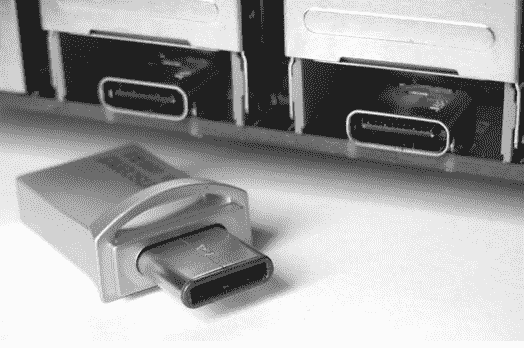

图 1-20：USB Type C 接口

外部 USB 硬盘盒通常包含一个或多个 SATA 磁盘。如果可行，您应该移除 SATA 磁盘以获得对接口的直接访问。这允许您直接查询硬盘，在某些情况下可能具有性能优势（例如 USB 2.0 硬盘盒）。存在专门为镜像设备设计的取证写保护器（闪存或其他）。

### 遗留接口

本节不讨论计算机磁盘接口的长历史，而是简要涵盖了已过时的 IDE、并行 SCSI 和火线（FireWire）技术。在取证调查中发现或扣收旧硬件时，这些接口可能是相关的。

IDE 接口（见图 1-22）和增强型（EIDE）通常用于 3.5 英寸磁盘，在它们被 SATA 取代之前一直是流行的接口。

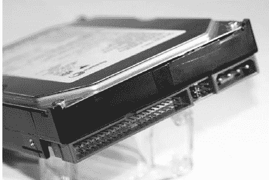

图 1-22：IDE 磁盘接口

Mini IDE 接口（见图 1-23）最初是为 2.5 英制磁盘开发的，用于笔记本电脑，直到它被 SATA 取代。

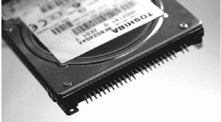

图 1-23：微型 IDE 磁盘接口

微型 IDE ZIF 接口（见图 1-24）是为超笔记本电脑和其他小型电子设备的 1.8 英制硬盘开发的，直到它被 `mSATA` 和 M.2 接口取代。

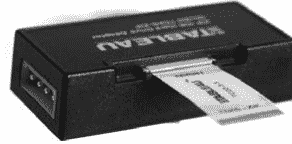

图 1-24：微型 IDE ZIF 接口

火线（FireWire，或 IEEE1394 接口见图 1-25）由苹果开发，旨在提供一种高速外部总线以连接视频设备和磁盘驱动器。该接口在很大程度上已被雷电（Thunderbolt）和 USB3 取代。

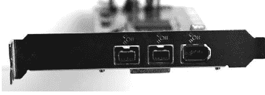

图 1-25：火线接口

并行 SCSI 接口（见图 1-26）已很大程度上从消费市场消失，主要被 SATA（或企业级市场中的 SAS）取代。

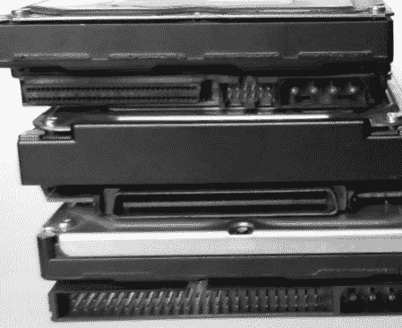

图 1-26：SCSI 接口

用于 IDE、SCSI 和火线的取证写保护保护器非常常见，并且也可以配合微型 IDE、微型 IDE ZIF 以及各种 SCSI 接口适配器工作。

# 命令、协议与桥接

存储设备与计算机系统之间的通信与局域网/广域网的分层网络具有某些概念相似性。存储设备与计算机系统之间的通信也可以类似地组织成几层抽象。底层包含一个由电缆、导线和电信号组成的物理层。之上是链路层，其数字位和字节通过帧或链路包以有序的方式传输。在链路层之上，发送者和接收者之间交换协议和命令以请求和接收数据。在之前的章节中，我描述了物理连接和磁盘接口。在这里，我将描述 ATA、SCSI 和 NVME 的高层命令集。图 1.27 更直观地展示了这些抽象层。

## ATA 命令

当前的高级技术附件（ATA）命令最初演变自美国国家标准协会（ANSI）标准，该标准定义了磁盘驱动器的附件接口。^4原始标准描述了物理接口（电缆、引脚等）、电信号以及可以发出的逻辑命令。当前标准⁵描述了磁盘可能具有的功能集以及用于控制每个磁盘的可用 ATA 命令。ATA 数据包接口（ATAPI）在 ATA 标准中添加了包命令功能集，允许使用不特定于驱动器功能的额外命令（例如，弹出介质、封装 SCSI 命令等）。

命令集（ACS）定义了一组可以加载到 ATA 寄存器并发送到磁盘执行的命令和参数。表 1-1 显示了一些常见的 ATA 命令。

### 表 1-1：常见 ATA 命令

| 命令 | 命令代码 |

|---|---|

| DEVICE RESET（设备重置） | 08h |

| READ SECTOR(S)（读扇区） | 20h |

| WRITE SECTOR(S)（写扇区） | 30h |

| SEEK（寻道） | 70h |

| DOWNLOAD MICROCODE（下载微代码） | 92h |

| MEDIA EJECT（弹出介质） | EDh |

| SECURITY UNLOCK（解锁） | F2h |


可以使用 `hdparm` 和 `smartctl` 工具使用许多 ATA 和 ATAPI 命令。T13 (http://t13.org/) 发布了定义完整命令集的标准。可以在 http://sata-io.org/ 找到更多资源。

^3. 网络通信中的局域网/广域网分层网络是由开放系统互连（OSI）模型的七层抽象描述的。

4. AT Attachment Interface for Disk Drives, ANSI X32.221-99x, Revision 4c, XT3190, 1994.

5. ATA/ATAPI Command Set-2 (ACS-2), Revision 2.

理解 ATA/ATAPI 命令的基本操作可以为你提供理解 SATA 和 IDE 取证写保护器如何工作所需的背景知识（防止 ATA/ATAPI 命令修改磁盘）。了解这些命令如何运行，可以增强你对取证人员如何查询磁盘属性并最终完成成功的取证提取的理解。

# SCSI 命令

从主机总线适配器到磁盘的 SCSI 命令遵循客户端/服务器模型。主机总线适配器（HBA）是客户端、启动者，磁盘是服务器或目标。启动者发送命令（可能同时带有数据）。SCSI 最初设计用于用于各种设备，包括扫描仪、磁带机、打印机等，而不仅仅是硬盘。此外，SCSI 是一个丰富的命令集。命令从启动者（HBA）发送到目标（驱动器）时使用命令描述符块（CDB），CDB 是一个包含命令及其参数的数据块。目标接收 CDB，执行请求并返回响应。这种交互与 TCP/IP 客户端/服务器架构中基于 UDP 的请求/响应有些相似。

SCSI 命令从磁盘/向磁盘读写数据块、控制硬件（执行 CD 或更换磁带）、报告状态和诊断信息等。这些通常对终端用户隐藏，但可以使用各种实用程序从用户空间发出 SCSI 命令。甚至可以使用 `sg3-utils` 软件包从 Linux 命令行中提交任意命令。例如，以下命令提交了一个低级 SCSI 命令来读取 SCSI 磁盘的第一个扇区：

```
# sg_raw -i 512 /dev/sda 08 00 00 00 01 00
SCSI Status: Good
```

```
Received 512 bytes of data:
00 00 00 00 00 00 00 00 00 00 00 00 00 00 00 00
10 00 00 00 00 00 00 00 00 00 00 00 00 00 00 00 00
1a0 00 00 00 00 00 00 00 00 00 00 00 00 00 00 00 00
1b0 00 00 00 00 00  0 00 00 00 00 00 00 00 00 00 00 0001102 02 ff ff ff ff ff  0 00 00 ff ff ff ff0 ff ff ff00
000 00 00 00
```

磁盘设备可以通过各种总线系统和桥器连接到 PC 系统。通过将驱动器尽可能地靠近 CPU 和内存，可以提高性能。如今，设备距离 CPU 和内存最近的方式是通过使用 PCI express 3.0 的专用通道并配合 NVME 接口实现的（RAM 磁盘更快、更高效，但它们由操作系统创建，不是非易失性存储设备）。NVME 设备可以直接通过南桥芯片组连接到 CPU，而无需通过任何传统的磁盘协议开销（如 ATA 或 SCSI）。

# 桥接、隧道化与透传

ATA 和 SCSI 是与存储介质交互的两种最常用协议。命令可以通过多种物理层或传输层发送，甚至在其他协议中进行隧道化或封装。这种复杂性对用户是隐藏的，连接的设备仅可以通过 Linux 内核生成的标准块设备进行访问。

为了说明这一点，考虑一个插入到独立底座的 SATA 硬盘，该底座又插入 PC 中安装的 USB3 PCI express 外部接口。底座之间的通信是底层 SATA 协议，使用 SATA 帧信息结构 (FIS) 数据包。底座与 USB3 卡之间的通信是底层 USB 协议，使用 BOT 或 USAP。USB3 卡与 PC 之间的通信是底层 PCI express 协议，使用 PCIe 事务层数据包 (TLP) 和数据链路层数据包 (DLLP)。最后，跨越所有桥器使用 SCSI 命令协议访问磁盘。在这个示例中，使用了多个物理层和链路层来连接磁盘。对于用户来说，底层协议被隐藏或抽象化了。

> FIS 是 SATA 协议的一部分。PCI Express 有自己的一套协议，包括 TLP 和 DLLP。

对于每个物理总线，一种称为 PHY（物理层）的设备促进连接到总线上的设备之间的通信（总线上的 PHY 像两个通过 WAN 线缆通信的调制解调器）。PHY 将数字 0 和 1 转换为所需的所需的电气信号。在 PHY 处理完物理层后，链路层协议管理在总线上上传回传输的比特/字节流。链路层将数据流组织成帧或离散的信息包，供上层进行处理。

USB、PCIe、Thunderbolt（雷电）、SAS、SATA、光纤等都有物理层和链路层描述。通常存在某些标准允许通用操作系统驱动程序以独立设备的方式使用设备中的物理硬件。例如，USB 适配器由 xHCI 标准定义，SATA 适配器由 AHCI 标准定义，NVME 设备由 NVMHCI 标准（现在简单称为 NVME 标准）定义，以此此类推。遵循这些标准允许无需额外的专用驱动程序即可支持硬件。

虽然 ATA/ATAPI 和 SCSI 是不同的集合，但它们都支持对对方命令的某种程度的隧道和透传。ATA 使用 ATAPI 接口封装 SCSI 命令，以便与光驱、带驱动器和其他理解 SCSI 命令的设备进行通信，用于注入介质以及其他在 ATA 协议中未找到的命令。SCSI 支持 ATA 透传，允许通过 SCSI 协议发送 ATA 命令。SAT（SCSI-ATA 翻译）在 SCSI 和 ATA 命令之间创建了双向翻译，使命令与存储介质交互。这种翻译作为 Linux 内核 API 在 `libata` 中实现。（`libata` 提供了 ATA 控制器和驱动程序接口的许多功能。）

桥器在取证采集中起着重要作用，因为它们是实现硬件写保护器的基础。硬件保护器通常是一个能够拦截发送到磁盘的 ATA 命令的桥器，防止命令修改磁盘上的扇区。

# 特题

本节涵盖了与大容量存储和数字取证相关的特殊主题。某些领域（如 UASP 和 SSHD）简要说明了它们与数字取证的相关性。其他领域（如 DCO、HPA 和 NVME 驱动器在此处介绍，并在书后的部分详细讨论。

## DCO 和 HPA 磁盘区域

随着 ATA/ATAPI 标准的演进，创建了一些有利于系统供应商的特性。主机保护区域（HPA）在 ATA/ATAPI-4 标准中引入，允许系统供应商保留磁盘的分区供正常操作系统之外使用。例如，HPA 可用于存储持久化数据、系统恢复数据、休眠数据等。对这些数据的访问由系统固件控制，而非已安装的操作系统。设备配置覆盖（DCO）特性在 ATA/ATAPI-6 标准中引入，并提供了控制报告的磁盘特性和容量的能力。这允许系统供应商出来自多个制造商的磁盘，同时保持各磁盘之间用户可访问扇区的数量和特性完全相同。这便于后期支持和驱动器更换。HPA 和 DCO 可以共存；但必须先创建 DCO，然后创建 HPA。

HPA 和 DCO 被犯罪分子和恶意攻击者误用于隐藏文件和恶意代码。我在第118页的“访问隐藏扇区”中描述了如何检测和删除 HPA 和 DCO，从而揭示隐藏在普通用户视图扇区。在论文《隐藏磁盘区域：HPA 和 DCO》中，你可以找到更多关于取证相关的 HPA 和 DCO 说明。https://www.schneier.com/blog/archives/2014/02/swap_nusa_exploit.html 和 https://leaksource.files.wordpress/com/2013/12/nsa-cnt-swap.jpg 也有关于利用 HPA 进行 NSA 攻击的信息。

## 磁盘服务与维护区域

磁盘的某些区域用于维护，操作系统无法访问。这些区域包括记录坏道位置的缺陷列表（defect list），以及存储固件和其他内部配置数据的区域（service area）。这些区域有时可以使用专用工具或抹平命令访问。对于取证调查人员来说，这些区域可能很重要，因为它们可能包含隐藏数据或磁盘操纵的证据。

（注：原文此处存在大量重复段落，译文已根据原文结构保留对应内容并翻译。）

# USB 协议

USB 协议是将各种设备连接到计算机的常用接口。它经历了多个版本迭代，从 USB 1.1 到最新的 USB4。每个版本都引入了更快的数据传输和新功能。USB 协议用于从键盘、鼠标到外部硬盘甚至手机的所有设备。对于取证调查人员来说，理解 USB 设备如何工作以及如何提取数据至关重要。

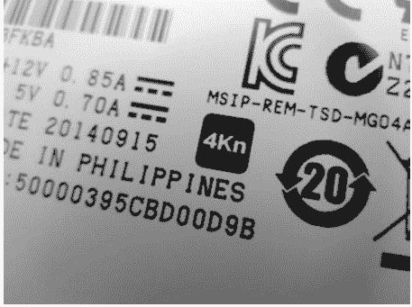

图-1：高级格式 4Kn 标志

当 Linux 内核检测到连接的磁盘时，它会显示扇区数量和逻辑扇区大小（在某些情况下，它可能会显式显示物理大小）。以下 dmesg 输出显示了两个大小相同的磁盘，一个使用高级格式 512e，另一个使用 4Kn。通过将 512 字节扇区的数量除以 8，或将 4K 扇区的数量乘以 8，可以发现磁盘的容量相等，但数量不同。

...

- [13.605000] scsi 1:0:1:0: 直接访问 硬盘 TOSHIBA MG03ACA300 0108 P0: 0 ANSI: 5

- [16.621880] sd 1:0:0: [sdb] 5860533168 512-byte 逻辑块: (3.00 TB/2.73 TIB)

- [14.355068] scsi 1:0:2:0: 直接访问 ATA TOSHIBA MG04ACA FP2A P0: 0 ANSI: 6

- [16.608179] sd 1:0:2:0: [sdc] 732566646 4096-byte 逻辑块: (3.00 TB/2.73 TIB)

在 Linux 系统上，你可以使用 `/sys` 伪文件系统来查找磁盘的逻辑和物理扇区大小。例如，你可以按照以下方法确定连接的磁盘 `/dev/sda` 的物理和逻辑扇区大小：

```bash
# dmesg
```

- [16.606585] sd 1:0:0:0: [sda] 7814037168 512-byte 逻辑块: (4.00 TB/3.64 TIB)

...

第 I 章 第42 页

```bash
# cat /sys/block/sda/queue/logical_block_size
512
# cat /sys/block/sda/queue/physical_block_size
4096
# blockdev --getbsz /dev/sda
4096
# blockdev --getssz /dev/sda
512
```

这两种方法展示了从 `/sys` 伪文件系统读取（你也可以以 root 用户身份执行）以及使用 `blockdev` 命令。

某些 SSD 允许通过固件工具选择物理扇区大小。例如，早期的 Intel SSD 可以 Intel 提供的命令行工具 (https://downloadcenter.intel.com/download/23991/) 在 512 和 4096 之间更改扇区大小。

4k 磁盘的几个方面令数字取证社区感兴趣，并在本节的其余部分进行了讨论。早期的西部数据高级格式 512 磁盘具有一个跳线设置（7 和 8），用于内部偏移扇区，以使默认 XP 分区的起始位置与 4k 扇区的起始位置对齐。这种对齐磁盘的跳线设置极大提高了性能。更改扇区对齐跳线将影响取证获取哈希值，并可能影响对磁盘的分析。在对磁盘进行取证镜像或验证时，使用硬盘硬盘时相同的跳线设置至关重要。

4k 磁盘的使用会影响空隙空间（slack space）的值。RAM 间隙或内存空隙是文件最后一个扇区的未使用部分（不要与文件空隙混淆，它是文件最后一个文件系统块的未使用部分）。在使用 4k 磁盘配合那些在填充 4K 扇区的未使用分区前填充零的文件系统操作系统时，将消除具有 4k 块的文件系统中的文件中任何有用数据的可能性。

假设 512 字节扇区大小的取证软件可能会失败，或者更糟糕，产生错误结果。当你使用 4k 磁盘时，确认取证软件识别 4k 扇区至关重要。Sleuth 在处理 512 字节扇区会失败，必须明确告诉它对 4k 磁盘使用 4k 扇区。以下示例了 `mls` 默认产生错误结果，而在指定正确扇区大小时产生正确结果。

```bash
# mls /dev/sda
DOS 分区表
偏移扇区: 0
单位为 512 字节扇区
```

| 槽位 | 开始 | 结束 | 长度 | 说明 |

|---|---|---|---|---|

| 00: Meta | 000000000 | 000000000 | 000000001 | 主表 (#0) |

| 01: | ---- | 000000000 | 000000025 | 000000026 | 未分配 |

| 02: | 000000256 | 0732566645 | 0732566390 | Linux (0x83) |

| 03: | ---- | 0732566646 | 5860533167 | 5127966522 | 未分配 |

```bash
... # mls -b 4096 /dev/sde
DOS 分区表
偏移扇区: 0
单位为 512 字节扇区
```

| 槽位 | 开始 | 结束 | 长度 | 说明 |

|---|---|---|---|---|

| 00: Meta | 000000000 | 000000000 | 000000001 | 主表 (#0) |

| 01: | ---- | 000000000 | 000000025 | 000000026 | 未分配 |

| 02: | 000000256 | 0732566645 | 0732566390 | Linux (0x83) |

| 03: | ---- | 0732566646 | 5860533167 | 5127966522 | 未分配 |

4k 磁盘的使用将影响空隙空间的值。对齐磁盘的跳线设置极大提高了性能。更改扇区对齐跳线将影响取证获取哈希值，并可能影响对磁盘的分析。在对磁盘进行取证镜像或验证时，使用硬盘硬盘时相同的跳线设置至关重要。

4k 磁盘的使用会影响空隙空间的值。RAM 间隙或内存空隙是文件最后一个扇区的未使用部分（不要与文件空隙混淆，它是文件最后一个文件系统块的未使用部分）。在使用 4k 磁盘配合那些在填充 4K 扇区的未使用分区前填充零的文件系统操作系统时，将消除具有 4k 块的文件系统中的文件中任何有用数据的可能性。

假设 512 字节扇区大小的取证软件可能会失败，或者更糟糕，产生错误结果。当你使用 4k 磁盘时，确认取证软件识别 4k 扇区至关重要。Sleuth 在处理 512 字节扇区会失败，必须明确告诉它对 4k 磁盘使用 4k 扇区。以下示例了 `mls` 默认产生错误结果，而在指定正确扇区大小时产生正确结果。

```bash
# mls /dev/sda
DOS 分区表
偏移扇区: 0
单位为 512 字节扇区
```

| 槽位 | 开始 | 结束 | 长度 | 说明 |

|---|---|---|---|---|

| 00: Meta | 000000000 | 000000000 | 000000001 | 主表 (#0) |

| 01: | ---- | 000000000 | 000000025 | 000000026 | 未分配 |

| 02: | 000000256 | 0732566645 | 0732566390 | Linux (0x83) |

| 03: | ---- | 0732566646 | 5860533167 | 5127966522 | 未分配 |

```bash
... # mls -b 4096 /dev/sde
DOS 分区表
偏移扇区: 0
单位为 512 字节扇区
```

| 槽位 | 开始 | 结束 | 长度 | 说明 |

|---|---|---|---|---|

| 00: Meta | 000000000 | 000000000 | 000000001 | 主表 (#0) |

| 01: | ---- | 000000000 | 000000025 | 000000026 | 未分配 |

| 02: | 000000256 | 0732566645 | 0732566390 | Linux (0x83) |

| 03: | ---- | 0732566646 | 5860533167 | 5127966522 | 未分配 |

4k 磁盘的使用将影响空隙空间的值。对齐磁盘的跳线设置极大提高了性能。更改扇区对齐跳线将影响取证获取哈希值，并可能影响对磁盘的分析。在对磁盘进行取证镜像或验证时，使用硬盘硬盘时相同的跳线设置至关重要。

4k 磁盘的使用会影响空隙空间的值。RAM 间隙或内存空隙是文件最后一个扇区的未使用部分（不要与文件空隙混淆，它是文件最后一个文件系统块的未使用部分）。在使用 4k 磁盘配合那些在填充 4K 扇区的未使用分区前填充零的文件系统操作系统时，将消除具有 4k 块的文件系统中的文件中任何有用数据的可能性。

假设 512 字节扇区大小的取证软件可能会失败，或者更糟糕，产生错误结果。当你使用 4k 磁盘时，确认取证软件识别 4k 扇区至关重要。Sleuth 在处理 512 字节扇区会失败，必须明确告诉它对 4k 磁盘使用 4k 扇区。以下示例了 `mls` 默认产生错误结果，而在指定正确扇区大小时产生正确结果。

```bash
# mls /dev/sda
DOS 分区表
偏移扇区: 0
单位为 512 字节扇区
```

| 槽位 | 开始 | 结束 | 长度 | 说明 |

|---|---|---|---|---|

| 00: Meta | 000000000 | 000000000 | 000000001 | 主表 (#0) |

| 01: | ---- | 000000000 | 000000025 | 000000026 | 未分配 |

| 02: | 000000256 | 0732566645 | 0732566390 | Linux (0x83) |

| 03: | ---- | 0732566646 | 5860533167 | 5127966522 | 未分配 |


4k 磁盘的使用会影响空隙空间的值。RAM 间隙或内存空隙是文件最后一个扇区的未使用部分（不要与文件空隙混淆，它是文件最后一个文件系统块的未使用部分）。在使用 4k 磁盘配合那些在填充 4K 扇区的未使用分区前填充零的文件系统操作系统时，将消除具有 4k 块的文件系统中的文件中任何有用数据的可能性。

假设 512 字节扇区大小的取证软件可能会失败，或者更糟糕，产生错误结果。当你使用 4k 磁盘时，确认取证软件识别 4k 扇区至关重要。`Sleuth` 在处理 512 字节扇区会失败，必须明确告诉它对 4k 磁盘使用 4k 扇区。以下示例了 `mls` 默认产生错误结果，而在指定正确扇区大小时产生正确结果。

```bash
# mls /dev/sda
DOS 分区表
偏移扇区: 0
单位为 512 字节扇区
```

## 作为法证取证平台的 Linux

本章描述了 Linux 作为执行数字法证取证的平台，并讨论了它的各种优缺点。我还审视了数字法证学界对 Linux 和开源软件的接受程度，最后一部分概述了你理解本书后续章节所需的相关 Linux 基础知识。

书中展示的示例主要使用 Ubuntu Linux Server 16.04 LTS（支持至 2021 年 4 月），以及 Bourne Again shell `Bash` 4.3.x 版本。只要你使用相同或更高版本的工具并调整设备名称，这些示例也应该可以在其他 Linux 发行版和其他操作系统上运行。在整本书中，命令行（`command line`）、外壳（`shell`）和 `Bash` 这三个词汇是互换使用的。

### 取证背景下的 Linux 和开源软件

像 Linux 这样的开源软件（OSS）日益流行，使其作为执行数字法证取证的平台变得至关重要。许多研究人员讨论了 OSS 在满足道伯特标准（Daubert guidelines）证据可靠性方面的优势.¹ Brian Carrier。

在取证背景下使用 OSS 的主要优势是透明性。与专有商业软件不同，其源代码可以被审查并公开验证。此外，学术研究人员可以对其进行研究并在社区的工作的基础上进行开发。开源法证软件应用已成为法证研究的工具和基石。使用 OSS 也有缺点，且在某些情况下并不适用。特别是，源代码社区的开放性在某些情况下可能与进行中的法证调查的机密性发生冲突。后续章节将讨论 Linux 和 OSS 的优缺点。

### 法证实验室中 Linux 和开源软件的优势

开源软件的公开可用意味着所有人都可以访问。它并不局限于购买了许可或签署了保密协议的人员。感兴趣的人可以免费下载、使用、检查和修改开源软件，且不涉及任何许可费用或使用成本。

获取源代码允许你进行定制并促进与法证实验室中其他软件、硬件和流程的集成。这种源码级的访问增加了工作流自动化和脚本化的可能性。自动化减少了所需的人工交互，从而限制了人为错误的风险，并释放了这些人力资源，使其用于其他地方。

在代码量巨大的实验室中，自动化对于优化和流程精简至关重要。因为你可以自由修改源代码，所以 OSS 可以被定制以满足特定法证实验室的要求。命令行软件允许你通过 脚本将管道中的多个任务和作业连接起来以完成端到端的流程。

对 OSS 的支持有几个优势。即时的社区支持可能非常出色，邮件列表和聊天论坛可以在几分钟内回答求助。在某些情况下，可以快速实现补丁、错误修复和功能请求。

- 1. Erin Kennelly, “Gatekeeping of the Box: Open Source Software as a Mechanism to Assess Reliability for Digital Evidence," Virginia Journal of Law and Technology 6, no. 13 (2001).
- 2. Brian Carrier, "Open Source Digital Forensic Tools: The Legal Argument" [technical report] (Atstake Inc., October 2002).

Linux 和 OSS 是学术法证实验室环境的理想选择，因为它们使用的是开放、发布的标准，而不是闭源或专有的标准。OSS 开发社区与竞争小组合作而非对抗。学习他人、复制他人的代码和想法（并注明），以及在他人人的工作基础上进行构建是被鼓励的，这也是学习和获取知识的基础。

OSS 提供的供应商独立性防止了产品锁定，并促进了技术与组织之间的互操作性和兼容性。这使得随着时间的推移更换软件变得更容易，因为单个组件可以被替换为新技术或替代技术，而不影响整个系统和流程。

### 法证实验室中 Linux 和开源软件的缺点

Linux 和 OSS 的缺点为支持闭源专有软件提供了论据。商业工具的实现通常在这些领域提供收益和优势。

开源社区的支持无法保证是可靠、准确或可信的。社区提供的答案质量差异很大；某些答案非常优秀，而另一些可能是错误甚至是危险的。没有正式的组织支持来提供帮助。在必须保证 24/7 小时支持的情况下，商业供应商具有优势。

开源世界的支持像软件本身一样透明，所有人皆可见。然而，在法证实验室的设置，案件处理和调查可能是敏感或机密的。寻求支持可能会泄露或损害正在进行的调查的细节。因此，信息安全和隐私是开源支持模型中考虑的问题。

与专有技术的互操作性在开源接口和 API 方面带来了困难。不公开的专有技术通常通过反向工程而非许可来获取。反向工程工作往往是不完整的，存在错误实现特定技术的风险，并且可能需要很长时间才能实现。

免费的 OSS 是志愿者行为，软件可能处于永久开发状态。某些项目可能会被遗弃或因忽视而死亡。其他项目可能会经历代码分叉（`fork`），某些开发者决定复制现有的基础代码并将其向背离原始开发者的方向发展。

免费的 OSS 可能很粗糙。它可能有很多 Bug，或者难以学习或使用。它的文档可能很糟糕（源代码可能是唯一的文档）。与商业软件不同，通常不会随软件产品提供培训。学习 Unix/Linux 需要花费和精力；特别是命令行不如全功能环境那样直观。许多人在初次进入免费开源世界时会经历一个学习曲线，这不仅是针对软件本身，还针对其通用的态度。

### Linux 内核与存储设备

Linux 继承了传统 Unix 系统的哲学，后者的设计方式使得其上的所有内容都是文件。每个文件都被指定为一种特定类型，包括普通文件和目录、块设备、字符设备、命名管道、硬链接和软链接/符号链接（类似于 Windows 中的 LNK 文件）。在调查员工作站上，调查人员感兴趣的文件是连接磁盘的块设备文件，这些文件可能包含法证证据。本节描述了 Linux 设备——特别是用于存储介质的块设备。

#### 内核设备检测

Unix 和 Linux 系统有一个名为 `/dev/` 的特殊目录，存储了与内核理解的设备对应的特殊文件。原始 Unix 和 Linux 系统需要在 `/dev` 目录中手动创建设备文件（使用 `mkdev` 命令）或脚本（`MAKDEV`）在启动或需要时创建设备。随着即插用硬件的出现，需要更动态的方法，`devfs` 被创建以自动检测新硬件并创建设备文件。与用户空间和程序交互的需求导致了 `udev` 的开发，它取代了 `devfs`。今天，`udev` 已合并到 `systemd` 中，并运行一个名为 `systemd-udev` 的守护进程。

当新设备连接到（或从）主机上移除时，中断会通知内核硬件发生了变化。内核通知 `udev` 系统，创建具有适当权限的设备，执行设置（或删除）脚本和程序，并向其他设备发送消息（例如通过 `dbus`）。

要观察 `udev` 的运行情况，请使用监控模式下的 `udevadm`：

```
### udevadm monitor
monitor 将打印接收到的事件：
UDEV - udev 在处理规则后发送的事件
KERNEL - 内核事件
```

```bash
(usb)
KERNEL[7661.686236] add /devices/pci0000:00/0000:14.0/usb1/1-14/1-14:1.0/\nhost9 (scsi)
KERNEL[7661.686286] add /devices/pci0000:00/0000:14.0/usb1/1-14/1-14:1.0/\nhost9/scsi_host9 (scsi_host)
KERNEL[7671.797640] add /devices/pci0000:00/0000:14.0/usb1/1-14/1-14:1.0/\ntarget9:0:0:9:0:0/block/sdf (block)
KERNEL[7671.797221] add /devices/pci0000:00/0000:14.0/usb1/1-14/1-14:1.0/\ntarget9:0:0:9:0:0/block/sdf/sdf (block)
...
```

此时，一个磁盘已插入 USB 端口，`udev` 已经管理了所有相关设备文件和链接的设置。`udev` 命令也可用于确定已连接设备的关联设备列表和路径。例如：

```bash
### udev info /dev/sdf
P: /devices/pci0000:00/0000:14.0/usb1/1-14/1-14:1.0/target9:0:0:9:0:0/block/sdf
N: sdf
S: disk/by-id/ata-ST2000DL003-9VT166_SYD83QW
S: disk/by-wn-0x500c50048d9a82
S: disk/path/pci-0000:00/0000:14.0-0:0:14.0-scsi-0:0:0:0 /dev/disk/
by-wn-0x500c50048d9a82 /dev/disk/by-id/ata-ST2000DL003-9VT166_SYD83QW
E: DEVLINKS=",DEVDEV"
E: DEVPATH=/devices/pci0000:00/0000:14.0/usb1/1-14/1-14:1.0/target9:0:0:9:0:0/
E: DEVTYPE=disk
E: ID_ATA=1
```

这里有一个磁盘已插入 USB 端口，且 `dev` 已经管理了所有相关设备文件和链接的设置。原始磁盘文件有一种特定的命名约定：SCSI 和 SATA 使用 `sd*`，IDE 使用 `hd*`，RAID 阵列使用 `md*`，NVME 驱动器使用 `nvme*n*`，其他较不常见或专有的设备使用其他名称。

内核发现的各个分区由带编号的设备表示（例如 `hda1`, `hda2`, `sda1`, `sda2` 等）。

分区块设备将整个分区表示为连续的磁盘扇序列。分区通常包含一个文件系统，内核可以挂载该文件系统，并作为目录树的普通部分供用户使用。大多数取证工具（也应该）检查原始设备和分区设备，而无需挂载文件系统。

##### /dev 中的存储设备

对于书中的示例，了解其他几个几个设备也是很有用的。位空黑洞（bit bucket） `/dev/null` 会丢弃写入到它的任何数据。访问 `/dev/zero` 时会产生持续的零流。随机数生成器 `/dev/random` 在访问时提供随机数据流。磁带设备通常以 `/dev/st` 开始，你可以通过 `/dev/cdrom` 或 `/dev/vdvd` 访问外部介质（这些通常是 `/dev/sr*` 的符号链接）。在某些情况下，通过通用 SCSI 设备接口 `/dev/sg*` 访问设备。

其他特殊伪设备包括 `/dev/loop*` 和 `/dev/mapper/*`。这些设备将在书中进行更详细的讨论。

### Linux 内核与文件系统

文件系统将存储组织为目录（文件夹）和文件的层次结构。它们在块设备之上提供了一个抽象层。

#### 内核文件系统支持

Linux内核支持大量的文件系统（列表参见 https://en.wikipedia.org/wiki/Category:Linux_kernel_supported_file_systems），这在执行取证任务时非常有用。然而，在执行取证采集时不需要文件系统支持，因为镜像过程是在文件系统和分区方案下的块设备上操作的。

为了为不同类型的文件系统提供一致的接口，内核实现了虚拟文件系统（VFS）抽象层。这允许挂载普通介质文件系统（EXT*, NTFS, FAT 等）以及基于网络的文件系统（`nfs`, `sambfs/smbfs` 等）。

在执行取证采集和分析活动时，理解 Linux 设备树是非常重要的。运行取证命令并从设备收集信息时，知道哪些设备是嫌疑驱动器、哪个设备是块写入器、哪个设备是调查员的机器等至关重要。

包含 Compiz、Mutter 和 OpenBox，你可以在没有桌面环境的情况下使用它们。桌面环境提供了发行版的连接感和操作体验，并运行在窗口管理器之上。流行的桌面示例有 Gnome、KDE、Xfe 和 Mate。你为法证调查员工作站选择的图形环境可以根据你的个人喜好决定；它对你收集或分析的证据没有任何影响。书中展示的示例是在没有 GUI 的系统（Ubuntu Server 版本）上执行的。

### Shell（壳）

Shell 是人类和/或机器用于命令和控制操作系统的命令行提示符。Shell 启动或停止程序、安装软件、关闭系统并执行其他工作。可以认为，命令行 Shell 比图形环境提供了更强大的功能和可能性。

书中的示例使用了命令行环境。可能存在与命令行工具对应的 GUI 等等物或工具，但本书未涵盖这些内容。

今天最常用的 shell 也是大多数 Linux 发行版的默认 shell 是 Bash。书中的示例使用 Bash，但也可能适用于其他 shell（`zsh`、`csh` 等）。

#### 命令执行（Command Execution）

Shell 只是运行在系统上的另一个程序。人类用户以输入命令的形式与之交互，而机器以执行 shell 脚本的形式与之交互。

当人类用户输入命令时，他们通常将命令输入到提示符并按 ENTER 或 RETURN（回车）。可能有输出，也可能没有，取决于运行的程序以及 shell 的配置。

#### 管道与重定向（Piping and Redirection）

Unix/Linux 命令行的一个有用功能是可以使用管道和重定向将数据流传递给程序和文件。这与图形环境中的拖放和复制/粘贴类似，但灵活性高得多。

程序可以从其他程序的输出或文件系统上的文件接收数据。程序还可以将数据输出到另一个程序的输入，或将其发送到文件系统上的文件。

以下示例说明了 `tool.sh` 将输出重定向到 `file.txt`，从 `file.txt` 接收输入，并将 `tool.sh` 的输出管道到 `tool.sh` 的输入：

```bash
$ tool.sh > file.txt
$ tool.sh < file.txt
$ tool.sh | othertool.sh
```

这种管道和重定向机制不仅限于单个命令或文件，可以与多个程序顺序链联：

```bash
$ tool.sh < file.txt | othertool.sh | lasttool.sh > lastfile.txt
```

管道和重定向在书中广泛使用。它们允许你使用单行命令完成多个任务，并促进脚本编写和自动化，消除了人工交互的需求。书中的示例使用管道和重定向来获取存储介的镜像，在法证程序之间移动数据，并将感兴趣的证据信息保存到文件中。

### 结语（Closing Thoughts）

在本章中，我讨论了使用 Linux 作为执行法证获取任务的可行平台，并涵盖了它的优缺点。我回顾了 Linux 发行版以及 Linux 内核的工作工作。我从法证检查员的角度展示了设备和文件系统的概念，以及 shell、管道和重定向的使用。你现在已经了理解书中示例所需的 Linux 知识。

# 3

## 法证镜像格式（FORENSIC IMAGE FORMATS）

本章概述了目前常用的各种获取工具、证据容器和法证镜像格式。法证镜像格式和证据容器是存储法证获取的镜像以及额外案例数据的结构，例如获取的时间和持续时间、如何获取镜像、大小、错误、哈希值等。法证格式的额外功能通常包括压缩文件和加密。本章

你可以在数字法证研讨坊（DFRWS）网站找到一篇描述各种法证格式的介绍性性论文，网址为 http://www.dfrus.org/CDESF/survey-dfrus-cdesf-disking-01.pdf。

你可以通过 Sleuth Kit 命令 `img_stat` 识别本章描述的常用法证格式：


`img_stat -i list` 支持的镜像格式类型：
`raw` (单个或分割的原始文件 (`dd`))
`aff` (高级法证格式)
`afd` (AFF 多文件格式)
`afm` (带外部元数据的 AFF)
`affflib` (所有 AFFLIB 镜像格式（包括测试版本))
`ewf` (专家证人格式 (encase))

除了这些格式外，本章还介绍了一种使用 SquashFS 的临时方法，将其作为与标准法证工具配合实用法证容器。

**注意** 关于法证镜像的一个重要概念是，它们并不复制文件；它们复制磁盘扇区，从扇区 0 到磁盘上的最后一个可访问扇区。原始镜像的大小始终等于整个磁盘的大小，与磁盘文件系统中存在的文件数量无关。

## 原始镜像（Raw Images）

原始镜像本身并不是一种格式，而是从证据源镜像的一块原始数据。原始镜像不包含镜像文件本身信息之外的额外元数据（名称、大小、时间戳以及镜像自身 inode 中的其他信息）。

提取原始镜像在技术上是简单的：它仅仅是传输。

## 传统 dd（Traditional dd）

为了创建原始镜像，最简单的工具是原始 `dd`，它是 Unix 环境中的命令行。它并非为法证收集设计的，但它对磁盘进行字节级拷贝是有用的。`dd` 的变体工具在后续章节中进行讨论。

## 法证 dd 变体（Forensic dd Variants）

由于原始 `dd` 工具并非为法证语境设计，某些功能是缺失。随后，开发了基于 `dd` 的工具以包含所需的法证功能，例如：

由于错误处理、哈希等功能是不够的；在没有更好的替代方案时使用 `dd`。计算机法证测试项目（CFTT） 测试了多个 `dd` 版本。你可以在 `http://www.cft.gov/disk_imaging.htm` 找到测试结果。

`dd` 工具最初在 70 年代被创建，是为了将 EBCDIC 编码数据转换为 ASCII 编码，并用于 Unix 系统。

## 数据恢复工具（Data Recovery Tools）

几个数据恢复工具由于其健壮的错误处理和激进的恢复方法而值得关注。尽管这些工具的设计并未考虑到法证，但在所有其他法证工具未能从严重损坏的介质中恢复数据时，它们可能有用。

`GNU dd` 和 `dd_rescue` 名称相似，但是不同的工具，独立开发。截至编写为止，这两个工具都在活跃开发中，具有不同的有用功能。尽管它们名称中都包含 `dd`，但它们都不使用 `dd` 命令语法。

`GNU rescue` 由 Antonio Diaz 于 2004 年创建，并在 Debian 中以包名 `gddrescue` 进行打包。它使用激进且持续的方法尝试恢复磁盘的坏道。

`dd_rescue` 工具由 Kurt Garloff 于 1999 年创建，它有一个复杂的插件系统，支持压缩、加密、哈希和其他插件。
其他存储媒体恢复工具包括 `myscure` 和 `safcopy`。其中一些工具将在第 6 章和第 7 章中演示。

## 取证格式

原始镜像（raw images）的几个问题导致了取证文件的创建。在将存储媒体作为证据进行镜像时，会有关于调查、调查员、驱动器详情、日志/时间戳、加密哈希等的元数据。除了元数据外，通常还需要对获取的镜像进行压缩或加密。专门的取证格式有助于这些功能，这里描述了最常用的格式。

取证文件格式有时被称为证据容器。研究工作也概述了数字证据袋的概念¹。执行取证格式获取的工具将在第 6 章中演示。

### EnCase EWF

Guidance Software 是最古老的取证软件公司之一，它生产 EnCase 取证软件套件，该套件使用专家证人格式（EWF）。EWF 格式支持元数据、压缩、加密、哈希、分文件等。Joachim Metz 于 2006 年创建了反向工程的开源库和工具 `libewf`，它可以编译到 Sleuth Kit 中。

### FTK SMART

AccessData 的 FTK SMART 格式是 EnCase EWF 的直接竞争对手。它是一种专用格式，也包含元数据、压缩、加密、哈希、分文件等。命令行工具 `ftkimager`（免费但非开源）可从 AccessData 获取，并在第 6 章和第 7 章中进行演示。

### AFF

高级取证格式（AFF）由 Simson Garinkel 创建，是一种开放的、经过同行评审的格式。它包含了取证格式的所有预期功能，还使用标准的 X.509 证书提供了额外的加密和签名功能。`AFFlib` 包包含许多用于转换和管理 AFF 格式的工具。

- 1. Philip Turner, "Unification of Digital Evidence from Disparate Sources (Digital Evidence Bags)"（在数字取证工作坊 (DFRSW)，路易斯安州新奥尔州，2005年8月18日发表论文）。`http://dfrsw.org/proceedings/turner_evidencebags.pdf`。

AFF 版本 3 在 `http://github.com/shock/AFFLIBv3/` 独立维护。2009 年发表了一篇关于 AFF 版本 4 的论文。当前的 AFF 版本 4 可以在 `http://www.aff4.org/` Find。高级取证格式 4 工作组（AFF4 WG）于2016 年夏天宣布，并在西雅图的 DFRWS 上举行了首次会议。

## 作为取证容器的 SquashFS

在本书中，我将演示一种创建混合取证容器的技术，该技术结合了原始镜像，并允许以类似于高级取证格式的方式存储支持性案件信息。该技术使用 SquashFS 作为取证容器，并配合一个小型 shell 脚本 `sfimage`，该脚本管理容器的各个方面。这种方法将压缩镜像与镜像日志、磁盘设备信息以及任何其他信息（照片、监管链表单等）合并成单个包。文件被包含在一个只读的 SquashFS 文件系统中，你可以无需任何特殊工具访问它。

### SquashFS 背景

SquashFS 是一种为 Linux 编写的高压缩、只读文件系统。它由 Phillip Lougher 于 2002 年创建，并于 2009 年合并到 Linux 内核树中（从内核 2.6.29 开始）。

SquashFS 设计用于启动盘 CD 和嵌入式系统，但它具有许多使其作为取证容器极具吸引力的特性：

- SquashFS 是一种高压缩文件系统。
- 它是只读的；可以添加项但不能删除或修改。
- 它存储调查员的 uid/gid 和创建时间戳。
- 它支持非常大的文件（理论上可达 16EiB）。
- 它包含在 Linux 内核中，作为只读文件系统极易管理。
- 文件系统是一个开放标准（存在 Windows 和 OS X 的工具）。
- `mksquashfs` 工具使用所有可用 CPU 来创建容器。

将 SquashFS 作为取证容器是使用其他取证格式的实用替代方案，因为它便于管理使用 `dd` 获取的压缩压缩原始镜像。接下来描述的 `sfimage` 工具提供了管理 SquashFS 取证容器所需的功能。

> 2. M.I. Cohen, Simon Garinkle, and Bradley Schatz, "Extending the Advanced Forensic Format to Accommodate Multiple Data Sources, Logical Evidence, Arbitrary Information and Forensic Workflow," Digital Investigation 6 (2009): S57–S68.

### SquashFS 取证证据容器

现代 Linux 内核默认支持 SquashFS 文件系统。挂载和访问 SquashFS 文件系统不需要额外的内核模块或重新编译。然而，要创建文件、追加文件或列出 SquashFS 文件的内容，需要 `squashfstool` 包。根据你偏好的镜像工具，可能还需要额外的镜像取证软件包（`dcflldd`, `dc3ddd`, `eqfquire`）。

我的 `sfimage` shell 脚本位于 `http://digitalforensics.com/sfimage/`。在不带任何选项的情况下运行 `sfimage` 将为你提供描述其用法的帮助信息：

```bash
$ sfimage - a script to manage forensic evidence containers with squashfs

Version: sfimage Version 0.8

Usage:

  sfimage [options] [container]

Options:

  -i [source]   从源设备创建容器

  -a [file]     向现有容器添加文件或镜像

  -l            列出容器的内容

  -m [mount]    挂载容器

  -u            卸载容器
```

要配置 `sfimage`，你可以编辑配置文件。以下示例展示了如何从原始设备创建容器：

```bash
$ sfimage -i /dev/sda evidence_container.sfs
```

在这里，创建了一个 SquashFS 容器，并在其中产生了一个普通镜像。还会创建或添加额外的日志和信息。你可以使用 `sfimage` 的 `-a` 标志向容器添加额外证据。例如，如果你需要向之前制作的取证容器中添加一张磁盘照片，以下命令将执行该任务：

```bash
$ sfimage -a photo.jpg evidence_container.sfs
```

要列出 SquashFS 取证容器的内容，请如下方式带有 `-l` 标志运行 `sfimage` 脚本：

```bash
$ sfimage -l evidence_container.sfs
```

此命令输出显示了 `*.sfs` 容器的内容（无需挂载）。同时还显示了文件创建或添加的准确时间。错误日志、哈希日志和 `sfimage` 日志包含有关活动和错误的说明。`photo.jpg` 是随后被添加到容器中的照片。

通过挂载 `*.sfs` 文件，你可以访问 SquashFS 容器中获取的镜像和添加的元数据。这些内容作为文件系统的普通一部分被访问。由于 SquashFS 文件系统是只读的，因此不存在内容被修改的危险。

在以下示例中，使用 `-m` 标志挂载了 `*.sfs` 文件，并对获取的镜像使用了常规取证工具（在本例中使用的是 `sleuthkit mls`）：

```
$ sfimage -m kingston.sfs

kingston.sfs.d mount created

$ mls kingston.sfs.d/image.raw

OS Partition Table

Offset: 0

Units are in 512byte sectors
```

| 槽位 | 起始 | 结束 | 长度 | 描述 |
|---|---|---|---|---|
| 001: Meta | 000000000 | 000000000 | 000000001 | 主表 (#0) |
| 001: | 000000000 | 000002047 | 000002048 | 未分配 |
| 002: 0:000 | 000002048 | 001546495 | 001546448 | Linux (0x83) |

请注意，`*.sfs` 容器（默认）显示为 `*.sfs.d` 目录。一旦挂载，你就可以使用操作系统工具或取证工具访问目录内的文件，甚至可以通过将文件导出为网络共享驱动器。

当不再需要 `*.sfs.d` 挂载时，使用 `-u` 标志将其卸载：

```
$ sfimage -u kingston.sfs.d

kingston.sfs.d unmounted
```

运行不带点的 `sfimage -m` 将列出所有 SquashFS 容器。你还可以在单个系统上挂载多个容器。

磁盘镜像文件的大小在取证环境中一直很难处理。巨大的磁盘尺寸会产生空间问题和后勤障碍。如 SquashFS 等实用的压缩方法有助于解决这个问题。为了说明压缩文件系统的实用性，使用 `sfimage` 在一个仅包含 2TB 磁盘空间的调查人员系统上对一个 8TB 的磁盘（太疯狂了）进行了镜像制作。整个获取过程花费了超过 16 小时，生成的 SquashFS 文件仅为 1TB。挂载的 SquashFS 以原始镜像文件的形式提供了对 8TB 的访问。镜像是实时压缩的，不需要任何临时文件。`*.sfs` 文件和镜像文件的大小显示在此：

```
$ ls -l bonkers.sfs bonkers.sfd/bonkers.raw

-rrw------ 1 holmes root 1042802832720 Jun 28 13:06 bonkers.sfs

-rw-r--r-- 1 root 8001562156544 Jun 27 20:19 bonkers.sfd/bonkers.raw own
```

使用 SquashFS 是以压缩方式使用原始文件的一种实用且有效的解决方案，并提供了一种替代的取证证据容器。

## 结语

本章向你介绍了各种取证镜像格式。我提供了用于取证角度获取硬盘的各种工具的简要概述和历史。你还学习了 SquashFS 文件系统以及用于创建和管理 SquashFS 取证证据容器的 `sfsimage` 脚本。本章介绍的工具和格式将在书中剩余部分的示例中使用。

# 4

## 规划与准备

本章描述了在磁盘或存储介质进行镜像之前执行的准备步骤。这些包括建立调查人员活动的审计追踪、保存报告所需的输出，以及决定命名规范。此外，我还描述了在存储介质取证获取涉及的各种后勤挑战，以及如何建立受保护的写阻塞环境。

取证就绪（Forensic readiness）的主题与本章的章节有些重叠。然而，取证就绪是一个更广泛的话题，包含了通用规划、预算、实验室基础设施、员工培训、硬件和软件购买等。如果你将前面的需求视为所需的“宏观”取证就绪，那么可以将本章的内容视为“微观”取证就绪。其重点更窄，包含了设置取证分析工作站环境以及分析磁盘或存储介质所需的工具和个人任务。

值得注意的是，私营部门组织（例如企业取证实验室）的取证就绪与某些公共部门组织（如执法机构）的取证就绪不同。私营组织，特别是大型企业 IT 环境可以决定其 IT 基础设施的构建和运行方式。在这种受控环境中，取证就绪可以构建到 IT 基础设施中，为调查或事件发生时的取证分析师提供便利。本章重点关注准备性的取证任务，这是私营和公共部门共有的。

# 审计追踪

审计追踪或日志维护活动、事件和任务。它可以是手动或自动的。本节涵盖跟踪任务以及活动的命令行方法。

## 任务管理

在检查期间，保留待办和已完成的任务列表是有益的。当任务变为完成时，随着列表长度的增长进行记录。

在检查期间维护待办和已完成的任务列表非常重要，原因如下：

- 确保没有遗漏
- 避免重复工作
- 便于协作和协调
- 显示对政策和程序的合规
- 辅助计费和账单
- 辅助文档和报告
- 允许事后审查以总结教训
- 维护历史记录
- 支持新团队成员的学习教育
- 作为复杂程序的指南
- 为故障排除和支持提供信息
- 维护已工作的记录

有很多任务管理工具可用，但本节的重点是在命令行进行简单的任务管理。使用命令行允许你在不离开终端访问其他应用程序的情况下跟踪任务和活动。许多开源任务管理器可用，并可管理取证分析师的活动。最重要的标准包括可靠的任务记录和详细的时间戳。

### Taskwarrior

`Taskwarrior` 是一种流行的任务管理器，具有快速高效管理大型任务列表的功能。你可以在 `http://taskwarrior.org/` 更多关于 `Taskwarrior` 的信息。以下示例展示了 `Taskwarrior` 在取证实验室中的实际用法。

添加待办任务：

```
$ task add acquire PC disk and transfer to evidence safe due:friday

Created task 1.
```

列出当前任务列表（`task info` 显示时间和更详细的信息）：

### $ task list

| ID | 日期 | 跨时长 | 描述 |
|---|---|---|---|
| 1 | 2015-06-05 | im | acquire PC disk and transfer to evidence safe |
| 2 | | 3s | have a meeting with investigation team to plan analysis |

2 个任务

完成任务列表上的任务：

```
$ task 2 done

Completed task 2 'have a meeting with investigation team to plan analysis'.

Completed 1 task.
```

在不将其放入任务列表的情况下记录已完成的任务：

```
$ task log requested history of PC use at the firm

Logged task.
```


已完成的任务。创建用户定义属性的能力使其能够针对特定设置进行自定义，例如取证实验室或取证流程。

### Todo.txt

你也可以通过编辑单个文件来维护已完成和待办的任务列表。一个示例是 Gina Trapani 提出的 todo.txt 文件格式（更多信息请参阅 http://todotxt.com/）。todo.txt 系统定义了一种用于记录任务创建和完成日期、优先级、项目和上下文的文件格式。它还提供了一个脚本来管理 todo.txt 文件。虽然 `todo.sh` 脚本对 todo.txt 任务执行了所有必要操作，但仍然可以使用普通的文本编辑器管理该列表文件。该记法使用括号 `(A)`、`(B)` 等表示优先级，使用 `&` 表示上下文关键字，使用 `+` 表示项目关键字。已完成的任务以 `x` 为前缀。以下是一个 todo.txt 文件示例：

```
+    (A) 签署保管链表格 @receipt
- (B) 开始取证数据提取 +Disk_A @imaginationstation
- 与调查小组讨论分析 @meetingroom
- x 2015-05-30 08:45 升级镜像工作站的内存 @imaginationstation
```

Todo.txt 应用不使用时间戳，仅使用日期。如果你使用此系统，必须在完成的任务中包含时间。

## Shell 别名 (Alias)

你也可以在不使用任务管理软件的情况下维护已完成任务的审查日志。例如，这里有一个简单的 shell 别名，可以将短描述重定向到带有时间戳的文件：

```
$ alias log="echo $2 \+FTSTR\ >> "/examiner.log"
```

你可以根据需要自定义日志文件名和日期格式。记录活动摘要或查看过去的活动只需一条简单的命令行命令，你可以在取证过程中随时输入该命令。当发生重大或显著的事件时，输入 `log` 后跟所采取行动的简短描述。例如：

```
$ log removed hdd from PC and attached to examiner machine
```

```
$ log started forensic acquisition of the disk
```

```
$ log acquisition, disk sealed in evidence bag
```

```
$ cat "/examiner.log"
2015-05-30T09:14 通知被没收的电脑已送往取证实验室
2015-05-30T10:25 已提取电脑，已签署保管链表格
2015-05-30T10:47 从电脑中移除硬盘并连接到审查员机器
2015-05-30T10:55 开始对磁盘进行取证提取
```

72 第 4 章

2015-05-30T15:17 提取完成，磁盘已封在证物袋中
2015-05-30T16:09 磁盘已转移至证物箱进行存储

对于大部分时间都在命令行上工作的工作人员来说，简单的任务管理系统非常有用。它们在通过安全壳 `ssh` 远程操作系统时也具有优势。

## Shell 历史记录 (Shell History)

本节讨论了如何设置对审查员在命令行输入的 shell 命令进行自动化日志记录。理想情况下，这种命令日志不应增加复杂性，也不应干扰正在进行的取证工作。通过使用各种工具，你可以利用自动化后台进程记录审查员的命令行活动。这种方法在取证调查过程中对审查员是完全透明的。Unix/Linux shell 最初设计时并未考虑日志记录或审计追踪。在过去，人们创建了补丁来增强历史机制，尝试通过黑客手段在 shell 执行时捕获命令，并且商业产品也执行了各种日志记录。开发一个健壮的审计和合规系统来记录带时间戳的所有命令（包括 shell 内置命令以及执行的程序和管道）超出了本书的范围。

Bash shell 历史记录可以配置为满足以下基本需求：

- 记录审查员输入的命令
- 为每个输入的命令记录时间戳
- 记录所有命令，包括重复命令、注释和以空格为前缀的命令
- 避免截断或覆盖历史文件
- 避免在同一系统上使用多个终端窗口时的冲突
- 包含 root 和非 root 命令历史

将基本的 Bash shell 历史记录作为审计追踪是原始的。重要信息（如命令完成时间、执行命令的工作目录和返回码）并未被记录。Bash 历史并不是一个防篡系统：审查员可以轻松地修改或删除历史记录。构建一个具有受限访问权限的、且防篡的审计环境超出了本书的范围。

某些 shell（如 `zsh`）具有额外的历史功能，允许记录经过的时间。其他改进 shell 的建议方案还包括使用 `PSH`、`PROMPT_COMMAND`、`trap` 和 `DEBUG`，以及在执行前修改命令的按键绑定。使用 `sudo` 日志、`aududit` 日志或特殊脚本（如 `preexec.sh`）也可以增加命令行日志。http://www.pointsoftware.ch/en/howto-bash-audit-command-logger/ 上的一个实用教程详细讨论了这个问题并提出了解决方案。命令行审计追踪应根据特定的实验室策略或预期进行定制。

对于基本的命令日志记录，可以配置内置的 shell 功能来记录命令行活动。Bash 提供了一些实用的功能，包括启用对输入命令进行时间戳标记。你可以将以下命令添加到 Linux 启动脚本（`.bashrc` 等）中以启用之前列表中列出的基本需求：

```
set -o history
shopt -s histappend
export HISTCONTROL=
export HISTIGNORE=
export HISTTIMEFORMAT="%Y-%m-%d %H:%M:%S "
export HISTFILE=~/.bash_history
```

(按下 CTRL-A 后按 H)。tmux 终端复用器现在支持通过 pipe-pane 选项进行日志记录，如下：

```
$ tmux pipe-pane -o -t session_index:window_index.pane_index cat >> "/output.window_index_pane_index.txt"
```

## 日志审计

专业实验室可能希望实现更健壮的日志或审计追踪，以满足更的组织策略或监管要求。实现这一点的可能方法是通过 auditd 包。通常，这涉及运行将 `pam_tty_audit.so` 配置为 pam 模块的 auditd 进程。你可以使用 `aureport` 命令查看审计追踪。

使用 audit 提供了若干安全优势，特别是当与 sudo 等细粒度访问控制结合时。审计追踪（特别是记录到中央日志）具有较强的防篡能力，可以确保在记录检查工作时提高完整性水平。

全面的审计追踪记录了所有的 TTY 活动（包括击键），并监控系统上的文件访问和其他事件。设置审计和审计报告可能是一个复杂的过程，超出了本书的范围。

你可以在各种地方找到关于其他解决方案和黑科技的讨论，包括 http://www.pointsoftware.ch/en/howto-bash-audit-command-logger/ 和 https://whcmx.com/2011/10/14/auditd-logging-all-commands/

从 Bash 4.1 开始，新增了将命令历史记录到 syslog 的功能（可能需要重新编译才能启用）。

# 整理收集的证据和命令输出

在命令行上进行取证检查时，通常会将各种工具和程序的输出保存到文件中，以便以后参考和报告。你可以通过将命令输出重定向文本来实现。这些文件可以与收集的其他检查数据一起保存。在收集和保存大量证据数据的过程中，保持文件和目录结构的有序和易懂至关重要。本节将介绍实现这一目标的各种策略。

## 文件和目录的命名规范

为了减少检查期间收集的所有文件、目录、挂载点、镜像和其他数据之间的混乱，最好遵循命名规范。命名要足够描述且直观，避免用词和文件扩展名的冗余。最重要的是，在整个调查或跨多个事件中保持命名规范的一致。

某些唯一标识符与系统、存储媒体设备和可移动媒体相关联。在决定命名规范时，这些标识符非常有用：

- PC 的公司资产标签或库存号
- 磁盘驱动器的制造商序列号
- 磁盘驱动器的 64 位全球标识符 `WWN`
- 文件系统和 RAID 的块设备 `UUID`
- 磁盘驱动镜像的取证哈希值
- 网络接口卡 `NIC` 的 48 位 `MAC` 地址
- 取证实验室证据编号（可能是磁盘上的贴纸或标签）
- 取证实验室证据袋号（包含光子的证据袋）

只要可能，所有编号都从 1 开始，而不是从 0。程序员和工程师倾向于从 0 开始，但阅读和审查报告的人可能没有技术背景（律师、法官、经理等），他们期望数字从 1 开始。

本书中原始镜像（Raw images）统一使用 *raw* 扩展名。常用的 *.raw* 意味着使用了某种工具，这确实可能。*raw* 扩展名准确地描述了文件，而没有与用于获取镜像的特定工具关联。

理想情况下，raw 文件名应该将取证镜像与物理对象的唯一属性关联起来。如果使用了取证格式，这些唯一信息可以作为元数据嵌入到取证镜像文件中。这允许你将单个物理磁盘与镜像关联，并将单个镜像与物理磁盘关联。磁盘和镜像之间保持链接，不依赖于周围环境（目录名、证据等）。这在物理世界和数字世界之间建立了监管链链接。

如果对大量磁盘进行分析，可以在文件名中包含系列号（series number）。你可以在文件名中包含不同程度的详细信息。文件名 `server12-slot3-seagate-3.5in-disk-500gb-raw` 描述性很强，可能过于详细且处理起来繁琐。对于许多基础事件，一种实用的命名规范可以是存储媒体类型加数字，例如 disk1、tape1、ssd1、stick1、card1、dvd1、bluray1、floppy1 等。在情况下，使用磁盘的简短描述和序列号可能是可行的方法，例如 crucial-15030E69A241.raw。经常，如果文件名以下划线结尾，则再添加一个下划线，这有助于指示文件已通过提取（extracted）。

取证规模往往会出乎意料地扩大，从一个一个磁盘开始的法医检查可能会变成涉及多台 PC 和多个磁盘的大规模检查。例如，有人报告某 PC 或员工有异常或可疑行为。取证了一个单个磁盘进行检查。初步检查发现涉及一个 USB 盘。该 USB 盘被发现并检查，随后发现第二台 PC 与该事件有关。该 PC 有两个内置硬盘和一个 DVD 刻录机。进一步搜索在衣柜里发现了一箱装满数据的磁盘。事实证明外部 USB 硬盘和备用笔记本电脑也涉及其中。收集到的证据已从一个硬盘增加到 16 个存储介质项目。这种假设性事件在大型组织中并不罕见。在准备取证时，应当预见到范围的扩大。命名规范的设计应该能够扩展到调查小组的大小。

某些 PC 被多人使用，而某些人使用多台 PC。笔记本电脑并不一定绑定到物理位置。可移动介质可以共享并连接到多台 PC 和笔记本电脑。随着时间的推移，PC 硬件会变化，办公室可能会变，部门将经历人员流动，并且可能会发生组织重组。务必设计文件和目录名称以适应这些变化。

随着取证的进行，随着更多收集数据的分析和输出的产生，输出数量随之增长。良好的做法是创建一个目录结构来分离文件并组织取证的输出。作为文件名，目录名应指示内容而不泄露机密信息。为分析的每个磁盘或镜像创建一个单独的目录可以分离文件并允许调查规模扩大。

最小的取证通常由单个磁盘组成。稍大一点的取证包含一台带有多个磁盘的 PC；考虑以下示例目录结构：

```
HDD1
HDD2
HDD3
```

另一个示例是考虑对整个工作场所进行取证，其中包含一台台式 PC（可能带有多个磁盘）、一台笔记本电脑、USB 驱动器、多个 CD-ROM 和 DVD 以及外部磁盘包。一个方便的目录结构会将每个存储介质文件组织在存储命令输出文件的地方，允许取证更容易进一步进行。考虑一项涉及多个工作场所、跨越多个办公楼、遍布多个国家的大型调查。在大型全球组织中，此类调查可能会发生；因此，拥有一个良好的命名规范将维持取证过程的组织性。

依靠目录结构来分离来自不同磁盘、PC、用户和位置的命令输出是有益的。因此，你不需要将这些信息嵌入输出文件名中。例如：

| OFFICE-US123 |
| USER-123456 |
| PC1-HDA |
| CD1 |
| CD2 |
| USER-98765 |
| PC1-HDA |
| PC1-HDB |
| NB1-HDA |
| USB1 |
| USB2 |
| DVD1 |
| OFFICE-UK567 |
| PC1-HDA |

在此示例中，两个办公地点是 US123 和 UK567 分别位于美国和英国。美国办公室按用户工作场所划分，为每个正在检查的存储介质使用一个目录。英国办公室的 PC 与任何特定用户关联（可能位于会议室），这体现在目录结构中。

与其使用员工标识符代替存储介质，可以使用组织的 IT 清单号作为目录结构中的存储介质。此唯一标识符将关联额外的信息（购买日期、部门、办公室位置、用户详情、已安装的软件、使用历史等）。机密性考量可能要求你从文件名和目录结构中省略信息。例如，不应将嫌疑或目标个人的姓名嵌入文件名中。相反，你应该使用标识符、首字母或员工工号。可能还会使用调查代号。如果信息在以后丢失、被盗或以其他方式被访问，它们可以提供最小程度的保护。

## 使用重定向保存命令输出

在创建了存储各种待检项目分析结果的目录结构后，通常的 shell 命令输出将从 stdout 重定向到文件中，如下所示：

```
### fls /dev/sda1 > fls-part1.txt
### fls /dev/sda2 > fls-part2.txt
```

如需包含标准输出和错误消息，你需要将 stdout 和 stderr 描述符重定向到文件。新版本的 Bash 通过在重定向时添加 ampersand 提供了一种易于记忆的方法（这也适用于管道到另一个程序时）：

```bash
### fls /dev/sda > fls-part1.txt
```

其他 shell 和早期的 Bash 版本可能需要 `2>&1` 符号来合并 stderr 和 stdin。例如：

```bash
### fls /dev/sda > fls-part1.txt 2>&1
```

当文件已存在且你需要对其添加额外信息时，可以使用 `>>` 符号指定追加操作。例如：

```bash
### grep clientnames.xls fls-part1.txt >> notes.txt
```

在这里，所有已知文件名实例都被添加到 notes.txt 文件的末尾。如果 notes.txt 不存在，将创建它。

在命令行执行的许多任务是非常耗时的，可能需要许多小时才能完成（磁盘镜像、对非常大的文件执行操作等）。拥有时间戳可以提供命令持续时间提供了功能。`time` 命令有两种常见的实现：一种是具有基础功能的 shell 内建命令，另一种是具有额外功能的 GNU 工具。

最小的取证通常由单个磁盘组成。稍大一点的取证包含一台带有多个磁盘的 PC；考虑以下目录结构：

```
HDD1
HDD2
HDD3
```

作为另一个示例，考虑对整个工作场所进行取证，其中包含一台台式 PC（可能带有多个磁盘）、一台笔记本电脑、USB 驱动器、多个 CD-ROM 和 DVD 以及外部磁盘包。一个方便的目录结构会将每个存储介质文件组织在存储命令输出文件的地方，允许取证更容易进行。考虑一项涉及多个工作场所、跨越多个办公楼、遍布多个国家的大型调查。在大型全球组织中，此类调查可能会发生；因此，拥有一个良好的命名规范将维持取证过程的组织性。

依靠目录结构来分离来自不同磁盘、PC、用户和位置的命令输出是有益的。因此，你不需要将这些信息嵌入输出文件名中。例如：

| OFFICE-US123 |
| USER-123456 |
| PC1-HDA |
| CD1 |
| CD2 |
| USER-98765 |
| PC1-HDA |
| PC1-HDB |
| NB1-HDA |
| USB1 |
| USB2 |
| DVD1 |
| OFFICE-UK567 |
| PC1-HDA |

在此示例中，两个办公地点是 US123 和 UK567，分别位于美国和英国。美国办公室按用户工作场所划分，为每个正在检查的存储介质使用一个目录。英国办公室的 PC 与任何特定用户关联（可能位于会议室），这体现在目录结构中。

与其使用员工标识符代替存储介质，可以使用组织的 IT 清单号作为目录结构中的存储介质。此唯一标识符将关联额外的信息（购买日期、部门、办公室位置、用户详情、已安装的软件、使用历史等）。机密性考量可能要求你从文件名和目录结构中省略信息。例如，不应将嫌疑或目标个人的姓名嵌入文件名中。相反，你应该使用标识符、首字母或员工工号。可能还会使用调查代号。如果信息在以后丢失、被盗或以其他方式被访问，它们可以提供最小程度的保护。

## 使用重定向保存命令输出

在创建了存储各种待检项目分析结果的目录结构后，通常的 shell 命令输出将从 stdout 重定向到文件中，如下：

```
### fls /dev/sda1 > fls-part1.txt
### fls /dev/sda2 > fls-part2.txt
```

如需包含标准输出和错误消息，你需要将 stdout 和 stderr 描述符重定向到文件。新版本的 Bash 通过在重定向时添加 ampersand 提供了一种易于记忆的方法（这也适用于管道到另一个程序时）：

```
### fls /dev/sda > fls-part1.txt
```

其他 shell 和早期的 Bash 版本可能需要 `2>&1` 符号来合并 stderr 和 stdin。例如：

```bash
### fls /dev/sda > fls-part1.txt 2>&1
```

当文件已存在且你需要对其添加额外信息时，可以使用 `>>` 符号指定追加操作。例如：

```bash
### grep clientnames.xls fls-part1.txt >> notes.txt
```

在这里，所有已知文件名实例都被添加到 notes.txt 文件的末尾。如果 notes.txt 不存在，将创建它。


在命令行执行的许多任务是非常耗时的，可能需要许多小时才能完成（磁盘镜像、对非常大的文件执行操作等）。拥有时间戳可以提供命令持续时间提供了功能。`time` 命令有两种常见的实现：一种是具有基础功能的 shell 内建命令，另一种是具有额外功能的 GNU 工具。

如需包含标准输出和错误消息，你需要将 stdout 和 stderr 描述符重定向到文件。新版本的 Bash 通过在重定向时添加 ampersand 提供了一种易于记忆的方法（这也适用于管道到另一个程序时）：

```
### fls /dev/sda > fls-part1.txt
```

其他 shell 和早期的 Bash 版本可能需要 `2>&1` 符号来合并 stderr 和 stdin。例如：

```bash
### fls /dev/sda > fls-part1.txt 2>&1
```

当文件已存在且你需要对其添加额外信息时，可以使用 `>>` 符号指定追加操作。例如：

```bash
### grep clientnames.xls fls-part1.txt >> notes.txt
```

在这里，所有已知文件名实例都被添加到 `notes.txt` 文件的末尾。如果 `notes.txt` 不存在，将创建它。

最小的取证通常由单个磁盘组成。稍大一点的取证包含一台带有多个磁盘的 PC；考虑以下示例目录结构：

```
HDD1
HDD2
HDD3
```

作为另一个示例，考虑对整个工作场所进行取证，其中包含一台台式 PC（可能带有多个磁盘）、一台笔记本电脑、USB 驱动器、多个 CD-ROM 和 DVD 以及外部磁盘包。一个方便的目录结构会将每个存储介质文件组织在存储命令输出文件的地方，允许取证更容易进行。考虑一项涉及多个工作场所、跨越多个办公楼、遍布多个国家的大型调查。在大型全球组织中，此类调查可能会发生；因此，拥有一个良好的命名规范将维持取证过程的组织性。

某些情况下的另一种命令是 `ts`。任何管道到 `ts` 的输出都会在每行添加时间戳。

```bash
### (ls -1 image.raw; cp -v image.raw; md5sum image.raw)|ts
```

在此示例中，点可能被解释为正则表达式。为了简单起见忽略了它。可移动介质可以共享并连接到多台 PC 和笔记本电脑。随着时间的推移，PC 硬件会变化，办公室可能会变，部门将经历人员流动，并且可能会发生组织重组。务必设计文件和目录名称以适应这些变化。

这些问题：

- 目标磁盘的 `size`（大小）是多少？
- 取证人员机器的可用空间有多大？
- 图像压缩的潜力有多大？
- 取证工具处理和临时文件需要多少空间？
- 预计需要提取进行进一步分析的文件数量是多少？
- 调查员机器上可用多少内存和交换空间（`swap space`）？
- 是否可能将更多目标磁盘添加到同一个案件或事件中？
- 是否预计单独提取所有空隙（`slack space`）或未分配磁盘空间？
- 是否提取单个分区（可能包括交换分区）的计划？
- 是否可能需要从一种取证格式转换为另一种？
- 磁盘镜像是否需要准备传输到其他位置？
- 目标磁盘是否包含单独提取和分析的虚拟镜像？
- 目标磁盘是否包含大量的压缩文件和存档文件？
- 目标是否使用了全盘加密？
- 是否需要将镜像刻录到另一个磁盘或 DVD 以存储或传输？
- 是否需要从损坏或部分覆盖的文件系统中刻刻（`carve`）文件？
- 调查员主机的备份是如何执行的

在某些情况下，可能不需要对磁盘进行镜像。当进行某些分检（`triage`）或搜索时，只需将磁盘连接到调查员主机并对实时目标磁盘进行操作即可。根据分检或搜索结果，你可以决定是否不采取取证镜像。在企业环境中，这种方法可能会导致员工的停机时间，因为他们必须等待被扣收的磁盘经过审查或分析。企业环境通常具有标准的端用户 PC 配置，其设计时没有考虑本地用户数据（所有数据都保存到服务器或云端）。只需将原始磁盘更换为新磁盘可能更具效益。端用户 PC 价格便宜，当考虑到员工停机成本和现场镜像磁盘所需的时间时，用新磁盘替换目标磁盘可能是一个节省成本的替代方案。

## 文件压缩 (File Compression)

使用压缩解决了取证调查员面临的许多容量挑战。你可以使用压缩取证格式来存储获取的镜像，但其有效性取决于许多因素。

你选择的压缩算法会对压缩目标磁盘的大小和所需时间产生影响。更好的压缩率将需要更多时间进行压缩（以及随后的解压缩）。

包含大量未触碰扇区（原始制造商的零内容）的较新 PC 磁盘的压缩效果将优于在未分配扇区包含大量残留数据的旧磁盘。

包含大量压缩文件（`*.mp3`, `*.avi` 等）的磁盘将无法进一步压缩，结果是取证工具从额外的压缩中获益较少。

加密目标磁盘或包含大量加密文件的磁盘由于数据具有更高的熵水平，其压缩效果不如未加密内容好。

## 稀疏文件 (Sparse Files)

稀疏文件值得一提，因为它们具有某些优势；但在计算磁盘容量时可能会出现问题。某些文件系统使用元数据来表示文件中的连续零序列，而不是实际上在磁盘上写入所有零。稀疏文件包含已知存在零序列的“空洞”。为了说明，使用 GNU `dd` 获取了一个新驱动器，首先作为普通的原始文件，然后作为稀疏文件获取。

```bash
### dd if=/dev/zero of=image.raw
1546496+0 records in
1546496+0 records out
7918845952 bytes (7.9 GiB, 7.4 GiB) copied, 112.315 s, 70.5 MB/s
```

```bash
### dd if=/dev/sparse of=image.raw conv=sparse
1546496+0 records in
1546496+0 records out
7918845952 bytes (7.9 GiB, 7.4 GiB) copied, 106.622 s, 74.3 MB/s
```

GNU `dd` 命令提供了 `conv=sparse` 标志，可以创建一个稀疏目标文件。在这些示例中，你可以看到普通文件和稀疏文件传输的块数是相同的。接下来，

2. GNU `cp` 命令也允许在复制输出期间创建稀疏文件，文件大小和 MD5 哈希值完全相同。然而，请注意文件系统上使用的块大小非常不同（7733252 块对比 2600 块）：

```bash
### ls -ls image.raw sparse-image.raw
7733252 -rw-r-- 1 root 7918845952 May 15 08:28 image.raw
2600 -rw-r-- 1 root 7918845952 May 15 08:30 sparse-image.raw
```

```bash
### md5sum.raw sparse-image.raw
325833b1b5175adef26c29bcbd049ae image.raw
325833b1b5175adef26c29bcbd049ae sparse-image.raw
```

尽管稀疏文件使用的空间少得多，但完整大小仍被报告为文件大小。这在计算实际可用磁盘容量时可能会导致混淆。稀疏文件被 VM 镜像使用，并在提取分析时可能成为问题。

你也可以使用稀疏文件作为压缩镜像文件的方法，但优先并推荐使用取证格式或 SquashFS 容器。并不是所有程序和实用都能正确处理稀疏文件。

## 报告的文件大小 (Reported File Sizes)

报告大小是一个重要的概念。在处理千字节、兆字节、吉字节、太字节等单位时，理解这些单位非常重要。许多工具支持 `-h` 标志以以人类可读的格式显示。例如，考虑以下输出：

```bash
### ls -lh
total 4
-rw-r-- 1 root 262144000 Jan 29 14:44 big.file
-rw-r-- 1 root 104857600 Jan 29 14:41 medium.file
-rw-r-- 1 root 51200 Jan 29 14:42 small.file
-rw-r-- 1 root 56 Jan 29 14:44 tiny.file
```

## 移动和复制镜像 (Moving and Copying Images)

将镜像从一个地方移动到另一个地方需要预见。不要像对待端用户文件那样对待镜像。获取、复制和移动大型磁盘可能需要数小时甚至几天，取决于大小和速度。考虑以下典型文件和磁盘大小以及复制到另一个地方所需的平均时间：

- 5KB 大小的文本邮件：小于 1 秒
- 5MB MP3 音乐文件：小于 1 秒
- 650MB CD 镜像：大约 5 秒
- 5GB–6TB DVD 或 iTunes 电影：大约 1 分钟
- 64GB 常见手机镜像：大约 10 分钟
- 250GB 常见笔记本磁盘镜像：大约 30-40 分钟
- 1TB 桌面 PC 镜像：超过 2 小时
- 2TB 外部 USB 磁盘镜像：超过 16 小时

一旦开始复制或处理，中断可能会导致数据处于不完整状态或需要额外的时间恢复原始状态。复制或移动操作可能会创建临时文件或导致存在两个镜像。

## 预计任务完成时间 (Estimated Task Completion Times)

取证获取过程需要时间完成。在此期间，人们和其他过程可能在等待。因此，计算和估计各种过程所需的时间非常重要。还要确定是否需要向其他方（如管理层、法律团队、执法部门或其他调查人员）报告预计完成时间。管理对完成所需时间的预期是重要的。

3. 在带有两个 SATA3 磁盘的典型 PC 上使用 `dd` 进行测试。

- 一些需要考虑的重要问题：
- 采集过程是否可以在无人值守的情况下安全地运行一整晚？
- 在采集过程中，取证机是否无法使用（出于性能考虑或其他原因）？
- 在采集法证镜像时，是否可以进行其他检查工作？
- 多个任务是否可以并行完成？
- 是否存在某些任务或过程只能按顺序执行？
- 是否存在任务会阻塞其他任务直到其完成？
- 工作负载是否可以共享、分担、委托或分配到多个取证人员之间？

你可以为采集过程计算预估的完成时间。根据之前的工作和流程，你应该知道大概的初始设置时间。这包括了完成文档工作、创建必要的目录结构、记录硬件信息、将驱动器连接到取证主机等因素，具体取决于采集方法而定。这会为你提供一个采集前阶段的时间估算。

你可以根据通过系统中最慢组件（瓶颈）的（已知）数据量，计算预期的存储介质采集时间。

## 性能与瓶颈

为了提高法证采集的效率，你可以对取证机进行优化调优并评估瓶颈。

性能瓶颈总是存在的；它是系统中最慢的组件，所有其他组件都必须等待。在法证环境中，理想情况下瓶颈应该是目标磁盘。这是证据源，也是你唯一可以（或应该）修改的性能变量。

你可以通过读取厂商规范、使用各种工具查询系统或运行基准和测量测试来评估各种系统组件的性能。

检查各种组件速度的有用工具包括 `dmidecode`、`lshw`、`hdparm` 和 `lsusb`。这里显示了一些命令行示例。

要检查 CPU Family、型号、当前状态及特性，使用此命令：

```bash
### dmidecode -t processor
```

以下是查看 CPU 缓存（L1、L2 和 L3）的命令：

```bash
### dmidecode -t cache
```

查看内存（包括使用的插槽、大小、位宽、和其他细节），使用此命令：

```bash
### dmidecode -t memory
```

这是查看 PCI 插槽数量、使用情况、标识和类型的命令：

```bash
### dmidecode -t slot
```

查看存储接口（SATA、NVME、SCI 等）及速度的命令：

```bash
### lshw -class storage
```

要查看关于连接磁盘的的速度、接口、缓存、旋转以及其他信息（在本例中使用设备 `/dev/sda`），请使用此命令：

```bash
### hdparm -I /dev/sda
```

要查看外部 USB 接口（以及可能连接的写保护器）的速度，请使用此命令：

```bash
### lsusb -v
```

> 有许多不同的方法和命令可以获取这些信息。这里显示的命令展示了在估算中获取所需性能的示例。提供所有可能的工具和技术的详尽列表超出了本书的范范围。

阅读厂商文档和查询系统可以识别各种组件的速度。为了获得准确的测量，最好使用硬件基准测试和软件分析工具。一些用于基准测试的工具包括用于内存的 `mbw` 和用于磁盘 I/O 的 `bonnie++`。

操作系统的健康和调优也是性能因素。监控取证硬件的日志（`syslog`、`dmesg`）可以发现错误、配置错误和其他低效指标。监控取证机运行状态的性能和负载的工具包括 `thop`、`iostat`、`vmstat`、`free` 或 `nmon`。

注意

你还可以通过确保后台运行的进程（包括通过 `cron` 调度的任务）、调优内核（`sysctl -a`）、调优取证主机的文件系统（`Tunesfs`）以及管理磁盘交换和缓存来优化操作系统。此外，确保取证 OS 运行在原生硬件上，而不是作为虚拟机。

当你寻找瓶颈时，提高法证采集效率的最佳方法是对取证机进行优化调优并评估瓶颈。

性能瓶颈总是存在的；它是系统中最慢的组件，所有其他组件都必须等待。在法证环境中，理想情况下瓶颈应该是目标磁盘。这是证据源，也是你唯一可以（或应该）修改的性能变量。

你可以通过读取厂商规范、使用各种工具查询系统或运行基准和测量测试来评估各种系统组件的性能。

检查各种组件速度的有用工具包括 `dmidecode`、`lshw`、`hdparm` 和 `lsusb`。这里显示了一些命令行示例。

要检查 CPU Family、型号、当前状态及特性，使用此命令：

```bash
### dmidecode -t processor
```

以下是查看 CPU 缓存（L1、L2 和 L3）的命令：

```bash
### dmidecode -t cache
```

查看内存（包括使用的插槽、大小、位宽、速度、和其他细节），使用此命令：

```bash
### dmidecode -t memory
```

这是查看 PCI 插槽数量、使用情况、标识和类型的命令：

```bash
### dmidecode -t slot
```

查看存储接口（SATA、NVME、SCI 等）及速度的命令：

```bash
### lshw -class storage
```

要查看关于连接磁盘的的速度、接口、缓存、旋转以及其他信息（在本例中使用设备 `/dev/sda`），请使用此命令：

```bash
### hdparm -I /dev/sda
```

要查看外部 USB 接口（以及可能连接的写保护器）的速度，请使用此命令：

```bash
### lsusb -v
```

> 有许多不同的方法和命令可以获取这些信息。这里显示的命令展示了在估算中获取所需性能的示例。提供所有可能的工具和技术的详尽列表超出了本书的范围。

阅读厂商文档和查询系统可以识别各种组件的速度。为了获得准确的测量，最好使用硬件基准测试和软件分析工具。一些用于基准测试的工具包括用于内存的 `mbw` 和用于磁盘 I/O 的 `bonnie++`。

操作系统的健康和调优也是性能因素。监控取证硬件的日志（`syslog`、`dmesg`）可以发现错误、配置错误和其他低效指标。监控取证机运行状态的性能和负载的工具包括 `thop`、`iostat`、`vmstat`、`free` 或 `nmon`。

注意

你还可以通过确保后台运行的进程（包括通过 `cron` 调度的任务）、调优内核（`sysctl -a`）、调优取证主机的文件系统（`Tunesfs`）以及管理磁盘交换和缓存来优化操作系统。此外，确保取证 OS 运行在原生硬件上，而不是作为虚拟机。

当你寻找瓶颈时，提高法证采集效率的最佳方法是对取证机进行优化调优并评估瓶颈。

性能瓶颈总是存在的；它是系统中最慢的组件，所有其他组件都必须等待。在法证环境中，理想情况下瓶颈应该是目标磁盘。这是证据源，也是你唯一可以（或应该）修改的性能变量。

你可以通过读取厂商规范、使用各种工具查询系统或运行基准和测量测试来评估各种系统组件的性能。

检查各种组件速度的有用工具包括 `dmidecode`、`lshw`、`hdparm` 和 `lsusb`。这里显示了一些命令行示例。

要检查 CPU Family、型号、当前状态及特性，使用此命令：

```bash
### dmidecode -t processor
```

以下是查看 CPU 缓存（L1、L2 和 L3）的命令：

```bash
### dmidecode -t cache
```

查看内存（包括使用的插槽、大小、位宽、速度、和其他细节），使用此命令：

```bash
### dmidecode -t memory
```

这是查看 PCI 插槽数量、使用情况、标识和类型的命令：

```bash
### dmidecode -t slot
```

查看存储接口（SATA、NVME、SCI 等）及速度的命令：

```bash
### lshw -class storage
```

要查看关于连接磁盘的的速度、接口、缓存、旋转以及其他信息（在本例中使用设备 `/dev/sda`），请使用此命令：

```bash
### hdparm -I /dev/sda
```

要查看外部 USB 接口（以及可能连接的写保护器）的速度，请使用此命令：

```bash
### lsusb -v
```

> 有许多不同的方法和命令可以获取这些信息。这里显示的命令展示了在估算中获取所需性能的示例。提供所有可能的工具和技术的详尽列表超出了本书的范围。

阅读厂商文档和查询系统可以识别各种组件的速度。为了获得准确的测量，最好使用硬件基准测试和软件分析工具。一些用于基准测试的工具包括用于内存的 `mbw` 和用于磁盘 I/O 的 `bonnie++`。

操作系统的健康和调优也是性能因素。监控取证硬件的日志（`syslog`、`dmesg`）可以发现错误、配置错误和其他低效指标。监控取证机运行状态的性能和负载的工具包括 `thop`、`iostat`、`vmstat`、`free` 或 `nmon`。

热与环境因素


在法证磁盘采集过程中，磁盘上所有可访问的扇区都被读取，且磁盘读取是持续且中断的，通常持续数小时。结果是磁盘工作温度会升高并导致问题。当磁盘过热时，故障风险会增加，特别是对于旧磁盘。

为了减少读取错误、坏块或磁盘故障的风险，在采集期间监控磁盘温度是有价值的。大多数厂商都会发布其驱动正常的工作温度，包括最高允许工作温度。Google 的人员编写了一个关于硬盘故障的启发性论文：http://research.google.com/archive/disk_failures.pdf。

你也可以使用工具手动查询磁盘温度。一个查询 SMART 接口温度的简单工具是 `hddemp`，如下：

```bash
### hddemp /dev/sdb
/dev/sdb: SAMSUNG HD16003J: 46C
```

`hddemp` 工具可以作为守护进程运行并定期记录到系统，你可以在那里监控某些阈值。

为了获取磁盘温度的更详细输出，并在某些情况下获取温度历史，使用 `smartctl` 工具。这是一个示例：

```bash
### smartctl -x /dev/sdb
```

带有阈值的厂商特定 SMART 属性：

| ID# | ATTRIBUTE_NAME | FLAGS | VALUE | WORST | THRESH | RAW_VALUE |
| :--- | :--- | :--- | :--- | :--- | :--- | :--- |
| 90 | Airflow_Temperature_Celsius | -O--K | 100 | 055 | 000 | 46 |
| 194 | Temperature_Celsius | -O--K | 100 | 055 | 000 | 46 |

当前温度：46 摄氏

最大电源循环温度：46 摄氏

使用寿命最大温度：55 摄氏

SCT 温度历史版本：2

温度采样周期：1 分钟

温度记录间隔：1 分钟

建议的最小/最大温度：10/55 摄氏

最小/最大温度限制：5/60 摄氏

温度历史记录（索引）：128 (55)

| Index | 估算时间 | 温度 (摄氏) |
| :--- | :--- | :--- |
| 56 | 2015-06-07 19:56 | 50 | ********************************* |
| 62 | 2015-06-07 20:02 | 55 | ********************************* |
| 63 | 2015-06-07 20:03 | 55 | ********************************* |
| 64 | 2015-06-07 20:04 | 51 | ********************************* |
| 55 | 2015-06-07 20:23 | 46 | |

...

如果磁盘在数据获取过程中开始过热，请采取措施降低温度。即时步骤是暂时暂停获取过程，并在磁盘冷却后继续。根据你所使用的获取方法，这可能只是通过按下 `CTRL-Z` 向进程发送信号，或者输入 `kill SIGSTOP` 后跟进程 ID 来实现。当温度降低到可以接受的水平时，可以从挂起的地方继续恢复获取过程。

这种这样挂起和恢复进程的方法不会影响获取的法证完整性。进程在挂起时保留了其运行状态（当前扇区、目标文件、环境变量等）。在 shell 中按下 `CTRL-Z` 挂起和恢复镜像过程的示例如下：

```
# dcld if=/dev/sdb of=./image.raw
39424 blocks (1232MB) written. ^Z
[1] Stopped
ddld if=/dev/sdb of=./image.raw
```

```
### fg
ddld if=/dev/sdb of=./image.raw
53760 blocks (1680MB) written.
```

...

在这里，通过在键盘上按下 `CTRL-Z` 挂起了正在执行的 `dcifld` 命令。使用 `fg` 命令（前台）恢复进程。也可以使用 `kill -SIGCONT` 命令恢复进程。关于作业控制和信号，请参阅 Bash 文档和 `SIGIGNAL(7)` 手页。

使用 `Nagios`、`Icinga` 或其他基础设施监控系统，你可以实现温度监控和告警自动化。系统监控各种环境变量，并在接近或超过关键阈值时提供警报。

许多法证实验室在镜像时会使用散热器或磁盘冷却器，以减少目标磁盘过热的问题。在长时间的获取期间，建议这样做，特别是当你在使用较旧的驱动器时。

如果你尝试使用某些电源管理技术来降热，效果将微乎其微。这些方法通过在空闲一段时间后停止驱动器旋转起工作；但在持续的镜像操作期间，几乎没有空闲时间。

## 建立法证写阻塞保护

数字证据收集的一个基本组成部分是对存储介质进行符合法证规范的获取。你可以通过在将磁盘连接到法证获取主机之前，确保已设置了写阻塞机制来实现这一目标。

当将磁盘连接到运行现代操作系统的 PC 上时，自动化过程会显著增加数据修改的风险（从而导致证据破坏）。自动挂载分区、为图形化文件管理器生成缩略图、用于本地搜索数据库、使用反病毒软件等尝试，所有连接的磁盘都面临被修改的风险。时间戳可能会被更新，破坏潜在的证据。磁盘未分配部分的删除文件可能会被覆盖，同样破坏证据。发现的恶意软件或病毒（调查员可能正在寻找的证据）可能会被清除。清除文件系统可能会导致写入磁盘的日志中存在队列更改。可能会尝试修复损坏的文件系统或组装/同步 RAID 组件。

除了自动的潜在证据破坏外，人为错误是另一个重大风险。人们可能会不小心复制或删除文件；浏览文件系统（并更新最后访问时间戳）；或错误地选择了错误的设备，导致破坏性操作。

写阻塞器的设计旨在防止存储介质上发生不受意的数据修改。在法证实验室的标准流程和程序中要求使用写阻塞器体现了尽职调查。在数字法证环境中，将存储介质作为证据处理时这是最佳实践。符合法证规范的获取还涉及数据的完整性和完整性的保护。

规划与准备 93

写阻塞器保证了以只读方法将存储介质连接到调查员的工作站。IST 计算机法证工具测试 (`CFTT`) 为阻塞器提供了正式要求。硬件写阻塞 (`HWB`) 规范 2.0 版本可在 http://www.cft.nist.gov/hardware_write_block.htm 获取。该规范确定了以下顶层工具需求：

- `HWB` 设备不应向修改存储介质数据的存储设备发送命令。
- `HWB` 设备应返回读取操作请求的数据。
- `HWB` 设备应返回从驱动器请求的任何访问信息。
- 存储设备报告给 `HWB` 设备的任何错误。

硬件和软件写阻塞器均以独立硬件、可安装软件包或可启动光盘的形式存在。在某些情况下，介质可能有内置只读功能。

## 写阻塞器

写阻塞的首选方法是使用位于磁盘和调查员工作站之间的硬件设备。硬件阻塞器拦截发送到磁盘的修改数据的命令。图 4 显示了一个保护 SATA 磁盘的便携写阻塞设备。硬件阻塞器通常有一个 LED 指明正在运行。图 4 显示了一个直接构建工作站的写阻塞设备。它可以保护 SATA、FireWire 和 USB 磁盘。写阻塞器可以提供状态，你可以使用 `tableau-parm` 工具 (`https://github.com/echbtw/tableau-parm/`) 来验证带有 Tableau 阻塞器的磁盘写入状态。例如：

```
$ sudo tableau-parm /dev/sda
```

## 桥接信息

| 字段 | 数值 |
| :--- | :--- |
| chan_index | 0 |
| chan_type | SATA |
| writes_permitted | FALSE |
| write_blocked | TRUE |
| bridge_serial | 00ECC50355 |
| bridge_model | T3-R2 |
| firmware_date | May 23 2014 |
| firmware_time | 09:43:33 |

## 驱动器信息

| 字段 | 数值 |
| :--- | :--- |
| drive_vendor | 0000000000000000 |
| drive_model | INTEL SSDSAAC30OG |
| drive_serial | CPR12460ET300GN |
| drive_revision | PC10302 |

## 驱动器 HPA/DCO/安全信息

| 字段 | 数值 |
| :--- | :--- |
| security_in_use | FALSE |
| security_support | TRUE |
| hpa_in_use | FALSE |
| hpa_support | TRUE |
| dco_in_use | FALSE |
| dco_support | TRUE |
| drive_capacity | 586072368 |
| hpa_capacity | 586072368 |
| dco_capacity | 586072368 |

根据 Tableau 的文档，某些驱动器的 `drive_ID` 可能不包含任何信息。在本书最后阶段，市场上第一个 PCI Express 阻塞器。示例来自 Tableau。使用 PCI Express 阻塞器连接 NVME 驱动器产生以下 `dmesg`：

```
[1942.882253] usb 2-6: new SuperSpeed USB device 5 using xhci_hcd
[1942.898642] usb 2-6: New USB device, idvendor=13d7, idProduct=001e
[1942.898650] usb 2-6: New USB device strings: Mfr=1, Product=2, SerialNumber=
[1942.898654] usb 2-6: Product: T35679
[1942.898658] usb 2-6: Manufacturer: Tableau
[1942.898662] usb 2-6: SerialNumber: 0ECC350067106
[1942.898930] usb-storage 2-6:1.0: USB Mass device detected
[1942.901608] scsi host7: usb-storage 2-6:1.0
[1942.902816] scsi 7:0:0: Direct-Access NVMe INTEL SSDEDPMW40 0174
[1942.903] Q: ANSI 6
```

```
[1942.903611] sd 7:0:0: Attached scsi generic-2 type 0
[1942.031810] sd 7:0:0: [sdc] 781422768 512-byte逻辑 blocks: (400/373 GiB)
[1942.123456] sd 7:0:0: [sdc] Write Protect is on
[1942.123466] sd 7:0:0: [sdc] Mode Sense: 17 00 18 00
[1942.233497] sd 7:0:0: [sdc] Write cache: disabled, read cache: enabled,
does't support DPO or FUA
[1942.454298] sdc: sdc1
[1942.673411] sd 7:0:0: [sdc] Attached SCSI disk
```

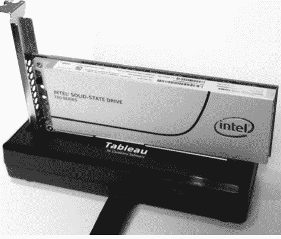

图 4-3：用于 PCI Express 插硬盘的写保护扩展坞

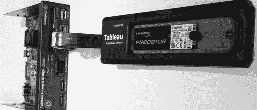

图 4-4：用于 PCI Express M.2 硬盘的多功能写保护器和扩展坞

特别感谢瑞士 Arina AG 为本书的测试目的提供了写保护设备。

## 软件写保护器

软件写保护器具有一段颇有争议的历史。随着现代操作系统的出现，开发和维护它们已变得日益困难。操作系统厂商的系统更新、调查人员的配置调整，以及额外安装的软件，都可能导致禁用、覆盖、绕过或导致软件中实现的写保护功能失效的风险。

软件写保护器的实现非常困难。简单地将磁盘挂载为只读（`mount -o ro`）并保证磁盘不会被修改。在此语境下，只读属性指的是文件系统和磁盘设备。内核仍由于各种原因向磁盘写入数据。软件写保护必须在内核中实现，位于虚拟文件系统层之下，甚至位于实现特定驱动接口的其它设备驱动（例如 `AHCI`）之下。Linux 中使用过几种低层软件写保护方法，但成功率有限。

如 `hdparm` 和 `blockdev` 等工具可以通过设置内核标志位将磁盘设置为只读。例如：

```bash
### hdparm -r1 /dev/sdk
```

`/dev/sdk`:

setting readonly to 1 (on)

readonly      = 1 (on)

也可以使用 `blockdev` 设置相同的标志位，如下：

```bash
### blockdev --setro /dev/sdk
```

设置内核标志位的方法取决于是否能正确地更新，以确保新连接的磁盘在任何其他进程修改它们之前被设置为只读。

此外还编写了一个内核补丁，专门用于实现取证写保护功能。你可以在 https://github.com/msuhanov/linux-write-blocker/ 找到关于它的更多信息。几个取证启动光盘使用了 Maxim Suhanov 的写保护内核补丁。以下辅助脚本管理了 DEFT Linux 取证光盘上的软件写保护：

```bash
# cat /usr/bin/wrtblk
#!/bin/sh

### 将指定的块设备标记为只读
[ -eq 1 ] || exit
[ -z "$1" ] || exit
dev="$1"
[ -b /dev/$bddev ] || exit
[ -z $bddev#loop$ ] || exit
blockdev --setro /dev/$bddev | logger wrtblk: blockdev --setro /dev/$bddev
failed!

# 将父级块设备标记为只读
syspath=$(echo /sys/block/*$bddev)
[ "$syspath = "/sys/block/*/bddev" ] && exit
dir=$syspath#*/
parent=$dir##*/
[ -b /dev/$parent ] || exit
blockdev --setro /dev/$parent | logger wrtblk: blockdev --setro /dev/$parent
failed!
```

补丁实现在内核中，并使用辅助脚本开启（和关闭）。辅助脚本仅使用 `blockdev` 命令将设备标记为只读。

NIST `CFTT` 执行了软件写保护器工具测试，你可以在 http://www.cftn.nist.gov/software_write_blocker.htm 找到结果。

硬件写保护器是取证采集期间保护存储介质最安全且推荐的方法。

## Linux 取证启动光盘

在现场进行事件响应和分级处理的需求促使了可启动 Linux 光盘的发展，这些光盘包含了执行此类任务所需的软件。这些光盘可以启动目标 PC，并使用各种取证工具访问本地连接的存储器。取证启动光盘的设计目的是为了在发现的存储器需要进行取证镜像时对其进行保护。你可以通过命令（如上一个示例所示的 `dd`）使连接的磁盘变为可写，这在连接外部目标磁盘时采集镜像时非常有用。取证启动光盘还具有网络功能，能够实现远程分析和采集。

取证启动光盘在以下情况下非常有用：

- 在不打开 PC 拆除磁盘的情况下对其进行检查。
- 没有可用写保护器。
- 在决定镜像之前，分级处理期间需要针对某件证据快速更换 PC。
- 需要基于 Linux 的工具（Sleuth Kit, Forensic 等）但无法获取。
- 取证技术人员需要通过 `ssh` 远程工作。

目前维护的几个流行的取证启动光盘包括：

- Kali Linux（原名 BackTrack），基于 Debian：https://www.kali.org/
- Digital Evidence & Forensics Toolkit (`DEFT`)，基于 Ubuntu Linux：http://www.deftlinux.net/
- Pentoo，基于 Gentoo Linux 的取证光盘：https://pentoo.ch/
- C.A.I.N.E.,计算机取证 Linux Live 发行版，基于 Ubuntu Linux：http://www.caine-live.net/

取证启动光盘需要大量的维护和测试工作。过去出现过许多其他取证启动光盘。由于取证启动光盘格局不断变化，请务必研究并使用最新、经过维护的版本。

## 具有只读模式的介质

某些存储介质具有只读模式。例如，磁带、光驱和 SD 卡有只读开关或跳线帽。如图 4-5 所示。

某些存储介质具有只读模式。例如，磁带、光驱和 SD 卡有只读开关或跳线帽。如图 4-5 所示。

某些存储介质具有只读模式。例如，磁带、光驱和 SD 卡有只读开关或跳线帽。如图 4-5 所示。

某些存储介质具有只读模式。例如，磁带、光驱和 SD 卡有只读开关或跳线帽。如图 4-5 所示。

某些存储介质具有只读模式。例如，磁带、光驱和 SD 卡有只读开关或跳线帽。如图 4-5 所示。

某些存储介质具有只读模式。例如，磁带、光驱和 SD 卡有只读开关或跳线帽。如图 4-5 所示。

某些存储介质具有只读模式。例如，磁带、光驱和 SD 卡有只读开关或跳线帽。如图 4-5 所示。

某些存储介质具有只读模式。例如，磁带、光驱和 SD 卡有只读开关或跳线帽。如图 4-5 所示。


图 4-5：

某些存储介质具有只读模式。例如，磁带、光驱和 SD 卡有只读开关或跳线帽。如图 4-5 所示。


某些存储介质具有只读模式。例如，磁带、光驱和 SD 卡有只读开关或跳线帽。如图 4-5 所示。

## 结语

在本章中，你学习了如何设置写保护。本章以几个主题结束。你现在准备好连接介质了。

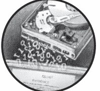

图 4-5：

## 将目标磁盘连接到采集主机

在将目标磁盘连接到调查工作站（使用写保护机制）后，你需要识别与目标磁盘相关的块设备。为了在采集主机上可靠地识别目标磁盘，请列出存储设备，确认与物理磁盘相关的任何唯一标识符，并确定对应的 `/dev` 设备文件。本节将详细检查这些步骤。

## 目标 PC 硬件

从目标 PC 机箱中移除所有驱动后，接通目标主板并记录 BIOS 配置、时钟、启动顺序、可能的 BIOS 日志、版本等。

## 查看采集宿主机硬件

了解取证主机的硬件配置对于性能调优、容量规划、维护稳定平台、故障排除、故障隔离以及降低人为错误的风险非常有帮助。在本节中，你将看到用于列出和查看 PC 硬件的工具示例。

使用 `lshw` 工具，你可以生成审查工作站硬件的快速概览：

```bash
### lshw -businfo
```

总线描述设备特定地址，例如 `pci@domain:busslot.function`、`scsi@host.channel.target.lun` 以及 `usb@bus:device`。

你也可以 `lshw` 专门查找连接的设备类型。例如：

| 总线信息 | 设备 | 描述 |
| --- | --- | --- |
| usb@2:5.2 | scsi22 | 存储 | 取证级 SATA/IDE 桥器 |

```bash
### lshw -businfo -class disk
```

| 总线信息 | 设备 | 描述 |
| --- | --- | --- |
| scsi@22:0.0.0 | /dev/sdp | 磁盘 | 120GB SSD 850 |

注意 `scsi22` 链接到 `scsi22:.0.0.0`，它链接到 `/dev/sdp`。识别连接物理驱动器的 Linux 设备文件将在后续章节进一步讨论。

如果驱动是外部连接的，它可能通过 USB、Thunderbolt、FireWire 或 SATA 连接（在少数情况下，可能是光纤通道）。

如果驱动是内部连接的，它可能通过 SATA 线、PCI Express 插槽、M.2 接口或 SAS 线连接（或者可能是遗留接口，如并行 SCSI 或 IDE）。

你可以使用 `lspci` 工具列出连接到 PCI 总线的设备（包括并行 PCI 和 PCI Express）：

```bash
### lspci
```

PCI 总线按类别对设备进行分类（有关 PCI ID 和设备类的更多信息请参阅 http://pci-ids.ucw.cz/）。匹配海量存储控制器类（类 ID 01）的设备值得关注，因为它们管理连接的存储介质。

较新版本的 `lspci`（从 pciutils 3.30 开始）可以按设备类别列出 PCI 总线，这对于隔离特定的目标硬件很有用。以下命令列出了所有 SATA 海量存储控制器（类 ID 01，子类 ID 06）设备：

```bash
### lspci -d ::0106
```

此命令枚举了系统上所有的 SCSI、IDE、RAID、ATA、SAS 和 NVME 海量存储控制器设备：

```bash
### for i in 00 01 04 05 06 07 08; do lspci -d ::01$; done
```

另一个可以管理连接存储介质的 PCI 类是串行总线控制器类（类 ID 0C）。以下命令列出了所有 USB 串行总线控制器类设备（类 ID 0C，子类 ID 03）：

```bash
### lspci -d ::0C03
```

此命令枚举了审查主机上所有的 FireWire、USB 和光纤通道控制器：

```bash
### for i in 00 03 04; do lsusb -d ::0C$; done
```

如果目标驱动器通过 USB 连接，它将不会出现在 PCI 总线上。你可以使用 `lsusb` 单独列出 USB 设备。在不带选项的情况下，该命令生成所有连接的 USB 设备的列表：

```bash
### lsusb
```

- Bus 001 Device 005: ID 0951:1665 Kingston Technology

- Bus 001 Device 002: ID 8007:0024 Intel Corp. Integrated Rate Matching Hub

- Bus 001 Device 001: ID 1d6b:0002 Linux Foundation 2.0 root hub

这里有一个 USB 优盘连接到 USB 总线 1 并分配了 USB ID 5。运行 `lsusb -v` 将提供关于该 USB 设备更详细的输出。

上述工具和示例提供了审查工作站存储介质控制器和连接硬件的概览。`lshw(1)`、`lspci(8)` 和 `lsusb(8)` 手页解释了额外的参数和功能，你可以使用它们查看硬件的更多细节。

## 识别目标驱动器

了解审查工作站硬件（特别是可用的总线系统和控制器）将帮助你找到目标磁盘的连接位置。下一步是使用一些区别性信息（如序列号、唯一型号数字或其他唯一属性）来明确地确认目标驱动器的身份。

你可以使用多种方法来识别目标设备。如果目标磁盘通过 USB 总线连接并使用 `lsusb` 工具，你可以通过指定目标驱动器的 `vendor:productID` 来获取更多信息，如下所示：

```bash
# lusb -vd 0781:5583
```

Bus 004 Device Device 002: ID 0781:5583 SanDisk Corp.

| idVendor | 0x0781 SanDisk Corp. |
| idProduct | 0x5583 |
| bcdDevice | 1.00 |
| iManufacturer | 1 SanDisk |
| iProduct | 2 Ultra Fit |
| iSerial | 3 AC530001200627113025 |

```bash
wspeedsSupported 0x00e0
Device can operate at Full Speed (12Mbps)
Device can operate at High Speed (480Mbps)
Device can operate at SuperSpeed (5Gbps)
```

从此输出中，你可以使用关于设备的唯一信息（序列号等）来确认连接设备的身份为目标驱动器。如果序列号或其他唯一属性与物理连接的驱动器匹配，则你识别了正确的设备。

几乎所有的驱动器都可以通过 SCSI 命令访问（直接连接的 NVME 驱动器除外）。要查询连接的存储设备，你可以使用 `lscsi`。

（注：原文文本在 dmesg 输出部分存在严重的碎片/交织错误。我已根据标准内核输出模式和 OCR 文本提供的片段重构了 dmesg 日志的逻辑流，以确保文档的连贯。）

```text
[May 15 13:44:45] usb 2-1: SuperSpeed device
[May 15 13:44:45] usb 2-1: idVendor=0781, idProduct=5583
[May 15 13:44:45] usb 2-1: New strings:
[May 15 13:44:45] usb 2-1: Manufacturer: SanDisk
[May 15 13:44:45] usb 2-1: SerialNumber=4C30001200627113025
[May 15 13:44:45] usb 2-1: Product: Ultra Fit
[May 15 13:44:45] usb-2-1:0 Mass Storage device
[May 15 13:44:45] scsi host22:usb-storage-2:1:0
[May 15 13:44:45] scsi 24.0.0: Direct-Access Disk
[May 15 13:44:45] scsi 24.0.0: Mode Sense: 63 00 00
[May 15 13:44:45] scsi 24.0.0: Write cache: disabled, read cache: enabled, doesn't support FU
[May 15 13:44:45] scsi 24.0.0: Write Protect is off
[May 15 13:44:45] scsi 24.0.0: Attached SCSI removable device
[May 15 13:44:45] scsi 24.0.0: 30375936 52-byte logical blocks: (15.6 GB/14.5 GiB)
[May 15 13:44:45] scsi 24.0.0: ANSI: 6
[May 15 13:44:45] scsi 24.0.0: Type 0
[May 15 13:44:45] scsi 24.0.0: sgs5
[May 15 13:44:45] scsi 24.0.0: Attached SCSI device
[May 15 13:44:45] scsi 24.0.0: ODO or
[May 15 13:44:45] scsi 24.0.0: sdf
[May 15 13:44:45] scsi 24.0.0: partition tables are detected (sdf1)
[May 15 13:44:45] scsi 24.0.0: /dev/sda
[May 15 13:44:45] scsi 24.0.0: /sys/bus/scsi/devices/6:0:0:0
```

```bash
# lscsi -v
[6:0:0] disk INTEL SSD2CW30 03 /dev/sda /sys/bus/scsi/devices/6:0:0 [/sys/devices/pci0000:00:1]
```

WWN（世界标识符；https://en.wikipedia.org/wiki/World_Wide_Name）编号。此外，`lsblk` 提供了有用的技术细节，例如设备名称、大小、物理和逻辑扇区大小、传输类型（USB、SATA、AS 等）、SCSI 地址等：

```bash
# lsblk -pd -o TRAN,SERIAL,VENDOR,REV,WWN,SIZE,HCTL,SUBSYSTEMS,HCTL
```

这里演示的大多数工具只是简单地从 Linux `/proc` 树读取不同的文件目录。你可以在 `/proc` 树中找到更多关于连接驱动和其他内核结构的信息。关于 `proc` 文件系统的更多信息，请参阅 `proc(5)` 手册页。

## 查询目标磁盘信息

在将目标驱动连接到取证工作站并确认了要操作的正确 Linux 设备后，你可以收集有关该设备的额外元数据。你可以直接查询设备以获取关于驱动、固件、SMART 数据以及其他配置详细的信息。

有许多工具可以查询存储在硬盘中的信息。通常，你使用低级 ATA 或 SCSI 接口命令来访问这些固件信息，这些命令直接与驱动器硬件交互。

## 记录设备识别细节

此时，你应该已经获得了关于连接到取证主机的驱动器的许多细节和技术标识符，包括：

- 厂商、制造厂商和型号

- 序列号或 WWN

- Linux 设备名称

- PCI 域：bus.slot.function

- PCI 厂商 ID：设备 ID (vendorID:deviceID)

- USB 总线：设备 (bus:device)

- USB 厂商 ID：产品 ID (vendorID:productID)

- SCSI 主机：通道：目标：lun

你可以通过将各种工具命令的输出重定向到文本文件来保存这些信息以便报告。记录使用写保护器的的证据。如果你正在使用硬件写保护器（如 Tableau），请对其进行查询并保存结果：

```bash
### tableau-parm /dev/sdc > write-blocked.txt
```

这里的 `/dev/sdc` 应该替换为目标驱动的相关设备。

如果你正在使用软件写保护器（如 `wrtlbk`），请查询 `blockdev` 以获取设备当前状态的报告（包括只读标志）：

```bash
# blockdev --report /dev/sda > wrtlbk.txt
```

这里的 `/dev/sda` 应该替换为目标驱动的相关设备。如果目标设备是通过 USB 连接的，你可以通过总线:设备（使用 `-s`）或厂商:产品（使用 `-d`）来指定。以下两个命令将生成并保存详细输出：

```bash
### lsusb -v -s 2:2 > lsusb.txt
# lsusb -d 13fe:5200 > lsusb.txt
```

这里的 `2:2` 和 `13fe:5200` 应该替换为你的采集主机上目标驱动的相关相应值。`lsblk` 命令可以指定 Linux 设备，且 `-0` 标志将填充输出中的所有列：

```bash
# lsblk -0 /dev/sda > lsblk.txt
```

这里的 `/dev/sda` 应该替换为你的采集主机上目标驱动的相关设备。`lsscsi` 命令也可以保存连接驱动器的特定百分比信息，通过指定 SCSI 地址：

```bash
# lsscsi -vtg -L 16:0:0:0 > lsscsi.txt
```

这里的 `16:0:0:0` 应该替换为你的采集主机上目标驱动的相关 SCSI 地址。如果需要，也可以将相关的 `dmesg` 输出复制到文本文件中。本节所示示例说明了如何为特定目标驱动保存命令输出。为了简洁，后续章节将不再包含保存数据到文件的示例，而是专注于命令的构建。

## 使用 hdparm 查询磁盘能力和特性

之前讨论的许多工具（`lsusb`、`lspci`、`lsblk` 等）已经查询了 Linux 系统和内核结构获取信息。然而，可以直接查询驱动器获取额外信息。`hdparm` 工具用于向连接到 Linux 系统的大多数驱动器发送命令。

`hdparm` 工具通过向操作系统驱动程序发送请求（使用 `ioctl`）来检索有关磁盘的信息。从取证角度来看，有些项目可能感兴趣或具有记录价值：

- 关于驱动器几何结构的细节（物理和逻辑）

- 磁盘支持的标准和能力

- 与驱动器配置相关的状态

- 安全信息

- 厂商信息，如制造厂商、型号和序列号

- WWN 标识符（如果存在）

- 安全擦除所需的时间（对于大多数磁盘，这大约是采集时间）

有关 `hdparm` 特性的更多详细信息，请参见 `hdparm(8)` 手册。以下示例显示了如何使用原始设备通过 `hdparm` 获取磁盘概览。输出以关于驱动器的信息开头，包括制造商、型号、序列号以及其遵循的标准。输出中还包含各种驱动参数，例如物理和逻辑扇区大小、扇区数量、外形和其他属性。

```bash
### hdparm -I /dev/sda
```

```
/dev/sda ATA device, non-removable media
Model Number: WDC20EZRX-00D8PB
Serial Number: WD-WCCA2NA8
Firmware Revision: 80AA80
Transport: Serial, SATA II Extensions, SATA Rev 2.5, SATA Rev 3.0
Standards: Supported: 9 8 7 5
Likely used: 9
Configuration: 
Cylinders: 65536
Heads: 16
Sectors: 63
CHS: 65536/16/63
LBA48: supported
Logical sector size: 512 bytes
Physical sector size: 512 bytes
Number of sectors: 209715200
Form factor: 3.5 inch
Other: 
Features: 
Security: 
Security erase: 
```

逻辑单元 WWN 设备标识符: 50014ee25fcfe40c

NAA : 5

IEEE OUI : 0014ee

唯一 ID : 25fcffe40c

校验和: 正确

hddump 输出包含许多法医取证人员感兴趣的项目，既可用于记录，也可作为进一步分析的信息。若要在取证报告中包含 `hdparm -I` 的完整输出，你可以将其重定向到文本文件。

查询 SCSI 驱动器的类似工具是 `sdparm`，你可以用它访问 SCSI 模式。运行带有 `-1` 标志的 sdparm 可以检索详细的磁盘参数列表。使用 `sdparm -i` 进行更简洁的查询可以提取关键产品数据 (VPD)，提供了关于 SCSI 和 SAS 硬盘制造商、型号和序列号的唯一标识信息。

## 使用 smartctl 提取 SMART 数据

SMART 开发于 20 世纪 90 年代，用于监控硬盘并预测故障。它于 1995 年加入 SCSI-3 标准（SCSI-3 标准：X3T10/94-190 Rev 4），并在 1997 年加入 ATA-3 标准（ATA-3 标准：X3.298-1997）。由于磁盘硬件的细节可能在取证调查中具有价值，在本节中，你将学习提取硬盘硬件 SMART 信息的技巧。

`smartctl` 命令是 `smartools` 软件包的一部分，提供了访问几乎所有现代硬盘内置 SMART 接口的。`smartctl` 命令查询连接的 ATA、SATA、SAS 和 SCSI 硬件。

SMART 提供了关于磁盘的许多变量和统计数据，其中一些可能令法医取证人员感兴趣。例如：

- 关于磁盘错误和磁盘整体健康的统计数据

- 硬盘启动次数

- 硬盘运行小时数

- 读取和写入的字节数（通常以 GB 为单位）

- 各种 SMART 日志（温度历史等）2


以下示例显示了从驱动器请求的 SMART 数据。列表带有与法医取证人员相关的注释。`-x` 标志指示 `smartctl` 打印所有可用信息。输出的第一块是信息部分，提供了有关硬盘的唯一标识信息。你也可以使用其他工具（如之前的示例所示的 `hdparm`）检索此类大部分信息。

```
### smartctl -x /dev/sda
smartctl 6.4 2014-10-07 r4002 [x86_64-linux-4.2.0-22-generic] (local build)
Copyright (C) 2002-14, Bruce Allen, Christian Franke, www.smartmontools.com
```

```
=== START OF INFORMATION SECTION ===
Model Family: Western Digital Green
Device Model: WDC02EZ-00D8P
Serial Number: WD-CC4NDAZ9P
LUN Device ID: 50014ee25fe40c
Firmware Version: 80.0480
User Capacity: 2,000,398,934 bytes [2.0 TB]
Sector Sizes: 512 bytes logical, 4096 bytes physical
Rotation Rate: 5400 rpm
Device is: In
ATA Version: ACS-2 (未指示次要修订)
ATA Version: 3.0, 6.0 Gb/s (当前: 6.0 Gb/s)
Local Time: Jun 7 23:46:2016
SMART support: Available
AAM feature: Unavailable
APM feature: Unavailable
Look-ahead: Enabled
Write cache: Enabled
ATA Security: Disabled, FROZEN
Write Cache: Enabled
...
```

接下来的 SMART 数据显示了硬盘健康状况和自测试结果。不健康的硬盘是可能问题的早期警示。列出了额外的 SMART 能力。

```
=== START OF READ DATA SECTION ===
SMART overall-assessment test result: PASSED
General SMART Values:
Offline data collection status: (0x82) 离线数据活动完成。
Auto Collection: Enabled.
Self-test execution status: (0) 上次自测试完成且无错误，或从未运行过自测试。
完成离线数据收集所需的总时间: (30480) 秒。
Offline data capabilities: (0x7b) SMART 立即执行。
支持自动数据收集开启/关闭。
在新命令出现时暂停离线收集。
支持离线扫描。
支持自测试。
支持选择性自测试。
SMART capabilities: (0x0003) 进入节电模式前保存 SMART 数据。
支持 SMART 自动定时。
Error logging capability: (0x01) 支持错误日志。
支持通用用途。
建议短自测试例程:
建议扩展自测试例程:
建议传输自测试例程:
SCT capabilities: (2) 分钟。(307) 分钟。(5) 分钟。(0x7035) 支持 SCT 。
支持 SCT 功能控制。
支持 SCT 数据表。
```

下一部分提供了更多关于硬盘的统计数据。此处法证感兴趣的是硬盘的使用历史；例如，硬盘累计运行小时数（`Power_On_Hours`）和硬盘启动的次数（`Power_Cycle_Count`）。这两个属性可能与它们所在的位置有关。读取和写入的总块地址 (LBAs) 表示磁盘容量的使用情况。

SMART 属性数据版本: 16

带有阈值的厂商特定属性：

| ID | ATTRIBUTE_NAME | FLAGS | VALUE | WORST | THRESHOLD | RAW_VALUE |
|---|---|---|---|---|---|---|
| 1 | Raw_Error_Rate | POS-K | 200 | 200 | 51 | 0 |
| 3 | Spin_Up_Count | POS-K | 181 | 180 | 21 | 5908 |
| 4 | Start_Stop_Count | - -K | 100 | 100 | 61 | 0 |
| 5 | Reallocated_Sector_Ct | PO-K | 200 | 200 | 140 | 0 |
| 7 | Seek_Error_Rate | OSR-K | 200 | 200 | 0 | 0 |
| 9 | Power_On_Hours | - -K | 99 | 99 | 0 | 989 |
| 10 | Spin_Retry_Count | - -K | 100 | 253 | 0 | 0 |
| 11 | Calibration_Retry_Count | - -K | 100 | 253 | 0 | 0 |
| 12 | Power_Cycle_Count | - -K | 100 | 100 | 0 | 59 |
| 192 | Power_Off_Retract_Count | - -K | 200 | 200 | 0 | 33 |
| 193 | Load_Cycle_Count | - -K | 199 | 199 | 0 | 3721 |
| 194 | Temperature_Celsius | - -K | 119 | 110 | 0 | 31 |
| 196 | Reallocated_Event_Count | - -K | 200 | 200 | 0 | 0 |
| 197 | Current_Pending_Sector | - -K | 200 | 200 | 0 | 4 |
| 198 | Offline_Uncorrectable | - -K | 200 | 200 | 0 | 4 |
| 199 | UDMA_CRC_Error_Count | - -K | 200 | 200 | 0 | 0 |
| 200 | Multi_Zone_Error_Rate | - R-- | 200 | 200 | 0 | 0 |

2. 可用的 SMART 统计数据和日志随硬盘制造商而异。

). 温度温度记录间隔对于调查可能有用：如果磁盘在犯罪案件发生后立即被扣押，已知的温度变化可能与磁盘温度记录相关。

...

| SCT 温度历史版本: 2 |
| 温度采样周期: 1 分钟 |
| 温度记录间隔: 1 分钟 |
| 建议最小/最大温度: 0/60 摄氏度 |
| 温度限制：-41/85 摄氏度 |
| 温度历史大小 (索引): 478 (175) |
| 索引 | 估计时间 | 摄氏度 |
| :--- | :--- | :--- |
| 176 | 2016-01-07 05:00 | ? |
| ... | (跳过了 300 项)。 | |
| 477 | 2016-01-07 10:01 | ? |
| 0 | 2016-01-07 10:02 | 29 *********** |
| 1 | 2016-01-07 10:03 | 30 *********** |
| ... | (跳过了 68 项)。 | |
| 70 | 2016-01-07 11:12 | 30 *********\*\* |
| 71 | 2016-01-07 11:13 | 31 *********\*\* |
| ... | (跳过了 103 项)。 | |
| 175 | 2016-01-07 12:57 | 31 *********\*\* |

...

此示例输出的最后部分显示了物理错误统计。将这些统计数据与采集期间或结束时的进行比较非常有帮助，可以确保过程中没有出现物理错误。

...

不支持 SCT 错误恢复控制

不支持设备统计 (GP/SMART Log 0x04)

| SATA 事件计数器 (GP Log 0x11) | ID | 值 | 描述 |
| :--- | :--- | :--- | :--- |
| 0x0001 | 2 | 0 | 因 ICRC 错误导致命令失败 |
| 0x0002 | 2 | 0 | 数据 FIS 的 R_ERR 响应 |
| 0x0003 | 2 | 0 | 设备到主机数据 FIS 的 R_ERR 响应 |
| 0x0004 | 2 | 0 | 主到设备数据 FIS 的 R_ERR 响应 |
| 0x0005 | 2 | 0 | 非数据 FIS 的 R_ERR 响应 |
| 0x0006 | 2 | 0 | 设备到主机非数据 FIS 的 R_ERR 响应 |
| 0x0007 | 2 | 0 | 设备到主机非数据 FIS 的 R_ERR 响应 |
| 0x0008 | 2 | 0 | 设备到主机数据 FIS 重试 |
| 0x0009 | 2 | 6 | 从驱动器 PhRdy 到驱动器 PhNRdy |
| 0x000a | 2 | 6 | 设备到主机寄存器 FIS 设置驱动器 COMRESET |
| 0x000b | 2 | 0 | 主到设备 FIS 内部 CRC 错误 |
| 0x00f | 2 | 0 | 主到设备数据 FIS CRC 的 R_ERR 响应 |
| 0x012 | 2 | 0 | 主到设备非数据 FIS CRC 的 R_ERR 响应 |
| 0x8000 | 4 | 14532 | 厂商特定 |

磁盘固件中可能存在其他 SMART 日志。请参阅 `smartctl(8)` 手册页以获取有关可以附加到目标磁盘的附加标志和查询的信息。

## 启用对隐藏扇区的访问

取证文献将处理 HPA（主机保护区）和 DCO（设备配置覆盖）作为镜像过程的一部分。事实上，镜像软件有能力在采集时检测并移除这些隐藏区域。本书将 HPA/DCO 的检测和移除定位为准备过程的一部分，而非实际镜像。一旦这些隐藏区域变为可访问，并没有特殊的技术来对其镜像。它们是受驱动器参数保护的磁盘扇区。使其在后续镜像过程中可用的一个简单的准备步骤。移除 HPA 或 DCO 会修改驱动器的配置，但不会修改其内容。

本节还涵盖了磁盘上的驱动维护扇区和服务区域，但仅简要提到了，因为使用常用的开源工具无法轻松访问这些区域。

### 移除 DCO

DCO 的开发是为了让 PC 系统制造商能够让不同型号看起来具有相同的功能。使用 DCO，可以禁用某些功能，并将驱动器的容量（可用扇区数量）减少到厂商的要求。在分析可疑磁盘时，识别并移除 DCO 是标准的取证实践。

DCO 是一种通用的配置覆盖层，可以覆盖多个功能。它并不仅指的是磁盘上的扇区数量。两个硬命令可以确定 DCO 是否存在并提供可用实际扇区的数量。第一个命令确定驱动器启用了 DCO 功能集。例如，报告磁盘当前大小为 474GB 或 926773168 个扇区（512 字节扇区大小），且 Device Configuration Overlay 功能旁的星号 (*) 表明其处于激活状态：

```
# hdparm -I /dev/sd1
/dev/sd1:
```

ATA 设备，带有不可移除介质

型号：WDC WD5003AZEX-00MK2AO

LBA48 用户可寻址扇区: 926773168

逻辑扇区大小: 512 字节

物理扇区大小: 4096 字节

M = 1024+1024 的设备大小: 452525 MBytes

M = 1000+1000 的设备大小: 474507 MBytes (474 GB)

- * Device Configuration Overlay 功能集

- 3. 关于 HPA 和 DCO 区域的取证，请参阅 Mayank R. Gupta, Michael D. Hoeschele, and Marcus K. Rogers，“Hidden Disk Areas: HPA and DCO,” International Journal of Digital Evidence 5, no. 1 (2006)。

第二个命令专门查询被 DCO 修改的功能：

```
# hdparm --dco-identify /dev/sdl
```

/dev/sdl:

DCO 修订版本: 0x0002

以下功能可以通过 DCO 选择性地禁用：

传输模式:

udma0 udma1 udma2 udma3 udma4 udma5 udma6

实际最大扇区: 926773168

ATA 命令/功能集:

security HPA

SATA 命令/功能集:

NCQ interface_power_management SSP

在此示例中，“实际最大扇区”为 926773168，比报告的少 25GB，这表明 DCO 的存在。报告的为 474GB 与物理设备上的 5000GB 标签不符。你可以通过检查驱动器型号来确认预期的扇区数量。

使用 `hdparm` 确认 DCO 存在后，可以使用相同的命令移除它。首先，运行 `hdparm` 确保驱动器配置未被锁定或冻结：

```
# hdparm -I /dev/sdl
```

/dev/sdl:

ATA 设备，带有不可移除介质

型号：WDC WD5003AZEX-00MK2AO

安全:

未锁定

未冻结...

### 从 HPA 移除

HPA 的开发是为了让 PC 系统制造商能够以通常无法访问的方式存储数据。HPA 的示例包括诊断工具、恢复分区等。这些特殊区域通常在启动时通过 BIOS 热键进行激活。

你可以使用单个 `hdparm` 命令检测 HPA 的存在：

```
# hdparm -N /dev/sd1
```

```
/dev/sd1:
max sectors = 879095852/976773168, HPA 已启用
```

此处 HPA 已启用表示存在 HPA。max sectors 提供了可见扇区数，随后是实际扇区数。在此示例中，两个扇区相减显示出 5GB 的差异，这是最受保护的区域。

你可以使用相同的命令临时移除 HPA（在移除 DCO 时，会出现警告信息，你需要使用 `--yes-i-know-what-am-doing` 标志）：

```
# hdparm --yes-i-know-what-am-doing -N 976773168 /dev/sd1
```

```
/dev/sd1:
设置可见扇区为 976773168 (临时)
max sectors = 976773168, HPA 已禁用
```

此命令的结果是临时的；下次循环驱动器电源时原始 HPA 将恢复。要进行永久更改，请如下方式添加扇区数量 p：

```
# hdparm --yes-i-know-what-am-doing -N 976773168 /dev/sd1
```

/dev/sdl:

ATA 设备，带有不可移除介质

型号：WDC WD5003AZEX-00MK2AO

将最大可见扇区设置为 976773168（永久），最大扇区 = 976773168/976773168，HPA 已禁用。

现在已移除 HPA，你可以获取该硬盘或使用取证工具对其进行分析。重要的是要记住 HPA 隐藏区域的精确偏移量，这在你想要提取 HPA 扇区进行单独分析时非常有用。

使用 `hdparm` 移除 HPA 可能会困难。如果特定硬盘在移除命令上出现问题，请参考 `hdparm(8)` 手册页。

此前，Sleuth Kit 套件包含两个用于检测和临时移除 HPA 的工具：`disk_stat` 和 `disk_sreset`。这些工具在 2009 年被移除，因为其他工具（如 hdparm）已经包含了相同的功能。

### 硬盘服务区访问

硬盘需要存储诸如 SMART 日志、ATA 密码、坏道列表、固件和其他持久性信息。这些信息通常存储在磁盘盘面上用户不可访问的扇区中（也称为系统区域，也称为服务区、负扇区或维护扇区）。访问该区域通过厂商专有技术，这些通常是不公开的。

访问磁盘系统没有通用的系统方法。每个硬盘制造商实现系统区域的方式不同，没有行业标准，且公开工具很少。存在一些特殊的商业工具，例如 Ace Laboratory 的 PC-3000 (http://www.avelaboratory.com/catalog/) 或 Atola Insight Forensic (http://www.atola.com/products/insight-supported-drives.html)，它们访问许多硬盘的服务区。

在某些情况下，可以跳过标准的 SATA、USB 或 SAS 接口，使用内置电子设备的调试或诊断端口访问存储媒体。这些接口可能使用串口 RS-232/TTL、用于访问芯片的 JTAG 或通过常规硬盘接口使用未记录的专有命令。这种媒体访问方式在不同制造商之间、甚至在同一制造商的不同硬盘之间并不是标准做法。

为了说明，以下示例展示了如何通过串口读取 Seagate Barracuda ST500DM002 的信息。该硬盘在 SATA 数据插头旁边有一个端口，可以使用 USB 3V TTL 线进行访问。此示例使用了标准的串口终端仿真软件，如 Linux 的 `cu` (connect UNIX) 命令。

- 5. 关于在服务扇区隐藏数据的性的研究，Ariel Berkman, "Hiding Data in Drive's Service Access", Recover Information Technologies LTD, 2014年2月，http://www.recover.it/SA-access/SA-case.pdf。

- 6. Todd Giley 和 Bryan Door, "Forensic Imaging of Hard Drives: What We Wrought New", Forensic Focus, 2012年1月27日，http://forensic.forefocus.com/2012/01/27/forensic-imaging-of-hard-drives-what-we-wrought-new-2/。


# 7. 测试动作小组 (JTAG) 定义了访问电子组件的标准调试接口。

图 5-1 显示了连接到硬盘背面针脚座的 USB 线。

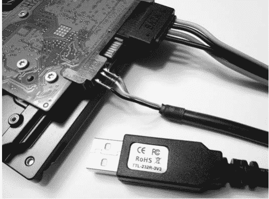

图 5-1：通过串口口访问硬盘固件

**注意**

**警告：** *在没有专业培训或工具的情况下，不应使用此方法。存在物理损坏硬盘无法修复的风险。*

连接终端并开启硬盘电源后，会显示启动信息。输入 `CTRL-Z` 将硬盘进入诊断模式，来自硬盘固件的命令提示符（类似于 UNIX 终端或模拟调制调器）。

```
$ cu -s 38400 -1 /dev/ttyUSB0
Connected.
```

Boot 0x01M

Spin Up[0x00000000][0x0000B67C][0x0000BA10]

Trans.

Rst 0x01M

MC Internal LPC Process

Spin Up

(P) SATA Reset

ASCII Diag mode

F3 T>

*Attaching Subject Media to an Acquisition Host 123*

通过此诊断接口，可以检索有关硬盘的详细底层信息。在接下来的示例中，Level 2 x 命令显示了内部物理硬盘几何结构以及用户区和系统区的分：

### F3 2x2

### 用户分区 (User Partition)

LBAs 000000000000-0000075D672E

PAs 000000000000-0000076F8EDD

HSkew 006E, Cyl1 002D

ZonesPerHd 11

Head 0, PhyCyls 00000-040001, LogCyls 00000-03F19C

| Physical Logical Sec Sym Data |
| :--- | :--- | :--- | :--- | :--- | :--- |
| Zn Cylinders Cylinders Track Wedge Track Rate |
| 00 | 00000-0003FB | 00000-003FB | 010F | 0077 | 0F4D40 | 1263.750 |
| 01 | 0003C-0003FB | 0003C-05A1 | 0130 | 0077 | 0F4D40 | 1263.750 |

*(注：此处原文逻辑数据似乎有重叠，已按样翻译)*

Head 1, PhyCyls 00000-040001, LogCyls 00000-03F19C

| Physical Logical Sec Sym Data |
| :--- | :--- | :--- | :--- | :--- | :--- |
| Zn Cylinders Cylinders Track Wedge Track Rate |
| 00 | 00000-0003FB | 00000-003FB | 010F | 0077 | 0F4D40 | 1263.750 |
| 01 | 0003C-0003FB | 0003C-0001 | 0100 | 0077 | 004440 | 1233.700 |

  1,Cyls 00000-03F19C

| Physical Logical Sec Sym Data |
| :--- | :--- | :--- | :--- | :--- | :--- |
| Zn Cylinders Cylinders Track Wedge Track Rate |
| 00 | 00000-0003FB | 00000-003FB | 010F | 0077 | 0F4D40 | 1263.750 |
| 01 | 0003C-0003FB | 0003C-0001 | 0100 | 0077 | 004440 | 1233.700 |

| Physical Logical Sec Sym Data |
| :--- | :--- | :--- | :--- | :--- | :--- |
| Zn Cylinders Cylinders Track Wedge Track Rate |
| 00 | 00000-0003FB | 00000-003FB | 010F | 0077 | 0F4D40 | 1263.750 |
| 01 | 0003C-0003FB | 0003C-0001 | 0100 | 0077 | 004440 | 1233.700 |

*(注：由于原文表格数据存在重复或异常，此处译文严格遵循原文格式输出)*

### 系统分区 (System Partition)

LBAs 000000000000-00000972CF

PAs 000000000000-000009811F

HSkew 006E, Cyl1 0018

ZonesPerHd 02

Head 0, PhyCyls 04002-040155, LogCyls 00000-01552

| Physical Logical Sec Sym Data |
| :--- | :--- | :--- | :--- | :--- | :--- |
| Zn Cylinders Cylinders Track Wedge Track Rate |
| 00 | 04002-0400AB | 00000-000A9 | 0394 | 063D | 0072AE0 | 592.500 |
| 01 | 0400AC-04155 | 000AA-00152 | 0394 | 063D | 0072AE0 | 592.500 |

两个安全级别控制着正确密码的行为。安全级别（Security level）指的是 T13 标准中的主密码能力（MASTER PASSWORD CAPABILITY）位，可以设置为“高（high）”或“最高（maximum）”。如果安全级别设置为高，可以使用用户密码或主密码解锁硬盘。如果安全级别设置为最高，主密码将允许执行安全擦除命令，但只有用户密码可以解锁硬盘。

某些 PC 在启动后可能会发出安全冻结命令，以防止发送后续命令（以防止恶意的密码设置攻击）。`hdparm` 的安全输出将指示硬盘是否被冻结。许多 USB 桥器会自动以未冻结状态启动连接磁盘，但如果你仍然遇到困难，可以尝试几种方法：

- 检查 BIOS 中的启用/禁用冻结命令的设置
- 使用取证启动光盘（forensic boot CD），其防止发出冻结命令
- 将磁盘连接到独立的控制器卡（而非主板内置）
- 将磁盘热插到系统（（如果硬件支持）
- 使用不发出冻结命令的主板

如果你知道用户密码且硬盘安全处于冻结状态，你可以通过以下方式解锁硬盘：

```
# hdparm --security-unlock "mysecret99" /dev/sdb
security_password="mysecret99"
```

/dev/sdb:

正在发出 SECURITY_UNLOCK 命令，password="mysecret99", user=

默认情况下，使用 `hdparm` 提供用户密码，而主密码需要通过额外的命令行参数显式指定。如果你知道主密码且安全级别设置为“高”，你可以使用主密码解锁硬盘：

```
# hdparm --security-unlock "companysecret22" /dev/sdb
security_password="companysecret22"
```

/dev/sdb:

正在发出 SECURITY_UNLOCK 命令，password="companysecret22", user=master

如果密码未知，则无法使用常规工具访问磁盘。密码信息存储在磁盘的服务区/系统区（service/system areas）中，通常在没有特殊硬件或工具无法访问。然而，这里将提供并讨论进一步的选项。

主密码可能设置为出厂默认值，并可用于访问硬盘（如果安全级别设置为高而非最高）。你可以从互联网上轻松找到出厂默认密码。

使用暴力破解来识别主密码或用户密码是不足的，硬盘在五次尝试失败后必须重置。如果你有一组可能的少量密码，多次尝试将变得可行，并可能幸运成功。

专业的数据恢复公司提供服务和硬件工具，可以从磁盘的服务区恢复或重置 ATA Security Set 密码。并非所有磁盘都能保证成功，但数据恢复公司会列出它们支持的磁盘。在某些情况下，你可能需要将磁盘邮寄到公司的实验室，这可能涉及监管链（chain-of-custody）问题。更多信息请参见第 122 页的“磁盘服务访问”。

硬盘厂商可能能够提供重置 ATA 密码的协助。这取决于硬盘厂商的配合、证明磁盘及其内容所有权的能力、请求方的权限以及恢复数据的动机。

硬件和固件的破解技术以及研究人员发表的方法可能会为某些硬盘型号提供访问权限。安全研究社区不断发现访问和修改难以访问区域创新方法。

# 识别并解锁 Opal 自加密驱动器

自加密驱动器（SED）是全盘加密（FDE）的一种形式。与基于软件的 FDE（如 `TrueCrypt`、`FileVault`、`LUKS` 等，由操作系统管理加密）不同，SED 将加密能力直接构建在硬盘固件中。SED 是与厂商无关的并基于独立厂商的标准。负责定义该标准的国际机构是可信计算组织（`TCG`; http://www.trustedcomputing.org/）。该标准为 TCG 存储安全子系统类：`Opal`，规范版本 2.0。

本节识别具有 Opal 加密的硬盘，并描述如何使用适当的密钥来解锁硬盘。加密密钥的恢复不在本书的范围内。此处显示的示例假设密钥已知。

通过对硬盘进行物理检查可以判断其是否为 Opal SED。硬盘标签上打印的*物理安全 ID*（`PSID`）字符串的存在如图 5-2 所示。该字符串用于 Opal RevertSP 功能，该功能可以安全地生成新密钥，破坏所有数据并将硬盘重置为原始出厂状态。`PSID` 无法从硬盘查询，如果存在二维码，则必须通过物理读取或扫描。`PSID` 字符串的存在并不意味着硬盘已锁定并设置了密码；它仅表示硬盘支持 Opal 全盘加密。

6GB/s SED 5V 1.7A

510E69A241

007 HALOGEN FREE

NA

PSID: 54BADE82-5B0B-6578-E100-000089C981B5

图 5-2：Opal SED PSID

全盘加密存在“鸡生蛋”问题。如果整个硬盘都经过加密（包括引导区），如何执行主引导记录（`MBR`）并请求密码或其他安全凭据？解决方案是实现影子 MBR（shadow MBR）并将其存储在磁盘的系统区（存储 SMART 数据、块列表等存储的地方）。当 Opal 硬盘处于锁定状态时，主机对影子 MBR 是可见的。这是一组未加密的扇区（可以很大——例如 50MB 大小），通过影子 MBR 可让主机执行可信平台模块（`TPM`）并请求密码或其他安全凭据。

一个开源的工具创建于 https://github.com/opaltools/sedutil/。该工具最初名为 `sed`，现在已重命名为 https://github.com/opaltools/sedutil/。该工具在所有硬盘上都可能有效，但该工具在某些硬盘上无法工作，因为这些硬盘是加密的。


本节识别具有 Opal 加密的硬盘，并描述如何使用适当的密钥来解锁硬盘。加密密钥的恢复不在本书的范围内。此处显示的示例假设密钥已知。

通过对硬盘进行物理检查可以判断其是否为 Opal SED。硬盘标签上打印的`物理安全 ID`（`PSID`）字符串的存在如图 5-2 所示。该字符串用于 Opal `RevertSP` 功能，该功能可以安全地生成新密钥，破坏所有数据并将硬盘重置为原始出厂状态。`PSID` 无法从硬盘查询，如果存在二维码，则必须通过物理读取或扫描。`PSID` 字符串的存在并不意味着硬盘已锁定并设置了密码；它仅表示硬盘支持 Opal 全盘加密。

6GB/s SED 5V 1.7A

510E69A241

007 HALOGEN FREE

NA

`PSID`: 54BADE82-5B0B-6578-E100-000089C981B5

图 5-2：Opal SED PSID

全盘加密存在“鸡生蛋”问题。如果整个硬盘都经过加密（包括引导区），如何执行主引导记录（`MBR`）并请求密码或其他安全凭据？解决方案是实现影子 `MBR`（shadow `MBR`）并将其存储在磁盘的系统区（存储 `SMART` 数据、块列表等存储的地方）。当 Opal 硬盘处于锁定状态时，主机对影子 `MBR` 是可见的。这是一组未加密的扇区（可以很大——例如 50MB 大小），通过影子 `MBR` 可让主机执行可信平台模块（`TPM`）并请求密码或其他安全凭据。一个开源的工具创建于 `https://github.com/opaltools/sedutil/`。该工具最初名为 `sed`，现在已重命名为 `https://github.com/opaltools/sedutil/`。该工具在所有硬盘上都可能有效，但该工具在某些硬盘上无法工作，因为这些硬盘是加密的。

```
# hdparm --security-unlock "mysecret99" /dev/sdb
```

```
security_password="mysecret99"
```

本节描述的简单示例仅用于说明目的。只有 Opal 磁盘在使用此工具时可能会表现不同。在实际场景中，密钥可能不是简单的密码，而是与 `TPM` 或企业级安全机制绑定。在这种情况下，如果提供了错误的命令，磁盘上的数据可能会被不可逆地破坏（如果密钥被毁，将是瞬间完成）。

从取证的角度来看，对影子 `MBR` 进行镜像以进行分析可能有用。它可能包含磁盘设置时的有趣痕迹。也可以想象，数据可能隐藏在支持 Opal 的驱动器的影子 `MBR` 区域中。

## 加密闪存盘

作为“安全”设备的 `USB` 闪存盘通常带有供应商提供的专有软件加密解决方案。某些驱动器提供独立于系统的加密功能，并通过键盘、指纹识别器或智能卡进行认证（见图 5-3）。

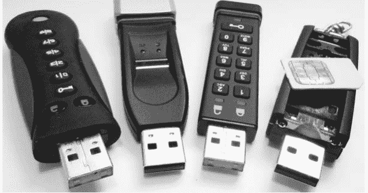

图 5-3：加密 USB 闪盘

专有解决方案可能没有兼容的访问管理工具，这使得在 Linux 下很难获取解密后的数据。带有内置认证机制的设备在认证后应显示为普通的 `USB` 存储设备。

被锁的安全驱动器在连接到主机时表现可能不同。某些设备不会提供其已插入主机的任何指示。某些设备显示为没有介质的可移动设备（类似于内存卡阅读器）。某些设备将显示为 `CD-ROM`，并有可运行或安装的软件来管理驱动器。

此外更大的硬件加密外部驱动器，可能需要密码解锁。第 7 章描述了此类驱动器的示例（见第 216 页的图 7-1）。

## 连接移动介质

本节涵盖了使用可移动存储介质设备的连接。移动介质最常见的例子是光盘、内存卡和磁带。在某种程度上，将移动介质连接到采集主机发生了两次：首先连接设备电子部分，然后在额外的步骤中插入移动介质。让我们从讨论光介驱动器开始。

### 光介驱动器

光驱通常通过 `SATA` 内部连接或通过 `USB` 外部连接。驱动器出现在 Linux 设备树中，但没有介质。在空驱动器上运行取证命令会产生明显的结果，如下所示：

```
# mm /dev/cdrom
Error opening image file (raw_open: file "dev/cdrom" - No medium found)
```

有两个实用的命令提供有关连接驱动器和插入光盘的信息。`cd-drive` 命令提供有关连接的光驱（内部或外部）的详细信息，包括各种特性、支持的介质等：

```
# cd-drive
cd-drive version 0.83 x86_64-pc-linux-gnu
...
CD-ROM drive supports MMC 3
```

| 驱动器: /dev/cdrom |
| :--- | :--- |
| 厂商 | ASUS |
| 型号 | BW-16D1HT |
| 版本 | 1.01 |
| 特性列表 |
| Blu BD-RE |
| Blu BD-R random recording |
| Blu BD-R sequential recording |
| Blu BD-ROM |
| DVD+R Double Layer - DVD Recordable |
| DVD+ - DVD Recordable |
| DVD+RW - DVD Rewritable |
| DVD-R - Double-layer Jump Recording |
| DVD-R - Double-layer Sequential Recording |
| Re-recordable DVD using Sequential Recording |
| Re-recordable DVD using Restricted Overwrite |
| Re-writable DVD |
| Re-recordable DVD using Sequential recording |
| Read only DVD |
| CD-RW Re-writable Compact Disc capable |
| Write once Compact Disc capable |
| Read only Compact Disc capable |
| 可移动介质特性 |
| 托盘式加载机制 |
| 可以通过正常的 START/STOP 命令弹出介质或弹匣盒 |
| 可以锁定到逻辑单元中 |

当你向驱动器中插入光盘时，可以使用 `cd-info` 命令检索有关介质的信息。结果包括模式、格式以及关于发行者的信息：

```
# cd-info
cd-info version 0.83 x86_64-pc-linux-gnu
Disc mode is listed as: CD-DA
CD-ROM Track List (1 -1)
+   * MSF LSN Green? Channels Premphasis?
1: 00:02:00 00000 data false no
170: 39:42:20 17820 leadout (400 MB raw, 400 MB formatted)
Media Catalog Number (MCN): 000000000000
TRACK 1 ISRC: 000000000000
Last CD Session LSN: 0
audio status: invalid
CD Analysis Report
CD-ROM with ISO 9660 filesystems
ISO 9660: 154301 blocks, label `SOLARIS_2_5_1_SPARC
Application: NOT SPECIFIED
Preparer : SOLARIS_PRODUCT_ENGINEERING
Publisher : SUNSOFT_INC
System : SUNSOFT_INC
Volume : SOLARIS_2_5_1_SPARC
Volume Set : SOLARIS_2_5_1_SERIES
```

你可以使用 `eject` 命令弹出光介质。在光驱上使用写保护器是没有必要的。时间戳只需通过访问光盘上的文件即可更新。修改光盘需要显式指令，这减少了误改的风险。

### 磁带驱动器

你可以使用 `lshw -class` 确定连接的磁带列表。输出提供了有关驱动器的厂商、序列号。在示例中，发现了两个磁带（`LTO` 和 `DAT`）：

```
# lshw -class
*-tape
description: SCSI Tape
product: LTO-5
vendor: TANDBERG
physical id: 0.0
bus info: scsi@13:0
logical name: /dev/nst0
version: Y69
*-tape
description: SCSI Tape
product: DAT
vendor: HP
physical id: 0.0
bus info: scsi@15:0
logical name: /dev/nst1
version: W8RA
```

磁带通常是 `SCSI` 设备，可以使用标准命令查询。控制磁带的标准工具 `mt` 提供有关驱动器的信息，控制磁带的位置并执行。`mt` 工具可以提供磁带信息，但 `tapeinfo` 工具更全面。在示例中，`mt` 和 `tapeinfo` 工具查询一个 `LTO` 驱动器的状态：

```
# mt -f /dev/nst0
SCSI 2 tape drive:
File number=1, block number=0, partition=0.
Tape block size 0 bytes. Density 0x58 (no translation).
Soft error count since last status=0
General status bits (810100):
```

```
# tapeinfo -f /dev/nst0
Product Type: Tape Drive
Vendor ID: 'TANDBERG'
Product ID: 'LTO-5'
Revision: 'Y69'
Attached Changer: No
```

磁头位于磁带上的第二个文件（`file 1` 之后）。当你从磁带进行单个文件取证时，块偏移和文件偏移非常有用。使用 `mt` 可以回带磁带并将其离线：

当磁带设备连接到 Linux 系统时，会创建相应的设备：

```
# ls -l /dev/*st*
/dev/nst0
/dev/nst0a
/dev/nst0l
/dev/nst0m
/dev/sto
/dev/sto0a
/dev/sto0m
```

`st*` 设备在每个命令后会自动回带（这通常不是想要的），而 `nst*` 设备是非自动回带设备。`a`, `l` 和 `m` 设备代表具有不同特性（块大小、压缩）的同一设备。执行取证时，你应该使用 `nst*` 设备（没有额外的 `a`, `l` 或 `m`）。

### 内存卡

内存卡通常通过带有多个槽位的 `USB` 适配器连接主机。连接时，适配器为每个槽位创建一个可移动 `SCSI` 设备（即使槽位是空的）。这种行为可以通过以下 `dmesg` 输出观察到：

```
[217.335111] usb 1-7: new high-speed USB device number 10 using xci_hcd
[217.461244] usb 1-7: New USB device found, idVendor=058f, idProduct=6362
[217.461249] usb 1-7: New USB strings: Mfr=1, Product=2, SerialNumber=3
[217.461252] usb 1-7: Manufacturer: Generic
[217.461938] scsi-storage 1-7:1.0: Mass Storage device detected
[217.462143] scsi host15: usb-storage 1-7:1.0
[217.458662] Generic 15:0:0:0: Direct-Access Generic SD Reader 1.00
Q: ANSI: 0
[217.459379] scsi 15:0:0:1: Direct-Access Generic CF Reader 1.01
Q: ANSI: 0
[217.459646] scsi 15:0:0:2: Direct-Access Generic SM Reader 1.02
[217.460089] scsi 15:0:0:3: Direct-Access Generic MS Reader 1.03
Q: ANSI: 0
[217.460431] sd 15:0:0:0: Attached scsi generic sg11 type 0
[217.460641] sd 15:0:0:1: Attached scsi generic sg12 type 0
[217.460863] sd 15:0:0:2: Attached scsi generic sg13 type 0
[217.461150] sd 15:0:0:3: Attached scsi generic sg14 type 0
[217.463711] sd 15:0:0:4: [sdj] Attached SCSI disk
[217.464410] sd 15:0:0:1: [sdk] Attached SCSI disk
[217.464944] sd 15:0:0:2: [sdl] Attached SCSI disk
[217.465339] sd 15:0:0:3: [sdm] Attached SCSI disk
```

当你插入槽位时，介质将作为 `USB` 存储设备可用，具有线性序列的扇区，你可以对其进行取证采集。接上上示例，现在有一张内存卡插入了槽位并显示为块设备：

```
[230.750147] sd 15:0:0:0: [sdj] 7959552 512-byte logical blocks: (4.07 GB/3.79 GiB)
[230.753162] sdj: sdji
```

# Apple 磁盘模式 (Target Disk Mode)

`TDM` 允许带有 `OpenBoot` 固件或更新版本固件的 Apple 电脑进入一种状态，在该状态下 Mac 系统显示为外部磁盘盒，且内部磁盘作为 `SCSI` 目标设备可用。早期的 `TDM` 实现使用火线（`FireWire`）总线，但已转向雷电（`Thunderbolt`）。你可以在启动 Apple 电脑时按住 `T` 键来激活此模式。

没有雷电适配器的 Linux 机器可以通过适配器使用火线来实现相同的结果。图 5-4 展示了一个雷电转火线适配器的照片。

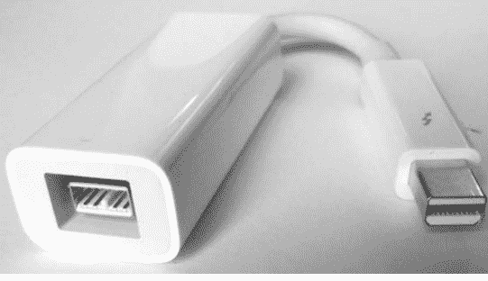

图 5-4：雷电转火线适配器

请确保在已插入雷电转火线适配器的情况下（按住 `T` 键）启动 Apple 设备；否则 Apple 固件将不会使用火线适配器作为目标设备。

以下示例显示了在 `TDM` 模式下、通过雷电转火线适配器连接到 Linux 机器的 Apple 笔记本电脑的 `dmsg` 输出（Apple 端为雷电；Linux 端为火线）：

```
[ 52.964133] scsi hostio0: SBP-2: IEEE-1394
[ 52.964404] firewire_core 0000:0e:00.0: created fw1: GUID
000a270002006d6ef, S800
[ 53.163093] firewire_sb2 fw1:0: logged in LUN 0000 (o retries)
[ 53.163779] scsi 10:0:0:0: Direct-Access-RBC AAPL FireWire Target 0000
PQ: 0 ANSI: 3
[ 53.164226] scsi 10:0:0:0: Attached scsi generic sicio type 14
[ 53.165006] scsi 10:0:0:0: [sdj] 236978176 512-byte blocks:
(121 GB/113 GB)
[ 53.165267] scsi 10:0:0:0: [sdj] Write Protect is off
[ 53.165271] scsi 10:0:0:0: [sdj] Mode Sense: 10 00 00 00
[ 53.165759] scsi 10:0:0:0: [sdj] Write cache: enabled, read cache: enabled,
doesn't support DPO or FUA
```


- 将目标介质挂载到采集主机

`[ 543.171533 ] sdj: sdj1 sdj2 sdj3`
`[ 543.173479 ] sd 10:0:0:0: [sdj] Attached SCSI disk`

带有雷电端口的基于 PC 的 Linux 系统并不常见，Linux 内核支持仍在开发中。作为替代方案，你可以使用取证启动 CD/USB 设备启动的 Apple 电脑，并将其采集到本地连接的证据驱动器中。

# NVME SSD

NVME 硬盘通过其直接连接到 PCI Express 总线的方式与 SATA Express 竞争。在编写本文时，用于 NVME 硬盘的硬件写保护器还非常新。它们是 Tableau 提供的用于 NVME 和 SATA Express 硬盘的热插拔 USB 桥接器。为了说明，示例展示了直接连接到 Linux 系统的 nvme 设备。你可以使用来自 `nvme-cli` 包的 `nvme` 工具列出已连接的 nvme 设备：

| 节点 | 型号 | 版本 | 命名空间 |
| :--- | :--- | :--- | :--- |
| `/dev/nvme0` | INTEL SSDPE2M400G | 1.0 | 400.09 GB / 400.09 GB ... |
| `/dev/nvme1` | Samsung SSD 950 PRO | 1.1 | 300.01 GB / 256.06 GB ... |

你还应该使用 `nvme` 工具检查每个 NVME 硬盘是否存在多个命名空间。在这个示例中，只存在单个命名空间：

```
# nvme list-ns /dev/nvme1 [0]
```

多个命名空间可能需要单独采集。这与其他硬盘有本质区别，其他硬盘被视为扇扇的线性集合，你可以一次性对它们进行采集。需要注意的是，NVME 标准是从头开始创建的，没有与 SCSI 或 ATA 标准（AHCI 等）的后兼容性。它有自己的命令集，并独立于其他磁盘运行。由于此原因，某些工具在 NVME 上的工作可能不符合预期。任何直接在低层运行的取证工具在处理 NVME 时可能无法如预期工作。某些工具在处理 NVME 时可能无法如预期工作，因为它们不支持多个命名空间。在处理 NVME 时，可以使用工具提取 SMART 信息，如下：

```
# nvme smart-log /dev/nvme1
Smart Log/device:
```

分区表

| 槽 | 开始 | 结束 | 描述 |
| :--- | :--- | :--- | :--- |
| 00 | 0 | 0 | 未分配 |
| 01 | 0 | 0 | 主 |
| 02 | 0 | 0 | 扩展 |
| 03 | 0 | 0 | 扩展 |
| 04 | 0 | 0 | 未分配 |

`nvme` 工具具有许多查询功能。请查看 `nvme(1)` 手页或访问 https://github.com/linux-nvme/ 了解更多信息。在编写时，NVME 硬盘是一项新兴技术。由于它们在性能和效率方面的许多优势，未来可能会变得流行。

# 以块设备访问的其他设备

你可以镜像任何被内核检测到的设备。某些设备在连接到系统时就会显示为块设备。例如，许多通用 MP3 播放器、相机和其他移动设备具有这种特性。

某些设备需要切换到不同的模式才能作为块设备访问。通常，你可以从设备的用户界面选择这种模式。

某些 USB 设备是多功能的，除了存储外还提供其他模式。你可能需要将这些设备切换到 usb-storage 模式进行采集。名为 `usb_modeswitch` 的 Linux 工具可以查询多功能 USB 设备并进行切换。

## 结语

在本章中，你学习了将目标驱动器挂载到采集机并识别设备以进行镜像。你学习了不同的 PC 硬件（USB、PCI、块设备等）、如何查询你的采集系统，以及如何查询硬盘的 SMART 信息。我演示了 HPA 和 DCO 的移除，以及某些硬盘内置的各种安全类型。你现在具备了执行取证所需的知识，这将第 6 章的重点。

# 6

# 取证采集

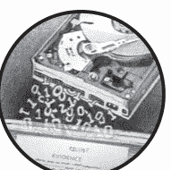

本章解释存储介质的取证镜像，重点是执行取证良好的镜像。这意味着从特定的存储介质提取尽可能的数据，减少对存储设备和介质的干扰，保护采集证据并记录整个过程（包括错误）。

你在这里将读到几种工具和方法，以及各自的优缺点。因此，你能够根据特定情况做出选择合适工具的决策。你将学习如何使用免费或开源取证工具，例如 `dd`、`dffld`、`dc3d`、`ewfacquire` 和 `ftkimager-cli`。此外，我还描述了 `sfimage` 工具，它是一个使用现有采集工具创建 Squash 取证证据计数器的脚本。

`dc3dd` 和 `dc3dd` 基于成熟且经过充分测试的软件，其设计用于通过取证获取原始镜像，并带有广泛的哈希计算和日志记录。对于具有许多坏块的磁盘，GNU `ddrescue` 可能是一个不错的选择。如果要在获取过程中进行集成哈希计算、加密和压缩，最新版本的 `dd_rescue` 可能是一个有趣的替代方案。最终，所选的工具将取决于取证实验室的组织策略、检查类型、你的个人偏好以及其他情况。本书未推荐任何特定的工具。

本章中的所有示例均基于以下假设：

- * 目标存储设备物理上连接到取证工作站。
- * 目标存储设备已通过正身份识别。
- * 已采取适当的写保护缓解措施，以防止对磁盘进行修改。
- 已进行磁盘容量规划，以确保磁盘空间不是问题。

## 使用 dd 工具获取镜像

基于 `dd` 的工具生成的镜像与其它取证格式（如 EnCase EWF 中的头部或 FTK SMART）在意义上并不是“格式”。由基于 `dd` 的工具创建的镜像没有头部、尾、内部标记或关于案件或事件的描述性元数据。它们仅仅是数据块的原始镜像，在这种情况下，它是目标磁盘或其他质存储设备的镜像。

> 警告：如果你犯了任何错误，`dd` 工具是非常严格的，并在将不可逆地覆盖任何未受保护的磁盘。

为了降低损坏证据或取证人员工作站的风险，请务必双击以下内容：

- * 有写保护器保护证据/目标驱动。
- 输入设备的序列号（`if=`）与物理目标磁盘标签上的序列号匹配。
- 确认输出文件（`of=`）位于取证人员系统上的普通文件，或是一个可以处理预期输入 `stdin` 的程序。

# 标准 Unix dd 和 GNU dd

`dd` 的命令语法只需指定输入文件和一个输出文件，并可能包含其他修改命令行为的选项。以下示例展示了如何使用 `dd` 将磁盘设备复制到文件：

```
# dd if=/dev/sde of=image.raw
15466496+0 records in
15466496+0 records out
7918845952 bytes (7.9 GB) copied, 130.952 s, 60.5 MB/s
```

这里 `if=` 指定输入文件，在这种情况下，它是连接到获取系统的原始磁盘设备。`of=` 参数是输出文件，它是一个包含从磁盘设备复制的原始数据的普通文件。
完成后，`dd` 会报告传输了多少字节。你可以将传输的字节数除以扇区大小，结果应与连接设备时识别出的扇区数量完全匹配。

在使用 `dd` 进行取证识别以识别磁盘时，可能会面临挑战。如果在获取过程中发生读取错误，`dd` 将以“Input/output error”错误退出。通过添加 `conv=noerror` 来解决此问题，这将强制 `dd` 跳过不可读的块并继续。跳过不可读块的问题在于，目标文件的扇区偏移量发生变化，导致磁盘其余部分的文件系统块看起来已损坏。为了说明这一点，考虑书的页。假设第 99 页被撕掉了。如果目录指向从第 200 页开始的章节，仍然可以找到。即使缺少了该页，书的页码也是完整的。但当磁盘镜像中的第 99 个扇区被撕掉（由于读取错误）时，情况并非如此。其余扇区将重新编号，文件系统的“目录”在第 99 扇区后将指向错误的块。

`sync` 参数通过用零填充不可读的输出来纠正这一点，本质上是创建一个“伪”扇区（填满零）来代表缺失的扇区。磁盘镜像的其余部分将具有文件系统内容预期的正确扇区编号（偏移量）。

使用之前的示例，但这次带有对不可读块的保护（跳过并用零填充），得到如下结果：

```
# dd if=/dev/sda of=image.raw conv=noerror,sync
15466496+0 records in
15466496+0 records out
7918845952 bytes (7.9 GB) copied, 136.702 s, 57.9 MB/s
```

填充输出会影响取证获取，因为镜像被修改了并添加了新的（零）。磁盘的密码学哈希值将与磁盘上的原始数据不匹配（特别是当磁盘上有新的或变化的不可读区域时）。此问题可以通过记录哈希窗口来管理。这在第152节“哈希窗口”中会有讨论。

`dd` 的另一个问题是传输块大小可能大于物理介质扇区大小。当发生读取错误时，这是一个问题，因为较大块中剩余的扇区会被填充零，而不仅仅是那个不可读的扇区。这意味着某些正常扇区可能被排除在取证镜像之外。比扇区大的块大小还会导致取证镜像末尾添加额外的填充扇区（如果大小不能被块大小整除）。
增加块大小带来的潜在性能收益必须与从大填充块丢失证据的风险进行权衡。

传统的 `dd` 不具备哈希计算、记录日志到文件或其他你在取证获取工具中期望的功能。由于原始镜像不包含关于原始目标磁盘的任何元数据，你必须单独记录任何描述磁盘的信息（或部分嵌入某些信息）。

能够与 EnCase、FTK 和 Sleuth Kit 交互的获取文件。该工具还可以将原始镜像转换为其他格式。

此示例展示了 `ewfacquire` 如何获取一个连接的磁盘设备（一个通过雷电转火线适配器连接到取证工作站目标磁盘模式的 MacBook Air）：

```
# ewfacquire -c best -t /exam/macbookair /dev/sdf\newfacquire 20160424
```

设备信息：

- 总线类型：火线 (IEEE1394)
供应商：
型号：
序列号：

存储介质信息：

- 类型：设备
媒体类型：固定
媒体大小：121 GB (121332826112 字节)
每扇区字节数：512

所需的获取参数，请提供必要信息：

- 案号：42
描述：丢失花瓶的案件
证据编号：1
取证人员：holmes

备注：花瓶是蓝色的。介质类型（固定、可移动、光介、内存）介质特性（逻辑、物理）物理。使用 EWF 文件格式（ewf, smart, ftk, encase1, encase2, encase3, encase4, encase5, encase6, encase7, encase-v2, line5, line6, line7, ewfx） [encase6]: 从偏移量开始获取 (0 <= value <= 121332826112)

要获取的扇区数量（0 < value <= 121332826112） [121332826112]: 证据分段大小（字节）（1.0 MiB <= 7.9 Eib） [1.4 GB]: 每个扇区的扇区数（1 < value <= 4294967295） [512]: 同时读取的扇区数（16, 32, 64, 128, 256, 512, 1024, 2048, 4096, 16384, 32768） [64]: 作为错误粒度使用的扇区数（1 < value <= 64） [64]: 发生读取错误时的重试次数（0 <= value <= 255） [2]: 读取错误时擦除扇区（模拟 EnCase 行为）(yes, no]

提供了以下获取参数：

- 镜像路径文件名：`/exam/macbookair.E01`
案号：42
描述：丢失花瓶的案件
证据编号：1
取证人员：holmes
备注：花瓶是蓝色的。

介质类型：固定磁盘
是否为物理：是
EWF 文件格式：EnCase 6 (.E01)
压缩方法：deflate
压缩级别：best 0
获取起始偏移：
要获取的字节数：113 GiB (121332826112 字节)
证据分段文件大小：1.4 GiB (15728640000 字节)
每扇区字节数：512
块大小：64 扇区
错误粒度：64 扇区
读取错误重试：2
读取错误置零：否

使用这些值继续获取（yes, no） [yes]:

获取开始于：2016年5月07日 14:54:52
这可能需要一段时间。

状态：进度 0.0%
已从总 113 GiB (121332826112 字节) 中获取了 60 MiB (62914560 字节)
预计 2 小时 8 分钟 30 秒完成，速度 14 MiB/s
(15712616 字节/秒)

状态：进度 99.9%
已从总 113 GiB (121332826112 字节) 中获取了 112 GiB (121329188864 字节)
预计 0 秒完成，速度 51 MiB/s (54069886 字节/秒)

获取完成于：2016年5月07日 15:32:16

写入：113 GiB (121332826300 字节)，耗时 37 分 24 秒，速度
51 MiB/s (54069886 字节/秒)

对数据计算了 MDS 哈希值：
083e213d0a59a2e3b59d48dbc451591fwacquire: 成功

获取在 37 分钟内成功完成，120GB 文件被拆分为 54 个压缩的 *.E0 文件，总计 79GB。

## AccessData ftkimager

AccessData 提供 FTK Im 的预编译命令行版本。该工具称为 `ftkimager`，提供了适用于 Debian Linux、Fedora Linux、OS X 的二进制文件（无源码），您可以从 AccessData 网站下载：http://accessdata.com/product-download/digital-forensics/。

`ftkimager` 工具可以从原始设备、文件或 stdin 获取输入。它输出为 FTK SMART 格式、EnCase EWF 格式或 stdout。

stdin 和 stdout 特别适用于管道传输到其他程序。支持许多功能，包括将元数据添加到保存的文件夹、压缩、文件分割、哈希处理和加密镜像。以下是使用 `ftkimager` 获取连接磁盘的示例示例：

```
# ftkimager /dev/sdf --s01 --description "SN4C5300120 Ultra Fit"
AccessData FTK Imager v3.1.1 (Aug 24 2012)
Copyright 2006-2012 AccessData Corp., 400 West, London All rights reserved.
正在创建镜像...
```

源设备是通过 `/dev/sda` 的 SanDisk 驱动器。由于默认格式是 raw，添加 `--s01` 标志将其保存为 SMART 格式。使用 `--description` 标志将序列号和型号字符串添加到元数据中。`ftkimager` 在命令行中创建了一个日志文件，包含基本元数据和任何额外信息，如下：

```
# cat sandisk.s01.txt
```

案件信息：

案号：42

证据编号：1

唯一描述：SN4C5300120 Ultra Fit

取证人员：holmes

备注：花瓶是蓝色的。

设备信息（源）：

源类型：物理

驱动器几何：

柱数：14832

头部数：64

每磁道扇区数：32

每扇区字节数：512

扇区数：3037596

源数据大小：14832 MB

扇区计数：3037596

计算的哈希：

MD5 校验：a2a9891eed2dbaf47ff9ad402

SHA1 校验：2e73cc2a2c9d4198e3db043f9b38efe

镜像信息：

获取开始：2016-05-07 15:49:00

获取完成：2016-05-07 15:53:07

段列表：

sandisk.s01

sandisk.s02

可以使用 `--info` 标志结合文件名提取相同的信息。

## SquashFS 取证容器

`sfimage` 工具只是一个 shell 包装器，可以配置为任何支持将镜像写入 stdout 的镜像工具。脚本获取此字节流并将其放入 SquashFS 文件系统中。在此示例中，通过编辑脚本开头的 DD 变量，将 `sfimage` 配置为使用 `dc3dd` 作为镜像工具：

```
DD=dc3dd if=$DD log=error.txt log=hashlog.txt hash=md5
```

然后使用 `-i` 标志获取设备：

```
$ sfimage -i /dev/sde philipp-usb-drive.sfs
sfimage 版本：sfimage 0.8
sfimage 命令：/usr/bin/sfimage -i /dev/sde
当前工作目录：/exam
取证源：if=/dev/sde
目标 squashfs 容器：phill-usb-drive.sfs
容器内文件名：image.raw
获取命令：sudo dc3dd if=/dev/sde log=error.txt log=hashlog.txt
hash-md5 2>/dev/null | pv -s 7918845952 [=====================>100%]
完成：2016-05-07T15:41:22
```

以下输出显示了压缩的 *.sfs 文件的大小：

```
$ ls -lh *.sfs
-rw-r-- 1 holmes holmes 4.5G May 7 15:41 philipp-usb-drive.sfs
```

可以使用 `sfimage -l` 列出 SquashFS 文件的内容，或使用 `sfimage -m` 挂载（只读）。在获取过程中，`sfimage` 将错误日志、哈希日志及其自身的与原始镜像文件一起。你可以使用 `sfimage -a` 向 `sfimage` 容器添加额外文件。

## 获取多个目标的镜像

Unix 管道机制的灵活性允许在单个无人步骤中完成多个复杂任务。`dc3dd` 和另一个工具都可以指定多个目标文件名，允许您同时制作镜像副本。以下示例展示了对磁盘进行镜像并同时写入多个目标：获取主机上的本地副本以及挂载的外部第三方驱动器上的第二个副本。通过多个 `of=` 标志指定两个输出文件：


```
# dc3dd if=/dev/sde of=/exam/local-lab.raw of=/ext/third-party.raw
```

```
dc3dd 7.241 开始于 2016-05-07 15:56:10 +0200
编译选项：
命令行：dc3dd if=/dev/sde of=/exam/local-lab.raw of=/ext/third-party.raw
设备大小：1546696 扇区（探测），7,918,845,952 字节
扇区大小：512 字节（探测）
7918845952 字节 ( 7.4 G ) 已复制 ( 100 % ), 79 秒， 95 M/s
```

```
设备 `/dev/sde` 的输入结果：
1546696 扇区输入
0 个坏扇区被零替换
```

```
文件 `/exam/local-lab.raw` 的输出结果：
1546696 扇区输出
```

```
文件 `/ext/third-party.raw` 的输出结果：
1546696 扇区输出
```

```
dc3dd 完成于 2016-05-07 15:57:30 +0200
```

验证图像自获取以来未发生更改。由于法庭程序和证据提交可能耗时数月或数年，因此确认证据在此期间未被修改是非常用的。这可以被视为某种数字形式的监管链。

接下来的章节将演示如何使用哈希窗口（hash windows）、使用 PGP 和 S/MIME 签名以及 RFC-3161 时间戳来保护数字证据。让我们从一些基础加密哈希的示例开始。

## 基础加密哈希

取证镜像的加密哈希通常作为镜像过程的一部分。整个介质镜像（顺序中的每个扇区）都会通过单向哈希函数。截至编写时，书中讨论的四种取证镜像工具支持表 6-1 所示的哈希算法。

表 6-1：支持的加密哈希算法

| 工具 | 支持的哈希算法 |

|---|---|

| dc3dd | MD5, SHA1, SHA256, SHA384, SHA512 |

| dc3dd | MD5, SHA1, SHA256, SHA512 |

| ewfacquire | MD5, SHA256 |

| ftkimager | MD5, SHA1 |

使用取证格式的工具通常默认生成哈希。`ftkimager` 和 `ewfacquire` 在获取过程中会自动生成哈希，这在之前的示例中你已经过了。

要使用 `dc3dd` 创建哈希（或多个哈希），你需要在命令行上指定所需的哈希算法，如下：

```
# dc3dd if=/dev/sda/of=image.raw hash=md5 hash=sha1 hash=sha512
```

`dc3dd 7.2.641 started on 2016-05-07 16:02:56 +0200`

`compiled options:`

`command line: dc3dd if=/dev/sda/of=image.raw hash=md5 hash=sha1 hash=sha512`

`device size: 1546496 sectors (protected), 7,918,845,952 bytes`

`sector size: 512 bytes (protected)`

`7918845952 bytes (7.4 G) copied (100 % ), 80 s, 94 M/s`

`input results for `/dev/sde`:`

`15466496 sectors out`

`bad sectors replaced by zeros`

`ebada11ffb76f7618325cf5fd8941109f (md5)`

`62e5053fb6a07aa7c48fe82ed5db9fa7d4d881 (sha1)`

`f01dd132fb659b6d9043aa25fc0c83da10c45fb68b847f244834ef20b048f2c335d62a31c2e3`

`na2972a18d9bbffe93a2bd6d8f60fff944cdb3c5e7387d8 (sha512)`

`output results for file `image.raw`:`

`15466496 sectors out`

`dc3dd completed at 2016-05-07 16:04:17 +0200`

传统的命令不支持哈希。相反，你必须在获取过程中将镜像管道到单独的程序，这可以通过使用 Unix `tee` 来实现：

```
# dd if=/dev/sde tee image.raw | md5sum
15466496+0 records in
15466496+0 records out
791884592 bytes (7.9 GB, 7.4 GiB) 108.822 s, 72.8 MB/s
ebada11ffb76f7618325cf5fd8941109f
```

当使用 `dd if=` 时，数据被发送到 stdout，它可以被重定向或管道到另一个程序。在这个示例中，它被管道到 Unix `tee` 命令，该命令同时将数据保存到文件并发送到 stdout。然后你将其管道到独立的哈希工具 `md5sum` 中，由它产生哈希。除了 `md5sum` 之外，Linux coreutils 包还包含其他哈希函数：`sha1sum`, `sha224sum`, `sha256sum` 和 `sha512sum`。

我在第 197 页的“验证取证镜像的完整性”中解释了验证生成的哈希的过程。

## 哈希窗口

在对旧或损坏的磁盘进行镜像时，可能会发生块读取错误。这些错误可能发生在获取过程随机位置，并且频率可能会随着时间的推移而增加。当你维护证据完整性时，这形成了一个挑战，因为加密哈希每次读取磁盘时（重新获取、复制、验证等）都可能不同。

该问题的解决方案是使用哈希窗口（hash windows）或分段哈希（piecewise hashing）。哈希窗口是针对磁盘上较小扇区序列取取的独立加密哈希。例如，获取过程中 10MB 的哈希窗口将为每个 10MB 的扇区序列生成一个单独哈希，并为磁盘生成一个哈希列表。如果某个扇区无法访问（或由于某些原因被修改），该扇区的哈希将失效。即使整个磁盘的哈希失效，磁盘上的哈希窗口仍能保持完整。在取证格式中，早期的 Witness Format (EWF) 使用分块校验和（CRC）。较新的格式允许创建哈希窗口。使用 `dc3dd` 创建哈希窗口需要添加 `hashwindow=` 参数。你可以使用 `hashlog` 参数将哈希列表保存到文件。以下示例指定了 1MB 的哈希窗口，每个区域的哈希如下：

```
# dc3dd if=/dev/sda of=image.raw conv=noerror,sync hashwindow=1
1048560-e07965393e55ec039b5c2cf
1048560-2097152-f4a207d24242b0de6594d
2097152-3145728-d4c6e4d47758ec34a00
3145728-4194304-09e2ae8f1ea738d50e26cb
4194304-5242880-38298281f3b9c60b7f9d
5242880-6291456-6919a53d95a391d8f2fd69db
6291456-7340032-c3d3e2ca2c4531ebc0d839144
7340032-8388608-c0ac7bbd5d5768dc24098de185
8388608-9431184-c31a0b8f956ea91d527e070b189d
9431184-1048560-485866dd4c630eb618bb072b6ce0
1048560-0969f7533763e67ae2480ca8bfad1
```

当磁盘部分为全零或重复模式时，一组相同的磁盘扇区具有相同的值。在 `dc3dd` 中，哈希窗口被称为*分段哈希*（piecewise hashing），并且不是通过扇区范围而是通过分割文件创建。在以下示例中，每个分割文件的扇区哈希被记录如下：

```
# dc3dd if=/dev/sda of=image.raw s=image.000 sz=1G hlog=hash.log hash=md5
dc3dd 7.2.641 started at 2016-05-07 17:10:31 +0200
compiled options:
command line: dc3dd if=/dev/sda of=image.raw s=image.000 sz=1G hlog=hash.log hash=md5
device size: 1546496 sectors (probed), 7,918,845,992 bytes
sector size: 512 bytes (proved)
7918845992 bytes (7.4 G ) copied (100 % ), 114 s, 66 M/s
```

`input results for `/dev/sda`:`

`1546496 sectors in`

`0 bad sectors removed by`

`5dfe68597f8ad9f20060a453101f257 (md5)`

`c25016355481d9495801d6, sectors 0 - 2097151`

`cd573fcae0e7949b0c46028904ff, sectors 2097152 - 4194303`

`d836d367491abc7529d1f4b9df1, sectors 4194304 - 6291455`

`a9d1f07299bb897c4cbfed4dc0f77ae0, sectors 6291456 - 8388608`

`3145728-4194304-09e2ae8f1ea73b8d50e263cb`

`4194304-5242880-38298281f3b9c60b7f9d`

`5242880-6291456-6919a53d95a391d8f2fd69db`

`6291456-7340032-c3d3e2ca2c4531ebc0d839144`

`7340032-8388608-c0ac7bbd5d5768dc24098de185`

`8388608-9431184-c31a0b8f956ea91d527e070b189d`

`9431184-1048560-485866dd4c630eb618bb072b6ce0`

`1048560-0969f7533763e67ae2480ca8bfad1`

这并不意味着你需要为了让人签名而传输数 TB 的图像。只需对驱动器的哈希或哈希窗口列表进行签名就足够了。选项是对包含时间戳、获取的字节和所有生成的加密哈希的整个输出进行签名。

就像人们用笔签署授权的数字表单一样，他们也可以用数字签名对数字表单签名。与纸笔签名不同，数字签名很难伪造（除非私钥被盗）。用于签署数字信息的两种流行标准是 Pretty Good Privacy（PGP）和安全/多用途互联网邮件扩展（S/MIME）。

OpenPGP 标准最常见的 Linux 实现是 GnuPG (PGP)。三种不同的签名方法包括普通二进制签名、明文签名（clear text signature）和离线签名（detached signature）。使用明文签名是最有利的，因为它显示了带有签名的文本，并且可以轻松嵌入其他文档和报告中。

在接下来的示例中，S. Holmes 对磁盘进行了取证获取，并对包含 MD5 哈希值和其他细节的日志输出执行了签名：

```
$ gpg --clearsign hash.log
```

你需要一个密码来解锁用户的私钥："Sher Holmes holmes@digitalforensics.ch" 2048位 RSA 密钥，ID CF87856B，创建于 2016-01-11

输入密码：

> 之前的命令创建了 `hash.log.asc` 文件，它包含了文件内容以及签名：

```
$ cat hash.log.asc
-----BEGIN PGP SIGNED MESSAGE-----
Hash: SHA1
```

```
dc33d 7.2.641 started at 2016-05-07 17:23:49 +0200
compiled options:
command line: dc33d if=/dev/sda sda-raw of=image.000 ofsz=1G hlog=hash.log
hash=md5
```

```
input results for device /dev/sda/:
d5dfe68597f84d9f26004a53101f2c57 (md5)
c250163535458d94985d188ca61bd6, sectors 0 - 2097151
d537cfaace07e94b9c4c602b904ff, sectors 2097152 - 4194303
8d3d6363749194bcc7152d9d1f4b9df1, sectors 4194304 - 6291455
```

- 1. 假设该人员已安装 GnuPG 并安全地生成了密钥对。

`da961f072998b8897c4fed74e0e, sectors 8269156 - 8388607`

`4cd55603f8aec09da94a0c29f07f7a, sectors 8388608 - 10487599`

`516ba0bdf8b969d7e8bc00c55926200, sectors 10485760 - 12582911`

`c1f8c7008b7835fcf32ad2fb63c6fcd, sectors 12582912 - 14680063`

`fb2ebbsb173893897c177845305b8b8f, sectors 14680064 - 15464495`

`image.raw` 的输出结果：

```
[ok] d5de68597f8ad9f20600a45301f2c57 (md5)
```

`image.000` 的输出结果：

`dc33 called at 2016-06-07 17:25:40+0200`

`-----BEGIN PGP SIGNATURE-----`

`Version: GnuPG1`

```
IECEBAE3QQXJLOnAA0AE0EgovvP4VrdeAH/OHCLFSkWWTZNUrIn1+tRl13
36KXuWE9E1RK9B8PrK/NhFMSY2E3fxy3/j7mtopkfnfGDLYRA615yckReI1Vevnh7
k77QhoJptDcmY2fnuPM2bB1kdNftiYab3U0qDMMCcbWVkp0i502q3
KP7H5SA8w8mOfRr0c/Bf0Z1f5729y7B2Zyf5a8TBBnaVocqfNmrEr
R1ncJ5V4ntuhRDBB0P6K4mutY9oSFHLR1FL830m/wG64S25JX+shkG5G5
I6J7N6EgFg1YRhmB0Z5SI6Fmv36fr1VysGD3+XFE3C2ZZk+JNB7P9g
-----END SIGNATURE-----
```

- 之前的命令创建了 `hash.log.asc` 文件，它包含了文件内容以及签名。

`Nonce: 0XBC6F6B553A3E5EF`

`TSA: DirName=/Free TSA/OU/description=此证书数字签名使用 freetsa.org 在线生成的文档和时间戳请求`

`CN://www.freetsa.org/emailAddress=busilezas@gmail.com/L=Wuerzburg/`

`C-DE/St-Bayern`

`hash.tsr`文件的副本证明了获取结果在特定时间存在。独立的第三方也可以验证时间戳的有效性。我将在第7章演示时间戳的验证。

互联网上有许多免费和商业时间戳服务。以下是几个示例：

- Comodo RFC-3161 时间戳服务:http://timestamp.comodo.com/td=sha256

- FreeTSA: http://freetsa.org/index.en.php

- Polish CERT PCC - 通用认证机构: http://time.cert.pl/

- Safe Creative 时间戳权威 (TSA) 服务器:http://tsa.safecreative.org/

- StartCom 免费 RFC-3161 时间戳服务:http://tsa.startssl.com/rfc3161

- Zeitstempeldien der DFN-PKI:http://www.pki.de/zeitstempeldienst/

这两个部分的示例简要地将个人和时间绑定到图像的完整性上。智能卡和硬件安全模块 (HSMs) 等加密令牌可用于保护私钥，并确保物理持有令牌对图像进行签名。硬件令牌的加密密钥无法被复制或窃取。用于加密签名的硬件令牌示例包括 Nitrokey、Yubikey 和 GnuPG OpenPGP 信用卡。

## 管理驱动故障和错误

偶尔，取证实验室会收到一个有问题的硬盘进行分析。该磁盘可能是旧的、损坏的或正在发生故障。它可能存在接口错误、盘片读取错误、磁头错误、电机重置和其他错误。在某些情况下，你将获取该驱动器的部分取证镜像。取决于磁盘大小、块大小和不可读扇区的数量，对坏磁盘成像可能需要几天时间。

重要的是要理解，描述的错误指的是驱动器硬件。它们不是指软件错误，例如文件系统损坏、分区表损坏等。

本节展示了不同工具以及它们如何处理错误情况的示例。`dmset` 工具对于模拟磁盘错误并测试取证工具在各种故障条件下的行为非常有用，并用于随后的几个示例中（磁盘设备为 `/dev/mapper/errddisk`）。下一节将概述 `dc3dd`、`dc5lddd`、`dfcfacquire` 和 `ftkimager-age` 如何报告错误。

## 取证工具错误处理

以下示例显示了 `dc5lddd` 工具遇到带有两个错误的磁盘。磁盘上的错误（块偏移量）报告到 stdout 并记录到指定的文件中，如下所示：


```
# dc3dd if=/dev/mapper/errddisk of=errddisk.raw conv=noerr,sync errlog=error.log
...
# cat error.log
dc5lddd:/dev/mapper/errddisk: Input/output error
(null)+15 records in
(null)+16 records out
dc5lddd:/dev/mapper/errddisk: Input/output error
(null)+29 records in
(null)+32 records out
(null)+62496 records in
(null)+62501 records out
```

在 Debian Linux 上测试 `dc5lddd` 时遇到了几个 bug。即使指定了 512 字节的块大小，块大小也在 4K 处用于填充（`dd` 显示了相同的行为）。在某些错误上，`dc5lddd` 进入了死循环，必须手动终止。`dc3dd` 工具提供了所遇错误的详细概述。错误被发送到 stdout 并保存在指定的日志文件中，如下：

```
# dc3dd if=/dev/mapper/errddisk of=errddisk.raw log-error.log
...
# cat error.log
dc3dd 7.2.641 started on 2016-01-12 19:42:26 +0100 compiled options:
command line: dc3dd if=/dev/mapper/errddisk.raw log-error.log
device size: 400000 sectors (probed), 2,048,000,000 bytes
sector size: 512 bytes (probed)
!!! reading /dev/mapper/errddisk' at sector 1000 : Input/output error
!!! 4 occurrences while reading /dev/mapper/errddisk' from sector 2001 to sector 2004
: Input/output error
2048000000 device (1.9 G) copied (100 %), 5.74919 s, 340 M/s

input results for `/dev/mapper/errddisk`:
400000 sectors in
5 bad sectors replaced by zeros

output results for file 'errdisk.raw':
40000000 sectors out

dc3dd completed at 2016-01-12 19:42:31 +0100
```

`dd_acquire` 工具提供的默认粒度为 64 扇区，可以更改为 1 以减少填充零扇区的数量。在这个示例中，`dd_acquire` 仅检测到两个错误（类似于 `dc5lddd`；跳过了未检查的其它扇区）：

```
# dd_acquire -t errdisk /dev/mapper/errdisk
dd_acquire 20150126
```

每扇区的字节数 (1 <= value <= 429467295) [512]: 一次读取的扇区数 (16, 32, 64, 128, 256, 512, 1024, 2048, 4096, 8192, 16384) [64]: 作为错误使用的扇区数 (1 <= value <= 64) [64]: 读取错误时的重试次数 (0 <= value <= 255) [2]: 1 读取错误时擦抹扇区（模拟 Case 行为）（yes, no）于 Jan 12, 2016 19:57:58 写入: 1.9 GB (204800804 bytes) in 14 second(s) with 139 MiB/s. 读取设备错误:

total: 2

at sector(s): 1000 - 2008 number: 8 (offset: 0x07d000 size: 4096)

at sector(s): 2000 - 2008 number: 8 (offset: 0x00afa00 size: 4096)

数据的 MD5 哈希:

4d1912088b399bed78342130eb

dd_acquire: SUCCESS

`ftkimager` 报告并记录了错误。以下示例使用了物理缺陷磁盘（第一代），因为 `ftkimager` 无法处理用 `dmset` 创建的扇区：

```
# ftkimager /dev/sd1
AccessData FTK Image v3.1.1 CLI (Aug 2012)
Copyright (C) 2006-2012 AccessData Corp., 384 South, London, UK
All rights reserved.
Creating image...
234.25 / 4775.76 MB (11.71 MB/sec) - 00:06:27 left
Image creation complete.

# cat image.001.txt
Case Information:
Acquired using: FTK
ATTENTION: 源上无法读取以下扇区: 
491584 through 491591
491928 through 491935
镜像中这些扇区的内容被替换为零。每个取证工具都有某些错误检测、处理和记录功能。然而，对于有大量错误或硬件损坏的磁盘，使用专用工具可能是合适的。下一节描述用于此目的的数据恢复工具。

## 数据恢复工具

几个磁盘恢复工具由于其健壮的错误处理和进取的恢复方法值得关注。尽管这些工具不是为了取证而编写，但在取证工具失败的情况下非常有用。`ddrescue`（由 Antonio Diaz 设计）旨在从损坏的磁盘中恢复块。与 `dd` 系列不同，它具有多阶段恢复算法，你可以对磁盘运行多次，通过不同的通过来填充镜像中的空白。完成的 `ddrescue` 操作会产生描述恢复情况的统计数据：

```
# ddrescue /dev/sda image.raw.log

used: 40968 MB, errsize: 2895 KB, current rate: 0 B/s

copied: 39026 MB, errors: 38, average rate: 563 KB/s

pos: 39026 MB, run time: 20.18 h, successful read: 8.04 h ago
```

`ddrescue` 日志文件产生开始结束时间以及磁盘问题区域的详细概述：

```
# Rescue Log. Created by Gnu ddrescue version 1.19

# Command line: ddrescue /dev/sda image.raw.log

# Start time: 2015-06-13 22:57:39

# Current time: 2015-06-14 19:09:03

# Finished

# current_pos current_status

0x9162CAC0       +

# pos size status

0x00000000 0x4F29D000 +

0x4F29D000 0x00002000 -

0x4F29F000 0x00253000 +
```

`dd_rescue` 工具（注意下划线）是由 Kurt Geiger 在 20 世纪 90 年代开发的，尽管名称包含 dd，但其语法完全不同且不执行数据转换（与 `dd` 相同）。但它传输数据块的方式类似于 `dd`。几个功能使得该工具成为数字取证实验室使用的可能选择。当发生磁盘错误时，块大小会动态变化，自动减小到物理块大小。在一段时间没有错误后，块大小再次更改以提高性能。你也可以从磁盘末尾反向镜像。这种技术对于难以读取磁盘某点的硬盘非常有用。

`myrescue` 工具的设计是尽可能避免不可读区域，在复制可读扇区后，它处理失败区域。该工具建议在重试之间让硬盘休息几小时。另一个名为 `recoverdm` 的工具也执行数据恢复。独特之处在于它可以扇区级别或单个文件从损坏磁盘中恢复数据。该工具具有针对软盘和光介质的功能。

## SMART 和内核错误

磁盘上的 SMART 信息可以提供关于驱动器状况和恢复成功率的额外指标。例如：

```
### smartctl -x /dev/sda

smartctl 6.4 2014-10-07 [x86_64-linux-3.19.0-generic] (local build)

Copyright (C) 2002-14, Bruce Allen, Christian Franke, www.smartmontools.com
```

```
=== START OF INFORMATION SECTION ===

Model Family: Maxtor DiamondMax D540X-4K

Device Model: MAXTOR 4K0402

Serial Number: 672136472275

Firmware Version: A08.1500

User Capacity: 40,971,571,200 bytes [40.9 GB]

Sector Size: 512 bytes logical/physical

...

V SMART Attributes with Thresholds:

ID# ATTRIBUTE_NAME   FLAGS VALUE WORST THRESH FAIL RAW_VALUE

1 Read_Error_Rate   P-R-K   100 253 020               0

3 Spin_Up_Time       POS--    087 086 020               1678

4 Start_Stop_Count   --CC    078 078 008               14628

5 Reallocated_Sector_Ct PO--    003 001 020               486
```

| ID | Attribute | Type | Normalized | Raw | Worst | Thresh | Value |
| :--- | :--- | :--- | :--- | :--- | :--- | :--- | :--- |
| 7 | Seek_Error_Rate | PO-R-- | 100 | 100 | 023 | 0 |
| 9 | Power_On_Hours | -O--C-- | 073 | 073 | 001 | 17814 |
| 10 | Spin_Retry_Count | -OS--K | 100 | 100 | 000 | 0 |
| 11 | Calibration_Retry_Count | PD--C-- | 100 | 080 | 020 | 0 |
| 12 | Power_Cycle_Count | -O--CK | 100 | 100 | 008 | 294 |
| 13 | Read_Soft_Error_Rate | PO-R-- | 100 | 100 | 023 | 0 |
| 194 | Temperature_Celsius | -O--K | 094 | 083 | 042 | 17 |
| 195 | Hard ECC_Recovered | -O--RC- | 100 | 031 | 000 | 7137262 |
| 196 | Reallocated_Event_Count | ---C--CK | 100 | 253 | 020 | 0 |
| 197 | Current_Pending_Sector | ---C-- | 003 | 001 | 020 | NOW 486 |
| 198 | Offline_Uncorrectable | -O--RC- | 199 | 199 | 000 | 1 |
| 199 | UDMA_CRC_Error | ||||| K | auto-keep | | | |

- 事件计数
- 错误率
- 速度/频率
- 在线更新
- 预取告警

读取 SMART 目录失败：scsi error badly scsi parameters

ATA_READ_LOG_EXT(addr=0x0x0, page=0, n=1) 失败：scsi error aborted command
读取 GP 目录失败

ATA 错误: 9883（设备日志仅包含最近的五个错误）

错误 9883 发生在磁盘通电运行时间：17810 小时（742 天 + 2 小时）

错误 9882 发生在磁盘通电运行时间：17810 小时（742 天 + 2 小时）

错误 9881 发生在磁盘通电运行时间：17810 小时（742 天 + 2 小时）

在进行取证检收时，你应该注意 dmesg 或工具输出中出现的任何错误和失败信息。在无法读取扇区并添加了零填充的情况下，需要记录这一点（取决于所使用的取证采集工具，它会被记录下来）。

## 故障驱动的其他选项

在本节中，我将提供一些额外的提示和注释，以帮助你获取问题的磁盘。

在某些情况下，磁盘在冷启动时可能只能正常运行几分钟，然后变得无法访问或不稳定。如果磁盘在失败前有几分钟的正常功能，你可能仍然可以通过反复重启恢复来随时间制作镜像。第 162 页“数据恢复工具”中提到的某些工具维护着一个包含上一次尝试恢复状态的文件。恢复操作可以被中断并从中断的地方重新。

在尝试对驱动进行一段时间镜像后，让驱动冷却并重试。有时当驱动过热时，访问问题可能会恶化。再次，恢复工具的重启功能在这种种情况下很有用。

如果你怀疑驱动器的电子元件有故障，并且有一个第二个完全相同的（意味着相同的品牌、型号和固件版本）可用驱动器，你可能临时更换驱动的电子元件来恢复数据。你不需要打开磁盘即可执行此操作，由于灰埃和静电引起的损坏风险是微乎其微的。专业数据恢复公司拥有洁净室，经过训练的员工可以在那里打开磁盘、更换执行器并对磁盘进行精细操作。在没有适当的环境、设备和培训的情况下，不要尝试这些程序。在洁净室之外打开磁盘会使其暴露在灰尘颗粒中，导致磁盘损坏。

## 损坏的光盘

之前提到的大多数工具也应该可以在光介质上运行。某些工具针对光介质增加了功能或特殊行为。dddrescue 建议对光介质指定 2048 字节的扇区。以下是 dddrescue 在恢复损坏 CD-ROM 磁盘过程中的示例：

```bash
# dddrescue -b 2048 /dev/cdrom cdrom.raw

GNU dddrescue 1.19

按 Ctrl-C 中断
```

| 已救: | 15671 KB | 错误大小: | 3878 KB | 当前速率: | 0 B/s |
| :--- | :--- | :--- | :--- | :--- | :--- |
| 起位置: | 408485 KB | 错误: | 126 | 平均速率: | 12557 B/s |
| 终位置: | 408485 KB | 运行时间: | 20.80 m | 成功读取: | 31 秒前 |

正在复制未尝试的块... 第 （反向）

注意 dddrescue 会反向读取 CD-ROM 以尝试恢复块。对于部分恢复但文件系统损坏的光盘，你可以使用 carving 工具提取文件。为光盘设计的数据 carver (http://flp.heix.de/pub/ct/dares.tgt) 支持多种光盘文件系统。

驱动器故障和错误会导致部分或全部数据丢失。当你遇到驱动器问题时，请尽可能记录错误性质以及受影响的扇区。

## 网络镜像采集

通过网络采集磁盘镜像有几个原因：

- 磁盘可能位于远程位置，可能无法物理获取并运送到中央实验室（可能是由于业务中断、资源不足或其他问题）。
- 紧急事件可能需要尽快获取磁盘镜像（取决于带宽、磁盘大小和传输时间，传输可能更快）。
- 本地取证实验室的磁盘可能无法移除。这可能是由于 PC 设计、工具缺失或破坏证据的风险。

通常情况下，在大组织中，扩展性良好，广泛部署的远程分类解决方案是一个经典案例，并带来了类似的可能性。

## 使用 rdd 进行取证镜像

为了通过网络获取磁盘镜像，rdd 由荷兰取证研究所 (NFI) 开发。rdd 工具具有许多实用功能，包括哈希计算、日志记录、错误处理、文件拆分、进度指示和统计数据。支持 EWF 输出。rdd 使用客户端-服务器模型，目标 PC（从取证 CD 启动）是客户端，取证 PC 是服务器。通过在服务器上启动进程并在客户端运行命令。rdd 工具没有内置安全性；必须使用 VPN 或等效方案。当你通过不可信或敌对网络使用 rdd 时，网络流量需要加密。Andrew S. Tanenbaum 的话非常贴：“永远不要低估公路站的带宽”。

你可以通过两步过程建立安全通道并进行采集。在没有安全的情况下，rdd 在受保护的受信任网段中仍然有效，当使用交叉以太线或连接两个带有 FireWire 线的 PC 时。FireWire 接口可以作为网络接口。

在取证工作站上，运行示例服务器模式。使用 -I 指定输入设备。输入设备可以是任何定位的存储设备（在本例中是一个远程 USB 闪存）。输出文件 -o 有一个额外选项可以指定网络目标。客户端告诉服务器用于采集镜像的文件，使用传统的 Unix 连接方式：主机名:路径/文件名。

```bash
# rdd-copy -S --md5 -l server.log

# cat server.log

2016-01-13 01:34:21 +0100:

2016-01-13 01:34:21 +0100: 2016-01-13 01:34:21 CET

2016-01-13 01:34:21 +0100: rdd version 3.0.4

2016-01-13 01:34:21 +0100: rdd-copy -S --md5 -l server.log

2016-01-13 01:34:21 +0100: mode: server
```


2016-01-13 01:34:21 +0100: `verbose`: no

2016-01-13 01:34:21 +0100: `quiet`: no

2016-01-13 01:34:21 +0100: server port: 4832

2016-01-13 01:34:21 +0100: input file: `<none>`

2016-01-13 01:34:21 +0100: log file: `server.log`

2016-01-13 01:37:05 +0100: == done ===

2016-01-13 01:37:05 +0100: seconds: 147.787

2016-01-13 01:37:05 +0100: bytes written: 791884592

2016-01-13 01:37:05 +0100: bytes lost: 0

2016-01-13 01:37:05 +0100: read errors: 0

2016-01-13 01:37:05 +0100: zero-block substitutions: 0

2016-01-13 01:37:05 +0100: MDS: a3af96281622e735f954bb05be893ea

...
2016-01-13 01:34:37+0100: `rdd-copy -C -md5 -l client.log -I /dev/sde -0 -N`
`lab-pc`:`/evi/image.raw`
2016-01-13 01:34:37+0100: ========= 参数设置 ========
2016-01-13 01:34:37+0100: `verbose`: no
2016-01-13 01:34:37+0100: `quiet`: no
2016-01-13 01:34:37+0100: server file: 4832
2016-01-13 01:34:37+0100: input file: `/dev/sde`
2016-01-13 01:34:37+0100: log file: `client.log`
2016-01-13 01:34:37+0100: output #0
output file: `/evi/image.raw`
2016-01-13 01:34:37+0100: segment size: 0
output as ewf compression: no ewf
2016-01-13 01:34:37+0100: output host: `lab-pc`
output port: 4832
...
2016-01-13 01:37:05+0100: === 完成 ***
2016-01-13 01:37:05+0100: seconds: 147.787
2016-01-13 01:37:05+0100: bytes written: 7918845952
2016-01-13 01:37:05+0100: bytes lost: 0
2016-01-13 01:37:05+0100: read errors: 0
2016-01-13 01:37:05+0100: zero-block substitutions: 0
MDS: a5af962816227e35f954bb0b55be893ea

客户端和服务器日志文件都使用 `-l` 以及一种可以在传输结束时验证的哈希算法。你可以通过在任一端（或双方）添加 `-P 1` 来监控客户端和服务器的进度。

## 使用 ssh 进行安全远程镜像

在无法使用 `rdd` 的情况下，你可以在包含硬盘的远程 PC 上或取证 PC 上使用单个 `ssh` 命令执行基础采集。以下示例展示了如何通过从远程 PC 发起的安全会话跨网络对磁盘（在本例中为插入远程 PC 的 USB 盘）进行镜像：

```
# id /dev/sdb | ssh lab-pc 'cat > sandisk-02280302BCA1D848.raw'

7856127+0 records in

7856127+0 records out

4022330724 bytes (4.0 GB) copied, 347.411 s, 11.6 MB/s
```

`dd` 命令在本地运行，其输出通过管道传递给 `ssh` 命令。`cat` 程序的输出被重定向到位于取证 PC 上的文件。完成后，将获得可以使用任何其他取证工具检查的原始镜像（raw image）。

你可以从取证工作站启动安全 shell，并连接到带有目标磁盘的远程 PC 来获取镜像。以下示例演示了从这台取证 PC 再次对同一个 USB 进行镜像：

```
# ssh remote-pc "dd if=/dev/sdb > sandisk-02028302BCA1D848.raw

78561270+ records in

78561270+ records out

402233024 bytes (4.0 GB) copied, 343.9 s, 11.7 MB/s
```

在这里，安全 shell 被指示在远程（目标）机器上运行 `dd` 命令。远程 `dd` 命令的输出成为本地 `ssh` 命令的输出，并重定向到本地文件。完成后，取证 PC 上将有一个可供分析的原始镜像文件。

你可以将本节中的基础 `dd` 命令替换为 `dcfd`、`dc33d` 或任何其他采集工具对 `stdout` 进行镜像。你可以使用此方法收集有关远程（目标）机器的其他信息。为了说明，这里有一些收集已使用 DEFT Linux 启动光启动的远程 PC 数据的示例。在本例中，`hdparm`、`smartctl` 和 `lshw` 数据被收集并保存在取证工作站上。

```
# ssh remote-pc "hdparm --identify /dev/sda" > dco.lenovo-w382375.txt

# ssh remote-pc "hdparm -I /dev/sda" > lenovo-w382375.txt

# ssh remote-pc "smartctl -x /dev/sda" > smartctl-w382375.txt

# ssh remote-pc "lshw" > lshw.lenovo-w382375.txt
```

如示例所示，在远程机器上执行各种命令，并将输出重定向到本地（取证）工作站。磁盘的序列号包含在文件名中，以确保物理磁盘与数据文件的关联。

## 远程采集到 SquashFS

如之前，SquashFS 可作为证据容器，配合 `sfsimage` 进行镜像。`sfsimage` 脚本也可以将远程机器上的磁盘直接镜像到 SquashFS 容器。这里展示了两个示例。远程 `dd` 输出通过 `ssh` 管道传递到本地 `sfsimage` 命令，创建一个带有镜像的 SquashFS 证据容器：

```
$ ssh root@remote-pc "dd if=/dev/sd0" | sfsimage -i remote-pc.sfs

Started: 2016-05-08 10:30:34

sfsimage version: sfsimage Version 0.8

sfsimage command: /usr/bin/sfsimage -i

Working directory: /home/holmes

Forensic evidence source:

Destination squashfs: remote-pc.sfs

Image filename inside container: image.raw

Acquisition command: sudo dc33d log=error.txt hash=md5 </dev/null | pv -s 0

31112888+ records in

31112888+ records out

1591394560 bytes (15 GB) copied, 59791.3 s, 26.6 MB/s

14.8 GiB 0:09:58 [25.4 MiB/s]

Completed: 2016-05-08 10:40:32
```

在本示例中，通过 root 用户（`root@remote-pc`）访问远程 PC，并将远程媒体 (`/dev/sdc`) 通过 `dd` 命令镜像到 `stdout`。流通过 `ssh` 连接传输到本地 `sfsimage` 命令，其 `stdin` 为输入文件。

第二方法原理相同，但为 `sfsimage` 脚本使用了变量。在 `sfsimage` 配置块中，你可以指定变量和配置设置来控制 `sfsimage` 的行为。将 `DD` 变量设置为 `ssh` 命令将从远程机器获取输入。当前目录下的配置文件显示：

```
$ cat sfsimage.conf

DD="ssh root@remote-pc dd if=/dev/sd0"

SUDO=""
```

`DD` 变量中的双引号需要转义。`SUDO` 变量为空，因为不需要本地 root 权限。当你在本地目录中使用此配置文件运行 `sfsimage` 时，你的配置设置将覆盖默认的 `sfsimage` 设置。注意，输入文件应指定为连字符 (`-`)，因为输入是通过 `DD` 变量中的 `ssh` 命令管道到 `stdin` 的。这种使用 `sfsimage` 的远程采集如下：

```
$ sfsimage -i remote-pc.sfs

Started: 2016-05-08 10:56:30

sfsimage version: sfsimage Version 0.8

sfsimage command: /usr/bin/sfsimage -i

Current working directory: /home/holmes

Forensic evidence source:

Destination squashfs: remote-pc.sfs

Image filename inside container: image.raw

Acquisition command: ssh root@remote-pc "dd if=/dev/sd0" 2>/dev/null | pv -s 0

14.8 GiB 0:09:03 [28 MiB/s]

Completed: 2016-05-08 11:05:33
```

我展示这个 DD 配置示例主要是为了说明远程网络镜像命令嵌入 `sfsimage` 的可能性。在配置文件嵌入复杂的采集命令通常用于更改 `sfsimage` 脚本的操作。

## 将远程磁盘获取 EnCase 或 FTK 格式

你也可以将远程 `ssh` 命令管道到其他程序以执行任务或转换为其他格式。一个实用的示例是在获取原始镜像并在写入磁盘的同时转换为 EnCase/EWF。此示例展示了将远程 PC 远程镜像到调查员工作站并作为 EWF 文件：

```
# ssh remote-pc "dd if=/dev/sda" | ewfacquirestream -D 16048539022588504422 -t eepc-16048539022588504422
```

使用以下采集参数：
- 镜像路径和文件名：`eepc-16048539022588504422.E01`
- 案件号：case number
- 描述：16048539022588504422
- 证据编号：evidence_number
- 取证员姓名：examiner_name
- 备注：notes
- 质类型：固定磁盘
- 物理：yes
- EWF 格式：EnCase 6 (.E01)
- 压缩方法：deflate
- 压缩级别：none
- 获取偏移：0
- 要获取的字节数：0 (直到输入结束)
- 证据段文件大小：1.4 GiB (1572864000 bytes)
- 每扇区字节：512
- 块大小：64 扇区
- 错误粒度：64 扇区
- 读取错误重试：2
- 读取错误零扇区：no

获取开始于：Jun 22, 2015 21:22:44
这可能需要一段时间。

状态：已获取 3.7 GiB (3999301632 bytes)
在 7 分钟 38 秒内，速度为 8.3 MiB/s (8732099 bytes/second)。

完成于：2016-05-08 21:30:35

写入：3.7 GiB (4001526432 字节)，耗时 7 分 38 秒，速度为 8.3 MiB/s
(8736957 字节/秒)。
数据 MD5 哈希计算计算：e86d952a68546fbdab50db205cd1c6e
ewafquestream: SUCCESS

在此示例中，PC（epc）描述和序列号（1604853902258504422）被嵌入在图像的文件名。
`dd` 命令的最终输出将在完成后显示，紧接着是 `ewafquestream` 的完成消息。

你可以使用 EnCase、Sleuth Kit 或任何支持 EOF 的取证分析工具对获取的镜像进行分析。

```bash

# ls -l eec1604853902258504422.*

--rw-r-- 1 root 1752852270 Jun 22 21:30 1604853902258504422.E01

--rw-r-- 1 root 1752851461 Jun 22 21:30 1604853902258504422.E02

--rw-r-- 1 root 875059301 Jun 22 21:30 1604853902258504422.E03

```

配合 `ewafquestream` 使用额外的标志位可以提供更多元数据细节、增加压缩率并提供其他功能。更多信息请参考 `ewafquestream(1)` 手册页。

## 使用写时复制快照（Copy-On-Write Snapshots）实时镜像

通常情况下，当磁盘用于包含运行的操作系统时，对运行系统进行取证镜像是没有意义的。运行系统上的块在不断变化。在获取扇区镜像所需的时间，文件系统会发生显著变化，导致镜像副本损坏且不一致。

有时可能无法通过使用取证启动光盘启动系统来远程获取镜像。对于无法关闭的运行服务器，用于备份的冻结文件系统的相同方法在某些情况下可能更合适。具有写时复制（CoW）文件系统的系统，如果文件系统关联了块设备（例如逻辑卷管理器 LVM），则可以进行某种程度的取证镜像。这将提供文件系统在特定时间点的一致性快照。如果 CoW 文件系统没有用于快照的关联块设备，则文件至少可以实现冻结水平的获取。

如果目标系统是云虚拟机，除非云提供商可以创建快照，否则通过网络对运行系统进行镜像可能是你唯一的选择。

## 获取可移动介质

可移动介质的独特之处在于，驱动器可以连接到系统并在无任何介质的情况下运行。可以进行取证获取的块设备在插入介质后才可用。USB 优盘可以被描述为可移动设备而非可移动介质。除非是内存卡适配器或读卡器，否则介质不会从 USB 优盘中移除。

本节涵盖了基本的可移动介质类型，包括内存卡、光盘和磁带。

## 内存卡

大多数内存卡的行为与普通驱动器相似。它们的存储被表示为线性块序列，呈现出普通驱动器的外观，你可以使用任何操作块设备的工具访问其扇区。

在图 6-1 中，一张 Micro SD 卡插入到 SD 卡适配器中，适配器插入到 SD 卡读卡器中，读卡器再插入 PC。在这里，多个可移动介质堆叠在一起，但仍然显示为一个可以正常进行镜像的块设备。

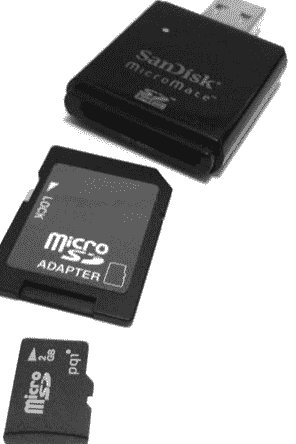

图 6-1：可移动内存卡适配器

在此示例中，所有三项设备都已插入并连接到获取主机。内核检测到了它们并创建了 `/dev/sdg` 块设备：

```bash

# dmesg

...

[6596.394080] usb-storage 3-2:1.0: USB Mass Storage device detected

[6596.394211] scsi host21:2:1.0: usb-storage 3-2:1.0

[6597.392652] scsi 21:0:0:0: Direct-Access SanDisk SDDR-113 1.00 PQ:

  0 ANSI:

[65397.393098] sd 21:00:0:0: Attached scsi sg5 type 0

[65398.073649] sd 21:00:0:0: [sdf] 3911680 512-byte logical blocks: (2.00 GB/1.87 GiB)

[65398.074060] sd 21:00:0:0: [sdf] Write Protect is on...

```

SD 适配器有一个写保护锁，这在 `dmesg` 中是的。在此示例中，使用 `sfsimage` 脚本将 SD 卡镜像到 SquashFS 容器中：

```bash

$ sfsimage -i /dev/sdf MicroSD.dfs

Started: 2016-05-08T11:19:35

sfsimage version: Sfsimage 0.8

sfsimage command: /usr/bin/sfsimage -i /dev/sdf

Current working directory: /home/user

Forensic evidence source: /dev/sdf

Destination squashfs container: MicroSD.dfs

Image filename: image.raw

Acquisition command: dd if=/dev/sdf log=error.txt hash=/dev/null | pv -s 2078160 1.87GiB 02:02:34 [12.8MiB/s] ===================>100%

Completed: 2016-05-08T11:22:10
```


镜像完成后，可以安全地从读卡器中移除内存卡。

## 光盘

不同类型的光介物理和化学属性有所不同，但一旦插入驱动器，它们的相似性大于差异。三种常见的光盘（DVD、CD-ROM 和蓝光）具有 2048 字节的扇区大小，并表现为扇区的线性序列（与磁带不同，但它是螺旋形排列）。主要区别是数据的密度（由设备抽象）和光盘容量。镜像数据盘是简单的，类似于镜像硬盘。这里是使用 `dd` 镜像光盘的示例：

```bash
$ dd if=/cdrom of=cdac.raw

dd 728MB, started at 2016-01-13 23:04:31

compiled options:

command line: dd if=/cdrom of=cdac.raw

device size: 331414 sectors (probed), 678872 bytes

sector size: 2048 bytes (probed)

copied (100%), 142 s, 4.5 MB/s

input results for device '/dev/cdrom':

331414 sectors in

0 bad sectors replaced by zeros

output results for file 'cdac.raw':

331414 sectors out

dd completed at 2016-01-13 23:06:53
```

使用取证工具，你可以分析 `cdac.raw` 镜像文件。紧凑音频盘（CDDA）或音乐 CD 的恢复与数据盘不同。它们包含一组脉冲编码调制（PCM）编码的音乐轨道。与数据 CD 不同，它们对错误有一定的容忍度。由于由于原因，创建了一些工具来恢复 CDDA 并管理驱动器偏移和抖动问题。在此示例中，`cdparanoia` 对 PCM 数据进行原始提取：

```bash
# cdparanoia --output-raw --log-summary cdda.raw

cdparanoia III release 10.2 (September 11, 2008)

Ripping from sector 0 (track 1 [00:00.00]) to sector 251487 (track 15 [4:58.72])

outputting to cdda.raw.

== PROGRESS == | 251487 00 | :=********* *=

Done.
```

此命令将整个 CD 提取为所有音频轨道的原始 PCM 音文件。你可以将此文件导入音频分析软件。由于音频数据没有被修改或重新编码，因此没有质量损失或下降。具有数字权限管理 (DRM) 和区域保护的 DVD 和蓝光盘恢复是一项挑战。书中刻意排除了恢复加密内容的 Linux 工具和说明。

> 7. `cdparanoia` 开发时，CD 驱动器存在比如今的驱动器更多的质量问题。

### 磁带

磁带已基本从家庭环境中消失。但它们仍被用于小型、中型企业环境的备份和存档。在少数情况下，你可能会收到从磁带中恢复数据的请求。例如，在企业取证实验室中，当部门重组或搬迁时，有时会发现旧磁带。历史上，流行的磁带使用 4mm DAT、8mm Exabyte 和 DLT 磁带。今天最常用的类型是 LTO 和 8mm DAT。这些磁带的最大原生/压缩容量为 DAT-320 的 160GB/320GB 以及 LTO-7 的 6TB/15TB。现代 LTO 驱动器还支持加密磁带。

现代磁带通过 SAS 或光纤接口连接到主机系统。历史上，几乎所有的磁带驱动器都遵循 SSC-5 标准（最新）。磁带技术使用它们自己的“文件”约定，这些文件按顺序排列。通常，一个磁带文件由备份软件创建的备份存档组成。磁带文件不像磁盘驱动器那样访问。你通过向前或向后移动到文件编号并读取逻辑块直到文件结束来访问它们。

磁带具有不同的标记，告诉磁带驱动器磁头在磁带上的位置信息（见图 6-2）。这里需要理解的光有趣标记包括：

- BOT 或 BOM（磁带或介质开始）：告诉驱动器从哪里开始写入数据。
- EOF（文件结束）：告诉驱动器一个磁带文件已结束。
- EOD（数据结束）：告诉驱动器已写数据已结束（紧接在最后一个磁带文件之后）。这是磁带的逻辑结束。
- PEOT, EOT 或 EOM（物理物理磁带或介质结束）：告诉驱动器物理磁带长度已结束。

| BOT 文件名 | EOD | EOT |
| --- | --- | --- | --- |
| file 0 | file 1 | ... | file n | 未使用 |

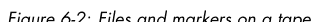

当你出于取证目的获取磁带时，必须将磁带上的每个文件复制到 EOD 标记（磁带上最后一个可读位置）。使用标准的 SCSI 命令无法在磁带上读取 EOD 之后的内容。某些取证公司提供专门的硬件和服务，能够恢复 EOD 之外的数据。

你可以使用 `dd` 变体从磁带中提取文件。在接下来的示例中，从磁带中恢复了三个磁带文件。选择了非回绕的磁带访问设备（在 Linux 上通常为 `/dev/nst0`），以防止驱动器在所有文件拷贝完成之前回绕。重复运行该命令，始终使用相同的输入设备（读取磁带上的下一个文件），直到返回“0+0 records in”，表示所有文件均已提取：

```
# dd if=/dev/nst0 of=file0.tape hashlog=hash0.log

0+46 records in

14+1 records out

# dd if=/dev/nst0 of=file1.tape hashlog=hash1.log

22016 blocks (688MB) written

0+70736 records in

22105+0 records out

# dd if=/dev/nst0 of=file2.tape hashlog=hash2.log

256 blocks (8MB) written

0+14422 records in

450+1 records out

# dd if=/dev/nst0 of=file3.tape hashlog=hash3.log

0+0 records in

0+0 records out
```

磁带文件恢复后，你可以分析文件类型。通常，你可以使用基础文件类型程序来确定使用了哪个归档或备份文件。在此示例中，恢复了两个 `.tar` 文件和一个 `.dump` 文件：

```
# ls -l

total 722260

-RW-r----- 1 root 471040 Jan 14 01:46 file0.tape

-RW-r----- 1 root 72413640 Jan 14 01:46 file1.tape

-RW-r----- 1 root 14766080 Jan 14 01:47 file2.tape

-RW-r----- 1 root 0 Jan 14 01:47 file3.tape

-RW-r----- 1 root 46 Jan 14 01:46 hash0.log

-RW-r----- 1 root 46 Jan 14 01:46 hash1.log

-RW-r----- 1 root 46 Jan 14 01:47 hash2.log

-RW-r----- 1 root 46 Jan 14 01:47 hash3.log
```

```
# file *.tar (GNU)

file0.tape: POSIX tar archive (GNU)

file1.tape: POSIX tar archive (GNU)

file2.tape: new-fs dump file (Little endian), Previous dump Thu Jan 14 01:39:29

2016, This dump Thu Jan 1 01:00:00 1970, Volume 1, Level zero, type: tape

header, label name, Filesystem / (dir etc), Device /dev/sdf1, Host lab-pc,

Flags 3

file3.tape: empty
```

每个 `hash*.log` 文件都包含每个提取出的磁带文件的独立 MD5 哈希值。在此示例中，`file3.tape` 是空的，可以忽略。

## RAID 和多磁盘系统

独立磁盘冗余阵列（RAID）系统的取证获取带来了许多挑战，并可能需要额外的步骤才能完成。容量规划非常重要，因为这可能涉及对大量磁盘镜像。

本节假设 RAID 中的单个磁盘已分别进行镜像，并存在于采集工作站上。目标是组装镜像后的磁盘并使元设备作为文件或块设备可访问，以便你使用取证工具。

通常，RAID 系统会在磁盘开头（有时在磁盘末尾）创建自己的头部信息。该头部用于存储唯一标识符 (UUID)、阵列名称、时间戳、RAID 配置详情以及其他管理信息。

### 私有 RAID 采集

在使用了硬件 RAID 控制器且没有软件可以离线组装 RAID 的情况下，你可能需要克隆 RAID 磁盘并在物理安装控制器的情况下启动检查系统。

本节的示例侧重于 Linux RAID，但有许多开源工具可以支持获取和分析私有 RAID 系统。

例如，以下软件包包含此类工具，并可从 Debian 仓库获取：

- dpt-i2o-raidutils: Adaptec I2O 硬件 RAID 管理工具
- array-info: 用于报告多种 RAID 类型状态的命令行工具
- csis-volstatus: HP SmartArray RAID 卷状态检查器
- cpqarray: HP (Compaq) SmartArray 控制器的监控工具
- dpt-i2o-raidutils: Adaptec I2O 硬件 RAID 管理工具
- mpt-status: 从 mpt（以及其他）硬件控制器获取 RAID 状态的工具
- varmon: VA RAID 监控器

除了这些软件包，`dmraid` 工具能够识别多种私有格式的 RAID 元数据。你可以通过 `-1` 标志查找支持的格式列表，如下：

```
# dmraid -1

asr : Adaptec HostRAID ASR (0,1,10)

ddf1 : SNIA DDF1 (0,1,4,5,linear)

```

hpt3jx : Highpoint HPT3JX (5,0,1,10,01)
hpt4sx : Highpoint HPT4SX (5,0,1,10)
isw : Intel Software RAID (0,1,5)
jmicron : JMicron ATARAID (5,0,1)
lsi : LSI Logic MegaRAID (0,1,10,5)
nvidia : NVIDIA FastTrack (5,0,1,10,5)
pdc : Promise FastTrack (5,0,10)
sil : Silicon Image(tm) Medley(tm) (0,1,10)
via : VIA Software RAID (5,0,10)
dos : SW RAID 上的 DOS 分区

`mdraid` 工具使用了159页“管理驱动故障和错误”（中使用 `dmsetup` 工具）相同的设备映射机制。`mdraid(8)` 手册页提供了组装各种私有 RAID 配置的示例。

### JBOD 和 RAID-0 条列式

磁盘合集（JBOD）是指示一组磁盘已连接在一起的术语。RAID-0 条列式磁盘是为了性能创建的，而不是冗余。RAID-0 配置的磁盘组具有所有驱动器的总容量，磁盘访问分布在阵列中（性能随磁盘的增加而提高）。

如果你知道条列式 RAID-0 阵列的偏移和块大小，`dmset` 工具可以创建一个映射设备来表示组装的阵列。

在以下示例中，一个由两个条列式磁盘组成的 RAID 已连接到采集主机。已知目标 RAID 系统具有 2048 个初始元数据扇，块大小为 128 扇。你可以如下组装 RAID：

```
# dmset create striped --table '0 117243904 striped 2 128 /dev/sda 2048 /dev/sdb 2048'
```

你可以可以使用的文件系统取证工具分析此 `/dev/mapper` 设备。这里使用 Sleuth Kit 的 `fsstat` 命令对新创建设备的示例：

```
# fsstat /dev/mapper/jbod

FILE SYSTEM INFORMATION

----------------

File System Type: Ext4

Volume Name:

Volume ID: cfd74d2abd105b1804380bfd2743b
```

当你需要移除映射设备时，使用 `dmset` 命令将其移除，如下：

```
# dmset remove /dev/mapper/jbod
```

### 微软动态磁盘

微软（Microsoft）创建了逻辑磁盘管理器（LDM）来管理逻辑卷，你可以使用基于 Linux 的工具 `ldmtm` 分析微软动态磁盘。这里的目标是使该卷能够被取证工具进行块级分析。

在示例中，两个带有由微软 LDM 创建的卷的目标磁盘已连接到采集宿主机。它们具有全局标识符（GUID）。你可以扫描磁盘以获取磁盘组 GUID，在使用 `ldmtm` 命令时，这将引导更多关于该磁盘组的信息：

```bash
# ldmtm scan /dev/sda /dev/sdb

[

  "0472fd9b-bac0-11e5-ae3c-c03fd5eab47"

]

# ldmtm show diskgroup 0472fd9b-bac0-11e5-ae3c-c03fd5eab47

{

  "name" : "Lenny-Dg0",

  "guid" : "0472fd9b-bac0-11e5-ae3c-c03fd5eab47",

  "volumes" : ["Volume1"],

  "disks" : ["Disk1", "Disk2"]

}
```

`show` 命令提供了磁盘组名称和 GUID、卷名称以及磁盘名称。这些信息足够创建一个映射设备（mapper device）。

在已知 GUID 和卷名后，你可以创建一个卷设备：

这将在 `/dev/mapper` 中创建一个对应于动态磁盘文件系统的设备（这等同于像 `/dev/sda1` 这样的分区设备）。然后你可以使用常规取证分析工具对该设备进行操作。使用 Sleuth Kit 的 `fsstat` 命令的示例例如：

```bash
# fsstat /dev/mapper/1dm_vol_LENNY-Dg0_Volume1

FILE SYSTEM INFORMATION
```

文件系统类型: NTFS

卷序列号: OCD28FC02D28FAD10
OEM 名称: NTFS
版本: Windows XP

元数据信息

MFT 的第一个簇: 786432
MFT 镜像第一个簇: 2
MFT 条目大小: 1024 字节
索引记录大小: 4096 字节

当你不再需要该设备时，使用 `dmsetup` 命令将其删除，如第 179 页的“JBOD 和 RAID-0 跨区磁盘”所示。

### RAID-1 镜像磁盘

镜像磁盘非常简单，由两个相同的磁盘组成（如果它们是同步的则如此）。将磁盘镜像到单独的文件中。取决于镜像软件或硬件，磁盘的起始扇区可能包含一个头部，你在执行分析工作时需要跳过它。

以下示例显示了包含 EXT4 分区的镜像磁盘。使用的镜像软件（Linux 软件 RAID）使用了前 32,768 个扇区，镜像文件系统从物理磁盘上的该偏移处开始，且对于多设备设备 `md0` 则没有偏移量：

```bash
# fsstat /dev/md0

FILE SYSTEM INFORMATION
```

文件系统类型: Ext4
卷名称:
卷 ID: f45d4s711e6a2db2b4a5e978c60685

```bash
# fsstat -o 32768 /dev/sde

FILE SYSTEM INFORMATION
```

文件系统类型: Ext4
卷名称:
卷 ID: f45d4s711e6a2db2b4a5e978c60685

```bash
# fsstat -o 32768 /dev/sdg

FILE SYSTEM INFORMATION
```

- 9. Linux `md` 驱动程序最初是指镜像设备，某些操作系统称其为元设备（meta devices）。
- 文件系统: Ext4

卷名称:
卷 ID: f45d47511e6a2db2ba4a5e9778c6065

在此示例中，`md0` 上的相同文件系统在两个物理设备（`sde` 和 `sdg`）的 32k 偏移处也被发现。镜像磁盘的加密和可能彼此匹配，因为 RAID 头部信息可能不同（唯一的磁盘 UUID 等），并且磁盘可能没有完全同步。

### Linux RAID-5

如果多个磁盘属于 Linux RAID 阵列，你可以单独采集它们并使用表进行组装。`dmsetup` 工具提供了一个接口，使 `mdadm` 工具能够对已映射或回环（loop）的设备进行操作。在以下示例中，使用了从 Linux MD RAID-5 设置采集的三个镜像。

对单个分区表的 `nmls` 分析显示，每个磁盘镜像（`sda.raw`, `sdb.raw`, `sdc.raw`）的扇区 2048 处有一个 Linux RAID 分区。该扇区偏移（使用 Bash 数学扩展）转换为 `losetup` 命令的字节偏移量：

```bash
# mm sda.raw

DOS 分区表

偏移扇区: 0

单位为 512 字节扇区
```


| 槽 (Slot) | 起始 | 结束 | 长度 | 描述 |
|---|---|---|---|---|
| 00: | Meta | 000000000 | 000000000 | 000000001 | 主表 (#0) |
| 01: | | 000000000 | 0000002047 | | 未分配 |
| 02: | 000000000 | 0000002047 | 000000001 | 数据表 (#1) |
| 03: | 000000000 | 0000002047 | 000000001 | 数据表 (#2) |

- 9. Linux `md` 驱动程序最初是指镜像设备，某些操作系统称其为元设备。
- 文件系统: `Ext4`

卷名称:
卷 ID: `f45d47511e6a2db2ba4a5e9778c6065`

在此示例中，`md0` 上的相同文件系统在两个物理设备（`sde` 和 `sdg`）的 `32k` 偏移处也被发现。镜像磁盘的加密和可能彼此匹配，因为 RAID 头部信息可能不同（唯一的磁盘 UUID 等），并且磁盘可能没有完全同步。

由于多 TB 硬盘的广泛使用，在时间和磁盘容量限制内操纵镜像可能是一项挑战。即使是简单的复制镜像也可能需要几个小时才能完成。你可以通过保持镜像压缩状态来某种程度上缓解这个问题。

在取证背景下，压缩镜像涉及对驱动器进行扇区压缩（而不是压缩磁盘上的每个文件）。在硬盘使用周期内从未被写入过的、具有数 GB 或 TB 空间的驱动器压缩效果更好，因为驱动器的大部分由填充零的未触碰扇区组成。如果硬盘上的大部分扇区在使用寿命内已被分配并仍包含残留数据，则频繁使用的磁盘将无法压缩。包含大量音视频文件的数据镜像压缩效果差，因为这些文件已经使用了自己的算法进行了压缩。

选择最合适且高效的压缩工具和技术非常重要。某些工具对原始源文件或压缩目标可能有大小限制。其他工具可能效率低下，或者在压缩期间使用临时文件，导致空间耗尽或产生磁盘空间。为了解决执行压缩活动时的某些问题，你可以使用管道（`piping`）和重定向（`redirection`）。

处理压缩取证镜像最有用的功能之一是不需要解压缩整个镜像即可使用取证工具。但对于工具来说这是有问题的，因为它们无法在压缩文件中进行寻址（`seek`）。寻址允许对文件的任何点进行随机访问。取证格式的设计允许分析程序对压缩镜像进行即时随机访问。流行的取证格式都支持镜像压缩，这通常发生在采集期间，尽管并非所有工具默认都开启压缩。

# 标准 Linux 压缩工具

当今开源世界中常用的压缩工具有 `gzip`、`zip` 和 `bzip`（版本 1 或 2）。本节中的示例使用 `gzip`，但你也可以使用其他压缩工具。为了以时间和 CPU 周期为代价尝试更好的压缩效果，你可以调整压缩级别。

在磁盘空间足够的情况下，你可以直接在原地压缩磁盘镜像，如下所示：

```
$ gzip image.raw
```

该命令创建文件 `image.raw.gz` 并在完成后删除原始文件。需要有足够的空间让压缩的文件和未压缩的文件在压缩过程中共同共存。使用 `gunzip` 解压缩文件时也是如此。

你还可以使用管道和重定向在采集期间即时压缩镜像。例如：

```
# dcfld if=/dev/sde | gzip > image.raw.gz
```

在这里，输入文件是一个原始磁盘设备。`dcfld` 未指定输出文件会将镜像数据流发送到 `stdout`，然后管道到 `gzip`，最后重定向到一个压缩文件中。压缩后的文件可以被解压缩为原始镜像文件，你可以在上面直接使用取证工具进行操作。或者，你可以通过 `stdout` 和 `stdin` 将压缩流管道到某些程序中。例如：

```
$ zcat image.raw.gz | sha256sum

1b5ab2c61ff8f292ca8840acf95f76fb9d3c1beb73e50697a4fbf42dd0
```

在这里，`zcat` 解压缩镜像并将其管道到程序中以生成 `sha256` 加密哈希。值得注意的是，`gzip` 文件格式包含额外的元数据，例如创建时间戳、原始文件名和其他信息。`gzip` 容器（`image.raw.gz`）的哈希值每次创建时都会不同，尽管内部压缩文件的哈希值是相同的。

# EnCase EWF 压缩格式

`ewfacquire` 工具提供了在采集期间控制压缩的标志。例如：

```
# ewfacase -c bzip2 -f encase-v2 /dev/sdj

ewfacase 20150126
```

| 字段 | 值 |
| :--- | :--- |
| EWF 文件格式 | EnCase 7 (.Ex01) |
| 压缩方法 | bzip2 |
| 压缩级别 | best |
| 数据计算的 MDS 哈希 | 9749f1561dac9ae85ac0e08f4e4272e |
| ewfacquire | SUCCESS |

在这种情况下，`-c` 标志可以指定压缩算法以及压缩级别。在这里，算法是配置为最高压缩级别的 `bzip2`。因为只有 EWv2 格式支持 `bzip2`，所以指定了格式版本 `encase-v2`。注意 `ewftools` 需要带有 `bzip2` 的支持进行编译。

- 1. 编写本文时，`ewfacquire` 的最新版本临时启用了 `bzip2` 支持（参见 `libewf` 软件包中 `ChangeLog` 文件中的 `20160404` 节）。

# FTK SMART 压缩格式

命令行工具 `ftkimager` 支持在采集期间压缩镜像，如下例所示：

```
# ftkimager --compress 9 --s01 /dev/sdj image

AccessData FTK Imager v3.1.1 CLI (Aug 24 2012)

Copyright 2006-2012 AccessData Corp., 384 South 400 West, Lindon, UT 84042

All rights reserved.

Creating image...

Image creation complete.
```

在这里，`--s01` 标志设置了 SMART ew 压缩镜像的创建，`--compress` 标志设置了最高压缩级别。你可以使用 `--help` 标志获取更多信息。

### FTK SMART 压缩格式

命令行工具 `ftkimager` 支持在采集期间压缩镜像，如下例所示：

```
# ftkimager --compress 9 --s01 /dev/sdj image

AccessData FTK Imager v3.1.1 CLI (Aug 24 2012)

Copyright 2006-2012 AccessData Corp., 384 South 400 West, Lindon, UT 84042

All rights reserved.

Creating image...

Image creation complete.
```

在这里，`--s01` 标志设置了 SMART ew 压缩镜像的创建，`--compress` 标志设置了最高压缩级别。你可以使用 `--help` 标志获取更多信息。

### AFF3 内置压缩

尽管 AFF3 已弃用（http://forensics.org/AFF），但这里提到了它的使用。以下示例演示了使用以下工具进行镜像：

```
# dcfld if=/dev/sde | gzip > image.raw.gz
```

- 存储媒体（如磁带、CD 或 DVD）具有固定的最大容量。分卷镜像允许你使用一组此类媒体。
- 某些文件系统（特别是 FAT）的最大文件大小相对较小。

在数字取证中，分卷镜像最常见的用途是证据的传输和存储。在历史上，这是通过将镜像刻录到一组 CD 或 DVD 来的。

## GNU split 命令

标准的 Unix 和 Linux 系统拥有 `split` 工具，用于将一个大文件拆分为若干个小文件。以下示例使用 `split` 命令将镜像拆分为 DVD 大小的分块：

```
$ split -d -b 4G image.raw image.raw

$ ls

image.raw.00 image.raw.01 image.raw.02 image.raw.03 image.raw.04
...
```

> - `-d` 标志指定为 `image.raw` 添加一个数字扩展名（注意末尾的点）；`-b` 标志指定了从 `image.raw` 文件生成的分块大小。

通过在多个工具之间组合管道（`piping`），你可以在采集过程中进行压缩和分卷，以节省时间和空间。这里有一个使用 `dd` 采集镜像、用 `gzip` 压缩并将其拆分为 CD 大小块的单命令示例：

```
# dd if=/dev/sd gzip | split -d -b 640m - image.raw.gz
```

`split` 命令的输入文件为 `-`，表示标准输入（`stdin`），它将压缩后的字节流分成若干部分。需要注意的是，这些部分并没有单独进行 `gzip` 压缩，因此无法单独解压缩。分卷部分在解压缩之前必须重新组装。

## 在采集过程中分卷镜像

你可以在采集过程中将镜像后的硬盘拆分成部分，而不是在日后单独的步骤中进行。在采集大磁盘之前，考虑你未来是否需要分卷镜像，以及什么分段大小最合理。从正确的分卷镜像开始可能会在调查期间节省你的时间和磁盘空间。

分卷镜像在数字取证中很常见，因此得到了取证采集和分析工具的良好支持。通常，可以通过标志设置分段大小并自定义分卷镜像的扩展名。

`dc3dd` 工具提供了内置的分卷功能。例如，如果你以后需要通过一组 16GB 的 USB 闪存盘将镜像传输给第三方，你可以在输出文件之前使用 `split=16g` 标志采集镜像：

```
# dcflddd if=/dev/sdc split=16g of=image.raw

# ls
```


`image.raw.000` `image.raw.001` `image.raw.002` `image.raw.003` `image.raw.004`

...

默认扩展名是附加在输出文件名后的三位数字。
使用 `dc3ddd` 工具，你可以通过 `ofs=` 指定输出大小在采集期间分卷镜像。文件扩展名是数字形式，所示：

```
# dc3ddd if=/dev/sdh ofsz=640M of=image.raw.000
```

```
# ls
total 7733284
-rw-r-- 1 root 67108640 Jan 14 10:59 image.raw.000
-rw-r-- 1 root 67108640 Jan 14 10:59 image.raw.001
-rw-r-- 1 root 67108640 Jan 14 10:59 image.raw.002
...
-rw-r-- 1 root 67108640 Jan 14 11:00 image.raw.009
-rw-r-- 1 root 67108640 Jan 14 11:00 image.raw.010
-rw-r-- 1 root 536870912 Jan 14 11:00 image.raw.011
```

请确保文件扩展名有足够的零，否则 `dc3ddd` 将无法完成并生成错误信息，如 `[!] file extensions exhausted for image.raw.0`。该集合中的最后一个文件通常比其他文件小（除非镜像能被分卷文件大小整除）。
EnCase 工具通常默认在采集期间分卷镜像。你可以使用 `ewfacquire` 并通过 `-s` 标志指定最大段文件大小来采集磁盘并分卷 EnCase 镜像：

```
# ewfacquire -S 2g /dev/sdc
# ls
```

```
image.E01 image.E02 image.E03 image.E04 image.E05 image.E06
```

商业版 EnCase 取证套件可以直接使用这些镜像。`ftkimager` 工具提供了 `--frag` 标志在采集期间将镜像保存为部分，如下所示：

```
# ftkimager /dev/sdk --frag 20GB --s001
AccessData FTK Imager v3.1.1 CLI (Aug 24 2012)
```

Copyright 2006-2012 AccessData Corp., 384 South 400 West, Linden, UT 84042
All rights reserved.

```
# ls -l
total 53771524
-rw-r-- 1 holmes root 214744206 Jan 08:01 image.so01
-rw-r-- 1 holmes root 1038 Jan 08:43 image.so01.txt
-rw-r-- 1 holmes root 214741233 Jan 08:02 image.so02
-rw-r-- 1 holmes root 2147423595 Jan 08:02 image.so03
-rw-r-- 1 holmes root 2147420805 Jan 08:02 image.so04
...
```

采集磁盘时设置分段大小为20GB，格式为 SMART 镜像。注意由 `fimager` 创建的 `*.txt` 文件。

## 访问分卷文件

取证工具（如 Sleuth Kit）支持直接对分卷文件进行操作而无需重组。使用 Sleuth Kit 的 `-i` 标志列出支持的镜像：

```
$ mls -i list
Supported image types:
raw (Single raw file)
aff (Advanced Forensic Format)
afd (AFF Multiple File)
afflib (All AFF formats)
wef (Expert Witness format)
split (Split raw files)
```

在此示例中，支持分卷 raw 镜像（包括分卷文件）、分卷 AFF 镜像和分卷 EnCase 文件（尽管 Sleuth Kit 未明确说明）。在下面的示例中，一个 EWF 镜像被拆分为54 部分。对第一个文件运行 `img_stat` 命令可以获得完整文件集的信息：

```
$ img_stat image.E01
IMAGE FILE INFORMATION
...................
```

| 镜像类型 | 数据大小（字节） | 数据 MD5 哈希 |
| :--- | :--- | :--- |
| ewf | 121332826112 | ce85c1dff287a205f4935 |

使用各种工具可以直接操作分卷镜像。指定第一个文件，大多数 Sleuth Kit 命令都可以处理分卷 raw 文件。最新版本的 Sleuth Kit 会自动检查分卷文件：

```
$ mls image.raw.000
```

早期版本的 Sleuth Kit 可能要求你指定分卷镜像类型：

```
$ fls -o 6 -i split image.000 image.002
```

要检查分卷文件集是否被识别，`img_stat` 命令将显示总字节数，对于 raw 类型，将显示每个部分的偏移范围：

```
$ img_stat image.raw.000
IMAGE FILE INFORMATION
--------------------------------------------
Image Type: raw
Size in bytes: 2003828736
Split Information:
image.raw.000 (0 to 16777215)
image.raw.001 (16777216 to 33554431)
image.raw.002 (33554432 to 50331647)
image.raw.003 (50331648 to 67108863)
image.raw.004 (67108664 to 83886079)
```

另一种确定是否支持分卷的方法是使用 `strace -e open` 运行命令或工具，查看其是否打开了每个分卷部分。分卷文件和处理分卷文件集是有用的，但有时你需要将它们重组为单个镜像。这将在下一节中介绍。

## 重组分卷镜像

通常重组分卷取证格式，因为与特定取证格式（EWF、SMART 或 AFF）兼容的工具支持分卷文件。

由于头部或元数据包含在 raw 镜像中，重组仅仅是将镜像碎片合并为单个镜像的问题。谨慎地执行此操作应该是分步骤的，如下：

```
$ ls -1 image.raw.*
image.raw.000
image.raw.001
image.raw.002
image.raw.003
...
$ cat image.raw.* > image.raw
```

`-1` 标志将列出 shell 通配符识别的文件。在使用将其合并为单个镜像之前，务必确认这是一个完整且有序的列表。如果缺少分卷或文件顺序错误，组装后的部分无法创建正确的镜像。
如果你收到了一叠 DVD，每个都包含一个 raw 镜像碎片，你可以如下重组它们：

```
$ cat /dvd/image.gz.00 > image.raw.gz
$ cat /dvd/image.gz.01 >> image.raw.gz
$ cat /dvd/image.gz.02 >> image.raw.gz
$ cat /dvd/image.gz.03 >> image.raw.gz
...
```

在这里，DVD 被反复插入并挂载到 `/dvd` 上，不断添加分卷部分直到镜像恢复。注意，初始 `cat` 命令中的 `>` 创建镜像文件，而后续命令中的 `>>` 追加数据（而不是覆盖它）。在所有部分都追加到目标文件后，解压缩镜像的加密哈希应与采集期间获取的哈希匹配。
你还可以通过将所有分卷文件管道到 `zcat` 并重定向到文件，从压缩镜像解压缩并组装分卷文件集：

```
$ cat image.raw.* | zcat > image.raw
```

AFFlib 有用方法允许使用 FUSE 文件系统对碎片集进行虚拟重组。`affuse` 工具可以将分卷文件呈现为完全组装的 raw 镜像文件，如下：

```
$ ls
image.raw.000 image.raw.011 image.raw.022 image.raw.033 image.raw.044
image.raw.001 image.raw.012 image.raw.023 image.raw.034 image.raw.045
...
```

```bash
# mount image.raw.000 /mnt
# ls -l /mnt
total 0
-r--r--r-- 1 root 801120640 1970-01-01 01:00 image.raw.000.raw
```

在这里，一个包含原始（raw）文件的目录被表示为一个磁盘镜像，并位于 `/mnt` 虚拟文件系统中。你可以直接使用取证工具对该原始文件进行操作。

## 验证取证镜像的完整性

验证镜像的加密哈希值是执行数字取证的基础，也是保护数字证据的基础。本节提供了验证镜像加密哈希值和签名的示例。

验证证据保护的完整性涉及确认镜像当前的加密哈希值与早些时间点取的哈希值相同。你可以使用哈希来验证磁盘或镜像操作（采集、转换、传输、备份等）是否成功。你也可以用它来验证磁盘或镜像在较长时间内（几个月或几年）未被篡改。

哈希处理的要求（程序和算法）取决于其所属的法律管辖区以及管理取证实验室的组织政策。因此，此处不提供任何哈希建议。

### 验证采集期间产生的哈希

在采集磁盘后，你需要验证采集哈希值，这是一个简单（可能耗时）的任务，即将磁盘内容管道传输到加密哈希程序中。使用不同的程序来验证磁盘哈希值可以提供工具层面的独立验证。例如：

```bash
# img_stat_image.E01
IMAGE FILE INFORMATION
----------------------
Image Type:          ewf
Size of data bytes: 200382736
MDS hash of data:    9749f1561dac9ae85ac008f4e4272e
# dd if=/dev/sdj | md5sum
39137280 records out
9749f1561dac9ae85ac008f4e4272e -
200382736 bytes (2.0 GB) copied, 126.639 s, 15.8 MB/s
```

在这里，`img_stat` 的输出指示了 EnCase 镜像工具记录的 MD5 采集哈希。随后使用第二个工具 regular `dd` 从原始磁盘设备重新计算哈希。在这个示例中，两个 MD5 哈希匹配，确认了证据的完整性得到了保护。

### 重新计算取证镜像的哈希

每种取证格式和基于 `dd` 的取证工具都可以记录或记录磁盘镜像的哈希值。为了验证记录的哈希，你可以重新计算磁盘镜像的哈希。在以下示例中，哈希是在使用 `dc3dd` 期间记录并存储在 `hashlog.txt` 中的。可以通过如下方式验证哈希：

```bash
# grep "md5" hashlog.txt
5de68597f8ad9f20600a453101ffc57 md5
# md5sum image.raw
5de68597f8ad9f20600a453101ffc57 image.raw
```

哈希匹配，确认了证据文件和哈希日志一致，从而表明证据的完整性得到了保护。

以下示例验证了存储在 EnCase 格式元数据中的镜像。在此示例中，使用了专用工具 `ewferify` 来验证哈希：

```bash
# ewferify image.E01
ewferify 20160424
```

验证开始于：2016年5月14日 14:47:32
这可能需要一些时间。
...

文件中存储的 MD5 哈希：
5de68597f8ad9f20600a453101ffc57
数据计算的 MD5 哈希：
5de68597f8ad9f20600a453101ffc57

ewferify: SUCCESS

在这里，重新计算的哈希匹配，确认了 EWF 镜像文件的一致性。该工具将自动验证 EnCase 取证格式中一组分分文件的哈希。
`affinfo` 工具对 AFF 文件执行类似的有效性检查。在此示例中，验证了 SHA1 哈希：

```bash
$ affinfo -5 image.aff
image.aff is A AFF file
```

...
正在验证 SHA1 哈希值。
计算的哈希：9871 0FB5 531E 2ED0 47A7 5BE4 747E 68C1 BDB0
存储的哈希：9871 0FB5 531E 2ED0 47A7 5BE4 747E 68C1 BDB0 MATCH

此输出确认了 AFF 文件内部镜像的哈希与 AFF 元数据中记录的哈希相同。

### 分卷原始镜像的加密哈希

计算一组分卷原始文件的加密哈希是简单的，你可以通过将合并的部分管道传输到哈希程序来实现。此示例计算了组分卷原始文件的 sha256 哈希：

```bash
$ cat image.raw.* | sha256sum
12efaf4b2601e3b06d732a341753fd8d6e99b02105ba54dd3635a2d
```

此示例假设部分按正确顺序排序（可以使用 `ls image.raw.*` 验证）。这里的 `cat` 命令是必要的，因为它在 `sha256` 之前合并了所有部分。

你可以通过构建多个程序的管道来验证已压缩并分卷的镜像加密哈希。在以下示例中，`cat` 合并镜像并将其交给 `zcat` 进行解压缩。`zcat` 的输出发送到哈希程序：

```bash
$ cat image.raw.*gz | zcat | md5sum
9749f1561dac9ae85ac008f4e4272e
```

在这里 `cat` 命令是必要的，因为它在传递给 `zcat` 之前合并了所有分卷。使用 `zcat image.raw.*` 将失败，因为它会尝试解压缩每个部分而不是合并后的镜像。可以使用 shell 重定向。

### 识别不匹配的哈希窗口

指定的哈希窗口决定了在采集磁盘或比较两个哈希列表时写入新哈希的频率。要找到不匹配区域，可以使用 `diff` 工具比较两个哈希日志。

在以下示例中，使用 `dc3dd` 对磁盘镜像并保存了带有 10M 哈希窗口的哈希日志。随后的验证未能匹配整个磁盘的 MD5，另一个带有 10M 哈希窗口的新哈希日志：

```bash
$ diff hash1.log hash2.log
3c3
-- 20971520 - 31457280: b587779d76eac571e23492f56e
-- 20971520 - 31457280: cf64f53ea453210a3fd83ffad151d9c13
< Total (md5): 974f9f5613dc9e85ac008f4e4272e
> Total (md5): f2e1a944dd8027cb87aa5
```

此输出显示了完整镜像的哈希不匹配，20971520 到 31457280 之间的字节范围。通过 512 字节扇区大小除除，可以识别出发生哈希不匹配的扇区范围（40960 到 61440）。磁盘其余部分的哈希仍然良好；具有哈希不匹配的扇区内容（块、文件、部分等）可以在后续阶段从证据中排除。如果完整镜像的两个加密哈希匹配，可以认为所有哈希都是匹配的。

取证镜像的加密哈希保护了采集证据的完整性。然而，哈希值无法防止恶意或意外修改。可以使用加密签名和时间戳来保护计算哈希的完整性。签名和时间戳有效性的确认见下一节。

## 验证签名和时间戳

上一章演示了使用 GnuPG 对磁盘哈希进行签名。你可以在没有签名密钥的情况下验证签名。不需要签署证据的原人；只需要他们的公钥。此示例验证了签署采集磁盘的 gpg 签名：

```bash
$ gpg < hash.asc
dc3dd 7.2.641 started at 2016-05-07 17:23:49 +0200
compiled options:
command line: dc3dd if=/dev/sda of=image.raw of=image.000 fs=1G hlog=hash.nhash=md5
input results for device '/dev/sda':
5de68597f8adf9f20600a453101f2c57 (md5)
...dc3dd completed at 2016-05-07 17:25:40+0200

pgp: Message made Sat 07 May 2016 17:29:44 CEST using RSA key ID CF878568
pgp: Good signature from "Sherlock Holmes <holmes@digitalforensics.ch>"
```

在这里，签名消息的内容（采集输出和哈希）带有 gpg 消息显示签名有效。

对于 S/MIME 签名消息，类似的命令将验证 PEM 文件中的签名（或使其失效），格式如下：

```bash
$ gpg --verify image.log
gpg: signature 2016-01-25 19:49:42 using certificate ID 0xFFFFFFABCD1234
gpg: Good signature from "Sherlock Holmes <holmes@digitalforensics.ch>"
gpg: aka "holmes@digitalforensics.ch"
```

第 6 章讨论了使用时间戳服务为时间戳权威生成 RFC-3161 时间戳。验证时间戳与使用 S/MIME 验证签名类似，需要安装正确的证书机构（CA）证书链才能成功验证。此示例验证了之前使用 FreeTSA (http://freetsa.org/) 创建的时间戳。


如果时间戳服务的 CA 证书未安装在系统中，可以手动获取。在发出请求时（因为使用了 `-cert` 参数），TSA 证书应该作为时间戳的一部分返回。例如，从 FreeTSA 获取 CA 证书：

```bash
$ cacert http://freetsa.org/files/cacert.pem
```

假设 OpenSSL 可用 CA 和 TSA 证书，你可以如下所示验证时间戳：

```bash
$ openssl ts -verify -in hash.log.tsr -queryfile hash.log.tsr -CAfile cacert.pem
Verification: OK
```

自指定时间以来。如果预计永久使用特定的时间戳权威，你可以将 CA 证书添加到操作系统的受信任 CA 存储中。

`AFFlib` 还提供了使用 X.509 证书对获取的镜像进行签名和验证签名的功能。本节未讨论信任用于签名镜像和验证时间戳密钥所需的信任网（web-of-trust）或公钥基础设施（PKI）。示例假设这种信任已经建立。

## 在镜像格式之间转换

出于各种原因，在取证镜像格式之间进行转换是有益的。如果实验室有了新的软件或基础设施，而当前格式不受支持或效率较低，转换为另一种格式可能是一个选择。如果你正在将镜像传输给第三方，他们可能有偏好的镜像格式。如果你从第三方那里接收镜像，你可能想将其转换为你偏好的格式。本节提供了在命令行上进行格式间转换的示例。展示了从几种源格式的转换，包括 EnCase、FTK、`AFF` 和 `raw`。此外，示例还演示了将各种格式转换为 SquashFS 容器。

当你在镜像格式之间进行转换时，最好使用管道和重定向。避免使用临时文件的工具。在转换过程中，可能会的两个副本可能会同时存在（其中一个可能是压缩的）。为转换过程做准备，请进行一些容量规划。

转换后，检查原始镜像和目的地的哈希值是否匹配。

### 从 Raw 镜像转换

将 `raw` 镜像转换为其他格式通常非常简单，因为可以使用标准的磁盘映像功能。使用 `raw` 镜像的文件而不是 `raw` 设备名称。

以下示例显示了将 `raw` 镜像文件转换为 EnCase 和 FTK 格式。第一个示例使用 `ewfacquire image.raw` 转换为 EnCase Expert witness 格式：

```
$ ewfacquire image.raw -t image -f encase7
ewfacquire 20160424
```

存储媒体信息：

- 类型：RAW 镜像
- 媒体大小：7.9 GB (7918845952 bytes)
- 每扇区字节数：512

所需的获取参数，请提供必要的输入

案件编号：42

描述：丢失的红色订书器案件

证据编号：1

检查员姓名：S. Holmes

备注：在现场发现了这个红色 U 盘

...

获取完成于：2016年5月14日 15:03:40

写入：7.3 GiB (7918864140 bytes)，耗时 54 秒，速度为 139 MiB/s (146645298 bytes/second)

数据计算了 5 个哈希：5dfe68597f8ad9f2060a453101f2c57

ewfacquire: SUCCESS

指定的源文件是 `raw` 镜像；`-t` 是 EnCase 字符的基础名称，指定了 EnCase 版本 7，当执行命令时，会询问一系列问题。由于 `raw` 文件没有案件元数据，你需要手动输入。

从 `raw` 镜像转换为 FTK SMART 类似：你指定 `raw` 镜像为源并手动添加案件元数据。使用 `fikimage`，你在命令行上指定元数据，如此示例所示：

```
$ ftkimager image.raw --s01 --case-number 1 --evidence-number 1 --description
"The case of the missing red stapler" --examiner "S. Holmes" --notes "This USB stick was found at the scene"
```

AccessData FTK Imager v3.1.1 CLI (Aug 24 2022)

Copyright 2006-2012 AccessData Corp., 384 South 400 West, London, IT 84042

保留所有权利。

创建镜像...

镜像创建完成。

`--s01` 标志指定将创建一个 SMART 压缩镜像。

文件名简单指定为 `image`，并将自动添加适当的文件扩展名。

将镜像转换为 SquashFS 取证容器如果使用 `sfsvimage` 命令也是一个简单的命令，如下：

```
$ sfsvimage -i image.raw image.sfs
Started: 2016-05-14T15:14:13
sfsvimage version: Sfsvimage Version 0.8
sfsvimage command: /usr/bin/sfvimage -i image.raw
Current working directory: /exam/exam/image
Forensic evidence source: if=/image.raw
Destination squashfs container: image.sfs
Image filename inside: image.raw
Aquisition command: sudo dd if=/exam/image.raw log=errorlog.txt hash=log.txt
hash-md5 2>/dev/null | -s 7918845952
```

7.38GB 0:00:22 [ 39MiB/s ] [==================================>] 100%

Completed: 2016-05-14T15:14:37

在这里，`raw` 镜像文件与目标 SquashFS 容器文件名一起指定。`sfsimage` 脚本构建了所需的 SquashFS 伪设备并为普通文本文件了日志和哈希信息。你可以手动向证据容器添加额外的元数据（使用 `sfsimage -a`）。

你无法直接使用典型工具访问压缩镜像，因为无法寻道其中的任何块。最好将此类文件转换为可搜索格式。在本示例中：

```
$ sfsvimage -i image.raw image.sfs
Started: 2016-05-14T15:14:13
sfsvimage version: Sfsvimage Version 0.8
sfsvimage command: /usr/bin/sfvimage -i image.raw
Current working directory: /exam/exam/image
Forensic evidence source: if=/image.raw
Destination squashfs container: image.sfs
Image filename inside: image.raw
Aquisition command: sudo dd if=/exam/image.raw log=errorlog.txt hash=log.txt
hash-md5 2>/dev/null | -s 7918845952
```

在这里，`raw` 镜像文件与目标 SquashFS 容器文件名一起指定。`sfsimage` 脚本构建了所需的 SquashFS 伪设备并为普通文本文件了日志和哈希信息。你可以手动向证据容器添加额外的元数据（使用 `sfsimage -a`）。

你无法直接使用典型工具访问压缩镜像，因为无法寻道其中的任何块。最好将此类文件转换为可搜索格式。

`image.E07` `image.E16` `image.E25` `image.E34` `image.E43` `image.E52`

`image.E08` `image.E17` `image.E26` `image.E35` `image.E44` `image.E53`

`image.E09` `image.E18` `image.E27` `image.E36` `image.E45` `image.E54`

开始之前，你需要一个 `mksquashfs` 伪定义来定义在 SquashFS 容器内部创建文件的命令。伪定义文件包含目标文件名、文件类型、权限、所有者以及要执行的命令。该命令的输出将成为定义的定义文件即 SquashFS 文件系统的内容。

在以下示例中，创建了一个名为 `pseudo_files.txt` 的文件，包含两个定义。第一个定义使用 `ewinfo` 提取 EnCase 元数据并将其放入 `image.txt` 中（如果不这样做，这些元数据将会丢失）。第二个定义将 `*.EO` 文件中的原始镜像导出到 `image.raw`。

```
# cat pseudo_files.txt
image.txt f 44 root ewinfo image.E01
image.raw f 44 root ewfexport -u -t - image.E01
```

`ewfexport` 标志 `-u` 允许转换无人值执行（否则它会向用户提示问题）。`-t` 标志指定目标，在本示例中目标是 `stdout` 或横杠 `-`。

使用该文件，你可以创建一个包含生成文件的压缩文件系统：

```
# mksquashfs pseudo_files.txt image.sfs -pf pseudo_files.txt
Parallel msquashfs: Using 12 processors
Creating 4.0 filesystem on image.sfs, block size 131072.
ewfexport 20160424
```

导出开始于：2016年5月12日 19:09:42

这可能需要一些时间。

...

导出完成于：2016年5月12日 19:28:56

写入 113 GiB (121332826112 bytes) 耗时 19 分 14 秒，速度为 100 MiB/s (105141097 bytes/second)

数据的 MDS 哈希：

0832e2310da559a2b359d48dbc451591

ewfexport: SUCCESS

...

文件系统大小 62068754.40 Kbytes (60614.02 MBytes)

52.38% 的未压缩文件系统大小 (118492706 Kbytes)

生成的生成的 SquashFS 文件系统 `image.sfs` 包含三个文件：原始镜像 `image.raw`、包含元数据的 `image.txt` 以及包含执行命令的 `pseudo_files.txt` 文件。

`mksquashfs` 手页提供了关于创建 SquashFS 文件系统的更多标志和选项。

你可以使用 `unsquashfs` 命令查看 SquashFS 文件的内容：

```
# mksquashfs -lls image.sfs
...
-R--I--R-- root/root      121332826112 2016-05-12 19:09 squashfs-root/image.raw
-R--I--R-- root/root      770 2016-05-12 19:09 squashfs-root/image.txt
-rw-w---- root/root      98 2016-05-12 16:58 squashfs-root
pseudo_files.txt
```

最后一步是通过比较 MD5 哈希值来验证证据。`ewinfo` 命令提供了在 EnCase 获取期间计算的 MD5 哈希。可以使用 `md5sum` 对 SquashFS 容器内新转换的原始镜像计算第二个 MD5 哈希。要这样做，你需要首先挂载 SquashFS 文件系统。以下示例显示了这些步骤：

```
# ewinfo.e01
ewfinfo 20160424
```

哈希信息

MD5:

083e2131d0a59ae3b594d8bc4151

```
# mkdir image.sfs.d; mount image.sfs image.sfs.d
# md5sum image.sfs.d/image.raw
083e2131d0a59ae3b594d8bc4151 image.sfs.d/image.raw
```

结果显示两个 MD5 哈希匹配，成功保留了从 EnCase 到 SquashFS 容器内的原始镜像转换。第三个匹配的 MD5 哈希可以在转换过程中 `ewexport` 输出中看到。`ewexport` 工具也可以导出到其他 EnCase 格式。当挂载的 SquashFS 文件系统 `image.sfs.d` 不再需要时，可以使用 `unmount image.sfs.d`。`fsimage` 脚本为你管理这些步骤。

### 从 EnCase 转换文件

`ftkimager` 工具可以从 EnCase 转换为 FTK。在本示例中，一组 EnCase e01 文件被转换为相同名称但扩展名为 s01 的 FTK 压缩文件：

```
# ftkimager.e01 image --s01
AccessData FTK Imager v3.1.1 (Aug 24 2012)
Copyright 2006-2012 AccessData Corp., 384 South 400 West, London, UT 84042
All rights reserved.
```

创建镜像...

镜像创建完成。

哈希已检查并添加到新的 FTK 文件中。案件元数据没有添加到新转换的文件中，而是从原始格式提取并保存为扩展名为 `.txt` 的独立文件（`image.s01.txt`）。

### 从 FTK 转换

命令行工具 `ftkimager` 在 EnCase 和 FTK 格式之间转换，并允许你使用 `stdin` 和 `stdout` 进行转换。在本示例中，一组压缩 FTK s01 文件被添加到 EnCase 格式：

```
# ftkimager s01 image --e01
AccessData FTK Imager v3.1.1 (Aug 24 2012)
Copyright 2006-2012 AccessData Corp., 384 South 400 West, London, UT 84042
All rights reserved.
```

创建镜像...

镜像创建完成。

案件元数据没有传输到新格式，而是自动保存到独立文件（`image.e01.txt`）。`ftkimager` 可以将 s01 文件转换为 `stdout`，你可以将其重定向到原始镜像文件或将其管道到其他程序。在本示例中，一组 FTK 文件通过 `ftkimager` 输出管道到 `sfsimage` 转换为 SquashFS 取证容器：

```
# ftkimager s01 - | sfsimage -i image.sfs
Started: 2016-05-14T19:59:13
sfsimage version: Sfsimage 0.8
sfsimage command: /usr/bin/sfsimage -
Current working directory: /exam
Forensic evidence source:
Destination squashfs container: image.sfs
Image filename inside container: image.raw
Acquisition command: sudo dc33dd log=error.txt hash=hashlog.txt hash=md5
2>/dev/null | pv -s 0
AccessData FTK Imager v3.1.1 (Aug 24 2012)
Copyright 2006-2012 AccessData Corp., 384 South 400 West, London, UT 84042
All rights reserved.
```

```
14.5GB 0:01:37 [ 151MiB/s ]
Completed: 2016-05-14T20:00:51
```

# sfsisimage -a s01.txt image.sfs

附加到 image.sfs  4.0 文件系统，块大小 131072

当你从 FTK 格式转换为原始磁盘镜像时，案件元数据不会被传输。你需要手动保存案件元数据，它通常位于单独的文件中。你可以像上一个示例中使用 `sfsisimage -a` 命令所示将其添加到 SquashFS 容器中。

在执行任何类型的格式转换后，你都应该在目标格式上单独验证哈希值，以确保证据的完整性得到了保留。

### 从 AFF 格式转换

`affconvert` 工具可以将 AFF 镜像转换为原始镜像（从原始镜像转换为 AFF 格式）。`affconvert` 工具不使用 `stdin` 或 `stdout`；相反，它读取或创建独立的 `.aff` 文件。以下简单示例显示了将一个 AFF 文件转换为原始镜像：

```
$ affconvert -r image.aff
convert image.aff --> image.raw
Converting page 96 of 96
bytes converted: 162570240
Conversion finished.
```

将原始镜像转换为 AFF 格式，只需使用 `affconvert image.raw`，相应的 `.aff` 文件将被创建。要使用管道和重定向处理 AFF 文件，可以使用 `affcat` 工具。上一个示例也可以通过 `affcat` 重定向到文件（不带任何状态或完成信息），如下所示：

```
$ affcat image.aff > image.raw
```

将 AFF 镜像转换为 EnCase 或 FTK，`affcat` 工具可以通过 `stdout` 或 `stdin` 管道到相应的工具创建所需的镜像。例如，你可以从 AFF 转换为压缩 FTK 镜像：


```
$ affcat image.aff | ftkimager image --s01
AccessData FTK Imager v3.1.1 (Aug 24 2012)
Copyright 2006-2012 AccessData Corp., 384 South 400 West, London, UT 84042
All rights reserved.
```

创建镜像...

镜像创建完成。

在这里，`-` 代表 `stdin` 文件描述符，接收原始镜像数据，文件名，最后的标志 `--s01` 指定压缩格式。同样，你可以使用 `ewfstream` 转换为各种 EnCase 格式。例如：

```
$ affcat image.aff -C 42 -E 1 -e "S.Holmes" -D "Data theft"
ewfstream 20160424
```

使用以下获取参数：

`ewinfo.e01`

摘要哈希信息

MD5:

`083e2131d0a59ae3b594d8bc4151`

```
# mkdir image.sfs.d; mount image.sfs image.sfs.d
# md5sum image.sfs.d/image.raw
083e2131d0a59ae3b594d8bc4151 image.sfs.d/image.raw
```

结果显示两个 MD5 哈希匹配，成功保留了从 EnCase 到 SquashFS 容器内的原始镜像。第三个匹配的 MD5 哈希可以在转换过程中 `ewexport` 输出中看到。`ewexport` 工具也可以导出到其他 EnCase 格式。当挂载的 SquashFS 文件系统 `image.sfs.d` 不再需要时，可以使用 `unmount image.sfs.d`。`fsimage` 脚本为你管理这些步骤。

## 从 EnCase 转换文件

`ftkimager` 工具可以从 EnCase 转换为 FTK。在本示例中，一组 EnCase e01 文件被转换为相同名称但扩展名为 s01 的 FTK 压缩文件：

```
# ftkimager.e01 image --s01
AccessData FTK Imager v3.1.1 (Aug 24 2012)
Copyright 2006-2012 AccessData Corp., 384 South 400 West, London, UT 84042
All rights reserved.
```

创建镜像...

镜像创建完成。

哈希已检查并添加到新的 FTK 文件中。案件元数据没有添加到新转换的文件中，而是从原始格式提取并保存为扩展名为 .txt 的独立文件（`image.s01.txt`）。

## 从 FTK 转换

命令行工具 `ftkimager` 在 EnCase 和 FTK 格式之间转换，并允许你使用 `stdin` 和 `stdout` 进行转换。在本示例中，一组压缩 FTK s01 文件被添加到 EnCase 格式：

```
# ftkimager s01 image --e01
AccessData FTK Imager v3.1.1 (Aug 24 2012)
Copyright 2006-2012 AccessData Corp., 384 South 400 West, London, UT 84042
All rights reserved.
```

创建镜像...

镜像创建完成。

案件元数据没有传输到新格式，而是自动保存到独立文件（`image.e01.txt`）。`ftkimager` 可以将 s01 文件转换为 `stdout`，你可以将其重定向到原始镜像文件或将其管道到其他程序。在本示例中，一组 FTK 文件通过 `ftkimager` 输出管道到 `sfsimage` 转换为 SquashFS 取证容器：

```
# ftkimager s01 - | sfsimage -i image.sfs
Started: 2016-05-14T19:59:13
sfsimage version: Sfsimage 0.8
sfsimage command: /usr/bin/sfsimage -
Current working directory: /exam
Forensic evidence source:
Destination squashfs container: image.sfs
Image filename inside container: image.raw
Acquisition command: sudo dc33dd log=error.txt hash=hashlog.txt hash=md5
2>/dev/null | pv -s 0
AccessData FTK Imager v3.1.1 (Aug 24 2012)
Copyright 2006-2012 AccessData Corp., 384 South 400 West, London, UT 84042
All rights reserved.
```

```
14.5GB 0:01:37 [ 151MiB/s ]
Completed: 2016-05-14T20:00:51
```

```
# sfsisimage -a s01.txt image.sfs
```

附加到 `image.sfs` 4.0 文件系统，块大小 131072

当你从 FTK 格式转换为原始磁盘镜像时，案件元数据不会被传输。你需要手动保存案件元数据，它通常位于单独的文件中。你可以像上一个示例中使用 `sfsisimage -a` 命令所示将其添加到 SquashFS 容器中。

在执行任何类型的格式转换后，你都应该在目标格式上单独验证哈希值，以确保证据的完整性得到了保留。

## 从 AFF 格式转换

`affconvert` 工具可以将 AFF 镜像转换为原始镜像（从原始镜像转换为 AFF 格式）。`affconvert` 工具不使用 `stdin` 或 `stdout`；相反，它读取或创建独立的 `.aff` 文件。以下简单示例显示了将一个 AFF 文件转换为原始镜像：

```
$ affconvert -r image.aff
convert image.aff --> image.raw
Converting page 96 of 96
bytes converted: 162570240
Conversion finished.
```

将原始镜像转换为 AFF 格式，只需使用 `affconvert image.raw`，相应的 `.aff` 文件将被创建。要使用管道和重定向处理 AFF 文件，可以使用 `affcat` 工具。上一个示例也可以通过 `affcat` 重定向到文件（不带任何状态或完成信息），如下所示：

```
$ affcat image.aff > image.raw
```

将 AFF 镜像转换为 EnCase 或 FTK，`affcat` 工具可以通过 `stdout` 或 `stdin` 管道到相应的工具创建所需的镜像。例如，你可以从 AFF 转换为压缩 FTK 镜像：

```
$ affcat image.aff | ftkimager image --s01
AccessData FTK Imager v3.1.1 (Aug 24 2012)
Copyright 2006-2012 AccessData Corp., 384 South 400 West, London, UT 84042
All rights reserved.
```

创建镜像...

镜像创建完成。

在这里，`-` 代表 `stdin` 文件描述符，接收原始镜像数据，文件名，以及最后的标志 `--s01` 指定压缩格式。同样，你可以使用 `ewfstream` 转换为各种 EnCase 格式。例如：

```
$ affcat image.aff -C 42 -E 1 -e "S.Holmes" -D "Data theft"
ewfstream 20160424
```

使用以下获取参数：

`ewinfo.e01`

摘要哈希信息

MD5:

`083e2131d0a59ae3b594d8bc4151`

```
# mkdir image.sfs.d; mount image.sfs image.sfs.d
# md5sum image.sfs.d/image.raw
083e2131d0a59ae3b594d8bc4151 image.sfs.d/image.raw
```

结果显示两个 MD5 哈希匹配，成功保留了从 EnCase 到 SquashFS 容器内的原始镜像。第三个匹配的 MD5 哈希可以在转换过程中 `ewexport` 输出中看到。`ewexport` 工具也可以导出到其他 EnCase 格式。当挂载的 SquashFS 文件系统 `image.sfs.d` 不再需要时，可以使用 `unmount image.sfs.d`。`fsimage` 脚本为你管理这些步骤。

你可以使用 `affindo` 从 AFF 文件中提取元数据，然后按照如下方式将其添加到 SquashFS 取证证据证容器中：

```
$ affindo image.aff > affinfo.txt
$ sfimage -a affinfo.txt image.sfs
```

追加到 `image.sfs` 上现有的 4.0 文件系统，块大小为 131072

一旦镜像完成转换，请对比原始文件和目标文件的值以确保它们匹配。

## 使用加密保护镜像

数字取证中一个重要但经常被忽视的组件是安全性的。你应当将调查期间获取和提取的信息视为敏感信息，并对其的安全性进行充分保护。

数据机密性的丢失可能会导致意想不到的后果。例如，它可能会违反组织政策要求、危及法律和合规性、引发受害者的隐私问题，并损害调查组织的声誉。未能充分保护获取的证据可能会导致任何相关方的受损，包括调查人员及其雇主、受害者、被告以及其他参与方。泄露的信息还可能干扰或破坏正在进行的调查。

本节侧重于确保信息受到保护的方法，并在数据传输和存储（长期和短期存储）期间维持安全性。为镜像添加加密会增加加密和解密镜像的复杂性和所需时间，但在这里看到的示例将尝试使这一过程尽可能简单有效。使用了基础对称加密，而不是更复杂的 PKI 或信任网系统。

在本节所示的方法外，还可以使用 ZIP 归格式进行加密。带有 ZIP64 扩展的新版本支持大于 4GB 的分区文件。ZIP 的优点是与 Windows 等其他平台具有高兼容性。

### GPG 加密

使用对称加密，你可以轻松对磁盘镜像进行加密，以保护其通过网络传输或存储。GNU Privacy Guard (`GPG`) 提供了 RFC-4880 定义的 OpenPGP 标准的免费实现。它是 Phil Zimmermann 在 20 世纪 90 年代初创建传统 PGP 加密的替代方案。

在使用 GPG 时，启动代理是有用的（使用 `gpg2` 时会自动启动）。这通常在登录时通过以下命令完成：

```
$ eval $(gpg-agent --daemon)
```

在后续的所有示例中，均使用 `-v` 标志来增加详细性。这使得输出对于文档目的更有用（包括本书中的步骤以及用于创建描述所采取步骤的取证报告）。

使用 GPG 加密现有镜像非常简单，如下所示：

```
$ gpg -cv image.raw
gpg: using cipher AES
gpg: writing to `image.raw.gpg'
Enter passphrase: 
```

系统会要求输入密码，并使用默认对称加密算法对镜像进行加密，创建一个扩展名为 `.gpg` 的新文件。

镜像的大小更小是因为 GPG 对其进行了压缩和加密。

如下所示：

```
$ ls -1h
total 1.2G
-r--r--r-- 1 holmes 1.9G May 14 15:56 image.raw
-rw-r--r-- 1 holmes 603M May 14 15:57 image.raw.gpg
```

上上所示，但你也可以在采集期间进行加密：

```
$ sudo dc3dd if=/dev/sde | gpg -cv > image.raw.gpg
Enter passphrase:
gpg: using cipher AES
gpg: writing to stdout
241664 blocks (7552MB) written.
241664+ records in
241664+ records out
```

在这里，`dc3dd` 通过 `/dev/sde` 获取附加磁盘并直接管道至 GPG 程序。GPG 的加密输出被重定向到文件。`sudo` 命令提升了权限到 root 以读取原始设备。

解密 GPG 加密镜像与加密一样简单。

唯一的区别在于使用解密标志以及需要指定输出文件（默认输出到 `stdout`）。在以下示例中，一个 GPG 加密镜像文件被解密为普通（未受保护）文件：

```
$ gpg -dv -o image.raw image.raw.gpg
gpg: AES encrypted data
Enter passphrase:
gpg: encrypted with 1 passphrase
gpg: original file name='image.raw'
```

此示例演示了没有签名的对称加密。你也可以 GPG 公钥和私钥对镜像进行加密、解密和签名。通过比较 GPG 加密镜像的哈希值与原始镜像的哈希值来验证完整性，如下所示：

```
$ gpg -dv image.raw.gpg | md5sum
gpg: AES encrypted data
Enter passphrase: 
gpg: encrypted with 1 passphrase
gpg: original file name='image.raw'
5de685978ad9f2060045310f2fc57
$ md5sum image.raw
5de685978ad9f2060045310f2fc57
```

在命令参数中包含密码通常是一个糟糕的做法。密码在 shell 历史记录中可见，任何人都可以在进程表中查看密码。

尝试在没有密码或使用错误密码的情况下访问加密镜像，将生成以下错误消息：

- 源已加密；请提供解密凭据。

- 解密失败。

对加密镜像进行操作需要在需要在命令行中包含密码，如下所示：

```
# ftkimager --inpass monkey99 image.E01 - > image.raw
AccessData FTK Imager v3.1.1 CLI (Aug 24 2012)
Copyright 2006-2012 AccessData Corp., 384 South 400 West, London, UT 84042
All rights reserved.
```

某些版本的 EWF 格式支持加密，且在编写本文时，`libwf` 处于不同的开发阶段。请参考最新的源代码以获取对当前加密格式的支持。

AFFlib 套件允许您通过高级取证格式 (`AFF`) 库直接访问加密镜像。从一开始开始，AFFlib 的开发就考虑了信息安全。它提供了多种保护取证镜像的加密可能性，包括基于密码（对称）和基于证书（X.509）的加密。您可以使用 `affcrypto` 工具为获取的镜像添加保护。以下是一个示例：

```
# affcrypto -e -N monkey99 image.aff
image.aff: 967 segments; 0 signed; 967 encrypted; 0 pages;
0 encrypted pages
```

最近版本的 `dd_rescue` 实现了插件接口，并且（在编写本文时）拥有用于 LZO 压缩、加密哈希和对称加密 (`AES`) 的插件。以下示例展示了对磁盘 (`/dev/sdc`) 镜像并使用 AES 插件将输出保存为加密格式：

```
# dd_rescue -L crypt-enc:passfd=0pbkdf2 /dev/sdc samsung.raw.aes
dd_rescue: (info): Using softbs=128KiB, hardbs=4KiB
dd_rescue: (Input): crypt(0): Enter passphrase:
dd_rescue: (warning): some don't handle sparse, enabled -A/-nosparse!
dd_rescue: (info): expecting to copy 152689094.0KiB xfer from /dev/sdc
dd_rescue: (info): crypt(0): Derived salt from samsung.raw.aes=0000002543360000
dd_rescue: (info): crypt(0): Generate KEY and IV from some password/salt
dd_rescue: (info): pos: 152689096.0KiB, info: 152689096.0KiB, xfer: 152689096.0KiB
		errs: 0, xfer.rate: 56830KB/s, avg.rate: 14.9%
```

```
> dd_rescue: (info): read /dev/sdc (15629094.0KiB): EOF\99% ETA: 0:00:00
dd_rescue: (info): Summary for /dev/sdc ~ samsung.raw.aes
dd_rescue: (info): ipos: 15629094.0, opos: 15629094.0, xferd: 15629094.0
errs: 0, errxfer: 0.0k, succerr:
+curr.rate: 29345KB/s, avg.rate: 56775KB/s, avg.load: 14.9%
------------------------------------------------------ 100% TOT: 0:45:53
```

如果取证实验室的调查人员需要对镜像和证据进行大量的加密、签名和时间戳标记，那么值得投入 PKI。这可以是内部 PKI 系统，也可以是外部商业 PKI 服务。

## 通用磁盘加密


之前章节中的示例重点关注保护单个文件或文件容器。另一种方法是保护镜像文件所在的整个驱动器。您可以通过文件系统加密、硬件、用户空间或内核来实现。您将在节中看到几个示例。

市场上上有高容量的安全外部硬盘，可以安全地传输镜像文件，例如联想的 ThinkPad 安全硬盘，其中一个如图 7-1 所示。这些硬盘独立于操作系统，并通过在物理键盘设备上输入的密码来加密硬盘内容。

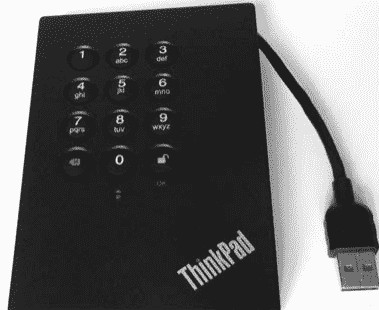

图 7-1：ThinkPad 安全硬盘

`TrueCrypt` 曾是最流行的免费跨平台文件系统软件。但在 2014 年 5 月，开发者发布了一个意料且无法解释的公告，建议人们寻找 `TrueCrypt` 的替代品，因为开发已停止。这产生了许多分支和兼容项目，其中几个列在此处：

- `VeraCrypt`: https://veracrypt.codplex.com/
- `tc-play`: https://github.com/bwalex/tc-play/
- `Cipher`: https://github.com/bwalex/tc-play/
- `Cipherhed`: https://ciphhed.org/
- `zuluCrypt`: https://zong.io/

`AFFlib` 套件允许您通过高级取证格式 `AFF` 库直接访问加密镜像。从一开始开始，`AFFlib` 的开发就考虑了信息安全。它提供了多种保护取证镜像的加密可能性，包括基于密码（对称）和基于证书（`X.509`）的加密。您可以使用 `affcrypto` 工具为获取的镜像添加保护。以下是一个示例：

```
# affcrypto -e -N monkey99 image.aff
image.aff: 967 segments; 0 signed; 967 encrypted; 0 pages;
0 encrypted pages
```

在本示例中，将 500GB 磁盘上的 `HPA`（主机保护区）设置为复制一个 120GB 的驱动器。原始磁盘报告有 234441648 个 512 字节扇区，你可以用该数值设置克隆驱动器的最大可用扇区。使用以下命令：

```
# hdparm -N /dev/sdk

max sectors = 967773168/967773168, HPA is disabled
# hdparm --yes-i-know-what-i-am-doing -N 234441648 /dev/sdk
```

```
/dev/sdk
setting max viable sectors to 234441648 (permanent)
max sectors = 234441648/967773168, HPA is enabled
# hdparm -I /dev/sdk
```

| LBA 用户可寻扇区: 234441648 |

| :--- |

| 设备大小 M = 1000+10000: 120034 MBytes (120 GB) |

第一个 `hdparm` 命令显示了初始状态，具有 500GB 可访问扇区且禁用了 `HPA`。第二个 `hdparm` 命令需要 `--yes-i-know-what-i-am-doing` 参数来配置危险设置，例如更改扇区大小。`-N` 参数指定扇区数量。它以字母 `#` 为前，因此更改在重启后是永久的。最后一个 `hdparm` 命令检查驱动器现在是否报告了新的扇区大小，此时该大小已与克隆盘相同（120GB）。

## 将镜像文件写入克隆磁盘

要向新磁盘写入镜像，请使用与获取磁盘时相同的工具，但操作方向相反。

你可以使用标准的 `dd` 工具直接从原始嫌疑磁盘或之前获取的镜像文件创建克隆磁盘。本示例展示了如何使用 `dc3dd` 将原始镜像文件写入克隆磁盘：

```
# dc3dd if=image.raw=/dev/sdk log=clone.log
```

```
dc3dd.2.641 started at 2016-01-16 01:41:44 +0100
compiled options:
command line: dc3dd if=image.raw /=dev/sdk log=clone.log
sector size: 512 bytes (assumed)
120034123776 bytes ( 112 G ) copied ( 100 % ), 663 s, 173 M/s
```

input results for 'image.raw':

234441648 sectors in

output results for device `/dev/sdk`:

234441648 sectors out

dc3dd completed at 2016-01-16 01:52:48 +0100

现在你可以对比原始文件验证加密哈希。如果原始磁盘和克隆磁盘的扇区数量不匹配，要么产生错误（如果克隆盘没有足够的扇区来完成复制），要么哈希值不匹配。

你可以将分卷镜像、压缩镜像或加密镜像的克隆直接写回克隆磁盘，而无需先创建普通镜像。

你还可以使用非原始格式（如 `AFF`、`EnCase EWF` 或 `FTK SMART`）创建克隆磁盘。如果某个特定的取证工具无法向设备写入镜像，它可能可以将原始镜像管道到 `dd` 程序中。

## 镜像传输与存储

安全且成功地管理取证镜像的传输和长期存储需要经过思考和规划。通常，会出现你需要将镜像传输给另一方的情况，例如大型组织内部的另一个部门、独立的第三方取证公司或执法机构。

几个因素影响着传输的完成，主要是数据的大小和这些数据的安全性。此外，取决于组织机构，你可能还必须考虑法律和法规要求，以及组织政策要求。例如，一家全球性银行可能无法跨国传输磁盘镜像，因为银行业法规禁止将数据传输到境外。

长期存储镜像也需要思考和规划。如果镜像在几年后被重新打开，届时可能会有不同的员工、工具和基础设施。记录存储了什么并保持与过去软件的向后兼容性至关重要。

## 写入可移动介质

过去在传输获取的驱动器镜像未使用一叠 CD 或 DVD。通过压缩和分卷，这是一种廉价且可行的传输方法。今天，4TB 和 6TB 磁盘在消费市场上已很常见。即使经过压缩，光盘也不再是如今大尺寸镜像的实用传输介质。然而，为了完整性起见，这里展示了几个示例。

下面的简单示例显示了将 SquashFS 文件刻录到 CD-ROM。`mkiso` 命令是 `genimage` 的符号链接，用于使用 `wim` 工具创建写入磁盘的文件系统。

```
# mkisofs -J maxtor-2gb-L90T60S.sfs | wodim dev=/dev/cdrom
```

Starting to write CD/DVD at speed 48.0 in real TAO mode for single session.

97.45% done, estimate finish Sat Jan 16 02:36 2016

98.88% done, estimate finish Sat Jan 16 02:36 2016

348929 extents written (68 MB)

Track 0: Total bytes read/written: 714606592/714606592 (348929 sectors).

这是一个将镜像刻录 DVD 的简单示例。`growisofs` 工具作为 `genimage` 的前端，并发展为通用的 DVD 和蓝光刻刻录工具。

```
# growisofs -Z /dev/dvd -R -J img-4gb-J30K5215.sfs
Executing 'genimage -R -J img-4gb-J30K5215.sfs | builtin dd=/dev/dvd bs=32k seek=0'
```

99.58% done, estimate finish Sat Jan 16 02:30

99.98% done, estimate finish Sat Jan 16 02:30

1420225 extents written (422 MB)

接下来的示例显示了使用 `growisofs` 命令将镜像刻录到蓝光光：

```
# growisofs -allow-limited-size -Z /dev/dvd -R -J atlas-18gb.sfs
Executing 'genisoimage --allow-limited-size -R -J atlas-18gb.sfs | builtin dd=/dev/dvd bs=32k seek=0'
```

99.79% done, estimate finish Sat Jan 16 02:20

99.98% done, estimate finish Sat Jan 16 02:20

252420 extents written (493 MB)

在 Linux 下刻录大镜像到光盘可能会很奇怪。根据使用的驱动器和介质，可能会观察到意外或不一致的行为。在生产环境中使用它们之前，务必测试驱动器的兼容性。

## 用于存储和传输的廉价磁盘

创建分卷和压缩镜像的一叠光盘需要系统化的流程，这可能非常耗时且容易出错。蓝光光盘目前的容量为 100GB (`BD-XL`)。蓝光磁盘的单位成本高于廉价硬盘。

考虑到人工投入、错误风险、刻录数据到光盘的时间以及单位成本，购买并使用廉价磁盘成为取证镜像离线存储和传输的一种吸引人的选择。

## 执行大型网络传输

在第 6 章中讨论了通过网络获取镜像的一些问题。

获取镜像的大型网络传输可能需要很长时间才能完成，并可能使内部网络或互联网链路饱和。在这种长时间网络传输期间可能会发生连接断开和超时。

在网络主机之间传输大型取证镜像远没有在本地机器上传输磁盘快。为了对比网络带宽，将其与常用磁盘进行比较很有帮助。表 7-1 比较了两种快速接口。

| 表 7-1: 常用接口的传输速度 |

| :--- | :--- |

| NVME | 4000MB/s |

| SATA III | 600MB/s |

| 千兆太网 | 125MB/s |

| 快速太网 | 12.5MB/s |

有关不同带宽的详细比较，请参见 Wikipedia 页面 https://en.wikipedia.org/wiki/List_of_device_bitrates。

取决于网络带宽和镜像大小，物理交付镜像可能比网络传输更快。

但在某些情况下，安全数据传输是必要的。在传输期间确保安全性可能会产生副作用，例如复杂性增加或性能损失。对于在不可信或未知网络上的网络数据传输，你可以使用多种安全协议，包括 `SSL/TLS`、`ssh/sftp` 或 `IPsec`。

下面的简单示例显示使用 OpenSSH 软件包中的 `scp`（安全拷贝）传输取证镜像文件：

```
$ scp image.raw server1.company.com:/data/image.raw
image.raw      11% 1955MB 37.8MB/s 06:51 ETA
```

在这里，镜像 (`image.raw`) 通过不安全网络复制到远程服务器上的特定数据目录。使用 `scp` 有许多优势，包括强加密算法、内置压缩、实时进度、预计完成时间以及强身份验证可能性。对于取证调查人员来说，`scp` 允许大文件大小（假设软件二进制文件编译时支持 64 位大文件），并能够轻松传输大镜像。

如果镜像已经加密，底层的安全性可能就不那么担心，你可以使用传统的文件传输协议，如文件传输协议 (`FTP`) 或 Windows 服务器消息块 (`SMB`)。然而，当你使用不安全且身份验证弱的协议传输文件时，你应该在传输完成后通过验证加密哈希来确认文件完整性。

## 安全擦除与数据处置

每当你丢弃或重用磁盘时，或者你不再需要临时文件时，请删除步骤以正确擦除内容。为此目的，提供了标准的命令行擦除和安全删除方法。

### 单个文件

在某些情况下，你需要安全地擦除单个文件而不是整个磁盘。例如，你可能需要处理获取主机上的临时获取镜像。在这种情况下，使用文件粉碎器/擦除器是合理的，因为可以减少破坏调查员工作站上其他数据的风险。

标准的 Linux utils 软件包包含 `shred` 工具，它可以

```bash
$ shred -v confidential-case-notes.txt
shred: confidential-case-notes.txt: pass 1/3 (random)...
shred: confidential-case-notes.txt: pass 2/3 (random)...
shred: confidential-case-notes.txt: pass 3/3 (random)...
```

调用 `secure_deletion` 工具箱的软件包提供了一套工具，尝试擦除交换分区、缓存、内存、索引节点和文件。特别是 `srm` 会擦除单个文件。另一个名为 `wipe` 的命令行工具也会擦除文件。

擦除单个文件是一个复杂的过程，取决于所用操作系统和文件系统的许多变量。无法保证所有擦除或粉碎的文件碎片都已完全销毁。

### 安全擦除存储设备

擦除整个物理驱动器涉及向驱动器上每个用户可访问的扇区写入零或随机字节。这并不能保证物理驱动器上所有隐藏或用户不可访问的区域都已擦除。受 `HPA` 或 `DCO`（可以移除）保护的扇区、重映射的扇区、闪存驱动器的过度预留区域（overprovisioned areas）以及驱动器不可访问的系统区域对用户不可访问，因此无法使用普通的 Linux 工具进行擦除。尽管如此，擦除所有用户可访问的扇区仍然能提供合理的安全保障，因此这是在实验室内重用驱动器时的一种严谨的数据处置方法。

根据特定组织的风险偏好和策略，数据处置可能需要以下一项或多项操作：

- 完全不擦除，仅进行常规格式化
- 用一次零填充擦除所有可见扇区
- 用多次随机数据擦除所有可见扇区
- 对驱动器进行物理消磁
- 对驱动器进行物理粉碎

所需的处置方法是一种基于风险的决策，取决于驱动器上数据的敏感性、可能对恢复数据感兴趣的人、恢复数据的成本和精力以及其他因素。

此示例使用 `dc3dd` 向磁盘上的每个可见扇区写入零。`dc3dd` 工具内置了擦除功能，你可以将其用于以下操作：

```
# dc3dd wipe=/dev/sdi

dc3dd 7.2.641 started at 2016-01-16 00:03:16 +0100
compiled options:
command line: dc3dd wipe=/dev/sdi
device size: 29305206 sectors (probed), 120,034,123,776 bytes
sector size: 4096 bytes (probed)
122 G ( i 100 % ), 369 s, 32 M/s
```

input results for pattern '00':

29305206 sectors in

output results for device `/dev/sdi`:

29305206 sectors out

dc3dd completed at 2016-01-16 01:03:35 +0100

你也可以使用 `dd` 以 `/dev/zero` 作为输入文件完成此任务，但 `dc3dd` 更快。

要确认磁盘已用零擦除，你可以使用 `dd` 将磁盘读入十六进制显示程序中：

```
# dd if=/dev/sda | hd
```

如果整个磁盘满了零，hexdump (`hd`) 将显示一行零，后面跟着一个星号 (`*`)，表示整个磁盘上存在重复模式。

```
000000 000000 000000 000000 000000 000000 000000
*
```

如果结果只显示零，则驱动器用户扇区已擦除。

以下示例使用了 `nwipe` 工具，它是 Dario's Boot and Nuke (`dban`) 的分支。`nwipe` 工具可以指定不同的擦除标准、随机性和轮数，并提供活动日志。`nwipe` 的版本在此处：

```
# nwipe --autonuke --nogui --method=zeros /dev/sdi
[2016-01-15 23:14:56 +0000] nwipe notice: Opened source '/dev/urandom'.
[2016-01-15 23:14:56 +0000] nwipe info: Device '/dev/sdi' has sector size 512.
[2016-01-15 23:14:56 +0000] nwipe warning: Changing '/dev/sdi' block size from 4096 to 512.
[2016-01-15 23:14:56 +0000] nwipe info: Device '/dev/sdi' is size 120034123776 bytes.
[2016-01-15 23:14:56 +0000] nwipe notice: Invoking method 'zeros' on device '/dev/sdi'.
[2016-01-15 23:14:56 +0000] nwipe info: Starting round 1 of 1 on device '/dev/sdi'.
[2016-01-15 23:14:56 +0000] nwipe notice: Starting pass 1 of 8, on device '/dev/sdi'.
[2016-01-15 23:57:00 +0000] nwipe notice: 120034123776 bytes written to device '/dev/sdi'.
[2016-01-15 23:57:00 +0000] nwipe notice: Finished pass 1 of 8, round 1 of 1, on device '/dev/sdi'.
```

当你擦除 NVMe 驱动器时，请确保已移除 `DCO` 和 `HPA`。

## ATA 安全擦除命令


# ATA 安全擦除命令

ATA 安全擦除命令规定，擦除整个物理驱动器涉及向驱动器上每个用户可访问的扇区写入零或随机字节。这并不能保证物理驱动器上所有隐藏或用户不可访问的区域都已擦除。受 `HPA` 或 `DCO`（可以移除）保护的扇区、重映射的扇区、闪存驱动器的过度预留区域以及驱动器不可访问的系统区域对用户不可访问，因此无法使用普通的 Linux 工具进行擦除。尽管如此，擦除所有用户可访问的扇区仍然能提供合理的安全保障，因此这是在实验室内重用驱动器时的一种严谨的数据处置方法。

根据特定组织的风险偏好和策略，数据处置可能需要以下一项或多项操作：

- 完全不擦除，仅进行常规格式化
- 用一次零填充擦除所有可见扇区
- 用多次随机数据擦除所有可见扇区
- 对驱动器进行物理消磁
- 对驱动器进行物理粉碎

所需的处置方法是一种基于风险的决策，取决于驱动器上数据的敏感性、可能对恢复数据感兴趣的人、恢复数据的成本和精力以及其他因素。

## 使用 `dc3dd` 擦除

此示例使用 `dc3dd` 向磁盘上的每个可见扇区写入零。`dc3dd` 工具内置了擦除功能，你可以将其用于以下操作：

```
# dc3dd wipe=/dev/sdi

dc3dd 7.2.641 started at 2016-01-16 00:03:16 +0100
compiled options:
command line: dc3dd wipe=/dev/sdi
device size: 29305206 sectors (probed), 120,034,123,776 bytes
sector size: 4096 bytes (probed)
122 G ( i 100 % ), 369 s, 32 M/s
```

`input results for pattern '00':`

`29305206 sectors in`

`output results for device `/dev/sdi`:`

`29305206 sectors out`

`dc3dd completed at 2016-01-16 01:03:35 +0100`

你也可以使用 `dd` 以 `/dev/zero` 作为输入文件完成此任务，但 `dc3dd` 更快。

## 验证擦除结果

要确认磁盘已用零擦除，你可以使用 `dd` 将磁盘读入十六进制显示程序中：

```
# dd if=/dev/sda | hd
```

如果整个磁盘满了零，`hexdump` (`hd`) 将显示一行零，后面跟着一个星号 (`*`)，表示整个磁盘上存在重复模式。

```
000000 000000 000000 000000 000000 000000 000000
*
```

如果结果只显示零，则驱动器用户扇区已擦除。

## 使用 `nwipe` 擦除

以下示例使用了 `nwipe` 工具，它是 Dario's Boot and Nuke (`dban`) 的分支。`nwipe` 工具可以指定不同的擦除标准、随机性和轮数，并提供活动日志。`nwipe` 的版本在此处：

```
# nwipe --autonuke --nogui --method=zeros /dev/sdi
[2016-01-15 23:14:56 +0000] nwipe notice: Opened source '/dev/urandom'.
[2016-01-15 23:14:56 +0000] nwipe info: Device '/dev/sdi' has sector size 512.
[2016-01-15 23:14:56 +0000] nwipe warning: Changing '/dev/sdi' block size from 4096 to 512.
[2016-01-15 23:14:56 +0000] nwipe info: Device '/dev/sdi' is size 120034123776 bytes.
[2016-01-15 23:14:56 +0000] nwipe notice: Invoking method 'zeros' on device '/dev/sdi'.
[2016-01-15 23:14:56 +0000] nwipe info: Starting round 1 of 1 on device '/dev/sdi'.
[2016-01-15 23:14:56 +0000] nwipe notice: Starting pass 1 of 8, on device '/dev/sdi'.
[2016-01-15 23:57:00 +0000] nwipe notice: 120034123776 bytes written to device '/dev/sdi'.
[2016-01-15 23:57:00 +0000] nwipe notice: Finished pass 1 of 8, round 1 of 1, on device '/dev/sdi'.
```

当你擦除 `NVMe` 驱动器时，请确保已移除 `DCO` 和 `HPA`。


```
# nwipe --autonuke --nogui --method=zeros /dev/sdi
[2016-01-15 23:14:56 +0000] nwipe notice: Opened source '/dev/urandom'.
[2016-01-15 23:14:56 +0000] nwipe info: Device '/dev/sdi' has sector size 512.
[2016-01-15 23:14:56 +0000] nwipe warning: Changing '/dev/sdi' block size from 4096 to 512.
[2016-01-15 23:14:56 +0000] nwipe info: Device '/dev/sdi' is size 120034123776 bytes.
[2016-01-15 23:14:56 +0000] nwipe notice: Invoking method 'zeros' on device '/dev/sdi'.
[2016-01-15 23:14:56 +0000] nwipe info: Starting round 1 of 1 on device '/dev/sdi'.
[2016-01-15 23:14:56 +0000] nwipe notice: Starting pass 1 of 8, on device '/dev/sdi'.
```

当你擦除 NVMe 驱动器时，请确保已移除 DCO 和 HPA。

## ATA 安全擦除命令

ATA 安全擦除命令规定，擦除整个物理驱动器涉及向驱动器上每个用户可访问的扇区写入零或随机字节。这并不能保证物理驱动器上所有隐藏或用户不可访问的区域都已擦除。受 HPA 或 DCO（可以移除）保护的扇区、重映射的扇区、闪存驱动器的过度预留区域以及驱动器不可访问的系统区域对用户不可访问，因此无法使用普通的 Linux 工具进行擦除。尽管如此，擦除所有用户可访问的扇区仍然能提供合理的安全保障，因此这是在实验室内重用驱动器时的一种严谨的数据处置方法。

根据特定组织的风险偏好和策略，数据处置可能需要以下一项或多项操作：

- 完全不擦除，仅进行常规格式化
- 用一次零填充擦除所有可见扇区
- 用多次随机数据擦除所有可见扇区
- 对驱动器进行物理消磁
- 对驱动器进行物理粉碎

所需的处置方法是一种基于风险的决策，取决于驱动器上数据的敏感性、可能对恢复数据感兴趣的人、恢复数据的成本和精力以及其他因素。

此示例使用 `dc3dd` 向磁盘上的每个可见扇区写入零。`dc3dd` 工具内置了擦除功能，你可以将其用于以下操作：

```
# dc3dd wipe=/dev/sdi

dc3dd 7.2.641 started at 2016-01-16 00:03:16 +0100
compiled options:
command line: dc3dd wipe=/dev/sdi
device size: 29305206 sectors (probed), 120,034,123,776 bytes
sector size: 4096 bytes (probed)
122 G ( i 100 % ), 369 s, 32 M/s
```

input results for pattern '00':

29305206 sectors in

output results for device `/dev/sdi`:

29305206 sectors out

dc3dd completed at 2016-01-16 01:03:35 +0100

你也可以使用 `dd` 以 `/dev/zero` 作为输入文件完成此任务，但 `dc3dd` 更快。

要确认磁盘已用零擦除，你可以使用 `dd` 将磁盘读入十六进制显示程序中：

```
# dd if=/dev/sda | hd
```

如果整个磁盘满了零，hexdump (`hd`) 将显示一行零，后面跟着一个星号 (`*`)，表示整个磁盘上存在重复模式。

```
000000 000000 000000 000000 000000 000000 000000
*
```

如果结果只显示零，则驱动器用户扇区已擦除。

以下示例使用了 `nwipe` 工具，它是 Dario's Boot and Nuke (`dban`) 的分支。`nwipe` 工具可以指定不同的擦除标准、随机性和轮数，并提供活动日志。`nwipe` 的版本在此处：

```
# nwipe --autonuke --nogui --method=zeros /dev/sdi
[2016-01-15 23:14:56 +0000] nwipe notice: Opened source '/dev/urandom'.
[2016-01-15 23:14:56 +0000] nwipe info: Device '/dev/sdi' has sector size 512.
[2016-01-15 23:14:56 +0000] nwipe warning: Changing '/dev/sdi' block size from 4096 to 512.
[2016-01-15 23:14:56 +0000] nwipe info: Device '/dev/sdi' is size 120034123776 bytes.
[2016-01-15 23:14:56 +0000] nwipe notice: Invoking method 'zeros' on device '/dev/sdi'.
```

当你擦除 NVMe 驱动器时，请确保已移除 DCO 和 HPA。

## ATA 安全擦除命令

ATA 安全擦除命令规定，擦除整个物理驱动器涉及向驱动器上每个用户可访问的扇区写入零或随机字节。这并不能保证物理驱动器上所有隐藏或用户不可访问的区域都已擦除。受 HPA 或 DCO（可以移除）保护的扇区、重映射的扇区、闪存驱动器的过度预留区域以及驱动器不可访问的系统区域对用户不可访问，因此无法使用普通的 Linux 工具进行擦除。尽管如此，擦除所有用户可访问的扇区仍然能提供合理的安全保障，因此这是在实验室内重用驱动器时的一种严谨的数据处置方法。

根据特定组织的风险偏好和策略，数据处置可能需要以下一项或多项操作：

- 完全不擦除，仅进行常规格式化
- 用一次零填充擦除所有可见扇区
- 用多次随机数据擦除所有可见扇区
- 对驱动器进行物理消磁
- 对驱动器进行物理粉碎

所需的处置方法是一种基于风险的决策，取决于驱动器上数据的敏感性、可能对恢复数据感兴趣的人、恢复数据的成本和精力以及其他因素。

此示例使用 `dc3dd` 向磁盘上的每个可见扇区写入零。`dc3dd` 工具内置了擦除功能，你可以将其用于以下操作：

```
# dc3dd wipe=/dev/sdi

dc3dd 7.2.641 started at 2016-01-16 00:03:16 +0100
compiled options:
command line: dc3dd wipe=/dev/sdi
device size: 29305206 sectors (probed), 120,034,123,776 bytes
sector size: 4096 bytes (probed)
122 G ( i 100 % ), 369 s, 32 M/s
```

input results for pattern '00':

29305206 sectors in

output results for device `/dev/sdi`:

29305206 sectors out

dc3dd completed at 2016-01-16 01:03:35 +0100

你也可以使用 `dd` 以 `/dev/zero` 作为输入文件完成此任务，但 `dc3dd` 更快。

要确认磁盘已用零擦除，你可以使用 `dd` 将磁盘读入十六进制显示程序中：

```
# dd if=/dev/sda | hd
```

如果整个磁盘满了零，hexdump (`hd`) 将显示一行零，后面跟着一个星号 (`*`)，表示整个磁盘上存在重复模式。

```
000000 000000 000000 000000 000000 000000 000000
*
```

如果结果只显示零，则驱动器用户扇区已擦除。

以下示例使用了 `nwipe` 工具，它是 Dario's Boot and Nuke (`dban`) 的分支。`nwipe` 工具可以指定不同的擦除标准、随机性和轮数，并提供活动日志。`nwipe` 的版本在此处：

```
# nwipe --autonuke --nogui --method=zeros /dev/sdi
```

# 8

# 特殊镜像访问主题

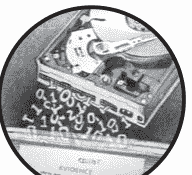

本章演示了获取磁盘镜像文件信息的技巧，以及将其作为块设备和挂载目录的方法。你将学习如何设置回环设备（loop devices）并使用设备映射工具创建逻辑设备。你还将探索映射或转换软件加密磁盘镜像的方法，使其能够被取证工具访问。这些方法在无法直接访问镜像内容且需要某层活动翻译或解密层的情况下非常有用。此类镜像的示例包括加密文件系统、虚拟机（VM）镜像以及取证工具不直接支持的其他镜像文件格式。

每个节还包含了将镜像文件安全地（只读）作为普通文件系统挂载到取证取证宿主机上的示例。然后，你可以使用常用程序（如文件管理器、办公套件、文件查看器、媒体播放器等）轻松地浏览和访问文件系统。

# 取证获取的镜像文件

本节中看到的的方法和示例的基础是 Linux 回环设备（不要与回环接口 loopback device 混淆）。回环设备是一个伪设备（pseudo device），它可以与普通文件关联，使得该文件在 `/dev` 中作为块设备可访问。

Linux 系统默认通常创建八个回环设备，这对于取证宿主机来说可能不够，但你可以手动或自动增加数量，直到启动为止。若要在启动期间创建 32 个回环设备，请在 `/etc/default/grub` 中的 `GRUB_CMDLINE_LINUX_DEFAULT` 行中添加 `max_loop=32`；重启后，将可用 32 个未使用的回环设备。`fsimage` 脚本使用回环设备来挂载 SquashFS 取证容器。

本章将涵盖来自常用虚拟机系统的不同虚拟机，如 QEMU、VirtualBox、VMware 和 Microsoft Virtual PC。我还描述了对加密文件系统的访问，包括微软的 Bitocker、苹果的 FileVault、Linux 的 LUKS 以及 VeraCrypt（TrueCrypt 的分支）。但让我们从最简单的镜像形式开始：使用 `dd` 风格工具获取的原始磁盘镜像。

# 带有回环设备的原始镜像文件

回环设备最简单的演示可以使用原始镜像文件（可能通过 `dd` 命令获取）。`losetup` 命令用于在 Linux 系统上附加和拆离回环设备。此示例为 `image.raw` 文件创建一个块设备：

```
# losetup --read-only --find --show image.raw
/dev/loop0
```

在这里，标志指定回环设备应该是只读的（`--read-only`），并且应该使用下一个可用的回环设备（`--show`）并在完成后显示（`--show`）。指定的字体（`image.raw`）随后将作为附加的块设备可用。

在不带参数的情况下运行 `losetup` 会显示所有已配置的回环偏移的状态。在这里我们可以看到新创建的那一个：

| losetup |

| NAME | SIZELIMIT OFFSET AUTOCLEAR RO BACK-FILE |

| /dev/loop0 | 0 0 0 1 /exam/image.raw |

`/dev/loop0` 设备现在指向 `/exam/image.raw`，你可以使用任何操作块设备的工具访问它。例如，这里使用 Sleuth Kit 命令通过回环设备查看 `image.raw` 文件上的分区表：

```
# mls /dev/loop0
DOS Partition Table
```

Offset: 0

单位为 512 字节扇区

| Slot | Start | End | Length | Description |

| --- | --- | --- | --- | --- |

| 00: Meta | 000000000 | 000000000 | 000000001 | Primary Table (#0) |

| 01: | 000000000 | 000002047 | 000002048 | Unallocated |

| 02: 000 | 000002048 | 005895375 | 008595528 | Linux (0x83) |

| 03: 001 | 005895737 | 078129151 | 019531776 | Linux Swap / Solaris x86 (0x82) |

| 04: 002 | 078129152 | 0781231551 | 000102040 | NTFS (0x07) |

| 05: 003 | 0781231552 | 0234441647 | 0156210096 | Mac OS HFS (0xfaf) |

当你不再需要回环设备时，按照以下方式拆离它：

```
# losetup --detach /dev/loop0
```

回环设备是灵活且可配置的。在之前的 `mml` 示例中，文件系统从扇区 2048 开始。每次运行取证工具时指定一个偏移量是可能的，但为每个分区准备一个单独设备（类似于 `/dev/sda`）更为简单。你可以使用 `losetup` 命令通过指定正确的偏移量（`-offset`）和大小（`-size`）为该分区创建一个单独的回环设备。然而，更普遍接受的方法是使用设备映射（device mapper）。你可以使用 `dmset` 和映射表（如 RAID 和 Multisk Systems）来实现这一点。`kpart` 工具自动为特定镜像文件创建分区。接下来的示例使用一个具有四个分区的取证镜像来演示 `kpart` 工具如何为每个分区创建映射设备：

```
# kpart -r -a -v image.raw
map loop0 (252:0): 5895328 linear /dev/loop0
map loop1 (252:1): 1953176 linear /dev/loop0
map loop2 (252:2): 102400 linear /dev/loop0
map loop3 (252:3): 15621096 linear /dev/loop0
```

在这里，`kpart` 工具读取磁盘或镜像文件上的表，为整个镜像创建一个回环设备，并为每个分区创建映射设备。`-r` 标志确保回环和分区是只读的，`-a` 标志指示 `kpart` 映射所有内容。使用详细标志 `-v` 来记录命令输出。

你可以可以使用不支持不支持 EWF 格式的工具对此原始镜像文件进行操作。在下面的示例中，使用十六进制编辑器（不支持 EWF）在扇区模式下分析原始镜像：

```
# hexedit -s raw/ewf1
...
```

`kpartx` 工具再次用于识别分区并创建相应的回环设备，这使得可以使用可以创建块设备的工具，并允许挂载文件系统进行常规浏览。以下是使用 `ewf` 挂载 EOF 文件的 `kpartx` 输出：

```
# kpartx -r -a -v raw/ewf1
add map loop01 (252:0): 29848707 linear /dev/loop0 63
add map loop02 (252:1): 0 2 /dev/loop0 29848770
add map loop05 1397592 linear /dev/loop0 29848833
...
```

让我们继续这个示例，为某个分区创建一个挂载点，并挂载和访问文件系统：

| cdrom | lib32/ | media/ | proc/ | tmp/ | vmlinux |

| bin/ | dev/ | initrd.img | lib64 | mnt/ | root | srv | usr/ |

| boot/ | etc/ | lib/ | lost+found/ | opt/ | sbin/ | sys/ | var/ |

在例示例中，在本地目录中创建了与分区对应的挂载点，将分区设备挂载在该，并使用 `ls` 访问文件系统。在挂载证据文件时，尽量避免使用 `/mnt` 或其他共享目录。如果镜像的挂载点与其它相关案例文件位于同一个工作目录下，进行取证工作会更加方便。

和之前一样，当工作完成后，你需要清理挂载点和虚拟文件。同样，这些是按相反顺序完成的：

```
# umount p1
# kpartx -d raw/ewf1
loop deleted :/dev/loop0
# fusermount -u raw
# rmdir p1 raw
```

此示例显示了 `fusermount` 命令，但标准的 Linux `umount` 命令同样有效。确保你的当前目录不在挂载点内部，且没有程序在挂载点内打开文件。这两个条件都会导致此清理操作失败。

当是 SquashFS 取证证据容器时，你可以通过使用 `sfimage -m` 挂载 `*.sfs` 文件来访问原始镜像，创建分区设备，然后挂载所需的分区。然后你可以对目标镜像文件系统执行常规命令。这里显示了一个完整的示例：


```
# sfimage -m image.sfs
image.sfs/d -v created
# kpartx -r -a -v image.sfs/d/image.raw
add map loopip1 (252:0): 0 29848707 linear /dev/loop1 63
add map loopip2 (252:1): 0 2 /dev/loop1 29848770
add map loopip5 : 0 1397592 linear /dev/loop1 29848833
# mkdir dip1
# mount /dev/mapper/loopip1 loopip1
mount: /dev/mapper/loopip1 is write-protected, mounting read-only
# ls -l
```

一旦你完成对原始镜像及其文件系统的访问，清理 SquashFS 取证证据容器也是按反序进行的。`sfimage -u` 命令用于卸载 SquashFS 文件系统，如此示例所示：

```
# umount p1
# kpartx -d image.sfs/d/image.raw
loop deleted : /dev/loop1
# sfimage -u image.sfs/
image.sfs.d unmounted
```

本节演示了访问取证格式内容的几种方法，包括作为块设备和作为常规文件系统。`ewmount` 工具也适用于 FTK SMART。`afflib` 也有一个名为 `affuse` 的类似工具用于挂载 `*.aff`。`ewmount` 和 `affuse` 都能对各自格式的单个或拆分文件的操作。

注意，许多取证格式（例如 Sleuth Kit）可以直接对取证格式进行操作，而不需要原始块设备或原始文件。

## 使用 xmount 准备启动镜像

取证人员经常希望使用非取证工具（如文件管理器、办公套件、应用程序或其他文件查看器工具）检查目标镜像。这可以通过将驱动器内容通过只读挂载安全地提供，供本地调查员访问来实现。

在某些情况下，在虚拟机中启动目标驱动器以直接观察并交互于实时目标环境是有帮助的。这允许你查看目标的桌面，并使用目标 PC 上安装的程序。要实现这一点，你可以使用本节描述的多种工具。

`xmount`（读作 "crossmount"）工具创建一个虚拟磁盘镜像，你可以使用虚拟机软件（如 VirtualBox 或 kvm-qemu）启动它。`xmount` 工具允许你模拟一个读写驱动器，让虚拟机认为磁盘是可写的，但它会继续以只读状态保护镜像。有多种虚拟机输出格式可用，包括 raw、DMG、VDI、VHD、VMDK 和 VMDKS。

输入格式包括取证获取的镜像文件，例如 `raw`、EnCase `raw` 和 AFF4 `aff`。这里是一个使用 `xmount` 设置为虚拟磁盘的原始镜像 (`image.raw`) 示例：

```
# raw image (image.raw)
$ xmount -o vdi image.raw
```

原始镜像 (`image.raw`) 设置为虚拟磁盘的示例：

```
# raw image (image.raw)
$ xmount -o vdi image.raw
```

`/dev/nbd0` 已断开

# rmdir p1

可选步骤是使用 `rm nbd` 移除内核模块。

但如果你以后还要进行更多 QCOW 挂载，将其保留也没有坏处。你也可以通过将模块添加到 `/etc/modules` 文件中，在启动时自动加载 nbd 模块。

### VirtualBox VDI

VirtualBox 是一个由 Oracle（原 Sun Microsystems）维护的开源项目。尽管它支持多种虚拟机镜像格式，但接后的示例使用了 VirtualBox VDI 镜像。`qemu-nbd` 命令用于在处理 OpenSolaris 镜像之前及配合使用。

VirtualBox 软件包包含许多工具；这里展示了 `VBoxManage` 工具，它能提供关于 VDI 镜像的信息：

```
# VBoxManage showinfo OpenSolaris.vdi
UUID: 0ce2e246-affd-49ba-8fe8-35d73d187704
Parent UUID: base
State: created
Type: normal (base)
Location: /exam/OpenSolaris.vdi
Storage format: VDI
Format variant: dynamic default
Capacity: 16384 MBytes
Size on disk: 2803 MBytes
Encryption: disabled
```

你可以使用 `qemu-nbd` 和 nbd 内核模块挂载 VirtualBox 镜像（如你在上一节中使用 QCOW2 时所示）。这里展示的 OpenSolaris 示例与 Windows 和 Linux 使用的分区方案略有不同。图中显示了多个磁盘切¹¹：

```
# qemu-nbd -c /dev/nbd0 OpenSolaris.vdi
# dmesg
...
[1946.708351] nbd0: p1
p1: <solaris: [s0] [p5] [s1] [p6] [s2] [p7] [s8] >
```

在这个示例中，单个 Solaris 分区 (`p1`) 包含多个切 (`p5`, `p6`, `p7` 和 `p8`)。你使用与之前的 QEMU 示例相同的方法来访问原始设备和分区设备，并将分区作为只读模式挂载到本地挂载点。这里仍然不需要使用 `kpart` 来查找分区，因为内核会自动完成。一旦你完成对分区（此处为切）的访问，执行清理步骤以卸载文件系统并断开 nbd 设备。

¹¹ 1. “切 (slices)”一词源于 BSD UNIX，是 UNIX 世界中常见的分区方案。

### VMWare VMDK

虚拟磁盘 (`VMDK`) 格式由 VMware 的虚拟机软件产品使用。以下示例使用 `libvmdk-utils` 软件包包处理一个拆分成多个部分的 Apple Lion VMDK 镜像：

```
# ls
lion-000001-s001.vmdk lion-000003-s007.vmdk lion-s009.vmdk
lion-000001-s002.vmdk lion-000003-s008.vmdk lion-s010.vmdk
lion-000001-s003.vmdk lion-000003-s009.vmdk lion-s011.vmdk
lion-000001-s004.vmdk lion-000003-s010.vmdk lion-s012.vmdk
lion-000001-s005.vmdk lion-000003-s011.vmdk lion-s013.vmdk
lion-000001-s006.vmdk lion-000003-s012.vmdk lion-s014.vmdk
lion-000001-s007.vmdk lion-000003-s013.vmdk lion-s015.vmdk
lion-000001-s008.vmdk lion-000003-s014.vmdk lion-s016.vmdk
...
```

你可以使用 `vmdkinfo` 获取关于组装镜像以及每个“扩展区 (Extents)”的信息：

```
# vmdkinfo lion.vmdk
vmdkinfo 20160119
```

VMware 虚拟磁盘 (`VMDK`) 信息：

Disk type: 2GB extent sparse

Media size: 42949672960 bytes

Content identifier: Oxdbaba0513

Parent content identifier: 0xffffffff

Number of extents: 21

```
Extent: 1
Filename: lion-s001.vmdk
Type: Sparse
Start offset: 0
Size: 2146435072 bytes
...
```

创建一个挂载点并挂载镜像，可以使其作为一个原始镜像文件被访问：

```
# mkdir lion
# vmdkmount lion.vmdk
vmdkmount 20160119
```

```
# ls -ls
total 0
0 -r--r-- 1 root 4294672960 May 17 22:24 lion/vmdk
```

GUID 分区表

FUSE 扇区偏移量：0

单位为 512 扇区

`dislocker-find` 工具会扫描所有连接的分区设备和指定文件，以识别是否存在任何 Bitocker 卷。如果设备在挂载到采集主机的过程中已经过识别，则可能不需要再次扫描 Bitocker 设备。

`dislocker-metadata` 命令提供 Bitocker 驱动器的概览。接下来的示例是从 USB 驱动器获取的镜像。整个驱动器都已加密，且没有分区表。可以按照如下方式对镜像文件进行查询：

```bash
# dislocker-metadata -V bitlocker-image.raw
```

...

+ Jan 20 13:46:06 2016 [INFO] Bitlocker metadata found and parsed.

Wed Jan 20 13:46:06 2016 [INFO] ===== Volume header informations =====

Wed Jan 20 13:46:06 2016 [INFO] Signature: 'MSWIN4.1'

Wed Jan 20 13:46:06 2016 [INFO] Sector size: 0x020 (512) bytes

+ Wed Jan 20 13:46:06 2016 [INFO] Number of sectors (64 bits): 0x0000000000000000 (8589934592) bytes

Wed Jan 20 13:46:06 2016 [INFO] MFT start cluster: 0x00000000000000600001 (393217) bytes

+ Wed Jan 20 13:46:06 2016 [INFO] ===================== Bitlocker information structure ========================================

Wed Jan 20 13:46:06 2016 [INFO] Signature: '-FVE-FS-'

Wed Jan 20 13:46:06 2016 [INFO] Total Size: 0x02f0 (752) bytes (including signature and data)

+ Wed Jan 20 13:46:06 2016 [INFO] Version: 2

Wed Jan 20 13:46:06 2016 [INFO] Current state: ENCRYPTED (4)

Wed Jan 20 13:46:06 2016 [INFO] Next state: ENCRYPTED (4)

Wed Jan 20 13:46:06 2016 [INFO] Encrypted volume size: 7918845592 bytes (0x1d8000000), ~752 MB

该命令的输出提供了许多此处未列出的详细加密信息。你可以将 `dislocker-metadata` 的输出保存到文件中以备文档记录。该命令也可以直接在连接的设备上进行操作。

与之前的密码和加密示例一样，假设你已经拥有密钥。可以使用一些商业工具尝试通过暴力破解来恢复密钥。此外，你可以使用 `volatility` 插件从内存镜像中提取 FVEK（https://github.com/elcef/bitlocker/），并结合 inception 内存转储工具使用该工具。本文未涵盖这些工具的使用。

你可以创建一个虚拟文件或块设备，对磁盘镜像的解密视图进行“原地”操作。该过程与第 237 页“VM Images”中的示例类似。`dislocker` 软件包提供了一个工具，可以创建一个具有解密卷虚拟表示的 FUSE 文件系统：

```bash
# mkdir clear
# dislocker-file -u -V bitlocker-image.raw clear
Enter the user password:
# ls -l clear/
total 0
-rw-rw-rw- 1 root 7918845952 Jan 1 1970 dislocker-file
...
```

出现在 `clear` 目录中的文件是加密文件系统的解密表示，你可以使用常规取证工具对其进行操作。这里显示了一个使用 Sleuth Kit 中 `fstat` 的示例：

```bash
# fsstat clear/dislocker-file
FILE SYSTEM INFORMATION
```

File Type: FAT32

OEM Name: MSD055_0

Volume ID: 0xa5a88ba

Volume Label (Boot Sector): NO NAME

Volume Label (Root Directory): MY SECRETS

File System Type: FAT32

Next Free Sector (FS Info): 34304

Free Sector Count (FS Info): 15418664

...

你可以安全地挂载解密的文件系统镜像进行正常浏览。`mount` 命令有一个 `loop` 选项，允许直接挂载分区镜像，如下所示：

```bash
# mkdir files
# mount -o loop,ro clear/dislocker-file files
# ls files
Penguins.jpg private:/ System Volume Information/
```

此示例中的清理工作只需卸载文件的挂载点、移除 FUSE 挂载并删除挂载目录：

```bash
# umount files
# rmdir files
# fusermount -u clear
# rmdir clear
```

注意，上述示例是在 root 权限下执行的，以降低复杂度并使其更容易理解。你可以作为非权限用户执行相同的命令，如下所示：

```bash
$ dislocker-metadata -V bitlocker-image.raw
$ mkdir clear
$ dislocker-file -u -V bitlocker-image.raw clear
$ mount -o loop,ro clear/dislocker-file files
$ ls files
$ umount files
$ rmdir files
$ fusermount -u clear
$ rmdir clear
```

04: 0625140400 0625142447 0000002048 未分配空间

# echo $($((4098048*512))

2098200576

你可以通过乘以扇区大小，将 mmls 显示的偏移量转换为字节偏移量（byte offset）。在命令行中，使用基数数学扩展非常方便。在这个示例中，扇区偏移量为 4098048，扇区大小为 512。两者相乘得到 2098200576 的字节偏移量。你可以如下将该值用于 `bdeinfo` 命令：

```
# bdeinfo -o 2098200576 image0.raw
deddeinfo 20160119
```

Bitlocker 驱动加密信息：

加密方法：带有 Diffuser 的 AES-CBC 128-bit

卷标识符：5f6i1cf2-75b5-32e5-caef-53fec3cf412

创建时间：2014年1月10日 17:43:50.83889200 UTC

描述：笔记本电脑系统 15.01.2014

密钥保护者数量：2

密钥保护者 0：

标识符：3cd1fd6c-2ecb-2d7c-c150-839ce9e9t1b6

类型：TPM

密钥保护者 1：

标识符：837ef544-e1ca-e65c-a190-83ac43d492bc1a

类型：恢复密码

`bdemount` 命令的操作方式与 `dislocker` 命令类似，它创建一个表示解密镜像的虚拟文件（此处完整密钥已缩短）：

```
# mkdir raw
# bdemount -o 2098200576 -r 630641-...154814 image.raw raw
```

该文件将出现在 ./raw 目录中，你可以在那里直接进行分析，或将其挂载到回环设备以便常规浏览。命令与之前的 BitLocker 示例相同，此处不再重复。

### Apple FileVault

Apple 内置于 OS X 的文件系统加密技术是 FileVault。它也是一种块级加密系统，有多个开源工具可以解密它。我在这里描述的两个工具是 libfvde 和 VDFCrypt。（libfvde 软件包由 Omar Choudary 和 Joachim Metz 编写，你可以在 https://github.com/libyal/libfvde/ 找到它。）

在用 libfvde 工具计算 FileVault 加密卷的字节偏移量之前，`mml` 命令提供了该卷的扇区偏移量，这需要将其转换为字节：

```
# mmls image.raw
GUID 分区表 (EFI)
偏移量扇区: 0
单位为 512 字节扇区
```

| 槽 (Slot) | 起始 | 结束 | 长度 | 描述 |

|---|---|---|---|---|

| 00: | 00000000 | 00000000 | 000000001 | 安全表 |

| 01: | ----- | 0000000039 | 000000040 | 未分配 |

| 02: | 000000001 | 000000001 | 000000001 | GPT 头 |

| 03: | 000000002 | 000000033 | 000000032 | 分区表 |


| 04: | 000000040 | 0000409639 | 0000409600 | EFI 系统分区 |
| 05: | 000409460 | 0235078599 | 0235298960 | HDD |
| 06: | 02 | 0236798135 | 0012695936 | 恢复 HD |
| 07: | ----- | 0236798175 | 000000040 | 未分配 |

```
# echo $((4098048*512))
209735680
```

使用简单的扩展将扇区偏移量乘以扇区大小，可以得到 `209735680` 的字节偏移量，你可以将其用于 `fdeinfo` 和 `decrypt` 工具。`fdeinfo` 工具提供了 FileVault 加密卷的概述：

```
# fdeinfo -o 209735680 image.raw
fvdeinfo 20160119
```

Core Storage 信息：

物理卷：

大小：1204736520 字节

加密方法：AES-XTS

逻辑卷：

大小：1201375104 字节

要解密 FileVault 卷，你需要恢复 `EncryptedRoot.plist` 文件并提供用户密码或恢复密钥。我们可以使用 Sleuth Kit 工具找到并提取该文件，如下所示：

```
# fls -r -o 209735680 image.raw | grep EncryptedRoot.plist
1036: EncryptedRoot.plist
# icat -o 209735680 image.raw 1036
```

Recovery HD 分区的递归 `fs` 输出使用了通过 `mls` 找到的扇区偏移量。对输出进行 `grep` 以查找 `EncryptedRoot.plist`。找到后，使用 `icat` 工具提取它（使用 inode，编号为 1036）。注意 `fls` 和 `icat` 使用的是扇区偏移量而非字节偏移量。24 位的恢复密钥与 `-r` 标志以及现在恢复的 `EncryptedRoot.plist` 文件一起使用。然后你可以使用该密钥为卷的解密表示形式创建一个 FUSE 挂载，如下所示（恢复密钥已缩短）：

```
# mkdir
# fdemount -o 209735680 -r EncryptedRoot.plist image.raw
fvdeinfo 20160119
```

关键材料偏移量：8

AF 条纹：4000

密钥槽 1：已禁用

密钥槽 2：已禁用

密钥槽 3：已禁用

密钥槽 4：已禁用

密钥槽 5：已禁用

密钥槽 6：已禁用

密钥槽 7：已禁用

从取证的角度来看，密钥槽（key slots）非常有价值。一个 LUKS 卷最多可以包含八个密钥，这意味着可能有不同的密码可以尝试。

使用 LUKS 加密文件系统的密码，你可以在 `loop0` 设备上使用 `cryptsetup open` 命令来创建加密镜像的解密表示。在本示例中，映射设备被命名为 `clear`：

```
# cryptsetup -v --readonly /dev/loop0 clear
Enter passphrase for /hyb/luks/luks.raw:
Key Slot 0 unlocked.
Command successful.
```

加密的环回设备使用 `--readonly` 标志打开。还提供了详细模式（`-v`）标志以提供关于解密密钥成功的更多信息。在输入正确的密钥后，一个新的（解密后的）分区设备将出现在 `/dev/mapper` 目录下，并可以使用标准的取证工具进行操作。例如，使用 Sleuth Kit 的 `fsstat` 工具：

```
# fsstat /dev/mapper/clear
FILE SYSTEM INFORMATION

File System Type: Ext4
Volume Name: My Secrets
Volume ID: ba67d056effcc5785f046654c00943860
...
```

你可以将此分区设备挂载到本地机器上进行浏览：

```
# mkdir clear
# mount --read-only /dev/mapper/clear clear
# ls clear
lost+found/ the plan.txt
```

检查工作完成后，就可以进行清理工作。每个步骤按逆序执行：

```
# umount clear
# rmdir clear
# cryptsetup close clear
# losetup --detach /dev/loop0
```

注意，这是一个位于非启动数据磁盘上分区的简化示例。带有可启动操作系统的 LUKS 加密磁盘可能额外有一个额外的逻辑卷管理器（LVM）层。这些磁盘可能包含出现在 `/dev/mapper` 目录中的额外设备（root、swap 和 on）。你可以单独访问或挂载这些设备设备。在清理过程中，你需要在使用 `cryptsetup` 关闭 LVM 设备之前使用 `dmsetup` 移除分区设备。

为了简单起见，本节所示步骤是以 root 用户执行的。要以非 root 用户运行示例，需要执行 `losetup`、`cryptsetup`、`mount` 和 `umount`，以及任何访问 `/dev/mapper` 分区的工具。取决于挂载的文件系统，额外的用户选项可能有用（例如示例中使用 `uid-holmes`）。

使用纯 `dm-crypt` 和 `loop-AES` 加密的镜像也可以使用 `cryptsetup` 工具解密。其过程与之前的 LUKS 示例类似。`cryptsetup open` 命令需要使用 `--type` 标志指定 `plain` 或 `loopaes`。例如：

```
# cryptsetup -v --readonly open --type plain /dev/loop0 clear
Enter passphrase:
Command successful.
```

使用 `--type loopaes` 还需要一个密钥文件。指定 `--type luks` 也是可能的，但没有必要，因为它是默认值。

你可以在 `https://gitlab.com/cryptsetup/cryptsetup/wiki/home/` 找到更多关于 `cryptsetup` 和 LUKS 的信息。你可以在 `https://github.com/ted-k/libvercrypt/` 找到兼容的 Windows 实现。

# TrueCrypt 和 VeraCrypt

在 VeraCrypt 开发停止后，出现了几个分支。目前占据主导地位的分支是 VeraCrypt。它提供了向后兼容性以及新的扩展功能。

我将提供的 VeraCrypt 示例包括一个普通加密容器和一个隐藏容器。我使用了 VeraCrypt 的标准命令行版本结合熟悉的工具，以便对容器进行进一步分析。

第一个示例显示了一个简单的加密 TrueCrypt 或 VeraCrypt 容器文件。`--file-system=none` 标志非常重要，因为它防止 VeraCrypt 挂载任何文件系统：

```
$ vercrypt --mount-options=readonly --filesystem=none secrets.tc
Enter password for /exam/secrets.tc:
Enter PIM for /exam/secrets.tc:
Enter keyfile [none]:
```

使用 `-l` 标志，你可以通过槽号列出主机上所有解密后的容器。槽号是后续命令中使用的重要标识符。在本示例中，槽号是 1，并使用了 `/dev/mapper/*` 目录：

```
$ vercrypt -l
1: /exam/secrets.tc /dev/mapper/veracrypt1 -
```

提供正确的凭据后，你可以指定槽号来请求有关容器的更多信息，如下：

```
$ vercrypt --volume-properties --slot=1
Slot: 1
Volume: /exam/secrets.tc
Virtual Device: /dev/mapper/veracrypt1
Mount Directory:
Size: 2.0 GB
Type: Normal
Read-Only: Yes
```

## 结语

在本章中，你学习了如何将获取的镜像文件作为块设备可用、创建分区设备，并安全地使用常规文件系统工具处理它们。你还学习了使用循环设备，并对 `/dev/mapper` 设备变得更加熟悉。我展示了启动可疑镜像的技巧，并演示了从各种虚拟机格式访问 VM 镜像的方法。最后，你学习了如何以解密的形式访问各种加密文件系统。

# 提取取证镜像的子集

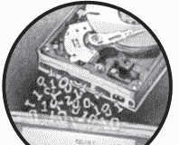

本章涵盖了从已连接的驱动器或取证的镜像文件中选择性提取数据区域。你将学习如何提取整个分区、已删除或部分覆盖的分区、分区间隙，以及各种卷和文件碎片区域（file slack areas）。此外，

你将看到如何提取特殊区域，例如统一扩展固件接口（UEFI）分区、被 DCO 或 HPA 隐藏的扇区，以及如 Intel Rapid Start Technology 等休眠分区。

最后几个章节演示了从磁盘的已分配和未分配（可能已删除）区域提取数据以进行进一步检查，并使用偏移量（offsets）对扇区进行手动提取。让我们从确定驱动器的分区布局开始。

## 评估分区布局和文件系统

一旦你将磁盘连接到系统或获取了镜像文件，就可以对磁盘分区方案进行分析。本节解释了如何识别文件系统、分区表以及常用的磁盘分区方案。

磁盘布局（或分区方案）是指用于组织硬盘上分区（或切片）的方法。在消费级计算中，常见的分区方案有 DOS、GPT、BSD 和 APM（苹果分区映射，有时称为 mac）。我们将从识别磁盘上使用的分区方案开始。

### 分区方案

磁盘上的每个分区或切片都包含一个独立的文件系统（通常用于某些其他特殊目的）。磁盘的一小部分（通常是第一个扇区）通过指定每个分区的起始扇区、分区大小、分区类型、标签等来定义磁盘的布局。

要确定分区方案，你可以检查磁盘的初始扇区以寻找指示器。分区方案没有官方的“分配编号”（只有几个左右）。不要将其与 DOS MBR 分区类型或 ID 混淆，后者列出了可能位于 DOS 分区内的最多 255 个文件系统和格式。当你将目标磁盘连接到工作站时，Linux 内核将尝试检测并解释使用的分区方案，并为它找到的每个分区创建设备。

你可以使用 Sleuth Kit 的 `mmstat` 命令来识别常见的分区方案。支持的分区方案列表所示：

```
# mmstat -t list
Supported partition types:
dos (DOS Partition Table)
mac (MAC Partition Map)
bsd (BSD Disk Label)
sun (Sun Volume Table of Contents (Solaris))
gpt (GPT Partition Table (EFI))
```

> 运行 `mmstat` 将输出所使用的方案名称：

```bash
# mmstat image.raw
dos
```

或者，你可以使用 `disktype` 工具识别分区方案。`disktype` 工具提供了更详细的信息，并支持分区、文件系统以及文件和存档容器。以下显示了 `disktype` 的输出：

```
# sudo disktype /dev/sda
```

--- `/dev/sda`

Block device, size 27.96 GiB (30016659456 bytes)

DOS/MBR partition map

Partition 1: 27.95 GiB (30015610880 bytes, 5862420 sectors from 2048)

Type 0x83 (Linux)

你可以在 `http://diskype-sourceforge.net/` 找到原始的 `diskype` 软件包。此外，你还可以在以下地址找到 `diskype` 的分支和多个补丁：`https://github.com/kamwoods/diskype/`、`https://github.com/Pardus-Linux/Packages/tree/master/system/base/diskype/files/` 以及 `https://github.com/ericpaulbishops/gargoyle/tree/master/package/diskype/patches/`

存储介不需要分区表或文件系统。二进制数据可以写入原始设备并由任何能够理解它的程序访问（例如，某些数据库使用原始磁盘）。磁盘是可以没有分区方案的。在这种情况下，文件系统从零扇区开始一直到磁盘末尾（也就是说整个磁盘就是一个分区）。这在旧的 USB 闪和软磁盘上很常见。在这种情况下，分区分析工具将无效，并通常报告虚假或不存在的分区。如果工具无法检测分区类型，值得检查是否直接向原始设备写入文件系统。在本例中，`mmstat` 什么也没找到，但 `fsstat` 识别出了文件系统：

```bash
# mls /dev/sdj
Cannot determine partition type
# diskype /dev/sdj
```

--- `/dev/sdj`

Block device, size 1.406 MiB (1474560 bytes)

FAT12 file system (hints score 5 of 5)

Volume size 1.390 MiB (1457664 bytes, 2847 clusters of 512)

```bash
# mmstat /dev/sdj
Cannot determine partition type
# fsstat /dev/sdj
FILE INFORMATION
System Type: FAT12
```

一些加密卷试图隐藏其存在或文件系统信息，它们不使用可识别的分区方案。分区方案将有一个描述如何组织磁盘的块集合。这些被称为分区表，你可以使用各种工具查询它们。你可以使用 Sleuth Kit 的 `mls` 命令列出取证镜像磁盘上的分区表。在本例中，`mls` 找到了一个 FAT32 分区：

```
# mmls image.raw
Dos Partition Table
Offset Sector: 0
Units are 512-byte sectors
| Slot | Start | Description |
| :--- | :--- | :--- |
| 00: 000000000 | 000000000 | Primary Table (0) |
| 01: 000000000 | 000000062 | Unallocated |
| 02: 000000063 | 000502844 | Win95 FAT32 (0) |
| 03: 000502835 | 000503951 | Unallocated
```

传统的 DOS 方案无法处理大于 2TB 的磁盘。GPT 方案是为了允许更大的磁盘拥有更多数量的分区（GPT 支持 128 个分区）。关于 GPT 磁盘和 GUID 表的取证分析，我写过过论文；你可以在此处找到：`http://doi.org/10.1016/j.fore009.07.001`。今天大多数 PC 都带有 GPT 分区。这里是一个 Windows 8 系统的分区表示例：


```
# mmls lenovo.raw
GUID Table (EFI)
Offset Sector: 0
Units are 512-byte sectors

| Slot | Start | Description |
| :--- | :--- | :--- |
| 00: 000000000 | 000000000 | Safety Table |
| 01: 000000000 | 000002047 | Unallocated |
| 02: 000000001 | 000000001 | GPT Header |
| 03: 000000002 | 000000033 | Partition Table |
| 04: 000002048 | 000205047 | |
| 05: 000205048 | 000252857 | EFI system partition |
| 06: 000252858 | 000306527 | |
| 07: 000306528 | 000386671 | Microsoft reserved partition |
| 08: 000386672 | 1902323711 | Basic data partition |
| 09: 1902323712 | 1935523711 |

```

Gary Kessler 提供了几个更详细的分区解析工具。你可以在 `http://www.garykessler.net/index.html` 找到这些工具。

为了说明 Kessler 解析工具提供的详细程度，这里是使用 `gptparser.tool` 生成的前述示例分区表的部分输出：

```
GPT Parser V1.4 beta - Gary C. Kessler (14 March 2013)

Source file = /exam/lenovo.raw
Input file length = 17408 bytes.

000: 00 00 00 00 00 00 00 00 00 00 00 00 00 00 ...
016: 00 00 00 00 00 00 00 00 00 00 00 00 00 00 00 ...
...
*** Partition Table #5 (LBA 127, offset 0)
000-015 Partition type:0xA2-DO-E5-B9-33-44
016-031 Partition GUID:0x64-12-FF-80-A7-F7-42-46-25-33-60-96-13-85
Type: data partition (Windows)
032-039 First LBA: 0x00-A7-DO-08-30-00-00-00 [3,687]
040-047 Last LBA: 0xFF-27-63-71-00-00-00-00 [1,902,323,711]
048-055 Partition attributes: 0x00-00-00-00-00-00-00-00
056-127 Partition name :
056: 42 00 61 00 73 00 69 00 63 00 20 00 64 00  B.a.s.i.c. .d.a.
72: 74 00 61 00 20 00 70 00 61 00 72 00 74 00 69 00  t.a. .p.a.r.t.i.
88: 74 00 69 00 6F 00 6E 00 00 00 00 00 00 00 00 00  t.i.o.n......
104: 00 00 00 00 00 00 00 00 00 00 00 00 00 00 00 00
120: 00 00 00 00 00 00 00 00 00 00 00 00 00 00 00 00
Name: Basic data partition
```

## 文件系统识别

`typeskit` 工具已在第260页的“分区方案”中介绍过，它允许你识别分区及其内部的文件系统。Sleuth Kit 的 `fstat` 工具提供了关于文件系统更全面的信息。如果你指定了扇区偏移量，`fstat` 工具将提供取证镜像。

在之前的示例中，`lenovo.raw` 镜像文件上 Windows 分区的扇区偏移量为 `3868672`。你可以使用 `-o` 标志将此扇区偏移量提供 `fsstat` 工具以分析文件系统元数据。

```
# fsstat -o 3868672 lenovo.raw
FILE SYSTEM INFORMATION
```

文件系统类型: NTFS

卷序列号: 4038B39F38B39300

OEM 名称: NTFS

卷名: Windows8_OS

版本: Windows XP

元数据信息

MFT 第一个簇: 786432

如果驱动器直接连接到你的工作站，LinuxLinux 内核将尝试解析分区表，并将磁盘和分区设备在 `/dev/` 中可用，你可以直接访问它们。

然而，如果你正在检查原始镜像文件（`.raw`、`.e0f` 等），则该镜像将没有设备文件。内核不会解释分区表，也不会创建熟悉的分区设备（如 `/dev/sda1`、`/dev/sda2` 等）。在访问镜像文件中的分区时，你必须指定偏移量。

使用取证工具来确定分区详情比信任内核更好。如果磁盘损坏或受损，内核可能会拒绝创建分区设备或创建错误的设备。你在本节中看到的示例始终指定了偏移量，而不是使用内核。在涉及恶意软件、反取证或其他恶意不当的情况下，应优先使用取证工具而不是内核。

## 分区提取

本节描述了单个分区、分区间间隙以及磁盘其他区域（如 DCO 和 HPA）的提取。让我们从提取普通分的一些基本示例开始。

### 提取单个分区

要访问并提取单个分区而不是整个硬盘，可以使用几种技术。我将演示几个使用带有分区映射设备的直接连接驱动器进行分区提取的示例，以及使用 Sleuth Kit 的 `mmcat-` 和 `dd-` 风格工具操作镜像文件的提取示例。

如果磁盘可以作为附加设备被访问，获取该分区的方法类似于对原始磁盘设备进行全量采集，但使用的是分区设备。在接接的示例中，`/dev/sda` 的第一个分区被提取到一个文件中：

```
# dcfldiff if=/dev/sda of-partition.raw
```

提取分区需要一些容量规划，因为分区将占用磁盘空间（可能与整个驱动器镜像并存）。如果你需要临时访问采集镜像文件中的分区，可以将其挂载为回环设备（loop device）并访问。以下步骤演示了这种方法。

首先，使用 `mmmls` 识别要挂载为回环的分区，如下：

```
# mmls lenovo.raw
GUID 分区表 (EFI)
偏移扇区: 0
单位为 512 字节扇区
```

```
05: 01 000250048 0002582527 0005324880 EFI system partition
......
```

然后使用 Bash 数学扩展将扇区偏移量和扇区长度转换为字节偏移和长度：

```bash
# echo $((2050048*512))
1049624576
# echo $((532480*512))
272629760
```

将计算出的字节偏移和字节长度传递给 `losetup` 以创建回环设备，如下：

```bash
# losetup --read-only --find --show --offset 1049624576 --sizelimit 272629760
lenovo.raw
/dev/loop2
```

你可以像访问附加磁盘的分区设备一样使用取证工具访问此回环设备。这里显示使用 Sleuth Kit 的示例：

```bash
# fls /dev/loop2
r/r 3: SYSTEM_DRV (Volume Label Entry)
d/d 4: EFI
d/d 5: BOOT
d/d * 7: MSIA11f8.tmp
d/d * 8: _SI2DBB4.TMP
d/d * 9: _190875_
```

如果你需要从已采集的镜像提取分区提取到单独的文件，可以使用 `dd` 工具或 Sleuth Kit 的 `mmcat` 命令。

从采集的镜像中提取分区，第一步是识别分区和扇区的详情。在接下来的示例中，来自采集的磁盘镜像的分区表显示了要提取的分区：

```bash
# mmls image.raw
DOS 分区表
偏移扇区: 0
单位为 512 字节扇区
```

#### 插槽 | 开始 | 结束 | 长度 | 描述

|---|---|---|---|---|

| 02: | 00:00 | 0000000063 | 0078124094 | 0078124032 | Linux (x86) |

使用 `dc3dd` 从采集的镜像文件提取分区，需要添加 `skip`（`dc3dd` 使用 `skip`）和 `count` 参数，这些参数会导致命令跳跃（`skip`）到分区的开始位置并仅获取分区的大小：

```bash
$ dc3dd if=image.raw partition.raw bs=512 skip=63 count=78124032
```

在此命令中，块大小被设置为 512 字节以匹配扇区大小，分区的起始位置是 63，应提取 78124032 个扇区。通过额外的计算，你可以将 512 字节块大小改为更大的值来提高此命令的性能。在 Sleuth Kit 3.0 及更高版本中，你可以使用 `mmcat` 工具轻松提取分区。在之前的示例中使用 `mmcat` 提取第一个分区必须指定 `mmls` 插槽号（而不是分区号）。在这种情况下，第一个分区位于插槽二，可以如下提取：

```bash
$ mcat image.raw 2 > partition.raw
```

`mmcat` 工具简单地将输出到 stdout，因此你必须将其重定向到文件或管道到程序。

### 查找并提取分区

要彻底搜索采集镜像的部分覆盖或已删除分区，可以使用 `gpart` 和 `testdisk` 等工具。这些工具实现了更智能的文件系统识别。运行 `gpart` 且不带任何选项将扫描已分配区域。例如：

```bash
# gpart lenovo.raw
Begin scan...
Possible partition (Windows NT/2K FS), size(1000mb), offset(1mb)
Possible partition (Windows NT/2K FS), size(3mb), offset(1030mb)
Possible partition (Windows NT/2K FS), size(3mb), offset(1494mb)
Possible partition (Windows NT/2K FS), size(92698mb), offset(18889mb)
Possible partition (Windows NT/2K FS), size(25000mb), offset(22869mb)
End scan.

猜测的主分区表:
Primary(1) type:07 HPFS, NTFS, or Advanced size:2048-205047
```

添加 `-f` 标志告诉 `gpart` 对整个磁盘的每个扇区进行详尽查找。这比默认的 `gpart` 扫描要慢得多。`testdisk` 工具 (`http://www.cgsecurity.org/`) 由 Christophe Grenier 编写，同样的 `photoreorec` 工具提供了交互式界面，支持多种布局（DOS、GPT 等），可以检测几十种分区类型，生成日志，并将分区提取到文件中。你可以对设备、原始镜像甚至 `*.001` 文件使用 `testdisk`。

请谨慎使用 `testdisk` 工具。该工具旨在修复并可以轻松修改分区。在附加磁盘上运行此工具之前，请务必使用写保护器。该工具还包含一个用户界面来定义选项和操作。这是一个在附加磁盘上操作的批模式示例：

```bash

# testdisk /list /dev/sdb

TestDisk 7.0, Data Recovery Utility, April 2015

Christopher GRENI <grenier@cgsecurity.org>

http://www.cgsecurity.org

Wait...

Disk /dev/sdb - 15 GB / 14 GiB CHS 14663 64 32

Sector size:512

Model: SanDisk Ultra Fit, FW:1.000

Disk /dev/sdb - 15 GB / 14 GB CHS 14663 64 32

```

| 分区 | 开始 | 结束 | 扇区数 |
|---|---|---|---|
| 1 P FAT32 LBA | 0 | 28671 | 28672 |
| [NO NAME] FAT32 | | | |
| blockSize=16384 | | | |

你可以对删除分区进行一定的手动分析。如果分区表显示磁盘上有大未分配区域，检查该区域以确定是否存在分区。在以下示例中，`mmls` 显示优 盘末尾有 2.5GB (486378 扇区) 的空空间：

```bash

# mmls /dev/sdb

Dos 分区表

偏移扇区: 0

单位为 512 字节扇区

```

| 插槽 | 开始 | 结束 | 长度 | 描述 |
|---|---|---|---|---|
| 000: Meta | 000000000 | 000000000 | 000000001 | 主表 (#0) |
| 001: ----- | 000000000 | 000002047 | 000002048 | 未分配 |
| 002: 000:000 | 000002048 | 002516787 | 0025165824 | Win95 FAT32 (0x0) |
| 003: ----- | 002516782 | 0030031249 | 486378 | 未分配 |

此未分配空间可能是一个删除的分区。在本示例中，使用分区偏移量运行 `fsstat -o 25167872 /dev/sdb` 发现了一个有效的文件系统：

```

# fsstat -o 25167872 /dev/sdb

FILE SYSTEM INFORMATION

```

文件系统类型: Ext3
卷名:
卷 ID: 74aa2f1bb77ae52bc974c3dbca837a80

最后写入: 2016-05-21 15:42:54 (CEST)
最后检查: 2016-05-21 15:42:54 (CEST)

如果你检测到一个有效的文件系统，可以使用关于它的元数据信息来确定分区的可能大小。已知大小和起始偏移后，你可以提取发现的分区或对其进行进一步分析。你可以使用 `dd` 风格工具或更多免费工具（如 `mls`）来提取，如下所示：

```bash

# mcat /dev/sdb 3 > deleted_partition.raw

```

在这里，`mls` 插槽 003 中删除分区的 `mcat` 输出被发送到名为 `deleted_partition.raw` 的文件。

## 识别并提取分区间间隙

在某些情况下，分区之间可能存在间隙，这些间隙由于相邻分区在圆柱或块边界处交汇而意外产生。也可能为了隐藏数据而故意创建间隙。你可以按照与提取分区相同的方法识别并恢复这些分区间间隙。使用 `mmls` 确定间隙的大小扇区偏移，然后使用 `dd` 或 `mmcat` 将其提取。

此处显示了分区表的 `mmls` 输出。磁盘包含两个分区，它们之间存在一个间隙：

```

# mmls /dev/sdb

DOS Partition Table

Offset Sector: 0

Units are in 512-byte sectors

```

| Slot | Start | End | Length | Description |
|---|---|---|---|---|
| 000: | 000000000 | 000000000 | 000000001 | 主分区表 (#0) |
| 001: | 000000000 | 000002047 | 000002048 | 未分配 |
| 002: | 000000000 | 015626236 | 015624189 | Linux (0x83) |
| 003: | 001562637 | 015626239 | 000000003 | 未分配 |
| 004: | 000000001 | 001562640 | 003031249 | 014405010 | Linux (0x83) |

在此示例中，第一个分区结束于扇区 15626236，而相邻的的分分区从扇区 15626240 开始，这表明它们之间存在三个扇区的间隙。虽然你可以使用 `dd` 提取此分区间间隙，但使用 `mmcat` 更简单：

```

# mmcat /dev/sdb 3 > gap.raw

# ls -l gap.raw

-rw-r--r-- 1 root 1536 May 21 16:11 gap.raw

```

生成的文件大小为三个扇区，包含了两个分区之间的间隙。分区之间如果包含部分覆盖、损坏或可识别的文件系统碎片，这种较大的间隙，可以首选使用雕刻工具（carving tools）进行分析。

最后一个分区与磁盘末尾之间的间隙也可能感兴趣。它可能包含某些痕迹，例如之前被覆盖的分区内容、GPT 的备份副本，甚至是试图隐藏二进制代码段的恶意软件。

## 提取 HPA 和 DCO 扇区范围

你已经学习了如何识别和恢复 HPA 和 DCO 限制。一旦移除，就可以提取磁盘的这些区域以进行单独分析。

在此示例中，`hdparm` 显示存在 HPA，且 `mls` 输出显示了三个槽，其中一个是 Linux 分区：

```

# hdparm -N /dev/sdh

```

```

/dev/sdh:

max sectors = 234441648/967673168, HPA is enabled

# mls /dev/sdh

DOS Partition Table

Offset Sector: 0

Units are in 512-byte sectors


| Slot | Start | End | Length | Description |
| --- |---|---|---|---|
| 00: Meta | 000000000 | 000000000 | 000000001 | 主分区表 (#0) |
| 01: | 000000000 | 000002047 | 000002048 | 未分配 |
| 02: 00:00 | 000002048 | 0234441647 | 0234439600 | Linux (0x83) |

在成功移除 HPA（并通知内核重新扫描 SCSI 总线）后，再次运行相同的命令将产生不同的输出，如下：

```
# hdparm -N 967673168 /dev/sdh
```

```
/dev/sdh:

setting max visible to 967673168 (permanent)

max sectors = 967673168/967673168, HPA is disabled

# mls /dev/sdh

DOS Partition Table

Offset Sector: 0

Units are in 512-byte sectors
```

| Slot | Start | End | Length | Description |
| --- |---|---|---|---|
| 00: Meta | 000000000 | 000000000 | 000000001 | 主分区表 (#0) |
| 01: | 000000000 | 000002047 | 000002048 | 未分配 |
| 02: 00:00 | 000002048 | 0234441647 | 0234439600 | Linux (0x83) |

*(注：此处原文后续部分似乎存在逻辑重复或乱码，译文已根据语意进行对齐处理，保持格式一致)*

`hexedit`工具允许你直接编辑块设备文件，并编辑非常大的文件（无需加载到内存中或创建临时文件），它还提供了一种扇区模式（整个扇区和偏移量都会移动）。

在以下示例中，扇区偏移量为`078`（NTFS 分区的起始），字节偏移量为`0x100181`，并显示整个扇区（注意：`hexedit`假设扇区为`512`字节）：

```
00010000 EB 52 90 4E 46 53 51 72 20 20 02 08 00 02 00 00 .NTFS
00010010 00 00 00 00 08 50 00 00 3F FF 00 08 00 00 00 .....................?
00010020 00 00 00 00 08 00 80 00 01 48 00 00 00 00 00 ........H...
00010030 04 00 00 00 01 00 00 00 80 04 00 00 00 00 00 00 ........
00010040 06 00 00 00 01 00 00 00 22 90 7F 7E 42 12 09 09 ....".."B.."
00010050 00 00 00 00 01 00 00 00 33 CA 6E 80 0B 7C 7F 68 07 00 ....3....j..h.
00010060 1F 1E 68 66 00 28 18 16 05 0E 66 31 73 03 03 4E ....h..f..f..n.
00010070 50 46 53 53 15 74 85 41 88 5A 55 23 13 12 02 FTSu..A..U..r...
00010080 55 65 7A 06 01 77 4B 48 84 16 00 88 44 14 16 13 03 75 09 02 01 01 01 83 83 ..EC
00010090 18 68 0A 93 14 8B 1F 06 3E 01 06 08 75 03 05 7F 38 08 03...
000100A0 9F 43 8B 1E 06 59 3F 02 16 88 44 13 66 59 58 34 ....X..r......j
000100B0 0F 01 02 00  04 04  14 11 53 3A 0B 00 29 20 28 0C ....Z3..+.
000100C0 66 FF 00 11 00 03 16 00 82 C2 FF FF 06 16 00 18 08 F ....E.
000100D0 40 00 28 03 07 77 08 00 82 1A 2A 23 05 70 27 20 30 ....@+....
000100E0 66 81 54 43 05 40 21 75 24 0F 72 01 02 01 16 71 ....FTcPAA..r...
000100F0 68 07 00 68 07 70 16 00 69 00 00 56 63 56 63 06 ....GOOTMGR is missing
00010100 55 10 16 16 08 68 01 06 06 01 07 1D 0A 69 04 ....U..h..f..f..f..
00010110 90 00 90 66 06 16 08 00 66 50 06 53 08 61 00 06 16 01 ....U..f....
00010120 66 68 00 00 00 66 50 06 58 01 00 68 10 00 ....fh.Sh..h....
00010130 84 42 84 06 16 0F 16 88 44 13 66 59 58 34 ....B[Y]Z
00010140 66 59 59 26 72 FF 02 16 00 75 0B 01 16 61 63 09 ....Y......f...
00010150 0F 00 82 C2 FF 02 16 00 75 0B 01 16 61 63 0A ....u..fa...
00010160 08 01 08 01 00 02 02 0E 02 01 01 04 01 01 01 ....c..t....
00010170 0A 0C 33 04 79 04 82 00 07 00 1D 10 EB F2 C3 ....
00010180 00 0A 41 21 20 66 73 75 72 65 65 63 65 62 04 ....A disk read
00010190 72 62 72 70 62 63 65 63 72 65 65 00 04 0D 42 ....ror......
000101A0 41 4F 43 04 47 50 42 27 29 63 73 23 20 69 ....GOOTMGR is missing
000101B0 67 00 0D 0A 42 04 42 04 50 52 20 63 70 23 20 69 ....g..GOOTMGR is
000101C0 6F 0D 70 72 65 73 75 72 73 64 00 0D 0A 00 72 65 73 ....compressed..Pres
000101D0 73 20 43 74 73 72 6C 28 41 00 64 72 28 24 64 20 74 ....r Ctrl+
000101E0 66 20 72 65 73 75 72 63 71 62 72 00 00 00 00 00 00 ....r start....
000101F0 00 00 00 00 00 00
```


ATAPI (ATA 数据包接口)
- DCO 和 HPA 驱动器区域，39–40
- 概览，35–36
- 密码保护的磁盘，126–128
- SCSI 命令，39
`Atola Insight Forensic`，122
- 审计包，76
- 审计跟踪
  - 概览，70
  - shell 历史，73–75
  - 任务管理，70–73
- 终端监控器与 Linux
  - 审计，76
  - 终端记录，75–76
  - 导入当前，76
- 启动镜像，使用 `xmount` 准备，235–237
- BOT（表头开始）标记，在磁带上，176
- BOT（仅数据传输）USB 接口，29, 40–41
- 瓶颈，88–90, 91
- Bourne Again (`Bash`)，56, 73, 74, 82。另见命令行
仅数据传输 (BOT) USB 接口，29, 40–41
- 将法证镜像刻录光光，221–222
- 速度，90, 91。另见接口
- `bzip` 工具，188, 189

## B

`Bash` (Bourne Again shell)，56, 73, 74, 82。另见命令行
- Bash 扩展，183, 248, 249, 252, 265, 274
- `deinfo` 命令，248
- `debmount` 命令，248
- Ds. 蓝光 dcs：光存储介质
- 介质开始 (BOT)标记，在磁带上，176
- 磁带开始 (BOT)标记，在磁带上，176
- BitLocker，微软，243–248
- `blkat` 命令，274
- `blks` 命令，271–272
- `btap-utils` 工具，241
- `blocker` 命令，43, 98, 99, 108
- 块设备
  - 采集，172–173
  - 挂载到采集主机，140
  - 从镜像创建，230
  - Linux，50–55
  - 将 QOW2 镜像设为，237–239
- 块级加密系统。另见加密文件系统，访问
- 蓝光光 (Ds)，19, 21–22。另见光存储介质
  - 采集，174, 175
  - 将法证镜像传输到，222, 233
- BOM（介质开始）标记，在磁带上，176
- 可启动的 Linux CD，98, 99

## C

- CA（证书颁发机构），证书，156,157, 201–202
- C.A.I.N.E. 启动，99
- 取读器，18
- Carrier, Brian，48
- 数据刻蚀工具，165
- `cat` 命令，196, 199
- `ciss-vol-status` 包，178
- CDB（命令描述符块），36
- `cd-driver` 命令，132
- `cd-info` 命令，133
- `cdparanoia` 工具，175
- CDs（光盘）。另见存储介质
  - 采集，174, 175
  - Linux 法证启动，98, 99
  - 作为存储介质，19, 20–21
  - 将法证镜像传输到，221–222
- 证书颁发机构 (CA)，证书 156, 157, 202
- CF (闪存) 卡，18
- CFTT（计算机法证测试工具）项目
  - `dd` 工具集，66
  - 法证镜像需求，9
  - HIBW 设备规范，94
  - 软件写保护器，99
- 离线读取 (chip-off)，15, 125
- Choudary, Omar，248
- CipherSed，217
- 客户端模式，root，166, 167–168
- 克隆磁盘，219–221
- Colt, Roman，243
- 命令描述符块 (CDB)，36
- 命令行。另见 Linux；特定命令/工具
  - 审计跟踪，70–76
  - 命令权限，xx, 212, 213
  - 紧凑型设备，76–83
  - 输出组织，76–83
  - 重定向，81–83
  - 可扩展目录结构，79–81
  - 使用原因，xx–xxi
  - 使用重定向保存输出，81–83
  - shell 历史，73–75
  - 任务管理监控器与 Linux 审计，70–73
  - 终端记录，75–76
  - 查看取证工作站命令集，103–104
- ATA，34–36, 35
- NVME，37–38, 37
- SCSI，36–37, 39
- 紧凑型设备。另见光存储
- CompactFlash(CF) 卡，18
- 完整性，法证，10
- 完成时间，估计，87–88
- 内置 AFF，192
- 与...合并，192
- EnCase 格式，189
- FTKS 格式，190
- SquashFS，66–67
- 计算机法证测试。另见计算机法证；
- 镜像格式，202–211
- 非参数，`dd` 工具，143
- 拷贝法证镜像，87
- 写时拷贝 (CoW) 快照，实时镜像下，172
- Corsair 工具包，228
- 写时拷贝 (CoW) 快照，实时镜像下，172
- 加密。另见加密文件系统，访问
  - 加密哈希，151–152, 哈希窗口访问，143, 152–154, 199
  - 擦除程序，227–228
  - 时间戳，157–159
  - 签名镜像，154–157
  - 验证镜像完整性，197–202
- 快捷方式，92–93, 123
- `curl` 命令，158

## D

- cares，165
- CDs，20。另见存储介质
- 数据处置，224–228
- 数据分析，259–264
- 未分配块，数据流，优化，90
- `3dd` 工具采集镜像到多个目的地，150
- 错误处理，160–161
- 法证采集，145–147
- 采集期间分割镜像，193
- `weformat` 工具，205, 207
- `weinfo` 工具，206
- `wefmount` 工具，233, 234
- `weverify` 工具，198

### DCO（设备配置覆盖）
- 扇区范围，269–271
- 概览，39–40, 118
- `ddu_rescue` 工具，61, 62, 142, 215–216
- `ddrescue` 工具，61, 142, 162, 163
- `ddu` 工具
  - 与...合并，192
  - 加密哈希算法，152
  - 使用法证采集，142–144
  - 法证变体，61, 144–145
  - 分区提取，266
  - 原始镜像，60
  - 安全远程镜像，168, 169–170
  - 稀疏文件，85
  - 验证采集哈希，197–198
  - 擦除功能，226

- DEFT（数字证据与法证工具包），98–99
- 删除分区，提取，266–288
- 删除法证镜像，224–228
- 桌面桌面环境，36
- `/dev` device mapper，Linux，50–52
- device mapper，179–182, 231–232, 253, 255–256
- 设备树，Linux，50–51
- FRWS（数字法证研讨会），2, 8, 59
- 诊断端口，访问存储介质，122–125
- Diaz Diaz, Antonio，61, 102
- `diff` 工具，200

- 数字证据与法证工具包 (DEFT)，98–99
- 数字证据袋。另见法证格式
- 数字法证。另见法证采集
  - 定义，2
  - 历史，1–4
  - 在...背景下的 Linux 和 OSS，48–50
  - 同行评审研究，7–8
  - 原则，6–10
  - 标准，6–7
- 数字签名，154–157
- 数字通用设备。另见 DVD；光存储
  - 命名规范，76–79
  - 检查技术，79–81
- 块恢复工具，162–163
- 克隆与复制，219–221
- 磁盘分区方案，259–264
- 磁盘镜像。另见法证采集；存储介质；主体
  - 复制，219–221
  - 采集，174,-
  - 重组分割的法证镜像，196
- 动态磁盘，微软，181–182

## EIDE（增强型驱动器），32
- 内置加密，215
- 将 AFF 镜像转换为，209–210
- 将 deFTK 文件转换为，208
- 将原始镜像转换为，202–203
- 转换为另一种格式，205–208
- 法证采集，145–146
- 哈希窗口镜像访问任务，233–234
- 重新计算法证镜像哈希，198
- 远程法证采集，171–172
- 采集期间分割镜像，193
- 加密系统，访问
  - Apple Vault，248–251
  - LUX，251–254
  - TrueCrypt，254–257
  - 密钥文件，249–250
- 闪存驱动器，17, 131, 228
- 擦除程序，227–228
- 使用...加密，211–218
- 环境因素，91–93
- OD（数据结束）标记，在磁带上，14
- EOF（文件结束）标记，在磁带上，176
- OM（介质结束）标记，在磁带上，176
- OT（磁带结束）标记，在磁带上，176
- 擦除法证数据，224–228
- 错误，159–165
- 估计完成时间，87–88
- 证据容器。另见法证格式
- 组织，76–83
- EWF。见 EnCase
- `wafquestream` 工具，172, 210
- 镜像哈希，189
- 将原始镜像转换为 EWF，202–203
- 加密哈希算法，151, 151
- 错误处理，161
- 法证采集，145–147
- 采集期间分割镜像，193
- `weformat` 工具，205, 207
- `weinfo` 工具，206
- `wefmount` 工具，233, 234
- `weverify` 工具，198
- host Expert Witness。见 EnCase EWF
- EXTENDED ERASE 命令，222
- 可扩展型主机控制器接口 (xCI)，29–30
- 内部驱动器，采集，216, 217–218
- 提取文件的命名规范，77–78
- 提取子集。另见数据

## F

- 驱动器故障，159–165
- FC（光纤通道）接口，25–26, 26
- fDE（全盘采集），128–131, 216–218
- `fg` 命令，93
- 光纤 (FC) 接口，25–26, 2f
- 文件压缩，85
- 文件格式。另见法证格式
  - 命名规范，76–79
- 文件大小报告，86–87
- 文件空隙，43
- 文件系统。另见加密文件系统，
  - 以...格式访问法证格式，233–235
  - 数据 CD，20

文件系统，续
- 通用磁盘加密，216–217, 218
- 识别，263–264
- 闲空空间（slack space），提取，217–272
- 未分配数据块（unallocated blocks），提取，272
- 文件传输协议，224
- Apple FileVault，248–251
- FileVault Crafting 软件，251
- FireWire (IEEE1234) 接口，33, 43–137
- 第一响应人员类型的活电脑，102
- 驱动器，171, 131, 173, 228
- 闪存内存：非易失性内存
  - 闪存转换层 (FTL)，15
- `fincommand`，180, 238, 249–250–265–266
- 取证取证。另参见
  - 提取：数字取证；
  - 取证镜像管理；
  - 取证访问任务
  - 完整性，10
  - 基于 `dd` 的工具，142–145
  - 加密，212, 213
  - 结合取证，145–150
  - 以 Linux 为平台，47–37
  - 管理驱动器故障和错误，159–165
  - 到多个目标，150
  - 通过网络，166–172
  - 概述，141, 275–276
  - 经评阅的研究，7–8
  - 性能，88–90, 91
  - 前提条件，9
  - RAID 和多播系统，178–184
  - 可移动式介质，172–178
  - 取证签名，154–157
  - 分割镜像数据，192–194
  - 相关标准，6–7
  - 挂起进程，92–93
  - 用于选择的工具，在 141–142之间
  - 趋势与挑战，4–5
  - 验证哈希值操作，197–198
  - 将镜像文件写入克隆磁盘，220–211
- 取证启动 CDBs，98, 99
- 取证文件格式。另参见特定格式
  - 使用其获取镜像，145–150
  - 内置加密，214–216
  - 格式之间的转换，202–211
  - 镜像访问任务，233–235
  - 镜像压缩支持，188
  - 命名规范，77
  - 概述，59–60
  - 原始镜像，60–62
  - SquashFS，63–67
- 取证文件系统分析，271, 274
- 取证镜像管理
  - 压缩，187–191
  - 镜像格式之间的转换，202–211
  - 磁盘克隆与复制，219–221
  - 概述，187
  - 安全擦除和数据建议，224–228
  - 加密安全，211–218
  - 分割镜像，191–197
  - 传输与存储，221–224
  - 验证镜像完整性，179–202
- 取证镜像。取证工作准备就绪，69–70
- 取证擦除器。Sewrite 块
  - 开源软件中的分支，49
  - 格式，文件。另参见文件
- FreeSta，159, 201
- 冻结命令，ATA 密码保护磁盘，127
- 冻结 DCO 配置，119–120
- `fstat` 命令，263–264
- `kitimager` 工具
  - 内置加密，214–215
  - 压缩镜像，190
  - 将文件从 EnCase转换为 FTK，207–208
  - 从 FTK 格式转换，208–209
  - 将原始镜像转换为 FTK ART，203
  - 加密哈希算法，151, 151
  - 错误处理，161–162
  - 取证取证，141, 147–169
  - 取证期间分割镜像，193–194
- FTK SMART 格式
  - 压缩格式，190
  - 将 AFF 镜像转换为此，209–210
  - 将 EnCase EWF 文件转换为此，207–208
  - 将原始镜像转换为此，203
  - 转换为另一种格式，208–209
  - 概述，62
- 远程栅栏取证，171–172
- FTL (闪存转换层)，15
- 全盘加密 (FDE)，128–131, 216–218
- FUSE 文件系统，196, 233, 241–245, 245, 260–251
  - `fusount` 命令，234
  - `fvdeinfo` 工具，249
  - `fvdemount` 工具，250–251
- 硬件
  - 工作站，查看，103–104
  - 管理驱动器故障和错误，159–165
  - 目标 PC，检查，101–102
  - 写保护器，39–94, 97, 95, 107–108
  - 硬件写保护器 (HWB) 标准，2.0 版本，94

## G

- Garfinkel, Simon，62
- Garloff, Kurt,163
- 全局标识符 (GUID)，LDM 组，181
- GNU `dd`。另参见 utility
  - GNU `dd_queue` 工具，61, 62, 142, 215–216
  - GNU `dd_trees` 工具，61, 142, 163
  - GNU Privacy Guard (GnuPG 或 GPG)，155–156, 200–201, 213
  - GNU screen 复用器，75–76
  - GPG split 命令，192
  - GPG (Gnu Privacy Guard)，155–156, 200–201, 211–213
  - `gpgsum` 工具，151–157
  - `gpgser.pl` 工具，263
  - GPG 加密，214
  - 哈希
    - 基础，151, 152
    - 重新哈希，198–199
    - 验证哈希取证，197–198
    - 哈希窗口，143, 152–154, 199–200
- `hba` (主机启动适配器)，36
- `hdu`，125
- `hdd`,
  - `hddptemp` 工具，91
  - Greiner, Christophe，262
  - `growsoofs` 命令，222
  - GUID (全局标识符)，LDM 组，181
  - GUI 界面对比命令行，55–56
  - `gunzip` 工具，188, 213
  - `gazip` 工具，188–189, 192, 204
  - ATA 密码保护磁盘，126, 127
  - 安全擦除命令，227
  - DCO，移除，118–120
  - 重新齐，121–122
  - 扇区范围，提取，270
  - 查询磁盘能力和特性，108–112
  - 只读属性，98
  - SSD，16–17
  - 热量，监控，91–93
  - 散热器，92
  - `hexdump` (hd) 工具，226
  - 隐藏扇区，启用系统区域，122–125
  - 隐藏卷，VeraCrypt，256–257
  - 历史，shell，73–75
  - Harbour, Nicholas，61
- 硬盘，另参见取证取证；存储介质；目标磁磁盘，12–13, 服务区域，40
- 将取证镜像传输到，223
- H
- HPA (主机保护区域)
  - 提取属于它的扇区范围，269–271
  - 概述，39–40, 118
  - 移除，121–122
  - 与此复制扇区大小，219–220
- 国际计算机取证组织 (IOCE)，2, 3
- 物联网，4
- 分区间间隙，提取，269
- IOCE (国际计算机取证组织)，2, 3
- ISO (国际标准组织)，6
- Storage datashur 驱动，228
- Hulton, David，251
- HWB (硬件写保护器) 标准，2.0 版本，94
- `hxx`，79

## I

- IAAC (信息保证委员会)，8
- `icat` 工具，249–250
- IDE (集成式驱动器)，18, 32, 32
- IEEE1394 (FireWire) 接口，33, 53/37
- 镜像访问栈。另参见 enclosed
  - 启动镜像，可能使用 `xmount`，235–257
  - 取证镜像格式，233–255
  - 概述，229–230
  - 原始镜像，230–233
  - VM 镜像，237–243
- 镜像获取/成像。另参见取证取证
  - `img_stat_command`，59, 60, 194, 197–198
- 行业
  - 越狱设备，5
  - JBOD (磁盘阵列)，179–180
  - JTAG 接口，125
  - 跳线设置，Advanced Format 512e 磁盘，43
  - Just A Bunch Of Disks (JBOD)，179–180

## K

- Kali Linux，99
- 内核
  - 定义，55
  - 与文件系统，52–55
  - 内核补丁，写保护，98–99
  - 内核环缓冲区，106
  - 内核程序，227
  - 内核与存储设备，50–52
  - Kessler, Gray，202–263
- orblum, Jesse，61
- 保证委员会 (IAAC)，8
  - 规则与最佳实践，8–9
  - 信息安全，211–218
  - 集成式驱动器 (IDE)，18, 32, 32
  - 总线速度，90–91
  - ATA，22–25, 24
  - 光纤，25–26, 25
  - USB，29–30, 29
- 国际标准组织 (ISO)，6
  - 合作，5–2
- LDM (逻辑磁盘管理器)，181
  - `ldm` 工具，184
- Lenovo ThinkPad 安全硬盘，216, 216
- `libata` 库，39
- `libbde` 库，62, 215
- `libcow-utils` 工具，237
- `libvhdi` 工具，241
- `libmdk-utils` 软件包，240
- 链接，磁盘接口，34, 35, 38
- Linux。另参见命令行；特定的
  - 确定分区设备，264
  - 发行版，55–99
  - 内部，5
  - `part` 工具，231, 234, 241, 242
  - 执行，56
  - 在取证背景下，48–50
  - 概述，47, 57
- LUKS，251–254
- LUKS 加密系统，251–254
- LVM (逻辑卷管理器) 层，254
- 后勤问题
  - 环境因素，91–93
  - 完成时间，87–88
  - 文件压缩，85
  - 镜像大小和磁盘空间，83–84
  - 移动和拷贝取证镜像，87
  - 性能与瓶颈，88–90, 91
  - 报告的文件和镜像大小，86–87
  - 稀疏文件，85–86
  - 日志，SMART，115
  - 取证镜像的长期存储，221–224
  - `loop` 设备，183–184, 230–233, 252–253, 265–266
  - `loop` 选项，`outset` 命令，245, 247
  - `loset` 命令，183, 230, 231, 252, 265
- Lougher, Phillip，63
- `st1blk` 命令，106–107, 108
- `1s` 命令，86–87, 196
- `isci` 工具，103–104
- `isscs` 命令，105, 108
- `lisub` 工具，104, 105
- `luksbm` 命令，252–253

## M

- M.2 接口
  - NVME，27, 27
  - ATA，24, 24
- 磁性存储介质。另参见磁盘；磁带
  - 概述，12
  - 磁带，14
  - 物理只读模式，100
- 维护扇区，40, 122–125
- 镜像文件。另参见镜像文件管理
  - 使用偏移量手动提取，272–274
- `dmapper` 设备，179–182, 231–232, 253, 255–256
- 大容量存储技术。另参见存储介质
- 主引导记录 (MBR)，129
- 主密码，ATA 密码保护设备，126, 127, 128
- 最大可见性，在克隆磁盘上，220
- MBR (主引导记录)，129
- `dm5sum` 工具，152, 154, 207
- `madadm` 工具，183, 184
- 介质。另参见存储介质
  - 内存。另参见特定内存类型；
  - 内存卡，18
  - 获取，173–174
  - 连接到取证主机，133–135
  - 概述，17–18
  - 内存空隙，43
- 元数据，取证文件格式，62, 248
- Metz, Joachim，62, 237, 248
- micro ZIF 接口，33, 33
- micro SATA 接口，24, 24
- micro SD 卡，173–174
- Microsoft Bitocker，243–248
- Microsoft 动态磁盘，181–182
- Microsoft UHD 格式, 241–243
- mini IDE 接口, 33/3j
- Mini-SAS HD 接口, 26/f
- mini-(sATA) 接口, 23/2f
- 镜像磁盘, RAID-1, 182–183
- 不匹配哈希窗口, 199–200
- `mkimofs` 工具, 222–222
- `mksquashfs` 工具, 63, 170, 200–206
- `mmcat` 工具, 266, 268, 279_00
- `mmlss` 命令, 262, 261
- `mmstat` 命令, 184, 241, 247
- `mount`
  - 解密文件镜像, 245, 246, 250, 253, 256
  - Linux 中的文件系统, 53–54
  - 取证镜像格式, 223–235
  - 作为无用的镜像文件, 229
  - 回环分区, 232–233
  - SquashFS 容器, 66
  - VeraCrypt 卷, 218
  - VM 镜像, 236, 238–239, 240
- 移动取证镜像, 87
- `mpstatus` 工具, 128
- `msata`(mini-SATA) 接口, 23,2jf
- `msed` 工具, 129
- `tmt` 工具, 134–156
- 多磁盘系统，获取
  - JBOD 和 RAID-0 条带磁盘, 179–180
  - Linux RAID-5, 183–184
  - Microsoft 动态磁盘, 181–182
  - 概述, 178
  - 专有系统, 178–179
- RAID-0 条带磁盘, 179–180
- RAID-1 镜像磁盘, 182–183
- 多功能硬盘写保护器, 94, 95/
- 多个目标，取证获取到, 150
- 微型 CD, 170, 25. 另见 CD；光存储介质
- `myrescue` 工具, 163
- 荷兰法医学院 (NFI), 166
- 网络
  - 通过网络获取镜像
    - 到 Case 或 FTK 格式, 171–172
    - 使用 CoW 快照的实时镜像制作, 172
    - 概述, 166
    - 使用 `rdd`, 166–168
    - 到 SquashFS 证据容器, 169–171
    - 使用 `sb`, 168–169
  - 传输已获取的镜像, 223–224, 223/
  - 性能调优, 90
- 下一代外形 (NGFF), 27
- NFI (荷兰法医学院), 166 IST. 另见 CFFT 项目
- 非特权用户, 241, 243, 246, 251
- 非易失性内存
  - 传统, 19
  - 概述, 15
  - 可移动内存卡, 17–18
  - 固态硬盘, 16–17,
  - USB 闪盘, 17/
- 非易失性内存表达式 (NVME)
  - 命令集, 37–38, 37
  - 接口, 27–29, 27/
  - 空间, 44–48, 139, 226
  - `vme-cliv` 软件包, 44–45
  - `vme` 工具, 138, 139
  - SSD, 138–139
  - 擦除磁盘, 226
  - `wipe` 工具, 226

## 0

- `of` 标志, `dc33d` 工具, 150
- `--offset` 标志, `loset` 命令, 231
- 偏移量，使用手动提取, 272–274
- 打开加密驱动器, 128–131, `opengates` 工具, 236
- `openjools` 工具, 256
- 开源软件 (OSS), 48–50, 276
- OpenSSH 软件包, 224
- OpenSSL 命令行工具, 157–159, 01–202, 213
- 光存储介质
  - 获取, 174–175
  - 连接到获取宿主机, 133–133
  - 蓝光磁盘, 19–22
  - 传输取证镜像, 222, 223

## N

- 命名空间, WWE, 44–45
- 文件和目录的命名规范, 76–79
- NAND 闪存技术, 15
- 国家标准与技术研究院。 见 CFFT 项目
- `bd` 内核模块, 237–238, 239
- 负扇区, 40, 122–125
- CD, 19, 20–21
- 物理错误，SMART 数据, 117–118
- 物理层，磁盘接口, 34, 35, 38–39
- 获取, 174, 175
  - Linux 取证启动, 98, 99
  - 传输取证镜像, 221–222
  - 物理检查, 102
  - 只读介质，带有, 100, 100
- DVD, 19, 21
- 获取, 174, 175
  - 组装取证镜像, 196
  - 传输取证镜像, 222
  - 物理安全 ID (PSID), 128, 229, 228
  - 分段哈希, 152–154, 199
  - 传统的, 22
  - 获取到多个目标, 150
  - 组合镜像, 189
  - 原始镜像的哈希, 199
  - Linux 中的哈希算法, 56–57
  - OS 镜像，在 VM 中启动, 235–237
  - OS X，在 VM 中启动, 236
  - 预留, 15–16

## P

- Parallel ATA (PATA), 18
- 并行接口, 22
- 分区划分, 51–52, 231, 233, 238, 240
- 删除的, 266–268
- 分区间隙, 269–271
- 分区方案，分析, 259–264
- 分区表, 261–263
- 密码保护的磁盘, 126–128
- 密码恢复技术, 125
- PC-3000 工具，实验室, 122
- PCI 总线，连接到, 103–104
- PCI Express 写保护器, 96, 97
- Penta 取证 CD, 99
- 性能，取证获取, 88–90
- PHY 设备, 38
- 物理磁带末端 (PEOT) 标记, 176
- PGP (良好的隐私加密), 155–156
- PKI (公钥基础设施), 156, 216
- 公扇区就绪, 70

## R

- 重新计算取证镜像哈希, 198–199
- 记录识别码 (RID), CD, 21
- `recoverdm` 工具, 163
- 重定向
  - 带有 AFF 文件, 209
  - 压缩镜像, 189
  - 在 Linux 中, 56–57
  - 保存输出，带有 81–83
- 重映射扇区, 40
- 远程访问命令行, xei
- 远程取证获取
- 镜像管理:
  - 准备取证任务： 见镜像任务
  - 事后计算机取证。见数字取证；取证获取
  - 电源管理, 93
  - 物流问题
  - 审计追踪, 76
  - 整理证据和命令输出, 76–83
  - 页面，命令, 212, 233. 另见非特权用户
  - `proc` 系统, 107
  - 专有 RAID 获取, 178–179
  - 伪定义文件, `mksfs`, 206
- PSID (物理安全 ID), 128, 129, 228
- 公钥基础设施 (PKI), 156, 216

## Q

- QCOW2 格式, 237–239
- `qowinfo` 工具, 237
- `qcowmount` 工具, 237
- QEMU 模拟器, 237–239
- `qemu-img` 命令, 237
- `qemu-nbd` 工具, 237–238, 239
- 查询目标磁盘
  - 记录设备识别细节, 107–108
  - 提取 SMART 数据, 112–118
  - 带有 `hadpm`, 108–112
  - 概述, 107
- 取证获取
  - 连接到获取宿主机, 132–136
  - 传输已获取的镜像, 223–224, 223
  - 传输取证镜像, 221–223
- 独立冗余阵列。见 RAID 系统，获取
- RAM 间隙, 23
- 原始镜像，与 AFF 之间的转换, 209
- 转换为另一种格式, 202–205
- 数据恢复工具, 61–62
- 命名规范，对于, 77
- 镜像轨道, 230–233
- 已重组装, 196–197
- 写入克隆磁盘, 220–221
- 读取错误，`dd` 实用程序, 143–144
- 只读模式，介质带有 100, 100
- 只读属性，使用写保护器设置, 97–98
- 重新组装取证镜像, 195–197
- SAS (串行连接 SCSI) 接口, 25–26, 26, 37
- SATA (ATA) 接口, 16, 22–23, 24, 25
- 可扩展性目录, 79–81
- `scp` (安全拷贝), 224
- `script`（脚本）命令行, 75
- 脚本, 75
- 磁放命令, 36–37
- SCSI-ATA (SAT), 39
- 记录设备识别, 105
- 识别驱动器, 112
- 磁带驱动器，查询, 134
- SD (数字磁盘), 18
- `sdparm` 命令, 122
- 转换为偏移, 247–248, 249, 252
- 文件系统识别, 263–264
- 使用手动提取, 272–274
- 扇区，启用, 48
- 硬盘, 12
- 带有 H 复制, 219–220
- 获取带有, 149–150
- 将 AFF 文件转换为压缩 SquashFS, 210
- 将 FTK 转换为 SquashFS, 208–209
- 将镜像转换为 SquashFS, 203–204

空闲空间 (slack space), 43, 271–272

Sleuth Kit
- `blkat` 命令, 274
- `blkls` 命令, 271–272
- `fs`, 180, 238, 242, 249–250, 265–266
- `fsstat` 命令, 263–264
- `img_stat` 命令, 59–60, 194, 195, 197–198
- `mmcat` 工具, 266, 268, 270
- `mmls` 命令, 262
- `mmast` 命令, 260, 261
- `sigfound` 工具

SMART (FTK 取证)。 参见 FTK SMART (自我监控、分析与报告技术)
- 使用 `smartctl-cli` 提取数据, 112–118
- 管理驱动器故障和错误, 163
- NVME 驱动器, 139, 91–92, 112–118
- `smartctl` 命令

- SIME (安全/多用途互联网邮件扩展), 155, 156–215
- Snoopy 命令记录器, 74–75
- 开源, 48–50
- 专有, 49–50
- 写写保护器 (write blockers), 97–99
- 固态硬盘 (SSDs), 12, 16, 17–116, 48–139
- 固态混合硬盘 (SSDs), 45
- 开源软件源码级访问, 48
- 源码唯一标识符 (SID), CDs, 21
- 空间需求, 83–84
- 稀疏文件, 85–86
- `split` 命令, 192

`fsit` 取证镜像
- 访问, 194–195
- 加密哈希值, 199
- 采集期间, 192–194
- 概述, 191–192
- 重新组, 195–197

SquashFS
- 取证证据容器, 64–67, 149–150, 191
- 镜像访问任务, 235
- 手动创建容器, 205–207
- 概述, 63
- 远程取证采集, 169–171
- `squashfs-tools` 软件包, 64
- SSDs (固态硬盘), 12, 16–16, 43, 138–139
- `ssh` 命令, 168
- SSDHs (固态混合硬盘), 45
- 数字取证标准, 6–7
- `sidun`, 82, 189
- `sidout`, 81–82, 189
- 取证镜像存储, 221–224
- 存储介质 参见采集；特定介质类型；受体磁盘

- 高级取证 4Kn 磁盘, 12, 41–42,
- DCO 和 HPA 驱动器, 39–40
- 加密, 216–218
- 审查员工作站硬件, 103–104
- 镜像大小和磁盘空间, 83–84
- 接口和连接器, 22–32
- Linux 内核和, 50–52, 53/
- 磁性, 12–15
- 命名规范, 77, 78
- 非易失性介质, 15–19
- NVME 空间, 44–45
- 光学, 19–22
- 概述, 11–12, 46
- 重映射扇区, 40
- 可扩展检查目录结构, 80
- 安全磁盘擦除, 225–226
- 固态混合硬盘, 45
- 系统阵列, 40, 120–125
- 术语, xxvi
- 趋势与挑战, 4
- UASP, 29, 40–41
- 写保护保护, 93–100
- `strace` 命令, 195
- `distris` 磁盘, 175–190
- 受体磁盘, 参见取证采集；存储介质
- 连接到采集主机
  - Apple 目标磁盘模式 (Target Disk Mode), 137–138
  - 具有块或字符访问的设备, 140
  - 背景, 63
  - 将文件写入 CD, 221–222
  - 将 AFF 文件转换为压缩格式, 210–211
  - 将 FTK 转换为, 208–209
  - 转换原始镜像, 202–205
  - 启用对隐藏扇区的访问, 118–125
  - 检查受体 PC 硬件, 101–102
  - 识别受体驱动器, 105–107
  - NVME SSDs, 138–139
  - 概述, 101
  - 查询受体磁盘, 107–118
  - 可移动介质, 132–136
  - 安全功能, 125–131
  - 查看审查员工作站硬件, 103–104
- `tee` 命令, 152
- SMART, SMART, 116–117
- 温度监控, 91–93
- 终端监控器, 76
- 终端复用器, 75–76
- 终端记录, 75–76
- `testdisk` 工具, 267–268
- 文本文件命名规范, 78, 89
- 优盘驱动, 171, 131, 173, 228
- Thunderbolt 接口, 30–32, 31, 137
- Thunderbolt-Firewire 适配器, 137–138
- 镜像大小和空间需求, 83–84
- 挂载启动镜像, 235–257
- 从 PC 移除, 102
- 温度监控, 91–93
- 数据集提取, `sudo` 命令, 215, 242–243, 246, 251, 254
- 开源支持, 48, 49
- 挂起采集过程, 92–93
- 对称加密, 211–213, 215–216
- `sync` 参数, `dd` 工具, 143
- 伪文件系统, 42–43
- 系统区域, 40, 122–125
- `time` 命令, 82, 83–88, 159, 201–202
- `tmux` 终端格式, 72
- 取证镜像传输, 221–224
- 磁盘接口传输层, 34, 35
- 活 PC 分类检查, 102
- TRIM 命令, ATA, 16–17
- TrueCrypt, 216–254, 257
- 可信计算组织 (TCG), 128
- `get` 命令, 88, 158
- `tableau-part` 工具, 95–96
- 表写入, 94, 95
- `tapeinfo`, 134–135
- 磁性磁带, 147
- 采集, 176–178
- 连接到采集主机, 133–135
- 物理只读模式, 100
- SCSI 命令, 36
- Apple 目标磁盘模式 (TDM), 31, 137–138
- 估计完成时间, 87–88
- 任务管理, 70–73
- 工作人员, 71–72
- 播放, 217
- Apple 目标磁盘模式 (TDM), 31, 137–138
- U.2 接口, NVME, 28
- ASP (USB SCSI 协议), 29, 40–41
- UDF (通用磁盘格式), 21
- `udev` 系统, Linux, 50–51
- Count 命令, 54, 207, 232–233, 241
- 提取未分配扇区, 172
- 解密文件系统镜像, 245, 251, 256
- Linux 中的文件系统, 54
- 回环分区, 232–233
- VeraCrypt 卷, 218
- 虚拟镜像, 236
- `unsquashfs` 命令, 207
- URL 命名规范, 79

USB (通用串行总), 29, 30
- 读卡器, 18
- 闪存盘, 17, 131, 173, 228
- 列出连接设备, 104, 105
- 多功能设备, 140
- 概述, 29–30
- 串口访问, 122–125
- USB SCSI 协议 (UASP), 29, 40–41
- `usb_modeswitch` 工具, 140
- useless of cat (UUOC), 199
- 用户可访问扇区, 225–226
- 用户密码, ATA 密码保护磁盘, 126–127
- UUOC (useless of cat), 199
- 访问虚拟机镜像
  - `dislocker` 软件包, 244–245
  - Microsoft VHD, 243–243
  - 概述, 237
  - QEMU QOW2, 237–239
  - VirtualBox VDI, 239–240
  - VMWare VMDK, 240–241
  - 在虚拟机中启动驱动器, 235–237
- VMWare VMDK 格式, 240–241
- VPD (关键产品数据), 112
- `we learning`, 15
- Weinmann, Ralph-Philipp, 251
- 窗口管理器, 55–56
- Windows 在虚拟机中启动镜像, 236
- 擦除取证镜像数据, 224–228
- 全局名称 (WNN), 111–112
- 写保护器
- `varmon` 工具, 178
- `VBoxManage` 工具, 239, 236–240
- DI 格式, 236, 217–218, 2, 254–257
- 验证取证镜像完整性
  - GPG 加密, 213
  - 手动创建 SquashFS 容器, 207
  - 不匹配哈希值, 199–200
  - OpenSSL 加密, 214
  - 概述, 197
  - 重新计算哈希, 188–199
  - 签名和时间戳, 200–202
  - 拆分镜像, 199
  - 采集期间验证哈希, 197–198
- 证据记录, 107–108
- 硬件, 34–99–97, 95, 97
- 重要性, 93–94

> “对于任何负责保护数字证据的人来说，都是不可不可少的参考文献。”
> ——欧·凯西（Eoghan Casey）教授，洛桑大学

取证镜像是事后事件响应和证据收集的重要部分。数字取证调查人员通过获取、保护和管理数字证据来支持民事和刑事案件；分析组织政策违规；解决纠纷以及分析网络攻击。

《实用取证镜像》（Practical Forensic Imaging）详细介绍了如何使用基于 Linux 的命令行工具来保护和管理数字证据。这本必备指南将引导你完成整个取证获取过程，并涵盖与存储介质镜像相关的广泛实际场景和情况。

你将学习如何：

- 对磁性硬盘、SSD、闪存驱动器、光带以及旧技术进行取证镜像
- 防止已连接的证据介质被意外修改
- 管理大型取证镜像文件、存储容量、镜像格式、压缩、复制、安全传输与存储以及安全销毁
- 使用加密哈希和分段哈希、公钥签名以及 RFC-3161 时间戳来保护并验证完整性
- 使用较新的驱动器和接口技术，如 NVME、SATA Express、4k原生扇区驱动器、SSHs、SAS、UASP/USB3x 和 Thunderbolt
- 管理驱动器安全，如 ATA 密码；加密 U 盘；自加密驱动；使用 BitLocker、FileVault 和 TrueCrypt 的操作系统加密驱动器；
- 从更复杂或更具挑战性的情况（如 RAID 系统、虚拟机镜像和损坏的介质）中获取可用的镜像

《实用取证镜像》独特关注数字取证获取和证据保护，对于想要提升 Linux 技能的资深数字取证调查人员以及想要学习数字取证的资深 Linux 管理员来说，都是宝贵的资源。这是每个数字取证实验室的必备参考。

## 关于作者

Bruce Nikkel 是某全球金融机构的网络犯罪/IT 调查与取证总监，自 2005 年以来一直负责 IT 取证工作。他是《数字调查》（Digital Investigation）杂志的编辑，并发表过关于各种数字取证主题的研究。Bruce 拥有网络取证博士学位。
